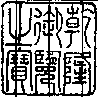
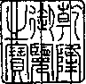
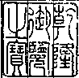
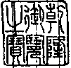
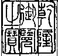
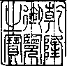
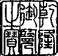
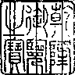

# 武林梵志



> **藏经**：大藏经补编（大藏经补编）　**册次** 第 29 册（B29）　**编号** B0161　**部类** 史传部　**卷次** 12 卷　**篇幅** 184,305 字

> **作者（译者）**：明　吴之鲸　撰

> **卷／品**：12 卷 · 0 品



---



## 目录



- [钦定四库全书　武林梵志卷一](#钦定四库全书武林梵志卷一)

- [钦定四库全书　武林梵志卷二](#钦定四库全书武林梵志卷二)

- [钦定四库全书　武林梵志卷三](#钦定四库全书武林梵志卷三)

- [钦定四库全书　武林梵志卷四](#钦定四库全书武林梵志卷四)

- [钦定四库全书　武林梵志卷五](#钦定四库全书武林梵志卷五)

- [钦定四库全书　武林梵志卷六](#钦定四库全书武林梵志卷六)

- [钦定四库全书　武林梵志卷七](#钦定四库全书武林梵志卷七)

- [钦定四库全书　武林梵志卷八](#钦定四库全书武林梵志卷八)

- [钦定四库全书　武林梵志卷九](#钦定四库全书武林梵志卷九)

- [钦定四库全书　武林梵志卷十](#钦定四库全书武林梵志卷十)

- [钦定四库全书　武林梵志卷十一](#钦定四库全书武林梵志卷十一)

- [钦定四库全书　武林梵志卷十二](#钦定四库全书武林梵志卷十二)



---



钦定四库全书　史部十一　武林梵志　地理类七(古迹之属)



提要



(臣)等谨案武林梵志十二卷明吴之鲸撰之鲸字伯裔钱塘人与吴大山称江皋二俊万厯中举於乡数上春官不第谒选得浮梁知县卒於官是编以杭州梵刹盛於南宋至明而残废者多恐遗迹渐湮乃博考桑牒分城内城外南山北山及诸属县凡得寺院四百二十六所俱详志创置始末及其山川形胜后为天朝宠锡宰官护持古德机缘厯代勋绩四门分纪名流胜迹高僧支派各编小传序录井然颇有条理其中采辑宋元人诗文如仙林崇先二寺记见曹勋松隐集智果寺记见徐一夔始兴集而志俱失载不免稍有漏脱又如宋张敦礼舍钟者非杭之法云寺而以名同误入又撰法相寺碑记者前作范楷后作沈楷亦为参错失检然搜剔幽隐无微不至实多武林旧事西湖游览志所未载如明远堂诗次於苏轼诸作之后而东坡集无之张九成喻弥陀塔铭亦不见於横浦集张伯雨天池楼诗与本集互异可以参攷遗文轶事俱足为谈艺之资正不徒为伽蓝增故实也乾隆四十五年三月恭校上



总纂官(臣)纪昀(臣)陆锡熊(臣)孙士毅



总校官(臣)陆费墀



------



## 钦定四库全书　武林梵志卷一



**译者**：明　吴之鲸　撰



城内梵刹



按旧志三种俱以仙林寺为首今仍之依次分派一自南至候潮门一自北至凤山门以便观览



仙林慈恩普济教寺



在安国坊宋绍兴三十二年洪济大师智𡖖建赐额隆兴元年孝宗改赐额曰隆兴万善戒坛淳祐三年理宗赐额曰飞天法轮宝藏又制钟铭赐之铭曰　大块嚂嘘震薄盖舆眷此洪钟以实出虚栾铣其角十分其鼓岂有铸鼎收金遗禹博大阐绎厚薄和均上开天阃下彻地垠乃警聋聩乃割昏晓咨尔有闻孰不心皎以为有声匪撞不鸣以为无声如雷如霆作镇梵宫法音无际巩我神皋万有千禩



元至正间张士诚据为军器局洪武四年重建置僧纲司有司即其钟楼为郡城昬昕之节正德间徙其钟更铸置朝天门仁和县岁造玉牛迎春於此



天长净心寺



在仁和北壁后洋街晋天福四年钱氏建南渡后析其地为军寨咸淳元年兴复元季毁景泰间重建



聂大年送僧日福听讲还山诗云　归去深居远俗哗莫教巢燕污袈裟从今悟了三生话高倚琼台看雨花



寺内有龙华宝阁宋理宗时卷帘使许祯建宋亡祯挈三子居之学佛自晦名出尘庵元延祐元年有僧讲法华经天华纷降遂名龙华其时宝阁穹壮冠绝郡城归并於此者曰清修院正定庵保福院九曲法济院



宋高宗幸天长赐僧广宝诗云　大界宜春赏禅门不掩关宸游双阙外僧引百花间车马喧长路烟云净远山观空复观俗皇鉴此中闲



寿圣寺



在虎林山上旧名长寿在东青门外淳祐间僧无住光隐重建永乐十三年潮坏徙建今所即寿圣院故址遂名寿圣山上古朴一株为风雨所掣内有大井银杏皆宋物也残碑龙凤御书之宝篆额尚存俗称祖山寺



虎林山在武林门内一里而近有小土阜高可三丈广不满百步宋太乙宫元大青莲寺在其下宋为杂造局局废山之阳旧有此长寿寺后易名今额



吉祥律寺



在仁和县之安国坊宋乾德三年睦州刺史薛温舍地为寺立今额治平二年改曰广福南渡初以其地为文思院军头司其寺界于两间仍扁以吉祥之额旧传其地多牡丹熙宁间名人巨公常赏之寺有观空阁



蔡端明吉祥寺赏牡丹对月诗　花未全开月未圆看花赋月思依然明知花月无情物若使多情更可怜



苏东坡诗铭跋八首　赏花人老簮花不自羞花应羞上老人头醉扶归路人争笑十里珠帘半上钩



花将落而述古期不至　今岁东风巧剪裁含情只待使君来对花无语花应恨直恐明年便不开



述古期明日同至因用前韵　仙衣不用剪刀裁国色初酣卯酒来太守问花花有语为君零落为君开



惜花　吉祥寺中锦千堆前年赏花真盛哉道人劝我清明来腰鼓百面如春雷打彻凉州花自开沙河塘上插花回醉倒不觉吴儿咍岂知如今双𩬆摧城西古寺没蒿莱有僧闭门手自栽千枝万叶巧剪裁就中一丛何所似玛瑙盘盛金缕杯而我食菜方清斋对花不饮花应猜夜来雨雹如李梅红残绿暗吁可哀



自跋云钱塘吉祥寺花为第一壬子清明赏会最盛金盘彩篮以献于座者五十三人夜归沙河塘上观者如山尔后无复继也今年诸家园圃花亦极盛而龙兴僧房一丛亦奇但衰病牢落自无以发兴耳昨日雨雹如此花之存者有几可为叹惜也



冬至游寺诗　井底微阳回未回萧萧寒雨湿枯荄何人更似苏夫子不是花时肯独来



后十餘日复至　东君意浅著寒梅千朵深红未暇裁安得道人殷七七不论时节遣花开



观空阁铭　过眼荣枯电与风久长那得似花红上人宴坐观空阁观色观空色即空



大中祥符律寺



在祥符桥畔梁大同二年邑人鲍侃舍宅为寺旧名发心唐贞观中改众善神龙初改中兴宋真宗时改大中祥符其广九里子院有千佛阁诸天阁戒坛院内有铁塔一石塔四钱王所凿九十九眼井实灵芝大智律师受经之地金人南㓂毁于兵南渡初斥为军器所元初仍建寺至正末毁洪武间重建其傍地尽为军民之居



苏子瞻祥符寺上元观灯诗　纱笼擎烛迎门入银叶烧香见客邀金鼎转丹光吐夜宝珠穿蚁閙连宵波𮋒焰里元相激鱼舞汤中不畏焦明日酒醒空想像清吟半逐梦魂销



曾子固诗　月明如昼露华浓锦帐明廊笑语同金地夜寒消美酒玉人春困倚东风红云灯火浮沧海碧水楼台浸远空白发蹉跎欢意少强颜犹入少年丛



可久师上元诗　门前灯火鬬分明一室清风冷欲冰不把瑠璃闲照佛始知无尽本无灯



长寿庵



放生池记西湖古放生池也法久而敝实亡名存敝之久而安焉恒产乎水族并迷其名若罔闻者岁在乙未予演圆觉于佛国山之南屏南屏故有池当其三门一时主会诸名公捐资赎而出之植莲其中断渔业人由是知放生池为武林旧事既而予复凿池上方既而北门有园园有池复赎之园距上方南北相望者半拘庐舍而城之内有二放生池矣顷予碑上方谓以是为之兆兆且引而蔓延之顾予德㣲年衰不足以风未知继此而兴起者更几池也上方苦隘仅为池餘少丛竹羽虫之获逭其生者聊以依止兹颇闲旷池聮比扩之则濊然成浸水涵而土山垒之则𡾯然成山循而界之则幽然成径相其宜而树之竹木则郁然䕃而成林将使嘤嘤洋洋乐而相忘虽无繇拟飞泳亭之万一而犹冀想像其遗踪则上方所不逮也园以东为兴福禅院旋而南为养济院又旋而西为得一道院养济昔号悲田圣主贤臣哀㷀民之颠连而无告者设也今之困矰饵伏质于刀砧必不可迯而待烹其无告尤甚贸而畜之池纵之林俾终保残寿慈孰加焉佛示三福云慈心不杀而五福千箕畴亦寿为其最濒杀而重寿之福孰加焉天地之大德曰生舜之德曰好生德一而已上清下宁侯王所以配两间之久长贞万物之寿命者恒於斯德孰加焉儒道释三圣人之伟迹鼎峙夫三方若环拱然而园介乎其中是曲阜之仁里摩竭之慈室西华长生葆真之灵宅天合而冥隣也岂偶然之故欤夫救生之灭也而有生求其生而未尝生也而无生无生然后无不生则生灭一生灭一则福兴于无相悲济于无缘福不可得悲不可得一亦不可得唯法性常住不断不续同于虚空彼梵网以放生为常住法常住者金刚身无量寿也廼庵其园曰长寿而园有荒庐数楹饬治之为供接引导师及当来慈氏尊像盖津梁所放一切含灵先生安养息轮廻苦后于龙华而得授记也庐止是无增多以净戒僧守之守之之方具如上方记中语时里之父老闻予言前执予手歔然太息曰园之源吾弗知之矣吾犹及见二禅人居焉向稔其古为伽蓝而业已蔬圃莫返厥初吾何图重睹今日也是役也始其事者予与化𡖖宋君而诸上善人乐助而成斯美利者例得书碑左云袾宏记



青莲寺



在车桥北宋隆德间钱氏建祥符中改净戒院先是宋元丰中吴处厚以皇嗣未立上书乞立程婴公孙杵臼庙诏封婴为成信侯杵臼为忠智侯庙食於绛后又以韩厥存赵孤三人皆以春秋祠于祚德庙绍兴二十年建祚德庙于院内以春秋二仲祭之至正末张氏据圣寿青莲二寺为府而庙亦废



崇福庵



在平安坊石晋开运三年僧义宣教厚法师建宋元兵火因仍入国朝复兴嘉靖间僧苦徭役乞庇于总戎万鹿园称万氏宗祠几为所据万厯乙酉僧能惠等募赎鼎新殿刹宏伟缁侣云集称十方禅院冯梦祯沈楩虞淳熙为之记



法轮寺



在观桥南五代长兴中龟法师建於城东汤镇额曰观音后改安国宋大中祥符间改法轮洪武间立为丛林永乐十八年潮啮殿基僧至恂改建今所



栖禅雪洞院



在平安坊吴越王建於艮山门外名观音院建炎间改栖禅院至正十二年僧时俊作雪洞于今处移请旧额为栖禅雪洞院今并慧云寺



僧泐季潭诗　洞雪团团白飘来不自风恍疑云母室如在水晶宫大暑𮋒愁冷深春未觉融不须灯照夜定起月朦胧



祥止庵禅室虚生白居之最吉祥了经　何待月上𩬆不知霜宿恐云来借寒愁火有妨老禅栖息稳无复梦华阳



兴福寺



在斜桥南宋绍兴丁卯左丞薛昂以花药圃施僧慧观筑庵名曰择胜寻建佛刹请龙山废兴福院额表之国初定为丛林



止止庵



在羲同安谷坊万厯三十年僧如玉重建



广寿慧云禅寺



在三拨营畔宋淳熙十四年张循王之孙镃舍宅建寺绍熙元年赐额俗称张家寺有留云亭白莲池元至正间毁洪武十七年僧文副重建永乐九年永忠宣德间广睿弘治元年福海相继重建万厯间旁地侵为赛西湖辛亥复原额



僧梵琦留云亭诗云　人家十万绣成堆未抵南湖一叚奇象辇不来春草绿小亭云锁紫珉碑



僧德祥白莲池诗云　念念西池道路赊东池今已种莲花他时若到西池上应念东池是故家



吴用先重复慧云寺建宣义张公祠碑慧云者张宣义所舍南湖园宅绍熙间请于朝以为寺者也岁久渐湮狭少其额迤东稍稍入军营而所为南湖俗称白洋池者亦不知何时并入民居万厯间复有豪依大珰踞其寺之半并没其所失额于军营者即具宫室安处其上为年且二十有餘余与右辖窦公力清故物尽反所侵并营房悉撤还寺俱复其租慧云已光复矣已与孙司理乔仁和杨钱塘谋修饰佛宇首建张公祠以酬其宏深之愿古今之舍宅为寺者多矣即右军东山辈皆慧业文人卒不闻亲勒文字建之金石慧云独有之模丰碑所手书预制发愿疏出自血诚读不能终篇泪澘澘下想见公之为人也史魏国与公同时称公闲居远声色薄滋味矻矻诗文自处不异臞布考之史乘殊非实录魏国盖以是饰公焉夫公雄才大畧风流文雅人也玉津讨贼之举公实沈几制为文章灵心灿出笔彩纵横绝无书生笔墨之气盖非矻矻以此道见者自奉极侈园池声伎服玩之丽甲天下南湖园世所传凌霄亭玉照堂诸胜在焉即其排比十有二月之燕游各有次序而牡丹一会名伎且百数十人梅花之社一棹径穿十里岂龌龊小生为假令歌舞浓而感慨生杯酌酣而逸兴阑此亦称英雄回首大力矣而考南湖舍寺之年顾即其经始之第二岁诸所赏心乐事之见于南园者乃更其假舍寓居于所舍之后是诚何心哉公之言曰光明藏中孰非游戏若心常清净离诸取著于有差别境而能入无差别智则[泳-永+(瑤-王)]坊酒肆徧历道场鼓乐声音皆谈般若倘情遮物隔境逐源移如鸟黏黐动伤性命又乌知所为说法度人然则公之舍寺也寺与家等舍与不舍等身后之舍与生前之假寓等赤洒白净不挂一丝真舍矣彼所为沧海桑田之感公实无当焉而图报福田之论犹浅之乎言公哉乃知真用世人真文人真受享人即能为舍其用世舍其文舍其受享而大展手眼于觉海无边中也斯寺一区公之自力实足以奠之发愿之文犹其诱人者耳寺迄今犹呼为张家寺公之真诚在人也慧云其旧所赐额踞杭北城艮山门之西南湖之上其中东西井各一原碑载地百亩今清得为亩者五十四有竒为弓者一千三百十七有竒周以界石东底营南界长和巷西许田北负睥睨后之人如有妄觊而搏取之者公之誓文可畏也公名镃字功甫别号约斋循王之曾孙官宣义郎直秘阁判临安军历右司郎为少卿云



张镃自撰誓愿文云大乘菩萨戒弟子承事郎直秘阁新权通判临安军府事兼管内劝农事张镃右镃一心归命本师释迦牟尼佛当来下生弥勒尊佛西方极乐世界阿弥陀佛十方法界诸佛诸大菩萨缘觉声闻大梵天王帝释尊天四大天王韦驮尊天守护正法天龙八部大权圣众五岳四渎名山大川祠庙神祇伏望不离真际普赐证明镃恭以欲导群迷必阐扬于佛道将兴遗教宜建立于僧坊胜福难思契经具载镃生佛灭后值法住时幸发无上心愿学第一义念真乘难逢于旷劫思慧命常续于未来助行欲妙于庄严随力当施於利益深心所在至愿方陈阎浮乃众生选佛之场震旦多大乘得道之器教法东渐而独此为盛祖师西来而其传不穷由是众多之伽蓝徧我清净之国土或据名山胜地或居赤县神州皆古德之所兴实檀那之自创伏遇主上体佛心而治天下崇祖道而护宗门惟钱塘驻跸之方乃寰宇观光之地昔相国曾闻十禅之建今在所未见一刹之隆如来演教于王城盖居精舍宗师接人于閙市可乏丛林都民胶扰而罕闻说法之音衲子徃来而靡有息肩之处慨斯阙典久矣经怀昨倦处于旧庐遂更谋于别业园得百亩地占一隅幽当北郭之隣秀踞南湖之上虽混京尘而有山林之趣虽在人境而无车马之喧爰剪荆榛式营栋宇劳一心而经始历二岁而落成念胜处可作精蓝而薄德岂宜於大厦顾栖身之尚赖姑假舍而寓居浮生自叹于艰虞幻质累萦于疾疚求佛祖之加被祈天龙之护持增长善根销除宿业年得逾于知命运获度于多灾必法尊经变秽坊而成净域定依前哲舍居宅而为梵宫用分常产之田常作香厨之供愿主席者皆有道行使挂锡者咸悟心源为东方立光明幢与末世洒甘露雨插草不离於当念布金何借于他缘言弗苟陈誓无终悔镃切虑事有多障时不待人先期或至於报终异议恐纷于身后宗族长幼朋友亲姻或称乱命之难从或谓名教之有害引屈到嗜芰之说诮王旦削发之言坏我良因夺我素志以至恃势力而求据占由贿赂而请住持輙污招提妄谭般若是出佛身之要是断正法之轮死当堕于阿鼻生遂遭于竒祸特将此誓痛警若人俾草一时之狂心勿受历劫之极苦盖念起立墖庙饭食沙门流通大事之缘成就圆机之善恭愿皇图巩固睿𥮅增延期永措于兵刑庶宏持于像教上荐祖先父母次及知识冤亲八难三涂四生九类悉资熏而获益总解脱以超轮广此愿心周乎法界作菩提之妙行为净业之正因佛国俱空毕竟首登于极乐法身非有不妨面奉于弥陀普与有情同成此道谨疏其碑现存书法遒媚酷似小米云间董太史其昌极珍之复有魏国公史浩撰记学士楼钥书俱存



七宝寺



在盐桥束梁贞明七年钱王建名上方多福院宋大中祥符间改今额有六游堂临晖阁郡守王钦若诗



普照院



俗称报师庵在盐桥北晋天福八年钱氏建旧名报国千佛院祥符间改今额洪武十四年僧正宗重修嘉靖八年毁重建



潮鸣寺



在庆春门北梁贞明元年建初名归德院高宗南渡驻跸寺中闻江涛声赐今名寺北有回龙桥高宗尝作诗赐统制刘汉臣勒石寺中诗云　野寺参差落涨痕踈林欹倒出霜根扁舟一棹向何处家在江南黄叶村兵燹重建洪武二十四年立为丛林



普慈寺



在蒲场巷内宋绍兴间僧思净建元至元间僧元忠修



水月庵



在潮鸣寺东僧道弘拓地四亩搆禅堂焚修其中旁有放生池



莲居庵



在土桥东古延寿庵址毁于兵万厯六年里人虞淳熙建忏室延绍觉法师安居而加拓之结禅讲期方伯吴公碑定额为莲居有记



虞淳熙载钱塘志曰广承字绍觉潘氏子少颖悟师圆鑨勤三七忏精相宗云栖宏命之代讲於天台贤首教模象知形无师自会昼夜听众围绕戒铠甚坚后观佛面西而逝



方伯浮渡居士吴用先碑记武林故称佛国古刹精蓝贲相望于山林城郭间然天下莫不重趼而走云栖者非独其刹胜也禅教律争取宗焉四十年来法嗣棋布区中其间绍明教律以一精蓝走天下者则无逾莲居云莲居为绍觉承上人庵院上人即云栖首座余既获叅请云栖谋以公餘谒讲席而竟示寂往矣寒灰老衲飞锡莲居亟为余道其生平甚悉盖年未三十已从云栖大师应期吴越间所至輙命代讲俨然堪作人天范矣而犹不自满假遄归建忏室礼法华足不窥户外者六易寒暑严净毘尼研讨三藏於台宗尤宿契马弱冠辩六即义时贤悉为逊席读法华玄签会释过目即能点检其讹演唱垂二十年四方弟子日益进上人为之搜玄抉秘破难析疑尽形寿无几微倦色人率拟师智者后身上人欿然自视若未敢鴈行于四明荆溪间也既以声闻行律身又以菩萨行弘法视末世中滥据法王之席而缺篇犯聚空腹高心且哆口增结𥮅沙云者何啻在群之鹤翔仞之凤乎以故崛起一隅竭蹷四众叅云栖而下即叅莲居城东咫尺地卓然为海内一时法窟云莲居当庆春清泰二门之间左负郭右亘土桥门绕清流竹树环列临其地者恍然有乐邦水树之思马先是依大觉上人於万厯六年始建二十四年上人复加拓之忏室则德园虞公所建庵名则古鄞屠长卿公所颜余更为酌定者也其徒大真三十五年佃地在庵师殁而真主庵事二三居士复为广室置产时共四方名宿结禅期讲其中宛如其师在时呜呼天下古迹名区半委之断崖衰草莲居以一泥丸驰誉二纪且使子若孙悠然承之可久可大岂非法席之兴以人不以地而行寡仪范学无师傅固难以虚声笼世也哉余故乐而志之使知莲居所以蔚为世宗者诚非偶然而云栖一滴水其沾溉固无涯也上人著有心经二解唯识因明观所缘缘论记若干卷方谋梓行世其懿行备载铭传暨钱塘志中弟子具辨才能升座者甚众兹不复详聊志庵居始末如此



华藏寺



在横河桥东唐清泰二年吴越王建名报恩院大中祥符间改今额淳熙十五年重建



僧济天岸诗　清泰年间古道场门前驰陌几炎凉破除客梦凭吟草陪伴禅心有佛香宝地月来清耿耿江城潮落夜镗镗叮咛细桞营头鼓莫放腾腾更点长



悟空寺



在淳祐桥东晋天福七年僧齐教建名崇新院大中祥符改额淳祐六年法昌重修元末毁永乐元年德兼重建门有小溪茂树可䕃



长明寺



在螺蛳门内晋天福间建宋开宝四年钱忠懿王改名法灯治平二年改长明佛印禅师开讲于此元季毁弘治十五年僧如埙重建万厯庚戌葺治一新



相国寺



在淳祐桥东北百步许北齐天保六年建名建国唐时毁为郑景宅园景云初僧慧购为寺值睿宗由相王即位赐名相国元末毁洪武初僧大云重建置僧纲司於内正德八年僧东明重修尚书洪鍾为之铭



费宏诗　舍卫结禅林幽栖一径深竹窓悬绿蔓莲座相黄金解脱身前业遥知去后心坐谈那忍别殊为涤烦襟



虞淳熙诗　行到云深处云深故不飞钟声迟好月诗思转明玑入午藤花饭经冬薜叶衣那知人世里辛苦属轻肥



灵芝崇福律寺



在东花园崇新巷俗称蜡烛庵唐贞观己酉年郡人施光庆舍宅建名实际院宋佛印禅师重兴元季毁元统间僧妙通重建洪武二十四年立为丛林永乐间徵僧能守纂修永乐大典宣德徵僧如真校修藏典正统徵僧智淳说戒开坛为天下传戒宗师乙亥年辞朝沐浴坐化皇上遣礼部赵勗谕祭智淳曰尔夙悟善缘坚持梵行迩膺荣命为释宗师方阐法音导人为善倐云示寂良可悼嗟灵其如存服兹谕祭赐勅谕祭碑额见存为律宗第一山钱塘县岁造土牛迎春于此



元时刘伯温以行省都事坐法宿庵中简俊上人诗云　城外春江动客愁江边细草绿悠悠还将短发临歧路畏向东风忆旧游斜日远天归鴈急薄云孤馆落花稠青灯不放还家梦一夜膓回一万



周万厯壬寅僧如尧重修



大慈庵



在墓园巷宋淳祐四年僧德殊建洪武三十四年僧可观重修



金刚广福教寺



在章家桥东晋天成间善杲法师肩负金刚憩息于此夜放光明陈少师感异舍地为寺初名功德院宋宝佑年间理宗赐今额至正末毁洪武十八年重建



有衍慧堂御史谢文昌记万厯辛亥寺僧常秀捐衣钵募众重修



妙净庵



即古妙净寺在香饼子园万厯甲寅沈宫詹㴶集善信重建延云栖僧大雯焚修於此



祗园寺



在东花园狮子巷西北太平兴国间僧清照建旧在郊台侧南渡后造御马院移筑于此至正间毁重建



东冈寺



在狮子巷西乾德元年德法师建绍兴三十二年赐额永乐十八年僧松岩重建



惠林寺



在蒲场巷绍兴初汴僧惠林禅师随驾来杭建兴国院于天庆坊嘉定四年移于荐桥门外报国寺基改名惠林元至正间展城围入寻毁洪武初僧昙芳重建



佛惠寺



俗呼寿火星庵在仁和县之义和坊元大德间建后毁景泰间重建



崇宁万寿教寺



俗呼姚园寺在高阳闾巷宋初为姚氏花园绍兴初僧慈昌购园结庵乾道初赐额淳祐二年建膺福殿以奉理宗御容元季毁洪武初僧大云重建



慈云寺



在高阳闾巷周显德二年僧圆觉建名慈济大中祥符间改今额理宗书灵感道场四字洪武二十四年立为丛林沙门延礼重修嘉靖二十年毁僧圆鼎重建



水陆寺



在狮子巷南宋太平兴国七年生法师建咸淳间僧师则重修内有银杏二株甚巨盖宋物也寺故在城外张氏展城围入



苏轼寄水陆寺清顺师诗　草没河堤雨暗村寺藏修竹不知门拾薪煮药怜僧病扫地烧香净客魂农事未休侵小雪佛灯初上报黄昏年来渐识闲居味思与高人对榻论



白莲寺



在仙林桥东晋开运元年吴越王建名华藏院宋治平间改妙惠院咸淳间僧祖显诵经持戒地产白莲因赐白莲妙惠寺额



下水陆寺



在平安坊旧名无碍院宋嘉熙三年被潮水冲坍僧行椿于太平桥西南无碍院住宝佑二年奉礼部符据临安府四月给帖赐额重建改今名东有古栢轩



孝义庵



在菜市桥西即古无碍庵故址万厯间禅师袾宏重建方伯吴公及郡邑长各助资给劄名孝义无碍庵方伯郭子章匾曰超尘详司马宋应昌记



莲池禅师少与予同业黉校予登仕禅师出家为嘉靖乙丑禅师夙志方外以二尊人在不敢离既先后岁双失怙恃将力酬所愿而室人汤氏年才一十有九前儿殇亡忆子舆之规疑未决已而念风灯石火时不我延遂疾从薙染汤处室斋戒禅诵与其母偕母寻故孑然㷀居宗人议后以三姪文彬无何汤亦脱簮珥为尼僧召文彬谓曰兹无所事后不后我固无害彼生而养死而服而殡而祭世法也吾学佛存资钵衲殁归阇维耳夫何求哉因举所有田庐普给群姪於文彬低昂之而别以居属文彬已从隣僦舍绳枢蓬门夕灯晨香𨵙如也嘉禾朱公子衷纯追厥先大夫银台虞葑先生遗意首事搆庵而予与一时宰官居士比丘某某从㬰马累百金买赵氏故宅宅苦隘水文学施傍屋一楹附益之又岁久颓圮几尽众相与施材缁侣之能匠石杇墁畚插者相与施工施力中为禅堂凿井於左庑餘垣轩厨湢畧备而已予惟禅师无子无留赀无素所凭依故旧亲戚僚友汤以年少妇独御家政伶仃苦辛多历年所如一朝及其分田割庐皆出本怀亦难矣诸上善人怜而庵之义举也举于义则十方常住业也后清信女展转相续焚修于此庵远为二尊人庄严报土又孝思之道也按府志菜市桥西有古无碍庵其后渐没入于民家徒而北里之耆氓告予以斯地正庵之旧址久湮忽兴殆天意非人力而义以孝不虚孝以义不泯若交相成而不相悖乃㳂古证今合而颜之曰孝义无碍庵沈氏子孙尚其念之护之以无忘孝义永为人天福田流庆渊渊后必有昌大其门闾者汤法讳祩锦暨禅师同师关中南五台性天和尚溯禅师出家逾四十稔盖行年五十九而庵成



崇恩延福院



在盐桥下八界旧系西北流寓濠州鍾离县孔雀妙明寺淳熙十四年嗣濮王请为功德院赐今额



圣寿寺



即永福寺在后洋街宋嘉定元年僧永明建淳祐间赐额永福以奉秀王香火元至元毁洪武初善祥重建宣德十年赐今额



觉苑寺



在丰乐桥东宋尝徙三圣庙于此改赐额曰旌忠庙寺久废宣德中重建



千顷广化院



在木子巷北开平元年吴越王建旧名千顷大中祥符九年改赐今额中兴后为临安府祝圣道场僧了性精于医善草书东坡尝为作六观堂老人草书歌赵清献公名其堂曰垂慈堂以著其疗疾济人之功



东坡草书歌物生有象象乃滋梦幻无根成斯须方其梦时了非无泡影一失俯仰殊清露未晞电已徂此灭灭尽乃真吾云如死灰实不枯逢场作戏三昧俱化身为医忘其躯草书非学聊自娱落笔已唤周越奴苍鼠奋髯饮松腴剡藤玉版开雪肤游龙天飞外人呼莫作羞澁羊氏妹



参寥子千顷廨院观司马才仲遗墨诗　朦胧春雨湿村桥竹里禽啼婆饼焦度谷倦闻车轧轧穿林愁听马萧萧细窥陈迹僧房静默想风流鄙俗消浮魄浮魂今已矣无人为作楚词招



明庆寺



在木子巷北唐大中二年建为灵隐下院大中祥符五年改今额宋中兴驻跸视东京大相国寺凡朝廷祷雨旸宰执百官建散圣节道场咸在焉淳熙十四年六月嘉熙四年七月皆以祷雨车驾临幸理宗回銮撒盖甘雨随至平章乔肃公行简献诗贺上用韵以赐又御书明庆二大字淳祐六年重建法堂御书南山道场为额嘉泰三年建阁藏御书扁曰宸奎万寿之阁有苏文忠书观音经碑及题识大智祖师书弥陀字碑又有法喜堂明碧轩



王荆公为僧修广作法喜堂诗　浮屠之法与世殊洗涤万事求空虚心思以此不挂物一堂收身自有餘堂阴置石双𫶇嵲石脚立竹青扶疎一来已觉心胆豁况乃宴坐穷朝晡初忆幼时勇自许壮大看俗尤崎岖丰车肥马载豪杰少得志愿多忧虞始知进退各一理造次未可分贤愚会将筑室反耕钓相与此处吟山湖



沈文通诗　溷溷学佛者营营良足悲不知佛之乐谁使汝学为广师吾州秀智解乃天资既以法为喜万缘脱若遗高堂客满坐妙语破群疑来者岂不辨辨此堂之题



王荆公寄题明碧轩诗　明碧轩南竹数丛别来江外几秋风道人无复人间世嗟我今为白发翁



赵忠简公明庆僧房夜坐诗　月明窓竹冷横斜坐看风灯落烬花老眼病餘嫌细字枯肠寒甚怯清茶囊空岂是久为客梦短其能飞到家但有流年寻鬂发萧萧蓬葆靖霜华



菩提律寺



旧在钱塘门外宋太平兴国二年钱惟演舍宅为惠严寺七年赐额建炎间火绍兴中复建有堂二曰南漪堂迎薰堂东坡题南漪堂看杜鹃花诗勒于石至元末筑城徙寺于宪司巽方太学街东永乐间节庵守公被召修大典智淳修戒律别原修藏典约宗亦以高行被召四代入觐亦沙门荣遇云正统十一年丙寅七月丁卯朔初九日皇帝遣礼部郎中赵朂赐祭宗师智淳曰尔夙悟善缘坚持梵行迩膺荣命为释宗师方阐法音导人为善倐云示寂良可悼嗟灵其如存服兹谕祭万厯二年重建后殿内奉旃檀白衣观音像



苏轼题南漪堂看杜鹃诗　南漪杜鹃天下无披香殿上红𣰽毺鹤林兵火真一梦不归阆苑归西湖



菩提寺小轩晚晴诗　杭颍雌雄本自殊淡粧浓抹是吾姝满倾涨玉千鍾酒来看镕银百顷湖白鸟去边山泼黛绿蒲疎处雨跳珠不知能似王摩诘貌得西湖落照无



灵寿寺



在曲阜桥东元至正二十一年浙江行省左丞相达实特穆尔建本辉和尔氏世族故称辉和尔寺俗讹为义乌寺洪武二十四年改今额



安国罗汉寺



即相国寺俗称西井寺在井亭桥西甘泉坊内宋淳熙十一年开山显禅师请凤凰山已废安国罗汉寺额为额内有大井唐大厯五年邺侯李相国所开六井之一寺屡毁以井故至今存



上方寺



在溜水桥西僧袾宏重建内凿放生池



袾宏有记曰武林自宋跸南驻环湖山禅讲律寺粲然綦布星列而郭以内称焉迨今多半沦没至不可考诸传志有上方寺者背倚城垣左右掖涌金钱塘二门前通西井官道盖肇建后梁贞明七年而国朝景泰四年僧以难事作散去寺随废渐蚕食为民居仅存者什一优婆塞沈善能者庐其中嘉靖二十三年尚宝卿六桥徐公得请于官佃为圃公无子以𢌿女遗命还寺女孝且贤持𢍆归王氏遵父嘱以𢌿云栖遂复为僧地如初无何王谢世居士化卿宋君闻其义而高之化卿以世禄之裔砥德砺行乐善不厌廼输金赠二子更与之契予亦罄衣资偕善信旁赎其故址若干向明正位别为廻廊旋所向面城而门取幽寂也期世世承事三宝因谂于众曰唯上方弹丸重兴伶仃衰㣲何修何营而俾久远或议辟草莱轮奂其殿堂群之以僧僧多则常住予以为不然时丁末法塔寺靡坚试屈指而计凡三门乎阛阓者楗椎之庭不为罇罍之所能几僧虽多而行寡奚以多为顾兹地隣城城隣湖湖外高而城内卑随锄成流亢阳所不能涸因而池之良便以池放生以隙地之敝堂稍葺其莛楹守以二三诚信衲子蚤莫禅诵庶几上祝皇图下济含识得之一举矣或谓物如尘如沙池一勺耳容有限奈何而庸知夫凿斯池也为之兆也美引也引而伸之而又伸之汪然徧域中矣昔子产之畜鱼一勺也使郑之人若大夫若士若民皆然郑之与国若燕赵齐楚辈皆然则池无量所畜无量不然西湖古放生池也谓普容天壤间物宁有是乎哉化卿曰唯唯与其仲直卿诸贤士夫诸比丘净人有呈财者裹粮者疏其壆而锹者畚者梩者枯横泉之挠而戽者槔者埭者固隄防之浸[泳-永+(瑤-王)]崩颓而埤者堹者𥗒者䃭者捍狸与獭而𦼼者闲其外侮而版筑者忧其寒暑而上为之𢊒下为之窟者皇皇乎昼胼宵胝劳不知息兼工再阅月而池成于时在筌而释当釜而逸洋焉悠焉出而游马一勺之内足其从容也予喜且惧稽首而告於十方如来主池神主伽蓝神愿以佛力法力贤圣力诸神誓愿力慈护而威临之从于今日尽未来际常为鳞介诸水族等栖止安宅又稽首而告於见住僧后住僧愿以戒力悲智力念流水之苦躬而泽焦𣩅天台之抗章而断簄梁智觉之负辜成仁蹈白刃而不悔尚永持无斁以风四方敢有叛先盟师陶朱媒利於网罟或倍众而售之乎白衣是名违佛律犯波罗夷诸所称释子者鸣以羯磨遄摈绝之勿共住即朋比而阿神必阴絷其魂显僇其形无能逃者既免焉其报尽也堕泥犂中婴万苦无竟所以者何好生恶死天道也人情也前人捐难舍之赀役所爱之身创五浊世不恒见之胜举以生必死之命置之安全后人忍不一深思之而惟便其私图於天道逆於人情不祥从逆凶不祥者灾逮鼓桴形影感应自然非危言怖之也化卿及诸大众踊跃欢喜叹未曾有作而曰善哉是缁与素之龟镜也不可使无闻于末法也而碑上方颂曰始举为兴灭而兼得放生岂唯灭不灭生亦无生相生灭俱灭已寂灭何有方以明超於方无方中说上无方说西方其意亦如是作寺作池人愿共了斯㫖



妙心寺



在涌金门内旧在西湖行春桥南元至正间徙今所



长生庵



在溜水桥西城下为昭庆下院旧有冲静真人遗址万厯间寺僧智礼募金赎建正殿掩关六载装塑千佛罗汉



杨𤎉夫诗　独坐清都鹤梦长碧天如水月苍苍云和有乐降王母霹雳无车唤阿香雪泛玉瓯茶吐沫花零金剪钵生光仙风不动庭前竹又送㣲钟到下方



赵孟𫖯诗　流水桥西一径斜青衣相接到仙家香分橄榄烧银叶酒泻松脂溢紫霞绿竹满堦初解箨碧桃几树正开花何时脱却尘凡累来叩丹房九转砂



聂大年诗　蕋宫琪树罢栖鸾空有玄都太古坛野老不寻餐玉诀山人自制切云冠杖龙化去秋池涸笙鹤归来夜月寒前渡刘郎偏好事种桃留与后人看



比胜庙



司马宋应昌建云栖大师弟子真玉修净土其中



慈济院



旧在西湖莲花桥北自牧牛孝公苦志精修事母至孝盖欲广慈利济托迹禅那士大夫咸敬慕之名因称马实为开山第一代祖事闻于上赐号弘慈普济大禅师即额慈济院元未兵毁洪武壬子年僧行德重辟于南壁积善坊傍有宝觉寺正德十四年僧宗恺重建尚书洪钟为之记



真教寺



在文锦坊南元延祐间回回大师阿喇卜丹所建先是宋室徙跸西域夷人安插中原者多从驾而南元时内附者又往往编管江浙闽广之间而杭州尤夥号色目种隆准深眸不啗豕肉婚姻丧葬不与中国相通诵经持斋归于清净推其酋长统之号曰满剌经皆番书面壁膜拜不立佛像第以法号祝赞神祇而已寺基高五六尺扄𫔎森固罕得阑入者俗称礼拜寺



慈光寺



俗称铁佛寺在钱塘芝松坊佑圣桥西晋开运初晤恩禅师建宋宝庆二年清河郡王张魏公割地扩充名张府功德庵元至正毁正统间重建万厯壬子撤圮殿新之方伯吴用先有记



重建慈光寺碑记武林有佑圣桥旁为慈光寺寺有弥勒尊佛以铁铸之俗称铁佛寺因以名桥晋天福间晤恩禅师卓锡於此迨开运初寺成师时登座讲贯弥年通达法华金光明经止观论咸洞玄㣲寻施覆述门弟子相次角立宋雍熙三年八月朔日恩於中夜覩白光自井而出明灭不恒谓门人曰吾报龄极矣乃绝粒禁言一心念佛次梦拥衲沙门执金炉焚香三绕其室自言祖师灌顶来此相迎汝当长逝梦觉呼弟子至犹闻异香至廿五日为弟子说止观指归及观心义辰时端坐面西而化其夜寺僧皆闻丝竹嘹亮渐久渐远依稀西去迨九月九日茶毘获青白圆粒无筭建墖於玛瑙坡因以事闻上请额御书慈光普照四字颜其门法席之盛甲于通都后宋宝庆二年清河郡王张魏公复舍基廿四间拓而充之共计四亩餘名张府功德庵元至正毁皇明正统立中成师重建而宝觉寺铜佛庵寺属焉寺有合抱银杏五株及放光古井皆宋物树为风雷掣去井甚甘冽给数百家大早不涸咸称为慈光甘露泉云苐阛阓鳞次湫隘嚣尘门难旋马殿亦渐圮寺僧慧皞年十九矢志鼎新闭关书莲经积三年缙绅士庶鉴其诚共为檀施不胫而驰盖发愿在万厯甲辰鸠工在丁未至壬子落成中建大雄宝殿高广逾旧制廊庑门楹委折合度殿左有古迳逶迤纡曲深藏大士居供古佛三尊左右诸天罗汉猊座莲台金碧耀射仍重铸弥勒以识其实约费二千餘金灿然一新其间助成者僧智能护法宰官则中丞金学曾太守凌登名孝廉吴之鲸等赞襄则王介朱佐沈坤戴纶张永年而与会有俞普才者助义田供常住为大殿四时香灯之费噫一念坚持众缘俱到信非诬矣余观武林梵宇之盛载在谱牒者什五沿灭大多因山水而存因人而废如慈光在市㕓中无山水之胜而古刹聿隆则皞志可述也余因书殿额为𢶏而锡之以记



慧安寺



在十三湾巷晋天福间吴越王为明律师建于草桥门外罗木营地元季毁洪武初僧得实移于钱塘保安坊东永乐乙未又移今所少保兵部尚书于谦为之记



宝梵寺



在镇海楼北晋天福初建于崇新门外名崇寿院宋淳熙二年徙建今所崇宁元年赐额宝梵洪武二十四年并入慈云永乐元年重归原所尚书夏原吉为之记



海会寺



吴越王建旧名石佛智果院宋大中祥符间改名积善海会寺嘉泰间毁至正间重建平章库库子山书大海会寺额御史大夫庆通书观音宝殿额成化十年火逾年僧浩中重建



百法寺



在石龟巷宋建炎初僧宝宁建有大佛半身依山凿石为之淳熙十四年赐额广润元时改额百法赵子昂书元末毁天顺元年僧道冲重建



宝奎寺



在吴山之阳宋丞相乔行简故第竒石峭拔东望海门如在咫尺绍定间理宗幸其第书见沧二字又书双现楼孔山二轴五大字赐之勒之厓石遂舍宅为寺以宝奎请额诏从之元季毁弘治间重建有月江和尚钦取和番化导留彼不回成化改元其徒道泽日持金刚经为课游天目重建昭明道场毕还山是时寺迹瓜分而寺所存者仅见沧石与殿基耳泽具奏恢复逮系藩司理问所狱仍日持金刚经不彻半年餘岳伯忽梦感老僧觉而徧物色之有以泽言者即出狱见之宛然梦中僧也蘧然惊异即师礼之成化二十三年重建尚书洪钟为之记



宝成寺



晋天福中建名释迦院宋大中祥符间改今额岁久废为黎氏园万厯壬子方伯吴公清复捐资建大观楼开砌石径焕然一新壁间有唐宋时石观音罗汉像甚古有苏子瞻宝成院赏牡丹诗　春风小院却来时壁间惟见使君诗应问使君何处去凭君说与春风知年年岁岁何穷已花似去年人老矣去年崔护若重来前度刘郎在千里



诗镌石壁笔法甚遒其旁有岁寒松竹四字乃成化间吴东升题者



浙江叅政左赞诗　吴山曲径入西南方丈云深僧两三艾纳吹风香细细葛藤𦊰日影毵毵泉分童子青衣洞尘断维摩白石庵畫省若逢公事了海天送目再停𲌂



云居圣水寺



旧名云居禅庵在七宝山元元贞间中峰禅师建山皆本府财赋地师请而得之芟荆𣗥夷岩堑搆殿宇不置恒产惟资檀施或持钵化缘立为常规俾后嗣永守至大己酉传之中舟复增广之因辟殿基得古井浚之得三石佛首遂名三佛泉邓文肃公文原为之铭中峰常居之有云居八景诗赵子昂墨迹万历间都阃某见井中有光掘得磁观音像莹然如玉建阁奉于寺旧有法华松数百株苍虬翠峙为住持历年损削殆尽又有中峰拂尘麻鞋复有小像一幅神气如生相传为中峰自写上有赞云　幻人无此相此相非幻人若唤作中峰镜面添埃尘和甫双眼碧能辨踈与亲请挂向空壁日日生阳春



夏原吉诗　谁辟云居境峩峩瞰古城西湖晴送碧上竺晓分青经镇千函妙钟鸣万户声此中真可乐何必访蓬瀛



沈梦麟圣水寺诗　白云长绕梵王居湖上诸山总不如客至每烦尘榻下诗成那问酒尊虚摩挲修竹三年别抖擞尘襟一旦舒更待牡丹庭下发重期来此赋元舆



上方庵



为圣水下院与法华松接武峭石林立中有一滴泉极岩壑之胜昔东坡共佛印时过趺坐於此泉滴如注寺僧苦为游观累凿败而石现存



金波禅院



即金波庙在金波桥宋淳熙元年建勅赐圣㫖二字东坡书扁见存万历癸夘慈光僧圆美慧皞重建归并慈光寺普照堂中丞金学曾有记



宝严院



在七宝山唐清泰二年钱氏建名瑞隆宋治平二年改今额寺有𡸁云亭借竹轩淳祐间建佛阁理宗御书无量福海四字



陈古灵𡸁云亭诗　小亭巉绝出云间万象升沈不得闲莫怪诗翁头白早时来向此写湖山



东坡诗三首　江山虽有餘亭榭著难稳登临不得要万象各偃蹇惜哉𡸁云轩此地得何晚天功争向背诗眼巧增损路穷朱栏出山破石壁狠海门浸坤轴湖尾抱云𪩘葱葱城郭丽淡淡烟村远纷纷乌鹊去一一渔樵返雄观快新获微景收昔遁道人真古人啸咏慕嵇阮空斋卧蒲褐芒鞋每自捆天怜诗人穷乞与供诗本我诗久不作荒澁旋锄垦从君覔佳句咀嚼废朝饮



卧病弥月垂云亭花开顺阇黎以诗见招次韵答之曰　道人心似水无碍照花妍燕坐春强半清阴月屡迁平生无起灭一念有陈鲜袅袅风枝举离离日蕚蔫病吟终少味老醉不成颠何必遨头出湖中有散仙



僧怡然以𡸁云新茶见饷报以大龙团仍戏云　妙供来香积珍烹具大官拣芽分雀舌赐茗出龙团晓日云庵暖春风玉殿寒聊将试道眼莫作两般看



广严寺



在七宝山清泰元年钱氏建旧名瑞隆宋治平二年改是额寺有双竹甚竒南渡后分寺基为御厨营景定初重建王架阁应凤撰记又有司马文正公咏双竹诗并序草木类同而种异者竹为多杭州广严寺有双竹其状尤异于枯树腹中自其顶出森然并竦树如龙蛇相萦矫首呀然余游见之为赋诗曰　双干根枯腹青青凡几霜龙腾双角直鲸喷两须长既欲寻支遁安能问辟疆屡来非别意未与此君忘



苏东坡游七宝山并序去年秋游七宝山上方入小院阒然无人有一僧隐几低头读书与之语漠然不对问其隣之僧曰此云阇黎也不出十五年矣今年六月自常润还复至其室则死葬数月矣作诗题其壁云　云师来宝山一住十五秋读书常闭户客至不举头去年造其室清坐忘百忧我初无言说师亦无对酬今年复扣门空房但飕飕云已灭无餘薪尽火不留𨚫疑此室中常有斯人不所遇孰非梦事过吾何求



开元寺



在凤山门内唐玄宗时建宋建炎间徙建于西湖元季兵燹复徙故址正綂五年礼部尚书胡濙记



刘士亨赠宁和尚诗　清平山下古丛林主席如师道行深菩萨每分香积饭伽蓝常护给孤金诵餘千偈灯生晕坐断诸缘树转阴媿我未能修净业尘劳空役利名心



开宝仁王寺



宋汴京开宝寺有仁王院高宗南渡僧慧照随驾卓锡于此遂建寺如汴京绍熙二年赐额景定五年毁景泰间重建尚书孙原贞记



萨天锡登横山阁诗　千尺青莲座烟霞拥地灵山川几两屐日月两浮萍鸟渡天𡸁海龙归水在瓶深堂说法处应有石头听



定水寺



宋乾道八年建於万松岭嘉定八年移清波门外元至元十三年筑城徙七宝山佛泉巴西邓文原为之铭曰　我观大地积水所载孰疏凿是太虚无外掘地及泉视之萦带如履冥涂破诸障碍其源渊谷其泻湍濑不止不流以与井会瑞相见前示我三昧彼坏者石实相不坏是实相故遍恒沙界以一勺甘除世渴爱是相是水无在不在我作铭诗以警盲瞆



戒坛院



在祥符桥内有铁塔基钱王井经畧宋应昌赎建延僧广泰住持







总校官庶吉士(臣)朱铃



校对官中书(臣)吴甸华



誊录监生(臣)李大任



详校官太仆寺少卿(臣)李廷钦



编修(臣)程嘉谟覆勘



------



## 钦定四库全书　武林梵志卷二



**译者**：明　吴之鲸　撰



城外南山分脉



由凤山候潮上至风水洞下至艮山



梅竹庵



上中下各据其一在万松岭境路幽仄高可眺江



般若院



在上梅竹左径旧废万厯甲午僧真诚定淳重建有普同骨塔



报先庵



在孔家山万厯己亥僧普明建仁和令刘洪谟倡缘樊良枢有碑记并卓锡青松额



樊良枢凤凰山报先庵记凤凰山都会神皋也山之阴万松书院本报恩招提旧址弘治中参知周公毁寺建院祀先师孔子配以四贤令孔氏子孙世守之号曰孔家山云山夹道多巨松蓊荟盘郁自万松坊迤逦入有半刹焉曰报先万厯己亥普明上人来自匡庐卓锡兹山吾乡刘公洪谟为邑宰于斯也邑人直指金公阶州牧孔公承士请复为庵庵环堵皆山也左薄湖滨右挹江涛拱城𬮱而负八蟠可尽兹山幽绝之胜山后有古松三株婆娑偃仰有千霄凌风势则郡邑之阳所隐映也普明圽后弟子庶胜能守其衣钵胜亦吾乡人也所奉象教移自庐山岁以西江檀越饷米为伊蒲供惟饮兹山泉水尔泉皆自来从石罅中流淙淙足供茗碗诸比丘皈依胜上人潄风咽月讽诵不辍高足肃然予观虎林招提之在湖山者未有不以湖山累者也丛云香阁饰以丹璇碧涧竹林杂以金翠则中央浑沌凿矣市声喧豗车尘雾起歌舞杂遝壶觞交错遂令净土化为火宅良可忾叹独兹山与市㕓辽邈幸不为人所居而庵踞长松修筠之间白云一坞流水一泓优钵花香菩提树茂庶几清净之场胜上人与诸比丘逍遥双树繙演三车惟闻空中山谷荅响而已上人匄予一言为山灵护此山有灵后必有供养护法即如刘公与予不佞先后合揆虽使佛氏精舍与孔林并存可也



报国寺



在凤凰山麓即南宋𡸁拱殿基殿角银杏树有实无心杨载钱塘怀古诗云万年珠树落秋霜盖指此也至元十一年赐额禅宗大报国寺妙济禅师开山延祐六年毁僧大䜣重建元末毁于兵洪武二十四年立为丛林万厯丙午僧海音新葺旧有大雄殿大悲阁碧梧轩舞凤轩皆宋制元废南宋大内为五寺而此独存



梵天讲寺



宋乾德中吴越王建名南塔治平中改今额元元统中毁永乐十五年重建有灵鳗井金井石塔二高五丈列门之左右先是四明阿育王山有灵鳗井吴越王迎阿育舍利归梵天寺奉之凿井南廊鳗忽见寺以苏东坡为伽蓝与玉岑山为二僧賛宁有记



王在晋重修梵天寺建观音阁碑记杭有凤凰山唐以前建州故吴越为国治宋南渡以山为行宫山如翥凤两翅翩然左薄湖右掠江碧流潆溯水光相映山之东麓环入宋都宫禁𫟍苍翠华丽佳气郁葱经凤山门折而南又南折而西为梵天讲寺宋乾德三年吴越王所建也初名南塔治平中改今额毁於元元统间重剏於永乐十五年盖年久而倾圮矣僧成杉于嘉靖甲子建佛殿仁良于万厯甲辰建天王殿山门来纶於万厯壬子募乡绅洪给谏黄仪部等仝建观音阁而梵天古刹焕然增饰焉又凿得水池泉窖题名玄镜而南塔故墟俨然称胜焉夫自宋乾德至今为年六百五十寺经几毁毁而复兴无改於乾德之旧法宫梵宇与江海湖山同兹永奠回视和宁祥曦集英崇德明堂郊祀翚飞翼拱变为绿莎苍荠金铺铁叶化为枳棘铜驼亭台囿圃践为瓯𪧘污邪两川晴霁万家烟火若明若灭如聚如散空中之色色色成空而独最胜招提法身非相无假三轮常依无住之住盖皇王大业有而非有虽凌厉一世率归於无空门净缘无而非无即兴歇相寻仍归于有有归于无视循环之天命无归于有藉不朽之人心人心常有则佛法如在佛以无相为体以不住为宗以妙有为用三涂法界总集诸天护持消磨刼煞佛说无尽法我愿世人结无尽缘吴越宋元偏全世界眼底一瞬法华圆满寂照堂前年复如是请观灵鳗井问四明阿育王三界浮沉倐忽变迁徙倚孰无孰有山头明月夜夜照人来去不似宋行宫凄凄冷冷也只今梵天无改诸达官标题具在其合掌以告之诸天是为记



僧守诠诗　落日寒蝉鸣独归林下寺柴扉夜未掩片月随行屦惟闻犬吠声又入青萝去



苏子瞻和诗　但闻烟外钟不见烟中寺幽人行未已草露湿芒屦惟应山头月夜夜照来去



寒食游南塔寺寂照堂诗　城南钟鼓鬬清新端为投荒洗瘴尘总是鉴空堂上客谁为寂照镜中人红芳归去风惊晓绿叶成阴雨洗春记取明年作寒食杏花曾与此翁隣



栖云庵



由梵天中山居循径而上高树密筿彷佛观江涛幽闲可结禅习贯酸斋栖隐处贯之父楚国公贯济格裕实遂以贯为氏号曰酸斋年十二三膂力绝人使健儿驱三恶马疾驱持槊立而待马至越二而跨三运槊生风观者辟易或挽强射生逐猛兽上下峻阪如飞稍长折节读书目五行下庵其修藏之所也西可达龙华寺



胜果禅寺



唐乾宁间无著喜禅师建吴越王镌弥陀观音势至三佛及十八罗汉像於石壁宋庆厯初郡守郑戬奏请额曰崇圣寺至正毁洪武初盥初敬公重建苗衷有记永乐毁嘉靖戊午僧正因复建寺门向有江山胜槩额蒋公晖题并书榜云入深松径开名刹上尽云峰见大江山形翔舞如凤江潮泙湃松径盘纡涧淙潺灂真伟观也殿旁为将军池钟楼钟本宋景阳旧物嘉靖间胡中丞取铸为军器壬子重铸仁和令樊良枢有钟楼记登颠为千佛阁废基上为三松顶侧为崇圣塔相传高七级二十餘丈宋景祐建下为柳浦绿䕃𡸁𡸁无异官堤桂洲夏公读书其问题曰天峰孤啸笔势飞舞今在松涛阁有介亭祖无择建中峰亭中峰习禅定於此忠实亭高宗御书凤山二字宋洛王书金星洞晦夜放光石通明洞飞龙石飞云洞上天梯观𢕄石许僧泉泉不盈握大旱如注卧醉石雾岩题石平如掌长江在枕上归云洞跃云石石侧为竹坞即懒耕禅师塔院僧洪恩书檀栾斋吴之鲸额乘鹥阁并榜云踈径曲穿藏异石紫萝深护吸天花盖竹与石交胜云循级而上即月岩规峰削立有隙如镜中秋子夜相映如合璧题咏半多藓剥伏石如虎大中丞梅林胡公望海烽崇饮于此至今有去思碑最上为御校塲宋殿前司营亲军护卫之所石笋队列名排牙石一名队石相传孝宗时登顶阅江操执铁杖六十觔许上下如飞以志恢复一称女校塲至此则江湖俱在指掌而龛赭对峙海门一线尽入览观矣



唐僧处默诗　路自中峰上盘回出薜萝到江吴地尽隔岸越山多古木丛青霭遥天浸白波下方城郭近钟磬杂笙歌



王介甫诗　登高见山水身在水中央下视楼台处空多树木苍浮云连海气落日动湖光偶坐吹横笛残声入富阳



苏子瞻登介亭饯杨杰次公诗　篮舆西出登山门喜与我友寻仙村丹青明灭风篁岭环佩空响桃花源前朝欲上已蜡屐黑云白雨如倾盆今晨积雾卷千里岂畏触热生病根在家头陀无为子久与青山为弟昆孤𡶶尽处亦何有西湖镜天江抹坤临高麾手谢好住清风万壑传其言风回响荅君听取我亦到处随君轩



圆法师诗并叙云胜果名刹相望而高轩虚阁尽得江山之胜槩因谢宣城天际识归舟云中辨江树之句颇类是景用以为韵成诗十章寄胜果裕师开士虽不足发挥骚雅庶写相怀之心耳　江色杳无极渺渺接遥天归帆带夕阳去鸟冲寒烟幽景不同观遐想成斯篇　楼阁耸岧嶤参差极云际高牕晓色鲜晚景餘霞丽寥寥群动息冥心远尘世　冷淡杳难群幽趣惟吾识高情薄云汉清谈润金石不学浮世人奔名竞雕饰　惟静百虑忘轩开万象归空江荅夜钟高峤留残晖幽砌绝尘踪孤云自依依　顾恶如探汤触物类虚舟他人莫己知此道本吾求独坐时相怀斜阳下危楼　崔巍高山侧触石生片云自将霖雨期不与尘士群杳杳游太虚对此几思君　高迹将谁亲幽栖白云中闲阶吐苍苔古木生清风时将西竺诗讲议训来蒙　静躁各所好是非安能辨声利如我仇云泉若牵挽寂寂深林中芳菲自堪翦　群峰耸危碧倒影沉空江清景生晚晴冷色涵虚牎逍遥纵吟赏能使吾心降　海日照吟轩江风动庭树此景乐间情何人识高趣登楼独南望杳杳空烟雾



王伯安诗　江上但知山色好峰回始见寺门开半空虚阁有云住六月深松无暑来病肺正思移枕簟洗心兼得远尘埃富春咫尺烟涛外时倚层霞望钓台　深林容鸟道古洞隐春萝天逈闻潮早江空得月多氷霜丛草木舟楫玩风波岩下幽栖处时闻白石歌



豫章王孙朱多炡登胜果诗　大内离宫已尽荒空餘台殿锁医王诸天欲雪藤萝紫净土非春草木香山到隔江排作凤石眠当路叱为羊攀援削壁窥奇绝海月先穿一线光



萧一中诗　秋月同看此夕圆坐中风景共悠然𢕄茫山色青天外隐见江涛绮席前蓬鬂渐因时节改壮怀徒为世情牵岩前高阁空寥阔莫惜清樽酒尽添



郑继之御教塲诗　万峰云木郁苍苍故垒仍存阅武塲南渡关河双眼尽中原风物百忧傍尚传草莽开黄屋想见龙蛇遶御床徃事只今俱洒泪两阶千羽意何长



仁和令樊良枢钟楼记凤凰山志称鍾一郡王气而胜果寺居其翠𢕄释处默诗云路自中峰上盘回出薜萝遂为千古名胜上方钟磬与下方笙歌齐鸣荅响抑何盛耶自昔唐迄宋明历千劫矣旧有巨钟每晨鸣如凤应朝阳岁久钟从楼圮寸莛不发道塲岑寂郡邑风会若或缺马万厯庚戌之夏樊子宰是邑会壑上人登猊座说楞严经予数过从因笑谓壑公渊明过虎溪乃不闻钟故应不攒眉去耳于是吴伯霖为南郊檀越与壑公谋兴道塲首议三亟而凫氏之钟为最虞长孺先生感而䟽之谓予喜闻桐鱼之扣必能引七宝杵发此鲸音也夫引七宝杵者余则安能壑公高座挝钟说法令三千大众尽开聋聩余亦能扣者耳若夫长孺以大觉证菩提伯霖以大乘观声闻予尚不能暗解庶几闻此霹雳声醒我睡梦中人也华钟既铿凤凰其鸣郊雉皆雊蒲牢震吼政於是和地於是灵人文於是乎兴钟亦綦重矣钟楼成而后开薜萝之径启松涛之阁举中峰归云二三室次第振饬此伯霖所谓素朴畧施点缀而昙林莲社共证胜果者也



樊良枢游胜果寺　一径青萝合逶迤白石桥天[仁-二+氏]吴苑树地圻浙江潮寒晚催僧腊春云断野樵言寻无著子双涧落风瓢



月岩夜坐　长林穿窈窕巨石劈谽谺磴转团风叶岩空结雨花步檐窥月脇拂渚下星槎不记归时路春灯乱暝鸦　夜宿松涛阁古刹开幽径长松潄碧谿卷帘江色近隐几石幢[仁-二+氏]林暝深巢鹘潮生远应鸡独怜僧梦稳片月下窓西



凤凰山怀古　满目山河似裂缯凤凰峰势𩰚崚嶒百年霸气迷秦望万树寒烟积宋陵江浦听钟潮乍落海门凭槛月孤升登临不下牛山泪林杪幢幢见佛灯



善应总持庵



在尊胜巷宋开宝六年钱王建於西湖南山曰总持治平二年改宝林院有可赋轩景定间迁建於便门铁箭巷改善应总持元至元三十一年复迁建今所



张孝祥可赋轩诗　光明猎猎上乌巾不羡西湖烂漫春借我绳床对修竹为君一洗软红尘



圆通庵



去总持可百武宋绍兴间僧德厚建门有大井极甘冽通凤山泉脉万厯间僧德云圆晓重修(从此自东而北至艮山门)



福田庆寿寺



在候潮门外普济桥宋宝祐二年徐路钤舍宅建寺请额曰福田以居白石皓禅师元至治间毁泰定间重修复请额加庆寿二字洪武二十四年立为丛林



延圣寺



在候潮门外宋乾德间吴越王建於清波门外名土宿院天圣二年超法师沿江施食以济修堤之士诏移院于今所赐额延圣嘉定年间御带陈玉节於寺侧建天妃殿崇奉海神元元统乙亥重建洪武二十四年立为丛林



普济寺



在候潮门外普济桥对宋太平兴国元年建有理宗元命殿御书曰祈永度宗元命殿御书曰申祐皇太后元命殿御书曰顺福有阁以奉观音大士御书曰圆通宝阁石碑具存元初以祈永殿奉五显之神元末毁国初重建周宣灵王祠



万寿寺



在江口寺内有鳌背观音像甚古俗称净因罗汉万寿观音即此也门有江阳第一山扁



资教庵



在候潮门外宋大中祥符元年僧尧道夫启初庭建名火星庵宋末毁元大德间生禅师重建请额曰火星资教院洪武二十四年归并延圣寺



潮音庵



在候潮门外大郎巷元延祐间僧永暹建



黑庵



在跨浦桥



吉祥寺



在椤木营左宋绍兴间建於皋亭山咸淳九年移建今所洪武二十四年归并福田寺



宝华院



在椤木营东灰团巷口伏虎庙侧



圣寿禅寺



在永昌门外灰团巷俗称小新庵嘉隆间无尘禅师燃指供佛持戒精猛殿庑俱重新



镇海禅院



在永昌门外仁和县会保四啚濒江为刹俗称海潮寺万厯三十一年僧如德性和海仁建地约五畆餘郡邑给帖焚修接众凡进香普陀者必聚足於此犹径山之有接待院也与巽峰新塔相望



真如寺



在永昌门外真如巷宋建炎三年僧普慧建洪武十三年僧俊堂重修



正定庵



在永昌门外陈铁巷元至正间建



普陀庵



在永昌门外近江塘银杏树元至正间僧立宗建



永庆寺



在清泰门外宋时杨节使香火开宝二年建绍定三年毁景定四年重建元大德至正间晓夫师重建



延寿白石寺



在庆春门外宋建隆二年建於艮山白石村元至正间毁洪武三年重建二十四年立为丛林永乐十二年移建今所



崇福寺



在艮山门外宋雍熙间建大中祥符元年改今额大观间毁绍兴间重建元末毁洪武十六年复建



因果寺



在艮山门外晋开运二年钱忠懿王建名崇寿宋大中祥符元年改今额元末毁洪武二年重建



宝界寺



在艮山门外梁贞明间建於城中名翠峰宋治平间改今额移建今所



定香寺



在艮山门外宋乾德四年建於西湖上今定香桥是也名香积院治平二年改今额宝庆间建旌德观移建今所



月塘寺



在艮山门外何𧘅店宋淳熙间建在月塘之北嘉熙三年潮坏徙今所元至正初潮水复坏徙高原寻毁洪武间重建月塘者沙田也土脉宜瓜宋有周姓者善种瓜号周家𥮅筩𤓰侧有中新院



正宗庵



在山川坛北元至大间僧大方建(凤山从此自西而南至五云山云栖寺)



大慈禅寺



俗称包山寺宋乾道九年僧德殊建淳熙间赐额寺后石壁苍翠古树葱郁有泉甘冽不减中泠虎跑



下天真寺



与包山联界齐高宗朝建武年普正大师建永乐元年洪演法师重建成化二十三年毒峰善禅师重建善师建十刹之一也



六湛庵



在边家山其上为桃花关石壁有蒸霞二字桃花岭侧有福泉庵



善慧禅寺



元延祐间建伏龙冈禅师道塲有凉马池



袁福徵诗　冈回壁障宅清池扈跸归林饮马孳胜地赖僧全据有为园须客小规随林端宰树无寻主窓下经钟伏讲师境绝通江泉窦出青藜惟许校书知



真觉院



洪武初徐一夔有记



净因寺



在和肃坊元延祐己未僧斯受建有铜佛三像铜塔一座桐木十八罗汉像元末毁洪武庚午僧法澜等重建弘治壬子僧宗谧等万厯癸夘僧鸣奉明济等相继重修昔有道人窃铜佛一臂以去未几臂肿溃不可治哀悔投诚化金修臂而逝俗称新寺



普福庵



在桃花岭下石井上



万寿庵



僧智光智灯建



奉圣禅寺



旧名广福院在鸿鴈池北宋开宝三年一真法师建大中祥符元年改今额正统十四年僧广仁住持重建岁久倾圮万厯丁酉僧圆松重建观音殿一真堂冯梦祯题无诤轩大雄殿殿前临池有弥勒殿后有大用全行中仁两法师塔辛亥落成



黄汝亨赠寄云行空原不碍出岫总无心汗漫人间世因依祗树林和风临翠盖倚日上高岑五色谁能拟峰峰托影深



普宁庵



在鸿鴈池南宋孝宗隆兴元年道慧禅师开山请额宋末毁元仁宗皇庆二年僧了清重建洪武二十四年归并万寿寺万历元年重建僧宗林字大章号朽庵弘治八年钦宣到京提督五台山校正清凉通传入藏正德间钦赐紫衣玉带法王佛子大宗师后归北京西直门外大香山寺钦建宗师府赐祭嘉隆间坦然宁禅师解脱能文作偈掷笔而逝



朽庵诗　新命传来墨未乾栉风沐雨上长安低头懒进三公府洗足羞登万寿坛闻戒过多持戒少承恩虽易报恩难何如只向山中住松竹萧萧共岁寒　再拜下枫宸衣香御路新九门三月雨千里一归人马踏残花路莺啼细柳春因思头白母心火热如焚



坦然师自赞偈云　开化住山活埋叟气弱神衰形貌丑惟耽眼底看拈心懒向人前闲论口自从学做个中人一步不曾圈外走虚名日午打三更假相面南观北斗徒众门人得许多冷债家钱俱没有留下一条柱杖子接振宗门须后手坦然用处活如龙后与儿孙龙未守何如得我本来真纸墨坏时渠不朽只在传心是遗嘱无群野犴作狮吼呵呵痛棒痕消屈自伸莫问天长和地久



道林寺



在普宁庵西广顺元年建额普济院大中祥符二年改额元祐七年庚申松岩法师重建至正初僧恩断江增广之且为化人坛至正末毁重建



龙华禅寺



旧名龙华宝胜钱王以瑞蕚园舍建有傅大士塔像拍板门槌今皆不存傅大士故渔人也遇嵩头陀语曰我昔与汝於毗婆尸佛前发愿度生汝今何时还兜率宫指令临水观影大士乃见圆光宝盖便悟前因夫妇双修顿通佛法梁武帝召见寿光殿共论真谛大士曰息而不灭帝又请讲金刚经大士挥案一拍而起帝不喻再请讲大士乃索拍板升座唱四十九颂颂终而去



苏子瞻大士像賛云　善慧执板南泉作舞借我门槌为君打鼓



宣德四年建傍有十景瑶华洞千官塔闻经台法华池落日崖四顾坪望海松片云石奇云洞白龙洞旧为贯云石别业有司马温公祠今废山麓有宋臣斋宿题各隶书石刻今存



兜率庵



在四顾坪右古壁有小石佛三尊乃傅大士宴坐处僧佛石结庵於此傍为奇云洞壁间诗有越山吴地半江分之句左又一洞内有石俨然观音像因名山顶有圆池相传有弥勒殿庵即理安寺下院庵傍有无尘禅师塔



永寿禅寺



在慈云岭旧名资仁后改上石龙永寿院吴越王建石壁上刻宋仁宗佛牙赞一名石佛寺左江右湖大堪振衣奇岩黝洞荒葛蒙罣万历间新筑石亭议依石建阁以收大江全湖之胜工未就



上天真寺



在登云台梁龙德元年吴越王建成化年毒峰善禅师重建殿后石洞中即毒峰真身覆以缸龛古色凛冽有毒峰语录十卷行於世板存寺中



天龙禅寺



在慈云岭之阳唐真觉禅师建宋乾德三年吴越王建以居镜清禅师大中祥符元年改名感业建炎三年大火唯木观音像独存绍兴十三年建圜丘以净明院为斋宫以感业居从官从此僧徒渐散而寺亦圮元延祐间僧道平重建至正间南北两山诸刹或毁或颓惟天龙仅存寺有堂扁曰天龙赵子昂书曰天龙深处俞本书曰山舟贯云石书寺中有凝翠井寺外夹道植松王鼎书松关扁於谷口元泰定平大道贵无用两禅师重建嘉靖间毁明迪明寿重建万历二十三年寂时普钰鼎新之有大雄天王观音三殿东西隐



余士吉诗　龙飞凤舞两峰回王气才销梵宇开卓锡地侵行辇地雨花台近拜郊台草分野色缘城去风引江声入寺来三百年过如昨日老僧犹说旧蓬莱



刘士亨山舟诗　高僧住处屋如舟卧稳浑无夜壑忧篙橹不施随地泊波涛已断乐天游香飘半入苍龙窟梦落多迷白鹭洲唤起酸斋狂学士虎溪溪上共夷犹



净明院



郊坛斋宿有易安斋梅花岩高孝两朝御和诗满山皆椶梠旧有江月庵笻写亭



天华禅寺



旧名千春龙册天龙禅师说法於此因散天花名说法台宋淳熙甲午镜清禅师有倾轩妙音楼化生池即禁蛙池说法时叱蛙不鸣故名嘉靖间里人夏素庵舍山僧德隆重建



胜相寺



俗称五丈寺万历间毁僧如准重建



程中书珉作寺记寺负钱塘就山唐开成四年建曰龙兴千佛寺后西竺僧曰转智冬夏一楮袍人呼纸衣道者走海南诸国至日本用五金铸千佛塔以五百遣使颁日本使者还智附舶归风鸣海汹舟且倾智诵如意轮呪俄见如意珠王相十首八臂度十丈风息遂济智谋揭高梁可容十丈胜相以荅佛施时千佛寺乃僧光主之有阁高八丈以阁为殿主五丈之像者二合为十丈治平中改赐今额宣和间灰於腊𭁵唯胜相一阁屹然云际不堕劫火绍兴初光之孙曰清中兴之清有孙性奕世经理乃克大备乾道间光尧皇帝圣子神孙三殿临幸颁赉甚渥由是声益振今师寿者性之法子清峻自厉壮耄一日架钟缭廊宿仆尽起增光畴昔东朝帑赐之风𨔝遐迩而舍予日至且有施田以惠亡穷者嗟乎见十丈无影之形而夺海航之人於鱼龙之腹要为奇事至於动三殿之临幸感东朝之恩锡岂偶然哉绍定己丑仲夏记



妙因庵



在妙因山有普同骨塔傍即吴越丈穆王墓



保和寺



在龙山下闸有铁沙河水遶寺右流出官河宋宝祐甲寅建至正元年重建嘉靖三十四年僧圆珍重修万历二十七年僧寂诚重修



九曜寺



在担水巷俗称安家堂安家舍堂为寺故名相传宋曹彬下江南时建至今奉彬为土神宋绍兴中普明禅师开法席苦近地无水夜梦神从地见旦泉涌甚甘今称龙山泉亦称上井殿久圮嘉隆间僧上庵真定相继重建



广泽禅寺



旧名甘露晋天福六年吴越王建有泉一泓甘澄可爱若甘露然故以名寺宋治平二年改额广泽洪武九年僧东明建正统间毒峰善禅师重建嘉靖十五年僧天祥真重建有甘露桥入径度山课岭有引路松数百株



定慧禅寺



俗称虎跑寺唐元和十四年僧寰中建宪宗赐额曰广福院大中八年改大慈禅寺僖宗乾符间加定慧二字宋末毁元大德间重建又毁正德十四年宝掌禅师重建嘉靖十九年又毁二十四年山西僧永果重建



宋濂虎跑寺碑记虎跑泉在杭之西湖南山大慈定慧禅院距城十里而近唐元和十四年性空大师来游兹山乐其灵气郁盘栖禅其中寻以无水将他之忽有神人跪而告曰自师之来我等徼惠者甚大奈何弃去南岳童子泉当遣二虎移来师无忧也翌日果见二虎跑山出泉甘冽胜常大师因留止建立伽蓝宋苏文忠公守杭日为之赋诗有虎移泉眼趁行脚之句盖纪实也大师讳寰中蒲坂卢氏子得法於百丈海一时龙象如南泉愿临济玄赵州谂岩头奯雪峰存无著喜钦山邃咸来咨叩道要则其德服鬼神彰灼灵异有不难致者於戏拔剑刺山水为之涌折腰拜井泉乃仰流武夫健将一诚之所格尚若此况大师心悟无际者乎洪武戊午冬十有一月濂朝京师道经山下今主僧定岩戒有道之士也要濂观泉且被法衣率其徒同举梵呪久之泉觱沸而出若联珠然已而𢕄作涌势濂心异之遂为作铭铭曰天一所形厥质乃凝潜行重渊与气俱升至人来居地不爱宝谁信清泠生於虎爪山后川君与道为谋肻私一勺不师之留师既留止作泉为雨式沛且滂润於千里幻此荒墟遂成宝坊群生依之为正法幢命世大才犹龙类象来游来咨如山荅响代𥜥虽邈声华弗亏至今草木尚被餘辉我於世缘逢触輙碍泉特相知献万珠琲尘扰征骖风埃渺弥有素者衣化而为缁愿挹寸波如习禅定洗涤尘根一时清净



苏子胆诗　亭亭石塔东风上此老初来百神仰虎移泉眼趁行脚龙作浪花拱抚掌至今游人盥濯罢卧听空阶环玦响故知此老如此泉莫作人间去来想　紫李黄瓜村路香乌纱白葛道衣凉闭门野寺松阴转欹枕风轩客梦长因病得闲殊不恶安心是药更无方道人不惜堦前水借与匏樽自在尝



陈浩和诗　良二千石昔清香虎跑泉头风露凉直将才华比贾傅徧历山川如子长流传玉局播千古脉络银河来上方清秋拟到三天竺自裹香茶来煮尝



释来复和诗　金沙泉涌雪涛香洒作醍醐大地凉倒浸九天河影白遥通百谷海声长僧来汲月归灵石人到寻源宿上方欲著茶经校奇品山瓢留待羽仙尝



王世贞和诗　百草沾风蚕月香双鸠唤雨麦秋凉过桥已觉世情少到寺始知僧日长拂藓石留行脚偈挂瓢泉是洗心方良公更有茶瓜在禅悦能容取次尝



方九叙诗　曲径同寻大士家林岚幽胜入烟霞清泉绕砌飞成雪红叶含霜望似花欲托醉乡凭鲁酒漫辞水厄试僧茶幽栖况对求羊偶且向山中阅岁华寺后有幻居即幻居禅师塔有御祭亭有像宣德庚戌杨复撰碑铭　大化氤氲实生异人髫龀有志超拔莫群谁当其师曷逾迦文矢出於世肻混於尘飞空则龙瑞世必麟壮逢宗匠逈脱迷津青水不忝师道仍殷权实兼妙机用惟均幻见其居沤浮其身阐猷大慈荫物如云起废中竺嘉声四闻继登两街天子日亲坐承清问法要弘陈化度无外尘刹𡸁勋晚主灵谷圣眷尤勤褒进慧济实惟德尊锡衣之金分膳之珍道价以倍寒堂亦春二公让席四夷归仁孰谓季运转此法轮涅槃为果般若为因见塔无缝乃知师真



袭庆禅寺



俗呼真珠寺旧名荐福院在樵歌岭晋开运间吴越王建为清鉴禅师道塲周显德间殿中宫震位忽泉涌成渠击磬则泉泛如贯珠宋景祐中名真珠泉至开庆元年赐额袭庆寺洪武壬申复建赐今额弘治十五年重建万厯庚子僧德昭重修



六和塔



在月轮峰傍宋开宝三年智觉禅师建先是梁开平五年吴越王於仁王废院掘地得大钱以为瑞应因建大钱寺设宝幢二座於寺门入宋寺废智觉禅师乃即钱氏南果园建塔以镇江潮高九级五十餘丈撑空兀突跨陆俯川海船夜泛者以塔灯为指南焉宣和中毁於方腊之乱绍兴二十二年僧智昙募缘重建七级而止塔中有汤思退等彚写佛说四十二章经李伯时石刻观音像嘉靖三年毁塔下为龙山渡鱼山渡隔岸剡中诸山历历可数塔之北为毛湫峪宋绍兴间塔成万厯间袾宏重修



曹勋记畧云浙江介於吴越一昼一夜涛头自海而上者再疾击而远驰虎骇而龙怒猛如山立歘如电转掠隄突岸摧陷田庐为临安患久矣冥冥中若有神物典司其事钱氏有吴越时曾以万弩射潮头终不能却其势后有僧智觉禅师延寿同僧统賛宁创建斯塔用以为镇自是潮习故道居民德之宣和三禩塔寺俱毁赤地无遗而潮复为患绍兴壬申天子忧之思所以制其害者在廷之臣首以复兴斯塔为请诏赐可下有司计度庀工治材守臣择可主持斯事者得僧智昙谕以诏旨昙口诺心然愿以身任不烦官府乃勤渠化募而和义郡王杨存中居士董仲永首倡损赀於是莲社乐施云臻雾集虽远在他路亦荷担而来自癸酉仲春鸠工至癸未之春五层告成是年岁晚则七级就绪巍然揭立光动山海环壁刻金刚经及塑杂花五十三善知识备尽庄严凡所以镇静山川护持法界调伏魔境者莫不阂而存焉塔兴之初土石未及百篑而潮势已杀既成之后化为安流而濒江之民恬不惊悸此则塔之为功而智昙之植福也



白廷玉同陈太博诸公登六和塔诗云　龙山古化城浮屠峙其巅开殿生妙香扪壁森贝筵应真俨若生倒飞青金莲头陀绀林丛道我丹梯缘初犹藉佛日閟境儵已玄回头失谁何呌啸衣相牵且复忍须㬰当见快意天娇儿诧先登网户相钩连炯若蚁在珠九曲随盘旋烂烂沧海开落落云气悬群峰可俯拾背阅黄鹤骞奇观兴懦夫便欲凌飞仙绝顶按坤维始见南纪偏神京渺何许王气停须躔舟车集百蛮岛屿通人烟一为帝王州气压三大千刚风洒毛发铎语空蝉联红放杏园花媿乏慈恩篇



张仲举登塔诗　江上浮屠快一登里中烟火是西兴日生沧海横流外人立青溟最上层潮落远沙群下鴈树欹高壁独巢鹰百年等是豪华尽怕听兴亡懒问僧



孙晋登塔诗　阑槛倚云汉身疑出上方乾坤一指顾吴越两兴亡海接空江白山分落日黄伍胥遗恨在秋草隔沙长



东坡六和寺送张吉甫赴闽曹诗　羡君超然鸾凤姿江湖欲下还飞去空使吴儿怨不留青山澷澷七闽路门前江水去掀天寺后清池碧玉环君如大江日千里我如此水千山底



开化寺



即塔院也宋隆兴二年建嘉靖十二年与塔俱火傍有金鱼池喷月泉持正泉秀江亭铁井栏[刻-人+ㄑ]八卦以镇水怪



僧仲殊登秀江亭南柯子词云　金梵蟠龙尾莲开舞凤头凉生宫殿不因秋门外莫寻尘世卷地江流霁色澄千里潮声带两州月华清泛浪花浮今夜蓬莱归梦十二琼楼左坞有月轮庵



朝阳庵



在六和塔左进龙浦右近江小坞僧云天明证建内有大石佛禅定处



五云山真际院



山最高约百丈许周十五里五峰森列驾轶云霞盘曲而上凡七十二湾俯视南北两峰若双锥朋立长江带绕西湖鉴开㠶樯隐见烟雾间若鸥凫出没宋时每岁腊前寺僧捧雪表黎明入城中霰犹未集盖其地特高寒云周显德丙辰志逢禅师结茅开山师天台韶国嗣吴越王极尊礼之每携大扇乞钱买肉饲虎虎迎载还山大将凌超创华严道塲名静虑庵延师主席宋乾德间吴越王召赐紫衣赐额真际院谥普觉国初毁正德十二年僧法坚重建寺内伽蓝乃华光藏神杭人宰牲祈财无虚日有天井大旱不竭伏虎亭端敬亭五云端亭方伯范涞宪副陈经济建



钱思复登五云山诗　普觉遗衣久不传五云故色尚苍然断崖萝薜三千丈乔木风霜四百年龙井雨深泉独响渔村潮上月初圆宝坊金碧红尘聚何似兹山更绝缘



林景初金日新会宿五云山诗　山气清如水林扉夜不扄月明苔径白松暗水萤青幽蕙临风辨孤泉过石听何当凌绝顶万里极沧溟



云栖寺



在梵村天柱寺旁禅师袾宏伐茅建庵於此为远近宗仰后掘地有碑即古云栖寺也陶望龄董其昌有记



袾宏自为记云杭府治南连大江西引明圣二湖万山绕湖而络绎江浒溯江西上行三十餘里山名五云先是山巅有五色瑞云盘旋其上因以名山已而五云飞集山西坞中经久不散时人异之号为云栖坞宋乾德五年有僧结庵以居坞多虎僧至虎輙驯伏世称伏虎禅师者是也吴越王钱氏为之建寺而云栖於是创始矣禅师一号大扇和尚讳志逢初筑室五云之顶天禧中䧏勅赐真际院遂并辟云栖天池二院而成三刹后治平二年改号栖真今曰云栖者复古也云栖居五云之西径曲林幽四山围合苍翠耸然东冈而上有壁观峰峰下有泉名青龙泉迤𨓦下中峰之旁复出一泉名圣义泉又下而西岗之麓复出一泉名金液泉笕引涓涓洁冽甘芳汲灌不竭独以荒僻寥落人迹罕至非忘形死心者莫能居焉绍兴初有余知阁者扈跸南渡隐於寺侧后舍宅归寺圣朝弘治七年霖雨发洪庐宇经像随水漂荡僧稍稍散去颓耋者僦居民房而故院遂蓁莽父老过之伤感垂涕卫将军玉溪杨公暨子念堂君雅向三宝时募僧重修而频苦虎患居无何即引去隆庆五年袾宏行脚南还爱其岑寂孤形只钵趺坐圮壁间太学生陈如玉李绣等为之构静室三楹而宏昼与野鹿主賔夜与鸣泉倡和悠然若将终身村之民怪其能久居也环村四十里岁伤於虎者不下二十人而鸡犬不与焉宏乃发悲恳讽经千卷设瑜伽施食津济之自是虎不伤人适岁亢旱祷於山偶时雨霔村之民又大悦而庆其得安居也相与累累然肩材木而至曰兹吾祖所植也荷锄镢发其尘坌之础磉而指之曰兹云栖寺之故物也禅师福吾村吾愿鼎新寺之遗址以永吾一境之香火由是百日而成兰若外无崇门中无大殿惟禅堂处僧法堂以奉经律而已宏自惟迂踈陋劣寸长无称抱病入山分与草木同腐顷值幻缘兴此废坠恶容坐食不思所以上报佛恩而下酬檀信乎顾生平尚真实而贱浮夸甘穷约而羞名利因共二三同志相砥砺力行古道盟而后进犯而必退大都主之以净土而冬专坐禅餘兼讲诵日有程月有稽岁有表凛凛乎使无赖者不得叅乎其间虽於法门无大禆益庶几勅末学之弊以俟后之知识云尔宏沈氏子字佛慧号莲池仁和人是为记



董其昌记并书杭之山自天目来带苕水挟圣湖南尽於江折而东是为凤凰诸山宋之故宫在焉溯流而西二十里是为五云山循山麓而西四五里是为云栖寺则今莲池禅师之道塲也陂陀坻平岩谷幽密划然野处而不与湖山为群境则变喧而幽土则去秽而净一似遗世者山当江之三折海门涛头雪涌而霆击者至此荡为平川洋洋弥弥怒气消尽一似忍辱者由东冈而上有壁观峰青龙泉出焉中峰之旁复出一泉名曰圣义泉西冈之下复出一泉名曰金液泉涓涓甘冽汲灌不竭一似利生者此非有道者莫能居而居之者亦於道力有助自宋伏虎禅师住山以至国朝虽天禧中稍辟为寺而递兴递废夷为慕莽久矣师以隆庆五年托钵此村若有冥契曰吾骨人得骨山可以老矣缚茆三楹经禅宴坐有终焉之志环村四十里数有虎伥师以慈止杀虎不为暴岁旱祷雨雨泽輙应魃不为灾居人异之争来作室度材於家山仍础於故址民大和会焉师曰毘卢宫殿徧界徧空草昧经营无勤檀施唯法堂奉经律禅堂以处僧兹所急也既落成而百年废刹遂复旧观矣此云栖之缘起也师之侍者以为古德破荒众信积力不可泯没请余记之余何知出世事而窃有感於法道盛衰之际也在昔唐宋时士惟薄将相不为者始去而为大僧以了百千亿劫之生死故其成行之严宗风之峻直可感鬼神驯异类或为道俗所皈依或为帝王所礼敬名蓝净刹於是繁兴矣盖其盛也近以经术收俊士士所不收者方自引而食於僧是以赤县神州列刹相望圆顶方袍聚庐而处者百十为辈即而求之所谓禅讲律师如古尊宿者有几假令大年削牍寂音操笔二百年来可应传灯僧宝之选者又有几则虽金碧土木之庄严崇之至於天而广之至於十由旬何益盖法道之衰相见矣师庠校名士始欲以禄养为孝既以弘法报恩为孝麟骥壮盛而龙象超忽最初发念固已卓然名闻利养之外矣庞蕴罄百万而掷汉水僧绍冒三毒以开摄山岂足专美乎师自主法席以来既三纪行在梵网志在观经标净业则东村立清规则百丈析义䟽则玉泉辨宗乘则慧日摧阴魔则板度空排戏论则秀铁面云栖虽幽逈荒率无诸庄严有具眼通者必曰先师塔庙在矣有具耳通者必曰水鸟树林念佛法僧矣有具宿命通者必曰某古德再来矣毘岚偃岳而不波大浸稽天而不溺是云栖之兴法道大有赖也夫师所著有弥陀经䟽钞缁门崇行录禅关荣进等书数十种锓行於世师俗姓沈名袾宏字佛慧仁和人



陶望龄记昔世尊以五时彰教隐显权实顺布而不忒若温緜凉簟随候异设凡以逗机宜适根茎而已正法东嬗师资角立曰讲曰律曰禅并而为三然轨辙同归君臣递用斯亦一代时教之遗也天目中峰师有言密部如春慈恩如夏南山律宗如秋教外别传之旨如冬自祖灯辉三家替法久生滥药疗权施虽离言绝迹之涂而言迹具焉大智剏规则律该圭峰诠经则教设至永明天衣而降多寄指莲邦默标心土持名净念殆庶几所谓密者然则少林一宗四序偹矣由是以观一气焕寒而岁成一音开遮而化阐莫不因宜而建之遇耳而通之离之以提宗合之以成务其致一也像季陵夷学者文言依通未尝有古先生研几极深之用在有以率情资空以护过而欲圆契法界密还心源此与儿嬉呓语何异嗟乎禅学盛而教律薄禅学衰而教律亡矣破器焦种道所不载犹讙於众曰吾宗固然仪范弛解观行灭裂而菩提达摩单传之教亦扫地尽澶漫流湎无甚兹时者昏衢积晦慧日乃升於是云栖大师应期运秉慈愿挺生於冠族飞藻於儒苑然后辞荣捐爱薙染登具荷包咨叩百城忘疲隆庆辛未岁始返锡武林五云山之西坞宋伏虎遗刹在焉础石就泐餘堵才存而师蒙露戴星晏坐其下久之方刊灌莽成茇舍绳床瓦钵独寤弗谖而已然薰之以戒德扇之以玄化慈戢猛兽诚感霖雨於是远近甿庶顺风争趋输材赴工如水投壑无何而役竣仍其始号曰云栖禅院殿门不设庖湢具体惟禅室法堂制稍崇敞以奉经像集徒侣盖大师夙志也大师之教草伪正讹贵绳检黜戏论一归於真履底於妙悟谓纲纪道俗者莫大於行是故有缁门崇行之录覆护群动者莫尚乎慈是故有戒杀放生之文严净尸罗兼资物我者莫广於梵网是故有戒䟽发隐之义䪺超直指尅证靡滥者莫要於禅是故有禅关荣进之篇於后后世为大津梁於诸方便中出胜方便普被群机横绝三界者莫径於净土是故有弥陀经䟽钞之作尝称曰阿伽已疾如意雨宝总群涂而一贯者其惟持名一心乎其进为行净为律契为法究为禅以故师之唱演靡所不备而宗趣有在缁素之徒咸望大师为善导云坞为极乐交广庸蜀幽并冀朔之远莫不茧足皈礼延颈向化与於筹室者不可胜数而师尤隐解显行㧑谦不居痛抑狂澜躬为之隄岸终身退然处於学地虽凡衲单士通谒而至者咸与之均礼於戏非盛德何以臻此乎而昧者谓院以禅名宜杜塞岐径独蹈大方绍明从上以来单传直截之旨若以是为师少者夫治水者撤堰而泻之筑防而居之乳儿者涂苦而禁之洗涤而养之惟其宜适也世降习偷邪师谬解如波如驰苟务泯相毁教等持犯均净秽决窦於旱秋绝哺於饥子岂大士匡时应会起极獘振将绝之道哉俗善畫龙见龙而惊涂羹杂陈而笑耕稼者不亦舛乎是山形胜洎创建缘起详载大师所撰记及董太史其昌碑中故不具具言师所以应化拯时有功宗乘者勒石讲堂诏於无穷



天柱寺



在云栖三聚亭里许即常乐寺宋开宝建



妙山庵



在妙山僧如寞建



白沙庵



在白沙坞通黄山天竺



栖真寺



在定北四啚有賛宁塔



定安寺



在定北二啚



定明寺



在定北三啚



金莲寺



在定北一啚



妙静寺



在钱塘县定山北二啚宋元祐中投子义青禅师开山赐额明阳寺建炎四年法成禅师重建山门两廊僧堂更名妙静有偈曰选佛塲开妙静山直教千佛笑开颜圆成屋里诸功德只在当人点首问庆元六年庚申岁绍隆禅师修元至正二十五年海悟禅师重修洪武六年太古羲禅师重修寺有古井



定南寺



在公馆侧



慈岩院



在杨村风水洞侧旧名恩德洞洞中石子红点如丹持出即隐置於旧如故



白乐天诗并序予到郡周岁方来入寺半日复去俯视朱绶仰睇白云有媿於心遂留绝句　云水埋藏恩德洞簪裾束缚使君身暂来不宿归州去应被山呼作俗人



苏东坡诗并序徃富阳新城李节推先行三日留风水洞见待诗云　春山磔磔鸣春禽此间不可无我吟路长漫漫傍江浦此间不可无君语金鲫池边不见君追君直过定山村路人皆言君未远骑马少年清且婉风崖水穴旧闻名只隔山溪夜不行溪桥晓溜浮梅萼知君系马岩花落出城三日尚逶迟妻孥怪骂归何时世上小儿夸疾走如君相待今安有



龙门庵



在龙门山顶四面石壁路屈曲而上如盘谷有僧结庵於此



光明寺



在定山北唐显庆元年高宗勅赐光明禅寺明善导和尚说法开山师念佛一声即有一道毫光从口出自十至百光亦如之勅赐寺额正统十一年惠辨初重建万厯间寺产俱为豪猾侵渔寻复故地有龙池古井



王勃题光明寺南池幽景诗云　笑倚雕阑瞰碧流漾花天气渐和柔日行东陆春偏早人在西园景自幽出水蒲芽才短茁牵风荇带欲轻浮绿波涵育群鱼乐不识江湖有钓钩



------



## 钦定四库全书　武林梵志卷三



**译者**：明　吴之鲸　撰



城外南山分脉(由涌金清波至十八涧)



灵芝寺



在涌金门外宋有浮碧依光堂为孝宗临御之所



朱静佳诗　黄金匝地小桥通四面清平纳远空云气常扶天子座日光浮动梵王宫残碑几宇莓苔雨清磬一声杨柳风沙鸟不知行乐事背人飞过夕阳东



褒亲崇寿教寺



俗称刘娘子寺宋绍兴十八年刘贵妃建贵妃临安人入宫为红霞帔得幸累迁才人婕妤婉容寻进贵妃专掌御前文字工书畫畫上用奉华堂印然恃宠骄侈常盛夏以水晶饰脚踏高宗见之取以为枕妃惧自此少戢父懋恩金人南侵献钱三万缗以助军费高宗嘉之遂令建寺以为功德有泉自凤凰山而下注为方池命为凤凰泉于湖张孝祥书额内有松雪亭观音洞笔架池偃松交枝桧壁间旧有陈公储畫龙甚奇弁阳翁诗　翟羽鸾绡事已空奉华遗寺对高松宫欹凤去无人见且看门前粉壁龙



秦少游诗　匹马骄嘶石路斜观音洞口踏烟霞普陀风景差相似只欠潮音小白花



周瑞臣诗　万竹苍寒拥寺门寺碑金字御书存荣华肯信当年事仪制空留后世恩影阁有声尘网暗殡宫无月玉花昏见梅不敢轻攀折恐是春风水际魂



观音庵



有观音洞在慈云岭北



头陀庵



在慈云岭下华津洞侧本宋赵冀王园叠巧石为之者水石奇胜花竹蕃鲜有仙人棋台旁为梯云岭石磴峻绝旧有水月寺元末毁有水月池灵固石



苏子瞻诗　千尺长松挂薜萝梯云岭上一声歌湖山深秀有何处水月池中桂影多



香圆庵



在梯云岭西上有石洞出泉



净慈寺



在南山周显德元年建名慧日永明院太师改建赐寿宁院属岁旱湖涸寺西甘泉出焉因凿为井名曰圆照南渡时僧道容鸠工塑五百阿罗汉以田字殿贮之内有宗镜堂为永明寿禅师造宗镜录后新建永明禅师舍利塔黄汝亨为记方伯吴用先为碑铭下有万工池金鳗井神运井法华台忏堂竹阁藏石刻金刚经罗汉松欢喜岩居然亭莲花洞闳胜甲湖中后有文昌阁创於葛寅亮而仁和令吴光义成之寅亮为记净慈自有志不尽载



苏轼诗　卧闻禅老入南山净扫清风五百间我与世疎宜独徃君缘诗好不容攀自知乐事年年减难得高人日日闲欲问云公覔心地要知何处是无还



黄省曾诗　隐才抗贞步遶履存同调琴瑟心既开登扪与兹掉浼浼北潮属窈窈南山眺双情交远襟晟论皆清诏兰阳佐胜羽翠早延兴笑灵纪倐攀仰表刹在瞻造金躯俨峩容宝宇廓层峤五药悬采掇八正期精邵云林琅法鼓苕木鸣芳翲遨衷未云已盘廻尽西照



孙一元卜居诗　石上藤萝对夕曛解衣长日坐来频挽回沧海真无计领畧青山合有人养鶴似嫌双口累为渔又过一生身相逢惟是南屏老独树柴门许卜邻



王守仁诗　溪风漠漠南屏路春服初成病眼开花竹日新僧已老湖山如旧我重来层楼雨急青林迥古殿云晴碧嶂回独有幽禽解相信双飞时下读书台



王世贞诗　拥刹芙蓉欹欲翔岫云双结吐寒香十千乾闼婆天药五百阿罗汉道塲未必应真超刼火还因胜地属空王南园实傍珍珠墅指点烟踪并渺𣴭



丰道生诗　千岩万壑玉层层夜半山腰见佛灯竹影扫牕尘不到满床风雪定中僧



屠隆诗　西湖尽处是南山长日幽人昼掩关宝界门通霄汉外香台路接水云间不闻朝市风尘急自爱僧寮岁月闲叅得三明诠四谛茶烟初断鶴飞还



雷峰塔



在净慈寺前址宋郡人雷氏居焉钱氏妃於此建塔故又名黄妃俗以其地尝植黄皮又曰黄皮塔



吴越国王钱俶黄妃塔记曰敬天修德人所当行之矧俶忝嗣丕图承平兹久虽未致全盛可不上体祖宗师仰瞿昙氏慈忍力所沾溉耶凡於万几之暇口不辍诵释氏之书手不停披释氏之典者盖有深旨焉诸宫监尊礼佛螺髻发犹佛生存不敢私秘宫禁中恭率珤具创窣堵坡於西湖之浒以奉安之规橅宏丽极所未见极所未闻宫监宏愿之始以千尺十三层为卒爰以事力未充姑从七级梯旻初志未满为歉计甎灰土水油钱瓦石与夫工艺像设金碧之严通缗钱六百万视会稽之应天塔所谓许玄度者出没人间凡三世然后圆满愿心宫监等合力於弹指顷幻出𤥖坊信多宝如来分身应现使之然耳顾玄度有所不逮塔成之日又镌华严诸经围绕八面真成不思议劫数大精进幢於是合十指爪以赞叹之塔曰黄妃云吴越国王钱俶拜手谨书於经之尾俗称塔镇青鱼白蛇读吴越王记知所供惟佛螺髻发耳



湖心寺



在湖中今亭即其遗址三塔俱在外湖三坁鼎立并系湖心寺皇明弘治间佥事阴子淑者秉宪甚厉时寺僧倚怙镇守中官杜门不容官长以酒肴入阴公大怒廉其奸事立毁之并去其塔相传湖中有三潭深不可测故建三塔以镇之南宋旧图从南数湖中对第三桥之左为一塔对第四桥之左为一塔第五桥之右为一塔塔形如瓶浮漾水中三潭印月诗有云塔边分与宿湖船又云塔影亭亭引碧流俱实境也万厯间开葑田数顷筑隄植柳为放生池



惠因讲寺



后唐天成二年吴越王建宋元丰八年高丽国王子僧统义天入贡因请净源法师学贤首教元祐三年以金书晋译华严经三百部入寺施金建华严大阁藏塔以崇之元祐四年统义天以祭奠净源为名兼进金塔二所适苏子瞻守杭上疏云自熙宁来高丽屡入朝贡两浙骚然皆因奸民徐戬等交通诱引妄谈庸僧净源通晓佛法以致义天羡慕来朝从源讲解净源既死其徒复持真影舍利违禁过海以致义天差人祭奠兼进金塔探瞰朝廷受之则以贪示外夷计搆纷然朝贡踵接夷使所至图畫山川购买书籍不惟中国受疲而边防亦疎乞却金塔勿受绝其来意神宗从之宁宗书华严经阁理宗书易庵元延祐四年高丽瀋王奉诏进香繙经於此至正末毁国初重葺俗称高丽寺中有转轮藏后奉放光大士陆树声题曰妙应门伽蓝殿设苏文忠公像万厯壬子建凖提阁方伯吴公塑准提圣像右有华严阁楞伽室文昌阁后为唐清凉国师塔铭唐定慧禅师传法碑俱裴休译寺外玉岑山理宗御书玉岑二字一刻石一题匾山上玉岑二字许采书遶寺为慧因涧筲箕泉铁牕櫺洞口高数尺旧有蛟龙出入人畏焉铸铁牕櫺嵌於石槽以拒之水自牕櫺中出六月如冰过慧因寺前折西湖不竭秦淮海题名记濯足於惠因涧是也



六通律寺



旧名六通慈德院吴越王建延彦求法师演律法其中有辟尘炉非木非石扣之铮然纤尘不染嘉靖间垂废僧玄公乞虞吏部为记募施寻亦弃去壬子方伯浮渡吴公清复召僧性瑛给劄焚修瑛矢志恢复建山门二座六通律寺方伯题慧日重光钱塘令杨万里题法地重开葛寅亮题圆通胜境钱养廉题



虞淳熙旧记略曰武林繇王镠众建仁祠两邑湖山间梵呗刹光六通四辟矣顾临水者迷於西子依山者压於夔魈踞形胜者邻於伏尸之宅惟兹六通律寺魔恼秽累所不侵王镠倚为神通胜因者也幽淙灵石掩映精庐宝鼎辟尘尘踪竟绝禅者每持律证通也度长耳和尚於此咫尺袈裟地定多趺憩所证无漏留蜕千秋有由致矣日月迈徃渐以芜圮波旬侵疆四履不得通至魔恼秽累倍於众祠然金身在宫犹照彻无碍也犯者七日韦杵殒始竦然稍归侵地而僧玄公视布金长者多在晋陵松陵数千里内便徃诣乞长者不惜有漏财於是崇宫恢土复徃六通矣



法相寺



俗称长耳相宋范楷记碑渐蚀明王谷祥记甚核寺内有宗慧堂竹阁云壑禅栖颖秀山房青莲居种石轩梦化石近寺里许高竹青森非复尘界督抚甘士价平湖陆长庚倡缘筑石逵甚整沿坞而上为定光庵古佛修证处陆长庚有记菖蒲缸锡杖泉听泉亭苏轼题又上为西生筑镜花阁古梅参差湖波掩映亦佳境也



明王谷祥记法相寺宗慧大师碑杭州西湖之南山最胜处为南高峰其阳则岩峦洞壑奇绝诡丽其阴则群山纡回壁石崄峭逶迤入径深木茂窅如与世隔为法相寺五代石晋时建故名长耳院宋易今名寺有宗慧大师真身崇奉焉祈嗣者徃祷辄应四方人士多於皈礼吾蘓郡侯平阳颐斋徐公节尝与谷祥述其严君月岩翁中岁举子不育因过杭乞灵於法相果符灌顶之祥遂生公公既贵翁嘱云若官於南尚无㤀拜酬祠下自公为郡有事於杭凡再谒焉因访大师事迹本末寺故有碑刻宋翰林侍讲范楷所撰记也元季毁仅录其文读之亦失次矣公谓大师妙觉普应功出思议之表遗蜕宛具实系瞻仰苟不详厥所自则传远易譌可乎哉乃命谷祥重为譔述按大师姓陈氏名行修号性真泉南人也大唐景福元年正月六日母梦吞日惊寤而生长耳垂肩异香满室家人已讶其非凡相迨七岁犹不言或问之汝非哑乎忽应声曰不遇作家徒撞破烟楼耳人益奇之比长昭朗中涵湛寂无垢读书过目成诵旁及内典竟契夙心徧阅三藏卓悟指归乃幡然欲游方外脱屣尘俗蹑𪨗名山至金陵瓦棺顾而乐马遂祝发受具戒品圆明律议精晓去叅雪峰存禅师得心印所谓髻珠衣宝已获充牣再游天台国清寺用苦行力以广资施莳茗弥山谷从人采择日岩畔猛兽巨蛇徃来左右驯扰不去后梁开平间至四明山独栖松下说法则天花纷雨又趺坐龙尾岩结茅为盖百鸟啣花飞绕经岁以为常所坐碧蒲当膝处成㘭其迹犹在后唐同光二年至杭之西湖南山喜其后坞依石为室禅定其中乏水给饮乃卓锡嵒际清泉迸出水源不涸山中人至今赖之大师功行具足崇事景赴凡旱潦疾疫以及求嗣者咸趋之即说偈应副靡不灵验人或问师如何有是长耳即以手曳耳示之不发一语有僧来叩曰南峰顶难到麼师答云只为他会不过僧云到后如何师曰孤峰独宿其开迷了义类如此后汉乾祐三年十一月二日吴越王以诞辰饭僧有永明禅师者亦异人也王问永明今有真僧降否永明曰长耳和尚乃定光古佛应身也王趣驾叅礼称师为定光出世师默然但云永明饶舌少选跏趺而化其状如生久之益肤草津泽爪发复长月必三净时有舍利后值金兵侵境刃伤之流血白色兵惧而退自是肌理失润恐愈久而毁也乃以髹涂骸体南宋咸宁三年僧司以事闻赐之法号曰宗慧大师云



刘士亨诗　湖上招提信少双翠微楼阁白云牕耳闻古佛遗真像眼见真如竖大幢衲挂紫藤惊鼠窜钵分沧海毒龙降怀香欲叩毘尼藏寸筳临钟不易撞　沈懋学竹枝歌平生性爱竹竹深无尔何凌霄一千寻比肩十万个摇摇森珮环戞戞鸣玉珂晴梢上摩天灵根下穷河一碧寒侵衣寸阴淡澄波时坐清尘骨再坐除烦疴怪来成久坐清虚荡天和最如风生凉恰似明月多月明风亦佳仙人忽相过授我餐霞方赠我采芝歌旁有洞箫使吹彻双青娥娟娟捧霞觞灼灼颜微酡夜深山转幽晨光动岩阿高峰一片云催雨成滂沱阴晴倐异态况彼日月梭忆我昔来止足力犹自番经今逾九秋如愿几蹉跎依然对修竹凭将只眼摩



徐渭游法相诗　莲花不在水绿叶簇青山径折虽能入峰迷不可还拂蒲看石活刳竹引溪潺莫怪淹餘日明朝恐未闲



屠隆诗　长耳原非相忘形始悟心一灯悬普照万竹散清阴云卧僧衣薄泉飞锡杖深未能蠲世事聊尔涤尘襟



豫章樊良枢己酉人日邀张鲁叟聂纯中游法相诗　空由清寂迥藏春杖底风烟傍客身济胜百年谁是主登高此日人逢人华龛云䕃松谿冷石窦泉香竹阁新且欲从君归白社何妨载酒徃来频



锡杖泉诗　盘回磴道碧苔封忽转幽岑涧水淙人自安禅留卓锡泉因说法解闻钟清澜刷影巢窥鶴定水摇光钵幻龙便欲枕流来此住坐看云石漱孤松



胡来朝诗　野心不羡贵人珂结得山缘向晚过涧水遶流茶灶沸暮鸦知暑竹阴多何年蒲坐僧归定今夕云栖翠入萝却爱空门有实际繁华满眼竟如何



大仁院



在南山石屋洞吴越王建宣和三年改赐今额咸淳二年建观音诸天宝阁洞如屋高敞虚明迄二丈六尺镌罗汉像五百十六身佛像题名几遍俗呼石屋寺其底还窄通幽下有泉



仇仁近游石屋诗　谁擘空青露石㘭游龙伸臂下南高鬼神穿凿地脉碎风雨支撑天柱牢峭壁苍苔侵佛髻悬崖滴乳湿僧袍伽蓝闻是香山叟灯暗祠荒没野蒿



大慈庵



司礼孙隆建



满觉院



在满觉陇有法华泉金莲池万厯戊戌僧海龙重建深涧茂竹渐与世远八月桂花盛时游人甚盛陇顶有波罗庵



归云庵



宋宁宗时有永清禅师坐石窟中闻高峰钟声悟道万厯壬子僧海龙筑静室其址改称护云庵



烟霞寺



晋开运元年僧弥洪结庵洞口遇仙人指山后有胜迹洪徃忽见罗汉六尊题像石壁若镂成者未几洪卒吴越王梦僧告云吾兄弟十八人今方有六王其聚之遂补刻十二尊以符所梦今洞口所刻相传为南宋宰官数百人像洞后为清修院左有普同塔卧云塔刘公泉石佛接待庵西有烟霞岭北有九峰岩洞傍为象鼻峰普贤塔舒啸亭上方井佛手崖落石崖东坡留题尚存寺久圮町畽鹿场蚕食者过半万厯己亥司礼孙隆重建寺未有僧禅师宏学持戒习静不下山十五年给劄延入为住持学复倾衣钵成之大雄殿地藏殿左右云房渐集广润复拓地为华严堂学弟子雄鉴嗜奇博古善诗畫号瘦石今埋骨象鼻峰下



周紫芝诗　濒湖两峰高屹立晓相望苍凉升海日肮脏露千嶂羸骖绝坡陀岩谷饱追访缅怀洪荒初蕴畜含万象浑沌久已死倐忽真巧匠谁令凿空手出此奇崄状中虗纳游云谷静答幽唱暗穴下无底涛声相悲壮十八志声闻附石出遗像谁其架修椽置屋云雨上青山不知数绕屋森百丈忽於两峰间万顷见烟浪澎湃海潮声徃徃入藜杖天公爱此山令我拜嘉贶渺焉隔仙凡欲徃谩惆怅便当学枯禅绮语蠲宿妄自足伴周游长年此遐放



净心院



在水乐洞旧为钱氏西关宋淳熙以其地赐李隶仍建佛宇岩石盘峙有洞虚窈泉味清甘声如金石



东坡水乐洞诗　君不学白公引泾东注渭五斗黄泥一鍾水又不学哥舒横行西海头归来羯鼓打梁州但向空山石壁下爱此有声无用之清流泉无弦石无窍强名水乐人人笑惯见山僧已厌听多情海月空留照洞庭不复来轩辕至今鱼龙舞钧天闻道磬襄东入海遗声恐在海山间锵然涧谷含宫徵节奏未成君独喜不须写入薰风弦纵有此声无此耳



荣国禅寺



即南高峰塔院宋宝祐五年福王与苪建咸淳六年安抚潜说友创华光阁五显祠峰在南北诸山之界塔旧址居峰顶晋天福间建宋崇宁乾道两度重修元季毁七级为五级嘉隆间有戎帅某惑青乌家言贿僧移塔於前塔顶不及上而罢今塔渐圮而寺亦衰万厯壬子六月二十四日申刻震雷绕击砖石俱碎识者言会城关系亟宜恢复俟机缘到则旧址及铁顶现存也田艺衡称塔中四望东瞰平芜烟消日出尽山之景南眺大江波涛洄洑舟楫隐见杳霭间西接岩窦怪石翔舞洞穴邃密其侧有瑞应像巧若鬼工北瞩陵阜陂陀曼衍箭枥丛出麰麦连云山椒巨石屹如峩冠者名光照坛相传道者镇魔之所顶有钵盂潭白龙洞语若写照云



最上庵



在高峰顶畔吴之鲸题僧圆松建平湖千顷胥江三折俱在几席间子夜看渔灯离合如星阵



胡胤嘉赠松上人诗　上人家在白云里左瞰明湖右江水縠纹湖上碧千层练色江波万餘里落日江臯一鴈飞薄寒初欲上征衣此时相忆重回首遥见白云天际𢕄



觉照庵



陈禹谟题在最上左僧大继建



吴之鲸赠德宗继公诗　繙经入苍渺晴旭射孤峋䇿杖穿新竹相携共石隣



绿萝庵



僧大善建在觉照左傍有颍川泉大旱不涸



演福庵



在高峰无门洞之阴俗称南天竺山下有演福寺旧址有夕佳楼白莲院隋开皇建今废庵即寺之下院隆万间三际禅师讳宗通山东人栖无门洞立禅苦行二十餘年后建庵於此忽一日辞众沐浴礼佛抚石面西说偈立化偈曰六十二年住世不染红尘杂事如今立化归西亲见弥陀受记归塔於洞侧丁丑僧广先宏珂济明重建有香岩室葛井琳琅泉志又称辨才法师塔在演福院东坡铭老龙井复载辨才塔未知孰是



吴之鲸琳琅泉铭由南峰之阴曲磴右折穿石为户松竹映薄幽扃乍启为演福山居余自甲午七夕至此乐不可言因留寓时岩际荆花忽发一枝紫菂鲜耀禅师卧云孙瘦石相与奇之寻订方外久要及卧云移锡烟霞瘦石归葱岭余亦久不复过矣今年冬仲偶来避喧则卧云法兄雪崖年六十方坐关修禅定孙光中愿而朗语默宜人余复喜为留寓乃拂容云藏焕然新灿山若增胜云殿旁有小阁阁前后俱竹竹中俱琪石光中疏剔竹根铲土逾丈许石骨尽现忽函中小湫泓然澄冽光中惊喜以为不烦锤凿而骤得甘泉不可无纪余又适与相值亦一数也因在竹石间号曰琳琅泉而系之以铭铭曰清莫如竹蓓蕾贮妍与石为隣苍翠便娟乳窦忽通遂据其全虽然自有此石即有此泉岂先有竹而余和以三缘为之结好於百年乃余抚石壁之青芊覩竹影之檀栾吸以瘿瓠吾陶吾天而称之曰琳琅不过偶然



延恩衍庆寺



俗称龙井寺唐乾祐二年居民凌霄募缘建为报国看经院宋熙宁中改寿圣院苏子瞻书额绍兴三十一年改广福院淳祐六年改是额元丰二年辨才禅师自天竺归老於此不复出入与苏子瞻赵阅道友善后人因建三贤祠祀之东坡竹石廉宣仲枯木杨次公诗存焉岁久寺圮万厯二十三年司礼孙隆命僧真果重修构亭轩筑桥梁甃浴麟池剙霖雨阁旧有归隐桥方圆庵寂室照阁闲堂讷斋潮音堂涤心沼神运石萨埵石辟尘炉片云亭过溪亭冲泉诸天阁



秦少游龙井寺记元丰三年秋后一日余自吴兴道杭东还会稽龙井有辨才大师以书邀余入山比出郭日已夕航湖至普宁遇道人参寥问龙井所遣篮舆则曰以不时至去矣是夕天宇开霁林间月明可数毫发遂弃舟从参寥䇿杖并湖而行出雷峰度南屏濯足於惠因涧入灵石坞得支迳上风篁岭憩於龙井亭酌泉据石而饮之自普宁凡经佛寺十五皆寂不闻人声道旁庐舍或灯火隐显草木深郁流水激激悲鸣殆非人间之境行二鼓始至寿圣院谒辨才於潮音堂明日乃还孙太初诗　眼底闲云乱不开偶随麋鹿入云来平生於物原无取消受山中水一杯



虞淳熙诗　龙卧梯仙国风霞冷玉坛伊人歌夜涧若士障秋澜儒摘五星落禅依十地安片云争出岫留石借君看



屠隆诗　藕花菱叶傍轻鸥路入南山景更幽赤日未消团扇暑青萝先到寺门秋风前万树蝉鸣急雨后千崖水乱流好士秖今刘尹在身慙玄度得同游



黄猷吉一片云诗　南朝四百八十寺何寺能藏一片云避暑偶来依石坐啜残青茗日将曛



钵池庵



在寺右山傍有洗钵泉德周果师栖隐处寺重兴其力居多塔在寺之龙山吴朗士为之铭



老龙井



有水一泓寒碧异常幽僻清奥过风篁岭非复尘刹矣其地产茶为两山绝品郡志称宝云香林白云诸茶乃在灵竺葛岭之间未若龙井之清馥隽永也再上为天门可通灵竺径道崎巇草树蓊郁人烟旷绝山名晖落坞僧如瑛买山筑室三楹数年屋成得泉一泓味甘色白老龙井基侧有辨才塔今毁



方圆庵



在龙井山详米芾记中



天竺辨才法师以智者教传四十年学者如归四方风靡於是晦者明窒者通大小之机无不遂者不居其功不宿於名乃辞其交游去其弟子而求於寂寞之滨得龙井之居以隐焉南山守一徃见之过龙泓登风篁岭引目周览以索其居岌然群峰密围灌木蔽翳四顾若失莫知其乡逡廵下危磴穿深林得之於烟云髣髴之间遂造而揖之法师引予并席而坐相视而笑徐曰子胡来曰愿有观焉法师曰子固观矣而又将奚观予笑曰然法师命予入由照阁经寂室指其庵而言曰此吾佛亦如之使吾党祝发以圆其顶坏色以方其袍乃欲其烦恼尽而理体圆灵慧修而德相显也盖溺於理而不达於事迷於事而不明於理者皆不可谓之沙门以制礼乐为衣裳至於舟车器械宫室之为皆则而象之故儒者冠圆冠以知天时履方履以知地形盖蔽於天而不知人蔽於人而不知天者皆不可谓之真儒矣惟能通天地人者真儒也惟能理事一如向无异观者其真沙门欤噫人之处乎覆载之内陶乎教化之中具其形服其服用其器而於其居也特不然哉吾所以为是庵也然则吾直以是为蘧庐尔若夫以法性之圆事相之方而规矩一切则之所以休息乎此也窥其制则圆盖而方址予诘之曰夫释子之寝或为方丈或为圆庐而是庵也胡为而然哉法师曰子既得之矣虽然试为子言之夫形而上者浑沦周徧非方非圆而能成方圆者也形而下者或得於方或得於圆或兼斯二者而不能无悖者也大至乎天地近止乎一身无不然故天得之则运而无积也地得之则静而无变是以天圆而地方人位乎天地之间则手足具二者之形矣盖宇宙虽大不离其内秋毫虽小待之成体故凡有貌象声色无巨细无古今皆不能出於方圆之内也所以古先哲王因之也虽然此游方圆之内者至於诸法同体而无自位万物各得而不相知皆藏乎不深之度而游乎无端之纪则是庵也为无相之庵而吾亦将以无所住而住焉当是时也子奚徃而观乎呜呼理圆也语方也吾当㤀言与之以无所观而观之於是嗒然隐几予出以法师之说授其门弟子使记焉元丰癸亥四月九日慧日峰守一记不二作此成过予爱之因书鹿门居士米元章撰并书



波罗庵



在钱王湾僧性桂建独居苦修境地幽胜右有鹿耳洞



报恩寺



唐贞元间建在万松岭西内有舞凤轩万菊轩浣云池铜井元至正间筑城移建大井巷国初吴山崩水坏暂并海会寺成化年仍徙故址弘治十年叅政周木改寺为万松书院僧寂源於万厯壬子建南山杨梅岭下名报恩庵以存古迹



白乐天咏浣云池诗　白云本无心舒卷长自洁影落一鉴空可浣不可涅鸢飞鱼跃间上下俱澄澈此意难与言览之自怡悦



苏子瞻题万菊轩诗　一轩独为黄花设富拟人间万石君佳本尽从方外得异香多在月中闻引泉北涧分清露开径南山破白云此意欲为知者道陶翁犹自未离群



理安禅寺



亦名涌泉院在九溪十八涧南通徐村北达龙井七峰环绕双涧合流境地幽胜视两峰三竺又一奇矣弘治四年六月念四日寺废於洪水颓崖深谷无过问者万厯戊戌僧契灵字仲光挂瓢岩壁仅可容膝掘土丈许石磉柱础旧址俨然洞室覆泉细如喷珠复下注为二池石甃六方施生台石塔半座刻涅槃经偈右石壁间有大佛字纵横丈许俱旧物因筑土填谷藩以竹树有万岁石牌涌泉龙王石碑皆掘地得之者於镢头边二十餘年发明向上事皈依渐众辛亥腊月方伯吴用先窦子偁捐助郡人黄汝亨吴之鲸为劝赀重建禅堂五左右佛廊麤备有微笑堂松巅阁挂衲斋白舫与老亭寺旁有静明禅师塔普同塔寺前后山百餘畮吴方伯给帖归寺并题理安禅寺额邑侯樊良枢有疏有法雨泉涌泉过溪桥螺髻峰月轮峰回象峰大人峰白鶴峰大慈峰八觉峰鹿卧洞吼狮岩合掌岩佛石岩



吴之鲸澹社序由石屋沿水乐洞度岭为十八涧山势峭逼曲涧蜿舞樵语炊烟间隔数里乍入其中真如云井化城都未经见忽然溪穷山尽暂欲小憩谽谺复豁别开一境层梯碧映岩壑奇杳佛石戏呼小武夷余谓极似严陵七里濑此最幽最胜南北诸山所绝少者也地幸荒芜既无绀殿华林之设又无行人可为向道客至急无所调其饥渴以故游屐亦绝少佛石灵公喜甚遂乃依阿团茅枯鍊於此蒲簷无瓦高不过睂雨至戴伞坐室中或时冻雪三日瓶储俱空有好道者賷升粮挟燧石徃访之发火煨粥陶然清傲遂不复入城市今五年所矣居傍有一池水甘冽出虎跑锡杖上危壁苍藓蒙护其下游鱼翛没喷如雨花余每与佛石踞坐池上竟日无一言神气凄肃不复知在尘世亦不愿尘世人闻声杂至会明殊鉴旧从余游文弱有志颇习韵语客子为筑白舫与佛石隣而余亦有曲溪小阁在湖上近不越五里因共订澹社为无言清坐之会友人胡休仲卓去病闻而乐之趣来同事并集有韵衲子每月一会茗供寂寞随意谈楞严老庄间拈一题为诗后期薄罚以督之每会必选湖山最胜处及佳风日而冯开之太史实来主席溪光山翠俱赴杖履此社遂几与庐山争胜余因语佛石太史今之坡公也密殊琴聪都不足道龙泓一派清响与涧相接愿毋相负如不佞与胡卓诸君随意称无咎鲁直何不可矣



张光弼诗　春山缥[緲-目+耳]白云低万壑争流下九溪拟溯落花寻曲径桃源无路草萋萋



冯梦祯澹社诗　寒随早梅放春气动林泉到此人青眼相期社白莲清音茅屋下明月竹牕前澹意息心在都㤀俗虑牵　得与远公近无将陶谢分去喧聊避世集苦自逃群曲涧移时汲深松静夜闻空山门不闭遥度九溪云



方伯吴用先公餘同右辖窦淮南年兄赴贞父黄仪部理安之约访佛石方丈诗　収印出城郭行行入白云泉声迤竹响鸟语隔松闻曲涧回峰合空门野迳分平生萧散意独喜对僧群　招寻岂惮远九转听溪流径僻风烟静山深林木幽青莲覔净侣白社惬良游无限登临兴斜阳不可留



邹迪光赠佛石禅师诗　红尘曾不远太古若为邻面目非凡品须睂亦众人结茆藏宝帙刳石奉金身小坐维摩榻岩花满葛巾　九折溪流潄石根芙蓉稠叠欵禅门六时常许猿声报一室惟留虎迹存咒得山祗来侍食要将林鬼为司阍烟霞口角菩提相似尔何慙两足尊



王穉登诗　废寺荒芜已百年师今结屋更安禅林如支遁堪栖鶴社似庐山喜种莲岩畔伐薪常易米石边接竹每供泉诗成尽是云霞色不数清江与皎然



黄汝亨诗　短日优游亦小年不须薙发竟安禅澄澄水白杯停雪片片峰青座拥莲僧自开山同慧理客来漱石号寒泉陶公莫作攒睂态日饮茗茶已霍然



陈继儒诗　山中樵子不知路世上俗人谁识名何当老我松巅阁烧木蒸藜过此生



胡胤嘉诗　十八涧名古君今第几重屋欹三尺雪门抱万寻峰抽笋防群鹿悬松鬬老龙名山终自恋有累尚周颙　到此开心地应消岁月长匡床流作枕阿阁石为梁鱼浸榴花赤茶分荳子香不须谈妙义白坐到羲皇



僧完璞十八涧早行诗　鸡唱曙光分溪行见鹿群草寒栖玉露衣湿带朝云残月林间落疎钟岭外闻山家少人事晨起亦纷纷







总校官庶吉士(臣)朱钤



校对官中书(臣)吴甸华



誊录监生(臣)朱𥿈



详校官太仆寺少卿(臣)李廷钦



编修(臣)程嘉谟覆勘



------



## 钦定四库全书　武林梵志卷四



**译者**：明　吴之鲸　撰



北山分脉(由湖墅至皋亭山)



香积寺



在江涨桥北宋太平兴国三年柯氏舍宅为寺旧名兴福大中祥符间赐额香积门临官河帆樯徃来者日千百计秉烛犹喧一径蛇行茂林䕃密隐然城市异数也



妙行寺



在夹城巷宋徽宗时有僧思净者姓喻工畫佛人称喻弥陀遂弃家学佛舍宅为寺以接待云水二十年间徃来者三百万众故俗称接待寺方腊之乱思净语贼乞以一身代一城之命贼为少戢元季毁宣德二年重建寺南为望佛桥寺内有布袋和尚像亲笔题赞书法遒古



张九成喻弥陀塔铭钱塘喻氏子生不茹荤少好畫学吴道子臻其能后专畫阿弥陀佛无为子杨次公喜之呼为喻弥陀世因以称焉年三十五岁弃家学佛名思净初礼开化定公为师次依灵芝照公祝发二公皆有戒行而师所志甚远不自以为足也即北城之外僦舍饭僧期以百万日持钵乞食不避寒暑心念精一人天归焉不为经藏为毗卢大阁百镜四垂互相摄入庄严雄饰俨若天宫庖湢井厕莫不备具郡移妙行院额以旌其勤属方腊陈通之乱煨烬之餘妙行岿然独存盖虽贼不敢犯也至金人入㓂始焚之腊之来也师径造贼垒愿以一身代一城之命诚心感动贼悚然为之少戢每贼退师輙収聚遗骸大作佛事香花熏沐冢而藏之其志坚确表里如一积久纯熟不见间断至於随机响答自然殊胜有部使者问师能畫弥陀何不叅问师即答曰平生只解畫弥陀不解叅禅可奈何幸有五湖风月在太平何用动干戈师为儿时游西湖多宝山輙作念曰异时当镌此为佛其后遂为弥勒之像欲及百尺使水陆徃来得以瞻仰门下侍郎薛公问弥勒见在天宫为诸天说法公於此镌顽石将奚以为师曰咄哉顽石头全凭巧匠修只今弥勒佛莫待下生求其他发扬应接徃徃如是尝以般若心经句为一颂其所自得盖不可以常法论也绍兴七年十一月二十四日趺坐而逝年七十其徒塟於院之法堂之右前此僧有梦窣堵坡坠於地者有梦白龙升天者有梦众神礼辞者噫此岂常人也哉度弟子二百八十一人师常以院宇未复为念既而弟子行超以判府丞相吕公之命甲乙相继主院事行蹈建大藏水陆堂行速建僧堂二十间行全建法堂方文巍峩蔽亏观者动心其盛矣哉余钱塘人也知师为详窃尝悲学佛者比比而务实者何其寡也学律者以变古为长学教者以好胜为务学禅者以破戒为通其失佛意甚矣而师惟实是务不事虚饰搏空手斋三百万僧架空地为大刹宇凿空山为佛誓以有成不自有其善不自矜其能故人无不信者兹可尚也已行全来请铭铭曰　大道不明谁辨西东卑者眩俗高者谭空课其实效系影捕风伟哉法师唯实是务饭无量僧建大刹宇捐躯赎命指石为佛厥志未已厥身已没誓千百生终底其成粤有法子克肖其父殿堂楼阁庖湢廊庑后先出没为一佛土咨尔子孙勿坠其绪



张浚赞喻弥陀掩遗骸诗　刀兵劫海苦漫漫原野遗骸葬若干尽大地人须荐取眼睛突出髑髅寒



赵鼎赞喻弥陀诗　骸骨鳞鳞旷野昏天阴雨湿向谁论纵然有乐逾南面争似无为实相门



清了赞喻弥陀诗　城市乡村随处走落花流水几番春扬眉一笑凭谁荐四百万僧斋主人



苏试水杓颂喻弥陀用以化缘其徒宝之杓柄长多少西湖水浅深本来无一物非古亦非今



张商英赞喻弥陀畫丈六佛诗　丈六金身毫端三昧精妙入神充满法界善知众艺得大自在游戏神通一切无碍恒河沙劫金刚不坏万象森罗影现中一颗圆光非内外



史浩喻弥陀偈　搅𮋒十里西湖水化作四方八德池净洗众生烦恼垢人人见自性阿弥



法云寺



在武林门北七里许归锦桥西餘杭塘之南草营巷五代晋天福五年吴越王建请餘杭安乐寺治禅师开山赐额法因寺宋英宗治平二年圆通秀禅师重建改赐今额寺内有宋驸马都尉武胜军节度观察留后张敦礼舍钟万斛苏东坡作铭内殿崇班马惟宽舍拜石东坡作记元至正兵毁洪武九年善人沈胜请双林寺铁庵愚蒙极禅师重建正统间毁寺僧文珩圭璋白和尚重新殿宇嘉靖间倭夷入宼兵毁万厯二十二年僧明庆智昂重建寺右有愚蒙极塔



苏轼法云寺钟铭并叙元丰七年十月有诏大长老圆通禅师法秀住法云寺寺成而未有钟大檀越驸马都尉武胜军节度观察留后张敦礼与冀国大长公主唱之从而和者若干人元祐元年四月钟成万斛东坡居士苏轼为之铭曰　有钟谁为撞有撞谁撞之三合而后鸣闻所闻为五阙一不可得汝则安能闻汝闻竟安在耳视目所听当知所闻者鸣寂寂时鸣大圜空中师独处高广座卧士无所著人引非引人二俱无所说而说无说法说法虽无尽问则应曰三汝应如是闻不应如是听



苏轼法云寺礼拜石记夫供养之具最为佛事先其法不一他山之石平不容垢横展如席愿为一止具之用晨夕礼佛以此皈依当敬礼无所观时运心广传无所不在天上人间以至地下悉触智光闻我佛修道时刍泥巢顶沾佛气分后皆受报则礼佛也其心实重有德至是礼也愿一拜一起无过父母乘此愿力不堕三涂佛力不可尽石不可尽愿力不可尽三者既不可尽二亲获福生生世世亦不可尽今对佛宣白惟佛实临之元祐八年七月中旬内殿崇班马惟宽舍



定光寺



初名福庆庵创自大梁贞明二年丙子杭州都督府钱塘县节度讨击副使方铢同众共造石幢一具镌大佛顶尊胜陀罗尼咒於上其文略曰布金设象宝刹交辉土净昙生宛如佛国现存后唐天成二年大为增创复昌於晋天福四年盖吴越王因长耳和尚来居於此显定光古佛化身遂改为定光禅寺在武林门外清湖中闸上关门巷内洪武五年天台僧惠珙重建至正统景泰间僧佛海昌升等复建翰林侍讲蒋廷晖书其额万厯间水旱相仍竟为荒墟三十三年乙巳七月间黄汝亨倡缘重新之前后大殿钟楼两庑禅堂方丈铸钟设像汝亨有碑记殿前存古罗汉松栢各二株古井名梦泉石栏存偈天王后殿并东废塔院古栢七株大槐树一株冬青树一株皆七百餘年物



黄汝亨重建定光寺募缘疏定光寺去予家百武而近自梁唐历晋宋代兴称吾里最胜觉地昔予垂髫读书其中殿宇敞朗古松修竹掩映僧舍佛降生日士女香供礼拜纷集如雨今予折腰官下回忆读书时仅三十年而雄殿惟餘荒台丛林践为丰草残僧数众败屋几椽古佛道场倐焉寂寞称佛子者不无黍离之叹追惟我等均此覆载而或高楼广厦拟於仙居或风雨飘摇草栖露宿是谁所种而受报尔殊俗人不思其故遇可修为尚生悭吝可悲已夫长耳和尚为定光古佛化身天成间自天台来卓锡钱塘后居南山法相寺常募人作福或问和尚作福有何形段答曰能遮百丑由此言之丑於何作贪悭即是福於何生能遮即是减丑增美造自一念耳即以长耳和尚片言作定光导师可也我等贤愚贵贱信受斯语顶踵可捐何况钱币是古佛寺不日成之于是寺僧方理舍念投体稽首行乞属予重宣而作偈言稽首古定光普同十方众是佛无古今还现於本人是福无形段遮丑即名福丑亦不自形悭贪即为丑愿以无量光照破悭贪种一切诸佛相喜舍心所成如以长耳相庄严定光佛古佛所现处梁晋宋无二我愿十方众自信等信佛顶踵而可捐何况金银粟宝山空手回百丑於何灭奉持斯语者亲见古定光



永慈寺



亦名万寿庵在乌盆桥路口僧宗宴庆秀募开义井建茶亭佛宇以济徃来寒暑不辍杭严道费公尧年题额晏秀徃京师以慈忍坚苦闻於上召对赐渗金毘卢遮那十佛宝莲座金像一尊并千佛旛紫衣袈裟五佛冠勅赐护国永慈寺额以归建大殿供渗金佛八角亭供大士像并天王殿山门禅室庆秀复拓基为永远之计云



化度寺



在江涨桥梁天监间朱异舍宅为寺名众安隋改众善唐改重云再改承云宋治平二年改今名旁有崇善王庙元至元间毁至正间僧若金复建



宝觉丰乐寺



名丰乐院在西马埲内宋乾德六年僧雪岩建治平间改为宝觉丰乐禅寺嘉靖间兵毁万厯三十年僧寂学重建前有金沙桥左右有八角琉璃井后有银沙桥阿婆荡小土山茂竹



显教寺



在武林门外东去里许宋显仁太皇后韦氏绍兴十二年自北归至是卒未二十二年十月於杭州臯亭山建新寺成额曰崇先显孝寺明年复於北关门外清湖闸东傍大河建庵曰华严以为别院乾道五年仍奉敕改今额后徙在城金刚岭嘉熙间毁宝祐年间徙今所元末毁洪武初重建未几又毁至弘治己酉僧智福复建万厯庚子又毁后十年僧广询慨然有兴复之志仪部黄汝亨为倡募诛茅拓地经营木石不辍寒暑者三载至壬子落成寺幽僻深邃若谷南北湖山隐映林樾清流四面小桥古路宛有东林虎溪之胜於北郊诸兰若中独称幽绝殿之外去百餘步黄汝亨建亭书华严经又以妙严二字题其居宋应昌题深省二字赠之后有池一泓澄注上有修竹古藤郁翠如畫汝亨构三楹其下题曰得听居询朴真严於戒律善讲所至法席充牣尤於妙法华经得三昧四方学人咸称明法华云所注有观所缘缘谕释义九喻诗诸游览诗并偈颂若干首并行於世



黄汝亨建殿募疏武林门外清湖闸中旧是华严之庵今名显教之寺阁横山色何殊龙井之云径列松阴不减虎溪之渡自宋绍兴而递远迨我洪武而重新诸佛之所照临妙华於焉错落万厯庚子再罹劫灰十载星霜竟湮兰若诸天佛像淋漓风雨之场四壁僧伽残破荆榛之地寺之不存教於何显嗟古路之入幽谷岂当世而无善根兹幸询禅师卓锡此间义阐华严之藏挥麈其上音传宝树之枝开晦以明居今作古发鼎新之至愿为众信所皈依弘道则覆十方布金仅需五百敢告聿来檀施成兹最胜觉场一人一合萃众宝於香林出力出财絫微尘而山岳俾夫大方广佛从一切愿海而交通莲座香台与亿贝心珠而并耀见在勤修之德分明作福之形各破悭心咸归净业谨疏



刘曰宁送询禅师归武林显教寺诗　去去东林社还从天目游佛灯萤火夜别语树间秋野葛诸方论飘蓬半世愁中原谁法眼驹识本南州



虞淳熙赠询禅师诗　梵林绿雪驻双轮似有神光隔玉尘门拂桐花迎白凤坞飞桃叶驾青鳞少陵竞采千金实望帝遥思万树春更莫经台摇麈落横山明月正留賔



曹学佺宿显教寺诗　桥头山渺渺栅口水渐渐月没来时尽霜浓坐后添教原分显密径自入华严今日游仍处能於胜地兼



释广询得听居歌询也平生怒浮俗拄锡如镵鬼神哭曾把凄清风雨竹种成个个临池玉黄郎自是灵山嘱为护空门就林宿月明半在山之麓醉歌竹枝露如沐歌罢支颐仍瞪目责予不缚林边屋询也日中食不足那有餘藏趂餘欲黄郎知我同骨肉为结幽居对深绿凉风不使羲皇独天花粉散琳琅馥静听心与虚空触虚空发声晤高躅



福寿寺



在西马塍望佛桥西南俗呼为东隐齐梁朝有神僧宝掌禅师飞锡过汴游浙见林深地僻景胜形奇即插竹为精蓝之始唐贞观七年少卿夏公恢宏梵宇题曰东林五季末殿宇寥落宋嘉定间复为鼎新元复毁皇明镇江南峰义禅师杖钵游此重建成祖文皇帝有赞其略曰缁门总卒乐以优优至成化丁酉岁姑苏半塘寺僧大章舍资建天王殿嘉靖乙酉山西老衲鼎建西方宝殿



陈秋阁新秋宿东林诗　闲来栖野寺凉思快高情露冷𫄨绡薄天秋枕簟清蒲挥逾玉麈莲饮胜金茎翠竹摇诗榻孤眠忆友生



陈寄南过东林诗　生平躭寂乐曳杖入东林寺外青山绕阶前黄叶深浮云知世态澄水见禅心坐觉尘纷远唯闻钟梵音



大觉禅院



去武林门北可十里在北关德生巷唐宪宗元和二年弘辨法师建额曰大觉禅寺檀越蒋安王谅舍地计一十六畆五代周显德间毁元武宗至大三年诏举乌石山僧世愚重建正殿天王殿法堂等后柳塘和尚拓以禅窟方丈僧寮修观演义养老涅槃诸堂春秋开讲冬夏坐禅四方宗之靡不风向元季毁於兵燹洪武十一年用环璩法师欲崇奉大圆镜光普门像复作大阁雄丽壮峙工与像称都人作礼因敬生悟俗称大觉院亦名观音院成化间僧无心道鉴重葺嘉靖间岛夷入㓂废僧德明寻又恢复迄万厯三十三年岁癸夘僧圆神重建户部主事晋江蒋光彦助缘落成撰文树碑寺旧有东坡鼎赵松雪手书十可山房叅寥子手书觉路元僧柳塘手种长松百八株并废於嘉靖间惟大佛三尊诸天等像皆吕侃屠玉瓒名迹及大圆镜光观音镂像虽屡经劫烧而岿然独存



唐宪宗御制赞朕闻天之为大也上下之容可纪地之为大也纵广之数可推则知无去无来不生不灭拯沈沦於沙劫救焚灼於尘区毒龙惧其威光强象惮其神力其大则包於宇宙其小则隐於毫芒七十二圜先有陶钧之内万八千载即为俄顷之间汉日载其通辉周星彰其降诞鹫头峰下演金口之微言鸡足山前舒玉毫之瑞相干戈不用梵志摧锋甲胄无施波旬溃弤辟圆明之净域启方便之禅门慧晷耀於昏衢慈云清於杇室无得而称其惟大觉乎



中峰大圆镜像赞　心镜光明皎如月圣人智体无生灭一念才兴即现前古今凡圣相融摄



唐宣宗皇帝问弘辨法师机缘帝曰禅宗何有南北之名对曰五祖弘忍大师在蕲州东山开法时有二弟子一名慧能受衣法居岭南为六祖一名神秀在北扬州其所得法虽一而开导发悟有顿渐之异故曰南顿北渐非禅宗本有南北之号也帝曰云何名戒对曰防非止恶谓之戒帝曰云何为定对曰六根涉境心不随缘名定帝曰云何为慧对曰心境俱空照览无惑名慧帝曰何为方便对曰隐实覆相权巧之门也被接中下曲施诱迪谓之方便设为上根言舍方便但说无上道者斯亦方便之谭乃至祖师玄言㤀功绝语亦无出方便之迹帝曰何为佛心对曰人有智慧觉照为佛心心者佛之别名无形状非青黄赤白男女等相在天非天在人非人而现天现人能男能女非始非终无生无灭故号灵觉之性如陛下日应万几即陛下佛心假使千佛共传不会别有所得也帝曰祖佛既契会心印金刚经云无所得法如何对曰佛之一化实无一法与人但示众人各各自性同一法藏帝曰何为顿见何为渐修对曰顿见自性与佛同俦然有无始染习故假渐修对治令顺性起用如人吃饭不一口便饱是日辨师对七刻赐紫方袍号圆智禅师仍勅修天下祖塔各令守护



钱德弘怀大觉上人诗　借得僧房一榻眠冻云晴日照寒氊已知有像俱成幻悟得无生始是禅碧眼比丘能佞佛白头居士且谭玄怀人只隔西湖水沙上凫鹥自洒然



李日华题觉海上人宴坐处诗　一沤复一沤起灭何时休风静孤月现空寒万国秋



邹迪光十可山房题壁纵横不如李子宛转颇似模棱今日一椽为盖他年五岳担簦



智果院



在武林门外东𮤚六里旧为宋东山万寿寺寺敞可容数百僧四面环水莲花盛时香闻里许有亭临其上曰白莲亭外有涵虚镜水二阁中有白莲桥米芾题且吃茶匾元末兵毁其地尽入民居洪武三年智果僧文𤤐於旧基得观音像一座三焚而不毁者未辨为几百年所遗因建殿为供匾曰智果下院俗为观音庵万厯七年僧明绣拓基以广其制创大法堂万𢟍戌申僧海成照心复捐资辟地濬池种莲作亭以追旧迹路建大山门曰万寿遗踪



王穉登过访诗　礼佛归来道路赊海云犹自湿袈裟鳌身驾海千寻雪蜃气成楼五色霞月满吴门聊驻锡秋深作伴好还家门人若问南游事鲁见支那小白华



永宁庵



去武林门十里芳林乡沙河关万厯间雪浪法师建接待十方云水檀越陆云舍地中贵刘成为护法里人沈文助建翰林吴应賔题曰慧海津梁



西方庵



在艮山门外五里餘云栖寺僧广明卓锡於此饭僧十万复舍己地以扩充之本师手书其额昼夜持佛号不辍口四方衲子藉为依焉



广教寺



在北新桥东晋天福六年有肇法师始创吴越王建旧名倾心宋大中祥符间改今额庆元六年密印法师重修有雨花堂说法台元季毁洪武四年僧智海重建基址宽敞前后印堂田八十餘畆寺径松林六十四丈后有土山三层上苦条树大可五十围出武林门先见此树景泰间僧觉徵潜心文墨博通经史注纂百忍箴行於世其板今存府库以钵资筑江涨桥华光桥塘栖跨塘桥朱镛书碑嘉靖年被倭患日渐侵废万厯间查理废寺产额保里举僧正祈承业惟跬地破椽而已祈赎置基地二畆建佛殿三楹万厯丁未孙通曙重建千叶宝莲大佛周围小佛千尊仅延香火云



陈璇徵法师像赞貌古而神清胆雄而志宏其存己也活活落落其行事也烈烈轰轰其学博也则因百忍箴而见其功显也则造五道桥而称律法条章讲论而明圣贤义理遵守而行在当仁而不让但有为而必成禅讲丛林之寺院倚之而纪纲益振衡台宗门之教法得之而箕裘克承是不忝从佛国出古庭而受经抑不愧为大报恩重开山一代唯庵之上足续传世之真灯也



陈璇诗　三生石上长青苔春日谁登般若台痛杀汤休从此逝不知惠远几时来风清浙水空杯渡云敛英山宝地开绿竹青松犹满眼可怜消息断蓬莱



毘陵胡濙源诗　岁暮因过水际村维舟重过旧游门点头顽石依然在说法高僧已不存夜榻自来明月影春庭空见绿苔痕我来多少伤怀事留像挑灯与重论



苕溪徐祚诗　雨花楼阁化烟霞甘露泉头即是家簷卜结成霜后果枇杷开到雪中华也知寂灭才为乐始信浮生自有涯写得旧时行道影不教尘土涴袈裟



昭化寺



去城北七里潮王桥东南唐长庆三年建旧名龙龛吴越王复建於后周显德二年宋大中祥符间改赐今额旧在芳林乡河北中界绍兴二十三年官以其地建仓屋迁寺於兹地傍有潮王庙元至正十九年兵毁洪武四年重建二十四年立为丛林永乐九年复毁十年重建松江府推官段天祐撰碑记成化十二年少保于公给事张晟捐资重建隆庆二年张中复张一阳重修金台王玘书昭化二字万厯二十八年本寺僧圆会重修殿后存唐朝松栢三株



镏英诗　风轩话久觉清凉白藕花开近石塘老去诗名惭沈宋古来佛法重齐梁坐临流水心方净吟爱青山梦不㤀休得沈酣便归去欲将小品问支郎



沈宣诗　六月野风村路凉小桥行过又陂塘人怀淇澳居栽竹僧污袈裟燕渡梁共说五湖闲更好岂知一醉虑俱忘俞君写得坡仙句只恐当筵笑郭郎



倪宗正诗　万竹青青隔石桥薜萝恍若护芭蕉眼前春色俱消歇定里禅心忘寂寥云意依微生畫壁月光溶漾破烟霄一联清影今分我几度风霜不受凋



萧鸣凤诗　万缕千条湖上堤苏公去后歇芳菲独餘宝地春阴在抱膝相看一鸟啼



崇兴寺



去城北一十五里芳林乡北新关后元至元间普慧和尚建至正末兵毁洪武初僧照心禅师重建二十四年立为丛林正统四年本境居士盛本忠施财修建大雄宝殿大藏经阁普慧法堂钟鼓楼并假山一座在寺殿后灰烬於隆庆五年七月十八日本年十二月二十六日佛广建立小屋三间供奉万岁龙牌万厯十三年六月十三日真宣重建佛殿山门栽种千头奇栢一株壬子黄汝亨倡缘真宣海云复建大雄宝殿天王殿并普慧法堂



崇先显孝华严教寺



在臯亭山之阳宋绍兴十九年建二十八年赐崇先显孝禅寺额宁宗改禅为教御书臯亭山三字及崇先显孝华严教寺八字以赐元末毁洪武十二年重建二十四年归并崇兴寺有无尽堂万工池东翰堂桃花坞即韦后坟攒所毘卢阁龙游洞云锦亭圆音堂



普润寺



在武林门外西下扇一啚宋淳熙元年成太师舍地为寺赐今额元末毁於兵万厯戊申圆泉禅师募化重新详虞淳熙记中



按钱塘志故有普润寺去会城之西不二里许前临桃花港后接东隐寺开山於宋淳熙间国太师成公舍地为寺延师居焉寺名普润者时方盛行天台之教除净慈昭庆禀禅师之外若天竺三山及普福而下若院若庵咸遵其化普润葢以性具之教命名也或者曰论不云乎名无得物之功功无当名之实普润之名为之奈何曰夫天台智者大师以灵山亲承大苏妙悟独点法华一经为诸经王开本迹之双妙会权实之一致色香中道世间相尚后贤一踵其芳猷乌得以附通之名圆顿之名哉曰如居士所指名必得实敢不仰信於心然实必符名抑何者为普而为润耶曰若未闻法华一云一雨三草之无私泽乎葢喻众心地为烦恼所亢道芽之莫生也故如来以大法音倡戒善滋三涂而济之於人天倡谛缘滋二乘而济之於菩萨以圆满菩提滋菩萨而济之於如来究其指归如经云如来说法一相一味皆悉到於一切智地当知下而众生上至菩萨无所不该者非普也欤始自贪嗔痴以至尘沙住地莫不受滋者又非润之谓欤或者唯唯又曰不慧尝原是寺自宋以还其间兴废固不可考然成公之后寥寥若无一僧之可称述孑然至今杲公乃能远举先迹宁抑有说乎曰古今人物之著否有幸不幸何独一寺然也若知寺名普润在於利泽僧名圆杲在於朗照观如来名大云亦名丽日者又寺之待僧岂无宿因哉或又言寺微古迹曷以名刹曰子独取夫古乎有人於此欲舍今日之今第求古日之古不知今既不处古云何有念念代谢交臂非故若将以方伯公诸长者为见在护法耶在即无所去脱渐去那得复称见在在耶总藏去於去则寺之与人称今可也称古亦可也或者唯唯遂以为寺记颂曰会城之西爰有招提成公舍宅普润是题火宅燄熄法云䕃低圣凡虽异为滋且夷宋迨胜国故址欲迷有僧圆杲以拓以栖方伯吴公给劄护持考其功德成公肩齐谁能证此请自牟尼



普化庵



近香积寺系香积下院僧无为重建



治平寺



在城北永和里唐天成间建宋治平改今额元至正间重建元末毁而复建洪武二十四年并香积寺



宝严寺



在肇原乡义溪村名宝胜院宋乾德六年郡人钱仁晖舍地建治平中改今额建炎四年金兵犯境院毁而大士殿独存金众骇异奉泥金法幢佛牙舍利谢罪遁去而院旁十里民得无恙绍兴间建元至正十九年毁洪武初复建二十四年并香积寺



兴化庵



在城西北谢溪村西宋咸淳间建元末毁洪武十九年重建二十四年并香积寺



真如寺



在江涨桥东宋韩蕲王舍宅为寺构重阁安奉金书大品般若经智度论於其上元至正二年毁洪武十五年重建



觉圆寺



在武林门外五里皇庆元年僧慈济建元末毁洪武十年重建今并昭化寺



铁佛普明寺



去西湖可四里许在西马塍宋绍熙元年建庵曰普明冶铁为佛嘉定十三年请额得古废寺普明之额偶与庵同遂移赐之改庵为院元末张士诚据为敌垒毁佛为军器院废正统四年僧宗浩重建天顺二年请赐旧额甬东徐恕记俗犹称铁佛寺万厯辛巳火祠部黄汝亨劝募僧朗重修



永庆寺



旧名清心在西马塍清泰二年吴越王建名涌泉院宋治平二年改额泉从石罅流出折入黄山桥泉味极清美高宗爱之常取以瀹茗



永兴寺



在灵竺山后唐贞观建今重修



武林黄汝亨为寺碑记曰西溪有名刹曰永兴寺当灵竺之后山唐贞观间悟明尊者开山宋铁牛印禅师重建济颠复垒石为安乐桥不数武而当水啮处嵚埼欲堕乃夏涨秋灌势甚冲决而岿然独存真圣迹也村民将食螺蛳已断其尾颠乞放之池中遂活至今螺无尾寺中废嘉靖间复兴失其东偏为万氏祠而祠又属赵氏冯祭酒开之倡缘以七十缗赎还於是永兴东境始复僧真麟居禅堂旧址焚修不懈禅房三间在池左高榆修竹间碧琅绿雪翛然可人池右种梅百本霏霏晴雪芳馥林表冯公因属麟上人并佛宇一新之冯公数徃来此寺尝叹曰此寺非惟地居幽绝僧朴真无绮妄非诸山等即十八里梅花春时山家焙茶香闻十餘里亦清胜冠诸丛林矣因题曰二雪堂永兴有缘不减苏学士三过矣寺后有方丈名安乐松轩是不佞所书厨下井名圣泉云间陆尚书树声有净界庄严题中江莫如忠所书俱名笔足与寺千载宜记



佛慧寺



在履泰一啚晋天福七年普觉明一禅师开山有碧沙泉今在山门左为法华祖师道场因名法华山永乐间比丘本源文达禅师重建正德间毁都督万鹿园为外护圆杲祗园法师阐扬宗教皈依云集请龙藏水镇梵刹建阁修葺焕然一新月溪圆朗相继薰修下院名圆通庵在六宝村别院名白业堂



文徵明诗　法身曾趂木杯浮又驾慈航月下游出世不求千岁药泛溪长载一轮秋桂香飘处清禅梦兔影低时歇棹讴物色由来总虚幻何须重看海中沤



王世贞诗　吾师福慧悟来深万字从胸众所钦趺坐俄成水月观繙经忽动海潮音塔因听法名多宝田为酬恩字布金功德总高何所冀翛然一钵下丛林



皇甫汸诗　开教逢鸠什谈经得马鸣坐中窥有相言下了无生法雨和香气天花落梵声归时多宝就刊石为垂名



王问诗　台殿参差映海霞黄金高座礼袈裟一灯散作千灯影到处人传讲法华



文彭诗　贝叶西来今几年何人解悟得真诠老僧说得天花坠宝塔腾光法镜圆



张凤翼诗　支公说法处宝塔夜光悬兰若千峰雨香台一缕烟慈航超苦海莲火照迷川我欲闻鸣磬来修静者缘



薛应旗诗　人天无住著究竟有真诠面壁应难悟繙经孰可传徧寻何处遇普渡亦须缘忆在吴门别重逢不记年



陆树声迎月溪法师升座讲四十八愿偈　尽十方世是弥陀愿尽众生心是法界海众生念念入佛复念念不属众生是弥陀愿满入法界海竟



王世贞白业堂记白业堂者故讲师朗公所立也朗公之同母兄曰祗园俱少而离俗负大智慧三藏经论总持若槖复相与叅五台伏牛诸耆宿为秀法师上足寻驻锡於杭之碧峰山当是时祗园振法席而朗公佐之埙箎倡和不为异宗方之世亲之始殆有间矣祗园示寂法席愈盛诸衬施云集朗公不以充衣食供而买地碧峰之址大约畆三十而微剪棘夷块中为堂五楹左右净翼之后为斋厨浴湢四周高墉旷洁靓深竹树匝列阴森蔽亏结夏解夏无非安地时郡守新都吴君请公室而乐之颜其楣曰白业志净土也夫业不过二端净秽而已诸净行种种深浅不一而皆归之净诸秽行种种深浅不一而皆归之秽净而至於白所谓纯洁无疵净之至者也然犹得以白而拟之以业而证之即令不思善不思恶了悟妙明本性无法可修无佛可作何白可拟何业可证哉朗公未五十而示病现化其门徒真相如莲性印奉遗体瘗於堂之前而塔焉因介王徵士百谷来请记余旧尝识公颀皙而长面若满月每升座说法巍巍金山海潮之音听者惊悚密意殷勤惟余是属余今安敢辞第朗公之业余不能深窥其趣而为之弟子者羯磨精进勿替朗公之志以无业为白业可也夫堂则一幻地而已矣



报先寺



在西溪履泰一啚又名明觉院吴越王建岁久倾𬯎万厯间重建殿佛并像有恒如禅师习天台教三十年不出山诵法华六千部



真觉院



在钱塘履泰三啚地名桃源岭山向盘旋地临邃寂古迹桃源居嘉靖三十八年间僧真龙号伴云捐资建孙净源性良性纯海月重修俗称伴云庵亦称桃源居改名真觉院



丰禾庵



在仁和县二十三都一啚董公庄西梁贞明间柳明王舍宅为庵保一方风调雨顺五谷丰登故名丰禾庵柳明王即为本庵护法一境土谷遗像巍然在焉万厯十五年风雨倾圮本境士民请僧行洹建造佛殿并华严楼金中丞冯司成俱题额



慈严寺



在安吉三啚云泉山下晋太平年建



慈泉寺



在长寿一啚



广福寺



在长寿二啚



寂福寺



在长寿四啚



定安寺



在定北二啚



定明寺



在定北三啚



金莲寺



在定北一啚



栖真寺



在定北四啚



无诤寺



在女南一啚元时建



禅智寺



在女南四啚宋时建



法性寺



在崇化八都下九啚吴越王建



真寂寺



在八都下九啚宋宝庆间建万厯甲寅僧广印移建缾窰接众印字闻谷叅悟坚猛真禅那也



大云寺



在奉口唐贞观间建



重兴寺



在灵芝三都宋徽宗建



荀山寺



在灵芝三都八啚元至顺中建



广化寺



在万松山相传寺侧有沈约墓



聂心汤重兴万松山广化禅寺碑云万松山志载凤泉山在宋为圆通大觉琏禅师驻锡处有锡田碑勅至元间妙明广济普福大师淳绍由正续院来住兹山构大伽蓝闻於朝赐今额𠡠碑四袭其二剥蚀不可读其二与寺记塔铭皆可攷寺所繇来者远而其所部辖尤夥不独一正续也餘杭武康长洲昆山比比咸有独正续介在步虽没民间基址具存去山不二里又有金龙山净安院宋白云觉禅师道场僧广随居焉随云栖弟子宗教无不圆畅远近称仰里人谢君锡等请随住持徒众丛集以旧居湫隘不可容樵苏不给宋司马冯司成及其师莲池各助金为倡赎山田若干畆给帖蠲其役次创法堂禅堂斋堂方丈庖湢稍稍建置浸假而增益其所未备焉夫以宋元旧刹向之销歇沈沦於民间者不知经几年岁今幸一旦巍焕聿新台殿碑幢复还旧观废兴岂不由人是为记



净安院



在金龙山宋宣和觉禅师始创白云庵毁嘉定四年僧智雅建绍定五年请今额又毁万厯己夘僧广随重建钱塘令美召有碑记



正续寺



在常熟乡宋无准范和尚开山联溪绍禅师重兴光宗御书额曰万年正续元黄溍撰联溪塔铭



宝慧庵



在龙凤山金龙山之阴宋绍兴建景定重建赐额有碑记礼部出给公据又临安府帖碑



圆觉庵



在游漾坞凤泉山北宋朝赐额有碑记



东明寺



在安溪大遮山前建文君为僧至此有遗像



长庆寺



在女北唐光化初建



宝林寺



在崇化七都四啚吴越王建



东莲寺



在崇化七都五啚宋时建万厯三十五年重建



聂心汤碑云太璞山之南有萧刹焉其始剏者南宋时僧智深也僧本郡人受法於常州华藏元禅师后归觐结庵兹山沙门云集遂拓为寺日与谈宗旨见为独利上根弗普弗徧非西圣接引意也复建弥陀殿约诸善信同修净土效晋远公东林莲社故号东莲云由宋入国朝晨钟夕鼓香云弗绝迨值繇役繁重缁衣染公府之尘丛林苦吏胥之扰产荡僧散猿啼狖啸风雨之所漂摇仅见落叶荒苔数椽朽屋而已里中朱广文等恻然动一笠之想图恢复计闻臯亭悟空塔院僧淮者有戒行雅负干才礼请卓锡而望残烬复然可不谓盛举乎淮惧缘难骤结闭关以待然而众乐为助布金施粟不胫而至因命衲子性弘德等庀材鸠工鼎建佛殿前为山门左斋堂右禅室厨库湢浴鳞次一新进惟东莲络绎奔赴历世坠绪不三稔而还旧观何其易若承蜩也予思政虎赋蛇朘脂剜肉即名阀鉅姓箕裘渐见𫕥零矧琳宫梵宇聚散抟沙者邪有人焉为之轸念倡义捐资勰谋起废则向之鞠为茂草者焕然金碧辉煌矣递废之故纵曰劫数讵非人事哉噫产丛具在去珠复还愿后之人有增无损不至翦焉荆棘不亦慈悲宏愿功德无量也乎用纪颠末以昭劝戒



妙智寺



在八都上四啚俗呼杜甫庙宋大观建



智胜寺



在下扇三啚寺左有白兔泉味清冽异常内泛白星观者相汲不绝



黄汝亨赠伴云诗　衣带南流水风波去棹迟云光沈梵阁山色澹江湄寺有高僧偈诗慙学士题漫云无可坐空际白云期



吴之鲸兔泉浮白诗　短篙拨烟汀沙曲惊凫鹥茂树跨丹虹步屧支青藜甘泉出乳窦玉友勤提㩦荳香犹带露笋滑初穿泥采真贵㤀欢齐物悟幽栖吾生尽如此浮湛胡足稽



广福寺



在北隅一啚东晋建



观音寺



在餘杭塘北旧名观音妙智院宋开宝间张彦舍宅建



正等寺



在调露二啚唐天宝间建



仁寿寺



宋建



报福寺



俱在调露乡



佛日寺



在臯亭山北为明教嵩禅师道场近桐叩寺前有渥洼池径下有大松二株皆唐宋旧物寺废土人斫伐时见幞头红袍者惶怖走避至今存万厯间重建亦名佛日坞溪流屈曲丛木交映水底怪窦如玛瑙色细蒲翠滴至此竟日㤀返坞尽处有大洞如屋亦仙境也



天王寺



在仁和县东一百里宋高宗绍兴年间建名永宁庵理宗淳祐四年法雨讲主请𠡠赐额天王院元末兵毁洪武初复建更名曰寺



保江寺



宋乾道年间建元至元间毁洪武二十年重建西隐寺离城八十里宋乾德元年建元末兵毁洪武十四年重建



慧日寺



晋开运元年建名光照寺在孤山南宋祥符八年移至博陆改今额元末兵毁洪武十四年重建



纯一院



宋嘉定年间勅建元至正兵毁洪武二十四年立为丛林有下院曰慧林庵



万寿庵



在博陆村万寿桥侧



慧日天王保江西隐诸刹跂峙博陆皆创於宋毁於元复兴於明惟慧日则建自开运然从孤山下迁易今名亦自宋始也资庆由长寿村移博陆不知何时载复载圮已没於蓁芜瓦砾矣而僧如圆改筑西水俨如双林废兴非独人事亦有缘感矣武林襟带之水至博陆而与携李代回环盘礡欝秀之气若聚固宜诸刹鳞起也胡胤嘉题



资庆院



宋建炎间创元末兵毁景泰三年重建嘉靖四十五年复毁万厯三十一年间上院僧守廉请禅僧如圆移筑塘栖



胡胤嘉募造大雄殿疏云资庆院之废土人几不能举其名至圆公始复之佛无庄严之殿僧无老疾之堂与余谋之三年未饬材也辛亥仲春来谒余疏余曰何迟迟也曰凡吾所谓缘实难鸣铃击柝以号众借缙绅先生之荐牍甘言以市人不可知之人余勿能也余为其信者而已余叹曰非独子有不能佛亦有不能佛能度无量有情而不能尽众生界能知群有性而不能化导无缘以佛之不能加子之不能毋怪其难也虽然子为其信矣信者超死生之根本也何论缘事阿含经曰补理故寺二梵之福此曲诱下机之语真具上根信者断臂刺血亦无所爱岂福利之足言即余今为子作疏如不具信力而言其所疑纵舌绣笔花不免於六十四种中软语绮语之业况以导人之信哉子既为其信矣子可无疑於缘矣有普同塔放生池



清流禅院



在塘西里仁桥北元至正年建清流亭奉议大夫兼翰林院侍书蒋晖为天竺传天台教观住持闲中叟无相立正德年僧大一募赠方伯沈存济地建祈堂观音阁藏经函阁中万厯间经轶阁圮僧海潮立募三年辟为丛林饭僧无数易今名太史董其昌额其堂曰梵网珠又题曰有禅净土祈堂旧宇则僧同涵居也



普济院



俗呼观音娘娘殿居栖水之西市世愚悮称泰山娘娘非也嘉靖间有倭警火及於殿见白衣大士合堂演咒出梵音以是垣堵无恙其灵现从来久矣华亭袁福徵记



德云庵



初不知所自始天顺间僧志详庄严遗像於座下得书一缄云宋末元初戎事始定西天目山中峰祖师举棹江湖船居十载南抵钱塘北游苏秀乘此光风霁月鉴水平波优游涵泳而乐道也因泊船唐栖镇下乡耆李诚从师慕道乃於陇右平区修筑幽居以为祖师祁寒盛暑燕息之所子昂赵公相与徃还论道匾曰德云庵有诗云舟停芦月渚僧憩德云庵之句又云伽蓝基址佛殿僧堂乃是圣朝土脉古德嘉猷昭於千载之久福裕斯民者也后嗣宜遵先训緜福祉於不朽庶几不昧其肇矣乎按书是居士李诚为中峰祖师创以供游息者也书不知何人笔亦元时住持此庵遗训后来者今僧如晓熏修其中在塘西南介河去市五里



永清禅院



在塘西北三分村宋绍兴间延法师剏元末兵毁洪武初复建玉音实录见存



大圆庵



去塘西十里许在龟马山之间



古林讲师塔铭畧云师讳昙茂字古林於西石岗开治平圹建观音殿周以房屋竹木云翳昔之殿宇门庑焕然一新今春秋八十宛若少壮度徒一十人预营师归藏石塔於庵后师曰达摩老子强要东来使我如何又要西去去则去且留此骨权作话头后有幻人道古林禅师在此予爱其言而铭之铭曰　生八十年作千万善心心菩提种种方便释迦老子只此一念持此一念四海周徧虽曰周徧又不可见有可见者藏骨之塔示未来者尚其有觉成化　己亥秋九月进士张天锡撰



化城庵



古井尚存井栏刻淳祐元年四月上旬惠塔主置门榜化城深处赵孟𫖯题



泗水庵



西水胡胤嘉撰重修泗水庵缘疏云余家西水不堪近市之嚣杂每棹小桨携茶灶泛葭苇荇藻间终憩泗水焉若超陟之颠迤逦入臯亭寻黄鶴则又以泗水为推轮矣其水为泉规之若井其下穹然不知其方广也履其上穹然者如鸣筝拨阮铿锵而应汲瓶落手荡激以去非绠繘可缭而得水味不敌锡之慧金之中泠澄之以清和有韵不败茗色背负小阜连冈突石可眺可游接阜以徃中断为峡林木阴蔚纡杳而入恍异人境若夫鸠鸣夜月雪霁冬松花浓叶赤人寂径清即谢有东山之胜陶爱匡阜之幽亦足埒矣然余於是更有感焉字水以泗其山为龟为马峙於左右东鲁河浴之遗事也此必有人焉慕其风而锡以嘉名以为隐学栖槃之处碑沈志逸不复可致此一感也水为名泉邵康僖诸老煮茶赋诗以板其上先哲胜风慨焉可追又一感也中之佛宫高敞朴质自徃代禅诵薰习能发人志意又一感也余徃时与卓去病兄弟捐资葺其圮楼后为恶僧醉饱所败废置逾时戊申之秋始延鉴如上人来主其庵鉴如文弱有行力𠬧遗椽而整之则荤秽之塲可还旧贯向所云硕儒企东鲁之踪韵士理鸿渐之诀法侣开莲花之社皆於是庵趋徃焉非止一福田利益之事而已余故手书疏语以告四方同调之士共发诚愿并告鉴如至心劝成勿生疑怠



邵锐诗　栖溪老人鬓欲华杖藜方外谒袈裟云端度岭青天近松下乘风白帻斜峭壁坐禅飞锡杖空堂演法雨天花明年此兴迟今日重到南山看采茶



丁养浩诗　绝顶清新远物华一尘飞不到袈裟松高百丈穿云出竹压禅关带月斜野鶴有时闲教子老梅无语自开花相逢莫问人间事纱帽笼头且吃茶



广济庵



在唐栖长桥弘治间太皇太后周及武宗皇帝钦赐御宝无量寿佛并帑金四百五十两建尚书屠滽修撰钱福有碑记万厯癸未重修殿傍建普同塔先后僧方毓显林募成



崇胜寺



在奉口峨嵋山南宋淳熙建元至元初毁至正十二年重建元末又毁洪武十年复建二十四年立成丛林



宝华寺



在芳林乡会安村宋乾道间马宗浩舍宅为庵名为寂庆寺嘉泰间重建淳祐七年移请今额元末毁洪武十六年复建



普济寺



在大云乡独山西宋治平二年建元末毁洪武初重建



崇觉寺



在城西北泰溪村元至正初建十三年毁洪武三十四年重建



兴福庵



在城西北仲溪镇北元至正初建十六年毁洪武元年重建二十四年俱并崇圣寺



普宁寺



宋朝勅建天顺二年于忠肃公闻於朝勅赐万岁龙牌清鼎供器一副金字大普宁禅寺匾后寺颓僧绝万厯戊子吉祥寺僧真实重建讲师苇杭说法其中二十餘年师金陵人朴真和朗为远近所宗冯梦祯为像赞黄汝亨为铭记塔在奉口广化寺



普济院



乃普宁下院普宁饭僧渡河寒暑济舟为难僧海珵於南岸修造鸭栏桥於桥下建庵饭僧徃来便之



升平庙



在横里保系虎林玉泉寺下院分僧焚修其中



圆通庵



在鼎湖之南宋朝创元时毁嘉靖二十二年重建复圮万厯丁酉僧大潮募修



泰清庵



在臯亭山南丘家桥万厯戊戌云栖僧大柔建



定心庵



在黄鶴山南海塘万厯甲辰越僧性海募建



资福庵



在黄鶴山南张巷村万厯癸巳僧广智募建



普门庵



在黄鶴山南马家埠万厯甲辰岁僧如山募建



膝泉庵



在臯亭木坞左僧海澄实真构室於此钱王镠以膝跪地泉即涌出故名



黄龙庵



在黄鶴山大宋黄龙禅师开山元时兵毁隆庆年圆澄禅师构茅屋以居四世下僧如谧号超然叅悟其中题其阁为惺惺阁尝与高攀龙吴志远辈坐玉如潭七日而悟拈题即能诗诗多不具载募造佛殿方成而没没一朞而其徒无净毁卖於民家古松翠竹一时俱尽



僧如谧秋日山居诗　日日生涯谷口柴村童负米去还来种园野外留花木接水空飞下石台崖上翻红枫叶老江中吹白荻花开平生独有沧浪兴欲作狂歌愧短才



秋日怀胡休复诗　君去寂寥在秋来黄叶深溪清寒客思境淡养人心古树依山瘦飞霞落水阴断桥一片石孤影独相临



龙珠庵



去郡城东北三十里在龙珠山之阳唐宋古刹倾废难考惟故址犹存左有古松右有龙珠泉云栖僧成意於万厯庚子重建



大觉庵



在黄鶴山之阴青草坞僧大贤於万厯戊申岁卓庵以居



巧山庵



去城北三十里系古刹宋高宗七夕驾幸其山因命名曰巧山



林雅庵



在黄鶴山之阳僧义蘖於万厯丁未岁建



圆通庵



在黄鶴山之阴青草坞僧应堂於万厯丙午岁建



永庆禅寺



去城东四十里在黄鶴山之阳今称龙居湾唐清泰间建元初年毁万厯间安隐寺僧如良等十人买故址构禅堂殿宇前有沼后有泉计百五十畆方伯吴公赐永庆禅林额朱国祯诗有序



自天目而东最尊者无若臯亭之黄鶴峰直黄鶴稍曲而庵者曰龙居面海临谿舟骑络绎云游荷担者尤多庵毁於倭兹再建居士偶寻山过之风雨停一饭作三诗　其一曰名山游已徧此日到臯亭鶴下栖云白风高望海青僧归老祗树客远旧禅灯莫问朝来雨还堪夜摘星　其二曰谁是归依地青山合有缘风声调石磬云气落松烟不语僧持咒从空佛结莲今年老居士投足近诸天　其三曰冒雨来投此蒲团正可依山深非寂历灯影自光辉雪岭看河近天花对雨飞一声黄鶴下夜半有僧归　僧知其宰官也持册求文凡五月未有以应兹来索不得再辞又作一诗归之此亦方便法我辈老年应法只宜尔尔　皋亭峰势倚层霄台殿阴阴路转遥山色烟笼禅喜窟海波时漾虎溪桥秋风远水来新客明月长廊隐旧寮自有象龙圆法相不愁檀越骤难招



李流芳冬日过皋亭龙居湾宿永庆禅院同一濂澄心恒可诸上人步月二首归装出西湖间道向黄鶴屡愆桐坞期偶遂龙居诺轻舟凌晨风遥山满晴郭丹林尚可数寒条纷无托披松指微径听水扪暗壑新构争远势平台揽摇落霜后山容浅天清海气薄暂歇尘劳心始知寂灭乐每多方外游见僧即如故灯明一龛下夜长惬深晤不知山月上千林已流素出门寻旧溪爱踏松影路气和空宇澄寒魄如春露去寺不数武回瞩惊莽互幽泉洗我心𢕄钟杳然度



大悲妙心庵



去城东三十里在安仁乡僧如慧於嘉靖戊申募建



蔷薇庵



在黄鶴山之阴蔷薇坞僧明通建



慧觉院



去郡城东北四十里在黄鶴山之阴建自嘉泰四年元末废古木石桥故址俱存嘉靖间僧明证儒家子缉草结庵其内设关枯坐故俗称曰草庵隆庆二年县宰嘉其精诚捐资立额其孙如信精勤干理感动诸檀越协助构殿扩山地以复今院右建证师塔院即设关处院前有滴乳泉半月池左有观音洞洞上有海音二字



慈孝庵



在慧觉院侧万厯间李如德建奉母清修



龙峰庵



去城四十里在黄鶴山之巅有白玉泉峰高千丈泉飞百尺岭峻而人迹罕到故俗呼为云梯岭万厯庚戌岁越僧真茂重建



大云庵



去郡城东四十里在黄鶴山苦竹坞蜀僧性彬性澄於万厯丁未重建彬字文若通楞严圆觉大义



梅石庵



去城五十里在黄鶴山之阴晋天福七年佛日禅师净业堂旧址向为卫允让久踞万厯辛亥岁郡城佛惠寺僧如诚徒普氤偿价复故地左有洗钵池右有仙姑洞深莫可测洞口多怪石石上有老梅郡人虞淳熙因题曰梅石庵并碑铭勒石



聚石庵



莲花坞有故址安隐寺僧海文先年以乱石为窝万厯戊申山中父老咸仰其德各捐金构庵故称聚石庵



㑚伽庵



在龙洞口万厯丁未僧性月建庵有石台梧桐数株前溪环带



功德院



在黄鶴山之阳系唐宋旧名国朝改名西胜安寺成化间火基方十畆四围古木俱存万厯戊申僧如海捐资筑基新设数椽焚修郡人张一阳仍额功德禅院旧名苕溪平涵朱公作功德院记



圆教禅寺



去城东五十里在丘山之阳年久倾废止存殿基二十八畆方泉放生池安隐寺僧性美慧渊於万厯庚辰重建



普慈庵



在黄鶴山之阳有故址湮没年久万厯己酉僧性玉重建有石崖龙潭之胜



灵花庵



去城三十里在黄鶴山之阴花桐坞有古灵花庵基存焉有灵瑞泉吴郡僧大韦於万厯丁未岁重建



卧龙庵



在黄鶴山之阴佛日坞僧慧镜万厯辛亥建庵多怪石石下古有龙床故曰卧龙庵



白莲庵



去郡城三十里在黄鶴山之阴桃花坞僧如莲焚修



定慧庵



去城三十里在桃花坞万厯丁未僧容亮建



法华庵



在竹坞万厯甲辰僧悟真建



烟石居



在桃花坞山之巅万厯壬寅僧本祥卓庵於石崖下



翠𢕄庵



在桃花坞三塔之上万厯戊寅僧真海性通建前有石坪石池水清味甘不竭



秀水庵



在花桥北入古志万厯甲戌俞居士复舍基构庵僧广德焚修



吉祥庵



在黄鶴山褚坞万厯戊申僧如林重建



观音大悲庵在桐扣南王陵山顶万厯戊子岁僧广量重建



西向庵



在仁和县廿三都江姓舍地创建延僧大澄於此十方云水时依栖焉李流芳名其额



华藏庵



去城五十里在黄鶴山右万厯戊子岁僧云川建右有乳泉古松栢列於道傍



永福庵



在黄鶴山西首鲍家湾



般若庵



在黄鶴山北面楮阳坞山上



徧福寺



在城东北三十五里赤岸旧名众善晋天福七年始祖慈航建佛殿赐子观音殿天王殿宋治平二年毁天顺七年从真法师请赐名徧福而殿址俱废前有润玉亭丁兰井众善桥放生池至今存万厯辛亥里人俞思冲丁周倡建赐子观音殿方伯吴公书螽斯广应额



茶汤寺



古觉仁院去城东三十里汤镇塘有古楂树一株地名楂塘湾唐天宝二年住持洪深始建大雄宝殿二座千佛阁藏经宋治平二年重额觉仁院乾道三年毁宝庆三年重建洪武二十四年立为丛林永乐十四年江潮冲没移建皋亭山嘉靖十一年僧怀悰鼎建俗称茶汤亭



长寿寺



即留茨庵在城西北三峰山大云乡元大德年间建永乐间里人夏诚移请长寿寺额永乐五年十月十五日有𠡠一道御赐轿一乘　勅谕天下赴会僧众朕惟佛氏之道清净慈仁宏深广大包含万有贯彻妙微利益幽明功德无量比者仁孝皇后崩逝举荐扬之科起无遮之会广集僧伽讽演经典百日之间嘉祯翕集慧灯降於金刹法云覆於绀园绣绚五纹辉灿诸品毫光累现众彩毕呈天花雨空满祗林之宝树缟鶴飞舞绕碧落之旛幢佛之舍利或流辉於梵宫或腾耀於宝塔开照空之萏菡烂涌地之摩尼动若骊珠炳焕午夜晃如虹彩烛影丹霄宝殿之前圆结金梅之果长干之境秀产琼芝之祥若斯显灵难以悉举皆由尔众毘尼克谨梵行清修澜𮋒八藏之文悟解三乘之旨秉至诚以奉朕命摅精意以叩佛慈其中亦有至人道化高妙飞行变化隐显莫测感朕诚心来临法会证明善功朕德薄有未能知藉兹众善遂致感通睹瑞应之蕃臻想神灵之济度超游极乐信有明徵朕实欢愉特加褒奖夫观百川之流者必至海乃止亏一篑之功者则为山不成尔等益勤精进庶永谢於尘缘究竟真空期早登於觉地利生助化翼我皇家钦哉故谕



上塔伏虎禅院



伏虎禅师原居江干五云山每到城必骑虎出入回山化钱买猪首饲虎忽一日回山迟偶伤一人禅师倚杖责之虎悲哀悔伏师徃皋亭结庵於兴教寺后圆寂今上塔即伏虎禅师塔院



中塔悟空禅院



即真歇清了塔宋绍兴勅赐悟空禅师塔名静照天重觉禅师为之铭淳熙僧德辅重立石绍熙改元太师王蔺留诗并序　予前年自江西召还以十二月六日抵修门雨后微雪宿接待院今得罪去国复以是日雪中来明日过皋亭见福公长老言及相与叹息因留三绝重到招提却两年北牕风雪接衾眠客来休说邯郸梦世事端知不偶然富贵危机岂独今且从麋鹿逐山林只惭莫报君恩重敢废惓惓𤱶畆心臯亭回首软红尘晴日僧房暖似春禅老眈眈如卧虎相逢一笑问来因　院有古松数十株列道金钩银杏树四株覆屋中有石池石为石蠏所蚀玲珑如雕



下塔月明庵



即清杲禅师塔院宋绍兴间建国朝毁於兵燹僧雪峰诛茅重建其徒如月习苦积功启大雄殿山门铸巨钟濬放生池居士王宇春黄汝亨沈守正为倡缘经年落成仁和令乔时敏有月明禅院额



朗士吴之鲸有碑皋亭山在武林东北隅烟岚晴霭供明圣湖远眺孤秀可挹古德耆宿徃徃托迹於此而上中下三塔最著上塔伏虎禅师真藏中下二塔则真歇清了月明清杲二师灭度处也二师俱左緜人同嗣法於丹霞淳公宋绍兴二十三年丁卯朔白了呼首座曰吾行矣跏趺俄顷而逝杲时方作务闻之亦呵呵伏树而寂两公生同俗长同师不殊天亲无著而去住无碍又似庞居士父子竒哉事闻於朝命使臣建塔於桃花坞即今处籓以禅室焚诵不废入国朝厄於兵燹成化间复建独下塔在山址樵苏蹂践榛莽迷离几与丘垤让卑矣禅师雪峰与徒冰轮俱杭人天性朴诚戒律精肃初游五台叅名岳归访杲公遗迹慨然有兴复志诛茅编屋不垩而坚入其门新洁庄严能敛人志而发皈依瞻仰之愿依山以居者远迩趣役累𥝸可积骎骎拓大而雪峰已化去氷轮愈厉苦拮据矢成未竟之业一以朴诚动人遂复构殿三楹前后庑宇鳞次绣错香灯梵花法幢建鼓钟磬之声晨夕达数里而百年来荒墟遂成珠宫琳宇矣徃岁辛夘余不佞与俞似宗读书兴教寺钦雪峰高行时过叅访师一日指侍者曰此初忏皈诚者也昨日夜叉头今朝菩萨面夜叉与菩萨只隔一条线声音朗彻余聆之恍然心境清沁若有所会是岁似宗预计偕即成进士因与皋亭结久要而余南北分驰遂虚旧游顾夙企冰轮之能成师志而构兹胜果也非特法门龙象抑亦古刹栋梁欤顷左方伯桐城吴公廉其实与铭不朽而仁和邑侯海上乔公嘉与更新题曰月明禅院以标其额俨然月明杲禅师与山灵并曜法席之盛当世世传灯未艾矣不佞因为述其详而系之以铭铭曰　曹溪肇源清原分派提心为宗何等无在慧筏渡迷金𲇚拨碍杲师受衣空明洞解现示游戏大千同界遗蜕奚存真性不坏雪峰上首璞中圭外如月绍林坚忍于迈猊座扬辉绀宫映带杲师何心成毁嗔爱以觉有情功隆埏载名山护持竹香松籁



法华庵



为月明下院近万缘桥僧性广建



柳翠庵



在下塔侧有柳翠塔



兴教寺



晋天福四年钱氏舍名兴善寺伏虎归禅师为开山之祖元末兵火煨烬朂法师重建名为兴教



华严庵



在皋亭桃花坞兴教松隐静室也俞思冲题额僧清学焚修



金佛寺



宋嘉泰元年璋法师创业师湖州武康人父姓金母梦僧持花入室而生师自幼辞亲出家叅访知识勤修净业士庶皈礼开禧三年宁宗召问佛法赐金佛寺额元至正六年毁洪武初僧正福重建至二十八年正福善能二师鼎建佛殿寝室雕装三佛二菩萨诸天有灵芝花二盘古窰青瓶一对贯云石书净业匾元时银杏树左右一株二合俱存永乐间福精修戒行昼夜礼弥陀净土期忏忽闻异香满室告众云四十八年住世犹如婴儿游戏世间万事皆空明月清风归去书偈而逝



无垢院



在城北大云乡宋淳熙元年建元至正毁洪武初复建万厯乙亥重建宪副林梓题额两刼真修其序略云志载宋淳熙间坦禅师奉勅建造至三代孙祖心者一修葺焉迄今尽圮仅存殿宇而已地方耆善访玛瑙寺有行僧亦号祖心谓为前祖心之后身也请住守焚修余自挂冠归隐湖庄日与方外交游而惟祖心师诚实可嘉是以为赠



善昙寺



去城东五十里在鼎湖西葡萄畈原葡萄寺废经数百年其故址宛在万厯戊戌僧如显募众县宰豫章刘公嘉其德捐俸以助邑人胡心得沈朝焕沈朝爗丁周助建长河环带古木围荫有石桥钵盂泉



鼎湖寺



去城东六十里在鼎湖中亦名东湖废久无考湖大三千餘畆万厯庚戌司道清复里人虞淳熙为倡构室以居僧海渊等将兴崇殿以复其旧湖跨仁和海昌二邑于南西湖若鼎峙焉



安隐寺



去城六十里在临平山南唐清泰元年吴越王建名安平有安平泉宋治平二年改今额元至正末毁永乐初重建其后即临平山地生曲竹相传丘隐士羽化弃杖於此其竹皆曲寺有宝幢归并於此曰报慈曰圆满院曰寂照庵



苏轼题安平泉诗　闻说山根别有源拨云寻径兴飘然凿开海眼知何代种出菱花不计年烹茗僧持瓯泛雪炼丹人化骨成仙当年陆羽空収拾遗𨚫安平一片泉



胜安寺



在臯亭山北



胡胤嘉记云臯亭山清澹渫杉松插翠潭壑泻注味韵清美予栖游久之晋宋以来悟证者若而人黄龙伏虎月明诸古德影堂瘗塔保而禅诵其间者迄今不衰其餘岐峰邃涧或缀一瓢或卓一锡皆有拔俗绝尘之想胜安介在诸刹中创自后周显德勅名宝胜宋之乾德郡人钱仁辉葺而广之法侣道崇夜见白衣人来谒始立大士圆通道场建炎四年毁於兵手其殿竟无恙众大骇异奉泥金法幢佛牙舍利供之绍兴二年始易今名已不知其所由废矣僧宝有麦秀之叹谋之两世再起再罢其孙性乾少年精警跣足行募不逾朞而岧嶤熣灿几与层峦争势矣



广严寺



在临平镇西前挹鼎湖后踞丘山水木清茂烟云晻霭杂与氓㕓贾区相接而諠嚣不闻按图志旧名华严院晋义熙十二年法师通所建以奉华严者隋大业末毁於兵唐高祖时玄览法师始即其地而恢拓之铸金铜像三百五十躯书金字涅槃经二千餘卷尊奉度置咸极庄严法师俗姓褚氏左散骑常侍舒国公无量之弟舒公少常读书湖上有龙起之异既显以太夫人年高归觐其乡时从冠葢出游山中叙昆季之好人以为荣法师因请湖为放生池刺史袁仁敬禁民六里不得入网𮊁司马杨敏言复禁十里鱼鸟涵泳士民向风遂为一方之盛开元二十二年法师化去学士徐安贞为之碑会昌中寺毁碑亦堙没大中十二年寓士陆同芳濬井得石函华严经六十一卷遂名华严井舍宅为寺建塔以藏焉宋治平年中赐今额建炎罹兵燹其地没为民居邑人姚成率好事者复之乾道五年僧行杲始营佛阁钟楼元大德七年僧如岳增建前殿而门庑稍存其制元贞乙未平山林禅师弃家於兹受具戒遍叅诸宿历主名山藏杨宗乘为东南之倡由是寺之名益著元末兵乱寻废正统十年节庵贞公与其徒日初升合谋协力鸠工简材撤而新之弘治丁巳日初徒本浩复葺其圮坏云



净惠寺



晋天福七年吴越王建号佛日院宋大中祥符元年改今额



范成大诗云　帆掠枫桥意欲飞西山云物远依依回思客路岂非梦乍听乡音真是归旧事懒从年少问故人稍觉座中稀不须更说桑榆晚秔稻鲈鱼也自肥



莲华窟



在佛曰坞莲华峰之左脇僧大慧累石为基编茅为室因峰得名故名莲华窟有石翼然如飞云之状名片云岩有泉莹净洁白从石底细窦涌出味如醴蜜名天乳泉有池形如泮名半月池



明觉院



即明教嵩古道场也元末毁其基没於民间僧性澄於万厯间清理六畆山形狻猊名狮子山有石龙在溪左右头口相对而出泉从口流昼夜如吼名石龙又名双龙泉有石窝其中可容二人趺坐名石龛有石在涧底牵如被幅长五六丈名交崖石



龙兴寺



宣和七年因东湖水涛汹涌建寺名妙华庵立普同塔镇压水势绍兴六载高宗建都杭州太后驾幸本寺赐额龙兴元末兵火额石俱焚



大安寺



在临平山北小林镇梁贞明二年吴越王建定慧禅师为开山祖元末毁洪武重建二十四年归并广严寺改额为大慈院



蓦直庵



在仁和念三都十啚僧大仙童真入道众信归仰丁姓舍地募建礼请焚修给事洪瞻祖颜其额



弥陀庵



在履泰乡五啚嘉靖四十年里人李阳割地创建延僧如性卓锡其中严净毘尼精诚念佛以荳为记满四十八石临终天乐迎空弥陀接引人遂以弥陀名其庵万厯间孙海云立禅三载刺血书经李应科捐赀重建司马陈学易有记



龙华庵



在履泰乡五啚万厯十八年陶晓施地建延僧性晓焚修不涉文字惟勤礼佛司马陈学易颜其额







总校官庶吉士(臣)朱钤



校对官中书(臣)吴甸华



誊录监生(臣)朱𥿈



详校官太仆寺少卿(臣)李廷钦



编修(臣)程嘉谟覆勘



------



## 钦定四库全书　武林梵志卷五



**译者**：明　吴之鲸　撰



北山分脉(由钱塘门至三天竺)



菩提院



本钱惟演别墅也舍以为寺有白莲绿野等堂碧玉四观披灏等轩南漪迎薰澄心涵碧玉壶雪𣰽瑜等亭后并入昭庆寺



真觉院



即隐庵



法济院



旧名观音院有明轩爽轩



妙因院



即慈光庵



宝严院



俗呼九曲院



昭庆律寺



晋天福间吴越王建宋乾德二年重修太平兴国三年建戒坛於寺中每岁三月三日海内缁流云集於此推其长老能通五宗诸典者登坛说法敷陈具戒其徒跪而听之名曰受戒至今行之天禧初有圆净法师学庐山慧远结白莲社搢绅之士与会者二十餘人运使孙何为之记南渡后以其地为䇿选锋军教塲寻复为寺元末毁洪武间重建成化间毁云水僧广慎复营之嘉靖间毁于海寇都御史胡宗宪重剏殿宇隆庆间复毁新都汪道昆募建万厯二十五年勅赐银一千两助建内有万善戒坛藏经阁千佛阁绿野堂观音井碧玉轩四观堂看山亭卧牛石放生池



宋陈尧佐诗　湖边山影里静景与僧分一榻坐临水片心闲对云树寒时落叶鸥散忽成群莫问红尘事林间肯暂闻



王元之诗　梦幻吾身是偶然劳生四十又三年任夸西掖吟红叶何似东林种白莲入定雪龛灯焰直讲经霜殿磬声圆谪官不得餘杭郡空寄高僧结社篇



大佛寺



旧传为秦始皇缆船石宋宣和中僧思净者当儿时见之作念曰异日出家当镌此石为佛及长为僧妙行寺遂镌石为半身佛像餙以黄金构殿覆之遂名为大石佛院净即喻弥陀也元至正间院毁佛像亦剥落永乐间僧志琳重建勅赐为大佛禅寺弘治四年僧永安重修寺畔有塔俗称壶瓶塔宋诸帝原葬绍兴府宝山此山又名上山又名攒宫山自西僧嘉木扬喇勒智发其冢将诸帝骨杂以牛马犬羊之骨并而葬塔于江干号为镇南塔俗则呼为白塔至今相传其地为白塔岭未几被雷火所击杭人惊异且哀诸帝之不幸也共收餘骨葬寺东造塔其上号壶瓶塔事见山阴唐之淳怀古集旁即沁雪泉张太尉总宜园德生堂理宗书扁泳飞亭放生亭天禧四年王钦若请以西湖为放生池禁民采捕故构此亭放生碑郡守王随记



李攀龙诗　西湖斜日净风烟北岭岧嶤出半天磴道半从空外转楼台已入镜中悬塔分西域铜缾势石纪秦王锦缆年白社但须彭泽酒青山不用华家钱波摇玉树堪双映月上珠林好独眠我辈自狂君莫讶平生未敢谬周旋



昔太学生所作风入松词　一春常费买花钱日日醉湖边玉騘惯识西湖路娇嘶过沽酒楼前红杏香中箫鼓绿杨影里秋千暖花十里丽人天花压鬓云偏畫船载得春归去餘情付湖水湖烟明日重携残酒来寻陌上花钿时



帝微行见此笑曰词斯美矣但明日重携残酒终带儒酸不如改为明日重扶残醉次日召两官之



金轮寺



在保叔寺山门之侧周显德二年吴越王建



杨蟠诗云　首出群山内推开几度看不因风雨折栏槛满溪寒



保叔寺



古名崇寿院一名圣寿禅寺在宝石山上山名寿星瑶石山又名巨石山又名石甑山山高六十餘丈开宝中吴越相吴廷爽建内有九级浮图名应天塔后毁咸平中僧永保重建去其二级人呼为保叔塔嘉靖元年毁二十二年山西僧永杲募缘重建或云南宋为保所塔张即之湖山胜槩门扁佥事焦煜宝石门扁罗隐封山记徐一夔碑记梯云岭巾子峰一名狮子峰钱王箭台永保岩一勺泉甘泉天然楼乳泉井在山北其色白如乳汁石屏风古名此寺为屏风院坠星石一名落星石一在山上一在山之北原学士轩元学士黄文献公尝寓此看松台开化方豪建狮子岩在看松台之上览胜楼极乐庵钱湖龙君庙碑阴阳池在塔下水月园在大佛头之西宋绍兴中高宗以赐和王杨存中为书水月二字门扁水月亭玉琳堂俱在水月园内宋枢密童粢墓



钱思复诗云　金刹天开畫铁簷风语铃野云秋共白沙树晚逾青凿屋岩藏雨黏崖石坠星下看湖上路歌吹正沉冥



林和靖诗　巾子峰前乌桕树清霜未落叶先飞如何天竺林间路犹到秋深梦翠微



一勺泉诗　绝顶盘峰秀蛟宫涌地莲塔栖南斗下僧问劫灰年鬼谷摧坚石神功琢涌泉派疑银汉泻溜讶玉龙穿沆瀣云根满分明琬琰镌一泓通海眼孤浸立山巅正正沉华月亭亭蘸碧天味香流乳滑嵌泄溅珠圆鱼跃金梭见虹垂宝带悬洗瓯僧瀹茗供佛客擎钱几许诗脾沁宁当俗虑牵静为仁者学湛若定心禅渴想𣂐瓢饮酣宜潄石眠何人识恬澹终日爱潺湲莫怪频来此烦疴顿觉痊



刘賔山闰九月登山诗　一年难遇两重阳且复登临到上方佳节不随秋去早山林应笑客来忙白衣人远谁供酒黄菊花残强傲霜莫遣西风吹落㡌鬂毛林叶共苍苍



又同沈石田登宝峰诗　僧楼重会沈休文把酒看山兴绝群一道泉声池上落两湖春色坐中分苦吟野鸟如怜我不饮山花亦笑君湏把老怀倾泻𥁞毋劳别后赋停云



相严院



晋天福二年钱氏建有十三间楼楼上贮三世佛一尊苏子瞻治郡时常判事於此



智果禅寺



旧在孤山吴越王所建宋绍兴间徙筑于此先是苏子瞻守杭州与智果禅院师参寥子善名其所居泉曰参寥泉寺既徙北山有泉适出寺后好事者仍名参寥泉以志旧迹元末毁洪武初僧可祥惠炬重建徐一夔作记其梁题云元祐五年岁在庚午二月辛卯二十五日乙卯上梁盖子瞻手书自孤山移置者昔东坡在黄州梦与参寥子赋诗觉记两句云寒食清明都过了石泉榆火一时新后七年坡守杭参寥住持智果寺内有泉宜茶寒食日东坡偶过访之因忆旧梦以参寥名其泉参寥子即道潜僧之别号也东坡梦中识之道潜平时有诗曰数声柔橹苍茫外何处江村人夜归又曰隔林彷佛闻机杼知有人家在翠微



偶经临平道中诗　风蒲猎猎弄轻柔欲立蜻蜓不自由五月临平山下路藕花无数满汀洲东坡见之称赏不已后得之于西湖智果寺一见如旧及坡移守东徐潜徃访之於逍遥堂坡遣一妓前乞诗潜援笔题曰　寄语巫山窈窕娘好将魂梦恼襄王禅心已作沾泥絮不逐东风上下狂自是名闻海内



吴立夫诗　古寺湖水上寺门但菰蒲一泉湛如玉岩骨旱不枯粤从参寥凿得与盖壤俱东坡或茗宴西岭犹松竽人谁问诗侣世颇笑酪奴瓦甃纵然在木瓢知已无汲水宜汲深尘心非辘轳别禅胜别味俗舌空醍醐老僧久不识香池冷宿盂卓哉郡太守遗像拥眉须间来试我酌雾雨变须臾尚持金芙蓉便踏赤𩽼鱼



治平寺



初名锦坞庵僧法聪建有烟云阁



寿星寺



在智果寺侧有寿星石明远堂垂云亭寒碧轩一击轩平秀轩东坡祠杯泉观堂江湖伟观扁赵与▆建



东坡次韵周长官诗　瑠璃百顷水仙家风静平湖响钓车寂历疎松欹晚照伶俜寒蝶抱秋花困眠不觉依蒲褐归路相将踏桂华更著纶巾披鶴氅他年应作畫图夸



寒碧轩诗　清风肃肃摇牕扉牕前修竹一尺围纷纷苍雪落夏簟冉冉绿霞沾人衣日高山蝉抱叶响人静翠羽穿林飞道人绝粒对寒碧为问鶴骨何缘肥



明远堂诗　十年不向此凭栏景象依然一望间龙蜃吐云天入水楼台倒影日衔山僧於僻寺难为隐人在扁舟未是闲孤鶴似寻和靖宅盘空飞下复飞还



朱继芳江湖伟观诗　吴山表里水为池百有餘年壮帝畿天目远将双凤落海门近拱六龙飞胥涛白雪生秋思太乙红云驻夕晖江上沙鸥湖上舫柳边风里两依依



宝云寺



在宝云山下一名千光王寺宋乾德二年吴越王建即玛瑙寺东空园是也有灵泉锦坞澄心阁妙思堂南隐堂清轩月窟宋邳王墓抱朴子墓在寺侧葛仙翁名洪字稚川抱朴子其别号也



苏东坡雪后游宝云寺诗　宝云楼阁閙千门林静初无一鸟喧闭户莫教风扫地卷帘疑有月临轩水光㶑灔犹浮碧山色空蒙已敛昏乞得汤休奇绝句始知盐絮是陈言



萨天锡葛岭诗　炼𮯱仙子渺茫间一夕乘风去不还火冷炉头灰已尽云封洞口岭长闲千年瑞气生瑶草夜半天风响珮环真境空明自今古烟尘依[雚/臼]隔瀛寰



秦舜友初阳台诗　晨光凝远眺寒露滴松风玉笛一声晓万山青翠空



玛瑙寺



旧在孤山今葛岭东一名宝胜院开运三年吴越王建宋治平二年改赐是额绍兴二十二年徙于此有玛瑙崖玛瑙山居紫云洞宝云山高生阁仆夫泉初阳亭初阳台炼丹井中庸子陶器墓乃法慧禅师也



张伯雨宿玛瑙寺诗　一宿葛洪丹井上化为蝴蝶梦魂清湖田凉蛤四散吠烟寺晓钟相递鸣孤屿横生为玉几初阳焕烂似霞城拏舟又入水云去还我风篁雪窦声



登初阳台诗　初阳台上新亭好一曲笙簧石壁开惊去玄真狂道士步虚飞下玉清台　葛洪岭上访真居一饮丹泉足自如拂袖莫嫌狂散甚子非知我我知鱼



赵达夫白珽鲜于枢三人游初阳台联句诗　巾子峰头舣钓船初阳台上坐鸣弦出云高树明残日过雨苍苔泣细泉绝俗谁能继遐躅凌虚我欲挟飞仙还家政恐乡人问化鶴重来知几年



招贤寺



在葛岭上唐德宗时郡人吴元卿为六宫内使弃官学道结庵于此后吴越王改为寺宋高宗葬钦宗神主于此寺后尉迟恭井梅泉东坡书扁



白乐天紫阳花诗序云　招贤寺有山花一树色紫气香芳丽可爱颇类仙物而人无识者因以紫阳花名之诗云　何年植向仙坛上早晚移栽到梵家虽在人间人不识与君名作紫阳花



嘉德永寿讲寺



俗称毛寺宋理宗时秦国夫人毛氏者皇后母也既老结庵于此就葬焉即庵为寺有芝产墓侧因名芝岩前有放生池翔泳堂幻隐洞宝粧阁东有宝严院垂云亭借竹轩西有定业院环峰堂袭梦轩神仙宫灵耀观并废



白廷玉翔泳堂酒中诗　环辞度得雪儿歌浓墨斜书碧玉柯醉折芙蓉薰酒盏里湖凉似外湖多



凤林寺



俗呼喜鹊寺唐长庆初禅师圆修居此四十餘年栖息松上有鹊搆巢其傍人遂呼为鸟窠禅师白乐天守杭州时常徃叅之曰大师居处甚险禅师曰太守险乐天曰弟子位镇山河何险之有禅师曰心火相交识性不停得非险乎乐天服之宣德间僧如月重建勅名凤林寺圆修骨塔存焉



僧来复诗　宝网金幢变刼灰瞿昙寺里盖蒿莱鸟窠无树山夔泣不见谈禅太傅来



君子泉



本在定业院中亦鸟窠禅师道塲也院废而泉湮后人遂勒石于此寒冽而深会为方沼可氷鲜焉伴玄庵在玛瑙寺侧有葛翁丹井祭酒冯梦祯颜其堂曰白业㕓僧性智焚修



妙智庵



一名报国观音院在栖霞岭上旧多桃花春时烂然如霞故名栖霞左有宝云右有仙姑二山相挟岭在其中如剑门故名剑门岭有危松翠华如盖上临赐为御爱松有紫云洞栖霞洞金鼓洞灵芝岩乌石峰阎头陀盛暑曝背其上改名悟石



护国仁王讲寺



在无门洞详记中



释文石记略曰洞在西湖北山智果山居后初阳台下紫云洞前旧传岩石㟏岈悬峦匝地宋有高僧慧开字无门者居此故因师名云当淳祐理宗时召问法要称旨命师求雨救荒得效赐号佛眼而师嗜静隐於此山师法躯短小每登座说法必假重墄学者窃掩口胡卢师因命工凿后山成像约高丈餘且誓曰愿后有身伟不减此师既迁化距宋景定四年岁癸亥十一月钱塘孙某妇李氏梦一僧持灯笼寄宿自云慧开道人翌日遂产男子异相非凢逮长身长九尺有奇出家受具是为中峰和尚於时咸识为无门祖师后身斯像徵也洞之右出则从护国左出则由玉泉左向则乌石峰右上则金鼓洞入从右脇则前遶澄潭入从左脇则高藏像殿下为禅室庭除庖湢寮舍而已古迹既废湮没无痕复于嘉靖甲申年有高行沙门曰圆果厥号香林京口人也离俗既久操方有年游历至杭长行分卫夜宿三门时在仙林律寺檀信见其苦寒制新衣衣之送斋作供络绎蜂聚果师厌之略不少受遁至北高峰绝顶假一席之地缚草为团瓢止观其中主僧见其不出营食时时闵而给焉如是敛足已逾六载冬忽大雪旬有四日地积丈餘主僧甚念是必僵死俄城中善信不期而会至者三十餘僧相慰苦寒出郭何事咸曰夜梦关公提刀立马厉声告曰北高峰古佛饿困雪中几及半月何不裹粮救旃此无心道者饭之胜恒河沙百宝上施施佛也彼此相讶梦不少差众既覔师设供师怡然禅坐殊无冻馁之色作呗受斋举皆懽忻众因劝师下山师曰诸君早去每日未晡群虎来集遶庵哮吼若迟返驾是必惊恐由是相送下山不觉行过积庆值一长人长可丈许师意必非凢人纵步逐之愈趋愈疾俄至斯洞长人景灭问诸薪者报云乌有而诸竖但拾瓦砾累於一矾石间师趺坐相对小憩良久石上恍然有光灼灼师拨去瓦砾顶相俨然爬搔砂土眉目尽显诸童喜笑而去告扬城市现像所以城中男妇聚观塞途礼像异师悉以衣裓手捧畚去其土须臾毕尽像因毕露师慨然喜曰将非缘在斯乎遂谋募构小殿蔽之并得断碑复详无门祖师像也是时杭有守备内相郭公设食济饥以师道行延请为主是后两山凡遇禅讲咸以师笃实充为司库四众举称库头库头云师尝见前峰松际披拂俨如黄绢不测几长复作大雨堦庭𥁞没乃蛰其下遗坑一寻神临尚在隔岁复归清泉自出久之方止先是土人相传为黄龙祠在昔祷雨灵应勅封灵济侯护国神龙师得断碑于斯有证夫龙之为物可巨可细可弥可密即令倾天倒地覆雨𮋒云其性恒然凝寂三昧故云那伽常定无不定时果道人高行深修卧雪旬餘居山数载出则经新古刹处定动恒然之间在佛法季运利益众生所度弟子若缁若素不下千计若今莲池法主东晖禅师皆其叅学弟子夫山川洞壑由道见尊道在人弘弘必有所霞山定上人者迹虽栖栖而本实觧脱左司马公雅与契悟亦一时道行悬丝未绝果道人之前岂无一人见竖隳兴废劫中遂泯然无考呜呼文石感比世道行交废如果道人者亦寥寥其人定上人能拾士大夫遗言集之绍继前修广几斯文俟夫君子易检讨云



冯梦祯诗序云　辛丑九月十五日西湖放生事竣雨中从朱比部泰复潘太学景升游无门洞期而不至者为虞稽勋长孺俞徵君羡长分韵赋五言古诗余得金字薄云引湖泛纤雨继山寻所存在济物触事欣合簮吾生定有涯娱性赖丘岑遵涂始近隄历畴带丰林遂得化人居窈窕入谷深绝壁绣莓苔幽涧戛鸣琴崇像断石幻神龙随锡吟观化卑语海抚徃希布金且饥伊蒲塞聊以澄烦襟　朱长春得瑟字朝搴芙蓉英暮采桂华实有期山中人从迈理孤策凉秋风云厉微雨既萧瑟崇冈引载途阴溜启绝壁雀鸣空林中鼠走长松末洞门岌以幽古石白如雪言有黄龙游徃徃兴云窟感此化人居愿言投偃息神仙何当期年徃如过隙无为饰人世蹙蹙使生廹　潘之恒得玉字同流况慈航咨此生生祝纵鳞悉还渊放翼仍栖谷岂伊旷山行不遑怀水宿湖气溢漭沆岭雾垂霡霂良友倘不俱玄赏将焉告冲泥入溟烟乘兴匪由速到门桑竹清扪洞翠微触封云起瑶岛凿氷屑寒玉飞壁像飘云岿然瞻丈六突兀霄汉间敷泽想灵沃池舒宝胜光林奏迦陵曲感兹出世因何愿不詶复朔饥长莫辞凫悲短莫续不忍蹒跚羞甘受轮转辱誓弘般若力共接西方躅



虞淳熙得商字补诗　我昔骖黄龙逍遥青琳房豁落太无门聊与金僊翔手持绿玉杖驱龙出西方三翼开明湖苍茫烟水长放鱼戏莲叶波动芙蓉裳雨花散珠宫香水浮鸳鸯回首渺丹崖洞壑滋瑶芳同舟二三客别我邓石梁遥问昔所游岩扉杳茫茫飞霞流锦石常䕃白毫光寒松鸣秋弦空翠天风凉长啸拂紫髯爽气凌金商叶落闻清声片片龙鳞黄呼我出岫云归来向空王阊阖尚可排石户徒相望窈窕入无倪极目笑长桑吾当握骊珠回光照石床龙卧三千春衔日上高苍



吴用光诗序云　万厯壬寅夏五余憩圣僧庵上人霞山为余道无门石像之奇余意佛眼中峰香林名为徃来而实无徃来者提灯寄宿案砾放光祗为游戏三昧耳上人於此承当不因为赋曰　正法当秋晚津梁像教开化身留石壁瑞气绕香台象罔从谁覔玄珠不用媒无门千古意徙倚白云隈



双桐庵



在紫云山栖霞岭侧新安许太史买山构庵额曰双桐竹径迤𨓦岩[片*忽]幽寂可坐僧性慈焚修于兹



如晓游双桐庵访了元师诗云　挂钵双桐下巉崖屋半间庭阴留夜月堦色乱春山世念随云薄禅心共鸟闲相过话岑寂不厌启柴关



净性寺



宋乾德五年吴越王建名净心院大中祥符改今额元末毁国初重建傍有青衣桥



净业堂



在秦亭山为净性下院僧圆礼筑室数楹饶竹函峰阮公过题云君多直节出尘俗日与高僧相徃回云集凤毛清大夏春蟠龙角奋轻雷遂名万竹净业堂孙克弘书额曰香光庄严



碧漪莲社



在秦亭山下孙克弘书黄汝亨题曰旃檀窟普慈院在秦亭山嘉靖初建僧广莫栖寂于此莫号仁安多著述晚年叅云栖师皈心净土尝有颂云肘后神符杀百妖室中无复用吹毛太平天子颁新令不许门前更钉桃刺十指血书华严一部法华二十部覔地竖窆深卧其中董太史其昌为题石曰安法师墓



玉泉寺



旧名净空院南齐建元中僧昙超说法于此龙王来听为之抚掌出泉遂建龙王祠晋天福三年始建净空院于泉左宋理宗书玉泉净空院额以榜之祠前有池畆许清彻可鉴蓄五色鱼数十头游泳如畫其前溉田千顷近者曰鲍家田吴越相鲍庆臣采地也宣德间置白纸局就池造纸淆浊久之局废而泉复冽矣旁一小池水翠绿虽以白粉投之亦成绿色万厯间钱塘令聂心汤重建有晴空细雨扁方伯窦公供书本藏经於方丈命住持僧性科等守之其藏经每本首叶有识云三吴大知识捐赀刻经径山有送余者叹非家物流照众生藏山于山藏佛於佛玉泉古寺百千年几废兴而名不改佛力哉将山河大地非待尽者有乎月高欲殿蓬杳拟宫飞来飞去意将何穷玉人呈相自西徂东生返乐土佛缘是空万厯辛亥秋合肥窦子偁识又匾曰神龙抚掌处旁有题云初游玉泉寺雨气在天登楼观鱼疑若出听余以为乐方伯则曰此四族中苦海乎已临小池细沸生花顾问僧不知所对归而求之乃神龙抚掌处也是日惊蛰心愈勃勃然动悲夫山来云外台岂世中一点浮沤穷尽瀛浡方伯为谁桐城吴体中同年友也窦子偁题



王在晋碑钱塘山谷湖𣸣氷泉流涌穴窦可通破竹可引其胜最者为虎跑龙井沁骨澄心清堪饮啜然多自上下下明溜响滴水精融液凡山皆然吾闻蛟龙之所潜水深洞黑玄冥莫穷底里杭之有玉泉介青芝坞石板巷九里松之间清冷湛澈方塘一鉴照人眉目鲂鲤文鳞浮沉出没悠然自适有客投饵鱼即受饵汲水不惊触人不避夏不知暑寒不知水鱼之与水忘也见者亦忘其为鱼与水也寺以泉名转折而为方丈则甃石为平桥小磵喷珠飞沫滴如荷露洒如玉屑无云而雨无雨而点点生於水靣苔藻相染水入深蓝与青旻一色徃自南齐建元灵悟大师昙超卓庵讲经有老人于庵前抚掌泉自涌出泉名抚掌又曰细雨其来则自下上上满而靡见其溢淆之莫能使淆神龙变化覆雨𮋒云于鼓掌平地可成陆海巨浸可变桑田又安见夫大千世界自为升沉而乾暵水泽不听命于神物之呼吸耶点苍溪上大雨野中烈日蒋山庞眉直令一沼沸出西域止存其七山龙玄妙点化种种见奇其在本山则浙都之秀异独鍾净空名院创于五代宋理宗皇帝御书玉泉净空锡额寺重葺于咸淳间元末毁而本朝宣德重兴历年二百所矣万厯二十八年为织造内监孙公整其颓圮而住僧性科募金鸠工法宫梵宇益增而胜焉蠡水盂澜洸洋渊漠若金波玉海毘卢遮那如来所都实报无障碍土溟涬诞宕罔测边涯大根萨埵优游其处而与玄夷苍水使者同宫左右顾而瞻忠魂义魄于横塘望紫岫晴岚于三竺鍾灵会景气色神王池鱼可化为龙霖雨泽物西湖滴沥祗以供其一吸兴歇变迁安徃而不入庞眉老人之掌上也则予又安知千百斯年青芝石板巍然𬯎然若至今存否也请以问之龙神曰有子之言不二余乃为记勒石志之



白乐天诗　湛湛玉泉色悠悠浮云身闲心对定水清净两无尘手把青笻杖头戴白纶巾兴尽下山去我知是何人



吴廉静过鲍家田诗　摇斾家家酒扶犂处处村草深迷井口槿密拥篱根绿水明秧本青山失晓痕多应忌蚕事畏客掩柴门



僧济颠诗　千章老木冷涵秋今日重来话旧游一池寒水凝虚碧照出当年五百流中有神龙隐头角为雨为霖苏旱涸圣主𡸁衣风雨调龙亦安然在丘壑



王世贞诗　寺古碑残不记年清池媚景且留连金鳞惯爱初斜日玉乳长涵太古天投饵聚时霞作片避人深处月初弦还将吾乐同鱼乐三复庄生濠上篇



乔时敏晴雨轩诗有序　灵苑山之阳有泉涌焉其规可二丈许虽风日鲜美时恒似微雨滴沥状则细雨所由名也予惜其名不雅驯易为晴雨颜其泉上小斋而系以诗　湖光万顷浮春空湖上老龙卑故宫谢遣雷师别云吏跳身独入潢池中戢鳞藏珠等尺蝘池水不波疑镜融每当旭日正澄霁波纹衍漾如飞𩆬耳边曾未闻淅淅眼底辄复看蒙蒙信知此龙用不穷有为自妙无为功大能山海小盆沼变化良与真宰通卷舒潜见亦偶尔讵肯屑屑私天工我行泉闲习龙意为传此语开群蒙饱闻九土困焦灼终拟肤寸酬玄穹



灵峰寺



辟於晋太康中伏虎禅师所创一名鹫峰院新志称吴越王时建非也俗传为裴休墓院亦非也万厯初僧散寺败仅存殿宇邑人左布政陈善延僧通慧居之寺旧有眠云堂今废翠微阁洗钵池妙高台台已废址或云在背山之顶或云即右偏山椒今法禅居是也嘉靖末年有邑诸生张少岳万言者隐于寺中四十年不入城市为诗文有幽致通政周诗相与倡和为筑听泉亭於寺侧居之诗有记今在亭中山人徃而泉石转属他姓荒僻岑寂游人罕至天阴月黑时闻伥啸寒泉喷薄尚无恙云



苏轼妙高台诗　灵峰山上宝佗寺白发东坡又到来前世德云今我是依稀犹记妙高台



许应元灵峰寺诗　空门传不二令节届重阳看取莲花净无烦菊蕋芳沙虗喧候鴈露冷咽寒螀幽赏岂终已请看山月光



周诗早春入灵峰诗　杪秋经月杜门幽献岁方为鹫岭游梅蕚已看迎腊吐涧泉犹自带水流云萝行乐风尘隔江海初衣岁月遒闻道山人思削迹尚嫌城市迩丹丘



周诗听泉亭记杭郡西湖诸山以二高峰为望北高峰蜿蜒东行郁起岩峦灵峰为奇峰左右泉源胥委禅林之南雨成瀑而晴如珠听泉石为胜少岳山人栖迹灵峰披荆𣗥开蒙翳始得兹泉已又汰沙砾决污滓而得兹所谓听泉石者葢旧物也石厚盈尺方广几丈乃举之层崖之下而置之悬流之上为命今名云山人於石西偏构草阁一楹日吟哦其中未几余以病告来归於山人月率三四过过率登石箕踞竟日忘去则谓山人曰峰以泉胜泉以石胜兹石之上可琴可奕可樽可茗可凭可眺可吟可啸顾不当亭耶山人韪余言方是时郡中人士雅有丘壑之尚者多从山人游石上闻余言则争捐赀为山人命材鸠工之助甫浃旬亭遂告成诸君子则又载酒赋诗落之而请余记其事余惟山川灵秘在在而有其彰显也必系之人灵峰之有泉石其来旧矣顾自胜国以前无从考者迨入国朝兹峰彰彰郡人耳目而泉石之胜尚湮灭无闻乃垂二百年得山人发之山人之栖是峰也又垂三十年然后亭之则岂偶然之故耶顾曩未亭也宜亭而辄虗迨其既亭无论士类即山樵野衲咸相视色喜以为若天造地设不可无此亭者夫徃者与山人游凡几曾未有及兹举者乃余发之诸君子适乐成之则又岂偶然之故耶山人於世味殊淡而於世故一切不营乃兹亭之构则经营区畫靡所遗虑诸君子者不竞心於纷华绮靡之区而独於枯槁寂寞之地用情若此其雅致高韵胥足尚矣继自今酒食徵逐之流城市腥艳之论其尚毋辱兹亭哉少岳山人张姓万言名记之者则与鹿周生诗也



普福讲寺



在九里松一名十方天台教院宋咸淳间天台僧明砺募贵戚鲍氏建凢八年始成穹殿杰阁诸刹罕伦饭僧至三千人易之巽为记有魏国公大普福扁赵子昂芝云堂额国初犹盛今寥落将灭矣寺有十景芝云台绿雪坡药涧桥思忆观音葛翁泉辟支塔锡杖山瑞冈坞玉莲池仙芝泉



邓文原寄住持无公诗　净土谈玄屡欵扉平生我亦悟毘尼天台道在毘陵记庐阜神交惠远师度岭白云飞锡处散花清昼说经时西南峰下龙泓路曾记山房旧赋诗



圆觉天台教寺



自唐开山为修证了义法师塔院宋南渡后重建高宗书天中万寿圆觉寺额以赐时有僧守璋能诗所著有柿园集高宗尝书其晚春一绝云　草深烟景重林茂夕阳微不雨花犹落无风絮自飞　复亲书圆觉经及制二诗赐之诗云　古寺春山青更妍长松修竹翠含烟汲泉拟欲增茶兴暂就僧房借榻眠久坐方知春昼长静中心地自清凉人言圆觉何曾觉但见尘劳尽日忙寺有归云堂三昧正阁清凉觉地皆理宗御书元至正毁



宋吴宝镆诗　梵室飘香隔竹闻壁间旧赐宝奎文山深翠辇经行处犹卧从龙数片云



黑观音堂



在集庆寺东俗传弘治间太监张庆游山至此见青衣女子冲过匿入此庵索之不得见座中黑漆观音礼拜而去香火遂盛此蒙瞆之说也观音岂真女子哉



白玉蟾观音像赞云　柳絮多头绪桃花好面皮夫是之谓谁东海比丘尼又云顶戴弥陀呈丑拙手持杨柳惹尘埃纵饶人得三摩地当甚街头破草鞋亦游戏语



集庆讲寺



宋理宗淳祐十二年贵妃阎氏建为功德院阎氏鄞县人明艳绝伦后宫为之夺宠寺额皆御书巧丽冠于诸刹经始之辰内司分市材木于郡县旁缘为奸望青采斫鞭笞追逮鸡犬不宁虽勋臣旧辅墓皆不得自保或作诗讽之曰　合抱长材卧壑深于今惟恨不空林谁知广厦千斤斧斵尽人间孝子心　其后恩数渐隆虽御前五山亦所不逮一日忽于法堂鼓上得大字一联云净慈灵隐三天竺不及阎妃好面皮於是行天下缉捕其人终不得有三池九井月桂亭金波池善法堂并废犹存理宗御容一幅燕游图一辐后改额显慈集庆讲寺列天台讲院第一刹正统间废嘉靖年中贵邓文镇召僧焚修至今



仇仁近诗　半生三宿此招提眼底交游更有谁顾恺漫留金粟影杜陵忍赋玉华诗旋烹紫笋犹含箨自摘青茶未展旗听彻洞箫清不寐月明正照古松枝



灵隐禅寺



晋咸和元年僧慧理建山门扁曰绝胜觉塲相传葛洪书或云宋之问书寺有石塔四皆吴越王建宋景德四年改景德灵隐禅寺元至大元年僧慈照重修觉皇殿至正间毁国初重建改灵隐寺宣德间僧昙缵建三门面壁轩良玠建佛殿殿中有拜石长丈餘有花卉鳞甲之文工巧如畫正统间玹理建直指堂堂扁张即之书旧有百尺弥勒阁莲峰堂千佛殿延宾水阁望海阁巢云亭见山亭白云庵松源庵及宋理宗御书觉王宝殿妙庄严域并废隆庆己巳罹祝融煨废殆尽万厯壬午寺僧德明圆辅圆宁延法师易庵通公主席太宰张瀚为之护法倡缘建殿宇廊庑凡百楹塑诸佛圣像铸钟竖钟楼重建慧理永安普同等塔悉就辛亥僧性证重建禅堂方丈廻龙桥方伯浮渡吴公复捐俸百餘金建桥亭题曰觉路津梁上供准提佛题曰密因阁又为复阁曲轩以对溪流扁枕石漱流及云松巢额壬子延介如石公讲楞严义海於寺寻葺方等忏堂集三学精通禅者修方等忏法寺门原有五亭今止存冷泉由冷泉亭而上为翠微亭韩蕲王布袍跨驴日夕行游其中口不言兵今尚有故址



宋之问游灵隐寺诗　鹫岭郁岧嶤龙宫锁寂寥楼观沧海日门对浙江潮桂子月中落天香云外飘扪萝登塔远刳木取泉遥霜薄花更发氷轻叶互凋夙龄尚遐异搜对涤烦嚣待入天台路看余度石桥



张祐飞来峰诗　西南山最胜一境是诸天上路穿岩竹分流入寺泉蹑云丹井畔望月石桥边洞壑江声远楼台海气连塔明春岭雪钟散暮松烟何处去犹恨更看峰顶莲



白居易题冷泉寄唐林夫诗　灵隐前天竺后两涧春淙一灵鹫不知水从何处来跳波赴壑如奔雷无情有意两莫测背向冷泉亭下相萦廻我在钱塘百六日山中暂来不暖席君今欲依灵隐居葛衣草履随僧蔬肯与冷泉作主一百日不用二十四考书中书



贾岛灵隐寺诗　峰前峰后寺新秋绝顶高𥦗见沃州人在定中闻蟋蟀鶴于栖处挂猕猴山钟夜渡空江水汀月寒生古石楼心欲悬帆身未遂谢公此地昔曾游



苏子瞻游灵隐寺诗　君不见钱塘湖钱王壮观今已无屋堆黄金斗量珠运尽不劳折简呼四方宦游散其孥宫阙留与闲人娱盛衰哀乐两须臾何用多忧心郁纡溪山处处皆可庐最爱灵隐飞来孤乔松百丈苍髯须扰扰下笑柳与蒲高堂会食罗千夫撞钟击鼓喧朝晡凝香方丈眠𣰽毺绝胜絮被缝海图清风徐来惊睡餘遂超羲皇傲几蘧归时栖鸦正毕逋孤烟落日不可摹



林逋同运使陈学士游灵隐寺诗　山壑气相合旦暮生秋阴松门韵虚籁铮若鸣瑶琴举目群状动倾耳百虑沉按部既优游时此振衣襟泓澄冷泉色泻我清旷心飘飖白猿声荅我雅正吟经台复丹井扪萝尝徧临鶴盖青霞映玉趾苍苔侵温颜煦槁木真性讶幽禽所以仁惠政及物一一深洒翰嶙峋壁返驾旃檀林回睨窣堵峰天半千万寻



陆务观冷泉放闸诗　泉声飞出闸逶𨓦绿云间此地原无暑多时不入山草欹疑石坠水定见鱼还谁得同龟鶴游吟半日闲



僧契嵩冷泉独赏寄冲晦诗　南风掠波溪水满山中游人来洗浣独立溪傍清兴款更爱泉流芳草短平生幽计贵萧散世道纷纭何足算人间五月夏云烦相约归来君莫缓



张商英见山亭诗　帘卷疎烟醉眼开浮云飞尽见崔嵬苦嗟霖雨遮藏久深谢清风引致来丹桂有时明月满旧山无路白猿哀禅师指我真空理心火茫茫一夜灰



王守仁游灵隐寺诗　灵鹫高林暑气清竺天石壁雨痕晴客来湖上逢云起僧住峰头话月明世路久知难直道此身那得尚虚名移家早定孤山计种果诛茆却易成



张瀚游飞来峰诗　长松十里昼阴重引入飞来第一峰洞里紫霞明日月天边青霭插芙蓉小桥不断横溪路古寺先闻隔树钟恋赏顿忘城市远归途几处暮云封



夏言游灵隐和杨邃老诗　扪萝诘曲历崔嵬玉削芙蓉回面开白日老僧初出定仲春有客到山来林深秪树云霞遶地逈诸天日月回世上宰官元是佛洞门猿鶴莫惊猜



补乐天诗　在郡六十日入山十二回宿因月桂落醉为海榴开黄纸除书到青宫诏命催僧徒多怅望賔从亦徘徊寺暗烟埋竹林香雨落梅别桥怜白石辞洞恋青苔渐出松间路犹飞马上杯谁教冷泉水送我下山来



李攀龙诗　武林台殿敞诸天建自咸和第几年才到上方双涧合飞来何处一峰悬梵音动杂江潮转灯影常含海日传所以龙宫称绝胜骊珠交映使君前



乔时敏邀萧太史玄圃游灵隐期尽韬光诸胜雨阻有赋禅林遥上翠㣲重槛外苍茫远寺钟雨色飞来双𬸚𬸦云光忽落秀芙蓉人如白雪吟偏壮座有青山泞未通自到龙门曾作赋肯教仙吏不相从



石佛庵在灵鹫山直指堂后梁简文帝所造迦叶维卫石佛二尊万厯间僧如𦝚持准提呪梦披荒莽中见石佛像身如芒刺募赀建庵庵后建准提阁前后皆竹汤焕书竹林精舍



觉迟居士沈㴶疏石佛从名山涌出千载胜缘准提湏宝阁庄成一时善现良以众生业重每苔斑藓剥埋金刚不坏之身而佛母行深正鸟语花飞破铁桶无明之相咒心性印多臂相严独对山前朗朗不起于坐手援天下事事了自当身无垢无净而摠持密因不二乘时乘人而建立胜果必圆况乎鹫岭香飘下临无地狮林风远直指餘堂惊回澹士前生从此中来此中觌露唤醒伽蓝幽梦应如是住如是布施三千界印证尔时十八咒传持兹土篝灯夜读茂才数月之缘著屐朝来居士片言之诺凡此有感有应有建立总之非因非缘非自然为是乐阿兰那奉劝檀波罗密殿黑业造白业皈依无量光中办信心印佛心供养穷未来际谨疏



𦝚以石佛未了因缘徵辞于灵山乞士复传意于圣水矜人吴之鲸而为之偈曰马祖面壁坐九年即成道石佛背壁坐百年未成庵云何未成庵是庵非道故道成五叶芦庵成五株䇲若人金作土会见土成庵寻亦庵成道普愿世间人共成石佛愿庵成刹那顷石佛依然坐



陈继儒偈曰　石佛出世准提又来若人弹指楼阁顷开效尼上人梦石佛得石佛今复欲建准提阁於庵后题偈倡之



西湖长豫章樊良枢疏效尼上人梦佛得佛澹游居士求子得子实相耶幻泡耶金刚经云不可见三十二相见如来凡所有相即是非相若见相非相即见如来上人建准提阁於庵后是谓信心清净即生实相矣吴朗士陈眉公发三菩提心成是无量福德余不能以七宝大施喜其成而赞之上人但信是心不取于相如是不动荷担如来如是庄严佛土布满黄金将八百四千万亿众生共来顶礼咸瞻实相上人为说准提神咒一遍散诸华香雨诸天花此阁成窣地光明藏矣



𡵺嵝山房



郡人李居士因寺寮为栖隐处即墓其上遗诫并祭田俱归寺僧供祀事子孙不得干预万厯间僧鬻田且欲售屋矣司理丁公启濬断归寺判词古典可诵第岁久荒圮辛亥方伯吴公劄令祗树僧清茂焚修其中茂捐赀百餘金重葺



韬光庵



韬光禅师建师蜀人当唐代宗时辞师出游师嘱之曰遇天可前逢巢即止师游灵隐山巢沟坞值白乐天守郡悟曰此吾师命我也遂卓锡焉乐天闻之遂与为友题其堂曰法安尝以诗招之云　白屋炊香饭荤膻不入家滤泉澄葛粉洗手摘藤花青芥除黄叶红姜带紫芽　命师相伴食斋罢一瓯茶韬光不赴报之诗云　山僧野性好林泉每向岩阿倚石眠不解栽松陪玉勒惟能引水种金莲白云乍可来青嶂明月难教下碧天城市不能飞锡去恐妨莺啭翠楼前　内有金莲池烹茗井壁间有赵阅道蘓子瞻题名



永福禅院



在天圣寺侧与呼猿洞相对晋有上下永福寺剏自慧理法师前莲花峰后形胜山左香林亭右幽雅轩中有雨华亭金砂池诸胜



空谷禅师诗云　声名累动帝王家曾挽春风上海槎永福门开最胜处江山一望不为[賒-示+未]厯代久废国初高僧宗讵建大雄宝殿寻毁万厯癸卯苕溪潘龙翰捐赀买永福故地延讲师耶溪若公修持其中若复建佛阁三楹禅堂香积十餘楹方伯吴公扁曰古永福禅院给帖永护



无著禅师塔



旧有无垢院因韩𠈁胄取以为寿地故迁院於灵石山下止存此塔后杨郡王复取为寿地遂起此塔乃陶龛也禅师容色如初发垂至肩指爪遶身舍利无数留三日犹不坏竟荼毘之



僧肇淮海有诗云　一定空山五百年不须惆怅启颓甎路边多少麒麟冢过眼无人赠纸钱



邺公庵



杭守祖无择爱此山之胜结庵於此以公所封名之自咏云松下门开入翠微草香花气袭春衣山中深僻无人到自有闲云共鶴飞　形胜山前感物华却乘清兴过僧家楼台消废无人问今古传闻只自嗟云拥断崖埋石笋泉冲凉雨落金沙凭君识得寻幽趣只管高谭至日斜



白衲庵



在灵隐西坞



僧明殊过白衲诗　衲僧深隐处麋鹿自成群曲迳依山转鸣禽隔竹闻涧飞晴日雨岚散霁时云坐久不知去长歌逗夕曛



大桐庵



在大桐坞万厯间僧彻堂重建



荐福寺



晋咸和中建于下天竺基宋绍兴间迁于此为徽宗吴太后塟所高宗书额太后手书金刚经置塔中有宜对亭通云亭天池楼双珠亭万玉轩湖山至此幽邃极矣元至正末毁国初重建复毁墓前有二石马琢刻如生旧传夜輙驰骤秋辔光莹如玉



张伯雨天池楼诗　天池一楼小如架擎出半天天雨华山围大石狮子座寺属三朝母后家时呼白猿听奇句亦许飞仙飡紫霞我来把断朗风口只留床角置袈裟



下天竺寺



坐灵鹫山麓亦晋僧慧理建隋开皇十五年有僧真观者钱塘人操行高洁掌有仙文与禅师道安头陀石室檀越陈仲宝拓而修之号南天竺寺五代时号五百罗汉院宋大中祥符初改灵山寺天禧四年复改天竺寺天圣中僧遵式重修有薝卜堂庆元三年改天竺灵隐寺三竺之胜周回数十里而岩壑尤美者廻聚兹区自飞来峰转至寺后岩洞玲珑莹㧞清朗如伏虬飞凤层花絫蕚皱縠叠浪妍态怪状不可缕陈其材木皆自岩骨擢起苍翠葱郁不土而茂传言兹山产玉故腴润育物如此旧有御书阁藏仁宗中兴五朝御书七宝普贤阁僧善照以七宝塑普贤像



张仲举游寺诗　石梁溅水湿苍苔阴洞傍穿涧底回殿阁金银从地涌山林图畫自天开龙随僧到分云住猿认人呼下树来游兴未阑斜日尽马头呼酒尚徘徊



白乐天题香林洞诗　西湖之西天竺深天香满风多桂林老猿引子下高树流水与云来远岑上方已变劫灰黑古洞长带秋岚阴清辉娱人且归去后夜月明重来寻



白廷玉诗　山转龙泓一径深岚烟吹润扑衣巾松萝掩映似无路猿鸟徃来如有人讲石尚存天宝字御梅尝识建炎春城中遮日空西望自与长安隔两尘



唐圆泽和尚居慧林与洛京守李源为友约徃蜀峨嵋礼普贤大士师欲行斜谷道源欲溯峡师不可源强之乃行舟次南浦见妇人锦裆负甖汲水师见而泣曰吾始不欲行此道者为是也彼孕我已三年今见之不可逃矣三日浴儿时愿公临门我以一笑为信十二年后钱塘天竺寺外当与公相见言讫而化妇既乳儿源徃视之果笑寻即回舟如期至天竺当中秋月下闻葛洪井畔有牧儿扣角而歌曰三生石上旧精魂赏月吟风不用论惭愧情人远相访此身虽异性常存源知是师乃趋前曰泽公徤否儿曰李公真信士也我与君殊途切勿相近唯以勤修勉之又歌曰身前身后事茫茫欲话因缘恐断肠吴越江山寻已遍𨚫回烟棹上瞿塘遂去莫知所之賛曰京洛有约峩嵋是行机先一语洞达三生汲甖事异扣角诗清永怀陈迹山空月明



三生庵



在三生石侧方伯吴公捐赀赎地属戒僧广昆守之钱塘令杨万里助赀建庵



姚铉题繙经台诗　康乐悟玄机端坐此中息经繙贝叶文台近莲花石



江元禧登谢康乐繙经台诗　竺国来灵诠震旦弘教典贝梵传方言辞隐义莫辩隔以悬觧通昧为慧心显寻究理事融研对文字善澄虑憩静区屏迹就曾岘莲蕚玩烟霏虬姿娱仰俛今古晨昏迁何泽竟独衍抚兹停白云终然峙苍藓道胜据必超婘深树无剪凌溯钦缅踪容貌俨在眼人自永玄情岂伊石难转



中天竺寺



在稽留峰北隋开皇十七年僧宝掌以唐高宗显庆二年住浦江化去自称度世一千七十二年故兹山中尚有千岁岩吴越王改崇寿院政和四年改曰天宁万寿永祚禅寺南渡初有摩利支天菩萨像淳熙间建华严阁元天厯间有僧大忻得幸于文宗改天厯永祚禅寺洪武初赐号中天竺寺山门三字为魏国公署额正德间毁嘉靖二十五年僧惠镛清琦清琳等募建殿刹圣像并建白衣观音堂



千岁宝掌诗　偶居天竺经年久惟有山灵称野情皓月徘徊庵内烛青山围绕枕边屏又云户外白猿时献菓堦前桂子落纷纷他年吾道重兴日枯木生花别是春



白乐天诗　杂芳涧草合繁绿岩树新山深景候晚四月有餘春竹寺过微雨石迳无纤尘白衣一居士方袍四道人境是佛国土人非俗交亲城中山内客来徃亦殷勤



参寥子诗　夕阳山气霭葱葱路转松阴覆几重行过石桥人未见数声先听寺楼钟稽留峰北好林泉珍重幽栖得所便栢子香中能宴坐想无餘习可攀缘霜压帘栊雪泫条银河初转斗垂杓清言共失三更梦错恨芙蓉漏易消



王元章送僧归天竺诗　天香阁上风如水千岁岩前云似苔明月不期穿树出老夫曾此听猿来相逢五载无书寄却忆三生有梦回乡曲故人频问信孤山梅树几番开永清坞之背即为龙井正德中陈氏建庵坞中名永清庵心庵正德间宝珠禅师建有白云岩玉液泉



上天竺寺晋天福间僧道翊结庵山中一夕见瑞光发于前涧就视之得奇木刻畫观音大士像后汉乾祐间有僧从勋自洛阳持古佛舍利来置顶中妙相咸备昼放白光士民崇信吴越主尝梦白衣人求葺其居寤而有感遂建天竺观音看经院宋咸平中浙西久旱郡守张去华率僚属具幡盖鼓吹迎观音而祷霪雨濡足自是有祷辄应苏子瞻雨中游观音院诗云　蚕欲老兮麦欲黄山前山后雨浪浪农夫辄来女停筐白衣仙人坐高堂　盖有望于祈晴也南渡时舍施珍宝有日月珠鬼谷珠猫睛等虽大内亦以为罕见嘉祐中沈通治郡谓观音以声音宣佛力非禅那所居乃以教易禅命僧辩才元净主之凿山筑室几至万础治平中郡守蔡襄奏赐灵感观音殿额元净乃益凿前山辟地二十有五寻殿加重簷建炎四年乌珠入临安高宗逊于海乌珠谒天竺问知观音本始乃举之舆中与大藏经并徙而北时有比丘智完者率其徒以从至燕舍于都城之西南五里曰玉河乡建寺以奉天竺之僧乃重以他木刻肖前像诡曰藏之井中而出之至今称观音出现井其实非故物也乾道三年建十六观堂七年改院为寺门扁皆御书庆元三年改天台教寺元末毁国初重建累朝代有宣赐金帛及宝旛之属正德时圣母张进古铜塔一座渗金观音像并供后殿钱塘戴文进畫罗汉一十八轴万厯癸丑冬东宫进渗金大士一尊并金犼金念珠一串现存大悲阁大学士商辂钟楼碑记学士黄缙观音殿碑记寺有白云峰乳窦峰中印峰狮子峰双桧峰白云堂两峰堂中印堂云汉阁应真阁延桂阁秋香阁伴云阁双桂轩清华轩静处斋植杖亭谢屐亭梦泉亭流虹涧金佛桥琮老桥凝翠泉观音泉水月池西方殿有撤骨池以镇火灾云液池池上有辨才手植山茶花并废唯白云堂尚存



宋孝宗观音像賛　猗欤大士本自圆通示言有说为世之宗明环无二等观以熙随感即应妙不可思



理宗观音像賛　神道至妙兮隐显莫测功德无边兮感应甚速时和岁丰兮祐我生民兵寝刑措兮康此王国



李太白与从姪良游天竺寺诗　挂席凌蓬丘观涛憩樟楼三山动逸兴五马同遨游天竺森在眼松风飒惊秋览云测变化弄水穷清幽叠嶂隔遥响当轩写归流转成傲云月佳趣满吴洲



白乐天诗　一山门作两山门两寺原从一寺分东涧水流西涧水南峰云接北峰云前台花发后台见上界钟清下界闻遥想吾师行道处天香桂子落纷纷



李纲由上竺赴洞霄宫诗　山谷投闲日乾坤版荡时秦庭徒痛哭漆室竟谁知欲仗空王力潜开圣主疑奸雄俱扫尽谈笑定华夷　岳飞过上竺寺偶题强胡犯京阙驻驆大江南二帝双魂杳孤臣百战酣兵威空朔漠法力仗瞿昙恢复山河日捐躯分亦甘



朱熹春日过上竺诗　竺国古招提飞甍碧瓦齐林深忘日午山迥觉天低琪树殊方色珍禽别样啼沙门有文畅啜茗漫留题



张栻诗　上竺诸天近中林万木低迥超尘世外恍入雪山西忽漫叅龙象行将混鹿麛何年释簮𥿈于此独幽栖



真德秀诗　世事不可了还须是入山遥寻黄叶路迥出白云间瀹茗止烦渴谈空得笑闲飘飘有餘兴归去掩柴关



魏了翁诗　风波满平地世路绕羊肠急欲逃尘网遥登选佛塲云深午犹暝竹密夏生凉兴逸忘归去高眠借石床



东坡苏轼闻辨才再住天竺诗　道人出山去山色如死灰白云不觧笑青松有餘哀忽闻道人归鸟语山容开神光出宝髻法雨洗浮埃寄声问道人借禅以为诙何所闻而去何所见而回道人笑不答此意安在哉昔年本不住今者亦无来此语竟非是且食白杨梅



倪云林秋夜宿上竺诗　禅月湛高秋金天夜色幽珠林星彩动碧殿露华浮莲漏忙催酒松涛怒撼楼清凉彻毛骨吾欲唤貂裘



大士鸳鸯殿前楹僧道福如渊重建后殿僧平涧重修钟鼓楼如涞如渊重修天王殿祖玉重修香山殿道福建圆通门道律建张仙祠德洪建伽蓝殿道沾建普门圆迳建弥陀殿道沾建普同塔方志为首鼎建心安两山居德霖建白云峰山居海坚建上天竺三门圆逸重修



武林外史邵常生撰上天竺寺静庵让法师拟号正定塔行述师禹杭人俗王姓十五出家上竺礼进公为师幼时性喜合掌人以天香童子目之既祝发和平撙节既四十慨然以家事付徒如贵曰余世事毕矣因受戒云栖寺寄名广行持戒精切认真毫不肯苟平日伤末法陵夷每兴善业必躬必倡慨寺风不振直谅必归正持身其肫肫树教之意可方远录公其恳恳公廉之心无媿都僧正者万厯辛亥七月二十五日示疾令具薰沐更衣见目下有红光端趺西坐两手高擎十指作掐数状忽有醉僧来呌哭师不悦遂不瞑次早小子与诀见其身倚而掌合亦常视与合掌中间劳苦之者或强抑就枕稍知道者或劝逸吉祥时师幻身既展转非已而灵台能主宰惟示不豫色然既瞑而禅僧贯如来诚求其故曰师得无欲坐乎忽发声曰诺众始惊扶起坐既坐足蹜蹜而已僧又曰师得无欲趺乎顾而笑因与结始欣然首谢众遂以弥陀为饭含梵呗当众临围绕跸踊达旦甲子正午而寂僧性田与沐顶煖如火年五十甫一法腊三十有五莲池师闻之让窑龛使瘗於是敛幎藏金避木韬钉蒲圌置褥白茅废衾涂香末香既洁且匀塞蚬蕴之小大式均怀其幽隙苴其宽深几不灭顶及肩而盈既不使其金锁之杌亦不碍其爪发之生凡此见山中之创见惟贯如之力存焉小子见山之僧欲借跏趺为重徃徃痛楚绸缪业缘局促虽夹辅以多方奈四大之倾仆盖欲坐而不能师乃能坐而不欲可叹也亦可喜也向使师出世熏习之塲则不必加年自有金台宝池之兆向使寓身寒苦之地则清明在躬必有谢三缘见道之辞今虽止乎此又向使当弥留𭞤乱而奄忽於情见之中则与六十年小子见闻扰扰者何以异哉经所谓无诸痛苦一心不乱斯其人矣因请之莲池师及世之有菩萨行者拟以正定名其塔焉是辛亥十月朔日小子时年七十有五书







总校官庶吉士(臣)朱钤



校对官中书(臣)吴甸华



誊录监生(臣)梁鸣岐



详校官太仆寺少卿(臣)李廷钦



编修(臣)程嘉谟覆勘



------



## 钦定四库全书　武林梵志卷六



**译者**：明　吴之鲸　撰



外七县梵刹



海宁县



太平广福寺



在县东五十里黄冈市唐齐安寺基宋建隆中有僧结茅栖止历四十年乾德二年额曰太平庵熙宁元年赐今额归并于此曰庆寿永宁寺(在县东二十四里)曰南观音院(在县东二十一里新江塘南)



僧弘道太平广福寺诗　招提古意饶谁复记前朝五季重开拓三灾不动摇珠林花气合绀殿藓痕消更上危楼望当门见海潮



崇教寺



在县东六十里妙果山之前旧图经五代成夫人舍园为寺名妙果宋季废弛元至顺四年重建归并于此曰圆明庵(在县东六十里游佛墩)曰东林庵(在县东六十里)



真如寺



在县东七十里黄湾菩提山东晋干宝公舍宅为寺周显德二年建轮藏宋治平二年赐今额归并于此曰宝严寺(在县东六十里)曰接济院(在县东北三十六里)曰延圣妙智院(在县东北六十里)曰闿济院(在县东北六十里)曰北永宁院(在县北四里)曰上方延寿院(在县北十里)曰接待朱何庵(在县西一里)曰积宝庵(在县西北十五里)曰西观音庵(在县西北二十五里)曰雪峰双桂庵(在县北十八里)曰惠照庵正觉庵(并在县东北六十里)



张谔真如寺诗　旗鼓初从海上回天风吹我上雄台甲披双木关西将马骤群峰冀北材尘世俯窥飞鸟去军声俄逐晚潮来谁人为我书岩石他日重游扫绿苔



真相寺



在县东北六里横塘北宋宝祐二年建元末毁洪武六年重建归并于此曰雪峰广福院(在县东北七里)曰净信院(在县东北一十八里)



崇惠寺



在县东北六十里硖石紫微山东麓元至正间建洪武十八年重建归并於此曰四果华严院(在县东北七十里)曰胜果院曰圆觉庵(并在县东北六十里)



西山广福院



在县东北六十里硖石紫微山顶宋天禧五年邑人宋坦舍宅建熙宁元年赐寿圣额隆兴元年改今额兵毁元大德间重建归并于此曰崇福寺(在县东北六十里)曰瑞应观音院(在县东北三十里)曰东山广福院(在县东北六十里)曰黄坡庵(在县东北三十里)曰永平庵(在县东北五十二里)曰兴寿庵(在县东北六十里)章孝标西山广福院诗　野寺孤峰上危楼耸翠微卷帘沧海近洗钵白云飞竹影临经案松花点衲衣日斜登望处湖畔一僧归



杨璇崇福寺诗　舣棹青山下来寻苏子家人鱼皆静乐水木亦清华树老欲成盖菊寒殊未花何须觅勾漏此处有丹砂



顾况崇福寺诗　家在双峰兰若边数声清磬发孤烟山连极浦鸟飞尽月上青林人未眠



永隆广福寺



在县西一十里马牧塘北宋绍兴十八年建兴废不一归并于此曰水陆院(在县西南四十里)曰出尘庵(在县西北二十五里)



金佛寺



在县西一十二里松林舖东宋绍兴年间名上乘院乾道间改今额元末毁重建归并于此曰超王院曰净居院(并在县西五里)曰惠明院(在县西八里)曰戒坛院(在县西南三里)



永宁寺



在县西二十里宋嘉泰间建归并于此曰寿昌院(在县西北五十里)



荐福寺



在县西三十六里萧齐永明二年建名安善唐会昌五年废大中十三年重建宋大中祥符元年改今额元末兵毁洪武初重建归并于此曰开福寺(在县西三十五里)曰观音圣果寺(在县西北四十五里)



安国寺



在县西北二百五十步唐开元元年建名镇国海昌院会昌五年废大中四年复置名齐丰宋大中祥符元年改今额寺有大悲阁宋理宗御书妙智之阁赐之元至正二年重建归并于此曰兴庆寺(在县北十五里)



宋苏轼大悲阁记羊豕以为羞五味以为和秫稻以为酒曲蘖以作之天下之所同也其材同其水火之齐均其寒暖燥湿之一候也而二人为之则美恶不齐岂其所以美者不可以数取欤然古之为方者未尝遗数也能者即数以得其妙不能者循数以得其略其出一也有能有不能而精麄见焉人见其二也则求精於数外而弃迹以逐妙曰我知酒食之所美也而略其分剂舍其度数以为不在是也而一以意造则其不为人之所呕弃者寡矣今学者之病亦然天文地理音乐律厯宫庙服器冠婚丧祀之法春秋之所去取礼之所可刑之所禁历代之所以废兴与其人贤不肖此学者之所宜尽力也曰是皆不足学学其不可传於书而载于口者子夏曰日知其所亡月无忘其所能可谓好学也已古之学者其所亡与其所能皆可以一二数而日月见也如今世之学者所亡者果何物而所能者果何事耶孔子曰吾尝终日不食终夜不寝以思无益不如学也由是观之废学而徒思者孔子之所禁而今世之所尚也岂惟吾学者至於为佛者亦然斋戒持律讲诵其书而崇饰塔庙此佛之所以日夜教人者也而其徒或者以为斋戒持律不如无心讲诵其书不如无言崇饰塔庙不如无为其中无心其口无言其身无为则饱食游嬉而已矣是为大言以欺佛者也杭州盐官安国寺僧居则自九岁出家十年而得恶疾垂死自誓於佛愿持律终身且造千手眼观世音像而诵其名千万声病已而力不给则缩衣节口三十餘年铢积寸絫以迄于成其高数仞为大屋四重以居之而求文以为记余尝以斯语告东南之士矣盖仅有从者独喜则之勤苦从事於有为笃志守节老而不衰异夫为大言以欺佛者故为之记且以风吾党之士云



延恩寺



在县西北二百六十步旧安国寺藏院宋元祐四年赐今额归并于此曰庆善寺(县西南二百步)曰常乐寺(县西南二里)曰佛牙寺(县北一里)曰净明院(县西南八十步)曰正法寿宁院(县西北十五里)曰观音庵(县东北一百五步)



东冈广福寺



在县西北二十五里东晋德法师开山后毁宋乾德元年重建绍兴三十二年赐是额永乐十四年潮坍无存十五年移额于四都观音庵归并于此曰圆明院(在县西北三十五里)



觉王寺



在县西北二十五里长安镇西唐长兴四年建名正觉宋治平二年改今额元末兵毁洪武初重建归并於此曰定香寺(在县西北二十五里)曰南禅福严院(在县西北四十里)曰真如庵(在县西北十五里)



净妙寺



在县西北三十里宋嘉熙间建元末兵毁洪武初重建归并于此曰旌忠寺(在县西北二十五里)曰云龙寺(在县西十五里)曰惠泉院(在县西北二十五里)曰吉庆庵常乐庵双林庵(并在县北十五里)



兴福寺



在县西北三十里骆家舖东北宋开宝二年建三年赐额归并于此曰弥陀院(在县西北十五里)曰惠明庵(在县西北十五里)



资胜寺



在县西北四十里晋天福七年建名资寿宋治平二年改今额归并于此曰报国寺(在县西北四十八里)曰资福院(在县西北四十里)曰海云庵(在县西北四十六里)



吉祥寺



在县西北四十八里许村铺北名齐明宋建隆二年改名迎祥治平二年改今额元末兵毁归并于此曰普安寺(在县西四十里)



菩提寺



在县北内有张子韶读书台基存



惠力寺



在县东北六十里硖石紫微山下晋宁康中尚书张延光舍宅构寺赐额曰志愿唐乾元元年勅支本县税钱修饰唐季兵毁宋乾德间重建大中祥符二年赐今额宋季兵毁元至正二十年重建



僧弘道遐观楼诗　紫硖山前百尺楼凭高悬象入冥搜沧江直到水穷处白鸟忽飞天尽头一气鸿蒙开禹甸两峰缥缈接瀛洲胡床坐对银河近拟欲乘槎上斗牛



净信寺



在县西南六十里晋天福二年僧净建元末兵毁洪武初复建



类列　定惠寺(在县东北十三里)宝林寺(在县西二十里)瑞像院(在县北门外二十里)白莲花院(在县东十五里)普信院(在县北二里)尹墅广福院(在县西北二十五里)西庵(在县西门内)大通庵(在县西三里)



富阳县



法相寺



在县东南三十里丽景村名报恩唐咸通十二年符禅师开山宋大中祥符元年赐额归并于此曰灵岩院(在县东南三十里)曰泗洲庵(在县东南五十里)



叶士彦题法相寺虚舟亭诗　道人亭子号虚舟身与乾坤日夜浮高槛倚空山叠浪小池承溜雨生沤渔歌响荅穿蓬户晚饭经行忆舵楼茶灶笔床安榻畔江湖长任散人游



姜文渭灵岩院诗　轩在灵岩第几峰筼筜遶屋翠重重僧窻滴露全疑雨诗榻生凉半是风四座绿䕃侵户暗一帘爽气扑衣浓信知石上苍苔合多为游人去后封



净居寺



在县南四十里大源村石晋天福八年名净福宋治平二年改今额宋末毁元至顺间重建归并于此曰崇善院(在县南四十里)曰真如院(在县东南一百二十里)曰禅寂院(在县南八十里)



偃松寺



在县西南十里驯雉村宋嘉泰四年建前有大松盘护因名元末毁惟殿宇及法堂存归并于此曰永乐吉祥寺(在县东北小隐山)曰净土院(在县西南三十里)曰灵岩宝山院(在县西十里)曰大智院(在县西二十五里)曰法云院(在县西二十五里)曰普惠院(在县西三十里)曰真寂院(在县西南三十五里)



姚愈题净土院竹轩诗　劲节摩云岁月深冰霜不改旧时阴静浮香篆度幽迳冷滴翠光生茂林明月满窓横妙墨清风入指按黄金个中领取西方意梦落人间何处寻



能仁寺



在县西南十里太平村唐天成元年建名云霄宋咸淳元年请今额元至正丙申兵燹洪武初重建归并于此曰法门寺(在县东一十五里)曰三学院真如院(并在县西南三十里)曰宝林院(在县西南三十五里)曰崇福庵(在县西南二十里)



李鞉三学院诗　远岫朝来更爽孤云徙倚长闲飞出偶成霖雨归来依旧青山



宝林院岩香阁诗　花到清明际随春渡虎溪勾牵木芍药流落古招提独喜孤芳在何妨众草齐定知妃子意不觧谪仙题



宝相寺



在县西南三十五里庆护村洪武初创庵曰浦西十三年请移看潮村宝相寺额归并于此曰寂光普照禅寺(在县西四十五里)曰报恩禅院(在县西南八十五里)



妙智寺



在县西南五十里善政村永安山之阳唐太和元年僧会遇建旧名骊峰钱武肃时改名永安宋大中祥符元年改今额宣和间方腊之乱毁建炎四年邑人提刑李鞉施财新之归并于此曰妙岩院(在县西南三十五里)曰万春院(在县西八十里)



杨廉夫赠妙智寺仁一初诗　一初阇黎诸法觧吹得道人双劒箫大道不如宗北秀看山直欲𥁞南条探官时着杨梅帽劝客醉倾椰子瓢轻拂鞭稍踏春雨紫骝嘶过圣安桥



慈修护圣禅寺



在县西五十步唐大中间建名保宁元至顺间改今额元末兵毁洪武元年重建归并於此曰西岩寺(在县北三十里)曰净明院(在县北五里)曰莲堂庵(在县东南四十里)曰普润庵(在县西南五十里)曰通济庵(在县南五里)曰悟空庵(在县东北十五里)曰大明院(在县西北四里)曰净觉院(在县西五十步)



白居易西岩寺诗　千古仙居物象饶道成丹熟昼升霄岩前宝镜传松韵洞口灵池应海潮崖折百花迟日晚鶴归清夜唳声遥登临渐到希夷境平拂行云度石桥



杨廉夫西岩寺诗　何代仙人跨鶴归至今丹灶倚柴扉黄金布地开华藏白石撑空障翠微海内甲兵民厌久山中车马客来稀僧窻转午浑无事晴雪风鏖木叶飞



李白净明院诗　天台国清寺天下为四绝今到普照游到来复何别柟木白云飞高僧顶残雪门前一条水几回流岁月



苏轼净明院诗　富春真古邑此寺亦唐餘鶴老依乔木龙归护赐书连筒春水远出谷晓钟踈欲继江潮韵何人为起予



大明院诗　长松吟风晚雨细东庵半掩西庵闭山行尽日不逢人裛裛野梅香入袂居僧笑我恋清景自厌山深出无计我虽爱山亦自笑独徃神伤后难继不如西湖饮美酒红杏碧桃香覆髻作诗寄谢采薇翁本不避人那避世



永宁寺



在县西一百五十步坊郭梁大同三年建名荣国宋大中祥符元年改今额嘉定壬申县令程珌新之元末兵毁洪武九年重建归并于此曰真觉院(在县东五十步)曰净因院(在县东二十里)曰净土院(在县西二十里)曰长福罗汉院(在县北十二里)曰大安院瑞相院(并在县西北十八里)曰庆恩院(在县北十八里)曰资圣院(在县北十八里)曰慈云院(在县北二十五里)曰华盖仙山院(在县东北十二里)



杨廉夫真觉院诗　禺陵云气近松翠护禅关只有客常到不如僧最闲春风浙江水夜雨富春山爱此清居趣长歌日暮还



苏轼净因院竹轩诗　前轩有竹百餘竿节节浑如玳瑁斑雨过风清谈般若琅玕声撼半空寒



杨廉夫诗　香岩一击忘所知我无所知安可击独爱轩中可避暑万竿瘦玉拥寒碧切莫伐作仙人杖亦莫剪作渔子笛准拟重来倚小窻细听龙吟风雨急



龙景寺



在县东十八里春明村唐大中元年建元末兵毁洪武十五年重建



真寂寺



在县东南四十里灵峰村宋绍兴六年建元末毁于兵洪武初重建



俞膺诗　平地涌招提诸峰自廻护石壁听泉流溪桥见僧度松桧千年姿不受冰雪妬花卉四时春疑有神灵助景物良可嘉徘徊屡忘暮贤哉支许俦因之重怀慕



大雄寺



在县西南五十里屠山村唐长庆三年吴越相国许明舍宅为寺遂即其人为名宋治平二年改今额元末兵毁洪武初重建



类列　惠出延寿院(在县西五里)永寿院(在县北二十里)惠济院(在县东十二里)瑞峰院(在县西十五里)接待延寿院(在县北一里)瑞像院(在县北十五里)无碍庵(在北门外一里)圣僧庵(在县西南九十里)



华盖仙山寺



在县东北十二里旧名福庆院晋天福四年建洪武二十四年并永宁寺旧为民侵占独伽蓝神数百人舁之不能动独存万厯十三年僧真德重建置田三十餘畆地二十九畆餘山七十四畆餘塘五分寺有大觉琏禅师遗墨有印空禅师塔师里人俗姓童氏有德行称其徒一庵忠禅师塔在侧



陶望龄忠禅师塔铭余尝临淛江憩西陵之茶亭衲子东渡者曳踵而至觧包坐则主人具茗饮斋时供蔬夕则敷具而卧如行者之诣家方春月日不下万指前后无阙供曩衲子渡江率为舟子所苦至是寄载徃来如其家私渡余异焉讯之曰此一庵禅师所为余谒焉师自稠人出衣垢敝体遳陋朴古语不出诸口余请焉曰师之所以能若是何也师徐曰此十方檀施德於贫衲何有退而讯诸其徒曰吾师之始末自虎跑愿毕其髓脑供十方贤圣至则剖半菽而茹之展半席而休之诸师未食弗敢食未息弗敢息也溢而弗能居则己出而露处居无何仁风翔於吴越施者如胥溥之殷江也而师缚体束腹犹故师何心哉意其所以能若是者以此余闻而肃然於是每至輙造之后数年师出而於圃余亦从圃从容语佛法大旨瞭如也尝为恶人所窘罄钵囊授之乃免俄其人事败所司引师证之师曰无有楚毒备至师怡然顺受而已去而东又饭僧百官渡之廻龙庵规抚视西陵於是衲子渡娥江复有安次久之示寂焉世寿六十有三僧腊四十六其门人奉遗蜕归於富春仙山福庆院院古废址今规复之师曰吾亦将归老於此弗克而化犹称曰福庆院一庵禅师者师志也孙性昊述遗事请铭累年乃愈恳余感其意又服膺师德久其可弗许乃为次其本末而铭之师讳真忠孙氏子杭之仁和人年十七投天目山出家为印空禅师法嗣实宝峰师嫡孙也既受具勤苦叅学礼诵法华昼夜弗辍凡六载遍礼名山归灌园於虎跑寺凡三年乃舍去飰僧两江萧山之新林天台之会墅岭虎林之崇福庵皆有迹余习师飰僧事故於两江独详铭曰南海大士天台应真僧之来殷其如云师弗芘之投荒榛匪从师飰虚朝昏师云化矣德渠泯眎淛与娥两江津



净土庵



即净土寺下院去县十八里春明二啚东黄石公小隐处万厯二十八年朱文元舍地僧德祺建



天钟院



旧名崇福庵在太平里至正间僧道信开山嘉靖间僧明清建万厯间僧如桂性美复增殿宇



吴之鲸碑记俶从富春登观山望江以南峰阜蔚起若有宝云卿霭笼护其上诧谓神嚣仙的是宜建名刹为古德胜场而余门人周瞿父曰此天钟山也有龙潭瀑布之奇不可不游逡巡未果偶友人俞似宗作令德化二三兄弟祖送桐君山时风日晴好余谈及天钟似宗欣然命棹抵岸可半里平畴怀新藉草唤觞又里许泉出自乳窦滴沥堪写渐上渐窄若鸟道而龙潭喷沫恍十二珠帘照映青壁寒气溅人衣带似宗与余各据峭石飞大白数斗不忍舍去及登殿暮矣展礼大士毕即促登舟寺僧供茗椀不及低徊而别恨未尽此地之胜今年秋在佛石涧中因识桂上人师弟则天钟住持也亟询建刹缘始山旧有古天钟院废为榛莽狐豹之区久矣嘉靖间高僧明清戒行精严焚修无间寒暑初结茅潭上仅一袈裟地耳忽猛虎夜午蹲其前清语曰若有宿业任尔一飡如来护法当为指点住处虎连嗁数声若先导者乃得旧基岿然古佛道场也遂移庵於此而归附者日益众远迩云集清稍拓地建大士殿设左右长廊香灯法幢灿宵旦有所祷其应如响而於祈子尤有奇騐於是江南北檀信重趼星驰咸称为小天竺国而古迹遂俨若灵山矣其徒如桂孙性美倜傥有志悉心协助禅诵声振林木为居民敬礼续置田地山塘约一百三十餘畆用以供十方常住僧有遇饭一飡树下一宿者流水膳供不绝薰修日进福施日广而名亦日益振清师之法力伟哉先后令兹邑者徐公张公嘉其行给匾批照为久远计昕夕祝延圣寿严净毘尼佛日方升山魈永遁昔慧远澄心而龙泉立现朗公㧑杖而古像倐新精庐肇衍於三摩鹿苑骤开於十笏古刹之兴实繇人造信非诬也不佞乐为宣𫾻不自知不律之芜拙矣寺之祖山为天钟而钵盂山为对左狮蹭右象伏峰曰观音曰慧日曰法云曰三台曰北极泉之最著者曰龙潭曰碧云曰马迹隐然马迹现石上曰晶液曰玉音从山谷洞中出非但皈礼黄昙即探奇选胜安可不拈瓣香一徃哉



餘杭县



永安寺



在县东南二里元至元元年建至正二十四年毁洪武元年重建归并於此曰法喜寺(在县东半里)曰广福禅寺(在县西十里)曰天真寺(在县南二十里)曰般若寺吉祥寺无相寺(并在县北三十里)曰静林寺(在县东南十五里)曰金仙寺(在县东南十五里)曰显圣院(去县治二里)曰兴道院(在县南二十五里)曰福严院(在县东南十八里)曰善应院(在县西南三十里)曰胜福庵(在县南十二里)



王安石法喜寺诗　门前白道自萦廻门外青莎间绿苔杂树绕花莺引去坏簷无幕燕归来寂寥谁共樽前酒牢落空留案上杯我忆故乡归未得可怜𫛸鴂重相催



范仲淹显圣院诗　登临溪上寺迁客独依依远水欲无际孤舟曾未归乱峰藏好处幽鹭得闲飞多少天真趣遥心结翠微



南山普宁禅寺



在县东北三十里常熟乡宋白云通教大师剏庵以居隆兴间改庵为院曰传灯又改普安淳熙七年改今额元至正末毁洪武三年重建归并于此曰慧照塔院(在县东北三十里)曰定一院(在县东北三十五里)曰松隐庵(在县北七十五里)



慈圣寺



在县东北四十里常熟乡名灵岳肇於唐五代天成元年复建宋治平二年改今额元至正末毁洪武间重建归并于此曰永寿寺(在县东北三十五里)曰安众寺(在县东北四十里)曰西教庵(在县北三十里)



欧阳询慈圣寺记畧杭州餘杭县西北有镇曰曹桥镇走北十里得精舍曰灵岳后汉建武二年有周闽越王无诸十二代孙摇氏舍宅之所建也



光孝寺



在县间林东扇一啚



陶望龄光孝寺碑记光孝寺唐蒋山太平兴国禅师建太宗勅额迄宋而寺貌几灰矣端平二年住持法薰德力不减于初彬彬称盛左右丞相咸为篆石迄我皇明而寺貌又几灰矣幸正德元年无尽和尚祷雨龙门之山太白龙王献白蛇于钵内而大雨灌溉万民繇是寺貌复兴宝寿其别号也左通西溪胜槩右达赤松名林前有龙门峻岭后有闲林幽村内不见寺外惟见云古井甘泉诗脾可沁万厯间如清真听重修建天王殿树钟楼置山赎田为永远计诚大福地也



径山兴圣万寿禅寺



在县西北五十里唐代宗时僧法钦结庵於此永泰中有白衣士来求法度为沙弥钦指坐后石屏谓曰能开此乎曰可遂叱之分为三片今号喝石岩遂即剃度名崇慧如长安与方士竞法既胜代宗问其师承对曰臣师径山僧法钦召赴阙赐号曰国一禅师逾年辞归诏杭州即其庵建寺曰径山僖宗乾符六年改为乾符镇国院宋大中祥符元年改赐承天禅院政和七年改径山能仁禅寺开禧年间孝宗御书额赐径山兴圣万寿禅寺由宋迄元为禅林之冠元末兵毁洪武间重建归并于此曰广化禅寺(在县西十里)曰顺庆禅寺(在县北三十里)曰妙济禅寺(在县西北四十里)曰实际禅寺(在县北二十里)曰云福禅院(在县东北四十里)曰圆觉庵圆修庵(并在县东北十五里)



吴泳撰兴圣万寿禅寺记国家驻跸临安自西天目龙翔凤舞舒冈布麓盘结而为帝王之都者钱塘也自东天目熊腾马奔凌深拔峭发越而为梵释之宫者径山也山以径名乃天目之径路其地尊故鬼神不敢宅其境胜故凡庶不得居必也以大法力建大道场然后能储精会秀览光景而纳于其中国一禅师卓锡于此兴废迨今盖四百餘年矣先是庆元己未冬龙王殿灾精庐佛宇一夕而烬僧元聪治故而复新之后三十五年夏再毁无准范师慨然曰曩在育王时曾梦一神人伟衣𠜍盛仪卫驰骑而前迎畴昔之夜又梦前神人者持念一宝珠以相授曰谨勿讶或谓梦中之人龙珠之数则火之日也岂住止成坏皆数耶师於是以精进心转不退轮以勇健力挝无畏鼓披榛塞窍度材于山视昔所植可以为椱为梁为杗为桷者适饱厥用则鸠工聚粮命干力之僧相其役一念才起诸天响合上方颁赉甚渥公卿士大夫乐施舍南国之好善者不祈而助货不命而助力越三年考成曰殿曰堂曰门曰廊曰楼观栖客之庐斋庖之所库庾井廐靡不毕具最是龙游阁居翠峰之顶畫栱璇题承云绚日而虚栏之外曰凌霄之阁天空宇逈若与灏气者游循而下曰宝殿曰宝所曰灵泽殿曰妙庄严阁宸奎丽榜殿宝镇此山寔振古所未有旧两僧堂幼学者居外久习者居内殆非不二法门今则统而为一楹七而间九席七十有四而衲千焉翼五凤而阅离门之虚建万佛而补艮山之阙皆以大用胜服之若夫乘金相水西秦异僧所云更不道也



王在晋游径山记武林之属多佳山水而餘杭之有径山称最胜东西两天目山高插天水因山曲折浸为巨源若两目然故曰天目入两日以是山为径路山遂以径名余雅慕径山而未有企及也岁在辛亥南湖告成功监司徃阅视余以鞅掌三路不得从诸大夫后会八月逾望三日徃吴兴谒台使者毕归由苕溪苕溪一带天目诸山众流环合溯流可达乃从吴兴泛舟过德清渡双溪双溪之流一出天目一出高陆至双溪桥合流入径山港舟不得通舍舟登陆过化城接待寺化城为故宋佛日禅师宣公所剏踞径山东麓宋时栋宇宏丽钦锡化城二字上创重屋尊而阁之殿寝门厢庖𢊣湢浴靡不备具载郎官杨汝明记中我朝香火犹盛渐次废弃寺田转佃闾左豪右踞之然化城巷之名不泯冯司成开之创刻经之缘始于清凉之妙德庵地峻远役匠转输工力费倍乃迁之径山径山云雾罩笼藏板其中易朽腐始议复化城化城地坦无云气润湿便藏板而易输工力乃为屋十间以安经板处工匠而大士金身以草殿居之海内宰官居士布金恢复化城旧域捐资赎地而有子衿鼓众跋扈必欲与沙门相角事闻当道属予讯其事郡邑勘明予按法治其尤割地归僧封畛不失而其间有墓冢者听之以宁其穸窀佛处蘧庐中得重开法地以须十方大檀越之力予过化城而一二野衲邀入和南佛前称善事周遭故址枳𣗥蓁芜辟草莱而重新法王之宇西来白马兹其为繙经演法之场乎过化城折而西北抵径山山去县五十里雄据乾位挺然为东目正干宴坐朝阳天显堆珠鹏[搏-甫+(十/田)]凌霄御爱七峰攒拥草木蓊𫉁树古而苍地僻而野山门幽寂有老松婆娑可䕃十畆与木兰交枝薄青旻翳白日松为数千年植而木兰亦森发离奇匪深山无此异种参差白塔同虬木横斜巢云归鶴竹松间杂景色清饶葱翠交睫入山而路转深地转奥无数筼筜霏烟蒙蒙新芊雄㧞妬母高凌排岗直上各高十里层峦峻岭长骞伟观盘跚逶迤尽在竹间行路箨龙透地蹑屐崚嶒一头陀引导美箭蒙茸萝葛纠缚时摩僧顶群峰𡺃𡺃拱护灵岳中豁平区坦壑去险而夷重岩滴水有洞空沕头陀指为明月池其间小井为龙湫龙岁一来顾雷雨曀冥过洞行少许路遶屋后登崖叅大慧禅师塔明堂窒塞方伯吴公言塔前当介然辟之而成路僧苦去屋未果辟由塔崕而东为喝石岩唐时僧法钦结庵有白衣士求法度为沙弥钦指坐后石屏谓曰能开此乎叱之分为三片代宗召法钦赴阙赐号国一禅师辞归杭即其庵建寺曰径山宋开禧间孝宗赐额兴圣万寿禅寺东南胜道场无逾此者行过复岭崇嶐隐天有斐菉猗坎窞为池方塘一鉴湛洁如澄鲜漾碧僧曰放生池池边刻经工匠排列鴈行伏迎道左已访澹居上人所寓静室治蔬为供清话移时片言点悟此不殊钦公三片石恨不如白衣士立度为沙弥耳别而登楼同餘杭令戴君进饭夕阳西沉遂促从者亟行余时有天目之兴径山直传舍视之竭蹶而趋至无垢寺而宿焉是夜惺惺不寐取唐崔元翰碑籀文摩拟不能属草乃读东坡径山诗击节高吟与松涛林籁相为荅和残月半窻莽烟伴榻无何而山鸟呜呜不觉东方之既白矣



吴之鲸径山纪游庚戌浴佛日久雨乍霁与俞似宗佛石宿禹杭文昌坝亟呼笋舆沿溪行宿雾渐消山顶次第现如新粧出罗幌行可二十里饮溪边酒家遥望舟枕巍然独峙秀郁可挹又三十里林渐深地渐高将逼双径循趾攀𪩘委折数百重涧花飞洒俱成白练山形周环复叠如入谼中上下筿簜檀栾万畮一色余随舆偃仰觉日光澹射风细云疏非若高峰轶云苍𠏉蔽景作鞺鞳之声䃱磹之状也岭甫半舆人告疲余顾佛石隔山小浮图非即歇足处耶佛石指曲磴数坂曰此须遶而上耳既上岭如马脊左右悬削忽白云覆他山飞捷於鸟细雨随至余振袂度数盘沐佛圣水杉松环立平台俯瞰则三山门岿然列矣视小浮图又在足下远峰嵣㟐近峰峣屼含泽吐霓倐忽殊态武林两高龛赭一线俱在叆叇中余嗒然宴坐云海荡吾心胸觉生平寥廓之气呼吸相应昔陶贞白志在冲举每云指白日覩青天去此不远独於尔时有会已投松源山房古杉蒙茸方沼沉碧高楼十五楹邃洁可居僧冲宇供笋蕨煨浆不减白堕似宗纠以觞政甚洽月光初灿仅於密樾中作掩映观耳晨起谒新殿制度宏伟未饰丹垩过妙喜庵礼大慧禅师塔眎龙湫旧迹循左级而上观放生池池圆如珪广可盈畮惜无游鳞泼剌再上为寂照庵刻藏经处镌工麕集室后供达观甚肃令人转思密藏忽缁衣箨𠜍过谒余询知为门人通州崔叔锦为诸生不得意刳心大典栖遯於此两月矣余擕之出过喝石𪨷石㭊为三昔中子山人乞国一师剃度以呪力护佛法赐号性空大师大厯中代宗遣内侍迎国一入京径山之兴实由於此访鸡兔二冢至今在岩下三白驹或寝或讹乃载经板出山者俨然雪山梵从也是日阴翳多廉瀸久益密叔锦别去返松源山楼饭后稍有霁色命舆从右级而上旋转竹径菖蒲田新秧离离涧水澄泻石磴梳洁如镜高冈砻密遥见炊烟一缕从修篁中出即知为云房杳然无覔径处余喜忘返翛然缑山烟客飡沆瀣佩九莭灵苗不复知有人世既过传衣庵为万松禅师传衣处蹑白云庵攀萝而上为凌霄峰浩淼如大瀛海何减泰岱新殿枕鹏搏山势拱卫余谓此山幽旷非通都大邑而宸章御跸后先辉焕故楼名五凤阁建龙游南朝四百八十寺未有其比今山水依然未知八十一代传灯何人耳返流止亭舆人告息各曳杖寻东坡放生池坡公游径山二诗如欲看细字销残年灵水先除眼界花俱颂水德今浊甚亭碑幸无剥蚀及读楼钥百万杉松双径杳三千楼阁五峰寒自是实境语矣似宗探藏录许为刻高僧传灯下各繙一编间拈以问佛石佛石各为宣说吐旨玄畅因曰宗门不立文字而微言奥义终古不磨猛志精求叅悟非远今人根力未坚而遽称文喜游戏彷佛而妄冀丰干正𢙢慧蕋乍枯慈筏罔济耳相与嗟叹久之余夙知有闻谷住径山急欲一晤而闻其坐不语禅殊怅怏佛石为通信闻谷慨然曰吾素所愿见者也晓访之观音阁时禅习者三十餘人而阁户閴寂鸟雀不喧入左扉若无人者执事虔嘿惟谨闻谷坐余辈小阁色静而气融神理泓上发语简远真禅定士也余为肃容而别微闻谷几虚径山一游矣



苏辙诗　去年渡江爱吴山忽忘蜀道轻秦川钱塘后到山最胜下枕湖水相萦旋坐疑吴会无复有扁舟屡到凌深渊今秋复入径山寺势压众岭皆迷巅连峰沓嶂不知数重重相挹如青莲散为云雾翳星斗聚作潭洞藏蛇蜒钦公未到人迹绝千里受记来安禅荒榛野草置茅舍坐令海贾投金钱至今传法破烦恼饱食遇客宜安眠觧装投锡不复去纷纷四合投乌鸢或言处此犹未远海上人少无烦煎天台鴈荡最深处水秀石瘦尤清便青山独徃无不可论说好丑徒纷然终当直去无远近藤鞋竹杖[目*夕*ㄗ]穷年



方九叙诗　云里五峰环紫翠空中一径转微茫黄花渐报重阳节白社遥寻古道场精舍更宜留谢客玄都何必讶刘郎高僧趺化千秋寺独有灵鸡塜树苍



汤賔尹访澹居诗　覔友寻师度会稽舍情千载不能啼闲从国一堂头过一片香儿吊塜鸡



拔天跳地穿黄岳抱月廻风隐径山著处尽成香国土单肩赤脚恣周还　半月东山水上行薰风南逗晚凉生从君叅得黄杨木大好随缘断佛情　格物何当物格殊子韶妙喜两糢糊而今賸有关西首剑击凭谁落畫图



吴用先雨中登径山与澹居上人夜坐诗　喝石开山意若何灵𪨷千载郁嵯峨几盘翠袖穿云度十里青松带雨过宝界烟萝香气袅珠林钟磬梵音和清霄喜对支公话把臂中峰一浩謌



化城寺



在餘杭县北四十里双溪之上



冯梦祯议复化城䟽引刻经之缘始于清凉之妙德庵地寒而峻远役南匠转输工力费倍功半不得已而有径山之迁径山为东天目正干五峰攒廻中间佛界我东南胜道场无逾此而云雾笼罩十日而九藏板其中最易朽腐又不得已而有化城之议化城踞径山之东麓去双溪数里地坦平无云雾既便藏板而输工力事事皆宜因故址而新之先为十间屋令足以安经板处工匠而他役徐侯其后似无甚难举今约同志以十缘倡之缘五十缗祯虽贫勉任一缘夫刻经大役自北而南而其南也又自径山而化城三徙而后定而任事之人始于密藏继予后予而终之者又未卜何人也因缘时节惟佛与佛乃能究尽而自剏缘以至未来凡于此事曾舍一钱半铢及一手一足之力已上福不唐捐直至成佛而吾等与焉岂不幸甚



方伯吴用先重兴化城接待寺疏余从紫栢尊者游逾二十载所承钳锤锥劄罔所不至通身热汗不知透出几番矣末后以流通佛法付嘱不佞唯唯徼天之幸承乏越中即悉心殚力求终刻藏之役兹功已过半缘成或有日矣乃谋藏板善地卜及化城化城故宋佛日禅师宣公所剏接待寺郎官杨汝明记之甚详见径山集中及我朝而香火犹盛渐次凌夷僧陡凋落遂以寺田转佃於方姓者辗转相侵尽为居邻所剥蚀矣然其径尚存化城巷之名至今在人口今年澹居上人图恢复之而乡绅王中泉公首倡义举愿以其地归寺於是左右闻风者响应乃澹居犹运慈心量其多寡各给其直余与吴下诸君子恊济之虽未尽复旧址从此诛茅建刹亦庶几可观矣然此非今日创议也盖自冯开之司成始矣而余又不知司成之原有此议也一日澹公过予持开之手卷见示谓偶从密藏弃箧中捡得之余展阅疏引即向时与藏公所谋卜化城以厝经板者也噫奇哉司成徃矣谋于十数载之前而余与澹公成于十数载之后不约而合无心而成九原可作当为鼓掌苐胜地既复梵宇鼎新向后更有许多商量不无藉十方大檀之力余小子亦不敢不贾勇从事使道化重兴法轮常转誓头目脑髓之不恤而遑恤其他时万厯辛亥岁浴佛日



大禄寺



在县西北九十里长安乡晋永康年间建元大德年间重建元末毁洪武二年重建归并于此曰光教寺(在县北八十里)曰灵石院(在县北六十里)曰慈相院(在县北一百里)灵源院在县东南十二里安乐乡旧名龙泉唐咸通七年僧善本建宋治平二年改今额元末毁洪武二年重建归并于此曰普济寺(在县东十五里)曰宝轮寺(在县东南三里)曰澄鉴院(在县东十五里)曰光福院(在县东南十五里)悟真院在县西北三十里长安乡唐咸通八年僧法显剏宋治平二年改今额元末毁洪武年间重建归并于此曰石泉寺(在县北八十里)曰大智寺(在县东北三十五里)曰法华寺(在县西北四十里)曰宝幢寺(在县西北六十五里)曰宝严院(在县北一百二十里)曰迎恩院(在县西北四十里)曰大安院瑞相院(并在县西北五十里)



王安石悟真院诗　野水纵横漱屋除午窻残梦鸟相呼春风日日吹花草山北山南路欲无



洞霄宫



在县西南十八里汉元封三年建宫坛于大涤洞前唐弘道元年有潘先生者于洞下建天柱观南向四维壁封三步禁樵采为长生林中宗时赐观庄一所后有米法师改观为北向乾宁二年钱武肃王与闾丘方远相度山势复改南向未纳土时尝改天柱宫宋祥符八年陈尧叟奏改今名赐仁和县田一十五顷并赐钟磬法具等岁度行童一人应天庆节设醮以祝圣寿天圣四年详定天下名山洞府凡二十处洞霄大涤洞为第五政和二年都监何士昭陈乞赐度牒三百道方腊之乱宫毁绍兴二十五年重建仍建昊天殿于东庑后殿左阳通明馆乾道二年三月寿皇洎显仁皇太后临幸尝以军士守御后奏罢以山麓民充佃夫防御淳祐七年灵济通真先生孙处道奏请赐钱益市恒产规制愈崇政和间援天柱观例经尚书礼部给洞霄宫印记庆元二年以岁久漫灭重给宋初天圣节道场应本县文武官僚入山建散诸山僧咸至立班自南渡后惟道士就宫建散而县官止於普救寺行事凡诸宰执大臣丐闲去位者以提举洞霄宫系衘咸淳甲戌冬宫毁一空元至元甲申后再新宫宇元末兵毁洪武二十三年重建厯二十餘年而后修垣鉅殿门庑室庐庖庾坛[王*遺]皆次第用完无改旧观矣



王达记晋许迈称餘杭山是洞庭西门潜通五岳山阴至临安名有金堂玉室仙人芝草左元放之徒汉末诸得道者咸在夫古者采真之士徃徃於名区奥壤穹崖邃壑留连忘返者何哉盖老氏之学贵清静非名区奥壤穹崖邃壑不足以养其高致故名山大川瓌诡之观人迹所罕至者必为其徒得之余尝因迈之言而稽马餘杭之西有山曰天柱自汉元封三年建天柱观宋祥符间改称洞霄宫仙吏谓之福地而天目诸峰遐迩罗列光灵势气与造化相为流通蓄奇孕秀莫可殚纪当云行鸟飞之际一柱中立屹然摩空群山四靣俯拱自列而宫正踞其幽深峻绝之境丹台绀殿琼楼璇室烜赫心目为民禬禳动輙有应元步日窘四海鼎沸所谓丹台绀殿琼楼璇室一毁无遗大明升天九有宁谧洪武庚午提点贾公力以恢复自任夙夜劬勚罄槖是营不三载贾化去副知宫事资深吴公暨希然龚公克绍厥职缭以修垣构以鉅殿至乙未门庑室庐庖庾坛壝次第用完丹台绀殿琼楼璇室视昔不异许迈所谓金堂玉室仙人芝草者宛然可徵汉末诸得道者其骨虽朽其神不死安知不与兹山之光灵势气相与盘旋於冥漠之间即夫置荣悴於两忘齐天地为一指为道家之常事然数百年之规矱一旦而复之非惟其徒以乐清静无为之教且俾一方萃向慕之诚致水旱禬禳之福明灵歆顾祥庆骈臻讵不密裨皇化为邦氓之利也哉其嗣法弟子周应常刘宗显虑乎久而泯其绩也来京师求余记余喜诸君子能翼其教也姑书此庸刻诸石后有记者尚考于斯



陈尧佐诗　娟娟红树碧峰前为爱桃花入洞天偶逐霓旌才百步却忧人世已经年



谷口停骖上翠㣲五云宫阙辟金扉不知何处朝元会却是龙鸾队仗归　一帆高挂出红尘万仞长歌入紫云莫道仙游无别侣玉清𠜍盖许同群



林逋诗　大涤山相向华阳路暗通风霜唐碣久草木汉祠空剑石𦊰花碧丹池水气红幽人天柱侧茅屋洒松风



赵抃诗　龙穴藏身隐源泉抚掌清红尘人绝虑白日世长生我分谙冲寂谁能顾利名梦中休指笑又作洞霄行



苏轼诗　前生我已到杭州到处常如到旧游更欲洞霄为吏隐一庵闲地且相留



赵公硕诗　里服萧萧入翠㣲虚亭高敞纳晴晖仙归洞府云烟冷春入名山笋蕨肥缓引壶觞[目*夕*ㄗ]自适暂捐朱墨便忘归会当结屋山中住始悟人间万事非



旧时曾此覔仙缘一别于今四十年白发重来嗟老矣青山九锁故依然肩舆直入松间路洗耳还听涧底泉幽兴未阑吟未就半峰斜日下平川



潘良玉诗　石坛风冷露华凝群玉峥嵘簇畫屏水赤久𫝊丹作井山高时借翠为亭鶴迎仙驭迷三岛云入洞天朝百灵回首武陵归去路碧桃零落晚风清



赵汝谈诗　好闲谢尘事来作名山游杖策西涧曲乞浆东家丘大涤古洞天仙人此藏修至今翠箬下半夜丹光浮山中旧相识置酒为淹留日移云窻午水滴空林秋授我长生方挥麈谈玄幽我发亦已白赤霄莽何求业缘苦未断一笑风引舟回首青天长身名两悠悠



曹元翰诗　马归清晓破蓝田一出红尘骨已仙任锁九重山下路终寻五处洞中天泉流碧砌常鸣玉迹隐苍崖久蜕蝉人世归时知变否樵夫犹记烂柯年



白驹任诗　桃花流水隔尘寰玉树琼林九锁关飞阁太虚开紫府卷帘终日见青山无为自觉心源净学道方知色界闲政满不湏瞻使节蹇驴潇洒𦗟潺湲



张舆诗　登临直到翠㣲巅晚向蓬山共醉眠雪后梅花溪影淡月中瑶草露华鲜千年石室琅函秘万丈天峰玉柱悬此行不为长生诀要续游仙第二篇



赵居仁诗　十里溪声逐涧湾马蹄𦗟入洞霄间左旋右折不知路九锁一开都是山紫极宫高云绝顶翠蛟亭压水当关山中止说吴仙子独抱真心鍊九还



(此系三十六洞天之一故附载)



类列　慈济禅寺(在县北六十里)善法禅寺(在县东三里)安乐塔(在县东三里)



临安县



海会寺



在县西二里南北乡梁大同年间赐额竹林寺会昌五年毁大中五年重建天福二年钱氏拓旧址建竒石浮图二座宋大中祥符元年改今额天禧五年毁重建元至正十二年复毁洪武十六年重建归并于此曰殊胜寺(在县东十里)曰灵峰院(在县东十五里)曰宝林院(在县东三十里)曰法华院(在县西二里)曰梵安院(在县西二十里)曰精进院(在县西二十里)曰胜因院(在县西南三里)曰宝积寺(在县西北十里)蔡襄海会寺记临安县海会寺梁大同中始作号竹林及五代贞明之初吴越王又新之王县人也少尝徃来里中困甚已而跨有全吴名贵地大私念所从来岂非有阴相者邪竹林最得山水佳处因大治之益广前制当是时吴中浮屠居虽百千数无是伦者宋大中祥符间例易天下寺名遂赐今额天禧五年冬十月火通夕而墟其徒散去僧有明顾思怃然以兴废为己务每说於众曰吾师之法或资於塔庙福报之来称其所出今殿适谋始而大家力饶不能厚施异时名氏不齿篆载反索气於后人其可乎於是盛仁俊张从实先输而倡之从而和者数十百人度林砻石塈茨陛级之役积费钱三千万役一十年而后已既成列像其下鼓钟其中会而落之墟者复芘而散者复集钱氏以一国之资基之於前有明以一己之志继之於后可谓能且勤矣



苏轼诗　篮舆三日山中行山中信美少旷平下投黄泉上青𡨋线路每与猿猱争重楼束缚遭涧坑两股酸痛饥肠鸣北渡飞桥踏彭铿缭垣百步如古城大钟横撞千指迎高堂延客夜不扄杉槽漆斛江河倾本来无垢洗更轻倒床鼻息四邻惊𬘘如五鼓天未明木鱼呼粥亮且清不闻人声闻履声



净土禅寺



在县南二里南北乡五代梁乾化二年吴越王舍基为寺请额光孝明因宋大中祥符元年改今额元末兵毁洪武十五年重建归并于此曰护法院(在县西二十五里)曰昭明院(在县西四十五里)曰开化禅院(在县南二里)曰善住院(在县南五里)



苏轼净土寺诗　鸡鸣发餘杭到寺已亭午叅禅固未暇饱食良先务平生睡不足急扫清风宇闭门群动息香篆起烟缕觉来烹石泉紫笋发轻乳晚凉沐浴罢衰发稀可数浩歌出门去暮色入村瑦㣲月半隐山圆荷净泻露相携石桥上夜与故人语明朝入山房石镜炯当路昔照熊虎姿今为猿鸟顾兴废何足吊万世一仰俯



又开化禅院诗　落日岸葛巾晚风吹羽扇松间野步稳竹外飞桥转神功凿横岭岩石得巨片直度千人沟下有㣲流泫岗峦蔚回合金碧烂明绚缅怀异姓王负担此乡县长逢跨下辱屡乞桑间饭谁谓山石顽识此希世彦凛然阴气逼屹起犹耸战他年万骑归父老恣欢宴锦绣被原野金珠散贫贱窦融既入朝吴芮空记面荣华坐销歇阅世如邮传惟有长明灯依然照金殿



方九叙昭明院诗　胜地传浮玉前朝此布金龙湫悬雨急鸟路入云深万仞鍾灵炁三秋惬赏心尘缘促归驾回首恋东啉



太平万寿禅院



在县东二十里灵凤乡唐天宝三年钦禅师卓锡於此天祐元年吴越王建赐额小径山太平禅院宋天圣七年改赐今额崇宁元年重建元至正十九年兵毁洪武九年重建归并于此曰普庆福田寺(在县东北三十里)曰蟠龙禅庵(在县西十里)曰法海院(在县西二十里)



陈度径山下院太平万寿禅寺庄田记临安县东二十里灵凤山之腰乔木刺天修竹成林中有万寿禅院者故吴越国武肃王钱氏所建太平寺也宋天祐二年更为禅居天圣七年始赐今额初县人高君保与其子瞻自景德以来大新栋宇造殿塑像藏经铸钟百用具修又以田百有二畆与常住供僧君保瞻卒其子弟分财产欲夺前所予出交诉于县县没入之平其估许其市崇宁元年住持等觉大师募檀越百餘人得钱三十七万有奇诣县请如本估市宰君嘉其请而归之等觉刻檀越姓名于石以传不朽属无住居士序其事居士谓临安地寡人繁富官田今日示价明日争者盈庭高氏沃野膏壤竟四十年莫有市者岂神物护之乎抑亦有待乎且善恶一念至㣲细也长劫受苦乐报秋毫不差况予夺罪福之明著者等觉与十方来众当其食时升堂展钵上味妙供不念自至何用区区营此一顷田为盖欲与高氏子弟悔罪与诸人植无穷之福也当知是田本无去住於彼于此何得何丧彼此得丧两忘则罪福安在哉故此山可倾此地可移此石可磨此福无有穷也他日大获仓箱充溢禅子终朝饱满元不曾破一粒米始知居士前语不绮宰君者霅上姚祐伯受以学行知名施于政事人安乐之等觉者法号慧源大通禅师之法嗣不惟道行高洁抑且才力过人无住居士者丹阳人陈度崇宁元年秋七月中元日



方伯吴用先重复太平万寿寺田碑记太平寺在临安邑治东灵凤山间擅风林云壑之胜肇基於吴越王至宋天禧中改为万寿禅院邑有檀信高君保者父子相踵而护持殿宇像器各极庄严捐田百畆以充香积供四海苾刍当时丛林亦云盛矣及君保逝而后裔之为阐提者谋夺之讼成田没入官欲购者听越四十年而竟无购者岂非韦䭾力耶至崇宁间有慧源为住持募钱数千缗自白於县请得赎之然世代递更渐次凌夷田复为比邻所吞并矣寺僧零落三五辈无恢复志迄今有澹居者为达观禅师高足以刻藏因缘来主径山之席一日至其地徘徊久之追寻古迹偶见石壁有小径山三字知为径山下院抚然叹曰是梵释龙宫地有神呵护焉百畆之丘乃高檀所捐飰十方僧者若辈踞为己有入泥犁如矢迅耳曷若直而归之为众赎愆於是聚吴中善信赀仅赎其半半仍归比隣盖运以慈心也邑令黄君寔佐成之噫此区区一弹九土檀化为魔魔化为檀来而复徃徃而复来亦何常之有总惟心所造耳心缘於般若则为喜舍为庄严是高君保之父子也是慧源澹居之恢复也心缘於无明则为悭贪为侵并是高君保后裔之反汗也是左右比邻诸人之蚕食也争让祗缘识心人我了无实义谈性则空有之不立论相则因果之难逃福缘瑞事随善萌芽异类幽沦乘恶滋蔓夫人生如掣电飘风七尺躯壳受享几何胡为乎贪执不舍甚至彊吞甘以有尽之身而酿无穷之业哉吾愿后之人勿复𡸁涎此地自招业报也



玲珑山大雄殿



从华石山径过流霞桥登石门诎曲而上为三休亭九折岩风雨骤至屐下皆作小瀑醉眠石为坡公书字势飞舞寺内设东坡山谷佛印像寺傍有琴操墓



苏轼诗　何年僵立两苍龙瘦脊盘盘上倚空翠浪舞𮋒红摆䅉白云穿破碧玲珑三休亭上工延月九折岩前巧贮风脚力𥁞时山更好莫将有限趂无穷



化城院



在县东北一里南北乡唐武德二年赐额罗汉院在县城内会昌五年毁光启二年赐额法华院后里人钱尚父重建五代唐同光二年迁于县东北以鍾尚书府地建立宋治平二年改赐今额元至正十九年兵毁洪武六年重建归并于此曰西明庵(在县北三十里)曰慈圣院(在县东南北乡)曰观音院(在县东北二里)曰普净院(在县东北三十里)曰无量院(在县西十里)曰净梵院(在县南十五里)曰兴善院(在县南四十里)



兴教院



在县东一十二里灵奉乡唐天宝中赐额兴善会昌五年废天祐元年吴越王重建宋治平二年改赐今额元末兵毁洪武元年重建归并于此曰瑞隆院妙严院(并在县东二十五里)曰普泽院(在县东南十五里)曰不二院禅定院(并在县东南二十五里)曰吉祥院(在县东南二十五里)曰真君院(在餘杭县西南二十五里并于此)



净应院



在县西三十里金岫乡五代晋天福四年赐额应祈里人钱尚文建宋治平二年改今额归并于此曰无垢院(在县西北二十五里)曰长清院西化城院普信院梵行院(并在县西北三十里)曰等慈院(在县西北四十五里)



双林院



在县西北一十五里谷昌乡名宝林唐天成元年径山寺僧景文望南山有祥气遂庐於山巅大理评寺俞寿因舍山为寺於土中得金铜佛像三尊殿屋摧毁僧冲新之宋治平二年改赐今额元至正十六年兵毁洪武三年重建归并于此曰真觉院(在县东十五里)曰定安院(在县东二十五里)



福胜院



在县北二十里高陆乡宋乾德四年赐额福全治平二年改今额元至正十六年兵毁洪武元年重建归并于此曰圆明庵清辉庵(并在县北二十里)曰极乐院(在县东北十五里)曰惠民院(县东北二十里)曰永昌院(在县北二十里)曰大仁院(在县北二十五里)曰崇觉院(在县北三十里)



赵仲藏福胜院诗　千骑踏清霜东游古道塲云笼山骨秀风引水声长晓日依稀暖寒花取次香后随吹管急空谷答宫商



类列　辟支塔(在县东北三十里)



东天目山昭明禅寺



去临安西四十里逾岭即见若天镜然其形蜿蜒下蟠于麓分二道左为龙王堂以木梁涧涧中多奇石进为白鶴坡则水石相激以成游者每不能至其上数里即所称平溪苕之源也右峡入深三里许茂林郁然曰昭明庵颇整治有径可斜通山中由中麓上躐其脊憩且止亭望武林诸邑厯厯可指顾有瀑如白龙伏起多态抵垂虹桥则逼凌飞瀑溅珠衣袂间上磴多塔松大六七围者数株厯三桥而抵昭明寺寺久废黄毓铉新创未竣有千佛阁以经火不毁为灵穴其背出度岭诘曲而下至径密处得黑驴庵宋希都禅师叱虎处径左为平溪庵溪流至此忽平上有献珠墩下有白龙池飞桥跨之四面壁立真若飞渡者其溪与白鶴玻近而径险绝不通此东目最幽胜处由阁之右过廻光庵洗眼池在其后庵所由名出西磴见悟道松顶平如茵下可隐数乘上为白云窝左转为分经台即昭明分金刚经处旧有三古松皆为雷火摧枯葛稚川曾修炼於此傍有小池可掬攀萝分翠而上至二顶有石累如青莲华又上数里为大仙峰巨石如板筑者数大则山之绝顶与西目相望云



老子说云欲度南极避水灾天目海陵最为第一



太平寰宇记云山高三千九百丈广五百五十里水因山曲折东西巨源若目故云天目东出临安为大溪溢东流而为苕溪西趋於潜为紫溪合桐庐之水以汇於浙江



委巷丛谈云杭州山脉发自天目有东有西东目之脉萃于餘杭结局于径山西目之脉萃于钱塘结局于西湖故天目者杭之主山也王气郁葱帝王奠宅而钱氏偏霸宋室南迁兆不诬矣



陶潜问来使诗　尔从山中来早晚发天目我屋南窻下今生几丛菊蔷薇叶已抽秋兰气犹馥归去来山中山中酒应熟



张羽登天目山诗　东西峰对峙麋鹿日成群四月犹飞雪半山长是云洞香仙药遍天黑圣灯分千古钱塘胜登临惬素闻



王在晋秋日登天目诗　莽气飞扬不见山翠磐高耸水流潺炼将青白云和碧点就红黄叶作斑江海襟期开地局昊天眉宇出尘寰玄穹咫尺开阊阖吾亦翘瞻望玉颜



章嘉桢谒昭明庵诗　禅林天下称萧寺惟有兹庵真姓萧地以分经成净土池开洗眼在清霄层岚叠𪩘围寒翠竹韵松风共寂寥见说读书台几处离离荒草野烟飘



西天目山狮子正宗禅寺



今称狮子林去於潜北三十里而双清庄居其麓庄右出太子庵掬泉洗目漱之而甘沿涧登响水岩初得奇壁前望巨石如覆舟至则如削成而方绣萝盖之名观音岩左通活埋道循右穿眠牛亭古木盘郁逾半山桥有宝树三株与东目垂虹堪颉颃上真际亭则高丽王问法中峰所自署者登狮子岩藏蜕在口吻间秉烛始见复阁飞楼若凌虚而灭其趾曰舫室曰死关高峰所自命右抱象鼻水淙淙下者曰千丈崖越阁道行万松间得玉柱峰中立夷旷高不及十丈而磊砢轮囷苍古异常上覆两松如拥华盖东为中峰断崖二塔一杉五枝一杉双𠏉俱大五六围而五枝者在断崖塔凌高阜尚埋其根而双𠏉修挺入云居然娑罗双树其下平行地即为正宗禅寺榜曰狮子林旁为幻住庵中云庵稍上为贝林禅师华严庵绕屏风石逾金仙顶观怪石断者截者反者䜿者若片片解而𢇮积於筑室之场计其高与东目肩齐下瞰惟西南莲华峰幽胜返幻住㳂石壁为西方庵过天关为立玉亭危道如线趾半垂在外委蛇以行真若羊肠从立玉望西方半没云岚中由西方庵峭壁中裂如隧道曰龙门从龙门下若𫕥虚山中之奇无以加此分径北行美阴曲折渐露幻居之崖层构翼接观益奇憩活埋庵陟香罏峰顶下㳂观音石凡所经高峰铜钵茧衲如熏优钵罗花开及中峰自题畫像皆世所未有烟云万变必身至始能领略云



白乐天新妇石诗　堂堂不语望夫君四畔无居石作隣蝉鬓不梳千载髻蛾眉长扫万年春雪为𫓪粉凭风傅霞作臙脂仗日匀莫道岩前无宝镜月明依旧照夫人



僧灵一天池诗　昨夜云生天井东春山一雨几回风林花迸逐溪流去欲上龙山道不通



苏轼雷神宅诗　已外浮名更外身区区雷雨若为神山头只作婴儿语无限人间失箸人



高峰禅师题鶴山诗　一山高突兀百里去城𬮱老翠挂清晓华滋积富春江空潮势远云破月痕新对此忘情者林间有几人



中峰禅师真际亭诗　高亭结构标真际体共云林一样闲山势倚天忘突兀水声投涧自潺湲伽陀迥出言词外海印高悬宇宙间伫看凭栏人独醒又添公案入禅关



幻住庵歌　幻住庵中藏幻质诸幻因缘皆幻入幻衣幻食资幻命幻觉幻禅消幻识六牎含裹幻法界幻有幻空依幻立幻住主人行复坐静看幻华生幻果放还𭣣控勒幻绳幻骑牛时或住人万幻尘俱揑聚时或眠一觉宁梦居四禅有时动幻海波𮋒幻山耸有时静幻化光中消幻影可中时有幻菩萨来叩幻人询幻法我幻汝幻幻无端幻生幻死幻涅槃净名室内龟毛拂龙女掌中泥弹丸更有一则幻公案幻证幻修须了辨莫言了辨幻云无只此无无名亦幻学人未达真幻输动辄身心自相反幻心瞥尔生幻魔幻翳忽然遮幻眼阳燄空华乾辟城天堂地狱菩提名有问此幻从何起云月溪山自相委要见庵中幻主人认著依前还不是



吴用先赠贝林上人诗　绝顶空山寂惟将贝叶𮋒梵书穷本末密呪演朝昬世法了无染禅心终不言孤云时独徃流水护柴门



王在晋乘夜登法云塔诗　翠屏团裹势嶙峋薄暮登临不待晨树抄飞泉分雨露峰头明炬动星辰中峰塔下钟初动立玉亭前酒一巡归路已迷荒草合云房深迥漏声频



乔云将天目志成呈徐明府并序夫𫓪刀不与霄影争铦驽马不与黄𩨈方驾矧章缝之下士当冠剑之鉅公徐使君威凤祥麟白眉先喆牛溲马勃青眼后生分璧潜州已最书屏之业探奇禹穴雅意名山之藏因天目之雄峰成公餘之新志涔蹄末学谬分编检之荣琬琰宏词不数已渝之响[目*夕*ㄗ]抒短什奉和雄篇平生不识天目山平生不识使君颜山即君即两争胜使我梦寐青岩间越中千嶂萦江碧兹山独高八千尺日暖花飞古院红雨晴泉扫阴崖白无峰不幻作蛟螭云月烟霞纷绘奇客度松坛皆驭鲤僧归瑶殿总驯狮怜予三载西湖客三载何会理山屐终年鎻阁拥寒纱一杯湖水如环璧使君新记来飞鸿开椷翠𪩘如巃嵸依稀海蜃吐朝阁彷佛江猿唫夜风此时矫首情无已坐卷云萝落窻几试令兼诵使君诗　龙宫网割珊瑚紫世间好事争纭纭携杖思穿麋鹿群囊中但宝一编在只此见山兼见君



潘之恒两天目论曰两天目祖黄山而表三吴如县鉴在上故称天目或举江南全体黄山为首天目为目五湖为脏腑金焦为足语虽太奇亦颇足据旧志言两山绝顶俱有池一泓如天之两目此学究训觧何所从来即昭明洗眼池亦出俗谚其池不盈二尺东在廻光庵西在太子庵各祠昭明具王者冕服张崔两相翼之皆能锡福於民者标以双清庄近似若据此为天目何鄙如之又西顶有石如青莲开敷东西二顶累石累累亦状青莲楞严经谓青莲花目亦在佛面则宁以此受名犹嫌著相安有他说可易此者也其两顶葢石如板可谓奇迹至傅会仙人造梁无乃河汉而浅于鹊桥乎如果上真遨游两峰间呼吸可通帝座无烦五丁为伐持地为平此可勿论矣



天台传教庵



在瓶窑妙峰真觉法师阅天台教观处师苦心台教三十餘年所注经甚多塔于天台高明寺侧



新城县



普照院



在县东十五里晋天福七年建名普光院宋治平二年改今额归并于此曰多福院(在县治东半里)曰总持院(在县北十里)曰净严院(在县西三十五里)曰明寂院(在县西七十里)曰万寿庵(在县南七里)



李浙普照院诗　青山遶屋岚光重流水冲阶碧藓滋独坐午窻谁晤语鹧鸪声里竹阴移



东白院



距县一里许在鸡鸣山昔为唐给事中昭谏罗隐公宅溪流绕前山峦环后邑人共建为东白禅院江西益王赐额院前溪水一带向为放生池久废万厯间邑令王巨槐命僧海金立石刻禁仍复其旧一时士民赎生至纷纷中有大士堂福民侯王祠祠之左为昭谏公遗像乡民岁时伏腊于此每东顾上流又有许忠烈祠耿然并峙东安弹丸区也如罗之文章许之忠烈并可昭垂不朽题咏几遍独东海冒愈昌抚吊凄楚堪为二公击节今录之云千载人传昭谏名空山无处覔先生已知雾豹南山隐恍听天鸡半夜鸣遶砌薜萝堪制服近簷花柳共为情睢阳祠宇还邻近忠义何当共一楹



凌志题云　题山咏水遍天涯谁识东安是旧家半畆荒基山寂寂夜深风雨落梅花



许广渊诗云　废宅百年后荒基一畆平独怜新桧栢谁识旧轩楹闾里清风在溪山秀色明当时苦吟夜应使鬼神惊



黑山蟠龙庵



山在平地中陡然奋起仰视奇绝逶迤而上数百步许有崖两石峰相对径甚狭且迅再数十武复开见平地田地塘井可数十畆四逼山岗廻遶上见青天中有龙池半畆许大旱不涸有祷辄应常有祥云覆其上远方望气者徃徃登陟观阅皆以为瑞谓小麻姑洞也有大石二一名伏虎石在洞口俨然虎踞扣之有声每天将雨辄润登据俯眺可阅百里山水尽环遶拜舞于下一名棋枰石在前岗宽广平直相传葛仙翁与客对局在此腊月山花尽开至今惟此山巅有兰花映山红十二月即开中有泉水一孔冬夏不涸清冽异常昔有异僧来此跏趺数月不食烟火去之时曾题壁间有俊毫千管秀翰墨一泓香松篁间竹韵另是一乾坤之句元时毁国朝僧智果募邑人潘檑鼎建有观音堂文昌祠怡性轩外有亭名最高处人皆称为真佛地昔苏文忠姚次庵游厯有韵明邑令林剑台以棹楔题赠至鄞入高明洲粤人张兢餘西吴蔡五岳各有题咏其上



咽水洞



距县三十里为广陵村平坂中一山突出皆顽石前有一小洞洞口可容十数人站立人不问洞内外寂如也惟人向洞揖曰某来此要求仙官恩泽其洞内即閧閧作声须臾水即向洞口𣸣出虾鱼亦随水而出跳跃水中直竢伊人再揖曰水足矣洞内即划然有声其水与虾鱼复返洞口傥再请如前洞之出纳亦如前虽百请亦百应也乡人每岁致祭洞外田畴千畆皆赖此灌溉无旱涸之虞昔有县令范君者曾徃观鸣锣放炮至洞口作礼水不时出范留宿次早复请复不出范怒敺里胥言诬夜复宿中堂寺梦数老人皓发黄衣行止翩翩叩门请见范与之坐问曰公何人斯老人曰予秦人也避乱於此向不习汉官威仪畏闻车马拥呼声长官何必恚报者倘不信姑试之次早屏驺从至洞口感騐如常范乃惊异为之题记刻石而返夫桃源记人疑其幻兹洞以水为吞吐自秦至今灵应不绝无能测其从来亦奇哉惜在深山盘谷中不获标名宇内然观邑令一梦又以无名为贵矣



宝胜院



唐天宝间建为鱼池寺宋祥符元年改今额有葛仙翁炼丹井曰乳泉其白如乳



许仲蔚诗　青云路在天炼鼎亦徒然九转果何物一泓空旧泉竞知丹可煑不悟骨非仙汲引殊无状𮋒𠷣葛稚川



许广渊诗　葛公高隐处凿井碧山前鍊就长生药空餘白乳泉鼎藏今去水气吐旧成烟午夜风雷作人疑羽珮旋



宝乘寺



唐上元二年建为灵远寺初梓州刺史罗石朔掘地得铜铸佛像俄失所在而新城人获之野因建寺焉今有佛岭由此也会昌中废大中十三年复置为圣像寺吴越王迎其像入城宋大中祥符元年改今额有脱龙洞跃龙池嘘云亭妙香堂深静堂大唐开山祖师名休粮



白居易赠诗云　三十餘年坐对山只将无事化人间斋时徃徃闻钟笑一食何如不食闲



司马槱游脱龙洞诗云　雷雨何如起蛰龙苍痕天矫石岩空不缘嗜好寻刘累定向人间试叶公



钱朝隐镌脱龙洞诗云　九骨何年脱洞岩真龙肯向此中蟠料应夜半凌空去雷震千山风雨寒



李处全题深静堂诗云　鼎来朱墨苦难逃两夕山中暂释劳野岫拥簷青嶻禀廻塘足雨绿周遭繙经深院心宜静远迹红尘意自高谩把新篇供写物么麼那敢说诗豪



叶𢖍题妙香堂诗云　巍巍畫栋插晴空时有芳馨四面通好为高禅叅鼻观未应公子𨷖熏笼帘前一炷沉檀韵窻外数番兰蕙风信道杜陵佳句在心清浑赋此堂中



宁国寺



在县南七里青峦山晋郭文举常隐于此夜有虎为一金钗梗喉俯地作求救状郭探手去之虎摇尾廻拜再三次早启扉则有一死麋乃虎所啣置门外者咸和二年人为立祠祷祈必应晋天福八年吴越王因碧沼清澈遂命额曰碧沼寺



潘阆诗　五峰高插云居胜览景留题趣味长碧树叶阴山骨润白莲花馥水池香鶴寻巢径松千盖僧卧溪流石一床闲玩不知西日落马蹄归去带斜阳



王圻诗　高僧居处足清虚泉遶堦庭树遶庐郁密青峦垂薜荔渟湛碧沼映芙蕖客来尚喜红尘隔僧住应知与世殊犹感支郎碧云句使人繁虑顿然除



牛仙客诗　步步穿萝入径幽栢高松老几人游花开花落非僧事自有清流对碧流



裴极诗　一沼光涵四座寒夕阳回首更凭栏凭师蚤把香莲种他日期来结社看



杜荀鶴诗　山半一山寺野人秋日登就中偏爱日独上最高层有果猿摇树无斋鸽看僧僧门日多事来此复何能



方干诗　深僻孤高无四邻白云明月自相亲海中日出山先晓世上寒轻谷未春窻逼野溪闻唳鶴林通村径见樵人此时惟有雷居士不厌篮舆去住频



林杜诗　幽谷泉声冷鸟啼僧定深好花丛古砌寒瀑发高岑游者陆鸿渐居人支道林欲辞青嶂去临去复成吟



释智圆诗　一到无尘境相留静话长秋声归古木月色满空廊岚气侵衣润溪泉漱齿凉终期整瓶锡来此掩闲房



邵𬨎诗　地胜千嵓秀名高万古存丹崖纪灵躅绀宇蔽祗园树老垂藤影池幽浸藓痕会心多兴趣随意坐林樊



刘大纲诗　夜色清无滓虚凉月满亭萤飞时度竹鱼跃乍𮋒萍冉冉云归𥁞霏霏露欲零剧谈浑得趣相对两忘形



类列　福光寺(在县北十五里)多福禅院(在县西七十县)安隐院(在县西三十里)瑞相院(在县西七十里)通灵塔(在县北二里)多宝塔(在县西五十里)笔峰塔(在狮子山)



於潜县



狮子正宗禅寺



去县北四十五里嘉德后乡天目山有狮子岩林洞幽深松石奇怪元至元十六年建延祐七年赐额后毁洪武九年重建归并于此曰大觉正宗禅寺(在县北四十里)曰善法禅寺(在餘杭县东南三里)



寂照教寺



去县南二里丰谷乡旧名吴兴唐大中五年改今额宋隆兴初邑令叶𢖍重建宝庆初避御名改为此君轩元末毁洪武初重建归并于此曰明智寺(在县西十八里)曰治平寺(在县北十里)曰常乐寺(在县南五十里)曰布金院(在县东二十里)曰广觉院(在县东二十五里)曰三学院(在县南十五里)曰悟真院(在县南三十里)曰净胜院(在县南六十里)曰妙乐院(在县北七里)曰广慈院(在县北四十里)曰褒忠院(在县北四十里)曰崇法院(在县西南三十里)



昌化县



治平寺



在县西一里旧名忻平唐大中二年建开平二年改今额元末兵毁洪武十五年重建归并于此曰法会寺(在县南三十里)曰大明慧照寺(在县西八十里)曰普济寺(在县西七十里)曰千顷龙兴寺(在县西北六十里)曰普向院(在县南五十里)曰百丈广福院(在县西二十里)曰法兴院(在县西四十里)曰鹫峰院(在县西五十三里)



吴珩法会寺诗　地占金山胜泉分银汉流杉篁能护翠猿鶴似惊秋祗忆登临晚宁辞取次游列峰饶远秀不惜上高楼



苏子由送无畏还慧照寺诗　身老与世踈但有世外缘五年客江西归帆谢徃还依依二三老示我马祖禅身心忽明广不受垢污缠偶成江东游欲别空凄然缘散众亦去飘若风中烟华阳本荒邑缁素明星悬偶然得老[尉-小+少]旧依育王仙琏公善知识不见十九年我昔未闻道问所以入门告我从信入授我青眼篇冉冉百尺松起自一寸根南归发𥁞白尺书今始传不知邻邑中乃有门人贤百里走相访触热汗雨翻怀中出诗卷　清绝如断弦我适病寒热气力才绵绵空齐默相向欲语不能宣未暇答佳意归锡锵金环空有维摩病媿无维摩言



类列　明因院(在县东三十里)福全院(在县东北五里)清修院(在县南四里)澄寂院(在县南二十八里)南塔(在县东南青山之麓今院毁而塔犹存)







------



## 钦定四库全书　武林梵志卷七



**译者**：明　吴之鲸　撰



天朝宠锡



天覆载之中浩荡均洽帝力何有王仁无私而纶綍所及日月光华神鬼拥护士受一命且由泥蟠倐升层霄矧车书大同之日梵教章明礼乐刑政兼收并用而非藉简命之隆何以宣𫾻休美又况历劫兵燹沧桑几变空王台殿岿然独存豪举无所施谋骈胁莫由展力则天朝之重奕世不磨者也详攷武林梵刹大多肇於石晋盛於吴越王父子至南宋极矣元季渐蚀入皇朝次第重建其锡赉之大者如创宝刹赐庄田赐帑金赐鏒金如来像铜迦毘罗神铜深沙神金铜罗汉像紫衣玉玦金斓袈裟水晶数珠金澡瓶费或千百计而文字翰墨之宠则藏序偈说号谥铭赞赐额赐碑以及飞白罗扇一字一畫比於赤刀天球召对礼遇之宠则命坐赐茶诹访温谕以及御祭赐龛为存为殁不减庄严七宝志中所载大畧因寺以存复举则骈枝详列则襞积窃亦有尠见焉吴越擅鱼盐之饶建国都於斥卤物力充牣金碧耀射多名功德院以侈一时之盛至今著称鼻祖斯以隆矣南宋移鼎自汴龙凤协祥然自太宗真宗仁宗神宗咸有勅额歌颂则契嵩宗本诸公实能感之高孝以下皆缘见闻作佛事若理宗为一宠嫔制七十二殿九井十三池何异阿房宫即惟我圣祖普赐天下丛林各有额录僧司正副督其事容光必照正明等觉始无偏无侧矣成祖召有行耆宿纂修大典预甚盛者俱蒙异数以及列宗颁赉金藏葺寺铸像所至顶礼发诸善心皆列本寺以彰隆遇不复析纪敬录皇上宠锡勅赐瑞莲观音大士像一轴上有广运之宝及御制赞一首惟我圣母慈以格天感斯嘉兆阙产瑞莲加大士像图写流传延国福民霄壤同坚万厯二十八年护经藏勅勅谕杭州府净慈寺住持及僧众人等朕发诚心印造佛大藏经典颁施在京及天下名山寺院供奉经首护勅已谕其由尔住持及僧众人等务要虔洁供安朝夕礼诵保安𦕈躬康泰宫壸肃清忏己往愆尤祈无疆寿福民安国泰天下太平俾四海八方同归仁慈善教朕成恭己无为之治道焉各宜仰体知悉钦哉故谕



万厯十六年皇上赐上天竺寺千佛旛二挂大士像一轴



------



## 钦定四库全书　武林梵志卷八



**译者**：明　吴之鲸　撰



宰官护持



昔世尊以佛法付国王大臣而宰官居士名硕鉅工能文章著经济者无不究心内典皈礼香林夙业往因根叶自应非特若房次律苏子瞻之以梦以徵表表著见也武林山水既胜车辙不虚先喆翰藻为禅林雍树者尽唐宋以来诸公什且八九列之尺辐尽堪仰止而愚尝谓前代有其人不善其事善而必不可废者王钦若赵师睪之放生是也然飞泳德生宸章已先之矣有其人不善其事不善而必不能废者杨髠之凿石为佛是也然钱武肃宋宰臣已先之矣顷西湖胜莲社云栖大师建放生会历二十餘年不废自可延之永久而宝成一片石藉有三佛二诗遂不能湮没其光辉则镌佛亦有补欤至若一咏一歌令人於苍烟绿草之中尚髣髴狮猊法座则护持之功要非浅也今即本郡名贤及流寓梵宇有交游有题咏者槩其生平櫽括大节并纪禅嘉以供达人寥廓之赏以证坚猛参求之效如其未备以竢来者



陶潜



字渊明一字元亮为彭泽令之官八十日即解印去赋归去来辞及宋受禅居柴桑门前植五株柳因以五柳自号焉闲静寡言不慕荣利好读书不求甚解开卷有得便欣然忘食见树木交荫时鸟变声亦复欣然有喜常往来庐山天目间使一门生二儿舁以行时远公为西方之社以书招渊明渊明曰若许我饮即往许之遂造焉尝著搜神记多载佛之灵验有天目诗



谢灵运



玄之孙家於上虞少好学博览群籍文章称江左第一仕宋为永嘉太守袭祖父封爵故世称康乐灵运负才傲世至庐山见远公肃然心服即寺筑台译涅槃经三十六卷尝撰佛赞曰惟此大觉因心则灵垢尽智照数极慧明三达非我一援群生理麄心行道绝形声菩萨赞曰若人仰宗发性遗虑以定养慧和理斯附爰初四等终然小住涉求至矣在外皆去缘觉声闻赞曰厌苦情多兼物志少如彼化城权可得宝诱以涅槃救尔衰老肇元三事𮋒成一道北山天竺有灵运读书台



范元琰



字伯珪钱塘人少通经史精了佛义以忍辱为究竟法尝出行见人盗松遽退走母问其故对曰畏其愧耻故也齐梁间累辟不就



杨衒之



为期城太守达磨至魏请师开示宗旨师说偈曰亦不覩恶而生嫌亦不观善而勤措亦不舍智而近愚亦不抛迷而就悟达大道兮过量通佛心兮出度不与凡圣同躔超然名之曰祖衒之悲喜交并曰愿久住世间化导群有撰洛阳伽蓝记五卷为梵志之祖



褚亮



字希明钱塘人博学通图史陈后主召见赋诗江总诸词人皆服其工后仕唐为弘文馆学士尝与暹律师书云近於华岳创立僧宇此山蕴蓄奇秘控接烟霞法师等学洞经典誉宣真俗仰愿俯从微请降迹来仪则释远禅居遥踪可拟王珣精舍清尘不昧



褚遂良



字登善钱塘人贞观二十二年太宗宣玄奘法师译经流布遂良入奏曰佛教冲玄天人莫测言本则甚深语门则难入陛下拥护五乘建立三宝当叔叶而秀质间千载而挺生陟重险以求经履危涂而访道见珍异俗具获真文归国飜宣若庵摩之始脱精文奥义犹金口之新开况天慈广远使布九州蠢蠢黔黎俱参妙法臣等亿劫难逢不胜欣幸遂良博涉文史工楷𨽾多流布梵宇



贾岛



字阆仙范阳人初学浮屠法名无本后举进士为长江簿然始终依禅理不废如寒蔬修净食夜浪动禅床竹阴移冷月荷气带禅关并非火食语后李洞慕阆仙之为人铸铜像事岛尝念贾岛佛有灵隐寺诗



骆賔王



义乌人七岁能赋诗武后朝数上疏言事徐敬业讨乱賔王为敬业传檄天下斥武后辠敬业败賔王亡去不知所之或者乃谓敬业反賔王被诛谬矣太平广记载之甚详按记云唐考功员外郎宋之问以事累贬黜放归江南游灵隐寺夜月极明长廊散步因赋诗曰鹫岭郁岧嶤龙宫鏁寂寥第二联沈吟未就有老僧点长命灯坐大禅床应声曰何不云楼观沧海日门对浙江潮之问愕然讶其遒丽遂续终篇曰桂子月中落天香云外飘扪萝登塔远刳木取泉遥霜薄花更发冰轻叶未雕待入天台路看予度石桥僧所赠句乃一篇之警䇿迟明更访之则不复见矣寺僧有知者曰此骆賔王也之问诘之答曰当徐敬业之败与賔王俱逃捕之不获将帅虑失渠魁辠且不测因求类二人者函首以献故敬业得为衡山僧年九十餘乃卒賔王亦落发徧游名山至灵隐以周岁卒



李白



字太白成纪人唐宗室天宝初至长安往见贺知章知章见其文叹曰子谪仙才也言於玄宗召见金銮殿赐食上亲为调羹诏供奉翰林白尝著西方净土赞曰向西日没处遥瞻大悲颜目净四海水身光紫金山勤念必往生是故称极乐珠网珍宝树天花散香阁图畫了在眼愿托彼道场以此功德海冥祐为津梁八十一劫辠如风扫轻霜庶观无量寿长愿王毫光有游天竺寺游净明院诗



李泌



字长源京兆人七岁知为文玄宗召见呼为奇童使与太子为布衣交后谒肃宗於灵武入议国事出陪舆辇两京之复泌之翼赞居多初无妻不食肉代宗强诏食肉娶妻德宗朝进礼部尚书同平章事封邺侯闻瓒禅师居南岳人号懒残泌往谒之闻其经声先悲怆而后悦豫知其为谪堕之人不久将去候之良久匍匐问道师曰碎却笔砚方可谈此拨火出芋食之泌至中夜复请曰终无一言见教乎师抚其背曰领取十年宰相至是泌用事为帝言其高行诏徵之使者至石窟宣麻瓒含涕垂膺凝然端坐不以介意使回以闻德宗益叹异之泌开杭州六井利赖无穷今祠孤山



虞允文



参政李泌见灵隐道祖首座一日为众入室既毕复有僧问曰坐死到来如何回避祖即屹然而去圜悟亟至其所连呼祖首座遂开眼圜悟抖擞精神透关去祖点头便行此真坐脱立亡者於是嘉叹久之各有序铭



杨绾



每见国一禅师而叹曰此方外高士也崔赵公尝问弟子出家得否师曰出家是大丈夫事岂将相所能为赵叹赏其言一时名公如李泌徐浩第五琦陈少游等凡三十二人皆称门人问道以求决择也



刘禹锡



为灵彻撰序后人称之曰越之彻洞冰雪



孟简



与僧标为尘外交有杭之标摩云霄之句



白居易



字乐天年十七登进士宪宗朝极被宠遇时事无不言为当路所忌遂𢷤斥不得施乃放意文酒东都所居疏沼种树架石楼香山凿八节滩自号醉吟先生晚年好佛特甚至经月不茹荤长庆二年知杭州问道於鸟窠禅师见师栖止巢上乃问曰师住处甚险师曰太守危险尤甚曰弟子位镇江山何险之有师曰心火相交识性不停得非险乎居易服其言作礼而退尝问惟宽禅师何以修心师云心本无损伤云何要修理无论垢与净一切勿念起又问垢即不可念净亦无念可乎师曰如人眼睛上一物不可住金屑虽珍宝在眼亦为翳乐天从此悟入又諮心要於凝禅师得八言广为八偈八言者曰观曰觉曰定曰慧曰明曰通曰济曰舍其观偈曰以心中眼观心外相从何而有从何而丧观之又观则辨真妄末后舍偈曰众苦既济大悲亦舍苦既非真悲亦是假是故众生实无度者年七十五赠尚书左仆射宣宗以诗吊之既卒以其所居施为佛寺武林祠孤山有慈岩院报恩寺冷泉诗



王勃



字子安龙门人六岁善文词麟德初对䇿高第授朝散郎数献䇿阙下兄勔勮皆第进士有才名林易简称为三珠树勃尝撰释迦畫像记维摩畫像碑如来成道记皆精金美玉丰赡周详武林有诗



裴度



字中立闻喜人贞元初进士累官中书侍郎督兵讨平淮蔡封晋国公因阉宦煽虐退归集贤里日与白居易刘禹锡文酒相欢不问户外事尝访道於径山道钦禅师执弟子礼求出世法临卒谓门人曰吾死无所系但午桥庄松云岭未成輭碧池绣尾鱼未长汉书未终篇为可恨耳



钱镠



杭州临安人生有异瑞膂力绝人有保障两浙之志唐僖宗元启三年黄巢李克用作乱屠戮万姓公起自草野奋挺一呼诛灭董昌吴越安堵屡建大功立为杭州刺史寻进为镇海节度使封吴越国王所向无前存活数亿万人射潮建都武林实其奠宇历四世五王与五代相终始及孙俶以国归宋祖仍旧封连姻帝室子孙奕世弥茂而大江东西鹿苑宝坊翚飞云涌以千百计皆钱氏剏建盖享数百年山海赋税之饶而重民轻土舍别归总壹意慈护世代守此不变亦於佛旨有夙𢍆云



吕蒙正



字圣功太宗时举进士第一累官参知政事封许国公少时寄食僧房得以安意书史后执政十年郊祀俸给皆不请帝问其故对以私恩未报帝诘之以实对帝曰僧中有若人耶赐紫袍加号以旌之於是恩俸悉推之寺僧以酬夙德公尝晨兴礼佛祝曰不信三宝者愿勿生我家愿子孙世世食禄护持佛法从子夷简申国公每遇元日拜家庙后即焚香发广慧琏公书一封展礼之申公之子公著亦封申国公元日发天衣怀禅师书左丞好问元日发圆照禅师书左丞之子用中元日发佛照禅师书其家世崇信如此圆照佛照两禅师俱居净慈径山音问时不绝云



杨亿



字大年浦城人累官翰林学士性鲠介尚名节文格雄健学者宗之谥曰文所著文集一百九十四卷公尝自谓少时锐於仕进常若有物碍於胸中及学释氏法其物暴然破散无复蔽碍而心泰然武林有题咏



王旦



字子明累官工部尚书同平章事赠魏国公谥文正天禧元年九月旦薨先一日嘱翰林杨亿曰吾深厌劳生愿来世为僧宴坐林间观心为乐常与昭庆省常禅师游因师刺血写华严经净行品结净行社於西湖士大夫预会者百二十人旦为之首而翰林苏易简作净行品序曰余当布发以承其足剜身以请其法犹尚不辞况陋文浅学而有惜哉



王随



字子正河南人天圣初自润州徙知江宁府岁大饥时转运使移府发常平仓米计口日给随不听曰民饥由兼并闭籴以邀高价耳乃大出官粟私价遂平民之全活者以万计居尝慕裴休之为人以御史中丞出镇钱塘往兴教寺谒小寿禅师未及寺去驺从独步登寝室寿方负暄毳衣自若忽见之问曰官人何姓公曰随姓王即拜之寿推蒲团藉地而坐语笑终日而去门人见寿让之曰彼王臣来奈何不为礼此一众所系非细事也寿唯唯他日王公复至寺众横撞大钟出迎而寿前趋立於松下王公望见出舆握其手曰何不如前日相见而遽为此礼数耶寿顾左右且行且言曰中丞即得奈知事瞋何公机语𢍆合自是履践益深竟明大法与杨大年皆号参禅有得者先是大年编次传灯录三十卷公去其緐为十五卷名玉英集临终书偈曰书堂灯已灭弹指向谁说去住本寻常春风扫残雪



赵抃



字阅道气宇清逸人不见其喜愠自号知非子宋至和中为侍御弹劾不避贵戚号铁面御史居尝以一龟一鶴自随后以龟放汴水有龟放长淮不再来之句公在杭从净慈圆照本禅师游有省又从大名大钵寺重元禅师问心要师曰公立朝论政崇化明伦奚暇刻意於此公曰闻别传之旨人人本有之事岂他能而抃不能耶愿究明之师乃令看狗子无佛性语及知青州隐几公堂闻雷声豁然大省有偈曰默坐公堂虚隐几心源不动湛如水一声霹雳顶门开唤起从前自家底公帅越适亢旱大疫久祷不应时神智升法师住兴福公请师迎观音像入府治悬祷一夕雨如霪疫亦息公奏於朝赐师所住兴福曰圆通锡号曰神智元丰初告老退居衢州常与山僧野老游名所居为高斋以诗自见曰　轩外长溪溪外山卷帘空旷水云间高斋有问如何荅清夜安眠白昼闲　元丰间忽一日徧辞亲友其子㞦见其形色异常问后事公厉声叱之少顷语如平时趺坐而化法泉禅师以偈赞曰　仕也邦为瑞归於世作程人间金粟去天上玉楼成慧剑无纤缺冰壶彻底清春风濲水路孤月破云明　寿七十七谥清献游武林与雷峰慧才法师最契有赠言又赞天竺辩才法师曰师去天竺空山鬼哭天竺师归道场光辉



欧阳修



字永叔庐陵人仁宗朝为谏官论事切直后拜参知政事矢心匡弼与韩琦䇿立英宗熙宁初以太子少师致仕谥文忠公始不信佛如酬净照诗云　佛说吾不学劳师空欵关吾方仁义急君且水云闲　后守亳社有许昌龄来游太清宫公邀至州舍与语忽然有悟居洛中时游嵩山却仆吏放意而徃至一寺修竹满轩风物鲜美公休於殿陛傍有老僧阅经自若公问诵何经曰法华公云古之高僧临死生之际类皆谈笑脱去何道致之曰定慧力耳又问今乃寂寥无有何哉老僧笑曰古人念念在定慧临终安得散乱今人念念在散乱临终安得定慧公大叹服后居颖州捐酒肉彻声色灰心默坐令老兵往近寺借华严经读至八卷安坐而薨尝与法远禅师游一日与客对奕远坐其旁公请因棋说法远曰此事与两家著棋相似赢局输筹即不问且道黑白未分时一著落在什麼处文忠大有省寤居颖州时有婢卢媚儿姿貌端秀口中尝作莲花香散越满座人莫测其由适有一僧自蜀中来颇能洞人生前事公因语之僧云此女前身尝为尼诵法华经三十年一念之误遂至於此公未之信后见婢问曰曾读法华经否婢曰某失身於此所不暇也公命取是经示之一览辄诵如素熟者易以他经则不能也公於是始信修种之言不妄知杭州与参寥子交𢍆名所居泉为六一泉富郑公弼字彦国湖南人庆厯中与文彦博并相天下称为富文封郑国公谥文忠公熙宁三年以使相镇亳州迎至颖州华严禅院证悟禅师修颙諮决心法及致仕居洛阳以颂寄圆照本禅师曰曾见颙师悟入深因缘传得老师心东南漫说江山远目对灵光与妙音仍有书曰弼留心祖道为日已久常恨不遇明眼人开发蒙陋虽久闻盛德而无由瞻谒昨幸出守亳州社与颖州接境因里人张比部景山请得颙师下访相聚几一月以慈悲方便之力令有悟处会结夏逼日四月初遽且归颖其於揩磨淘汰殊大有功但衰病相仍昏钝难入昔古灵师所谓不期临老得闻极则事见之於弼今日矣天幸天幸弼虽得法於颙师然本源由老和尚而来宗派甚的必须成就更望垂慈摄受远赐接引未至令至则为南岳下庞蕴百丈下裴休也



范仲淹



字希文皇祐元年自知邓州移知杭州十月加尚书礼部侍郎二年吴中大饥殍殣相望仲淹发粟及募民存饷为术甚备吴中喜竞渡日出宴湖上自春至夏居民空巷出游又谕诸寺主守曰饥岁工价至贱可以大兴土木之役於是诸寺工作鼎兴又新仓廒吏舍日役千夫监司奏劾杭州不恤荒政嬉游不节及公私兴造伤耗民力公乃自条叙所以宴游及兴造皆欲发有餘之财以惠贫者贸易饮食工技服力之人仰食於公私者日无虑数万人荒政之施莫此为大是岁两浙惟杭州宴然民不流徙梵刹多其开建有法喜寺诗



蔡襄



字君谟兴化军仙游人治平二年以端明殿学士尚书礼部侍郎知杭州为政精明吏不能欺游净慈楷书游记数十字於琴台之左壁有吉祥寺诗海会寺记祖无择治平四年以谏议大夫加龙图阁学士知杭州尝作介亭於凤凰山



司马光



字君实夏县人实元初进士累官端明殿学士上疏极言青苗法不便退居洛十五年哲宗初立召拜左仆射罢青苗法人谓公元祐相业有旋乾转坤之功卒赠太师封温国公谥文正生平著述甚多尝作解禅六偈谓世之谈禅者好为隐语以相迷遂广文中子之言而解之其一曰忿怒如烈火利欲如铦锋终朝长戚戚是名阿鼻狱其二曰颜回安陋巷孟轲养浩然富贵如浮云是名极乐国其三曰孝弟通神明忠信行蛮貊作善降百祥是名作因果其四曰言为百世师行为天下法久久不可掩是名不坏身其五曰仁人之安宅义人之正路行之诚且久是名光明藏其六曰道义修一身功德被万物为贤为大圣是名佛菩萨因蜀公论空相以诗戏之曰不须天女散已解动禅心蜀公不纳复戏之曰贱子悟已久景仁今复迷又云到岸何须筏挥锄不用金浮云任来往明月在天心尝游南屏山手书𨽾字家人卦中庸乐记二篇镌於石壁



王安石



字介甫神宗朝拜相封荆国公一日访蒋山元禅师坐闲谈论品藻古今师曰相公口气逼人恐著述劳神心气不正何不坐禅体此大事公从之一日谓师曰坐禅实不亏人予数年欲作胡笳十八拍未就忽於夜坐间得之师呵呵大笑公读书定林尝问元公祖师意旨元不答公益叩之元曰公於般若有障者三其近道一耳公曰愿闻其说元曰公受气刚大於世缘深以刚大器遭世缘深必以身任天下之重怀经世之志用志不纯则心未平以未平之心持经世之志何时能一念万年哉又多怒则与物多竞此其三也特视名利如脱发甘澹薄如头陀此为近道当以教乘滋茂之可也公再拜后於首楞严得旨熙宁八年公复入相一日奏事退上曰佛法於中国有补乎公曰君子小人皆知畏而为善岂小补哉公居金陵由蒋山至其故宅当半道后请以宅为寺因号半山有法喜寺诗悟真院诗



苏轼



字子瞻因宿东林与照觉论无情话有省献偈曰溪声便是广长舌山色岂非清净身夜来八万四千偈他日如何举似人谪居杭州尝将公事了湖中或一棹访密殊琴聪参寥辨才诸禅侣题诗遍武林以至外县幽僻最深处亦无不到濬湖度僧俱救荒善策遂为万世之利龙井梵天以公为伽蓝孤山祠并邺侯香山与公为四今建专祠於宝成寺公每出入必㩦阿弥陀佛一轴曰此吾徃西方公据也公於建中元年七月卒於毘陵时钱济明侍傍曰公平生学佛此日如何公曰此语亦不受又径山琳禅师问疾云学士生平践履至此更须著力公应声曰著力便差语绝而逝



苏辙



字子由号颖滨又号栾城累官翰林学士门下侍郎谥文定元丰三年公以辠谪高安会黄檗全禅师於城寺熟视公曰君静而慧苟留心宗门何患不成此道公识之因习坐数求决於全无𢍆后忽有省聪禅师来居寿圣公以此事徃问聪不答公又叩之聪徐徐谓曰圆照未尝以道语人吾今亦无以语子公於是得言外之旨又尝咨心法於洪州顺禅师顺示以搐鼻因缘公言下大悟作偈呈曰中年闻道觉前非邂逅相逢老顺师搐鼻径参真面目掉头不受别钳锤枯藤破衲公何事白酒青盐我是谁惭愧东轩残月上一杯甘露滑如饴尝自号东轩长老佛印住金山子由谒见先以偈献曰麄沙印佛佛欣受怪石供僧僧不嫌空手远来还要否更无一物可增添印答曰空手持来放下难三贤十圣聚头看此般供养能歆享木马泥牛亦喜欢门人有以渔家傲祝生日及济川者乃𢋫和之七十餘年真一梦朝来寿斚儿孙奉忧患已空无复痛心不动此间自有千钧重蚤岁文章供世用中年禅味疑天纵石塔成时无一缝谁与共人间天上随他送



陈师道



字无己号后山彭城人元祐中苏轼孙觉傅尧俞荐於朝授徐州教授元符三年修少林道场成曰面壁兰若师道为记公诗文一代冠冕晚年志在西方寄智果寺参寥诗曰　平生西方愿摆落区中缘惟於世外人相从可忘年　又寄孤山圆悟勤禅师诗曰　稍寻东刹论兹事赖有西方托后轨他年佛会见头陀知是当年老居士



仲殊



名挥姓张氏安州进士后弃家为僧住吴山宝月寺苏长公在钱塘无日不游西湖尝携妓谒大通禅师大通愠形於色公乃作南歌子一首令妓歌之大通亦为解颐公曰我已今日勘破老禅矣其词云师唱谁家曲宗风嗣阿谁借君拍板与钳槌我也逢场作戏莫相疑溪女方偷眼山僧已皱眉莫嫌弥勒下生迟不见老婆三五少年时仲殊闻而和之曰解舞清平乐而今说向谁红炉片雪上钳槌打就金毛狮子也堪疑已信身如梦何知眼共眉蟠桃因甚结花迟不向风前一笑待何时黄涪翁一见大赏



米芾



字元章吴人号海岳外史由临光尉累官礼部员外郎芾为文奇险不剽前人一语特妙於翰墨沉著飞翥得献之笔意苏子瞻自海外归尝与元章书云岭外八年亲友旷绝亦未尝关念但念吾元章迈往凌云之气清雅绝俗之文超妙入神之字何时见之以洗我积年瘴毒即及得宝月庵赋琅然一诵云恨二十年相从知元章不尽元章答云更有知不尽处修杨许之业为帝宸碧落之游异时相见乃知也其高自标置如此元丰初慧才律师授菩萨戒於南屏之雷峰方羯磨观音像腾宝燄映夺日灯法真一撰证戒光记命公手书勒石寺中公於幽居洞之左岩复磨崕书琴台二字惜碑与字今俱不存惟龙井方圆庵碑记尚在后知淮阳军未卒前一月作亲友别书尽焚其所好书畫奇物造香南棺即其中坐卧饮食书判前七日不茹荤更衣沐浴焚香清坐而已及期徧邀郡僚举拂示众曰众香国中来众香国中去掷拂合掌而逝



陈瓘



字莹中号了翁又号华严居士南剑州沙县人尝为司谏谥忠肃公立朝骨鲠有古人风烈尝谒灵源清禅师执闻见以求解会师曰执解何宗何日偶谐离却心意识而参绝却圣凡路而学然后可也公乃开悟寄师偈曰书堂兀坐万机休日暖风柔草木幽谁识二千年远事如今只在眼睛头其赞永明寿禅师像曰宋之兴也钱氏重民轻土舍别归总用师之劝谕也公尝曰佛法之要不在文字而亦不离於文字不在多读只金刚经一卷足矣此经要处只九个字阿耨多罗三藐三菩提梵语九字华言只一觉字耳中庸诚字即此字也此经於一切有名有相有觉有见皆扫为虚妄其所建立者独此九字其一其物是一以贯之之一非一二三四之一也是不诚无物之物非万物散殊之物也年过五十宜当留意勿复因循与日用事百不相妨独在心不忘耳但日读一遍读之千遍其旨自明早知则早得力也



史浩



鄞人也初浩与觉长老善问觉曰和尚与我孰好觉见其堂奥帘幙罗绮烂盈粉黛环列谩曰丞相富贵好老僧何敢比也既自省曰此念一差积岁蒲团工夫尽废终当堕落泥滓一日浩坐厅上俨然见觉突入堂中使人往寺廉之则报觉死矣茶顷浩后院弄璋浩默然知为觉也遂以觉为小名及长名之曰弥远浩有妙行寺诗



杨杰



字次公元祐中为侍郎自号无为子尝历参诸名宿晚从天衣怀禅师游怀每引庞居士机语令研究深造后奉祠泰山一日闻鸡鸣覩日出如盘涌忽大悟平居以净土自信绘丈六阿弥陀佛随身观念尝曰爱不重不生娑婆念不一不生极乐凡圣一体机感相通诸佛心内众生尘尘极乐众生心中净土念念弥陀若自弃己灵是谁之咎又尝与僧谈道云大凡学道之人十二时中尝须照顾不见南泉道三十年看一头水牯牛若犯人苗稼擿鼻拽回如今变成露地白牛躶躶地放他不肯去诸人长须着精采不可说禅道之时便有个照带的道理洗菜作务之时不可便无知也如鸡抱卵若是抛离起去暖气不接不成种子如今万境森罗六根烦动略失照顾便致丧身失命不是小事



秦观



字少游一字太虚少豪隽强志盛气好大而见奇元祐初以荐起累迁国史编修官坐苏轼党谪监青田酒税尝寓僧寺中有诗云市区收罢鱼豚税来与弥陀共一龛忌者执诗以劾复以谒告写佛书为辠削秩徙郴州已徙横州雷州藤州徽宗朝自藤州召还出游华光寺为客道梦中长短句索水欲饮水至笑视之而卒梦中之作有飞云当面化龙蛇夭矫转空碧醉卧古藤阴下了不知南北则公之去来可谓逍遥无碍矣曾作五百罗汉记历落如畫有法宝长老赞曰欲老不老八及九倒昔是西庵今为法宝又建隆和尚铭曰大因缘十八年结跏坐带刀眠汝鼻孔未撩天呼我作无事禅其他禅语一一胜妙在武林与龙井辨才师交洽有记崇寿教寺有诗



黄庭坚



字鲁直号山谷苏子瞻见其诗文叹其独立万物之表举进士为著作郎绍圣间为章惇蔡京所嫉谪涪州别驾尝参黄龙庵晦堂语次举孔子吾无隐乎尔请公诠释累言俱不当意时暑退凉生秋香满院晦堂曰闻木犀香乎曰闻晦堂曰吾无隐乎尔公欣然领解在黔时止酒绝欲读大藏经三年尝曰利衰毁誉称讥苦乐此八风於四威仪中未尝相离虽古之元圣大智有立於八风之外者乎公有发愿文曰我从昔来因痴有爱饮酒食肉增长爱渴八邪见林不得解脱今者对佛发大誓愿愿从今日尽未来世不复饮酒愿从今日尽未来世不复食肉愿我以此尽未来际根尘清净具足十忍不由他教入一切智随顺如来於无尽众生中现行佛事稽首如来等一痛切尝答胡逸老书云君遂归心於禅悦何慰如之可试看楞严圆觉二经反观自己是何道理既为大丈夫须办大丈夫事耳又与周才翁云思公穷悴守道不渝盖古人所难也然已知求道於生死之际则世累自轻但未直下拨尘见己耳投子聪禅师海会演禅师道行高重皆可亲近若从文章之士学妄言绮语只增无明种子也



李邴



字汉老济州任城人崇宁中官翰林学士后拜参知政事谥文敏有草堂集一百卷公浮游尘外心醉祖道有年闻大慧示众语曰庭前栢树子今日重新举打破赵州关特地寻言语敢问既是打破赵州关为甚麼却特地寻言语后以书咨决曰近扣筹室伏蒙激发忽有省入顾惟根识暗钝平生学解尽落情见一取一舍如衣坏絮行草𣗥中适自缠扰今一笑顿释所疑欣幸何量又书曰比蒙诲答备悉深旨邴自验者三一事无逆顺随缘即应不留胸中二宿习浓厚不加排遣自尔轻微三古人公案旧所茫然时复瞥地非大宗匠委曲垂慈何以致此大慧杲禅师时卓锡径山



吕本中



字居仁宣和中为枢密院编修官兼侍讲卒谥文清居仁性清约以躭禅而病癯癯不胜衣作江西传衣诗派图推山谷为诗祖列陈无己等二十五人为法嗣尝致书问大慧禅要慧答书曰千疑万疑只是一疑话头上疑破则千疑万疑一时破若一向问人佛语如何祖语又如何诸方老宿语又如何永劫无语时也居仁自是有省每以前路资粮为念尝有诗云病知前路资粮少老觉平生事业非绍圣丙寅夏六月趺坐而逝考其修蕴定知稇载而去矣又尝曰予病不能疏食惟有五味爽口之责作诗自戒君不如屈大夫夕餐但秋菊又不如颜平原米尽且食粥虽知舌本欠滋味颇觉和气充其腹痴人涴腥膻杯盘眩红绿四方采珍异亦未极所欲何如野僧饭菜羹下脱粟竹间新笋大如椽树头老耳肥如肉亦不见蟹躁扰亦不见牛觳觫石郎爱惜韭蓱虀晋侯睥睨熊蹯熟以此为重轻与君未为福与汉老俱径山弟子



张商英



字天觉号无尽居士童儿日记万言赵抃荐之召赴阙袖草茅忧国书以进徽宗朝拜相是夕慧星灭久旱大雨御书商霖二字赐之公初不信佛后见维摩经信手开视有云此病非地大亦不离地大倐然会心后漕江西见兜率悦禅师相与夜话公曰比看传灯尊宿机缘惟疑德山托钵话悦曰若疑此话其餘即是心思意解何曾至大安乐境界公愤然就榻屡起夜将五皷不觉踢𮋒溺器忽大有省发即扣悦门谓悦曰已捉得贼了也悦曰贼在何处公拟议悦曰都运且寝翌日公投偈曰皷寂钟沉托钵回岩头一拶语如雷果然只得三年活莫是遭他授记来悦於是焚香付嘱曰等闲行处步步皆如虽居声色宁滞有无一心靡异万法非殊临机不碍应物无拘𮋒身魔界转觉迷途了无逆顺不犯工夫未几悦入灭公奏谥号真寂宣和四年十一月黎明公卒口占遗表命弟子书之仍作偈曰幻质朝章八十一沤生沤灭谁人识撞破虚空归去来铁牛入海无消息尝留诗妙行寺



王以宁



湘潭人由太学任鼎沣帅靖康初金兵入㓂以宁遣兵入援解太原围建元中以宣抚司制置襄邓招谕桑仲等来降以宁尝过雪峰问道於真歇禅师曰予昔访宏智大师师令读起信论谪官天台时於邻僧借得之披阅再三窃有疑焉是书为大乘人作有破荡空一法不留之书也而末章以系念弥陀往生净土为言其旨何欤歇曰实际理地不受一尘万行门中不舍一法子欲坏世间相弃有归空然后为道耶以宁默然真歇时居臯亭崇先寺



张浚



字德远宣公南轩之父也高宗时累官右仆射兼知枢密院事始终不主和议为秦桧所嫉所著有五经解及杂说文集孝宗朝封魏国公谥忠献公尝问道於圜悟勤禅师师曰岩头云却物为上逐物为下若能於物上转得疾一切立在下风复示以偈曰收光摄彩信天真事事圆成物物新内若有心还有物何能移步出通津公伏膺投偈曰教外单传佛祖机本来无悟亦无迷浮云散尽青天在日出东方夜落西公之母秦国夫人尝问道於大慧禅师夫人疾亟曰妙喜老师此生无复见也我有私恩未报时大慧居宜春公三走介趣之兼程而至夫人已捐馆矣公遂馆师於光孝寺之东堂尽诚供奉以慰秦国之愿云有妙行寺诗



曹勋



字松隐官太尉昭信军节度使绍兴间翠华临幸净慈覩虚主席勅湖州佛智道容禅师住持建五百罗汉殿公为禅师曾撰五百罗汉殿记存寺



程珌



官至内翰林学士绍兴初尝寓南屏为撰重建净慈报恩光孝禅寺碑记至今犹存



张九成



字子韶钱塘人受学杨时之门绍兴初以直言对策上及两宫下及阉寺忠愤激烈无所顾避仕至礼部侍郎赠太师崇国公谥文忠早业进士之暇笃志释典尝谒灵源明禅师叩宗旨师冷看赵州庭前栢树子话久无所入谒胡文定公咨尽心行己之道胡告以将语孟谈仁义处类作一处看则要在其中公禀受其语造次不忘一夕如厕思恻隐之心仁之端也正沉默间忽闻蛙鸣不觉举庭前栢树子蓦成颂曰春天夜月一声蛙撞破虚空共一家正恁麼时谁会得岭头脚痛有玄沙公尝奉祠得请诣径山问格物之旨妙喜曰公只有格物而不知物格公闻之恍如梦觉题於壁曰子韶格物妙喜物格欲识一贯两个五百公从是参道得法自在号无垢居士尝感叹曰凡闻径山老人所举因缘无不豁然四达如千门万户不消一踏而开公在朝与秦桧和议不合谪居南安谈经自若手不停披者十数载庭石岁久双趺隐然尝执一纸扇过数夏破即补之皮履阙裂亦不易或问子韶此是性耶抑爱惜不肯妄用耶子韶曰汝且道我用心每日在甚处若一一自头至足理会此形骸却费了多少工夫我不被他使且要我使他此等话头是学道之士修行老僧方会得尝读子美野色更无山隔断天光直与水相通忽叹曰子美此诗非特为天光野色凡悟道理透彻处境界皆如此于宪侍郎张九成之甥也常随舅氏自岭下归淦九成令拜大慧禅师宪曰素不拜僧曰汝姑叩之宪遂举子思中庸天命之谓性三句以问慧曰凡人不知本命元辰下落处又要牵好人入火坑如何圣贤於打头一著不凿破宪曰吾师能为圣贤凿破否慧曰天命之谓性便是清净法身率性之谓道便是圆满报身修道之谓教便是千百亿化身宪以告舅氏曰子拜何辞



曾开



字天游官至礼部侍郎秦桧主和议开抗疏力诤忤桧出知徽州寻禠职后复秘阁修撰开尝师游酢友刘安世故立朝大节凛凛遇事敢言绍圣辛未佛海远禅师住三衢开曰如何是善知识远曰灯笼露柱猫儿狗子遂有省呈偈曰咄这瞎驴藂林妖孽震地一声天机漏泄有人更问道如何拈起拂子蓦口截又致书大慧曰今幸私家尘缘都毕望师委曲提警日用当如何做工夫庶几不涉他涂径与本地相𢍆也大慧答书曰时时不得忘了须弥山放下著两则语但从脚下著实做将去过者不必思量久久自有悟处



提刑吴伟明居士



久参真歇了禅师得自受用三昧为极致后访大慧於洋屿庵随众入室遂留咨参一日慧谓曰不须呈伎俩直须啐地折嚗地断方敌得生死若秖呈伎俩有甚了期即辞去道次延平倐然𢍆悟



张镃



号约斋官直秘阁学士尝闻钟声悟道偈曰钟一击耳根塞赤肉团边去个贼有人问我解何宗瞬若多神面门黑后舍宅建寺曰慧云请破庵先禅师开山疏云舍林居为阿兰若夫岂小缘请宗师据曲录床只因大事几度徧参遭密庵打失鼻孔一朝拈出向冷泉将下面皮不谓馨香奚烦郑重辞青松於北涧穿几重出岫之云封绿水於南湖祝万岁如山之寿今有专祠於慧云寺



林希逸



字肃翁福清人绍定间进士号鬳斋所著有易讲春秋传老庄列口义考工记解竹溪稿等书行於世尝撰断桥伦禅师塔铭曰昔富郑公於颙华严范文正於古荐福张紫岩於泉大慧皆以元勋大老敬尚其人今师之得魏公又何逊哉乃为铭曰　断桥之学不以言句传所可传竹溪已序师於藂林末法砥柱我观其初信有异趣麻矢何疑楞伽何悟无准室中不𢍆何故所闻何声始得汗去师今何故板鸣不住是声何如必有落处我为此铭来者转注



郑清之



字德源少从楼昉学嘉泰中进士理宗潜邸教授凡四登相位端平间召用正人多清之之力累迁太傅保定军节度使封齐国公谥忠定所著有安晚集六十卷公游净慈寺撰双井记有劝修净业文谓不由禅教律而得戒定慧无逾净土一门尝撰妙峰善公塔铭曰西方心法难思维真净妙明无一丝广长舌语包须弥谁知认指为月非九年面壁老古锥传付不在钵与衣非佛非法非事为透地透天生光辉我识妙峰再见之语真貌古无他奇野鹤同徃云与归昭琴虽鼓何成亏雪肥梅瘦扃泉扉无边春意一枯枝作死生观真游嬉在旁知状惟穹碑



甄龙友



字云卿永嘉人滑稽有辨才西湖作大佛头赞云色如黄金面如满月尽大地人只见二橛



曾公亮



字明仲晋江人嘉祐中拜相封鲁国公公亮方厚庄重沉深周密韩琦为首相每諮访焉尝丁母忧告归有僧元达附舟至钱塘谒天竺大士入门见素衣女谓曰曾舍人五十七入中书上座是年亦受师号后公亮至五十七果拜相元达以曾公恩补太师初有僧曰青草堂年九十餘曾氏妇入寺设斋以衣物施之青感其意及妇生子青正坐化是知公亮前身为青草堂也太尉吕吉甫尝注华严法界观暇日游五台山见一衣蒲童子披发而来手执梵夹问太尉曰官人何求而得至此太尉曰愿见大士尝览华严大教欲望如来发启妙解庶几牋释流行世间童子曰诸佛妙意简易明白如十地一品释文不过数纸今时枝蔓注近百卷而圣意逾远真所谓破碎大道也太尉曰童子貌若此而敢呵前辈乎童子笑曰官人谬矣此间一草一木无非文殊境界在汝日用触事不迷此真文殊耳言已忽不见先是吉甫帅杭州大通禅师善本退居龙山吉甫入山从容论道大通尝有语曰我不劝你出家学佛只劝你惜福修行又曰我只劝你生处放教熟熟处放教生



林逋



隐钱塘恬澹好古弗趋荣利梅圣俞为逋撰诗序曰　天圣中闻宁海西湖之上有林君崭崭有声若高峰瀑泉望之可爱即之逾清挹之甘洁而不厌也尝作诗送慈云忏主曰　天竺孱颜暂掩扉讲香浮穗上行衣白猿声里生公石莫遣移文怨晚归　酬天竺僧诗曰　林表飞来色犹慙久卜隣沼回一水路梦想五天人谢绝空园草沉冥满几尘暮云如有待宁谢寄声频



贯云石



号酸斋生而神彩秀异膂力绝人年十二三时使徤儿驱三马疾驰辄持槊腾上之越一而跨二运槊生风观者辟易及长折节读书仁宗朝拜翰林学士辞疾居江南卖药钱塘市中诡姓名易冠服人无知者尝过梁山泺见渔父织芦花为被尚其清欲易之以䌷渔父曰君欲吾被当赋一诗遂援笔云　采得芦花不浣尘翠蓑[目*夕*ㄗ]复藉为茵西风刮梦秋无际夜月生香雪满身毛骨已随天地老声名不让古今贫青绫莫为鸳鸯妬欸乃声中别有春　诗成竟持被去因自号芦花道人晚年留情释典临终作辞世吟曰　洞花幽草结良缘被我瞒他四十年今日不留生死相海天秋月一般圆　江干栖云庵其遁迹处



朱熹



字元晦𭒀源人少年不乐读时文因听一尊宿谈禅直指本心遂悟昭昭灵灵一著年十八从刘屏山游屏山意其留心举业搜之箧中惟大慧语录一帙而已金城录谓公之学得於道谦禅师公尝致书问师云向蒙妙喜开示从前记持文字心识计较不得置丝毫许在胸中但以狗子话时时提撕愿投一语警所不逮师答白某二十年不能到无疑之地后忽知非勇猛直前便是一刀两段把这一念提撕狗子话头不要商量不要穿凿不要去知见不要强承当公於言下有省有久雨斋居诵经诗曰　端居独无事聊披释氏书暂息尘累牵超然与道居门掩竹林幽禽鸣山雨餘了此无为法身心同宴如　又尝云佛家有三门曰教曰律曰禅禅家不立文字直下识心见性律戒甚严毫发不容辠过教有三项曰天台教曰慈恩教曰延寿教延寿教南方无传其学近禅天台教专理会讲解慈恩教亦只是讲解吾儒若见得道理透就自己身心上理会得本领便是兼得禅的讲说辨订便是兼得教的动由规矩便是兼得律的看来佛氏之学与吾儒甚相似如云有物先天地无形本寂寥能为万象主不逐四时雕扑落非他物纵横不是尘山河及大地全露法王身看他是甚麼样见识今区区小儒怎生出得他手宜其为他麾下也又曰今人多言为事所夺有妨讲学此是不能使船嫌溪曲耳遇富贵就富贵上做工夫遇贫贱就贫贱上做工夫语有之假使铁轮顶上旋定慧圆明终不失世间万事颠倒迷妄耽嗜恋著无一不是戏剧真不堪著眼也瑞岩和尚每日间常自问主人翁惺惺否又自答曰惺惺今时学者却不如此



陆游



字务观仕至华文阁待制封渭南伯孝宗朝南台劾其恃酒颓放因自号曰放翁常问松源岳禅师云心传之学可得闻乎师曰既是心传岂从闻得公领解呈偈曰几度驱车入帝京逢僧一例眼双青今朝始觉禅家别说有谈空要眼听公居镜湖时有涂毒策禅师往来寖厚策往双径受生餘七日跏趺而逝公哭以诗曰　岌岌龙门万仞倾翩翩只影又西行尘侵白拂绳床冷露滴青松夘塔成遥想再来非四大尚应相见话三生放翁大欠修行力未免人间怆别情　铭松源崇岳禅师之塔曰语师之语峻峭崷崪下临云雨如五千仞之华山蹴天驾空骇心眩目如钱塘海门之潮虎豹股栗屋瓦震堕如汉军之战昆阳也



真德秀



字景元庆元中进士累官参知政事世称西山先生谥文忠公帅湘州时潭人为立生祠深於禅学尝谓遗教经以端心正念为首而深言持戒为智慧之本至谓制心之道如牧牛如御马不使纵逸去嗔止妄息欲寡求然后由禅定造智慧具有渐次阶级非谓一超可入如来地也又云予读楞严经观世音以闻思修为圆通第一其曰初於闻中入流亡所所入既寂动静二相了然不生如是渐增闻所闻尽尽闻不住觉所觉空空觉极圆空所空灭生灭既灭寂灭现前若能如是圆投一根则诸根皆脱於一弹指顷徧历三空即与诸佛无异矣又读金刚经至四果乃废经而叹曰须陀洹所证则观世音所谓初於闻中入流亡所者耶入流非有法也惟不入亦尘安然常住斯入流矣至於斯陀含名一往来而实无往来阿那含名为不来而实无不来盖往则入尘来则返本斯陀含虽能来矣而未能无往阿那含非徒不往而亦无来至阿罗汉则往来意尽无法可得然则名虽四果实一法也但历三空有浅深之异耳与魏了翁俱有游天竺诗



郡守谢朝议



时与佛日杲禅师论道见徒侣指施锹镢平基址运竹木听指呼无敢怠者於是延见一二观其能为修答书记乃与从容弥日语论英发榷古商今守甚骇异自是於佛日禅师日益加敬遣其子纯粹求入道捷径佛日示以法语八篇



宋给事中



知泸州冯檝悟心法於大慧杲禅师号不动居士南渡后所有寺院佛藏经残失檝印绝施补之足五千餘卷凡四十八藏又四大部者亦如之所至於贤士大夫高僧逸民续庐山莲社遗风每月建系念净土会至癸酉冬十月三日具衣冠望阙再拜已换著僧三衣升高座跏趺说偈而逝



武林守陈公襄



以承大兴教二刹命宗本圆照禅师择居苏人拥道遮留又以净慈坚请移文论道俗曰借师三年为此邦植福不敢久占道俗始从



州牧刘彦慕



宗彻禅师之道立罗汉院以延供养



宋丞相乔行



简所居多黝洞奇石据湖山之胜后舍以为寺御赐名曰宝奎



岳飞



字鹏举南宋恢复之功几成而阻於桧至今爼豆湖上生平著作有集其满江红词及潭水寒生月松风夜带秋之句脍炙人口游上天竺与李纲俱有诗忠肝义魄激烈千古



钱象祖



字公相钱塘人宁宗时问道於保宁全禅师又参护国此庵元禅师师曰欲究此事须得心法两忘乃可法执未忘𢍆理亦非悟也公曰才涉唇吻便落意思如何师曰本自无疮勿伤之也公涣然有得自左丞相归日修净业保宁即湖心寺护国仁王寺在北山



潜说友



咸淳四年以朝散郎直文华阁两浙运副除司农少卿兼知临安府至七年罢说友在官尝修咸淳临安志梵刹多经考据有下天竺诗



李端愿



儿时在馆舍常阅禅书长虽婚宦然笃志祖道遂於后圃筑室类兰若邀达观云颖禅师处之公问曰天堂地狱毕竟是有是无颖曰诸佛向无中说有眼见空花太尉就有里寻无手摣水月堪笑眼前见牢狱不避心外闻天堂欲生太尉但了自心自然无惑公回说偈曰三十八岁懵然无知及其有知何异无知滔滔汴水隐隐隋堤师其归矣箭浪东驰颖达为钱塘人



邓文原



字善之巴西人为翰林待制兼国史院编修谥康庄延祐戊午尝撰石林巩公塔铭曰　佛氏之道非有非空非垢非净是正法宗俗昧原本嚣昬汤潏不有津筏曷拯於溺言为理筌理得言忘有泥言说大道榛荒惟石林师祇园之杰一念昭融万法了彻本无有法为觉群迷出方便慧作诲道师南山缭屏慧日其顶自师之亡山空云冷师亦不亡空无生灭勒铭山阿昭示来哲



赵孟𫖯



字子昂宋宗室母丘夫人临月梦一僧入寝觉而生孟𫖯年甫十二即好写金刚经与僧语亲若眷属重天目中峰之道每受师书必焚香望拜公尝提举江浙儒学叩师心要师为说防情复性之旨后入翰林遣问金刚般若大意师答以略义一卷中峰有净土偈一百八首公为作一百八赞手书授之有中峰净土帖又手绘观佛及中峰像贻净慈寺



冯子振



攸州人号海栗於书无所不读中峰有净土百八偈子振赞之略云我观幻住师於幻无所住虽不住於幻能觉如幻人手拈古佛机数与念珠等寄数逾三千其实无一字若人於此中一一总无念於无念念佛无念亦复无所生皆净土云何更西方是人见弥陀悉得安稳住



黄溍



字晋卿义乌人自幼笃学博极群书发为文章如澄湖不波一碧万顷与柳贯虞集揭奚斯游人号为儒林四杰延祐初进士累官侍讲学士谥文献公於佛典横襟考究天厯初诏天下善书僧儒会杭净慈寺泥金书大藏尊经公亦在诏内而公必与僧同餐若别为治具则不乐甚至掣肘诟骂不食而去尝为僧题悬崖畫壁兰云袅袅春风一样吹托身高处拟何为从渠自作颠倒想要见悬崖撒手时公为元叟端公笑隐䜣公悦堂訚公撰诸塔铭脍炙人口有稿三十卷行於世



虞集



字伯生宋丞相允文五世孙其先蜀人父汲宋黄岗尉宋亡侨居临川之崇仁大德初始至京师以大臣荐授大都儒学教授除国子监助教自将仕郎十二转为通奉大夫封仁寿郡公谥文靖尝辟石室书邵尧夫诗题曰邵庵故世称邵庵先生接方外士必扣击其说以为圣人之教不明为学者无所底止苟於吾道异端疑似之间不能深知而欲窃究夫性命之原死生之故其不折而归之者否矣尝曰佛以因果二法制服得天下人心无智愚贤不肖总出不得这两个字尝为净慈北磵简东屿海晦机熙撰塔铭平山林撰重修寺记及题咏若干首其晦机铭畧曰闻佛氏之宗禅者其度人也以悟为则必使自致於思虑之所不及时至机应则决而启之是以言发意解解泯言忘谓之不立文字岂欺我哉



白珽



字廷玉钱塘人博综经史诗文一主於理业易方回刘辰翁称其诗逼陶韦书逼颜柳仕至儒学副提举所著有湛源集行於世南屏诸刹俱有诗



仇远



字仁近钱塘人元初为溧阳州儒学教授工诗文一时游其门者若张羽张翥莫维贤皆有名当时所著有山村集遍题诸刹批注唐百家诸选洪武初祠於杭学乡贤祠



郑所南



一名思肖连江人以太学上舍应博学宏辞科元兵南下尝叩阙上书元人争目之遂变姓名隐居吴下坐必南向岁时伏[膜-大+(句-口+匕)]辄望南野哭再拜乃返誓不与朝客交游赵孟𫖯才名重当世所南恶其宗室而受元聘遂与之绝与中峰禅师善一日会於孝子梅应发家两人相对无语中峰云所南何不说法思肖曰两眼对两眼无法可说弃所居弗居寓城南万寿觉报二寺有田尽舍诸刹疾亟时嘱其友唐东屿曰思肖死矣烦为书一牌位云大宋不忠不孝郑思肖盖恨不能死国事也自赞像曰不忠可诛不孝可斩可悬此头於洪洪荒荒之表以为不忠不孝之牓样宋社既墟适意缁黄自称山外野人尝著大无上十空经一卷释氏施食心法一卷太极祭炼一卷谬餘集一卷文集一卷自叙一百二十图诗一卷



张翥



字仲举号蜕庵官翰林学士有径山二十三题诗今录其二初生岩曰初地灵峰下重来为讲经神应合掌受石亦点头听云鶴随飞盖湖龙入净瓶至今花雨处长照一灯青大慧塔曰大慧谈经地林园即给孤凿云藏舍利鞭石起浮图风铎时喧寂天灯忽有无沙门每来此三绕作南谟有六和塔诗



赵羾



字云翰祥符县人生有异质褓襁时遭元李兵乱母抱匿林莽间有虎突然至母惧弃於地虎熟视而去不敢近稍长游郡校励志读书当暑夜寝黉舍群狐采蔴叶作扇为羾拂暑其曹相欢呼云赵尚书苦热吾辈莫得惮劳羾闻之私喜后至礼部尚书洪武壬申净慈毁於回禄且以监寺智嶅负国税并擅披剃坐法逮及住持道联联以例谪五台公与联有道交之亲公时在任遂以联名奏闻上命驿诏至京慰劳顾问至再奏对称旨勅住大佑国云



周密



字公谨宝祐间为义乌令入元不仕自号泗水潜夫诗极典雅善畫得意辄自题其上曾过南屏小蓬莱诗有园林几换东风主留得亭前御爱松之句所著有齐东野语癸辛杂志武林旧事诸书行世



杨维桢



字廉夫诸暨人泰定间为赤城令弃官将妻子游天目山与江上老渔相狎时时唱清江欸乃回波引和之尝对客云笛有若山古㺯海可吸蛟龙可呼非钧天大人不发也明兴天下大定诏徵遗逸之士修纂礼乐廉夫被召至京师肺疾作而卒自号铁笛道人与南屏僧释臻释现释信为方外友



刘基



字伯温浙之青田人以佐命元勋封诚意伯当元季以江浙儒学副提举罢归与鲁道原游西湖有异云起西北光映湖水道原皆以为庆云赋诗基益持杯满引不顾曰此王气应在金陵十年后王者起佐之者其我乎众咋舌避去高皇帝既都金陵走使聘基基慨然谓所亲曰吾向游西湖指且云云者此公也开国翊运果符所言游上天竺有诗云　忆昔西湖覩庆云玉毫贯顶动星文烛微早已徵休瑞革命方知佐圣君香火重参龙象窟烟霞久负鹿麋群赤松黄石今安在徙倚莲台怅夕曛



宋濂



字景濂金华人为国初佐命功臣未出母胎母梦异僧手写华严来谓母曰吾乃永明延寿愿假一室以终此卷母梦觉已学士即生因名曰寿后更名濂六岁日记二千餘言九岁能诗入青萝山尽阅郑氏所著书数万卷其文章如武库一开千珍万宝光采烂然有集八十三卷始见太祖即劝不嗜杀人授太子诸王春秋尚书大学衍义每对太祖语汉武梁武好仙好佛之失太祖称之为贤为君子为纯臣天下既定凡郊庙山川祠祀诸大政大令皆所裁定海外诸国朝贡必问安否为人笃伦理行事俯仰无媿真昭代之真儒也后得法於千岩长公其寓南屏最久公自构有罗山石室尝为智觉禅师手题像赞及为无旨授竹庵渭逆以顺德隐仁公辈撰塔铭复为同庵简公撰钟铭其护教编记则宗镜之末光也



高启



字季迪长洲人洪武初徵聘官户部侍郎至翰林国史院编修尝泛西湖舟中有望南屏山诗



张羽



字来仪浔阳人洪武初徵聘官校理与南屏竹庵渭禅师善其有寄渭诗云何年慧远重开社来听东林寺里钟其时复有徐贲字幼文吴郡人洪武初同徵聘为记室亦与渭公为方外友其集自有寄竹庵诗



姚广孝



自号逃虚老人吴郡湘城人家世业医父名震𡖖广孝初名天禧幼白父曰某不乐为医但愿积学以仕王朝显父母不则从佛为方外之乐耳年十四遂出家妙智庵名道衍游学湖海刻意诗文追古作者后以成祖靖难賔於幕下有功於国官至太子少师赐玉封荣国公文皇劝之蓄发不从诏之居官不就𢌿之章服弗御也赐之宫娥弗近也衲衣僧帽往来萧寺无改其初噫公之翛然物外尘埃轩冕而电露富贵非受记於灵山者能髣髴其万一哉洪永间公尝隐南屏天竺与清远祖芳存翁同庵希古止庵太朴诸老为同参之友俱有题咏碑记



张宁



字靖之号芳洲海宁人景泰天顺间为给事中尝至净慈诗有为爱湖南第一山寻春远自六桥湾之句后奉使朝鲜国朝鲜之人雅重之集所著刻为皇华录行世



聂大年



号东轩临川人举明经为仁和县学训导升教谕襟怀坦率有清才人章流丽诗复俊逸而洒翰得李北海遗意诱育士子务尽恩义荐入居翰林修辽金宋三史卒尝游净慈有雷峰夕照南屏晚钟二诗



陈基



字敬初临海人受学黄溍官授经筵检讨寻转浙江行中书省郎中参左镇将洪武初与净慈煜上人善煜每从基游基极称许之一日参方邂逅於吴门与之语终日临别依依似不忍去



徐一夔



字大章天台人洪武六年以儒士荐授浙江杭州府学教授博雅通经教法严整为文有法度士林服之召入纂修元史赐蟒龙复任寻为省臣在任凡九年所著有始丰稿湖上勒石之丈多其手笔若本寺止庵德祥同庵夷简与之最善尝为平山禅师撰塔铭并同庵新钟之偈序



于谦



字廷益号节庵杭州人累官兵部尚书土木之难宗社几危复安实其规畫为石亨徐有贞所赞赐死谥忠肃祠南山三台峰下有谒古春兰法师塔并序古春法师先君方外友也昔予弥月时师赴汤饼之会常摩予之顶曰此儿他日救时宰相也已而龆齓知学先君数以师言警予及登第拜官日恐负师之知言以贻鳏旷之羞兹罹内艰家居改葬先柩于三台山下而师与先君不可复作矣感时追旧祇具蔬盘茗盌展拜墓下爰赋一律以识予之耿耿云维那正法眼冰鉴独先知摩顶昔怜我铭心更忆师救时惭宰相被谤惧磷缁拜奠香台下临风雪涕泄



钱溥



字原博华亭人翰林学士至吏部尚书谥文通天顺壬午游净慈寺寺中有阁凭虚而出可瞰全湖公题诗倡腰娇二韵和者百餘皆未稳贴嘉靖间僧法聚号玉芝海盐人和云大堤回接凤山遥金勒东风细马娇芳草不知埋帝舄柳枝犹自学宫腰天空水月三千顷春老莺花十二桥闻说楼船醉年少平章独免紫宸朝盖西湖水面凡三千八百亩而里外六桥於湖上最切所云年少平章盖指贾似道云



王守仁



字伯安号阳明山人餘姚人官至兵部尚书赠新建伯公自乡举时读书南屏后擒宸濠忽传王师已及徐淮遂乘夜遄发至钱塘谢病寓居湖南净慈寺成诗六首存寺南山有阳明洞以公号名尝建天真精舍於龙山之阳每形於歌咏即今勋贤祠上天竺有二诗云　灵鹫高林暑气清竺天石壁雨痕晴客来湖上逢云起僧住峰头话月明世路久知难直道此身那得尚虚名移家早定孤山计种果支茅知易成　又云　春园花竹始菲菲又是高秋落木稀天逈楼台含气象月明星斗避光辉闲来心地如空水静后天机见隐微深院寂寥群动息独怜乌鹊遶枝飞　其恬澹之定养刚大之纯操亦足髣髴想见矣



孙一元



字太初秦人也善诗有逸才意能超脱望之如神仙中人徃来杭湖间而居南山净慈寺最久有诗云道人占断南屏景是也闲说时事率凿凿副名寔用世之士乐与之交费文宪宏为相日访一元於南屏一元卧不起久之出见曰海上碧云起直接天台赤城大奇大奇绝不交一言文宪益重之后居吴兴建业刘麟龙霓咸徙居湖与吴充陆昆暨一元结社游号苕溪五隐田汝成字叔禾性颖敏博学强记流览百家言覃心作述为文沉浸秾郁有东汉齐梁风尤善为记事书𫄥𫄥多雅致两为督学使者盛有文誉在闽中时尤得士心至今尸祝之嘉靖初同黄省曾五岳理棹寻返南山下净慈寺循宗镜堂左登绝顶披险探奇各赋五言古风二首其所著有田叔禾集西湖游览志行世杭士自弘德来扬声艺苑者汝成为最







总校官庶吉士(臣)朱钤



校对官中书(臣)吴甸华



誊录监生(臣)张曾秀



详校官太仆寺少卿(臣)李廷钦



编修(臣)程嘉谟覆勘



------



## 钦定四库全书　武林梵志卷九



**译者**：明　吴之鲸　撰



古德机缘



自初祖折芦五宗绍叶摩竭祇树圣以地灵南岳凡山地因人显故尘外摩尼论中师子照映今昔武林为尊宿奥区金枝玉毫驾慈航於法海者不能殚记略举所传以光梵乘总之问等须提请同迦叶学山仰峻挹海知深遗风在握其有兴乎



灵隐寺



慧理法师



西竺人东晋咸和初来武林见山岩秀丽建两刹先灵鹫后以人众不能容复建灵隐实二刹开始祖师初登山叹曰此吾天竺灵鹫之一不知何年飞来洞中旧有白猿呼之随应人始信焉至今犹称飞来峰云



实逵禅师



不知何许人晦迹武林山住刹利院因名刹利禅师院中有印沙床照佛鉴乃其遗迹往者浙江惊涛为害激射湖上诸山师悯之持诵秘咒累日一夜江涛中有玄冠朱衣伟人谓师曰弟子吴行人也愤心未雪师慈心为物敬闻命矣自是潮击西兴浙之东岸沙涨数里后罔知所终



守直律师



字坚道钱塘人姓范齐信安太守瑝之八叶孙诣苏州支硎圆公受具足律仪是夜眼中光现长一丈餘持久方灭盖为戒之验也立愿诵华严经还於中宵梦神人施珠一颗及觉尚炯炯然如在握开元间有制举请证明隶大林寺后移籍武林灵隐峰大历五年三月告众曰夫至人乘如而来乘如而去示其心然也而愚夫欲以长绳系白日安可得乎乃寂徒清昼著塔铭



道标侍者



姓秦富春人七岁时有僧摩其顶曰此子目秀如青莲得非我释氏之威凤乎遂出家事灵隐白云峰海公至德二年奉诏通经为比丘标中首选得度勅住天竺与清昼灵澈齐名李吉甫韦皋孟简皆心交尘外分𢍆林中长庆三年入寂



皎然侍者



名清昼姓谢长城人康乐十世孙幼负异才受戒於灵隐戒坛事守直律师文章俊丽品藻神隽当时号为释门伟器后博访名山晚入杼峰独处绝去诗咏孤松片云禅坐相对永贞初年终



鉴空法师



姓齐名佐吴郡人少贫困元和初游钱塘年四十五矣属岁荒求餐於天竺寺至孤山馁甚不前因卧雪悲吟俄有梵僧顾之笑曰秀才法师旅游滋味足未空不省僧曰子不忆讲法华经于同德寺乎子应为饥火所烧遂探囊出一枣大如拳许曰食之乃知空食枣顷刻乃悟同德寺事如昨日焉因涕泣历问当时云水五人惟公得解脱独某修福不完坐於饥冻僧曰由师子座上广说异端使学空之人心生疑惑戒珠曾缺膻气微存声浑响清终不可致质伛影曲报应宜然乃探囊取一鉴曰要知贵贱修短佛法兴替宜一鉴焉空照久之了然默记遂投灵隐出家受具足戒后行高节苦太和元年遇河东柳埕说其由又曰我生世七十有七尚九年在世吾舍世之日佛法其哀乎乃索笔题数行于经藏北垣曰兴一沙哀恒河沙兔而置犬而拏牛虎相交与角牙宝檀终不灭其华后周游名山未卜所终



道齐尊师



姓赵钱塘人幼入庠序经籍淹通偶见僧分卫讽净名经冥然喜之往定水从师剃染投灵隐学华严经义於天竺寺修习禅定灵隐山有石窟齐于中坐忽巨蟒矫首唅呀为吞噬之状怡然不动复有虎豹近于石室群虎时时驯扰又山顶乏水以锡杖刺地清泉迸流足供其用贞元二十一年四方学者请讲华严经时严冬飞雪忽生花二本状若芙蕖熠爚光发观者嗟叹后终于山室



韬光禅师



西蜀人穆宗时卓锡灵隐巢居坞白乐天尝以诗招之曰　白屋炊香饭荤膻不到家滤泉澄葛粉洗手摘藤花青芥除黄叶红姜带紫芽　命师来伴食齐罢一瓯茶师不赴荅诗曰　山僧野性好林泉每向岩阿枕石眠不解栽松陪玉勒惟能引水种金莲白云乍可来青嶂明月难教下碧天城市不堪飞锡去恐妨莺啭翠楼前



智一尊师



居灵隐山半峰精守戒范而善长啸牵曳其声杳入云际如吹笳叶若揭游𮈔徐举徐扬载呜载咽飕飕凄切听者悲凉谓之哀松梵涧边养一白猿有时不还一乃吮吻张喉林木震响则猿至矣时人谓之白猿梵称为猿父其后涧边群狙聚焉每众僧齐讫敛生饭送猿台令山童呼三二声则群猿竞至有好事者往往从而施之故今有饭猿台洎唐武宗废教寺废不详所终



灵隐清耸禅师



福清人初参净慧一日净慧指雨谓师曰滴滴落上座眼里师初不喻旨后因阅华严经感悟承净慧印可回止明州四明山卓庵节度使钱亿执师礼事之忠懿王命于临安两处开法后居灵隐上寺署了悟禅师师上堂示众曰十方诸佛常住汝前还见麼若言见将心见将眼见所以道一切法不生一切法不灭若能如是解诸佛常现前



𢍆嵩禅师



藤州镡津李氏子得法於洞山晓聪夜则顶戴观世音像诵其号必满十万以为常自是世间经书不学而能作原教论十餘万言明儒释之道一贯以抗排佛之说读之者畏服后居灵隐山永安兰若著禅门定祖图传法正宗记辅教编上进宋仁宗览之嘉叹行传法院编次入藏下诏褒宠赐号明教大师宰相韩琦大参欧阳修皆延见而尊礼之还山至熙宁五年六月四日晨兴写偈曰　后夜月初明吾今喜独行不学太梅老贪闻鼯鼠声至中夜而化有文集二十卷题曰镡津集塔永安院



普慈禅师



名幻旻宋庆厯八年住灵隐寺僧问蚌含未剖时如何师曰光从何来问临济入门便喝德山入门便棒此意如何师曰天晴不肯去一日师见僧看经乃示颂曰　看经不识经徒劳损眼睛欲得不损眼分明识取经



德章禅师



初住汴大相国寺庆厯中仁宗累诏师於延春阁化城殿问法宠遇师进心珠歌曰心如意心如意任运随缘不相离但知莫向外边求外边求终不是枉用工夫隐真理识心珠光耀日秘藏深密无形质拈来掌上众人惊二乘精进争能测碧眼胡须指出临机妙用何曾失寻常切忌与人看大地山河动岌岌



蕴聪禅师



住灵隐僧问如何是和尚家风师曰索唤即有僧云未审有个甚麼师曰天台楖𣗖子问古路重修时如何师云平高就下



文胜禅师



字慈济婺州刘氏子住灵隐寺僧问古鉴未磨时如何师曰古鉴曰磨后如何师曰古鉴曰未审分不分曰更照看问如何是和尚家风师曰莫讶荒疎曰忽遇客来作麼生师曰吃茶去嗣法弟子二十五人



云知禅师



名慈觉僧问一佛出世各坐一华和尚出世有何祥瑞师曰白云横谷口曰光前绝后去也



正童禅师



字圆明住灵隐僧问如何是道师曰夜行莫踏白曰如何是道中人师曰黄张三黑李四



延珊禅师



字慧明住持灵隐僧问如何是道师曰道远乎哉问如何是正真一路师曰丝发不通曰恁麼则依而行之师曰莫乱走上堂云与上座一线道且作麼生持论佛法若也水泄不通便教上座无安身立命处当此之时祖佛出头来也有二十棒分恁麼道山僧还有过也无不见世尊初生下周行七步目顾四方一手指天一手指地云天上天下唯吾独尊云门云我当初若见一棒打杀与狗子吃却何以如此贵图天下太平且道云门恁麼说话有佛法道理也无虽然如此云门秖具一只眼久立珍重天圣三年章懿太后赐庄田令祝延仁宗圣寿至天圣八年师奏免所赐庄田粮税有勅存寺至今赖之赐号禅定大师



重显禅师



字隐之遂宁人姓李参北塔祚公尽其道法将造钱唐值曾学士于淮南以书荐于珊禅师显至灵隐浮沉众中三载曾奉使归访师灵隐无识之者于净头寮舍物色得之曾询荐书内之衣中珊奇之后住雪窦宗风大振有偈曰　三分光阴二早过灵台一点不销磨贪生逐日滔滔去唤不回头争奈何皇祐四年七月七日示寂塔雪窦



慧淳禅师



名圆智住灵隐上堂云吾心似秋月碧潭清皎洁乃喝云寒山子话堕了也诸禅德皎洁无尘岂中秋之月可比虚明绝代非照世之珠可伦独露乾坤光吞万象普天匝地耀古腾今且道是个甚麼良久曰此夜一轮满清光何处无



寂室禅师



名慧光钱唐夏侯氏住灵隐僧问飞来山色示清净法身合涧溪声演广长舌相正当恁麼时如何是云门一曲师曰芭蕉叶上三更雨曰一句全提超佛祖满筵朱紫尽知音师曰逢人不得错举上堂不用求真何须思见倒骑牛兮入佛殿羌笛一声天地空不知谁识瞿昙面



瞎堂禅师



名慧远姓彭眉山金流镇人参圆悟法师悟举庞居士问马祖不与万法为侣者是甚麼人马云待汝一口吸尽西江水即向汝道师闻举豁然大悟仆於众中良久曰吾梦觉矣自此机锋峻利众目为铁舌远安定郡王赵表之侍郎曾开知府葛剡皆受其法勅住灵隐赐号佛海开堂中使降香师拈香曰此一炷香一鹤不栖双木一客不烦两家为直嗣圆悟而云也孝宗留心空宗屡召师对御师以颂纪之曰　钵盂走马向天庭漫踏天街马不惊回首飞来峰上望白云包尽帝都春　尝指面前花为佛草料又示僧一大藏教皆是恶口乾道七年正月旨令灵隐长老引见晦日召至选德殿三月七日复有旨令灵隐径山长老同入选德殿引见赐座八年正月二十八日车驾幸灵隐师于冷泉亭起居驾进至遇安堂一笑轩至交芦室见师畫像上曰此是畫的那个是真的师义手曰春气和暖恭惟圣躬万福上大笑翌日恩锡直指堂印并御书圣赞匾额是年八月六日独召入内观堂延坐赐茶上曰前日睡中忽闻钟声遂觉未知梦与觉是如何师对曰陛下问梦中底觉来底若问觉来底而今正是寐语若问梦中梦觉无殊教谁分别梦即是幻知幻即离离幻即觉觉心不动所以道若能转物即同如来上曰梦幻既非且钟声从甚处起师曰从陛下问处起上复问前日在此阁静坐忽然思得不与万法为侣朕从这里有个见处师曰陛下作麼生会上曰明镜绝纤尘师奏曰一口吸尽西江水又如何上曰亦未尝欠缺九年四月八日又宣入内观堂问对师预示淳熙三年正月十五日迁化至期诸王卿相皆至师升坐祝圣遂入方丈扃闭久之师旧蓄一猿颇驯因衣之命曰猿行至是众窥窻隙并无謦欬惟见猿持卷侍侧亟入师已化矣猿书乃辞世偈也偈曰　拗折秤锤掀𮋒露布突出机先鵶飞不度留十日颜色不变有御语集奏对录行世



觉阿侍者



日本国人滕氏通天台教善书与法弟金庆奋然航海而来参远法师于灵隐后至长芦江岸闻鼓声大悟返灵隐述投机五偈曰　航海来探教外传要离知见脱蹄筌诸方参遍草鞋破水在澄潭月在天　扫尽葛藤与知见信手拈来全体现脑后圆光彻太虚千机万机一时转妙处如何说向人倒地便起自分明蓦然踏着故田地倒裹幞头孤路行求真灭妄元非妙即妄明真都是错堪笑灵山老古锥当塲抛下破木杓竖拳下喝少卖弄说是说非入水泥截断千差休指注一声归笛啰啰哩远称善后归国



德光禅师



临江彭氏子淳祐四年诏住台州光孝寺师渡江而来上问古有浮笠而渡者可谓神通乎曰宗门不贵神通只贵眼正上悦勅住灵隐上问朕心与佛心是同是别光曰直下无第二人上曰恁麼则佛即是心心即是佛光曰离一切性即心离一切相即佛上又问释迦老子雪山六年所成何事光曰将谓陛下忘却皇情帝大悦赐号佛照嘉泰三年入寂有奏对录行世



谁庵禅师



名了演福州人住灵隐上堂云面门拶破天地悬殊打透牢关白云万里饶伊两头坐断别有转身三生六十劫也未梦见在喝下座



懒庵禅师



名道枢四安人姓徐兴隆初诏住灵隐上召至内殿问禅道之要师荅以此事在陛下堂堂日用应机处本无知见起灭之棼圣凡迷悟之别苐护正念则与道相应应情却物则业不能系尽去沉掉之病自忘问荅之意矧今补处见在佛般若光明中何事不成见耶上为首肯数四后退居永安兰若逍遥自适有偈题壁曰　雪里梅花春信息池中月色夜精神年来可是无佳趣莫把家风举似人



最庵禅师



> 名道印汉州人住持灵隐上堂云大雄山下虎南山鳖鼻𧉮等闲撞着抱赏归家若也不惜好手便与拔出重牙有麼有麼上堂云五五二十五击破虚空鼓大地不容针十方无寸土春生夏长复云何甜者甜兮苦者苦中秋上堂举马大师与西堂百丈南泉玩月公案师曰马大师垂丝千尺意在深潭西(阙)　鬣百丈摆尾虽则冲波激浪未免上他钩线南泉(阙)　跃过禹门谁知依前落在巨网即今莫有绝罗笼(阙)底麼也好出来露个消息贵知华藏门下不致寂寥其或未然此夜一轮满清光何处无



悦堂禅师



名訚南康人周氏子至杭见净慈栢山介石室中举栢子话师拟议石抗声云何不道黄鹤楼前鹦鹉洲师於言下顿悟元贞初奉诏赴阙入对称旨赐玺书号通慧禅师并金襕法衣大德九年升住灵隐常勘一僧云微尘诸佛在你舌上三藏圣教在你脚底何不瞥他僧罔措师便喝又勘一僧云释迦弥勒是他奴他是阿谁僧拟对师便打居四载诀众偈云　缘会而来缘散而去撞倒须弥虚空独露



竹田禅师



号圆通灵隐僧常住金陵及鍾山诸处说法元至顺三年迎归住持本寺金陵诸山送师疏曰在宋仁庙蓦起衲公于圆通厥后孝宗特召拙庵于灵隐虽出处各欲行志而抑扬皆足扶宗及观我师度越前古声飞丹陛天竺莫抗其高风名跃金瓯鹫岭有行于今日某语空众妙机透重玄宗姓俱高与临济同出邢氏师资宿𢍆唤雪峰万福曾郎诏行江西三十年增高庐阜几千仞道辟于奥与日月而争光宗会其元犹河汉之无极方喜金陵之会遽为钱唐之归与其领徒勘騐诸方曷若据室大弘法施南山之南北山之北缵承祖父兄箕裘一乘非一三乘非三扫空经律论露布如佛出世大众沾恩



妙峰善禅师



刘氏子世居彭城后徙吴兴年十三即辞家祝发受业德清齐政院其师教以经论一览辄了大意乃徧参诸大老时佛照唱道鄮山师往参礼以风幡话悟旨蒙印可赠以偈曰　今日与君通一线斩钉截铁起吾宗自是辩慧泉涌然不以此自足入匡　庐妙高峰下面壁坐十年身隐而名弥彰学者尊之曰妙峰禅师出世于台之慧因鸿福万年诸刹退皋亭刘寺者又十餘年大略如在妙峰时其徒推迫不已复领明之瑞岩苏之万寿常之华藏晚至灵隐亦非所乐灵隐密迩于关轮蹄凑集师掩户若不闻一无所将迎公卿贵人或见之寒温而已会天童虚席时郑清之秉钧轴谓非师莫宜居因勉师行师荅曰老僧年逾耄矣尚夜行不休乎郑公高之僧问如何是不入众流句师曰乌龟钻破壁僧问如何是举体无私句师曰百疋马中一头驴僧云如何是瞬目扬眉句师曰花雨岩前石点头僧云如何是奇特事师云紫薇花下紫薇郎僧云学人不会师云三十年后上堂以拂子击禅床左边云这里是镬汤炉炭击右边云这里是剑树刀山前面是观音势至后面是文殊普贤中间一著还知落处麼又击云毘婆尸佛早留心直至如今不得妙上堂云久参高座眼空四海鼻孔撩天见也见得亲说也说得亲行也行得亲用也用得亲只是未识老僧拄杖子在何所故将成九仞之山不进一篑之土上堂云谈玄说妙事如麻添得时人眼里花赤骨律穷挨得入泼浪泼赖是生涯悬羊头卖狗肉吃私酒卧官街笑倒篱根破草鞋上堂举云门普说搬柴次乃抛下柴瓣云一大藏教只说者个师拈云云门只见钻头利不见凿头方师善诱其徒未尝厉声色然一经指授辄心融神化充然皆有得将示寂澡身趺坐书偈云　来也如是去也如是来去一如清风万里遂逝



石皷希夷禅师



上堂举瑯琊觉禅师因法华举和尚相见话颂曰　闻名不如见面见面不如闻名此地无金二两俗人沽酒三升　上堂举南泉和尚云文殊普贤昨夜三更每人与二十棒𢆝出院也赵州曰和尚棒教谁吃南泉曰且道王老师过在什麼处赵州礼拜而出师颂曰　春风吹落碧桃花一片流经十万家谁在畫楼沽酒处相邀来吃赵州茶　和梁山远禅师十牛图颂句法与梁山相埒理趣超卓反有过焉一寻牛云只管区区向外寻不知脚底已泥深几回芳草斜阳里一曲新丰空自吟二见迹云枯木岩前差路多草窠里辊觉非麼脚跟若也随他去未免当头蹉过他三见牛云识得形容认得声戴嵩从此妙丹青彻头彻尾浑相似子细看来未十成四得牛云牢把绳头莫放渠几多毛病未曾除徐徐蓦鼻牵将去且要回头识旧居五牧牛云甘分山林寄此身有时亦踏马蹄尘不曾犯着人苗稼来徃空劳背上人六骑牛还家云指点前坡即是家旋吹桐角出烟霞忽然变作还乡曲未必知音似伯牙七忘牛存人云阑内无牛趁出山烟蓑雨笠亦空闲行歌行乐无拘系赢得一身天地间八人牛俱忘云惭愧众生界已空个中消息若为通后无来者前无去未审凭谁继此宗九返本还源云灵机不堕有无功见色闻声不用聋昨夜金乌飞入海晓来依旧一轮红十入鄽垂手云这汉亲从异类来分明马颔与驴腮一挥铁棒如风疾万户千门尽豁开



铁牛印禅师



上堂举南泉示众云王老师自小养一头水牯牛拟向溪东放不免食他国王水草向溪西放亦不免食他国王水草如今不免随分纳些些总不见得颂曰　不如随分纳些些唤作平常事已差绿草溪边头角露一蓑烟雨属谁家



松源崇岳禅师



姓吴生於处州龙泉之松源故因以为号自幼卓荦不凡未尝嬉戏年二十三弃家衣扫塔服首谒灵石妙公继见大慧于径山闻大慧称蒋山华公为人径捷即往参一夜举狗子无佛性话有省即以叩应庵庵举世尊有密语迦叶不覆藏师云钝置和尚应庵厉声一喝师便礼拜应庵大喜以为法器说偈劝其祝发隆兴二年始得度於临安西湖白莲精舍徧历诸大老之门罕当其意入闽见木庵水公木庵一日举有句无句如藤倚树师云裂破庵云琅琊道好一堆柴𫆏师云矢上加尖庵云吾兄下语老僧不能过其如未在他日佛柄在手为人不得验人不得师曰为人者使博地凡夫一超入圣域固难矣验人者打向面前过不待开口已知渠骨髓何难之有庵举手云明明向汝道开口不在舌头上后当自知及见密庵於衢之西山随问随荅庵但微笑师切于道至忘寝食庵移蒋山华藏径山皆从之会入室次问旁僧不是心不是佛不是物师侍侧豁然大悟乃云今日方会木庵道开口不在舌头上庵迁灵隐遂命师为第一座旋出世吴郡澄照徙江阴光孝无为冶父番阳荐福四明香山苏之虎邱庆元二年被旨补灵隐后贻书嗣法香山光睦云居善开嘱以大法乃书偈曰　来无所来去无所去瞥转玄关佛祖罔措　跏趺而寂全身塔北高峰之原待制陆放翁铭其塔有曰吾师之语峻峭崷崪下临云雨如五千仞之华山蹴天驾空骇心眩目如钱塘海门之潮虎豹股栗屋瓦震堕如汉军昆阳之战可谓临济正宗应庵密庵之真子孙也放翁其知言者哉



笑庵了悟禅师



姑苏人上堂举睦州因僧问以一重去一重即不问不以一重去一重时如何睦州曰昨日栽茄子今日种冬瓜师颂曰　昨日栽茄子今日种冬瓜一声河满子和月落谁家



高原祖泉禅师



上堂举九祖伏䭾密多尊者问八祖佛䭾难提尊者父母非我亲话颂曰　父母分明非我亲祖师肝胆向人倾直下若能亲荐得优昙花发火中春　赠黄汉岭开接待偈曰　路绕悬崖万仞头行人到此一塲愁蓦然得个休歇处重叠关山信脚游



竹泉法林禅师



别号了幻族姓黄台之宁海人依同邑法安太虚同禅师出家因举睦州语有省白虚曰从生至死只是这个不由别人也参原叟于中天竺叟问何处来师曰天台叟曰曾见寒山拾得麼师义手而前曰今日亲见和尚叟曰脱空谩语汉参堂去寻俾侍者复掌藏钥看经次叟曰看经那师曰是叟曰将甚麼看师曰将眼看叟竖起拳曰何不道将这个看师曰放下拳头将甚麼看叟微笑东屿在净慈招分半座时竺原在浮山得师提唱语称誉不置寻美以偈有五百众中居上首妙解堪作人天师之句居净慈蒙堂不出户者九年行省左丞相托欢公请主浙江万寿迁中天竺至元四年迁灵隐宗风大振顺帝锡以金襕法衣时寂照在径山父子同时唱道五山人以为盛事上堂云法是常法道是常道拶破面门点即不到雪峰一千七百人善知识朝夕只辊三个木毬赵州七百甲子老禅和见人只道吃茶去中峰居常见兄弟相访只是叙通寒温烧香义手若是金毛狮子子三千里外定淆讹上堂举僧问赵州万法归一一归何处州云我在青州做一领布衫重七斤师云赵州虽则善用太阿截断这僧舌头未免自扬家丑灵隐则不然忽有僧问万法归一一归何处只向他道今日热如昨日元宵上堂云今朝上元节雪霁见晴春梵刹灯千点长空月一轮鼓钟喧静夜歌管闹比隣总是圆通境何须别问津上堂云一大藏教五千四十八卷顿也渐也权也实也偏也圆也只作一句道却三世诸佛在你脚跟下上堂云古杭管内灵隐名山肇建于东晋咸和年间慧理法师为第一祖今日上元令节诸处放灯知事直岁各各点管风烛便下座大龙翔席虚(阙)吉大夫遣币聘师辞不赴使者三往返师避于会稽山中行院知不可强具疏请师仍领灵隐又居三年退处了幻庵至正十五年春感末疾二月二日集诸徒叙平生本末且诫之曰佛法下衰无甚于今宜各努力吾世缘止于斯矣索笔书偈曰七十二年虚空钉橛末后一句不说不说遂奄然而化龛留十日颜色不变全身窆于松源塔西塔前古桂当春吐花清香满路见者叹异侍讲学士黄公晋𡖖目见其事故自书塔铭序中



性原慧朗禅师



幻隐别号也出台之黄岩项氏母陈氏师既长不甘俗处往依温之宝冠东山鲁公出家谒竺原道公於仙居紫箨山咨问心要不大省发去参径山原叟叟问东岭来西岭来师指脚下草鞋曰此是三文钱买得叟曰未在更道师曰某甲只与麼未审和尚作麼生叟曰念汝远来放汝三十棒久之职侍者朝参夕究一旦默𢍆育王雪窻招师掌藏教未几出住鄞之五峰迁金峨洪武五年奉诏天下高僧建大斋会於鍾山师与径山季潭俱与是选既竣事季潭奉旨住天界延师居第一座提纲举要得表率丛林体又明年镇江金山请师补处十一年升居灵隐学徒坌集宗风大振上堂云今朝闰五月初一依旧日从东畔出衲僧个个解知音短咏长歌皆中律梅雨晴树阴密林下优游何得失无位真人赤肉团等闲靠倒维摩诘佛涅槃日上堂云涅槃生死等是空华佛及众生皆为剩语诸人到这里作麼生会良久拍禅床云但见落花随水去不知流出洞中春浴佛日上堂举香岩和尚云去年贫未是贫今年贫始是贫去年贫犹有卓锥之地今年贫锥也无众中忽有个汉出来问长老错了也今朝四月八是佛生日如何举此公案山僧只对道住持事烦下座师始至经畫大雄宝殿仅一载即落成巍然山峙师室中垂语曰莲华峰被蜉蝣食却半边因甚麼不知又曰冷泉亭吞却壑雷亭即不问南高峰与北高峰鬬额是第几机罕有𢍆之者洪武十九年六月二十三日示灭



天镜原瀞禅师



会稽倪氏幼从至大寺雪庭立公祝发及受具遂徃杭之集庆从济天岸学止观一日师自谓从上诸老多由教入禅吾亦究别传之旨乎登华顶参无见覩又如玉肌见石室瑛室与语大奇之曰吾法叔径山原叟和尚具大眼目今代妙喜也予欲了己躬事徃见勿后师遂参叟于不动轩入门叟震威一喝师不觉汗流浃背即礼三拜已而俾居侍司继掌记室寻游金陵见笑隐于龙翔上江西礼诸祖塔像过临川访虞文靖公道话𢍆合延师度夏为作断江塔铭檏隐轩铭至正丙申出世邑之长庆迁天衣洪武五年设广荐法会于鍾山诏天下名尊宿轮座说法师预焉九年冬杭慈光率诸山请居灵隐师辞再四佥曰而祖佛照妙峰而父寂照而兄了幻皆说法灵隐于今振坠绪提宏纲舍和尚其谁哉师幡然而起上堂云即心即佛嘉州牛吃禾非心非佛益州马腹胀不是心不是佛天下覔医人炙猪左膊上良久云啼得血流无用处不如缄口过残春上堂云声不是声观音三昧色不是色文殊法门声色无碍普贤境界拈拄杖畫一畫云大鹏展翅葢十洲篱边燕雀空啾啾



退耕宁禅师



初住嘉兴崇圣次居苏之报恩慧日承天万寿至灵隐上堂云目前雨餘山色翠座间风暖鸟声喧拍禅床一下云堪笑老胡无转智少室峰前坐九年上堂举香林因僧问年穷岁尽时如何林云东村王老夜烧钱师云王老烧钱言端语端锦包特石铁裹泥团上堂云极目千峰锁翠满空柳絮飞绵可怜无位真人一向草宿露眠哑三春看又过何日是归年



守仁禅师



号一初富春人灵隐僧从杨廉夫张伯雨游能诗书法遒劲其题石蟹泉诗曰　神鳌驱水到禅家清出龙泓味更佳晴带浦云穿晓断暗随山雨走寒沙玉脐圆暎波心月琼沫香浮沼面花拟待春风招社客焚香来试九溪茶　一初有志事业不偶为僧尝言我辈从事文墨非以废道葢有不得已也在京赋翡翠诗云　见说炎州进翠衣网罗一日遍东西羽毛亦足为身累那得秋林净处栖　此诗为太祖所见怒而罪之洪武间徵授僧录右善世所著有梦观集



净慈寺



五代杭州永明寺道潜禅师



河中府武氏子初谒法眼眼问曰子於参请外看甚麼经师曰华严经眼曰总别同异成坏六相是何门摄属师曰文在十地品中据理则世出世间一切法皆具六相也眼曰空还具六相也无师懵然无对眼曰汝问我我向汝道师乃问空还具六相也无眼曰空师於是开悟踊跃礼谢眼曰子作麼生会师曰空眼然之异日因四众士女入院眼问师曰从中道隔壁闻钗钏声即名破戒观金银合杂朱紫骈阗是破戒不是破戒师曰好个入路眼曰子向后有五百毳徒为王侯所重在师寻礼辞驻锡於衢州古寺阅大藏经忠懿王命入府受菩萨戒署慈化定慧禅师建大伽蓝号慧日永明请居之师欲请塔下罗汉铜像过新寺供养王曰善矣予昨夜梦十六尊者乞随禅师入寺何昭应若是仍於师号加应真二字师坐永明常五百众上堂云佛法显然因甚麼却不会诸上座欲会佛法但问取张三李四欲会世法则参取古佛丛林无事久立僧问如何是永明的的意师曰今日十五明朝十六曰览师的的意师曰何处览问如何是永明家风师曰早被上座荅了也问三种病人如何接师曰汝是聋人曰请师方便师曰是方便问牛头未见四祖时为甚麼百鸟啣华师曰见东见西曰见后为甚麼不啣华师曰见南见北曰昔日作麼生师曰且谓今日问达磨西来传个甚麼师曰传个册子曰恁麼则心外有法去也师曰心内无法问如何是第二月师曰月问如何是觌面事师曰背后是甚麼问文殊仗剑拟杀何人师曰止止曰如何是剑师曰眼是问诸餘即不问向上宗乘亦且置请师不荅师曰好个师僧子曰恁麼则礼拜去也师曰不要三拜尽汝一生去众参次师指香炉曰汝诸人还见麼若见一时礼拜各自归堂僧问至道无言借言显道如何是显道之言师曰切忌拣择曰如何是不拣择师曰元帅大王太保令公问如何是慧日祥光师曰此去报慈不远曰恁麼则亲蒙照烛师曰且喜没交涉



慧日永明延寿智觉禅师



餘杭王氏子总角归心佛乘既冠不茹荤日惟一食持法华经七行俱下六旬悉诵感群羊跪听年一十八为华亭镇将属翠岩参禅师迁止龙册寺大阐玄化时吴越文穆王知师慕道乃从其志遂礼翠岩为师执劳供象都忘身宰衣不缯纩食无重味野蔬布襦以遣朝夕寻往天台山天柱峰九旬习定有鸟类斥鷃巢于衣褠中暨谒韶国师一见而深器之密授玄旨仍谓师曰汝与元帅有缘它日大兴佛事初住雪窦上堂雪窦这里迅瀑千寻不停纤栗奇岩万仞无立足处汝等诸人向甚麼处进步僧问雪窦一径如何履践师曰步步寒华结言言彻底冰师有偈曰　孤猿叫落中岩月野客吟残半夜灯此境此时谁得意白云深处坐禅僧　建隆元年忠懿王请开山灵隐新寺明年迁永明大道塲众盈二千僧问如何是永明妙旨师曰更添香著曰谢师指示师曰且喜没交涉僧礼拜师曰听取一偈欲识永明旨门前一湖水日照光明生风来波浪起问学人久在永明为甚麼不会永明家风师曰不会处会取曰不会处如何会师曰牛胎生象子碧海起红尘问成佛成祖亦出不得六道轮回亦出不得未审出甚麼处不得师曰出汝问处不得问教中道一切诸佛及诸佛法皆从此经出如何是此经师曰长时转不停非义亦非声曰如何受持师曰若欲受持者应须著眼听问如何是大圆镜师曰破砂盆师居永明十五载度弟子一千七百人开宝七年入天台山度戒约万餘人常与七众授菩萨戒夜施鬼神食朝放诸生类不可称筭六时散华行道餘力念法华经计万三千部著宗镜录一百卷诗偈赋咏凢千万言播于海外高丽国王览师言教遣使赍书叙弟子之礼奉金线织成袈裟紫水精珠金澡瓶等彼国僧三十六人皆承印记前后归本国各化一方开宝八年十二月示疾越二日焚香告众跏趺而寂塔于大慈山焉



慧日永明寺道鸿通辩禅师



僧问远离天台境来登慧日峰久闻师子吼今日请师通师曰闻麼曰恁麼则昔日崇寿今日永明也师曰幸自霛利何须乱道乃曰大道廓然古今常尔真心周徧如量之智皎然万象森罗咸真实相该天括地亘古亘今大众还会麼还辨白得麼僧问国王嘉命公贵临筵未审今日当为何事师曰验取曰此意何如师曰甚麼处去来曰恁麼则成造次也师曰休乱道



宗本圆照禅师



常州无锡管氏子体貌庞硕所事淳厚年十九依姑苏承天永安道升禅师出家巾侍十载剃度受具又三年礼辞游方至池阳谒振宗宗举天亲从弥勒内宫而下无著问云人间四百年彼天为一昼夜弥勒于一时中成就五百亿天子证无生法忍未审说甚麼法天亲曰秖说这个法如何是这个法师久而开悟一日室中问师即心即佛时如何曰杀人放火有甚麼难於是名播寰宇漕使李公复圭命师开法瑞光法席日盛武林守陈公襄以承天兴教二刹命师择居苏人拥道遮留又以净慈坚请移文谕道俗曰借师三年为此邦植福不敢久占道俗始从元丰五年神宗皇帝下诏辟相国寺六十四院为八禅二律召师为慧林第一祖既至上遣使问劳阅三日传旨就寺之三门为士民演法翌日召对延和殿问道赐坐师即跏趺帝问卿受业何寺奏曰苏州承天永安帝大悦赐茶师即举盏长吸又荡而撼之帝曰禅宗方兴宜善开导师奏曰陛下知有此道如日照临臣岂敢自怠即辞退帝目送之谓左右曰真福慧僧也后帝登遐命入福宁殿说法以老乞归林下得旨任便云游州郡不得抑令住持击皷辞众说偈曰　本是无家客那堪任意游顺风加𫇛棹船子下扬州　既出都城王公贵人送者车骑相属师临别诲之曰岁月不可把玩老病不与人期唯勤修勿怠是真相为闻者莫不感涕晚居霛岩其嗣法传道者不可胜纪僧问如何是祖师西来意师曰韩信临朝曰中下之流如何领会师曰伏尸万里曰早知今日事悔不慎当初师曰三皇塜上草离离问上是天下是地未审中间是甚麼物师曰山河大地曰恁麼则谢师荅话师曰大地山河曰和尚何得瞒人师曰却是老僧罪过上元日僧问千灯互照丝竹交音正恁麼时佛法在甚麼处师曰谢布施曰莫便是和尚为人处也无师曰大似不斋来上堂於一毫端现宝王刹坐微尘里转大法轮拈起拄杖曰这个是尘作麼生说个转法轮底道理山僧今日不惜眉毛与汝诸人说破拈起也海水腾波须弥岌峇放下也四海晏清乾坤肃静敢问诸人且道拈起即是放下即是当断不断两重公案击禅床下座上堂看看烁烁瑞光照大千界百亿微尘国土百亿大海水百亿须弥山百亿日月百亿四天下乃至微尘刹土皆於光中一时发现诸仁者还见麼若也见得许汝亲在瑞光若也不见莫道瑞光不照好参上堂头圆像天足方似地古貌棱层丈夫意气趯到须弥踏𮋒海水帝释与龙王无着身处乃拈拄杖曰却来拄杖上回避咄任汝神通变化究竟须归这里以拄杖卓一下师全身塔于苏之霛岩



善本大通禅师



族董氏汉仲舒之裔也大父琪父温皆官於颍遂为颍人母无子祷白衣大士乃得师及长博极群书然清修无仕宦意嘉祐八年与弟善思往京师地藏院选经得度习毘尼东游至姑苏礼圆照於瑞光照特顾之於是𢍆旨经五稔益跻微奥照令依圆通秀师去又尽其要元丰七年渡淮留太守岩久之出住双林迁净慈寻被旨徙法云僧问宝塔元无缝如何指示人师曰烟霞生背面星月遶簷楹曰如何是塔中人师曰竟日不知清世事长年占断白云乡曰向上更有事也无师曰太无厌生问若论此事譬如两家著碁学人上来请师一着师曰早见输了也僧曰错师曰是僧曰进前无路也师卓拄杖一下曰争奈这个何僧曰秖如黑白未分时又作麼生曰且饶一着问百尺竿头如何进步师曰险曰便恁麼去又作麼生师曰百杂碎问九夏赏劳即不问从今向去事如何师曰光剃头净洗钵曰谢师指示师曰滴水难消上堂上不见天下不见地逼塞虚空无处回避为君明破即不中且向南山看鼈鼻掷拄杖下座



音堂彦充禅师



於潜盛氏子幼依明空院义堪为师首参大愚宏智正堂大圆后闻东林谓众曰我此闲别无玄妙秖有木札羹铁钉饭任汝𫜪嚼师窃喜之直造谒陈所见解林曰据汝见处正坐在鉴觉中师疑不已将从前所得底一时抛下一日闻僧举南泉道时人见此一株花如梦相似默有所觉曰打草秖要蛇惊次日入室林问那里是岩头密启其意处师曰今日捉败这老贼林曰达磨大师性命在汝手里师拟开口蓦被拦胸一拳忽大悟直得汗流浃背点首自谓曰临济道黄蘗佛法无多子岂虚语耶遂呈颂曰　为人须为彻杀人须见血德山与岩头万里一条铁　林然之住后上堂世尊不说说迦叶不闻闻卓柱杖曰水流黄叶来何处牛带寒鸦过远村上堂举雪峰示众云尽大地是个解脱门因甚把手拽不入师曰大小雪峰话作两橛既尽大地是个解脱门用拽作麼上堂一向与麼去法堂前草深一丈一向与麼来脚下泥深三尺且道如何即是三年逢一闰鸡向五更啼上堂举卍庵先师道坐佛床斫佛脚不敬东家孔夫子却向他乡习礼乐师曰入泥入水即不无先师争奈寒蝉抱枯木泣尽不回头卓拄杖曰灼然有不回头底净慈向升子里礼汝三拜上堂三世诸佛无中说有䕞𦿆拾花针六代祖师有里寻无猿猴探水月去此二途如何话会侬家不管兴亡事尽日和云占洞庭元庵受智者请引座曰南山有个老魔王炯炯双眸放电光口似血盆呵佛祖牙如剑树骂诸方几度业风吹不动吹得动云黄山畔与嵩头陁傅大士一火破落户依旧孟八郎赚他无限痴男女开眼堂堂入镬汤忽有个衲僧出来道既是善知识为甚赚人入镬汤只向他道非公境界后示寂塔于寺之南庵



佛智端裕禅师



吴越王裔也六世祖守会稽因家焉师生而岐嶷眉目渊秀十四駈乌於大善寺十八得度受具往依净慈一禅师未几偶闻僧击露柱曰你何不说禅师忽微省去谒龙门远甘露卓泐潭祥皆以颖迈见推晚见圆悟於鍾阜一日悟问谁知正法眼藏向这瞎驴边灭却即今是灭不灭曰请和尚合取口好悟曰此犹未出常情师拟对悟击之师顿去所滞侍悟居天宁命掌记室寻分座道声蔼著京西宪请开法丹霞次迁虎丘径山谢事徇平江道俗之请庵於西华阅数稔勅居建康保宁后移苏城万寿及闽中贤沙寿山西禅复被㫖补灵隐慈宁皇太后幸韦王第召师演法赐金襕袈裟乞归西华旧隐绍兴戊辰秋赴育王之命上堂曰德山入门便棒多向皮袋里埋踪临济入门便喝总在声尘中出没若是英灵衲子直须足下风生超越古今途辙拈柱杖卓一下喝一喝曰秖这个何似生若唤作棒喝瞌睡未惺不唤作棒喝未识德山临济毕竟如何复卓一下曰总不得动著上堂尽大地是沙门眼徧十方是自己光为甚麼东毘提河打鼓西瞿耶尼不闻南赡部洲点灯北郁单越暗坐直饶向个里道得十全犹是光影里活计撼拂子曰百杂碎了也作麼生是出身一路掷下拂子曰参上堂动则影现觉则冰生直饶不动不觉犹是秦时𨍏轹钻到这里便须千差密照万户俱开毫端拨转机轮命脉不沉毒海有时觉如湛水有时动若星飞有时动觉俱忘有时照用自在且道正恁麼时是动是觉是照是用还有区分得出底麼铁牛横古路触着骨毛寒上堂曰行时绝行迹说时无说踪行说若到则垜生招箭行说未明则神锋划断就使说无渗漏行不迷方犹滞壳漏在若是大鹏金翅奋迅百千由旬十影神驹驰骤四方八极不取次陷喙不随处埋身且总不依倚还有履践分也无刹刹尘尘是要津上堂曰易填巨壑难满漏巵若有操持了无难易拈却大地宽绰有餘放出纤毫碍塞无路忽若不拈不放向甚麼处履践同城共休戚饮水亦须肥僧问如何是賔中賔师曰你是田厍奴曰如何是賔中主师曰相逢犹莽卤曰如何是主中賔师曰剑气烁愁云曰如何是主中主师曰敲骨打髓师莅众色必凛然寝食不背众唱道无倦绍兴庚午十月初示微疾至十八日首座法全请遗训师曰尽此心意以道相资语绝而逝火后目晴齿舌不坏其地发光终夕得舍利者无计逾月不绝黄冠罗肇常平日问道于师适外归独无所获道念勤切方与客食咀噍间若有物吐哺则舍利也大如菽色若琥珀好事者持去遂再拜於阇维所闻香匳有声亟开所获如前而差红润门人奉遗骨分塔於鄮峰焉



水庵师一禅师



婺州马氏子十六披剃首参雪峰慧照禅师照举藏身无迹话问之师数日方明呈偈曰　藏身无迹更无藏脱体无衣便厮当古镜不劳还自照淡烟和露湿秋光　照质之曰毕竟那里是藏身无迹处师曰夏照曰无踪迹处因甚麼莫藏身师曰石虎吞𨚫木羊儿照深肯之住后上堂举圆悟师翁道参禅参到无参处参到无参始彻头水庵则不然参禅参到无参处参到无参未彻头若也欲穷千里目直须更上一层楼上堂冻云欲雪未雪普贤象驾峥嵘岭梅半合半开少室风光漏泄便恁麼去犹是半提作麼生是全提底事无智人前莫说打你头破额裂上堂举法眼示众曰尽十方世界明皎皎地若有一丝头即是一丝头师竖起拂子曰还见麼穿过髑髅犹未觉法灯在尽十方世界自然明皎皎地若有一丝头不是一丝头师曰夜来月色十分好今日秋山无限清上堂寂然不动感而遂通古人恁麼说话大似预搔待痒若教渠踏著衲僧关捩管取别有生涯喝一喝卓柱杖下座



自得慧晖禅师



会稽张氏子幼依澄照道疑染削进具甫二十扣真歇於长芦微有所证旋里谒宏智智举当明中有暗不以暗相遇当暗中有明不以明相覩问之语不𢍆初夜定回往圣僧前烧香而宏智适至师见之顿明前话次日入室智举堪嗟去日颜如玉𨚫叹回时鬓似霜诘之师曰其入离其出微自尔问荅无滞智许为室中真子绍兴丁巳开法补陀徙万寿及吉祥雪窦淳熙三年勅补净慈上堂朔风凛凛扫寒林叶落归根露赤心万派朝宗船到岸六窻虚暎芥投针本成现莫他寻性地闲闲耀古今户内冻消春色动四山浑作水龙吟上堂释迦老子穷理尽性金口敷宣一代时教珠回玉转被人唤作拭不净故纸达磨祖师以一乘法直指单传面壁九年不立文字被人唤作止观婆罗门且道作麼生行履免被傍人指住去衲被蒙头万事休此话山僧都不会上堂巢知风穴知雨甜者甜兮苦者苦不须计较作思量五五从来二十五万般施设到平常此是丛林饱参句诸人还委悉麼野老不知尧舜力冬冬打鼓祭江神上堂谷之神枢之要里许旁参回途得妙云虽动而常闲月虽晕而弥照賔主交参正偏兼到十洲春尽花凋残珊瑚树林日杲杲僧问如何是正中偏师曰昨夜三更星满天曰如何是偏中正师曰白云笼岳顶终不露崔巍曰如何是正中来师曰莫谓鲲鲸无羽翼今日亲从为道来曰如何是兼中至师曰应无迹用无痕曰如何是兼中到师曰石人衫子破大地没人缝上堂皮肤脱落绝方隅明了身心一物无妙入道寰深静处玉人端驭白牛车妙明田地达者还稀识情不到唯证方知白云儿灵灵自照青山父卓卓常存机分顶后光智𢍆刼前眼所以道新丰路兮峻仍曲新丰洞兮湛然沃登者登兮不动摇游者游兮莫忽速亭堂虽有到人稀林泉不长寻常木诸禅德向上一着尊贵难明瑠璃殿上不称尊翡翠帘前还合伴正与麼时针线贯通真宗不坠合作麼生施设满头白发离岩谷半夜穿云入市㕓上堂举傅大士法身颂云　空手把锄头步行骑水牛人从桥上过桥流水不流　云门大师道诸人东来西来南来北来各各骑一头水牯牛来然虽如是千头万头秖要识取这一头师曰云门寻常乾爆爆地锥劄不入到这里也解拖泥带水诸人秖今要见这一头麼天地稍寒各自归堂上堂举风幡话师曰风幡动处著得个眼即是上座风幡动处失却个眼即是风幡其或未然不是风幡不是心衲僧徒自强锥针岩房雨过昬烟净卧听凉风生竹林七年秋退归雪窦十年仲冬二十九日中夜沐浴而逝窆全身於觉塔右



混源昙密禅师



大参卢氏子依资福道荣出家十六圆具习台教弃参大慧於径山谒雪巢一此庵元人闽流东西禅无省发之泉南教忠俾悦众解职归资福偶举香严击竹因缘豁然𢍆悟述偈呈忠忠举玄沙未彻语诘之无滞忠曰子方可见妙喜即辞往梅阳服勤四载住后上堂诸佛出世打刼杀人祖师西来吹风放火古今善知识佛口虵心天下衲僧自投笼槛莫有天然气槩特达丈夫为宗门出一只手主张佛法者麼良久曰设有也须斩为三段上堂徳山小参不荅话千古丛林成话靶问话者三十棒惯能说订说夯时有僧出的能破的德山便打风流儒雅某甲话也未问颈上著枷脚下著匣你是那里人一回相见一伤神新罗人把手笑欣欣未跨船舷好与三十棒依前相厮诳混源今日恁麼批判责情好与三十棒且道是赏是罸具参学眼者试辨看上堂举云门问僧光明寂照徧河沙因缘师曰平地摝鱼𫚥辽天射飞鹗跛脚老云门千错与万错后示寂塔于本山



楚明宝印禅师



百粤张氏上堂祖师心印非长非短非方非圆非内非外亦非中间且问大众决定是何形貌拈柱杖曰远是麼古篆不成文飞白难同体从本自分明何须重持地击禅床下座上堂出门见山水入门见佛殿灵光触处通诸人何不荐若不荐净慈今日不著便上堂祖师道吾本来慈土传法救迷情一华开五叶结果自然成净慈当时若见恁麼道用黑漆柱杖子一棒打杀埋向无阴阳地上令他出气不得何故尀耐他瞒我唐土人众中莫有为祖师出气的麼出来和你一时埋却上堂若论此事如散铺宝贝乱堆金玉恃己者自甘穷困有眼底信手拈来所以道阎浮有大宝见少得还稀若人将献我成佛一饷时乃拈柱杖曰如今一时呈似普请大众高著眼掷柱杖下座



木庵安永禅师



闽县吴氏子弱冠为僧未几谒懒庵於云门一日入室庵曰不问有言不问无言世尊良久不得向世尊良久处会随后便喝倐然𢍆悟作礼曰不因今日问争丧目前机庵许之住后上堂要明个事须是具击石火闪电光底手段方能崄峻岩头全身放舍白云深处得大安居如其觑地覔金针直下脑门须迸裂到这里假饶见机而变不犯锋铓全身蠲脱犹涉泥水秖如本分全提一句又作麼生道击拂子曰淬出七星光灿烂解拈天下任横行上堂举睦州示众云诸人未得个入处须得个入处既得个入处不得忘却老僧师曰恁麼说话面皮厚多少木庵则不然诸人未得个入处须得个入处既得个入处直须飏下入处始得上堂拈柱杖曰临济小厮儿未尝当头道著今日全身放憨也要诸人知有掷柱杖下座僧问须弥顶上𮋒身倒卓时如何师曰未曾见毛头星现曰恁麼则倾湫倒岳去也师曰莫乱做僧便喝师曰雷声浩大雨点全无



石田禅师



名法黑眉山彭氏子参破庵祖先室中举世尊拈花迦叶微笑师云焦砖打著连底冻赤眼撞著火柴头破庵阴可之端平二年奉诏灵隐住持淳祐甲辰三月望示徒云但得本莫愁末唤甚麼作本唤甚麼作末松柏千年青不入时人意牡丹一日红满城公子醉山僧恁麼道若有不肯底是我同参退归宝寿趣办终焉春秋七十有五腊五十有三塔全身於院之后山师貌古性直音韵朗畅累迁望刹阅三十有二年樽节足用审量计功虽大有兴造一毫不以千人而人咸乐施师见他处化者鹭俟狐探咨且嚅嗫直鄙且贱之而土木金碧在处成就焉



偃溪广闻禅师



侯官林家子母陈氏世业儒疎眉秀目哆口丰颐从季父智隆於宛陵光孝十八得度受具初见铁牛印少室睦无际派追随甚久参浙翁于天童针芥虽投自知未稳及再参于双径翁笑迎曰汝来耶一夕坐簷间闻更三转入堂曳履而蹶如梦忽醒翌朝造室翁举赵州洗钵盂话师将启吻翁遽止之平生疑情当下冰释绍定戊子四明制阃胡公以小净慈致之历住香山万寿雪窦育王净慈灵隐径坞八山所至革𡚁支倾广容徒众开炉上堂举赵州和尚示众云老僧一十年前在南方火炉头有个无賔主话直至如今无人举著师云森罗万象明暗色空日夜举扬赵州古佛不是不知只为贪程太速上堂杨岐眼中睛临济顶中髓一不成二不是点著不来白云万里佛成道上堂错错六载草绳空自缚了了开得眼来天大晓古今天地古今日月古今星辰拍膝云剑去久矣切忌刻舟上堂云门放洞山三顿棒嚼饭𫗪婴儿黄蘗打临济三顿棒按牛头吃草只今不犯丝毫有个方便良久云大事为你不得小事自家担当上堂非风幡动仁者心动浣盆浣盆非风铃鸣我心鸣耳漆桶漆桶尽古往今来和泥脱堑有什麼限还知万寿落处麼劫灰有销日虚空无尽时上堂十字街头石幢子无你遮护处一声江上侍郎来无你回避处衲僧家朝出暮入脚前脚后也须仔细忽然筑著磕著净慈柱杖别有分付上堂一升三合柱杖头边万水千山草鞋跟底未言先领谁家灶里无烟橑起便行是处井中有水莫道空来又空去许多途路不相孤上堂一句绝离微浑沦无缝罅善财七日寻覔不得赵州五年分疎不下灵山今日快便难逢为通一线六月卖松风人间恐无价上堂绕禅床一匝挥香桌一下转藏已竟讲经已竟若具看经眼目方知落处其或未然依经解义三世佛冤离经一字还同魔说上堂赵州吃茶去金牛吃饭来龙门多上客有人续得末后句许你入阿字法门景定四年六月十四日示寂寿七十五腊五十八



淮海原肇禅师



通州靖海潘氏子母朱氏邑之利和寺妙观其诸父也谓其父母曰是子生而有异却荤胾殆亦夙种盍俾出家父母然之年十九薙染受具参浙翁於径山翁问汝何处人师曰淮人翁曰泗洲大圣为甚麼在扬州出现师曰今日又在杭州撞著翁曰且得没交涉师徐曰自远趋风翁以师警敏欲大激发未容其叅堂才见便云下一转语来拟开口即喝出师以书上又以颂呈末句云免教回首望长安翁云这里是甚麼所在师曰谢和尚挂搭始容就入室之列已而命掌记翁既寂师出世通之光孝迁吴城双塔金陵清凉天台万年苏之万寿永嘉江心而四明育王虚席庙堂奏师补处迁杭之净寺灵隐径山其住径山歉餘逋券山积僧残屋老未几楼阁矗霄云衲踵至不减浙翁全盛气象俄示疾嘱其徒为吾附一穴於东磵见生死不忘奉师之意浴讫书偈而逝尝赞达磨偈曰　踏𮋒地轴与天关合国人追不再还去去一身轻似叶长江千古浪如山



荆叟如珏禅师



婺州人初见痴钝室中垂语曰如何是佛师荅云烂东瓜复成颂曰　如何是佛烂东瓜咬著冰霜透齿牙根蒂虽然无窖子一年一度一开花　又尝作偈寄呈痴钝曰　鍾山白刃赤身挨几度曾经被活埋一自人亡家破后了知无位可安排结夏小参我此一宗正令全提如暴风卒雨鼓荡无前石火电光追奔不及举意即迷源擡眸已蹉过不是目前法莫生种种心纵汝三种互修尅期取证第二头第三首万肢千掌转见气急殊不知髑髅未具己眼先明呱地一声千妥万当然虽如是亲证者万无一二错会者数有河沙佛成道颂曰　六年雪岭方成道打失从前鬼眼睛满面惭惶无著处至今生怕见明星



晦机元熙禅师



族豫章唐氏世业儒西山明觉院明公乃师族叔父聚宗族子弟教世典师与兄元龄俱习进士业元龄既登第师遂从明公祝发马将游方其母私具白金为装师憎财足丧志即善言辞之不持一钱以行闻物初阐化玉几徃依之物初与语惊异留侍左右后谒东叟颖於南屏命掌记至元间嘉木扬喇勒智奉旨取育王舍利亲诣师求记述舍利始末因招与俱师辞曰我有老母兵后存亡不可知遂归江西则元龄先以临江通判从文丞相起兵死独母在堂师奉之以孝闻元贞二年出世百丈居十二载法席振兴至大初应净慈请入寺日行中书省行宣政院官属俯伏迎请发扬宗旨四方英衲一时辐辏上堂云门道个普字尽大地人不奈何殊不知云门四棱蹋地当时若与震威一喝待此老恶发徐徐打个问讯道莫恠触忤好非徒扶起此老管取话行天下上堂举太原孚上座闻角声悟道话颂曰　琴生入沧海太史游名山从此扬州城外路令严不许蚤开关　上堂三界无法何处求心白云为葢流泉作琴古今无间谁是知音击拂子云一曲二曲无人会雨过夜堂秋水深上堂独坐大雄峰寒灰拨不红一星荧火出孤鹤过辽东结制上堂以手作结布袋势云南山今日结布袋口了也汝等诸人各各于中身心安居平等性智忽有个冲开碧落撞倒须弥底莫道结子不坚密良久云漫天网子百千重居七载迁径山已而杖策归南屏山下百丈大仰之徒闻师退闲争来请师辞不获已而遂返仰山居三年将示寂手书与往来书偈示众掷笔而化延祐六年闰八月十有七日也寿八十二於金鸡石下塟焉其弟子在杭者又分爪发塔于净慈西隐



虚堂智愚禅师



四明人出世嘉禾兴圣迁光孝明之显孝延福瑞岩婺之宝林四明育王柏岩杭之净慈径山凡历住十刹师室中垂语曰己眼未明底因甚将虚空作布袴着畫地为牢因甚透者个不过入海算沙底因甚向针锋头上翘足僧问声前一句不堕常机转位就功如何相见师曰问讯不出手僧云且道天子万年作麼是师曰瑞草生嘉运林花结早春僧云且得九州四海雷动风飞师云出门惟恐不先到上堂春风如月春雨如骨衲僧门下何用叨叨上堂言而足终日言而尽道言而不足终日言而尽物且道道与物是一是二若道是一为甚麼客山高主山低若道是二为甚麼天地一指万物一马个里缁素得出还你草鞋钱不然但愿来年蚕麦熟罗㬋罗儿与一文结夏上堂有一人日销万两黄金同此圣制只是无人认得若有人认得许伊日销万两黄金上堂二林初无门户与人近傍亦不置之於无何有之乡只要诸人如铁入土与土俱化然后可以发越其如运粪入者吾末如之何上堂举松源师祖临示寂告众云久参兄弟止路上行者有只不能用黑豆法临济之道将泯绝无闻伤哉拈云鹫峰老大似倚杖骑马虽无僵仆之患未免傍观者丑师在净慈入院日问荅绝忽天使踵门传旨问赵州因甚八十行脚虚堂因甚八十住山师举赵州行脚到临济话颂曰　赵州八十方行脚虚堂八十再住山别有一机恢佛祖九重城里动龙颜使以颂回奏上大悦特赐米五百石绢一百缣开堂安众其住育王径山亦赐赉优渥



断桥妙伦禅师



天台黄岩徐氏子母刘氏梦月而孕十八落发於永嘉广慈院见谷源道于瑞岩闻麻三斤之话疑之徧叩诸方机终未凑自谓吾口讷耳聩不若把本修行日以诵经为业忽阅楞伽于云居见山堂至蚊虫蝼蚁无有言说而能辨事顿然有省曰赵州栢树子话可煞直截然不以语人还谒无准于雪窦准以狗子因何有业识令师下语凡三十转不𢍆师曰可无方便乎准以真净所颂荅之即竦然良久忽闻板声通身汗下於是始脱然矣准移育王双径皆以师从俾分座出世秖园迁瑞岩国清至净慈上堂荆山有玉获得者不在荆山赤水有珠拾得者不在赤水衲僧有无位真人证得者出入不在面门蓦拈柱杖横按云会麼幽州江口石人蹲上堂举慈明室中安一盆水盆上横一柄劒劒上安一緉草鞋凡见僧来便指拟议便打师颂曰　百花丛里跃鞭过俊逸风流有许多未第儒生偷眼觑满怀无奈旧愁何　上堂德山低头夹山点头俱胝竖起手指头玄沙筑破脚指头提起柱杖云都来不出山僧柱杖头何以见得卓柱杖云一叶落天下秋上堂举达观颖禅师示众云七佛是性隶万法是心奴且道主人翁在甚麼处自喝云七佛已下出头又自诺云各自祇候师云唤七佛为性隶指万法是心奴达观自谓有出身路及乎自喝自诺又是奴隶边事主人翁何曾梦见在大众要见麼以拂拂一拂云晓来一阵春风动开遍园林百样花将终与众入室罢索笔作诗辞诸山及魏国公公馈药不受又使人问曰师生天台因甚死净慈师荅曰日出东方夜落西遂书偈而化



北磵居简禅师



字敬叟潼川龙氏世业儒资质颖异幼见佛书必端坐默观如宿习依邑之广福院圆澄得度参别峰涂毒於径山沉默自究一日阅卍庵语有省遽往育王见佛照机𢍆自是往来其门十五年一时社中耆硕忘年与交走江西访诸祖遗迹莹仲温尝掌大慧之记庵于罗湖纂所闻成书发挥祖道与师议论大奇之以大慧居洋屿庵竹篦付之师巽焉久之出世台之般若迁报恩英衲争附儒硕竹岩钱公水心叶公莫不推重大参真西山时为江东部使者虚东林命之以疾辞乃于飞来峰北磵扫一室居十年人不敢以字称因以北磵称之起应霅之铁佛西余常之显庆碧云苏之慧日湖之道塲奉旨迁净慈所至道化大行垂老不倦槌拂结夏上堂以大圆觉为我伽蓝身心安居平等性智吃官酒卧官街当处死当处埋本来无位次何用强安排上堂云岩二十年在药山只明此事澄潭不许苍龙蟠赵州除二时粥饭外不杂用心兔子何曾离得窟铸成銕砚欲磨穿还他万里功名骨上堂先佛照道棒头拨着活衲僧正法眼藏增高价北磵则不然棒头拨著活衲僧正法眼藏瓦解冰消且道与先佛照是同是别尝颂楞严经六解一亡云六用无功信不通一时分付与春风篆烟一缕闻清昼百鸟不来花自红辟一室以居名曰薤室作赋以自见赵节斋奏师补处灵隐师笑曰吾日迫矣乃举天童痴绝冲淳祐丙午春示疾三月二十八日索纸书偈於纸尾复书四月一日珍重六字呼诸徒诫之曰时不待人以吾自励吾世缘餘两日耳至期昧爽索浴浴罢假寐然视之已逝矣寿八十三腊六十三塟全身于月堂昌禅师塔侧遵治命也



笑翁妙堪禅师



俗慈谿毛氏广颡平顶骨气清豪从野庵道钦受释学依息庵观于金山参松源岳於灵隐皆不𢍆时无用居天童径造其室用问曰行脚僧游山僧师曰行脚僧用曰如何是行脚事师以坐具便摵用曰此僧敢来这里捋虎须俾参堂室中常示狗子无佛性话一日拟开口用以竹篦劈口打师应声呈偈云　大荼毒皷轰天震地转脑回头横尸万里用颔之即俾侍杳已而报恩约　公至师分座太守程公请出世妙胜迁金文移光孝忠献史卫王以堂牒除台之报恩天台旧无律宗师与大卿齐公议合千寺为大刹筑坛塲命负毘尼学者偈开遮持犯之法风励新学闽帅王公请居雪峰未几诏住灵隐师厌逼近屠沽彻其庐揭关飞来峰外以限喧寂卫王以大慈完美请开山及王薨师庵居上栢台州使君陈公以瑞岩邀师无何江心牒至监丞史公强之乃起净慈诏下丐辞不允大参余公书来不可重违君命明年荆湖总臣奏令僧道买紫衣师号俾以师号住持师谓如是则千金之子皆可主法我道殆矣奏疏殿陛上书庙堂其议遂寝诏徙天童力辞东归翠岩筑室奉先世香火育王虚席有旨起师再辞不许乃奉诏表章大觉祖述妙喜秩然有序上堂膏雨及时江山如洗幽鸟语乔林残红晴远水可怜盲聋瘖痖人不识此方真教体上堂举兴化开堂三圣推出僧话头曰一人客路如天远一个归心似箭轻彼此征途虽有异须知同日到天庭上堂举汾阳示众云识得拄杖子行脚事毕颂曰　平地无因立话端揭天声撼怒涛寒直饶识得拄杖　子也是封皮作信看天童除书至大参赵公请主净慈悉谢之示疾书遗表作寺丞张公书请主后事通守永嘉曹公来问疾从容叙世𢍆移顷书偈曰业镜高悬七十二年一搥击碎大道坦然置笔泊然而逝



东叟仲颖禅师



上堂切忌随他覔无劳向己求纵横活泼泼有放还有收是甚麼一叶落天下秋上堂迷生寂乱悟无好恶奉化县里𢍆此翁凸个肚矮双足拖个布袋十字街头憨憨痴痴落落𩲸𩲸何似老龙牙手里把柄破木杓上堂拈拂子畫一畫云伏羲发天地之秘未明者消息又点三点云瞿昙示圆寂之形未明者消息者消息如何辨的不见道冬至乃书云物击拂子下座上堂上不在天下不在地中不在人喝一喝且道这一喝落在甚麼处若也得知也有賔也有主也有照也有用若也不知参退巡堂吃茶上堂檛动皷众期聚耳同闻目同覩超乾坤越今古夫何故如此五月五是端午上堂行者行坐者坐左之右之缺一不可甘露园中蒺蔾黄檗树头蜜果才与麼不与麼不与麼却与麼善贾之家不停滞货



孤云权禅师



上堂举问雪峰古磵寒泉时如何峰云瞪目不见底僧云饮者如何峰云不从口入又问赵州古磵寒泉时如何州云苦僧云饮者如何州云死师云一人随波逐浪一人截断众流检点将来总欠会在今日有问育王古磵寒泉时如何只对他道须是亲见雪峰饮者如何问取赵州送僧归凤山偈云　凤凰山下凤凰儿文彩才彰羽翼齐銕网漫天拦不得归心已在碧梧枝



退谷义云禅师



僧问三圣道我逢人则出出则不为人意旨如何师云东斗西移云兴化道我逢人则不出出则便为人又作麼生师云南斗北转上堂奔流度刃疾燄过风啐啄同时崖州万里有底道如人学射久习则巧殊不知未彀已前中的早涉迂回了也赵州到茱萸靠却拄杖即且置只如孚上座道圣箭折也意什麼生喝一喝云若不同床睡焉知被里穿上堂举首山拈竹篦示众云唤作竹篦则触不唤作竹篦则背汝等诸人唤作什麼叶县近前掣竹篦抝作两橛抛向阶下却云是甚麼山云瞎县便礼拜师云临济一宗扫土而尽



介石明禅师



上堂举明招谦禅师一日天寒上堂众才集招曰风头稍硬且归煖处商量便归方丈众随至立定招曰才到暖室便见瞌睡以拄杖一时趁下师颂曰　稍硬风头早已乖更将暖处自沉埋反令千古成踪迹枉吃罗山白饭来　因见郁山主畫像旁僧索赞师信笔书曰　拾得明珠笑眼开为言尘尽转生埃若无直下承当者孤负阇黎一扑来



晦翁悟明禅师



福州人上堂举夹山会下一僧到高亭才礼拜亭便打僧云特来礼拜师何打又拜亭又打趁出僧回举似夹山山云会麼云不会山云赖汝不会汝若会即夹山口哑去应庵拈云高亭一期忍俊不禁争奈拄杖放行太速这僧当时若是个汉莫道高亭夹山便是达磨大师出来也斩为三段何故家肥出孝子国伯有忠臣师云高亭夹山门庭施设各得其宜但中间一人较些子应庵与麼道也是巩县茶瓶师纂修联灯会要传于丛林



谷源道禅师



举丹霞然禅师参石头和尚一日头告众曰来日刬佛殿前草师颂曰　石头刬草验英豪懵懂丹霞眼不高若解转身行活路至今应不累儿曹



潜庵慧光禅师



上堂举赵州和尚因僧问狗子还有佛性也无赵州云无颂曰　狗子无佛性全提摩竭令才拟犯锋铓丧却穷性命



大用普济禅师



明州奉化人上堂举睦州因僧问如何是祖师西来意州云一队衲僧来一队衲僧去成颂曰　一队衲僧来一队衲僧去打破睦州关大地无寸土　题世尊出山相偈曰　龙章凤质出王宫肘露衣穿下雪峰智愿必空诸有界不知诸有几时空　送僧偈曰　云遮劎阁三千里水隔瞿塘十二峰抖擞屎肠都说了莫教错过瓮为钟



无极观禅师



出山佛赞曰　王宫不住个痴呆半夜逾城真恠哉苦行六年谁采你计穷只得出山来



石林行巩禅师



初住安吉上方升思溪法宝隆兴黄龙吴郡承天至净慈上堂横眸碧汉万国风清垂手红尘千峰日出才恁麼便不恁麼所以道我此法印为欲利益世间故说在所游方勿妄宣传横按拄杖云佛灭二千二百单六载沙门行巩今於苕霅尽头鼓钟清处显示此印丝毫无有妄者卓柱杖云谨白上堂山静课花蜂股重林空含箨笋肌明倚阑不觉成痴兀又得黄鹂唤一声思溪恁麼道好吃拄杖三十何故为他不合随声逐色上堂水乡水濶地多湿六月花蚊嘴如銕夜半起来笑不彻烦恼不彻作什麼床头一柄扇无端又打折上堂三家村里牛动尾巴乃摇拂子云与这个相去多少掷拂子云洎合亭囚长至上堂雪峰辊毬禾山打皷秘魔擎义道吾作舞一切贤圣皆以无为法而有差别喝一喝下座师室中垂示云尽大地是个金刚正体上座者皮袋向甚处著芭蕉闻雷而抽且道是有情是无情南屏山下壁立三关透不过者一错百错透得过者千难万难忽有不甘的出来道既透得过因甚麼也难去明日来与你子细相看



石帆衍禅师



上堂举大颠和尚因韩文公问师春秋多少大颠提起数珠曰会麼公曰不会颠曰昼夜一百八师颂曰　一串摩尼觌面当机赚却首座疑杀昌黎弄尽许多穷伎俩春秋元自不曾知



简翁敬禅师



上堂举文殊问庵提遮女生以何为义话颂曰　问处分明荅处端当机觌面不相谩死生生死元无际月上青山玉一团



愚极慧禅师



参石田於灵隐田室中举云门念七话连举十数个无人下语忽有一僧才跨门田云雪峰辊毬师侍在傍耸耳而听蓦然领悟冲口呈偈曰　云门念七雪峰辊毬白苹红蓼明月孤舟田颔之住北禅日谢剑南儒藏　主云谷庆藏主无则珍藏主上堂举白云师祖开堂拈香有云众中衣钵道友有一言半句利益我者同伸报谢山僧乍住二三故人远来相贺又非一言半句者比岂无片香以为供养烧枫香是著菩提边事烧黄熟是说佛说祖边事而今猛焫一也要尽大地人知道浙西管内嘉兴府川原道地且道烧底是什麼香良久云不下阁送宁禅人偈曰　心未宁时为汝安落花小雨酿春寒断桥流水孤山路杨柳丝丝拂畫栏



愚庵智及禅师



字以中别号西麓苏之吴县顾氏父茂卿母周氏入海云院为童子释书儒典并进闽国王清献公都中见之特加赏异听贤首家讲法界观永终章遂莞尔笑曰一真法界圆同太虚但涉言辞即成剩法乃去谒广智於龙翔筱露文彩广智大惊有屿上人者呵曰子才俊爽若此不思负荷大法甘作诗骚奴仆乎无尽灯偈所谓黄叶飘飘者何谓也师舌噤不能荅即归海云胸中如碍巨石逾月忽见秋叶吹坠於庭豁然有省虽喜不自胜不取证明眼恐涉偏执乃走见径山山勘辨之师应荅不滞山遂命执侍久之迁主藏室至正壬午行院举师出世昌国隆教转普慈未几行省左丞相达实公延主净慈复请升径山僧问语是谤默是诳语默向上有事在如何是向上事师云猢狲上树尾连颠僧问云如何是賔中賔师曰君向潇湘我向秦云如何是宾中主师云尝在途中不离家舍云如何是主中賔师云尝在家舍不离途中云如何是主中主师云横按镆耶全正令太平寰宇斩痴顽一日达实特穆尔丞相到方丈问净名丈室容三万二千狮子座净慈丈室容多少师云一尘不立相云得与麼觌体相违师揭起帘云请丞相鉴相呵呵大笑云作家宗师不劳再勘师便供茶上堂举东山演祖示众云祖师说不著诸佛看不见四面老婆心为君通一线师云若教频下泪沧海也须乾上堂诸方今日开罏未免与诸人说些火炉头话乃以拂子作吹火势云唤作火烧杀你不唤作火冻杀你上堂一二三四五六七地水火风空见识拈来数目甚分明明眼衲僧数不出也大奇乌龟钻败壁鸡向五更啼洪武癸丑诏有道硕僧十餘人集天界寺师居其首以病不能召对赐还穹窿山即海云也戊午八月忽示疾至九月四日索笔书偈而逝其徒以遗骨藏海云山阴又分爪发归径山于无等才禅师塔左瘗焉寿八十八腊五十一



本源善达禅师



仙居柴氏早年与及庵信行脚誓不历职往江西见雪岩于仰山随众入室无所省发后归仙里居人请住多福弃去游湖南主福岩寻还浙西见径山云峰入室有省峰印可之适慧云虚席命师补处后住保宁净慈径山皆有成绩可纪师凡住处不设卧榻夜则焚香燃烛安坐至旦率以为常又体所禀与人异遇严寒则衣𫄨绤大热则衣缯絮以餘资建大明院於东路半山接待云侣一日自知时至会众叙平生行脚事毕须臾端坐而寂



清溪泥禅师



上堂达磨西来一坐具地被他神光礼了三拜一时占了致令后代儿孙自分疆别界衲僧家拨草瞻风朝吴暮越南天台北五台拄杖头草鞋底还曾踏着也未良久云切忌踏著



宋南屏道臻法师



传四明法智之道初住金山龙游侍读吴公倅都闻师名华兴教禅居请主之学者朋来师每讲次会文集义贯穿始终浙西台学大振自南屏始尝述二偈赞妙宗钞曰　佛许六郎辨蛣蜣何不通知一不知二失西又失东　三千若果成一切皆常乐蛣蜣不究竟诸佛断性恶后与净觉岳公辨教门陈词有司乞筑高台竖赤幡倣西竺圣师与外道角胜以幡标显处义堕者断首截舌县之府尹桎而不从闻者凛然初吴公多於休沐请讲盛服止阃外师未登座不辄入东坡云与师语群集有所遗忘师则应口诵之衮衮不休东坡辨才祭文云讲有辨臻即谓师也崇宁中谥实相



宋道济



台州李氏子年十八赴考因过灵隐适瞎堂远公开席其间济以宿缘求度遂为沙门而举止脱略与小乘执相诸僧忤乃讦其犯斋及不循律仪过远批云法门广大岂不能容一颠僧意以颠含真义而远亦似知之惟庸众之终不释然也时德辉禅师住持净慈与瞎堂为法伯仲一见而深器之周旋未几一夕济乘醉亟称无明发呀呀呀众莫之悟而大火竟作殿宇忽成灰烬矣而辉随其火化遗偈於砖有百十万劫假非假等语独济预知其几焉火后济自为疏感太后为檀及神运柟梓以复古刹其神异等事具如传记於坐化说偈之碑并其身骨俱存本寺







总校官庶吉士(臣)朱钤



校对官中书(臣)吴甸华



誊录监生(臣)张曾秀



详校官太仆寺少卿(臣)李廷钦



编修(臣)程嘉谟覆勘



------



## 钦定四库全书　武林梵志卷十



**译者**：明　吴之鲸　撰



径山寺



大觉国一禅师



法钦吴郡昆山人姓朱氏世服儒业母管氏梦莲生於户枢取一花系衣带而孕既诞形貌奇伟神色莹彻好以佛事为儿戏年二十二州以𠑽赋道由丹徒憩於鶴林素禅师见而异之问曰子何之师曰将求仕於上京素曰虽有五等之爵岂如三界之尊耶师曰可学乎素曰观子神观几於生知若肯出家必悟如来知见师即裂逢掖刻苦亲依素深器之谓门人法镜曰此当大弘吾法蔚为人师师日夜奋励鍊行安禅迺请素示其法要素曰无人得我法师曰以何传素曰我法实无可传师顿释疑滞久之辞素请示所止素曰乘流而行遇径即止师就神龙所创遂居之未及数载名震天下马祖令人驰书书中作一圆相师开缄於圆相中作一照却封回又令智藏来问十二时中以何为境师曰待汝回去时有信藏曰如今便回师曰传语却须问取曹溪有僧问如何是道师曰山上有鲤鱼井底有蓬尘又僧问如何是祖师西来意师曰汝问不当曰如何得当师曰待吾灭后即向汝说大厯中代宗遣内侍黄凤持诏致师诣阙既至帝躬迎登殿设坐以资法要同弟子之礼师一日在内庭见帝起立帝曰师何以起师曰檀越何得向四威仪中见贫道帝悦谓忠国师曰欲赐钦师一名忠忻然奉诏迺赐号国一焉顷之辞归帝曰此众生有当度者彼众生岂有殊乎师曰实无有法以度众生居内仅一年每赐缯彩设御馔皆不受惟布衣蔬食器用陶匏如平时相国杨绾见而叹曰此方外高士也崔赵公尝问弟子出家得否师曰出家是大丈夫事岂将相所能为赵叹赏其言一时名公如李泌徐浩第五琦陈少游等凡三十二人皆称门人问道以求决择已而力辞南还旧山饯礼荣耀勅本州於径山重建精舍度僧七人以奉巾栉命州长吏逐月躬至问候



无上禅师



名鉴宗长兴钱氏子祖徽礼部侍郎师少而颖异风骨不凡谒盐官悟空禅师尽得要领以为堪任大法咸通三年至天目东登径山自国一去后僧徒分散殆尽荒凉如传舍师意欲追还旧观遂驻锡焉未几百废具举道望日远弟子洪𬤇以经论自负师告之曰佛祖正法直截亡诠汝筭海沙於理何益但能莫存知见泯绝於缘离一切心即汝真性𬤇闻而适悦即呈偈云　这个非他物元来不昧机达而全体现应处不思议　师曰汝问取察师兄察曰师弟高见非吾境界𬤇即辞徧往诸方至大沩方悟旨师平时指徒语言切直类皆如此



法济禅师



讳洪𬤇吴兴乌程人姓吴氏初习律乘未十日诵毕弃之游心经论机辩风生耆宿下之归觐无上无上问曰汝於时中将何以报荅四恩师茫然莫知所对废食三日无上方便慰安之师於言下有省述偈以进无上颔之咸通七年上径山无上委以住持事师辞甚力无上曰吴中佛法藉於子耳何辞之有开法之初众不满百未中岁间堂餘万指僧问掩息如灰时如何师曰犹是时人工干僧曰干后如何师曰耕人田不种僧曰毕竟如何师曰禾熟不临塲僧问龙门不假风雷势便透者如何师曰犹是一品二品僧曰此既是阶级向上事如何师曰不知汝有龙门僧问如霜如雪时如何师曰犹是污染曰不污染时如何师曰不同纪僧问如何是长师曰千圣不能量曰如何是短师曰蟭螟眼里著不满其僧不肯便去举似石霜石霜云只为太近寔头僧问如何是长石霜云不屈曲曰如何是短石霜云双陆盘中不喝采佛日长老访师师问承闻长老独化一方何以荐游峰顶佛日曰朗月当空挂冰霜不自寒师曰莫便是长老家风佛日荅曰峭峙万重阙於中含宝月师曰此犹是文言作麼生是长老家风佛日曰今日赖遇佛日佛日却问云隐密至真时人知有道不得大省无辜时人知有道得於此二途犹是时人升降处未审长老亲道自道如何道师曰我家道处无可道佛日曰如来路上无私曲便请玄音和一塲师曰任汝二轮更迭照碧潭云外不相关佛日曰为报白头无限众此回年少莫归乡师曰老少同轮无向背我家去路勿参差佛日曰一言定天下四句为谁留师曰汝言有三四我道其中一也无师因有偈曰　东西不相顾南北为谁留汝言有三四我即一也无　许州金明上座闻师说法颇契石霜乃曰径山老和尚敢说石霜禅我往问之彼若果合我则为渠作园头如其不然我则掀倒禅床先问石霜一毫穿众穴时如何石霜云直须万年后云万年后如何石霜云登科任汝登科拔萃任汝拔萃后问师云一毫穿众穴时如何师云直须老去云老去后如何师云光靴任汝光靴结裹任汝结裹明乃作礼为之治圃三年师始至是山适遭黄巢之乱巢之偏帅领卒千餘人见师师宴坐不起帅以剑挥禅床者再师神色不动帅异之献宝再拜而去吴越武肃王㣲时师一日谓其徒曰明日有异人至当厚礼之诘朝王至师乃门迎延於丈室特异於他堂众皆讶之师乃密谓武肃曰他日独霸吴越当须持护佛法无忘此言武肃恭谢而去及立军功收杭州执弟子礼以事於师待遇勤厚莫可为比中和二年表乞赐师紫方袍景福二年武肃封吴越王后表乞赐号法济大师中国皆制可乾宁二年九月三十日示寂后武肃将薨谓文穆曰吾昔自径山法济示吾霸业自此发迹建国立功故吾常厚顾此山焉他日汝等无废吾志其后文穆忠献忠懿皆不忘武肃之遗旨恩顾山门非他可并焉



大禅明禅师



秀州人妙喜会中龙象丛林所谓明大禅也身长八尺腹大十围所至人必聚观先是阳和王梦一异僧欲化苏州一庄翌旦师忽杖屦徒步而至王见师奇伟与梦中无异首言苏州一庄为径山供佛斋僧无穷之福王未有可否遂达孝宗会和王入朝上为言闻卿舍苏州庄与径山朕当为蠲免赋税和王谢恩归即以庄𨽻径山此庄岁出二万斛犂牛舟车解库应用百事具足师於缁素有大因缘江浙两湖皆号之为布袋和尚再出云



佛日大慧杲禅师



宣州奚氏讳宗杲字昙晦少师魏国公张浚延居兹山孝宗为普安郡王时闻师名遣内都监至径山谒师师作偈以献王甚嘉之及在建邸复遣内知客请师山中为众说法亲书妙喜庵大字及制真赞寄师又二年即位赐号大慧禅师复取向所赐宸翰以御宝识之恩宠加厚道法之盛号临济中兴



密庵杰禅师



福州郑氏谒应庵於衢之明果一日庵问如何是正法眼师遽荅曰破砂盆庵颔之



别峰印禅师



嘉州李氏得法於华藏民禅师首在乡连主数刹后再出峡住保宁金山雪窦及至兹山弥浃孝宗召对选德殿称旨此日赐肩舆於东华门内上注圎觉经遣使驰赐命作序师具表奏谢仍进颂曰　古佛与今佛同一广长舌於无途辙中为物启途辙　拨开千嶂云放出一轮月普令大地人言下悉照彻觉亦无可圎幻亦无可灭只此无亦无红炉一点雪稽首佛与佛字字无异说既经乙夜之览皇情大悦



佛照普慈宗觉光禅师



临江新喻人得法于妙喜乾道丁亥台守李侍郎浩延住鸿福徙光孝孝宗雅闻师名淳熙三年诏开堂灵隐召入观堂留五宿数问佛法大意师敷奏直截上大悦赐号佛照禅师



痴绝道冲禅师



生而丰上短下资性绝人少长习进士业弃之受释氏学於梓州妙音院礼修证为落发师游成都习经论於圣慈以名相厌人复弃去闻松源唱道于饶之荐福径造其门以岁饥不受曹源以云居首座出世妙果师听其入门语有省源遂俾侍香老奉痛棒不少贷平生知见至是绝无影响源徙幽峰师复侍行久之呈偈辞游浙有曰　尚餘穷相一双手要向诸方痒处爬江湖盛传至杭时松源主灵隐门户　严峻八阅月不得入室或以失士告源曰我已八字打开挂搭他自是他当面蹉过了师闻其语洞彻反留法华逾月即登径山人神响应懽声如雷上堂僧问心佛及众生是三无差别如何是过去心师云放待冷来看僧云如何是现在心师云你问我荅僧云如何是未来心师云后次上堂向你道僧云如何是过去佛师曰去年梅僧云如何是现在佛师云今岁柳僧云如何是未来佛师云颜色馨香依旧僧云如何是过去差别智师以拂子击禅床左边僧云如何是现在差别智师以拂子击禅床右边僧云如何是未来差别智师以拂子中间点一点僧云心佛众生无向背十方刹海一毫收便礼拜师乃云过去心不可得现在心不可得未来心不可得三世既不可得唤什麼作差别智若人见得彻去三世诸佛无一时不在诸人项𩕳上转大法轮更来这里挨肩并足讨什麼碗以拄杖一时赶散结夏上堂圎觉伽蓝尘尘有路坐断去来顿空今古那里十三这边十五后先不差毫发许可笑黄面瞿昙至今不知落处上堂云尽乾坤大地无丝毫许大是汝诸人横担拄杖绕四天下行脚道我无处不到无事不知且道西天那栏陁寺戒贤论师今日说什麼法便下座上堂云有一人一念顿证堕在佛数有一人累刧阐提不愿成佛具道那个合受人天供养良久云蝶穿芳径双眉湿蜂掠残花两股肥临示寂手书龛记并遗书十数且曰无准忌在三月十八日吾以十五日即行不能瓣香修供侍僧亟以遗偈请师谓曰末后一句无可商量只要个人直下承当即命笔书辞众上堂语至夜分起坐移顷而逝茶毘舍利五色者无数



云峰高禅师



福之长谿人讳妙高见偃谿於育王入室掌藏钥一日谿举譬如牛过窓櫺头角四蹄都过了因甚尾巴过不得师豁然有省荅曰鲸吞海水尽露出珊瑚枝谿可之及趋京上问禅以何为宗师奏净智妙圎体本空寂非见闻觉知思虑分别所能到宣问再三师历举西天东土诸祖因缘大抵禅是正法眼藏涅槃妙心超最上乘孰有过於禅词旨明显餘二千言上大悦陛辞南归径山复灾师谓众曰吾宿负此山债耳遂竭力再营建汇殿坡为池他屋以次落成



佛日普照元叟端禅师



临海何氏讳行端从俗叔父茂上人得度於餘杭化城院叅藏叟於径山得旨大德庚子出世湖之资福名闻京国特旨赐慧文正辩禅师行中书省平章张闾公举师住中天竺复迁居灵隐有旨设水陆斋於金山命师说法事竣入觐奏对称旨加赐佛日普照之号南归即退闾於良渚之西庵至治壬戌三宗四众相率白於行宣政院请师补处兹山仍阖词奏请降玺书护持师至是凡三被金襕之赐人以为荣而师漠如也虎岩住兹山时师为第一座每闻虎岩法座上举云度宗为北兵攻急命道士设大醮奏章天庭问国家重事高公伏章久不得报既竣事问故高公云为定径山四十八代住持天门不开故得报迟也虎岩举此夸众谓住持岂苟然至於四十八代住持尚预定之天庭师闻颇心非之及师住此山适当其次至正辛巳终窆全身於寂照塔院



月林镜禅师



杭州人住径山时进士张公宁赞之曰窃以舞凤飞龙五结青莲於天目灵鸡驯兔一鉴光彻於祖师地既曰灵天其有待恭惟新命径山堂上大和尚镜公月林禅师瑞芝三秀古柏十围得正度於无传嗣妙法於东屿顷者五百间清风净扫人望方归迩来三十年优钵猛闿王气犹在起龙瞑於下界兴象教於中衰丞相开选佛塲和尚悟出世法乘流而行遇径而止命当年国一亦起於昆山容首度坡仙重游於方丈凡吾方外之友尽赞僧中此郎师少颖异穉龄出家弱冠剃染专净业间叩名硕俾叅本来人有省偈曰本来人本来人无脑无头作麼寻蓦然揪著个鼻孔试勘元来是白丁硕见睨视曰可是师与国一由是名振一时正德己卯归寂年八十六塔凌霄东崖



浙翁如琰禅师



台州周氏子幼峻嶷颖悟迈伦上堂举乾峰因僧问十方薄伽梵一路涅槃门未审路头在什麼处峰以拄杖畫云在这里后僧请益云门门拈起扇子云扇子𨁝跳上三十三天筑著帝释鼻孔东海鲤鱼打一棒雨似盆倾会麼师云唱愈高和愈高还他二老若是十方薄伽梵一路涅槃门总未踏著在上堂拈拄杖云蒋山唤这个作柱杖子诸人亦唤这个作拄杖子还有缁素也无阑干虽共倚山色不同观



蒙庵元聪禅师



福州人晦庵会中得心要众推为高第弟子上堂举玄沙见僧礼拜沙云因我得礼你师颂曰　因我得礼你莫放屁撒屎带累天下人错认自家底　上堂举赵州和尚在东厮上见文远侍者过蓦召文远远应诺赵州曰东厮上不可与汝说佛法师颂曰　明明道不说此理凭谁识春风一阵来满地花狼籍　送行者求僧偈云　山前麦熟雨初晴桑柘青连柳色新毫发不存风骨露头头总是比丘身



涂毒智策禅师



天台陈氏子幼依护国僧楚光落发十九造国清谒寂室光洒然有省次谒大师麼师曰即今亦不少曰因甚在汝脚跟下师曰当面蹉过圎曰上人不耘而秀不扶而直一日辞去圎送之门拊师背曰宝所在近此城非实师颔之往豫章谒典牛道由云居风雪塞路坐阅四十二日午初板声铿然豁尔大悟及造门典牛独指师曰甚处见神见鬼来师曰云居闻极声来牛曰是甚麼师曰打破虚空全无靶柄牛曰向上事未在师曰东家暗坐西家厮骂牛曰崭然超出佛祖他日起家一麟足矣住后上堂举教中道若以色见我以音声求我是人行邪道不能见如来虽然恁麼正是捕得老鼠打破油瓮怀禅师道你眼在甚麼处虽则识破释迦老子争奈拈𫗰䑛指若是涂毒即不然色见声求也不妨百华影里绣鸳鸯自从识得金针后一任风吹满袖香师将示寂升座别众嘱门人以文祭之师危坐倾听至尚飨为之一笑越两日沐浴更衣集众说偈曰　四大既分飞烟云任意归秋天霜夜月万里转光辉俄顷泊然而逝塔全身於东岗之麓



照堂了一禅师



明州人上堂云叅玄之士触境遇缘不能直下透脱者葢为业识深重情妄胶固六门未息一处不通绝点纯清含生难到直须入林不动草入水不动波始可顺生死流入人间世诸人要会麼以拄杖畫曰秪向这里荐取



上天竺寺



唐钱塘上天竺寺道翊法师



当阳侯杜公之子出家终南山翠微寺梁天监三年入天竺佛国山止息西峰之隈诛茅结庵精修鍊魔夜则敲击木鱼经行五峰之巅冲冒雺雾霜霰不避豺虎绝无徒侣多厯年所遂致湱然超悟乃屏息止观休粮入定者久之一夕忽见山麓火光烛天师祷於天即掷锡空中诘旦果得异木浮水面锡卓其上异香袭人剖之得大士像宛然天成不假刻削供侍庵中多获灵感建始实由於此或以师与兄道宣弟道定俱入杭后宣为南山六通宣律师定为法相开山之祖时号僧中三凤云



释法诜



姓孙氏母初梦吞明珠遂黜鱼恶荤诞弥厥月生有异表十五辞亲从师依年受具行学一集蔚为教宗卷伊吕立功之致陋黄绮肆志之适遗形理性与山木为群故地恩贞大师嘱之以华严经菩萨戒起信论心以静诜智与经冥一夕梦乘大艑直截沧溟横山当前峻与天极不觉孤帆鸢戾怀襄上济峰竦竦而忽高云溶溶而在下既寤形若委衣流汗轻醒自此句义不思而得一部全文常现心镜事事无碍之旨如贯花焉天宝六年於苏州常乐寺绘卢舍那像化示群品大厯二年於常州龙兴寺讲才登法座忽有异光如曳红缕渐明渐大萦旋杳空久修行者会中先覩前后讲大经十遍撰仪记十二卷大厯十三年十一月七日沙门慧觉梦巨塔陷地二级无何诜示疾而终春秋六十一慧命四十二受法弟子太初付以香𬬻谈柄浔阳正觉会稽神秀亦犹儒氏之有游夏焉诜初讲天竺寺盛阐华严时越僧澄观就席决疑深得幽趣及终吴兴皎然为碑邗城肃公为颂合扬其美



子仪心印水月大师



温州乐清人姓陈氏初游方谒鼓山因问曰子仪三千里外远投法席今日非时上来乞师非时荅话鼓山曰不可钝置仁者师曰省力处如何鼓山曰汝何费力师自此承言领旨便往浙中钱忠懿王聆其道誉命开法於罗汉光福二道塲海众臻凑师上堂示众云久立大众更待什麼不辞展拓却恐悮於禅德转迷归路时寒珍重僧问如何是从上来事师曰住僧曰如何荐师曰可惜龙头𮋒成蛇尾师回故里雍熙三年示灭门人阇维收舍利建塔



天竺证悟法师



尝患本宗学者囿於名相胶於笔录至以天台之传为文字之学南宗鄙之乃谒护国此庵元禅师夜话次师举东坡宿东林偈且曰也不易到此田地庵曰尚未见路径何言到耶曰秪如他道溪声便是广长舌山色岂非清净身若不到此田地如何有这个消息庵曰是门外汉耳曰和尚不吝可为说破庵曰却秪从这里猛著精彩觑捕看若觑捕得他破则亦知本命元辰落著处师通夕不寐及晓钟鸣去其秘蓄遂豁然大悟呈偈以求记莂



杭州上天竺我庵本无法师



黄岩人从净慈方山落发依寂照於中天竺掌纲维有舅氏教庠老成挽之更宗於是见湛堂於演福研精教部寂照惜其去作偈寄之云从教入禅今古有从禅入教古今无一心三观门虽别水满千江月自孤后出世既为湛堂嗣仍𦶟一香报寂照不以迹异而二其心寂照示寂时师住四明延庆遗书祝其力弘大苏宗趣餘无他言师於祭筵拈香云妙喜五传最光燄寂照一代甘露门等闲触著肝脑裂冰霜忽作阳春温我思打失鼻孔日是何气息今犹存天风北来岁云暮掣电讨甚空中痕我庵临终无疾坐蜕



从谏慈辩讲师



处之松阳人也具大知见声播讲席於止观深有所契每与禅衲游尝以道力扣大通通一日作书寄之师发缄睹黑白二圆相乃悟荅偈曰　黑相白相担枷过状了不了兮无风起浪若问究竟事如何洞庭山在太湖上



杭州普门寺希辨禅师



常熟人幼出家礼本邑延福院启祥禅师落发具戒诣楞伽山听律寻谒天台受心印乾德初吴越忠懿王命住越州清泰院署慧智禅师开宝中复召入居普门寺师上堂曰山僧素乏知见复寡闻持顷虽侍坐於山中和尚亦不蒙一句开示以至今与诸仁者聚会更无一法可相助发何况能为诸仁者区别缁素商量古今还怪得山僧麼若有怪者且道此人具眼不具眼有宾主义无宾主义晚学初机必须审细时有僧问如何是普门示现神通事师曰恁麼即阇黎怪老僧也曰不怪时如何师曰汝且下堂里思惟去太平兴国三年吴越王入觐师随宝塔至见於滋福殿赐紫号慧明大师端拱中上言愿还故里诏从之赐御制诗及忠懿王施金於常熟本山院创砖浮图七级高二百尺至道三年八月二十五日示寂寿七十七腊六十三塔於院之西北隅



中天竺寺



[仁-二+幻]堂中仁禅师



洛阳人少依东京奉先院出家宣和初赐牒於庆基殿落发进具后往来三藏译经所谛穷经论特於宗门未之信时圆悟居天宁凌晨谒之悟方为众入室师见敬服奋然造前悟曰依经解义三世佛冤离经一字即同魔说速道速道师拟对悟劈口击之因坠一齿即大悟留天宁由是师资契合请问无间后开法大觉迁中天竺次徙灵峰上堂云九十春光已过半养花天气正融和海棠枝上莺声好道与时流见得麼然虽如是且透声色一句作麼生道金勒马嘶芳草地玉楼人醉杏花天上堂举狗子无佛性话乃曰二八佳人刺绣迟紫荆花下啭黄鹂可怜无限伤春意尽在停针不语时淳熙甲午四月八日孝宗诏入赐座说法帝举不与万法为侣因缘俾拈提师拈罢颂曰　秤锤搦出油闲言长语休腰缠十万贯骑鶴上扬州　癸亥中升堂告众而逝



痴禅玄妙禅师



婺州王氏僧问如何是截断众流句师曰佛祖问口无分曰如何是函盖乾坤句师曰匝地普天曰如何是随波逐浪句师曰有时入荒草有时上孤峰上堂云黄昏鸡报晓半夜日头明惊起雪狮子瞠开红眼睛上堂云去年梅今岁柳颜色馨香喝一喝良久曰若不得这一喝几乎道著依旧且道道著后如何眼睛突出



一关逵禅师



番阳人姓方氏叅晦机於净慈机问甚处人师曰番阳人机曰番阳湖水深多少师曰瞪目不见底机曰恁麼则浸烂衲僧鼻孔也师曰终不借和尚鼻孔出气机曰毕竟借谁鼻孔出气师曰恭惟和尚万福机肯之命充侍者逾二年往依中峰於天目山久之径山原叟命掌记中天竺笑隐又俾分座既而出世金陵崇因帝师授以佛日普照之号迁凤山资福升主报国至中天竺示众曰心不是佛智不是道一念涉思惟全身入荒草所以道目前无法意在目前不是目前法非耳目之所到古今天地古今日月古今山河古今人伦头头显露物物全彰不从千圣借不向万机求内外绝承当古今无处所恁麼解会犹是错认驴鞍桥作阿爷下颔虽然既是泗洲大圣因甚在扬州出现良久云叅空岩有禅师室中勘验学者垂语云黄金铸就铁真人东海涌颂曰　锦衣公子醉田家熟睡柴床日未斜热渴呼浆无所得便将玉带换瓯茶



雪屋珂禅师



上堂云枯桑知天风海水知天寒且道衲僧知个什麼知道饭是米做直饶恁麼阎罗老子索饭钱有日在师以宋鼎既迁即谢寺事金山贤默庵雅知师且尊其道行时元兵下江南默庵被总兵巴延脇而置之幕中从至武林默庵言於巴延请师升住灵隐亲持请疏叩师门师抽关露半面问曰汝为谁默庵曰和尚故人某甲也师落关云我不识你葢师虽处世外而以忠节自持故不屑灵隐之命后断江思有诗云　雪屋今亡四十年高风凛凛尚依然巴延丞相拜床下不肯为渠来冷泉



一溪自如禅师



福建人元兵下江南师年少被游兵掳至临安遗之而去富民胡氏收养之令伴其子弟读书乡塾师偶立凝神静听默识无所失胡氏喜因子之既长命隶里中无相寺为僧叅云峰於径山得旨戒检精严法服应器不离体初住浙江万寿寺后有大家黄氏重师道行常供以伊蒲塞馔一日请归其家进供逾勤乃开私帑所藏金玉示师欲动其心师归谓左右曰彼黄氏以帑中宝示我欲诱我死去为其子耳殊不知我视金玉瓦砾古人堕此辙者颇众非但为其子为其牛马者有之我自此其疎黄氏矣天厯初中天竺笑隐奉诏开山大龙翔寺因举代住者三人御笔点师名宣政院具疏敦请久之化去茶毗灵异颇多



季潭泐禅师



於洪武元年戊申四月十五日入寺上堂云金刚王剑横挥千妖屏迹烁迦罗眼洞照万物潜形到此卷舒在己杀活临时直得千岁岩中天𨁝跳钱塘水东流逆流诸人还知有也无遂竖拂子云庭前石笋抽条也会见高枝宿凤凰复举南泉初入院大众送归方丈僧问端居丈室将何指示於人泉云昨夜三更失却牛天明起来失却火师云大小南泉不唯瞒人亦且自瞒新天竺用处也要大家知有忽有问端居丈室将何指示於人劈脊便棓且道与古人是同是别卓拄杖下座



下天竺寺



宋慈云法师



名遵式字知白台州宁海叶氏母梦咽明珠而生出家於东掖山传天台教於宝云通师未几继其席祥符八年刺史薛公请居灵山天竺寺寺久废师按其旧而新之王文穆出守重师之道奏复天竺名寻请赐慈云号章献太后遣使赍白金命修忏师著金光明护国仪文上之因奏请天台教文入藏又依经撰集诸忏法盛行於世常行三昧以九十日为期师力行之感应非一凡为法祈祷必然指唯存三焉及建光明忏堂每架一椽一甃必诵大悲呪七遍屡经兵火岿然独存愿力致也师诗文典雅有金园灵苑天竺别集天圣九年归东岭草堂明年十月十八日夜有大星陨於山师示寂累谥法宝禅慧淳祐八年加谥圣应十一年谥正觉



隋观法师



字圣达钱塘范氏生有奇相左掌仙文右掌人字口流津液𠑽润荣府从幼至终未尝患渴舌文交加状如罗绮八岁通诗礼和𢈔尚书林檎之作沙门洪偃才迈儒英钩深释杰面相谓曰颧高多知耳白有名我有四绝尔具八能谓义导书诗辨貌声棋是也学士传縡嗟曰三千称首七十当初是上人者当为酧对时人语曰钱塘有贞观当天下一半寻谒天台智者请受禅观智者以师齐年止为法兄弟开皇十五年於灵隐山头陀石室宴坐众建南天竺寺请师居焉是为开山始祖常讲法华以为心要感臯亭神请讲舍祠宇为佛殿每盥洗餘滴地不为濡人尤异之师有雅操文帝三徵秦王两延皆以疾辞大业中因山行自标葬地未几示寂梦与智者同辈翼佛还山觉而叹曰吾六十二应终以讲法华力延一纪今七十四生期毕矣中夜入寂塔在东冈久废不治天禧中慈云重修



集庆寺



集庆法师



讳士璋字原璞生於海宁王氏伏犀贯顶目光炯炯射之自幼去膻荤即御辄呕逆唯日取天竺集读之邻寺僧竞曰此释氏种也后投城东太平兴国传法寺服五戒服其师某与翰林待制柳公贯游公尝憩止寺中亲授法师儒家群经为正句读敷绎旨要法师闻之有如破竹数节之后皆迎刃而解年十九始除须发寻禀持犯於某师时佛护宣觉显慈匡道大师自四明延庆迁主武林上天竺寺大师讳本无字我庵佛海法师湛堂澄公之嫡子令誉隆洽一时名浮图争拥轮下法师将担簦趋之忽梦游宝所大乘菩萨教之互跪作礼口唱忏辞觉而思之乃普贤净行品偈文也法师以为祥徵佛护一见果刮目相视凡天台大小部书以次环授之志虑专一饥则亲狎釜𩰿以事烹饪一饱而止寒暑昼夜若不知切身佛护如三吴俾法师迁丈室之西以便饮食逮还见白烟一抹起其寝所则自爨犹故也佛护阴鉴其勤以远大期之佛护之门人曰天心莹素高亢不服人亦歆艳法师之行约其灯火磨切诘难极於毫丝餘子皆望风而畏称为双璧元至正十三年江南行宣政院命主州之栖真寺栖真与南天竺演福邻古称教海而大用才公绝宗编公二大长者皆在焉法师犹以学之未足时往叩其所未至凡部味教观之奥偏圆本迹之微畴昔有疑而未彻者二老无不条分缕析以喻之法师弹指叹曰佛法教藏渺如烟海固非独善偏长所能究也洪武之初以集庆虚席请师提唱接引如旌德时有过无弗及焉未几竟入涅槃师所著书多未脱藁诗文有别录若干卷



灭幻禅师



讳善继住集庆寺梦神授白莲而生盖永明寿师后身也长治春秋叹曰此身终坏即穹爵因春秋而致得几何春秋耶乃弃去传法湛堂澄修法华忏每多感应豪俊执经轮下与唱和焉及还华径了池深本寒处修十六观证寿无量舍利累累即其师澄与清古源泽云梦齐名而皆得圆庵果之传住演福



普福寺



普福法师



天岸讳弘济字同舟一字天岸餘姚姚氏投同里宝积寺舜田满公出家满公师之从父也师骏发纪伦或授法华经辄能记忆年十六受度为大僧日持四分律跬步之间不敢违越绳尺已而叹曰成固不可缓情教乘以资行解其又可后乎於是往鄞依半山全公读天台之书久之悉通其玄义尝修法华金光明净土期忏聚精会神存诫不二髣髴於观定中覩尊者畀以犀角如意自是谈辩日增河悬泉涌而了无留碍未几师於泰定元年开法於万寿圆觉寺浙河左右杰伟之士奔走其室惟恐后之议者谓倡佛海之道以播芳猷实自师始明年盐官海岸崩民朝夕惴惴恐为鱼鳖江浙行省右丞相托欢甚忧之祈禜观音大士於上天竺仍请师亲履其地建水陆冥阳大会七昼夜师冥心观想取海沙祝之亲帅其徒徧掷其处凡足迹所及岸为不崩人咸异之天历元年升主显慈集庆二寺皆杭之名刹师处之泊然至正七年寿八十矣钱塘诸名山以耆旧凋谢唯师一人岿然如鲁之灵光又以大普福寺起之师坚卧不应门人法航进曰和尚自为计固善矣其如斯道何师强赴之居亡何竟拂衣旋故丘开清镜阁而深蛰焉因览诸家所注首楞严经繁简失当方将折衷其说为疏解俄疾作召四众至以唯心净土惓惓为勉其中或未解师意师厉声曰死生难死生难遽索觚翰书偈而寂十六年三月十日也后七日法孙至大清晏以陶器奉蜕质葬於里之蛾眉山松花坞师之所自卜也



凤林寺



唐鸟窠道林禅师



富阳潘氏母梦日光入口有娠诞时异香满室遂名香光幼出家诣长安西明学华严代宗诏国一禅师至阙师谒之得法南归抵西湖秦望山有大松树盘屈如盖乃止其上时人因以鸟窠名之复有鹊巢其侧自然驯狎元和中刺史白居易入山访之问曰师之住处何其危险耶师曰太守危险尤甚曰余忝郡守何险之有师曰心火相交识性不停得非险乎公悦以偈问曰　持入空门问苦空敢将禅事叩禅翁为当梦是浮生事为复浮生是梦中　师答曰　来时无迹去无踪去与来时事亦同何须更问浮生事秪此浮生是梦中　衣衲穿敝寒暑不更经历年岁未尝下山长庆四年入寂塔於北山之喜鹊寺焉



杭州招贤寺会通禅师



本郡人姓吴氏本名元卿形相端严幼而聪敏唐德宗时为六宫使王族咸美之春时见昭阳宫华卉敷荣玩而久之倐闻空中有声曰虚幻之相开谢不停能坏善根仁者安可嗜之师省念稚齿崇善极生厌患帝一日游宫问曰卿何不乐对曰臣幼不食荤膻志愿从释曰朕视卿若昆仲但富贵欲出於人表者不违卿唯出家不可既浃旬帝覩其容顇诏王宾相之奏曰此人当绍隆三宝帝谓师曰如卿愿任选日远近奏来师荷德致谢寻得乡信言母患乞归宁省帝厚其所赐勅有司津道师至家未几会韬光法师勉之谒鸟窠为檀越与结庵创寺寺成启曰弟子七岁蔬食十一受五戒今年二十有二为出家故休官愿和尚授与僧相曰今时为僧鲜有精苦者行多浮滥师曰本净非琢磨元明不随照曰汝若了净智妙圆体自空寂即真出家何假外相汝当为在家菩萨戒施俱修如谢灵运之俦也师曰然理虽如此於事何益倘垂摄受则誓遵师教如是三请皆不诺时韬光坚白鸟窠曰官使未尝娶亦不畜侍女禅师若不拯接谁其度之鸟窠即与披剃具戒师常卯斋昼夜精进诵大乘经而习般舟三昧寻固辞游方鸟窠以布毛示之悟旨时谓布毛侍者暨鸟窠归寂垂二十载武宗废其寺师与众僧礼辞灵塔而迈莫知其终



智果寺



钱塘道潜禅师



以诗见知於苏文忠公公号师为参寥子凡诗词迭唱更和形於翰墨必曰参寥及交吕丞相公著与简牍则称曰妙总老师浙江石刻存者甚多后公离钱塘以长短句别之曰有情风万里卷潮来无情送潮归问钱塘江上西兴浦口几度斜晖不用思量今古俛仰昔人非谁似东坡老白首忘机记取西湖西畔正暮山好处空翠烟霏筭诗人相得如我与君稀约他年东还海道愿谢公雅志莫相违西州路不应回首为我沾衣仲温莹禅师賛曰噫今世之小生於有道宗师必名呼而示其忽慢亦安知文忠於一诗僧尚尔敬重况道德崇重者乎



玛瑙寺



宋孤山法师



名智圆字无外钱塘徐氏八岁出家传天台三观於奉先源清师尝叹荆溪没后微言坠地於是留意撰述作十疏通经师蚤勤儒学兼涉老庄自号中庸子居孤山玛瑙院有高世之节时王文穆罢相来牧郡僧悉迎於关外慈云遣使邀师偕徃师以疾辞笑谓使者曰为我致意慈云钱塘且驻却一僧闻者叹服师少抱羸疾多杜门独居惟与处士林逋为邻友相好以诗文自娱杂著五十一卷题曰闲居编乾兴元年二月十七日自作祭文挽辞越二日示寂门人奉遗训斵院之后山敛以陶器合而瘗之后十五年积雨山頺启陶覩师真身不坏爪发俱长其唇微开齿若珂雪谥号法慧治平二年改名宝胜院绍兴二十一年创延祥观有司新师所居以广之移额山北并塔迁焉



孤山祥符寺



法师可久



钱塘钱氏天圣初覃恩得度学教观於净觉无出世志喜为古律诗苏轼监郡日与师为诗友居西湖祥符轼来守钱塘当元夕九曲观灯去从者独行入师室了无灯火但闻薝卜餘香叹仰留诗有不把琉璃门照佛始知无尽本非灯之句晚年杜门送客不逾阈辟谷安坐观鍊薰修如此十餘年窓外唯红蕉数本翠竹百个淡如也一日谓人曰吾死蕉竹亦死择瑛公亦死未几皆验人嗟异之



湖心寺



绍岩居



钱塘湖心寺专诵法华期满万部得生净土一旦有莲华生於陆地岩誓焚身供养西方三圣吴越王俶力劝止之一旦见莲华光照其身越三日欣然坐化西湖三塔妙慧文义禅师上堂云会麼已被热谩了也今早起来无窖可说下床著鞋后架洗面堂内展钵吃粥粥后打睡睡起吃茶见客相唤斋时吃饭日日相似有甚麼过然虽如是更有一般令我笑金刚倒地一堆泥拍禅床下座



毒峰禅师



讳本善祖凤阳人随任生於广东之雷阳父吴姓母鍾氏稚小以佛事为儿戏十七岁出家初投源明和尚请益明示以无字公案正统八年入闽叅无际师闻钟声有省次见蒙隐次见楚山次见月溪溪印可之从前打七掩关晓夜无怠厯尽百倍苦功乃得大彻复蒙古庭重授衣拂天顺庚辰赵氏建西湖三塔寺请师开山继兴天目昭明继兴吴山实莲继兴南山甘露成化庚子掩关石屋寺壬寅慈云岭有山曰登云寺曰天真僧宗纲请师兴建事竣即掩关杜人事涵养陶汰有四十餘年秪掩关之句示寂后门人悟深戒新等辑师言论行实名昭明甘露天真三处语要录云



护国寺



隆兴黄龙无门慧开禅师



杭州良渚人俗姓梁母宋氏礼天龙肱和尚为受业师叅月林於苏之万寿林令看无字话经於六年迥无入处乃奋志剋责誓云若去睡眠烂却我身每至困时廊下行道以头向露柱磕一日在法座边立忽闻斋鼓声有省成偈曰　青天白日一声雷大地群生眼豁开万象森罗齐稽首须弥𨁝跳舞三台　次日入室欲通所得林遽曰何处见神见鬼了也师便喝林亦喝师又喝自此机语脗合嘉定十一年出世安吉报国继迁隆兴天宁黄龙翠岩苏之开元灵岩镇江焦山金陵保宁淳祐六年奉旨开山护国仁皇寺上堂云若人识得心大地无寸土古人恁麼道黄龙即不然若人识得心大地尽是土上堂云是非长短耳边风切莫於中覔异同要得八风吹不动放教心地等虚空慈受老人只解顺水张帆不能迎风把柁黄龙又且不然是非都去了是非里荐取何故𫆏几度黑风𮋒大浪未曾闻道钓舟倾上堂云三分光阴二早过怀州牛吃禾灵台一点不楷磨益州马腹胀贪生逐日区区去天下覔医人唤不回头争奈何炙猪左膊上於斯荐得叅学事毕其或未然拈拄杖云请木上座与诸人说被卓拄杖一下上堂云赵州和尚云南来者与他下载北来者与他上载大似世情看冷暖人面逐高低慈受和尚云南来者与他一面笑北来者与他一面笑大似懽喜厮散笑里有刀若是焦山又且不然南来者以平常待之北来者以平常待之也不嗔也不笑也无下也无高何故清平世界不用干戈作朝阳偈曰寒时急用底物趂暖著些针线忽然腊月到来免致脚忙手乱对月偈曰始见些儿光影要了末后一段若是无门拳头不打这般钝汉师晚年倦於槌拂庵居西湖之上叅学者犹众理宗召入选德殿说法祈雨随即感应勅赐金襕法衣佛眼之号以示褒宠



杭州护国臭庵宗禅师



上堂举丰干谓寒山拾得云你与我去游五台便是我同流寒山云你去游五台作麼干云礼拜文殊山云你不是我同流师云丰干开口不在舌头上寒山云同坑无异土检点将来两个𫘞子厮撞著世上应无直底人上堂举岳林振禅师示众云布袋口开还有买的麼僧云有林云不作贱不作贵作麼生买僧无语林曰老僧失利师云岳林设个问端也甚奇特及至被人道个有字直得东遮西掩囊藏不迭护国云今日布袋口开还有买底麼良久云栏干虽共倚山色不同观



昭庆寺



宋真悟律师



名允堪钱塘人年九岁有客指小桂试之荅曰始生岩谷畔早有月中香辨博精通撰律宗十二部经解经传并法门賛序等文庆厯七年赐号真悟大师崇宁间加谥智圆嘉禾陈舜俞撰行业记元瘗西湖涌泉山后迁塔菩提



宋道匡禅师



上堂次大众拥法座而立师曰这里无物诸人苦恁麼相促相拶作麼拟心早没交涉更上门上户千里万里今既上来各著精彩昭庆一时抛与诸人好麼乃曰还接得也无众无对师曰劳而无功便升座复曰汝诸人得甚麼钝看他古人一两个得恁麼快才见便负将去也较些子若有此个人非但四事供养便以瑠璃为地白银为壁亦未为贵帝释引前梵王随后搅长河为酥酪变大地为黄金亦未为足直得如是犹更有一级在还委得麼珍重



省僜禅师



开堂升座僧将同学人全身不会请师指示师曰还解笑得麼乃曰丛林先达者不敢相触忤若是初心后学未信直须信取未省直须省取不用掠虚诸人本分去处未有一时不显露未有一物解盖覆得如人若要知不用移丝发地不用少许工夫但向博地凡夫位中承当取岂不省心力既能省得便与诸佛齐眉依而行之缘此事是个白净去处今日须得白净身心合他始得自然合古合今脱生离死古人云识心达本解无为法方号沙门如今诸官大众各须体取好莫全推过师僧分上佛法平等上至诸佛下至一切共同此事既然如此谁有谁无王事之外亦须努力适来说如许多般盖不得已而已莫道从上宗门合恁麼语话秖如从上宗门合作麼生还想悉麼若有人想悉山僧今日雪得去也久立大众珍重示坐禅方便颂曰　四威仪内坐为先澄滤身心渐坦然瞥尔有缘随浊界当须莫续是天年修持秪学从功路至理宁论在那边一切时中常管带因缘相凑豁通玄



宋省常



钱塘人七岁出家淳化中住昭庆慕庐山之风结净行社於西湖士夫预会者百二十人而王文正公旦为之首比丘亦千人焉翰林苏易简作净行品序至谓余当布发以承其足剜身以请其法犹尚不辞况陋文浅学而有惜哉天禧四年正月十二日端坐念佛有顷厉声唱云佛来迎也泊然而化



子元禅师



号万事休平江昆山茅氏子母柴氏夜梦佛一尊入门遂生因名佛来父母早亡投本州延祥寺志通出家习诵法华经十九岁落发习止观禅法一日正定中闻雅声悟道乃有颂曰　二十餘年纸上寻寻来寻去转沉吟忽然听得慈雅叫始信从前错用心　於是利他心切发广度愿乃慕庐山远公莲社遗风劝人皈依三宝受持五戒乃撮集大藏要言编成白莲晨朝忏仪代为法界众生礼佛忏悔祈生安养后往淀山湖剏立白莲忏堂同修净业述圆融四上三观选佛图开示莲宗眼目四十六岁障临江州逆顺境中未尝动念随方劝化即成颂文目曰西行集乾道二年寿圣高宗诏至德寿殿演说净土法门特赐劝修净业白莲导师慈照宗主就居钱塘西湖昭庆寺祝圣谢恩佛事毕尝为九有四生发大誓言愿大地人普觉妙道每以四字为定名之宗示导教人专念弥陀同生净土从是宗风大振师集弥陀节要法华百心证道歌风月集行於世明年三月二十三日於铎城倪普建宅告诸徒曰吾今化缘已毕当於此时行矣言讫合掌辞众奄然示寂二十七日茶毘舍利无数



玉泉寺



齐玉泉法师



名昙超姓张氏清河人身长八尺蔬食布衣独宿山林虎兕不伤建元末栖钱塘灵苑山夏常讲经有一老人来听诘其姓氏曰我非人乃龙也居富春鹿山之下乡民凿山侵龙居龙忿不雨今累月矣屈师一往诲化群龙师允其请且曰吾此地亦无水汝能致之乎老人即抚掌泉自涌出今玉泉是也师乃往彼结坛为龙受戒浮舟讲经雨大沾洽嘉定三年赐号灵悟大师



懿禅师



久依圆悟自谓不疑绍兴初出住兴化祥云法席颇盛大慧入闽知其所见未谛致书令来师迟迟慧小叅且痛斥仍榜告四众师不得已破夏谒之慧鞫其所证既而曰汝恁麼见解敢嗣圆悟老人耶师退院亲之一日入室慧问我要个不会禅底做国师师曰我做得国师去也慧喝出居无何语之曰香岩悟处不在击竹边俱胝得处不在指头上师乃顿明



虎跑寺



唐杭州大慈山释寰中



姓卢氏河东蒲坂人禀灵特异挺质殊伦声若钟响色犹脂凝学通终古辞实丰赡年二十五随计中甲科然未塞其怀无何遭母忧庐墓服阕径往北京童子寺出家二稔未周诸经皆览明年往嵩岳登戒肄习律部於兹博通忽慕上乘决往百丈山深得玄旨后隐南岳常乐寺结茅山椒谏议大夫崔公深重其操因别立方丈虞渊景晞一饭永日然苦乏水羸瓶远求俄尔深宵有虎嘷啸庐侧诘旦视之果槛泉坼地而涌足其汲用后之杭有山号大慈居未久檀信爰臻旋成巨院四方僧侣叅礼如云壬午岁终时渐溽暑验其身一无变异而顶门燠润如冬窆於塔所享年八十三法腊五十四至乾符丁酉岁勅谥大师号性空塔名定慧缙云太守段成式为真赞焉



慧因寺



慧因怀祥禅师



上堂云南山高北山低日出东方夜落西白牛上树覔不得乌鸡入水大家知且道覔得后又如何良久曰堪作甚麼



慧因义宁禅师



僧问佛未出世时如何师曰摩耶夫人曰出世后如何师曰悉达太子



净源住慧因院见长水诸师



专精杂花因合二疏及制此经之忏而解群经文亦精勤高丽义大师焉



法相寺



长耳和尚



名行修住法相寺幼勤课诵雪峰存公曳其耳至於肩入城士女每牵其耳结於颐下修惟默笑或劝修福能遮百丑永明寿语钱王此定光佛应身也修闻之曰弥陀饶舌遂坐化今漆身犹存追谥宗慧



六通寺



五代杭州六通慈德僧彦求



姓叶氏缙云人也梁均王贞明年间纳戒造景霄律席迥见毘尼秘邃方将传讲我悟沓婆罗汉反求坚固法乃游闽岭得长庆祖传心诀回浙受丹丘人请居六通院其道望惟馨汉南国王钱氏钦其高行复命住功臣院终於龙华寺四远人聚日有千僧食大作佛事也



宋杭州龙兴宗靖禅师



台州人也初叅雪峰密承宗印乃自誓充饭头服劳逾十载常於众堂中袒一膊钉帘雪峰覩而记曰汝向后住持有千僧其中无一人衲子也师悔过辞归故乡住六通院钱王命居龙兴寺有众千餘惟三学讲讼之徒果如雪峰所志周广顺初年八十一钱王请於寺之大殿演无上乘黑白骈拥僧问如何是六通奇特之倡师曰天下举去问如何是六通家风师曰一条布衲一觔有餘僧问如何是学人进前一路师曰谁敢谩汝曰岂无方便师曰早是屈抑也问如何是和尚家风师曰早朝粥斋时饭曰更请和尚道师曰老僧困曰毕竟作麼生师大笑而已钱王特加礼重屡延入府以始住院署六通大师显德元年甲寅季冬月示灭寿八十四塔於大慈山



龙井寺



宋杭州龙井通禅师



处楼上座问如何是龙井龙师曰意气天然别神工畫不成曰为什麼畫不成师曰出群不戴角不与类中同曰还解行雨也无师曰普润无边际处处皆结粒曰还有宗门中事也无师曰有曰如何是宗门中事师曰从来无形段应物不曾亏问如何是吹毛剑师曰拽出死尸著



宋辩才净法师



名元净字无象於潜徐氏生而左肩肉起如袈裟绦八十一日乃灭父叹曰是宿世沙门也自幼出家受业於慈云日夜精勤慈云没后复事明智年二十五赐紫衣及辩才号太守沈公遘谓上天竺观音道塲以音声忏悔为佛事非禅那居请师以教易之师至吴越竞来凿山增室几至万础学者数倍十七年有利而夺之者逾年败复以舁师赵清献公賛之云师去天竺空山鬼哭天竺师归道塲光辉越二年谢去老於南山龙井之上平生精修净业行成力具著应非一尝与僧熙仲同食仲视师眉间有光如萤揽之得舍利后常有於卧起处得舍利者元祐八年示寂寿八十一果符初生肩痕之徵塔成东坡志其行事颖滨为铭



五云院



杭州五云山华严道塲志逢大师



餘杭人也生恶荤血肤体香洁幼岁出家於本邑东山朗瞻院早年受具通贯三学了达性相尝梦升须弥山覩三佛列坐初释迦次弥勒皆礼其足惟不识第三佛但仰视而已时释迦示之曰此是补处弥勒师子月佛师方作礼觉后因阅大藏经乃符所梦天福中游方抵天台出云居道塲参国师宾主缘契顿发玄秘一日因入普贤殿中宴坐倐有一神人跪膝於前师问曰汝其谁乎曰护戒神也曰吾患有宿愆未殄汝知之乎曰师有何罪唯一小过耳师曰何也曰凡折钵水亦施主物师每常倾弃非所宜也言讫而隐师自此洗钵水尽饮之积久因致脾胃疾十载方愈吴越国王向其道风召赐紫署普觉大师初命住临安功臣院玄侣辐凑师上堂曰诸上座舍一知识而叅一知识尽学善财礼游之式样也且问上座只如善财礼辞文殊拟登妙峰山谒德云比丘及到彼所何以德云却於别峰相见夫教意祖意同一方便终无别理彼若明得此亦昭然诸上座即令簇著老僧是相见是不相见此处是妙峰是别峰脱或从此省去可谓不孤负老僧亦尝见德云比丘未尝刹那相舍离还信得及麼僧问丛林举唱曲为今时如何是功臣的的意师曰见麼曰恁麼即大众咸欣也师曰将谓师子儿问佛佛授手祖祖传心未审和尚传个什麼师曰汝承当得麼曰学人承当不得还别有人承当得否师曰大众笑汝问如何是如来藏师曰恰问著问如何是诸佛机师曰道是得麼师一日上堂良久曰大众看看便下座归方丈开宝初忠懿王创普门精舍三请住持再扬宗要即普门第一世师上堂曰古德为法行脚实不惮勤劳如雪峰和尚三回到投子九度上洞山盘桓徃返尚求个入路不得看汝近世叅学人才跨门来便待老僧接引指掌说禅且汝欲造玄极之道岂当等闲况此事悟亦有时操求焉得汝等要知悟时麼如今各且下去堂中静坐直待仰家峰点头老僧即为汝说时有僧出曰仰家峰点头也请师说师曰大众且道此僧会老僧语不会老僧语其僧礼拜师曰今日偶然失鉴问如何是普门家风师曰几人观不足曰如何是普门境师曰汝到处且问家风了休开宝四年师固辞国主称年老愿依林泉颐养时大将凌超以五云山新创华严道塲奉师为终老之所雍熙二年乙酉十一月忽示疾二十五日命侍僧办香水盥沐跏趺而坐良久告寂寿七十七腊五十八塔曰宝峰常照



开化寺



月轮山开化传法大师



行明本州人也姓于氏少投明州雪窦山智觉禅师披剃及智觉迁住永明大道塲有徒二千王臣钦仰法化弥盛师自天台受记回永明翼賛本师海众倾仰开宝八年智觉归寂师遂住能仁寺忠懿王又建大和寺延请住持二处皆聚徒说法僧问如何是开化门中流出方便师曰日日潮音两度闻问如何是无尽灯师曰谢阇黎照烛太宗皇帝赐紫衣师号咸平四年四月六日示灭



宋僧统賛宁法师



姓高氏其先世渤海人天祐中师生於吴兴郡之德清金鵞别墅出家杭之祥符习南山律宗著述毘尼时人谓之律虎文学日茂声望日隆武肃诸王公族咸慕重之署为两浙僧统赐号明义宗文兴国三年太宗闻其名诏对滋福殿延问弥日改赐通慧诏修大宋高僧传三十卷又诏撰三教圣贤事一百卷初补左街讲经首座知西京教门事咸平初加右街僧录师又著内典集一百五十卷外学集四十九卷内翰王禹偁作文集序极其賛美又有书称其文辞末云所谓时雨降矣日月出矣灌溉爝火复何为哉至道二年示寂葬龙井坞崇宁四年加谥圆明



天龙寺



五代杭州天龙寺重机明真大师



台州黄岩人自玄沙得法回入浙中钱武肃王请说法住持上堂示众曰若独举宗风独唱本分事便同於顽石若言绝凡圣消息无大地山河尽十方世界都是一只眼此乃事不获已恁麼道所以常说盲聋瘖痖是仙陀满眼时人不奈何只向目前须体妙身心万象与森罗僧问如何是璇玑不动师曰青山数重僧曰如何是寂尔无根师曰白云一带问如何是归根得旨师曰兔角生也僧曰如何是随照失宗师曰龟毛落也问莲华未出水时如何师曰谁人不知有僧曰出水后如何师曰馨香目击问朗月辉空时如何师曰正是分光景何消指玉楼



天龙俱胝和尚



初住庵时有尼名实际来戴笠子执锡遶师三匝曰得道即下笠子如是三问师皆无对尼便去师曰日势稍晚何不且住尼曰道得即住师又无对尼去后师叹曰我虽处丈夫之形而无丈夫之气不如弃庵往诸方叅寻知识去其夜山神告曰不须离此将有肉身菩萨来为和尚说法也逾旬果天龙和尚到庵师乃迎礼具陈前事龙竖一指示之师当下大悟自此凡有学者叅问师唯举一指无别提唱有一供香童子每见人问事亦竖指祗对人谓师曰和尚童子亦会佛法凡有问皆如和尚竖指师一日潜抽刀子问童曰闻你会佛法是否童曰是师曰如何是佛童竖起指头师以刀断其指童叫唤走出师召童子童回首师曰如何是佛童举手不见指头豁然大悟师将辞世谓众曰吾得天龙一指头禅一生用不尽言讫示灭



后唐杭州天龙寺释道怤



俗姓陈永嘉人丱总性殊常恶𦎬血亲党强啖以枯鱼即呕哕求出家於开元寺具戒已游闽入楚言叅问善知识要决了生死根源见临川曹山寂公大有徵诘顿息疑於雪峰闽中谓之小怤布衲时大原同名以年腊之高故暨回浙住越州镜清院时皮光业者日休之子辞学宏赡探赜禅门𡮢深击难焉退而谓人曰怤公之道崇论闳议莫臻其极钱武肃王钦慕命居天龙寺私署顺德大师次文穆王创龙册寺请怤居之吴越禅学自此而兴以天福丁酉岁八月示灭春秋七十茶毘於大慈山坞收拾舍利起塔於龙姥山前故僧主彚征撰塔铭今舍利院弟子主之香火相缀焉



杭州天龙和尚



上堂云大众莫待上来便上来下去便下去各有华藏性海具足功德无碍光明各各叅取珍重僧问如何是祖师意师竖起拂子僧问如何得出三界去师云汝即今在什麼处



宋杭州天龙秀禅师



上堂谓众曰诸上座多少无事十二时中在何世界安身立命且子细点检看何不覔个歇处因什麼却与别人点检若恁麼去早落第二头也时有僧问承师有言恁麼去早落第二头学人总不恁麼上来师如何辨白师曰汝却作家曰恁麼即今日得遇於师也师曰汝且莫诈明头问承古有言二人俱错未审古人意旨如何师曰汝何人自检责曰恁麼即人天有赖也师曰汝不妨灵利本国署清慧大师



龙华寺



宋龙华真觉大师



灵照高丽人萍游闽越升雪峰之堂冥符玄旨居惟一衲服勤众务闽中谓之照布衲一夕指半月问溥上座那一片什麼处去也溥曰莫妄想师曰失却一片也众虽叹美而恬澹自持初止婺州齐云山上堂良久忽舒手视其众曰乞取些子乞取些子又曰一人传虚万人传实僧问草童能歌舞未审今时还有无师下座作舞曰沙弥会麼僧曰不会师曰山僧蹋曲子也不会问灵山会上法法相传未审齐云将何付嘱师曰不可为汝一人荒却齐云也曰莫便是亲付嘱也无师曰莫令大众笑问还丹一粒点铁成金至理一言点凡成圣请师一点师曰还知齐云点金成铁麼曰点金成铁未之前闻至理一言敢希垂示师曰句下不荐后悔难追师次居越州镜清院海众悦随一日谓众曰尽令去也僧曰请师尽令师曰吽吽问如何是学人本分事师曰镜清不惜口问请师雕琢师曰八成曰为什麼不十成师曰还知镜清生修理麼师问僧什麼处来曰五峰来师曰来作什麼曰礼拜和尚师曰何不自礼曰礼了也师曰镜湖水浅问如何是第一句师曰莫错下名言曰师岂无方便师曰乌头养雀儿问向上一路千圣不传未审什麼人传得师曰千圣也疑我曰莫便是传也无师曰晋帝斩嵇康问释迦掩室於摩羯净名杜口於毘耶此意如何师曰东廊下两两三三师谓众曰诸方以毘卢法身为极则镜清遮里即不然须知毘卢有师法身有主问如何是毘卢师法身主师曰二公争敢论问古人道见色便见心此即是色那阿个是心师曰恁麼问莫欺山僧麼问未剖以前请师断师曰落在什麼处曰恁麼即失口也师曰寒山送沩山后湖守钱公上杭之西关创报慈院延请开法禅会翕然依附寻而钱王建龙华寺迎金华傅大士灵骨道具寘焉命师住持晋天福十二年丁未闰七月二十六日终於本寺寿七十八塔於大慈山



契盈广辩周智大师



本福州黄蘗山受业於长庆领旨住后僧问如何是龙华境师曰翠竹摇风寒松锁月僧曰如何是境中人师曰切莫唐突问如何是三世诸佛道塲师曰莫别瞻礼僧曰恁麼则亘古亘今师曰是什麼年中问如何是黄蘗山主师曰谢仁者相访问如何是黄蘗境师曰龙吟瀑布水云起翠㣲峰



慧居禅师



开堂示众曰从上宗乘到这里如何举唱秪如释迦如来说一代时教如缾注水古德尚云犹如梦事寱语一般且道据甚麼道理便甚麼道还会麼大施门开何曾壅塞生凡育圣不漏纤尘言凡则全凡举圣则全圣凡圣不相待个个独称尊所以道山河大地长时说法长时放光地水火风一一如是时有僧出礼拜师曰好个问头如法问著僧拟进前师曰又没交涉也上堂云龙华这里也秪是拈柴择菜上来下去晨朝一粥斋时一饭睡后吃茶但恁麼叅取珍重



胜果寺



无著禅师



名文喜嘉兴朱氏年七岁依本邑常乐寺国清出家剃染习律听教属武宗汰教反服韬晦宣宗初再度於盐官齐峰寺徃五台礼文殊遇一老翁牵牛而行邀师入寺翁纵牛引师升堂翁踞床指绣墩命坐翁曰近自何来师曰南方翁曰南方佛法如何住持师曰末法比丘少奉戒律翁曰多少众师曰或三百或五百师却问此间佛法如何住持翁曰龙蛇混杂凡圣同居师曰多少众翁曰前三三后三三翁呼童子均提致茶又进酥酪翁拈起玻瓈盏问曰南方还有这个杯师曰无翁曰寻常将甚麼吃茶师无对辞别翁令童子相送师问童子前三三后三三是多少童召大德师应诺童曰是多少师曰此为何处童曰此金刚窟般若寺也师恍然悟彼翁者文殊也即稽首童子愿乞一言为别童说偈曰　面上无嗔供养具口里无嗔吐妙香心里无嗔是珍宝无垢无染是真常　言讫均提与寺俱隐懿宗咸通三年师至洪州龙兴观音叅仰山寂禅师顿悟心法后回浙西住龙泉寺杭州钱王奏赐紫衣署无著禅师至是光化三年十月三日告众曰三界心尽即是涅盘言讫跏趺而逝寿八十岁塔於鹫峰灵隐之西坞哀帝天祐二年叛兵发师塔肉身不坏发爪俱长钱王镠闻之遣裨将邵志重加封瘗宋宁宗嘉定十三年迁葬大慈山智觉寿禅师塔左



僧净梵



嘉禾人姓笪氏母梦光明满室见神人似佛因而怀娠生甫十岁依胜果寺出家祝发从湛谦二法师学教得其传初住无量寿院凡讲法华经十餘过大观中结二十七僧修法华忏每期方便正修二十八日连作三会精恪上通感普贤受羯摩法呼净梵比丘名声如撞钟时长洲县宰王公度亲目其事题石为记又常梦黄衣人请入冥见王者令检簿云净梵比丘累经刼数讲法华经即遣使送归一日禅观中合众皆见金甲神人胡跪师前又在他处忏期蒙韦䭾天尊点检大众中有戒不严净者先以预定后果忏法不全时姑苏守应公有婢为祟所恼请师授戒其妖即灭葛氏请施戒荐夫见夫绕师三匝而去待制贾公见师道行即补为管内法主师住持十餘年亡后焚躯有舍利五色



报国寺



大元杭州凤山大报国广智全悟笑隐䜣禅师



延祐七年四月二十三日入寺开堂拈香云此香𦶟向宝罏端为祝延今上皇帝圣躬万岁万岁次拈香云此香奉为江淛等处行中书省官行宣政院官洎诸衙门文武官僚资培禄算又拈香云此香昔年大雄峰顶一句下承当今日凤凰山中五众前拈出奉为前住径山后住大仰佛智禅师晦机大和尚用酬法乳之恩就座问荅罢乃云孤峰顶上目视云霄无乃埋没己灵十字街头和泥合水且贵流通正眼拈拄杖云释迦已灭弥勒未生正当今日千圣命脉列祖钳锤总在新报国手里拈起也七穿八穴头头现无边妙身放下也鉴地辉天处处彰宝王刹海说甚溪山各异云月是同至化无为功不宰荡然一片古皇风复举志公令人传语思大云何不下山教化众生去一向目视云汉作什麼思大云三世诸佛被我一口吞尽何处更有众生可度师云思大被志公一拶直得倒退三千进退两序上堂云心空及第选佛何必选官荷负丛林为众一似为己报国为法择人量才授职如乐奏九成左右进退无不合度只如一喝分宾主照用一时行诸人作麼生甄别喝一喝九万里鹏才奋迅三千年鶴便翱翔上堂举黄龙南禅师室中垂语云我手何似佛手我脚何似驴脚人人有个生缘那个是上座生缘师云黄龙三关如商君立法法虽立而废先王之道故当时出其门者甚多得其传者益寡使其恪守慈明家法子孙未致断绝师一日问僧甚处来僧云游山来师云笠子下拶破洛浦遍叅底作麼生僧云未入门时已呈似和尚了也师云即今为什麼不拈出僧拟议师便打



大明楚石禅师



讳梵琦字楚石明州象山人朱姓母张氏元元贞二年丙申六月丁巳生在襁褓有僧谓其父曰此子必当振佛法照曜浊世九岁从海盐天宁讷公受业十六为僧二十侍族祖晋翁洵公因阅楞严至缘见因明暗成无见不明自发则诸暗相永不能昏於此有省元於向上一著尚有滞碍元叟端和尚主径山往叅谒问如何是言发非声色前不物叟遽云言发非声色前不物速道速道师拟进语叟震威一喝师乃错愕而退已而应书写大藏之选至京师崇天门一夕闻彩楼上鼓声豁然大悟东归再叅元叟叟笑迎曰且喜大事了毕未几出世海盐之福臻至元乙亥迁杭之报国洪武元年九月十一日徵师说法於蒋山上大悦又明年七月复被召二十六日偈曰　真性圆明本无生灭木马夜鸣西方日出端坐而逝阇维齿舌数珠不坏　有语录二十卷及西斋净土诗行世



万寿寺



宋杭州灵凤山万寿法诠禅师



僧问如何是佛师曰抱桩打拍浮曰如何是法师曰黄泥弹子曰如何是僧师曰剃除发须曰三宝外还别有为人处也无师举起一指僧曰不会师曰指在唯观月风来不动幡上堂云德山棒临济喝尽是无风波帀帀灯笼𨁝跳过青天露柱丑惊头恼裂然虽如是大似食盐加得渴喝一喝



灵芝寺



宋大智元照律师



字湛然餘杭唐氏少依祥符东藏慧鉴师学毘尼及见神悟谦公讲天台教观遂抠衣出门博究群宗以律为本又从广慈受菩萨戒戒光发见顿渐律仪罔不兼备南山一宗蔚然大振常披布伽黎杖锡持钵乞食於市杨无为賛之曰持钵出持钵归佛心常在四威仪初入𨞬时人不识虚空常有鬼神知四主郡席晚居灵芝凡三十年众常数百尝言化当世莫若讲说垂将来莫若著书撰次持济缘行宗应法住法报恩诸记十六观小弥义疏及刚定律尼本共百餘卷芝园集二十卷自号安忍子政和六年秋命讽普贤行愿品趺坐而化渔人闻天乐声建塔灵芝西北谥大智



佛印名了元



居灵芝寺二岁通语论五岁日诵诗三千首稍长通五经因喜楞严语入释得旨纳公与苏轼倡酬时策励之听客语合心一笑轩渠而化



千佛寺



汉钱塘千佛释希觉



字顺之姓商氏世居晋陵觉生於溧阳家系儒墨属唐季丧乱累被剽掠自尔贫𪧘尝佣书於给事中罗隐家偶问名居隐曰毘陵商家儿何至於此叹息再三多与顾直劝归乡修学至年二十五叹曰时不我与或服冕乘轩皆一期尔忽求出家於温州开元寺文德元年也龙纪中受戒续揣摩律部禀教於西明寺慧则律师时在天台山也则乃法宝大师之高足广明中关中丧乱避地江表觉始窥其墙终见室家瓌富以则出集要记解南山钞不称所怀何耶古德妄相穿凿各竞师门流荡忘返觉遂著记广之曰增晖录盖取曹植云萤烛末光增晖日月谦言增晖集要之日月也二十卷成部浙之东西盛行斯录暨乎则公长往乃讲训於永嘉武肃王钱氏季弟铧牧是郡深礼重焉寻为愚僧所诬愬释而不问徙於杭大钱寺文穆王造千佛伽蓝召为寺主借紫私者曰文光大师焉四方学者骋骛而臻觉外学偏多长於易道著会释记二十卷解易至上下系及末文甚偹常为人较演此经付授於都僧正賛宁及乎老病乞解见任僧职既遂所怀惟啸傲山房以吟咏为乐年八十一然犹抄书籍异本曾无告倦永终之前舍衣物作现前僧得施复普饭一城僧自此困惫每睡见有一人纯衣紫服肌肤软弱如绵纩焉意自相伴才欲召弟子将至此人舒徐下床后还如故亲向賛宁说此某知是天人耳嘱托言毕而绝享年八十五生常所著拟江东说书五卷杂诗赋十五卷汪林鼎金陵怀古百韵诗杂体四十章觉之执持未尝弛放勤於讲训切於进修学则弥老而不休官则奉身而知退可谓高志其事名节俱全长者之风蔼然如在所居号释氏西斋慕吴兢之蕴积编简焉



慈光寺



宋释晤恩



字修己常熟人姓路母张氏尝梦梵僧入其家而妊焉及稚孺见沙门相必起迎迟年十三闻诵弥陀经遂求出家亲党饶爱再三阻之乃投破山兴福寺受训后唐长兴中受满分戒登徃昆山慧聚寺学南山律晋天福初从檇李皓端师听习经论悬解之性天然时辈辄难抗敌后微闻天台三观六即之说冥符意解汉开运中造钱塘慈光寺志因师讲贯弥年通达法华光明经止观论咸洞玄微寻施覆述出弟子相次角立雍熙三年八月朔日恩於中夜覩白光自井而出明灭不恒谓门人曰吾报龄极於此矣乃绝粒禁言一心念佛次梦拥衲沙门执金炉焚香三遶其室自言祖师灌顶来此相迎汝当去矣梦觉呼弟子至犹闻异香至二十五日为弟子说止观旨归及观心义辰时端坐面西而化享年七十五僧腊五十五其夜院僧有兴文偃等皆闻空中丝竹嘹亮而无鞉鼓且多铃铎渐久渐远依稀西去迨九月九日依西域法焚获舍利青白圆粒无算恩平时谨重一食不离衣钵不畜财宝卧必右脇坐必跏趺弟子辈设堂居亦同今之禅室立制严竣日别亲视明相方许净人施粥曾有晚饮薯蓣汤者即时摈出黉堂每一布萨则澘洒不止盖思其大集满洲之言耳徧诲人以弥陀净业救生死事受教得生感祥可见者往往有之凡与人言不问贤不肖悉示以一乘圆意或怪不逗机者乃曰与作毒鼓之缘耳不喜杂交游不好言世俗事虽大人豪族未尝辄问名居况迃趋其门乎先是天台宗教会冒毁废文义残缺谈妙之辞没名不显恩寻绎十妙之始终研核五重之旨趣讲大玄义文句止观二十餘周解行兼明目足双运使法华大旨全美流於代者恩之力也又嫌昔人科节与荆溪记不相符顺因著玄义文句止观金光明金錍论科总三十五帖见行於世吁河汉中有鱼溯流而上者何潜泳有所取故恩公不宽乘戒而出弟子十有七人求解而行行耳



立中成禅师



钱塘女北乡孙氏子也母梦比丘风神炯然荷锡求宿已而孕生香雾满室弥日不散幼不茹荤年十三求出家父母许之投慈光寺若山安公为师受具首谒净慈祖芳联公请益垂语腊月火烧山句即呈颂曰　白云迷却旧行踪腊月烧山火正红再得慈风来扇发冷冰冰处煖烘烘　师深器之命入室侍香解职归造北郭普明禅寺退席重整本山宏开法席海众常臻正统辛酉六月三十日上堂说偈曰今年八十一老病随缘且遣日今年记著后年事后年记著今朝日至癸亥八十三焚沐坐化月日无爽停龛九日不变如生茶毘之际送者溢路无不涕泣获五色舍利无筭建塔於普明本师窣堵波之侧豫章祝振志扬勒石记铭篆额为慈光堂上迄今碑塔现存此窣堵波宋时八景之一也恐后湮灭载此以祀永远云



仁王寺



杭州仁王复禅师



僧问承古有言向上一路千圣不传如何是何上不传底事师曰向上问将来曰恁麼即上来不当去也师曰既知如此蹋步上来作什麼



总校官庶吉士(臣)朱钤



校对官中书(臣)吴甸华



誊录监生(臣)吴炳文



详校官太仆寺少卿(臣)李廷钦



编修(臣)程嘉谟覆勘



------



## 钦定四库全书　武林梵志卷十一



**译者**：明　吴之鲸　撰



报恩寺



五代杭州报恩慧明禅师



姓蒋氏幼出家参学精练志探玄旨乃南游於闽越间历诸禅会莫契本心后至临川谒净慧禅师师资道合寻回鄞水大梅山庵居时吴越部内禅学者虽盛而以玄妙正宗置之门外师欲整而导之一日有二禅客到师问曰上座离什麼处曰都城师曰上座离都城到此山则都城少上座此山剩上座剩则心外有法少则心法不周说得道理即住不会即去其二禅客不能对新到僧问如何是大梅主师曰阇黎今日离什麼处僧无对师寻迁于天台山白沙卓庵时有明彦上座博学强记来访师敌论宗乘师曰言多去道远矣今有事借问只如从上诸圣及诸先德还有不悟者也无明彦曰若是诸圣先德岂不有悟者哉师曰一人发真归源十方虚空悉皆消殒今天台山嶷然如何得消殒去明彦不知所措自是他宗泛学来者皆服膺矣汉乾祐中吴越忠懿王延入王府问法命住资崇院师盛谈玄妙宗一大师及地藏法眼宗旨臻极王因命翠岩令参等诸禅匠及城下名公定其胜负天龙禅师问曰一切诸佛及诸佛法皆从此经出未审此经从何而出师曰道什麼天龙方再问师曰过也资严长老问如何是现在三昧师曰还闻麼曰某甲不患聋师曰果然患聋



法安禅师



初住曹山上堂云知幻即离不作方便离幻即觉亦无渐次诸上座且作麼生会不作方便又无渐次古人意在甚麼处若会得诸佛常现前若未会莫向圆觉经里讨夫佛法亘今未尝不现前诸上座一切时中咸承此威光须具大信根荷担得起始得不见佛赞猛利底人堪为器用亦不赏他向善久修净业者要似他广頞凶屠抛下操刀便证阿罗汉果直须恁麼始得所以长者道如将梵位直授凡庸



宋释永安



姓翁氏温之永嘉人少岁淳厚黄中通理遇同郡彚征大师风鸣越峤玉莹蓝田护落文心沉潜学奥以其出乐安孙郃拾遗之门也而有慕上之心往拜而乞度然征性高岸而寡合安事之也曲从若环盖哀其幼知择师耳天成中随侍出杭俄有从十二头陀之意潜逃欲登闽岭叅问禅宗属封疆艰棘𨚫回结庵于天台后遇韶禅师法席顿遣群疑重来礼征咄之曰弃背孝养尔日速辜遗行于斯还有裨补前咎记否安跪对曰从来无事请用塞责征肯颔之汉南国王钱氏召居报恩寺署号禅师焉乃以华严理论为会要因将合经募人雕板印而施行每有檀施罕闻储蓄回舍二田矣以开宝甲戌岁终而焚之其舌存焉累投火煅色虽同乎炽炭寒则柔弱今藏普贤道塲中



慧月禅师



法端上堂云数夜与诸上座东语西话犹未尽其源今日与诸上座大开方便一时说却还愿乐也无久立珍重僧问学人恁麼上来请师接师曰不接曰为什麼不接师曰为汝太灵利



通辨明达禅师



绍安师上堂云一句染神万刼不朽今日为诸上座举一句分明记取珍重僧问大众侧聆请师不吝师曰奇怪曰恁麼即今日得遇于师也师曰是何欤师有时示众曰幸有楼台帀地常提祖印不妨诸上座参取久立珍重问如何是和尚家风师曰一切处见成曰恁麼即亘古亘今也师曰莫闲言语



玄则禅师



颂初问青峰如何是学人自己峰曰丙丁童子来求火后谒法眼眼问甚处来师曰青峰眼曰青峰有何玄句师举前话眼曰上座作麼生会师曰丙丁属火而更求火如将自己求自己眼曰与麼会又争得师曰某甲秪与麼未审和尚如何眼曰你问我我与你道师问如何是学人自己眼曰丙丁童子来求火师于言下顿悟开堂日李王与法眼俱在会僧问龙吟雾起虎啸风生学人知是出世边事到此为甚麼不会师曰会取好僧举头看师及看法眼乃抽身入众法眼与李王当时失色眼归方丈令侍者唤问话僧至眼曰上座适来问底话许尔具眼人天众前何不礼拜盖覆𨚫眼摵一坐具其僧三日后吐光而终



从[王*(十/(罩-卓+衣))]禅师



福州人也姓陈氏少投石梯出家初住越州称心寺后住兹院僧问古人有言今人看古教未免心中閙欲免心中閙应须看古教如何是古教师曰如是我闻僧曰如何是心中閙师曰那畔雀儿声师於开宝六年癸酉六月十四日辰时沐浴易衣告门人付嘱讫右脇而逝



法轮寺



法轮端禅师



谒真净文禅师机不谐至云居会灵源分座为众激昂师扣其旨然以妙入诸经自负源尝痛劄之师乃援马祖百丈机语及华严宗旨为表源笑曰马祖百丈固错矣而华严宗旨与个事喜没交涉师愤然欲他往因请辞及揭帘忽大悟汗流浃背源见乃曰是子识好恶矣马祖百丈文殊普贤几被汝带累



添禅师



上堂喝一喝曰师子哮吼又喝一喝曰象王嚬呻又喝一喝曰狂狗趂块又喝一喝曰𫚥跳不出斗乃曰此四喝有一喝堪与祖佛为师明眼衲僧试请拣看若拣不出大似日中迷路



妙行寺



思净钱



唐喻氏建妙行院于北𮤚接待供僧三百万畫阿弥陀佛入於神妙杨侍郎杰赞为喻弥陀人从而称之净於西湖孤山之北镌石为大佛头绍兴十年十一月七日入寂礼部侍郎张九成铭其塔



香积寺



宋三藏法师



名法道旧名永道顺昌毛氏出家宗唯识百法二论又受西天总持三藏密咒轨及传圆顿戒法於圆照师咸得其要政和中赐椹衣主左街香积院赐号宝觉林灵素以左道罔上宣和初诏改僧为道士服冠巾天下从之无敢后师独毅然抗诏黥流道州后七年还僧建炎三年赐号圆通法济绍兴间召对上面命欲为之去其涅迹师曰虽感圣恩然先皇之墨不忍除也上曰这僧到老倔强许自便故事道塲僧左道右崇观以来遂易旧制师不能平诣朝廷与道士刘若谦论辨卒获改正十七年秋说偈端坐而化茶毗舍利无数建塔九里松



僊林寺



大明师



号雪庭一号梅雪隐人杭仁和籍父姓桂名徵母徐氏昆仲三人师最少以景泰丙子生毁齿丧父患痘风因得目疾数求出家十五寻师唯邪解成化癸巳参休休翁于郡城仙林寺一见契合受无字公案十七祝发日夜研究滞沉寂之境座元某勉使看教因阅楞严至一毫端上现宝上刹有疑后在江阴乾明寺忽覩万佛阁金碧峥嵘於眉宇间偶会得毫端现刹之句弘治改元除夕闻钟声数年行履忽尔活脱信口偈云　员响心非闻大千同一照抹过上头关更不存玄妙　乙卯又随休休翁於净慈寺乃蒙印可所著有请益警进拈古颂古拟寒山和永明诗偈等凡二十卷号幻寄集行世



广化寺



钱唐广化住持觉宗



圣台之黄岩人俗姓蔡始从梦堂於四明时怪石住大慈招师居侍司未几又从石室学诗日臻其奥若赵子昂虞伯生张仲举辈皆称赏之后参南堂於本觉南堂曰汝自是了事人但闻见太多隘塞胷次以致本地风光不能发现於是随问曰如何是佛南堂曰晨朝有粥斋时有饭拟再进说破次日谒云和尚开大炉鞴镕锻圣凡我正如一块顽钝銕投入其中以求锻炼成就美器若不能者是和尚之炉鞴欠热耳南堂念其虔恳曲诱之曰我此法门只贵直截承当不在世智辨聪也汝须舍世智向父母未生以前道一句看宗圣无语遂效古人顶弥勒佛像旦暮行道祈生内院一日取平生诗文稿悉火之乃逝



崇先寺



宋杭州崇先真歇清了禅师



左绵雍氏子襁褓入寺见佛喜动眉睫咸异之年十八试法华得度往成都大慈习经论领大意出蜀至沔汉扣丹霞之室霞问如何是空刼已前自己师拟对霞曰你閙在且去一日登钵盂蜂豁然契悟径归侍立霞掌曰将谓你知有师欣然拜之翼日霞上堂曰日照孤峰翠月临溪水寒祖师玄妙诀莫向寸心安便下座师直前曰今日升座更䐽某不得也霞曰你试举我今日升座看师良久霞曰将谓你瞥地师便出后游五台之京师浮汴直抵长芦谒祖照一语契投命为侍者逾年分座未几照称疾退闲命师继席学者如归建炎末游四明主补陀台之天封闽之雪峰诏住育王徙温州龙翔杭之径山慈宁皇太后命开山臯亭崇先上堂云我于先师一掌下伎俩俱尽覔个开口处不可得如今还有恁麼快活不彻底汉麼若无衔铁负鞍各自著便上堂云转功就位是向去底人玉韫荆山贵转位就功是却来底人红炉片雪春功位俱转通身不滞撒手亡依石女夜登机密室无人扫正恁麼时绝气息一句作麼生相委良久曰归根风堕叶照尽月潭空师终于臯亭崇先塔于寺西华桐坞谥悟空禅师



黄龙庵



臯亭黄龙慧南禅师



依泐潭澄禅师分座接物名振诸方偶同云峰悦禅师游西山夜话云门法道峰曰澄公虽是云门之后法道异矣师诘其所以异峰曰云门九转丹砂点铁成金澄公药汞银徒可玩入煅则流去师怒以枕投之明日峰谢过又曰云门气宇如玉甘死语下乎澄公有法授人死语也死语其能活人乎即背去师挽之曰若如是则谁可汝意峰曰石霜圆手段出诸方子宜见之不可后也师默记之曰悦师翠岩使我见石霜於悦何有哉即造石霜中途闻石霜不事事忽丛林遂登𢖍岳乃谒福严贤贤命掌书记俄贤卒郡守以慈明补之既至日其贬剥诸方件件数为邪解师为之气索遂造其室明曰书记领徒游方借使有疑可座而商畧师哀恳愈切明曰公学云门禅必善其旨如云放洞山三顿棒是有吃棒分师曰有吃棒分明色庄曰从朝至暮鹊噪鸦鸣皆应吃棒明即端坐受师炷香作礼明复问赵州道台山婆子我为汝勘破了也且那里是它勘破婆子处师汗下不能加答次日又诣明诟骂不已师曰骂岂慈悲法施耶明曰你作骂会那师於言下大悟作颂曰　杰出丛林是赵州老婆勘破没来由而今四海清如镜行人莫与路为讐　呈慈明明颔之上堂云千般说万般喻秪要教君早回去去何处良久云夜来风起满庭香吹落桃花三五树师室中常问僧曰人人尽有生缘上座生缘在何处正当问答交锋𨚫复伸手曰我手何似佛手又问诸方参请宗师所得𨚫复垂脚曰我脚何似驴脚三十餘年示此三问学者莫有契其旨脱有酬者师未尝可否丛林目之为黄龙三𮤚



晦堂心禅师



参云峰悦禅师三年无所得辞去悦曰必往依黄檗南禅师师至黄檗四年不大发明又辞再上云峰会悦谢世就止石霜因阅传灯至僧问多福如何是多福一樷竹福曰一茎两茎斜曰不会福曰三茎四茎曲师於此开悟彻见二师用处径回黄檗方展坐具檗曰子已入吾室矣师踊跃曰大事本来如是和尚何得教人看话百计搜寻檗曰若不教你如此究寻到无心处自见自肯即吾埋没汝也上堂云愚人除境不忘心智者忘心不除境不知心境本如如触目遇缘无障碍遂举拂子曰看拂子走过西天却来新罗国里知我者谓我拖泥带水不知我者嬴得一塲怪诞



佛日寺



宋杭州佛日本空禅师



初游天台山尝曰如有人夺得我机者即吾师矣寻谒云居作礼问曰二龙争珠谁是得者居曰卸却业身来与子相见师曰业身已卸居曰珠在甚麼处师无对同安代云回头即没交涉遂投诚入室时始年十三后四年参夹山才入门见维那那曰此间不著后生师曰某甲不求挂搭暂来礼谒和尚维那白夹山山许相见师未升堦山便问甚处来师曰云居来曰即今在甚麼处师曰在夹山顶𩕳上山曰老僧行年在坎五鬼临身师拟上堦山曰三道宝堦从何而上师曰三道宝堦曲为今时向上一路请师直指山便揖师乃上堦礼拜山问阇黎与甚麼人同行师曰木上座山曰何不来相看老僧师曰和尚看他有分山曰在甚麼处师曰在堂中山便同师下到堂中师遂取拄杖掷在山面前山曰莫从天台得否师曰非五岳之所生山曰莫从须弥得否师曰月宫亦不逢山曰恁麼则从人得也师曰自己尚是冤家从人得堪作甚麼山曰冷灰里有一粒豆爆乃唤维那明窻下安排著师曰永审明窻还解语否无山曰待明窻解语即向汝道师终于佛日卵塔存焉



智才禅师



台州人僧问如何是道师曰水冷生氷曰如何是道中人师曰春雪易消曰如何谈谈师鸣指一下问东西密相付为甚麼众人皆知师曰春无三日晴曰特伸请益师曰拖泥带水曰学人到这里却不会师曰贼身已露上堂城里喧繁空山寂静然虽如此动静一如生死不二四时轮转物理湛然夏不去而秋自来风不凉而人自爽今也古也不改𮈔毫谁少谁多身无二用诸禅德既身无二用为甚麼龙女现十八变君不见弄潮须是弄潮人珍重上堂云风雨萧骚塞汝耳根落叶交加塞汝眼根香臭丛杂塞汝鼻根冷热甘甜塞汝舌根衣绵温冷塞汝身根颠倒妄想塞汝意根诸禅德直饶汝飜得转也是平地骨堆参



净慧戒弼禅师



僧问如何是毗卢印师曰草鞋踏雪曰学人不会师曰步步成踪



文祖禅师



僧问峭峻之机请师垂示师曰十字街头八字立曰秪如大洋海底行船须弥山上走马又作麼生师曰乌龟向火曰甚麼则能骑虎头善把虎尾师以拄杖点一下曰礼拜著



奉先寺



杭州奉先法明普照禅师



法[王*(十/(罩-卓+衣))]僧问释迦出世天雨四华地摇六动永审和尚今日有何祥瑞师曰大众尽见曰法王法如来是也师曰人王见在问净慧实印和尚亲传今日一会当付何人师曰谁人无分曰恁麼即雷音普震无边刹也师曰也须善听



宋奉先法昱禅师



永嘉人也得法于天台国师吴越忠懿王召入问道命军使薛温於西湖建大伽蓝曰奉先建大佛宝阁延请师居之演畅宗旨署圆通妙觉禅师僧问如何是西来意师曰高声举似大众师开宝中示灭于本寺



华严寺



唐杭州华严释玄



览姓褚氏其先河南人食菜于钱塘因是家焉览诞膺明德生而悬解深达实相以崇善本自初念至于舍家师承慧昶师德无不满众用皆足年高行尊久为师范及见览无一息之间违仁告门人曰无上之道清净为本有能一念用其心吾未见学不足者江表无真僧久矣或以此子为法皷耶俾遐迩闻之其预为达匠之所甄异也如此其本邑有故华严寺览以苞桑之地近於玄礼师之先茔属隋室不竞法宇弛颓名将壑迁迹亦时废属於唐初募信人重建文明岁有𠡠许还旧额广轮制度兼移基址背山临水返往形胜览初以具戒依天竺次以僧录住一闲居后以耆德统华严三寺次第同致于道无不在因教有迁也览尝以悯物慈济为己任遂议寺前平湖之通川为放生池时太守袁从礼因兹劝勉深入慈门以禁六里司马杨敏言感梦又广至十里是以扬鬐掉尾𪡋喁浮沉不虞其害得遂生性焉览又以经像为最则殿前畫四像慈氏为首铸金铜像三百五十座弥陀为首写经二千餘轴金字涅槃经为首如是功德以顺现报故王考宗追赠和州刺史右散骑常侍封舒国公无量则览之元昆也量修学之日临平湖龙见无不往观舒公晏然不离书案气度如此明皇初年舒公侍讲帝嘉尚之归觐太夫人年已期頥昆季皆以华皓晨昏之地说法而已览以开元二十二年示疾终于临平所造寺寿八十有四唐释道光姓褚氏逾齓出家方冠受具诣光州和尚学通毗尼于时夏浅德崇坛塲属望盖天赉真士为东南义虎云雨慈味笙镛道声光持法华经创塔庙洎没身不怠也初光未殁其月三日质明支疾凝神依色身观弥陀具相现在其前满庭碧华昔所未覩者四日昧爽有异人请光为和尚遂开目弹指曰但发菩提心至五日曼陀罗华自天而雨门人神烈义津追慕弗遑各云法味流布行化香火无穷云



罗汉寺



宋宗彻禅师



吴兴人姓吴氏幼岁出家依年受具巡方参礼依黄檗希运禅师法席黄檗一见便深器之入室领旨后至杭州州牧刘彦慕其道立精舍于府西号罗汉院化徒三百师有时上堂僧问如何是西来意师曰骨剉也问如何是南宗北宗师曰心为宗僧曰还看教也无师曰教是心问性地多昏如何了悟师曰乱云风卷太虚廓清曰如何得明去师曰一轮皎洁万里腾光师后示疾迁化门人塔于院之北隅梁贞明五年钱王广其院为安国罗汉寺移师塔於大慈山坞今寺与塔并存



七宝寺



宋用钦居



钱塘七宝寺依大智学律部闻大智示众曰生弘毘尼死归安养出家学道能事斯毕即标心净土一志不退日课佛三万尝神游净土见佛大士种种异相谓侍者曰吾以明日西行矣即集众念佛黎明合掌西向跏趺而化



庆善寺



杭州庆善院普能禅师



上堂事不获已与诸人葛藤一切众生秪为心尘未脱情量不除见色闻声随波逐浪流转三界汩没四生致使正见不明触途成滞若也是非齐冺善恶都忘坐断报化佛头截却圣凡途路到这里方有少许相应直饶如是衲僧分上永为奇特何故如此才有是非纷然失心咄上堂拈拄杖曰未入山僧手中万法宛然既入山僧手中复有何事良久曰有意气时添意气不风流处也风流卓拄杖一下



杭州庆善守隆禅师



开堂日僧问知师久蕴囊中宝今日当筵畧借看师曰多少分明曰师子吼时全露现文殊仗剑又何如师曰惊杀老僧问千佛出世各有奇祥和尚今日以何为验师曰木人把板云中拍曰意旨如何师曰石女拈笙水底吹上堂花簇簇锦簇簇盐酱年来事事足留得南泉打破锅分付沙弥煑晨粥晨粥一任诸人吃洗钵盂一句作麼生会多少人疑著



千顷慈云院



唐杭州千顷山释楚南



闽人也俗姓张氏爰在龆龄冥然跪於父母前诉志出家投开元寺昙蔼师而受训焉当授经法目所经覩輙诵於口执巾侍盥洒扫应对颇能谨愿迨乎冠岁乃落发焉诣五台登戒就赵郡学相部律往上都学净名经一律畧通宗旨则知顿机不甘为渐教缚遂往芙蓉山根性未发谒黄蘗山禅师问答虽多机宜顿了倏值武宗废教南逐深窜林谷大中兴教出遇升平相裴公休出抚宛陵请黄蘗出山南随侍由此便诣姑苏报恩寺专行禅定足不逾阈仅二十餘载乾符四年苏州太守周慎嗣向风请住宝林院又请居支硎山至五年昌化县令徐正元与紫溪戍将饶京同召住千顷慈云院训示禅徒之外唯俨然在定逾月或浃旬光启三年前两浙武肃王钱氏请下山供施昭宗闻其道化赐以鹿胎衣五事别赉紫衣文德六年二月忽双虹贯堂室二鹿蹶然入寺法堂梁折至五月辞众后於禅床垂两足伸二臂於膝奄然而逝春秋七十僧腊五十六迁塔于院西隅大顺二年壬子岁二月宣州孙儒𭁵钱塘之封畧兵士发塔见南全身不散爪发俱长悔罪而去南公平昔著般若经品颂偈一卷破邪论一卷以枝梧异宗外敌见贵於时也



广福寺



临安府广福惟尚禅师



初参觉印问曰南泉斩猫儿意旨如何印曰须是南泉始得印以前语诘之师不能对至僧堂忽大悟曰古人道从今日去更不疑天下老和尚舌头信有之矣述偈呈印曰　须是南泉第一机不知不觉蓦头锥觌面若无青白眼还如𪂶𪂶守空池　举未绝印竖拳曰正当甚麼时作麼生师掀倒禅床印遂喝师曰贼过后张弓出住广福日室中问僧提起来作麼生会又曰且道是个甚麼要人提起



兴教寺



兴教洪寿禅师



同国师普靖次闻堕薪有省作偈曰　扑落非他物纵横不是尘山河及大地全露法王身　兴教惟一禅师僧问佛未出世时如何师曰白云数重曰出世后如何师曰青山一朵



龙兴寺



唐杭州龙兴释可周



俗姓傅晋陵人也出家于本部建元寺友生勉之曰非其地树之不生今豫章经谓之江论谓之海胡不往请业乎周感其开导挈囊达彼遇云表法师盛集穷法华慈恩大疏日就月将斡运深趣昭宗初自江西回台越之间命其启发梁乾化二年受杭州龙兴寺召开演黑白众有半千两浙武肃王钱氏命于天宝堂夜为冥司讲经鬼神现形扈卫往往人覩焉尝有祭铜官祠神巫氏久请不下后附巫曰吾随从大人去西关天宝堂听法方回武肃王闻而郑重赉周金如意并钵紫衣一副加号靖智通明焉以天成元年终于观音院本房初周乾宁四年戾止台州松山寺讲疏阙钞遂依疏节成五卷曰评经钞音训五帖解宣律师法华序钞一卷行于浙之左右弟子相继不绝



汉杭州龙兴释宗季



俗姓俞临安人稚齿瑰伟心志刚直尝天震邻家树季随僵仆有姊尼抱就膝视之曰此非震死且有生候至夜未央苏而复作遂劝令出家事欣平寺僧后往衢州投巨信论师学明名数论文义淹详且难诎伏锋芒如也迨回杭龙兴寺召讲时僧正蕴让给慧纵横两面之敌也与闾丘方远先生江东罗隐为莫逆交见而申问季作二百语詶之让正赏叹遂请开讲四十餘年出弟子七八百人汉乾祐戊申岁疾终于本房初季讲次遇一异人作胡语问西域未来之经论一众惊然季眇二目曾夜行感神光引之尝览古师之述作曰可俯而窥也遂撰永新钞释般若心经晖理钞解上生经弥勒成佛经疏钞补猷钞阙诸别行义章可数十卷并行於世季道行孤僻性情方正寡言语气貌高迈誓不趋俗舍暨老恳请亦罕赴白衣家居惟屡空衎然自任而孜孜手不释卷乐道向终至今此宗越多弟子讲导不冺焉



多福寺



宋杭州多福和尚



僧问如何是多福一丛竹师曰一茎两茎斜曰学人不会师曰三茎四茎曲问如何是衲衣下事师曰大有人疑在曰为什麼如此师曰月里藏头



湖光寺



周杭州湖光释师



简姓赵氏丹丘人也弗循戒范放肆恬然拥破衲衣多诵词偈好悬记杭越间灾福初无信者验犹合符於一行景淳山经地理别得径门常言昔泰山道辩相冢得术餘无取焉喜为人迁山相冢吉凶如其言居无定所多游族姓家言腹饥便求鸡肉餐此外得美酒啜数杯而去初无言谢然长於勒书大字题牌寺观门额书成相之吉凶随言久近验之始居杭西湖旁院无疾而终后有行客自长沙市中见携手话旧寄言崇寿院主汝先负钱若干今放汝我眠床刍荐下层有纸裹肉脯必应腐败为弃之院僧依言果然见之因写貌供养简曾言尖头屋已后火化去及州南塔戊午岁被天火𦶟之应言无爽矣



常照寺



宋慧明禅师



号晦庵学于慧光晚依青山常照寺修净业日课法华楞严圆觉持弥陀圣号万数庆元己未春示疾谓弟子曰吾学大乘求生净土今果遂矣累足坐视众闻天乐西来徘徊顶上茶毗五色舍利无筭



天目山



唐天目释明觉



俗姓猷河内人也祖为官岭南后徒居为建阳人觉儒家之子风流蕴藉好问求知曾无倦懈宿怀道性闻道一禅师於佛迹岭行禅法往造焉遂依投剃染由此即愿观方𢖍岳天台四明徧尝法味复於径山留心请决数夏负薪面䵟手胝下山至杭州大云寺禁足院门续移止湖畔青山顶结庵而止属范阳卢中丞向风躬谒召归州治大云寺住持元和十五年避嫌远嚣隐天目山是山也特秀基墟跨涉四郡有上下龙潭深不可测怪物往往出於中有白鹿毛质诡异土人谓为山神也觉遁是中檀信为禅宇长庆三年春及冬至明年二月大旱野火蔓延欲烧院僧惶惧觉曰吾与此山有缘火当速灭少选雷雨骤作其火都灭远近惊叹以大和五年七月十九日示寂



唐钱塘永福释慧琳



字抱玉俗姓柯新安人卯龄受业于灵隐西峰为金和尚弟子所传法要断无重问大厯初受具足戒于灵山会习学三教一领无遗不乐声华止好泉石一入天眼二十餘年天眼即天目也其山高三千丈周围三百里与天柱庐阜等相俦匹上有二湖谓为左右目登涉艰阻数日乃到巅顶多蛟龙池潭三所最上池人不可近气臭逆人不可久视或说山神作白鹿形每五月与震泽龙会必暴风雨焉琳居此率多妖异而心不挠元和丁亥太守礼部员外城南杜陟请出永福寺登坛至己丑岁春刺史兵部郎中裴常棣召临天竺寺坛度人毕归寺讲训生徒向二十载郡守左司郎中陆则刑部侍郎杨凭给事中卢元辅中书舍人白居易太府卿李幼公刑部郎中崔鄯刑部郎中路异相继为邦伯皆以公退至院致礼稽问佛法宗意染指性相此诸名公簪组上流辞学高度或号毗昙孔子或名胜力菩萨非琳何以感动哉太和六年四月二十五日示灭享寿八十有三法腊六十四以其年五月十二日葬于今永安寺西山之阳玛瑙坡之左石塔岿然存矣



高峰禅师



讳原妙故武弁也初参断桥伦公语未契立三年死限于净慈脇不至席口体俱忘或如厕惟巾单而出或发函忘扄𫔎而去后参雪𪨷钦公有省遁入天目狮子𪨷构死𮤚立参三十年影不出山每以万法归一一归何处话极力究竟一日讽经次忽覩五祖演和尚真賛蓦然大悟上堂云无边刹境自他不隔於毫端十世古今始终不离於当念只如山僧每日在张公洞里横眠竖眠或歌或咏诸人还知麼诸人每日在选佛塲前东行西行或嗔或喜山僧还知麼若也彼此知得不免分身碓捣拔苦犂耕若也彼此不知管取释迦拱手弥勒皈依因甚如此不见道知之一字众祸之门上堂云万法归一一归何处乃顾视左右下座上堂云十方世界是个钵盂汝等诸人吃粥吃饭也在里许屙屎放尿也在里许行住坐卧乃至一动一静总在里许若也识得达磨大师只与你做得个洗脚奴子若也不识二时粥饭将甚麼吃参元正上堂新年头行新令露柱灯笼急著眼听灶头西南角有片方砖惺惺伶俐伶俐惺惺念兹在兹必恭必敬因甚如此徐十三郎行年本命上堂云爱之欲其生恶之欲其死爱恶两重𮤚以拄杖卓云总向遮里起直饶识得根源更买草鞋行脚三十年以拄杖中何曾踏著遮里掷拄杖云你有拄杖子与你拄杖子上堂卓拄杖云狮子窟狮子吼狮子儿无前后蓦然直下𮋒身便解人前开口即令莫有𮋒身底麼掷拄杖云𫚥跳不出斗



中峰禅师



明本杭之新城人生有异徵为童儿戏必为佛事𫏐入乡校寻去稍长阅经教然指臂求佛甚切昼夜弥厉困则首触柱自儆期必得乃已及入死𮤚密受心要久之诵金刚经至荷担如来阿耨多罗三藐三菩提处恍然开悟自是说法示人如千江一源奔注放溢莫之能御从容自在若不经思累千百言应问无碍随其根器广为䇿励推以为大辩焉缁素及门自以为有得即所闻受传录模印行於四方所谓法语书题唱之属不可胜计又有书五篇曰破胎息论妄传曰辟信心明义解曰拟寒山诗曰辨七徵心处曰说如幻法名曰一花五叶集虚谷凌禅师於师为尊属见而叹曰此佛祖向上事非下根小器所可识也仁宗皇帝闻而聘之不至制金襕袈裟赐之曰佛慈圆照广慧禅师赐狮子院名曰正觉禅寺英宗亦封香制衣即所居而修敬焉驸马太尉藩王王竞使人从师问法意以为未足请于上亲往见之既见构亭岩前曰真际表得法也三藏法师沙津爱护持必鼐雅实哩游方时常从师参诘及事三朝每为上道之翰林承旨赵公孟𫖯每受师书必焚香望拜与师书必称弟子结一庵名幻住信施金币重宝交至一视之邈如也师相好魁硕见者称叹皆畫像事之南诏人有奉其像者夜有神光烛天其士感悦遂笃信禅宗云时人为之语曰师乘大悲愿力为法檀度观时识宜随机应物多诸方便如摩尼珠无有定色为未证得谓证得者我说无悟由为求名闻利养者韬晦岩谷为毁犯律仪者演毘尼法为妄认法尘以资狂解者导以正悟为圆机者直示向上师皆以身先之不事空言而师方自以文字失於学问参究阙於明悟寻常好事者所称盖报缘之偶然耳翩然为退休之计盖师之高迈过人而谦抑如此



断崖禅师



俗杨氏父太宥母张氏以宋景定癸亥十一月二十三日生师於湖州德清县自幼不食荤酒六岁始能言但从其母诵法华经於人世事懵无所知姿貌嶷然志若有所待年十七有禅者过之诵高峰上堂语曰欲穷千里目更上一层楼师忽言曰此大善知识必能为人拔钉去楔耳能与我往见之乎母惊异之畧具衣装与之行见高峰于天目山师子岩立死𮤚为童子峰谓之曰汝所持何多为师曰以待寒暑峰曰学佛者不如是师即[刻-人+ㄑ]尽以散诸人乃令提万法归一一归何处话因名之曰从一他日峰为僧举牛过窻櫺话师闻之忽生大疑参究不倦一日告峰曰上极天宫下穷水际尽大地界一瑠璃瓶峰曰莫作圣解他日过钵盂塘见雪自松上坠有省即诣峰呈颂曰　不分南北与西东大地山河一片雪声未绝峰痛捧之不觉殒身崖下悬崖壁立人　意其必死同学明通扪萝接磴以救之则已出半山无所苦也谓通曰我往江西见钦公去也通曰汝辜负老汉棒矣力挽之还即同还山之西禅院自誓曰我七日不证则决去矣遂直坚壁忘废寝食夜则攀树露立达旦未及所期豁然大悟驰至死关呼曰老和尚今日瞒我不得也呈颂曰　大地山河一片雪太阳一照便无踪自此不疑诸佛祖更无南北与西东　明日峰上堂云我布缦天大网打凤罗龙不曾遇得一𫚥一蟹今日有蟭螟虫撞入三十年后向孤峰绝顶扬声大呌且道呌个甚麼举拂子云大地山河一片雪师便夺峰拂子为众举扬诃励同学辞不少逊复曰尽大地有一人发真归源从一皆知之峰叹其俊快有僧参峰次峰令见师师曰蓦直去其出言大抵如此久参者媿之几有命如悬𮈔之虑遂归德清其母为卖簪珥同入武康上栢山结茅以居人见其浑俗罔测其意越五年还山见峰峰云大有人见你拖泥带水师曰两眼对两眼遂薙落峰改其名曰了义元贞乙未高峰示寂师亦韬晦或游禅林颓然居下板孤峭岩峻不假借人辞色或触其机锋发言如奔雷诸方客衲莫不惊叹居不择地随寓而休而律范大闲凛如冰雪所至四众归重公侯贵人争相迎奉师于正宗禅寺累请住持若不闻召未尝受请立僧而咸尊之曰义首座云中峰本公大扬高峰之道烜赫昭著法席之盛中外罕及至治癸亥弃众而化同门布袍雍公见地明白提唱超卓而去世更久后泰定三年师勉从众请归坐祖庭者一载所谓正宗禅寺者也参学之众辐辏而至或示众曰除却语默动静道将一句来又尝曰一息不来向何处安身立命然或嬉咲怒骂觕言秽语人所不堪或不因劝请自肆谈说或成颂偈不待思惟应机而发人所莫测元统元年岁除日师忽谓从者曰有一件事天样大还委悉麼良久云明日是年朝正月六日诣法塔西指于地曰更好立个无缝塔其晚与禅者谈笑至夜分乃曰老僧明日天台去也禅者曰某甲随师去师曰你走马也赶我不及翼早跏趺而化



大明空谷禅师



讳景隆字祖庭号空谷姑苏洞庭鼋山陈氏子父月潭居士母金氏生师于洪武癸酉七月十二日童时不茹荤趺坐若禅定永乐壬辰从弁山白莲懒云和尚受学参禅虽家居而湖海禅伯如古拙和尚辈靡不参谒庚子出家虎丘宣德二年诣杭州昭庆受戒遂依师住灵隐七年往天目礼祖塔憇锡一载[刻-人+ㄑ]苦参究忽有省因造懒云剖露云印可之师所著有空谷集三十卷心宗洞达机辨峻拔儒释通贯事理交融大理卿吴公志之师存年五十二时自作塔铭於武林西湖之修吉山院名正传有正传十景之咏在集



净土院



净土惟正禅师



秀州华亭黄氏子幼从钱塘资圣院本如肄业且将较艺于有司如使祷观音像以求阴相师谢曰岂忍独私於己哉郡人朱绍安闻而加叹欲致帑度之师慨然曰古之度人以清机密旨今反是去古远矣吾堕三宝数当有其时已而遇祥符覃恩得谐素志独拥毳袍且獘同列慢之师曰佛乎佛乎仪相云乎哉僧乎僧乎盛服云乎哉厥后有愿输奉岁时用度俾继如之院务亦复谢曰闻托钵乞食未闻安坐以享闻历谒诸祖未闻废学自任况我齿茂气完正在筋力为礼非从事屋庐之秋也於是提策东引学三观於天台复旋径山咨单传之旨於老宿惟素旧董临安功臣山净土院师辅相之久而继席焉然为人高简律身精严名卿巨公多所推尊叶内翰清臣牧金陵迎师语道一日叶曰明日府有燕饮师固奉律能为我少留一日欵清话否师诺之翼日遣使邀师留一偈而返曰昨日曾将今日期出门倚仗又思惟为僧秖合居岩谷国士筵中甚不宜坐客皆仰其标致师识虑洗然不牵世累雅爱跨黄犊出入军持巾钵悉挂角上市人争观之师自若也杭守蒋侍郎尝与师为方外友每谒至郡庭下犊谭笑终日而去蒋有诗曰　禅客寻常入旧都黄牛角上挂瓶盂有时带笠穿云　去便好和云畫作图师尝作山中偈曰　桥上山万层桥下水千里唯有白鹭鸶见我常来此　平生制作三十卷号锦溪集又工书笔法胜绝秦少游珍藏之冬不拥炉以荻花作毬纳足其中客至共之夏秋好玩月盘膝大盆中浮水上自旋其盘冷笑达旦率以为常九峰韶禅师尝客于院一夕将卧师邀之曰月色如此劳生扰扰对之者能几人峰唯唯而已久之呼童子使熟炙峰方饥意作面饼顷乃橘皮汤一杯峰匿笑曰无乃太清乎又问曰师以禅师名乃不谈禅何也师曰徒费言语吾懒宁假曲折但日夜烦万象为敷演耳言语有间而此法无尽所谓造物无尽藏也皇祐元年孟夏八月语众曰夫动以对静未始有极吾一动历年六十有四今静矣然动静本何有哉於是泊然而逝



光庆寺



光庆遇安禅师



钱塘人也姓沈氏丱岁出家于天台华顶峰礼庵主重萧披剃依年受具寻遇本山韶国师密契宗旨乾德中吴越忠懿王命住北𮤚倾心院又召入居天龙寺开宝七年甲戌安僖王请于光庆寺摄众署善智禅师初上堂有僧问无价宝珠请师分付师曰善能吐露曰恁麼即人人具足也师曰珠在什麼处僧乃礼拜师曰也是虚言问提纲举领尽立主賔如何是主师曰深委此问曰如何是宾师曰适来向汝道什麼曰宾主道合时如何师曰其令不行问心月孤圆光吞万象如何是吞万象底光师曰大众总见汝恁麼问曰光吞万象从师道心月孤圆意若何师曰抖擞精神著曰鹭倚雪巢犹可辨光吞万象事难明师曰谨退问青山绿水处处分明和尚家风乞垂一句师曰尽被汝道了也曰未必如斯请师答话师曰不用闲言又一僧方礼拜师曰问答俱备僧拟伸问师乃叱之师有时示众曰欲识曹谿旨云飞前面山分明真实个不用别追攀问承古德有言井底红尘生山头波浪起未审此意如何师曰若到诸方但恁麼问曰和尚意旨如何师曰适来向汝道什麼师又曰古今相承皆云尘生井底浪起山头结子空华生儿石女且作麼生会莫是和声送事就物呈心句里藏锋声前全露麼莫是有名无体异唱玄谭麼上座自会即得古人意旨不然既恁麼会不得合作麼生会上座欲得会麼但看泥牛行处阳燄𮋒波木马嘶时空花坠影圣凡如此道理分明何须久立珍重太平兴国三年随宝塔见于滋福殿赐紫号明智大师淳化初还光庆旧寺三年九月二十日示寂



武林山



支遁



字道林庐人幼有神理聪明秀彻初至京师太原王蒙甚重之曰造微之功不减辅嗣隐居餘杭山沉思道行之品委曲慧印之经卓焉独拔得自天心



禅月大师



贯休以诗谒吴越王钱镠有满堂花醉三千客一劒霜寒十四州之语镠令改作四十州乃可相见休曰州亦难添诗亦难改孤云野鶴何天而不可飞遂去蜀



宋慧亨住



武林延寿初依灵芝习律专修净业六十年每劝人必以念佛为先有江自任者忽梦宝座从空而下云亨律师当升此座适社孙居士预启别亨即在家作印而化其时师亦谓其徒曰孙君已去吾亦行矣即说偈曰　弥陀口口称白毫念念想持此不退心决定生安养　端坐而化号清照律师



后唐杭州真身宝塔释景霄



姓徐氏丹丘人初在表公门后慕守言阇黎义集敷演于丹丘执性严毅寡与人交狷介自持多事凌轥形器恶弱后纳请往金华东白山奖训初学时有江西徽猷律匠出义记曰龟鉴录多学彭亨领徒到霄寺正值讲次当持犯篇再三叹赏自此声溢价高每晨滴茶一旦化为乳焉著记二十卷号简正言以思择力故去邪说而简取正义也武肃王钱氏召於临安故乡宰任竹林寺未几命赴北塔寺临坛天成二年也次命住南真身宝塔寺终焉迁葬于大慈山坞以本受师号塔曰清源



杭州瑞龙幼璋禅师



唐相国夏侯孜犹子大中初伯父司空出镇广陵师方七岁游慧照寺闻诵法华志求出家伯父初不允因师绝饮食不得已而许之师慧远禅师后游诸禅会薯山白水咸受心诀咸通十三年至江陵腾腾和尚嘱之曰汝往天台寻静而栖遇安即止已而又值憨憨和尚抚而记曰汝却后四十年有巾子山下菩萨王於江南当此时吾道昌矣寻抵天台山於静安乡创福唐院乃契腾腾之言又往隐龙院中和四年浙东饥疫师於温台明三郡收瘗遗骸时谓悲增大士雪峰尝往见之遗椶榈拂子而去天祐三年钱尚父遣使童建赍衣服香药入山致请至府庭署志德大师馆于功臣堂日亲问法师请每年于天台山建金光明道塲诸郡黑白大会逾月而散将辞归山王加恋慕於府城建瑞龙院延请开法时禅门兴盛斯则憨憨悬记应矣天成二年丁亥四月乞坟塔于尚父父命陆仁璋於西𮤚选胜地建塔创院改天台隐龙为隐迹塔毕师入府庭辞尚父嘱以护法尅期顺寂尚父悲悼遣僧正集在城宿德迎引入塔



杭州倾心法𤦆宗一禅师



上堂良久曰大众不待一句语便归堂去还有绍继宗风分也无还有人酬得此问麼若有人酬得这里与诸人为怪笑若酬不得诸人与这里为怪笑珍重僧问如何朴实免见虚头师曰汝问若当众人尽鉴曰有恁麼来皆不丈夫秪如不恁麼来还有绍继宗风分也无师曰出两头致一问来曰甚麼人辨得师曰波斯养儿问佛法去处乞师全示师曰汝但全致一问来曰为甚麼却拈此问去师曰汝适来问甚麼曰若不遇於师几成走作师曰贼去后关门问别传一句如何分付师曰可惜许曰甚麼则别酬亦不当去也师曰也是闲辞问如何是不朝天子不羡王侯底人师曰每日三条线长年一衲衣曰未审此人还绍宗风也无师曰鹊来头上语云向眼前飞问承古有言不断烦恼此意如何师曰又是𤼵人业曰如何得𤼵业师曰你话堕也问请去赏罚如何是吹毛劒师曰如法礼三拜师后住龙册寺归寂



餘杭大钱山从袭禅师



雪峰之上足也自本师印解洞晓宗要常曰击𮤚南鼓唱雪峰歌后入浙中谒钱王王钦服道化命居此山而阐法焉僧问不因王请不因众聚请师直道西来的意师曰那边师僧过这边著曰学人不会乞师指示师曰争得恁麼不识好恶问闭门造车出门合辙如何是闭门造车师曰造车即不问汝作麼生是辙曰学人不会乞师指示师曰巧匠施工不露斤斧



瞽庵讲师



台之宁海人母金氏梦大士现五色云中觉而有娠及生逮长洒然有出尘之思年十二投会稽悟本院一山元出家元天历初受具闻天岸济公主万寿圆觉寺师往依焉济见其天机峻利有一日千里之势乃曰子盍从吾师游他日大显南岳一宗吾於子有望矣济之师即佛海也佛海倡道上天竺师厕多士中昼夜研磨三观十乘之旨悉贮心胸叩之者辩口如水佛海遂命司宾及佛海退居南天竺演福延师为第一座至正五年升隆寿教寺越六年江浙省臣复聘主演福寺寺当兵燹之餘鞠为荒墟师创殿宇以纳负笈之士遇有咨问悉竭所蕴而示悟之自持一榻二十年萧然如在逆旅洪武四年某月顺寂神思不乱如返故庐宋学士濂为撰塔铭



千岁和尚



名宝掌中印土人魏晋间东游自云六百七十三岁周威烈王十二年丁卯生左手握拳有珠在掌中因以为名始抵峨眉五台南返衡庐入建业与达摩遇於梁朝遂扣法焉洎来二浙爱天竺之胜结茒而居者四十五年复往四明天台及诸名山游历将遍唐贞观十五年还竺峰久之移居浦江宝岩显庆二年正旦手捏一像九日而成与其貌无异即告徒曰吾誓住世千岁自来支那忽四百岁今已过七十有二年矣说偈而化世称千岁和尚遗记灭后有僧来取吾骨勿拒越五十四年刺浮长老至彼作礼墖户倐开得其骨皆连鎻金色因持来别建墖藏之为中竺开山始祖賛曰人寿几何朝露逝川生周涉唐本誓则然东迟达摩心印始传孰云佛法独在西天



海月法师



名慧辨字讷翁华亭富氏子受业普照从天竺韶及浮石矩传天台教观韶将老命师代讲梦章安以金篦击其口曰汝勤於诲人当得辨智久之率继其席嘉祐中翰林沈公遘帅郡以严为理察师道行独异之俾莅僧职迁都僧正东坡时为通守尝与师为方外之游讲授二十五年往来常千人无何归隐草堂但六事随身而已熙宁六年冬旦起盥濯别众而化遗戒须待东坡至方可合棺四日坡始抵山中见其趺坐如生顶尚温煖作三绝哭之师没二十一年东坡追序其事云余去杭梦至西湖上有大殿榜曰弥勒下生故人海月辨师之流皆行道其问乃作賛辞颖滨铭其墖賛曰　沧海孤月生于云间飞轮竺岭万象光寒知之者谁眉山老仙有如不信铭賛皎然



水源法师



名净源字伯长姓杨氏生而敏慧依东京报慈寺海达大师得度奋志参寻初见华严承迁次见横海明覃后见长水子璇尽得华严奥旨声誉藉甚住泉之清凉𧁨之观音杭之祥符湖之宝阁秀之善住左丞蒲公守杭尊其道以慧因院易禅为教命师居之所至缁素景慕师笔力遒劲合华严证圣正元二䟽为一以便观览制华严楞严圆觉三忏法及作法华集义通要十四卷又疏解仁王般若等经高丽国王子为僧曰统义天航海而来问法於师朝廷遣侍讲杨杰馆伴化及外国其道可知矣元祐三年冬示寂茶毘得舍利无数瘗於慧因院之西北寿七十八先世泉之晋水人故学者以晋水称之賛曰法界无尽一心洞明奋厥餘力诠释群经作式𡸁范聿有骏声慕法者众海国扬舲(前载未备今补)



------



## 钦定四库全书　武林梵志卷十二



**译者**：明　吴之鲸　撰



历朝勋绩



梵刹由武林建武林以潮汐浊卤之乡彚声名文物之盛代有作者功用不磨纪忠义侠烈树名教之巨藩纪创业贻谋貌包络之正域试一览观意深远矣



浙江



在郡城之东南登西湖诸山则大畧可瞰其源发自徽州曲折而东以入于海故名浙江亦曰浙河其潮昼夜再上诸家立说不同宋时郡志载姚宽西溪残语及徐叔明高丽录二篇大抵皆云潮随日而应月依阴而附阳元时聚伯宣作浙江潮候图说又櫽括其词更加明爽其说曰大江而东凢水之入于海者无不通潮而浙江之潮独为天下奇观地势然也浙江之口有两山焉其南曰龛山其北曰赭山并峙於江海之会谓之海门下有沙潬跨江西东三百餘里若伏槛然潮之入於浙江也发乎浩渺之区而顿就敛束逼碍沙潬回薄激射折而趋于两山之间抝怒不泄则奋而上𬯀如素蜺横空奔雷殷地观者胆掉涉者心悸故为东南之至险非他江之可同也原其消长之故者曰天河激涌曰地机翕张揆其晨夕之候者曰依阴而附阳曰随日而应月地志涛经言殊旨异胡可得而一哉盖圆则之运大气举之方仪之静大水承之气有升降地有浮沉而潮汐生焉日有盈虚潮有起伏故盈于朔望虚于两弦息于朓朒消于朏魄而大小凖焉月为阴精水之所在日为阳宗阴之所从故昼潮之期日常加子夜潮之候月必在午而晷刻定焉卯酉之月阴阳之交故潮大于餘月大梁析木河汉之津也朔望之后天地之变故潮大于餘日寒暑之大建丑未也一晦一明再潮再汐一朔一望再虚再盈天一地二之道也月经于上水纬于下进退消长相为生成厯数可推毫厘不爽斯天地之至信幽赞於神明而古今不易者也杭之为郡枕带江海远引瓯闽近控吴越商贾之所辐辏舟航之所骈集则浙江为要津焉而其行止之淹速无不毕听潮汐者或违其大小之信爽其缓急之宜则必至于倾𫮛底滞故不可以不之谨也某承乏兹郡属兵革未弭之秋信使之往来师旅之进退虽期会纷纭边陲警急必告之曰谨候潮汐毋躁进以自危然而迹累肩摩晨驰夕骛有不能人喻而户说之者考之郡志得四时潮候图简明可信故为之说而刻石于浙江亭之壁间使凢行李之过此者皆得而观之以毋蹈夫触险躁进之害亦庶乎思患而预防之之意云



捍江塘



筑自吴越王盖江潮为患自唐已然白乐天刺郡时尝祷於神云滔滔大江南国之纪安波则为利横流则为害故我上帝命神司之今属潮涛大涌奔激西北水无知也如有凭焉浸[泳-永+(瑤-王)]郊𫑮坏败庐舍人坠𫮛溺吁天无辜居易祗奉玺书兴利除害守土守水职与神同是用备物致诚躬事虔祷庶使水反归壑谷迁为陵土不骞摧人无荡析然未闻有修筑之绩也梁开平四年八月钱武肃王始筑塘在候潮门通江门外潮水昼夜冲激版筑不就命强弩数百以射又致祷于胥山祠仍为诗一章其末句曰为报龙王及水府钱江借取筑钱城函钥置海门山既而潮水避钱塘东击西陵遂造竹络积巨石植以大木隄既成久之乃为城邑聚落凡今之平陆皆昔时江也潮水冲突不常隄𡶨屡坏大中祥符五年郡守戚纶与两浙转运使陈尧佐申请遣使自京师部埽匠壕寨越州易柱石之制虽免水患而众颇非其变法七年诏江淮发运使李溥同内供奉官卢守懃复依钱氏制专其事时水方大溢九年郡守马亮祷于子胥祠下明日潮为之𨚫又涨横沙数里隄遂以成景祐中隄复坏两浙转运使张夏作隄十二里置捍江兵士五指挥采石修塘随损随治杭人德之作庙隄上今昭贶庙是也庆厯初六月大风驱潮堤再坏郡守杨偕转运使田瑜协力筑隄二千二百丈丁宝臣作记绍兴十年以转运副使张汇之请招填捍江军额二十二年吏部尚书林文鼐建选乞选谙晓之士专置一司询故老究利病脉络而后兴工且言罗刹江滨旧有吴王英烈王庙烬于回禄乞灵无地乞付有司营葺从之自是百餘年间屡修屡坏嘉熙戊戌秋潮由海门捣月塘头日朘月削民庐僧舍坍者四十里己亥六月诏赵与懽除端明殿学士知临安任责修筑与懽奏先于傍近筑土塘为救急之术然后于内筑石塘又奏近观潮势忽覩异物非龙非鱼什什伍伍鼓鬣扬鬐欲望奏告上帝或施强弩火炮以绝其妖又奏日役殿步司官兵五千五百餘人并募夫工及修江司军兵三千餘人贴立石仓夹植椿笆版木昼夜运土填筑自水陆寺之下江家桥之上近江港口筑坝南北长一百五十丈自团围头石塘近江筑擦水塘长六百丈自六和塔以东一带石隄添新补废四百餘丈越三月毕工水复其故皇明成化八年八月九月江潮大溢塘坏特甚勅差工部侍郎李颙整筑始复其旧



铁幢浦



相传吴越王镠筑塘以捍江水置铁幢三以为水则幢制如杵径七八寸出土可三尺餘其趾入土不知若干初置幢时塘犹未成虑潮荡幢用铁轮护其趾而以铁绠贯幢𠏉且引绠维于上下之楗然后实土筑塘故幢首出土耳宋淳祐间安抚赵与▆作亭覆幢今亭夷为民居独存洼池而铁幢之首崭出可验一在旧便门东南小巷一在旧荐桥门外皆湮塞无考独在利津桥者仅存而又为民居所占若不表识久亦湮矣刘伯温钱王箭头歌鸱夷遗魄抝餘怒欲取吴山入江去雷霆劈地水群飞海门扶胥没氛雾英雄一怒天可回肯使赤子随鲛鲐指挥五丁发神弩鬼物辟易腥风开三百年来人事改涛落沙平箭空在石梁饮羽未足夸蜀国三犀谩欺怪近闻黄河水乱流青徐一半悲鱼头安得壮士斡地轴为拯斯民涂炭忧



西湖



故明圣湖也周绕三十里三面环山谿谷缕注下有渊泉百道潴而为湖汉时金牛见湖中人言明圣之瑞遂称明圣湖以其介于钱唐也又称钱唐湖以其输委于下湖也又称上湖以其负郭而西也故称西湖云西湖诸山之脉皆从天目天目西去府治一百七十里高三千九百丈周广五百五十里蜿蟺东来凌深拔峭舒冈布麓若飞若舞萃于钱唐而崷萃于天竺从此而南而东则为龙井为大慈为玉岑为积庆为南屏为龙为胥为吴皆谓之南山从此而北而东则为灵隐为仙姑为履泰为宝云为巨石皆谓之北山南山之脉分为数道贯于城中则巡台藩垣帅阃府治运司黉舍诸署清河文锦寿安弼教东园盐桥褚塘诸市在宋则为大内德寿宗阳祐圣诸宫隐隐脉脉皆王气所鍾而其外逻则自龙山沿江而东环沙河而包括露骨于茅山艮山皆其护沙也北山之脉分为数道贯于城中则臬台分司诸署观桥纯礼诸市在宋则为开元景灵太乙龙翔诸宫隐隐脉脉皆王气所鍾而其外逻则自霍山绕湖市夹道红冲武林门露骨于武林山皆其护沙也联络周匝钩绵秀绝郁葱扶舆之气盘结巩厚濬发光华体魄闳矣潮声海门而上者昼夜再至夫以上奔水导而逆以海潮则气脉不解故东南雄藩形势浩伟生聚繁茂未有若钱塘者也南北诸山峥嵘回绕汇为西湖泄恶停深皎洁圆莹若练若镜若双龙交度而颔下夜明之珠悬抱不释若连萼层敷柎瓣庄严而馥郁花心含瀼甘露是以天然妙境无事雕餙觌之者心旷神怡游之者毕景留恋信蓬阆之别墅宇内所稀觏者也逮于中唐而经理渐著代宗时李泌刺史杭州悯市民苦江水之卤恶也开六井凿阴窦引湖水以灌之民赖其利长庆初白乐天重修六井甃函笕以蓄泄湖水溉沿河之田其自序云每减湖水一寸可溉田十五餘顷每一服时可溉五十餘顷此州春多雨夏秋多旱若隄防如法蓄泄及时即濒湖千餘顷无凶年矣又云旧法泄水先量湖水浅深待溉田毕却还原水尺寸往往旱甚则湖水不充今年筑高湖隄数尺水亦随加脱有不足更决临平湖即有餘矣元惩宋辙废而不治兼政无纲纪任民窥窃尽为桑田国初藉之遂起额税苏堤以西高者为田低者为荡阡陌纵横鳞次作乂曾不容刀苏堤以东萦流若带宣德正统间治化隆洽朝野恬熙长民者稍稍搜剔古迹粉绘太平或倡濬湖之议惮更版籍竟致阁寝嗣是都御史刘敷御史吴文元等咸有题请而浮议蜂起有力者百计阻之成化十年郡守胡濬稍辟外湖十七年御史谢秉中布政使刘璋按察使杨继宗等清理续古弘治十二年御史吴一贯修筑石闸渐有端绪矣正德三年郡守杨孟瑛锐情恢拓力排群议言于御史车梁佥事高江上䟽请之以为西湖当开者五其畧曰杭州地脉发自天目群山飞翥驻于钱唐江湖夹抱之间山停水聚元气融结故堪舆之书有云势来形止是为全气形止气蓄化生万物又云外气横形内气止生故杭州为人物之都会财赋之奥区而前贤建立城郭南跨吴山北兜武林左带长江右临湖曲所以全形势而周脉络鍾灵毓秀于其中若西湖占塞则形胜破损生殖不繁杭城东北二隅皆凿濠堑南倚山岭独城西一隅濒湖为势殆天堑也是以涌金门不设月城实倚外险若西湖占塞则塍术绵连容奸资㓂折冲御侮之便何藉焉唐宋已来城中之井皆藉湖水充之今甘井甚多固不全仰六井南井也然实湖水为之本源阴相输灌若西湖占塞水脉不通则一城将复卤饮矣况前贤兴利以便民而臣等不能纂已成之业非为政之体也五代已前江潮直入运河无复遮捍钱氏有国乃置龙山浙江两闸启闭以时故泥水不入宋初崩废遂至淤壅频年挑濬苏轼重修堰闸阻截江潮不放入城而城中诸河专用湖水为一郡官民之利若西湖占塞则运河枯澁所谓南柴北米官商往来上下阻滞而闾阎贸易苦于担负之劳生计亦窘矣杭城西南山多田少谷米蔬蓛之需全赖东北其近塘滨河田地自仁和至海宁何止千顷皆藉湖水以救亢旱若西湖占塞则上塘之民缓急无所仰赖矣此五者西湖有无利害明甚苐坏旧有之业以伤民心怨讟将起而臣等不敢顾忌者以所利于民者甚大也部议报可自是西湖始复唐宋之旧盖自乐天之后二百岁而得子瞻子瞻之后四百岁而得温甫迩来官司禁约浸弛豪民颇有侵围为业者夫陂堤川泽易废难兴与其浩费于已隳孰若旋修于将坏况西湖者形胜𮤚乎郡城餘波润于下邑岂直为鱼鸟之薮游览之娱若苏子眉目之喻哉



唐君



名玨字玉潜会稽山阴人家贫聚徒授经营滫髓以养其母岁戊寅有总江南浮屠者嘉木扬喇勒智怙恩横肆势燄烁人穷骄极[泳-永+(瑤-王)]不可具状十二月十有二日帅徒役顿萧山发赵氏诸陵寝至断残支体攫珠襦玉柙焚其胔弃骨草莽间唐时年三十二岁闻之痛愤亟货家具得白金百星许执券行贷得白金又百星许乃具酒醪市羊豕邀里中少年若干辈狎坐轰饮酒正酣少年起请曰君儒者若是将何为焉唐惨然具以告愿收遗骸共瘗之众谢曰诺中一少年曰发丘中郎将耽耽饿虎事露奈何唐曰余固筹之矣今四郊多暴骨取窜以易谁复知之乃斵文木为匮复黄绢为囊各署其表曰某陵某陵分委而散遗之𫈵地以藏为文而告诘旦事讫来集出白金羡餘酬戒勿泄越七日总浮屠下令裒陵骨杂置牛马枯骼中筑一塔压之名曰镇南杭民悲戚不忍仰视了不知陵骨之犹有也祸[泳-永+(瑤-王)]不爽流传京师上达四聪天怒赫赫飞风雷号令捽首祸者北焉山阴人始有藉藉传唐事者由是唐之义风震动吴越声生势长若胥江掀八月之涛名虽高困固自若明年己夘后上元两日唐出观灯归忽坐𤶧息奄奄若将绝者良久始苏曰吾见黄衣吏持文书来告曰王召君道我往观阙巍峩宫宇靓丽殆非人间有一冕旒坐殿上数黄衣贵人逡巡降堦曰藉君掩骸其有以报唐乃陛谒造王前王谓曰汝受命𪧘且贫兼无妻若子今忠义动天帝命锡汝伉俪子三人田三顷拜谢降出遂觉罔不知其何也逾时越有治中袁俊斋至始下车为子求师有以唐荐者一见置賔馆一日问曰吾渡江闻有唐氏瘗宋诸陵骨子岂其宗耶左右指君曰此是已袁大骇拱手曰君此举豫让不能抗也曳之坐北面而纳拜焉礼敬特加情欵益笃叩知家徒四壁恻然嗟矜语左右曰唐先生家甚寒吾当料理使有妻有田以给左右逢迎爰诹爰度不数月二事俱惬聘妇偶故国之公女负郭食故国之公田所费一一自袁出人固奇唐之节而又奇唐之遇两高之曰二公真义士义士尔后获三丈夫子鼎立颀颀凡梦中神所告稽其数无一不合咄咄怪事乃如此唐葬骨后又於宋常朝殿折冬青树植於所函土堆上作冬青行二首曰马箠问髐形南面欲起语野𪊽尚纯束何物敢盗取餘花拾飘荡白日哀后土六合忽怪事蜕龙挂茅宇老天监区区千载护风雨又曰冬青花不可折南风吹凉积香雪遥遥翠盖一声天上有凤巢下龙穴君不见犬之年羊之月霹雳一声天地裂复有梦中诗四首曰　珠亡忽震蛟龙睡轩獘宁忘犬马情亲拾寒琼出幽草四山风雨鬼神惊　一坏自筑珠丘上双匣亲传竺国经只有春风知此意年年杜宇哭冬青　昭陵玉匣走天涯金粟堆寒起暮鸦水到兰亭转呜咽不知真帖落谁家　珠凫玉舄又成埃斑竹临江首重回犹忆年时寒食节天家一骑奉香来



南湖



在餘杭县治负山对城旷秀无比向为豪强所侵万厯间复理濬湖豁然旧观详高中丞碑记　高举南湖告成碑武林山水联丽而胥原止康以成沃壤必繇䟽导先喆经纶至今为烈其介在钱塘餘杭之中者名南湖汉熹平陈公浑所开也纵横一万三千七百畆崇冈欝盘波光耀碧清晖暎带气候递换形胜与西湖埒后渐堙塞唐宝厯归公珧修之宋崇宁杨公时又修之而三贤皆载祀典按志天目诸山之水迸注苕溪分注石门港由石门港逶迤而入汪汪淼淼汇成巨浸是为南湖其下流杭嘉湖三郡受之盖若居亭然潴积有区用以缓其澎湃洸瀁之势不致冲溃难御而暵旱时引溉沟塍三郡咸被其泽数百年来称东南一大利薮矣岁久防弛滨湖诸豪为政胪割潢污封殖益广至扞三尺不顾弘正间水部臧公朱公皆欲夺以还湖议已定汔无底绩至嘉靖初侍御傅公始慨然以清复为己任然考碑亦仅还湖八千一百六十畆侍御还诸豪割据如初无何并其碑迁之𮮐稌高廪秾桑茂树逵轨如鳞台榭相望而向所称清复者不可复识矣湖废则水无所归[泳-永+(瑤-王)]潦既苦漫漭一遇亢乾又束手而仰云汉庚癸之呼愤惋无所控诉岁戊申杭郡苦久雨连月不休禹杭而下水漂没庐舍田畴以万万计二郡之民日蚁集辕门告灾时水利王君往觇状民之荷蓑笠以铲斧从者千餘人随车所向一呼而邓林合抱绮阁连甍应声俱摧如拉枯朽水势稍舒众俱跳号讙舞震山骇谷遂缚豪置之法而一时共事诸公咸蒿目焦心以兴湖为急务矣不佞奉命抚浙偕两台日集所司条便宜郡邑长佐次第往𧦴蓄泄高下故道及所为永远计者既备且毖而费约巨万括诸豪侵牟及三郡赎锾苦不给有司议加赋天子矜悯小民俾无耗累𮮐而特允直指郑公请捐传犯侵尅袍服赃四万为修复费圣主浩荡之恩加惠浙土百万生灵其有瘳乎於是相度湖势除高田七百四十畆有奇三分之二以补军屯一以召民佃而其他菰蒲禾黍之区无问在官在民尽斥以为湖约如傅侍御清复之旧而止其立法也湖分四隅隅分二十井井分六十畆畆分十区每区计用夫若干里递𣲖之每夫计领工食若干县令颁之每夫领工食计汰泥若干四隅委官督之即用淤泥筑十字长堤堤上莳桑万株使湖藉堤以为固堤藉桑以为固而桑与田所入皆官筦之以充五年一小濬十年一大濬之需庶亦免徵𣲖云堤势绵亘建桥六所彷苏文忠公西湖故事鼋梁虹渚洄洑涟漪非徒增饰胜览皆用调停注泻而复於湖堤内设闸二以节奔涌堤外设坝一以防冲啮四隅各设夫二以察损坏仍著为令所在县官课绩一切以湖兴废为等差噫法至此亦可谓详核无遗矣后之游者睇丹崖溯澄流疑以为神嚣仙的应接不暇而抑知隆古以来开而塞成而毁剏营屡更旷举炳焕岂易有今日哉功既讫牒上大司农具䟽请大畧云南湖贻患城几为沼民且为鱼屡极三郡之灾奚啻九年之水乃诸臣计畫一周告成朞月畚锸云集有如鬼䇿神驱庸调不闻更讶泉金雨栗金隄甓社永奠半壁於东南石堰高梁岁登千仓於原隰此岂窃息壤以堙洪水积芦灰而止惊涛盖缘轸其咨之念备济川之才牖户绸缪俾乂方割既经抚按具题合移咨吏部记录以修吏治靖宏图云上报可一时臣工咸用肃钦奉扬休命将载诸贞珉以彰不朽而不佞敬集在事诸臣拜手飏言曰南湖之役赖皇上湛恩贤僚属寅赞勿替臣预观厥成俾利兆民巩方舆与天地无极猗欤休哉曷亦念兹缔造孔艰美成在久彼豪躭躭巧以中当事者而威箝其下伛儛之及岂在一朝不虞为傅侍御之续乎敢告循良以永厥图神祇上下实鉴临之矣敬系以铭铭曰　天目肇源石门剖络潴以安流震泽为壑潀涛湓激若捣戎兵师出以律甲骑云屯千顷洪浸廼奠厥土按辔徐行吐纳之府岸谷匪夷沧化为田狐嘷菁筿蚕丛隰阡众怒难犯瞿瞿樊圃斧锸奋呼滔天罙阻帝轸其咨蠲赉孔渥不日成之腾欢普乐疆理既定利赖无疆於万斯年贻谋孔臧湖水清涟群峰峭立佳气郁葱巩固社稷







总校官庶吉士(臣)朱铃



校对官中书(臣)吴甸华



誊录监生(臣)黄佑

