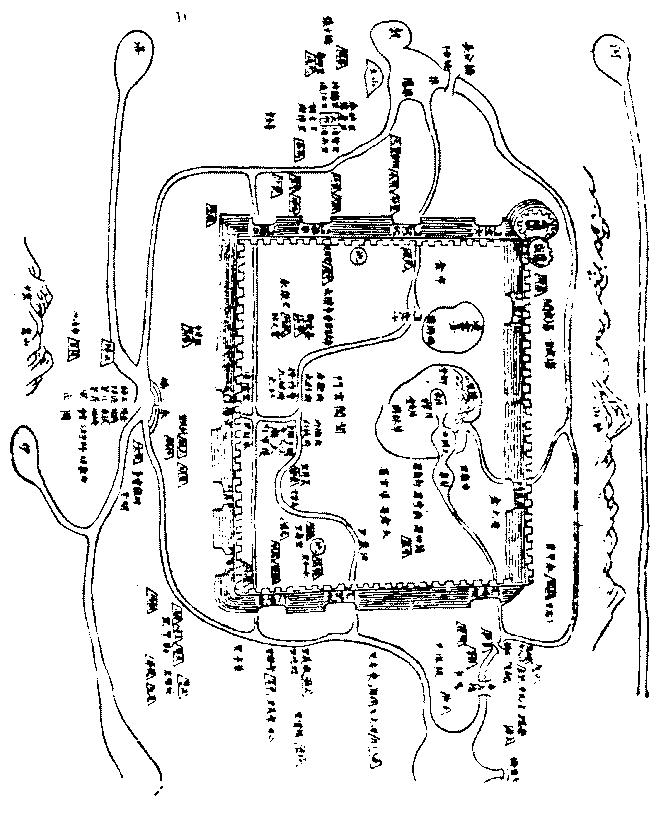

# 洛阳伽蓝记集证



> **藏经**：中国佛寺史志汇刊（佛寺志汇刊）　**册次** 第 1 册（GA001）　**编号** GA0002　**部类** 史传部　**卷次** 6 卷　**篇幅** 38,079 字

> **卷／品**：10 卷 · 4 品



---



## 目录



  - [洛阳伽蓝记序](#洛阳伽蓝记序)

  - [序](#序)

  - [道光十三年十二月既望钱塘吴若准自序](#道光十三年十二月既望钱塘吴若准自序)

- [洛阳伽蓝记卷第一](#洛阳伽蓝记卷第一)

- [洛阳伽蓝记卷第二](#洛阳伽蓝记卷第二)

- [洛阳伽蓝记卷第三](#洛阳伽蓝记卷第三)

- [洛阳伽蓝记卷第四](#洛阳伽蓝记卷第四)

- [洛阳伽蓝记卷第五](#洛阳伽蓝记卷第五)

  - [序](#序-1)

- [城内卷第一](#城内卷第一)

- [城东卷第二](#城东卷第二)

- [城南卷第三](#城南卷第三)

- [城西卷第四](#城西卷第四)

- [城北卷第五](#城北卷第五)



---



刘知几「史通」卷五「补注」篇云：『亦有躬为史臣，手自刋补，虽志存该博，而才阙伦敍，除烦则意有所吝，毕载则言有所妨，遂乃定彼榛楛，列为子注。若……羊衒之洛阳伽蓝记，……之类是也。』「四库全书总目提要」因谓：『则衒之此记，实有自注，世所行本皆无之，不知何时佚脱，然自宋以来，未闻有引用其注者，则其刋落已久，今不可复考矣！』淸嘉庆间，顾广圻更推论曰：『知衒之原用大小字为分别，今一概连写，是混注入正文矣！』广圻乃有意仿全谢山治水经注之例，改定一本，卒以事未果，而以此语长兴朱赀贵。赀贵从事经年，悉心推究，中间辍业，未有所成。赀贵又以此语其娚吴若准，若准於暇日流览衒之此书，意存复古，重为分析，所据者明如隐堂本，所参考者为何氏、毛氏校本，复广及「水经注」、「魏书」、「太平御览」、「太平广记」、「法苑珠林」等，所引只字片语，咸为比较，疑文讹句，论断独伸，遂乃条擧件系，成「集证」一卷，附於书后；复绘图一幅，冠於书前。书成于道光十三年（一八三三），刋于十四年（一八三四）。衒之自序谓『今之所录，止大伽蓝。』若准此书即以寺为经，各予标擧，提行顶写，寺外诸事概归入自注，另低一格，展卷一览，本文子注，朗若列眉，伽蓝记五卷，胥依此法，为之厘正。末所附之集证，除依别本校正文句外，更兼采他书以作校证。伽蓝记沈霾千年，明代诸刋本注混淆，文句讹误，久成难读之书，若准此作，始辟荆榛。唯成於一人之手，而以寺为经，其餘胥入子注，於是本文寥寥不逾千言，子注数量，竟过廿倍，矫枉未免过正，其后乃有唐宴钩沈、张宗祥合校本出，大体有鉴於若准之病。兹据道光十四年校刻本景印。



------



### 洛阳伽蓝记序



魏抚军府司马杨衒之譔



三坟五典之说九流百代之言竝理在寰区而义兼天下至於一乘二谛之原三明六通之旨西域备详东土靡记自顶日感㝱满月流光阳门饰豪睂之象夜台图绀发之形迩来奔竞其风遂广至晋永嘉惟有寺四十二所逮皇魏受图光宅嵩洛笃信弥繁法教逾盛王矦贵臣弃象马如脱屣庶士豪家舍资财若遗迹於是招提栉比宝塔骈罗争写天上之姿竞模山中之影金刹与灵台比高宫殿共阿房等壮岂直木衣绨绣土被朱紫而已哉暨永熙多难皇舆迁邺诸寺僧尼亦与时徙至武定五年岁在丁卯余因行役重览洛阳城郭崩毁宫室倾覆寺观灰烬庙塔丘墟墙被蒿艾巷罗荆棘野兽穴於荒阶山鸟巢於庭树游儿牧竖踯躅於九逵农夫耕稼蓺黍於双阙麦秀之感非独殷墟黍离之悲信哉周室京城表里凡有一千餘寺今日寥廓钟声䍐闻恐后世无传故譔斯记然寺数最多不可徧写今之所录止大伽蓝其中小者取其详世谛事因而出之先以城内为始次及城外表列门名以远近为五篇余才非箸述多有遗漏后之君子详其阙焉



大和十七年后魏高祖迁都洛阳诏司空公穆亮营造宫室洛阳城门依魏晋旧名



东面有三门



北头弟一门曰建春门



汉曰上东门阮籍诗曰步出上东门是也魏晋曰建春门高祖因而不改



次南曰东阳门



汉曰东中门魏晋曰东阳门高祖因而不改



次南曰青阳门



汉曰望京门魏晋曰青明门高祖改为青阳门



南面有三门



东头弟一门曰开阳门



初汉光武迁都洛阳作此门始成而未有名忽夜中有柱自来在楼上后瑯琊郡开阳县言南门一柱飞去使来视之则是也遂以开阳为名自魏及晋因而不改高祖亦然



次西曰平昌门



汉曰平门魏晋曰平昌门高祖因而不改



次西曰宣阳门



汉曰津门魏晋曰津阳门高祖因而不改



西面有四门



南头弟一门曰西明门



汉曰广阳门魏晋因而不改高祖改为西明门



次北曰西阳门



汉曰雍门魏晋曰西明门高祖改为西阳门



次北曰阊阖门



汉曰上西门有铜璇玑玉衡以齐七政魏晋曰阊阖门高祖因而不改



次北曰承明门



承明者高祖所立当金墉城前东西大道迁京之始宫阙未就高祖住在金墉城城西有王南寺高祖数诣沙门论议故通此门而未有名世人谓之新门时王公卿士常迎驾於新门高祖谓御史中尉李彪曰曹植诗云谒帝承明庐此门宜以承明为称遂名之



北面有二门



西头曰大夏门



汉曰夏门魏晋曰大夏门尝造三层楼去地二十丈洛阳城门楼皆两重去地百尺惟大夏门甍栋干云



东头曰广莫门



汉曰谷门魏晋曰广莫门高祖因而不改广莫门以西至於大夏门宫观相连被诸城上也



一门有三道所谓九轨



------



### 序



元魏崛起朔漠奄有中原高祖贤明卜宅洛土声明文物用夏变夷洵乎轶符秦而跨江左世宗忘其国恤崇尚释氏太和政教为之一衰洎乎母后临朝阉人用事外藩首祸变故迭兴始则尒朱氏张卓莽之凶焰继则贺六浑效曹马之故智至永熙迁邺而魏祚移矣抚军府司马杨衒之慨念故都伤心禾黍假佛寺之名志帝京之事凡夫朝家变乱之端宗藩废立之由艺文古迹之所关苑囿桥梁之所在以及民间怪异外夷风土莫不鉅细毕陈本末可观足以补魏收所未备为拓跋之别史不特遗闻逸事可资学士文人之考核已也其叙录伽蓝始于阊阖宫前西则永寕胡统逶而西则为建中长秋瑶光也东则景乐逶而东则为昭仪修梵嵩明也其南则景林也其中小寺则愿会光明司农也由是而及城外建春门则明悬龙华璎珞也而宗圣崇真魏昌景兴太康以次记焉东阳门则庄严秦太上君正始也青阳门则平等景寕也而归觉附记焉由东而南开阳门则报德也龙华追圣在其东而文觉三宝寕远正觉以次记焉宣阳门则东有景明大统而西有高阳王寺也而招福双女永桥之归正菩提城西之崇虚以次记焉由南而西西明门则冲觉也西阳门则宣忠白马光宝法云也而王典御开善以次记焉寿邱里中则又有追光寺也阊阖门则永明也大觉在其西而融觉在其东也由西而北则大夏门有禅虚也广莫门有凝圆也此其次弟也昔刘知几言衒之此记定彼榛枯列为子注后人合并不可复辨暇日流览意存复古忘其浅陋重为分析古本既无由见未必一如旧观而纲目麤具读是书者或有取乎图一篇集证一卷附於简端卷末世之君子纠其谬焉



------



### 道光十三年十二月既望钱塘吴若准自序



若准字次平一字耘石菘圃相国之孙居平湖北门内之赵家濵少孤奋志力学长於攷据兼通六法成道光辛丑进士视学江西卒於任



洛阳伽蓝记圗







------



## 洛阳伽蓝记卷第一



魏抚军府司马杨衒之譔



城内



永寕寺



熙平元年灵太后胡氏所立也在宫前阊阖门南一里御道西



其寺东有太尉府西对永康里南界昭元曹北邻御史台阊阖门御道东有左衞府府南有司徒府司徒府南有国子学堂内有孔丘象颜渊问仁子路问政在侧国子南有宗正寺寺南有太庙庙南有护军府府南有衣冠里



御道西有右衞府府南有太尉府府南有将作曹曹南有九级府府南有太社社南有凌阴里即四朝时藏冰处也中有九层浮图一所架木为之举高九十丈有刹复高十丈合去地一千尺去京师百里已遥见之初掘基至黄泉下得金象三千躯太后以为信法之徵是以营建过度也刹上有金宝缾容二十五石宝缾下有承露金盘三十重周匝皆垂金铎复有铁锁四道引刹向浮图四角锁上亦有金铎铎大小如一石瓮子浮图有九级角角皆悬金铎合上下有一百二十铎浮图有四面面有三户六窗户皆朱漆扉上有五行金钉合有五千四百枚复有金环铺首布殚土木之功穷造形之巧佛事精妙不可思议绣柱金铺骇人心目至於高风永夜宝铎和鸣铿锵之声闻及十餘里



浮图北有佛殿一所形如太极殿中有丈八金象一躯中长金象十躯绣珠象三躯织成五躯作功奇巧冠於当世僧房楼观一千餘间雕梁粉壁青琐绮疏难得而言栝柏松椿扶疏拂檐藂竹香草布护堦墀是以常景碑云须弥宝殿兜率净宫莫尚於斯也



外国所献经象皆在此寺



寺院墙皆施短椽以瓦覆之若今宫墙也四面各开一门南门楼三重通三道去地二十丈形制似今端门图以云气畫彩仙灵绮□青琐□赫丽华拱门有四力士四师子饰以金银加之珠玉装严焕炳世所未闻东西两门皆亦如之所可异者惟楼二重北门一道不施屋似乌头门四门外树以青槐亘以绿水京邑行人多庇其下路断飞尘不由奔云之润清风送凉岂藉合欢之发



诏中书舍人常景为寺碑文景字永昌河内人也敏学博通知名海内太和十九年为高祖所器拔为律学博士刑法疑狱多访於景正始初诏刊律令永作通式敕景共治书侍御史高僧裕羽林监王元龟尚书郎祖莹员外散骑侍郎李琰之等譔集其议又诏太师彭城王勰青州刺史刘芳入预其议景讨正科条商搉古今甚有伦序见行於世今律二十篇是也又共芳造洛阳宫殿门阁之名经涂里邑之号出除长安令时人比之潘岳其后历位中书舍人黄门侍郎秘书监幽州刺史仪同三司学徒以为荣焉景入参近侍出为侯牧居室贫俭事等农家惟有经史盈车满架所箸文集数百餘篇给事封𬀩伯作序行於世



装饰毕功明帝与太后共登之视宫内如掌中临京师若家庭以其目见宫中禁人不听升衒之尝与河南尹胡世孝共登之下临云雨信哉不虚时有西域沙门菩提达摩者波斯国胡人也起自荒裔来游中土见金盘炫日光照云表宝铎含风响出天外歌咏赞叹实是神功自云𥝝一百五十岁历涉诸国靡不周徧而此寺精丽阎浮所无也极物境界亦未有此口唱南无合掌连日至孝昌二年中大风发屋拔树刹上宝瓶随风而落入地丈餘复命工匠更铸新瓶



建义元年太原王尒朱荣总士马於此寺荣字天宝北地秀容人也世为弟一领民酋长博陵郡公部落八千餘家有马数万匹富等天府武泰元年二月中帝崩无子立临洮王世子钊以绍大业年三岁太后贪秉朝政故以立之荣谓并州刺史元天穆曰皇帝晏驾春秋十九海内士庶犹曰幼君况今奉未言之儿以临天下而望升平其可得乎吾世荷国恩不能坐看成败今欲以铁骑五千赴哀山陵兼问侍臣帝崩之由君竟谓如何穆曰明公世跨并肆雄才杰出部落之民控弦一万若能行废立之事伊霍复见今日荣即日共穆结异姓兄弟穆年大荣兄事之荣为盟主穆亦拜荣於是密议长君诸王之中不知谁应当璧遂於晋阳人各铸象不成惟长乐王子攸象光相具足端严特妙是以荣意在长乐遣苍头王丰入洛询以为主长乐即许之共剋期契荣三军皓素扬旌南出太后闻荣举兵召王公议之时胡氏专宠皇宗怨望假八议者莫肎致言唯黄门侍郎徐统曰尒朱荣马邑小胡人才凡鄙不度德量力长戟指阙所谓穷辙拒轮积薪𠊱燎今宿衞文武足得一战但守河桥观其意趣荣悬军千里兵老师弊以逸待劳破之必矣后然统言即遣都督李神轨郑季明等领众五千镇河桥四月十一日荣过河内至高头驿长乐王从雷陂北渡赴荣军所神轨季明等见长乐王往遂开门降十二日荣军於芒山之北河阴之野十三日召百官赴驾至者尽诛之王公卿士及诸朝臣死者三千餘人十四日车驾入城大赦天下改号为建义元年是为庄帝於时新经大兵人物歼尽流迸之徒惊骇未出庄帝肇升太极解网垂仁惟散骑常侍山伟一人拜恩南阙加荣使持节中外诸军事大将军开府北道大行台都督十州诸军事大将军领左右太原王其天穆为侍中太尉公世袭并州刺史上党王起家为公卿牧守者不可胜数二十日洛中草草犹自不安死生相怨人怀异虑贵室豪家并宅竞窜贫夫贱士襁负争逃於是出诏滥死者普加褒赠三品以上赠三公五品以上赠令仆七品以上赠州牧白民赠郡镇於是稍安帝纳荣女为皇后进荣为柱国大将军录尚书事进天穆为大将军餘官皆如故



永安二年五月北海王元颢复入洛在此寺聚兵颢庄帝从兄也孝昌末镇汲郡闻尒朱荣入洛阳遂南奔萧衍是年入洛庄帝北巡颢登皇帝位改年曰建武元年颢与庄帝书曰大道既隐天下匪公祸福不追与能义绝朕犹庶几五帝无取六军正以穅粃万乘锱铢大宝非贪皇帝之尊岂图六合之富直以尒朱荣往岁入洛顺而勤王终为魏贼逆刃加於君亲锋镝肆於卿宰元氏少长殆欲无遗已有陈桓盗齐之心非无六卿分晋之计但以四海横流欲篡未可暂树君臣假相拜置害卿兄弟独夫介立遵养待时臣节岂久朕睹此心寒远投江表泣请梁朝誓在复耻风行建业电赴三川正欲问罪於尒朱出卿於桎梏恤深怨於骨肉解苍生於倒悬谓卿明眸击节躬来见我共叙哀辛同讨凶羯不意驾入成皋便尔北渡虽迫於凶手势不自由或□生素怀弃剑猜我闻之永叹抚衿而失何者朕之於卿兄弟非远连枝分叶兴灭相依假有内阋外犹御侮况吾与卿睦厚偏笃其於急难凡今莫如弃亲即讐义将焉据也且尒朱荣不臣之迹暴於㫄午谋危社稷愚智何见卿乃明白疑於必然托命豺狼委身虎口弃亲助贼兄弟寻戈假获民地本是荣物若克城邑绝非卿有徒危宗国以广寇仇快贼莽之心假卞庄之利有识之士咸为慙之今国家隆替在卿与我若天道助顺誓兹义举则皇魏宗社与运无穷傥天不厌乱胡羯未殄鸱鸣狼噬荐食河北在荣为福於卿为祸岂伊异人尺书道意卿宜三复兼利是图富贵可保徇人非虑终不食言自相鱼肉善择元吉勿贻后悔此黄门郎祖荣之词也时帝在长子城太原王上党王来赴急六月帝围河内太守元桃汤车骑将军宗正珍孙等为颢守攻之弗克时暑炎赫将士疲劳太原王欲使帝幸晋阳至秋更举大义未决召刘助筮之助曰必克於是至明尽力攻之如其言桃汤珍孙竝斩首以殉三军颢闻河内不守亲率百僚出镇河桥特迁侍中安丰王延明往守硖石十月帝至河阳与颢隔河相望太原王命车骑将军尒朱兆潜师渡河破延明於硖石颢闻延明败亦散走所将江淮子弟五千人人莫不解甲相泣握手成列颢与数千骑欲奔萧衍至长社为社民斩其首传送京师二十日帝还洛阳进太原王天柱大将军餘官亦如故进上党王太宰餘官亦如故



永安三年逆贼尒朱兆囚庄帝於寺时太原王位极心骄功高意侈予夺臧否肆意帝恐谓左右曰朕寕作高贵卿公死不作汉献帝生九月二十五日诈言产太子荣穆竝入朝庄帝手刃荣於光明殿穆为伏兵鲁暹所杀荣世子部落大人亦死焉荣下车骑将军尒朱阳都等二十人随入东华门亦为伏兵所杀唯右仆射尒朱世隆素在家间荣死总荣部曲烧西阳门奔河桥至十月一日隆与妻乡郡长公主至芒山冯王寺为荣追福斋即遣尒朱侯讨伐尔朱䢷律归等领胡骑一千皆白服来至郭下索太原王尸丧帝升大夏门望之遣主书牛法尚谓归等曰太原王立功不终阴图衅逆王法无亲已依正刑罪止荣身餘皆不问卿等何为不降官爵如故归曰臣从太原王来朝陛下何忽今日枉致无理臣欲往晋阳不忍空去愿得太原王尸丧生死无恨发言雨泪哀不自胜群胡恸哭声振京师帝闻之亦为伤怀遣侍中朱元龙赍铁券与世隆待之不死官位如故世隆谓元龙曰太原王功格天地造济生民赤心奉国神明所知长乐不顾信誓枉害忠良今日两行铁字何足可信吾为太原王报仇终不归降元龙见世隆呼帝为长乐知其不款且以言帝帝即出库物置城西门外募敢死之士以讨世隆一日即得万人与归等战於郭外凶势不摧归等屡涉戎场便击刺京师士众未习军旅虽皆义勇力不从心三日频战而游䰟不息帝要募人断河桥有汉中人李荀为水军从上流放火烧桥世隆见桥被焚遂大剽生民北上太行帝遣侍中源子恭黄门郎杨寛领步骑三万镇河内世隆至高都立太原太守长广王晔为主改号曰建□元年尒朱氏自封王者八人长广王□晋阳遣颍川王尒朱兆举兵向京师子恭军失利兆自雷陂涉渡禽庄帝於式乾殿帝初以黄河奔急未谓兆得济不意兆不由舟楫凭流而渡是日水浅不没马腹故及此难书契所记未之有也衒之曰昔光武受命冰桥宜於滹水昭烈中起的卢踊於泥沟皆理合於天神祗所福故能功济宇宙大庇生民若兆者蜂目豺声行穷枭獍阻兵安忍贼害君亲皇灵有知鉴其凶德反使孟津由膝赞其逆心易称天道祸淫鬼神福谦以此验之信为虚说时兆营军尚书省建天子金鼓庭设漏刻嫔御妃主皆拥之於幕锁帝於寺门楼上时十二月帝患寒随兆乞头巾兆不与遂囚帝还晋阳缢於三级寺帝临崩礼佛愿不为国王又作五言曰



权去生道促　忧来死路长  

怀恨出国门　含悲入鬼乡  

隧门一时闭　幽庭岂复光  

思鸟吟青松　哀风吹白杨  

昔来闻死苦　何言身自当



至太昌元年冬始迎梓宫赴京师葬帝靖陵所作五言诗即为挽歌词朝野闻之莫不悲恸百姓观者悉皆掩涕而已



不熙三年二月浮图为火所烧帝登凌云台望火遣南阳王宝炬录尚书长孙椎将羽林一千救赴火所莫不悲惜垂泪而去火初从弟八级中平旦大发当时雷雨晦冥杂下霰雪百姓道俗咸来观火悲哀之声振动京邑时有三比邱赴火而死火经三月不灭有火入地寻柱周年犹有烟气其年五月中有人从象郡来云见浮图於海中光明照耀俨然如新海上之民咸皆见之俄然雾起浮图遂隐至七月中平阳王为侍中斛斯椿所使奔於长安十月而京师迁邺



建中寺



普泰元年尚书令乐平王尒朱世隆所立也



本是阉官司空刘腾宅屋宇奢侈梁栋逾制一里之间廊庑充溢堂比宣光殿门匹乾明门博敞宏丽诸王莫及也



在西阳门内御道北



所谓延年里刘腾宅东有太仆寺寺东有乘黄署署东有武库署即魏相国司马文王府库东至阊阖宫门是也



西阳门内御道□有永康里里内复有领军将军元乂宅掘故井得石铭云是汉太尉荀彧宅正光年中元乂专权太后幽隔永巷腾为谋主乂是江阳王继之子太后妹壻熙平初明帝幼冲诸王权上太后拜乂为侍中领军左右令总禁兵委以腹心反得幽隔永巷六年太后哭曰养虎自啮长虺成蛇至孝昌二年太后反政遂诛乂等没腾田宅元乂诛日腾已物故太后追思腾罪发墓残尸使其神灵无所归趣以宅赐高阳王雍建义元年尚书令乐平王尒朱世隆为荣追福题以为寺朱门黄阁所谓仙居也以前厅为佛殿后堂为讲室金花宝盖徧满其中有一凉风堂本腾避暑之处凄凉常冷经夏无蝇有万年千岁之树也



长秋寺



刘腾所立也



腾初为长秋令卿因以为名



在西阳门内御道北一里



亦在延年里即是晋中朝时金市处



寺北有蒙汜池夏则有水冬则竭矣



中有三层浮图一所金盘灵刹曜诸城内作六牙白象负释迦在虚空中庄严佛事悉用金玉工作之异难可具陈四月四日此象常出辟邪师子导引其前吞刀吐火腾骧一面彩幢上索诡谲不常奇伎异服冠於都市象停之处观者如堵迭相践跃常有死人



瑶光寺



世宗宣武皇帝所立在阊阖城门御道北



东去千秋门二里千秋门内道北有西游园园中有凌云台即是魏文帝所筑者台上有八角井高祖於井北造凉风观登之远望目极洛川台下有碧海曲池台东有宣慈观去地十丈观东有灵芝钓台累木为之出於海中去地二十丈风生户牖云起梁栋丹楹刻桷图写列仙刻石为鲸鱼背负钓台既如从地踊出又似空中飞下钓台南有宣光殿北有嘉福殿西有九龙殿殿前九龙吐水成一海凡四殿皆有飞阁向灵芝往来三伏之月皇帝在灵芝台以避暑



有五层浮图一所去地五十丈仙掌凌虚铎垂云表作工之妙美埒永寕讲堂尼房五百餘间绮疏连亘户牖相通珍木香草不可胜言牛筋狗骨之木鸡头鸭脚之草亦悉僃焉椒房嫔御学道之所掖庭美人竝在其中亦有名族处女性爱道场落发辞亲来仪此寺屏珍丽之饰服修道之衣投心入正归诚一乘永安三年中尒朱兆入洛阳纵兵大掠时有秀容胡骑数十入瑶光寺淫秽自此后颇获讥讪京师语曰洛阳男儿急作髻瑶光寺尼夺作壻



瑶光寺北有承明门有金墉城即魏氏所筑城东北角有魏文帝百尺楼年岁久远形制如初高祖在城内作光极殿因名金墉城门为光极门又作重楼飞阁徧城上下从地望之有如云也



景乐寺



太傅清河文献王怿所立也



怿是孝文皇帝之子宣武皇帝之弟



阊阖南御道西



望永寕寺正相当寺西有司徒府东有大将军高肇宅北连义井里井里北门外有桒树数株枝条繁茂下有甘井一所石槽铁罐供给行人饮水庇荫多有憩者



有佛殿一所象辇在焉雕刻巧妙冠绝一时堂庑周环曲房连接轻条拂户花蘂被庭至於大斋常设女乐歌声绕梁舞袖徐转丝管寥亮谐妙入神以是尼寺丈夫不得入得往观者以为至天堂及文献王薨寺禁稍宽百姓出入无复限碍



后汝南王悦复修之悦是文献之弟召诸音乐逞伎寺内奇禽怪兽舞抃殿庭飞空幻惑世所未睹异端奇术总萃其中剥驴投井植枣种瓜须臾之间皆得食士女观者目乱睛迷自建义以来京师频有大兵此戏遂隐也



昭仪尼寺



阉官等所立也在东阳门内一里御道南



东阳门内道北太北仓导官二署东南治粟里仓司官属住其内



太后临朝阍寺专宠宦者之家积金满堂是以萧忻云高轩升斗者阉官之厘妇胡马鸣珂者莫非黄门之养息也忻阳平人也爱尚文籍少有名誉见阍寺宠盛遂发此言因即知名为治书侍御史



寺有一佛二菩萨塑工精绝京师所无也四月七日常出诣景明景明三象恒出迎之伎乐之盛与刘腾相比堂前有酒树面木



昭仪寺有池京师学徒谓之翟泉也衒之桉杜预注春秋云翟泉在晋太仓西南桉晋太仓在建春门内今太仓在东阳门内此池今在太仓西南明非翟泉也后隐士赵逸云此地是晋侍中石崇家池池南有绿珠楼於是学徒始寤经过者想见绿珠之容也



池西南有愿会寺中书舍人王翃舍宅所立也佛堂前生桒树一株直上五尺枝条横遶柯叶旁布形如羽盖复高五尺又然凡为五重每重叶椹各异京师道俗谓之神桒观者成市施者甚众帝闻而恶之以为惑众命给事中黄门侍郎元纪伐杀之其日云雾晦冥下斧之处血流至地见者莫不悲泣



寺南有宜寿里内有苞信县令段晖宅地下常闻钟声时见五色光明照於堂宇晖其异之遂掘光所得金象一躯可高三尺有二菩萨趺上铭曰晋太始二年五月十五日侍中中书监荀勗造晖遂舍宅为光明寺时人咸云此荀勗旧宅其后盗者欲窃此象象与菩萨合声喝贼盗者惊怖应即殒倒众僧闻象呌声遂来捉得贼



胡统寺



太后从姑所立也



入道为尼遂居此寺



在永寕南一里许



宝塔五重金刹高耸洞房周匝对户交疏朱柱素壁甚为佳丽其寺诸尼帝城名德善於开导工谈义理常入宫与太后说法其资养缁流徒无比也



修梵寺



在清阳门内御道北蒿明寺复在修梵寺西



竝雕墙峻宇比屋连甍亦是名寺也修梵寺有金刚鸠鸽不入鸟雀不栖菩提达磨云得其真用也



寺北有永和里汉太师董卓之宅也里南北皆有池卓之所造今犹有水冬夏不竭里中太傅录尚书长孙稚尚书右仆射李祚吏部尚书邢鸾廷尉卿元洪超衞尉卿许伯桃凉州刺史尉成兴等六宅皆高门华屋斋馆敞丽楸槐荫涂桐杨夹植当时名为贵里掘此地者辄得金玉宝玩之属邢鸾家常掘丹砂及钱数十万铭云董太师之物后卓夜中随鸾索此物鸾不与之经年鸾遂卒矣



景林寺



在开阳门内御道东



讲殿叠起房庑连属丹槛炫日绣桷迎风实为胜地



寺西有园多饶奇果春鸟秋蝉鸣声相续中有禅房一所内置祗洹精舍形制虽小巧构难加□禅阁虚静隐室凝邃嘉树夹牖芳杜匝堦虽云朝市想同岩谷静行之僧绳坐其内餐风服道结跏数息



有石铭一所国子博士卢白头为其文白头一字景裕范阳人也性爱恬静邱园放敖学极六经说通百氏普泰初起家为国子博士虽在朱门以注述为事注周易行之於世也



建春门内御道南有句盾典农籍田三署籍田南有司农寺



御道北有空地儗作东宫晋中朝时太仓处也太仓南有翟泉周回三里即春秋所谓王子虎晋狐偃盟於翟泉也水犹澄清洞底明静鳞甲潜藏辨其鱼鼈高祖於泉北置河南尹中朝步广里也泉西有华林园高祖以泉在园东因名苍龙海华林园中有大海即汉天渊池池中犹有文帝九华台高祖於台上造清凉殿世宗在海内作蓬莱山山上有仙人馆上有钓台殿竝作虹蜺阁乘虚来往至於三月禊日季秋己辰皇帝驾龙舟鹢首游於其上海西有藏冰室六月出冰以给百官海西南有景山殿山东有羲和岭岭上有温风室山西有姮娥峰峰上有露寒馆竝飞阁相通凌山跨谷山北有元武池山南有清暑殿殿东有临涧亭殿西有临危台景阳山南有百果园果列作林林各有堂有仙人枣长五寸把之两头俱出核细如针霜降乃熟食之甚美俗传云出昆仑山一曰西王母枣又有仙人桃其色赤表里照彻得霜即熟亦出昆仑山一曰王母桃也



柰林南有石碑一所魏明帝所立也题云苗茨之碑高祖於碑北作苗茨堂永安中年庄帝马射於华林园百官皆来读碑疑苗字误国子博士李同轨曰魏明英才世称三祖公干仲宣□其羽翼但未知本意如何不得言误也衒之时为奉朝请因即释曰以蒿覆之故言苗茨何误之有众咸称善以为得其旨归



柰林西有都堂有流觞池堂东有扶桒海凡此诸海皆有石宝流於地下西通谷水东连阳渠亦与翟泉相连若旱魃为虐谷水注之不竭离毕滂润阳谷泄之不盈至於鳞甲异品羽毛殊类濯波浮浪如似自然也



------



## 洛阳伽蓝记卷第二



魏抚军府司马杨衒之譔



城东



明悬尼寺



彭城武宣王勰所立也在建春门外石楼南



谷水周围绕城至建春门外东入阳渠石桥桥有四柱在道南铭曰汉阳嘉四年将作大匠马宪造逮我孝昌三年大雨穨桥柱始薶没道北二柱至今犹存衒之桉刘澄之山川古今记戴延之西征记竝云晋太康元年造此则失之远矣桉澄之等竝生在江表未游中土假因行役暂来经过至於旧事多非亲览闻诸道路𠊳为穿凿误我后学日月已甚



有三层塔一所未加庄严



寺东有中朝时常满仓高祖令为租场天下贡赋所聚也



龙华寺



宿衞羽林虎贲等所立也在建春门外阳渠南



寺南有租场里



阳渠北有建阳里里有土台高三丈上作二精舍赵逸云此台是中朝旗亭也上有二层楼悬鼓击之以罢市有钟一口撞之闻五十里太后以钟声远闻遂移在宫内置凝闲堂前讲内典沙门打为时节初萧衍子豫章王综来降闻此钟声以为奇异遂造听歌三首行传於世



综字世□伪齐昬主宝卷遗腹子也宝卷临政淫乱吴人苦之雍州刺史萧衍立南康王宝融为主举兵向秣陵事既克捷遂杀宝融而自立宝卷有美人吴景晖时孕综经月衍因幸景晖及综生认为己子小名缘觉封豫章王综形貌举止甚似昬主其母告之令自方𠊳遂归我圣阙耍改名曰赞字世务始为宝卷追服三年丧明帝拜综为太尉公封丹阳王永安年中尚庄帝姉寿阳公主字莒犂公主容色美丽综甚敬之与公主语常自称下官后除徐州刺史加开府及京师倾覆综弃州北走时尒朱世隆专权遣取公主至洛阳世隆逼之公主骂曰胡狗敢辱天王女乎世隆怒之遂缢杀之



璎珞寺



在建春门外御道北



所谓建阳里也即中朝时白社池董威辇所居处里内有璎珞慈善晖和通觉晖元宗圣魏昌熙平崇真因果等十寺里内士庶二千餘户信崇三宝众僧刹养百姓所供也



宗圣寺有象一躯举高三丈八尺端严殊特相好毕僃士庶瞻仰目不暂瞬此象一出市井皆空炎光腾辉赫赫独绝世表妙伎杂乐亚於刘腾城东士女多来此寺观看也



崇真寺比邱惠凝死一七日还活经阎罗王检阅以错名放免惠凝具说过去之时有五比邱同阅一比邱云是宝明寺智圣坐禅苦行得升天堂有一比邱是般若寺道品以诵四涅槃亦升天堂有一比邱云是融觉寺昙谟最讲涅槃华严领众千人阎罗王云讲经者心怀彼我以骄凌物比邱中弟一麤行今惟试坐禅诵经不问讲经其昙谟最曰贫道立身以来惟好讲经实不暗诵阎罗王敕付司即有青衣十人送昙谟最向西北门屋舍皆异似非好处有一比邱云是禅林寺道宏自云教化四辈檀越造一切经人中象十躯阎罗王曰沙门之体必须摄心守道志在禅诵不干世事不作有为虽造作经象正欲得它人财物既得它物贪心即起既怀贪心𠊳是三毒不除具足烦恼亦付司仍与昙谟最同入黑门有一比邱云是灵觉寺宝明自云出家之前尝作陇西太守造灵觉寺成即弃官入道虽不禅诵礼拜不缺阎罗王曰卿作太守之日曲理枉法劫夺民财假作此寺非卿之力何劳说此亦付司青衣送入黑门太后闻之遣黄门侍郎徐纥依惠凝所说即访宝明寺城东有宝明寺城内有般若寺城西有融觉禅林灵觉等三寺问智圣道品昙谟最道宏宝明等皆实有之议曰人死有罪福即请坐禅僧一百人常在殿内供养之诏不听持经象沿路乞索若私有财物造经象者任意凝亦入白鹿山居隐修道自此以后京师比邱悉皆禅诵不复以讲经为意



出建春南门外一里餘至东石桥西北而行晋太康元年造桥南有魏时马市刑嵇康之所也桥北大道西有建阳里大道东有绥民里里内有河间刘宣明宅神龟年中以直谏忤旨斩於都市讫目不瞑尸行百步时人谭以枉死宣明少有名誉精通经史危行及於诛死



魏昌尼寺阉官瀛州刺史李次寿所立也在里东南角即中朝牛马市处也刑嵇康之所东临石桥此桥南北行晋太康元秊中朝时市南桥也澄之等盖见此桥铭因而以桥为太康初造也



石桥南道有景兴尼寺亦阉官等所共立也有金象辇去地三尺施宝盖四面垂金铃七宝珠飞天伎乐望之云表作工甚精难可扬推象出之日常诏羽林一百人举此象丝竹杂伎皆由旨给



建阳里东有绥民里里内有洛阳县临渠水县门外有洛阳令杨机清德碑



绥民里东崇义里里内有京兆人杜子休宅地形显敞门临御道时有隐士赵逸云是晋武时人晋朝旧事多所记录正光初来至京师见子休宅叹息曰此宅中朝时太康寺也时人未信遂问寺之由绪逸云龙骧将军王濬平吴之后始立此寺本有三层浮图用甎为之指子休园中曰此是故处子休掘而验之果得甎数十万兼有石铭云晋太康六年岁次乙巳九月甲戌朔八日辛巳仪同三司襄阳矦王濬敬造时园中果菜丰蔚林木扶疏乃服逸言号为圣人子休遂舍为灵应寺所得之甎还为三层浮图好事者寻逐之问晋朝京师何如今日逸曰晋时民少於今日王矦弟宅与今日相似又云自永嘉以来二百餘年建国称王者十有六君皆游其都邑目见其事国灭之后观其史书皆非实录莫不推过於人引善自向符生虽好勇嗜酒亦仁而不杀观其治典未为凶暴及详其史天下之恶皆归焉符坚自是贤主贼君取位妄书生恶凡诸史官皆此类也人皆贵远贱近以为信然当今之人亦生愚死智惑已甚矣人问其故逸曰生时中庸之人耳及其死也碑文墓志莫不穷天地之大德尽生民之能事为君共尧舜连衡为臣与伊皋等迹牧民之官浮虎慕其清尘执法之吏埋轮谢其𣖀直所谓生为盗跖死为夷齐佞言伤正华词损实当时搆文之士慙逸此言步兵校尉李澄问曰太尉府前甎浮图形制甚古犹未崩毁未知早晚造逸曰晋义熙十二年刘裕伐姚泓军人所作汝南王闻而异之拜为义父因而问何所服饵以致长年逸曰吾不闲养生自然长寿郭璞尝为吾筮云寿年五百岁今始餘半帝给步挽车一乘游於市里所经之处多记旧迹三年以后遁去莫知所在



崇义里东有七里桥以石为之中朝时杜预之荆州出顿之所也七里桥东一里郭门开三道时人号为三门离别者多云相送三门外京师士子送去迎归常在此处



庄严寺



在东阳门外一里御道北



所谓东安里也北为租场里内有驸马都尉司马洸济州刺史介宣幽州刺史李真奴豫州刺史公孙骧等四宅



秦太上君寺



胡太后所立也



当时太后正号崇训母天下号父为秦太上公母为秦太上君为母追福因以名焉



在东阳门外二里御道北



所谓晖文里里内有太保崔光太傅李延实冀州刺史李诏秘书监郑道昭等四宅竝丰堂崛起高门洞开赵逸云晖文里是晋马道里延实宅是蜀主刘禅宅延实宅东有修和宅是吴王孙晧宅李韶宅是晋司空张华宅



中有五层浮图一所修刹入云高门向街佛事庄饰等於永寕诵室禅堂周流重疉花林芳卉徧满阶墀常有大德名僧讲一切经受业沙门亦有千数



太傅李延实者庄帝舅也永安中除青州刺史临去奉辞帝谓实曰怀甎之俗世号难治舅宐好用心副朝廷所委实荅曰臣年迫桒榆气同朝露人间稍远日近松邱臣已久乞间退陛下渭阳兴念宠及老臣使夜行罪人裁锦万里谨奉明敕不敢失坠时黄门侍郎杨宽在帝侧不晓怀甎之义私问舍人温子升曰闻至尊兄彭城王作青州刺史问其宾客从至青州云齐土之民风俗浅薄虚论高谈专在荣利太守初欲入境皆怀甎叩首以美其意及其代下还家以甎击之言其向背速於反掌是以京师谣语曰狱中无系囚舍内无青州假令家道恶腹中不怀愁怀甎之义起在於此也颍川荀济风流名士高鉴妙识独出当世清河崔叔仁称齐士大夫曰齐人外矫仁义内怀鄙吝轻同羽毛利等锥刀好驰虚誉阿附成名威势所在侧肩竞入求其荣利甜然浓於四方慕势最甚号齐士子为慕势诸郎临淄官徒有在京邑闻怀甎慕势咸共耻之唯崔孝忠一人不以为意问其故孝忠曰营邱风俗太公餘化稷下儒林礼义所出今虽凌迟足为天下模楷荀济人非许郭不识东家虽复苗莠自□未宐荣辱也



正始寺



百官等所立也



正始中立因以为名



在东阳门外御道西



所谓敬义里也里内有典虞曹檐宇精净美於丛林众僧房前高林对牖青松绿柽连枝交映多有枳树而不中食有石碑一枚背上有侍中崔光施钱四十万陈畱李崇施钱二十万自餘百官各有差少者不减五千已下后人刊之



敬义里南有昭德里里内有尚书仆射游肇御史尉李彪兵部尚书崔林幽州刺史常景司农张伦等五宅彪景出自儒生居室俭素唯伦最为豪侈斋宇光丽服玩精奇车马出入逾於邦君园林山池之美诸王莫及伦造景阳山有若自然其中重岩复岭嵚崟相属深溪洞壑逦迤连接高林巨树足使日月蔽亏悬葛垂萝能令风烟出入崎岖石路似壅而通峥嵘涧道盘纡复直是以山情野兴之士游以忘归天水人姜质志性疏诞麻衣葛巾有逸民之操见偏爱之如不能已遂造亭山赋行传於世其词曰



今偏重者爱昔先民之重由朴由纯  

然则纯朴之体　与造化而津勉  

濠上之客　柱下之吏  

卧无为以明心　托自然以图志  

辄以山水为富　不以章甫为贵  

任性浮沈　若澹兮无味  

今司农张氏　实鍾其人  

巨量接於物表　夭矫洞达其真  

青松未胜其洁　白玉不比其珍  

心托空而栖有　情入古以如新  

既不专流荡　又不偏华上　卜居动静之间　不以山水为忘  

庭起半邱半壑　听以目达心想  

进不入声荣　退不为隐放  

尔乃决石通泉　拔岭岩前  

斜与危云等曲　危与曲栋相连  

下天津之高雾　纳沧海之远烟  

纤列之状如一古　崩剥之势似千年  

若乃绝岭悬坡　蹭蹬蹉跎  

水纡徐如浪峭　山石高下复危多  

五寻百拔　十步千过　则知巫山弗及　未审蓬莱如何  

其中烟花雾草　或倾或倒  

霜干风枝　半耸半垂  

玉叶金茎　散满堦墀  

然目之绮　裂鼻之馨　既共阳春等茂　复与白雪齐清  

或言神明之骨　阴阳之精　天地未觉生此　异人焉识其中  

羽徒纷泊　色杂苍黄  

绿头紫颊　好翠连芳  

白鹤生於异县　丹足出自它乡  

皆远来以臻此　藉水木以翱翔  

不忆春於沙漠　遂忘秋於高阳  

非斯人之感至　伺候鸟之迷方  

岂下俗之所务　实神怪之异趣  

能造者其必诗　敢往者无不赋  

或就饶风之地　或入多云之处  

气岭与梅岑　随春之所悟  

远为神仙所赏　近为朝士所知  

求解脱於服佩　预参次於山垂  

子英游鱼於玉质　王乔系鹄於松枝  

方丈不足以妙咏歌此处态多奇  

嗣宗闻之动魄　叔夜听此惊魂  

恨不能钻地一出　醉此山门  

别有王孙公子　逊遁容仪　思山念水　命驾相随  

逢岑爱曲　值石凌欹  

庭为仁智之田　故能种此石山  

森罗兮草木　长育兮风烟  

孤松既能却老　半石亦可留年  

若不坐卧兮於其侧　春夏兮其游陟  

白骨兮徒自朽　方寸心兮何所忆



平等寺



广平武穆王怀舍宅所立也在青阳门外二里御道北



所谓孝敬里也堂宇宏美林木萧森平台复道独显当世寺门外有金象一躯高二丈八尺相好端严常有神验国之吉凶先炳祥异孝昌三年十二月此象面有悲容两目垂泪徧体皆湿时人号曰佛汗京师士女空市里往而观之有比邱以净绵拭其泪须臾之间绵湿都尽㪅换以它绵拭俄然复湿如此三日乃止明年四月尒朱荣入洛阳诛戮百官死亡涂地至永安二年二月此象复汗京邑士庶复往观之五月北海王入洛庄帝北巡七月北海大败所将江淮子弟五千餘人尽被俘虏无一得还永安三年七月此象悲泣如初每经神验朝夕惶惧禁人不听观之至十二月尒朱兆入洛阳禽庄帝崩於晋阳在京宫殿空虚百日无主唯尚书令司州牧乐平王尒朱世隆镇京师商旅四通盗贼不作建明二年长广王从晋阳赴京师至郭外世隆以长广本枝疏远政行无闻逼禅位於广陵王恭是庄帝从父兄也正光中为黄门侍郎见元乂秉权政归近习遂佯哑不语不预世事永安中遁於上洛山中州刺史泉企执而送之庄帝疑恭奸诈夜遣人盗掠衣物复拔刀剑欲杀之恭张口以手指舌竟乃不言庄帝信其真患放令归弟恭常住龙华寺至时世隆等废长广而立焉禅文曰皇帝咨广陵王恭自我皇魏之有天下也累圣开辅重基衍业奄有万邦光宅四海故道溢百王德渐无外而孝明晏驾人神□主故柱国大将军大丞相太原王荣地实封陕任惟外相乃心王室大惧崩沦故推立长乐王子攸以续绝业庶九鼎之命日隆七百之祚惟永然群飞未寕横流且及皆狼顾鸱张岳立基趾丞相一挥大定海内而子攸不顾宗社讐忌勋德招散轻侠左右壬人遂虐甚剖心痛齐钳齿岂直金版告怨大鸟感德而已於是天下之望俄然已移窃以宸极不可以旷神器岂容无主故权从众议暂驭兆民今六军南迈已次河浦瞻望帝京赧然兴愧自惟寡薄本枝疏远岂宐仰冀天情俯乖民望唯王德表生民声高万古往以运属殷忧时多□难卷怀积载括囊有年今天眷明德民怀奥主历数允集歌讼同臻乃徐发枢机副兹𥩟属𠊳敬奉玺绶归於别邸王其寅践成业允执厥中虽休勿休日慎一日敬之哉恭让曰天命至重历数匪轻自非德协三才功齐四海无以入选帝图允当师锡臣既寡昧识无光远景命虽降不能仰承乞收成旨以允愚衷又曰王既德应图箓佥属攸归𠊳可允执其中入光大麓不劳挥逊致爽神人凡恭让者三於是即皇帝位改号曰普泰黄门侍郎邢子才为赦文叙述庄帝枉杀太原王之状广陵曰永安手翦强臣非为失德直以天未厌乱逢成济之祸谓左右将诏来朕自作之直言门下朕以寡德运属乐推思与亿兆同兹大庆肆眚之科一依恒式广陵杜口八载至是始言海内士庶咸称圣君於是封长广为东海王世隆加仪同三司尚书令乐平王餘官如故赠太原王相国晋王加九锡立庙於芒岭首阳上旧有周公庙世隆欲以太原王功比周公故立此庙庙成为火所灾有一柱焚之不尽后三日雷雨震电霹雳击为数段柱下石及庙瓦皆碎於山下复命百官议太原王配飨司直刘季明议曰不合世隆问其故季明曰若配世宗於宣武无功若配孝明亲害其母若配庄帝为臣不终为庄帝所戮以此论之无所配也世隆怒曰卿亦合死季明曰下官既为议臣依礼而言不合圣心俘翦惟命议者咸叹季明不避强御莫不叹伏焉世隆既有忿言季明终得无患初世隆北叛庄帝遣安东将军史仵龙平北将军杨文义各领兵三千守太行岭侍中源子恭镇河内及尒朱兆马首南向仵龙文义等率众先降子恭见仵龙文义等降亦望风溃散兆遂乘胜逐北直入京师兵及阙下矢流王室至是论功仵龙文义各封一千户广陵王曰仵龙文义於王有勋於国无功竟不许时人称帝刚直彭城王尒朱仲远世隆之兄也镇滑台表用其下都督□瑗为西兖州刺史先用后表广陵荅曰已能近补何劳远闻世隆侍宴帝每言太原王贪天之功以为已力罪有合死世隆等愕然自是已后不敢复入朝辄专擅国权凶慝滋甚坐持台省家总万机事无大小先至隆弟然后施行天子拱已南面无所干预



永熙元年平阳王入纂大业始造五层塔一所平阳王武穆王少子诏中书侍郎魏收等为寺碑文至二年二月五日土木毕工帝率百僚作万僧会其日寺门外有石象无故自动低头复举竟日乃止帝躬来礼拜怪其诡异中书舍人卢景宣曰石立社移上古有此陛下何怪也帝乃还宫七月中帝为侍中斛斯椿所使奔长安至十月终而京师迁邺焉



景寕寺



太保司徒公杨椿所立也在清阳门外三里御道南



所谓景寕里也高祖迁都洛邑椿创居此里遂分宅为寺因以名之制饰甚美绮柱珠帘椿弟慎冀州刺史慎弟津司空竝立性宽雅贵义轻财四世同居一门三从朝贵义居未之有也普泰中为尒朱世隆所诛后舍宅为建中寺出清阳门外三里御道北有孝义里里西北角有苏秦冢冢傍有宝明寺众僧常见秦出入此冢车马羽仪若今宰相也



孝义里东即是洛阳小寺北有车骑将军张景仁宅景仁会稽山阴人也正光年初从萧保夤归化拜羽林监赐宅城南归正里民间号为吴人坊南来投化者多居其内近伊洛二水任其习御里三千餘家自立巷寺市所卖口味多是水族时人谓为鱼鳖寺也景仁住此以为耻遂徙居孝义里焉时朝廷方欲招怀荒服待吴儿甚厚褰裳渡於江者皆居不次之位景仁无汗马之劳高官通显永安二年萧衍遣主书陈庆之送北海入洛阳僭帝位庆之为侍中景仁在南之日与庆之有旧遂设酒引邀庆之过宅司农卿萧彪尚书右丞张嵩竝在其坐彪亦是南人唯有中大夫杨元慎给事中大夫王㫬是中原士族庆之因醉谓萧张等曰魏朝甚盛犹曰五胡正朔之承当在江左秦皇玉玺今在梁朝元慎正色曰江左假息僻居一隅地多湿蛰攒育虫蚁疆土瘴疠蛙黾共穴人鸟同群短发之君无杼首之貌文身之民禀丛陋之质浮於三江櫂於五湖礼乐所不治宪章弗能革虽复秦餘汉罪杂以华音复闽楚难言不可变改虽立君臣上慢下暴是以刘劭杀父於前休龙淫母於后背逆人伦禽兽不异加以山阴请壻卖夫朋淫於家不顾讥笑卿沐其遗风未沾礼化所谓阳翟之民不知瘿之为丑我魏膺箓受图定鼎嵩洛五山为镇四海为家移风易俗之典与五常而竝迹礼乐宪章之盛凌百王而独高岂卿鱼鳖之徒慕义来朝饮我池水啄我稻梁何为不逊以至於此庆之等见元慎清辞雅句纵横奔发杜卩流汗含声不言於后数日庆之遇病心上急痛访人解治元慎自云能解庆之遂凭元慎元慎即口含水噀庆之曰吴人之鬼住居建康小作冠帽短制衣裳自呼阿侬语则阿旁菰稗为饭茗饮作浆呷啜鳟羹唼嗍蟹黄手把豆蔻口嚼槟榔乍至中土思忆本乡急手速去还尔丹阳若其寒门之鬼□头犹修网鱼漉鳖在河之洲咀嚼蔆蕅捃拾鸡头蛙羹蚌臛以为膳羞布袍芒履倒骑水牛沅湘江汉鼓櫂遨游随波溯浪𪡋喁沈浮白苎起舞扬波发讴急手速去还尔扬州庆之伏枕曰杨君见辱深矣自此后吴儿㪅不敢解语寻北海伏诛其庆之还奔萧衍用为司州刺史钦重北人特异於常朱异怪复问之曰自晋宋以来号洛阳为荒土此中谓长江以北尽是夷狄昨至洛阳始知衣冠士族竝在中原礼仪富盛人物殷阜目所不识口不能传所谓帝京翼翼四方之则始登泰山者卑培𪣻涉江海者小湘沅北人安可不重庆之因此羽仪服式悉如魏法江表士庶竞相模楷褒衣博带被及秣陵



元慎宏农人晋冀州刺史峤六世孙曾祖泰从宋武入关为上洛太守七年背伪来朝明帝赐爵临晋矦广武郡陈郡太守赠凉州刺史谥烈矦祖抚明经为中博士父辞自得邱壑不事王矦叔父许河南令蜀郡太守世以学行著闻名高州里元慎清尚卓逸少有高操仁心自放不为时羇乐山爱水好游林泽博识文渊清言入神造次应对莫有称者读老庄善言元理性嗜酒饮至一石神不乱常慷慨叹不得与阮籍同时生不愿仕宦为中散常辞疾退闲未尝修敬诸贵亦不庆吊亲知贵为交友故时人弗识也或有人慕其高义投刺在门元慎称疾高卧加以意思深长善於解㝱孝昌年广陵王元渊初除仪同三司总众十万讨葛荣夜㝱著衮衣倚槐树而立以为吉徵问於元慎曰三公之祥渊甚悦之元慎退还告人曰广陵死矣槐字是木傍鬼死后当得三公广陵果为葛荣所杀追赠司空公终如其言建义阳城太守薛令伯闻太原王诛百官立庄帝弃郡东走忽㝱射得雁以问元慎元慎曰卿执羔大夫执雁君当得大夫之职俄然令伯除为谏议大夫京兆许超㝱盗羊入狱问於元慎曰君当得阳城令其后有功封阳城矦元慎解㝱义出方途随意会情皆有神验虽令与矦小乖桉令今百里即是古诸矦以此论之亦为妙著时人譬之周宣及尒朱兆入洛阳即弃官与华阴隐士王腾周游上洛山



孝义里东市北殖货里里有太常民刘胡兄弟四人以屠为业永安年中胡杀猪猪忽唱乞命声及四邻邻人谓胡兄弟相敺斗而来观之乃猪也即舍宅为归觉寺合家人入道焉普泰元年此寺金象生毛睂发悉皆具足尚书左丞魏季景谓人曰张天锡有此事其国遂灭此亦不祥之徵至明年而广陵被废死



------



## 洛阳伽蓝记卷第三



魏抚军府司马杨衒之譔



城南



景明寺



宣武皇帝所立也



景明年中立因以为名



在宣阳门外一里御道东



其寺东西南北方五百步前望嵩山少室却负帝城青林垂影绿水为文形胜之地爽垲独美山悬堂光观盛一千餘间交疏对霤青台紫阁浮道相通虽外有四时而内无寒暑房檐之外皆是山池竹松兰芷垂列阶墀含风团露流香吐馥



至正光年中太后始造七层浮图一所去地百仞是以邢子才碑文曰俯闻激电旁属奔星是也妆饰华丽侔於永寕金盘宝铎焕烂霞表寺有三池雈蒲蔆蕅水物生焉或黄甲紫鳞出没於蘩藻青凫白雁沈浮於绿水𪿵硙舂簸皆用水功伽蓝之妙最得称首时世好崇福四月七日京师诸象皆来此寺尚书祠部曹录象凡有一千餘躯至八月节以次入宣阳门向阊阖宫前受皇帝散花於是金花映日宝盖浮云幡幢若林香烟似雾梵乐法音聒动天地百戏腾骧所在骈比名僧德众负锡为群信徒法侣持花成薮车骑填咽繁衍相倾时有西域胡沙门见此唱言佛国



至永熙年中始诏国子祭酒邢子才为寺碑文子才河间人也志性通敏风情雅润下帷覃思温故知新文宗学府腾班马而孤上英规胜范陵许郭而独高是以衣冠之士辐辏在门怀道之宾去来满室升其堂者若登孔氏之门沾其赏者犹听东吴之句藉甚当时声驰遐迩正光末解褐为世宗挽郎奉朝请寻进中书侍郎黄门子才洽闻博见无所不通军国制度罔不访及自王室不靖虎门业废复迁国子祭酒谟训上庠子才罸惰赏勤专心劝诱青领之生竟怀雅术洙泗之风兹焉复盛永熙年末以母老辞帝不许之子才恪请恳至辞泪俱下帝乃许之诏以光禄大夫归养私庭所生之处给事力五人岁一朝以备顾问王矦祖道若汉朝之送二疏暨皇居徙邺民讼殷繁前格后诏自相予夺法吏疑狱簿领成山乃敕子才与散骑常侍温子升譔麟趾新制十五篇省府以之决疑州郡用为治本武定中除骠骑大将军西兖州刺史为政清净吏民安之复徵为中书令时戎马在郊朝廷多事国礼朝仪咸自子才出所箸诗赋诏策章表碑颂赞记五百篇皆传於世邻国钦其模楷朝野以为美谈也



大统寺



在景明寺西



即所谓利民里寺南有三公令史高显畧宅每於夜见赤光行於堂前如此者非一向光明所掘地丈餘得黄金百斤铭云苏秦家金得者为吾造功德显畧遂造招福寺人谓此地是苏秦旧宅当时元乂秉政闻其得金就洛索之以二十斤与之衒之案苏秦时未有佛法功德者不必是寺应是碑铭之类颂其声迹也



东有秦太师公二寺在景明南一里西寺太后所立东寺皇姨所建竝为父追福因以名之时人号为双女寺竝门邻洛水林木扶疏布叶垂阴各有五层浮图一所高五十丈素采布工比於景明至於大斋常有中黄门一人监护僧舍衬施供具诸寺莫及焉



寺东有灵台一所基址虽穨犹高五丈餘即是汉武帝所立者灵台东辟雍是魏武所立者至我正光中造明堂於辟雍之西南上圆下方八窗四闼汝南王复造甎浮图於灵台之上孝昌初妖贼四侵州郡失据朝廷设募征格於堂之上从戎者拜矌掖将军偏将军裨将军当时甲胄之士号明堂队



时虎贲骆子渊者自云洛阳人孝昌年戌在彭城其同营人樊元宝得假还京师子渊附书一封令达其家云宅在灵台南近洛河卿但至彼家人自出相看元宝如其言至灵台南了无人家可问徙倚欲去忽见一老翁来问何从而来旁皇於此元宝具向道之老翁云是吾儿也取书引元宝入遂见馆阁崇寛屋宇佳丽坐命婢取酒须臾见婢抱一死小儿而过元宝初甚怪之俄而酒至色甚红香美异常兼设珍羞海陆具备饮讫辞还老翁送元宝出云后会难期以为凄恨别甚殷勤老翁还入元宝不复见其门巷但见高𡶨对水渌波东倾唯见一童子可年十五新溺死鼻中出血方知所饮酒是其血也及还彭城子渊已失矣元宝与子渊同戍三年不知是洛水之神也



报德寺



高祖孝文皇帝所立也



为冯太后追福



在开阳门外三里御道东



开阳门有汉国子学堂堂前有三种字石经二十五碑表里刻之写春秋尚书二部作篆科斗隷三种字汉右中郎将蔡邕笔之遗迹也犹有十八碑餘皆残毁复有石碑四十八枚亦表里隷书写周易尚书公羊礼记四部又读书碑一所竝在堂前魏文帝作典论云碑至太和十七年犹有四□高祖题为劝学里里有文觉三宝寕远三寺武定四年大将军迁石经於颕



周回有园珍果出焉有大谷棃承光之柰承光寺亦多果木柰味甚美冠於京师



劝学里东有延贤里里内有正觉寺尚书令王肃所立也肃字公懿瑯琊人也伪齐雍州刺史奂之子也赡学多通才辞美茂为齐秘书丞太和十八年背逆归顺时高祖新营洛邑多所制论肃博识旧事大有裨益高祖甚重之常呼王生延贤之名因肃立之肃在江南之日聘谢氏女为妻及至京师复尚公主谢作五言诗以赠之其诗曰



本为簿上蚕　无作机上丝  

得路逐胜去　颇忆缠丝时



公主代肃荅谢云



针是贯锦物　自中恒任丝  

得帛缝新去　何能衲故时



肃甚有愧谢之色遂造正觉寺以憩之肃忆父非理受祸常有子胥报楚之意卑身素服不听乐时人以此称之肃初入国不食羊肉及酪浆等常饭鲫鱼羹渴饮茗汁京师士子逍肃一饮一斗号为漏卮经数年已后肃与高祖殿会食羊肉酪浆粥甚多高祖怪之谓肃曰卿中国之味也羊肉何如鱼羹茗饮何如酪浆肃对曰羊者是陆产之最鱼者乃水族之长所好不同竝各称珍以味言之甚是优劣羊比齐鲁大邦鱼比邾莒小国惟茗不中与酪作奴高祖大笑因举酒曰三三横两两纵谁能辨之赐金鍾御史中丞李彪曰沽酒老妪瓮注𤬪屠儿割肉与秤同尚书右丞甄琛曰吴人浮水自云工妓儿掷绝在虚空彭城王勰曰臣始解此是习字高祖即以金鍾赐彪朝廷服彪聪明有知甄琛和之亦速彭城王谓肃曰卿不重齐鲁大邦而爱邾莒小国肃对曰乡曲所美不得不好彭城王重谓曰卿明日顾我为卿设邾莒之食亦有酪奴因此复号茗饮为酪奴时给事中刘缟慕肃之风专习茗饮彭城王谓缟曰卿不慕王矦八珍好苍头水厄海上有逐臭之夫里内有学颦之妇以卿言之即是也其彭城王家有吴奴以此言戏之自是朝贵燕会虽设茗饮皆耻不复食唯江表残民远来降者好之后萧衍子西丰矦萧正德归降时元乂欲为之设茗先问卿於水厄多少正德不晓乂意荅曰下官虽生於水乡而立身已来未遭阳矦之难元乂与举坐之客大笑焉



龙华寺



广陵王所立也追圣寺北海王所立也竝在报德寺之东



法事僧房比秦太上公京师寺皆种杂果而此二寺园林茂盛莫与之争



宣阳门外四里至洛水上作浮桥所谓永桥也神龟中常景为汭颂其辞曰



浩浩大川　泱泱清洛  

导源熊耳　控流巨壑  

纳谷吐伊　贯周淹亳  

近达河宗　远朝海若  

兆惟洛食　实同土中  

上应张桺　下据河嵩  

寒暑攸叶　日月载融  

帝世光宅　□夏下风  

前临少室　却负大行  

制岩东邑　峭峘西疆  

四险之地　六达之庄  

恃德则固　失道则亡  

详观古列　考见邱坟  

乃禅乃革　或质或文  

周餘九列　汉季三分  

魏风衰晚　晋景雕曛  

天地发挥　图书受命  

皇建有极　神功无竞  

魏箓仰天　元符握镜  

玺运会昌　龙图受命  

乃睠书轨　永怀保定  

敷兹景迹　流美洪谟  

袭我冠冕　正我神枢  

水陆兼会　周郑交衢  

爰勒洛汭　敢告中区



南北两岸有华表举高二十丈华表上作凤皇似欲冲天势



永桥以南圜丘以北伊洛之间夹御道有四夷馆道东有四馆一曰归正二曰归德三曰慕化四曰慕义吴人投国者处金陵馆三年已后赐宅归正里景明初伪齐建安王萧宝夤来降封会稽公为筑宅於归正里后进爵为齐王尚南阳长公主宝夤耻与夷人同□令公主启世宗求入城内世宗从之赐宅於永安里正光四年中萧衍子西丰矦萧正德来降处金陵馆为筑宅归正里正德舍宅为归正寺北夷来附者处燕然馆三年已后赐宅归德里正光元年□□至都久闾阿郍[肱-月+舟]来朝执事者莫知所处中书舍人常景议云咸寕中单于来朝晋世处之王公特进下可班郍[肱-月+舟]蕃王仪同之间朝廷从其议又处之燕然馆赐宅归德里北夷酋长遣子入侍者常秋来春去避中国之热时人谓之雁臣东夷来附者处扶桒馆赐宅慕化里西夷来附者处崦嵫馆赐宅慕义里自葱岭已西至於大秦百国千城莫不欢附商胡贩客日奔塞下所谓尽天地之区已乐中国土风因而宅者不可胜数是以附化之民万有餘家门巷修整阊阖搷列青槐荫陌绿树垂庭天下难得之货咸悉在焉别立市於乐水南号曰四通市民间谓永桥市伊洛之鱼多於此卖士庶须脍皆诣取之鱼味甚美京师语曰洛鲤伊鲂贵於牛羊



永桥南道东有白象师子二坊白象者永平二年乾罗国胡王所献皆施五采屏风七宝坐床容数人真是异物常养象於乘黄曹象常坏屋败墙走出於外逢树即拔遇墙亦倒百姓惊怖奔走交驰太后遂徙象於此坊师子者波斯国胡王所献也为逆贼万俟丑奴所获畱於冦中永安末丑奴破始达京师庄帝谓侍中李彧曰朕闻虎儿师子必伏可觅诚之於是诏近山郡县捕虎以送巩县山阳竝送二虎一豹帝在华林园观之於是虎豹见师子悉皆瞑目不敢仰视园中素有一盲熊性甚驯帝令取试之虞人牵盲熊至闻师子气惊怖跳踉曳锁而走帝大笑普泰元年广陵王即位诏曰禽兽囚之则违其性宐放还山林师子亦令送归本国送师子胡以波斯道远不可送达遂在路杀师子而返有司纠劾罪以违旨论广陵王曰岂以师子而罪人也遂赦之



菩提寺西域胡人所立也在慕义里沙门达多发冡取甎得一人以进时太后与明帝在华林都堂以为妖异谓黄门侍郎徐纥曰上古以来颇有此事否纥曰昔魏时发冡得霍光女壻范友明家奴说汉朝废立与史书相符此不足为异也后即令纥问其姓名死来几年何所饮食死者曰臣姓崔名涵字子洪博陵安平人也父名畅母姓魏家在城西阜财里死时年十五今满二十七在地下十有二年常似醉卧无所食也时复游行或遇饭食如似㝱中不甚辨了后即遣门下录事张秀携诣准财里访涵父母果有崔畅其妻魏氏秀携问畅曰卿有儿死否畅曰有息子涵年十五而死秀携曰为人所发今日苏活在华林园中主人故遣我来相问畅闻惊怖曰实无此儿向者谬言秀携还以实陈闻后遣携送涵回家畅闻涵至门前起火持刀魏氏把桃枝谓曰汝不须来吾非汝父汝非吾子急手速去可得无殃涵遂舍去游於京师常宿寺门下汝南王赐黄衣一具涵性畏日不敢仰视又畏水火及兵刃之属常走於逵路遇疲则止不徐行也时人犹谓是鬼洛阳大市北奉终里里内之人多卖送死人之具及诸棺椁涵谓曰作柏木棺勿以桒木为欀人问其故涵曰吾在地下见人发鬼兵有一鬼诉称是柏棺应免主兵吏曰尔虽柏棺桒木为欀遂不免兵京师闻此柏木踊贵人疑卖棺者货涵发此等之言也



高阳王寺



高阳王雍之宅也在津阳门外三里御道西



雍为尒朱荣所害也舍宅以为寺正光中雍为丞相给舆羽葆鼓吹虎贲班劒百人贵极人臣富兼山海居止弟宅匹於帝宫白殿丹楹窈窕连亘飞檐反宇𫐖轕周通僮仆六千妓女五百随珠照日罗衣从风自汉晋以来诸王豪侈未之有也出则鸣驺夹道文物成行铙吹响发笳声哀转入则歌姬舞女击筑吹笙丝管迭奏连宵尽日其竹林鱼池侔於禁苑芳草如积珍木连阴雍嗜口味厚自奉养一食必以数万钱为限海陆珍羞方丈於前陈畱矦李崇谓人曰高阳一食敌我千日崇为尚书令仪同三司亦富倾天下僮仆十人而性多俭恡恶衣麤食亦常无肉止有韭菹崇客李元佑语人曰李令公一食十八种人问其故元佑曰二九一十八闻者大笑世人即以为讥骂雍薨后诸伎悉令入道或有嫁者美人徐月华善弹箜篌能为明妃出塞之曲歌闻者莫不动容永安中与卫将军原士康为侧室宅近清阳门徐鼓箜篌而歌哀声入云行路听者俄而成市徐常语士康云王有二美姬一名修容二名艳姿竝蛾睂皓齿洁貌倾城修容亦能为绿水歌艳姿善火凤舞竝爱倾后室宠冠诸姬士康闻此常令徐鼓绿水火凤之曲焉



高阳宅北有中甘里里内荀颍子文年十三幼而聪辨神情卓异虽黄琬文举无以加之正光初广宗潘崇和讲服氏春秋於城东昭义里子文摄齐北面就和受道时赵郡李才问子文曰荀生住在何处子文对曰仆住在中甘里问才曰何往曰往城南城南有四夷馆才以此讥之子文对曰国阳胜地卿何怪也若言川涧伊洛峥嵘语其旧事灵台石经招提之美报德景明当世富贵高阳广平四方风俗万国千城若论人物有我无卿才无以对之崇和曰汝颍之士利如锥燕赵之士钝如锤信非虚言也举学皆笑焉



崇虚寺在城西即汉之跃龙阁也延熹九年桓帝祠老子於跃龙园室华盖之座用郊天之乐此其地也高祖迁京之始以地给民憩者多见妖怪是以人皆去之遂立寺焉



------



## 洛阳伽蓝记卷第四



魏抚军府司马杨衒之譔



城西



冲觉寺



太傅清河王怿舍宅所立也在西明门外一里御道北



怿亲王之中最有名行世宗爱之特隆诸弟延昌四年世宗崩与高阳王雍广平王怀竝受遗诏辅翼孝明时帝始年六岁太后代总万几以怿名德茂亲体道居正事无大小多諮询之是以熙平神龟之际势倾人主弟宅丰大逾於高阳西北有楼出凌云台俯临朝市目极京师古诗所谓西北有高楼上与浮云齐者也楼下有儒林馆退宾堂形制竝如清暑殿土山钓台冠於当时斜峰入牖曲沼环堂树响飞嘤阶丛花药怿爱宾客重文藻海内才子莫不辐辏府僚臣佐竝选隽俊至於清晨明景骋望南台珍羞具设琴笙竝奏芳醴盈罍嘉宾满席使梁王愧兔园之游陈思惭雀台之燕正光初元乂秉权闭太后於后宫薨怿於下省孝昌元年太子还总万几追赠太子太师大将军都督中外诸军事假黄钺给九旒鸾辂黄屋左纛辒辌车前后部羽葆鼓吹虎贲班劒百人挽歌二部葬礼依晋安平王孚故事谥曰文献图怿象於建始殿拔清河国令韩子熙为黄门侍郎从王国三卿为执戟者近代所无也为文献追福建五层浮图一所工作与瑶光寺相似也



宣忠寺



侍中司州牧城阳王所立也在西阳门外一里御道南



永康中北海入洛庄帝北巡自餘诸王各怀二望惟徽独从庄帝至长子城大兵阻河雌雄未决徽愿入洛阳舍宅为寺及北海败散国道重晖遂舍宅焉永安末庄帝谋杀尒朱荣恐事不果请计於徽徽曰以生太子为辞荣必入朝因以毙之庄帝曰后怀孕於十月今始九月可尔巳不徽曰妇生产子有延月者有少月者不足为怪帝纳其谋遂唱生太子遣徽特至太原王弟告曰皇储诞育值荣与上党王天穆博戏徽脱荣帽欢舞盘旋徽素大度量喜怒不形於色绕殿内外驩叫荣遂信之与穆竝入朝庄帝闻荣来不觉失色中书舍人温子升曰陛下色变帝连索酒饮之然后行事荣穆既诛拜徽太师司马餘官如故典统禁兵偏被委任及尒朱兆禽庄帝徽投前洛阳令冦祖仁祖仁一门刺史皆是徽之将少有旧恩故往投之祖仁谓子弟等曰时闻尒朱兆募城阳王甚重禽获者千户侯今日富贵至矣遂斩送之徽初投祖仁家赍金一百斤马五十匹祖仁利其财货故行此事所得金马缌亲之内均分之所谓匹夫无罪怀璧其罪信矣兆得徽首亦不勲赏祖仁兆忽㝱徽云我有黄金二百斤马一百匹在祖仁家卿可取之兆悟觉即自思量城阳禄位隆重未闻清贫常自入其家采掠本无金银此㝱或真至晓掩祖仁徵其金马祖仁谓人密告望风款服云实得金一百斤马五十匹兆疑其藏隐依㝱徵之祖仁诸房素有金三十斤马五十匹尽送致兆犹不满数兆乃发怒捉祖仁悬首高树大石坠足鞭捶之以及於死时人以为交报杨衒之云崇善之家必有餘庆积祸之门殃所毕集祖仁负恩反噬贪货杀徽徽即托㝱增金马假手於兆还以毙之使祖仁备经楚挞穷其涂炭虽魏矦之笞田蚡秦王之刺姚苌以此论之不能加也



宣忠寺东王典御寺阉官杨王桃汤所立也时阉官伽蓝皆为尼寺惟桃汤所建僧寺世人称□英雄门有三层浮图一所工逾昭义宦者招提最为入室至於大斋常击鼓歌舞也



白马寺



汉明帝所立也



佛入中国之始



寺在西阳门外三里御道南



帝㝱金人长丈六项背日月光明金神号曰佛遣使向西域求之乃得经象焉时白马负而来因以为名明帝崩起祗洹於陵上自此从后百姓冡上或作浮图焉寺上经函至今犹存常烧香供养之经函时放光明燿於堂宇是以道俗敬礼之如仰真容



浮图前柰林蒲萄异於餘处枝叶繁衍子实甚大柰林实重七斤蒲萄实伟於枣味竝殊美冠於中京帝至熟时常诣取之或复赐宫人宫人得之转饷亲戚以为奇味得者不敢輙食乃历数家京师语曰白马甜橊一实直牛



有沙门宝公者不知何处人也形貌丑陋心议通达过去未来预睹三世发言似谶不可解事过之后始验其实胡太后闻之问以世事宝公曰把粟与鸡呼朱朱时人莫之能解建义元年后为尒朱荣所害始验其言时亦有洛阳人赵法和请占早晚当有爵否宝公曰大竹箭不须羽东厢屋急手作时不晓其意经十餘日法和父丧大竹者杖东厢屋者倚庐造十二辰歌终其言也



光宝寺



在西阳门外御道北



有三层浮图一所以石为基形制甚古畫工雕刻隐士赵逸见而叹曰晋朝石塔寺今为光宝寺也人问其故逸曰晋朝三十二寺尽皆湮灭惟此寺独存指园中一处曰此是浴室前五步应有一井众僧掘之果得屋及井焉井虽填塞甎口如初浴堂下犹有石数十枚当时园池平衍果菜葱青莫不叹息焉园中有一海号咸池葭菼被岸蔆荷覆水青松翠竹罗生其旁京邑士子至於良辰美日休沐告归徵友命朋来游此寺雷车接轸羽盖成阴或置酒林泉题诗花圃折蕅浮瓜以为兴适



普泰末雍州刺史陇西王尒朱天光总士马於此寺寺门无何都崩天光见而恶之其年天光战败斩於东市也



法云寺



西域乌场国胡沙门僧摩罗所立也在光宝寺西



隔院竝门摩罗聪慧利根学穷释氏至中国即晓魏言隷书凡闻见无不通解是以道俗贵贱同归仰之作祗洹寺一所工制甚精佛殿僧房皆为胡饰丹素发彩金碧垂辉摹写真容似丈六之见鹿苑神光壮丽若金刚之在双林伽蓝之内花果蔚茂芳草蔓合嘉木被庭京师沙门好胡法者皆就摩罗受持之戒行真苦难可揄扬秘咒神验阎浮所无祝枯树能生枝叶咒人变为驴马见之莫不忻怖



西域所赍舍利骨及佛牙经象皆在此寺



寺北有侍中尚书令临淮王彧宅彧博通典籍辨慧清恬风仪详审容止可观至三元肇庆万国齐珍金蝉耀首宝玉鸣需负荷执笏逶迤复道观者忘疲莫不叹服彧性爱山林又重宾客至於春风扇扬花树如锦晨食南馆夜游后园僚采成群俊民满席丝桐发响羽觞流行诗赋竝陈清言乍起莫不饮其元奥忘其褊郄焉是以入彧室者谓登仙也荆州秀才张裴裳为五言有清拔之句云异秋花共色别树鸟同声彧以蛟龙锦赐之亦有得绯绸绯绫者惟河东裴子明为诗不工罸酒一石子明八日而醉眠时人譬之山涛及尒朱兆入京师彧为乱兵所害朝野痛惜焉



出西阳门外四里御道南有洛阳大市周回八里市南有皇女台汉大将军梁冀所造犹高五丈餘景明中比邱道恒立灵仙寺於其上台西有河阳县台中有侍中矦钊宅市西北有土山鱼池亦冀之所造即汉书所谓采土筑山十里九坂以象二崤者



市东有通商达货二里里内之人尽皆工巧屠贩为生资财巨万有刘宝者最为富室州郡都会之处皆立一宅各养马一匹至於盐粟贵贱市贾高下所在一例舟车所通足迹所履莫不商贩焉是以海内之货咸萃其庭产匹铜山家藏金穴宅宇逾制楼观出云车马服饰儗於王者



市南有调音乐律二里里内之人丝竹讴歌天下妙伎出焉有田僧超者善吹笳能为壮士歌项羽吟征西将军崔延伯甚爱之正光末高平失据虐吏充斥贼帅万俟丑奴冦暴泾岐之间朝廷为旰食延伯总步骑五万讨之延伯出师於洛阳城西张方桥即汉之夕阳亭也时公卿祖道车骑成列延伯危冠长劒耀武於前僧超吹壮士笛曲於后闻之者懦夫成勇劒客思奋延伯胆畧不群威名早著为国展力二十餘年攻无全城战无横陈是以朝廷倾心送之延伯每临场令僧超为壮士声甲胄之士踊跃单马入陈旁若无人勇冠三军威镇戎竖二年之间献捷相继丑奴募善射者射僧超亡延伯悲惜哀恸左右谓伯牙之失鍾子期不能过也后延伯为流矢所中卒於军中於是五万之师一时溃散



市西有𨓤酤治觞二里里内之人多酝酒为业河东人刘白堕善能酿酒季夏六月时暑赫晞以罂贮酒暴於日中经一旬其酒不动饮之香美而醉经月不醒京师朝贵多出郡登藩远相饷馈逾於千里以其远至号曰鹤觞亦曰骑驴酒永熙年中南青州刺史毛鸿宾赍酒之蕃逢路盗贼饮之即醉皆被禽获因复命禽奸酒游侠语曰不畏张弓拔刀惟畏白堕春醪



市北慈孝奉终二里里内之人以卖棺椁为业赁輀车为事有挽歌孙岩娶妻三年不脱衣而卧岩因怪之伺其睡阴解其衣有毛长三尺似野狐尾岩惧而出之妻临去将刀截岩发而走邻人追之变成一狐追之不得其后京邑被截发者一百三十餘人初变妇人衣服靓妆行路人见而悦近之皆被截发当时有妇人著彩衣者人皆指为狐魅熙平二年四月有此至秋乃止



别有准财金肆二里富人在焉



凡此十里多诸工商货殖之民千金比屋层楼□□重门启扇阁道交通迭相临望金银锦绣奴婢缇衣五味八珍仆隶毕口神龟年中以工商上僭不听金银锦绣虽立此制竟不施行



准财里内有开善寺京兆人韦英宅也英早卒其妻梁氏不治丧而嫁㪅纳河内人向子集为夫虽曰改嫁仍居英宅英闻梁氏嫁白日来归乘马将数人至於庭前呼曰阿梁卿忘我也子集惊怖张弓射之应弦而倒即变为桃人所骑之马亦变为茅马从者数人尽化为蒲人梁氏惶惧舍宅为寺



南阳人矦庆有铜象一躯可高丈餘庆有牛一头儗为金色遇急事遂以牛它用之经二年庆妻马氏忽㝱此象谓之曰卿夫妇负我金色久而不偿今取卿儿丑多以偿金色焉觉悟心不遑安至晓丑多得病而亾庆年五十惟有一子悲哀之声感於行路丑多亡日象自然金色光照四邻一里之内咸闻香气道俗长幼皆来观覩尚书右仆射元稹闻里内频有怪异遂改准财里为齐谐里也



自退酟以西张方沟以东南临洛水北达芒山其间东西二里南北十五里竝名为寿邱里皇宗所立也民间号为王子坊当时四海晏清八荒率职缥囊纪庆玉烛调辰百姓殷阜年登俗乐鳏寡不闻犬豕之食茕独不见牛羊之衣於是帝族王矦外戚公主擅山海之富居川林之饶争修园宅互相夸竞崇门丰室洞户连房飞馆生风重楼起雾高台芳树家家而筑花林曲池园园而有莫不桃李夏绿竹柏冬青而河间王琛最为豪首常与高阳争衡造文柏堂形如徽音殿置玉井金罐以金五色绩为绳妓女三百人尽皆国色有婢朝云善吹篪能为团扇歌陇上声琛为秦州刺史诸羌外叛屡讨之不降琛令朝云假为贫妪吹箎而乞诸羌闻之悉皆流涕迭相谓曰何为弃坟井在山谷为冦也即相率归降秦民语曰快马健儿不如老妪吹箎琛在秦州多无政绩遣使向西域求名马远至波斯国得千里马号曰追风赤骥其次有七百里者十餘匹皆有名字以银为槽金为锁环诸王服其豪富琛常语人云晋室石崇乃是庶姓犹能雉头狐腋畫卯雕薪况我大魏天王不为华侈造迎风馆於后园窗户之上列钱青琐玉凤衔铃金龙吐佩素柰朱李枝条入檐伎女楼上坐而摘食琛常会宗室陈诸宝器金缾银瓮百餘口瓯檠盘盒称是自餘酒器有水晶钵玛瑙琉璃盌赤玉巵数十枚作工奇妙中土所无皆从西域而来又陈女乐及诸名马复引诸王按行府库锦罽珠玑冰罗雾縠充积其内绣缬油绫丝彩越葛钱绢等不可胜计琛忽谓章武王融曰不恨我不见石崇恨石崇不见我融立性贪暴志欲无限见之惋叹不觉生疾还家卧三日不起江阳王继来省疾谓曰卿之财产应得抗衡何为叹羡以至於此融曰常谓高阳一人宝货多融谁知河间瞻之在前继笑曰卿欲作袁术之在淮南不知世间复有刘备也融乃蹶起置酒作乐于是国家殷富库藏盈溢钱绢露积於廊者不可较数及太后赐百官负绢任意自取朝臣莫不称力而去惟融与陈畱矦李崇负绢过性蹶倒伤踝侍中崔光止取两匹太后问侍中何少对曰臣有两手唯堪两匹所获多矣朝贵服其清廉经河阴之役诸元歼尽王矦弟宅多题为寺寿邱里间列刹相望祗洹郁起宝塔高凌四月初八日京师士女多至河间寺观其殿庑绮丽无不叹息以为蓬莱仙室亦不是过入其后园见沟渎蹇产石磴嶕峣朱荷出池绿萍浮水飞梁跨阁□树出云咸皆唧唧虽梁王兔苑想之不如也



追光寺



侍中尚书令东平王畧之宅也



畧生而岐嶷幼则老成博洽群书好道不倦神龟中为黄门侍郎元乂专政虐加宰辅畧密与其兄相州刺史中山王熙欲起义兵问罪君侧雄规不就衅起同谋畧兄弟四人竝罹涂炭惟畧一身逃命江右萧衍素闻畧名见其器度寛雅文学优瞻甚敬重之谓曰洛中如王者几人畧对曰臣在本朝之日承乏摄官至於宗庙之美百官之富鸳鸾接翼杞梓成阴如臣之比赵咨所云车载斗量不可数尽衍大笑乃封畧为中山王食邑千户仪比王子又除宣城太守给鼓吹一部劒卒千人畧为政清肃甚有治声江东朝贵侈於矜尚见略入朝莫不惮其进止寻迁信武将军衡州刺史孝昌元年明帝宥吴人江革请略归国江革者萧衍之大将也萧衍谓曰朕寕失江革不得无王畧曰臣遭家祸难白骨未收乞还本朝叙录存没因即悲泣衍哀而遣之乃赐钱五百万金二百斤银五百斤绵绣宝玩之物不堪称数亲帅百官送於江上作五言诗赠者百餘人凡见敬礼如亲比略始济淮明帝拜略侍中义阳王食邑千户略至阙诏曰昔刘苍好善利建东平曹植能文大启陈国是用声彪磬石义郁维城侍中义阳王略体自藩华门勲夙著内润外朗兄弟伟如既见义忘家捐生殉国永言忠烈何日忘之往虽弛担为梁今𠊳言旋阙下有志有节能始能终方传美丹青悬诸日月畧前未至之日即心立称故封义阳然国既边地庽食它邑求之二三未为尽善宐比德均封追芳曩烈可改封东平王户数如前寻进尚书令仪同三司领国子祭酒侍中如故略从容闲雅本自天姿出南入北转复高迈言论动止朝野师模建义元年薨於河阴赠太保谥曰文贞嗣王景式舍宅为此寺



融觉寺



清河文献王怿所立也在阊阖门外御道南



有五层浮图一所与冲觉寺齐等佛殿僧房充溢一里比邱昙谟最善於禅学讲涅槃华严僧徒千人天竺国胡沙门菩提流支见而礼之号为菩萨流支解佛义知名西土诸夷号为罗汉晓魏言及隷书翻十地楞伽及诸经论二十三部虽石室之写金言草堂之传真教不能过也流支读昙谟最大乘义章每弹指赞叹唱言微妙即为胡书写之传之於西域沙门常东向遥礼之号昙谟最为东方圣人



大觉寺



广平王怀舍宅也在融觉寺西一里许



北瞻芒岭南眺洛汭东望宫阙西顾旗亭禅皋显敞实为胜地是以温子升云面水背山左朝右市是也怀所居之堂上置七佛林池飞阁比之景明至於春风动树则兰开紫叶秋霜降草则菊吐黄华名僧大德𡧯以遣烦永熙年中平阳王即位造甎浮图一所是土石之工穷精极丽诏中书舍人温子升以为文也



永明寺



宣武皇帝所立也在大觉寺东



时佛法经象盛於洛阳异国沙门咸来辐辏负锡持经适兹药土宣武故立此寺以憩之房庑连亘一千餘间庭列修竹檐拂高松奇花异草骈阗阶砌百国沙门三千餘人西域远者乃至大秦国尽天地之西垂绩纺百姓野居邑屋相望衣服车马儗仪中国南中有歌营国去京师甚远风土隔绝世不与中国交通虽二汉及魏亦未曾至也今始有沙门焉子善提拔陁自云北行一月日至句稚国北行十一日至孙典国从孙典国北行三十日至扶南国方五千里南夷之国最为强大民户殷多出明珠金玉及水精珍异饶槟榔从扶南国北行一月至林邑国出林邑入萧衍国拔陁至扬州岁餘随扬州比邱法融来至京师沙门问其南方风俗拔陀云古有奴调国乘四轮马为车斯调国出火浣布以树皮为之其树入火不然凡南方诸国皆因城郭而居多饶珍丽民俗淳善质直好义亦与西国大秦安息身毒诸国交通往来或三方四方浮浪乘风百日𠊳至率奉佛教好生恶杀



寺西有宐牛里里内有陈畱王景晧侍中安定公胡元吉等二宅景晧者河内刺史陈畱庄王祚之子立性虚豁少有大度爱人好事待物无遗夙善元言道家之业遂舍半宅安置佛徒演唱大乘数部竝进京师大德超光𣆴荧四法师三藏胡沙门善提流支等咸预其席诸方技术之士莫不归赴时有奉朝请孟仲晖者武城人也父宾金城太守晖志性聪明学兼释氏四谛之义穷其旨归恒来造弟与沙门论议时号为元宗先生晖遂造人中夹贮象一躯相好端严希世所有置晧前厅须臾弥宝座永安二年中此象每夜行绕其座四面脚迹隐地成文于是士庶异之咸来观瞩由是发心者亦复无量永熙三年秋忽然自去莫知所之其年冬而京师迁邺武定五年晖为洛州开府长史重加采访寥无影迹



出阊阖门城外七里长分桥中朝时以谷水浚急注於城下多坏民家立石桥以限之长则分流入洛故名曰长分桥或云晋河间王在长安遣张方征长沙王营军於此因为张方桥也未知孰是今民间讹语号为张夫人桥朝士送迎多在此处



长分桥西有千金堰计其水利日益千金因以为名昔都水使者陈勰所造令备夫一千岁恒修之



------



## 洛阳伽蓝记卷第五



魏抚军府司马杨衒之譔



城北



禅虚寺



在大夏门御道西



寺前有阅武场岁终农隙甲士习战千乘万骑常在於此有羽林马僧相善觝角戏掷戟与百尺树齐等虎贲张车掷刀出楼一丈帝亦观戏在楼恒令二人对为角戏



中朝时宜武场大夏门东北今为光风园苜蓿生焉



凝圆寺



阉官济州刺史贾璨所立也在广莫门外一里御道东



所谓永平里也注即汉太上王广处迁京之初创居此里值母亡舍以为寺地形高显下临城阙房庑精丽竹柏成林实是净行息心之所也王公卿士来游观为五言者不可胜数



洛阳城东北有上高景殷之顽民所居处也高祖名闻义里迁京之始朝士住其中迭相讥刺竟皆去之惟有造瓦者止其内京师瓦器出焉世人歌曰洛阳城东北上高里殷之顽民昔所止今日百姓造瓮子人皆弃去住者耻唯冠军将军郭文远游憩其中堂宇园林匹於邦君时陇西李元谦乐双声语常经文远宅前过见其门阀华美乃曰是谁弟宅过佳婢春风出曰郭冠军家元谦曰凡婢双声春风曰儜奴慢骂元谦服婢之能於是京邑翕然传之



闻义里有敦煌人宋云宅云与惠生俱使西域也神龟元秊十一月冬太后遣崇立寺比邱惠生向西域取经凡得一百七十部皆是大乘妙典初发京师西行四十日至赤岭即国之西疆也皇魏关防正在於此赤岭者不生草木因以为名其山有鸟鼠同穴异种共类鸟雄鼠雌共为阴阳即所谓鸟鼠同穴发赤岭西行二十三日渡流沙至土谷浑国路中甚寒多饶风雪飞沙走砾举目皆满唯土谷浑城左右煗於餘处其国有文字况同魏风俗政治多为夷法从土谷浑西行三千五百里至鄯善城其城自立王为土谷浑所吞今城是吐谷浑弟二息寕西将军总部落三千以御西胡从鄯善西行一千六百四十里至左未城城中居民可有百家土地无雨决水种麦不知用牛耒耜而田口中国佛与菩萨乃无胡貌访古老云是吕光伐胡所作从左末城西行一千二百七十五里至末城城旁花果似洛阳唯土屋平头为异也从末城西行二十二里至捍𡡉城南十五里有一大寺三百餘众僧有金象一躯举高丈六仪容超绝相好炳然面恒东立不宜西顾父老传云此象本从南方腾空而来于阗国王亲见礼拜载象归中路夜宿忽然不见遣人寻之还来本处即起塔封四百户供洒埽户人有患以金箔帖象所患处即得阴愈后人於象边造丈六象者及诸宫塔乃至数千悬彩幡盖亦有万计魏国之幡过半矣幅上隷书云太和十九年景明二年延昌二年唯有一幅观其年号是姚秦时幡从捍𡡉城西行八百七十八里至于阗国王头著金冠似鸡帻头后垂二尺生绢广五寸以为饰威仪有鼓角金钲弓箭一具戟二枝槊五张左右带刀不过百人其俗妇人袴衫束带乘马驰走与丈夫无异死者以火焚烧收骨葬之上起浮图居丧者翦发劈面以为哀戚发长四寸即就平常唯王死不烧置之棺中远葬於野立庙祭祀以时思之于阗王不信佛法有商将一比邱石毘卢旃在城南杏树下向王伏罪云今輙将吴国沙门来在城南杏树下王闻忽怒即往看毘卢旃旃语王曰如来遣我来令王造覆盆浮图一躯使王祚永隆王言令我见佛当即从命毘卢旃鸣钟告佛即遣罗㬋罗变形为佛从空而见真容王五体投地即於杏树下置立寺舍畫作罗㬋罗象忽然自灭于阗王㪅作精舍笼之令覆瓮之影恒出屋外见之者莫不回向其中有辟支佛𫖇於今不烂非皮非口莫能审之案于阗境东西不过三千餘里神龟二年七月二十九日入朱驹波国人民山居五谷甚丰食则曲麦不立屠杀食肉者以自死肉风俗言音与于阗相似文字与波罗门同其国疆界可五日行徧八月初入汉盘陀国界西行六日登葱岭山复西行三日至钵盂城三日至不可依山其处甚寒冬夏积雪山中有池毒龙居之昔有商人止宿池侧值龙忿怒呪杀商人盘陀王闻之舍位与子向乌场国学婆罗门呪四年之中尽得其术还复王位复呪池龙龙变为人悔过向王即徙之葱岭山去此池二千餘里今日国王十三世祖自此以西山路欹侧长坂千里悬崖万仞极天之阻实在於斯太行孟门匹兹匪险崤关陇坂方此则夷自发葱岭步步渐高如此四日乃得至岭依约中下实半天矣汉盘陀国正在山顶自葱岭已西水皆西流世人云是天地之中人民决水以种闻中国田待雨而种笑曰天何由可共期也城东有孟津河东北流向沙勒葱岭高峻不生草木是时八月天气已寒北风驱雁飞雪千里九月中旬入钛和国高山㴱谷险道如常国王所住因山为城人民服饰惟有毡衣地土甚寒窟穴而居风雪劲切人畜相依国之南界有大雪山朝融夕结望若玉峰十月之初至𠿒哒国土田庶衍山泽弥望居无城郭游军而治以氊为屋随逐水草夏则随凉冬则就温乡土不识文字礼教俱阙阴阳转运莫知其度年无盈闰月无大小用十二月为一岁受诸国贡献南至牒罗北尽敕勒东被于阗西及波斯四十餘国皆来朝贺王张大氊帐方四十步周回以氍毹为壁王著锦衣坐金床以四金凤皇为床脚见大魏使人再拜跪受诏书至於设会一人唱则客前后唱则罢会唯有此法不见音乐𠿒哒国王妃亦著锦衣垂地三尺使人擎之头带一角长八尺奇长三尺以玫瑰五色装饰其上王妃出则舆之入坐金床以六牙白象四狮子为床自餘大臣妻皆随伞头亦似有角团圆垂下状似宝盖观其贵贱亦有服章四夷之中最为强大不信佛法多事外神杀生血食器用七宝诸夷奉献甚饶珍异按𠿒哒国去京二万餘里十一月初入波斯国境土甚狭七日行过人民山居资业穷煎风俗凶慢见王无礼国王出入从者数人其国有水昔日甚浅后山崩绝流变为二池毒龙居之多有灾异夏喜暴雨冬则积雪行人由之多致难艰雪有白光照曜人眼令人闭目茫然无见祭祀龙王然后平复十一月中旬入赊弥国此国渐出葱岭土田峣崅民多贫困峻路危道人马仅通一直一道从钵卢勒国向乌场国铁锁为桥悬虚为渡下不见底旁无挽捉倐忽之间投躯万仞是以行者望风谢路耳十二月初入乌场国北接葱岭南连天竺土气和煗地方数千里民物殷阜匹临淄之神州原田膴膴等咸阳之上土鞞罗施儿之所萨埵投身之地旧俗虽远土风犹存国王精食菜食长斋晨夜礼佛击鼓吹贝琵琶箜篌笙箫备有日中已后始治国事假有死罪不立刑杀唯从空山任其饮啄事涉疑似以药服之清浊则验随事轻重当时即决土田肥美人物丰饶百谷尽登五果繁熟夜闻钟声徧满世界土饶异花冬夏相接道俗采之上佛供养国王见宋云云大魏使来膜拜受诏书闻太后崇奉佛法即面东合掌遥心顶礼遣解魏语人问宋云曰卿是日出人也宋云荅曰我国东界有大海水日出其中实如来旨王又问曰彼国出圣人否宋云具说周孔庄老之德次序蓬莱山上银阙金堂神仙圣人竝在其上说管辂善卜华陀治病左慈方术如此之事分别说之王曰若如卿言即是佛国我当命终愿生彼国宋云於是与惠生出城外寻如来教迹水东有佛晒衣处初如来在乌场国行化龙王瞋怒兴大风雨佛僧伽棃表里通湿雨止佛在石下东面而坐晒袈裟年岁虽久彪炳若新非直条缝明见至於𬘡缕亦新乍往观之如似未彻假令刮削其文转明佛坐处及晒衣所竝有塔记水西有池龙王居之池边有一寺五十餘僧龙王每作神变国王祈请以金玉珍宝投之池中在后涌出令僧取之此寺衣食待龙而济世人名曰龙王寺王城北八十里有如来履石之迹起塔笼之履石之处若水践泥量之不定或长或短今立寺可七十餘僧塔南二十步有泉石佛本清净嚼杨枝植地即生今成大树胡名曰婆楼城北有陀罗寺佛事最多浮图高大僧房逼侧周匝金象六千躯王年常大会皆在此寺国内沙门咸来云集宋云惠生见彼比邱戒行精苦观其风范特加恭敬遂舍奴婢二人以供洒埽去王城东南山行八日如来苦行投身饿虎之处高山巃嵸危岫入云嘉禾灵芝丛生其上林泉婉丽花彩曜目宋云与惠生割舍行资於山顶造浮图一所刻石隷书铭魏功德山有收骨寺三百餘僧王城南一百餘里有如来昔作摩休国剥皮为纸折骨为笔处阿育王起塔笼之举高十丈折骨之处髓流著石观其脂色肥腻若新王城西南五百里有善持山甘泉美果见於经记山谷和煗草木冬青当时太蔟御辰温炽已扇鸟鸣春树蜨舞花丛宋云远在绝域因瞩此芳景归怀之思独轸中肠遂动旧疹纒绵经月得婆罗门呪然后平善山顶东南有太子石室一口两房太子室前十步有大方石云太子常坐其上阿育王起塔记之塔南一里太子草庵处去塔一里东北下山五十歩有太子男女绕树不去婆罗门以杖鞭之流血洒地处其树犹存洒血之地今为泉水室西三里天帝释化为师子当路蹲坐遮嫚𡛠之处石上毛尾爪迹今悉炳然阿周陁窟及门子供养盲父母处皆有塔记山中有昔五百罗汉床南北两行相向坐处其次弟相对有大寺僧徒二百人太子所食泉水北有寺恒以驴数头运粮上山无人驱逐自然往还寅发午至每及中飡此是护塔神渥婆仙使之然此寺昔日有沙弥常除灰目入神定维那挽之不觉皮连骨离渥婆仙代沙弥除灰处国王与渥婆仙立庙图其形象以金傅之隔小岭有婆奸寺夜叉所造僧徒八十人云罗汉夜叉常来供养洒埽取薪凡俗比邱不得在寺大魏沙门道荣至此膜拜而去不敢停畱至正光元年四月中旬入乾陀罗国土地亦与乌场国相似本名业波罗国为𠿒哒所灭遂立勒懃为王治国以来已经二世立性凶暴多行杀戮不信佛法好祀鬼神国中人民悉是婆罗门种崇奉佛教好读经典忽得此王㴱非情愿自恃勇力与罽宾争境连兵战斗已历三年王有斗象七百头一负十人手持刀揸象鼻缚刀与敌相击王常停境上终日不归师老民劳百姓嗟怨宋云诣军通诏书王凶慢无礼坐受诏书宋云见其远夷不可制任其倨傲莫能责之王遣传事谓宋云曰卿涉诸国经过险路得无劳苦也宋云曰我皇帝㴱味大乘远求经典道路虽险未敢言疲大王亲总三军远临边境寒暑骤移不无顿弊王荅曰不能降服小国愧卿此问宋云初谓王是夷人不可以礼责任其坐受诏书及亲往复乃有人情遂责之曰山有高下冰有大小人处世间亦有尊卑𠿒哒乌场王竝拜受诏书大王何独不拜王荅曰我见魏主则拜得书坐读有何可怪世人得父母书犹自坐读大魏如我父母我一坐读书於理无失云无以屈之遂将云至一寺供给甚薄时跋跋提国送师子儿两头与乾陀罗王云等见之观其意气雄猛中国所畫莫参其仪於是西行五日至如来舍头施人处亦有塔寺二十餘僧复西行三月至辛头河河西岸上有如来作摩竭大鱼从河而出十二年□以肉济人处起塔为记石上犹有鱼鳞纹复西行十三日至佛沙伏城川原沃壤城郭端直民户殷多林泉茂盛土饶珍宝风俗淳善其城内外凡有古寺名僧德众道行高奇城北一里有白象宫寺内佛事皆是石象庄严极丽头数甚多通身金箔眩曜人目寺前系白象树此寺之兴实由兹焉花叶似枣季冬始熟父老传云此树灭佛法亦灭寺内图太子夫妻以儿女乞婆罗门象胡人见之莫不悲泣复西行一日至如来挑眼施人处亦有塔寺寺石上有伽叶佛迹复西行一日乘船渡一㴱水三百餘步复西南行六十里至乾陀罗城东南七里有雀离浮图道荣传云城东四里推其本源乃是如来在世之时与弟子游化此土指城东曰我入涅槃后三百年有国王名伽尼色迦此处起浮图佛入涅槃后二百年来果有国王字伽尼色迦出游城东见四童子累牛粪为塔可高三尺俄然即失道荣傅云童子在虚空中向王说偈王怪此童子即作塔笼之粪塔渐高挺出於外去地四百尺然后止王始㪅广塔基三百餘步道荣傅云三百九十步从此构木始得齐等道荣傅云其高三丈悉用文石为陛阶砌栌栱上构众木凡十三级上有铁柱高三尺金盘十三重合去地七百尺道荣傅云铁柱八十八尺八十围金盘十五重去地六十三丈二尺施功既讫粪塔如初在大塔南三步婆罗门不信是粪以手𢲘看遂作一孔年岁虽久粪犹不烂以香泥填孔不可充满今天宫笼盖之雀离浮图自作以来三经天火所烧国王修之还复如故父老云此浮图天火所烧佛法当灭道荣传云王修浮图木工既讫犹有铁柱无有能上者王於四角起大高楼多置金银及诸宝物王与夫人及诸王子悉在上烧香散花至心精神然后辘轳绞索一举𠊳到故胡人皆云四天王助之若其不尔实非人力所能举塔内物事悉是金玉千变万化难得而称旭日始开则金盘晃朗微风渐发则宝铎和鸣西域浮图最为弟一此塔初成用珍珠为罗网覆於其上后数年王乃思量此珠网价值万金我崩之后恐人侵夺复虑大塔破坏无人修补即解珠网以铜镬盛之在塔西北一百步掘地埋之上种树树名菩提枝条四布密叶蔽天树下四面坐象各高丈五恒有四龙典掌此珠若兴心欲取则有祸变刻石为铭属语将来若此塔坏劳烦后贤出珠修治雀离浮图南五十步有一石塔其形正圆高二丈甚有神变能与世人表吉凶触之若吉者金铃鸣应若凶者假令人摇撼亦不肻鸣惠生既在远国恐不吉反遂礼神塔乞求一验於是以指触之铃即鸣应得此验用慰私心后果得吉反惠生初发京师之日皇太后敕付五色百尺幡千口锦香袋五百枚王公卿幡二千口惠生从于阗至乾陀所有佛事悉皆流布至此顿尽惟畱太后百尺幡一口拟奉尸毘王塔宋云以奴婢二人奉雀离浮图永充洒埽惠生遂减割行资妙简良匠以铜摹写雀离浮图仪一躯及释迦四塔变於是西北行七日渡一大水至如来为尸毘王救鸽之处亦起塔寺昔尸毘王仓库为火所烧其中粳米燋然至今犹在若服一粒永无疟患彼国人民须禁日取之道荣传云至那迦罗阿国有佛顶骨方圆四寸黄白色下有孔受人手指闪然似仰蜂窠至耆贺滥寺有佛袈裟十三条以尺量之或短或长复有佛锡杖长丈七以水筩盛之金箔其上此杖轻重不定值有动百人不举直有轻时二人胜之那竭城中有佛牙佛发竝作宝函盛之朝夕供养至瞿罗罗鹿见佛影入山窟十五步四面向户遥望则众相炳然近看瞑然不见以手摩之惟有石壁渐渐却行始见容颜挺特世所希有窟前有方石石上有佛迹窟西南百步有佛浣衣处窟北一里有目连窟窟北有山山下有六佛手作浮图高十丈云此浮图陷入地佛法当灭并为七塔塔南石铭云如来手书胡字分明於今可识焉惠生在乌场国二年西胡风俗大同小异不能具录至正光二年二月始还天阙衒之按惠生行记事多不尽录今依道荣传宋云家记故竝载之以备缺文



京师东西二十里南北十五里户十万九千餘庙社宫室府曹以外方三百步为一里里开四门门置里正二人吏四人门士八人合有二百二十里寺有一千三百六十七所天平元年迁都邺城洛阳餘寺四百二十一所北芒山上有冯王寺齐献武王寺京东石关有元领军寺刘长秋□嵩高中有阙居寺栖禅寺嵩阳寺道场寺上有中顶寺东有升道寺京南关口有石窟寺灵岩寺京西瀍涧有白马寺照乐寺如此之寺既郭外不在数限亦详载之



曩者顾丈涧萍尝病今世通行本伽蓝记纲目混淆子注羼杂谓紫贵曰子多暇日能重为分晰一如刘氏知几之所云乎从事经秊悉心推究中间辍业未有所成吴甥次平乞假南旋娱亲之暇兼治此书岁籥一周定本遂出大畧所据者如隐堂本所参考者何氏毛氏本复㫄及于御览广记法苑珠林所引只字片言咸为比校疑文讹句论断独伸遂迺条举件系成集证一卷复绘图一篇列诸简端余既自悼无成又惜顾丈病废不出无由商确义例而甚喜次平好学深思有功於古人匪浅也爰识数语以为缘起云



道光甲午三月朔日长兴朱紫贵书于吴门枫江草堂



洛阳伽蓝记集证



钱塘吴若准譔



------



### 序



抚军府司马(各本皆同惟法苑珠林作邺都期城郡守)杨衒之(杨史通通考皆作羊随志与此同)理在寰区(寰毛斧季本丛书何镗本并作人)汉曰东中门(桉水经注曰东阳门故中东门也此二字倒御览作中东门是也)次南曰青阳门(桉水经注阳渠水於城东隅枝分北迳清阳门故清明门也则凡青阳青明之青字皆当作清字各本俱脱书水旁惟何氏本於城内修梵寺作清阳门不误)遂以开阳为名(遂何本作因)魏晋曰津阳门(津何本作宣毛本注曰津一作宣桉下句云高祖因而不改则何本作宣是也)有铜璇玑玉衡(有字上何本有上字)当金墉城前(何本无当字)尝造三层楼去地二十丈(桉李善文选注引陆机洛阳记曰大夏门魏明帝所造有三层高百尺又水经注谷水又东历大夏门下故夏门也陆机与弟书云门有三层高百尺魏明帝造据此则尝字当从何本作帝其上脱去魏明二字二字当从何本衍何本此下又有高祖世宗造三层楼去地二十丈十三字误多)广莫门以西(广字上何本有自字)所谓九轨(轨何作逵毛本注曰轨一作逵)



------



## 城内卷第一



在宫前阊阖门(桉水经注曰魏明帝上法太极於洛阳起南宫太极殿之故处改雉门为阊阖门此言宫前明非西面火北之阊阖门也)阊阖门御道东(各本门字下有一前字)司徒府南有国子学堂(何本无司徒府三字)已遥见之(已遥何作遥已)金象三千躯(千何本作十毛本注云十一作千御览引亦作十)布殚土木之功(各本皆无布字此疑衍)穷造形之巧(巧何作力)铿锵之声(声何作音)中有丈八金象一躯(中字上各本多一殿字误八字当是六字之讹)中长金象十躯(中字上何本有一人字误)丛竹香草(丛何作翠)布护阶墀(护何作濩)绮□青琐(□各本作钱)□赫丽华(□毛作辉)皆亦如之(皆亦各本作亦皆)拱门有四力士四师子(何本拱字下有一夹字)惟楼二重(二各本作两)景字永昌(字字何本脱去)为律学博士(桉魏书官氏志有律博士景本传亦言公孙良举为律博士高祖亲得其名此学字疑衍)治书侍御史高僧裕(桉魏书袁翻传作高绰此举其字也)譔集其议(议何作事误)所箸文集(何本所字上有一景字)胡世孝(各本俱作胡孝世)阎浮所无也(句上何多一徧字)极物境界(物当从各本作佛)合掌连日(合字上何本多一或字)至孝昌二年中(何本无中字)㪅铸新瓶(铸何本作著非是)今欲以铁骑五千(骑各本作马误五何本作三)世跨并肆(毛本此句下有英武志畧四字臆加)人各铸象(人各何本作令别非是)苍头王丰(丰魏书尒朱荣传作相)询以为主(询各本作约)假八议者(何本无假字八各本作入皆误)惟黄门侍郎徐统(侍字何本无统当从各本作纥)长戟指阙(长何本作张误)死者三千餘人(桉魏书孝庄本纪云公卿以下二千餘人则此三字当从何本作二也)於是新经大兵人物歼尽流迸之流惊骇未出庄帝(何本脱此二十字)并宅竞窜(并各本竝作弃此殆因弃而譌)录尚书事(各本此句下有餘官如故四字桉下文有餘官皆如故句则此句明系后人臆加)正以穅粃万乘(正何本作故)出卿於桎梏(出字下何本多一公字误)共叙哀辛(辛字何本作悴)或□生素怀(□何本作䜣毛本作贰)兼利是图(兼各本作义非是)此黄门郎祖荣之词也(荣当从各本作莹郎字上各本有一侍字)来赴急(急字下何本有一难字)握手成列(列各本作别)颢与数千骑欲奔萧衍(千当从各本作十)为社民斩其首(社何本作村误)帝恐(恐当从各本作怒)朕寕作高卿贵公死(卿当从各本作乡)荣下车骑将军尒朱阳都等二十人(荣字下各本俱有部字)隆与妻乡郡长公主(毛本妻字上有荣字乡字上有北字桉魏书孝庄纪是夜仆射尒朱世隆荣妻乡郡长公主率荣部曲焚西阳门出屯河阴则毛本有荣字是也又荣本传荣妻北乡郡长公主则毛本有北字是也)为荣追福斋(斋字上各本有一荐字)尒朱那律归(耶何本作弗纲目作拂)造济生民(造当从各本作道)一日即得万人(万字下毛本有一餘字)𠊳击刺(𠊳字下各本有一利字误)李荀为水军(桉孝庄纪通直散骑常侍假平西将军都督李苗以火船焚河桥此荀字或是苗字之误或另一人无以辨之又桉苗本传梓潼人则与此言蜀人合也)建□元季(□各本作元又桉孝庄纪世隆推太原太守行并州刺史长广王晔为主大赦所部号年建明则□当是明字各本作元非也)长广王□晋阳(□各本作都)未谓兆得济(各本竝作谓兆未得猝济)不没马腹(没何作及冰桥宐)於滹水(宐当从各本作凝)神祗所福(福何本作将)孟津由膝(由膝何本作由漆桉二字疑有差譌)天道祸淫(淫何作盈)遂囚帝还晋阳(还何作送)录尚书长孙椎(椎当从各本及魏书作稚)有火入地寻柱(何本作有入地柱火寻柱)　(永寕寺)



所谓延年里(所字何本脱)库东至阊阖宫门是也(库字上何本有一武字宫字何本脱)西阳门内御道□(□各本作南是也)至孝昌二年(何本无二字桉纲目太后反政在元年此作二疑缺误也)无所归趣(趣各本竝作聚)建义元年(义当作明)　(建中寺)



负释迦在虚空中(空字何本无)　(长秋寺)



在阊阖城门御道北(桉此言城门所以别宫前之阊阖门也各本俱脱去城字误也)东去千秋门二里(桉水经注千秋门右宫门也)登之远望(远望各本竝作望远)台东有宣慈观(有字何本无)去地十丈(十字上何本有一一字)殿前九龙吐水(九何本作有)向灵芝往来(芝字下何本有一台字)来仪此寺(仪各本作依)投心入正(桉大品经说八正曰正见正思维正语正业正命正精进正念正定则此入字当作入)时有秀容胡骑数十(十字下何本有人字)颇获讥讪(讪各本竝作诮)洛阳男儿急作髻(男何作女)即魏氏所筑(各本此句下皆多晋永康中惠帝幽于金墉城东有洛阳小城永嘉中所筑二十二字)　(瑶光寺)



阊阖南御道西(桉此处疑有脱误子注言望永寕寺正相当则阊阖宫前之门也子注言西有司徒府则御道西当作御道东也)井里北门外有桒树数株(各本井字上有义字数字下有十字)饮水庇荫(荫毛本作阴)至於大斋(大何本作六误)舞抃殿庭(庭何本作亭)剥驴投井(投何本作扳)皆得食(食字下各本俱有之字)目乱睛迷(睛各本竝作精字)　(景乐寺)



东阳门内道北(内字下疑脱去御字)太北仓导官二署(北字当从何本衍)阉官之厘妇(阉字上各本俱有尽是二字厘当从各本作嫠)阍寺宠盛(阍各本作阍)佛堂前生桒树一株(生何本作有)命给事中黄门侍郎元纪伐杀之(杀字毛本无)晖其异之(其字各本及太平广记所引皆作甚此当从之)有二菩萨(广记引有字上有一并字)趺上铭曰(趺字下何本有一坐字误也广记所引与此合曰广记作云)晋太始二年(太广记引作泰)中书监(监何作令误广记所引与此合)时人咸云(广记引无时人二字)荀朂旧宅(旧广记引作故)应即殒倒(广记引作即时殒倒)　(昭仪寺)



对户交疏(疏何作窗)徒无比也(徒当从各本作从)　(胡统寺)



蒿明寺(蒿各本作嵩)菩提达磨(磨各本作摩)尚书右仆射李祚(李当从各本作郭魏书有郭祚无李祚也)尚书邢鸾(鸾魏书纲目竝作峦)掘此地者(广记引无者字)輙得金玉宝玩之属(属广记引作物)邢鸾家(邢字上广记引有一时字)　(修梵寺)



巧构难加(难字下何本有一比字加字下何本有一以字)白头一字景裕(桉景裕一字白头见魏书本传此句疑有倒误)说通百氏(说何作疏)洞底明静(静毛作净)鳞甲潜藏(藏何作泳谬)中朝步广里也(中字上何本有一晋字朝字下各本俱有一时字)池中犹有文帝九华台(文字上疑脱去魏字)季秋巳辰(巳何本作良毛本作九桉古人春秋修褉皆用上巳各本误也)峰上有露寒馆(露寒何作寒露)景阳山南(阳字下何本有一观字)得霜即熟(各本竝作得严霜乃熟)公干仲宣□其羽翼(□各本竝作为桉明帝时刘王二人已殁衒之不应谬误至此桉水经注池南直魏文帝茅茨堂前有茅茨碑是黄初中立此当是刊本误以文帝为明帝也陈耀文天中记据此以正善长之误谬失之矣)以蒿覆之故言苗茨(桉魏书任城王澄传次之凝闲堂高祖曰此葢取夫子闲居之义不可纵奢以忘俭自安以忘危故此堂后作茅茨堂则苗字是茅字之误也桉说文茨以茅苇盖屋衒之盖据之以释碑蒿疑茅字之讹蒿𦱽也即香蒿也不可以覆屋也)若旱魃为虐(虐各本作害误)阳谷泄之不盈(谷当作渠)　(景林寺)



------



## 城东卷第二



在建春门外石楼南(楼当作桥各本俱误)假因行役(假何作暇行各本作征非是)天下贡赋所聚也(聚字下各本有一蓄字)　(明悬尼寺)



宿卫羽林虎贲等所立也(各本脱等字)寺南有租场里(各本无里字)初萧衍子豫章王综来降(初字上何本有孝昌二字)遂造听歌三首(听字下当从各本补一钟字歌字下何本有一词字)行传於世(行字何本无)综字世□(□各本作赞)衍因幸景晖(幸何本作纳)㪅改名曰赞(赞魏书作赞)尚庄帝姉寿阳公主(姉何本作妹桉魏书赞本传作姊为是)后除徐州刺史(据赞本传徐疑齐字之譌)胡狗敢辱天王女乎(此句下各本有我寕受剑而死不为逆奴所污十二字)遂缢杀之(何本作遂缢死之矣)　(龙华寺)



即中朝时白社池(池当从何本作地)众僧刹养(刹各本作利)举高三丈八尺(举字各本竝无)炎光腾辉赫赫(何本作炎光辉赫)比邱惠凝(惠凝法苑珠林作慧嶷)死一七日(一法苑珠林作经广记引无一字)还活经阎罗王检阅(法苑珠林作时与五比邱次弟於阎罗王所阅过经字广记作云字)以错名放免(法苑珠林作嶷以错召放令还活)惠凝具说过去之时有五比邱同阅(法苑珠林作具说王前事意如生官无异五比邱亦是京邑诸寺道人与嶷同嶷同簿而过)云是宝明寺智圣(圣法苑珠林作聪)坐禅苦行(法苑珠林坐字上有自云生来四字行字下有为业二字)有一比邱(法苑珠林作复有比邱)是般若寺道品(是字上法苑珠林及广记引俱有一云字寺字下法苑珠林有一僧字)以诵四涅槃(各本作以诵四十卷涅槃法苑珠林作自云诵涅槃经四十卷广记引作以诵涅槃四十卷此系脱落)有一比邱(法苑珠林作复有比邱)云是融觉寺昙谟最(寺字下法苑珠林有一僧字)讲涅槃华严(法苑珠林作状注云讲华严涅槃)领众千人(法苑珠林领字上有恒常二字)阎罗王云(法苑珠林作王言句上有解释义理四字)讲经者(者字法苑珠林作众僧下有我慢贡高四字)以骄凌物(法苑珠林作骄已凌物)比邱中(中字上法苑珠林有之字)今惟试坐禅诵经不问讲经(法苑珠林无此十一字)其昙谟最曰贫道立身以来惟好讲经实不暗诵(法苑珠林作最报王言立身以来实不憍慢惟好讲经立身广记引作立道)阎罗王敕付司(法苑珠林作王言付司)送昙谟最向西北门(法苑珠林作送最向於西北入门)屋舍皆异(异字各本及广记引皆作黑)有一比邱(法苑珠林作复一比邱)云是禅林寺道宏(寺字下法苑珠林有一僧字)造一切经人中象十躯(中字下法苑珠林有一金字)阎罗王曰(法苑珠林无阎罗二字曰作云)志在禅诵(在法苑珠林作念)不干世事(干法苑珠林作预)虽造作经象正欲得它人财物既得它物(法苑珠林无此十六字祇有教化求则四字)既怀贪心(法苑珠林及广记引俱无此四字)𠊳是三毒不除具足烦恼(法苑珠林无𠊳是具足烦恼六字)亦付司(法苑珠林作付司依式)仍与昙谟最同入黑门(法苑珠林作还与最同入一处)有一比邱(法苑珠林作又有比邱)云是灵觉寺宝明(寺字下法苑珠林有僧字明作真)自云出家之前(法苑珠林出字上有一未字)尝作陇西太守(此句下法苑珠林有自知苦空归依三宝割舍家资十二字)即弃官入道(即字法苑珠林无弃作舍)曲理枉法(理法苑珠林作情)劫夺民财(民法苑珠林作人)假作此寺(此句上法苑珠林有以充已物四字)亦付司(法苑珠林作付司准式)青衣送入黑门(此句下法苑珠林有似非好处慧嶷为以错召免问放令还活具说王前过时意时人闻已奏胡二十九字)太后闻之(法苑珠林作太后以为灵异)遣黄门侍郎徐纥依惠凝所说(法苑珠林作即遣黄门侍郎徐纥依嶷所陈)即访宝明寺(法苑珠林作访问聪等五寺此句疑有差讹)城东有宝明寺(法苑珠林此句上有竝云二字)城内有般若寺(内广记作中)问智圣(问字上广记有并字)议曰人死有罪福(广记无此七字)殿内供养之(内广记作中)若私有财物(有广记作用)居隐修道(居法苑珠林作小)出建春南门外一里餘(桉南字当从何本衍)至东石桥西北而行晋太康元年造桥南有魏时马市刑嵇康之所也(西何作南有魏时马市何本作即中朝牛马市案此石桥即水经注所谓马市石桥也言东所以别建春门外马宪所造之桥也毛斧季谓世传如隐堂刊本此卷内脱三纸好事者传写补入晋太康元年至刑嵇康之所也二十三字以下文校之当是重文复出也)危行及於诛死(死字何本作也)瀛州刺史李次寿所立也(案阉官传次寿李坚之字此称字而不称名殆以字行耶)东临石桥(当从何本作临东石桥)难可扬推(推各本作确)时有隐士赵逸(逸字下广记有一者字)此宅中朝时(广记作此是晋朝)时人未信(广记未字下有之字)遂问寺之由(广记作问其由)果得甎数十万(广记无十字)遂舍为灵应寺(广记舍字下有一宅字)还为三层浮图(还为二字广记祗一造字)好事者寻逐之问(何本作好事者遂寻问广记引无寻逐之三字)晋时民少於今日(时广记作朝)皆游其都邑(邑广记作鄙)妄书生恶(生何作君误)人问其故(广记无人字)莫不穷天地之大德(莫不二字何作必字)尽生民之能事(广记无尽字)为臣与伊皋等迹(伊皋广记作伊尹)佞言伤正(佞各本作妄讹)搆文之士(搆广记作作)李澄问曰(澄广记作登)犹未崩毁未知早晚造(广记作未知何年所造)因而问何所服饵以致长年(广记无而字长作延)今始餘半(餘各本作逾)帝给步挽车一乘(帝何本作尝误)崇义里(义各本作仪误)时人号为三门(何本无时人二字)常在此处(处字下何本多一也字)　(璎珞寺)



司马洸(洸各本作恍案魏书有司马悦悦之子朏尚世宗妹华阳公主拜驸马都尉)幽州刺史李真奴(案魏书真奴李䜣小名范阳人终官徐州刺史此作幽疑传刻之误)公孙骧等四宅(等字何本无)　(庄严寺)



正号崇训母天下(母字下各本有一仪字桉纲目魏延昌四年魏尊太妃胡氏为太后居崇训又案当时太后至因以名焉□十二字各本俱在下文司空张华宅句下今移於此作子注)在东阳门外二里御道北(何本无二里两字)冀州刺史李诏(诏以魏书考之当从各本作韶)晖文里是晋马道里(各本俱在下文亦有千数四字下明系错简今移於此)花林芳卉(卉何作草)永安中(中字上各本有一季字)临去奉辞(临去广记作将行)私问舍人温子升(句下毛本及广记俱重有子升二字)闻至尊兄彭城王(至毛作子误何本脱去尊兄彭城王五字广记闻字上有一吾字案此彭城王谓勰之嫡子劭也见本传故曰至尊兄也)皆怀砖叩首(广记皆字上有百姓二字)以美其意(意字本李璧王荆公诗注引广记作来字义似长)齐人外矫仁义(外矫广记作庶几)侧肩竞入(此句至慕势最甚十八字广记作促共归之苟无荀无所资随即舍去言嚣薄之甚也)甜然浓於四方(浓字下何本多泗譬二字)有在京邑(有何本作布)咸共耻之(咸何本作或)稷下儒林(儒何本作孔)苗莠自□(苗莠各本作莠言)　(秦太上君寺)



在东阳门外御道西(西何本作南毛注一作南)檐宇精净(精各本作清)美於丛林(丛当从何本作景)施钱四十万(四毛本注一作七)陈畱李崇(毛本崇字下有一侯字案魏书崇袭爵陈畱公侯字或是公字之讹据高阳王寺子注则当作陈畱侯李崇也)兵部尚书崔林(兵部尚书何本作七兵书案魏书百官志无兵部尚书官名列传中亦无崔林其人惟列传弟五十七有崔休肃宗朝进号抚军将军七兵尚书据此当作七兵尚书崔休各本误休为林何本又脱尚字也)张伦等五宅(伦绕古文苑作纶)逦迤连接(迤何本作逶毛本作递)爱昔先民之重由朴由纯(何本无昔字续古文苑谓重字是衍文)与造化而津勉(勉字当从各本作梁案津梁当作梁津协韵)濠上之客□柱下之吏(□各本无吏各本作史)卧无为以明心(卧当从各本作悟)实鍾其人(鍾何本作踵)巨量接於物表(接各本作焕)又不偏华上(上各本作尚)进不入声荣(何本入作为声作身)拔岭岩前(岩何本作檐)斜与危云等曲(曲字各本作竝)纤列之状如一古(如一各本作一如)水纡徐如浪峭山□高下复危多(何本作泉水未徐如浪峭山石不高复危多毛本作泉水纡徐如浪峭山石高下复危多此水字上疑脱一字)五寻百拔(拔何本作援)□□蓬莱如何(□□各本作未审)或倾或倒(倒各本作颓误此与上草字协韵)玉叶金茎(叶何本作蕋)散满堦墀(墀续古文苑校作坪以协韵)然目之绮(绮何本作色)既共阳春等茂(阳何作绿)异人焉识其中(中续古文苑校作名)羽徒纷泊(纷何本作分)丹足出自它乡(自何作於)伺候鸟之迷方(伺当从续古文苑作何)实神怪之异□(□何作趣毛作趋)气岭与梅岑随春之所悟(续古文苑校云气字乃菊之讹上当脱一字今无以补之春字下当脱一秋字)预参次於山垂(预何作务续古文苑作须垂当从何本作陲)□为仁智之田(□各本作庭续古文苑校作迺)森罗兮草木(罗何作列)春夏兮其游陟(其续古文苑校作共)方寸心兮何所忆(心兮二字何本无)　(正始寺)



寺门外有金象一躯(有字各本无)孝昌三年十二月(月字下各本有一中字)㪅换以它绵拭(拭字各本无)京邑士庶(京邑二字何本无)北海大败(海字下各本有王字)此象悲泣如初(悲字下法苑珠林有一复字)朝夕惶惧(夕当从法苑珠林作野)崩於晋阳(崩字上法苑珠林有帝字)在京宫殿空虚(法苑珠林无在京二字)是庄帝从父兄也(是字上何本有恭字)遂佯哑不语(何本无不语二字)复拔刀剑欲杀之(各本无复字)恭常住龙华寺(常住二字何作往)人神□主(□各本作乏)岳立基趾(趾各本作址基趾二字疑是棋峙之误魏书李骞释情赋中亦有既云扰而海沸亦岳立而棋峙之语)丞相一挥大定(挥各本作麾)招散轻侠(散当从各本作聚)痛齐钳齿(钳齿何本作齿剑)宸极不可以旷(以各本作久)时多□难(各本作时遭多难)敬之哉(各本重有三字)功齐四海(齐各本作济)识无光远(光各本作先)不敢仰承(承何作忝)凡恭让者三(凡恭何本作恭凡)逢成济之祸(逢字上各本有故字)谓左右将诏来(诏何作笔非)为臣不终(终何作忠)季明不避彊御莫不叹伏焉世隆既有忿言(何本无此十七字)史仵龙(仵毛作五)杨文义(杨毛注云一作羊案魏书仵作五杨作羊毛本殆据书以校此也又源子恭传作史仵龙)表用其下都督□瑗(桉魏书列传有宝瑗裴瑗二人未知孰是未敢臆补)帝每言太原王(毛本无帝字)罪有合死(有何作亦)不敢复入朝(复字何本无)土木毕工(工何本作功非)奔长安(奔字下各本竝有一於字)　(平等寺)



即是洛阳小寺(寺当从何本作市)自立巷寺市(寺字当从何本衍)时人谓是鱼鼈寺也(寺当从何本作市)遂徙居孝义里焉(何本无里字)待吴儿甚厚(儿何作人)蛙黾共穴(黾各本作龟误)礼乐所不治(治各本作沾)杂以华音(音何作言)与五常而竝迹(常当从毛本作帝)岂卿鱼鼈之徒(岂何作宐)急手速去(急手何作急急下同)还奔萧衍(衍字下何本重一衍字属下句)朱异怪复问之(复毛本作而)始登泰山者卑培𪣻(始当从何本作如)仁心自放(仁当从各本作任)亦不庆吊亲知贵为交友(知字下何本有诸字)孝昌年(年字上各本俱有元字)元慎退还告人曰(毛本无退字)建义(义字下当从各本有一初字)京兆许超(超毛本作兆)义出方途(方当从各本作万此因万而误也)邻人谓胡兄弟相敺斗(何本无邻字敺字广记无斗字下句无而字)即舍宅为归觉寺(即字上广记有胡字)合家人入道焉(广记无人字)广陵被废死(死字下广记有焉字)　(景寕寺)



------



## 城南卷第三



山悬堂光观盛一千餘间(案此十字疑有脱误各本俱作山县台观光盛一千餘闲)交疏对霤(此句上各本有复殿重房四字)竹松兰芷(竹松何作松竹)青凫白雁(青字上各本有或字)最得称首(得何作为)至八月节(月节二字各本俱作日字以上句四月七日校之当从各本为长)腾班马而孤上(腾何作跨)犹听东吴之句(听何作得)正光末(末毛本作中)复迁国子祭酒(复毛作后)竟怀雅术(竟当从各本作竞)子才恪请恳至(恪请各本作辞情)辞泪俱下(辞各本作涕)所生之处(桉所生谓母也各本作所在误矣)前格后诏(各本作前革后沿误)咸自子才出(咸何作或误)　(景明寺)



即所谓利民里(各本无即字)人谓此地(人字上何本有以世二字)以二十斤与之(二十何本作十二)东有秦太师公二寺(桉纲目神龟元年司徒胡国珍卒追号太上秦公葬以殊礼迎太后母皇甫氏之柩合葬谓之太上秦孝穆君则师字当从各本作上)东寺皇姨所建(建何作造)素彩布工(布何作畫)即是汉武帝所立者(案水经注阳渠水又迳灵台北望云物也汉光武所筑高六丈方二十步则武帝二字当从各本作光武也)至我正光中(我字何本无)造明堂於辟雍之西南(案纲目魏作明堂在太和十五年又六年始祀明堂)设募征格於堂之上(上字各本作北)旷掖将军(案魏书百官志弟九品有旷野将军从弟九品有偏将军褊将军此旷掖二字疑是矌野之讹也)时虎贲骆子渊者(时字下何本有有字)孝昌年(孝字上各本有昔字年何作初广记作中)戌在彭城(在广记作於)近洛河(河何作水)忽见一老翁来(翁何作公)问何从而来(广记作云从何而来各本作从何而来)坐命婢取酒(坐字上广记有既字)元宝初甚怪之(广记无初字)海陆具备(备广记作有)饮讫辞还(辞还广记作告退)渌波东倾(东倾何本作涟漪)唯见一童子(广记无唯见二字)可年十五(五字上广记有四字)鼻中出血(出血广记作血出)　(大统寺)



御道东(案此三字各本俱在开阳门三字下今移正於此)汉右中郎将(何本无将字)又读书碑一所(读书二字何本作赞学顾炎武石经考引作赞学案水经注陆机言太学赞别一碑在讲堂西下列石龟载蔡邕韩说堂谿典等名太学弟子赞复一碑在外门中今二碑竝无又云石经东有一碑是汉顺帝阳嘉元年立汉石经北有晋辟雍行礼碑是太始二年立凡四碑显无所谓读书赞学碑也)魏文帝作典论云碑(云当从何本作六案魏志明帝太和四年二月戊子以文帝典论刻石立於庙门之外水经注魏明帝又刊典论六碑附於其次则此云字乃六字之误也)犹有四□(□各本俱作存)里有文觉三宝寕远三寺(里字下毛本有内字文各本作大桉此十字疑在武定四年大将军迁石经於颍十二字下刊本误倒也)迁石经於颍(桉魏孝静帝纪武定四年八月迁洛阳汉魏石经於邺随书经籍志后魏之末齐神武执政自洛阳徙於邺都此颍字当从各本作邺)有大谷棃承光之柰(大谷毛作含消棃别有重十斤从树著地尽化为水如十二字何本无大谷二字亦无承光之柰四字下句承光寺三字上有如字疑此当作有大谷棃如承光之柰)公懿(公各本作恭)瑯琊人也(也字何本无)多所制论(制论各本及广记俱作造制)复尚公主(句下广记有其后谢氏入道为尼亦来含肃见肃尚主十六字)谢作五言诗以赠之(以字毛本无)其诗曰(诗毛作词)无作机上丝(无字当从各本作今)颇忆纒丝时(丝字当从各本及广记作绵)针是贯锦物(锦各本及广记俱作线)自中恒任丝(自当从各本及广记作目)何能衲故时(衲何本及广记作纳)肃甚有愧谢之色(广记作谢甚怅恨)卑身素服(卑各本俱作毕)不听乐(听字下各本有一音字)道肃一饮一斗(道各本作见)鱼者乃水族之长(乃何作是)甚是优劣(甚是何本作是有)沽酒老妪瓮注𤬪(𤬪是瓨字之误说文瓨罂长颈受十升读若洪从瓦工声此与上下句韵协也)妓儿掷绝在虚空(绝当从各本作绳广记作袖)臣始解此是习字(始广记作思)时给事中刘缟(缟各本作镐)远来降者好之(好之各本作饮焉)元乂欲为之设茗(之字何本无)下官虽生於水乡(虽字毛本无)　(报德寺)



常景为汭颂(汭颂何本作勒铭)实同土中(同当从何本作曰)□夏下风(续古文苑引作函夏同风)详观古列考见邱坟(何本古字下缺一字考见作列见续古文苑引作详观古昔列见邱坟)周餘九列(列当从何本作裂)天地发挥(挥何本作辉)玺运会昌龙图受命(续古文苑言此八字当衍)永怀保定(保毛作宝)流美洪模(模毛作谟)道东有四馆一曰归正二曰归德三曰慕化四曰慕义(案归正等皆里名也不得言馆案纲目魏於洛水桥南御道东作金陵燕然扶桒崦嵫四馆道西立归正归德慕化慕义四里以处四方降者则此当从各本作道东有四馆一名金陵二名燕然三名扶桒四名崦嵫道西有四馆一曰归正二曰归德三曰慕化四曰慕义道西有四馆之馆当作里)宝寅耻与夷人同□(□各本作列)□□至都久间阿郍[肱-月+舟]来朝(此十一字毛本作蠕蠕主郁久间阿郍肱来朝郍当从何本作那案蠕蠕国名也郁久间三字姓也阿那肱三字名也当作蠕蠕主郁外间阿那肱来朝案魏书肃宗纪阿那肱作阿那坏)单于来朝(单字上疑当有南字)莫不欢附(欢何本作款)绿树垂庭(树各本作桺)别立市於乐水南(乐当从各本作洛)民间谓永桥市(谓何作为市何作寺非是)遇墙亦倒(亦毛作则)丑奴破(破字下各本有灭字)可觅诚之(诚当从各本及广记作试)园中素有一盲熊(有何作育无盲字)虞人牵盲熊至(盲何本作育误)送师子胡(胡各本作者)杀师子而返(杀何本作却误)西域胡人所立也(法苑珠林广记无胡字)发冢取砖(冢广记作墓)华林都堂(广记无都字)黄门侍郎(广记无侍字)范友明家奴(友明广记作明友)死者曰(广记作荅曰)家在城西阜财里(阜何作准)无所食也(广记无也字)或遇饭食(饭广记作饮)如似梦中(广记无似字)门下录事张秀携(秀携二字当从法苑珠林广记作隽字下仝)诣准财里(准广记作阜)果有崔畅(有何作得)秀携问畅曰(秀携当从广记作隽)有息子涵(何本作有一息字子涵毛本无一字)年十五而死(死法苑珠林广记作亡)秀擕曰(当作隽曰)在华林园中主人故遣我来问(广记作主上在华林园遣我来问是人字当从各本及法苑珠林广记作上字)秀携还以实陈闻(秀携二字当从法苑珠林作一隽字还广记作具)后遣携送涵回家(广记无携字)谓曰(广记作拒之曰)急手速去(急手何本作急急广记无手字)游於京师(京师何作京巷法苑珠林作游於京师巷内)黄衣一具(具广记作通法苑珠林仝)不敢仰视(广记作不仰视天)及兵刃之属(兵刃毛本作刀兵)遇疲则止(各本无遇字)奉终里(奉字上广记有一有字)多卖送死人之具(何本无多字广记无人字)勿以桒木为欀(欀当从法苑珠林及广记作榱)见人发鬼兵(广记无人字法苑仝)诉称是柏棺(法苑珠林广记无诉字)主兵吏曰(广记无主字法苑珠林有)货涵发此等之言也(何本及法苑珠林无等之二字)　(龙华寺)



给舆羽葆鼓吹(舆字各本及广记皆无)白殿丹楹(殿广记作壁楹各本作槛)飞檐反宇(反何作峻毛作仄广记作华)罗衣从风(衣广记作绮)诸王豪侈未之有也(何本无之字)鸣驺夹道(夹广记作御)雍嗜口味(味广记作食)性多俭恡(恡广记作吝)亦常无肉(各本及广记作常无肉味)止有韭菹(菹何作薤有字下广记有韭茹二字)崇客李元祐(客字上广记有家字)二九一十八(二九何作二韭广记一字无)世人即以为讥骂(何本无为字)善弹箜篌(广记作能弹卧箜篌)能为明妃出塞之曲歌(曲字各本无广记无能字歌字曲作声)艳姿善火凤舞(火各本作么善字上各本有尤字下有为字广记作善为逐凤舞)竝爱倾后室(室疑宫字之误)常令徐鼓绿水火凤之曲焉(常字上各本俱有逐字火广记作文)荀颍子文(各本竝作颍川荀子文)荀生住在何处(何本无在字)问才曰何往曰往城南(各本俱作才曰何为住城南)城南有四夷馆(夷字下何本有里字)信非虚言也(言字何本无)即汉之跃龙阁也(阁各本作园字)室华盖之座(室当从各本作设)　(高阳王寺)



------



## 城西卷第四



土山钓台(台何作池)斜峰入牖(牖何作墉)竝选隽俊(俊何作民)至於清晨明景(明何作美)使梁王愧兔园之游(园何作苑)太子还总万几(子当从各本作后)拔清河国令(何本国字下有郎中二字案魏书百官志有矦伯国郎中令何本殆据之以增此也)从王国三卿为执戟者(从当从各本作徙)　(冲觉寺)



侍中司州牧城阳王所立也(王字下各本有岩字)永康中(康当从各本作安)妇生产子(何本作妇生产子毛本作妇人产子)遣徽特至太原王弟(特何本作驰诏毛作特诏)连索酒饮之(何本无连字)祖仁一门刺史(何本无祖仁二字)皆是徽之将(将字下各本有校字)少有旧恩(少各本作以)故往投之(何本无故字)时闻尒朱兆募城阳王甚重(时何作始)我有黄金二百斤(何本无黄字)禄位隆重(禄位何本作位望)尽送致兆(何本无致字)犹不满数(满毛作充)积祸之门(祸何作恶)殃所毕集(何作餘殃所集)徽即托㝱增金马(增字下各本有徽字)虽魏矦之笞田蚡(魏字下何本有其字)阉官杨王桃汤所立也(案魏书阉官传王温字桃汤阳字当从各本衍)惟桃汤所建僧寺(所建何作独造)世人称□英雄(□何作之)工逾昭义(义字疑仪字之讹)最为入室(入室各本作人宝)　(宣忠寺)



寺在西阳门外三里御道南(寺字当衍)项背日月光明金神号曰佛(金何作胡)时白马负而来(负字下何本有经字)自此从后(从当从各本作以)形貌丑陋(丑广记作寝)不可解(解字上广记有一得字)胡太后闻之(广记无闻之二字)时亦有洛阳人(各本及广记无亦字)当有爵否(何本作当有官爵广记无否字)经十餘日(各本及广记作经月餘)法和父丧(丧广记作亡)大竹者杖(当从广记作大竹箭者苴杖)造十二辰歌(造字上何本及广记有一初字)　(白马寺)



尽皆湮灭(湮何作埋)惟此寺独存(惟字下何本有有字)此是浴室(室何本作堂)当时园池平衍(池当从何本作地)葭菼被𡶨(菼何本作芙)雍西刺史(西各本作州)　(光宝寺)



僧摩罗所立也(僧各本作昙)隔院竝门(院各本作墙)凡闻见(凡字下各本有所字)作祗洹寺一所(何本无寺字)丹素发彩(素毛作青发毛作炫)花果蔚茂(花何作珍)嘉木被庭(木毛作树)阎浮所无(无字下何本有也字)侍中尚书令(何本无令字)辨慧清恬(恬各本作悟)万国齐珍(珍何作臻)金蝉耀首(金蝉何作貂蝉)春风扇扬(扬毛作桺误)莫不饮其元奥(饮何作领)荆州秀才张裴裳为五言(裳字下各本有常字)异秋花共色(秋当从各本作林)子明八日而醉眠(日当从各本作斗)市南有皇女台(南字上何本有东字)台中有侍中矦钊宅(钊考魏书当从各本作刚)足迹所履(足何作人)市南有调音乐律二里(律何作肆)有田僧超者(广记无者字)善吹笳(善广记作能)能为壮士歌(广记无能字)虐吏充斥(虐当从各本作虎)朝廷为旰食(为字下各本有之字)僧超吹壮士笛曲於后(笛字下何本有歌字)威名早著(早何作卓)二十餘年(二何作三)攻无全城(全何本作牢误)廷伯每临场(场何本作陈广记作敌)单马入陈(句上何本有延伯二字)威镇戎竖(镇何作振)射僧超亡(射何作中)谓伯牙之失鍾子期(何本无子字)善能酿酒(能广记作於)时暑赫晞(晞何作曦广记作刘属下句)其酒不动(其酒广记作酒味)饮之香美而醉(而字各本在醉字下属下句读)经月不醒(广记作而不易醒)京师朝贵多出郡登藩(广记作京师朝贵出郡者)以其远至(广记作以其可至远)亦曰骑驴酒(曰各本及广记皆作名)永熙年中(广记无年字)斋酒之藩(藩广记作任)逢路盗贼(何本作路逢刧盗贼贼字属下句广记作中夜逢刧盗)饮之即醉(广记作盗饮之皆醉)皆被禽获(被广记作备)因复命禽奸酒(因字下何本及广记皆有一此字命何本作为广记作名)市北慈孝奉终二里(北字下毛本有有字)里内之人(何本无之字)有挽歌孙岩(歌字下广记有者字)岩因怪之(因广记作私)似野狐尾(广记无野字)妻临去(妻广记作甫)邻人追之(追毛作逐广记仝)变成一狐(成广记作为)行路人见而悦近之(行字下广记有於道二字无近字何本作行於道路人见而悦之)皆被截发(何本及广记皆字上有行者二字广记无皆字)当时有妇人著彩衣者(广记无有字)皆指为狐魅(广记无皆字)四月有此至秋乃止(至字何本在此字上)层楼□□(□□各本作对出)不听金银锦绣(不字上何本有议字)㪅纳河内人(法苑珠林引无人字)英闻梁氏嫁(法苑珠林引无氏字)卿忘我也(法苑珠林引也作耶)子集惊怖(怖法苑珠林作怪)亦变为茅马(为法苑珠林作成)尽化为蒲人(法苑珠林无化字)舍宅为寺(舍宅法苑珠林作遂舍)可高丈餘(丈法苑珠林及广记作尺)儗为金色(为字上法苑珠林及广记有货字)今取卿儿丑多(丑何作丑)以偿金色焉(偿法苑珠林及广记作充焉毛本及广记作马氏法苑仝二字属下句)心不遑安(法苑珠林及广记作而心不安)庆年五十(十字下法苑珠林及广记有餘字)象自然金色(然何作有广记作象忽自然金色)一里之内(一广记作邻法苑仝)皆来观覩(覩广记作瞩下有焉字)遂改准财里(毛本无里字)皇宗所立也(立毛本作居)缥囊纪庆(缥各本作珠)擅出海之富(擅广记作阻)洞户连房(洞广记作阿)高台芳树(树当从毛本作榭)常与高阳争衡(衡何作行)以金五色绩为绳(绩何作续毛本无金字色字下有丝字广记作以五色丝为绳)在山谷为宼也(也广记作耶)即相率归降(广记无即字)琛在秦州(州广记作中)号曰追风赤骥(何本无骥字)其次有七百里者(其字各本无广记仝者何本作马)琛常语人(各本俱无常字广记有)晋室石崇(何本无晋室二字)畫卯雕薪(卯各本作茆桉杜台卿玉烛宝典寒食城市多斗鸡卵之戏出古之豪家食称畫卵今代犹染蓝茜加雕镂递相饷遗此卯字当从广记作卵)金瓶银瓮百餘口瓯檠盘盒称是自餘(此十五字何本错简在皆从西域而来句下)自餘酒器(自广记作其何本无酒器二字)绣缬油绫丝彩越葛钱绢等不可胜计(广记无此十五字缬何作缇绢字下有布字计何作数)三日不起(起字上广记有能字)江阳王继来省疾(何本脱王字)谓曰(广记作论之曰)宝货多融(多字下何本及广记有一於字)继笑曰(广记无笑字)钱绢露积於廊者(者广记作庑间)赐百官负绢(何本无负字)任意自取(取广记作量)负绢过性(性当从广记作任)蹶倒伤踝(此句下广记有太后即不与之今其空出时人笑焉十四字)太后问侍中何少(问字下广记有曰字)宝塔高凌(凌何本作临广记作壮)四月初八日(初当从何本及广记衍)京师士女(师广记作都)亦不是过(过字下广记有也字)□树出云(□各本作高)　(法云寺)



欲起义兵(欲何作故)逃命江右(右各本作左)臣在本朝之日(在字何本无)鸳鸾接翼(鸾何作鸯)叙录存殁(叙何作收)凡见敬礼如亲比(亲各本作此句断以此字属下句非是)今𠊳言旋阙下(阙下何作诣阙)然国既边地(何本无既字)　(追光寺)



传之於西域(毛本无之字)沙门常东向遥礼之(沙字上各本重有西域二字)　(融觉寺)



禅皋显敞(禅当从何本作神)是以温子升云(升字下当从各本有碑字)　(大觉寺)



适兹药土(药当从何本作乐毛作洛非)故立此寺以憩之(寺字下何本有一俾字)檐拂高松(松何作樬)尽天地之西垂(垂当从何本作陲)今始有沙门焉子善提拔陁(善各本作菩毛本无焉子二字陁字下有至焉二字)自云北行一月日(何本无日字)北行十一日(一何作二)最为强大(何本无强字)民户殷多(殷字下何本有富字以多字属下句)沙门问其南方风俗(沙门二字上何本重有京师二字)亦与西国大秦安息身毒诸国(西国之国字当从各本作域)浮浪乘风(浪何本作海)爱人好事(事何本作士)夙善元言(夙何本作尤)安置佛徒(佛何本作僧)晖遂造人中夹贮象一躯(贮当是纻之讹)其年冬而京师迁邺(何本无而字)　(永明寺)



------



## 城北卷第五



有羽林马僧相善觝角戏(何本无有字)虎贲张车(车字下何本有渠字桉魏书灵后补传太后从子都统僧敬与备身左右张车渠等数十人谋杀乂复奉太后临朝则此当从何本补一渠字也)宣武场(场字下何本有在字)　(禅虚寺)



凝圆寺(圆何本作𢆯)阉官济州刺史贾璨所立也(璨何作灿桉魏书阉官传作粲)注即汉太上王广处(此处疑有脱误)洛阳城东北有上高景(景字各本作里字此误也)洛阳城东北上高里(阳字当从各本衍)李元谦乐双声语(乐何作能)是谁弟宅过佳(过佳何作遇值毛作遇佳皆误)凡婢双声(凡古音芃故曰双声何本作此误)神龟元年(桉释者志惠生使西域在熙平十年)唯土谷浑城左右(土当从各本作吐下仝)土谷浑所吞(吞何作居误)今城是土谷浑弟二息(城字下各本俱有内主二字)□中国佛与菩萨(□各本作城国各本作图)户人有患(户人何作人户)即得阴愈(何本无即字)及诸宫塔(宫何作象)幅上隶书(幅各本作旛)云太和十九年(云字上各本有多字)唯有一幅(幅各本作旛)是姚秦时旛(秦何作兴太平御览亦作兴)居丧者翦发劈面以为哀戚发长四寸(劈当是剺字之讹四何本作五广记无劈面以为哀戚发七字)有商将一比邱(商字下何本有胡字)石毘卢旃(石当从各本作名)今輙将吴国沙门来(吴各本作异)王言令我见佛(言毛作曰)令覆瓮之影(何作今之覆瓦之影)非皮非□(何本作非皮彩□毛作绘)案于阗境(境字上各本有国字)五谷甚丰(谷何作果讹也)食则曲麦(曲麦何作麦麸)文字与波罗门同(波何本作婆)入汉槃陀国(汉李延寿北史西域传作渴)至钵盂城(桉北史西域传钵盂作钵和下波斯国作波知国乌场国作乌苌国乾陀罗无罗字又上朱驹国作朱居国殆梵音无定字也)复呪池龙(何本作就池呪龙)即徙之葱岭山(即字上何本有王字)长坂千里(长何作危)方此则夷(方何作对)依约中下(下何作夏)水皆西流(此句下何本有入西海三字广记与此仝)人民决水以种(人字上广记有其上二字以何作而)闻中国(国字下各本有田字)天何由可共期也(广记无共字)天气已冷(冷何作寒)十月之初(之初何作初旬)至𠿒哒国(至何作入𠿒当从何本及魏书作嚈)以氊为屋(屋何作衣)皆来朝贺(贺何作贡)王张大氊(张何本作居)以四金凤皇为床脚(何本无四字)头带一角(带各本作戴)团圆垂下(垂下各本作下垂)境土甚狭(何本无土字)多致难艰(难艰当从各本作艰难)此国渐出葱岭(何本无此国二字)望风谢路耳(何本无耳字)国王精食(食各本作进)唯从空山(从当从各本作徙)国王见宋云云大魏使来(璜川吴氏本作国王见大魏使宋云来)龙王瞋怒(怒何作恚)非直条缝明见(缝何本作纵)至於细缕亦新(新当从各本作彰)王城北八十里(八十何作十八)若水践泥(水何本作以)金象六千躯(千何作十)如来苦行投身饿虎之处(饿毛本作喂)温炽已扇(炽何作风)瞩此芳景(瞩何作属)目入神定(目当从各本作因)以金傅之(何作以金箔帖之)隔小岭(小毛本作山)遂立敕懃为王(懃当从各本作勒)好祀鬼神(祀何作事)手持刀(持何作捉)莫能责之(莫何作未)宋云曰(曰字上各本有一荅字)远求经典(典何作论)未敢言疲(言何作告)不无顿弊(顿何作损)宋云初谓王是夷人不可以礼责(何本谓作见不字上有谓字)冰有大小(冰当从各本作水)我见魏主则拜(我字下何本有一亲字)我一坐读书(一各本作亦)时跋跋提国(各本少一跋字)与乾陀罗王(何本无罗字)复西行三月(月何作日)至辛头河(头字下各本有大字)十二年□(□各本作中)复西行十三日(何本无十字)推其本源(源法苑珠林引作缘)与弟子游化此土(弟字上法苑珠林有一诸字)我入涅槃三百年(三何作二)此处起浮图(此字上法苑珠林有一在字)二百年来(二何作三)累牛粪为塔(累当从法苑珠林作垒)王怪此童子(句下何本有即此童子四字)然后止(法苑珠林作然后始定)王始㪅广塔基(法苑珠林无始字)从此构木(此法苑珠林作地)阶砌栌栱(栌何作楹)上有铁柱(柱何作枨)高三尺(法苑珠林作高三百尺)粪塔如初(塔何作垢)在大塔南三步(三步法苑珠林作三百步)婆罗门不信是粪(法苑珠林婆字上有时有二字)以手探看(看法苑珠林作之)天火所烧(所当从法苑珠林作七)无有能上者(有何作由无者字)悉在上(在字下何本有楼字)塔内物事(物当从何本作佛)旭日始开(开何作升)覆於其上(於字何本在下句后字上)则有祸变(则何本及御览竝作即)其形正圆(圆法苑珠林作直)高二丈(高字上法苑珠林有举字)能与世人表吉凶(表何作报表字下法苑珠林有作字凶字下有之徵二字)触之若吉(触字上法苑珠林有以指二字)锦香袋五百枚(袋当从何本作囊)王公卿幡(卿字下何本有士字)以铜摹写(铜何作𨱎)须禁日取之(禁何作药误)至那迦罗阿国(阿何作诃)值有动(各本竝作重时)二人胜之(二当从何本作一)见佛影入山窟十五步(入山二字何本在窟字下)近看暝然不见(何本无不见二字)始见容颜挺特(见字下何本有其相二字)窟前有方石(何本无有字)山下有六佛(六各本作大)并为七塔(七何本作大)塔南石铭云(塔字上毛本有七字)　(凝圆寺)



正光二年(桉魏书释老志惠生於正光三年冬还京师)户十万九千餘(九何作六)刘长秋□(□毛本作寺)嵩高中有阙居寺(阙当从何本作闲)

