# 重修普陀山志



> **藏经**：中国佛寺史志汇刊（佛寺志汇刊）　**册次** 第 9 册（GA009）　**编号** GA0008　**部类** 史传部　**卷次** 6 卷　**篇幅** 70,832 字

> **作者（译者）**：庠生　周应宸　章载道　仝校、庠生　管万里　余咏　仝校、庠生　陈九思　屠玉衡　同校

> **卷／品**：6 卷 · 5 品



---



## 目录



  - [补陀山志序](#补陀山志序)

  - [重锓补陀志序](#重锓补陀志序)

- [普陀山志卷一](#普陀山志卷一)

  - [御制圣母印施佛藏经序](#御制圣母印施佛藏经序)

  - [御制新刊续入藏经序](#御制新刊续入藏经序)

- [普陀山志卷二](#普陀山志卷二)

- [普陀山志卷三](#普陀山志卷三)

- [普陀山志卷四](#普陀山志卷四)

  - [附：旧志序](#附旧志序)

- [普陀山志卷五](#普陀山志卷五)

- [普陀山志卷六](#普陀山志卷六)



---



普陀山，原名「小白华」，梵称「普陀洛迦」，又作补陀洛迦、补陁洛伽、补怛洛伽、补陀罗伽，皆梵语翻译之异文也。山位於浙江定海东南海中，距治东百里许。其山境，东尽青鼓垒，西尽风洞嘴，南尽短姑道头，北尽伏龙山，周遭屈曲百里。唐以前，传为梅子真、葛稚川之寄隐；又传於宣宗大中间，有天竺僧来，即洞中燔尽十指，亲睹观音，与说妙法，授以七色宝石。自五代梁贞明二年（九一六）建「不肯去院」，而法址始开。自宋神宗元丰三年（一〇八〇）敕建宝陀寺，而香灺始盛。自高宗绍兴元年（一一三一），真歇建海岸孤处，易律为禅。厥后历元明清三代，经各代高僧之经营，梵刹林立，为中国佛教之圣地，与峨眉、五台、九华，合称四大名山，素有「海天佛国」之称，为观音大士之道场。论其声望，又远非他山所能及也。其梵刹主寺有三：普济禅寺，旧传为梁不肯去观音院；法雨禅寺，始於明万历八年（一五八〇）麻城僧大智所建之「海潮庵」；慧济禅寺，始於明僧圆慧所建之「慧济庵」。其餘精蓝近百，庵堂无数，号称佛国，洵不虚也。记录普陀者，旧有元龟兹盛熙明撰《补陀洛迦山传》，今存一卷；明侯继高始撰山志，惜未通行。至万历间，周应宾以《侯志》重山而略於寺，乃为重修，厘为六卷，分为十二门：宸翰、图考、山水、殿宇、规制、建制、灵异、颁赐、命使、释子、物产、艺文。宸翰收𠡠谕四通、御制序文二首，皆万历年间明神宗所撰也。体例尚称严谨，搜罗亦颇宏富，有为后志所不及者。是志刋於万历间，流通不广，民国十二年（一九二三）王亨彦修新志时亦不得见。兹据国立中央图书馆代管北平图书馆所藏明万历三十五年（一六〇七）太监张随原刋本景印。



重修普陀志叙



普陀故有志，兹载辑者何？重鼎新也。志者，所以彰往示来也。惟是山川式灵，又重之以王命，其再造也，将必有废兴之迹焉，虽载辑之可也。夫表东海者，非普陀也耶？僻在一隅，不比中原逶丽，然而四大之一也。天倾西北，圣主御焉；地绝东南，古佛出焉。神道设教，圣人不废，是宸翰所护持也，曷可冺诸？盖补陀古刹也，兴而废、废而兴者数矣。是举也，其镪𤼵诸内帑，其工督诸内遣，维坛宇依如，维名与制焕如，是废兴一大际会也，故曰：「虽载辑之可也。」志凢为卷者五，为类者十有七，纂撮於诸文学之手，而不佞裁焉。前志重在山，要以显佛灵；今志重在寺，要以尊君贶。是是编之大指也，敬表而叙之。



万历丁未四月既望，



东海外史周应宾识







------



### 补陀山志序



不佞尝𢎿之图记，补怛洛伽山与峩眉、五台𪔂峙寰宇，而灵秀之气，尤鍾於洛伽。盖东南之胜，不徒以丹山赤水著矣。昔观音大士以耳根圆通证无漏果，而紫竹栴林实善财与诸大菩萨环遶说法之地，则宝陀古刹洵海外之灵壤而方中之奥区也。其山僻在穷㠀，海天万里，吞吐日月，出没鱼龙。每一骋望，则扶枽若木，近在几席间。琳宫梵宇，金碧辉煌，宝座法身，灵异桴皷，普门示现，皈依者遍遐荒焉。先是，殿宇毁于祝融，圣上不费水衡金钱，特捐内帑，遣张中官𠼫命鼎新之。天冠璎珞，诸佛之瑞相俨然；碧瓦朱甍，东土之精蓝更伟。且也加意蔵教，契志玄宗；凾经降自宫庭，梵筞颁於禁苑。以内典之清净，羽翼𠇾明；以祝厘之道塲，迓衡纯祜，猗欤盛矣！名山护法，先后作慈氏津梁，则有若周少宰、屠仪部、沈符卿，或纪其形胜，或阐其密蔵，或勒之𤦹珉，或形之歌咏。幸哉山灵，若被以九锡；而校讐之役，则屠生与有力焉。余𣷸怀五来吏兹土，为簿书所束。遥望小白华，郁葱佳气，亭亭如盖。尚未得扬颿金钵，一荡涤其尘襟，擥结其胜槩；适志成，敬以数言，序其首简，庻几以当宗生卧游。若曰品题名刹，照映简编，则余不佞岂敢！



万历丁未孟夏，



赐进士第定海令椘潜樊王家撰



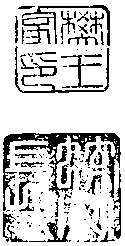



------



### 重锓补陀志序



补陀为祝延名山，皈依大士。白华载於内典，黑龙咒於呗音。故无志也，志锓於侯大将军，以汛海选胜也。维时与吾㝎二三居士，罝弋见闻，凢形胜、宫室、纪碣、咏彞，繇唐迄今表表者，汇列成帙，嗣且再之三之矣。余不敏，受读，质以所闻，父老言：「一登彼岸，知补陀屼悬海上，去邑二百里而遥，外控诸夷，先朝贡舶孔道也。」然而代有隆替，则时为政，抑地劫会逢，非大士慈灵代为觉迷也！



今上道揆在宥，皇极建中，而支流餘𧚞无不受之。迺广孝治，奉两宫慈㫖，念力南海大士，遣中使颁经披绣，祝延万年而庇之民。海上无大兵革，於兹三纪矣，而内地屡豊安堵，自无疵疠，孰效灵是？识者谓畴昔之替，良由此山鲜膏壤食土，檀越四方，其缁黄𣸯集，动以千计，不无逋薮也者。甚而假途诪幻，然指檠肉，至於舍身洞崖，惨烈弗恤。普门之法不立，僻隅之区为阱，慧戒方之左矣。以而夷讧兵燹，或回禄见於中宵，天冯人孽，谓时政地劫也乎哉！迩者当道禁诘，召名僧主住，式定庄严。既以一洗习障，而内外刹素不相能者，亦斋心辑志，同奉纶綍为兢兢。勒石颂徳，则补陀洵一净土也。福国庇民，响应蓍蔡，夫岂冥冥而决懴箓者哉？是则大士灵也。抑何以故？先是岁己亥，前殿灾，甍础具烬，𤢜大士金相自若，而护法关神亦不毁，此其故可曙已！今兹屡廑诏谕，中使毖饬，鼎新厥宇。告竣也，宜哉。矧其时汛舳舻，诸岛防援，贲相望于沧溟，鲸鲵无敢动焉。此寔我皇灵伊濯，孝慈昭假，而大士如为助流宣化也。志补陀者，傥亦遵扬风美意乎？故曰：事不轨物者，则君不举焉；言不微中者，则臣不献焉。苟其持之有故，言之成理，君子尝乐道之矣。然则是刻也，谓之孝慈志也可，谓之军志、治安志也可。谨拜手序。成志者，寺僧性能也，并书之。



邑人邵辅忠撰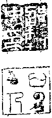



普陀山志目录



卷之一宸翰敕谕  

御制



卷之二图考  

山水  

殿宇  

规制  

建制  

灵异  

颁赐  

命使  

释子(仙附)  

物产



卷之三艺文杂著



卷之四事畧



卷之五诗类



------



## 普陀山志卷一



宸翰



𠡠谕四通



皇帝𠡠谕普陀山宝陀禅寺住持及僧众人等



朕惟佛氏之教具在经典，用以化导善类，觉悟群迷，于护国佑民不为无𦔳。兹者圣母慈圣宣文明肃皇太后命工刊印《续入藏经》四十一函，并旧刻藏经六百三十七函，通行颁布本寺。尔等务须庄严持诵，尊奉𭹀藏，不许诸色人等，故行𧃳玩，致有遗失损坏。特赐护持，以垂永久。钦哉，故谕。



广运



大明万历十四年三月　日之宝



𠡠谕南海普陀山普陀寺住持及僧众人等



朕𤼵诚心，印造佛大藏经，颁施在京及天下名山寺院供奉，经首护𠡠已谕其由。尔住持及僧众人等，务要处洁供安，朝夕礼诵，保安眇躬康泰，宫壸肃清。忏已徃愆尤，祈无疆寿福，民安国泰，天下太平。俾四海八方同归仁慈善教，朕成恭己无为之治道焉。今特差内汉经厂掌坛御马监太监赵永，赍请前去彼处安供，各宜仰体知悉。钦哉，故谕。



广运



大明万历二十七年二月初十日之宝



皇帝𠡠谕南海普陀山普陀寺住持及僧众人等



朕惟自古帝王以儒道治天下，而儒术之外，复有释教相翼并行。朕以冲昧嗣承大统，迄今卄有七禩，天下和平，臣民乐业。仰思天眷，祖徳洪庇，良繇大公同善之因。况国初建置僧录司，軄掌厥事。盖仁慈清净，其功徳不殊；神道设教，于化诱为易；祖宗睿谟，意深远矣。佛氏藏经，旧刻六百三十七函，我圣母慈圣宣文明肃皇太后续刻四十一函。朕既恭序其端，而又因通行印施，序其前后，𠡠谕护持，所以锡孝类、流慈恩也。兹者朕嘉善道之可依，念传布之未广，爰命所司印造全藏六百七十八函，施舍在京及天下名山寺院，永垂不朽。庶表朕敬天法祖之意、弘仁普济之诚，使海宇共享无为之福。先民有言：「一念思善，和风庆云；一念不善，灾星厉气。」夫善念以有感而兴，无感而懈。是以皇极敷言，不厌谆恳；圣喆所贵，善与人同。古今相传，其揆一也。且善在一人，尚萃一家和气；若亿兆向善，岂不四海太和？此经颁布之处，本寺僧众人等，其务斋心礼诵，敬奉𭹀藏，不许𧃳玩，致有毁。特赐护𠡠，以垂永久。钦哉，故谕。



广运



> 大明万历二十七年二月日之宝



御制佛藏经序文（二首）



------



### 御制圣母印施佛藏经序



朕闻儒术之外，释氏有作，以虚无为宗㫖，以济度为妙用，其真诠密微，其法𣲖闳演。贞观而后，代译岁增，兼总群言，苞裹八极，贝叶有所不尽，龙藏有所难穷。惟兹藏经，缮始于永乐庚子，梓成于正统庚申。由大乘般若以下，计六百三十七函。我圣母慈圣宣文明肃皇太后又益以《华严玄谈》以下四十一函，而释典大备。夫一心生万法，万法归一心。诸佛心印，人人具足。劝善觉迷，诸苦解脱。一觉一善，皆资胜因。是以闻其风者，亿兆为之翕习；慕其教者，贤愚靡不归依。则知刑赏所及，权衡制之；刑赏所不及，善法牖之。盖生成之表，别有陶冶矣。先师素王亦云：圣人神道以设教，善世而愽化。谛观象教，讵不信然？恭惟圣母濬𤼵弘愿，普济群伦，遂托忠诚诱善，勤侍传宣，广修众因。乃印禅经，布施净土；兼立梵宇，斋施僧伦。成修宝㙮，立竖於虚空；绘塑金容，散舍於大地。济贫㧞苦，召赦孤幽；无善不作，无徳不备。证三身于此世今生，明四智于六通心地。普惠云兴，普贤瓶泻。大垂玄泽，甘露雨洒于三千；徧覆慈云，法雨滋培于百亿。无微无鉅，咸受益而蒙荣；有性有生，尽飡龢而饮惠。俾福利之田，与人同乐；仁寿之域，举世咸登。如是功徳，一切善言之赞叹，一切善气之导凝，我圣母延龄，如天永永；我国家保泰，降福穰穰矣。於乎盛哉！大觉之教，宜其超九流而处尊，偕三五以传远也！



------



### 御制新刊续入藏经序



续入藏经四十一函，起《华严玄谈会玄记》，至《第一希有大功徳经》，记四百一十卷，此我圣母慈圣宣文明肃皇太后所命刻也。朕惟释教东流，经典递译，函卷繁富极矣。我圣母躬体圣善，坐抚升平，密𢍆心乗，力修圣果。因复假筏迷津，施航觉海，续增兹典，聿广义宗，徳意甚盛。载惟经世、出世，厥用敻殊；然其立教，以明心见性为宗，以慈悲喜舍为用，以嗔爱婬杀为戒，以戒定禅寂为门。大都使人破尘妄之迷，以印妙圆之体；惕罪报之由，以修慈善之根；悟未来之因，以减现在之业。此其觉人济物、胜残去杀之功，於吾圣治不为无𦔳。故经谓：「庄严施之周於沙界，不若一经一偈流布之功。」然则圣母慈命，真可谓续慧燄於昏衢，普慈云於隂界，延佑宗社，种福人天，不可思议者矣。若乃梁魏隋唐之主，倾国赀以崇像餙，瘠齐民以奉缁流，殊戾释氏本㫖，朕所不取，亦非我圣母流布是经之意。是为序。



慈圣宣



文明肃



> 大明万历十四年三月日



皇太后宝



御制重建普陀寺碑



朕御㝢三十有四载，嘉与海内臣民，咸用康乂。一切岳渎诸祀，不䟽不数，用以宁吾民而徵信於神。惟是圣母慈圣宣文明肃贞寿端献恭熹皇太后，含纯懿之真性，秉慧觉之上资，诸所焚修祝厘、护国保民者，朕一一钦承，无所爱惜。先是，南海普陀寺毁於祝融，我圣母恻然发念，欲缘故址而鼎新焉。朕仰承慈谕，无骚民，无烦将作，无费水衡金钱，盖默示以爱护苍生、绵延国脉至意。朕益用祗承，首捐内帑。其自朕躬而下，悉输诚发愿，以次𦔳施。遣官督建，迄今落成，而圣母喜可知也。因题额名



「大明𠡠建护国永寿普陀禅寺」。寺在洛伽山顶，大海波心，是观音大士说法道塲、显灵应处也。大士圆通三昧，普照十方，三十二应身随处变现，十四种功徳不可思维，朕无所庸其赞叹。第白马开缘，赤乌建刹，雨花灵鹫，在在有之，而海上最著。盖其慈悲大㫖，普度法门，不可以意智得，不可以声色求。远而弥尊，近而难即，离此苦海便登彼岸，指点最为真切。其密证了义，则有望洋已耳。夫惟修之默默，应之昭昭，禔福在宫中，灵感在海外，有若响答然者。即今圣母燕喜，天锡难老；朕荷兹百禄，延及孙子以至万邦黎庶，海㝢宴然。良由圣力护持，神功默祐，非偶尔也。嗟乎！庄严妙相，今古皈依；功成而不扰，教尊而不渎。则今日盛事，与前代瘠民侫佛者大有间矣。工起于



万历三十年七月二十七日，迄于



万历三十五年三月十五日。是用勒石铸词，使群臣百姓咸知朕奉扬圣母徳意，且以昭示传诸不朽云。铭曰：



茫茫万有　欲爱同缠  

业风振海　识浪滔天  

惟此苦海　千古渺弥  

彼岸寥廓　竟渡其谁  

如来法身　累劫修行  

妙通圆明　反照见性  

慈悲广大　功力无边  

破昏揭暗　慧炬高悬  

音声万亿　遥入我观  

由闻起见　寻根穷端  

所见非目　所闻非耳  

靡有见闻　讵有我彼  

恒河世界　悉归掌轮  

随愿畀福　随溺拯津  

如汲海水　罇盎具足  

沧溟不亏　人饮满欲  

如月印川　万壑皆圆  

清光不减　皎皎中天  

洛伽浮空　瀛波旋绕  

梵宫蔚起　翘望云表  

大士耀灵　遐迩倾就  

贵贱圣凢　拜礼恐后  

猗我圣母　心𢍆大慈  

愿言锡祚　以保群黎  

予承慈训　启我觉慧  

如天好生　聿嘉二帝  

载培国脉　瓜瓞绵延  

与天同久　亿万斯年



大明万历三十五年四月二十一日，钦差督工．内汉经厂．焚修祝厘．御用监太监张随奉㫖谨立



普陀寺殿图



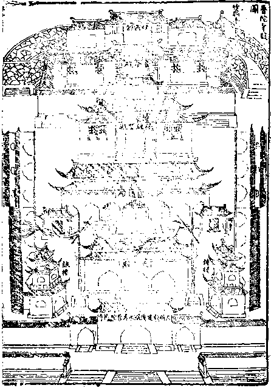



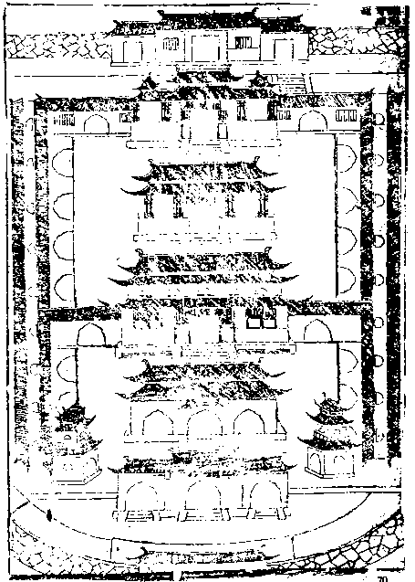



------



## 普陀山志卷二



郡人吏部侍郎周应賔纂辑



尚宝司丞沈泰鸿校正



邑人刑部主事邵辅忠同校



文安御用监太监张　随梓行



图考



古九州之域，盖铸诸𪔂。今白华固海上灵境，将必有天造地设者，非图何以传大千？若曰「苦海无边，回头是岸；有形皆坏，不烂虚空」，则何必不白华？何必白华？此山此图，一齐扫却！志图考。



普陀山图



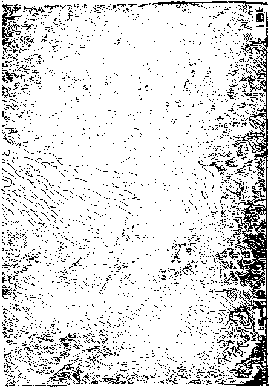



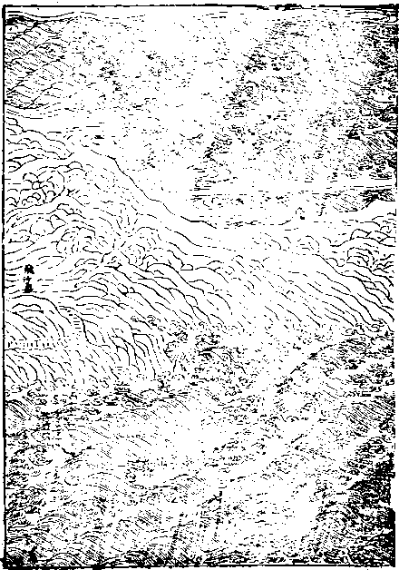



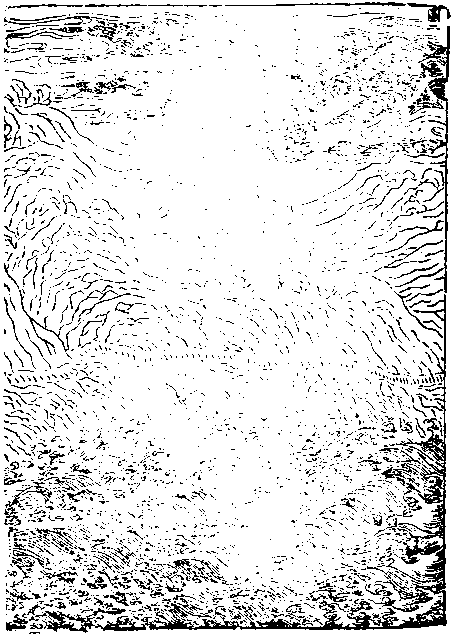



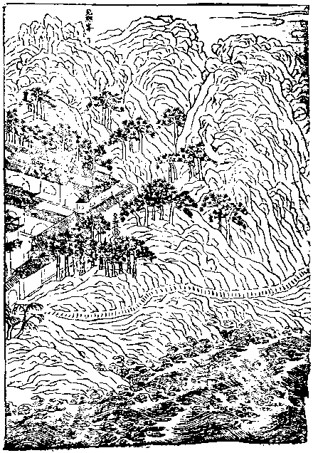



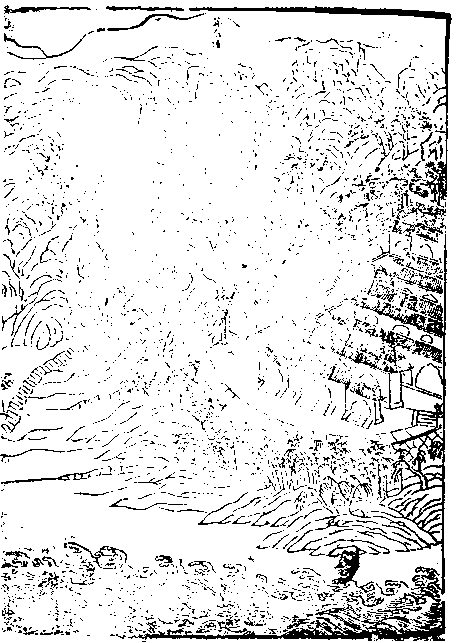



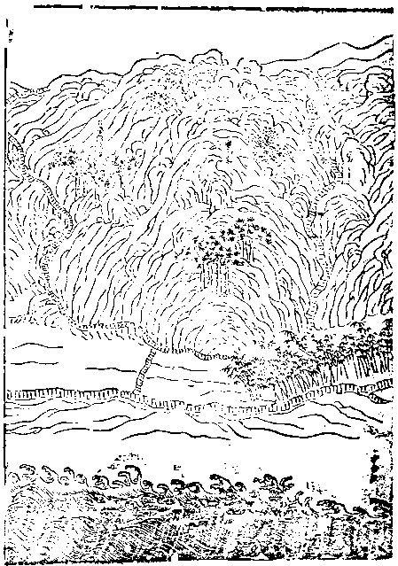



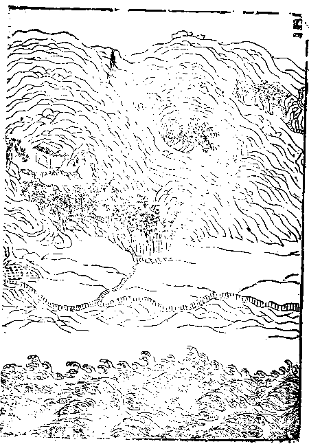



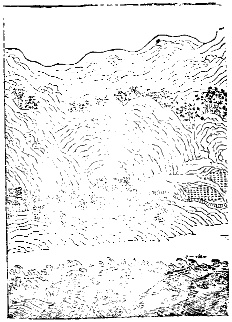



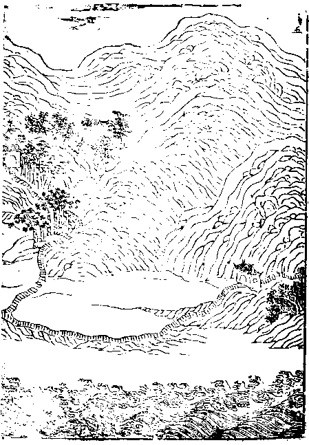



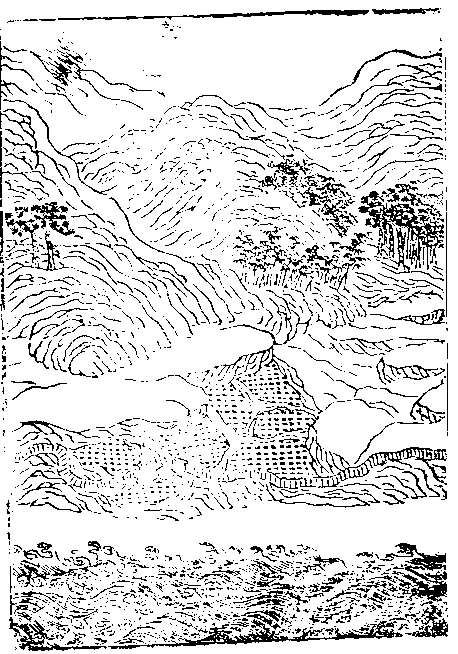



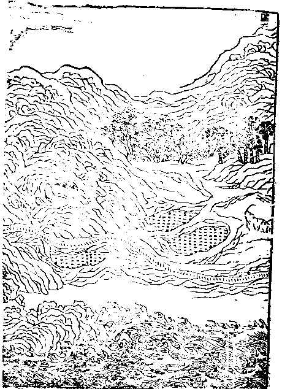



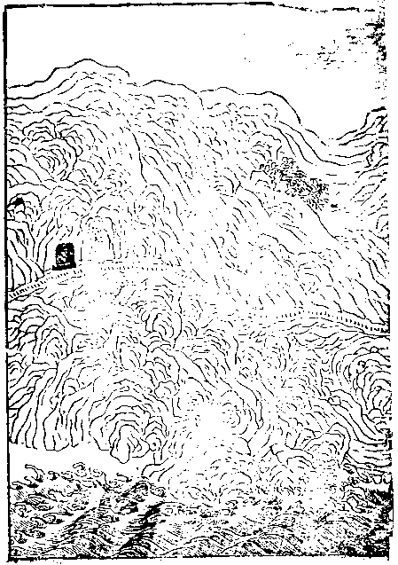



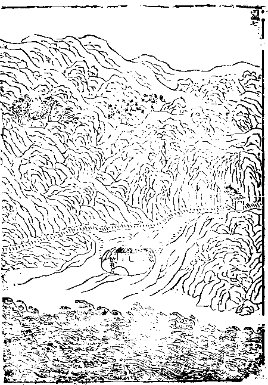



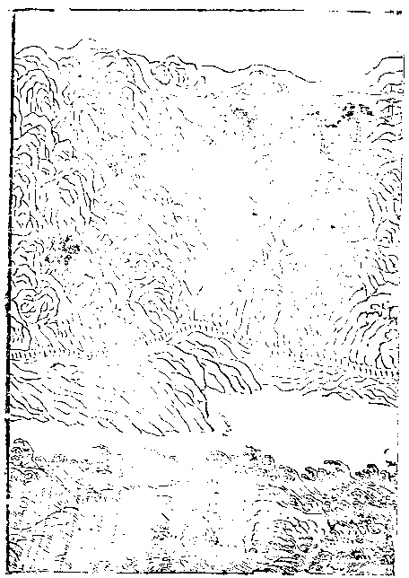



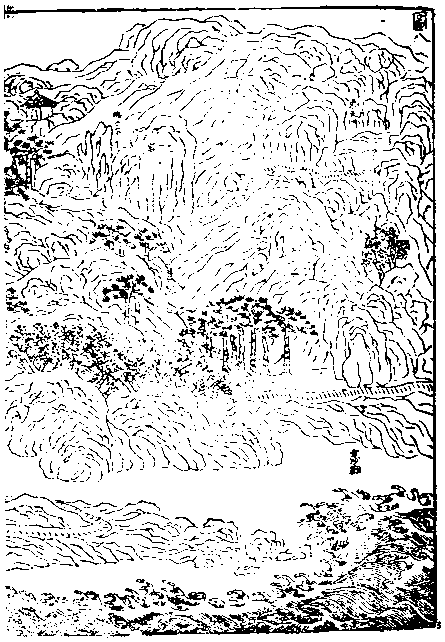



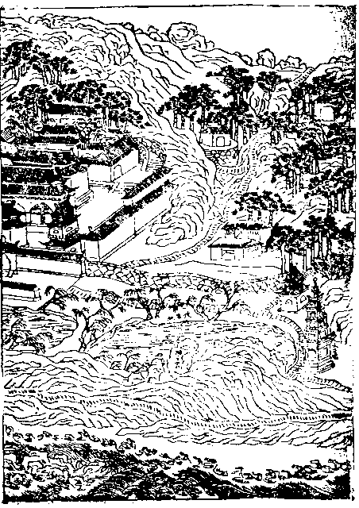



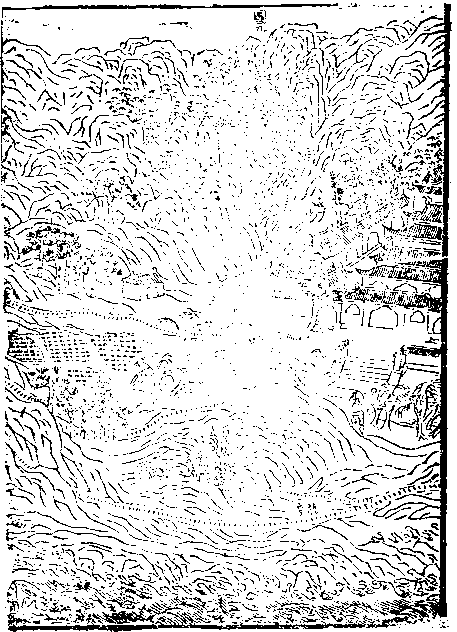



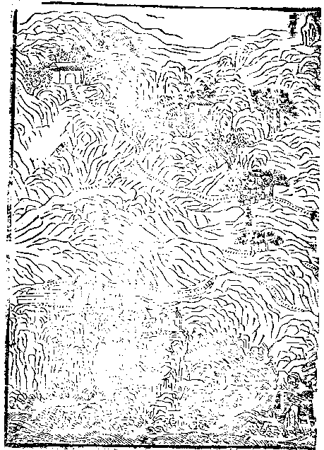



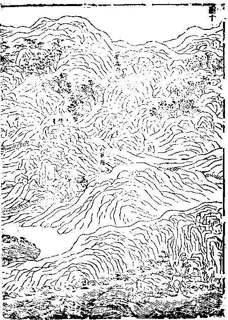



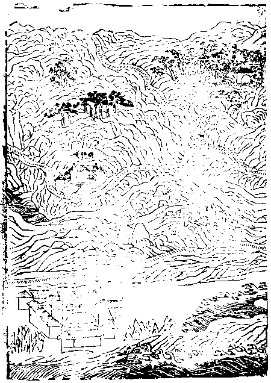



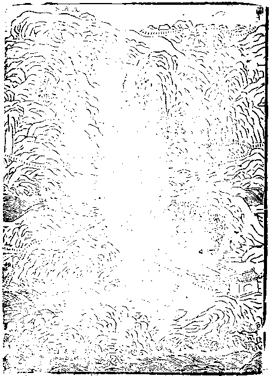



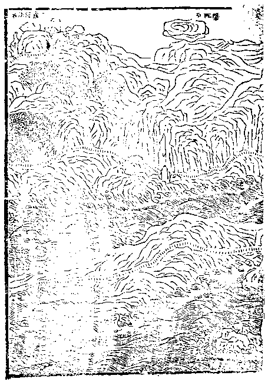



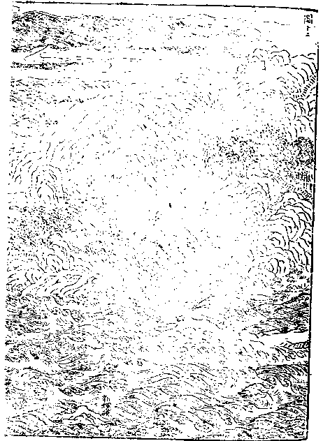



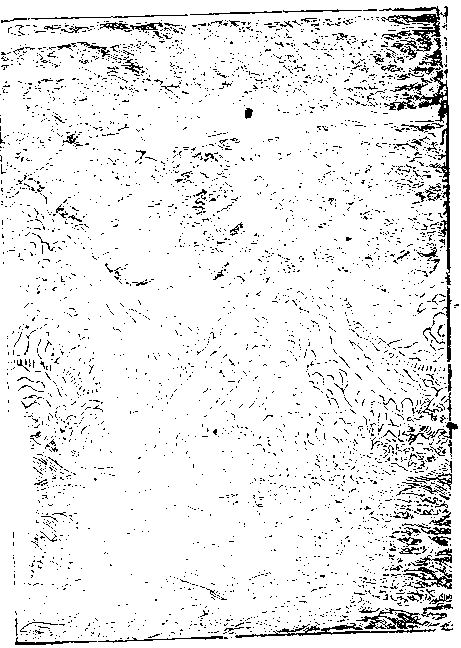



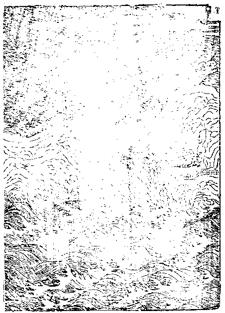



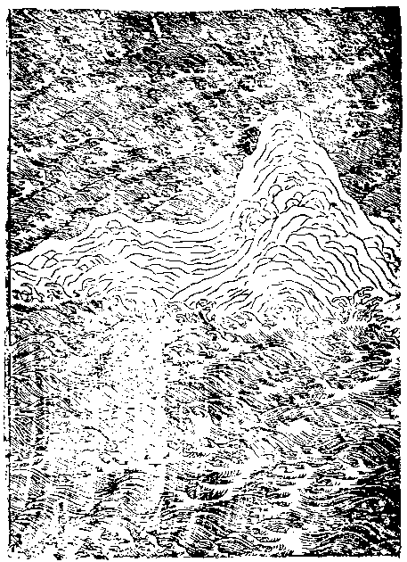



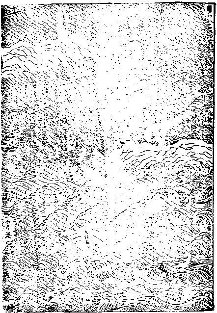



山水



夫丹山赤水蚤有誉於东南，岂洛伽犹淹海外邪？夫以孤绝之区，涤荡云日，斯已竒矣，况仙释之所栖灵乎！顾瞻南询处，石𪩘如环，遥望大洋，缥[緲-目+耳]桑壶在焉，可不谓另一天界哉？读《山海经》，惜乎其未广也。志山水。



补陀洛伽山



在昌国东海中，今属定海县，去郡城约三百里，去县约二百餘里。山周围约四十餘里，东望小洛伽山，南望月嶴山，西望舟山，北望霍山。「补陀洛伽」，盖梵名也，华言「小白华」。《华严经》所云「补怛洛迦」，乃善财第二十八叅观音菩萨说法处。又《传记》称「东大洋西紫竹旃檀林」者是也。又扁「海岸孤绝处」。一名「梅岑」，以梅子真於此炼药，故名。元吴莱、明屠隆作记。



梵山



寺南案山也。旧有路通行人，堪舆者以为龙首不宜践伤，督造张随令栽松竹，立石示禁。



金钵盂山



在寺西莲花洋中。



香炉花瓶山



在寺东大洋中，以似得名。



茶山



在寺东方岩北。



金刚峰



在白华岭西。



玉趣峰



在太子㙮右。



弥陀峰



在㙮子峰西。



㙮子峰



在西天门下。



逹磨峰



在西天门上，一名「罗汉石」，元赵孟𫖯题曰「瀛洲界石」。



灵鹫峰



在妙应峰西。



妙应峰



在白衣峰西。



白衣峰



在东天门上。



观音峰



在无畏石后。



菩萨顶



在茶山上，诸峰之最高者。



炼丹峰



在饥饱岭，梅福尝炼丹于此，有「梅公鼎」。



白华峰



在三官堂左，督造张随题「复承　上」。



光熈峰



在镇海寺后。



会仙峰



在育㤙院前，勾章钱维翰题。



狮子岩



在寺南，太子㙮前。



鹰嘴岩



在摩尼洞北。



东方岩



在茶山前。



象岩



在无畏石前。



佛手岩



在观音峰下。



虎岩



在东天门东。



圆通岩



在司基湾东。



玲珑岩



在金刚窟西。



西方岩



在圆通岩西。



潮音洞



在东大洋海西，西大洋海南，菩萨尝显见处，四顾无畔，岸上有穴可俯而观，名「天窓」。详见〈灵异志〉。



龙女洞



在潮音洞，亦神通所现。外有石壁立，中窅不可测。



金刚窟



在寺西幽静湾上，有洞如室，冬温夏凉。



法华洞



在寺东，上有高峰，总兵李应诏题「东南天柱」。



摩尼洞



在天箆东。



白华岭



在玉趣峰下。



栴檀岭



在寺东南。



饥饱岭



在寺左。



圆通岭



在灵鹫峰下。



青鼓岭



在镇海寺东。



笑天狮



子岭在青鼓岭北。



磐陀石



一名「金刚石」，在西天门西，相传大士说法处。旧有二龟至石下听法，遂化为石，其形尚存。又有石五十三块环向磐陀，今呼为「五十三叅石」。磐陀之上最平广，可容百餘人。下临大海，东望扶桑，烛龙将驾，天光烂然，须臾红轮从海底涌出。



无畏石



在佛手岩。突然一石，其形方广而险峻，若倾不可踄。



天箆石



在摩尼洞西。



叠子石



在佛手岩南。



毛跳石



在求现台东。



求现台



在潮音洞前，有阶可登，亦人瞻礼之地。



观



音跳石在龙女洞西。



佛牙石



在寺西。



香炉石



在圆通岩后。



不二石



在磐陀东，郡人沈一本题。



真歇石



在寺东深处，旧有庵，相传真歇了禅师修道于此。



巫山石



在寺后，少卿涂杰题。



西天门石



在金刚窟西，总兵李承勋题「振衣濯足」。



东天门



在白衣峰南。



海天佛国石



在镇海寺东北，总兵侯继高题写。



新螺礁



在石牛港口大洋。



善财礁



在潮音洞前大洋，相传为善财叅大士处。



捣饭嶴



在观音跳石西。



飞沙嶴



在镇海寺东。



千步沙



自饥饱岭循山而行为千步沙，潮声吼激，喷雪连山，耳目竒甚。



金沙



在紫竹林太子㙮前，路皆黄沙，如金沙布地，故名。亦大士显现处也。



三摩地



在寺西。



莲花洋



即山西海也。倭奴入贡，见观音灵异，欲载还国，满海生铁莲花，舟不能行，倭惧而还之，洋之得名以此。



东大洋



在山东。



石牛港



在莲花洋西，宋中官王贵等诣山礼佛，心未敬信，辞归，满海阻铁莲花。贵望山叩谢，有白牛浮至，𥁞食其花，舟始移，白牛还立水次，乃一白石如牛，故名。



白沙港



在小洛伽山南。



箭港



在光熈峰北。



莲花池



在寺前。上有桥，即莲花桥。旧植莲，兴革不常，多淤涨。万历十四年，忽产红莲数朶。是年十一月，钦赐瑞莲观音相至，咸谓应斯兆焉。三十年，督造张随浚治，植白莲，香风远袭。



放生池



在寺东。嘉靖间，僧普贤买一金鲤放池，俄黑云起，随化黄龙飞海。年久淤涨，万历三十年，督造张随濬治。



光明池



在潮音洞，旧名「甘露潭」。正徳间，太后遣使祷取以疗目疾，赐名。



短姑道头



在山西南隅，莲花洋逹岸处。相传大士显灵筑砌，巨浪冲激不坏，航海者维舟於此。自此，由白华岭至普陀寺，路约三里许，旧湫隘不堪行，督造张随开拓平广。



菩萨泉



在寺左，久旱不竭，丛林大众皆仰汲于此。



慧泉



在龙女洞，人祷取以疗目疾。



灵一泉



在育恩院西平石上，都督杨宗业题。



龙潭



在潮音洞口，旧传娑竭罗龙居此。



龟潭



在茶山下。



葛洪井



在烟霞馆后，今废。太史陶望龄同宪副周汝登镌石。



仙人井



在饥饱岭，今竭。上有石，叅将陈九思题「登彼岸」。



金沙井



在圆通殿右，俗名「龙井」，久旱不竭。每遇寺僧有不祥，輙变黑色。



清净境



在三摩地，木秀泉清，恠石攅列。上有亭，学士宋濂作铭，今废。



空



有境在真歇庵左，大学士吕本题。原名「三一岩」，大学士徐阶、礼部尚书陆树声题。又「海天春晓」，副使刘翾题。



西方境



在西方严，宁绍叅将刘炳文题「中流砥石」。



藤萝境



在磐陀石东，山迂萦囬，竒岩壁立，上多藤萝旋绕。搃镇虞都杨宗业捐俸，属寺僧性能剏禅院一所於此，题曰「三天法界」。



玉堂街



在寺东。饥饱岭至镇海寺路，旧有沙径𣺯隘，不便行趾；镇海寺僧如珂募甃石道，众皆徳之。会稽陶望龄题曰「玉堂街」。



殿宇



琼宫绀宇，布满名区，咸以藏殊妙之相，辟空寂之门。若海天万里，风涛激射，金碧丹青，屹如鳌柱，与海屋争竒，此固不可二三见也。志殿宇。



𠡠建护国永寿普陀禅寺



在补陀山南▆，山皆石骨，独寺趾沙坡平旷。前代废兴不一。万历二十六年毁，后三十年𠡠御用监太监张随董建。随以旧基形局浅漏，辟迁麓下，并改辰向为丙云。原名「宝陀寺」，尚仍未赐。今特请是额，并赐御碑。又郡人吏部侍郎周应賔有记，餘详具〈建置志〉。圆通大殿　藏经宝殿(奉前后颁赐藏经。)　景命殿　天王殿　四配殿(祀弥陀、地藏、伽蓝、祖师。)　山门(俱在普陀寺。)　铁瓦殿　无梁殿　瑠璃殿(俱在潮音洞，今废。)　梵王宫(在潮音洞上，嘉靖间鲁府建，今废。)　云会堂(俗名「十方堂」。)　华严堂　海会堂　资有堂(大学士沈一贯题。)　净业堂　涅槃堂(俗名「安乐堂」。以上诸堂俱在普陀寺。)　演法堂(旧在普陀寺，今废。)



钟楼　皷楼　水陆楼　斋楼(俱在普陀寺。)　烟霞馆　白华馆(俱在普陀寺。)



东西方丈(在本寺景命殿，左右各三十间。左为常住公用之所，右作僧寮，世世同居共食，立为规约，并不得分割房户。)　香积厨(计二十间。)　龙章阁(宋嘉定间建，今废。)　不二阁(在育恩院内，都督杨宗业捐资剏建。)



御制藏经序碑亭



玉音亭　应制经賛碑序(以上三亭俱在本寺，总兵侯继高建，今废。)　怀阙亭(在烟霞馆左，四围松竹腾茂。万历三十年督造张随建。)　渡海纪事碑亭(在寺左，督抚尹应元建，督造张随题「海山天柱」。)　着衣亭(在无梁殿左。)　劝人莫要舍身亭(在潮音洞，宁绍叅将董永燧立。)　栢子庵(本寺僧心一建。)



太子㙮(在普陀寺前，高九丈六尺，皆太湖石，雕刻精巧。)　金刚㙮(在金刚窟，郡人尚宝司丞沈泰鸿建，延僧性汾守庵。)　普同㙮(凡二座，一在千步沙，一在龙湾，为逝僧藏骨之所。)　一乗㙮(在西资庵右。)



关圣祠(在莲花洋畔，汛兵守此。)　天妃祠(在司基湾西。)　娑竭龙祠(在菩萨泉下，万历三十三年督造张随建立。)



三官堂(在短姑道头左。於万历五年，寺僧明安建为登舟憇足之所。)



三圣堂(在普陀寺前，古禅堂同傍有泉，久旱不涸。万历三十五年三月，内钦差御马监太监党礼奉㫖赍帑立碑，谢土启建，圆满道塲。同钦差御用监太监张随率诸禅侣，赴潭请水，目覩有感，捐资鼎建。)



大士桥(在潮音洞上，宋绍兴间，僧徳韶建，今废。)　莲花桥(在山门御道前，三十四年督造张随建。)　智度桥(在镇海寺前，剡人周汝登题。)



𠡠赐护国镇海禅寺



(在普陀寺东约五里许。一山矗峙，曰光熈峰。有麻城僧真融，自五台、伏牛、峩嵋、蓥华，咸剏饭僧之所。至万历八年，复来普陀，结茆数楹于峰下，渐建圆通等殿，然尚以「海潮庵」名。迄二十二年，郡守吴安国改额曰「海潮寺」。真融殁，其徒如寿等又为增建殿宇，规制弘丽。三十四年，御马监太监党礼请於朝，赐今额。郡人大方伯冯叔吉、礼部主事屠隆记。)



圆通殿　天王殿　伽蓝殿　祖师殿



山门(俱在镇海寺。)



千佛阁　龙藏阁(奉南北藏经。)　止阁(在龙池上，郡司理阳羡何士晋题。)



景命堂　华严堂　大觉堂　净业堂　龙王堂　土地堂　延寿堂(俱在镇海寺内。)



水月楼　白华楼　智食楼　钟楼　皷楼(在镇海寺。)　东西厢楼(各三十间，作十方公用之所。)



方丈(在净业堂左。)　香积厨　观亭(在方丈后，会稽陶望龄题。)



华严铜㙮(在寺东首，安供以镇山门。)



千佛㙮(在寺内。)



大智㙮(在镇海寺西山之麓。)



𠡠赐祝延圣寿磐陀禅院



在普陀寺西约半里许。向有古室数楹，年远颓圮；海宪方应明捐俸重建，恢拓基趾，殿宇巨丽，实寺之附庸也。大宗伯周应賔题曰「应身宝殿」。崇祯八年二月，承乾宫皇贵妃遣官进香，复命铸　渗金佛像一尊，紫袈裟二袭，请赐今额。十四年，内　田戚畹奉㫖进香到院，又捐资请方册佛经一蔵，永镇山门，以𡸁不朽。院之西，会稽大方伯陶崇道倡缘筑堤捍海，垦田数十餘畆，以充祝圣饭僧之需。皆老衲无边苦行精修所感之力也。



聚沙庵(在镇海寺西，即邉公窣堵波院也。)



茶山静室



朝阳庵



在菩萨顶之麓，万历五年间，内臣明凤祝发於此。以凤号朝阳，故名。凤殁，其徒真玄、孙如乐，皆内臣出家，能克纂前绪，坚修净业。督造张随题额曰「瑞霭旃林」。



慧济庵



在菩萨顶右，僧圆慧建。郡人尚宝司丞沈泰鸿题额曰「宝月含空」。



圆觉庵



僧如月建。



吉祥庵



僧明潭以内臣出家，守静於此。



方广庵



僧如富建。



琉璃庵



在茶山后，僧朗元建。



法喜庵



僧真净建。



观音庵



僧海印建。



梵音庵



在海天佛国石右，僧明照建。



崇徳庵



僧见寛建。



涌泉庵



僧如丛建。



华



严庵僧性觉建。



弘觉庵



僧海舟建。



智胜庵



在茶山左，僧性灵建。



圆应庵



僧如元建。



灵瑞庵



僧性斈建。



雨华庵



僧如晓建。



千步沙静室



禅那庵



在千步沙上。僧如寿先年为镇海寺住持，以丛林事繁，建为退居之所。



慧日庵



僧如胜建。



金粟庵



在饥饱岭左。先年四川僧真泉建於二十八年，让僧真定守焉，泉复结茆数楹於庵后曰「千佛室」以居。



杨枝庵



宁绍叅将刘炳文鼎建，延僧通津居此。



龙树庵



僧海灯建。



智度庵



在大智㙮右，僧如心建。



月印庵



在摩尼洞上，僧性慈建。



圆信庵



僧明忠建。



摩尼庵



僧海云建。



双泉庵



僧真静建。



雪浪庵



在后海洋畔，僧明悟建。



伴云庵



僧真觉建。



甘露庵



在普同㙮左，僧性全建。



栴檀庵



僧如方建。



般若



庵在鹦鹉石左，僧如寛建。



资福庵



僧寂灯建。



廽龙庵



僧明富建。



大悲庵



僧如盈建。



盘龙庵



僧真寛建。



清凉庵



在小茶山内，僧真满建。



海曙庵



在摩尼洞前，僧如信建。



磐陀石静室



圆通庵



在西天门。于万历五年僧圆献结庵於谷内，其徒明通谙知义，与游历京都，为缁素所重。众喜助以大藏，南还，延僧检阅，昏晓不辍。郡人沈一贯嘉额曰「法轮常转」。



真歇庵



在普陀寺后，宋真歇禅师建，岁久倾废。万历三十年，督造张随改额「栖真庵」。



海云庵



僧真晓建。



总静室



在司基湾。三十年，督造张随以旧趾湫隘，拓基迁建，题曰「云林总会」。



永胜



庵僧祖敬建。



宝函室



在不二石右，僧真一刺血书经处也。



修竹



庵僧性鍾同徒海缘建。



白云庵



僧性坚建。



娑罗庵



僧真隆建。



莲华庵



僧如定建。



海印庵



在莲花洋畔，僧徳▆建。



慈云



庵僧如有建。



灵石庵



在磐陀石下，僧真▆建。



大觉庵



僧真良建。



大慈庵



在西天门侧，僧海目建。



灵芝庵



僧明经建。



清籁庵



在金刚窟后，僧照性建。



㳒华庵



在茶山，僧圆凤建。



西资庵



在一乗塔后，僧𡨜乾建，周应賔题。



金刚庵



僧性汾建。



育㤙院



在寺西二里许。搃镇杨宗业捐俸𪔂建，属寺僧性能守静於此。吏部侍郎周应賔题曰「海上竒观」。



白华庵



在小白华山前。钦依㝎海都司梁文，因祈嗣有感，捐资属寺僧如曜创建。中奉白衣大士。镇守都督杨宗业题曰「天香踵瑞」。



梅福庵



在梅湾，系梅子真炼药之𠁅。旧有庵宇颓废，住持如回捐资重剏。縂镇都督杨宗业题额曰「竒葩古迹」。



昐鶴庵



在茶山，僧性了建，都督杨宗业题。



白象庵



僧普耀建。



净土庵



在捣饭嶴道头至潮音洞冲要之所，可避雨旸。僧照空、徒应悟建，都督何斌臣题「真如妙境」。



积善庵



在千步沙，僧玉峰建。



韦驮宝殿



在禅堂岭下，僧海谷建。侍御陆世科题名，尚书周应賔题额「护法正神」，定海县知县顾宗孟题额「觉海隐持」，织造司祇监李賔题额「维持正教」。



𩔰圣庵



都督裴爷重建。



三元殿



在道头。



𨼆秀庵



在短姑道头山上。僧如秀仝徒性昙於万历间监造普陀寺，督造内官张随酬僧勤劳，建庵修静，题额曰「𨼆秀」。



规制



说者多言，间架微𤨏；夏世室以下，《考工记》何称焉？夫梵宇靡常，



纶音特重，要使烦而有体，大而可久，庻所谓得当报者。量功鸠材，不愆于数，夫谁非鞅掌？其略之也。志规制。



寺基



面阔七十八丈，进深五十三丈二尺。



山门



面阔二十八丈八尺。山门三间九架，面阔五丈六尺，进深四丈。明间阔二丈，左右稍间各阔一丈八尺，高二丈五尺，甬道进深四丈。



天王殿



> 五间十一架，面阔九丈二尺，进深六丈六尺。明间阔二丈五尺，左右次间各阔一丈八尺，左右稍间各阔一丈八尺、八尺，甬道、月台共进深九。



圆通大殿



七间十五架，面阔一　四丈，进深八丈八尺。明间阔二丈八尺，左右次间各阔二丈四尺，左右稍间各阔二丈，左右次稍间各阔一丈五尺，高五丈八尺。甬道四丈。



藏经宝殿



五间十三架，面阔九丈二尺，进深六丈八尺。明间阔二丈，左右次间各阔二丈，左右稍间各阔一丈六尺，高三丈八尺。甬道、仪门共五丈。



景命殿



五间九架，面阔九丈，进深五丈。明间阔二丈，左右次间各阔一丈八尺，左右稍间各阔一丈六尺，高二丈八尺。



伽蓝、祖师、弥勒、地藏四配殿



每殿三间九架，各面阔五丈六尺，进深四丈。明间阔二丈，左右稍间各阔一丈八尺，高二丈四尺。



配殿廊房



左右各二十五间七架，廊房每间阔一丈四尺，进深三丈六尺，高二丈。



天王殿左右廊房



各七间七架，每间阔一丈四尺，进深三丈六尺，高二丈四尺。



藏经殿左右廊房



各七间七架，每间阔一丈四尺，进深三丈六尺，高二丈四尺。



景命殿左右厢房



各三间九架，每间阔一丈一尺，进深三丈六尺，高二丈四尺。



景命殿左右群房



各十间七架，每间阔一丈一尺，进深三丈六尺，高二丈四尺。



仪门前左右廊房



各三间七架，每间阔一丈，进深三丈六尺，高二丈四尺。



仪门内露顶



左右各一间七架，每间阔一丈，进深三丈六尺，高一丈八尺。



钟皷楼二座



明间阔一丈五尺，左右间各阔一丈，高三丈八尺，周围各三丈，东西隙地各二十五丈。



建置



寺虽代不乏废兴，抑入我明，罹於燹何亟也？洪嘉犹制胜之全，不图复有今日两宫三殿之遥同，异哉！惟是水府无恙，铁莲长开，亦千万年巩固之一竒也。志建置。



梁贞明二年，日本僧慧谔得观音相於五台山，将迎归本国，舟触新螺礁，莲花当洋，舟蔽不前，谔祷曰：「使我国众生无縁见佛，当从何所建立精蓝？」有顷，舟向潮音洞泊焉。有居民张氏目覩斯异，遂舍所居，筑室奉之，号为「不肯去观音院」。



宋元丰三年，内殿承㫖王舜封使三韩，过潮音洞，黑风骤起，有大龟负舟，危甚。望山作礼，观音现相，龟没舟行，得无恙归。上其事，改建赐额「宝陀观音寺」，置田积粮，许岁度僧，供奉香火。



绍兴元年，真歇了禅师泛海结庵于山椒，题曰「海岸孤绝处」。郡请于朝，易律为禅。寺三年风雨，殿摧，住山徳韶言于朝，赐钱万缗修餙。七年殿成，御书「圆通宝殿」、「大士桥」以赐，徳韶剏龙章阁藏之。



淳祐八年，制帅颜頥仲祷雨有感，施钱二万，米五十石，建长生库接待庄。



元大徳四年春，命李铁木儿不花、魏也先治演法堂。



元统元年，宣让王施钞千锭，建太子㙮于宝陀寺南。



至元十年，住持如智建接待寺于沈家门侧，以为朝山徃来居停之所。



国朝洪武二十年，信国公汤和徙居民入内地，焚其殿宇，供瑞相於郡东栖心寺，仅留铁瓦殿一所，使僧守焉。



正徳十年，僧淡斋于潮音洞南建正殿五间，方丈二十间。



嘉靖六年，河南辉府施琉璃瓦三万、砖一万修𩛙。三十二年，东倭入犯，总督胡宗宪迁其殿宇于定海县东城外之招宝山，迎大士像供焉，餘舍尽焚。



隆庆六年，五台僧真松来山，稍为修复。



万历六年，僧真表创天王殿、云会堂。十四年，建藏经殿，奉圣母颁赐藏经，立静室五十三处，以应五十三叅。十五年，总兵官侯继高建碑亭三座。二十六年火，金石尽烁，惟大士宝躯俨然独存，而关真君须髯不为烈熖所坏。是时四方善信益加敬仰，施舍木石，一朝毕集；而当事者禁，不得复创。乡缙绅力为之请，始建藏经殿，俾僧守奉如初。二十七年，上颁藏经到山，寺毁藏隘，不堪安奉，内使以闻。三十年，上𤼵帑金一千两，遣太监张随更建藏殿。三十一年五月，督抚尹应元视师海上，建渡海纪事碑亭。七月，张随令西域僧本陀难陀建普同㙮于龙湾。三十三年正月，上复𤼵帑金二千两，仍遣张随重建圆通等殿，赐额为「护国永寿普陀禅寺」。三十五年正月，上复𤼵帑金一千两，遣御马监太监党礼建御制碑亭。



灵异



摄大道以归虚空，虚空有何灵异？迺大灵异出焉。此凡情所执而圣解不即；但自心无碍则非无非有，平常灵异也，灵异平常也；胜妙弘通，不可思议矣！志灵异。



唐文宗嗜蛤蜊，东南沿海频年入贡，民不胜苦。一日，御馔蛤蜊，有擘不开者，扣之乃张，中有观音梵相。文宗愕然，命贮以餙金檀香盒。后问惟正禅师，师曰：「物无虚应，乃启陛下信心，以节用爱人耳。」因诏天下寺院各立观音像，则洛伽所从来矣。



大中元年，有梵僧来潮音洞前燔十指，指尽，亲见大士说法，授以七宝石。



梁日本僧慧锷，从五台山得菩萨像，将还国，舟抵礁石不能动，望潮音洞默叩，遂得逹岸，乃以像舍于洞侧，张氏为筑院奉之，屡睹神异。郡闻之，迎其像入城，为民祈福。未几，有僧至补陀，复求嘉木，扃户刻像，弥月像成，而僧不知所在。后像偶亡一指，忽波间浮花至，视之，迺所亡像指也。



宋元丰三年，谒者王舜封使三韩，遇风涛，大龟负舟，颠危且甚，舜封惶怖，望洞致祷，忽睹金色晃耀，现满月相，珠璎灿然，出自严洞，龟没舟行。



崇宁间，户部侍郎刘逵、给事中吴栻使高丽还，经四昼夜，月黑云翳，海面𡨕蒙，不知向所。舟师大怖，遥叩宝陀，俄神光满海如昼，历见招宝山，遂得登岸。



给事中黄龟年礼洞，亲见紫金自在相朗然坐石上，偕游老稚俱见，备作賛颂。



绍兴戊辰三月望，史越王浩，以餘姚尉摄昌国盐监。偕鄱阳程休甫诣潮音洞，寂无所睹，炷香烹茶，盏浮花瑞。晡时再至，一僧指曰：「岩顶有窦，可以下瞰。」扳援而上，瞻顾之际，瑞相忽现，金色照耀，眉目瞭然。二人所见不异，惟浩更覩双齿洁白如玉。将暮，有一长僧来访云：「公将自某官历清要，为太师。」又云：「公是一个好结果的文潞公，他时作宰相，官家要用兵，切湏力谏。二十年后，当与公相见于越。」遂辞去，送之出门，不知所在。乾道戊子，以故相镇越。一夕报，有道人称「养素先生」，旧与丞相接熟。典客不肯通刺，疾呼入谒。亟命延之，貌瘁神清，谈论风起，索纸数幅，大书云：「黑头潞相，重添万里之风光；碧眼胡僧，曾共一宵之清话。」掷笔不揖而行。公大骇，遍覔不见。追忆补陀之故，始悟长僧及此道人皆大士现身也。



孝宗隆兴元年七月御选徳殿，梦游补陀得异兆，遂制观音賛曰：



猗欤大士　本自圆通  

示有言说　为世之宗  

明炤无二　等观以慈  

随感即应　妙不可思



迺颂刻殿庭。



淳祐连岁苦旱，制帅颜頥仲祷雨洞中，大士并童子喜悦出迎，自是随求輙应。



元大徳五年，集贤学士张蓬山奉㫖祝厘潮音洞，见大士相彷佛在洞壁。次至善财洞，童子倐现，顶上瑞霭中大士再现，宝冠璎珞，手执杨枝、碧玻瓈椀，护法大神卫翊其前。久之，如风中烟渐向销没，但祥光满洞，如霭霞暎月，见数尊小佛，作礼慰快。



致和元年戊辰四月，御史中丞曹立承命降香，至洞求现。忽见白衣相，璎珞被体。次及善财洞，童子螺髻素服，合掌如生。适以候潮，再叩再现；而善财洞大士亦在，童子鞠躬，眉目如畫，七宝璎珞，明洁可数，群从悉见。



初宋倭奴入贡，船泊补陀洋，见观音灵异，欲载之国。临行，风浪大作，满洋开铁莲花，船不能行，倭惧而还之，故名莲花洋。至中官王贵等，奉㫖赍捧华幡宝香诣山，窃自意：「汪洋巨浸中，大士安在？皆人自敬信耳，未必有神也！」方解维，满海复生铁莲花，风涛汹涌，舟不能前。从人望山号呼，叩头流血，风浪始平。輙有白牛隔山浮至，尽食其花，舟遂可移已。而牛𨑰水际，化一白石如牛，至今存焉，故莲花洋亦名石牛港。后元至元十三年，丞相伯颜定江南，部帅哈剌歹来谒，洞下窅无所见，迺张弓引矢射洞而回。及登海舟，满洋复生莲花，遂惊异悔谢，徐见白衣大士并童子像。



有嫂姑到山，将及岸，姑适月来，止舟中，嫂独徃。俄有媪到舟，以裙兠石砌步引姑上殿，嫂下，失姑所在。后姑下，询是媪引复。同姑覔之，宫殿俱无，始悟媪即大士也，遂名短姑道头，石砌冲激不坏。近时有哨过洋，舟空压泛。偶一舟载此道头石，不能行。悟还本处，舟遂移，石砌如旧。又有七宝阶，相传大士欲从舟山筑海堤过寺，为凡众所冲，遂止。至今泥趾不坏，亦道头类也。



国朝自洪武初徙海上居民，而灵异见少矣。然汤公和舟至沈家门，犹见浮一金钵盂也。所传闻一二，若永乐二十一年十月十九日，潮音洞现白衣大士，龙王、龙女、长者大权从之。辰巳时，现开长眼，面带烦恼。午时，现紫色身，面壁。酉时，善财岩外现白衣金冠菩萨坐红日中，韦驮天日下立，罗汉海上步云而来。二十日卯时，洞内又现紫金身。宣徳二年四月现阎罗天子，玉女一双随之。正统二年二月十九日夜，现宝珠放大光明。迨万历颁藏以来，隂功隲佑，未易枚举。㨿文献所称，威灵之显赫者。万历十四年，有杭州僧天然居补陀，其母持斋奉佛，甞募金钱，尽致补陀。一日化得菩萨像，颈金铸，以授天然。天然见金颈，心动，谋诸工人，剥其颈金，工立死。他日母来，自海上将及山，天然已先知矣，遂高声詈骂曰：「吾𡨚家害我者至矣！」见即批其母颊，取刀自裂其颈，遶山数匝，飏言曰：「汝軰莫我若，若我地狱在眼前矣！」遂死。至万历庚寅十月，寺僧有相讼者，郡丞龙徳孚自诣补陀鞫之。取《法华经》毁之，令僧跨。跨毕，丞至后殿拜礼如来。甫下拜，觉两髀病软。两人掖之以拜，遍体𤼵热。急扶入，胸结如石，楚不可忍，渐至昬愦。见有人若伽蓝者，传佛㫖：「罚作三石牛啬官。」盖𡨕官也。丞力求懴悔，愿斋戒终身以自赎，僧亦为之诵经礼懴。久之，始得兆，许懴悔。是时，不粒不瞬者十日矣。若俗传幻妄所多，不具载。



颁赐



聚山谷米，不足当太仓一粒；披沙海金，不足当内帑一铤。礼有锡命之文，诚荣之也。宝陀之锡旧矣，沧桑灰烬，遗文足徵。迩年宫府共颁，财法并施，山灵实冯藉之。今殊数具在，亦功徳林也。志颁赐。



宋嘉定间，赐修「圆通殿」钱万𦈏，赐御书「圆通宝殿」及「大士桥」额，赐宸翰并金襕衣、银钵、码碯珠、松鹿锦旛。



淳祐八年，诏免本山租役。



元大徳三年，赐新殿宇金百两。四年，赐彩旛缄香及帑钱二十缗，赐割浙省官田二千畆、昌国常住田五百六十七畆、山一千六百七畆供僧。𠡠于正、五、九月讽诵祈祷。



皇庆二年，赐主僧袈裟及十方僧饭，𠡠浙省赐钞八百六十八锭，买给佛灯田三顷。



泰定四年，赐饭僧钞千锭，僧衣一百八件，供圣黄金织文旛及金彩绮帛，赐供营缮田二顷二十六畆。



致和元年，赐香币及钞百锭。



元统二年，宣让王施建㙮钞千锭。



皇明万历十四年三月，𠡠赐圣母慈圣宣文明肃皇太后刊印续入藏经四十一函，并旧刻藏经六百三十七函，褁经绣𫄢六百七十八张，观音金像一尊，善财、龙女各一尊，金紫袈裟衣一袭。



二十七年二月，𠡠赐大藏经六百七十八函，《华严经》一部，《诸品经》二部，鏒金观音像一尊。



三十年四月，赐建藏殿帑金一千两，饭僧银一千八十两，诵礼《观音经》银三百两，《观音经》一藏。



三十三年正月，𠡠赐重建殿宇帑金二千两，修斋银三百两，大红纻丝四疋，大红织金升降云龙纻丝十疋，大红销金龙旛二对，五彩金边供花四朶(每朶银柄重十五两)，五彩云龙花瓶二对安供。



散施秘药一十四种，清眩抑火化痰丸四罐，消滞丸四罐，通玄丸四罐，滋隂养血健脾丸四罐，二圣救苦丸四罐，秘方化滞丸四罐，八宝卷云二百管，紫金锭三百锭，蟾酥锭一百锭，观音救苦锭五百锭，膏药一万贴，愈风延寿丹二千圆，神仙朱砂丸二千圆，神仙化痰丸四罐，㕮咀饮片七十五味。



赐《金刚般若经》一藏，《观音普门品经》一藏。



圣母慈圣皇太后赐建寺银三千两。



三十五年正月，赐帑金一千两建「御制重建寺文碑」，并谢土道塲。



三十七年十一月，赐帑金一千两，延僧检阅藏经三年，五彩织金龙叚四十疋制蜈蚣日月长旛悬挂并阅藏经袱、桌衣。



三十九年正月，赐帑金一千两祝厘饭僧。



命使



自佛骨遣迎，而瞿昙之门渐烦命使，况岳渎之显灵者乎？葺尔完宇以禋明祀，盖亦有摄行望秩之意焉，殊非徐市軰可共道也。志命使。



宋



王贵



内侍。乾徳丁卯，遣赍香旛诣山。



元



李英



内侍。大徳二年，中宫命降香修宇。



孛罗



宿卫。三年，奉㫖降香赐金。



魏也先



四年，奉㫖饭僧转经。五年，再奉㫖治演法堂。



太出



四年、五年，俱与魏也先同使。



李鐡木儿不花



五年，与太出、魏也先同使。



张蓬山



集贤学士。五年，奉㫖祝厘。



法华奴



皇庆二年，皇太后遣饭僧降香。



帖闾



中正同知。泰定四年，中宫遣赐金币。



曹立



御史中丞。致和元年，奉㫖降香币。



皇明



张本



内官监太监。万历十四年，奉㫖赍送藏经。



孟廷安



御用监太监。十四年，与张本同差。



赵永



汉经厂掌坛，御马监太监。二十七年，奉㫖赍送𠡠谕大藏全经。



曹奉



御马监太监。与赵永同差。



张随



御用监太监。三十年四月，奉㫖督造藏殿。三十三年正月，再奉㫖督造普陀禅寺。按：随，顺天文安人，嘉靖间，选中内书堂，涉猎经史，过目輙不忘，又精书法。时故相兰谿赵志臯为教习，大噐重之。历官钦依皇坛、内汉经厂。表白断酒除荤，严持戒律。万历初年，𠡠随董建护国万寿寺于都门之西。工竣，赐赏飞鱼袍服。於三十年重建南海宝陀寺藏殿。乐成，复赐金钱及一品服。三十三年正月，复奉㫖赍金重建普陀禅寺。工鉅费烦，人颇难之，而随区畫𥁞善，咄嗟倚办，大工遂成。随之奉差者两，历年者六。性约而方，一蔬一饭之外，绝无所需。八行不逹政府，人亦无敢干以私者。先是，渔人系筩，市人酤贩秽𧃳，莫可谁何。及随秉虔焚𩛙，不待力遣而相率退去。即金碧辉绚成清净佛地者，皆随力也。三十五年五月，工竣复命，圣心嘉悦，赐玉带、岁禄以旌其劳。三十七年十一月，复奉钦遣到山，饭僧及启建检阅藏经期塲三年。三十九年三月，奉㫖到山，启建酬答佛恩保祐圣体万万安道塲，斋施合山僧众。



王臣



内官监太监。三十年与张随同差。



党礼



御马监太监。三十三年九月，奉㫖赍送诸品经藏。三十五年正月奉㫖赍帑剏碑，圆满祝厘饭僧。



张然



御马监太监。三十三年十月，奉㫖赍送藏经于杭州昭庆寺，及降香币、诣山祝厘饭僧。



释子(仙附)



洛伽山，千二百菩萨所住，盖开权以示皈依总持无可少者，非有道曷堪此？自梁惠锷后，大者兴建，小者接待，统之皆应机也。今并溯而录之，傥亦求名，佛之㫖乎？志释子。



梁



惠锷



日本僧。首创观音院。



宋



清了



字真歇。自长芦南游，浮海至此，结庵山椒。



徳韶



嘉定间，以佛照禅师法嗣来主是山。餘见〈建置〉。



元



如智



至元间，捐衣钵餘赀建接待寺。



如律



大徳间，修圣像并上玉琢瑞相，赐田二十顷，命翰林刻石纪之。



皇明



行丕



字大基，鄞人。宗说兼通，行解相应。洪武初，由佛陇来主是山。



淡斋



正徳十年住持。其徒大扬州、小扬州募缘留都十载，铸铁瓦二万、铁砖一万，构殿潮音洞。



道诚



字普贤，徽州人，以戒行闻。历游名山至洛伽，师淡斋。叅礼甚众。年七十有三，预报示寂，有偈云：「普贤普贤，苦行心坚。即心是佛，西方目前。」



圆锦



奉化人。嘉靖二十六年住持。



真智



字法光，河南人。嘉靖三十二年住持。



明增



字望云，奉化人。嘉靖四十年住持。



真松



来自五台龙树寺，为住持。



真表



字一乘，翁洲人。年十二入山祝发，师明增。及壮，誓志兴复，重创殿宇，规模一新。万历六年，礼部给劄为住持。十四年，𠡠颁藏经到山，并赐金环紫袈裟衣。诣阙谢恩，赐延寿寺茶饭香金五十两、缁衣禅帽各一件而还。其为人性刚直，敬礼十方贤衲，结草庵五十三处，以故名僧皆归之。真融以客僧至山，顿剏丛林，皆表賛扬之力也。



真语



字竹庵，山西襄陵人。十九年奉礼部给冠带，劄付为住持。



真璧



字瀛石，鄞人。二十一年为住持。



真海



字东洋，乌程人，掌僧会司等。二十二年为住持。



真



宰字云峰，仁和人。二十六年府县给帖为住持。



如迥



> 字寂庵，兰谿人。投真学为师长，受戒於金山和尚，听法於万松法师。归山阅藏，讽《华严》者十有三载。二十九年三月，因真宰殁於京，众举於郡邑为住持。值𠡠造，内使络绎，朝夕拮据公务。三十二年冬，退居东堂。明年夏，督造至，复授为住持，居东方丈。又明年春，布政司给授冠带。三十五年春，蒙赐紫袈裟衣一袭。九月二十五日，谢恩表章一道。十月十五日，钦命赐紫并给礼部劄，付授僧录司右善世而还，护持众祝延。



真遇



字普光，翁洲人。性质朴，不嗜过午。值如迥让住持，众以其诚共推之，为住持。



真才



字竒峰，绣水人。髫年入道，受法于无瑕老人。赋性温雅，才徳兼备，宗说洞明。为堂头首领，善调大众，吏部蒋公赠额曰「藂林调御」。名闻广著，司府劄给冠带，为东方丈住持。



真经



字三藏，滃洲人。秉性沉默，举措无苟。督造张公以师礼事之，立为知事。三十九年，众推举为住持。



如钦



字万容，鄞人。为寺监事，心意巧妙。时遇𠡠建殿宇，经畫之力，淂无疲倦。寺成，辤事静修，众擢其功，推举府县，劄给为住持。



如让



字逊吾，严陵人，为寺都管。𠡠建寺宇，徃返京都，不辞劳苦。三十七年，奉礼部劄，授僧录司右阐教职，恊理寺事。三十八年，完工复命，钦赏紫衣袈裟一袭。



如曜



字昱光，定海人。智畧才艺，一莫能及。营复殿宇，頼其力焉。先为寺都管，四十年司府劄给冠带，为本寺住持。



性能



字守拙，扬之通州人，请度本寺。二十三年府县帖，佥充一山总管，大小僧务皆属主之，仍恊理寺事。𠡠建之后，复𠷰志乗以𡸁永久。总管之设，自此始焉。



性空



字无念，溧阳人。逈之弟子，戒行谨持，其徳最著。



性海



字无邉，鄞人。为寺都管，众所钦服。四十二年，奉府县劄给冠带，为本寺住持。



性宝



字玉峰，鄞人，为寺知事。



性乐



字素明，鄞人，为寺知事。



海鲸



字乐渊，定海人。才能果决，秉公爱众，行事不苟，推为寺都管。



海相



字天真，鄞人。三十七年为寺都管，三十九年转为知事。



海筏



字济川，鄞人。性直果决，为寺知事。



真聡



字敏庵，鄞人。青年入▆，率众礼诵有年，众举为东堂，勤旧。



如弘



字大愿，姑苏人，众立为寺知事。



性彻



字见空，河南陈州人。▆落徃返京师不辤劳苦，为寺知事。



性璇



字妙用，鄮人。奉帖为都事，尚其勤劳，后佥为都管。



性岳



字凌云，鄞人。师钦之功能，立为知事。



海先



字㴁洲，慈水人，堂主悦心之，后为本寺知事。



性印



字西宗，滃洲人，为寺知事。



性懋



字无碍，句餘人，为本寺都事。



海福



字弘如，鄞人，为寺都事。



海灏



字宗源，鄞人，为寺知众。



性



伦字养如，鄞人，为寺司库。



海宝



字龙安，慈水人。轨直无私，为寺司库。



镇海寺真融



字大智，麻城人，为镇海寺开山住持。功行详见〈殿宇志〉。



如寿



字天然，河南永城人，有戒行。万历十八年，其师大智示𡨜，众举为住持。后因丛林事繁，恐妨净业，退结静室以㞐。



如徳



字本空，直隶兴化人。万历二十四年为住持。



如诚



字自修，杨州人。三十年为住持。



如照



字自心，高邮人。三十年为住持。



如光



字宝莲，杭州人。万历三十三年为住持。三十五年蒙𠡠赐寺额，诣阙谢㤙，赐紫衣一件，给礼部劄，付授僧录司右觉义。



如灯



字宝光，湖广襄阳人。本寺开创以来，即为都管，后充库司。丛林之事尽属经理，秉公爱众，十方缁素咸敬服焉。



如碧



字玉田，椘人，为本寺监寺。



如珂



字玉堂，嵊县人，为本寺恊理𢩾事。玉堂街功，多珂之力也。



性贤



字乐庵，四川富顺人，随智师，为侍者。众以其素谙僧务，遂推为寺都管。



高道



秦　安期生



避秦乱至山修炼，尝以醉墨洒成桃花纹，故寺西南有桃花山。



汉　梅福



字子真，尝炼丹於此，故山别名梅岑。



晋　葛𠎣翁



字稚川，尝炼丹於此。去寺之北有葛翁池，今湮没。



元　王天助



字致和，尝修炼此山。后祈雨輙应，闻於朝，赐号「太虚玄静志人」。



物产



佛域所产如昙华优钵之𩔗，世不可得见；虽竒，亦奚以为？洛伽不生虎豹，蛇不噬人，大士之灵昭然，岂无宣泄挺生与紫竹、白鹦鹉争竒者乎？若其种种海物，非从山产者，不复采。志物产。



谷



有：黍，豆，蚕豆，芝蔴，荞麦。



菜



有：油菜(春至开花，独先他处)，白菜，芥菜，菠薐，莙荙，苋菜，伽蓝菜(长一尺，叶有毛，自三月食至五月)，胡萝卜，白萝卜，王瓜，丝瓜，冬瓜，茄，扁豆，带豆，葫芦，紫菜(生海岩)，笋，鬼头芋(形似得名)，番芾(种来日本，味甚甘羙)。



木



有：松，栢，梓，梧桐，柳，槐，杉，桕，棕榈，水杨，茶，木犀，榆，娑罗(从郡东育王寺分植)，罗汉松，枇杷，椿。



果



有：梅，桃，莲，藕，橘，柑，橙，白枣，地栗，蕨，密橘。



竹



有：紫竹，乌竹，猫竹，淡竹，龙须竹，箭竹，筋竹，凤尾竹，南竹。



花



有：白花(春月遍开，甚香，山之得名「小白华」以此)，水僊(亦遍开，清香异常，移种外方輙少开者)，紫荪葵，萱花，玉簪，金盏，鸡冠，虎刺，凤僊，荷，芙蓉，丹桂，木槿，山丹，石菊，山茶(𣗳高数丈，丹葩满枝，如珊瑚林)，苎麻，西番菊，白瑞香，薝卜。



药



有：天门冬，半夏，百合，沙参，天南星，何首乌，木贼草，山栀，艾蔓荆子，风藤，玄参。



鸟



有：频迦(上下和鸣，如呼佛号)，𪅱鳿(低飞乱鸣)，鹦鹉(偶现不常)，鹁鸪，山鹊，灵鹊(二月十九日聚鸣)，青雀，紫燕，乌鸦(聚即香客至，又就手接食)，海鸥，黄鹂，百舌，鹡鸰，鹰，白头公。



兽



有：鹿，麂，野猫，猿，狸。



鱼



有：鲤，鲫，鳗，鳝，螺，(以上皆督造张随畜放生池)虾。



龟



有：绿毛龟。(遍莲花池皆是，其毛不及蕲州茸细。)



蛇



有：乌扑蛇(大如斗)，金色蛇，白蛇。(以上遍山皆是，并不伤人。)



------



## 普陀山志卷三



**译者**：庠生　周应宸　章载道　仝校



艺文



夫制作之林大抵𭹀藏名山，然亦有揭之通道大都者。洛伽经藏所多，墨客之形容亦殚矣。标付杀青，将令南询者传观焉，不惟衰草寒烟之叹。志艺文。



杂著



观音大士讃(有序)



唐王勃



盖闻圆通大士，乃号观音。接物利生，随机应现。向乾坤东畔娑竭海中，云涛涌金色之山，圣阁起琉璃之界。巍巍宝座，凝然居自在之身；荡荡慈容，皎若现白衣之相。身挂云罗素服，藕丝织而色映寒霜；体严璎珞同心，衣缕盘而丽晶皓雪。翠迎仙岛，五云之宝盖玲珑；艳迸摩尼，百宝之华冠𧹘奕。眉横纤黛，如海门之秋月初弯；目绀重瞳，似水面之青莲乍秀。齿排珂玉，舌莹紫檀。丹珠一点艳频婆，两脸朦胧匀琥珀。向静绿波上，圆相舒而有金毫玉毫；虚白光中，胜境现而有佛界仙界。於是云雷吐辩，宣诸佛秘密之金言；释梵雨华，叹圣徳希竒之妙事。献宝𠔃有龙王龙女，奏乐𠔃有天仙地仙。向孤绝逈处作津梁，於浩渺波中㧞急难。寻声救苦，赴感随縁，如万水之印孤蟾，似洪钟之应千谷。是以经云：王法贼盗，水火漂焚，恶龙恶鬼，毒药毒蛇，或被人推落金刚山，或恶风吹入罗刹国，或临军阵，或值雷霆，若能仰告观音，应时即得解脱。菩萨有不思议之弘愿，无𥁞意之神通，悲心誓救於娑婆，遗教遍临於秽土。诚以周尘周刹，普应普观；无遐无迩尽归依，有愿有求皆赴感。河沙功徳，亿劫难量。遥望洛伽之山，稽首聊申歌讃：



南海海深幽绝处　碧绀嵯峩连水府  

号名七宝洛伽山　自在观音於彼住  

宝陀随意金鳌载　云现兠罗银世界  

众玉装成七宝台　真珠砌就千华葢  

足下祥云五色捧　顶上飞仙歌万种  

频伽孔雀尽来朝　诸海龙王齐献供  

宝冠晃耀圆光列　缨络遍身明皎洁  

脸如水面瑞莲芳　眉似天边秋夜月  

绣衣金缕披霞袂　缥[緲-目+耳]素服褊袒臂  

𤤒珈珂珮响珊珊　云罗绶带真珠缀  

红纤十指凝酥腻　青莲两目秋波细  

咽颈如同玉碾成　罗纹黛染青山翠  

朱唇艳齿排玉珂　端坐昂昂劫几何  

化身百亿度众生　𤼵愿沙河救鼻阿  

我惭我愧无由到　遥望观音悲讃歌  

大圣大悲垂愍念　愿舒金手顶中摩  

观音满愿真言曰　唵阿噜力迦娑婆诃



留题宝陀禅寺碑偈(有序)



宋史浩(太师)



绍兴戊辰三月望，鄱阳程休甫、四明史浩，由沈家门泛舟，遇风挂席，俄顷至此。翌早，恭诣潮音洞，顶礼观音大士。至则寂无所覩，炷香烹茶，但椀面浮花而已。归寺，食讫，与长老澜公论「文殊拣圆通，童子入法界」事。晡时，再至洞下，俯伏苔磴，凝睇嵌空，惟乱石累累，兴尽欲𨑰。有比丘指曰：「岩顶有窦，可以下瞷。」扳援而上，瞻顾之际，瑞相忽现，金色照耀，眉目瞭然。二人所见不异，惟浩更覩双齿洁白如玉。於是咸怀庆快，作礼而退。既而治舟还甬东。惧此语无传，用书于壁，庶几来者观此无疲厌心，不以一至不见而遂已也。廼作偈曰：



稽首宝陀山　观音大菩萨  

三十二妙应　垂福于人天  

慧日廓圆明　微𨼆无不照  

我等由宿植　於菩萨有縁  

曩书一毫端　菩萨悉能鉴  

今兹一何幸　聮樯来宝山  

椒景得惠风　沧海如鉴净  

朝𤼵东秦岸　须臾逹蓬宫  

僧饭洗钵时　相与瞻远峤  

石桥跨巨浪　侧足毛骨寒  

自念尘坌身　得伴清净侣  

同声讽密语　复念我师名  

注目谒慈光　忽覩紫金相  

崆峒石窟上　宴坐自在容  

云雾不蔽亏　跪礼得良久  

偕来无老稚　咸识应现尊  

讃叹且忻欢　得所未曾有  

我念现前众　中多大福人  

夕亲近我师　所祷如响应  

为我懴众恶　遂亦见如来  

同办起心香　复陈一日供  

倘以昔积善　获此大吉祥  

愿敦未来因　永托如来记  

浮生如梦幻　孰处教生戒  

教戒多素羞　广阅如来藏  

分隂实可惜　栖迟必山林  

料理般若舩　长想菩萨岸  

群生迷苦海　拯援使知津  

共𤼵向上心　世世同佛会



观世音菩萨补陀岩示现偈(有序)



中峰祖师



观世音菩萨，以太虚空为体，以五须弥为宝髻，四大海为口门，日月两曜为眼光，森罗万象为𡸁身璎珞，一切众生於其毛孔里出生入死；由是菩萨以此兴大悲心，𤼵无上愿，施十四无畏，现三十二身，上合诸佛慈心，下应众生悲仰。无端被吾两浙运使琴轩瞿公向小白华岩偷眼一看，直得无地藏身，文彩弥露。乃援毫引墨，尽意𤼵挥。时有梅山喜公，奋辞舞笔，作为长篇，揭露殆尽。而海粟待制以雄才豪辩，向无所见处议论风生，笔舌雷动。但末后一句，留以遗幻住子同为证明。乃为说偈以收之，偈曰：



妙圆通体超诸碍　包裹色空含法界  

见与不见二俱离　始识大悲观自在  

琴轩居士佛眼通　白华岩畔追灵踪  

狭路相逢避不及　似镜照镜空合空  

引墨援毫书所见　揭破浮云呈日面  

尽十方空一普门　妙相尘尘俱露现  

梅花山里老禅翁　沧海一粟夫子冯  

浩浩春雷鼓笔舌　巨篇长偈真豪雄  

俾我重圆末后句　口缝未开先吐露  

若以耳闻非所闻　不以耳闻非所㨿  

我昔曾游碧海东　海王抱日扶桑红  

怒浪摇金光闪烁　照开朶朶青芙蓉  

无位真人潜洞府　洞里潮音喧万鼓  

珊瑚树头月徘徊　水晶帘外蛟龙舞  

波神㧞剑驱长鲸　吞空浪雪粘青𡨕  

撒出龙堂珠万斛　宝光射透瑠璃屏  

法身惊入一毛孔　一毛空里波涛涌  

尔时　大士失却磐陀石上吉祥草与詹卜华　但见土烟翠雾埋双踵  

有眼共见耳共闻　妙圆通体铁浑沦  

最初末后句非句　万里潮声撼海门



磐陀石观日赋



吴莱



粤东游於海徼𠔃　得伟观於阳阿  

登磐陀之叠石𠔃　路畏累而巍峩  

天鸡号而夜半𠔃　暾欲出于重波  

恍玄幕之垂黑𠔃　惚火轮之荡摩  

缅羲和之有御𠔃　扶木烨其将华  

渺旸谷之不可以里𠔃　届高舂其几何  

嗟世寰之安在𠔃　尚昧𡨕而未旦  

覩帝车之斜迤𠔃　耿星宿于霄汉  

渐岛屿之奛鲜𠔃　益淼茫而弥漫  

恐阛阓之犹尔梦寐𠔃　𩔗蛰虫之惛乱  

明乾极之牵掣𠔃　俨机轴之翕张  

固隂泉之歙烱𠔃　焕𤏖燧之奋飏  

炜踆乌之㸌煟灿烂𠔃　渴啄解羽藐以迭砀  

或有烛龙之毁炳煈昱𠔃　炽额[火*崩]目𩑮其方骧  

悬𤋭镜之荧灼炭熺𠔃　鲛人泉客劀濯有光  

振頳鼓之焱熽炫𪸩𠔃　北若壁垒𡽄嶙前行  

指彩虹之抱戴珥璚𠔃　璀错爣𤎜缪绸遹皇  

想朱乌之次舍轨度𠔃　豁逹蔺轹[谷*可]閜燿铓  

乗寒涝潮水之傎倒推荡𠔃　散晓赮霞气之𫐖轕彩章  

乃飞腾于寥廓𠔃　竟瞑眩於混茫  

繄高抗乎氛曀𠔃　仅启明之独烁  

歘远麾之黂爝𠔃　遽群动之尽躩  

川后潜精而窟藏𠔃　海童觑燿以犇[火*咢]  

鲛鼍扬鬐拨鬣以悠漾𠔃　鸿鶴刷毛挟翅而陵薄  

莾瑯琊之跻台𠔃　㴐鲸山而昼其𤐰也  

间罗浮之瞷井𠔃　混蜃穴而夜其爚也  

迅夸娥之杖策𠔃　惧追逐而莫之跳逴也  

怒鲁阳之挥戈𠔃　恠盘礡之弗吾䂓彟也  

惟圭臬之可测𠔃　柰隙驹之焉托  

恒鞠明而究曛𠔃　遂壮凋而老铄  

昔圣贤之有法𠔃　寔盖浑之同天  

矧鍊石而凝质𠔃　复断鳌而镇渊  

将渤澥之凿竁𠔃　沦谷底而迭燃  

抑昆仑之𡼿峙𠔃　绕岩腹而互旋  

岂文身黑齿之俯迩所出𠔃　贯裸壤以相连  

或淹滋蒙汜之远压所没𠔃　罄汃国之穷堧  

叹严氷与嬲雪𠔃　旷古莾之鲜觉常眠  

惕重蒸与叠𤑔𠔃　焮炎丘之毒瘴霾烟  

谅众人之懵惬𠔃　持蜂蚁之擈縁  

伟小儿之辩知𠔃　虽睿哲而弗宣  

彼凡俗之多故𠔃　遇曙朝而即竟  

诚旦昼之梏亡𠔃　向晦昬而暂定  

纷士学之攘争𠔃　集农商而斫迸  

淫末作以相资𠔃　侈利心之百穽  

傥桑榆之不复灭没𠔃　尽夺时而力政  

愿郁仪之恒若溟涬𠔃　庻保躬而固命  

噐晓筹而催辟𠔃　警宵柝而告静  

信举䇲而豫知𠔃幸闻钟而深省  

何观瞻之不足𠔃　重徙倚以盘桓  

光已通于一跃𠔃　影奚候于三竿  

逮层溟之毕露𠔃　屹东霍之岩峦  

念列仙之独徃𠔃　扼羡门於波澜  

划孤啸而陟降𠔃　撤蒙蔀以欣欢  

顾秦越之邀不相及𠔃　又焉论夫远近乎长安



清净境亭铭(有序)



皇明宋濂(金华人　翰林学士)



补怛洛伽山者，在东大洋海，梵语「补怛洛伽」，华言「小白华」。传云，山有二，皆观音大士示现之地。其一自西竺历罗刹鬼国暨诸魔土，始至其境。其一即《华严》大经所说「善财南询」之处，盖今所也。山绝起海中，周围仅百里，满望𡨕茫无际，翁洲远山𨼆𨼆天外，如青螺幽閴，辽敻不可名状。宝陀禅寺在山南，去寺三里至潮音洞，洞脚插海，张頥欲饮，怒风驱涛，进退击冲作海潮音，故名。洞左，佛迹二，印石上。洞颠通穴天窓，白光注其底如月。唐大中间，梵僧拜洞前，燔十指祷之；指且尽，大士为现身说法，授以七色宝石。厥后，袭以为常人。以诚感輙应，或现紫金自在相，缟衣被体而缥带贯之，珠璎纷然悬；或现千首千臂像，护法大神翼卫乎后先，可怖可骇。稍转而右为善财洞，嵌岩中坼，窈黑不可测；外则峻岩壁立，泉毵毵滴下如珠，名「菩萨泉」。善财时现，黛目粉面，宝盖华鬘，皆明洁可指数。从洞折而北有石，𩔗香炉、𩔗天境、𩔗佛牙，竒甚，唯磐陀石上最寛平，可坐百人。鸡初号，遥见扶桑五色光𤼵，照东方尽白。久之，涌出日轮赤如火，流光烛海波，闪烁不定；或轻烟明霞，左右蔽亏，愈致妍丽，诚竒观也。自石折而西有狮子峰，形如狻猊，作跳踯之势。有象岩，有佛手峰，皆以其形名。有三摩地，嘉木櫹森，恠石骈列，卧者、离立者、蹲欲起者、迎跃似舞者。其他胜槩，难可以数计。大抵山在海岸孤绝处，重峦复嶂，苍翠如洗。紫荪白葩，濯濯满地。山丹树高数丈，绛花绕枝，鲜泽如珊瑚林。黄金沙四布，尤璀璨眩目可玩。海水震荡，无云自雷，终日轰轰然。频伽之禽，𦆯飞于青空中，上下和鸣，彷佛如称佛号。气象靘旷，绝不𩔗人世。登高四顾，神思飞动，若𡨕身琉璃瓶中，一发尘土不得相侵，诚霄壤间胜特之境也。洪武庚戌春正月，部使者赣州刘君承直与宝陀大师行丕，抱杖西东游，使者曰：「此清净境也，盍为亭？」大师乃建于寺之南岭上。从三十尺，衡如之；左倚山，右入潮音洞。云：「予闻从西方过十万亿，国名净土，纤秽不存，以黄金为地，宝树重重，迦陵频伽能演妙法，人思至之有不能得。岂意东海之区、清净之境为颇近之邪？是宜大士显灵于其地！」勒铭亭上，并叩知唯心之学者。大师，字大基，行丕其名，鄞人也。宗说兼通，行解相应，蔚为时之名僧。初由佛陇升主是山，匡众说法，恢复产业。而振兴乎丛林席者，非兹之可备载，故畧而不书。铭曰：



大海东汇　厥名维瀛  

并包川洛　混合坤经  

鲸波四绕　龙岛中停  

濯濯绿净　皦皦青萦  

片滓弗立　纤尘不惊  

如莲出水　𩔗鉴含明  

流云敛翳　新旭争荧  

金沙布地　宝树森屏  

巨石佛足　嵌洞潮声  

大士显瑞　梵童扬灵  

仙带翻缥　玄珠𡸁璎  

月相穆穆　飚驭冷冷  

龙君持㦸　水伯捧旌  

卫兹胜持　控此高𡨕  

倬彼开士　爰谋建亭  

莫平匪砥　有觉惟楹  

直溯寂廓　将齐撄宁  

尘因道寂　境逐心清  

徜徉净国　周流觉城  

敢告来裔　庸勒新铭



补陀山观音偈(有序)



释性彻



余洪武十七年孟夏上旬泛海游山，谛观圣境，顿见水天一色，净若琉璃，万象森罗，炳然齐现。所覩灵异，难以具陈，是故踊跃欢喜，自不知形身在于人间世也。信知如来说《华严》时，入海印三昧，岂欺我哉？偶于洪武乙亥冬梦游是境，与昔无别。遂乃焚香遥礼，輙伸鄙见，说偈賛曰：



菩萨常居娑竭海　慈悲愿弘无向背  

分明化境沧海东　应现诸方无不在  

所证三摩地　那分西与东  

突出摩醯眼　八面虚玲珑  

海印𤼵辉炳然现　悬河四辩明真宗  

花开小白岩　天香吹徧界  

紫竹旃檀尽作林　孔雀频伽歌梵呗  

昔年亲曾海上游　灵山倒卓波面浮  

可是圆通真境界　白衣妙相乗莲舟  

四围纵周览　浩渺难可穷  

上极通霄汉　下瞰龙伯宫  

波光潋灔吐隂火　潮音日夜号天风  

云铺白银界　地布黄金沙  

琉璃相间错　有若优昙花  

磐陀上看扶桑日　红轮涌现犹天车  

览斯妙境非实相　普门示现如梦想  

幻出楼台缥[緲-目+耳]间　宝网珠光递辉朗  

闻声岂是声　见色原非色  

别是一壶天　智识谁能测  

经行宴坐水晶宫　受用风清与月白  

十圣及三贤　到此应难渡  

万𣲖洄漩任参互　潜流密布四神州　润湿群萌为雨露  

我今亲礼賛　惟𡸁遥鉴知  

并却见闻知觉　扫除语默离微  

彻底揭翻生死海　普令顿证佛菩提



吴郡康时万等捐赀造印《妙法莲华经》二十四部送南海补陀山宝陀禅寺供奉



王世贞(太仓人　南京刑部尚书)



妙法莲华　诸经中王  

我观世音　菩萨中王  

众善知识　合造此经  

二十四部　归于普陀  

大士道塲　妙音梵音  

与海潮音　罔昼夜间  

一切圣凡　能转此经  

纵看经转　功徳大小  

永不唐捐　我见是刊  

故说此言　鸟王龙王  

修罗波旬　皈依护持  

有毁侵者　头破七分



应制



圣母印施藏经讃(有序)



申时行(吴县人　少师　大学士)



(臣)等窃闻释教来自西土，兴于东汉。其说主清净出世，帝王所不道。然而训化广大，义㫖遐深，要归于澄彻心性，利济民物。是以虽当儒道昌明、宇宙淳和之际，而其道不废。大乗般若以来，祖祖相承，心心相印，卷帙益多，裒为大藏。总持禅言，武库莫方其富；尊函禁地，缁流弗覩其全。非俟上圣𡸁仁，曷以播宣斯理？我圣母慈圣宣文明肃皇太后，徳冒人寰，功周法界；融最上之真谛，怀



大觉之弘慈。乃印施兹藏，以祝延我皇上无疆之历；而推其餘以佑



国庇民，意甚盛也。(臣)等因得涉猎，稍窥玄微，似於儒理，亦有相𤼵明者焉。谨对扬皇上之休命，奉宣圣母之徳意，拜手稽首为讃曰：



粤惟圣道　如日丽天  

万有毕照　诞被八埏  

亦有释教　如月破暗  

接引未来　超登彼岸  

於皇圣母　毓成帝徳  

治化丕覃　亿兆宁一  

载弘大愿　永㧞沉沦  

外息诸縁　内净六根  

嘉与众生　永臻觉路  

皈依十方　如寐得寤  

诸佛妙义　如恒河沙  

示权显实　会演三车  

若诵一句　若说半偈  

是人功徳　尽未来际  

况兹大藏　建寺延僧  

成修宝㙮　造舍金容  

广施贫苦　普赦幽𡨕  

功徳无等　喻如虚空  

续燄分灯　灌顶输露  

火宅惠凉　昬衢锡炬  

迷川宝筏　如无尽意  

似功徳林　广度有情  

四流六通　咸归正乗  

微尘国土　徧蒙佛力  

一一国土　皆圣母徳  

微尘世劫　流布施经  

一一世劫　皆圣母龄  

廼惟本愿　为帝祝厘  

天子万寿　与天巍巍  

载惟本愿　为民祈福  

天子惠民　泽施渗漉  

匪民是庇　国祚茂延  

𦔳我圣道　日月并悬  

是藏流行　无界无尽  

施者功徳　亦莫究竟



印《法华经》歌(有序)



沈一贯(鄞人　少傅　大学士)



龙伯贞，雅士也，佐余郡有声然，时有入道之心焉。一日过补陀勘事，而疑僧众之不齐也，取《法华》一函焚之，駈之超焉以徵信。梦神人传佛㫖曰：「奉道毁道，罪当不宥，罚作三石牛啬官。」盖𡨕官也，伯贞顿首祈。而山有大智师者，亦𦔳之懴。良久，始免已。梦告者曰：「欲偿经乎，用百当一。」于是伯贞就余家印《法华》百以进，从此向道弥笃矣。异哉！大士之示灵有赫，而伯贞之囬心速也。余欲成其美，为賛一辞。篇末数言，盖老氏绝弃之谓、释子呵骂之谈。庄生所谓非过孝之言，不及孝之言也。伯贞得无变虎色乎？毁道有罪，戯论亦有罪，余乌乎敢？君请勿疑。



楚中山川绝天下　龙侯禀其最竒者  

为吏不肯兄龚黄　为文又欲家班马  

来官我郡近四年　手披口决如涌泉  

细民怙之为二天　老吏吐舌不敢前  

遍搜至人作师友　布衣穷巷常周旋  

心好山水幽胜处　攀萝蹑磴栖青烟  

当年曾读叅同契　飘飘庶几试其事  

挂壁蒲团代象床　赤脚双童当家累  

龙侯龙种灵且幻　幻出人心最神异  

郡中佛域补陀岩　五台峩眉𪔂足三  

灵踪中废比兴复　四方趋赴负且担  

丛林人多讼事起　不辞扬帆入海水  

指挥劈畫具有条　鳞次绮分端可儗  

总为卫佛心太殷　欲吸海水浇膻荤  

自𤑔金函作盟呪　群駈僧众凌烟雰  

目见千里不见睫　手欲渡人先浪涉  

未睹如来腾玉毫　已见韦驮按金铗  

病中忽自絷南冠　定里俄成白骨观  

𠡠遣𡨕中作牛吏　谁堪世上为龙官  

新从下土不知体　顾此愚诚良不昧  

智师𦔳懴恳且哀　蜿蜿痴龙此时蜕  

为余敬乞莲华百　因师上赎如山大  

世人且莫轻痴龙　慈恩慧爱於君钟  

严父何曾笞路子　圣人讵肯呵凡庸  

龙侯生还未是还　大还还在蓬池间  

修士自能遵觉路　宗师也不逃深山  

焚却木人乾却海　此时欢笑黄金颜



恭遇皇上奉圣母𠡠命赐南海宝陀寺藏经颂(有序)



屠隆(鄞人　礼部主事)



夫如来之教，胜残化暴，彻盖导迷；以清净为本，以观照为功，以漏尽为真谛，以解脱为了义；上则入流证圣，得以超劫越尘，下则去垢离嗔，頼以懴諐寡过。羽翼儒教，弼𦔳皇化，伟彼功徳，作我津梁矣。然世必頼明王喆后信奉皈依，植慈氏之藩篱，为人天之眼目，然后士庻云涌，善信波驰，兴起因縁，宣畅教典，所关系讵细故哉？恭惟皇上，天纵神圣，再来英喆；手握乾符，躬承泰运；敉宁亿万，绍隆三五。乃於万机之暇，凝神玄默，究心禅宗；欲以阐扬三宝，法式九围。遵奉慈圣皇太后懿㫖，特颁诏𠡠，印施前后藏经六百三十七函。四十一函到补陀洛伽山宝陀禅寺，僧众踊跃，龙神懽呼。东方臣庻，始知泥洹之教果为苦海宝筏、迷途慧炬。其在圣主，尚尔尊崇，况我庸愚，讵敢𧃳慢？大教兴起，玄风遐畅；化行俗醇，徳厚刑措。於都哉！美矣盛矣！草莾(臣隆)於是以手加额，稽首作颂曰：



皇帝在宥　风翔化溢  

乗日之车　飚霆驶疾  

不鞭而驰　不教而率  

翼而𦔳之　厥惟能仁  

以净治垢　以慈治嗔  

以真治妄　以解治棼  

巨周沙界　细入微尘  

消烦逹滞　揭𡨕破昬  

超出横竖　师表天人  

乃有𡨕顽　婬㐫暴盭  

赏不能劝　刑不能艾  

或因慈氏　掀翻锢蔽  

自投三宝　稽首懴悔  

无明为障　积业陨福  

历劫轮转　曷繇㧞足  

皈依大悲　永超五浊  

或修六度　或行十善  

证圣像流　大道是践  

行解相应　诸佛立现  

譬如饮海　各满分愿  

善哉圣力　徧覆大千  

皇徳闳鉅　与佛齐肩  

绵历永祚　亿万斯年



补陀观音大士颂(有序)



屠隆



夫理有去来，宏通之机斯显；位有权实，圆明之妙无方。观世音菩萨者，古正法明如来也。如来实相，既已臻无上之尊；菩萨应权，乃退处大乗之号。譬彼国王，下摄上将；犹夫宰辅，出领监司。行教则𫏐逊其权，证道则无改其位，何以故？盖如来体尊，尊则下土多于敬畏；菩萨地近，近则众生易以皈依。而观世音，心珠朗耀，齐妙觉以证三摩；性海澄浤，超声闻以圆四智。故善财徧叅其妙法，来诸圣之钦崇；释迦授记以圆通，同文殊之广化。般若义深，善得法门无漏；仁慈观熟，徧于此土有情。揭暗破昏，高悬慧炬；消灾救苦，普施津梁。通十方三界为一界，毛窍声响之悉闻；合千百亿身为一身，痛痒爬搔之必切。流转迷倒，无不哀怜；蠢动含灵，咸所度脱。虽揵连之救母，不足喻其大悲；即恒河之数沙，不足酬其弘愿。人非人等，因物而现；自在之身，离欲离嗔。随念以著灵感之效。威音伏众，刀兵水火潜形；胜力降魔，罗刹鸠般拱手。诵白衣之号，则孕嗣充闾；望紫竹之林，则漂舫及岸。百战猛夫，睹莲花洋而魄褫；九幽狱鬼，洒杨枝水而魂苏。凡夫苦行薰修，顿叩香台法座；居士至心悲仰，立见圣相圆光。兠罗银界，琉璃嵌七宝雕床；华盖金幢，璎珞暎五云锦带。西成道于天竺，迦毘之种既已星奔；东显化于洛伽，娑婆之众益以泉涌。偏陬陋壤，被功徳者无涯；愚媪村氓，奉香火者恐后。照深潭，潭潭见月，月止一轮；𤑔宝𪔂，𪔂𪔂皆香，香无二性。真妙庄严，无复唐捐，藏秘密不可思议者矣。于是弟子敬薰沐，和南作颂曰：



大哉法王子　累刼行薰修  

想观既成熟　漏尽得无碍  

圆明了一切　十方咸照彻  

刹那千手眼　或亿万化身  

恒河沙世界　悉归掌轮中  

大千蠛蠓形　亦如蠮螉响  

所有微尘众　如来悉见闻  

所见亦非目　所闻亦非耳  

由通妙明性　而融耳目相  

随物皆应现　巍巍不动尊  

寻声救苦难　疾於激弩矢  

誓㧞度众生　普徧娑婆土  

乗彼弘愿力　亡不得所须  

譬如汲海水　尽瓮盎甔罂  

咸令满足去　大海不减损  

愿苦恼众生　一心归命礼  

或颂阿哩耶　咸称帝湿伐  

观音肸蚃至　㧞汝出苦海



普陀寺募縁䟽



屠隆



原夫现在观世音菩萨，即过去正法明如来。如来是其证果，菩萨乃其权位。借果行因，已历经乎多劫；开权显实，为普度乎群灵。首标千二百功徳，思修深于𨑰闻；独超二十五圆通，入流妙于忘所。大悲弘愿，遍恒河界悉作津梁；应感随縁，传空谷向捷于桴皷。维补怛洛伽山胜地，廼大士说法道塲。灵潮啸吼，孤悬菡蓞香台；空水澄鲜，别厂瑠璃宝地。龙部听经，香绕霞衣少女；天人护法，光生电甲长神。金灯照夜，遥分紫竹于林端；玉殿干霄，下暎红莲于波面。八难三途，随呼輙应，下宝筏而力㧞之苦海；四生六道，有感必通，秉慧炬而悉照彼迷方。白叟黄童，青娥素媪，顶如来而茧足皱皮，𢬵命鲸鲵之窟；辫发椎髻，牦面文身，捧瓣香而梯山航海，皈心龙象之尊。兹可谓众生之慈父，震旦之乐邦也。迩者，缁素杂处，染净同居。清净比丘，力欲薰修而绍隆佛法，阐提恶种，乃敢盘踞而坏乱清规。是以龙天动威以惩邪，伽蓝扬灵而护法。上将登坛，朗陵之刀偃月；童真奉道，韦驮之杵如霜。天然毁佛而蒙诛，复泄祸几於如岳；龙丞焚经而被勘，幸頼祷谢於众师。明神之肹蚃累彰，其柰魔众之昬迷难悟。我如来是用授㫖金刚力士，屏滓秽而扫除；假权回禄祝融，付殿宇于烈熖。巢穴一空，魔群之盘㨿自散；威灵大赫，佛子之惩创益深。是父母慈严之并用，大士折摄之微权也。殿堂尽烬，独金身璎珞俨然；栋宇俱焚，惟关圣须眉无恙。非大法神灵之最於昭显灼者哉？宰官目系心恫，业分善恶而沙汰；阐提魂消神悸，亦惧罪业而逋逃。于是戒行僧真宰、如迥等，痛道塲之颓废，慨大法之陵夷；愿捐糜以报佛恩，将竭力而兴西教。适皇上远降鸾章，表信心於中使；圣母式颁龙藏，将诚意於宝函。沐九重旷荡之恩，洵三宝兴隆之会。隆窃思佛法悬於皎日，慈光亘古昭明，梵宇遍乎名山，天神随处拥护。有如佛法不大昭明；则香花幢盖之森罗胡以徧亿兆而供奉？天神不加拥护，则梵王帝释之旁列胡以历万劫而常然？世界本同火宅，非如来之甘露，何繇灌洒而清凉？恶业永被牵缠，非慈氏之法门，何繇放舍而解脱？矧大士乃众生皈依之父，比十方诸佛为最亲；补陀乃大士说法道塲，实万邦善信所共仰。殿宇不设，则群生瞻仰弗尊；瞻仰弗尊，则凡情向善无路。由斯以谈今日之火，乃伽蓝之警省乎顽愚，非如来之自废其大法也。威灵痛折之后，沙门之惩艾方深；丛林毁坏之餘，栋宇之𪔂新当亟。伏念名山道塲，度工力既极其浩大，则檀波喜舍，此功徳亦不比寻常。仰惟诸宰官居士、善男信女，其力图之，幸甚！



普陀山太子㙮下藏零牙志(有序)



傅光宅(聊城人　御史)



嘉靖初年，有南峰和尚过山东之灵岩寺，遗一齿，请僧转呪，藏之㙮下；作〈零牙记〉，词意精妙，大启后学。余兹来南海，留三日，去而为风涛所阻，复𨑰山中。是日大病，夜深方愈。次日忽虫食残牙自落，余因法南峰和尚之㫖，且答大士摄受之恩，亦请僧转呪，埋於㙮下。夫佛以四谛转法轮，一法即万法，无少无多；人以四大成色身，一体即全体，无二无别。且四大惟地大最难坏，而今乃先离之，乃无痛苦。若四大全离时，亦如此无痛苦，则於大法思过半矣，岂以早晚为计哉？此牙得藏宝地，依大士慈光，则我身心全体在光中也，因为之偈曰：



一即一切一切一　此牙是我我是谁  

㙮前常浸菩提水　石上应长青莲枝



礼普陀大士偈



释传灯



稽首观音　大悲之主  

我今说偈　畧赞所以  

所以者何　所谓三摩  

菩萨证入　常住宝陀  

宝陀山在　今之南海  

世界有坏　此山不毁  

山居世界　云何不坏  

诚由菩萨　心得自在  

心自在故　山亦坚固  

境即是心　迷亦成悟  

故菩萨身　坐紫竹林  

微风吹动　常演法音  

金沙布地　七宝为砌  

功徳之香　白华泛瑞  

青青杨柳　四时常有  

水盈净瓶　尘不能垢  

潮音洞中　常显神通  

出没无碍　其由履空  

磐陀石上　毫光常放  

一切众生　莫不仰望  

以仰望故　来者沿路  

为求菩萨　作彼依怙  

菩萨大圣　感无不应  

随彼所求　惟愿是聴  

欲演法音　先为现身  

十法界象　不出一心  

盖此一心　具无量身  

此一一身　横广竖深  

此一分心　谁人不有  

众生循声　自生过咎  

菩萨妙智　不同於世  

从闻思修　入三摩地  

无量劫中　证此圆通  

超世出世　异而复同  

以由同故　能觉迷悟  

众生蒙此　远离恐怖  

故菩萨身　或现千手  

无非示现　众生本有  

於一一手　各有一眼  

众生千现　亦复不减  

从此一千　增至八万  

普令众生　即心成办  

蠢蠢之曹　各具尘劳  

即障显徳　道固非遥  

既现身已　乃为说法  

大小偏圆　渡河之筏  

身而无身　说而无说  

涧畔松风　水中明月  

以无身故　无所不身  

高低岳渎　普现色身  

以无说故　无所不说  

远近潮音　出广长舌  

即此形声　号曰普门  

我於日用　无不见闻  

惟愿菩萨　令我开悟  

一超直入　妙庄严路



释传如



大悲观世音　成就自在力  

於声旋闻机　所亡闻性寂  

不啻泯前尘　能闻亦无住  

无住之觉空　空觉尽圆极  

圆极生灭灭　是成真实灭  

即灭演妙相　以入微尘国  

相由心妙故　无相无不相  

或现百千首　或现千万臂  

所现目亦然　斯由本来具  

或在极乐国　辅佐无量寿  

或在堪忍界　亦佐於寂默  

释尊已示灭　大士当何在  

南海中有山　其名小白华  

菩萨之妙身　现於山之上  

山奚名白华　菩萨名自在  

以白离诸染　自在无烦恼  

以离染污故　能现一切境  

以无烦恼故　能圣一切生  

故大士所证　身处或称妙  

依正微妙故　乃所谓普门  

谁谓我无耳　出流正奔逸  

谁谓我无心　烦恼正扰乱  

谁谓我无处　所依皆染著  

展转唯尘劳　旷劫沉障碍  

今唯大士归　示我圆通境  

悔昔声色迷　眼耳莫易地  

今於音云观　所视亦非色  

知观不住观　是名观世音  

了无住而住　是名观自在



补陀海潮寺开山大智禅师碑



屠隆



夫妙逹性宗，开智慧海，则解为朗炬；严净佛事，入功徳林，则行为弘基。心炬不朗，则一切作为总属人天有漏，何以烛理而烁群昏？徳基不弘，则空虚见解徒骋棒喝机锋，何以实修而圆万徳？是故局功行而体昧空寂，虽以梁武之广造㙮度僧，见呵初祖；倚狂慧而行染污邪，虽以善星之解十二部藏，难免泥犂。经不云乎，理因顿悟，乗悟并消；事非顿除，因次第尽。三摩禅那，以为妙悟；六度万行，以为庄严。是诸经之总持，千圣之密印也。末法众生，明道者多，行道者少。少室师甞记之：迩者，世智辩聪，窜入圣解；盲鞭瞎棒，动托宗门。法师高登讲座，戒行不持，而曰「吾舌吐莲华，知人天之沾法雨」。缙绅沉身欲海，无业不作，而曰「我腹有贝叶，如慧日之消雪霜」。此适足扬韦驮之杵，奋北酆之笔尔。云栖师作《崇行录》以救之，为虑深矣。补陀海潮寺住持大智禅师，灵心朗晳，戒徳孤高。披精进铠，薰修翘勤於六时；建勇猛幢，功行加持於三宝。自幼严修梵行，尊宿让而倾心；亦以宿种善縁，道俗望而引领。曾兴峩眉丛林，肃震旦之区；继去蓥华云水，寄巾瓶之迹。遂卓片石盖顶，岩霜裂肤。渴则饮海，饥则茹荼。砥行良苦，翘勤佛事。至徳不孤，归者如市。遂营梵宫，遂奉大士；壮拟王居，丽如忉利。六时行功，僧徒翼翼；不肃而严，如守三尺。有威有仪，无怠无斁；戒坛清规，永可为式。一旦西逝，幢幡来迎；玉毫中见，莲华上生。蛟龙夜泣，猿鶴哀鸣；师虽化矣，遗风故在。我瞻名山，僧规匪懈；松色经函，潮声梵呗。和南礼佛，羯磨讲戒；浩渺海壖，居然法界。



二大士传



释真一



补陀潮音洞有二大士者，一现男子身，一现妇人身，面目黧黑，头𩬊髼乱。万历三十三年，妇人以六月至山；男子礼九华，以十月至山。居於洞南之山顶石上，各以茅苫一蓬，高不过三尺。上漏下湿，匡坐其中，唯饮水茹蔬而已。人与之米，不辞；与之钱，亦不辞。有游衲至，竟散与之。或数日绝粒，亦不以为病。山中人以为丐者，莫之知也。余偕居士陈载卿夜至其所，默然与之坐，不通问讯，彼亦不惊。顾举灯视之，惺然无昬睡状。余始与之谈，男子但笑而不言，妇人则随叩随答，不作道理会。而吐词等，刀锯莫可犯其锋。问其姓名，则曰：「有甚姓名？」问其年纪，则曰：「有甚年纪？」问其何许人，则曰：「有何方所？」问其曾住何山，则曰：「住终南为久。」问其见何道理，则但曰：「眼见大海，耳闻风声、雨声、潮声、鸟声。」问其作何工夫，则曰：「有时想起观世音，便念几声，餘则唯坐，坐中亦无甚做工夫处。」其言词直捷如此，似胸中无一物者，余大骇之。春二月，人皆来谒洞，男女堵观之曰：「汝軰各自安隐去，问我何为？」遂不见。



------



## 普陀山志卷四



**译者**：庠生　管万里　余咏　仝校



事畧



补陀洛迦山考



元盛熙明(龟兹人)



九州之山川具载於书传，山海之诡竒亦见於图记，其来尚矣。谨按：「补陀洛伽」者，盖梵名也，华言「小白华」。《方广华严》言善财第二十八叅，观自在菩萨与诸大菩萨围绕说法，盖此地也，然世无知者。始自唐朝梵僧来覩神变，而补陀洛伽山之名遂传焉。盘礴於东越之境，窅茫乎巨浸之中。石洞嵌岩，林峦清邃。有道者居之，而阿兰若兆兴焉。似非好竒探幽、乗桴浮槎者，罕能至也。惟我皇元，际天所覆，均被化育；梯航所及，灵迹悉著。至於兹山，瞻拜相继，肹蚃昭答，不可胜纪矣。然图志脱漏，言辞庸谬，四方何传？㒒顷因谢病，偶在海濵，恭叩灵躅，旁搜经籍。首集自在之功徳，继攷洞宇之胜槩。若夫由心所见，光景斯彰，因縁有待，庙㙮兴建，具载於篇。能游目者，不起於坐，飞神於大方之外。当知清净光明，广大悲心，与菩萨无二。推恻𨼆之端，躬行於日用之间，非徒空言也。倘欲南询，亦必问津於此；而与善财同乗般若慈舟，共逹毘卢性境；入海印之三昧，证大悲之法门；圆解脱之深因，满普贤之愿海。普令法界含生尽登菩提彼岸者，岂虚谬哉！



自在功徳品



释典所载菩萨名号，如恒河沙数，不可胜计。惟观自在，洋洋赫赫，功徳独显乎世间。凡遇厄难，竭诚称念，稽首请命，亦徃徃如影响。诚由行愿弘深，大悲无碍之力也。广如藏教，今畧陈之。梵云「阿哩耶婆卢吉帝」，此云「圣观世音」。又梵云「阿缚卢枳帝湿伐罗」，此云「观自在」。诸经所称，或单云「观世音」，或云「观自在」，或兼云「观音自在」。《观音三昧经》及《大悲经》、《悲华》诸经说：「此菩萨久已成佛，号正法明如来。」又云：「后成正觉，号徧出一切光明功徳山王如来。」



《楞严经》云：「观世音菩萨言：『我昔於无数恒河沙劫，有佛出现，名观世音，教我从闻思修入三摩地，於闻中入流亡所。所入既寂，动静二相了然不生。如是渐增，闻所闻尽，尽闻不住；觉所觉空，空觉极圆；空所空灭，生灭既灭；寂灭现前，忽然超越世出世间，十方圆明。上合十方诸佛本觉妙心，同一慈力；下合十方一切六道众生，同一悲仰。由於供养观音如来，蒙授如幻闻薰闻修金刚三昧，身成三十二应，入诸国土。所谓佛身、独觉、縁觉、声闻、梵王、帝释、自在天、大自在天、天大将军、四天王及天王太子、人王、长者、居士、宰官、婆罗门、比丘、比丘尼、优婆塞、优婆夷、女主、童男、童女、天、龙、药叉、乾闼婆、阿修罗、紧那罗、摩呼罗伽、人、非人等，我於彼前，皆现其身，而为说法，令其成就，令诸众生获十四种无畏功徳。彼佛叹我善得圆通法门，授记我「观世音」号，由我观想十方圆明故，观音名徧十方界。』」



《法华经》云：「若有众生受诸苦恼，一心称观世音菩萨名号，即得解脱。若水火雷电、龙蛇恶兽、夜叉罗刹、王难枷鎻、军阵怨贼，诸难之中，能施无畏；於苦恼死厄，能作依怙；现三十二身，随𩔗说法。地狱、鬼、畜生，生老病死苦，以渐悉令灭。」



《大悲心总持经》云：「若有诵持大悲呪者，即灭百千亿劫生死重罪，不堕恶趣。临命终时，十方诸佛皆来授手，随愿徃生诸净土中。能获无量等持辩才，解脱八难，灭除三毒。一切所求无不成就。」大悲总持具载别本。



藏教密乗经中所载，观自在菩萨为莲华部主，现诸神变。忿怒则称马首明王，救度则圣多罗尊，满诸愿则大准提尊及如意轮王、不空罥索，乃至师子吼并毘俱胝、一髻、青项、白衣、叶衣、千首、千臂，皆有仪轨，真言畧举其名。若西天未译番本，师传本续真言要门，未易悉究。



今上即位之初，圣师大寳葛噜麻尼自西域来京师。解行高深，福慧具足。明通三世，阐扬一乗；同自在之慈悲，宣六字之神力。上自宫庭王臣，下及士庻，均蒙法施，灵感实多，不可备录。将非大士之应化者乎？然江南未之闻也，故畧纪其实。若六字呪，师所常诵：



唵嘛呢叭𠺗吽。



◇◇◇◇◇◇。



功徳具在《庄严寳王经》。



洞宇封域品



世传蓬莱、方丈，若弱水中，非飞仙莫能到。昔秦王、汉武穷年远讨，劳神苦体，卒如捕风追影，终不得其涯涘。今小白华山，距四明不远，为圣贤托迹之地；石林水府，神光瑞像。虽在惊涛骇浪之间，航海乗风，刻日可至，故特举其胜槩如左。《昌国志》云：「昌国州在东大海西，星纪之次，在牵牛婺女分野。昔夏少康封庻子於越；至句践灭吴获夫差，欲使居甬东百家。」杜预云：「句章，东海中洲也。」《国语》以为甬句东。今州有甬东村是也。由秦历汉，属鄮县。唐开元廿六年，以鄮县置明州，领县四。翁山，今之昌国也。五代后，改鄮为鄞，则又属鄞。宋熙宁间，创县为昌国，东控日本，北接登莱，南亘瓯闽，西通吴会，实海中之巨障。皇元至元十五年，升县为州。寳陀寺在州之东海梅岑山，世传梅福炼丹之所，释所言「东大洋海，西紫竹栴林」者是也。自四明陆行东九十餘里，过穿山渡至大榭，再经嵩子渡至昌国州，陆行七十里，沈家门一渡至山，周围仅百里许，环绕大海。冯高望昌国诸山，𨼆𨼆如青螺，东极微茫无际，日月出没；上下若鉴，微风时来；雷轰雪涌，竒绝孤逈，非复尘世也。山茶树高数丈，丹葩满枝，犹珊瑚林。水僊紫荪，芳菲满地；金沙玉砾，的落璀璨。潮音洞，菩萨示现之所，去寺三里，至洞皆黄沙。石洞巉岩，瞰海四顾无畔岸，人迹不及。洞上有穴如天窓，下属洞前。旧有石桥横亘，可以瞻礼，今崩废。善财洞，在潮音洞右，亦祥异显现。岩石有罅，峭峻蹙逼，中窅叵测。其外则石崖壁立，泉溜如珠不涸，谓之「菩萨泉」。瓶罂盛贮，以洗目疾。磐陀石，平广，上坐百餘人，下瞰大海。五更，远见扶桑五色光𤼵，项有一轮极大，从海涌出，真竒观也。三摩地，在寺西偏，登山由此。有亭曰「极清净」，嘉木森秀，清泉甘冽，乱石错出，有耸立者、踞伏者，竒诡万状。真歇庵，在寺后山深处。真歇了禅师修道庵中，后圆寂立㙮。无畏石，在真歇庵前，突然方广，然峻不可陟。狮子岩，在无畏石侧，形如狮踞。左，玉趣峰，灵鹫峰，观音峰。



感应祥异品



尝读《楞严》，谓世间旷野深山圣道塲地，皆阿罗汉所住持，故世间麄人所不能见。是山是梵僧启其端，而始知大士之宫宅，其信然乎哉？或因风涛怖惧而致祷，或好事寻幽而有遇；使者衔命，至诚所格；缁素夙縁，目击道存，如镜中像、水中月，皆有清净心现，徃徃不同。自昔多失纪录，今姑存一



二，俟来者继述焉。唐大中有梵僧来洞前燔十指，指尽，亲见大士说法，授与七寳石，灵感遂启，始结茅居。日本僧惠锷从五台山得菩萨像，将还国，抵礁石，舟不能动。望潮音洞默叩，得逹岸，乃以像舍於洞侧。张氏家屡睹神异，遂舍居作观音院。郡将闻之，迎像入城，为民祈福。未几，有僧，不知何许人，索嘉木，扃户刻之。弥月像成，僧不知所在。所奉菩萨像即此也。元丰中，谒者王舜封使三韩，遇风涛，大龟负舟，惶怖致祷。忽睹金色晃耀，现满月相；珠璎粲然，出自岩洞。龟没舟行，泊还，以上闻，始锡寺额曰「观音寳陀」。自是海东诸夷，如三韩、日本扶桑、阿黎、占城、渤海数百国，雄商鉅舶繇此取道放洋，凡遇风波寇盗，望山归命，即得消散，感应颇多。崇宁间，户部待郎刘逵、给事中吴栻使高丽。及还，自群山岛经四昼夜，月黑雾翳，海面𡨕蒙，不知向所。舟师大怖，遥叩寳陀。未几，神光满海，四属如昼，历见招寳山，遂得登岸。宋给事中黄龟年恭礼洞前，亲睹大士紫金自在相朗然坐石上，偕游老稚俱见，备作讃颂。绍兴戊辰三月望，鄱阳程休甫、四明史浩至此，翌蚤诣潮音洞，寂无所睹，炷香供茶，盏浮花瑞。归寺食讫，晡时再至洞门，俯伏苔磴，凝睇嵚空，惟乱石累累，兴尽欲𨑰。有僧指曰：「岩顶有窦，可以下瞰。」攀縁而上，瞻顾之际，瑞相忽现，金色照耀，眉目瞭然。二人所见不异，惟浩更睹双齿洁白如玉。於是庆快，用书於壁，庻几来者观此无疲，不以一至不见而遂已也。又传，史卫王弥远见茶树上示一目，盖二十年相业之䜟也。咸淳丙寅三月，范大尉以目疾，遣子致祷洞下，无所遇，汲泉归，洗目既愈，复命子来谢。洞左大士全现，淡烟披拂，犹隔碧纱。继徃善财洞，童子忽现，大士亦现，缟衣缥带，珠璎交错，精神顾盻，如将示语。绍定庚寅十月，庆元昌国监胡炜登大士桥，礼潮音洞，倐现火明，左则月盖长者与童子并立，一僧居右；师子盘旋，两目如电。及至善财岩，童子再现，黛眉粉面，寳盖珠鬘，森列于前。旁现一㙮，晶彩焕𤼵。众僧曰：「我等云集，历年未睹，今承恩力，共觌色相。」遂刻山图于石，以示悠久。嘉定岁，僧修者所祝大士栴檀像偶毁，亡一指，心甚懊惋。后於洞前波间浮一花，视之，乃向失像指，众尤异之。淳祐连岁苦旱，制帅颜颐仲祷雨洞中，大士并童子喜悦出迎，自是随求輙应。皇元至元十三年丙子六月，丞相伯颜定江南，部帅哈喇歹来谒洞下，杳无所见，乃张弓引矢，射洞而廽。及登海舟，莲花满洋，遂惊异悔谢。徐见白衣大士并童子像，於是施财，庄严像设，并搆殿於洞上。大徳五年，集贤学士张蓬山奉㫖祝厘潮音洞，见大士相好，彷佛在洞壁。次至善财洞，童子焂现，顶上瑞霭中，大士再现，寳冠璎珞，手执杨枝，碧玻璃椀，获法大神卫翊其前。久之，如风中烟，渐向销没；但祥光满洞，如霭霞暎月。见数尊小佛，作礼慰快而去。致和元年戊辰四月，御史中丞曹立承上命降香币，至洞求现。忽见白衣现相，璎珞被体。次及善财洞，童子螺髻素服，合掌如生。适以候潮未行，再叩再现，而善财洞大士亦在。童子鞠躬，眉目如畫；七寳璎珞明洁可数，群从悉见。尝询诸耆老，云：「自昔游者，至今为盛。若夫西域名师、王公贵人，备极精诚，有睹白衣禅定，或冠珮庄严，或千首臂，或坐立异相。有眉目俨若，亲承于咫尺；或景像缥[緲-目+耳]，若瞻对乎绘素。至有罗汉长者，童子天龙，前后翊从；寳瓶莲花，森列乎海波；频伽鹦鹉，飞翔於香霭。共见如一，或独见非常，变化示现，殊不可诘。若夫竭力远来，罔遇恍惚，常居其境，终不得瞻望餘光者亦多有之。」



兴建沿革品



海峤孤绝，蛟龙呵护，自非遗世高蹈者鲜能栖息也。草茅以为庐，术芝以为食。岁月既久，辉光焕𤼵，致感王臣之崇重，士民之归仰，大其宫室，广其田畴，以养其徒侣；修习至道，将与山川增重，𦔳益风化於无穷也。梁贞明二年，日本僧惠锷首创观音院在梅岑山之隂。宋元丰三年，王舜封使三韩，遇风涛有感，以事上闻，赐额曰「寳陀观音寺」；置田积粮，安众修道，岁许度一僧。绍兴元年辛亥，真歇禅师清了，自长芦南游，浮海至此，结庵山椒，扁曰「海岸孤绝禅林」。英秀多依之，郡请于朝，易律为禅。嘉定三年庚午八月，大风雨，圆通殿摧。住山徳韶言於朝，赐钱万缗，七年殿成。潮音洞无措足地，凿石架桥，凡六年。御书「圆通寳殿」、「大士桥」以赐，建龙章阁以藏之，植杉十万。是时，有田五百六十七畆，山千六百七畆。是年，丞相史弥远承父志，舍财庄严殿宇，廊𢈔备具，香灯供养。上闻，赐宸翰，并金襕衣、银钵、码碯数珠、松鹿锦旛。陈帅机施钱二百六万，置长明灯。淳祐八年戊申，制帅颜頥仲祷雨有感，施钱二万，米五十石，置长生库接待庄，仍请于朝，免租役。皇元大徳二年戊戌春，中宫命内侍李英降香，修缮寺宇像设。明年春，宿卫孛罗奉㫖降香，赐金百两；命江浙省臣董其事，一新栋宇。供严之具，金碧璀璨。四年春，遣使魏也先等饭僧转经。及归，以玉琢圣像献。五年，复遣太出赍彩幡缄香，降内帑二十缗，建演法堂，益修从宇；俾浙省割官田二千畆供僧，於正、五、九月讽诵祈祷，特颁玺书护持。自是祝香赍赐，岁以为常。𠡠翰林直学士刘赓制文，集贤直学士赵孟𫖯书丹刻石，以彰圣化。皇庆二年冬，皇太后遣使法华奴等降香，赐主僧袈裟，饭十方僧，𠡠浙省赐钞八百六十八锭，买田三顷，以给佛灯长明。泰定四年夏，中宫遣中政同知帖闾赐钞千锭、僧衣百八、黄金织文幡、金彩绮帛等，供圣饭僧。买田二顷二十六畆，以其入供营缮。致和元年四月，中丞曹立降香币及钞百锭。元统二年，宣让王施钞千锭，建石㙮，高九丈六尺。至顺二年，江西之万安陈觉和率众化财，凡八载，范铜为大士像，佛千尊，钟磬幡盖供具，今置阁上。我朝列圣相承，信崇佛法，遣使锡予，实不能备记。今上践位以来，尤加尊异，祝香集福，以锡下民，络绎不绝。武林西山上天竺寺，自昔相传，海上浮香木、现光瑞，因刻为观音自在菩萨像，多现祥异，士民归向。自春至冬，焚香叩礼，雨旸急难，感应如响，积有年矣。至正二十年，杭城荐罹兵燹，西山寺宇尽毁，圣像不知所在，众共追慕。丞相太尉开府康里公出金旁求，乃於草莾中得之。遂卜日，斋戒徒跣，率僚佐士庻，自北关门恭迎。圣像安奉於今丞相公所建清平山之西天寺中。时圣像上大放光明，照耀云汉，分为三道：其一远属东方，若向补陀山者；其一属上天竺寺；其一径属今西天寺。一时咸覩，益加敬仰焉。大都蓟州之境，控接檀州有雾灵山，山谷高深，林峦清邃，古昔相传为菩萨道塲。山之上下，旧有寺宇；每岁，士庶敬礼求现，常有绵云起自谷中，洁白弥满，凝蔽天日；或变琉璃境界空洞一碧，次现蒲萄累累遍布。光暎远近，忽见白衣端正之像，凌空而立，鲜见面目。然亦徃徃或黑夜有灯，或如列宿，或如爟火，联晖接燄，凌空远来，殊不可测。山顶寒甚，涧有泉水，起落应潮，传云潜通大海也。㒒甞游五台山，从碍哩室利师获聆番本《补陀洛伽山行程记》。始自西竺，至葛剌拶迦罗国有灵㙮。当昼夜遶道叩礼，自有告以道里方所，乃可前进。中间历罗刹鬼国，诱以声色饮食，慎勿犯之；及种种魔碍之所，但勇徃毋退。复遇寳池，获饮甘露，身力增倍，儵践胜境，亦莫贪恋，一心径徃。渐近圣地，当有马首金刚远来迎导，至于下岩，圣多罗尊摄受慰喻。然后诣岩中，紫竹栴檀，森郁交䕃，流泉清洁，纤草如茵；菩萨充满，观自在菩萨常住其中，天龙围绕。行者至此，蒙宣妙法，即得开悟。凡有所求，依愿圆满。此其大畧，不能具录。以是考之，则决非凡境，岂造次所能至哉？似非此地比拟也。后至四明，屡有邀予同游补陀山者，心窃疑之，不果徃也。一夕，忽梦有人谓曰：「经不云乎，菩萨善应诸方所。盖众生信心之所向，即菩萨应身之所在。犹掘井见泉，然泉无不在。况此洞，神变自在，灵迹夙著，非可以凡情度量也。」既觉而叹曰：「嗟夫！诸佛住处，名常寂光，遍周沙界，本绝思议，何徃而非菩萨之境界哉？断无疑矣！」既集成传，附以天竺、雾灵事迹，并以旧闻。庻显非同非异，无别无断，用祛来者之惑也。



补陀洛伽山在东粤之大海中。望扶桑日轮，涌出水底，咫尺间，金光绚赫，五色敷莹，焕烂心目。泰山日观，不足竒也。大士观音坐此道塲。自其始兴迄今，无片文𨾏字纪录，以𡸁考证。间有之，亦不过述其修崇土木，侈其壮丽，昭其宠光耳。龟兹盛熙明氏既来游息，即其事为文，中具四品。其第一品以梵语译华言，言菩萨功徳也。第二品以山川地里言，言竒踪胜槩也。至於三、四，则以历代官民祈吁灵异应感，与夫今朝之祝厘赉予言，言所崇信庄严也。熙明自乃祖乃父，主居西域，世与佛隣，善诵佛书，深逹梵语。故於《楞伽》秘密之典，传习小白华之事，不啻若自其口出；矧於身亲炙之，而不敷扬演说其详乎？余甞至正乙未之冬十月初六督漕回还，海舶顺风至其地。是日海气肃澄，天光云影，上下涵虚。见大士白衣相於潮音洞，与人间畫帻者无异；又见大将军身与罗汉身於洞口石壁上。一时群从所见又各不同。慨叹顾瞻，罔生憎慢。若玉兰琼芝之芳馥，异香竒羽之翔鸣，与夫岛屿之玲珑，烟霞之缥[緲-目+耳]。人事非罕，而游尘野马之迹亦所希有。况近地有号安期乡、蓬莱都者，景物历历可玩。意者，秦皇、汉武为声闻所误。倘得见之，亦何有海上别为神仙之求耶？熙明所述为不诬。住山僧睿上人以其传来请志，是亦东南一伟观也，故以书遗之。天台刘仁本题



------



### 附：旧志序



夫泥垣之教，西教也。过去庄严古佛破暗灭𡨕、觉迷拯溺，茫昧邈绵，莫得考镜矣！迨自周昭王瑕时，世尊生於迦毘罗国，离家净饭，修行弥楼，遍历苦行，成无上道，普度三界，为天人师。入灭以来，析栴檀木，香别性同；分昆仑源，𣲖殊波一。然止教行天竺，东土未闻。西教东流，则自汉明帝始。帝感金人示梦，日轮飞空。傅毅采史苏之石函，阐西方之圣谛。而摩腾、法兰，首从月氏来集阙下，驼经白马，献像优填。王侯贵戚而下，稽首十地，皈心三寳。霞蔚云蒸，踉跄恐后。则中国之知信向觉皇，实自汉明𤼵之也。观世音菩萨者，过去正法明如来，实与释迦齐肩。以闻思修入三摩地，以大悲因地证如来果。以闻思故，号曰观音；以大悲故，𤼵弘誓愿。欲以普度阎浮众生苦恼，於是与释迦同时应化；授记释迦，圆通第一。而退处菩萨权位，妙脱情尘，智周沙界，事理无碍，机相尽融。三千大千中，有亿万蠛蠓呈形，形亡不见；有亿万蠛蠓𤼵声，声亡不闻。因物现身，身身惟一；随机说法，法法俱圆。菩萨无身，因物有身，是名大身；菩萨无法，随机有法，是名大法。有亿万物，有亿万身，而其究身物两空，求一身了不可得；有亿万机，有亿万法，而其究机法两空，求一法了不可得。不可得身，是故有身，以众生身为身；不可得法，是故有法，以众生法为法。众生惟其有身，是以无身；众生惟其有法，是以无法。法与身融，非法非身，亦法亦身；身与法融，非身非法，亦身亦法。是故世音亦菩萨音，菩萨音亦世音。音者亦形，形者亦音；观者亦聴，聴者亦观。何以故？众生以眼观形，以耳聴音。以眼观形，观不隔垣；以耳聴音，聴不掩耳，有障碍故。菩萨形融於音，音融於形；耳融於目，目融於耳；观融於聴，聴融於观。观，亦非耳亦非目；聴，亦非目亦非耳。耳遇音则聴，遇形则观，而要非任耳；目遇形则观，遇音则聴，而要非任目。形亦名观，音亦名观，观无所观；音亦名聴，形亦名聴，聴无所聴，无障碍故。谷之受响，因谷有响，响不谷起；镜之受形，因镜有形，形不镜出。般若现於万縁，不泊於万縁；万縁行於般若，不累於般若。佛言圆通如是。如是以圆通故，是以华严甘露，七寳林中，白衣光藏，慈悲灵感，西来大圣，清净海众，天香妙香，广月宫中，藏王庆信，晶日八难，西天洋海，清净座立，清凉寳海，广庆幸愿，寳扬惠德，华严海众，吉祥海月，清凉寳山，寳陀大悲等，随时立号。而佛、菩萨、梵王、帝释、天身、天大将军、毘沙门、小王身、长者、居士、宰官、㜑罗门、比丘、比丘尼、优婆塞、优㜑夷、天、龙、夜叉、乾闼婆、阿修罗、迦楼罗、紧那罗、摩睺罗伽等，亦随物现身。经言寳陀，即补陀也。震旦国中三大道塲，西峩眉以普贤，北五台以文殊，而我东海补陀以观世音。西北距佛国不远，道法渐摩，近而且易；东海僻在穼阻，声迹荒遐。众生久苦沉沦，薰染五浊，如来重愍之。兹观世音之开化补陀，津梁娑竭，良有以也。峩眉、五台深峭雄㧞，秀甲齐州；而补陀独立大瀛海中孤绝处，尤为竒特。善信航海朝谒大士，肩骈趾错。无论中华，即天竺梵僧，亦徃单瓢𨾏履，间关而至，殆无虚日。而吾乡士大夫顾反畏风波，罕登涉者。海上文人，恒标胜灵区，诧竒五岳，托之竹素，而补陀一志独阙焉。乃使大教壅阏，外道喧豗，则何贵操筦缀文者哉？开府侯大将军乃谋之兵使者刘公、郡大夫龙公，纂修《补陀志》。爰尊今上奉圣母命颁赐藏经、制敕及御制序文，冠诸简端。而图绘山海岩洞、殿宇形胜；次弟裒集古今名贤制作，彚为一书。复属道民删定，乃为稍削旧诗之俚谬，增入时贤之合作者若干篇。复以道民所自为记颂韵语附焉。三君子之阐扬教典，开迪愚蒙，厥功不细。讵维山灵海若忻豫？亦如来之所印可也。万历己丑春，弢光居士屠隆和南譔



流沙以西，有昆仑县圃；之罘以东，有蓬莱三山。赤县神州，名洞天福地者，难可偻指；大都为仙灵托迹，以青兕班麟、瑞草神芝胜，独东海补陀称道塲。昔襄城𪔂湖，迹肇轩后；包山洞庭，秘𤼵龙威。柱下著窍妙于五千文，为万古丹中王，宣尼以犹龙讃之。清虚冲举之学，实自此昌明焉。维时固不闻有能仁氏之教也；有之，亦迦毘身毒彼国自为奉行尔。西京之东渐流震旦，其道以超脱为贵，以空寂为宗。尽取世界一切事物槌破之，归之幻妄；而独露灵明，谓之见性。吾儒者固甞昌言排之，而高明特逹之士，徃徃褰裳染指焉。则何故？士方苦世法跼蹐，而一闻摆落之言，即豁焉如缚者之得释；士方苦世涂炎嚣，而一领清净之㫖，即洒焉如暍夫之饮氷。盖佛惟以摆落为宗，士之近摆落者易入也；佛惟以清净为㫖，士之近清净者易入也。匪惟无妨于儒，亦足𦔳儒教之所不及。议者或病其有体无用，不知儒有儒之体用，佛有佛之体用。佛以辟支独觉为小乗禅，而其究要诸广济普度，固非偏枯全无补世教者。世之排佛，徒罪其持戒不煞、残体燔肢，以为惑世伤教，此特佛之皮毛尔；其精者在清虚宏远，故我教所不废。通儒伟人，以吾儒之道理物宰身，而以佛氏之道缮性归真，亦何不可哉？此我皇上握符御世、阐教明道之意也。大哉王言：「刑赏所及，权衡制之；刑赏所不及，善法牗之。生成之表，别有陶冶矣！」补陀洛伽乃观世音大士道塲，山孤悬大瀛海中，空阔逈绝，秀甲神州。一跻览其上，輙有冯虚御风、超越尘𡏖之想。不侫猥叨职事，仰宣皇上清净、奉道、开化徳意，而下以牗俗淳风者，守臣责也。若夫儒佛之理之精者，不侫恶能知？则敬以俟当世之大叅同君子焉。万历己丑仲春日，巡视海道．浙江按察司副使．前刑科右给事中．皖城刘尚志记



昔太宰嚭问於孔子曰：「夫子圣人欤？」对曰：「丘愽识强记，非圣人也。」问：「三王圣人欤？」对曰：「三王善用智勇，圣非丘所知。」又问：「五帝圣人欤？」对曰：「五帝善用仁义，圣非丘所知。」「然则三皇圣人欤？」对曰：「三皇善用时，圣亦非丘所知。」太宰大骇曰：「然则孰为圣人乎？」孔子动容有间，曰：「丘闻西方有大圣人者焉，不治而不乱，不言而自信，不化而自行，荡荡乎人无能名焉。」此谓佛也！夫自众生覆於无明，溺於爱水，妄想颠倒，作诸恶业，渐远涅槃之山，永沦生死之海。佛为兴慈运悲，㧞苦与乐，则𠡠诸大菩萨，随佛眉间白光所照、神通天眼所视之处，同加摄受覆护，救济拯接，使一切众生共成佛道而后已。是佛其主宰，而菩萨者为之佐使者也。犹中国有君，而三公九卿、百执事，则行君之令而致之民者也。予甞翻阅慈悲懴法，诸大菩萨如文殊、普贤、无边身、观世音等，皆佛所𠡠使众生所，嘱累中，惟无边身与观世音常证常现，而观音尤为闻声济苦。《楞严经》云：昔无数恒河沙刼，有佛出世，名观世音。是观世音久已成佛号，第其深心主於大慈大悲，弘誓期於救苦救难，故观音名遍十方界，十方界尤所归依。而今补陀洛伽山为善财第二十八叅，观自在菩萨与诸天神王说法处也。余令定海，常见朝礼兹山者，毋论我震旦中人，即边岛夷酋，罔不归命。其间有直心正念、起殷重心、生难遭想，輙蒙大士现身说法授记。其或机縁下劣，心志懈怠，而欲希放光现瑞，终不可得。昔城东老母，与佛同生，俱在一处而不能见紫磨金相。当知菩萨善应诸方所，盖众生信心之所向，即菩萨应身之所在。何必补陀？又何必不补陀？万历己丑孟冬日，定海令清源汪应泰譔



胜国时，盛熙明氏以西域之裔，深通秘密之典，廼著《补陀洛伽山传》，分为四品。由是菩萨之功徳，山川之竒胜，与夫历代祈吁祝厘之虔，应感灵瑞之异，彰彰较著矣。然而卷帙陿小，流传未布，使天下通都大邑，道里辽旷，向慕而不可至者，卒弗获一展卷而卧游焉。且今之丛林，自徃年倭乱之后，废而复兴，已非昔日之旧，其沿革又不可以无志也。余不倿，承乏来浙，涉历海洋，首谒大士於补陀。周览之餘，问之寺僧：「山有志乎？」始出熈明著传，则纸敝墨濡，几成蠹简矣。盖熈明至今已二百三十餘年，其四品所载亦大都尔。入我明来，香火益崇，著述益富，迄今无有绍熈明而为之传者。余喟然曰：「名山巨刹，既不可无载述以示于世；况今圣母慈圣皇太后刊印藏经，而我皇上纯孝承志，𠡠遣内使赍经降香，来锡寳陀。余既勒之贞珉，与兹山并峙矣。」於是谋志乗於海宪潜山刘公，公以属之郡大夫武陵龙公，曰：「必仪部屠长卿先生也。」乃就而请业焉。不数时，彚次成帙，以授侯生继高，不侫輙复申一言于末简。夫后世之儒者，讳不言佛；若戎臣武士，又輙谓威克厥爱，与慈悲之㫖弗𩔗。以愚思之，佛之大端，以慈悲为体，以化导为用，其要使人人趋善而背恶尔。孟子曰：「以不忍人之心，行不忍人之政。」非慈悲之谓乎？孔子曰：「己欲立而立人，己欲逹而逹人。」非化导之谓乎？余，武人也，麄鄙弗学，顾平日耳剽先生长者之言，而有味乎慈悲化导之㫖，况睹熈明盛典，而乐观此志之成也哉！兹岁仲春，余督哨海洋，舟过补陀，肃谒大士，祷曰：「我佛灵赫，尚克相余，俾我师贞吉，少效尺寸，以上报天子。」未几，倭奴窃𤼵，窥我边界。皇威丕震，我是以有花脑、浪冈之捷。谓非大士默相之功可乎？志成，适有此役，因并记之。万历己丑夏五月既望，镇守总兵官云间侯继高譔



甬东山水古迹记



元吴莱



昌国，古会稽海东洲也。东控三韩、日本，北抵登莱、淮泗，南至庆元城三百五里。泰定元年六月，自庆元桃花渡覔舟而东，海际山童无草木，或小槿如筯，輙刈以鬻盐户。东偪海有招寳山，或云他处见山有异气，疑下有寳；或云东夷以海货来互市，必泊此山。山故有砲台，曾就台跖弩射夷人，洞船犹入地尺。又别作大筒曳铁鏁江水，夷船猝不得入。前至峡口，恠石嵌险离立，南曰金鸡，北曰虎蹲。又前则为蛟门，浃东浪激，或大如五斗石瓮，跃入空中，却堕下碎为零雨；或远如雪山氷岸，挟风力，作声势，崩拥舟，荡荡与之上下。一僧云：此特其小小者耳；秋风一作，海水又壮，排空触岸，杳不辩舟楫。独㠶樯上指，潮东上，风西来，水相鬪，舟不能咫尺；一撞礁石，且靡解不可支持。又前则为三山，大洋山多磁石，舟板钉铁，或近山，则胶掣不动。昌国境中多大山，四面皆海，人家颇居篁竹芦苇间，或散在沙㠗，非舟不相徃来。田种少，𩔗入海捕鱼，蝤蛑、水母、弹涂、桀步，腥涎亵味逆人鼻口，岁或仰榖他邦。东从舟山过赤屿，转入外洋，望岝峉山，山出白艾，地多蛇。东到梅岑山，梅子真炼药处。梵书称「补陀洛伽山」也，华言「小白华山」。自山东行，西折为潮音洞。洞瞰海外，𡽡中裂大石，壁紫黑，旁罅而两岐；乱石如断圭，积伏蟠结。怒潮耸击，昼夜作鱼龙啸吼声。又西则为善财洞，峭石啮足，泉流渗滴，悬缠不断。前入海数百步有礁，土人云：曾有老僧秉烛行洞穴，且半里，山石合。一窍有光，大如盘盂。侧首睨之，寛引洁白，非水非土，远不辩涯际。又自山北转，得磐陀石山。麄恠益高，叠石如峌。东望窅窅，想像高丽日本如在云雾苍茫中。日初出，大如米筛。薄云掩蔽，空水弄影，恍若铺金僧伽黎衣，或见或灭。南望桃花、马秦诸山，嵌空刻露，屹立巨浸，如山叠太湖。灵壁不着寸土尺树，天然可爱。东南望东霍山，山多大树，徐市住舟于此。土人云：自东霍转而北行，尽昌国北界，有蓬莱山。众山四围峙立，旋绕小屿，屹如千丈楼台。而中处又有紫霞洞，与山为隣。中畔通明，方如大车之舆。潮水一退，人可入。或云，人不可到。𨼆𨼆有神仙题墨，漫不能辩。又有沙山，细沙所积。海日照之有芒，手攫则霏屑下渐成洼穴。潮过又补，终不少损。旁有石龙，苍白角爪，鳞鬣皆具。蜿蜒跨宣，亘三十里，舟经其下。西转别为洋山，中多大鱼。又北则为胊山、岱山、石兰山，鱼盐者所聚。又自北而南，则为徐偃王战洋。世言偃王既败，不之彭城而之越，弃玉几案于会稽之水。又南则为黄公墓。黄公，赤刀压虎不行为虎所食者也。夫昌国本〈禹贡〉岛夷，后乃属越，曰甬勾东。越王句践欲使放吴王夫差居之，然不至也。海中之山，安期、羡门之属，或避秦乱至此，方士时未深入。或云王山在山底，故称入会稽者为入东海。抱朴子亦云：「古仙者之乐，登名山为上；海中大岛如会稽之东翁洲者次之。」今昌国也。八月自昌国回，姑录山海竒绝处，明晋人之不妄。时一展玩宗少文卧游不是过矣。



昌国州寳陀寺记



刘赓(翰林学士)



国家自世祖奄有四海，凢名山大川，仙释所托以神其教者，朴桓新弊，毕乗兴运；鉅刹珠庭，天降地涌。盖於以扬前人之休光，衍万世之庆泽。浙东庆元之昌国，有山名补陀洛伽者，竒峦复嶂，幽洞灵岩，错立层出。奔波骇浪之中，潮汐吞吐，烟霞变幻；虬龙鼋鼍，蜿蜒呵护。《华严经》所谓善财二十八叅、观音菩萨与诸大菩萨围绕说法，此即其地也。寺曰寳陀，创始於宋元丰间。尔时灵迹率随縁影向，示现香花，与五台、峩眉道塲实𩔗；而旱潦风涛之祷，响答为尤捷。其在东南，故是佛法一大海会；亡论遐迩卑尊，靡不皈依瞻仰。皇后福徳日盛，一念中间无虑皆佛事。乃大徳二年春，特命中御府臣李英驿降御所祝香。使还，再命修缮其像设。之于明年春，宿卫臣孛罗等再驰祝香；内出中金百两，𩛙江浙行中书省，遣寮吏同涖其役。又明年春，宿卫臣魏也先、太出三驰祝香，御命饭僧，周阅具典。竣事，寺之长僧如智津其徒言：「孜奉玉琢菩萨瑞相，表上内庭，以便瞻礼。」具归美报。今年春，仍命太出偕李铁木儿不花、魏也先持五彩旛旌，祐祝香以徃，庄严其法筵。又出内寳币二千缗，即其寺治演法之堂，暨庐舍之圮腐残剥者。又𩛙行中书省，捐土田之在官者二十顷，畀之，益其徒食。俾每岁以建寅、午、戌月，讽诵祈祷。又下玺书，复其凡隶寳陀者。非寳陀者，禁其毋得怙以匿冐。如智亦因得被袈裟。内庭传瑞流恩，曾无虚岁。至是命中正院传命翰林臣，裨用文字而刻贞石，以垂永久。臣谨铨次如右。切谓象教之来中土，虽显晦靡常；其所获验，亦不专系夫崇奉敬怠。陛下以寛简而治民，殿下以慈祥而佐理，与徃圣觉皇同符共贯，是宜圆精荐厘，方祈效祉。至若金汤迦维，亦曰我国家之常事。其所以迓续延洪之道，自有大本大原在也。因明其所在而系之以诗曰：



皇元混一　其仁如天  

好生恶杀　慈视竺乾  

帝绳祖武　仁守大寳  

曰临曰御　书循尧道  

后嗣徽音　所寳惟慈  

力行万善　念兹在兹  

繄我补陀　法云真际  

白衣如来　东渐南被  

如来大智　无古无今  

慧日满月　无不照临  

天开崇因　祠香岁致  

应复为感　匪除匪亟  

布金檀币　即而招提  

旧仍新就　离立翚飞  

僧智衣陈　如来照晰  

玉琢妙严　象其光洁  

补陀非遥　浙水之东  

法身圆对　奚必梵宫  

教㫖崇之　胜旛是锡  

申畫沃腴　益其香积  

俾勤梵呗　为国祷祈  

敛时五福　教赐靡私  

诞降玺书　以镇以护  

山河大地　等为乐土  

恩徳新覃　震耀无前  

帝仁后慈　亿万斯年  

惟观自在　非闻非见  

圆通融性　神光毕现  

优昙钵花　瑞应孔彰  

皇图释网　相为无疆  

词臣承命　颂述其职  

揆厥本原　懋昭大徳



皇明鲁王补陀山碑记



神州之内有三大山，为震旦佛国，曰峩眉，曰五台，曰洛伽。而洛伽独在东南鉅海中，为观音大士现真圣界。鸿波怒涛，万里极目。寰中自垂髫黄发，赤须白足，罔不担蹑聚粮，梯危绝徼，奔走香火者。而大士灵真玄鉴，随力大小、縁厚薄、诚浅深輙应之。莲花寳盖，玉节珠幢，时时见云涛中。或洞壑岩岫，恍惚出没，灵异万状。以故见者、传闻者、思至者、结茅来者，茧足欲一觌大士圣秘，拯万劫之迷途，辟无方之朗照。岁丙戌，仁圣皇太后、慈圣皇太后拱念灵庥，赐经一藏，遣中人赍送海上。而皇上复为文，明著圣母至意，碑勒在寺。予不敏，盖督慕之，廼无由一望洋而礼，而岁輙致米饭大众。近复铸赤金像一座，重三十石，送新殿敬祝。嗟夫！观音力鸿鉅周浃，大极须弥，小入蚃曶。顾予何人，敢以一念邀惠大雄力哉？唯圣母厚徳载物，皇上玄祐弥天；大士实隂隲之，禔福海内。予譬饮河知满，戴天思报，天何言哉？寺僧真表有戒行，其诣京恭谢，亦过予，予甚噐之。夫天下事大不偶，明州故三佛地，而补陀复赐经显於天下，光於万世。予与表何幸躬逢，遂畧记其事，以告后来。万历十五年丁亥十月孟冬立石



重修补陀山寳陀禅寺记



汪镗(鄞人　礼部尚书)



明郡，当溟渤之会，其东属邑曰定海。补陀山在定海外二百餘里，远望沧茫杳霭，𨼆见明灭，如鸢凫帖帖伏水中。佛书称「补陀洛伽山，海岸孤绝处」是也。或云「梅岑山」，即子真炼药处，因以名焉。今皆不可考矣。自山东行，西折为潮音洞，廼观音大士现化之地。石壁中裂，傍罅两岐。又西为善财洞，石齿齿不容足。縁崖泉渗滴，若垂缨不断。前入海数寻有礁，突起如瓶炉状。又自山北转，得磐石岩。顶上有窦，可以下瞰。海天孤阔，洞府幽深；波涛际空，茫无畔岸；烟雾昼𡨕，四景若一；倒影凌虚，排云御风。诚上圣之窟宅，而非尘寰俗界所可彷佛者也。昔梁贞明间，日本僧惠锷得观音瑞相於五台山，将迎归本国。舟抵新螺礁，莲花当洋，舟蔽不前。锷祷之曰：「是我国无縁见佛，当从何所立建精蓝？」有顷舟行，泊于潮音洞，遂於此地创建梵宇，冯依佛乘。宋元丰间，赐「寳陀寺」额。历代因之，崇尚不废。至我国朝，益加尊礼，世百千年休祥蒙赖，於戯盛矣哉！维我观音大士，通明圆觉，神应变化；运慈悲定慧，以阐教利生、开迷救苦。竒功妙道，不可殚述。故能使千百万亿人，无贵贱贤愚，无远近大小，起心归向，开口诵念，合掌恭敬，焚香顶礼。四方善士及缁羽軰，每於春月，即洞中叅礼求现。而王侯妃嫔，贵戚貂珰，荐金寳以致诚，懴悔愆以祈宥。使者冠盖，相属於道。然乗筏渡海，触犯风涛，竟无濡足之患，而为观音必相之，则证应从可识矣。甞闻故老说，补陀佛屡著灵异，凡我众生意念精虔，徃徃圣像放光，金色身照耀天日；青莲拥瑞，天乐𤼵音；金桥矗空，祥乌绕树；百灵秘恠，恍惚呈露；随刹现身，形不可测识，亦异矣。嘉靖癸丑，岛夷犯顺，㨿为巢穴；轩搆摧圮，缁锡解散。国朝𠡠赐碑文俱断裂，仆海中。所仅存者独圣寿寺、琉璃、无梁等殿。而梵音虚𡧯、𪔂蒙尘芜者垂数年。然教不终否，有五台龙树寺僧真松，北游来京师，闻其事于礼部。时宫保大学士养斋严公为大宗伯，亟下其议于郡县，俾给劄住管，崇奉香火，而演律仪，以资景福。灵山胜会，一旦光复，非我严公道𢍆百灵、徳兼三教，其能洽和幽明、兴举废坠有如是哉？维时我郡侯太恒吴公、总戎草堂刘公，相与恊賛规畫，次第修举。一号令之餘，而改观易聴矣。适御马监太监松庵马公景慕名山，起心𤼵愿，廼范金成佛，绣彩结旛，不惜重资，归诚于佛。一时辐辏，增重丛林，岂非事有待而化有縁邪？而谓我观音佛法力𡨕𦔳，神功默相，诚不诬也。阐兹灵异，普济群生，其俾我四方息警，雨旸时若，灾厉不兴，物生蕃阜；环海内外，断恶修善，佑我邦家，用臻康乂。则百千万年永赖洪庥，酬徳报恩者宁有纪极耶？镗生长海濵，习闻灵迹，且身享康宁，滥竽禄位。母氏年逾大耋，高堂无恙。藉此福徳，敢忘厥自？故因真松之请，不讳鄙陋，为文以纪其事，而复系之以诗曰：



缥[緲-目+耳]灵山　嵯峨迹石  

廻抱沧溟　吞吐潮汐  

石洞峭深　琼泉滴沥  

𤕤气飞扬　嚣尘断隔  

佛祖坛塲　天神窟宅  

昔我观音　来自五台  

覩兹灵境　息驾徘徊  

梵宫夜厰　寳刹朝开  

金容璀璨　广乐喧豗  

星繁电𬍛　倐徃忽来  

自昔称竒　於今为烈  

贝影扶踈　兰缸明灭  

百千万人　无论愚哲  

向山归礼　噀水致洁  

蠢尔丑夷　㨿为巢穴  

几席荒凉　栋宇摧裂  

道无终否　感则必通  

𡖖士恊吉　上下和同  

垂增云搆　弘阐佛风  

燕还旧垒　僧依故宫  

光复盛美　伊谁之功  

维我观音　慈悲成性  

我愿众生　咸归清净  

圣寿绵延　帝图昌盛  

默佑隂扶　永绥吉庆  

胜水名山　万年辉映  

小子颛蒙　稽首歌咏



补陀洛伽山记



屠隆



东海补陀洛伽山者，震旦中国第一大道塲也。释言「海岸孤绝之地」，又言「东大洋海西紫竹栴林」。《华严》言「善财第二十八叅，观自在菩萨围绕说法」，盖此地也。华言「小白华山」，又云即「梅岑山」，廼梅子真炼药处。东海甬句东，并海翁洲；北界山东登莱、之罘，接三神山、十洲诸岛。安期、羡门飞仙羽人咸在。而洛伽佛道塲，远摽释典，开朗宣揭，则自唐大中间梵僧来𦶟指感现始。由明州城桃花津，六十里至候涛山下，是为海门。东航海抵翁洲洛伽山，周围百里，四际无岸，孤悬海中。赤县神州不复记忆置在何处。秽土刼浊，邈焉隔绝。虽属阎浮，亦造物之所以别立清凉界也。远近诸山，大者如拳，小者如栗。三韩、日本岛国，青螺一抹，杳霭烟际，乍有乍无。微风不动，天镜涵空，澄碧万里。海凫𪅱鳿，低飞乱鸣。惊飚下撞，洪涛上舂。银山雪屋，簸荡天地。五更望日出扶桑，巨若车轮，赤若丹砂。忽从海底涌起，赭光万道，散射海水，奛鲜煜霅，晃耀心目。吴渊颕谓「空水弄影，恍若铺金僧伽黎衣」，尤极形容，竒哉观也。山有潮音洞，乃大士示现处。洞上有穴如天窓，仰窥日星，𫖯瞰海岛。金沙细软，石罅深黑，海涛日夜来啸吼。其下又有善财洞，以善财二十八叅得名。𡽡岩峭囓，表仄中窅。崖上珠泉，歕滴不断，号「菩萨泉」。北转得磐陀石，可踞坐望海外。又有龙女洞，以龙女献珠故。有太子㙮，以太子施舍故。有紫竹林、白华岭、莲花洋，以山所产故。有栴檀岭，以佛香故。有狮子岩，以佛法无畏故。有妙应峰、圆通岭，以观自在圆妙故。有甘露潭，以妙法洒心故。有金刚窟，以威音降伏故。山上寳陀禅寺，奉观音大士其中。上自帝后妃主、王侯宰官，下逮僧尼道流、善信男女，远近累累，亡不函经捧香，搏颡茧足，梯山航海，云合电奔，来朝大士。方之峩眉、五台有加焉。江津海浦，风涛覆舟。哀空侯，酹波臣，亡时亡之。独洛伽慈航，乗潮稳渡。开山以来，绝不闻有颠危之险。自非胜力默持，慈心垂祐，胡能然矣？而众生之朝礼皈依者，徃徃示现灵迹神光。金身瑞相，白衣缟带，绀目翠眉，五云幢盖，七寳璎珞，香花胜鬘，仙禽佛灯，时时有之。婬污者望山而氷销，狡凶者瞻容而霰化；慧根者顿悟而日朗，迷真者立撤而雾开。寳石乞灵于梵衲，金光睹异于王人；寳冠感瑞于蓬山，莲花戢武于哈喇。唐宋累朝，咸知信向，至我皇代，益以尊崇。今上奉圣母慈圣宣文明肃皇太后命，印施藏经，装塑金像，宣扬教典，衍畅宗门，穆哉盛矣！夫大士于现在贤圣刼中为观自在菩萨，于过去庄严刼中为正法明如来。佛果本其法身，菩萨廼其权位。㨿法称尊，道臻无上，因权度化，普度众生。从闻思修以入三摩，智超般若；本空寂以了二相，善得圆通。寻声捄苦，卓矣大悲！随念消灾，炽然弘愿。义密教深，见闻之妙如响；观成机熟，耳目之用尽融。感而常寂，所观之相何存？过以不留，能观之心亦泯。故能各现身而说法，处处皆通；握一智以长存，如如不动。譬之万波散𣲖，元无万波；千月分光，止惟一月。呜呼！𧇭猛犷悍，王化之所不能伏，而慈氏摄之；蔽锢昏庸，师儒之所不能诲，而如来导之。十方钦崇，万国蜂涌，夫岂偶然之故哉！



渡海记事



尹应元(汉阳人　浙江巡抚)



大明万历三十一年癸卯夏五月，督抚浙江都御史汉阳尹应元视师海上，时总戎都督佥事处州李承勋𫈉锐士数千以待。闻补陀山峙大海中，登此山，则诸凡险要，可指顾而知。又近岁，圣母、皇上特遣御用监太监张随、内官监太监王臣，赍帑金重修普陀梵宇、经藏。前抚臣会䟽请停留中，应元以为百闻不博一见，决䇲徃焉。总戎具舟卒，谛风潮，订行期。海道副使同安王道显、叅将苏州袁世忠、宁波府知府建安邹希贤、同知金谿黄榉、推官宜兴何士晋、定海县知县漳浦朱一鹗，悉从都御史。以是月十三日解缆，十五日抵补陀。既焚香顶礼观音大士，遂历海潮，陟绝𪩘，望沧溟；拟睇扶桑，周咨海岛。真三生竒觏哉！夫普陀、海潮寺等耳，又同在一山。海潮巨刹宛然，恬不为异。而普陀名号最著，因灾修复，殊非非常之原。一旦重以天子之命，势必竦动遐迩。鲸波叵测，侦备宜严。乃属叅总各官，整旅𩛙防，闻警即援，永期宁谧，万万弗遗君父忧。总戎暨诸司分猷共念，可为一时之盛。爰镌石、纪岁月以告嗣来云。



普陀寺碑记



周应賔(鄞人　吏部侍郎)



惟我皇上，清宁得一，易简函三。𡸁衣蜎蠖之中，驰化寰瀛之表。薄海内外，罔不咸熈。然犹崇尚西方清净慈悲之教，用裨理道。万历己亥，廼遣御马监太监赵永，颁藏经於东海普陀寺，俾供奉之。盖闻震旦之国，名刹有三：文殊治五台，普贤治峩眉，观音治东海。而东海灵应尤异，以是皇上特垂意焉。维时寺毁於火，招提未立，无敢委君命於草莾。永具以闻，上乃遣人阅视故址，颁帑金一千两，鼎建藏殿。仍令举内侍中忠勤干敏、堪任兹役者，左右以御用监太监张随为对，上遂命之。甲辰三月，藏殿告成，随报命阙下，绘图以献，上悦而赉焉。维时佛宇僧寮尚未具也。明年，上复发帑金二千两，圣母所发嬴其半，诸宫各捐金有差，以竟前绩。赐额曰「护国永寿普陀禅寺」，仍遣随徃涖之。随奉上命惟谨，拮据经理，无日不身在土木间。鸠材度工，至亲襍徒庸为伍。乃以丙午秋月已事而竣。丁未春，上复遣御马监太监党礼，颁帑金一千两，剏碑示禁，告土以毕役焉。夫皇上殷意兹役，四发命，三遣内臣；积岁所赉，意无虑数千金。于是栋宇岿峩，金璧辉暎。鹿苑鹫岭有不得比盛者，秋毫皆上赐哉！应賔，东海波臣也，乐观厥成，敢不对扬圣天子之休？窃惟大士以三十二应身入诸国土，现八万四千臂目接引群生，而尤显瑞于东海。《华严》所说「善财南询之处」，即今所也。佛本无相，非相无以摄凡心；亦本不住，非常住无以得众止。使知彼岸不遥，有同海岸；梵音非渺，即是潮音。是以圣主当阳，古佛出世。总之纲维大化，以扶宇宙。况乎屡朝供奉，尤盛于兹；纶綍既赫，轮奂斯彰。降魔王於水击，护法大千；效大众以嵩呼，寿延亿万。讵行宫私筑所可倣其一二耶？惟是四方善信，莫不俛首受戒。修蒲团之理者，列屋而居；输香花之诚者，蔽江而进。岂尽神通之致哉？亦崇奉所自来矣！故其寺旋废旋举，山川寔式灵之。然曩时风雨之所摧颓，兴复不难也。今煨烬之餘靡，一椽一瓦之留存，藉非邀宠皇上，何以复覩汉官威仪之盛若此？缁白之流，咸稽首崩角以讃功徳。於是应賔搦管作颂，勒诸珉碑，颂曰：



猗欤大士　现灵东方  

东有瀛海　寔度大荒  

黄金布地　紫竹成行  

既弘瑞炬　亦普慈航  

祝融为厉　梵宇斯殃  

崇法彰教　是维圣皇  

内帑既发　内遣惟良  

经之营之　迄今八霜  

绀宫更始　寳相重光  

莲花奕奕　贝叶煌煌  

爰清爰净　弥炽弥昌  

弘开寿域　载启乐邦  

是大功徳　不可思量  

敢告来裔　万禩不忘



------



## 普陀山志卷五



**译者**：庠生　陈九思　屠玉衡　同校



诗𩔗



洛伽题咏



宋王安石



山势欲压海　禅宫向此开  

鱼龙腥不到　日月影先来  

树色秋擎出　钟声浪答囬  

何期乗吏役　暂此拂尘埃



游补陀



元赵孟𫖯



缥[緲-目+耳]云飞海上山　挂帆三日上潺颜  

两宫福徳齐千佛　一道恩光照百蛮  

涧草岩花多瑞气　石林水府隔尘寰  

鲰生小技真荣遇　何幸凡身到此间



游补陀



盛熈明



惊起东华尘土梦　沧洲到处即为家  

山人自种三株树　天使长乗八月槎  

梅福留丹赤如橘　安期送枣大於瓜  

金仙对面无言说　春满幽岩小白花



夕泛海东寻梅岑山观音洞遂登磐陀石望日出处



吴莱



山月出天末　水面生晚寒  

扁舟划然徃　万顷相渺漫  

星河白摇撼　㠀屿青屈盘  

逺应壶峤接　深已云梦吞  

蟠木系予缆　扶桑缨我冠  

寸心役两目　少试鲸鱼竿



其二



起寻千步沙　穹石塞行路  

怒涛所𪭢击　徒以顽险故  

卓哉梅子真　与世良不遇  

上书空雪衣　烧药廼烟树  

玄螭时侧行　缟鶴一廻顾  

从之招羡门　沧海昼多雾



其三



茫茫瀛海间　海岸此孤绝  

飞泉乱垂缨　险峒森削铁  

天香固遥闻　梵相俄一瞥  

鱼龙互围绕　山鬼惊变灭  

舟航来旅游　钟磬聚禅悦  

咲撚小白花　秋潮落如雪



国朝游补陀



张信(翁洲人　状元)



浮生同一梦　感槩怜我情  

文章祗覆𦈢　铅椠总顽形  

拂兹𧄇窦下　凌彼天之层  

和风洒云龙　清樾培佳程  

睠言游仙侣　趣趾成蓬瀛



洛伽山望海



陈献章(新会人　从祀名臣)



元气茫茫混太虚　天呉簸撼荡坤舆  

千年木石劳精卫　百谷波流会尾闾  

月下明珠鲛女泣　雪中飞观羽人居  

秋风吹老珊瑚树　不见麻姑锦字书



其二



一花初起白龙堆　万骑长驱石壁开  

碧海有山都是雪　青天无雨只闻雷  

秋高鸿鹄排云去　夜静蛟龙出穴来  

借问乗槎向何处　五云咫尺是蓬莱



寳陀禅寺漫兴



寳㙮凌空十丈高　𠋣栏南望际鲸涛  

天花散处皆金地　海月生时见玉毫  

夜气澄清龙在窟　秋风萧𤕤鶴鸣臯  

丹梯咫尺诸天近　香雾霏霏湿苎袍



补陀山



陆光祖(嘉兴人　太宰)



天抱琉璃宫　鼇柱不见底  

谁骑香象来　明月弄空水



其二



山椒石壁寒　沙岸水痕泐  

涛声日夜喧　禅心自空寂



其三



白马驼经来　乃在大海外  

谁知震旦中　有此无色界



其四



寳殿低秋浪　踈钟入夜风  

身心无处着　始悟本来空



游补陀



张子瑫(鄞人　少卿)



嶙峋僊界锦城堆　寳树琼花面面廻  

势压海门鼇背重　光摇岛玙蜃楼开  

层峦徧向云间出　飞瀑全疑天上来  

自是修真竒绝处　何须弱水问蓬莱



礼洛伽山



沈明臣(鄞人)



三神山逺不能寻　惟有洛伽名古今  

万里扶桑开四照　九天灵鹫削孤岑  

一枝鹦鹉多饶舌　遍海莲花不染心  

谒罢潮音灵洞口　𦤇依愿𤼵晚涛深



题补陀



万表(鄞人　都督)



挂席凌漰湃　长风两𩬆𩙫  

俄然见宫殿　出没在波涛  

龙女呈珠贝　如来现玉毫  

直将超世界　讵独解天弢



其二



不为名山住　将因法喜探  

波声撼佛座　松色暗经函  

天女咸悲仰　童真亦屡叅  

舍家犹畜发　长此事瞿昙



礼洛伽山



沈一贯(鄞人　少傅大学士)



积水中开梵帝宫　孤㠶高引列仙风  

始知四大浮空住　别有三天护法雄  

肃拜圣仪明灭里　廻看人世有无中  

殷雷欲裂潮音洞　何处西方更𤼵蒙



其二



近有三生紫竹縁　何须十地与诸天  

独骑香象开龙国　故击灵鼍撼蜃川  

银浪秋掀天影澹　金轮朝𤼵海光圆  

但将一勺澄心地　举目千花尽是莲



其三



妙应峰头披世氛　磐陀石上揽晴曛  

大千毫发空中见　诸佛威音定里闻  

虚呗自随龙郁律　天香惟与鶴氤氲  

三山近立祥河外　尽为金𠎣驻彩云



其四



巢顶孤僧坐似悬　更无色相与区縁  

莲花寳界龙腥薄　薝卜香林鸟性圆  

𦆵唾岩珠寻到海　乍飞月镜已升天  

真无水色寒能照　假有山光亦自鲜



游寳陀寺



黄猷吉(山隂人　佥宪)



直为探竒过上方　居然台殿水中央  

到知海岸真孤绝　遥望瀛洲亦渺茫  

石洞寒潮鸣梵呗　竹林明月放圆光  

鲸波一洗烽烟息　仰见慈灵遍八荒



梦游补陀山



姜子羔(餘姚人　少卿)



忽然飞渡海云东　海色澄清霄汉通  

借问此心何所似　白云映水月当空



游补陀山



冯梦祯(嘉兴人　祭酒)



西教东流到补陀　金莲花𤼵映娑罗  

星河历历黏青汉　岛屿累累浸白波  

龙献寳珠归象罔　僧留香饭与鼋鼍  

我来欲𤼵如来藏　老傍寒松学鸟窠



登补陀



刘尚志(皖人　海道副使)



欲问如来何处寻　寳轮空里海涛深  

朝看绝岛开龙象　夜聴寒潮落梵音  

万顷风云浮碧玉　九天日月布黄金  

阆州恍在藤萝外　梦入西方不住心



题洛伽



龙徳孚(武陵人　寜波府同知)



望来鼇柱淼无涯　海上孤悬小白华  

说法台高开寳藏　潮音洞逈涌金沙  

扶桑夜沸二更日　祗树光生五色霞  

我亦有冠惭未挂　梅岑何处覔丹砂



寄题补陀



宋应昌(仁和人　大司马)



洛伽山浸海波中　大士西来彼岸通  

不是世人迷苦海　肯教说法到天东



礼补陀大士八韵



傅光宅(聊城人　提学)



翠壁千重尽　沧溟万里开  

龙宫吞日月　蜃气拥楼台  

五岳谁飞锡　三生此度杯  

地疑人境外　身似梵天囬  

紫竹藏鹦鹉　青莲见善财  

海神聴法至　天女献花来  

慧眼观千界　潮声振九垓  

𦤇依持半偈　甘露洒尘埃



沈家门阻雨



云海慈航一苇轻　身随大士踏空行  

波光东去通夷国　烟岛西来拥化城  

夜吼潮音千壑应　寒飞花雨四天明  

尘心到此清如水　文室吾将拟净名



喜晴



海风吹雨失千山　几日藏舟翠壑间  

忽放光明遍三界　青莲一叶水云闲



望补陀



顾充(上虞人　工部郎中)



我家世渔瀛海东　烟波满眼青蒙蒙  

我生夙抱探竒癖　十洲五岳期过从  

金闺一旦谬通籍　矫首沧洲思无极  

冯谁寄我仙山图　开卷神飞渺南国  

秋涛灏瀚秋云賖　紫翠中浮小白花  

瑶光逺映三摩地　金色平铺千步沙  

蛟宫鳌极出赑屭　寳相珠缨示神异  

慧炤孤县震旦中　慈航飞渡阎浮际  

一襟水月共澄鲜　真歇𨵿头好息縁  

泡影河山忽明灭　𢘆沙世刼几逃禅  

马首京尘几十丈　西风吹满青袍上  

苦海溟溟日望洋　津梁咫尺徒神王  

题缄为报大将军　莫𢽳矶头白鸟群  

他日浮槎指南海　相携同礼白岩云



题洛伽(时寺徙侯涛山)



李攀龙(济南人　宪使)



洛伽山上古祗林　白马西来峡口深  

月出尔时楼阁影　风还如是海潮音  

若非鹦鹉元能语　谁解莲花不染心  

五十三贠知识尽　可劳踪迹问浮沉



题补陀



李言恭(盱眙人　临淮侯)



五岳三山总浪游　法门高敞海天秋  

窓前云气蛟龙起　槛外波涛岛屿浮  

月映寳珠明上界　星随灯火散中流  

黄尘白发真无赖　彼岸慈航何处求



寄题补陀



蔡贵易(同安人　总宪　前宁波太守)



忆昔分符日　相依祗树林  

天留最胜地　佛照不淄心  

海日苍崖晓　莲花碧水深  

为民遥顶礼　愿普恒沙金



龙女善财洞



梅魁(叅将)



雪肤苍貌紫霞裾　几驾苍虬下碧虚  

踪迹尚留青海上　珮环遥向玉楼居  

云封洞口尘氛寂　潮涨沙头月影孤  

欲就此中求至理　本来妙相一明珠



寳陀寺礼大士



屠隆(鄞人　礼部主事)



瀛堧浩亡极　潏宕簸坱圠  

灵岩邈孤悬　际断神境别  

海𦉑渴蛟饮　磴道冻虹折  

白日浸曾波　晴空翳胶𣎅  

刹𨚗云岛献　儵忽烟凫灭  

山足落潮㾗　沙明浩如雪  

兠罗敞银界　七寳嵌金阙  

寺影倒空水　永与喧嚣绝  

龙来殿门腥　夜冷霜鍾咽  

大士坐香台　青莲映绀发  

雕窓绕琅玕　函经护松栝  

天花雨𦆯纷　高僧时说法  

有去即有住　无解亦无结  

福慧不唐捐　能所俱了彻  

西教自东流　津梁此娑竭  

何必迦毘罗　然后得寳筏  

余今讨空宗　万念𢝰抹𢫬  

愿闻微妙言　庶启广长舌



其二



巍巍法王子　天人所师尚  

菩萨乃应权　佛果证无上  

逺从身毒国　大法来龙象  

孤高托厜㕒　浩荡乗溟涨  

讵应爱空阔　无乃愍流浪  

人生堕苦海　神识昬漭漾  

哀哉万刼中　业趣日酝酿  

轮转何繇超　泥犁深万丈  

慈氏兴大悲　弘誓度群妄  

㣲言深奥衍　妙义蔚遐畅  

不废耳目用　而忘耳目相  

世音乃以观　观彻理无障  

三千及大千　桴鼓答灵贶  

蠛蠓音咿嘤　洪钟响嘹喨  

寻声捄苦难　兹理实非诳  

周徧法界中　咸令满所望  

无情亦知归　有识那不向  

如来㓕度久　畴为𤼵寳藏  

繙经悟真谛　我愿如玄奘



游补陀



兰若孤悬大海中　山根四面插蛟宫  

浪推旭日排天出　风静凉蟾照影空  

异鸟声和仙乐细　灵鼇背闪佛灯红  

神州别有三摩地　况与蓬莱咫尺通



其二



不断潮音响石淙　苍厓陡绝杖孤笻  

天浮岛屿云帆乱　殿压鼋鼍雪浪舂  

曾共鸟窠叅了义　还依龙藏讨玄宗  

日斜空水澄如镜　微有冷风送暮钟



其三



独上磐陀四望寛　青螺一带抹烟峦  

楼沾蜃气全疑湿　潮落沙痕半未残  

波面红莲开十丈　岩前紫竹长千竿  

朅来顿悟圆通理　手挈铜瓶汲巨湍



其四



不因礼佛到翁洲　那识乾坤属一沤  

欲就此中超幻刼　更从何处覔阎浮  

云光佛日三千界　海色仙人十二楼  

幢盖萧萧金磬冷　碧山黄叶寺门秋



其五



翡翠台吞岛树𡨕　珊瑚帘控海峰青  

香船暮客帆投浦　寳㙮霜鍾月在瓶  

圣主紫泥封赐诏　内官黄帕捧函经  

人非人等俱聴法　夜半龙来殿不腥



其六



扶桑日出晓苍茫　淼淼行空一苇航  

谁劈银涛开寳界　直扶鼇柱驾金梁  

僧归水府袈裟湿　女散天花佛座香  

悟得无邉先及岸　了知东土是西方



其七



何来鹫岭削千寻　大士端居紫竹林  

日月高窓悬石扇　烟霞古洞响潮音  

五云璎珞庄严妙　七寳琉璃般若深  

菩萨泉名功徳水　但教一洗尽凡心



其八



冻巢时有鶴来归　舟楫𨿽多鸡犬稀  

绛月夜侵龙女袜　碧云秋冷梵僧衣  

祗因海浪𠔥天逺　转觉香台与世违  

尘土刼灰都不到　莲花开落是禅机



补陀十二景



梅湾春晓



梅尉丹炉火不温　踈枝淡月岛烟昬  

只愁海叟吹龙笛　攧落罗浮万树魂



茶山夙雾



龙宫蛟室雾𬘡缊　几树珊瑚认未真  

雪里頳霞高十丈　红绡恐是献珠人



古洞潮音



海涛飞雪复舂云　寳殿踈钟入夜分  

潮自砰鍧僧自定　悟来原不是声闻



龟潭寒碧



清江使者梦𡨕𡨕　五兆空嗟朽甲灵  

岂是来游莲叶上　水天凉冷月痕青



天门清梵



野衲齐繙贝叶书　磬声遥度暮沙虚  

神龙聴法妖蛟舞　亲见如来金臂舒



磐陀晓日



黄烟黑雾罩潺湲　忽破天昬海色殷  

谁驾火轮推雪浪　赤光如矢射千山



千步金沙



黄如金屑软如苔　曾步空王寳袜来  

九品池中铺作地　祗疑赤脚踏莲台



莲洋午渡



波上芙蕖尽著花　香船荡桨渡轻沙  

珠林只在琉璃界　半壁红光见海霞



香炉翠霭



愽山突兀海孤悬　日对军持大士前  

不用栴檀燃佛火　晓来岚气自生烟



钵盂鸿灏



应器东行大众从　遍施香饭说禅宗  

更看一酌沧溟竭　此物由来制毒龙



洛伽灯火



荧荧一点照迷津　光夺须弥日月轮  

万刼灵明应不灭　五灯传后与何人



静室茶烟



萧萧古寺白烟生　童子烹茶煑石铛  

门外不知飘急雪　海天低与冻云平



题补陀



黄之璧(上虞人)



名山梵刹海东开　金作禅宫玉作台  

万点慈云青雀下　半空法雨白龙来  

依微石室窥无相　彷佛珠幢见辨才  

谁似神僧杯可渡　摩尼自取照蓬莱



其二



苍苍磴道控瑶岑　大士遥瞻亘古今  

雪槛琅函开阁净　松门灯火隔窓深  

鲸波澄作莲花藏　蜃气嘘为薝卜林  

烧罢香烟龙女去　天风吹送海潮音



梦游补陀



葛晓(上虞人)



水国稀微古殿开　天空夜静海潮来  

摩尼始觉明真性　叅礼行常学善财  

不𨑰秦皇嗟药草　转怜汉武企蓬莱  

何如此地求声闻　遂上琼楼碧玉台



潮音洞



卢纯学(通州人)



大海灵山逈　龙宫岂易寻  

万年𡸁妙相　孤洞启潮音  

天削峰成玉　沙铺地是金  

泠泠俱作梵　蚤已涤凡心



题补陀



龙膺(武陵人　户部郎)



洞口昙花夜不昬　多罗舍利万年存  

鱼龙䟦浪连林屋　钟磬和云出灌门  

色界岂知天下大　香台惟见世中尊  

更怜末法谁梁栋　为有生公石可论



题补陀



丁继嗣(鄞人　总宪)



天下名山说补陀　孤悬海曲傍岩阿  

云蒸逺岸龙光跃　日照层峦蜃气多  

晴昼幢旛开雾霭　清宵钟磬起鼋鼍  

沧溟地僻人稀到　喜共胡僧逐队过



题补陀



吴礼嘉(鄞人　御史)



万里沧茫一寺门　慧光千丈拥朝暾  

孤悬寳相空尘刼　不断潮声到竹根  

风静灵旛鲸海晏　月笼祗树蜃楼吞  

登台长啸烟云里　扫却凡尘道自存



礼补陀山



董光宏(鄞人　刑部郎)



东南泽国中　徃徃饶异迹  

巨海峙补陀　大士下所适  

俯瞰天溟池　悬崖九千尺  

当时现法身　青莲大如席  

龙神日来朝　洪涛恣喷射  

灭没数点烟　天尽地无圻  

波涌山势摇　日蒸海气赤  

境内万里舟　域外三韩舶  

乗潮破巨浪　乱颿互相踯  

𦤇徳𤓉异香　拱手𣈆名璧  

昨年诏使至　幡幢映岩石  

真如故无言　众生自奔迫  

遂令瀁漭中　今古长赫奕  

西方有圣人　东海乃其宅  

我今飞渡来　膜拜恍今昔  

摩娑薝卜花　四望晓天白  

忽忆生前事　廿年此面壁



题潮音洞



卢元选(餘姚人　武进士)



灵窍何年着化工　嶙峋倒插水云中  

浪花飘瀑飞晴雪　海月浮光夜现虹  

石壁雨餘泉出窦　栴林秋老树吟风  

虔诚欲叩如来面　双鶴盘旋下碧空



寳陀寺



李应诏(南昌人　都督)



茫茫鹫岭水云賖　今古庄严大士家  

槛外碧空垂法象　月明岛屿尽莲花



游补陀



徐启东(上虞人　主事)



梦想名山久　因之驾海来  

潮从天上涌　刹向屿中开  

金粟山为钵　莲花水作台  

磐陀望三岛　咫尺是蓬莱



题洛伽



吕胤昌(餘姚人　吏部郎)



绝岛波间屿　空门嶂里悬  

斋厨随雀至　野衲近蛟眠  

丛蔚萝侵户　萦纡竹溜泉  

玻璃千万顷　水月暎人天



题补陀



张邦岱(鄞人　序班)



法界何从覔　招提别有方  

群峰依日小　一水入云长  

迹以莲花著　林将竹叶藏  

何时登彼岸　侧想在慈航



题补陀



李先嘉(鄞人)



凭虚聊骋望　面面荻芦秋  

坐㨿三生石　心随万里流  

鼋鼍争出没　日月自沉浮  

向夕烟氛敛　珠光似可求



其二



法界元无着　茫茫空水云  

钟声潮外住　佛相镜中分  

经为鱼龙说　人将鹳鶴群  

慈航如可借　不厌徃来勤



题补陀



张邦侗(鄞人　署丞)



海上神州一刹竒　珠宫绀殿五云披  

双林祗树三千界　绝岸潮声十二时  

月白沧溟鼍鼓振　风廻大壑梵钟迟  

波涛浩渺诸天净　几见游龙觐法师



再游普陀



程时望(新安人)



为怜净海妙莲华　几度相从泛逺槎  

龙象应窥曾到客　法台重雨旧时花  

无边慧日悬祗树　不尽慈云接洛伽  

更见寳光金色丽　令人涤虑问三车



洛伽山



叶舜臣(鄞人)



駈石连鼇事有不　苍茫天地𢝰轻沤  

乗潮夜觉星河覆　破浪时惊日月流  

百谷龙蛇归大壑　空王香火属孤洲  

邀僧施食龙窥钵　拄杖看云蜃结楼  

老蚌戯珠宵出浪　文鲀吹雾昼迷舟  

傍通异域应无数　咫尺神山若可游  

坐想飞仙乗𫏋去　行逢老衲借杯浮  

如来若许亲摩顶　愿得诛茅最上头



题补陀



董大晟(鄞人)



沧溟无际望中舒　寳月孤轮匝太虚  

坐聴鼍更通法皷　从看龙女舞灵胥  

磐陀石上三生偈　优钵罗花四照餘  

到此不知何彼岸　经声天语自如如



潮音洞



汪学信(新安人　太学生)



山根盘结水萦廽　大士当年作法台  

礁滑平波翻雪浪　岩悬白日生风雷  

龙从洗钵洋邉化　莲就然檀定里开  

紫竹满林看不见　恠来偏向石中栽



磐陀石



飞来一石大如舟　占得群峰最上头  

已识无根真面目　悬知点额指沧洲



游补陀



陆鲤(上虞人　知府)



洪涛万顷泛艟艨　浴日吞天一望空  

十日心斋朝海岱　三生梦觉悟真宗  

白莲花吐潮音洞　紫竹苞生景命宫  

笑我此来无个事　洛伽山里聴传钟



题洛伽



施敷(归安人　同知)



海峤东南障九垓　凌空梵宇镜中开  

经函万卷黄金诏　地迥千重白玉台  

钟磬清音超彼岸　禅林明月照如来  

庄严寳藏咸瞻仰　万古乾坤一壮哉



题洛伽



徐国瑞(上虞人　大学生)



朝礼斋心二十年　于今始得了斯縁  

遥惊海上留金钵　忽讶洋中开玉莲  

逺岛千重环圣刹　澄波万顷护松禅  

愿将无量菩提水　遍洒人间作福田



海门望补陀



薛三才(定海人　布政)



大界名山尽道塲　独看祗树接扶桑  

辘轳万刼留香火　龙象双驯护法藏  

缾水迸添潮汐上　炉烟散入海云苍  

蛟门直望天门迥　几度迷津问去航



和家兄寄题补陀



薛三省(检讨)



磐陀咫尺几时攀　曭𣉪天𨵿开阖间  

日濯瑠璃明十界　水含宫殿动三山  

莲花𨼆见摇波白　竹叶参差著石斑  

莫道庄严消息逺　月明沧海聴潺湲



潮音洞



陈王賔(定海人)



层峦廽曲径　石窍瞰长虹  

大士栖霞所　神𠎣炼石宫  

水梳瑶草滑　风扫白云空  

悟入三摩地　潇然兴味同



游静室



周应宸(鄞人)



大观知不极　小筑惬幽情  

石恠多题字　僧深不识名  

依山茅径仄　到处竹泉清  

祗是供随喜　新茶煑石铛



题补陀



郑有学(严州人　训导)



相传大士此中都　共说真如今有无  

隐见月光呈瑞相　氤氲花气学香炉  

迷津可渡舟樯满　圣水无边岛屿孤  

我若有观应自在　何湏锦字问麻姑



题补陀



屠玉衡(鄞人)



孤峰嶻𡺼带苍苔　紫竹林端讲席开  

击鼓冯夷驱浪至　献珠龙女挟潮囬  

经繙贝叶闻清梵　座拥金莲结寳台  

一片空明浩无际　遥瞻宫阙近蓬莱



其二



瀚海安澜蜃气消　流铃𠎣乐奏云韶  

辉煌宫彩铢衣肃　澹荡炉香绛节朝  

虑净万縁归寂灭　心持半偈息团瓢  

了知水月元空相　璎珞慈容近可邀



其三



花雨𦆯纷璧月悬　精蓝清供普人天  

庄严古佛𡸁螺髻　定慧名僧启法筵  

寳志幻来八面相　圆通印入四乗禅  

性灵何止周沙界　功徳还应遍大千



其四



磐陀石上散晴霞　金粟林间四照花  

日落岩前发踈磬　夜深水际泛孤槎  

千秋香火真如地　万国梯航大士家  

媿我凡夫遥顶礼　欲从兰若问三车



寄题普陀



余咏(鄞人)



孤绝繇来佛力尊　苍茫宫殿控朝暾  

法幢影动青虬舞　僧梵声来白翅骞  

涛激屡惊翻日月　尘扬几见别乾坤  

不知彼岸原何处　乞得天恩下九阍



寄题补陀洛伽



李竣(鄞人)



目极补陀胜　名山大海东  

岁时千里客　来徃一㠶风  

波涌金莲界　林依紫竹丛  

何縁谢尘网　膜拜与僧同



其二



绝岸风烟接　层峦日月开  

圣灯时出现　慈照暂应囬  

阳谷千年木　隂崖万古苔  

遥瞻金碧丽　彷佛近蓬莱



题补陀



屠大谅(鄞人　庠生)



晓日射珠林　清光映逺岑  

寳旛云外落　石磬雨中沈  

琪树㕘禅观　迦陵语梵音  

金容如可见　洒洒遍甘霖



礼洛伽



周应宸



一刹中悬积水间　依然法寳护慈颜  

已闻地籁潮生浦　若坠天花春满山  

佛以应权多著相　僧因领众不成𨵿  

为儒未许𦤇依甚　舍得斋钱亦自悭



登补陀山



屠大谊(鄞人　庠生)



一望苍𣴭逺树连　群山罗列寺门前  

红莲冉冉生香海　紫竹离离遶梵筵  

天女散花㕘圣谛　应真渡筏叩玄诠  

慈航一一资龙藏　稽首金𠎣了俗縁



题补陀



柴懋贤(鄞人　庠生)



大壑深林知几重　沉沉绀殿瑞烟浓  

众香缥缈抟华盖　七寳庄严捧圣容  

风动绣旛看凤舞　云生畫栋欲飞龙  

徘徊忽上千峰月　海印光寒起暮鍾



题镇海寺



汪学信



梅岑拳石𥁞成玄　谁聚浮沤结大千  

潮自雷喧心自寂　海同天际性同圆  

吞舟恠物知𦤇法　破浪苍虬识引年  

即欲买山随遁𨼆　牛矶无用㸑犀船



游补陀山寺



邵凤来(定海人)



好将大海濯尘埃　梵刹孤当寥廓开  

翠岫薜萝清色界　碧天水月净楼台  

夜光破溟旭初上　晴雨飞空龙欲来  

妬杀名山僧𥁞占　闲敲钟磬在云隈



题洛伽



吴学周(崇仁人　象山县知县)



水云千顷极苍𣴭　岛屿平吞日月光  

紫箨扶踈开竹色　红衣掩映发莲香  

欲叅大士真空偈　好泛如来般若航  

见说九重颁象教　恩波蚤晚遍遐荒



题补陀



黄正逹(华亭人　象山县教谕)



万里苍𣴭蜃色开　琳宫寳殿欝崔嵬  

夜寒风雨龙聴法　日落波涛僧渡杯  

大海总名功徳水　法身元是妙明台  

望中直接蓬莱境　𥁞是杨枝洒处来



游补陀山寺



邵辅忠(定海县人　主事)



洛伽岩外水悠悠　大士莲台自一洲  

佛火三摩传不夜　钟声万里彻清秋  

天澄虚白遥连壑　山净空青下满楼  

剩得禅心同莾荡　𨚗知消息问泥牛



梅湾春晓



几树踈梅倚石斜　问梅开落属谁家  

东风昨夜频吹俏　也作如来小白华



茶山夙雾



菩提那不是莲花　雷荚云林长露芽  

山气谁嘘晴不散　半笼祗树半笼茶



古洞潮音



削壁悬崖作海门　波涛万叠恍鲸吞  

上方诸品都空寂　水石声闻亦是喧



龟潭寒碧



洛水曾闻兆圣明　由来灵迹寄山泓  

溶溶漾漾秋光冷　照彻禅心不二清



天门清梵



石扉空敞日无扄　僧向诸天齐诵经  

满岫白云封不住　随风直与老龙聴



磐陀旭日



梅岑石石𥁞成禅　片石凌虚占水天  

多少云山迷宿障　夜深红日此峰前



千步金沙



霏霏如㞕复煌煌　容易祗陀布地黄  

岂是沧浪淘洗出　恒沙世界遍金刚



莲洋午渡



满洋雪浪白翻天　何处香船是鐡船  

大愿总知神力在　千㠶日下𥁞红莲



洛伽灯火



漠漠孤峰浸海国　日沉海气昬山色  

蒲团灯火放光明　点破一天烟雾黑



香炉翠霭



大冶何年铸博𬬻　冯夷端捧向浮屠  

天香化作青烟起　昧火看来水不濡



钵盂鸿灏



释种家风惟一钵　那从云外空生活  

食残香饭洗波中　囬首𣴭𣴭海天濶



静室茶烟



入定头陀不下龛　老松修竹闭茅庵  

山童汲水烹山茗　只见烟飞并作岚



游补陀山寺



邵辅明



泽国烟霞驻圣灵　六鳌驾一破沧溟  

山头晴雪半涵白　水面寒波长送青  

云拥祗林凝蜃气　香飘佛殿散龙腥  

总知极乐西方界　万顷银涛一净瓶



题洛伽



刘尧賔(定海人　知县)



龙宫蛟室雪涛堆　并是空王梵宇开  

净色青山尘不着　寒光白夜日先来  

莲洋人渡莲为楫　云水僧居云作台  

到岸了无机事事　沙鸥惯熟也忘猜



题洛伽



周俊元(定海人)



突兀千峰望不留　梵宫迥与白云浮  

灵鳌驾日光先到　古洞吞潮响暗流  

夜半踈钟清带梵　天空一水碧澄秋  

莫言苦海无涯际　彼岸分明在上头



题补陀



王世仁(定海人)



正法弘慈遍九垓　道塲遥向海东开  

波光日色金银界　松响涛声昼夜雷  

贝叶繙时禅幌静　天花飞处慧香来  

须知色相原无着　水上莲花是法台



题洛伽



陈王賔(定海人)



白华古刹白云隈　烨烨灵光烛上台  

东土原知皆净土　香台谁识是莲台  

诸天灯火三生谛　一粒摩尼万刼廽  

今日顿空尘网念　此身金粟旧如来



题洛伽



刘廷璇(定海人)



妙觉真如启法藏　祗园珠树映扶桑  

沧溟四望铺晴练　灯火诸天灿夜光  

人到名山知佛国　谁从苦海渡慈航  

一声钟磬空云水　九品莲开万斛香



游补陀



金锷(鄞人)



须弥山顶住诸天　佛掌如何现大千  

海影𥁞含空外色　潮音不杂定中禅  

金沙滩上僧归月　紫竹林中鸟破烟  

只办直心皈大道　无烦寳筏度迷川



题洛伽



管万里(鄞人)



炼药何年到梅岑　紫云为幕竹森森  

藏真咫尺蓬莱岛　护法荘严薝卜林  

𤇺静磐陀开寳界　日舂崕洞涌潮音  

频迦异鸟声闻切　但说排山地布金



再守兹土重登普陀



刘炳文(台州人　宁绍㕘将)



浪逰两度谒山灵　风景依然一望平  

古寺潮音聴落月　深林竹色𨼆踈星  

泥封彩绚丹沙鼎　蜃气香浮大士经  

说法夜阑人未倦　可知东海绝长鲸



渡莲华洋



杨徳政(鄞人　编修)



浩荡开真旦　𭗒𣴭𨼆化城  

山随奔浪涌　水向逺天倾  

双树云中出　千花空里生  

超然登彼𡶨　未论濯尘缨



题洛伽



潘景元(杭州人　训导)



峭壁崚嶒天帐开　海云重叠𧺫楼台  

仙人掌在琪林外　几度推云上石苔



春日㳺补陀洛伽山



杨徳遵(鄞人)



梦寐筹清海气氛　戴星梅橹出云屯  

桑田匝绿迎江口　鸥鸟浮晴点屿舋  

入步名山空色相　聴潮前筏小乹坤  

当来谁是分香者　目下长生苐　门



逰补陀



朱一鹗(漳浦人　㝎海知县)



西教至自龙象国　东方𨼆此鼋鼍窟  

峰峦一点青螺浮　沙堤千步黄金筑  

紫竹林开小白华　秋风𠁅处优昙花  

烟霞别是人间世　水月孤县大士家  

大道悠悠潮澷澷　独望汪洋成浩叹  

分眀䂡柱在中流　直引迷途登彼𡶨  

台殿风高响铃铎　渊静𩵋龙聴说㳒  

官使传经云锦张　山僧挥麈天花落  

自惭身是宰官身　囬首空怜车马尘  

为仰慈霛叅大士　一泛僊槎牛女津



逰补陀



柴瑛(鄞人　举人)



鼓棹飞征娑竭洲　真如胜界一浮沤  

澄波漾日空王丽　叠岫连云幻象幽  

蒲𢉰郍闻师吼偈　杨枝惟洒寉同舟  

怜余剩有莲心净　满路昙香拥不流



寄题补陀



樊王家(江陵人　㝎海县知县)



寳𠛴凌空路转深　洪涛舂雪见丛林  

波光倒影窥明镜　𣇋籁含风响暗琴  

𡨜𡨜香云成㳒界　离离紫竹见禅心  

名山应有神霛护　龙气长吹落日隂



逰补陀



李一鸣(㝎海人　指挥使)



大道元无我　浮生委此形  

客来秋结社　僧过夜谭経  

虚室月生白　空庭雨送青  

怜余撄世网　寕不媿山霛



今上敕赐护国镇海禅寺奉题一首



陈九思(鄞人)



东表神洲浸大瀛　盘根无地臣鼇擎  

琳宫又剏天开境　寳号新颁帝赐名  

佛火夜县龙藏晓　海霛朝结蜃楼明  

香舩万里颿千叶　得渡争跨彼𡶨行



题补陀（四首）



周应治(鄞人　宪副)



娑竭波涛遶洛伽　氤氲香钵护烟霞  

空中墨点三千界　天际金铺万刦沙  

龙女献珠依法𫟍　𠎣人煑𪔂炼丹砂  

由来佛土多奇幻　贝叶铢衣涌白华



其二



大地浮空自古今　翠云深䖏敞禅林  

云封兠率青莲湿　潮𠰸鲛宫紫竹隂  

湛海长澄三昧印　苍山点证六如针  

跏趺忽悟无生谛　真歇𪨷头咲陆沉



其三



一上天门望不穷　诸天缥缈有无中  

露瓢寂厯悬危蹬　伽室参差嵌碧峰  

叠𪩘松涛清梵呗　干霄萚影露真宗  

独怜台上磐陀石　花雨纷飞散逺空



其四



穿云直入路𩥵驔　绀阙巍峩逼蔚蓝  

地压扶桒吞日月　楼成蜃市吐𤇆岚  

㕘方野衲来天竺　入定神僧闭石龛  

遍礼玉毫瞻法相　恍𡸁金臂接瞿昙



题普陀



张如兰(秣陵人)



缥缈来探大士宫　诸天突兀为谁䧺  

苍龙偏壮鸿荒石　白马流传汉殿工  

地辟东南秋色老　天开海岛夕阳空  

生平究竟犹堪讶　佛力相𠔥造化功



其二



鹫𡽹秋高大陆前　盘空寒影踏遥天  

群峰不断浮云色　绝障长留落日悬  

地险𨵿门衘急峡　山奇削壁挂飞泉  

无人得遇青精饭　有客先歌白石篇



逰普陀长律八韵



何士晋(冝兴人　工科给事中　前任寕波司理)



琳宫绝壑驾蛟鼍　万里烟光拥黛螺  

乾闼忽传天　乐细　迦陵时送鸟声和  

御函别启新莲藏　浩刦重开旧寳陀  

水月观中龙子出　旃𣞀林外雁王过  

潮音作梵山齐吼　埜衲栖岩云满窝  

玉笋点班㽞片石　金沙疋练护恒河  

莫言岛屿津梁少　翻觉风涛世路多  

两度(壬寅、癸卯岁，余曾两到)祝厘登彼𡶨　愿言千载不扬波



题补陀洛伽山（一首）



董大晟



震旦沧渊涌洛伽　大螺吹彻演三车  

龙宫灼烁珊瑚𣗳　象教缤纷小白华  

空外坐来随世界　幻中䢷处是天涯  

潮音还徃何终极　觉海应知转㳒华



咏洛伽



薛三台(定海人　举人)



孤插沧溟小白华　烟涛千步涌金沙  

雪衣大士元常现　云顶高僧别是家  

翠竹嫩滋山寺雨　红莲艳夺海天霞  

由来一苇堪航地　莫道茫茫未有涯



谒补陀



陈时化(西吴人)



雪浪霏霏寳筏来　荘严法海梵王台  

皈心欲证无生偈　开士休因有发猜



龙蔵两颁明主诏　鹖冠仍作寳山囬  

逺从娑竭频搔首　太息阎浮尽刼灰



渡海



无际烟涛接混茫　谁知终古几沧桒  

三生𣣔叩诸天法　一粟初窥百谷王  

宕潏高空龙子怒　砰漰浊浪蜃楼长  

岛夷岂得虗称贡　万里今看波不扬



礼洛伽山大士遍阅大海诸胜



丁继嗣(鄞人　巡抚都御史)



日净斋坛礼上台　孤悬绝岛殿中开  

九天龙象擎云下　万里鼋鼍驾海来  

佛火𣞀燃超色界　莲洋花簇护香台  

愿分一勺澄心水　洒遍杨枝度草莱



其二



孤峰突兀五云攒　清供人天厰法坛  

夜聴龙来腥不到　日㕘猿立胆常寒  

𤇆霞迥别人间世　水月如悬大士盘  

了彻圆通观自在　冷风高引驾青鸾



其三



𦆵从物外谢冠缨　却向天边问化城  

夕照云穿窥㙮影　夜铃风递入松声  

僧施香饭天厨净　佛散华灯梵界明  

到䖏如来亲见面　何须炼药跨蓬瀛



其四



盘陀石上倚朝暾　四顾𣴭𣴭势若吞  

万国梯航犹不绝　千年香火自常存  

侧身旁睨扶桒小　囬首悬知大块尊  

此是无根真面目　飞来独立镇乾坤



其五



大士庄严下碧岑　𡽡嵒𨺗绝海涛深  

烟笼洞扈青莲湿　日破林开紫竹隂  

天女献花㕘石窦　龙神聴法吼潮音  

何如此地皈依切　洗濯尘凢不二心



其六



天门绀阙晓苍苍　金粟恒沙布地黄  

露顶团瓢僧乞供　皈心珠履客拈香  

御函特下龙光护　浩刼重开鶴驭翔  

我亦欲离苦海去　谁先彼岸渡慈航



其七



白衣殿外构为庵　两地虔供一驻𩥵  

欲▆旃坛超幻刼　别无尘境覔瞿昙  

光明𥁞布三千满　善识曾餘五十㕘  

寳盖净瓶都是法　众縁普渡必生男



其八



寻真结侣独扶笻　峭石丛林厯几重  

龙树金身新法相　梅𠎣丹𪔂旧玄宗  

照廻净室参差见　云护闲𨵿𡨜灭封  

𤙹是如来三寳界　勤修何地不传钟



登白华山曲径静憩



一入山门自不凡　白华点点堕空𪨷  

逶迤直上青萝合　荟蔚徐看翠竹毵  

老衲陀头坐石　小童薙发亦披衫  

倾谈正好明心性　天为呼风促去㠶



初至普陀即景（二首）



徐如翰(上虞人　宪副)



楼船破浪快乘风　转入逥峦绝磴中  

编竹间桃脂带黛　惊涛啮石雪搏空  

蜃楼杳霭香云暖　绀殿㕘差𨑰照红  

更爱是人皆礼佛　始知无水不朝东



其二



谁见三山与十洲　即看佛国在炎州  

波涛夜静龙聴法　𪨷壑春晴石点头  

𪔂篆𢇁𢇁幢影馥　髻螺个个镜花浮  

何须更问无生法　来徃潮声聚散沤



游磐陀归遇雨



细雨勒新花　相求兴转賖  

穿云衫影重　沾湿步痕斜  

倦借僧眠榻　渴分佛供茶  

尚思凭愿力　弹指遍恒沙



雨中寻普陀诸胜



縁崖度壑各担簦　翠合竒环赏不胜  

竹内鸣泉传𣑽语　松间剩海露金绳  

山当曲䖏皆蔵寺　路欲穷时又遇僧  

更笑呼童扶両掖　溯风直上最高层



朝阳庵



树密迳幽深　禅房春昼隂  

㫁云寒宿槛　流水静穿林  

僧说前朝事　人多象外心  

翻悲出门去　钟磬有餘音



晚晴见月偶述



暮雨初收紫翠重　松扄泻影鎻千峰  

渐看净满庭心月　却似荘严佛面容  

散入万波圎䖏䖏　摄来一照夜溶溶  

相看正话隂晴事　又聴潮声响𣑽钟



望海



目力有时极　水光何䖏穷  

但知川谷往　谁识尾闾终  

晓气唯占旭　涛声不借风  

舟行无里道　㠶挂任西东  

忽过夷王岛　还浮龙女宫  

乱云疑列屿　孤鸟指惊篷  

世界空明𥁞　神州杳霭同  

有时明镜迥　倐尔怒霆雄  

琛恠纷难纪　昏朝望转蒙  

量包乾奥外　脉入地维中  

河伯宜长叹　天潢自有宗  

圣朝波不溢　佛国路常通  

愿借慈航力　皈依不坏空



潮音洞



群公共礼潮音洞　莫作潮音洞口诗  

纵有绣肠描不出　直湏绝倒呌神竒



育恩院山石竒胜当为普陀诸静室之冠



山胜皆藏石　石奇各肖形  

地当幽绝䖏　寺露半开扃  

小槛援飞雾　闲牎瞰落星  

曲阶苔细细　危窦水泠泠  

竹罅斜通穴　云标别染青  

密隂时护迳　丽影欲充庭  

挹海悬双镜　开山问五丁  

渐疑霞作屋　翻讶藓为屏  

坐卧俱成适　攀跻觉有灵  

穉僧䏻呪钵　僊子觧谈经(时有一小沙弥，䏻持〈施食呪〉。而定海杨冠军以扶鸾术召吕纯阳，谈佛法，颇妙。)  

面壁宜𣵫定　镌题各辩铭(石上刻泐甚众，故云。)  

最怜斋报午　粳粒笋芽馨



题普陀



张可大(秣陵人　宁绍叅将)



海云面面护禅宫　屹立中流砥柱䧺  

巨石有灵疑说法　长林无碍只闻钟  

寒潮作𣑽连松韵　明月焚香透竹丛  

白鶴下来秋色静　支公玄度此心同



其二



精庐彷佛类天宫　紫竹青莲蜃市中  

客以乗槎逰汗澷　僧从卓锡住虚空  

盘云恠石疑将堕　喷雪潮音势自䧺  

水月任教观自在　松窓半偈释尘笼



其三



万里涛声绕翠微　松门萝幌到人稀  

鼋鼍𨼆见珠林𡨜　龙象経行佛日辉  

紫竹已同群木秀　白鸥犹带晚潮飞  

梅仙倘寄长生药　𣣔向沧浪问息机



无邉禅师避静磐陀石下以诗为赠



王元翰(滇南人　给谏)



卓锡名山截爱河　结庵犹自傍磐陀  

逺公㨗径开莲社　陶令灵心中酒魔  

紫竹林中原有相　白洋海上近无波  

炉烟茗椀盘桓䖏　领畧无生法已多



过礼补陀



陈天锡(鄞人　封问卿)



首刹层峦著八荒　皈依今始讯慈航  

霞明祇𣗳天门暁　烟绕扶桑海国香  

佛意每从灵鹉会　禅功已见竭龙蔵  

㽞连经月探竒遍　尚企高深叹望洋



舟过补陀



曾经瞻眺梦常摇　决策重来岂畏遥  

慧旭无隂如有待　晴岚多翠寔相招  

眸新道𡶨通三昧　身媿㤙波历四朝  

说偈不㤀天保赋　如来应许颂神尧



补陀十二咏



陈朝辅(鄞人　侍御)



梅湾春暁



揺揺𠎣峤泛沧溟　暁霁芙容片片明  

怪底子真成汗澷　直徔吴市作春行



茶山宿雾



日挂扶桑宿雾消　𡸁𡸁花乳缀丛条  

㝎中老衲餘清思　缥缈炉烟柏子焼



古洞潮音



海壖灵窟最幽深　宛𠰥归墟不易寻  

潮退乍窥空是谷　潮来忽聴梵为音



龟潭寒碧



人世何曾有豫且　寒潭澄碧自如如  

冷看今日刳肠者　总为当年未卜居



天门清梵



琳宫贝阙白云飞　隠隠钟声出翠㣲  

七寳林中闻𣑽呗　灵光都入芰荷衣



磐陀暁日



谁将磐石拄晴空　仙界虗明一线通  

初日未离沧海底　翠㣲千丈已先红



千步金沙



澄光万顷跃天吴　香象遥浮帝释都  

应是给孤神力鉅　直令沙界亦金铺



莲洋午渡



慧日澄圆觉海中　白莲香满献花风  

何人不道天香杳　已自楼舩面面通



香炉晴霭



炉峰高䖏总竒观　瑞霭蒙蒙六月寒  

夜半空中云盖结　多应天女𤑔旃𣞀



钵盂鸿灏



七珍缀钵锦纹斑　历刼深蔵鸡足山  

竟是何年浮海上　毒龙无复溷尘寰



洛伽灯火



上方台殿挂空青　闪烁居然不夜城  

知是不生叅大士　心灯五百点波明



净室茶烟



幽壑沉沉春色回　虗堂隂雨长莓苔  

新烟数缕穿云窦　石𪔂茶香客逺来



逰磐陀庵登点头石之作



古鄮李徳孚



峭壁倚晴岚　散步涉幽涧  

蹑磴攀层峦　四顾苍桑膺  

偶憇聴爽籁　哀兹忽飘瓣  

仰睇浮云流　重悲聚迹幻  

举首向危石　拭目泣精盻  

嵬嵬置磐巅　讵䏻易摧铲  

抚手囙轻按　摇动与时惯  

缅想生公辰　点头实希见  

迩来说㳒谁　夫乃众力𫮃  

大士駈神工　获免形劳患  

晤言不知䖏　感叹自朝晏



------



## 普陀山志卷六



**译者**：庠生　陈九思　屠玉衡　同校



诗𩔗



送僧礼普陀



宋石屋珙禅师



春潮日夜吼雷音　耳聴何如眼聴亲  

小白华山观自在　频伽缾里现全身



赠补陀僧



陈献章



僧言海上来　曾上妙高台  

瑞相天浮月　潮音地送雷  

沙如金粟布　山似碧莲开  

雨带龙腥过　雷随鶴影廽  

幽探还得寳　径度不须杯  

我有登临兴　南还识善财



赠一乗上人



傅光宅



海山深处有高僧　妙法曾叅苐一乗  

方寸自䏻清似水　浮云底事爱还憎



赠大智师



袁福徵(华亭人　刑部郎)



慧灯西竺发　分向海中悬  

入定浑无相　出𨵿觉有縁  

经翻龙净钵　禅就鶴开筵  

我适天然趣　圆通亦复然



赠大智师



黎民寰(广东人　布政)



偶来双树下　依止远公房  

薝卜飘香气　娑罗露月光  

风幡如暂解　云水自相忘  

欲证无生义　惟须徧十方



赠南海翠崖师



胡涍(无锡人　御史)



几年幽梦𨵿山栖　水月禅心媿自迷  

归到普陀因问我　白云深处海潮西



补陀僧真语应诏入京受赐还山谒予鄂渚兼致纬真仪部书赋此为赠



常居敬(湖广人　巡抚)



椷书忽尔破愁颜　杖锡何由逗楚𨵿  

天语向为龙藏译　帝城应许鶴飞还  

赤霞海色迎宫锦　白雪秋吟到𩬆斑  

乍觉寒涛江上发　丹枫吹遍洛伽山



送无用法师礼五台歌



沈泰鸿(鄞人　尚寳司丞)



五顶峰头失炎热　六月清凉积氷雪  

溶溶土石灿晶光　闪闪楼阁濯金碧  

南台北台耸入天　东西次第相钩连  

中峰直与灵鹫接　山河大地缥缈髣髴如浮烟  

龙腾虎啸不可攀　小池浴佛波汍澜  

竒花细草黄金界　银树琼柯白玉团  

巍哉妙徳曼殊叟　狮子无声日夜吼  

毛吞不𥁞海涛寛　掌握恒沙若培𪣻  

诸天翠盖纷相送　群真紫芝足清供  

拈槌那摈万亿身　飞钵遍饱祗陀众  

扫尽圣觧与凡情　脱离烦恼归虚空  

妙智洞明不思议　自他𠔥利超无生  

无成无现亦无名　圆通万徳纤尘清  

划然昬涂朗慧炬　金刚窟底翻𡨕𡨕  

峩眉嵯峨俯玉垒　洛迦孤绝娑竭海  

刼火洞烧天地灰　此三真相何曾改  

释子无用师普门　磐陀石下随朝昬  

芒鞋踏破孤云根　远来燕都访陆沉  

拟谒清凉不动尊　悲智双运翳其伦  

我闻文殊不在五台山　尔今独徃何为者  

五台由来是洛迦　无即非真有即假  

沧溟漏乾沃焦溺　赤日当空旸谷黑  

阿难悟入只一霄　少林九载还面壁  

茎草谁知死活得　利剑刚把如来逼  

是非二相了不系  

屈伸臂　顷粉碎　印度将安去  

请君为我读长句　且还我一个无文殊处



过海潮赠大智禅师



傅光宅



寳地新开大海边　法坛长日拥诸天  

慈光会满三千界　苦行先经六十年  

五岳烟霞孤锡迥　万川水月一灯悬  

不知再见应何日　一片心依智者禅



竹庵师住持补陀赋赠



屠隆



侠气纵横汾晋间　忽然披衲掩松𨵿  

宫中亲赐朱衣出　海上遥赉丹诏还  

佛土已收为上足　君恩更许住名山  

玉毫光里如来现　十丈莲花雪浪湾



寂庵上人归补陀以二诗送之



沈泰鸿



缾屦随縁上国游　禅心不系𨑰翁洲  

青莲一片依龙藏　紫竹千竿散蜃楼  

锡响霜钟空水寂　灯悬晓日海天秋  

五云重覩庄严相　无数烟峦尽点头



其二



团瓢苦行久逃名　幻刼悲看到化城  

小果不湏䡖有漏　大家那得话无生  

金沙布地幢旛动　雪浪浮空岛屿平  

好护紫泥封佛座　威音万里跨长鲸



寂庵法师新膺常住寄赠（一首）



屠隆



喜师领众住名山　新搆云堂空水间  

虎豹守门花雨合　鱼龙聴法暮潮还  

𡨕心觉观成双照　礼佛清斋受八𨵿  

静夜跏趺磐石上　亲瞻大士降慈颜



送廓哉上人归普陀



顾养谦(通州人　总制)



出山从作客　经岁亦思家  

行泛东沧海　言归小白华  

圣光来水月　旋思赋风沙  

竹色看仍紫　潮音聴更賖  

但知禅慧力　忠信未须夸



赠竹庵师住补陀



王穉登



水月澄慈性　风尘暗法颜  

诏从金殿出　袒挂紫衣还  

蜃气浮香刹　鼇身负寳山  

秦川天万里　何处是乡𨵿



送烱侍者礼普陀



释徳清



孤悬不动白华山　满目寒空大士颜  

若到崖边相遇着　分明莫作等闲看



竹庵上人自　阙还山赋赠



龚勉(无锡人　布政)



为检莲花藏　乗潮报至尊  

获沾新露泽　仍𨑰旧云门  

锡振山头月　杯浮海上村  

此来应有悟　去去复何言



赠敏庵上人



管志道(长洲人　佥事)



竹杖芒鞋百衲衣　飘然山海片云飞  

为探龙藏传心印　寒雨空岩自掩扉



江夏逢竹庵上人还补陀赠以四偈



潘之恒(新安人)



尔乗海潮来　还乗海潮去  

欲识去来心　潮音无所住



其二



破衲縁百结　绯衣缀六铢  

比丘咲相迎　还看如意珠



其三



江路飒枫丹　海色流天碧  

凌空一送之　黄鶴随飞锡



其四



海客白帢巾　坐啸紫烟阁  

庭前栢树枝　相看对摇落



送忠公自楚礼普陀



释洪恩



穷诸玄辩究三车　烟水南询问洛伽  

月满吴江孤杖履　云深楚泽拭袈裟  

鲸浮岛屿观非相　蜃结楼台幻有家  

到处总堪成泛应　宁知纵迹是天涯



赠逊吾上人



王立程(临海人　举人)



开山初出定　狎海久忘机  

身后能生慧　灯前可付衣  

潮空千佛现　鍾午万僧归  

喝下青莲坐　烟霞独掩扉



赠逊吾上人



汪学信



曾将飞锡动天台　一笠云萍自去来  

欲证如来亲说法　白华依旧满山开



礼南海过无用师静室



释圆复



几年禁足向岩阿　茆堂土壁藏烟萝  

恠路崎岖不可到　孤峰突兀悬残照  

风度栴檀徧海香　雨滋下界尽清凉  

修竹隂森为净土　寒流涓滴成甘露  

刺血挥毫满梵筵　我一见之心茫然  

信心苦行真超异　诸佛同声授师记  

趺坐经行岁月长　苔侵瓦钵石支床  

休论弹指超无学　会见心空齐妙觉  

何当分手各西东　怅望云山千万重



赠翠崖上人



王立程



大士端居紫竹林　高僧入定翠崖深  

翻来贝叶将千遍　证得莲花不二心  

顶上泥巢迦鸟壳　耳边瓶泻海潮音  

灯前欲问西来意　衣钵何年直到今



赠僧逊吾诣阙还



屠隆



飞锡朝天阙　浮杯到海东  

行踪都不住　教观本来空  

寳月潮音外　经台花雨中  

精修久自悟　觉性了圆通



秋日送昱光上人还归南海



王浑然(永平人　知府)



杖锡云为侣　西风玉作林  

鴈横天外路　霜断月中碪  

不住因縁趣　无端来去心  

一航仍大海　还聴旧龙吟



赠守拙上人



董应震(鄞人)



灵潮𣸣涌洛伽峰　高衲西来订觉宗  

满座清风闲挂锡　一轩明月自扶笻  

经翻贝叶堪消昼　馔煑伊蒲可作供  

我爱逃禅惟剩髪　不妨宝筏每相从



赠逊吾上人



王穉登



衲衣籐笠远从师　足踏莲花渡海时  

高浪如山心似水　右肩褊袒执军持



赠寂庵法师



屠隆



戒徳都无缺　𡨕心久闭𨵿  

佛长临法席　帝许住名山  

定水红莲夕　磐陀紫竹斑  

近闻中使出　圣主布金还



一瓢行赠海潮玉田上人行脚



屠隆



手中持一瓢　四海在脚底  

衣染南浦云　口汲西江水  

大士跏趺莲花湾　文殊高坐清凉山  

峩眉层氷鸡足雪　甘露竹院高峰𨵿  

震旦𣴭𣴭不问路　洪波一苇便径渡  

王侯将相及厮养　华屋朱门等蓬户  

铁鞋踏穿世界空　孤云野鶴何定踪  

瞥然回头发大笑　明珠只在衣领中



廓哉上人陪游补陀



吕𠉥昌



溟涬𣴭无际　崚嶒峻可攀  

草团多傍石　树茑自成𨵿  

钟磬丛林外　箪瓢趺坐间  

茶岩高绝处　历指海中山



送了然上人归补陀



陈大科(通州人　侍郎)



剑锷霜寒又拂衣　梅花香处送君归  

他年叅得无生诀　小白华山共掩扉



补陀润渠昱光二上人行脚之燕访余邸舍遂礼五台赋此送之



沈泰鸿



绿隂满户云峰老　白业忘言鸟雀清  

忽有真僧双驻锡　谁当大𨼆一逃名  

观空好借炎凉色　对月长遮去住情  

月落苍苍五顶寂　金狮不吼得无生



赠万容上人



余咏



溟海仍尊百谷王　法流东土已争长  

一心万有容何相　印却中宵水月光



赠三藏上人



思昔玄奘久寂寥　传来三藏历清朝  

君应聴令前身是　每发鼍音荡海潮



送补陀润渠师自长安礼五台



沈泰冲(鄞人　举人)



海云无端百千色　为向吾师送飞锡  

莲花洋畔香满衣　泠然御风来北极  

怜予寂莫不得意　乍吐玄言解愁惄  

玻璃镜底照重昬　雕鹗纲中开六翮  

片时置我松风间　涤尽烦襟坐萧飒  

却月之逰未便忘　倐忽弃去心转恻  

五顶名山亦化城　师今一徃问消息  

文殊拈草梵刹竟　何事恒沙劳羽翼  

试与海中洛伽山　谁是如来真托迹



赠守拙上人



余寅(鄞人　太常寺少𡖖)



汝复扬㠶海上行　高天寥霩候涛生  

新成法界参龙藏　远涉恩波出凤城  

时梵屡聴红旭蚤　雨花长接翠螺平  

慇懃更许酬贤逹　使者遥知彻圣明



昱光道兄礼五台还南海为歌赠之



释真一



道人今自五台来　还同昔日五台去  

若言去是昔时踪　我心不得去时处  

若言今是来时路　我心飘飖浑无住  

翘足南望洛伽山　依旧洋洋娑竭海  

伫思六月清凉寺　塞风栗栗何曾改  

两山情境俱不迁　道人去住亦何言  

但令心无去来想　此山可北彼可南  

君不见  

昔有真人居南岳　一钵翛然出行脚  

偶然挂锡大慈山　双虎移泉童子涸



赠无边上人



余咏



从君说法了玄机　相忆檀栾坐翠微  

觉海无邉谁悟得　自臻彼岸始皈依



赠大乘上人



碧浪粘空蜃海平　芙蓉朶朶绣如城  

请看夜月莲台上　若个真骑大象行



本行上人



万行归宗未易论　梵网忍辱本初门  

半天广乐张琼岛　出聴鱼龙水国浑



寄万容上人



章载道(鄞人)



丛林有开士　空相归离㓕  

何时印恒沙　吐出莲花舌



三藏上人



吾闻大海南　眼界都无染  

安得从师㳺　迷方一朝点



赠昱光上人



管万里(鄞人)



飞钵何年到海悬　六时钟磬法王前  

天生一片珊瑚舌　遍说三千与大千



无边上人讃



章载道



佛性广无边　迷川畏相失  

所谓心地超　一言三愿毕  

师也真其人　证果波罗密



赠大乘上人



几度曾逢海上僧　禅心一片水云澄  

也知开觉都名理　妙法还湏礼大乗



送千如法师之补陀山



释佛引



一苇波涛𥡷　团瓢𨼆洛伽  

火龙归缀钵　海蜃避袈裟  

紫竹朝迷雾　青莲晚暎霞  

夜深山殿寂　皓月印金沙



过普陀晤润田诸兄作



释性冲



绀宇郁崔嵬　彤云映碧辉  

龙将海藏出　马负竺书归  

天乐寻香牒　涛声撼翠微  

高僧禅寂处　凫鸟傍人飞



润渠法友礼五台归南海赋此赠之



释镇澄



上人本住补陀崖　大悲光里普门开  

更求文殊无相智　一锡翩翩入五台  

穷幽直上最高顶　俯仰尘寰发深醒  

忽闻一声狮子鸣　万象森罗增威猛  

大悲大愿俱不着　一超直入毘卢境  

上人果到此境界　百亿须弥内纤芥  

天堂地狱总如如　令心所向皆无碍  

芒鞋拄杖却归还　问讯如来观自在



春日归普陀



释如泉



担簦北海客蹉跎　皷枻南溟放浩歌  

厌俗懒於谭小品　待时偏拟泛长波  

钟鸣暁日开香积　雨过春池长芰荷  

到此最宜堪大𨼆　且将瓢笠挂藤萝



同秘藏、休远、慧舟礼南海



释正升



白华遥望海中央　一苇波涛泛夕阳  

千步金沙从地涌　百寻寳㙮入天长  

龙宫幢盖侵琪树　蜃阁烟云襍梵香  

喜与同袍叅大士　晴空亲覩玉毫光



昱光上人自南海来清凉将图南别赋此送之



释镇澄



清凉南海两名山　万里区区独徃还  

信有如来真胜迹　肯将行色畏艰难  

大悲深广谁能到　妙智孤高尔欲攀  

为忆善财珎重去　丈夫须透死生𨵿



赠玉峰上人



王立程



一片禅心定雪山　栏杆千尺翠淘湾  

袈裟影里金光聚　知是长安日下还



赠胜林法侣



释徳清



普陀崖下白花村　日夜潮音诵普门  

试问庵居何所事　几囬鹦鹉报黄昬



补陀歌为胜林上人赋



韩上桂(广东　举人)



普陀之山大士宅　金光幻作莲花色  

篏空雪浪洗扶桑　相去蓬壶看咫尺  

中有弥天大慧僧　欲续如来不㓕灯  

繙经了义无一字　卓锡人间自在行  

闲过南海叅龙象　水月光中窥寳相  

广施甘露洒菩提　永超苦海无邉量



同充庵师礼南海



释弘寅



为礼慈悲相　随师泛海航  

钵分寒浪月　衣染白华香  

振鼓神龙集　鸣钟怖鸽翔  

愿持甘露水　徧洒获清凉



赠大智师



王立程



谁识空门不易修　羡君末刼早囬头  

披来布衲峨眉雪　坐处蒲团沧海秋  

龙象上方开佛土　金银下界见阎浮  

却留紫竹林间影　五十三叅何日休



赠守拙师



章载道



山中闻空香　迎风忽然厺  

是身作是观　是心岂兼注  

㫺叩支公禅　备知清净趣  

问津逾欲河　囙芽结心树  

断兹烦恼根　导㕥升沈路  

妙义来慈风　清词洒甘露  

心空耳益聦　业净神不遽  

方知正㳒宗　愚者尤曷悟  

一悟淂无生　吾何为不豫



㳺补陀赠素明上人



屠隆



一苇渡娑竭　栖迟梅𡽹岑  

相依许玄度　再来支道林  

独往丘中𡨜　双跏石上深  

潮音明月夜　虚白印禅心



赠补陀元初上人



屠玉衡



聊尔混尘俗　超然绝世氛  

青天飞一锡　白㲲入孤云  

海际鼋鼍窟　山根麋鹿群  

名蓝㽞半偈　言下了声闻



礼补陀访守拙师



董光烨(鄞人　举人)



翛然宇内一探竒　佛界慈航任所之  

岛屿擉摽孤刹胜　皈依共向㳒王滋  

峥嵘台殿辉金碧　馥郁香𤇆结虎螭  

𣣔叩静庐何所问　岩扉邂逅𢠢襟期



赠㳒界上人



高萃(鄞人　知府)



无事経年别远公　帝城钟暁忆西峰  

炉𤇆消尽寒灯晦　童子开门雪满松



守拙上人兼董补陀志成率尔为赠



陈九思



得竣名山志　吾师念颇辛  

徵求出波浪　考核赱风尘  

佛域规图大　天朝赐额新  

神洲超永刼　典故岂沈沦



题补陀并赠守拙上人



柴瑛(鄞人　举人)



天水茫𣴭浑无极　浮芬附蚁增太息  

朗然芒履曳孤笻　踏徧僊瀛并佛国  

锡卓三山说法台　洛伽东睇亘蓬莱  

大士冯波观自在　梅真丹灶火初开  

玉柱高擎一卷石　崩涛喷雪吼晴雷  

县厓削𨐧梵宫出　磐陀旭日曝鳌顋  

古洞阴森苔藓净　月痕青暎如来性  

围绕此地乱天花　二十八叅见氷镜  

缨珞玻璃𤇆雾浓　大神扈𢉰祥光红  

频伽声度三摩偈　龙女聴経入碧空  

白华遥带黄沙色　饱飡甘露凌秋风  

牛吞铁莲惊大众　慈航普渡危中逢  

开士薰修结善果　撷取昙葩千万朶  

舍身亭外放生池　谁是浮躯谁是我  

麾麈谭禅守拙僧　肩披百衲坐枯藤  

口吐玄珠眉锁雾　恵分香积共眀灯  

𡨜了不湏繙贝叶　𦖂看鹦语莫云兴  

乗潮下上营琼绀　复纪霛竒慰远探  

紫竹澄鲜并曜垂　劳勚功成心自𣽃  

玅圆通体证菩提　慧印相亲觉破迷  

囬头彼𡶨应只尺　愿效南询𥙂树栖



赠普光上人



屠玉衡



优昙华发㝎中香　衣里明珠是密藏  

黄叶止啼都不著　悟来本地好风光



其二



日落澄波影太清　杨枝甘露注磁罂  

晚来初出𨚗伽㝎　一片银蟾水上眀



赠守拙师



昔闻𣈆人尚玄邈　名理吾爱支道林  

清言挥麈阐玅义　时贤往往相追寻  

师也海陵称上足　卓锡名山远尘俗  

空王寳殿傍岩阿　大士华宫遵海曲  

近访梅僊炼赤砂　远望扶桑丽丹旭  

画栋珠璎未足夸　多君功行浩无涯  

阶前已长菩提树　馆外新开薝卜花  

我本皈依学无诤　何事攅眉彭泽令  

瞥然一咲海天秋　与尔同乗般𠰥舟



无穷上人索赠言示㕥二偈



海中何所竒　面靣莲华蕋  

一苇渡神僧　明月弄空水



其二



琉璃开寳界　花𩮺护慈容  

搃是西来意　何分南北宗



赠竒峰上人



韩昌祺(慈谿人　庠生)



岂囙吾道转将南　锡杖芒鞵登独担  

野径何𣷸寻幻迹　禅心原自印空潭  

云笼草树枝枝绿　日照峰峦点点蓝  

狮象座前聴说㳒　天香烂熳是优昙



赠补陀山无邉上人



周应賔(吏部侍郎)



海上名峰几度逢　久从初地叩南宗  

青山不厌逃禅客　白社能容嗜酒翁  

双树聴经依鹫岭　一杯持钵入龙宫  

月明千里潮如砥　遥忆维那住海东



赠太空上人募塑诸大士像



丁继嗣(巡抚都御史)



欲续名山四大天　随方抄化结诸縁  

西僧曾渡江边叶　南海应开火里莲  

但得庄严皈象貌　何妨重茧涉蛟川  

对谈觧悟无生谛　愿泛莲叶妙法船



初到普陀偕奇峰素明上人阅慈云石次周君衡韵



皈心来寳地　蹑足上慈云  

泉溜穿厨入　香昙满院闻  

纵观蛟蜃窟　闲集凤凰群  

何幸逢林远　幽探绝世纷



游白华山庵精舍为昱光上人题



证果白华巅　超然出世先  

望空开寳刹　枕石聴山泉  

花发传灯后　龙皈说法前  

吾将扫尘虑　对尔共安禅



将归仍赴昱光精舍偕竒峰素明大愿诸上人一斋而别



浮玉新开小白华　禅宫历历缀丹霞  

一山外嘱波臣护　万象中罗释子家  

片石祗林仍竹叶　孤云佛座并莲花  

此来何幸逢支遁　搔首重过兴未賖



赠玉峰上人



周应賔(吏部侍郎)



性僻从来懒见人　掩𨵿不出动経旬  

科头乱帙花隂下　惯看庭前燕雀驯



题白华庵赠昱光禅师（一首）



袁茂英(句章　方伯)



白华山上香云逻　青莲窝里高僧坐  

一钵能将龙性驯　只履不向虎谿过  

苍霭平分紫竹隂　清幽首压双𣗳林  

几片天花簷外雪　几阵风铃松下隂  

栽松种竹知何意　色空妙相应如是  

大海波涛只净瓶　浩刼乾坤元寸地  

波涛不撼寸地氷　长松午夜一龛灯  

笑拨烟霞进孤影　五岳名山踏几层  

茫茫下界红尘苦　恒河沙众不可数  

𦒳我香山居士流　欲傍茅庵问宗祖



赠白华庵昱光禅师



张可大(秣陵人　副縂戎)



不识青莲界　山花白几重  

松𨵿窥𣽃月　竹迳逗㣲风  

人语龙天外　僧㷌蜃市中  

支公谭小品　趺坐任从容



逰白华庵赠朗彻禅兄(二首)



徐如翰(上虞人　副使)



几转层楹倚翠㣲　目䂓心搆出天机  

碧垣曲曲蔵幽径　紫竹深𣵫护短扉  

林罅海光遥入座　𥦗前花影故侵衣  

县知一觉禅床梦　又聴潮声去复归



幽居难得雅人怜　处䖏玲珑䖏䖏偏  

洸出云根青欲染　移来丹𣗳碧扵烟  

笠瓢窝里蔵春坞　罨畫图中默照禅  

我欲与师供先钵　祗愁无福借餘椽



别白华庵朗公后阻风莲花洋却寄



欲拟君为诗慧休　休公未必觧禅修  

生成鶴骨癯而秀　搆得蜗庐巧更幽  

松麈玉霏寒草座　石床花雨泛茶瓯  

转怜十载暌违事　故仗天风滞去舟



寄题洛伽



李橒(鄞人　司马)



远辟𤫊壤镇海东　参差台殿出寒空  

𥦗临翠碣晴含雨　岸撼银涛夜吼风  

覊绁自怜㷌钝貭　皈依尚许晤圆通  

霜钟午夜声初彻　坐看扶桑日拥红



寄赠昱光禅师



遥从皈大士　白业𦒳名山  

根利超三昧　心空悟八还  

林𣵫依月静　海旷度云闲  

自恨尘劳缚　无縁觐法王



白华庵方丈落成赠朗彻上人



孤屿嵌空落　飞涛逐岸平  

慈悲普弘愿　寳筏如毛䡖  

白华擅其胜　扼要扬其名  

乃有禅悦侣　矢志学无生  

利根称鹙子　闻复良已精  

方丈扩十笏　秋杪烦経营  

土垣借鬼筑　鸠工疑神成  

崔嵬切云入　宏敝丽日晴  

佛灯㴠𣗳影　梵语襍潮声  

说法人共集　施食鸟众鸣  

遐迩获随喜　功徳流嘉声



白华庵赠朗彻上人



林士雅(寕波府通判)



清磬孤悬最上岑　兴阑薄暮偶追寻  

闲窥摩诘诗中畫　欲结皎然物外情  

几度沧溟桑変海　依然花白玉成林  

石尤漫说迷归路　不遇石尤不赏音



题洛伽山（二首）



徐申乾(鄞人　字孝则)



鲸波浩渺信无涯　㠶外名山小白华  

路入天门清梵近　僧归石洞碧萝斜  

暝霞常映三生石　旭日初开四照花  

消𥁞浮生苦海厄　应知功徳遍恒沙



其二



晨钟暮皷度来频　云𨼆花宫法界新  

不但乗危开觉路　直从𢴃险济迷津  

梅湾月碧生寒夜　茶岛烟清递暁春  

更聴潮音如梵语　千秋渀倒渺无垠



宿白华庵访赠朗彻禅师



释来向



未觐慈颜到白华　白华林里道人家  

峭崖凿透千年石　古𣗳耡开万丈霞  

舌卷潮音谈妙义　麈挥云影笑空花  

相逢洗我风尘色　夜静焼铛雪煮茶



㳺法华洞



别是一天地　苍茫入望间  

白云飜石浪　青霭断松山  

迳倒扶藤上　林𣵫拨雾攀  

洞门尘迥绝　皓发老僧闲



题十二景



梅湾春暁



李桐(鄞人　字封𠰥)



万树梅花开满湾　冥蒙春色驻枝间  

囬思仙尉成丹日　开落随时待九还



茶山夙雾



山山争说采香芽　拨雾穿云去路賖  

制就漫将炉火试　𬘡缊佳气遍僧家



古洞潮音



怒涛何事激崖𣵫　为礼观音紫竹林  

喧寂声闻都不系　似将吞吐涤凢心



龟潭寒碧



一泓寒玉浸神龟　空濶光㴠月半规  

见说聴経能掉尾　蔵真元与甲虫岐



天门清梵



天生片石立为门　缥[緲-目+耳]风中递法言  

纵使黄昏钟磬杳　耳根犹有梵音存



磐陀暁日



石头高眺旭初临　莹色浑如跃冶金  

好是羲和能浴日　金乌翻跳出波心



千步金沙



黄金布地岂虗传　满目看来搃是禅  

清净日来烦恼去　逍遥端拟步生莲



莲洋午渡



浪花幻出白莲花　彼岸须从一泛槎  

佛日中天人共仰　洋洋望里法王家



香炉翠霭



罏峰长𧺫四时烟　不断心香在目前  

焼野偶然和翠霭　结跏似对博山然



钵盂鸿灏



龙神托钵献如来　水势汪洋无𥁞逥  

曾向此间杯渡去　湏臾翘首是香台



洛伽灯火



灯灯相授在前山　明眼人知指顾间  

堪笑灯蛾争赴燄　不将慧炬照𤫊関



静室茶烟



雀舌龙团搃擅名　敲氷煮雪满茶铛  

僧家清福看如此　一𫃵蓝烟竹外生



梅湾春暁



丁鸿阳(丹阳人　吏部主事)



扶桑旭日射朝霞　春入踈梅瘦影斜  

一自星龛依雪窦　只今䥘认是昙花



茶山夙雾



珊瑚几𣗳傍莲台　薄霭氤氲鎻不开  

谩向定中窥色相　分明龙女献珠来



古洞潮音



卷雪春云自古今　渀淜洞口澹禅心  

聴来悟入无生处　始信潮音即梵音



龟潭寒碧



闻说神龟驾石尤　三韩使者阻中流  

即今已证如来果　一碧寒潭万顷秋



天门清梵



衲子斋心礼六时　天门漂渺磬声迟  

夜深疑有蛟龙聴　一道腥风度水湄



磐陀暁日



弥陀峰厺是磐陀　片石孤悬耸黛螺  

忽见火轮腾海底　千山曙色射金波



千步金沙



平沙十里软如茵　一片黄沙净绝尘  

步步莲花闻觉路　到来都是㳒王身



莲洋午渡



浩渺波光似掌平　乱帆飞渡午风䡖  

皈依咫尺三摩地　冉冉青莲十丈生



香𬬻翠霭



大士庄严现上方　愽山遥峙海中央  

氤氲岂是旃檀𦶟　翠𪩘孤寒紫雾长



钵盂鸿灏



应噐东传无上宗　如何朝暮水云春  

不因香饭施来倦　㽞却波心制毒龙



洛伽灯火



洛伽孤绝迥难登　夜半谁然大智灯  

为语灵明观自在　个中无减亦无增



静室茶烟



厯厯云龛紫竹丛　茶烹石𪔂火初红  

禅関𥁞日无人到　一缕茶烟袅碧空



题补陀（四首）



陈继畴(上虞人　工部主事)



鹫岭迢遥何䖏寻　渡杯今始到梅岑  

琉璃万顷㴠金界　水月中天证道心  

大地山河空色相　六时梵呗海潮音  

从知彼𡶨元非远　漫向人间叹陆沉



其二



独上峰头说㳒台　経行趺坐复徘徊  

奔涛怒挟罡风引　薄雾徐收寳镜开  

雨作天花当席下　龙随香钵聴経来  

𣣔圆圣果无难事　不二门中仔细栽



其三



刦后庄严小白华　金钱诏许出官家  

㳒轮䨥转三摩地　龙蔵齐颁五色霞  

古洞千秊犹竹叶　香林无处不莲花  

等心随顺如相许　蚤向门前驾大车



其四



岛屿微汒望不穷　片颿天际破鸿蒙  

潮吞碣石蛟宫近　云拥金轮海日红  

万国皈依来寳筏　十年开剏颂神功  

𣣔窥㝎后西归意　松栢萧萧一壑风



寄题补陀



王嗣奭(鄞人　举人)



几廽飞目海东头　天水沧茫拥寳洲  

旭日晴霞金界迥　长风巨浪绀宫浮  

云生磐石空中色　月到旃林象外幽  

寄语香嵒问耆腊　前生曾结净因否



礼普陀



李玉华(定海人　庠生)



南海宜从此问津　䡖随折苇渡江濵  

一桮荡漾天为𡶨　四色沧茫海作埌  

定有▆▆来恣恠　即看罔象自清尘  

娑罗佛国非难到　亲见金光现㳒身



礼补陀



释道贞



攅峰峭壁势排空　大海中间山最雄  

蛟唇结楼云涌黑　鼋鼍挝浪日翻红  

潮音夜落龙吟外　天籁时吹僧梵中  

何又辛勤寻觧脱　耳根触处即圆通



赠守拙上人



吴士玮(鄞人)



卓锡何年厺来　彼𡶨无邉孤绝  

清言我周我旋　高谈卿用卿㳒



其二



潮生海日初悬　天倒芙蓉半插  

石磬临风自鸣　迦陵声里𠕂叶



赠守拙师



薛二表(㝎海人)



金界旃檀㳒海身　谈空说偈惊鬼神  

乱落天花可亭月　清光一碧照波臣  

睥睨宇内日悠悠　两眉不挂人间愁  

乗虗飞渡慈航厺　直欲驾破海天秋  

貌檏才奢心𤢜古　更事残编任辛苦  

洛迦茟乗多汗澷　苐恐名贒久尘土  

青黄𥿤上𥁞万刼　浮名安愽不朽业  

优钵𣣔比十轮圆　昙云满楮流千叶  

西陵高士归此僧　遥遥彼𡶨谁先登  

我亦喜入莲花社　冯将半壁了传灯



送昱光上人归南海



张四岳(蒲州人　内阁中书)



锡驻长安道　言归小白华  

一心忘厺住　双鬂怯尘沙  

已觉浮生幻　寜辞厺路賖  

慈航应不远　遥望海天霞



> 普陀山寺鼎新住持迥公爰拜左善世之命赋此为赠



周应賔(鄞人　吏部侍郎)



绀宫崒嵂海中开　更有东林大辩才  

𥙂舍界分成净土　昆池刦尽识餘灰  

鍾声远振鼋鼍窟　幢影高悬日月台  

何幸圣皇知宿徳　紫衣降自九重来



赠寂庵上人



王一鹗(鄞人　庠生)



空水潮音护法居　禅心不动自如如  

金山寳刹曾飞锡　碧海洪涛止折芦  

紫竹绀光通寂照　万松清梵悟玄虚  

羡公永作迦维主　一片云林带月锄



妙用禅师西竺庵重题赋赠



章载道



苋陆纳湏弥　洛伽何䖏覔  

大士普三千　应身而示律  

身本无所住　律今本无适  

万用诸境空　妙性总玄寂  

我叅西竺庵　还证波罗密

