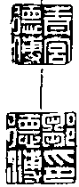
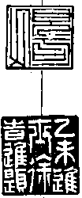
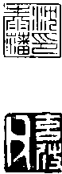
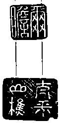
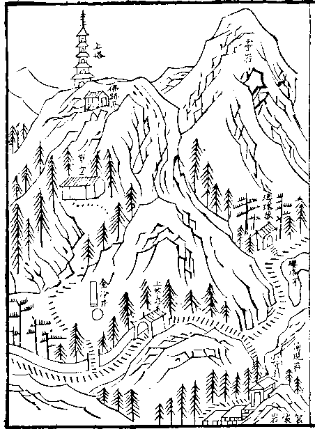
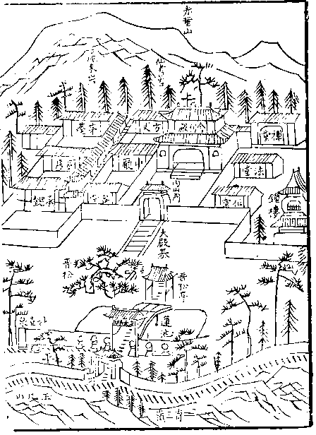
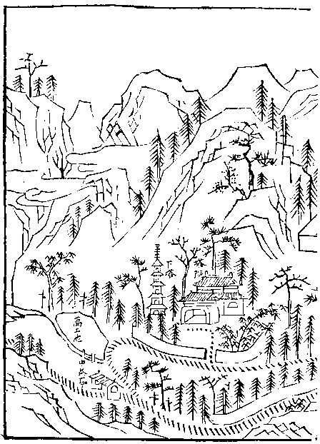
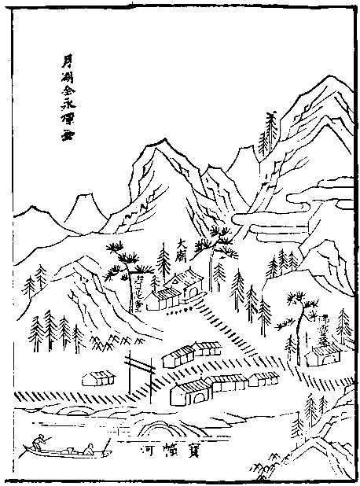
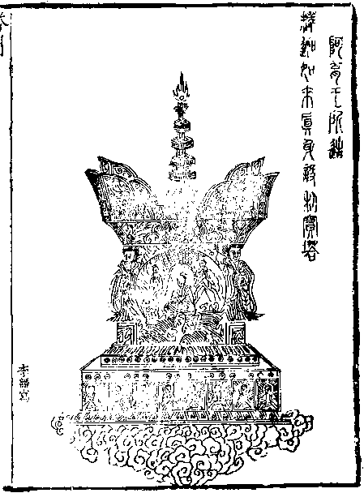

# 明州阿育王山志(第9卷-第10卷)



> **藏经**：中国佛寺史志汇刊（佛寺志汇刊）　**册次** 第 11 册（GA011）　**编号** GA0010　**部类** 史传部　**卷次** 8 卷　**篇幅** 79,620 字

> **卷／品**：0 卷 · 9 品



---



## 目录



  - [眀州阿育王寺志序](#眀州阿育王寺志序)

  - [眀州阿育王山志序](#眀州阿育王山志序)

  - [赠秘藏法师住持舍利殿序](#赠秘藏法师住持舍利殿序)

  - [娑罗林遗草序](#娑罗林遗草序)

  - [颐庵集序](#颐庵集序)

  - [四明阿育王寺重建塔殿募缘序](#四明阿育王寺重建塔殿募缘序)

  - [赠无漏瓶禅师序](#赠无漏瓶禅师序)

  - [赠秘藏法师住持舍利殿序](#赠秘藏法师住持舍利殿序-1)

  - [娑罗林遗草序](#娑罗林遗草序-1)



---



浙江鄞县阿育王山，为四明名山；距宁波城东四十四里。山中有寺，曰阿育王寺；寺中有一舍利塔，藏置舍利子，乃释迦如来真舍利，自印度流传至中华，时放光明。相传西晋太康中，有幷州刘萨诃者，於会稽得见宝塔涌自鄮峰，此宝塔光明腾耀，色青如石，中悬宝磬，周以天王及诸佛菩萨。义熙元年（四〇五），敕鄮山造塔亭、禅室，度僧住持守护。南朝宋文帝元嘉中（四二四～四五三），得迦叶佛爪发，乃诏造木浮图三级以藏之。梁武帝普通三年（五二二）敕建殿堂，赐额「阿育王寺」。明万历年间，泰和郭子章撰「明州阿育王山志」，因「普陀山志」例，条以义类，立以十门，门说四偈，门门各为一卷。其十门为：地舆融结、舍利缘起、塔庙规制、王臣崇事、神明效灵、瑞应难思、福田常住、高僧传法、提倡宗乘、玉几社咏。「地舆融结」者，通论地舆与别论鄮山，记地理也。「舍利缘起」者，记释迦如来真身舍利宝塔之缘起也。「塔庙规制」者，记阿育王塔之建造也。「王臣崇事」者，录帝王名臣有关本寺之文字也。「神明效灵」者，记神灵显异也。「瑞应难思」者，记轶闻显异诸事也。「福田常住」者，录檀越布施造塔建田碑记也。「高僧传法」者，记高僧传法行谊也。「提倡宗乘」者，记历代住持禅师也，有文献者记之，无文献者存其目。「玉几社咏」者，录有关艺文。体例特殊，全属释氏文献。至清乾隆年间，住山释畹荃复辑其艺文，纂「续志」，厘为六卷，未分门类，所录艺文，略按时代先后为序，末卷录有「先觉考」，所以补郭志之遗也。乾隆二十二年以正续合刻，都十六卷。兹据中央图书馆藏清乾隆二十二年（一七五七）正续合刊本景印。



------



### 眀州阿育王寺志序



余生平事佛，率以名理取胜，多采诸最上乗门，与吾灵台有所发明者而雅尚之；至於一切报应因果等说，皆置而弗问。中年宦辙四方，多更事故，凢有所求，屡著肹蚃。时虽或问，问而未加详焉。殆万历𢈏子，奉命讨播酋，以孤军冐重围，举家百口入於万死一生之地，恐畏百至。虽委身於国，聴命於天，而未尝不有祷於三寳。祷即应，应即审事，非影响加之与？关侯通於梦寐，播酋授首，多頼神𦔳。余於是不惟於报应之道加详，而於生平所尚名理益著。近奉㫖归养，乃舍宅建忠孝寺，皆所以报国恩、荅神贶，以彰至理之不诬也。吾儿孔延、孔太、孔陵，皆与余同茹荼甘，昭格见闻，故於此道颇遵庭训。陵儿以今歳壬子，当天王网罗多士之秋，将试铅椠於留都。乃先渡钱塘，逾鄮岭，觐阿育王寺真身舍利。一入殿堂，如善财之升弥勒楼阁，无着之登竹林精舍。已礼舍利，获覩种种祥瑞。宿种既萌，法雨复润；未𤼲者𤼲，已𤼲者长。即於塔前发种种誓愿，施寳龛一座，制以旃檀，餙以七寳，镂刻精致，巧夺人目。复施种种供具，兼为劝募修葺塔殿，重新先朝御制扁额。当是时，有秘藏理法师为住持。理公通名理，谙教相，勗徒众，精焚修，庄严净土於是焉頼。理公尝有意於山志，乃持是编以示吾儿。吾儿归，复持是编以进余。余念育王寺为天下第一丛林，盖借重於如来舍利光眀。自晋太康，厯六朝、唐、五代、宋、元，至我皇明万暦壬子，千有三百四十九年，其间灵异事迹、国朝典故、士庶投诚、文人翰墨，使如国之有史、家之有乗，日录而年编之，不啻汗牛充栋已也！乃今观其所集，不过录之碑碣、抄之藏典，仅得数万餘言；至於名公唱和，又皆取实於小师、考信於野录，不无亥豕鱼鲁之讹。余每阅斯文，未尝不置卷太息。因倣侯开府、屠仪部《普陀山志》，条以义类，立以十门。门说四偈，门门各为一卷，譌者正之，缺者补之。𠰥高僧，则寻《传灯录》，补之以传，删取机缘为宗门提唱，使后之作者随类而编入，无续集之劳。盖将舍利为如来，众制为说法，余偈为注脚；如《华严》尘说刹说、依说正说，主伴重重，无非华藏庄严，不亦四眀三佛地之一盛事乎！因为之序。赐进士第．资政大夫．兵部尚书．前廵抚贵州．兼督理湖北川东等处地方军务．都察院右都御史．泰和郭子章撰



叙阿育王山志



西昌郭大司马精忠纯孝，𣗳辟土之勋，世拜玺书无虗岁，公独归功於佛佑。帅其家茹澹忍苦，内外竭施；虑不克报慈恩，则又严餙鄮山舍利塔，志圣始末，𡸁之永久。其𠦑子太、季子陵，及育王理公，皆莲域再来人也。每向予述舍利灵光，恍如亲见如来。即一相好备知三十二相，即一光眀备知百千亿光；而一一相好、一一光眀，曲𥁞自性不思议之变化。要以人人具有灵光，患在自作二见耳！佛虽放光，寔乃开眼众生；众生虽不放光，寔乃不开眼佛也。同一法身，而众生各自有百千亿见；则同一佛光，而众生各自有百千亿见，何疑哉？予▆观舍利之光，常观自▆之光▆▆之光，时时灵变不可测，▆信舍利之光时时灵变不可测，与如来原无二性，𡩬有二光？原无二光，寜有二见？二见𥁞去，无法可执；不疑无作融通，不厌有为功徳，则尘尘刹刹，谁非舍利光哉？予独喜郭氏父子兄弟，不珍多寳而珍慧识，不珍慧识而珍灵光；借此霛光拨彼迷云，而司马深远矣！诸偈尘说刹说，放如来未放之光，开众生不开之眼，试问随喜者还无疑否？



万历丙辰仲冬吉，



太子洗马．安成觉海居士邹徳溥拜手识







------



### 眀州阿育王山志序



今震旦独眀州有舍利塔；自余少览图记，不无诧于其说，亦自咲夏虫之难语氷，未敢以窣堵涌地为荒唐矣。己游其处，诸灵异迹具在。塔质青莹古怪，镌镂生动，非人巧所得摹；不必俟暗发光，为世神物，可无思议矣！云舍利是如来灵骨；又有髪舍利、肉舍利，未必象质可数，有此殊相。佛成正果，弃捐六根，知有相之不存乎世也；独其神奇融结，茶毗不毁，则为舍利。要亦不必尽然，如洞师归诚於文潞，一祝满瓶，则直取之懐矣。文捷行遶，军持速缓，去住神变无方，则惟其人之名矣。咸平佛牙似汗涌身，飞空堕地，即汗即珠，又无幻之不真题。谛诸普门舍利不尽於此，而舍利灵変可略睹於此。余所得睹，一磬悬塔中，不盈三寸，舍利悬磬中。历代崇奉示现，所称如芡实，已如弹丸，已如瓜，最后如车轮。种种现相，道费而隐，俗之詟慑或在于此。而余所敬奉，则以其永保法轮长无灾害，非他道院经藏得与较隆替以为神耳。自佛入中国，其遭时废兴，亦似与元运相乗。始或倾王公、奔九州，而既则頺垣废圃，灌莾亍鼠鸮狐狢之塲。又其甚而为夙力顽悍所攘削，虽金刚迦圣亦不能以其力士神通为佛诃护。阿育古刹，何以得至今千三百年无恙哉？自晋而梁天监、普通，注向无论。迨唐而武宗汰天下沙门、毁梵宫，塔止越州府库，毋敢以渺易有损也。宋元赐额施帑，恭迎大内，备极香火供养之隆。入眀宣宗十年，遣礼官谕祭自学和尚，尤为异数。恢拓自今，堂殿焕巍，碧甍云拥，缁流戒洁，旦昏俨颙。住持正理，慈定无瑕，慧通三乗；又能以其暇纂集《育王山志》，宇内名流咸为讃善。脱非神灵长护不迁，有此耶？吾之独崇舍利塔以此。或曰：「塔自萨诃拜祈涌地，到今千三百年乃有志，何旷也？」当为善知识化身有待耳！且佛存寂，千载一瞬，正亦不谓远矣。余为志序，不叙因果报应，而因果报应自在。或又清曰：「塔无毁与？」曰：「佛亦灭度，何有於塔？有灭、有长不灭，而佛自在。」宣律师云：「沉冥之相，以理括之；未曾持观，不可以语。」噫嘻！即余得观，当复何语？余所爽然。昨宵清话，舍利在空中，塔是空中影，吾与理师相视叹，共证此题。



万暦戊午五月，甬上知白居士徐时进拜首譔







玄仗居士沈泰藩书







眀州鄮山阿育王舍利塔记



梵语「舍利罗」，此云「身骨」。惟我世尊，於旷大劫，以金刚心薰修金刚三昧，直至成佛，曾无异念。故变缘生五蕴幻身成金刚体，即如来法身，常住不坏、永无生灭。佛十身中有力持身，此其一也。是以如来应现娑婆，示生迦维，说法四十九年。化缘已毕，於拘尸罗城娑罗林双𣗳间，入大涅槃。时彼国王如法茶毘，得舍利八斛，分为三分，天上、人间、龙宫各起塔供养。而人间八国分之，摩伽陁国阿阇世王得其一分，有八万四千颗。至阿育王，有大神力能役鬼神，乃碎七寳末，造八万四千塔，遍散四洲；而南𨶒浮提为身教地，故塔居多。其来震旦者一十有九，唯金陵长干与眀州鄮山显赫最著。予幼出家长干，屡覩光瑞，种种不可名言。虽未至眀州，蚤闻感应之徵。今见理公所寄《育王山志》，读之，感而叹曰：「此我本师现在世间说法处也！」夫舍利者何？乃一真法界常住真心广大光眀之体也。诸佛证之为清净法身，菩萨修之为金刚心地，众生迷之为阿赖耶识。其不坏者为佛性种子，名佛知见。以其众生本具，故佛出世特为开示，使其悟入。祖师西来，指之为心印。是知众生与佛无二无别，苐染净熏变之不同耳。以众生无眀业力念念薰蒸，故感四大五蕴腥臊臭秽不净无常败坏之身。其不坏者，为轮廻业果，厯劫不㤀。菩萨以之为定慧薰习，得意生身，调伏众生，净佛国土；其不坏者，微妙功徳，成就庄严。唯佛证之为清净法身，常住寂光，身土不二。其现大身，则无量光眀相好，居华蔵庄严，名实报身。其现小化，则丈六金身，示生人间，与民同患。而众生见者，但见缘生之佛，不见法身真体。将显法化无二，无常即常，故入般涅槃，而留舍利摄受众生，名力持身，以示金刚不坏。法身常住世间，本无生灭去来之相，故所现光相种种瑞应不可思议，随众生心感而应现者，即法身应机说法，以离言三昧直指众生本有佛性，欲令见者当下了悟自心，顿见法身不生灭性。此与灵山踞座，末后拈花，有何异哉？故佛出世说法四十九年，无非指示此一大事。而於法华一会开示众生佛之知见，以此知见即法身慧命。故云「此经在𠁅，应以七寳起塔」。况佛知见又为文字所障。至𠰥诸祖直捷示人，而形於棒喝讥呵怒骂之间，而人又以机锋目之，将谓别有玄妙，故悟之者希。今者亲见法身如来觌面为说不生灭法，而人不悟诸己，槩以光明瑞相视之。诚谓当面错过矣！可不哀哉？且而人也沉沦多劫，流转生𣦸；今者何幸何缘，一遇希有难遭之事，犹自迷头认影，岂不有负真慈、自昧本有？可不为之大哀欤？昔佛於法华会上，自说法身寿量常住不灭，比但托之空言，未有𠰥此见诸行事之深切著眀者也！惟普贤以十大愿显示法身，乃曰「请佛住世，劝转法轮，常随佛学」之三者义昭於此。初僧会至长干，吴主孙权命求舍利，期以七日；不应，展三七日；中夜犹不应，会稽首而哀请曰：「佛以慈悲为心，苟不应，则使此方众生断灭佛种矣！」於是痛举佛号三称，遍身毛孔血汗迸洒，即聴瓶中铿然有声，光烛天地，启之则舍利宛在瓶中矣。刘萨诃身陷地狱，将无出期；乃聴梵僧指求舍利为懴罪地，故感寳塔从地涌出。是知康为人，刘为己，均皆普贤劝请之意也。𠰥夫种种庄严供养、守护讃叹者，岂非常随佛学者欤？且也佛性之在众生，固其迷矣；𠰥夫般𠰥光明常然而不昧者，𤼲於行事，𠰥世之忠臣孝子、志士仁人，凡所施作致君泽民而为不朽之事业者，岂非法身所𣴑衍乎？其厯代帝王崇奉兴隆者，讵非法王之利见乎？緫之，无一众生而不具有此性，故见闻随喜礼拜供养者，无异亲承接足，即布身命、罄所有、竭内外施而为庄严，特为自性受用地耳。𠰥夫一覩舍利，顿破无眀、了悟法身、长揖生死、永出迷途者，是在上根利智、夙具闻薰、缘熟於当下者，不无其人也。由是观之，累代王臣兴建於前，太宰陆公、相国沈公重兴於昔，司马郭公及诸公子再振于今，且托法身於毛端三昧，以见不朽，是又皆普贤愿轮所持也。鄮山住持理公，岂佛称空生、身子为长老乎？予自信灵山一会俨在目前，说法音声炽然无间者也。故特书此，以告见闻随喜礼拜供养者，不得以色相求之也。



明万历四十七年歳次己未佛降生日，



匡山五乳法云寺憨山沙门释徳清撰







(伏读憨大师所撰舍利记，合掌讃叹，诚为第一希有！𠰥非文字般𠰥从三昧流出，安得具大辩才、善说法要如此？余谓住持理公曰：「此记住处即舍利塔，普愿法界一切众生皆以香花供养而敬礼之。」理公，字秘蔵，余同叅兄，宛陵人也。今梓而布之，为作随喜功德。)



(四眀山僧圆复跋)



阿育王志䟦



余不及覩阿育王寳塔舍利，相传终涉影响，迨其详载郭大司马志中，壹𠰥勗余闻思修者。而其住持秘藏，顾强余圆满末后一句，又作何见解乎？大约舍利者，释迦文定力所证。佛不爱骨，故涅槃施焉；王不爱寳，故窣堵波布焉。能究斯㫖，悲度一切，即忠可尽瘁，孝可竭蹷；身外长物，庸何爱哉？而司马氏之爱河且蚤清矣！当播酋未平，百口深入荒徼，从兠劒中磨鍊一过，卒能底定，以奏无前。此其中，壹惟报君显亲，先已树基得定，而后乃归为方外。适也举室茹素，相为勤施，甚至大忠孝寺不靳重赀新之。其于世不屑屑然，光明种子直自性了之耳。矧类相感应，其子𠰥孙不亲觌灵光也哉？于是公子孔太、孔陵軰，续阿育王之举，各捐修塔殿，俾镇海邦、祝万年。代父舍者子也，为君祈者臣也，又非自利福田而已也。然则编述斯志，无非忠孝剩㫖，虽谓公笔端三昧可矣！



万暦丁巳岁季冬月吉旦，吉水邹元标书







《育王山志》者，总载于大司马郭公，校正于少宰周公，而赞成於海内诸缙绅、名公、居士者也。卷凡若干，与夫撰碑、立传、文辞、诗疏，犁然具载。前朝殿毁，简籍煨烬。古未有志，先师在日，㥬搜愽采，获比隣胡隐士家藏本。考索读之，若登山之有梯、浮海之有筏焉。时先师承太宰陆公之命，及礼部给劄住持，羁于殿事，未竟厥志而只履西归矣！理以颛蒙，谬承衣盋，绵力是惧。旦夕拮据，幸免坠绪。至传天台教观，实得于有门大师而已。滥登讲席，适之逢大司马郭公重建宋高宗御制佛顶光明之墖，即以《育王山志》为请。公欣然命笔，浃旬而成，遂为一代鉅典。鄮峰玉几，如增而高，岂特舍利辉煌而已哉？诚为佛法金汤，不可淂而思议者也。理谓如来演说如筏喻者，法尚应舍，何况非法？则此《山志》殊觉赘疣！不知文以载道，道由文显。淂鱼兎而执筌蹄固非；舍筌蹄而求鱼兎，亦非也。故曰：渡河须用筏，到岸不须舟。敢以告夫文字性离者。住山沙门正理和南撰



阿育王山图























明州阿育王山志十门总目



第一卷地舆融结



第二卷舍利缘起



第三卷塔庙规制



第四卷王臣崇事



第五卷神明效灵



第六卷瑞应难思



第七卷福田常住



第八卷高僧传法



第九卷提唱宗乗



第十卷玉几社咏



第十一卷清住山释畹荃补遗



第十二卷清住山释畹荃补遗



第十三卷清住山释畹荃补遗



第十四卷清住山释畹荃补续



第十五卷清住山释畹荃辑续



第十六卷清住山释畹荃辑续



明州阿育王山志第一卷目录



地舆融结(偈四)　(论二)　(郭子章)通论地舆  

别论鄮山



山隂　祁承㸁　夷度父　校



△地舆融结



粤惟菩提道塲，基抵金刚；匪兹坚固，曷居法王？谛观舍利，尘尘觉帝；神圣所都，孰言容易？是即灵山，是即摩竭；须弥有坏，此无震裂。咨尔山灵，异尔比丘；作难思想，呵护勤修。志地舆融结。



通论地舆



𧓍衣生曰：「人间世何所有？三才而已矣。曰天，曰地，曰人。天位乎上，地位乎下，人位乎中。天何所有？气而已矣。气无其形，空而已矣。地何所有？水土而已矣。金木火，皆土之变也。故知：天，五行之消息者也；地，五行之变化者也；人位乎中，又得五行之性情者也。然则天虽位乎上，亦位乎下；地位乎下，实位乎中，故曰天如卵白，地如卵黄。第此方论天地六合，为言得其形似而已矣。方外为言天无涯而地无涘，论涯涘者，约一佛化境也。何以言之？葢一佛化境，谓之三千大千世界，有百亿日月、百亿须弥山、百亿大海水、百亿鐡围山、百亿四大洲。鐡围绕其外，海水聚其内，须弥屿其中，四洲罗其下，日月照临乎其上。百亿鐡围之外，更有一大鐡围总括之，以形如棋布，总之以枰。大千外更有大千，不知其纪极，故曰天无涯而地无涘。然则载山岳者海，载大海者地，载大地者水，载水轮者火；载火轮者金，载金轮者又风轮为之执持也。故《楞严》云：『觉明空昧，相待成摇，故有风轮执持世界。乃至寳明生润，火光上蒸，故有水轮含十方世界。』是则地依乎水，水依乎火，火依乎金，金依乎风，风无所依，依空而已。故曰天位乎上亦位乎下，岂非上天之上复有大地，大地之下复有上天？横论世界已如彼，𥪡论世界又如此，天岂有涯乎？地岂有涘乎？今之论山源者，曰中国五岳七山皆自昆仑发源。夫世界初成，岂有先后？高原平陆一涌而纎悉毕具。不观之洪水初落乎？江河之畔，沙聚垒垒，高者下者，竣者夷者，是水之洮汰也，风之皷击也。醯鸡而五岳之，蝼蚁而七山之，南柯之王将迁都而长安之矣。今之大地亦若是也。然则古之论山源者非乎？曰：亦是也。第究其山而不究其水，亦不究其气；非不究也，究之不得其经也。以余言之，山无本末，水有源流；气寓其形则聚，不寓其形则散。形者山也，故曰乗风则散，界水则止。故今之论源约其气，论气约其水。若曰山源，岂其然乎？然水无定止，因山而为源；山无自体，假气以为因。葢山之形势必中高而边下，如人身之有顶𩕳四支相为高下。既非先顶而后支，岂可以顶𩕳为源而四支为流乎？虽然一身莫尊乎顶，气之所聚非顶也；众山莫尊乎祖，气聚非祖也。然有大聚焉、小聚焉，始焉、中焉、末焉，聚而复散焉，散而复聚焉。中国名山祖於西域雪山，其次昆仑，又其次为五岳七山，离而复合，合而复离。又有合而不离，离而不合者，不知其几。合而不离者其气聚，聚则成焉；离而不合者其气散，散则败焉。又有成而贵焉、贱焉者，合而复离，离而复合，如父生子，子生孙；子又为父，孙又为子。或子贵而父贱焉；子贱而父贵焉，贵贵贱贱，父父子子，直趋大海而后已。故曰界水则止。」



别论鄮山



育王山去府治四十里，其源始於天台。天台山有九峰，形如八叶莲花，华顶峰当其中，是为花心。正东一峰，谓之摘星。自摘星峰发支，至奉川为二，一支为仗锡、为雪窦，一支为金峩、为护圣。由陬溪管江为云峰、天童太白山，育王山实以太白山为近祖。自太白，衍为玉几峰；一支去东南二里而止者为白云山，一支於东北过峡起高顶为鄮峰，即舍利涌出之所，今上塔是也。鄮峰凢为二。一於本身抽三小支：一短支为列祖方坟；次长者为大殿坐山；又一次长者为下塔西退居，此本身之脉络也。一於孝顺岭过峡起高者为赤堇山（鄞县古称「鄮」、称「堇」，以此）。由赤堇又过峡为寳幢山，形如钵盂，又谓之钵盂山，山之形势自西而南。自南而东为玉几，从东过北为鄮峰，由北至西为赤堇，自西环南为寳幢。盘廻不出十里，纵横不外千武。左折右曲，东瞻西顾，古称「六殊胜」、「八吉祥」，非虚也。寺景之胜者，有迦叶左足迹蹈巨石上，覆以石亭，谓之佛迹亭。去亭咫尺涌现岩，乃塔涌之所。去鄮峰绝顶，天空海濶，可以四望，谓之极目亭，又谓之「望海亭」。由亭而下有损岩，巃嵸嶻蘖，土山之中偶生片石，亦竒观也。古镌「损岩」二字，故名。岩下有小涧，涧水潺湲不绝，理法师累石以渚其流。山水辉映，竹木交翠。岩之上下可列坐十数人，闻幽溪师偕元素、休远、慧日、秘藏相与煮茗，赋诗其下。方丈后有仙人岩，葛仙翁书「才坤」二字。寺东有妙喜泉，泉因妙喜老人得名，文见乎碑。去泉半里许有金沙井，去井数十步有龙潭，潭上有龙王祠。龙即灵鳗，菩萨护圣济民，屡著肹蚃，有司岁致祭焉。玉几山有大权洞、七郎岩，赤堇山有飞来岩，明堂嶴有鬼谷祠，灵岩有塔峙嶴。去育王十里有乌石嶴，相传有僧随阿育王安舍利塔，未得道者堕地化为乌石，石上现袈裟纹，明显可观。又有月现岩，上有晕如白月，故名。石傍有七佛潭，古称七佛澡浴其水，故名。嶴底有窣堵波，慧逹大师灵骨瘗焉。大率山不自胜，因人而名。此山自太古来，土阜而已；一有舍利，便与名岳争光。历代王臣崇奉之，高僧护持之，文人讃咏之。山韫玉而生辉，水藏珠而增媚，有以也夫！



明州阿育王山志第二卷目录



舍利缘起(偈四)　(郭子章)释迦如来真身舍利寳塔传　(释悟光)  

天人造塔缘起(缘起四)　(释传灯)  

阿育王造塔缘起  

刘慧逹求塔缘起  

重建塔殿缘起  

述意(舍利篇五)　(释道世)引证  

佛影  

分法  

感福



礼鄮山舍利塔记　(郭子章)  

寄铭阿育王塔　(王尔康)  

讃鄮山舍利塔颂　(杨嘉贞)  

瞻礼阿育王寺舍利塔记　(王应乾)  

礼舍利记　(吴用先)



舍利记　(王在公)礼阿育王寺舍利塔偈　(郑鄤)



松溪　魏濬　禹钦父　校



△舍利缘起



人亦有身，念念烦恼；佛岂无身，尘尘相好。戒定餘勋，万刼不坏；机息应灭，不灭者在。八万四千，此当其一；如析栴檀，一即一切。物转即人，转物即佛；观象得意，斯人弥勒。志舍利缘起。



释迦如来真身舍利寳塔传



四明阿育王寺，释迦如来真身舍利寳塔。按僧统赞宁传，世尊入王舍城乞食，路傍有童子戯沙，即以沙为𪎊，殷勤奉施。佛授记曰：「此童子，吾灭度后，於阎浮提作銕轮王，四大洲中悉皆臣伏。取吾八塔真身舍利，造八万四千塔，於一夜役诸鬼神徃四天下供养。」佛灭度后果符昔记。时耶舍尊者於五指间放八万四千道光明，诸天夜叉众各随光中徃四天下，遇八吉祥、六殊胜地，乃安一塔，此其一也。西𣈆太康中，并州刘萨诃弋猎为生。病至死，见一𣑽僧语曰：「汝罪重，应入地狱。吾愍汝故，宜徃洛下、齐城、丹阳、会稽有阿育王寳塔䖏，顶礼懴悔，得免。」既苏，出家，名慧逹。徧求会稽海畔山泽，莫识基绪。夜闻地下钟声，精诚恳切。三日，寳塔从地涌出，光明腾耀，色青如石。高尺四寸，广七寸；五层露盘，四角挺然；四面窓虚，中悬寳磬。周以天王及诸佛菩萨、善神、圣僧、天神绕塔，像极精巧。逹每闻钟声，见塔，悲喜懴礼，瑞应颇多。刘萨诃者，利宾菩萨示现也。唐僧宗亮诗云：「銕轮王使鬼神功，灵塔飞来鄮岭东。有客不随流水去，磬敲踈雪细云中。」东𣈆丞相王导初过江，有道人来告曰：「昔与阿育王同游鄮县，安真身舍利寳塔。阿育王与真人捧塔飞空入海，诸弟子中有未得道者，攀引不及，一时俱堕，化为乌石。石为人形，上有袈裟纹缕。」郡守褚琰取看，竒之。至今村名「塔墅」，𡒃名乌石。义熈元年，敕鄮山造塔亭禅室，度僧住持守护。宋元嘉中，遣陈精并僧道祐广兴创建，掘基下得石函，盛玻瓈钟，覆以铜镜，又金盒盛银罂，安三法身舍利并迦叶佛爪一（其色红）、髪一茎（伸之数尺，置之成螺），文帝诏造木浮图三级藏之。竟陵王欲增成五级，梦神告曰：「此塔三十年后有大力人增添。」梁武普通三年，敕建堂殿房廊，赐额「阿育王寺」。大同五年，上座僧绶奏木浮图隳损，敕岳阳王萧𧦴增修至五层，施金五百两，铸金铜像四百躯、写经论五百卷、铸四大鐡𪔂以镇四角。传武帝、昭明二真安塔内。𧦴寻取石函内舍利三颗浴之，呪曰：「浮者进上。」其最大者浮，乃遣主书吴文宠、僧琏等四法师同进。因敕免庄赋，给兵士三千人，置营防卫，一时名士倾心皈向。陈宣帝遥敬，度二七僧。唐太宗时瑞现尤数。永徽间，䖏士张太元闻塔前诵《金刚般若》。垂拱间，士曹唐元默迎塔到越，忽飞在西家屋上，即送还本寺。中宗敕送供施，招僧栖旷，如法香火。国清智晞尊者到寺，礼八万四千拜，旋绕数周。忽紫文印於臂，方整明亮，终身不没。临终谓弟子曰：「众圣封印，心无虚焉，吾定生弥勒内院矣。」武宗澄汰沙门，塔止越州府库。宣宗重兴教法，塔入开元寺。鄮山僧论请，观察判官蒯希逸判归育王。大中𢈏午岁正月，八千餘人传塔供养，天华纷纷散落如雪雨。以手擎，旋取旋化，夜初放五色光明。是年新罗僧盗塔，手捧绕亭亘夜，而行不离本䖏。懿宗咸通中，观察使杨严奏度三七僧精严香火，且云：「舍利寳塔灵异，寔国内福境。」天祐中，太守黄晟迎塔归奉化。登舟顿重，众力莫举。钱武肃王贞明二年十二月，遣弟铧并僧清外等，具舩舫香花迎塔。明年上元夜回，止西陵岸，祥光明照，江中如昼。武肃王躬扶彩舁，从行至罗汉寺，广陈供养。一僧顶戴，手搦一角堕地，随手安著，屹然不动。虔祷至晚，其角火星迸散，始知神力补铸。丁丑岁，敕造木浮屠九层，舍利塔安七寳龛中，累岁大会多睹光明。据《感通传》，天人云有塔二。今鄮县是阿育王古塔，乃萨诃求出者，人天㳟敬也。小塔是贤劫初佛者，中有迦叶臂骨，罗汉将徃鐡围山，非人所见。又按僧从廓记，宋绍兴间，高宗书「佛顶光明之塔」六字。淳熙二年闰九月廿一日，皇子判府魏王恺体塔制，度以金造成。奉安寳塔於中，自赞四章，刻塔四旁。当年十一月廿八日，孝宗遣供奉李裕文降香传宣迎塔。五日塔至，帝素饍，焚香瞻敬，未有所覩。屏左右再祈再祷，忽舍利塔尖上涌现如月轮相。次日帝又祈祷，舍利复现，寳塔两角如水晶珠。是日敕从廓入内问法，赐「妙智禅师」之号。廿九日皇太子精诚祈祷，舍利现寳塔相轮第二层，累累如水晶珠。次年正月七日，帝於碧琳堂瞻敬，舍利现塔角，如淡金珠。是日书「妙胜之殿」四字赐本寺奉安，仍赐行者度牒五道、钱万缗，敕徐德荣与从廓奉塔还山。又按僧行弥续传，大元至元十一年，丞相伯颜南征，天下归仁，怜占加僧录安抚江南僧尼事。明年三月奉㫖迎寳塔，五月抵开平府，百官四众争先迎睹，如面觌紫金光聚。奉安华严寺，大集衲侣𣑽呗歌诵，竟七昼夜，𥁞诚尊奉。留一月，奉㫖送大都大昊天寺供养。九月一日迁置玉塔寺，集诸国僧凢一十万人，於禁庭、万岁山、皇太子府、镇国寺、太庙、中书省、枢密院及府库等䖏立十六坛塲。有司供具殽饍灯幢，金珠间错，示极尊严，为国祈福。初三日车驾亲临玉塔寺致敬。是夕瑞光发现，贯烛寳塔相轮之表；自相轮分色，祥光东射禁庭，晃耀夺目，天人共睹。殊胜之盛，未有若此。明日奏闻，皇情大悦。初八日大赦天下。初九日毕会，赐禅讲大德衣银币各差；施牒广度僧尼；遣怜占加大师、南方大德慈祥宣使张德庆、忽卢儿等，迎捧南归。敕所过州县，导引入境，以福黎民。十二月十九日抵鄞，邦人驩呼鼓舞，塞途溢巷，如赤子见父母之归也。明日抵玉几，大师擎捧寳塔，宣传玉音曰：「佛以慈愍视一切，去住何分南北？但天龙侍卫化摄有方，滞於爱执，宁忍舍鄞？况海东之民，皆吾民也；其不汝执，俾福是邦！」言未既，空中瑞现，累累如珠，绀红五色，光彩散乱，万人稽首叹曰：「吾佛光明之所照，吾君圣德之所被也！」恩赐御香、缯布、金银等，复令省府州县供给所需，增搆寳殿，不日告成。自得神圣感应颇多，未能具述。今摘其本末并图畫塔像，以便缁素瞻礼者。至正乙未五月，住山佛日圆明普济禅师悟光谨识



天人造塔缘起



娑婆教主释迦牟尼佛，经三阿僧祗刼修行，将成佛道，从兠率天宫降神中天竺迦毘罗卫国净饭王摩耶夫人胎。当此土周昭王二十六年甲寅四月八日午时，从母右脇生於毘蓝园中。十九岁逾城出家，於雪山中六年行满。当周穆王癸未腊月八日，夜覩明星，成等正觉。说法四十九年，七十九岁於拘尸罗城说《湼槃经》。当穆王五十三年壬申二月十五子夜，入般涅槃(涅槃：𣑽语，此云灭度，谓已灭烦恼、已度生死)。拘尸城人秉佛遗嘱，依轮王法用七寳庄严金棺、无价白㲲殓金色身。将欲茶毘(茶毘：𣑽语，此云火化)，天龙人鬼火不能烧；如来以大悲力从胸中出三昧火，渐渐茶毘。经三七日，帝释天先取右畔上颔牙舍利，还天起塔供养。尔时世尊大悲力故，碎金刚体成末舍利八万四千颗，惟留四牙不可沮坏。拘尸城人以八金坛各受一斛，盛佛舍利入城供养。时八大国王各各举兵来争舍利。有烟姓居士告以如来忍法，用息其争；分作八分，拘尸国得一分。波尸国得一分，师伽国得一分，阿勒国得一分，毘耨国得一分，毘离国得一分，迦毘国得一分，摩伽国得一分，各於国中起塔供养，是谓阎浮提八舍利塔。



阿育王造塔缘起



昔世尊入王舍城乞食，路遇童子聚沙为戯，见佛威仪，心生欢喜，即以沙土为𪎊，殷勤奉佛。佛即受之，乃授记曰：「此童子，吾灭度百年后，𨶒浮提中作鐡轮王，有大威德，四大部洲悉皆臣顺。取吾八塔真身舍利，造塔供养。」灭后果符昔记。阿育王有大神力，能役鬼神，於一夜中碎七寳屑成八万四千寳塔，每塔安舍利一颗。时阿罗汉耶舍尊者於五指端放八万四千道光明，阿育王令诸夜叉各随光明徃四天下，遇八吉祥、六殊胜地，乃安一塔。计震旦国中有十九䖏，四明鄮山所涌之塔是其一也。



刘慧逹求塔缘起



𣈆武帝太康三年壬寅，有并州离石人刘萨诃弋猎为业。病死，见一𣑽僧谓曰：「汝罪重，应入地狱，吾甚悯汝。今洛下、齐城、丹阳、会稽并有古塔及浮江石像，悉是阿育王所造，可勤求礼懴，得免此苦。」既苏，改业出家，更名慧逹。如言南行，至会稽海畔山泽遍求莫得。正烦恼间，偶闻鍾声殷殷响地下。慧逹竭诚恳求，三日，忽见寳塔从地涌出，光明腾耀。其状青色，似石非石；高一尺四寸，方广七寸；露盘五层，四角挺然；中悬金色小鍾，舍利缀於鍾下，圆转不定。绕塔四周，俱是镂空诸佛菩萨、金刚圣僧、八部等像。神工圣迹，非人力所及。塔之肇始，寔於斯时矣。



重建塔殿缘起



自舍利显迹西𣈆太康壬寅，历代王臣咸覩祥瑞，兴建殿宇，竭诚崇奉。入我皇明，至今上御极，已一千三百餘年矣。其间兴替，历历可考。万　丙子秋，平湖陆五䑓公特来瞻礼。初见舍利，大如芡实，已如弹丸，已大如𤓰，最后大如车轮。五色变幻，光彩射日，语具公所撰疏中。于是谋之司府四明士夫，命本山僧法悟重建塔殿。下立石浮屠高二丈许，䂓制倣寳塔，而藏寳塔於其中。工未半而法悟殁。公复谋诸沈相公、屠仪部，访延台教沙门传瓶继董其事。山门、廊庑、僧室、禅堂，百堵云兴。石塔涂金，榱题藻绘；旛幢寳葢，金碧辉煌，真东南之寳渚也。瓶公殁，弟子正理奉劄住持，加护守成，亦禀师范。壬子岁，泰和郭司马公两公子孔太、孔陵，先后到山瞻礼舍利，咸覩光相，各有撰识。宿种既萌，法雨𣸪润；未发者更发，已发者增长。即於塔前发弘誓愿，奉施旃檀寳龛一座。法筵供具，种种悉僃，既精且好。复为劝募，修葺殿塔，重新先朝御制扁额。等因岂人谋能致？皆圣力𡨋加也！由是观之，凢诸檀越，非禀灵山付嘱，乌能不谋而应哉？



(𣑽语)「舍利」者，如来之灵骨也。又翻坚固子，又翻珠子。葢累劫戒定之餘勋，金刚妙体之遗烈。人身有八万四千毛窍，以逐𡚶轮廽故，成八万四千尘劳；佛身亦有八万四千毛窍，以𨑰𡚶归真故，成八万四千舍利。金刚坚固，不可沮坏。遗泽留芳，福彼尘劫。使末世众生恭敬瞻礼，结当来成佛之缘，岂小补哉？四方道俗不悉颠末，住持理公乞余表出，使远来随喜者庶知厥由云。万　甲寅夏五，天台末裔比丘传灯和南撰



舍利篇述意(出《法苑珠林》)



夫圣德遐邈，冠绝人天；理妙六经，神高百世。超群有之遗踪，越贤良之胜迹。化缘既终，从俗韬灮。故双树八枝，随义所表；舍利八分，亦遂缘感会。入金刚定，预碎全身，欲使福被天人，功流海陆。至於牙齿髪爪之属、顶葢目睛之流、衣钵瓶杖之具、坐处足蹈之迹，囊括今古，圣变无穷。祥应荐臻，瑞光频朗；贤愚共覩，岂猜来惑？且如三皇、五帝、夏、殷、文、武、孔丘、庄、老，惟圣惟贤，共遵共敬；莫不葬骨五泉、遗尘九土。声光寂寞，孰识其踪？罕知生福，奚感来报？岂比能仁大圣形影𡍮芳？应感之道不穷，敬仰之风逾远；绍化迹於大千，抜沉𡨋於沙界。致使开示之道随义或殊，会空之㫖齐其一实也！



引证



「舍利」者，西域𣑽语，此云骨身。恐滥凡夫死人之骨，故存𣑽本之名。舍利有其三种：一是骨舍利，其色白也；二是髪舍利，其色黑也；三是肉舍利，其色赤也。菩萨、罗汉等亦有三种。若是佛舍利，椎打不碎；若是弟子舍利，椎击便破矣。



又《菩萨处胎经》云：世尊告诸大众：「念我古㫺所行功德，舍身受身非一非二，今当为汝说一形法。诸佛全身舍利，尽在下金刚刹中。金刚刹厚八十四万亿里，下有诸佛碎身舍利𥁞在彼刹。彼有佛刹，名曰妙香，佛名不住，如来十号具足，今现在说法。」佛告大众：「碎身舍利下厚八十四万亿里，国土清净，佛名徧光，十号具足，彼佛今现在说法。复下有国土，名施无尽藏，佛名劝助。复下有国土，名法皷，佛名善见。彼土乃有全身舍利，过去亿千万佛皆留舍利。彼土舍利，我亦有分。」



又《海龙王经》云：尔时诸龙白佛言：「今世尊还阎浮利地海中，诸龙无所依仰，惟加大哀。佛灭度时，在此大海留全舍利，一切众类皆得供养。转加功德，速脱龙身，疾得无上正真之道。唯佛𡍮恩，威德兼加，所愿得果！」佛言：「善哉！从尔所志。」须菩提谓诸龙言：「一切人天，舍利须徧，普蒙获济。卿等求愿，使佛舍利独全奉侍，一切众生何缘得度？」诸龙答言：「唯，须菩提，勿宣斯言！无以己身限碍之智，以限如来无极之慧。如来圣德无不变现，三千世界各各化现。佛全舍利不增不减，普现一切，譬如日影现於水中。佛亦不生亦不灭度，云何欲限如来智慧者乎？」须菩提闻，默而无言。佛叹诸龙：「仁等贤明，诚如所云，无有异也。佛道高妙，无边无际，无方无圆，无广无狭，无远无近，譬如虚空，不可为喻！」



佛影



如《观佛三昧经》云：佛初留影石室，在那乾阿罗国毒龙池侧、阿那斯山岩南，有五罗刹女与毒龙通，恒降雨雹，百姓饥疫，已历四年。时王祷祀呪，龙、罗刹女气盛，呪术不行。王长跪合掌，赞佛通慧：「应知我心，愿屈慈悲，灮临此国！」尔时如来往至彼国，龙兴雷电，鳞甲烟焰，五罗刹女眼如掣电。时金刚神手把大杵，杵头火然如旋火轮，烧恶龙身。龙王惊怖，走入佛影，如甘露洒。见诸金刚，极大惶怖，为佛作礼，五罗刹女亦礼如来。龙王於其池中出寳台奉佛，佛言：「不须汝台，但以罗刹石窟施我。」诸天各脱寳衣拂窟，佛摄神足独入石室，令此石上变为七寳，时龙为四大弟子及阿难造石窟。尔时世尊从石窟出，时龙闻佛还国，啼哭雨泪云：「何舍我？我不见佛，当作恶事，坠堕恶道。」佛安慰龙：「我受汝请，当坐汝窟中。」经千五百岁，佛坐窟中，作十八变，踊身入石，犹如明镜在於石内，映现於外。远望则见，近望不现。诸天百千供养佛影，影亦说法，迄今犹现。



分法



如《菩萨处胎经》云：时八国王共诤舍利，有一大臣名优波吉，谏八国王：「何为兴兵，共相征伐？」尔时帝释即现为人，语王言：「我等诸天亦当有分，若共诤力，则有胜负。幸可见与，勿足为难！」尔时阿耨达龙王、文邻龙王、伊那钵龙王语八王言：「我等亦应有分，若不见与，力足相伏！」时臣优波吉告言：「诸君并止，舍利宜共分之，何须见诤？」即分为三分，一分与诸天，一分与龙王，一分与八王，分瓮受一石餘。此臣以蜜涂瓮里，以瓮量分。诸天得舍利，还於天上，即起七寳塔。龙得舍利，还於宫中，起七寳塔。臣优波吉著瓮舍利并瓮，亦起寳塔。灰及土量得四十九斛，亦起四十九寳塔。阇维处亦起寳塔，高三十九仞(一仞七尺)。



又《阿育王经》云：八国王诤舍利，各起兵，天帝释自下晓喻，以金甖分之。阇王其数各得八万四千舍利，惟有佛口一髭无敢取者。以阇王初来，得舍利及髭，还大欢喜，作乐动天。难头禾龙王化作人身，到泥洹所，道逢阇王，还语王言：「可持一分见与？」王言：「不可得！」龙王言：「我是难头禾龙，能举卿国土著八万里外，磨碎成屑。」阇王怖惧，即奉佛髭与之。龙王即还须弥山下，起水高八万四千里，起水精瑠璃塔。阇王终后，阿育王得其国土。时有大臣白阿育王言：「难头禾龙先轻阇王，夺佛髭去。」阿育王闻，大瞋怒，即𠡠诸鬼神王作鐡网鐡𦊨，纵𦊨须弥山下水中，欲缚取龙王。龙大惊怖，共设计言：「阿育事佛，当伺其卧，取宫殿移著须弥山下水中，其瞋必息。」即便遣龙捧取育王宫殿。王卧觉，不知是何处，见水精塔高八万四千里，喜怖交心。龙自出谢言：「阇王自与我佛髭，我不夺也。佛在世时与我要言，般泥洹后刼尽之时，所有经戒及袈裟应器，我皆当取，藏著是塔中。弥勒来下，当复出著。」阿育王闻此言：「大谢！实不知此。」龙王便使诸龙还复王宫殿，置於本处。



又《善见论》云：帝释宫内有二舍利：一、佛右牙，二、佛右𨶕瓮骨



又《十诵律》云：佛般泥洹，八国皆来求舍利，各举四兵，八军团遶。有一婆罗门姓烟，高声大唱言：「诸力士，舍利现在当分作八分！」诸力士言：「敬如来议！」更复唱言：「盛舍利瓶，请以见惠，还头那罗聚落起塔！」时毕波罗延那婆罗门复请烧佛处炭还国起塔。时拘尸城力士得第一分起塔舍利，即於国中起塔。波婆国得第二分舍利，还归起塔。罗摩聚落拘楼罗得第三分舍利，还归起塔。遮勒国诸刹帝利得第四分，还国起塔。毗兠诸婆罗门得第五分，还国起塔。毗耶离诸利昌得第六分，还国起塔。迦毗罗婆国诸释子得第七分，还国起塔。摩伽陁国主阿阇世王得第八分，还王舍城起塔。姓烟婆罗门得盛舍利瓶，还头那头聚落起塔。毕波罗延婆罗门得炭，还国起塔。尔时阎浮提中八舍利塔，第九瓶塔，第十炭塔，自此已后起无量塔。



又《阿育王经》云：㫺阿怒伽王欲取阿阇世王所举舍利，阿阇世王著恒河中作大鐡劒轮，使水轮转著舍利处，种种方便，取不能得。问莲华比丘云：「何可得？」比丘答言：「掷数千斛柰，著中可得止轮。」寻用此语，以柰著於水中。偶试一柰，柰随机𨵿孔中，剑轮即定，更不廻转。然大龙王守护，都不可得。王时问言：「何由可得？」答言：「龙王福胜，无由可得。」问言云：「何知彼福胜？」「以金铸作龙像及以王像，以秤称之，重者福胜。」即时称量，龙像倍重。王见此事，即勤修福。既修福已，复更铸像，复更称量，王像、龙像称量正等。王更修福，复更铸像称看，王像转重。王知像重，将诸军众往到水边，龙王自出献种种寳。王语龙言：「阿阇世王遗我舍利，我今欲取！」龙王自知威力不如，即将王至舍利所，开门取舍利与阿阇世王所造油灯。始欲𥁞儩，舍利既出，灯亦尽灭。王怪而问莲华比丘云：「何阿阇世王裁量油灯，至取舍利方始乃灭？」尊者答言：「彼时有善筭者，计百年中用尔许油；用如是计故使至今也。」



感福



如《大悲经》云：尔时世尊告阿难：「我灭度后，若有人乃至供养我之舍利如芥子等，㳟敬尊重，谦下供养，我说是人以此善根，一切皆得湼槃界，尽湼槃际。若有造立形像塔庙，乃有信心念佛功德，乃至一华散於空中，我说是人以此善根，一切皆当得湼槃界，尽湼槃际。」佛告阿难：「若有众生以念佛故，乃至一华散於空中，如是福德，所得果报不可穷尽。若有众生以至诚心念佛功德，乃至一华散於空中，於未来世当得释天王、梵天王、转轮圣王，於其福报亦不能尽。施佛福田，不以有为果报所能尽边，我说是人必得湼槃，尽湼槃际。乃至若有畜生於佛世尊能生念者，我亦说其善根福报，当得湼槃，尽湼槃际。若有三千大千世界满中四沙门果及辟支佛，如甘蔗竹𫁳，若有人能若现在、若灭后起塔供养，若一劫、若减一劫以诸称意一切乐具㳟敬尊重，谦下供养。若复有人於诸佛所，但一合掌一称佛名，如是福德，比前福德，百分不及一，千分、百千亿分、乃至迦罗分不及一。何以故？以佛如来诸福田中为最无上，是故施佛成大功德神通威力。」唐上都西明寺沙门释道世（元恽）撰



寄铭阿育王塔



世雄有赫　智海敷泽  

一极𡨋期　千界光宅  

鐡轮蹑运　神力远跖  

相兹崇𪩘　爰启灵迹  

圣僧办水　风雷徙石  

真心元同　无情讵隔  

行业引故　即事何醳  

我从善友　耳闻心核  

誓缘青萝　一窥紫壁  

梦中知路　𡾓崚只尺



庐陵性海居士王尔康识



礼鄮峰阿育王舍利塔记



予𧶽养归来，频念四明鄮峰舍利灵塔未得一瞻礼焉。葢以先司马年高，予不便越行，遣儿孔太、孔陵，孙承炅，先后诣明州顶礼舍利。壬子春，陵携男承炅至鄮峰，时已漏下二皷矣。陵夜分扣𨵿，晤住持理公。理公即以顷所梦境相示，一见恍如夣中，更有种种竢验以异日。陵是夜亦有竒徵。明晨顶礼育王塔。陵初见舍利如黍米，缀金钟下。次日复见白珠如芡实，白燄笼珠外。炅初见观世音菩萨首顶小塔敷坐塔内，又见一青龙啣二珠下𡸁。甲寅，太诣谒舍利，初见如红珠，又如白珠。礼补陀返，复诣妙胜殿，请理公及同业净侣薰修懴法。四日乃见两金钟悬四珠，作𭹀珠色，旋转钟内。儿軰归，各陈所见。予东向稽首，再叹希有。我佛世尊尘刹度生无有疲厌，其难思议如此。至若缘起，及西𣈆讫今王臣所覩瑞相，与夫崇奉之盛，予已详载《育王山志》，不具书。书儿軰所覩於塔图下，为瞻礼者作光明种子云。万　丙辰佛成道日，寄园居士泰和郭子章撰



讃鄮峰舍利颂



佛无隂界入，云何现色相？无有湼槃佛，舍利何缘有？舍利既不有，育王以何缘，布塔遍阎浮？萨诃㳟敬礼，从地而涌出，现四明鄮山，千百有餘年，种种示神异。有诸佛子等，顶礼舍利塔，或见玻璃色，或见琥珀色，或见𭹀珠色，或见净琉璃，或见杂色寳，或见花果色，或见如来形，或见菩萨形，或见声闻形，或见天龙形。或有礼塔者，见空无所有。若以多人观，一时互同异。若以一人观，后先各差别。咸称未曽有，此是何境界，现此不思议？我云此舍利，非有亦非无，是佛净法身。即是相海身，亦是应化身。不离育王塔，妙住庄严海。不离此㣲珠，全具十力威，炽然放光明。自性离生灭，究竟如空华，诸法实相印。善来诸佛子，顶礼於此塔，不以色相见，不以无相见。无能亦无所，无分别计度。净心如虚空，见诸相常住。是真礼舍利，是名见如来。我欲以伽陀，讃颂於舍利。舍利妙难思，言辞相寂灭。於不可说中，而以言说讃。祗云法王法，法王法如是。泰和妙严居士杨嘉贞顶礼识



集神州塔寺三寳感通录



唐终南山释道宣撰



夫三寳利见，其来久矣；但以信毁相竞，故有感应之缘。自汉洎唐，年餘六百，灵相肸蚃，群录可寻。而神化无方，待机而扣；光瑞出没，开信於一时；景像埀容，陈迹於万代。或见於既往，或显於将来。昭彰於道俗，生信於迷悟。故撮举其要，以明始末。



第一舍利表塔



舍利表塔者，昔如来行乞，有童子戏於路侧，以沙土为米𪎊，逆请以土𪎊奉佛。因为受之，命侍者以为土浆，涂佛住房，足徧南面。记曰：「此童子者，吾灭度后一百年，王阎浮提，空中地下四十里内，所有鬼神并皆臣属。开前八塔所获舍利，於一日夜，役诸鬼神造八万四千塔。」广如众经，故不备载。(此土即洲之东境，故塔现不足以疑。)



西晋会稽鄮县塔缘



西晋会稽鄮县塔者，今在越州东三百七十里鄮县界东。去海四十里，在县东南七十里，南去吴村二十五里。案前传云：晋太康二年，有并州离石人刘萨何者，生在畋家，弋猎为业。得病死，苏，见一梵僧语何曰：「汝罪重，应入地狱。吾愍汝无识，且放今洛下、齐城、丹阳、会稽，并有古塔及浮江石像，悉阿育王所造。可勤求礼懴，得免此苦。」既醒之后，改革前习，出家学道，更名慧逹。如言南行，至会稽海畔山泽，处处求觅，莫识基绪。逹悲塞烦惋，投告无地。忽於中夜闻土下钟声，即迁记其处，剡木为刹。三日间，忽寳塔及舍利从地涌出。灵塔相状青色，似石而非石。高一尺四寸，方七寸；五层露盘，似西域于阗所造。面开窗子，四周天铃，中悬铜磬。每有钟声，疑此磬也。绕塔身上并是诸佛菩萨、金刚圣僧、杂类等像，状极微细。瞬目注睛，乃有百千像现，面目手足咸具备焉。斯可谓神功圣迹，非人智所及也。今在大木塔内。於八王日舁廵邑里，见者莫不下拜念佛。其舍利者在木塔底，其塔左侧多有古迹。塔侧诸暨县，越旧都之地，以句章对鄮、剡等四县为之。诸暨东北一百七里大部乡有古越城，周回三里。《地记》云：「越之中叶在此为都，离宫别馆遗基尚在。悉生豫章，多在门阶之侧。行伍相当，森耸可爱。风雨晦朔，犹闻钟磬之声。百姓至今多怀肃敬，其迹繁矣。」诸暨西北百里新义乡有许公岩。《地志》云：「晋时高阳许询，字元度，与沙门支道林为友。每相从历览山水，至此乃栖焉。晋辟度为司徒掾，徵不就。后诣建业，见者倾都。刘恢为丹阳尹，有名当世，日数造之，叹曰：『今见许公，使我遂为轻薄！』京尹於郡立斋以处之。至于梁代，此屋犹在。许掾既反，刘尹甞至其斋曰：『清风朗月，何甞不恒思元度矣！』」句章县西南一百三十里明乡有四明、天台、赤城、瀑布等山，天下称最。东北百四十里有沙塘道，广数丈，入海百餘里。《地记》云是秦皇追安期先生於蓬莱，至沙而息，故此塘道至今宛然。鄮县古城在句章东三百餘里，昔闽越所都，其灵塔即县界孝义乡也。《地志》云阿育王造八万四千塔，此之一也。宋会稽内史孟𫖮修理之。山有石坎，方可三尺。水味清淳，冬温夏冷。《舆地志》云：「阿育王，释迦弟子，能役鬼、神，一日夜於天下造佛骨寳塔八万四千，皆从地出。」案晋沙门竺慧逹云：「东方两塔，一在於此，一在彭城。」今秣陵长干又是其一，则有三矣。今以经验「亿家一塔」，计此东夏，理多不疑。且见杨越即有二塔，广袤九城，故有之焉。《会稽记》云：「东晋丞相王导云：『初过江时，有道人神彩不凡，言从海来相造，昔与育王共游鄮县，下真舍利起塔镇之。育王与诸真人捧塔飞行虚空入海，诸弟子攀引，一时俱堕，化为乌石，石犹人形。其塔在铁围山也。』太守褚府君云海行者述，岛上有聚乌石作道人形，颇有衣服。褚令凿取，将视之，石文悉如袈裟之状。东海不远岛上，是徐偃王避地之处，宫郭古基宛然。昔周穆西巡登昆仑山，偃王乃有綂焉，穆王闻之驰还，日行万里，偃王避之於此。晋孙恩作逆，寄仙妖以惑众，筑城自卫，其处犹存。梁视普通三年，重其古迹，建木浮图，堂殿房廊周环备满，号『阿育王寺』。四面山绕，林竹葱翠；华卉间发，飞走相娱。实闲放者之佳地，有碑颂之。著作郎顾允祖文：『寺东南三十五里山上，有佛右足迹。寺东北二里山头，有佛左足迹。』二所现于石上，莫测其先。寺北二里有圣井，其实深池。鳗鱼俗号为鱼，菩萨也。人至井所礼拜，鱼随出来。贼过伪礼，鱼出，贼便以刀斫之，因断鱼尾，自尔濳隐。鱼不时出，有至心邀请礼拜者，但喷水而已。初有一僧闻塔来礼，处所荒凉，恃食为难。有一老姥患脚，来为造食便去，如是怪之。去后𥝠寻，乃入池内。据量即鱼所化也。其塔灵异往往不一。大略为瑞，多现圣僧绕塔行道。每夕然灯，於光影中，现形在壁，旋转而行。且列数条，多则词费。」



贞观十九年，敏法师者，禹穴道胜，历览圣迹，依然动神。领徒数百，来寺一月，敷讲经论，士俗咸会。夜中有人见梵僧百餘绕塔行道，以事告众。寺僧曰：「此事常有，不足可怪。」自古至今，四大良日，远近来寺建斋树福；然於夜中，每见梵僧行道、诵经、讃颂等相。



永徽元年，会稽处士张太元於寺礼诵。沙门智悦独与太元连床而寝。半夜闻诵《金刚般若》，了了分明。二人静听，形心欣泰，乃至诵讫。然契其相若真，寻视无形，明知神授矣！



瞻礼阿育王寺舍利塔记



丁巳之秋，乾陪侍御胡公廵方海上，道经鄮山，有阿育王舍利塔在焉。维时乾与副总戎张公先至，具威仪毕，捧塔瞻视，但见金钟𪔂峙，中若悬丝系白珠一颗；然珠顶畔有㣲黑点，仅毫芒云。侧视之无异，而色㣲黄。少顷，就坐大士像后，再捧视之，更见白处彷佛面孔，黑处彷佛发际。俄而衣裳具焉，几於幻矣。张公所见，或白或黄，未有定。胡公则见红珠一颗，若豆许大。侧视之，色亦㣲黄。众观眩骛，各抱疑情。王子𨼆几假寐，合掌恭敬顶礼，白佛而问曰：「维兹舍利，一真所凝，胡彼此之异见？又前后之弗同？愿祈慈悲，豁我愚蒙！」于时有护法童子，偃仰如来鼻息间，逡廵匍匐而言曰：「四十九年说法，变化具足三十二相，发挥妙用无穷。法身向上，虾䗫吞眀月而无影；竿头进步，金鳞翻白浪以滔天。斯则舍利之神通，𨚗容俗眼之执着？」傍有自了汉呵呵大笑，𢷤童子於堦下而告之曰：「若亦知万物生於心，死於心，机在目乎？寳王刹现一毫端，是何因缘？大法幢建㣲尘里，讵容拟议？见见而不囿於见，总属妙明变化；转物而不转於物，宁以圣凡殊观？柰何舍近取远，似乎骑驴觅驴！」童子不肻，各相争执。忽然地裂，涌出风魔和尚，披髪佯狂，跳上寳座，攘取舍利塔子，抱於怀中，大言曰：「太乙未判，谁识名数？爻象未立，谁辩青黄？老和尚饶舌，已属多事；臭骨头尚在，猜甚古董！吾誓与俱没，抛向东洋大海去也！」言毕向东直走。大众扳援，势不能敌。相率号泣，求救於王子。王子曰：「此夫气盛，难以义夺，不若因以与之。」告之曰：「子之神力，万夫辟易。斩草须是除根，何不将释迦大士同携抛却？」和尚曰：「如是，如是！」回头向前撤取寳座，忽见八万四千寳塔空中出现，释迦大士百千亿身顶立空中。十方世界一时震动，所抱宝塔亦从怀中跃出，复还故座。和尚目摇心悸，顶礼悲泣，王子辈复为忏悔。空中现像一时寂灭，清宁如故。王子通身汗流，如寐初醒。时万　四十五年重阳前三日也。观心居主人睢陵王应乾斋沐记



礼舍利记



(方伯)吴用先



礼舍利塔，获覩放光。初见火如莆萄，有光燄色贴金钟右；再见钟内一金珠梧子大，似结蒂分干系荔枝两朶，双𡸁竝悬。纹如螺旋下锐，光芒闪烁。旁另有一珠豆大，透明射日，色如水晶；又若琉璃之笼火，流动不定，复跃出钟外。合眼少选，再加注瞻，单显金钟垂五𧢲，内外明极，正中悬一颗金珠，别无夹杂。总之金光晃耀，眩人心目。不逾一时，神通变异乃尔。奇哉，得未曾有！因题「放大光明」一额，并作二偈，合十赞扬：



亲见摩尼吐异光　不须拟议费思量  

分明一月当空现　差别千江与万江



真性谁能解色空　寳珠原不系金钟  

祥光总摄心光内　变化无穷普照中



舍利记



王在公



释迦文佛示寂后，有舍利八斛四斗。天竺国阿育王造八万四千塔以安奉之，役使鬼神散布四天下，而鄮山居其一。其从地涌出因缘，有别传，不复详。相传塔以七寳合成，及余所覩，非木非石，似漆非漆，四角五层，玲珑不由雕餙，实为希有。余以凢根劣器，念欲瞻如来真身舍利不可率易，偕道侣白民，衲子果如、象河，虔礼《千佛名经》六日。第七日侵晨，两臂然香七炷，供养如来，以发大愿。毕，双手捧持寳塔南靣立，从下隙中睨视之，久而见金钟空无有也。已而，钟之右现一点金光。循光而得舍利如赤豆许，色如之，已竒矣！因发心欲三见之。巳𠜇，复捧塔向南跪而观，则舍利从中悬，其大小色泽如前；而金光旋绕半寸许，良久不散。然胸中有㣲疑：「得无金钟有光混耀其间乎？」又复捧塔北靣跪。目尚厺塔尺餘，未及觑，而金光如芡实大者，隙中冉冉𡸁下。夫金钟在最上，而舍利在其中。今所见之金光，不惟离金钟，亦离舍利，灵异若是。余岂有夙因乎？㨿众目所见，有见紫光者，有见白光者，有止见舍利本色者，有一无所见者。种种不一，随根应之，如来之摄化幻矣！即余一人三见而三不同，幻之幻者也。见舍利光后，白民曰：「此即如来平等光也。」从此无心作记，恐炫众耳。次日，将行而雨。又次日，复雨。午餘稍晴，以为次蚤决行矣。一夜大雨如注，五皷，动一念：「岂如来欲余纪其事以发众生信心乎？」晨起遂命笔书於道谦禅师之方丈，显出世之非偶。时万　丁巳仲春之廿有七日也。



礼阿育王寺舍利塔偈



郑鄤



次招寳山，年友许石虹㩗合山洞列海错强予𡮢，不能𨚫也。同行马君促予为寳幢之游，予恐酒肉秽，触不虔，马君曰：「吾年六十矣，知重来何日？」予恻然，为问途。倩得两竹兠舁行，饷刻而𨑰。瞻视舍利，乃各得满愿，欢喜庆幸，对佛顶礼，敬说偈言：



敬礼迦文薄伽梵　法身充满于恒沙  

一一吹作光明尘　八万四千如雨现  

敬礼𣑽天阿育王　巍巍功德无有边  

能以自在神通力　普为人天作手眼  

敬礼耶舍大尊者　五指白光应时现  

随光所住佛塔住　大地山河证佛身  

敬礼利賔善知识　示现导师  

大千恒河半粒沙　金丸紫石眼自华  

锦裘鉄塔空严夸　楚檀稽角擎袈裟  

驼峰影吐反吞痂　野狐閧尽归虾蟆  

黄靣老子在那些　海月清寒大似𤓰



血书《心经》二译，来谒释尊舍利，偈曰：



破一指血　临诸佛心  

表舍身供　觐释迦尊  

腥触舍利　等旃檀气  

无受光摄　腥香不二



随喜舍利后，偈曰：



已得瞻舍利　作难遭遇想  

不恨不同世　更慰光相亲  

我以平等眼　覩见平等光  

光相无竒特　色心自映发  

思惟昔世尊　慧定力不散  

八万四千颗　结如毛孔数  

毛孔徧刹土　是光普摄被  

何以故能尔　佛即众生身  

众生毛孔含　与佛等不二  

此一光东来　东已成佛道  

有缘皆得见　见即授记毕



礼育王塔释尊舍利偈



役使神工弹七珍　抟空巧铸逹无门  

一香多寳充沙界　八万分身现世尊



地涌光明晋几年　钟空含吐一颗圆  

瞪眸不舍通身现　窥破如来色有边



万　丁巳春仲，同[菴-(奄-大+(日/小))]芥果如随喜



佛舍利后，坐雨金粟禅房，道谦禅师出卷，索墨戯为洒一枝。时有小愿，以游戯作佛事，赋得舍利殿柱一联，资𠜇供养，不避破戒耳。将行，又雨，乃各书小作，以记一时㳒喜胜缘。受



菩萨戒弟子大力朱鹭识



明州阿育王山志三卷目录



塔庙䂓制(偈四)　(郭子章)阿育王山舍利寳塔记　(释从廓)  

供奉舍利金塔记　(魏王恺)  

阿育王山舍利寳塔记　(释行弥)  

育王上塔碑记　(薛叶)  

重修育王寺上塔院碑　(省左)  

重修育王寺上塔碑　(李堂)  

育王寺重建下塔记　(危素)  

育王寺重建山门记　(丰坊)  

敬塔篇　(释道世)



上虞　徐如翰　檀燕父　校



△塔庙䂓制



佛无以住，心凾太虚；乾坤作殿，是亦蘧庐。芥子可大，须弥可小；帝释树刹，植竿已了。殿凾寳塔，塔凾虚空；惟佛舍利，小大相融。人亦有塔，中藏舍利；敬佛慢人，为佛慢去。志塔庙䂓制。



阿育王山舍利寳塔记



释迦佛舍利寳塔，葢昔阿育王亲承佛记：「吾灭度后，取吾八塔真身舍利，造八万四千塔以藏之。」此其一也。自西𣈆太康间，有刘萨诃者，神人指示云：「会稽有阿育王寳塔，汝徃顶礼。」於是萨诃自并州精诚敬礼，至於鄮山。忽一夜，寳塔从地涌出，光明腾辉。逮至皇宋淳熈丙申，凢八百三十餘年，为国家植福之地，固非一日也。绍兴间，㳟蒙光尧寿圣．宪天体道．性仁诚德．经武纬文太上皇帝亲洒宸翰，𧶽「佛顶光之塔」，可谓千载一时之幸矣。又至淳熈二年十一月二十八日，今上皇帝遣天使入内，内侍省西头供奉官李裕文到山传圣㫖，降香宣迎释迦如来真身舍利寳塔，诣行在所。仍著住持僧(臣)从廓，同侍者一人、行者五人，㳟奉香火，迎请前来。五日到国门，即时入禁庭观堂供奉。皇帝进素饍，诣舍利寳塔前焚香瞻敬，未有所覩。於是皇帝屏左右，静坐良久，再焚香祈祷。有顷，舍利於塔尖上涌现，如月轮相。次日，皇上又进香素饍，焚香瞻礼，舍利复现寳塔两角，如水晶珠。是日蒙圣恩宣押(臣)僧从廓入观堂，遂获瞻望清光。圣恩下逮俯𧶽，宣问佛法大意。廓自惟山林野朴，遭际如此，岂胜荣幸？得㫖𧶽「妙智禅师」。廓即时望阙，谢恩祗受。至二十九日，皇太子有请寳塔，𩓑一瞻敬。皇帝复遣元宣天使奉塔徃东宫，皇太子焚香瞻敬，精诚祈祷，舍利现寳塔相轮第二层，累累然如水晶珠状。又淳熈三年正月七日，皇帝又进素饍，於碧琳堂焚香瞻礼，舍利复现塔角，如淡金珠。是日亲洒宸翰，书「妙胜之殿」四字赐本寺奉安寳塔之所。奎光炳耀，一写而成，此有以见皇帝崇奉佛教有由来矣。仍𧶽行者度牒五道，赐钱万缗，降出寳塔，御香得㫖，令徐得荣同廓奉寳塔还山，及迎御书殿额入寺；熏修种种佛事，以侈上赐，仰祝皇上陛下圣寿无疆。廓不敢芜词妄加缘餙，第摭其言以为之记，庶几昭示万古，增光佛日。淳熈三年　月，明州阿育王山广利禅寺住持传法．特赐妙智禅师．僧从廓记



供舍利金塔记



四明阿育王山有佛舍利塔，其来旧矣。光明显现，为一方植福之地。名彻海宇，无问识与不识，莫不加敬。我光尧寿圣．宪天体道．性仁诚德．经武纬文太上皇帝亦异其事；葢尝洒宸翰，目以「佛顶光明之塔」。余自幼年闻之，愿见而不可得。淳熈甲午之冬，被命来镇兹地。今年四月十一日，因徃广利禅寺㳟视御书，遂获瞻礼。诚心一启，不俄顷间，毫光发现，青红交眩，变示不一。乃始知佛大神通，历千百之久而灵像无乎不在，是足以验前日传闻之不𡚶也。既覩此异，思欲信以传信，默成一讃四章，章四句，用见皈依无尽之意。且体塔制，镀之以金，造成一座，奉安寳塔於其中。敢以讃语刻于塔之四旁，庶乎保护尊仰永永无穷云。淳熈二年闰九月，皇太子雄武．保宁军节度使．开府仪同三司判．明州军州事兼沿海制置使魏王恺书



阿育王山舍利寳塔记



佛法之在天下，犹元气之在一身，与生俱生者也。先天地而非始，穷今古而非终；包恒沙界而不见其大，极隣虚际而不为之小，与王化表里而为治，自非上圣挺生，孰臻其妙而运六合於胸中？㳟惟大元皇帝，神武天纵，得佛心法；拓皇业於八荒，继大统於千载。当至元十一年冬，乃命承相伯颜率师南征，天下归仁，罔敢或后。宣授大沙门僧录怜占加大师等号，安抚江南僧尼事。又明年三月，奉㫖至庆元府阿育王山广利禅寺迎奉释尊真身舍利寳塔。五月北抵上都，百官四众争先迎覩，如面觌紫金光聚。奉㫖安奉於开平府华严寺，大集衲侣𣑽呗歌诵，竟七昼夜，尽诚尊奉。留一月，㫖送还大都大昊天寺供养。至九月初二日迁至玉塔寺，诏集西夏诸国僧尼共一▆万员，於禁庭、万寿山、皇太子府、镇国寺、太庙、中书省、枢密院及府库等䖏立十六坛塲，有司供具肴饍酥灯华幢之奉；金珠间错，骇目动心，示极尊严，为国祈福。初三日车驾亲临玉塔寺致敬。是夕瑞光从坛发现，贯烛玉塔相轮之表。自相轮分金色祥光，东射禁庭，晃矅夺目。天神共覩，悲喜交集。殊胜之盛，未有若此。明日奏闻，皇情大悦。初八日国师表请，乃大赦天下，圣德与佛法同一滂流。初九日满，散大会，宣赐禅讲大德名衣银币，各有差施，牒度僧尼。是日敦遣怜占加大师、南方大德慈祥宣使张得庆等迎奉南归。敕所过州县导引入境，以福黎元。十二月十九日抵鄞，海人欢呼鼓舞，塞涂溢巷，如赤子之见其亲之归。又明日抵玉几，大师擎捧寳塔，宣传玉音曰：「佛以慈悯视一切，去住何分南北？但天龙侍卫化摄有方，滞於爱执，宁忍舍鄞？况海东之民皆吾民也，其不汝执，俾福是邦！」言未既，空中现瑞，累累如珠，绀红五色，光彩散乱。万人稽首叹曰：「吾佛光明之所照，吾君圣德之所被也！」恩𧶽御香、缯布、金银等。复令省府州郡供给所需，增搆寳殿，邃以轩宇高深雄丽。不日告功，如天成地涌，上薄云汉。於是邦人争损廪帑，山者献材，工者献巧，人自恊力，图立寺功。皆自圣心崇敬有以率其趍善也。佛灭度，去今二千餘年，世与道胥丧，人根愈劣，非极绀宇像设庄严之丽，无以革污鄙而去诚敬。以作副人天之奉，又岂特侈上𧶽而已哉？先是，寺不戒于火，一夕而烬，塔附安别院。今还故䖏，非帝力不能𠇍也。（案：五季显德间，寺罹劫烧。未几再造，宋与俱兴。宋德既衰，寺亦随毁。）世谓名山福地与国同休；今元圣御寓，混一车书，则寺之重兴，光掩前古，可立而待。昔戯沙童子受佛悬记为轮王位，冶寳成塔，植福𨶒浮。夷考古今，的非偶然。若夫𣈆、宋、梁、陈、唐及伍代帝王，崇信名贤，钦奉事迹僃见於僧统赞宁所述叙传。有宋累朝宠锡，载於名臣苏轼、楼钥二记，至今与奎畫相照映。若我圣上，奄有华夏，崇尚佛乗，逾半万里，遣使宣入。所历州县，士女抟颡聚观，翘诚瞻礼，皆为道种。利益宏深，圣功迈前。今佛古佛隐显摄化，又非肉眼之所能窥；谨述宣𧶽再造殿宇及寳塔北还颠末，附于赞宁所著传后，庶来者知所考焉。至元十四年三月初，庆元府阿育王山广利禅寺住持传法僧行弥谨䟽



育王上塔碑记



> 四明古鄮𡶶，释迦舍利涌现之地。自𣈆太康建东西二塔，东塔䖏势左特孤峻，海上森卫隂翊，态度无不可悦。兴造以来，中间兴废不可稽攷。庆厯六年，住山常坦禅师更其旧制，始刻记铭。政和年间，真戒大师昙振、绍兴十二年无示禅师介谌、淳熈七年佛照光禅师，皆嗣而葺之；独於椽柱，时雨隂渍，日久寝坏，率未能易。命高僧择微为记，书题壁间，以告后人之继其志者。嘉定二年春，温陵沙门大明一再登临，环视塔院，方患其局促、不足以表先佛遗迹。忽覩壁间文，叹曰：「此记似为我设，当与振起之！」是年夏五月，塔崩二角。明年八月，大风击屋，木㧞者万计，塔顶铃索摆掣俱断。又明年八月二日，风雨益号怒，塔益狼狈，堂宇殿轩周廻悉以颓，枕藉无有遗餘。遂募众缘，革去心柱，更铸相轮，重饰珠层级，斁败悉从整治。开拓基趾，增筑垣墙，为屋凢一百五十楹，皆更造焉。塔殿前后塑为十八应真、补陀大士寳相；门槛庄严之具靡不毕僃，崇奉之礼於是为称。（费缗钱一万）落成之日，山中𦒿旧云衲游覩，瞻仰赞叹，不复有前人之遗恨矣。明持住山如庵惠崇书来求记，余曰：「释迦不出世，亦无有方所；育王无所造，耶舍亦非藏。无一法可取，无一法可舍，以何为是塔耶？塔既不可得，又畴有隐者？四圣六凢，森罗万象；帝网交光，重重海印。无缝寳塔，是䖏发挥，又何为非塔耶？既皆举是，畴有新故耶？当知是塔，非有非无，非隐非显，非是非非，非新非故，又何假土木瓦石、金碧丹青而后为是塔耶？」明曰：「虽然，譬如琴瑟箜篌，虽有妙音，若无妙指，终不能发。我以无作之作，成此无功之功；其以无说之说，为我记之，不亦可乎？」遂摘其言，为记始末。嘉定七年八月望，秘书省校书郎凌云薛叶撰



重修育王寺上塔院碑



惟昔法王降神度人，将归寂灭，以智燄鍊形，所留莹彻如珠玑而坚固者，舍利也。其王阿育制八万四千之寳箧，象頼宫阙，分贮以遗天人者，塔也。世传太康中，有神西来，奉舍利塔，陵虚跨海，驻鄮峰者，乃其一也。峰初瞰海，海渐为桑田矣。原神之审形胜、踞高明，将使天龙鬼神、水陆蠢动之軰，咸获瞻礼，以承惠泽欤！义熈敕创塔亭禅院焉。厥后肹蚃著而祠事严；载卜平衍，覆以浮图，环以宫室，其在齐陈之际乎！历代至我朝，弥光显矣。粤稽𡸁迹，则称上塔。其地峻㧞，风雨震轹，栋宇每速朽。▆以营缮之计，如真戒大师及佛照禅师，悉能留意。当大慧杲公聿兴，其徒微上人居之，高尚不出，而上塔名益彰。嘉定沙门大明撤而所之。至大以降，住山曰东生、曰月江，亦继经葺。至正初，倾圮殊甚。适僧自悟者从上海县至，尝得其师野牛教以清苦自励，雪窓禅师悦之，字之曰无生，俾主客兼务营搆。悟结茅峰顶，习禅，忘𥨊食。又罄衣资，储木石之费，故时益慕羡。逮谋诸𦒿宿元舆、智起、智珠軰，佥施财为倡。徧叩藩镇贵人及四众，捐金舍廪、解佩投珥者沓至。未几，井干峥嵘，洞户窈窕，然灯飞华，陟降若在天上。殿堂院宇以次俱成。其像设则灵山之一会、贤刼之千尊、寳陀之应化、神祗拱卫之森列，俨然鍾磬铿𫐒乎林谷矣！始歳戊戌，毕工於丙午秋。广设斋筵七昼夜以落成。恒延廿餘禅侣，日待盘以食之，兦疲苶。余自京谢病，寓田野间，从方丈元虚照公游。因叹：「悟之成功，讵非数也？夫法身无相，以塔庙示神变；而成坏必待於搘扶，况世之家国哉？」元虚喟然曰：「经不云乎：『若人静坐一须臾，胜造河沙七寳塔。寳塔必竟化为尘，一念静心成正觉。』葢欲人知有象俱空，而灵明独耀也！今夫扶层霄、睇沧溟、洞八极，气朗神虚，尘消境亡，廓然游於法界，尚无成正觉者，若七寳微尘之成坏，等空华耳。虽然，塔因山以增，山以塔而有灵。升高元览，目击道在，犹慈氏引童子重重楼阁中。则此䖏是解脱门，而造者具成功德。诚宜有述，其勿辞！」余闻而异之。翼日草堂满师以状来，既接其迹，书于石，且咏歌以赞曰：



屹海峰兮涌窣堵波　蘸香水陵𦕈𦕈之郁罗  

金鳌负载𠔃神龙寔诃　灵光烜赫𠔃甘露瑳瑳  

䕃幽显𠔃永镇山河



是岁冬十月朔，建承务郎．前江西等䖏行中书省左撰



重修阿育王寺上塔碑



阿育王寺九十四代住持和尚广福公，苦节坚修，励志绍述。悯上塔为舍利寳藏也，风雨震凌，圬墁脱漏，柱石𣣱倾，岌岌颓圮之间，慨然以启承为任。罄其香灯衣钵赢，敦请境清僧世华、万鹏𦔳以劝募。四方檀越如宣义郎李公杰軰，咸施财市工相恊之，不亟不徐。始役於正德壬申年，至丁丑始落成焉。凢七层寳塔、六围簷宇、前山门、后佛殿、左右廊庑、斋修、庖湢，莫不严整。创立禅堂连屋，饭供坐悟善众。像塑三寳、诸天、十八罗汉、四金刚、八菩萨、土地、圣僧，彩绘金碧，为之焕然。复念大雄佛殿、下塔院宇修葺尤所当亟，集材冶甓，革腐𪔂新，轮焕辉映，以表一方之望信竒观也。合山比丘请堂文镌石以纪之。堂闻佛教深微，主於利济；舍身修性，其教也。世传释迦文佛以真身舍利施布寰区，阿育王造八万四千寳塔以贮之，而四明鄮峰留其一。自𣈆至今千二百餘年，寺有兴替，舍利自如。天生福公，起废兴颓，克复山门，旧贯加宏丽焉，有功佛教大矣哉！为佛有道，定於心，成於觉，了於空尔。定而觉，明而道，质灰而光不灭，生灭而灵自存。毫窍之光，不随湼槃而俱尽，固其谓也。惟鍊形以智，用智以神；神者，形之用也。《内典》云：「一念善缘，胜造浮图七级。」葢觉通神应，则目击道存。所谓舍利涌出地中、驾自海上、降以鬼物者，咸在了悟而已！福公，姓朱氏，字如海，别号容庵。葢成正觉而翊教法者，不可以无铭。铭曰：



大雄真如　体诸太虚  

如来无始　还归化枢  

湼槃者质　幻瑞者躯  

瑞遗毫窍　光烛遐纡  

育王造塔　留镇海隅  

寳藏敛寂　象罔元珠  

巨滛靡汩　烈熖莫渝  

炎荒▆海　航载陆驰  

耄倪稽颡　俯阶伏除  

饥呼渴噪　喘存息餘  

大雄感应　祥光忽舒  

万夫骇瞩　百妄尽驱  

七寳自别　五色曼殊  

匪严供养　孰慰趾颅  

福公佛子　裔出吾儒  

不囿形质　超彼凢愚  

烦消蕴彻　疴脱恼驱  

品登上乗　伟矣昙瞿  

再兴𣑽刹　翚飞厦渠  

贞珉纪绩　永宏佛图



皇明正德十三年岁次戊寅春，堇山李堂撰西郭丰坊书阿育王山广利禅寺重建下塔记



释迦如来真身舍利寳塔布于天下。𣈆太康中，离石人刘萨诃感病危笃，逢𣑽僧语曰：「汝罪深，当入地狱，宜徃会稽寻阿育王所造舍利寳塔，顶礼懴悔，冀可逭云。」萨诃愳，抵会稽，遍索之，无所得。一夕，登鄮峰，闻鍾磬声，即加精祷。越三日，寳塔从地涌出，神光腾焯。塔青色似石，崇尺有四寸，广七寸；露盘五层，四角挺前；面开窓牖，中有磬声，如人拊击。绕塔佛、菩萨、僧、天人等，妙相严好，非智巧所能及也。义熈元年，安帝敕建塔亭禅室，度僧十有四人。宋元嘉中，遣使陈精及僧道祐重创祠宇。凿地得石凾，盛玻璃鍾，覆以铜镜，合银罂；安三法身舍利并迦叶佛爪一（其色红）、髪一茎（伸之数尺，置之成螺）。表进文帝，诏造木浮屠三级藏之。梁普通三年，增修建寺。自是以来，历代尊奉。宋开寳间，僧统赞宁为之传。淳熈间，沙门从廓、至元间沙门行弥，皆有纪述传于世。其二塔当鄮山之椒，鉅海之衰。其三下塔，今去广利寺五十步玉几峰之麓，明觉寺住持元舆所重建也。先是，至正二年，行宣政院使西夏高公纳麟知丛林积敝，举诸山名德百数十人布列众刹。雪窓光禅师繇姑苏之开元寺迁阿育王，居十有六载。四方景慕，学者云集。既百废具兴，方图经营下塔而不及为。元舆则师度弟子也，乃命之曰：「吾於兹山庶几尽心焉，独下塔役必历岁月而后可成，汝勉诸！」师示寂已久，元舆䂓度有年，悉发其衣盂之资。计之不足以共费，遂谋及山中之𦒿旧，施各有差。方司徒国珎舍巨木为塔心；海会寺住持枯木荣公、周君仲高寔纪纲之；僧清辨董公无怠。木石咸具，白於住山大千照禅师，撤旧塔而新之。始工於至正廿四年七月四日，越四年成。崇十有三丈五尺，广二丈三尺。中为级道，下设世尊象，环列十六应真，天神卫护。前为山门，后建殿五间。几筵香灯，无弗俻者。置田若干亩，以资其用。元舆服承先志，久而益勤，缁素欣赞。今约之裕禅师谋勒石以纪其始末，致沙门若来所述，属临川危素文于石。惟刘萨诃求觅寳塔，莫识其绪；悲恼烦塞，投告无所。久之廼获见塔，昼夜精勤礼相懴悔。厥今寳塔巍巍，有目者咸覩，有耳者皆闻，非难见如萨诃之时。然而胶於利欲，昧於因果，投身恶𧼈不自知，虽有此塔，与无塔同，则元舆望於四众者孤矣。元舆，字象先。田所在施者之名，具列如碑隂。素尝铭雪窓之塔，约之师有夙昔之雅，故宜不得而让焉。国史危素记



阿育王寺重建山门记



如是我闻迦毘罗皤窣都憍昙弥萨婆曷剌化悉陁成就三昧是为能儒寂默怛逹阿竭阿罗诃三耶三菩鞞侈遮罗那三般那修伽陁路伽惫阿耨多罗富楼沙昙藐婆罗提舍多提婆魔㝹舍喃佛陀路迦那他当穆天子壬申於拘尸罗金沙䟦提娑罗之下般湼槃阇维既阿尼楼豆姓烟婆罗门主分舍利而阿输柯遮阅那造窣堵波始申供养尊者耶舍放五指光尔时提多罗咤毘流离毘流波义毗沙门释提桓因那伽药义诸大部众随光所住各以神力於四天下摩诃势罗安置舍利震旦玉几势罗亦藏其一夜千二百餘自当晋太康比丘慧逹始至会稽感涌地之异义熈中勅建塔亭度僧以守实兹刹之始梁普通赐额阿育王寺萧子云飞白题焉历陈隋唐吴越宋元三废三复而山门頟固存大明嘉靖乙酉正月毁比丘广福智远智邃诚锭道全惠进惠通惠日惠晓惠明清宗优婆塞周贵誉谋诸长者怡稼居士太学生承嗣暨诸善男子任庆等各各逹嚫以是冬闰月庚申经始讫功於戊子正月丁酉为门三高三丈三尺延五丈袤七丈八尺材以干计一千二百有竒甍以方计四万石以尺计八百甓以枚计万餘程资以铢计七千有竒复次庄严娄志德青叶髻二如来妙相而元衣大士亦摹子云旧迹以施於是山门还故观矣惟昔薄伽𣑽说四大假合无不坏时而䭾摩历无量无数阿僧祗刼无有坏时亦犹山门不能毁而摩诃逹摩历无量无数阿僧祗劫无坏时也葢自秦灭礼乐上无道教民失其性刑政不足以摄而逹摩始流震旦其因果之说亦足以摄民心而遂其性故世主虽欲废之而不绝亦犹山门𫏐毁而遽复理则固然矧振教有良徒助施有义士不可无记偈曰提婆扇𢮎摩㝹舍喃䭾摩具足万法攸函因识生欲迷亡正本眩月在㫄空华斯攈光音失足皇雄作契皞然春融无为而治五因陀罗密摄禅兠务戍陀罗逋沙是优那吠舍各识其軄终无外思一於道德岷罔畸首罔𥝠家鄥波弟铄无拘摩罗以迨镐苍肫肫合虽有譠[這-言+((巨-匚)/兀/(四@一))]曷却能江雒驾齐任纲纽遽𢇍鸠摩维政隳提和越那谟瞿昙婆伽婆帝委曷啰阇以灯三昧云何梨耶逹梨舍那为尼延底羯叱斯河若提鞞沙及诸慕何阿耆毘伽若阿罗伽诸业流转各有机芽芽遏机息乃证三摩既见驮摩乃演达摩摄萨多婆揭谛莎婆恶因业坠善以缘升升坠刹那由想而生权实无相懦依刚慑出频伽音废彼钳𫓰如冬斯沍密室炉火[(亭-(口/丁)+(日/口/羊))*鳥]结附之▆曰不可赡部玉几鄮名势罗从地涌出灵彰萨诃普通三白刹頟颁廷景乔之迹𬸘翏螹腾三武之𦦨靡南其遘唶咤陀呵遘于乙酉有鸠摩罗阿罗是諆飍飍婆𢈔煽恶祁尼歘然焜爚上际有顶燫熪㶡㶡郁勃其烻棼杗𣓍柣㼧磶尘落䨈[豸*藟]𧌑[呿-ㄙ+乂]惊唽𬊈爆九百四十四白之寳金髹一烬鞠为砾草苾𫇴福晓诸大众等揽衣担水[(口/(十-〡+ㄅ))*(后-口+?)]奔擗哽各以神力徃至烖所幸无蔓延藏界岿硪召优婆塞告诸长者逹嚫无碍毁可复也长者怡稼婆黎耶传福伽罗任各捐其富尔时宰官无量居士四众等人皆大欢喜乃入婆那伐毕钵罗磌础榰磩𤮚𤮏㽃惰差罗波尼䋏䋏臾蠡銎钐鍝𣣱铰𨱄𨱊[鎧-豆+(徽-糸+口)]若修拏七寳惹多尼罗叔离卢醯咀迦迦罗罗差若陀罗若伊尼延诸苏楼波洛义俱胝至邦田他萃于门差池谽閜杍斲圬筑楖雕髹筐各施其种种般俍既饰罗摩庄严金刚登师子座威神洋洋尔时苾𫇴逋沙他期四众云凑设蒲阇尼有蒲善尼若珂但尼诸佉陀尼无佉阇尼末烧旃檀乾陀罗耶若兠楼婆及毕力迦迦𥭆詹波拘鞞陀罗臮多阿摩罗䟦陀罗供弗把提诸须曼那优昙钵罗摩诃曼陀若拘勿投及曼殊沙提目多伽婆利师迦持钵多罗鸣大揵椎结满茶逻诵陀罗尼敕梵迦夷释迦因提提多罗咤若薜瑠璃毘留博叉北水精埵那伽夜叉若阿修罗各三跋罗阿练若间历阿僧祗永那罗延尔时宰官瓦屋郡伯发人菩提外护饶益耀卿王侯明威将军嗜古搨书萧迹幸存我命于梓僧那檀那乃登松堂瞻室利罗妙窣堵波崇尺四咫如鐡如金非瓦石比举之叶𬨎若贝多罗四角翨竦寳轮陀陀镂缜竆𩭿庄严端妙佛陀提婆光明晃耀金铃内函如妙莲华真身曷比钵摩罗伽八万四千苏楼波相百商之中神变无量阿呼真身匪诞匪幻万德具足以有斯变阿呼招提逹摩所摄化鸠摩罗发浮昙末阿呼达摩木驮摩理驮摩靡沦逹摩曷已匪觊福田而宣斯偈氓惴果因亦裨元治柔兆涒滩之歳，律中黄鍾之宫，前进士天官尚书郎．赐告鄞西丰坊存



记：敬塔篇(出《法苑珠林》)



敬惟如来应现，妙色显於三千；正觉韬灮，遗形传於八万。是以塔涌灵山，影留石窟；剋檀𦘕㲲之仪，铸金镂玉之状；全身碎身之迹，聚塔散塔之竒。而灮曜重昬，福资含识，致使英声遐美，邪徒结信。肇启育王之始，终传有唐之初。自历代繁兴，神化非一。故经曰：「正法住，正法灭。」意存兹乎！



如《观佛三昧经》云佛留影石室：在那乾呵罗国毒龙池侧，佛坐龙石室窟中，为龙作十八变。踊身入石，犹如明镜在於石内，映现於外；远望则见，近望不现。诸天百千供养佛，佛影亦说法（迄本不灭，待至弥勒）。



又《集经》云：忉利天城东照明园中，有佛髪塔；城南麤涩园中，有佛衣塔；城西欢喜园中，有佛钵塔；城北驾御园中，有佛牙塔。



又《智度论》云：天帝释取菩萨髪及衣，於天上城东门外立佛髪塔、衣塔。



又《育王传》云：王得信心，问道人曰：「我从来杀害不必以理，今修何善，得免斯殃？」答曰：「唯有起塔供养众僧，救诸徒囚，赈济贫乏。」(故《譬喻经》云：王宫内常以四事供养二万沙门，尽心礼敬，不可具述。)王曰：「何䖏可起塔？」道人即以神力，左手掩日灮作八万四千道，散照𨶒浮提：「所照之处，皆可起塔。」今诸塔䖏是也。时王欲建舍利，将四部兵众至王舍城，取阿阇世王佛塔中舍利，还复修治此塔，与先无异。如是更取七佛塔中舍利，至众摩村中。时诸龙王将王入龙宫中，王从龙索舍利供养，龙即分与之。时王作八万四千金银瑠璃玻瓈箧，盛佛舍利，又作八万四千寳瓶以盛此箧。又作无量百千旛幢伞葢，使诸鬼神各持舍利供养之具，𠡠诸鬼神言：「於阎浮提至於海际，城邑聚落满一亿家者，为世尊立塔。」时有国名奢叉尸罗，有三十六亿家，彼国人语鬼神言：「可三十六箧舍利与我等起立佛塔！」王作方便，国中人少者，令分与彼，令满家数而立为塔。时巴连弗邑有上座名曰耶舍，王诣彼所，白上座曰：「我欲一日之中，立八万四千佛塔徧此阎浮提，意愿如是。」时彼上座白言：「善哉，大王！尅后十五日，日正食时，令此阎浮提一时起诸佛塔。」如是依数，乃至一日之中立八万四千塔，世间人民兴庆无量，共号曰「阿育王塔」。



又《大阿育王经》云：八国共分舍利，阿阇世王分数得八万四千，又别得佛口髭。还国道中，逢难头禾龙王从其求舍利分。阿阇世王不与，便语言：「我是龙王，力能坏汝国土。」阿阇世王怖畏，即以佛髭与之。龙还於须弥山下高八万四千里，於下起水精塔。阿阇世王得还国，以紫金函盛舍利，作千歳灯火，於五恒河沙水中塔藏埋之。后阿育王得其国土，王娶夫人身长八尺，髪亦与等，众相具足。王令相师观之，师言：「当为王生金色之子。」王即拜为第二夫人。后还有娠，足满十月。王有缘事宜出外行。王大皇后妬嫉，便作方便，共欲除之。慕觅猪母即应产者，语第二夫人言：「卿是少甫尔，始产不可露面视天。」以被覆面，即生金色之子，灮照宫中。盗持儿去，杀之。即以猪子著其身边，便骂言：「汝云当为王生金色之子，何故生猪？」便取轮头拍，囚内后园中，令服菜。王还，闻之不悦。久久之后，王出行园，见之，忆念，迎取归宫。第二夫人渐得亲近，具说情状。王闻惊怪，即杀八万四千夫人。阿育王后於城外造立地狱，治诸罪人。佛知王杀诸夫人，应堕地狱，即遣消散比丘化王。王发信悟，问比丘言：「杀八万四千夫人，罪可得赎不？」道人言：「各为人起一塔，塔下著一舍利，当得脱罪耳。」



所云「塔」者，或云「塔婆」，此云「方坟」。或云「支提」，翻为「灭恶生善䖏」。或云「斗薮波」，此云「护赞」，若人赞叹拥护叹者。西梵正音名为「窣堵波」，此云「庙」。庙者，貌也，即是灵山庙也。故《华严经》偈云：「始欲旋塔，当愿众生，施行福祐，究畅道意。遶塔三帀，当愿众生，得一向意，不续四毒。」又《贤者五戒经》云：「旋塔三帀者，表敬三尊：一佛，二法，三僧。亦念灭三毒：一贪，二瞋，三痴。」又《三千威仪》云：「遶塔有五事：一低头视地，二不得蹈虫，三不得左右顾视，四不得唾塔前地上，五不得中住与人语。」



明州阿育王山志第四上卷目录



王臣崇事(偈四)　(郭子章)育王篇　(释道世)  

问释迦佛入山修道　(宋孝宗)　(问二)  

问百丈再参马祖因缘  

宸奎阁记　(苏轼)  

妙喜泉铭　(张九成)  

答无垢居士偈　(释宗杲)  

育王山承恩阁碑记　(黄溍)



明州阿育王山志第四下卷目录



蒙泉铭　(释宗杲)  

育王山广利禅寺碑铭　(宋濂)  

頥庵集序　(丰坊)  

育王寺重建塔殿募缘序　(陆光祖)  

育王寺感梦记　(戴洵)  

重修育王寺募缘䟽　(屠隆)  

育王寺重建大殿募缘䟽　(高萃)  

育王寺重修大殿募缘序　(杨德政)  

赠无漏禅师华诞序　(陆光祖)  

娑罗双树记　(林祖述)  

重修育王寺舍利殿募缘序　(屠隆)  

鄮山舍利现光记　(徐杰)  

募方册藏经䟽　(屠隆)  

舍利殿重建藏经阁募缘疏　(沈泰鸿)  

舍利殿华严期塲募缘疏(疏一序一)　(屠隆)



------



### 赠秘藏法师住持舍利殿序



重修育王舍利殿募缘疏　(沈一贯)  

秘藏理法师住持育王舍利殿序　(沈泰鸿)  

育王礼舍利记并募缘修塔殿疏　(罗大纮)  

育王寺舍利殿庄严佛像募缘疏　(周应宾)  

育王舍利殿化米斋僧疏(疏二)　(郭子章)  

育王寺请藏经募缘疏  

瞻礼鄮山舍利塔记　(徐如翰)



------



### 娑罗林遗草序



安成　曾凤仪　舜徵父　校



△王臣崇事



佛何为者？慈愍含灵。王何为者？仁济苍生。王即是佛，佛即是王。佛法久住，王法弥昌。亦有贤臣，国之辅弼。两者并行，顺王敬佛。顺王伊何？行王政令。徵佛伊何？续佛慧命。志王臣崇事。



阿育王篇



如《杂阿含经》云：尔时世尊晨朝著衣持钵，共诸比丘入王舍城乞食。时彼世尊灮相普照，如千日之焰，顺邑而行。时彼有两童子，一者上姓，二者次姓，共在沙中嬉戏。一名阇耶，二名毗阇耶，遥见世尊来，三十二大人相庄严其体。时阇耶童子心念：「我当以麦𪎊，手捧细沙著世尊钵中。」时阇耶合掌随喜而发愿言：「以惠施善功德，令得一天下繖葢王。」即於此生得供养佛，乃至得成无上正觉，故世尊发微笑相。尔时阿难见世尊㣲笑，即便合掌向佛白言：「世尊非无因缘而发㣲笑，世尊以何因缘而发㣲笑？」尔时世尊告阿难曰：「我今笑者，其有因缘。阿难当知，我灭度百年之后，此童子於巴连邑统领一方，为转轮王；姓孔雀，名阿育，正法治化。又复广布我舍利，当造八万四千法王之塔，安乐无量众生。如偈所说：於我灭度后，是人当作王，孔雀姓，名育。譬如顶生王，於此阎浮提，独王世所尊。」佛告阿难：「取此钵中所施之沙，舍著如来经行处，令当生彼处。」阿难受教，即取钵沙舍经行处。阿难当知，於巴连弗邑有王，名日月护。彼王当生子，名曰频头婆罗，当治彼国。彼复有子，名曰修师摩。时彼瞻婆国有一婆罗门女，极为端正，令人乐见，为国所珍。诸相师辈见彼女相，即记彼女当为王妃。又生二子，一当领一天下，二当出家学道，当得圣迹。时婆罗门闻彼相师所说，欢喜无量，即庄严女嫁与此王。王见其女端正有德，即为夫人。前夫人及诸婇女见其夫人来，作是念言：「此女端正，国中所珍；王弃舍我等，乃至目所不视。」诸女即使学习剃毛师业。彼悉学已，为王料理须髪。料理之时，王大欢喜，即问彼女：「汝何所求欲？」女启王言：「唯愿王心爱念我耳！」如是三启。时王言：「我是刹利灌顶王，汝是剃毛师，云何得爱念汝？」彼女白王言：「我非是下姓生，乃是高婆罗门之女。相师语我父云，此女应嫁与国王，是故来至此耳。」王言：「若然者，谁令汝习下劣之业？」女启王言：「是旧夫人、婇女令我学此。」王即𠡠言：「自今勿复习下业。」王即立为第一夫人。王恒与彼自相娱乐，仍便怀体，月满生子。生时安隐，母无忧𢚰。过七日后，立字名无忧。又复生子，名曰离忧。无忧者，身体麤涩(以其施沙得相似果)，父王不大附捉，情所不念。又王欲试二子，呼賔伽罗阿，语婆罗门言：「和尚，观我诸子，於我灭后，谁当作王？」婆罗门言：「将此诸子出城金殿园馆中，於彼当观其相。」乃至出徃彼园。时阿育王母言：「承王出向金殿园馆中，观诸王子谁当作王，汝今云何不去？」阿育启言：「王既不念我，亦复不乐见我。」母复语言：「但往彼所。」阿育复启母言：「今便往去，愿母当送饭食。」母言：「如是。」当出城门，时逢一大臣名曰阿㝹罗陁。此臣问阿育言：「王子今至何所？」阿育答言：「闻大王出金殿园馆，观诸王子，於我灭后，谁当作王。今往诣彼。」王先𠡠大臣：「若阿育来者，当使其乗老钝象，又复老人为眷属。」时阿育乗是老象，乃至园馆中，於诸王子中地坐。时诸王子各下饭食，阿育母以瓦器盛酪饭送与阿育。如是诸王子各食饮食。时父王问师言：「此中谁有王相，当绍我位？」时彼相师视诸王子，见阿育具有王相，当得绍位。我若语言，王愁不乐，即语言：「我今总记。」王报言：「如师所教。」师言：「此中若有乘好乗者，是人当作王。」时诸王子闻彼所报，各念言：「我乗好乘。」时阿育言：「我乘老象，我得作王。」又言：「此中有第一座者，彼当作王。」诸王子各相谓言：「我坐第一座。」阿育言：「我今坐地，是我胜座，我当作王。」又言：「此中上器食者，此当作王。」乃至阿育念言：「我有胜乗、胜座、胜食。」时王观子相毕，便即还宫。时阿育母问阿育言：「谁当作王？婆罗门记谁耶？」阿育启言：「上乗、上座、上器、上食当作王。王子自见当作王：老象为乗，以地为座，素器盛食，秔米杂酪饭。」时彼婆罗门知阿育当作王，数修敬其母，其母亦重饷婆罗门：「若子作王者，师当一切善得吉利，尽形供养。」时频头罗王边国德叉尸罗反，时王语阿育：「汝将四兵众伐彼国。」王子去时都不与兵甲。时诸从者白王子言：「今往伐彼国，无有军仗，云何得平？」阿育言：「我若为王善根果报者，兵甲自然来应。」发是语时，寻声地开，兵甲从地而出。即将四兵往伐彼国。时彼诸国人民闻阿育来，即平治道路、庄饰城郭，执持吉瓶之水及种种供养，奉迎王子，而作是言：「我等不反大王及阿育王子，然诸臣辈不利我等，是故违背圣化。」即以种种供养王子，请入城邑。平此国已，又使至伐佉沙国。时彼二大力士为王平治道路，诸天宣令：「阿育当王此天下，汝等勿兴逆意。」彼国王即便降伏。如是乃至平此天下至於海际。时父王得重疾，王语诸臣：「吾今欲立修师摩为王，令阿育往至彼国。」时诸臣欲令阿育作王，以黄物涂阿育体及面手脚已，诸臣白王言：「阿育王子今得重疾。」诸臣即便庄严阿育，将至王所：「今且立此子为王，我等后徐徐当立修师摩为王。」时王闻此语，甚以不喜，黙然不对。时阿育心念口言：「我应正得王位，诸天自然来，以水灌我顶，素缯系首。」时王见此相貌，极生愁𢚰，即便命终。阿育王如礼法𣩵父王已，即立阿㝹楼陁为大臣。时修师摩王子闻父崩背，今立阿育为王，心生不忍，即集诸兵而来伐阿育。阿育王四门中，二门安二力士，第三门安大臣，自守东门。时阿㝹楼陁作机关木象，又作阿育王形象如骑象，安置东门外。又作无烟火坑，以物覆之。修师摩既来到，阿㝹楼陁大臣语修师摩：「王子欲作王者，阿育在东门，可往伐之。能得此王者，自然得作王。」时彼王子即𧼈东门，即堕火坑，便即死亾。有一大力士名曰跋陁申陁，闻修师摩终亾，猒世，将无眷属，於佛法中出家学道，得阿罗汉。时诸臣辈我等共立阿育为王，故轻慢於王，不行君臣之礼，王亦自知诸臣轻慢於我。时王语诸臣曰：「汝等可伐华果之树，殖於刺棘。」诸臣答曰：「未尝见闻𨚫除华果而殖刺树，而应除伐刺棘树而殖果实。」乃至二三𠡠令伐，彼亦不从。尔时国王忿诸大臣，即持利剑杀五百大臣。又时王将婇女眷属出外园中游戏，见一无忧𣗳，华极敷盛。王见此华树与我同名，心怀欢喜。王形体丑陋，皮肤麤涩，诸婇女辈心不爱王。憎恶王故，以手毁折无忧华树。王从眠觉，见无忧树华狼藉在地，心生忿怒，系诸婇女，以火烧杀。王行暴恶，故曰「暴恶阿育王」。时阿㝹楼陁大臣白言：「王不应为是法，云何以手自杀人诸臣婇女？王今当立屠杀之人，应有可杀，以付彼人。」王即宣教立屠杀者。彼有一山，名曰耆梨，中有一织师家。织师有一子，亦名耆梨，凶恶挝打系缚小男小女，及捕水陆之生，乃至拒逆父母，是故世人传云「凶恶耆梨子」。时王使语彼：「汝能为王斩诸凶不？」彼答曰：「一切阎浮提有罪者，我能净除，况复此一方？」时彼使辈还启王言：「彼人已得。」王言：「觅将来耶！」诸使呼彼，答言：「小忍，先奉辞父母，具说上事。」父母言：「子不应行是事。」如是三勅，彼生不仁之心，即便杀父母已，然后乃至。诸使问曰：「何以经久不速来耶？」时彼凶恶具说上事。以具启王，王即𠡠彼：「我所有罪人，事应至死，汝当治之！」彼启王言：「为我作舍。」王为作舍，极为端严；唯开一门，亦极精严。於其中间，作治罪之法，状如地狱。彼凶恶人启王：「乞愿若人来入此中者，不复得出。」王答言：「当以与愿。」彼诸徒主往诣寺中，听诸比丘说地狱事。时有比丘至，诵《地狱经》：「有众生生地狱者，以热鐡钳钳开其口，以热鐡丸著其口中。次融铜灌口，复以鐡斧斩截其体；次复杻械枷鏁检系其身；次复火车𬬻炭；次复鐡镬；次复灰河；次复刀山剑树。」具如《五天使经》所说。彼徒主具闻比丘说是诸事，开其往处，所作治罪之法如彼所说，案此法律而治罪人。又一商主入海十年，采诸重寳还到本乡。道中值五百群贼，杀於商主。商主之子见父死及失寳物，猒世出家，游行诸国。次至巴连弗邑，过此夜已，晨朝著衣持钵入城乞食，误入屠杀舍中。时彼比丘遥见舍里火车𬬻炭等治诸众生，如地狱中，寻生恐怖，衣毛皆竖，便欲出门。时凶恶主即往执彼比丘言：「入此中者，无有得出，汝今此死！」比丘闻说，心生悲毒，泣泪满目。凶主问曰：「汝云何如小儿啼？」尔时比丘以偈荅曰：



我不恐畏死　志愿求解脱  

所求不成果　是故我啼泣  

人身极难得　出家亦复然  

遇释师子王　自今不重覩



尔时凶主语比丘曰：「汝今必死，何所忧𢚰？」比丘复以哀言答云：「乞我少时生命，可至一月！」彼凶不听，如是日数减止七日，彼即听许。时此比丘知将死不久，勇猛精进，坐禅息心，终不能得道。至於七日，时王宫内人有事至死，送付凶恶之人，令治其罪。凶恶将是女人著臼中，以杵捣之，令成碎粖。时比丘见是事，极猒恶此身。「呜呼苦哉，我不久亦当如是！」而说偈言：



呜呼大悲师　演说正妙法  

此身如聚沫　於义无有实  

向者美女色　今将何所在  

生死极可舍　愚人而贪著  

系心缘彼处　今当脱鏁木  

令度三有苦　毕竟不复生  

如是勤方便　专精修佛法  

断除一切结　得成阿罗汉



时彼凶恶人语此比丘：「期限已尽！」比丘问曰：「我不解尔之所说。」彼凶答曰：「先期七日，今既已满！」比丘以偈答曰：



我心得解脱　无明大黑暗  

断除诸有葢　以杀烦𢚰贼  

慧日今已出　鉴察心意识  

明了见生死　今者愍人时  

随顺诸圣法　我今此身骸  

任尔之所为　无复有恡惜



尔时彼凶恶主执彼比丘著鐡镬油中，足与薪火，火终不然。假使然者，或复不热。凶主见火不然，打拍使者而自然火，火即猛盛。久久，见开鐡镬葢，见彼比丘鐡镬中莲华上坐，生希有心，即启国王。王即便严驾，将无量众来看比丘。时彼比丘调伏时至，即身▆虚空，犹如雁王，示种种变化。如偈所说：



王见是比丘　身升在虚空  

心怀大欢喜　合掌观彼圣  

我今有所白　意中所不解  

形体无异人　神通未曾有  

为我分别说　修习何等法  

令汝得清净　为我广敷演  

令得胜妙法　我了法相已  

为汝作弟子　毕竟无有悔



时彼比丘而作是念：「我今伏是王，多有所导，摄持佛法，当广分布如来舍利，安乐无量众生。於此阎浮提，尽令信三寳。以是因缘故，自显其德。」时阿育王闻彼比丘所说，自於佛所，生大敬信。又白比丘言：「佛未灭度时，何所记说？」比丘答言：「佛记大王：『於我灭后，过百岁之时，於巴连弗邑有三亿家，彼国有王，名曰阿育，当王此阎浮提，为转轮王，正法治化。又复宣布我舍利於阎浮提，立八万四千塔。』佛如是记大王。然大王今造此大地狱，杀害无量民人。王应慈念一切众生，施其无畏，令得安隐。」时彼阿育王於佛所极生敬信，合掌向比丘作礼：「我得大罪，今向比丘懴悔。我之所作，甚为不可。愿受我忏，勿复责我。愚人今复归命！」时彼比丘度阿育王已，乗空而化。时王从彼地狱出，凶恶白王言：「王不复得去！」王曰：「汝今欲杀我耶？」彼曰：「如是。」王曰：「谁先入此中？」答曰：「我是。」王曰：「若然者，汝先应取死！」王即𠡠人将此凶恶主著作胶舍里，以火烧之。又𠡠坏此地狱，施众生无畏。



又《杂阿含经》云：阿育王言：「我今先当供养所觉菩提之树，然后香美饮食施设於僧。」𠡠诸臣唱令国界：「王今舍十万两金布施众僧，千瓮香汤溉灌菩提树，集诸五众。」时王子名曰拘那罗，在右边举二指而不言说，意欲二倍供养。大众见之，皆𥁞发笑，王亦发笑而语言：「呜呼！王子乃有增益功德供养。」王复言：「我复以三十万两金供养众僧，复加千瓮香汤洗浴菩提树。」时王子复举四指，意在四倍。时王瞋恚，语诸臣曰：「谁教王子作是事，与我兴竞？」臣启王言：「谁敢与王兴竞？然王子聦慧利根，增益功德，故作是事耳。」时王右顾视王子，白上座耶舍曰：「除我库藏之物，餘一切物，阎浮提夫人婇女、诸臣眷属，及我拘那罗子，皆悉布施贤圣众僧。」唱令国界，集诸比丘众，而说偈言：



除王库藏物　夫人及婇女  

臣民一切众　布施贤圣僧  

我身及王子　亦复悉舍与



时王子等及比丘僧以瓮香汤洗浴菩提树，时菩提树倍复严好，增长茂盛。以偈颂曰：



王浴菩提树　无上之所觉  

树增於茂盛　柯条叶柔輭



时王及诸群臣生大欢喜。时王洗浴菩提树已，次复供养众僧。时彼上座耶舍语王言：「大王，今有大比丘僧集，当发淳信心供养。」时王从上至下，自手供养。复以三衣及四亿万两珍寳𫎪五部众。𫎪愿已，复以四十亿万两珍寳赎取阎浮提宫人婇女及太子群臣。阿育所作功德无量如是。



又《杂阿含经》云：阿育王问诸比丘言：「谁於如来法中行大布施？」诸比丘白言：「给孤独长者最行大施。」王复问曰：「彼施几许寳物？」比丘答曰：「以亿千金。」王闻是已，「彼长者尚能舍亿千金；我今为王，何缘复以亿千金施？当以亿百千金施。」时王起八万四千佛塔，於彼一一塔中复施百千金。复作五歳大会，会有三百千比丘，用三百亿金供养於彼。彼众中，第一分是阿罗汉，第二分是学人，第三分是真实凡夫。除私库藏，此阎浮提夫人、婇女、太子、大臣施与圣僧，四十亿金还赎取。如是计较，用九十六亿千金，乃至王得病，欲以满亿百千金作功德金。愿不得满足，便就后世。时计校前后所施金银珍寳，唯减四亿未满。王即办诸珍寳，送与鸡雀寺中。法益之子名三波提，为太子。诸臣等启太子言：「大王将终不久，今以此珍寳送与寺中。今库藏财寳已竭，诸王法以物为尊，太子今宜断之，勿使大王用之！」时大王自知索诸物不复能得，所食金器送与寺中。时太子令断金器，𠡠以银器。王食已，复送寺中。又断银器，给以铜器。王亦送寺中。又断铜器，给以瓦器。时大王手中有半阿摩勒果，悲泪告诸大臣：「今谁为地主？」时诸臣启白大王：「王为地主！」王即说偈答曰：



汝等护我心　何假虚妄语  

我今坐王位　不复得自在  

阿摩勒半果　今在於我手  

此即是我物　於是得自在  

呜呼尊富贵　可猒可弃舍  

先领阎浮提　今一旦贫至  

如恒河驶流　一逝而不反  

富贵亦复然　逝者不复还



时阿育王呼侍者言：「汝今忆我恩养，汝持此半阿摩勒果送鸡雀寺中，作我意，礼拜诸比丘僧足，白言：『阿育王问讯诸大众。我是阿育王，领此阎浮提。阎浮提是我所有，今者顿尽，无有财寳布施众僧，於一切财而不得自在。今唯此半阿摩勒果我得自由，此是最后布施檀波罗蜜，哀愍我故，纳受此施，令我得供养僧福。』」时彼使者受王𠡠已，即持此半果至鸡雀寺中。至上座前，五体投地作礼，长跪合掌，具向上座说前王教。时彼上座告诸大众：「谁闻是语而不猒世？」时彼上座令此半果一切众僧得其分食，即教令研磨，著石橊羹中。行已，众僧一切皆得周徧。时王复问𠊓臣曰：「谁是阎浮提王？」臣答王言：「大王是也。」时王从卧起而坐，顾望四方，合掌作礼，念诸佛德。心念口言：「我今复以此阎浮提施与三寳，随意用之。」时王以此语尽书纸上而封缄之，以齿印印之。作是事毕，便即就𥁞。尔时太子臣民葬送王已，诸臣欲立太子绍王位。中有大臣名曰阿㝹楼陁，语诸臣曰：「不得立太子为王。大王在时，愿满亿百千金作诸功德，唯减四亿不满亿百千。以是之故，全舍阎浮提施与三寳，欲令满足。今是大地属於三寳，云何而立太子为王？」时诸臣闻已，即送四亿金送与寺中，即便立法益之子为王，名三波提。颂曰：



睿业澄晖　㝛祐因净  

七寳来投　千子威并  

十善御宇　四洲归正  

无思不惬　有意斯盛  

秉式康衢　昆虫养性  

八万增寿　四八灮莹  

鬼神翊卫　不言而令  

乐哉至矣　轮王显圣



唐西明寺释道世撰



宋孝宗御制



「释迦佛入山修道六年而成，所成者何事？请师明说。」



臣伏蒙陛下亲洒宸翰，问：「释迦佛入山修道六年而成，所成者何事？请师明说。」臣自顾庸昧，不足以副大问，臣谨对云：「将谓陛下忘𨚫！」淳熙六年八月　日，景德灵隐禅寺住持传法．特赐佛照禅师．臣德光札子



淳熙辛丑孟秋，重立石于阿育王山(御书之寳)



宋孝宗御制



「床头一拂子，举放以皆非。百丈何迟钝，一喝入精㣲！」



臣近蒙陛下亲洒宸翰，赐臣颂一首，特颂「百丈再参马祖因缘」。仰惟陛下圣德日新，见彻古人机用，臣因进寳峰真净文禅师颂云：



客情步步随人转　有大威光不能现  

突然一喝双耳聋　那咤眼开黄蘗面



肝胆洞然，不隔毫髪。陛下超然独脱，不滞意句，直与古人默契，岂独臣僧以此一颂与陛下相见而已哉！臣不敢私藏，刊之坚珉，以示万世。淳熈七年五月旦日，景德灵隐禅寺住持传法臣僧．特赐佛照禅师．臣德光谨记



淳熈辛丑孟秋，重立石于阿育王山(御书之寳)



宸奎阁记



皇祐中有诏，庐山僧怀琏住京师十方净因禅院，召对化成殿问佛法大意，奏对称㫖，赐号「大觉禅师」。是时北方之为佛者，皆留於名相，囿於因果；以故士之𦖟明超逸者，皆鄙其言，诋为蛮夷下俚之说。琏独指其妙与孔、老合者。其言文而真，其行峻而通，故一时士大夫喜从之游。遇休沐日，琏未盥潄而户外之履满矣。仁宗以天纵之能，不由师传，自然得道。与琏问答，亲书颂诗以赐之，凢十有七篇。至和中，上书乞归老山中，上曰：「山即如如体也，将安归乎？」不许。治平中，再乞坚甚；英宗留之不可，赐诏许自便。琏既渡江，少留于金山、西湖，遂归老于四明之阿育王山广利禅寺。四明之人相与出力建大阁，藏所赐颂诗，榜之曰「宸奎」。时京师始建寳文阁，诏取其副本藏焉，且命岁度僧一人。琏归山二十有三年，年八十有三。臣出守杭州，其徒使来告曰：「宸奎阁未有铭；君逮事昭陵，而与吾师游最旧，其可以辞？」臣谨按，古之人君号知佛者，必曰汉明、梁武，其徒葢常以藉口而绘其像于壁者。汉明以察为明，而梁武以弱为仁，皆缘名失实，去佛远甚。㳟惟仁宗在位四十二年，未尝广度僧尼、崇侈寺庙；干戈斧质。未尝有所𥝠贷，而升遐之日，天下归仁焉。此所谓得佛心法者，古今一人而已。琏虽以出世法度人，而持律严甚。上尝赐以龙脑钵盂，琏对使者焚之曰：「吾法以坏色衣，以瓦鉄食，此非法器。」使者归奏，上嘉叹久之。铭曰：



巍巍仁皇　体合自然  

神矅得道　非有师传  

维道人琏　逍遥自在  

禅律并行　不相留碍  

於穆颂诗　我记其文  

惟佛与佛　乃识其真  

咨尔东南　山君海王  

时节来朝　以谨其藏



元祐六年正月癸亥，龙图阁学士．左朝奉郎．知杭州军州事．兼管内劝农使．充两浙西路兵马钤辖．兼提举本路兵马巡检公事．武功县开国子．食邑六百户．轻车都尉．赐紫金鱼袋．臣苏轼撰



妙喜泉铭(有序)



育王为浙东大道塲，地高无水，僧众苦之。绍兴丙子，佛日禅师杲公受请住持，周旋其间，命僧广㳟穿穴兹地为一大池。锹锸一施，飞泉湓涌。知州事姜公秘监，见而异之，名曰「妙喜」。无垢居士为之铭曰：



心外无泉　泉外无心  

是心即泉　是泉即心



或者疑之，以问居士：



心在妙喜　泉是育王  

云何不察　合而为一



居士曰：来！汝其听取：



妙喜未来　泉在何䖏  

妙喜来止　泉即发生  

心非泉乎　泉非心乎



谓余未然，妙喜其决之。绍兴丁丑三月丙寅，无垢居士张九成撰



妙喜老僧宗杲重说偈曰：



谓泉即心　谓心即泉  

无垢居士　作一丳穿  

有出有入　有正有偏  

居士恁麼　妙喜不然  

徐六担板　各见一边  

泉即是泉　难唤作心  

心即是心　决定非泉  

是义不正　亦复不偏  

泉乎心乎　亦非弃捐  

拟议思量　十万八千



阿育王山广利禅寺承恩阁碑记



阿育王山广利禅寺住持佛日圆明普济禅师悟光，剙建承恩阁成，使以来请，书其岁月，刊之兹碑，以示永久。葢自双林唱灭，像教东流，有国家者咸知信问，而无能若我朝之致其隆极者。凡九州四海，名山福聚，至於遐陬绝域，万里之外，灵踪异迹，靡不搜访而加礼焉。惟兹山乃释迦如来真身舍利寳塔之所止，宜其蒙被帝力，尊崇奓大，非它山所得而比伦也。舍利始出於西𣈆，历宋、梁、陈、隋、唐、五代暨宋，其随机赴感，发祥现瑞，殊胜希有，𢎿诸传记，所述可见已。世祖皇帝底定南服，而兹山入于职方，首命奉迎寳塔，妥安於内苑之万岁山、上都之龙光华严、大都之圣寿万安诸大刹，及诸官置十六坛塲。车驾亲临瞻敬於圣寿万安，百寳光明从坛而起，高贯寺塔，遥烛禁廷。皇情大悦，函命护送还山。仍赐以名香金币，𠡠行书宰臣郡长吏，增搆殿宇，高深雄丽，视昔加倍，四众莫不踊跃欣庆，得未曾有。列圣相承，逮令天子，岁时函香遣使，赐予尤渥。会法席偶虚而寺几废；今太慰纳麟公时为行宣政使，求择德行兼美、可任其事者，於是光由平江之开元受请来补其䖏，至正二年七月也。光说法之暇，重新门庑、殿堂、库𢈔、庖湢之属，且𥁞复豪家所据诸庄田土园林，而赀以为奉养者一无所缺。学徒云集，内外不下千人。光以为寺之所宜，有幸已毕具；而天使下临，祗肃无所。乃出上所赐币帛若干，白金为两二百，市材僦工杰阁，以严使命。列楹三十有六，架霤九，屋之以间计者七。其崇四十九尺；广，加其崇三十尺：修，去其广六十尺。飞欀步檐，方櫺曲楹，悉称其度，名之曰「承恩阁」。上设像坐，而即其下为传宗之堂，后为方丈之堂。费有不给，则继以经用之餘赀，民不知而官不与焉。庀役於九年之冬十一月，讫工於十年之春二月。前人未及为而今为之，其作始之自，固不可不书也。昔大觉禅师怀琏归老兹山，於其君之赐有所弗受，不欲以为易物也，乃独思所以彰吾君之赐，如恐弗及，不忘以下报上也。琏之辞让，光之㳟敬，同出於古者之所谓礼。则其为道宜大，无不同也。所可书者，岂直经之勤、营缔之美而已哉？光，蜀人，族杨氏，别号雪窓，嗣於明宗慧忍禅师德海云。铭曰：



佛之真身　徧一切䖏  

非灭而灭　非住而住  

金缾玉塔　八万四千  

兹惟其一　留镇人间  

粤自先朝　逮今圣世  

星轺络绎　香为佛事  

椟有金贝　篚有𦂶缯  

有以多仪　用庆德馨  

因果不昧　财法交施  

受用见闻　同增福慧  

大恩莫报　君赐未彰  

荷负有人　不敢怠遑  

乃择嘉辰　开寳楼阁  

炽然建立　无作而作  

华旛珠网　像坐中严  

龙光不贲　人天具瞻  

三轮既空　莫非实相  

知报佛恩　则为报上  

史臣作颂　来者是徵  

於万斯年　弥谨其承



翰林侍讲学士．中奉大夫．知制诰．同修国史．同知经筵事黄溍撰



▆…▆



鄞邑　王佐　翼卿父　校



蒙泉铭



广利东泉曰蒙源，玲珑万窍通。声淙淙，出无穷。良施工，不落空。铭泉者为谁？山僧妙喜翁。育王住山释宗杲识



阿育王山广利禅寺碑铭(并序)



四明阿育王山广利禅寺，在城东四十里。阿育王山即鄮山。昔在周厉王时，东天竺国有阿育王造寳塔八万四千，贮释迦文佛真身舍利，命耶舍尊者放光，役诸鬼神分布於四天下；而鄮山当其一，故更名之。𣈆太康三年，并州猎师刘萨诃受𣑽僧指授，即改行为僧，易号慧逹；徧求舍利於洛下、齐城、丹阳，皆弗获。行至会稽之鄮山，忽闻地下钟声，慧逹哀求益切。越三日，忽舍利寳塔从地涌出，其相青色，似石非石。高一尺四寸，广七寸，五层四角，光明殊胜。慧逹见已，悲喜交集。而塔之出现实肇於斯时矣。义熈元年，安帝始搆塔亭覆护，而度二七僧守之。宋元嘉中，文帝增创祠宇，且以封袭▆严，斵木为浮屠三层函之。梁普通三年，武帝又命建殿堂房屋奉之，赐额为「阿育王寺」。大同五年，帝令其孙岳阳王萧𧦴改浮屠为五层，绘帝暨昭明太子二像藏焉。仍赐黄金五百两、造铜佛四百躯、写经论五百卷、铸四鐡𪔂以镇四角。寻蠲复其赋，调给兵三千，设营防卫。陈先帝度僧守塔，如义熈之数。唐中宗遣使赐金，又下诏加护之。至武帝朝，并省海内佛寺，塔归越州官库。宣宗立，像教重兴，又入於开元寺。鄮山僧愬于观察判官蒯希逸而还之。懿宗咸通中，又度僧三七人守之。梁贞明二年，钱武肃王遣弟铧等迎塔作礼。明年正月囬止西陵岸，放光照江中，其明如昼。又改浮屠为九层，第三层置七寳龛，用以贮塔。周显德五年，寺烖，文穆王又请致武林龙华寺，新其浮屠。其层如前数，而藻餙有加焉。中龛杂用百寳，范黄金为座，悬珠璎以庄严之。宋初，寺又新。大中祥符元年，复赐以「广利」为额，拓为十方禅刹。其主僧自宣密素公始，可考见。宣密五传至大觉琏公，名振天下。仁宗待以殊礼，诗颂十七篇遗之。熈寜三年，大觉为搆宸奎阁，苏文忠公轼实记其成。大觉日与九峰韶公、佛国白公、参寥濳公讲道一室，扁曰「蒙堂」，丛林取则焉。高宗即位，以寺为舍利所宅，亲洒宸翰，赐名曰「佛顶光明之塔」。大觉十五传至大慧杲公，绍兴间来领寺事，四方学徒川奔涛涌。而食或弗继，乃於奉化忠义乡海隄涂成田一千七百畆，名「般若庄」。大慧四传至玅智廓公，缵承益䖍。淳熈元年冬，孝宗之嗣魏王恺出镇其土。二年夏四月瞻舍利，毫光发现，青红交绚，变幻不一。更用黄金为塔，而藏寳塔於中。冬十有一月，孝宗遣内侍省西头供奉官李裕文取塔入内，玅智护之行。舍利见於塔顶如月轮相，又现两角如水晶珠，若此者三，御书「玅胜之殿」四字，俾揭於塔所。玅智再传至佛照光公，缁锡坌集，不减於昔时。尽鬻𧶽赉之资，市田四千餘畆，视大慧加三倍焉，名「吉祥庄」。佛照十五传至笑翁堪公。有权贵人至寺，戯问曰：「舍利何在？」笑翁指道傍松谓曰：「此䖏即有。」已而松枝皆放光，贵人惊异，即寺之门巷，建二石塔以表之。笑翁又倣古制，累石为塔者三，列於寺右，以瘗僧之归寂者。宋季寺又灾，寳塔附安别院。元至元十三年春三月，世祖命使者奉塔至开平龙光华严寺。寻迁燕都圣寿万安寺，命僧尼十万於禁庭、太庙、青宫及诸署建置十六坛塲，香灯花幡奉之，备极尊崇。世祖亲幸临之，夜有瑞光从坛发现，烛贯寺塔相轮之表；又自相轮分金色光，东射禁中，晃耀夺目。世祖大悦，命僧录怜占加送塔南还，更赐名香金缯，诏江淛省臣郡长吏建治舍利殿宇。笑翁十二传至顽极弥公，适际良会，遂以诏书从事。曾未几何，甍栋雄丽，如天成地涌，上薄云汉，寳塔还于故䖏。顽极四传至横川珙公，道被华夷，禅学为之中兴。僧伽来依法轮者，至无席以容。二十二年大建堂宇以居之。横川珙四传至东生明公，德业孔严，水云奔凑。乃倾己橐，购余氏海涂之田一千餘畆，名其庄曰「广利」。东生五传至雪窓光公，寺复新。豪家所㨿诸庄田土园林，尽复之。且以诏使之临，祗奉无所。至正十年春二月，又造承恩阁七间，黄文献公溍为之作记。雪窓传之性空逹公、大千照。自宣密至扶宗宏辩禅师约之裕公，已历六十三代矣。禅师以笑隐䜣公法子入我国朝，自庐山圆通补选其䖏。戒律精严，言行一致；智慧福德皆绝，出乎等夷。从洪武初元以迄今，燕坐十年，宗纲丕振；风雨不动，安如泰山。寺之耆旧竭其力而翼赞之，有若岳林住持元舆筑黄贤塘，得田二千畆，名「报本庄」；有若僧伽师効，率其属元舆、智起、智寜、智华、处仁等，市史氏之田一千餘畆，名「中义庄」。二庄皆与「般若」为隣。大佛殿则又智起葺之；撤其房庐为下蒙堂，则白云住山智珠营之；补东塔院者，沙门自悟也；造西塔院者，又元舆也。西塔肇建於唐元宗，东塔在迦叶足迹之左，即寳塔所涌之地。下至杂室，则又出於智寜之力也。凢寺制宜有而摧败不支者，悉举而更之。禅师念缔搆之难，不可无以示来者，俾其徒师秀至浦阳山中徵文以为记。呜呼！大雄氏真身舍利，乃戒定慧熏修所成，必八吉祥、六殊胜之地方妥安之。其在震旦者一十有九，惟阿育王山显著特异。自𣈆逮今，历一千九十七年多，国王大臣以及氓隶，靡不皈依；金重寳，施之弗吝。当其祥光发现，瞻之仰之，不趐婴孺之思父母。盖如来以慈悲愿力摄受有情，神通广博，随念而应；所以启功德之信心，祛尘劳之𡚶念也，何其至欤！然而临师位者，多名世之士。秉法门之正令，𩙪旋霆奔。一入其庭，心空疑释。致使舍利之盛，久而滋彰；名重五山，光昭佛日，此亦幽明两致其极者也。禅师起继芳躅，益殚志虑。当鼓鱼寂寥之时，炽然建立金碧灿烂於水光山色间。淛江东西，未见有如斯之盛者。是宜详记之，使后人扶植於悠久也。寺东一里餘有圣井，灵鳗在焉。相传随塔而至，呼为护塔神。折鲜花诱之，辄二红蟹导之而出。因作渊灵庙祀之，以与塔相𨵿也，特附见焉。铭曰：



巍巍大雄　摄受有情  

持红日轮　中天而行  

照烛大千　洞见毫髪  

靡物不昭　无幽弗逹  

灵明入灭　有不灭存  

五色神变　萃斯骨身  

无忧之王　摧碎七寳  

造塔收之　万物旋绕  

谁放指端　白毫相光  

药叉奔逐　随光瘗藏  

支那之国　海东之域  

钟声发祥　塔乃涌出  

上自帝王　下达民氓  

历代崇之　精白一诚  

惟其所在　天龙诃卫  

有感则通　灵光显瑞  

神灯晕红　烈火陨空  

或射九天　明如白虹  

千目环覩　如佛出世  

攀引莫能　继之以泪  

依之主之　代有伟人  

㨿莲花座　说法如云  

四方骏奔　孰非龙象  

一喝之餘　凢情俱丧  

声应气求　雾滃云蒸  

千有餘岁　无废不兴  

有大导师　来接遐轨  

佛智之孙　广智之子  

长眉广颡　大类慈恩  

其徒翼之　各展度门  

涌殿飞楼　耸起无际  

化海为田　有禾穟穟  

像教陵夷　嘅其永叹  

淛河西东　似斯贯难  

法王能仁　覆焘无外  

佛子体佛　引之弗替  

昔人有言　难逢者时  

优昙之现　四种来依  

畴无舍利　中含法界  

亦有楼阁　不涉成坏  

色非青黄　其光焞焞  

不假弹指　诸门洞开  

慧达荷担　直入无碍  

手擎摩尼　於法自在  

玉几之山　其青无瑕  

灋雷常鸣　诸天散花  

敢告来者　以缵以述  

功烈巍然　与山无极



洪武十一年戊午春三月十五日，前翰林学士．承㫖嘉议大夫．知制诰．兼修



国史．兼太子赞善大夫．金华宋濂撰



------



### 颐庵集序



大雄氏开宗演义，而阿难陁独以多闻解佛所说，如水传器，笔而传之。微斯人，则藏之大训未必流布广远如今日也。达摩直指法门，不立文字，而六祖大师乃曰「即此数语，亦是文字」。然则文字固不可废与！葢因文悟道，则文字为阶；𡚶道溺文，则所知为障。《楞严》法喻数端，而庆喜方悟微㫖；《法华》授记，必历多刼乃应供正觉，此本末轻重之辨也。自佛法入中国，中国比丘得法而能文者不可殚记。永乐间，颐庵禅师以临济正宗荐蒙太宠；然常结交士大夫，如金太仆軰不过以诗僧目之。余读其诗，乃叹其深悟心法之要，而时人未之识也。其赞《华严经》曰：「如大圆镜，暎彻大小，一切无遗。不坏有为之相，不著无为之理。」赠圆觉会主曰：「发清净心，不堕邪见；远离幻化，六根四大皆令空寂。法性平等，如金既销，不重为矿。事障理障，毕竟不生。」赠独峰曰：「日月山川、草木云电，览乎目、触乎耳，莫非妙净明心所有之物。能於此而证之，则心境混融，物我双泯。」嗟乎！此皆其心法有本而时出之，故沛然无碍而足以明道阐教。非深知轻重之辨者能之乎？其他诗文，亦皆朗然绝俗而无寒俭之气，与贯休、如壁不相高下。大抵发於心得之餘，未可以言语品题之也。颐庵之五世徒晓无作与余游。无作亦通儒佛书，能诗，而尤精进於三摩，葢又得颐庵之正宗者。间以序请，遂不辞而笔之。重光单阏之岁白露节，前进士．天官尚书郎丰坊序



------



### 四明阿育王寺重建塔殿募缘序



> 余少时览阅图记，明州阿育王寺有释迦佛真身舍利寳塔从地涌出，甚慕异之，乃万　丙子居先大夫丧。既襄大事，以九月既望渡浙江，上鄮山礼塔，冀资先大夫𡨋福。至则塔椟藏于寺僧之室，余命僧奉至佛殿㳟拜。启观，高尺有四寸，广七寸，体质殊异，莫辨其何物所成。中悬小金磬，覆如葢，径可寸许，舍利缀于磬之下，圜转不定。余初见如珠，其大如芡实，已如弹丸，已加大如𤓰，如车轮。五色变幻，光彩射日，不可迫而视矣。时偕友胡考寜见白色大如梧子，相随二童子见如菽粒青色，餘人悉无所见。余欢喜踊跃。自念凢夫浅薄，奚以感大圣人瑞应若是？实先大夫德善神超之应也已。复周览遗迹，怃然兴叹。窃惟此塔在我东夏已历千三百餘年，𣈆、梁、唐、宋之盛王，有建塔亭者，有搆塔殿高百尺者，有造沉香浮图黄金塔以护藏者。逮今亭殿外塔皆废，而使如来舍利辱在僧室；喧嚣库隘，不足以彰示灵异、肃人敬向之心。夫舍利为天人师累刼薰修所成，飞空涌地，神化不测。人既易亵之矣，安知其不砉然转而之他世界耶？于是谋之有守巡巡海太守诸公暨四明贤士大夫，重建塔殿，殿下立石浮图而藏塔于中。浮图制如塔，高广什之，殿五楹，周列廊庑、门垣。虽未能𥁞，亦以致翼奉之诚、慰人天之仰。巩皇图、奠海宇，寜非第一最胜事乎？浮图之费，余与一二故人勉任之。殿庑、门垣，至今未就。兹住持瓶公戒律氷清，法门龙象，将乞施于四方卿士，余谨序而告焉。若夫塔事始末与先朝崇奉，见苏文忠、宋濳溪诸大儒之文，不论著也。万　丁亥春三，南京刑部尚书．五台居士平湖陆光祖撰



阿育王寺感梦记



> 余病寓西湖净慈寺，遇钱唐徐子裁。约游四明。以八月十六日渡江同归。抵府城延庆寺，遇永嘉王仲律与任上人，共谈阿育王寺舍利之竒，欲往观之。而李之华父子适来顾，余笑曰：「此吾东道主人也。」遂以廿三日平旦，具酒殽，拏舟行。午至寳幢，舍舟步徃，望见寺门可里许。遇一老者当路，人人为肃揖，甚㳟。众皆笑，其未同也。已而抵寺，僧趋走出迎。入坐，茶罢，僧稽首曰：「昨夜伽蓝示梦，曰殿宇将頺，明晨大檀越至矣。今而公果来，幸为留意也。」余不信，僧从袖中出幅纸曰：「早以梦故，请卜者吴金为卦，得家人与大畜。」此其繇词也。适送出寺门，望见数客，即指示曰：「前来者必檀越矣！」卜者，正路傍肃揖老人也。余大竒之。余素不甚信佛，自丙典试应天，病寓报恩寺，取《楞严经》观之，始服其议论为先儒所未发。后观《宋史》，杜祁公因朱医而观《楞严》，乃恨其晚；至以咎张文定公不蚤相告。则古人固未𡮢不信也。是以比岁喜阅《楞严》，愈阅而愈信。今年春又以病寻医武林，寓净慈，阅《大般若经》。虽未竟，畧解其大意已。又得《六祖坛经》，观之，其所谓顿教，正与孟子道性善、言必称尧舜者合。因深悔觉悟已迟，而习气未能除也。今兹示梦，岂余退悔一念有足以感通於神明耶？抑余稍有夙缘，当不至堕落，故神明犹欲以启发之耶？僧因出募缘䟽簿，余乃稽首世尊，援笔而为之䟦。稍出㣲赀，以为之倡。独愧平日未尝修证，不足为人所信服，恐终莫之从也。已而观舍利，诘旦又观之，果竒甚，与少时所见复不同，因为书二律付僧。又往乌石观刘萨诃骨塔，正舍利所涌出䖏。其山势面背佳甚，不与寺同也，遂归。又为之记以遗僧，俾藏之以为后人信。僧即住持明见弟明耀也。词曰：



神理至㣲妙　恍惚难定测  

及其应感䖏　洞然大明白  

自少落尘网　未𡮢解空色  

闲居复多病　梵䇲颇翻译  

㣲㣲见自性　稍稍希定力  

在迷乃多诤　有悟原无得  

起念欲归依　灵通已先识  

嘉告入僧梦　卦兆呈周易。  

岂伊檀施故　正以清净宅  

置彼舍利竒　乐此大圆寂  

稽首离欲尊　永言辞执逆



万　十八年，奉川无能居士戴洵拜撰



重修阿育王寺募缘䟽



夫佛者，觉也。觉，破迷也。众生之迷非一，而如来大觉故，迷无不破也。佛非徒自了，以捄世也。自了则声闻辟支，号为独觉；救世则大乗无上，乃称慈悲。胶有碍实，烦𢚰结缚从此而生，故佛氏以空宗捄之。万缘俱空，立臻超脱；作姧饬伪，欺绐倾夺于是焉起。故佛氏以真谛救之，一诚不妄，永越沉沦。洒扬枝一滴之水，则火坑大地悉化清凉；通慧灯一线之光，则九幽酆都遍照皦日。愚夫悍妇，王化之所不能治，而开以佛法，则惕尔皈心；骄卒猛将，诛杀之所不能慑，而临以如来，则悚然拱手。富贵婬秽者，方当欲心炽盛，而一临庄严寳座之前，则五脏三焦之火顿灭；贫穷困阨者，不胜愁苦煎熬，而一闻假合虚幻之㫖，则利害死生之念遂轻。细观五浊世界种种不净、种种无常、种种恶境、种种苦𧼈，而佛氏并皆超之。体圆洁则超不净，妙真如则超无常，证善果则超恶境，臻极乐则超苦𧼈。山河大地亦有变灭，而佛性则无变灭；人天贤圣亦有退转，而佛位则无退转。历永劫而独存，愍众生而普度。故自通都大邑，以至穷乡僻野，亡不尊崇；自王公贵戚，以至闾巷小氓，咸知信向。丛林萧寺，丹碧遍乎名山；寳座金身，璎珞充乎震旦。演大法于龙象，则翾飞蠕动超升；布威音于魔军，则罗刹鸠槃慑伏。发善心三寳，以斯因缘，可灭波罗夷罪；诵佛号一声，如是功德，能销亿万劫灾。岂非恢恢碧宇覆帱群生，浩浩沧溟吐纳百谷，不可思议，无或唐捐者哉？四明阿育王寺者，南赡胜区、东越名刹也。刘萨诃得舍利于此山，实出精诚之感；陶宏景授梵戒于兹刹，乃成胜力之尊。道塲香火殆逾千年，善信依皈故非一日矣！乃迩来殿宇倾頺，僧徒零落，宗风衰替，佛法凌迟，隆恻焉悯之。是用拜手而裁短䟽，斋心而告十方：伏愿贤良搢绅、善信男女，修万行首破悭贪，尊六度力勤布施。大则车金辇玉，总是善缘；小则披草抽氊，无非胜果。畚抔土于崇山，功存积累；洒滴水于大壑，泽无津涯。慧眼之所鉴观，如来之所授记也。隆不胜欢喜祈愿之至！谨䟽。万　𢈏寅年三月甲子，前进士．礼部仪制司主事．佛弟子屠隆和南撰



阿育王寺重修大殿募缘䟽



粤自西天阐教，宏开方便之门；东土流传，尤切皈依之地。布金而祇园肇建，流银而寳殿斯成。是必财灋双施，用能人我皆度。虽庄严佛土，等诸相于空花；顾修证菩提，种善根于胜果。斯实无边功德，敢亡有漏因缘？阿育王寺者，祇奉释迦文佛真身舍利之地也。昔我世尊降神兠率，托体摩耶。澡练神明，用无生而得道；勤行精进，繇虚静以圆通。始出四门，终超九劫。拈青莲於灵山会上，化金粟於婆罗树间。玉委阇维，珠留毘勒。耶舍放光而分布，法自天开；萨诃聆向以哀求，相从地涌。鄮山标其胜迹，震旦号为名区。寳刹琳宫，应赤乌而剏造；蘃珠贝叶，从白马以敷宣。灋侣云翔，元宗飚涌。蘓学士之雄文炳若，宋潜溪之丽藻昭如。是诚欲界仙都、人寰净土矣！讵意末劫之多灾，遂致四兵之洊厄。莲花𣑽宇，鞠为榛莾之墟；灵鹫道塲，几作鲸鲵之窟。奢摩绝迹，皈礼无阶。南太宰陆公，宫詹少宰沈公，佛地位人，法门宗主。契三乗之最上，悟四大之本空。兴慈悲心，发大宏愿；仍舍利之旧址，建藏塔之新宫。朱拱崔嵬，朗摩尼于慧日；瑶阶轩敞，护法寳于慈云。道俗同瞻，人天共仰。维兹大雄之寳殿，犹肰栋宇之倾颓地，是化城仅著清凉之号。居同火宅，谁瞻妙好之容？佛岂无缘，时成有待。兹遇观察使者暨于守土诸公，操不染心，登无上觉。或搴帷问俗，憇止禅𨵿；或露冕行春，过逢僧话。叹佛缘之广大，悲象教之凌迟；申𩛙比丘，总持戒律。住持明见、禅僧如𥛥等，夙悟净因，勤行好事。六时禅诵，手披竺国之编；一味清斋，口嗜桑门之食。铢积寸絫，鸠工庀材。惧𤢜力之难支，冀众心之乐𦔳。用告宰官居士、善男信女，撒贪痴网，结喜舍缘。石火电光，念色身尚非我有；龟毛兔角，顾长物焉用多藏？取彼阿堵之餘，散此刹那之顷。或金钱，或布粟，咸作檀施；或璎珞，或寳珠，皆充佛供。庶使摩霄绀殿，平临玉几之峰；崒地精蓝，远暎金沙之界。塔标䨥阙，拱法像以中峨；𪔂镇四𡸁，拥妙香而围绕。寳幢前导，松枝现出如来；福地遥连，竹院皆称般若。何幸丛林之增胜，敢忘檀越之归功？利益与恒河水同深，福德等须弥山并大。萃稍窥内典，颇解真言；慙无施宅之缘，徒有侫佛之癖。欣与四众共观厥成。谨疏。万　𢈏寅岁四月戊寅日，赐进士第．南京刑部．山西清吏司主事高萃和南撰



阿育王寺重修大殿募缘叙



鄞邑故称三佛地，多古刹。徃徃据依名山，竒胜环丽，拟於上都。若阿育王寺，则玉几凭其前，金沙护其左。昔利宾菩萨於是求获舍利，有寳塔涌地之应，葢其尤著者也。寺初仅有塔亭以护舍利，后廼建殿、赐额、铸佛、写经。实剏自萧梁之代，以迄於我明。下上千数百年间，虽时有兴废，而崇礼有加，祥具宋学士景濂碑志中。其在今日，则兵凶之所耗敝，豪右之所侵蚀；一切殿宇皆颓圮剥落，鞠为蒿莾荆棘之区。而昔所称黄金七寳㳟敬崇奉者，且椟而藏之僧舍中矣。丙子之岁，今司寇平湖陆公来游兹山，瞻礼舍利；目覩五色变幻，因为檀施，稍葺旧址，建楼树塔。三数年来，舍利殿已焕然一新，而大殿则犹未之及也。住持僧明见等窃咨咨慨之，谋继为修复，以终司寇公之意，乃请之𨛦邑大夫官为给藉，属比部高君、仪部屠君各为之䟽，将持以乞於四方。而工力鸿鉅，日惴惴唯不任是愳，忽一夕梦伽蓝神谓曰：「尔无忧，大檀越且至，事其济矣。」僧窹而疑，卜之淂吉。质明而剡源司成戴公实来，僧语故且出其繇词。公慨然曰：「余兹行实以游陟至，而神乃见梦，殆夙缘耶？当力成以无负灵贶。」遂捐橐中装为之倡。因为文纪其事。於是明见等乃汇次异时名公碑记，与今疏文显跋，刻之成录，以示不佞。不佞窃闻：庄严清净，故称佛土。善根德本，要在夙植。当世尊修行时，至於委弃王位而不顾，割截身体而不恤。而河沙七寳布施福德，则般若经已具言之。何者？悭贪痴爱总属凢夫，慈悲喜舍乃皈佛道。是知供佛非佞，福田在心。今兹大众岂无确秉信心、力肩善事，弃象马如脱屣、舍资财若遗迹者乎？则兹山之胜，行具复振；梦卜之徵，庶为不虚。而不佞亦且乐观其成矣。因为序，次其愿末，以畀明耀，俾擕之行橐，以与四方善信观焉。万　辛卯岁闰月朔旦，东海蚤休居士杨德政叙



------



### 赠无漏瓶禅师序



世人执寿者相，为诸佛善巧逐破；吾以寿者相祝无漏禅师，抑为诸佛出广长舌而发诸讃叹。师习天台教观，严持戒品。吾以丙子岁九月渡江，礼育王寺所藏舍利，光明照耀。一以喜夫获斯胜预，一以慨夫殿宇芜毁。已而谒师，试一接晤，溦激之曰：「法从奚自？」即云：「台教之人，与诸释经家，以及禅宗，本出一途，惟台宗为上首。后世浅识之流，彼彼睚眦，遂使人间寥寥，不复知有天台教观。吾师妙峰上座，痛如来慧命不传，传者不入究竟；旦夕与诸经论深为较讐，其疏钞讹繁者正之，流离者合之，以成一家讲席。所从无师智而流出者，頼其齿颊珠玉，以之为进修。」吾以师为妙峰师之入室弟子，结为法亲，游诸世外。蛟门沈公，赤水屠公，同心敦请，作其育王住持。不数年而殿宇山门及诸廊庑禅堂、舍利塔座，俱复严餙，海内尽知。师以戒德感人，而胜缘易就。乙未冬十一月二日，师之四十诞日也，吾知师不执寿者相，不执无寿者相，不离寿者相，不即寿者相。昔如来所说寿量，即无量阿僧祇劫，岂在是耶？对有量而言之也。即净土之无量寿，亦对此土之有量寿耳。若观音为补䖏大士，亦无量之有量也。师之寿者相，亦三观义也：在寿者相，假也；无寿者相，空也；以空假而不即不离，中道胜义谛也。且师住䖏群峰绕翠，闲云徃来，松色隂隂，泉声决决，室中只一佛像、炉香、蒲团。布衲入禅，以佛语为止儿啼之黄叶；随事而舍，首楞严之密因无论师为。示现比丘身，与诸佛之护念。即受世之幽清，而寿者可卜矣。吾以寿者相祝无漏禅师，抑为诸佛出广长舌而发诸讃者以此。赐进士出身．资政大夫．正治上卿．吏部尚书．平湖陆光祖撰



娑罗双树记



甬东阿育王寺之胜，所从来旧矣。其舍利殿之西偏有木二本，森郁可爱者，娑罗树也。万　癸未肖兼蔡公自留都仪部郎擢守吾郡时，移种植此，今已十年所。昔李北海撰娑罗碑，称其「密幄足以缀飞飚，高葢足以𨚫流景」，迄今脍灸人口。葢兹木本非中夏所有。余尝登太华峰，其上葢有娑罗坪。坪以娑罗得名，而树则仅存老𠏉，殊尠芬芳。以公所植视之，大不类。岂公素证圣果，独标灵异耶？其为檀越，功德无量，是恶可泯也？适余读礼山中，偶偕李遇斋太仆游览及此。因有感而记其岁月，庶几比于甘棠云。公名贵易，字道生，戊辰进士。今为浙江按察使，闽之同安人。万　癸巳长至日，监察史．门人林祖述记



募方册藏经䟽



经者，契经也，谓上契诸佛，下契众生之心也。又经者，径也，谓众生所繇至於佛乗之径路也。如来以千圣之妙理，而悟之於心灵；又以心灵之妙理，而宣之於金口；又以金口之妙理，而载之于黄卷赤轴。谓之载道之文，非世间外典文字之比也。学人悟道於经文，则是得鱼兎而忘筌蹄；泥经文而遗大道，则是执筌蹄而失鱼兔。得鱼兔而忘筌蹄，故阿难有结集之功；执筌蹄而失鱼兔，故逹磨有不立之训。逹观大师、密藏和尚，与陆太宰与绳、冯司成开之诸公，重刻经律论三藏，制为方册，同于外书，便于流通。余尝云：「以内典同外书，得无起世人亵经之渐？」乃开之谓：「轻亵有之，流通亦广。以流通之功赎轻亵之罪，是如来之所宽也。」余曰：「否唯不。」唯舍利殿秘藏上座，年少聦慧，博通教典。将来且应天官之请，据云光之座。欲遍读方册以恢见闻，愿我軰𦔳成之。饶益人天，耳目法界；入三摩地，种八福田。是亦一时盛事也。万　壬寅夏六月，娑罗道人屠隆合十书



四明阿育王寺舍利殿重建藏经阁募缘疏



葢闻三寳藉十方以护持，万法本一心而造作。是以天开圣刹，咸登白社之坛；佛演真经，普葢青莲之宇。𣑽䇲贝叶，来自西天；玉轴琅函，广流东土。固宜剏桀阁以珍藏，极庄严而供奉。我明州为三佛道塲，育王为四山领袖。金沙、玉几，标山水之灵；殊胜、吉祥，宛祗陀之景。自舍利涌现於乌岩，经律负驮於白马。肇基𣈆室，腾光历朝。建九层浮屠，造七楹经阁。有承恩阁以报宠命，有宸奎阁以焕文章。无异堂、不二堂妙相尊严，明月轩、碧梧轩僧僚栖止。世远莫稽，明兴𣇄盛。舍利殿成，佛灵有感；藏经阁阙，法寳无尊。住持理公，教观精修，慈悲逈蕴；欲建藏经之阁以为法寳之区，暨法堂、禅堂、东院、西院等，持册而眎不佞。不佞白之家大人，乡搢绅生踊跃心、起津梁愿。然大厦非一木所支，白裘岂一狐所制？崇山畚群土而成，巨浸汇众流而浩。为此遍叩十方檀信、八闽贤良。或舍梁栋之材，或施椽桷之具。大以成大，小以成小。无量福德，不朽功勋。一草一木之良因，千劫千生之妙果也。惟愿法界有情，同入檀波罗蜜。万　戊申岁春，承德郎．尚寳司司丞沈泰鸿撰



舍利殿华严经期塲募缘疏



诸内典并如来金口所说，妙义元诠不可思议；金錍拱翳，寳筏度迷。𤢜《华严》八十一卷，广陈法界，普示津梁；力用宏深，功德奥衍，为诸经之邓林沧海。余𡮢约而论之，苟通妙义，则八十一卷《华严》无过一句；如其不通，单提半偈缠不了葛藤。阿育王舍利殿无漏法师开华严道塲，大集缁素，讽诵三年。顾徒众既盛，山寺荒凉，无从取舍斋供，未免藉乎檀波善信君子。有能供养沙门，福田无量。许君华藏法界香水大海，弹指可到。万　戊戌浴佛日，奉三寳弟子屠隆和南撰



------



### 赠秘藏法师住持舍利殿序



在昔释迦世尊灭度后，阇维得舍利八万四千。阿育王以神力分散四大部洲，供养我震旦国十有九䖏，四明鄮县其一也。𣈆时刘萨诃东来修诚，舍利塔从地中涌出，遂建道塲。二千餘年来，累著灵异。近代平湖陆与绳太宰随喜舍利，感现神光，大如车轮。遂发心重修殿宇，延无漏法师住持本山。其后慧广师来，复感化佛全身，得未曾有。乃发三昧火焚其四大，以报佛恩，而舍利之名益显赫於海内。无漏言笑不苟、戒德精严。其徒秘藏则慧朗洽闻、蚤通教典。青年说法，即高腊耆宿让之。两登讲席，多所开悟。尔者无漏示寂，首揆沈公念名山常住不可无人，属礼曹给劄拜官，以秘藏充常住，远近善信佥谓得人。夫沙门好修德，行无阙矣，而教典不闻，短於讲说，议者谓之哑羊僧；讲师谙教义，学有声矣，而修持不力，戒行有瑕，议者谓之能言鹦鹉。六祖目不知书，顿悟入道，而坛经一部理趣斐然；云光说法，至感天雨花；而脱不遇逹磨，终难绍承祖位。斯沙门之所以䝿行解相应也。秘藏既精通教典，又莹洁好修；人天共钦，自他俱利，名山其有兴乎！顷台宗有人，门风丕振。灯公开化於幽溪，芳公阐教於鉴水，秘藏继之，台宗其有兴乎！余与沈公并护三寳，公子云将护法修行，更益翘勤。乐名山之有人，而舍利之光明无量也！於是乎言。万历乙巳春二月，前进士．礼部仪司郎．明州屠隆纬真甫撰



重修四明阿育王山舍利塔殿募缘䟽



葢闻佛性圆明，常莹瑠璃之色；法身清净，恒开薝卜之香。▆惟释迦如来悟真空而登大觉，圆▆智以入三摩。西证道於天竺，东流法於娑婆。住世七十九年，化身百千万亿。慈悲愿力，普度群生。广大神通，包含万有。由是世界阎浮半为𣑽刹，名山胜水尽属僧寮。我四明阿育王寺，释迦文佛舍利道塲。先白马以分置，后赤乌而肇兴。耶舍放光，慧逹现瑞。涌浮图於鄮岭，腾寳焰於松枝。龙天围绕，缁素皈心。塔额「光明」，亲挥宸翰；殿颜「妙胜」，宠锡御书。王公贵戚，辇金舆玉以庄严；白叟黄童，航海梯山而顶礼。俨若飚旋霆奔，川涌波驰。求现如来瑞相，快瞻妙喜之容。崇奉隆於前代，东坡之碣彰彰；灵异著於屡朝，潜溪之文炳炳。岁万　丁丑，平湖陆太宰目覩吉祥，为檀越倡；王司寇躬逢殊胜，作功德主。吾鄞屠仪部及不佞，启六度慈门，树三寳赤帜；总为能仁之砥柱，佛法之金汤。敦请无漏律师鼎建塔殿伽蓝。丹碧榱题，辉映乎玉几；虹霓甍栋，洸漾於金沙。彷佛鹫峰，依稀鹿苑。上以祝厘圣寿，下则奠安海邦。猗欤盛矣！夫何频年以来，不无摧朽。积累氷霜，瓦石为之圮圻；飘摇风雨，橑桷因而倾頺。顶莲华寳葢以淋漓，翻贝叶经文而滴沥。本住沙门，安得据蒲团而修净业？十方云衲，无从憩瓢笠而面慈尊。於是住持僧秘藏理公矢心重葺，乏布地之金，徵䟽於予，乞寰区之施。夫巍峩寳殿，剙固甚难；而老大工程，修亦不易。自非广作津梁，焉能亟新轮奂？所愿宰官长者、居士善信，共兴随喜，大作檀波。则一念功德，植善根於福田；即三生胜缘，超道筏於彼岸者矣！万　己酉岁仲秋，中极殿大学士沈一贯撰



秘藏理法师住持育王舍利殿叙



夫佛法圆通无碍，如风之过树、月之行空，入而不有，涉而无心。野马也，须弥也，无不徃来，而实无徃无来也。世顾有以因缘幻合认为真身；不则稿木死灰，块然独存。皆堕边见𡗞。不知，即有假也，离有空也；不即不离，双遮双照，斯中道义谛乎！天台智者大师，始濬止观之源，妙在双忘。四明尊者衍其脉，妙峰法师嗣其流，而有门师复䟽其𣲖。台教且骎盛於东南，而名山甬水，讲席独寥寥焉。旹平湖陆五台太宰，一至阿育王寺，感舍利祥光，辄偕屠仪部及家大人捐俸搆殿，以翼奉之。即檄无漏瓶公住持兹山。瓶公独持𣑽呗，一念事佛，庶几过量人也！廼有高足秘藏理上人者，俗饶姓，宛陵世家也。神气清朗，性慧机灵。尝受业於兄博士弟观我君，通儒佛书。雅慕出世间法，遂发宏誓，愿刬草持戒，苦行焚修。历名山圣水，随掩紫阜禅𨵿。三心不住，四相俱遣，已证如来三昧矣。至登寳座，阐法清凉，直令如来印可，几落天花。而环听者如梦甫觉、酲初醒。葢传有门之心印，而辟金绳之觉路，其功德不可胜道者哉。彼台宗啧啧称上首，而海内缙绅诸公，▆輙倾葢为把臂交，厥有繇矣！顷瓶公示寂，则住持宜属上人。且周太史命本师付嘱在耳，佥议允惬，而上人固逊法兄慧日。适家大人请礼部劄至，命上人冠带住持，领众焚修，祝延圣寿。邑大夫魏公随锡华额曰「揔持教观」。噫！岂机缘福德，数固有定耶？上人自是当升猊座，为诸四众时时说法，而天台教观且潢然四逹矣。或曰：「上人修净土妙观者，今廼不免盘桓世谛，得无远菩提乎？」余曰：「不然。夫真空湛然，具足诸相；妙有圆照，纎尘不立。有住者，身也；不住者，心也。昔如来化千百亿身，大士现种种形，游诸国土。即若太空浮云，云去而影不滞，而空性湛湛；明镜瞩物，物去而形不留，而照性如如。彼客境尘缘，曷足罣碍乎哉？」襟宇方君、元素潘君，与上人方外芝兰也；以余为佛法之金汤，故求余叙。余遂笔之如右云。万　乙巳岁仲春月吉旦，尚寳司司丞．於越沈泰鸿撰



阿育王寺礼舍利记并募缘修舍利殿䟽



予从海上游补怛洛迦，还至育王寺，一斋宿。明旦，舍利殿焚香礼拜。堂僧启龛出寳塔，予捧向东谛视，见金钟鲜明耀目，悬坐金佛一尊，大如指。同游者各异见。再捧视之，见金钟五角缀小弹丸，晃耀荡漾，不可正视。久之俱寂，但见垂一珠，黄白状如琥珀色，僧众赞为希有。至午，复请观之，始见钟有棱，底平若有文。舍利从中出，紫色，小指大，长一寸有竒，经二三刻不变。钟底文久视之不能辨。有同行者以不见舍利光为恨，予曰：「否，否。佛地光明时时现前，何待舍利始放光耶？」逾月逹金陵，遇育王住持理公秘藏谒予于长干里僧舍，谓：「舍利殿剏始太宰陆公，岁久渐圮。泰和郭陵舄覩舍利异相，发心制七寳龛，业有成。复欲劝缘修葺殿堂，庄严一切，是檀波罗蜜最胜功德。乞一言𦔳郭公子愿力可乎？」罗子曰：「佛法入中国，宗教并传已满尘刹，唯栴檀像、阿育王塔、长干里报恩寺塔三者为佛寳。如来涅槃后，像教为尊，此三寳即真佛出世。况育王舍利灵变莫测，随人根器显示诸相，尤为神竒。」旃檀、报恩在两都，官家时时供养；而育王寺僻在海濵鄮山最幽，非发心坚决不得至，贵人车尘逾益稀尠。夫佛寳最神竒，最宜崇奉；而官家远，贵人不得数至。即欲崇奉，势所不能。故能发心庄严鄮山者，比诸发心，百千万分不及一。郭生如是发心，如是庄严，亦檀波罗蜜之优昙花也。而因郭生发心者，功德与之齐等，无有高下后先。不佞贫，客邸更贫，赠人以言不敢让，因缀礼舍利因缘，赞郭生之成。万　壬子孟冬朔，前礼科给事中．吉水罗大纮篹



四明阿育王寺舍利殿庄严佛像募缘䟽



夫舍利者，乃如来戒定之餘勋；佛像者，为众生功德之广聚也。昔者世尊霜林灭度，所遗舍利八万四千；震旦国中十有九䖏，唯阿育王山显著特异。自𣈆逮今，历千有餘年，上至皇臣，下及民庶，庄严皈依，可称盛矣。迩者平湖陆太宰公，祗陀再世，绀殿重新，乃树石浮屠（高二丈五尺）於殿中。而我守庵大师又谓徒石不足以伟舍利之尊，乃餙之以黄金，遶之以栏楯。巍巍乎，恍恍乎，真若灵山之地涌，净土之幻出矣！功卒而住持理公秘藏相谓曰：「舍利固光明矣，柰无佛像乎！」乃问序于余。余曰：「舍利，如来之遗体也；佛像，如来之遗影也。然遗体不可多有，遗像则易可彷佛。是以舍利则宜秘奉於寳塔，佛像则宜高显于严堂。两者备矣，庶使清信之士，未觐舍利，先覩如来。见佛像愿生㳟敬之心，启舍利再发难逢之想。而福田善根不於兹而深植乎？」是知舍利寳殿而佛像尤不可无。其施财功德将与供养舍利者等，尚可思议乎哉？赐进士出身．通议大夫．吏部右侍郎．兼翰林院侍读学士．经筵日讲．恊理府事．教习庶吉士周应宾，万历丙辰岁中秋日撰



四明阿育王寺舍利殿化斋僧缘疏



夫精蓝𪔂建，缘固藉乎资成；海众云临，功尤先於博施。兹吾明阿育王寺舍利殿者，释迦如来真身所在。以无住之住，住兹鄮城，神光忽从地涌；以非通之通，通彼尘劫，梵乐远自天来。诚与峩嵋、五台比肩，补怛洛伽并驾也。求现光现瑞之竒，四方响应；聚乃圣乃凢之众，千里星奔。柰何寺临海僻，殿处山陬；峰高玉几，几可安禅；井满金沙，沙非饭本。一瓢空夜月，无以供亿万之倾心；孤突冷朝烟，寜忍视大千之枵腹？於是住持理公敬叩朱门，遍求巨室；有能损仓廪之有餘，𦔳斋厨之不足，则纯陀妙味遍饱缁流，檀度功勋远逾香积矣！万　丁巳春三月，兵部尚书泰和郭子章撰



四明阿育王寺请藏募缘䟽



余自少至老，徃来车尘马足，强半在纷嚣。虽垂鱼秉笏，颇多烟霞癖，惜未访翁洲金塘，借鹿浑伊连以洗五浊尘染。至于鄮峰、洛伽之灵踪异迹，尤所皈心，而不得一礼，然已栩栩神飞矣。其地深山大泽，高僧宿衲每出其中。四明广利禅寺住持理公，戒珠朗耀，悲愿宏深，可谓智者之台宗再振，慧逹之寳幢复建；欲眷眷流通大藏，属余为之䟽。嗟夫！空门顾有隐沦之竒，结茅堂，蜜幽僻，绝尘问之，则豹啼猿啸、石冷泉寒，其莫逆也。一意空寂，谓无众生可度，世尊且以焦芽败种呵之。使无度世之愿，而法不可宏矣。良由众生根有利钝，故法有顿渐。慨拈花之㫖既杳，而三乗五教随众生机缘而成就众生。世尊以一音演一切修多罗，尘沙国土无量诸菩萨，无量诸声闻缘觉，一切四众天人，以及有情无情，无量阿僧祗众生，随类皆得解脱。世尊说法，为破暗灯，为渡海筏；众生闻法，如病得医，如贫得寳。此法乳饮法子，慈恩实无尽。自双林示寂，佛不可见。经，佛语也；闻佛语即面奉满月能仁也。理公顷将请藏还鄮，大转法轮，自利利他，真震旦殊胜，增此段因缘，已为三世诸佛手摩其顶、衣覆其体。惟宰官居士、清信士女，共举施助。一沙一尘，得福甚多，不可具说。余多生多障，尘劫尘劳，沉沦绮语业海；老而厌离，於法寳不啻饥渴嗜之。又愧福不圆修，困顿岚烟毒雾中；挥戈击剑，魔挠万状。今幸脱缠缚，寄傲长林丰草，无心出岫矣。它时移云装於玉几金沙，借山下幽溪为鸱夷五湖；更得谛听理公为四明众生作大狮吼，广说教乗。但言智者与慧达两师在常寂光中，亦出广长舌，欢喜赞叹无量耳。万　甲寅仲春朔，寄园居士泰和郭子章撰



瞻礼鄮山阿育王寺舍利塔记



原夫舍利云者，乃骨肉髪之英，而戒定慧之所熏修也。我佛熏修累劫，三昧之餘，得舍利八斛四斗，其三之一留人间者。阿育王役驱神鬼，一夕造寳塔八万四千，分置四大神洲，而震旦得十有九。鄮山阿育王寺所藏塔，则十九之一也。相传瞻礼之际，间或放大光明；五色煜燿，随人根缘，灵变莫测。至若平湖陆太宰见光如车轮，豫章涂光禄见金龙盘踞，则垂之序记最异而可徵者也。万　甲寅之春仲，予居先君丧。襄葬以后，约同志者南礼补陀，为先君祈资𡨋福。𨑰之日，遂至鄮山瞻礼焉。同行者为董信伯、张孔时、陶君𠁗、余家六兄伯瑞、七兄伯赵、九兄伯兼、季弟伯神；而豫章郭太乙、常山詹仲光则皆后先至补陀，遇诸途而过从者也。初捧塔视之，见塔内悬一小金鍾，鍾内缀一白珠，或如黍米，或如豆，或如莲子。虽大小稍殊，其为白珠同也。独季弟则见一物如新菱出壳，两角垂𢇁，𢇁缀以珠。张孔时见珠色如蒲萄，为少异。递视将周，信伯方旁睨，忽大呌，曰：「塔内露红光一片，如桃瓣，莫可迫视。」余𥝠念，舍利光稍稍现矣，独恨根缘浅薄，不获一覩灵异，因递取塔再捧之。才入手，见金鍾冉冉下垂，长大与塔等。鍾东南角放金光，宛曲若电光。止䖏结一金莲花，大可寸许；花光灼烁，流转作飞舞状。倐化为两鍾并悬，鍾角俱有明珠，晶荧皎洁，宛然月光。少顷，则两鍾复化为两金莲，倒垂若覆。时陶君𠁗亦见两鍾，颇与余同。余每覩一竒，輙大声称扬、曲道其状。旁闻者罔不欢喜讃叹，合掌投体而退。住持理公因为余言：「昨岁有一豫章郭童子，止见观音大士顶塔而立，餘无所见。」童子即郭太乙之犹子也。太乙尊公为青螺先生，举家崇信，作无量功德，此童子必菩萨化身无疑。若余夙性愚痴，少不信佛。每见人谈佛，輙横口与辩，不胜不休。年来颇觉皈依，然尚未能深究其㫖而笃信其教也。何根何缘，忽覩此异？岂我佛慈悲，怜悯於愚痴夫更为切至，故特现瑞相种种，以发其信心，庶几不终沦堕耶？因记其颠末而系之以偈。偈曰：



妙哉舍利光　具足诸瑞相  

大千界众生　以历亿万劫  

见随根缘异　神光本自然  

我愿世间人　各具大智识  

见闻此光者　咸生敬信心  

无负我佛恩　乗光生极乐



万　甲寅春三月，越虞檀燕山人徐如翰记



------



### 娑罗林遗草序



严仪卿云：「诗有别材，非𨵿书也。」予窃疑之，廼今於四明州之玉几峰得覩名言祇𣗳　有晓发。追忆余友慧日者，屏居阿育王寺莎罗林中，故其所著以娑罗名，志地也。先是母藏知空，穉龄入道。一瓢一钵，多依云水之踪；载咏载歌，不堕声尘之习。闲成韵语，寜事推敲？畅彼幽悰，居然风雅。尔乃年甫四旬，遽掩娑罗之双树；草餘一帙，堪分舍利之千光。嗟乎！神锷沉辉，智炬失燄；抚今追昔，益感无常。断简残编，忍捐虚箧？比者隐鳞居士，搜选厥遗，秘藏法兄，谋锓诸梓。敦方外脊令之好，行寰中文字之檀。不藉阳秋，何论月旦？日湖圆复撰



明州阿育王山志第五卷目录



神明效灵(偈四)　(郭子章)护塔灵鳗菩萨传　(释賛寜)  

渊灵庙祷雨记　(李柄)



泰和　杨嘉祚　邦隆父　校



△神明效灵



人贵於物，物灵於人；非谓倒置，一念之真。矧彼修利，自称大权；亦有罗汉，役鬼因縁。金沙之井，灵鳗夭娇；鱼中有龙，効灵非小。人亦有龙，自不知圣；辜负己灵，埋没佛性。志神明効灵。



护塔灵鳗菩萨传



灵鳗者，不测之神物也。按《感通传》，南山道宣律师问天神陆元畅曰：「四明圣井灵鳗应现如何？」荅曰：「护塔菩萨也。」寳塔东来，相随而至。㳂古抵今，四方道俗以名香异花引而观之，咸见游泳於澄泉之内。井在阿育王寺东，可一里餘。两山夹路，下可百步，隂沉可畏。故无旱暵隂霪，常湛湛然。中引脉而出，冷然涌溢。鳗也欲出，则有二红蟹先行，若前驱耳。身长一尺五寸，其餘大小应量不可测也。首鼻如鼋龟，耸双耳；脑有金星，或现银星。其尾如鳢，其色黄黑，其鬐长锐。潜泳水中，有慢慠之𧼈；盘旋梵下，有㳟逊之形，夭娇焉，蜿蜒焉。掬而嗅，无鱼龞之腥；投而沉，无网钓之惧，实谓龙类不藏者也。泉有饮者，差疾灭罪。相传谓之圣井鱼，谓鳗菩萨也。唐僧宗亮诗云：「散尽残云碧甃开，灵鱼石缝露星腮；寒生镜底长清浅，泉脉流从印土来。」咸通十年，刺史柳韬、判官苏乗，各领家属游寺。遍观灵迹，不信鳗鱼。捕入桶中，封归州宅。约三日无兆即烹之。至期开烹，殊无所覩。差人至井，见游泳跳跃。其年有僧到寺礼塔，三年为誓。有了角儿为之供侍，不须工价。期满礼毕，酬直不受。乃告曰：「吾是井鳗，𦔳师礼塔耳。」一僧到寺，相貌竒异。至井见鳗，掬之归院烹之。既久，唯留涎沫。徃井看验，廵甃而行。贞明二年，钱武肃王迎舍利寳塔於钱塘，造九层浮图，由是灵鳗不见。寺僧频赍名花，诱之无踪，咸谓徃卫宝塔耳。同光丁亥岁十一月，武肃王梦一菩萨首戴结鳗花冠，两掖挟蟹。因问大师法崇其故何祥？答曰：「是阿育王寺圣井灵鳗来护塔耳。」乃命近都戴诠徃井视之，止见一鳗。即遣近侍吴顼、五都将何新，同僧清福、宗韬，备香花徃迎银星小鳗。时氷雪正严，而吸花宛转。遂於塔西就山根凿三井安之。凢遇佛生日，道俗咸集，必赍花至井；诱之则跃而出，见者莫不倾心也。癸巳年，重修阿育王寺，见在圣井游泳，方知灵鳗护塔，来去无常，不可思议哉。丁酉岁，大师因胜充寺纲纪限满，交付下次见鳗为证。同守碧甃，经月无踪。上山伺之，见在路侧。仰腹青膖，蝇蚁交唼。同见僧云相谓曰：「此是灵物，不可谓殒。」以木盛之，埋於石畔。俄尔见在井中腾跃，遂闻于文穆王，降香敬之。辛丑岁，明州境上阿育王寺界多风滛雨，乡老皆言灵鳗归井，频有见者。寺僧惠与道侣数人至井，见游跳如昔。戊午岁，钱塘井亭煨烬，井泉亦竭。王命再造起砖井。寻隂窦，杳无遗踪，咸谓灵鳗已先归四明圣井。僧皓卿上状言：「王若建九层浮图，灵鳗自可迎归。」癸亥十月，王遣钱仁晃、褚延昌押花舫，设佛像；选高德僧昱从、守贤、子蟾、賛寜，预马远诣鄮山阿育王寺井所，开建道塲，即日便得灵鳗。子蟾又於露井得小鳗，同罂盛归。明日，威仪将发，天飞细雪，皆言天花矣。夜泊州西，即失小鳗，众皆惊异。平旦，舟发西渡，申刻已到餘姚，其神速又如此。既逹江岸，文穆王躬扶罂入，广兴佛事。戊辰八月中，鳗见外井。烛照中井，别见三五鳗交横跳泳。时众或见满井，皆不可定也。明州太守迎归本厅，作法会祈祷。忽见青烟而殒，太守秘之，送还圣井。启罂投之，则举跳入穴矣。尝试论之曰：南方泽国，炎土山墟，或习坎之间，或麓陉之穴。在隰涧者谓之溪鳗，䖏井窟者谓之土蛲。今会稽应天者谓之螭蜃，则大禹帝鎻之；南康江浒者谓之小龙，则许真君禁之。昔有不信者，或烹之化沫，或食毒害人。彼不附浮图，不护圣迹，犹或变化难测，况此菩萨之应现耶？或问曰：「既为菩萨，水族何胜此嘉称？」答曰：「华严会中，㣲尘众类皆受佛子之称。经云，法身流转五道，名曰众生。众生与佛心更无差别相，所称何恠哉？」曰：「菩萨纪质分形，故无定约，何谓鳗类？」答曰：「且龙之变化也，或鳢或螺，为梭为鲤，岂定形耶？」又应以此身得度者，即现此身而为说法。今观灵鳗也，护寳塔、利群生，若兠率蜂王警诸天而谈䟦致，灵山龙女破五障而𧼈菩提。交光於星宿海中，牙映於帝网珠内。是知菩萨，不必手擎如意、身挂花鬘，然后始谓之；但随所应现护寳塔耳。賛寜辄搜既徃，显神化之无方，安识将来在圣朝之独久？后之徵验，引而伸之。炎宋开寳五年，岁在实沉周朔旦，左街僧统賛宁述



渊灵庙祷雨记



乾道二载夏六月不雨，农以病告。郡用故事，分遣僚属并走群祀，乃檄柄与权节度推官王道，祷于渊灵庙鳗井，且俾迎鳗以来。庙在东郡三十五里阿育王山广利禅寺，井凢七，相去数步；水仅盈尺，葢鳗之所居。鳗寔能致雨，故岁旱又祷於是。柄、道被命，以甲申至寺，具香花、集僧，俱步入祠下，焚香致意。梵呗铙皷，绕井三帀，未见也。柄惧斋戒弗䖍，无以格神之灵。且亢旸之月久，害必及民。顾何以复于郡？又再拜而告曰：「太守阁学赵公，治民事神，无不用诚。幸以民之旱，俾柄有求於神。神何啬焉，羞渊濳而不见？使千里禾稼坐至於槁，甚非太守望神之意，亦神之羞也！」少焉，蜿蜒浮游於祠东第二井。举沙囊以迎之，遂跃以入。僧俗惊喜，咸曰：「鳗不常出也。昔时至祷者率一二日乃见，未有若是之速也！」乙酉以鳗入郡城，置于白衣观音寺。建道塲，雨虽即应，而未沛然。越己丑，太守乃躬率群官致敬，奉鳗于郡治祷焉，是日天乃大雨。明日又自昼雨，凢三日。高下沾足，市井田野欢呼歌舞，皆知所自。逮壬辰，又遣柄送归鳗井。既拜，云兴雨作，及寺乃止。翌日，定海亦以鳗归，先我而至。盘旋数刻，逮是之入已，始俱不复见。嗟乎！鳗之为灵也昭昭矣！柄自念承乏剧邑，公有租赋，民有衣食，其责在己。平时愚陋，益已见於政事间。当遇岁旱，既不能坐薪自焚，示信百里，深有愧於前古，又岂能感𡨋𡨋之神哉？窃谓太守有忧民之心，神有及物之功。神之灵，非太守之诚有不能格；民旱，非神之赐有不能苏。吾太守以诚而致雨，自念以始，千仓万箱，家给人足，其神之力欤！敢敬书于石。若鳗之变化灵应，闻于旧者赞寜传云，兹不复述。



七月一日，右承奉郎．知四州鄞县．主管学事．劝农公事李柄记



明州阿育王山志第六卷目录



瑞应难思(偈四)　(郭子章)西𣈆刘萨诃  

宋陈精  

文帝  

梁武帝  

唐太宗  

张太元  

中宗  

国清智睎尊者  

武宗  

新罗僧  

太守黄晟  

钱武肃王  

宋高宗  

孝宗  

至元丞相伯颜  

明吏部尚书陆光祖  

范子邻  

程子𬬩  

光禄少卿江右凃杰  

僧真缘  

郡守张文竒  

泰和郭孔陵  

泰和郭孔太  

副使徐如翰



攸邑　蔡承植　槐亭父　校



△瑞应难思



我闻世尊，神用莫测；所餘舍利，大海一滴。一滴之水，大海全收；迷其广大，弃海认沤。故此舍利，波腾性海；出没隐显，神通自在。或见异相，或覩竒光；难植者植，庆喜洋洋。志瑞应难思。



西𣈆太康中，并州刘萨诃弋猎为生。病至死，见一𣑽僧语曰：「汝罪重，应入地狱。吾愍汝故，宜徃洛下、齐城、丹阳、会稽有阿育王寳塔䖏，顶礼懴悔，得免。」既苏，出家，名慧逹。徧求会稽海畔山泽，莫识基绪。夜闻地下钟声，精诚恳切。三日，寳塔从地涌出，光明腾耀，色青如石。高尺四寸，广七寸；五层露盘，四角挺然；四面窓虚，中悬寳磬。周以天王及诸佛菩萨、善神、圣僧、天神绕塔，像极精巧。逹每闻钟声、见塔，悲喜懴礼，瑞应颇多。



宋元嘉中，遣陈精并僧道祐广兴创建。掘基，下得石函，盛玻瓈钟，覆以铜镜。又金合，盛银罂，安三法身舍利并迦叶佛爪一（其色红）、髪一茎（伸之数尺，置之成螺）。



文帝诏造木浮图三级藏之。竟陵王欲增成五级，梦神告曰：此塔三十年后有大力人增𣸸。



梁武普通三年，敕建堂殿房廊，赐额「阿育王寺」。大同五年，上座僧绶奏木浮图隳损。敕岳阳王萧𧦴增修至五层；施金五百两，铸金铜像四百躯；写经论五百卷；铸四大铁𪔂以镇四角。传至武帝、昭明，二真安塔内，𧦴寻取石函内舍利三颗，浴之，呪曰：「浮者进上。」其最大者浮，乃遣主书吴文宠、僧琏等四法师同进。因敕免庄赋，给兵士三千人，置营防卫。一时名士倾心皈向。



唐太宗时瑞现尤数。



永徽间，䖏士张太元闻塔前诵《金刚般若》。𡸁拱间，士曹唐玄默迎塔到越，忽飞在西家屋上，即送还本寺。



中宗敕送供施，诏僧栖旷如法香火。



国清智晞尊者到寺，礼八万四千拜，旋绕数周。忽紫文印於臂，方整明亮，终身不没。临终谓弟子曰：「众圣封印，心无虚焉。吾定生弥勒内院矣！」



武宗澄汰沙门，塔止越州府库。宣宗重兴教法，塔入开元寺。鄮山僧论请，观察判官蒯希逸判归育王。大中𢈏午岁正月，八千餘人传塔供养，天华纷纷散落如雪。众以手擎，旋取旋化。夜初放五色光明。



新罗僧盗塔，手捧绕亭，亘夜而行，不离本䖏。



太守黄晟迎塔归奉化，登舟顿重，众力莫举。



钱武肃王贞明二年十二月，遣弟铧并僧清外等具舩舫、香花迎塔。明年上元夜回，止西陵𡶨，祥光照明，江中如昼。



武肃王躬扶彩舁，从行至罗汉寺，广陈供养。一僧顶戴手搦，一角堕地。随手安著，屹然不动。䖍祷至晚，其角星迸散，始知神力补铸。



宋绍兴间，高宗见光相殊特，御书「佛顶光明之塔」六字揭於塔殿。



孝宗遣供奉李裕文降香、传宣迎塔。五日塔至，帝素饍焚香瞻敬，未有所睹。屏左右，再祈再祷，忽舍利塔尖上涌现如月轮相。次日帝又祈祷，舍利复现寳塔两角，如水晶珠。是日，敕从廓入内问法，赐「妙智禅师」之号。廿九日皇太子精诚祈祷，舍利现寳塔相轮第二层，累累如水晶珠。次年正月七日，帝於碧琳堂瞻敬舍利，塔角如淡金珠。是日书「妙胜之殿」四字赐本殿奉安。



至元十一年，丞相伯颜南征，天下归仁。怜占加僧录安抚江南僧尼事。明年三月，奉㫖迎寳塔。五月抵开平府，百官四众争先迎睹，如面觌紫金光聚。初三日车驾亲临玉塔寺致敬。是夕瑞光发现，贯烛玉塔相轮之表；自相轮分五色祥光，东射禁庭，晃耀夺目，天人共睹。殊胜之盛，未有若此。



明吏部尚书陆光祖。万　丙子居先大夫丧。既襄大事，以九月既望渡浙江，上鄮山礼塔，冀资先大夫𡨋福。至则塔椟藏于寺僧之室，余命僧奉至佛殿㳟拜。启观，高尺有四寸，广七寸，体质殊异，莫辨其何物所成。中悬小金罄，覆如葢，径可寸许。舍利缀于罄之下，圜转不定。余初见如珠，其大如芡实；已如弹丸，已加大如𤓰，如车轮。五色变幻，光采射日，不可迫而视矣。时偕友胡考寜见白色大如梧子，相随二童子见如菽粒青色，餘人悉无所见。遂懽喜踊跃，重兴塔殿。



唐朝范子邻母王氏不信三寳，邻逃东都，依广受寺庆修律师出家。忽思亲，归寜，父失明，母已故三载矣。因诣岳庙诵《法华》，求母生䖏。其夜，岳帝召谓曰：「汝母禁狱，现受诸苦。」邻悲泣请免，帝曰：「速徃鄮山礼舍利塔，庶可救也。」邻即诣塔，哀泣礼拜，至於四万。俄闻呼邻声，望云端，见母谢曰：「承汝礼塔之力，得生忉利天矣！」倐然不见。



明歙县程子𬬩，其父中年乏嗣。适友谈及舍利塔之灵异，廼欣然赍金徃祷，甚䖍。忽见舍利白光照映，懽喜踊跃，遂倾囊金以施。即归，妻孕。后产子𬬩，生而俊秀聦慧。少年聮捷，今为杭州府节推云。



明光禄少卿江右凃杰。万　己亥春，搏颡膜拜，礼毕，捧寳塔而观之。初见有光如绵，自下而上。已而，纵观者久之，渐见光明焜耀，充满相轮，如玻璃琥珀，旋转不定。於时问诸寺僧，寺僧曰：「无见。」问诸从人，从人曰：「无见。」余乃洒然异之，时是二十一日也。翌日，余复竭诚求见。从下眎之，仰见黄光圆洁，平如指掌；熟视则成金龙蟠踞状，头角峥嵘，鳞甲具备，第凝然不动尔。前所见者，光胜於色；今所见者，色胜於光。余乃再问寺僧及从人，复曰：「无见。」於是益叹灵相之异也。



明僧真缘，无锡县人。三十祝髪为沙门，法名真缘，道号慧广。遍参宿、礼名山，历十六年，得念佛三昧，兼悟性宗。万　二十六年四月渡江卓锡四明，礼阿育王塔舍利，光中现释迦佛法身。师慱悲泪曰：「某何德，感如来希有瑞相，誓焚身以报佛恩。」道俗远近来集，疑信者半。与众期是月二十五日茶毘上塔山。至是日，师取香油涂身，结跏趺坐，厝薪四周，口诵佛号。足下火起，师端坐，岳峙而化。



明郡守张文竒，万　二十八年至寺礼塔。自捧谛观，见钟内火星五点，光射塔外，与众同僚各视不一。



明万　壬子，泰和郭孔陵携男承炅至鄮峰顶礼舍利塔。陵初见如黍米，缀金钟下。次日复见白珠如芡实，白燄笼珠外。炅初见观世音菩萨首顶小塔，敷坐墖内；又见一青龙衔二珠下𡸁等相。陵遂领上愿(计银四百捌拾两)重修塔殿。并施七寳、檀香、龛、供具种种。



明万　甲寅，泰和郭孔太㳟诣育王谒舍利。初见如红珠，又如白珠。礼补陀𨑰，修《梁武懴》四日，乃见两金钟悬四珠，作珍珠色，并覩瑞光种种。遂捐囊金，𦔳修塔寺。



明副使上虞徐如翰。万　甲寅之春仲，予居先君丧。襄葬以后，约同志者南礼补陀，为先君祈资冥福。𨑰之，遂至鄮山瞻礼焉。同行者为董信伯、张孔时、君𠁗，余家六兄伯瑞、七兄伯赵、九兄伯兼、季弟伯神；而豫章郭太乙、常山詹仲光，则皆后先至补陀，遇诸途而过从者也。初捧塔视之，见塔内悬一小金钟，钟内缀一白珠，或如黍米，或如豆，或如莲子，虽大小稍殊，其为白珠同也。独季弟则见一物如新菱出壳，两角𡸁𢇁，𢇁缀以珠。张孔时见珠色如蒲萄，为少异。递视将周，信伯方旁睨，忽大呌，曰「塔内露红光一片，如桃瓣，莫可迫视。」余𥝠念，舍利光稍稍现矣，独恨根縁浅薄，不获一覩灵异。因递取塔再捧之。才入手，见金鍾冉冉下𡸁，长大与塔等。钟东南角放金光，宛曲若电光。止䖏结一金莲花，大可寸许。花光灼烁，流转作飞舞状。倐化为两钟并悬，钟角俱有明珠，晶荧皎洁，宛然月光。少顷则两钟复化为两金莲，倒𡸁若覆。时陶君𠁗亦见两钟，颇与余同。余每覩一竒，輙大声称扬、曲道其状。旁闻者罔不欢喜讃叹，合掌投体而退。



明州阿育王山志第七卷目录



福田常住(偈四)　(郭子章)大唐越州鄮县阿育王寺常住田碑　(万齐融)  

育王寺碑后记　(于季友)  

上塔般若会碑　(李泳)  

广利庄记　(释本畅)  

报本庄涂田记　(戴良)



鄞邑　屠隆　纬真父　校



△福田常住



照世者火，传火者薪；食轮先转，繄我有身。如来应供，维摩托钵；香积国中，吃饭成佛。古人耕钵，我今耕田；𨿽曰违律，力田者禅。暖衣饱食，尔今何为？三学勤修，胡患铁围？志福田常住。



大唐越州都督府鄮县阿育王寺常住田碑



我闻：语寂灭者，本之以不生，而菩萨不能去资生立法；谈逍遥者，存之於无待，而神人不能亡有待为烦。吉祥之降，帝农教以耒耜；苍灵之下，后稷俾其播种。故维摩之毘耶，稽首持钵，尚诣於香积；释迦之给孤，洗足著衣，犹乞食於舍卫。是知夫食者不独乎人天，农者岂唯乎政本？阿育王灵塔寺者，晋义熈元年之所置也。昔孔雀氏宿童子之因果，当金人之授记。暨铁轮位正，寳塔功成；计鸟道之千里，占人寰之一胜。夜叉密迹以飞行，神僧护影而围绕。虽方坛气象，已萌青石之符；而员顶光明，未质白云之状。迨观音应现而指迷，利宾虚求以昭发。全身踊出，僁如多寳之音；一𤓰圆开，宛是楼那之相。神其不灭，道在兹乎？𣈆安帝允厘三才，成就六度；聿图兰若，式印招提。景行阿育王，故以育王灵塔为称道。徒观夫轮奂䂓矩，钩绳剙制；珠轩翠槛，延袤中霄；玉𩆞金池，周罗上界。环海之下流元气，大地为衣；围山之上结太清，诸天作葢。信方广一都之会也。左赤岸而千里，右青田而一曲。霞标莾苍，幽幽迷鬼谷之祠；日刹晶明，的的识丈人之馆。天花未雨，宿传龙界之香；地籁无风，时起鱼山之𣑽。则知定光诸佛，悔天台之赤城；罗汉群仙，谬昆仑之元圃。□□法惟神授，道乃人宏。向使输柯王昧巴连之因，初㣲此塔；迦叶佛晦阎浮之迹，殆旷兹山。葢虚明之绝境，不可得而思义者也。



粤寺东十五里塔墅常住田者，宋元嘉二年奉命之所立也。宋文帝秉箓御乾，作娑罗之外护，感阇耶子砂糗之供，制𧶽是田；梁武皇楃枢临极，为寳应之下生，见阿育王金粟之果，勅蠲其赋。日月盈止，既有命以自天；陵谷迭居，终不动其如地。梁普通中，沙门僧绶，兹寺之应真也；以发行为道塲，以直心为净土。闻纯陁良田之喻，遂笃志焉。既种既戒，载芟载柞。察地道之化成，观天道之时变。悟是身无主，□□始以常住名焉。次有僧济上人，虚己净心，䌷兹惠业。披衣畫其塍埒，持戒整其疆畔。苗而不秀，有恨何及？逮陈隋之季，䘮乱荐臻。农野萧条，鞠为茷草。我皇家执大象、乗飞龙，陟丕上帝之耿命，绍复先王之大业。有山栖旷和上，道尊人杰，德贵天师。中宗孝和皇帝亲降玺书，愿同金辇。击鼓而陈其入国，造船而捧其登座。故知二乗行道，不避未证；四果适时，还升紫殿。虽植众德本，作南山之福田；种诸善根，存东臯之净业。



初，湖之左右，夹壤二区，榛梗始艾，菑畬粗立，僧徒理胜，力未瞻农；童牧因闻，私窃种艺。和上表蒙俗之贪垢，负𡨋期之幽报。乃推湖西易垄，让为闲田。𭤑诤归之，舂税就给。唯割湖东十顷，复古赐地，穷海北渐，曾山南麓。楼子根盘以东峙，富都股引而西注。真陆水膏腴之沃壤，实神灵滋液之奥区。於是奠其畛畷，孚其版籍；农野罢侵，田畯至喜。人到于今称焉。前寺主简、晈二法师，僧祗之龙象也。就先畴之畎畆，敦老农之疾续。蒇事作制，蓑笠来思者久之。岁功未成，生涯共尽。流沙忽去，荒凉紫陌之田；影壁空存，摇落青园之寺；可为长太息者矣！有惠炬阇梨，德业淳修，曾统纲领。道胜之韵，生而能言；禅悦之味，老而弥笃。用能纂其终始，高轨可追；庀其委积，长算斯远与！法言沙门，俗姓喻氏，贞己密行，惠心苦节。今屈知墅任，垂将十年。先是，舃卤未斥，涂洫未濬；薹稗蘙荟，澷于农郊。夫其心啬制度，瞬目曲折。荷锸畚土，堙洼铲凸。𬯎竹落，捷石甾，溉高凑仰，增卑陪薄。分杀水怒，承逹出气。填淤游荡而时至，餘彼宽缓而不迫。终古旱害，浸以污潢。冬不祈於积雪，夏无荥乎小雨。由是湖有千金之号焉。当其春𩾦司载，田事既饬，产孚甲，毓萌芽。或藨或蔉，实颕实发。上农台而课长赢，复阳之稼如云矣。及夫寒蝉记时，农乃登榖，裒积聚，筑塲圃，孚不遗秉，𥢵无□□。□□庾而督收成，海陵之仓非衍矣。诗云：「倬彼硕田，岁取十千。」其是之谓乎！百榖既蒸，万供既设。满以众香之钵，薰以毘耶之城。或异声闻，若化菩萨。虚高座以影集，时洪钟而云临。敷座而坐，饭食经行。臭若香风，味同甘露。遍满一劫，周流十方。闻之者得未曾有，食之者咸登正位。白衣之会龙国，无掘郁金之香；缁裳之集鸡寺，不碎庵罗之末。三藏大德，知食金之可贵；一噐沙弥，识𪎊坋之非重。资我饭色，师之力欤！都维那玄宗，游方观化，大融慈诱。火耕水耨，常有助於上农；飞杖浮杯，今载行乎中国。上座释辨疑，十城之僧主也，神清气合，金杵发其休徵；寺主释惠敏，九州之维那也，风骨天成，鉄镇起其灵相。咸能以如来之衣衣，分如来之座坐。护育王之灵塔，愿贸金钱；记育王之圣田，思模石柱。弟子早接兰书，式典骐𬴊之阁；晚游莲迹，每参鹦鹉之林。賔头卢之下空，亟见有能之师子；舍那𥝠之入寺，岂谓无知老人？识异博文，才非能赋。阮公不事，曾供香花；顾越有缘，遂瞻碑版。满笈多之石室，未掷其筹；对轮王之金地，且耕其笔。多罗之叶，而书偈云：



浑仪草昧　象物纷拏  

或甲而乙　或萌而芽  

万殊成类　百寳攸嘉  

故后稷布其种　□神农尝其华  

燧人更运　火正司軄  

教以𪔂餁　炊之黍稷  

易兹毛茹　成此粒食  

是之为人天　是之为皇极  

我闻维摩　曾语舍利  

如来大慈　甘露上味  

又见阿难　闻是香气  

亦有以饭食　以之为佛事  

若长者主　若声闻人  

天诸居士　地虚空神  

如闻饭气　而亦来臻  

况生生之位　有待之为身  

猗与童子　供资砂糗  

法主大慈　冷然虚受  

伊铁轮以授记　从灭度后  

何寳塔之庄严　得未曾有  

鸟道於许　人寰在哉  

鬼神𡨋运　风雨濳来  

白云踊出　青山半开  

含千轮之莲迹　建百福之花台  

宋帝下生梁皇外护  

太稷𧶽畴　司农蠲赋  

臯壤映发　湖源灌注  

既鱼鳞以左右　亦犬牙而盘互  

菑畬平秩　薹笠来思  

爰疏畛畷　是务锄犁  

三农奕奕　万畆祈祈  

自膏腴而兼倍　矧雨露与华滋  

懿兹开士　赏功司过  

凢以犒勤　所以肃惰  

东作方喜　西成是课  

始象耕而鸟耘　终牛舂而马簸  

千箱既积　五榖斯分  

味蒸甘露　爨涌香云  

孰云菩萨　而谓声闻  

抟须弥所不能尽　曷毘耶之足薰  

藐尔赤松　犹田白玉  

矧伊塔寺　神通付嘱  

信矣育王　能生金粟  

彼郑国之泥紫　如富郡之水绿  

我来自东　经行成𧼈  

净业斯辟　善根方树  

式纪因縁　匪存章句  

庶金田与石柱　山巍巍以常住



秘书省正字郎万齐融撰



育王寺碑后记



此寺碑记尝为寇盗隳坏，久无竖立。有好事僧惠印，录寺旧文，藏於箧笥。又与老宿僧明秀、志诠、寺主僧志仁、上座僧栖云、都维那僧巨嵩，会议重建其碑焉。余美其乐善。会剡越间有隐逸之士曰范的，业文功书，未遇於时，常萍泊云水间。一日扁舟至明，余邀以书之。𣸸胜境游观之一事，畧既端由於碑后云。大和七年十二月，明州刺史于季友记



上塔般若会碑



绍兴丙子，大慧禅师宗杲得㫖住育王广利寺。师还自岭南，既主丛林，湖海衲子辐凑；聚众一千二百法席，为天人师。广利素号望刹，至是食口弗给。有大慧高弟择㣲者，众推苦行，号「㣲高僧」，慨然而起曰：「吾事大慧，责居遐荒。逮兹去此十有七年，万死一生，备偿难棘。今龙天欢喜，祖道中兴，谓为缘化之倡。」乃帅同志二十軰，化八万四千信士，各捐己帑，名「般若会」，裒为求田供众之资。时郡蒋弍卿、方公滋首为之劝，远近乐施，财帛云委。未几，大慧有旨移住径山；其嗣大圆璞公继之，乃令其徒彦平，就奉化东材请官地海涂圩而为田。工佣浩博，以「般若会」所储，用之不足。又请大慧衣钵助之，合金十万缗。施及三年，而大圆顺寂。众又以其嗣（今住持）普门廓公继之。时丞相岐国汤公思退（当时大慧为方外友），舍金恊济。又得无相大师靖公捐财，建造庄院，名「般若庄」。自绍兴戊寅至乾道丁亥始克有终。侍御公伯庠作记以美之。而后大慧迁化，门人弟子传法住持遍九天下，独㣲公卷而怀之，退䖏广利上塔。禁足一纪，不出门限。一饭之外，不按俗务。看阅藏经已七过矣，逹官贵人招之不去。其高致追媲古尊宿，岂今日学道者所能彷佛！乾道二年春，予以先公太监大祥，至广利作佛事，因访㣲公。公与大慧皆先世道旧，相见慰藉。久之，论及涂田首尾，实㣲公权舆。又欲令小师祖印募縁，甃砌大岭之上塔砖路数千丈，且曰：「他日路成，人将塑像大慧、大圆、普门三善知识。塔院后舍配以造塔。真戒大师振公以八万四千信士名衘函贮其上，誓将朝夕夤奉，以为善知识祠堂香火。惟子为我记之！」予巽谢未遑。既毕，㣲公令祖印持书扣门，其请愈坚。且曰：「子不我记，非独慢我，是慢大慧。」予不敢辞，乃为之说曰：「释迦如来以提婆逹多为善知识，故《莲华经》云：『提婆逹多为善知识故，令我具足六波罗密。』又〈妙庄严王本事品〉云：『若善男子、善女人，种善根故，世世得善知识。其善知识能作佛事，示教利喜，令入阿耨多罗三藐三菩提。』」予伸二子，以订㣲公。诸方衲子多，见善知识者必有其人。能辨缁素则一生参学事毕。脱或未喻，其可以卜度耶？谨记。淳熈二年六月，修职郎．前两浙东路安抚司准备差遣李泳记



广利庄记



皇庆二年春，月届孟陬，育王住山佛日普光大师，书广利庄目，诿余文以昭不朽。



按：师莅事初，虑产薄众多，时或不粒。大德八年，偶余病，废涂田出售，隶奉川之梧嶴。遂劝于众，得前昌国州广福寺住持碧海克宽及石山惟分、氷房希檗（皆寺之耆宿也）翕然而和，各出钱若粟，所用几三万缗。石山、氷房半之，而碧海半之，以共集斯事。於是代石僝功，具畚锸，芟芜秽，作岸捍提，防潮汶之虞。是岁腊月，田成庄备，而庄田广利焉。岁登榖千计，聚山资水利，计亦若干。输公外，撙之以准。修理隄岸后，始并斯田与夫山资水利，归之寺，用赡多众。乃位四师於庄而祠焉。夫以广利目庄，则称诚广矣。彼啬夫守金玉，平时一豪莫利於人，而卒为五家所耗。较之斯举，固相县绝。其后之来者，冈知成市缮治之艰，谬悠而居，伈伣而事，寜不有孤厥谋？有能於食等者，於法亦等；於法等者，於食亦等。则师市田建庄之意，为不虚施。



师讳德明，字东生，鄞之昌国人，住山今十有五年矣。延祐三年孟冬，文溪沙门本畅记



阿育王山广利禅寺报本庄涂田记



客有自四明来者，以阿育王寺住山约之裕禅师之书报本庄之事状告曰：「愿有记也！」予发书按状：



自奉化东行七十里，其地横枕大海，岌乎其不可持者，黄贤碛境也。以言其辟田而庄之者，则寺沙门舆公也。以言其所以作之利害，县民应氏、林氏诸人，𡮢於黄贤碛境筑海为田，是为西成。南成寳庆、丰屿制干、下坂侯家、西塘盛嶴，岁有风淖，恒𣓉木实土为堤，时其怀而治之。元至正乙巳，风悍淖怒，而於所谓隄者日已啮去。国朝洪武戊申，飓风复大作，遂废其田，复为涂泥，而赋粟犹他日。乡之老人周览而叹息曰：「是其为患，庸有既乎？」则又相与谋曰：「舆公德可弭难，而才可植业，苟恊诚归之，吾属其少休乎！」应氏、林氏具以其事请；且约隄成之后，其田皆公有也。公固辞而请益力，则慨然曰：「宜咨住山约翁禅师图之！先师雪窓光公住兹山之日，尝以僧粥不继，欲增广土田以赡之。有志未就而化去。应氏、林氏以是役而投告，是天与也！且有以舒彼之急，亦报吾之师矣。」禅师曰：「然！」首捐衣资𦔳之。於是代石于山，转木于海，度功即土，率徒相宜导其流而堨之土𣸩。故堤之北，以为其巨栗，以植之大松以寝之。贯以木杙，聮以竹绹，传土於中，帖石於外。槩视其堤，无有罅漏。衡从参错，若以栉然。而又二为碶，以渫海水之洄洑冲薄。昔者蛟鼍鱼龞之塲，今则膏土沃壤而源。曰之聮络乎东阡西陌者，井井也。以言其制之大小，用力之多寡，则隄之长四千尺，广五十尺，高杀其广三之二。田以计者一千七百有竒，庄以间计者二十有五。度费工佣六万、钱九万缗、米三千石。经始於冬癸丑之十二月二十有四日，后乙卯秋九月十日而功告讫也。寺之勤旧永全等，能相以力焉。以言其始终作谋，则乡以事白之县，县上之府。其老於事者，行视可否，然后报下如所议，而速公以莅之。公复与老人约曰：「吾学佛人也，固将以利民，岂可专其田以利？当与若等共之可也。」乃为立契券，仍请有司署其椟。而秋赋之出於田者，己则任之。遂集得田之家，授之如约。中有欲售於公，则厚与之直。其南成田之出佃东山寺、寳庆寺田之属。寳庆田者，每岁输税尤困苦。至是德公之为，咸愿以田让公，忘偿之直而后受。庄成，请禅师大书今頟，葢不忘乎其师也。



噫！何其贤也！世恒言，佛以利益天下，故其集事之易每如此；而不知其徒之贤亦多有以动人尔。公之为人，宽平而有守，恢廓而有为。有守合乎仁，有为合乎义，吾所谓贤而动人者也。况是役也，能知因民所利而利之，而又不以其利归诸己。又知其师之恩已，而思有以报，原其所为，一皆禅师福缘感化，是宜信从者众，而其成功直易今也。然所以致兹成功之易易者，其教使然耶？抑亦其徒之贤有以动之也？呜呼！此禅师所以欲其有纪於后也。而不没人善如此，亦以使后人皆知所报也。



公字象先，元舆其名，台州临海人。早从雪窓祝髪于姑苏之开元寺。及迁阿育王，又从之历职。尝改作寺之西塔，搆塔院及置鄞县工家塘田三百畆﨑头庄。后出世说法，同郡之明觉撒其寺新之。迁岳林，今升阿育王，俱有成绩可纪云。洪武十四年岁在辛酉五月，九灵山人戴良记



明州阿育王山志第八上卷目录



高僧传法(偈四)　(郭子章)𣈆刘慧逹大师传　(释慧皎)  

宋大慧杲禅师传　(释宗演)  

明慧广缘禅师传　(屠隆)  

育王无漏瓶禅师传　(沈一贯)



明州阿育王山志第八下卷目录



阿育王寺住持东生明禅师塔铭　(袁桷)  

有元阿育王山广利禅寺住持佛日圆明普济禅师光公塔铭　(危素)  

鄮峰西庵塔铭　(释元熈)  

大千照禅师塔铭　(宋濂)  

有元灵隐景德禅寺明宗慧忍禅师东屿海和尚塔铭　(虞集)  

祭笑翁和尚　(张即之)  

御祭澹庵和尚  

祭益宗和尚　(释体元)　(文二)  

澹庵安骨佛事



天台　释传灯　无尽父　校



△高僧传法



佛名为觉，僧名不觉；匪觉宏人，人能宏觉。如来善逝，传宏者僧；光光相然，是名传灯。慧逹开山，资始奉律；岂惟兹山，天下表率。唐宋以来，更律为禅；虽曰传心，孰非戒先？志高僧传法。



𣈆竺慧逹大师传(出高僧传)



竺慧逹，姓刘，本名萨诃，并州西河离石人。少好畋猎，年三十一，忽如暂死。经日还稣，备见地狱苦报。见一道人，云是其前世师。为其说法训诲，令出家，徃丹阳、会稽、吴郡，觅阿育王墖像，礼拜悔过，以懴先罪。既醒，即出家学道，改名慧逹。精勤福业，唯以礼懴为先。𣈆寜康中，至京师。先是，简文皇帝於长干寺造三层塔，塔成之后每夕放光。逹上越城顾望，见此刹杪独有异色，便徃拜敬。晨夕恳到，夜见刹下时有光出，乃告人共掘。掘入丈许，得三石碑。中央碑覆中有一銕函，函中又有银函，银函里金函，金函里有三舍利。又有一爪甲及一髪（髪伸长数尺，卷则成螺），光色炫燿。乃周宣王时阿育王起八万四千墖，即此一也。既道俗叹异，乃於旧塔之西更竖一刹，施安舍利。晋太元十六年，孝武更加为三层。又昔咸和中，丹阳尹高悝，於张侯桥浦里掘得一金像，无有光趺，而制作甚工。前有𣑽书，云是育王第四女所造。悝载像还至长干巷口，牛不复行，非人力所御。乃任牛所之，径趣长干寺。尔后一年许，有临海渔人张系世，於海口得铜莲华趺浮在水上，即收送县。县表上台，𠡠使安像足下，契然相应。后有西域五僧诣悝云：「昔於天竺得阿育王像，至邺遭乱，藏置河边。王路既通，寻觅失所。近得梦，云像已出江东，为高悝所得；故远涉山海，欲一见礼拜耳。」悝即引至长干。五人见像，歔欷涕泣；像即放光，照于堂内。五人云：「本有圆光，今在远处，亦寻当至。」晋咸安元年，交州合浦县采珠人董宗之，於海底得一佛光，刺史表上。晋简文帝勅施此像，孔穴悬同，光色一种，凢四十餘年。东西祥感，光趺方具。逹以刹像灵异，倍加翘励。后东游吴县，礼拜石像。此像以西𣈆将末、建兴元年癸酉之岁，浮在吴松江沪渎口。渔人疑为海神，延巫祝以迎之。於是风涛俱盛，骇惧而还。时有奉黄老者，谓是天师之神，复共徃接，飘浪如初。后有奉佛居士吴县民朱应，闻而叹曰：「将非大觉之𡸁应乎？」乃洁斋共东灵寺帛尼及信者数人到沪渎口，稽首𥁞䖍，歌呗至德，即风潮调静，遥见二人浮江而至，乃是石像。背有铭志，一名惟卫，二名迦叶。即接还安置通元寺。吴中士庶嗟其灵异，归心者众矣。逹停止通元寺，首尾三年，昼夜䖍礼，未尝暂废。顷之，进适会稽礼拜鄮县塔。此塔亦是育王所造，岁久荒芜，示存基墌。逹翘心束想，乃见神光燄发。因是修立龛砌，群鸟无敢栖集。凢近寺侧，畋渔者必无所复获。道俗传感，莫不移信。后郡守孟𫖮复加开拓。逹东西觊礼，屡表徵验。精诚笃励，终年无改。卒於本山，墖乌石嶴。梁会稽沙门慧皎撰



宋大慧普觉禅师传(略附育王纪事、详载禅师年谱)



释宗杲大慧禅师，系宣州寜国县人，姓奚氏。其母梦神人卫一僧黑颊而隆鼻，造于卧室，问其何所居，对曰：「岳北。」觉而有娠。及诞之日，白光透室，举邑叹异，实元祐四年己巳十一月初十日巳时。师年十六，父母知师无䖏俗意，指东山慧云院礼慧齐为师。师年十七纳僧服，请具足戒于景德寺。自尔智辨聦敏，不假师承。乃至绍兴廿六年丙子，师六十八岁，正月离梅阳，十月至寜国。适明州育王山寺使至，准朝命住持。十一月渡钱唐，至明州光孝寺开堂，十五日入院。次年丁丑，师年六十九岁，住育王，裹粮问道者万二千指。百废并举，檀度向从，冠于今昔。寺以众多食贫，常住陈请海岸闲地，仅得千顷。命工开筑以为南畆，费缗钱十万餘。师率八万四千人结「般若会」，出缗钱以成，岁入用赡斋厨。育王提唱，有《语录》一卷。至隆兴元年癸未，师年七十五岁。闻王师凯旋，作偈：「尘氛一扫荡然空，百二山河在掌中。世出世间俱了了，当阳不昧主人公。」出衣盂，合山清众阅《华严经》七百餘部，用祝圣寿、保国康民。夏，之寜国上冢葺治还，上复取向赐宸翰，以御寳识之曰「赐大慧」。七月十二日示㣲恙，大众力请说法。师委曲付嘱曰：「汝等各随所缘，以佛法为念。」十四夜，有大星陨于寝室之后，师闻㣲笑曰：「吾将行矣。」了贤请偈，师厉声曰：「无偈便死不得也？」请不已，偈曰：「生也只恁麼，死也只恁麼，有偈无偈是甚麼？」𤍠大投笔，吉祥而逝，乃八月初十。全身葬径山庵后，赐谥「普觉」，塔名「寳光」。释宗演编



明慧广禅师传



师俗姓姚，讳让义，梁溪人。年三十祝髪为沙门，法名真缘，道号慧广。遍参尊宿，礼名山。历十六年，得念佛三昧，兼悟性宗。万厯二十六年四月渡江，卓锡四明，礼阿育王舍利，光中现释迦文佛法身，师慱颡悲泪曰：「某何德，而感如来希有瑞相，誓焚身以报佛恩。」道俗远近来集，疑信者半。有一阐提大姗笑：「何物阇黎，敢行诳惑！有如炽然而不胜楚且逸，吾必捉而烬之。」与大众期，是月二十五日西归，卜茶毗上塔山佛迹亭。至是日，师取香油涂身，结跏趺坐而说偈曰：「四大妙有有不有，一性真空空不空。忘照何曾有前后，罪福如霜杲日中。」厝薪四周，口诵佛号。足下火起，师端坐岳峙。燃至腰以上，众惧其体小𣣱，将取薪搘之，师㣲颔曰：「无庸。」俄而顶上起青光一道，光中现化佛约修二尺许。金光烁人，胸前两臂并作黄金色。大众驩踊者、悲涕者、讃叹顶礼者，声如沸，亡弗廽心三寳。即阐提亦向师大懴悔云。师初入山，见一黑虎夕坐崖石，有二神人作礼求师授记。师之德行道果，於莵山灵知之矣！世人徃徃疑沙门：「即证道何必焚身？大火燋灼，何得不知痛楚？知痛楚者，四大主人。今云不知，主人安在？」又有云：「或魔冯之？」夫焚身供佛，古至德沙门𡮢有之，非创见。师舍幻泡而寳灵光，乃证道果。行人修色隂空，机熟观成，则四大枯木耳。性灵离合在手，合则暂寓形壳，痛痒相𨵿；离则跳出虚空，何预枯木？焚枯木奚楚矣？而又疑其魔者，世有魔，岂得无释证耶？昔法智大师立誓必欲焚身供佛，杨文公请诏㫖，力止之住世。若以师焚身为魔事，则法智师之立誓焚身者，亦魔念耶？魔冯而楚身，亦或有之；魔力亦能使人不痛焚然。当观其究竟若何。如师临终劝人谆谆念佛生净土，无疑魔哉！无疑魔哉！奉三寳弟子屠隆和南撰



育王山无漏瓶禅师传



释传瓶，字无漏，姓方，婺州义乌县人也。幼而聪悟，喜阅竺典。年二十，诣太平县东山堂僧通庵薙髪。时妙峰觉法师阐教观於天台山，师从之受业，即於言下大悟止观之㫖，云：「人虽解妙，非修不证」。自后恒持《𣑽网经．心地品》，修行大悲懴法，顶礼六时，寒暑不辍。后从守庵和尚於石城受具戒。披衣托钵，循乞利生。言笑不苟，戒德无瑕；蔬食布衣，一中而已。兼善瑜伽燄口施食，诚谓𣑽音清雅，令人乐闻。余先考妣咸叨荐悼。万厯丙子岁，南京吏部尚书平湖陆五台公谒鄮山塔，见舍利光瑞希有，公忻然发心，始为檀越，重建育王塔殿。闻师道风远播，戒节精莹，公即同太仓王凤洲司寇、四明屠赤水仪部，及不佞连名具书，请师住持。师诺其请，遂卓锡鄮峰焉。乃(丁亥四月)八日入院，偕师弟传餘及诸徒众，则正理、正升为上首，同心出力，募缘修葺殿宇；并竖山门、廊庑、禅堂、僧室。百堵云兴，石塔镀金，榱题藻绘，幢幡寳葢，金碧𪸩煌，东南名刹于是称最。荷蒙慈圣宣文明肃端献㳟熹皇太后钦差内官监太监张本，赍赐白金钩环紫衣袈裟一领，令师焚修祝延圣寿。师与郡丞龙公德孚一言之下，针芥相投，法门寳塔悉頼金汤。及公升㽞都时，重拈金山东坡故事，腰解银带一条，赋诗云「休言我带难为玉，总是君恩好镇山」之句。藂林一时之盛，莫过於此。师𡮢言：「人世虚假，净土是归。」远追庐阜遗风，结莲社於妙胜殿，大集善友数百人，每月初八日三时系念弥陀佛号，解脱世网，毕志徃生，故远近黑白悉从法化。余以行验师，师实莲域中再来人也。托质忍土，现比丘相，诱掖群迷，咸得阿惟越致。无论师内秘外现，即化縁修福，真不可思议矣。万　甲寅岁闰九月初二日示㣲疾。索水漱口，沐浴更衣，结跏趺坐。命诸徒众朗诵戒品，面西安然而逝。法腊三十，春秋四十九岁。全身葬於殿后仙人岩左。其徒理公嘱余文记之，故述师行实。以此重系之以賛，賛曰：



师负衣钵　循乞诸方  

持律严甚　懴声扬扬  

传法天台　卓锡育王  

重新绀殿　舍利增光  

缁素皈仰　佩德难忘  

玉几云白　娑罗树苍  

忽然示寂　眷属㥬惶



噫！我知瓶公灭此生莲，沼花绽金，渠极乐邦。万　戊申春三月，赐进士出身．光禄大夫．柱国少傅．兼太子太傅．吏部尚书．中极殿大学士．甬东沈一贯譔



鄞邑　林祖述　槐亭父　校



阿育王寺住持东生明禅师塔铭



玉几山於东南为禅林巨刹，释迦舍利塔在焉。岁时使者香币踵至；善士之信奉者，不远数千里，裹粮以来。非负德望、有学行者，不足以居大德。𢈏子会缺主者，名师鉅德及其徒佥东生师宜䖏是。朝廷因命主之，赐号「佛日普光」。其为学，统会要领，探索奥㫖。取空口湛𡨜为归趣，眎为未始有终始，存存𨑰真。德日以隆，学子林立，咸萃焉不舍去。迺广田以给楼宇廊庑。剏修葺完，视昔为大备。繇始居以迄于终，二十有七年。冲让混融，不以䖏大浮图自矜。识不识咸称道之，行亦懋矣哉！



师名德明，号东生，古甬东刘氏子。淳祐癸卯，年十六，白父母愿入竺乾道，因徃依仗锡月潭澄禅师。澄叩所志，亟曰：「将求学佛。」遂祝髪。於景定初元二年受具戒开元寺。歴扣诸方，学出世法。希叟昙禅师倡道雪窦，命司客。游吴兴，见道塲顽极弥禅师，弥举：「文殊是七佛之师，甚出女定不得，罔明因甚出得？」答曰：「春色无高下，花枝有短长。」弥噐之，留于门。居亡何，顽极迁玉几，由悦众掌钥。至元己卯，瑞世昌国祖印，为顽极嗣徒衍庆中兴之退建洞云十方兰若，将佚老焉，而玉几之命至矣。（密庵三传至顽极，极之师寔大之觉悟奥义，具见《三会录》。）桷待罪太史几三十年；每一得告归里，必入城访余。相与语藂林旧事，俯仰变故，至拊髀感慨曰：「大雄氏之教，东行入中土，合所谓中庸之义。世降俗迁，至於纷纷辨诘，无有止息。甚者或　是以务口耳，本真益离。梁氏以后变逾邈数十年，故老凋丧为可悯。」泰定初元，余复南还，见其庞眉鲐背，论议益壮。当湍激漫漶，砥柱中流，非岿然励行，孰至於斯？三年十二月癸巳，其徒奉遣书贻余，明日即示𡨜。越八日𢈏子，葬寺西偏五十步迩，爪髪瘗洞云塔。寿八十有四，僧腊六十七，度弟子百餘人。明年夏六月，其嗣法上首弥高等奉状来谒铭，谊不可辞，铭曰：



佛道宗显　会归为禅  

溥博㣲密　𨑰于真源  

区别证夸　乖离失权  

谁其振之　师克绍传  

证寤是则　爰契爰默  

惩彼踌张　昭朗无迹  

今闻旁逹　遐迩攸式  

沛子川增　聿著吉德  

明命申锡　于玉几山  

梯航绳绳　布金承颜  

载䟽湮沦　丸泥障澜  

胡考以长　洞观修环  

化斯宏矣　孰趾其㣲  

遗烈是徵　灵光有炜  

周流仓垠　曷究始终  

具瞻如云　崇冈斯企  

弥久弥彰　毋替厥嗣  

揭铭坚珉　千载勿圮



翰林侍讲学士．奉政大夫．知制诰．同修国史袁桷撰



有元阿育王山广利禅寺住持兼住天童景德寺佛日圆明普济禅师光公塔铭



宋自南迁，都虎林，大刹相望。其说法居尊席者，多蜀之大浮图师。若无凖范公、北涧简公辈，声光震耀，号为极盛。国朝既混一宇内，蜀土寜谧，学佛之士游观东南者，何其未数数然也？禅师悟光，成都之新都县人。近岁教行江左，德美先哲。奎章虞公集数为素言：「后以事至鄞，访师於阿育王山。」素谓：「昔吾乡佛照师住此山。」结知世化行寺兴，师名适同，殆非偶然，於是一记矣。而师示𡨜，门人怀本等具事状来求铭其塔。



按：师字公寔，姓杨氏，世有文学显仕。母张氏，以无子，祷观音大士。梦授贯珠一颗，遂有娠。及生，有风雨光景之变。幼则仪状嶷然，性不好弄。父母继没，哀恸服礼如成人。舅氏贤公学佛天王寺，师徃依之，日以诵习为业。贤授僧了冲度为弟子。间与同学者游䖏，抅坐问会，若素为禅学者。年十有五，诣大慈寺讲席。披阅钞䟽，慨然曰：「以名义为宗，毋乃滞於见解乎！」振衣出峡，徧歴大禅林。至杭闻东屿海，以法器问师曰：「三乗十二分教即不问，如何是最初一句？」师拟答，亟以杖杖逐出。师坚坐堂中，夜半飞蛾扑灯，见之即省。旦造方丈，应答如响，群疑顿释。师因叹曰：「若非及早行脚，遇善知识究明此事，几困於义解矣！」自是益通内外典，充净慈记室。海公迁灵隐寺，师犹执侍。既数载，尽启心要，声闻日闳。至顺元年，平江白马寺请师开法，朝夕为学者提唱。清䂓严整，时论归之。元统元年，广教都摠管府请开元寺，辞弗就，郡守士民强起之。属天旱，太守道章公请师说法，即雨至。至正二年，行宣政院使纳麟公欲𥁞革僧寺宿敝，首举师阿育王山广利禅寺。先是，诸僧构讼，产业沦没过者半，至𫗴鬻不继。师力除其螙，旬月之间，山川草木为之改观。垦田既复，仓庾日积。殿廊庑下至仓廥，诸屋次第完整。重建祖堂、蒙堂，严四天王像於山门。朝廷以释迦佛舍利所藏，岁颁金币，至是宠渥益加。师悉以市林木建承恩阁，以侈上𧶽。帝锡师号佛日圆明普济禅师。结夏盈千人，东南禅席视全盛，尽举丛林之坠。典尝▆三语以验来者，曰：「尽大地是沙门一只眼，因甚不见自己？」曰：「透过荆棘林是好手，因甚平地上死人无数？」曰：「西天九十六种，你是第几种？」僧或由答，师輙打，少有契其㫖者。然师机锋虽若峻绝，而随缘开导，其於诱掖接受，亦得人为多焉。会天童景德寺虚席，行宣政院俾请师兼领寺事，师以五日分会说法。俄得疾，危坐，索纸笔，作书数十通，别所与游者。遗偈付弟子，戒以进道，勿缪为吾家种子。语竟而逝，至正十七年六月甲辰朔也。世寿六十有六，僧腊五十有三。后七月𢈏戌，瘗诸所建鄮峰草堂。是时弥月不雨，方暑炽，隂云凉风，缁素送者填塞山谷。既掩圹，云日开朗，睹者莫不加叹。初，师居慈蒙堂，寒暑一衲，淡如也。诸方名德以书币招之，皆不就。虞公外家杨氏，师至京师，留馆焉。为文送之，又为𦘕像賛：「雪岭西来，岷峨最高；横绝江海，天风云涛。佛果一枝，凤毛麐角；芳躅远践，乡有先觉。」可以识师之所造矣。若金华胡先生长孺，魏国赵文敏公，巴西邓文肃公，天山马文贞公，皆一时魁士鉅人，相与为忘年交。师有《心要》、《四会语》行於世间。为诗清丽可传。门人拾其藁，得二卷，素题曰《雪窓集》，葢别号雪窓云。所度弟子若干人，嗣法者若干人。铭曰：



岷峨山高天可扪　长江发源势崩奔  

子云著书善摛文　后来方外见裔孙  

摩尼不遣浊水浑  

天风浩荡云涛翻　何年飞锡度海门  

游观吴越道弥尊　撞钟说法天下闻  

离绝义解超语言　刊条落叶见本根  

裵徊玉几采芳荪　振衣太白挹朝暾  

飘然长徃辞尘諠　万劫不碍真性存  

嶙峋寳塔毫光分　穹碑篆铭照乾坤



至正二十年岁在𢈏子正月十五日，中奉大夫．大司农少卿．临川危素撰



鄮峰西庵塔铭



建炎三年，圆悟禅师辞云居，蜀学者欲俱西。圆悟曰：「时危峡险，诸居所负，济北元气，岂可轻身试险？杲佛日见地明白，与我无异。有未至，宜就决焉。」於是卍庵颜、博山本开、兼东山空軰，附丽佛日於欧阜。云门气类相感，自成丛林。佛日佩圆悟万钓之寄，秪欲深藏岩穴。所至，学者争随之。至绍兴间，一十七年之迁谪，千七百众围绕，皆於佛日无与。世称中兴临济，功其懋哉！佛照禅师又以道德遭际盛明，留宿禁庭，谈佛法，启沃圣心，以成淳熈之治。至北涧翁，内外兼济之才，脱卍庵之窠臼，凛积翠之风见。凢出於其门者，必才德双羙。应酬万变，绰有餘裕者，惟吾先师物初和尚也。



师讳大观，鄞之横溪陆氏，楚国公佃农师之后。父槐，母周，梦僧跣足入，哦曰：「捉月行途路，何由逹本乡？」觉述梦，脱口即诞，时嘉太辛酉六月初十日。龆龀失怙恃，仲父教育，使就举业。弃之，随舅氏徃从霅之道塲山北海心禅师薙髪受具。首见育王无凖范禅师，俾掌内记，不就。去依净慈石田禅师，田问曰：「夏何䖏？」曰：「育王憨布袋在明州𧬒神謼鬼。」「你来此讨什麼？」曰：「冤有头，债有主。」田曰：「你是浙僧，我是川僧，有何交涉？」曰：「薄䖏先穿。」田笑曰：「参堂去。」夏罢，由侍香迁悦众，升掌记，声光由是日起。会涧翁寓冷泉，访净慈。两翁夜话，滚滚不绝，尽发宗门之秘。师同流拱立潜听，遂倒心师事。值涧翁起碧云，挈色径徃入室。次举：「夫子不识字，逹磨不会禅。」师云：「含血噀人。」涧云：「得恁麼大胆！」曰：「因谁致得？」涧云：「饶汝三十棒！」云：「覆水难收。」涧呵曰：「闻见不足以当大事，何不密密体究！」他日，翁上堂，举永嘉道「圆顿教、没人情」，师於言下顿释疑滞，即趋方丈。未吐，涧翁曰：「你会也！」师云：「会个什麼？」翁便喝。师握拳吽吽。随翁迁道场、净慈，徵诘无遗，居第一座。瑞世杭之法相，一香为师拈，昭所自也。迁霅显慈越象，曰鄞智门。特㫖迁大慈、育王，法席号全盛。行道之餘，为大慈障海为田万餘畆，为育王新众屋百楹，不自以为功。咸淳戊辰夏染㣲疾，而领众不倦。至六月十五日示众，卓拄杖云：「寻牛湏见迹，诸人吃粥吃饭䖏、折旋俯仰䖏，还见迹麼？迹在牛还在，还见牛麼？露逈逈更由谁？鸣咿咿！」掷杖云：「人牛俱不见，正是月明时。」下座。众惊，似别众语。明日忽谓左右曰：「吾日迫矣！」索纸写高丽国王书及檀越诸山遗书十餘幅。遗物皆自䖏分，神色自若。至十七早，索浴更衣，书偈曰：「六十八年，不同不别，百骸溃散，序品第一。」置笔笑曰：「吾臂能健，人信我死耶？」摄衣危坐。良久，视之已𡨜。其徒清泰等奉遗体葬寺西隅塔后，与佛照祖塔上下相望，遗命也。度弟子八十餘人，得法於师门者半之。性不洁，周人急，见学者占小善必称之。葬日，路人出涕。有誊语六册，六会语一册。凢五参必取七佛以下诸祖机縁拈颂，代别结座示众。至大元，门人元熈由百丈来尸净慈。时雪窦住持觉明书来请曰：「先师平生为人铭，其藏不知凢几。殁且五十年，塔未铭，若有待於兄！」佯诺不敢承。延祐元年，明亦寂，清持续以书促曰：「兄从吾师最久，得其详，宜铭。」谢曰：「门人自铭师塔，何以信后？」持请至再，曰：「持已八十矣，礲石忍死以请。」其言悲而切，思余亦岂久於世者？遂书其槩，表於塔邃：



鄮峰之中　释尊设利  

明月朣朣鄮之东　照祖难提  

夜贯长虹鄮之西　绿𣗳蔽𧇊  

蜿蜒起伏　龙跃云随  

黄金鎻骨　光恠陆离  

佛祖鼎立　神人俨围  

海阔天远　终古巍巍



延祐二年六月吉日，杭州路径山兴万寿禅寺住持．嗣法门人元熈述大千照禅师塔铭



西方圣人示现世间，百亿三昧无非度门，而禅定之宗是为之錧鎋。葢觉性圆朗，本来充满。包三界而不碍，穷万劫而不昏。非涉善恶，了无显晦。岩栖涧饮之士能泯诸尘，刹那之顷证入一实境界。光明殊胜，与虚空同体，不起不灭。所以其教炽然常胜而不衰。有能知之而又能遵之者，其我大千师乎！师讳慧照，大千其字也，永嘉麻氏子。麻号积庆之家，宜生上士。父钧，母黄氏，既诞育师，寳之胜摩尼珠。师自童年亦俊利倍常，坚欲入道。闻人诵习契经，合爪谛听。年十五，徃依沙门了定于县之瑞光院。了定师，从兄也。长老良公知为法噐，即剃落为弟子。明年禀持犯於䖏之天寜，蝉蜕万缘，誓究大不思议事。首谒晦机熈公於杭之净慈，未契圆证。一日阅真净语，至「头陀石掷笔峰」䖏，默识悬解，流汗浃背。时东屿海公以石林巩公世适，提唱於苏之荐严，师杖锡徃谒。东屿问曰：「东奔西走，将欲何为？」师曰：「特来参礼耳。」东屿曰：「天无四壁，地绝八荒，汝於何地措足耶？」师抵掌於几而退。东屿知其夙有所悟，寻复召至，反覆勘辨。师如宜僚掷丸飞舞空中，东屿甚嘉之，遂留执侍左右。师以为心法既通，不阅修多罗藏，无以阐扬正教、耸人天之所，廼主藏室於郡之万寿。及东屿迁净慈，要师分座，以表四众。已而无言宣公主温之江心，艳师高行，复招师至，䖏之如净慈。天历戊辰，出世乐清之明庆，据师子座，集诸僧伽诲之曰：「佛法欲得现前，莫存知解；缚禅看教，未免皆为障碍。何如一物不立，而起居自在乎？所以德山之棒，临济之喝，亦有甚不得已而！」闻者说怿而去。至正乙未，迁四明之补陁。先是，寺以搆讼而废。师以讼兴在乎辨难太迫；䖏之以宽慈，绝弗与校。且曰：「我佛得无诤三昧，所以超出群品。我为佛子，可不遵其教耶？」众服其化。补陀僧梦一神人，衣冠甚伟，飞空而来。僧作礼问之，神人曰：「我从阿育王山来，欲请大千照禅师赴供耳。」未几，行宣政院署师住是，识者以为元应。师既至，群疑景附，远众骈臻。师亦悯大法凌夷，孳孳诱掖，不遗餘力。尝𡸁三𨵿语，以验参学。其一曰：「山中猛虎以肉为命，何故不食其子？」其二曰：「虚空无向背，何縁有南北东西？」其三曰：「饮乳等四大海水，积骨如毘富罗山，何者是汝最初父母？」此三𨵿最为峻切，惜未有契其机者。居九年，退於妙喜泉上，筑室曰「梦庵」，因自号梦世叟。揜𨵿独䖏，凝尘满席，不顾也。洪武癸丑十月朔，召门弟子曰：「吾将西归，汝軰有在外者，宜𧼈其还。」越七日，属后事於住持约之裕公，沐浴更衣，索纸书偈已，恬然化灭。在菩提位中历七十夏，示人间寿相八十五年。经三七日，用茶毘法焚之。耳齿眼睛及数珠不坏，餘成设利罗，五色烂然。约之因造四偈讃之，且竭力为治丧事云。师三坐道塲，有语录若干卷行世。凢一灯所传，一雨所润，虽浅深有殊，各得分领。所度弟子纯一无等若干人，得法弟子某等若干人。是年十二月七日，葬灵骨於梦庵之后者至大也。师智度冲深，机神坦迈。昼则凝坐，夜则兼修净业。真积力久，至於三际不住，觉观湛然，非言辞之可拟议。且服用俭约，不如常僧。虽不与时俗低昂，贤士大夫知其诚实不事骄饰，多倾心为外护。其遇学徒亦以真率，或以事忤之，而声色不变。出语质朴，不尚葩藻，而指意超於言外。名闻燕都，帝师被以「佛德圆明广济」之号，师略不少动于中。初横川珙公入灭之年，师始生。及其受业，又同在瑞光。至於殁也，又同徃阿育王山，君子或异之。嗟夫！禅定之宗，至宋季而敝，胶滞局促，无以振㧞精明，使直趋於觉路。横川当斯时，密受天目法印，持降魔杵，树真正幢。升堂入室者，不翅受灵山之所付嘱，佛法号为中兴。横川之同门石林，奋兴实角立东西。其斡化机，西来之道於斯为盛。师葢石林之诸孙也，故其死生之际，光明盛大有如此者，岂无所自而然哉？廉虽不敏，每以文辞为佛事。今因文妥之请，故历叙之行业，勒诸琬琰。而复敷之以铭，用劝方来。继师而兴起焉者，世当有其人乎！铭曰：



万缘纷纭　逐物而竞  

易以摄之　寔惟禅定  

禅定斯何　言辞罔宣  

浮翳𥁞敛　月轮在天  

初分一镫　千熖交暎  

如百鍊餘　金色逾胜  

师之挺生　锐思绝尘  

万里咫尺　欲趋顿门  

片简虽㣲　中具全体  

瞥尔触之　凢情尽死  

从抵硕师　勇决其和  

震讯奋掷　类师子儿  

出世为人　澍大甘雨  

法雷𫐒𫐒　震惊百里  

海岸孤绝　潮音吐吞  

与此大法　殊流同源  

神人飞空　持䟽来谒  

孰知元徵　若合符节  

彼设利罗　寳塔昼扃  

助我发莫　灵光晶莹  

翩然西归　趺坐而灭  

示不坏相　火中珠结  

生死之𨵿　解执其枢  

坦然弗惑　如人归庐  

前修渐遐　后武思励  

不如昭之　遗则沦坠  

太史著铭　勒石山樊  

虚空有𥁞　斯道永存



翰林侍讲学士．中顺大夫．知制诰．同修国史．兼太子赞善大夫．金华宋濂撰



有元灵隐景德禅寺明宗惠忍禅师东屿海和尚塔铭



人品之分，学力之至，其地位高下，毫厘有间；孝子不能有所加诸其亲，弟子不能有所增益於其师也。况乎佛氏之学，以实证实悟为则，非思虑可以计度，非补𦈔可以依希。践履之真确，有识者望而辨之；岐路之差殊，真知者有以析之。假借之私，无所逃於凢目，况欲无愧於作者、传信於将来者乎？逹磨之宗，临济为最盛。宋之南渡，豪杰不一出。至其季年来，东南诸大道塲，率其支流餘裔，或以势力相加尚，或以系属相因依，而诸老之遗风殆𥁞矣。是以执笔之士，考其颠末，揆诸古人，未尝无临文之慨焉！集徃年游吴，与今开元住山悟光访东屿海於净慈，恳款笃实，言不妄发；简默自䖏，泊无世情。貌不逾於中人，而说法之际，音吐洪畅。虽弱不胜衣，而步履整服，秀而有仪。惜乎未久而遂去，不能有以叩其渊㣲也。公既殁之十三年，光公自中吴与其门之学者，结辑其行实以相寄。予观其初见石林巩公得法之机，又与横川珙公勘辨之说，巉绝竒峭，岂以意识缉缀之所能者哉？明年，光过临川，为集言曰：「海公法席之盛，自其门出世者百餘人。近年诸师之门，以法器相尚者之众，或未有以过之也。」又曰：「师之塔在石林塔之左，而未有铭也，子为我书之！」



师讳德海，台州临海陈氏子，生宋寳祐五年二月六日。稍长，常端坐不与群儿戯，父母心知其不能居俗也。年十二，其母舅知其为寒山寺僧，挈与俱。十四，从僧安石山落髪，故宋参政鹤山魏公之子浙西安抚克愚，请礼部牒，度之为僧，具受大戒。天兵至浙，有卒逐之，前阻水。师默祷观音，因超跃十数丈，及岸而止。若有挟之者然，遂免。谒石林巩公於承天，石林师：「如何是汝自己？」拟议，林便推出，师乃有疑。一日为病僧市药，路忘所向。及归，值林开室，问曰：「尽大地是金刚正体，何䖏著上座？」师拟对，林即打。师即㣲证，呈颂自通。林迁净慈，命师为侍者。一日，林举「国师三唤侍者」语问之，师答云：「不是失𨚫猫儿，即是失𨚫狗子。」又云：「是辜负，不是辜负，瞒人自瞒。」林以竹篦击之曰：「光吾宗，海子也。」且觉庵在承天请主藏，而珙横川迁育王，师舍藏而从之。川室中𡸁语云：「南山笙笋，东海乌贼。」师遽掩其口，请师更道。川以手托开云：「朝看东南，暮看西北。」师拂袖便出，川犹以藏钥留之。师尝见通北院论雪窦〈革彻二门〉，机语峻快，师作长颂以申之。归天台，瑞岩有寳方山，因夜坐论佛法，授受之际，山骇曰：「临济宗坠地久矣，其在子乎！」至元二十七年，师出世天台寒岩寺，为石林烧香。大德乙巳，受请居姑苏枫桥寒山寺，学徒云集。郡官脱因有子为骨鲠数月，医不愈。师抚之，骨即出。又有朱氏子患迦摩罗疾，创痍被面，气息忽忽。来拜师，师摩顶及面，七日而愈。人甚神之，而师淡然无所为也。至大己酉，迁崐山之东禅寺。至大辛亥，武宗皇帝赐玺书金襕衣。皇庆二年，迁杭之中天竺。病时学人惑於声色，作二偈以戒之。延祐二年，的斤丞相以净慈大刹众万指，屈师领之，室中𡸁语曰：「手握利刃劒，因甚胡孙子不死？」曰：「咬破鉄馒馅，因甚路上有饥人？」又曰：「波斯去㡌，蔗咬甜头。」又曰：「鱼以水为命，因甚死在水中？」众答语皆不契。昔者净慈灾，至师住山而侈偹。驸马啸玉将礼观音於补陀岩，闻师礼观音千拜，寒暑不易，邀师偕徃。及至，终日无所覩。玉求师请之，光发岩谷，划然震动，得见变相甚异，玉叹曰：「非假师道行，吾不能有所覩已！」泰定二年，脱欢丞相请居灵隐。师平生说法，作用自如，不假杖拂，诸方委心焉。四年丁卯九月示㣲疾。手书谢丞相及所知识，招弟子付嘱。书颂讫，跏趺而化。僧腊五十七，世寿七十二，𧶽「明宗慧忍」禅师。有《六会语》传於世，此略及其一二焉。噫！逹磨以直指为宗，而数百年来文字转盛。然而语嘿动容，皆有所发明。得之者自知，悟之者不怖。然则六会之语行墨足以尽见之哉。故铭其塔，铭曰：



我观东南　大清净海  

高山临渊　上极空界  

诸佛贤圣　游戯自在  

光音廻旋　含摄小大  

应时出现　其寂不昧  

乃作开士　秀暎象外  

施无畏者　亦其超迈  

奋身绝流　如影历块  

岂假舟筏　将迎计载  

穹林千树　孤凤无彩  

一闻百悟　昭彻玄解  

佛祖授受　密契真戒  

六坐道场　吴越之会  

杖拂不施　云兴雨沛  

贵人大官　象马珠贝  

三请弥尊　法席之最  

成欢久住　略不顾对  

弟子分布　说法承𣲖  

临济遗风　栗然谁待  

去来何心　尘影何碍  

悲愿胜行　犹足𡸁代



至正辛丑四月，前奎章阁侍书学士．翰林侍讲学士．通奉大夫．知制．同修国史虞集撰



祭笑翁和尚



维淳祐八年，岁次戊申三月己酉朔二十六日甲戌，奉直大夫赐紫金鱼袋张即之，谨以薰茗致祭于圆寂育王堂头笑翁禅师之灵，曰：



师之道德　渊淳山则  

赞之毁之　皆不可得  

师今云亡　哲人其萎  

事𨵿丛林　非我所知  

忆我与师　兄弟莫拟  

阅三十年　一日相似  

师住南山　我𣸸周行  

扁舟绝江　明𤼵西陵  

师亦至止　共载而归  

翠岩之趾　高风劲莭  

从容可观　芬纳堂中  

朝游暮还　我孰世味  

山深林密　粗有乐地  

繄师之力　帝念遗老  

尺一飞来　起废鄮峰　曰徃钦哉  

去我五年　相望二舍  

不见兼旬　我心夙夜  

半间亡恙　尚拟相从  

何物二竖　廼贼其躬  

㫖哉遗言　斯世良药  

不鄙谓余　亦有所托  

遗像山立　英气如存  

嬉笑怒骂　不复可闻  

平生益友　今焉已矣  

拜手几前　老泪如洗



御祭澹庵和尚



维宣德十年，岁次乙卯六月辛丑朔二十三日癸亥，皇帝遣行在礼部主事龙灿谕祭于故僧录司右觉义自学之灵曰：「尔有戒行，擢在京刹。尚期久於其任，而遽尔云亡。兹特遣人赐祭，𡨋灵不昧，庻其飨之！」



祭东堂益宗和尚



住山体元



太虚之广也，而能容於万物；沧溟之深也，而能纳诸百川。夫沧溟之深而自不以为深，故其深也莫测；太虚之广而自不以为广，故其广也无涯。葢若人之含才抱德，怀仁蕴义；积於中，著於外，岂得而自跨哉？惟我澹庵和尚，自幼学佛，出游於方外。投师择友，修身问学。岁月云远，未尝顷懈。俭而弗肆，隐而弗耀。厥后道充於己，名著於时。自然而然，非用意求而得也。曩在鍾山时，历膺清要，与予同游於圆庵师之门。朝斯夕斯，讲道论义。聿以承荐，出主寳积，间阔数年。永乐间，又累同应召扵南北二京，复与之相䖏。绸缪之甚，日有相长之益。未几，复与之登坛受具，然后分座鍾山，阐扬宗㫖。升住此山，予亦沗继斯席。相聚仅逾十载，钦取擢右街之任。重大慈恩，住持大教，期振祖风。岂料一旦而西归哉？呜呼！天与之才而不与之寿，自古皆然。今之忽逝，实可衋伤，伤吾教失此伟人也！兹以函骨南囬，用旌其世。礼设陈菲筵一奠，以抒吾情。



澹庵安骨佛事



住山体元



浙水东头是故乡　黄金台畔忽云亡  

虽当十月清霜重　犹见秋花晚节香



谋道重山林，名扬海宇，俨先軰之典形，作后人之䂓矩。风云际会，早尝出世於浮梁；雨露骈繁，屡觐天颜於帝所。分座钟山，荣升玉几。承远召住大慈恩，踞猊床肆谈宗㫖。选官利人兼利己，正宜一代而阐扬，岂料数朝而已矣！虽然，不灭不生，无彼无此。青青翠竹，尽是真如；岌岌青山，无非妙体。今日归来事若何？全始全终，切骨切髓，千古安然梦庵里。



明州阿育王山志第九上卷目录



提唱宗乗(偈四)　(郭子章)育王常坦禅师　(嗣法福昌善公)  

育王大觉怀琏禅师　(嗣法泐潭澄公)  

育王昙振真戒禅师　(嗣法瑞岩鸿公)  

育王法逹寳鉴禅师　(嗣法福严感公)  

育王无竭净昙禅师　(嗣法寳寜玑公)  

育王野堂普崇禅师　(嗣法黄龙清公)  

育王无示介谌禅师　(嗣法天寜卓公)  

育王大慧宗杲禅师　(嗣法昭觉勤公)  

育王智端裕禅师　(嗣法昭觉勤公)  

育王佛照德光禅师　(嗣法大慧杲公)  

育王大圆遵璞禅师　(嗣法大慧杲公)  

育王常坦禅师法嗣(二人)育王澄逸禅师  

湖山择贤禅师(无录)



育王怀琏禅师法嗣(二十三人)佛日戒弼禅师  

天宫慎徽禅师  

径山维琳禅师  

临平胜因资禅师  

弥陀正彦庵主(已上五人见录)  

金山寳觉禅师  

安严崇海禅师  

广慧利和禅师  

明仙道信禅师  

凤凰文喜禅师  

佛日道荣禅师  

万寿洪德禅师  

精严同定禅师  

寳云有馨禅师  

东林智华禅师  

东禅智贤禅师  

极乐兴嗣禅师  

普光处忠禅师  

石门希仲禅师  

解空清瑞禅师  

五磊智环禅师  

显圣宗利禅师  

孙觉莘居士(已上十八人无录)



云居齐禅师法嗣(一人)育王居素禅师(无录)



育王振禅师法嗣(一人)岳林真禅师(无录)



保寜玑禅师法嗣(二人)育王净昙禅师  

育王真如戒禅师(见录)



育王端裕禅师法嗣(九人)清凉坦禅师  

净慈师一禅师  

道塲法全禅师  

延福慧升禅师(已上四人见录)  

云岩法秀禅师连云行敦禅师  

天目肇禅师  

安岩古禅师  

上岩咏禅师(已上五人无录)



育王大慧杲禅师法嗣(九十四人)教忠弥光禅师  

东林道颜禅师  

西禅鼎需禅师  

东禅思岳禅师  

西禅守净禅师  

开善道谦禅师  

育王德光禅师(录见前)  

华藏宗演禅师  

天童净全禅师  

大沩法寳禅师  

玉泉昙懿禅师  

荐福悟本禅师  

育王遵璞禅师(录见前)  

能仁祖元禅师  

灵岩了性禅师  

蒋山善直禅师  

万寿自护禅师  

大沩景晕禅师  

灵隐了演禅师  

光孝致远禅师  

雪峰蕴闻禅师  

连云道能禅师  

灵隐道印禅师  

竺原宗元庵主  

近礼侍者  

净居尼妙道禅师  

资寿尼妙捴禅师  

侍郎张九成居士(见录)  

参政李邴居士(见录)  

寳学刘彦修居士(见录)  

提刑吴伟明居士(见录)  

门司黄彦节居士(见录)  

秦国夫人计氏(见录)  

径山了明禅师(已上三十四人见录，今录其八)  

祖麟道者  

清凉殊禅师  

花药继明禅师  

大云颕禅师  

昭觉子文禅师  

龙王自隐禅师  

岳麓梵禅师  

南华因禅师  

超宗道人  

大沩惠仰禅师  

洛浦相禅师  

径山祖庆禅师  

伊山冲密禅师  

祥符如本禅师  

象田德禅师  

象田信禅师  

龙牙信禅师  

岳侍者  

光孝林禅师  

云卧晓莹禅师  

九鼎法生禅师  

黄文昌编修  

郑昻居士  

径山有才禅师  

大悲闲禅师  

雪峰慧然禅师  

华严觉印禅师  

福严了贤禅师  

庆成冲禅师  

报恩崇海禅师  

光孝祖彦禅师  

荐福妙熈禅师  

博山能禅师  

石门仁禅师  

龙翔宗常禅师  

蒋山恩禅师  

蒋山等诠禅师  

光孝圆禅师  

黑水昙振禅师  

秀峰南禅师  

法济僧鹗禅师  

报恩行禅师  

舟峰庆老禅师  

荐福普仁禅师  

水陆野庵和尚  

大沩如晦禅师  

玉泉道成禅师  

明招观禅师  

兴王如沼禅师  

从庆庆禅师  

法宏首座  

石泉咏禅师  

光孝立禅师  

明昭微禅师  

大明广容禅师  

昭觉祖明禅师  

正法秀禅师  

仰山圆禅师  

正焕首座  

𨵿西尼真如(已上六十人无录)



育王妙堪禅师  

遯庵演禅师法嗣(一人)  

育王法明禅师(无录)  

育王光禅师法嗣(一十四人)灵岩之善禅师  

净慈居简禅师  

径山如琰禅师  

天童𣲖禅师  

东禅观禅师  

上方铦禅师(已上六人见录)  

育王宗印禅师  

净慈义云禅师  

径山妙嵩禅师  

育王师瑞禅师  

育王权禅师  

育王齐禅师  

云居𣑽宗和尚  

銕牛印禅师(已上八人无录)



育王观禅师法嗣(一人)  

径山元熈禅师(无录)  

育王师瑞禅师法嗣(一人)  

瑞岩崇寿禅师(见录)  

净慈居简禅师法嗣(一人)  

育王大观禅师(见录)  

育王妙堪禅师法嗣(一人)  

天童岫禅师(无录)  

育王宗印禅师法嗣(一人)  

法塲法舟禅师(无录)



嘉兴　杨铎　觉斯父　校



△提唱宗乗



法门龙象，单传直指；入不思议，法法如是。涂毒法皷，响彻大地；一闻即死，别无圣谛。不立文字，祖祖传心；个中消息，妙在知音。秤锤揑破，虚空烂𨚫；玉几峰横，白云满壑。志提唱宗乗。



福昌善禅师法嗣



明州育王常坦禅师



僧问：「如何是有中有？」师曰：「金河峰上。」曰：「如何是无中无？」师曰：「般若堂前。」



上堂：「千花竞发，百鸟啼春，是向上句；诸佛出世，知识兴慈，是向下句。作麼生是不涉二途句？若识得，顶门上出气；若识不得，土牛耕石田。」击禅床，下座。



泐潭澄禅师法嗣



明州育王山怀琏大觉禅师



漳州龙溪陈氏子。诞生之夕，梦僧伽降室，因小字泗州。既有异兆，佥知祥应。龆齓出家，丱角圆顶；笃志道学，寝食无废。一日，洗面泼水于地，㣲有省发，即慕参寻。远造泐潭法席，投机印可。师事之十餘年，去游庐山，掌记於圆通讷禅师所。皇祐中，仁庙有诏，住净因禅院。召对化成殿，问佛法大意，奏对称㫖，赐号「大觉禅师」。后遣中使问曰：「才去𥪡拂，人立难当。」师即以颂囬进曰：「有节非干竹，三星偃月宫；一人居日下，弗与众人同。」帝览大悦。又诏入对便殿，𧶽罗扇一把，题元寂颂於其上。与师问答诗颂，书以𧶽之，凢十有七篇。至和中，乞归老山中，乃进颂曰：「六载皇都唱祖机，两曾金殿奉天威；青山隐去欣何得，满箧唯将御颂归。」帝和颂不允，仍宣谕曰：「山即如如体也，将安归乎？再住京国，且兴佛法！」师再进颂谢曰：「中使宣传出禁围，再令臣住此禅扉；青山未许藏千拙，白髪将何补万几？霄露恩辉方湛湛，林泉情味苦依依；尧仁况是如天阔，应任孤云自在飞。」既而遣使𧶽龙脑钵，师谢恩罢，捧钵曰：「吾法以坏色衣，以瓦鐡食，此钵非法。」遂焚之。中使回奏，上嘉叹不已。治平中，上疏丐归，仍进颂曰：「千簇云山万壑流，闲身归老此峰头；餘生愿祝无疆寿，一炷清香满石楼。」英庙依所乞，赐手诏曰：「大觉禅师怀琏，受先帝圣眷，累锡宸章。屡贡诚恳，乞归林下。今从所请，俾遂闲心。凢经过小可庵院，任性住持，或十方禅林，不得抑逼坚请。」师既渡江，少留金山、西湖。四明郡守以育王虚席迎致，九峰韶公作疏劝请。四明之人相与出力，建大阁，藏所𧶽诗颂，榜之曰「宸奎」。翰林苏公轼知杭时，以书问师曰：「承要作宸奎阁碑，谨已撰成。衰朽废学，不知堪上石否？见参寥说，禅师出京日，英庙𧶽手诏，其略云『任性住持』者，不知果有否？如有，切请录示全文，欲𣸸入此一节。」师终藏而不出，逮委顺后，获於箧笥。



开堂日，僧问：「诸佛出世，利济群生；猊座师登，将何拯济？」师曰：「山高水阔。」曰：「华发无根树，鱼跳万仞峰。」师曰：「新罗国里。」曰：「慈舟不棹清波上，劒峡徒劳放木鹅。」师曰：「脱𨚫衣裳卧荆棘。」曰：「人将语试。」师曰：「惯得其便。」僧拊掌，师曰：「更𨁝跳。」问：「圣君御颂亲颁𧶽，和尚将何报此恩？」师曰：「两手拓地。」曰：「恁麼则一人有庆，兆民頼之。」师曰：「半寻拄杖搅黄河。」问：「𫇛棹不停时如何？」师曰：「清波箭急。」曰：「恁麼则移舟谙水势，举棹别波澜。」师曰：「济水过新罗。」曰：「古佛位中留不住，夜来依旧宿芦花。」师曰：「儿童不识十字街。」问：「坐断毗卢顶，不禀释迦文，犹未是学人行业，如何是学人行业？」师曰：「斫额望明月。」僧以手便拂，师曰：「作甚麼？」僧茫然，师曰：「赚𨚫一船人。」师曰：「若论佛法两字，是加增之辞、廉纎之说，诸人向这里承当得，尽是二头三首，譬如金屑虽贵，眼里著不得。若是本分衲僧，才闻举著，一摆摆断，不受纎尘，独脱自在，最为亲的。然后便能在天同天，在人同人，在僧同僧，在俗同俗，在凢同凢，在圣同圣。一切䖏出没自在，并拘检他不得，名邈他不得。何也？为渠能建立一切法故。一切法要且不是渠，渠既无背面，第一不用妄与安排。但知十二时中，平常饮啄，快乐无忧。秪此相期，更无别事。所以古人云：『放旷长如痴兀人，他家自有通人爱。』」



上堂：「文殊寳劒，得者为尊。」乃拈拄杖曰：「净因今日恁麼，直得千圣路绝。虽然如是，犹是矛盾相攻。不犯锋铓，如何运用？」良久，曰：「野蒿自发空临水，江燕初归不见人。参！」



上堂：「太阳东升，烁破大千之暗。诸人若向明中立，犹是影响相驰；若向暗中立，也是藏头露影汉。到这里作麼生吐露？」良久曰：「逢人秪可三分语，未可全抛一片心。参！」



上堂：「世法里面，迷𨚫多少人；佛法里面，醉𨚫多少人。秪如不迷不醉，是甚麼人分上事？」



上堂：「言锋才击，义海交深。若用径截一路，各请归堂。」



上堂：「应物现形，如水中月。」遂拈起拄杖曰：「这个不是物，即今现形也，且道月在甚麼䖏？」良久，曰：「长空有路还须透，潭底无踪不用寻。」击香台，下座。



上堂：「白日东上，白日西落，急如投壶闪寥廓。神龙一举透无边，纎鳞犹向泥中跃。灵燄中，休凑泊，三岁孩童髽四角。参！」



上堂，良久，举起拳头曰：「握拳则五岳倒卓，展手则五指参差。有时把定佛祖𨵿，有时拓开千圣宅。今日这里相呈，且道作何使用？」拍禅床曰：「向下文长，付在来日！」



瑞岩鸿禅师法嗣



明州育王昙振真戒禅师



上堂：「今日布袋头开，还有买卖者麼？」时有僧出曰：「有。」师曰：「不作贵，不作贱，作麼生酬价？」僧无语。师曰：「老僧失利！」



福严感禅师法嗣



庆元府育王法逹寳鉴禅师



饶州余氏子。僧问：「不落阶级䖏，请师道！」师曰：「蜡人向火。」曰：「毕竟如何？」师曰：「薄䖏先穿。」



保寜玑禅师法嗣



庆元府育王无竭净昙禅师



嘉禾人也。晚归钱塘之法慧。一日上堂：「本自深山卧白云，偶然来此寄闲身；莫来问我禅兼道，我是吃饭屙屎人。」绍兴丙寅夏，辞朝贵，归付院事，四众拥眎。挥扇久之，书偈曰：「这汉从来没缝罅，五十六年成话覇；今朝死去见阎王，剑树刀山得人怕。」遂打一圆相，曰：「嗄！一任诸方鑚龟打瓦。」收足而化。火后，设利如霰，门人持骨归阿育王山建塔。



黄龙清禅师法嗣



庆元府育王野堂普崇禅师



本郡人也。示众，举「巴陵和尚道：『不是风动，不是幡动，不是风幡，又向甚麼䖏著？有人为祖师出气，出来与巴陵相见。』雪窦和尚道：『风动幡动，既是风幡，又向甚麼处著？有人为巴陵出气，出来与雪窦相见。』」师曰：「非风非幡无处著，是幡是风无著处。辽天俊鹘悉迷踪，踞地金毛还失措。阿呵呵！悟不悟？令人转忆谢三郎，一𢇁独钓寒江雨。」



天寜卓禅师法嗣



庆元府育王无示介谌禅师



温州张氏子。谢知事，上堂：「尺头有寸，鉴者犹稀；秤尾无星，且莫错认。若欲定古今轻重，较佛祖短长，但请於中著一只眼，就能一尺还他十寸，八两元是半斤，自然内外和平，家国无事。山僧今日已是两手分付，汝等诸人还肯信受奉行也无？尺量刀剪遍世间，志公不是闲和尚。」



上堂：「文殊智，普贤行，多年歴日；德山棒，临济喝，乱世英雄。汝等诸人穿僧堂、入佛殿，还知崄过铁围𨵿麼？忽然踏著释迦顶𩕳，磕著圣僧额头，不免一场祸事。」



上堂：「我若说有，你为有碍；我若说无，你为无碍；我若横说，你又跨不过；我若𥪡说，你又跳不出；若欲丛林平帖，大家无事，不如推倒育王。且道育王如何推得倒去？」召大众曰：「著力！著力！」复曰：「苦哉！苦哉！育王被人推倒了也，还有路见不平、㧞劒相为底麼？若无，山僧不免自倒自起。」击拂子，下座。



师性刚毅，涖众有古法，时以「谌铁面」称之。



昭觉勤禅师法嗣



临安府径山宗杲大慧普觉禅师



宣城奚氏子，夙有英气。年十二入乡校。一日因与同窗戯，以砚投之，误中先生帽，偿金而归。曰：「大丈夫读世间书，曷若究出世法？」即诣东山慧云院事慧齐。年十七薙髪，具毗尼。偶阅古《云门录》，恍若旧习，徃依广教珵禅师。弃游四方，从曹洞诸老宿。既得其说，去登寳峰谒湛堂准禅师。堂一见异之，俾侍巾祴，指以入道捷径。师横机无所让，堂诃曰：「汝曾未悟，病在意识领解，则为所知障。」堂疾革，嘱师曰：「吾去后，当见川勤，必能尽子机用。(勤即圆悟)」堂卒，师趋谒无尽居士，求堂塔铭。无尽门庭高，少许可；与师一言相契，下榻延之，名师庵曰「妙喜」。洎后再谒，且嘱令见圆悟。师至天寜，一日，闻悟升堂，举「僧问云门：『如何是诸佛出身处？』门曰：『东山水上行。』」若是天寜即不然。忽有人问：「如何是诸佛出身处？」只向他道：「薰风自南来，殿阁生㣲凉。」师於言下忽然前后际断，虽然动相不生，𨚫坐在净躶躶处。悟谓曰：「也不易，你得到这田地。可惜死了不能得活，不疑言句，是为大病。不见道：『悬崖撒手，自肯承当；绝后再苏，欺君不得。』须信有这个道理！」遂令居择木堂，为不厘务侍者，日同士大夫入室(择木乃朝士止息处)。悟每举「有句无句，如藤𠋣树」问之，师才开口，悟便曰：「不是，不是。」经半载，遂问悟曰：「闻和尚当时在五祖曾问这话，不知五祖道甚麼？」悟笑而不答。师曰：「和尚当时湏对众问，如今说亦何妨？」悟不得已，谓曰：「我问：『有句无句，如藤𠋣树，意㫖如何』？祖曰：『描也描不成，𦘕也𦘕不就。』又问：『树倒藤枯时如何？』祖曰：『相随来也。』」师当下释然，曰：「我会也。」悟遂举数因縁诘之，师酧对无滞。悟曰：「始知吾不汝欺。」遂著《临济正宗记》付之，俾掌记室。未几，令分座，室中握竹篦以验学者。丛林浩然归重，名振京师。右丞相吕公舜徒奏𧶽紫衣、「佛日」之号。会女真之变，其酋欲取禅僧十数人。师在选，得免。趋吴虎丘度夏，因阅《华严》，至菩萨登第七地证无生法忍，洞晓向所请问湛堂「殃崛摩罗持钵至产妇家因缘」。时圆悟诏住云居，师徃省觐。入山次日，即请为第一座。时会中多龙象，以圜悟久虚座，元俟师之来，颇有不平之心。及冬至秉拂，昭觉元禅师出众问云：「眉间挂劒时如何？」师曰：「血溅𣑽天。」圜悟於座下，以手约云：「住！住！问得极好，答得更竒！」元乃归众，丛林由是改观。圜悟归蜀，师於云居山后古云门旧址创庵以居，学者云集。久之，入闽，结茅於长乐洋屿，从之得法者十有三人。又徙小溪云门庵，后应张丞相魏公浚径山之命。开堂日，僧问：「人天普集，选佛场开，祖令当行，如何举唱？」师云：「钝鸟逆风飞。」曰：「徧界且无寻觅处，分明一点座中圆。」师曰：「人间无水不朝东。」复有僧竞出，师约住云：「假使大地尽末为尘，一一尘有一口，一一口具无碍广长舌相，一一舌相出无量差别音声，一一音声发无量差别言词，一一言词有无量差别妙义。如上尘数衲僧，各各具如是口，如是舌，如是音声，如是言词，如是妙义，同时致百千问难，问问各别，不消长老咳嗽一声，一时答了，乗时於其中间，作无量无边广大佛事，一一佛事周徧法界，所谓一毛现神变，一切佛同说经於无量刼，不得其边际。便恁麼去闹热门庭即得，正眼观来，正是业识茫茫，无本可据，祖师门下一点也用不著。况复勾章棘句，展弄词锋，非唯埋没从上宗乗，亦乃笑破衲僧鼻孔。所以道，毫厘系念，三涂业因；瞥尔情生，万刼覊鎻。圣名凢号，尽是虚声；殊相劣形，皆为幻色。汝欲求之，得无累乎？及其厌之，又成大患。看他先圣恁麼告报，如国家兵噐，岂得已而用之？本分事上，亦无这个消息。山僧今日如斯举唱，大似无梦说梦，好肉剜疮。检点将来，合吃拄杖。只今莫有下得毒手者麼？若有，堪报不报之恩，共𦔳无为之化；如无，倒行此令去也。」蓦拈拄杖云：「横按镆鎁全正令，太平寰宇斩痴顽。」卓拄杖，喝一喝，便下座。道法之盛，冠于一时，众二千餘皆诸方俊乂。侍郎张公九成亦从之游，洒然契悟。一日，因议及朝政，与师连祸。绍兴辛酉五月，毁衣牒，屏居衡阳，乃裒先德机语，间与拈提，离为三帙，目曰《正法眼藏》。凡十年，移居梅阳。又五年，高宗皇帝特恩放还。明年春，复僧伽梨。四方虚席以邀，率不就。后奉朝命居育王。逾年有㫖，改径山，道俗钦慕如初。孝宗皇帝为普安郡王时，遣内都监入山谒师，师作偈为献。及在建邸，复遣内知客诣山，供五百应真，请师说法，祝延圣寿。亲书「妙喜庵」三字，并制賛宠寄之。



上堂：「欲识佛性义，当观时节因縁；时节若至，其理自彰。」举起拂子曰：「还见麼？」击禅床曰：「还闻麼？」「闻见分明，是个甚麼？若向这里提得去，皇恩佛恩一时报足。其或未然，径山打葛藤去也。」复举起拂子曰：「看！看！无量寿世尊在径山拂子头上放大光明。照！不可说，不可说，又不可说。佛刹微尘数世界中转大法轮，作无量无边广大佛事。其中若凡若圣，若正若邪，若草若木，有情无情，遇斯光者，皆获无上正等菩提。所以诸佛於此得之，具一切种智；诸大菩萨於此得之，成就诸波罗密；辟支独觉於此得之，出无佛世，现神通光明；诸声闻众洎夜来迎请五百阿罗汉於此得之，得八解脱，具六神通；天人於此得之，增长十善；修罗於此得之，除其憍慢；地狱於此得之，顿超十地；饿鬼傍生及四生九类一切有情於此得之，随其根性，各得受用。无量寿世尊放大光明，作诸佛事已竟，然后以四大海水灌弥勒世尊顶，与授阿耨多罗三藐三菩提记，当於补处作大佛事。无量寿世尊有如是神通，有如是自在，有如是威神，到这里还有知恩报恩者麼？若有，出来与径山相见，为汝证明。如无，听取一颂：『十方法界至人口，法界所有即其舌。秪凭此口与舌头，祝吾君寿无间歇。亿万斯年注福源，如海滉漾永不竭。师子窟内产狻猊，𬸚𬸦定出丹山穴。为瑞为祥遍九垓，草木昆虫尽懽悦。稽首不可思议事，喻若众星拱明月。故今宣畅妙伽陀，第一义中真实说。』」



上堂：「祖师道：『一心不生，万法无咎；无咎无法，不生不心。能随境灭，境逐能沈；境由能境，能由境能。』大小祖师，𨚫作座主见径山即不然，眼不自见，刀不自割；吃饭济饥，饮水定渴。临济、德山特地迷，枉费精神施棒喝。除𨚫棒，拈𨚫喝，孟八郎汉，如何止遏？」



上堂，拈拄杖卓一下，喝一喝曰：「德山棒，临济喝，今日为君重拈掇。天何高，地何阔，休向粪埽堆上更𣸸搕𢶍。换𨚫骨，洗𨚫肠，径山退身三步，许你诸人商量。且道作麼生商量？」掷下拄杖，喝一喝曰：「红粉易成端正女，无钱难作好儿郎。」



上堂：「正月十四十五，双径椎锣打皷；要识祖意西来，看取村歌社舞。」



上堂：「久雨不曾晴，豁开天地清；祖师门下事，何用更施呈。」



上堂：「举圆通秀禅师示众曰：『少林九年冷坐，刚被神光觑破，如今玉石难分，秪得麻缠纸裹。』这一个，那一个，更一个，若是明眼人，何须重说破？径山今日不免狗尾续貂，也有些子。老胡九年话堕，可惜当时放过，致令默照之徒，鬼窟长年打坐。这一个，那一个，更一个，虽然苦口叮咛，𨚫似树头风过。」



结夏，上堂：「文殊三处安居，志公不是闲和尚，迦叶欲行正令，未免眼前见鬼。且道径山门下今日事作麼生？」下座后，大家触礼三拜。



上堂，僧问：「有麼？有麼？」庵主竖起拳头：「还端的也无？」师便下座，归方丈。



上堂：「水底泥牛嚼生铁，憍𣑽钵提咬著舌；海神怒把珊瑚鞭，须弥灯王痛不彻。」



上堂：「才方八月中秋，又是九月十五。」卓拄杖曰：「唯有这个不迁。」掷拄杖曰：「一众耳闻目覩。」



圆悟禅师忌，师拈香曰：「这个尊慈，平昔强项，气压诸方。逞过头底颟顸，用格外底儱侗。自言『我以木槵子换天下人眼睛』，殊不知被不孝之子将断贯索、穿𨚫鼻孔。索头既径山手里，要教伊生也由径山，要教伊死也由径山，且道以何为验？」遂烧香曰：「以此为验。」



僧问：「逹磨西来，将何传授？」师曰：「不可总作野狐精见解。」曰：「如何是麄入细？」师曰：「香水海里一毛孔。」曰：「如何是细入麄？」师曰：「一毛孔里香水海。」问：「古镜未磨时如何？」师曰：「火不待日而热。」曰：「磨后如何？」师曰：「风不待月而凉。」曰：「磨与未磨时如何？」师曰：「交。」问：「不与万法为侣者是甚麼人？」「待汝一口吸𥁞西江水，即向汝道。」「意作麼生？」师曰：「钉钉胶黏。」问：「一法若有，毗卢堕在凢夫；万法若无，普贤失其境界。去此二途，请师速道！」师曰：「脱壳乌龟飞上天。」问：「高揖释迦、不拜弥勒时如何？」师曰：「梦里惺惺。」问：「大修行底人还落因果也无？前百丈曰不落因果，为甚麼堕野狐身？」师曰：「逢人但恁麼举。」曰：「秪如后百丈道不昧因果，为甚麼脱野狐身？」师曰：「逢人但恁麼举。」曰：「或有人问径山，大修行底人还落因果也无，未审和尚向他道甚麼？」师曰：「向你道，逢人但恁麼举。」问：「明头来时如何？」师曰：「头大尾颠纎。」曰：「暗头来时如何？」师曰：「野马嘶风蹄拨剌。」曰：「明日大悲院里有斋又作麼生？」师曰：「雪峰道底。」问：「过去心不可得、现在心不可得、未来心不可得时如何？」师曰：「亲言出亲口。」曰：「未审如何受持？」师曰：「但恁麼受持，决不相赚。」问：「我宗无语句，实无一法与人时如何？」师曰：「五味饡秤锤。」问：「心佛俱忘时如何？」师曰：「卖扇老婆手遮日。」问：「教中道，尘尘说，刹刹说，无间歇，未审以何为舌？」师拍禅床右角一下。僧曰：「世尊不说说，迦叶不闻闻也。」师拍禅床左角一下。僧曰：「也知今日令不虚行。」师曰：「识甚好恶？」



师室中问僧：「不是心，不是佛，不是物，你作麼生会？」僧曰：「领。」师曰：「领你屋里七代先灵。」僧便喝。师曰：「适来领，而今喝，干他不是心、不是佛、不是物甚麼事？」僧无语，师打出。僧请益夹山境，话声未绝，师便喝，僧茫然。师曰：「你问甚麼？」僧拟举，师连打喝出。师才见僧入，便曰：「不是，出去！」僧便出。师曰：「没量大人，被语脉里转𨚫。」次一僧入，师亦曰：「不是，出去！」僧𨚫近前，师曰：「向你道不是，更近前觅个甚麼？」便打出。复一僧入曰：「适来两僧不会和尚意。」师底头嘘一声，僧罔措。师打曰：「𨚫是你会老僧意？」问僧：「我前日有一问在你处，你先前日答我了也，即今因甚麼瞌睡？」僧曰：「如是，如是。」师曰：「道甚麼？」僧曰：「不是，不是。」师连打两棒曰：「一棒打你如是，一棒打你不是。」



举竹篦问僧曰：「唤作竹篦则触，不唤作竹篦则背；不得下语，不得无语，速道！速道！」僧曰：「请和尚放下竹篦，即与和尚道。」师放下竹篦，僧拂袖便出。师曰：「侍者，认取这僧著。」又举问僧，僧曰：「瓮里怕走𨚫鼈那？」师下禅床，擒住曰：「此是谁语？速道！」僧曰：「实不敢谩昧老师，此是竹庵和尚教某恁麼道。」师连打数棒，曰：「分明举似诸方！」



师年迈求解，辛巳春，得㫖退居明月堂。隆兴改元，一夕，星殒于寺西，流光赫然，寻示微恙。八月九日，学徒问安，师勉以宏道，徐曰：「吾翌日始行。」至五鼓，亲书遗奏，又贻书辞紫岩居士。侍僧了贤请偈，复大书曰：「生也秪恁麼，死也秪恁麼。有偈与无偈，是甚麼热大？」掷笔，委然而逝。平明有蛇尺许，腰首白色，伏于龙王井栏，如义服者，乃龙王示现也。四众哀号，皇帝闻而叹惜。上制师真，賛曰：「生灭不灭，常住不住，圆觉空明，随物现处。」丞相以次，致祭者沓来。门弟子塔全身於明月堂之侧。寿七十有五，夏五十有八。诏以明月堂为「妙喜庵」，谥曰普觉，塔名「寳光」。淳熈初，𧶽其全录八十卷，随大藏流行。



庆元府育王山佛智端裕禅师



吴越王之裔也。六世祖守会稽，因家焉。师生而岐嶷，眉目渊秀。十四駈乌於大善寺，十八得度受具，徃依净慈一禅师。未几，偶闻僧击露柱曰：「你何不说禅？」师忽㣲省，去谒龙门远、甘露卓、泐潭祥，皆以颕迈见推。晚见圆悟於钟阜。一日悟问：「谁知正法眼藏向这瞎驴边灭𨚫，即今是灭不灭？」曰：「请和尚合取口好？」悟曰：「此犹未出常情。」师拟对，悟击之，师顿去所滞。侍悟居天寜，命掌记室。寻分座，道声蔼著。京西宪请开法丹霞，次迁虎丘。径山谢事，狥平江道俗之请，庵于西华。阅数稔，𠡠居建康保寜，后移苏城万寿及闽中元沙、寿山西禅。复被㫖补灵隐。慈寜皇太后幸韦王第，召师演法，赐金襕袈裟，乞归西华旧隐。绍兴戊辰秋，赴育王之命，上堂曰：「德山入门便棒，多向皮袋里埋踪；临济入门便喝，总在声尘中出没。若是英灵衲子，直须足下风生，超越古今途辙。」拈拄杖卓一下，喝一喝曰：「秪这个何似生？若唤作棒喝，瞌睡未惺；不唤作棒喝，未识德山临济，毕竟如何？」复卓一下曰：「总不得动著。」



上堂：「尽大地是沙门眼，徧十方是自己光，为甚麼东弗于逮打鼓，西瞿耶尼不闻？南赡部洲点灯，北郁单越暗坐？直饶向个里道得十全，犹是光影里活计。」𢷾拂子曰：「百杂碎了也，作麼生是出身一路？」掷下拂子曰：「参！」



上堂：「动则影现，觉则冰生。直饶不动不觉，犹是秦时𨍏轹鑚。到这里，便须千差密照，万户俱开，毫端拨转机轮，命脉不沈毒海。有时觉如湛水，有时动若星飞，有时动觉俱忘，有时照用自在。且道正恁麼时，是动是觉？是照是用？还有区分得出底麼？鐡牛横古路，触著骨毛寒。」



上堂曰：「行时绝行迹，说时无说踪。行说若到，则垜生招箭；行说未明，则神锋划断。就使说无渗漏，行不迷方，犹滞壳漏在。若是大鹏金翅，奋迅百千由旬，十影神驹，驰骤四方八极；不取次啗啄，不随处埋身，且总不依𠋣，还有履践分也无？刹刹尘尘是要津。」



上堂曰：「易填巨壑，难满漏巵。若有操持，了无难易。拈𨚫大地，宽绰有餘；放出纎毫，碍塞无路。忽若不拈不放，向甚麼处履践？同诚共休戚，饮水亦须肥。」



僧问：「如何是賔中賔？」师曰：「你是田库奴。」曰：「如何是賔中主？」师曰：「相逢犹莾卤。」曰：「如何是主中賔？」师曰：「劒气烁愁云。」曰：「如何是主中主？」师曰：「敲骨打髓。」



师莅众，色必凛然。寝食不背众，唱道无倦。绍兴𢈏午十月初示㣲疾。至十八日，首座法全请遗训，师曰：「尽此心意，以道相资。」语绝而逝。火后目睛齿舌不坏，其地发光终夕。得设利者无计，逾月不绝。黄冠罗肇常平日问道於师，适外归，独无所获，道念勤切。方与客食，咀噍间若有物，吐哺则设利也。大如菽，色若琥珀。好事者持去，遂再拜於阇维所。闻香匳有声，亟开，所获如前，而差红润。门人奉遗骨，分塔於鄮峰、西华，谥大悟禅师。



径山杲禅师法嗣



庆元府育王佛照德光禅师



临江军彭氏子，志学不就，依本郡东山光化寺吉禅师落髪。一日入室，吉曰：「不是心，不是佛，不是物，是甚麼？」师罔措，遂致师终夕不寐。次日诣方丈请益：「昨日蒙和尚𡸁问，既不是心，又不是佛，又不是物，毕竟是甚麼。望和尚慈悲指示！」吉震威一喝曰：「这沙弥，更要我与你下注脚在？」拈棒劈脊打出。师於是有省。后谒月庵果、应庵华、百丈震，终不自肯。适大慧领育王，四海英材鳞集，师亦与焉。大慧室中问师：「唤作竹篦则触，不唤作竹篦则背，不得下语，不得无语！」师拟对，慧便棒。师豁然大悟，从前所得，瓦解冰消。初住台之光孝，僧问：「浩浩尘中，如何辨主？」师曰：「中峰顶上塔心尖。」



上堂：「临济三遭痛棒，大愚言下知归；兴化於大觉棒头，明得黄檗意㫖。若作棒会，入地狱如箭射；若不作棒会，入地狱如箭射。众中商量，尽道赤心片片，恩大难酧，总是识情卜度，未出隂界。且如临济悟去，是得黄檗力？是得大愚力？若也见得，许你顶门眼正，肘后符灵。其或未然，鸿福更为诸人通个消息。丈夫气宇冲牛斗，一踏鸿门两扇开。」



上堂：「七手八脚，三头两面；耳听不闻，眼觑不见；苦乐逆顺，打成一片。且道是甚麼？路逢死虵莫打杀，无底篮子盛将归。」



上堂：「闻声悟道，落二落三；见色明心，错七错八；生机一路，犹在半途。且道透金刚圈、吞栗棘蓬底是甚麼人？披蓑侧立千峰外，引水浇蔬五老前。」



师住灵隐日，孝宗皇帝尝诏问道，留宿内观堂。奏对机缘，备于本录。后示寂，塔全身於鄮峰东庵。



常州华藏遯庵宗演禅师



福州郑氏子。上堂，拈起拄杖曰：「『识得这个，一生参学事毕。』古人恁麼道，华藏则不然。识得这个，更须买草鞋行脚。何也？到江吴地尽，隔岸越山多。」



腊旦上堂：「一九与二九，相逢不出手；世间出世间，无剩亦无少。」遂出手曰：「华藏不惜性命，为诸人出手去也。劈面三拳，拦腮一掌。灵利衲僧，自知痛痒。且转身一句作麼生道？巡堂吃茶去。」



上堂，举「南泉和尚道：『我十八上便解作活计。』赵州和尚道：『我十八上便解破家散宅。』」师曰：「南泉、赵州也是徐六担板，秪见一边。华藏也无活计可作，亦无家宅可破；逢人突出老拳，要伊直下便到。且道到后如何？三十六峰观不足，𨚫来平地倒骑驴。」



庆元府育王大圆遵璞禅师



福州人。幼同玉泉懿问道圆悟。数载后还里，佐懿於莆中祥云。绍兴甲寅，大慧居洋屿，师徃讯之。入室次，慧问：「三圣、兴化『出不出、为人不为人』话，你道这两个老汉，还有出身处也无？」师於慧膝上打一拳，慧曰：「秪你这一拳，为三圣出气？为兴化出气？速道！速道！」师拟议，慧便打。复谓曰：「你第一不得忘了这一棒。」后因慧室中问僧曰：「德山见僧入门便棒，临济见僧入门便喝，雪峰见僧入门便道是甚麼，睦州见僧便道现成公案放你三十棒。你道这四个老汉还有为人处也无？」僧曰：「有。」慧曰：「劄！」僧拟议，慧便喝。师闻，遽领微㫖，大慧欣然许之。



育王琏禅师法嗣



临安府佛日净慧戒弼禅师



僧问：「如何是毘卢印？」师曰：「草鞋踏雪。」曰：「学人不会。」师曰：「步步成踪。」



福州天宫慎徽禅师



上堂：「八万四千波罗密门，门门长开；三千大千微尘诸佛，佛佛说法。不说有，不说无，不说非有非无，不说亦有亦无，何也？离四句，绝百非，相逢举目少人知。昨夜霜风漏消息，梅花依旧缀寒枝。」



杭州径山无畏维琳禅师



湖州人，初住大明。僧问：「师唱谁家曲，宗风嗣阿谁？」师曰：「不在然灯前，亦非释迦后。」云：「莫便是育王儿孙也无？」师曰：「神岳峰高，尾闾水急。」问：「如何是大明家风？」师曰：「神鸾顶上轩眉坐，黄鹄岫中昻首行。」云：「未审意㫖如何？」师曰：「会即便会，覔甚意㫖！」僧𭹀重便去。师曰：「听取一偈：『榾柮火残飞白灰，老僧身上白如雪；地炉𡨋坐人不知，苍狖山西呌明月。』」久立。



杭州临平胜因资禅师



僧问：「知师久蕴囊中寳，今日当塲略借看。」师曰：「方圆无内外，丑拙任君嫌。」云：「心月孤圆，光含万像。」师曰：「莫将黄叶作真金。」问：「菩提不可以心得，和尚从何而得？」师曰：「龊汉！」乃曰：「若论此事，如日月丽天，八方普照，盲者不见，盆下不知。非日月不明，乃当人障隔。若据祖师正令，拟议千差，直须打透金鏁元𨵿，一任纵横妙用。」久立。



温州弥陀正彦庵主



一日，礼拜雪窦良禅师，良问云：「汝是有主沙弥？无主沙弥？」主曰：「有无且置，和尚是有主禅师？无主禅师？」良云：「𨚫被葫芦倒缠藤。」主曰：「道什麼？」良拟对，主拂袖便出，曰：「见面不如闻名。」良呵呵大笑。至晚入室，良不允，主乃有颂曰：「金刀剃落青丝髪，求佛求法亦求真；黄梅分付卢行者，师今授手与何人？」



保寜玑禅师法嗣



台州真如戒香禅师



兴化林氏子。上堂：「孟冬改旦晓天寒，叶落归根露远山；不是见闻生灭法，当头莫作见闻看。」



育王裕禅师法嗣



福州清凉坦禅师



有僧举大慧竹篦话请益，师示以偈曰：「径山有个竹篦，直下别无道理；佛殿厨库三门，穿过衲僧眼耳。」其僧言下有省。



临安府净慈水庵师一禅师



婺州马氏子。十六披削，首参雪峰慧照禅师。照举藏身无迹话问之，师数日方明，呈偈曰：「藏身无迹更无藏，脱体无依便厮当；古镜不劳还自照，淡烟和露湿秋光。」照质之曰：「毕竟那里是藏身无迹䖏？」师曰：「嗄？」照曰：「无踪迹䖏因甚麼莫藏身？」师曰：「石虎吞𨚫木羊儿。」照深肯之。



住后上堂，举圆悟师翁道「参禅参到无参䖏，参到无参始彻头」。水庵则不然，参禅参到无参䖏，参到无参未彻头；若也欲穷千里目，直须更上一层楼。



上堂：「冻云欲雪未雪，普贤象驾峥嵘；岭梅半合半开，少室风光漏泄。便恁麼去犹是半提，作麼生是全提底事？无智人前莫说，打你头破额裂。」



上堂，举法眼示众曰：「尽十方世界，明皎皎地，若有一丝头，即有一丝头」。师竖起拂子曰：「还见麼？穿过髑髅犹未觉。」法灯云：「𥁞十方世界，自然明皎皎地；若有一丝头，不是一丝头。」师曰：「夜来月色十分好，今日秋山无限清。」



安吉州道塲无庵法全禅师



姑苏陈氏子，东斋川和尚为落髪。师久依佛智，每入室，智以「狗子无佛性」话问之，师罔对。一日闻僧举五祖颂云「赵州露刃劒」，忽大悟，有偈曰：「皷吹轰轰袒半肩，龙楼香喷益州船；有时赤脚弄明月，踏破五湖波底天。」



住后上堂：「欲得现前，莫存顺逆。」卓拄杖云：「三祖大师变作马面夜叉，向东弗于逮、西瞿耶尼、南赡部洲、北郁单越，𨚫来山僧手里呈身，元来只是一条黑漆拄杖。还见麼？直饶见得，入地狱如箭射。」卓拄杖，下座。



上堂，拈拄杖曰：「汝等诸人，个个顶天立地，肩横楖栗，到䖏行脚，勘验诸方，更来这里觅个甚麼？」才轻轻拶着，便言：「天台普请，南岳游山，我且问你，还曾收得大食国里寳刀麼？」卓拄杖曰：「切忌口衔羊角。」



僧问：「牛头未见四祖时如何？」师曰：「天下无穷人。」曰：「见后如何？」师曰：「四海无富汉。」乾道己丑七月二十五日将入寂，众求偈，师瞪目下视。众请益坚，遂书「无无」二字，弃笔而逝。火后设利五色，塔于金斗峰。



泉州延福寒岩慧升禅师



建寜人也。上堂，喝一喝曰：「尽十方世界，会十方古今，都卢在里许，畐畐塞塞了也。若乃放开一针锋许，则大海西流，巨岳倒卓，鼋鼍鱼龙、𫚥蠏蚯蚓，尽向平地上涌出，波澜游泳皷舞。然虽如是，须向百尺竿头自进一步，则步步踏转无尽藏轮，方知道鼻孔搭在上唇，眉毛不在眼下，还相委悉麼？」复喝一喝曰：「切忌转喉触讳。」



育王大慧杲禅师法嗣(八人，光、璞二师录见前)



侍郎无垢居士张九成



未第。时因客谈杨文公、吕㣲仲诸名儒所造精妙，皆由禅学而至也，於是心慕之。闻寳印楚明禅师道传大通，居净慈，即之请问入道之要。明曰：「此事唯念念不舍，久久纯熟，时节到来，自然证入。」复举赵州「栢树子」话，令时时提厮。公久之无省，辤谒善权清禅师。公问：「此事人人有分、个个圆成是否？」清曰：「然。」公曰：「为甚麼某无个入䖏？」清於袖中出数珠示之曰：「此是谁底？」公俛仰无对。清复袖之曰：「是汝底，则拈取去。」才涉思惟，即曰：「是汝底！」公悚然。未几，留苏氏馆。一夕如厕，以栢树子话究之，闻蛙鸣，释然契入。有偈曰：「春天月夜一声蛙，撞破乾坤共一家；正恁麼时谁会得？岭头脚痛有元沙。」届明，谒法印一禅师，机语颇契。适私忌，就明静庵供云水，主僧惟尚禅师才见乃展手。公便喝，尚批公颊，公趍前，尚曰：「张学录何得谤大般若？」公曰：「某见䖏秪如此，和尚又作麼生？」尚举「马祖升堂，百丈卷席」话诘之。叙语未终，公推倒卓子，尚大呼：「张学录杀人！」公跃起，问𠊓僧曰：「汝又作麼生？」僧罔措。公殴之，顾尚曰：「祖祢不了，殃及儿孙。」尚大笑，公献偈曰：「卷席因缘也大竒，诸方闻举尽攅眉；台盘趯倒人星散，直汉从来不受欺。」尚答曰：「从来高价不饶伊，百战塲中奋两眉；夺角冲𨵿君会也，樷林谁敢更相欺。」绍兴癸丑魁多士，复谒尚於东庵。尚曰：「浮山圆鉴云：『饶你入得汾阳室，始到浮山门，亦未见老僧在。』公作麼生？」公叱侍僧曰：「何不秪对？」僧冈措。公打僧一掌曰：「虾蟆窟里果没蛟龙！」丁巳秋，大慧禅师董径山，学者仰如星斗。公阅其语要，叹曰：「是知宗门有人。」持以语尚，恨未一见。及为礼部侍郎，偶参政刘公。慧说法于天竺，公三徃不值，暨慧报谒公，见但寒暄而已，慧亦默识之。寻奉祠还里，至径山与冯给事诸公议格物，慧曰：「公秪知有格物，而不知有物格。」公茫然，慧大笑。公曰：「师能开谕乎？」慧曰：「不见小说载，唐人有与安禄山谋叛者，其人先为阆守，有𦘕像在焉。明皇幸蜀，见之怒，令侍臣以劒击其像首。时阆守居陕西，首忽堕地。」公闻顿领深㫖，题不动轩壁曰：「子韶格物，妙喜物格，欲识一贯，两个伍佰。」慧始许可。后守邵阳，丁父艰，过径山饭僧。秉钧者意慧议及朝政，遂窜慧於衡阳，令公居家守服。服除，安置南安。丙子春蒙恩北还。道次新淦，而慧适至。与聮舟剧谈宗要，未尝语徃事。《于氏心传录》曰：「宪自岭下侍舅氏归新淦，因会大慧，舅氏令拜之。宪曰：『素不拜僧。』舅氏曰：『汝姑扣之。』宪知其尝执卷，遂举子思《中庸》『天命之谓性，率性之谓道，修道之谓教』三句以问。慧曰：『凢人既不知本命元辰落䖏，又要牵好人入火坑，如何圣贤於打头一著不凿破？』宪曰：『吾师能为圣贤凿破否？』慧曰：『天命之谓性，便是清净法身；率性之谓道，便是圆满报身；修道之谓教，便是千百亿化身。』宪得以告舅氏曰：『子拜何辞！』」继镇永嘉，丁丑秋，丐祠，枉道访慧於育王。越明年，慧得㫖复归径山，谒公於庆善院，曰：「某每於夣中必诵《语》、《孟》，何如？」慧举《圆觉》曰：「由寂静故，十方世界诸如来心於中显现，如镜中像。」公曰：「非老师莫闻此论也。」其颂黄龙三𨵿曰：「我手何似佛手，天下衲僧无口；纵饶撩起便行，也是鬼窟里走，讳不得！我脚何似驴脚，又被黐胶粘著；翻身直上兠率天，已是遭化老鼠药，吐不出！人人有个生缘䖏，鐡围山下几千年。三灾直到四禅天，这驴犹自在𠊓边，煞得工夫！」公设心六度，不为子孙计。因取华严善知识，日供其二，回食以饭缁流。又甞供十六大天，而诸位茶杯悉变为乳。书偈曰：「稽首十方佛法僧，稽首一切护法天。我今供养三寳天，如海一滴牛一毛。有何妙术能感格？试借意识为汝说。我心与佛天无异，一尘才起大地隔。傥或尘销觉圆净，是故佛天来降临。我欲供佛佛即现，我欲供天天亦现。佛子若或生狐疑，试问此乳何䖏来？狐疑即尘尘即疑，终与佛天不相似。我今与汝扫狐疑，如汤沃雪火销氷。汝今㣲有疑与惑，鹞子便到新罗国。」



参政李邴居士



字汉老，醉心祖道有年。闻大慧排默照为邪禅，疑怒相半，及见慧示众举赵州「𨓍」栢垂语曰：「𨓍前栢树子，今日重新举，打破赵州𨵿，特地寻言语。敢问大众，既是打破赵州𨵿，为甚麼却特地寻言语？」良久，曰：「当初秪道茆长短，烧了方知地不平。」公领悟，谓慧曰：「无老师后语，几蹉过。」后以书咨决曰：「某近扣筹室，承击发蒙滞，忽有省入，顾惟根识暗钝，平生学解𥁞落情见。一取一拾如衣坏絮，行草棘中适自缠绕。今一笑顿释所疑，欣幸可量。非大宗匠委曲𡸁慈，何以致此？自到城中，著衣吃饭，抱子弄孙，色色仍旧。既无拘执之情，亦不作竒特之想。其餘夙习旧障亦稍轻㣲。临行叮咛之语不敢忘也。重念始得入门，而大法未明，应机接物触事未能无碍。更望有以提诲，使卒有所至，庶无玷於法席矣。」又书曰：「某比蒙诲答，备悉深㫖。某自验者三：一、事无逆顺，随缘即应，不留胷中；二、宿习浓厚，不加排遣，自尔轻㣲；三、古人公案，旧所茫然，时复瞥地，此非自昧者。前书大法未明之语，葢恐得少为足，当广而充之，岂别求胜解耶？净胜现流，理则不无，敢不铭佩？」



寳学刘彦修居士



字子羽，出知永嘉。问道於大慧禅师，慧曰：「僧问赵州：『狗子还有佛性也无？』赵州道：『无。』但恁麼看！」公后乃於「栢树子」上发明。有颂曰：「赵州栢树太无端，境上追寻也大难。䖏䖏绿杨堪系马，家家门底透长安。」



提刑吴伟明居士



字元昭。久参真歇了禅师，得自受用三昧为极致。后访大慧於洋屿庵。随众入室，慧举「狗子无佛性」话问之。公拟答，慧以竹篦便打。公无对，遂留咨参。一日，慧谓曰：「不须呈伎俩，直须啐地折嚗地断，方敌得生死。若祗呈伎俩，有甚了期？」即辞去。道次延平，倐然契悟。连书数颂寄慧，皆室中所问者。有曰：「不是心，不是佛，不是物，通身一具金鎻骨。赵州亲见老南泉，解道镇州出萝卜。」慧即说偈证之曰：「通身一具金鎻骨，堪与人天为轨则；要识临济小厮儿，便是当年白拈贼。」



门司黄彦节居士



字节夫，号妙德。於大慧一喝下，疑情顿脱，慧以衣付之。尝举首山竹篦话，至叶县近前夺得，拗折，掷向堦下，曰：「是甚麼？」山曰：「瞎！」公曰：「妙德到这里百色无能，但记得曾作腊梅绝句曰：『拟嚼枝头蜡，惊香却肖兰，前村深雪里，莫作岭梅看。』」



秦国夫人计氏法真



自寡䖏屏去纷华，常蔬食，习有为法。因大慧遣谦禅者致问其子魏公，公留谦以祖道诱之。真一日问谦曰：「径山和尚寻常如何为人？」谦曰：「和尚祗教人看狗子无佛性及竹篦子话，秪是不得下语，不得思量，不得向举起䖏会，不得向开口䖏承当，狗子还有佛性也无？无！秪恁麼教人看。」真遂谛信。於是夜坐，力究前话，忽尔洞然无滞。谦辞归，真亲书入道槩畧，作数偈呈慧。其后曰：「逐日看经文，如逢旧识人。莫言频有碍，一举一囬新。」



育王光禅师法嗣



杭州灵隐妙峰善禅师



吴兴刘氏子，其先居彭城，后徙吴兴。高、曾、大父、父皆登膴仕。师生纨𦂶中，姿性高洁。年十三即辞家祝髪，受业德清齐政院。其师教以经论，一见輙了大意，乃遍参诸大老。时佛照光禅师唱道鄮山，师徃参礼。以风幡语直箭锋机，蒙印可，赠以偈曰：「今日与君通一线，斩钉截銕起吾宗。」自是辨慧融释，然不以此自足。游衡、湘，还入康庐，卓锡妙高峰下，面壁坐十年。一时学者尊称之曰「妙峰禅师」。分座於鴈山能仁，出世於慧因、洪福、万年诸刹，退居皋亭刘寺者又十餘年。大畧如在妙峰时，其徒推迫不已。复领明之瑞岩、苏之万寿、常之华藏。晚至灵隐，亦非所乐。灵隐密迩行阙，轮蹄凑集，师掩户若不闻，一无所将迎。公卿贵人或见之，寒温而已。会天童虚席，时郑清之秉钧轴，独念非师莫宜居，因勉师行。师答曰：「老僧年逾耄矣，尚夜行不休乎？」辞弗就。郑公益高之。



师上堂云：「应物现形如水中月，信手拈来一时漏泄。」以拂子击禅床左边云：「者里是镬汤炉炭。」击右边云：「者里是劒树刀山，前面是观音势至，后面是文殊普贤，中间一着还知落䖏麼？」又击云：「毘婆尸佛早留心，直至如今不得妙。」又示众云：「久参高士，眼空四海，鼻孔撩天。见也见得亲，说也说得亲，行也行得亲，用也用得亲，只是未识老僧拄杖子在。何故？将成九仞之山，不进一篑之土。」生平善诱其徒，未尝厉声色然。一经指授，輙神融意悟，心悦诚服，皆充然有得。将示𡨜，澡身趺坐，书偈云：「来也如是，去也如是。来去一如，清风万里。」遂逝，实端平二年九月二十八日。寿八十四，臈七十一。火浴获舍利不可数计，塔于灵隐之西冈，郑公铭其塔。



杭州府净慈北磵禅师



名居简，字敬叟，蜀之潼川王氏子，以其寓北磵之日久故，人不名字之，称「北磵」云。先出世天台报恩光孝寺，退居杭飞来峰之隂。张公诚子与旴江刺史走书，以唐僧绍隆所开山处之，师高卧不起。而江东部使者以东林云居力致之，亦复不起。后迁至净慈，师颂世尊初生话云：「一声哇地便咤哩，突出如斯大阐提。此土西天起殃害，堂堂洗土不成泥。」又颂《楞严经》六解一亡云：「六用无功信不通，一时分付与春风。篆烟一缕闲清昼，百鸟不来花自红。」尝辟一室以居，名曰「薤室」，作赋以自见其畧曰：「进则面墙，退则坐井。柱忽不支，壁忽就殒。豁然而虚，漠然而冏。如蒙之击，如震而警。」又曰：「如无尽藏，如大圆镜。前山送青，若壮士之排闼；后山囬闯，拟良工之御骏。抚鸿鹄而晚眺，入𡨋𡨋而远引。咲云烟之轻去，漫悠悠而无定。驻落日於西崦，延初蟾於东岭。是皆中所得也。」有《北磵集》十九卷行世。旴江张公诚子序之曰：「读其文，宗密未知其伯仲；诵其诗，合参寥、觉范北磵於人不苟合，合亦不苟睽。取舍去就之际，洁如也。」龙泉叶公水心酧师诗曰：「简公诗语特惊人，六反掀腾不动身。说与东家小儿女，涂青染绿未禁春。」师居天台委羽，有二姓争竹山，竭产不肯已。仙居丞王君怿来嘱师讽之，乃作〈种竹赋〉一首示二姓，而讼遂止。



杭州径山如琰禅师



字浙翁，台州周氏子。颕悟迈伦，作维摩讃偈云：「毘耶示疾放憨痴，𣸸得时人满肚疑。不是文殊亲勘破，者些毛病有谁知？」



明州天童𣲖禅师



字无际。题郁山主像偈云：「策蹇溪桥蹉跌时，误将豌豆作真珠。儿曹不解藏家丑，笑倒杨岐老古锥。」



东禅观禅师



字性空。上堂，举「塩官国师因僧问：『如何是本身卢舍那？』师云：『与老僧过净瓶来。』僧将净瓶至，师云：『却安旧䖏着。』僧复来问，师云：『古佛过去久矣！』」师云：「盲者难以与乎文彩，聩者难以与乎音声；者僧既不荐来机，国师只成虚设。云门道：『无眹迹，扶国师不起。』雪窦云：『一手指天，一手指地，争得无也，扶国师不起。』」以拂子畫一畫云：「前来葛藤一时畫断，且道毕竟如何是本身卢舍那？」掷拂子，下座。



又举「保寿和尚开堂日，三圣推出一僧」公案，师云：「众中商量道：三圣有奔流度刃之作，向平地上涌波澜；保寿用疾焰过风之机，向虚空里轰霹雳。二大老各出一只手，扶竖临济正法眼藏。与麼说话，要作临济儿孙。且缓缓，东禅道：『蚊子如何擎天柱？藕丝焉可拄湏弥？若是临济正法眼藏，端的向二人边灭却。』」



上方朴翁铦禅师



天资竒逸，辩博无碍，讃逹磨像曰：「一言已出驷难追，頼得君王放过伊。杨子江心航折𫁳，浪头何似问头危。」



育王师瑞禅师法嗣



明州瑞岩寿禅师



字无量。因僧问：「世尊腊月八日正觉山前夜覩明星悟道，此意如何？」师答以偈曰：「莹星现处眼皮穿，汉语秦言万万千；暴富乞儿休说梦，谁家灶里火无烟？」



净慈居简禅师法嗣



明州育王大观禅师



鄞县横溪陆氏子，字物初。蚤参北涧于净慈，悟㫖。典文翰，声称籍甚。晚住育王，座下名缁蚁附。



上堂云：「逹磨正宗，衲僧巴鼻，充塞虚空，无处回避。堪笑迷流，白日青天，开却眼只管瞌睡。更有黄面老人，不识好恶，入泥入水，却道我於然灯佛所无一法可得，而为我授记。何异好肉剜疮，空花求蔕？毕竟如何？悉唎悉唎。」既顺世，塔葬于寺之西庵。



育王观禅师法嗣



径山佛智晦机禅师



讳元熈，族豫章唐氏，世业儒。西山明觉院明公廼师之族𠦑，父聚其宗族子弟，教之世典。师与兄元龄俱从进士业，元龄既登第。师年十九，遂从明公祝髪。将游方，其母怜之，𥝠具白金为装。师谓：「财足䘮志。」即善辞母，不持一钱以行。至吴，一时名宿皆欲出己座下，不顾也。闻物初观禅师阐化玉几，往依之。物初与语，大惊异之。留侍左右，朝夕咨扣，尽发其秘。字之曰「晦机」，为偈以勉焉。后至钱塘，谒东叟颕公于南屏，延师掌记。至元中，总统杨琏真加奉㫖取育王舍利塔进入供养。乃亲诣师，求记述舍利始末，因招与俱。师辞曰：「我有老母，兵后存亡不可知。」遂归江西，则元龄先以临江通判从文丞相起兵死，独母在堂。师奉之，以孝闻，隐居里之灊山。元贞二年出世，应百丈之请。居十二载而法席振兴。至大初，应净慈之请，入寺之日，行中书省行宣政院官属俯伏迎请发扬宗㫖，四方英衲一时辐凑。



上堂曰：「云门道个普字，𥁞大地人不柰何。殊不云门四棱塌地，当时若与震威一喝，待此老恶发，徐徐打个问讯道：『莫恠触忤好。』非徒扶起此老，管取话行天下。」居七载，迁径山，阅三月，师杖策归南山之下。复起之，不徃也。江西学者闻师退闲，咸倾诚法味，以致百丈、大仰之徒争来请师。师辞不获已，遂𨑰仰山。居三年，将示寂，手书所与徃来。作偈示众，掷笔化去，延祐六年闰八月十有七日也，寿八十二。大仰之下有金鸡石者，应马大师悬䜟故葬焉。而其徒之在杭者，又建塔于净慈之西隐，以存詹敬之所。嗣法者有笑隐䜣、石室瑛、仲芳伦云。



明州阿育王山志第十上卷目录



玉几社咏(偈四)　(郭子章)颂佛舍利　(释道世)  

赠䖏士范的育王书石　(于季友)  

答于使君　(范的)  

礼舍利塔　(释僧亮)　(诗二)  

灵鳗井  

游育王寺　(刘仁本)　(诗二)  

祷雨金沙井  

礼舍利塔　(释噩梦堂)  

次刘使君韵　(释渤南溟)  

寄元虚师　(释南堂)  

题明月堂　(舒亶)  

游育王寺　(金元素)  

钱教谕绅祭金沙井次韵　(释体元)  

游育王寺　(谢彦祯)  

游育王寺赠福上人　(屠滽)  

前题　(张昺)  

游育王寺　(张得中)  

宿普香室　(夏时正)　(诗二)  

登上塔  

游育王寺　(章绘)  

礼舍利塔　(张楷)  

赠頥庵禅师　(俞𫁟)  

题竹　(郑珞)  

赠頥庵禅师　(洪贯)  

游育王寺　(王应鹏)  

登上塔　(张邦竒)  

育王寺　(张懋贤)  

白云竹院　(高弟)  

和高使君瓦屋韵　(丰坊)　(诗七)  

入山呈日峰首座  

游损岩  

登上塔  

望海(二首)  

白云竹院  

登溪光山色楼　(谢汝仪)  

前题　(冯应奎)  

前题　(释道谟)　(诗二)  

白云竹院  

访李六峰侍卫过育王寺　(郑威)  

游育王寺次高瓦屋韵　(李循义)　(诗二)  

前题次郑沙村韵  

游育王寺　(唐曜)　(诗四)  

次高瓦屋韵  

次郑沙村韵  

游育王山总歌  

礼舍利塔　(释僧钦)　(诗四)  

望海亭  

无异堂  

渊灵庙  

礼舍利　(释方泽)  

登上塔　(李堂)  

游育王寺　(朱讷)  

山横玉几　(倪光)  

香篆烧云　(杜英)  

灯然两塔　(邹訚)  

井涌金沙　(史镛)  

钟度重𨵿　(方震)  

萤照松堂　(王政)  

鹿鸣芝洞　(倪钥)  

茶铛煮月　(蔡钦)  

礼育王塔赠瓶公　(陈广馚)  

赠秘藏法师入紫阜习静　(陆光祖)  

游育王寺　(龙德孚)　(诗三)  

参舍利塔  

解带付育王塔主瓶无漏  

谒育王塔　(汪道会)  

与无漏瓶公清话　(沈一贯)　(诗三)  

送秘藏法师入紫阜山(二首)  

礼舍利塔赠无漏瓶公　(释传学)  

遥礼鄮山舍利送理公还四明　(郭子章)  

赠无漏律师　(沈明臣)  

赠无漏上人　(王穉登)　(诗三)  

送慧日、秘藏二师还玉几  

玉几升公礼吴中石像寄赠  

赴鄮峰华严道场　(屠隆)　(诗十一)  

赠无漏律师  

寿无疆六十  

赠慧日上人  

怀秘藏法师  

旅泊庵诗四首为秘藏法师赋  

送秘藏上人省母(二首)  

游育王寺　(周应宾)　(诗三)  

和屠田叔礼舍利韵  

戯赠秘藏上人  

赠无漏上人　(林祖述)  

重礼舍利　(释传灯)　(诗十)  

赠师弟瓶公  

送秘藏掩𨵿紫阜  

题慧日寒王斋  

宿秘藏闻复斋  

送秘藏还育王  

答旅泊庵宾主偈  

送秘藏归寜(二首)  

端阳日游损岩  

送秘藏之维扬  

赠无漏上人　(张邦伊)　(诗二)  

送升公入天台  

礼舍利塔赠秘藏法师　(曾凤仪)  

赠瓶公住育王　(释传如)　(诗五)  

秘藏掩𨵿紫阜  

送理公归寜(二首)  

赠慧日、升公  

礼舍利塔赴藏公之约(三首)　(屠本畯)  

送理公宣州省母(冯梦祯)  

游玉几　(张邦侗)　(诗三)  

访无漏律师  

怀理公上座  

寄无漏律师　(闻龙)　(诗六)  

赠秘藏法师  

怀慧日上人  

送理公省毋(二首)  

送慧日访王百谷  

赠秘藏理公　(柴以观)　(诗二)  

过道谦上人蒙泉居  

玉几歌赠秘藏法师　(陈王宾)  

旅泊庵赋为秘藏法师　(沈泰鸿)  

登上塔　(卢沄)　(诗二)  

摊书  

与无漏师夜坐　(释传慧)　(诗三)  

送慧日游钱唐  

题秘藏旅泊庵  

随喜舍利塔　(罗大纮)　(诗二)  

送理公之金陵　(释真源)  

赠无漏开士　(胡隐莲)  

问旅泊庵宾主　(李麟)　(偈二)  

讯无漏师掩𨵿　(释宏灏)　(诗二)  

寄慧日、秘藏  

与无漏师夜坐　(释佛引)　(诗四)  

宿秘藏旅泊庵  

城南晚眺同慧日、秘藏  

送秘藏访郭太乙、陵舄  

访无漏师掩𨵿不值　(潘万化)  

礼舍利塔　(释圆复)　(诗六)  

夜坐瓶师净室  

结夏育王同慧日、秘藏  

旅泊庵为藏公赋  

同幽溪大师游损岩  

贻三支集益道谦  

送秘藏之维扬访郭太乙、陵舄  

前题　(释正性)  

前题　(释受职)  

谒四明广利寺舍利塔　(郭孔太)　(诗三)  

同徐观察、陶孝廉宿理公白云竹院  

秘藏法师小园夜坐，次韵奉答



泰和　郭子章　相奎父　选



鄞邑　闻龙　隐鳞父　校



△玉几社咏



主世有道，诵道有诗；鹤鸣九臯，其子和之。东方启明，拂衣而征；鸟鸣仓𢈏，忆我友生。友生胡居？厥居匡庐；六时莲漏，大人子虚。我欲从之，从之不得；寄言灵鸿，云梦之泽。志玉几社咏。



颂佛舍利



释道世



金躯遗散骨　宝塔徧天龙  

创开於十塔　终成八万兴  

珠葢灵光变　刹柱吐芙蓉  

屡开朝雾露　数示晓灵徵  

红霓相映发　风摇响和钟  

仙鸾往往见　神僧数数从  

独超群圣上　含识普生㳟  

慧心常不灭　方知圣叵穷



赠䖏士范的育王书石(有序)



〈育王寺常住田碑〉尝为冦盗隳坏，久无𥪡立。会剡越间有隐逸之士曰范的，业文功书，未遇於时，常萍泊云水间。一日扁舟至明，余邀以书之，以补阿育王缺典。时䖏士书碑於玉几山，因以寄赠。（于季友）



墨妙复辤雄　扁舟访远公  

雪天书𣑽字　霜月步莲宫  

迹寄双林下　名留刼石中  

遥知松迳望　棠叶满山红



荅于使君时余在育王寺书石，使君寄赠四韵，依次用本韵奉酧。



范的



拙艺荷才雄　新诗起谢公  

开缄光佛域　望景动星宫  

风雪文章里　书镌琬琰中  

将谁比佳句　霞𦂶散成红



礼舍利塔



僧亮



鐡轮王使鬼神功　灵塔飞来鄮岭东  

有客不随流水去　磬敲踈雪细云中



灵鳗井



散尽残云碧甃开　灵鱼石缝露星腮  

寒生镜底长清浅　泉脉流从印土来



游育王寺



刘仁本



古鄮名山控海涯　诸天深护𣑽王家  

一峰横玉前陈几　九井沉金下涌沙  

鍾磬隔林囬鹳鹤　松杉夹道走龙蛇  

来朝更上盘陀石　遥睇祥光烛海霞



祷雨金沙井



为乞天瓢走谒龙　秉情曾到育王宫  

万年舍利孤幢在　一脉灵泉九井通  

云气合来鳗出水　雨声随至鸟呼风  

应须三日甘霖遍　太守同归造化功



礼舍利塔



噩梦堂



披石扪萝叠梵宫　山深路绝徃来踪  

云归龙隐金沙井　月上猿啼玉几峰  

据会亭幽花木抱　普同塔古藓苔封  

我来亲覩真金像　舍利光吞海日红



次刘使君韵



渤南溟



浮屠高耸三千尺　下控平居十万家  

客散清宵虚讲席　僧来赤脚渡流沙  

好山当户奔於马　乱水通渠曲类蛇  

使节登临春兴逸　碧桃花下醉流霞



寄元虚照禅师



释南堂



演法高登玉几峰　宏机堪复器之风  

不因北海鹏程远　争得西丘祖脉通  

一炬自焚龙脑钵　十虚都作锦薰笼  

向来曾读宸奎记　万古光辉日月同



题明月堂



舒亶



引月贮虚堂　堂高附南极  

我当盛暑来　万象生秋色  

堂岂朝朝新　月亦有时蚀  

一寸坐禅心　万古磨不得



游育王寺



金原素



育王名刹冠东南　中有瞿昙趣味酣  

海气结云时作雨　山光迎日昼为岚  

可人白鹤来松迳　听法苍龙出石潭  

亲见金星还寳塔　世尊舍利现珠龛



钱教谕绅祭金沙井次韵



释体元



每羡良俦共懽赏　故旧江湖惜长徃  

钱公与我方外交　几度驰神劳渴想  

谒龙祷雨当深秋　摩挲石刻询来由  

致祝宣文礼初毕　金沙圣井偕优游  

适欲分襟鄮峰下　涉岭凝眸犹驻马  

半溪流水响鸣琴　两岸青山列图𦘕  

日回西崦穿洞天　垂鞭缓步凌危巅  

薄暮夷犹极清兴　新诗走笔如涌泉  

人事纷拏尘梦里　今古那能究终始  

全身脱畧惟子房　四皓虚誉传甪里  

肯从晦迹专一丘　丹崖翠壁居深幽  

不解施工辅名教　譬植黍稷空无收  

先生读书只一过　雄辨高谈惊四座  

横霄老气尚峥嵘　阳春白雪难为和  

圣贤奥阈诚莫穷　郁然丘壑蟠胸中  

挹露忻看阶畔菊　迎风爱听簷前松  

眷彼儒释复何异　磊落竒才岂徒尔  

明经足继程伊川　振世奚惭钱若水  

论文最喜真意浓　情怀倾倒嗟同风  

未拟过逢到城郭　凭栏矫首云冥蒙



游育王寺



薛彦禛



几横青王鄮峰南　万壑松声晓正酣  

舍利寳光明叠翠　招提香雾接层岚  

虎来听法风生座　鳗起朝火月满潭  

方丈老翁年八十　六时莲漏一蒲龛



游育王寺赠福上人



屠滽



雪霁峰峦露翠鬟　病餘登眺强开颜  

一生容貌鹤同瘦　半日襟怀僧共闲  

风逐松声来枕上　月随梅影到窓间  

独怜舍利无檀越　旧日灵光尚未还



前题



张昺



春风连袂入松𨵿　秀压东南百万山  

帘卷半空横玉几　云开四面拥青鬟  

香销栢子禅机息　雨湿茶烟鹤梦闲  

舍利一凾光彩旧　碑文数尺藓苔斑  

赏心已遂三生约　天意重留两日闲  

顿觉精神超物外　那知身世在尘寰  

客子清歌苏武节　主人高兴远公班  

诗成大雅铿金石　酒出新槽阻珮环  

钱湖有约终湏泛　霞屿何妨共咲攀  

好景良朋游未了　夕阳江上放舟还



游育王寺



张得中



萍迹江湖兴未赊　乘闲又到𣑽王家  

浮图飞影连苍霭　舍利腾光映彩霞  

鳌载竒峰横玉几　龙蟠圣水漾金沙  

老僧爱客留清话　竹榻平分自煑茶



宿普香室



夏时正



诗思清人睡不成　弹碁啜茗坐深更  

洗空两耳浮华事　满屋松声与水声



登上塔



满身烟雾冷凄迷　竹树隂森接槛齐  

蜡屐高跻望晴日　扶桑拂影海天低



游育王寺



章绘



闻说兹山胜少林　自从中古到于今  

久怀登览因循过　乗兴追游取次吟  

舍利朗开金世界　昙花飘坠白云岑  

呼童打起枝头鸟　莫遣春声杂𣑽音



礼舍利塔



张楷



天使儒生信佛乗　故令舍利现光明  

从兹眼界无尘障　便觉心田契道成  

午夜𣑽音狮子吼　千年机会凤凰鸣  

他时玉几修遗录　谁谓荣阳独有名



赠颐庵禅师



俞𫁟



威仪济济德淳庞　鄮岭东来建法幢  

锦绣文章传第一　氷霜戒行擅无双  

剧谈妙法花飞雨　悟彻元机月印江  

非但锡头能解虎　钵中常使毒龙降



题竹



郑珞



摩诘仙游去不还　惟餘墨迹在人间  

数竿风月留真趣　付与明州玉几山



赠頥庵禅师



洪贯



入山僧腊未多年　清致还胜出沼莲  

诗句不敲馿背苦　心斋已悟石头禅  

梨花夜月真成约　桃李春风信有缘  

情重阿师延坐久　日长𣸸炷寳炉烟



游育王寺



王应鹏



中条一支路　十里夹青松  

龙卧金沙井　云依玉几峰  

殿鍾声袅袅　花涧水淙淙  

惠远相闻久　无因识道容



登上塔



张邦竒



记得当年黄鹤楼　凭栏闲看汉江流  

鄮峰今日层霄里　几点青山海上浮



育王寺



张懋贤



舍利光存否　廻峦试一登  

扪萝云在[革*代]　汲井月随绳  

倦欲蒲团卧　豪思玉几凭  

廿年游览兴　今日为君乗



白云竹院



高弟



玉几山前看白云　金沙泉上饭青精  

野鸥渡水客愁破　空露湿衣秋思清  

谩采瑶华悲落日　闲翻贝叶叹浮生  

故园岩壑知谁主　是䖏风烟重我情



和高瓦屋使君韵



丰坊



塔院云光层复层　高人禅定向来精  

波心出月千林白　石骨流泉万古清  

藏界是真还是幻　法身无灭亦无生  

使君犹绾黄金绶　多病偏谐遯世情



入山呈日峰首座



天借阎浮放玉毫　幽栖得地万缘消  

山中丽日身常净　竹上灵泉息自调  

藓砌听经留虎迹　萍池施食长鱼苗  

年来已发皈依愿　共隐丛林不用招



游损岩



新春胜览兴悠哉　晓日晴云萦且廻  

万顷山光如泛海　青烟开䖏一僧来



登上塔



火发茶香归钵净　风传竹韵过窓虚  

杖头探得金沙窟　寂寂灵源本自如



望海(二首)



信步忽凌虚　天风逐啸呼  

左窥穷大海　右瞰俯澄湖  

雁落初开地　龙降旧献珠  

千年神迹在　长此护浮图



崔嵬一登眺　神𠁊越人天  

巨浸全心性　浮沤悟世缘  

乾坤元气合　日夜化机旋  

若问桑田事　三山在目前



白云竹院



竹房长对白云山　六月携琴独扣𨵿  

露下瑶空庭鹤舞　雨飘玉几钵龙还  

坐阅贝文醒醉梦　步随沙𣲖引潺湲  

重来旬日𡚶归去　谁谓浮生未易闲



登溪光山色楼



谢汝仪



兰若何年搆此楼　屏山枕水𧼈悠悠  

窓摇倒影晴风细　帘卷西峦暮霭收  

承宇飞云时变化　眩眸绝壁自春秋  

凭栏今喜情超逸　他日相传是胜游



前题



冯应奎



𣑽阙登临更上楼　溪光山色两悠悠  

浮金谩挹晴曛转　列翠频瞻宿雾收  

排闼远容偏入暮　护田深映独宜秋  

十年囬首风波地　此日相看是胜游



前题



释道谟



溪抱山𠔃山抱楼　令人登眺思悠悠  

溪光摇槛清堪掬　山色凝帘翠可收  

影漾金沙银汉月　香浮玉几桂岩秋  

此中风景真兠率　尘迹无媒莫浪游



题白云竹院



一片无心百尺台　诗题节下底须裁  

池涵练影知龙化　箫奏韵音引凤来  

缈缈晴岚浮座榻　飞飞苍雪点莓苔  

远公素衲令人浣　晒向琅玕傍草莱



访李六峰侍御过育王寺



郑威



六峰峰下过十里　长短白云并彩霞  

八万四千传舍利　古今旦暮老袈裟  

山环玉几客作主　地涌金莲天雨花  

苦热恰来河朔饮　僧家元是胜官家



游育王寺次高瓦屋韵



李循义



偶将宦况寄秋云　出郭来寻僧舍精  

林卧水声仙骨冷　月行山影客衣清  

烟花有待随诗入　尘土无縁逐梦生  

莫谩袈裟谈净业　五云深䖏未㤀情



前题次郑沙村韵



鄮峰深䖏青莲宇　寳树珠林护紫霞  

刺史从容问民俗　老僧颠倒着袈裟  

降龙带雨归深井　野鹿听经眠落花  

尘土不生风日静　蓬莱何䖏有仙家



游育王寺



唐曜



万木辞柯与露流　育王山寺逐仙游  

泉通法海金沙滴　岫出耆阇玉几幽  

舍利有光随卓锡　菩提无树长灵丘  

连珠叠壁因寻胜　忍草灵花共趁秋



次高瓦屋韵



野寺秋光净六尘　茶铛午梦熟黄精  

真乘驾载三车富　明镜台空四大清  

昏黑定须瞻法界　逍遥今已悟长生  

欲闻佛祖西来意　始信闾丘物外情



次郑沙村韵



藤萝净结空中殿　羽葢遥临海上霞  

虚呗忽疑闻管籥　传衣聊复问袈裟  

廻廊细摘娑罗叶　遶塔全开智慧花  

十里下山尘路远　白云依旧鎻仙家



游育王八景与兰朱简总歌



阿育王山　截然屹立东吴东　左连右带何重重  

烟岚卷尽海天净　倒插千朶万朶青芙蓉  

上有层台　峻阁突兀绚金碧　飞泉恠石冲激声隆隆  

俯瞰泄尾闾　东注之溟蒙  

机自息　玉几南来之竒峰  

霛鳗井煖金沙涌　石梁高驾飞晴虹  

灯燃两塔昼夜明　光摇万丈红玲珑  

阇黎课罢猿鹤归　㣲风暗度重𨵿鍾  

夜半松堂雨初歇　一点山萤照明灭  

洞芝深䖏鹿一声　唤起降龙授弹舌  

蒲团出定禅思清　床头茶铛火初热  

大空小空不惊童子眠　自汲澄潭煑寒月  

六时静里莲漏迟　云飘香篆游𢇁结  

上人趺坐不放参　上方自与尘嚣绝  

露葵晓折炊胡麻　晴窓补衲裁云霞  

清标便是仙人家　十洲三岛何须夸  

我欲攀巢探窟排风情　朗吟只愁山人惊  

我欲牵萝缚竹借游憇　苦空却与风流异  

歌一曲归去来　醉怀豁逹乾坤开



舍利塔(育王四景)



雪岩钦



迸出神光夺夜寒　光从七寳聚中看  

目前有见有不见　总是当机人自瞒



望海亭



怒涛翻雪晓云寒　浴出金乌天渺漫  

要识全潮全是水　不妨来𠋣玉阑干



无异堂



目前法法尽平沉　四壁寥寥藓晕深  

冷淡中存千古意　湏知千古即如今



渊灵庙



一脉知从何䖏通　四簷寒绿浸青松  

卒风暴雨躱得过　遮里元来有活龙



礼舍利塔



释方泽



鄮峰凌海蜃楼边　舍利相传自五天  

分置还先白马使　涌流更后赤乌年  

玉轮莹转重凾秘　寳燄纷腾叠锦缠  

畴昔瞻依亲拜舞　自惊身在觉皇前



登上塔



李堂



绝𪩘登登路欲迷　上方真与碧云齐  

廿年阁眼观东海　快望秋潮坐日低



游育王寺



朱讷



花鸟寻常百样春　名山偶尔看来真  

试攀千尺高峰上　今古登临有几人



山横玉几(育王八景)



倪光



育王世界自天成　门外青山玉几横  

行道北朝香案近　谈元南拱白云平  

珠林半出迎禅驾　石镜长悬照化城  

谩拟乌皮兼白麂　雨花台上说诗名



香篆烧云



杜英



鹊尾炉中寳篆分　一星火烧气成云  

玉衡影转璇玑运　金袅光浮琬琰文  

为厌冗中萦俗虑　特来闲䖏挹清芬  

山僧鼻观空诸相　朝夕焚修意𧼈勤



灯燃两塔



邹訚



百尺浮图插半空　两峰相对夜灯红  

光廻鄮岭千山外　影落扶桑大海东  

法界照临开黑业　尘凢皈向仰宗风  

主持今送日休去　应见山门万世功



井涌金沙



史镛



名山山下有濳龙　半隐山中半水中  

沙涌黄金笼雨气　云生白日起霛风  

𦂶栏不设苔痕断　石甃元餘海气通  

驻锡请看神应䖏　定分一钵济年丰



钟度重𨵿



方震



漏尽钟鸣启𣑽宫　随风直度太虚中  

龙吟殿里催天晓　虎啸山前候日红  

百八教门知有数　三千世界听无穷  

老僧课罢归松榻　心是空时色是空



萤照松堂



王政



雨歇山南夜气凉　萤灯一点照松堂  

随风飘到金星小　触几飞回玉烬长  

可咲逸游滛作戏　堪嗟耽▆苦为囊  

幽禅本性怜生物　一任轻盈定衲裳



鹿鸣芝洞



倪钥



呦呦麋鹿共和鸣　为爱灵芝洞口生  

玉点沿身千岁古　铜牌系角七星明  

渴时惟饮潭中水　饥䖏犹飡野外苹  

法相已无蕉覆梦　每来听诵傍阶行



茶铛煑月



蔡钦



老禅出定雨晴天　和月煎茶袒右肩  

半榻清风烧落叶　一溪秋色汲新泉  

苍蝇夜集炉头𪔂　睡鹤时惊座上烟  

为嘱高僧休自啜　相如病渴卧文园



礼育王塔赠瓶公



陈广馚



寺门黄叶冷秋烟　曾向空王问四禅  

尚有生公闲白石　将无居士是青莲  

慈云徧覆珠幢润　朗月犹依寳座县  

十载壮心称任侠　一时销尽佛镫前



送秘藏法师入紫阜习静(有序)



上人自宛陵来参舍利，於鄮峰见光瑞希有，即从住持瓶公薙染受具，乃𢈏寅岁佛欢喜日也。后入天台受业於有门法师，大悟教观之㫖。然衣珠自昧湏凭开示，薰修证入必假静功。遂顿舍尘缘，翛然壁观。余嘉其精进，因书二绝以赠之。（陆光祖）



薙𩬊鄮峰修白业　又从紫阜息攀缘  

三年颕悟金仙诀　慧日高悬照义天



芦穿定𨞢鹤巢颠　杨柳军持不计年  

遥望赤城霞散彩　禅𨵿寂寂一灯县



游阿育王寺



龙德孚



阿育丛林不记年　讲堂松雪覆人天  

金沙龙喷法坛雨　玉几云横香案烟  

飞白独餘萧字在　浮图实有寳珠悬  

山僧莫漫谈兴废　万刼归空总是禅



参舍利塔



一点光明佛　千年舍利堂  

金钟天籁涌　玉几雨花香  

飞白仍萧字　浮图定育王  

寳珠无色相　法眼自元黄



解带付育王塔寺无漏住持



慈海航来早放闲　临岐解珮向禅𨵿  

休言我带难为王　总是君恩好镇山  

远社莲花原自白　旃林鹦鹉亦如鹇  

从今缚去津无碍　选佛塲中别有班



谒阿育王塔



汪道会



甬东育王寺　舍利鎻琅凾  

香绕千华墖　光腾五色龛  

聚沙还证果　布地是精蓝  

媿我贫居士　空囊无可探



与无漏住持清话



沈一贯



智夫不省余　愚人余不省  

独有僧无漏　相谈移日影  

嫌渠媿人多　谓渠肩佛猛  

舍利在空中　塔是空中影



送秘藏法师习静紫阜(二绝)



昔悟生公说法来　鄮峰高䖏讲堂开  

谈到新伊无字句　又携瓢笠入天台



顿辞阛阓访名山　卓锡千峰翠霭间  

数息观成初入定　碧烟明月满禅𨵿



礼舍利塔赠无漏瓶公



释传学



鄮峰郁岧嶤　地僻钟灵秘  

霞色暎娑罗　泉声流薜荔  

海涛和梵音　玉几清元思  

窣堵蕴摩尼　如来真舍利  

翘勤共仰瞻　绚幻不思议  

必信空诸缘　草头皆现瑞  

山幽萝月亲　榻静松风吹  

香气散竒葩　翠霭分禅肆  

吾兄有夙因　锡卓於兹地  

更喜有神支　仪标清且粹  

愿依适旧怀　何日将形寄  

惜别意迟迟　行行犹把臂



遥瞻舍利塔送理公还四明



郭子章



兰锜解来已十年　标心时在鄮峰巅  

遥瞻赤堇云千项　静想金沙月半弦  

双树常敷萧寺逈　孤幢无缝寳珠县  

秋风瑟瑟天涯远　伫看浮杯下甬川



赠无漏律师



沈明臣



天竺先生莫与齐　何如六祖住曹溪  

化度十方皆靣北　总持三教尽归西  

寳幢再见昙花落　玉几惟闻怖鸽栖  

怜骏枥嘶支遁马　谈经牎听宋公鸡  

灵鳗井畔龙降钵　鬼谷祠前虎印泥  

舍利阁成吾借问　虹梁日月许谁题



赠无漏上人



王穉登



玉几山中寺　千峰鸟道斜  

传闻舍利塔　犹在育王家  

慧日悬多寳　祥云护散花  

师今修废刹　还拟聚河沙



送慧日、秘藏二师还玉几



未遍金昌寺　思归玉几峰  

雨行朝荷笠　云卧夜听钟  

间渡同浮苇　还山共指松  

愿瞻阿育塔　尘累未能从



玉几升公礼吴中石像寄赠



挂衲瞻双像　持经礼百囬  

听猿过越岭　随鹿上苏台  

海月杯中渡　山云锡上来  

谁知病摩诘　四壁满苍苔



赴鄮峰瓶公华严道塲



屠隆



慧远住东林　中峰栖天目  

迹与世俗𡨋　心将超凢俗  

师开华严藏　翻经集上足  

永愿持五戒　誓不住六欲  

我来一随喜　身心去秽浊



赠无漏律师



有漏人天果　无漏乃圣谛  

修𣑽超诸漏　漏尽成了义  

不徃亦不来　此理参尸弃  

慧性破疑团　圆机导鄙滞  

应缘为众生　辟支非所儗



赠无疆上座



人间甲子岂云多　无量僧祗是刹那  

五色祥光呈舍利　九天花雨散曼陀  

月华香积闻钟磬　𣑽宇经台挂薜萝  

久向远师参佛印　片云西去指恒河



赠慧日上人



法性朗初日　心珠湛水源  

非𨵿悬独照　兼以铄群昏  

𣑽呗长松下　跏趺双树根  

无明从此破　直入湼槃门



怀秘藏法师



西来有祖意　吾欲问卢能  

谁道珠藏髻　将无火是灯  

松间开寳藏　言下蹈金绳  

花雨云光法　何如碧眼僧



旅泊庵诗四首为秘藏法师赋



客舍春来花草香　争如本地好风光  

迷人忘却身为客　错认并州是故乡



一握尼珠照十方　到来火宅便清凉  

天堂地狱凭君住　异类中行也不妨



结草为庵只暂栖　知师言下破群迷  

他年幢葢来相迓　弹指金银净土西



原自西天印度来　因瞻舍利傍香台  

愿师久住谭方等　朶朶莲花舌上开



送秘藏上人省母



上人祝髪悟真空　法界三千入掌中  

何䖏故乡犹在梦　锡飞遥自海云东



舍利光中礼法王　摩尼一点照迷方  

暂时归去亲知问　新著袈裟有戒香



游阿育王寺



周应宾



蹑屫攀灵壑　披榛问化城  

岚开山角紫　溜落水痕青  

细雨经花湿　踈风引幌轻  

湏知无受想　方可证无生



屠田叔瞻礼舍利塔，获睹瑞光，有诗见示，因忆昔年之遇，依韵和之



闻君鄮岭礼空王　窣堵波中显瑞光  

日镜天悬金作相　露盘地涌寳为粧  

何縁灵蜕留尘世　似有神灯现法堂  

我亦昔年登此殿　摩尼曾睹白毫祥



戯赠秘藏上人



春来无日不看山　匹马孤云任往还  

却怪山僧也喜事　乞诗索字未曾闲



赠无漏上人



林祖述



偶到禅𨵿坐夜分　数声钟磬隔林闻  

当门古路遥通海　𠊓岭孤松半入云  

舍利灵光时隐见　娑罗双影自缤纷  

高僧了悟如来意　一卷弥陀伴鹿群



重礼舍利



释传灯



𭹀函舍利育王封　寳殿重辉瑞霭浓  

震旦皈依驩万姓　金沙拥护跃双龙  

泥洹门秀霜林树　窣堵光吞玉几峰  

我亦比丘何宿幸　善来一再得遭逢



赠师弟瓶公



湼槃妙心无生决　甘露清凉离炎热  

庆喜盛将帝释瓶　㧾持一滴无漏泄  

佛祖相传传至君　所期浊世开迷群  

问君何时致甘雨　苍生久伫沾慈云  

玉几朝来多𠁊气　笑觏松间真舍利  

心非松兮松非心　於兹我见西来意  

此是如来秘密因　昔人寳重逾千钧  

岂当等雨阎浮地　普令枯稿回阳春



送秘藏掩𨵿紫阜



道者茆茨何䖏寻　跏趺应在万松深  

九峰山霭青莲色　五峙云空白业心  

迦叶头陀身似鐡　文殊鎻子骨如金  

三年精进齐诸圣　名㧞丛林振古今



题慧日寒玉斋



山居结室爱团栾　𠁊气萧萧秀可飡  

蔽日近成千个玉　䕃人已酿九秋寒  

座中何䖏分空色　耳畔因之入谛观  

赏鉴只湏支许軰　等闲未许借人看



宿秘藏闻复斋



本自无出欲何复　圆通法鼓成涂毒  

一击直教两耳聋　自家观音常在屋



夜半枝头闻杜鹃　阿谁消息倩人传  

百千三昧浑闲事　且向毘卢顶上眠



送秘藏还育王，复招圣水度夏



为道离师久　飘然归四明  

芒鞋归路捷　瓦钵杖头轻  

莫畏天台远　当思圣水清  

来兹避炎暑　知旧谩为情



荅旅泊庵宾主偈



杖头一钵是生涯　到䖏乾坤悉我家  

三界何人非旅泊　寂光无地不莲花  

园中看竹谁论主　庵里迎賔且吃茶  

自是一般头与面　唤賔唤主总由他



送秘藏归寜(二首)



出家何事更寜家　只为亲年暮景斜  

佛法人情能两尽　君身已是白莲花



谁个众生非我亲　孝亲端在孝精神  

此心𨑰𡚶归真日　大地都沾刼外春。



端阳日，与慧日、休远过秘藏损岩，分韵赋诗，共纪其胜，得质韵



久住天台山　任性飡芝木  

偶来人世间　尘俗无堪诘  

喜尔二三子　邀我志超逸  

爱此损岩幽　峰峦殊崒嵂  

岩下纡清流　寒冽甘於蜜  

瀹荈会元言　跏趺耽静谧  

嘉𣗳碍行云　密筿障酷目  

睥睨窥南山　松间玉几出  

古人一丘壑　餘生便可毕  

矧此名山中　厥地旧称吉  

殷勤问主人　何当营静室  

留我一蒲团　时来观真实



结制日，同充庵法师及休远、恒如送秘藏姪徃维扬访郭太乙、陵舄昆玉



已𡨋圆觉性　结制得慈航  

杨柳田衣色　莲华戒度香  

泉刀元是水　居士旧称汤  

不负空王愿　重重舍利光



赠无漏上人



张邦伊



瓶公久慕是高僧　衣钵天台悟大乗  

本为名山遥卓锡　总持法界静传灯  

昙华拂拂神龙护　甘露纷纷夜鬼凭  

我欲追随跻净土　空林缥缈白云层



送玉几升公入天台



几日天台路　慈航趂好风  

香灯色相外　水月有无中  

双树依禅室　千峰拥𣑽宫  

经行心更寂　了了悟真空



礼鄮山舍利兼赠秘藏法师



曾凤仪



暂息车尘蹑草堂　因参舍利印空王  

芬陀香落诸天翠　窣堵幽舒五色光  

踈磬谩随蕉雨寂　闲云犹带竹风长  

通宵喜听生公法　袅袅茶烟葢上方



赠瓶公住持舍利殿



释传如



持将甘露水　大地荡尘氛  

皎皎含明月　霏霏吐白云  

灵虚归一相　寂照越多闻  

舍利流寒玉　圆晖去可分



秘藏掩𨵿紫阜



结茅寻紫阜　息影借祗园  

呪食猿窥钵　翻经虎在门  

田衣分竹色　石几上苔痕  

坛镜交光䖏　毫端对至尊



送理公归寜



白云片片日西时　云想慈亲日想师  

师谊亲恩俱不负　五河归去即莲池



出门霜雪入门春　佛法人情自不论  

大𢈔梅花开易落　且宜霜雪谩冝春



赠慧日升公



隣虚初剖䖏　海印自生光  

不藉天为眼　还乗智作轮  

灵辉开积刼　朗照发圆因  

梦识从今断　千光道愈新



礼舍利塔赴藏公之约(三首)



屠本畯



年华今七十　日月递环縆  

自顾风流减　空知老态增  

避喧来寳地　礼懴埒高僧  

师但无言示　期予遣爱憎



藏公曾久约　舍利始来参  

晓殿开晨旭　秋山卷夕岚  

共寻乌石古　自笑白头憨  

永夜云房宿　名言次苐探



东塔𠋣名山　籐萝委曲攀  

佛光浮日逈　仙峤到秋闲  

裹足行来易　担簦上不难  

来朝𨑰城郭　应带岭云还



送鄮山理公宣州省母



冯梦祯



宣州几度望明州　舍利茫茫不易求  

今日鄮峰高䖏望　白云深䖏是宣州



游玉几



张邦侗



玉几凭陵双树前　流云驻锡自年年  

经行无碍青山濶　施食长看白鸟旋  

晨起觉华开首座　夜来慧炬照初禅  

定囬每见空中影　舍利光腾五净天



访无漏律师



野寺闻经已悟空　祗园此日访高踪  

扶踈双树清隂合　缥缈层台翠霭封  

弹指西方应有待　浮杯东海定相从  

古来细说非文字　山自嶙峋水自春



寄怀损岩理公上座



不见支郎面　传闻入万山  

闲云朝出岫　白月夜临𨵿  

石几缘苔绿　田衣上藓斑  

从来无一字　肯许落人间



将卜草堂於玉几先寄无漏律师



闻龙



褊性难偕俗　尘劳合避喧  

买山依老衲　习静借祗园  

已信无生乐　还嗟有待烦  

不湏弛酒戒　吾谨谢芳樽



赠鄮山秘藏法师



玉几何年寺　金仙几叶孙  

辨才穷义海　慧业重空门  

千里飡风至　诸方避席言  

无论出三界　已羡众中尊



怀慧日上人



自𨑰东林策　恒怀彼上人  

茗瓯精自喜　香谷逈谁隣  

貌古心无竸　诗工语聿新  

清标何所似　山色共嶙峋



送玉几理公归宣州省母(二首)



才向天台𨑰四明　又将飞锡指宣城  

韶光满眼都无著　只有闲云结伴行



出家何事更思家　千里寜亲不惮賖  

闻道世尊兠率上　也曾说法度摩耶



送慧日上人访王百谷



维摩方丈室　师去挹清芬  

若见谭元诣　应㽞坐夜分  

道心凉似月　诗思郁如云  

归日多新咏　旃檀字字闻



赠秘藏理公



柴以观



娑罗林里静庐深　不为安禅废朗吟  

自有方塘栖定水　能无半偈觅知音  

佛留金粟光千古　僧闭云房对一琹  

𥁞日忘言悟三昧　西风飒飒起庭隂



过道谦上人蒙泉居



方池一泓水　独对见禅心  

月入光如定　风来色更深  

军持和柳润　净供带花侵  

自有安禅法　鱼龙听梵音



玉几歌赠秘藏法师(有引)



理公卓锡鄮峰，演法草堂，海众云临，天花几落。谨作歌行以赠之。（陈王賔）



玉几之山青无瑕　列峰南砰护释迦  

释迦舍利涌地出　光放车轮现五色  

灵鳗隐金沙　慧灯悬萝壁  

传来竒异几千禩　代有高僧说真谛  

于今台教宗觉师　钵传无漏佛授记  

杯渡敬亭云　笠重吴山雨  

掩𨵿入紫阜　开讲凭玉几  

天女曼陀花　散作功德水  

余亦慕之深饥渴　一夜飞渡鉴湖月  

与师煑茗话无生　却咲鉴湖月盈缺  

玉几屏　婆罗窟　狮兮象兮森成列  

如来金臂舒　毫光白於雪  

我欲移家玉几峰　请师豫拂生公石



旅泊庵赋为秘藏法师



沈泰鸿



三界如旅泊　已泊安得旅  

究竟如是观　三界无泊䖏  

理公筑一庵　兀然独栖止  

及至无所还　谁复别为主  

万千狮子座　丈室贮如许  

为室为不室　亦贮亦不贮  

广额屠儿刀　韦驮尊天杵  

烂𨚫虚空时　实无可告汝



登育王上塔



卢沄



偶动跻攀兴　危登上塔巅  

语声飞鸟外　人影断云边  

夕照低临海　寒流远下田  

山房隐深竹　谁为访幽禅



摊书



玉几当山寺　幽人坐更宜  

开书日欲午　鹤动青松枝



与无漏师夜坐



释传慧



上方清晓月如弦　静对高师两默然  

炉篆成云流半壁　岩花似雨散诸天  

沉沉法鼓空中应　隐隐香幢海外悬  

情景逐人非易遣　欲同林下结三椽



送慧日上座游钱唐圣果寺



去年我渡钱唐东　忆师挂搭华顶峰  

顶峰去天仅数尺　崕屋尽在烟霞中  

欲徃从之无觅䖏　空思斧凿开洪蒙  

惆怅归来依旧广　雪压高松门昼掩  

开门喜尔亦旋归　碧眼双睛电光闪  

氷结芒鞋踏更坚　云连布衲浓於染  

四相迁流岁忽过　刹那春尽落花多  

送师又向钱唐去　江上招提隐碧萝  

信知去住真无著　或徃或来如有约  

烦师为我报山灵　我亦来朝整行脚



题秘藏法兄旅泊庵



三界𠔃非安　师胡为𠔃栖托  

或众生𠔃可怜　誓应身𠔃旅泊  

依舍利𠔃放光　同惠逹𠔃酬酢  

泉饮𠔃妙喜之妙　果证𠔃乐邦之乐  

共期台教𠔃中兴　争疑智者𠔃复作  

余幸藉师以同时　寜弃阐提𠔃濩落



随喜舍利(二绝)



罗大纮



旃檀塔内隐金钟　舍利中藏寳色重  

随好光明随䖏是　山头初日照苍松



平生踪迹满天涯　赤堇徘徊转法华  

自是道人多浪迹　龙门太史未堪夸



送理公之金陵



释真源



始遂登山约　偏从此日分  

杖头悬白拂　足底踏浮云  

千里惟心近　孤身与道群  

石头城下路　踪迹早相闻



赠无漏开士



胡隐莲



草广高栖不出山　白云长日伴松间  

飜残贝叶香销篆　坐破蒲团月满关  

优钵花开圆净业　莎萝树现妙慈颜  

禅心寂静真常乐　非有非无无去还



秘藏法师出𨵿紫阜，卓锡鄮峰，扁其居曰「旅泊」。余访师，寄宿其䖏，遂以二偈问之



李麟



旅泊庵中主宰谁　主人寜复更云归  

不归旅泊名违义　归去庵中主又非



旅泊庵中孰是宾　问离故国几多春  

个中未得真消息　漠漠穷途愁杀人



讯无漏师掩𨵿



释宏灏



心同流水日闲闲　无复游行到世间  

一入定中忘白日　不知门外有青山  

衲披竹架云千片　杖𠋣松床月半镮  

最是机锋难可犯　夜深坚坐挹慈颜



寄慧日、秘藏



栖迟江舍久　江上几廻潮  

不信秋将半　居然暑未消  

翻风庭叶乱　浥露砌花娇  

二朗经时别　何能慰寂寥



与无漏师夜坐



释佛引



高斋遥在翠云中　时有经声满碧空  

九曲苔泉萦砌绿　一龛松火出林红  

隔𤗉墖影留残月　过壑铃音散晓风  

未解阐提存佛性　细将常理问生公



宿秘藏旅泊庵



习静来空谷　安禅借化城  

古藤萦壁紫　輭草积床平  

潭浚鱼龙稳　林空虎豹惊  

乱虫悲露冷　老树动秋声  

岚重增寒气　峰高掩月明  

幽然诸念尽　顿使一身轻  

别院堪同隐　长廊不碍行  

深公休见笑　甘负买山名



城南晚眺，同慧日、秘藏



前登城南楼　眺逈空八极  

鸿雁多哀音　林莾郁寒色  

秋𥁞海风高　惊涛走天黑  

夕阳界悲泉　孤烧明广泽  

逝川无回波　归鸟无停翼  

感此百岁期　瞥眼一瞬息  

眇兹有漏躯　流浪复何益  

二朗实同心　相将离火宅



送秘藏之西昌访郭太乙、陵舄诸居士



金策遥来玉几峰　江干秋色老芙容  

东辞蜃海千餘里　西历烟城百二重  

㠶卷忽惊残夜雨　乌啼休忆故乡钟  

此行陶陆忻相遇　应继栽运慧远踪



访无漏师掩𨵿不值



潘万化



逢师初入定　寂寂鎻禅关  

静观凝氷水　枯心坐雪山  

清风飜贝叶　寒月照慈颜  

无地通参问　藏机自徃还



礼阿育王寺舍利寳塔偈，同闻隐鳞、李次公二居士作



释圆复



我过育王　瞻礼舍利  

洗心泣血　五体投地  

从无始来　未曾见是  

光明变幻　不可思议  

或现金光　或现紫气  

肉眼不同　色相故异  

我唯谛观　究竟妙义  

如来法身　何去何住  

不变者常　见变非伪  

此理渊博　请问居士



夜坐瓶师方丈



老师方丈俯幽岑　静夜县灯演法音  

月色平临山殿逈　钟声遥度海云深  

绳床许我长容𦡀　寳地蒙师遍布金  

何用更游烟水外　方知身在逝多林



结夏育王寺，同慧日、秘藏



山高暑气薄松堂　松下经行散众香  

世事我今初解脱　法门君不病津梁  

身同草露湏臾在　心与溪云日夜凉  

愿借蒲团三尺地　殷勤长礼法中王



旅泊庵为秘藏师兄赋



人生葢载间　何日非旅泊  

朝向客亭游　暮投传舍宿  

不思归故乡　扰扰劳行役  

所幸法王子　现身於五浊  

悯念诸众生　水泡与风烛  

示迹等侨居　利人总华屋  

欲尽阎浮提　同归极乐国  

情境既两忘　妙明斯具足



同幽溪大师、慧日游秘藏损岩



从事讲筵罢　乃为山水期  

眷言陟损岩　开凿亦何竒  

叠石乱云影　曲涧流澄漪  

呼童扫石坐　山翠落我衣  

烹茶恣赏玩　日夕澹忘归  

主人修净业　方将结茅茨  

选胜不易得　亟宜遂所思  

白云分一片　与我同栖迟



贻三支集与益道谦



松风吹带　山月在帘  

一吟一咏　惟我道谦



送秘藏兄之维扬访郭太乙、陵舄



君去维扬郡　云山路几重  

手携慈竹杖　人访郭林宗  

渡水分芳草　担云出晓钟  

今朝摩顶别　应念岭头松



前题



释正性



君向维扬去　吾将白下游  

锡飞如野鹤　杯渡若轻鸥  

杨柳千行绿　蒹葭两岸幽  

愿言宏祖道　法雨遍阎浮



前题



释受职



维扬在何䖏　吴越到江分  

㠶挂千江月　衣披万壑云  

㤀机鸥作队　说法石为群  

伫想归来日　松堂钟磬闻



谒四明广利寺舍利塔



郭孔太



间𨵿寻舍利　▆礼倍勤劬  

龙拥千花座　光摇七寳珠  

吉云封古寺　海月印浮屠  

玉几烟霞胜　何心问二姑



同檀燕徐观察、石梁陶孝亷礼东海鄮峰，宿理公白云竹院



海外追随事采真　何缘倾盖自相亲  

同寻赤堇金仙塔　共礼白华大士身  

风韵何如下榻客　高标不减攅眉人  

欢逢坐话无生理　落落阎浮喜问津



玉几秘藏法师小园夜坐，次韵奉答



小隐傲云壑　柴门鎻翠萝  

囊泉师长者　病榻学维摩  

山静瀑声闹　人闲鸟语多  

蒲团无别话　共坐夜如何



礼鄮山设利塔



郭孔陵



鄮峰嶻嶪插东洋　隐隐伞云起雁堂  

窣堵涌来𣈆代迹　𣑽轮犹带六朝香  

鬼工细细镂竒相　帝网重重吐异灮  

佛事千年如一日　可怜浮世几沧桑



游育王寺赠秘藏法师



东来佳气蔚沧溟　云壑幽寻俛碧櫺  

乳涌金沙藓阵散　香生玉几菌楼冥  

霏霏璚屑支郎麈　滴滴醍醐帝释瓶  

师受崛山亲付嘱　好将设利作藩屏



春日同玉几理公罗寳网舟中即事



皷枻春江上　春光两岸明  

卧查窥奔峃　委练浣飞楹  

送难谭锋迅　催诗笔阵迎  

夷犹沙屿里　茗盌狎鸥盟



銕佛寺同理公夜坐



更阑钟磬静　寂寂梵王家  

茗荈深谭夜　池塘初吠蛙  

龛灯空落烬　厨火漫▆沙  

禅坐轻寒动　隔林起曙鸦



理公以散花室诗见投，依次用本韵奉答



丈室高僧集　军持挂茑萝  

新诗惊木客　密语摄槃陀  

丘壑鄮山胜　烟霞越海多  

不嫌荒迳僻　重过意云何



舍利塔(育王山十咏)



乐长卿



八万四千真舍利　奉之一颗一浮屠  

西来驻此开慈化　香里常看现寳珠



玉几峰



寳殿当头瑞气多　好峰如几玉初磨  

山灵想有酥酡供　当户敷陈礼佛陀



金沙井



金沙耀日水溶溶　中有灵鳗解化龙  

亲见旱时曾应祷　山川六月雨漫空



仙书岩



才公坤是何代人　名𫔔岩石尚如新  

摩挲老眼看不足　山鸟一声天地春



佛迹



面如满月色如金　万德融通俱此心  

不是脚跟坚似鐡　如何踏得石头深



七佛潭



乌石庵前涧水深　一泓寒水空人心  

此时古佛曾涓滴　留得清名直至今



大权洞



山椒古洞閴无尘　云物深藏护塔神  

岁月虽长人迹少　一番花发一番春



承恩阁



山僧入觐语投机　奎畫聮篇出禁闱  

欲向招提彰圣德　云端甍栋尚翚飞



涌现岩



万山深䖏石如床　寳塔西来向此藏  

珍重猎师诚念切　自然云里露毫光



妙喜泉



水光心境两无踪　过鸟行云亦是空  

可是老僧亲会得　故留一鉴表清风



明州阿育王山志第十下卷目录



玉几晨钟　(释正升)  

高明大师开讲(《法华》)奉寄  

寒玉题𦘕松  

荅胡隐莲居士  

同秘藏法师望海  

赠印诠住云居  

送古修入雪窦  

和施九岳韵赠秘藏  

寄隐莲居士  

送张君平北上  

琼台双阙  

同鄮山游桃源洞  

偶逢南海友隐石梁  

同西来观瀑布  

晚秋偕藏公㳺法轮寺  

清凉留别秘藏(二首)  

夏日遇休远大善寺  

雪中坐绿筠轩  

听讲罢邀友晚步  

圣果寺留别慧舟  

春日过竹林精舍  

高明寺对月同文心  

赠照瞿师住鹤林寺  

登千佛阁  

石城寄秘藏  

送秘藏入吴  

静坐  

赠景阳师  

雨霁同秘藏山行  

雨中访潘玄素居士不值  

雨中夜坐  

寄怀归台麓使君  

闻钟声寄隐鳞居士  

喜季修至  

迟继西兄不至  

怀秘藏  

同道谦夜坐(四首)  

山居喜雨  

忆母  

山居(二首)  

怀闻隐鳞居士  

幽溪大师讲经紫阜　(鄮山释正理著)  

别包桂海  

关中留慧日师兄  

寄王叔晦  

春日迟继西  

宿湖南怀慧日  

寄怀胡莱俦隐士  

晓钟  

春日同张孺愿、西来、空波、休远、敬中泛舟南郊得间字  

寄张明蛟  

应潘玄素居士斋  

金鵞潭听泉示道谦(四首)  

雪霁  

过湖南远公片石斋  

赠天台高明寺文心教公  

雨夜孤灯  

山中即事  

同玄素、慧日坐松下得清字  

喜雨  

广慈园赠郭太乙社长  

题郭陵舄居士散花室  

送郭世忠金吾之锦衣任  

雨中同郭陵舄、罗寳䋄舟中茶话  

同庐山杲、育二公六度庵看月得清字  

层溪怀隐鳞社长(二首)  

匡庐怀潘象易(二首)  

游金牛寺访度公  

初夏怀西来  

澄江怀休远  

銕佛  

同友晚登翠峰访朗公  

赠无著师  

层溪喜白石育公见过(二首)  

同和六过太虚观  

同郭世光、觉予晚过层溪(二首)  

赠汤箕仲(四首)



泰和　郭子章　相奎父　选



鄞邑　闻龙　隐鳞父　校



玉几晨钟



释正升



山寺起晨钟　响彻惊大地  

劳劳梦中人　循声怀拟议  

不了性周圆　生灭自沦滞  

灭𨚫有无想　於兹见常住  

万籁总玄音　诸尘皆玅义  

岂唯梦识离　兼亦成尸弃



高明大师开讲《法华》奉寄



吾师开讲处　万壑翠微隂  

云白归华屋　风清彻梵音  

天龙咸接足　缁素共倾心  

权假莲为喻　庄严地是金  

定餘香雾湿　讲罢赤霞深  

未卜酬恩日　多慙反哺禽  

昔从山水别　几见岁时侵  

应念穷儿乞　衣珠慰陆沉



寒玉题畫松



孤松嵓畔立　落落𠋣栏干  

一自毫端写　时从纸上看  

高将出霄汉　老已耐霜寒  

更染香烟翠　泠泠秀可餐



答胡隐莲居士



幽居万木深　不与世浮沉  

白日消尘虑　青山长道心  

霜林经雨润　碧殿入云阴  

更得陶潜句　频吟豁素襟



同秘藏法师登方山望海



不失三生约　登高望海东  

潮回江国晚　云散洞门空  

万壑寒泉白　千峰霜叶红  

盘桓忘去住　谭笑九霄中



赠印诠住云居庵



结屋与云连　星河落槛前  

高峰华顶月　曲涧石桥泉  

寒鸟窥朝飰　霜猿伴夜禅  

总知无俗事　遥想意泠然



赠古修寄迹雪窦



挂瓢归雪窦　寄迹老云林  

松迳行无迹　藤龛坐息心  

高峰凝霭重　绝壑落泉深  

知尔闭𨵿䖏　凢夫不易寻



和施九岳韵赠秘藏



羡尔离尘网　躭玄入翠㣲  

霜侵花半落　秋老叶全稀  

行道听莲漏　𡨋心掩竹扉  

醍醐常自饱　何假北山薇



寄隐莲居士



空斋寂莫坐　𣑽帙手频拈  

春㬉莺啼柳　云晴鹊噪簷  

草青迷净渚　苔绿上踈帘  

转想逃名士　山栖与壑濳



送张君平北上



北上长安道　遥遥近日边  

桃花人万里　杨柳路三千  

秘授青囊药　香分紫禁烟  

西山多𠁊气　应对晓窓前



琼台双阙



跨壑斋双阙　居然一洞天  

琼台寒落翠　丹灶晓生烟  

霞气横千嶂　泉声度百川  

仙床深且邃　𫏐假坐安禅



同鄮山游桃源洞



华顶千峰僻　溪深不见村  

紫霞封石洞　清露湿苔痕  

但有花光媚　都无人语喧  

提携因选胜　不作醉桃源



偶逢南海友人隐石桥净室



何日辞南海　深居近石梁  

万年藤作屋　一片石为床  

屏迹忘尘世　标心对夕阳  

半空花乱坠　说法拟云光



同西来观瀑布



观瀑趺盘磴　浑忘日已斜  

震雷声作梵　奔瀑雨飞花  

古木藏青嶂　修藤落翠崕  

不劳重枕石　本自息諠哗



晚秋偕藏公游法轮寺



策杖清游绝顶峰　登临身逼梵王宫  

凌空寳刹来无厌　插汉高嵓望不穷  

直上天梯窅𡨋外　俯窥人世有无中  

秋深霜染林间色　枫叶𡸁𡸁似锦红



清凉留别秘藏(二首)



云山迢递路﨑岖　况值霜风吹衲衣  

𨚫怪水云心不住　𫏐来复向四明归



从今瓶钵两分携　流水浮云得自宜  

明日归途霜月下　不知何䖏宿茆茨



夏日喜遇休远于大善寺



何事冲炎热　同为云水人  

君来方一日　我住已经旬  

几见庭花落　俄惊砌草新  

争如桑下宿　抖擞世间尘



雪中坐绿筠轩



小轩才一丈　幽赏亦难穷  

竹色侵禅幌　香云袅梵宫  

路迷昨夜雪　门掩北来风  

即此堪肥遁　何湏入万峰



听讲罢邀诸侣晚步



参讲乗餘暇　邀朋共论文  

坐依幽涧石　足蹑乱峰云  

山半浮寒色　林端散夕隂  

鸟啼喧竹坞　心不逐声闻



圣果寺留别慧舟



圣果存名刹　留连喜共君  

一随东渡苇　空望北峰云  

蜃气蒸残暑　鱼舟荡夕曛  

过江才咫尺　吴越此中分



春日过竹林精舍



历徧溪边路　还登海上峰  

门开三畆竹　迳转万丛松  

柳色春初绿　岚烟雨后浓  

石林精舍好　徙𠋣对高春



中秋高明寺对月，同文心



共怜今夜月　坐赏碧溪头  

云散诸天净　风摇万木秋  

露珠凝布衲　桂魄浸磁瓯  

纵有人间乐　何如此地幽



赠照瞿师住鹤林寺



买山名不负　卜地搆松房  

觉路通山郭　禅扃次水乡  

锡尝解虎鬪　钵已制龙藏  

毕世从栖遁　焚香礼雁王



同昙芳、五空、秘藏登天寜寺佛阁



相从竹迳演三车　又上层楼送落霞  

风散人烟瞻雉堞　香腾寳座袭袈裟  

冯虚似驾冲霄鹤　𠋣槛如乗入汉槎  

云布太湖通海角　舟横长水接天涯  

𫏐依霞阁消残暑　莫待田衣着落花  

醒梦未遭▆▆楫　涤烦湏藉赵州茶  

高谈忘𨚫坐来久　日转▆▆𣗳影斜



石城寄秘藏



行踪来海国　栖泊久竛竮  

野鸟还成队　哀猿不忍听  

烟云含弱柳　风浪逐浮萍  

独此经时别　朝朝忆鹡鸰



清凉讲席送别慧舟



万峰高䖏逈浮屠　露滴松烟石磬孤  

对坐绳床翻贝叶　同分瓦钵饭伊蒲  

慧舟已自堪为渡　觉海何劳更折芦  

揖别梅花当腊尽　到门杨柳徧西湖



送秘藏入吴



风飘一叶落庭梧　寒色苍苍满鉴湖  

施食惯看来宿鸟　放生正喜易秋鲈  

山中竹杖才离越　江上莲舟直入吴  

此去不劳论世谛　赏功应锡顶中珠



静坐



山河天眼　世界法身  

不存义解　豁尔相亲



赠景阳师修净业



换水与焚香　殷勤供法王  

飜经趺半榻　行道遶长廊  

云护千华墖　灯明百寳光  

不湏寻觉路　即此是津梁



雨霁同秘藏山行



雨餘收薄霭　晚照暎缁衣  

着屐梯危磴　攀萝上翠㣲  

泞途𣸸虎迹　新水没凫矶  

笑指樵夫乐　长歌荷担归



雨中访潘玄素居士不值



嫩浮池畔草　香度岭头梅  

曲径攀萝薜　危桥滑藓苔  

不知云外去　空向雨中来  

怅望门前柳　寒烟鎻不开



雨中夜坐



窓外雨声㣲　孤灯伴衲衣  

松风鸣玉几　山雾掩柴扉



寄怀归台麓使君



春风二月泛吴航　仙貌棱棱步履强  

千里远过寻寳墖　几宵良晤对匡床  

诗篇屡见高人赏　意气难教乞士忘  

未得一瓢随杖屦　虎丘烟𣗳隔㣲茫



闻钟声寄隐鳞居士



山林众喧息　独有夜钟清  

已悟闻中寂　何妨定里鸣  

向来原不灭　当䖏亦无生  

寄语箕山叟　毋嫌瓢作声



喜季修至



自别钱塘久　来过鄮岭遥  

随身唯一杖　乞食秪单瓢  

步雪寻樵径　穿云渡石桥  

故多山水趣　从此伴鹪鹩



迟继西兄不至



每日山中寺　云端听足音  

寒风欺病衲　秋色老禅林  

总乏栖迟侣　仍多去住心  

夕阳看到暝　咄咄苦行吟



怀秘藏



浮居无所事　只是饱看山  

坐石休绵力　临溪照瘦颜  

每因多病障　翻得一身闲  

不禁幽人思　时从暝色还



同道谦夜坐(二首)



竹外星光皎皎　松间月色姢姢  

更尽绝无天籁　何䖏忽有人烟



一盏瑠璃佛火　半函贝叶经文  

独露真如法性　原无生灭见闻



末法固多荆棘　从来不碍凫鸥  

荣辱非　我事　清闲且得自由



拟议便成𤨏𤨏　安心只要休休  

故非吞针罗什　岂师洗耳巢由



山居喜雨



日色湏臾没　油云暗草寮  

濯枝新砌竹　润叶长田苗  

玉几岚烟绕　金沙蜃气飘  

景幽心更寂　热恼一时消



忆母



静启松牎暎落晖　白云遥望忆慈帏  

禅𨵿不禁寜亲梦　一夕曾从万里归



山居(二首)



始觉尘中事事非　闲扶竹杖觅松扉  

桑田任变为沧海　惟有山居可息机



山僧踲迹万山深　禅侣诗朋不易寻  

侵晓呼童煑黄独　松烟缕缕罥踈林



怀闻隐鳞居士



竹榻依岩下　山深似虎溪  

时闻幽鸟语　又听暝猿啼  

行道霞城表　怀人湖水西  

禅门昼亦掩　春草日萋萋



幽溪大师讲经紫阜



鄮山释正理著



紫阜山隂曲　祗园秋日长  

法云𡸁片石　讲座隐修篁  

白象空中降　青莲舌上香  

醍醐蒙灌顶　心地得清凉



别包桂海



别君归寺近　野鹤已栖松  

侍者烹茶待　炉烟带晚风



关中留慧日师兄



茆屋尘嚣远　观心不计寒  

爆声催岁暮　雪意逼冬残  

兰蕋堪为茗　松花可当飡  

愿留同挂锡　世路任漫漫



寄王叔晦



开池五峙避人寰　破衲蒙头学掩关  

日暖荷花香别院　风清天籁发空山  

盘萝翠落双峰外　曲径云生片石间  

陶令久忘庐阜约　日长谁与听潺湲



春日迟继西



芳草生幽径　清风度空壑  

忍衣束幻形　稍觉心开廓  

因思仁者归　坐见梅花落



宿湖南怀慧日



久别湖南寺　归逢岁暮天  

息肩依上座　屏迹学枯禅  

松顶流明月　铛中煑冻泉  

有怀时咏物　得句向谁传



寄怀胡莱俦隐士



素志躭清梵　飘然住翠㣲  

峰廻猿啸近　林逈马蹄稀  

明月移松榻　闲云度竹扉  

何时来逸客　共饱此山薇



晓钟



织妄成宿因　灵台甘自弃  

见闻逐尘劳　知觉驰思议  

侵晓星初落　洪钟开鄙滞  

响发闻寂然　声灭闻恒住  

去住本来如　斯是圆通义  

旋倒入三摩　超登欢喜地



春日同张孺愿、西来、空波、休远、敬中泛舟南郊得间字



饭罢香楼侧　乗舟望远山  

绿烟城郭外　芳草水云间  

寺畔梅初落　郊南柳足攀  

藤萝忘坐久　日夕未云还



寄张明蛟



抱病栖空谷　心间境自清  

听蝉穿竹径　看鹿出山城  

凉发娑罗影　香分薝卜英  

怀人结幽思　伫望白云生



应潘玄素居士斋



三径春风暖　盘桓鸟道长  

钵餘居士供　花落比丘裳  

门映溪流碧　窗涵山月黄  

垅头梅影瘦　清气袭松堂



金鵞潭听泉示道谦



声相本无常　飞流长足听  

旋闻得闻机　无垢亦无净



坐石听潺湲　凢襟不待洗  

尘销心寂然　佛法无多许



万峰欲𥁞䖏　一水自澄深  

涓涓生石罅　汩汩送清音



西山日渐𡸁　五峙云闲过  

山水不遗人　枕流带月卧



雪霁



雪霁孤轮逈𣑽林　玉梅齐放北山隂  

香风习习清禅思　补衲朝阳𠋣翠岑



过湖南远公片石斋



何来一片石　对槛秀崚嶒  

双树标清沼　孤峰挂绿藤  

湖光连月白　香气杂云腾  

三藏斋头富　频翻继祖灯



赠天台高明寺文心教公



藤萝闲密布　喜自踏香尘  

讨论飜龙藏　寻幽与鹿隣  

竹青松室暗　水绿草堂新  

心赏白云外　终期为法亲



雨夜孤灯



一夜经行破绿苔　长空风雨一时来  

银灯喜伴枯禅坐　不觉莲花漏已催



山中即事



树色涵牎绿　山光入座清  

鸟归春日暮　薄翠逐风行



同玄素、慧日坐松下得清字



偕友坐松根　悠悠野思生  

藤隂连竹翠　草色杂云轻  

夕照含山秀　春风度水清  

静谈超世外　相对两忘情



喜雨



山深暑不到　夏雨更清凉  

虚牗香烟出　成云散草堂



广慈园赠郭太乙社长



新筑名园隔紫陌　长者亭幽敞虚白  

数畆方塘凿碧空　为赎簄梁恣所适  

隄上扶踈卉木多　出笼病鸟堪舒翮  

鱼因流水生忉利　饭藉维摩假香积  

乞扫林宗十笏地　静对一泓坐片石



题郭陵舄居士散花室



别墅坤湖曲　幽深挂薜萝  

溪声宣梵呗　天女散曼陀  

树带烟云薄　峰鬟翠霭多  

欲来闻不二　借座意如何



送郭世忠金吾之锦衣任



为送佳公子　楼船出海滨  

柳𡸁江上月　桃映水中春  

诏执金吾久　衣披锦绣新  

逃禅君有癖　应与道相亲



雨中同郭陵舄、罗寳网舟中茶话



缆解梅墩下　轻帆挂碧川  

杯香秋露白　铛冽  

雨暗江边树　云迷谷口天  

麈谭花落䖏　疑是浪中仙



同庐山杲、育二公六度庵看月得清字



春游浑不倦　午夜又经行  

看月穿林白　听钟入座清  

幽襟开二朗　雅致结三生  

皷吹蛙陈野　催诗到化城



层溪怀闻隐鳞社长(二首)



层溪遥忆鉴湖濵　柳拂湖光景色新  

中有幽人泉石赏　笑余乞食混风尘



其二



湖曲烟消春水来　红梅香散碧桃开  

因偕云衲寻芳晚　新句琳琅佩月囬



匡庐怀潘象易居士(二首)



匡山嶻嶭出云层　树杪泉声清夜灯  

遥想灵岩踈散客　独看山色一枝藤



其二



五老峰头敞石门　澄江一望镜无痕  

宗雷莲社今重结　莫作攅眉滞故园



游金牛寺访度公



负郭标名刹　江山一望收  

芳林弄春鸟　新水浴晴鸥  

几净香浮白　牎虚花正幽  

远公𡸁拂后　默𠁅许谁投



初夏怀西来



分袂湖南是暮秋　新诗遗我壮行舟  

客林又听啼春去　旅思萧然忆旧游



澄江舟中怀休远



春雨澄江江水饶　柳风兰浆送轻船  

因怀越国安禅者　片石旋闻听海潮



銕佛(《庐陵志》载，銕弥陀长一丈六尺，涌自水中。万历甲寅秋，寺灾於火，而相好无恙。)



佛体波心涌黑金　白毫螺髻火难侵  

一重公案重拈出　为有鱼龙听𣑽音



同静台、纳川晚登翠峰访朗公



共躭丘壑癖　薄暮访支公  

孤刹神冈上　千山落照中  

松声清石几　月色冷花宫  

渔火烟波出　𡸁杨数点红



赠无著禅师



南狱来禅德　层溪罢折芦  

心将莲共洁　貌与鹤同癯  

茶熟庭前雪　寒消榻畔炉  

雅怀能好客　常得伴跏趺



寓六度庵喜白石兄见过(二绝)



邂逅逢师已夕曛　香烟磬韵杂氤氲  

诗成字字阳春调　促𨞢松寮坐夜分



其二



瓢笠何年渡宛溪　躭云庐阜旁岩栖  

偶来汾水同除夜　话到交芦空悟迷



同和六过太虚观



春林新霁豁人眸　石宕溪边喜共游  

桐栢婆娑符箓古　不辞迢递过丹丘



同郭世光、觉予过层溪



暮春莺语过层溪　共眺三山烟雾迷  

桃树隂隂间𡸁柳　涛声雪浪白云低



其二



溪边闲步野花香　洗耳溪声逸兴长  

两岸秧针田半绿　渔灯闪闪出沧浪



赠汤箕仲(六言四首)



楼外远山高耸　𡸁簷绿𣗳依依  

悟得草头生意　凝然一榻忘机



其二



已谒白华大士　又参鄮岭释迦  

五悔时常精进　藏修喜搭袈裟



其三



自解尘劳虚幻　舌端刺血书经  

有志直趋寳渚　导师灭𨚫化城



其四



浮世任渠汩汩　清闲喜伴孤灯  

永夜蒲团寂寂　印心读诵大乗

