# 天童寺志(第5卷-第10卷)



> **藏经**：中国佛寺史志汇刊（佛寺志汇刊）　**册次** 第 13 册（GA013）　**编号** GA0012　**部类** 史传部　**卷次** 4 卷　**篇幅** 72,117 字

> **卷／品**：0 卷 · 34 品



---



## 目录



  - [卷首序](#卷首序)

  - [新纂天童寺志序](#新纂天童寺志序)

  - [天童寺志序](#天童寺志序)

  - [(鄞令．兰陵芳洲)王章序](#鄞令兰陵芳洲王章序)

  - [(无尽居士)张商英：佛国禅师文殊指南图赞序](#无尽居士张商英佛国禅师文殊指南图赞序)

  - [(安定郡王)赵令衿：敕谥宏智禅师后录序](#安定郡王赵令衿敕谥宏智禅师后录序)

  - [(教授．子卿)严康朝：应庵禅师语录序](#教授子卿严康朝应庵禅师语录序)

  - [(放翁)陆游：无用禅师语录序](#放翁陆游无用禅师语录序)

  - [(直阁．约斋)张镃：密庵禅师语录序](#直阁约斋张镃密庵禅师语录序)

  - [(木石居士)尤谙：痴绝禅师语录序](#木石居士尤谙痴绝禅师语录序)

  - [(晋陵)尤焴：天目禅师语录序](#晋陵尤焴天目禅师语录序)

  - [(金华．文宪)宋濂：雪窗禅师语录序](#金华文宪宋濂雪窗禅师语录序)

  - [(司理．海岸)黄端伯：密云禅师语录序](#司理海岸黄端伯密云禅师语录序)

  - [又：禅灯世谱序](#又禅灯世谱序)

  - [(赤若)冯元奋：天童寺志序](#赤若冯元奋天童寺志序)

  - [(广文．易庵)姜[金*坒]：壬申志序](#广文易庵姜金坒壬申志序)

  - [(虞山．牧斋)钱谦益：山翁禅师文集序](#虞山牧斋钱谦益山翁禅师文集序)

  - [又：啸堂初集序](#又啸堂初集序)

  - [(梅令)王仕云：百城集序](#梅令王仕云百城集序)

  - [(言远)王庭：懒斋别集序](#言远王庭懒斋别集序)

  - [(欠庵)朱一是：懒斋集序](#欠庵朱一是懒斋集序)

  - [(学士．宛平)王熙：宗门宝积录序](#学士宛平王熙宗门宝积录序)

  - [(鹿城．冰庵)张立廉：宝积录序](#鹿城冰庵张立廉宝积录序)

  - [又：宝积录序](#又宝积录序)

  - [(蛰庵)钱光绣：东谷二集序](#蛰庵钱光绣东谷二集序)

  - [(太傅．息斋)金之俊：山晓禅师奏对录序](#太傅息斋金之俊山晓禅师奏对录序)

  - [(昆山．健庵)徐乾学：崇正录序](#昆山健庵徐乾学崇正录序)

  - [(姚江)黄宗羲：直木堂诗集序](#姚江黄宗羲直木堂诗集序)

  - [(遂安)毛际可：直木堂诗集序](#遂安毛际可直木堂诗集序)

  - [(杲堂)李邺嗣：寒泉子诗序](#杲堂李邺嗣寒泉子诗序)

  - [(通政．石门)劳之辨：募修天童弘法寺序](#通政石门劳之辨募修天童弘法寺序)

  - [(太史．怡庭)陈锡嘏：复兴二灵序](#太史怡庭陈锡嘏复兴二灵序)

  - [(郡伯)韦克振：天童砧基册序](#郡伯韦克振天童砧基册序)

  - [(郡伯)杨之枘：自运免徭序](#郡伯杨之枘自运免徭序)



---



天童寺为浙江鄞县太白山之名寺、乃四明甲刹，东南数千里亦皆推为第一。太白山又名天童山，位於鄞县之东，距治六十里。晋永康元年（二九一），太白祖师义兴始结茅庵於此，渐成精舍，后毁於孙恩之乱。唐开元二十年（七三二）法璇禅师重建精舍。至德二年（七五七）宗弼禅师徙建精舍於太白峰下。乾元二年（七五九）敕赐精舍为「天童㻏珑寺」。咸通十年（八六九）赐改名为「天寿寺」。宋景德四年（一〇〇七）赐改为「景德禅寺」，绍兴二年（一一三二），宏智禅师正觉始建僧堂。绍兴四年（一一三四）范千铜佛列於阁。绍熙四年（一一九三）重建千佛阁。其后历元、明、清三代，屡有增修，蔚为四明第一佛教圣地，自晋永康以来，海内禅宗群尊为祖庭。明洪武二十五年（一三九二）定名为「天童禅寺」，曾称为天下禅宗五山之第二。其於禅宗之地位可知。明嘉靖年间，杨明辑「天童寺集」七卷，崇祯五年（一六三二）张客卿等纂「天童寺志」，崇祯十四年（一六四一）黄毓祺重纂之。清闻性道、释德介复参稽旧志，为纂新志，卷首为序、山图、寺图与凡例；下分十考：山川、建置、先觉、盛典、云踪、法要、塔像、表贻、辖丽附庄产、附餘。考各一卷，都十卷。山川、建置，於各名胜各轩亭下辄引前人诗文以注之。先觉、盛典、云踪、法要、塔像等五门，记历代高僧之行谊与弘法，要为存释氏之文献。表贻一门，则载有关天童之文字。辖丽则详附见之蕃寺，亦引前人诗文注其下。附餘一门，则考杂事，唯多附会。全志各篇，有正疏、有附纪、有正误、有质实、有从正、有存俟、有应删、有附证，参稽颇详，诠次明晰，要为天童寺文献之渊薮也。兹据清嘉庆间重刋本景印。



天童寺志目次



------



### 卷首序



山图  

寺图  

凡例



卷之一山川考



卷之二建置考



卷之三先觉考



卷之四盛典考



卷之五云踪考



卷之六法要考



卷之七塔像考



卷之八表贻考



卷之九辖丽考(附庄产)



卷之十附餘考



------



### 新纂天童寺志序



四明天童之山与寺互相辉焕，而僧与法兼著流传；苟无记载之善，则山空寺老，僧寂法湮，其何以称震旦之鉅胜哉？前观旧志中，未能包括古今之旨，每以为叹。葢闻弘觉老人曾嘱啸堂和尚重辑之，而啸公知惢泉闻子乃淹博会禅之士，命同弟子于石介公董其事。但二公畱心已久，未成全书；而补遗正误，详略得宜。余政暇屡访道入山，与诸公笑谈忘倦。虽无谢长溪「雨饮玲岩」之兴，颇有王荆公「登临舒啸」之怀。得见是书十攷，山川、建置、僧谱、法轮，无不备矣。行当刊布四方，供入大藏，以慰众望。因啸公之请，谨弁数语，以识其槩。



郡长东海莱嵩李煦拜撰



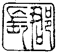



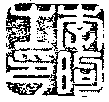



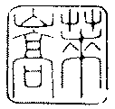



------



### 天童寺志序



吾四明郡乘之著，始于宋《乾道图经》，后则有《宝庆》诸志之出焉。但名山巨刹之胜迹，附载于郡邑志乘中，未免略其所详，乌可无专志以详之？盖其建置兴废，历岁久远，中间圣僧古德间起叠传，必有当代帝王、懿亲、藩侯崇奉敬礼，光耀法门。加以元夫鉅公、学士大夫塔铭、纪传之表章，词流逸客蜡屐扶筇之题咏，往往溢册盈篇，留贻来世，不有记载，何从考稽？肰欲竆搜广辑，众体毕备，勒成全书，盖亦难矣。予览《天童志》而窃有幸也。寺自晋永康以来，海内禅宗群尊为祖庭者，历千餘年于兹。四方绅士游吾里者，辄指琳宫化城，登临览胜。忆少时经行斯地，未惬幽寻；今年春，予来山中，恭祝今上圣天子万寿，憩止弥日。窃叹林壑窅深，藏蓄万象；诸天森列，备极崇闳。真佛国之奥区，蕴灵秀而发光华，胥在于此。然则寺之专志，岂可少哉？鉴西惢泉闻子，同竹𥦗介公，慨前志之未备，殚心搜辑，积岁累时，遂与主席伟载乘公会萃而增续之。厘为十卷，次第具举，有条不紊。书成，乞予言弁诸首。予惟志乘之作，参稽贵详，证据贵核，诠次贵明。是书有正疏、有参纪、有质实、有从正、有存俟、有附证，体裁既当，意义复该，徵信补遗，又何阙略之有？吾知此志一出，洵为太白名蓝益增伟观。后有作者，庶继继绳绳，增修弗替可也。



郡人仇兆鳌撰



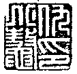



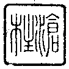



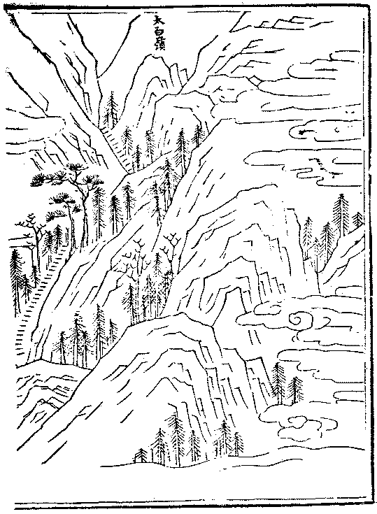



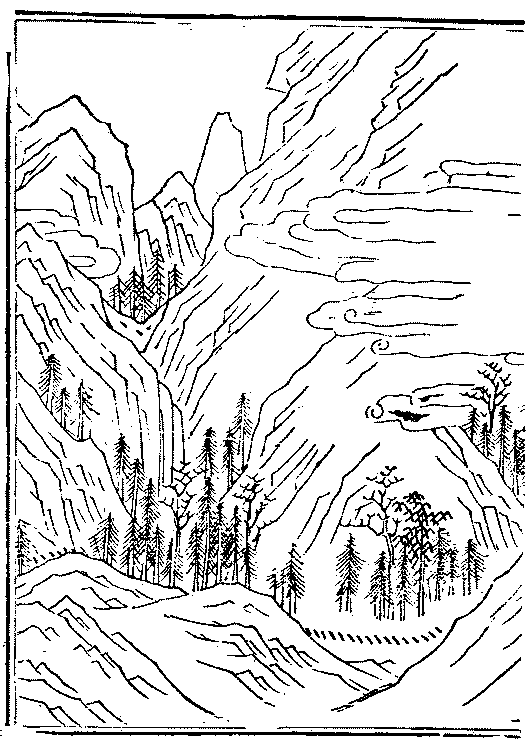



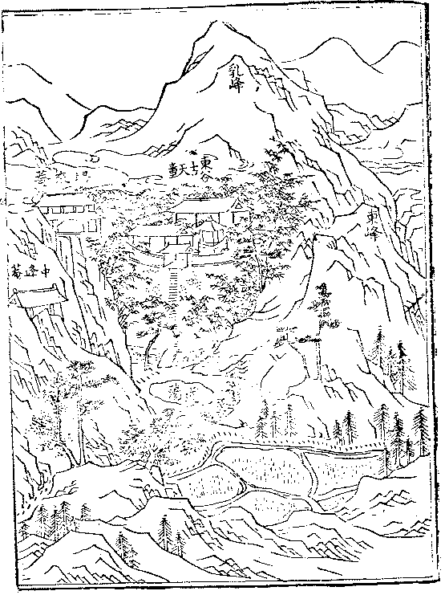



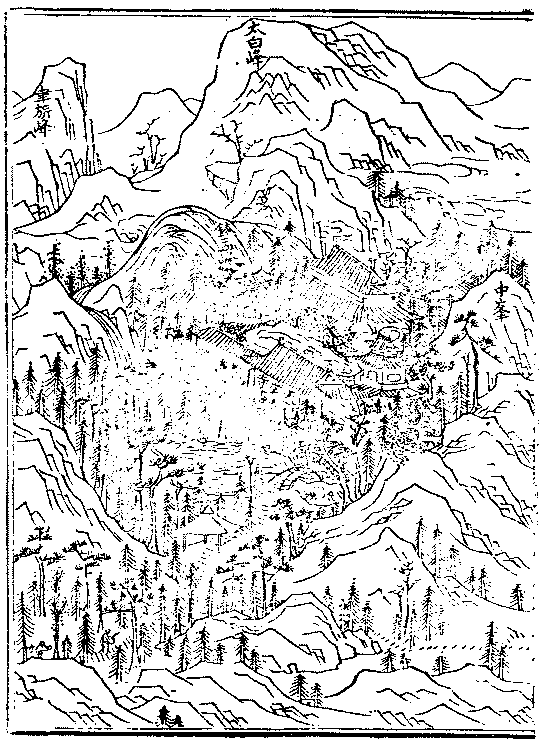



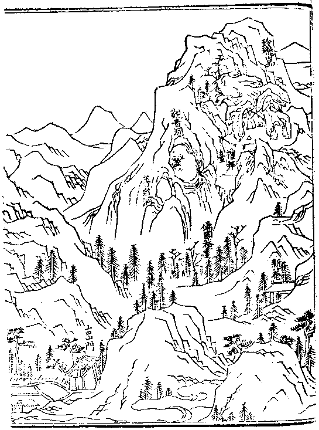



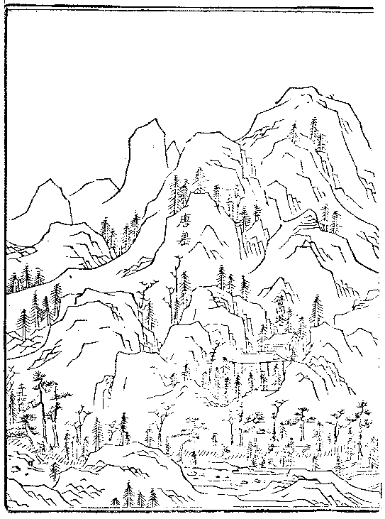



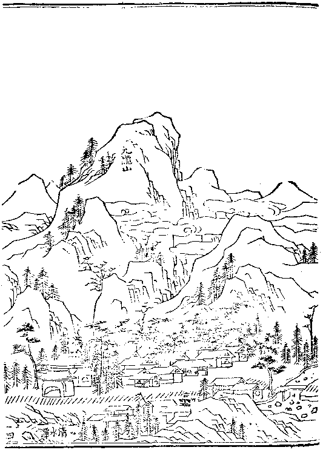



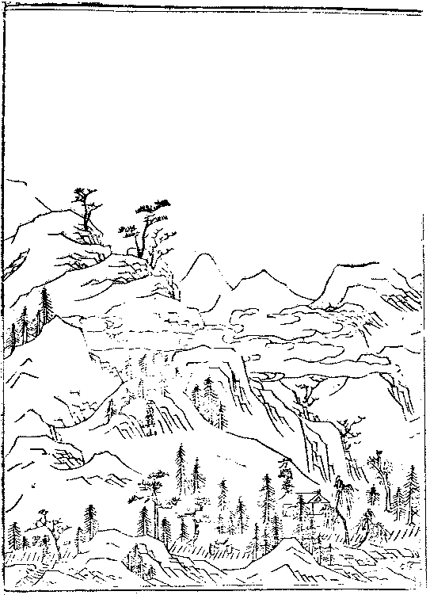



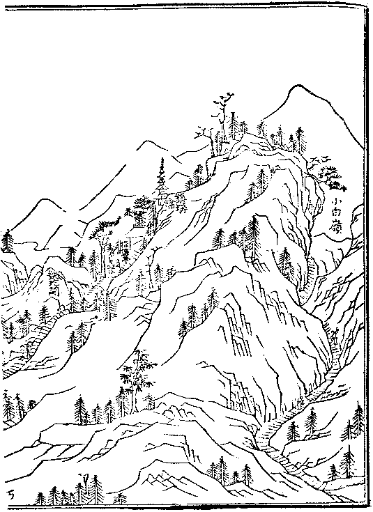



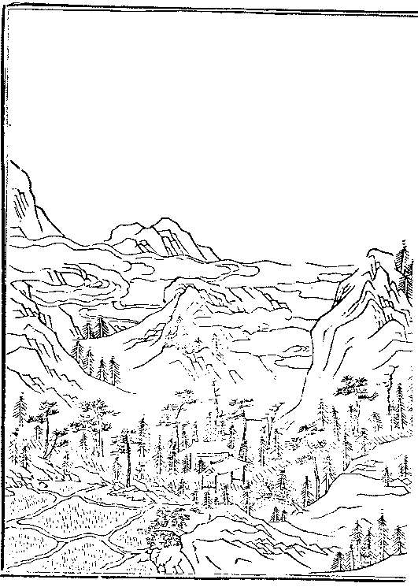



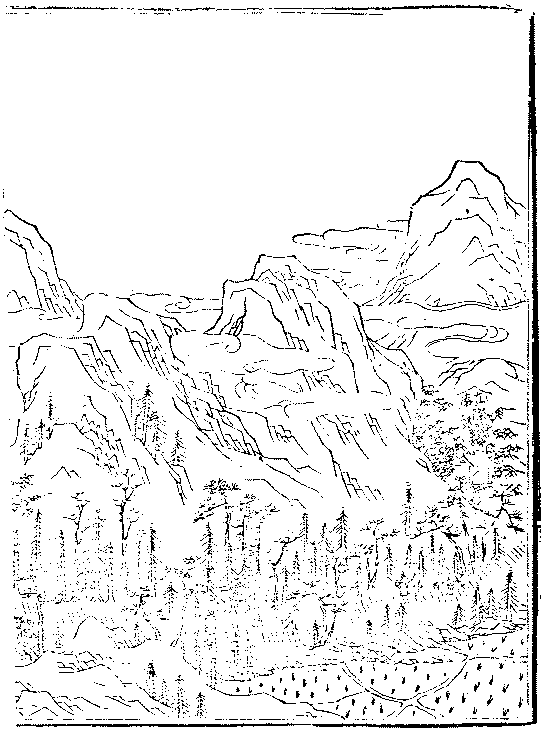



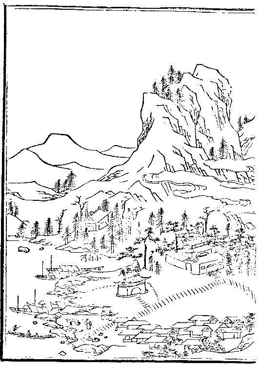



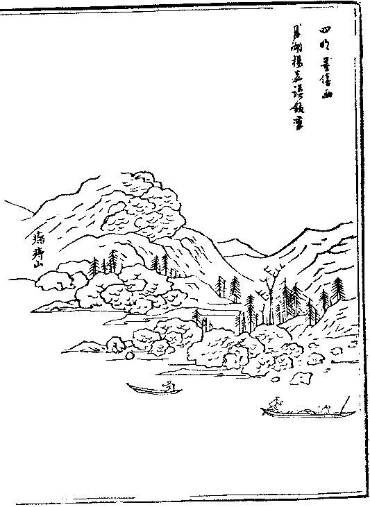



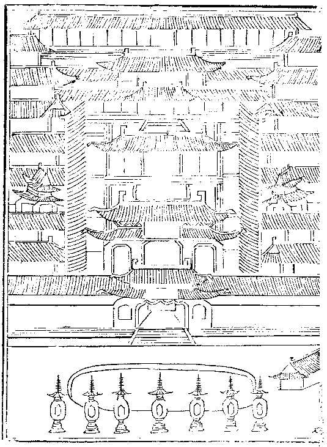



天童寺志凡例



十方国土，悉是遮那法身。衲僧家见山不是山，见水不是水，然后山是山，水是水。峩峩太白，下瞰沧海，千峰朝于斯，万派归于斯。凡巉嵓、悬峤、澄潭、幽壑，皆兹山所有也，岂曰气之灵，不为伟人，而独为是物也哉？志「山川考」第一。



屡兴屡废，盖俟乎其人。荒榛之中，忽涌精蓝，丹垩炳焕，天龙呵护。昔世尊与天帝行次，偶指地云：「此处宜建梵刹！」天帝即拈茎草云：「建刹已竟！」若人识得根源，便知毫端现刹。志「建置考」第二。



〈岘山记〉云：「望之隐然，其名特著，岂非以其人哉？况荷负佛法之人乎？」自西晋开山以迄于今，如沧海潮，如冬枯木，历代老古锥，向甚麼处去？今乃点出光明，面目现在。志「先觉考」第三。



经云：「不亲近国王、王子、大臣、官长。」又云：「佛法付嘱国王、大臣。」夫缁林之士，若非授受，何依而住耶？要知非我亲近，则大义明矣。日月齐临，山林藉光。志「盛典考」第四。



云本无踪，以山为宅。云去山存，巍然骨立。谁谓有踪？无心出没。究竟忘其形影、踪迹者，得列乎此中。志「云踪考」第五。



正法眼藏，自拈花、破颜微笑始。西天、东土分为两株，别为五叶。墙壁雷霆，悟者方知。临济道：「山僧无一法与人，第一莫取山僧说处。若是过量人，向未举以前撩起便行，犹较些子。」志「法要考」第六。



童子聚砂，皆成佛道，塔之繇来尚矣。若论妙法，空诸所有，岂留形迹乎？虽然如是，圣贤之躯，非凡体可同。火浴之际，或设利腾空，或舌齿不坏，光耀千古，遗此以治世。用是志「塔像考」第七。



门庭不同，互相钝置。知音者，片言即玉；投机者，一喝成金。如大慧杲于宏智觉之知音，有「𣦸姚崇、生张说」之目，曾不以为病；其于应庵华，直举杨岐正脉属之。呜呼！以视今日之诸方，为何如也？志「表贻考」第八。



若论大地一体，何有方内？有何方外？綂摄无分，在于名山大刹。略加分寸，或有法属之攸关，或有产业之相济，不得另立名以别之。是以志「辖丽考」第九。



作史之法，疑者阙焉。所谓神通妙用，运水搬柴则已矣，奇特事何足道哉？然所见、所闻、所传闻无异辞者，亦不得而略也。志「附餘考」第十。



辑志叙繇



太白山后学德介撰



夫前人未了之事，惟在后人继之；而后人以前人之心为心，而后人之心亦慰耳！若吾四明太白名山，向无志可稽。自有明嘉靖间，杨白川隐士（讳明者）集山中之旧迹，长庚位公刊行，名《天童寺集》。后于崇祯辛未，延密曾祖主席。次年，张博士廷賔，同白山师所修《壬申志》二卷。辛巳秋，江阴闻人黄介子（讳毓奇者）访道来山，又为重辑，与前志相符。其中增收「法语」、「请启」，定成四卷。而李杲堂居士尝与吾祖弘觉国师言及《天童山志》考述未备，载在郡乘中诗文尚多遗缺，当重纂为要务。吾祖即属公任事，公言：「修志一事，非博学淹通之士而不能。」遂举里友闻惢泉（名性道者，居鉴湖，晦迹著书。席门㴱巷，潜心内外籍，志乘之事尤详）。时师翁归化鹿，邀之商确，嘱远法伯迎之入山。时介亦同事，后因他事所阻而中止。暨我啸堂老人主院事，屡订入山不果。时师因《宝积录》之举，亦未得成。苐惢泉与介留心已久。辑未半，公有邑乘之役。及告终，未几而作古人。介因承祖父之命，乃殚心穷搜诸录，前志未备者，覶缕而补续之。自壬申后八十年，诗文未收者，同伟兄俱畧其所详而缀拾之，以继前人之遗迹耳。如同志者，知积渐之功所成；不知者，未免眼中著屑。余亦自揣，若论法门，宜空一切文字诸相。是役也，又落第二义矣。



天童寺志卷之一



山川考



太白山



又名天童山，在浙江宁波府鄞县之东。其乡曰阳堂，里曰太白，距城而遥者六十里。



〔从正〕宋罗参军濬《宝庆四明志》，太白、天童分为二山，其图上下远裂。元袁学士桷《延祐志》，王总管元恭《至正续志》，明《永乐钞志》，黄宪副润玉《简要志》，杨外翰寔《成化志》，张大司马时彻《嘉靖志》，皆分两山，㳂濬志也。今山本合体，名难岐指。濬家庐陵，未经躳历，笔属傅会；惟「一山二名」为定论。



山之名，始晋义兴师结茅此山，感太白星幻为童子，日供薪水，遂以「太白」称师，并以名山。又唐法璇禅师，日虔诵《法华经》，亦感天童进供，故又以「天童」名。



〔尚论〕考义师结茅之岁，正孝惠之太子遭毒贾后之年。《晋书》云：「凡五星盈缩失位，其精降于地为人……太白降为壮夫，处于林麓。」兹以壮变少，执有道者之役，太史失于占奏耳。



山之本，自天台摘星峰来(历四明、奉化诸山，起金峩、大梅，循屈而结太白。)



山之支，从东而起者，曰云峰，曰明角，𪩇衍为盘山。繇盘山折而北，稍伏，度太白岭，更起为大云山。落大云而复耸者曰东峰，辟其下为东谷，即古天童也。复起一峰曰乳，折而东北峙者曰中峰。繇此逶迤顿伏，卸为高原，而梵刹今奠於斯。



峰之著者凡六，一曰太白峰，在山之绝顶，雄尊深秀，为一郡之望。每风雨时，雷电多从顶出。



宋(龙图．懒堂)舒亶诗



千峰下视尽儿孙　仙事寥寥不可闻  

长作人间三月雨　请看肤寸岭头云



明(密云和尚)圆悟偈



昔人错露个消息　惹得人传太白峰  

今我直豋峰顶上　那来名字挂虚空



(泡园)汪枢诗



太白倚云端　凌霄几百盘  

幽禽啼蜀帝　乔木挺秦官  

鸟道青萝滑　龙湫白日寒  

儿孙罗立处　一望失巑岏



国朝(费隐)通容偈



此时日月晋时天　太白名高布大千  

海濶天空怀抱放　把筇指点万山川



又峰曰钵盂，圆秀特起，状如覆钵，障於寺后。



明(白川)杨明诗



太白耸奇峰　宛然类僧钵  

肖形天地初　炉火几灭没  

净水不可持　降龙亦虚说  

留与登高人　倚云观海月



国朝(五磊拙岩)期怀诗



团𪢮苍翠暎穹窿　名字谁安应量同  

纵使德山全妙用　难教托向法堂中



又有中峰，左东谷，右太白，巍然万山中，故名。又名曰青凤者，因愚谷禅师〈埽密庵塔偈〉有「青凤山前古涧边」之句也。



明(东闲居士)张嘉庆诗



孤空容鹤梦　来作片云观  

绝壑晴犹雨　高峰午尚寒  

岂知青凤影　只在碧霄端  

为笑投闲客　相期借一竿



又有峰曰聿旗，陡峻惊扬，势如旗展。更有二峰，曰东，曰乳。东峰在中峰之东，乳以形肖，在东谷后。



明(雪窦石奇)通云：聿旗峰偈



莫作人间布影看　聿旗峰耸石头寒  

相逢若便知消息　岂用人呼倒刹竿



(住山林野)通奇：东、乳二峰诗



一峰霜外立溪东　为送归人指顾中  

可是东峰疑未定　樵人说是案山蓬



千丈嵓头雪未镕　几囘清梦欲相从  

偶来东谷寻遗迹　又见云泉滴乳峰



崖之显者曰祖印，在寺西北。



明(梅庵)如用诗



隐映凉飇苍翠冷　白花古壁暮云浮  

多言祖印重崖上　空使猿猱泣露愁



岩之奇者曰㻏珑，峙寺西南，循磴而上，可二里许。倾崖反捍，怪石临危，若坠复倚。其上多石窗、嵓窦，如蠭房、螘穴。外峭中空，𠊓穿欹入，错落犹累疉然。其绝顶倏突倏平，古树野藤，云峦相抗。



宋(鄞令．荆国)王安石：经游记略



庆历七年十一月丁丑，余自县山属民使浚渠川。甲申游天童山，宿景德寺。质明，与其长老瑞新上石望玲珑嵓，须猿吟者久之。而还食寺之西堂，遂行。



(再见)舒亶诗



诡形迥与万山殊　空洞繇来一物无  

直恐虚心自天意　人间穿凿枉工夫



(长溪晞发)谢翱诗



埀云起嵚嵌　衣被松与桂  

夜合量斗光　隐若金石气  

雨来辄阻之　不得抚苍翠  

下有桑门子　饮用陶匏器  

盆中蓄海石　左顾如牡蛎  

疑此碛上来　不知几年岁  

桑门却问客　所居何姓氏  

回指南海峰　苍茫倘一至(此，雨饮嵓下作。)



明(二见)杨明诗



西崖千仞凌苍穹　有嵓突出高玲珑  

朝霞远暎赤玛瑙　秋露澹洗青芙蓉



朔风一夜吹寒雪　化作璇瑶更奇绝  

老衲开轩静对餘　试取冰花煮团月



(仪部．纬真)屠隆诗



嵓前老树挂枯藤　辟谷仙人苦行僧  

四壁秋蛩霜外杵　一床黄叶雨中灯(嵓上访禅作)



(云门雪峤)圆信歌



玲珑嵓　在何许　相去天童寺之西  

曳杖出门青鸟啼　万工池外藤萝低  

初一转　怪石横斜见虎蹄　春风随我上山梯  

渐见危嵓左右来　垒落云根烟凄凄  

行不上　脚跟疲　酸涩芒鞵路欲迷  

树下立　数行鸡　人声嚷嚷喧鼓鼙  

狭石缝　如一线　挨身过去同猿雏  

几人笑　难扳跻　有诗在手无笔题  

再一转　身心却与山水齐　指点村田双眼疎  

又一转　路上行人若游鱼  

长松短竹纷萋萋　石平如掌好摊书  

归去罢　踏烂泥　高高低低气力无  

嵓洞水声不可坐　浑身汗下难支吾  

好了眼睛苦了脚　者样游山且踌躇  

到得平坡如到家　县崖千丈林花迃



(卧庵牧云)通门诗



山洞何时凿　嵓崖不记层  

树深难见日　壑转一呼僧  

百尺扪苍壁　千年挂古藤  

最高吾直上　谁谓老无能



寂寂二三侣　行行乱艸边  

不辞衣尽湿　只觉杖居先  

眺望遗人世　凭虚想洞天  

隔峰闻活活　何处有流泉



曲折投榛莽　幽深绝采樵  

忽惊山鸟度　时觉野香飘  

虎豹疑蹲穴　风烟自卷瓢  

数禅何好事　踵至未曾招



陟彼崔巍上　悠然得大观  

穿松童子健　凭石老僧安  

野火邨边赤　春云天外寒  

十年重到此　莫怪久盘桓



(浮石)通贤诗



石户无非路　层楼疉数峦  

不关云气锁　时有鹿盘桓



(禾庵)真朴诗



溪雨净松冈　墟烟散清昼  

偶期汗漫俦　扶藜讨深秀  

既穷苍崖巅　因之剔幌岫  

磴道随鸟踪　扳扪化𤠔狖  

度险心逾豪　招呼骇潜兽  

古木纷离奇　青天忽杂糅  

触目崩层云　神斧何年镂  

厜㕒非一峰　嵓嵓启幽窦  

𫖯吸扶桑波　朝暾生井甃  

嵌空自房栊　窈窗烟屡逗  

初入灏气深　稍深风雨骤  

顶摩怒虬蟠　臂触饥鹰咮  

仰摘列星降　下驱群羝鬬  

铢拂应未磨　娲𬬻跃冶旧  

更疑昆明灰　苍然结琬琇  

阴壁射奇光　丹砂凿勾漏  

仄身儗蛇穿　虎牙闭饤饾  

危藤褭阶梯　真居不可就  

况多宛委藏　百灵严呵守  

须臾毛骨寒　吹万激群吼  

韸韸钟鼓音　星嵓俨遥扣  

乳泉自何来　冰雪资枕潄  

转瞩空蒙蒙　千峰失践蹂  

谈笑振苏门　林壑争钧奏  

指指下巑蚖　奇英灿左右  

目送去云前　心投倦鸟后  

归途记所经　夷崄泯襟袖  

因推开凿端　造物亦乳臭  

何如抱不雕　保兹浑沌寿  

邈哉起遐思　庶与蒙庄究



国朝(海陵寄翁)陆朝诗



曾望玲珑嵓窦好　今随老衲坐云霄  

乱山叠障海天暗　丛树纷披霜色骄  

自借筇枝扶足健　同烹石乳与愁浇  

细看木石争奇处　蹲虎狞龙岁月遥



(文林．宝学)张鸎诗



青山如故人　浩浩自太古  

携书坐层冈　幽怀乍以吐  

河汉西北流　日月在牖户  

一石费盘桓　千年亦辛苦  

怡情贵物先　杖屦别有取  

孤磬正无声　苍茫悟风雨



(远庵)本㒥诗



乍穷东谷又西岑　杖履虽劳兴转深  

曲折已忘经百险　巉嵓直上出千寻  

夕阳半壁云初敛　秋色盈眸寒欲㑴  

万壑泉声诗在此　何须索句学蛩吟



(啸堂山晓)本晢诗



霜雪犹在林　花已香寒谷  

吾师偶曳杖　散步山之麓  

乘兴登玲珑　危嵓立眉目  

峭崿径插天　崚嶒石悬竹  

置身飞鸟外　万里空穆穆  

烟际孤云开　沧溟如可掬  

俯眎清关内　皇皇圣人隩  

自非百世师　灵峰谁镇服  

暮云停高冈　春风平万木



(大行雪汀)张士埙诗



天设巉嵓鬼凿工　苍藤扶我上玲珑  

误穿偪仄悬崖里　得坐虚无古洞中  

云气蒸衣浑是白　枫枝照眼半含红  

欲吞海国空蒙象　应倩山灵为发蒙



岩之东北绝壁闲，有洞曰观音，中滴细泉；稍偏者曰善财，二洞相望。有台曰礼拜，足削、顶平，周以异石。



明(三见)杨明诗



山名小白华　上有观音洞  

华落洞门闲　白鸎春自哢



闻有善财者　迹寄紫竹林  

古洞西嵓下　风雨莓苔深



高台礼大士　正与玲珑对  

士去台亦荒　白华满山碎



(清卿僧杲)余寅诗



石气苍茫拂紫烟　白衣高照是何年  

谁悬绮户遥天外　曾幻金身渌水前(相传大士尝现身嵓上影照池中)  

绕树瞻依神八万　拈花接引路三千  

尔时只作寻常看　人鬼天龙尽惘然



岩之东南有隖曰清风。



元(学士．清容)袁桷：日禅师塔铭



清风之隖　石列五色



国朝(黄梅千仞)行冈诗



寥寥何处听飕飅　曲喻蒙庄总未周  

纵使松涛千万斛　较将隖内恐输筹



(云门简庵)本孚诗



风来鸟不言　风去石偏响  

借问山水人　清音可自赏



(光孝冰壑)本元诗



晴峦老尽千竿竹　队队阴森时可掬  

相过绝胜上樊桐　吹落浮云不敢宿  

清凉界亦世间有　如坐春风人在否  

谁栽一片乱涛声　又梦柴桑菊半畞  

夜深月照冷菰蒲　谩把南华名自呼  

忽然骑蝶随风至　秋水篇篇稿属吾



东谷



在东峰下，群山缭垣，高原倏砥。上荒发轫往来，劳执役之庚星；中弼丕基广播，继隰州之古佛。今则乾成锥立，幻藏云停。俗以「小天童」称，宜正名曰「古天童」。



明(中丞．定斋)王应鹏诗



清濑萧萧起石湍　千章云木荫成团  

佛华长在空中现　山色偏宜雨后看  

鹿苑菁菁芝草瑞　龙宫寂寂水光寒  

今宵更有东峰月　须上松楼一倚阑



(四见)杨明诗



日出扶桑谷口红　数椽茅屋蔽深松  

老僧出定无餘事　尽日门前看碧峰



(二见)通门诗



经旬惧炎威　不得过东冈  

立秋喜三日　思来拂木床  

悠然双蝴蝶　翩翩入我房  

以无瓶花遶　掠取瓦炉香  

万物抱灵智　资生咸有方  

小窗欣洞开　节候知初凉  

去来一无语　𢠢余情自长



小室仅容膝　每来生远心  

傍有老梅树　下有修竹林  

开窗见诸峰　螺髻青森森  

日高露未睎　阶树垂浓阴  

寂然无客过　山径殊自深  

空亭有碑铭　细读闲吾襟  

岁月已久迈　古人光未沉  

顾盼语诸子　兹辰可无吟  

携杖出门前　坐听秋鸟音



两僧肩一舆　隐隐隔林叫  

恐余归步迟　知余足力少  

入门山雨至　相顾同一笑  

野貌不外饰　山语亦臻妙  

呼茗与之啜　草鞋各紧峭  

鱼鸣午饭讫　无复事远眺  

残雨若雾飞　日光隐而照  

栖迟望村原　深谷何窈窕  

先觉未忍忌　三塔重一吊  

隰州在其中　凌然仰高调  

塔尘手自拭　层石使毕耀  

忆初少林灯　犹之任公钓  

五宗何时分　混沌嗟凿窍  

归途山更静　凉飔满林徼  

前峰抹烟云　佳处时领要



岭之通於东者曰太白，在大云、盘山间，一名「天童大岭」。



宋(二见)王安石诗



太白巃嵸东南驰　众岭环合青纷披  

烟云厚薄皆可爱　树石疎密自相宜  

阳春已归鸟语乐　溪水不动鱼行迟  

生民何由得处所　与兹鱼鸟相熙熙



明(飞遯．隐鳞)闻龙追和



山云山雨驱复驰　东来海色凌空披  

有岭蟠郁大云外　高下流泉与石宜  

行人注目多在足　樵子努力行亦迟  

太白小白如兄弟　自卑自迩同熙熙



通於西者曰小白岭，旧传其上多小白华。



明(纪善．约庵)钱安诗



入山遇雨出山晴　正是梅天五月程  

纨扇轻挥清爽发　篮舆稳坐白云迎  

半行竹径分僧寺　数亩桑田守故茔  

门外不知溪水涨　夜来衾枕有餘清



(二见)余寅诗



溪路崩腾万树围　午烟明处度人微  

蹇驴自觉秋风好　引领山光远近归



国朝(响嵓)闻性善诗



嵓从树顶分　坐拥樵云断  

行来数里松　前山还有半



(甓堂)周容诗



小艇载壶榼　野桥压帽过  

怀抱忽以舒　骤见春水大  

桃花出墙短　黄鸟穿篱破  

兹行得晴和　庶几穷所慕



水遥觉山近　山翠渐成绿  

入桥沙愈明　经村烟似沐  

溯洄富春渚　游衍罨畫曲  

今昔何殊观　心闲兴自足



大𣹢山势扼　水路似已穷  

出桥转汪洋　众流汇群峰  

川原互有情　动静理自通  

思得一俯察　振翼凌天风



烟火多高楼　家在溪声里  

百家同一姓　畊读无迁徙  

遥望谷口山　左廻右复掎  

相顾同相商　黾勉留去水



入山问山名　樵夫为山导  

举镰赠竹杖　藉以驱虎豹  

廻壑纳窅㝠　层峦卸孤峭  

行行寂无人　何处答长啸



五步一𥩟立　十步一憩坐  

聊借目力宽　用纾足力惰  

陇奋生波澜　峰尊集辅佐  

误行翻得胜　回首惜既过



离合见人情　去留审山势  

冈峦各无言　趋赴如受事  

安能结茅屋　抱膝辨阴霁  

隔涧双鹿饮　穿林一僧至



下山路较难　路漫不暇择  

笠拂松花低　裾引藤刺窄  

崎岖反忘疲　踊跃如有释  

乱竹纷纵横　杖转难为力



寄夕向山家　云来吠山犬  

未忍弃竹杖　险阻曾同勉  

奇褱追往历　幽胜拟继选  

临卧戒雨声　先将竹声辨



晨岚𠜍山椒　须臾压山趾  

已息望晴心　忽乃得晴喜  

出巷蜂绕衣　循篱袂决雉  

路因归似近　溪店午烟起



若夫石为气核，金之甲根，名山硱磳，所在皆有，举其稍异者，曰响石。下太白峰西百餘步，纵衡五尺许，扣之铿訇镗鞳，如钟鼓声。



宋(三见)舒亶诗



渊明休弄没弦琴　混沌中含太古音  

闻说几回风雨夜　四山浑作老龙吟



国朝(二见)本元诗



声非在石由人出　石对人言我独难  

动舌便烦左史笔　谁教相扣破云顽



(宝严炉雪)等慧诗



石钟鼓浪方成响　石鼓桐鱼扣有声  

却笑当年痴李渤　乱敲湖石向人鸣



又石曰佛迹，在北山石壁上，其痕广四寸许。



宋(四见)舒亶诗



苍崖绝壁印苔痕　陈迹千年尚似新  

杖屦纷纷走南北　几人不是刻舟人



国朝(景星湛庵)行尝偈



石上分明是脚踪　不知何处现全容  

东风昨夜传消息　报道山花无赖红



北山又有石，曰坐禅，相传开山祖师尝於此坐悟。又有石曰问水，活眼泉遶之故名。



明(蕙江)叶宪祖诗



一片磐陀坐自呼　新苔细艸未全枯  

我来试效南宫拜　石在不知禅在无



(景心)张憬诗



绝壑探幽踪　迂廻踏层岌  

其上饶古苔　万木中独立  

悠然山鸟啼　活活流泉集  

鸟去泉不停　谁询风雨急



(太常茧庵)林时对诗



罡风磔磔透重阴　烟树苍茫噪夕禽  

兀坐相忘钟磐远　天光云影逗禅心



又有石曰馒头，在小白岭上。



〔正疏〕《嘉靖郡志》，岭部、石部，两载馒头石。〈寰宇歌〉注云：「唐心镜禅师镇蟒时，施食所化。其石圆絫，表白里黑，宛肖馒头。诚心觅之可得。」



国朝(二见)本㒥偈



聚沙作供出嬉游　法食何曾有味投  

欲饱禅家无米饭　岭头先𫜪石馒头



亾名偈



岭上馒头石　行人都不识  

铁骏馅子酬　饱供禅和食



山之腠液曰水，水之众流曰川，川之属有涧、有溪、有潭、有池、有泉。



水出自东谷，会西涧之流，同趋天童溪而归於清水潭者，曰东涧。汇北山诸水，绕寺右，历外万工池，泻清关桥外，注於旧龙湫者，曰西涧。涧中磊石异状，素气云洄，澴波赑怒，可灌畦凡数十顷。



明(五见)杨明诗



西涧逶迤通石桥　虎泉一派来山坳  

泻月流云响琼珮　穿沙触石鸣仙璈  

矮床虚枕近溪曲　夜半繁声满书屋  

起唤茶童眠不成　推窗山月皎如烛



(二见)圆悟偈



西涧源从太白来　寺西流出遶东廻  

漫将竹接来厨下　饱饮诸人满腹回



(三见)通门诗



春雨蒙蒙洒一旬　青山叠叠阻游人  

经行西涧呼童子　携杖相随伴老身



山寺泉声日在门　伫看触石怒涛喷  

老僧斫竹来为笕　抹过重嵓去讨源



溪则繇东西两涧走天童街外者，曰天童溪。



宋(三见)王安石诗



溪水清涟树老苍　行穿溪树踏春阳  

溪深树密无寻处　惟有幽花渡水香



又溪繇唐墺出，与天童溪相会者，曰乾溪。上有桥，游寺必经焉。受天童溪而枉渚澄碧，黛石素鳞皎焉冲照者，曰清水潭，有唐「杜孝子庙」。



国朝(二见)陆朝诗



桥是何人构　溪乾不记年  

家鸡栖石罅　野菊散葑田  

滑滑前泥路　潺潺别涧天  

同分山上水　昔在此中旋



(五峰省庵)本冲诗



影落空潭照岁寒　谁将乱石补苍天  

依依孝子思亲泪　一片云心澈九泉



清水潭既纳天童溪水，其流合凰下溪，汇东吴，出大涵，谓之三溪。



国朝(三见)本㒥诗



入山迢遰一溪曲　溪上人家隐花竹  

炊烟相接鸡犬连　带有高原与平绿  

行行转过数峰青　又见溪流环衍沃  

白沙滩沸合远湍　苍崖深处澄青玉  

云物幽森更一天　风清宛在子真谷  

流沿清浅步迟迟　忽听钟声飞林麓  

不知山寺在何方　惟见菁葱拥万木



(二见)本孚和韵



缭绕行来知几曲　过桥不记石与竹  

急流缓流浮落红　深边浅边湛寒绿  

家家门径俯潆洄　处处平原资灌沃  

有时峡东乍惊雷　旋逢石咽潄鸣玉  

指其大者有三溪　聚彼众流成百谷  

予生踪迹半天涯　佳处无如此林麓  

随向一溪缚草堂　水槛悠悠负灌木



池则有内、外万工，又名双镜。内池当寺之前，外池与内者相隔方塘。



明(六见)杨明诗



双镜拭开秋万顷　素娥中夜临妆靓  

沙边鸥鹭窥蟾宫　水底鱼龙眠桂影



野仙踏月池上来　坐披鹤氅心颜开  

袖中拈出一枝篴　吹散碧云无点埃



国朝(四见)通门诗



饭后步空池　春风飏绿漪  

出坡人去尽　白鹭冷相窥



(二见)通贤诗



头上有天池作底　夜间无月鸟疑空  

游人只爱开双镜　不道当年费万工



池之霛者，有神龙宅焉。在太白峰顶，云雾滃勃，生於水面。若丽日晴霄，澂澈如镜；或风振林木，叶落无堕池中者。旧在清关桥左，相传心镜禅师徙此。



宋(六见)舒亶诗



灵踪聊寄数峰云　雨意含云白昼昏  

不用高僧时咒钵　一泓长贮万家村



明(三见)余寅诗



人传兹地是龙围　竝海冈峦面面归  

功德满山无一字　空多苍莽白云飞



国朝(观察．楚黄．念尼)王尔禄诗



镜湖梅湿苍鳞鬬　夜半光生忽清昼  

树杪飞泉几百重　高田低亩皆成就  

云是东山太白龙　乱驱列𡙇向云中  

我方偶读懒堂句　万村时雨多蒙蒙  

太白峰高白日近　一泓池水龙常隐  

应与青山迭往来　片言不合兴孤愤  

自是龙性最难驯　霖雨苍生亦苦辛  

何时独上孤峰顶　呼取云归大海滨



(五见)通门诗



白云杳杳接青峰　峰上寒潭拜老松  

纵使晴空常起雾　为霖此处有神龙



泉之利济者，一曰虎跑，在西涧之滨，相传有虎跑地所出。



宋(四见)王安石诗



供厨煮浴方成沼　转磨鸣舂始到田  

还了山中清净债　却来人世作丰年



(七见)舒亶诗



一啸风从谷口生　直教平地作沧溟  

灵山不与江心比　谁会茶仙补水经



又泉曰活眼，出钵盂峰下，涓涓不绝。



明(蕙江)刘宪宠歌



衲僧几个眼睛活　惟有此泉真活泼  

一滴疑传狮子乳　九天倒泻苍龙沫  

源混混兮来无端　声淙淙兮去不歇  

君不见　波面无风纹自生　山头有月光可掇  

我来拊手嵓石间　空华何事金𫔇拨



泉之涝不盈、暵不涸者，曰弘法，在寺法堂下。密云禅师甃之而未名，今奉新锡寺额名焉，昭恩泽也。



国朝(太史．立庵)史大成铭



未有此泉　法从谁液  

谓泉即法　泉从谁辟  

霭霭密云　𤀹此一脉  

弘觉溯之　迺沾天泽  

泉乎法乎　弘之无斁  

水非石凿　而能入石



入山之关有三：一曰万松关，「二十里松」之始，在小白岭外。二曰铁蛇关，在小白岭上，心镜禅师筑镇蟒塔於此，故名。三曰清关，在外万工池之左，有桥跨涧上。其下飞泉喷玉，清响如环珮。旧龙湫承之，复从县崖奔壑，练影拖岩、镛声振谷，「满地白云关不住，清泉流出落花香」，斯实录也。



明(三见)圆悟偈



万松关不为关松　警策行人入路通  

忽若有人亲撞破　方知直透万松中



铁蛇雄踞岭头峰　截断行人路不通  

直下一刀全杀活　任从南北与西东



桥水原无清与浊　祇缘到此别人间  

虽然都打桥中过　未审谁人透此关



(中条．敬身)陆宝：清关诗



奔泉倒峡忽成关　流者无心听者闲  

坐久全身疑水化　耳根先到石桥还



国朝(二见)张士埙：清关诗



可惜清关水　滔滔爱出山  

挽留无计策　从此溷人间



游山不住山　终然汚泥滓  

水声忽笑人　汝亦暂清耳



山川得题品，则泉石生香；题品非传神，则山川不受。一峰一涧，类如眉目分形；全水全山，方见性情具体。分形下，既已刮目扬眉；具体间，可无怡情悦性？嘅烟霞之漶影，采金玉之餘音。胜境於此纪吟，游寺别传崇建。用循历代，以次而书。



宋



(五见)王安石诗



山山桑柘绿浮空　春日莺啼谷口风  

二十里松行欲尽　青山捧出梵王宫



又：忆东吴太白山水诗



城头回首距几何　忆得好处长经过  

最思东山春树霭　更忆东湖秋水波  

三年飘忽如梦寐　万事感激徒悲歌  

应须饮酒不复道　今夜江头明月多



(八见)舒亶诗



日日青鞋踏白沙　未应泛艇即灵槎  

雨溪清越鸣哀玉　风蔓蜿蜒动暗蛇  

晓润芝𥰭挑秀茁　午香茶灶煮苍芽  

玲珑仙客知何在　千古烟霞自一家



又：再游山回，夜集诸友诗



太白崭嵓几百尺　仙人一去无消息  

临云时复倚阑干　独看千峰万峰碧  

昨夜长须城里回　报道湖上秋风来  

醉园雨过月台冷　篱根白菊看看开  

却杖青藜趂流水　目送征鸿下山觜  

蓬船答浪遶丛芦　咫尺烟汀几万里  

忽见江头江月白　纷纷笑语城东陌  

一尊北酒一枰碁　未到懒堂犹是客



(宗伯．深宁)王应麟：四明七观略



明多名山　竺乾氏居之  

宝地金绳　祖花禅枝  

南有雪窦　东有太白  

飞瀑淙淙　层峦𪚊𪚊



(二见)谢翱诗



笋舆行万山　中有十里亭  

老树祇一色　野公逾百龄  

柴关当太白　药气近樵青  

冈草黏枯翼　巢枝落退翎  

期探幽谷水　共𣃁松根苓  

艾纳下天雨　尘风吹冥冥



明



(浦阳．九灵)戴良诗



避嚣去城市　遣闷在川岑  

遂申独往意　行此无尽林  

松篁俨映郁　苍翠邈深沉  

九陇山已见　三生石可寻  

列嶂围招提　杰阁俯岖嵚  

池光乱塔影　涧流传磬音  

龙化井已竭　虎去泉徒深  

周顾信灵迹　迟留多赏心  

念未委尘妄　事可息烦襟  

即理苟已协　何用恋华簪



(正科)薛士铭诗



太白山高镇海壖　招提幽瞰九峰前  

玲珑嵓接三千界　伏翠庵通尺五天  

龙卷灵湫飞绝顶　虎跑平地出甘泉  

振衣未觉登临倦　爱听松涛战耳边



(中林．孝谦)李本诗



青春廿里万松关　小白前瞻太白山  

度岭路迷黄叶里　隔溪人语白云间  

海龙护法听金磬　野鹿叅禅献玉环  

老衲相留成信宿　浮生赢得此偷闲



(方伯．讷斋)钱奂诗



冒雨寻幽胜　行行不惮遥  

山高云外寺　水曲涧边桥  

鹤隐松藏玉　桃开洞簇绡  

日斜迷去路　招手问归樵



(郡守．三山希玉)郑珞：追和荆公韵



碧山云尽树苍苍　十里松阴半夕阳  

吟到石嵓清绝处　昙华芝艸暖生香



(郡守．孝感宗器)张瓒：用舒龙图韵



春日迟迟步暖沙　却惭汉使远乘槎  

玉珂声引巢松鹤　铁钵香来伏涧蛇  

白石玲珑生藓晕　绀园芳郁长茶芽  

当年童子多神异　薪水曾供老衲家



(郡守．莆田景由)方逵诗



入春郡事喜从容　乘兴来登太白峰  

谷静不闻啼一鸟　山灵谁敢佩双龙  

阴阴十里松关路　隐隐数声花外钟  

分付前驱休喝道　林间歌颂有黄童



(中丞．守黑)张楷诗



乘闲拉友玩天童　九陇相环秀气鍾  

紫雾频封禅丈室　白云时拥钵盂峰  

八功德水呈天碧　七窣堵波插汉雄  

东际逶迤泉转磨　西边奇怪石玲珑  

清关桥锁禅心定　响石声惊鸟道崇  

太白崖端存佛迹　善财洞畔隐仙踪  

虎跑甘泽师威重　龙卧高湫云雨从  

五凤楼高翚岌岌　万工池濶水溶溶  

大云侔与中峰秀　幻智相归伏翠浓  

千载垂池狮子柏　万年夹道茯苓松  

三关款款骢车驻　九锁重重薜荔封  

胜境由来观不足　古今风景宛然同



(太仆．本清)金湜诗



行尽青松始见山　暖风微雨路斑斑  

欲寻开士栖禅处(访无传孠禅师)　直到中峰叠翠间  

满地竹阴人迹少　四簷花气鸟声闲  

清茶啜罢悠然别　不许袈裟送出关



(观察．括庵)钱瓒诗



古刹摩空一径幽　跻攀今喜恣遨游  

春花委地红将尽　山色盈眸翠欲流  

虎卧闲林僧未起　龙归禅钵雨初收  

盘桓且适豪吟兴　不管谈经石点头



(二见)张憬诗



侵晓登山阁　凭阑四顾賖  

嵓花经雨落　江燕逐风斜  

顿觉心偏远　那堪鬓欲华  

何年尘屣脱　石窦吸流霞



(参政．白斋)张琦：梦游天童诗



闻说名山近上台　每凭孤梦绕崔嵬  

云从贝叶文边过　人入莲花漏里来  

大士作斋吹宿火　伏龙潜水抱轻雷  

一场残寝随钟觉　日出东方事又催



(应奎)倪光诗



溪下独行远　遥闻仙梵音  

九峰廻宝地　五凤出珠林  

古殿香云合　闲房艸木深  

宁知百年内　忘却去来心



(桂林守．石窗)华爱：坐雨诗



夜半雨声碎　朝来转细微  

疑愁松径滑　未觉石泉稀  

簷澑鸣常滴　山禽湿不飞  

子真吾忆汝　空谷限东西



(方伯．石溪)陆铨诗



溪转峰廻翠蔼新　诸天楼阁傍星辰  

深山笋熟人如市　禅室茶香客过频  

龛烛能留长夜月　嵓花不断四时春  

共来物外舒尘缚　莫厌披襟与岸巾



(二见)王应鹏诗



太白峰头一振衣　碧空无尽鸟孤飞  

林间野鹤何人驭　天下名山有寺依  

木叶晚风金气肃　松堂凉月夜光微  

寒泉百尺秋云里　僧在玲嵓静掩扉



(司空．堇山)李堂和韵



长风十里散云围　登尽危峰思欲飞  

路夹青山天有障　林飘红叶鸟无依  

玲珑石应千嵓响　太白冈通一线微  

幽谷惊传骢马使　不妨老稚款柴扉



(司马．东沙)张时彻诗



径转诸天近　渊深众壑归  

山峰长碍日　松雾细沾衣  

展席依青艸　题诗对落晖  

却怜双白鹿　时自款嵓扉



(文林)史元中诗



行踪绝胜访蓬莱　廿里松行隐宝台  

静院竹深招鹤引　禅房云冷倩风开  

登高賸有思莼兴　作赋惭无倚马才  

独立斜阳伤往事　春风十五度重来



(郡守．华亭凤峰)沈恺诗



屋下清溪屋上峰　禅房寂静许谁同  

白云深护无人到　远锡相寻有路通  

绮里一生居海国　广成千载在崆峒  

往来欲买匡庐住　调鹤餐霞意未穷



(郡倅．东斋)刘世伟诗



海邑驱驰久　僧房坐夜深  

不眠翻贝叶　失路感乡心  

岱岳长难见　平原未可寻  

随缘问法侣　何处可投簪



(少司马．东明)范钦诗



早从图记识名山　绀殿春晴试一攀  

天削芙蓉开九嶂　云深松桧袅三关  

坐凭星斗虚无里　行拂烟霞缥缈闲  

借问天仙何处所　好骖鹤驭月中还



(月渔)卢沄诗



山房开曙色　树杪散鵶声  

路自中峰下　人依峭壁行  

石台沾露净　林竹锁烟晴  

未尽跻攀兴　空餘怅别情



(嘉则)沈明臣诗



千盘万转入羊肠　绣佛犹传古道场  

日月池曾临法象　玲珑嵓自引朝阳  

钟声谷口风吹断　海色天边秋去长  

极欲皈依无奈老　马蹄空度白云乡



晓汲寒泉潄齿香　病维摩欲卧津梁  

石塘老柏惊龙蜕　白日清池拭镜光  

山势南来沧海大　水声西遶寺门长  

杖藜吟过秋山下　槲叶初黄作雨凉



(外翰)徐德中诗



石磴梯云入　乾坤别样清  

水声喧昼夜　山气弄阴晴  

花雨香飘殿　茶烟月在庭  

树深人不见　何处诵经声



(相国．文恭)沈一贯诗



拂雾跻危磴　披烟数乱山  

一松承日起　群鸟送云还  

细溜经寒涩　初苔得雨斑  

心驰缟衣使　独此伴僧闲



(廷尉．贞吾)陆世科诗



家在鉴湖常见水　心存空谷未忘山  

半宵月梦归何处　廿里松阴久不关  

岭外昔传廷尉宅(蔡大理公讳锡)　峰头犹是谪星鬟  

我从险处经行过　惟有冰霜识者颜



(郡李．海岸忠洁)黄端伯诗



石径沿溪树百重　松梢岁老欲成龙  

当年太白曾留记　石潄寒泉不露锋



(二见)圆信诗



空边细语转初庚　破晓花枝香露撑  

隐盖幻成天帝宅　清关不放野人行  

淋漓乔木风霜古　窈窕池塘秋水声  

只此金汤非易得　无虞千载若为惊



又



塔封事讫且抽身　晓嶂重重接远邻  

飘影叶乾风拭露　点衣寒翠日初新  

泉鸣沙涧游山客　天指肩舆过岭人  

独抱苦心带归去　双眉欲解在三春



国朝



(二见)王尔禄：追和荆公韵



谷鸟溪花尚未空　黄昏凉月梦松风  

此山一别长庚去　又见开元紫极宫



(郡参军．内丘文衣)乔钵诗



少微不暎高人日　太白未为童子前  

自有苍山真面目　浮名多属世情传



(江阴．任天)张拙：追和荆公韵



松杉十里郁苍苍　度岭穿云正夕阳  

最喜涧边无暑气　水流惟带藕花香



(心庐)杨文沆诗



山花名未尽　岭雨细还生  

古木千章待　鸣泉百道迎  

香来知寺近　霉重觉衣轻  

入世多倾仄　甘兹滑滑行



(杲堂)李文𦞩诗



引我登亭子　披襟望望间  

松阴交一径　竹气老诸山  

日慕嵓头宿　云寻谷口还  

行行常虑尽　听水又清关



崖谷能开兴　芒鞋去径然  

巉嵓斜导日　涸石乱欺泉  

引臂猿腾处　褰衣虎啸前  

旧游谁纪胜　遥问永康年



附(太白山樵)德介：天童怀古赋



> 夫长庚星现兮徵兴师之道行　大鉴堂开兮接六祖之薪传(堂额系宋景濂篆书)  

> 西晋惠帝兮始创永康　李唐两赐兮玲珑天寿  

> 景德四年兮奏请　即以景德兮锡额  

> 两浙兮称五山之一　四明兮推首刹之尊  

> 太白名山兮宋孝宗之宸翰　奉藏云章楼兮住持了朴  

> 朝元宝阁兮元大德之重颜　勅撰铭碑兮危素中书  

> 太白峰下兮响石　伏狮嵓上兮龙潭  

> 东冈叠叠兮结绀殿　西水潺潺兮转清关  

> 双池兮似斗　七塔兮象星(七星之象)  

> 落叶无踪兮鱼吞活活之水(池中不受落叶)　重峦有影兮(嵓影入池无火厄)波泛苍苍之云  

> 龙泉鼎兮从水出　千僧镬兮受土埋(▆▆时濬池得二物)  

> 池上亭虚兮谁印月(昔有印月亭)　院西阁废兮孰临云(旧有临云阁)  

> 多宝塔兮形影与齐者法璇古宿(塔系唐秘书万齐融所建，璇师经行其下，影与塔齐。)　华严经兮诵声俱彻者海门禅师(师出方丈▆佛诵起，至回▆已毕，人不信命八十一人同诵有声。)  

> 廿里松行兮旧听晴涛谡谡　疎钟空谷兮遥闻清韵锽锽  

> 重铸钟兮法等　又栽松兮子凝  

> 万佛阁碑兮太史楼公撰述　千僧堂记兮隰州古德雄文  

> 嵓窦玲珑兮　得窥日月之通明  

> 荆公久登兮舒啸　穴隙光射兮曾摹诗偈之满壁  

> 臯羽雨饮兮取欢　不知何佛兮踏破苍苔留幻迹(西崖有佛迹)  

> 那管是伊兮　毙然㘞地坐禅心(崖有坐禅石)  

> 嵓方兀兀兮诸祖相传名祖印(西有祖印嵓)　峰挺圆圆兮千佛授受是佛盂(后有盋盂峰)  

> 方丈前楼兮叠翠　高崖西畔兮更幽(玲珑嵓下有▆▆亭)  

> 虎跑泉兮西阜(王荆公有诗)　鹿鸣坡兮后山(后山鸣，客至；东鸣，斋主来；西鸣，病僧亡。)  

> 夏凉森蔚兮来坐罗树圃(长庚▆旁有▆)　冬木凋残兮均寻核桃坑(在寺东多核桃)  

> 问水攀藤观活眼(寺西有问水石，下有活眼泉。)　散花斛食化馒头(小白塔下名散花冈，心镜禅师建塔施食，馒头化为石。)  

> 二主谦谦兮亭名揖让(张状元同大慧杲访宏智觉岭上，逊之不已，张公名其亭。)　一心寂寂兮阁曰涵虚(昔有涵虚阁禅师修道其中)  

> 荷池荡漾兮十月集鸳鸯之泛滥(东谷有荷池)　案岫青葱兮昔年下凰凤之翱翔(前山有凰下溪)  

> 万松关兮名虚设　十丈柱兮迹尚存(宋时▆迹在路)  

> 应供堂兮展千钵　漏砂锅兮不漏米(锅从天台圣僧送来)  

> 藏经阁兮积万圅饰玉轴兮又饰签  

> 游客散塲兮应宿鹭(池上有宿鹭亭)　归僧隐盖兮不惊鸥(松行有隐盖亭)  

> 晴窥万竹栖青凤(杰祖塔于青凤山)　旱祷高山请白龙  

> 锁翠亭兮魏王妃之亲笔　宏智碑兮张孝祥之遗书  

> 中峰庵轩兮叠秀(梦堂有赋，高元之跋语，今存残碣。)　破砂盆碣兮重光(杰祖遗偈，立石於庵，成残碣。今重刊于祖堂。)  

> 秋蕙春兰兮寻满谷　清风明月兮坐经𡎲  

> 釜内茶香兮争烹雀舌　山中笋熟兮尽拔龙须  

> 蒙堂兮休老　此轩兮养贤(左庵良侍奉实庵茂于轩)  

> 妙光塔兮即之笔　栴檀林兮道生书  

> 秋残崖上看红荳(清关桥上有红荳崖)　春始岭头观白花(小白岭上多小白花故名)  

> 堆云废兮独留云影(应庵塔院名堆云)　伏翠移兮聊存翠峰(伏翠今存南嶴)  

> 西崖惠兮塔幻智(塔在山顶)　东嵓日兮瘗清风(袁文清铭云建于清风坞)  

> 盘山久隶常住兮祀摩诃之法身(蒋摩诃、布帒和上之徒，塔于盘山寺，有盘山庄。)　佛陇原同一派兮见濂溪之文记(佛陇寺，唐时咸启禅师所建。)  

> 春乐无轩兮犹见月痕雪白　梅花有屋兮惟存树老云香(梅屋春乐轩，先贤植梅处。)  

> 狮柏秀兮禅师再至　鱼藻生兮曾祖始来  

> 普同院迥兮环秀峙　涵碧桥崇兮锁乾溪  

> 九陇盘结兮石苍嶴　三溪汇合兮清水潭  

> 鬼谷仙兮南沧洞(太白山后有鬼谷祠，葛仙翁访之，有诗。)　杜孝子兮太白祠(唐杜雍避裘甫之乱，弃子负母隐此。徵之不起，殁而祀焉。)  

> 补山缺兮建镇蟒　挽逝水兮护沙龙  

> 怀已往兮不见　知将来兮何稽  

> 聊题幻语兮书幻事　霞川雪汀兮复谁收



天童寺志卷之二



建置考(上)



晋



(惠帝)永康元年(庚申)，太白祖师义兴结茅庵於杨州部会稽郡𨞵县东南山之东谷，久之渐成精舍。



(安帝)隆安三年(己亥)，太白精舍毁，因孙恩之乱也。



唐



(玄宗)开元二十年(壬申)，天童禅师法璇重建精舍於江南道越州鄮县太白山麓之东(即兴师故迹)。



是时，秘书省正字郎万齐融就精舍西南隅建多宝塔，峭㧞，凡数仞。



〔附纪〕齐融，本州人，以泾阳令入为秘书正字，出刺徐州。常撰〈阿育王山常住田记〉，其文摛藻。刘昫《旧唐书．文苑．贺知章传》言神龙中，知章与越州贺朝、万齐融，扬州张若虚、邢巨，湖州包融，俱以吴越之士，文辞俊秀，名扬於上京，人间间往往传其文。则知当时建宝塔自有自记。



(肃宗)至德二载(丁酉)，禅师宗弼、昙总偕观宗徙建精舍於太白峰下。



乾元二年(己亥)，敕赐浙东明州鄮县「太白山精舍」为「天童㻏珑寺」。从平章第五琦所请，以山有㻏珑岩也。



是时禅师清闲增建食堂(事详〈本传〉)



又偕禅师昙德植夹道松二十里。



(武宗)会昌(年间)，心镜禅师藏奂徙清关潭神龙於太白峰顶，建镇蟒塔於小白岭头。



〔正疏〕相传师自云闲历游至山，居久之，以龙湫近在清关桥侧，行人易触，乃咒龙入钵，移之峰顶，倾钵成池，龙即安焉。又山中有蟒，每为人患，师以法度。一日，蟒死岭上，焚而瘗之，因镇以塔，至今犹存。



(宣宗)大中元年(丁卯)，禅师咸启请以本寺充十方住持。



〔质实〕案司马温公《稽古录》，大中元年春，复天下佛寺及僧尼。时启禅师从径山开法是山，因有此请。



〔附证〕〈延庆寺使帖〉云：本院僧请依江南、湖南道山门体式，永作十方住持。准中书省劄子，奉圣旨，宜令本院依久例指挥，具结供申。据僧司勘会，本州天童山景德寺、大梅山仙居院两处，亦是十方住持，即依得上项江南、湖南道山门体式。如勘会天童、大梅两处不是十方住持，甘伏深罪者。奉圣旨依天童、大梅两处体式施行。今本山唐劄虽不传，据此宋帖，以本山准十方住持勘会体式，足证当时法制之重。



(懿宗)咸通十年(己丑)有启，更赐浙东明州鄮县「天童㻏珑寺」为「天寿寺」，浙东观察使杨严所请。



〔附证〕时严又尝奏度三七僧，奉阿育王山舍利塔。



宋



(真宗)景德四年(丁未)，敕赐浙东路明州鄞县天童山「天寿寺」为「景德禅寺」。



大中祥符年闲，禅师子凝重植夹道松二十里。



〔质实〕凝禅师植松，载《宝庆志》。性道仝竹窗介公，觅东谷水笕下，获残碣一小角，篆额有「植」字；其正文第一行有「明州天童山植松」七字；第二行有「子凝禅师聚间」六字；第三行有「至小白岭」四字；第四行惟一「接」字。虽賸畫零镌，千秋而下，亦灵光之照。



〔附纪〕建炎末，宏智禅师来住本山。先是，尝梦入一寺，纪以诗，有「松径森森窈窕门，到时微月正黄昏」之句。及至是山，夹道松阴恍符前梦，距植松时百二十餘年矣。



时胜构之可纪者，有东西四设利塔，有蒙堂，阁曰临云，轩曰春乐，亭曰宿鹭、曰更幽。



宋(龙图．信道)舒亶：蒙堂诗



由来去住不相关　赢得随缘到处闲  

笑出海天飞一锡　行分江月过千山  

微言定许谁人叩　胜事偏於俗士悭  

咫尺蒙堂隔霄壤　城东搔首只空还



又：临云阁诗



高僧终日笑凭阑　亦似无心懒出关  

几度海风吹散雨　坐看彩翠落人间



又：春乐轩诗



隔水嵓花红浅深　花边相对语幽禽  

管弦不到山间耳　谁会凭阑此日心



又：宿鹭亭诗



云过千溪月上时　雪芦霜苇冷相依  

正缘野性如僧癖　肎为游鱼下钓矶



(编修．放翁)陆游：宿鹭亭诗



疎钟迎客到溪亭　碧瓦朱阑相照明  

想得松阴排万衲　篮舆到处恰诗成



又：更幽亭诗



攀石扪萝到更幽　玲珑咫尺懒穷搜  

旁人不会当时意　为欠门生作伴游



明(白川)杨明：宿鹭亭追咏



池上幽亭面面凉　水风山月足徜徉  

夜深休拍阑干啸　宿鹭沙头梦正长



(高宗)绍兴二年(壬子)，宏智禅师正觉始建僧堂。



正觉：僧堂自记



夫灵山之笑温，少林之坐寒，东西绳绳，三十三传。老卢受衣钵而逃，厥事显著，开阖歙张，波澜光燄，肆口而说，肆心而应，道传器受，源深流长。南岳青原，代以得人，或默有所宗，潜幽远遯，归迹世外，研究生死，松食荷衣，巢栖草座，晦而不耀，持养老成。有慕其风，师而亲之，锄植舂炊，采汲烹瀹，溪毛原粟，枯槁自甘，来远集繁，乃建僧堂而统受焉。斋之萃师友同事，刳情刲智，摈学黜思，妙尽心空，宗通眼活，发越於设施，果其能而备也。建炎之末，人病乱离；湘汉江淮，兵火燔掠。尊宿丛林，没芜八九；毳衣瓶锡，投栖於东南。四明禅席，素号小庐山。郡东六十里，天童道场，山纡盘而气幽，松偃蹇而皮皴；苍壁附萝，烟晞而翠腻；孤虹枕涧，埃濯而清扬。予住山之四年，十方来学，云趋水赴，屋不能容。比丘行深遽来白事曰：「柏庭有子，露坐簷宿，殆无寻赤与受单钵。欲募净信，增大其堂，得乎？」予颔之。已而，匠摉於林，斧鸣於谷。一年餘，础布楹列，梁横桷攒；棼橑翼张，甍瓦鳞覆。前后十四间，二十架，三过廊，两天井。下庑墙陼，纵二百尺，广十六丈。窗牖床榻，深明严洁。万指食息，超摇容与。谋始於绍兴壬子之冬，工毕於甲寅之春，总费缗钱万五千有奇。冬温夏凉，昼香夜灯。开钵而饭，洗足而坐。耕牧其间，警导以寂。秋函古井，春入化机。渊兮默成，粲兮用光。水盈科而流，石随呼而响。理契平等，智应自然。动静威仪，针砭相益。捡责渗漏，磨莹瘢痕。淬砺光芒，错砻圭角。高标远到，追武古人。丐心施方等，不负其意。器劣学獘，希易欲速。以机械为蹊，放荡为径。耕於空言，馁无所获；战於强辩，胜无所归。见闻流习，知解汩心。佛祖之所诃，魔外之得便。其疵疠萌蘖，治不可缓也。登昆仑之丘，决河源之水，濯肝瞻之汚，荡心目之翳。生灭迹亡而妙存，有无辙泯而过量。大夜之梦破，永劫之疑拔。出家之志偿，行脚之事办。相从俦侣，殆庶几焉。



绍兴四年(甲寅)，宏智禅师建僧堂落成。继而拓旧维新，巍其门为杰阁，延袤两庑。范千铜佛列於阁上，中建卢舍那阁，旁设五十三参善知识。前为二大池，曰万工，中立七塔。



〔附纪〕郡丞浚仪李濂云：「入天童寺，路径如斗形。双池并深，中筑七塔，以象斗。外池有水碓硙。」〈寰宇歌〉注云：「天童池上七塔，四白、三赤。白以生水，赤以厌火。」



绍兴二十六年(丙子)，试权起居中书舍人．兼玉牒所检讨．于湖张孝祥题小白岭上之亭曰「揖让」。



〔正疏〕是年，宏智禅寺举大慧禅师宗杲主阿育王山。时大慧与张安国同过天童，宏智迓之岭上，会於亭中。两师交让无已，乃不次而坐。安国叹曰：「三代礼乐，今归释氏矣。」因以「揖让」名亭。



〔附纪〕历阳张邵，建炎初，假礼部尚书使金补其弟祁为明州观察推官，因奉母居鄞之雷峰。至今有张硕人墓，即其母也。祁在雷峰生子孝祥於方广院中，绍兴甲戌科状元。邵生参知孝伯，秘阁即之之父也。孝祥擅书学，高宗称其必将名世。宏智塔铭及后录，皆其手书。昔人评即之书：「初学伯父，晚失其法。」仕终显谟阁学士。



明(双林僧幢)海怀追咏



主盟斯道两齐肩　一叚谦光尚蔼然  

坐顷顿还三代礼　典刑千载揖云巅



(孝宗)淳熙五年(戊戌)，永兴成德军节度使．雍州牧．开府仪同三司．判明州、军州提举学事．兼沿海制置使．皇子魏王恺以太白山图进上；少保．右丞相．永国公史浩又奏请帝宸翰，挥「太白名山」四大字，赐天童山景德禅寺。



是年，魏王妃某氏，亲书入山之亭曰「锁翠」。



(长溪臯羽)谢翱：锁翠亭避雨诗



客有游山衣　著久如薜荔  

行行万翠庭　忽作风雨憩  

仰面无所睹　梁间有题字  

问此何人书　婉娩有弱气  

云昔魏王妃　学书如李衞  

乘云到此山　洒墨在空翠  

尘风吹土花　倏忽景物异  

疑此梦与山　不类人间世



是年，慈航禅师了朴建云章阁於方丈，恭藏御书「太白名山」真迹。嗣又别建一阁曰「超诸有」，前於卢舍那阁，复道联之。



(光宗)绍熙四年(癸丑)，虚庵禅师怀敞重建千佛阁，日本千光师荣西航巨木来佐。



(参政．攻愧宣献)楼钥：千佛阁记



淳熙五年，孝宗皇帝亲洒宸翰，大书「太白名山」以赐天童山景德禅寺。寺之门甚雄敞，刻「云章尊阁」其上。又於方丈专建一阁以藏真迹，实为禅林盛事，前所未有也。初西晋永康中，沙门义兴卓庵此山，有童子手给薪水。后既有众，遂辞去，曰：「吾太白一辰，上帝以师笃於道行，遣侍左右。」因忽不见，自是始有「太白天童」之名。山在郡东南六十里所。太白一峰，高压千岭，雄尊深秀，为一郡之望。绍兴初，宏智禅师正觉欲撤其寺而新之，谋於众。有蜀僧以阴阳家言自献曰：「此寺所以未大显者，山川宏大而栋宇未称。师能为层楼杰阁，以发越淑灵之气，则此山之名且将震耀於时矣。」觉深然之，乃拓旧址，谋兴作。内外鼎新，以次就成。智匠高妙，务极崇侈。门为高阁，延袤两庑，铸千佛列其上。前为二大池，中立七塔，交暎澄澈。游是山者，初入万松关，则青松夹道凡二十里，云栋雪脊，层见林表而倒影池中，未入宝阁，已非人间世矣。中建卢舍那阁，尤为壮丽。住山三十年，其为久远之计，皆绝人远甚。后有慈航了朴，一住亦二十年，起「超诸有阁」於「卢舍那阁」之前，复道联属，至今巍然相望。又大筑海涂，增益岁入。由是天童不特为四明甲刹，东南数千里亦皆推为第一。游观者必至，至则忘归，归而诧於人。声闻四方，江湖衲子以不至为歉。皇子魏惠宪王出镇，一见慈航，懽若平生。暇日来游，顾瞻山林，登玲珑，坐宿鹭，或累日不忍去，因图以进於上。会稽郡王太师史文惠公又从容奏请，遂有四大字之赐。瑰奇绝特之观，无以加矣。十六年，虚庵怀敞自天台万年来主是刹，百废具举，追迹二老。而千佛之阁岁久寖圮，且将弗支，犹以前人规模为未足以称上赐。欲从而振起，更出旧阁及前二阁之上，佥以为难，师之志不回也。先是，日本国僧千光法师荣西者发愿心，欲往西域求教外别传之宗。若有告以天台万年为可依者，航海而来，以师为归。及迁天童，西亦随至。居岁餘，闻师有改作之意，请曰：「思报摄受之恩，糜躯所不惮，况下此者乎？吾忝国主近属，他日归国，当致良材以为助。」师曰：「唯。」未几，遂归。越二年，果致百围之木凡若干，挟大舶，泛鲸波而至焉。千夫咸集，浮江蔽河，辇致山中。师笑曰：「吾事济矣！」於是鸠工度材，云委山积。列楹四十，多日本所致，餘则取於境内之山。始建於绍熙四年季秋之甲申，才三载，告毕。费缗钱二万有奇。是岁，海庄倍稔，赢谷三千斛，如有相之者。不求於人，见者乐施，以迄於成。凡为阁七闲，高为三层；栋横十有四丈，其高十有二丈，深八十四尺，众楹俱三十有五尺。外开三门，上为藻井。井而上，十有四尺为虎座，大木交贯，坚致壮密，牢不可拔。上层又高七丈，举千佛居之。位置、面势，无不曲当。外檐三，内檐四，檐牙高啄，直如引绳。旅楹有闲，翚飞跂翼。周延四阿，缭以栏楯。内为绮疏，表里明豁。自下仰上，如见昆阆。梵呗磬钟，半空振响。徜徉登览，四山下瞰，河汉星斗，如在栏槛。御书金榜，巍乎中峙。翊以翔龙，护以绛绡。高出云霄之上，真足以弹压山川、传示千古。善财童子大庄严藏，入见楼阁广博无量，则不可知；若经行四方，室屋巨丽，殆未见其比也。钥奉祠东归，尝往游焉。惊叹杰特，目眩神骇，过於耳闻。敞请记其事，老矣学落，不能形容。姑记大畧，以表吾乡之胜。海内好奇之士，欲游而未遂者，览此，则太白之景思过半矣。虚庵道价素高，禅子向方，岛夷亦闻其名而归之。加以愿力深重，才刃恢恢，巧匠瑰才，成此胜事，观此无不钦叹。或请饰之，敞曰：「殚力竭材，幸济登兹。若丹臒华饰，尚有赖於后之人云」。



(理宗)宝祐四年(丙辰)，寺灾。



时观文殿大学士．沿海制置大使．判庆元军府事．兼管内劝农使．金陵郡开国公吴潜，奏请住洞庭天王寺别山禅师祖智主寺兴复。至则结茅以居。



宝祐六年(戊午)，别山智禅师建复寺宇、宝阁。



景定四年(癸亥)，简翁禅师居敬主寺事，复作千佛宝阁。



元



(成宗)大德五年(辛丑)，赐「朝元宝阁」额。因东岩禅师净日增新，允庆元路守臣之请也。



(英宗)至治(年间)，构疉秀轩於中峰。



(太史．文献)黄溍诗



名山标巨刹　楼阁在青冥  

别路通禅窟　当轩列翠屏  

暝禽多雪色　偃树尽龙形  

负土新成塔　非才愧勒铭



〔存俟〕元袁学士桷《清容集》，载〈题噩上人疉秀轩赋后〉云：楚之辞不作久矣，鼌无咎氏始分其言为二，渊乎得其微旨，《离骚》、《九歌》判不相合。汉魏而降，一而为之，缜密者为扬马，反复悲悼，汉帝所谓邻於楚之声也。左太冲融液藻绘，能为一继者，不复若是，鼌氏岂虚语哉？吾乡高端叔先生(元之)作《变离骚》，直与古昔相抗。而或者谓羇穷不偶，怨悱不得以自振。今噩上人作〈骠骑山赋〉及〈疉秀〉、〈洌清〉二赋，手而读之，诚骎骎乎古作矣。渡江以来，诸贤蹈袭苏学，以雄快直致为夸，诗与文率相成风。科举学盛，屈宋不入於口耳，积弊几二百年。山林枯槁之士，尚何能冀其髣象？是则皆吾徒之罪也。上人语精意新，无模系之弊。言道也，师〈远游〉；托兴也，邻〈九辩〉。嗟乎！余老矣，上人当勉之。投闲谢事，愿相与过从。将复见於雪窦、玉几诸山，斯幸矣。泰定二年闰月乙亥，清容居士书性道家藏此跋，无从觅昙噩赋，岂神龙反见尾而不见首耶？岁戊申，余入山，远庵㒥公偶於残石中得废碑二角，出以相示，正其赋也。勒汉隶甚精，其一角第一行「太白中峰疉秀轩赋」凡八字，第二行「纷万物之总总兮曾一气之不殊」凡十四字，第三行「之蚩蚩兮率资昏而质汚裂规矩」凡十三字，第四行「履才辩兮衷慈忍之襜褕厉」凡十一字，第五行「固摧落之餘也」凡六字。又一角第一行「先殂慭遗后以」凡六字，第二行「之粗也追先哲而会」凡八字，第三行「岌九陇兮翠扶疎泊双」凡九字，餘五行作行书，即清容跋语。又三行作小楷，第一行「太史一日持至翰林，出示，诸名贤读之，靡不称叹」，第二行「惜乎，禅师平昔所制作，素无遗稾，盖吾宗心空万有」，第三行「庶好事者得便观览焉，洪武十二年岁己未九月初吉」，缺立石者名。呜呼！断文残碣，泉石犹香；搜觅全篇，云烟多漫。姑存之，以俟博藏金石录者补阙焉。随纪一诗：



一室堆乱峰　寸心履小石　时闻烟有声　到处岚光积　好畫不在帧　好书不在册　惟吾意所之　空翠皆堪摘　愿言怀幽人　峩睂天半白　愿言思烈十　奇峦森剑戟　秋山即老僧　春峤浮仙客　千里落双眸　万疉归咫尺　我笑中峰中　置身无气骨　独立岂不能　高下生肘腋　何人构小轩　疉秀夸臬卼　松云阶上栖　绕屋挂苔壁　枯钵响楚音　听者多感激　乃得清容赏　鳞藏尾弗没　毒龙不识字　驱电焚苍畫　琐屑遗断章　古香随手发　字字疉空蒙　秀色冷晴碧　何问轩有无　视今犹视昔



(文宗)天历二年(己巳)，朝元阁毁。



(顺帝)至正五年(乙酉)，孚中禅师怀信重新佛殿。



至正十九年(己亥)，原明禅师元良重建宝阁，铸万铜佛居之，司徒平章方国珍捐协以赀。



至正二十年(庚子)，有敕，仍赐宝阁额曰「朝元」。



(中书参政．临川)危素：奉敕撰朝元阁碑铭



至正二十年，天童山景德禅寺新作大阁成，宣政院臣以闻，有敕，赐名曰「朝元阁」。复三年，皇太子命太保右丞相臣搠思监请於上，敕中书参知政事臣素撰述碑铭，以赐刻石，垂诸永世。臣素按，庆元郡城东走四十里，有山盘亘高广，若抱圜珠。晋永康中，沙门义兴庐於此。山有童子，日给薪水，久而辞去，曰：「上帝以师笃於道行，故使以来。吾太白星也。」寺经兵烬，唐开元二十年，高僧法璇按古迹造精舍於山之东麓，秘书正字万齐融建多宝塔於精舍西南隅。法璇日诵《法华经》，亦感太白星化为童子，因名其山曰「天童」云。至德中，禅师昙总来自缙云，与禅师观宗徙太白峰下。乾元初，相国第五琦请於朝，遂赐天童「玲珑寺」额。宣宗时，禅师咸启始为十方禅刹。宋建炎中，宏智禅师正觉剙建千佛宝阁。淳熙五年，孝宗书「太白名山」赠僧了朴。十四年，禅师怀敞谋重新是阁，时日本千光法师荣西依敞问道，乃请曰：「某为国主近属，归，当助施材木。」越二年，果至，阁成。而宝祐四年，丞相崇国公吴潜奏请禅师祖智主之，阁再建。景定四年，禅师居敬复作焉。岁既久，复毁。大德三年，禅师净日益加，闻於朝，赐额「朝元宝阁」。天历间，又毁。至正十八年，江浙行省咨宣政院，奏，起台之瑞嵓臣僧元良主寺事。良觑堂宇残缺，产入寡薄，於是刻心殚力，日以兴建为事。明年秋，臣左丞方国珍捐己资，助工物。未逾年而落成，屋中为七间，两偏四间，左鸿钟，右轮藏。下为三间，以通出入。梁栋云飞，柱石山积，榱题修敞面河注袤延，绮疏青琐，甬道蹑虚於阿迦尼咤之表。崇十又三丈，邃十丈，广廿又五丈。用人力，以工计，则十万；用粟，以石计，万又奇；用楮币，以贯计，百五万。铸万铜佛置阁中，复堰海涂一十七顷於宁海牧峰，以为香灯、修造之川。至於重构𣃼檀林、庖湢、众屋，不可殚纪。今司徒平章臣国珍上其事於朝，既赐臣僧元良之号曰「善觉普光禅师」，遂有赐碑之命。盖自兵祸且一纪，名山胜地、浮图氏之寺宇，往往摧拉焚烧，化为狐兔之穴、草莽之墟；独庆元诸刹得以无事。臣国珍能於斯时保境而安民，观诸天童之事，其功有足书者。论者谓臣僧元良审以发谋，断以行事，惠以使下则贪者劝，勤於率众则怠者勉，此其所以成功速而树业隆也。昔怀敞师之树阁，则有宋参政楼钥实纪其迹。距今百八十年之久，而其文章烜赫，照耀千古。臣素之寡陋，安能执笔以奉明命？谨拜手稽首而为之铭曰：



峩峩太白　鄮山惟高  

其高伊何　下瞰海涛  

奠厥精蓝　肇於西晋  

唐宋以还　宗门大振  

有岿杰阁　上摩云霄  

屡废而兴　突於层杓  

攘攘域中　兵革猬起  

眷兹甬东　民物完美  

缔构竣事　航海上闻  

何以名之　锡之朝元  

粲彼众星　北拱辰极  

孰曰彼邦　天威咫尺  

宝藏所储　三学之书  

观诸义谛　湛彼玄珠  

华钟击撞　天龙竦听  

冥冥晨昏　发我深省  

政臣承诏　庸述因缘  

升中於天　天子万年



(分司郎中)刘仁本：朝元阁题句



山势奔如海涌潮　朝元锡阁构岧嶤  

曾招太白星辰下　独倚空青烟雾飘



金素原题句



云从太白山头起　香自朝元阁上飘  

白马驮经来绝域　紫泥封诏下层霄



李五峰题句



云埋洞口蛟龙伏　日落峰腰紫翠围  

宝阁珠宫常散彩　宸章金榜亦交辉



明(司𡨥．仲能)程徐诗



翠微高耸倚云霄　金碧浮图第一嶣  

崦嶂慈云森殿阁　湖山暮雨半渔樵  

敕书璇榜题前代　妙乘珠函祝圣朝  

莫问当年总陈迹　天香袅娜宝花飘



是时，百废具举，有法堂，有大鉴堂，有东西蒙堂，有梅屋、此轩、疉秀轩。楼则有疉翠、有望月、有钟、有鼓。藏则有转轮，退居则有旃檀，林寮则有四禅，有耆旧，有老郎。阁曰涵虚，亭曰印月、曰清关、曰隐盖。隐盖之外有山门。室则有水碓，桥则有磨茶、有金庄。树之奇古者，有狮子柏。器之异鉅者，有千僧镬。



〔正疏〕良禅师自元末至明初，皆住本山，故其建置实繁。昔时大鉴堂中有一图，白川杨明犹及见之，谓是元时故物，故白川各有题咏。大鉴堂额，宋文宪公濂所篆。梅屋者，有了庵欲禅师追和天童灭翁祖〈梅屋偈〉云：



太白山头第一层　一枝春信见无能　何年飘落人间世　散作人间六月冰



此轩者，良禅师曾延实庵茂禅师居此。疉翠楼在大鉴堂前，白川有诗云：



危楼起山阿　山深树重疉　虚檐云气浮　净几幽光接



其额，罗双塘所书。钟楼在朝元阁左，轮藏在阁之右，鼓楼在内万工池外。旃檀林，丰南禺坊补书额。白川有〈四禅寮诗〉云：



松寮寂寂月苍苍　一琖灯县夜影长　禅老定中心自息　不知门外虎廵廊



又耆旧寮诗云：



山中缁侣各厐眉　笑聚松堂何所为　试取虎泉烹细茗　临风坐啜两三瓷



又老郎寮诗：



少壮用其力　衰老焉能弃　食此毕餘生　熙熙乐生聚



又涵虚阁诗：



池上倚高阁　涵虚心廓然　清风生两腋　俯见波中天　树影落吾手　山光横几前　何须跨黄鹤　万里凌紫烟



印月亭，临池而建，清关亭即在桥上。白川〈磨茶桥诗〉：



春茶成月团　必假磨砻力　桥畔听经人　茶香闻月夕



又金庄桥诗：



金川庄已芜　庄外桥仍在　我时踏月过　惟有清风待



〔从正〕狮子柏者，旧传有柏在万工池上，晋义兴祖师所植，曰：「此柏垂池，吾当再出。」今佛殿下有柏，根干蟠拏，枝叶狰狞；风来振吼，宛肖狮子，谓即义师所手植。讵知义师结庵在东谷，而池则成於宋时，安得有「垂池」之说？况今柏不临池，盖唐徙寺在太白峰下时所种，非晋植也。



〔参纪〕千僧镬，以斤计者，七千。深广各八尺。岁久明莹，鱼入辄死。在殿右轮藏下，此杨白川《寺集》所纪也。又名漏沙锅者，谓锅底有小穴，相传漏沙不漏米，为寒山拾得灵迹，自天台国清飞来。明万历闲为洪水所坏，故铁尚存，此白山僧「壬申寺志」所纪也。参而断之，曰「鱼游釜底」，是名放生；谓「辄死」者，眼欠分明。既能飞来，何不飞去？洪水汤汤，豁然大悟。



明



(太祖)洪武二十五年(壬申)，册天下寺名，以浙江宁波府鄞县天童山景德禅寺定名「天童禅寺」，称「天下禅宗五山之第二」。



(成祖)永乐十三年(乙未)，归并天下寺观，以佛陇、盘山、二灵、珠山寺僧归并天童禅寺。



是时，重植夹道二十里松，已成拱把。



〔质实〕《永乐鄞志》云：二十里松，岁久无存。寺僧新植者，今渐成拱把矣。



(宣宗)宣德三年(戊申)，寺殿毁。



宣德七年(壬子)，住持圆恺重建殿阁，像设维新。



〔正疏〕殿高一十三丈，广一十二丈，深八丈四尺。左右翼以伽蓝、祖师二堂，各广二丈六尺。佛、天、罗汉像，设备极精丽。



(敬宗)正统六年(辛酉)，无传禅师宗孠合众铸洪钟，自为铭：「体元静，扣而应。用则神，诚夫性。噫！惟汝不传之令。」闰十一月廿七日铸。



是岁，住僧宗正又铸铁𬬻双瓶。



(世宗)嘉靖十四年(乙未)，鄞隐士白川杨明辑《天童寺集》七卷。(集既成，万历间，住僧无忧万懽增编鹫峰正位，授梓。)



明〈自序〉略：天童为天下禅宗五山之一，禅教大振於天下。其山蜿蜒起伏，盘廻隐暎；层峦叠嶂，嵸巃嶻𡺼；丰林乔木，荟蔚葱菁，绵亘二十餘里。夹道松行，翠阴苍霭，如行水帘洞中。炎月凉飔，令人洒然心快。到寺，廓为邃谷，衍为平畴。峰峦环拱，嵓窦窅深；溪流清激，竹树嘉美。风日晴和，洞开轩窗，则青山白云，尽在几席。诚栖真学道之奥区，达士名贤之所乐游者也。惜乎碑碣毁湮，遂使先代建置之勋、古人题咏之迹，俱不见於世。犹幸存一图於大鉴堂，拟谓元时故物，披阅之，景物森然在目。昔时僧众统一，今则分食各居，古风不复可见。夫地以人而胜，景以文而传，岂亦有所待耶？嘉靖乙未春，白川子假馆於兹，铅椠之暇，因历访故迹。苍烟灌莽，触目凄然。而先贤文字，亦所罕见。余是以旁搜徧访，修断简、拾遗篇，得近代诗文若干。又得怀让吟稿若干，并余瓦缶之音，厘为七卷，名曰「天童寺集」，付之住山隆、昂二公。倘能好事，梓而行之，庶几名山胜迹不遂泯没无闻；而湖海好奇之士，足迹所未至者，亦可为卧游、博笑之一助云。



嘉靖三十四年(乙丣，)夹道松遭伐，以日本猝警，备舰防海也。



〔从正〕二十里松，按籍可徵者，始植於唐之乾元，再植於宋之祥符，迨元末明初，已成三植。其间尚有缺纪者，至是殆绝。「壬申寺志」注「万松关」下，言其「松历唐、宋、元迨明，为一有力者所伐」，真成梦呓。



传法而住持，有明至宣德时，无传孠禅师称七十二代，大用机禅师称七十五代，此后中断。其闲圆恺惟著兴建之勋，承法无闻焉。凡书住持而不书禅师者，示别也。《会典事例》载天顺八年诏：「京城内外寺观，今后不许增修、请额。」他可知矣。自此佛教寖衰，如本山名刹，亦更十方住持之制，分房凡四，与常住为五，庄产各持。茶香笋熟，饕於势家；龙角鸡丸，谋於俗姓。𣃁塔毁碑，无所不至。犹幸住持一二老宿，勉力摄延，保此殿阁，以故不废。游咏者迨洪水降警，而胜构遂不可问。呜呼！兴替不常，循环治乱。余故述往迹，分次游寺历咏於此。讫明万历洪水以前，为〈建置考〉之上。



宋



(二见)谢翱：雨宿诗



城中家斧冰　此地绝炎蒸  

天食青童捧　龙居白气升  

暗灯犹宿火　寝服尚衷缯  

客话从前事　书传入内僧  

风流今独尽　云物老相仍  

净榻搜凉卧　危阑入醉凭  

雨师行下界　鸟梦识中乘  

明发甬南去　他山逢智弘



元



(二见)金原素诗



喜寻方外友　特地到天童  

松径二十里　云山千万重  

倚窗僧听雪　隔岸鸟呼风  

游憩归何晚　舟行夜半钟



(二见)李五峰诗



甬东东头望天童　金银夜气杂云浓  

却逢春雨两三日　洗尽北山千万重  

奴子肩舆频劝下　老僧强饭已鸣钟  

归来城郭应回首　太白山前廿里松



明



(蒲庵见心)来复：对雪诗



玉龙颤晓朔云屯　滕六吹花积厚坤  

冻合白峰天不夜　光吞大地月无痕  

消冰成水应能辨　会色归空孰与论  

老我难禁寒彻骨　玲珑松火喜春温



去年旅寓北山阴　踏雪茅堂三尺深  

紫禁有诗曾应制　少林无法可安心  

梅花月霁僧初定　芋火烟寒客独吟  

今日南归重聚首　天光如对阆峰岑



(正科)薛士铭诗



行尽名山廿里松　峰峦重护梵王宫  

层楼壮丽巍千尺　一沼清泠纪万工  

茶搅酥酡分玉乳　饭供香积下金童  

我来暂借蒙堂宿　卧听频伽弄晚风



(比部．大本)张得中诗



廿里松关锁白云　上方楼殿绝纤尘  

好山矗矗鼇头涌　流水溅溅虎迹陈  

灯镜交辉天不夜　幡花鬬彩地长春  

凭阑极目情无限　吟罢凉风洒葛巾



湖海禅林太白山　我生今亦此跻攀  

回头便觉红尘远　适兴何妨白日闲  

瑞霭深笼千佛阁　祥烟密护万松关  

石窗灯火餘光在　再毓昙华出世间



(廷尉．季爵)夏时正诗



阴阴九陇六均峰　叆叆春云护远空  

二十里松千丈岭　两重山阁一声钟  

林闲问道沧洲客　石上听经碧汉龙  

五百年前香积饭　二时天外走青童



(中丞．定斋)王应鹏诗



十里青松接翠微　梵王宫殿白云飞  

钟声出岫客初到　月色满庭僧未归  

偶有闲情依净土　竟无尘虑渎天机  

明朝尚有登高兴　万仞冈头一振衣



(砚溪)卢镇诗



高世原非志　名山独有缘  

为探诸法界　来上万松巅  

嵓瀑晴飞雪　林坰夕起烟  

便应寻惠远　结社共长年



(方伯．仁仲)李麟诗



兴逃方外翠微间　问道西来此日闲  

仙鹤低回疑五凤　禅心寂历面三山  

传灯片月空中落　结夏孤云定里还  

匹马遁公频著眼　为怜神骏邈天颜



(州守)徐栻吟句



日影正县亭午塔　松声先度隔云钟



(溪叔)周濂吟句



云间远树云边寺　屋上清泉屋下山



(云游)无住子题壁



杖锡今来此　春归欲夏时  

丹崖秀凌汉　嘉树绿连池  

涧落飞泉急　山崇古殿危  

穹碑卧苔藓　犹诵昔人诗



(毂斋)郑椮吟句



几处人烟分下界　半空僧磬散清音



(友璧)陈璋吟句



满山笋老多成竹　一路花香半是茶



(吉安守．三冈)叶应骢诗



赏心随处物吾偕　上巳登临景更佳  

犹喜山僧能旷达　不妨仙客共诙谐  

茗杯净澣三更月　诗墨淋漓万仞崖  

扰扰风尘浑摆脱　相将身世到无怀



(三见)张憬诗



白帝司辰海国秋　不禁清梦到沧洲  

风生远浦朝闻笛　月出青关夜饭牛  

落叶满庭僧自归　乱云遮户客还留  

丹山赤水从吾好　不用题书汗漫游



(考功．南禺)丰坊诗



倚天古殿雕金丽　落涧鸣泉佩玉新  

何得尽逃尘世业　结茅终日对松筠



(司马．东沙)张时彻诗



生平只自爱青山　梦想清泉碧树间  

鹫岭半穿黄叶路　石门遥度白云关  

林中猿鹤僧偏狎　木末星辰客共攀  

五岳遨游空远兴　聊从此地避尘寰



(相国．蛟门)沈一贯诗



我来寻净土　廿里憩松阴  

池色空诸有　山光明佛心  

金精归上界　琪树隐中林  

明发慈云岭　禅关白月深



陈复言诗



万叠青螺绝点埃　分明此地胜蓬莱  

祇园玉树无时老　优钵罗华尽日开  

不雨白云飞欲去　如花红叶落将来  

我今憩此无穷意　沧海茫茫问渡杯



刘炌诗



群峰来太白　环抚碧嵸巃  

金殿当溪口　松关立径中  

泉流杂梵磬　云籁递山钟  

月印龙堂静　真僧了定空



(侍御．东磐)徐待诗



溪头缓步石苔斑　面面枫林破醉颜  

看尽暮云东入海　送餘返照北当山  

鱼潜清水芙蓉静　鹤隐青松石洞闲  

僧舍林深无侗事　未昏钟动掩三关



(清卿．汉城)余寅诗



长庚来宝地　帝遣护禅关  

象设虚无外　玄通窈窕间  

白云闲在野　明月静于山  

老桧离奇甚　应知说大还



(勋卿．会之)吴礼嘉诗



尘世劳劳几日闲　漫将屐齿印青山  

竹过梅雨晴犹湿　鹤带松云去复还  

浸月双池浮七塔　倚天孤殿抚三关  

何时太白星重下　欲乞金精驻玉颜



(伯翼)杨承鲲诗



天上群峰到寺门　千年长礼圣僧尊  

云生合殿双龙戏　雨度空山万马奔  

法相不知何世界　古碑犹记晋乾坤  

旃檀寂莫金花落　坐想寒钟下远村



(伟卿．三桥)李玮诗



连峰奔马积阴长　十里松行上上方  

世远事犹传太白　云深兴欲觅中黄  

日临池影摇虫吻　风递泉声入土囊  

老衲定回无一事　蒲团共话紫茸香



建置考(下)



明



(神宗)万历十五年(丁亥)七月二十一日，太白龙见，乘风鼓雨，洪水怀山，寺尽圮，础砾无一存者。



(二见)沈明臣：纪灾诗



千载天童寺　名山大海东  

丹青餘古殿　像塑俨新工  

佛亦难逃劫　尘应总是空  

沧桑陵谷变　百六数谁穷



(郡丞．武陵伯贞)龙德孚：赈饥经寺诗



太白知何处　天童尚有名  

池渟金液水　山绕蕊珠城  

护法龙空卧　啼饥鸟乱鸣  

飘风摧栋宇　牢落不胜情



褰帷乘俗驾　卓锡问名山  

貌以忧民瘦　心因学道闲  

楼空峰崒嵂　林密鸟间关  

不照龙潭水　风尘客子颜



是岁冬，延住持僧因怀重建法堂。



万历三十年(壬寅)，住僧传僖重建钟楼。(紫柏达观)真可感言：



四明三佛地　海阔鱼龙鯹  

天童与雪窦　法鼓久不鸣



万历四十三年(乙卯)，住僧慧高偕缁素六人，诣金陵请印大藏。



〔附纪〕高，号宝峰。藏既得请，高以病逝，偕行者继殒其三。



(怀宗)崇祯二年(己巳)，住僧明贯，介姚江张孝廉廷宾，奉阖郡檀越诸函，迎密云禅师於金粟，不至。



〔附纪〕贯，号镜池，西上仲房僧也，每悼祖庭荒落，尝拾娑罗果于阿育王塔下，归种山轩之前，且祝曰：「此树敷荣，法门再振。」久之，干成寻丈，因主金粟之请。廷宾，字客卿，天启甲子举人，尝任鄞学博士，后得法于密云之子石奇。通云，名行恂，号退安，住雪窦之妙高峰。



崇祯四年(辛未)，万工池朱藻藂生，殿基前狮子柏复荣。



〔质实〕自万历丁亥洪水后，池水汚葑、柏枝枯瘁。是年，池生朱藻，波光若锦；柏亦渐还苍翠，兆本山中兴之瑞焉。



是岁四月三日丙午，密云禅师圆悟繇阿育王山来主法席，寺复为十方住持。应郡司李新建、海岸黄端伯、乡侍御李渐鸿，遵徐心韦之垣及僧明贯、佛金诸人申前请也。



崇祯五年(壬申)，纂《天童寺志》。



〔正疏〕志凡五卷，咨谋者张客卿，草创者僧白山，讨润者王金如、管而抑，锓传者陈纪常，称「壬申志」。



------



### (鄞令．兰陵芳洲)王章序



今夫一行作吏，便缚俗缘；即翻阅志林，不离藤橛。灵山非不咫尺，未遑著屐探奇；衣钵纵有原头，谁向传灯问派？茫茫簿案，几於苦海无边；碌碌风尘，窃愿色身无碍。忆昔育王寺征车暂憩，因得密云师棒喝指迷；击拂不过眼前，直令通身汗透。拈花即是了义，何但劈面金针？就此慈悲法门，都关民社正印。无何，受请天童，中兴临济。慨梵宇之历劫，半属艸烟；悯真谛之沉沦，为传薪火。放下樵担，立成龙象庄严；独座法筵，尽作鸟鱼参听。发愿时，正如水银撒地，随到皆圆；卓锡处，又如明月落川，容光必映。太白遗胜，一稽图而晋殿、唐宫宛尔神游，渡苇宗风；一按谱而曹溪、临济俨然未散，猗欤盛哉！莫作瞿昙内诠，堪入古菫外纪。余质惭下乘，力逊布金。原本山川，徒羡青莲仙迹；披观宝筏，聊於玉局效颦。倘曰口头禅和盘托出，须提门外汉息念皈依。固是密师普度弘功，亦是弟子当官忏业。时将入计，因广文请而为之序。



崇祯八年(乙亥)，密云禅师始建佛殿、天王殿，既而法堂、先觉堂、藏阁、大方丈，以次落成。



〔正疏〕佛殿为间者七，其高九丈六尺，纵十一丈，广十三丈五尺。东掖则有伽蓝堂，西掖则有祖师室，为楹各三。天王殿，为间及广并如佛殿之数，其高八丈六尺，纵九十尺。法堂，间与广同佛殿，惟两偏又各一楹，六丈六尺者，其高也；八丈六尺者，其纵也。先觉堂，为间三，其高三丈，纵五丈，广六丈。左侧有楼二间，曰司香。藏阁凡七间，高四丈六尺，纵七丈，广十又一丈。大方丈凡三间，两偏为间各一，高三丈六尺，纵六丈六尺，广八丈二尺。辅左右以楼，曰刷印，凡十间。小方丈，为楼凡三间，两偏各一间。韦驮像，僧朗契自维扬造成，浮海而至。



悟禅师：法堂铭



法堂中　主人公  

高升座　万指丛  

无法说　度朦胧  

惟直指　棒头通



又：先觉论



先觉虽觉后觉，后觉若不觉，安知先觉之觉趣？故因自觉而感先觉，所谓后觉效先觉。既因先觉以自觉，复将斯觉以觉后觉之觉，是则自觉觉他。觉觉相承，如灯然灯，灯灯续燄。先觉之义大矣哉。



又：先觉堂碑记



设造祖堂，盖因三因：一因山僧从上来源中有天童华、天童杰二祖，故於育王来归二祖塔，询旧住僧，竟无知者。二因天童请入院后，徧礼传灯所载本寺升堂说法利生者，不惟山属他姓，即塔已大半掘坏。三因旧住房僧，惟设递代受度付产者为祖，即宏智儿孙例如此。故山僧发愿，自开山来，凡开堂演法者，咸设牌位，同居此堂。遇朔望时，住持当炷香礼拜，启后人以了生死为心，不可以产业为事。即山僧设有儿孙，并诸房僧，非於本寺开堂者，断不可入此堂，混杂先圣，致不尊重，获罪法门。愿护法韦驮并伽蓝神，监悟本心初因如此。是为记。



崇祯九年(丙子)，建云水堂於佛殿东偏，其西偏建应供堂。



〔正疏〕云水堂为间凡七，左右为间各一，应供堂如之。



是岁，又建延寿堂於天王殿外之西。



〔正疏〕堂凡二十间。初，嘉禾钱大理士贵之子，不知有天童者，将亡之际，忽云「天童、天童」。后复梦告曰：「我三年还来。」大理遂入山修供祈嗣，因建是堂并药物之需，以安病僧。未几，果得子，额其堂曰「有喜」。后钱公子芳标至山，恍如再来，捐移天王殿东。



崇祯十年(丁丑)，建西禅堂及东西两客堂。



〔正疏〕禅堂在藏阁前，为间凡七，高四丈六尺，纵六丈六尺，广十一丈，中设圣僧像。东客堂在先觉堂垣南，为间十一又七；西客堂在小方丈垣南，为间一十又八。



崇祯十三年(庚辰)，建东禅堂及钟楼。又有堂曰新新，阁曰廻光，楼曰返照。



〔正疏〕禅堂在廻光阁东，凡七间，两偏各一间，高广溢於西制。中设初祖像。钟楼在佛殿东廊外，高与天王殿等。对峙欲建鼓楼，已庀材鸠工矣。以形家言，中止。新新堂在东禅堂后，为间二十有二。廻光阁踞天王殿东，其西则返照楼，为间各七，并高五丈六尺。



自辛未至此，凡十载间，所建正宇外，其他随构者，东西两廊、香积厨、浴室。楼有三：曰库司、曰西客、曰药料。寮有八：曰首座、曰头首、曰知客、曰化主、曰典座、曰杂务、曰什物、曰浣濯。房有十一：曰碓、曰磨、曰茶、曰小菜、曰收饭、曰硙、曰田、曰园、曰柴、曰头口、曰圊。而诸构间，器设具备。



〔正疏〕东西廊，自下至上，各长五十又五丈。香积厨凡七间，铜锅有容二十餘石者，有容数石者，僧深密从金陵募铸。浴室在涧西，凡四间。库司楼在西禅堂垣外，为间者七。西客楼在库楼垣西，为阁者三，两偏各一。药楼在西客楼右，为间者二。单寮凡一十九间，在方丈后。头首寮凡十间，在大方丈前。知客寮凡三间，两偏各一间，在佛殿西庑，与东庑首座寮相对。化主寮制如知客，在法堂东庑。典座寮凡三间，在香积厨左偏。杂务寮计三间，两偏各一间，在法堂东偏。什物、浣濯二寮各二间，一在知客寮右，一在化主寮左。落法堂西偏，为间三、左右偏各一者，碓房也。与典座寮对而为间三者，磨房也。落碓房左而为间二者，茶房也。而小菜房傍之。与药楼对而为间二者，收饭房也。硙房凡三间，田房二间，园房三间，柴房、头口房、圊房各四间，俱临西涧之滨。



又接西涧桥，濬筑内外万工池，造七塔。



〔正疏〕外池水，先是从西涧来，直泻池面，无旁杀者，故势多湍决。因别为一涧，引泉曲折出清关桥，捍▆巨石。又两池各濬深数十尺，工亦万计。池中获古龙泉瓷鼎二，上覆以钟。其一最佳者，两耳三足，底有圜孔；自足至耳，高可尺五；质同碧玉，光采照人。夫洪水之变，瓦础无一存者，而此鼎潜渊无恙，锹镢不伤毫发，真神物也，今供西禅堂；其一藏库楼者，后遭毁。



(江阴介子)黄毓祺：天童寺中兴碑记



晋义兴行感太白，人称太白祖师，因以名山。唐法璇如之山，又以「天童」称。天童之有寺也，自乾元之清闲始。天童之为十方禅刹也，自大中之咸启始。其称景德禅寺也，则自宋景德始。建炎末，宏智觉撤而新之，即三门为大阁，安奉千佛；又建卢舍那阁，观者如游华藏界。而僧堂、众寮、卧具、饮食器，所以处其徒者，亦皆如宝坊、化城。又即滨海之隙，障斥卤而耕之，以给僧供。天童道场翕然称中兴焉。嗣是，屡毁屡建。迨我明万历丁亥，烈风雨，龙出水涨，寺遂圮。今上崇祯辛未，我密云禅师应寺僧暨乡绅请，来主兹山。龙象十千，争趋锤拂。越数载，百废具兴，视宏智觉所谓「不起於座，变荆棘林为梵释龙天之宫」者，殆无以异。门下士谋立碑石，纪师中兴功。或难曰：「自有天童以来，称中兴者，惟宏智觉。他如慈航朴建超诸有阁於卢舍那阁前，复道联属，岿然相望。宋孝宗手书『太白名山』赐之。虚庵敞致岛夷百围之木，挟大舶，泛鲸波而至；杰阁顿为改观，下瞰河汉星斗，如在栏槛。别山智缚茅以居，岁旱祷雨辄应。人情大和，会轮奂斩新，视旧无一杀。元明良重建朝元阁，左鸿钟，右轮藏，铸万铜佛置阁中。梁栋云飞，柱石山积，皆未闻有中兴名。今师所剙造，修敞巨丽不及诸老千一，其称中兴者何也？且宏智觉时，寺中有田万三千亩，四面山皆寺中山，无他樵采者，夹道古松二十里。慈航朴大筑海涂，增益岁入。元明良复万佛庄田于牧峰、鼈山二岛屿下，若干顷有奇。今寺僧斥卖殆尽，师概置不问。即山中祖塔，祇存空穴者有之，畧一修复，未免曳杖渡江矣，何中兴之足云？」予笑曰：「此其所以为中兴也！宏智觉，名彻九重，化走八埏，岂仅以天童楼阁甲于东南而已哉？然则我师之所以称中兴者，亦可例见。」师名圆悟，宜兴蒋氏子；嗣龙池幻有传，溯曹溪为三十四世孙。其持身也，孤峻；其唱道也，直截。意所不可，飘飘然耻同蚖蛇恋窟。其渊源有自，谨拜手作记，系之词：



达磨西来　曹源一滴  

临济宗风　杨岐正脉  

惟应庵华　暨密庵杰  

是父是子　住持景德  

十七世孙　天童继席  

密云弥布　荫覆一切  

手拈白棒　拦腰劈脊  

直指诸人　离心意识  

石火罔通　电光莫及  

须弥搥碎　崖崩石裂  

命根下刃　无诸枝叶  

大用迥然　全机独脱  

辨魔拣异　案据款结  

一任诸方　来纳败阙  

同一虚空　天地日月  

人何今古　棒何胜劣  

个中谁主　扑落无物  

见堕断阬　匠非本色  

博山云门　痛遭诃斥  

餘子纷纷　一唾不值  

非其种草　徒劳入室  

披师子皮　喷野狐沫  

徧搜三法　以为成式  

魔魅后昆　赃诬先哲  

又或於中　妄矜差别  

玄要自他　分疆钉橛  

韶阳三句　支离配合  

世智辨聪　名运粪入  

老牛舐犊　遮丑藏拙  

须知此老　家风殊绝  

每叹古人　门庭建立  

铸印销印　毋固毋必  

临济自言　三句即一  

皆是空名　而无有实  

六十乌藤　如蒿枝拂  

匪从檗来　岂大愚力  

丈自耳聋　檗自吐舌  

肯累马师　以喝为喝  

棒喝临时　犹如俊鹘  

兔起艸间　生擒活击  

扶破砂盆　七穿八穴  

蛇头揩痒　虎口夺食  

应庵父子　顶𩕳著楔  

尽底掀翻　和盘托出  

大冶洪炉　烹煅诸佛  

三贤十圣　曝腮点额  

到处三拈　贼刀杀贼  

棒头有眼　临济一只  

宗祖高明　儿孙烜赫  

伟哉中兴　勒词纪石



崇祯十四年(辛巳)，重纂《天童寺志》。



〔正疏〕江阴黄介子毓祺所修，凡十卷，分为十志，盖蓝本「壬申志」而稍广之者。



(参议．槐庭)林祖述：宿天童寺诗



鸟道逶迤入　招提此胜游  

斜阳千嶂夕　玉露万松秋  

法界寰中胜　珠林望里遒  

路从修竹转　水向曲池流  

苔绣瞿昙古　云封宝座幽  

经幢闲白日　台殿没荒丘  

绝顶龙湫见　悬崖佛迹留  

溪声疑卷壑　雾气欲沉楼  

午夜闻僧梵　凉思浣客愁  

兴衰都莫问　天地总浮沤



(少宰．栩庵)林栋隆：同李渐鸿侍御游寺诗



空王台殿倚巃嵸　九里长松一径通  

曲水回环分日月　危峦影乱隔玲珑  

岫云暗度千嵓桺　海色晴连万谷风  

胜友相寻多远意　归依何日息心中



(博士．客卿)张廷宾：入寺诗



熏风六月自生凉　独入深山选佛场  

随到便闻奇特事　蝉声竹影稻花香



东坡玉版赵州茶　昔日天童旧作家  

一自门庭萧瑟后　笋蒲隙地入官衙



(囊云)增德诗



衰年差喜健　著得草鞋行  

有足何愁湿　寻山不必晴  

路非无处入　云却此中生  

自向兹峰久　到来惟雨声



(冏卿．塞翁)谢三宾：游天童阿育王诗



云林来远客　老衲指名山  

百里皆梅竹　孤云自往还  

钟声青嶂外　塔影翠微间  

舍利今何在　山僧早闭关



(大行．苍郊)徐家麟诗



自惧双眉钟里看　得逢山色便为欢  

轻舆敌马追危日　浊酒临风傲薄寒  

排对诸岩青未了　飘零几叶绛犹攒  

繇来我辈耽嘉胜　耻不如僧语岂谩



(太常．茧庵)林时对诗



万峰攒翠到莲台　碧瓦丹楹次第开  

云幕重阴催宿雨　谷鸣飞瀑度轻雷  

满山松老龙生树　一路花香鸟印苔  

夜静香飘垂暮霭　数声清梵隔尘埃



国朝



(世祖)顺治四年(丁亥)，费隐禅师通容恢复东谷，清理南山，归还侵田三百餘亩。



(如如居士．檇李)黄承昊：天童兴复东谷记



天童，固五山之一也，自密老人中兴，济道龙骧雷送，而太白雄峰烺烺象表者，遂乃越玉几、凌霄、南屏、飞来诸胜而上之。若稽古舆图，天童之初得名也，以义兴；得地也，以宏智。始始之，终终之。或曰「故非今景德寺址也」。景德，自唐至德之昙总始也。去寺址一里而遥，曰东谷者，其是也。或曰「小天童，非古也」。尝度清关，去屐齿之前𢽽者，戴松阴，历甃砌，凭夷鎻翠之虚亭，去古三门尚数十武。缘魁陵而东，涧流淙淙然，抠衣涉之，徙倚中峰之麓，见所为亩首之犁然、坏道之斑然。或曰「此古天童也」。童子汲侍，胡然而天？秘书多宝，胡然而帝？邻虚析尘，抑已难矣。盖中峰之障天童左臂者，折而峙。其右，玄武童然，苍黄相摩，弥望一如太白之巅。其左，层峦蔽亏，木千章，竹万个；前峰低昂，池水泱泱。二区三唐，其视端拱双镜外者，如屏如幙，森沉不让，雄秀旷衍弗逮也。以王业例之，将犹姬伯之邠岐，刘叔之南阳乎！视今梁丽辉暎、飞甍盘郁者而小之。小之乎云尔，或曰「小天童，非古也」。隰州古佛即其墟建窣堵波焉，四方来观者，遂不以义兴，以宏智。额曰「妙光」，志帝锡也。方建炎时，南北初裂，黔首日苦兵，宏智禅师特显正偏不犯之手，谈笑而起曹洞于未坠。平高就下，舍短从长，释梵龙天之宫，美哉轮焉。禅师善逝后五百岁，非惟河横斗转，黄阁之家信莫传；而窣堵之岿然仅存者，化绀宇为荆榛，夷香幢为井灶，乃更在盛平之世。虽以吾密老人眼定乾坤、发扬蹈厉，二十年来，琳宫再造，狮象围绕，藉第四正宗祖塔，而一再曳杖出山，又奚论妙光之荒支矣！老人善逝后五六岁，费隐禅师来主院事，以较建炎间，抑觭难矣。乃大师独从寒沙问烟坞，不假声色而掀翻老瓦盆。照中用，用中照，几令洞家鼻祖雪顶厐眉重开生面。知音知后更谁知？盖济、洞之激扬，家风旧矣。方太师入院后，徧谒祖塔，而凭杖过东谷，风饕雨虐，衋然伤之，作诗记感。明年。观察孙公(子秀)、大将军张公(杰)、参戎吴公(岱)，并辔入天童问道，固请所以效鞭驱者，师首以东谷对。三公色动，亟属鞬珥执戈以从者。澒洞岩壑，辟荆榛，摧井灶，草薙而禽狝之。先是，大将军建牙蛟川，尝昏旦望紫气从东起。帐下士区指分野属天童云。至是宿山寺，丙夜，老僧见梦中，癯而受食，类冥游单栖者；及至拜祖像，注视久之，犹戃怳疑梦中。因相顾愕眙，并心为师决匡复计。孙公主定法，吴公主财施，请之太守。太守曰：「善而调摄。」上下谋谟万全，吴公力居多焉。问塔宇之刊落者几何年矣？影堂沦墟者，何故之从也？问鴈列于塔右者，曰云外岫禅师。彼豮豕而啼鸡者，非元明良退老之故庐乎？奈何日夕推换及此？问荒碑之偃阶戺者二，宏智遗世偈及元明祭词皆在焉。问端居其下址，南面如负扆者，曰宋周益公撰塔铭；其横峙上方者，则宏智自撰大用庵铭也。文旨斐亹，不具载。往有居民拟操巨斧，击仆益公碑铭，不中，反中其首，因病创死。断碣偃道左者，径二尺，志香灯田数。吴公得以其文，按问诸侵蚀法产者，田若干顷，山若干陇。又明年，太守韦公(克振)主定法，副总戎孙公(世荫)主财施，并按诸法产之飞洒未归者，田若干顷，山若干陇。於是太白之阴，宝藏之林，兴、璇之英，七十二祖之鍾灵，无复卷娄之垢藏、瓯窭之曼声矣。论者以为天童盛时，鹤归芝圃，支龙赤光不见广，九陇非延袤也；柯烂芭蕉，江臯转浪不见侈，百亩非附益也。夫何足为大师沾沾颂功？予独嘅夫济、洞之渊深，虽云中原并驱，然而流传至今，未敢称昌昌之二桂也。溯夫杨广待价、圣岩得鹰，皮履叶带，奚虑今日哉？余与大师幸忝同门之谊，故不辞老病而为之记。



〔附纪〕是举也，诸当事施银共三百二十两，为给赎田与屋价之费，刊有定案。



顺治十四年(丁酉)，山翁禅师道忞建辗屋五间，石辗二部。初於西涧建水碓，未成。



顺治十六年(己亥)，奉敕赐寺额曰「弘法」，时山翁忞禅师应召，奏对所请。



〔正疏〕帝问师「天童」二字何义，师述其繇，兼请寺额。上乃赐「弘法」、「圆照」、「真觉」、「法庆」诸额，俾师自定，因遵首二字。师以诗记之，诗曰：



名山希宠锡　圣主尚劳谦　两字从高揭　诸颜听自拈　瑶章侵玉汉　天乐动危簷　太白标弘法　名同实共兼



顺治十七年(庚子)，赐忞号「弘觉禅师」，锡之敕印。后驰驿归山，奉上发帑金千两，遵修殿宇。是岁，远庵禅师本㒥建知浴寮三间。禅堂前廊宇一带，募砌两廊、天王殿砖石。又补植松行，自锁翠亭至古山门。



(住山)本㒥诗



栽得灵柯作大阴　当知不是等闲心  

先从种上搜求异(从寿昌菊兄施种)　还向根边培植深  

初喜森森青覆草　终思郁郁翠成林  

月明遥见归巢鹤　雪操何时到白寻



(镜碧)柴昌铭诗



夹道苍髥忆昔年　无多秋影瘦于前  

竹阑曲护新栽地　龙性他时不让天  

又见永康童子在　因知泉石主人贤  

著书岁月何难就　一片蝉声乱夕烟



(今上)康熙七年(戊申)，弘觉禅师建奎焕楼。



〔正疏〕楼凡五间，在法堂之东，敬奉世祖章皇帝所赐药师佛、关帝诸像；恭藏宸翰、书畫及悬御笔额联。详见〈盛典考〉。



康熙八年(己酉)，邑令海陵张侯幼学归大鉴堂古额。



幼学自记：



达磨六传而至曹溪，圆寂之后，谥曰大监，以表祖之道眼圜明、洞然无遗照焉。明金华宋浦江公濂颜天童之方丈曰「大监」，盖以志六祖之宗风於兹再振也。数百年来，兴废不一，流失在城市中，且为兵厮所有，几斧斯为薪矣。会苾𫇴沐峰见之，惊告余曰：「此先贤遗迹，天童数百年物也，亟收取之，迟则无及。」余如教，遣胥驰索，遂得归。余署银钩铁畫，对而起敬者久之。夫斯文之坠地在人，莫不有天意焉。六祖传灯以后，至元末，宗风寖微，而天童独竖钳锤，遮前绝后，天下靡然向风。宋儒阐明理学，后人反以「诚意正心」为嚆矢，此道几乎息矣。明初，宋公以耆旧受徵聘，以理佐治平，遂为一代儒者之宗。宋公谓「不传之心印，非天童无与归」，故以「大监」颜其方丈，是以「远祢六祖」许之也。既失，不可复得，而不自意珠回璧转，纤毫无损，若有鬼神呵护之者。其所关于天童，轻重大矣，岂特太原之亡簪、江汉之坠履哉？是役也，沐峰之功不可泯焉，遂为记而归之。



〔附纪〕案《字通》，鉴、鉴相同，而监又与鉴、鉴相通。周书：「人无于水监，当于民监。」诗小雅：「既立之监。」又云：「监亦有光。」《六书正譌》：「以镜照人曰监。」此宋文宪书「大鉴」为「监」也。



康熙十四年(乙卯)，郡别驾郭公一凤施法宝全藏。



(文林．梅槎)洪图光记：



通府郭公皈诚佛教，以利济为怀。向官江右，道涉鄱阳，忽际怒风，波涛山立；楫摧樯倾者，前后相望矣。公焚香祝曰：「若假弘慈，卸兹恐怖，愿请藏经施寺，聿成胜果。」香烟所指，遂得浮屿，障蔽狂飇，布颿无恙。於是捐赀八百餘缗，用酬心祝。楮札坚好、题躞致工，以卷计，六千七百一十七；以函计，六百七十八；以椟计，一十有二。如波斯入海，得珊瑚宝树，晃耀夺目，见未曾有。然非璢璃净瓶，莫成位置。故思一精舍贮经，未有地也。已而，量移来宁。朞年间，政通人和，公餘多暇，入叩天童。时主天童者，歗堂山公。同登经阁，见层楯云承、飞甍霞灿，而所藏经卷，不称杰构。慨然曰：「某购藏经，贮未有所，今登斯阁，若协夙契。」乃载自虎林，供奉入山。时道俗瞻仰、香花夹路，函椟庄严、人天欢喜，遂令名山胜地，增饰大观。因念密祖创复天童，海内全盛，布金长者，接迹而至。似已豫知嗣法有人，宗风远扇，机缘所会，后先同揆。是以不嫌其阙，留待今兹。嗟乎！方今燐燹偪尔，鄱阳触目。郭公意欲仰藉经力，永镇南土，息大地之风波，伏人间之鲸鳄。俾苍生赤子，共上慈航；草木禽鱼，咸登彼岸。岂若世人施舍，祈一门之福利己哉！公致经日，图光幸陪侍入山，与观厥盛。因揽笔记石，期附不朽。公名一凤，号九苞，由岁进士，江南六合籍，金州人。



康熙十五年(丙辰)，山晓禅师本皙，集《宝积录》於大鉴堂，后名其处曰「宝积堂」。



〔正疏〕录凡九十三卷，附《敦本崇正录》一卷，授梓。



康熙十八年(己未)，皙禅师建御碑亭於奎焕楼后。



〔正疏〕亭内树碑四座，一镌世祖章皇帝赐弘觉禅师敕书手诏，三镌御书「敬佛」、「春城」、《梵网经》卷。康熙壬子嘉平月，臣僧道忞谨跋云：「世祖章皇帝，生同虞舜，入统中华。当幼冲之年，为百神之主，埽荡欃枪，平清寰宇。又复多能天纵，既贯通儒之学，更穷释氏之宗；以至池临晋帖，畫彷元人，莫不汲幽造玄，深臻大妙。於乎！非位登五地、现御金轮，何以能此？岁在己亥，爰下天书，召忞入京问道。礼遇之隆，迈前安秀。洎忞力请还山，不忍远别，乃留门人月、皙二子，开法隆安、善果，俾见源源，庶慰遐思。故或陪宸万善，或赐餐大内，或奉御景山，或驾临二寺。称师兄而不名，乐快谈而无讳。由是谕免僧众礼拜阙庭，亲洒宸翰，为书此卷。信乎！我皇真面禀灵山而不忘属累者也。今康熙壬子，皙主天童，畏掩天章，孤上慈德，出授良工寿石，奉为我法万世金汤。忞拜手飏言，恭述因缘左方，用彰奎璧。至若银钩铁畫，出入欧、虞，则自有通人坐卧其下，三日而不能去者。」



康熙十九年(庚申)，皙禅师建古山门。



〔正疏〕旧在金庄桥边，今进二十餘步。捐赀者，戎铨部上德；补「太白名山」额者，胡孝廉德迈。



是岁，又建法堂后东廊一带，及增建辗屋三间，并修柴、圊诸房，砌法堂前晒经台石。



康熙二十一年(壬戌)仲冬，库司楼灾，皙禅师重建，增高旧式五尺。



康熙二十二年(癸亥)，皙禅师重修殿堂，增建两楹；过道护以栏楯。郡侯李公煦首施俸资。



(啸堂)本皙疏引：



四明太白山之有天童寺，自西晋永康庚申，迄今康熙壬戌，阅年一千四百矣，其闲更建置百十有二。而吾祖密云先老和尚，为今寺之开剏，历朝赐额者三。而先师山翁老人，荷世祖召入内廷，问道启法，赐号为「弘觉禅师」，赐额曰「弘法禅寺」。又诏俞《密祖语录》入大藏，於是开创、继述之功并显焉。溯殿堂之建，迄今亦四十又八年矣。当时一木片瓦，皆密祖心筹而目遴，坚壮缜塓，自足垂之永久。但历年半百，山风鼓雪，积作层冰；山露凝霜，复经绵雨，虽金石，犹然销泐，况土木之质？时伤日损，月破岁残；一鳞有罅，渐引漏痕，涓滴相沿，寸椽交病。深念修葺之万无可缓，转思经营之费不赀。在山衲则心心祇为祖庭，且以肃承先皇帝敬佛之睿意，敢辞艰瘁？于牢兰海内大檀护，乃人人尽是菩萨；更以推重此名山报国之丛林，必投多宝于陀衞钵中。昔王含作寺，钱不足，而获三利之宝珠。所谓「二梵之福，独归补理故寺」者，良有以也。



是岁又濬筑外万工池。



(侍读．藻如)王掞记：



《易》，以木上有水为井；其养而不穷者，不在初六之井泥，在上六之勿幕。劳民劝相，端有在已。昆仑为帝之下都，面有九井。《周礼》，挈壶氏兢兢於军井之司，素绠银床，古人每重言之。耿恭疎勒，泉源坌涌，其惊神应。若西域八功德水，高僧能移致梵刹，大率精诚所格，必有灵异之徵，并受其福，而在释氏尤著。宁波太白山天童寺，晋义兴禅师道场也。咸启之后，代著禅宗。密云悟祖更以青莲妙果，起废振坠，远续薪传。其山孤峙海滨，大云、小白，秀出天半。考天童旧志，有日月两池，岁久湮塞。密祖重濬之后，以受西涧之水，沙石冲激，易为壅塞。山晓和上时欲疏凿而未果。数十年来，未竟之绪，而嗣法弟子净云、自可两公，愿为劝募。得石门远思曹先生家人辈暨四方善信挥金相助，以全山公之愿。净云为名家冢妇。夏考功，孤忠亮节，垂声峰泖。令嗣存古，偕妇翁钱职方，并罹党祸。净云悼门户之衰零，念浮生之泡影，皈礼空王，精心净观。其识力高远，殆过人百倍。余览晓和上「奏对录」，参究宗旨，至尊钦仰。一衣一钵，谅非轻授。净云以闺房之秀，领袖法嗣，其心契者不已深乎！夫群生之溺苦海久矣，金乘珠藏，洒杨枝之一滴，登于彼岸。净云弘无上愿力，俾灵山一会之众，咸饫琼浆。斯固上六之勿幕，非若初六之井泥也。余闻节义之家，类多龙象之侣；诸行事为上帝所默相，井养不穷，宜其还至而立效已。夫利济之泽，普及法侣，是德施之广也；功行既满，俾密祖始愿快然无憾，是承前之谊也；聿旗、问水之间，双池并列，直与郁林、司命各著奇观，是法门之胜迹也。盖一举而三善备焉。余向者选士浙水，两至甬东，竟不获一登太白。闻净云之事，恍置身于二十里松之内，遂因其请而记之。



又重建中峰庵，并叠秀轩。



〔正疏〕屋凡十有一间，中奉密庵杰禅师像，以其塔相近也。宋时原有庵轩，今增置天然阁三闲。



〔附〕昔梦堂噩禅师曾著有〈中峰庵、叠秀轩赋〉，湮没无闻，只存残碣。闻性道补曰：



领扶舆之旁礴兮　循天作以独崇  

气漻漻而骨厈厈兮　抗孤洁以自冲  

动星垣而下河汉兮　萝薜为之垂鬉  

饮沆瀣而衣松柏兮　烟霞结以成墉  

溯瀚海之东南兮　峙太白之巃嵸  

衍青凤之廻翔兮　蜿蜒亘于苍龙  

面盘嶂而背盂峦兮　辅东谷而弼玲珑  

群然俯首以听命兮　俨罗拜而肃恭  

插碧霄而通紫极兮　惟一峰之得中  

当沙盆之未破兮　泉瀁月而弥缝  

惊沙盆之忽破兮　泉月漏而难𠑽  

系临济之十四世兮　传天童之正宗  

竖窣堵于山阿兮　曰密庵杰之幻封  

架轩轩以疉秀兮　老噩赋就而精工  

跋清容而服膺兮　书汉隶而碑砻  

问庵中其谁寓兮　寄左庵之芳丛  

及朽木之来访兮　仰无传孠之高风  

遭亢龙之有悔兮　泛洪水之汹汹  

荡木石而靡遗兮　鞠蔓艸之茸茸  

布密云而施法雨兮　开辟重见于鸿蒙  

横一棒以振四海兮　构浮空之梵宫  

得善继之喆嗣兮　号弘觉曰山翁  

补天缺而奠地维兮　藉两住以帡幪  

接善述之令子兮　跨东林之远公  

劺十载之经营兮　道峻勋鸿  

友宗雷而契陶陆兮　今更聚石于芝峰  

山再晓而日杲兮　舒啸堂之雍容  

繇天阙旋而地灵协兮　转层𪩘之郁葱  

体苦心而度艰遇兮　扶破盆而薪红  

缁素倾愿以竞归兮　望道德之如嵩  

乘清暇而禅文字兮　凌石门而称雄  

观其雅度如秋兮　严律如冬  

担寒梅之潇洒　坚古柏之髼松  

潺潺兮於菟跑流之利泽　款款兮宿鹭盟缔以心同  

怀祖烈兮埽苔痕之绝壁　随步趋兮每寻胜于孤笻  

豫占吉壤兮　箕效良弓  

神凝气结兮　性静心融  

五色斑斓于香土　千华璀璨于高谼  

障朝霞兮𬀩𬀩　县夜月兮溶溶  

鹿甡甡而求友　雉簉簉以相从  

等峩眉于天半　削紫翠之芙蓉  

象王呈牙于白石　神猊遥吼于青蓬  

锁翠披璎珞之委委兮　清关激佩玉之淙淙  

敕鼇柱兮擎今时之宝塔　挥鲸鬣兮鸣他日之金钟  

染烟老竹　译韵孤桐  

陈言滥齿兮惭续貂于无梦　丑畫汚眸兮愧学𧓒于雕虫



(中翰．戢斋)徐勍：中峰诗



天放吾曹岁月闲　相携冲冷过东山  

疎钟出谷迎人远　古佛同龛笑客颜  

拨火连宵吟小阁　听泉长日坐清关  

此游似觉晴光好　踏徧芒鞋未欲还



(孝廉．恕斋)谢为宪诗



白云深处倚枯笻　谡谡风生百尺松  

一发青山长不改　路人遥指是中峰



芙蓉削就袅烟鬟　嵓壑山阴似此闲  

一径逶迤精舍静　藤萝未许俗人攀



(进士．鄂山)张起宗诗



筑室幽栖青凤山　路盘石磴共追攀  

看云变幻仍归岫　待月㻏珑勿闭关  

三径野花何用植　万竿修竹不须删  

我来初就蒲团坐　便欲留连未忍还



又：叠秀轩诗



隙地诛茅翠可扪　小轩闲处倚云根  

钵囊挂壁松枝老　麈尾横琴竹榻温  

鸟语花香闲白昼　山光潭影静黄昬  

何缘得到维摩室　一破苍苔屐齿痕



(中翰．鹿亭)胡德迈诗



遗迹中峰在　诛茅胜地賖  

寒烟和树直　修竹背山斜  

客至烧新茗　诗成见晚霞  

老僧频指点　几处种梅花



闻钟知寺近　数武即清关  

别业中峰老　游人太白还  

凿泉成碧沼　闭户有青山  

不是方袍客　谁来此地闲



(凫岩)徐志泰诗



诛茅编栅傍山斜　叠秀新成景最嘉  

满地仍留僧种竹　四簷重忆鸟啼花  

到窗云影随风澹　出谷溪声带雨賖  

投老不须开法席　一瓶一钵是生涯



康熙二十三年(甲子)，皙禅师重建东谷庵，并重建普同塔院。



康熙二十四年(乙丑)，又修密祖南山塔院，重装祖像，外建石桥(名曰大僧)，并造肃敬亭。



康熙二十五年(丙寅)，刊立重兴寺碑。



(司农．蜀遂)李仙根：〈重兴寺记〉略



天童自义兴以来，建幢继席，雷无歇响，炬列长红。盖亦徧世界妙严，阐化选佛之场，未有绳绳奕奕若斯之盛矣。迦文舍利出太康之三年，至义兴开山，才十九年，则是佛出八万四千之一以镇曜南天，而义师即以全身福慧，光启山灵。莺鸣谷应，符证明确，宜其为金庭英薮，莫可比▆也。自唐宋及元明，屡有兴替，皆图维缔构，往往废不久而即复。盖天人合发，不使少有坠湮若此。万历丁亥秋，忽值龙怒，风雨骤臻，倾荡就尽，四十餘年莫克维新。夫以山之名胜如彼，历世诸天人鬼之所瞻护如此。一龙也，昔以仁，今以暴；昔可以化驯，而今独以怒逞哉？天下之废兴一也，有小废也则小兴；欲其大兴也，则必有大废。龙之为物至神，夫固知法王再造之有属矣。崇祯戊辰，迎密云悟禅师於金粟，未果行。又三年，倾企申请，乃至。当是时，一壑荆榛，崇丘败甓耳。师乃不惜肝脑，触机披沥，运正法味，应众饥渴，顿令缁素云集，财力辐合。自入山三年，稍有建置。后以海舶致材于闽者，再於乙亥岁，成天人师殿，次天王殿及法堂、大小方丈。其餘堂则有先觉、云水、新新、东禅、西禅、东客、西客、应供、延寿。楼阁之大者，则藏经、回光、返照、钟及库司外，复有小者三。至于廊、寮、房、室，凡有名者，二十有三，以次建置焉。其激于池者，杀之；冲于溜者，隄之；艰于渡者，桥之。塔庙表之江埠，院之山场、庄业、茶亭、松关，无一非师随意擘畫以成者也。若夫抟土、刻木、范金、施绘，瑞光备现于鬼斧神工，猗欤，百千万祀之佛海哉！师以壬午秋示寂，所付嗣十二人，继住者木陈忞、费隐容、林野奇、牧云门、浮石贤。顺治丙申，忞公重应住持。己亥，蒙世祖章皇帝钦召，称旨，锡号「弘觉禅师」；而《悟公语录》，俞入大藏，恩赐倍隆，洵希世之遇也。忞公去，付弟子远庵㒥公；一纪，付山晓皙公。公固昔所侍，应召追随禁廷者也。公承师志，殚辑《宝积》诸录，复绸缪堂构，继述可谓善矣。兹皙公以寺重兴，未有备记，属之仙根，根曰：「夫佛法上等事，以智慧波罗蜜照破一切虚妄名相；而行愿、回向，则又取夫广修供养、随喜功德。有漏无漏何以殊焉？」当义兴之初启东谷也，一把茅内，清风明月，何轮奂丹碧之有哉？然而金绳、甘露，青豆、赤华，已不可谓非弥满山谷、照烁古今矣。至宏智觉禅师，于一年所，能致层楼杰阁，标奇耸观，以今况之，不更逊乎？若夫华严会上，佛于默然趺座中，现种种光；于一光中，现种种国土，菩萨、宫殿、宝座、香花、云网、音乐、饮馔围绕，咸赞其为人天福报所不能及其亿万之一者，又当何如？而以兴造名蓝于门百堵，遂谓不朽胜事，度亦悟禅师所不屑也。虽然，予又尝思之矣，诸佛菩萨于一切有无际，莫不截断，惟众生不能断；非不能断，实不可断，亦不必断也。众生由六根而迷，亦由六根而悟。庄严色相，六根之所寄也。当其迷之之时，而与之语「某时有佛光，有种种饶乐」，鲜不疑也。即其有志向上者，而与之语「倚嵓傍枯，焚顶截臂，可以直超玄要」，恐不尽然也。今试使建一刹于此，而能令人见所未见，闻所未闻；又见所真见，闻所真闻；喜于心，动于目，舞蹈于手足，泛苇航而不惧，步林麓而倾诚。至或剪除葛絮，直探慧日；或钟鱼梵呗，凄切心脾。甚至进退坐卧，耕芸工作，熙熙雍雍，如三代礼乐，头头皆是。而又使富贵利达、聪明才辨之士，俯首调伏，望慈月而生清凉。而市井山林，童叟鄙朴，贫饿不能自生，滑黠不可驯制者，亦知发蒙易辙，恋命趋福，则是庄严色相之所成就。如是谓之有漏乎？无漏乎？由是而知，舍利之出太白之下，诸大禅师之所拮据不懈，至烈于火、败于水，除其旧而兆其新者，孰非以此故哉？予是以与皙公，更有望于后之作者。



(观察．琅槐)杜漺：游寺诗



古寺遶长烟　隔岭见苍莽  

松杉如比屋　更出群峰上  

山僧导我前　楖栗一条杖  

云令龙象伏　斯言何洸漭  

天荒破义兴　密公更雄长  

妙音胡寂然　使我失瞻仰  

风雨宿山房　夜闻钟磬响  

忽洗百年愁　琉璃见精爽  

皓月忽一轮　林杪寄真赏



参差佛阁倚流泉　太白峰高直上天  

十丈莲中开士偈　三生石上化人缘  

今闻哑女称维衞　始信天亲是普贤  

风雨满龛尘梦晓　云中一指示兜绵



(郡守．▆庵)崔维雅诗



久随绿水青山梦　未试长松一块涛  

出郭江声如有约　入峰霞气已全高  

欣逢僧象持金地　恭覩天章捧玉毫  

愿与斯民同乐土　春风春雨满林臯



(邑令．晓庵)张幼学：天童道上诗



山湾绿水曲　每曲总成幽  

渔网时惊鹿　田歌闲叱牛  

廻环穿碧树　迢递上红楼  

早晚辨彭泽　来从慧远游



又：和杜海宪韵



九廻松壑响幽泉　岂独丹山是洞天  

流览个中窥众地　登临无尽绝诸缘  

玺书如见先皇帝　几杖犹传古圣贤  

一宿翠微清梦远　满林风雨竹绵绵



(侍御．道南)胡文学诗



条风扇将莫　萋萋蔚平楚  

夹岸春色多　莺花灿香籞  

名刹隐龙象　冥参相期许  

但为赵州茶　不求嬾残芋  

钦兹南禅风　克缵西来绪  

泥金焕璇题　奎文夜光吐  

眷怀溪山深　披襟道力鉅  

探幽有旧要　回寻读书墅



(蛰庵)钱光绣诗



十里松阴映碧萝　云开梵刹迥嵳峩  

担𧚌黄叶归茶灶　簷引清泉入饭锅  

晓雾出林迷洞壑　寒飇到峡响山阿  

大千一粟堪成供　给侍无劳童子过



(希周)余洽诗



才入名山耳目奇　众峰拱立白云归  

客投深院心都静　僧在上方茶正馡  

世事只缘多一我　法身原自少诸非  

此间了义皆经济　坐听钟声度翠微



(御三)沈延统诗



名山纷我思　良俦快容与  

陶然寄扁舟　春波正清楚  

取次遵东臯　乔松暗林籞  

古刹肇永康　山房杳深许  

时坐清关桥　泉声理幽绪  

嵓石▆玲珑　帝座若逼处  

松竹点笙磬　苾𫇴一披叙  

溪风山雨至　轻寒袭纤缕



(二见)周容：同竹窗夜入山诗



山程半日脚　寒谷易昏黄  

缓步淹同侣　回首烟苍茫  

鸣涧为我西　归云为我傍  

松行逼天窄　聚此沙路光  

适兴惬寂寞　随遇成徜徉  

但闻竹杖声　不觉人语忘  

门遥一炬碧　路转残磬长  

幽事宁易得　人生自匆忙



夙约试新茶　又失看红树  

私念行就衰　苦为尘事沍  

兹行舟楫餘　过岭客暇豫  

危桥听鸿来　短策看云驻  

峰会暝色疑　天阴落日悮  

但得此心酬　何须叹迟暮  

翻如意外来　忽尔空堂聚  

隔帘闻雨声　随客先后步



(觉庵)邵似欧诗



太白山上云接天　太白山下水平川  

蛟龙窟宅不可近　时时烟雾相纠缠  

我闻此中隐君子　芒𪨗萝衣心似水  

偶挈笻杖拨云行　行人邂逅青山里  

相逢谁识是仙人　道是青山未出尘  

今日不知何处去　风风雨雨一山春



(蓉屿)张瑶芝诗



啸傲烟霞夙有缘　又同老友问诸天  

幽禽尽日啼青嶂　灵沼千秋涌白莲  

点笔漫裁康乐赋　焚香徐叩远公禅  

山僧招我相茶话　明月清风不敢眠



(𬒈樵)李文缵诗



吾师息念二林中　寂坐山堂佛影通  

去亦偶然辞百丈　留无不可为苏公(时留远公复住)  

频年梦寄高嵓到　此夜钟闻半偈空  

倘许禅坊依涧下　石梁终日听松风



(梅谷)张鸿儒诗



三十年前快此行　今来犹觉一笻轻  

松杉已改当年相　丘壑还知昔日情  

云为留人时近袂　雨因爱客忽收晴  

故人若晓吾将至　亭畔先教埽径迎



(证山)周斯盛诗



雅性爱山水　往往值岁晏  

昨岁入梅峰　侧径逢微霰  

兹亦三度游　草草媿未徧  

寒风招我来　霜清松色善  

层岚起复收　褰裳试登践  

木脱鸟无声　怪石开生面  

高呼谢参军　挥手不可见  

吁嗟古与今　忽忽如流电  

岭云独无心　深烟结片片



(二见)张鸎诗



石壁凌云出　祇林傍日开  

入门闻梵语　说法有瑶台  

楼倚千峰仄　天空独鹤来  

高僧知爱客　豫使埽苍苔



(贡士．石枰)潘访岳诗



同人来鹿苑　尘累顿然空  

深谷忘诸相　双池映万工  

蜜脾尝品异　高足和诗同  

竟日谈无厌　山花处处红



十笏通幽径　扶笻入翠微  

卧凭流汩汩　坐听说非非  

舌吐青莲艶　歌成白雪稀  

徘徊天欲暝　云气拥禅闱



(缶堂)董道权诗



松关深处与云齐　遥忆同人此杖藜  

庭柏忽垂师有约　山楼无恙客分题  

不成独行逃莲社　已让诸公笑虎溪  

为寄传灯居士语　年来应解听黄鹂(蛰庵有约，未得入山。)



(东臯)丘玉诗



绳床静夜集幽虚　茗碗萧萧坐论餘  

放志莫随霄鹤去　闲心且逐海鸥居  

看山此日依黄叶　结社何年种白蕖  

岂待尚平婚嫁毕　息怀先拟事匡庐



(章溪)余浱诗



秋末寒枫叶满江　莫携瓢史上吴艭  

九年仍作空桑舍　一钵还依太白幢  

深树花飞宵麈落　乍廻云卧晓钟撞  

晤言此日成千载　但向林公意自降



(双水)陆鋆：次先方伯公韵诗



路转峰廻豁眼新　上方台殿近星辰  

龙归绝顶参常到　塔涌奇香散自频  

阴壑惯飞经宿雨　老梅先发隔年春  

尘踪缚我缘何事　欲向祇林证夙因



(鹤亭)陈可先：入山诗



太白峰头好住家　青山层叠锁烟霞  

云横古寺龙归钵　日丽珠宫鹿献花  

满径松肪堪酿酒　悬崖石乳恰宜茶  

我来不用天童供　占得清幽兴倍賖



(西溪)万斯备诗



依石寒烟覆碧芜　松阴欵欵杖藜扶  

空山更听新桐叶　旧社犹餐老䅽蒲  

云外暂随鹤共返　嵓头仍聚石为徒  

夜来法鼓重传罢　还似舟廻渡口无



(二见)胡德迈：同友夜入诗



松关迢递竹舆轻　又傍云岚薄暮行  

一径初交寒月影　千山遥落晚钟声  

鸟依疎树高还见　人在微烟远尚明  

渐有灯从嵓际出　林闲知是老僧迎



(影岩)林樾诗



天光垂夏首　奇云垂萝户  

拂拂生清辉　每自松闲吐  

山转出寺门　斜阳卷宿雨  

携杖历山隅　旷然见太古



爱山不住山　未尽知山胜  

住山能爱山　岂使山容賸  

眷怀爱山人　远霞与之暎  

曲径独徘徊　忽来一声磬



过雨山无定　翻疑近不青  

路方通野屋　树忽掩茅亭  

领略神能接　盘桓足自停  

水声今古一　曾许几人听



(二见)徐志泰诗



山禽作春声　梦中唤我起  

曲涧散朝霞　古池明积水  

巍巍太白峰　当殿若环峙  

众山虽迢遥　差诗儿孙比  

缓步跻崇阶　大观信观止  

山寒云满楼　松暗烟生几  

鸟飞绿嶂中　僧老幽篁里  

但已离喧嚣　便得脱泥滓



(忠育)史在稷：天童道上诗



云飞何处是玲珑　小白山连太白峰  

两月春花香野岸　一湾溪水绕寒松  

烟迷隔岭疑无路　树密前村听有钟  

行到清关桥半里　老僧石磴坐从容



(湘谿)本圜：入山诗



缥缈群峦列翠遥　玲珑终日对云霄  

石萝风露寒千叶　斗气春阴覆一桥  

花散梵宫人捉麈　钟传斋阁客𠼫瓢  

白椎想见丰干舌　烟雾苍茫卷落潮



(蠡斋)超寤：阻雪别诸公诗



入山凡七日　五日雪相续  

梅花生肥香　草芽压纤绿  

万境寂无声　云中鸣一鹄  

心醉目亦饱　短筇出山腹  

晨光锦镜开　前溪露茅屋  

去路不愁多　山山踏寒玉



康熙三十四年乙亥，经藏阁毁于火。



四十年辛巳，天岳禅师本昼，重修佛殿。



四十二年癸未，钦赐「名香清梵」匾额等件到山，(臣僧本昼)嵩呼、膜拜之餘，复献鄙言一律，恭谢圣恩：



此生冰檗一头陀　谬忝恩光注薜萝  

渴骥凌风来魏阙　怒猊衔泽泻天河  

汉宫桃岂仙瓜并　劫石心同玉砚磨  

更祝吾皇天共老　永为法社障颓波



(鄞令．御六)王居中：恭赍御题匾额赴山，纪赠诗



色相全空不染尘　苍松手植徧龙鳞  

袈裟旧赐藏金阁　宝墨新题降紫宸  

杯渡钱塘传舜孝　锡飞太白颂尧仁  

名山此日祥光覆　喜得攀云礼上真



(二见)张起宗：同王明府送御题匾额，恭纪集唐诗



鸾凤旌旗拂晓陈　山川历历在清晨  

琼台含雾星辰满　霄汉无云日月真  

赐额御书金字贵　垂轩弱柳万条新  

曾於太白峰前住　八部同瞻一佛身(王维　张九龄　李白　王建　王建　赵彦昭　白居易　广宣)



五色如丝下碧空　众香天上梵仙宫  

石潭倒映莲花水　幽谷时闻虎啸风  

未卷翠帘朱阁上　捧将尧日庆云中  

一千龙象随高步　共识皇恩造化同(许浑　武元衡　钱起　韦应物　许浑　王建　裴休　张说)



四十五年丙戌，伟载禅师元乘重建经藏阁，并修戢南山塔院诸寮室。



四十七年戊子，化士实慧募砌入山石路一十五里。恒如、善来同为募助。



五十二年，请梵本经一藏，住山超乘自记：



密云悟祖，中兴天童，殿堂、楼阁巍然毕备；惟藏经楼忽遭毁，基生荒草，经废梵本遂阙焉十载，未能顿复前功。乘于康熙四十四年乙酉春继住此山，时有北京内务府张公（讳万鹏者），知此山凡海内学道之士，纳之广而非泛，至之远而非外，谓此三藏法宝之楼，岂若虚设乎尘积之函？外壮其连云之栋，徒招凡迹以登临，致流光之唐丧者，可任其废久而不举耶？乃慨然捐金，俾得鸠工再建。未及期年，即告成，并新请三藏，安置其上。阁七间，高五丈餘，深五十尺，横百尺。中立大悲忏法之坛，龛几、幡盖，庄严悉称。由是夕灯达晨，晨香接夕，千僧阅习，遂无虚日。此藏也，此阁也，因一废而复举，一缺而愈备，皆张公偕其夫人，不待劝施募与而独赖其成之，易且速也。公由工部郎加一品服；诰命夫人王氏，法名传髻，能手书《法华》全帙，归于阁。今癸巳三月，逢圣寿恭祝，又捐金重饰大殿金相三躯、饭僧圆藏、作熏修法事，此特夫人与子鼎升、鼎彝等，必于名山禅刹，共竭报上之诚，正大异乎庸愚之私邀福己者。名山之光，由斯一念，同日以增。年祝万年，欲无尽期矣。故悉记其一门功德，真信三宝之标榜，立于石。



太白山十景诗



元乘



深径廻松



开青辟翠两行松　夏续春阴雪断冬  

未见梵天楼阁露　深深先有出云钟



清关喷雪



最宜雨后看清关　百道泉归一喷间  

滚滚雪涛翻不尽　大开龙口响空山



双池印景



池清外内合胸襟　容得千峰倒插深  

荡月磨风如镜里　从无痕迹著浮沉



西磵分钟



钵盂峰下落匆匆　溪竹交加曲转东  

听得满山风雨夜　钟声又在月明中



玲珑天凿



西嵓高豁有窗轩　云见真根水见源  

卧雪胆寒离夜虎　攀藤臂断堕秋猿



太白生云



晴时为淡雨为浓　村外先占此一峰  

我只在山看畫法　妙於染处蔼重重



东谷秋红



太白山中东谷秋　夕阳红树晚云楼  

好春别有霜天外　早是梅花接上头



南山晚翠



南山翠拱北峰寒　觌面招呼向晚看  

流水隔桥春尚在　竹扶松老万千竿



平台铺月



月光铺满一台平　皎皎黄昏到五更  

何处不逢山夜好　对人无此十分明



凤冈修竹



青凤冈头日日来　黄鹂啭处坐青苔  

好风引入天然阁　竹下春兰秋又开



康熙五十三年，重葺外山门，又重饰大佛像三躯并罗汉像。



乾隆二十一年丙子，法堂毁於火。



嘉庆十六年辛未，敏庵禅师法堂重建、主席方丈、兼修餘屋。



天童寺志卷之三



先觉考



晋



(开山)义兴祖师



前《嘉靖志》〈白川居士杨明传〉云：师于西晋永康元年，诛茅于今寺之东谷。时有童子日给薪水，久而辞去，曰：「我太白星也，上帝感师道行，遣侍左右。」言讫不见。人遂称为太白禅师，因以名山，盖天童之第一祖也。其遗址则今东谷庵是，俗称为「小天童」云。



〈惢泉居士闻性道传〉云：师以永康庚申来结茅东谷。此地虽峰高磵曲，尚未标胜，而人迹亦罕至焉。陆士龙言鄮县风土之盛，则曰「西有大湖，北有名山，南有林泽」。此就同谷立鄮治而言，故指钱湖在西也。北有名山，其遥指今之太白育王乎！自秦时沙门室利房等至，见金人飞户而出，始皇以为异。汉武时，霍大将军过焉支山，得休屠王祭天金神，置之甘泉宫。二者即佛像入中国之始也。迨东汉明帝永平丁卯，其法盛入。摄摩腾、竺法兰为领法之沙门，距义兴祖师时二百三十四年，尚未分宗秉法。今之称禅师者，误也。是时，行僧各寻山川幽邃处静修。厥后典午东移，多清谈名理，出入彤廷朱户，乃托买山以隐，不亦矫乎？义师不留氏里，独栖危峦窅谷闲，谁其引之？区区薪水之役，谁其代之？惟诚则感而通，太白星之为童子，谁谓上帝相遣？太白山之归义师，岂非本地风光，历千秋而不没哉？



唐



法璇禅师



师之母，梦吉祥天女引行摩利上宫而娠。稍长，即出家。开元壬申，入太白山，披荆莽，得晋时义兴祖师结茅，感太白星化童子，日给薪水之故迹，乃建精舍於山之东麓。日诵《法华》甚虔，有天童蹑云升降，捧天食来供。山之又名「天童」因此。秘书万齐融建多宝塔於精舍西南隅，师尝遶塔夜行，侍者见师身与塔齐。明《永乐钞志》言，顺阳范的尝书碑备述其事，惜今失传焉。



宗弼禅师　昙总禅师　观宗禅师



右三师中，弼、总法系无稽；惟观宗嗣云居智（四祖旁出，牛头融第九世孙）。



〔质疑〕按宋《宝庆志》载，唐至德中，僧宗弼徙寺于太白峰下。列志皆仍之，惟元危素〈朝元阁记〉言，至德中，禅师昙总来自缙云，与禅师观宗徙太白峰下。据列志，有宗弼而无昙总、观宗；据危记，有昙总、观宗而无宗弼。盖宋志前于危记，宗弼之名是确。岂观宗即宗弼一人耶？但无的考。今姑依本寺旧志，并存以列三师之名；而〈建置考〉中，亦不敢有遗焉。



清闲禅师



〔旁徵〕按明《永乐钞志》载，师欲建食堂，已伐木於山，而人力不能以出。师与其徒洁，设斋於峰顶。祝毕，天雨，泉飞涧溢，浮栰如箭，达於其所，遂成广厦。饭僧其中，当夏若秋焉。又与僧昙德同植夹道松，凡二十里，此载於《乾道图经》者也。



(开法)心镜奂禅师(旧志缺，今补)



〔本传〕师名藏奂，华亭朱氏子。母方娠，及生，常闻异香。儿时坠井，有神人接持而出。丱岁出家，师事道旷禅师。弱冠，诣中岳受具戒，母泣，念其远，一目不视。及归省，即日而明。临丧哀毁、庐墓。所居院侧有妖神，在湖以惑渔人，罿鯹四塞。师谕戒之，厥患遂绝。后历游湖山灵境，复诣五泄，契旨於虚默。默盖嗣马祖一也。会昌间，勅度师居长寿，手缉大藏之烬落者。南海节度杨公典姑苏日，请师归故林以建精舍。大中十二年，分宁宰——四明任景求，舍宅为禅院，迎师居之。初，景求之将迓师也，人或难焉。对曰：「治宅之始，有异僧令大其门；二十年后，当有圣者来居此。」师至，正二十一年矣。剡寇裘甫，卒徒二千，执兵昼入，师冥心晏坐，神色无挠。盗众皆悸慑，叩礼，逡巡而退。寇平，郡申奏请改禅院为栖心寺，以旌师德(即今甬江东之补陀寺)。当师之居天童也，在历游灵境时，逅会昌、大中之际，其遗迹则徙清关之神龙於太白峰顶，镇毒蟒於小白岭上。郡守崔琪称师凡一动止，禅者毕集，环堂拥榻。师乃学识泉涌，指鉴岐分。诘难排疑之众，攻坚索隐之士，皆立褰苦雾，坐冸坚冰。一言入神，永破沉惑。在天童，当为开法之祖师。在长寿时，尝谓众曰：「昔四明天童山僧昙粹，乃吾之前生也，有坟塔存焉。」及追验事实，皆如其言。以咸通七年八月三日示寂，世年七十七，僧腊五十七。命权窆於天童岩，令三载后焚身。至期，异香凝空。发塔揭龛，俨若平生。茶毗岩下，获舍利数千粒，红翠交晖，白光上贯。弟子戒休，赍舍利、述行状，诣阙请谥。奉勅褒诔，谥曰「心镜」，塔曰「寿相」。宋天目礼禅师，重装师像及僧伽像，有开光法语云：「心镜僧伽饰旧容，分明五彩畫虚空。要知空作何形叚，只在如今一点中。且道是那一点？（以笔作点势云）开眼也著，合眼也著！」



咸启禅师



师会宣宗大中改元，有复僧寺之诏，乃请本寺充十方住持。



〔质疑〕旧志云「师嗣洞山价」，及考〈径山鉴宗传〉，云「出弟子尤者，天童山咸启，勅赐紫衣」。然则赐衣之典，本山反失记载，而载之於径山宗之传。其为宗之弟子，谅亦非诬。况宗嗣盐官安，安嗣马大师，源流有本。或先洞山而后径山，未可知也。品至超世者，曾经参问，便欲罗之门下；修录人亦不暇详辨使然。旧志於逸事中，载天童有两咸启，真说铃也。



义禅师



师嗣洞山价，旧志〈总论〉谓「曹洞宗自咸启始，继席则义禅师，其昆季也」。夫义名不全，传自无考据。亦臆启禅师之嗣洞山价而云然？



宋



宝坚禅师



师嗣智门祚，祚嗣香林远，远嗣云门偃。



怀清禅师



师嗣五祖戒，戒嗣双泉宽，宽嗣云门偃。



瑞新禅师



〔集畧〕师主天童，在仁宗庆历间，时王荆国安石为鄞令，交相道契，有〈答师十远诗〉云：



远水悠悠碧　远山天际苍  

中有山水人　寄我十远章  

我时在高楼　徙倚观八荒  

亦复有远意　千载不能忘



及其经游宿寺也，记云：「质明，与其长老瑞新上石，望㻏珑岩，须猿吟者久之。」又有〈书瑞新道人壁〉者，盖师移主金山之龙游，公访之，而师已殁，其辞云：「始瑞新道人治其众於天童之景德，余知鄞县，爱其材能，数与之游。后新主此山之四年，余自淮南来视苏州之积水。卒事，访焉，则新既死於某月某日矣。人知与不知，莫不怆焉。而余与之又久以深，宜其悲也。夫新之材信奇矣，然自放於世外，而人悼惜之如此。彼公卿大夫操治民之势，而能以利泽加焉，则其生也荣，其死也哀，不亦宜乎！时皇祐五年六月十五日也。」秦少游撰〈怀贤行状〉，言贤从瑞新禅师游十有二年，知宗门承袭宾主之事。自雪窦移金山之龙游。龙游火灾之后，新禅师实中兴之。先是，雪窦显禅师有〈答天童新和尚诗〉云：



中峰深且寒　敧接海边岛  

松凋不死枝　花坼未萌草  

飞瀑吼蛟宫　幽径分鸟道  

伊余空寂淹　浮光寄枯槁  

冥游天地间　谁兮可寻讨  

孤立云霞外　谁兮可长保  

兹来仁者来　还称太白老  

荷策扣岩扃　重席展怀抱  

示我商颂清　休夸郢歌好  

报投惭抒辞　难以伦嘉藻



又和颂云：



㻏珑岩古寺　冠乎明越境  

海眼通冽泉　天心耸危岭  

尝游兴未阑　遐想神忽凝  

彼士真觉雄　相邻不孤迥  

吾爱济横流　孰云烦虑屏  

吾爱整颓纲　岂止浮根重  

栖梧凤九苞　追风骏千影  

顾我不争衡　与谁闲鬬茗  

乘时既磊落　照世非昏暝  

伫为王者师　三千统摩顶



集略如此。



普禅师



雪窦显禅师送师诗云：



迢迢别海涯　颿挂杪秋时  

岛树落寒叶　人谁访祖师  

浪开游象急　天阔过鸿迟  

早晚归林下　千徒不共知



〔质误〕瑞新禅师自天童迁金山，嗣归宗柔，《续灯录》以金山新嗣福昌善，分两人，误。



清简禅师



〔补畧〕师，钱塘张氏子，性孤洁，时号「简浙客」。嗣归宗柔，晚居雪窦而终。塔於资圣寺之东南隅。宋孝宗题师遗像，惜无传可稽。



子凝禅师



师重植夹道松二十里。尝与延庆法智师知礼辩《十不二门指要钞》义。中引达磨门下三人语，累书往返详悉。师嗣崇寿稠，稠嗣法眼。雪窦显禅师寄师诗云：



经旬抱疾阻春霖　莎砌重重藓晕侵  

曾约偕游未能得　暮山空锁碧云深



利章禅师



师嗣雪窦显，显嗣智门祚。



清遂禅师



师嗣石霜圆。其法嗣：大中立志、灵隐慧中、乾元惟圜、万寿应城。



澹交禅师



师嗣云居舜，云门偃第六世孙。



可齐禅师



师，台州应氏子，依天台国清道才薙染，得法於圆照本。本嗣天衣怀，怀嗣雪窦显。师初住安乐山，晚迁天童。



佛国惟白禅师



师，靖江人，嗣法云秀。初主天童。徽宗召入禁中，三登高座。勅命留住东京法云寺。进所撰《续传灯录》三十卷，帝御制序，敕入大藏。其法嗣十四人：佛鉴惟仲、乾明永因、智者绍先、胜因崇恺、福圣仲易、月印慧海、建隆原、普照法最、天宁修、慧济普虔、二祖璇果、罗汉遇、三祖策、广教尧。



普交禅师



〔备传〕师邑万龄乡，毕氏之子。自幼颖悟，未冠从释。初住钱塘南屏山，听天台教观，因修忏悔佛事。途遇道人问曰：「师之忏罪，为自忏耶？为忏它耶？若自忏，罪性何来？若忏它，它罪非汝，乌能忏之？」师不能对，归语南屏，亦不能决，遂愤然辞去，徧行寻访。逮造泐潭，潭知其为法器，见入门，即诃之。拟问，则杖之，使去不复敢进。一日，忽呼曰：「我有古人公案，要与商量，何不自室中来？」师拟进，潭喝之，豁然有省，呵呵大笑。潭下绳床，执师手曰：「汝会佛法耶？」师以手托开，亦喝之，潭呵呵大笑而坐。师以偈呈曰：



若人问我解何宗　一喝须教两耳聋  

满杓黄虀饱吃了　生涯总在钵盂中



自是机辩迅发，学徒争归之。士大夫数虚席以迎，师悉遁去。归隐天童山，掩关却埽者八年。会寺虚席，郡僚邀师甚力，遣吏候於道。师不得遁，居之六年，引退。以宣和六年三月二十日沐浴升座，留偈辞众曰：



宝杖敲空触处春　光阴电掣旧曾闻  

昨宵风动寒岩冷　惊起泥牛耕白云



掷笔坐逝，俗寿七十七，僧腊五十八。阇维获五色舍利，顶骨牙齿不坏，塔於天童寺山之西，原中书舍人黄龟年为之铭：「师，修持清苦，行履孤洁；正扬祖令，洒落轶群。」陈忠肃公瓘尝赞之曰：「拶破黄龙第四关，世人犹问生缘法。」其推重源流若此。师嗣泐潭乾，乾嗣东林总，总嗣黄龙南，南嗣石霜圆，嗣法者三十餘人。能传师之道，阐扬於时者：云岩泰诚、香山彦文、吉祥清逢、智门行潜、茂椿圆应、太平子瑫、德圆、道场山昙俊。



宏智觉禅师



〔本传〕师讳正觉，隰州李氏子。母赵，梦五台僧解右臂环与之而孕。及生，右臂隆起如环状。七岁，日诵数千言。佛陁逊禅师一见，知其为法器。年十一得度，十四具戒，十八游方。首参枯木成禅师。一日闻僧诵《法华经》，至「父母所生眼悉见三千界」句，瞥然有省。走白成，成指香合曰：「里许是什麼物？」师曰：「是什麼心行？」成曰：「汝悟处又作麼生？」师手畫圆相以呈，复抛向后。成曰：「弄泥团汉，有什麼限！」师曰：「错。」成曰：「别见人始得。」师诺诺。造丹霞，淳公问：「如何是空劫以前自己？」师曰：「井底虾蟆吞却月，三更不借夜明帘。」公曰：「未在，更道！」师拟议，公打一拂子，曰：「又道不借。」师言下释然，遂作礼。公曰：「何不道取一句？」师曰：「某甲今日失钱遭罪。」公曰：「未暇打得，汝且去。」自是机锋迅捷，诸方推重。公领大洪，师掌牋记，后命首众，得法者已数人。四年过圆通时，真歇住长芦，遣僧邀至。众出迎，见其衣舄穿敝，且易之。真歇俾侍者易以新履。师却曰：「吾为履来耶？」众闻心服，恳求说法，居第一座。六年出世，住泗州普照，时年三十有四。历迁舒州太平，江州圆通、能仁，真州长芦。建炎末，乃住天童。金人犯明州，诸寺多遭毁，师独危坐不去。掠骑至塔岭以望，若有所见而退。尝被旨移灵隐，未越月，丐归，住山凡三十年。为人方厉，机锋峻激，所著丽而有则。住持以来，受无贪而施无厌。岁虽歉，赡众之餘，犹赖全活者数万。殿堂、楼阁，辉映东南，随愿而就。绍兴丁丑九月，谒别诸檀越，十月己亥还山。翊日，沐浴更衣，端坐告众。作书遗大慧杲公，邀主后事。复别以偈曰：



钝鸟先飞易　灵龟脱壳难  

我无你不去　你无我不行



又书偈示众曰：



梦幻空花　六十七年  

白鸟烟没　秋水连天



掷笔而逝，塔全躯於东谷。绍兴戊寅，诏谥曰「宏智」，塔曰「妙光」。师嗣丹霞淳，洞山第十世孙，塔称十六代住持。其法嗣，详周龙图葵塔铭序。



法为禅师



师，天台鲍氏子，嗣宏智觉。初住随州大洪，为天童十七代住持。



大休宗玨禅师



师嗣真歇了，了嗣丹霞淳。其法嗣雪窦鉴。



〔附纪〕雪窦智鉴，号足庵，玨嗣止一人。《续灯录》又以鉴作「真歇了法嗣」，未免有误。



应庵华禅师



〔本传〕师讳昙华，蕲之黄梅江氏子，生而奇杰。年十七，薙发东禅。明年杖锡参访，首依水南遂禅师，染指法味。因徧历江湖，与诸老激扬，无不契者。然终弗轻自肯。上云居，礼佛果勤禅师，痛与提策。会入蜀，乃指见彰教隆公，隆即勤之子也。隆移虎丘，师侍行。未半载，顿明大法。随与此庵（时号「元布袋」者）同行，博约深奥。又相从於护国，相得甚欢。初分座，处之连云，寻开法妙严。累迁巨刹，如明果、德章、报恩、荐福、宝林、东林、蒋山、万寿。两住南康归宗，晚主天童。走天下，衲子如鹜。搥拂之下，无不汗下心死。尽身率众，深戒放逸。综务谨密不苟，意有不可，辄翩然去。隆兴元年六月十三日示寂，不肯作辞世偈，塔全身於本山。太常丞李浩为铭，称十九代住持。师嗣虎丘隆；其法嗣天童杰，乃九人之一也。



〔正误〕华禅师，隆兴癸未逝世；朴禅师，淳熙时开堂，相去多年。旧志列朴於华之前，误。



慈航朴禅师



〔备传〕师讳了朴，福州人。初纳戒时，自觉身心轻安，如在空际。戒师闻之，曰：「子真得上品妙戒矣！」后得法於育王谌（石霜圆第七世孙）。淳熙五年，孝宗召入内廷，御书「太白名山」四大字以赐师，随建云章阁恭藏；又别建超诸有阁。时皇子魏王恺判州事，与师契合。主席二十年，未有一日不与众同食。有知库僧期满，白师以所赢愿纳常住。师恐其巧取弗净，不许。凡童行剃落及受具戒，分立规则，遵行有渐。居常训其徒辈曰：「古者为僧，朝廷以试经得度，故发心从释者，多誓求道果之士也。今时佛法淡泊，名存实亡；多资者宽袍盛饰，不足者裨贩为利，贪伪杂出，无所不至。皆由不知正因，不明佛法，未得谓得，未证谓证。谄奉权贵、于求应世。且无为法真心，一味贪嗔造过。如此之徒，败乱滋害。佛言譬如师子身中虫，自食师子身中肉，非外道天魔能破。汝既正因出家，正因为僧，当远离魔道，遵持佛制。若是达道之人，总不消恁麼。奈汝积劫至今，心识昏倒。为僧之初，不以三衣一钵、种种禁戒制御其心，安可入道？譬如象马，𢘙悷不调，加诸楚毒，方能折伏。若不如是，异时三途苦重，悔将无及。」此真清净明诲也。又尝问僧：「贼来须打，客来须看。祇如三更夜半，人面似贼，贼面似人，作麼生辨？」法嗣雪窦彦、太平诏。



密庵杰禅师



〔传畧〕师讳咸杰，福州郑氏子。母梦庐山老僧入室而生。自幼颖悟，及出家，不惮游行。徧参知识，无所契。后谒应庵华公於衢之明果。公孤梗难入，屡遭诃叱。一日，公问曰：「如何是正法眼？」师遽答曰：「破砂盆。」公颔之。未几，以省亲辞归，送以偈曰：



大彻投机句　当阳廓顶门  

相从今四载　徵诘洞无痕  

虽未付钵袋　气宇吞乾坤  

却把正法眼　唤作破砂盆  

此行将省觐　切忌便躱跟  

吾有末后句　待归要汝遵



寻出世衢之乌巨。次迁祥符、蒋山、华藏。被旨住径山、灵隐。晚移天童，乃终老焉。塔於寺之中峰，称二十代住持。其法嗣卧龙祖先、天童自镜等十有二人。



无用全禅师



〔本传〕师讳净全，越暨阳翁氏子。甫冠，从大悲山神辨禅师出家。后入径山，参大慧杲公，公问：「汝何能？」对曰：「能打坐。」曰：「打坐何为？」曰：「若问何为，直是无下口处。」公阴识为法器，畀以一施牒，受具戒。请益，公曰：「但於起灭不停处看。」师昕夕参究。一日，闻寺逻者传呼声，有省。疾趋方丈，公叱之曰：「去！得之本有，失之本无，宜息狂躁。」师不觉泪下。既而寝息都忘，若有所负。入室次，公举「灵云见桃花」，问云：「那里是他不疑处？」师拟开口，公遽批其颊，师遂豁然。说偈曰：



灵云一见两眉横　引得渔郎良计生  

白浪起时抛一钓　任教鱼鼈并头争



公哂之，曰：「汝既知，老僧不瞒汝，宜自善护。」因顾侍者曰：「这拙汉披剃未几，便能性躁如此。三十年后，人望其风不及在。」大慧迁寂，徧扣诸方，咸相器重。志在晦藏，不肯应世。逮淳熙十六年，以尚书尤公襄、宝文王公厚之请，勉为一出，开法於狼山。会天童虚席，迎师主之。自是道誉四讫，衲子仰从。开禧三年六月二十九日，说偈而化。春秋七十有一。塔全身於寺之西麓，称二十五代住持。与应庵华禅师塔对峙，人号「双塔」云。师朴野无仪饰，神观俊爽。目不涉字，而吐词发句，有老宿所不能及。尝自赞云：



匙挑不起个村夫　文墨胸中一点无  

曾把虚空揣出骨　恶声赢得满江湖



与相国止庵钱象祖，道契厚善。塔，其所铭也。师嗣大慧杲；其法嗣育王谌等七人。



雪庵瑾禅师



〔补传〕师讳从瑾，永嘉楠溪郑氏子。礼普安院子回师得度。嗣法於万年心闻贲禅师。初谒闻於瑞岩，一日入室，闻举「红炉片雪」，师拟答，领旨，令留侍。及三年，入福州，见佛智於西禅，智问：「甚麼处来？」师曰：「四明来。」曰：「曾见憨布袋麼？」师便喝，智便打，师接住拳，云：「和尚不得草草！」智云：「瞎汉！者边立。」时闻主江心，师归谒，命𠑽维那。一日，问师：「宾主照用一时行，如何是一喝分宾主？」师便喝。闻云：「此喝是宾？是主？」师云：「宾，则始终宾；主，则始终主。」闻云：「汝又眼花了。」师即呈偈曰：



一喝分宾主　依然又眼花  

倒翻筋斗去　蹋杀死虾蟇



初住仪真灵岩，后主天童。庆元六年七月二十三日索浴更衣，书偈，投笔而逝，寿八十有四，腊七十，窆全身於心闻之塔右。师嗣万年贲，贲嗣育王谌。其法嗣虚庵敞。



息庵观禅师



〔补传〕师讳达观，婺之义乌赵氏子。年十二，受业於邑之法慧寺正觉。初参应庵禅师於天童，次见无庵禅师於道场，后於水庵一禅师室中明得二老垂手处。木庵永禅师在闽，机用峻峭，为衲子一关，径往叩之。一语破的而返，至龙翔，柏堂遽分第一座。开法严州灵岩。自金山被旨居灵隐，后住天童。师嗣净慈一，一嗣育王裕，裕嗣圆悟勤。其法嗣华藏净、虎丘济等八人。



痴钝智颖禅师



师嗣焦山体，体嗣护国元，元嗣圆悟勤。其法嗣荆叟珏、雪峰因等五人。



海门齐禅师



〔补畧〕师讳师齐，嗣法於佛照光，与无际派、浙翁琰同门。由天台之瑞岩，被旨升天童。有童行捧香盒，随师各殿堂行香。及毕，回方丈。师於方丈佛前白：「晨朝诵《大方广佛华严经》一部，回向真如」云云。盖师自出方丈门时，诵〈世主妙严品〉起，及回方丈，已诵竟。其童行对众说如上事，众皆不信。师闻之，一日集众乃云：「汝等八十一人各执经一卷，老僧於法座上诵。」众僧依命。师诵一卷毕，其八十一人各闻自手所执经，亦诵毕。众疑顿释，方知师是华严大菩萨再世也。



无际派禅师



〔补畧〕师嗣佛照光。别山智禅师尝参之。其上堂法语云：「昨夜安排一段禅，天明起来都忘却。而今打鼓众云臻，对面临时旋捏合。」乃回顾侍者曰：「记取这一著。」又云：「佛法在你日用处，在你著衣吃饭处，在你语言酬措处，在你行住坐卧处，在你屙屎送尿处。拟心思量，便不是了也。咄！啼得血流无用处，不如缄口过残春。」又云：「三五十五，月圆当户。然虽匝地普天，要且秋毫不露。对景凭谁话此心？令人翻忆寒山子。」塔在㻏珑岩南、慈航朴禅师塔右。其法嗣：雪窗日、无镜彻等四人。



浙翁琰禅师(旧志缺，今补)



〔传畧〕师讳如琰，台州周氏子，嗣法佛照光。嘉定初，天目礼禅师至蒋山，师挽充第一座。时晦岩光禅师亦同叩焉。后礼之送光归天竺，故其诗云：



飏下天台故纸堆　为搜言外蒋山来  

浙翁拶到无栖泊　谓实情忘撒手回



别山智、枯禅镜亦尝扣法，师颖悟逸伦，尝举「乾峰因僧问：『十方薄伽梵，一路涅槃门，未审路头在什麼处？』峰以拄杖畫云：『在者里。』后僧请益云门，门拈起扇子云：『扇子𨁝跳上三十三天，筑著帝释鼻孔；东海鲤鱼打一棒，雨似盆倾。会麼？』」师云：「唱愈高，和愈峻，还它二老。若是十方薄伽梵，一路涅槃门，总未踏著在。」偃溪闻禅师诣天童参师，针芥难投，自知未及。再参师於双径，师笑迎曰：「汝来耶！」一夕，坐簷间，闻更三转。入室，曳履而蹶，如梦忽醒。翌朝造室，师举「赵州洗钵盂」，闻将启吻，师遽止之。平生疑情，当下冰释。知师先住天童，后迁径山尔。师与天童派、天童齐同门，其法嗣之可稽者：偃溪闻、灵隐济、天童阡、径山肇、双林朋、枯椿昙、东山源、大慈洪、寿国清、龙溪文、孤岩启。



松窗澄照禅师



师嗣密庵杰。



虚庵敞禅师



〔集畧〕师讳怀敞。绍熙闲，自天台万年来主天童，随侍有日本国僧荣西。师重建千佛阁，西航海，佐以巨木，高云汉而弹压山川。楼宣献公称「师道价素高，禅子向方，岛夷亦闻名来归。加以愿力深重，才刃恢恢，无不钦叹」。师嗣天童瑾，瑾嗣万年贲。其法嗣千光、荣西。



〔正误〕旧志误绍熙为淳熙，列师于弁山阡之后。



天目礼禅师



〔本传〕师讳文礼，号灭翁，临安阮氏子。家天目山之麓，因又号「天目」云。幼岁携篮侍母采桑，母戏之曰：「携篮者谁？」师忽有省，遂怀出家志。年十六，依乡之真相寺智月得度。参净慈混源，源举「现成公案放汝三十棒」，语不契。谒佛照光於育王，光问：「恁麼来者，那个是汝主人公？」师豁然领旨。他日，光问：「是风动，是幡动，这僧如何？」师云：「物见主，眼卓竖。」又问：「不是风动，不是幡动，恁麼处见祖师？」师云：「揭却脑盖。」光喜其俊迈，俾掌书记。久之，还浙西，听一心三观之旨於上天竺。时松源岳公唱道饶之荐福，室中问僧「不是风动，不是幡动……」，僧拟议，即棒出。师闻之，顿忘知解。往参，蒙印可。寻复辞去，礼江淮间祖塔。至蒋山，浙翁琰公挽师充第一座。嘉定五年，约斋居士张公镃请师开法於临安之慧云。既而迁温之能仁。未几，辞归西丘。时节斋赵公慕师高行，微服过西丘。师亦不问其姓名，与语终日而去。明日奏请师住持净慈。室中每举「南山筀笋，东海乌鲗」话，学者拟议，莫有凑泊者。厥后移居福泉，迁住天童。师为人高古简俭，不苟为笑语。其说法则风雅流丽，读之，非解人亦复神动。尝颂《楞严经》「诸可还者，自然非汝；不汝还者，非汝而谁」四语，云：「不汝还者复是谁？残红流在钓鱼矶。日斜风定无人埽，燕子㘅将水际飞。」



冬至上堂云：「黄鍾才起时，九数从头数。相将幽谷莺啼，次第雕梁燕语。田父祭勾芒，丛祠敲社鼓。农父狎牛郎，村姑教蚕妇。光阴老尽世间人，冬至寒食一百五。」其他妙密，类如此。尤邃於《易》。乾、淳诸儒大阐道学，师与之游。晦翁朱子问「毋不敬」，师叉手示之。杨慈湖先生问「不欺之力」，师答以偈曰：



此力分明在不欺　不欺能有几人知  

要明象兔全提句　看取升阶正笏时



师领刹五，前后仅八九年，餘时多逍遥於梁渚西上，而群衲聚扣，与住院无异。将入寂，谓侍者曰：「谁与我造无缝塔？」侍云：「请师塔样。」师云：「尽力畫不出。」乃怡然脱去。世寿八十四。阇维，收舍利无算。祔瘗於应庵华禅师之塔左。尤焴序其语录。师嗣松源岳；其法嗣横川珙、石林巩。



晦岩光禅师



〔集畧〕师讳佛光，晚号东谷。嗣华藏祚，住天童。上堂：「藏身处没踪迹，无影树头灵鸟宅；没踪迹处莫藏身，不萌枝上春华坼。有来由，谁辨的？天晓西风拂拂吹，松钗一径争抛掷。」有舍利，塔于中峰下、别山禅师塔左。



枯禅镜禅师



〔补畧〕师讳自镜，闽之长乐高氏子。初谒木庵永、水庵一、或庵体，最后见密庵杰於灵隐，机缘脗契。久之，开法隆兴上蓝，迁建康旌忠、抚州白扬、福州太平、西禅。宝庆元年，被旨升灵隐，移天童。塔於中峰密庵杰之塔旁。师嗣密庵杰；其法嗣虎溪锡、松窗照、月窗圆等五人。



西江谋禅师



〔集畧〕师嗣华藏淳庵净。山有断碣，乃师塔铭，其可识之，略云：「师枯瘁寒瘠，无生气；升座说法，机语波峭，音吐洪亮。江南老宿不被黄敕者四十年，师末路受理宗宠命三锡。际遇之盛，近未有也。」示众有云：「春日晴，黄鹂鸣，最亲切，谁解听？」时痴绝冲禅师主玉几，尝以诗寄之，有「千丈飞流气象新，岩前一吼净无尘」之句。将入灭，顾侍僧云：「一笑翻身，日面月面。」阁笔而逝。其法嗣怪翁祥。



弁山阡禅师



师嗣径山浙翁琰禅师，与灵隐济、偃溪闻、径山肇、双林朋、枯椿昙、东山源数公同门。有〈送僧归乡〉偈云：



奋志南方问正因　正因一字不曾闻  

七零八碎袈裟角　惹得凌霄几片云



称天童三十八代住持。塔在㻏珑岩南、佛国庵后。其法嗣云溪逸。



痴绝冲禅师



〔广传〕师讳道冲，武信长江荀氏子。母郭，生而丰上短下，资性绝人。业制科，不利，弃去。依梓州妙音院修证祝发。游成都，习经论。绍熙壬子出峡，回翔荆楚间。时松源岳唱密庵之道於饶之荐福，𠇹造其庐，以岁饥不受。会曹源生公出世妙果，师往谒，闻其入门语有省，俾执事左右。老拳、痛棒不少贷。生平知见至是都无影响。公徙龟峰，师侍行。居三年，以偈辞，游浙。有「尚餘一双穷相手，要向诸方痒处爬」之句，人传诵之。又参松源岳於灵隐，因依焉。岳门庭峻绝，笠栖八越月，不获入室。或以失士告源，源曰：「我已八字打开挂搭渠，渠自是当面蹉过耳。」师闻其语，口耳俱丧。彻见曹源于妙果、龟峰。时嘻笑怒骂，皆为人善巧方便，自是不疑天下老和尚舌头。嘉定己卯，由径山第一座，应嘉禾光孝请。是时逢庵原、无相范、石谿月皆在会中。道闻於朝，忠献史衞王以堂帖除蒋山。蒋山濒江，多恶岁，师辛苦倡道、行乞养众，居十三年，不少倦。迨嘉熙己亥，侍郎东畎曹公豳帅闽，闻师道望，以鼓山来聘。未行，雪峰牒至。领事半载，而天童诏下。众归如海，复见宏智昔时之盛。育王虚席，师摄住持事，往来说法两山闲。曾云：「天童用底来，育王用不著；育王用底归，天童用不著。虽然如是用不著，不著处，用有餘，一箭双雕随手落。」淳祐甲辰，有旨移灵隐。已而，归隐金陵。朝命以虎丘，俾养老，不就。留守以蒋山起，不应。戊申春，以育王召，使者三返，卒不奉诏。明年，迁径山，疾作，升堂说法不废。二月末，始不出堂，然说偈、书赞，嬉笑、言论如平时。侍僧以遗偈请，麾斥不顾。已而，笑谓侍者曰：「末后一句无可商量，只要个人直下承当。」十四日夜分，起坐，入灭。归塟金陵山中。师嗣荐福道生，生嗣密庵杰。其法嗣正心叟等五人。



〔附纪〕元叟端跋大慧诸老墨迹，有云：「痴绝见曹源，天目见松源，其法中伯仲也。偃溪、晦岩、断桥，同时鼎立。」



茨庵尧禅师(旧志缺，今补)



师嗣法於或庵体，体则枯禅镜尝参焉。与木庵永、水庵一同时。《续灯录》诸书惟载师名而无传，故其住持天童之迹无从而考。



石帆衍禅师(旧志缺，今补)



师嗣法於道场山运庵嵒禅师。尝住持天童，而无迹可考。



怪石奇禅师(旧志缺，今补)



师嗣法於云峰高禅师。初主大慈，后迁天童。



止泓鉴禅师



师嗣法於偃溪闻，闻嗣径山琰。其法嗣竺田霖等二人。



石门来禅师



师嗣法於灵隐济，与蒋山东叟恺、雪窦野翁同同门。济则径山琰之嗣也。



别山智禅师



〔本传〕师讳祖智，蜀之顺庆杨氏子。年十四得度。初闻僧诵六岩语，悦之。时岩住苏之穹窿，亟往从焉。因阅《华严经》「弥勒楼阁，入已还闭」之语，恍如梦觉，遂颂「灵云见桃花」云：「万绿丛中红一点，几人欢喜几人嗔。」岩颔之。越二年，徧叩浙翁琰、无际派、高原泉、淳庵净、妙峰善诸公，最后见无准范公於雪窦。公知是法器，待之弥峻。时或棒喝交下，一语不少贷。师拟答，噤不能发，由是知解都丧。久之，作而言曰：「吾生平伎俩皆死法，今见此翁，始行活路。」既，公移径山，命师分座。嘉熙戊戌，洞庭天王虚席，迎师主之。宝祐丙辰，天童寺毁。制相吴公潜判州事，奏师道行。师被旨，携一钵一囊至，缚茅以居。时州久旱，师祷之，辄应。人情奔凑，不三载，百废具举，天童始复旧观。庚辰九月旦，忽示众云：「云淡月华新，木脱山露骨。有天有地来，几个眼睛活。」越十日夜分，珍重大众，叉手而寂。寿六十一，坐四十七夏。塔全身於中峰密庵禅师之塔右，称四十代住持。玉局文复之为塔铭。师嗣无准范。



绝岸可湘禅师(旧志缺，今补)



师名见於别山智禅师塔铭，碑镌「住持沙门可湘立石」。考世谱，师与智公同门，相继住持者六人，盖嗣法无准范。



西岩惠禅师(惠，一作慧，惠与慧通。旧志缺传)



〔补传〕师讳了惠，蜀之蓬州罗氏子。垂髫，与群儿戏，必抟泥沙为佛塔象。一日，玉掌山祖灯至其舍，向之合掌。父母以师资宿契，遂令出家。灯授以「般舟三昧」，非其志，辞往成都。谒坏庵照於昭觉，器许之，嘱令南询，乃参浙翁琰於径山。闻高原泉为人𠇹直，心慕之。适原赴台之瑞岩，师与俱往。一日原问：「山河大地是有是无？」师拟开口，原即喝出。师复呈以偈，原曰：「没交涉。」师一日偶书「白杨示众」语，原阅之，笑曰：「写字与做言句尽得，争奈没交涉何？」师愤悱莫申。原曰：「吾方便屡矣，汝自不顾。盖缘不在此，其往雪窦乎！」时无准主雪窦，师造席下，自陈来历。准诃曰：「熟睡去！」继而令充不厘务侍者。一日谓师曰：「覰不透处，只在鼻尖头；道不著处，不离唇皮上。讨之，则千里万里。」师抗声曰：「将谓有多少？」准迁育王，师侍行，从容承禀，乃尽其要。逮准居径山，往典藏教，复升第二座，自是声动丛林。节斋赵观文作牧苏州，举师开法定慧。众集寺治，时甚称之。迁东嘉能仁、江州东林，而至天童，咸有伟绩。先是，师依灵隐妙峰，时灵隐修两庑，壁畫以五十三参相。众俱以偈贺，师亦有，而妒之者不以登卷。妙峰阅卷，问师何无？师曰：「有，不足登卷。」峰曰：「试举看。」既举，峰亲为书之卷首。其偈曰：



幸是十方无壁落　谁将五采畫虚空  

善财眼里生花翳　去却一重添一重



播闻诸方，并加赞叹。晚居寺之幻智庵。将终，戒执事已，问曰：「今何时？」对曰：「二鼓矣！」遂放身若投。斯须视之，已逝，景定三年三月十一日也。寿六十五，夏四十七。师嗣无准范；其法嗣东岩日等三人。



〔存竢〕旧志失载师之塔。稽师晚居幻智庵，而塔在盘山下、幻智庵后。旧志误载日师塔；日师塔在清风隖，袁清容有铭。



简翁敬禅师



师讳居敬。景定四年，复作千佛宝阁，盖西岩惠禅师示寂之明年也。师有上堂举话二颂，补载〈法要考〉。



月窗圆禅师(旧志缺，今补)



师嗣法於枯禅镜禅师，《嘉靖志》收在〈先觉考〉。



元



环溪一禅师(旧志缺，今补)



师嗣法於无准范禅师，与西岩惠、月坡明同门。



月坡明禅师(旧志缺，今补)



师讳普明，鄞人，嗣法於无准范禅师。按天隐圆至禅师〈书明侍者挽诗后〉云：「月坡禅师董天童二年，四方英士、魁人，他丛林不能致者，皆聚席下。番阳明东磵与予亦在焉。余友虽众，惟海东云、琦楚石及明诸子而已。」师传世有〈牧牛颂〉十首。



长翁净禅师



〔补畧〕师讳如净，嗣法於雪窦鉴禅师。参「庭前柏子」语，有省，呈颂曰：



西来祖意庭前柏　鼻孔寥寥对眼睛  

落地枯枝裁𨁝跳　松萝亮格笑欣腾



鉴颔之。又颂「杨岐问僧：栗棘蓬你作麼生吞，金刚圈你作麼生跳」，云：



肘后蓦生闲落索　风前忽布閙叉撑  

那咤八臂空惆怅　夜半三更白昼行



出世历数刹，后迁净慈，奉敕住天童。其法嗣石林秀、孤蟾莹等三人。



东岩日禅师



〔补传〕师讳净日，南康都昌廖氏子。幼喜诵佛书，解大义。常食蔬果以自持。年十五，告父母，愿出家。明年祝发於庐山香林。访道仰山、石霜，遂入浙，见冲师於灵隐。越二夏，不契，乃登径山。见无准范，大许之。后见西岩惠於天童。惠为范之大弟子，危机敏锋，涣然帖顺，遂密契其旨。后，开先无文璨延为第一座，誉闻益彰。宋景定间，汪公立信帅江东，推主圆通。咸淳间，漕使钱真孙俾兼领东林。元至元壬辰主育王。三年，归隐雪窦。大德四年，主天童，时年八十一。思念寺当隳弛之餘，年老承此重任，召其徒东、圆、庆三人，分布之曰：「东，我与江乡士民有缘，汝往代宣吾志，得财为建万寿乾元宝阁、范铜成千如来像暨供具，汝其任之。圆，汝谙吏事，城中官府汝譍承之。庆，汝小心谨慎，和燮上下，考历赢数，惟汝为能，汝守衣合。」不五年，而阁成像备。推餘赀，就海隄田一区，以赡斋盂。官府上下雍肃，虽出三人之力，皆由师规训有素所致。至大元年，世寿八十有八，僧腊七十有一。将示寂，戒其徒，书韵语以示曰：



天为盖兮地为函　吾奚为乎塔与庵  

灰吾骨兮山阿　言已矢兮勿镵



沐浴，端坐而逝。及化，齿根不坏。敛藏於西岩之清风隖。学士袁桷为铭。师嗣西岩惠；其法嗣大愚安等五人。



〔从正〕师本宋人，故旧志列之於宋；但其住持天童则在元。改列元者，重在纪寺也。



平石砥禅师



〔补畧〕师讳如砥，嗣法於东岩日。袁文清公铭日公塔，盖师所请也。文宗至顺初，住持天童。时木庵聪来谒，留居侍司。继而恕中愠亦来参，命典藏钥。居十载，实庵茂以笃实无伪於道，师极推重之。则师之品与法可概见矣。



竺西坦禅师



〔补畧〕师从华藏迁主天童，孚中信以参究诸方弗合，不胜愤悱，随诣师质所疑。师一见，知为法器，厉色待之，不与交一语，信乃群疑愈炽。一日，上堂，举「兴化打克宾公案」为问。信拟，师曰：「俊哉！师子儿也。」信自是依止不去，就职维那。又孤峰德首谒师於天童，师曰：「汝从何方来？」曰：「金峩来。」曰：「金峩山高多少？」曰：「不见其顶。」师斥之，益自策厉，以必证为期。明宋文宪公曰：「惟昔天童坦公以一真之学，上承松源四叶之传，黑白趋慕，俨如毛之有麐，甲之有龟也。」师嗣虚舟度，度嗣华藏通，通嗣松源岳。其法嗣孚中信等五人。



云外岫禅师



〔广畧〕师，俗系郡之昌国州。为人身材眇小，精悍有餘，依直翁举禅师得度。举嗣东谷光，光嗣明极祚，祚嗣自得晖，晖嗣宏智觉师。盖宏智六世孙。究明曹洞宗旨，尽其源底。初住慈溪石门，历象山智门，迁郡之天宁。已而，继竺西坦席，住天童。说法巧譬、旁引，曲成后学。至奔轶绝尘，虽鹘眼龙睛，亦难窥瞰。生平不倨傲、不贪积、不私食。得施利，随与人。见后生，敬之逾谨。清容居士袁桷寄以诗曰：



太白山高雪四围　孤峰翠织五铢衣  

谁言老子寒无力　独拥红炉更下帏



又答韵云：



太白峰高积翠明　老禅的的寄深情  

相思沙砾惟怀琏　独立苍苔近子卿  

旧业久荒松露滴　浮名空眩槿朝荣  

定须结社修真隐　寒月深灯了梵经



笑隐䜣禅师代诸方劝请师再住天童，疏云：「太阳传法立孤，犹婴杵之难；辩才出山，归者如岐邠之众，信知在德不在力。孰不有祖而有宗，惟兹藐然，是可忍也。和尚气养冲澹，语出浑成。胸次廓其町畦，高风激彼贪懦。长空一碧，煌煌东方之启明；诸峰四围，凛凛雪山之太白。自有神龙呵护，不为尺蠖求申。世路多岐，可以南，可以北；简书相恤，式如玉，式如金。更始重盟，益敦旧好。」及示寂，无餘赀。禅者率钱具后事，塔於东谷，称四十九代住持。其法嗣：大方聘、独木升、愚庵省、无印证。



〔质误〕旧志列师于竺西之前，且言法嗣雪窦证一人，俱误。



东云海禅师(旧志缺，今补)



〔集证〕师讳佛海。按《千岩长禅师语录》有跋，末署「前住天童佛海老人书」。又愚庵及禅师有「跋天童佛海禅师遗墨」语，则海之曾住持天童明矣。又天隐圆至禅师云：「余友海东云、琦楚石」。又〈书定惠院海书记壁〉云：「东云与余偕去乡，并途而游，迹半天下。余留鄮山，东云自太白先余归。后三年乃相见，受业定惠院。与东云叹契阔、悼故旧，为留数日乃去。」按此所谓海书记，即东云也，是时尚为定惠掌书记。又瞽庵显示禅师初受具，首谒天岸，指见佛海云。师所跋《千岩语录》云：「言乃载道之器。道本无言，因言显道。虽欲忘言，其可乎？千岩和尚以身为舌，尘说、刹说、炽然说，吾未见其有言也。此话大行，何待三十年后？至正七禩丁亥季春，前住天童佛海老人书，时年八十。」愚庵跋师遗墨，则云：「河南褚士文，博学而尤精书法，四方多士咸愿游从。尝与太白佛海为方外交，徵言於海。海时年八十有五，能作冻蝇细字，手书旧诗数十篇酬之。士文宝秘珍惜，时一展玩，如见古道颜色，虽隋珠卞璧不换。」或谓：「佛海为一代尊宿，不以本分事接人。遗之以诗，有失大体。」予曰：「不然，上乘菩萨善巧利生，乃至示现种种形相，与其同事。佛海遗诗，岂非四摄之一也？」噫！儒与释分两途，迹虽不同，道实靡间。苟非达而不拘者，往往肝胆楚越。观士文、佛海之风，亦当少愧。以师至正七年丁亥值八十岁溯之，则生於宋度宗咸淳四年戊辰。当东岩日示寂之年，师年才四十有一。历平石、竺西、云外三住持，则师之住持或在泰定间。厥后龙门膺以至正三年癸未，孚中信以五年乙酉。泰定迨至正仅十餘年，其中安知不又有遗载如师者乎？且以泰定计之，师年亦六十矣。



龙门膺禅师



至正二年壬午，江南行宣政院命妙明真净主大华藏寺，净举师自代。明年癸未，复命师补天童。初以疾辞，旋来主寺。未几，告终。塔於普同塔之左，与法为禅师塔并峙。



〔正误〕旧志误列师于元明良之后。



孚中信禅师



〔广传〕师讳怀信，奉化姜氏子。母刘，梦拾吞大星而孕。稍长，受三经於剡源戴先生表元。年十五，从法华院子思祝发，受具戒於五台寺。初闻延庆半喦全公弘「三观十乘」之旨，久与之游。既而叹曰：「教相繁多，是诚算沙，徒自困耳。」即弃去，徧往参叩，弗合；乃参竺西坦公於天童。公知其为法器，而故厉拒之。一日，举「兴化打克宾公案」以问，师拟，公曰：「俊哉！师子儿也。」继公者，云外岫公。公命师司藏钥，文采渐彰。泰定丙寅，请师出世郡之观音。天历己巳，迁补陀洛迦山，丐食吴楚间。镇南、宣让二王俱虚心问道，隆礼频仍，师从其性资而导之。一时当轴大僚以师行上闻，诏赐「广慧妙悟智宝弘教禅师」之号，及金襕法衣一袭。至正壬午，主中天竺。乙酉，乃迁天童，百废具举，而佛殿之鉅役亦更新之。寻建塔中峰，慨然有终焉之志。己丑冬，江表大龙翔寺特迎师主席，提唱宗乘，补建海会堂，莫不翕信。会明师下金陵，寺僧风散。师独趺坐，目不四顾。执兵者满前，无不投拜。高帝尝幸其寺，师说法要，嘉师言行纯悫，特改龙翔为大天界寺。师一日晨兴，沐浴更衣，趺坐书偈曰：



平生为人戾契　七十八年漏泄  

今朝撒手便行　万里晴空片雪



时丁酉八月二十四日也。茶毘於聚宝山前，获舍利如麻菽，五色灿烂。烟所及处，亦絫絫然。师赋性冲恬，欢溢眉宇，未尝以声色加人。人有犯之，颔首而已。日默诵《法华经》七卷，虽流金折胶，不为闲。示寂前一日，高帝方督师江阴，梦师入谒。帝问曰：「师来胡为？」曰：「将西归，来告别耳。」未几，驾还金陵，闻师讣，正与梦符，大相惊异。诏出内府币帛以助葬事，且命堪舆家贺齐叔为卜金藏。举龛之夕，帝亲临奠，送之都门外，备极崇宠。其舍利遗骨塔於金陵牛首山，宋文宪濂为之铭。在天童有塔者，则别分爪发、衣履也。其铭则梦堂昙噩所撰。师嗣竺西坦；法嗣双林致凯等十有九人。



〔从正〕旧志列师于明，以受明崇宠之盛也。讵知志以纪寺，自当以住寺之时为定，故改系于元。况师之后，住持于元者，尚有雪窗、原明、了堂，若一错移，则序次皆紊矣。



雪窗光禅师



〔补传〕师讳悟光，字公实，成都之新都杨氏子。母张，梦观音大士授贯珠而娠。及生，有风云光景之异。幼遭父母继没，舅氏贤公学佛於天王寺，往依之。既而受度於了冲。年十五，诣大慈讲席，备阅钞疏，谓义滞见解。振衣出峡，遍访禅林。后至杭，於净慈谒东屿海公，一见即待以法器。杖厉频加，师坚坐苦究。因夜半飞蛾扑灯，有省。造方丈，应畣如响，群疑顿释。益通明内外典，随侍海公於灵隐。至顺元年，请师开法平江之白马。元统元年，住开元。至正二年，举师主育王，一切改观，而次第营建，靡弗壮丽。有「佛日圆明普济禅师」之锡号。会天童虚席，宣政院俾兼领寺事。师以五日分会说法。俄得疾，危坐作书，遗偈而逝，至正十七年丁酉六月朔，正兼领天童之岁也。虞文靖公集尝赞师云：



雪岭西来　岷峨最高  

横绝江海　天风云涛  

佛果一枝　凤毛麐角  

芳躅远践　乡有先觉



危太朴素之铭曰：「裵回玉几采芳荪，振衣太白挹朝暾。」师与文字交者：金华胡长孺，魏国赵文敏，巴西邓文肃，天山马文贞。诗有《雪窗集》。师嗣东屿海，海嗣石林巩。法嗣忍庵慈。塔在𨞝峰艸堂。



〔应删〕旧志，雪窗光之后有实庵茂。茂主清凉，后退隐东堂。原明良，茂之犹子，因迎归天童之此轩，无几而逝。未尝上堂开法，例不得入〈先觉〉。当时不察而误设位，应删，改〈云踪〉。



原明良禅师



〔广畧〕师讳元良，字原明，号左庵，宁海周氏子。初住台之瑞岩。至正十八年，行宣政院奏师道行，被旨住天童。重建朝元阁，范万铜佛於其上。危参政素奉敕纪其绩，赐「善觉普光禅师」之号。又於二十年，庚子讫丙午，筑海隄五百七十五丈，成田一十七顷有奇，为万佛庄涂田，梦堂昙噩记焉。师主席一纪，值明兴之际，退居东谷，力修山宇，事在洪武丙辰、丁巳间。戊午、己未，操文两祭宏智禅师。袁廷玉珙有寄师诗云：



归去山中笋蕨肥　石泉茅屋薜萝衣  

一经静坐苍松下　闲看孤云自在飞



师嗣别源源，源嗣竺元道。塔於东谷庵前东南之麓，称五十八代住持。



〔从正〕旧志作「元明良」，以「原良」为名，「元明」为字也。按危素奉敕撰碑，其文称「臣僧元良」者，凡三。则「元良」名而「原明」字也。「左庵」即良之号，别标一人，宜删。



了堂一禅师



〔补畧〕师，鄞人，至正间，住台之紫箨，次迁鄞之天宁，后住天童，则至正之末矣。其示众有云：「樵歌来疉嶂，帆影落汀洲。胡孙戴席帽，直上树梢头。七星剑，五云楼，毬打人兮，人打毬。万事难把玩，鱼吞水面沤。」师嗣竺元道，道嗣横川珙。其法嗣呆庵庄。



明



木庵聪禅师(旧志缺，今补)



〔本传〕师讳司聪，黄岩谢氏子。年十五，从鄞之灵峰汶公祝发、受具。元至顺初，谒天童平石砥公，为侍者。后至武林，见竹泉於中竺，参竺田於灵隐。登径山，依元叟端公，典藏。自谓：「沙门释子当以治心为先务。治心之要惟明惟静；明以照昏，静以止乱。昏乱既除，慧光自显，可不勉哉？」於是益加勤惕。久之，又自察其所守，不离见闻觉知，遂入天台。旋来太白，闭一室於蒙堂，禅观、礼诵，日有常课；严威俨恪，人皆敬服。戊戌，行宣政院檄师，出世里之洪佑，为道公嗣。重隄海塘之田，以裕众食。癸卯迁国清，缮修众宇。洪武二年，天童良公诣善世逊，师继席。五年，诏两浙高僧较雠梵典，师预焉。事竣，还山，退居东堂后。以示疾入灭，塔骨於寺之西麓。



〔应删〕旧志列「呆庵庄禅师」。按庄塔铭云：「初参左庵良禅师于天童，继参了堂一禅师于天宁，后归候左庵，命典藏钥。未几，了堂住天童，师执勤愈谨。洪武十年丁巳，性原明禅师延师讲授《楞严》诸经。十二年己未，出世抚州北禅，嗣了堂一。」未尝住持天童，应删。



寿岩昌禅师(旧志缺，今补)



〔集传〕师讳智昌，别号友幻，台黄岩陈氏子。甫丱，厌居俗里，父母使从邑之治平寺虚中满公薙染。事师甚勤，鍾爱之。受具於明之五台寺，继谒枯木秀公於大慈，激以究明大事。谢绝世缘，危坐蒲团，足不越限。未几，往霅之道场，参玉溪珉公。明年游江左，时元文宗以金陵潜邸建大龙翔寺，笑隐䜣公说法，师依居。久之，复谒无见覩公於华顶。返四明，适孚中信公唱道天童，雅爱相重。后行宣政院起师，出世於大梅保福开堂，为玉溪嗣。时寺久废，不数年，产宇一新。又以其餘羡隄海田，寺复重兴。洪武二年，退居寺之东涧庵。又三年，公起昌国之吉祥。又二年，迁天童，疲力人所不堪，而师则怡然自处。十年冬，诏两浙高行僧入见内庭，而师在其列，颁制天下僧徒以「昼讲夜禅」之规。明年冬，还山，示疾而逝。塔在伏翠庵前。旧有断碣，文虽存，名泐而不知为师，故前志缺焉。《永乐鄞志钞》有传，因得参订之。其法嗣：保福、希素、妙严、道远。



湛然性禅师



〔补畧〕师讳自性，云阳韩氏子。嗣法於季潭泐，溯大慧杲，为八世孙。其初出家於溧阳泓溪慧照庵，礼慧海智公为师。一日，海问：「父母未生前，谁是你本来面目？」自此怀疑多年。时与旌川草庵一、幻生福友善，切磨激发，二公之力居多。一日，举「有句无句」话问师，师拟议，庵劈脊便打。师愤然，彻夜不睡。天明，忽闻敲火箸作声，豁然洞澈。乃谓庵曰：「夜来公案，今日要与汝决断。」庵握杖，问：「句归何处？」话未绝，师劈手夺杖，拗作两橛，撺向窗外，曰：「别处烧！」𠇹入堂去卧。幻闻，特来问曰：「且喜性兄大事了毕也！」师喝曰：「贼不打贫家儿。」一日问庵：「祖意、教意，是同是别？」「它道：『秋树飘黄叶，寒天掘地炉。』今日请和尚决断。」曰：「病翁年来腕无力，拄杖床边且靠壁。」「有人不肯，和尚与麼道？」庵拈杖打曰：「待它露柱眼自开，铁蒺藜槌当面掷。」复礼拜，后出世里之普光。洪武十五年，迁常州永庆，公请住抚州疎山。复被旨住持天童，赐号「佛朗禅师」。晚年退归普光。中山镜中圆禅师有和师韵，诗三章。



其一云：



才沾法雨便萌芽　始信三家总一家  

百岁利名如石火　一生英誉若沤花  

清贫兀兀观心月　浊富区区算海沙  

三岁金毛才一吼　千年香象步头差



其二云：



昔年曾种善根芽　今日亲趋佛祖家  

便就娑婆圆佛果　何须兜率赴龙华  

千经万论堆黄叶　八解三明卧黑沙  

惟有天真常不动　从教万别与千差



其三云



参禅刬草不存芽　三界无亲孰有家  

屋后惟栽千岁竹　岩前谁种四时花  

不令意马奔池水　肯纵心猿播土沙  

性海湛然浑不动　翻天覆地念无差



仁叟怀禅师



无迹可稽，有塔在中峰下、大用机禅师塔右。称六十四代住持。



净观禅师(旧志缺，今补)



师字云壑，嗣法於定岩戒，戒嗣觉原昙，昙嗣笑隐䜣。永乐初，住天童，赐紫衣一袭，赐号「弘慈普应禅师」。宣德间，奏於朝，进封「定岩惠济禅师」。按凤头祖师传云：「观公道望高天下，宣庙在潜时，每承顾问。及即位，宣德元年丙午，召至京师，馆於庆寿丈室。凤执侍惟谨，上嘉之，呼为『凤头和尚』，赐西服茜衣，牢让不服。」又御笔题僧伽像一轴，云：「赐左讲经天童净观。」有玉玺刻石北京金刚寺。



远芷禅师



　法等禅师(二师，旧志俱缺，今补)按无传孠禅师铭钟，其序云：「前住山远芷兴此议，而命工范铸钟上。」又载有住持「法等」之名，无迹可稽。



天泉渊禅师(旧志缺，今补)



〔备传〕师讳祖渊，号雨庵，庐陵杨氏子。永乐癸未，受具青原山。谒幻居戒公，多所启发，称入室弟子。犹𤉷臂笃志求道，忘寝食者五年，遍礼丛林。壬寅，还天界，刺血书经。宣德改元，住山月山延师置座端，以为表率。寻为僧录司，举住灵峰。值天童虚席，移师居之。甲寅，应召入京，命为左觉义。时敕建大功德寺成，命师兼之。僧徒云集，上悦，赐田四百餘顷以赡焉。师念禅、讲、教三宗，名不可不正，奏以大功德、大慈恩、大隆善三寺为之，由是三宗弟子授业各有依归。又以天下寺废，多由学徒未广。於常度正额外，增五分之一，废刹多因是而兴，升右善世。发上所赐物，建大刹於江宁之凤翔山，赐额曰「普宁禅寺」。万善戒坛成，命师为传戒宗师。又以寺左之道阻沟，往来咸苦。同安内监拓地甃石，作桥建庵，守桥施茶，行人永德焉。正统己巳三月七日示寂，临化，书偈曰：



观世间六十一　一即是三　三即一  

团团烁破去来踪　白日虚空轰霹雳



香满室者数日。上遣太监吴弼，以金钞香币赐吊，又遣礼部主事林璧致奠。茶毘得舍利盈掬，藏於大功德寺。奏请灵骨归塔南都之普宁。



圆恺禅师



宣德三年戊申，寺毁。师於七年壬子重建，殿阁、像设巨丽，悉还旧观。



〔质误〕旧志误列师于无传孠之后。



云庄庆禅师



按竹庵大冏有〈祭云庄庆禅师文〉，始知师号云庄。考《少林联芳碑》系雪岩钦祖孙，迹无可稽。大岭下有塔，称七十代住持。



曦庵暟禅师



〔补畧〕师字东升，嗣无言本，本嗣用彰俊，俊嗣笑隐䜣。与天泉渊同祖。有塔在㻏珑岩南、海门齐禅师塔北，称七十一代住持。



无传孠禅师



师讳宗孠，鄞人。正统间住持。合铸洪钟，有铭。后退居中峰。太仆金本清（湜）访师，留诗，载〈山川考〉中峰下。塔在东谷庵东南之麓。称七十二代住持，法系无稽。



大用机禅师



师嗣坏空成，无准范九世孙。其法嗣月辉明。塔在中峰之麓，称七十五代住持。



性空习禅师(旧志缺，今补)



〔决疑〕考世谱，师系楚山琦嗣。按〈懒牧湛觉禅师传〉云：「依月空师出家，参性空师。」又〈古音琴禅师传〉云：「出家赤石，问法参性空、静晃诸公。」则师之开法天童甚明。有塔在东谷宏智禅师塔左，其幢石镌「八十七代住持」。拘者执疑其代，屡不肯入〈先觉〉。今开法既有稽，幢石世代之不合，必其后人蒙眛者妄定。大约七字乃误八字，若「七十七代」则合矣。或又疑性空塔在左，云外塔在右，似乎失序。殊不知当时隳废之后，寻得所弃石幢，不能分辨，辄加废塔之上。安知云外之塔不误加性空之幢，性空之幢不误加云外之塔耶？



密云悟禅师



〔要传〕师讳圆悟，字觉初，宐兴蒋氏子。幼知念佛，长而耕樵以养亲，夙有出家之念。壮岁，安置妻孥，依龙池山禹门寺幻有传公出家。传嗣笑岩宝公，盖临济石霜圆二十三世孙也。服劳受詈凡四载，始薙染。煅淬勘验者又六年。传公入都，以院事属师。一日，过铜棺山顶，豁然大悟。寻北上觐公，未几，南还。公嘱以书曰：「但适意处，断不可住；不适意处，作急走过。恁麼行去，不要记数。待十字路口，有个跛足阿师，与汝印正，我自来召汝。」师於是归龙池，登九华，泛补陀，陟天台，徧历吴越，凡四载。公召之归，付以衣拂。坐道场六：龙池、通玄、金粟、黄檗、育王、天童。临济之传，称中兴焉。惟天童古刹久芜，以荒山旷址营建一新，百废咸举。其懋绩、法旨具见本志各考中，兹不复述。顶礼者，自中华以至外域，海涌云归。崇祯辛巳岁，怀宗命戚畹田弘遇，进香补陀，赍紫衣赐师。将以留都大报恩寺延师住持，以老病固辞。逾年示寂於天台通玄，还塔全身於天童南山下，具有表扬诸文，嗣法十有二人。国朝顺治己亥，传法弟子道忞应召，语及师，上有生不同时之叹。忞进闽人曾鲸所绘师像，上遂命供奉王国材，临摹二帧，一畫沉香龙座，备极庄严。亲送至万善方丈，指所畫衣折曰：「此皆朕手自著墨也。」即赐藏天童，原像留中供养，并俞师语录入大藏。



国朝(续入)



山翁忞禅师



师讳道忞，字木陈，晚号梦隐，潮阳林氏子。甫冠，弃诸生，薙染於匡庐开先若昧明，受具戒於憨山清，得法於天童密云悟。悟寂，继席三载，退居慈邑之五磊，迁台之广润，越之大能仁、吴兴道场。青州法庆公请，再住天童。顺治己亥，世祖章皇帝一时敬佛徵僧，遣官赍敕，召师入京，留住斋宫，结冬万善殿，赐号「弘觉禅师」，锡以敕印。随陛辞还山再四。上留其弟子本月、本皙住善果、隆安二大刹开法，以备顾问，遣官送师南还。谢事天童，乃归金粟。随营建会稽之平阳。康熙甲寅六月二十七日示寂，世寿七十又九。茶毘顶骨五彩，齿无损痕。塔於平阳黄龙峰下，铭，其自制。天童有塔，在㻏珑岩，奉藏爪发者。师行履有纪年专谱，阐扬有语录，诗文有集，应召有《北游录》。其敕书暨御赐诸物，具载本志〈盛典考〉中。



费隐容禅师



师讳通容，闽福清何氏子。幼孤，年十四，叔父送镇东衞，依慧山师出家。初参寿昌经，有省。后参博山来、显圣澄，俱以法器目之。依澄最久，常命代座说法。师自谓「吾斯未信，痛念大事因缘」，不觉涕泪。阅密云禅师语录，窃计「了吾事者，此老也」。遂参於越之吼山。寓次，横机不让，密惟痛棒，头脑几裂，一时伎俩知见顿释。自是随侍通玄黄檗，益入阃奥。受嘱后，随住黄檗及禾之金粟。旋迁天童，清理南山墖院、恢复东谷、赎还侵田三百餘亩。檇李黄承昊有记，备载本志〈建置考〉。继述之功，於师称最。后主径山，投老石门之福严。顺治辛丑二月十九日示寂，逾数载始化。获舍利如豆大者无算，分供诸方。有语录二十卷行世。



林野奇禅师



师讳通奇，俗系蜀之重庆合州。生而沉静，寡言笑，遇荤秽辄呕。十岁，父母送至金钟寺，依叔父道然师为童行。十七岁薙发，慕禅寂而厌读诵。十九出峡，南游十餘载，掩关当湖。闻密云禅师主金粟，欲破关就学，不果。遣僧请益，示曰：「教伊关中莫妄想。」师益疑之，心智俱竭。一日，忽失足堕楼，恍然有觉。闻密禅师过吴门，即日破关相随。执侍十年，刃接锋交，似乎当仁不让。既受嘱，犹屡处天童座下。逾年，始应餘杭广化之命。壬午秋，密禅师示寂通玄，众卜继席，三次得师名，住持五载。丁亥，移嘉禾东塔。戊子，归栖真，寻迁天童。廵海观察王公尔禄，机缘相叩，每深洽服。壬辰三月二十六日示寂。临化之际，众请留偈，曰：「要去便去，害甚热大。」时有出冶首座求更名，师援笔书「行果」二字，乃云：「行果圆成。」掷笔而逝，世寿五十有八，塔全身於寺前新庵之左。法嗣二隐谧等四十八人。有全录行世。



牧云门禅师



师讳通门，号卧庵，苏州常熟张氏子。从本邑破山寺洞闻禅师祝发。后参密云禅师，得法於天童，出世古南，咸称「古南和尚」。甲申，渡江埽塔，遂主四明栖真。复住嘉禾梅溪，迁破山及镇江鹤林。壬辰，延主天童，寻迁秀峰。凡七会，语录二十卷。有《别集》、《偶集》、《嬾斋集》盛行於世。师生平萧散磊落，莅众甚严。诗章超洁，书法遒劲。后退休於湖村恤庐。康熙辛亥十一月十五日，从容舒展而逝，塔全身於西资庵。数年，忽洪水涌塔，茶毘得舍利无算，其色晶莹。有投入水盆中，以发引之，联如串珠。时山晓皙住持天童，建舍利塔於南山。



浮石贤禅师



师讳通贤，当湖赵氏子。生而厌茹荤腥，志怀出世。年十九，潜越南海，礼绍宗师薙染。因归省，父母以单子苦留，稍畜发相慰。后投武原普净庵乘白师剃度，受沙弥戒於云栖莲大师，圆具於海宁湛然澄和尚，随侍嘉禾东塔。闻同堂举「七贤女尸陀林」话，有省。归葬二亲毕，再参澄和尚於云门。后闻金粟密和尚道风崇峻，决志归依。崇祯辛未，密迁天童，参入侍寮。未几，思出掩关武原，请辞。密至其寮，语之曰：「汝今四十七，三年关，许汝随处开堂，厚自保重去。」经二载，密和尚过嘉禾，破关执侍。一日集众，以拂子属师，曰：「我用不了底，付汝为众去。」厥后当湖青莲请师开法。甲申冬，主席遯村报昌。顺治戊子，迁海门广慧。甲午，牧云禅师天童谢事，延师住持。丁酉，迁嘉禾栖真。己亥，迁宜兴善权。庚子，住虞山福城，退老西山支公之白马磵。丁未七月二十五日入灭，世寿七十有五，塔全身於径山之鹏抟峰下。有语录行世。师谢天童事后，请山翁禅师再住。



远庵㒥禅师



师讳本㒥，昆山陆氏子。襁褓辄孤，依母与兄抚育。因感嫂亡尸动，惧而告母，求出世。母曰：「我昔见天童僧行不凡，汝果有志，可往。」即日依命剪发，竟投天童，时年二十一，为崇祯壬午六月初旬也。到山，值密和尚退休通玄，欲往求度，俄阻危疾。既闻密逝，山翁忞禅师继席，遂从薙度。前后追随，经八刹，服侍十二载。其间钳锤炉鞲，劈面承当。受付嘱於昆山之安禅庵，掌书记於青州之大觉寺。寻应湘阴神鼎之请，始为开法。迁主天童凡十二载，移蛟川之瑞岩。未几，继席平阳。山翁示寂，应鄞白云之请，寻复归瑞岩。康熙癸亥秋入寂，阅世六十又一。有前后语录、诗集。



山晓皙禅师



师讳本皙，号啸堂，蜀长寿魏氏子。母梦梵僧授如意而生。髫年有出尘之志，出家於本邑定慧寺，研究《法华》、《楞严》旨义。年十九，出蜀，至金陵听讲。适天童密云和尚至长干，往礼，不会所问，遂弃教参禅。得报恩大觉指示疑情，辗转发愤，顿觉。遂渡钱塘，参山翁禅师於云门，得契，随司职广润。深自晦藏，结茅东海郁州山中七载，杜绝人事，愈深操履。后移西泠法华山，以「啸堂」名其庐。及山翁再主天童，招充首座，即以衣钵传，随侍山翁，应诏入都。洎山翁还山，世祖章皇帝留师陛见，赐紫僧伽黎，开法隆安寺。驾临方丈，屡相问证。上复举「浮山初参叶县公案」，谆谕众僧，亲近办道。一日，驾又幸隆安，称师法席森严、道风远振，足堪师表人天。未几，龙驭升遐，今上恩赐，驰驿还山。凡居禁庭，赐赉优崇，封奉秘阁。转住杭之佛日，振兴凋弊。三载退席，诸名公邀居洞庭之包山。既而复主佛日。又三载，壬子，举住天童。湖海辐辏，座盈万指。锤锻衲子之暇，彚宋元诸尊宿语，成《宝积录》九十三卷，盖继其师残编未就之志也。修葺殿宇及诸祖塔、濬外万工池、复古山门、增置田亩。十载来屡欲拂衣，而固留者众。力任又五载，以病坚辞。会当事遴弟子元静代席。丙寅仲冬，示寂。塔陶龛於青凤峰之麓，即密庵杰中峰塔之侧也。所撰述有《奏对录全录》、《后录》，诗有《啸堂初集》、《偶录疉秀轩集》。



天岳昼禅师



师讳本昼，字天岳，别号寒泉子，楚黄蕲春萧氏子。方四岁，听塾师诵书，师云：「我亦能诵。」试之，果然。即令从之，日记数百言。稍长，随父避寇于匡庐，恍若旧游处。白父出家，就大林寺慧公剃染。锐志苦学，婴疾，遂礼诵、习禅。阅《灯录》云「藏身处没踪迹，没踪迹处莫藏身」，怀疑不已。一日晓起，宿鸟飞鸣，有省。时往参雪峤信于开先，问某甲落地二十年，未知落地事，信乃蓦地一掌；师拟议，又一掌，师于是服膺。后依山翁忞于布水台，会天童密云和尚示寂，相随过四明。是冬，即于龛前受具足戒。明年忞继席，师侍立次，问：「大慧谓参禅贵得命根断，某命根不断时如何？」忞喝曰：「汝唤甚麼作命根？」师乃豁然。后辞往，再参信于云门，书「云门大树」四字授师。又参箬庵问于夹山、玉林琇于大雄，皆器重之。忞住台州广润，招师至，忞即升座告众，授以衣拂。后结茅于黄石嵓，三年移牧石庵。首应龙门请，开法；迁海会。历主杭之佛日、越之平阳、杭之清流。弘觉忞老人示寂，复主平阳最久。康熈丙子，延居天童，年已七十六矣。皇上南廵，赐宸翰并砚物到山，师对使敬赋诗谢之。癸未冬，营寿藏于东谷。乙酉春，搆归来庵退休，命门人伟载乘主院事。是冬，书偈云：



辞世向谁辞　西方太远在  

不如遗蜕葬山阿　日听长松响天籁



伏枕数日，吉祥而逝。世寿八十五，僧腊七十三。有《六会语录》行世，诗有《牧石吟》、《直木堂》、《晚云楼》诸集。



柏堂禅师



师讳超静，字冷崖，浙之昌化李氏子。幼有异志，出俗薙染。首参湛庵常于南广，后依山晓皙禅师于佛日，命入室司香。由佛日至天童，任维那多年，始受记莂。首众山中，别号柏堂。后受姚江东山请，开法三年，修复殿宇，四众悦服。因天童皙禅师养病中峰庵，郡守莱嵩李公煦同诸缙绅延师代座说法。师律已临众，惟一严厉；禅规整肃，海内向风。凡作务之劳，以身先之，不异首众时也。皙师示寂，守龛一载，送葬后，即欲谢去。因抱疴，李公又延同门慰弘盛代理院事。未旬日，师乃怡然而逝。塔全身于幻智庵后。有《二会录》行世。



慰弘禅师



师讳元盛，字慰弘，桐乡沈氏子。世业儒，天资颖异。具向上志，出俗薙染。师眼近视，暗室中，能一目数行。著作苍古，时俱谓「杼山再世」，因号「杼山」。闻山晓禅师盛化佛日，乃往参。机契，皙甚重之，命为内记。后随往天童，典记室，寻迁第二座。开法于杭之佛日。三年退归，守塔于中峰庵。适柏堂静病笃，李郡守莱嵩举师继席。辛勤八年，缁素趋慕，无虚日。后退隐于姚江，说偈坐脱。归葬于玲珑嵓南山之麓。有《二会录》、《华梵集语》行世；《杼山诗文集》藏之笥中。



天童寺志卷之四



盛典考(旧志缺)



赐额



唐



肃宗皇帝乾元二年己亥，敕赐天童山额为「㻏珑禅寺」。



懿宗皇帝咸通十年己丑，敕赐天童㻏珑寺额为「天寿寺」。



宋



真宗皇帝景德四年丁未，敕赐天童天寿寺额为「景德寺」。



元



成宗皇帝大德五年辛丑，敕赐天童景德寺千佛阁额曰「朝元宝阁」。



顺帝至正二十年庚子，敕赐天童景德寺重建万佛阁曰「朝元」。



国朝



世祖章皇帝顺治十六年己亥，敕赐天童景德寺额为「弘法寺」。



钦召



宋神宗皇帝召天童寺僧惟白，入禁中问道，三登高座。



宋孝宗皇帝召天童寺僧了朴，入禁内讲道。



宋理宗皇帝召天童寺僧智谋，三入禁内问道。



明洪武五年壬子，太祖高皇帝诏两浙高僧较雠内典，天童寺僧司聪应召。



明洪武十年丁巳，太祖高皇帝诏两浙有道行僧入见内庭。天童寺僧智昌应召入见，亲奉纶音，令制天下僧徒以「昼讲夜禅」之规。



明宣德元年丙午，宣宗皇帝敕召天童僧净观至京，陛见称旨，馆於庆寿丈室，授左讲经。



明宣德九年甲寅，宣宗皇帝敕召天童僧祖渊入京，命为左觉义，旋升右善世。



国朝顺治十六年闰三月，世祖章皇帝敕召天童寺禅僧道忞来京，皇帝勅谕：朕惟善政导民，期适荡平之路；仁风扇物，统归化育之中。仰千圣之徽猷，溯百王之遗轨；理无分於三教，道岂外於一心？故佛演法门，立阐扬之大旨；祖标禅理，示默契之真宗。皆所以迥脱疑情、顿开觉性。惟曹溪之一脉，俨鸡足之上乘；暨临济之三玄，允象王之法乳。慧雨普施於一切，宗风常胜於五灯；缘衍法之独隆，斯传衣之最众。朕抚临寰宇，心切牖民，期与四海苍生共臻觉路。必使明心而见性，方能易恶而至中。时览经文，间尝参究；续圜顿交融之旨，必行解相应之人。闻尔禅僧道忞，临济正传，宗门法器。戒行清峻，不染六欲之尘；道眼圆明，能空四谛之妄。风规早著，解脱有年。悯结习之牵缠，揭单传之要渺。是用特遣僧箓司右阐教净行禅僧法玺，赍敕前往，欲阐玄风，𥩟闻高论。尔其洗钵就道，持锡往征。无耽深隐之清，用慰远延之切。呜呼！弘宣大道，复淳古之休风；广度迷情，跻含生於寿域。钦承朕命，式贲尔宗。钦哉！故谕。



赐号(并纪勅印)



宋建中靖国元年辛巳，徽宗皇帝敕赐天童景德寺兼住法云寺僧惟白，号曰「佛国禅师」。



元至顺元年庚午，文宗皇帝敕赐天童景德寺僧怀信，号曰「广慧妙悟智宝弘教禅师」。



元顺帝至正二年壬午，帝师锡天童、育王兼领僧悟光，号曰「佛日圆明普济禅师」。



元至正二十年庚子，顺帝敕赐天童景德寺僧元良，号曰「善觉普光禅师」。



明洪武十五年壬戌，太祖高皇帝敕赐天童景德寺僧自性，号曰「佛朗禅师」。



明永乐十三年甲午，成祖皇帝敕赐天童景德寺僧净观，号曰「弘慈普应禅师」。



明宣德二年丁未，进封「定岩惠济禅师」。



国朝顺治十七年庚子四月，世祖章皇帝敕封天童弘法寺禅僧道忞，号曰「弘觉禅师」，并锡以印。



皇帝勅谕：朕惟佛会拈华，妙心传於迦叶；禅行面壁，宗旨付於神光。六叶既敷，千华竞秀。荫法云於真际，火宅晨凉；耀慧日於康衢，重昏夜晓。以至瞚目扬眉、擎拳举指，类皆合宗门之妙谛，得教外之灵机。诚非它学可知，亦岂意生所度？眷言道行，冀觌高踪；实悟真如，必先玄觉。咨尔禅僧道忞，嗣法天童，传宗临济。克证无生之旨，机自玄明；允通向上之关，悟称谛当。稽载稽籍，祈会性真。间览玄文，深嘉妙义。故时於听政之暇，询尔以法道之微。乃名言之不緐，克随机而得解。玄关幽键，感即能通。遥源濬波，酌之不竭。传一灯於种智，了万法於真空。广量出於凡心，元明逾於宿学。引之於有，高谢四流；推之於无，俯弘六度。信乎，凡之可以证圣！洵哉，惟觉所以悟迷！非同测海窥天，固已登堂入室。堪主法门之席，允称禅众之尊。是用封尔为「弘觉禅师」，锡之勅印。於戏！慈周万有，大身徧於十方；利济四生，本觉超乎三世。俾举代咸登仁寿之域，在随方而启般若之门。其益懋尔勤修，庶弘开夫正梵。式承嘉命，丕阐宗风。钦哉！故谕。



钦赐银印一颗，计重四十两，方广三寸许。左满书，右汉篆，其文曰「弘觉禅师之印」。边旁镌满文一行，顶镌汉文。顺治十七年造。覆斗钮，贯以黄丝绦；朱盝韫之。盝，徧饰以𨱎。



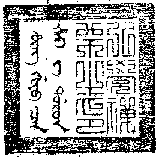



赐衣



唐咸通元年庚辰，懿宗皇帝赐天童㻏珑寺僧咸启紫衣一袭。



宋开宝二年己巳二月，诏十方禅院长春节上表，赐紫衣、号(时住持僧失稽)。



宋元丰八年乙丑，神宗皇帝赐天童景德寺僧惟白金襕紫衣一袭。



元至顺元年庚午，文宗皇帝赐天童景德寺僧怀信金襕法衣一袭。



明永乐　年，成祖皇帝赐天童景德寺僧净观紫衣一袭。



明崇祯十四年辛巳，怀宗皇帝命戚畹田弘遇进香补陀，赍紫衣一袭，赐天童寺僧圆悟。



国朝顺治十六年己亥十月，世祖章皇帝赐应召天童寺禅僧道忞，三衣一袭，黄衣一袭，绿云段道袍一袭。



顺治十七年庚子春，赐七衣一袭，沉香色道袍一袭，白短衣一领，鞋袜一副。



是夏赐三衣一袭，宫䌧道袍一袭。



是冬差官赍送千针衲衣一袭，五衣、七衣各一袭，黄祖衣一袭，夹衣一领。



是岁，又特赐随召天童侍僧本皙紫僧伽黎一袭，开法都中隆安寺。



又赐母丝布衣三袭，黄云段衣一袭，段直身二袭。



御制



宋建中靖国元年辛巳八月十五日，徽宗皇帝御制天童景德寺僧惟白《续灯录》序，其文曰：释迦如来之出世也，受然灯之记，生净饭王家。分手指乎天地，而其机也已露；游门观於老死，而幻缘也顿寂。及乎唱道鸡园、腾芳鹫岭，无边刹境，遂现於一毫之端；大千经卷，毕出於微尘之表。西被竺土，东流震旦。编叶而书，则一时圣法虽传於庆喜；拈花而笑，则正法眼藏独付乎饮光。自达磨而来，实为初祖。其传四七，二三而至於曹溪，於是双林之道逾光，一滴之流寖广。自南岳青原而下，分为五宗，各擅门风，应机酬对。虽建立不同，而会归於一。莫不箭锋相拄，鞭影齐施；接物利生，启悟多矣。源派广迤，枝叶扶疎，而云门、临济二宗，遂独盛於天下。朕膺天宝命，绍国大统，恭惟艺祖辟度门於绵㝢、太宗阐秘义於敷天，章圣传灯於景德、永昭广灯於天圣，皆宏𪽈真风、协助神化，以成无为之治者也。於皇神考，尤向空宗，元丰五年，诏于大相国寺，刱二大禅刹：辟惠林于东序，建智海于西庑。壬戌之岁，以越国大长公主，及集庆军节度观察留后．驸马都尉张敦礼之请，复建法云禅寺于国内之南。於是祖席光辉、丛林鼎盛，天下袭方袍、慕禅悦者，云集于上都矣。今敦礼以其寺住持僧佛国禅师惟白所集《建中靖国续灯录》三十卷来上，且以序文为请。惟白探最上乘，了第一义；屡入中禁，三登高座，宣扬妙旨，良惬至怀。昔能仁说《法华经》，放眉闲白毫相光，照东方万八千世界。而弥勒发问，文殊决疑，以谓「日月灯明佛」本光瑞如此。持是经者，妙光法师；得其证者，普明如来。今「续灯」之名，盖灯灯相续，光光相入，义有在於是矣。噫！圆澄觉海，本含裹于十方；生灭空沤，遂沉沦于三有。因明立所，繇尘发知；识妄相仍，转入诸趣，良可悲也。若廻光内照、发真归元，则是录也直指性宗、单传心印，可得于眉睫，可荐于言前。举手而擎妙喜世界，弹指而现庄严楼阁。神通妙用，真不可思议者也。嘉於有众，缔此胜缘；俱离迷津，偕之觉路，斯朕之志也。



御书御畫



宋淳熙五年戊戌，孝宗皇帝御书「太白名山」四大字，赐天童景德寺；又御题住持僧清简遗像赞。



明宣德元年丙午，宣宗皇帝御书题僧伽像，赐左讲经．天童僧净观。有玉玺刻石北京金刚寺。



国朝顺治十七年庚子，世祖章皇帝赐天童应召僧道忞，御书唐诗一幅。诗曰：



洞房昨夜春风起　遥忆美人湘江水  

枕上片时春梦中　行尽江南数千里



后识：庚子冬日书。



又御书「敬佛」二大字，末识为「木陈老人书」。



御章曰「体元斋」，又曰「太和主人」。



御畫白绫山水一轴，题云「顺治丙申夏日」。



御笔倣小米笔意，引章曰「体元斋」；又章曰「万机餘暇」，御玺「广运之宝」。



又御笔「水墨葡萄」一幅。



又「密云圆悟禅师像」一轴，因门人道忞进闽人曾鲸所绘像，即命供奉王国材临摹二帧。其一沉香龙座，备极庄严。圣驾亲送至万善方丈，指所畫衣折曰：「此皆朕手自著墨也。」赐藏天童。



又赐弘觉禅师道忞立像一轴，云：「中有御笔所增处。」



又赐随召天童寺僧本皙，御书「敬佛」二字；又《梵网经》；「春城乞食还」唐诗；十种唐诗手卷。



又唐诗五幅，额二：(一曰)尧天舜日；(二曰)松风水月。联五：(一曰)无法向人说，将心与汝安；(二曰)孤云卧此中，万山拜其下；(三曰)大护法不见僧过，善知识能调物情；(四曰)一池荷叶衣无尽，数亩松花食有餘；(五曰)千里为重，重水重山重庆府；一人为大，大邦大国大明君(盖问师生缘而书也)。



又赐《楞严会解》、《六祖坛经》、《讲筵恭纪》、《客问评注》、《庙堂碑帖》、《九成宫帖》、《多宝塔帖》。



今上康熈三十五年丙子，赐御书石刻《金刚经》一卷。四十二年癸未，赐御书「名香清梵」额。



赐佛、神宝像



国朝顺治十七年庚子，世祖章皇帝出内殿所供鎏金药师如来一尊，关帝乘马像一座，关小侯周将军像二座，备极珠宝金银装饰，赐天童弘法寺供奉。



赐录入藏



宋建中靖国元年辛巳，徽宗皇帝赐法云僧．前住天童佛国惟白禅师《续灯录》三十卷、御制序文入大藏。



国朝顺治十七年庚子，世祖章皇帝赐故住持天童寺僧圆悟密云禅师语录一十二卷入大藏。其门人道忞所疏请也。



进天童密云悟禅师语录奏章



浙江宁波府鄞县天童禅师(臣)僧(道忞)谨奏：为恭恳天恩，赐将先师语录入藏，以光祖道，以茂皇猷事。皇上统承精一，道契真宗，性命之学，尤深致意。至於古圣语言，有关世道人心者，尤必广布颁行，使若见若闻，各达本性，方惬御衷。真觉皇之慈心，振古希有者矣。(道忞)幸逢盛化，身叨宠遇；又每承天眷，追念先师，赐邈顶相，复刻遗编。感恩已渥，复敢何求？唯是𥾝念天童先师圜悟，生当末运，兴振禅宗；六坐名山，忘躯荷法。一时提唱机语，皆开凿人天，单明直指。日虽刻布人间，但未经入藏，恐惭湮没。(道忞)伏见宋景德年中，僧道原所著《传灯录》三十卷，颁降入藏；元祐闲，明教禅师契嵩所著《辅教编》三卷，及《传法正宗记》一十二卷，亦赐入藏；乾道七年，僧蕴闻所进大慧禅师宗杲语录三十卷，亦赐入藏；元元统二年，僧善达密的理所进其师普应国师明本语录三十卷，皆赐入藏。此四者，人虽异代，咸遇清时。道法耿光，於今维烈。况忞生值昌期之运，躬逢佛心天子重法之秋，诚千载一时奇遇。谨扳前件事例，将先师圜悟语录壹拾贰卷，与忞所编年谱陆拾贰帙，先经缮写进呈外，伏乞俯鉴微忱，下颁钧旨，赐收入大藏，永使流通。则正法眼千古长新，而愿力恩普天均戴者矣。为此冒昧具奏，恳赐下部施行。(忞)不胜翘祷待命之至，谨具奏闻。



顺治十七年三月二十三日，奉旨礼部议奏



本月二十九日礼部覆奏



本日奉旨依议



赐牒



唐贞观二十二年戊申，太宗皇帝诏度僧五人。



宋宝祐六年戊午，理宗皇帝赐天童景德寺度牒五十道。



赐碑



元至正二十三年癸卯，顺帝勅中书参知政事危素撰天童景德寺〈朝元阁碑铭〉。



赐帑金



国朝顺治十七年庚子，天童弘法寺弘觉禅师道忞应召还山，世祖章皇帝赐帑金千两，命修佛殿。是岁又发帑金五百两，命道忞修理云门雪峤大师圆信藏塔，颁有御札，其略曰：「朕每念法门，辄景先哲。知雪峤大师藏塔卓立云门，后学诸方应共瞻仰。比闻山界虽分，基址渐圮。恐年深人远，凌毁堪虞。今特捐五百金，重为修治。虽未必足窣波之费，然经朕一为整葺，人必改观起敬，自不敢复行侵侮矣。禅师重念仪型，久怀崇饰，当勉为经理，承朕敬礼尊宿之义，以副夙心」。



赐谥塔



唐咸通七年丙戌，懿宗皇帝敕赐前住天童栖心寺僧藏奂，谥曰「心镜禅师」，塔曰「寿相之塔」。



宋绍兴二十八年戊寅，高宗皇帝敕赐天童景德寺僧正觉，谥曰「宏智禅师」，塔曰「妙光之塔」。



国朝康熙四十四年乙酉，赐天童密云禅师，谥曰「慧定禅师」。



赐赙致奠、特恩送葬



元顺帝至正十七年丁酉，明太祖时为吴国公，督师江阴，还金陵。闻前住天童大天界寺僧怀信之讣，诏出内府币帛，以助葬事。且命堪舆家贺齐叔卜藏地。举龛之夕，亲临致奠，驾送都门之外。



明正统十四年己巳，英宗皇帝遣太监吴弼，赍金钞香币，赙吊前住持天童寺僧（任右善世）祖渊。又遣礼部主事林璧致奠。



亲藩雅赉



国朝顺治庚子岁，镇国公霓庵，赠山翁和尚手畫山水一幅，题云：「庚子之岁元宵前一日，五夜朝罢归来，晨光犹未大散。素知天童和尚（号山翁者）深悟三昧无上菩提，久隐西岩而弗出。今蒙帝恩诏入万善殿，时讲暮谈，大为圣悦。余虽久闻，尚未面晤，似觉歉然于怀也。随至莲寓，瞻覩慈颜，果法品而非凡。其谈柄辩锋，令人闻见生欢。至于禅之餘者，又无所不极矣。偶尔言及书畫，向余索之。余於笔墨况素不善，致辞别来，迄今已十餘日矣。南窗无事，勉强涂鸦，戏法云林，幸禅师勿轩渠也。」



识曰「东来堂物外主人」，引章曰「东来堂」。又章曰「敬一」，曰「物外主人」。又手镌品章二方：「禅深三昧动天恩诏古今无多图书永赠」，识曰「敬一主人」。



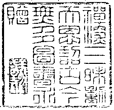



丁未岁，寄弘觉禅师手畫山水二幅。



其一题曰：「迂老变宋元诸名家畫，而出以疎澹。如陈正字淘洗六朝铅华都尽，其天韵自不可及。」款云「时丁未秋日，为弘觉禅师写。霓庵」；引章曰「华萼居图书」，又章曰「国则」，曰「辅国公章」。



其一题云：「摩诘谓『云峰石迹，迥出天机；笔意纵横，参乎造化』，迂老得之。」识云「时丁未秋日，霓庵畫并题」；章曰「敬一主人」，曰「国则」。



又赠诗一律书扇，诗云：



圣朝存象法　古寺复闻钟  

花引山门路　云开野殿松  

高斋谈静理　远屿见秋容  

日暮还携杖　月明林外峰



又寄赠黄玉玦一枚、水晶方印池一座，皆秘府上珍也。前后皆有手札，别载〈表贻考〉。



又赠山晓禅师（本皙），山水一幅、图章一方。



天童寺志卷之五



云踪考(旧志缺)



唐



宝掌千岁和尚



西竺中印度人。东汉献帝建安二十四年己亥，来至中土。魏晋闲，东游，西入蜀，历五台及庐山。达磨入梁，遂扣其旨而悟。武帝高其道腊，延之内庭。未几，如吴。有偈曰：



梁城遇导师　参禅了心地  

飘零二浙游　更尽佳山水



顺流东下，由千顷至天竺，往鄮峰，登太白，穿雁宕。唐太宗贞观十五年（辛丑）返，止杭之飞来峰。有「行尽支那四百洲，此中偏称道人游」之句。后居浦江之宝岩。至高宗显庆二年（丁巳）正旦，手塑一像。九日像成，趺坐而逝。自云「住世已一千七十二年矣」。溯其登太白时，则当在唐之初。



白寂然法师



河南人，少傅居易之从姪也。名节素奇，踵四圣种，以头陀称。唐太和间游鄮，登玉几礼塔，居太白。久之，访天台，历剡之沃洲。慕道猷竺支之芳躅，遂止焉。浙东廉使元相国始谋建院次，陆中丞莅越，助其落成。日与学者讨论心要，以振兴数百年既坠之风。少傅在河南保厘，为作〈沃洲禅院记〉。



纪禅师



按明《永乐钞志》载，唐昭宗龙纪元年（己酉），纪禅师从天童山飞锡至四明山，建仗锡寺。有太白禅师遗塔，至今存焉。



宋



文用庵主



雪窦显禅师有〈送文用庵主归旧隐诗〉云：



太白峰前旧隐基　松杉寒翠滴无时  

经年抛却又归去　再听岩猿只自如



智圆禅师



师久依天童交禅师，悟旨得法，出住象山蓬莱。三十年足不越阃，道俗尊仰之。尝有偈曰：



新缝布被烘来煖　一觉安眠到五更  

闻得上方钟鼓动　又添一日在浮生



牧庵忠禅师



师讳法忠，邑姚氏子。幼依崇教院道英出家。博识强记，默究诸部经论，尽得其义，咸以「忠虎子」名之。一日，暴所习於禅者，偶为其折困，因趋天童，参普交禅师求决焉。交喜曰：「吾宗之法器也。」俾往谒雪峰需及龙门佛眼，遂得法於眼。住南木、云盖、公安、二圣、大沩、黄龙六处。常持二木斧，随器接诱，禅学辐辏。太尉邢公孝扬为师预营寿塔。工毕，笑书颂语而逝。塔在黄龙。诏赐「联光之塔」。普庵、印肃，其法嗣也。



自得晖禅师



师讳慧晖，会稽张氏子。幼依澄照道凝染削。首叩真歇於长芦，不契。旋谒天童宏智，智举「明中有暗，不以暗相遇；暗中有明，不以明相覩」问之，不契。夜定回，往圣僧前烧香。适智至，晖见之，顿明前语。次日入堂，智云：「堪嗟！去日颜如玉，却叹回时鬓似霜。」诘之，晖曰：「其入离，其出微。」自尔问答无滞，智许为室中真子。绍兴丁巳，出世补陀、万寿、吉祥、雪窦。勅补净慈，后退归雪窦，沐浴跏趺而逝。



明慧禅师



师，婺州人。初学教观，更衣，参天童宏智禅师，顿悟。住久，举为首座。历住名刹。乾道丙戌冬，升堂说法，竟白众而逝。



元衡平禅师



师讳法平，嘉禾人。初受度，即参大慧杲禅师，为书记。后居天童时，号「平书记」。工文能诗，孙尚书觌、朱郎中希真，皆许可之。尝以偈呈史越王（浩），王酬偈云：



团团璧月印寒潭　时有清风埽碧岚  

照见山人方隐几　洒然无物自沉酣



又云：



白鹭栖烟一点明　皎然压倒语全清  

莫言后代无人继　仗锡行将擅此名



陆放翁（游）尤重之，寄以长句云：



放翁久矣无此客　闯户儿童皆动色  

寒泉不食人暍死　素绠银瓶我心恻  

千金易得一士难　晚途淹泊眼愈寒  

岂知一旦乃见子　杰语毫笔无僧酸  

门前清溪天作底　细细风吹縠纹起  

倚阑一笑谁得知　爱此数诗如此水  

江湖安得常相从　浩歌相蹋卧短篷  

功名渠自有人了　留我镜中双颊红



又以师号「怡云」，赠以诗曰：



东华软尘飞扑帽　黄金络马人看好  

渠侬胸中谁得知　畏祸忧谗鬓先老  

举世输与平元衡　青山白云过一生  

出门曳杖便千里　白云不约常同行  

长安归来雪没屦　剧谈未竟还东去  

到山分我一片云　并遣春风吹好句



后住象山延寿，复自芦山移仗锡。有《语录集稿》二卷。



景蒙禅师



师，永嘉人。初习教观。自以名相之学不足了大事，参育王裕公，闻钟声而悟。因省母归里，谒龙翔心闻和尚，机契，授以衣拂。史魏公（浩）在永嘉时，与心闻交。及罢相里居，梦如平生，傍有僧曰「景蒙」，貌古神清，谈笑久之。觉而叩天童朴公，详说梦事，曰：「僧名颇异，有斯人否？」朴曰：「是为堂中第一座。」招之，恍如梦中所见。与论出世法，了辩如响。问其师，则「心闻」也。大异之，遂为延誉，住智门、瑞岩诸刹。



松源岳禅师



师初见大慧杲禅师於径山。杲升座，盛称应庵华公为人𠇹捷。师闻之，不待旦而行。既至，入室，未契，愈自退励。中夜，自举「狗子无佛性」语，豁然有得。即以扣应庵，庵举：「世尊有密语，迦叶不覆藏。」师云：「钝置和尚。」庵厉声一喝。自是朝夕咨请，庵喜为法器。最后见密庵杰公，随问即答。密微笑曰：「黄杨禅尔。」师切於明道，至忘寝食。一日，密公入室次，问傍僧「不是心，不是佛，不是物」，师侍侧，豁然大悟。陆放翁铭其塔，有云：「亡友临川李德远（浩）实闻道于应庵，盖与密庵同参。德远每谈参问悟入时机缘言语，率常达旦。今读师语，峻峭𡷾崒，下临云雨，如立千仞之华山；蹴天驾空，骇心眩目，如钱塘海门之涛；虎豹股栗，屋瓦震动，如汉军昆阳之战。追思德远言，然后知师真临济正宗应庵、密庵之真子孙也。」



南书记



福州人，久依应庵华禅师。举「赵州狗子无佛性」话，契悟，呈偈曰：



狗子无佛性　罗睺星入命  

不是打杀人　被人打杀定



华喜其脱略。



宏监寺



应庵华禅师有送其〈开海田诗〉云：



轩昂气宇要争先　及早乘时痛著鞭  

翻转江臯千顷浪　灵苗从此秀桑田



石窗恭禅师



〈宗门会祖鉴〉内云：「恭，明州人。道行孤峻，才力有餘。久依宏智，细大职务，靡不历试。一日，归省母，母曰：汝行脚本为了生死、度父母；而长为人主事。苟不『明因果，将累我于地下。』恭曰：『儿於常住，毫发不欺。虽一炬之灯，亦分彼此之用。大人无足虑也。』母曰：『然过水得不脚湿？』评曰：恭母为子说法，只消一句，全提妙旨，号令群邪矣！何有生死、父母之不超度哉？」



隰州僧哲魁



魁性孤硬，潜迹宏智座下，不言同乡。经十餘载，智闻，欣然访曰：「父母之邦，何太绝物乎？」欲招至方丈，魁谢曰：「己事尚未办，岂暇讲乡礼耶？」曳杖而去，人莫能挽。竟往宝陀真歇故居，禅晏月餘。临终，召众说法而逝，阇维舍利无数。《山庵杂录》评曰：「善知识，慈心接物，固应如是。此僧孤硬无匹，超然于生死中，亦可风也。」



笑翁堪禅师



师讳妙堪，慈溪毛氏子。从野翁道钦受释学。参松源岳于灵隐，不契。时无用全禅师居天童，𠇹造其室。用问曰：「行脚僧？游山僧？」师云：「行脚僧。」用曰：「如何是行脚事？」师以坐具便摵。用曰：「此僧敢来者里捋虎须！」俾参堂。一日，室中示「狗子无佛性」话，师拟开口，用以竹箆子劈口打。师应声，呈偈曰：



大涂毒鼓　轰天振地  

转脑回头　横尸万里



用颔之，遂得法。出世妙胜、金文、光孝、报恩、虎丘、雪峰、灵隐、大慈、瑞岩、江心。诏住净慈。又诏住天童，力辞。诏住育王。未几，又有天童及净慈之命，悉谢不赴。



东山源禅师



师讳道源，从虎丘。尝参浙翁琰于天童。出世奉化清凉山，上堂云：「几载长庚度岁寒，横眠倒卧放痴顽。虽然不作住山计，却被无心趁出山。」



芝岩洪禅师



师讳惠洪，新昌朱氏子。初谒浙翁琰禅师于径山，未合。及琰迁天童，再参室中，得契。出世大慈，后迁石佛。



偃溪闻禅师



师讳广闻，侯官林氏子。得度，受具，游方。历访尊宿，参天童浙翁琰禅师。后再参双径，得法。屡住名刹，所至革弊支倾，广容徒众。



千光西禅师



师讳荣西，日本国人。发愿欲往西域，求教外别传之宗。有告以天台万年可依，航海而来。时虚庵敞禅师居万年，师以诗谒之曰：



海外精蓝特特来　青山迎我笑颜开  

三生未朽梅花骨　石上寻思埽绿苔



遂依焉。及敞迁天童，师亦随至。居岁餘，闻敞有改作千佛阁之举，乃请曰：「思报摄受恩，即糜躯不惮，况下此之事？西忝国主近属，当归国，致助良材。」遂归。逾二载，挟大舶，泛鲸波，果致百围之木，以成杰阁。后嗣敞之法焉。



圆证知客



天目礼禅师有诗示之曰：



莫年结屋傍山椒　门外荆芜没半腰  

几度赚君来扣击　老无气力举藤条



横川珙禅师



师讳如珙，永嘉林氏子。有叔正则，为沙门，视师幼不食肉，爱之，乃度其祝发。初见石田痴绝，疑碍无入。闻天目礼公居太白，往投以疑。目举「南山筀笋，东海乌贼」，师拟对，目遂打。师忽有省，留以执事。丞相以师有行解，可师表，命出世雁山灵岩，迁能仁。既归放牧寮，辞疾不应。至元十年，有旨住育王。晚年藏穴寺侧，曰「此庵」，乃自作。铭曰：



天生一穴　藏吾枯骨  

骨朽成土　土能生物  

结个葫芦　挂赵州壁  

永脱轮廻　超三世佛



后以书诀众而逝。



荆叟珏禅师



师讳如珏。初见痴钝於天童。僧问：「如何是佛？」钝命师下语，师答：「烂冬瓜。」即呈颂曰



如何是佛烂冬瓜　咬著冰霜透齿牙  

根蒂虽然无窖子　一年一度一开花



钝笑而可之，后诏住育王、径山。



虚舟度禅师



师尝参天童晦岩光，后住径山。



一庵𬤇禅师



按佛日祖像㡠内，有天童一庵𬤇禅师。



无镜彻禅师



师嗣天童无际派，旧志列〈先觉考〉。《续灯录》中载「天宁」，或误刊「宁」字，俟考正。



元



圆上人



袁学士文清公桷，有〈天童山圆上人远来开平访华严，以旧诗求题，因赋二章〉。



一曰：



三尺枯藤一卷诗　五千里外访相知  

乡音未改眉毛在　晓过岭西闻子𨾚



二曰：



手探骊珠颗颗圆　清如秋月独当天  

旧栖太白寒禁得　更上开平拟过年



又〈送圆上人游开平、回天童〉云：



圆帽方袍上上京　看山碧眼雪分明  

南来白雁先秋去　我辈无情合有情



孤峰德禅师



师讳明德，昌国朱氏子。幼不好嬉，每结跏趺端坐。其叔司藏天童慧明诃之曰：「童子不知颂诗读书，痴坐将焉求？」曰：「欲学坐禅，求作佛尔。」初供洒埽之役于金峩，已而，度为大僧，慨然有求道之志。首谒竺西坦公于天童，公问：「汝从何来？」曰：「金峩来。」公曰：「金峩山高多少？」曰：「不见其顶。」公斥之。益自策励，以必证为期。一日，举「世尊拈花事」，有省，遂以偈呈，公颔之。后嗣法竺田霖，历住东禅、保宁、道场、净慈。授「圆明定慧」之号，副以金襕法衣。宋文宪铭其塔。



玉溪珉禅师



师讳思珉，四明张氏子。首参雪峰于径山，次谒止泓于天童。泓问：「何来？」师曰：「径山。」泓曰：「未离径山一句作麼生道？」师曰：「平如镜面，险似县崖。」泓曰：「昨夜山前，因甚虎𫜪大虫？」师拟进语，泓即掌之，师忽有省。一日，侍次，泓举：「世尊因外道问『不问有言，不问无言』，世尊良久。意旨如何？」师叉手进前。泓曰：「外道赞叹云『世尊大慈，开我迷云，令我得入』，又作麼生？」师曰：「君子爱财，取之有道。」泓喜其类己，令典藏者久之。大德四年，出世郡之吉祥、金文、保福。帝师颁旨褒护，赐「佛心明妙」之号。



竺田霖禅师



师讳汝霖，四明王氏子。从慈溪永乐寺梅涧福公出家。闻天童止泓道化，往参。泓密奇之，遂命为侍者。泓室中举赵州「狗子无佛性」话勘验来学，众皆未喻，师已豁然。后出世上蓝，大振法道，为止泓嗣。又主明之雪窦。三载，迁松江淀山。晚主万寿。至元五年中夏，书偈而化。茶毗，获五色设利无算。



无作述禅师



师讳文述，慈溪人。幼从师受五经、子史、百家之书。及阅佛书，忽心融神会，即白亲出家。谒元叟、东屿诸公，无所解悟。入天童，见怪石奇公，与语，契合，入室侍书。后平石砥公主席，掌藏钥。诸山闻师声誉，迎宣大法。凤跃山等慈虚席，宣政院起师主之。后迁保福、护圣。帝师赐以「觉智圆明」之号。



实庵隐禅师



师号松隐，奉化郑氏子。得法于古林茂禅师。机辩峻绝，纵横自如。两从古林于永福、保宁，俱居第一座。月江印公莅湖之道场，请师分座说法。至正壬午，行宣政院命主瑞云之清凉，学徒奔凑，授「佛光普照」之号。居寺一十五年，退居东堂。左庵良公，法中犹子，迎归天童之此轩，俾首众，举扬法事。未几，示疾。左右请偈，乃举手指心曰：「此中廓然也，何偈之为？」端坐，凭几，握右手如拳，以额枕之而逝。良公方主寺事，令四众持服，如丧住持礼。越七日茶毗，火方举，有天华飘洒晴空中，似雪非雨，盘旋烈燄之上，火灭乃已。得舍利如珠玑者众。建塔于瑞云山之西冈，宋文宪为铭曰：



我闻如来　演说般若  

天雨宝华　缤纷而下  

岩岩普照　诸佛之子  

依佛倣佛　乃亦有此  

岂非天龙　及护法者  

欲警有情　使之四洒  

应感之机　非由外烁  

风动籁鸣　实自中作  

曷以明之　法因心悟  

表彼空华　以无著故  

何有四大　何有五蕴  

一空之餘　诸法销𫕥  

如大宝镜　罔不含摄  

随物赋形　了无餘迹  

晏坐云峰　学徒川赴  

孰不清凉　如饮甘露  

末法澜奔　师其砥柱  

胡为西归　空存遗履  

有窣堵波　中藏设利  

佛光炜然　群昏咸赖



恕中愠禅师悼师，偈云：



口有雌黄眼有筋　轻轻触著便生嗔  

拳头作枕且高卧　无复拦胸去筑人



瑞首座



古林清茂禅师，有〈送天童瑞首座之仰山偈〉云：



有句无句　如藤倚树  

百匝千重　经天纬地  

忽然树倒藤枯　毕竟句归何处  

才闻太白来　又往仰山去  

三千年桃树花开　九万里鹏程逸翥  

离四句　绝百非  

一口吸尽西江水　咄咄咄力囗希  

上士勤而行之　中下闻之不喜  

看取珠回玉转时　正偏兼带双双举



古鼎铭禅师



师讳祖铭，四明人。依横山锡公得度。竺西坦公居天童，辟为内记。后得法于元叟端公。出世，主隆教、宝陀、中天竺、径山。锡号「慧性文敏宏觉普济大师」。后退居于东湖青山、二灵。



无印证禅师



师讳大证，幼颖异。父母知不可留，使从昌国寺薙染。初谒荆石琬，不契。闻云外岫唱道天童，往依。入室，岫云：「天童今日大死去也，汝作麼生救？」师云：「请和尚吃饭。」岫又云：「天童今日大死去也，汝不要相救？」师云：「救他作麼？」岫又云：「天童今日大死去也，阿谁与我同行？」师云：「和尚先行，某甲后随。」岫呵呵大笑，自兹情同鱼水。至治间，诏天下善书者，金书藏典。竣事，赐织金屈眴。南还江浙，丞相脱欢公起师主衢之南禅，继领光孝，迁信之祥符，移明之定水，升雪窦。后退居定水圆明庵。入寂于至正辛丑。阇维，牙齿不坏，舍利明莹。



言侍者



笑隐大䜣有〈送天童言侍者偈〉云：



汝负吾兮吾负汝　曲如钩处直如弦  

鄞江急水东流去　太白峰高不到天



妙净禅师



师，临海人。幼聪慧，十五出家。闻了堂和尚居四明、大兴宗教，即往参之，得其奥旨。时左庵为浙东丛林第一，延师居焉，众皆敬服。洪武初，退休巾峰；寻移云峰，乐山水者三十六年。端坐而逝。所著有《方便录》、《百忍图》。



幻庵住首座



师讳法住，又号云峰，豫章人。为天童首座，拜应庵塔，有偈云：



耽耽睡虎管窥斑　便把中峰作靠山  

不得破沙盆一个　子孙乞活也应难



后得法于蒲庵复。



大基丕禅师



师得法于左庵良公，掌天童内记。江浙行省丞相康里公领宣政事，选师主佛陇，后迁洛伽、补陀。



呆庵庄禅师



师薙染天童，参侍左庵良公，得法了堂一公，后住云居、径山。其自作〈呆庵歌〉有序云：「余以痴钝自守，随所住处，扁曰『呆庵』。客有讥曰：『世人以机巧相尚，其来久矣，子欲全其呆而矫诸，不亦迂乎？』余因谢其客曰：『灵利汉有此分别尔。』客既去，於是作〈呆庵歌〉以写呆意。」歌曰：



我是呆庵呆道人　不识世间秋与春  

兀兀痴痴只麼过　无荣无辱无疏亲  

或把精金和土卖　或收燕石藏为珍  

笑倒傍观灵利汉　赞亦不喜骂不嗔  

有问呆庵何所作　闲看葫芦悬壁角  

当场拈起钝铁锹　拟向虚空去穿凿  

门户长年八字开　屋里从来空索索  

多被时流蓦面欺　一生卤莽都不觉  

可怪呆人百不能　对人呆话还可憎  

刚道夜深刍狗吠　大洋海底人挑灯  

更有一般呆伎俩　两耳卓朔头鬅鬙  

任你客僧逞机巧　东呼西唤渠不应



恕中愠禅师



师讳无愠，号空室，临海陈氏子。幼读书，不烦再授。依径山寂照端公薙染。徧参尊宿，见太白平石砥公，典藏钥。居十载，偕木庵聪公、大宗兴公，谒竺元道于台之紫箨山，参证得悟。逾一岁，复还天童。晚以日本奏请，起召京师。已而，寝奏，留居天界。有〈监收上堂兼谢天童藏主〉云：「以字不成，八字不是。㻏珑岩顶，白浪滔天。万工塘中，蓬尘涨起。分毫上定当，升合里论量。收得来，放得去。随缘剔脱，触处放光。可以起临济正宗，可以灭正法眼藏。虽然，若是个中人闻与麼道，直须洗耳有分。且谁是个中人？面如满月目如莲，天上人间咸慕敬。」后又赐归天童。明洪武八年乙卯，著《山庵杂录》。愚庵及禅师寄师诗云：



惺惺石上主人翁　一室高居太白峰  

靖退只今非小节　知心未许石门聪



觉藏主



了庵欲禅师有〈送天童觉藏主偈〉云：



三世诸佛是何物　一大藏教是何语  

直指单传显正宗　烂烂觉华生碓嘴  

自古上贤犹不识　中下之流岂堪测  

㪬瞎摩醯鬼眼睛　大地山河墨漆黑  

黑中有白光熈熈　敲空作响开愚痴  

空拳纸上实性义　隐显出没超玄微  

倒一说兮对一说　今古几人能辨别  

纷纷堕在光明中　大似猕猴探水月  

伟哉作者何方来　江村古寺相徘徊  

提金刚椎碎窠臼　用黑豆法驱英才  

撒开两手时一笑　照中之用用中照  

北斗藏身岂偶然　南山下雨还同调  

明朝话别归鲁松　铁船打就成怱怱  

隔山相唤解相应　管取倒行摩竭令



印书记



欲禅师又有〈赠天童印书记偈〉云：



一句子　龙无龙  

总拈却　称长雄　灼然不堕言思中  

单非只　两非二　老胡打失当门齿  

妙弹无弦谁赏音　还我东山左边底  

最卓荦　端寻常　毫毛岂足争短长  

拶著三关应手破　海印湛湛涵秋光  

跨三贤　超十哲　顶门别有通天穴  

满肚文章一字无　贼面似人人似贼



证侍者



楚石琦禅师有〈送天童证侍者再参诗〉：



鸟窠吹布毛　侍者便悟去  

天童亲切句　不要重指注  

十月天渐寒　早过西兴渡  

相望一千里　往复行大路  

入室再参时　瞋拳须照顾



安禅人



琦禅师有〈送安禅人往参天童偈〉云：



谁道葫芦醋不酸　衲僧带眼若为谩  

长松一望二十里　脚未跨门先胆寒



政书记



琦禅师有〈送政书记往天童偈〉云：



如来禅　祖师禅  

文字禅　是何禅  

一笔勾下　白日青天  

笑杀湖南长老　大书楷字深镌  

不见毘耶居士　唠唠击小弹偏  

及乎被人问著　直得杜口无言  

禅禅灵石书记　作麼流传  

竹月生寒籁　松风入夜弦  

既善骑声盖色　何妨说妙谈玄  

潮音洞里敲金镫　太白峰头驾铁船



诺禅人



琦禅师有〈送福州诺禅人再参天童偈〉云：



主人翁　惺惺著  

潦倒瑞岩　自呼自诺  

蛇吞鼈鼻口生烟　虎𫜪大虫头戴角  

会不会　知不知　大唐国里无禅师  

㻏珑岩主七十四　优昙钵花第一枝  

送君此去君知麼　莫把草鞋轻踏破  

前头更有最高峰　不独飞猿岭难过



腴侍者



古林茂禅师有〈送天童腴侍者偈〉云：



三呼不触当头讳　三应宁将五位分  

向上更无提掇处　到头谁肯囫囵吞  

春风扬广山前草　白日长庚岭上云  

盖覆得来成直截　隰州无口谩云云



少昙瑞禅师



师嗣法于佛智禅师，与笑隐䜣公雅好。䜣有〈送师归江西序〉云：「至大中，予主餘英山寺。三年，寇至，剽掠俱尽，仅脱身免。常所雅厚，咸相聚匿笑，莫有顾余者；独少昙来，劳苦数十返。明年，佛智迁径山。三月祸作，其徒多背去；而少昙又与二三子留侍。暨佛智归江右，少昙分座太白，不得从。今复走宜阳而省焉。於其行重予有感矣。世有君臣、父子、夫妇、兄弟、朋友之教，而民或悖之。溺于爱者，忘其亲；訹于利者，伤乎义。吾徒辞君父之尊、伉俪之欲，惟师友之道得同乎人也。而吾徒贵远游，大方多众，群居千百，错砻砥砺，期底于道。若是，于师友之道又专矣。无汩于欲、竞于利，其庶乎有终矣。於戏！孰谓之变能移于吾徒矣乎？若少昙者，可以敦俗者乎！」䜣又代著〈移师住光严行院疏〉云：「履狶而知瘠肥，乃为良贾；解牛而至綮肯，始曰善庖。故为政必先求贤，而纲宗所以弘道。某行无町畦，志不磷缁，筹室先登。及见永明全盛、龙门独步，其如妙喜南迁。与其傲睨太白之巅，孰若徜徉西丘之上？凝尘一榻，俨如千众之临；盖头把茅，自作万闲之庇。祈光法运，仰祝帝龄。」合观前后二文，则非专席天童。



默中唯西堂



在天童时，有〈咏蚕偈〉云：



桑空柘尽始心休　绵密工夫一茧收  

炉炭镬汤𢬵得入　为人只在一丝头



雪岩钦禅师



参访至天童佛殿前，经行次，擡眸见古柏，触著向来所得境界，一时放下。后得法於无准范禅师。



明



素禅师



《释氏稽古》云：国初名僧未见传纪者，附名有天童禅师素。



凤头祖师



师讳道孚，字信庵，江浦人。礼天童观公。时观翁道望高天下，宣庙在潜，每承顾问。宣德岁丙午，召至京师，馆于庆寿丈室。师执事惟谨，上嘉之，赐西服茜衣，师牢让不服。入五台，覩圣像摄身光中，奇幻百出，叹曰「一翳在眼，空花乱坠」，因自号「空幻子」。英庙闻师名，召见，大悦，呼为「凤头祖师」，盖以师头锐起也。寻授僧录讲经。未几，告退。结茅山中，屏息诸缘，不妄交接。司礼阮公简，强师复兴京西废寺；昭靖王又以宣武门第赐为梵刹，赐额「承恩」，为师憩息之地。师善书，笔法遒健，常於文华殿大书扁额，上视，称善，赠之诗，有「高僧书法胜中书」之句。尝施食於内庭，开法於秘殿，上皆躬御视闻，击节叹赏。当是时，耆旧凋丧，独师法闻四方。景泰丙子，升堂说偈而寂。讣闻，上震悼，遣祭，命公侯以下咸吊奠。茶毘获舍利，建塔。胡忠安公濙著铭云：「学博、行修、功盛，能光大法门云。」



太初原禅师



师讳启原，日本国人。与宗猷等十八众游参上国，赐斋，敕见讲义泐季潭。潭乃指见了堂一，一又指见天童素。后住罗阳三峰、山交龙护。临化说偈曰：



生也铁面皮　死也铁面皮  

一椎百杂碎　白日遶铁围



即庵禅师



径山琇公序《增集续灯录》中云：「永乐己未，移书诸方，幸藉天童即庵和尚展转搜讨云。」



懒牧觉禅师



师讳湛觉，长安张氏子。依月空师出家。参天童性空禅师，得法。结松巢于雨花之左，有《松巢内外集》。



古音琴禅师



师讳法琴，号玉泉，兴贤蔡氏子。礼赤石山主，出家。问法徧叩，参性空、静晃、印宗诸宿；印可于宝明寿堂。开法瑞岩，后创大刹于斗峰，弘化一方。有《醍醐集》三卷。



怀让禅师



本山释，端雅工诗，四方交游多重之。杨白川辑《天童寺集》，以师所著诗卷附梓焉。东臯张忱尝赠以诗云：



自闻方外说天童　梦绕青山廿里松  

珍重能吟老支遁　寻常结社胜庐峰  

传书度海朝凭鹤　击钵临江夜扰龙  

今日东风花院里　解衣留偈得从容



静庵宁禅师



师讳盛宁，邑光溪王氏子，寿昌鄮峰瑞公之嗣。瑞公繇，天童大用禅师之后，嗣松堂鉴公。师承其法，德邃才敏，兼会儒宗。嘉靖甲子，请师住持天童。适当零落之秋，经营殚心，安集得宜。所置遗业，迄今赖焉。比部杨水西承闵赠以文。师之嗣，继庵旵公，相继住持。文林史鹿泉元中请旵公序，略云：「惟静师於本山阐扬宗旨，遗有遐思。惟继公於本支，以昭述正传，群然思附，当不我拒也，盍迎诸？」往迎，公坚谢。诸缙绅先生请益力，且曰：「公号以继，继之师；师而不继焉，继将何志？」公方起，谢曰：「然。俾我执事山中，拈瓣香，上祝万年，次及我先师，至教也。昕夕幸同诸公参究上乘，至愿也。」至旵公二世，少谷怀公，亦相继住持。宗伯周文穆公应宾赠以文云：「夫有疏宕之器、𧿒踔之能、倜傥之才，然后能奋发尺籍之中，而自致夫尘𡏖之外。夙闻怀公完真抱一，恬澹撄宁，器具矣；靡法不含，靡机不摄，能裕矣；翕赩党䓪，能镇能化，才全矣。备是三者，而主夫天童，必饬治振起，踵前人之嘉绩，启后嗣之芳规，予有深望焉。」三师俱建塔於祖关之南。中峰大用禅师塔左有静庵宁禅师塔，盖师之衣钵塔也。



启禅师



让公〈北京送启禅师归天童诗〉：



一别天童二十年　京华一钵只随缘  

三关泉石埋残雪　九陇藤萝锁废烟  

巢鹤不闻新种树　养蜗犹是旧成田  

於今去作群缁首　净埽寒芜整法筵



国朝



明幻禅师



师，淮人。顺治间，尝在内廷万善殿奉侍圣像，上呼为「老修行」。庚子年，奉旨送佛神像至天童，命师仍随侍山中。年八十而终。



叠山禅师



师，奉化沈氏子，名行渊。徧历丛席，后参天童浮石贤，有省。机辩无让，乃印可。开法于江南宝光，后住邑之安嵓。师于逝世前，徧辞檀信。过幻迹居，别博融本。笑谈终日，乃云：「今日特来相别。」博云：「那里去？」云：「天台。」博云：「几时回？」云：「不回来了。」答云：「莫要死麼？」师云：「正要请兄封龛。」博以手掩师口，师云：「谢兄封龛了也。」即书偈，寄封于蟠龙庵中，云「十二日方可开」。十二日午刻，召众云：「我要去了。」端坐而逝。遗偈云：



报告禅门老作家　须知火里有莲花  

通身妙用头头显　法法拈来果不差



幻身原是个虫窠　尊贵何曾百岁多  

讵得心空如日耀　等闲翻却了娑婆



明介西堂



师名元灯，杨州人。年十六，投虎丘继起禅师鬄发。居金沙，数年，至笠山谒啸堂和上，为侍者。机契，从迁臯亭，兼记室。再迁天童，受记莂，居西堂。年二十九，染疾，书偈而逝。与进士徐戢斋（勍）交厚，即于本山卜地葬之。李杲堂（文胤）为师著塔上之铭，铭曰：



公之生　一钵一瓶　离离亭亭  

公之死　一塔一瓶　离离亭亭  

云异其白　山异其青  

于此置高僧　许勒吾铭



慰弘盛〈埽塔诗〉：



此形非常友　如客来寄止  

譬如历峻坂　车败而马去  

嗟君兰蕙质　清芬竟瘗土  

每读杲堂诗　涕泣如盛雨  

山花溢真定　怪石悬松尘  

衣裓埽方坟　云生香一缕



莲因首座



师，邑之孙氏子，崇祯癸未进士荣旭之胞弟。幼知向上事，二十岁潜入雪窦。兄强之归，未几，又走天童。一载，劝回，毕姻，入弟子员。年四旬，外室亡，即投金峩履法师薙染，命名成式。次春，得戒于天童山晓和上，令司侍职。多年，迁维那，始记莂。开法金峩，退休于二灵山。天岳和上居太白，招首众山中。后出游武林，过平江，寓三宿庵。染疾，辞众，书偈而逝。青庵彧西堂，向称忘形，乃捐资，竖塔于山。二灵介有〈埽塔诗〉云：



塔样斩新坐翠微　竹阴松韵共忘机  

白云只在中峰上　终日相看到落晖



天童寺志卷之六



法要考



旧志惟收法语，今附录表颂、著述。



唐



咸启禅师



(〔僧参〕)师问云：「甚处来？」僧云：「伏龙。」师曰：「还伏得龙麼？」僧云：「不曾伏这畜生。」师曰：「且坐吃茶。」



(〔简大德问〕：)「学人卓卓上来，请师的的意旨。」师曰：「我这里一屙便了，有甚麼卓卓的的意旨？」简云：「和尚恁麼答话，更买草鞋行脚始得。」师曰：「近前来。」简近前，师曰：「祇如老僧恁麼答话，过在甚麼处？」简无对，师便打。



(〔僧问〕：)「如何是本来无物？」师曰：「石润元含玉，鑛异自生金。」



(〔又问〕：)「如何是真常流注？」师曰：「涓滴无移。」



(〔又〕甘露庵主问：)「如何是应用无亏底眼？」师曰：「恰如瞎一般。」



(〔附录〕雪窦闻庵宗禅师颂「答简大德」)



卓卓的的　一屙便息  

老鼠舞三台　猫儿吹觱篥  

乌龟举首唱巴歌　一二三四五六七



(丹霞子淳禅师颂「答僧问」。「如何是应用无亏底眼？」师云：「恰如瞎一般。」)



盲聋瘖哑迥天真　眼似眉毛道始邻  

昨夜东君潜布令　黄莺啼处绿杨春



(〔又〕应庵华禅师拈)启禅师故是本分钳锤，塞断新天童口未得在。这僧虽深入阃域，要且未具透关眼。



宋



怀清禅师



(〔上堂〕)西湖隐出山峰秀，楼橹参差若畫成。禅流共在祇园住，莫教虚度一平生。



(〔僧问〕：)「如何是祖师西来意？」师曰：「眼里不著沙。」僧云：「如何领会？」师曰：「耳里不著水。」僧云：「恁麼则礼拜也。」师曰：「东家点灯，西家暗坐。」



瑞新禅师



(〔僧问〕：)「如何是密作用？」师曰：「何曾密？」



(〔又问〕：)「心径未通时如何？」师曰：「甚麼物碍汝？」



(〔又问〕：)「求之不得时如何？」师曰：「用求作麼？」僧曰：「如何即是？」师曰：「何曾失却？」



(〔又问〕：)「如何是天童境？」师曰：「云无人种生何极，水有谁教去不回。」



(〔又问〕：)「吾有大患，为吾有身。父母未生，未审此身在甚麼处？」师曰：「旷大劫来无处所，若论生灭尽成非。」僧曰：「恁麼则周遍十方，心不在一切处。」师曰：「泥里撼桩。」(补)



清简禅师



(〔僧问〕：)「如何是祖师西来意？」师曰：「不欲向汝道。」僧云：「请和尚道。」师曰：「达磨不可再来也。」



清遂禅师(旧志缺，今补)



(〔南岳应城初参〕)师问：「上人从何而来？」城云：「毗陵来。」师曰：「我闻毗陵出好草虫扇子，带得来否？」城作一圆相，云：「大善知识又要这个作麼？」师曰：「祇这个，此间亦要得。」城於言下大悟。



澹交禅师



(〔上堂〕)也大奇，也大差，十个指头八个罅。由来多少分明，不用钻龟打瓦。



(〔僧问〕：)「临云阁耸，太白峰高，到这里，如何进步？」师曰：「但寻芳草际，莫问白云深。」僧云：「未审如何话会。」师曰：「寒山逢拾得，两个一时痴。」僧云：「向上宗乘又且如何举唱？」师曰：「前言不及后语」。



可齐禅师



(〔上堂〕)僧问：「宝华王座，今日师登。祖意西来，如何垂示？」师曰：「花开岩畔千枝秀。」僧云：「便是和尚为人处也无？」师曰：「水泻簷前一样清。」僧云：「空生不解岩前坐，惹得天花动地来。」师曰：「笑破他人口。」僧云：「晓来云散后，不见别山高。」师曰：「吽吽。」僧问：「如何是道？」师曰：「踏不著。」僧云：「踏后如何？」师曰：「七穿八穴。」乃云：「一问一答，一拶一掠。千眼顿开，澄潭皎月；随机施设，纵夺临时。纵之，则句句攒花蔟锦，处处释迦道场；夺之，则一法不留，千圣绝迹。虽然如是，须知有向上一窍，还会麼？」良久曰：「莫谓春残花落尽，峰前昨夜一枝开。」



惟白禅师



(〔上堂〕)离娄有意，白浪陡以滔天；罔象无心，明珠忽然在掌。（以手打一圆相，召大众曰）还见麼？（良久曰）看即有分。



(〔又〕)过去已过去，未来且莫算，正当现在事。今朝正月半，明月正团圆。打鼓普请看，大众看即不无。毕竟唤甚麼作月？休於天上觅，莫向水中寻。(此则考补)



(〔颂〕临济三顿棒)



一槌便当未为奇　六十山藤是太迟  

至竟不能知痛痒　上堂犹道拂蒿枝



普交禅师(补)



(〔上堂〕)咄哉黄面老，佛法付王臣。林下无情汉，官差逼杀人。莫有知心者，为我免得麼？若无，不免将错就错。



(〔僧来〕)楖栗未担时，为汝说了也。且道说个什麼？招手洗钵、拈扇张弓、赵州柏树子、灵云见桃花，且掷向一边。山僧无恁麼闲唇吻与汝打葛藤，何不休歇去！



宏智禅师



(〔上堂〕)黄阁帘垂，谁传家信？紫罗帐合，暗撒真珠。正恁麼时，视听有所不到，言诠有所不及。如何通得个消息去？梦回夜色依稀晓，笑指家风烂熳春。



(〔又〕)僧问：「如何是向去底人？」师曰：「白云投壑尽，青嶂倚空高」。僧云：「如何是却来底人？」师曰：「满头白发离岩谷，半夜穿云入市鄽。」僧云：「如何是不来不去底人？」师曰：「石女唤回三界梦，木人坐断六门机。」乃曰：「句里明宗则易，宗中辨的则难。」良久曰：「还会麼？冻鸡未报家林晓，隐隐行人过雪山。」



(〔又〕)空劫有真宗，声前问己躬。赤穷新活计，清白旧家风。的的三乘外，寥寥一印中。却来行异类，万派自朝东。



(〔又〕)诸禅德！吞尽三世佛底人，为甚麼开口不得？照破四天下底人，为甚麼合眼不得？许多病痛与你一时拈却了也。且作麼生得十成通畅去？还会麼？劈开华岳连天色，放出黄河到海声。



(〔颂〕梁武帝问达磨大师：「如何是圣谛第一义？」磨云：「廓然无圣。」帝云：「对朕者谁？」磨云：「不识。」帝不契。遂渡江至少林，面壁九年。)



廓然无圣　来机径庭  

得非犯鼻而挥斤　失不回头而堕甑  

寥寥冷坐少林　默默全提正令  

秋清月转霜轮　河澹斗垂夜柄  

绳绳衣钵付儿孙　从此人天成药病



(〔又〕僧问马大师：「离四句，绝百非，请师直指西来意。」大师云：「我今日劳倦，不能为汝说。问取智藏去。」僧问藏，藏云：「何不问和尚？」僧云：「和尚教来问。」藏云：「我今日头痛，不能为汝说。问取海兄去。」僧问海，海云：「我到这里却不会。」僧举似大师，大师云：「藏头白，海头黑」。)



药之作病　鉴乎前圣　病之作医　必也其谁  

白头黑头兮克家之子　有句无句兮截流之机  

堂堂坐断舌头路　应笑毘耶老古锥



(〔又〕僧问南阳忠国师：「如何是本身卢舍那？」师云：「与我净瓶来。」僧将净瓶到，师云：「却安旧处著。」僧复问：「如何是本身卢舍那？」国师云：「古佛过去久矣。」)



鸟之行空　鱼之在水  

江湖相忘　云天得志  

拟心一丝　对面千里  

知恩报恩　人间几几



(〔又〕廓侍者问德山：「从上诸圣向甚麼处去也？」山云：「作麼，作麼？」廓云：「勅点飞龙马，跛鼈出头来。」山便休去。来日山浴出，廓过茶与山，山抚廓背一下。廓云：「这老汉方始瞥地。」山又休去。)



觌面来时作者知　可中石火电光迟  

输机谋主有深意　欺敌兵家无远思  

发必中　更谩谁  

脑后见腮兮人难触犯　眉底著眼兮渠得便宜



(〔又〕洞山示众云：「秋初夏末，兄弟或东或西，直须向万里无寸草处去。」又云：「只如万里无寸草处，作麼生去？」石霜云：「出门便是草。」大阳云：「直道不出门，亦是草漫漫地。」)



草漫漫　门里门外君自看  

荆棘林中下脚易　夜明帘外转身难  

看看几何般　且随老木同寒瘠　将逐春风入烧瘢



(〔又〕九峰在石霜作侍者，霜迁化后，众欲请堂中首座，接续住持。峰不肯，乃云：「待某甲问过，若会先师意，如先师侍奉。」遂问：「先师道『休去，歇去，一念万年去，寒灰枯木去，一条白练去』，且道明甚麼边事？」座云：「明一色边事。」峰云：「恁麼则未会先师意在。」座云：「你不肯我，那装香来。」座乃焚香云：「我若不会先师意，香烟起处，脱去不得！」言讫，便坐脱。峰乃抚其背云：「坐脱立亡则不无，先师意未梦见在。」)



石霜一宗　亲传九峰  

香烟脱去　正脉难通  

月巢鹤作千年梦　雪屋人迷一色功  

坐断十方犹点额　密移一步看飞龙



(〔又〕岩头到德山，跨门便问：「是凡是圣？」山便喝，头礼拜。洞山闻，云：「若不是奯公，大难承当。」头云：「洞山老汉不识好恶，我当时一手擡、一手捺」。)



挫来机　总权柄  

事有必行之威　国有不犯之令  

宾尚奉而主骄　君忌谏而臣佞  

底意岩头问德山　一擡一捺看心行



(〔又〕雪峰示众云：「南山有一条鼈鼻蛇，汝等诸人切须好看。」长庆云：「今日堂中大有人丧身失命。」僧举似玄沙，沙云：「须是我棱兄始得。虽然如是，我即不恁麼。」僧云「和尚作麼生？」沙云：「用南山作麼？」云门以拄杖撺向峰面前，作怕势。)



玄沙太刚　长庆少勇　南山鼈鼻死无用  

风云际会头角生　果见韶阳下手弄  

下手弄　激电光中看变动  

在我也能遣能呼　於彼也有擒有纵  

底事如今付阿谁　冷口伤人不知痛



(〔又〕僧问云门：「不起一念，还有过也无？」门云：「须弥山。」)



不起一念须弥山　韶阳法施意非悭  

肯来两手相分付　拟去千寻不可攀  

沧海阔　白云闲　莫将毫发著其闲  

假鸡声韵难谩我　未肯糢糊放过关



(〔五位颂〕)



正中偏　霁碧星河冷𣹰天  

夜半水童敲月户　暗中惊破玉人眠



偏中正　海云依约神仙顶  

妇人鬓发白如丝　羞对秦台寒照影



正中来　月夜长鲸蜕甲开  

大背摩天振云翼　翔游鸟道类难该



兼中至　觌面不须相忌讳  

风化无伤的意玄　光中有路天然异



兼中到　斗柄横斜天未晓  

鹤梦初醒露叶寒　旧巢飞出云松倒



(〔六湛堂偈〕衞寺丞进可，有堂曰「六湛」，盖取《楞严经》「六处休复同一湛然」之义。乃为说偈曰：)



风澜未作见灵源　六处忘归体湛存  

诸法性空方得座　一弹指顷顿开门  

寒梅篱落春能早　野雪櫺窗夜不昏  

万象森罗心印印　诸尘超豁妙无痕



(〔附录〕大慧杲禅师和韵偈)



非湛非摇此法源　当机莫厌假名存  

直须过量英灵汉　方入无边广大门  

万象交罗元不二　六窗昼夜未尝昏  

翻思厐老事无别　掷剑挥空岂有痕(已上二则俱考补)



(〔大用庵铭〕)



廓然之宗　空而不空  

智游方外　妙入环中  

环中湛存　用之不痕  

总造化柄　见离微根  

穷极离微　玄枢活机  

河横澹荡　斗转依稀  

依稀成用　用与体共  

象未中形　功初内动  

动而影彰　静而智藏  

光容天地　兆变阴阳  

阴阳变兆　用得之要  

春在百花　风号万窍  

窍窍中虚　虽有而无  

声不碍器　色不染珠  

珠兮走盘　不见其端  

壁立千仞　赤肉一团  

一团赤肉　应缘具足  

像兮临鉴　神兮居谷  

谷神是谁　灵灵自知  

说用如鼻　眺用如眉  

用之互换　寄世而玩  

弹指开门　相招隔岸  

隔岸相招　拈却木桥  

等闲一唤　适用全超  

超用较些　相逢作家  

云雨翻覆　雪刃交加  

交加不伤　用钝愈光  

拍拍是令　人人当行  

当行往还　用亡险艰  

如石含玉　似地擎山  

山蓄海藏　规圆矩方  

头头得用　恰恰相当  

相当函盖　混成三昧  

宛转机圆　纵横用大  

大用现前　不存轨则  

推倒籓篱　东西南北  

南北东西　归去来兮  

混之不得　类之不齐  

随类而游　闲闲自由  

天上天下　云行水流



(〔附录〕默成居士潘良贵跋)普觉圆照大师昙赞，戒行清苦，筑庵於义乌之仙山，予为名曰「大用」。久欲作铭而未果。绍兴九年，予守四明，与天童觉老款，偶纵谈此，以铭属之。觉欣然不辞。其笔力痛快，殆与〈信心铭〉相为后先。明年秋九月己未，始授赞，俾镌之石。(此则考补)



法为禅师



(〔上堂〕)法身无相，不可以音声求；妙道忘言，岂可以文字会？纵使超佛越祖，犹落阶梯。直饶说妙谈玄，终挂唇齿。须是功勋不犯，形迹不留；枯木寒岩，更无津润；幻人木马，情识皆空，方能垂手市鄽，转身异类。不见道，无漏国中留不住，却来烟隖卧寒沙！



宗珏禅师



(〔上堂〕)劫前运步，世外横身；妙契不可以意到，真证不可以言传。直得虚静敛氛，白云向寒岩而断；灵光破暗，明月随夜船而来。正恁麼时，作麼生践履？偏正不曾离本位，纵横那涉语因缘？



(〔僧问〕：)「如何是道？」师曰：「十字街头休斫额」。



应庵华禅师



(〔受请上堂〕)去年十一月，笑别下鍾阜。今年九月中，行见朝天路。去住既无心，动静非取与。平生安乐法，此意同谁语。四明昔尝到，诸刹皆可数。山川气象雄，麐凤栖迟处。今思昔日游，岁月二纪许。岂谓临晚景，侯伯重相顾。开缄读来书，丁宁见毫楮。姑苏二千石，眼高照天宇。我昔昧平生，今见开心腑。忻然乐与行，方鸣集众鼓。先师未了底，今日应须去。敢问诸人：如何是先师未了底？（蓦拈拄杖，卓一卓，喝一喝，下座）



(〔入寺上堂〕)风行草偃，水到渠成。正令既行，十方坐断。若也向上论去，语默不及处，棒喝未施前，总是依草附木汉。事不获已，且作死马医。所以道，随处作主，遇缘即宗。法幢随处建立，展临济三玄戈甲，会曹洞五位君臣。敲唱双行，杀活自在。拈一茎草，穿天下衲僧鼻孔；布缦天网，要打冲浪锦鳞。是则是，便与麼去。达磨一宗，埽土而尽。（蓦拈拄杖，划一划，云）剑为不平离宝匣，药因救病出金瓶。（卓拄杖，下座）



(〔上堂〕)良工未出，玉石不分；巧冶无人，金沙混杂。纵使无师自悟，向者里，何啻朝打三千、暮打八百？（拈杖云）唤作拄杖，玉石不分；不唤拄杖，金沙混杂。其间一个半个，善别端由。苟或未肰……（卓杖云）急著眼看！



(〔上堂〕)（举僧问赵州：如何是毘卢圆相？州云：自小出家，不曾眼华。师云）赵州见处偏枯。若有人问天童：「如何是毘卢圆相？」祇对他道：「大底大，小底小。」且道与赵州还有优劣也无？具择法眼，试简点看！



(〔又〕)禅禅，更不相煎。坐底自坐，眠底自眠，大家安乐，无法可传。禅禅，曹洞五位，临济三玄。大年三十夜，脚踏地，头顶天。禅禅，不直半文钱。海枯终见底，人死脚皮穿。



(〔举杰首座上堂〕)一棒一条痕，一掴一手血。临济老瞎驴，至今犹未瞥。须弥顶上浪拍天，大洋海水无一滴。伟哉本色人，顶门亚三只。辨龙蛇百草头，擒虎兕一毫力。穿大地人鼻孔，坐断衲僧摇舌。虽然，犹未拨动向上一窍在。且作麼是向上一窍？问取堂中首座杰。



(〔颂〕世尊初生)



草本无端拈出来　更加注脚放痴呆  

西天此土谁知己　夜半优昙火里开



(〔又〕女子出定)



出得出不得　满面是埃尘  

愁人莫向愁人说　说向愁人愁杀人



(〔又〕药山谓云岩曰：「与我唤沙弥来。」曰：「唤他来作甚麼？」山曰：「我有个折脚铛子，要他提上挈下。」岩曰：「恁麼则与和尚出一只手去也。」山便休。)



药山道头　云岩知尾  

虽然头尾相称　要且不识羞耻



(〔赞〕临济)



喝下忽雷惊　声前休领略  

当锋啮镞时　蹉过第一著  

不在壁立处　岂向平地泊  

野水白连天　秋空飞一鹗



(〔又〕虎丘先师)



老汉从来无禅　一味心中含毒  

此毒时复现前　浑家大小不睦  

异口同音咒诅　至今活陷地狱  

一名临济正宗　一名丛林瞎秃



(〔自赞〕)



者汉初无罪过　祇是头扁眼大  

虽然肚里醒醒　开口便先话堕  

如斯出世为人　恰似大虫看水磨



(〔赠偈〕悟上人造华严塔)



山前马厩普光殿　门外牛栏正觉场  

五十三人同日葬　善财走得脚生疮



(〔示〕严教授康朝语)有般底得个见处了便休，更不就人决择，被人拈起一件物顿面前分疏不下，便浑囵吞却，口头虽说不疑，肚里毕竟有块物不能消化，此便是生死根本。有一般底得个见处，坐著见处，见地不脱，一向说玄说妙，广陈蹊径谓之为人，此便是丧达磨正宗魔子。有一般底做工夫，到个静处，身心稍稍轻安，一向坐在无人之乡，见人说著好事，便生烦恼，返言禅道本无所说，所以云门道「一切处不明，面前有物」者是也，此病最苦。有一般底得个见处，荡荡地无佛、无祖、无诸圣，一向无将去，行盗行淫、饮酒食肉，谓之无碍禅，此是地狱种子也。永嘉云：「豁达空，拨因果，莽莽荡荡招殃祸。」有一般底见处，泯默无闻，一味噇却常住饭了，祇管死葛怛地守却被位，等个悟处，此便是深山大泽一间破屋下泥团，谓之无转智大王，徒消信施；其实，本分参学者，初无许多栖泊处。罗山老汉道：「我这里祇有一口剑，剑下有分身之意，亦有出身之路。」从上老宿弄将出来，千差万别，无不从脚跟下流出。变通逸格，杀活自在。(此则考补)



(〔附录〕大慧杲禅师赞垂示语偈)



坐断金轮第一峰　千妖百怪尽潜踪  

年来又得真消息　报道杨岐正脉通



(肯堂𠑽禅师颂，示众云：「尽力道不得底句，不在天台，定在南岳。」)



相骂饶汝接嘴　相唾饶汝泼水  

蓦然摸著蛇头　拍手啰啰哩哩



(虚堂愚禅师颂前案)



耆婆去后无消息　病者憧憧日扣门  

百草自知无识者　丛丛垂泣在篱根(三则俱增)



慈航朴禅师



(〔上堂〕)



酷暑如焚不易禁　炎炎赫赫欲流金  

夜明帘外无人到　灵木迢然转绿阴



(〔又〕)德山入门便棒，临济入门便喝。临济喝处，德山棒头耳聋；德山棒时，临济喝下眼瞎。虽然一搦一擡，就中全生全杀。（遂喝一喝，卓拄杖一下，云）敢问诸人是生是杀？（良久云）君子可入。



(〔又〕)



牛皮鞔露柱　露柱啾啾叫  

灯笼佯不知　虚明还自照  

殿脊老鸱吻　闻得呵呵笑  

三门侧耳听　就上打之遶  

譬如十日菊　开彻阿谁要  

阿呵呵　未必秋香一夜衰　熨斗煎茶不同铫



(〔又〕)观音岩㻏㻏珑珑，太白石丁丁东东。西园菜黄似不堪食，东谷花发却无赖红。且道是祖意？教意？途中受用，世谛流布。若道不出，雪峰覆却饭桶。若辨得出，甘贽礼拜蒸笼。



(〔又〕)久雨不晴，半睡半醒。可谓天地合其德，日月合其明，四时合其序，鬼神合其吉凶。（遂喝曰）住住，内卦已成，更求外象。（卓拄杖曰）适来掷得雷天大壮，如今变作地火明夷。(此则考补)



无用全禅师



(〔上堂〕)



学佛止言真不立　参禅多与道相违  

忘机忘境急回首　无地无锥转步归  

佛不是心亦非　觌体承当绝所依  

万古碧潭空界月　再三捞摝始应知



(〔到灵隐，请上堂〕)灵山正派，达者犹迷。明来暗来，谁当辨的？双收双放，孰辨端倪？直饶千圣出来，也祇结舌。何故人归大国方为贵，水到潇湘始是清？（复曰）适来松源和尚举竹箆话，令天童纳败缺。诸人要知麼？听取一颂：黑漆竹箆握起，迅雷不及掩耳；德山临济茫然，懵底如何插嘴？



(〔颂〕维摩诘默然无言)



毗耶城里老维摩　一默无言诡诈多  

三万二千狮子座　一时掀倒看如何



密庵杰禅师



(〔受请上堂〕)（举先应庵受天童请日偈毕，乃云）山僧亦有一偈，举似大众。去年八月闲，得旨与安闲。摆脱水云性，纵步到阳山。元宅诸子弟，忻然力追攀。庵居三个月，开怀宇宙宽。忽接四明信，来书意盘桓。天童虚法席，使君语犹端。迢迢遣专使，不问路行难。山僧临晚景，不敢自相瞒。搥鼓乐与行，四众亦欣懽。先师未了底，应是起波澜。敢问大众：「如何是先师未了底？」一回饮水一回噎，临济德山俱汗颜。



(〔上堂〕)祖师心印，不涉言诠。问讯烧香，早成多事。行棒行喝，开眼尿床。举古举今，泥中洗土。别有向上一路，千圣不传。总是熟睡饶谵语，衲僧家，心愤愤、口悱悱，到这里如何即是？（以拂子击禅床云）衲被蒙头万事休，此时山僧都不会。



(〔又〕)说到行不到，好肉剜疮；行到说不到，扶篱摸壁。行说俱到，石笋抽条；行说俱不到，担雪填井。离四句，绝百非，即不问诸人。且道文殊问不二法门，维摩因什麽默然？（喝一喝云）贪他一粒粟，失却半年粮。



(〔颂〕女子出定)



出得何如未出时　瞎驴成队丧全机  

而今四海平如砥　芦管迎风撩乱吹



(〔又〕殃崫摩罗救产难)



贤圣劫来未曾杀　而今断这一刀休  

果然葛怛胸中落　笑杀灵山老比丘



(〔又〕百丈野狐)



五百生前失却　五百生后太错  

错错　谁道祥麐只一角



(〔偈〕示曾秘较)



天童得力句　不摇三寸舌  

父母未生前　令已行摩竭  

直下便承当　敢保犹未彻  

放下百不知　脑门重著楔  

惟是过量人　一举无二说



(〔附录〕金山善开禅师颂「破沙盆」)



法眼拈来早自谩　无端错对破沙盆  

而今遍界难遮掩　殃害丛林累子孙



(虚堂愚禅师颂「破沙盆」)



直甚破沙盆　掀翻海岳昏  

顶门真个瞎　千古累儿孙



(双杉元禅师颂「破沙盆」)



五陵公子少年时　得意春风跃马蹄  

不惜黄金为弹子　海棠花下打黄鹂



(了庵欲禅师赞)



破沙盆正法眼　掀天纪截地维  

青山九锁兮中峰巍巍(已上三则俱增)



雪庵瑾禅师(补)



(〔上堂〕)金刚圈里翻身，筑著帝释鼻孔；悬崖头上撒手，突出达磨眼睛。往复三回，兴还未尽；机轮一转，势不可停。倒拈蝎尾，婢使声闻；顺捋虎须，奴呼菩萨。释迦已灭，弥勒未生；佛法祖令，总属天童。把住放行，如何施设？（良久云）无孔铁锤当面掷，普天匝地起清风。



(〔附录〕了庵欲禅师和「雪庵瑾和尚偈」)



眼中之句句中眼　眨上眉毛还不见  

有时提起金刚王　有时独弄无文印  

神仙秘诀谁堪传　劫外日月壶中天  

太白山头燄炉雪　鼈鼻𠇹把长蛇吞



息庵观禅师(补)



(〔上堂〕)举二祖问达磨安心公案，颂曰：



长安深夜雪漫漫　欲觅心安转不安  

纵使言前开活眼　那知巳被老胡谩



(〔示众〕举南泉曰：「江西马祖说即心即佛，王老师不恁麽道。不是心，不是佛，不是物，恁麽道有过麽？」赵州礼拜而出，僧随问，州曰：「你却问取和尚去。」僧乃问：「适来谂上座意作麽生？」泉曰：「它却领得老僧意旨。」师颂曰：)



惯弄琴瑟与琵琶　清音历历徧天涯  

堪嗟不入聋人耳　空使西山日又斜



痴钝颕禅师(补)



(〔颂〕达磨见武帝因缘)



提起须弥第一锤　玉关金锁系难开  

重施背踏空劳力　应悔迢迢万里来



无际派禅师



(〔上堂〕)诸人十二时中，上来下去，折旋俯仰，起居问讯，瞒崇恩一点不得；坐立俨然，宾主交参，面面相觌，崇恩亦瞒诸人一点不得。既然彼此不相瞒，为什麽自作障碍？（喝一喝）因风吹火，用力不多。



(〔佛涅槃日上堂〕)释迦昔向今辰入大寂定，堪笑天下衲僧刻舟求剑，二千餘年，区区不已。崇恩今日不动神机，捩转瞿昙鼻孔。不图打草惊蛇，只要大家相见。汝等诸人各宜仔细观瞻，莫教错过。（遂合掌曰）不审，不审。(已上二则住崇恩说考补)



(〔颂〕百丈政示众：「汝等为我开田，我为汝说大义，普请开田了。」众请和尚说大义，师展两手示之。)



百丈说大义　全然没巴鼻  

通身是水泥　溺死在平地



(〔又〕疎山冬至夜，有僧上堂问：「如何是冬来意？」师曰：「京中出大黄。」)



京师出大黄　直截为君举  

冬至至寒食　恰是一百五



浙翁琰禅师(补)



(〔赞〕维摩居士)



毘耶示疾放憨痴　添得时人满肚疑  

不是文殊亲勘破　这些毛病有谁知



(〔附录〕长翁如净禅师（浙翁遗书）上堂)



八月十八钱塘潮　浙翁声价泼天高  

尽教四海弄潮手　彻底穷渊辊一遭  

重拣择　不辞劳　要透龙门继凤毛  

忽然收卷还源去　万古曹溪风怒号



天目礼禅师



(〔上堂〕)万松关迥，九陇烟横；谷风传响，涧水流声。若以眼观耳听，拔舌犁耕；不以眼观耳听，拔舌犁耕。且利害在甚麽处？若不同床睡，焉知被里穿？



(〔又〕)众生本不曾迷，夜阑鸡向五更啼；诸佛本不曾悟，秋清雁度长空去。（拍膝一下云）西窗昨夜月华明，凉飇已到梧桐树。



(〔又〕翠岩真长老嗣书至)洪崖井边，翠岩寺里，山遮半月，江碍斜阳。不是诸佛眼睛，亦非祖师巴鼻。召专使云：「会麼？」归去滕王阁上，卷起珠帘看取，十八滩头，烟波鼎沸。(此则考补)



(〔颂〕七贤女游尸陀林)



七珍八宝任君需　三佛从来的是无  

若向无中拈得出　不须见佛问何如



(〔又〕马祖因僧问「离四句、绝百非」)



唤起窗全曙　催归日未西  

无心花里鸟　更与尽情啼



(〔又〕百丈野狐)



堕脱知何处　凭君仔细看  

潮来无别浦　木落见他山



(〔又〕赵州因一婆子请转藏经)



不知兀坐常轮转　空下禅床遶一遭  

背面却言亏一半　老婆恶业自家招



(〔又〕临济三问黄檗佛法大意)



祸福无门口自招　三遭瞎棒打驴腰  

谁知败国亡家恨　万古春风吹不销



(〔又〕兴化打中间底)



四方八面没边疆　暴雨狂风无处藏  

古庙里头休軃避　移舟别有好商量



(〔又〕瑞岩唤主人公)



磐陀漠漠秘苍苔　终日跏趺两鬓催  

纵使不曾呼唤著　何尝谩得阿师来



(〔赞〕六代祖师)



咄咄胡僧　齿缺面黑  

满口乡谈　无人译得  

只知结果自然成　不知满地花狼籍



哀哉断臂　甘受欺瞒  

心既不有　何处求安  

寂寂少林人不见　一庭风雪夜漫漫



内外中间　觅罪不得  

瞌睡醒来　眼睛突出  

一从归去皖公山　直至如今没踪迹



破头山前　三辞诏旨  

教坏小儿　卖弄唇嘴  

无端又上牛头山　更与懒融说道理



黄梅再来　青松依旧  

前身后身　一场逗漏  

七百高僧总作家　惟有南能不即溜



倩人书偈　巧说脱空  

传衣宵遁　丧尽英雄  

非风旛动惟心动　依旧埋身草莽中



(〔附录〕石林巩禅师举天目禅师问僧：「名甚麼？」僧云：「智虎。」师退身，作怕势。僧拟议，师归方丈。因颂：)



白浪堆中下一钩　锦鳞红尾尚悠悠  

渔翁不计竿头事　笑入芦花万顷秋(此则增)



枯禅镜禅师



(〔上堂〕)有句无句，如藤倚树；树倒藤枯，句归何处？（良久）长忆江南三月里，鹧鸪啼处百花香。



(〔又〕)



一拽石　一搬土　夜半日轮正卓午  

老安曾牧沩山牛　南泉不打盐官鼓  

劝君知　莫莽卤　火里䳭鹩吞却虎



(〔又〕)举僧到鹤林敲门，林云：「是谁？」僧云：「行脚僧。」林云：「非但行脚僧，佛来也不著。」僧云：「既是佛来，因甚不著？」林云：「无你栖泊处。」师云：「若天童有人敲门，即大开门户，与伊入来，当胸搊住，云『道！道！』。待伊拟开口，劈胸与一拳。若向这里转得身、吐得气，便请明窗下安排。」(已上三则考补)



(〔颂〕鵞湖大义禅师，因唐宪宗问：「如何是佛性？」对曰：「不离陛下所问。」)



因地而倒因地起　离地求起无是理  

不离所问语虽亲　认著依前还不是



(〔偈〕上钟)



一模脱就转风流　平地教他不肯休  

要得洪音喧宇宙　直须更上一层楼



弁山阡禅师



(〔颂〕刺史李翱躬谒药山，山执经卷不顾。李曰：「见面不如闻名！」拂袖便出。山曰：「太守何得贵耳贱目？」李回谢、问道。山以手指上下，李不会。山曰：「云在青天，水在瓶。」李作礼，述偈曰：「鍊得身形是鹤形，千株松下两函经。我来问道无餘说，云在青天水在瓶。」)



贵耳而贱目　背手抽金镞  

仰面看青天　箭过新罗国



(〔赞〕观音大士)



螺髻屈蟠春岛碧　绿衣零乱晓云寒  

寻声只麼随流去　见甚真观清净观(此则增)



(〔偈〕送僧归乡)



奋志南方问正因　正因一字不曾闻  

七零八落袈裟角　惹得凌霄几片云



痴绝冲禅师



(〔结夏上堂〕)



圆觉伽蓝　尘尘有路  

坐断去来　顿空今古  

那里十三　这边十五  

后先不差毫发　可笑黄面瞿昙　至今不知落处



(〔上堂〕)有一人一念顿证，堕在佛数。有一人累劫阐提，不愿成佛。且道那个合受人天供养？（良久云）蝶穿芳径双眉湿，蜂掠残花两股肥。



(〔又〕)僧问：「心、佛及众生，是三无差别，如何是过去心？」师曰：「放待冷来看。」僧云：「如何是现在心？」师曰：「你问我答。」僧云：「如何是未来心？」师曰：「后次上堂向你道。」僧云：「如何是过去佛？」师曰：「去年梅。」僧云：「如何是现在佛？」师曰：「今岁柳。」僧云：「如何是未来佛？」师曰：「颜色馨香依旧。」僧云：「如何是过去差别智？」师以拂子击禅床左边。僧云：「如何是现在差别智？」师以拂子击禅床右边。僧云：「如何是未来差别智？」师以拂子中间点一点。僧云：「心、佛、众生无向背，十方刹海一毫收。」便礼拜。师乃曰：「过去心不可得，现在心不可得，未来心不可得。三世既不可得，唤甚麼作差别智？若人见得彻去，三世诸佛无一时不在诸人顶额上转大法轮，更来这里挨肩并足讨甚麼碗？」以拄杖一时赶散，下座。



(〔附录〕了庵欲禅师题师〈书应庵法语〉)流落丛林仅二百年，虽纸黑微蠧，精彩犹新。



(又题《灵源合帖》)痴翁所示道书记法语：病多谙药性，经验始传方。



(元叟端禅师跋师〈赞迦文、项羽〉二墨迹)法性宽，波澜阔，在痴翁则固有之。黄面老人三百六十餘会说一大藏，之乎者也。至拈花普示大众，迦叶波只一破颜微笑，便云：「吾有实相无相、微妙法门，用付於汝。」项王麾百胜之师，所向无不如意；至垓下之会，乃泣下数行，取彼一骑一都尉，引「天之亡我，非战之罪」为辞。由是而言，若儒若释，至切害处，岂言议足以尽其所蕴耶？



(又题师〈揭示开禅法语〉。黄檗打临济，则固是；临济因甚却也掌黄檗？)谓知此毒来处，埋没临济老师；谓不知此毒来处，辜负痴绝和尚。总不与麼，黄檗在鼻孔里冷地发笑，可谓雪上加霜。



(徐敏〈荐痴绝禅师诗〉)



痴绝有庵不肯住　弄月挑云径山去  

地水火风分裂时　亲书赠予黄葛布  

蜕封读罢咽无语　会得龙须能避暑  

岂知玉骨本清凉　书则珍藏布不取  

源老忽踏幽深路　道在隔山遥望处  

巨帙已载烂葛藤　何堪又送闲家具  

开眼一看笑呵呵　犹有这个可柰何  

来而不往非世法　聊效芹忱愧不多  

两角茶　十帒面　宝瓶飞钱五十万  

虔心献此一瓣香　奉为禅师作清荐  

且问先师来不来　玉山庵顶白云开  

更烦大众打圆相　拨取青莲火里灰(已上五则俱增)



石帆衍禅师(补)



(〔颂〕陆亘大夫问南泉：「师姓甚麼？」曰：「姓王。」曰：「还有眷属麼？」曰：「四臣不昧。」曰：「王居何位？」曰：「玉殿苔生。」曰：「玉殿苔生时如何？」曰：「不居正位。」)



金鸭香销更漏深　沉沉玉殿紫苔生  

高空有月千门照　大道无人犹自行



怪石奇禅师(补)



(〔普说〕)参禅本无难易，只要具大信根、有决烈志，万机休罢，千圣不携；坐断诸缘，不存一法。如太虚空，了无朕迹；如须弥卢，屹然不动。无上真乘，方可希冀。



(〔又〕)此事如人饥渴相似，说饮说食，岂能救疗？直须自饮水、自吃饭，方有实效处。



(〔又〕)因举从上先德，痛切为人语要开示。倘能向者里虚却心，不即法相，不离法相，一闻顿悟。便是涅槃会上，广额屠儿放下屠刀、立地成佛底时节。是即是，不得恁麼会，言多去道转远，且截断葛藤。（喝一喝，下座）



止泓鉴禅师(补)



(〔上堂〕)诸佛不真实，说法度群生；菩萨有智慧，见性不分明。白云无心意，洒为世间雨；天地不含情，能长诸草木。古德与麼提唱，於世谛法中，开凿人天，不妨善巧。若据衲僧分上，何啻白云万里？



(〔又〕)（拈拄杖）一有多种，二无两般。枯桑知天风，海水知天寒。（拄杖子）闻与麼道，不觉欣欣然笑曰：「出身犹可易，脱体道应难。」（掷拄杖，下座）



(〔又〕)举太阳玄问梁山：「如何是无相道场？」山指大㡠子曰：「者是吴处上畫底。」玄拟进语，山急索曰：「者是有相底，那个是无相底？」玄遂有省，便作礼。山曰：「何不道取一句？」玄云：「道即不辞，恐上纸笔。」山笑曰：「此话上碑去在。」师颂曰：



真空无相绝名摹　空底精兮畫底粗  

道即不辞难上纸　西天胡子没髭须



石门来禅师(补)



(〔颂〕剪刀)



浑钢打就冷光浮　两刃交锋未肯休  

直截当机为人处　何曾动著一丝头



别山智禅师



(〔颂〕世尊临入涅槃，文殊请佛再转法轮。世尊咄云：「吾四十九年住世，未尝说一字；汝请吾再转法轮，是吾曾转法轮耶？」)



老汉生平太脱空　将无作有诳盲聋  

临期一语方真实　也是阇黎饭后钟



(〔又〕台州瑞岩师彦禅师坐磐石，终日如愚。每日唤「主人公」，复应「诺」，乃曰：「惺惺著！他后莫受人谩。」)



风前一曲动离情　调古无人和得成  

自唱自斟还自饮　至今犹自不惺惺



西岩惠禅师



(〔佛涅槃日上堂〕)拈拄杖，召众云：「黄面瞿昙乃竺乾猛将，以慈悲为弓箭，以智慧为戈矛。统百万雄兵，勇不可当；布三百餘阵，势不可敌。如四十九年演出五千餘卷兵书，虽流落人间，而未尝有一字漏泄。因与生死魔军为𡨚为对，遂於跋提河边筑一巨城，名为涅槃。於其城中，先以紫磨金躯犒赏诸兵，令其瞻仰取足，再三抚喻。而又散以八斛四斗珍珠，其谋意无它，必欲打破生死牢关，普与尽大地众生共行通天活路，得到大安隐、大解脱之场而后已。岂谓二千餘载，犹未遂其志、未奏其功！山僧知其力尽计穷，不免拔剑相助去也。」（以拄杖畫一畫云）四海浪平龙睡隐，九天云净鹤飞高。



(〔芙蓉长老至，上堂〕)（右边拈拄杖向左边云）若不是芙蓉师兄也，大难委悉。陪尽老精神，杯盘越样新；谁知村店酒，难醉御楼人。



(〔颂〕六祖传衣钵话)



不作樵夫作碓夫　只将脚力验精粗  

知他踏著踏不著　和米和糠到钵盂



简翁敬禅师(补)



(〔颂〕大梅「即心即佛」话)



郎心薄幸妾心冰　郎说黄金妾不譍  

假使偶然通一线　半生谁信守孤灯



(〔又〕文殊问庵提遮「女生以何为义」)



问处分明答处端　当机觌面不相瞒  

死生生死原无际　月上青山玉一团



元



环溪一禅师(补)



(〔上堂〕)举经云：「大通智胜佛，十劫坐道场，佛法不现前，不得成佛道。」颂云：



劫初铸就毘卢印　古篆雕虫尚宛然  

堪笑堪悲人不识　却嫌字畫不完全



(〔颂〕即心即佛)



即心即佛　砒霜狼毒  

起死回生　不消一服



月坡明禅师(补)



(〔颂〕马祖因僧问「离四句、绝百非」话)



离四句　绝百非　递相推过几曾知  

这僧担一担懵懂　换得两头淈𣸩归



(〔又〕僧问云门：「久雨不晴时如何？」曰：「劄。」)



云门这一劄　吹毛光脱匣  

若不是张华　徒劳眼眨眨



(〔又〕良遂参麻谷因缘)



携锄不顾　便好回去  

谁人敢道　你是座主



(〔又〕熏风自南来，殿阁生微凉。)



卖扇老婆手遮日　一种风流出当家  

说与途中未归客　何须向外吃波渣



如净禅师



(〔上堂〕)外不放入，内不放出，痛下一槌，万事了毕。且道如何？太白峰前令斩新，内外纪纲俱委悉。



(〔又〕)心念纷飞，如何措手？赵州狗子佛性无？只个无字铁埽帚。埽处纷飞多，纷飞多处埽。转埽转多，埽不得处拌命埽。昼夜竖起脊梁，勇猛切莫放倒。忽然埽破太虚空，万别千差尽豁通。



(〔又〕)天童铁臭老拳头，打杀江湖水牯牛。夜后忽然生个卵，天明推出大日头。且道如何？晒㫰诸人烝湿处，免教行步滑如油。



(〔又〕)眼见黄叶落，耳闻孤雁鸣。且道是甚麼物，得与麼灵？咦！溪上秋光分外清。



(〔又〕)古人大雪满长安，天童卖却者心肝。无神通菩萨猛劈一椎，千手眼大悲捏怪多端。还会麼？狮子教儿迷子诀，老婆心切不相瞒。



(〔颂〕杨岐问僧：「栗棘蓬，你作麼生吞？金刚圈，你作麼生跳？」)



肘后蓦生闲落索　风前忽布闹叉撑  

那咤八臂空惆怅　夜半三更白昼行(此则考补)



云外岫禅师



(〔上堂〕)闹市红尘里，有闹市红尘里佛法；深山岩崖中，有深山岩崖中佛法。山僧昨日入城门，闹市红尘里佛法一时忘却了也。行到二十里松云，便见深山岩崖中佛法。大众且道，如何是深山岩崖中佛法？（良久曰）白云淡泞，出没太虚之中；青萝寅缘，直上寒松之顶。



(〔又〕)以拂子打一圆相云：「摩诃衍法，离四句、绝百非。」又打一圆相云：「礼之用，和为贵；先王之道，斯为美。」又打一圆相云：「摩尼珠，人不识，如来藏里亲收得。诸人还见麼？所见不同，互有得失。天童这里毋固、毋必。」



(〔僧问〕)师问无印证曰：「天童今日大死去也，汝作麼生救？」证云：「情缘玉女机梭上，身度夜明帘影中。」师曰：「天童今日大死去也，汝不要相救？」证云：「正偏回互相看去，古殿深沉锁绿苔。」师又曰：「天童今日大死去也，阿谁与我同行？」证云：「地狱天堂路平坦，谁云无伴不成行？」师曰：「恁麼，则独步丹霄去也。」证云：「和尚如是，某甲亦如是。」师呵呵大笑。(此则考妙慧弘智禅师廷俊撰〈无印证行状〉补。)



(〔附录〕元叟端禅师，云外和尚遗书至，上堂。)举云居膺和尚迁化次，问侍者云：「今日是何日？」者云：「初三。」居云：「三十年后，但云只者是。」遂乃端然告寂。师云：「云居得曹洞正传，为百世师表。末后全提，因甚一场懡㦬？」击拂子云：「无缝塔中云匼匝，不萌枝上月团圆。」



了堂一禅师(补)



(〔上堂〕)僧问：「昔日保寿开堂，三圣横身相为；临济住院，普化尽力扶持。毕竟明甚麼边事？」师曰：「两头俱坐断，一剑倚天寒。」僧云：「与麼则五位君臣齐列下，三玄戈甲一时收。」师曰：「错下名言。」僧喝，师曰：「乱统禅和，如麻似粟。」乃云：「拈一茎草作丈六金身，将丈六金身作一茎草。好大众！不是苦心人不知。」



(〔又〕)最初一句，末后一机，直下构得，灯笼露柱，动地放光。其或未然，竹山今日失利。



(〔又〕)长㭰鸟，芳树不栖；波斯迦，沧溟不入。龙泉与𨱄斧同铁，利钝悬殊；良骥与驽骀共途，迟速有异。（以拂子畫一畫）花须连夜发，莫待晓风吹。



(〔小参〕)灵光不昧，万古徽猷；智鉴洞明，十虚普应。时临亚岁，节届书云。击动法鼓，大众云集。一一天真，一一明妙。更说个甚麼？若说有法，又被有碍；若说无法，又被无碍。若说不有不无，又被不有不无碍；若说不不有、不不无，又被不不有、不不无碍。云从龙，风从虎，圣人作而万物覩。日可冷，月可热，众魔不能坏真说。（以拂子畫一畫）黄檗树头悬妙果，无言童子唱巴歌。



(〔问答〕)问：「文殊与普贤，万法悉同源，如何是同源底法？」师曰：「胡张三，黑李四。」曰：「一毛吞玉海，於中更何言？」师曰：「不劳悬古镜，天晓自鸡鸣。」曰：「是非不到处，还有句也无？」曰：「情知你乱会。」曰：「名假法假，人空法空，求师直指。」师曰：「曾问几人来？」曰：「无根树子，向甚麼处栽？」师曰：「更深犹自可，午后更愁人。」曰：「只在目前，为什麼却不睹？」师曰：「千年常住一朝僧。」



宋文宪公曰：「达磨不立文字为宗，盖欲埽空诸相，直究本心，而趋真实觉地。名山宿德，何莫非达磨之子孙？为之徒者，因其说法，往往编以成书，号曰语录，无乃与不立文字之旨相戾乎？曰：非是之谓也！扶衰救弊，各随其时节因缘，有不可执一而论者矣。……於以见达磨之宗，非有违於先佛诸师之录，非有违於达磨。其事虽殊，理则同也。」名山丛林之有志，其大纲凡四：曰山川，曰建置，曰先觉，曰法要。盖有山而后可以立寺，有寺而后可以安僧，有僧而后可以流法，四者天然伦次，不可紊也。天童历代尊宿之法要，或世远无徵，或沧桑漶没，溯唐宋元，得传者寥寥。因搜录仅三十有六位，列之如右。此不易得，而久恐逾失者也。其无从考者，姑阙焉。凡有表颂，随人附录於其后。旧志别立，又成一款，起炉作灶，致薪火不相接应。若夫孚中、雪窗两禅师，并有全录，皆文宪宋公作序，其他不概见尔。密云禅师中兴之初，首先纂志。此时未裒语录，故志中琐载法语，兹全录。蒙俞旨赐入大藏，宙合流通。嗣后山翁、费隐、林野、牧云、浮石五禅师，暨远庵、山晓、天岳禅师，各有全录行世，采一则漏万，况山志非专於纪法之书。前辈有言，儒者多不谙转语，繁则令览者生厌心，故不复载。



天童寺志卷之七



塔像考(旧志缺)



多宝塔



唐开元间，秘书省正字万齐融，建塔于今东谷古天童精舎之西南隅。万公自记，备述其事。碑系顺阳范的书。时法璇禅师重建于兴师结茅处，碑记无稽。



七佛塔



唐至德二载，徙寺于今址，遂濬万工内外双池。宋宏智禅师建塔于方塘，七锥离立，倒影池中，天光云影相上下焉。形家云：「两池象斗，七塔乃七星之象。」



〔续纪〕明万历丁亥，为洪水圮。崇祯间重建。密云和尚偈云：



七塔尖尖七古锥　一行排列路傍堤　死生个里同模样　特使行人著眼窥



石奇云：七佛塔偈



日炙风吹七古锥　无遮无隐绝威仪  

一行立在长堤上　不识渠侬等阿谁



山幢褱：七佛塔偈



七佛同途展化仪　尖头大腹没高低  

看来狭处无人识　笑杀天王殿吻鸱



镇蟒塔



唐心镜禅师建于小白岭上。因蟒蛇作祟，建塔以镇之。



白塔



相传在寺之东南，无迹可稽。



青塔



在西涧、祖印嵓下。旧有塔庵，久废，其石塔移建於七塔之中。稽古，东者是青，白者是西。



舍利塔



旧志载东西四座，今无迹可稽。



明杨实诗云：



亭亭窣堵波　冲霄名舍利  

夜半走珠光　如来现平地



三塔



旧志载唐嶴。



〔参纪〕上二则俱载在《嘉靖志》中，相去一百餘年，无迹可考。



普同塔



唐嶴之左陇，始建无稽。密云和尚重修，弘觉禅师建塔院。康熈丁巳圮，山晓禅师重建。



开山义兴祖师塔(续)



在寺之南山卢家嶴，久湮没。国朝康熈间，寿昌寺比丘恩璇重建。



弘觉禅师道忞著塔铭，序云：



义兴师，不知何处人；以时考之，盖在孙吴间。诛茅于越东之绝壑，云深路僻、人迹罕经之所。时山尚未有名。西晋永康元年，传有童子来供薪水之役。久之，告师辞去，曰：「我本太白星，天帝以师道行高卓，故命我化身执侍耳。」由是厥后，山名太白，寺号天童。历唐及明，宗风代振。迨谷迁陵变，向之规制，竟幻寒烟衰草。崇祯间，先师悟和尚主席，顿还旧观。天童之名复克寰宇，皆师发祥有以造之也。师正当摩腾始汉、大法未东之候，一切教门佛事，尚属天开草昧，故师生平、语言、行迹无闻，出生入灭皆不可考。国朝康熈乙酉，寿昌菊窗璇公诛茅于寺前南山之隖。从深涧得石幢八棱，上镌「开山兴禅师塔」，字畫分明。去数百武，旧有竁穴。于是捐资买山，砻石建塔，复奉师焉。嗟乎！圣帝明王山陵，世远亦多湮没疑似。师幻化千百餘年，其塔由成而毁，复由晦而彰；非天帝钦崇道德、不忘夙心，故假手于我璇公欤？璇公禀戒于余，从余乞铭，将以昭告来兹，甚盛心也。余忝两主天童，于师有茑萝附松之义，义不敢辞。谨拜手稽首，为之铭曰：



维昔义兴　委身绝壑  

路僻云深　世人罔觉  

爰有童子　职劳水薪  

行满将去　辞告师因  

始信西金　天帝遣来  

名山太白　精蓝肇开  

升堂说法　四海云从  

千秋万岁　奔走象龙  

师有灵塔　岁远莫徵  

孰审前山　草没佳城  

长庚夜泣　天帝悲增  

乃眷璇公　假手重兴  

高建云幢　再砻砌石  

烧香散花　作礼晨夕  

咨尔山君　并及水王  

仰体瑶阶　永护勿忘



又：怀开山兴禅师诗



插茎茆见宝云甍　端信神功遇五丁  

世远不知师道大　丛林千古说长庚



又：题像赞



摩腾始汉　达磨未东  

不有神通　孰警瞆聋  

六环飞举　帝座冥通  

矧开终古　般若禅丛  

千灯照夜　百蛰惊蒙  

饮师之泽　与山无穷



古闽弘峻赞



透水穿云　寻幽得异  

拈茎草以量天　持龟毛而度地  

顺转乾坤兮无为　逆推甲子兮均利  

于无阴阳地上顿现辉煌　向唤不应谷中突出崇丽  

指南而袖有金针　宅中而匣无玉记  

来天童而不敬　驱蛇虎而适意  

凿出龙门万仞高　坐看金麟摩天翅



巨灵融赞



眉毛罅阔山岫　眼目横开宇宙  

来时达磨之前　兀坐威音之后  

未尝说著拈花禅　鼻孔何由缺半边  

劈空凿出玲珑石　漏逗空劳太白仙



康熈三十八年竖塔亭，检讨．萧山毛奇龄著颂记云：



今天下禅宗之宗太白，比梁大同中之宗少室，唐永隆前后之宗宝林，较为尤盛。甬东三佛国，诸佛化身，应现其地，相传太白得名最久。在吴赤乌闲，兴师住此山。永康间，忽有童子来侍师，久而辞去，询之，曰：「我非他，即金天太白星也。帝慕师笃于道行，使执役焉。」是时名其山曰太白，寺曰天童。今上康熈八年，寿昌菊窗璇公结茅于寺南，涧中得石幢，乃师之塔石。就涧数百武，旧有塔基，因竖建焉。师在当时，初祖未入，凡东南名僧，率以高座讲论相矜高；而师独孤居兹山，徙倚于玲峦蓊荟之乡，一似初祖面壁。而东禅之坐碓者，则是天童捆奥，师实开之。宜乎鸡足之藏，历数世而弥显也。然而璇公翳剔之功，何可泯哉？岁在戊寅，因重构塔亭而请为之记，遂作颂曰：



维是清净身　化作百千亿  

枉石为三身　究之不得一  

如何紫金藏　留此不坏迹  

发相等墨云　骨象变金色  

得非太白光　结是大慧力  

藏室无几延　甃石不盈尺  

仰视六幕闲　鸿蒙总开辟



侯官云客高兆跋



余尝于释氏之修建塔庙，严正统系，有感于吾儒之立言有相拂戾也。三代而降，孔子之徒，以形家吉凶不葬其亲、以门第荣贵乱其宗谱者接顶踵，可胜叹哉？甬东寿昌古刹，菊公诛茅天童南山，于绝壑蔓草闲，得义兴禅师遗塔石幢；越数百武，又见竁穴。于是稽首发愿，捐衣钵之资，买山重建窣堵，请铭弘觉老人。按山志，兴师，晋永康时居山。太白化童子执侍之迹，迄今千有餘年复著现。世祖章皇帝、今上皇帝，皈崇天童之日，岂非累代胜因恭逢于圣朝欤？予夏五月之浙，毛简讨大可座中读斯铭，知为天童异事。秋八月，至鄮，从菊公瞻视浮槎小柏张摢寮《法华》、《金刚》二经，时菊公止勾勒天岳禅师手书铭，捧览，恍然踊跃。明日，诣山中访天翁，申皈依之衷。留三日归。菊公且潢禅师墨迹成卷，属予跋后。予私惟垂衰之年，获登名山，遭值盛缘，或由夙世敬三宝之因。至于我菊公偕于公，中兴寿昌、明教阐宗、力扶末法，称明州第一耆旧，不谓之「兴师再来」不可！予既识其末，且欲令师孔氏者，闻菊公此举，皆自反、毋妄言，毋以堪舆宗党得罪人伦，甚幸也。



〔附纪〕德介〈重竖塔诗〉，序曰：



康熈庚戌春，伏翠庵成。时雨初晴，偶步溪上，得石幢于涧中。泥藓剥落，隐有字迹。细拭视之，乃兴祖幢石也。时悲喜交集，即白之上人，乃就山古竁贸地重竖。何世相传「仗锡山太白塔」者，云师塔也。讵知仗锡者，乃李唐龙纪间，天童纪禅师飞锡创建，以其灯分太白，得以是名。因成俚言二章志感。诗云：



每从东谷寻遗迹　偶尔风雷破草堙  

短碣犹存知古塔　千年恍若见前人  

云山尽是袈裟影　松隖依然晏寂身  

童子殷勤昔日事　至今高岫仰仪真



谩云金骨瘗他山　别有开茅龙纪间  

今尚相传太白塔　昔曾仗锡万松关  

神龙夭矫随云驻　野鹤回翔带月还  

莫拟一川称异派　清流从此听潺潺



昙粹禅师塔(补)



心镜禅师居长寿时，谓众曰：「昔四明天童山僧昙粹，乃吾之前身，有塔存焉。」及追验事实，皆如其言。



法璇禅师塔



在本山。



清闲禅师塔



相国第五琦著师塔铭，失传。



勅赐寿相塔(补)



心镜藏奂禅师塔，建於万松岭外。谥「心镜」，塔号「寿相」。郡守崔琪状师塔铭。旧有塔院寿相庵，久废。



咸启禅师塔



在本山。



清简禅师塔



师后居雪窦，塔于雪窦寺之西南。



宋孝宗皇帝：题师遗像



百尺竿头犹进步　杀人须是猛烈汉  

敝衣粝食未为贫　中有明珠价亿万



利章禅师塔



在玲珑岩西。



可齐禅师塔



寺之西。



佛国禅师塔



玲珑岩西南。有庵曰佛国，即师之塔院。



普交禅师塔(补铭)



寺之西山。



中书舍人黄龟年，著师塔铭，序曰：



黄龙南禅师，受法于慈明，传临济正法眼藏。丛席之盛，冠绝诸方。一传而东林总得之，东坡先生赞之曰：「巍巍总公，僧中之龙。」再传而泐潭乾得之，无尽居士赞之曰：「禅人过得香卓子，他日𬬻中莫负恩。」又再传而天童交得之，颖川了翁赞之曰：「拶破黄龙第四关，世人犹问生缘法。」是二三巨公遍游名社，究此一事因缘，非大善知识，深悟宗乘，确然奇特，为天人眼目，讵肯笔端推重之如此耶？余大观初，寓四明招提，见了翁赞语，读之耸然。又闻四方衲子茧足而至者，叹慕畏服，交口一词。询其宗旨所自来，则曰：「临济儿孙是真端的者。」遂携杖履，请从师游。徐而扣之，则崇冈峻岭，壁立千仞，未足以喻堂皇之峭拔也；迅霆怒雷，不及掩耳，未足以喻机锋之敏捷也；长江活流，洪钟巨响，未足以喻辩才之无穷也。是真所谓大善识者欤！从游久之，因以遐想，当年黄龙丛席之盛而坐揖东林泐潭之遗风，知师之门庭凛凛，其所由来旧矣。师讳普交，明州鄞县万龄乡毕氏子。自幼颖异，未冠从释。初往钱塘，听天台教观，因修忏悔佛事。遇道人于涂中，忽问曰：「师之忏罪，为自忏耶？为忏他耶？若自忏罪，罪性何来？若忏他罪，汝乌能忏之？」师不能对。归诰南屏，亦不能决。遂愤然辞去，寻师访道，几遍天下。逮造泐潭，潭知其为法器，入门即诃之，拟问则杖之，使去不复敢进。一日忽呼之曰：「我有古人公案，要与商量，何不自室中来？」师拟进，泐潭喝之。师豁然有省，呵呵大笑。泐潭下床执师手，曰：「汝会法耶？」师以手托开，亦喝之，潭呵呵大笑而坐。师以偈呈曰：



若人问我解何宗　一喝须教两耳聋  

满杓黄虀饱吃了　生涯总在钵盂中



自是机辩迅发，学徒争归之。士大夫数虚席以迎，师悉遁去，归隐天童山，掩关却埽者八年。偶寺阙主，郡僚邀师甚力，遣介候于道。师不得遁，居之。以宣和六年三月二十日，沐浴升座，留偈辞众曰：



宝杖敲空触处春　光阴掣电旧曾闻  

昨宵风动寒岩冷　惊起泥牛耕白云



掷笔，坐逝。俗寿七十七，僧腊五十八。后七日开龛，俨然如生。阇维获五色舍利，顶骨、牙齿不坏，葬于天童山之西原。师修持清苦，行履孤洁；正扬祖令，洒落轶群，鲜有能凑泊其机者。凡见僧来，必诃骂之曰：「楖𣗖未担时，为汝说了也。且道说个什麼？吹毛洗钵、招扇张弓、赵州柏子、灵云桃花，且掷放一边。山僧无恁麼闲唇吻与汝打葛藤，何不休歇去！」拈拄杖，悉逐之。泐潭闻之，笑曰：「要人如此悟解，僧堂草深一丈去也。」师既得法于泐潭，犹欲遍参。闻师至，皆倒屣出迎，必居第一座。虽为天童山主人矣，而丛林至今犹以「交首座」称之。亦足以见师之禅望畴昔，蔼然不待出世而后道行也。嗣法者三十餘人，雪岩泰诚、香山彦文、吉祥清逢、智门行潜、茂椿圆应、太平子瑫、德圆、道场山昙俊，皆能传师之道，阐扬于时。以余知师最详，屡以铭文见属。义不可辞，乃铭曰：



西来谁露真消息　教外别传要端的  

黄龙佛法付儿孙　临济宗风本奇特  

珍重天童老古锥　声名四海日星垂  

当年一喝狮子吼　狐狸望风而避之  

直截机锋难凑泊　摘叶寻枝何太错  

满堂龙象兢交参　侧耳唯聆师一诺  

空虚扑落水流东　护塔松楸长旧丛  

龟毛拂子三千丈　光彩流传太白峰



勅赐妙光塔



赐号「宏智」，塔曰「妙光」，建于东谷。状元张孝祥书碑。



龙图周葵著铭，序曰：



绍兴戊寅春二月，诏谥故明州天童山景德寺僧正觉「宏智禅师」，塔曰「妙光」。其徒相与侈上德意，刻之琬琰，传示永久，且使来告，求铭师塔。余闻中国自东汉始有经像，学焉者率以有为为功德，逮梁益甚。达磨自竺乾西来，传佛心印，佛道由是大明。至唐褒崇诸祖，有易名、名塔之号，其去圆寂已百年或二百年。今师亡未几，而蒙上四字之褒，所以宠光之至矣；非能荷佛法栋梁、得祖师命脉、摄化缁素、为天人师、出入生死如游戏事，何以得此哉？乃摭其示世之实，序而铭之。



师，李姓，正觉，名也。隰州人。祖寂，父宗道，世学般若。母赵氏尝梦五台山一僧，解右臂环与之。巳而有娠，遂屏荤茹。及师之生，右臂隆起如环状。年甫七岁，警悟绝人，日诵数千言。十一出家，十五落发，十八游方，三十四出世。得度于净明寺本宗大师，得戒于晋州慈云寺智琼律师，得法于邓州丹霞山德淳禅师。初住泗州普照，继住舒州太平，江州圆通、能仁，真州长芦，晚住天童。初，师过舒、蕲，徧礼祖塔。梦至一山寺，长松夹道。有句纪之曰：「松径森森窈窕门，到时微月正黄昏。」及至天童，宛如昔梦，故有终焉之志。岁在戊午，被旨住灵隐。未阅月，丐归天童最久。惟祖道自达磨五传而离为南能北秀，其后益离而为五家宗派。今沩仰、法眼二宗绝，而临济、云门、曹洞三家鼎盛。顾其徒未必深究其师之道，而各袭其迹，更相诋诃，未有能一之者。师尝曰：「佛祖之灯，以悟为则，惟证乃知。若执其区区之迹，则初祖见神州有大乘气象，崎岖数万里而来；使有方便，岂不显以示人？而少林九年，似专修壁观者。六祖云：『道由心悟，岂在坐也？』大慧亦云：『坐禅岂能成佛？』学者可便以是为初祖之过耶？」盖师初以宴坐入道，淳以空劫自己示之，廓然大悟。其后诲人，专明空劫前事。惟师彻证佛祖根源，机锋峻激，非中下之流所能凑泊。而昼夜不眠，与众危坐；三轮俱寂，六用不痕；宗通说通，尽善尽美。故其持身也严，其倡道也文，其庄严佛事、接引迷途，亦惟恐不至。自初得戒，坐必跏趺，食不过午。所至，施者相踵，悉归之常住，间以与饿疾者。而一瓶一钵，丈室萧然。诸行方厉，而一性常如，非出于矫拂也。淳作颂古，令师叙其首，芙蓉楷禅师见之，曰：「僧中复有此耶？吾宗不坠矣。」其退能仁，受长芦之请，适游云居。圆悟勤禅师见其提倡，以偈送之，有「一千五百老禅将」之语。然辩才三昧，自然成文，非出于思惟也。其住天童三十年，寺为一新。即三门为大阁，广三十楹，安奉千佛。又建卢舍那阁，旁设五十三善知识。灯鉴相临，光景互入，观者如游华藏界海。所以辉耀尘世，使生厌离，以发起善根。而僧堂、众寮、卧具、饮食器，所以处其徒者，亦皆精致华好，如宝坊、化城。又即濵海之隙，障其醎卤而耕之，以给僧供。末年不发化人，而斋厨丰衍，甲于他方。学者无一不满，得以专意于道。然师所规畫，人竞趋之；不动声色，坐以告办。疑有鬼神阴为之助，而师无作相也。然则师之所在，愿一见威仪、闻謦咳、效供养、誓皈依者，越数百千里，襁负而至。户外之履，常逾千数。其办道之勤、得道之多，独冠一时。而识曹溪之路者，必能牧沩山之牛。非因众力推出，不肯轻以为人。当世贤士大夫亦乐与之游者，内外进也。丁丑秋九月壬申，师入四明，又命舟至越上，遍见常所往来者，若与之别。冬十月己亥，还山，饭客，笑语无异平日。翌旦，作遗书于佛日杲禅师，且为徒书四句偈，投笔而逝。自佛日住育王，与师相得欢甚，常戏曰：「脱我先去，公当主后事。」及佛日得遗书，夜至天童，凡送终之礼，悉主之。因举师弟子法为继席。识者方知二尊宿各传一宗，而以道相与，初无彼此之间也。龛留七日，颜色如生。初议茶毘，以取舍利，或曰：「师尝薙发，有堕火中者，辄成舍利。自是遗发，人所争取，岂嫌无舍利也耶？」丙午，乃奉全身葬山之东谷。自师之化，风雨晦冥；至塟开霁，讫事复雨。送者逾万人，弥满山谷，无不涕慕叹仰者。寿六十七，僧腊五十三岁，弟子二百八十人。嗣法者：嗣宗、法智、世钊、道林、法润、信悟、法为、慧辉、了默、师秀、行从、宗荣、法聪、清华、正光、集成、圆法、济明、慧中、翼法、恭子、灵师、俨师、全觉照、法海，皆于诸方坐大道场。若其分化幽远，晦迹林泉，则又未易悉纪也。铭曰：



师昔侍佛灵鹫山　受佛属絫来人间  

慧刀慈力镌世顽　出入生死非其难  

一性常如万行圆　笔端三峡为波澜  

化城仍作宝所先　华藏界海生尘寰  

摄化四海犇人天　学者争趋曹洞关  

示以自己空劫前　得无所得非言传  

弟子所至闿法筵　无尽之灯耀大千  

海山秀处东谷原　我作铭诗贻永年



大慧杲：题宏智禅师像赞



烹佛烹祖大炉鞴　煅凡煅圣恶钳锤  

起曹洞于已堕之际　针膏肓于必死之时  

善说法要　罔涉离微  

不起于座而变荆棘林为释梵龙天之宫　而无作无为  

神澄定灵　雪顶厐眉  

良工写出兮不许僧繇知　虚堂张挂兮梁宝公犹迷  

个是天童老古锥　妙喜知音更有谁



放翁陆游赞



死诸葛走生仲达　死姚崇卖生张说  

看渠临了一著子　诸方倒退三千里



南堂欲赞



丹霞克家　真歇畏友  

显君臣相向之机　具正偏不犯之手  

平高就下　知清税之未贫　舍短从长　受曹山之颠酒  

是所谓隰州古佛　笑谈而起洞上宗风　顾盼而碎邪师窠臼者也



祭宏智禅师



无文灿代文



师挟丹霞之道，自北而南。光明吾宗，如晓色破夜；发越斯文，如花气扬春。皇皇曹洞，与日月争光，老臂独支之力也。某不敏，不幸而不见典型于乾淳之前，又不幸而缪寄孤宗于宝绍之后。盛大如曾大父，简靖如王父，三者俱欠焉。大臣荐之而天子命之，意谓广陵王之子孙，虽十世犹有乃祖风烈也。万树松风，四山春色；老舌古心故无恙。左之右之，俾小子有造化光也。不敢不告。



(左庵)原良祭文



侑以词曰：



呜呼！山不让尘，故能成其高；海不让流，故能成其深。师非夙备六度万行之愿轮，则曷由树此大法之功于古今？圣人出兴，作百世师。千载一时，惟师得之。巍巍窣堵，镇兹东谷。洞上一宗，真规复复。昭告菲词，深勒厓石。愿师再来，为法作则。尚飨！



山翁忞赞



禅将魁千五百俦　刹竿低厌建炎秋  

玄炉红灿烹群象　古岸星排下玉钩  

试巧天孙缫帝锦　触机三峡倒洪流  

川勤父子犹推让　震旦何人出一头



法为禅师塔



玲珑岩西。



应庵华禅师塔



唐嶴之左垅。旧有塔院，曰堆云。



太常丞李浩著铭，序曰：



隆兴改元，癸未六月十三，住持天童山应庵禅师昙华迁寂，塔全身于院之西麓。其侍者兴会持遗书，副以赵州之顶相来，且需文以铭。余曰：「铭，余宜为。岁在庚午，始识师于番阳，十四年于今。念有所至，虽千里命车，忽焉去之，亦不为少顷留，以是为常。家居、官居，其门弟子以化事往还，盖未尝绝也。知师之所历至详，铭，余宜为。示之信入，导以进步，既久，而本然之法轩豁呈露，靡所逃遁。考观其极，与吾儒所谓一贯两端，宗庙之美，百官之富，无得逾之日月，不可阶之天，无或少戾。知师之所造至悉，铭，余宜为。负二宜为，最后又以古佛相貌寄意，铭，余责也，其可辞？」



师，江氏子，蕲之黄梅人。生而奇杰，骨目耸秀。童穉便厌世，故具决定志，津济群品。年十七，出家于邑之东禅。明年为大僧。又明年杖锡参访，首谒随州水南遂和尚。染指法味，欢喜踊跃，遂遍历湖南北、江东西。所至与诸老激扬，无不投契。然师根器远大，不肯得少为足。要求向上钳锤，透顶透底。诸佛列祖罗笼，不住一著。以厌满初愿，乃上云居，礼圆悟禅师。一见拊劳，痛与提策。以为法之故，服劳难事，趋走惟恐居后。会圆悟入蜀，指以往见彰教隆于宣。隆，其子也。隆移虎丘，师实为先驰。未半载闲，通彻大法，顿明圆悟为人处。机关深固，运用恢廓。言句之出，皆越格超量，人天罔测。道声蔼然，洽于丛林。未几，礼辞，游戏诸方。初分座于处之连云，处守遂以妙严请师出世。继住衢之明果，蕲之德章，饶之报恩、荐福，婺之宝林、报恩，江之东林，建康之蒋山，平江之万寿；两住南康、归宗，末乃住天童。皆缁素欣慕，同辞公举。开大施门垂手，未悟远近奔凑，如水赴壑。师于普说、小参、问答、勘辩之属，皆从容暇豫，曲尽善巧。而室中机辨、操纵杀活，尤号明妙。饱参宿学，一近槌拂，亦汗下心死，恨见之晚。先意出力，办所难集，以申报效。旧尝领徒兴刹者，皆晦匿名迹，以得寓巾钵于下陈为幸。呜呼！道亦宏矣。师既大振宗风，为世眼目。至于行业高洁，咸可称述。师初有发明，即与此庵禅师（时号元布袋）同行。反覆博约，日益深奥。及从此庵于护国，相得欢甚。此庵之亡意，于师不无所属。而开堂嗣法讫，不忘虎丘。与近世眩于名闻、牵于利养、烧香不原所得者异矣。矩范严峻，或有过失，往往面质，无所宽假。言既脱口，亦释然无间，以是学者畏而仰之。每于住持，泛应虚受，虽料理建置，小物细故，动为无穷计，未尝苟且。至纤毫不可于意，即翩然径去，莫能回夺。尝自言：「衲僧家著草鞋住院，何啻如蚖蛇恋窟？」徒众不许放逸，事事必身率之。其将示疾也，挂牌入室至夜分，他日多类是。将终，或以辞世偈为请，师曰：「吾尝笑诸方所为，而自为之耶？」区处院事，纤悉不遗。奄然趺坐而化，春秋六十一，僧腊四十三。偈颂、语录甚富，未及诠次，已盛传于世矣。径山妙喜禅师，声价隆重。方其显赫时，争屈下之，师执常礼无加损。及其在梅阳，有僧传师垂示语者，妙喜见之，极口称叹。后以偈寄归宗，云：



坐断金轮第一峰　千妖百怪尽潜踪  

年来又得真消息　报道杨岐正脉通



其归重如此。逮妙喜还径山，退居月明庵；师演化于明，叔姪相望。往来憧憧，必至二大士之门。咸曰：「妙喜、应庵无异辞。」师寂后，未逾月，妙喜亦化去。祖道其遂陵夷矣乎！后生可畏，必将有绍之者。铭曰：



临济一宗　支派分布  

大于杨岐　盛于五祖  

善美具并　厥唯圆悟  

生子若孙　益振门户  

师固后出　气雄诸方  

发端水南　徧参江湖  

所至皆靡　陈既堂堂  

师视缺然　高翥远骧  

穷法顶底　乃梯乃航  

槌拂巾瓶　一十三刹  

示无缘慈　纵无畏说  

魔族万千　我杀我活  

驱耕夺饥　定动智拔  

还其本然　同此大达  

太白峰之前　玲珑岩之下  

有窣堵波　灵骨是舍  

三十年后话行　犹是闭眼作夜



又祭师文



维隆兴元年六月十三日，左承议郎太常丞．兼权尚书吏部郎官李浩，谨以香茶之奠，致祭于故天童山应庵禅师和尚。呜呼！师遂迁寂矣夫？抑世谛流布也。弗祭其弗来矣夫？祭之果亦至也。方其彷徨于水南，周旋于江东、西湖南北，困顿于云居章教之久，如求亡子，如丧考妣。兹其未悟矣夫？抑未尝不巍巍堂堂、炜炜煌煌也。已而，独踞道场一十有五，说法如雷如风，奔走衲僧如凤如麟。兹其既悟矣，亦未尝不跛跛挈挈、百丑千拙也。烹锻诸佛，其无功矣夫？抑最上之功也。呵咄列祖，是无德矣夫？亦无等等之德也。走之于师，爰自相视而笑，授受两忘。昔不为初学，今不为宿习；淮江异出不为阻，儒释异容不为间。时从杖履，日瞻槌拂不为亲；旷绝弥年，元字脚不通不为疎；生而咨叩不为敬；死不哭临不为慢。善观走于师者，于一奠焉而观之，无餘蕴矣。尚飨！



自题像



形枯岂是持斋叟　貌古还非入定僧  

马不成兮驴不是　当头一著得人憎



密庵杰赞



眼大如环　头匾似扇  

从来不省己非　偏笑漳泉福建  

著实处无用七纵八横　脱空时日有千化万变  

焚香稽首赞扬　也是神头鬼面



东石礼赞



杨岐正脉一丝危　洋屿庵中特付衣  

毕竟恩深成父子　到头叔姪不传持



灭翁礼赞



亭亭相对两苍松　不觉当门触祖翁  

后代儿孙无著莫　忍听萧瑟起凄风



天如则赞



用虎口夺食之机恣行五逆　展蛇头揩痒之手触拨诸方  

海涌山前干戈卸却　金轮峰顶妖怪潜藏  

视妙喜甘露门两强不下　通杨岐正法脉五世其昌  

碧桃带雨春风湿　吹下优昙徧界香



南堂欲赞



出家行脚　总是正因  

气吞佛祖　眼盖乾坤  

妙喜径山禅师太白　叔姪相望二甘露门  

衲衣有托　佛日再暾  

简点将来成什麼　三家村里臭胡孙



又：礼塔偈



不受云居脑后锥　却来虎穴奋全威  

关情最是梅阳老　遥付杨岐五世衣



中峰本赞



播屋头春　料老虎尾  

太白峰高　甘露门启



恕中愠赞



咄哉老古锥　平生爱打哄  

耕种蒺藜园　徧布三毒种  

要续杨岐正宗　大似开眼作梦  

当时若不得一领破衲衣　我也知你饿杀冻杀有分



弘觉忞赞



门启甘露　道震梅衡  

𢿥三脚驴风蹄十分泼剌　擎瞌睡虎头角数倍峥嵘  

横挥雪刃埽荡欃枪　佛受煅兮祖受烹  

邪舍塔中敲铁磬　天台雁宕绝人行  

越格量出谓情　虚空背上白毛生



牧云门：礼塔偈



塔礼全身谁个见　脚头荆棘漫参天  

抠衣眷眷空嵓下　信有杨岐正脉传



慈航朴禅师塔



寺西新庵上。



密庵杰禅师塔



在中峰，明密云禅师重修。昔有塔院，曰中峰庵，久废。康熈癸亥，山晓晳禅师重修塔亭，甃堦石，重建庵，装供杰祖像。



约庵张直阁畫师顶相请赞



挨开不二门　千圣须却步  

直下便承当　畧通一线路  

佛也不柰何　谁敢当头道  

道著头角生　一点黑如皂  

尽情分付约斋大居士　一等人间任扬播



东石：题像赞



先师手段咬猪狗　持戒如何报得伊  

破砂盆是正法眼　不妨依样畫猫儿



中峰本赞



投机以句　顶门廓彻  

惟破砂盆　万古一杰



弘觉忞赞



投机以句　廓切顶门  

唱脱空歌　白格树头鱼扇子  

捏人痛处　等闲佛祖黯消魂  

风驰七刹　响彻九阍  

口似乞儿席袋　鼻如歉岁尘甗  

人言匡俗再世　我道蒺藜重蕃  

黄金骨锁中峰塔　破砂盆注万溪源



牧云门：礼塔偈



孤峰石塔俨然存　坐断乾坤气宇尊  

惭愧儿孙来顶礼　人人忆著破砂盆



塩梅鼎：礼塔偈



孤踪虎迹杂苔纹　古木荒藤遶塔门  

七裂八花无别物　依前这个破砂盆



无用全禅师塔



在应庵禅师塔左。



学士钱象祖撰铭，序云：



越之暨阳，有大比丘，名净全，翁氏子。无用，其自号。朴野无仪饰，丰神秀爽，面目奕奕有光。幼失所恃，长与父兄躬耕。凡至泉石间，必宴坐忘归，人异之。甫冠，从大悲山神辨禅师出家。以典客，畧无所解，乃幡然入径山，投大慧杲公。公问曰：「汝有何能？」答曰：「能打坐。」曰：「打坐何为？」师曰：「若问何为，直是无下口处。」大慧知为法器。时有王族以一度僧牒施，杲命其给侍者十辈，各探筹以卜其分缘。师信手拈出而首得之。师时韬光不耀，人以为椎鲁，故列下陈。九人者，意皆不能平，谓师非其伦，不应幸而有之，更相评语。杲复命探之，如初再获。若是者，三探三得之，众始骇服。遂师杲公，祝发、具戒。尝请益，杲曰：「但起灭不停处看。」师夙夜参究，曾不少懈。一夕，闻山门宵逻者传呼「照管火烛」，忽有省，乃疾趋方丈。杲喝云：「得之本有，失之本无，宜息狂躁。」师不觉泪下，寝食俱忘，若有所负。因入室，杲举「灵云见桃花，那里是他不疑处？」师拟开口，杲遽批颊一击，豁然契悟，即说偈曰：



灵云一见两眉横　引得鱼郎良计生  

白浪起时抛一钓　任教鱼鼈并头争



杲复哂曰：「汝既知，老僧不瞒尔，宜自善护！」因顾侍者曰：「这拙汉披剃未几，便能性躁如许。三十年后，人望其风不及在。」杲公既示寂，时瞎堂远、无庵全、水庵一，门庭角立，师咸往扣焉。入闽见水庵，举「有句无句，如藤依树」，师云：「焦砖打著连底冻。」「忽遇树倒藤枯时，如何？」师云：「正在半途。」「因甚沩山呵呵大笑？」师云：「忍俊不禁。」水深相器重，法炬许之。自是问答勘辨，与师无不机投道合，多所发明。留数载，出岭峤，游吴中。拙庵光公居灵隐，延师典宾。混源密公主净慈，命分半座，为众入室。师志在晦藏，无应世念。然天禀夙成，不假师授。虽不识一丁字，而吐词发语，老师、宿学所不能及，斯亦奇矣。尚书尤公袤、宝文王公厚之，过门，袖出部使者，相与劝请主狼山，师勉为一出。师嗣大慧，移锡苏之承天、宣城广教、建业保宁。师之住保宁也，余时守蘥，病在丐闲，得请，将归。师退院事，许以相从，为天台游。病中，日得晤语，闻法音如药石。天童适虚席，四明首闻师道价，亟驰书迎。自是衲子风趋座下。余假守会稽，时复杖锡相过。公退之暇，犹得共说无生，多至夜分。逮还山，未几，巳报示疾。说偈而寂，开僖三年六月廿九日也。其徒用师治命，远持其坏衲袈裟，以见遗意。且侍奉师躯于寺之西麓，与应庵华禅师香火同龛，对峙浮图以瘗之，号「双塔」。盖应庵与师为伯仲，亦法门殊胜事也。行春秋七十一夏，腊四十五。度弟子五十。从师入道者，骎骎见于湖海矣。师机锋峭峻，惟以单提直截，锻鍊学者。住持未尝泛应众同，清风凛然。其法行未尽徧录，而已流传大千。其门人思卓，以余有旧且厚善，远来需余铭。铭曰：



师振宗风　作狮子吼  

妙法无边　空诸所有  

优钵罗花　开扬启后  

为世导师　禅林日茂  

太白峰前　双窣堵波  

亘千万年　高风不磨



雪庵瑾禅师塔(补)



师嗣万年贲。晚主天童。寿八十四，索浴、更衣、书偈，投笔而逝。命葬全身于台州万年，心闻贲禅师塔旁。



海门齐禅师塔



西崖弁山禅师塔南。



无际派禅师塔



寺之西，慈航禅师塔右。



虚庵敞禅师塔



新庵后。



千光西：礼塔偈



海外精蓝特特来　青山迎我笑颜开  

三生未朽梅花骨　石上寻思埽绿苔



天目礼禅师舍利塔



在无用禅师塔左。



释法照：天目禅师祭文



维淳祐六年，岁在庚戌，十月癸巳朔十四日丙午，天台山人法照，谨以汤茗果馔之奠，致祭于天目禅师之灵曰：



魂兮归来兮　梁渚之风萧萧兮木叶下  

瞻太白兮芒寒　蹇独立兮谁语  

麋何食兮中洲　蛟何为乎元浦  

夕惕兮余怀　奠蕰藻兮筐筥



天台德云：天目禅师行状



师讳文礼，号灭翁，杭之临安人。姓阮氏，家在天目山之麓，因号云。主京城之广寿、永嘉之能仁、安吉之福泉、行都之净慈、四明之天童，归终于梁渚西丘焉。婴微恙，说偈脱去。茶毘，不坏者二，顶骨、齿。舍利如灿珠。祔天童应庵塔之东。寿八十四，腊六十八，淳祐十年十月十日卒也。师生于乾道丁亥。六岁，携篮随母采桑，俄而穷念「携之者谁？」始有出家志。入塾弦诵，度越他童子。十六，依乡之真相寺智月剃落。走净慈，参混源密源。举「现成公案，放汝三十棒」话，不契。谒育王佛照光，照问：「恁麼来者，那个是汝主人公？」师豁然领旨。他日，佛照再问：「是风动，是旛动，这僧如何？」师云：「物见主，眼卓竖。」又问：「不是风动，不是旛动，甚处见祖师？」师云：「揭却脑盖。」照然之。松源岳唱应庵之道于饶之荐福，室中问僧：「不是风动，不是旛动，拟议即棒出！」师闻之，顿忘知解。又闻饯僧偈云：



天童佛法龙归水　玉几丛林虎靠山  

赚了几人深著脚　远烟浪里白云间



师志始大惬，乃参趋焉。松源曰：「何舍光而来？」师因道所以然，俾左右得尽其旨。辞松源，廵礼江淮间祖塔。暨还浙，谒涂毒于径山、遯庵于华藏、苇堂于瑞岩、无用于天童。得松源家法，则为其嗣焉。有学问，尤通《易》。乾淳诸儒大阐道学，朱晦庵起二程，杨慈湖起象山，皆少进浮图氏。师与之游，直示以心法，不为世语狥悦也。晦庵问「毋不敬」，师叉手示之。慈湖问「不欺之力」，师答以偈曰：



此力分明在不欺　不欺能有几人知  

要明象兎全提句　看取升阶正笏时



其晓人，类如此。师所阅五刹不过十年，而得闲之岁月，多逍遥于梁渚之西丘。群衲参叩，无异领众时也。其为人高古简俭，不苟为笑语，又不俯狥物情。伤今衲子习豢餂脆，岂寤为嫌已？至呈露见解，则敲扑，不少假借，孰知为教哉？以故多牴牾，落落愈不与世偶，而徒也始合而终暌之矣。於戏！师固未易知也，岂假人为重也哉？既裒刊禅语为一集，他著述又别裒焉。谨撰次如右，谨状。



自题像



无韶阳来扣门　终不拶人脚折  

有德山来诘问　方才吹灭纸烛  

堪嗟狐媚　妄相嗣续  

宁教法堂草满　苔封古屋  

杨岐不得保宁白云　晦堂若非死心灵源  

其他碌碌　难为接足



东石：礼塔



三督黄牙窍到天　鹫峰何处有亲传  

自知终始有交涉　一瓣兜楼拜塔前



南堂欲：题像赞



平生一味督黄牙　不解成家只破家  

郎罢耳聋儿口吃　眼头何处辨金沙



晦岩光禅师舍利塔



在中峰之麓。



枯禅镜禅师塔



中峰密庵禅师塔左。



愚谷智：礼塔偈



青凤山前古涧边　屋簷头上更无天  

而今冷地思量著　细剪春云作纸钱



西江谋禅师塔



玲珑嵓西南有塔庵，曰伏翠塔。上有铭碑，逸名，仅存残碣，云：「师枯瘁寒瘠，无生气。升座说法，机语波峭，音吐洪亮。江南老不被黄敕者四十年。师末路，受理宗宠命三锡，际遇之盛，近未有也。」



弁山阡禅师塔



在玲珑嵓南。



痴绝冲禅师塔(补)



归葬于金陵山。



赵若琚著师行状云：



禅师名道冲，自号「痴绝」，武信长江荀氏子。母郭氏，梦经山水瓜树下，其实累累，取而食之。占者谓当产奇士。已而，师生，丰上短下，资禀过人。长应进士举，不利。受释氏学于梓州妙音院，落发。游成都，习经于圣慈。未几，以名相厌，有志于出世间法，遂出峡。旋荆楚时，松源岳倡道于饶之荐福，造其室。又闻曹源生首座出世妙果，听其入门语，有省。参堂，俾侍香。甲寅夏，从龟峰。三年，以偈辞。入浙，有「尚餘穷相一双手，要向诸方痒处爬」之句。松源主灵隐，门庭高峻，不妄许可。阅八月，未得归堂。一日，有告之者，源曰：「我八字打开挂搭他，自是他当面错过。」师闻此语，口耳俱丧，始知侍曹源于妙果、龟峰时，嘻笑怒骂，无非善巧方便，自此不疑天下老和尚舌头。既而曹顺寂，徧历诸老之门，净慈克华藏演一见，以为法器。又于诸大老座下，皆分半座。嘉定乙卯，由径山应嘉定光孝请。乙酉被堂帖，移蒋山。寺之岁租不足以供众，师攻苦食淡，相安于寂莫十四年，始终如一日。时参抠抑斋陈公，开阃金陵，素敬师操行孤高，举似于闽师东亩曹公。会鼓山虚席，即命师主之。未行，迁雪峰。嘉熈戊戌，入院甫半载，有旨住太白。适育王住持未定，又强之兼领。师往来两山间，四方学者从之如归，声闻京师。淳祐甲辰，诏移灵隐。追念密庵、松源旧游，方思所以振起祖风，而魔事出于意料所不及，难以口舌争，遽动终老故山之志，伐鼓亟去。诸大老致书力挽；堂帖有虎丘之命，又以蒋山起之，俱莫能回其意。戊申春，育王散席，众举于朝，俟师之出，亦固辞乃已。明年己酉，访旧于苕溪。归途，京兆诸公欲留为法华开山，恳祈再三，不允。而勅牒住径山之命继至，师谓君命岂应引避？至止，人神向合，声懽如雷。俄染疾，自冬涉春，虽形羸，而升座、提唱如平时。三月六日且口占法语，寄无准塔所，曰：「无准忌在十八，吾以十五即行，不得瓣香修供矣。」侍僧骇其言，亟以遗偈请。师笑曰：「末后一句，无可商量，只要个人直下承当。」即命笔书，辞众，上堂曰：「世尊昔日入涅槃，告众云：『汝等善观我紫磨金色之身，瞻仰取足，无令后悔。今日即有，明日即无。』」拈世尊云：「平生用尽伎俩，临死之际，求生不得，求死不得。山僧则不然，要行便行，要去便去，八臂那咤拦不住。」十四日夜分，起坐，移顷而逝。茶毘，舍利五色。灵骨归塔于金陵之玉山庵。学徒不舍，分其半，建塔于径山。寿八十二，僧腊六十七。



石室辉：痴绝和尚祭文



呜呼！师乎！法施如云如雨，道鸣如雷如霆；上而天子，下而庶士，皆能知之。至于有古尊宿之道，三世之论者或未知焉。曹洞门户，荒寒寂寥，老臂独支，卒使之广大高明，大庇天下；虽道盛如松源，不以易其素，一也。气正而严，不以词色少假学者；我从我违，不尔暇顾，二也。僵卧一榻，泰定清明，说偈书赞，终日无倦；侍僧以遗颂请，则麾斥不顾，而以月望自期，三也。嗟乎！是岂志满气揭、尝试为之者所及哉？尝谓势可以服众，而不可以服善类之口；力可以得位，而不可以得善类之心。今夫方丈其居，绚彩其衣；彼信矣，此或不服；此服矣，彼或不信。师不求信而人信之，不求服而人服之。故其高卧玉山，望之者如渴；养疴双径，从之者如市。此其必有不依势而立、不恃力而行者。遵禀遗言，服彼大事，辉也何幸身亲见之。然隳此大法之幢，灭此大法之炬，而抑以大法之梁栋，天下将安仰哉？悲夫！



石门来禅师塔



寺西，普同塔右。



别山智禅师塔



中峰之麓。



朝散大夫．直焕章阁．主管玉局．文复之撰铭，序曰：



庆元之景德招提，甲于东南。自宏智觉据丈室，唱洞山之道，行解孤绝，户外履满，至无容迹。觉乃因其旧而宏敞之，层楼复阁，幻出佛境；僧坊宝所，架迥凌虚。由是一新来者之耳目，尽著四方之包笠，勤亦至矣。岁丙辰，不幸毁于火，荡无一存，瓦砾眯目。一方穉耋，每对之相叹息咨嗟，惜其旧而难其新也。或有曰：「智天王乃无准范嫡子，真知密行，四众推服。且心念真实，屡试名刹，植仆起僵，有成效矣！倘得此人主持，庶几可复旧观。」于是本州帅守吴公潜，以舆议闻于朝，有旨召师主其山。师闻命，毅然曰：「经始用力，独匪人欤？吾其可不逮其志？」则一囊一钵，亟前，无难色。始至，埽灰烬、除瓦砾；缚数椽，与厮役杂处，欲以岁月迟其成。会鄞闵雨，请师祷焉。师默祝于心曰：「此寺若有缘再造，当随祷为霖，以起众志。」登座举扬，云作雨施，尽三日，田畴告足。朝家闻其事，以僧牒五十赐之，由是人情大和。会士夫耆旧，从臾出力惟恐后，殿宇像设，三年落成。金碧辉映，轮奂斩新。「智天王」之名愈播众口，而师自视欿然，如未始著力者。名山胜地，虽废兴有时，苟非其人，道不虚行。天童始于兴师、宏智、应庵，载造于师，前后千百年，如出一人。机缘匼帀，岂其默有司人者，不可以智虑筹量耶！师讳祖智，俗杨氏，蜀之顺庆人。母满娠，梦一僧厐然，形状瑰伟，遽来求寄宿地，已而孕。师生而颀然，稍长，性不好弄。甫七岁，有僧绍印访其家，见其相与常儿异，试出言求为行童，师忻然随往其庐。印授以圭峰〈圆觉序〉，一脱口即成诵，如宿习者。十四岁祝发，十九岁往成都昭觉依[仁-二+幻]牛全，始学出世法。后出峡，抵公安，闻僧诵六岩语，喜之，径往苏之穹窿谒岩。岩著之堂中，因阅《华严．法界品》「善财见弥勒楼阁因缘入已还闭」之语，恍然如梦而觉。遂颂「灵云见桃花机缘」，云：「万绿丛中红一点，几人欢喜几人嗔。」岩颔之。随众二年，往见浙翁琰、无际派、高原泉、淳庵净、妙峰善，皆有头角之誉。最后见无准范于雪窦。范知其为法器，以峻绝门庭待之。棒喝俱下，一语不假贷。师拟赓对辄噤，不发诸口，由是知解俱丧而服膺焉。久之，或作而曰：「吾平生伎俩皆死法，今见无准范，始行活路矣。」准被命住育王，令师归藏司。未几，移径山，请分座。嘉熈戊戌，洞庭天王虚席，郡守赵公遴选于众，以师为请。师至，百废具举，规式一新。夙参如西岩慧、高峰密、兀庵宁、别庵甄，皆同志者，住后互击扣焉。时痴绝冲住灵隐，衲子往来，道师提唱，称赏不容口，由是名声籍甚。丞相游公侣，以西余招之；金陵留守王公埜以蒋山招之。师皆任缘以往，钵袋随身；或久或近，俱无适莫。而学徒从之不舍，所至丛林，名播远近。会宝祐丙辰，天童之景德罹火，而师以宿缘受请。事事赤立，无以妥众，人不堪其忧。师以忍力宿愿，皆不介意，风饕雾宿，粝食不充，始始终终，曾不告劳。会机缘成就，而僧牒至焉，几何梵宫巍然，如神力变现，突出目前。人无智愚，普指赞叹，惊诧未有，而师之精力亦疲于是矣。师本无宿疾，领众如常。岁庚申九月旦，忽示众云：「云淡月华新，木脱山露骨；有天有地来，几个眼睛活。」於是老参宿衲，始疑师有出末后句者。自是不复出丈室矣。有省问者，遽曰：「不及相见，各宜努力。」后十日夜分，呼侍者，嘱后事。无一语珍重大众，叉手长寂。寿六十一，腊四十七。师常日嘱其徒曰「令从火浴」。已而，寺众谓师于本山有大功，宁忍？遂塔全身于中峰密庵之右。送者填塞，皆掩袖饮泣，如丧至戚。浮图氏有殿宇坊居，皆像季法；然化缘安众，于是乎在。世有肯为众服劳而知解不足服人者，有眼明白而不屑于从事力役者，有念虑及此而机缘不偶者，有一于此，皆不溃于成。师知见、践履皆绝人，为众一念，出于真实，故其成就如此。四处住山皆名刹，道号别山，而衲子乃以「智天王」目之，耳根习熟故也。平生为众激扬、语言三昧，其徒录之别楮。吁！师以真正眼目，名播江湖，为龙天推出，办如上事。学者愿其年登上寿，为本山住一二十年主人。以临济兴化之传，成就学徒，续佛慧命。而缘法止此，此可深痛也。复之素不识师，而知其名。师之参学，永言会彻。状师平生，求刻诸铭。於是不推其请，而系之以辞曰：



少林一脉　法以心传  

心本无心　言那可诠  

后来夸毘　腾说纷喧  

师于雪窦　得鱼忘筌  

事事活路　著著机先  

匪传匪授　匪法匪禅  

宝坊载缔　克还其前  

匪师之故　孰相其缘  

惟山太白　高高矗天  

惟寺景德　久久福田  

智天王之名　维千万年



西岩惠禅师塔(补)



建塔于盘山下，幻智庵上山。



雪窗光：礼塔偈



北岭南边南岭东　都卢无处觅渠踪  

谁知月落猿啼处　峭壁悬崖有路通



东岩日禅师塔(补铭)



塔建于西岩之清风坞，旧志悮载于幻智庵后。



元学士．文清袁桷撰铭，序曰：



绍定辛卯，蜀破，士大夫蔽江东下。成都大慈寺主，华严教僧之秀朗，率弃旧业，以教外传游东南。若痴绝冲、无准范，导达后进、表表名世者，皆其门人。而范之成就益众，天童师，其一也。师讳净日，号东嵓，俗居南康之都昌，姓廖氏。幼岁喜诵佛经，解大义。常食蔬果以自持。年十五，告父母愿为浮图氏。明年祝发于庐山香林。访道仰山石霜，遂入浙，见冲师于灵隐。越二夏，不契，乃登径山，见无准师，范大许之，语在《传道录》。后见西嵓惠于天童。惠，无准大弟子，其提示与无准无异。危机敏锋，迎拒莫覩；风止水息，涣然帖顺。遂密契其旨，卒服从之，俾守藏室。后开先无文璨屈为第一，璨亦僧之俊杰，由是誉闻益彰。宋景定某年，江东帅汪公立信（慎）许可，推以主圆通。咸淳间，江东漕使钱真孙，俾兼领东林。至元壬辰主育王。三年归隐雪窦。大德四年，集公议，主天童。师之行峻絜以完，语温气和，众益得以亲。纳其徒，俾明彻复性。不侈于言，解其蔓惑。处于世若无所施为，遐迩向慕。杰阁、铜像，无踵以至。而于天童，功最著。久居东林，化俗警众，民争绘以祝。故其兴天童，庐山之民奉资以助尤夥。生嘉定辛巳，终至大戊申，年八十有八，僧腊七十有一。将示寂，戒其徒，书韵语以示曰：



天为盖兮地为函　吾奚为乎塔与庵  

灰吾骨兮山阿　言已矢兮勿镵



越二日，沐浴，端坐而逝。其徒奉遗言以化，齿根不坏，遂敛藏于西嵓之清风坞。噫！耆旧日沦，争憝恣荡，甚于世人。理不胜欲，靡然颓澜，莫有障窒。观师景行，实泚其颡。今弟子在浙东西、江东西若干人。蛮溪岭峤，承师之教，亦不可胜纪。如砥等来请铭，铭曰：



七情荡摩　约性返源  

喻以摄持　匪夸浮繁  

末俗滥觞　竞立险艰  

眩一骇百　莫执其凡  

性本湛虚　分别则二  

不以解通　不以思拟  

寂非有存　感乃随义  

达磨之功　空其所空  

奚后人驰骋　庸失玄宗  

空不假为　兹惟用中  

蜀学简易　师承其风  

开盲振瘖　发机以崇  

云彼摩尼　非净非秽  

往安自然　是谓至止  

鲐背长身　从者如水  

丹霞嵌空　匪耀凡目  

曰兹山之颓　否极斯复  

敬者效输　罔不率服  

山君来朝　云酾雾矗  

幻身既空　勿锸勿甓  

一气孔周　穷彼变易  

清风之坞　石列五色  

恍焉如存　嗣者是式



中峰本：题师像赞



匡庐山高　太白山高  

较吾圆老人面门鼻孔　犹太虚之一毫  

腥膻露兮蝼旋蚁聚　槌拂动兮鬼哭神号  

双眸四海空牢牢　下视佛祖为儿曹



竺西坦禅师塔



旧志载：在中峰庵后。



月江印：题师像赞



河目海口　锦心绣肠  

汪汪吞太湖之气量　煌煌粲太白之光芒  

怒骂时海涵春育　慈悲处烈日秋霜  

举玄沙未彻语　如真净验寂音黄金百鍊之色  

拈洞山三顿棒　类慈明发积翠丹砂九转之香  

横机莫莫　有有阵堂堂  

夫是之谓中峰五世　大树之荫凉者也



云外岫禅师塔



在东谷妙光塔旁。



〔质疑〕明时，庵山为他姓所得，塔石皆重竖。师塔该在左，性空习禅师塔该在右。



中峰本：题师像赞



太白峰为屏　廿里松作座  

云影外藏身　几多人蹉过  

不蹉过原是隰州古佛再来　切忌机前说破  

且道破后如何　夜明帘挂须弥颠　走盘珠向空中堕



龙门膺禅师塔



寺西，普同塔左，与法为禅师塔坦并峙。



孚中信禅师发爪塔(补铭)



中峰枯禅禅师塔左。梦堂禅师著师塔铭，失传。师之舍利遗骨，葬于金陵山中。



学士．金华宋濂撰铭，序曰：



孚中禅师信公示寂十年，其弟子似桂谒濂于禁林，合掌而白言曰：「先师之塔，在金陵牛首山者，则真骨与舍利之所藏；其别分发爪而瘗之，则四明太白山也。太白之铭，佛真文懿大师国清噩公实为之；而牛首乃师之全塔，反有石而无词，甚阙典欤！居士深究内典，海内尊宿多濬发其幽光，岂宜于先师独漠然乎？敢援例以请。」濂来江表，闻师之道德，人人不能殊，则师诚有道之士也。文辞固无益于道，后之人欲求其行业，将何所徵之哉？因不欲让而书之。



师讳怀信，字孚中，俗姓姜，明之奉化人。父某曾为某县校官。母刘氏，梦大星堕室中，有光如火，亟取而吞之，觉有孕。及诞，状貌异凡。性不妄动，见沙门至，必跃而亲之。长受三经于宋进士戴公表元，经旨悉畅，然非其好也。年十五离家，从法华院子思执童子役。祝发为大僧，受具戒于鄞五台寺。闻延庆半嵓全公弘三观之旨，与之游。久之，叹曰：「教相繁多，浩如烟海；苟欲穷之，是诚筭沙，徒自困耳。」即弃去，渡浙而西。名山丛林，辄往参扣，多弗契合。竺西坦公居天童，师随质所疑。坦见，知为法器，厉色待之，师群疑愈炽。一日上堂，举「兴化打克宾」公案问师，师拟曰：「俊哉！师子儿也！」师自是依止不忍去，就维那之职。竺西入灭，云外岫公来继席，命司藏钥，文彩渐致彰露不可掩。泰定丙寅，宣政院请师出世明之观音。师策厉徒众，视分阴如尺璧。天历己巳，迁住补陀洛迦山。师出，持一钵，丐食吴楚。镇南王具香花以迎，至府中问道，且出达磨像求赞。师运笔无停，辞旨渊邃，王甚叹服。宣让王亦遣使奉旃檀香、紫伽黎衣，请示法要，师随其性质而导之。二王雄藩之望，首加崇礼，诸侯庶民无不瞻敬，施资填委。姑苏产奇石，师购善工造多宝佛塔，载归东海。驸马都尉高丽王绎而吉尼、丞相撒敦，以师行上闻，诏赐「广慧妙悟智宝弘教禅师」之号，及金襕法衣一袭。至正壬午，升主中天竺。乙酉迁天童，不半载间，百废具举。佛殿之役最鉅，而更新之，丹辉碧明，照耀海濵。师建塔中峰之祖庭，概然有终焉之志。己丑冬，江表大龙翔寺虚席，行御司台奉疏迎师主之。龙翔，文宗潜邸。及至践祚，建佛刹于其地，栋宇之丽甲天下。其秉住持事者，若笑隐䜣公、昙芳忠公，皆名德之士，为东南之楷则。居亡何，毁于火，忠公新之，惟海会堂未就而化。佥谓继忠公之躅，非师不可。往反者三，始赴之。升座提唱，玄机自融，大小驩然。师度众诚感，乃出衣盂之私，补前未建之堂。时戎马纷纭，寺事日见艰窘，师处之裕如。一旦晨兴，索汤沐浴、更衣，趺坐谓左右曰：「吾将归矣！汝等当以荷法自期，厉精进行可也。」言毕瞑目。侍者撼且呼曰：「和上去则去矣，宁不留是言以示人乎？」师复目叱之，握笔书偈曰：



平生为人戾契　七十八年漏泄  

今朝撒手便行　万里晴空片雪



书毕复瞑。时丁酉秋八月二十四日也。停龛七日，颜面如生。作礼者，名香、炬蜡，积如丘陵。九月一日茶毘于聚宝山，舍利如菽如麻，五色灿烂。随烟所及，颗颗晶莹。贮以宝瓶，光发瓶外。其弟子辈即以牛首山麓营藏之。师赋性恬澹，未尝以声色忤人；然进修极勤，自壮至耄，默诵《法华》一部，屡感莲香，满院芬郁，非世间者可比。当大明兵下，僧徒散去，师独结跏晏坐，执兵者莫不掷杖而拜。上常亲幸寺中，听师说法。佳师言行，特改龙翔为大天界寺。寺之逋粮在民间者，遣官徵之。师之将告终前一日，上统兵驻江阴。上当昼而寝，梦师服褐色禅袍来见，上问曰：「师胡为乎来也？」曰：「将西归，故告别耳。」上还，闻师迁化，与梦中正同，大悦。诏出内府帛币，助其丧事，且命堪舆家贺齐叔为卜金藏。举龛之夕，上亲致奠，送出都门之外。其宠荣之加，近代无与同者。师有《五会语录》行世，其传法弟子双林致凯、江心慧恩、大慈宝定、某刹宾璋、瑞岩文渊、保福宗秩、翠山志理、净土永显、妙智净琚、定光文摭、某刹明晟、天华士谦、丰安至庆、圣泉普彝、福林道巽、五峰普锡、石门永泰、霞屿元良、广祐永瓌，皆其人也。惟昔天童坦公，以一真之学士，承松源四叶之传，黑白趋慕，俨如毛之有麟、甲之有龟也。师亦以真承之故，能树精进幢、持金刚剑、入般若关，岿然为一代人天师。此无他，真则不妄，不妄则近佛之道矣。宜乎遭逢维新之朝，简帝心，昭被殊渥；至亲枉乘舆而临幸之。龙光赫奕，绚耀吐吞，至今山川尚有餘辉。是当揭之崇碑，明示方来，使学佛者有所歆艶而起信焉。系之铭曰：



乾竺之道　贵乎一真  

真则非妄　日趋精明  

煌煌松源　其道孔炽  

正畅旁达　非真曷致  

惟广慧师　起于海东  

历抵诸师　罕契其逢  

太白诸峰　上摩穹碧  

举头触之　坚如铁壁  

一喝轰处　岂直耳聋  

毫发之端　妙义俱融  

天高日晶　森罗万象  

不即不离　了明诸相  

五坐道塲　大振其宗  

一音演法　闻者心空  

此妙法华　权实双举  

我受我持　忘其寒暑  

天香何来　鼻观先闻  

岂伊天女　吐兹奇芬  

记谓灵通　与道乖㧑  

我尚不有　亦何心故  

世缘已竭　幡然西归  

梦寐潜通　皇情为怡  

烈火如轮　煅兹玄魄  

设利灿然　逐烟而结  

存昔诸师　何人不然  

诞胜真漓　多随物迁  

师我藩维　师我干橹  

舍我而逝　有生孰度  

宠恩联翩　表自九天  

师则何憾　名与道传  

太史造铭　建于牛首  

此山若移　斯文方朽



雪窗光禅师塔(补铭)



建于鄮峰草堂。



中奉大夫．大司农．临川危素撰铭，序曰：



宋自南迁，都虎林，大刹相望。其说法居尊席者，多蜀之大浮图师，若无准范公、北磵简公辈，声光震辉，号为极盛。国朝既混一宇内，蜀土宁谧，学佛之士游观东南者，何其未数数然也？禅师悟光，成都之新都县人。近岁教行江左，德美先哲，奎章虞公集数为素言。后以事至鄞，访师于阿育王山。素谓昔居吾乡佛照师，住此山，结知世谛，化行寺兴，师名适同，殆非偶然，于是一纪矣。而师示寂，门人怀本等具状来求余铭其塔。按师字公实，姓杨氏，世有文章显仕。母张氏，以无子祷观音大士，梦授贯珠一颗，遂有娠。及生，有风雨光景之变。幼则仪状嶷然，性不好弄。父母继没，哀恸服礼如成人。舅氏贤公学佛天王寺，师往依之，日以讲习为业。贤没，僧了冲度为弟子。间与同学者游，若素为禅学者。年十有五，诣大慈讲席，披阅钞疏，慨然曰：「以名义为宗，毋乃滞于见解乎？」振衣出峡，徧历禅林。至杭，见东屿海，知以法器，问师曰：「三乘十二分教即不问，如何是最初一句？」师拟答，亟以杖逐出。师坚坐堂中，夜半飞蛾扑灯，见之即省。旦造方丈，应答如响，群疑顿释。师因叹曰：「若非及早行脚，遇善知识，究明此事，几困于义解矣！」自是益通内外典，充净慈记室。海公迁灵隐，师犹执侍数载，尽启心要，声闻日闳。至顺元年，平江白马寺请师开法，朝夕为学者提唱，清规严整，时论归之。元统元年，广教都督管府请住开元寺，勿就，郡守士民强起之。属天旱，太守道章公请师说法，即雨。至正二年，行宣政院使纳麟公欲尽革僧寺宿弊，首举师主阿育山。先是，诸僧搆讼，产业沦没者过半，至𫗴粥不继。师力除其螙，旬月之间，山川草木为之改观。垦田既复，仓庾日积。殿廊庑下，至庖廥诸屋，次第完整。重建祖堂、蒙堂，严四天王像于山门。朝廷以释迦佛舍利所藏，岁颁金帛，至是宠渥益加。师悉以市林木，建承恩阁以侈上赐。帝师锡号「佛日圆明普济禅师」。结夏盈千人，东南禅席视为全盛，尽举丛林之坠典。常垂三语，以谂来者：曰尽大地是沙门一只眼，因甚不见自己？曰透过荆林是好手，因甚平地上死人无数？曰西天九十六种，你是第几种？僧或由答，师即打，少有契其旨者。然师机锋峻绝，而随缘开导，诱掖接授，亦得人为多焉。会天童虚席，行宣政院俾请师兼领寺事。师以五日分会说法。俄得疾，危坐，索纸笔作书数十通，别所与游者。遗偈付弟子，戒以进道，勿谬为吾家种子。语竟而逝，至正十七年六月甲辰朔也。世寿六十有六，僧腊五十有三。后七日，瘗诸所建鄮峰草堂。是时弥月不雨，方暑炽，阴云凉风。缁素送者，填塞山谷。既掩圹，云日开朗，莫不嘉叹。初，师居蒙堂，寒暑一衲，淡如也。诸方名德以书币招之，皆不就。虞公外家杨氏，师至京师，留馆焉。为文送之，又为畫像赞：



雪岭西来　岷峨最高  

横绝江海　天风云涛  

佛果一枝　凤毛麐角  

芳躅远践　乡有先觉



可以识师之造矣。若金华胡先生长孺、魏国公赵文敏公、巴西邓文肃公、天山马文贞公，皆一时魁士鉅人，相与为忘年交。师有《心要》、《四会语录》行于世。为诗清丽可传，门人拾其稿，得二卷，素题曰《雪窗集》，盖别号「雪窗」云。所度弟子若干人，嗣法若于人。铭曰：



岷峨山高天可扪　长江发源势崩奔  

子云著书善摛文　后来方外见裔孙  

摩尼不遣浊水浑　天风浩荡云涛翻  

何年飞锡度海门　游观吴越道弥尊  

撞钟说法天下闻　离绝义解超语言　刊条落叶见本根  

裵回玉几采芳荪　振衣太白挹朝暾  

飘然长往辞尘諠　万劫不碍真性存  

嶙峋宝塔毫光分　穹碑篆铭照乾坤



恕中愠：雪窗禅师像赞



真本川僧　头颅自别  

一味温和　十分列挈  

拈却栗棘蓬　拔却钉根橛  

六月降青霜　红炉飞白雪  

致使天童育王　两处存途辙  

途辙空成大同　风从虎兮云从龙



原明良禅师塔



东谷庵左陇。



木庵聪禅师塔(补)



寺之西麓。



寿岩昌禅师塔(补)



伏翠庵前有塔铭断文云：



国朝洪武二年，退居东涧庵。又三年，以在京诸山公选，起赴昌国吉祥寺。又二年，迁天童，疲力人所不堪，而师怡然自处。皇帝诏两浙有道行诸师入见内庭，而师在行。亲奉纶音，令制天下僧徒以「昼讲夜禅」之规。明年东还，示疾而逝。三会说法有录。师赋性重厚，吐语不葩藻。御众仁慈，携挈诱掖，务使之长进，各就器用乃已。夫出世为师者，不务辩舌，不骋机智，各持坦坦，所至莫不靡然从化。噫！亦伟矣。是山安于磐石，后人仰戴之有不能忘者，是岂偶然也哉？嗣法比丘：保福希素、妙严道远。



〔决证〕旧志阙其名。伏翠庵前有残碑，不知其为谁者。《永乐鄞志钞》有传，因得参订之。



仁叟怀禅师塔



塔在中峰之麓。



云庄庆禅师塔



天童大岭山边。



竺庵冏：祭师文



呜呼！自归真，岁阅一周。不覩青眼，吾亦白头。笑言在耳，颜范在眸。叹彼东逝，那复西流？生死一贯，旦暮是求。嘅念诸子，孝慕不休。今卜葬事，东谷是谋。眷彼东谷，环拱山幽。缔营密室，以为藏修。历千万祀，灵妥优悠。而我寮属，不忘所由。果食在梪，香茗在瓯。惟以鉴飨，乐国云游。



天泉渊禅师塔(补)



塔建于江南凤翔山。(设利分葬于天童)



曦庵暟禅师塔



佛国庵后。



无传嗣禅师塔



东谷庵山麓。



大用机禅师塔



中峰山麓。(旁附静庵宁首座二塔)



性空习禅师塔



妙光塔旁。



圆恺禅师塔



新庵后山。



(介子)黄毓祺：修祖塔记



人所由灵，惟孝以为宝。老人乙卯春，修葺祖塔，寻被谤出山。答留行书曰：「贫道滥主天童，诚非其人。但身处此地，不得不任其责。山中一切事，俱当理问，况历代祖师之塔乎？有祖师，故法道有今日；有祖师，故天童有今日。饮水尚当知源，学道人可以忘本乎？然则贫道初入天童，即当以修塔为第一义，而贫道不敢。所以迟至今者，于中良有不得已也。一则念久弊不可顿革；一则念己于天童无丝发之功，骤举难行之事，人必不信；一则念某宅万一不能以道义自持，或有烦言，则贫道惟有一去，如此则天童有再兴之机，而某宅实败之，辜负诸檀信苦心，且陷某宅于无量罪过，非吾度生本愿。为此三者，所以迟迟至今。今辛苦九年，百废粗举。自揣于诸檀信请我初心，稍可无愧，方敢为修塔之举。然自知无德，不足以化人；又不忍坐视祖塔终于毁坏，其势亦惟有一去而已。故贫道之去天童，虽在祖塔既修之时；而贫道去天童之心，则在未修祖塔之前」云云。其孝思为何如哉？先是，有〈礼应祖塔偈〉，小序云：十八世孙圆悟，尝阅《传灯》所载，宋时吾祖华禅师全身塔于太白峰前。悟于崇祯四年受请入院，谨怀瓣香，恭礼祖塔，惟见空穴，有感。偈云：「传灯传载全身塔，我来瞻礼惟空穴；翻思各各有宗茔，谁忍将锄握抛撒。」读之而不泫然泪下者，非人也。昔天目礼亦有〈拜应祖塔偈〉云「忍听萧瑟起凄风」之句。夫曰「凄风萧瑟」，盖亦感慨系之。同参张客卿有言：「向者天子题额，卿相书铭，倏为樵夫牧子之所辱，等于瓦砾灰烬。」塔中之人有所以重是塔者，而犹然若此；况本非其有，冀长有之以为快？噫！愚亦甚矣乎。



东谷庵十尊宿像



费隐禅师复东谷，事详如如居士记中。癸巳春，牧云禅师塐近庵十座塔像，供于影堂。师有安座法语云：「东谷海山之秀，西来祖印之尊。恭惟十老古锥，阐法既同此山，归真又同此谷，先后相承，灯传无尽。是宜丛林永祀，香火时修，为后学之典刑，扬先佛之教化。今者梅香雪瑞，日吉时良。重饰真仪，请安旧座。大众且仍旧一句作麼生？白云深处梵王家，古碣穹碑映林壑。」



勅赐慧定禅师密云悟和尚塔



寺之南山，幻智庵右。



宗伯．虞山钱谦益撰铭，序曰：



崇祯十四年癸巳，上以天步方艰，物多疵疠，命国戚田弘遇捧御香，祈福普陀大士，还，赍紫衣赐天童悟和尚。弘遇斋祓将事，请悟升座说法，祝延圣寿，还朝具奏。上大佳悦，俞其请。诏所司议修成祖文皇帝所建南京大报恩寺，命为住持。弘遇啣命敦趋，以老病辞，逾年而示寂。又二年，甲申，国有大故，龙驭上宾。越十有五年，戊戌，嗣法弟子道忞，具行状、年谱，申请谦益，俾为塔上之铭。於乎！先皇帝现身转轮，廻心付嘱，惩黄头之左道，礼白足于耆年。智眼遥瞩，龙光昭回；法音信衣，如授佛记，诚法末希有盛事也。乾坤焚荡，人天雨泣；佛日长新，祖灯未艾。草土旧臣，劫灰餘烬，其忍不刳心雕肾、假词空门，以导扬仁皇之末命？谨拜手稽首扪泪而志之曰：「师讳圆悟，号密云。嘉靖戊寅岁，生常州之宜兴蒋氏。八岁知念佛，辄动世间无常想。十五能躬耕以养亲。二十六阅《坛经》，欢喜读诵，知有向上事。负薪入市，释肩，横立街，竟日不见有人。三十安置妻孥，依禹门传和上脱白。执爨，赁舂负米百里外。时以己事叩，传瞪目直视，杂以询骂。慙闷成病，二七日，汗下乃苏。服劳四载，始纳僧服。掩关千日，矢明此事。传屡加勘验，终不许可。师亦自谂，一似有物，昭昭灵灵。卒未泯怀，如是者六载。秋日，过铜棺山顶，豁然大悟。忽觉情与无情焕然等现，大端说似人不得，正大地平沉境界，从前碍膺，涣然冰释。与其师往复纵辩，箭锋相触，如纪昌飞衞之交射，几于辗车直过，拽倒绳床矣！传入神京，参侍二载。归而上双径、礼天台、探禹穴。海门周公汝登唱道东南，以宗传证圣学，师与之水乳相契。祭酒陶公望龄、司空王公舜鼎交参扣击，师之法道盈于海东，自二公始也。传归龙池，且老，挝鼓集众，以衣拂付师。传入灭，心丧三年，始徇众请，升座开法。秀眉稚齿，瞠目侧耳。一闻提唱，肃然改容。开剏五年，百废具举。一日告众：『者里无人证明，且向别讨寻。』下座，即登匡庐，过衡岳，结夏。后应天台通玄之请，幡然南归，就树缚屋。坐夏才三十辈，开发者数人。明年，移海塩之金粟。师初出龙池，梦旗亭下有大井，可饮千人。有伟丈夫指曰：『是师住处金粟，故有千人井。』师居六年，食堂满万指矣。已，复应闽人黄檗之请。有瞽男子，杖而𧥣师，师为开示，霍然识道而去。明州司李黄君端伯餐风味道，迎主鄮山阿育王寺。住三月，又迁天童。自是一住十一年。师六住道塲，于金粟、天童最久；建立恢弘，机缘翕集，此二地为最盛。始至，皆灰塲草地、断础败甓。既而高簷三丈，连阁四周；金田香界，随地涌出。天童宗风，洋溢海宇。轮蹏交跖，竿牍旁午。三韩南诏，氊车蕃舶，莫不炷香顶礼，重译问讯。盛矣哉！近古未有也。应缘甫毕，息机投老，曳杖入通玄。万众挽之，不可。鸟道腾空，学人糜至；鳞宗翼集，蔚为僧海，而师报龄尽矣。居六月，示微疾。晨起，案行工筑。亭午，卧榻；少选，趺坐，频伸而逝，崇祯十五年壬午七月七日也。世寿七十七，僧夏四十四。明年癸未，弟子建塔天童，迎全身，窆幻智庵之右陇。余观忞公请师说法，以谓掀翻露布，洞示真源；当门踞坐，秖以一棒接人。如大火聚，触著便烧；如太阿劒，血不濡缕。办真实心，行真实行，悟真实道，说真实法，化真实众。折旋俯仰、咳唾掉臂，乃至挑砖运瓦、搬土拽石，或笑或骂，有烹有炼，无事而非真实法门。大矣哉！一切众生中之平等寂灭光明幢也。忞公，师之嫡子，马驹蹋蹴，可信不诬。而余之心服师者有三：霜雹利养，传舍殿堂，挂壁一瓢，随身两厀，仗缘偶住，撩衣自行，黄龙心、丹棱浩之芳规也。全提正令，不当人情，劈面钳锤，蓦头坐按，不惜贵要之颜骍，不护饱参之舌短，真点胸、秀铁面之孤风也。牢衞法城，坚持智刃，唱高皇之御制，攘斥岛夷，镌护法之虚词，铲除邪种，明教嵩、大慧杲之餘勇也。后五百年，鬬诤牢固，机缘错迕，妨难弘多，师以慈心接之，以直道御之，以正理格之，以妙辩摧之；消有无于三幡，穷立要于四载，务使其霜降水涸，智讫情枯而后已。初则摄抑多门，终乃镕融大冶。事有激而相济，理有倒而相资。非銕石钻磨，则火光不发；非峡之束鬬，则水势不雄。天其或者假发难端，激扬真说；握提婆之正印，化同异为大通。于人何尤？于物何有？佛无定法，禅有纲宗；无取雷同，何妨料拣。舜老诃天衣说葛藤禅，翠嵓骂舜老说无事禅，各具只眼，都无死句。正用以破坏篱壁、斫伐稠林，何独以贬驳诸方，为师訽病乎？五灯之谱，非我作故，是则不看他面，非则误在前车；未识畫里之龙，徒讼梦中之鹿。争嫡孽则黄帝之兄同年，考祖祢则玄元之孙后至。斯则可以听其吹万，付诸两行者也。师鬀度弟子三百餘人，嗣法如大沩如学、邓尉法藏、梁山海明、径山通容、金粟通乘、宝华通忍、龙池通彻、天童道忞、雪窦通云、鹤林通门、善权通贤、天童通奇，十有二人，皆亲承炉鞴。其未及付授者又若干人。王臣国士参请皈依者，不可胜数。偕忞公、二通辈，结集语录、书问，标揭眼目者，江阴黄介子（毓祺）也。师既没，介子裁书，介鹤林门公属余为塔铭。遭世变，不果作；而介子殉义以死又十年矣。余为此文，郑重载笔，平心直书，誓不敢党枯仇朽、欺诬法门。用以副忞公、门公后先之请，且慰介子于九京也。」铭曰：



有大浮屠　住浙河东  

树大法幢　声光熊熊  

晚提法印　坐天童山  

如妙高峰　岩岩死关  

帝居穆清　具天眼通  

拣别斯人　以殿正宗  

唯师之兴　耕稼陶渔  

誓鞭识牛　以裂身车  

铜棺之巅　摆脱囚僒  

大地虚空　平沉稍殒  

踞曲盝床　雷轰电激  

棒如雨点　佛祖辟易  

棒头有眼　光烁天下  

其如婆心　磁石不舍  

棒头有口　吼无畏音  

纵彼叫嚎　终归哑喑  

门庭揭揭　戈戟差差  

明明天王　作证明师  

天衣放光　天鼓发音  

天龙神鬼　罔敢弗钦  

阎浮日中　郁单夜半  

龙汉不遐　楚凡孰判  

太白名山　上摩斗垣  

我刻铭诗　色正芒寒  

石室筹满　白氎夜分  

稻麻韦粟　瓶拂如云  

拗折拄杖　抛掷拂子  

余与老人　觌面伊始



海门弟子．虞山蒙叟钱谦益槃谭谨造



督学．心韦徐之垣撰铭，序曰：



吾郡天童，开山在晋，历唐宋入我国朝，盛衰兴废，几经劫灰矣。乃有铁汉学道，摄折兼施；金𫔇度人，缁白坌集。以无为宗，建无缝塔；以无漏义，化无漏因。用使丹雘觚棆，轮奂赫赩。此惟骨僧堪任骨山，而宝坊媲于宝所，则密云禅师挥戈，而崦嵫中佛日再丽，普照大千，盖大雄氏的的龙象也。师名圆悟，号密云，阳羡蒋氏子。父曦，母潘氏。师生而渊穆，兀坐终日。八岁好诵佛号，切世相无常之想。年二十餘，见堆柴突露面前，有省。三十，安置室家，若释重负，志已肩荷法担矣。时幻有传和尚弘道于龙池，师荷橐从之，操作良苦。二六时多所迷闷，亦复多所参究。三十三岁祝发，依龙池数载。偶归，道经铜棺，豁然大彻。而瓢笠所遇，若居士、开士，机锋相触，杀活纵夺，提唱都成津梁，而炉鞴于龙池者。自记莂后，参之燕都，重参之龙池，最后有分明赏罚之偈。自此绀目一瞬，若震雷霆。龙池早付衣拂，弘开法幢。乃智过于师，倘所称「烜赫儿孙反转面皮」者也？状师者曰：「六坐道塲，秖以一棒接人。如大火聚，触著便烧；如太阿劒，血不濡缕；如金翅鸟，劈海直取龙吞。使学人言语道断，心行处灭；等妙二觉，曝腮龙门。」六坐道塲，盖指禹门、通玄、金粟、黄檗、育王、天童也。他若会稽之护生，宜兴之法幢，海塩之天宁，侯官之西禅，杭之报国、凤林，苏之圣恩、北禅；飞锡、住锡，劒挂眉毛；全字、半字，莲含舌本。而未至天童，则金粟之广慧实先之。寺为吴赤乌中，僧会所建。迨师至，道风远肩，灌渝如流。精蓝柰苑，顿改旧观。常应高丽僧昙晦之请，举「今晚不答」因缘，有云：「僧未免向未跨船舷时，新罗国里躱根。老僧恁麼披判，众中莫有为德山为主者？出来与老僧拄杖子相见；无则老僧作一塲独弄去也。」似此高登猊座，眼目人天，其孰能与于斯哉？初，父蒋翁考终，语师「和尚度我」，师曰：「父子上山，各人努力。」清漳王东里居士读法语，至「若汗淋淋时是，乾爆爆时如何？若乾爆爆时是，汗淋淋时如何？」不觉身心踊跃。此可窥师之彻底婆心。说法通玄：举「开山韶国师偈，法眼谓『即此一偈，堪起吾宗』，殊不知灭汝宗者，即此一偈。不见道，毘婆尸佛早留心，直至而今不得妙。」其赴黄檗，至三门，以拄杖指曰：「昔日远祖断际从此出，今日不肖儿孙从此入。虽然出入不同，要且同为标格。」其示众云：「当头一著，坐断要津，才然侧耳，丧却家珍。重今佛法不顺人情。」斯又肃然和尚家风，临济所云「赤稍鲤鱼，不被人家虀瓮里淹杀」者耶？其全提正令，不少假借，又类若此。至先赴阿育王，后入天童山，而演唱真乘，肆启杰构也，始则黄元公司李，继则王园长海宪、顾瑞屏宗伯为大护法。吾两郡诸大老，饮耨池味佩伽陀丸，共金汤之，而弟子垣亦与焉。先是，寺圮于万历丁亥之水，鞠而荆棘，师怆然新而拓之。万户千门，翔云荡日，度非金钱亿万，未易告落。而任运庄严，以无为行之。首尾十又一年，而报十方佛、供十方僧者，靡一不备，瞻礼者诧以为神。双融色空，咸提宗趣，孰得訾为有漏之因、悖以尸罗妙躅？以至玄要、照用，一切临时；宾主、料拣，纵横自在，犹是剩义。所谓挥戈提崦嵫之日普照大千者，太白山不殊师子窟矣。今铜棺山顶，情与无情焕然等现，十方世界悉是遮那佛身。拘留孙见身无异，维摩诘观身实相，各下注脚，秪道得一半。身外无餘之旨，岂诸方半生半灭、半不生灭者所能勘破？此可辟疑网者一。师读寿昌语，沾尝曹洞水，如酪凉心。入堂告众曰：「此老正如鼹鼠饮河，岂知大鹏劈海？待老僧劈脊一棒，使伊和心呕出，然后更与一棒。」遂谓师偏举临济，抹杀曹洞。师不云乎，譬如一家两子五孙，支庶繁衍，致门户启讼端。解纷者曰：「汝等支分派别，其初原只一人。」则当下争息矣。如南岳、青原两颂掀翻旧案，各有旨要，亦何尝是南岳、非青原，而诸方以此为口实耶？此可辟疑网者二。师又云：「黄檗打临济，破夏来，何不终夏去？云庵骂兜率吐血秃丁，脱空妄语。悟后切劘，古人往往有之。但今时习气，闻阿难不知迦叶则怒，闻岩头不肯德山则喜，我见峥嵘，离地求起，是后生过，非老僧咎。」抑尝称：「我不敢轻于汝等，汝等皆即如来。」又尝称：「勿轻未悟，回机本得。」乃知师努力，正是低眉也，此可辟疑网者三。观师所行语录、辟妄诸录、据评说、辩天说、判语直说、辟妄救畧说，其于向上最后之旨，法筵梵袷，灌顶熏心；而其后，岐者一，叛者皈，当世津梁大总持，微师谁属焉？武原朱上申，闻师名，未信。夕梦人持巨幅展示，见僧相挺特，类古应真，其人曰：「此宋慈受深禅师像也。」翌日，见像与梦中同，读其赞，知为师像。由是观之，师岂偶现比丘身者哉？之垣，最服膺于师者。师名闻天子，崇祯十四年，俞旨住金陵大报恩寺。终以老疾逊谢，且援道信大师、芙蓉道楷为辞。此其风孤峻，诚非近时名振丛林、身挂世网者可攀。至岧嶤天半之名山，毕力经营，累时经岁；飞楼拥殿，照壑蟠崖，岂无十笏退居地？而垂老𧘣襼，楖栗横肩，浩然不顾，竟终于通玄涧肃林寒之顶，始终南岳一樵夫耳。师示有云：「中书堂事谁知道，六祖原来是古樵。乘如而来，乘如而往，解脱门中一丝不挂。置般若位中，必无退转耳。」师生于嘉靖丙寅十一月十六日，示寂于崇祯壬午七月七日，世寿七十七，僧腊四十四，说法二十六年。明年癸未，门弟子自天台迎龛归太白，塔于寺之南山，幻智庵之右陇。师开堂既久，嗣法弟子，如五峰学公等十有二人，皆分化四方，为缁素所仰望。而三刹鬀度弟子，通寿等三百餘人，并嗣法，更仆未易数也。且吴越闽楚间，名公鉅儒、宗藩勋戚有慕师宗风者，或抠衣问道，亲见指归；或谛信投诚，而弘护无斁，共若干人，不能载之。垣谫劣下根，当进步，既乏精勤；参话头，复鲜直截。妄欲以儒语谈禅观，譬如瓮中，何能见日？第据门弟子所撰行状中，摭其一二明白易晓者，约畧勒之玄扃，以示末法仪的。其于实谛玄音，尚未梦见在。敢云子厚之铭大鉴、香山之铭照公耶？铭曰：



广大妙湛　实惟大雄  

有象设教　无言标宗  

临济一棒　丕辟尘埄  

无句之句　启瞆击蒙  

我师嗣法　总持普同  

孤灯独炳　万象撤雺  

热肠冷喝　大众耳聋  

微言不漏　普说尤工  

雨花点石　其三必公  

金翅香象　造极登峰  

道德弥峻　皈依益崇  

如日经天　师当其中  

如水行地　师障其东  

卓锡爰止　太白巃嵸  

肇馺婆殿　开忉利宫  

金航粟辇　万国云从  

甚深法力　伊尸其功  

是老船师　克济洞浲  

是大医王　克起疲癃  

名闻天扆　命主镐丰  

师辞嬾残　斜阳堕空  

辟荣紫襕　归于旧丛  

孤笻绝𪩘　岭岚涧枫  

双树夜壑　郁郁葱葱  

僧腊有尽　佛日长红  

爰溯灵迹　天赐之童  

绍多耆宿　共扇玄风  

童者匪始　耆者匪终  

循环万古　华叶无穷  

宵闻涂毒　其声逢逢  

俨焉一会　灵山在瞳  

不昧斯语　视石所砻



四明弟子徐之垣撰



雪峤信：上供法语



昔日南岳让禅师曰：「道一去，一向不见持个信来。」著一僧去，见他上堂出云：「作麼？」其僧如法出众云：「作麼？」马祖云：「自从胡乱后三十年，不曾少塩酱。」今日天童者里作麼生？君子千里同法。弟信办一箸羮饭供养师兄，虽塩酱不多，且喜滋味肯馨香。礼拜而退。



又挽诗



同出龙池入梦长　吴兴分袂过钱塘  

当年挂锡玲珑石　今已藏身寂莫乡  

云面揭开红日眼　山眉愁断白花香  

离离一片苦心事　且道何人在影堂



山茨际：和韵挽诗



眉间剑气倚天长　岂料痴人戽夜塘  

月落峰头愁法海　梅空石室怅云乡  

双池水活清流远　太白峰高道价香  

徧界全彰真面目　孰云师不在虚堂



灵章蕴：祭师文



大人应迹，起自樵渔。灵枢宿运，县解化初。佩曹溪玦，服临济琚。骊珠灿烂，昙钵敷舒。振关岭坠渊之鼎，腾禹门冲浪之鱼。春日辉而开物，秋水濊而成渠。凿人天之眼目，揭玄要之干旟。洵同天而同地，盖一亲而一疎。景高山而仰止，搆峭壁之巍巍。衣袯襫于风烟，经十载而有餘。摧霜锋之劈箭，辩瞹目之先机。欣化风之普煽，何生死之足歔。耸摩空之骨塔，劖穹石之大书。荫松筠之幽茂，瞷磵水之沮如。末光辉而昭晰，狮窟振而未虚。翼寂光昭格，荐涧藻与山薇。匪酬恩而报德，明此志之莫渝。



又晦日挽诗云：



石麟掣断玉楼缰　古木风悲夜壑狂  

从此每逢牛女节　晓堂深炷一炉香



弘觉忞：钦赐密云悟和尚像，奉旨题赞



序云：



己亥菊月，忞被召至京师，留住内万善殿。上一日备问先师勤至，乃出处士曾鲸所畫顶相进呈。上自展，亲命学士王熈读先师自题赞及忞制赞，动容久之。然后诏近臣收进内宫临摹。一日语忞曰：「先和尚道影传写极工，所题赞果真笔否？」忞曰：「的系先师手书。」上曰：「朕已命工临下二幅。」忞因进曰：「如原写当圣意，可留存大内。愿赐忞摹本还山，俾先师叨皇恩光被，当不朽耳。」至十月之晦，依原本临摹者，装潢始就。其一幅则沉香龙座，备极庄严。于元正三日毕工。上皆亲送至万善方丈，展挂示忞，并召忞门弟子俱来随喜。于时皇情极为欢悦，指所畫衣褶曰：「此皆朕手自著墨也。」复一日，展示曹王二学士，因谓忞曰：「即请老和尚题赞于上。」忞曰：「谨遵慈旨。」於乎！先师自壬午入灭，迨今十有八年，犹能道契人主，至人主景怀若此。使与上生同一时，对扬休命，其遇合之隆，又不知当何如者！虽然，先师之道诚大矣，德诚备矣。今上嗜道好德之心，亦万世而旦莫遇之也。明神庙手书《金刚经》，为汗所渍，思欲易之。诏问达观可师，可曰：「御汗一滴，万世津梁。」窃为此段因缘为法津梁，光于有昔。故特表而出之，以示后之来者。



大法身县只一丝　拔山有力等闲持  

锋亡佛祖提纲日　舌结天魔妙辩时  

毛孔敢为千圣眼　道标留作帝王师  

从兹太白归藏后　殃累儿孙曷尽期



黄端伯：题像赞



菩萨面　夜叉心　恶声流布满丛林  

禹门浪急龙腾处　翻转山河大地沉  

佛也打　祖也打　眼光烁破四天下  

阿师大似败家婆　教得孩儿会相骂  

牛头没　马头回　狂风骤雨满天来  

四方八面相追逼　纵有神通掣不开  

行脚僧　会不会　脑后一槌百杂碎  

沙界众生结大冤　秃奴忒杀无惭愧  

风颠汉　老成魔　诸方那个柰伊何  

岩头独现大人相　直上德山头上屙　咄



破山明：题师赞



远嗣曹溪　近嗣龙池  

年将九九　须发银丝  

婆心不歇　示我威仪  

脱于纸上　命不肖题  

欲赞欲骂　且信且疑  

付之以焚　真报吾师



费隐容：三周拈香语



一二三　三二一　铁马嘶空没踪迹  

忆得当年腾踏时　一回饮水一回噎  

虽然如是　心不负人　面无惭色



箬庵问：题像赞



惯钓狞龙　偏骑猛虎  

抹杀天下英灵　几个超佛越祖  

太白峰高　飞鸟不度  

我亦遭渠钝置来　憧憧四海知无数



三宜盂：题像赞



手握灵蛇　穿破髑髅  

起济北欲堕之风　障东南趋下之流  

玲珑嵓坐啸乾坤　化雨所及　叶落知秋



石奇云：题师赞



山形拄杖子　顶天而立地  

岂是如来禅　亦非祖师意  

有人问甚麼　头颅便打碎  

不打碎如何　谓天童密老和尚是再来临济



牧云门：题师赞



生平爱打人　一杖手摩挲  

奋然提正令　人天没柰何  

者般穷伎俩　殃及子孙多



林野奇：晦日语



才说有生早是狂　更说无生转见賖  

两种牢关如踢脱　方堪上奠先师茶  

诸兄弟且道　先师还来也无  

若道来以何为验　若道不来又成虚设  

到者里如何剖决　良久云　冬不寒腊后看



弘觉国师寿藏衣钵塔



在玲珑岩下。



自题曰「西嵓隐诗」云。



绸缪未雨得从容　谁逼生蛇便化龙  

我亦乾城如蜃结　玉礲金锁待关空



尽空法界一方坟　身后身前孰与论  

可叹投湘人去后　大招不起远游魂



谁搬杂剧不收塲　烛烬中宵好主张  

休竢台空人散去　牛山徒有泪千行



鸡峰未死先趋灭　熊耳埋藏后脱空  

我本不来今不去　且栽松竹引清风



(昆山)张立廉作寿塔铭，序曰：



师讳道忞，号山翁，潮阳大浦林氏子。年二十七岁，念世无常，弃弟子员，从匡庐开先若昧法师出家。受具戒于憨山大师，得法为天童密云悟和上嫡胤。悟寂，师继席三年，退居五磊。迁台州广润、绍兴大能仁、吴兴道场山、青州大觉寺。明州缁白请再住天童。有语录三十卷，《布水台集》、《云侨集》共二十五卷行世。嗣法弟子，分化一方者廿餘人。铭曰：



儒门杰　释氏雄  

决曹溪　浪翻空  

法雷徧吼震西东　中山千载一灯红



复兴会稽县之化鹿山传灯寺，建藏真骨塔于黄龙峰下，自著铭，序曰：



诸佛不出世，亦无涅槃者。十法界中，凡圣虽殊，其致一也。然则山僧固有出世入灭，可烦徵诘者乎？不过一期幻业，招致幻缘，如化人，如梦事；本无名氏，权号僧忞者也。多见诸方生前自著悟由，身后复假文人笔舌，制为谀墓之辞。生愚死智，识者羞焉。山僧道牵于习，行业不纯。忝作人师，无可称述。恐后之来者罔察其心，蹈前之为文、致篇章，以重吾过。论次生平，自铭其藏云：山僧名道忞，字木陈，号山翁，又晚号梦隐道人，潮阳大浦林氏子。甫冠，弃弟子员，从匡庐开先明法师薙染，受具戒于五乳憨山清法师，得法为天童密云悟和尚嗣。悟寂，众请继席，住三年，退居五磊。迁台州广润、越州大能仁、吴兴道场山、青州法庆寺。复循明州缁素请，再住天童。顺治十六年己亥，世祖章皇帝向其名，遣官徵召，至京问道。留住斋宫万善殿，结冬开堂，待以师礼，锡「弘觉禅师」号。晚谢事金粟，从云门弟子竟可请，投老会稽化鹿山之阳明洞天。爱其峰丛壑濬、原膴陇平，乃自相山，择吉鼎建名坊，卜诸兆宅于黄龙峰下，为开山第一代焉。世寿七十九，僧腊五十五。文言有《九会录》、《北游集》、《布水台集》若干卷行世。至若门下弟子分化一方者，则有灵山权等二十人。其未出世者，不具载。铭曰：



事鲁儒　裂章缝  

皈释氏　反学雄  

长河北　大江东  

流毒远　造殃洪  

兜率无端升梦里　化山千载错流通



黄毓祺：题像赞



忆自黄岩　嗣席天童  

踞先觉堂　卓卓孤风  

楔以楔出　毒以毒攻  

蛇吞鼈鼻　虎咬大虫  

正令全提　孰敢撄锋  

出语成咏　百折不穷  

佛果列侯　大慧附庸  

糠秕之导　往来愚衷  

国难以来　踪迹西东  

兄游天外　我戏圜中  

世出世间　皆大英雄  

不负先师　旧补蒙茸  

眉毛结共　鼻孔气通  

曹溪正脉　临济真宗  

是木上座　亦号山翁



费隐容禅师塔



塔于石门福严。有舍利塔，分供诸方。



牧云门禅师舍利塔



南山幻智庵之右陇。



林野奇禅师塔



玲珑岩麓。



弘觉禅师道忞著塔铭，序曰：



李白之送友入蜀也，则曰：「山从人面起，云傍马头生。」其早发夔城也，则曰：「朝辞白帝彩云间，千里江陵一日还。」盖蜀地山川险阻，自古记之矣。惟山峻水湍，故其人，类性刚而果决，坚忍耐苦劳。以之向道，则勇往易于入作，殆亦风土使然。不然，或蹋杀天下人之马驹，间世而一出焉，斯有之。何以缁雄代作，半起蚕丛之国？无论法眼、云门，从金刚大士劈华岳以分流；即临济儿孙，光明烜赫，统系相承以来，十传则有东山演，十一传则有昭觉勤，十五传则有卧龙先，十六传则有径山范，二十四传则有海舟慈。沿流至先师悟和尚，阅世且三十矣。复有今林野禅师。岂五丁凿道，天固为法社开象龙之路与？师名通奇，林野其字也。合州人，姓蔡氏。生而澄静，不类孺子。不喜肉食。年十岁，父母度其志向非尘网中人，因命依金钟寺叔父（道然）为童行。十七岁剃落，性乐禅寂，厌读诵。至十九，耻州县僧庸碌，不足尚，即慨然动他山之念。由是出峡南游，厌饫江南讲肆十有餘载。息肩当湖，方期掩室千朝，翻阅如来一代时教。俄患痢，濒死，乃知经论之学，非究竟法也。时先师悟和尚正王化金粟，渴欲就参；为缁素留，不果往。适有传粟示众参禅偈，师闻之，怀疑不已。极力冥搜，茫无所入。会粟过当湖，则加额曰：「天赐我也。」亟遣僧请益。粟曰：「教伊关中莫妄想。」益溟涬莫测。所谓心智为竭，殆如土木偶人者。经岁时，忽一日失足堕楼，恍然而觉，遂成偈曰：



一念未生前　六户绝消息  

瞥尔扬双眉　大似眼无力



闻粟在吴门，即日破关走金阊，不以寒暄起居玉帛见粟，直夺角冲关，左属櫜鞬，右执鞭弭，与粟相周旋，粟固奇之。逮明年，粟赴鄮山，师亦随往。偶檀越入山设茶，粟举「洞山与泰首座吃果子因缘」，命众下语，谛当方许安排。时师在众，即曰：「食到口边，被伊夺却。」粟为首肯，丛林以此知名。又粟因佛诞示众：「世尊才出母胎，便解指天指地；你等诸人，犹向山僧拟讨甚盌？」拽拄杖，下座，一时打散。师于此全身脱落，透顶透底，无复纤机留碍。凡侍粟十年，逢场对垒，兵交刃接，每每倒捋虎须，未或当仁少让。既受嘱累，犹居天童座下。逾年，始应禹航广化之命。至壬午秋，悟和尚示寂，师奔赴通玄。众议住持，枚卜同门，三卜而得师名。不容推逊，乃继席焉。提策方来，直据本有。云薶雪拥，五见冰霜。群峰让其高寒，禅侣慕其慈妪。虽极枯淡寂寥，学者恒毂凑如归。以出队嘉禾，为暗斋黄观察、寓公高水部、会城汪进士坚留，勉住东塔。未几，移主栖真。既而天童席虚，明州当道士绅，公议归师。复迁居太白，前后莅众十年，夙兴夜寐，寅畏小心。虽在安常处顺之中，每怀临深履薄之惧。然屈申以道，持正不阿。苟道在必申，不以利害权势稍为贬损。方师初赴天童山门，以夙衅，搆讼在郡。郡司李欲一瞻颜色，左右亦谓乘间得以相凂，师坚志不往。及司李专人请斋，为一往。然竟席，未尝片词于讼事。其持正皆此类，所以四坐名坊，非有子贡之先，一出舆情共举。视彼巧力而谋，与夫诡遇而获者，顾不可风范一世也耶？师应机接物，出语浑朴，不为赵昌之华、叶公之龙，徒事藻绘，以炫燿见闻。至其一二见状中者，则所谓想酢生液，虽未浇肠沃胃，要且使人庆快。住二年，感微疾。众请辞世偈，师瞋目曰：「要去便去，害甚热大？」时有出冶上座求更名，师援笔书「行果」二字，乃曰：「行果圆成。」遂擿笔，端坐而逝。世寿五十八，僧腊四十一。塔瘗全身于寺前新庵之左。予盖有语封其户矣，其门人：二隐谧、自闲觉、佛古闻，来乞予铭其塔。予媿不文，无以行远；然辱在同门，知师最悉。念非予，恐师行业久而遂湮抑；后有景行之贤，将无由考镜而仰止夫师，则予责也。乃论次其大端，序而铭之。铭曰：



达磨一宗　丕显曹溪  

南岳衍长　曰谶于西  

马驹是育　血染双蹄  

跭𨇯一蹋　四海平夷  

临济振兴　光贲五灯  

有严孙子　硕大无朋  

世更太白　六五亲承  

云蒸霞蔚　凤翥龙腾  

一二人中　师其后出  

䖃苴川僧　性实难匹  

撒手危楼　翻身楖栗  

机警用圆　风雨暴疾  

起坐通玄　众山为低  

腾空汉迥　华顶云迷  

兰滋芳甸　蕙纫春畦  

声驰湖海　著意攀跻  

櫂謌东塔　湾弄栖真  

幔天布网　万里垂纶  

鼇山连钓　丹穴齐缗  

鼓须弥浪　扬渤海尘  

晚据天童　奠安太白  

风漾文波　池涵素魄  

逸翮摩苍　神鱼纵泽  

合浦珠还　风规犹昔  

驭众圆合　律己端方  

逢强不弱　遇柔宁刚  

孤峰卓卓　瞱瞱谦光  

下无与儓　上无侯王  

行果圆成　出世功终  

破沙盆碎　正法眼空  

一锥无缝　八面玲珑  

嗣灯有人　光照无穷



钱光绣：礼塔偈



东塔曾相晤　而今觌面非  

墓前柏树子　依旧露天机



牧云门：题像赞



初住通玄后太白　垂手为人唯楖栗  

卓禅描写渠供养　照顾顶门那一只



浮石贤禅师塔



在径山鹏抟峰下。



远庵㒥禅师塔



重兴蛟川瑞岩，塔于十二峰下。



山晓晳禅师塔



葬陶龛于中峰。



侍郎．遂宁李仙根撰铭，序曰：



丙寅春，山晓和尚订余作「天童重兴碑序」。夏来吴，面嘱之，余未俞也。师曰：「晳早以是趣先弘觉，觉曰：『姑迟之，将有大福德人应此缘事。』今晳老不能复待，惟君足当先谶。欲一见以谢世也。」余不得巳，勉属草。师为大喜，是日即过余，言餐加一倍，且请书以登石。余书竟，又至舍，益喜曰：「吾无憾于祖山矣！然君似犹有餘欠者。」余曰：「非我所及，海水岂易枯？」师曰：「正赖百川俯就。」大笑去。阅冬季，而师寂音至。弟子元盛等，以遗命请铭塔，余怆然曰：「师何归之遽也？」今余再入都，正愁抑中，展状疾书。知师不尽，稍著梗概。按师讳本晳，字山晓，蜀之长寿县魏氏。父国琦，世儒业。母杨氏，梦梵僧授一如意，生师。幼见经书、佛像，即知敬爱。有尘外志，父母不能夺。从邑之定慧寺薙染。闻南方禅宗大振，慕之。十九岁，下三峡，抵金陵。听讲时，以所学质法侣，辨晰折衷，同席有声者推服焉。适密云和尚至长干，师往谒。公问：「深固幽远，无人能到。汝作麼生会？」师云：「不会。」公踏一踏，云：「向者里会。」师茫然，于是习参禅。二十一，从三昧和尚受具，华山见月和尚即以法器目之。闻报恩玉公名，遂至浙。见重于名人高士，如胡彦远、江道暗、陈平远诸子。因与彦远同参报恩打七，愈愤砺。展转经行，忽见面前如地陷相似，向不退首座问：「还我参本来面目底人。」座痛打一掌，顿觉轻快。复参「牛过窗楞公案」，如痴者三年。往见木陈忞公于云门。一日，公问：「真月不问汝诸人，如何是第二月？」众不契。自云：「赚杀人师。」乃豁然。随举古人机锋，无不了了，深自晦默。又于东海郁州山，结茆七年。彦远思师甚，招住西泠法华山，庐曰「啸堂」。先是，师出蜀，假宿山庵，其僧梦神人曰「药山禅师至」。次日，师拽笠入，僧讶述其梦，师不以为异；而「啸堂」之名，亦乐取披云澧阳义也。忞公再主天童，师充首座。顺治十六年，随公赴召。公得锡号「弘觉」，明年请还山。有旨留师，上曰：「北方法道久废，特留阐扬，勿以风土有异为念。」命近侍李国柱，选隆安寺，赐椹衣，请为国开堂。寻驾至，问：「向上一路，千圣不传，如何是不传底事？」师曰：「饥餐渴饮。」问：「如何是末后句？」师曰：「东方日出卯。」问：「世尊初生，道『天上天下，惟我独尊』，因甚又要雪山苦行，覩明星方得大悟？」师曰：「疑杀古今。」问：「如何是一念不生，前后际断境界？」师曰：「急水打毬子。」上乃谕众僧云：「亲近师家，一须具眼，二须看古人样子。如浮山远初参叶县，县打骂，又以水泼。山云：『数千里为佛法来亲近和尚，岂可以一杓水便泼去耶？』县方许挂搭。今时恐难得有此等人。然为臣尽忠，为子尽孝，况学出世之法，了生脱死，岂可不办一副铁石心肠？朕痛佛法浇漓，过在学者办道之心不切，亲师之念不真，故谆谆谕此，尔等勉之。」越日，驾幸隆安，上云：「素有转法轮之愿，今始得遂。朕去冬于万善殿一见，便觉动止不凡，足堪师表人天，心甚喜。今法席森严，道风远振，不辜相留之意矣。」其他阔畧优沃，不能悉述；而王公鉅卿，亦莫不倾心慕道。至息斋金公、易斋冯公、胥庭王公、芝麓龚公、灏亭严公，则握手朂勉，谊更洽也。未几，龙驭上宾，蒙今上赐驿还山，一切宫衣、御札各宠锡，封奉秘阁，人无知者。师固自耻衒侈，亦不能忘情，或感怆饮泪耳。壬寅，住佛日三年，将归蜀，过吴门，息斋金公固留，住包山。己酉，复主佛日。壬子住天童，慕从者益众。遵忞公命，编《宝积录》九十三卷。而密公缔构五十餘年，有应修葺、建置、开凿、丹雘、翦除、恢复者，咸秩焉。住十年，欲去，诸护法恳留。又五年，辛酉，重修巾峰密庵杰祖塔，依𪩘架屋、祀祖像；且将为休老地，并营寿藏。乙丑，弟子柏堂静代主院事，师退中峰。丙寅，至吴门，凡僧俗、檀信，来者无不接见、笑语，勉以向上事，若大别者然。秋渡钱塘，示微疾。居鄞城寿昌三月，当事与缙绅居士问候者，日阗门户。十月还山，众礼拜，师曰：「冬至方与汝等相见。」十一月初六，至前一日别众，弟子请偈，师笑而不答。恳请再四，说偈、索浴。将晚，趺坐微笑而逝。师生于泰昌庚申九月十七日，世寿六十七，僧腊五十三。凡五坐道塲。有《奏对录全录》二十卷行世。夫一切兴替皆有数，而佛法不至中湮者，则亦时赖有人耳。若密云大师，振迹名蓝，乃为佛日中天之会。其下十餘人，莫非法海智幢，化满方州。而忞公以大师语录请旨入藏；师则又继续光明，无一亏缺。老不少懈，而恬淡夷然、规范弘达。自昔道席祖裔，开承昌裕，近百年如斯者，盖亦罕矣。甬上葛同果先生叙师语录，谓：「师风味似大觉琏焚龙脑钵、政黄牛去国士筵；而其调护心宗、申晰大义，则虎丘隆、明教嵩，柔刚并济也。若其应机抒绪、游戏墨林，劳于求贤，精于付授，梵海之砥柱，末法之针石！」斯可谓知师矣。嗣法者，元智、超静等二十餘人；宰官、居士记莂者，合肥龚伯通、四明戎含大、娄东杨紫仪等若而人。剃度者，元秀、元珞等八十餘人。奉陶龛，窆于青凤山之麓，即师所自营者。铭曰：



大法东度　皮髓竞得  

圣哲兴蔚　体全用殖  

师挺三峡　夙因不惑  

辞亲向道　以为孝极  

义海精研　毘尼进饬  

如有远适　先究南北  

如列车从　宿春旅食  

方造红炉　不揃自逼  

疑悟双镕　廓然天则  

升翔禁籞　圣神动色  

周旋启沃　锡赉频勅  

赐还白峰　助扬益力  

百年创构　缵胜奇特  

祖灯心燄　搜罗定式  

随堂万指　肃听洗拭  

而昔恩遇　束匮缄𬙊  

入室及门　罔从探测  

如斯风格　光映古德  

标冠嵓阿　瞻依攸即  

当令观覩　动感含识  

金石或渝　心腑有勒  

绵绵龙象　昌寿佛国



鄮山周容：题像赞



昨夜当空明月　今朝满地春风  

触目可逢此老　却费丹青畫工  

欲畫慈悲在腹　即见欢喜笑容  

但恐一时变脸　怒喝大众耳聋  

毕竟是喜是怒　峩嵋插起玲珑



证山周斯盛赞



玲珑嵓下雪中逢　觌面犀牛扇上风  

三十年来重得见　春风依旧徧晴空



晓日昽昽太白开　龟毛拂子动如雷  

家门毒鼓挝声急　留得餘殃徧九垓



天岳昼禅师塔



戊寅春，诸子为余卜藏真之地于东谷。登览徘徊，颇惬鄙意，赋诗三首：



久客归心剧　兹丘喜漫登  

山空无缝塔　石老坐禅僧  

野径行来少　危厓攀未能  

谁将青玉案　留待老夫凭(案山如几)



造物偏予厚　翛然手一笻  

但寻阳煖地　休问干支龙  

绣虎蹲奇石　仙屏列翠峰  

羚羊方挂角　来者恐迷踪



野服同诸子　天高气复清  

花多春懒去　林密鸟交鸣  

必欲崇碑版　何如泯姓名  

归当图此景　倚石听云声



柏堂静禅师塔



幻智庵后。



慰弘盛禅师塔



玲珑岩南坟山陇。



天童寺志卷之八之上



表贻考



------



### (无尽居士)张商英：佛国禅师文殊指南图赞序



华严性海，纳香水之百川；法界义天，森宝光之万像。极佛陀之真智，尽含识之灵源。故世主妙严，文殊结集，龙宫诵出，鸡岭传来，继踵流通，普闻华夏。李长者合论四十轴，观国师疏钞一百卷，龙树尊者二十万偈，佛国禅师五十四赞，四家之说，学者所宗。若乃撮大经之要枢，举法界之纲目，标知识之仪相，述善财之悟门，人境交参，事理俱显，则意详文简，其图赞乎！信受奉行，为之序云。



------



### (安定郡王)赵令衿：敕谥宏智禅师后录序



天童觉和尚，河东隰州人，俗姓李氏。其祖父久参佛陀禅师，时号李行者。母梦梵僧与一随球环，觉而有娠。诞生禅师，夜屋发光，比邻皆惊。及师长成，左臂腕上有肉痕，若随球相，不欲示人，而间有见者。师自童稚，喜佛典，天性机敏，自达宗理。每白父母，再四，方从其志。十五岁祝发，受具足戒。十九始行脚，徧参诸方，在处为众推重。后见丹霞淳和尚，不数载，机警相投，大明曹洞宗旨。二十四岁，迁入书司；又值淳和尚住大洪山，令其立僧。淳和尚迁化，真歇禅师住长芦，虚首座席以待之。此皆仆昔在庐山侯溪上塔间居之时，亲覩是事。禅师初来，首与贫庵传道者照阐提、云居高庵、秀峰祥义手，皆一时宗匠，共为莫逆之交。仆一日凌晨，乘月作别于山下。有偈云：



与君携手下山隅　霜满平川月满庐  

珍重之人善行李　小桥流水不相辜



师甚肯之。自后声价愈高，道义益盛。泗洲普照虚席甚久，始为向芗林用诸禅所举，乃为出世。次为先兄置制，开法圆通。真歇退长芦，师继其后。建炎间，兵火犯境，师避地浙东四明，将访真歇于宝陀山。州府敦请为天童主人，师坚辞不就。后为云水肩至法座而受之。人情向台，禅林增光，馨香大布。绍兴九年，被旨移锡灵隐。未两月，获旨再住天童。三十年间，道俗钦仰。传法之外，院宇一新。王公大人乐与之游；衲子奔辏，如水就下，常满一千二百众。绍兴二十六年，育王缺人，师举妙喜佛日禅师主之，亲为劝请文。妙喜住育王，城府开堂，师举上首，白椎倾倒。剧谈濶论，执其手云：「吾二人皆老大。惟吾二人，你唱我和，我歌你拍。苟一旦有先瞌，然则存者为主其事。」后圆寂，留颂遗余，以示永诀；而妙喜竟为主丧，不渝盟也。真可谓「南山与秋色，气势两相高」，于二公见之矣。今越帅，舍弟，深亦推重，延入府庭，问道旬日，十月十七日始还山。次日午，饭对从容，谈笑自若。索汤，沐浴易衣，需纸挥染育王书，嘱以后事，及书偈告众。末后一著，光明四布，叹未曾有。居生之日，语录、偈颂、言句，一一不遗。师于常所用扇，惟书「菩提」二字，甚不凡也。延平慕南上人，不负平日法义，求序于余，余曰：「更请佛日大禅老为末后句，始得功案大备。此老不动声气，拈佛祖命脉，以接云水。上人当更问：『不涉廉纤语，如何话会佛？』」惯得其便，上人恐未免竹箆也。急著眼，减一半，参！



绍兴戊寅，四月初吉，皇叔．庆远军承宣使．提举江州太平兴国宫．安定郡王．赵令衿序



(法智法师)知礼：答子凝禅师书



此出《圭峰后集》。裴相国休，问禅法宗徒源流浅深，密师因为答释。引此以证印本见存，南北流传，曾经点授，因得是闻。　再答云：「前书谓指要所引，属乎道听涂说。良由不知斯出《圭峰后集》，是以责无实证。今既知所证，合耻鲜闻，如何却斥圭峰弃乎援据？噫！过而不改，斯成过矣。」



附：子凝师与法智师第一书



近读《十不二门指要钞义》，见师所引达磨门下三人，得法浅深。尼总持云：「断烦恼，证菩提。」磨云：「得吾皮。」道育云：「迷即烦恼，悟即菩提。」磨云：「得吾肉。」慧可云：「本无烦恼，原是菩提。」磨云：「得吾髓。」未知此语得自何人。兹据《祖堂》及《传灯录》，只云「二祖礼三拜，依位而立」，未委彼宗复何为解？愿师削兹传闻，自扶本教，无使𣨼名相者取傚焉。



第二书



辱垂来示，徵引源流。徒知出于圭峰问相国，不知知解宗徒祖师昔记。循其泛说，讵惬通怀？既云「曾经点授」，合具雌黄。何故采鄙俚之言，资唇吻之解？



第三书



假达磨授二祖有「本无」之说，道育、尼总持有「断烦恼」之称，则圭峰言之，大师引之，斯亦可矣。乃原无此说，岂可随流逐响？大凡援引古今，存乎婉当。苟弘教者引佛不当，亦须削之。如此则称为人师，堪为教主。否则学而不思，斯之为耻；何耻鲜闻？所谓过而不改，斯有归矣。



(状元．于湖)张孝祥：〈宏智禅师铭碑〉后跋



宏智禅师既入灭度，其弟子各以其所得，散而之四方。余之所见，慕南独卷卷，不忍舍其塔庙以去，庶乎筑室三年者。今又触热走三衢，求文于超然居士，将刻石、记末句。非信道之笃，有是哉？



绍兴戊寅十月，张孝祥书



雪窦显：送僧归天童偈



峩峩太白峰　倚翠列霄岸  

羡君乘兴埽　凭栏与谁看



云门偃禅师至天童机缘



师入见，童云：「你还定当得麼？」师云：「和尚道什麼？」童云：「不会即目前包裹。」师曰：「会即目前包裹。」



虎丘隆禅师示应庵徒偈



江上青山殊未老　屋头春色放教迟  

人言洞里桃花嫩　未必人间有此枝



大慧杲禅师过天童，请上堂



垂万里钩，驻千里乌骓；布幔天网，打冲浪鲲鲸。此是天童老人寻常用底。育王今日得得入山瞻礼，客听主裁。今升此座，到这里说个什麼即得？莫是说心说性，得麼？说玄说妙、说理说事，得麼？既总不得，不可只恁麼休去。既不可休去，又不可说心说性、说玄说妙、说理说事；莫是世谛流布，得麼？若恁麼，唤作顺水张颿，未是衲僧用处。虽然如是，畧借主人威光，与大众赴个时节。且道即今是甚麼时节？尺蠖之屈，乃欲求伸；击碎蟠桃核，得见个中仁。个中仁既见，此道出常情。且道出常情一句，作麼生道？还委悉麼？眼光烁破四天下，主盟此道是渠侬。（复云）适来蒙堂头老人举僧问香林：「如何是衲衣下事？」林云：「腊月火烧山。」（师云）「此是香林语，堂头今日举，育王随搂𢳯，也未敢相许。选佛若无如是眼，假饶千载又奚为！」



又：觉和上遗书至，上堂



古人道：「末后一句，始到牢关；把断要津，不通凡圣。」（举起书云）这个是天童和上末后把断要津、全提底消息，还委悉麼？如未委悉，却请维那分明说破。（宣讫，遂升座云）法幢摧，法梁折；法河乾，法眼灭。虽然如是，正是天童真实说。且道说底事作麼生？知音知后更谁知！



------



### (教授．子卿)严康朝：应庵禅师语录序



临济正宗，十传而至佛果虎丘。嫡嗣，当代其唯应庵和尚。应庵以历劫坚刚之心，见此道光之本，天然师子吼，裂破野狐心，栗棘金圈不容情解，铜头铁额也断命根。要识应庵宗纲，莫向此纸上卜度。



------



### (放翁)陆游：无用禅师语录序



虙羲一畫，发天地之秘；迦叶一笑，尽先佛之传。净名一默、曾点一唯，丁一牛刀、扁一车轮，临济一喝、德山一棒，妙喜一竹箆子，皆同此关棙，但恨欠人承当。天童无用禅师，盖卓尔能承当者。未见妙喜大事已毕，岂有住山示众之语可累编简哉？放翁谓若不投之水火，无有是处。惟韩退之所云「火其书」，其语差似痛快。又恐退之亦止是说得耳，五百年后，此话大行，方知无用与放翁却是同参。



了庵清欲跋



百丈得大机，黄檗得大用，兼有之是为德山、临济。观其棒喝交驰，主宾互换，莫非揭示此个宗旨，岂下劣种草所得而与哉？老妙喜于圆悟室中，得此机用，应庵谓其「黑漆竹箆，掀翻海岳，从头打过」。虽是死马医，就中要妙，固是抓著渠痒处、劄著渠痛处。简点将来，大似普州人送贼。天童全禅师出妙喜之后，启迪学者，用而无用。语录行世，未始有言也。今览陆务观所作序文，提水放火，大段可畏。至于识破韩潮州「止是说得」，宜其无用同参者矣。雪间宝此遗墨，慕贤尊祖之意，历历可嘉，夫岂徒为耳目之玩哉？



------



### (直阁．约斋)张镃：密庵禅师语录序



密庵禅师示寂之三年，其得法真子，住灵嵓了悟，以老师平生语一编，属镃作序。镃切谓老师一见应庵，便明大法。破沙盆语，盛播丛林，此无可序者。七镇名山，道满天下，一时龙象，尽出钳锤，此亦无可序者。入对中宸，阐扬般若，深契上意，益光宗门，此亦无可序者。然镃叨承衣付，义不容默，谨为之序。



------



### (木石居士)尤谙：痴绝禅师语录序



痴绝禅师既示寂，其徒了源，以师平生提唱语一编，示锡山尤谙曰：「子知吾师者，盍为序引以传？」予晚识师，得数语受用，不复辞。余观近世尊宿语录，多成窠臼；惟痴绝师独较些子。盖其得处超轶，用处洒落。故平生室中，不许人下语。转以此著，罗龙打凤，而学者鲜能辏泊。门庭高峻，屹然宗匠之灵光。今也则亡，徒存劒迹；非其种草，孰识苦心？必有护持流通久远者矣。



------



### (晋陵)尤焴：天目禅师语录序



嘉定壬申，琰浙翁唱道蒋山。予每至山，浙翁𫍡其上首，得人诵其提唱。相与携手诣寮见之，精采端厉，使人敛衽，莫测其浅深也。后数年，礼灭翁之名，諠于江湖。历住五大刹，学者圜向之。又三十年，予乃得见其遗语于天竺晦岩。晦岩嘱余拈出，因思诸祖中，惟丹霞本书生，悟后句语玄妙，犹带儒酸气；脱去窠臼，超然言意之表，头头显露，物物全彰，如灭翁者，丹霞合放他一头地。然是事非凡流可凑泊，学者当于破沙盆上著眼，勿错路头可也。辄以俗语题其卷首云。



幻庵住首座：呈应庵和上偈



耽耽睡虎管窥斑　便把中峰作靠山  

不得破砂盆一个　子孙乞活也应难



无文灿：代诸山劝请西嵓惠禅师住天童寺疏



双径诸郎，各共灭胡毒手；中峰四世，公为有道曾孙。岂宜邈在大江之南？合亦横行东海之上。某通身活眼，信口生机；软顽队里挨拶得来，文武火中蒸煮不烂。由东林迁太白，比应庵出处畧同；以蜀士继隰州，与痴绝后先相望。挂一帆之秋色，乘万里之天风。在昔乃祖丛林中兴可待，只个旧时车子要看横行。



希叟昙禅师：寄天目礼禅师偈



翁年八十再生牙　烂嚼虚空吐出查  

撒向玲珑嵓畔树　枝枝叶叶是昙华



石室瑛禅师：谢平石禅师问疾偈



是身无我病根深　惭愧文殊远访临  

自有嵓花谈不二　青灯相对笑吟吟



法身徧在一切处　噇饭噇空得自由  

太白鄮峰烟雨里　笋舆来往亦风流



古林茂禅师：寄密庵太师祖像，与断江师兄偈



一句投机廓顶门　当阳提起破砂盆  

七穿八穴重拈掇　千古从教累子孙



石田薰：送禅者参天童偈



冷泉近日饭箩空　无柰栽田岁不丰  

有个休粮方子妙　衲僧竟去问天童



栯堂益禅师：读密庵禅师语偈



现成一句欠浑仑　犯著师僧便灭门  

七佛传来正法眼　对人唤作破砂盆



横川珙禅师：天目和尚晦日拈香语



巴陵不为云门设斋报答，秖凭三转语。灵嵓今日先师天童和尚晦日不设斋，亦无三转语。诸人还委悉麼？先师在日，向他面前，一切伎俩使不著。生既如是，死后亦然。



又：天童月坡和尚遗书至，上堂



从上来，死衲子心，能有几人？活衲子眼，能有几人？昨夜玲珑嵓吞却太白峰，月坡和尚迁化去也。



又：天童止泓和尚至，上堂



天童和尚垂访，升堂陈谢。因举一则古话，非惟供养和上，且要诸兄弟知得，从上尊宿相见，无丝毫相见底道理。韶国师云：「心外无法，满目青山。」



恕中愠禅师：谢天童藏主，上堂



以字不成，八字不是。玲珑嵓顶，白浪滔天；万工池中，埄尘涨起。分毫上定当，升合里论量。收得来，放得去。随缘剥脱，触处放光。可以起临济正宗，可以灭正法眼藏。虽然若是，个中人闻与麼道？直须洗耳有分。且谁是个中人？面如满月目如莲，天上人间咸恭敬。



笑隐䜣：痴绝禅师书〈山谷煎茶赋〉后跋



鲁直谪居泸戎，虽濒九死，而怡然自得。效蜀人法，事茗饮，爱其风致，作赋纪之。后百餘年，当宋季淳祐间，蜀阻兵革。痴绝禅师，蜀人也，思归乡而不得。读鲁直赋，悲之，书以寄所感焉。由淳祐距今，皇元天历改元之秋，又八十六年矣，而蜀再罹兵乱。比喜服顺，然不无伤残也。予虽非蜀人，观痴绝所书，能无感慨？佛言世界众生，悉由宿业流转；惟有道者，持以定慧之力，能安行而顺适。彼外之贫富夷险，无一毫加损于我也。鲁直知道，故谪居异土如享廊庙钟鼎之乐。痴绝悲蜀祸之𢡖，知宿业之不可逃，惟修定慧，足以胜之。然则作赋之所书，为后世贵重者，以其道也。金华枢要堂笃志于道，得时甚秘惜之。或者玩其词之超胜，而议其书之工拙者无取。



又：和宏智禅师偈



东谷神光照大千　蜿蜒九陇似龙眠  

云中仙乐青衣下　风外芙蕖玉漏传



雪岩钦：演上人归江陵，出无准、痴绝二和尚法语跋



无准先师、痴绝和尚明训昭昭，实天下衲子古今师法。虽然，世尊不出世，达磨不西来，鹫岭未尝拈华，少林未尝面壁，迦叶未尝破颜，神光未尝立雪。若曰「千灯续燄，五叶联芳」，正是接响承虚，狂狗趁块。更曰「我坐地，待你究取；立地，待你搆取」，岂不是起模畫样，徒自疲劳？德山临济，一人行棒，一人行喝，总是尿床鬼子。四时运之，雷霆震之，风雨润之，千变万化，于其间而物物各适其宜。此特自然而然、不期然而然也。本自非远，近何有之？见之一字，亦是眼中著屑。演上人生缘西蜀，古宿所鍾之地，出非凡材。一夏相聚，凛然如傲霜青松，令人可敬。袖纸并二语见示，炷香伏读，如在侍傍。复进曰：「兹欲往江陵访道旧，丐一语为途中受用。」凉风萧萧，黄叶飘飘，去路遥遥，外此无他祝。



了庵欲：〈应庵和尚送密庵和尚偈卷〉后跋



堆云钵袋子，已是当面拈出，因甚却道未曾分付。所谓「吾有末后句，待归要汝遵」，元来老子得与麼絮。拜观此卷，不觉凛然。



又：痴绝翁所赓白云端祖山居偈，忠藏主求和诗



闲居无事可评论　一炷清香自得闻  

睡起有茶饥有饭　行看流水坐看云



梦回楼上晓钟鸣　落月穿窗夜气清  

正喜世间缘业尽　静听童子课经声



清智如如本妙圆　不分凡圣体皆然  

即今六用成休复　即是威音大劫前



一性虚闲百念停　剩将双眼挂空青  

深村院落无尘土　万本长松遶石屏



又：〈五尊宿真迹〉后跋



妙喜、隰州，同唱斯道于玉几、太白。千载一时，不可复见。元叟端跋〈宏智、石窗、自得诸老墨迹〉云：「今天下据曲录木，以铁炉步自冐者，求一刚正如石窗已不可得，况古淡如自得者乎？求一古淡如自得已不可得，况典赡丽密、光明俊伟如隰州古佛者乎？」噫！一展卷间，感慨系之矣。



又：〈密庵和上墨迹〉跋



密庵老祖，任少室正宗之寄，鼓一破砂盆，震惊天地，若涂毒鼓然。且其燕坐高台、四事供养以应来学，而犹不免于持钵奔走，艰难万状。吾不知造物之待人固何如哉，岂必欲其显发吾先佛轨仪，以为后世窃服踞位、妄自尊大者之戒乎？灯侍者当视其迹、明其心，则破沙盆遗音可继也。



元叟端：痴绝所书〈草堂法师示道璋书〉授其徒惠派跋



有运斤之手，无受斤之质，则其道不传；有受斤之质，无运斤之手，则其道不知。知者，其津涉也；传者，其源流也。源不清则其流必溷，津不正则其涉必迷。斯二者，所以常相求而不相离也。西天四七，东上二三；师胜资强，本深末茂。光明、俊伟、磊落，掀天地、亘万世者，岂外此别有旨意哉？草堂之于道璋也，谆谆其言，运斤、受斤可谓明矣。痴绝之于惠派也，咄咄其书，受斤、运斤可谓至矣。源清而流溷，津正而涉迷焉，吾不信也。



中峰本：〈天目禅师墨迹〉跋



天目和尚七岁时，携篮侍母采桑次，母戏之曰：「携篮者谁？」豁尔开悟。今观其〈饯侍僧省母〉有「施为动静凭谁力」之句，大似螟蛉之子殪而逢蜾蠃，祝之曰：「类我，类我。」乌乎！多见伊不自知其丑也。



千岩长：〈痴绝和尚答启霞书〉跋



老痴绝，铁面具，凛如冰霜。道德昭著于世，如日星不可掩。不知启霞何如人，乃云：「六年相处，一旦分违，不胜于邑。」大似年老心孤，未免随邪逐恶，胡乱搭个冬瓜印子。当时是个汉，寄三十棒来打不可也，道退却灵隐寺便了。竺初首座，你既要学他样子，作麼生为渠雪屈？



------



### (金华．文宪)宋濂：雪窗禅师语录序



或问余曰：「菩提达磨西来，以不立文字为宗，盖欲埽空诸相，直究本心，而趋真实觉地者也。名山宿德，何莫非达磨之子孙？因其说法，往往编以成书，曰语录，无乃与不立文字之旨相戾乎？」曰：「非是之谓也！扶衰救弊，各随其时节因缘，不可执一而论者矣。昔我三界大师演说大小乘经，其弟子结集为修多罗藏，至繁且多也。复虑后人溺于见解，而反为心累，故于正法眼藏付于摩诃迦叶拈花微笑间。无上甚深妙法，含摄无餘。此亦化道之一法门耳，非真谓鹿野苑至跋提河所言皆当弃之也。不然，如来自兜率下生，何不即以单传直指示人，顾乃谆谆劝诱，而弗置之邪？去佛既远，学者缠绕名义，不能出离。诚有如如来之所虑者，达磨出而救之，故取迦叶微笑之旨，专以示人，盖亦有所甚不得已焉。」禅师以三昧力入智慧海，初说法于白马寺，继迁开元，已而住阿育王山，兼领天童寺事。四会之间，缁素翕集，所以启人天龙鬼之听。屹立不迁，如真正幢；涉险度危，类大法船。若见若闻，皆获利济。至若垂三语以验来学，又如临万仞悬崖，撒手而立，非上根大器，岂易入其阃奥者哉？虞文靖公赞师之语，谓为「佛果一枝、凤毛麟角」者，其言良不诬也。师入灭之十四年，其弟子象先、舆公、月径、满公，以所录语，徵余为序。余故举「扶衰救獘各随其时节因缘」者言之，于以见达磨之宗非有违于先佛，诸师之录非有违于达磨。其事虽殊，理则同也。有若禅师此录之行，后有因语言而入者，虽不得见师，而师之惠利所及益远矣。虽然，灵妙一真，直超三界，其大无外，其小无内。虽无物之不摄，欲求一物，了不可得。于斯时也，无烦恼可除，无法门可学，无众生可度，无佛道可成，尚何有言语文字之足语哉？观斯录者，又当于是而求之。人能于是求之，始于禅师之道与有闻矣。师名悟光，字公实，姓杨氏，号雪窗，成都之新都人。



(菊村)袁士元：送孚中禅师住龙翔诗



梵王宫阙皆名山　晋陵佳丽非尘寰  

龙蟠虎翥气磅礴　楼台缥缈烟霞间  

上人昔年住东海　两袖天香云霭霭  

磐陀石上迎朝暾　潮音洞日瞻神采  

寻幽近复游天童　万松径里支吟笻  

寒泉迸石影清浅　高崖挂月芬玲珑  

秖今飞锡凌云表　妙高台上天花绕  

秋风江汉动离思　何日留衣一颠倒



(文成．青田)刘基：和天童左庵良公见寄诗



不辞尘匣掩青萍　愿见天边陨盗星  

白日有时容黑子　紫微终古照玄冥  

轻风瀹雪归兰汜　细雨涵春入草亭  

但见此身强健在　江山相对眼还青



止庵祥：春雪，有怀湛然禅师诗



东风游约近　积雪闭门深  

兴感有时到　春应无处寻  

柳藏初活眼　草没未灰心  

寥莫南山下　茶烟出树林



用彰俊：痴绝和尚室中举「如何是佛」，荆叟下语云「烂东瓜」颂



如何是佛烂东瓜　多少禅僧缀齿牙  

总若口能吞万象　虚空嚼出一团查



楚石琦禅师：寄孚中和上偈



长庚峰顶白云间　捧劄西来笑展颜  

几叠嵓峦围丈室　万株松树遶禅关  

当年金壁谁将去　今日天龙合送还  

老我恰如窥豹者　管中谁复见斑斑



无虚让：北京送启公归天童诗



一别天童二十年　京华一钵只随缘  

三关泉石埋残雪　九陇藤萝锁废烟  

巢鹤不闻新种树　养蜗犹是旧成田  

于今去作群缁首　净埽寒芜整法筵



朗初慧：天童有感诗



凉风一点动溪头　怒发林中万叶秋  

群殿已随千劫化　双池独藉万工留  

山光夜静收青黛　海气朝来结蜃楼  

强半禅房乾没去　诸公何以续前修



空波灏：送友入太白山诗



杖策将何往　翻经太白山  

高依嵓作座　遥划岭为关  

林草承芳躅　溪流照妙颜  

幽栖吾亦卜　休笑溷人间



雪峤信禅师至天童，众请上堂



师升座，呵呵大笑，喝一喝云：「笑个什麼？笑那无舌人善能解语。」复喝云：「不必打葛藤。」遂拈香，祝圣毕，敛衣就坐，云：「若论此事，尽大地拈来，在老人一毛孔中著不满。诸佛心印，不从人得。既不从人得，难道从墙壁瓦砾得？难道从地水火风、四大五蕴、喜怒哀乐而得？只要豁开自己正眼，照天照地，始知不从人得。如哑子吃黄瓜，向人道不得。」乃鼓两臂，作狮子势，云：「狮子游行，不求伴侣。」喝一喝，下座。



天隐修禅师：和密云兄偈



刹刹尘尘是道场　淫房酒肆不拘方  

顶门廓出通天眼　匝地全彰是法王  

把住虚空当扑碎　放行轮劫未为长  

堪嗟苦海无边际　任尔纵横倒驾航



彻底掀翻到古盘　超然忘物悟心宽  

大千沙界一毫现　百亿须弥个里含  

法法尽从伊建立　头头原藉尔为端  

倘然点破於中事　说与知音仔细看



学道须当彻骨穷　寸丝不罣露家风  

但能对境忘人我　不假澄心当体空  

山色雨过添晚翠　溪光霞映接朝红  

乾坤许我林间老　不逐风尘西复东



不住阳兮不住阴　了然如月照孤岑  

万缘放下理先觉　一念无私道可寻  

行履直教无内外　应酬休逐在升沉  

生平乐业何劳觅　不昧元初一点心



大觉琇禅师：和天童普明禅师〈牧牛颂〉



湘之南　潭之北  

头角分明　东触西触(（未牧）)



少获头　多捕尾  

月下风前　盛溺埽屎(（初调）)



面月白　蹄墨黑  

有索有钩　忍饥受渴(（受制）)



远邪蹊　趣正道  

步步登高　山长路杳(（回首）)



载寒鸦　履芳草  

毛骨馨香　见者道好(（驯伏）)



寒者安　忙闲得  

故乡宽廓　任出任入(（无碍）)



朝陇亩　暮茅簷  

随时水草　明月同闲(（任运）)



刀砍水　珠断贯  

淡泊明志　宁静致远(（相忘）)



失却牛　撞破壁  

一个闲身　赤洒洒立(（独照）)



抛灵符　瞎正目  

函盖乾坤　火寒雪毒(（双泯）)



（附）月坡禅师：题〈十牛颂〉



引



夫心源本寂，色相乖真；纵逸尘劳，未尝暂息。是以佛垂方便，譬若牧牛，今古圣贤，咸由斯道。清居颂为十二佛图，倡以多篇，示以微言，伸其教化。普明取诸先觉，述此狂言，以次编之，因成十绝。如升楚石，以并荆珍。达道高流，幸毋哂耳。



未牧



生狞头角恣咆哮　奔走溪山路转遥  

一片黑云横谷口　谁知步步犯佳苗



初调



我有芒绳蓦鼻穿　一回奔竞痛加鞭  

从来劣性难调制　犹得山童尽力牵



受制



渐调渐伏息奔驰　度水穿云步步随  

手把芒绳无少缓　牧童终日自忘疲



回首



日久功深始转头　颠狂心力渐调柔  

山童未肯全相许　犹把芒绳且系留



驯伏



绿杨阴下古溪边　放去收来得自然  

日暮碧云芳草地　牧童归去不须牵



无碍



露地安眠意自如　不劳鞭策永无拘  

山童稳坐青松下　一曲升平乐有餘



任运



柳岸春波夕照中　淡烟芳草绿茸茸  

饥餐渴饮随时过　石上山童睡正浓



相忘



白牛常在白云中　人自无心牛亦同  

月透白云云影白　白云明月任西东



独照



牛儿无处牧童闲　一片孤云碧嶂闲  

拍手高歌明月下　归来犹有一重关



双泯



人牛不见杳无踪　明月光寒万象空  

若问其中端的意　野花芳草自丛丛



谭贞默：谒密云和尚偈



宜兴本是义兴名　今昔同缘一化城  

现得古锥施毒棒　不烦童子下长庚  

碧溪洗钵云千衲　鼎刹鸠工草一茎  

泥水为人真个彻　大张炉鞴铸无生



刘志斌：题狮子柏呈密云和上偈



天童古刹何所有　太白苍龙势雄赳  

亭亭老柏壮山容　迎风时作狮子吼  

干霄铁干大十围　匝地浓阴垂万帚  

追忆当年受记时　正值今兹缘非偶  

我师谛是再来人　道著匆忙掩人口  

一条白棒转勘予　会得庭前柏子否  

无情说法只者是　河西弄罢群狐走



------



### (司理．海岸)黄端伯：密云禅师语录序



达磨受西天般若多罗密印，六传而至曹溪。曹溪之后，分为二枝，而临济儿孙独盛。临济之后，又分为二枝，而杨岐儿孙独盛。盖监寺受慈明遥记，如黄檗之记临济，故禅道为天下冠。今所传临济派者，则皆系出圆悟勤之子——虎丘隆者也。虎丘之子——天童华，知见高迈，大慧特作偈称之。天童华十五传而为禹门传公。禹门嫡子是为今天童悟大师。大师之望前圆悟勤公，凡二十世；其望临济，则三十世；而望达磨，则四十世也。天童居大海东，山川环拥，当年之坐道场说法者，八十餘员，大率临济之裔。庚午春，余见大师语录于武林僧舍，始知临济宗风至今未坠。修书致敬，请说法太白山中，即天童华禅师故址也。棒喝交驰，学者无开口处，莫不望风而靡，以为临济再来。大师操履严峻，有古尊宿风。行解相应，与末世之狂禅迥别。余覩其用处，纵夺自由，每吐一言，盖天盖地，其所从来者异矣。应般若多罗之谶，而中兴临济之道于今时。正令坐断十方世界，至矣哉！



------



### 又：禅灯世谱序



昔世尊以正法眼藏嘱付迦叶，阿难副贰传化，毋令断绝。迨至五家分唱，而宗风徧满十方矣。然黄檗犹有「不道无禅，秖道无师」之叹，何哉？当时临济小厮，独得大机之用，惯捋虎须，尽大地人亡锋结舌去。黄檗记以「吾宗到汝，大兴于世」，虽因缘之相会，亦作用之迥殊也。厥后英灵迭起，个个如狮子儿。山鬼、野狐望风奔遁，遂使正法眼藏绵历至今，识者所以服师传之妙也。曹洞纲宗，拣魔辨异，其大旨畧与临济同，故法道之行，与临济相终始。然自大阳之后，投子继之，则曹洞亦分源于临济矣。昔人谓「合五百年而别，别五百年而合」，倘亦有然者乎！乃自宋季以历我明，代有英杰；而残编断简湮没于荒榛败草之中，后世儿孙欲识其姓名而不可得，悲夫！庐岳忞公，乃天童大师高弟也，广搜碑传，叙次成编。其自灵山以至曹溪，则已历三十三世矣。复自曹溪之下以至禹门，则又历三十三世矣。前后相承，若合符节。而天童继起于其间，则代兴者正未艾也。天童操一条白棒，勘验诸方；佛来祖来，劈脊便打。纵有神通妙用，无处藏身。临济一宗，大兴于世，奇哉！始余承事寿昌，咨决最久，然犹恨离师太早，未尽其长。及再侍大师于天童，覩其机用，而后叹临济之尚存也。乃寿昌尝为余言：「老僧五十岁行脚，印法瑞峰，第未及详瑞峰之为谁子耳。」余阅《禅灯世谱》，瑞峰原与禹门同师，则寿昌固临济嫡血骨也。其嗣廪山而嗣曹洞，实与投子之事相符。日月光明，并行不悖，固世尊所嘱副贰传化，毋令断绝于方来哉！



(梅梁居士)陶寅龄：太白山天童寺赋



西圣东来　法苑弘开  

偏沧溟之孤绝　擅水月于洛伽  

育王现舍利而闪忽　名山洒宸翰以崔嵬  

称鼎立夫甬东　俦宗风为独恢  

维彼太白　感侍义兴  

忆天女兮散花　兹天童兮给薪  

布袈裟兮建刹　显山水兮胜因  

历劫火兮不灰　嗣龙象兮千春  

峰则钵盂聿旗　拥禅石兮后扆　岭则大云小白　绕明角兮半空  

嵓嵌玲珑兮悬崖祖印　泉流活眼兮潭隐旧龙  

界东西两涧兮舞玉虹而飞白雪　涵鲜碧双池兮影七塔而凿万工  

锁清关之一桥　弥夹道之长松  

乃若隐隐三门　谡谡远风  

恍步金沙之上　真行杳蔼之中  

伏翠堆云庵并中峰窈窕　印月宿鹭亭随揖让光荣  

右高轮藏　左应灵钟  

敞层楼而飞翼　挟宝阁以称雄  

千佛范金　更大德朝元之勅　百园攻木　自玄菟乐浪之宫  

肃瞻殿构　嵳峩半天  

朱霞栋拂　黄金额填  

天寿赐名　景德纪年  

迄于淳熙　云章复鲜  

说法三堂　馥栴檀兮林际　岁收十库　贮香积兮万田  

庙貌等双关　塔影犹悬五五　再来符宿谶　狮林复茂翩翩  

甲海东之刹宇　台荡让其弘伟　望五山之衣钵　天童特广宗传  

曰第一祖　东谷诛茆  

建多宝塔　童子再劳  

晋唐接武　禅栖转高  

中有清闲　神力自邀  

十方禅刹　咸启改瞻  

历宋宏智　枯木首参  

亦越宗珏　真歇锤钳  

涓涓不绝　曹洞之源  

喻北宸之宝坚　得怀清兮巨瞻  

悬孤月之澹交　来可齐兮更暹  

惟曰续灯　帝序龙髯  

表云门之继述　总一香之是拈  

新师清简　子凝道佥  

法眼之宗　空山之帘  

大临济于石霜　继清遂而续光  

普交说法将错就错　慈航示众花红菜黄  

彼应庵兮漫天布网　真无用兮机境都忘  

正法眼兮破砂盆　廓顶门兮蜜庵臧  

一吼无尘　千丈西江  

宠膺三锡　名动上方  

彼昂藏者痴绝　兼主席乎育王  

来往两山之间　双雕一箭之亡  

天目儒教　淹综慈湖  

晦翁避舍　别山霖澍  

应祷月华　云澹垂祥  

慧日亲传平石　虚庵法授千光  

并宗临济　后席无详  

嗟嘘宋室　运厄元皇  

云外延一脉兮如净　扶洞宗而不替雪窗  

垂三语兮壁立　比竺西而更昌  

泉声冷冷　悟彻革囊  

简翁茂迹　烈燄珠藏  

适当祖兵耀武　会兹净侣㥬惶  

屹狮座兮孚中　感虎拜乎剑芒  

发帝梦而归西　得名誉以垂芳  

勅纪元明　一公了堂  

济灯既辉　净日从傍  

及大明而大用全彰　生云壑而继天泉法王  

方庆济风之再播　五传圆恺兮荒唐  

空山绝响　虚席其谁是宜  

荷担有人　法涌龙池  

传支幻有　直捋虎髭  

快彻自铜棺　一人有庆兮千万人乐业　扶持乎佛法　五圈圆相兮三十棒不移  

普应诸方　幸挽今椎  

灯无尽兮映千秋海月　锡一驻兮聚万斛摩尼  

庶几三十四世曹溪绵衍　髣髴百三十尺绀殿陆离  

猗嗟兮　宁复廿里松涛之久寂　万亩粳香之不肥  

见渐复乎鸿模　将兹山同浩劫以不朽而芳名天壤之与齐  

匪伊人之聿兴　孰可大而可垂  

千里同风　百世可师  

倘遐想乎今日之天童　微吾言之与知而孰知



------



### (赤若)冯元奋：天童寺志序



余自㘞然堕地，与山水之缘较暱。比览舆志，遇丛林古刹，则尤欣欣向往之。虽未亲炙，盖若性种之已。余母叶孺人通基，礼瞿昙甚谨，于教外别有所契。先年，湛大师开堂会稽之云门，即蹑屐从母氏往叩，遂历台宕诸名胜。溯流而东，过育王，瞻舍利宝塔，徧于太白终焉。至辄流连坐卧，惚若有得。私念溪声、山色全彰消息，何更须饶舌？或曰，是历代祖师所常出身处也。余笑谓：「只今颓宫圮址，黄茅白苇间，又作麼生？」语所称百草头上意，夫谁非开代之足云？逾两岁，密云和尚住持此山，拂子所起，龙象楼阁应时毕现。自当有神物呵护之，以丕振宗风。其上首白师裴徊旧迹，其湮灭而不称。爰搜断简、觅残碑，于藤封烟袅中得若干叶，稍修饰之，集为志。而居士张客卿、陈记常辈，入山参扣，爰付诸枣。时白师以华严会来祇园，与余俱，因命参订。余惟太白山故在也，太白之兴废消长，阅千餘年，未至如沧桑之不可问也。今聿新堂奥，在密云和尚，庸以别峰相见；而白师之为此志，以志不朽。夫亦随缘说法，俾览者自得此山真面目耳。苏端明曰：「众生各自开堂，何关石塔？」此之谓也。白师曰：「如子言，直欲一口吞尽须弥，又奚太白之足云？然世人只解作山水会，无山无水真好愁人；则以是志太白，虽无须弥可矣！」余弟君行在坐，闻之，拍掌称快，遂附诸如椽后。非敢曰夙缘所种，亦欲世人竖起眉尖，非徒作他年故人观也。



(广文．客卿)张廷宾：两入天童记



岁丁卯夏，余寓四明天宁寺，发足礼佛舍利。先自寺僧为余言，天童古佛胜区，丽育王尺咫，不可觌面失。余因至育王山，拜覩舍利毕，遂觅一笋舆，过天童。田中人见余挈一仆入山，颇怪而观之，余亦不顾。但是蝉声竹影中得路，遥望而窣堵兀如者，其小白岭耶！自岭而下，有数百餘人家，聚族而处者，天童街耶？逾街，见众山围抱，或夷或锐，而中有突如其高者，曰太白峰；其坦然独坐者，钵盂峰，若覆钵然。寺基实处于此。昔宏智禅师说法，道风丕振，寺中有田万三千亩，供给云水。四面山皆寺中山，无他樵薪者。而寺前亦有田千三百亩，庄名金田。寻三四百年，其子孙如富家儿，不知宗乘为何事，豪贵家乃得贸取，擅茶笋之利。甚至祖塔掘毁，寺僧亦噤不敢出语，见客影则阖户去。于是上帝怒之，命龙护法。一日风雷交作，殿宇化为乌有。是岁，寺主因怀鸠工，仅建法堂。向三门而进，曰清关桥。太白泉水流于桥下，出以灌旧金田庄田，若小瀑布。俛首观之，未畅；步至桥下，听其涧响淙淙，甚可也。旧志有宿鹭、清关、锁翠、隐盖诸亭，皆在三门内、万工池外，而今并无其迹。万工池二，惟内池泓澈，而外池尚涸。又进百餘步，七佛塔至殿基，而柱础并无一存，岂以龙挟之去耶？钟楼在其左首，今壬寅岁重建。余因入法堂礼佛，旁有僧诵《法华经》者，始欲迁延避去，余邀语，遂留余饭。午餘，偕登玲珑嵓，嵓皆峭石，而中有窍穴，似米颠袖中物，此太白山之奇景也。一禅僧诛茅守静其间，曰「尔南」。余叩之，知为慧人，烹茗饮余而下。晚宿于一老僧舍，老僧见余，若惊若疑，徐而知余果信心，色喜。余亦豁然于向之怪而观我者。次日作二绝言别。过小白河，复附舟返。明岁季冬，寺僧有「明贯」者，慕金粟山密云和尚法席。知和尚余师也，先以书致余，后亲来，与同志者共议，敦请所当行事。遂以己巳正月八日，拉友五人及一静室僧买舟。九日晚至郡城，十日晚抵小白河。是夜，月色朗甚，山光映发，清景得未曾有。同人乘兴谭禅语。过岭，每四五里一休，三四里一望。见山拱而贵，地厚而衍，并啧啧呼山灵欲语。惟忆宏智禅师「松径森森窈窕门，到时微月正黄昏」之句，彷佛相似，又不觉叹万松关之只存一松耳。夜礼佛，留宿长庚楼。晨共饭于大鉴堂，堂额系宋文宪笔，今不存。诸友各信步览峰峦诸胜。是夜议事，寺僧忽愀然语曰：「古有田以万计，故应役盐丁六十三名，幸免粮也。今田以斥卖殆尽，而丁独存。田归宦户，役占僧籍，殊甚无谓。居士辈能为吾清之乎？」众无以应。中有感者曰：「昔宋南渡，民赋几何，而禅师得以安享山中资粮不匮。若某某丛林皆然，民不如贫。今当圣世，何僧俗交困至此？」意似有不尽吐者。谭已，不觉漏下三鼓，各颓然就寝。十三日晨起，咸云：「请师一著，重扬祖道。」因礼宏智禅师塔。塔名「妙光」，宋孝宗所题，今亦不存。塔院甚敞，旁庵名东谷，今已为俗家物矣，不敢入。地名小天童，即晋师开山之所也。夜复就寺寝。次晨各乞僧一杖策而返。



------



### (广文．易庵)姜[金*坒]：壬申志序



昔王荆公议孔孟后无圣人，张文定公引马祖、坦然、丹霞辈曰：「儒门淡泊，收拾不住，皆归释氏。」后张无尽叹赏为达人之论。余今匏系一氊，冷若枯衲，恨不能以性命之学救人。每读宗门书、遇宗门人，未尝不向慕其事。若四明一方多古佛胜区，然或儵尔阿閦一现，或间发莲燄数枝，未见历千餘禩祖席绵延响振丛林如天童者。噫！盛矣。余闻禅宗五灯，临济为大。志称天童备五家之杰，而临济开于咸启，大于应庵、密庵诸老，于兹为烈。今密云禅师以临济正传卓锡来止，门下多英灵衲子。吾知宗风再振，其更为咸启开堂之始乎！后代未可量也。余阅志中以上祖师提唱机要，及今密云师冷棒热喝，莫非示我父母未生前面目。此面目，佛祖与孔孟同，我辈亦同。余不敏，窃愿从四明士人共证内外，护位无为，向者宋三先生所羞也。偶禅友张客卿氏过访，谈及撰志因缘。夜深泼茗，漫书数语，寄之山中。



(侍御)方震孺：呈密和尚偈



序云：谒天童密云大师，语及工夫不切实。蒙师劈面作掌，矍然汗下。感呈二偈，兼以为别。



倚墙靠壁多生谜　赚海偷天似也无  

劈面原来真个热　更从何处说糢糊



百城烟水阿谁边　一宿天童大有缘  

归去千山尽红叶　谁云渡口有江船



(郡伯．子寅)韦克振：密云和尚道行碑词



禅宗肇自少室，直指单传，无阶级、津梁可寻，盖西来第一义也。曹溪以降，支分派衍，号称极盛。传至今，去根源日远，荷道者惧焉。起衰救敝，必拈第一义示人。令少室宗风俨然未堕，则密云禅师其人已。余守四明之先五年，师已入寂。追仰道范，从其上座容公，传师之徽音，更欲遵历代以来名僧礼，为师立道行碑，徵文于余。余逡廵久之，而终不敢辞者，以碌碌之名，冀附师以彰不朽，遂忘其言之鄙拙也。按师讳圆悟，号密云，出宜兴蒋氏。生而颖异端严，读书黜训诂，喜纵笔挥染，如奔骥翔鸾，不可覊绁。见之，咸以公辅期之。乃师在总角，已薄公辅矣。每念世相无常，勤持佛号。偶阅坛经，若夙契。嗣是而耕、而陶、而樵牧，惟事参究。一日，负薪入山，与积薪遇，恍然有省，遂决意出家。闻禹门传演法龙池，师往侍之。池一见，知为大器，加意钳锤。久从执役，备历艰瘁。阅二年，始薙染。又三年，闭关。又三年，命监院务。师以心境未融，间有请益，未许也。师志益励。忽于铜棺山顶，情与无情焕然等现，觅纤毫过患不得，而从前疑义尽释矣。遂往参龙池于都门，机锋所触，无复逊让，相对竖拳。诸佛拈不出处，师一喝再喝，连喝而退，有古人作畧，池已心折之。师南游，自双径、天台过会稽，为诸名宿开发积疑，莫不惊叹。迨归，龙池召师，叩以扶持佛法，师呈「赏罚都与三十棒」之偈，池大笑，以付嘱得人。未几，迁化。师感法乳恩深，服心丧，且念付托之重。涉天台之通玄寺，才一提唱，宗风大布。又应金粟请，龙象竞归之。不逾时，轮奂递起，悉具丛林规制。日会食以万指。凡师所过，求瞻礼者遮道，不得行数千里外。勤尺寸以请者，为之发蒙导滞，如亲承实棒，而声教四讫矣。庚午冬，自黄檗归金粟，皈依益众。值明州司李黄元公请主天童，遂允焉。考昔天童，以丛林冠五山。自洪水漂没，丹崖翠壁之间，遗构肃肃。师乐其寂静森邃，苟可容膝而已。讵意布金长者，现千百化身而至，争任缔构。积十年，殿阁、堂室崇隆，望之若云蒸霞蔚。瓢笠济济，师所付嘱者十餘人。其曾玄辈，各分化一方者甚盛。师既修列祖塔竟，即有退藏之意。岁辛巳，田太傅恭赍紫衣入山，祈师演法，兼请主大报恩寺。师以年迈，力却之。迨敦趋之命再至，师已拂衣竟上通玄矣。师居通玄，起居如常。以是年秋七月七日，偶示疾，遂跏趺而逝。其白虹贯山，实先兆之。七众弟子如失怙恃。归其全身，塔于天童南山。从泥涂中引绋者，数百里络绎不绝，哀号振林谷，德泽及人，可概见已。师年七十有七，僧腊四十七，代龙池主法二十五年。与人相见，惟以直心直行、本色本分，而全体迥露，不隔微尘，大用昭融，不留纤迹。故其开示者，举从前千七百则公案，悉落麈尾而斩断葛藤、拨开云雾。其接引者，自王公长者以至阐提辈，统以慈光摄受，共登正觉。其著述者，为法语、为题咏、为酬答、为辩证，或寥寥数语，或连篇累牍，因感而应，如钟声镜影，绝不堕语言文字之障。其剙复者，不第通玄、金粟、天童连云蔽壑，功成万础；凡平日法幢所贲，即为宝坊。师惟一杖飘然，不作一住相。正所以平贵贱智愚，万物同根一体之语，真不愧古人矣。敷扬未罄，重宣以偈：



太白峰高戛玑璇　砥柱狂澜回百川  

弥江鹫岭帝网沿　烜赫有人此鸿骞  

一苇直欲夺前贤　窠窟倒翻阶级前  

万象门庭空中悬　竖拂当场正令传  

如神锋触大火然　破除一切无中偏  

炯炯透出心珠圜　宝光五色冒大千  

龟毛蛇足与忘筌　脱透是名祖师禅  

飞矢堕侧化青莲　名动九霄纶綍宣  

俄瞻瑞相现通玄　四大假合真不迁  

窣堵波与东谷连　三匝投体尽崖巅  

师德泽世宁计年　江湖行地日丽天  

历阿僧祇永绵绵



------



### (虞山．牧斋)钱谦益：山翁禅师文集序



天童山翁禅师忞公以密师嫡子坐大道场，无舌说法，有声如雷，施药树味，击涂毒鼓，有「寂子小释迦」之目。贾其餘勇作为诗文，如涌身云，如灌顶水。文人学子用世间智测度，咸以为杼山昼、石门范之流亚。余顷读其全集，为之心开意解。久之，沉吟低回，欷歔烦酲而不能舍然也。大慧杲禅师有言：「予虽学佛者，然爱君忧国之心，与忠义士大夫等。」所谓忠义士大夫者，魏国张公德远、横浦张公子韶辈也。当是时，贼桧挟滔天之势，把持和议，忘北辕之仇，甘左袵之辱。妙喜以坏衣髹发之人，敢于左袒子韶，抗权奸之议，而触冒其锋刃，故魏国铭之曰：「嗟师何为？拳拳忠孝。欲迪群迷，俾趋正教。」唯其忠诚恻怛之至，根柢种性，槎牙肺腑，虽至于砍臂斩头，亦将怡然顺受，如断藕根，如解胶革，于毁衣焚牒乎何有？於乎！荐严之疏，龙髯马角之深悲也；新蒲之录，玉衣石马之遐思也；春葵玉树之什，空阬厓海之餘恨也。徵诸妙喜，以言乎其道，则相符；以言乎其志，则相叶；以言乎其时世，则宋世所谓忠义士大夫迢然不可再见，独有一禅者孤撑单出、流连涕泗于陆沉沧海之餘，斯尤难矣。於乎！军国，荆弓也；宗社，郑璧也；吾君、吾父，秦燕楚凡也。天穹庐，地松漠，今之人何其广大，而禅者如是之隘也。东家食，西家宿，今之人何其圆通，而禅者如是之固也。山河葶苈，世界陶轮，有漏微尘，十方销殒，今之人何其大觉大悟，而禅者如是之取著也。岂惟禅者哉？琉璃之诛释种也，世尊树下拒谏，而阿难愁闷恸哭。开宝之师东山，蕲春肉身为故国而泣血；天宝之乱荷泽，编管残衲兴檀度以济师，是又何今人之广大而佛祖之隘，今人之圆通而佛祖之固，今人之大觉大悟而佛祖之取著也？妙喜之言曰：「好善恶邪之志，与生俱生。」永嘉谓：「总使铁轮顶上旋，定慧圆明终不失。」敢直下自信不疑，吾忞公其几矣乎！三世诸佛，是三世中有血性男子。不忠不义之人，埋没此一点血性，谓之焚烧善根、断灭佛性、披毛戴角、刀途血路，相习以为固然，是可以为人乎？如是而为文，巧言绮语，谭玄说妙，如刻人粪作栴檀形，是可以为文乎？公同体大悲，恻然怜愍，以为今世之所崇尚者，士大夫也，故现忠义士大夫身而为说法；士大夫之所崇尚者，文字也，故又现声名文句身而为说法。有人于一言半句汗下毛竖，留得此一点血性在人世间，即是不断佛种，斯即公出世为人、全提正令之纲宗也。於乎！公欲广度河沙众生尽皆作佛，而汲汲然磨牙砺齿，先教之以所以为人。夫焉有不能为人而能为佛者乎？



------



### 又：啸堂初集序



天童晓公诗，心清体远、恬虚乐古，居然衲衣本色也。韩退之诗云：「清晓卷书坐，南山见高棱。」此二语，殆为晓公传神写照。杼山不云乎：「隳名之人，万虑都尽；强留诗道，以乐性情。盖由暼起餘尘未泯，岂健羡于其间哉？」晓公能了此义。月下风前，么弦孤兴，色天清迥，花露滴沥，诗当益工，而禅心益妙。以此为今之缁流，药其尘垢，疗其狂易，用诗句为牵劝，故知不后于古德也。晓公此行，将木陈和尚命，请余作天童密翁塔铭。余不能如无尽居士，为石门点出金刚眼睛；却与点缀诗卷，作餘尘瞥起因缘。持归见木陈老人，定当为破颜一笑。



(益城居士)姚宗文：呈林野和上书并偈



书云：荒斋对坐，曾见如来，已三年矣。吾师手握摩尼珠，照清浊水。大道渊源，群生仰沫；天童法席，今日便是。灵山如文，顽涎不退，毕世痴迷。腊月三十日，只在眼前。瓶中雀儿，能向西飞便好。若认路不真，所望慈悲，明明指点。不说破三字，凡夫不识哑谜也。梦中语二章，用尘法眼。偈云：



看得五蕴　玲珑此际  

方成回向　为问面壁  

老僧光明　岂在壁上



竹林漫作　秋声牛背  

莫吹短笛　待我听彻  

西风说与　西风端的



天童寺志卷之八之下



霓庵镇国公：答弘觉禅师书



自睽颜教，虽几易寒暑，而寤寐饥渴，此心常依左右；谅静里光明，无分远近，自能鉴此区区耳。昔年我师卓锡金台，弘示觉路，心窃向往之。数载以来，入世渐深，望道弥远；所谓水中塩味，色里胶青者，此心犹存乎蓬艾之间。蒙师不弃顽钝，更示以方便法门，教其善自廻光，总未能批却道款，庶几迷津一筏乎！赠号霓庵，六如妙谛，以一蔽之，师意更深远矣。蛤上人未及出关，方图裁答；适因奉旨入觐，遂得与上人聚首，遇合之巧，若有定数。十载离怀，用是少展。备讯起居，知道体清胜，甚慰遐思。更闻卜筑若邪溪畔，秦望诸山赖以生色；南眺苍云，可胜仰止？但苦忆慈颜，无从会面；冀得吾师一行乐图，俾瞻尊像，如与师晤对一室，庶几稍遣离索耳。近于盛京，构楼三楹，尚未定名，乞吾师选二三字，以为楼额；并望椽笔挥就，荷甚！顷者东归甚迅，无可将敬；聊具黄玉玦一枚、水晶印池一方，以存远念耳。来久不作畫，师命，遂不获藏拙。涂抹三幅驰政，然置之越州宝林诸峰间，得无使山英笑我耶？暇日寄情六义间，亦发为诗歌；不过邯郸学步，不堪就正大方。扇头一律，已足歕饭，幸我师有以教之。



又



客岁南鳞无便，尺素未将。每忆吾师，道范清标常来梦寐。虽道里数千，此心则日亲几杖也。居东十载，去秋奉召还京。既叨晋阶，复蒙赐第。圣恩隆重，楮墨难宣。回首往事，正如眇梦华胥、怡然姑射，吾师相念最切。曩岁殷忧，知亦可以少慰矣。纯拙禅师至，接读手教，爱我之诚，溢于毫素。展阅法像，不翅躬承色笑。县之金座，饰以珠装，朝夕皈依瞻仰，如朗月照室，春风拂人。吾师可谓开善诱之门，现无我之相矣。备讯近体，知步履蹁蹮，聪明并固；松柏之质，岁晚愈荣，殊慰远思。春事将阑，熏风迎序。南方溽暑，珍摄为佳。旧岁纯拙师至，时正值居止甫定；又复随驾远出，风尘碌碌，未遑时接麈谈。南归不能厚赆，于心多所阙然。远道无以将敬，微物开纪别幅。吾师知我，当不哂其𬨎亵也。临风遥企，曷任神驰。



(观察．春平)吴上谷：送弘觉和上还天童诗



晓望承明捧表归　青门怅别柳依依  

雅知两足称黄面　不羡重瞳赐紫衣  

道大津梁随地涌　身轻杖钵领云飞  

入山更定南宗后　又报丹书下翠微



祖印高悬世共知　曾将因果决狐疑  

济源骨肉中兴后　燕市鱼龙杂奏时  

清净身为尊宿报　广长舌作帝王师  

灞桥祖帐群公在　戏把终南隐士嗤



(宗伯．芝麓)龚鼎孳：送天童正句侍者还山，兼简山翁木老和上诗



苦忆崆峒问道年　瓣香心冷堕枯禅  

清言日乘松闲拂　妙义澜翻树杪泉  

九市云烟欹枕梦　一门安隐过江船  

还山代启狮王座　为许飘蓬曳屦前



又：率同人送山晓和上驰驿还山诗



天涯小住顿忘年　胜日同参玉版禅  

入户相怜如好月　出山何事不清泉  

花深梦蜡青萝屐　病起凉生绿雨船  

坐识诸方龙象集　法幢亲竖至尊前



情怀难遣近中年　结习兼萦文字禅  

共被缘犹虚木榻　上书天竟许云泉  

前期嵇吕相思驾　别路江湖独夜船  

终爱素心晨夕共　西枝待筑啸堂前



(都谏．灏亭)严沆和



梅下溪边禅诵居　十年杖拂对清虚  

一来诏与开金界　再疏辞归去玉除  

河畔柳条情不系　簷前柏子意何如  

拂衣他日随莲社　闲傍荷台问鹿车



(澹归)释今释：〈三尊宿手书〉后跋



龙池下三大老：天童、雪峤、磬山，风规各别。此三手书，一滴水具大海味，俨然见其各别风规。箬庵大师继磬山席。自夹山、南磵转大法轮，行履高洁，壁立千仞，绝无时流蹊径，盖狂澜之砥柱。其与梅谷和尚诸书，皆砥柱狂澜语，读之起悲增敬。大善知识不以字擅场，然其笔墨所寄，自然而妙。不敢列之于法书中，亦不能置之于法书外。使一切法书在其左右，有时生色，有时削色；而此法书遇名家不削色，遇拙手不生色，所谓自然而妙耳。梅老自南磵退㱕，游戏岭表，随缘去住，独携此卷自娱。顷掩室于雄州之龙护园，释时一瞻礼，不谓无似，出以相示。虽未亲承謦咳，然已随例得闲矣，幸甚！



又：〈书费禅师遗嘱〉后跋



霞舫道人禀戒于费隐禅师，行业纯一，志虑精审，盖所谓住信优婆夷也。余过冰壶公清署，为述师化迹之异，茶毘后获舍利无数，五色晶莹。并出其遗嘱三则见示，峭峻洁白，如龙象蹴踏，脱落一切，无可萦其步骤。呜呼！去圣时遥，人多懈怠。师岂非表里俱彻、首尾相称，足以砥柱颓波者耶？道人嘱余笔记其事，师方且不建塔、不制铭、不列行状，岂复需此？然向来堂头习气，殆于俗士大夫，离却冠盖驺呵，便无安顿手脚处。方丈如流官，常住如传舍，生来死去，事事摹倣宪纲家礼，一部清规，秖当得万事不求人。师此遗笔，庶几反古复始，为拄杖、拂子，害热病人一帖清凉散也。最后教诲一字字，皆五色舍利；舍利一粒粒，皆最后教诲，安得不愿乐流通？犹忆牧斋宗伯为憨山大师求遗稿，致书求曹溪诸法属，情词恳切，能堕信者之泪。先华首为炷香作礼，亦以末法众生信根鲜薄，若宗伯师资之谊，真堪标榜。道人之于径山，不减宗伯。始知后先中外，同乘愿力，生菩萨家，又足以风世出世间之忘本者。余故不辞而书之如此。



(冢宰．安丘)孙廷铨：同冯易斋少宰过访山晓和上诗



远公莲社朗公房　时许题诗到上方  

古寺日长瓶钵静　故山春煖薜萝香  

一乘闻法超禅果　三殿承辉接御床  

归计未成心已灭　自持钟梵礼空王



碧云深树蔽禅关　静夜焚香晓放参  

内赐紫衣闲不著　西来白法旧能谙  

月明斋阁闻清磬　风静石林对晓岚  

狂象毒龙无那老　因君浑欲解朝簪



(彦远)胡介：送啸堂和上还天童诗



不知秋已至　草木重萧槭  

偃卧依荒园　奋飞思六翮  

故人入门来　俯仰见畴昔  

信宿未能行　聊复陈肝膈  

相依二十年　服道矢无斁  

今子适千里　迢迢间晨夕  

所幸同风人　心期犹未隔  

园蔬列盘餐　流潦横阡陌  

引领望江南　梦中寻太白



(六象)韦人凤：寄啸和尚诗



山公只爱山间住　自住云深不记年  

松老清溪依石壑　花明苍磴映霜天  

不离兜率先传法　漫向王宫共问禅  

已得无生超亿劫　何须大药证金仙



------



### (梅令)王仕云：百城集序



邃古之初，谁传道之？芒芒九野，孰纪极？阴阳何判？日月何分？山河大地，坏空成住，何以起灭不停？呜呼！自开辟迄今兹，天运、人事凡十数变，变则通，通则久，将复变。揖让者，禅受之始也；征诛者，攻伐之倡也。或取或予，或顺或逆，循环反复，不越二端。窃意西方梵祖，虚空澄照，不知几许低眉、几许合掌，为慈悲太息，施其补救。虽吾仲尼一生止言鬼神，不言佛。谓鬼神即佛，可也。嘅流极之会，主宵旰而臣偃床，父耰耝而子谇语。死丧急难，掉臂不前；天日涕泣，反眼莫顾。时则丛神内薄，黎丘外横；血战玄黄，龙鱼鼠变。于是埽除大难、拯溺救焚之真人出焉。卓吾李氏极称冯氏「佛救不得，皇帝救得」二语，窃谓不然。皇帝即佛也！世目如雾，止睹带玉垂裳，不睹宝珠璎珞耳。先皇帝好道崇儒，万几之暇，留心内典；间以梵觉真言，参五经同异；一时秘阁名臣，有拱手不敢对者。山翁师，密云嫡裔，弘阐宗风。特召至京师，时时延见便殿，启发灵诠。广仁民育物之旨，好学求治，度越前古矣。仕云筮仕李官，再荷圣恩，授粤东梅州令。梅州与茶阳接壤，茶阳故师沮漆地，还山后，时挂锡于兹。仕云得恭谒栴檀，亲瞻慧日。一经棒喝，深悔二十年文章声气之谬，咄咄浮名，竟同幻泡。今虽出宰百里，誓作苦行头陀；实实体认「为民父母」四字，报先皇帝再生赐环之万一。辛亥岁，山师以《北游集》及《布水台全集》见贻。焚香盥手，受而读之，玄机妙绪，霏雪裁冰，泛止水之安流，陟无生之远岸，真足使大地震动、四华普雨者矣。其尤可颂法者，析理则程朱也，抒文则贾董也，谭诗则李杜也，发扬盛德则唐虞赓歌、商周雅颂也。他若感存悼昔、对物兴懐，如山月水光，非空非色；机锋接引，无一不与。吾儒立人达人、老安少怀，沂水春风、蔬食曲肱之况味互相阐发，是能以道学正传悟波罗真谛者，斯足通之万世而不变者也。噫！先皇帝其释迦再世，山师亦宣尼化身欤？迄今龙驭宾天，皇恩亿载。山师之教与孔孟偕传，天子之功并黄虞勿替也已。爰拜手而作颂曰：



心如白日　蚀之者气  

何以治心　必先治气  

气或动心　曰维心故  

气定心闲　四大何有  

如金布地　空即是色  

如天散花　色即是空  

一起一灭　谁作谁受  

师也悟此　尽彻声闻  

疏通法乳　爰格至尊  

崆峒访道　精义穷神  

真如默契　是响应声  

我皇厌世　骑龙上升  

天颜虽远　天语犹存  

藏之玉岭　用启后人  

归依三宝　毋堕迷津  

弘慈正觉　不越一心



------



### (言远)王庭：懒斋别集序



牧师出世以来，住古南最先。予咫尺里居，从游服教，阅十餘年。不才驽废，愧于本事，少有请益。师知予夙习所存，每示作诗文，相劝诱也。逮后，予自粤岭东西，鸿鱼阔好。师每吴门上下，金玉嗣音。继予赍捧长安，量移岷蜀，往返京口，寻师鹤林，未期之间，遂得三过。一日，霁雨，秋凉登高，杜鹃楼次，供茗之暇，繙帙岿然。维师语录而外，别集种种具焉。考夫单提拈颂，从上相沿，触绪篇章，诸方不乏。惟理绝于名言，既殊本末；苟情存藻缋，奚当妍媸？然而浅深之致见矣，大小之数分矣。世有读斯集者，以师为宗工，将永明之录，觉范之传，寒山、石屋之诗，轨辙相方。以师为文士，亦陶、王、白、苏之间，位置攸在。予尝闻世俗文章家，私有议之者矣，曰：「吾于牧师，姑未言其他；就其才多，著述如此；即不挟策应举，第闭门著书，当泽永留名山也。」此则虽不知者之诟詈，亦足以概见云。



------



### (欠庵)朱一是：懒斋集序



诗文之在天地，烂然如芳树之花也，无此则天地寂寂矣。然花不择地而妍，或在华堂，或在名圃，或在深山幽谷。花于华堂者，富贵人之诗文也；花于名圃者，才士之诗文也；花于深山幽谷者，高禅古德之诗文也。如谓高禅古德不必以诗文见长，将使华、恒、嵩、岱诸名胜，但有古干苍枝，无夭乔嫣妩之植也，有是理哉？余少时见莲池、憨山二公著作，每为心折，手之勿释。二公皆文优于时。近从牧老人游，留连于墨，更为高禅古德之仅有。间一唱酬往复，不觉其膝之至于地也。夫莲池、憨山，法门导师，擅长雅藻，曷怪？若老人则临济宗风，以白棒喝天下之英灵，语言已多，安用文字？然形上形下，恃源而往，有触必应。含毫伸纸，忽诗忽文。若山之出云，水之遭风，层起叠生，俱以自然入妙。未尝有意为诗文，而诗文之至者出焉。其近体，王、孟也；古诗，陶、韦也。无韵之文，洋洋洒洒，又白太傅、苏端明亚也。虽汲汲揣摩，日从事于诗与文之专家，未能或过。呜呼！岂偶然哉？端木氏曰：「夫子之文章，可得而闻也；夫子之言性与天道，不可得而闻也。」张无垢〈论语颂〉则谓：「天道、文章，未始有分。」然则读老人别集，非读老人别集也；能闻其所闻，而其所不可闻者，亦思过半矣。



------



### (学士．宛平)王熙：宗门宝积录序



尝闻古佛谓「娑婆世界以清净音闻为教体」，故西来传心之旨，虽欲埽空诸相、不落言诠，而诸师心心相印，皆有契证之句。一时学者笔受而宝藏之，又刻诸方册以广流通，而语录由是兴焉，犹涉川之必资于舟楫，求鱼兎者之必假于筌蹄也。夫心之本体即性也，一法不立而万用全彰，迥脱根尘而真机独露，其微妙至矣。然众生为情见牵缠，鲜能安居正受。于是向上诸师设立疑情，假纵夺杀活之术以去其黏缚，而使之透脱。粤及百世而下，有善思惟者，即心而悟，其机用盖如此之妙也。钦惟世祖章皇帝，乘天宫福德之愿，执金轮以统御天下，其深仁厚泽所渐被，与如来法化相为广厚，而多生自悟之智，复有契于当日之涅槃妙心间。当万几暇时，游观慧海，举畅宗风；天光下垂，河沙徧照。凡得熏心注耳者，莫不沾慈蒙润，无异春雷时雨，开滋万卉之甲蘖，而使之敷荣也。于时弘觉禅师忞公，方以天童嫡子主法东南，奉诏而来，屡承顾问。不独妙悟清机，足以仰符睿旨；即其送难之际，辞辩风驰。撰述之餘，文采霞灿，盖有石门、北磵之遗芳焉。其得法上首弟子歗堂和上，以见地超卓，代师秉拂入室，亦如圆悟之乐有大慧，针锋相拄。余时随侍法筵，获闻实义。虽未能现前发悟，而此心戚戚，识其妙归；而掩关思入，则又弥觉不可攀跻。间常披阅《灯录》，思尽究古人之机用，而又以不见全书为叹。今禅师久归寂灭，而余亦老矣。乃歗公自南还之后，奉师之遗嘱，捃集唐宋古德，及元明后出诸师语录，凡前人刊布未备者，会稡成编，名为「宗门宝积录」。千里见示，且命为之序。余抚今追昔，味禅悦而增法喜，辄忘其固陋；愿乐有言以助正信，而又愧未能发明心地法门之万一也。虽然，《宝积经》不云乎：「如来所演八万四千声教，皆名为文；离诸一切语言文字，是名为义。」学者于兹录，苟能作如是观，向无义路处，觌体自见，则历劫所失之衣珠，不求自得，一弹指顷而家珍种种流出，岂不快哉？是知歗公之孜孜结集，诚为善继先志、发古尊宿潜德之光，而有功于斯道固不小矣！



------



### (鹿城．冰庵)张立廉：宝积录序



自二株分荫，五叶垂芳，而「直指一宗」为震旦佛法标准。宋景德间，道原始录《传灯》。继而杨李诸贤、佛国白禅师等，广而续之，遂有《五灯》之书，与三藏并行。迄大川济公，复总汇成书，名曰「会元」。芟繁就简，以便流通。祖道之盛，于斯为最矣。顾是书也，谱系颇详，机缘亦备，所谓当代宗工，雄音霆吼，说法如云如雨者，往往人不数篇，篇不数句。盖五家宗既繁，则语句不得不畧，亦其势然也。灯录之外，复有颐藏主，搜采古尊宿，录一书。从南岳让大师以迄佛照光，所收凡四十餘家，皆智慧渊冲、善说法要、具大眼目、吃紧为人者，于是古人拈提举唱之大观毕备于此。若雪窦、佛果、妙喜诸老，则以其书盛行，故不更列。吾师山和尚，每览是编，辄为忻惬。慨念南宋以来名德语要，亦不让古人。顾遗编渐致隐没，欲搜辑诸家，续成全编，以惠来学，更名之曰《宗门宝积录》，此吾师数十年积愿，可谓勤且博矣。命廉为弁首语，窃惟有祖以来，示人皆剋的精简，无有枝叶，惟恐人取口头语为裨贩资。故曹溪示不识字，而云门老子戒人抄录其语，至门弟子潜书衣裓，乃得留传。而近世称长老者，片席未温，一编已就。或欲侈文藻之富，或以代羔雁之投，充栋汗牛，莫可纪极。微独乖不必文字之宗，亦大非古人慎重立言之旨矣。今师痛念末流，为之砥柱；上采前哲，下逮时贤；考文献，定指归；约其训辞，去其繁重，使览者知择人不易而立言之难。日月一出，爝火潜辉；洪钟在悬，瓦缶停响。挽救聋俗，将在乎此！英灵博达之士，由是编而究言外之旨，以洞了向上不传之机。则所谓尽十方界止有一人承绍祖位，更无第二人。所集成书，千万餘言，亦究无一元字脚可得。吾师明道惠世之功，讵不伟欤？备祖师西来，直指被机、总持结集之大事，为宗门巨典，是亦维摩大士所称「一灯传百千灯，明终不尽」者乎！



(昆山．展成)尤侗：御书记



右，世祖章皇帝御书「敬佛」二大字，以赐木陈老人，刻石传之，以一本贻臣，藏弆久矣！今装潢之次，肃然瞻仰，欣喜赞叹，而因慨然有感焉！夫佛者之说，以为求富贵、得富贵，求长寿、得长寿。若天子之贵、四海之富，何所不得而宁复有求？所不可知者寿耳！乃以世祖之雄才大畧，德教洽于天下，而享年不永。其于敬佛之报谓何？或者曰：「佛以无生为道者也，方欲遗落形体，以涅槃为解脱，何有于寿者相乎？」然此二说皆非也。夫佞佛以求福，愚夫愚妇之事也；学佛以了生死，士大夫之见也。岂圣帝明王之心乎？圣帝明王之心则主乎敬而已矣。〈周颂〉有之：「敬之敬之，天维显思，命不易哉。」其〈大雅〉曰：「敬天之怒，无敢戏豫；敬天之渝，不敢驰驱。」世祖之敬佛，犹之敬天云尔。缅维顺治十八年来，兢兢业业，祗祗威威，承祖宗则敬，奉母后则敬，惇九族则敬，礼百官则敬，御万民则敬；至于昆虫草木、几杖盘盂，无不敬也，而况西方大圣人乎？故臣以为「敬」之一字，世祖之心法也。佛者曰「即心即佛」，世祖之心法即佛法也。呜呼！世祖皇帝上宾于天者已十年所矣，其文谟、武烈，纪在史册者，昭如日星之垂。而天纵多能，见之翰墨者，犹辉光日新若是。其深仁厚泽渐于薄海内外，下逮田夫妇子，讴思不忘；矧臣小吏，曾以词赋受凌云之知？虽不获登殿陛，依日月之末光，而捧其遗墨，如觐天颜咫尺焉！夫攀轩辕之弓，且抱乌号之痛，况乎泽所存者乎？是以欢喜赞叹之餘，不禁感慨系之而继以泣也。昔宋仁宗御书飞白，欧阳修、苏轼并有记。臣文彩虽不及二子，然仰窥世祖敬佛心法，表而出之，立言之旨，于二子窃有进焉。故僭书于下方，并寓木陈老人，用酬其意云。



(太史．立斋)徐元文跋



《容斋随笔》谓欧公〈飞白记〉自称「予」，而呼「陆经」之字为失体。东坡则曰：「故太子少傅，安简王公，讳举正，臣不见其人矣。」此知体也。吾师此记，殆取法于苏者。忆庚子春，元文扈跸南海，世祖亲控玉虬，一日而顾问吾师者三。每览《西堂杂组》，称为才子；其语木陈老人亦然。将欲大用，会以升遐，不果，天下惜之。昔宋太后谓苏轼曰：「先帝每读卿文，必曰奇才、奇才！但未及进用耳。」轼遂恸哭失声。吾师遭际与苏相似，宜其临文感慕，如有餘哀；而元文读之，亦不知涕之何从也！



------



### 又：宝积录序



释氏之有古德，犹吾学之有先儒也。先儒以语录阐圣人之遗经，古德以语录演如来之奥义。凡标旨树训，因源以致流，由本以达末，其道一也。即以先儒言之，自两汉毛、郑、贾、服诸家，专门讲经之外，其他儒林著作，往往有与六经相为出入。而周、程、张、朱后，如《太极通书》、《正蒙》、〈东西二铭〉、《全书》、《语类》等书，尤为指不胜屈。卒未闻有人焉，举先儒之议论，以类相从，而附之圣人之经之后者。迨唐之《正义》、明之《大全》，始荟稡诸家而折衷之。识者犹或致讥，以为《正义》兴而汉儒之学始绝，《大全》作而宋儒之学亦亡。盖其书割截、采取，以务合于一人之见；则汉宋诸儒之名虽存，而仅成为孔颖达所见之汉儒、杨荣所见之宋儒。固不若各存一编者，其人之面目既全，而精神毕露，能使后人读之，如接其謦欬而承其指授也。呜呼！以孔颖达、杨荣之学之才，而犹不免于斯弊，况与二公邈不相及者耶？故余谓辑先儒之语录者，但当汰其重复，以期得其人之真；辑古德之语录者，惟在去其繁芜，以独存其人之是。固不必推而列诸圣人之书，系诸如来之下，然后为泗水的传、灵山正脉也。西蜀歗堂皙和尚，幼读儒书，长通佛乘，得弘觉之真传、绍天童之法席。尝奉诏住持隆安，为四方参学所宗。归而一瓢一衲，云流天空，眼光透露，与古宿无以异。使立诸儒者之林，其学识所至，奚止追踪仲达、方驾勉仁而已哉？乃观其所譔《宗门宝积录》一书，简当精确，使宋、元、明以来诸老之声音笑貌，宛然如覩，非若区区藉祖灯操觚以衒博采者比。因特表其正大之意，固可为儒门著书之则，宁仅有功古德已耶？



(观察．念尼)王尔禄：呈林野和尚相见偈



书云：常人道佛法辄杜口，无言以答之，非薄之也。青青翠竹即是法身，蔚蔚黄花无非般若。在大知识前，不欲丝毫相让，非好胜也。生死之关，命如悬丝；不深相锥札，恐宗师瞎却天下人眼，其祸不可言耳！为是偈而呈正之。偈云：



眉毛锥札未相亲　念念只凭作怪人  

杜口湫湫齿足冷　点头默默不关𫍐  

有官徧识同人面　无我谁参不二因  

闹坐客庭星夜聚　问君可是雪山辰



〔附〕复偈云：来偈甚妙，但云「大知识前不欲丝毫相让」，足见为道真切处。其柰熟习未忘，正所谓「以所知心测度如来圆觉境界，如取萤火烧须弥山，终不能灼」。因而步韵呈正：



从来个事绝疎亲　领畧还须过量人  

识锁未开徒有辩　情关脱落岂妨𫍐  

但抛学解空诸蕴　便契元初不二因  

可惜暝眸拍未醒　当天犹问雪山辰(公谒师，问本分事，师便掌。)



破山明禅师：埽塔偈



师逝江南十载餘　烽烟不息阻征途  

汗颜拟则机缘去　恐我同门骂瞎驴



万如微禅师：密云和尚讣至，上堂



昔日世尊涅槃会上告众云：「汝等若谓吾灭度，非吾弟子；若谓吾不灭度，亦非吾弟子。」本师大和尚于本年七月七日午时，示寂通圆堂上，且道是示寂耶？非示寂耶？如其未知，岂不见道：「当阳一著，不落两头；脚下无私，贵传正脉。」且道正恁麼时，如何施设？普请大众齐诣像前烧香供养。



古雪喆禅师：天童悟先师晦日，上堂



束无边太虚空为一棒，二十餘年，朝打暮打，不曾打著一人；拈百亿须弥卢为一舌，六坐道场，横说竖说，不曾说著一字。山僧昔年行脚在凤阳颖州，幸自可怜生，无端被一阵业风吹到宁府太白山下曲录床边，撞著者没面目底老冻侬，将错就错拜了几拜，究竟不曾听得一言。既不曾听得一言，则无恩可报；既不曾说著一字，则无法可传。既无法可传、无恩可报，则设供烧香岂不皆成虚套？且作麼生是？说个不虚底道理！不因樵子径，争到葛洪家。



石奇云禅师：天童埽塔，请上堂



大众！者一片祖翁田地，我法兄分付汝等诸人多时了也。四至界限，历历分明。若待山僧指示，又堪作甚麼？虽然，不妨有个问处，秖如中心树子，犹属阿谁？（良久云）还委悉麼？倒却门前刹竿著。（复举）昔道吾禅师迁化后，石霜为住持。一日，渐源担锹子入法堂，从东过西，从西过东。霜云：「作麼？」渐云：「觅先师灵骨。」霜云：「洪波浩渺，白浪滔天，觅甚先师灵骨？」渐云：「正好著力。」担锹子便下去。前者古南和尚到来，举云「明向上机，有出身句」。渐源、石霜不忝同条，若是正眼观来，犹带之遶。今日法兄在座，山僧持拄杖直上法堂。我先师灵骨不用更觅，何故？面目现在！（师云）是则是也，不甚容易；直须知恩，方解报恩。还见我先师灵骨麼？（遂颂云）先师灵骨无多子，觌面谁知刺眼睛。开合总教无避处，一番提起一番新。（卓拄杖，下座）



又：天童费和上至雪窦，上堂



灵鹊屋头噪，好音累日闻；必然有客到，今喜是同门。同门既到，宾主历然。语笑欢天，清风匝地。大众且道以何祇待？委悉麼？击鼓升堂聊供养，更无一物可胜慙。



鹿门西禅师：寄答费隐和尚诗



曾透毘卢脑后关　翻身物外白云闲  

芒鞋竹杖孤峰上　啸月吟风万仞间  

德备乾坤随可化　道冲宇宙出名蓝  

自慙无力报先德　权把木义作指南



灵章蕴：寄山翁和尚诗



太白云山旧　炎朱昼日长  

消闲惟打睡　遇事或升堂  

双阁人千里　孤城水一方  

题诗凭海客　如面话家常



法幢帜禅师：埽塔，命师上堂



栴檀丛林栴檀围绕，狮子丛林狮子围绕；况我法伯大和尚，接曹源之香滴，振汾水之金毛。六坐道场，禅藻辉煌宇宙；重来白岭，嘉声扬溢山川。室中尽是狞龙，座下靡非瑶宝。以视小姪帜辈，奚啻泰山之于培𪣻、沧海之于潢污？乃犹节采枯残，谕令为众说法。帜道者曲承严命，廻避无从。大似布鼓过雷门，挑水河头卖，能免旁观者哂？虽然，敢不畧借堂头和尚威光，应个时节！且道甚麼时节？人乘和气，鸟献新声。柳线含金，三回两回作舞；梅葩歕玉，千朶万朶成行。水长芳郊，农歌牧唱。烟凝翠岫，老悦童欢。万象处处交罗，天机时时助发。无非为当人示正法眼、转妙法轮。何俟帜道者再鼓唇皮，重为宣说？若复描畫圜相、指点青山，擐三玄戈甲，展五位鎗旗，拈举白山鼈鼻蛇，商量北斗藏身句，又是眼中著屑，土上加泥。我法伯门下，久不用此闲家具。只如「宾主历然，面目现在」一句作麼生道？人居大国方为贵，山到须弥始号高。（复举）本山应庵祖住蒋山时，大慧禅师到来，上堂，举：佛眼充五祖知浴，夜坐拨炉火，忽然猛省。虽则如是，每到入室，不能深入阃奥，从容请益。五祖曰：「我与汝说个譬喻，正如一人牵牛向窗櫺里过，两角四蹄俱过了，惟有尾巴过不得。」应庵祖云：「者样说话多年在肚皮里。信知今天下无人理会，所以密之三寸。若非法伯大和尚前，小姪此生无由拈出。敢问诸仁者，既是大底俱过了，为甚尾巴过不得？」帜道者不禁失笑。应庵祖少卖弄，惹得后人作奇特观。不知者样说话，何须蕰在肚皮、密之三寸？帜道者理会有年，今日重新拈出，供养法伯大和尚，以及现前诸弟兄。过得过不得则且置，毕竟唤甚麼作牛尾巴？（良久云）徧界不藏全体露，丝毫有见事还差。（喝一喝，卓拄杖，下座）



(海陵．孝威)邓汉仪：酬张明府还额诗



万竹千松绕寺门　金华学士手题存  

江山兵火迷堂额　风雨天龙护墨痕  

旧榜忽归绀殿丽　星官重认宝幢尊  

非关明府能还璧　零落延津欲断魂



(无界)王玉书：前题诗



伟哉师大鉴　法号榜高堂  

学士当年笔　犹传翰墨庄  

邗江来懋宰　於处简收藏  

磨洗瘗铭出　重新发殿光  

鉴湖腾宝气　空相射虚廊  

明府千秋譔　同人共表章



(靖侯)仇奠邦：前题诗



名山𬸦鹫郁青苍　旧史标题竟渺茫  

谁向秦灰搜断简　仍同鲁殿启灵光  

珠宫银榜千灯照　宝刹花龛只字香  

说与比丘深护惜　墨华频绕御书傍



(隐学)高宇泰：前题诗



标题沉隐已多年　谁识如椽复粲然  

野衲有心追古迹　令公归璧赋新篇  

禅门法物光先业　旷代儒宗藉后贤  

不是坡仙重出世　护持何自得奇缘



(霜臯)徐凤垣：前题诗



三百年来事未存　一朝完璧重山门  

风流独上贤神宰　大鉴仍归古佛尊  

学士留题夸往迹　禅林复覩感今恩  

千秋已慰金汤胜　况得名言纪梵论



(蓉屿)张瑶芝：前题诗



释子西来阅道场　孤笻老鹤海天长  

亦思山外云光别　且计年深日景凉  

堂借祖师名以永　书承学士墨偏香  

终嗟一历沧桑变　龙剑枯桐待表扬



(章友)张鸎：前题诗



金华健笔篆禅关　三字能争第一山  

碧落尝移飞盖去　苍龙不卷暴流间  

堂虚百载长庚动　剑抉双虹合浦还  

自是茂先称博物　重将钟鼎出人间



(惢泉)闻性道：前题诗



名山何处少留题　过眼云烟人自迷  

大鉴有堂传学士　浦江随笔借曹溪  

楚亡楚得寻常事　为剑为龙遇合齐  

莫忘梁间旧时月　梦惊玉燕又新栖



(柳堂)朱𬬩：钱蛰庵约入天童不果诗



松关深处与云齐　遥忆同人此杖藜  

庭柏忽垂师有约　山楼无恙客分题  

不成独行逃莲社　已让诸公啸虎溪  

为寄传灯居士语　年来应解听黄鹂



(双水)陆鋆：浴佛辰谒啸公诗



遮门松藓几回新　樱笋厨开及此辰  

幽磴行寻看未厌　御书拜捧读还频  

月明宝地今犹昔　风满空山夏亦春  

清梦十年重得慰　竹窗细数旧时因



------



### (蛰庵)钱光绣：东谷二集序



王弇州谓：「了元诗虽工，尚有葱岭气息；洪觉范一削发苦吟措大耳。」余谓：「吟非苦不工也。天之所动，神辄随之；志之所至，气亦赴焉。故能感天地，通神明，陶写性情，述宣风化，与苏氏五言、枚氏十九相上下耳。若夫味道参玄之士，借骚雅之篇章，抒灵心之独得；既摩皎然、灵一之垒，而复登寒山、石屋之堂，则我远公法兄其首出矣。」师得骨、得髓于本师弘觉老人，为同门翘楚。住太白十年餘，聚沙累土，皆成妙因；举首低头，无非佛事。固已法被人天、化均虫鸟。乃竹夕梧晨、飞章拈韵，慧非牙后，意在笔先。具兴观之体，鲜寒瘦之病。如噉沉水，通体都香；如饮冰壶，彻骨俱冷。近日缁流强学为诗，涂饰弥工，本色逾露，亦奚禁识者齿冷矣！集中诸诗，迥绝烟火、独臻众妙。盖从苦吟之刻厉，参以葱岭之风规，洵压倒流辈，超超踞胜场矣。石门老人之言曰：「幼知读书为乐而不得其要，落笔如瘖者之欲语。后从云庵学出世法，忽自信而不疑。下笔千言，跬步可待。」盖因定而得境，故翛然以清；由慧而遣情，故粹然以丽。斯真禅林之蘤萼、戒河之珠玑耳。得是说而通之，以视东谷诸篇，始知渊源之有自，而非浅之乎抹月批风、矜能鞶帨者矣。因忆初集问世，为同学李子杲堂手定，业久脍炙人口。兹复出其二集，俾余甲乙而厘正之。迟之十年，代毛洗髓、九变十化。所谓绚烂之极乃造平澹，骎骎后来居上。弇州复生，能无合掌赞叹、大声诵贾岛佛哉？



(邑宰．晓庵)张幼学：出山，寄远和尚诗



万峰深处结烟鬟　得向祗林一扣关  

荒市不知山寺静　微官尤羡老僧闲  

自知佛子堪为伴　争柰尘缘未可删  

甬上残黎雕弊后　禅心应亦愍时难



松杉低锁翠云浮　此日天童意外游  

胜地世传今古刹　高僧名达帝皇州  

青莲塔院生龙窟　紫气云峰镇虎丘  

绝𪩘飞泉穿竹影　一天风雨话归舟



晦山显：寄怀远庵和尚诗



昔年投足上天童　敲尽玲珑石畔笻  

一自衰残贪半壑　遂嗟故旧隔千峰  

龙门时仰吴乡月　鹫岭空闻越地钟  

二十里松犹在眼　山头惆怅白云封



------



### (太傅．息斋)金之俊：山晓禅师奏对录序



昔大慧老人初参圆悟，悟察其已得前后际断、动相不生，然却坐在净躶躶处，因语之曰：「也不易，你到这田地。但可惜，死了不能得活。」嗣后，大慧勤叩半载，当下释然，正所谓「悬崖撒手，自肯承当，绝后再苏，欺君不得」。呜呼！踞狮子座，演如来法，绍祖德而津后学，其责任甚非轻也，须是死一回始得。死了复能活，始为一得永得。若先未能死，不过浮剽虚掠、拈缀成篇，于自己本分上毫无交涉。若死了未能活，亦只是传案印瓠，作世谛流布；欲用之杀活纵夺，岂得纵横自如？以余所睹天童木老人血嗣——隆安山晓禅师，其真悟祖所云「死后能活」者欤！晓公与善果旅公，皆荷先皇帝以金刚正眼、特简之诸净德中。因勅晓公弘法隆安寺，与旅公东西标帜、互相唱酬。翠华屡幸，赐赉优崇，两公真堪伯仲！惜乎一时胜事奇缘，犹之石火电光，倏忽莫追。而道风所播，学徒云集；法语泉流，信口信手，随机之施，如千钧弩发，应弦而倒。以至哦风啸月、叶羽谐商，无非指示西来的的大意。不见大慧老人道：「我这里如海蚌禅，开口便见心肝五脏，殊珍异宝都在面前；闭却口时，何处觅伊缝罅？」会斯意者，方许读晓公此录。若徒以文字语言、音声色相求之，而曰「此事许聪明灵利汉担荷，晓公乃其人也」，岂不觌面失我晓公哉？



------



### (昆山．健庵)徐乾学：崇正录序



云门、法眼二宗，出于天王；天王出于马祖，唐人碑志可据。宋时承之，故东坡赞曰：「南岳座下，一马四蹄，踏杀天下。」而世俗至今疑之，何也？海舟之事亦然。临济一宗，自玄师至万峰蔚、宝藏持、东明旵二十三世，如器注器，涓滴不失。天奇以下亦无异说，惟东明下为海舟慈，而万峰下亦有海舟慈。流俗不审，辄谓海舟为一人，持、旵二师为重出。而海舟与其得法嗣子宝峰瑄，语录皆失传，是以无闻。虽云东明下出海慈，而三峰已是阙疑，潭吉辄为龙池插入。本宗如此，而况魔外乎？惟天童老人不动如山，终以语录失传，无以窒诬者之口。山晓禅师，平阳之克家子，天童之嫡骨孙。累年咨访，知武林安溪东明寺相距五里有旵师骨身塔，塔左有法嗣海舟永慈衣钵塔，又金陵翼善寺左山麓有永慈全身塔，塔旁有法嗣宝峰瑄塔。三师之塔既得传，其疑破矣。东明之下，海舟，名永慈，成都余氏子。万峰之海舟，名普慈，常熟钱氏子。各有碑传，如黑白之不相混也。山茨刻行二师机缘，谓宝峰名明瑄，亦非也，乃智瑄耳！晓师此举，于禅宗所益不细。天皇、天王同名道悟，两海舟同名曰慈。禅门不特公案有誵讹，而名号亦有誵讹。誵讹公案，得心者视之，秖成一笑；名号之誵讹，非金石之文，无据也。事固有深易而浅难者哉！



(梅槎)洪图光：未得入山晒经，寄呈啸公诗



几载遥瞻太白峰　海东空翠插芙蓉  

谁擎一柱将文补　兼坠千花作雨封  

眼底乾坤归几席　法中龙象护玲珑  

不期夏月翻经日　忽阻松关听午钟



(待庵)任辰旦：答赠山晓和上诗



法轮曾转帝城间　瓶锡年年徧九环  

香满天衣通御座　光随月印照禅关  

清流近接沧溟水　高岫遥连赤菫山  

花落花坛尘事绝　白云无意任来还



(西溟)姜宸英：寄山晓和上诗



稽首曾归大法门　嗒然无语道逾尊  

经行一室莲花界　宴坐空潭水月痕  

龙护山头藏巨壑　星依殿角照孤村  

何时再就禅宫谒　卧听松风耽耳喧



(觉庵)邵似欧：寄啸和上诗



太白山高高接天　峰头日日生紫烟  

中有幽人栖嵓谷　一坐蒲团六十年  

人间甲子须臾过　沧桑变易纷无数  

曾是山中岁月长　应知世外乾坤大  

红叶黄花秋正深　青山绿水是禅心  

五更日出千峰晓　万里浮云何处寻



(甓堂)周容：寄怀山公诗



登楼拨浮云　雨外见太白  

入山每蹉跎　望山常咫尺  

安得凌飞翰　为余载双屐  

村雨不到峰　峰头天自碧  

欲问长庚星　重作招提客



每作山中游　草草几朝暮  

孤负山中人　呼云断归路  

要当听婚嫁　勿为尚平悮  

溪桥看龙起　松阴分虎步  

胆瓶谓流泉　且与梅花住



(蓉镜)傅攀龙：京邸寄山公诗



千尺玲珑石　登峰知几人  

得从开士后　恍与密师亲  

月印空潭水　花移太白春  

到来京国里　徧度宰官身



------



### (姚江)黄宗羲：直木堂诗集序



当今之世，士君子不可为者有二：讲学也，诗章也。束发授四书，即读时文、选时文者，借批评以眩世。不知先贤之学如百川灌海，以异而同；而依傍集注，妄生议论，认场屋为两庑，年来遂有批尾之学。诗自齐楚分涂以后，学诗者以此为先河，不能究宋元诸大家之论。才晓断章，争唐争宋，特以一时为轻重高下，未尝毫发出于性情，年来遂有乡愿之诗。然则为学者，亦惟自验于人禽；为诗者，亦惟自畅其歌哭，于世无与也。不然，刺辨纷然，时好之燄不可向迩。此无他，两者皆以进取声名为计，睥睨庸妄贵人于蹄涔杯杓之间，不得不然也。学姑无论，诗盍求诸方外乎？方外以忘世为教，何所趋避？今日梵吉之徒，亵语成言，鼓扇愚俗；支那撰述，大概出此，又在方内之下矣，余尝太息于斯。天岳昼公以《直木堂诗集》寄余评定，余阅之，两日方毕。五言古取裁于谢，而以轻清敌其锤鍊。七言律似香山，而不迁就老妪之解不解。然其至处自在五律。冻涧枯槎，霁宇孤籁，务为揫敛，上之入王孟之室，次亦不落大复以下，岂独振响于僧中者哉？余于近日释氏之诗，极喜澹归。及《徧行集》出，粉墨䵝杂矣。雪峤之诗在语风，得之无意，开先不能继也。钱牧斋讲憨山未刻之集，余繙不过数叶，麤厉呶叫之音，触目生憎，绝不似道人语，况于下上者乎？今乃得之昼公。余昔访公于平阳，平阳，祖席也。海内望之如五山十刹，易于名世；而公唯以脱去为幸，单丁土灶，荣于金碧。烟霞中人物恍然自有神遇，无俟于刳心燥吻而后工也。虽然，作诗难，知诗者尤难。刘会孟言：「吾之评诗，过于作者用意。」故会孟谈诗，世人鲜能及之。牧斋訾为一知半解，顾牧斋于明诗去取失伦。昼公之诗，自有会孟其人者嗟赏之，则以余为知言。



------



### (遂安)毛际可：直木堂诗集序



禅固无藉于诗，然因诗可以测禅。即如寒拾诸什，矢口成音，所谓吟诗无韵律者，而使人读之如听晨钟，如盛暑饮冰雪，如庄生所云「送者自厓而反」，解脱之妙出于言外，不可诬也。寒泉子久为法中名宿，居恒无意为诗；为则千言顷刻，无不涣然冰融、划然刃解、意象俱忘、虚空顿碎。虽起古德于今日，何多让焉？昔君苗见陆平原诗，自焚笔砚。乃余曩者泛滥词章，裦然成帙；及读兹集，不觉降心抑首、瞿然无所比数，反将废弃语言文字，而自托于皈心白业矣。



------



### (杲堂)李邺嗣：寒泉子诗序



方外学者时从余问诗，余谓之曰：「诸公学诗，惟应学方外诗。前辈吴门杲公，今日则寒泉子，真若师也。」因选《雪山草》、《牧石吟》各数十首授之。盖雪山老气横厉，寒泉高怀幽冽，自三唐方外诸诗之盛，未有过此两家者也。今岁，寒泉子以直木堂近集相寄，余适患气，彊起为选定，得四百餘首。请即传之诸方，使旧学《牧石吟》者，知寒泉子诗后出，盖有如此者也。余极欲一相倾写，为此老发其诗心之妙；而喀喀火药间，意殊不尽。因取向题《牧石吟》卷首数则，附录于此，以当序言；然寒泉子之诗亦畧尽之矣。一曰：读其诗，如对苍宫幽瀑，斑鼎藓碑，能悚人心骨。老我三十年坐尽山房，得一寒泉子，可以不恨。二曰：废尽人间答酬，单行孤眺，自为可传。窥其立意斗绝处，使人生畏。三曰：非有人作序，几不知此老是曲录座上人。故曰「脱尽本来，乃见本来」。四曰：忆曾与此老把手江干，其风流缊藉，𢍆阔二十年，往来于怀，乃得此一卷诗。古人有言「所与通梦交魂、推衿送抱」，此一人而已。



又：入太白，呈啸堂和上诗



南国论耆旧　惟公擅此名  

诸方今一老　吾党亦先生  

食为诸人乞　心宜四座倾  

西头安大陆　早晚尺书迎



登堂独长啸　卓绝几人同  

高义流江左　奇文起蜀中  

双扉悬佛日　一席下天童  

花叶开多少　离离赖有公



又：诸公招入太白，不赴，卧读寒泉子诗



起临东阁望开船　遥入蒙蒙太白烟  

舍楫君方穷远径　闭门吾亦听幽泉  

数花黄过寒初候　小树红深秋末天  

归日定携冰雪句　可如一卷对高眠



(缶堂)董道权：入天童，投赠啸堂和尚诗



名蓝不远隔江城　况有深公讲席横  

客里蒯缑归又出　社中莲子落还生  

自惊戍鼓三秋急　更羡山钟五夜清  

廿里松关迷旧径　春风一试杖藜轻



清流百辈盛交徒　千载龙门望不孤  

骏物尽为支遁马　人间几见薛家雏  

追随此日迟婚嫁　笑语他年入畫图  

喜友还山(谓慰弘)伤友逝(谓明介)　班荆哭墓两踌蹰



(桃江)董孙符：阻雪，呈啸和尚诗



立春之日天气清　扳崖度壑山中行  

农人拍掌歌踊跃　大有预卜仓箱盈  

日午亭亭双足健　枝头哑哑群乌惊  

复阁层廊原旧识　兰芽梅萼相遥迎  

芒鞋卸却暮烟起　鱼鼓击罢宵钟鸣  

庐山主人长促膝　麾麈接席谈无生  

灯分佛火十笏地　龙团馥郁斟茶铛  

信宿今宵恣游赏　欲辞侵晓言归程  

早启山窗风泼面　玉屑散落天花倾  

竹偃松低失青翠　烟凝岚结为沧瀛  

曲径迷离归路杳　林泉晈洁山光莹  

如此景物异今昨　其中变幻随阴晴  

君不见　客岁街头雪曾积　春到新年雪又白  

那堪雨雪复连朝　千家万家愁转剧  

我居陋巷隔长途　宿岁米储无担石  

愿逐飞禽觅野食　安得凌霄双健翮  

远公解我双眉攒　谓我襟期毋偪窄  

君能斗室事高吟　我亦终宵能对客  

僧厨俭薄有佳处　何必冲泥便扶屐  

轩渠大笑豁心胸　不碍霏霏更盈尺  

坐卧名山十日游　领畧高风归太白



方氏紫霄：入山诗



长日登楼对太白　山光射人清朝夕  

我今身入青山中　竹树阴森苍苔积  

万壑奔流赴一溪　清关桥畔水声齐  

层峦叠嶂不可数　怪石悬崖翻欲题  

复有玲珑起天半　清阴笼石迷昏旦  

丽日虽舒嵓上光　明霞难向窟中灿  

静坐深山息足非　携来清景惬芳菲  

故故晴春花弄色　冉冉白云石作衣  

山幽人尽寻芳去　谁得山情绝世虑  

回首楼窗一片云(适甬东史门)　此中香刹归何处



(商丘．牧仲)宋荦：赠天岳和尚诗



当官自许世情疎　霁景高轩落木初  

上客前宵才赋别(孟举)　道人九日有来书  

参从名岳机锋迥　句并寒花气格殊  

闻道半塘留拄杖　隔城隐隐听钟鱼



园官节物荐香橙　发兴翛然已洞庭  

几日快乘黄篾舫　与君遥入白云层  

因缘晚岁知非偶　瓶拂空山愧未能  

待得新诗同赋后　寄声庐阜打包僧



(武陵．存人)胡献徵：入山赋赠诗



僧腊逢人莫问年　一瓶一钵自翛然  

原无佛法何妨说　纵有诗情不碍禅  

住世漫言求米帖　逃名曾却买山钱  

维摩罢讲蒲牢歇　谁供天花到几前



麄酬人事乞闲身　竹杖芒鞋自问津  

已向烟霞盟石友　更从巢许访遗民  

功名半世同灰劫　山水平生有宿因  

好与汤休共来往　新诗邮寄未嫌频



------



### (通政．石门)劳之辨：募修天童弘法寺序



浙东多古名刹，天童临海依山而寺，琳宫绀宇，缔造庄严。纵目一览，所谓浮天浴日者，尽在指顾间。溯其开山之祖，为东晋时义兴禅师。相传师道行高，天帝遣童子侍左右，故其山名天童。是说也，余顾弗深考。惟是住锡此山者，晋以后，代有伟人。至明季，密云和尚说法，倾动海内。后嗣之得正传者，沩山、汉月辈十有二公，而木陈和尚晚最著。己亥、庚子之间，世祖章皇帝诏木公至内殿，改容侧席，如黄帝之问道崆峒。赐天童为弘法寺，赐和尚为弘觉禅师，甚至御笔为之图写容貌。还山之日，万乘出饯通庄。临别执手欷歔：「和尚肯再来否？」虽属君恩异数，亦由公道德全备，有以感动至尊，其遭逢非偶然也。今木公法嗣天岳和尚，家本黄州。壮岁高尚，不求闻达。数十年中，禅门硕德相继零落，而岳公岿然如鲁灵光。鬯祖父宗风于将坠未坠之际，如举世皆瞆而启之明也，皆聋而牖之聪也，厥功岂不伟哉？乃者应甬上诸当道缙绅之请，主席天童，览佛阁之翚飞及僧寮之鳞次，想见前人制度之美备。近则金碧剥蚀，风雨摧残，有盛渐趋于衰之势，因慨然以修复为己任。盖继其衣钵，不得不承其堂构，此孝子仁孙之用心也。今以募疏见委，余又何敢以远在浙右、越阻为辞乎？且苕箒钝根，不解禅理，而见岳公为人，舂容大雅，有儒者气象。即其游戏笔墨，著为诗篇，空明淡荡如唐皎然、宋秘演风味。岳公殆精于禅而寄于诗者，海内士大夫慕之。爱岳公之诗者，无不欲引为知交，恨相见之晚。余知公志愿一发，必有起而应之者，无疑也！公年七十，余亦行将六十，久附于惠远、渊明之结𢍆，十年内，芒鞋竹杖，当寻公于万山顶上，听海潮音也。故因疏而并述鄙怀有如此。



(𤥨隐)周章泰诗



招提饶胜事　寤寐怅林泉  

饷客频供笋　然炉且当绵  

自惭高卧士　可乏买山钱  

迟暮伤何益　春阴又过川



(云心)傅维祖：出山，呈伟公诗



清关桥上领餘清　鸟韵松阴竹有声  

太白龙移宫让佛　长庚星去寺留名  

无心钟磬千嵓响　不断烟岚万壑生  

缘薄此间无住著　芒鞋又逐岭头行



(五峰)王有庆：访伟公，入天童诗



片帆东指访名刹　太白峰高入眼中  

夹道松枝梳日影　万工池水泛春风  

登堂肃礼空王相　拾级廵游兜率宫  

千载禅林真不偶　应教嵓石倍玲珑



(逊亭)杨虬：宿天童寺诗



龙蟠法窟不寻常　宝殿巍巍见上方  

七塔影临池面月　疎钟晓报树头霜  

清关桥锁千松碧　白岭云开万壑苍  

策杖徘徊磐石坐　陇西风送老梅香



(冷园)释正芳：和逊亭原韵诗



溪声山色是家常　蜡屐来登见大方  

积雨乍晴双沼洁　晓钟初落一天霜  

浮云变幻千峰静　嵓窦玲珑万木苍  

锁翠亭前数飞鸟　闲行细草亦生香



(海楼)王一辰：题玲珑岩诗



危岩齐鹫岭　扶屐此盘桓  

一罅容身转　千窓纵眼观  

因知空是色　翻觉险为安  

愿借山灵斧　分来袖里看



(学渔)王纯纬：用杜工部韵诗



度岭访名蓝　抱山辟幽境  

清池涌水光　危峰弄夕影  

灵籁埽云空　修篁拂窗冷  

忽闻清磐声　瞿然发深省



(再见)杨虬：山中呈伟公诗



我性爱探奇　垂老不可变  

一丘一壑间　芒鞋亦屡践  

矧兹太白山　名胜东南擅  

梵宇镇层霄　红尘隔四面  

松径晴亦雨　山断竹一片  

小立清关桥　天光浣白练  

烟雾生空中　俄时失宫殿  

绝顶扪萝登　远嶂跏趺见  

茂树结阴浓　落花随水溅  

偶尔啸岩隈　惊飞鸟如箭  

云态杂峰痕　乱入奚囊绚  

伟翁风格高　大地声施遍  

见我笑掀髯　㔉笋留清膳  

赠扇兼赠诗　呼童洗笔砚  

盘桓难遽回　非独山川恋



天童寺志卷之九



辖丽考(附庄产（旧志缺）)



佛陇寺



县东六十里。唐咸通十三年建，名「佛陇山积庆显亲寺」。宋治平元年，赐名「保安」。庆元六年，充齐王府功德院，厘为十方禅刹。元至正间，住持文舜、大基丕公重建。明洪武，初改今额。永乐间，例并天童，后圮。



(文宪)宋濂：兴修记



畧云：沙门行原，不远千里，逾大江而来京师，谒余而言曰：「鄞之天童山，岑锐绵郁，上接空际。其支陇，蜿蜒南下，争奇竞秀，苍翠相樛，信为灵僧化士之所窟宅。后唐庄宗时，见有红光烛天，谓为浮图氏之祥徵，因名其地为佛陇焉。大比丘咸启，乐其幽邃，可以缚禅关，自天童分其徒，结庐以居。已而开拓，如他伽蓝。宋至平元年，赐额曰保安。然犹以甲乙为居守。至熙宁五年，始厘为十方禅刹。主者照珏，乃大觉理公之法嗣，黑白瞻依，如水赴壑，于是悉撤弊陋而更新之。夫以有形之物，终归于坏；日就月将，渐致頺圮。元至正间，住持文舜重搆宝殿，未及完而去。二十四年，浙江行省丞相康理公，时领宣政院事，选天童内记——大基丕禅师主之。师既至，升座说法已，环顾而叹，且曰：『起废，吾之责也。四辈其无忧！』居久之，岁丰人和，储积渐充。师曰：『可矣！』亟召匠氏补殿，坚致有加。若丈室、若演法堂，则因旧而葺之；若三解脱门，则新作之。以至庑库、庖湢之属，靡不修治如法。复集众，因抟土设像，如来中居，二弟子旁侍；曼殊、普贤二大士各骑狮子、白象王，东西而从；护法大神各执其物，梵容生动，如欲语者。经始于二十五年，国朝洪武二年落成。惟禅师早得法于左庵良公，通内外典，梵行清白，荐绅之流皆爱敬之，故能于干戈俶扰之中，成此胜缘，了无难者。今虽迁住洛伽山，而犹寤寐不离于佛陇。禅师之功，我众安敢忘？莫坚匪石，愿图文，归而镵诸！」师之缔搆艰勤，其意诚出于此圆顶方袍之上。于于而来、熙熙而处者，尚无负禅师之所望哉！虽然，如来出红莲舌轮徧覆大千界中，至今演说妙法，大地众生无不得见、无不得闻。况日照而月临，风驰而雨驶，山峙而川流，真常之机，时时发现，无一刻止息。有能于此证入，世间名相一时顿忘，其与如来清净法身，非同非别。回视是刹，飞楼涌殿，虽居此尘世，亦与香水海中华藏世界等无有异。予也不敏，尽阅三藏，灼见佛言不虚，誓以文辞为佛事。今因行原之请，畧为宣说，以记寺之成。使其寺之徒知所自励。若曰专纪岁月以告来者嗣葺之，则其意末矣。



盘山寺



县东六十五里。唐咸通十三年建，宋时屡建屡圮。国朝顺治十七年，僧海昂等重建庵于山之西畔，以存旧迹。山顶有摩诃祖塔，近有塔院。明永乐间并于天童寺，其产属天童，名盘山庄。久废。



(附)德介：同友人访盘山佛陇废寺诗



隔峰久欲追陈迹　老友相招仗一藜  

寺废我来寻断碣　云收虎去迹留泥  

过肩松树跟无路　满耳蝉琴声度溪  

何处午烟冲乱竹　尚留茅舍数人栖



二灵寺



县东三十里东钱湖中。山灵、水灵，故名。钱文穆王命韶国师建石塔七层，有庵曰金襕。熙宁间，正言陈文介公禾筑庵读书其中。后延知和禅师居之，有二虎作侍，名其院曰二灵。宣和间，重修塔院。建炎兵毁。绍兴间复建，赐额普光。淳熙间，有名僧妙云、高僧了宣居之。元时，都寺允恭栖此，以猿为侍。古鼎铭公亦退居焉。天渊濬禅师居山，明太祖赐有〈勉官说〉，又赐〈住山诗〉十三首、兴建山房，九灵戴良有记。有室曰光明，恕中愠公有诗。永乐间并于天童，后圮。成化间重建，后迁于山下，又圮。国朝康熙二十年，天童西堂德介贸地，建于山麓。四十三年，监院普觉徙建于山顶。



(九灵)戴良：二灵山房记



鄞之名山水不可以一二数，而东湖为最奇；东湖之名山水不可以一二数，而二灵为最奇。二灵山房则又得夫二灵山水之最奇者也。山有二灵寺，即寺右庑为山房。寺与山房皆因山以为名，而寺乃宋知和禅师讲道之处，山房则今大沙门天渊濬公之所居也。天渊自万寿退归已，逃隐此山。是时山房未成，二灵山水未见其为奇也。一日，命仆人斲筿簜、剪新蒸，辟其屋之隘陋而加葺焉，且凿东壁为牖以通明，于是山房成而境始奇。盖东南诸山踊跃奋迅，北走而达于湖，若奔马之饮江，若游龙之赴壑。其旁群峰，羽翼乎兹山者，亦皆效奇献巧，若翔凤之展翅而众鸟为之后先。环之以锦屏，舒之以练带，巉然湾然，如拱如揖。凡境之最奇，所以接乎目而交乎心者，举入乎山房矣！天渊置图书、几研、供张诸物于其中，客至则相与倚阑而立、纵目以嬉，不知日将入；但见泽气上腾，与林光山色相掩苒，欻兮攒青，倏兮浮白，乍合乍敛，翕忽荡漾。已而皎月微吐，横射庭隙；流水下澈，影动虚櫺。悄骨凄神，恍不类人间世，此又一奇也。山房之境信奇矣！然必得人焉而益奇。向非天渊之居此也，是山庭宇不过一废区耳。天渊至而山房之名出，然后里邑之人，慕天渊之学者，皆往游矣。四方之人，闻天渊之名者，又皆往矣。后来继今闻风而兴起者，又将若是，而山房传之不朽，斯为奇也不益大矣乎！噫！此予所以庆二灵之有遭，而山房之记所为作也。或曰：「学佛之人不三宿树下，盖惧其有累也。天渊知人间情缘之为累，而弃之而学道；知宗门荷负之为累，又弃之而闲放。今以一奇境之故，而眷眷于山房如此，庸讵知是事之非累乎？」噫！为此说者，非惟不足以知佛之为道，而亦不足以知天渊矣。天渊悟心乎空色，而超神乎幻有；其于山房之奇境，犹太虚空之容物、明镜之鉴妍媸，而未尝有意于容与鉴也。目之所见，果足以累其心哉？且见者我也，境者物也；我为能见，物为所见。苟物我两忘，能所俱泯，则累恶乎生？山房之为天渊累也久矣！于是或人顾予而笑曰：「愿因吾子从之游！」遂并书之。



------



### (太史．怡庭)陈锡嘏：复兴二灵序



甬水之东有二重天，世称东钱湖。湖中叠翠绵邈，渊渟如镜。山多不可指数，汇七十二溪于其中。山之小者，近而易穷；巨而远者，游舫病之。丙戌岁，余方垂髫，来游于兹。登陶公山，寻天镜亭，指点霞屿、月波。戊申秋，赴友人约，访大慈，过二灵。遥瞻先文介暨学士公之墓，未能登崖瞻礼为怅。诵董侍御琳之「淡烟荒草卧麒麟」之句，为泫然久之。自此耘耔研田，无缘更亲山水矣。乙卯入都，珥笔木天。至己未，始得奉板舆南旋，正思放浪于丰臯腴壤。今壬戌春，寿昌于石禅师扣扉作别，言欲重兴二灵古迹，先往结瓢。稽昔湖寺之建，其为功也大矣。塔始于大寂国师，其后先文介公构读书之室，从游者众，遂于此讲学焉。又建兰若，延知和尊者居之，而慈室法师为继。元则恭都寺、古鼎铭。明初天渊濬辟山房以居，戴九灵先生为之记。厥后或兴或替，烟冷草衰。中无寸椽片瓦之资，而于公欲徒手以为之创，不亦难哉！公嗣法天童啸堂和上，静默寡言，慎持勿苟。其足以继古德之宗风者为不少，岂区区兴建云乎哉？然而兴复非易事也，非大有愿力者，不能发是心；发是心而不能慎持者，亦不足以成其事。从来成大事者，刚猛者不能为之，而沉默者足以全之。吾知于公将有得于斯矣！夫使古刹复兴，则古墓之存，可无为狐狸之窟，将与兹山共传不朽，文介父子不甚有赖乎！他日放归田里，构小亭于垅畔，修先公故事，与一二同志相羊于青岑碧水，对垂杨宿杪，听夕磬鸣琴，不亦快哉？故乐为之序。



(慈水．西溟)姜宸英：二灵山房记



天地灵秀之气，静为山，动为水。人得两间之最秀、最灵而为名山大川之主。言仁、言知，方内圣人之则也；谓清净、谓广长，方外至人之化也。要之，山川无有不灵秀，在乎领畧者即性即心。然初得者未有不以为奇，久居者亦未有不以为常也。奇则非性非心，常则何心何性？方内圣人贵常而不贵奇，以常则可造于至诚至圣而始奇也。方外至人示奇而亦示常，以奇则可转于大觉大悟而未始不常也。吾尼山夫子曰「则吾岂敢」，彼天竺先生曰「惟我独尊」，一常一奇，于斯自道。鄞邑东钱湖，受七十二溪之水，湖中有名之山凡十有二，而二灵居其首焉。在昔，此山有寺、有山房、有诗、有记，以其得山水之灵，名为二灵。夫天地灵秀之气，何山何水不灵而独归奇是山耶？奇之者在人，而山固常也。知和尊者栖此而侍以虎，恭都寺之居寺而伴以猿，人必以为奇也，而非奇也。古鼎铭公之退居也，有「高占白云层」之句；天渊濬公之剙山房也，九灵山人戴良作记，无一不称其最奇。吾以为言高即未尝高，言奇即未尝奇；然别有高者、奇者，如陈文介公养忠直之气于是山，成千古奇汉。何事舍书院为浮屠之宫？始知大君子既秉伦常之正，当其引裾毕说时，不惜碎首以锄奸佞，安在区区一山一室哉！卒之首丘是山，此其终始不离，顾托宫于浮屠氏者，其意深矣，非高奇之最者与？吾友竹窗介公，儒而学佛者也；仰先贤而崇尊宿，寤寐二灵者多历年所。决志复山房于其麓，在竹窗以为常，在人则以为高也、奇也。况竹窗之可以静息者，郡有寿昌，其堂曰东隐；乡有延福，其堂曰内鉴。恢恢焉足以潜修逸影，乃劳劳拮据于空山浩渺间，岂非高而奇者乎？奇在性之所会、心之所合、志之所定，而事得竟成者。斯竹窗之视为常，实二灵之视为奇也。竹窗之不知其奇，斯竹窗之所以高也。若夫无所不奇之人，与无所不奇之境，有九灵之旧记发挥无餘蕴，安知九灵之所谓奇，非即濬公之安于常乎？能知濬公，即可以知竹窗矣，因援笔而记。



知和海尊者



师，苏台玉峰张氏子。儿时习坐垂堂，堂倾，瞑目自若。父母异之，因出家。往谒泐潭乾，有省。次谒衡岳辩，辩尤器重。元符间，抵雪窦之中峰、栖云两庵，有志于道者多往见。一僧来礼拜，师问：「近离甚处？」曰：「天童。」师曰：「太白峰高多少？」僧以手作望势。师曰：「犹有这个在？」曰：「却请师道。」师作斫额势，僧拟议，师便打。师初偕天童普交问道，盟曰：「他日吾二人宜踞孤峰绝顶，为世外之人不可作今时籍名官府、屈节下气于人者。」交后爽盟，至则竟不相接。正言陈公禾以计诱师出山，延居二灵。居无长物，惟二虎侍焉。宣和七年四月十二日，趺坐而逝。先是，一虎威人，以偈遣之；其一卧死于烬餘之地。陈公状师行实及示疾异迹甚详。既逝三年，有僧自蜀来，问：「海尊者何在？」人言：「此但和公耳。」僧曰：「正其人也。」见其塔，曰：「此非吉地。」劝为石龛易葬之，见舍利盈溢，光耀林表。师〈住栖云庵诗〉：



竹笕两三升野水　松窗五七片闲云  

道人活计只如此　留与人间作见闻



〈移住二灵诗〉：



自从南岳来雪窦　二十餘年不下山  

两处住山身已老　更寻幽谷养衰残



十方世界眼前宽　抛却云庵过别山  

三事衲衣穿处补　一条藜杖伴清闲



黄皮裹骨一常僧　坏衲蒙头百虑澄  

年老懒能频对客　攀萝又上一崚嶒



(荆国)王安石：登二灵山诗



海上神仙窟　分明作畫图  

山云连太白　溪水落东湖  

路觉行边断　亭从僻处孤  

直教殷处士　城市迹全无



(无尽)张商英：访二灵诗



昔年二虎归何处　今日当门一片湖  

识取湖光与虎迹　高风肃肃万年孤



竺元道：题天目吊和庵主偈



西丘老人八十餘　头发白尽黄牙疎  

买得扁舟如叶大　哭和庵主过东湖



象潭泳：访和公故居偈



影落深云不自名　午香菰米杂黄精  

不知那里欠绵密　长有人来问二灵



古鼎铭：住山诗



为爱山灵与水灵　一庵高占白云层  

风光只在阑干外　半属渔樵半属僧



恕中愠：题光明室诗



一室煌煌迈今古　烁迦罗眼犹难覩  

无光明处显光明　无门户处开门户  

是故光明不可量　门户廓落无边方  

离之逾近即逾远　弄他光影非吉祥  

道人屏叠净躶躶　明暗双忘也须打  

龙潭难解善提持　纸灯吹灭成话堕  

疎帘卷起春昼长　披露万象难遮藏  

客来有问不暇答　笑指湖上山苍苍



(主一)吴志谆诗



芒鞋竹杖望湖亭(昔山上有迎晖亭)　觅得渔艇访二灵  

芋子煨残明月上　两三知己话芦汀



(春草)乌斯道：游山诗



东湖濶处二灵山　龙吐双珠落水间  

四面乱峰云气白　半天孤塔雨花斑  

当年驯虎归何处　今日轻鸥只自闲  

问讯老僧诗句好　清风谡谡满松关



(参政)王自华诗



二灵山上白云稀　水国茫茫日色微  

烟罩野塘含晚翠　波浮渔艇带餘晖  

树连苍霭天将暝　岩倚空青鸟半归  

风景满前吟不尽　那知尘世是和非



(东臯)张忱诗



为访山灵与水灵　夕阳如锦照禅扃  

鸦披秋色归深树　雁带寒光逗远汀  

花木楼台明绀碧　烟霞屏障列丹青  

须臾影落湖天暝　钟梵微茫度杳冥



珠山寺



晋天福七年建，名珠山院。宋治平元年，赐「净土」额。明永乐间，僧并于天童寺，遭毁。天顺间复建，又废。国朝康熈二十年，岳性同徒心超重建。五十年，宗远重建殿宇。



长庚楼



汪长文（礼约）书额，在西涧上。万历间，宗义建楼五间，重建方丈。时拆东畔二间为小方丈。后觉元补二间于西畔，又造栴檀林于后。额系弘觉老人书。



汪礼约诗



太白山前寺　长庚溪上楼  

自闻梁栋古　只想竹林秋  

沆瀣朝朝入　风泉事事幽  

远公能爱客　异日倘相求



周应冶：题能公壁诗



天童古刹几千年　陵谷沧桑忽变易  

阴风砀骇鼓谽谺　洚水奔腾立砂石  

梵仙宫殿变为尘　尔独岿然灵光辟  

毋乃造物神其机　复使丛林重肃肃  

上人功行踵前修　兰若更新藉禅力  

虎跑泉边法雨深　玲珑岩畔晴岚碧  

异日青林道可成　天花应满能公席



方伊蒿：宿长庚诗



径转峰廻云未收　早𢬵步屧自松丘  

泉遥竹引僧厨徧　香袅风移佛殿留  

清籁夜闻犹听雨　孤灯寒照欲惊秋  

上方更出藤萝外　坐对都令心地幽



张美确诗



入春十日来太白　梅树已花草色纤  

山北山南飞瀑响　寺前寺后寒云添  

老僧卧起发孤磬　狂客独来倚短檐  

可讶禅家风味别　堆盘生菜水晶塩



古松居



长庚楼后，因松得名。嘉靖间，宁公所植。



娑罗轩



昔有老僧植娑罗树于西涧，祝云：「此树若茂，祖师再来。」后应密祖之徵。



畊云堂



即「上退居」，旧在藏楼基。崇祯间，改建于西畔，智广重建。顺治间，延毁者半，圆慈重建。弘觉老人书额。



密云和尚：示若愚广禅人偈



大智若愚何以说　通身一具广长舌  

十方法界普齐谈　举意闻时便相隔



丘竹楼：宿上退居，同友人分韵诗



启户看山色　披衣步晓空  

轻烟凝树碧　旭日醉桃红  

林寂溪风度　峰高海月通  

尘襟才一洗　别去各匆匆



周鄮山（容）：夜坐山寮诗



茗椀炉香万虑清　夜寒灯火敛微明  

瑎前涧水忽如断　林外怪禽时一鸣  

四海交游餘白首　极天事业伴苍生  

自今合入庐山社　笑问山田秫与秔



下退居



旧在西禅堂，有「栴檀林」额，考功丰坊书。杨明诗云：「香林拥栴檀，中有栖真屋。春风吹落花，点破苔阶绿。」崇祯间改建今址，又沿毁。太复重建。下有址，常住借建知浴寮。今以田易屋，仍归退居。



陆四峰：题壁诗



山寺寻僧度玉溪　石梁斜日下松枝  

摩挲残碣抚遗迹　剥落前朝字半疑  

池净月波山月小　洞深云壑野云迟  

逢人久懒通名姓　来去探幽总不知



顾祖训诗



入山彷佛到蓬丘　灯静禅房语更幽  

高涧有泉因竹引　空堦不雨亦簷流  

千峰影乱三春月　四壁声同一夜秋  

钟鼓寂时思就枕　玲珑岩畔鹿呦呦



东谷庵



寺之东，即兴祖开山处。宋为宏智禅师妙光塔，有院。明时为有力者所得。费隐禅师重复产室，重修塔院、像堂。牧云禅师建碑亭，书「渊默雷声」四大字，镌于碑阴。有小像碑，大慧禅师题赞。有〈遗书示寂偈碣〉，石阴镌〈吴宪捐资建寝堂疏〉。有〈勅谥宏智禅师序碑〉，安定郡王赵令衿撰，张状元孝祥跋其后；碑阴书〈大用庵铭〉、〈潘良贵跋〉。又碑系〈元明良禅师祭文〉。又有宏智禅师自著残碣。康熙乙丑岁，山晓皙禅师重建像堂。



了庵：送曙藏主礼宏智祖塔偈



洞下宗师太白翁　一机不堕正偏中  

羊肠鸟道开玄路　白日青天鼓黑风  

超越古今端可见　锻烹凡圣本无功  

涅槃后有大人相　山冷云寒月满空



德千：礼妙光塔，读无尽灯碑诗



东土传心印　惟师最上乘  

既超无始劫　不尽世间灯  

古塔深寒筿　荒碑老翠藤  

杖藜留日午　四壁水云蒸



(茧庵)林时对诗



闲披宿莽策枯藤　闻说诛茅始义兴  

藓蚀苔封迷旧径　一溪皓月续禅灯



(惢泉)闻性道诗



到此四山肃　非关落莫时  

有身能自立　于世不相移  

槲叶披初地　梅花养宿枝  

始知空谷影　冰雪老须眉



(镜池)明贯诗



无尽灯光耀大千　残碑久已白云连  

森森松径今犹在　明月依然在碧天



寿相庵



心镜禅师塔院在小白岭外，今废。



佛国庵



宋佛国禅师塔院废而仅存小屋。



堆云庵



应庵祖塔院，今废。



中峰庵



密庵杰祖塔院，久废。康熙二十年，山晓禅师重建，仍祀密庵祖像。傍建叠秀轩，左竖天然阁，外建门。「娄东烟客」王时敏书「中峰庵」额。又宋密庵杰禅师塔院，等月书。



宏智觉：中峰夜坐诗



哀猿叫落中岩月　野客吟残夜半灯  

此景此时谁会得　白云深处坐禅僧



(端节)林时跃诗



尚少高人目　云峰岂易观  

钟声来破晓　松影拂知寒  

是处姑拈草　遶篱徧植兰  

自存丘壑性　有梦亦同安



(蓉屿)张瑶芝和



孤空能不梦　留作片云观  

绝壑晴犹雨　高峰午尚寒  

鸟方寻密树　僧亦艺秋兰  

为笑投闲客　登临足未安



(缶堂)董道权和



寺外中峰室　孤危纵目观  

秋声啸迟暮　松气肃空寒  

琐琐泉随石　悠悠芷与兰  

晓公能爱我　息足自相安



(鄂山)张起宗：天然阁怀啸公诗



小阁遥凭暮霭前　高人结搆自天然  

青山隐几云生牖　畫栋悬崖石作椽  

支许风流时解榻　宗雷雅尚共谈玄  

如何此日登楼后　愁对嵓峦千叠烟



(鹿亭)胡德迈：叠秀轩呈啸公诗



孤踪何地问行藏　锡挂空山幽思长  

老去襟怀云壑小　定中心事野禽忙  

得从月令知花信　偶把诗情寄夕阳  

不用芒鞋溪路窄　看山随意度绳床



伏翠庵



旧在玲珑嵓西南，宋西江禅师塔院，久废。国朝康熙丁未，寿昌住持恩璇，构庵于卢家嶴，邑令张公幼学揭书「伏翠」遗额。



(杲堂)李文胤：伏翠山房记



余观从来士大夫，方其身据要津，名位已重，亦常命家人豫营泉石，以为身退之计。然有亭园置久而主人竟不一至者；亦有主人暂来即去，翻不若过客留连者。此虽其退在口，而身固未尝求退也。或不幸身遭废退、放归田里，犹且临清泉而自叹枯鱼，处丰林而窃悲穷鸟，漏逼钟鸣，尚图一出。此虽其身退而其心终未尝乐退也。即推诸方外，亦有然者。当诸公吹螺伐鼓、高据法筵，亦尝别营精舍，自拟退居。然而方谢此竿，复赴彼席；但登法座，便为名蓝一祖。纵使身退故居，高舂末照，犹且皇皇创搆，图为一门授受之所，裴回冀望，至老不已。余故谓，退院长老与闲住士大夫，其汲汲于进，较诸冠盖陌中、曲录座上为益甚！人生百年尽，归骨有期，息心无日，是诚可太息也。吾友于石禅师，静者也。其人意思萧散，澹然自得。事太白啸堂和尚，为记室数年。和尚亦重之，尝谓「此子诚僧中之宝」。余心服其言，然于公默然也。于公少出家东村延福，园庐稻菽足以自养，而公独身入丛林，粝饭枯虀，久而不厌，此有足尚者。公既山居，复于前麓得伏翠山房故址。粗束一茅，辟地数亩，使一健者耕其中，护竹、养茶以待退老。余尝过其处，望见诸山翠色尽伏几席间，土厚水香，天空人断，诚可息心此中。于公身炊黍、𣃁笋、作羮，余啖之至饱，竟日始去。公请余志之，余窃谓公静者，即其年少能入山，自安廉薄，固已离离俗外。即使异日为天童大弟子，出建法幢，知其能挈杖径还，老此一束茅，使苍然山翠早见主人，此固可无疑也！因乐为之记。



(天童)啸堂晳：题于石书记默斋说



于石介子有伏翠山居，室以「默斋」铭之，诸子因赠〈默斋诗〉。余谓诸子被介子惑矣！介字以石，早以默同维摩，何更以「默」铭斋乎？介子自入太白禀戒，时余正首众。山中见其雍肃出人上，即目为泰华峰顶之石。此石不动，似乎顽钝一峭壁耳；若有力者动之，其势岂止冲江塞河？然冲江塞河之声，可谓默乎？今视其铭，此石动而有声矣，故余谓诸子被惑也！若介子者，乃善蹈古德瞌睡虎之遗踪耳。复书一偈以助喜：



于石于默　何喧何寂  

峰顶蹲踞　宛如瞌睡  

一击醒来　雷鸣徧地



(晦木)黄宗炎：默斋诗



反默为多言　数穷命之蹇  

奚为文章兴　欲将名义阐  

鼃鸣鸟群号　彼此是非舛  

钝铁与顽石　蠢然生几殄  

洪响发此中　铁绣石苔藓  

冶琢作钟磬　八音两最显  

宫商十二律　从兹骋强辩  

事事总合宜　所得一何浅  

岂知钝顽质　包括甚广衍  

吾喙三尺长　吾身六翮剪  

金口缄固守　河鱼病难遣  

幽忧苦无聊　因复须自撚  

悔不守默戒　吮笔每废卷  

太白于石师　天童尝禁脔  

语言文字间　净埽存亦鲜  

何必默名斋　更集翰墨选  

此默终不默　流风庆餘演  

口舌如门户　出入施关键  

若使竟不辟　堂室谁得践  

溪声广长舌　为公下一转



(霜臯)徐凤垣诗



草瓢三亩地　修竹数竿青  

养寂长辞客　看云偶过汀  

院深花影静　高半法堂扃  

留取无言偈　他年共尔听



(蛰庵)钱光绣诗



乱竹丛中扣短扉　空香拂拂袭人衣  

朝暾出岫翠初伏　宿雨蒸林绿乍肥  

溪鸟似梭来复去　山云如带是耶非  

自惭夙抱诛茅愿　何日担囊向此归



(废翁)高斗权诗



层峦绝壁倚天成　精舍高悬物外情  

爱觅孤云穿石过　顿忘尘暑踏溪行  

交加竹色人踪少　远近岚光佛面迎  

何幸得分闲半晌　解衣旁薄话无生



(鄮山)周容诗



惠远何须结社游　庵居随意足淹留  

竹窗瓦鼎闲棕笠　棐几绳床鬬茗瓯  

十里月明溪没路　半山云过雨侵楼  

相逢骤觉尘心尽　已是匡庐最上头



(梅谷)张鸿儒诗



山径迂廻入　悠然万木敷  

浅溪缘石度　绝壁倩藤扶  

箨节含新粉　松梢落嫩襦  

主人酬倦足　笋饭出香厨



(纪云)左臣黄诗



于公避世居泉石　静气如秋谁不识  

啸堂老人大法家　朝夕从之常自得  

小筑南岑望北岑　佳名伏翠翠何深  

枯禅参出真风雅　读之泠泠清人心



(雪汀)张士埙诗



久历迷途一问津　竹兜欵欵入嶙峋  

为寻伏翠盘纡磴　兼有堆云即比邻  

一径松篁心自定　万山烟雨眼如新  

畫图彷佛南宫笔　指拟冯生作后身(观▆鼎▆作画)



(戢斋)徐勍诗



探幽不觉此心怡　寒雨朝来展眺迟  

岚气渐封山外寺　溪云遥入畫中诗  

凭崖秋老枫林改　倚杖沙虚荻道危  

仍向绳床趺坐好　清斋忻味此霜葵



(𨱅俟)陆鋆诗



乱筿堆簷石作扉　使君题字已生衣  

初看隔屋樱珠落　正喜高田菜甲肥  

支遁爱山聊尔尔　昙摩结坐亦非非  

偶然到此耽情甚　怕有松风引步归



(鄂山)张起宗诗



万峰深处觅禅扉　几度溪流半湿衣  

路转山腰青翠伏　鹤巢松顶白云肥  

不经人意诗偏好　一对僧谈语觉非  

我欲诛茅长抱膝　烟香茗椀竟忘归



(允诚)万斯备诗



片瓦鳞鳞隐寺南　三分竹树七分岚  

避风避雨来精舍　贪静贪幽到草庵  

老芋新菘秋共圃　淡云微月夜同龛  

西林结构今重见　何事重将庐阜探



(念蓼)谢为霖诗



昔日曾吟伏翠诗　今来极目慰相思  

寻幽不惮披榛莽　隔涧先看有竹篱  

荒径雨深苔自合　疎林秋老叶应知  

远公何事他山去　空教攒眉忆旧期



(鹿亭)胡德迈诗



诸山翠色望中肥　竹栅幽深昼不扉  

种得芋粮供客饭　拾来桐叶补僧衣  

到门云树浓还淡　入耳松风是或非  

一钵一瓶身外事　蒲团老此不言归



(深源)戎澄诗



篮舆随径转　伏翠喜相过  

小雨滋香稻　凉风老碧萝  

开帘生意足　翻贝静心多  

栖隐聊堪托　何须挂鹭蓑



(渔溪)张锡璜诗



翠阴如雨南山麓　寂寂茆庵翠底伏  

晓来云结万株松　暮去烟浮四面竹  

松竹历乱照禅灯　孤磬声声出林谷  

中有高人坐石龛　一杖一瓢恣笑读  

床头怪鸟学人言　泉沸茶铛碧笋熟  

瓜蔬满圃稻满田　春看梅花秋餐菊  

默持半偈猿鹤幽　坐老棕团神鬼肃  

世情长谢远公扉　何事嚣尘日蹙蹙  

青鞋布袜偶来游　不觉婆娑经信宿  

山厨细雨菜羮肥　土簋前陈饱野蔌  

法书名畫耀琳琅　开箧光芒豁心目  

栖身精舍尽如兹　奚必匡庐方卜筑  

余欲移家向鹿门　至今未结藤萝屋  

让公先作泛波鸥　我亦裁巾制道服  

他年太白肯相从　共把长镵种黄独



(东门)李暾诗



溪到门前世事分　萧然挈杖独寻君  

纵然闲闭茅堂出　半住山光半白云



烟岚默对自相关　谁得幽栖水石间  

笑语主人能谢客　山中好笋正当年



(太白)本㒥诗



新晴春日好　散步过前屏  

隔路一湾碧　到门千叠青  

野梅开出坞　幽鸟语盈庭  

不觉耽长坐　悠然兰室馨



(南岳)真朴诗



秋郊连袂野情怡　闲意看山度陇迟  

箬笠苍藤身是畫　白云黄叶路皆诗  

蓬门深拨松筠入　篱落斜穿水石危  

一镢幽居多为客　屋傍霜老半园葵



(杼山)元盛：默斋诗



忆彼毘耶城　天花雨如雪  

三十二大士　词源泻无竭  

独彼老维摩　凝然只一默  

曼殊遂服膺　嗤逞悬河舌  

吾知竹窗叟　身心殊皎洁  

以默名其斋　无乃得是说  

嵓栖修壁观　高风逾少室  

诸天自奔凑　终日时兀兀  

清磬忽一鸣　万籁从兹出  

岂竟绝无言　烦嚣之表式



(影临)等月：默斋诗



古来畫师工写真　写真贵在能得神  

虽云阿堵能生动　言笑何能传向人  

默斋寄嘿若真默　天生尔默描不得  

是以先哲立文字　补出丹青笔生色  

春草先生曾制铭　我既书之持赠君  

尔饶果默当可畫　几令僧繇名拔群  

即使顾陆今再活　得神难得真于石  

高斋默坐数十年　山城莫不争亲炙  

我问主人其故何　畫师文字犹然隔



东蒙堂



旧在东禅堂址。



西蒙堂



旧在西涧上，虎跑泉东北。



舒亶诗



由来去住不相关　赢得随缘到处闲  

笑出海天飞一锡　行分江月过千山  

微言定许谁人叩　胜事偏于俗士悭  

咫尺蒙堂隔霄壤　城东搔首只空还



普同塔院



唐嶴之左垅。



南山塔院



明崇祯十六年癸未，奉葬密云悟和尚全身，弟子通办募建塔院，傍设卧室，前建像堂、大门、两庑及斋楼。寝室两廊竖铭碑二座、道行碑一，碑阴镌雪大师挽诗；又书「祖师在」三大字额于门。康熈十六年，山晓晳禅师重修堂宇、饰像，外建大僧桥、构肃敬亭，鄮山周容书亭额。今上康熈四十四年，赐「慧定禅师」谥号。次年，伟载乘禅师重修。



冯斐：礼塔诗



师将阳羡水　来垂太白云  

觉非山缘觉　闻非藉声闻  

为樵非面目　劈悟非斧斤  

非非微妙身　所至苾香焚  

朶朶舌端出　纷纷眉际分  

狂龙合当徒　慧日临所欣  

功成台顶去　遑恋伊蒲群  

新灯传不尽　旧钵逝何云  

要知三昧否　共此一氤氲



牧云门：宿塔院诗



微雨斜阳掩　轻雷远岫闻  

出门心在塔　曳杖足穿云  

红叶溪头满　青山户外群  

松杉饶景致　夹道日相分



一宿巾瓶侧　灯光夜更清  

电雷何骤至　照用一时行  

不语生依恋　无眠对几楹  

穹碑清晓读　相应有泉声



兀庵源：礼塔诗



南山松柏旧时青　十六年来一再登  

万叶泉声清活眼　涧边秋色上枯藤  

影堂夜静龙光护　石径风生香气凝  

指点祖翁田地在　千峰月晓塔前灯



蛤庵圜：礼塔诗



溪烟萝月望南山　报祀怀香入祖关  

传世已经遗钵去　危时安敢拂衣还  

珠宫华盖能加护　金缕伽棃岂妄颁  

不见嵩嵓成独坐　九年风雪动愁颜



啸堂晳：诸同门礼祖翁塔，就宿塔院话旧诗



风霜摵摵意何如　俯仰高山古木疎  

兄弟百年欣小集　江湖万里念同居  

每来谈笑烽烟外　不尽松杉雨露初  

安得与君长洒埽　一灯深夜读奇书



幻智庵



寺之南山，元时建。西嵓禅师退居。



(白川)杨明诗



诛茅结兰若　幽閴当山麓  

小径入丛林　清风动修竹  

幻躯本寂寥　智月恒满足  

欲就庵中人　焚香话西竺



远庵㒥诗



老屋垂垂堕碧林　昔贤遗迹隐居心  

望中云去存苍翠　径曲庭深古木阴



行其诗



南屏山下屋　古瓦共颓垣  

门掩千竿竹　空王觌面看



新庵



锁翠亭上。旧有庵，久废。崇祯间重建，今为田寮。



青塔庵



寺之南，久废。



白塔庵



祖印嵓下，废。



新田庵



旧志载寺之西北，久废。



天华庵



在大岭下，废。



云居庵



在大云山。崇祯间，通办建，徒行元修复。



远庵㒥诗



此庵有天趣　来访得幽踪  

一径沉深竹　当轩浮半峰  

点苔花片片　流砌水淙淙  

篱下云初敛　邻烟动午钟



附：德介诗



飞泉不自鸣　来浮我枕上  

遂从兰风中　寻出溪流涨  

新绿满平原　沿流得所向  

山高名大云　茆簷堕青嶂  

独步深竹中　挑云湿拄杖



(翁山)张美确诗



溪廻路忽差　远趁山云冷  

到门僧未知　空堦立松影



大云庵



退居祖塔院。



(白川)杨明诗



大云晴不收　覆此嵓下屋  

岚气侵石床　松阴散碁局  

入林樵径深　接笕山泉曲  

花时一再过　煮茗话幽独



(鄮峰)张美言诗



松风谡谡遶溪流　古殿苍茫烟雨收  

携杖共看新月霁　披襟却羡暮云浮  

深林果熟群猿集　琪树花开白鹿游  

随意登临数旧迹　还凭钟磬到山头



太白庵



在山顶，近龙潭。



舒亶诗



何年仗锡此徘徊　天上真官为我来  

芝圃鹤归香火冷　石坛空锁旧莓苔



西归庵



长庚房塔院。



桂花庵



大岭南嶴。



归来庵



天岳禅师塔院，中奉开山义祖像。壬午秋，庵宇落成，师赋诗二首：



笑我归来真晚矣　貉丘原是旧生涯  

千峰笋插云争姤　乱石墙缭水带斜  

未死冢藏厓一角　闲游笻拄路三义  

谩言客此无多日　果接桃枝地种茶



活到期頥总梦乡　眉同栗棘发同霜  

觅心无得犹心在　终日如愚忝日长  

新设茅床香且耎　偶逢邻友记还忘  

天胡老我顽如许　对尽秋篱菊正黄



(石门．橙斋)吴之振诗



老去何妨稳睡乡　百年阅历几风霜  

闲挑菜甲光阴速　静话松根意味长  

心借残灯同一照　身如败履总相忘  

如何爽却前期约　黄叶村中叶半黄



(语氷．胜千)吕懿谋



阅历何方胜旧乡　担囊从此懒侵霜  

栽蔬种菊宜秋晚　樊圃编篱趁日长  

读尽书非遮眼过　参成案可积年忘  

秧针渐绿催耕至　也合腰镰刈麦黄



(慈水．半人)郑梁诗



名山古刹本同乡　向往而今易几霜  

笑我风尘为客久　输君瓢笠与年长  

餘生尚冀酬斯愿　三宿胡能置若忘  

此意无分方内外　深春树绿到秋黄



(钱塘．玉山)宋琦诗



因忆居乡不出乡　田家作劳换星霜  

久抛尘世逢迎懒　始觉深林意趣长  

丙舍支砖寻活计(余亦卜寿藏于草堂东偏)　丁年怀宝已生忘  

海天涵负今犹昔　喜对瞿昙面嫩黄



(慈水．功来)向往诗



归去归来原不著　大千世界有何涯  

一庵姑与闲云泊　两髩应迟落日斜  

塔缝少分花下路　旛风收起树头义  

铁炉拨尽蹲鸱火　还许春山剪嫩茶



(石门．星崖)金灿诗



只有名山是故乡　归来嬴得满头霜  

人间阅尽沧桑变　僧腊依然日月长  

乞米打碑虽为饱　醋缸虀瓮未能忘(「出得醋缸又入虀瓮」，岳公〈自平阳移天童〉语。)  

如今洗足关门坐　看徧青青百草黄



(钱塘．鹤亭)陆鸣臯诗



天外何曾别有乡　华颠随处阅星霜  

浙河东仰门风峻　四海人思道气长  

味里酸甜都可忆　担头轻重那能忘  

从今记取归来日　雨湿江村梅子黄



(石门．苍舒)金梧诗



踏遍千厓不越乡　观河见面几星霜  

投闲更喜心安隐　慧业偏存舌广长  

漫觉滕公居蚤定　再来圆泽路难忘  

曰归岂作田园计　嬴得篱边满目黄



(慈水．莘野)冯聘诗



何必归来此地也　知名久矣遍天涯  

千峰飞抱松门曲　一水横拖竹径斜  

帘卷残钟鸣殿角　窗开新月挂山义  

随时更有闲情处　留客频倾太白茶



(西溪．九如)卓长龄诗



逃禅兀兀醉为乡　谁遣吴塩点髩霜  

只有故交如水淡　更无他物比心长  

达非表圣休争雅　归赋渊明不更忘  

鍊骨成金嫌小技　亲依老面识真黄



(次厚)卓允基诗



未足平生是睡乡　埽清风宇饱晨霜  

树栽不死千年好　味想当归一意长  

此世界中宁复有　非我土处总相忘  

空空里住苍髯叟　日对山青映发黄



(塘西．子尤)金以遴诗



吾里君家抵故乡　闲房坐卧历炎霜  

一朝锡向云山渺　几载书沉带水长  

偶得班荆言不尽　每逢落月意难忘  

白驹纵是怀空谷　且待秋林叶尽黄



(御见．千顷)吕度诗



尘世痴迷醉梦乡　到头博得髩成霜  

儒家自厌门风淡　禅榻应知岁月长  

翻水旧躭诗句好　拈花今觉语言忘  

西园兀坐谁宾主　梅子离离逐雨黄



(竹巢)邵嘉客诗



团𪢮总在山之里　归去何曾隔一涯  

日漏竹阴停午转　云生树杪傍溪斜  

飞还倦鸟谋方定　直指高人路不义  

辞妙陶潜原一印　徵君爱酒赵州茶



(德清．廷芝)黄茂芳诗



买山不就爱山乡　肩耸秋山髩有霜  

厄运黄杨容我短　精庐白日对公长  

诗从拄杖前头得　机令观松住脚忘  

道里虽賖人尚健　他年重晤记梅黄



(九成)吉英逢诗



脚跟歇处有家乡　听彻鸡声踏尽霜  

一缕篆烟消得老　半床旛影静中长  

煨来芋熟新缘起　了得樨香旧习忘  

賸欲求归清净地　人间惟有路尘黄



(古愚)王元洲诗



归来何必山深处　搆得幽居傍水涯  

古树云封千岭合　新篁雨洗万竿斜  

经繙夜月思方永　诗老霜清手自义  

更喜静中滋味好　一炉黄熟一瓯茶



(镇海汉倬)谢绪章诗



怜他弱丧不知乡　觅徧天涯髩已霜  

接引放教地面阔　归来奚惮路涂长  

冈头吐月怀如见　树杪行云坐自忘  

何日石床容我卧　松花也染半身黄



(慈水．南溪)郑性诗



忆我昔年曾过此　此间亦是旧生涯  

晚云日起终安泊　青玉前横不少斜  

大地谁人留一窟　空天无路现三义  

归来便许公归否　先唤诸僧去瀹茶



(西郭)万承勋诗



蘧庐识得是他乡　一笑须眉草上霜  

结就茅蓬粟颗小　放开眼界岭云长  

偶逢贝叶翻经住　自入桃源与世忘  

老去犹然贪接果　几时能得树头黄



(香眉居士)张起宗：宿晚云楼诗



欲归闲岁月　坐老此山秋  

枫叶酣千树　松涛吼一楼  

无诗不澹远　有梦定清幽  

出岫云何处　相应为客留



(桃江)董孙符：宿晚云楼诗



爱兹禅榻静　高卧碧天秋  

云影浓深夜　灯光湿小楼  

红添炉火𦶟　香到谷兰幽  

若许陶公饮　何嫌十日留



(周池)董胡骏：集归来庵，限韵诗



昨宵联吟维摩室　今晨拟谒东山庵  

我性廉介百无好　独于山水偏馋贪  

何况秋容老且媚　红叶披径波澄潭  

佳境渐入如啖蔗　喜携同调人成三  

天遇晴和胜必选　径穿曲折宜幽探  

祇园小筑嵌山腹　眼前好景归楼南  

昔年岳公尝寄迹　此中投老烟霞躭  

寒泉不流真谛绝　法筵谁阐生公谈  

看到苍松貌相似　栽餘黄菊英犹含  

皈依丈室慙未遂　披帷人寂情何堪  

绳床信宿愁对月　晚云帘卷飞朝岚  

婆娑草木皆可爱　便留十日心应甘  

挑灯题诗记屋壁　秋蛇纵笔饶餘酣



(东门)李暾：过归来庵，限韵诗



寂莫双扉开　凄凉三径曲  

屈指半载餘　曾未来信宿  

月光不常盈　草色无长绿  

千秋卧高冈　一编留直木  

好鸟诚无知　依然啼深谷  

覩物伤我心　晚云为起伏  

欲归复踟蹰　斜阳乱修竹



(渔溪)张锡璜：前题诗



暄翁不可见　灵蜕瘗山曲  

爱与义公邻　重来应古宿  

楼挹烟峦青　窗受林光绿  

客至乐幽栖　如鸟投灌木  

况当盛夏时　清风满空谷  

谡谡长松鸣　惊涛互起伏  

遥知卧听人　天籁胜丝竹



(渔山)柴梓廷：前题诗



侵晨投归来　数里遶径曲  

山云懒如僧　半倚楼头宿  

我来拂素几　遥青杂近绿  

鸟语弄新枝　蝉声噪高木  

习习清风生　穿林度深谷  

不知城市间　炎埃何处伏  

安得杖藜人　披襟依修竹



(韫山)张锡璁：前题诗



归来旧游地　时时萦心曲  

入山必过此　长伴闲云宿  

秋看霜林红　春蹋芳径绿  

盛夏苦炎蒸　浓阴想乔木  

决策度清关　侵晨访东谷  

永日竟忘归　愿此避三伏  

卧听几声蝉　坐对千竿竹



(伟载)元乘：归来庵诗



曲径沿溪复遶池　苍松廿里想当时  

云笼畫阁参天峻　风送斋钟度岭迟  

薪水常疑童子供　雨花应是老龙施  

春深树杪堆新绿　添得伊人多少思



又：埽塔后作诗



昔有山中童　云是天上星  

山名传太白　开辟千年青  

义公未来日　此山原不灵  

上天一感动　灵气归高僧  

后人继灵迹　说法尊门庭  

天意无衰废　人心有盛兴  

今值我师到　或以再世称  

退老最初地　冷性如坚冰  

结庵卧此谷　夜点空楼灯  

照见古人面　相对何惺惺  

万古共一宅　寒松分小亭  

古今两酬唱　时起潭龙听



方岭庵



近天童街。



(惢泉)闻性道诗



泉声不及雨　衣染万山寒  

古屋堆茶灶　农人聚午餐  

云排峰足断　叶脱树头宽  

得句忧相失　呼朋舌上看



清隐庵



在里青岭下，明觉量建。国朝灵瑞重葺。



指南庵



鸣角𪩇下。旧有庵，久废。国朝真策重建。



檀峰庵



在里青岭上。元时系左庵禅师退居，久废。明大通择重建。康熈二十年，心和又重建。太常林时对有记。



(明介)元灯诗



山径饶秋色　重来兴不违  

杖扶双屐雨　云绽一身衣  

只此真堪乐　何须苦忆归  

明朝登绝𪩘　直到夕阳微



(竹窗)德介诗



问流从小径　曳杖蹑嶙峋  

山色皆良友　溪声作近邻  

到来忘是暑　住久不知春  

法侣两三辈　相看一味真



小白岭庵



岭上有茶亭，即宋时揖让亭。



牧云门诗



两师揖让秖寻常　却见全身礼乐彰  

好是节文曾不隐　至今登踏见康庄



(香眉)张起宗诗



名山久欲访南能　游借秋光得未曾  

已办芒鞋循细步　更凭竹轿快先登  

云横岭脚偏遮路　风落松梢半挽藤  

盼到清关还顾影　不须姓氏答山僧



远庵㒥诗



三代真风归释氏　每经此处每吟哦  

亭荒云冷人千载　一道谦光存薜萝



太平庵



小白岭下。外有茶亭。



真际庵



元至正间，甬东张氏舍资，净㫤建。明时圆贤重修。



张鸿儒诗



竹密不通路　萧萧落涧声  

石开双户迥　松展一人行  

遇雨疑无趣　逢僧别有情  

相留一夕话　坐久喜天晴



拦路庵



小白河濵。旧系天童库屋，久废。即其遗址建，中奉关夫子。



密云悟：题额偈



脚跟未动意先行　行色匆匆不暂停  

拦断路头心不走　安然步步没途程



石奇云和



狂心欲向外驰求　徧走千山远不愁  

拦却路头无处去　草庵止宿便归休



牧云门诗



老屋多年蓦路横　衲僧到此脚头生  

就中若具灵通眼　转过青山掉臂行



山幢怀和



一条活路坦然平　佛祖曾将向上名  

十字庵前拦不住　孤峰顶上任施呈



天童下院



拦路庵左，崇祯年建。



甬东下院



弟子施通等舍基建，在东茂桥。



金田庄



古山门隔溪，计田一千三百亩。挹西涧之水以溉之。后庄废，田亦不存。



小白庄



坐七都二啚。庄田俱废。庄河外有碶闸存焉。



鄮国庄



在五都二啚。又名西湖庄，今废，名为天童庄。



三山庄



系定海县太丘乡。计田四百餘亩，今废。



福林庄



增益庄



保成庄



又名㢀头庄。



三庄在昌国、定海二县。宏智、慈航二禅师置共田二千餘亩，今废。



宏智觉(治涂田)诗



碁局未散芭蕉仙　樵夫柯烂海成田  

长隄抗潮人得路　淡水没胫牛加鞭  

天云晚晴深似绮　禾稻日茂浓如烟  

白米软炊供众饱　心空选佛石头禅



大冥庄



在定海，海宴一都。计田六百餘亩，应庵禅师令宏监寺开。



舟山天童庄



舟山旧系昌国县，今改定海。庄、田俱废。



金地庄



在餘姚县。田地共一千七百亩，今废。



盘山庄



寺前盘山顶上。计田二百亩，今废。



牧峰庄　鼈山庄



二庄在台州宁海县。计田一千七百餘亩。又山塘地如田数，元明禅师置，为万佛阁香灯之费。今废。



佛真文懿大师．前天台山国清景德禅寺住持．沙门昙噩撰：万佛涂田记



水，元气之变也；元气盖造化之本，所以运行四时而生育万彚者也。其氤氲磅礴、坱比亭毒之盛，则海与俱。故海之大，涵天浮地，淹滔日月，涝不加深，旱不加浅，而波澜涛浪之簸掀，潮汐之往来，苟非其物之刚矿、坚致、勇悍者，当之莫不摧废、漂荡、惴栗而无以自持。是以世之有治于海者，必愿力所驱驰、事机所辐辏而后可。善觉普光禅师，以抱道之姿、拔俗之韵为祖统，向缘出世台之瑞嵓，其举措之当，已振声丛社。及开化四明，尤营护教门以隆佛法。未几而适奉朝命，董众天童。独念以为：「寺实五山之一，天下衲子之渊薮也；而产入素薄，柰何？南宋时，尚赖宏智、慈航二尊宿，能复旧志于艰难离乱之秋，作福林、保成、增益三庄于昌国定海，而常住粗给。兹吾辈顾怠惰自逸，昧愿力、失事机、玩视先德，宁无愧于心乎？」寻得斥卤地于台之宁海牧峰、鼈山二岛屿下。遂率耆旧永全等，倒囊橐、倾箧笥，躬操畚锸，集工佣筑凿以晞涂潦，而成原隰之田一十七顷有奇。起役于至正廿年春，毕役于廿六年冬。用镪五百万缗，用米无算。於戏！禅师之于天童，其功业可谓至矣！朝元阁擅九垄，范铜佛万尊其上。炉熏灯明达旦夜，穹碑巨笔照映林壑。其规模之鸿伟，其制度之密严，惟阁与庄则然。名庄以「万佛」者，盖见其志之在阁也。夫是皆驱驰之力、辐辏之机已。且禅师非有宿昔之修，讵克臻尔！按郡乘，天童山东南，去郡治六十里，晋永康初，僧义兴始庵其中。日有童子给薪水，忽辞去，曰：「吾天之太白星也，上帝以师笃于道行，遣吾下侍。」或问予曰：「道行、功业异乎？」予曰：「奚为其异也？夫道行、功业，体用般若耳。」问者颔之。禅师名原良，字元明。族周氏，宁海人。



甬东戒愿库



在戒愿桥边，今废。



五乡库



五乡碶边，今废。



拦路库



小白河头遗址，今改庵。



昔寺有三十六庄，计田一万三千亩，今废。宋《宝庆志》载：常住田三千二百八十四亩，山一万八千九百五十亩。



粤稽古天童，禅席最盛，香积亦最饶。近百年来，僧徒寥落。辛未，密云老和尚应四众之请入山，龙象景从。囷无夙储，钵欲生尘，当事者苦之，更忧催科之扰。询其实则相传寺田以万计，山二千六十亩。洪武间，应役盐丁六十三名，餘丁一十九名。浸寻至今，田已斥卖殆尽，山仅存十二耳。嗟乎！产归俗户，役占僧籍，僧何以支？余参礼和尚，二三耆宿称述咨嗟，思免厥患莫得其筹；和尚亦衋焉伤之。先是，友人张客卿辈备悉其故，以为察消息而均利病，可脱僧于厄，不能不致望于护法王臣矣！



崇祯癸酉春王正月，会稽陈树𪟝谨识



今管山塲，自密云老人来主法席，旧住正鉴、圆智、智广、真修、明贯等，将山塲推归常住，自清关桥起，围环至玲珑嵓，共山七百三十亩。  

清关桥外，赎山三亩。  

新庵后，赎山四十六亩并基地。  

玲珑嵓右侧，赎山三亩。  

窑房基后，三亩。  

责罚塘岸，赎一十二亩。  

幻智庵，赎山并基地若干亩。  

小白下院，基地六亩八分，又柴山七亩三分，坐落蔡家后嶴。  

南山塔院，置山田若干亩，东谷庵内并各处后置及舍业，收在万年簿中，不详载。  

国朝顺治丁亥，费隐容禅师恢复东谷，清理南山归还侵田三百餘亩。



------



### (郡伯)韦克振：天童砧基册序



古称修沙门行者，头目、肢体，一一可舍，诚以四大假合，如浮光幻影，无可系念故耳。乃于常住之物，则必珍重之、爱惜之，时加简勘者，何也？盖此常住之物，皆先世德泽之遗，而诸檀施脂膏血汗之所聚也。针草不得擅取，砖瓦岂容误移？故必护常住之物如头目、肢体者，而后能舍头目、肢体入常住，斯其人固未易数数然矣。天童道塲为诸山冠，自密云老人迁谢后，旋值改玉，干戈扰扰。徧浙东西，惟此一袈裟地，如青莲座之在惊涛烈燄中，如如不动。噫！此非老和尚常寂光中定力所持不及此。予承夙愿，来守兹土，即请师之上座——费隐和尚继主之，而天童之门庭复振矣。和尚于常住事，规圆矩方，动秉先程，不敢少有陨越。即常住之物，体毋论洪纤，数毋论繁约，质毋论坚脆，品毋论崇卑，凡其所有，咸以登之簿籍，令一展阅间，历历在目，总无覆藏，而天童家赀尽在于此矣。虽然，未尽也，更有一物在。从太白山中，搥鼓搭衣、亲相授受者，尚未列册于上。愿和尚和盘托出，并归常住。则际三界、塞虚空，莫非天童家赀！岂搦管濡毫所能胜纪者哉？



(观察)王尔禄：不役碑记



世固有所损于己，遂有益于人者；亦有无所损于己，但能无所损于人，人遂受益不忘者。两者情不同，使人受益则一。夫一事益一人，犹将为之，况数百千人乎？一事益一日之一人，犹将为之，况数百千年之前、数百千年之后，其为人也多矣！明州太白山天童寺，自晋永康年义师肇庵东谷，太白星奉上帝命，化童子而给薪水焉，迄今法筵清众何可胜纪！而永康至顺治辛卯，则一千三百五十二年矣，所为益一人者，盖自太白童子始。其间宠锡荒鞠，日居月诸，详未能闻，大概存于寺志。今则密云先和尚，凡六坐道塲，而天童之慈云荫覆为更盛。而密公口生法化之子，表表两浙间，是密师犹在，临济、曹溪犹在，达磨、迦叶亦无不在。所谓益一人而数百千年之前无弗益者，其在斯乎！今林野禅师，密师口生法化之子也，以正法眼，开耀昏衢，清范亭亭，又何其温然而泽耶！师特地乾坤，非思所测，将以虚空同沤发，芜畦数尺直作茸茸羃羃观。虽然，如沙米齐祛，难乎其为下矣。柰之何，昔日之庄以三十六计，田之亩以一万三千计，既成纸上陈言，而仅存之田五百餘亩，又有纷纷取与，类乎损人而自益者。非我同人慨焉捐俸，赎付缁流，数年之内，且尽与人世之歌台舞榭，同一雨歇烟沉，而数百千年之后，其为叹惜于今日何如耶？有田则有户，田之正税宜然；而丁额差徭或葛藤不了，势将如圣达之言于徐仆射者，可慨也已！今寺之法产已复，其五百亩之仅存矣，差徭亦概免矣。家风峻辟，埽除狐兎；日上月下，山深水寒。使铜棺山顶与腊月星前，面目俱新。而后之视今，亦犹今之视昔者，棒头之辣，能不久弥芳、远弥光哉？种田博饭，良非一日。是在后之官斯土者，知无损于己、有益于人者，于僧之差徭已然；乡之贤士大夫知无损于己、但能无损于人，人已受益不忘者，于僧之法产已然。敷扬花叶，推布霖濡，复何涯量？善乎陈仲醇之言曰：「佛教得力处，正朝廷省力处。」抑又深远矣！且今之无损于人而有损于己，遂大有益于人者，又可纪也。呜呼！苍纹古碣，几见灵光；一念纷飞，觌面千里。月巢雪屋，亦且难言；百尺竿头，谁为进步？人又当何损耶？当何益耶？都监静公，予心朋也；弃举子业，为临济裔，欲将一片石，使后世觅灵光也。予故徵其实而记之。



------



### (郡伯)杨之枘：自运免徭序



震旦梵刹多如许已，名山胜水之间，晨钟夕磬之下，闭关焚修，无忧惧恐怖之患，视之如活如来不可及，而亦知其低眉疾首者有赋役一事乎？方今脊脊多事之日，催科备难，长吏考成，视此殿最，不得不责之吏胥。吏胥之炰烋，真令民不堪命。至其视缁流也，甚于追呼恒人。且有租赋，即有徭役；圆顶方袍，几同椓黥城旦，宁忍言哉？明州天童山，为东南第一形胜。创自晋永康，迄今一千三百餘年矣。神奇灵异之事，不可胜纪。其间废而兴，兴而废，强半以征徭之故。崇祯间，密云大师，有道高僧也，殚厥心力，鸠工敛资，以致古刹庄严、僧徒烦盛。嗣是而木陈、费隐、林野诸老人，缵成护持，遂为丛林巨观。而法产中落者不可复。佛光广大，默相兹山，一时檀越各起善愿，如海宪王公洎诸镇，及余同寅明府，并乡缙绅先生，无不裒金券地，而产之中落者以复。虽然，复一产则增一忧，里役烦兴，差徭络绎，此又诸檀越之素心隐而无计解免者也。无已，其惟自运与免徭乎！会山中僧以其言上当事，当事者可之，而诸檀越皆大欢喜。因著为令则，勒之贞珉。其为香灯之计者悉矣。夫自运则追呼之扰安，免徭则埒瘏之苦息。今而后，名山胜水之间，晨钟夕磬之下，闭关焚修，无忧惧恐怖之患者，伊谁之力？其功鸿矣！岂非佛家之龙象、释氏之金汤也哉！夫海宪公现宰官身而说法，而为兹山建百千万年无穷极之利；诸檀越咸以慧业文人发慈悲大愿，此其心宁望报？然而佛教所重惟是因果，其报必食。昌而炽，昌而大，寿而臧，无有害，奚俟问哉？顾安得尽震旦之梵宇而皆如天童？尽一世之宰官而皆如此中之檀越乎？此又余之所内热而不可必得者也。因佐其事而序之如此。



康熈间，山晓晳禅师增置田三百餘亩，重立自运。



(观察)许弘勋：免徭记



江南梵刹世雄，明州天童为天下名山第二。自密云祖师季，兴建大法幢，吹大法螺，海内震动，遂推为诸方第一。我世祖章皇帝，万几之暇，时留心释乘。其追企天童道风为益甚，遂使密祖生前文字，尽入千贝之函；身后光辉，重登七宝之座，此诚释林之盛极。及密祖大弟子——继席天童弘觉禅师，弘觉大弟子——继席天童山晓禅师，并蒙先皇帝欵接。至尊下榻，万乘开堂，自有方外以来，仰承宸眷，未有若天童三世之至渥者也。然天童在密祖以前，莫盛于宋宏智禅师。其大治绀宇，闳敞神丽甲于丛林。又以学徒鳞萃、食指万餘，因益经营阡陌。其田一万三千亩，跨三都五县，有庄三十六。所谓「学人入僧堂，宜使衣帐器物事事精好」；何况香积一盂，可不常满？当时有田之利而绝无官帖及门之扰。故谓「诸人但须开钵而饭，洗足而坐，得以专心办道」，斯其盛也。若密祖后兴，其创备规制不减昔年，而经营未及，寺产仅遗田五百餘亩。国初，观察王公尔禄、郡太守杨君之枘，常为本寺别立自运户，免其差徭，勒诸碑石。前任藩司张公缙彦、袁公一相，亦相继结帖与示。及今山晓禅师来继祖席，香阜益隆，置斋田近八百餘亩。于是提督塞公白理，行县令朱君士杰，得循例免徭。后数年，余建节此方，常过宿太白山房，与山公披襟解带，数日而去。遂属鄞令再循前例，免其差徭。适余过西陵督学程公汝朴，署中语及为天童免徭事，程公复议：「此但公一时善果，今编造在迩，不若与郡守令定议，预为文镌石，垂天童百世之利，庶不负公盛举。」时合肥龚君士稹在座，深赞服此言。龚君者，故宗伯端毅公令嗣，与山公笃两世之交者也。因忆余昔为部曹，两事端毅公，公常从容言及「天童梵刹之盛，山公一时渊匠，吾辈宜善为护持」。向识于心，适符所诺。及归署，因与郡太守李君廷机、郡丞佟君世锡、别驾段君振蛟、鄞令高君跻，共相规畫，并质诸郡中诸荐绅、耆硕，照前勒石旧例，以本寺田别立自运一户，只供正赋，悉免差徭。他日编造寺僧，得执碑文为证。此诚垂天童百世之利者也。但寺田不及千亩，田少、差徭亦少，其事尚轻。余辈方为山公谋共募买田之赀，得复智公故产四分之一，即可接山厨、竟岁粮。山公宿为道俗所归，人发敬田，钵华自满，此亦非难事。使异日天童自运户有田数千亩，方足偿吾辈今日始愿。且区区为此，亦上推世祖章皇帝敬礼三世之盛也。诸君俱曰「甚善」，请以余文镌之石。



天童寺志卷之十



附餘考



漏沙锅



锅底有小穴，人传漏沙不漏米，为寒山、拾得灵迹，自天台国清来。万历十五年为洪水坏，旧铁尚存。



鬼谷子祠



太白山之北。其祠倚山临水，幽深閴寂，人迹罕到，真游仙所宅也。夏侯曾先《地志》云：「鬼谷子庙，三面连山，前有清溪之水，泉源不绝。山崖重叠，云雾蔽亏。晋郭璞曾到，有〈游仙诗〉曰：『清溪千餘仞，中有一道士。云生梁楝间，风吹窗牖里。借问此阿谁？云是鬼谷子。』」



石棋枰



白石山，玲珑峭拔，上有神仙石棋枰，一名「火石海舶」，见者以为光怪。又数里，即筲箕山（小白岭）也，宋朝请大夫卢元因耽太白之胜，结庐居焉。又五里，至太白山顶，有龙池，云雾蓊勃，生于水面；丽日晴霄，澄澈如镜；或风振林木，落叶无堕池中者。其山最高，昔有僧守静结庵，曰太白。近有响石，扣之有声。宋人诗云：



何年卓锡此徘徊　天上真官为我来  

芝圃鹤归香火冷　石棋空锁旧花台



太白庙



九陇山麓，清水潭上，祀唐杜雍。雍字世杰，避裘甫之乱，负母隐此，躬耕以养。徵之不起，人感其孝，殁而祀焉。三塘内有十娘庙，相传是眷属云。



钱丞相



宋嘉定四年又二月，丞相钱象祖卒于天台里第。象祖来问道于无用禅师，有省，曾遗以衲衣。自左相辞归，益修净业。示微疾，有问起居者，答曰：「不贪生，不怖死，不生天，不生人，当生净土耳。」言讫，趺坐而化。



李侍郎



宋李浩，幼阅《楞严》，如游旧国，志而不忘。后造应庵禅师室中，庵揕其胸，曰：「侍郎死后向甚麼处去？」浩骇然汗下，庵喝出。浩退参旬日，竟跻堂奥，以偈寄同参，曰：



门有孙膑舖　家存甘贽妻  

夜眠还早起　谁悟复谁非



庵称善。又有鬻胭脂者，久参应祖，颇自负。浩赠以偈曰：



不涂红粉自风流　往往禅徒到此休  

透过古今圈䙌后　却来这里吃拳头



张侍郎约斋居士镃



侍郎参密庵禅师，闻钟声得悟。有偈云：



钟一撞　耳根塞　赤肉团边去做贼  

有人问我解何宗　舜若多神面门黑



东州永举此偈，颂云：



一棒钟声到耳根　三千刹海一时昏  

贼从赤肉团边去　明日依然不离门



续文献通考



天童应庵昙华禅师，蕲州江氏子，世称大慧。与师居处，为二甘露门。



天童宏智觉禅师，隰州李氏子。母梦五台僧解环，环其右臂而孕。及生，右臂有肉起如环状。建炎间主寺事。金人犯明，诸寺皆毁，独觉危坐不去。掠骑至塔岭乃还。有蜀僧能以乾汞为银者，觉以汞纳口，良久出之，皆银也。蜀僧愧谢而去。临寂书偈，掷笔而逝。龛留七日，颜貌如生。奉全身，塔于东谷。谥宏智，塔名妙光。



杜墓



高宗南度，杜恺护驾，至四明，力战戎丑，百姓德焉。嗣病，作舍于花果园。园有二兽，牡曰鑫，牝曰轰。身高四尺，人目、羊头、狮形、廌足、独角、长须。善识奸佞。不食荤腥烟火，惟餐松、柏、槐、榆，乃安南国来者。恺养病园中，与之游。恺病卒，葬于太白山，二兽亦死。淳祐间，明州病疫，恺拥兽示灵。疫家有祷辄应，民益德之，建祠于月湖。



钱松窗



元虞集序《元叟端语录》，有云：「昔真净语，颖濵苏公序之；应庵语，松窗钱公序之。」按苏序见集中；今《应庵禅师语录》止存严教授一序，而钱序竟不传，可惜也。



元移剌楚材晋卿



晋初参圣安澄，屡以古尊宿语录中所得者叩澄，间有许可者。及晋卿罢官，功名之心既淡，求道愈笃。再访澄，而多翻案，不然所见。晋惑甚，且从容谓曰：「昔公位居显要，又儒者多不谛信佛书，惟𢯱摘语录以资谈柄，故余不敢苦加钳锤耳。今揣君之心，果为本分事以问余，余岂得犹袭前愆、不为苦口乎？余老矣，素不通儒，不能教君。有万松老人者，儒释兼优，精通宗旨，君宜见之。」于是晋谒松，杜绝人迹，屏斥家务，废寝忘餐者三年，松始印可，以湛然居士从源目之。自后晋卿扈从元帝至西域，因贻书松，请评唱天童颂古百篇，开发后学。间关七年始成。松名行秀，雪岩法瑞，嗣法曹洞宗。



应庵华禅师：答翔凤山显忠资福诠长老书



老僧自幼出家，正因也；方袍圆顶，正因也；念生死未明，拨草瞻风，亲近真善知识，正因也。至于出世领众，今三十餘年，未尝毫发厚己也；方丈之务，未尝少怠也；昼夜精叹，未尝敢懈也；念众之心，未尝斯须忘也；护惜常住之念，未尝敢私也；行解虽未及古人，随自力量行之，亦不负愧也；痛心佛祖慧命悬危，甚于割身肉也；念报佛祖深恩，寝食不遑安处也；念方来为道衲子，心地未明，不啻倒悬也；虽未能尽古人之万一，然此心不欺也。长老随侍吾三四载，凛然卓卓可喜。去年夏末命悦众，是吾知长老也。吾谢鍾山，寓宣城昭亭；未几，赴姑苏光孝。方两月，长老受凤山之请，道由姑苏，首来相见，道义不忘如此也。别后杳不闻耗，正思念间，怀净上人来，承书并信物，方知入院之初，开堂为吾烧香，乃知不负之心昭廓也。今既为人天眼目，与前来事体不同也。果能如吾自幼出家为僧，行脚亲近真善知识，以至出世住持其正因行藏，如此行之，则吾不妄付授也，又何患宗门寂寥哉？至祝！



了庵欲禅师：痴绝和尚书「应庵祖师法语」跋



此吾应庵老祖示作禅者之语也。痴翁因伟上人之请而书之，伟亦佳衲子欤！流落丛林仅二百年，虽纸黑微蠧，精彩犹新。四明临藏主能宝之，而求余题。二宗师、三学者，出处有后先，而所存一也。以古视今，益重余之感慨。



又：追和灭翁祖梅屋偈



太白山头第一层　一枝春信巳无闻  

何年飘落人间世　散作人间六月春



云外岫禅师：《禅宗颂古联珠通集》后跋



《联珠颂古通集》变本加丽，勾章棘句，愈山而愈多，如蜂房酿百花之蜜，蚁丝穿九曲之珠。食其蜜者念其蜂，好其珠者慕其蚁。余作是说，有客进曰：「忽遇不食蜜、不好珠、不嗜语言文字者，此集又将奚为？」余曰：「病其病者不能自病。」客惭而退，于是乎止。



至治春，天童云外岫题



东云佛海禅师：《千岩和上语》后跋



言乃载道之器。道本无言，因言显道。虽欲忘言，其可乎？千嵓和尚以身为舌，尘说、刹说、炽然说，吾未见其有言也。此话大行，何待三十年后？



至正七禩丁亥季春，前住天童佛海老人书，时年八十



密云悟禅师：〈天童中峰庵、佛果应庵两祖语偈碑〉跋



不肖于崇祯辛未年领天童事，侍者通布，于中峰庵基榛莽中得一残碑，洗出、搨之，乃不肖上二十代祖佛果圆悟勤禅师示十九代祖虎丘隆禅师法语，及十八代祖庑庵华禅师送十七代祖密庵杰禅师偈。众皆谓，自宋历元至今以六百年，以为奇特至宝，乞不肖跋。不肖曰：「此皆《传灯录》备载之，乌足异哉？第其异者，异于今时主教外别行、单传直指者，反毁机关，要立理致、滞名相，以古人门庭建立为实法，乃至种种穿凿、恣情识抟量为高见。想必当时也有恁麼人，故有如是叮嘱耳。是知此语、此偈诚万世之模范。所以虎丘祖复以遗应庵祖，应庵祖复以遗密庵祖，而密庵祖复以勒碑。当可见以为至宝，后人身体力行为法式可也。」



远孙密云圆悟谨跋



附：佛果勤禅师示隆知藏法语碑



五祖老师平生孤峻，少许可，乾嚗嚗地壁立，只靠此一著。常自云：「如倚一座须弥山，岂可落虚弄滑头谩人，把个没滋味铁酸馅，劈头拈示学者令咬嚼？须待渠桶底子脱，丧却如许恶知恶见，胸次不挂丝毫，透得净尽，方可下手锻鍊，方禁得拳踢。然后示以金刚王宝剑，度其果能践履负荷，净然无一事，山是山，水是水，更应转向那边千圣罗笼不住处，便契乃祖以来所证传持正法眼藏。及至应用为物，仍当驱耕夫牛、夺饥人食，证验得十成无渗漏，即是本色道流也。」



摩竭陁国亲行此令，少林面壁全提正宗。而时流错认，遂尚泯默，以为无缝罅、无摸索，壁立万仞，殊不知本分事，恣情识抟量便为高见，此大病也。从上来事，本不如是。岩头云：「只露目前些子个，如击石火、闪电光，若搆不得，不用疑著，此是向上人行履处。除非知有，莫能知之。」赵州吃茶去、秘魔岩擎义、雪峰辊毬、禾山打鼓、俱胝竖指、归宗拽石、玄沙未彻、德山棒、临济喝，并是透顶透底，直截剪断葛藤，大机大用，千差万别会归一源，可以与人解粘去缚。若随语作解，即须与本分草料。譬如十斛驴乳，只以一滴狮子乳滴，悉皆迸散。要脚下传持，相继绵远，直须不狥人情，勿使容易，乃端的也。



末后一句始到牢关，诚哉是言！透彻生死，提持正念，全是此个时节。惟踏著上头关棙子底，便谙悉也。



隆公知藏，湖湘投机，还往北山十餘年，真探赜精通本色衲子，遂举分席训徒已三载。予被睿旨，移都下天宁，欲得法语以表道契，因为出此数段。



宣和六年十二月中澣，佛果老僧克勤



又：应庵禅师〈送杰侍者偈〉



入传内，不载。



牧云门禅师：〈天童、云门、永觉、佛日四尊宿墨迹〉跋



世间事，无见便不经心；欲见而不得，便为希有。即如天童先师手墨，昔日在左右，要亦有之；以不经心，故竟无存者，于今为叹。云门老人，天趣洒落，言句、书法如之，生平亦未曾收拾。然至精蓝斗室中，每每见之，皆韵语也。先师独不喜作韵语，所有笔墨皆法言。后之学者苟不忘其法，虽不见犹见也。云门老人多韵语，得处处见之，亦差胜藏之箧笥也。永觉老净业，阿序未见其稿；然虑近日宗师呵叱，何畏人如此？其亦见今时担板汉多耶？佛日尺牍，信口道去，如风吹水，殊自波澜。此亦近来宗师信粗浮、习工致者所不及。呜呼！哲人往矣，寥寥遗墨，余唯嘱梅溪其善藏之。



二十里松



始于唐乾元间，清闲禅师同禅僧昙德植，后子凝禅师补之，有〈补松记〉残碣尚存。宋时有培植山林之诏，相传松𢦤于嘉靖间。山翁老人继席时，乙酉春命请大众，从山门栽至锁翠亭。师上堂有偈云：



怪来禅社日凋伤　四望乔林卒就荒  

干折薪樵知法弱　根摧匠石任魔强  

露栖鸟语无高寄　云宿鹤鸣失故翔  

欲起山门千载色　请栽大树作阴凉



康熈初，远庵禅师又补至古山门。



天童新伽蓝周公传



雪槱朴禅师为传曰：公讳城，字克界，越之餘姚马渚人。父名彩，母魏氏，族属繁盛，世敦诗礼。公生而颖异，博学，负奇才，恒不可一世。尝设敩于萧山，因游钱塘，谒宋相某公祠，题诗诮之。神即降乩答和，有「君来共此显真身」之句。公览毕，有惊，自知非久人世。寻归，卒于家。自后屡示神迹。族人某者相继建祠立像，崇祀于乡。岁时伏腊，走四方男女如市，叩问、祈祝，殆无虚日。凡生死、祸福、吉凶，皆一一悬断，不少差忒。至若雨旸、旱涝，有祷必应；疾疫、灾祟，有请必除。一以济民利物为心，绝无矜施责报之意。戍海之役，师行无律，所经肆掠。邑里间有假途阴觊者，公立兴风霾，迷其去向。沙石交击，虎豹搏噬，或踣其马，或创其人，莫不辟易投戈、悔罪骇窜。以故四乡元元生全安聚，戴公之德，颂公之功，咸怙之如慈父。忽一日，附童告众曰：「吾曩昔修行，累世为僧，因误信邪师，堕落修罗道中，缥缈游魂，苦无出期。蒙关圣帝君录我微劳，特引陛觐天帝，恩擢天童伽蓝之职。自此依佛闻法，消除业障，吾愿足矣。汝等各须自相劝勉，正念持斋，用修人天福果。至于此后，凡有陈供，永用蔬素。有以荤血作秽者，必罚无赦。」于是乡人相传，一遵明诫。而庆赛歌舞，一切无益糜费，亦敕渐次约束云。公以成化十五年五月十三日生，卒于弘治十年八月廿二日，享年三十有二。初，里人皆称为老相公，继因附童口报云：「冥府以公功绩懋著，晋封郡藩王，紏察人间善恶等事。」由是庙貌陈设，益尊礼有加。每秋成出游，仪衞、旗仗一如王者。远近父老子弟，不期而会者，肩摩踵接，拥道趋跄，几倾山岳。猗与盛哉！大抵公舍不世磊落之资，生前拂抑多，于为神后发之。尤多才艺、娴文辞，尝附乩与世儒赓和，动辄累万言。雨写云兴，几于无碍辩才，然此犹绪餘也。至如聪明正直、谙大体、捍灾御患、为生造福，赫赫厥声，濯濯厥灵，绝非依草附木、倒置祸福、博酒食者比。所以能上膺帝眷，擢登圣位。吾固知公自此远矣，宁仅脱修罗道而已哉？呜呼！推此志也，使之为民牧，即龚渤海、寇颖川之流亚。国受其福，民饮其泽，固当勒铭钟鼎、垂誉青史、食报无穷尔。乃公生无民社之寄，独以昭昭灵爽，阴翊王化所未逮。复不以爼豆郡国、血食千秋为快；顾以职护梵刹为荣，谆谆然与人为善。此皆夙缘有据，终不以暂时迷误、埋没此一点种性。吾故乐取公之迹而论次之，又不仅为天下之为神者劝而已！



黄海岸



弘觉国师《见闻录》云：海岸端伯黄公，为明州司理时，请先师住育王、天童，殷勤问道。后以虎林司理赴召入京，时公已望先师不肯可，而先师于寿昌、博山间置微喙，愈嫌隙。属舟中无事，简先师语录，雌黄且涂抹焉。忽闻空中有厉声谴告者，曰：「天童悟和尚，肉身大士也！汝何为者而慢易其语言？罪将及汝矣。」公由是惊悸失心，径返匡庐鬀发。舟过维扬，亲为余言如此。吁！君子有三畏，畏天命，畏大人，畏圣人之言。公非不知畏也，特掩于一时生灭心耳。后弘光朝复返初服，起为仪曹郎。清师入石头，不屈而死。



黄介子



又《百城集．挽诗》序云：江阴黄介子，讳毓祺，久参先师于禅学，洞有所窥。申酉之变，两都失守，帝、后宾在遐天。麦秀黍离，子实伤之，因阴图恢复之。举事败，见执。证狱石头城时，匍伏栫棘，尤为要门。禅者持余肖像题之，凡一百二十言。越三日，将决矣，作绝命之章，曰：



剑树刀山掉臂过　长伸两脚自为摩  

三千善逝原非佛　百万波旬岂是魔  

潦倒不妨天亦醉　掀翻一任水生波  

夜来梦作修罗手　其柰双丸忽跳何



然后坐脱圆中。余因次韵哭之，盖哀子孤忠，且庆子学佛之有灵也。诗云：



同学禅流生按过　毘陵争说老维摩  

全轻三藏果头佛　稍重灵山大集魔  

推倒须弥宁有碍　吸乾香海已无波  

阎罗纵布廵官手　天外横身柰若何



黄公又手书一扇，寄牧云老人，云亦次韵云：



阎浮树下暂经过　授记灵山顶再摩  

慈忍牖民惟有佛　嗔痴退舍已平魔  

劳生且共眠长夜　世事从来等逝波  

留取菩提真种子　人间天上敢谁何



太白峰高几度过　塔尖云雾日为摩  

真宗有授能超佛　坚甲无须乃入魔  

紫燕识巢归社日　白鸥顾影泛春波  

寄来一咏惊长叹　柰此题边姓氏何



有喜堂



云间钱大理元冲公子士贵，曾不知有天童。将亡，忽云：「天童，天童。」复云：「我念天童则病痛皆无。」后复梦：「我三年还来。」大理入山修供，请密老人升座说法，又求所以续之者，因劝修延寿堂，改建于东涧。堂成，名曰「有喜」。大理果得子，名芳标，字宝芬。长举孝廉。戊午秋，应弘博之辟。居家天童西堂慰弘盛公分衞云间，往谒，《楞严经》一部，诗箑一柄，诗中有「旧住名山应记取，秋风藜杖一跻攀」之句。乃云：「来何促耶！」状甚匆遽，因辞云：「本欲相见，其如不便见何？」去后，群妾询其故，云：「前夕梦一老僧，呼余宿字道号，令余早脱红尘，仍归道岸。余辞以父母未葬、婚嫁未了，又应弘博之徵，岂能一时撒手乎？僧曰：『下次再来，决不容汝逗留矣。』今日复来，与梦相符，吾不久人世矣。」料理事毕，即示疾。又云：「我奉先天童之命，来此游戏一番，岂可久恋红尘，与汝辈缠绵不已耶？」将所赠诗扇纳衣袖中，以经供灵桌上。沐浴，题偈云：



来乘白云来　去乘白云去  

长啸归天童　是我旧游处



乃拍手大笑而逝。

