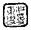
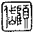
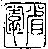
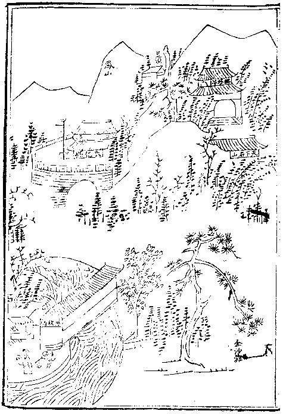
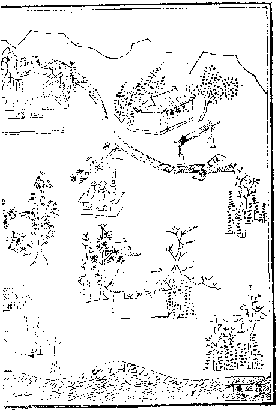
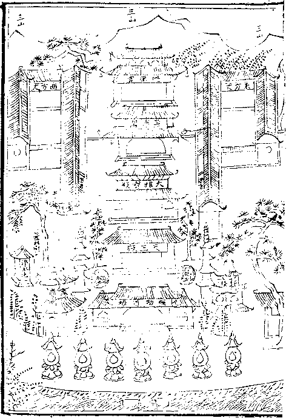
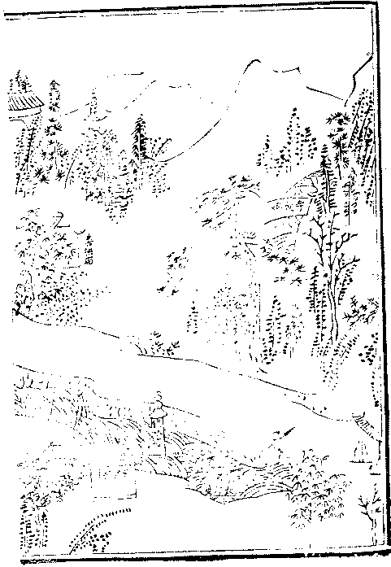
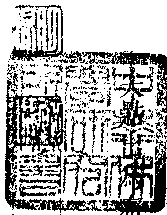

# 明州岳林寺志



> **藏经**：中国佛寺史志汇刊（佛寺志汇刊）　**册次** 第 15 册（GA015）　**编号** GA0014　**部类** 史传部　**卷次** 6 卷　**篇幅** 31,152 字

> **卷／品**：6 卷 · 9 品



---



## 目录



  - [序](#序)

  - [岳林寺志序](#岳林寺志序)

- [明州岳林寺志卷一](#明州岳林寺志卷一)

- [明州岳林寺志卷二](#明州岳林寺志卷二)

- [明州岳林寺志卷三](#明州岳林寺志卷三)

- [明州岳林寺志卷四](#明州岳林寺志卷四)

  - [布袋老僧小序](#布袋老僧小序)

  - [刻布袋大师传赞序](#刻布袋大师传赞序)

  - [明州布袋和尚序](#明州布袋和尚序)

  - [弥勒传序](#弥勒传序)

  - [题布袋和尚后序](#题布袋和尚后序)

  - [重刻弥勒传序](#重刻弥勒传序)

- [明州岳林寺志卷五](#明州岳林寺志卷五)

- [明州岳林寺志卷六](#明州岳林寺志卷六)

  - [后序](#后序)



---



岳林寺位於浙江奉化县治东北之三山中，县治雉门之东为龙溪，溪自镇亭发源，由惠政桥绕至寺前。三山为岳林之主峰，其脉自南来，入广平源，过峡即三山，高有丈许。梁大同二年（五三六）於龙溪之西建崇福院，唐相李绅书额，会昌中（八四一－八四六）毁，宣宗大中二年（八四八）闲旷禅师徙建溪东，改岳林寺。僖宗时（八七四－八八八）有僧游寓常擕布袋乞食，人称为「欢喜和尚」，自号「长汀子」，至贞明三年（九一七）坐东廊磐石说偈而逝，众僧神异之，寺乃以弥勒道场为俗所重，为明州三大佛教圣地之一。宋真宗大中祥符八年（一〇一五）赐额「大中岳林禅寺」，徽宗赐号「崇宁阁」。元、明两代，兴废屡更，至清康熙十二年（一六七三）楷庵和尚入院，大畅宗风，皈依云集，重新殿阁。楷公和尚以旧无寺志，乃请戴明琮草创，明琮於康熙二十五年（一六八六）假馆吴学士家，纂辑志稿，次年（一六八七）夏初稿告竣，时澹雪居士顾岱揽胜兹寺，乃取以校定，厘为六卷，分目为十：寺图、梵宇、名胜、古迹、法产、法系、艺文、诗赋、名释、塔铭。寺图所绘乃康熙间之现观，刘鸿声撰图说以附之。梵宇记岳林禅寺及其殿阁堂院之建置沿革。名胜记此寺之胜槪。古迹记大钟、布袋和尚行卧处、弥勒湼槃石等。法产则记田、地、山、丁、口之实数。法系记自唐之闲旷达至清康熙间楷庵承，共记二十二位禅师。艺文一门，收序、记、传三目。诗赋一门，请启、募疏附焉。名释一门，传宗源、饶道者、桂堂、天机、幻夫之行谊。塔铭一门录定应大师与鼎建普同之塔铭。集康熙以前本寺文献之大成。兹据国立中央图书馆藏清康熙间刋本景印。



敕赐大中岳林禅寺



------



### 序



按浙省志书，明州著三佛地，其一为弥勒道塲。世所传长汀子恒携布袋自随，游行度世，遗迹即奉化县勅建岳林寺是也。寺创唐大中，自僖宗朝迄今约八百餘载，其间兴坏屡更，而封山一片石，香火巍然独存。虽贩夫村妇，无不知有活佛隐身处，敬礼之恐后。噫嘻，何其神哉！葢天下无二道，圣人无两心，三教□□□□□□□莫为之前，虽美弗彰；莫为之后，虽盛不传。嗣法之隆替亦难言矣。丁卯夏季，余以放废，落拓江湖间，遇楷公和尚於岳林。晤对经旬，相视莫逆。其后长汀而振法者，非斯人而谁欤？奉邑土瘠民贫，俗俭朴。康熙初，寺僧因逋粮他徙，以故寮舍尽倾，殿阁皆置瓦砾中。楷公杖锡来此，出其法力，悉举而新之，耳目改观。时邑中士大夫及乡里父老，无不以是为楷公颂。而余之所以颂楷公者固不在是。方今世教波靡、人心陷溺。彼金玉其外、败絮其中者，未尝不卓然自命主持法轮；求其能澹朴真如、实证无相、成己兼成物者，盖亦罕矣！以余观楷公於书无所不窥，於事无所不历，於心无所不空，於世无所不度，固将矫斯世之积弊，以振聋发瞆、亷顽立懦，此双林大士亦当为额首称道、欢喜接引者也。余独讶弥勒世尊示现尘寰，虽酒垆屠肆，其随口指授皆法印心宗；乃诚信皈依者仅得蒋摩诃一人。足徵耳食者多，慧眼正复不易。余性根久锢，今得谢弃一切，与楷公叅究大事因缘，且获瞻依法像、顶礼定应宝塔，则又余之私幸也。夫戴子葺志成，遂书此以为序。



> 旹康熙二十有六年，岁次丁卯，六月望日，澹雪居士顾岱止庵撰



> 



------



### 岳林寺志序



剡上以弹丸小邑僻处海隅，其俗俭陋而民淳，无锦绣珠玉之饰、泉刀枲布鱼盐之饶，无园林陂池台榭为燕乐之所，无琳宫贝宇极金碧庄严之观。正如子瞻在儋州时，大率皆无耳。予才识暗浅，窃幸兹土僻简，可安吾拙。两年来，公庭閴寂，吏抱文牍判纸尾外无他事，然亦鹿鹿无宁时。闻雪窦山水奇秀，为东南绝胜，思一登其巅而未有暇也。东郊外距城三里有岳林寺，长吏迎春讲社，岁一至再至焉。予见其殿阁嵯峨，左右禅房历历备具，虽悃愊无华，而花竹畅茂，差可游息。顾谓诸父老曰：「此奉邑之所绝无者，而何以有是哉？」或告之曰：「是唐大中时勅建，布帒老人显化处，鞠为茂草久矣。近庀材而更新之，惟和尚楷庵是赖。」楷公曰：「山衲何功之有？实藉云间诸檀那广种福果、前邑侯曹公护持之力居多！」予不觉瞿然曰：「是何言之谦而避之㴱也！凡物之成坏有数，而兴废在人；若非道力超群、法缘幅凑，曷由致是？」越一年，丁卯，楷庵手一编示予曰：「岳林旧无志书，今寺已落成，法鼓复振，恐湮没无攷，不得有传於后，是以璧城志之。」请予文弁其首，予曰：「可哉，子之远虑也！」今上振兴文教，命诸儒臣纂辑《一綂志》，海内名山古刹，俱𢯱采编入。岳林弥勒道场为四明法窟，则寺志诚不可少！况予同乡贤士大夫好善乐施，前辈曹公教养元元，共成不朽盛事。楷庵经营有年，手口卒荼，诚孚遐迩，非衲子时辈所可及。则昔日所无，不妨为今之所有。是皆不可以不记也，於是乎书！



锡山施𠟭曾（省园氏）题







　



明州岳林寺志目录



卷一寺图  

梵宇



卷二名胜  

古迹



卷三法产  

法系



卷四艺文(序、记、传)



卷五诗赋(请启、募疏、附)



卷六名释  

塔铭



敕赐大中岳林禅寺



















岳林图说



岳林建于晚唐，旧时绀宇珠宫遗图尚在，明季衰废不可复睹矣。自楷公中兴，缔造增焕，因编寺志，绘图以弁於首。盖岳林居县治东北，种一邑之龙秀，绘寺必先绘县治，其发源也。雉门之东为龙溪，惠政桥而下，金沙拥秀水、遶寺门。殿阁巍峩、廻廊修整，披图而见楷公拮搆苦心矣。西为封山弥勒真身在焉，乃寺之祖陇，固当与寺俱传。至若陆公祠、普惠寺、普同塔，形势相附，例应并绘。后为三山、广平湖，寺之坐山入之尺幅中矣。东为长汀，金钟屹峙、锥塔砥流，善塘之拱护、驿道之纷驰，并绘之以集其全。一图一书而志乃成。于是乎招提胜槩尽从摩诘点染出矣！



邑人刘鸿声识



------



## 明州岳林寺志卷一



澹雪居士．顾岱（止庵）鉴定



奉川后学．戴明琮（璧城）纂辑



梵宇



岳林禅寺



古志，寺距县北五里，梁大同二年始创溪西，名崇福院。唐相李绅书额，会昌中毁。大中二年(历志载三年，误)闲旷禅师徙建溪东，改岳林寺。僖宗时，有僧游寓，常擕布袋乞食，人称为欢喜和尚，自号长汀子。至贞明三年，坐东廊磐石，说偈而逝。宋真宗祥符八年，赐额「大中岳林禅寺」。仁宗赐御制书札。徽宗赐号「崇宁阁」。文岳禅师建，有十景题阁，后毁复建。元至元十九年九月阁崩，住持梵中重搆。明永乐癸卯火。宣德正统时修复。万历间又火，南禅师同僧万金等重建大殿崇宁阁。皇清顺治间，自闲、天伊、解齐诸禅师相继主持寺事。后寺僧因官逋他徙，寺圮。康熙十二年癸丑，众檀护敦请楷庵和尚入院，大畅宗风，皈依云集；创天王殿、方丈、大殿两厢，又造普同塔，百废具举。臬司印周王公碑记。



大雄寳殿



明万历三十六年戊申九月二十六日，住持南禅师同万金、万全捐赀协建。计七楹，高六十二尺，纵九十八尺，广一百二十四尺。康熙庚申，臬司印周王公重新旧额「勅赐大中岳林禅寺」八字。



崇宁阁



明崇祯三年二月初十日，僧守愚、法缘重建。计七楹，高五十二尺，纵七十四尺，横一百二十四尺。中五楹，上供千佛，下供弥勒大像；左阁为祖堂，餘为首事寮。中有「大光明藏」、「古崇宁阁」、「弹指门开」等额。



兠率宫



址遗千佛阁后。剙自定应大师，今圮。



天王殿



七楹。高五十二尺，纵六十三尺，广一百二十四尺。中三间供天王，东为杂务寮，西为云水堂。康熙十五年丙辰建。



方丈



居崇宁阁左，共五楹。高二十五尺，纵四十二尺，广八十九尺。左右各厢五楹，左为指南轩，右侍寮。康熙戊午年建。



禅堂



五楹。即崇宁阁下，基址在方丈前。



祖堂



即崇宁阁左。康熙丁卯春上堂安座。



伽蓝堂



大殿前左。康熙戊午年建。戴元贤题曰「正气冲霄」。



祖师堂



大殿前右。康熙辛酉年建。



应供堂



五楹，在大殿左。康熙戊午年建。



日新堂



大殿前左，五楹。康熙己未年建。



香积厨



五楹，在大殿左。旧存二。



客堂



大殿前右，五楹。供大悲像。康熙辛酉年建。



至善堂



为崇宁右辅，三楹。安住戒师，旧存。



湼槃堂



在祖师堂侧，计二楹。



茶房



崇宁阁右，计三楹。旧存。



库房



崇宁阁左，三楹。康熙戊午年建。



浴室、净房、碾磨坊、田寮、园房



十三楹，俱在茶房后。康熙戊午年建。



钟楼



天王殿左，高五丈餘。元天历三年铸成，铜万觔有奇。(声闻二十里。僧越凡司钟不法，邑侯蔡公复归常住。康熙乙丑年，用价贰拾肆两赎田肆亩。丁卯春重修。)



轮藏



与钟楼相对，在天王殿右，所以藏经者。中置转轮，画柱雕龙。时或轰雷闪电带雨发声，亦一奇也。唐布袋和尚建，顺治间毁。



山门



在天王殿前，五楹。今圮。



幻住经堂



本寺之左。水南湘禅师所建，今圮。



钟楼经堂



寺左数十武，即钟楼下。三楹两厢，今存。



塔院



三山园左，面挹广平湖。正三楹，㫄各五楹。坐乾向巽，乃楷庵老人寿藏也。自题曰「宴然」。康熙癸亥年造。



普同塔



寺园之东，坐卯向酉。砌石为藏，三顶三圹。康熙乙丑年造。



宝塔



天王殿前，龙眼池侧。左右两座，高四丈餘。相传谓之龙角，布袋和尚遗迹也。



又山门前浮图七座(其一久毁)。



弥陀亭



寺左。道旁有弥陀石像，高可八尺。其亭邻义塜，远近居民谓能为祸福，皆祀以鸡黍。解齐大师入院，见荐牲者殊秽亵，遂说偈，火其像，亭亦毁。



佛塔亭



封山之腹，距寺三里。梁贞明间建大殿五楹，结龛为窣堵波。亭中塑布袋和尚、十八儿童环遶之。四围石座，弥勒法身藏焉。后圆明禅师重新塔亭，里人冯斯道、何智施山地，增扩其基，忽发异光；掘之获黄色净瓶、六环锡杖，制度奇古，观者太息。有司上其事，敕赐「定应大师塔」。康熙十七年，住持如畅，同徒性闻，复新中塔，建左厢三楹供关圣，右厢七楹供祖师，外为客寮。理刑黄端伯题曰「分身扬化」，邑侯孙嗣先题曰「常羊净土」，邑令夏时正题曰「真迹传宗」，大参邬鸣雷题曰「勅赐定应大师之塔」，邑侯蔡毓秀题曰「佛化真境」，进士俞廷瑞题曰「古佛重来」，牧云门禅师题曰「龙华现相」。



定应塔院



封山之麓。顺治五年，僧三笋重建大殿，邑令王奂书疏。左厢五楹，供伽蓝祖师，今圮。右厢为斋堂；后二十餘楹，客堂、厨房并各寮。康熙丁卯，如畅、性闻建山门。



奉师塔



寺北六里，在应家山东。创自蒋摩诃居士，明季毁。康熙乙卯年，僧恒泰，同徒闻悦，重兴三楹两庑，庄严佛相，修古洞塔，并置产若干。石城编修陈捷撰记。



青云庵



寺西六十里，石门银坑岭侧，徐宅所施。顺治间，僧真寂（字体常），始创精庐供佛。今为岳林退居。



柴庵



在城西嶴相去十里。山八十餘畞，内四十亩钱伟才所施。屋三楹两廊，康熙庚申年建。



岳林庄



求村十字塘，距寺八十里。布袋和尚以囊沙垒为塘，塘成如石，以捍海潮。仍设三碶以御旱潦。塘内得田二千餘亩，每岁收获给僧徒。岁久，碶塘为潮所冲，悉成海涂。康熙间奉旨迁海，仅存田三十三亩、地四十三亩、山五百亩。顺治初，庄屋废，今重复。



普惠庄



寺东浦口。庄二，东西各一。计田四百三十亩。至明季，田庄为房僧尽废。西庄址为豪右所夺，东庄址尚存。康熙十八年，岳林常住新置田三十餘亩。



(右寺中，已建者录其实，未建者存其名；昔所建而今不必建者亦附载之，以识旧迹云尔。)



------



## 明州岳林寺志卷二



澹雪居士．顾岱（止庵）鉴定



奉川后学．戴明琮（璧城）纂辑



名胜



三山



岳林主峰也。脉自南来，入广平湖，过峡为三山。高丈许，松篁掩映，花鸟争香。



龙溪



自镇亭发源，由惠政桥至寺前，循栗树塘，抵金钟墪。屈曲环抱，夹岸芦花，游人竞渡。



广平湖



唐奉化令宋嗣宗系文景公璟之曾孙，卜居邑东斗门。不忘其祖，故名湖曰广平。在三山左。元至元间，取资国堰水入湖，溉田二千餘亩。延祐庚申，知州事马公浚之。至正中，郡侯李公复开利甚溥。宋荣诗云：「相业何人补？湖光自古流。」



龙眼池



在天王殿前。左右二池，周围三丈许。相传谓之龙眼，大旱不竭。真宗禅师诗曰：「欲知慈氏灵湫远，龙眼双池万古明。」



封山



脉自大雷来，逶迤而至日岭。侧起一峰，递转为数峰。崭然突起，曰青锦山，又名莲华岩。左开一面，体势雄壮，曰封山。茂竹苍松，蔚然深秀。中建佛塔亭，布袋和尚真身隐此，有钵盂古迹存焉。



净土池



在天王殿右，广可丈许。芙容绕岸，绿树埀阴。



长汀渡



距寺五里。水出龙溪，潮通北渡。布袋老人曾浴此，与群儿嬉。长汀子所由名也。



金沙滩



即寺前左首。滩涌石沙，色如金。广数十丈。楼㙜瞰碧，鸥鸟迎人。水南禅师诗曰：



两岸楼台不一家　年年流水泛金沙  

几囘曳杖闲中望　石上青苔覆落花



惠政桥



距寺左一里。宋乾道中建，复坏。大观中，架木为梁，覆以屋，攺今名。废兴凡五次，载县志。



皇清康熙五年，邑令张奎胤延解齐大师重建，绵延二十间。南接台温，北通宁绍，奉邑之雄镇也。



金钟墪



寺北五里，长汀之下。或传钱氏载大金钟过此沉焉，涨沙成墪。墪绝小，下有龙潭。六月二十日，有司致祭。林木颇茂，虽山泉冲荡，亦无损。见志兀志。



耀碑潭



去寺一里，在大溪之西。父老相传「官清则碑现」，载寰宇纪。



古迹



大钟



沙门景湘水南氏识曰：



余住持岳林十有三载，经营铸造已渉九年，凡募化随缘，锱铢所得，辄运寺中。於天历三年庚午四月二十日谷旦，方得告成。敬为之述其事而系以铭曰：



晨昏扣击　警醒愚𫎇  

𡨚亲平等　俱出樊笼  

随喜闻见　耳觉圆通  

旌之我铭　祖室攸崇  

幽冥息苦　尘刦靡穷



洗面石



长二丈，濶四尺二寸，深四寸。可以出水，并石鱼四尾安置茶房门首。左刻「梁贞明四年三月八日吉旦」。



布袋和尚行卧处



在封山中塔后。路旁石岩处，钵盂、足迹隐隐犹存。



娑罗树



定应大师手植。历唐、宋、元，寺几经灰烬，树独无恙。明季枝叶凋零，至楷老人入院，仍复畅茂。骚客多所题赠。云间鹰垂周公撰记。康熙乙丑春，方丈前忽生一小株，众异之，今并列云。



弥勒涅槃石



梁贞明三年三月三日，布袋和尚涅槃。此石方四尺五寸，安置千佛阁下。顺治间，提督田公驻劄，为兵所损，尚存片碣焉。



------



## 明州岳林寺志卷三



澹雪居士．顾岱（止庵）鉴定



奉川后学．戴明琮（璧城）纂辑



法产



岳林寺清丈田、地、山、人丁实数



田



共壹百陆拾壹亩玖厘陆毫



地



共壹百壹亩壹分伍厘贰毫



山



共叁百柒拾玖亩陆分



丁



共捌丁壹分贰厘



口



共贰拾壹口陆分捌厘



按：明嘉靖十一年，谢澭纂《奉化县志》，为岳林首刹常住田叁千肆百伍拾贰亩，山壹千壹百拾贰亩陆分。今废。



法系



梁



大同二年，僧始创溪西，名崇福院。姓氏无考。



唐



闲旷达禅师



讳延达，四川人。少时聪颖，性质孤高。后出尘，遍参法席。大中二年，徙建溪东，百废具举，殿阁改观，遂号岳林寺。为开山第一祖焉。



布袋和尚



师不知何许人也，唐僖宗时见於明州奉化县，蹙额皤腹、形体腲脮，日夕寝食无常处。世莫知其姓氏。每以杖荷布袋，且有十八小儿哗逐之，不知所从来。入𨞬肆聚落，见醯醢鱼葅，辄乞入口，餘以投袋中。自号长汀子。曾往闽化木一袋，从寺井中出，取之不竭。岳林梵宇大兴，共神异之。梁贞明三年丙子三月，师将示寂，说偈曰：



弥勒真弥勒　化身千百亿  

时时示时人　时人自不识



偈毕，即於本寺东廊下，端坐磐石而化。结龛封山为窣堵波，赐额「定应塔」。后复现于他州，亦负布袋，众竞图其像。



有僧在师前行，师抚其背，僧回首，师曰：「乞我一文钱。」曰：「道得即与！」师放下布袋，叉手而立。白鹿和尚问：「如何是布袋？」师放下布袋。又问：「如何是布袋下事？」师负之而去。保福和尚问：「如何是佛法大意？」师放下布袋，叉手。又问：「莫更有向上事否？」师乃负之而去。师立街𠊓，有僧问：「和尚在这里作甚麼？」师曰：「等个人来。」曰：「来也，来也！」师曰：「汝不是这个人。」师在闽中，有陈居士谓师曰：「和尚此去不可堕他人是非！」师曰：



是非憎爱世偏多　仔细思量奈我何  

寛却肚皮常忍辱　放开笑口暗消磨  

若逢知己须依分　纵遇冤家也共和  

能使此心无𦊱碍　自然证得六波罗



士曰：「和尚有法号否？」师曰：



我有一布袋　虚空无挂碍  

展开遍十方　入时观自在



士曰：「有行李否？」师曰：



一钵千家饭　孤身万里游  

覩人青眼在　问路白云头



士曰：「弟子愚顽，如何得见佛性？」师曰：



即个心心心是佛　十方世界最灵物  

纵横妙用可怜生　一切不如心真实



士曰：「和上此去莫依族舍而住。」师曰：



我有三宝堂　里空无色相  

不高亦不低　无遮亦无障  

学者体不如　求者难得样  

智慧解安排　千古无一匠  

四门四果生　十方尽供养



居士异之，复作礼，畱斋宿。是夕师复书偈于门曰：



吾有一躯佛　世人皆不识  

不塑亦不装　不雕亦不刻  

无一滴灰泥　无一点彩色  

工畫畫不成　贼偷偷不得  

体相本自然　清净非拂拭  

虽然是一躯　分身千百亿



僧问：「如何降伏𡚶心？」师曰：



心是何物　徒劳调伏  

妄本无根　放下无迹  

诸缘扰攘　一真宁寂  

如如法界体堂堂　砍不破兮遮不黑



师受田家斋，田家问道，师曰：



手揑青苗种福田　低头便见水中天  

六根清净方成稻　退后原来是向前



师在大桥夜坐，忽有强人窥探，示以偈曰：



由贪沦堕世波中　舍却贪嗔礼大雄  

直截凡情无所得　圆明寂照汝心宗



师出街衢，见市人挤挤，叹曰：



奔南走北欲何为　百岁光阴顷刻衰  

自性灵知须急悟　莫教平地陷风雷



又曰：



趋利求名空自忙　利名二字陷人坑  

疾须𨑰照娘生面　一片灵心是觉王



僧问：「如何是顿渐法门？」师曰：



汝心即圣智　何须问次第  

圣凡都不到　空华映日飞



僧问：「如何是化导？」师曰：



肩挑日月横街去　把定乾坤莫放渠  

遇圣遇凡俱坐断　寂光胜地可安居



僧问：「如何修持则勿虚生浪𣦸？」师曰：



无生无死佛家风　不堕古今莫定踪  

触处圆明常湛寂　龙华鸡足两无从



僧问：「如何是道？」师曰：



碧水映孤峰　寒潭迎皎月  

尔我不知宗　须弥足底越



(附录)蒋摩诃



讳宗霸，桐城县函人，即函亭侯裔也。梁四明州评事，罢官，居於奉川(考自蒋姓宗谱)，时与布袋和尚游。其出处、饮食、相往来尤密。每日自课念摩诃般若波罗密多，世因呼为「摩诃居士」。初隐应家山，距寺北六里。创精舍以焚修，名「奉师塔」，至今犹存焉。洎师示灭后，复筑庵於东湖跘跨山十二盘之高处以居。畜一黄犬自衞。颂布袋和尚曰：



兜率宫中阿逸多　不离天界降娑婆  

相逢为我安心诀　万劫千生一刹那



迨蜀使致师命归，即设斋会亲友，沐浴趺坐而逝。塔全身於盘山顶上。



宋



圆明禅师



师，福州陈居士裔孙，得法於东林照觉延。主寺事，重修大殿两庑，并创东西方丈，规模丕振，大畅宗风，远近名缁云集，洵称为岳林开法之祖焉。年八十有四，沐浴更衣，端坐而逝。



上堂云：



从来学道原非易　铁石心肝始自坚  

不用思维寻古句　还须努力向前参  

忽然露出虚空骨　直下当知般若船  

一点湛湛无所系　月明遐屿水中天



挥拂子。



海印宣禅师



讳志宣。宋真宗赐紫，主席岳林，创立定应大师塔碑。邑侯黄敬山特撰铭。



颂世尊初生曰：



抉雾腾腾下大荒　指天指地不寻常  

云门忒煞唇皮快　无限痴人漫度量



颖悟聪禅师



讳广聪，杭州人。初参雪窦显，得省。入岳林海公之室，命主维那。一日，海下堂云：「颖维那在此堂中还知弥勒消息也未？」师云：「此处无银三十两。」海云：「也须着地还钱。」师云：「苍天，苍天！」海呵呵大笑而出。越明年，付衣拂，继席岳林。



上堂云：「岳林这里龙溪水白浪滔天，崇宁阁回出青霄，汝等诸仁向什麼处攀仰？」时二僧并出，师云：「一箭落双雕。」一僧喝，师云：「这一喝未有主在。」一僧作礼，师云：「汝见什麼道理？」僧以坐具打圆相。师云：「弄虚头汉！」僧便喝，师云：「果然！」



宗尚禅师



师，元丰四年住持，门庭整肃，不以外护营心。稍不如意，拽杖便行。年五十餘辞世。



僧问：「如何是岳林境？」师云：「娑罗遍覆云来影。」「如何是岳林人？」师云：「高提七尺辣乌藤，人境已蒙师指示。」「转身一句作麼生？」师云：「脚跟踏破锦乾坤。」



如恂禅师



师住持岳林，刊布袋和尚一偈於石，并所书真本九字，承事郎吕振亲授也。



僧问：「天上无弥勒，地下无弥勒，即今在什麼处？」师云：「错过了也。」僧云：「主宾互唱，觌面相逢，且道是谁错者？」师云：「汝错过了也。」僧喝，师打，云：「错过了也！」



昙振禅师



师嗣瑞岩鸿。崇宁三年，徽宗皇帝於福宁殿赐紫衣。后建崇宁阁。越十年，示疾，集众焚香，跏趺而逝。



示众云：「今日布袋头开，还有买卖者麼？」时有僧出云：「有！」师云：「不作贵，不作贱，作麼生酬价？」僧无语。师云：「老僧失利。」便归方丈。



宏智觉禅师



讳正觉，隰州李氏子。七岁，日诵数千言。十五薙染，十八游方。受具慈云智琼律师，得法於丹霞淳。初住泗州普照寺，继住舒州太平，江州圆通、能仁，真州长芦，晚住天童。应岳林之请，遂回太白。惟宋楼钥公一诗载在邑乘。绍兴丁丑十月七日，别郡绅檀那。翌日辰时，沐浴更衣，端坐说偈曰：



梦幻空华　六十七年  

白鸟烟没　秋水连天



掷笔而逝。龛留七日，颜貌如常。丙午乃奉全身塟於东谷。龙图阁学周葵撰铭。



文岳中禅师



讳行中。绍兴间，寺经回禄而阁俱煨烬。时有饶道者，燃一臂化缘，重建宝阁，有十景题咏。



上堂，僧问：「一茎高竖，宝阁凌空，未审有何祥瑞？」师云：「云际横梁悬日月，大千沙界悉光辉。」进云：「今朝布袋重提起，兜率玄风播宇寰。」师云：「讃叹有分。」进云：「还是神通妙用，为复法尔如然。」师竖拂云：「所仗这一点儿。」进云：「某甲到这里，有口难辨。请和尚别转机轮。」师便喝，僧亦喝。师云：「知恩者少。」乃云：「星飞电转，作用通天；玉振金声，风光动地。今日到这里，不是神通妙用，亦非法尔如然。且道毕竟承谁之力？」以拄杖畫一畫云：「的的没量大人，总不出这点光明不得。」



大川济禅师



讳普济，奉川林氏子。披薙栖真，得法於浙翁琰。琰嗣佛光照，照嗣大慧杲。嗣师法者，天童石门来、雪窦野翁同。住岳林，赴临安灵隐之请。后曾撰修《五灯会元》二十卷行世。



题世尊出山相曰：



龙章凤质出王宫　肘露衣穿下雪峰  

智愿必空诸有相　不知诸有几时空



益州怀禅师



师嗣智环公，环嗣大琏公，乃云门宗第七世也。受奉川绅衿之请，主持寺事、置产业、修殿堂，至老而寂。



僧参，师问：「到此作麼？」僧云：「特参布袋和尚。」师云：「布袋和尚即今在什麼处？」僧礼拜。师云：「你见什麼道理？」僧拟对，师便打。



正眼具禅师



讳炳具，义乌王氏子，与独庵禅师为友。



师诞日上堂：「汝等东走西走，不如觌面一觏。山僧母难之辰，拂拂清风满袖。无端举示禅流，也是一场漏逗。光阴迅速如驰，且莫寻言讨句，急须早早回头，看取父母未生前的无量寿。大众且道如何是无量寿？」以拂子倒握云：「相救，相救！」下座。颂鲁祖面壁曰：



池阳面壁成何事　无数英雄当下收  

大抵还他肌骨好　不搽脂粉也风流(已上宋室禅师，俱依年号编次；载封山塔碑误。)



元



栯堂益禅师



师，温州人。嗣法於径山珍禅师。有法语载《五灯续略》，山居诗四十首行世。



上堂：「古者道：『我这里无法与人，只是据欵结案。』彰圣这里亦无法与人，亦不据款结案。」拈拄杖云：「如何是佛？赤脚踏莲华！如何是佛向上事？雕梁畫栋。」掷下拄杖，便归方丈。



二月十五日上堂，击拂子一下云：「彰圣今日将三十年前冷灰爆出乌豆，换老胡眼睛去也。」喝一喝曰：「设有一法过於涅槃，我此一喝不作一喝用。」



(此二则系彰圣法语，缘徧寻全录无踪，今识之以存一代住持。)



水南湘禅师



讳景湘，奉川汪氏子。披薙广法，礼昙馨为师。精持律仪，气宇温和。入雪窦野翁同公之室，巾侍二年，付以衣拂。受请於天皇，迁兹寺。晚居岳林，座下名缁蚁附。募铸大钟，确有成勚。行道之餘，建幻住经堂，佛懿禅师昙噩为记。



师诞日上堂：「天高气爽胜岩阿，竹杖闲擕带月歌；一枕绳床忘岁序，任教沧海泛清波；麻衣澹饭随缘过，懒向人前说法多。只在广平湖龙溪畔一醉清风是什麼，敢问大众？若说即此便是头上安头，若说即此不是浪里淘沙，正当恁麼时，毕竟如何是？」以拂子打○云：「秋水长天一色，落霞孤鹜齐飞。」



性初闻禅师



讳寿闻，系吉安人。得法於灵隐耸。主席年餘，结庐天台华顶峰。



僧参，师问：「仙乡何处？」僧云：「吉安。」师云：「原来是乡里。」僧云：「不敢！」师云：「还带得乡里人事来麼？」僧无语。师云：「将谓是乡里，原来假的！」



明



复庵初禅师



讳守初，洪武二十四年住持。创亭封山塔祠之前，校其正文，重镌定应大师塔铭，以崇旧观。季潭泐公书丹，一初仁公篆额。



重刻封山塔碑，说偈募众云：



宋室遗文盖有年　离离断碣卧荒烟  

堪怜圣迹俱乌有　扶起还须古越贤



真宗忞禅师



讳元忞，隆庆间住持。修崇宁阁，装严千佛。大司成愚斋公常往来问道，有〈千佛阁记〉。其上堂语录失传。



(自梁至明，年代荒远，行业祖系十失其七矣。及阅封山塔院碑文与布袋和尚传记，内称：住持沙门，嗣法详明者，俱登祖位；外此或混禅师代数并明季僧会，尽行削之，不敢滥入。但碑列七十有三，其间佩服心印亦难委悉，名字姑附。如兀峰峻、海月朗、戒定振、隐庵显、大同全、东双颖、崄崖遇、泥犂印、足翁▆、一庵仰、痴翁莹、南𡶩岳、不倚中、绝崖恩、古航慈、石心圮、梵中节、孚中信、象先舆、璞先珵、可中然、东明晟、虚舟济、独任荷、白云闲、性海筏、古光觐、古嵓嶙、▆庵贞、草堂闲诸师，俟博雅者考订补入。)



皇清



自闲觉禅师



讳行觉，蜀之重庆合州金氏。八岁随父礼本邑当马山太空师脱白，十九出山听教，二十六受具於天童密老人。参万法归一话，蓦触露柱，有省，拈偈云：



心佛众生　三无差别  

撞破乾坤　露柱饶舌



后得法於林野和上，是岁甲申，三十有五也。初住嘉定罗汉寺，继住崇明慈济、奉川法海。壬寅之冬，请主岳林，后受芙蓉之请。於顺治十八年十二月十七日，沐浴更衣，书偈而逝。世寿五十三，僧腊二十八。嗣法弟子三十三人。建塔於寺之屏风山麓。



上堂：「古殿洞明，溪光散彩，崇宁耸翠，岳色增辉。打开本有家风，拨转从前气象。是处是慈氏，无门无善财，惯与十八孩儿同门出入。一天风月，独自逍遥。高枕瓶盂，横拖布袋。在市盈市，在村满村。与狸奴、白牯同唱无生之曲，虾蟆、蚯蚓共转根本之轮。水到渠成，山堆海集。且道报国裕民一句又作麼生？四明山月朗，三佛地风清。」



天伊沄禅师



讳行沄，俗系姚江。嗣浮石贤禅师，传临济三十二世。康熈乙巳冬主席岳林，时山海作祟，拮据经营，粮役仅有其绪。



上堂云：「解开布袋头，放出百千牛，撞倒须弥山上顶，踏翻华藏海中沤。直得燃灯宝体，分身无量，普光烁破，四洲堪嗟。粪草堆邉烂筹子，臭气尚未脱也。与麼随人打哄，行色匆匆，引教木上座咬碎拇指，忍笑不禁。只得唱个啝啝曲子，一任瞎驴趂大队，由他鲍老送灯台。虽然，若到诸方去，休云见我来！」掷下拂子。



解齐纯禅师



讳行纯，舜江人。得法於牧云门和尚，嗣临济三十二世。康熈戊申，受岳林之请。修惠政桥，告成即退院归里。



上堂，僧问：「飞锡三山天地震，祥云起处遍乾坤。祝圣开堂於此日，斩新条令事如何？」师云：「天高群象正。」进云：「恁麼则兵随印转，将逐符行。」师云：「海濶百川朝。」进云：「九重深密全尊贵，赫赫威光震九垓。」师云：「朝到西天，暮归东土。」乃云：「昔年曾向剡溪游，未遇知音暂且休；今日复从溪上住，金沙滩里一抛钩。大众！山僧蒙十方檀护、本山耆宿特地相邀，随缘住此岳林。光祖道、阐宗风，攅花簇锦，自有诸方。临济喝、德山棒、云门饼、赵州茶，册子上历历分明，山僧才踈德尠，薄福少缘，皤然须发，不谙世故，向此鼓舌摇唇作麼？久参上士，未举先知；后学初机，一任吞吐。」遂竖拂子云：「绍隆惟孝子，匡弼在能臣。」复举：「古德云：『向上一路，千圣不传。』又有道：『向上一路，千圣不然。』岳林者里不说向上，亦不说向下。逢人便笑，还有荐取者麼？」卓拄杖两下。



楷庵承禅师



讳真承，字绪芳，别号楷庵，俗隶奉川茅屿，鲍氏子。十八依大显师剃度，二十七受具於天童牧云禅师。朝夕苦参，不得入路。一日担柴遭跌，有省，作偈云：



未知生　焉知死　轮廻觅处无起止  

白云尽处见青山　行人不在青山里



次参宝庆离言和尚，问：「自远趋风，乞师一接！」离云：「放下著！」师云：「欲穷千里目，更上一层楼。」离云：「更放下著！」师礼拜云：「谢师答话。」充侍寮。一日看朝宗录云：「『我手何似佛手？』答云：『某甲也有！』」师遂大彻。离问：「罗堠罗以何为第一？」师云：「宁可截舌，不犯国讳。」离休去。颂临济三顿棒云：



患得秦朝毒　良哉楚国医  

只消灸一艾　脱骨换新皮



三十一佛成道日，离付师拂子。源流职南禅西堂。东归，住静五龙山，受邑南登山之请。后住台州香嵓、广福，松江超果、普照，嘉兴灵祐诸刹。今住岳林，重新弥勒道场。有全录十卷并崇宁阁诗集行世。嗣法另刊，兹不载。



上堂：「岳林古刹，弥勒道场，天高地迥，水远山长。兜率楼阁俨然，布袋典型犹在。今朝法筵大启，凡圣交参，丕振千年福地，全彰古佛家风，揭示滹沱的旨，洞明少室真机。诸佛不传之妙心，切须顿契；父母未生之面目，直下圆成。若也坐断千差，犹是钉桩摇橹；更乃棒喝交驰，未免拕泥带水。」蓦竖拂云：「这个千圣同其源，万灵合其辙。向无言处演言、无事处作事、无佛处现佛、无祖处示祖，直得木人拍板、石女讴歌、寒嵓发燄、枯木糁花，国运与佛运齐兴，皇风与宗风并扇。虽然如是，这犹是利生边事。且道如何是向上事？大野风清三佛地，一天月朗四明州。」复举布袋和尚偈云：



弥勒真弥勒　化身千百亿  

时时示时人　时人自不识



师云：「这老汉负著布袋，等个人来，大似灵龟拽尾，临末梢头。又恁麼道，未免手脚俱露。且道这老汉意在於何？从前汗马无人识，只要重论盖代功。」



冬至上堂，璧城居士问：「帘外三竿日，新添一线长。文字语言都扫却，圆机暗合请师宣。」师云：「合却口门问将来。」士左划○云：「是什麼？」师左一拂。士右划○云：「是什麼？」师右一拂。士云：「左右逢源前后断，大千沙界独称尊。」师云：「如何是独尊之旨？」士云：「天不能盖，地不能载。」师云：「非公境界。」乃云：「晷运推移，日南长至。佛法大意，如何话会？若也会得，野外梅开一朶两朶，全彰格外风规；池上冰浮四片五片，独露寰中节令。灵云桃、香岩竹，大有生机；柏树子、麻三觔，徐增意气。因甚灯笼与露柱长年如是？」挥拂云：「寒来暑往无迁变，铁石身心不受磨。」喝一喝。



竖天王殿，上堂：「竖一柱，高拄乾坤；架一梁，普擎日月。大机圆应，大用纵横，大施门开，大功克就。风调雨顺，海宴河清。全彰弥勒家风，丕焕山门气象。不是神通妙用，亦非法尔如然。且道毕竟成谁功干？」拈拄杖云：「琼楼玉殿一茎草，福国裕民亿万年。」下座。



卷三终



------



## 明州岳林寺志卷四



澹雪居士．顾岱（止庵）鉴定



奉川后学．戴明琮（璧城）纂辑



艺文



------



### 布袋老僧小序



沈一贯(相国，谥文恭)



圣人观众生心是般若智，生死海是涅槃城。昧而不知，速须道破。念慈氏受释尊之记，当末世开度生之方。由是降兜率，游四明。触处建光明藏，逢人施甘露味。以布袋为佛事，以小子现童真。四仪神变莫测，六时妙化无穷。登禅窟者，死偷心於绝解之处，活佛机於难辨之时。是故拈花悟旨，响应千古；笑谈垂手，针芥相投。俾放下布袋，默契禅宗。政不待言思而得者，教外别传之旨也。噫！余以为补处老僧赘千百载之剩语耳。



------



### 刻布袋大师传赞序



戴澳(大京兆，号斐君)



大慈氏为未来佛，此释氏之言也。夫既谓之佛，有何现在？有何未来？如曰如来，则已来而为傅大士，又来而为布袋僧。且曰化身千百亿，则其不为傅大士、不为布袋僧，而原为弥勒者，恒河沙中又不知其几！故曰：「时时示时人，时人俱不识。」其曰未来者，是其补处正位；其无时不来者，是其大慈热膓。盖慈之一念，无刻能与众生相忘，无刻不与众生相接。谁无佛性，忍其沉迷？谁非佛身，忍其流浪？则谁非弥勒，行化之时，忍委之未来，而徒以百亿楼阁自秘其笑口？布袋之为弥勒，时人原未尝识；弥勒之不必为布袋，时人更未之识。弥勒既欲时时示人，又欲人时时必识，则慈化亦不厚矣。布袋已是弥勒影子，又欲而为之传赞。传布袋耳、赞布袋耳，百亿化身局一布袋。时人眼根终是不圆，秖能识布袋师，终未能识弥勒。则弥勒原在不动寂场，则谓之未来亦可。



------



### 明州布袋和尚序



王章(鄞令，忠烈)



我不识弥勒何许人？现示何世？明州人传云，这胖和尚吃酒吃肉，布袋自随。生大轻慢，以纸包屎物示人云：「这是弥勒内院的、这是兜率陀天的！」恶气熏布，惑乱此方女男。前莆田令好没来由，与渠往来通消息。当时幸不遇我，遇我则问渠：「是甚麼？」待他放下布袋叉手，向前便蓦头一棒。他问过在甚处？又与一棒曰：「打破布袋子！」管教他无言可答，且教他那十七八个小孩子都哭啼啼呌脑痛去也，咄！



------



### 弥勒传序



包士瀛(百登)



吾闻圣贤之道，当人自具，不假外求；秖因尘劳自闭，彼岸自迷，平白地屈陷於生死之中，飘泊於轮廻之际。且阿逸多氏，释尊授付佛乘，嘱行佛事。故修途万品，总摄一宗；即妄显真，就事明理。纳诸佛法印於袋中，运无量神通於掌内，直欲将诸人无始劫来学识因缘，今日要与和盘翻转，截却生死根源，彻悟无生性智；即是全体弥陀，惟心净土，只争迷悟一著耳。故传云：「即个心心心是佛，十方世界最灵物；纵横妙用可怜生，一切不如心真实。」岂欺我哉！



------



### 题布袋和尚后序



张庚星(孟辛)



不佞星乃悬榻斋中、臯比座上人也，与天竺禅宗了不相入；亦不知赤须白足为佛果上乘。晚读《宝积》、《楞严》，颇能作点头石状，始知太傅之与如满，苏长公之与了元、道潜，作空门针线，良有以也。昨者，管子无棘以朗寂上人所撰〈布袋和尚后序〉示余。盥而读之，讶然悟「布袋」之为「补代」也。盖权位菩萨假布袋以游嬉三昧，而世人不识耳。余初不识朗寂，安能识布袋之为弥勒？由朗寂而识弥勒，由弥勒而识朗寂；以佛门上乘写青莲彩毫，其於《宝积》、《楞严》，若亲授记莂於如来，匪但拈槌竖拂於莲池大师也。火煨蹲鸱熟否？幸分惠我一枚，容作〈再来布袋后序〉以谢。



------



### 重刻弥勒传序



周纶(鹰垂，云间人)



韩之言曰：「道於杨墨老庄佛之学，而欲之圣人之道，犹航断港绝潢以望至於海也。」韩之言亦不审天地之大、古今气运之变。儒其人、孔孟其衣冠，而肆然荡闲败检於君师政教所不及者多耳！然则季世末俗生天地狱之说，谓即大易神道设教之旨也可。欧文忠平生诋佛老，晚闻富韩公得道於净慈本老，以为富公非苟下人者，因时与法师住。白曰：「吾学空门非学仙」，而世传有海外「乐天院」，乃知天地间英灵之气不在此则在彼，正不必吾儒之与佛老岐而别之也。白有诗云：「无事日月长，不覊天地阔。」要为吾辈长坎𡒄人急用犍椎，较孟东野「出门即有碍，谁谓天地宽」句，奚啻径庭哉？晦堂老子尝问山谷「吾无隐乎尔」之义曰：「闻木樨香乎？」山谷曰：「闻。」晦堂曰：「吾无隐乎尔！」山谷大服。宗杲论禅云：「譬如人载一车兵噐弄，便不是杀人手叚，我则只有寸铁。」朱文公亦喜其说，此即曾子守约地位。赵清献告老归，暮冬尚能日礼佛百拜、诵经；司马温公亦曰：「吾岂谓天下无禅乎？」夫人学问行谊如数公亦可已矣。数公之於二氏，其尽辟乎？不尽辟乎？今人类不能如数公儒其人、孔孟其衣冠，动曰：「老氏、释氏，吾与之为芟榛莽、刮瑕垢。」噫，亦隘矣！唐书载陆餘庆与释怀一为方外十友。当武后中宗时，士多暴贵骤显；其祸败诛死亦不旋踵。独餘庆官太子詹事，虽不甚显，讫无咎悔；要其得空门弃去一切之益为多。叶少蕴言，唐自懿僖后，人才日削；至於五代，谓之空国无人可也。浮屠中乃有云门、临济、德山、赵州数十辈人，卓然超世，自可与扶持天下、配古名臣；然后知其散而横溃犹有在此者也。佛者言，布袋和尚亦介唐僖宗时，尝卧雪中，不沾衣；示人吉㐫，应期无爽；而岳林宗风藉以不坠。今楷庵和尚为费老人法孙、离言和尚克家子，蚤契真如，精进上乘，兼攻苦我儒之所为业。向驻锡松之超果，人天皈仰。时贬抜示文字禅；书摹董宗伯，诗酷似三唐。岁在癸丑，应明州士大夫之请，主席岳林，阐扬宗旨。至则披荆范土、度材鸠工。自天王殿、方丈，迄僧寮、庖湢等，颠者植，污者垩，阙者复，轮奂一新。复念岳林为弥勒古道场，旧有传记锓枣棃，荡焉煨烬。募檀信顾居士闻远捐赀，高足璧城校订，重付剞劂，属予为之序。予一日邀公设茗，相订岳林游屐，恍膜拜弥勒座下。因诵杜老诗云：「昔遭衰世皆晦迹，今幸乐国养微躯；依止老宿亦未晚，富贵功名焉足图……」我窃为斯人执鞭，我素愿也。



康熙癸亥闰六月望前五日



敕赐岳林禅寺幻住经堂记



庆元路开寿普光禅寺住持沙门．昙噩撰文



正议大夫．开元路总管．兼管内劝农事．王元恭书丹资德大夫．浙东道宣慰使都元帅．张完泽篆额



幻住经堂者，岳林水南和尚之所作也。和尚以逹摩氏心宗为世师表，是宜扞绝文字、直见性元以倡后学；而犹寻章讨句，蔽义理、滞知解，匪徒加诸己，且将淑诸人，何哉？盖时有弗同而然也。时弗同而心同，则达摩氏之纾急救獘？抑亦和尚之纾急救弊欤？方今风俗媮薄，丛林隳弛，禅悦之理仅资笑谈。然欲以此事日相激扬，有谁能领之者？惟灵山最上一乘之旨，开权显实，总摄群机。当象季众生根器之利，易以悟入，而无梁宋诸家论议牴牾之陋。狥缘适变，不即不离，宜取为法则焉。堂处寺左而偏，萦流依薄。屋数十间，中置佛菩萨像，旁布几筵，列床帟、镫明、𬬻熏、坐具。每月大合众流习。岁终修水陆斋事以善其成。尤靖邃则虚之以待竁云。此幻住之扁所从得也。和尚尝谓曰：「秘密理藏固无幻、无不幻者。如是而住，其幻住乎？顾生死复何所与哉？子必为记之。」



和尚名景湘，生汪姓，乃四明奉川人也。初薙染於广法院，礼昙馨禅师，受具听律。后遍参，入雪窦野翁同公之室，推为侍者，掌藏钥。越明年，主席天皇。迁兹寺。功业俱有碑碣可考。至若耄期康健，别创精庐以便燕私，夫岂有他故哉？则诚以统绪而迪似续也。祖意、教意，或莫能辨契，此翁在，盍赴诸邑中而问焉？



至正三年四月望日吉旦，徒弟净满、如玉、子愿、净慈，禅寺住持如玘仝立石



千佛阁记



戴洵(大司成，号愚斋)



佛，假名也。一佛本无，况千乎？虽然，佛者觉也，觉者心也。随心所觉而行出焉，随行所成而佛名焉。心无量则觉无量，觉无量则行无量，行无量则佛名无量，而岂止於千乎？故千行惟一心，而千佛惟一佛。虽然，释迦示众又谓：「首华光，下至毘舍浮，为过去千佛；首拘留孙，下至楼至，为现在千佛；首日光，下至须弥相，为未来千佛。而常住在世者，则首普光，下至一切法常满，为五十三佛；首释迦牟尼，下至法界藏身阿弥陀，为三十五佛；共八十八佛。」则既实有是人、实有是佛矣，谓千佛惟一佛，似又不可也。虽然，觉是行者心也，具是心者人也。行以表心，而人以立行。实有是心则实有是行，实有是行则实有是人矣。故举一行以名一人，而不可谓其心觉之不满；满是心以全是觉，而不可合其全觉以名人。是故觉仁以行仁，因名为仁人，而非不义也；觉义以行义，因名为义人，而非不礼也；觉礼以行礼，因名为礼人，而非不智也；觉智以行智，因名为智人，而非不信也；觉信以行信，因名为信人，而非不仁也。是故谓千佛非实有是人，似又不可也。虽然，过去千佛可知也；见在千佛可知也；未来千佛，释迦虽圣，何以逆知之乎？谓将来千佛必有是人，又似不可也。虽然，佛者觉也，觉者法也，法一而已。法身一立，则必有报身、有化身，而为三矣。三而曰化，则必化十、化百、化千、化万亿、而化无量矣。故过去虽千佛，而总一法身也；见在虽千佛，而总一报身也；后来虽千佛，而总一化身也。故报身者，法身之所报也；化身者，法身之所化也。谓已能化之而又不能知之乎？谓后来千佛必不可知其实有是人，又似未可也。虽然，佛一而已；三佛者，一佛之所分也；千佛者，三佛之所化也。不观三佛则不知千佛之为统，不观千佛则不知三佛之为全。迷则一佛且不知其所由也，而况三佛乎？而况千佛乎？悟则知千佛即三佛也，三佛即一佛也，一佛本无佛也。嗟乎！佛者假名也，假名者象教也，象教者理真也。由无佛而悟一佛，由一佛而悟三佛，由三佛而悟千佛，由千佛而复悟无佛，由无佛而复悟无量佛，则知动色、静空二边本无也。有二边者，诤也。过去、见在、未来三际本无也，有三际者幻也。中观、空观、假观三谛本无也，有三谛者著也。无诤而又诤，无幻而又幻，无著而又著，由是可以知无假之名，可以见无象之教，可以得无理之真矣。其斯以为真空？其斯以为法性？其斯以为大觉乎？今世佛寺必有三佛，而千佛则多不具，何也？佛以法立，法以僧行。寺无真僧，故人无真信；人无真信，故财无喜舍；财无喜舍，故象无庄严；象无庄严，故世无教化；世无教化，然则寺可废也，法可灭也，是亦不足虑矣乎？吾奉岳林寺有僧曰真宗，余尝於二十年见之，好酒任气，为僧未真也。后数年而闻其长斋持戒，未信之。又数年而闻其说法化人，未信之。今特至岳林访之，则见其庄严千佛，妙相具足；又修阁以安之，皆出自金陵檀越度海归山者也。然则金陵之人已真信之，真宗其庶几真僧矣乎！佛法当有兴焉，世之教化可广也。余日有望焉，真宗其终勉之！余故特为之记。



中兴大中岳林禅寺碑记



赐进士第．浙江等处提刑按察司使．今升江西承宣布政司使．云间王日藻撰文



通议大夫．光禄寺少卿．前钦差总理．直隶刑名．驿传道．按察司副使．宋之铉篆额



文林郎．知奉化县事．三韩．蔡毓秀立石



昔余家食云间，每闻弥勒活佛道场，去奉邑城东不下四五里许，高敞壮丽。盖自唐僖宗朝，活佛肩横布袋，亲诣闽中募化杉木一袋，而木不盈櫜；约僧从井内取木，日捞不竭。遂建大雄殿、千佛阁、钟楼、经藏、金刚宝塔。藏柱雕龙，时能轰雷闪电、带雨发声，及沐浴金沙、豁开眼背、叫徒入藏等事，不胜私心向往者久之。嗣后适有奉人楷庵禅师（费隐容公之法孙也，因伊师离言法公逝世，吾邑绅衿请继席超果禅寺）为余言活佛道场始终巅末，与余所前闻者悉相符合。然兴言及此，辄以废兴、成毁相寻无穷为感。余固知楷公早有南音之隐思也。后余宦游四方，楷公应奉邑士民敦请入院，诸凡倾圮者修葺，旧毁者重光。且另搆天王殿，装塑四天王，创造方丈两楹、大殿左右廊屋，及厨房、斋堂、寮舍，计六十间餘，约费数千两。拮据劳神，安排次第，其神输鬼运乎？抑点铁成金乎？此与弥勒募木袋中，后先辉映矣！余闻而益为私心向往者久之。余适典职兹邦，楷公挂瓢、肩笠访余臬署，谈及寺志，余欣然援笔为记。嗟乎！以余数十年梦寐岳林之胜而不得遂者，今幸得以文字挂名不朽，快何如哉！因叙其大畧，发檄行县，命工勒石，以当游观，以传盛事。至若寺中粮役向被俗僧紊扰，今在甲外自运。后之令兹土者读余文而加礼焉，庶可永遵为例，俾勿坏云。



康熈庚申朔旦



岳林寺娑罗树记



周纶



唐僖宗时，布袋和尚手种娑罗树於岳林寺之崇宁阁前，迄今发荣滋长，高三丈许，大一合抱。初夏开花，长尺餘，色白如雪，香似拥老梅，沁人鼻。观八九月果熟，大能利益人，救人一切气症。住山楷庵和尚，为方外老友。楷公向挂锡我松超果寺，支许交争，事公恐后。临去岳林，尝属〈弥勒传〉序，因悉岳林名胜焉。布袋和尚，故弥勒化身。岳林东廊，其端坐留偈处也。娑罗树出自西域，布袋移根植此。西域曰拘尸那揭罗国，故城周十餘里，城西北三四里，渡阿恃伐底河西岸，不远至娑罗林。其树类槲而皮青白，叶甚光润。五祖曰：「莫是和尚化后横出一枝佛法否？」公其似乎？楷公具戒定慧，得真如法宝。一日重来超果，再属余作〈娑罗树记〉。昔山谷有〈双松堂诗〉曰：「文殊堂下松，永日如鸣琴……中有寂寞人，安然无古今。」以公主席阐法，苍翠盈几案间。花光四照，人天瞻仰。视宝手菩提手中出无量花差等。余窃叹有心世道人不易多得！愿我佛取三千大千急用犍椎，针砭一二，无徒树子楚楚、分大医王功德也。



日新堂记



戴昆槱



楷庵大师重兴岳林，百废具举。巍宫杰阁，广厦长廊，或修或建，靡不就绪。轮奂已搆，金碧斯辉，骎骎乎大观复矣。古迹既新，向往弥众，冠盖之所往来，杖履之所游憩。华踪芳躅，萃止日繁，则为之设延待之区，备丛林之制，於殿之左建一堂焉。楹敞栋高，辅以群室，迎来毕具，宾至如归，命之名曰「日新」，题而揭於中焉。夫日新之义，见於儒经，以勉学而进德也。道可造於高明，功必加於省惕。进无止境，日有改观，无亦使贤士大夫、雅人名辈憩息於斯者，覩名思义，刮垢磨光，勤修广证，新新无已，增其向上之诚，以群趋於觉路也。嗟夫！世风日下，道心惟微。溺於声利者方沉酣於五浊，遑致意於三乘？虽或因境而生心，亦即兴衰而遂止。浮慕者多，精求者少也。至或藉佛法为忏过之资，效清言为饰名之具；锦绣其容，土苴其腹，假慈良而匿𪫺险者，又往往然也。苦海沦胥，故我已丧，则日见其敝之可哀耳，亦何有於新哉？登斯堂也，其不惕然心动、憬然颜頳耶？夫半偈可以明心，片言因之悟道。昔人所以化导无方，随在警觉，斯名之揭，无问慧业文人、顽冥钝汉，皆足以开其锢而引其萌。则谓之当机一棒可也，谓之顶门一针可也，金绳宝筏洵无以过之矣！盖楷公之悲愿普度、深切为人之意已概见於斯也。且轮奂者，颓圮之藉也；瓦砾者，金碧之媒也。千百年来，废兴何数？千百年后，成毁何期？后之於今，亦犹今之於昔。佛迹不磨，道传常继。将起而新之者又何限？楷公於重新之际而复为是名也，意或并出於此达识而预计之欤！璧城方辑寺志，索记於余，谬以此言书之。



岳林禅寺重修钟楼记



释觉元(逸庵，住雪窦)



四明称三佛地，而奉化岳林寺弥勒佛道场其一也。自佛化现岳林已来，逮今千有餘岁。中间兴而废，废而兴，不知凡几。盖得其人则兴，失其人则废，固必然者。余向覩寺之衰，历更主法，俱不克振而去。及今楷庵和尚一住则兴，百废具举，不假餘力而顿还兜率天之旧观，岂非得其人而兴者乎？今丁卯清和，复新悬钟之楼，高其榱桷，壮其簷栋，涂金刷碧，耀日辉霞。遐迩见闻，莫不叹颂。其弟子璧城戴居士，念师缔搆多艰，感寺振兴不易，参考邑乘，搜剔残碑，备悉寺之颠末，辑为志书若干卷，用传诸远。访余於寄庐，并述寺钟缘起，命余作记。余谢不敏，而璧城请益坚。余因详夫钟之设也，司昏晓、定阴阳、警远近、惺聋聩，故称美丛林曰：「晨昏钟鼓分明，必有贤住持也。」况岳林之钟非仅为一寺之号令，实为统邑之攸关。创自元天历间，中兴岳林住持水南湘禅师，厥功甚鉅。湘公即奉川人，今中兴楷公亦是奉川。昔弥勒佛化现岳林，投机击节弟子蒋摩诃；今楷庵和尚光显岳林，成裭裨赞弟子戴璧城，何出处事迹之相类若是耶？余於是知楷庵和尚者，设非千百亿化中之一身，亦必水南湘公之再来也，故与兹寺始终愿力之坚之备也如此。余愧不文，不能缀述其万分之一。特为举此以证岳林道场之得其人耳。



康熙二十六年岁次丁卯夏午望日记



指南轩记



邬棐



凡百招提，入门见弥勒佛坦胸微笑，其笑也何笑？世人争利、争名於朝、於市，贸贸焉相寻无穷而靡知所向，是则其笑之者隐有以指之乎！然谓以笑之者指之，弗若以指之笑之也。岳林方丈侧有轩，颜曰「指南」。说者以轩南向，遂名之，似矣；抑知所由名之义乎？夫佛法传灯各有所指，奈贪嗔痴辈尘沙填胸，障乎凡秽，目盲於朱紫，耳聩於繁音，不啻行积雾中，晦暝渺茫，莫知所归。故大觉世尊多方指示，其义无上，其法不二。灵山会上，以月指之也；现身说法，以身指之也；象教流传，以象指之也；经诵三千，曹溪无一句，以无言指之也；教宗上乘，马祖一喝，三日耳聋，以有言指之也；痛棒三顿，如蒿枝拂，以棒指之也。指之而回南辕之岐路，起欲海之陆沉。昔有得天龙一指，一生用不尽。大矣哉指之为功乎！楷公而前，弥勒指之；弥勒而后，楷公指之。不示其指於笑，而示其指於轩。然云指南者何？昔黄帝擒蚩尤於涿鹿，大雾迷幔，苦无归向，爰作指南车以归。且指其为南，餘则不指而自定。指南轩亦犹指南车乎！或曰：「圣人南面而听，天下向明而治，故取诸此也，无何也！」苦海茫茫，迷津渺渺，理欲之介，毫厘千里，指之以示所向。即心即佛，非心非佛，各得所归云尔。是为记。



岳林纪事



戴明琮



岳林弥勒道场，去县治五里许，面封山而带龙溪，称四明三佛地之一。世传唐僖宗朝有布袋和尚，示寂后复得其偈，始知为弥勒云。初布袋和尚募木闽中，纳之袋，约僧取诸井，不竭，遂建精蓝。又於海滨垒塘捍潮，得田二十顷餘，岁收其入。二事显异，何时人俱不识耶？且崇楼宝阁毁而屡新，安知非藉灵弥勒欤？考古邑乗，梁大同二年，先建崇福院於溪西；唐大中二年，沙门闲旷徙建溪东，曰岳林。迄布袋和尚，时几三百载，非因弥勒名也。嗣后圣师如海印宣、大川济，递相登座挥麈，代不乏人。历元至明，崇宁阁每遭於火，重建者三。万历中，住持南公等新大雄殿。又数年，僧守愚、法缘协力募资，并创崇宁阁。守愚航海至闽购杉，遇盗；夜梦梵僧立其前，盗惊疑而释之。法缘复被诬兴贩，得叔祖铨部公书致当事，幸脱厄回。先是，禅堂止司香火，而房僧藉涂田之利，别置兰若，厚藏恣睢。明季渐衰，膏腴半属他有。潮囓塘崩，沧桑已变，赋役仍存。房僧逃绝，精舍悉为丘墟。粮无所归，责之禅众。历年艰於质成，重贻后累。废兴之际，即慈氏亦无可如何耳。康熙初，延自闲禅师株守。逾年，翛然告退。旋请天伊禅师，白之道宪王公，疏免。幸沿海上田奉旨遣弃，虚粮尽捐。而天伊适遭奇祸，於是姚江解齐禅师应请而来。悯惠政桥将倾，行者病涉，募资修葺。功竣，谢院事去。遗僧铁机、积勤盗鬻宗器，拆毁藏殿巨木，而寺益败坏。癸丑季春，本邑诸坛护请灵祐楷和尚，慨然飞锡。时香积尘埋，僧舍颓圮，饔飧且不继；遂甘清苦，与众操作。未几而佛像改观。越岁而天王殿成。次年建左廊房寮舍二十六间，右亦如之。又次年创方丈及两楹十餘间，周匝垣墙，约费数千金。不重扰檀那，已经营大备矣。昔慈氏募木於闽，世称灵异。师不从天降地出，似有神运鬼输。则今之所有，又安必昔之所无哉？师在超果时，学宪印周王公缔交最善。适升浙臬，师擕杖渡江抵署，谈寺中颠末。公乃手书碑文，发檄行县。一斋蔡君勒石於天王殿之东。胜因快事，亦岂偶然哉？(琮)钝根下慧，滥厕宗门，不辞搦管之讥，爰述其始终云尔。



------



## 明州岳林寺志卷五



澹雪居士．顾岱（止庵）鉴定



奉川后学．戴明琮（璧城）纂辑



诗赋



唐



㝛岳林寺



卢天骥



病骨倦鞍马　禅居欣少留  

暮云山尽路　孤磬月鸣楼  

林静𨊵辀晚　风香𫁂䅉秋  

重来坐磐石　相对语归休



其二



叹息老禅宿　消闲心自如  

买松栽别坞　引水过新渠  

草色经行外　禽声宴坐餘  

犹惭双鬂白　垂老尚征车



其三



报国竟无补　敢辞山路遥  

晚寒生竹径　新涨断溪桥  

奔走真逋客　安闲愧老樵  

令人心欲折　风雨夜潇潇



游岳林寺



方干(状元)



投闲犹自喜　古策剡东寻  

祇树随僧老　龙溪遶岸深  

楼高春色晚　天近日光阴  

共笑家声旧　何时解盍簮



宋



寓岳林寺



李端民



岳林溪畔接遥途　兜率凄凉蔓草芜  

幸有竹松闲作伴　钟声夜半起群乌



登封山



高元之(邑侯，号万竹)



弥勒藏真处　招提映碧空  

春风时听鸟　明月夜闻钟  

欝秀屏开竹　穹窿石畔松  

公餘闲眺望　烟雨满城中



送宏智禅师还太白山



楼钥(参政，号大防)



堪怜宦迹逐风尘　延访犹疎觉路人  

明月迥悬无曲照　片云浮荡屡伤神  

高山思仰方嗟晚　古策殷遥怅暮春  

布袋一肩资选胜　锡飞太白任天真



秋半寻岳林寺



梅尧臣(郎官，号圣俞)



杖履信天涯　寻幽遍落花  

殿高秋气爽　林静夕阳斜  

对茗情偏洽　谈玄兴转賖  

远公相识好　三笑过金沙



送别敬山黄邑侯(讳特)



释志宣(海印)



紫藤花发送君行　惜别龙溪暗怆神  

目断归帆何太疾　风吹柳絮正愁人



惠政桥



曾巩(郡守，号子固)



城东新雨歇　桥下水弥弥  

酒斾摇官柳　渔舟傍野陂  

波平江岸濶　沙涨石堤卑  

散步堪挥袖　凭虚听鸟啼



寄大川禅师



徐献忠(邑侯，号长谷)



剡邑春期觐法王　朱袍犹带雨花香  

一从飞锡还山后　殿角风微生夜凉



元



奉访南公同登崇宁阁



戴表元(进士，号剡源)



众香坛昼静　游屐思频来  

心转谈经处　尘空说法台  

葵花凭古碣　竹色上苍苔  

杰阁同禅院　悬河有辨才



惠政桥柱下诗



无名



凿开苍璧玉棱层　叠作溪桥两洞成  

影落波心双月合　光含石眼一星明  

鳌头近接东西市　鲸背平分南北程  

须信巨川从此济　区区溱洧浪传名



怀岳林水南禅师



释昙噩(梦堂，邑人)



百里莺花入翠微　孤城遥望白云飞  

兰生幽谷缘泉瘦　蕨采衡茅带雨肥  

钵响尽催无澁体　箭锋不触是玄机  

几时重与支公话　共笑龙溪挽落晖



广平湖



栯堂益



兰若清幽处　平湖潋滟开  

波光留夜月　雨色点苍苔  

鸥浴苹花动　僧吟芳草催  

兴来弹渌水　俯仰自徘徊



题幻住经堂



黄溍(谥文宪)



碧溶寺左老僧庵　幻住深藏惠远龛  

经有天龙来护法　锡为埜鹤舞飞𩥵  

生公惊点千头石　优钵能铺满座昙  

梦遶堂中花木胜　禅关未许俗尘参



娑罗树



王宗信(邑侯)



移来西域此中栽　历尽风霜倚石台  

最羡灵区能独秀　枝枝叶叶净氛埃



明



驻金沙滩偶咏



胡濙(谥文定)



身承王事肃　征辔耀金沙  

潮涌波光赤　月明树影斜  

楼台冲碧落　鸥鹭傍蒹葭  

怅望西风里　何年返故家



岳林寺前作



戴德彝(探花，号邦伦)



望中不尽龙溪水　流入长江作大波  

独有慈尊能砥柱　清光一道镇娑婆



题岳林寺



沈九畴(方伯，号箕仲)



肩舆随处得相寻　衰草荒烟古佛心  

莫问兴亡前代事　残碑读罢起孤吟



封山礼定应塔



钱璠(邑令)



布袋依然在　天门下座通  

石床香界定　宝塔法轮雄  

一笑风尘外　千竿梵呗中  

无生谁共语　可许问支公



过岳林寺



楼则中



龙溪斜抱梵王宫　楼阁萧然映碧空  

芳草萋萋烟雨外　谁怜慈氏冷春风



游岳林宿崇宁阁



沈一贯(相国，谥文恭)



为寻净土到龙宫　笑口依然觌面逢  

池色双空天界迥　山光半落剡城东  

行看修竹惟尊者　坐对高楼有远公  

参罢本无元字脚　清溪钟度吼松风



登封山佛塔亭



戴璟(通参，号屏石)



梓里投闲久　封山礼塔频  

香台藏只履　佛迹表千春  

岩下竹林秀　庭前柏子新  

去来成幻景　窣堵自嶙峋



岳林礼弥勒大士



黄端伯(司李，号海岸)



名刹巍巍俯碧川　疎林乔木上参天  

僧从定处窥无相　龙自蟠时护有年  

兜率荒基闲日月　崇宁古阁绕云烟  

我今稽首空王殿　一片心香了夙缘



国朝



同提督田公宿崇宁阁



王尔禄(海宪，号念尼)



西征欣有李将军　戎马关山万里云  

内院栖迟聊晏卧　悲笳短角不堪闻



夕阳行倦息崇楼　风卷旌旗动暮秋  

四野群黎惊鹤唳　三山孤月独清幽



宿岳林寺



罗心朴(理刑，字梦章)



路出长溪夜未闲　龙华台畔寂中看  

霜飞木落千山静　月照庭空万籁寒  

莫问双林垂古迹　犹惊只履现秋峦  

前朝事业都成梦　心挹慈风法界宽



送楷庵和尚还岳林



董含(进士，号阆石)



旧山松桧已成围　万叠烟云一衲归  

拟向岳林分半席　娑罗枝上挂儒衣



又



张若羲(进士，号昊东)



四月绿阴满　送师归越山  

经行青嶂里　洗钵白云闲  

去住原无著　飘然不可攀  

何时随布袋　相对碧溪湾



岳林寺赠楷大师



史大成(阁学，号立庵)



萧梁古寺剡溪隅　为览重兴到胜区  

藉有安禅提祖印　遂令雄刹丽舆图  

娑罗树放华为宝　优钵龙生雨是珠  

已见家风传定应　楼台内院景还殊



送楷庵和尚还岳林



王日藻(尚书，号印周)



杯浮白苎记何年　五阅霜华结制边  

松径待开卓锡地　珠宫留满布金缘  

慈云轮演空中劫　法雨花飞觉后天  

布袋一肩忘去住　本无去住与茫然



赠岳林楷和尚



钱光绣(圣月，鄞人)



沿堤十里溯平津　绿树阴藏古寺春  

脉接龙溪临孔道　池开净土在红尘  

长汀宝所依然旧　兜率玄风卓尔新  

岳色千秋鍾瑞气　於今果是再来人



定应塔



释超朗(弢颖，住超果)



浮屠存异迹　只履镇封山  

蝉露神僧意　花开古佛颜  

炉头香气蔼　石罅藓痕斑  

一笑空归去　千秋天地间



送别楷庵大师



吴骐(日千，松江)



每过南郊寺　清谈接楷公  

楼高坐永日　花静度微风  

忽渡越江去　萧然嵓壑中  

闲云兼野鹤　相望隔遥空



八声甘州：步东坡送参寥子韵怀岳林楷公



周茂源(进士，号釜山)



叹士衡白帢被收来　争似季鹰归  

问具区东畔　华亭谷口　钓艇残晖  

细数微名蜗角　深悔少年非  

午榻槐安梦　点破禅机  

身入远公莲社　看松枝拂处　玉屑霏霏  

喜诗人相对　车马客来稀  

怪今朝声沈清磬　只隔思千里久相违  

何时曳杖龙溪上　踏破苔衣



游岳林寺



洪图光(进士，字辉吉)



缘溪入古寺　曲水映襌扉  

境别应超世　僧高自息机  

绀坛清梵静　丹阁午钟微  

初地重新后　秋来满碧辉



题岳林赠楷大师



顾岱(郡侯，号澹雪)



虚空无体迥无群　弥勒尊前香自焚  

破尽妄缘依片石　拨开眼界任浮云  

踏芦渡海存何迹　说偈飞花是此君  

化现至今留法乳　松陵到处有鸿文



指南轩同施大尹楷和尚茶话



尘情佛土两归空　永日南轩一笑中  

学士参禅无色相　远公挥麈起清风  

庭前柏子枝还绿　户外茶声火正红  

莫道虎溪今仅事　会看狮座据高崧



秋日过楷庵指南轩



施𠟭曾(邑侯，号省园)



山淡明秋色　乘闲到梵林  

落花闻说法　疎雨见禅心  

墙拂梧阴乱　𥦗含云影深  

三酸堪续畫　竹院且行吟



澹雪省园护法指南轩茶话次韵



释真承



指南静坐万缘空　偕有维摩话此中  

竹影蒲团云入畫　茶香石鼎腋生风  

窥帘桐叶双眉绿　傍槛芙容满眼红  

机钝那堪留玉带　俨然一会在庐崧



岳林次原韵酬澹雪先生



戴明琮



治郡高名久出群　何当解组瓣香焚  

清吟梵阁千秋韵　胜赏龙溪万顷云  

三绝长康原玩世　重来支遁幸逢君  

西湖事业东林兴　喜勒新编有大文



娑罗树



顾峵(渭若，孝廉)



优昙花不发　难得此娑罗  

西域移根古　南天洒露多  

香台擎皓月　密叶证微波  

硕果由来结　菩提永不磨



长汀渡



长汀遗圣迹　弥勒亦浮沉  

偶逐儿童戏　谁知天地心  

中流依断石　古岸覆清阴  

问渡秋林晚　幽踪何处寻



同周玉光至岳林



郑愫(邑令，号苍岩)



白业高僧得　青莲法雨遥  

官闲能话旧　寺古记前朝  

花气流双袂　钟声到一瓢  

重来磐石上　趺坐万缘消



题指南轩茶话



赵玉涵(蓝田，锡山)



山色秋光影动摇　幽窗开处草萧萧  

蒲团日照禅心静　香案花飞法界遥  

四壁澷题摩诘句　一床犹挂虎丘瓢  

客来炉火茶初熟　相对谈诗破寂寥



封山



释净敏(融彻，住水帘)



古佛留遗迹　千年旧梵宫  

鸟啼青霭外　磬响翠微中  

径竹埋云暗　岩花带雨红  

夕阳迟返屐　高阁听松风



腊月宿崇宁阁留别楷公



曹鼎臣(邑侯，字抡生)



剡东崇阁插浮云　信宿栖迟岁欲分  

莲社寻常欣有托　舆情未恤竟无闻  

霜钟风铎闲来韵　檐鸽林鸟自作群  

正拟谈玄何遽别　梅花枝上雪纷纷



游岳林寺千佛阁



陈锡嘏(编修，号怡庭)



真空原不灭　定应至今存  

百亿身常现　楼台景自繁  

宝林双树茂　金相一龛尊  

我亦来弹指　云关许叩阍



龙眼池



王乔新(贡士，号凫僊)



龙眼双池碧　芳名千载传  

宦游搔鬓短　临照更皤然



广平湖



戴昆槱(芃庵，文学)



唐相遗徽著此乡　澄波原自傍云堂  

蕖枝应是青莲种　荇带犹含紫绶光  

胜聚一杯留古迹　泽涵千亩玩沧桑  

名传长列山门景　还与梅花赋并香



崇宁阁



禅宫巍阁壮林丘　金相层层列上头  

弥勒化身真百亿　崇宁遗制自千秋  

应令浩劫传文岳　况复中兴有惠休  

题额肃瞻先迹在　梵天长映五云稠



赠楷公重兴岳林



蔡毓秀(邑侯，号一斋)



一竿布袋已重新　岳色苍然别有春  

偶尔宦游亲觌面　虎溪三笑再来身



读书古崇宁阁



邬棐(迪公，孝廉)



耽静栖身百尺楼　凉飇拂袂思悠悠  

疎钟声彻龙溪月　孤幌光寒鴈荡秋  

满架诗书千古事　经年勋业寸心筹  

翛然地僻红尘远　嬴得心空万虑休



寄赠岳林楷大师



曹王云(进士，号鹤坡)



声闻补处会人天　金粟如来授记年  

坐久绳床餘半偈　兴来莲社著新篇  

苍崖鹿趁擕笻路　碧涧龙依洗钵缘  

何日重逢方丈室　尘踪远绝共逃禅



题岳林寺



释真心(自牧，住法海)



漫劳弹指对云扉　楼阁重重敞曙晖  

水漾双池龙眼活　风摇万竹凤毛挥  

老僧接客无三等　稚子逢人露一机  

为问众中谁姓蒋　而今布袋更堪依



同璧城登崇宁阁



释德礼(乾岳，住粹阳)



满目春山澹欲浮　偶然到此共登楼  

风吹隔岸垂杨外　野渡闲横一叶舟



岳林揽胜



刘鸿声(殿闻，贡士)



金沙秀拥龙津头　奈苑重兴三胜流  

阁阚四郊峩岭道　门迎一叶剡溪舟  

朝旸初出悬灯晓　宿雾新收绀殿秋  

支遁雨花天际下　长汀白水遶朱楼



怀岳林楷庵兄兼述景胜



释真贯(山慵，住雁苍)



客从梓里来　言师老益健  

萧萧半白须　风骨纯钢鍊  

手扶旧刹竿　金碧辉云汉  

古佛亦有光　粲然开生面  

长汀渡口船　盛接方来彦  

有树曰娑罗　死株复荣蒨  

纷纷树阴中　赤眉白足践  

任渠捋虎须　龙眼明如电  

金钟日锽锽　聋者自不见  

所以净土池　别开一方便  

繇梁迄至今　千载古坛𫮃  

茎草现宝坊　绚赫如内院  

纵有他心通　莫测其神变  

快哉聆此言　手脚轻欲漩  

顾据此席者　屈指曷胜筭  

机用若较师　盖一以敌万  

即如契此翁　风颠亦何羡  

偎卧惠政桥　饮啗不择膳  

临行四句偈　技痒露一线  

既曰百亿身　有何定可恋  

必谓竁封山　岂应别州县  

吾生广平乡　与师同里闬  

幼戏三山园　聚塔金沙岸  

今老天一方　川廷岂汗漫  

疎慵性所躭　乡情独不倦  

溯其何从来　弥勒亦亲串  

长汀怀舅氏　暌阔欲一看  

崇宁高阁中　并期慰深眷



送楷公归岳林



宋庆远(进士，号源餘)



白苎西城送客归　临岐搔首倍依依  

𡧓留法语当慈筏　聊摘山云补衲衣  

夜半闻钟人乍醒　天涯擕锡鹤同飞  

金峩雪窦松风梦　别后相思隔翠微



龙眼池



顾岱(止庵)



古刹双池辟　清渊见太和  

江湖同一脉　日月此中过  

野色澄初地　闲云映碧莎  

千年常寂历　何处有风波



定应塔



妙有已乘化　真如此独存  

一坏留杖履　双眼纳乾坤  

翠竹笼云气　苍松印石痕  

借山应借水　历劫与谁论



游岳林酧楷公



黄尚宾



龙溪活水护禅林　自在庄严弥勒心  

忽遇楷公一拍掌　乱云孤月耀千寻



净土池



释心谦(古田，住青莲)



异景传初地　清涵净土池  

一洼绵浩劫　半亩照须弥  

白玉浮莲瓣　明霞漾锦漪  

临波梵天月　珠色灿摩尼



三过岳林喜晤楷公



张起宗(孝廉，号目山)



坐爱松林干树青　袈裟长日对云屏  

留分钵粒香𢊍暖　喜看珠宫花雨零  

挥麈不教灵鸽避　谈𤣥时有毒龙听  

到来重忆经游地　依旧门前溪水泠



访楷兄时璧公辑志初成



释延瑞(景云，住大慈)



飘然恣远屐　野径剡城东  

溪阔藏凫鸟　楼高俯雁鸿  

新髯玄欲白　古刹替还隆  

有子搜遗典　先贤法眼通



崇宁阁



梁埙(令吹，文学)



倚杖登危阁　凭空望泬寥  

日斜村树杳　风送海云遥  

竹影飘青幔　钟声度绿蕉  

忽闻天语近　疑上白云霄



宿岳林呈楷庵法叔



释性标(则峰，住法海)



契此相羊古道场　苔碑三复忆朱梁  

四花乱落晨钟静　双树垂阴晚殿香  

高下鸡声溪隔岸　参差塔影水中央  

曾闻内院无凡骨　幸得时来宿上方



赋送岳林楷公



张渊懿(孝廉，号砚铭)



瓢笠西来五度春　皈依静业指迷津  

讲堂花雨盈香案　宝地金铺遍法轮  

钵底龙吟三泖水　杖头衲补四明云  

支公去住浑无著　窃近相思类许询



崇宁阁



释真承



信步登高阁　闲擕杖一枝  

远山来树杪　流水入花池  

帘卷千家雨　屏开半壁诗  

掀髯空世想　笑指白云垂



定应塔



示应人缘毕　空山入定深  

春花同面目　秋水即禅心  

长笑声犹在　孤笻迹莫寻  

年年峰顶树　枝叶自垂阴



娑罗树



西域堦前树　移来此地栽  

叶新青翠结　花老白云堆  

疎影摇庭月　微香下石台  

禅林荣众木　惟尔出群材



三山园



山小烟常翠　园深草自芳  

窥人径有月　留客石为床  

蝶恋花枝晓　蝉鸣树叶霜  

闲吟无限意　日涉趣偏长



龙眼池



门外双涵碧　相传龙眼名  

山光浮绿沼　塔影乱青萍  

垂柳摇风细　游鳞跃浪轻  

有时良夜月　分作两池明



广平湖



潋滟湖光渺　苍茫不计深  

水声穿石罅　山影落波心  

鸥静芦花梦　人闲芳草吟  

几回歌拨棹　时过绿杨阴



长汀渡



十里长汀渡　人来只唤舟  

潮生孤月上　叶落片帆收  

石径通村舍　山烟隐寺楼  

昔年憨布袋　曾浴此中流



金钟墪



洪钟神变化　飞跃隐冈陵  

紫草香生石　青松影射屏  

云深无觅处　月朗有餘声  

物尚弢形迹　人何不晦名



惠政桥



溪曲抱山城　金沙两岸平  

桥横知廓近　波险恃梁成  

烟树雨中密　楼台云外清  

遥闻喧市语　鸡唱客催行



净土池



慧远青莲社　因开净土池  

芙蕖红佛面　祇树绿僧眉  

影彻法云现　澄空性地知  

虎溪三笑客　到此复何疑



龙眼池



释寂昂(澹也，漳州人)



慈氏流风远　双池万古清  

徘徊情脉脉　倒影一天晴



崇宁阁



舒明邃(谷崖，文学，邑人)



杰阁清流遶　云霞俯万重  

诸天标雁塔　列嶂蔼云松  

幙卷星河近　秋深花雨封  

悠然群动息　声度上方钟



指南轩赠楷公



戴石臣(天柱，文学)



古刹仍如此　欣看道已南  

无梁能驾殿　有榻可投簪  

景引千峰入　禅从一指参  

迷津今得路　丈室现瞿昙



礼定应塔



吴隽(英千，锡山)



一片寒云挂碧萝　封山入定几年过  

萧萧绿竹当堦埽　夜月时来汀上波



广平湖



宋鑅(鹤楼)



贤相传来泽自长　廻波犹带白云廊  

玉莲簇水名蓝景　瑶草缘堤异代芳  

览古每从怀灌溉　寻幽时得问沧浪  

晴川一片龙华境　胜概欣看拥法王



登崇宁阁



释永覆(云笠，住松隐)



杰阁凌霄十餘寻　老僧陪我来登临  

窓开四靣风拂拂　一溪之外环青岑  

青岑罗伏眼中小　定应塔前紫云绕  

金沙滩色映疎帘　桑柘人烟又非杳  

路接龙溪通玄都　疑是蟾宫晶皎皎  

乃知轩豁无与俦　凭栏自觉清怀抱  

博山炉中沉水烟　馥郁时时熏八表  

岳林有此胜概奇　亿万斯年镇国宝



岳林秋夜作



戴明琮(宗玉)



灯花香穗共相羊　千百年来古道场  

兜率餘身才驻足　娑罗枯树又重芳  

秋深桂子风敲瓦　夜静钟声月到床  

可信此时同内院　不知何处有沧桑



题塔院和韵



湖边一穴为谁开　水遶山廻实壮哉  

基自威音今始辟　花从灵鹫独移来  

诸天合璧留云锡　千佛交光拥露台  

谓是吾师埋玉地　转教慈氏笑盈顋



崇宁阁



释衍操(松山，漳州人)



高阁侵朝霭　扶笻得共跻  

窗窥千里远　帘卷众峰低  

树影苍随槛　河流碧绕隄  

漫劳弹指顷　直入不曾迷



广平湖



俞郊(月襄，文学，邑人)



绕寺湖千顷　犹传相国名  

新荷浮水绿　皓月映波明  

柳色阴晴异　烟光晓暮生  

何须通雪棹　万古浴鸥清



岳林赠楷翁和尚



释真炽(洞照，泉州人)



明州佛窟好安禅　法社灯传几百年  

门对寒山收远翠　楼看曲水入苍烟  

频挥玉麈花萦座　闲洗茶铛叶煮泉  

更羡吾师多逸事　穿池引水种金莲



长汀渡



朱献(文徵)



碧涧依山胜　幽汀绕寺长  

寻源知德水　问渡有慈航  

日映寒沙净　风牵翠荇香  

当年曾浴佛　名迹永流芳



娑罗树



释明藏(隐言，古菫)



根自西天竺　移来古佛场  

敷荣因应兆　滋长岂寻常  

叶茂凌霜翠　花开带露香  

空庭当夏日　喜有绿阴凉



赋得春暮步三山



释明净(一默，慈水)



松竹森森秀　三山似畫图  

春深穿鸟道　履杖喜同扶



再宿岳林呈楷公和尚



张起宗



短櫂重过古岳林　别开丘𡋹费追寻  

频年书剑劳尘梦　此夜钟鱼启道心  

疎影碧梧寒待月　乱烟垂桺昼成阴  

支公多少栽培意　独许征人一寄吟(时余将北行，▆以志别。)



锡飞茂艸看重新　太白灯传第一人  

共仰慈云成佛国　欲从宝筏渡迷津  

经营梵宇留真素　卜筑幽栖远俗尘  

偷得浮生唯此地　乘闲时拟趁芳辰(楷公重建殿宇，不施丹雘，故语及之。)



游楷公塔院赋赠二章并属题壁



从游塔院当云亭　遥对封山揽翠屏  

秀色早应瞻五岳　宗风自喜接长汀  

坐间竹影时添绿　望里岚光远送青  

公且晏然成独笑　杖藜肯许俗人停(公自题额「晏然」)



年来题句未曾删　素壁殊慙翰墨斑  

五夜松声风瑟瑟　四时花气鸟关关  

娑罗树老曾栖鹤　薜荔墙低为看山  

无限徘徊堪坐卧　斜阳茗椀不知还(千佛阁前有娑罗树)



咏塔院次张目山韵



释真承



卜幽藏幻此中亭　山色遥瞻入翠屏  

法滥岭南空布袋　道惭济北继长汀  

墙低竹影寒生绿　树接芳郊春自青  

世事浮沤何所住　朝昏惟与白云停



从来无句不须删　愧老空门鬓渐斑  

夜坐秋风鸣飒沓　晓眠春鸟听间关  

寒声绕塔知深水　翠色窥庭惜远山  

何幸宗雷题素壁　诗人拭目竟忘还



游楷公塔院次张日山韵



胡羙埙(亦陈，文学，鄞人)



散步三山到塔亭　松风瑟瑟响云屏  

夕阳鸟倦还依树　清夜鸥闲梦宿汀  

竹影天光浮塔绿　餘雨山色入帘青  

支公自适情何限　漫寄游人一暂停



请启



请楷庵禅师住明州岳林禅寺开堂启



伏以禅灯朗彻，尽大地可遍流辉；妙义宣扬，凡诸山不分应用。去无作相，住亦随缘。恭惟楷老和尚以过去佛为再来人，开不二门，久作迷途之津筏；施无尽藏，宏敷觉海之筌蹄。莲种无边，杖依有日。兹岳林宝刹为弥勒道场，虽法象犹存，空有树同金粟；而主人既去，寂然落地昙华。将名迹之苔封，百亿身无从坐卧；致遗碑之藓剥，十八子何处追寻？(鼎)等每对苍茫而不返，怅矣金沙；常怀奕叶之相传，睠焉布袋。爰埽拈花净榻，特延飞锡高踪。倘得钵洗龙泉，渔唱一溪齐梵语；庶几珠传象罔，钟声千载响祇园。凡属皈心，胥为候驾。谨启。



曹鼎臣、夏大谋、徐日敞同具



请楷庵承禅师住岳林禅寺开堂启



伏以道法攸关，惟在传持慧命；丛林克振，全凭整顿山门。布袋重提，法轮复转。恭惟楷庵大和尚，南越人品，东吴大禅。曾於竹箆翻身，动容正扬古路；后从酱瓿扑破，爪牙重奋狞威。家学渊源，懋修聿力。克维名教，乃正道之籓篱；绳武圣贤，为人中之豪杰。兹者岳林古刹，弥勒道场，辟草诛茅，功由开创，撒风打雨，端赖中兴。迩来钟鼓不灵，几使禅林之隳废；时方人天共仰，岂宜法席之久虚？伏冀俯顺群言，力肩大任；允副舆望，立举弘纲。会见石鼓惊天，桐扣讪茂先之拙；行看桃花照地，寻剑笑灵云之迟。祈莅名山，慰予仰止。谨启。



李国标、舒其昌、邬铨明、项寿祖、宋之铉、俞廷瑞、梁埙、项强、王乔新、汪纬、吕道昌、刘鸿声、孙翼清、刘志高、周志宣、江卓、孙懋赏、严泗、舒勋、周舜臣、张进昌、戴升、宋汤建、王所劝、孙冢、戴昆槱、傅备、舒顺方、戴周礼、孙际亨、舒明邃、孙嗣𫖮、戴亨运、项一蜚、舒顺正、吕大纪、陈禹谟、戴元贤同具



募疏



岳林禅寺斋僧募疏



史大成(阁学，号立庵)



璧城，剡源先生裔孙也。忆癸丑岁，同家姪孙嗣仁刻感应诸书，诣余索序。几六载，复访於余，快谈竟日。璧城曰：「自方外游，素不曾供众。行行当来，必少其福。岳林古道场，楷老人大兴佛宇，缁素云臻，特请题疏，以募四方。」余曰：「唯，唯。」当今尽大地，凡出世而精励者，莫不受灵山付嘱，皆以植福为念，此璧城深植德本故耳。俗家以布施斋僧为种福，僧家以行行供众为修福，其理即一。然则将以求福而福归之，其故何哉？盖所施者斋，而所以施者非斋也。但世间有劝之而念始兴，导之而意始发。惟祈诸贤同志广成其愿，故曰「大家有分」云耳。余故不辞璧城之请，而乐为之弁其▆



------



## 明州岳林寺志卷六



澹雪居士．顾岱（止庵）鉴定



奉川后学．戴明琮（璧城）纂辑



名释



宗源传



黄绍中(邑侯)



宗源首座笃於修行，究明经论，能诗并擅草圣；一生直截提持，惟以法门郑重。宋徽宗崇宁三年召昙振禅师，源随入福宁殿，巾侍悉周。后临终自书偈，笔力视平昔特胜。



饶道者传



钱光祖(邑侯)



宋绍兴间有饶道者，不知何许人；目不识丁字，惟事禅那。参岳林文岳和尚，喝下得省。戊寅冬，寺阁俱毁，饶跪佛前，燃臂立誓募建崇宁阁，七载告成。及终，示微疾，沐浴入龛。说偈毕，於弹指上歘然火起自焚。是盖得力於禅定以入灭者。



桂堂传



陆经正(复古，进士)



海慧，字桂堂，茸城陈氏子，骨格飘然。受具后遍参知识、名山，入超果楷公之室，机缘相契。上堂说法，付衣，复说偈曰：



透彻吾宗向上机　峥嵘头角𡚒雄威  

兴云布雨从君去　普润三千振祖基



遂职以西堂。康熙丁巳延主盘龙，连丁𩜆馑，翛然告退，住奉川余家笆。不逾年卧病，忽净身书偈云：



归去好　归去好　闲花落地无人扫  

鹧鸪声里梦还家　蝴蝶枝头萝月晓



掷笔奄然而化。其语录尚未入梓，有《禅餘草》行世。



天机传



项强(恂如，孝廉)



书记天机，西邬化城院僧，俗隶鄞邑。性禀柔和，好读庄老，而笔墨亦自可人。入岳林参楷庵和尚，痛加钳锤，渐觉棒头落处会悟。山中百废具兴，不辞劳苦。康熙己未授拂，遂得疾。一日清晨集众，出钵资三十两造普同塔。即午唤行者云：「我今去矣！」行者云：「何不说偈？」机云：「不说偈，难道去不成？」话毕，吉祥而逝。



幻夫传



释行绍(弘远，住雪窦)



幻夫珏禅师，岳林楷公嫡子也，俗系剡城楼隘，祝发於大慕坪。幼好吟诗，逼似唐人口吻。及长参方，遍历名山。入云间结社，号「法门骚客」。归隐龙溪，职典西堂。尝救亲割股，有《蓼莪篇》、《在田集》，广布明州。卧病，拟放鳌，诗曰：



曾在三山浮碧海　横眠宇宙跨金桥  

明晨吐雾翻身去　头角狰狞上九霄



明早果示寂。乙丑暮春，宏音擕幻师灵骨至，乞余入塔，复述其概以识之。



塔铭



明州府奉化县岳林定应大师塔铭(并序)



崇宁五年，特自西省编修官，蒙恩除佥书武安军节度判官㕔公事。以道远累重，拟求一近地居。久之，有道人擕小浮图像过，曰：「此圣僧也，方自外来，请售之。」家人辈不穷其语，遂与百金贷之，留佛室中。大观改元，特得旨许免武安军，命就部领邑来此。越三日，谒祠庙，至岳林寺崇宁阁，瞻礼定应师像，乃与前日所售浮图像不异。由是感悟出处之不在人，而知定应师有若预报不爽也。因访师出处之迹，得皇祐中逸民张浩与前县令都公所撰行状，及长者圆明录偈颂示现之事。圆明曰：「定应归寂二百年，今塔在县东北封山。虽龛开人去，当年茔寝於此，愿求文以铭其塔。」按：僧賛宁撰《高僧传》，并刘继业序事，历历可据，迄今存焉。盖师之出处应现，与普照明觉同，而形性乃与菩提达摩、临济之普化等。人谓之慈氏应世，其详不可得而知也。铭曰：



定应法身若虚空　应物现形水月中  

混尘示众皆妙智　程表莫测其高宏  

随缘赴感证沙界　一肩布袋无内外  

卷舒举放传上根　唤醒迷途绝知解  

停云寥廓㤀今昔　清风自传瓶与锡  

鸟迹乘空声度垣　少林革履普化铎  

演出菩提无量门　不开貌相起沉沦  

悟士须知端的处　宝灯续焰妙玄论  

有师圆明志坚固　修葺几经岁月暮  

岩生云兮岫生风　百世人依作甘露



承议郎．知明州府奉化县．管句学事兼兵马司公事．管句劝农公事．黄特撰



开法沙门圆明缉



岳林赐紫住持．志宣立石



重刻定应大师塔铭文



「定应大师」者，宋仁宗赐奉化县布袋和尚号也。自唐末出现於世，至梁贞明三年，端坐说偈，示寂本寺。晋天福初，泉州莆田县令王仁煦复见闽中，得其亲写一偈，后书九字云「不得状吾相此即是真」，始知示寂偈相为符合，非弥勒佛之化身乎？皇宋熙宁三年，凡一百三十五祀，莆田裔孙铸尚能宝藏之。𣈆安刘继业摹其偈文，并写大师像，刻石於宜春，遗其九字。元丰四年，沙门宗尚得其本，复刻石岳林寺内。逾年，承事郎吕振来监明州市舶，出其所藏九字，遗住持沙门如恂刊於偈后。盖闽中所书真本也。恂以幻相非和尚意，命去之。乃移偈新石，后附九字，将使见闻之者悟诸相之非相，非徒为好事也。考诸传记，历有明徵。惟县令黄特所撰塔铭石刻，久而隳冺。往往主席者虽有志摹勒，或作而复辍。今住持复庵初禅师，开法经年，取为已任，校其正文，创亭於塔祠前，购坚珉而重镌之，以崇旧观。季潭泐公书丹，一初仁公篆额，皆相其成也。夫大士之神化奕奕，在人耳目间，岂寻常世谛语言文字所能增损？然四方礼拜者，苟无登载，究知圣迹，殊不惬其向慕之诚。况大师入灭以来几五百载，而岳林香火赖以不坠。复庵汲汲焉注意於斯，可谓知所本矣。予窃获亲见之，将以结龙华会中参慈氏之胜缘，非至幸欤？



洪武二十四年岁在辛未二月八日，前台州瑞岩寺沙门存义识



岳林嗣法住持守初重立



鼎建普同塔铭(有序)



释真承



在昔姬文垂掩骼之仁，莘野抱纳沟之耻，书有明徵，可揽而诵也。矧我如来以慈悲度世，顽艶殊科，统归一致，为其苗裔者勿思继述慈悲，一肩担荷，汗颜莫甚！兹岳林弥勒道场溯自五季梁代以还，绵历不知凡几，而普同塔曾未之前闻。岂当时无暇旁及？抑留以待后之学者补其缺略欤？余於癸丑应檀那请，勉主斯席，积毁新创，土木骤兴，且物力维艰，捉襟露肘，人亦未免诮讥，而余安之若性，何也？既已圆顶方袍，而下俪於圈牢𫇴豢，大知其不可也。所以数年内，披榛范土，鸠工庀材，整葺殿宇，庄严金相，竭蹶不遗餘力，佥曰：「落成汔可少休矣！」然委积残骸，风雨不蔽，中心耿耿，夙夜靡宁；用是搜括枯囊暨徒天机助资外，并募诸贤，建普同塔於寺之东园。时康熙乙丑十月望日吉辰也。盖至是而余之心乃大安。今日者，骨安有口？以无口之口念无字经，适凖西来不立文字之程。骨安有手？以无手之手轮如意珠，堪嘲象罔求珠之误。骨安有足？以无足之足朅来如飞，窃比赤白乘云之致。骨安有眼？以无眼之眼视於无形，有何露柱灯笼之憾？骨安有耳？以无耳之耳听於无声，自恰太音正希之旨。总之，骨已无身，以无身之身，逍遥於广漠之野，出入於无何有之乡，永脱有身是苦之患。序毕而复系之以铭。铭曰：



塔之中　倥倥侗侗　风雨密不通  

塔之外　矗天三峰　日月时过从  

塔之右　临梵王宫　朝暮兮鼓钟  

塔之左　陆庙神封　畫栋兮盘龙  

金沙涌兮溶溶　潮水环兮潀潀  

挺翠柏兮偃苍松　灵骨呈祥兮牛斗之墟紫气冲



------



### 后序



弥勒，天下之弥勒也。若溯其化身之处，则必以吾剡岳林为重。余尝阅〈弥勒传〉、〈封山碑〉，洎家司成公〈千佛阁记〉，仅得其住持大概，恐达士高真慕名山、礼活佛而来游兹土者，未悉布袋始终，山川胜迹非所以传示后世也。久欲彚订志书，与雪窦、雁宕、天台诸山志并垂不朽，惜为贫驱未暇。一日，方丈茶次，楷和尚曰：「寺肇萧梁迄今千有餘载，毁复屡更，非有以志之，则今之废而复兴者，安知其后之不兴而复废，令活佛道场零落灭没於荒烟蔓草间，得不如今之悼昔乎？」遂谬承是役。岁丙寅，假馆吴学士家，不避寒暑，草创分编为二。至丁卯夏，初稿脱方告竣。适蓉湖澹雪先生览胜而来，栖迟兹地，与吾师莫逆交。蒲团、佛火、茗椀、炉香之下，辄取而较定之，厘为六卷。倘亦弥勒有灵，默邀先生之鸿文以光厥集哉！今而后，浮图殿阁、异迹奇观，尽从先生笔尖点出，为布袋一放大光明也。读者须另具只眼。



康熙丁卯仲秋日戴明琮敬题　

