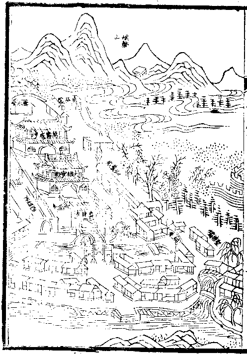
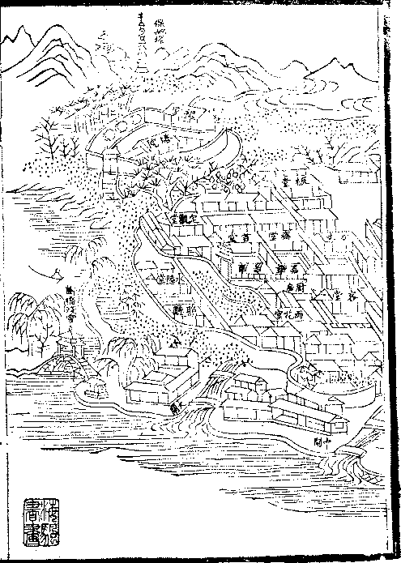

# 大昭庆律寺志



> **藏经**：中国佛寺史志汇刊（佛寺志汇刊）　**册次** 第 16 册（GA016）　**编号** GA0015　**部类** 史传部　**卷次** 10 卷　**篇幅** 85,090 字

> **卷／品**：1 卷 · 6 品



---



## 目录



  - [大昭庆律寺志原序](#大昭庆律寺志原序)

  - [乾隆壬戌春三月，净慈沙门篆玉序](#乾隆壬戌春三月净慈沙门篆玉序)

  - [重刻大昭庆律寺志序](#重刻大昭庆律寺志序)

  - [乾隆二十九年甲申冬月，临江乡人吴树虚序](#乾隆二十九年甲申冬月临江乡人吴树虚序)

  - [序](#序)

  - [序](#序-1)

- [大昭庆律寺志卷八](#大昭庆律寺志卷八)



---



大昭庆律寺位於杭州西湖北岸，在钱塘门外，西去府治三里，与西湖南岸净慈寺对峙，为有宋精蓝四百八十之一。旧名菩提院，石晋天福元年（九三六），吴越王钱氏建，宋乾德二年（九六四）重建，僧永智开山；太平兴国三年（九七八）筑戒坛，七年（九八二）赐额「大昭庆律寺」；淳化至天禧间（九九〇～一〇二一），僧省常结「华严净行社」；庆历二年（一〇四二）建钟楼；宋、元两代屡毁屡兴。明洪武二十四年（一三九一）重建戒坛，正统元年（一四三六）铸大钟，建鼓楼。有明一代，兴废靡常，然香火不绝，为西湖名刹。记本寺之掌故，旧有「昭庆伽蓝记」、「昭庆记事」、「喜日宗谱」等，广宾上人综而撰为「西湖律宗大昭庆律寺辑略」十四篇；清乾隆年间，寺僧宜洁别裁志稿五卷，沙门篆玉为之厘正；乾隆二十九年（一七六四），乡人吴树虚以「喜日宗谱」、「大昭庆律寺辑略」为蓝本，删弃烦芜，添增华实，别撰「大昭庆律寺志」十卷，前绘寺图一幅，下分八门：盛典、兴建、旧迹、净社、戒律、轨仪、僧伽、游集。盛典一门，记康熙、雍正、乾隆三帝南巡驻跸之事。兴建一门，记寺之建置沿革，采编年纲目体，有关建置碑、记、谕、疏、塔铭，则附录之。旧迹一门，记寺附近之名胜古迹，有关艺文附之。净社、戒律、轨仪三门，为本寺志之特例，盖大昭庆律寺乃律宗守廷，戒律、轨仪为律宗之所重，净社为宋代江南结社念佛之特色。是志特列此三门，要为存律宗之文献也。僧伽一门，为高僧传记，多采塔铭。游集一门，则录诗篇。体例谨严，所据资料，皆冠以书名，要而不繁，简而不疏，洵名志也。兹据清光绪八年（一八八二）钱塘丁氏重刋本景印。



------



### 大昭庆律寺志原序



昔摩腾、竺法兰二尊者，以白马负经至震旦，汉帝馆之於鸿胪寺中；后建僧坊，总名为寺，不忘其自始也。今天下名蓝胜刹，悉皆有志，不惜经营於纸墨棃枣而缀述之。揆厥所由，岂有外於不忘其始之意哉！儒家流每每以文章报国恩，吾氏大迦叶以结集三藏为报佛恩，大法流通百千万年无既。凡夫生於末世，目不覩玉毫之相，耳绝金口之音，能於烦恼海中忽地探知灵山妙旨，自证佛性，徒以结集之文尚畱为可幸耳。是以德离乎文不著，功离乎文不显，言离乎文不传。志乘者，所以著其德，显其功，传其言也，所系不綦重乎？昭庆宜洁老人深悉此义，於其缔造土木勤瘁中，留意本寺志藳；再嗣而为怀德律师，体祖本怀，检所藏缮本，畀余厘正付梓。是举也，何异乎迦叶之体佛意而结集三藏也！以报佛恩，以缵祖绪，二者均能践焉。



------



### 乾隆壬戌春三月，净慈沙门篆玉序



### 重刻大昭庆律寺志序



本寺掌故，有《昭庆伽蓝记》、《昭庆纪事》、《喜日宗谱》。天目广宾上人，号谿子，综而鳞次之，撰《西湖律宗大昭庆寺志辑略》十四篇。方丈宜洁宗师，搜探未得，别裁志稿五卷，净慈让公为之厘正缮校，就材施功，绳削冥合，付梓流通二十餘年矣。兹遇翠华频驻，刹土增荣，而怀德律师承兹景运，益昌前人之堂构，俭者丰之，朴者华之，补其阙漏，续有恢张。宝地香台，苗发无欠，不有纪述，何称郅隆？用是重以纂辑之事，委於树虚。树虚访求梵夹，获《宗谱》、《辑略》二编，更为删弃烦芜，添增华实，彚成十卷。科开八门，易例发凡，核真折谬。壁垒改其前观，斧藻假於餘绚。长行未悉，倣斑氏志之衍为细书；故典可援，歱谢公赋之徵於小注。所愧家无邺架，腹欠边笥。欲阅市而足蹇，将借书而酒乏。为质作朋，更呼将伯。敢期阳衒《洛阳伽蓝》之编，实愧刘璆《京师寺塔》之记。



------



### 乾隆二十九年甲申冬月，临江乡人吴树虚序



昭庆律寺图











大昭庆律寺志总目



------



### 序



寺图  

卷之一盛典  

兴建上



卷之二兴建下



卷之三旧迹上



卷之四旧迹下



卷之五净社



卷之六戒律



卷之七轨仪



卷之八僧伽上



卷之九僧伽下



卷之十游集



大昭庆律寺志总目终



大昭庆律寺志卷之一



盛典



国家治定功成，文安武肃，圅夏谧𡪕，海外有𢧵。天子犹殷视民如伤之怀，举巡方之典，驻跸杭州，斟酌风土所宜，布宽大，沛恩膏，然后揽胜山川，延𢠾佛刹，而昭庆亦蒙屡幸焉，信法苑之盛事，丛林之鉅典也。



恭纪康熙二十八年岁次己巳二月初十日，圣祖仁皇帝驾幸昭庆寺，赐龙烛名香，供设佛前，(臣僧书玉)伏迎。



三十五年正月望日，内太人宋深求赍赐《金刚》尊经，永充供养。



五十二年冬月，顺承王诺奏请颁赐藏经六百七十函。



世宗宪皇帝居藩邸时，颁赐波离，重来匾额。



乾隆五年冬月，今上皇帝钦赐藏经全部。



十六年岁次辛未三月初十日，皇帝驾幸昭庆寺，(臣僧果证)伏迎，钦赐哈答供佛，及「深入定慧」匾额，细字《心经》，宝塔一幅。



御制西湖畫册昭庆寺五言律诗：



招提湖北𧢲　阅武便曾过  

碧篆消新火　青松拏老柯  

客心惜颓废　僧意冀檀那  

欲拟从其愿　民财虑费多



二十二年岁次丁丑二月二十八日，皇帝驾幸昭庆，临定观堂，(臣僧果证)伏迎。



御制昭庆寺七言律诗：



钱唐门外古昭庆　取便寻幽过野隄  

僧不参禅修净业　佛无定相示全提  

法林自是忘忧所　精舍堪称小隐栖  

而我民艰常满目　岂能躭静对阇黎



二十七年岁次壬午三月初五日，皇帝驾幸昭庆，临定观堂，(臣僧果证)伏迎奏对，赐挂包一对。皇太后鸾舆临寺，赐供佛香烛银二十四两。



御制昭庆寺五言律诗：



宝叔遥瞻塔　钱唐近度桥  

偷闲游佛境　问景憩僧寮  

辨见还参栢　徵心欲剥蕉  

香花群祝愿　慈庆喜恒昭



三十年岁次乙酉闰二月初九日，皇帝驾幸昭庆，临定观堂，(臣僧果证)伏迎，进呈《寺志》，即蒙御览，皇太后鸾舆临寺，赐供佛香烛银二十四两。



御制昭庆寺五言律诗：



钱塘西北隅　律寺接通衢  

六度守毘苑　千年对圣湖  

绕阶馥忍草　出屋郁禅株  

慈寿山齐永　诚哉昭庆符



溯昭庆自兴创以来，将近千载，遥望北都辇毂，驿程数千，等於牛斗南躔，安冀紫微帝座临照？而今遭逢异数，荷光频仍，顿令古佛扬睂，天神加额。黄屋所驻，林木咸被其光昌；玉趾所临，栏楯悉增其彩绚。万古一时，何昭庆之多幸也。凡诸持律守戒禅人，当知遇此际会，现在世尊随喜发光，永除魔娆。如能庄严仪度，清净行业，深自刻厉，克尽佛规，庶几得副圣天子行幸之至意，而修因彻果，圆满菩提於尧天舜日之时，方谓之昭其庆也。



兴建上



西湖为吾杭胜地，山川明秀甲於天下。濒湖百刹，钟鼓相闻，而宏敞伟丽，道风特盛者，昭庆、净慈对峙南北，称两大焉。辨方位，揽高深。全湖如镜，溶漾乎其前；长隄如带，绵亘乎其中。右而群峰逦迤，如帏如幛，如龙之行，如浪之起；南屏对焉，如几如案。左而百雉延袤，如垣如屏，横抱山麓。自昭庆既建，而凡湖山城郭之形势，风烟云物之奇秀，树色波光之澹沱，香尘花鸟之融怡，皆得为昭庆有。葢寺地实居其上游也，寺为有宋精蓝四百八十之一，在今称数大刹，名列五山，而偪迩会城，地当要道，凡烧香礼刹、寻幽探胜之车马杖屐，首必经之。是以虽少替而即兴，值升平而益盛。极隆之运，实在圣朝，述古扬今，为撰斯记。



考本寺在钱唐门外，西去府治三里，旧名菩提院。石晋天福元年丙申，吴越王钱氏建，宋乾德二年重建，僧永智开山。太平兴国三年筑戒坛，七年赐额「大昭庆律寺」。复赐田庐，以奉香火。盖南屏亦有「昭庆院」，加「大」字以标胜也。



旧有〈菩提寺记〉，失传。旧志所述云云，似其遗语。《咸淳临安志》云：「宋乾德五年建，据重建廓新，方称大刹。纪其盛而畧其微也。」乾德止有四年，第五是开宝元年，「五」或「二」字之譌。



自湻化至天禧年，僧省常结华严净行社，旁构白莲、绿野二堂，碧玉、四观二轩。遵式仁岳，复扬经教。未几毁於火。庆厯二年壬午，允堪建，地涌戒坛及钟楼，昭庆法会於斯极盛。绍兴七年，毁於兵。(结社及戒坛，详见后卷)



寺旧志载《二老堂杂志》云：昭庆寺有钟在楼上，东坡写竹尚可辨。竹下题名云：「明夫、子方、明弼、康道、嘉甫、子瞻同游南昭庆寺。庚午(天圣八年)八月日题。」予绍兴庚辰(三十年)往观，明年再往，则已茫昧。其后移往镇江府谢后功德院，不复可见矣。案：南山有昭庆寺，与惠照寺相近。南宋时，昭庆、惠昭为朝廷祠祭之所，详见《咸淳志》。苏公所游南昭庆指此。非大昭庆也。旧志误收。



《咸淳志》云：「南渡以其地为策选军锋教场，惟存戒坛数间而已。」又云：「策选锋马军四寨教场，在羊坊桥二，在昭庆寺侧二；步军六寨教场，在昭庆寺侧。」寺旧志云：「绍兴毁后，坛址常放宝光，大内惊是火发，遣人觇之，见光从坛起，发址得石碑，有『此古然灯佛降生之地』九字。又见牛羊登践，必跪而食艸。寺由是复兴。」案：陆次云《湖壖杂记》亦述其事，语本此。



朱隗〈春日偕友人过昭庆戒坛，老僧口述灵异有作〉：



盘陀无级上　绕罢礼空王　犊子知金地　宫人望宝光　自甘莲社老　转惜杏坛荒　柳汁春衫旧　双袪惹戒香



嘉定、宝庆间渐次兴复，理宗端平中钦赐劄付三道，蠲免税役(勒石明末始毁)。宋末为兵所毁。元至正十八年重建，元末又毁。



郭畀《客杭日记》云：「至大元年九月二十九日，汤君白来同游昭庆寺，看新塑佛像。」案：至大在至正前十餘年，而旧志所载绿野堂门「方丈」二字，赵孟𫖯书，亦应在至正之前。又，至正戊戌，群盗纵横，不应辨此暇豫之事，皆可疑者。恐至正十八年，是兴复后作记文之年月也。



明洪武二十四年辛未，大慧承朝命建戒坛，复白莲、绿野诸胜。永乐六年，慧皎重修及山门殿宇。十五年，暜周增建法堂、斋室、钟楼。正统元年，庆云铸大钟，建鼓楼。十年，勅赐《大藏经》。自洪武至是时，开坛说戒，昭庆於时复盛。成化元年，毁於火。



〈赐藏经勅谕〉云：朕体皇曾祖考之志，刊印大藏经典，颁赐天下，用广流传。兹以一藏安供浙江杭州府戒坛律宗大昭庆寺，永充供养，听所在僧徒看诵赞扬。上为国家祝厘，下与民生祈福。务须敬奉守护，不许纵容闲杂之人私观借玩、轻慢亵渎，致为损坏遗失。敢有违者，必究治之。



二年丙戌，广慎行募。六年，善宁复建。十四年十月，火毁。二十二年丙午，法讯等禀之官，达於朝，许令劝募兴复。吴兴吴琼，应募独建。



《孤树裒谈》云：杭州大昭庆律寺，成化二十二年朝命藩臬二司劝建。因召吴兴吴汝辉、秀水董良臣谕劝。比见，汝辉问：「费约几何？」曰：「约银万两。」汝辉即独任之，纳银千锭。官设宴待之，问：「何慨施若此？」曰：「民一子不肖，虽饶所积，终不保，不如作胜事。」众皆嘉叹。



宏治五年，广运清理寺基仅六十亩，至是少恢复之。嘉靖三十一年修万善桥，金璐撰碑记。



金璐〈重修万善桥记〉云：西湖昭庆寺，旧名菩提，起自残唐，至宋兴国，肇戒坛於此，赐改今名，其来远矣。寺据西湖之阳，迤北湖流，光满莹洁，视若练虹环绕净室。每岁春二三月，天下游僧梯山航海而来，毕集於此，投名律师，咸受具足大戒，俨如见佛，亦大欢喜。其诸有众率往从之，实胜会也。寺有万善桥，岁久倾圮。行僧恩荫锐意修复，乃会道者真宝，来自留都，委其劝募，鸠工积石，未易兴举。内相中山宗公、西峰郭公、少参潮溪谢公、少嵋谈公、主政钝庵赵公，暨吾杭士夫符卿六桥徐公、督师鹿园万公、谏议虚岩傅公、石山高公、佥宪南屏张公、侍御南衡董公与余及诸里，咸允相助，捐金有差。始於嘉靖戊申，讫工於越岁壬子。自桥迤南，甃为石道。桥加阑楯，视昔孔备。行止净洁，雅称坛所。立碑中道，覆以石亭。爰集寺僧，请余为记。时适会太守环山孙公至此，以为说戒本以劝修，修桥亦以济人，皆善事也。行之弗禁，群乃大悦。予尝旁求释典，大都明心见性为上乘，而一切诠证法品，晨昏礼诵，动习威仪，净持五戒，虽不得一时究竟圆通，然渐悟有基，终成胜果。夫道本无二，而根智不同，是故悟有浅深，教分南北。顿悟者，不事讲求，直指见性。渐悟者，成以积习，所谓戒而后定，定乃生慧。及其成功，则一而已。我太祖高皇帝，继天立极，扫清寰宇，每诏天下寺僧，各守清规，化民为善。即今戒坛之设，实因於此。而儒者往往论其粗迹，遂谓毁发灭伦，斥而不录。甚或假以崇正辟邪为说，而阴夺其有图以自资者，此则吾儒之异端，不可不察也。余因述治桥说戒之大略而并及於此，有道君子，不能无慨於斯焉。



三十三年甲寅夏，倭寇扰杭，官令焚寺。



《留青日札》云：「嘉靖三十五年，倭寇临北关。都御史李天宠遣焚之，乃五月六日也。」案《明史》载，三十三年，李天宠廵抚浙江。三十四年，倭掠塘西、横塘等镇，巡抚李天宠令烧附郭民居。其年五月，天宠受逮。则是寺之焚，定不在三十五年也。



三十五年，总制胡宗宪偕绅士倡建，广霌、恩嵩暨道通等募缘兴复。胡宗宪撰碑记。



旧志载广霌〈请诸山行师书〉云：兹昭庆选佛戒坛，先时仗郡主杨侯推举吴兴吴善士汝辉落成胜果，历今六十餘年，不谓劫灰重覩，海众难凭。扬尘呼帝闼於光天，拈草插梵宫於白地。伏蒙郡主陈侯劝谕，仁和善士东桥陶公鼎建。前因乐输首举，化仪既展，能事孰肩？恭惟座下天才明敏，世谛淹通。上而当道稔知，下而诸方景慕。舆情㪟请，轫惠𫖯临。发心使龙象重光，出手遂甄陶济美。庄严事理，荫覆天人。谨竭殷勤，幸垂印可。



请外山十愿首：中天竺寺道通无碍师，定香寺真琦翠峰师，棋槃山道正古宗师，祥符寺圆钐本纲师，无门洞圆杲师，洎本寺福兰谷香等。



胡宗宪〈昭庆寺碑〉（徐渭代作）：杭钱唐门之外，有寺名昭庆。肇自石晋天福元年僧永智，迨钱氏乾德五年增建，并名菩提。宋太平兴国三年，始立戒坛。天禧初改今额，是岁火(二语承误)。庆历间，复坛焉。国朝自洪武初，历成化改元，凡修而火者再(数语承误)。至宪宗皇帝，始更命浙布、按二司建复之，时按察使杨君继宗领其事。有湖州富民吴琼者应募，挈万金来施舍。乃殿宇庑舍，琐至肖像，穷极壮丽，崭然一新。复有湖山照映僧寺，联络传示远迩，於是昭庆之戒坛名天下。戒之日，两京诸省之僧尼、道士，若居士、若四裔之在海内外奉朝贡，其民有信慕可以梯航至者，无不毕集。既受戒，固亦多持守以终其身。如是者，盖百几十年於兹矣。嘉靖三十四年，予以御史奉命出按浙。夏月，倭人寇杭，入湖墅。当事者恐其区广为贼薮，命火之。居几年，乡之先生尚宝卿徐君江山、副使吴君源、童君汉臣、方君九叙，并夙抱宏济，既不竟於仕，而欲施於其隐，相与谋复寺。於是上自封国，若内监、若卿大夫士、若农工贾，靡不割赀以襄斯役。及来告予，亦捐百金𢌿之。又始用堪舆家说，买民间舍，辟使寺望见西湖水以厌火灾。盖所构计合殿坛、禅室像凡若干，瓦甓石若木若干，舍财者若干人，董役若募者为某某，金若干两。起某年月日，至某年月日而落成。既成，而尚宝君等诣军中请余纪其事。余惟佛之教，自古称异端，为吾儒所辟。然录其善，有不可尽弃之者。即如兹寺，盖亦有三可建者存焉。始宪皇帝意营此，命下之日，乃有淑女产於杭，实生睿皇帝。传今上圣明，入嗣大统绥天下，是宜为君上报，一可建。洪武初，东倭犯顺，遣僧祖阐、无逸辈，顺其俗所，当令化导之，则佛之教固高皇帝所不废者。且外邦慕中国佛法，往往遣僧诣天台、五台受法及经戒，遂因以通贡献表服从。盖自古帝王已许其然，不犹愈於绝之使梗而掩杀其命乎？则此举其於今日尤宜，二可建。戒之律大若细，凡二百五十种，犯者至配於五刑。今世之愚民，有不畏法，而怖以佛輙甘心焉，是佐刑政所不及。审如是，即优伶剧谑犹取之，而况於佛，三可建。夫有是三者，虽其为教异，吾圣人不害其为助我，而胡必於去之耶？余是以可斯举，为之纪事而系之词。词曰：



於世有裨　剧戏犹取　佛所裨益　宁与剧偶　世有冥愚　愍不畏死　一闻如来　志摄魂骇　辟造堂室　我则正户　由径而造　则以戒故　径以造室　宁阻趋者　矧启圣祥　而导裔化　坛殿载新　俯瞰湖水　终千万年　永无灾毁



部劄复令开坛，至嘉靖末年，因事禁止。



旧志云：嘉靖末年，马鞍山戒坛潜匿无赖。有诏禁止。



嘉靖四十五年，广霌建伽蓝殿。隆庆二年，丁曜建山门石牌坊(万历丙戌，按察佥事丁应诏重修牌坊。应诏，曜之孙也)，题曰「律宗万善戒坛」(林凤书)。隆庆三年六月，寺毁於火。



陆次云《湖壖杂记》云：故老谓余曰，此番起火甚异。是夜有僧趺坐殿中，夜将半，见赤发金冠袍笏者在侧。僧问：「尔何神？」曰：「火神，来行火此殿。」僧叱之，神隐入础中。飞燄猛起，梁栋悉燃。



汪道昆作〈募疏〉，释方泽作〈劝修戒坛文〉。



〈募疏〉云：我闻三世诸佛，率由持戒入门；一切众生，必自发心得果。河沙历劫，尘刹代兴。幸哉遘大因缘，勉矣求多福德。维西湖昭庆律寺，为东土说戒道场，信心自此归依，法眼从兹开示，人天咸赖，今古具瞻。比年荧惑当权，伽蓝失守；三乘相灭，五戒言湮。乌兎已见岁迁，龙象如闻夜泣。有能举之，则莫敢废。不有废也，其何以兴？用是昭告十方，同兴万善。宰官首事，长者齐盟。无分住俗修行，悉听随缘布施。各从愿力，共济供需。当来种诸善根，现在成多宝地。苾𫇴毕至，兰若重开。阐佛法於三千，巩皇图於百亿。发菩提心，囊底莫辞刀布；举须弥力，眼前便现金绳。指日庄严，弥天利益。凡诸无量，当亦有归。



〈劝修文〉云：律宗昭庆，擅有古佛戒坛，诸山莫俪。每岁季春，远近衲子来赴者以数千计。谛聆说律，如承佛口而受持焉，诚天下之大功德聚也。去年暑月，诸浪夫狂子，什伯为群，每夜突入，喧呼觝击，裸卧像前。忽一夕，灾发殿中，雷风佐之，鞠为煨烬。呜呼！将衞法怒其秽亵，欲一新之耶？宋季，无准范师主席径山，两罗回禄，而随毁随成，径山道风，逾益光美。今岂符其辙耶！今春仲月，一山王子，顾瞻坛址，怆焉兴嗟。顷之，潘中丞自归安至钱唐，徘徊惋叹，乃相与闻之诸当事，听许募复。监寺诸僧，惮於渎勤。檀护王子谕之曰：「复殿以复坛，复坛以复戒也。戒者生育一切，有缘者之法身父母。报其法身父母，一生二生，乃至百生，犹将不靳，况一再乎！」檀护知此意矣，诸师无惮於勤。



万历初年，沈士宾建祖师殿，二年成。梁文槐、法经及信道人募建后殿。九年，法经等建正殿，范铁佛三身。十三年，本然建普说殿及北面内殿。



白珩《灵隐寺志》云：嘉靖乙卯，倭犯我杭，因毁昭庆寺。修复未几，复毁。既而灵隐亦以雷电灾。自是以来，频年旱潦，今二刹巍然复兴，比岁又皆丰稔，是大刹之显晦，亦与运为污隆矣。



十四年丙戌，太后赐畫〈瑞莲观音像〉、白金五两。十五年，遣内侍赍赐畫〈文殊乘狮像〉、〈鱼篮大士应身像〉(后勒石，毁於兵)，於是开坛说戒。



〈瑞莲观音赞〉曰：



惟我圣母　仁慈格天　感斯嘉地　阙产瑞莲　加大士像　勒石流传　延国福民　霄壤同坚



十八年，成圆、智礼等募劝，织造太监孙隆大捐赀，修增殿宇桥道，浚井潴池。二十年，寺前东街建甘露亭。



释理顺〈昭庆十咏小序〉云：「亭中寒暑给施茶汤。」今废入民居。



二十六年，建东西两廊四十八间，分布诸僧房居之。出旧址以清寺基。二十七年，建千佛阁。三十年，建钟楼。又施水陆圣像一百二十五轴，天地冥阳大旛一首，旁系小旛二百餘。



旛上有绣金字云：「天尊地圣，水哲扬贤。四府该罗，无边尊宰。」



屠隆〈碑记〉云：夫六度万行，戒为本矣。戒则摄心太寂，空水澄波；戒则沃志常惺，慧光发炤。故学佛者，从前阿而后茶，由化城而宝所。发心初始，万劫之胜因；究竟后来，千圣之极果。孰有离戒而修持，舍戒而证悟者？或参七级之宝塔，此是崇基；如渡万顷之洪涛，斯为巨筏。教门广综，诸部匪戒，则教仅言筌；宗门单悟，一心匪戒，则宗骋狂慧。是以梵网木叉，先圣示为科律；布萨羯磨，古德用以修持。持己精严，小乘之立法尚密；运心广大，圆教之制律更宏。将道俗之同修，显自他而俱利。水火刀兵，可蹈而不可使染污；头目髓脑，可捐而不可使破犯。惜戒深於牦牛之爱尾，守戒专於骊龙之护珠。防三业而如城至坚，微瑕莫入；澡六根而如莲极净，纤垢难容。匪惟执身无犯，外轨整而肃然；且亦执志罔諐，内境凝而寂若。薝卜之鲜花不萎，岂止胜乎凡葩；比邱之戒德不亏，又何有於外道？金铎所宣，魔怪闻而遁迹，革囊空试，天龙望以投诚。六朝及李唐之智𫖮、道进、慧远、道宣，则其卓然者矣。武林旧多名刹，沙门亦富高流。自寿公之衍宗镜，故宗属南屏；自堪公之创戒坛，则戒推昭庆。伊法门尊㝛，礼梵宇而来依；苟戒体餘残，望净坛而退恧。猗与盛哉！寺建於石晋天福年间，累有兴废。至我朝隆庆三年，复罗煨烬。殆有司礼监孙公隆，偶随喜而兴怀，遂大作其檀越。成圆、智礼等，复广募缘。於是正殿、戒坛、两庑门楼，焕然复新，巍然增胜。楼之前，为天王殿、放生池，庙貌崇严，清流映带。楼之后，为绿野堂、旃檀林，栏楯精丽，松栝阴森。入殿而礼佛，则金容晃日，绣盖成霞，俨华藏之宝界；出门而眺景，则山列云屏，湖开天镜，现震旦之灵区。缁素遂以云蒸，戒法因而日朗。扫净室而修禅，归命者，不但句骊之子；登讲堂而说戒，愿受者，何止嵩岳之神？律严则慧剑高悬，群邪立退；尘净则心珠活现，众妙聿臻。以斯综教，何教勿圆？以斯悟宗，何宗勿彻？故曰戒为本也。斯岂非上善佛地，最胜丛林哉？孙公夙奉三宝，根器不凡；徧结诸缘，风标可挹。而力兴建乎道场，则有如智礼；大增光於讲席，则有若传如。事皆有待，机岂偶然。不佞愿诸沙门，从此益务翘勤，精持律范，誓作法门之具德，力敭戒坛之耿，光则大幸矣。



张瀚〈碑记〉云：虎林昭庆寺，为两山诸刹之最。入明以来，四灾於火。虽随毁随复，仅立殿庑，而堂轩倾圮，中为刍牧，环寺列肆，外隔云山，荒落之餘，殊非旧观。寺僧成圆等，矢恢之而志未逮也。岁丙子，司礼东瀛孙公督造三吴，未至，山灵见梦於僧曰：「寺兴矣！」既而公至，顾瞻兹寺，量度久之，首捐俸直，前易阛阓，直辟天衢，树以双阙，表以朱幢，山色湖光，悉归睥睨。次葺天王殿，甃万善桥，潴放生池，下栽青莲，上植名花，祗树夹道，蓊翳缤纷。左浚义井，利用绠汲。中缮大雄宝殿，奉三世灵山圣像。寺阴为说戒坛，高一仞，广二寻，供舍那为戒主，藏五千贝叶於其中。隅列传道祖师，下斵昭灵护戒诸神。阳为普说殿，北面普门大士。左为绿野堂，供水陆像。右为白莲堂，续延云水。高殿崔巍，长廊诘曲。金轮现彩，朱阁凝霞。跻斯域者，若身游清凉；涉其奥者，即尘襟尽释。经始於万历戊子，落成於壬辰孟冬。夫以百年颓敝，公至而一旦新之，世所称祇陀给孤，岂非其人哉？顾公德不止於此也。顷岁水旱告祲，则徒跣徧於群神；灾沴为虐，则轸恤先其闾左。拯流离以惠困穷，收胔骼以泽枯骨。濬三河，控江湖，以达会城；道西陵，筑长隄，以济徒步。种种善政，更仆未易数也。公尝语余曰：「吾俸给出吴越，故惠济在是。旦夕入司政，本俸给天下。则其推一人之惠，以济天下，又奚让焉！」万历二十一年癸巳，成圆、传如、净筠、智礼、大槐、文墨、清臻、成伦勒石。



大昭庆律寺志卷之一



大昭庆律寺志卷之二



兴建下



万历三十三年，传如达於朝，上命汉经厰太监张然赐大藏经全部、帑金千两，建阁供奉，勅名「万寿戒坛」(董其昌书额)。



勅云：谕杭州府护国万寿戒坛律宗大昭庆寺住持及僧众人等。朕发诚心印造佛大藏经，颁赐在京及天下名山寺院供奉。经首护勅已谕其由，尔住持及僧众人等，务要虔洁供安，朝夕礼诵，保安眇躬康泰，宫壸肃清。忏已往愆尤，祈无疆福寿。民安国泰，天下升平，俾四海八方同归仁慈善教，朕成恭已无为之治道焉。今特差汉经厂表白御马监太监张然，赍请前去彼处安供，各宜仰体知悉。钦哉！故谕。(六百七十八函，一万五千四十八卷)



四十一年，镇元、圆龙等募易朽蠹，董其昌作疏。



疏云：浮家泛宅，戴青笠於霅溪；破家散宅，掷朱提於湘水。昔闻其事，今见其人，予友楚雄守徐公是已。公自解组以来二十许年，辞王谢之游，参支许之会，筑室梵邨，经行昭庆。瞻金相有其漏痕，仰宝殿现夫坏相。虽翚飞之势犹存，而鼇极之维已朽。大捐钱贝，多购楩柟，将占日以兴工，廼先时而询匠。匠曰：「巨材蠹矣，小益可知。」公嗟全体新之，费将无算。欲还弥勒宝楼之式，须析那叱骨肉之身。遂耻独为给孤，更望共偕祇树。向余授简，特谕众土帮土而为墙；请尔开囊，愿效公牛戴牛而发矢。



仁和邑侯周忠烈公，买仁和田二十亩施寺。



万历四十六年十月初十日，周邑侯呈批云：此系本县措助送迎茶水之费，方恨不能多施，以苏住持之苦。若有里递攀扯当役者，执此鸣诸后官。同心之好，当无不共之也。



四十六年传如等建禅堂，时有李殿主者建方丈。天启三年重装罗汉诸天。四年朱国祚作碑记。



碑记云：昭庆寺处会城之旁，明圣洁莹。其前北山森耸，其右步越城𬮱，胜处第一。何论方袍圆顶，归心投地；即𬨎轩缨佩，罔勿具瞻。己巳劫后，转眼之间，台殿岿然，坛仍地涌，至今三十餘载矣。然星霜既久，不免瓦泐柱蚀。是以镇元、圆龙等，复有丙辰之修。巧藉神工，捷换挠朽，朱阑铅砌，翚吻焕跃，涂金写碧，光相炜如。於是延名宿，阅轮藏，聚廪作食，代其分衞。凡此兴作，可无愧於昭庆矣。昔光宗皇帝居潜邸，时国祚承乏，讲员微闻铜龙燕处，究竟三乘，且有修葺天下名蓝之愿。比在礼曹，僃捡释藏律部，大较收忍心性，检制四体。虽极微易忽，非意所至者，懔若探汤，危若履冰。因默会圣衷，往昔周旋於三十年宫禁危疑之际，实有得於收忍检制之力者。俄而上宾，此意未经道破，愧受光庙特简，无从报称，擗胸自憾。适镇元等索言为记。余不禁慨然以悲，乃渍笔写心。冀法王恩，启尊帝在天之灵，追忆曩日周全自惕之怀，证臣上测圣衷不谬。庶於作记，愿力不唐捐也。



贺万祚〈重修山门坊桥疏〉云：昭庆寺衿带湖山，肘腋城市。往来瞻礼者，毂击肩摩，熏习善缘，如山行湛露，不觉沾衣也。寺门旧建石坊，坊下石桥，岁久剥落，渐至陨坏。松云、悟庵二师，特发宏誓，力图鼎新，欲令庄严法界，闻见欢喜，非止藻饰湖山而已也。今者，大殿、禅堂、戒坛，功力已就，此举乃合尖之㙮，伽蓝应梦，种种希有。凡我诸方，希相乐助。



又，臧炅如〈募铸鼎疏〉云：归依念切，然臂以供。礼向心坚，拈土亦香。况於捐身外之物，除我见之偏，满庄严之相，永薰蒿之诚者哉。突兀南山，倣镐京之重器；离娄中户，付洛阳之名工。彼窃鼎以贪造业，此则破贪；或扛鼎以力买名，此须竭力。愿跃冶以乐输，定飞烟而结盖。正逢龙华宝会之鼎新，冀受祇树金仙之炉冶。



崇祯十三年毁於兵火。



王士性〈游记〉云：出钱唐门里许，西北为昭庆寺，亦名万善戒坛。每岁上已，律僧登坛说法，云水缁流，托盋来受戒者，何啻千百。鉅室富贾施金钱，计亦称是。寺毁於寇，戒禁於官，其后废不举。



黄端伯〈劝建戒坛记〉云：踞湖山之胜，而开大施门者，昭庆寺其尤著也。宋元以至今日，代有名僧，冠盖如云，无不向禅林问道。窃意阐法道场，莫盛於斯矣。今火头现大神通，放光腾燄，使墙壁瓦砾照耀十方，躶躶现前，纤毫不隔。衲僧不惜性命，更为空王遮盖法身。铁壁铜墙，重重围绕。祇要宰官长者，同登清净觉场。诸公乘大愿轮，度生成佛，又何惜一茎艸为如来现丈六全身乎？(端伯，别号海岸道人)



十六年癸未，冯洪业建戒坛，觉海等渐次兴复，宣奏仍许开坛。岳石帆建藏经阁，张敞建伽蓝殿。



旧志云：冯洪业请觉海联十愿首，力图兴复。圆龙、承超、通琳、真谁、大观等，募建后殿、斋堂、方丈。圆龙搆大殿厂。承超建禅堂(即法乳堂)。



旧志云：崇祯十三年二月十九日，张敞来觇寺焚，见烈燄中伽蓝神像巍然，纤毫无损，由是发心建殿。敞无子，建后即得一子。敞字振所。



姚继贤建祖师殿，装卢舍那佛。归安令吴公筑周垣竖幢，启百日经期。朱广源、曹惠公、虞乾旸、金双南铸大像。鍾怀旭昆季施水陆祖师像共一百八十二轴。本朝顺治十一年，通𪽈坐关，募建大殿。十七年疏言建大殿，中奉三世佛，旁列罗汉诸天，后装三大士，请宝华山三昧律师登坛开戒。康熙十九年殿宇渐损，募缘修葺。



沈珩〈募重葺昭庆寺缘引〉云：昭庆居西湖北，地势利便，四方来归者，蹑履云集。故其盛时，盛於他所。然以其便利，故陵轹而剥蚀之者，亦称独甚。游人至湖上，盛衰之感，先发於昭庆寺，非一日矣。退谷尝云：「成坏相寻，亦岂有常？无坏不成，无迁变世界不立。」间者藩司李公、臬司王公、诸大宰官，恻然低眉，愿作领袖。请无隐千峰和尚来此提唱，殆坏之将成、迁变之将立世界耶。具一种性自出无量施，将旦暮观成事矣。



沈虬〈募葺缘引〉云：昭庆寺自开创以来，代有兴者。万历初，开拓鉅丽，为省郡丛林之冠。崇祯毁后，迄今四十餘年。戒坛虽复旧观，而正殿、山门、禅堂、斋室、钟楼、鼓阁，尚在蹉跎。理顺上人，禅门之法器，香苑之雅望也。慨然以兴复为己任，与合寺耆旧，公请天童正宗千峰和尚说法唱缘。以余旧令钱唐，属余弁首。窃惟西湖繁华之地，自有昭庆一刹，未必非闹长安中宴然一国，可以唤醒酣醉昏梦多人。植此福田，定属无量。



陆光旭〈募建禅堂缘启〉云：法云西涌，遗像教於莲台；慧日东临，振狮音於梵座。依山建宇，感灵鹊以迁巢；叩水居岩，致神人之献地。盖祇园宝树，无非觉岸津梁；而绀殿金身，总是灵山面目。欲证菩提之果，须洗根尘；期登般若之缘，宜弘法愿。兹大昭庆律寺，创自钱王之手，廓于乾德之年。地涌仙坛，感韦天之示现；光腾石碣，纪古佛之降生。丹碧琳宫，历代之金轮长焕；巍峩宝刹，诸天之妙相恒新。倚宝石而瞰西湖名胜，甲图经之秀；阐木叉而布南国律宗，分会正之传。下逮元明，历遭兵燹；迄乎叔季，未尽经营。星霜积而推以雨风，轮奂湮而生其蚛蛀。遂使萧条灌莽，尘蒙受具之场；寂寞旛幢，香冷然颠之会。幸遇某等，以宰官身，具正法眼，结宗雷之幽契，同苏白之归诚。目击倾頺，怀思倡率。今兹千公和尚，戒严圭璧，定住金刚。传鹫岭之灯，法光飞燄；秉天童之拂，天雨吹花。特启宏慈，愿肩巨任。然而聚沙无力，持钵逢艰。伏愿共破悭囊，结良缘於种玉；同书善箓，追胜事於布金。庶使铁凤金螭，重展庄严於法界；嚬狮顾象，新开面目於中天。鱼贯坛前，一一戒香被体；麈挥座上，人人白汗流身。则八部之天龙，护金汤於劫簸；亦十方之善逝，锡功德於檀那。真愿力之无边，谅福田之难量。



二十三年宜洁和尚主席。尤侗撰〈戒坛记〉。



记云：昭庆万寿戒坛，歴宋迄明，四毁於兵，五灾於火，灵光不歇，佹坏佹成。赖智仁、介山、觉海诸宿，后先整顿，遗教未坠。而三昧老人自华山来，登坛提唱，四众景从。宜师继之，法轮重振。余薄游湖上，瞻礼戒坛，见其规模严净，为律寺之冠。退而谒师丈室，见其道风清粹，率群弟子修持白业，矩则秩如。鼓钟梵呗之声，晨夕未尝绝也。於是喟然而叹。余尝谓天下宗师，如麻似竹，然龙蛇混杂，凡圣俱陈，其间盲参瞎棒，堕入魔娆者多矣。唯戒律一宗，乃真实修行第一义谛云。戒生定，定生慧。而苏子谓：「定慧相生，如珠盘之走。」然总以戒为之先，无论西天东土，一华五叶，未有不从戒入者。即如吾儒，受孔子戒。然君子三戒：戒色，即淫戒也；戒鬭，即杀戒也；戒得，即贪戒也。而《法苑珠林》推言之曰：「本於仁则不杀，本於义则不盗，执於礼则不淫，守於信则不妄，师於智则不饮。」是则五常之道於戒备之矣。戒者，律也。王者得之，以治其民；佛者得之，以利其生。世即有辟佛之人，恶能毁其所戒？世即有敬释氏之人，恶能阿其破戒者哉？今宜师登地涌之高坛，传千佛之大戒，修南山之遗绪，恢庆历之宏规，使四方学者，知天人之永护，斯坛诚与世而俱永也哉。



三十九年庚辰，毁於火。宜洁和尚肩任兴复，广为募劝。



杜臻〈募序〉云：事有经千百餘年，往往成而毁，废而兴，且不止於一成一毁，一废一兴而已者，则亦终为必不可已之事。吾杭昭庆律寺，其杰峙於西湖之滨也久矣。碑载古然灯佛降生之地，甍栋巍峩，坛宇净洁，一鉅观也。而四方宾客之来游者，缙绅士大夫与夫骚人逸叟，莫不栖止而登眺焉，则又贤人君子会萃之所也。唐宋元明以来，屡毁於兵火，而去年冬复厄祝融。窃尝谓：「寺也者，佛日之所凭依也，灵爽之所呵护也，岂其成毁有数，而神灵亦莫之挽回耶？抑神灵亦厌故喜新，将尽去其颓败而欲重覩其𪸩煌耶？」今者，际升平之世，乐安阜之风。翠华临幸，山水增光。凡湖之内外寺院莫不庄严，桥梁莫不修举，花柳莫不栽植，景色陆离，惊心夺目。而此寺顾倐为瓦砾之场，岂天亦留其阙陷，以俟人之经营补缀耶？因念是寺也，宋元之世，三毁於兵，则三建；二灾於火，则二建。明之世五毁，则又五建。而前之火也以庚辰，今之火也复以庚辰，是诚不可谓非数也。其成而毁数也，则废而兴亦数也。踵千百年之成规，以再覩重新复千百年之旧迹，以共襄胜事，当亦仁人长者之所动心，咸以为必不可已之事也。是为序。



徐嘉炎〈劝修记〉云：康熙辛巳夏四月，余奉假里居。吾浙会城昭庆寺僧，以其寺之兴废纪略，乞疏於余。窃谓会城诸山，来自天目。相传日者家言，是离龙结脉，往往罗郁攸之灾，輙延绵数里。又居民多以竹苇为壁干，尤易揽火。殿宇则墙以砖石，卒亦不免。虽曰人事，亦方位使然也。虽然，物之成毁主乎天，又未始不托於人。今兹欲图创复，自毁而冀成，与前此自成而倐毁，皆非托於天而托於人可知也。倘其誓愿不坚，将此古佛降生之地，委诸艸莽而任其胜因歇灭，岂不悲哉？唯是鸠工庀材，囏鉅实甚，所望喜舍檀那共成胜事。余因乐为之劝而说偈曰：



一切世间人　成毁皆执相　有成即有毁　有毁还复成　即此世界中　坏空与成住　过去无数劫　有佛人中尊　佛有八王子　出家师妙光　修证入地地　相继得成佛　最后天中天　号曰然灯佛　诞此清净土　放光惊王宫　发碣刻九字　乃建昭庆坛　绵历近千年　循环互兴废　际此烈火殃　百毁无一举　在昔给孤独　名为须达多　恒行檀波罗　知佛来舍衞　於城施主家　见佛大欢喜　相卜最胜地　吉祥祇陀园　须达为布金　祇陀施林树　建所三十六　佛居中精舍　我闻阿逸多　力行菩提行　能以种种缘　变现妙世界　宝网及云台　秽邦成净土　我愿诸上善　因缘亦如是　仗十力威神　庄严大楼阁　行檀空三轮　启此无尽藏　七宝恒河沙　特用成胜果　天人合赞叹　回向萨婆若



吴源起〈题后〉云：嗟哉此刹，有劫乎？曰：「无劫也。」然则曷为而遭此？曰：「乃佛之现身说法也。」其说法若何？曰：「世人汩於名利，凡诸造意设想，皆欲为数千百年不敝之计。与之语色即是空，则不悟。更与之语因果及现在诸烦恼，亦不一𫖯首。孰知一刹那间，同归於尽，不犹於人天、昭庆之灰烬乎？故曰：佛盖现身说法也，以醒世也。」



沈廷文〈书后〉云：天下丛林，时盛时衰，亦事之常。独昭庆建而易毁，毁则必建。岂所谓然灯佛降生之地，特显其奇异，以招徕奔走天下之善信，令其人广为种福，归心信道，而翕然於佛力之广大耶？



如前所记，始天福丙申，迄於康熙庚辰，其间兴替迁变，历历可知。而其殿宇堂轩，基移址改，欲即昔之嘉名而一一实指其所，甲乙莫能辨也。今者，时际盛明，诸废毕举，始康熙辛巳，至今乾隆二十九年甲申，更数住持，兴复大备。创者先其鉅构，继者拓以新模。掞华缉琐，标胜增餘，雕堂秘宇，飞陛危荣，较乎旧日，风规逾益崇丽。所以然者，盖为曾经圣天子驻跸之宝地，神明默为扶助，理在必兴。历任卿宰督师，深体此意，钦圣迹而扬法门，不惮首为倡导。而适逢家给人足、太平既久之时，人好檀施，易成胜事，重以主寺宗师之德行足以树风，持循足以继法，公溥足以和群，诚悫足以孚众，现此宝所，晖光日新。兹为叙列现前规模，按位而次，笔诸左方，俾千百世而下，得想见此日之隆盛也。



大雄宝殿五间(高六丈一尺六寸)，中奉大像三身(铁像三身，火后存一，今为主佛)，后奉大士三身，旁罗经厨，贮大藏全部。



康熙五十一年书玉建，乾隆二十二年果证整饰毕功，李治运书殿额。



定观堂在大雄宝殿西，恭设宝座。



乾隆十六年(臣僧果证)建，(臣于敏中)书额。



后殿五间(高六丈六尺六寸)，中筑万寿戒坛，坛奉卢舍那佛。御书「深入定慧」匾额。



后壁畫〈大士过海像〉，董旭、顾升合笔。石碣刻「古然灯佛降生之地」八字。



康熙五十六年书玉建，乾隆二十二年果证整饰毕功，李治运书殿额，释隆树书碣。



丁敬〈昭庆寺畫壁诗并序〉　湖上昭庆律寺戒坛，后壁畫观世音菩萨过海相，吾杭顾斗山、董云宿两翁合笔也。两翁皆丈人行，惜未一接其眉宇，而余之礼足於相下者屡矣。翘企钦瞻，慨焉兴咏，得七字四韵。



吴踪孙迹各称雄　合手何期见两翁　佛带光疑温散日　龙裾波恍响连风　百年转恐消磨渐　再劫应难绝蓺同　拂麈闲看吾岂敢　唯宜稽首颂如空



翟瀚〈白衣大士畫壁〉：



董生笔力马渥洼　顾生文采禽孔家　素壁五丈流银沙　欲与普门争此豪牦差　洪涛翻空喷雪花　涌处隐隐龙盘涡　长弓大𢧢衣褶陷　菰叶飘作风裾斜　巍巍雪山顶　圆月开秋华　庄严不假旛盖助　飞动如在钟鼓挝　然香人来万俯伏　咸谓慈晴廻我瞩　能令劣相一时降　自有天神暗承足　二子畫虽工　安得此伎俩　若非寤寐亲觌之　定是威灵所凭仗　借手分身现妙相　佛国清凉绝彷佛　屡到观瞻嗟咄咄　世间富贵等浮云　烟阁英雄尽凡骨



前殿五间(高三丈六尺六寸)，中奉弥勒(弥勒、韦驮，旧皆铜像，火后并铸弥勒一身)，后奉韦驮，旁列四天王，北树御诗石碑，殿前青莲池(一名仙池，又名放生池)，池上万善桥(宋时名广济桥)。



释书玉〈重建天王殿万善桥记〉云：康熙庚辰，昭庆寺毁於火，时顺承王诺以天潢镇守两浙，暨副都统戴噶、马、李诸公，感念是寺已历千年，且为庆祝皇太后万寿，经坛任其废而不兴，非所以表名胜、昭诚敬也。今正殿略复旧制，供奉御赐《龙藏》於其中，而前殿石梁，亦宜急谋营构，以成合尖之功。爰首率倡捐，一时驻防满汉诸君，下逮甲士，皆出俸直，共襄善果。厥工未竣，顺承王赴召入都，继其任者将军塔公，踵事督成。岌嶪高甍，丹碧重绚，跨以长虹，甃以方塘，缭以崇垣，俯以重门，矞矞皇皇，俾荒毁之餘，焕然更新，传诸后世，永勒宝刹，宁止供一时游览之盛已耶。



乾隆二十二年果证整饰天王殿，始备。



东为归锦桥，水注新河。西为𣹢胜桥，通湖水入池。由万善桥路出湖滨，现全湖胜槩。



案：涵胜桥一名龙带桥，受中龙闸流水，故名。



伽蓝殿在大殿左，祖师殿在大殿右。



康熙五十六年书玉建。



集云堂在戒坛后，今为云水堂。



康熙四十年仲之琨建。



正殿之西，启门东向，内有藏经阁，康熙四十二年汪介藩请大藏经全部奉供，今称药师堂。阁下为方丈。



康熙四十年，织造敖福合建方丈，匾额「令法久住」，文觉禅师书。墙嵌〈体困睡眠图歌〉、〈偈〉石刻。



歌曰：



万事了　无烦恼　四大困时便放倒　衲被蒙头睡一场　通身那得梦来搅　体如如　寂寥寥　真空性相静悄悄　却归混沌未分时　乾坤世界冥杳杳　这消息　知者少　一觉那管天地老　会得其中元妙机　人人尽有家中宝



偈曰：



白昼𪖙齁自在眠　全无情爱梦人间　无思无虑无何处　鼾睡如雷震大千



四大幻身，一眠可悟。读无踪和尚之歌偈，知有相情识之皆妄矣，因镌金石，用普觉照。时万历戊寅仲秋吉旦，适园居士陈洪蒙识。



案：是碑乃前贤施於本寺者。



客楼两庑在方丈前，下为客堂，上安外职。



康熙四十年让木居士戴国礼建。



大悲阁在方丈右，上为忏堂，下为斋堂。



康熙四十年织造敖福合建忏堂，所有庄严供器，俱织造孙文成施。



延宾阁在大悲阁西，下为戒堂，亦称首堂。



康熙四十年书玉建。



二堂楼对延宾阁，今为库房。



雍正十二年福溶建。



水陆堂在定观堂西南。



乾隆二十二年果证购本瑞房屋基建(净明、曰唯二师遗赀)。又请水陆畫像一百二十五轴，小身水陆畫像若干轴，有石刻《金刚般若波罗密经》。



后跋云：崇祯辛未仲秋朔日，善男子王道焜，为母亲赵氏求超度敬书。



又有跋云：王昭平先生，讳道焜。鼎迁殉难，为前朝名宦。悲太夫人仙逝，手书《金刚经》以昭孝思，人徤羡焉。仆方外交哉生先生宅相也，经即归之。后哉生隐於禅，经与偕隐。丁丑春，谈禅之暇，捧经示余，铁畫银钩，悉遵大藏古本。而字至五千，无舛讹，无败容，先生品行，即於笔墨见之。因念夜光宝璐，未可独秘。时周子式远在座，欣然双钩而勒石，亦与人为善之意。西湖无庵顾文炳虎如氏识。



案：此石刻是横河桥陈庵比邱尼施於寺者。



库楼三间两厢，对大悲阁，以贮米谷什物。厨房三间，在库楼南。小屋六间，为调摄寮房。普贤堂三间，在水陆堂后，为收供寮浴室。圊房三间，在普贤堂侧。



俱康熙四十年书玉建。



雨花室四间，在厨房南。



乾隆二十八年果证购雨花房屋。



钟板堂在集云堂西，旧名千佛阁。下为法乳堂。(释篆玉书额。)



五十八年书玉建堂。中曾奉玉公宜和尚骨塔。甲戌，迁於忍慧塔院，遂以千佛阁为钟板堂，特加修整。



于敏中〈重立钟板堂记〉云：西湖昭庆寺，为余旧游地，住持怀公，恬澹率真，不作世法周旋，乐与往来也。乾隆壬午春，余扈从南下，乘暇重过之。见其山门佛宇像设庄严，改观於昔。而斋钟茶板、咒钵经声，清妙微邈。询之，乃比邱安居习静之所徙立。戒坛之西偏，杰阁凌云，恍如香界。鸠工庀材之赀，则皆怀公法缘愿力所致。其持净律，以广福因，可谓懃且至矣。即布金施檀之园，成最胜功德，信慧更何如哉！輙因怀公之请，为记善果。



释篆玉〈千佛阁避暑诗〉：



人间苦炎热　北院竹梧凉　何物共禅悦　池莲散晓香



祖堂在戒坛西北，旁构忍慧塔。院中奉宜公塔，左列澄公塔，右为怀公预筑塔(释隆树书额)，有塔铭碑。



康熙五十七年，书玉建园房三间。乾隆十七年，果证修改为祖堂。於右建塔院，石刻〈宜洁律师塔铭〉（王图炳撰）。〈塔铭〉曰：余闻昭庆宜老人，律行精严，久宦京师，未遂支许之交。今年读礼家居，其继席澄如师，不远数百里，踵门请曰：「本师示寂七稔，於兹谨撰行略，乞塔前之铭。」余辞不获，乃节举大凡而序之曰：「师讳书玉，字宜洁，族唐氏，武进人也。母梦月光入怀而生。幼喜称佛号，稍长即茹素。从师习举子业，通晓儒书。一日，听邻寺僧诵〈大乘行愿品〉，质问义趣，言下豁然。遂辞亲诣京江嘉山，依自谦和尚剃度。服勤既久，赴金陵华山，受具於见老和尚。昼则供侍巾缾，夜则究研律部，与定庵律师并为嗣法高弟子。康熙癸亥冬，定公偕师赴昭庆说戒。甲子春，定公还山，师遂主席兹刹。按志，昭庆之有戒坛，自宋允堪师始，明季三昧老人自华山来，登坛提唱，至师而坐振宗风，非偶然矣。师躬行实践，操履悫诚，寒必露顶，食不过午，与众同甘苦、均劳逸。每岁春冬戒期，四方缁白闻风翕集，前后得戒者约万餘人。庚辰，寺毁於火。於是宰官捐俸，居士助赀，劝师次第建造。自壬辰讫己亥，八年中不遣一僧募缘，而一切门垣殿宇，象设器用，以及普同塔院，山寮园房，靡不经营缔构，轮奂聿新。成功之日，朝廷颁赐藏经，供佛庄严。干楣万栱，照耀湖山，可不谓祇林希有之胜果与！师生於顺治乙酉七月二十四日，康熙辛丑十一月十四日，示微疾，说偈端坐而逝。世寿七十有七，僧腊五十六。门人奉全身塔於本寺，示不忘也。」铭曰：



湖滨耸翠　湖光吹澜　佛降生地　地涌戒坛　三昧首扬　宜师继起　规模整肃　海众至止　禅律对待　定慧相生　森罗梵网　若准若绳　作用无我　机缘听人　布金委粟　檀施骈臻　劫后重新　精蓝倬焕　岂藉班倕　佛力潜赞　孤塔亭亭　灵光奕奕　智月常圆　山青水碧



十方贤圣塔，旧名云深庵，今名东塔院，在戒坛东北。旁有园房数间，园地五亩三分。



康熙五十八年，书玉建庵。乾隆中，果证建园房，地为丁玉星购买舍寺。



三会庵在青芝坞，即山寮也。旧有石山三百亩。



康熙五十九年，书玉建。



斋田一百三十八亩零，在绍兴府萧山县尖山。乾隆二十六年，丁玉星购买舍寺。



释明中〈饭僧田记〉云：昭庆寺旧无恒产，食堂常供千指，时有空钵之虞。钱唐丁居士玉星，夙具善根，好施不倦。年逾八十，奉佛精进。其在昭庆，修殿宇，装佛相，购蔬地，种种善功。复念众食未充，同室徐氏发欢喜心，罄橐所有，置田若干亩。愿在永远饭僧，种世世福田种子。会善友闵文臣、沈云山、沈天章、释大方等同座，齐声赞叹而证明焉。乃丐余述其由绪，记岁月田亩之数於石，用示后来者。



乾隆乙酉小春月，江南徽州府黟县信官王顾亭助银一百两，置田五亩永远灯油之愿。



乾隆三十三年，来宸聚购买斋田舍寺。



〈昭庆律寺施置饭僧田产碑记〉　佛昔住世，给孤独长者布金买地，造僧伽蓝。卢至长者，恒以洁斋供养大众。伊二人者，非同凡小，廼大乘菩萨现长者身，示行檀波罗密究竟法门。其在震旦，南州二周、长安五张等，踵行檀施，像法转时，佐扶法轮，绍隆佛种，转令兴盛。惟西湖大昭庆寺，向为律仪道场，宏演毘尼，遥允优波离。近传宝华正脉，历有年矣。寺主怀德律师，丕振祖风，福缘四辏，遂感萧山居士来宸聚，大发檀心，乐捐白镪三千两，置买饍僧田若干亩。又以寺址西南接壤，犬牙相错，购买屋地，令得圆满成袈裟全角宝界。盖来居士宿植信根，乘愿而来，与三宝作俱有依。故能以减嗜节欲、铢分积累之赀，不用於纷华利养之途，而快然奉之佛地。与怀公当是威具六和之缘，感应道交，融洽水乳。故持兹重蓄，不施诸他招提中，而特舍於昭庆。当其一诺慨施之时，随有华子斌、张念劬、华育芳、沈文良、沈文宗诸善友等，怂惥劝奖，抃手赞叹，皆由多生互为主伴，辅成胜缘，要非偶然集会所克就也。维此功德，永与昭庆常住，永与如来大法转轮无竟。若欲宣说其福，虽广长舌未能究其涯际。树虚往来昭庆，此叚因缘，耳闻目睹。来居士以事关常住产业，当纪载号段亩分，无令遗混，面请於树虚。承命欢喜，谓来居士能以一身兼给孤、卢至二长者所行，世难遭遇。遂述其由绪并及田亩而志其岁月於石。　乾隆三十三年，岁在戊子仲春上澣，皈依三宝人吴树虚撰记。



以上正旁大小远近殿堂房宇、田池山地等，总成律宗昭庆寺现在一大宝坊，常住不朽。



大昭庆律寺志卷之二



大昭庆律寺志卷之三



旧迹上



阅人成世，荣悴易观。凡高台曲池之华饰，英材硕德之欣赏，已化为沙雨烟云。然地以人著，人以地传，两者相须而成。千古迹虽漫灭，记志尚可探也。安知今者所游涉，不又为后之迹哉？纂缉於篇，令人望古遥集，资捉策挥犀之清话云尔。谨案寺记牒云：寺址东界武陵郡城，南界钱塘湖岸，西界石函桥放生碑石，北界庆忌山塔。由是核之诸名胜旧迹，在界内者胥当附昭庆而见也。昭庆寺相并有菩提院，本吴越钱惟演别墅，太平兴国二年舍为伽蓝，名惠严，七年赐名菩提。



《武林旧事》云：大昭庆寺与前菩提寺相连(宋时，昭庆山门与菩提附近)。《咸淳志》云：菩提院，太平兴国二年建，名惠严，七年改赐今额。



沈朝宣《仁和县志》云：「菩提寺，钱惟演舍第宅为寺，延高僧真悟为开山祖，传南山宗教。」此言非也，真悟、允堪师至宋庆历时筑戒坛，非钱氏所延也；允堪时已名昭庆，非菩提也。



寺有千手观音像。



《武林旧事》云：菩提寺有灵应大悲像。《咸淳志》云：先是，寺僧募良工孔仁谦作大悲像，千手错出，不能尽布。夕梦沙门语曰：「何不分形於宝燄之上？」如其言像成。迨乾道间(此下序南宋重建后事)，僧彬再以命工，工难之，有媪在旁导之至净池，像忽现水中，一晤而媪已失矣，乃创阁妥焉。



有南漪堂、迎熏堂、澄心轩、涵碧轩、𣰽毺轩、玉壶轩、披颢轩，建炎间毁(与昭庆同为兵所毁)。



《咸淳志》云：菩提院有堂二，有轩五，今皆不存。



苏轼〈菩提南漪堂看杜鹃诗〉：



南漪杜鹃天下无　披香殿上红𣰽毺　鹤林兵火真一梦　不归阆苑归西湖



案：《咸淳志》云，钱唐门外菩提寺杜鹃花甚盛，今堂基尚存此花。



沈与求〈南漪堂诗〉：



山遶湖塘寺遶山　平生愿向此中闲　青云白水相浮荡　野客高僧独往还　少壮无嫌轩冕累　因循将恐鬓须斑　南漪最是逍遥地　且挹清波濯愧颜



南漪堂后为玉壶园，从玉壶轩之旧名也。



《西湖百咏引》云：南漪堂在菩提寺西，东坡咏南漪堂看杜鹃花即此，后为玉壶园。案《西湖赋》云：北有玉壶，红鹃尚存。创於鄜王，隶於慈元。去还碧兮百棹，隔水月兮一垣。可知玉壶红鹃，即东坡所咏之花也。



园为刘光世别业，宋理宗时充御园。



《咸淳志》云：玉壶园在钱唐门外，本鄜王刘光世园，后属临安府守赵与𥲅，筑堂四面。景定间，更隶修内司，又为堂曰明秀。



杜范〈赵山甫居玉壶，尽得湖山之胜，醉和其韵诗〉：



占尽春光好　湖山一览餘　著身蓬㠀里　纵目畫屏如　我计还知错　君谋定不疎　他年同到此　卜筑更踌躇



杨万里〈泛舟赏荷诗〉：



游尽西湖赏尽莲　玉壶落日泊楼船　莫嫌当处荷花少　剩展湖光几镜天



案：玉壶在上下湖之交，湖曲十三区，方知「几镜天」之语妙。又，杨公〈西湖雨中泛舟〉有「正月一度游玉壶，二月一度游真珠」之句。



黄文雷〈玉壶即事〉：



雨过条风著桺芽　淡黄浅绿嫩如花　陂湖漾漾初侵路　蜂燕纷纷各理家　带郭园林仙苑近　送春船舫绣帘遮　芸窻倦倚西山翠　暖霭轻笼日脚斜



董嗣杲〈玉壶园〉：



莫问南漪与玉壶　杜鹃还更试花无　坡仙一顾吟空老　地主频更景不殊　船出断桥春溆远　钟传萧寺晚楼孤　山明水秀轩扉敞　落日渔歌过里湖



张舆〈访王药圃於玉壶园〉：



林亭绝幽迥　长夏绿云香　明月出山小　白莲承露凉　谯鼓楼头急　吴歈风外长　翛然玉壶内　浑与世相忘



又〈可闲老人约访王药圃，书此诗先之〉：



明朝寒食风日晴　可闲欲同湖上行　先拾玉壶园上翠　却听宝石山前莺　茶铛烦为试新火　杏酪不须和冷饧　君若肎将花径扫　日高相与到柴扃



周紫芝〈菩提轩骤雨初晴〉：



杭颍雌雄本自殊　淡妆浓抹是吴姝　满倾涨玉千钟酒　来看镕银百顷湖　白鸟去边山泼黛　绿萍疎处雨跳珠　不知能事王摩诘　貌得西湖落照无



周弼〈菩提废寺〉：



野寺孤僧住　当春亦掩扉　晓钟三版去　昏棹一盂归　古屋垂山榧　幽窗养石韦　未容行客憩　荒树雨鸠飞



罗公升〈菩提寺〉：



一亩方塘几劫灰　哭声未已笑声催　六桥烟柳相逢处　半是菩提拭泪来(自注：菩提寺为临安人火葬之地。)



案：建炎间寺虽毁，其南漪诸胜已割为玉壶园，殿阁则略为修整。二周所咏可案也。据《咸淳志．水口》核之，园在菩提寺后上下湖之交。今称玉壶园者，在钱唐门外之南，乃是改筑城垣而移额於此者，非旧地矣。



宝庆三年，菩提重建佛殿。淳祐六年，重建千佛阁。



《咸淳志》云：宝庆三年，宁宗杨皇后赐钱重建殿。淳祐六年，重建千佛阁。案：志称「乾道间，僧彬造千手像，建阁妥之」，则前此六十年已增修建阁，志略耳。



元末移寺於太学街东，餘址属昭庆寺。



沈朝宣《仁和县志》云：菩提律寺，元末毁后以筑城，寺基入焉。明洪武初，建城内宋太学街，学士倪谦撰记。《游览志》云：其址并入昭庆寺。



案：《咸淳志》载，小方井俗呼六眼井者，在钱唐门内裴府前，水口在钱唐门外菩提寺前(导湖水入城作池井者，名水口)。又，真珠河在钱唐门内，水口在钱唐门外菩提寺后，一通九曲下湖。由是度之，菩提寺逼近城垣，故元末移筑，寺在必毁。又知菩提寺前后水口通上湖水，九曲下湖尚在其北。盖菩提在湖支之东，傍城而建也。沈志云：以筑城并入，则寺基为城基、为濠池。田志云：址并昭庆，则是开濠之后，餘址在濠西者，归於昭庆也。



昭庆之东有望湖楼，一名看经楼，乾德五年钱忠懿王建。(五年，恐二年之讹。见首卷〈兴建〉注中。)



语见《咸淳志》。案：楼与菩提院同年建，因院而及之也，故名看经楼。前俯湖，故名望湖。姚靖《西湖志》云：望湖楼，坊志或讹为「水明」，谓东坡建；或譌为「镜湖」，谓乐天建。皆妄也。意今为秦楼址，良是。案：「水明」、「镜湖」，系是旁近酒楼，别题其额，非即望湖。言苏、白二公建者固非，云即秦楼址亦非。盖望湖在寺东，秦楼在寺西也。



潘阆〈望湖楼诗〉：



望湖楼上立　竟日嬾思还　听水分他界　看云过别山　孤舟依岸静　独鸟向人间　回首重门闭　蛙声夕照间



苏颂次韵，奉酬通判姚郎中宴望湖楼，过昭庆院暮归偶作：



山半楼台绕曲隄　水风当夏却炎威　尝思徧览前朝迹　自恨劳生暇日稀　偶到上方凭槛久　恍如员峤蹑云飞　白莲旧社空遗址　有几人从此路归



赵抃〈望湖楼〉：



僧棹渔舠恣往还　澄波如鉴俯群山　绕湖三百浮图舍　祇是凭楼一瞬间



王安石〈杭州望湖楼回马上作，呈玉汝乐道〉：



水光山色碧浮浮　落日将㱕又少留　从此祇应长入梦　梦中还与故人游



苏轼〈六月二十七日望湖楼醉书〉：



黑云翻墨未遮山　白雨跳珠乱入船　卷地风来忽吹散　望湖楼下水如天



放生鱼鼈逐人来　无主荷花到处开　水枕能令山俯仰　风船解与月徘徊



乌菱白芡不论钱　乱系青菰裹绿盘　忽忆尝新会灵观　滞留江海得加餐



献花游女木兰桡　细雨斜风湿翠翘　无限芳洲生杜若　吴儿不识楚词招



未成小隐成中隐　可得长闲胜暂闲　我本无家更安住　故乡无此好江山



又〈宿望湖楼，和吕察推〉：



新月如佳人　出海初弄色　娟娟到湖上　㶑㶑摇空碧　夜凉人未寝　山静闻响屐　骚人故多感　悲秋更憀栗　君胡不相就　朱墨分黝赤　我行得所嗜　十日忘家宅　但恨无友生　诗病莫相诘　君来试吟咏　定作鹤头侧　改罢心愈疑　满纸蛟蛇黑



苏辙〈次韵子瞻望湖楼上五绝句〉：



欲看西湖两岸山　卧乘水上木兰船　湖山已自随船改　更值阴晴欲雨天



眼看西湖不暂来　簿书无算拨还开　三年屈指挥将尽　记取从今得几回



湖山欲买恨无钱　且尽芳樽对玉槃　菱角鸡头应已厌　蟹螯马颊更加餐



终日清漪弄短桡　顿忘车乘走翘翘　秋风且食鲈鱼美　洛下书生未可招



滞留朝市常嫌闹　放弃江湖也未闲　孤艇粗穷千顷浪　肩舆未尽百重山



郭祥正〈看经楼〉：



楼下水连天　楼居即水仙　何须把黄卷　极目尽红莲



杨时〈望湖楼〉：



斜日侵帘上玉钩　檐花飞动锦纹浮　湖光泻出千峰秀　天影融成十里秋　翠鹬翻风窥浅水　白云随意入沧洲　留连更待东窗月　注目睛空独倚楼



朱继芳〈昭庆寺前望湖楼〉：



幽寻得胜趣　城市几人能　古柳深中磬　长廊尽处灯　畫龙听说法　塑佛看斋僧　别寺经行遍　兹游昔未曾



黄裳〈泛舟钱唐西湖〉：



望湖楼上与云齐　下视银河一道低　好是水边歌舞后　绮罗人在畫楼西



楼钥〈水月园〉：



具美杯残意未休　相将重上望湖楼　楼台忽已居平地　风月何曾识旧游　更挈酒樽过水月　坐增诗兴满沧洲　春风共约新桥畔　遥拜双龙万斛舟



杨维祯〈嬉春体〉：



西子湖头春色浓　望湖楼下水连空　柳条千树僧眼碧　桃花一枝人面红　天气浑如曲江节　野客都似杜陵翁　得钱沽酒拍浮去　如此好怀与谁同



邵长蘅〈西湖杂兴〉：



望湖楼下螭头舫　有美堂中鹊尾炉　幽寻三百六十寺　毕竟风流让大苏



《挥麈录》云：东坡先生春时每遇休暇，必约客湖上早食於山水佳处。饭毕，每客一舟，令队长一人，各领数妓，任其所适。晡后鸣锣以集之，复会望湖楼下或竹阁之类，极欢而罢。至一二鼓，夜市犹未散，列烛以归。城中士女云集，夹道以观千骑之还，实一时之胜事也。案：此亦坡翁偶然豪举。若云遇休暇，必约客为之集妓鸣锣，宵分列烛，扰动士女，岂贤守之可常哉？



楼北为桃园，宋南渡后有钱唐尉司署，今废。



华庚〈钱唐尉司记〉云：钱唐尉，承平时号「八仙」。裕陵览西湖图(神宗陵号)，尝有「真仙尉」之语，时则有真仙亭。东坡帅杭，率宾僚来游，时则有英游阁。林和靖访谢尉，赋〈秋水芙蕖诗〉，时则有咏物楼。陈后山兴寄高远，形於篇咏，「愿得终身为御寇」，亦可想其盛也。南渡后，公宇勿存，侨寓昭庆寺。隆兴癸未，施君温舒，徙居望湖楼之桃园，规制草创，逾四十年，因陋就简，漫不加葺。嘉泰辛酉，永嘉高君不倚寔来环视官舍，若将压焉。乃捐己俸并郡邑所助，撤而新之，厅堂庐舍二十有一间。堂曰「擢桂」、曰「平湖」，亭曰「真仙」，轩曰「清风」。今大参许公为之隶古，以匾其楣。既成，欲以先后𦲷职姓氏刊诸石，求余为记。



宝庆元年，余天任重建。增建英游楼下为咏物堂，又建水云亭，袁肃撰记。



《武林旧事》云：钱唐县尉司，相传为王子高旧居，旧有平湖轩、英游阁。又有片石，周益公谥之曰「奇俊」。



《游览志》云：钱唐尉司，宋隆兴间建，其地相传为王子高故居。子高名迥，钱唐人，尝逢仙女周瑶英，携之同游芙蓉城，并作歌以纪其事。案：钱唐门外尉司上扇，尉司旧官舍也。王子高之故宅，东坡之所游集，和靖、后山之所吟咏，皆在此处。自施尉徙筑桃园，则已易地。所谓真仙、英游、咏物，袭旧名耳。



林逋〈钱唐仙尉谢君咏物楼成，寄题二韵〉：



仙人多在丽谯居　况对西山爽气餘　若向湖滨属佳句　莫忘秋水落芙蕖



又〈孤山雪中写望寄，呈景山谢尉〉：



璚树瑶岑掠眼新　鲜𩙪时复飏珠尘　此中自是蓬莱阙　何处更寻姑射人



又〈和谢尉病起〉：



展转匡床乍起来　缥缸缃帙亦慵开　三年一尉湖山主　谁识神仙本姓梅



又〈答谢尉得替〉：



牢愁漫散空阶雨　羁宦闲看落日春　未似青青河畔艸　客亭长短送离人



陈师道〈宿钱唐尉廨〉：



平湖遶舍山无盗　官事长闲俸有金　安得终身为御寇　不辞儿女作吴音



楼又名「先得」，后为钱唐正库。库侧有新园，宋秀王园也。其北为云洞园，杨和王园也。今皆废。



《咸淳志》称：行在赡军激赏酒库数处，一名碧香酒库。碧香酒库数处，一曰钱唐正库，在钱唐门外，楼名「先得」。考董嗣杲《百咏诗》引酒库，应在昭庆之东。而《武林旧事》云：先得楼即古望湖楼，则是南宋时即望湖楼地为酒库也。名「先得」者，意本「近水楼台先得月」句。



《咸淳志》云：新园在钱唐门外酒库侧秀王府园。案：《都城纪胜》云，钱唐门外有西园，似即此。



《咸淳志》云：云洞在钱唐门外古柳林、杨和王园，直抵北关(今称武林门为北关门)，最为广袤。洞筑土为之中通，往来其上为楼。又有堂曰「万景天全」，群山环列。洞之旁为崇山峻岭，有亭曰「紫翠间」，尤可远眺。桂亭曰「芳所荷亭」、曰「天机云锦」，皆号胜处。《游览志》则云：培土为洞，屈曲通行，图畫云气。旁有丽春堂，青石为坡，不斲磩齿。春时令人歌舞为戏，得上坡者受赏。《武林旧事》云：园内有万景天全、方壶、云洞、潇碧、天机云锦、紫翠间、濯缨、五色云、玉龙㻏珑、金粟洞天。砌台等处，花木皆蟠结，香片极其华洁。盛时凡用园丁四十餘人，园使臣二人。案：园废之后，云洞之积土犹存。昭庆寺北七星墩，似即遗址。其后锄平耕植。数十年前，尚仍其一，今则为墓陇矣。



陈允平〈湖上诗〉：



流水断桥边　笙歌拥畫船　日酣花半醉　春困柳三眠　策杖登云洞　观鱼上玉泉　凤城归去晚　山锁万重烟



近楼有九曲昭庆寺桥，今为圣堂桥，亦名澑水桥。明正德间置闸，称小闸，水泄新河。



《咸淳志》云：九曲昭庆寺桥，原系小渡。咸淳六年创建。按：咸淳时但建桥而无闸，其前则小渡，桥以代渡也。然则上湖(即西湖)直贯桥而北达至玉壶水口，始泄於九曲下湖，与今闸水入新河之形势大异。《万历府志》云：嘉靖三十五年，武林、钱唐二门外，各浚濠甃闸，上构吊桥，环城皆有深池。是年四月，霖雨，湖水泛溢钱唐门新城，冲圮三十餘丈，乃塞濠并毁桥闸。夫环城有深沟，钱唐门外有吊桥，与今形势又异。故今城道桥闸，嘉靖后之形势也。大抵宋之小渡及九曲昭庆寺桥，似即今圣堂桥之处改筑而易名耳。又府志云：昭庆寺桥有闸，俗呼溜水桥，在昭庆寺东，视西湖水之盈缩启闭之。旧通九曲下湖，湖曲俱废，今入新河。案：明代呼此为溜水桥，故以中闸桥为小溜水桥(《钱唐县志》云：中闸桥，一名溜水)，与松木场之大小溜水桥各地。寺旧志云：广济桥在寺前，又名九曲桥，旧通九曲城寺东(二字衍文)，系小渡。有五圣庙，有苏汉臣畫壁，今俱废。此钞刻之误也。



《咸淳志》云：昭庆广济桥，大昭庆寺前此即是。寺前之万善桥，在宋则称广济。又，广宾《昭庆志辑略》云：广济桥在寺东，一名九曲昭庆桥，旧通九曲城，上有五圣庙，今庙奉圣帝像，易名圣堂桥，亦误以圣堂为广济。然不指桥上圣堂，即是九曲五圣。此则分明桥下之闸，明正德间筑水注新河。新河者，元末改移杭城，形势直列而去其曲，故於城下别开新河为濠隍也。



戚令畹〈募修西湖圣堂桥小引〉云：虎林扼江以为险，阻湖以为饶，濒湖之门三，而钱唐尤要。轮蹄冠盖，於是乎出薪蒸鲜薧，於是乎八潴湖而牐，通牐而桥。上自省风，下及负担，林林总总，日入而未息，为之桥者，不綦重矣哉！苟桥坏，则牐亦随之，旱无所蓄，浸无所防，杭失其利，海昌、石门以下诸邑且咸被其害。然则斯桥也，非特湖上万家之咽，实西湖三郡之钥也。天造之初，兵戍无定。六桥花柳，久供薪采，游人绝迹。今春制府、中丞二公首倡而规复其旧。募民种桃柳，修石隄，曳柴於西山，饮马於湖浒。将军之令，不得戕一卉一枝，桃李芰荷，𫄙缦如绮绣；游人士女，车阗肩摩於道，顿还太平旧观。顾兹桥圮而未修，居者、游者病涉灵隐。后石笋峰僧某甲，因众请而慨然任之，乞余一言为助。余惟津梁缮治，邦君大夫事也。暵潦相仍，民力绌而未遑，诚能减游屐之一脔，分畫船之半席，足以佐徒杠，资利涉，亦人所乐闻也，岂多助之无人哉？或谓时绌难於举赢，姑少待。余曰：不然。东坡知杭州，岁饥，日晏湖上，修整无虚日。僚佐谏之，东坡曰，损有餘之财，而令饥者食其力，非但兴利，可以弭乱，是亦救荒之奇策也。当兹水旱、蜚蝗之餘，民多艰食。萃四方之物力，以膳给一方之人。捐赀者树德，食力者报功，两利之道也。以是为乐劝，其可乎！(康熙十一年。)



顾豹文〈募修圣堂牐小引〉云：歫钱唐门百步许，有圣堂牐，岁久而圮。父老习於水利者，奔迸叹息而告曰：「是会城大利大害所系也。」余曰：「愿悉闻之。」曰：「湖水自涌金门入城，折而北已，复南行。萦廻阛阓，中出凤山水门分二支：一抵龙山入大江，一左折过三板关南新分司榷竹木处也。其委输北流为沙河，逾堰直趋临平、长安，用达於三吴。而仁、海二邑，灌田可数千顷，利未易更仆数也。当唐宋时，春夏水大至湖溢，市井泛滥为患。故邺侯凿石函分湖水，使北流。宋又於石函东置牐，今中龙闸是也。元末，俯湖为濠，於湖首置牐，而湖水往往冲激城垣。明正德中，移牐於中龙之东，泄水独多，患乃已。是牐之在昔，利以泄也。数百年来，湖半淤为桑田，今葑茭又弥望矣。城中粪积日厚，与湖争高，而河多湮塞，水入城如线。故其势全趋於西北，赖圣堂一牐，力扼其流，利以不匮。是牐之今，又利以蓄也。苟听其坏焉而勿之治，则湖可一日涸，涸则涓滴不入城而河流绝。河流绝，则龙山转运不通，三板之榷税不继，三吴尠竹木之材，二邑无溉灌之泽，民将大困。若会城之水泉卤恶，特其细者也。」余乃瞿然而起，闻诸制府、尚书、大中丞、大司寇、大将军、主榷使君，与藩臬郡邑侯，业各捐俸入，商复曩制。乃语我乡人曰：「卿大夫之莅治兹土也，痌瘝乃身，澹灾以绥兆人，曾不后时。若著斯土者，其能修举之，惟台之利，否则，亦惟台之害。将趣事庀材，以永斯利耶？抑固其材与力，以贻无穷之戚耶？知不俟再计矣。」(康熙二十年。)



桥南为昭庆湾，有谢府园，今废。



寺旧志云：昭庆湾，在钱唐门外尉司上扇。



《武林旧事》叙钱唐门外有谢府园，有一碧万顷堂。《游览志》云：谢后新园，故甘氏园也，为太后别墅。在惠照斋宫西，有道院村、庄水阁、一碧万顷、眉寿等堂，湖山清观、歇凉等亭。每元夕，亭台皆垂水晶帘放灯，上下辉映，金碧夺目。士女纵观，往往得遗簪坠珥。



《霏雪录》云：元帅夏谨斋若水，居钱唐西湖之昭庆湾，第宅百餘间，乃故宋谢太后歇凉亭。如眉寿堂、百花堂、一碧万顷、堂湖山清观亭，皆宏丽特甚。又架船亭水中，每元夕，诸堂皆施五色帘，放华灯，上下相映。按：惠照斋宫与南昭庆斋宫并在南山，非大昭庆也。盖谢后有园在南昭庆前，即甘氏园，又有园在大昭庆前，所云新园，《游览志》误牵为一。



旧有昭庆山门，今废未建。



《咸淳志》云：景灵宫园水池之水口(导水而入)，在钱唐门外昭庆山门左。此昭庆山门之可据者也。山门近城，故通水口，以达城内。菩提寺亦近城，故相连接。



相近有玉莲堂、来鹊楼，今废。



《咸淳志》云：玉莲堂在钱唐门外，菩提寺南。景定三年，马安抚光祖建。明年，魏安抚克愚，既徙郡治之竹山阁，并奉玉莲堂奎匾揭於此。《游览志》云：旧府治中有玉莲堂，宋安抚使魏克愚徙建於此。都人竞渡湖中，以此为夺标之所，久废。明嘉靖二十一年，按察佥事刘望之建宾馆，田汝成请复旧名。居民但称月牙公馆。万历二十九年，二司重葺，今废。



《武林旧事》云：玉莲堂原名一清堂，竞渡争标於此。故《都城纪胜》云：西湖春仲，浙江秋仲，皆有龙舟争标，有金明遗风。



董嗣杲《西湖百咏引》云：玉莲堂旧在郡治教场南，景定三年移此。匾曰「一清」，后以堂外多白莲，复揭「白莲」旧赐匾。



仙根曾就华峰移　净引湘波出浴妃　龙护前皇三字在　燕居旧尹一清非　风檐摇影凉姿媚　月槛迷香冷艳肥　平展水天菱唱远　四山苍翠自成围



黄公绍〈竞渡櫂歌〉云：



櫂如飞　櫂如飞　水中万鼓起潜螭　最是玉莲堂上好　跃来夺锦看吴儿



马臻〈西湖春日壮游即事〉：



万柳摇金接畫桥　一清堂外景偏饶　文章太守开华宴　预报龙舟夺锦标



《游览志》云：邑人晋江令张文宿，营别墅有鹊来巢，名其楼曰「来鹊」，今废。



李元昭〈西湖社成集来鹊楼诗〉：



西湖清且浅　中有兰与蕙　烟雾变晦明　鳞虫潜水裔　飞构冒层阜　仙筵敞平澨　野馔何芳鲜　烹调列甘脆　翩跹麟凤集　适遇风云际　簪佩耀林臯　觞酌宣文艺　社以白莲申　盟用青松誓　莫谓倾盖新　山林结遗契



寺东之城，名九曲城。



《武林旧事》纪钱唐门外有九曲，城下其路名九曲路。按：陈善《府志》纪钱氏筑罗城，西薄钱唐湖霍山，宋仍旧。则九曲之旧，直西曲至霍山旁，然后东折至北关也。



《武林旧事》云：杭人上冢於南北南山之间，车马纷然。而野祭尤多，如昭庆九曲等处，男妇携儿女酒肴，祭毕於村店山家，分馂游息。



城下有五圣庙、杨和王水阁、上船亭，皆无考。



《咸淳志》云：九曲城五圣庙，有苏汉臣畫壁。



《朝野遗记》云：岳侯卒於大理寺狱，狱卒隗顺负其尸出，逾城至九曲丛祠中，故至今九曲五显庙尚灵。《万历杭州府志》岳侯潜瘗於九曲丛祠，孝宗时改葬今处。《南宋相眼》云：孝宗诏临安府，访求岳将军尸，其坟在钱唐门外，当时私号贾宜人坟。



《武林旧事》叙钱唐门外有杨和王水阁、贾府上船亭。



又有择胜园、隐秀园。



《咸淳志》云：择胜园在钱唐门外九曲墙下，绍定三年，秀王府创，有理宗皇帝御书「择胜」、「爱闲」二匾，今徙至他所。又云：隐秀园在钱唐门外城北刘鄜王园。案：城有九曲，园居其曲，故曰城北。



《咸淳志》云：宝严院俗呼九曲院。



傍九曲城为九曲下湖，今废，区为九连荡。



《咸淳志》云：下湖在钱唐门外，其源出於上湖(即西湖)。一自玉壶水口，流出九曲沿城一带至餘杭门外；一自水磨头石函桥东，八策选锋教场、杨府云洞、北郭税务侧，合为一流，如环带然，有二斗门潴泄之。



自白公筑捍湖隄，截为上下两湖，其上湖水入下湖处近玉壶水口，本是上湖之支，经菩提寺后，宋志所云「一通九曲下湖」是也。水磨头水口者，即中闸口，经今万善桥下，东注北行而合为一流也。昭庆已废为教场，故曰「入策选锋教场」。云洞横亘昭庆之东北，故经杨府云洞。二斗门者，玉壶水口闸、中龙闸也。今城既移，别开新河，玉壶之水口移在於南，为圣堂桥小闸。湖曲废为九连荡，隄道亦灭。当湖曲在时，水面广阔处，波光滉漾，左城右山，玉壶、云洞诸园藉以据，胜概可想见。湖曲废，则不可问矣。九连荡本十三区，至崇祯年间，冯洪业、陆澄源，暨寺僧大观、妙灯，佃十区为放生池，结放生会，初从慈忍房、东京房创为之，冯、陆亦就二房为依归，故与后来主方丈者无与也。十三区后并为九区，以其连接名。九连荡又以合九品莲，呼九莲荡。



林逋〈上湖闲泛檥舟石函因过下湖小墅诗〉：



平臯望不极　云树远依依　及向扁舟泊　还寻下濑归　青山沿石埭　春水入柴扉　多谢提壶鸟　留人到落晖



参寥子〈下湖晚归〉：



屈曲莎隄引兴长　𡧓辞芒履踏秋霜　归来已奏孤城角　撩乱梅花落女墙



案：诗语「屈曲莎隄」，沿九曲之白公隄也。「下濑」者，上湖泄下湖之流也。



大昭庆律寺志卷之三



大昭庆律寺志卷之四



旧迹下



昭庆之西石函桥，凿石冈，注湖水，有闸。



《咸淳志》云：石函桥，一名西石头桥。在钱唐尉司西，德生堂侧。《武林旧事》云：石函桥有水闸，泄湖水入下湖(《咸淳志》称下湖河)。



白居易〈钱唐湖石记〉云：钱唐湖，一名上湖，周廻三十里。北有石函，南有笕。凡放水溉田，每减一寸，可溉十五餘顷，一复时，可溉五十餘顷。先须别选公勤军吏二人，立於田次，与本所由田户据顷亩，定日时，量尺寸，节限而放之。若岁旱，百姓请水，须令经州陈状，刺史自便押帖所由，即日与水。若待状入司，符下县，县帖乡，乡差所由，动经旬日，虽得水而旱田苗无所及也。大抵此州春多雨，秋多旱，若隄防如法，蓄泄及时，即濒湖千餘顷田无凶年矣。自钱唐至盐官界，应溉夹官河田，须放湖水入河，从河入田。准盐铁使旧法，又须先量湖水浅深，待溉田毕，却还本水尺寸。往往旱甚，即湖水不充。今年修筑湖隄，高加数尺，水亦随加，即不啻足矣。脱或不足，即更决临平湖，添注官河，又有餘矣。虽非浇田时，若官河乾浅，但放湖水添注，可以立通舟船。俗云决放湖水，不利钱唐县官。县官多假他辞以惑刺史，云鱼龙无所托，或云菱茭失其利。且鱼龙与生民之命孰急？菱茭与稻梁之利孰多？断可知矣。又云放湖即郭内六井无水，亦妄也。且湖底高，井管低，湖中又有泉数十眼，湖秏则泉涌，虽尽竭湖水，而泉用有餘。况前后放湖，终不致竭，而云井无水，谬矣。其郭内六井，李泌相公典郡日所作，甚利於人。与湖相通，中有阴窦，往往堙塞，亦宜数察而通理之。则虽大旱，而井水常足。湖中有无税田，约十数顷，湖浅则田出，湖深则田没。田户多与所由计会，盗泄湖水，以利私田。其石函南笕并诸小笕闼，非浇田时，并须封闭筑塞，数令巡检。小有漏泄，罪责所由，即无盗泄之弊矣。又若霖雨三日已上，即往往隄决，须所由巡守预为之防。其笕之南，旧有缺岸，若水暴涨，即於缺岸泄之。又不减，兼於石函南笕泄之，防隄溃也。大约水去石函口一尺为限，过此须泄之。余在郡三年，仍岁逢旱，湖之利害，尽究其由。恐来者要知，故书於石。欲读者易晓，故不文其言。(长庆四年。)



白公〈去郡别州民诗〉：



耆老遮归路　壶浆满别筵　甘棠无一树　那得泪澘然　税重多贫户　农饥足旱田　唯留一湖水　与汝救荒年



郭祥正〈石函桥〉：



开函测深浅　启闭以时均　不识白公意　堂堂勒翠珉



马臻〈西湖春日壮游即事〉：



要嘱园丁取折枝　红桃白李紫蔷薇　石函桥畔人烟晚　挑得春光一担归



章诏〈石函桥〉：



石函桥下水喧豗　喷雪浮花去不廻　曾是少年扶策地　白头还到听春雷



张文宿〈西湖歌〉：



西湖佳丽属钱唐　一决沙河隔混茫　流下石函高十丈　恰如天上泻银潢



沈德潜〈西湖嬉春〉：



孤山山北妾家楼　纸帐孤眠春复秋　怕见石函桥外水　一湖分作两河流



案：石函之水，乃是直北而流，出溜水桥入下湖河者。《咸淳志》：下湖河，在溜水桥柴场北(今松木场下河)。自策选马军寨墙八字桥，沿东西马塍、羊角埂、上泥桥、下泥桥，直抵步司中军寨墙北，一派自打水桥南折入左家桥河；一派自八字桥西，策选军寨、神勇军寨、步人桥，至古塘桥下折入餘杭塘河；一派自西堰桥、西溪山一带，至饮马山，亦折入餘杭塘河。《游览志》云：石函桥，刾史李泌建，有水闸泄湖水以入下湖，沿东西马塍、羊角埂，至归锦桥，凡四派。



闸水经桃花港，忍慧塔面之。



寺旧志云：港水西及武林门，绕庆忌塔后，合流溜水桥北，入松木场下河。案：港水直出溜水桥，有他支东来，则流合於溜水桥下，大抵湖曲下湖通此之故道也。



张遂辰〈春游词〉：



二月湖光最可怜　桃花港口橛头船　不知谁是无情物　只怪春风费酒钱



释篆玉〈桃花港雨后晓步〉：



晓岸含春雨　垂杨绿渐匀　多情无过鸟　到处若留人　如此清幽境　宜於不系身　泥香沾屐齿　徧踏落花茵



桥西放生碑，今在山址。



《咸淳志》云：天禧四年，守王钦若建请。明年守王随记其事。元祐五年，苏轼请复西湖，谓每岁四月八日，郡人数万会湖上，所活羽毛鳞介以百万数，皆西北向稽首，祝千万岁。绍兴间，臣僚言，銮舆驻跸，王气所存，尤宜涵养，以示渥泽，乞仍以西湖为放生池，禁勿采捕。



王随〈西湖放生池记〉云：粤若星辰丽天，斗宿分扬州之域；江汉为纪，浙河抗餘杭之地。斯郡也，民俗烦侈，水山奇秀。总军戎之重，乃东南之鉅屏；无兵燹之沴，为吴越之福壤。罗城之西，有湖曰「钱唐」，或谓「上湖」，亦云「西湖」。宝刹相望，缭岸百餘寺；烟景可爱，澄波三十里。诚两浙之佳处，一方之上游也。天禧三年秋七月，相国太原公自岩廊之任，膺麾符之寄。坐召棠以敷化，讼息而刑清；奉汉令以班春，境肃而地泰。曾未期月，众心熙熙然，如登柱史之台矣。明年秋七月，公奉诏入觐象阙，泽国留昔襦之颂，当㝉厚昼接之眷。因上言：是西湖也，最为胜境，俯濒佛宫，居人鱼食，尽取其中，国家每以岁时祈乃民福。星轺至止，精设於兰场；羽服陈仪，恭投其龙简。愿禁采捕，仍以放生池名。为请皇帝，仁及万有，惠济群品，法神武之不杀，守慈俭以为宝。奏牍诚激，凝旒喜动，濬发中旨，并令生灵茂育。丝纶适降，已改观於方塘；网罟靡施，免有叹於赪尾。既厚生生之乐，永焕巍巍之业。随忝职琐闼，承乏方面，获覩善利，思勒於金石；媿无好辞，聊纪其岁月。　天禧五年三月记，钱唐僧思齐书。(案：《林和靖集》有〈送思齐上人之宣城诗〉，即其人也。)



旧有德生堂、放生碑亭、泳飞亭。堂中立〈戒烹宰文〉石刻，今皆毁废。



《咸淳志》云：庆元四年，赵安抚师𪪴创德生堂於石函桥之西，又作二亭：其一濒湖，为祝网纵鳞之所，名曰「泳飞」；其一枕山，凡旧刻新铭皆峙焉。淳祐八年，赵安抚与𥲅既更为堂，又新濒湖之亭，二匾皆理宗御笔。又有〈戒烹宰上谕文〉，刻石立堂上。咸淳六年，安抚潜说友更建亭覆碑。



高文虎〈德生堂记并铭〉，旧有石刻，今废毁。



淳祐八年，宋理宗御笔〈戒烹宰文〉云：朕惟诞节放生祝寿，乃臣子忠爱。锡宴食品，自有仪式。如闻州军县镇，缘此广务烹宰，殊失好生之意。今宜戒饬，不得多杀物命。一如景祐三年诏书，务令遵守，仍於所在放生池刻石。



安抚赵与𥲅跋於文后，今俱毁。



《玉海》云：绍兴时，工部郎中林乂，请以临安府西湖为放生池，从之。又云：淳熙三年，诏西湖系放生池，不得采捕。案：林乂之请，即《咸淳志》所云「绍兴间，臣僚言」也。淳熙之诏，则在庆元之前，而高文虎、赵与𥲅文中不引及，淳熙是淳祐之讹。



《梦粱录》云：四月初八日，圣福皇太后圣节，文武官於广化寺起祝圣道场，出西湖德生堂放生。《都城纪胜》云：西湖每岁四月有放生会。《武林旧事》云：四月八日，杭人作放生会，舟楫盛多，略如春时，小舟竞卖龟鱼螺蚌放生。



《胜莲社约》云：西湖，南宋放生池也。案：有宋一代，自真宗天禧年始，直至宋末，西湖总属放生，禁止采捕。元代亦曾下诏令，非止南宋。



蔡襄〈四月八日西湖观民放生诗〉：



盈舟载鱼虾　投写清波际　应无校人欺　独行流水惠　非求升斗活　终免蝼蚁制　江湖自相忘　洲岛亦远逝　脱渊思曩戒　嗅饵省非计　为生岂不幸　萍藻庶可翳



周弼〈四圣观〉：



小园占断一山孤　别有墙遮古观居　到了恩波拦不住　水窗游出放生鱼



旁有洞明庵，亦废。



《咸淳志》云：洞明禅庵，在石函桥。咸淳六年，朱端卿舍宅为庵，僧嗣源实经始之，颇得湖山之胜。



寺前之隄名捍湖隄，白公所筑。夹隄种柳，宋时称为柳林，有柳巷。



《新唐书》云：白居易外迁杭州刺史，始筑隄捍钱唐湖。《咸淳志》云：刺史白公筑隄捍湖，钟泄其水，溉田千顷。李制府《西湖志》云：白公隄在钱唐门北，由石函桥北至餘杭门，筑以蓄上湖之水，可达下湖。小注曰：案，此隄当名白公隄，与白沙隄绝不相涉，今石函桥外隄迹犹存。(白公〈湖石记〉云：「水涨兼於石函南笕泄之，防隄溃也。」即此隄。)



《武林旧事》载：钱唐门外古柳林。董嗣杲〈西湖百咏诗引〉云：古柳林在钱唐正库西昭庆寺东，北抵杨和王云洞园。《都城纪胜》云：钱唐门外有柳巷。



案：石函桥至城之湖隄，即白公所筑者。湖有上下湖之分，隄道则并湖而北，达餘杭门。其所沿贯九曲，湖曲之通衢也。唯其种柳，故巷通昭庆者，名柳林巷。故老相传，有东西柳林。柳林巷是西柳林，白珽赋所谓「柳林在昭庆之外」是也。今九连荡图籍称上扇柳林圩，是东柳林，《咸淳志》及《武林旧事》所指之古柳林也。



沿隄有水磨头，近今中闸。



《咸淳志》叙下湖水口云：一自水磨头石函桥东。《武林旧事》叙水磨头近石函桥，则即今中龙闸旁也。《游览志》则名中闸为㵎水闸，以流水故，可作水磨。《咸淳志》载城外防虞诸隅云：水磨头，钱唐隅元额一百二人(泛地卒)，淳祐八年置。吴文英词注云：姜石帚馆水磨方氏。石帚，名蘷，字尧章，号白石道人。



吴文英〈赋姜石帚渔隐调寄．三部乐〉：



江鶂初飞　荡万里素云　际空如沐　咏情吟思　不在秦筝金屋　夜潮上　明月芦花　傍钓蓑梦远　句清敲玉　翠罂汲晓　欸乃一声秋曲　片篷障雨乘风　半竿渭水　伴鹭汀幽宿　那知煖袍挟锦　低帘笼烛　鼓春波　载花万斛　帆鬣转　银河可掬　风定浪息　苍茫外　天浸寒绿



姜蘷〈湖上寓居杂咏〉：



湖上风恬月澹时　卧看云影入玻璃　轻舟忽向窗边过　摇动青芦一两枝



辇路垂杨两行栽　苑门秋水欲平阶　朝朝南望宫云起　白鸟一双山下来



秋岚低结乱山愁　千顷银波碍不流　隄畔畫船隄上马　绿杨风里两悠悠



苑墙曲曲柳冥冥　人静山空见一灯　荷叶似云香不断　小船摇曳入西陵



处士风流不并时　移家相近若依依　夜凉一舸孤山下　林黑草深萤火飞



卧榻看山绿涨天　角门长泊钓鱼船　而今渐欲抛尘事　未了菟裘一怅然



柳下轩窗枕水开　畫船忽载故人来　与君同过西城路　却指烟波独自回



处处虚堂望眼宽　荷花荷叶过阑干　游人去后无歌鼓　白水青山生晚寒



案：姜石帚之诗意，寓居定是濒湖。唯其居近西石头石隄，石帚之号亦取於此。证以《武林旧事》、《咸淳志》，水磨之近石函显然。而《游览志》则云：小溜水桥，俗称水磨头，其下为棕毛场。此或后来之水磨移北，或别一水磨，必非石帚所寓之地也。又，中闸之桥，亦呼小溜水桥。而志误认为棕毛场南之小溜水桥也。中闸亦称中龙闸，闸水所经之道，曲折如龙，故所经桥亦称龙带。俗呼石函为大闸，圣堂桥为小闸。此闸居中，名中闸。陈善《府志》所谓「三闸」也。



近闸有秦楼，今为漱石居。



漱石居，濒湖小筑。门内石池架梁以通出入，居民咸谓「即秦楼址」也。秦楼本豪家别馆，以贮嬖妓，易主改今名，游客寓之，今为僧居。先辈多言「断桥秦楼」。此於桥稍远，不审其曾移筑否也。



张遂辰〈访梁公迪断桥秦楼诗〉：



东南名胜几探求　剩有残山说旧游　此日诗篇敲枕畔　满楼风雨断桥头　药炉怪道常依恋　沧海堪怜久滞留　更拟呼朋共哀啸　幅巾早晚过扁舟



寺西之桥曰梦春，北为莲花桥，再北为溜水桥，皆桃花港水所经也。



梦春桥厪小石杠。莲花桥南，有小潭，深不可测。《咸淳志》云：溜水桥在羊坊巷北，其南小石桥，今俗呼小溜水桥，棋盘山北水之出口也。《咸淳志》云：昭庆寺西寨前有策选寨桥，昭庆教场西有教场桥。此则因昭庆西寨教场之名，冒以昭庆地，去昭庆已远。今称教场桥者，昭庆西去约数里。



莲花桥北九曲法济院，今存观音井，北为羊坊桥。



院在石函桥北大道张印侯祠之北。《咸淳志》云：九曲法济院，乾德元年钱氏建，旧名观音院，治平二年改赐今额。毁於建炎，创於绍兴己未。有明轩、爽轩，今不存。寺旧志云：元末兵毁，唯观音井存。吴用先纂志云：昭庆寺内有万善戒坛、藏经阁、千佛阁、绿野堂、观音井、碧玉轩、四观堂、看山亭、卧牛石、放生池。即此观音井也。访诸故老，昭庆盛时，此院为厨房。今井存道旁，院久废。



《咸淳志》云：羊坊桥在霍山大路口。又云：此为涤羊之所。



《游览志》云：羊坊桥西为古柳林。又，章诏诗云：



九曲桥边古柳林　羊坊酒库不堪寻　可怜南渡偏安日　转眼繁华异古今



案：古柳林在昭庆之东，见於《咸淳志》及董嗣杲《百咏引》。《游览志》误，盖圣堂桥近柳林，亦名溜水，而远指北路之溜水桥也。



昭庆之北霍山有庆忌塔，今毁。前有池，深不可测，俗呼哇哇宕。



《咸淳志》云：霍山于西湖北诸山最小，山形多骨，石笋鳞起。



《游览志》云：吴公子庆忌瘗此。其地在宋为丰储仓。前有石池，深不可测。宋咸淳六年七月，池水壁立，浮苴登木，荡突久之。时有怪物出水，若铁棺然。或云：有数百年大龟，故能兴妖。



县志云：本朝康熙三年，塔坏，中有小塔数千枚，及瓦棺细人数千。小塔左右，悉番字环绕。《留青日札》云：褚家塘琼花园即庆忌宅基。则归葬霍山无疑也。



余怀〈西陵咏古．竹枝词〉：



误识要离死不难　石潭风雨衣深寒　塔边啼鸟秋郊哭　渔父何时见铁棺



释普洽〈庆忌塔〉：



塔势半倾颓　远撼疎林出　下有庆忌坟　今为狐兎室　事越二千年　精魄犹一日　死成要离名　巧堕伍胥术　草枯石崚嶒　风怒树咤叱　古潭有涸时　侠气无时毕



县志云：《吴地记》载，吴公子庆忌坟，俗呼庆坟，在今吴县东北三十五里。不闻瘗骨於此。吴任臣曰：《白泽图》水之精名庆忌，状如人，乘车盖，一日驰千里；以其名呼之，则可使入水取鱼。庆忌本水精名，塔为「厌胜」，故曰「庆忌」。又《元史》云：西僧作擦擦，以泥作小浮图，或十万、二十万。又造浮图二百十六，实以七宝珠玉，半置海畔，半置土中，以镇海灾。此小塔即元僧擦擦类也。吴农祥曰：小塔非西僧之擦擦。吴越王宏俶，造八万四千宝塔，其制高六寸，重三十五两，刻曰：「吴越国王宏俶，造八万四千宝塔。乙卯岁记」。塔四面脚下各有「宝」字，今巨石山有两塔，形式相同，可证也。



翟灏曰：《咸淳临安志．古迹》云，吴庆忌宅，故老云丰储仓即其故基。前有池，是庆忌磨剑处。又，《行在所录》云，丰储仓，在仁和县侧，仓桥东。绍兴初，徙仁和县治，以其址为北省仓。乾道五年，改今名。又云，丰储西仓在餘杭门外左家桥北，淳熙七年创。又《志．祥异》云，咸淳六年七月，丰储仓前池忽有风起，水立如壁，浮萍上屋，荡突久之。或云，池中有大龟数百年，此其所为也。仓官黄恮目击其状，扣之土人，云池在吴庆忌磨剑处，时有物浮於水上，若铁棺然。由是核之，丰储仓在城内仓桥东、梅家桥南，西仓在左家桥北，并不在霍山，亦不近琼花园。《咸淳志》既两述庆忌事，独不言其坟墓及塔，则庆忌塔之非吴公子，益明矣。



案：《吴地记》载，庆忌墓，春秋时尚无塔名，其非吴公子信可知。西僧不奉儒家典籍，安知《白泽图》之庆忌？其非指水精又可知。瓦棺细人塔四围悉番字，则又非吴越王塔之显有铭字者。《咸淳临安志》不载此塔。彼志闻见博洽，叙次详备，彼所不载，此塔定出宋后。考至正十八年，杭州路总管达鲁花赤哇哇莅任，是年改筑城，取石於此，凿石成宕，所谓哇哇宕也，今俗呼为千人坑。盖以昭庆寺客僧死，俱茶毗於宕边，故云。而元之江南诸道行御史台大夫庆童，亦以至正十八年任。庆忌或其子系族属之名。又或为姬妾造塔祈福，庆姬讹呼庆忌。其制与断桥、宝石山二塔同状，俗呼壶瓶塔。而断桥塔亦呼庆忌塔，则其同为一时所筑可知。西僧擦擦之说，似近情实也。塔今毁，塔之盘石尚存，俗称棋盘山。



旁有真觉院、妙因院、普润寺，俱废。



《游览志》云：真觉院即隐净庵，妙因院即慈光庵。寺旧志云：在溜水桥东普润寺，淳熙初建。府志云：成大师舍地建，元末毁。《梵刹志》云：万历戊申，圆果大师新之。



其在寺后则有演法堂、慈济庵、净业堂，俱废。



寺旧志云：演法堂在戒坛后(似即新建钟板堂之基址)。慈济庵在寺后，元照师建，今废。净业堂在寺东北，周天球书额，堂废址存。



有卧牛石远枕寺北。



卧牛石在古朴房之后，高丈许，临池。石顶有方凿痕，度其始必嵌竖石碑。释理顺〈昭庆十咏小序〉云：明初，诚意刘公曾觞饮於石畔。



顾岱〈浣溪纱词〉：



才到招提意惘然　卧牛石畔草芊芊　笙歌吹彻木兰船　隄柳欲遮荒寺月　山风卷破里湖烟　水光岚影自年年



寺北之路，曰羊角埂。



寺后通灵惠石坊之径道也，俗呼羊角埂，以山之餘支稍高於地，如羊两角，故名。与宋时呼羊角埂之地尚远。《咸淳志》云：羊角埂在溜水桥之北，自柴场至乳台渡口，延袤十餘里，介於东西马塍之间，其形湾曲如羊角然。此则今呼花园埂之处也。



如前所列，或存或废，或废后而易其主别成新名，或虽存而地已徙，皆难核真。总因元末改筑城垣，则九曲之旧迹难案。三牐泻水不同，则湖曲已佃为鱼池。昔之墟市，今作桑田，则居人述其旧事，聊志其大略而已。



大昭庆律寺志卷之四



大昭庆律寺志卷之五



净社



永智之后，允堪以前，有省常结社胜事。考庐山慧远，躬厉清修，於时刘程之、张野、周续之、雷次宗、宗炳、张诠、毕颖之等，诣山依仰，结白莲之社。省公效之，亦结华严净行社。师德行素高，道风遐扇，一时名公卿士庶翕然来归。踵故事，池种白莲，亦称白莲社。初招朝贤十七，及己𠔏十八人，都共一百二十三人，皆符庐山社人之数。事详於宋承旨、苏翰林、孙运使碑序、记、铭。



今略为按〈记〉检史，列其官班姓氏。十八人次第如左。



净行社主省常



孤山智圆〈钱唐昭庆寺白莲社主碑记〉　圣宋天禧四年春正月十二日，白莲社主圆净大师常公，归寂於钱唐西湖昭庆寺之上方艸堂，寿六十二，腊四十四。弟子虚白等奉全身瘗於灵隐山鸟窠禅师坟侧，右建塔以识之，礼也。其年冬，持状过我，乞为之辞，以勒丰碑，且言先人之遗旨也。吾辞不得命，乃为文而序之。粤西圣之为教也，清净而无为，仁慈而不杀，抗辞幽说，阂意眇旨大备。诸夏禀化之徒，得其小者、近者，则迁善而远恶；得其大者、远者，则归元而复性。噫！庐山远公，其得乎大者、远者欤！考槃居贞，修辞立诚，识足以表微，行足以作程，是故时贤仰其高，企其明，自是有结社之事焉，人到於今称之而莫能嗣之。惟公理行谨严，修心贞素，闻庐山之风而悦之，且曰：「希骥之马，亦骥之乘，吾虽无似，敢忘思齐之诫耶？」於是乎乃饬其躬，乃刳其心，乃矢结社之谋云。夫率其道必依乎地，尊其神必假乎像，行其化必凭乎言。以为西湖者，天下之胜游，乃乐幽闲而示嘉遯焉。无量寿佛者，群生之仰止，乃刻旃檀而为之形容焉。华严净行品者，成圣之机要，乃刺身血而书其章句焉。其地既得，其像既成，其言既行，朝贤高其谊，海内藉其名。由是宰衡名卿、邦伯牧长，又闻公之风而悦之，或寻幽而问道，或睹相而知真，或考经而得意。三十餘年(淳化至天禧初)预白莲之社者，凡一百二十三人，其化成也如此。有以见西湖之社嗣於庐山者，无惭德矣。尝试论之：远也，上地之圣也；公也，初心之贤也；实阶位不同，名声异号。然而远出衰晋，公生圣朝。彼招者，悉隐沦之贤；此来者，皆显达之士。绝长益短，古今相埒，不曰盛欤、美欤？公每顾门人曰：「国初以来，荐绅先生宗古为文，大率效退之之为人，以排挤释氏为意。故我假远公之迹，訹以结社事，往往从我而化，而丛碑委颂，称道佛法，以为归向之盟辞，适足以枳棘异涂，墙壍吾教矣。世不我知，或以我为设奇沽誉者，吾非斯人之徒也。」君子曰：昔药山惟俨能廻李翱之心，俾知佛而僧传善之，今兹众贤，庶几实相钦崇大觉，朝宗於性海，共极於义天，非公之力而谁欤！其护法之功，代为不侔矣。公讳省常，字造微，姓颜氏，世为钱唐人。七岁厌俗，十七具戒。若乃托胎之祥瑞，受业之师保，传讲习禅之美，砥名砺节之事，则有社客群贤碑序，及门人所录行状在焉，此不复云，直言其结社之道而已。其文曰：



西圣之大　维远得之　庐山之高　维公悦之　西湖之社　群贤慕之　有始有卒　不磷不淄　我缘既终　我灭於兹　神游无何　名扬圣时　欲知我道　视此丰碑



林逋〈和梅圣俞雪中同虚白上人见访诗〉(即师之弟子虚白也)，诗云：



湖上玩佳雪　相将唯道林　早烟村意远　春涨岸痕深　地僻过三径　人闲试五禽　归桡有餘兴　宁复比山阴



《佛祖统记》云：师於淳化中住西湖昭庆，慕庐山慧远高风，结净行社，而王文正公为之社长，一时公卿牧伯预此社者至一百二十三人。二十餘年，莲风普振，比邱同志，复有千众。孤山智圆法师撰〈白莲社主碑〉以纪盛绩，翰林承旨宋白撰〈莲社铭〉，运使孙何为之〈记〉，翰林苏易简作〈净行品序〉。天禧四年正月十二日，师端坐念佛，有顷，高声唱曰：「佛来也！」泊然而化，众见地色皆金，移时方没。



同知枢密院事河内向敏中



史云：向敏中，字常之，开封人。登进士第。太宗朝，由工部郎中擢枢密直学士。淳化四年，拜右谏议大夫，同知枢密院事(孙何〈记〉所云在密地日)。真宗咸平初，参知政事。四年，拜同中书门下平章事(〈记〉故称相国)，出知永兴军。大中祥符五年，复相兼中书侍郎，充景隆宫使，进右仆射兼门下侍郎、玉清昭应宫使。薨，赠太尉、中书令，谥文简。后以宪肃向皇后恩，追赠燕王(后乃公之曾孙女)。公才略明敏，持躬淳谨，为真宗朝贤相。



同知枢密院事长城钱若水



钱若水，字澹成，河南新安人。登进士，至道初，以右谏议大夫同知枢密院事(〈记〉云在密地日)。真宗即位，加工部侍郎(〈记〉云贰卿)。官终知天雄军兼兵马部署、巡抚陕西缘边诸郡并州事。卒，赠户部尚书。公轻财好施，知兵，有器识，汲引士类，为时名臣。



右正言知制诰太原王旦



王旦，字子明，大名府莘县人，登进士第。淳化中，直史馆，拜右正言、知制诰(〈记〉云在纶阁日)。真宗即位，拜中书舍人、翰林学士。咸平四年，以工部侍郎参知政事(〈记〉云参政)。官至太尉兼侍中、同中书门下平章事。薨，赠太师、尚书令、魏国公，谥文正。公遗命，削发披缁以敛。虽以天书事，自黜罸，要亦信奉三尊有素者。公柄用最久，四裔闻名，为宋一代贤相之冠。



直昭文馆知制诰东平吕祐之



吕祐之，字元吉，济州鉅野人。登进士。淳化中，直昭文馆、知制诰，赐金紫(〈记〉云在纶阁日)。真宗咸平时，知通进银台司(〈记〉云夕拜)。官终刑部侍郎。公性纯谨，士夫推为长者。



三司河南东道判官颍川陈尧叟



陈尧叟，字唐夫，阆州西水人。登甲科。淳化中，充三司河南东道判官(〈记〉云任省倅日)。咸平中，拜谏议大夫、签书枢密院事(〈记〉称密谏)。祥符五年，授捡挍太傅、同平章事，充枢密使，终开府仪同三司、右仆射。薨，赠侍中，谥文忠。公干敏有才，任外著绩，为时名臣。



三司关西道判官安定梁灏



梁灏，字太素，东平人。雍熙二年，状元及第。淳化中，官三司关西道判官(〈记〉云任省倅日)。咸平间，为度支判官(〈记〉称度支)，进右谏议大夫、翰林学士。景德元年，权知开封，卒。公洞识敏辞，门庭雍睦，交友无改度者，人以此多之。



右赞善大夫知杭州瑯琊王化基



王化基，字永固，真定人。登进士。淳化四年，知杭州(〈记〉云在餘杭日)。至道三年，以工部侍郎参知政事。咸平四年，官工部尚书(〈记〉称尚书)。终礼部尚书。卒，赠右仆射，谥惠献。公宽厚能容，有宰相度。



给事中知杭州清河张去华



张去华，字信臣，开封襄野人。登甲科。真宗即位，以给事中知杭州(〈记〉云在餘杭日)。官终工部侍郎(〈记〉称夕拜，曾任通进银台司，史不备载也)。公蕴藉善谈论，尚气节。在杭奏除钱氏民丁死而未免者，有惠於民。



左谏议大夫东平吕文仲



吕文仲，字子臧，新安人。登南唐进士。入宋授太祝。太宗朝，官左谏议大夫(〈记〉云任司谏日)。咸平二年，拜工部郎中，充翰林侍读学士(〈记〉称侍读学士)。官终刑部侍郎、集贤学士。公富辞学，器韵淹雅。



翰林学士沛国朱昂



朱昂，字举之，南阳人。以荐授扬子县。宋初，为衡州录事参军。咸平二年，拜翰林学士(〈记〉云在翰林日)。以工部侍郎致仕卒(〈记〉称工部侍郎致仕)，门人谥曰正裕先生。公纯厚清介，澹於荣利，自称退叟。



太子中允始平冯元



冯元，字道宗。登进士。咸平中，官太子中允、直龙图阁(〈记〉云大谏始平冯公任翊善日)。官至户部侍郎。卒，赠尚书，谥章靖。公质性简厚，通经多识。



外有王禹偁、同年进士之冯仲咸，亦官中允。《小畜集》有〈贻同年冯中允〉诗，又〈岁除日同年冯中允携觞见访诗〉，又〈和冯中允炉边偶作〉，是又一翊善冯公矣，俟再考。



集贤校理同修起居注赵郡李宗谔



李宗谔，字昌武，深州饶阳人。登进士。授校书郎、集贤校理、同修起居注(〈记〉云在史馆日)。真宗即位，拜起居舍人(〈记〉称紫微郎)。官终右谏议大夫。公内行纯至，风流儒雅，士流归之。



著作佐郎安定梁鼎



梁鼎，字疑正，华阳人。登进士。太宗朝，官著作佐郎(〈记〉云在史馆日)。进至起居舍人，因事削降。真宗即位，复原官(〈记〉称紫微郎)。官终通进银台封驳司司御史台。公好学，尚气节。



右补阙史馆修撰宏农梁周翰



梁周翰，字元褒，郑州管城人。周广顺中进士。入宋为秘书郎、直史馆。雍熙间，官右补阙、史馆修撰(〈记〉云在史馆日)。真宗即位，进知制诰、判昭文馆(〈记〉称紫微郎)。官终工部侍郎。公好学，擅文词，有吏才。



礼部侍郎直秘阁学士陇西李至



李至，字言几，真定人。登进士。太宗初，建秘阁，为直秘阁学士(〈记〉云在秘阁日)。真宗即位，拜工部尚书、参知政事，以疾授武胜军节度使、知河南(〈记〉称故邓帅)。卒，赠侍中。公性严重，为文学侍从之杰。



翰林学士广平宋湜



宋湜，字持正，长安人。登进士。至道元年，官翰林学士(〈记〉云在翰林日)。咸平元年，累进给事中、枢密副使。二年，卒(〈记〉称故副枢)，加赠刑部尚书，谥忠定。公器识冲远，汲引后进，喜趋人之急，士大夫翕然宗仰，为时名臣。



王部郎中知扬州太原王禹偁



王禹偁，字元之，济川鉅野人。登进士。至道初，拜翰林学士、知审官院、通进银台司(〈记〉称阁老)。降工部郎中、知滁州，改扬州(〈记〉云在扬州日)。真宗朝，复知制诰，出知黄州，徙蕲州，卒。公为两朝诤臣，风节甚著，文章推天下之冠。孙何、丁谓，皆出其门。



此十八人，合庐山十八高贤之数。



翰林学士承旨宋白(曾撰铭)



宋白，字太素，大名人。建隆时进士。太宗朝，官礼户二部侍郎、学士承旨兼秘书监。真宗即位，拜礼部尚书(〈记〉云今承旨宋尚书碑铭之于后)。进吏部尚书。卒，赠左仆射，谥文安。公善属文，豪俊尚气节。



翰林学士苏易简(曾撰序)



苏易简，字太简，梓州铜山人。试文擢甲科。端拱时，官翰林学士。淳化四年，以给事中参知政事(孙〈记〉云故参预苏贰卿序之於前)。罢为礼部侍郎，知邓州，移陈州。至道二年卒，赠礼部尚书。公才思敏赡，通释典。



峡路运使丁谓(曾作诗)



丁谓，字谓之，一字公言，苏州长洲人。登进士。咸平中，直史馆，出为峡路转运使、刑部员外郎(〈记〉云峡路运使．史馆丁刑部作为冠篇)。天禧中，拜同中书门下平章事，进左仆射、太子少师、司徒兼中书侍郎，封晋国公。仁宗即位，贬崖州司户参军，移道州，卒。公文富才敏，有谋而心术未正。



两浙运副使孙何(撰碑记)



孙何，字汉公，蔡州汝阳人。登进士。咸平时，官权户部判官、两浙运副。景德元年，判太常礼院、知制诰，赐金紫，掌三班院，卒。公乐名教，勤接士类，有当世文名。



此四人亦预社者。如上二十二人中，四宰相，二参政，五尚书，一状元。而王文正为有宋三百年中首推之贤相，向文简之淳良，钱尚书之识鉴，王学士之气节，文章冠天下，皆为间气仅有。餘亦名驰九州，行载史传，赫奕於当代，而声称施於后世，可谓盛矣。自咸平至天禧十有餘年，当更有继迹来入其社者，若陈文惠公尧佐，其兄文忠既预社，则当其任两浙运副时，未必自外，且有〈昭庆寺诗〉之咏。而王文穆公钦若，於天禧时帅杭州，奏请西湖为放生池，禁民采捕。王文惠公随继其任，撰〈放生池碑记〉，立石於昭庆寺前石函桥之右。二公皆崇信二氏，量皆入社，预百二十三人之数者。陈与二王，皆宰相也。第以无据，未敢继列。而当时之高僧，若慈云、式净、觉岳、智圆、慧圆，净之弟子虚白，〈慈云传〉中之齐一，书〈放生碑〉之思齐，《林和靖集》中寄赠之希社师、然社师，定皆预社，在八十高僧之数者，亦以无据不列。



姚靖《西湖志》云：天禧初，圆净法师集缁流古朴、天香、胜莲、胜林、慈受、慈云等，学庐山慧远结白莲社，至今僧房尚从其师之号。此言非也。圆净社事，始於淳化；孙何作记，时在咸平，没在大中祥符之前；天禧四年，圆净入寂。其云天禧初结社，已谬。而昭庆诸僧房，什九是大千宗师之裔，他房之祖，悉有源有支，何尝有师名为「古朴」、「天香」者？古朴，以古朴山房得名；天香，以天香精舍得名；慈受，以堂额得名；慈云，为慈荫之改呼；胜莲，从法云分出；最胜林，从雨花阁分出。又俱自嘉靖年以后续出诸房，谓之从其数百年前不同法系之师号，岂非不经？



当时省常著《西湖净社录》悉载其事，今已失传。文之可考者，仅有孙何〈白莲堂记〉。



宋《艺文志》有省常著《西湖净社录》三卷。



孙何〈记〉曰：达人之大观也，经非纸上，讵假乎贝叶之文？佛在心中，宁劳乎旃檀之像？而情由化革，识乃悟新。非言语，无以证四禅；非相好，无以宗三昧。鸿渐性海，假乎筌蹄。西湖者，餘杭之胜游；净行者，华严之妙品。境与心契，人将法俱。浮图省常结社於此，举白莲，以喻其洁；依止水，以方其清。栋梁飞动乎溪光，云木参差乎山翠。追道安之故事，则我在圣朝；蹑慧远之遗踪，则彼无公辅。尔乃镂香俨为玉毫之状，洒血结为金口之文。八十高僧，一千大众，受持正觉，劝导迷途。故参预苏贰卿〈序〉之於前，今承旨宋尚书〈铭〉之於后。仍贻丽句，以赞真宗；辉映士林，蔚为倡首。於是乎钧台上列，宥密近臣；文昌正卿，玉署内相；琐闼夕拜，谏垣大夫；纶阁舍人，卿寺少列；郎官应宿，仙馆和铅。曲台礼乐之司，延阁著述之士，殿省春坊之俊，幕府县道之英，凡若干人，莫不间发好辞，演成盛事。摘锦布绣乎堂上，合璧连珠於牖间。峡路运使．史馆丁刑部顷岁将命瓯闽，息肩乡里，复又写二林之幽胜，集群彦之謌诗，作为冠篇。鼎峙兰若，虽梁肃再出，裴休复生，一字千金，无以增损，况何之固陋乎？今所集者，始以枢机大臣、台阁名士，闻法随喜之岁月，寄诗入社之后先，辨其官班，列彼名氏。至夫义利交战，道胜者为至人；爱恶相攻，德成者为君子。若乃混韦布乎公衮，等林泉於市朝，身在庙堂，心存江湖，以王、谢之名位，慕宗、雷之风猷，则有相国河内向公、贰卿长城钱公在密地日，参政太原王公、夕拜东平吕公在纶阁日，密谏颍川陈公、度支安定梁公任省倅日，尚书瑯琊王公、夕拜清河张公在餘杭日，侍读学士东平吕公任司谏日，工部侍郎致仕沛国朱公在翰林日，大谏始平冯公任翊善日，紫微郎赵郡李公、安定梁公、宏农梁公在史馆日，故邓帅陇西李公在秘阁日，故副枢广平宋公在翰林日，故阁老太原王公在扬州日。皆文为国华，望作人杰，仰止师行，发为声诗。丽句披沙，熟诵布金之地；英辞润石，郁为群玉之山。大矣哉！朝野欢娱，车书混一。禅扉接影，将府署以增辉；鱼梵交音，与颂声而间作。常公定力坚固，有自诚而明之心；法性圆通，有为善最乐之谕。欲使人修密行，家习净名。覩相起慈悲之缘，披文生利益之意。转移烦恼之众，延集清凉之乡。足以发挥后来，启迪先觉。住弟一义谛，入不二法门。岂徒夸阳春白雪之词，衒螭首龙趺之作；翚飞鸟企，壮兜率之斋宫；凤跋龙拏，书竺乾之梵夹而已哉？咸平四年，常公远自浙水来乎姑苏，旅寓半年，以碑阴为请。且剖他山之石，将刊不朽之名。何厕儒家流，领太史事。受承旨尚书之顾，三读为荣；忝武功参预之知，九原未报。丁刑部言扬事举，既接科名，心照神交，实由道契。依经作传，敢期左氏之辞？相质披文，但愧陆机之说。幸我同心，无多诮焉。天禧元年丁巳八月。



案：〈记〉文作於咸平四年，至天禧改元，孙何没已十餘年。此天禧丁巳，乃立碑之年载，与撰〈记〉结社时度不符，后贤於此多不辨也。



其〈莲社铭〉、〈华严净行品序〉、〈白莲堂诗〉、〈莲社诗〉、〈入社诗〉，皆失考。



智圆撰〈省常行业记〉，载宋白〈莲社铭〉碑，文云：「师慕远公启庐山之净社，易莲华为净行之名。远公当衰季之时，所结者半隐沦之士；上人属升平之世，所交者多有德之贤。方前则名士且多，垂裕则津梁曷已？」又，苏易简〈净行品序〉云：「余当布发以承其足，剜身以请其法，犹无嗔恨，况陋文浅学，而有悋惜哉？」《咸淳志》云昭庆有古刻〈白莲堂诗〉、〈莲社诗〉、〈文殊颂〉、〈入社诗〉、〈真悟律师行业记〉、〈菩提寺记〉，皆毁於火。案：〈白莲堂诗〉、〈莲社诗〉者，孙何所云「摘锦布绣乎堂上，合璧连珠於牖间」、「莫不间发好辞，演成盛事」是也。又云，丁刑部写二林之幽胜，集群彦之歌诗，作为冠篇，乃是咏堂之胜概，序众之吟篇，为弁其首，亦〈白莲堂诗〉也。「闻法随喜」而「发为声诗」，〈莲社诗〉也。「寄诗入社」而「仰止师行」，〈入社诗〉也。足见向文简公敏中以下，皆有篇什，今皆失录，仅得王元之〈入社诗〉一首。



王禹偁〈寄杭州昭庆寺华严社主省常上人〉：



梦幻吾身是偶然　劳生四十又三年　任夸西掖吟红药　何似东林种白莲　入定雪龛灯焰直　讲经霜殿磬声圆　谪官不得餘杭郡　空寄高僧结社篇



案：元之诗意，是未曾身亲入社者。



越五百年，僧觉海联诸禅侣，重续华严净行社，始於崇祯戊寅，相沿二十餘年，亦一胜举也。兼行放生，亦名放生社。



吴本泰：昭庆寺放生池碑记



武林钱唐门外，赑屭嶐然，道周靡藓，读之，为王随〈碑记〉。知西湖故宋放生池，而苏子瞻〈奏状〉、洪景卢〈泳泽亭记〉具言，天禧中，郡人岁会湖上昭庆寺，萃鳞羽放之以祝万寿，盖西湖一时盛事。而昭庆之为放生所可考也，今亾。问湖流饮马，即香华、三潭诸处，芜翳不可诘矣。先是寺僧慧空首捐一池，已而太宰芝山陈公捐田五十亩，属照元募佃广之，共得池七。议且筑堰，疏淤通汇，为一𪽈哉。虽不及西湖之滉瀁，其亦一隅之巨浸也。觉海师来此驻锡，既庄严宝坛，谓《梵网》以杀生为戒首，欲体苏、洪两公之意，谋於本慧及黄生灿炜辈。余惟海内鼎沸，膏锋血刃，在所同游釜之鱼。而此方自五季钱氏以来，士民至老死不知兵革，殿屎在隅，歌笑在堂，岂杭民独邀天幸哉？当由大导师若永明、寿云、栖宏，提唱放生戒杀因缘，而土俗循柔，熏习慈善，感十力能仁冥被，故於兵戈刦中，留此一区安养也。假令波旬日炽，耆域不灵，彼弥天之钳网，匝地之兵槊，何恃而苟安旦夕乎！愿我同人，游乐国生庆幸心，丁杀运生怖畏心。池水洋洋，鱼泳鸟翔，生随喜救护心。矰饵有禁，侵蚀转鬻有禁，亟仍胜莲社约。此诸池者，永与昭庆刹幢相终始，活亿万生灵於无极，吾杭实嘉赖之。师曰：「吾老矣，拮据坛殿，无落吾事足矣。兹举其以需后人。」余曰：「师年及赵州，而气宇如云门。肩荷大法，何事不办，且非独此也。」继自今湖上德生诸故址，渐次恢拓，此为之兆引。岂其疲於津梁而息趼，为久住尘刹，利乐众生，愿与诸大众稽首，祝愿於千华舍那前？



冯洪业：放生池公案



云：禅堂比邱大观，东京房比邱妙灯，募化资财，自捐衣钵，租佃鱼荡，作放生池。银不起息，荡不起租。崇祯十一年二月初二日立愿。



右公案，为照圆、慧空两开士创立宏愿，属予记之。为昭庆环寺多池，环池作隄，每年冬月，为槛鱼杀运末劫。一区畜鱼，便有一地狱对立。若改一放生池，便令一狱顿空，岂可使苦恼地狱长依万善戒坛侧乎？商於老宿松云及其裔。闻入，遂为谋曰：荡各有主，主唯利之。视昔以杀网利，利一罪百。今计利偿本，利二本十，主不损业之所息，而全每岁百千万亿之生灵，各得其愿也。其数钱三万贯，元𪽈请为之始，公议注明於简，以垂永利。先是慧空师於贝叶斋前，已有放生池一区，故不受本直，不在议内，将复迁化邻池，次苐掀翻血狱。余同照圆等，发愿尽赎傍寺池沼而后已。兼山居士笔。



黄鼎题



云：慧空师不敢独有功德水，与若缁、若白每月一集，各持青铜三十片来赴。一日贮一文，则一日胸中有放生一念。是念仁术也，菩萨心也，即为因地种一善根。师又於池旁筑贝业斋，日夕经声，鱼闻之而仰喁，尽一期报命，复其慧命。此半亩清波，实等大智海水。戊寅秋，同兼山先生放鱼於池，书此。



曹勲题



云：环昭庆寺之东，为鱼池二十餘。夫以佛地作杀地，佛弟子口念弥陀，身亲刀俎，日久不知其非。余往来明圣湖，过所谓放生池者而乐焉。暮归僧寺，愀然於心。因叹宇宙间，不独人生有幸不幸，即鱼生亦有幸不幸。赤眉遍野，白骨成邱，千里河淮，不堪闻见。鱼特不能言耳，其可矜闵亦何异？是我辈无生人杀人之权，谁无之死之生之念？意之好杀，毒於戈矛；意之好生，蔼於推解。出之苦海，转以慈波，请即自鱼始。捐去畛域，相忘江湖，即自昭庆始。破除悭贪，普成利济，即是兼山居士始矣。时梵呗晨昏，游鱼出听。一心不灭，万彚皆康，即自此段公案始。咄，咄！居士亦无成佛想，诸僧岂是卖鱼人？



葛定远题



云：尝读史至吾国不放亦不杀，窃乃喟然叹也，曰：「儒者之言长乎哉！虽然，济世利物，盖亦有佛性焉。」夫放生，非儒家事，而固佛氏之教也。昭庆寺旧有鱼池二十餘，是必慧名尊宿创制焉，以牣鱼者(案：此二十餘池，乃是元末张氏移筑城湖曲，废隄堰隔之为池，)今则为罔利主萃渊薮矣。迩来宗风蔚起，仁泽环流，爰得兼山愚公诸君子，崇基拓迹十已二三。维余夙愿好生，感兹大怆，亦佐其举，复一鱼乐之国。以佛还佛，或亦儒家之所深许乎？若必以不放为宗，则儒墨相讥，犹晋楚带剑，递相诡反，抑何示人勿达也？



施凤来题



云：余往来西湖，恒舍昭庆，其坛则曰万善戒坛。环坛则皆池，尽池则蓄鱼，以充杀戒坛之旨。果如是欤？怪而问之。僧曰：「始欲坛清净殊好，故断壤以孤峙。坛藉以洁，鱼藉以乐也(玉壶、云洞，在坛东。坛北皆傍池据胜者。僧不知古迹，姑以是对)。后律不行，而水重阻。人专为利，鱼无告哀。」茂远君湖上来，言环坛之池割为二十许，今四方士大夫各谋其一，可为鱼庆者已得八九。用合十欢喜，愿与我邑士大夫同谋一方塘，以供游泳听法之众。



释范围：续法华社小引



云：当湖冯居士，悉佃昭庆青莲池一十二区。每月望日，念佛放生，建护生法寿阁，供流水长者。延请法师，演畅妙旨，四众翕然。稔知《法华经》是诸经中王，愿续大社。凡值诞辰，云集法寿堂诵经，回向以报四恩。社主一倡，赴者响应。宜青莲池为大圆镜，多宝佛塔长现其前。会上多人，俨然与十千天子共得法华三昧也。顺治戊戌秋月。



绘为图，黄灿撰〈序〉，人各为赞。



------



### 序



曰：觉海社首与诸愿师，以真实心办广大事。戒坛宏建，禅堂鼎新。且复古净行社，偕上善之侣，阐一乘之教，诚胜举也。我友参戎张君玉衡，隐天大将军身而现畫师相，为分图小像，合之策叶。位置高雅，气韵生动。予以先督学之好参礼，觉师辄出此册，解衣槃薄其下。因倣坡公十六阿罗汉赞，人系以辞。



时庚寅五月，云栖弟子大完黄灿



社主觉海大师(见法师记)



拱手宴坐，映大圆镜。



赞曰：



是大尊者　义虎人龙　以有为法　明无生宗　毘尼严净　三界范宏　摄受无边　大圆镜中



照圆观师(师名大观，慈受房)



抱膝坐椶团，拄杖横后。



赞曰：



怪彼瞎棒　逢人便施　置之座后　俟推出时　直肠快口　抱膝无为　坐破蒲团　泥蟠天飞



慈阴琳师(师名通琳，胜莲房)



骨癯神苍，倚石而坐。



赞曰：



此心印心　唯大迦叶　古德众怀　慈容物摄　枯坐静持　炽然说法　拳石无言　苍苔灭没



修安行师(师名德行，天香房)



坐藤床，轮珠念佛。



赞曰：



人人净土　各各弥陀　念佛者谁　自咏自歌　念念不断　心心相持　不起於座　极乐在斯



圣裔超师(师名承见，字圣义，又名承超，慈忍房)



敛唇合掌，披祖衣趺坐檞叶上。



赞曰：



缉叶成团　编缕作衲　口若三缄　掌现一合　似西域来　以何法至　壁观婆罗　不立文字



如初行师(师名觉行，东京房)



右握拂柄，左握尾，团蒲前二屡纵横。



赞曰：



牢握麈尾　虚空粉碎　欲赞一辞　何容置喙　一屦西归　一屦东住　或纵或横　参承法味



公朗镜师(师名宗镜，三生房)



坐石濯足，杖倚松身。



赞曰：



东奔西逐　拖泥带水　洗净脚跟　超然独峙　古松倚杖　苍苔衬履　万里流泉　请从此始



德含裕师(师名深裕，东震房)



隐几挥麈。



赞曰：



白拂横挥　天花乱坠　为有所凭　谓无所倚　黑龙腾空　波属云委　寂然宴然　不动一指(师生时，有黑龙涌水之祥。)



履素谁师(师名真谁，古朴房)



长衣覆身，持锡盘足。



赞曰：



烦恼菩提　初无二路　狂心一歇　天清月露　飞锡东西　聊复孤坐　一心不生　万法行布



常惺恒师(师名善恒，东京房)



披缁衣念佛，旁几位置梵夹瓶炉。赞曰：



业欲其白　衣染其缁　一念净信　莲生宝池　竹几萧然　经卷参差　打灭𬬻火　跌倒军持



唯一乘师(师名真乘，功德房)



持转佛珠凭几，题曰「课经图」。



赞曰：



四十九年　一字不说　枯木寒岩　暖气全歇　公课何经　经在心里　目视高空　手持槵子



文则行师(师名范行，三生房)



执如意坐，玩花童子侍侧。



赞曰：



芒履绊足　僧雏叉手　结束何为　西方是取　如意当胸　莲花在眼　若必去此　心为境转



存素乘师(师名界乘，胜莲房)



阴松坐泉石间，童子缩项作咤状。



赞曰：



我闻曹溪　菩提无树　一枝垂荫　十方普护　童子嚼指　瞪思其理　苔竹青青　水石齿齿



三平恒师(师名满恒，胜莲房)



坐竹榻焚香。



赞曰：



烟从火出　还从空入　空熏不焦　灰拨还热　我以鼻观　性性如是　竹榻木几　宴坐无始



省也汉师(未考)



披祖衣，叉手立。



赞曰：



间关百城　弥勒弹指　志欲南询　整衣前起　止止莫往　冲烟犯水　依位而立　此得法髓



饮光奕师(未考)



题名未畫。



赞曰：



渠不是我　我不是渠　何用笔墨　描畫太虚　无刹不现　名字假合　饮光尊者　微笑相答



黄启圻跋



曰：范宣不好畫，见戴安道所畫〈南都赋图〉，乃始重畫。然使不读〈南都赋〉，则官殿艸木索然无味。庚寅夏，五侍家君从觉师游，得纵观李龙眠《观音变相本》，离奇可喜。读了元禅师〈赞〉，光气亦勃勃浮纸上。今张玉翁所畫〈净行社图〉，几於颊上益三毛矣。而蒲团杖履，大略相似，不能如龙眠出奇无穷。家君乃人自为〈赞〉，能使诸师神理欲出，净行一社，千古不散，自可与《变相本》同垂不朽。



吴本泰跋



龙树尊者，现满月轮相，非迦那提婆不能辨识。志公剺面出十二观音，僧繇下笔辄不定，盖无相三昧廓尔，虚明如是。余尝识觉海师於云栖别室，秀眉苍颜，居然老迦叶像。迺有时楖栗一肩，深山雪窟；有时宝华千匝，帝网庄严；有时绳床竹麈，龙象参会；现种种相。谁为貌之，而赞之，而偈颂之？张将军於无色中设色，黄生维含父子於无文字中以文字赞叹。如赵昌花鸟，虽逼似，终不是真。会得雪峰望州亭乌石岭语，当与觉老暨同社诸师相见了也。咦！见不见，烧却这畫册，元是僧伽面。



共十六人，符十六罗汉之数。前社后社人物相悬，僧俗异位，然皆昭庆之法会也。前者唱吁，后者唱喁，响无巨细也。一微尘里转大法轮，方分何可限耶？



案：放生社、法华社、净行社，名虽不同，因事而变，总皆诸师集会之号，第人或损或增耳。又，慈济房智音师，亦居护生法寿庵，宏扬宗教，预放生社，独不列於十六人中，何耶？



大昭庆律寺志卷之五



大昭庆律寺志卷之六



戒律



昭庆以律名寺，与教观、禅宗法门分轨。若具说戒律之义趣仪度，备详毘柰耶藏中，未易悉数。今略为扬搉铢分，为近者，本寺所独擅、所遵循、所追溯，约有三条：曰戒坛，曰戒相，曰传律。



戒坛



经云，佛在祇园，比邱楼至请立坛为比邱受戒。如来於园外院东南置一坛。此戒之有坛，自佛始也。《统纪》云，宋元嘉七年庚午，天竺求那跋摩（梁云功德铠）至南都南林寺前竹园，始立坛为比邱受戒。此东土之立坛，自求那跋摩始也。《旧志．戒坛图经》云，赵宋太平兴国三年，西湖昭庆寺戒坛，永智律师建。庆历二年壬午冬，允堪律师昼夜精勤，依此行道。七年丁亥春三月，同母止此。夜分感韦天示现，谓堪曰：「今师行道处，是古然灯佛降生地，最吉祥者。愿师以续然灯慧命。弟子於西天竺取香泥和白牛粪，及世尊降伏外道处金刚王座下土，四大海心水，具如规制筑坛。使登践受戒者即入诸佛位，永为末法四众依止，不堕泥犁，师当荷之。」即以佛牙舍利付师。母醒，见火燄𪸩煌，惊惧久之。师於是创立，地涌戒坛，广阐毘尼，事闻於上。皇祐元年己丑春，奉旨说戒。此昭庆戒坛始於永智，而大成於允堪者也。嗣后屡毁屡修，但依旧制。至明万历二年，增高一仞，广三寻。四十四年，镇元等上严金像，下整石基，四面周匝，栏楯精致，历地而上为两层。崇祯毁，后冯洪业独任造筑，规制如故，庄严有加。本朝康熙庚辰，火毁之，后宜洁律师重为建立。坛作二层，高六尺，方四面，前后相距三丈九尺，东西相距三又七尺。每边下斲石龛，列昭灵护戒神六十身，中奉卢舍那佛，隅列宗师四座：曰澄照法慧师、真悟智圆师、大智元昭师，曰万寿戒坛传戒沙门某师。此现在之制度也。



《僧史》云，戒坛，今称方等坛者。戒坛本小乘教，应人僧界法一一如律，若有乖违，则受者不得戒，临坛人犯罪。今方等法是大乘教，即不拘根缺缘差，但发大心领纳即得戒，可谓广大平等矣。或名甘露坛，甘露以喻涅槃，戒为入涅槃之初门，故从果彰名也。案：比邱戒坛制度，具见小乘经中，东土唯尚大乘法，故其制别异摩诃衍教，方便多门，圆通无碍，名曰方等，即非与阿含同条。究三藏旨趣者，无以异於彼制，顿加讥呵。若其别称甘露，《梵䋞经》云：「听我诵佛戒，甘露门即开。」《法苑珠林》云：「菩萨戒法，流布京国。自尔以来，黑白受持，受者无量。愿斯甘露，等雨大千。」故奉先甘露寺袭其名义，而诸坛踵斯称耳。然万历年间之增高，前有阑楯，今藏石龛。前者历地有级，今设木梯，既改允堪之旧，且亦每筑而易。观此真圆教法门，无不可者。



孙隆题壁：嘉靖始有禁例，罢戒坛。此坛两遭回禄，虽道有否泰，亦由教乏栋梁，无荷担者耳。余谓有世间法，国刑书，使人畏之而不敢犯，则勉为良善。经载在礼者，广之三千三百，约之四句，使人遵行而不违，则可为圣贤。若如来法门禁防三毒，三千八万无量律仪，受具足戒二百五十条，比邱持此无违犯，则护四果十地。盖为世人一切祸福苦乐，皆由妄生，如妄见、妄取、妄动、妄想等。一切非真，是名为妄，皆从心起，不由他来。既生妄心，即惊其神，既惊其神，即著万物，流浪生死，忧苦身心。此诸圣经律仪，皆为遮止妄心，使人自悟本来耳。彼上善人，体大医王为世药师，广说良法，直指人心病本。欲治此病，仍从心求，即是良医。譬如离地求起，无有是处。尝记一偈云：「自身有病自心知，心病还将心药医。心境净时身亦愈，心生还是病生时。」此医三真诀也。本寺久废，余略为修治，特於坛壁标此一段公案，告诸四众，示一波罗提木叉法。



冯洪业〈昭庆寺万寿戒坛志略序〉　初，卢舍那如来坐千叶佛华光明座，放光告千释迦以十戒体性，开入佛界地。其后，释迦来此阎浮，告诸菩萨言：「十无尽藏光明戒相，是一切佛本源，行菩萨道之根本。不诵此戒，非菩萨，非佛种子，我亦如是半月半月自诵。」如《梵网心地品经》说。今昭庆律寺戒坛从地涌出，此涌千佛华座之一叶，实从舍那本源光明该摄，非别非异也。姚秦时，罗什尊者译授《梵网》戒本，菩萨比邱僧既承佛制，半月半月持诵，以为心首。亦犹古皇以道德持世，大司徒而下，月朔必读法云。盖自识浪流注，而人心有江河莫为之砥，鲜不狂滥。夫是以世出世谛，布宪制律，若不遑宁处，不辍诵读，规约绳准，日操习故，民气恒敛而心地光明，即有苛痒，可抑搔而解也。吾儒修内圣外王之学，宁不乐我箪瓢？忧民饥溺，乃出处道暌。或纵心逾矩，身名世绩，回首初怀，遂倬如云汉者有焉。何况丛林龙象，虺蜴蹴蹋，鳞凑东海。先生以大养济论叙，谓亦君父之所怜而许之，其言深痛。今白椎紫斓，一席万指，分钵传衣，一源百派。昔云栖老人恒忧法门太盛，尝自杜门退席以观，於今当复如何？使热劄痛椎，不以诵戒持律为第一急务耶？即福慧妙严，异生缘熟，乘愿为王臣帝师，康济安攘，何事不辨？乃或者准今揆后，其能援五浊涂炭，殆亦几希！夫宁是蔑戾袈裟下之堪忧乎？



《留青日札》云，杭州昭庆寺戒坛，为天下僧人受戒之所，故名。



戒相



《系年录》云：「初毘尼大学，亲自佛制。自文殊已降，不许措一辞，优波离结集，不敢愆一字。人间天上、十方三界、刹海无尽圣众唯同一律。」《通载》云：「世尊涅槃后，集四部众结集毘尼藏。优波离尊者口诵圣言，十番众证无差，然后宣布其在三藏，名毘柰耶，亦言毘尼。」



什师云：「毘尼，秦言善治，谓自治婬怒痴，亦能治众生恶也。」南山云：「毘尼，翻『灭』，从功能为名，非正译，正翻为『律』。律者，法也，从教为名，断割重轻，开遮持犯，非法不定。俗有九流，法流居一。故世律法，皆约刑科。道与俗违，刑名乃异。至於处断，必依常法。」



在六波罗蜜则名尸罗，经中亦言波罗提木叉，其文广如本藏。



尸罗，古师翻为「戒」，戒以防止为义，能防恶。律仪无作之，非止三业所起之恶，故名防止。波罗提木叉，此言别解脱。言解脱者，即戒所感果。



总列戒相，曰三归戒，曰五戒，曰八戒，曰十戒，曰三聚戒，曰具足戒，四十八轻垢罪戒。



归依佛、法、僧三宝，是名三归戒。《优婆塞戒经》云：「长者善生白佛言：『先说有来乞戒者，先教三归，后施与戒，云何？』佛言：『为破诸苦，断烦恼，受於无上寂灭之乐，以是因缘，先受归依。』」



五戒者：一不杀生，二不盗，三不邪淫，四不妄语，五不饮酒食肉。前四是性戒，后一是遮戒。《毘婆沙论》云：「五戒名学处，是近事者所应学故。」



八戒者：即前五戒；第六、不坐高广大床；七、不著花鬘璎珞，不用香油涂身熏衣；八、不自歌舞，不辄往观听；九、不过中食，是名八关斋戒。《婆沙论》云：「斋者以过中不食为体，以八事助成，斋体共相支持，名八支斋法，故言八不言九也。」《文殊问经》云：「世间菩萨戒，八戒是也。」案：世间菩萨戒，谓居士发大心者。颜鲁公真卿曾受戒法，有〈八关斋石刻文〉。



十戒：有二。一、沙弥十戒。《僧祇律》云，一离杀生，二离不与取，三离非梵行，四离妄语，五离饮酒，六离处高广大床，七离著华鬘璎珞、涂身熏衣，八离作歌舞及往观听蓄种种乐器，九离蓄金银钱宝，十离非时食。二、菩萨十戒者，如前五戒；六不自赞毁他，七不说在家出家菩萨过失，八不贪，九不嗔，十不谤三宝，此十名无尽戒。



三聚戒者：一、摄律仪戒，谓恶无不离，起证道行，是断德因，修成法身果。此戒，止是持，作是犯。二、摄善法戒，谓善无不积，即身口意善及闻思修三慧、十波罗密、八万四千助道行等，是智德因，修成报身果。此戒，作是持，止是犯。三、摄众生戒，又名饶益有情戒，谓生无不度，起不住道，是恩德因，修成化身果。此戒，作是持，止是犯。是三者，大乘菩萨戒也。



具足戒者：出家二众所受戒也。此戒有六聚，比邱二百五十条，比邱尼三百四十八，共五篇。一曰波罗夷，比邱四，尼八。二曰僧伽婆尸沙，比邱十三，尼十七。三曰波逸提，比邱百二十，尼二百八。四曰提舍尼，比邱四，尼八。五曰突吉罗，比邱及尼各一百。六不定。七灭净。七聚者，如上五篇，第三偷兰遮，第七恶说。波罗夷，义当极恶。僧伽婆尸沙，义当僧残，如人为他斫残。波逸提，义翻堕，堕在烧煮覆障地狱。提舍尼，义翻向彼悔，谓罪应发露。突吉罗，义翻应当学。偷兰遮，义翻大障善道，将堕恶道。



四十八轻垢罪者：《梵网经》云，第一不敬师友，第二饮酒，第三食肉，第四食五辛，第五不教悔罪，第六不供给请法，第七懈怠不听法，第八背大向小，第九不看病，第十畜杀众生具，十一国使，十二贩卖，十三谤毁，十四放火焚烧，十五僻教，十六为利倒说，十七恃势乞求，十八无解作师，十九两舌，二十不行放救，二十一瞋打报讐，二十二憍慢不请法，二十三憍慢僻说，二十四不习学佛，二十五不善知众，二十六独受利养，二十七受别请，二十八别请僧，二十九邪命自活，三十不敬好时，三十一不行救赎，三十二损害众生，三十三邪业觉观，三十四暂念小乘，三十五不发愿，三十六不发誓，三十七冒难游行，三十八乖尊卑次序，三十九不修福慧，四十拣择受戒，四十一为利作师，四十二为恶人说戒，四十三无惭受施，四十四不供养经典，四十五不化众生，四十六说法不如法，四十七非法制限，四十八破法。案：此四十八轻垢，是菩萨戒法也。



受戒之具曰三衣，曰尼师坛，曰钵多罗，曰隙弃罗。



三衣者：一、僧伽黎大衣也，亦名杂碎衣，条数多故；二郁多罗僧七条衣也，名中价衣；三安陀会五条衣也，名下衣。《十诵律》云：「护三衣如自皮，所行之处与衣钵俱，无所顾恋，犹如飞鸟。」



尼师坛者，净法师云：「此云坐具，乃是敷具，坐卧皆得。」



钵多罗者，此云应器，亦呼为钵。《十诵》云：「小者半钵，大者键𨩲。佛许二种，或瓦或铁。」



隙弃罗者，此云锡杖。二股六环，是迦叶佛制。四股十二环，是释迦佛制。



其外尚有漉水罗，虑伤水中微细众生故。



戒法之入中国，自曹魏始。



《僧史》云，魏高贵乡公正元元年，天竺律师昙摩迦罗上书，方兴受戒之事（其前惟受三归戒故）。



究明戒义，不失佛旨者，唯唐澄照律师。释澄照之义独为尽理者，唯昭庆真悟律师及元照律师。



《稽古手鉴》云，大法至东土，唯律未明。唐贞观中，永兴军终南山澄照大律师道宣，作《戒疏》、《羯磨疏》、《行事钞》，宏四分律，流传四百载。释义六十家，唯大昭庆真悟律师允堪作《会正记》，独为尽理。后灵芝大智元照以《法华》开显圆意作《资持记》，与《会正》殊途，归趋则一，如分金杖，不失金体。



宋濂〈释氏诸教编后记〉云：律学均以南山为宗。真悟智圆律师允堪著《会正记》等文，识者谓其超出六十家释义之外，何不可者？大智律师元照复别以《法华》开显圆意作《资持记》，又与《会正》之师殊指矣。



由是论之，阐戒为南山独擅，而戒义之精唯许昭庆，天下应宗昭庆矣。



传律



优波离尊者口传律藏，是为传律始祖。



尊者为如来十大弟子之一，持戒第一。



继有昙无德尊者、昙摩迦罗尊者。



昙无德，此言法正，毱多尊者弟子，为《四分律》主，南山所宗。昙摩迦罗，此言法，时西天竺沙门始依《四分律》，十人受戒，远承法正。



《稽古略》又载，南山所宗律师，天竺昙柯迦罗尊者、佛陀耶舍尊者。



东土则北台法聪律师、云中道覆律师。



法聪师，元魏孝文帝时人，首传四分，远承法时，道覆其弟子也。



大觉慧光律师、高齐道云律师、河北道洪律师、宏福智首律师。



慧光依道覆通《四分律》，撰疏十卷。道云从慧光受学，撰疏钞九卷，判释广文。道洪从道云受学，亦著疏文。智首从道洪受学，撰疏二十卷。



传至唐，澄照道宣律师成立南山宗。



传云：师讳道宣，字实相，京兆钱氏。父吏部尚书申。母梦月轮贯怀而孕，梦梵僧语之曰：「所孕者，梁之祐律师也。」及长，出家依智首律师受具，即从其学。以律自持，感天神送馔。暮年以戒坛未合律，躬负土新之。一夕，行道临砌，蹶且仆，有甲胄少年拥衞之。师问为谁？曰：「弟子博叉天王子张琼也。师戒德精严，故常给侍耳。」师问世尊在世及灭度时事，琼一一以答。乃授师佛牙并饵药方，今天王补心丹是也。师所撰甚富，而戒律诸编最精。乾封二年十月三日坐逝，高宗下诏伤悼，勅天下寺院图形奉祀。穆宗制〈颂〉赞之。懿宗赐谥澄昭，塔名净光。宋徽宗谥曰法慧大师。



颜真卿〈抚州戒坛记〉云：汉灵帝建宁元年，有天竺五桑门、支法𫖮等，始於长安译出《四分戒本》兼羯磨法，与大僧受戒。至曹魏时，有天竺十尼，自远而来，为尼受具。后秦姚兴宏始十一年，有梵僧佛陀耶舍译出《四分律》本，而关中先行僧祇，江南盛行十诵。至元魏，法聪律师始开四分之宗。聪传道覆，覆传慧光，光传云晖愿，愿传乐洪云，云传洪遵，遵传智首，首传道宣，宣传法励、满意，意传法成，成传大亮、道省，亮传昙一、道岸超、惠澄，澄传慧钦，皆口相授受，臻於壸奥。又，《稽古略》纪，南山之宗，东土首祖法聪，次光统，次云晖愿，次乐洪云，次洪遵，次智首，次道宣，次文纲，次道岸，次大亮，次昙一，次道澄，次惠钦。案：其名字次序皆不符同，今第依旧志序列，似当以鲁公文为正。



得南山宗之髓者，唯昭庆允堪律师。固知传天下律宗，推昭庆律师为最上矣。



大昭庆律寺志卷之六终



大昭庆律寺志卷之七



轨仪



法程可循谓之轨，办作有度谓之仪。先佛世尊作之於前，学佛弟子由之於后。非轨仪，则学处无序无程，丛林聚众之所，主者将何纪纲，依止者将何趋舍？此每处伽蓝所以各有规则也。今昭庆衍华山宗派，凡有轨，则悉遵隆昌。彼之规矩法度，备载《华山寺志》，不烦纪述。惟此放戒持律轨仪，先佛定制未可漏，略陈於左，方表其法门所独著也。



戒轨仪



自宋至明，昭庆每岁三月三日放戒。今则因是万寿戒坛三月十八日恭逢圣祖仁皇帝降生圣节，定於是日首放戒。



《游览志》云：每岁三月三日，海内缁流云集於昭庆寺，推其长老能通五宗诸典者，登坛说法，敷陈具戒。其徒跪而听之，名曰受戒，至今行之。



发心受戒者，先期赴寺。



《戒坛图经》云：欲受戒者，先於有智人所策发，教於万境之上起慈护心。《毗婆沙论》云：由普於一切有情上起善意乐，无损害心得戒。若临集僧，当行法事，但当发上品心，得上品戒者。沙弥未曾闻，不知何谓，此犹空雷发奇峰之天，甘雨绝流金之地尔。上品心者，即是於万境上起慈护也。



释如兰〈送升上人游浙受戒昭庆序〉　出世之士，欲广其道者，必四方参访，以会通其旨，庶不滞於一隅。所以观览山川，以扩其心目；交接文物，以充其学问。游焉，息焉，皆有以裕乎中而应乎外者。犹器洼而后可以受，鼓锽而后考则鸣也。武昌升上人，少有四方之志，浮西江观胜於上都，尝历清要於天界禅林，其心未以为足。又将抵钱唐，受具戒於西湖昭庆寺。渡江而东，礼阿育王之塔，以瞻舍利。登补陀之𪨷，以觐大士。观感之际，必将有所得焉。一日，过长干，求序以白其志。夫戒为三学之初门，定慧由是发生，未有不受戒而得成正觉者。吾佛舍利，徧乎寰宇，灵光昭著，唯鄮峰为最，是不可不一睹也。观音氏以如幻三昧，普应群机，赫然震耀於海岸孤绝之处，是不可不一往也。一举而得三胜事，岂不慊其平生素愿哉？虽然，人固有务外博而不内观者，世俗之通病也。上人能以知养恬，以人合天，则接容而悟物、目击而道存者，其在兹焉。



释方泽〈送南询之昭庆受具诗〉：



人如入律不多事　鹄举鸾飞在此行　西子湖头春更别　柳枝摇曳杏花明



又〈送施居士受戒昭庆诗〉：



龙象跄跄宝座来　年年湖上戒坛开　道人还上天池跃　莫被波离点额回



至则登名字於籍，名曰行童。



释成觉〈行童籍序〉云：昭庆以律宗创戒坛，裒然为海内称首，独行童一事，正君子所谓始进者，乃漫不加察，始之不慎，贻悔於终。有识者，病其法之不立也。旧法藁书《行童》一册，有去而名留，有亡而名存，有旁注涂抹等弊，有增报改名等伪。朔望祝延之时，搀越前后，上下攘臂争位，殆非所以尊朝廷、整律仪也。万历丙戌，住持仰山端公、碧溪心公当其寺任，不能无忧之，慨然曰：「行童者，出世始进之名也。始进於正，犹难保其后，况以不正进乎？且今日之行童，他日之住持也，亦宗师也。正其名，序其次，夫岂小故哉？」於是命工刊其都图、籍贯、年月、名字，去亡则削之，不能施其旁注涂抹之私，示人以皆知皆闻，不敢改名增报，真者显露而奸伪销，然后上下前后，适居於应住之序而争端绝矣。觉子曰：是法也，倡之自一时，虽百世行之可也，可为后来放戒法。喜而为之序。



先期主坛宗师推择高行僧为羯磨师、教授师，选其熟於轨仪者为引礼师。



行童进堂日，诵持《毘尼日用》等法典，引礼教之。诵者恐有音读违误，句读不明，必诣教授师处，亲聆诵经一过，谓之过经。日持四威仪法，亦引礼教之，而大成就於教授。凡将受戒，先谒羯磨寮问难，审其从前罪犯，应得若何忏摩，遂如教奉行忏悔灭罪法。及说戒日，堂设三座，中宗师，左羯磨，右教授，引礼旁列纠仪。比邱菩萨戒则异是。



梵言忏摩，此言悔过，发露过咎、厌悔舍离也。遮难者，十三重难，十六轻遮。



沙弥戒，在殿说十种戒(十戒详见前卷)。比邱戒，据坛正位，白四羯磨，说具足戒(具足戒详见前卷)，具三师七尊证，是名十师。



梵语羯磨，此言作法。一切羯磨，须具四法：一法，二事，三人，四界。第一法者，羯磨三种。一、心念法，发心念境，口自传情，非谓不言而辨前事。二、对首法，谓各共面对，同秉法也。三、众法，四人以上，秉於羯磨，以三羯磨通前单白，故云白四。三师者，本师和尚、羯磨、教授也。七尊证者，阿阇黎七座为证明师。



凡欲受菩萨大戒者，先发大愿，燃顶以誓，然后受戒。



《梵网经》云：新学菩萨，有从百里千里来求大乘经律，应如法为说一切苦行，若烧身、烧臂、烧指。若不烧身、烧臂、烧指供养诸佛，非出家菩萨。案：慈恩然顶，誓行四禅三昧。遵承是法，今为定制。



定於四月初八日世尊降生辰，於殿庑说菩萨戒，宣十重四十八轻垢罪(十重四十八轻垢罪，详见前卷)。



菩萨戒，唯佛足当本师和尚，文殊师利菩萨为羯磨，弥勒菩萨为教授，十方诸佛为尊证，十方菩萨为同学。故主戒宗师侧坐，代佛说戒，二师旁立。



期毕，给训严持，列其名氏，曰《同戒录》。



宜洁宗师〈同戒录序〉云：夫戒法而言同者，有理有事。何谓理？如经云，奇哉，一切众生具有如来智慧德相，但以妄想执著而不证得。又经云，光非青黄赤白，非色，非心，非因果法。所谓诸佛已悟，众生尚迷者是也。何谓事？如律云，必须十师数满，白四羯磨成就，方能感发戒体，摄入僧论。是以和尚称为得戒本师，谓能生诸子之戒身也。其餘诸师，各有辅佐成戒之功。羯磨浣涤道器，教授教诫威仪，尊证证明受授，引礼亲授演习，乃得戒之增上缘，皆属事相。苟外缘弗具，则内因难达。今汝等发上品心，获上品戒，皆由诸师成就，理宜遵奉佛制，识取诸师相貌名号，或终身承事供养，或五夏依学毘尼，适恐他缘，师资各异。凡遇节腊佛事之期，必须忆容焚香，遥为敬礼，以志不忘临坛秉具之初心，孝名为戒之圣典也。律云，白四羯磨受戒竟，和尚当语年月日时，以便好分上中下座。今受戒诸子，理虽本具，事戒新得，因各给《同戒录》一册，以记诸师及得戒之先后，庶布萨自恣而无紊乱，承迎礼拜次第秩然，不负如来谆切之诫，所冀谨护今日新得之戒身，以复其心佛众生同具之理也。诸子勉旃。



尤侗〈戒录题辞〉云：昭庆寺戒坛，余既为之记矣。於今延请华山宜洁律师登坛说戒，期终给训严持列其名氏，曰《同戒录》，余览而美之。盖师亲承南山一宗，总持三学，翘勤四分，於止作二持率由见公教，教毘尼者所希有也。吾观大众株杌，几入般舟三昧，当安居自恣布萨羯磨。至於晨钟暮鼓，梵呗潮音，持钵著衣，威仪秩秩，程子三代礼乐之叹，岂有异哉？师若曰：「凡我同戒之人，既受之后，言归於律，由此为沙弥、为比邱、为菩萨，人皆可以作佛矣。」后之览是录者，犹如灵山一会，俨然未散时也。



辞去日给戒牒。



护戒牒文：敕建大昭庆律寺护国万寿戒坛，钦承历朝圣旨。按：唐麟德二年，诏终南山道宣律师於净业寺建石戒坛，受具足戒。又，宝历元年，敕两街建方等戒坛，择戒行者为大德。又，大中二年，敕上都、东都、荆、扬、汴、益等州建方等戒坛，为僧尼传受戒法。宋祥符二年，诏京师太平兴国寺立奉先甘露戒坛。又，庆历二年，诏允堪律师於杭州大昭庆寺建坛开戒，天下诸路皆立戒坛，凡七十二所，京师慈孝寺别立大乘戒坛。明洪武十年，礼部尚书张吕本等奉圣旨，天下各寺院僧人、行童，愿要游方参学、共相讲明经义、传诵戒律，所遇官司毋得禁他。又，永乐五年，谕行脚僧人受戒，依善知识住处结坛说戒、讲演经典，若遇关津把隘，官员人等，不许阻当，任地集众教化善法，如朕亲临，教训圆明，无如佛上法宝，永为定例。又，万历四十一年，御马监太监张然传奉圣旨，诏大沙门如馨律师，钦赐紫衣、钵盂、锡杖，於四十二年四月初一日至初八日，恭就五台山敕建圣光永明禅寺，传受千佛大戒。又，明末甲申年，敕大沙门寂光於南京大报恩寺演教传戒。至大清启运，於顺治十七年，世祖皇帝遣内使，敕降礼部制受戒牒，受戒僧人，凡传持戒律，原期广布佛法，佐助太平，尔既习戒律，听教参禅，或在寺院，或在山林，须讲明经义，精严戒律，俾释教修明，僧规整饬，等因在部。钦此钦遵。今於浙江省大昭庆寺万寿戒坛，依律开演戒法，内有某甲(籍贯)依某出家，於某年某月某日受某戒，宏传戒法，用报国恩。为此具牒各给一道，随身收执，游方参学，凡遇关津把隘处，执此验实。须至戒牒者：



南山教主第一代澄照道宣律师



昭庆建坛真悟允堪律师



《资持记》主大智元照律师



中兴昭庆第一代宜洁书玉律师



本坛嗣法传戒和尚某



羯磨阿阇黎某



教授阿阇黎某



尊证阿阇黎某某



年月日给　右牒给付某戒弟子某甲收执



案《唐书》：「宣宗大中十年，敕法师辩章为三教首座，初令僧尼受戒给牒。此给牒之始也。」牒制则未考，至有明昭庆牒文略见之。田叔禾《志餘》纂云：「每岁三月三日，昭庆寺开说戒坛，海内缁流云集，而民间好善者，亦皆归依听说佛法。坛上设法座，推其能通经典、戒行高洁者升座谈经、陈具足戒。僧徒俯听，或参究疑难，从问条解。人受戒牒一纸。」其文云云。得之者，若士人之应举中式云。案：叔禾所载牒文未全，近访之老僧，得明时戒牒，为录於左。



洪武十一年正月二十一日，钦奉圣旨事谕：如今为僧的，多不通晓佛法，都要习学《心经》、《金刚》、《楞伽经》，昼则讲说，夜则禅定，以深通佛法为长。其次依戒腊行坐。违者论罪。钦此钦遵。又於洪武十五年，钦依开设僧道衙门，照得礼部，榜文内一件道：务要恪守戒律，阐扬教法。奉此遵依律范，传授戒法。原夫佛法三藏，以经为首，以戒为先。戒者，是三宝之舟航、众圣之街衢也。论其行相，则有二百五十之殊。究其轨仪，则有三千八万之别。佛佛相授，祖祖相传。持之则为三乘证圣之基，犯之则为六道沉沦之本。三世诸佛，因此戒而证涅槃；一切菩萨，由此戒而成正觉。是知究佛心者谓之禅，非戒不明；宣佛语者谓之教，非戒不尊。故戒为万行之首，众德之原者也。今钦依圣旨，昼则讲说，夜则禅定故经云，依因此戒得生诸禅定及灭苦生智慧。圣旨以深通佛法的为长，其次依戒腊行坐。故经云，先受戒者，在前坐；后受戒者，次第而坐。莫如外道痴人，若老若少，无前无后，坐无次第。由是观之，诚所谓王化与佛化并行不相悖也。兹於诵经之次，恭遵律范，圆授具足戒法，使奉而行之於一切境上，断一切恶，修一切善，誓度一切众生，由坚固金刚之志，超济宝觉之场有日矣。今准律文，略具法相於后。



五戒：一不杀生，二不偷盗，三不邪淫，四不妄语，五不饮酒。



十戒：一不杀生，二不偷盗，三不淫，四不妄语，五不饮酒，六不著花鬘璎珞、不香油涂身，七不歌舞伎乐作倡、故往观听，八不坐高广大床，九不非时食，十不捉生像及金银钱宝。



具足戒二百五十条：(一)四波罗夷法，(二)十三僧伽婆尸沙法，(三)二不定法，(四)三十尼萨耆波逸提法，(五)九十婆逸提法，(六)四波罗提提舍尼法，(七)一百突吉罗法，(八)七灭诤法。



六念法：一念白月十四日，黑月十五日；二念我无请处食僧食，或云我有请处云赴；三念我因年月日时受具足戒；四念我与三衣钵具，长依我清净；五念不别众食，若有，得别众食；六念我今无病堪行，我今有病瘳治之。



五观法：一观计功多少量彼来处，二观忖己德行全亏应供，三观防心离过贪等为宗，四观正事良药为疗形枯，五观为成道业应受此食。



> 如上戒法，乃诸佛之因地，自性之本源，贵胜璎珞之珠。当乘坚固之志，光逾日月之鉴，用符禀受之心，转不退轮，成无上果，绍隆佛种，答报皇恩，法界有情，均沾上善者。第一坛，第　引　中　末　。右牒付某甲收执。年　月　日。



娑婆世界毘尼大教主本师释迦牟尼万德世尊



疏经宏法，筑坛授戒，南山教主澄照法慧圣师菩萨



《会正》、《僧辉记》主真悟圆智律师菩萨



《资持记》主戒光大智圆鉴律师菩萨



杭州传南山教观、西湖万善戒坛昭庆寺住持沙门某



右牒文中措辞俱依傍朝旨，和会而说诗为之也。昔之受戒者，能持沙弥戒，方发心求受比邱戒。若更发大心，方求受菩萨戒。无一期顿受三戒者。而此昭庆石坛，唯比邱戒始据座。故文中止提二百五十条具足戒名，盖比邱戒之给牒文也。今欲广度众生，唯取方便，所以一期受三戒之例，诸寺通行。



冬期定於仲冬十八日说沙弥戒，次说比邱戒。季冬初八日说菩萨戒，仪制悉如春期。



持律轨仪



本寺诸比邱，每月十四日问难忏摩，十五日诵《梵网经》，二十九日问难忏摩，三十日诵《四分戒本》(月小则前一日)。



《善见》云，半月半月自观身，从前半月至今半月中间不犯戒耶？或有犯者，於同意所忏悔。《梵网经》云，我今半月半月自诵诸佛法戒，汝等一切发心菩萨亦诵。《四分戒本》云，如来立禁戒半月半月说。



每年四月十六日结制安居，七月十五日解制自恣。



南山云：形心摄静曰安，要期住此曰居。静处思微，道之正轨，理须假日追功，策进心行，随缘托处，志唯尚益。不许驰散，乱道妨业。安居有三时：初期三月为前安居。不及期，则中三月为中安居。再不及期，后三月为后安居。《行事钞》云，九旬修道，精练身心。人多迷己，不自见过。理宜仰凭清众，垂慈诲示。纵宣己罪，恣僧举过。内彰无私隐，外显有瑕疵。身口托於他人，故云自恣。结集以守佛制，曰结制解开也。



安居，俗谓之坐夏，或云坐腊。坐腊多者，推为长老，不以世年为长幼也。



《摭华钞》云：诸经律中，以七月十六日是比邱五分法身生来之岁，则七月十五日是腊除也。比邱出俗，不以俗年计，乃数夏腊耳。《增辉》云：腊，接也，谓新故之交接。案：安居值夏，故俗云「坐夏」。腊，犹年也。不安居，是虚过。四时不称为僧一年，故坐夏亦呼坐腊。而田叔禾《志餘》则云：「戒腊本作戒蜡。西域番僧结制之日，秤其身重若干，即以蜡为身如其重。解制之日，再秤之，若身重於蜡，即为得道。蜡重於身，则学败矣。盖制中拘窘，鲜食寡睡，淡薄强忍，非宁定者不肥也。」古德斥之曰：「如此之事，不知起自何时，并非佛制。岂特迷制犯非，抑且不辨腊蜡。」



大昭庆律寺志卷之七终



大昭庆律寺志卷之八



僧伽上



伽蓝练若，所以崇奉三宝。金身像设，佛陀也；三藏十二部，达磨也；菩萨二乘，僧伽也；是为供养过去之三宝。苾刍明心见性，是肉身佛；善说经律论，是转法轮；严净毘尼，肃恭斋法，是端僧范；则为现在未来之三宝。非现前体三宝之人，无以绍隆前绪，接引后来。是以名山胜刹，定有离群绝类者出於其中，然后刹竿永永不倒，岂不以人能宏道，人杰而地灵欤！然同是宝场，同是缁众，其间有主伴之别焉。非主无以表率，无伴何以辅行？主伴重重，法会最胜。故今先纪主者，伴则附从焉。



宗师



寺以律名，宗由律显。持律说戒之宗师，名实两符，洵昭庆之主人矣。考昭庆开山建坛之祖，则为永智宗师，当赵宋初，主寺宏律。



旧志载：「律师永智开山，寺名菩提。」此必〈菩提寺记〉及宋贤碑序遗语，可为诚据。而《新志》引《梵刹志》云：「吴兴道宣律师开山，初名甘露律院。」又於〈道宣传〉中，添缀「开创昭庆，名甘露律院」之语。稽唐初武德至石晋天福，年历三百，当时尚无菩提，安有昭庆？菩提之前，初无甘露之名。天福以前，略无纪载之迹，此语凭何而得？如果始自宣师记，岂遗其名噪之南山而但称永智？如果院名甘露，岂斥弃旧刹之嘉名而特著菩提？故凡言道宣开山甘露律院者，皆不实也。大抵永智律师传南山宗，祖堂所奉则始澄照，而戒坛制度倣诸奉先甘露律寺。主笔之人，或远溯道宣，遥证甘露，遂令此言传播。而究其实际，道宣乃律宗之祖，非昭庆开山祖也；甘露乃坛制之始，非菩提之始也。固当以永智宗师为第一代。



庆历年中，有允堪宗师筑地涌戒坛，昭庆律宗於是大振，放戒之盛，光被迄今。



陈舜俞〈行业记〉略云：师讳允堪，钱唐人也。年九岁，客指小桂令赋咏，曰：「始生岩谷畔，早有月中香。」客奇之。从天台崇教院慧思大师祝发。学无不通，专精律部。仁宗庆历二年壬午，建戒坛於杭之大昭庆寺。奉旨开戒，岁岁度僧。师辩论精详，撰《会正记》，续南山宣律师《行事钞》，著十二部经解法门赞序等文。七年丁亥，仁宗赐号真悟大师。皇祐年间，又於苏州开元寺、秀州精严寺，皆建戒坛，宏范毘尼。嗣之者灵芝元照律师。以嘉祐六年十一月二十六日入寂於昭庆丈室。初塔於西湖涌泉山，有塔铭。后迁菩提寺。徽宗崇宁元年，谥号智圆大师。



释元复〈真悟律师赞〉曰：



三无漏学　以戒为先　至人不生　宗其谁传　援笔作记　宏范人天　寥寥千古　宝月空悬



继者元照宗师。



《佛祖统纪》传略云：师讳元照，字堪然，餘杭唐氏子。初依祥符东藏慧鉴法师，十八通《法华经》，试中得度，专学毘尼。后与道侣择暎从神悟谦大师。悟曰：「近世律学中微，汝当明《法华》，以会圆渐。」复从雷峰广慧才法师受菩萨戒，感发戒光，乃博究南山顿渐律仪。神宗元丰年间，继真悟主席昭庆，晚居灵芝寺三十年。有义天远来求法，为授菩萨戒，登坛六十餘会，度几及万。所至伽蓝，必为结界。每曰：「生宏律范，死归安养。平生所得，唯二法门。」又谓其徒众曰：「化当世无如讲说，垂将来莫若著书。」乃述《资持记》以释南山《行事钞》，《济缘记》以释羯磨疏，《行宗记》以释戒疏，《住法记》以释《遗教》疏，《报恩记》以释《盂兰盆》疏。若《观无量寿佛经》、大小《弥陀经》，皆有义疏。删定《毘尼戒本》百餘卷，著《芝园集》。自号安养子。以徽宗政和六年丙申秋九月一日，集众讽《普贤行愿品》，跏趺入寂，世寿六十九，僧腊五十一。入寂之日，众闻天乐异香。瘗骨於灵芝寺之西北隅。徽宗赐号大智律师，塔名戒光。刘焘撰铭，关演撰碑文，孙觌为之立石。



师恒杖锡持钵乞食，无为居士杨杰赞曰：



持钵出　持钵归　佛言常在四威仪　初时入廛人不识　虚空自有鬼神知



释元复赞曰：



毘尼秘藏　终南著称　中微孰振　大智𥪊兴　仪合万行　论集诸乘　芝园西迈　天乐来迎



照公有〈白云庵诗〉：



道人倦逢迎　结庵就岩穴　静爱山头云　空蒙如积雪　随风亦卷舒　触石更明灭　却忆古人诗　祇可自怡悦



案：大通善禅师，受具於昭庆圆照律师。颇疑「元」字误作「圆」，非别一师。



自后寺乘无纪，迄於元末。然当嘉定、宝庆之间，寺渐兴复，理宗且赐免税劄付，应有奉旨开戒，宗师来主坛座，然已无考。元之酉庵，赐号佛真文懿普觉禅师，曾於昭庆具戒。楚石琦，赐号佛日慧辩禅师，亦於昭庆具戒。而开坛宗师名号不传，其略见於他传者，则有惠宗师。



天童松隐禅师，於昭庆惠律师受具。



果宗师



觉原慧禅师，洪武四年学律於昭庆果公。



濡宗师



鍾山朴隐禅师，於昭庆濡律师受戒，后嗣元叟端禅师，法祖灵隐席。



明洪武二十四年，大惠宗师建坛开戒。



寺旧志云：大慧律师，承高皇帝命重建戒坛，复白莲、绿野诸胜，精阐毘尼，大宏戒范。



沈暹《喜日宗谱说》云：众知指法相为祖茔，不知法相乃昭庆祖之二嗣也(谓慧皎日庵)。拈花正眼舍庆山之大衣钵，端无耦耳？案：此语定有所据，颇疑「庆山」是大慧之号也。



《游览志》云：昭庆寺戒坛，盖自国初澄照、法慧两律师奉上命而为之登坛授戒。此钞刻之讹也，应云「大慧、慧皎两律师」。澄照、法慧，系唐道宣一人之谥号，田公岂不知之？



嗣者慧皎宗师。



师名慧皎，字日庵。永乐六年主席昭庆，修整山门殿宇。后入都，膺朝命为海内具戒沙门。晚居法相，入寂，塔其旁。



案：空谷杲禅师，在正綂年从石庵出家於昭庆，似即日庵师也。又，虎邱空谷隆禅师，宣德二年受戒於昭庆，亦皎公之戒子也。



庆云宗师



师名庆云，字汉章。普周之嗣，慧皎之再嗣也。正统元年，登坛开戒，铸大钟，建藏阁、鼓楼。塔在法相。



案：智明梓禅师，正统元年受戒昭庆，则智明是云公之戒子也。



智淳宗师开坛之盛，著於是时。



师名朴原，菩提节庵守公之嗣也。正统间，请主昭庆，奉旨开坛说戒，为天下传戒宗师。后主灵芝寺。己亥辞於朝，沐浴而逝，骨归灵芝，筑塔。



英宗谕祭文云：正统十一年丙寅七月初九日，皇帝遣礼部郎中赵勗，赐祭宗师智淳大和尚曰：尔宿悟善缘，坚持梵行。迩膺宠命，为释宗师。方阐法音，导人为善。倐云示寂，良可悼嗟。灵其如存，服此谕祭。



金陵古谿澄禅师，嗣投子楚山和尚法者也。居高座寺，亦得戒於昭庆。度其时当在昭庆主席年，否则智淳也。



越百年，有广霌宗师。



师名广霌，字日庵。嘉靖三十四年，兴复本寺。奉部劄开坛说戒，僧众如归，不减庆历之盛。师出永福房。



田蓺蘅〈昭庆寺访翁子宿霌公兰若诗〉：



寥落湖边寺　高人此静修　看山时揜卷　听雨独凭楼　鼓角春城近　莓苔晚迳幽　金兰堪信宿　何况赞公留



又，〈重游宝石山记〉云：先是春仲二十二日，田子寄宿妙行寺，晓上人主之。二十三日，宿昭庆寺，霌上人主之。



智瓒宗师



师名智瓒，字玉岩，号北干，出慈受房。继广霌登坛说戒，道冠诸方。



福雷宗师



师名福雷，字万春，号东渠，智瓒嗣也。嘉靖四十一年登坛说戒。



越二十餘年，有成玉宗师。



师名成玉，字蓝田，出东竹房。坐关数年，众称关主。万历丙戌、丁亥之间，皇太后疉赐畫像於昭庆，且赐经建阁，因得放戒。师十六年登坛，开阐云栖，净妙真修莲池禅师於是得戒。



万历间，古林古心宗师曾到坛说戒。



师〈传〉云：师讳如馨，字古心，江宁溧阳杨氏子。生时异香盈闾者七日。父母俱丧，诣栖霞千佛岭，礼素庵法师出家。师开示曰：「佛法住世，功在毘尼，若不精严，佛恩焉报？」由是誓往五台亲见文殊受戒，三步一礼，千有餘日，始到山中。遥见金碧楼台，有老姥手捧袈裟从林出，问：「师何求？」曰：「求见文殊菩萨亲授大戒。」姥曰：「三衣是得戒正缘，汝未持来，将此赠汝。」师受衣讫，姥忽不见，楼阁亦无。但见五峰放光结成云盖，大士於光中垂手摩其顶曰：「文殊为汝授戒竟。」师即顿悟，视大小乘律如己胸中流出。还过金陵，值雪浪师修长干塔，而塔顶艰於上举。梦韦天语之曰：「优波离尊者预斯，顶始克举。」至是师至，绕塔方周，塔顶即合。雪公偕缁素共拜师，知为优波离再来也。遂请於古林传戒，次往灵谷、栖霞、甘露、灵隐四道场，特到昭庆为承芳师一人说戒。万历四十一年，诏赐紫衣、钵、佛锡杖，命往五台圣光永明寺授千佛大戒，建龙华大会，归古林入寂，塔於玉环山。神宗赐号慧云大律师。



神宗御赞云：



瞻其貌　知其人　入三昧　绝六尘　昔波离　今古心



华山隆昌寺三昧宗师，古心嗣也，受请临坛。



师〈传〉云：师讳寂光，字三昧，江南瓜州钱氏子。初依雪浪大师习贤首宗。投润州甘露寺古心宗师受具，亲炙有年，惟律仪是专，遂嗣其法。受请庐山东林寺开戒，陆地忽透白莲华十八茎，遥应远公预记，众知为远公再来也。北至五台，南至四明，说戒多处，鬼神咸来禀报。如无锡城隍、九江水神，兆感主祀者，祭无用牲。崇祯己卯，主宝华寺席，寺得中兴。壬午应荆王请，中兴沩仰道场。甲申应鲁王请，开戒於越之大能仁寺。乙酉往嘉兴三塔寺主坛，潞王请至昭庆，登古佛戒坛传授千佛大戒。归华山入寂，塔於寺之龙首山。所著有《梵网直解》。嗣者见月体。



再嗣定庵宗师，亦至寺说戒。



师讳德基，字定庵，徽州人。见月弟子三昧老人之再嗣也，主华山隆昌寺。康熙二十二年癸亥，昭庆住持通𪽈及诸房共请至寺开戒，期满归山。



释理顺撰〈请启〉云：毘尼法席，汇万善以同登；梵网津梁，导三乘而共度。尸罗为六度之要，乘戒示双轮之运。佛法於是久住，戒体因而发香。恭惟宝华山隆昌寺定翁大律师老和尚，迦叶前身，波离夙慧。止持𥳑练，深明澄照之科；作犯精通，直入智圆之室。年高腊长，抱栢木之黄肠；受钵传衣，得狮王之真乳。窃念然灯宝地，须名宿之开堂；故兹真悟巍坛，贵老成之秉拂。伏恳千华台上，默然允赴於群机；百宝光中，莞尔愿酬於三际。四百八十刹，来瞻满月，仪范堪师；二百五十戒，听吐洪钟，盲聋尽愈。天神降监，海众倾心。无辞度苇之劳，式慰望云之切。



时同法宜洁宗师偕至。定公归后，众请宜公主席，岁岁春冬二时开坛，道风特盛。



本寺〈请书〉云：祇园外建，俯从楼至而成坛；安息中传，备著紫芝之通论。幸千龄火传之相嬗，仗一人锡驻而中兴。赐察葵心，仰希藻鉴。恭惟宜翁大和尚，法海人龙，律门义虎。宣波离之轨范，宏澄照之家风。前有天亲坐本坛而演法，今祈无著主兹席而扬宗，所谓扶起刹竿，大家出手也。资持会正，向澄明圣之清澜；止过防非，近峙城垣之巨限。庶使圆顶方袍之辈，入圣超凡；顿令玉毫金燄之场，日辉月朗。涌空宝所塔，长依勇健之幢；涵碧放生池，永流功德之水。更望聿新宝苑，仰祝皇图。罗万种之华严，壮千重之楼阁。香拈前代之旃檀，法启后来之龙象。殷怀震悼，企念宠临。



查慎行撰〈序〉云：师讳书玉，字宜洁，武进唐氏子。生抱异质，神光奕然。甫能言，常口诵佛号。长习儒业，应有司试。一旦宿根内朗，割爱入嘉山寺，礼自谦师薙染。既而谒见月师於华山，既圆具，为纲维者有年。夙夜勤劬，精究律范。见公知为法器，遂传衣焉。癸亥冬，偕定公赴昭庆放戒。定公还，昭庆长老暨杭之檀护，仰师高行，请为寺主，时康熙二十三年也。师丰颐广颡，目深口方。每遇戒期，座下围绕之时，覩其貌者，耸耸然而敬；聆其训者，勃勃然而感。久之，则依依然而不忍去。师率大众以身立范，披衣於盛暑，露顶於严寒。其或坊市相逢，有目无邪睨，步不岐趋，肃恭衣钵者，不问而知为昭庆僧徒，师之自律可知矣。京口彼岸寺、佛日净慧寺，皆尝延请宏律。及庚辰被灾，不数年间，崇坛巍殿，焕然复新。向非德化冥通於缘集，其能致此欤？万乘南巡临寺，师曾奏对，三赐法宝，丛林传以为荣。住昭庆四十年，临坛二十九度。年近八旬，日诵《梵网》、《四分》无间云。



释隆树撰〈传〉曰：师於康熙辛丑十一月初六日示微疾，寻愈。十二日，命戒弟子心印卜善逝日，印以十四日未时对。至期，镇浙将军、都统诸大人偕来会，师沐浴更衣，集众诵佛号说偈，端坐而逝。自庚辰年后，寺中日事土木，师殚精敝虑数十年。又勤於著述，笔不停辍。眼光落地，不知者虞其手足忙乱，而卒能入廛，垂手得大自在。三学之功，於兹验矣。



案：寺从庚辰毁后，宜公躬图兴复，历尽诸艰，至晚年已得规模大概，而身能端操守范，名显诸方，四众信仰，实昭庆之中兴祖也。所著有《梵网初津》、《羯磨仪式》、《沙弥述义》、《香乳记》若干卷。今塔於寺后忍慧院。



魏荔彤〈赞〉云：



老人倔强　矗直脊梁　主得佛律　提起法纲　度越辈流　指示顽鲁　卓锡昭庆　旧山新祖　自识最初　向元而归　知了能了　葭动灰飞　开继有贤　宏𪽈化机



嗣者德先宗师、大闻宗师、澄如宗师。



德师讳随道，嘉兴石门人，姓沈氏。投餘杭龙泉寺履初师受度，为宜宗师得戒弟子。久居本寺，常为羯磨，持身端肃。学人依止者，多为德羯磨道风而来。禀问毘尼大法，皆悉原委以示，如瓶泻水。康熙六十年，奉宜公命，说冬戒一期，今怀德宗师其戒弟子也。生於康熙癸卯年十月初五日，世寿六十有二，预知时至，殁於雍正甲辰年十一月二十八日。



闻师讳明学，嗣宜公主席，二师同塔於青芝坞。



澄师讳福溶，仁和薛氏子。投西湖瑞云庵镜传师受度。后得戒於昭庆宜公，执侍巾瓶有年。常为传戒纲维，遂受付嘱。雍正三年，继主寺席。於兴复未备之处，曾为补益。生於顺治甲午年十月初二日，示化於乾隆丁巳年十月十九日，世寿八十有四。塔於忍慧院宜公之左。



乾隆元年，圆应灵宗师代澄公夏期说戒。二年冬，化三宗师继师放冬戒，戊午放春戒。



圆公、化公，俱乐习静，期毕退隐。



今主坛席者，怀德宗师，宏律授戒二十七年矣。开法度众，政未有艾。



> 师讳果证，吴兴归安人，俗姓俞。邻媪见衣袈裟僧入其室，师遂生。年十六，投杭州吉祥寺净明师受度，授经於曰唯师。康熙辛丑，受具於昭庆德先宗师。后为澄公所器，传衣付偈。乾隆戊午夏，继主昭庆法席。自严戒行，真朴无华。普兴慈济，广播道风。历任公卿、元戎，皆蒙器重。今镇浙将军福、总藩索、总宪李、府主刘、县主梁、太湖游击朱、仁和县主邢　、左堂马　，逾隆荫护，遂得檀施辐辏，殿阁益光。建堂筑塔，拓地置产，肇兴水陆道场，庄严最胜。而其徒晓苍、清莹、与微等，咸得其力。诸缘汇集，当今住山隆盛，斯为第一。



攷由宋及明，开坛放戒，必上奉朝命，或当事听许显者主持，方得开期，传示远迩。是以昭庆之衍法虽长允，当宗师之实而褎然据坛以集众，不能多觏。国朝宽大圆通，不为苛细，凡能成办戒事，不妨任意施为。故宜公衍隆昌正宗於昭庆，岁启两期；诸师缵绪一家蝉联，不懈厥职。迨今怀德宗师，昭庆之面目更新，游者耀目；重以圣天子龙光叠被，人天効祥。律宗法门，不独美於宝华矣。



阐法诸师



昭庆虽名律寺，亦有出世名师到寺宏经说法，指挥如意，屡遇生公，把棒机锋，或遵初祖，尽大昭庆之法会也，固当继宗师而述之矣。考宋咸平年后，则有慈云大师在寺宏教，前接省常，后启允堪，道风甚著者也。(广宾《辑略》云：净行社，后为慈云忏主教观道场。)



《镡津集．行业记》云：师名遵式，字知白，姓叶，临海宁海人。投天台东掖山义全师出家，纳戒於禅林寺，习律於守初师。郡校诸生要其还初服，师答偈曰：「真空是选场，大觉为官位。」诣国清寺普贤像前，燃指自誓。习天台教法，趋宝云义通师讲席，尽通台宗秘奥。遂燃顶，誓行四禅三昧。后感疾危甚，入灵墟佛室持咒消伏其疾，七七日感梦惊觉而愈。乃著〈观音礼忏文〉，复撰〈誓生西方记念佛三昧十四大愿文〉。大中祥符四年，昭庆齐一师启请，至昭庆讲四部，兼宏律仪。学者向慕，沛然如水趋泽。杭之风俗，以酒肴会葬。师谕以胜缘，其俗皆化，易为蔬果。因著〈诫酒肉慈悲法门〉，以正其事，至今人犹遵之。又赴苏开元寺开讲。后居天竺灵山，於寺东建日观庵老焉。撰《天竺高僧传》，补《智者大师三昧行法说》，著《金光明经忏法三昧仪》。名彻上闻，召赐紫衣。乾兴元年，赐号慈云大师。明道壬申入寂，葬寺东月桂峰下。所著诗文《金园集》、《灵苑集》。



释元复〈赞〉曰：



台岭一宗　兴於法智　师出宝云　金昆玉季　示无生忍　住不退地　徽称累旌　终古不坠



《慈云集》中有〈酬伉上人诗〉：



尘外清闲极　谁能更似君　山光晴后见　瀑响夜深闻　拾句书幽石　收茶踏乱云　江头待无事　终学弃人群



〈赠智伦弟〉：



溪竹拥疎帘　溪云冷不嫌　千岩惟虎伴　一讲许诗兼　煮茗敲冰柱　看经就雪檐　有时开静户　寒日下峰尖



〈寄刘处士〉：



度月阻相寻　应为苦雨吟　井浑茶味失　地润屐痕深　乌背长湖色　门间古树阴　想君慵更甚　华发晏方簪



〈酬苏屯田西湖韵〉：



雨餘残景照渔家　渔子鸣榔彻郡衙　今夜相呼好垂钓　平湖新雨涨蒹葭



〈寄悟和尚〉：



无累无机祇任缘　一斋长揜古松边　长垂白发过深雪　不下青林知几年　木叶当薪烧更暖　艸苗为履著难穿　竟何人问东林社　时引清流灌碧莲



林逋〈和天竺慈云大师〉：



林表飞来色　犹怜久卜邻　沿洄一水路　梦想五天人　纷乱空园艸　沈冥满几尘　暮云如有得　宁谢寄声频



〈送慈师北游〉：



郁郁蒲茸染水田　渡淮闲寄贾人船　知师一枕清秋梦　多为林间放鹤天



《冷斋夜话》云，王冀公镇金陵，以书致钱唐讲师遵式，遵式以病辞。及愈，将谒公，乃过孤山访林逋。逋以诗送之曰：



虎牙熊轼隐铃斋　棠树阴阴长碧苔　丞相望崇宾谒少　清谈应喜道人来



案：逋翁集中，〈送慈云金陵谒王丞相〉共诗三首，其一云：



杯渡当过白鹭滩　石城春气尚微寒　公台谒罢如乘兴　试访南朝事迹看



其二即前作。其三云：



天竺孱颜暂揜扉　篝香浮穗上行衣　白猿声里生公石　莫遣移文怨晚归



继以净觉大师。



〈本传〉云：师名仁岳，自号潜夫，霅川姜氏子。闻法智至南湖之化，往依为学。法智器之。撰《问疑书》及《止疑抉膜》、《指滥十难》，以折他师，而辅四明甚力。后因疾宴坐静室，恍若梦觉，自谓向之所学皆非，乃述《三身寿量解》以难《妙宗》(四明所著)，自此道不合。还浙阳灵山，慈云摄为法裔。四明乃加十三料简以斥师，师复上十谏雪谤，书往还不已。会西湖昭庆有请，慈云为诗送之，学徒从往者半，云弗之止。既而迁石壁，徙灵芝，居永嘉净社十年，大宏化法。霅守请主祥符，观察刘从广为请上赐命服，枢密胡宿为请上赐净觉号。晚年专修净业，燃三指供佛。持律至严，不以事易节。治平元年三月二十四日谓门人曰：「翌日午刻，吾当行。」二十五日留偈，安坐入寂於隐沦堂休室，塔全身於何山之西隅。师著述极富，於《棱严》尤加意，撰《集解》十卷，《说题》一卷，《熏闻记》五卷。胡宿序之曰：室中千灯多，光互入堂下。六乐正声相，宣鼓吹妙经。藻火圆教，法施岂有尽哉？



《佛祖统记》云：何山更为禅居，净觉塔地作菜圃。师见梦於僧曰：「塔处灌溉非便，乞迁之。」开龛，色身不坏，舍利盈满，乃具礼易葬他地。此与东山神照迁塔事相类，皆能示瑞於二百年之后，异哉！



案《稽古录》载：普照子法师，依昭庆净觉法师受具。则净觉亦曾於昭庆开堂授戒者，子法师后嗣法於明教嵩禅师。



此后数百年，不闻绍开讲席。



《武林梵刹志》记昭庆高僧子元禅师，在淀山湖创立白莲忏堂，修净业。乾道二年，寿圣召至德寿殿，演说净土法门，特赐「劝修净业白莲导师慈照宗主」号，就居钱唐西湖昭庆寺，作祝圣谢恩佛事。案：乾道年间，大昭庆尚为教场，未闻兴复。此云昭庆，或是南昭庆也。又载道匡禅师、省僜禅师法语数则，道匡语中有「昭庆一时抛与诸人好麼」之句，亦是他处昭庆，非西湖大昭庆律寺也。故不纪列。



至明万历间，则有承芳法师。



师与古心宗师比肩弟昆，及在昭庆开讲，古心驻锡灵隐开戒，师以弟子礼谒求戒。先一夕，梦韦天嘱之曰：「文殊菩萨化身南来受戒。」古心意不谓师当之也。三坛毕，师以疾不赴。古心忽忆前梦，来昭庆问疾，即於榻上说沙弥十戒，为摩顶已，戒得威力，身不由己，勇猛精进，盥潄更衣，下榻求具。更为集僧具仪，传授菩萨大戒。受毕，回五台。慈圣太后梦感文殊菩萨肉身还山，物色及师，遂诏师主五台传戒，师辞曰：「才登戒品，行持未全，有本师在，不敢妄承。」上乃移命古心。三年期满，古心奏辞。寺任付嘱於师，继其法席。(见〈慧云大律师本传〉)



案广宾《辑略》云：承芳法师说经大殿，三昧和尚开戒本坛，介山法师传宏台教，灵源、舣航二法师述性相宗乘。因是检考承芳诸师事迹，竝列焉。



介山法师



宋人中撰〈传〉云：师讳传如，号介山(亦作戒山)，嘉兴武原人，顾逋翁之后裔也。母梦金甲神推车上堂遂举。师童时，往僧舍见《棱严经》，恍同宿习。归白母，矢愿出家。投杭昭庆慈忍房，礼镜湖为师。其祖大慈曰：「予尝梦慈恩窥基尊者过吾家，此子相貌奇伟，殆类之，名之曰兴如，谓能兴佛道也。」后为真寂百松和尚所器，易名传如，摩顶谓曰：「三千界如是，传佛心灯之准，子其勉之。」尝至嘉兴东塔阅藏，绅士沈继山随取般若部经一函，试令背诵。师立诵数卷，继山惊服曰：「此神僧也！」东走鄮峰，礼阿育王设利，二七日设利放百宝光，光中涌现无数佛菩萨，一一皆身在其前瞻礼。向有碍胸之物，至是一时空荡。师以此质於百松，松曰：「此普现色身三昧，是方便境，须修法华忏法，方不住此位。」受具区冯公西溪安乐之请，修法华忏法六载，以证师嘱。庚子入都，欲奏开昭庆戒坛，并请《龙藏》。与紫栢可公甚契。及妖书事起，师已南归，并逮师，师易俗服自诣县，县主曰：「何来自罗苦趣？」师曰：「解京，游方也；坐狱，住静也；受刑，苦行也；就死，舍身也。除此四法，何处更有安心法门？」赴京与可公同就狱。刑部主政鲁史曾游西山佛寺，逢异僧语之曰：「吾教中有二大士，将以罣误入法网。公当主此案，幸左右之。」鲁问：「为谁？」僧指庭柏及山示之。鲁心识已久，及阅谳辞，见紫柏、介山名，心感悟，竭力维持之，事得释。丙午，因经厂王太监奏请，得赐大藏经，赐金建阁。归构斋堂、寮舍。登戒坛讲演经论，二愿毕遂。癸亥，驻锡塘栖大善寺。甲子，还真寂，示微疾，更衣趺坐，说《金刚经》及《十六观经题》毕，寂然而逝。世寿六十三，塔於瓶匋骆园，后迁本山卧牛石侧。所著有《法华抒海》、《棱严歇》、《棱严截流》、《老子笑》、《庄子参》若干卷。



师有〈赠塘栖大善寺宾岳诗〉：



江海足优游　尝虑风波恶　郊园可卜居　尘俗纷相错　动止皆畏途　何方堪著脚　但教身云飞　悠然自宾岳



曹学佺〈月朔圣果寺访介山上人诗〉：



客里嘉平始　山中岁序残　树呈群石巧　花雨一江寒　明月临禅壑　清霜覆戒坛　应知西向笑　不是为长安



释真可〈圜中寄昭庆介公〉：



谁能念尔冲寒去　傀儡提携岂有神　长别莫谈身后愿　好从当下剖微尘



冯梦祯〈与黄贞父书〉云：昭庆僧戒山，名传如，从妙峰法师学天台教，顷与之谈，辩口河悬，甚怜爱之。



又，〈与如上座〉云：洪钟不叩不鸣，公顷无俗事，吾几失公矣。蛣𧏙六即之说，敢不击节，以副赏音？



释广印〈上介法师书〉云：吾师北上，某当奉瓶锡随行给侍。因餐变通法乳及观国光，而以薄怙失之，怅怅何言！缅惟轩车北境，冒陟星霜，日暮风沙，此某结心时也。九月六日手札，得悉起居。承谕途间备经险阻，视苦犹乐。乃师忍力成就，动与神会。达师訚訚，德有邻矣；道俗颙颙，化可隆矣。行将降紫泥於九重，驮白马於两浙。鹿野挥弥天之麈，宝峰骇揵地之声。法门幸甚，四众幸甚！达师昭代宗匠，欲见未能。某於古德机缘有不彻处，水牯牛有未驯时，但一切处知有不受瞒，虽然明明地，又如探沸汤，卒难下手；若在悬崖，艰於舍命。以故不敢洒洒作无事人。窃欲乞师一言，以为策进。



案屠隆〈碑记〉云：「力兴建乎道场，则有如智礼；大增光於讲席，则有若如公。」而尤侗〈戒坛记〉则云：「赖智仁、介山、觉海诸宿德，后先整顿，遗教未坠。」智仁，不可考，颇疑即是智礼，偶误耳。



继以灵源法师。



吴本泰〈昭庆灵源禅师塔铭〉　夫应真间出，觉道难臻。高蹈毘卢，举步不无阶级；深栽波若，证果起属浮根。破头山下再来，磨塼庵畔独坐。或换形而嗣法，或寂处而逢师。大悟不鬬捷於机锋，大成匪刻期於旬朔。蕴灵现瑞，岂偶然哉？自末学陵夷，浅夫躐等，方卵而求时夜，越疆而不宿舂，闻灵源禅师得道因缘，亦可以少愧矣。师讳大惠，字灵源，仁和邵氏子。先世自句餘徙家，为衣冠甲族。师自髫及壮，托志超旷，未遣周何之累，辄慕禽尚之游。其於荣利，泊如也。时莲居、绍觉师从云栖分席，土桥师以白衣参，叩问《观经．上品上生》章，夙通顿发，慨然遂禀归戒。询及法要，觉师首举台、相二宗。师即锐心研习，多所诠解。觉师深器之。阅十载，游燕都。四威仪中，不忘正定。偶於慈慧寺，闻愚庵贵师八识标指，微参疑义，贵师叹服，就咨决焉，请登讲座。师以未唱善来为辞，强而后可，为现优婆塞身说法，一音演𪽈，皆莲居唯识宗旨。庚申至愍忠寺，匃大慧海师薙发受具，时年已五十七矣。寻即登座谈宗，辩如瓶泻。继历牛宫、石灯诸席，道风弥煽。蒙熹庙皇太后赐紫伽黎，中使赍香供奉。此禅林之荣遇，师不以介意也。师服膺觉师教义，如薪火传、水月印，惟恐学者浸寻勦说而失其宗。海昌有刻《唯识疏》者，稍骈枝於觉师，师奋欲厘正之。遂南还栖黄鹤山，发故帙纂成《唯识自考录》，盖不敢主名述作也。同门新伊、古德、金台、元著诸上座，咸卒读赞叹，谓俨若莲居讲筵未散。师以北缘未了，复如石灯。冲元、净凡请归杭驻锡昭庆，诸山瞻风礼足者日益众，受请复开适园讲席，居古戒坛院，宏教者六年。复往吴中龙树庵、慧庆寺开演。乙亥还昭庆。师传觉苑心印，特台教纲宗，埽波旬障於《唯识》真诠，获旋陀罗於《法华》元义。对机设化，身土互融。摄偏归圆，权实无碍。佛陇而下，不得不以嫡统推之。而襟清洒脱，行履孤高，虽历主名蓝，而随缘旅泊。有多肘之筹室，无盖头之把茅。此岂四流小果、六欲梵天能望见其顶相哉？所著自《自考录》而外，有《元籖妙乐仪注》三种，《备简山宗笔要》、《毘檀意旨》、《棱伽日记》、《唯识证义》，重订《因明论解》若干卷。将顺世，声钟集众，唱经佛名，安详而逝世，寿七十有三。弟子观空、濬初，奉龛塔於玛瑙山之阳。呜呼！师参方非早，出世最暮，未选佛而心空及第，甫拈华而果熟香飘。洵丛林之领袖，末学之范模已。铭曰：



豫章千寻　始逢匠石　丽水百鍊　𬍡镠乃出　至道无难　贪程路失　悟疾行迟　彀满破的　三十依觉　胜莲闻熏　四十参方　覃布慈云　六十出世　称众中尊　跋陀预记　东山法门　台相两宗　得正知见　摄归妙圆　偏渐一贯　龙象蹴踏　月轮相现　卓锥无地　觉华开徧　垂二十年　寂土西驰　又垂二十　我作铭辞　玛瑙山阳　若木低枝　旭光震旦　如浴咸池



觉海大师，分扬性相。



师讳性慧，字觉海。薙染於上虞县某院，曾预天竺蔬笋社。《辑略》所称舣航，似即师之别号也。为续净行社主，兴建殿坛，有勋於昭庆。旧有觉海〈重构昭庆律寺戒坛记〉，今遗失。吴本泰〈跋〉其后。



〈跋〉曰：觉海师锡从天目飞来，暂卓湖上。能於祝融冷燄中现出千华宝坛，像饰严好，堂殿庄校，顿复旧观。一切瞻仰归戒者，如游覩史陀天宫，叹未曾有。或疑师一黄面老衲，顶笠而来，荷瓢而往，身不名一钱，云何不数白而成此殊胜功德？噫！此戒定中无作妙力也。天台论戒，体无作而戒相有。兴废大要，求受则兴，舍犯则废。师持戒如优波离，其於律仪及定道共，恒兴不废。又度诸学人，几盈筹室，并无舍犯二缘。此波罗提木叉常住，即法界常住，区区像季之劫灰，何论哉！金石可磨，兹坛不坏。



千峰和尚，更阐宗风。



天童位下无隐千峰和尚，曾於康熙十九年主昭庆法席。卢元昌撰〈请启〉。



〈启〉曰：古德宗风，天童嫡嗣。心参七祖，印印相符。身许双峰，灯灯不灭。牛肩大乘，渡尽此岸之迷流；珠体牟尼，照彻人间之浊水。苟不躳依法座，何由亲遇机锋？用涤戒坛，虔修香积。惟是当僧佉之艰食，钵苦沿门；所望破檀越之悭囊，帖题乞米。粒分鹦鹉，共助伊蒲厨内之供；味等醍醐，何殊善法堂中之献？昔者恺之畫像，而施钱盈屋；杜陵当食，而减餐及鱼。何况大德之亲临，亮有胜缘之辐凑。於是法传双树，下紫鸽於罘罳；教演三车，展金鹏於溟渤。锡飞石笕，虎溪之笑重闻；杯渡钱湖，船子之机立授。



皆为昭庆僧辉，后先亘暎。别有方禅师者，未考出处，而道力昭显，略见别编，要皆昭庆僧宝也。



《艳异编》云：成化丁酉，湖州郡学倪升，寓僧舍读书，为妖所眩，迓昭庆方禅师建坛咒诵。一女子哀诉曰：「氏本宋末某枢密使之女，缘私愤而死，愿师超度。」鞫其竁启而火之。容色如生，颡有泚，秽不可近。升疾乃愈。



行师



宗师法师之外，有曾於昭庆立功行者，或勤劳於劝募，或竭力竭赀於兴修，均应勒绩贞珉，为后来扶起刹竿者劝。若宗师，若法师，若住持师，能兼此胜功，固已各各附纪。其在他方异院之师，若广运师、广慎师、疎言师、智礼师、道通师、真琦师、圆钐师、圆果师及道家真宝信道人等，不可泯没其名也。其所事功绩，具著於「兴建」篇中。



诸师多未详其出处。道通则居中天竺，字无碍。真琦则居定香寺，字翠峰。圆钐则居祥符寺，字本纲。圆果则居无门洞。



------



## 大昭庆律寺志卷八



大昭庆律寺志卷之九



僧伽下



住持师



有明至今，昭庆五经兵火。当其毁时有能肩任兴复，树绩伽蓝，其嗣衍而为诸房。於中德行著闻，众推登坛说戒者，即是宗师。能宏经阐法者，即是法师。若时逢废，寝禅堂、定有主者，名曰住持。住则僧系犹存，持则法门未绝。然必选择诸房中英俊任之，任或二人轮年补授。田少使有云：昭庆寺戒坛，盖自国初大慧、慧皎两律师，奉上命而为之。登坛授戒，后嗣其传者，非出部劄，故有真戒坛、假宗师之说。假宗师者，指住持也。然此寺之废而兴，衰而盛，所以阅数百年而终得建立，非诸房之住持不为功，是以详为记之。



昭庆诸房，悉祖大千师。师名普周，慧皎嗣也。慧皎为宗师，周为住持。



周性行刚果，三业纯贞，四仪整肃，日诵《法华》为课，募建堂宇，立功常住。永乐十八年，趺坐唱佛而逝，葬六通寺㫄。



周嗣二：曰汉章云、天泽霖。二支衍为三十三房。云嗣善宁，宁嗣法讯。



宁字静中，成化六年住持，重葺坛殿有绩。讯字实庵，成化二十二年住持，志誓恢覆，呈禀二司，达於朝廷，遂得吴汝辉重建。



宁再嗣恩嵩，嵩再嗣福兰。嵩之比肩恩葵，皆勒勋伽蓝。嵩字大年(亦称大𪨷)，号松石，住持戮力，佐广霌兴复，功居多。性好学，通内外典，能诗，擅书法。初为天竺书记，后主席法相及普福寺。兰字谷香，号小山。隆庆三年住持，为十愿首之一，兴复有绩。其裔为见心房葵，字正阳，住持本寺，曾开法菩提寺，后为雨花房。



别有天目普慎，其嗣衍为三房。



慎字独庵。从天目来，协力兴复本刹而病卒。嗣者依栖禅堂，后衍为法云、胜莲、西隐三房。



又，菩提寺约宗记，其嗣后为二房。



约宗记师，智淳宗师之再嗣也。永乐间，曾以高行被召。后自杭臬司命住昭庆住持，闭禅堂门不纳官，为别立西方丈。后为冠西三宿二房。



又，华光庵若瞿，购东震房居之，后为二房。



乃庆云、福成二房也，连前共四十一房。



皆能辅翼本寺，助令法兴者也。



吉祥房，以张瑞图书「最吉祥」额得名，在慈受房前。



祖为瑞云祥，受法於楚石琦。嘉靖末年，换易殿宇梁柱有绩，其后归并慈受房。



鹿苑山房，即旧旃檀林千佛阁之遗址也，在大殿左。



祖为东升晓。裔圆龙，字悟庵，万历四十年住持。辛勤二十餘年，修复殿宇甚力。庚寅年趺坐而逝。裔理顺，字行中，号怡山。通内外学，能诗文兼综岐黄术。校辑《昭庆寺志略》，有〈昭庆十咏诗〉，彭羡门跋其后。戊辰，住持禅堂。



理顺〈偕文则师访闲云上人借昭庆纪事稿不遇留赠诗〉：



欲问当年迹　殷勤访旧知　山深人去早　湖近客来迟　春暖花明院　风清竹绕墀　徘徊归路寂　廻首听黄鹂



功德林，以孙隆书额得名，在戒坛东。



祖为晓堂鍾。裔成圆，字鉴堂，万历十七年住持，募建有绩。裔真乘，字惟一，崇祯十六年住持，预净行社并归西来房。



长今房，以金阶书额得名，在功德房侧。



祖为柏堂寿。顺治十二年并归功德房。



见心楼，张定徴书额，有堂曰「普东林」。又称东林房，在柳林巷西。



祖为东林溥。裔寂宗，字印月，擅书。法裔宏开，字绍莲，博通宗教，康熙壬寅住持，并归西来房。



程嘉燧〈五月一日雨中过东林轩惜别诗〉：



寺门桥下独徘徊　谿树笼烟黯不开　月出可忘携策到　泥深曾几泛舟回　冬青香满花堆雪　苦楝风多径糁苔　从此经时踪迹断　更谁冲雨亦能来



宗律房、涌胜房，皆附近慈受。



宗律之祖西泉净，嘉靖四十二年住持。崇祯中废归慈受。涌胜之祖友松庆，崇祯十三年归慈受。



枝翠林，即绿野堂，在戒坛东。



祖为恒渏霖，号新桥，嘉靖四十五年住持。系绝。今为众房公所，称东方丈。



鹿野禅林，申时行书额，在胜莲房旁。



祖恒润𩆁，号虚桥，隆庆五年住持。裔照蕴，更名海𡶨，字观空，嗣法灵源法师。裔湛森，字雪涧，更名灵湛，字辩轮，嗣法平观法师。废归胜莲房。



申时行〈游西湖憩昭庆寺泛舟遇雨诗〉：



钱唐启名都　西湖汇灵壤　𪨷崖云水间　楼阁菰蒲上　袨服鬬繁华　良时恣欢赏　朝逐紫驑缰　暮归青雀舫　伊余昔行迈　目境已惝恍　兹辰眷旧游　夙驾成孤往　投迹混樵渔　改容避官长　禅径窈且深　香台郁何敞　招隐此岩阿　逢僧得元奘　相携话竹林　共载呼兰桨　长隄夹花木　孤屿出榛莽　群峰黛作眉　一镜平於掌　浮鹢澹忘归　盟鸥惬幽想　风雨翛然来　中流任飘荡　山色既空蒙　湖光亦滉瀁　波廻新涨绿　谷应飞泉响　宁愁衣袂濡　但觉神情爽　法界何沈冥　慈云忽开朗　景物自悠悠　畏涂空攘攘　不见孤山士　千秋仍肸蚃　鹤去不复还　望风寄遐仰



朱隗〈西湖偶作〉：



故园篱豆绽凉风　酒薄衣单古寺中　正恐秋声听不得　清霜禁杀络丝虫



德胜禅林，在戒坛西北。



祖为禹川海。嗣智岳，字中山，隆庆四年住持。归并庆云房。



释方泽〈赠岳中山住持昭庆序〉　往余过昭庆，馆於彻悟堂寮中。悟堂，余邑人。先以腊行住兹山，授四众毘尼为宗师，因识其徒岳中山者。别去数载，兹忽造余室，将行补方丈住持。时梅谿偕来，丐言为入院贺。余谓诸郡戒坛，五代间多废，独昭庆至今益盛。暮春之初，缁流殊方异语，云流水赴，三衣瓶钵，蹡蹡济济，至於坛下以数十计。此诸衲子，皆有志愿学佛仪轨，一窥坛门欢喜，踊跃投堂展礼，如觐生佛。其在坛也，宗师之所要约止持作犯五篇条例，如承佛语方铭心焉，而宗师之贤否，不计也。於是皆受《四分僧祇律》并《梵网十诵》，以次散去。当是时，乡诸缙绅大夫士有道望者俨然临之，有成劳焉。彼亦有见赞於国家之治化云尔。宋何尚之对文帝曰：「百家之乡，十人奉戒，则百家慎矣。千室之邑，百人奉戒，则千室善矣。故行一善，则止一恶，而息一刑。一刑息於家，千刑息於国。」佛理之赞化也不其然乎？先帝末年，有以马鞍山戒坛潜匿无赖告者，有旨禁罢，兹坛因亦停止。今上图惟至治，万几之暇，当有不负灵山之嘱，而以兹坛为言者。然则中山将又有宗师之任矣。他日拥猊床，面诸瓶锡，奇伟之士，比邱二百五十种破烦恼之慧剑，其果利乎否耶？梅谿起而言曰：「中山在悟堂罏锤间久矣，师无虑。」



慈受堂，董其昌书额，在吉祥房后。



祖东明㫤。嗣智瓒，为宗师。嗣广雷，亦为宗师(见《宗师记》)。裔文桂，字秋林，持律精严。裔明睿，字自度，中兴本房住持禅堂。好学能文，名传缙绅诸老。裔真玙，字振宗。日修净土，了悟心旨。预知时至，坐脱。裔海慧，字觉成，号云巢。参方通宗教，受法於江右博山和尚。逝后茶毘，得舍利千百。裔寂用，字以诚，住持禅堂。诸方敬其行业，修《房𧭘》，撰〈序〉。裔普淳，字心涵，住持禅堂。能诗，有《竹阁社集》。裔然裔，字莲城，结莲社以修净土。预知时至，坐脱。裔满德，字慧生，善书法。裔了言，字文空，更名道虚，能诗善畫，有《诗艸》、《畫谱》。裔惟馨，字德香，弈称国手。慈受辈出高僧，诸山莫及其盛。当时有一门龙象之誉，今并其居废矣。基址归并禅堂。



程嘉燧〈久留湖上昭庆慈受僧舍，得牧翁岁暮见怀诗次韵〉：



自古蛾眉叹入宫　也多失马塞垣翁　人间岁月私蟠木　天上雷霆宥爨桐　抱叶蝉吟圜室内　倚空鸾啸半𪨷风　屋梁月落疑颜色　时见残灯几穗红



黄与坚〈雨夜宿西湖慈受院〉：



一别西泠十五年　趣装重过意茫然　鹫峰刹竖飇轮外　鹿苑人归劫火前　孤簟冷云消客梦　半楼荒雨乱高眠　朝来霁色还留在　博取三秋蜡屐缘



张丹〈昭庆寺访心涵上人〉：



禅房何寂历　幽径得栖迟　座有翻经处　人当挥麈时　竹花凝薄雪　苔雨飏轻丝　此际应乘兴　悠然忘所期



莫若愚〈竹阁雅集图石刻〉　乙酉孟夏十二日，榷使陈梅臣先生修竹阁社，四方云集者十有餘人。先生执爵而前，诸子以次登受酒。半步，六一泉观焉。泉为坡公与勤上人怀欧阳公处。梅翁辟莱引泉，再筑勤公讲堂，前建阁以祀邺侯、香山、永叔、子瞻、君复及勤上人。命嘉会颜其阁曰「数峰」，而莫慧公图之。其仰而听松者，梅臣也；其俯而观泉者，韩性存也；饮泉而诵勤诗者，心涵上人也；隅坐而执卷者，余也。咸有赋诗，属嘉会纪事而系以诗：



寂寂澄潭晚愈妍　松风水月静依禅　闲来重上溪亭坐　彷佛勤公坐石边



虞山陈调元梅臣



静测澄泓性　因空著染心　琤𪻐风落韵　活泼藻流音　晤语传勤意　凄其发我吟　千秋追逸响　相与一敲金



西泠金嘉会季真



涤影消衣湿　移光动藻新　壁虚吟若答　泉冷濑微粼　清沁松当润　香霏梅已频　所怀在高韵　鸿羽拂烟垠



泾阳韩大缙性存



右石刻，心涵诗独阙失不存。慈受堂毁后，怀德宗师於土中掘得，今置之受堂后墙。



慈荫房，在戒坛东，匾额有「慈云」字，亦称慈云房。



祖苍云盈。裔圆益，字自明，更名圆彻，住持禅堂。



释宏道〈送彻自明上人住持昭庆诗序〉　自明彻上人，早从日章法师游，历清职於上天竺寺，众多才之。又尝司忏悔事於雨华尊者之室，声誉日著。杭郡之秉教者，选补昭庆之虚席，而为法师出世之高弟，人益嘉其谊焉。彼或以势驱利诱，虽从游日久，一旦幡然叛去，略无愧色。其视自明为何如哉？余固知自明可谓不失所守者矣。兹将往莅寺事，京都之交游咸赋诗以饯，遂特举其大义而为之序。



慈济房，在慈荫旁，后废，别建护生庵，称护生房。



祖独峰昻。裔如醴，字瑞鸣，更名智音，号忍山。嗣法於吉祥慧法师，传贤首宗。顺治十五年，於本寺放生池侧(即九莲荡)建护生法寿阁居之，宏扬《法华》、《弥陀》、《金光明》、《金刚》、《盂兰盆》等经。



古朴山房，王穉登书额。有莲山艸堂，董其昌书额。密训堂，王时敏书额。沤居，祁豸佳书额。净持阁，范允临书额。在卧牛石南。



祖石庵顼。嗣恩荫，字松几，通禅讲，能诗文，宏治元年住持，立勋昭庆。裔文柯，字古林，万历六年住持。嗣成觉，字见南，万历十六年住持，能诗文。裔真谁，字履素，崇祯十五年住持，为十愿首之一，预净行社。裔性存，字沤住，崇祯十七年住持，为诸名士赏识。裔宏愿，字岭雪，受法於古南和尚。裔觉斯、维宣、修伦，为徐宗伯方虎所赏。



成觉〈寺楼晚坐诗〉：



萧飒西风枕簟秋　湖天残雨坐来收　牕摇水竹凉初逗　帘卷山云湿不流　薄暮蝉依深树咽　长空鴈与落霞浮　月明江上闻吹笛　穆穆清光独倚楼



〈山房病起〉：



一病支离厌有生　地罏分火煮黄精　身闲自等浮云嬾　骨瘦翻同野鹤轻　几向窗间窥树影　每凭枕上听钟声　茗瓯吸尽罏烟散　破衲蒙头坐月明



钱谦益〈西湖杂感诗〉：



佛灯官烛古珠宫　二十年前两寓公　畫壁空蒙山过雨　诗情澹荡水微风　断桥春早波吹绿　灵隐秋深叶染红　白鹤即看城郭是　归来华表莫悤匆



陈继儒〈雨后寓昭庆寺，怀陆伯承，倚醉楼写畫见意〉：



雨后溪声吼似雷　高楼倚醉想衔杯　段桥秋色无多远　只隔蘼芜绿几堆



徐倬〈题湖寓〉：



户对遥峰石作邻　绕床绿水碧如筠　湖山尚喜能容我　贫病原来不负人　花试浓香宜静夜　鹤啼清露在萧晨　书签药裹经营外　生计还添一钓𦈏



又〈示元正寓湖〉：



秋月为谁好　秋风又飒然　自难邀火伴　何害学神仙　对座餘空壁　看囊少一钱　中郎称父执　时过话诗篇



徐元正〈题寓壁〉：



半年漂泊经年病　十日题诗九日眠　逆旅人情随冷暖　穷途药饵费周全　霜帘欲脱风还扰　江阁慵登月自圆　抱影凄然无一事　冰霜历尽未教旋



钱千秋〈募净持阁塑佛像疏〉　履素上人，夙秉慧珠，早栖净域。轶六尘而不染，烛三乘以孤明。洗钵西湖之滨，参来定水喝棒。中峰之偈，悟续祖灯。坐破蒲团，几飘意叶；划开兰若，粗结台莲。顾阁起凌云，可纳大千世界；而相非满月，曷瞻丈六金身？凡在归依，愿言顶礼。宏启法𩍁，共澈檀波。出红𬬻而忽覩庄严，投白社而佥生欢喜。𣄢飜日景，晓山送螺髻之青；铎振风竽，好鸟供迦陵之响。快登道岸，无负慈航。(修止居士)



方孝标〈为幼律沙弥募衣钵引〉　戒，佛之不得已也。行有不合乎佛者，乃云戒。皆合乎佛，何戒焉？然行军不能无纪律，治国不能无刑书，则佛法安可无戒？孔子於复礼而宣四勿，以心性言戒者也。曾子曰：戒之戒之，出尔反尔。以果报言戒者也。故先儒与古德，胥不可舍於戒。余与昭庆老僧沤住、懋持交甚久，二公虽居廛市，持戒甚严。今懋持之高足幼律，志在受具足戒，而苦无衣钵之资，欲募檀护助之。夫使无受戒志，众安能鼓幼律之奋发？若但无具资也。此檀护之乐与有成者也，请自余始。(龙眠山人)



望立道人成木〈赠沤住上人诗并小引〉　余家寄苕上，梦及西溪梅香山色，未尝不反复感叹。今丁亥秋，寻素心友𨓆公，槃桓两月，始适志焉。去友居不数步，有庵名「我」，朴雅古澹。其主沤翁，奇伟人也。日与过谈，烹蔬煮茗，快乎晨夕，久忘其归。噫！乱离中能雅会，笑傲放浪大块之外而绝闻於世，此固未始有之遇也。作里句纪之：



余家四蔽菰蒲深　长忆西溪梅花林　秋筇忽拄东山坞　喜得沤公谐素心　沤公之庐朴且雅　萝门竹楥长阴阴　黄叶平桥稀过客　天香满庭多幽禽　闲身情与孤云澹　高枕梦入寒泉吟　烹藜啜茗几晨夕　此乐未始有古今(我庵在西溪马家坞，宋时名永福，亦名崇祯院，沤住之师履素重葺居之。)



释泐潭旋湛〈题沤住存师书畫帙后〉　古今来，豪迈奇伟之人，每为名害。然又云：三代以下，唯恐其不好名。故善藏其名者，未若未名之妙。我庵沤住师徒居西湖，皆有名而未沽名者，真居於名实之间，而不与世推移。中古之禅宿皆然耳。偶出近代书畫册叶，题曰「未名」。索余跋於后。余方临行役，殊埽笔墨兴，漫书数言於帙尾。



李丹衷〈题沤住畫册〉　龙眠子作〈山庄图〉，泉石艸木，不问而知其名也；渔樵隐逸，不问而识其人也。龙眠畫妙绝今古。然则至妙者果安俟名与？观沤师所藏册叶，虽无款题，山水人物，禽鱼竹石，见者莫不言其工，顾不能别其谁作者。遇鉴家，自当定之。惜余非赏识人，徒使迹湮玉素，光秘丝豪。不同华严相宣示，斯增负耳。



案：沤住存公，谱牒虽不纪其行迹，但观其题赠数种，自足著其清品。又，吴骏公，曹哦雪，谭埽庵，薛岁星，钱仲毅，沈作玉，德乾、如晓二上人，咸有笔迹投畀，其人可知也。



徐倬〈劝修古朴山房记〉　凡客入虎林者，必一至西湖。湖之上名寺最多，几与洛阳伽蓝等。而求其面阳雄峙、揽全湖之胜、可以骋目而纵观者，则昭庆寺为最。寺有地涌戒坛，古德往往说戒其地。住持僧约数千指，各构精舍於寺侧，约数千楹，咸可寓客。而求其幽邃雅洁，花木之最深，而埃𡑷之不到者，则古朴山房为最。向有苾𫇴，博物善赏鉴，所蓄法书、名畫、尊、罍、彝、鼎、越甆、宋雕为极富。游其处者，如登海岳之楼，而窥清閟之阁也。故前辈如董文敏、陈徵君、钱宗伯诸公，皆曾假馆於此，有所留题，犹可见也。客堂三楹，不戒於火，所存唯沤居连山艸堂。士夫至者，可以布几榻，而不便於会宾客，未免以此为憾。上人颖先、幼律，思重兴之，然苦贫落，向之所蓄又荡尽无餘。所喜者，颖先与其高弟彝初，俱精於戒律，深通禅理，与之相对，愔愔如见古德。虽折足铛边、白木榻下，其为欢喜，较与曩之法书、名畫、樽、罍、鼎、彝、越甆、宋雕，更胜数倍也。所望士大夫之游处其地者，各布金佽助之，落成之后，一为停骖。而登斯堂焉，烹紫笋，烧玉版，闻妙香而谈禅悦。此亦至西湖者不可少此一段清况也。然则余之饶舌，岂仅为上人谋哉？



天香精舍，在连山艸堂右。



祖玉堂璠。裔德行，字修安，崇祯四年住持，预净行社。裔广学，字默成，更名成岳。嗣圣先法师法，住香光庵。



符之恒〈秋日昭庆僧房访宣城沈丈廷瑞〉：



清晨入萧寺　语铎风泠然　石桥直当门　断续幽涧泉　言寻名公孙　息影栖僧椽　斋厨薜荔影　木鱼香火缘　既见钦余心　白发古臞仙　元谈自蕴藉　妙畫纷㛹娟　颇谙胜国事　东林数群贤　耕𪨷艸堂图　异代人空传　老矣阅世幻　供养唯云烟　乞将诸葛笔　游戏徧大千　于荷及艾竹　市上徒争妍　何如学清净　对照青螺前　能事在天趣　日泛湖中船　闲看醉乡记　高吟秋水篇　恨不写梅香　精庐住一年　宣城佳风物　归有负郭田　屈指授衣后　到家孤月圆　好携黄藤杖　撰栗山中眠



永福院、永庆院，皆在殿西北。



永福祖实中莲。裔广霌，为宗师。永庆祖秋霞锦。



东竹院，以顾应祥书「竹院」额得名，旁有西竹院，皆在戒坛后。



东竹祖晓堂暹。裔成玉，为宗师。西竹祖成梁，字世才，万历二年住持，募建后殿有勋。再嗣莲池亮，为西竹房祖。裔镇元，字嵩云，亦称松筠，万历三十七年住持，辛勤二十餘载，与悟庵同志勠力，完整伽蓝，又作阅藏、饭僧诸胜功，晚年日课《法华》不辍。裔通𪽈，字闻入，预放生社，今归禅堂。



金学曾〈阅藏安期疏〉　虹流电绕，九重欣凤诏衔来；玉转珠廻，三藏恍龙宫涌出。海众於焉捧贝，天人宛尔散华。幸际休光，同生法喜。惟兹古杭昭庆戒坛，门临官道而红尘不飞，树接女墙而青山不断。花名空色，鸟说天机。僧久传灯，客来联驷。顷至万历三十三年岁次丙午，颁勅而锡琅函，赐金而建丹阁。遂有介山如公，葺茅斋为栖禅之地；继有嵩云悟庵，饭缁侣开阅藏之期。三缘虽合，四事须丰。唯乐输者，捐一於百，捐十於千，祇损乎毛发；而受施者，合千为万，合万为亿，等积於邱山。敢云破其悭贪，所望发於欢喜。看人饱饭，味外之味可尝；聆彼翻经，言外之言无尽。庶使时扬法宝，不枉圣天子郑重颁来；日继香厨，最快众阇黎殷勤讽去。总归无漏，不堕有为。万历己未。



释德清〈寄嵩云藏主诗〉：



门对西湖一镜开　水光山色满经台　时翻贝叶伽陀颂　却似初从白马来



鲸音房，以孙隆题「觉海鲸音」额得名，在天王殿左，旧钟楼旁。



祖景堂晁。顺治十三年归并三生房。



慈照山房，在益善房左。



祖瑞庵茀，曾居法相寺。归并益善房。



三生房，以杨日森题「三生来」额得名，张萱书也。前临青莲池。



祖映空蘤，曾居菩提寺。裔成本，字月岩，好学，通内外典，有戒行，为苕溪朱翰林所赏，万历三年住持。裔净筠，字宇庵，万历十七年住持。裔圆荫，字湛如，万历四十三年住持。裔正容，字神宇，万历四十八年住持。裔宗镜，字公朗，崇祯十四年住持，预净行社。裔范行，字文则，亦名范围，能诗文，预净行社。裔普洽，字水一，号默庵，能诗，住持禅堂，自预法华社后，日课经一部。



范行〈秋日登宝石山诗〉：



揽胜选岧嶤　追攀兴转豪　山当城补阙　峰并塔争高　暮色云连海　秋声树涌涛　浅深红叶里　清磬发松寮



普洽〈题庆忌塔〉：



塔势半倾颓　远撼疎林出　下有庆忌藏　纵横狐兔穴　事遥二千载　魂魄如一日　死成要离名　巧堕𨵵闾术　艸枯石角张　风怒树头叱　古潭有涸时　英灵长赫奕



李仲华〈三生来书壁〉：



偶入招提问老禅　蜂台寂寂涌青莲　窗前秋色千峰出　云外钟声万壑悬　把酒漫酬孤客况　留题还结再来缘　无端一枕家山梦　又逐征帆落照边



戴灏〈宿僧院〉：



共宿高僧院　深杯赋茗柯　钟声沈远寺　鴈影度秋河　近海金风早　安禅白足多　上方今夜月　犹向断桥过



李肇亨〈西泠寓室〉：



雾气横秋柳　香风送晚荷　不知湖面濶　止觉四山多



朱国祯〈请宇庵筠长老住持家山疏并序〉　昭庆上人，曰宇庵，月岩本宗师高弟也。世为姑苏大族李氏。性敏好学，博通内外典籍。戒行纯笃，处事精详，士大夫咸器重之。方丈虚席，寺众恳请再三，选吉於是月二十九日进院。古林土人持轴来徴余疏，因呵笔书之。



伏以骥产渥洼，异质顿超於凡马；兰生湘楚，清标逈出於群芳。品贵如斯，人雄亦尔。恭惟新命绿野堂上宇庵筠长老，禅林模范，后学准绳。早投於硕德高贤，威仪有则；克究夫毘尼布萨，戒律尤精。其晦迹也，韫椟美玉待价而沽；其行道也，出鑛良金随时以用。说法则辩若悬河，护戒则贞如介石。遇公卿，若大颠见重於昌黎；交贤士，犹慧远契投於靖节。石室焚香翻贝叶，竹炉煮茗听松风，利名上半点无干，富贵中一毫不著。自分林栖涧饮，向火以煨灰；忽然电掣雷轰，推门而落臼。望持玉尺，以显金科。坛开西子湖头，两岸好山排佛闼；锡绕石函桥畔，一湾飞瀑挂秋河。十方龙象共来宾，四海菁莪齐化育。



黄承乾〈赠湛如荫上人补昭庆住持序〉　禅家自百丈海以前，惟以流通佛法为事。丛林多者千人，少者亦不下数十百人。住则参究宗乘，行则杖头风月，足底云山，未尝有所统摄。故其时不事王侯，不隶官府，僧之名甚尊，而其道亦大振。然凡圣同居，不无龙蛇之混，司教者有忧之。於是略倣世法，分典厥司，因能而授，度德而任。诸所胪次，总总秩秩而纲纪之。任则畀之一人，住持之名，实昉於此。夫住者，住佛地。持者，持佛戒。盖以大法王子，出为人天导师；即达官长者，不难分庭抗礼，其任之重如此。嗣后，佛教陵替，任以人轻，有司竟案籍而奔走之。法门之龙象，有同赋役之里胥。嘻，甚矣！今丛林住持，比比而是，独昭庆之任最苦且剧。盖其地当水陆要冲，舟车所凑，绂冕所临，酬酢宴会，肩摩踵接，巨钟横梃，住持者率缁流万指出迎矣。虽名梵宇，不异邮置。藉令一有阙失，当事皆从而𬺈龁之，祸且不测。肩斯任者，不亦难乎！余居停僧湛如，适当承乏。其人弱不胜衣，呐呐不能出诸口。向所称住佛地而持佛戒者，庶几近是。往司厥职，当以赵州三等法应接来机，不离世间相而默参实相。或於廻避不得处，更进竿头一步乎！(万历乙卯)



骆骎曾〈赠仁宇上人住持本山序〉　四方缙绅先生，凡有事於武林西湖者，咸税驾於昭庆。当路贵人干旄相望，旦晚晋接无虚晷。每岁推贤而才者二人主之，其任最剧且艰。今年仁宇上人适当厥任，同衣敏如辈丐言为贺。余尝考古住持之义，而慨今之不古若也。古者住持，专於流通佛法，住佛地，持佛戒，阐扬宗旨，为人天导师。一时王公大人无不分庭抗席，讲宾主之好。昔苏子瞻守杭日，从部内耆宿共参密契，屈二千石之尊，下交野衲於破铛败壁前，恐不得当如参寥、辨才其人者，风轨可挹。近世士大夫，我慢相高，傲然芥视诸衲子。每前旌及门，主者披缁道左，率众趋跄，仆仆送迎，惟恐获罪。欲复抗颜持佛威仪、同世法讲，均敌礼不可得，何况扬拳竖佛，高坐说法，大扬宗风？此於住持名义，几如鲁季之告朔矣。然一二贤者处此，能向纠纷中得大解脱，不离世相，亦不著世相，从境现心，从心摄境，打成一片。高高下下，随机应接，譬如浮云卷舒，变态千万，空际无一物，将迎送趋跄尽成妙用。此非世间大智慧人未解办此。仁宇慷慨历落，直心白意，向人辄倾肝胆，与近来禅和口说三昧、胸藏万斛尘垢者迥别。且才具明敏，遇事立解，若利刃之截物。以此处盘根错节间，当有踌躇满志者。余不贺仁宇之得住持，贺住持之得仁宇也。遂走笔书赠。



《静志居诗话》云：辛丑夏，留湖上昭庆僧舍。时钱受之、曹洁躳、周元亮、施尚白诸先生，后先来杭。有持元〈西湖竹枝词〉请受之甲乙。先生曰：「和者虽多，要不若老铁。」次日，群公泛舟於湖，曹洁躳引杯曰：「老铁之外，谁为擅场？请各举一诗，不当者罚。」周元亮举陆仁作，施尚白举张简作，南昌王于一举严恭作，吴袁令昭举强珇作，武进邹𬣙士举申屠衡作，钱唐胡彦远举徐梦吉作，萧山张南士举缪侃作，山阴祁奕喜举释文信作，钱唐诸骏男举马琬作。余曰：「诸公所举皆当，然未若吴兴沈性之作，不独寄托悠远，且合竹枝缥渺之音。」曹先生曰：「然。」诸公与余各浮一大白。



本瑞山房，在胜莲房西。



祖若溪通，万历二十九年住持。今废归禅堂，改筑水陆堂。



雨华阁，在一观堂西。



祖南江佑。裔清臻，字苇舟，号近洲，万历十九年住持。冯祭酒有赠序。今归禅堂。



益善斋，亦名柳林房，在东京房后。



祖思敬礼，住持禅堂。



东震房，从慈受房分出，在西来房东北。



祖国祥瑞。裔深裕，字德含，崇祯十四年住持，预净行社。后转购与华光庵若瞿。



西来房，从永福房分出，柳林巷东。



祖大潮海。裔宏通，字若谷，康熙三十七年住持。



东京房，从雨花阁分出，在青莲池东。有贝叶斋，董其昌书额。



祖清江证。嗣大楠，字楚林，万历十九年住持。裔妙灯，字慧空，崇祯二年住持，於贝叶斋前开放生池，预放生社。裔觉行，字如初，崇祯十年住持，预净行社。嗣善恒，字常惺，崇祯十五年住持，助修戒坛，亦预净社。



冯梦祯〈送昭庆寺楚林、苇舟二上人住持入院序〉　古之住持，有司以礼迎致十方明眼尊宿，参堂入室，俱一时龙象。王公折节，士庶归依，何其盛也！而当其时，尚有如户籍之民，直遣伍伯追呼之叹，况浸淫至於今乎？武林五山俱设住持，而昭庆处城湖之交，最繁最冲，以故住持岁易，且并用二人。非练达世故，才行俱优者，不能举其职。今年辛卯，楚林、苇舟二士实任之，将入院，谒真实居士，请曰：「公金汤大法，敢乞言以为宠。」居士笑曰：「二公新充住持，吾且愿作入室弟子，录葛藤话柄，而反从俗士乞言耶？」为大笑不止。虽然，今之时非古之时，而敢望今之人为古之人乎？楚林，通儒书，言温气和，律身以法。苇舟，笃实无华，为同祖兄弟，德腊相若，一寺所推重，其能举住持之职无疑。如其因羊溯礼，望二公为古之住持，则吾又不能不为今之时三太息也。二公其勉诸！



《快雪堂漫录》云：李于鳞为吾浙按察副使，徐子与(名中行，七才子之一)以𡵚茶最精者饷之。比看子与昭庆寺问及，则已赏皂役矣。盖𡵚茶叶大多梗，于鳞北士，不遇宜矣。季象说。



最胜林，张定徵书额，从雨华阁分出，在西后门。



祖友松信。裔然正，字敬一，顺治十二年住持，十五年进禅堂，助缘归并禅堂。



觉胜林，从雨华阁分出，有皆喜楼、观音阁，在戒坛东北。今东塔院即其处也。



祖晓堂昱，住持禅堂。裔文槐，字西洲，万历元年住持，助缘修建。



永胜林，从觉胜林分出。



祖嵩师，今址归禅堂。



慈忍堂，从永庆房分出，在正殿右，有一观堂，冯梦祯书额。



祖大慈明。裔传如，字介山，为法师。传印，字平山，万历三十四年住持，持律精严，临期坐脱。裔大观，字照圆，助建后殿，预净行社。承见，字圣裔，更名承超，佐介山建法乳堂后殿，预净行社。



何璧〈西湖寻曹能始诗〉：



垂杨漠漠荇田田　何处春风十四弦　放鹤僧归三竺雨　听莺人过六桥烟　诗寻萝薜谁边寺　酒载桃花第几船　游子天涯魂易断　非关春树有啼鹃



紫竹林，从鹿野房分出，在西后门。



祖月湖慧。今废，归并禅堂。



祇树林，从功德房分出，在东方丈左。



祖无为学。裔如传，字明初，居法华山静室，修行践实，预知时至，坐脱。裔普荫，字雨涛，有净行，临期坐脱。今废，归慈荫。



法云楼，顾应祥书额，在戒坛西。



祖普慎，字独庵，自天目来，成化丙戌后，効力劝缘，病逝。其嗣依栖禅堂，后分三房。法云房以碧天湛为祖，住持禅堂。裔本然，字两溪，隆庆元年住持，劝缘有勋，今归并庆云房。



胜莲堂，在雨花阁右，从法云房分出，亦名匡庵。



祖即两溪然。裔通琳，字慈印，住持禅堂。裔界乘，字存素，顺治四年住持。裔恒满，字三平，顺治十七年住持。三人皆预净行社。



西隐房，附近胜莲房。



祖一清涧，与法云之碧天湛比肩，今归庆云房。



冠西房，在天王殿西南，名西方丈。有止观堂，韩敬书额；有阿兰若，张汧书额。



祖为菩提寺约宗记，乃智淳宗师再嗣也。裔吉庵迪，精戒律，擅医术。嗣福恩，字天泽，号云谷，见器於海盐萝石翁。裔法经，字南渠，助缘修建立绩。丁未，受宜兴请，建承云塔。裔如湘，字楚溟，万历四十七年住持，见重於温乌程。裔平川和尚，开法於山东海会寺。



臬司荆茂，字昭武，号畏庵，正德四年己巳，以病憩寺就医，手题「橘香」二字额。



又〈赠吉庵迪上人诗〉：



皇命主大臬　清勤两三岁　秋月当胸襟　香风动冠盖　偶巡西湖漘　解后𬮱阇外　闾阎多疲癃　艸莽见羸惫　叩之悉勿药　厥角告且拜　三叹怜向隅　燮理愧吾辈　谕之谒毉王　吉庵能起废　停车我径造　相晤一龛内　烧丹火养炉　制药香霏碓　膝下旧坛穿　肘后青囊碎　佛形儒气象　道骨仙体态　尔毋官长看　我以师尊待　诚愿术苏民　如旱时雨沛　欲报无琼瑶　中心唯感佩



钱卓庵〈赠南渠上人〉：



我检高僧传　如公印上真　悬离昭觉路　越坎导迷津　四袠心何壮　九年功已纯　不须嫌幻质　久视过庄椿



温体仁〈赠楚溟上人〉：



偶此寄浮踪　幽寻得远公　心超浊世外　身稳白云中　离垢原无净　随缘即是空　知非吾已晚　斯意傥君同



董斯张〈养疴昭庆寺答忞公见怀〉：



舍家游南山　将以写烦忧　古寺面湖水　凡夫聊暂投　繙经疑顿解　佞佛礼还周　此外了无著　有时探胜游　问花趋隔岸　醉月棹中流　石径独归晚　禅关孤梦幽　乃深静者趣　尚冀微疾瘳　惜汝不偕往　投赠非所求



沈自然〈寄居湖上僧楼〉：



藕叶将凋桂叶浓　隔湖隐隐见雷峰　独松关口秋声急　并入南屏寺里钟



陆奎勋〈寓昭庆止观堂〉：



秋湖涵镜水　翠竹閟僧窗　旅梦须臾破　钟声百八撞　心君观自了　魔阵战能降　不见参寥子　空谈折慢幢



查慎行〈昭庆寺僧楼同年佟渊若学士见访〉：



满川烟火气熏蒸　谁解敲门问老僧　多谢同年能见访　上楼初点佛前灯



厉鹗〈赠茅湘客七十，时寓湖上昭庆寺〉：



秋赋同时几辈存　茅君元是列仙昆　百年遗事钟山献　一卷新诗白下门　寿骨自临湖水照　闲愁不𠊓佛灯昏　相逢初地无尘事　应觉清言胜酒尊



又〈同纡斋龙威登宝石山麓望湖，复集昭庆寺僧房分赋〉：



轻阴无雨亦冥蒙　出郭招寻一望中　桥外人归山罨畫　柳梢船度水连空　年光会计春将半　笑语流连迹偶同　莫忘僧坊幽事在　酌泉烧笋落梅风



王时鸿〈宿冠西房〉断句云：喜他槛外无楼阁，露出湖西一角山。



董谷〈赠福恩别号云谷序〉　武林昭庆上人恩天泽者，余乡人也。秋日游杭，过省其宫，假榻逾半月，见其气和而情真，乡曲之雅蔼如也。暇日以别号为请，余谥之曰「云谷」。盖天之降泽必以云，而云之生也每於谷，是号所以昭其字也。昭庆寺当西湖上游，而上人精舍适当其前，於湖为尤近。武林山水甲天下，所谓西南林壑尤美者，不必远有所往。登楼凭槛，举在目中。磅礴郁积之气，生於寒𪨷古洞之中。以上腾於天者，自非清秋皎洁，未尝不冥蒙掩霭。朝变暮化，千态万状而不竆，此天下之奇观也。上人目骋神游於其间，岂不深可会於云谷之趣哉？然余又闻之西方之教，兴大法云，雨大法雨。使夙有根性者，如根荄在地，普在萌动，洪纤各遂其生。上人寓目於楼覩云，於以见天地之大用，岂非油然於怀思？所以沛然於斯世，以无负大圣人金口之训，孰与敛其利济，独善於幽谷而已哉？



三宿堂，沈启南书额，亦称三秀房，在天王殿西。



祖春谷融，住持禅堂，与冠西房共祖也。



庆云房，即法云楼西隐房之居而新之，在钟板堂西。



祖若瞿，自华光庵来，购此以居。



吴颖芳〈西湖庆云僧舍访胡太史石田诗〉：



早岁朝书识姓名　讲堂犹拥鲁诸生　子穷篆籀分三体　韵谱齐梁贯四声　畫鼓遥闻歌舫度　绀烟闲傍佛罏横　相逢不惜频商略　刮眼山湖槛外明



福成房，从庆云房分出，附近庆云。



祖绍元，今归并禅堂。



寺旧志载：香雨轩，黄承昊书额。翠云轩，周天球书额。狮子林，金嘉会书额。净名院，陆光祖书额。离垢轩，楚王来湘书额。六湛堂，张定徵书额。祝融之后，未审系是禅堂、系是何房旧额。



陈熙昌〈场事竣，同汤齐贤、吴全甫、蒋韶宾、樊亢宗集香雨轩诗〉：



共有依禅约　重临选佛场　入林忘世事　卷幔纳湖光　风叶吟成韵　天花散作香　宰官心不住　长愿礼空王



右诸房共一宗谱，颇详明，藉是得考其时事。



许闻造书石云：不佞父子，以昭庆、法相为居停主，昭庆便於应酬，法相宜於习静，均胜地也。今年昭庆忽以祖坟中阙为告，始实怪之。细询则虽屡经兵燹，蠧简犹存，自日庵、慧皎以下，凿凿可数。人人公道之心，庸能左甲而右乙哉？持书数字，并原揭存之。不佞行矣，以备夜壑，其在兹乎！万历十三年。



许星石道人书《喜日宗谱》说　一花五叶，流传东震。支分派分，无不本此。独是昭庆，会宗德律，坛甲天下，为毘尼主。自石晋天福，历宋、元、明，几近千年。其间，秉铎扬椎，代有其人。而世远人湮，并忘其源从何来，派从何别。昭庆住持之祖，但知法相是祖茔，不知法相乃昭庆之第二嗣也。拈花正眼舍庆山之大衣钵，端无耦耳？余研耕此山十五载，庚子夏，与共觉师谈及宗派，师随以祖谱及汉章师遗嘱、许星石书见示，见其源委井井。此谱也，洵律宗人物世鉴，宜寿诸梓，俾寻源探本者敬而志诸。顺治庚子，钱唐耕香道人沈暹。



当知成化以前，宗师与住持合；成化而后，住持与宗师分。而本朝康熙庚辰以来，寺任悉归方丈主人，诸房但有值年，无任住持者矣。



大昭庆律寺志卷之九终



大昭庆律寺志卷之十



游集



寺迩城𬮱，游踪先及。面山襟湖，澄莹心目。憩其殿阁，俨现妙相。远奏梵音，鼎烟旛影之庄严，金碧雕𢇓之藻绘，自非胸坌俗尘，於兹殊有融会。由是言之，不足掞为妍辝，或别有感触。含芳吐芬，其得载诸缥缃者，十仅存一。今所获觏，其可舍诸？别有雅夫通识，踪迹徜徉，流传翰牍，衍成佳话，皆为增韵事於昭庆者也。若於地於人，前已系属，此不再缀。其未收於前卷者，悉萃此篇。



陈尧佐：游湖上昭庆寺诗



湖边山影里　静景与僧分　一榻坐临水　片心闲对云　树寒时落叶　鸥散自成群　莫问红尘事　林间肯暂闻



裴极：昭庆寺



一沼光涵四座寒　夕阳回首更凭阑　凭师早把青莲种　他日期来结社看



张时澈：昭庆寺



绀殿倚城阙　诸方此受符　采霞澄秘阁　赤日射澄湖　寺古旃檀馥　林深燕雀娱　群峰堪揽结　飞动欲谁俱



王涣：昭庆寺看芍药



一半春光遇牡丹　又开芍药徧禅关　久辜往约违莲社　今续清懽到宝阑　垂露几团花面湿　东风一阵燕泥寒　酒边何物成奇供　绿笋朱樱正满盘



田蓻蘅：晓晴过昭庆寺登宝石山眺天然图畫阁



迟日开新霁　湖山顿有光　频过沙鸟熟　独步野云长　一水分禅镜　双峰对法床　丹青谁点染　吾意在沧浪



又：孟夏望日运同杨彦初招饮昭庆寺月下即席



平隄湖水碧连天　小艇来寻瑇瑁筵　兰宇秋风新爽垲　羽觞夜月正婵娟　子云已是成元癖　吏部唯应为酒眠　此去盐梅重奏绩　凤池原有凤毛传



须之彦：宿昭庆寺



湖水平铺半壁空　六桥终日领春风　渔舟𦶟徧波心火　僧寺敲残月下钟　城郭斜连山色重　楼台深锁露华浓　莺花不逐东坡去　天竺高峰夕照中



陈永年：客昭庆寺



小阁湖滨驻鹿车　水云林麓翠交加　难将归兴偿游兴　一月并州客里家



鲁史：昭庆寺月夜闻钟



饭罢山僧后　俄闻报晚钟　冰轮度银汉　玉漏出珠宫　扪鬓知侵露　褰裳欲御风　凡心声里寂　应醒世人聋



沈谧：秋日昭庆寺次韵



斗室成独坐　超然绝明灭　荻花夹路飞　误认风吹雪　兴到出关游　景会欣奇绝　秋蛩半壁吟　永夜声不辍　虚窗敞四望　屋角漏明月　人生过隙驹　奄忽苦离别　逍遥西湖旁　足以恣欢悦



章诏：昭庆寺



天福流传七宝宫　白莲名社古今同　由来示现然灯地　不逐昆明劫火空



又：两廊僧铺



菩提珠串满檐牙　瓦钵蒲团四十家　宛是化城开法宝　畫廊何啻驻三车



潘之恒：昭庆寺



禅心尘事隔　僧腊一朝无　皓月临池澈　凉风入殿苏　收鱼声似鹤　贯石色如珠　颇觉须眉丑　从来愧佛奴



戒坛门外柳　直接断桥青　徙市嚣初远　飘湖梦未醒　香云迟度梵　曲榭满函经　照壁餘灯影　随烟乱晓星



彭绍贤：宿昭庆寺



长夏疑无暑　床依双树阴　青莲开士座　白月野人心　觉路空方见　浮名误已深　尘缘何处息　清梵发潮音



毕懋良：宿昭庆方丈题壁



湖边柳外楼高处　望断千山白云路　阑干倚徧正愁余　又是天涯芳草暮



钱宽：昭庆寺讲会示诸生



忆别溪山二十年　诸君音问亦萧然　自惭真诀传先觉　赖有斯文属后贤　𪨷阁虚无含晚翠　云峰突兀倚遥天　湖南万树茅堂静　好共新凉理断编



谭元春：泊隄夜至昭庆寺



但能一夕往　已遂水云心　人度香中影　舟摇空外音　幸无歌舞闹　益觉梵钟深　太皎难为继　翻愁望日阴



释法聚：西湖昭庆寺答金太史璐见寄



企望其如惜别何　西泠清隐可无过　碧云孤屿岁华晚　红树绿桥秋事多　示病可同金粟现　招寻宜有紫芝歌　银鱼焚却无闲梦　只许青山属钓蓑



释真可：过昭庆寺



回合青山鎻梵宫　阶前阶后象王踪　悬知超世非无本　法雨香云不计重



张丹：十九日黄大宗拟登初阳台，修展重阳故事。因雨阻，集昭庆寺



词客重来结伴游　西湖风色满南楼　一年两醉丹枫日　双鬓重寻白鴈秋　寒雨层台空落木　晚山萧寺有归舟　衔杯强续登高兴　把菊何须动旅愁



又：喜毛穉黄同门人朱南冈送余泛舟昭庆寺



西湖寒水正澜漪　野寺清钟暮色时　沙畔露乾栖鴈草　城头霜滑闹鸦枝　同舟二妙何由得　落景丅峰此最奇　别路几经回首望　螺山渺渺远犹随



朱廷璋：昭庆寺集唐人句



不知香积寺　为庆等凝汾　境入空门寂　声从觉路闻　金塘明夕照　石磴埽春云　勿谓频来此　逍遥上界分



毛奇龄：西湖．竹枝词



昭庆祠头春水生　大船长傍小船行　湖东日上湖西落　湖里何时不是晴



魏之琇：西湖大昭庆寺



环湖多佛舍　此地律门开　宝刹过桥见　香云触石廻　客闲看畫壁　僧定闭经台　林外笙歌沸　游尘自往来



西湖诗社游集



《西湖八社诗帖》云：社约，凡往南山，俱涌金门外候齐；北山，昭庆寺候齐。　湖心诗社：岳祠、林墓、葛岭、苏隄、戒坛、玛瑙坡、六一泉、参寥泉、大佛寺、庆忌池、柳洲亭诸胜属焉，望阳主之。(案：戒坛即昭庆)



诗客游寓



赵制府《浙江通志》云：王猷定，字于一，别号轸石，南昌人。善古文，为人倜傥自豪，寓居西湖，殁於昭庆僧舍。严津、陆圻、毛先舒为治丧榇。



香市会集



《西湖梦寻．香市记》云：西湖香市，起於正月，抵端阳而止。吴越青齐之来烧香者，舟车络绎。市人集於天竺、灵隐、岳王坟、湖心亭，而独盛於昭庆寺前。自金珠彩縀，以及泥人竹马嬉戏之具，无不备列。寺中外前后，设肆陈铺，略无隙地。晨光初启，直至人定，讙哓嘈囐，略无静时。明季寺毁之后，香市顿散。今昭庆寺前，春香时虽少有贩鬻，十仅二三矣。



按：香市诸货，多以沽为良，衒惑远客。今逢政治清平，淳风所被，浇伪日革，故香客之至倍盛於前，而市驵奇衺，不敢作伪，香市遂减，於此益可徵其世运之隆也。



见闻既陋，掇拾仅此。所望博识，续为补缀。



大昭庆律寺志卷之十

