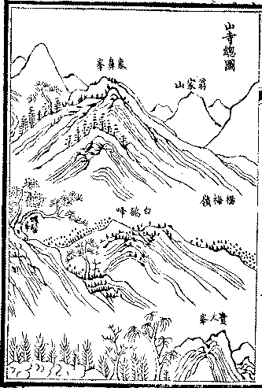
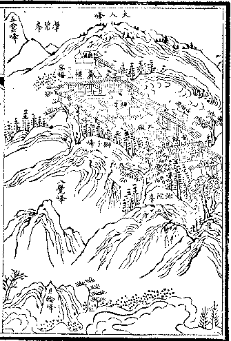

# 武林理安寺志



> **藏经**：中国佛寺史志汇刊（佛寺志汇刊）　**册次** 第 21 册（GA021）　**编号** GA0019　**部类** 史传部　**卷次** 8 卷　**篇幅** 123,637 字

> **卷／品**：0 卷 · 48 品



---



## 目录



  - [武林理安寺志序](#武林理安寺志序)

  - [卷之一序](#卷之一序)

  - [序](#序)

  - [法雨大师：摩竭提窟且住庵铭并序](#法雨大师摩竭提窟且住庵铭并序)

  - [吴廷简：察泉歌并序](#吴廷简察泉歌并序)

  - [张遂辰：过理安涧中石泉池上诗并序](#张遂辰过理安涧中石泉池上诗并序)

  - [仁和吴树虚序](#仁和吴树虚序)

  - [雪峤大师序](#雪峤大师序)

  - [华亭沈荃序](#华亭沈荃序)

  - [门人行昱序](#门人行昱序)

  - [蔡联璧序](#蔡联璧序)

  - [门人行昱重刻《箬庵和尚语录》序](#门人行昱重刻箬庵和尚语录序)

  - [自序](#自序)

  - [钱塘陆圻序](#钱塘陆圻序)

  - [住黄梅四祖双峰山．东吴沙门．戒显序](#住黄梅四祖双峰山东吴沙门戒显序)

  - [住金陵栖霞寺．古闽沙门．大依序](#住金陵栖霞寺古闽沙门大依序)

  - [自序](#自序-1)

  - [宋之绳序](#宋之绳序)

  - [如臯范端序](#如臯范端序)

  - [释大依序](#释大依序)

  - [鹤林释行植序](#鹤林释行植序)

  - [天笠珍禅师序](#天笠珍禅师序)

  - [自序](#自序-2)

  - [《回生诀》自序](#回生诀自序)

  - [仁和杨鼐序](#仁和杨鼐序)

  - [天笠禅师序](#天笠禅师序)

  - [自序](#自序-3)

  - [嘉定张立廉序](#嘉定张立廉序)

  - [晓庵禅师序](#晓庵禅师序)

  - [门人超格序](#门人超格序)

  - [世宗宪皇帝御制语录序](#世宗宪皇帝御制语录序)

  - [迦陵禅师序](#迦陵禅师序)

  - [恕中愠禅师序](#恕中愠禅师序)

  - [梅谷禅师序](#梅谷禅师序)

  - [自序](#自序-4)

  - [鸠江丁懋学序](#鸠江丁懋学序)

  - [释超蕉序](#释超蕉序)

  - [住吴兴弁山释仁岠序](#住吴兴弁山释仁岠序)

  - [和硕庄亲王序](#和硕庄亲王序)

  - [孟维邃序](#孟维邃序)

  - [文觉禅师序](#文觉禅师序)

  - [春台后录序](#春台后录序)

  - [同德序](#同德序)

  - [自序](#自序-5)

  - [自序](#自序-6)

  - [序](#序-1)

  - [澹社序](#澹社序)

  - [寿法雨大师序](#寿法雨大师序)



---



理安寺位於浙江杭州南山，五代伏虎逢禅师卓锡於此，钱忠懿王为之建寺，原名法雨寺，宋理宗时改名理安寺。明弘治四年（一四九一），龙井山洪水发，寺废。万历年间，法雨大师重建。清康熙五十一年（一七一二），以僧众产薄不支，发帑重建，增寺下千亩，斋田二百餘亩。寺位於九溪十八涧中，而四绕之峰峦，高接天日，烟霞郁勃，风景殊胜。寺志，旧有法雨大师撰《理安寺纪》四卷，岁久板毁，世不及见。康熙年间，迦陵老人又撰寺志六卷，稿成未刻而遭祝融劫去。乾隆年间，释实月据法雨旧志修订重刋，亦失於火。乾隆二十五年（一七六〇）杭世骏承智朗上人之请为撰寺志，计得八卷，略分八门：恩宠、梵宇、山水、田亩、禅宗、规约、著述、艺文，前冠以寺图一幅。〈恩宠〉一门，备录清康熙、雍正、乾隆三帝之赐敕御制。理安寺至康熙、乾隆间，殿宇广建，於斯为盛，朝廷敕赐独多：乾隆时曾赐藏经全部；雍正曾御撰禅祖之传赞，凡三十二位，寒山、拾得在焉——所录并非全为本寺之高僧，要为禅祖之通传，实存禅门之重要文献也；乾隆则有〈游理安寺诗〉七首。〈梵宇〉一门，述本寺之沿革。〈山水〉一门，述名胜。〈田亩〉一门，记寺产。〈禅宗〉一门，传本寺禅祖，起伏虎逢禅师，迄智朗月禅师，凡二十八位。〈规约〉一门，录法雨、箬庵、迦陵禅师之手订规约。〈著述〉一门，载本寺禅师之著作，凡二十五部。历代诗文有关本寺之梵宇、山水者，则分系於该门内；无所依属者，则另列〈艺文〉一门以备录，分诗、赋、疏、序、记、书、题跋等七目。杭世骏乃乾隆时之大儒，志出名家，体例严谨，洵为寺志善本。兹据清光绪四年（一八七八）刋本景印。



------



### 武林理安寺志序



昔如来言：「我得宰官之外护者，为文证明之，垂诸久远，可以无恐。」亮哉，言之不可已也！此《武林理安寺志》，智朗上人请之，堇浦太史作之，而复丐余言弁其端欤！余惟理安为古涌泉院，道风演迤，远有条序。自有明中叶，沈灾小劫，堙谷𬯎林，缁素屏迹；幸法雨濬流，净信结社，粥鱼茶板，蔚为禅丛。桑海变故，不百年而复尽斥其产焉。夫给孤初地，功藉布金，势不能损斋钵之断粒、败衲之寸丝，为缔构之助。然至持铃柝、饰竿牍，如市贾之相求，净业日微，流尘眯目，斯亦佛所大恐也。我圣清光宅大千，慈覆众有，於是法嗣性音遭际。世宗宪皇帝为圣祖仁皇帝祝厘，特赉贡金，庄严法界、广储福田；玉音耀于岩阿，宝笈充乎反宇；种种名相，弹指云涌；檀舍之宏，为梵典未觏之盛事。斯其因缘固大不偶然矣！志之作也，凡梵宇之成亏、山水之形胜、禅宗之正别、疆亩之至到，与夫高流素侣、裁诗选胜之迹，州次部居、纪载翔实，而胪三朝之恩宠以冠於前。太史所序，推本净明忠孝之旨，而愿与智朗勉思报效。嗟乎！慧业无边，不离本分，此正如来付嘱所恃为金汤者。予虽无阿难之多闻，其竟不为一证明乎？余以今春尝扈跸，三至寺，徧厯九溪十八涧之胜，山翠四合，飞泉泠然，鯈鱼鸣鸟，肸蚃嘉泽，翔泳不已。思继澹社之胜引而未得，序太史之书辄复神往。盖实为兹寺庆所遭，而不禁欣然乐其乐云。



时乾隆二十七年岁在壬午冬十月赐进士出身、诰授光禄大夫、内阁学士兼礼部侍郎、提督浙江全省学政、今调江苏学政加三级，晋宁李因培撰



理安寺缘始有唐，绝续之关，緜延迄今约有三变：伏虎开山，一也；法雨鼎建，二也；迦陵荷两朝不世之遇，法域宏开，恩膏叠沛，三也。龙象护持，兴替有运；不有纪载，后将何稽？向有寺纪四卷，法雨大师所手定也。斯时规条初设，铨次未周，抱残守阙，畱以有待。智朗上人承诸尊宿之后，节缩衣食，誓发宏愿，欲以世出世间之文字，成佛法之金汤；礼币及门，请余秉笔。小友周进士辰告、汤孝廉韡斋，为余先撰长编，芟薙繁冗，别为八门，厘然完备。既辍简，或设主客之辞以相难曰：「阿难号多闻，而文殊又欲离语言文字。斯志之作，其为选事耶？抑亦有大不得已於其中者耶？」余应之曰：「奚为其选事也！善则归君，臣子之义。矧其君有善，而可以恝置之？兹寺之兴，出自天家缔造，内府之金钱，尚方之巧匠，锡赉便蕃，古无伦比。天章下贲，照耀山谷，大众安居饱食，宜如何仰答高厚？而不农力以竟成前人之绪，与夫蚩蚩贸贸而忘所自来，即违净明忠孝之旨。每一念及，通身汗下。此上人惟日孜孜，不遑暇逸，葺完是书之本末也。」呜呼！创寺难也，创志亦难也。前人为其难，上人不肯独居于易，劳心焦思，首尾十年而后乃溃於成。其用力勤，而志亦坚且确矣！余生长是邦，食毛践土，与上人同在帡覆之内，思报国恩，惟有文章。郁忠孝之忱，借寺志畧一见端。后有览者，或亦鉴其志而深许之也夫！



乾隆二十有五年十月朔，召试博学鸿词、前翰林院编修，仁和杭世骏谨撰



名山古刹莫不有志，香界之缘起，知识之化迹，无不毕载以传不朽；而理安独无者何耶？伏虎逢禅师，五代时神僧，与永明寿禅师为同门昆弟。吴越王感师道范，为建梵宇，为理安开山始祖。其法化之隆，不在寿禅师下，是盖古佛应世而视大千等一沤者，区区纪载，非所事事。且寺在九溪十八磵中，而四绕之峰峦高接天日，烟霞郁勃，竹树菁丛，石磴云梯横於鸟道之上。南渡后，虽羽衞尝过，而名流罕至。好游嗜佛如陆务观、张横浦辈，仅至湖上诸寺而止。染翰无人，表彰斯失。迨恭宗北狩，元录告终；兵火纷驰，临安为甚。弘治年间，寺复为洪水所废。前此即或有志，非化为灰烬，即葬於鱼腹，此理安所以无志也。隆万间，法雨大师一伞一钵入涧中，与蛇虎处者数十载，再成丛席，著有寺纪四卷。葢香界之缘起，知识之化迹，无不毕载者。然岁久板毁，世不及见。我箬庵老祖，倔起螺峰，宗弘石磬，炉鞲钳锤，妙绝古今；而传衣付拂且代不乏人，故「生死理安」之名洋溢乎海内。而至迦陵老人，感世宗宪皇帝之殊遇，重新梵宇，增置山田；思尽涓埃，表彰圣德与名山不朽，再著寺志六卷。然脱稾未就，携返瞻云，即遭祝融劫去，此理安所以终无志也。壬申秋，先师示寂，门弟子问后事，独顾余曰：「法南胜公曾致书老僧，请作理安寺志。今已矣，汝其识之！」甲戌夏，余得承乏祖席，而一惟遗命之言，辄不禁鹿头心撞。爰录陈文，遍寻故实，得稿若干。复由不解，属文送龙泓丁处士编辑；而龙泓复不戒於火，屋庐焦土，诸稿尽失。夫方外之志，所载者方外事耳，不与国史相埒；而为之者，自不当有昌黎所谓「天灾人祸」之事；而一毁於瞻云、再毁於龙泓者何哉？盖有待乎人而后成者在焉！丙子春，因蕚棠汤孝廉得识堇浦杭太史，承为不请友，操觚是任，再事搜寻；远陟匡阜，而舟过鄱阳滨，覆者数次，所得之稿不敌前之六七。幸而载阅寒暑，刻印俱竟。先师公案得了，此理安无志而有志矣！然搜录未遍，绵力已殚；拾遗补阙，俟夫来者。



乾隆二十四年岁次己卯中秋日，南涧五世孙实月谨撰



理安寺圗



仁和陈霖署眉















志，史类也，史必左图。凡纪载不尽之迹，俱得藉之以彰，犹眉之彩、目之瞳，通軆之攸重也，繄可略乎？如曰妙性圆明，离诸名相，则请质诸深於禅者。



理安寺志总目



------



### 卷之一序



山图  

恩宠



卷之二梵宇



卷之三山水



卷之四田亩



卷之五禅宗  

附旧记



卷之六规约



卷之七著述



卷之八艺文  

诗  

赋  

疏



------



### 序



记  

书  

题跋



武林理安寺志卷之一



恩宠



昔宋理宗命易古涌泉院为理安寺，嘉名肇锡，实始权舆。厥后金地渐荒，玉音罕觏。及天清光宅大千，圣祖、世宗抚期命世，特赉贡金，数飞宸翰，异数骈蕃，焜耀千古。我皇上丕承前烈，叠沛湛恩。盖天眷之优隆，祇林之盛事，未有过於此者也，故敬备而录之。志恩宠。



康熙五十三年，世宗宪皇帝幸京师柏林寺，时(臣)僧性音以理安法嗣住持柏林，深念旧山颓废，奏达圣听，世宗宪皇帝上闻圣祖仁皇帝，发帑，命(臣)僧越宗至寺重修。命(臣)僧成鉴为置柴山六百餘亩、斋田二百亩。刑部尚书(臣)胡会恩奉勅撰〈重建理安寺膳僧山田记〉(（记载梵宇）)。命(臣)僧性音住持。御书「理安寺」、「石磬正音」二额，墨宝二幅，恭藏寺中。赐对联二副：「法雨晴飞绕殿香风至，天花昼下交空瑞日悬。」「势到岳边千峰环秀色，声归海上万水涌洪涛。」赐《金刚经》一册，并佛像、巨钟、庄严供器，皆内府制造。



世宗宪皇帝於藩邸赐「来机亦赴」、「螺髻耸翠」、「慈悲自在」、「曹溪人瑞」四额。赐对联二副：「杖履得回游子脚，葛藤灰尽老婆心。」「作佛念轻，纵然自在还为妄；度生心切，须信慈悲也是贪。」赐万寿袍一领、锦衣一领、香板一块。御制(臣)僧超方语录序(（序载著述）)，御制(臣)僧超方塔铭(（铭载禅宗）)。



雍正四年，(臣)僧性音圆寂庐山隐居寺，十二月初八日，奉上谕：朕在藩邸时，披阅经史之餘，每观释氏内典，实契性宗之旨；因时与禅僧相接，惟性音深悟圆通，能阐微妙。其人品、见地超越诸僧之上，朕於西山建大觉寺为其静修之所。及朕嗣登宝位，凡体国、经邦一应庶务，自有古帝王治世大法；佛氏见性明心之学与治道无涉。且若以旧邸熟识僧人，仍令主席京师，天下或以朕有好佛之心，深有未可；且有累於性音之清行。而性音亦力辞归隐，遂安禅於庐山隐居寺；四年於兹，谨守律规，谢绝尘境，即本省大吏尽不知不闻也。今闻其圆寂，朕心深为轸恤。著照玉林加恩之例，追赠「国师」，并赐其谥号，交内阁撰拟。其语录乃近代僧人所罕能者，著入经藏以彰其真修翼善之功。钦此。



乾隆三年，皇上赐藏经全部，恭载雍正十三年四月初八日世宗宪皇帝御制〈颁赐藏经卷首偈〉：



佛光恩照　三千大千  

随缘徧满　恒河法界  

普度群生　悉证菩提  

身心安泰　时年丰稔  

风雨调顺　日月升恒  

乾坤清宁　百昌蕃炽  

上下乐利　中外协和  

庶物咸亨　万善圆成  

情与无情　同登正觉



乾隆九年，皇上赐祖像三十二轴，世宗宪皇帝御制传赞石刻，装潢像首，恭载全篇。



僧肇，京兆人，俗姓无传，以晋孝武太元九年生。家贫，为人缮写。佣次，历观经史，备尽坟典。初师庄老，继而叹曰：「美则美矣，然以栖神冥累为期，未是究竟！」及见旧《维摩经》，欢喜顶受曰：「吾知所师矣！」於是出家，兼通三藏。年二十，名振关中，京兆宿儒对之箝舌。尔时至有负粮千里、入关抗辨者，岳岳而来，肇尽折其角。既而鸠摩罗什在吕光处，肇往从之。什来长安归姚秦，肇亦随至。姚兴命佐什宣译梵经，与僧䂮、僧迁、法钦、道流、道恒、道标、僧叡等八百人，俱住禁中逍遥园，尊礼优异。时南朝远法师为莲社高贤，社中开士刘遗民越疆致书，商搉元旨。肇所问答，远极嘉欢，其书垂今。肇著〈般若无知〉、〈涅槃无名〉、〈不真空〉、〈物不迁〉、〈宝藏〉等论，并注《维摩经》，并纸贵当年，香流亿刦。宗门胶柱之流谓达摩未入震旦前，直指一宗未度，肇论犹是教相；又妄造临刑诗云：



四大本无主　五蕴本来空  

将头临白刃　犹似斩春风



虽元沙备禅师，犹以为肇实有此语。拈云：「大小肇法师，临死犹䆿语」。肇於晋安帝义兴十年，在姚秦长安吉祥灭度，史氏所载可考也。至一灯炯照达摩未来时之震旦，其论具在，识者自知。大清雍正十一年封「大智圆正圣僧肇法师」。



赞曰：



破尘出经　天函地盖  

此天地中　尘尘法界  

及破一尘　宏开法会  

於此亲闻　造论无碍



雍正十一年二月初一日御笔



宝志，俗姓朱，金城人，生於晋安帝义兴十四年。出家道林寺，师事沙门僧俭。宋太始初始、显齐建元中，神通异验，士庶敬事。齐武帝收付建康狱。既而出之，犹终齐世禁其出入。梁武帝即位，乃下诏曰：「志公迹拘尘垢，神游冥寂；水火不能焦濡，蛇虎不能侵惧。语其佛理则声闻以上，谈其隐沦则遁仙高者，岂得以俗士常情空相拘制？何其鄙狭一至於此？自今行来，随意出入，勿得复禁。」梁天监十三年灭度，寿九十七示寂，自然一烛以付。后阁舍人吴庆白帝，帝曰：「大师不复留矣，烛者将以后事嘱我也。」因厚葬於鍾山独龙阜，勅陆倕为铭於塔内，王筠勒碑於寺门。识者曰：「志公拳拳梁武，老婆心切，行时犹以本分提持，而梁武不悟，可惜也！」有〈十二时歌〉、〈大乘赞〉、〈不二颂〉等制入藏。其〈迷悟不二颂〉尤为吃紧提撕。颂曰：



迷时以空为色　悟即以色为空  

迷悟本无差别　色空究竟还同  

愚人唤南作北　智者达无西东  

欲觅如来妙理　常在一念之中  

阳燄本非其水　渴鹿狂趁忩匆  

自身虚假不实　将空更欲觅空  

世人迷倒至甚　如犬吠雷叿叿



至其前知灵迹语，若谶纬，具载《梁书．何敬容传》、《梁高僧传》、《陈书．徐陵传》、魏杨衒之《洛阳伽蓝记》、《隋书．五行志》等书，非本分，故不录。大清雍正十二年封「一际真密禅师」。



赞曰：



菩提大道　京都邺都  

迷悟不二　㗭唎苏𠰷  

万万不殊　一一如如  

十二时中　无欠无餘



雍正十二年二月十五日御笔



慧思，武津人，姓李氏。顶有肉髻，牛行、象视。梦梵僧劝出俗，乃辞亲入道。及禀具，日一食。诵《法华》等经满千遍，又阅《妙胜定经》。慕禅那功德，乃至慧闻处受法；昼夜摄心，经三七日，获宿智通。寻四支缓弱不能行步，自念曰：「病从业生，业由心起。心源无起，外境何状？病业与身都如云影。」如是观已，颠倒想灭，轻安如故。夏满犹无所得，深怀惭愧；放身倚壁，背未至间，豁尔开悟。自是名行远闻，学侣日至。乃以大小乘定慧等法，随根引喻，俾习慈忍行、奉菩萨戒焉。北齐天保中，领徒南迈，止大苏山。尝示众曰：「道源不远，性海非遥；但向己求，莫从他觅。觅即不得，得亦不真。」偈曰：



顿悟心源开宝藏　隐显灵通现真相  

独行独坐常巍巍　百亿化身无数量  

纵令逼塞满虚空　看时不见微尘相  

可笑物兮无比况　口吐明珠光晃晃  

寻常见说不思议　一语标名言下当



又偈曰：



天不能盖　地不能载  

无去无来无障碍　无长无短无青黄　不在中间及内外  

超群出众太虚元　指物传心人不会



时众请讲《法华》、《般若》二经，门人智𫖮至「一心具万行」有疑，请决，师曰：「汝所疑乃《大品》次第意耳，未是《法华》圆顿旨也。吾昔於夏中一念顿发，诸法现前。吾既身证，不劳致疑。」陈光大六年六月，自大苏山将四十餘僧趋南岳，值一处，林泉胜异，思曰：「此古寺也，吾昔曾居之。」掘之，基址犹存。陈主屡致供养，目为大禅师。太建九年六月示寂，寿六十有四。思以梁武帝天监五年生，盖与菩提达摩同时云。大清雍正十二年封「圆慧妙胜禅师」。



赞曰：



得大总持　於法自在  

演教明宗　不思议海  

法华三昧　灯传智师  

少室天台　奚隔一丝



雍正十二年三月初一日御笔



元觉，字明道，春秋宋戴公之后，世为魏郡名家。随东晋渡江，为永嘉人。觉龆年剃发，与兄宣法师并为名僧。其犹子二人亦与缁侣住龙兴寺岩下庵。既乃与东阳策禅师偕诣曹溪；既申长鲸逆水之机，决定不疑之旨，欲遄返曹溪，为留一宿，时号「一宿觉」云。觉所著〈证道歌〉，得无生法忍，提示最为亲切。又作〈禅宗悟修圆旨〉，全水是波，全波是水，罗该三千威仪、八万细行，唱导十方，穷未来际，令彼自他兼利、顿渐双忘。生於唐高宗麟德二年，灭於唐元宗开元元年，盖与曹溪同时灭度焉。未灭前，有鹅千群止於寺西。及建塔，适於其处。北海李邕列其心行，录为碑铭。庆州刺史魏靖缉其遗言，刊《永嘉集》。元宗勅谥「无相禅师」，塔曰「净光」。宋太宗湻化中，诏本州重修龛塔。大清雍正十一年封「洞明妙智禅师」。



赞曰：



深通妙相　庄严性空  

举足下足　在道场中  

惟此道场　乃水中月  

明明真空　步步实蹑



雍正十一年三月十五日御笔



慧忠，诸暨人，姓冉氏。少而好学，既出家，徧叅名宿，游览四明、天目、五岭、罗浮。承心印於能公，乃卜居党子谷四十餘年。开元中，中书侍郎王琚、太常少卿赵颐贞奏荐，诏居龙兴寺。计忠是时少亦年五十餘，至代宗大历十年示寂，盖百餘岁矣。属安史之乱，贼寇南阳，临以白刃，词色不挠；贼帅投剑罗拜。无何，群盗又至，忠曰：「不可以踵前也！」遂杖锡沿江而去。不随忠去者并遇害。肃宗再定区夏，闻其德高，以上元二年正月，勅内给事孙朝进驿骑迎请。肩舆上殿，坐而论道，称「国师」。寻勅居千佛寺，与西天大耳三藏、紫璘供奉等当御辨论，为俗所传。代宗大历八年，奏度天下名山僧道万餘人，卒谥「大证禅师」。诏归党子之香严寺，起塔供养。大清雍正十二年封「真实大证禅师」。忠将涅槃，辞唐代宗，代宗曰：「师灭度后，弟子将何所记？」忠曰：「告檀越造取一所无缝塔。」代宗曰：「就师请取塔样。」忠良久，曰：「会麽？」代宗曰：「不会。」忠曰：「贫道去后，弟子应真却知此事，乞诏问之。」后诏应真问前语，真良久，曰：「圣上会麼？」代宗曰：「不会。」真述偈曰：



湘之南　潭之北　中有黄金充一国  

无影树下合同船　琉璃殿上无知识



应真即耽源。



赞曰：



未始有宗　大耳罔测  

摸著鼻孔　躱避不得  

无缝塔中　金刚大士  

剪样示人　虚空为纸



雍正十二年四月初一日御笔



道一以唐中宗景龙三年生於汉州什邡县，俗姓马，故人称马大师，亦曰马祖。生禀异姿，牛行、虎视，舌过鼻准，足成文字。年方童孺，不好嬉戏，嶷如山立，湛若川澄。及长，谓九流六学不足经虑，惟宅心禅宗正觉。削发於资州唐和上，受具於渝州圆律师。后闻衡岳有让禅师为曹溪法嗣，乃往参承，本珠顿朗。让禅师曰：「道一得吾心，善古今。」禅诵於抚州西里山，又南至处州龚公山，山中夔魈蛇虎自然屏迹。尚书路嗣恭为连帅，聆风景慕，迎居治所，开化接人，学徒云集。赵州尝云：「马祖大师下八十餘员善知识，个个俱是作家。」尝示众曰：「夫求法者应无所求。心外无别佛，佛外无别心。不取善，不舍恶，净秽两边俱不依怙。达罪性空，念念不可得，无自性故。故三界惟心，森罗万象，一法之所印。凡所见色，皆自见心；心不自心，因色故有。汝但随时言说，即事即理，都无所碍。菩提道果亦复如是，於心所生，即名为色。知色空故，生即不生。若了此意，乃可随时著衣吃饭，长养圣胎，任运过时，更有何事？」唐德宗贞元四年，登建昌石门山，谓弟子曰：「吾至二月当还。」及期，跏趺归寂，遂塔於石门。春秋八十，夏腊五十。唐宪宗追谥「大寂禅师」。弟子唐宰相权德舆为塔铭。大清雍正十二年封「普照大寂禅师」。



赞曰：



影留海昏　塔在石门  

微言妙旨　龙藏垂文  

都没交涉　捉风系云  

是一橛柴　或师之真



雍正十二年四月十五日御笔



希迁，陈氏子，瑞州高安人。处胎，母即不喜茹荤血。生而岐嶷，孩提如成人。六祖开化於南，乃直诣祖所。祖持其手曰：「苟为我弟子，当肖迁。」笑曰：「诺。」乃祝发为座下沙弥。自是上下罗浮，往来三峡间。开元十六年受具足戒於罗浮，后诣庐陵清凉山，参青原思禅师。思公之门，学者骈集；及迁之来，思曰：「众角虽多，一麟足矣。」遂嗣青原。天宝初始造衡山南寺；寺之东有石，状如台，迁结庵其上，俯临众峰。时人因号「石头和尚」。师以唐中宗嗣圣十七年生，德宗贞元六年灭，春秋九十一，僧腊六十三。门人慧朗等六人相与建塔，勅谥「无际大师」，塔曰「见相」。大清雍正十二年封「智海无际禅师」。迁答问简敏，提示切要。其居衡岳也，让禅师每谓其徒曰：「彼石头真狮子吼，必能使汝眼清凉。」论曰：「世谓迁於六祖将灭，问：『当依何人？』祖曰：『寻思去！』迁遵诫，昼夜寻思。首座谓：『思禅师在吉州，汝缘在彼。师言本直，汝自迷耳！』乃诣吉州。思曰：『子何方来？』迁曰：『曹溪。』思曰：『将得甚麼来？』曰：『未到曹溪亦不失。』思曰：『若恁麼用，到曹溪作麼？』曰：『若不到曹溪，争知不失？』观迁答问，其时已达根源，岂有滞於言句、兀兀寻思之理？且祖师直指，字字诚实，岂如世谛戏作廋词？况令弟子参承何人，何妨明示？非欲令其自己证入者可比，又何必语焉而不详？盖后人神奇其说以见杖拂源流。大鉴先知之明，不知却是钝置伊耳。」



赞曰：



曹溪法乳　千子齐注  

厥味如何　无舌可味  

从何而来　从这里去  

木头碌砖　如是如是



雍正十二年五月初一日御笔



惟俨，俗姓寒，绛县人，以唐肃宗乾元二年生。代宗大历八年纳戒於衡岳寺，律行严密。既而南造石头，谒迁禅师，求直指之旨。迁令谒马师，一居三年。一问：「子近日见处作麼生？」俨曰：「皮肤脱落尽，惟有一真实。」一乃遣归石头。一日在石上坐次，石头问曰：「汝作麼？」曰：「一切不为。」石头云：「恁麼即闲坐也。」曰：「若闲坐即为也。」石头云：「汝道不为，且不为个什麼？」曰：「千圣亦不识。」石头乃以偈赞之。后居澧州药山，海众云会。与道吾、云岩、高沙弥、厐居士辈提唱宗乘，振戛圆音。朗州刺史李翱者，韩愈弟子也；入山见俨，不觉自释所负，欣惬作礼。相国崔群、常侍温造，亦每问道焉。唐文宗太和二年，告众云：「法堂颓矣！」众不喻，率人举大木支柱。俨抚掌大笑，合掌顺寂。春秋七十，夏腊五十三。勅谥「宏道大师」，塔曰「化城」。大清雍正十二年封「达宗宏道禅师」。俨嗣石头，於六祖为第四世。李翱初见俨，俨时诵经不顾。翱问：「如何是道？」俨以手指上下曰：「云在天，水在瓶。」又一夜登山经行，云开见月，大笑一声，闻澧阳东九十里许。李翱赠诗曰：



鍊得身形似鹤形　千株松下两函经  

我来问道无餘话　云在青天水在瓶



又曰：



选得幽居惬野情　终年无送亦无迎  

有时直上孤峰顶　月下披云啸一声



赞曰：



针劄不入　非思量地  

石上栽花　荣枯两是  

高高山顶　深深海底  

立斯行斯　非师本位



雍正十二年五月十五日御笔



澄观，姓夏侯，越州山阴人，生於唐元宗天宝间。年十一，依宝林寺霈禅师出家。及长，徧寻名山，旁求秘藏。既具戒，从润州栖霞醴律师学相部律。诣金陵元壁法师，传关河三论。在瓦官寺，传《起信》、《涅槃》。於淮南法藏，受海东《起信疏》义。就苏州湛然法师，习《天台止观》、《法华》、《维摩》等经疏。谒牛头忠禅师、径山钦禅师，咨决南宗心要。复见慧云禅师，了北宗元理，兼习儒门经传、子史、小学、苍、雅；学天竺悉昙诸部，通秘咒仪轨。博闻多能，出於天性。以语言文字作佛事，用烟墨缃素演圆音。北游五台，讲《华严经》，并演诸论；更撰经疏，起於唐德宗兴元元年正月，成於贞元三年十二月。既而德宗遣中使李辅光宣诏入都，与罽宾三藏般若译乌茶国王所进《华严》后分四十卷。又诏令造疏，遂於终南草堂寺编成十卷进呈。勅令两街各讲一通。撰疏时，池生嘉莲五枝，一花皆有三节。寻奉诏译《守护国界主经》。唐顺宗在春宫时，常垂教令，述《了义》一卷、《心要》一卷。观平生依法修行，如命尽形，不出梵网。寂於唐宪宗元和年间，春秋七十。所著述甚富，列在法林。其答唐顺宗《心要》一书，可谓横该三界一切处、竖彻三际一切时，函盖无餘、神妙破的。学人於此荐得，入流无所。大清雍正十二年封「妙正真乘禅师」。



赞曰：



六根尘识　徧含法界  

严净毘尼　极乐自在  

八教五乘　莲云叆叇  

层映重重　各各无碍



雍正十二年六月初一日御笔



天台寒山子者，不知何许人也。自昔以丰干有「寒山文殊、拾得普贤」之语，遂谓文殊、普贤在唐末应化为二大士；又自为「和合二圣」云。其住世亦莫知其纪年，且无氏族名字。唐兴县西有寒、暗二岩，以其居寒岩中，则曰寒山子也。冠桦皮，衣破襦，时就国清寺，从拾得取众僧残食食之。或时叫噪慢骂，寺僧以杖逼逐，则大笑而去。人皆以为风狂贫子。一日丰干告之曰：「汝与我游五台，即我同流。」曰：「我不去！」干曰：「汝不是我同流。」寒却问干：「汝去五台作麼？」干曰：「礼文殊。」曰：「汝不是我同流！」后丰干为阊闾邱太守治头风，且令入山访寒、拾。阊邱竟造二人所礼拜。寺僧惊愕曰：「大官何拜风狂汉耶？」寒山执阊邱手笑曰：「丰干饶舌！」自此寒、拾相携去，更不复入寺。赵州谂者，当时宗匠，海内所钦。行脚至天台，礼二士，相问答，有「久向国清有寒拾」之语。而国清寺僧见太守作礼，然后愕然，足知一寺皆哑羊也。阊邱又往寒岩拜问，送衣裳、药物，寒山但云「贼！贼！」即退入石穴中，高唱曰：「报汝诸人，各各努力！」穴竟不可寻，遂绝踪迹。阊邱乃令寺僧道翘寻其遗句於林叶、石壁、村墅、垣落间，得寒山诗三百餘首、拾得诗五十餘首。其言句并是圆宗极则，如理实谈，从佛口宣，作将来眼。大清雍正十一年封「妙觉普度和圣寒山大士」。



赞曰：



天然独立　无有伴侣  

净洁空明　何能何所  

石壁题诗　寒岩独坐  

三际十方　金刚常住



雍正十一年六月十五日御笔



拾得，天台国清寺行者。寺舂榖僧丰干山行至赤城，道侧闻孺子泣声，寻得之，问其由，曰：「孤弃於此久矣！」遂携至寺，付典座僧：「有来追寻者，付还之。」久之寂然，沙门灵熠乃受而抚育以长，名拾得。拾得诗云「从来是拾得」，不是偶然称也。初知寺中食堂香灯，一日忽登座，与佛像对槃而食，呼憍陈如为小果声闻，旁若无人，执箸大笑。熠乃白尊宿，罢其堂任，令入厨下涤器。拾得每洗钵已，即收残食，截巨竹筒盛之，待寒山子来负而去。每与寒山子聚语，或同笑舞，此啐彼啄，𠔏演圆音。寺僧不知其何说也。有护伽蓝神庙，每日僧厨下食为鸟所掠，拾得以杖抶之曰：「汝食不能护，安能护伽蓝乎？」其夕，神附梦於合寺僧曰：「拾得打我！」诘旦说梦，一寺纷然。又寺僧说戒次，拾得驱群牛至僧所集堂前，倚门抚掌大笑曰：「悠悠者聚头。」首座叱曰：「清净戒坛，风汉何得喧碍！」拾得曰：「我不放牛也，此群牛者多是此寺知事僧。」乃呼亡僧法号，其牛一一应声而过。阊邱太守从丰干之言，入寺向二大士致敬，拾得遂与寒山子出寺去，不知所终。寺僧道翘奉阊邱之命，搜录两人语句於寺土地庙壁，得拾得诗偈五十许首，今附《寒山集》中行於世。大清雍正十一年封「圆觉慈度合圣拾得大士」。



赞曰：



曾不将来　谁其拾得  

放下苕帚　一切常寂  

凡愚奚知　自亦不识  

任运腾腾　无为之力



雍正十一年七月初一日御笔



希运，闽人。十岁出家於高安黄蘗寺。额间有肉珠隆起，仪貌修伟。游天台，逢一僧偕行。属涧水暴涨，其僧蹑波如地。既登彼岸，足不沾水，招运曰：「渡来、渡来！」运呵之曰：「自了汉！」其僧叹曰：「子真大乘法器。」至京路间乞食次，遇一老妪諮决元旨，乃曰：「此五障身曾参南阳忠国师来，师若欲了此一大事，须往南昌见马大师。」运如其语，往南昌。时马祖道一已示寂，乃参百丈。一日百丈举马祖「振威一喝、三日耳聋」悟由，运言下证入，遂嗣百丈。后居洪州大安寺，学者奔凑。运尝示人曰：「一切色是佛色，一切声是佛声；见一切法即见一切心。一切法本空，心即不无；不无即妙有。有亦不有，不有亦有，即真空妙有。六道四生、山河大地，有性无性，元同一体。言同者，名相亦空；有亦空，无亦空，尽恒沙世界原是一空。谁是授记人？谁是成佛人？谁是得法人？」相国裴休出镇宛陵，建大禅院，延运说法。以运出家黄蘗，仍以黄蘗名其寺。运示裴休几千万言，甚得心无心地、法性空位。休亦有〈传心偈〉述所证，为运法嗣。运於曹溪为五世孙，其俗姓及年岁，载籍莫考。以唐宣宗大中年间示寂。其嗣临济元，支流蕃衍，於今最盛。谥「断际禅师」，塔曰「广业」。大清雍正十二年封「正觉断际禅师」。



赞曰：



黄蘗吐舌　百丈耳聋  

振威一喝　临济宗风  

到此化城　须达宝所  

大方广地　本无寸土



雍正十二年七月十五日御笔



从谂，郝氏子，青州临淄人，或云曹州郝乡人，以唐代宗大历十三年生。童稚之岁，孤介不群。其披剃也，或云青州龙兴伽蓝，或云曹州扈通院。其纳戒也，在嵩琉璃坛。自为沙弥，参南泉，愿禅师即深器之，许为入室。一日问南泉：「如何是道？」泉云：「平常心是道。」云：「还可趣向否？」泉云：「拟向即乖。」云：「不拟时，如何知是道？」泉云：「道不属知、不属不知。知是妄觉，不知是无记。若是真达不疑之道，犹如太虚，廓然虚豁，岂可强是非耶！」言下顿悟元旨，心如朗月。乃往嵩山受戒，寻返南泉。既而游历宝寿、盐官、夹山、五台，因住赵郡观音院。时藩镇王景崇、王镕父子封王於赵，谂慈云所润，归心礼足，道化大行；凡所举扬，天下传之，号「赵州门风」。唐昭宗乾宁四年右脇而寂，寿一百二十岁。谂出南泉愿，愿出马祖一，一出南岳让，让出曹溪，凡五世。诸方私谥「真际大师」。大清雍正十一年封「圆证直指真际禅师」。



赞曰：



赵州石桥　度驴度马  

老僧平生　用不尽者  

过得此关　东院西也  

明月清风　非其俦亚



雍正十一年八月初一日御笔



景岑，号招贤。其氏族、里居、出家、具戒因缘俱莫考。初住鹿苑，其后居无定所；但任缘接物，随请说法。化行湖南长沙，时众谓之「长沙和尚」。初岑久住南泉，献投机偈曰：



今日还乡入大门　南泉亲道徧乾坤  

法法分明皆祖父　回头惭愧好儿孙



南泉愿偈答曰：



今日投机事莫论　南泉不道徧乾坤



还乡尽是儿孙事　祖父从来不出门



遂嗣南泉。僧问：「和尚继嗣何人？」岑曰：「我无人得继嗣。」僧曰：「还参学也无？」曰：「我自参学。」僧曰：「师意如何？」以偈示曰：虚空问万象　万象答虚空  

谁人亲得闻　木义丱角童



后瑞圣通得其提持；岑示寂后，通以弟子礼事之。岑常与仰山寂玩月次，寂曰：「人人尽有这个，祗是用不得。」岑曰：「恰是倩汝用。」寂曰：「尔作麼生用？」岑劈胸与一蹋，寂曰：「㘞直下似个大虫。」自此诸方称为「岑大虫」。岑言句洞明，提持直截，如香象渡河，步步到底；如养由架箭，一一穿杨；尽为破的之文，皆是穷源之说。其与讲经供奉皓月论三德涅槃及教中幻意，又与僧论佛与文殊、观音、普贤真体妙用，并宏深微妙，廓彻圆融。学者真参实悟，得了自心；发书观之，自然冥契。岑住世若干岁，不见於方策。考普愿以唐德宗贞元间倡化南泉，岑预法席；其后瑞圣通诣岑参承，约在唐宣懿间，则岑寿少亦当七八十矣。大清雍正十二年封「洞妙朗净禅师」。



赞曰：



幻本来真　水月天月  

说水说天　皆为强说  

真本无生　幻亦不灭  

无灭无生　天然成佛



雍正十二年八月十五日御笔



灵祐，福州长溪人，俗姓赵。丱角之岁，有天人降其庭，谓家老曰：「此童，佛之真子。」衢巷之人谛观焉。年十五，依本郡恒法师，执劳什伯於众。年二十剃发，三年具戒。入天台，遇寒山子於途，谓曰：「千山万水，遇潭即止；获无价宝，赈恤诸子。」遂诣泐潭，参百丈，顿了祖意。司马头陁者，精鉴人伦、地理者也；百丈曰：「老僧欲住沩山，可乎？」曰：「和尚是骨人，彼肉山也，居之，徒不满千。」乃唤华林，曰：「不可。」唤祐至，曰：「此正沩山主矣！」百丈是夜召师，以沩山付嘱。时华林为第一座，不平。百丈云：「若能对众下得一语出格，当与住持！」即指净瓶，问云：「不得唤作净瓶，汝唤作什麼？」华林云：「不可唤作木𣔻也。」百丈不肯。问祐，祐踢倒净瓶，百丈笑云：「第一座输却山矣。」是山峭绝，敻无人烟。祐饮泉饭橡，猨鹿为伍。山下居民稍稍知信，为营梵宇。襄阳帅李景让奏表山门为同庆寺。相国裴休、崔慎并崇师礼。祐敷扬宗教四十餘年，达者不可胜数。入室弟子四十一人，仰山寂为上首，世号沩仰宗焉。自曹溪传南岳让，以迄於祐，凡五世。祐，唐代宗大历七年生，宣宗大中七年灭，春秋八十三，夏腊五十九。勅谥「大圆禅师」，塔曰「清净」。大清雍正十一年封「灵觉大圆禅师」。



赞曰：



道人之心　一泓秋水  

无事无为　澄渟淡泞  

不受一尘　无渠下觜  

不舍一法　全在里许



雍正十二年九月初一日御笔



义元，邢氏子，曹州南华人。幼负出尘之志，及落发进具，便慕禅宗。初在黄蘗，随众参侍，问「如何是祖师西来的的意」，黄蘗便打。三问三打，乃辞去。参大愚，言下顿契黄蘗无意之意，乃返黄蘗，黄蘗印可。从此啐啄同时，了然通彻。乃北归乡土，俯徇赵人之请，住於城南临济。其罏𨪋所铸，煜烁古今。迄今千五百年，嗣法者几徧震旦。自曹溪传南岳让，以迄於元，凡六世。元建三元三要、四喝、四宾主等，为拣魔辨异，门庭施设。尝曰：「山僧无一法与人，袛是治病解缚。盖此本与向上事没交涉，后之执指为月者，於此每多金𨱎混杂云。」平日应机多用喝，世传「临济喝」。其示语有曰：「不被境转，处处用境；东涌西没，南涌北没；中涌边没，边涌中没。履水如地，履地如水。缘何如此？为达四大如梦如幻故。听法者非尔四大，能用尔四大。若如是见得，便乃去住自由。」又云：「目前用处，始终不异。处处不碍，是活文殊。一念心无差别光，处处总是普贤。一念心能自在，随处解脱。此观音三昧法，互为主伴；显即一时显，隐即一时隐。一即三，三即一。」唐懿宗咸通八年示寂，勅谥「慧照大师」，塔曰「澄虚」。大清雍正十二年封「真常慧照禅师」。



赞曰：



无依道人　诸佛之母  

痛与三十　免教出丑  

如是无依　可受棒否  

棒亦无依　谁与谁受



雍正十二年九月十五日御笔



慧寂，俗姓叶，韶州怀化人也。年九岁，於广州和安寺投通禅师出家。十四，父母取归，欲与议婚，寂断指誓求正法。夜有白光二道，从曹溪直贯其舍。父母悟其诚感，乃与削染。初参耽源真，数年谒大沩祐。於时尚未具戒，祐问曰：「汝是有主沙弥、无主沙弥？」寂曰：「有主。」祐曰：「在什麼处？」寂从西过东立，祐大异之。寂问：「如何是真佛住处？」祐曰：「有思无思之妙，返思灵燄之无穷。思尽还源，性相常住。事理不二，真佛如如。」师於言下顿悟。寻往江陵受戒，复还大沩，前后十五载。父子共阐元旨，化度学人。其心源契合，啐啄同时，正如迦陵频伽声应音圆，师子三岁儿便能大哮吼。既住仰山，时归省觐。祐亦数遣信共相提唱，后世因传为沩仰宗法。父子继述之盛，冠绝古今。寂初於耽源处，受忠国师所传曹溪九十七圆相；其后接人，每用以施设。宗徒传之，谓仰山门风。然考耽源传示日，寂一见即焚却。异时，耽源问之，寂曰：「寂一览已知，但用得，不可执本。和尚若要，重录不难。」即重集以呈，更无遗失。其后沩山作圆相，中书「日」字示寂，寂亦作此相於地，以脚抹之。然则寂所受者，法法何曾法？学者於此不得入海算沙、自取目眩矣！寂后居东平山，年七十七示灭。门人迁归仰山，塔曰「妙光」，谥「智通禅师」。大清雍正十一年加封「真证智通禅师」。寂之示灭盖在唐宣懿间，溯其生年当在德宗时，少沩山祐十餘岁。寂平生多遇异僧，有称之为小释迦者，故世号「小释迦」云。



赞曰：



鼠粪黄金　一手拈出  

奋迅爪牙　接机利物  

实即是权　权即是实  

惊散野干　师子在窟



雍正十二年十月初一日御笔



良价，俗姓俞，会稽诸暨人，以唐宪宗元和二年生。少从师念《般若经》，问「无根尘」义，其师骇曰：「吾非汝师。」即指往五泄山，礼默禅师披剃，年二十一具戒於嵩山。首谒南泉，次参沩山。举忠国师「无情说法」公案，沩山云：「父母所生口，终不为汝说。」价不契，乃令谒云岩，疑情顿寝。述偈曰：「若将耳听声不现，眼处闻声方得知。」云岩曰：「价阇黎承当个事，大须审细。」后因过水覩影，了彻前旨。述偈曰：



切忌从他觅　迢迢与我疎  

我今独自往　处处得逢渠  

渠今正是我　我今不是渠  

应须恁麼会　方得契如如



常曰：「直须心心不触物，步步无处所，常不间断，稍得相应。」又曰：



道无心合人　人无心合道  

欲识个中意　一老一不老



在泐潭寻译大藏，纂《大乘经要》一卷，激励道俗。又作〈五位君臣颂〉，明「正中偏、偏中正、正中来、兼中至、兼中到」。其后因付嘱曹山寂，复述其旨要，其词层映交光，诚得宝镜三昧，禅门谓之「曹洞宗」。唐宣宗大中末，始於新丰山开堂，后盛化於豫章高安之洞山。唐懿宗咸通十年顺化，大众恋慕，价忽开目起曰：「出家之人岂得心附著於物耶？」召主事僧营斋曰：「斋毕乃行。」众故延之，至七日斋具，价亦随斋谓众曰：「此斋可名愚痴矣！」寿六十三，腊四十二，谥「悟本大师」，塔曰「真觉」。大清雍正十二年封「净觉悟本禅师」。



赞曰：



本来面目　不行鸟道  

方便垂手　正偏兼到  

五五三三　天真而妙  

月住波流　粼粼金藻



雍正十二年十月十五日御笔



大同，怀宁人，姓刘氏。髫龄依洛下保唐满禅师出家。初习《止观》，次阅《华严》，获窥性海，耽慕真宗，乃诣翠微山谒无学禅师。一日无学在法堂经行，同问：「西来密旨，和尚如何示人？」无学驻步。步时同又请，无学曰：「更要第二杓恶水作麼？」同乃礼谢而退。无学曰：「莫躲却！」同曰：「时至根苗自生。」由是如冰释水，任性卷舒；乃归故里，隐投子山，结茅而居。赵州从谂向其元风，行脚到投子相访。一时问答之语，诸方传播天下，云水禅侣奔凑门下。雪峰义存曾造法席，被其钳锤。「五鹿岳岳，朱云折其角」，不是过也。同住投子三十餘年，陶铸学徒如金𫔇刮眼，运斤成风，辨才无碍，有「师子无畏」之目，乃其直截提持向上，实为檀那法食，能令随器大小并饱香饭妙味，非肯以舌锋搘拄人者。同尝在京赴檀越斋，檀越将一槃草来；同拳两手安头上，檀越便将斋来。后有僧问：「和尚在京赴斋意旨如何？」同曰：「观世音菩萨。」有僧问：「一等是水，为甚海咸河淡？」同曰：「天上星，地下木。」黄巢寇起，贼持刃上山问同：「住此何为？」同为随宜说法，渠魁拜服，脱衣礼施而去。同以唐宪宗元和十一年生，以梁太祖乾化四年顺寂，春秋九十有六，诏谥「慈济大师」，塔曰「真寂」。大清雍正十二年封「智照慈济禅师」。



赞曰：



投子古路　蓦直前去  

参老镢头　主人油是  

眼目定动　漆桶里坐  

觌体真钝　十身调御



雍正十二年十一月初一日御笔



本寂，闽莆田名族，黄氏子。莆田在唐，衣冠鼎盛，时号「小稷下」。寂佩服儒风，博闻强记。年十九入福州云居山出家，二十五具戒。虽年少而举止过老苾刍。咸通年间，良价开堂洞山，寂往来请益。洞山问名，曰：「本寂。」曰：「向上更道。」曰：「不名本寂。」洞山深器之，自此入室，密印所会。数载，辞洞山，价问：「什麼处去？」曰：「不变异处。」曰：「不变异，何去耶？」曰：「去亦不变异。」初受请，止於抚州之曹山；后居玉屏山，两处学徒云集，堂盈室满。所著对寒山子诗，流行宇内。又尝读傅大士〈法身偈〉，意不肯。门弟子请别作之，乃作偈，自为注释。又尝问强上座曰：「佛真法身犹若空虚，应物现形如水中月，作麼生说个应的道理？」强曰：「如驴覻井。」寂乃改其语曰：「如井覻驴。」皆平生示人最亲切处。寂既深达妙旨，契合真归，接引上机，略无轨迹。洵如香象渡河，步步到底。其受洞山五位铨量，丛林以为标准，号「曹洞宗」。寂以唐文宗开成五年生，至唐昭宗天复元年辛酉，春秋六十有二。问知事僧曰：「今是何月日？」曰：「六月十五日。」曰：「曹山一生只知九十日为一夏。」至十六日辰时圆寂，休夏三十有七，勅谥「元灯大师」，塔曰「福圆」。大清雍正十二年封「宝藏元灯禅师」。



赞曰：



非我非渠　亦同亦别  

全无消息　直下了彻  

银盌盛雪　古镜照物  

十方一心　不动不绝



雍正十二年十一月十五日御笔



师备，福州闽县人，姓谢氏，唐文宗太和九年生。咸通初投芙蓉山灵训禅师落发，豫章开元寺道元律师受具。还归故里，行头陀行，布纳添麻、芒鞵续草，并日而食，宴坐泊如。与雪峰义存禅师为法门兄弟。备师事存，存以备苦行，故目为「备头陀」云。存开荒雪峰，备与同力缔搆山门，劳役每率先於众。入室咨决，罔替昕昏。诵《楞严经》，发明心地，由是理事一如、辨才无碍。虽因缘雪峰得入正智，而一心圆满实为见过於师。其所垂语如师子游行、如金刚锋锷、如圆镜交光、如杲日赫燄，廓彻洞明。总持圆湛，独脱无依。直示众生，令自知有。顿入凡圣，平等真原。其无缘之慈、同体之悲，流转音间，晃朗句外。时闽越忠懿王王审知帅闽，极隆礼敬，奏赐紫衣，号「宗一大师」。备初受请，住梅溪普应院，中间迁止元沙山，应机接物三十餘年。承青原石头之法流，转导来际；诸方臻萃，请益剖疑。十二时中，诲人不倦，室户为之不闭。学侣八百许人，罗汉桂琛为上首。闽浙之间法嗣繁衍。以梁开平二年戊辰寂灭，春秋七十有四，夏腊四十有四。王审知为树塔院，尝曰：「佛道闲旷，无有程途。无门、解脱之门，无意、道人之意。古锥风味，千载常存。」大清雍正十二年封「超圆真鉴宗一禅师」。



赞曰：



十方虚空　微尘一切  

皆无自性　在本觉里  

静亦不沈　动亦不起  

此是元沙　真实人体



雍正十二年十二月初一日御笔



文偃，嘉兴人，姓张氏。幼依空王寺志澄律师出家。侍澄数年，研穷律部。以己事未明，往参睦州道明。明闭却门，偃乃扣门。明开门一见还闭却。偃连三日扣门，明开门、擒住曰：「道、道！」偃拟议，明推出、掩门曰：「秦时𨍏轹钻！」偃一足犹在门内，遂为所损。从此悟入，明乃指诣雪峰存，参证契合元旨，遂嗣雪峰。先是，灵树知圣二十年不请首座，常云「我首座生也」、「我首座牧牛也」、「我首座行脚悟道也」。忽一日鸣钟，集大众三门外接首座。众如言出迓而偃至，圣曰：「望子久矣！」时南汉刘氏据广圣坐化日呈一帖曰：「人天眼目，堂中首座。」刘氏遂请偃继圣开法。既而迁云门山光泰寺。偃每顾见僧，即曰：「鉴！」僧欲酬之，则曰：「咦！」率以为常，故门弟子录曰「顾鉴咦」。善为学人勦情绝见，俾直了自心，所为「细看即是陷虎机，忽轰一声涂毒鼓」。不许门弟子记录其语，学人以纸为衣，随时窃书之。尝自作颂曰：



云门耸峻白云低　水急游鱼不敢栖  

入户已知来见解　何烦更举轹中泥



又曰：「举不顾，即差互；拟思量，何劫悟！」弟子嗣法者五十一人，世号「云门宗」。以后五代晋天福十二年顺寂，谥曰「慈云匡真宏明禅师」。阅十七载，为宋太祖乾德元年，诏迎其肉身入京师供养。月餘仍送还山。



赞曰：



行脚本色　真空绝迹  

日升月恒　日日好日  

四面无门　十方无壁  

六既不收　一亦不立



雍正十二年十二月十五日御笔



桂琛，俗姓李，常山人。童稚之岁，笃求远俗；斋茹一餐，调息终日。秉心诚确，乡党共钦。弱冠从万岁寺无相师出家。既登戒地，力学毘尼。一日为众升台宣戒，竟叹曰：「持犯束缚，非解脱也；依文作解，岂究竟乎！」於是誓访南宗，䟦涉万里。初谒云居，后诣雪峰；参讯勤恪，未有所见。后造元沙宗一禅师，一言启发，廓尔无惑。元沙诱迪学者，每命琛助其阐发。琛住密行三昧，珠藏川底，不现辉光；而月印江心，朗然逈异。禅侣归心咨禀，来决疑丛。於时王廷翰剖剧闽越，於城西石山建精舍曰「地藏」，请琛驻锡。一纪有餘，迁止漳州罗汉院，大宣法要，南北参徒辐辏骈集，更盛於在「地藏」时。弟子清凉、文益居上首，为一方法眼。琛空假双圆、可中彻去，举金刚秘密不思议光明藏，直截提示，令学人出五阴界。尝曰：「诸上座！不用思量，思量不及。便道不消拣择，委得下口处麼？试道看，还有一法近得汝、远得汝、同得汝、异得汝麼？既然如是，为甚麼却特地艰难去？」后唐天成二年戊子，复届闽城旧址，徧玩远近梵宇，随喜数日，安坐顺寂。距生时唐懿宗咸通八年，春秋六十有二，僧腊四十，塔於地藏院之西，门人私谥曰「应真禅师」。大清雍正十二年封「本觉应真禅师」。



赞曰：



罗汉宗风　表里看取  

竖起扫帚　四楞塌地  

大须弥山　常在眼里  

须弥云何　扫帚便是



雍正十二年二月初一日御笔



文益，俗姓鲁，餘杭人，唐僖宗光启元年生。七龄削染於新定智通院，依全伟禅师，禀具於越州开元寺。属希觉律师授徒鄮山，益往居门下，严净毘尼，旁通儒典。既而谓非了义，乃振锡南迈，抵福州长庆法会。寻约伴西出湖湘，值溪流暴涨，憩城西地藏院。时罗汉琛在院，素知其颖脱，因举《肇论》次，琛问：「山河大地与上座自己是同是别？」益曰：「别。」琛竖两指，益曰：「同。」琛又竖两指，便起去。越日辞别，琛送之曰：「上座平日说三界惟心，万法惟识。」指庭下片石曰：「且道此石在心内？在心外？」益曰：「在心内。」琛曰：「行脚人著甚来由，安片石在心内？」益窘无以对，遂留止，求决择。月餘而疑山顿摧，遂授记於琛。已而临川州牧请住崇寿院，四还缁侣云集諮请。江南国主李升迎住报恩禅院，署号「净慧禅师」。益朝夕演唱，诸方被化，声流海外异域。尝曰：「出家儿但随时及节便得，寒即寒、热即热。欲知佛性义，当观时节因缘。」又云：「尽十方世界皎皎地无一丝头，若有一丝头即是一丝头。」以周显德五年寂於金陵，江南国主谥「大法眼禅师」，塔曰「无相」，春秋七十四，夏腊五十五。大弟子天台德韶，吴越国师；慧炬，高丽国师。元沙一宗，至益而中兴於江表，故世号「法眼宗」。系出青原思，为曹溪下第九世。江南国主李煜作碑颂，韩熙载撰塔铭。后门人行言复请改谥「大智藏大导师」。大清雍正十二年封「妙光法眼智藏禅师」。益好为文词，所作偈颂、赞铭等凡数万言。



赞曰：



眼不见眼　能依所现  

大地是眼　阿谁求见  

眼无自性　是眼亦幻  

幻即非幻　大法眼徧



雍正十三年二月十五日御笔



德韶，处州龙泉人，族陈氏。年十有五，有梵僧见之，拊其背曰：「汝当出家。」乃往依龙归寺剃发。十八诣信州开元寺受戒。后唐同光中，徧参诸方，至龙牙，问：「雄雄之尊，因甚亲近不得？」遁禅师曰：「如火与火。」韶不契。后至临川谒法眼，顿了心要。法眼出青原思，於曹溪为九世孙，韶嗣法眼为十世。入天台山，建寺院，大兴元沙之宗，归依日众。吴越国王钱元瓘尊为国师，数使使存问，旁午山谷。时天台智者教典散落，惟新罗国有全本。韶允羲寂之请，白吴越忠懿王发使并赉韶书往彼国缮写，备足入藏。宋太祖开宝五年灭度，距生时阅春秋八十二，为唐昭宗天复元年。住六十四夏。传法弟子百餘人，永明寿为上首。韶圆彻洞明，为古德中所希有。在般若寺开堂说法十二会，其方便为人语句，如清凉风、如宝珠网、如无著华、如旭日轮，诚为震旦妙法慈航。其嗣永明寿益震雷音，以宗为教、以教为宗，於言语道断、心行处灭处，直截无碍，灼然见於语言文字。虽寿见过於师，然实韶有以启之也。尝以涅槃四种闻示学者，曰「闻不闻、不闻闻、不闻不闻」，诸方目为四料拣。韶多灵异，通术数，至今江浙间传之。与本分无涉，不具录。大清雍正十二年封「妙慈圆彻禅师」。



赞曰：



三宗一毛　今古一念  

如火与火　中边全占  

无中可入　无边可出  

曰有则明　曰无则实



雍正十三年三月初一日御笔



重显，蜀遂宁李氏子，生於宋太宗太平兴国五年。初依普安院铣上人受具，潜心教乘，深极幽元。每逢讲席，机辨锋驰，四众尽屈。乃南诣智门祚，问：「不起一念，云何有过？」智门召显近前，以拂子蓦口打。显甫拟开口，智门又打，於时豁然开悟，留止五年。复徧参洞山聪、大龙洪、罗汉林、大愚芝，乃出世翠峰，迁於雪窦山。显既宏博多闻、词旨妙绝，平生颂古最多，丛林竞传，刊在大藏。后世沿流忘源，遂成文字。然显所拈颂，不离本分，直臻向上，原未尝有丝毫点滓系缀当来也。其开堂日，瓣香智门；有大龙小师曰：「何不与先师烧香？」显曰：「昔僧问：『如何是坚固法身？』先师曰：『山花开似锦，涧水湛如蓝。』我颂此因缘，报他恩了也。」云峰悦以不嗣大愚，特过勘显，蓦曰：「入荒田不拣，信手拈来草；触目未尝无，临机何不道？」显拈一茎禾示之，悦不肯。显曰：「你不肯即休。」一日游山次，周览烟岚，顾谓侍者曰：「何日复来耶？」於是弟子并请遗偈，显曰：「平生惟愚语之多矣。」翌日乃曰：「七月七日重相见。」及期盥沐摄衣，北首而寂。时仁宗皇祐四年也，阅世七十三，坐夏五十。显嗣智门，为云门三世孙，系出青原思。思受记於六祖，凡十世。谥「明觉禅师」。大清雍正十一年加封「正智明觉禅师」。



赞曰：



日月星辰　水火土石  

上亘九霄　下横六极  

各演圆音　靡有止息  

雪窦有口　暂须挂壁



雍正十三年三月十五日御笔



延寿，王氏子。以唐昭宗天佑元年生於吴越钱氏国。历梁、唐、晋、汉、周，至宋太祖开宝八年顺寂。时吴越未归宋版图，故延寿为吴越钱塘人。寿生而知归心佛乘。既冠，不茹荤血，日一食。诵《法华》，终身不辍，得一万三千许部。年廿八为华亭镇将督军需。吴越文穆王从寿本志，放令出家，依翠岩参禅。师执劳供众，持头陀行甚至。既往天台山天柱峰习定九旬，鸟巢衣𫌇中。天台韶国师深器之，为付嘱出住雪窦山。时灵隐祖庭颓废，吴越新之，迎寿住持。其明年，迁住慧日永明寺。高丽国王遣使航海，远遗器物，恭敬作礼。寿自能言即不两舌，戒行精严，安而行之；昕夕修持无转睫弹指之间。及开堂说法，诲人之外，惟坐讽经呗。乘大愿力，檀那妙法，度弟子几一万二千人。又以一代时教流传东土，龙藏浩瀚，学者目不周览，去圣遥远；性宗、教律横分畛域，讲师、律师不达宗旨，而托迹宗门者复妄议教律。寿为重阁馆天台、贤首、慈恩三宗诸知法比丘，更相设难，以心宗要旨折中之。参合梵经唐语，疏通证明，作《宗镜录》一百卷，实能摄无量法门，归涅槃一路。又作《万善同归》、《心赋》、《惟心诀》等书，皆无上甘露妙味，尽未来际，利益无边，俱登一际解脱之门，并受平等菩提之记。至其戒乘双圆、理事无碍，实为震旦宗师首出。涌泉欣云：「见解人多，行解人万中无一。」如寿者，可谓行解人矣。寿住世七十二，僧腊四十二。宋太宗额其塔曰「寿宁禅院」。大清雍正十一年封「妙圆正修智觉禅师」。其平生著述在藏者，并重刊颁布天下丛林，为禅衲法式。



赞曰：



生佛一际　何佛何生  

菩提道场　法尔圆成  

不假修治　要须履行  

无缘慈化　真实等平



雍正十一年四月初一日御笔



义怀，北宋真、仁间人，永嘉乐清陈氏子也。世业渔，母梦大星入屋而孕怀。为儿时，父捕鱼，坐之船尾；得鱼则付令折柳以贯。怀辄私投诸江中，虽数受怒笞，恬然自若也。长游京师，依景德寺为行童。天圣中试经得度，谒金銮善、叶县省，皆蒙印可。至姑苏，礼明觉於翠峰。入室数四，不契。寻为水头，因汲水折担，忽然有省，作投机偈曰：



一二三四五六七　万仞峰头独足立  

骊龙颔下夺明珠　一言勘破维摩诘



觉闻，拊几称善。其后七坐道场，化行海内，嗣法者甚众。常示人曰：「须弥顶上不扣金钟，毕钵岩中无人聚会。山僧倒骑佛殿，诸人反著草鞋。朝游檀特，暮到罗浮；拄杖针筒，自家收取。」又曰：「雁过长空，影沉寒水；雁无遗踪之意，水无留影之心。若能如是，方解异类中行。不用续凫截鹤、夷岳盈壑。」晚年示疾，池阳弟子智才住临平之佛日，迎归侍奉。一日才出寺未还，怀速之归曰：「时至，吾行矣。」才曰：「师有何语示？」乃曰：



红日照扶桑　寒云封华岳  

三更过铁围　拶折骊龙角



才问：「卯塔已成，如何是毕竟事？」怀举拳示之，遂就寝，推枕而寂。崇宁中，勅谥「振宗禅师」。大清雍正十二年封「圆湛振宗禅师」。



赞曰：



昼日夜星　灵山授记  

日日好日　心空及第  

蕉耳亲闻　葵眼谛视  

本分如然　奚为妙智



雍正十二年四月十五日御笔



克勤，彭州骆氏子，生宋英、神间。童时日记千言。偶游妙寂寺，见佛经，三复之，恍如旧观。省前生曾为沙门，乃祝发具戒。初参真觉胜，继谒玉泉皓，次依金銮信、大沩喆、黄龙心、东林度，佥推为法器。最后见五祖演，尽其机用，演皆不肯。勤谓演强移换人，忿然而去。至金山，遇疾，始觉平生所得略无用处。旋还，依演作侍者。演一日因部使者问道，举「频呼小玉缘何事，为要檀郎认得声」句；勤侍立次，见鸡飞上阑干，拍翼且鸣，忽爽然曰：「此岂不是声耶？」即袖香入室，通所得。演徧告山中耆旧曰：「勤侍者参得禅矣！」勤号「佛果」，演门下高足弟子，以勤及佛鉴、佛眼为上首，时称「三佛」。所至学侣景从，开堂成都昭觉寺。政和间出峡南游，遇丞相张商英於荆南，剧谈《华严》旨要。商英得勤指证，踏得末后一关，乃以师礼留居碧岩，复徙道林寺。枢密使邓子常奏赐紫，诏住金陵蒋山。既而勅迁天宁万寿寺，召见，襃宠甚渥。南渡后又迁金山。宋高宗之在维扬，入对，赐号「圆悟禅师」。改住云居，久之，复领昭觉。绍兴五年八月示寂，塔於昭觉寺侧，谥「真觉大师」。勤负荷宗乘，提持祖印，尝自作像赞云：「为人到彻骨，不惜两茎眉。」大清雍正十一年封「明宗真觉圆悟禅师」。



赞曰：



口角涛翻　倾倒心肝  

纤尘不立　搘拄梵天  

随分些些　时节因缘  

铁锤无孔　体实名权



雍正十二年四月初一日御笔



宏袾，字佛慧，号莲池，俗姓沈，浙江仁和人，以明嘉靖十四年生。年十七充本县学生员，三十二岁辞家祝发。徧参诸方，得念佛三昧，归依净土一门。乞食次，见云栖山水幽寂，乃结茆三楹，倚壁危坐。常绝粮至七日，念佛不辍。环山多虎，袾住后，虎为远徙。值岁大旱，循田念佛，雨随足迹而注，居民德之，遂成兰若。道风大扇，四众翕集；严净毘尼，杰出诸方；专勤念佛，远追莲社，人称「云栖菩萨」。时当明季，魔民法藏辈以双头独结、细宗密旨，诳惑无识，口传手授实法死句，以为教外别传。又藉世典、文章词赋，涂饰士大夫耳目，俾为外护。翕赫炽张，势如燎原，竞以浊秽作芬陀利，汚人慧命。宗风衰谢，日甚一日。袾以宗门无义路，必真参实悟始得，岂可轻谈漫语、罪同谤大般若？於是禁止学徒妄拈妄颂及讲说宗要，违者出院；惟将一心念佛、平等大悲导众入四安乐行。所居不名方丈，示非唱导之师。其常住执事，无高下大小，一众轮值。至今门庭峻整，戒香薰郁。百餘年来，留佛种子，以待更复世出者，殆功德不可思议矣。以万历四十二年示寂。临行张目云：「老实念佛，勿捏怪、勿坏规矩。」向西念佛而逝，塔於五云山之麓，年八十有二。大清雍正十二年封「净妙真修禅师」。



赞曰：



三乘十地　顿渐偏圆  

一句具足　法尔如然  

作麼一句　阿弥陀佛  

方广等平　圆通明彻



雍正十二年闰四月十五日御笔



通琇，号玉林，毘陵杨氏子。幼读《金刚般若》，生希有想。年十九，因翻盛水器、见浮沤，有省，即诣磬山礼天隐修，落发具戒。不三年而见与师齐。年二十二，天隐修命主报恩法席。时天隐修、密云悟为诸方老宿，琇以年少开堂秉拂而能绍述宗风，为海内所钦仰。顺治十五年戊戌，世祖章皇帝诏入禁中万善殿焚修，封「大觉禅师」。琇母，练行尼也，号「大慈老人」。琇居报恩时，建报恩堂以奉母，视膳问安不辍。至是，大慈老人圆寂，诏从其请，归山葬母，特赐金起塔。庚子春，遣使赐紫，加封「大觉普济禅师」。其冬复诏来京，加封「大觉普济能仁国师」；开坛於京西慈寿寺，徒僧千五百人。辛丑春南还，往天目山师子正宗寺。丙辰八月顺寂。琇生於明万历四十二年，至大清康熙十五年，春秋六十有三，僧腊四十有四。琇平生有自厉四誓：一誓不与本分间隔作一佛事，乃至一称一礼；一誓不与本分间隔为一人，乃至交一言；一誓不与本分间隔阅一书、作一字；一誓不与本分间隔一坐立、一谈笑。在世祖章皇帝时，恩礼优渥，琇始终未尝有丝毫与本分间隔处，诚足为衲僧法式。



赞曰：



太士应化　遭逢圣君  

华足藻地　景星绚旻  

普吉祥光　演妙圆音  

具无尽德　度无量人



雍正十二年五月初一日御笔



行森，号𦭎溪，又号慈翁，博罗人，俗姓黎氏。器宇神俊，壮岁，四大偶不安和，倚枕间，忽闻鼓吹声，顿省根源，不从他有。遂决志出家，依云峤信。信示寂，乃参大觉普济能仁国师玉林琇，洞明心要。琇令分座说法，接引海众；十方参承，捷得解脱。一时目为「大鹏劈海」，又称为「森铁棒」云。开化龙溪，缁侣辐辏。大清顺治十五年戊戌，世祖章皇帝召玉林琇入京，琇令森主报恩法席。己亥玉林还山，森奉诏留京师。世祖章皇帝宠遇极隆，屡降恩旨欲加封号，森以父子不敢并受封，奏辞甚力，世祖从之。既而请谒五台山，宿显通寺。寺前遇一婆子，手提竹篮，口嚼石子，若仙若神；与语，深明宗旨，呼森为「大通佛」。自五台回，遂乞归龙溪。世祖赐所居寺曰「圆照」，御书以赐。森持律精纯，导众严整，雅有百丈之风。虽机辨迅利而实能正眼接人，非祗露一己之爪牙者，受世祖章皇帝知遇甚深。及其归里，如日边云影，既离绛霄，即随意孤飞。断崖荒水间不挂一丝，真是无为道人。所行如其所解，世谛无非第一义谛，足以媲美玉林，为千古衲僧规则。康熙十六年游华岩，曰：「此中修篁奇石，可以卧数江帆，吾老此畫图中矣。」乃自刻化期，手书封龛偈而寂。世寿六十有四，僧腊三十有六。盖生於明万历之四十二年也。大清雍正十一年追封「明道正觉禅师」。



赞曰：



一人首出　八表升平  

爰有龙象　僧中之英  

十虚融摄　正眼洞明  

日光月华　水绿山青



雍正十一年五月十五日御笔



乾隆十六年，圣驾南巡。三月初四日，幸理安寺，御制〈游理安寺〉诗：



路尽九溪十八涧　境奇三竺两高峰  

香台听讲来驯鸽　静室安禅制毒龙  

法雨淙常空色相　岩花放不论春冬  

归鞭却恐留清恋　倩取白云一片封



初五日，(臣)僧明羲诣宫门谢恩，蒙赐银五十两、衣縀八疋、茶叶四瓶、荷包二个。回銮后，赐〈御制心经塔图〉一幅、御书「树最胜幢」额、御书〈游理安寺〉诗、墨宝二幅，恭藏寺中。



乾隆二十二年，圣驾南巡。三月初一日幸理安寺，蒙赐〈大士图像〉一轴、御制诗一首：



一径入深秀　万峰森簇攒  

石桥原不隔　莲界总生欢  

既狭中方阔　凭高望亦宽  

禅宁与儒异　惟愿理之安



初五日，(臣)僧实月诣宫门谢恩，蒙赐银五十两、衣縀八疋、东菀香一包、荷包四个。



乾隆二十七年春三月，圣驾南巡，幸理安寺，御赐诗一首：



见说安心竟　何来理与安  

山如标静谛　鸟亦发清欢  

盖影张祇树　经声出戒坛  

了当忘结习　归去漫廻看



又蒙御书「识安心竟」额。



乾隆三十六年春三月，圣驾南巡，幸理安寺，御制诗一首：



环绕七峰处　合流双涧间  

栖真适归径　挂衲便寻山  

讵亟一游兴　图消片刻闲  

凭栏挹葱翠　可以谢跻攀



圣驾再幸理安，御制诗一首：



儒释虽殊道　理安原实同  

为咨学佛侣　何以继宗风  

涧水环门净　山峰映座崇  

纵然声与色　个里不空空



乾隆四十五年春暮，圣驾南巡，幸理安寺，御制诗一首：



溪涧廻环径不宽　到来精舍𫏐盘桓  

泉流法雨毛发鉴　阁坐松巅衣袂寒  

唐宋遗踪颇可考　人天显应漫从看  

理安传自理宗定　其代偏安理岂安



乾隆四十九年九月初六日，蒙颁赐出满、汉、蒙古、西蕃合壁全咒，龙藏全部。十月初三日，蒙赐出《维摩诘经》三卷。



乾隆四十九年三月，蒙赐出《无量寿佛经》两卷、〈七叶碑图〉一幅。又蒙赐竹丝镶嵌玉如意二柄。



乾隆五十年正月二十八日，蒙赐出御制《大云轮请雨经》五卷。七月十三日，蒙赐出御制《白伞盖经》五卷。十二月又蒙赐出〈碑刻应真像〉十六轴。



乾隆五十四年八月十二日，蒙赐出御制〈理安寺咏古〉诗一首：



一谷一溪环抱峦　到来古寺惬游盘  

迹留唐代实已泯　名定宋年义可观  

合与墨家娱性地　似殊儒道论心官  

尔时早失中原半　於理安乎抑未安



住持(臣)僧　恭纪



武林理安寺志卷之一终



武林理安寺志卷之二



梵宇



伊夫佛屋之缘起，地广由旬，世阅人代；开山於唐季，鼎盛於皇朝。其间迭兴迭废，不恒厥居。其废也，把茅盖头而不足；其兴也，庄严焕俨，轮奂甲於寰宇，供养备极其隆。溯其缔造之勤、功行之苦，则法雨大师实为法门龙象。重以迦陵之遭遇布金长者，乃获自不世出之人主。法界重新，金绳永奠。虽曰人事，盖有天焉。志梵宇。



古涌泉禅院亦名法雨寺，在九溪十八涧。吴越时，伏虎逢禅师卓锡於此，钱忠懿王为之建寺。宋理宗曾幸寺中，以祝国泰民安，敕改「理安」。明弘治四年六月二十四日，寺废於洪水，𬯎林堙谷，涤荡无餘。寺基为仁和汤氏所有，六十年无过而问者。万历甲午，法雨大师仲光挂瓢岩壁间，与蛇虎共处。为蒲龛，覆之以盖；拾橡栗以自给，独居者八年。尝掘地至丈餘，得柱础，旧趾历然。岩洞中，流泉注洒如雨，即法雨泉也。㫄一泉从地涌出，为涌泉石。壁上有大「佛」字，为佛石岩。石甃六方施生台，石塔半座，刻《涅槃经》偈。万岁石牌、涌泉龙王石牌，凡寺中故迹，皆於榛莽中搜访而得之。植援激流，周以虎落四方，参访者渐众。辛亥十二月，汤氏感师德化，复舍寺基。郡人吴之鲸、黄汝亨为之草疏劝募；方伯吴用先、窦子偁捐俸钱助之重建。禅堂五楹、佛宇、僧寮，诸废具举。峰顶有静明尊者塔、普同塔，及寺前后山数百亩。(按：施生台、石塔、石牌暨静明尊者塔，今皆不存。兹据法雨大师旧志录入，以备搜考)。吴方伯给帖归之寺中，而规模式廓矣。大师祝发弟子箬庵问禅师，得法於磬山天隐修禅师，与玉琳琇国师为同门兄弟。崇祯丙子，大师示寂，问禅师归寺住持，提唱宗风，学徒云萃。嗣法者至三十人，彬彬乎称极盛焉。继问禅师住持者，天竺珍禅师，钳椎妙密，非真切参究、期脱生死者，不敢亲附，海内缁流因有「生死理安」之目。数传至康熙中，岁久法衰，寺亦渐圮；寺僧之不法者，复乘其衰敝而鬻寺田，常住日益困。壬辰岁大侵，越鉴彻禅师入城乞食，馁死於万安桥下。讣至京师，时迦陵音禅师住持柏林寺，为位而哭甚哀。世宗宪皇帝龙潜雍邸，适幸柏林，询知其故；念理安为选佛胜场，兴愿重修，以祝延万寿。命僧越宗赍帑金至寺中，撤其殿材而新之。又命僧成鉴为置山六百餘亩、斋田二百亩。鸠工於癸巳，落成於乙未。奏闻圣祖仁皇帝，御赐匾额、对联，命僧性音来主方丈。由是琳宫贝宇藻耀山阿，永为皇家祝厘之地，扶万祀而不倾矣。



刑部尚书(臣)胡会恩：敕建理安寺膳僧山田记



西湖之西有十八涧，涧绕山而流，凡十八折。深曲幽邃，为临安胜境。其上有理安寺，明弘治四年遭阳侯之厄，片瓦无存。至崇祯间，法雨大师驻锡於此，诛茅结庵，独居数十年，有《法雨山居诗》行世。再传箬庵禅师（法公剃度弟子也），以磬山衣钵继师演教，弘其规制，始为丛林。梵钟花雨，一时称盛。传及天竺梦庵，宗风大畅，凡十方名山无不知有理安寺云。梦庵奉雍亲王命来主柏林方丈；迦陵音和尚嗣之，道行精卓，极见优礼。然兹寺年远圮坏，迦陵仰承师志，修整未遑。康熙五十二年，恭遇皇上六旬大庆，维时久道化成，群生乐利；京畿外郡所在名刹，广建道场，华祝嵩呼洋溢宇内。王念理安为名宿渊源，遂命即其胜槩修建一新，永奉香灯，祝延万寿。蒙赐「敕建理安寺」额，并御书「石磬正音」四字，龙章烂然，山川增色。王又发帑捐金，於钱塘、秀水两邑置买山田若干亩，以供膳僧之用。随经署藩司事(臣)吕犹龙饬行，知钱塘县事(臣)董天眷查明过户，设立城西二图自运甲，令「僧俗不相干预，毋得指派差徭，借端滋扰」在案。会恩祗奉王命，俾纪其事，刻石以示久远，将灵山胜果并垂不朽云。



康熙五十四年二月日记



谨将梵刹规制备列於左方。



御碑亭在九溪桥外。乾隆辛未春，圣驾幸理安寺，御制七言律一首，恭摹勒石，奉安於亭中。(（诗载恩宠门）)



山门一楹，有敕建理安寺旧额。



弥勒殿五楹，有楼，恭悬圣祖仁皇帝御书「理安寺」额。和硕裕亲王对联：



蒲团染就烟霞色；  

布袋熏成知见香。



大雄宝殿三楹，旧有「微笑堂」额。圣祖仁皇帝御题对联二副：



法雨晴飞，绕殿香风至；  

天花昼下，交空瑞日悬。



势到岳边，千峰环秀色；  

声归海上，万水涌洪涛。



俱奉悬殿柱。辛未春，御书「树最胜幢」匾额，恭悬大殿正中。和硕恒亲王题「微笑一枝」额。多罗淳郡王对联：



香霭横、金风静、拈花去。  

莲苞绽、玉露寒、踏月归。



并悬於前楹梁柱。



孙仪：微笑堂诗



登堂礼佛餘　群峦荐葱峭  

十月杜鹃红　开花代师笑



禅堂五楹，有和硕显亲王题「选佛场开」额。多罗淳郡王对联：



七尺棒头有句超香象；  

一弹指下无心摄毒龙。



法堂(即宗堂)五楹，内供箬庵问禅师以来诸住持香火。和硕诚亲王题「善狮子吼」额。又对联二副：



喝下龙蛇林泉，受润终何极？  

杖头日月云汉，昭回不记年！



香阁摇星帘，阴移夜月；  

碧池涵藻波，影映禅关。



和硕显亲王对联：



思而知、虑而解，鬼窟里作活计，纵经三大劫来，何曾见我未生面目？  

斩不断、割不开，牛颔下逞风流，犹有一丝毫许，争免累他铁铸心肝？



多罗淳郡王题「宗风丕振」额。又对联：



座涌千华天地震；  

筵围万指象龙奔。



分悬於梁柱间。法堂之上为螺月楼，左右有廊房共十楹。



藏楼(即螺月楼)五楹，恭藏御赐藏经全部，恭悬圣祖仁皇帝御书「石磬正音」额。世宗宪皇帝御制对联：



作佛念轻，纵然自在还为妄！  

度生心切，须信慈悲也是贪！



松巅阁五楹，恭悬世宗宪皇帝御题「来机亦赴」额。御制对联：



杖履得回游子脚；  

葛藤灰尽老婆心。



曹寅：松巅阁记



南涧理安寺，文章家纪述甚详。松巅阁，自佛石以来即有其名，而不知所缘起。梦公告余曰：「阁俯层巅，据南涧之最胜；万松肃立，法雨泉正注其下，登斯阁者咸泠然有遗世之思。」故陈眉公有「老我松巅，煮术蒸梨」之句。梦公曾侍师秉拂於此，别久系怀，嘱余为记。康熙四十三年甲申，余视鹾扬州，理安僧众亦请梦公继祖席；驰书相报曰「阁将圮」，勉余为之重葺；而平湖逊亭高编修亦出资相助。是夏阁成，梦公徵前约。夫松巅阁之胜，余熟之耳中，而端居凝思，每芒然无以应。徘徊浃旬，始觉有岧嶤崒嵂者，苍然露没於楮墨之间，卒揽之而不得也。偶阅释门杂著云：「雪天有三种僧，上种坐禅，中点笔咏诗，下则围炉说食。」尝摭其语以期梦公、逊亭，为他日游观之笑乐。然余从驾再至湖上，咫尺不得至南涧。今五月，织部金公殁，拟赴吊便道一游，又值诗局事不果。因思眉公者世之幸民；当其时蒸梨煮术，求敌一下种僧不可得，矧以中上之事？将寄老兹阁，徜徉於其间，诚无异说梦也已。又思今之僧，足迹放浪，无所底止；以世谛计之，三种之中，於中下似较易，而理安之僧於中下则最难。此磬山立宗之本意也。梦公迥与世远，不阑入场队。世之士夫恒怪其清苦，以为不情。余独见其寒俭若素士，辄心礼之，岂方以内外、复同具别调也乎？夫心之洽於心者，久而不渝，则事必有以相契。他日登斯阁，其所事事固不出中下之间，而游观之笑乐或有出於三者之外，则毕世之愿备矣，世故不得而蕲之也。於是乎记。



赵韩：登理安寺山阁望江诗



由来登此地　绝阁几人攀  

越岭当孤寺　江声入万山  

供餘猿弄钵　慈力虎投关  

归到湖堤上　如闻戒律还



吴之鲸：松巅阁诗



窗外高松不碍山　泉飞岩窦日潺湲  

阁中晏坐虽无事　听水看山也不闲



蒋全昌：松巅阁诗



岩栖福过清　脆笋饭香秔  

磬引问奇客　铃驱盗杮莺  

云生窗纸润　松落瓦沟平  

僧腊吾知得　年来耳顺盈



蒋泰濂：松阁待月诗



山影沿溪换　竹烟羃寺深  

峰高逗月慢　籐寿络楼阴  

古壁疑僧面　空泉悟佛心  

怜余尘梦杂　光不照前林



赵之翰：雪晴登阁诗



石阁多奇胜　扶藜踏冻来  

雪深埋曲磴　松卧掩平台  

日映山容变　云移江色开  

惟师享清乐　啜茗对瓶梅



方丈三楹，有楼在法堂左。陈奕禧书额，和硕恒亲王对联：



一句当天朱点窄；  

全锋敌胜宝光寒。



西方丈(即官客堂)三楹，有楼在法堂右。多罗淳郡王题「万木森然」额悬於楼上。又题「啐啄同时」额悬於堂中。



伏虎堂三楹，在禅堂左上，有楼曰梅萼。



法雨堂三楹，在禅堂右上，有楼曰桂花。



库房五楹，有楼在大雄殿左，法雨泉亭在其左。



经书房五楹，有楼在大雄殿右。



且住阁五楹，下为伽蓝堂，祀伽蓝其中(即客堂)。昔法雨大师建一庵於松巅阁后以归老焉，且营其旁为埋骨之地，名曰「摩竭提窟且住庵」。久废，今改建库楼之左。



------



### 法雨大师：摩竭提窟且住庵铭并序



蓬莱圆禅师云：



新缝纸被烘来煖　一觉安眠到五更  

闻得上方钟鼓动　又添一日在浮生



浮世如沤生水上，速起速灭；予年过耳顺，日来月去、寒暑迭攻，姜辣蔗甘备尝已徧。今倚山阿搆一椽、开一圹，生可游、死可葬。四十餘年青山白云，受用过分；缘在则在，缘去则去。住得一日是一日。名「且住」，不定之辞也；门曰「摩竭提窟」，即「掩室」义。铭曰：



有住无住　无住有住  

不住有无　是真常住  

真常无常　真住无住  

不住不住　且住且住



蒋全昌：登摩竭提窟诗



鸟窠新搆险　拄杖试攀寻  

松顶云沾絮　江湄日射金  

采花供指笑　遇鹿许知音  

洗出丹崖面　平生一片心



徐时泰：且住庵诗



千仞山腰一室开　白云多处足徘徊  

闲身麋鹿堪为侣　且住何妨拾芋煨



魏㟲登：且住阁废基诗



花宫幽绝地　攀跻薜萝高  

废圃容泉隐　荒台插石牢  

夜声闻竹露　昼静悟松涛  

安得从兹住　春星满布袍



符梦阁五楹，下为祖堂，有和硕履亲王「面目犹在」额。阁向在寺后，法雨大师建，久废，今改建於经书房之右。



法雨大师：符梦阁记



万历庚戌十一月二十六日夜，予梦入古寺，见几上旧书一册，皆予生平所未见诗，览其一绝云：



苍天风冷糢糊色　两个道人背雪立  

影落蒹葭几处明　廻看江水铅池黑



复巡寺后登山；山积雪，盘曲而上，见一虚室，有僧背立不言。回顾江水，黑如铅池；四山皆白，天色糢糊；云破，日光漏影沙洲。心思此境即现诗中，觉而纪之也。天启癸亥，松巅阁成，再梦一僧云：「此处虽佳，更有佳处！」对曰：「予老矣，他山谅不能往。」僧即引至此地，见江流三折、四山环抱，喜出非常，不信吾山有此奇境。迟明，攀萝而上，俨如梦寐。由是，己巳春仲凿窟开基；秋晚，阁方草就。腊月廿六夜大雪，廿七日稍晴，与鹿崖登山踏雪。及门，见一僧背立阁中，予趋至阁，相与通问。僧忽不见，四窗深闭，雪拥无踪。鹿崖愕然叹曰：「何幻乃尔？」回头瞰江，水黑山白，日影射沙；明灭变换，宛遇梦中人、诗中意也。嗟乎！廿年前不但无此阁，亦未尝识此地。昔梦中诗现诗中境；今醒时，见即境中诗，等一梦幻耳。遂题此阁为「符梦」云。



------



### 吴廷简：察泉歌并序



壬申冬，初谒佛石大师於符梦阁；天半虚悬，迥绝人世，第苦无水。师以法眼察石壁，扪而凿焉；土湿石润，渐及泉矣，喜为〈察泉歌〉：



翠削芙蓉千仞壁　老僧独卧藤萝隙  

江流昏晓送潮声　饥斫白云炊怪石  

毒龙久伏不须禅　满钵惟应贮翠烟  

松涛未解道人渴　自有山灵献法泉



蒋全昌：符梦阁诗



疾雨鸣春壑　桥亭雪浪溅  

印泥携雨蜡　燃石覩山鹃  

且住知非住　当前要更前  

江峰迎小阁　夙梦契诗缘



崔世召：上符梦阁诗



云际谁当俯落晖　罡风扶杖踏层巍  

潮光梦里真同幻　僧伴山头是也非  

半偈石龛君且住　满江𠀌壑我将归  

虎溪一笑还携手　为约明春笋蕨肥



崔嵸：上符梦阁诗



十八桥湾步涧南　竹籐为级梦为庵  

钟怜客午嘶茶灶　月伴僧孤照石潭  

四壁挂餘云笠瘦　千峰看去浙江蓝  

松巅煞上羌无住　且住蓬头噉碧岚



煮雪斋



今废。



卓尔昌：煮雪斋诗



门闭九溪深　烟断火欲绝  

举世说餐霞　道人方煮雪



挂衲斋



今废。



蒋全昌：挂衲斋诗



石坞三间屋　初游记甲寅  

峰真如佛髻　树好尽龙鳞  

布衲晴云碎　茶瓢秋露新  

安禅安不定　惭愧未闲身



斋堂九楹，在弥勒殿楼上，和硕裕亲王题「冷淡家风」额。



法雨大师：斋堂铭



耕种艰辛　搬煮烦苦  

若不努力修行　要见将何抵补



不饿便休　莫贪滋味  

才过三寸喉咙　唉转即成秽气



盘里菜蔬　碗中粥饭  

且道从何处来　也要口吃腹算



东边浪走　西边闲说  

阎王打算饭钱　不怕瓮中走鼈



厨房五楹，在伽蓝殿后。



杂贮寮五楹，有楼在库房后。



茶房在库房后。



旦过堂(即云水堂)三楹，在弥勒殿外。



首座寮在法堂右。



西堂寮在法堂右。



后堂寮在梅萼楼右。



堂主寮在梅萼楼右。



都监寮在库房左。



监院寮在库房左。



维那寮在桂花楼右。



书记寮在法堂右厢。



副寺寮在库房右。



知藏寮在书记寮下。



藏主寮在书记寮右。



知客寮在客堂左。



参头寮在藏楼右。



监收寮在库房楼上。



典座寮在厨房左。



值岁寮在旦过堂后。



山寮在旦过堂后。



浴堂净所在值岁寮右。



青箬庵在寺后，今废。



法雨大师：青箬庵诗二首



青箬为庵篾缚成　悬崖陡绝少人行  

不将文字求荣望　岂是山林博隐名  

石上藓痕留旧色　案头松韵有餘清  

疎慵自觉违时世　扪虱残阳老一生



小径盘空踏乱云　松枝拂面两沟分  

万峰雪色冬春见　三浙潮声晓夕闻  

戴笠不忘行脚意　抚松犹有住山心  

西窗月下茶烟冷　钟发东冈月吐林



蒋全昌：青箬庵诗



青箬庵　小如笈  

不盖瓦　但覆叶  

真安乐　甚妥帖  

石崔嵬　岩岌嶪  

松离奇　芝艳晔  

屏嚣尘　断游屧  

江海澜　拥眉睫  

云霞片　两足蹑  

钵底龙　枕中蝶  

石龙子　能驯协  

橡可飡　菌可拾  

牵萝衣　披纸衱  

旦吟哦　昼蹀躞  

口不言　要喋喋  

手不做　要捻捻  

道何如　一贯捷  

坐千春　了百劫



布毛庵在寺左，戒监寺退休之地，今废。



法雨大师偈



戒慧监寺执侍六年，一日辞退，欲结茅寺左，明袈裟下事。予云：「昔通侍者侍鸟窠，亦六载辞，往诸方学佛法去。鸟窠云：『若是佛法，我亦有少许。』即拈起布毛一吹，豁然大悟，遂罢参，仍执侍如故。今为汝道，若佛法在布毛上，鸟窠浑身佛法，侍者时时相见，何不早早悟去？若佛法不在布毛上，为甚麼鸟窠一吹便乃悄然？吾有一偈，汝当参去。」偈云：



布毛佛法　佛法布毛  

拈来便用　不隔丝毫  

芦花柳絮　春雪飘飘  

如何不了　东走西跑



诵帚庵在十八涧中，今废。



法雨大师偈



佛世比丘周利槃陀迦，性禀迟钝，念「苕帚」两字，记前遗后，记后遗前。苦加功行，一日念出「苕帚」，心地豁然。涧中一钝行者，今效其法，以之名庵。偈云：



诵苕亡帚　诵帚亡苕  

念念不息　暮暮朝朝  

忽然念着　瓦解冰消  

根器分利钝　功夫在勤慢  

乞紧如钻火　火到猪头烂



武林理安寺志卷之二



武林理安寺志卷之三



山水



沿西湖之滨，由柳洲达於浴鹄湾，为赤山埠；自赤山埠之西，历石屋、烟霞，逾杨梅岭而下，为九溪十八涧。南通徐村，北达龙井，汇南山诸水，西南流注於江。窈然以深，浏然以清；悬流灇射、郁挠谿谷。环溪涧之侧者，有螺髻、大人、狮子、八觉诸峰，皆幽邃深靓、藤竹蔓络，为屐齿之所不到。故自有唐以来，湖山之题咏殆徧，而兹地閴然无闻焉。向非伏虎剏寺於前、法雨结庐於后，则亦委弃於荒榛密箐中，为猎火之所焜耀、樵唱之所响答而已！涌泉院建於吴越，自时厥后亦不甚著。好事如坡公，仅至龙井、水乐洞而止。一时名僧如参寥辈，入山唯恐不深，未闻有安禅於此者。南宋人始见之品题，盖在留都临幸之后也。元明之际，胜境渐开，法雨师与吴朗士交，结澹社为无言之会；黄贞父、胡休复、卓去病、仲昌诸君子闻而赴之，冯太史开之实来主社。由是名流胜赏无不知有理安寺者。涧中览眺之处，记录靡遗，则法雨之力居多焉。造寺岁久，中稍陵夷。因迦陵音禅师以达於世宗宪皇帝发帑而新作之，崇楼杰阁、妙相庄严，与溪山相辉映，皆呈态骋奇於几席之下。则夫山川清淑之气，盘礴郁积之既久，而后泄其菁英、歊其灵异、沐浴圣泽、肸蚃皇灵，以驯致乎今日之极盛也。岂山灵亦有遇不遇哉？盖有时数存乎其间矣！赤山埠旧有下院，久就颓废。石屋岭、梅林庵，理安寺所修葺也；烟霞岭、点石庵，法雨师弟子鹿崖所建。庵后即水乐洞，胜游久著，兹不具书。自杨梅岭而下，撮其胜概以著於篇。



杨梅岭



在水乐洞西，旁通杨梅坞。岭西为十八涧，涧连九溪；东为满觉垅，多桂。



郭祥正：杨梅坞诗



红实缀青枝　烂熳照前坞  

不及杏繁时　林间有仙虎



张振孙：晚入杨梅坞途中诗



一径逶迤探乳窦　远公精舍隐山坳  

晚烟故白层峰脚　秋叶先黄老树梢  

隔岭清钟行渐近　引泉枯竹卧相交  

禅宫知在长松外　指点云中见鹤巢



朱彝尊：杨梅坞诗



我行杨梅坞　惜是孟夏初  

是时果未熟　但见柯叶舒  

思包绿荷饭　五月来精庐



金志章：自杨梅坞循九溪、十八涧至理安寺诗二首



青松影里寻山寺　黄叶堆中踏涧泉  

行过乱峰溪又转　一声疎磬到门前



欲觅心安未得安　讲钟初动白云寒  

楼头大好青山色　不厌搘颐尽日看



九溪



在烟霞岭西。南通徐村，出大江；北达龙井。



周文璞：九溪十八涧诗



九溪十八涧　冷见帝青苔  

洗足僧书石　临流客放杯  

案头松叶响　身畔野花开  

百六辞歌吹　清游始一回



又：再游九溪诗



昔游九溪十八涧　今度见之逾清真  

静依落落石路晚　闲绕寂寂山家春  

可怜潺湲似留客　更觉曲折能随人  

得得杖藜来尽日　野棠山杏亦精神



张昱：九溪诗



春山缥缈白云低　万壑争流下九溪  

欲溯落花寻曲径　桃源无路草萋萋



朱彝尊：九溪诗



寻徧十五寺　九溪鸣淙淙  

下无一寸鱼　上有百尺松  

缘流思濯足　奈此菖蒲茸



许承祖：九溪诗



谡谡松风步步苔　清流淅沥绕香台  

落花何与幽溪事　也学愁肠日九廻



九溪桥



在寺门外，横亘溪上。其南建御碑亭。



徐𦙌翓：九溪桥诗



小桥得得听洄澜　松带溪风洒面寒  

应接好山谁共笑　瘦藤随我一枝安



徐𦙌翀：九溪桥诗



涧中流水三三曲　上有石梁度幽谷  

客来长啸入烟萝　时见远公𠻳寒玉



陈秘书监褚玠墓



褚氏家谱云：「玠字良璧，陈时官秘书监，卒葬九溪。」



十八涧



在龙井山西，东出钱塘江。



谭元春：游十八涧，赠佛石僧诗



雨已离三日　乱流溪若何  

僧闲有诗积　路误得幽多  

柴少虎相送　花残猿未过  

不携餘兴返　留半与山阿



张祖望：十八涧诗



十八涧边木叶稀　清泉坐啜已忘归  

褰萝更上南峰望　江色东来倚翠微



卓尔昌：十八涧诗



至此游屐尽　桥廻雨外深  

山童方拾荠　野老未归林  

绝涧重三曲　悬崖可十寻  

秋窗清夜坐　松月拥寒衾



杨文骢：十八涧诗二首



双眼去无主　秋溪半是春  

叶争花富贵　泉敌士清贫  

气肃山容古　沙明鹿迹新  

前途松影里　斜日上闲身



乱接前林翠　微峰送小寒  

虫鸣山色淡　鼠窜叶声乾  

望寺思灵鹫　逢僧说懒残  

欲从修竹底　终日借云看



王道焜：游十八涧，赠佛石师诗



古涧无人草正芳　到来尘虑淡俱忘  

六时啼鸟和清梵　满地幽光出戒香  

茅舍松灯闲自得　石泉槐火昼初长  

高贤十八如相见　不羡匡山旧讲堂



僧戒如：涧中早行诗



鸡唱曙光分　溪行见鹿群  

草寒栖玉露　衣湿带朝云  

残月林间落　疎钟岭外闻  

山家少人事　晨起亦纷纷



闻启祥：云栖晚归，原拟取道十八涧，以多虎有戒心不果诗



禅林归路晚　逐伴且兼程  

残雪消还在　寒潮落更生  

望烟知郭近　畏虎避山行  

忽忽辜清景　还家意未平



严绳孙：十八涧诗



群山西来如走马　天风吹人𣤛焉下  

匼帀中分一径深　卷起群山向身泻  

忽疑身在屏风牒　山势交关径廻接  

有时筑罢幽琴闲　碧流环转白石间  

谁将荆浩图中瀑　挂向矾头百尺山  

此中亦有招提子　怪我看山意无已  

划然指点匹练开　连蜷翦入钱塘水  

钱塘之水奈尔何　郫筒酒盈金叵罗  

僧寮煮笋截肪白　林中却立如人多  

山门碧树樵未尽　此地何时再当过



朱彝尊：十八涧诗



暮经南山南　曲径一十八  

山桥往而复　山路坱兮圠  

夕曛渐催人　延首望香刹



许承祖：十八涧诗



苔径弯环拥帝青　涧中流水碧泠泠  

四山清响因风急　远送林钟空外听



法雨泉



在寺中，有亭。泉从岩下，滴沥如雨。下为清池，可鉴毛发。



翁汝进：法雨泉铭



法不生灭　雨无分别  

吾师寂然　万象敷说



周雯：法雨泉铭



仗佛说法　传法藉僧  

僧之所聚　山灵式凭  

宋建古刹　名曰理安  

香积无水　负汲实难  

有兹甘泉　空岩滴乳  

倾倒匏尊　斟量瓦釡  

取之不禁　用之无竭  

洒洒洋洋　唯然法力  

大珠小珠　不涸不枯  

供佛陀耶　酌之以觚  

泠泠寒玉　清而不浊  

浣涤法器　尘缨可濯  

飞空若雨　不沾下土  

给彼僧伽　献之龙女  

法雨名泉　人天永护



冯梦祯：法雨泉诗



晓为云气夕为岚　石上泉飞松下庵  

欹枕欲眠惊未得　恍疑秋雨落澄潭



吴之鲸：法雨泉诗



虚壑泻清沁　凉飇上客衣  

响疑秋雨细　波入野烟微  

坐与冰心合　流将石齿飞  

深山已共老　相赏在知希



戴澳：法雨泉诗



法云凝作石　法雨澍为泉  

日白云根湿　天青雨脚悬  

寒声疎梵呗　澹味醉诗禅  

愿借松巅阁　晴霄听雨眠



杨师孔：法雨泉诗



晴空片雨悬　处处散苍烟  

玉溅云容碎　珠穿松叶圆  

听深如有法　味净了无禅  

泛出天花片　随风落讲筵



蒋如奇：法雨泉诗



幽响流清听　偏宜静际看  

当秋韵自远　迸石意逾寒  

雪蕊宁沾翠　晴岩放作澜  

于焉识禅味　竟日共盘桓



蒋全昌：法雨泉诗



客到观空坐　枯崖法雨零  

浇胸胜酒德　含象给茶星  

鱼现金身色　龙沈宝剑形  

箕瓢分一勺　杨柳洒餘馨



周正儒：法雨泉诗二首



悬崖忽飞雨　俯注何涓涓  

石眼吐列星　点点坠鸣瑄  

啜之冽以甘　迥眸清且涟  

中有挂瓢客　卓锡𠊓南泉  

空钵𫎓神龙　一勺石壁穿  

澄然悟性海　枕流可长眠



寻壑品诸泉　多向地中出  

兹泉有奇脉　偏为石所暱  

不逐沙眼生　不随洪流溢  

如珠筛不歇　又如发可栉  

应是悟法石　怀宝现其七  

香冽沁青莲　凡水胡能匹



王道焜：法雨泉诗



寒云入空翠　点点散苍烟  

湛远成无漏　秋深别有天  

雨恒周藏海　法已离言诠  

独对心逾寂　悠然象帝先



徐时泰：法雨泉诗



点破云根滴暗泉　半规碧甃浸瑶天  

秋声是处堪留听　又幻簷鸣到耳边



黄允交：法雨泉诗



丹壁洒飞泉　散落天花影  

一滴是醍醐　法王曾灌顶



------



### 张遂辰：过理安涧中石泉池上诗并序



理安寺在十八涧，岭岫廻复，野竹蜿蜒，荒翳殆甚。佛石上人初结草阁其间，左厓右畔，洼水渐滴成池。沙寒蒲绿，微涟动摇，日影漾壁；每坐对幽清，惝怳无际。



崖仄吐细泉　滴沥日无已  

何年成洼潭　绿蒲卧为底  

其中多龟鱼　蜥蜴复十许  

寄托一以闲　但觉情如水  

向夕涟漪生　萧萧竹风起  

寒色上人衣　骤点洒飞雨  

归寝松际庵　幽香吹梦里  

空山如有逢　忽逝不得语



周雯：法雨岩诗



最爱招提畔　孤危石一拳  

洒空飞法雨　划地滴清泉  

餘泽分香积　灵源接梵天  

涓涓长不息　流出已无边



周宣猷：游理安寺且住阁、寻法雨池诗



九溪路盘盘　一涧一回抱  

言寻泉响处　更涉云封道  

薜萝手自扪　招提境倏造  

紫阁耸层霄　丹梯恣幽讨  

远色骈诸峰　目力穷所到  

树杪出烟青　海门蒸气皜  

陂凹日沈沈　岩吞江灏灏  

森森万木屯　如建千夫纛  

我游及麦秋　一杖开晴昊  

半生世网撄　摆脱苦不早  

且住聊复佳　缒险从所好  

法界雨长飞　讲坛风细扫  

窅矣郁神庥　烂然辉天宝  

名山富标题　禅悦耽枯槁  

循阶俯清池　德水澄寸潦  

深黯隐鳞甲　微漪横荇藻  

用遣尘𡑷涤　顿息炎云燠  

茶瓜况供客　相对破烦恼  

愿宿赞公房　邀月上琼岛  

但结静者缘　漫言忧用老



涌泉



在法雨泉侧。寺旧名涌泉禅院，以此著称。岁久淤塞，今方事疏𤀹。



徐堂：重濬涌泉记



理安寺旧名涌泉院，一名法雨寺，以寺有二泉也。今法雨之名著而涌泉反晦，询之老僧，莫究其处。去秋法雨偶竭，主僧朗公经行岩畔，见岩根石隙间，泉眼涌起，累累如珠，始悟向所谓涌泉者，殆以是夫！遂亟加濬治，导其秀脉，旧观顿还，法雨亦涓流不绝矣。于是军持灌佛、应器涤僧，寺中千餘指，饮食、庖湢之需，利用恒足；蔬畦、稻田之丰注，抑无论矣。今年春，予游寺中，饭罢，至泉上，乳泉缘岩而下，涓涓泠泠若逗秋雨。其下青蒲、白沙，静鉴眉发；瀐涌细流，迸泄灵泽。二泉交汇，源异而功同。尔雅云：「滥泉正出，正出，涌出也。沃泉县出，县出，下出也。」然则法雨，其县出者耶？涌泉，其正出者耶？乃叹斯泉晦迹数十百年之久，一旦知见于时，与夫蕴贞储异、湮郁勿彰，知之者徒高其名而莫指其地；不知者并没其实而莫举其名，幸不幸又何如耶？予故记以庆斯泉之遭，而亦以见长老宏慈愿力、度越流辈，视环公之异虎昼跑、昙师之神龙抚掌，有以异耶？无以异耶？因并书之以告后之饮斯泉者。



螺髻峰



亦名碧螺峰。自龙井达烟霞可三里许，两旁悉皆奇石森峭。其崒者为碧螺峰，端好如佛顶螺髻。正东面西，春秋二分日月刚从峰顶出，如佛髻放光。理安寺面峰而建。



法雨大师：螺髻峰题词



觌面一峰　俨然螺髻  

春分秋分　风清朗际  

日出峰尖　月亦如是  

日往月来　照天照地  

劫尽劫初　无同无异  

稽首空王　出无佛世



杨式玉：螺髻峰诗



维摩宛对天女　螺髻一峰静闲  

何似双眉翠扫　那须十二烟鬟



(按《钱塘县志》，碧螺峰在风篁岭侧，狮子峰在天门山，月轮峰在五云山。法雨师略纪形胜，不言其去寺之远近。要皆层峦复岫、瞻眺所及者。今依旧志录诗数首。)



廻象峰



在寺东涧边，如象王廻顾，耳鼻宛然。



法雨大师：廻象峰诗二首



六牙白象高崔嵬　璎珞庄严七宝台  

灵山一会未曾散　愿王座向东方来



青狮出入娑罗林　香象廻观烟水深  

谁识游行廻顾处　芳草落花无限春



狮子峰



在寺东，势若蹲狮，高出群岫，可瞰江浒。北望天竺诸峰，叠秀如畫。堪舆家目为「啸天狮子」。



杨杰：狮子峰诗



岩风壮威猛　晴雷隐哮吼  

无心露爪牙　百兽自奔走



杨维桢：狮子峰观潮诗二首



海国梅青瘴雨收　绳床高踞碧狮头  

三韩水接天无际　百越山穷地欲浮  

楼阁刚风吹碧蜃　旌旗落日照红鳅  

行人莫问驱潮事　潮落山西浅十洲



狮子挐云涌翠峦　我来亲拂顶花看  

随潮月上楼台湿　度海云生钟磬寒  

蓬岛未应三万隔　桑田今有几回乾  

大千不究恒沙界　细问弥天释道安



法雨大师：狮子峰诗



踞地盘空久　昂头独啸天  

群狐不敢过　花落碧岩前



白鹤峰



在狮子峰左，怪石林立，尝有白鹤巢其上。



法雨大师：白鹤峰题词



白鹤栖山　山依白鹤  

短树蒙茸　巉石磊落  

林逋岂能收放　丁令来看城郭  

霜天雪后月明　谁道扬州快活



八觉峰



峰居寺东南，临涧，上有盘石平台，大数十丈，昔有仙人对奕於此。



法雨大师：八觉峰题词



人谁无知　山何有觉  

山既有觉　无物不觉  

春日花开　秋风叶落  

依报正报　尘尘刹刹  

通𤣥满目　心外无法  

山色溪声　是广长舌  

台高入云　八楞壁立  

昔有二仙　曾坐对奕  

樵夫至今　到此叹息



摩碧峰



在寺西北，孤立最高，下有晖落坞。



法雨大师：摩碧峰诗



群岫列青螺　一峰摩碧汉  

晴将落日低　夏与奇云乱  

强猿难到尖　高鸟未及半  

淡墨涂远天　宛然畫中看



月轮峰



在寺东南，上有天然井。长江三折正当其前。梁普觉禅师立道场於此。峰后即六和塔。



钱思复：月轮峰诗



普觉遗衣久不传　五云山色尚苍然  

断崖萝薜三千丈　乔木风霜四百年  

龙井雨深泉独响　渔村潮满月初圆  

宝坊金碧红尘聚　何似兹山更绝缘



法雨大师：月轮峰诗



东南好峰如月盈　开窗相见若有情  

松声谡谡晚烟澹　涧水琤琤秋月明



五云峰



在寺西南，即五云山、天门山之支阜也。冈阜秀绝，林峦蔚起。沿江盘曲而上凡六里、七十二湾，石磴千餘级。尝有五色云笼罩其上。南望三浙，群峰可数。东观龛、赭两山，大海可掬；与月轮峰对峙，西北即云栖坞。



法雨大师：五云峰诗



峰在寺西南　巉绝映江浙  

常凝五色云　相对一轮月  

落日海门潮　万里峨眉雪  

有时快登临　俯仰尽吴越



大人峰



亦名大鹏峰，寺之主峰也。如大鹏鸟翔佛光中，堪舆家目为「飞凤冲天」。望之不甚高峻，及登其巅，则西湖如杯、三江如带，诸峰皆在其下矣。



法雨大师：大人峰题词



九峰之中　此峰独秀  

不奇而大　不险而厚  

登巅一望　别开宇宙  

碧涧清溪　环抱左右  

众山攒列　如长若幼  

千花异种　万松郁茂  

潭有驯龙　林无猛兽  

象王廻顾　狮子哮吼  

如金翅鸟　翔集佛后  

是何觉场　竺乾灵鹫



应庵华禅师：铭大人峰诗



螺髻生云雨　镇踞何舂容  

具此大人相　题为大人峰  

伟哉天地间　万象同扩充



僧越涧：咏大人峰诗



不偏不倚屹晴空　南北诸山列下风  

忽尔有云飞一片　膏霖三尺落尘中



月岩峰禅师：大人峰诗



百千峰里一高峰　势不凌人貌自恭  

坐断古今无向背　晴云芳树绕重重



吼狮岩



在溪路边，张口露爪如狮子吼。



佛石大师：吼狮岩诗



从来不肻吼　一吼万象剖  

野干绝无踪　群魔皆远走  

谁驾白云来　文殊一老叟  

溪清草色新　春风动杨柳



佛石岩



寺右，石壁上有「佛」字，纵横丈许，苔藓欲没。盖唐宋人旧迹。



法雨大师：佛石岩诗二首



牛头昔日尝趺坐　四祖无端为书破  

竖起空山千万年　猿鸟献花不敢过



不作模棱呈丑怪　兀摇不动无遮盖  

径山欲喝不敢喝　何用米颠袍笏拜



黄毓礽：佛石岩诗



岩头一片石　石上有佛字  

欲识山僧名　记取此岩是



问虎洞



有客问「此处有虎否？」声未绝，有虎出焉。



法雨大师：问虎洞偈



李广射虎　虎原是石  

此念一动　虎从崖出



合掌岩



呼之声应，亦名响岩，在廻象峰下。



法雨大师：合掌岩偈



两石排云　人呼答响  

刹尘皆佛　岂不合掌



黄毓礽：合掌岩诗



问此合掌岩　胡然而合也  

恰如佛弟子　胡跪白佛者



鹿卧崖



在松芝陇上，峭壁数十丈，中空可坐。五云、三浙在挥麈间。



法雨大师：鹿卧崖题词



山半层岩欲堕　一洞仅容人坐  

崖前三尺雪深　白鹿玄云共卧



罗汉石



法雨大师：罗汉石诗



一块粗沙呆石头　空山冷落几春秋  

明霞已足三时饭　密藓犹当五月裘  

樵去牧来常作伴　猿啼虎啸莫知愁  

随他呼唤不肯应　只是与人无所求



先照台



法雨大师：先照台诗



登台望海微茫里　日月初升先照台  

一条红缕贯山海　下方城郭犹烟霾



悬鼓岩



法雨大师：悬鼓岩诗



西峰落照驾天鼓　东海涌出白玉盘  

朝作暮息人自老　去去来来双弹丸



鹤涧亭(即今御碑亭)



许承祖：鹤涧亭诗



夹路林峦一径通　孤亭静俯水淙淙  

鹿驯虎伏狮停吼　时有霜禽下碧松



杨式玉：鹤涧亭诗



君复孤山寂寂　太初荒渚迢迢  

舞罢涧边顾影　七峰任意逍遥



猪头坞



杨式玉：猪头坞诗



祭虎本由八蜡　逢师伏物无争  

得食於菟自止　至今满坞春生



武林理安寺志卷之三



武林理安寺志卷之四



田亩



虎林名刹每擅幽岩绝壑之奇，而理安尤邃密，高僧云衲飞锡者爰止其地。然厥初肇造精蓝，梵放高闲、斋厨岑寂，操瓶持钵常困屡空。及我朝圣祖皇帝宏启福田，既颁内府金俾新灵宇，复以钱塘秀水膏腴若干亩赉寺，于是给园多士群馔伊蒲，香界四天徧闻金粟。大哉皇仁！施洽众有，古今檀舍之隆未或臻於斯极者也。故谨条其疆亩，录之如左。其他凡所裒益亦附见焉。志田亩。



山



坐落杭州府钱塘县城西二图十八涧地方：



腾字二千七百号　石山(一十八亩四分八厘三毫)



腾字二千七百一号　石山(二十四亩六分二厘五毫)



腾字二千七百二号　石山(二十七亩四分七厘四毫)



腾字二千七百四号　石山(二十四亩一分零九毫)



腾字二千七百五号　石山(六亩二分六厘八毫)



腾字二千七百十六号　石山(五十三亩八分二厘七毫)



腾字二千七百十三号　石山(四亩正)



腾字二千七百十四号　石山(十亩一分九厘六毫)



腾字二千七百十五号　石山(八亩正)



腾字二千七百十八号　石山(七分一厘)



腾字二千七百十九号　石山(三十四亩零七厘一毫)



腾字二千七百二十号　石山(二十五亩三分三厘七毫)



腾字二千七百二十一号　石山(七亩八分五厘五毫)



腾字二千七百二十三号　石山(七亩一分四厘四毫)



腾字二千七百二十四号　石山(十二亩二分)



腾字二千七百二十五号　石山(二十一亩七分零二毫)



腾字二千七百二十六号　石山(十七亩八分七厘五毫)



腾字二千七百二十七号　石山(八亩七分六厘九毫)



腾字二千七百二十八号　石山(十七亩一分四厘八毫)



腾字二千七百二十九号　石山(十二亩二分五毫)



腾字二千七百三十号　石山(七亩三分)



腾字二千七百三十一号　石山(三十三亩零三厘二毫)



腾字二千七百三十二号　石山(二十三亩零七厘六毫)



腾字二千七百三十三号　石山(一亩六分六厘三毫)



腾字二千七百三十四号　石山(三十四亩二分八厘四毫)



腾字二千七百三十五号　石山(二十五亩一分七厘五毫)



腾字二千七百四十二号　石山(六十亩九分三厘八毫)



腾字二千七百四十三号　石山(十八亩零一厘)



腾字二千七百四十四号　石山(三十二亩五分七厘三毫)



腾字二千七百四十五号　石山(八亩零八厘)



腾字二千七百四十六号　石山(二十亩三分五厘三毫)



腾字二千七百四十八号　石山(十亩正)



腾字二千七百五十一号　石山(八亩零八厘)



腾字二千七百九十九号　石山(十六亩零七厘八毫)



腾字二千八百二十七号　石山(十三亩一分五厘六毫)



腾字二千八百三十号　石山(三亩七分二厘四毫二丝)



腾字二千八百三十二号　石山(五亩六分六厘七毫)



腾字二千八百三十三号　石山(十三亩九分九厘)



腾字二千八百五十七号　石山(五十二亩三分三厘八毫)



腾字二千八百七十六号　石山(十六亩三分八毫)



腾字二千八百七十八号　石山(六十亩四分三厘八毫)



腾字二千八百七十九号　石山(二十四亩一分)



腾字二千八百八十号　石山(三十五亩八分八厘八毫)



腾字二千八百八十一号　石山(六十二亩一厘五毫)



腾字二千八百八十二号　石山(十九亩零六厘七毫)



同号　石山(十五亩八分)



腾字二千八百八十三号　石山(三十八亩正)



腾字三千一百五十七号　石山(三亩七分二厘四毫)



同号　石山(五亩零九厘三毫)



同号　石山(十亩一分九厘七毫)



同号　石山(三亩二分)



腾字三千一百五十八号　石山(四亩七分八厘三毫四丝)



腾字三千八百三十一号　石山(二十亩六分二厘五毫)



体字一千三百零四号　石山(九亩四分四厘四毫)



坐落徐村地方：



腾字一千零九号　石山(九十亩九分五厘八毫)



伤字八百九十二号　土山(一亩五分)



伤字一千一十五号　石山(三十九亩)



伤字一千一百一十号　土山(二分零七毫二丝九忽)



伤字一千一百一十二号　土山(一亩二分)



腾字二千七百零三号　土山(二亩六分四厘六毫三丝)



腾字二千七百十七号　土山(二亩七分三厘七毫)



腾字二千八百七十五号　土山(六亩八分八厘)



腾字二千八百七十八号　土山(二亩正)



腾字二千八百七十九号　土山(二十二亩四分四厘七毫)



腾字二千八百八十一号　土山(一亩九分)



羌字三千九百七十四号　土山(十九亩六分九厘八毫)



体字一千三百五号　土山(十亩二分三毫)



以上共石土山一千二百六十七亩六分零一毫六丝九忽。



内石山五百六十一亩三分六厘一毫二丝，系康熙五十一年迦陵音禅师奉帑金置。其餘七百零六亩二分四厘零四丝九忽，皆明季以来各住持募檀信所置。



田



坐落嘉兴府秀水县伏礼乡下扇三图：



列字三十三号　田(三分八厘)



列字三十四号　田(一亩二分)



列字三十五号　田(一亩九分)



列字八十三号　田(二亩九分五厘)



列字八十四号　田(一亩九分)



列字八十五号　田(六亩二分)



列字八十六号　田(三亩八分)



列字一百六十三号　田(一亩)



列字一百六十四号　田(一亩)



列字一百九十三号　田(三分)



列字一百九十四号　田(五分)



列字一百九十五号　田(二分)



列字二百零九号　田(八分)



列字二百三十号　田(一亩)



原字二百九十号　田(一亩九分五厘七毫)



原字二百八十九号　田(二亩九分六厘二毫)



宇字七百五十六号　田(五分五厘八毫)



宇字七百五十七号　田(一亩四分二厘五毫)



黄字二十号　田(四亩四分二厘四毫)



黄字二十一号　田(六亩三分一厘七毫)



黄字一百九十五号　地(七分五厘)



黄字二百四十八号　地(五分)



黄字二百四十九号　田(八分)



黄字二百五十号　田(一亩二分)



黄字二百六十四号　田(一亩五分)



黄字二百七十五号　田(三亩四分)



黄字二百七十六号　田(一亩六分)



黄字二百八十一号　田(七分)



黄字二百八十二号　田(一亩)



黄字二百八十三号　地(三分)



辰字八十八号　田(一亩零五厘六毫)



辰字一百三十三号　田(七分九厘四毫)



辰字一百三十四号　田(六分三厘)



辰字一百三十五号　田(五分一厘)



辰字一百三十六号　田(一亩零二厘)



辰字一百三十七号　田(八分零三毫)



辰字一百三十八号　田(五分一厘)



辰字一百四十二号　田(五亩零八厘九毫)



辰字一百四十三号　田(一亩四分五厘五毫)



辰字一百九十五号　田(四厘二毫)



辰字二百号　田(三分一厘)



昃字一百八十五号　田(三分四厘四毫)



昃字四百一十六号　田(一亩八分零五毫)



以上实在田计共六十七亩八分，系明季法雨大师与国初箬庵禅师置。



四明戴澳：藏阁僧田疏



理安寺废久矣，佛石大师趺坐萝藋中与猛兽争所者十餘年，始有感其异而为之立精舍者。三十年来凭林起栋，即石成基，堂殿、厨廊略已完葺；顾独缺一藏经阁。师故可以无祖，何必有经？师故可以正法眼藏，作法王行秘书，何必有藏经阁？然今之胜流高衲至湖上而寻放杖落屐之处，则必首理安寺。且不无梦听南涧之午钟、魂洗松巅之法雨者，知皈向师耳！知有师，因知有理安寺；有理安寺，自不可无藏经阁。至法侣云集，宁当借饭香？上古有舍身为法者，各随愿力，使藏经有阁、饭僧有田，其於功德亦远矣。



杨师孔：募藏阁僧田疏



大藏千百亿万言，不知藏在何处？裂绵泥金、潢楮绣墨、横畫竖捺、左圈右点，不知是字迹？是真诠？是糟粕？试问大师：支伞独坐空山时，雪片堆眉、冰花荡胸，还有是庄严景象？还有意放开、有意藏匿？还知自家饥寒？还知他人饥寒否？若还有知，境随心灭；若还无知，法自道生。道人试为师下一转语：藏大藏以醒大千众生、同耀光明，毕竟藏无所藏；种福田以饱大千众生、同满厌饫，毕竟饥无所饥。依然支伞独坐、雪堆眉、冰荡胸时也！由前直是拿得进来，由今直欲放将出去，原于师一毫无罣碍也。有大善知识，自生懽喜。



黎元宽：募置斋田疏



余昨自长安邸居，炎暑烦苦、奔走空乏中，心致不乐；乃从某闻佛石上人名则大爽然。既而详其所为开拓理安寺功德，以枯坐得之，视余之劳劳於炎暑烦苦、奔走空乏中而求之者，所就倍万；则不独自失其故，而且若有进焉者矣。据此一时一心，觉已直透顶宗，无复退转，岂不善哉！无何而以督榷至浙，一官之苦又有浙之长安矣。尔时即不得遂其初，闻佛石名而大有开悟之心，然试一往观，以坚其信、实其所闻，则亦易易也。乃五阅月竟不得往；五阅月后往，又因闻子将、仇声之为之从臾，非然，几於忘佛石也。此可见余之为善而不果者。余之为善而不果，独此也哉？佛石乃出其诗若干及理安缘起以相示，较昔之闻而爽然而且若有进焉者，更觉亲切焉。於是余思为功德于佛石，而佛石则以募建藏经阁并置斋田属余题辞，於是余慨然任之。非此时即能勇於为善，将以志其不果之悔也。予之所当悔者独此也哉？乃发心于五月，而至于十月始弁一言，则悔后而又得不果焉。夫余之不果於为善而悔，悔而复得不果者，又独此也哉？余时司竹木，则於藏经阁犹力所可支，非期乎独力，亦乘其易劝也。大藏非中国有，而且玄奘能往，鸠摩能来，况已有经而特谋其藏，力可众支而加之以劝，岂有不欣然从事？意者人之为善而果不待於悔，或悔而不终於不果，其善心猛力固有出於予上者乎！



沈洵：斋田碑记



盖自一花拈示，独衍心传；异草诞生，聿兴人瑞。斯固先民之绝轨、至圣之神机，不可以巧力求、不可以心知测也。故有教无类，虽开广大之门；而得意忘言，遂息阶梯之径。若其绍述有人，津梁攸济，宏敷至教，大庇来兹，厥功茂矣，能无传乎？然而宝林胜地，兆始发於香流；祇树精蓝，功实繇於金布。是以招提异境，自有奇因；瓶钵生涯，尤资檀施。业无微而不著，德有善而必彰，固当此垂观听、永立劳规者也。兹惟佛石大师行洁冰霜，德涵江海；宗风玄畅，远承嵩少之源；诗律清新，无异石门之响。肇迹钱塘，徧参名宿。年才髫龀，已悟空玄。始依雪浪之座，响答无遗；继登紫柏之坛，机缘遂契。亲承密印、大阐幽微，得最上乘、开正法眼。遂乃振锡南旋，别开殊境，止足於武林南峰之十八涧。一笠相随，只身遥寄；荫松成盖，藉草为茵。蔽荆棘於中林，殉肌肤於猛鸷。志动神灵，感均异类。遂使威慈被物、鸟兽咸驯，盛德生辉、山林增蔚。夫国一开基於双径而龙逊其居，志公卓锡於潜山而鹤移其处。以古方今，信不诬矣！迨至樵采传闻、野人餽食，固已历尽风霜、代迁时序。既而缁素景从，始搜榛莽；遂平沙砾，爰立茅茨。初作维摩之室，嗣开禅诵之堂。因高就远、复古崇基，云拥江流、星罗越甸。廻岗复岫之际，倏尔殊观；息心了义之徒，於焉云集。禅师厌弃尘嚣、绝迹城市，贞心苦节，自始至今，盖四十餘年矣。爰有秀水县杮林乡普济庵道者、周普牟等皈依投诚，捐资作供。思悠远之图，立常住之业。辛勤转募，积累成功。或施自缙绅、或集从缁侣。彼以舍来，此以慈受。遂得斋僧田若干，为理安下院。续有杨居士等同心立社，缵继前修，捐产助银，复置斋田若干亩，系某都某图。耕耘斯在，农安甸服之居；道里非遥，岁输仁者之粟。遂使山中习静，终赖安闲；松下清斋，不需行乞。又有秀水县王明府给之符牒，免其差徭，大裨能仁，永为成式。犹虑功积而名湮、世远而义晦，用利贞石，载此芜词；庶使善行显闻、令模无替云尔。



顺治四年秀水免差徭帖



嘉兴府秀水县为恳恩照旧优免以安禅修事。据理安寺僧普乘呈称：「本寺系历代诸祖创立丛林，现居宗匠接衲传流。向蒙本郡乡绅、吏部金太仆曹洎诸善信捐资，置买常住斋僧田六十九亩七分六厘，坐落杮八都上九册，立户办粮，阅历多年，俱经优免，照帖石碑可证。兹值熙朝鼎定、雨露方新，恳乞恩照旧例，仍前给帖优免，庶寺无户役之烦，僧安禅诵之业」等情前来。据此为照理安古刹虽隷於武林，常住斋田仰给于禾郡；第焚修衲子奚堪当杂泛差徭？而萍集禅和，似应与殊恩优异。本县培此福田，众各安心净业，合行给帖付照，为此帖付本僧收执。所有本寺常住斋僧田六十九亩七分六厘，仍旧户立该图办粮，其餘里役差徭，照例一体优免，永为遵守。须至帖者。



顺治四年七月十二日给



坐落嘉兴府秀水县零宿乡上扇十六图，田号开后：



列字六十七号　田(一亩九分)



列字六十八号　田(一亩六分)



列字六十九号　田(一亩)



列字一百六十二号　田(一亩)



列字二百零九号　田(一亩)



列字二百四十九号　田(四亩一分五毫)



列字二百五十号　田(四亩一分三厘)



黄字八十二号　田(三亩三分)



黄字一百九十四号　田(二亩八分)



黄字二百零八号　田(三亩三分)



黄字二百一十一号　田(二亩八分)



黄字二百一十二号　田(一亩五厘六毫)



黄字二百二十号　田(一分)



黄字二百二十一号　田(一分)



黄字二百二十二号　田(二分)



黄字二百二十三号　田(八分)



黄字二百二十四号　田(六分)



黄字二百六十二号　田(一亩一分八厘)



黄字二百六十三号　田(二亩一分二厘)



黄字二百六十六号　田(五亩)



黄字二百六十七号　田(五亩四分五厘)



黄字二百七十一号　田(四亩六分)



黄字二百七十二号　田(二亩六分)



辰字一百八十二号　田(六分二厘六毫)



辰字一百八十三号　田(二亩四分七厘七毫)



辰字二百三十七号　田(八厘四毫)



辰字二百三十八号　田(一亩五分八厘五毫)



辰字二百三十九号　田(一亩五分一厘三毫)



东南律字五十七号　田(一亩三分)



东南律字五十八号　田(二亩二分)



辰字二百五十三号　田(三亩正)



辰字二百五十四号　田(三亩正)



以上实在田计共六十六亩二分，系康熙年间迦陵音禅师奉帑金置。



列字六十七号　田(一亩)



列字六十八号　田(一亩)



列字四百四十五号　田(四亩)



列字四百四十七号　田(二亩四分)



黄字圩(系理安寺下院，庵基在二百九号内。)　田(一分五厘)



黄字二百零九号　田(一亩零六毫)



辰字二百五十五号　田(三亩正)



辰字二百五十六号　田(三亩正)



以上田十五亩五分五厘六毫，系迦陵禅师为苏州府吴县梦庵禅师塔院所置。



坐落杭州府钱塘县上四乡，田号开后：



腾字二千八百八十七号　田(四分二厘四毫)



食字五百八十一号　田(一亩三分)



食字五百八十二号　田(一亩八分五厘)



化字五百三号　田(二亩零七厘二毫三丝)



被字五百三十六号　田(三亩二分五厘)



被字五百四十一号　田(三亩二分五厘)



草字五百七十七号　田(一亩一分二厘)



草字五百七十八号　田(一亩五分二厘)



草字五百八十号　田(四亩九分七厘二毫五丝)



草字五百八十二号　田(一亩三分六厘)



草字五百八十三号　田(三亩九分零六毫四丝)



草字五百八十四号　田(二亩一分)



草字五百八十八号　田(一亩七分九厘四毫)



草字五百九十号　田(一亩九分四厘七毫)



草字六百一十七号　田(一分五厘)



草字六百二十号　田(二亩三分五厘二毫)



方字一千七百零四号　田(二亩六分四厘二毫)



方字一千七百一十号　田(一亩六分七厘五毫)



身字七十二号　田(一亩二分六毫五丝)



身字一百六号　田(二亩五分八厘九毫五丝)



身字一百一十号　田(一亩三分七厘五毫六丝)



身字二百三十六号　田(二亩零六厘)



身字二百三十九号　田(六亩四分九厘)



身字二百四十号　田(二亩一分五厘七毫五丝)



身字二百四十一号　田(一亩零六厘二毫)



身字二百四十二号　田(一亩零四厘八毫一丝)



身字二百六十九号　田(一亩二分三厘五毫)



身字五百六十四号　田(三亩七分八厘五毫七丝)



身字五百九十六号　田(三亩七分八厘)



身字八百一十二号　田(一亩七分七厘二毫)



身字九百二十七号　田(一亩五分)



身字一千二百三十六号　田(二亩七分一厘五毫四丝)



身字一千二百四十号　田(二亩七分九厘一毫三丝)



身字一千四百三十八号　田(二亩零一厘五毫一丝)



身字一千五百七十九号　田(一亩六分三厘六毫)



身字一千五百八十号　田(二亩三分三厘七毫)



身字一千六百四十五号　田(二亩七分二厘)



身字一千六百六十九号　田(二分八厘)



身字一千六百七十五号　田(九分)



身字二千二百一十二号　田(一亩正)



身字二千二百二十八号　田(三亩四分九厘三毫一丝)



发字一十三号　田(三亩五分三厘)



发字四十二号　田(三亩五分二厘五毫六丝)



发字四十四号　田(九分八厘九毫七丝)



发字一百七十一号　田(一分八厘四毫七丝)



发字一百八十七号　田(二亩正)



发字二百二十七号　田(六亩九分六厘三毫一丝)



发字二百三十五号　田(一亩八分四厘)



发字二百三十六号　田(二亩一分四厘六毫三丝)



发字二百四十五号　田(三亩六分零二毫一丝)



发字二百四十七号　田(二亩二分二厘八毫三丝)



发字二百五十七号　田(二亩四分五厘五毫)



四字五十五号　田(八分七厘八毫四丝)



四字四百二号　田(三分四厘七毫)



四字六百五十五号　田(三亩二分六厘八毫)



同号　田(一厘四毫五丝)



四字六百九十九号　田(六分零毫六丝)



四字七百号　田(三分四厘三毫五丝)



四字二千六百七十三号　田(五分六厘九毫五丝)



四字六百八十一号　沙田(三分六厘)



以上共田一百二十二亩六分九厘八毫五丝，系迦陵音禅师康熙五十一年奉帑金置。



坐落徐村



伤字一百九十九号　田(一亩一分四厘七毫)



伤字二百六十一号　田(五分一厘七毫)



伤字二百八十三号　田(五分一毫五丝)



伤字三百五十五号　田(二亩九分八厘九毫八丝)



伤字三百五十七号　田(一亩八分一厘五毫)



伤字三百五十八号　田(五分七厘七毫三丝)



伤字三百五十九号　田(七分七厘九毫一丝)



伤字三百六十号　田(一亩七分四厘五丝)



伤字三百六十二号　田(二分八厘九毫八丝)



以上共田一十亩零三分五厘七毫，系箬庵问禅师崇祯十二年置。



坐落仁和县似兰一图，田号开后：



若字七百六十七号　田(九分七厘)



若字七百零六号　田(一分)



若字七百六十四号　田(二分)



若字七百六十五号　田(一亩二分九厘)



若字七百六十六号　田(二亩一分一厘)



若字七百六十八号　田(一亩三分四厘)



若字七百六十三号　田(五亩八分三厘)



若字七百六十二号　田(一亩二分九厘)



若字七百六十九号　田(二亩零六厘)



若字七百七十三号　田(五分)



若字七百七十号　田(一亩一分六厘)



若字七百七十四号　田(四分九厘)



若字七百七十五号　田(四分八厘)



以上共田一十九亩七分八厘，迦陵音禅师康熙五十一年置。



坐落二十都廿二图青石大王庙地方，田地开后：



辞字三百零一号　田(六分八厘)



辞字一千一百四十九号　田(七亩六分三厘六毫)



言字八百七十号　地(一亩四分六厘六毫)



辞字一百四十六号　地(三亩零八厘)



言字三百号　地(二分八厘)



言字四十九号　地(一亩一分六厘九毫)



以上共田地一十四亩三分一厘，迦陵音禅师康熙五十一年置。



坐落苏州府吴江县二十一都



焉字　圩田九亩三分



箬庵问禅师顺治十五年置。又田一亩，懒石禅师置。理安收息代完眠云室钱粮。



地



腾字四百九十号　地(九分三厘四毫八丝二忽)



腾字四百九十一号　地(一分三厘一毫二丝)



腾字二千七百零三号　地(六分六厘六毫七丝)



腾字二千八百七十九号　地(四亩一分二厘)



腾字二千八百九十四号　地(一亩零七厘九毫六丝)



城西一图：



云字四百六十六号　地(八分零二毫)



云字四百六十七号　地(二分四厘一毫)



云字四百六十九号　地(四分二厘)



定北五图：



伤字六百十四号　地(一亩九分三厘八毫一丝)



下扇四图：



王字四百三十五号　地(二分五厘)



王字四百四十三号　地(一亩九分九厘二毫)



王字四百五十二号　地(一亩二分一厘五毫)



以上共地一十三亩七分九厘零四丝二忽，明季以来各住持置。



荡



化字五百七十三号　荡(二厘五毫)



化字五百八十七号　荡(八厘)



身字一百七号　荡(三分七厘七毫七丝)



身字一百九号　荡(二分)



身字一百四十二号　荡(二厘)



身字二百一十九号　荡(五分)



同号　荡(五分)



身字二百七十号　荡(一分四厘)



身字五百六十三号　荡(一分八厘五毫五丝)



身字五百八十四号　荡(三分)



身字七百号　荡(一分三厘)



身字八百一十号　荡(一分五厘九毫五丝)



身字一千二百二十七号　荡(一分八厘)



身字一千二百五十七号　荡(二分八厘)



身字一千四百二十八号　荡(二分)



身字一千四百四十一号　荡(四分六厘八毫五丝)



身字一千五百七十五号　荡(三分五厘)



身字一千六百四十七号　荡(四分五厘)



身字一千七百五十八号　荡(五厘)



身字二千二百一十四号　荡(五厘)



发字四十六号　荡(四分八厘)



发字二百号　荡(二分)



发字二百九号　荡(一分九厘)



发字二百二十五号　荡(五分九厘九毫三丝)



发字二百三十一号　荡(一亩七分七厘一毫)



发字二百八十一号　荡(三分)



四字六百五十六号　荡(三分六厘七毫五丝)



四字六百七十七号　荡(一分九厘七毫)



四字七百六十六号　荡(一分五厘)



草字四百八十二号　荡(三分)



草字四百八十六号　荡(二分三厘二毫)



草字五百七十六号　荡(四分七厘七毫)



草字五百八十四号　荡(三分)



以上共荡一十亩零二分一厘，康熙五十一年迦陵禅师置。



腾字二千七百六号　石山(五亩三分九厘六毫)



王字四百四十七号　山荡(一亩二分)



乾隆二十二年住持实月置。



坐落钱塘县城西二图方家坞：



腾字二千七百二十一号　石山(八亩)



腾字二千七百二十二号　石山(六亩零五厘七毫)



以上共石山一十四亩零五厘七毫，乾隆五十九年住持达川置。



完粮数目



钱塘县条银三十二两九钱三分一厘零七丝六忽，逢闰每两加二分有零。完米一十六石有零八升六合九勺，逢闰每石加一升二合。



秀水县条银二十一两四钱六分五厘，逢闰每两加一分。完米二十二石零一升一合三勺，逢闰加共六斗。



仁和县条银五两五钱二分零二丝，无米。



吴江县条钱一两零五分七厘，逢闰加银二分。完米一石七斗，逢闰加数升。



(逢闰之年，先於一年加完米数，於闰本年加兑银数。)



下院



秀水庄桥普济庵，三楹两进两厢，崇祯二年法雨大师置。运船一只，康熙五十一年迦陵禅师置。



清波门接引庵，三楹两进两厢，康熙三十五年独超方禅师置。



松木场一枝庵，三楹三进两厢，天启六年法雨大师置。



当事禁约



藩司宪牌



署理浙江等处承宣布政使司事、按察使、仍带纪录一次吕　为恳　宪赏饬收立僧户以便输纳事。据具呈雍亲王佛堂僧阅宗呈称：「切因杭城理安禅寺，僧众焚修，素守清贫；今蒙王恩发帑差僧置买饍僧山田，以作永远香灯。所买山田俱系钱塘秀水二县，卖主零星不一，难以交纳。切闻县例，十年大造，方许过户；但僧受王命，不便回覆。伏祈宪台准饬该县收归僧图，则输纳有户、差粮得办，庶僧得以回覆」等情，具呈到司。据此合行转饬，为此仰县官吏查照来文事理，即将理安寺佛堂僧阅宗、置买该县地方饍僧山田，立即查明，收归僧图输粮。仍具文申覆，毋违、速速。须至牌者。



右牌仰钱塘县，准此。



康熙五十二年十二月廿二日给



牌案（定限即日缴）



杭州府钱塘县正堂、加五级纪录十二次董　为恳宪赏饬收立僧户等事。康熙五十二年十二月，奉署理布政司事、按察使、仍带纪录一次吕　宪牌「据具呈雍亲王佛堂僧阅宗呈称：『切因杭城理安禅寺僧众焚修，素守清贫；今蒙王恩发帑差僧置买饍僧山田，以作永远香灯。所买山田俱系钱塘秀水二县，卖主零星不一，难以交纳。切闻县例，十年大造，方许过户；但僧受王命，不便回覆。伏祈宪台准饬该县收归僧图，则输纳有户、差粮得办，庶僧得以回覆』等情，具呈到司。据此合行转饬，为此仰县查照来文事理，即将理安寺佛堂僧阅宗、置买该县地方饍僧山田，立即查明，收归僧户输粮。仍具文申覆、毋违」等情到县。奉此合行清查，收归僧户输纳，为此牌仰该图里册，即将理安寺所买该里人户、山田产亩，逐则查明，毋许隐匿。开列原丈细号，缮造清册二本，刻日赴县呈缴，以凭归户，纂算条粮，立等申覆藩宪。如敢舛错迟违，定行按里差取。如遇大造之期，毋得藉例阻掯，致干未便。速速。



呈词



具呈雍亲王佛堂僧阅宗呈：为恳台饬付总归僧户、畫一办粮事。切有城西二图理安禅寺，僧众焚修，素守清贫。今蒙王恩发帑，差僧建造并置饍僧田产，以及承顶下院等项。因零星各处，一则难于输课，兼之不便回覆王命，是以上年十二月开具呈藩司，请归僧户一总办粮，已蒙送台，恩蒙转行各里造册、查收归户在案。因前有四十年间，本寺用价契买安吉五图二甲、杨缙贤田五亩，遵例投税，未曾过户。又有长寿五图上三甲集福寺，于上年秋间，旧住僧并寺邻，将本寺全户丁产交顶理安承管。其粮课现今理安寺僧承办，理应总归一处，已免催科。伏乞县台、勅著城西二图僧户该书知照二里册书，并算房该书，将户下产亩照数开付僧户，实为恩便。上呈。批　该图算书，查明推收归户，仍行知各该里册书，收除明白可也。



牌案



杭州府钱塘县正堂、加五级纪录十二次董　为恳台饬付总归僧户畫办粮事，准雍亲王佛堂僧阅宗、呈开前事前来。据此合行饬著付归僧户，除另檄知照外，为此牌仰(安吉五、长寿五。)图(算房册书)速将本图(二上三)甲(杨缙贤户下，徵田五亩。集福寺全户人丁、田地、山荡。)照依实在徵粮产亩，拨付与城西二图理安僧户，一处办粮，毋许隐匿。开列原丈细号，缮造清册二本，刻日赴县呈缴，以凭查明，纂算条粮，立等彚册详覆藩宪，毋得藉词故为掯阻。如敢舛错迟违，定行差押究处不贷。



示词



具呈雍亲王佛堂僧阅宗呈：为恳宪给示护佛安僧、永垂不朽事。情因僧奉王命置买理安饍产，前为请归畫一、过户号册，并立僧图办粮等事。呈禀藩宪，蒙送台下，已蒙勅著各里开具细号清册过户，归立城西二图自运甲，寺粮按季全完。但僧系弱门，诚恐各里指称派役差徭，滋扰寺僧，事未可定。伏乞仁宪赏示饬禁，使僧勒石。不但僧回覆王命，则缁流孱弱得以清净焚修，而佛地常辉，实乃宪台栽培之所致也。上呈。批　给示。



示稿



杭州府钱塘县正堂、加五级纪录十二次董　为恳宪给示、护佛安僧、永垂不朽事。康熙五十三年三月初二日，准雍亲王佛堂僧阅宗呈称：「情因僧奉王命置买理安饍产，前为请归畫一、过户号册，并立僧图办粮等事，呈禀藩宪，蒙送台下，已蒙勅著各里开具细号清册过户，归立城西二图自运甲，寺粮按季全完。但僧系弱门，诚恐各里指称派役差徭，滋扰寺僧，事未可定。伏乞仁宪赏示饬禁，使僧勒石。不但僧得回覆王命，则缁流孱弱得以清净焚修，而佛地常辉，实乃栽培之所致也」等情前来。据此为查理安饍产乃王恩捐帑置买，现奉藩宪饬行勒石，在於城西二图设立自运甲，令其完粮，僧俗不相干预，便得清净焚修。诚恐无知里递指派差徭名色，滋扰有干未便，合行示饬。为此仰住僧知悉，嗣后敢有前项借端滋扰者，许该住持据实赴县指禀，以凭详究不贷。



督宪委钱塘县谕理安打七牌案



钱塘县正堂、加三级王　为遵宪整戒等事。奉总督大人那宪令：「照得本部院莅任两省，虽土豪光棍，业经密拏治罪，其游方恶僧，未经考究是清是混，仰县即请有名志载古刹、诚实禅僧，择坛打七参禅。自十月初三日起，共四十九日止，昼夜跑香，毋得堕玩。」奉此，照查本县所辖地方，虽有志载古刹，然慌唐游移者多。惟吾理安寺及云栖二处，实系清净焚修，毫无舛错。今设坛于理安寺，打七参禅，仍请该寺方丈整坛督率，并传云栖寺当家监香；一面候大众遵依，到日解赴大人面谕，考究释教，取具不违，遵依送查。如违严谴。速速。



武林理安寺志卷之四



武林理安寺志卷之五



禅宗



寺以伏虎开山，遥遥相距历六百餘年，法雨大师复著化虎之灵异，开堂领众，有默相之者矣。嗣后巾拂相承，宗风愈懋；因缘遭际，屡勤万乗之咨询，普受人天之供养。非徒攻苦食淡、完山僧野衲之本分而已；性海周流，慈光朗照，支条繁衍几徧天下。心心相印，均以斯寺一袈裟地为归宿之地，其渊源不可忘也。志禅宗。



开山始祖．唐伏虎志逢禅师



志逢禅师，餘杭人也。生恶荤血，肤体香洁。幼岁出家於临安东山朗瞻院，依年受具；通贯三学，了达性相。尝梦升须弥山，覩三佛列坐，初释迦、次弥勒，皆礼其足；惟不识第三尊，但仰视而已。时释尊谓之曰：「此是补弥勒处师子月佛。」师方作礼。觉后，因阅大藏经，乃符所梦。天福中游方，抵天台、云居，参国师。宾主缘契，顿发玄秘。一日入普贤殿中宴坐，焂有一神人跪膝前，师问：「汝其谁乎？」曰：「护戒神也。」师曰：「吾患有宿愆未殄，汝知之乎？」曰：「师有何罪？唯一小过耳。」师曰：「何也？」曰：「凡折钵水，亦施主物；师每倾弃，非所宜也。」言讫而隐。师自此洗钵水尽饮之，积久因致脾疾，十载方愈。吴越国王向师道风，召赐紫，署「普觉禅师」，命住临安功臣院。上堂曰：「诸上座！舍一知识而参一知识，尽学善财南游之式样。且问上座，秪如善财礼辞文殊，拟登妙峰谒德云比丘。及到彼所，何以德云却於别峰相见？夫教意、祖意同一方便，终无别理。彼若明得，此亦昭然。诸上座！即今簇著老僧，是相见？是不相见？此处是妙峰？是别峰？脱或从此省去，可谓不孤负老僧。亦常见德云比丘，未尝刹那相舍离。还信得及麼？」僧问：「丛林举唱，曲为今时，如何是功臣的的意？」师曰：「见麼？」曰：「恁麼则大众咸欣也。」师曰：「将谓师子儿。」问：「佛佛授手，祖祖传心，未审和尚传个甚麼？」师曰：「汝承当得麼？」曰：「学人承当不得，还别有人承当得否？」师曰：「大众笑汝。」问：「如何是如来藏？」师曰：「恰问著。」问：「如何是诸佛机？」师曰：「道是得麼？」上堂，良久，曰：「大众看看！」便下座，归方丈。开宝初，忠懿王创普门精舍，三请住持再扬宗要，即普门第一世师。上堂曰：「古德为法行脚，实不惮勤劳。如雪峰三到投子、九上洞山，盘桓往返，尚求个入路不得。看汝近世参学人，才跨门来便要老僧接引、指示说禅。且汝欲造玄极之道，岂同等闲？况此事悟亦有时，躁求焉得？汝等要知悟时麼？如今各且下去堂中静坐，直待仰家峰点头，老僧即为汝说。」时有僧出曰：「仰家峰点头也，请师说。」师曰：「大众且道此僧会老僧语、不会老僧语？」僧礼拜。师曰：「今日偶然失鉴。」有人问僧：「无为无事人，为甚麼却有金鎻难？」僧无对，师代云：「秪为无为无事。」僧问：「教道中，文殊忽起佛见、法见，被佛威神摄向二铁围山，意旨如何？」师曰：「甚麼处是二铁围山？」僧无语。师曰：「还会麼？如今还有人起佛法之见，吾与烹茶两瓯。且道赏伊、罚伊？同教意、不同教意？」问：「如何是普门家风？」师曰：「几人观不足。」曰：「如何是普门境？」「汝到处且问家风了。休！」开宝四年，师固辞国主，称年老，愿依林泉颐养。时大将凌超於五云山新创「华严」，奉师为终老之所。每携大扇，乞钱买肉饲虎；虎每迎之，载以还山。雍熙二年乙酉十一月忽示疾，二十五日命侍僧办香水盥沐，跏趺而坐，良久告寂。寿七十七，腊五十八，谥号「普觉大师」，塔曰「宝峰常照」，建於五云本院。(以《五灯会元》及《武林梵志》修)



按五云山有石壁，上书「三转五云人身不失」八大字，乃师亲笔。皋亭山亦有师塔。



重开山祖．明法雨仲光禅师



师讳如嵩，更名仲光，号佛石，别号法雨老人。钱塘戴氏子。父邦贤，母陈氏梦僧以伽黎覆体，於隆庆己巳十一月十六日卯时生。师襁褓恶闻腥膻，甫四龄即投礼静明禅师，十四剃染，十八受戒莲池大师，十九历游讲肆，席天台教观。及闻雪浪师弘扬贤首宗，相依最久。一日读《圆觉》，至「以思惟心测度如来大圆觉海，如以萤火烧须弥山」，乃叹曰：「寻名取义皆思惟心也。」遂掩关竟千日，自寻究竟，疑终未破。会易庵师提唱少林宗，就座累月，复叹云：「古人临机觌面语，若只恁麼疏通，与讲何异？」仍别去，依雪浪。至甲午，谒紫柏大师於金陵静海寺。柏问云：「吃饭也未？」师云：「未！」柏呼取糕饼至，师以一饼进柏，柏接饼曰：「得恁伶俐。」复问：「汝在金陵作何事？」师云：「听雪浪讲。」柏云：「讲甚麼经？」师云：「《楞严》。」柏云：「经中说『当处发生，随处灭尽；幻妄称相，其性真为妙觉明体』。如何是妙觉明体？」师云：「生灭尽处是妙觉明体。」柏痛呵斥，师惘然。少顷，从容进问云：「毕竟如何是妙觉明体？」柏乃震声一喝，师便礼拜。自后始知：宗门下事非学解所到。来日具威仪归依，因为更名仲光，实授记法也。已复笑曰：「山僧二十年前口吧吧地，二十年后一字也说不出。」失口歌云：「一泓清可沁诗脾，冷煖年来只自知。」即其自知者可以知师矣！晚岁厌客，避居峰顶，搆一庵、开一圹，曰：「吾生可游、死可葬。四十餘年受用过分，住得一日是一日。」因颜其庵曰「且住」。瞰江俯谿，萝悬径绝，虽弟子辈亦罕接见。营圹毕，忽示微疾，就寝席者月餘。惟以天气方暑，若有所待。适秋至，谓弟子曰：「今日晴爽逼人，吾欲远去。」弟子不喻，谓：「师方病，欲何往耶？」师曰：「汝将谓吾病耶？」从容扶杖起，出寝室，盥沐趺坐，集众嘱付后事；惟诫「勿妄求、勿多事，安分守己、遵佛遗训」。仍戒勿戴孝、勿举哀、勿久停龛、勿盛设祭供。旋命分邀诸檀，嘱以禁客携觞，严净伽蓝。时惟蔡居士在法相山房，应声而至，师一见，抚掌笑曰：「有居士证明，吾道存矣，餘不及待也。」弟子戒慧请留遗偈，师走笔书曰：



一句弥陀五十年　分明掘地讨青天  

而今好个真消息　夜半钟声到客船



书讫，顾视左右，掷笔而逝。时崇祯九年七月十日也，寿六十有八，腊五十有四。师尝曰：「死当知我。」至是始信。遵遗命以一七入塔，道俗远赴。铭曰：



流俗阿师　说法自任  

可说非法　开口作恁  

师尝说法　如雷震空  

一字不著　三日耳聋  

众生不闻　谓不说法  

说者自圆　闻者自瞎  

得真消息　守镢头边  

夜半钟声　载归满船(吏部考功司郎中、奉化戴澳撰塔铭)



按师自记云：「金陵归即深入十八涧，一伞一笠，蒲团夜安、沙铛昼饷。坐松下，旁为深坑，野筿丰丛，即虎穴也；狰𤢆欲怒，未免戒心。余随语云：『此地当仍复梵刹，汝速往他山。如不欲让，夜当大吼三声，余即去矣！』是夜竟不闻声。迟明已他徙。即编茅而处，一栖八载。上雨旁风，不禁卑湿。时仲期居士觅余踪迹不得，由两峰至涧中，竟於荒烟衰草间见索衣头陀，居然余也！叹羡者久之，随同伯霖、贞甫两公，邀吴窦二方伯来游。冯具区先生辄订莲社，蓝舆频至，无异虎溪。」



开法始祖．传临济正宗第三十一代．箬庵问禅师



师讳通问，号箬庵，姓俞氏，本松陵人，世居荆溪。父安期，字羡长，博学著书，名重当代。晚年无子，就佛寺建无遮大会，百日应祷而生。幼失怙，弱冠，偶过僧舍，阅《首楞严经》，至「此身及心，外洎虚空、山河、大地，咸是妙明真心中物」，因疑不自释。闻天隐师翁居磬山，乃往谒。翁门庭孤峻，终日不措一言。因投诚恳示，翁示以本来面目话，未能死心参究。已复叩翁，适翁立涧边与客论及《金刚经》。师曰：「《金刚经》洵妙：不应住色生心、不应住声香味触法生心，应无所住而生其心。」翁蓦顾师曰：「如何是其心？」师爽然自失，遂矢志参决。年二十四，将就婚，夜梦神人力振之起，寤而惊悔。潜去武林，投南涧理安寺佛石大师落䰂。痛惜光阴，决计参方。拟上博山，不果，遂往金粟参密云和尚。怀香请益曰：「某甲久看未生前面目话，不得入处，乞和尚慈悲指示。」密曰：「伱但看到未生前，便是入处。」师方作礼，密与蓦头一踏，师归堂，一夜不睡。迟明复入方丈曰：「昨蒙慈悲，一夜不睡。」密嘱声曰：「正好睡在。」师拟进问，又被打出。得此一番淬砺，时中孤危绝倚。乃复上磬山，翁喜，命参堂住半月，坐夜闻风声，豁然有省，作偈曰：



千玄万妙隔重重　个里无私总不容  

一种没弦琴上曲　寒崖吹落五更风



呈翁，翁徴曰：「玄妙即不问，如何是不隔底句？」师拟对，翁便打。师到此去不得。偶因众颂百丈「并却咽喉唇吻」话，师亦颂曰：



并却咽喉唇吻　三人口阔一尺  

夜半露柱相逢　横吹无孔铁笛



呈翁，翁曰：「露柱还有口麼？」师曰：「炽然长说。」翁曰：「道得一半。」师曰：「和尚又如何？」翁曰：「此问复何来？」师直下如团火相似。次日，入室举似翁，翁曰：「不得烧却眉毛。」师便喝。翁曰：「烧却了也。」师曰：「看者老汉一塲败阙。」便出，从此机用自在，差别因缘一一透露。后复於室中请益，洞明宗要。崇祯癸酉，翁度夏法济，以偈嘱师，有「他年起我临济宗，杀活纵横开天目」之句。翁后每激师荷负大担，三度委任报恩院事，师皆力辞。乙亥九月翁示寂，师治后事讫，走东明，为山茨和尚慰留。缚茅山后，榜曰「死心」。事翁遗景，期毕心丧，不失古人庐塔之意。丙子秋，南涧佛石大师迁化，众心注师，洊请继席。一住十年，家风严冷、条令森然。同居衲子戒抑狂见，唯尚实行真参。稍忤鞭斥，不稍假借。居亡何，院宇日整。檀越汤母法荣道人，恭迎龙藏供螺月楼中；梵䇲庄严，遂擅南山最胜。一日，檀越营斋，寘囊金於客寮，求之勿得。师曰：「是山僧蔑德所致。」集众诣伽蓝祠，深自检责。随有虎踞三门，哮吼彻三日。一客僧怀金上方丈悔谢，师密遣去，虎乃遯伏。师之在涧也，虽容众参请，而一关常楗，志尚隐晦。慨念禅宗近季统系失铨，欲定《续灯录》，虑有挂漏。适华亭有施别驾笠泽居士者，内外典籍袭藏甚富；闻斯举，驩然来谒，延师至其家。因留半载，得徧𢯱歴祖遗编，手为裒集。师谓此书之成，施之功不可泯也。甲申，师至餘杭、入龙须，迤𨓦登天目两峰，礼诸祖塔，穷历奇胜。寻还武林，而兵燹横起，骚动江干；邻比村闾悉遭焚掠。一日，振旅上山，俄大雷雨，及门而反。师唯杜缘，掩室面壁山头而已。京口晦夫和尚与师同门，重开夹山法席。丙戌冬以讣闻，遗命驻龛客堂，虚席迎师，师於是移锡焉。逾年欲反淛，金山若公法师知师将引退，合众耆德，奉郡县疏，椉机劝请往金山之龙游寺，师应之，戊子春正月入院。先一夕，山顶塔放大宝光，睹者叹异。住后，宗风渐被大江南北，参徒鳞集，数逾万指。山有韩蕲王祠，春秋祀典例用羊豕，就寺烹割。是春，师弘毘尼法，率秉戒弟子千人严净坛址。适县役至，预期办事。师曰：「此山如是戒坛，讵容同日宰割乎？」乃诣祠告祝，授以净戒。明日，太守委丹徒广文黄公主祀。到山即谒师，师述上意，请以面代牲；黄难之。忽众役趋白：「顷者载牲渡江，将发舟而牲忽脱缚奔逸，追蹑不得。」黄大骇异，始欣从师请，当事遂奉为常祀焉。有三车老衲者，由燕都来，以巨舰载沁金大士，南上补陀。抵爪渚，像忽沉江。车募众力百计，挽之得出。既登岸，夜梦神人告曰：「金山有大禅师演法，就彼供养，胡远涉邪？」车觉而奇之，拟上山；以非初心，未果。时甘露、海门诸山佥来礼请。车卜像前，重与梦协，於是舁送至山。江渡称险，风作辄覆舟。师愍之，设救生船，篙师活人者计功醻之。遇重雾冥晦，即鸣板山椒，俾长年审所趋向，且免奔厓触石之虞。本山遵行，迄今弗怠。是岁中元建水陆法会，利诸沉溺。会荆溪众檀护以磬山祖席久虚，恳师主之。师领众往洒扫祖室、躬亲香火；冬夏与众衲安居，二时参请，无忝先规。后因事去武林，乃栖迟南涧。庚寅春，复循禾人之请，住西河古漏泽寺。盖自申酉之变，禾遭兵燹尤甚。漏泽居郡东偏，殿宇俱烬，唯铁佛一躯，巍然露立於瓦砾中。兵退，居民亡归者环而眎之，见血泪从佛眼出。群心恻然，竞为传播。有三学禅德盟诸同志图复，即先成铁佛殿，以次庄严佛身；而泪迹弗灭，布漆饰金终不可掩，则慨然曰：「吾辈鲜德，必欲兴起，其唯善知识乎？」遂举海内说法荷众、道腊并尊者数人，卜之得师。於时诸山耆宿暨宰辅金公、阖郡绅士同力坚挽，师不得已赴之。既至，畚剔荒秽、营搆堂庑；半载拮据，郁成丛席。师尝统众出队，多获钱米，即以赈饥乏。所历屠肆，家募百钱，为赎生命。嘉、秀两邑宰感师道化，每乐从游。士大夫问法者时盈筹室，师随机善诱、不倦接纳。淮镇恭顺侯吴公，钦师道望，驰书敦请，愿师为降锡说法。师一过淮甸就向署升座；复延居文通院，问道请法，执礼甚恭。淮去河较近，师拟溯河而上，不果。决意深入磬谷，高卧云堂，永谢世缘醻酢之事。甲午特走南涧，自卜片地於理安左，营建窣堵；苟完即还磬室。乙未夏，忽顾谓策曰：「老僧殆不久於世矣。今此祖席未可轻委。吾同法唯报恩玉和尚，吾将诣金车托院事。且吾不欲委息於此，唯应随寓而逝。汝等可即日於当处烧却，囊负吾骨，送塔中便了，切勿効诸方随例作佛事也。」策闻语悚栗，逡巡而退。越翼日解众理武林之櫂，路遇风林月渚辄屡日泊舟，乃作〈旅泊偈〉二章，自称「旅泊老人」。秋抵南涧，九月到报恩。值师翁讳日，扫塔后，与报恩和尚深叙别悰，谭笑彻夜，且重以磬山祖庭勉托；并涉浔溪别，金少师次公跂宋，谢其两世护法之谊。凡湖山道旧，一一告辞。委顺之日，舟泊吴江应天寺。午刻，手勒岂翁少师书，犹谆谆以弘护为嘱，饭食如平时。晡时微示腹疾，薙发、澡身。寻命更衣，语左右曰：「吾行矣！」遂右脇，吉祥而化。旅次仓皇，亟令传讣。时跂公始悟师诀别语，骇叹无已。随至申供力荷后事。十月诸弟子迎龛归南涧。越明年丙申，普门成道日，依法阇维；缁白会送者千餘人，奉遗骼入师所营之寿藏中。师生明万历甲辰五月二十日亥时，寂於清顺治乙未九月二十七日酉时，阅世五十有二，坐二十七夏。所说诸会语录十二卷，又《磬室后录》一卷外，著《续灯录》若干卷，并行於世。嗣法弟子自晓庵昱而下，有若古眉山、无海学、千仞冈、汝风杲、梅谷悦、子山如、贵庵彻、一庵月、禾峰颕、别峰秀、天章玉、天笠珍、密传能、斯瑞法、铁舟海、用中睿、明明灯、隐明纶、济水洸、大禅永、隐谷仰、云峰授、赤水𧏖、乳石泓、雪眉鉴、绍隆祖，皆亲历法会，受师记莂；或披衣得座，导利人天；或一钵孤骞，目视云汉。至若古石藏、六吉谦以及予小子策，则又依师得度而亲承法乳者也。师凡五坐道场，去留信缘，脱然无滞，丛林咸高其风。性峻急，遇物率真。体极羸弱，斋粥不过半盂；然神意卓越，燕居无惰容，见者不威而慑。至据坐当轩，虽迅机雄辩、号称一时俊衲者，不自知其气之詟缩矣！然师未尝以高迈奇伟，慢略细故；即瓦埏木植、羮葅茗药之间，必尽其虑力，盖务为众所观式也。(门人行策𢰅行状)



传临济正宗第三十二代．第二次住持晓庵昱禅师



康熙乙丑夏四月，浏阳黄昙晓庵昱和尚於示寂前三日，预制末后佛事；至廿有九日寅刻坐脱。遗命停龛三日即火浴，窆灵骨於妙高峰之寿藏。其徒德庵心蠒足四千里来杭，报赴复乞铭。师讳行昱，号晓庵，别字无隐。处州龙游叶氏子，寄迹於吴。三岁失怙，母程氏训养成立。自幼纯孝，见杀生，闭目驰去。年总角，持报母斋。一日，阅《六祖坛经》，知有祖师门下事，遂参密老和尚於金粟。及冠，母逼就婚，遯入磬山，参师翁、求剃度，以母在，不允。时叩工夫，师翁开示谆切。适亲属追寻，忍泪别去，远走天台。至莲华峰，礼肇心老宿芟染，即圆具於天童。闻先师出世南涧，投诚参谒。每入室，先师痛棒、热喝，不假辞色，工夫殊觉纯一。一日被同参激发，至夜分胡跪佛前，立五大誓愿：一、大事不明不出山，二、大事不明不说话，三、大事不明不添衣，四、大事不明不放身卧，五、大事不明不看书。自夏徂秋，力行不倦。一夕月下独坐，忽然内外洞彻，身心器界总是一个冰盘；向所疑处，当下打彻。遂省母出山，母又逼还俗。潜渡长江，参石奇和尚於昭阳。未几，以母老，复返吴门持钵奉养。时值荒歉，寒暑无间。母终，安厝事毕，复上南涧研究今古差别，得大自在。寻付衣拂首众。无何，先师迁竹林，命分座说法。万指铿锵，师威德自在，一众披靡敬服。嗣后先师屡以南涧院事嘱托，师苦辞不已。己丑夏，将集众，命摄方丈事。师即打包宵遁，涉桐庐，访陈尊宿遗迹；过疎山，谒矮师叔影堂。匍匐半载，始抵浏阳，访尔瞻禅师於石霜。旋应武功山灵溪之请，遂开法焉。甲午夏，值先师大庆，师领众东还，复命秉拂代座。至秋继席南涧。师入院之始，提纲挈要、条令森严，即宿学饱参辄不敢撄其锋。於是先师喜动颜色，作书致金少保云：「南涧丈室命晓庵首座主之，其人侍衲二十年，悟境不异高峰断崖，而德业深厚，仅嫌才力钝耳。然在今时，喜钝不喜利也。」阅明年秋季，先师告寂吴江；师扶龛还涧，经营塔事。负土舁石，皆躬亲为之。手胼足胝，终岁而窣堵告成。适虫作祟，拂衣复入浏阳山中，结茅作投老计。江楚衲子闻风趋附，不逾年而复成丛席。一住廿载，影不出山；惟不忘所自，命梓先师手辑《续灯》，送板入藏。每岁必专使熏塔，以祖庭为念。今春遣心姪来南涧，师尚强饭无恙。至初夏，奄忽坐化。世寿七十有九，僧腊五十。师著述颇多，有《三会录》、《黄昙拈颂》若干卷，皆余编次，盛行於世。(天笠珍禅师撰塔铭)



传临济正宗第三十二代．第三次住持梅谷悦禅师



师讳行悦，字梅谷，号呆翁，别号蒲衣尊者。吴郡娄东曹氏子，生於明庚申年八月初四日午时。十八岁披剃普陀海岸禅林。受具后，闻宗门向上事，即担簦行脚，诣崆峒山参瑞白老和尚。二十一岁，参天童密老和尚。师问：「掣电之机还许凑泊也无？」童云：「你问甚麼？」师即拂袖云：「鹞子过新罗。」童连棒趁出，师当时会得宾主句。二十二岁再参报恩老和尚。二十七岁到夹山参先南涧老和尚，问：「隔江招手便乃横趋，上座还具者个眼麼？」师云：「不入虎穴，焉得虎子？」涧卓拄杖云：「能有几人知？」师云：「果然作家。」涧便喝，师礼拜。次年春随涧过金山，即当众付嘱。师以茂年居静庐岳数载，日无餘事，乃简古公案数十百则，皆为颂之。丁酉赴南涧请继席。乙巳之粤东，众请住龙树院。丁未请住蒋山天华。辛亥秋复入粤，会当事诸护法请住大隐禅院。癸丑至南安府，众请住西华山龙光寺。己未师在东臯舍桴庵，赴江宁府蒋山金陵寺请。壬戌拟之台山，先入京师，憩锡城西佑圣西斋。甲子秋客城东弥勒庵。忽於腊月朔夜，索水沐浴。浴毕又命焚香，侍者云：「夜半焚香做甚麼？」师云：「我要礼佛。」众失笑，师云：「话也不识。」遂端坐辞众，嘱谢诸山和尚及诸护法，并垂示诫谕等语。众皆涕泣，哀求后事。师分付留龛三日后茶毘，不必请知识封龛、举火并入塔语。众再求和尚慈悲说个末后句，乃说偈曰：



使符多谢远相迎　撩起袈裟请共行  

一曲浩歌归去乐　从来老将不谈兵



偈毕，端然而逝。停龛三日，茶毘得舍利若干。灵骨片片作金玉声，缁素瞻仰叹为希有。塔建南涧之北莲花峰，寿六十有六，腊四十有八。嗣临济第三十二世磬山嫡孙南涧真子。七坐道场、五会说法，𡸁一语、施一机，有照有用；为学者解黏去缚、㧞楔抽钉。於是参学之士四方云集。嗣法门人十位、剃度弟子数十餘人。所著《正宗语录》若干卷，《列祖提纲录》若干卷，增集《禅宗杂毒海》若干卷，《历代帝王宏教录》若干卷，《三会语录》若干卷，《梦冰》、《东臯》、《拈庄》、《放钵》、《北游》诸集数本，一一梓行於世。(弟子超慧撰行状)



传临济正宗第三十二代．第四次住持济水洸禅师



师讳行洸，字济水，上虞县西华顾氏子，箬庵法嗣。生於明万历乙未，示寂於康熙乙亥。宗教兼通，在僧中最为杰出。住理安三年，著有《正法录》等书。



传临济正宗第三十二代．第五次住持天笠珍禅师



师姓陈氏，讳行珍，江南上海人。天笠，其法号也。父仲雍，母金氏，少颕悟。因贸易遇盗，投师水中，为渔舟所救，遂发出世想。礼无海学公薙染，时年十八。参箬庵和尚於杭之南涧，开示父母未生前话，长跪请益；箬庵拊掌者三，师才起作礼；箬庵即喝出，师罔措，疑不去心。年二十圆具瑞光。侍古南和尚扫塔天童，因阻兵不能归涧，寄单显圣，坐不语禅。念大事未明，愤郁致疾。一夕气绝，堂众讽经津送。有僧拊师胸曰：「速往西方去！」师忽苏，蓦喝曰：「者是什麼所在？」闻者惊悚。病愈，腰包还涧。箬庵随命侍香夹山，於「赵州勘台山婆子话」下，顿彻古今公案源底。呈偈机缘载在语录。箬庵印以偈云：「吹毛不犯当头令，出窟金猊果俊哉！」又称於众曰：「珍虽年少，悟处确实，法门令器。」师闻之，痛自鞭策。箬庵命掌书记，始垂记莂。复徵诘高峰六问，师一一著语。箬庵解颐，自题肖像授之。已而结茅畫眉泉，奔箬庵之丧。塔院事竣，住静蕲州大潜。戊戌冬出世菩提寺。越三载迁德章。丁未夏应洸禅师之请，继南涧祖席。宏觉禅师於法派中为诸父行，每以古德应庵相拟；而念湖州之道场为六十六代祖庭，宜兴之。龙池为天童、磬山两宗之所自出，邮书劝驾皆以为非师不克胜任。师既至，开炉领众，彻夜禅堂，策砺勇猛，宗风为之丕振。善权、龙池密迩，甲寅之难，乐安禅师塔毁於火，师从灰烬中负灵骨归。迄难定，复拂，嘱别宋文森居士。廿六日至谢村，遗命南涧一席方西堂首众；侍龛入塔后，公请住持，示无私也；更衣跏趺而逝。是日法雨泉岩石崩裂，寺前竹林忽然枯瘁，缁素无不称异。生平凡九坐道场，说法十二会，开堂三十七年；随机接引，辨才无碍。自奉一衲，补缀终身。至若南涧则殿宇、寮舍焕然一新，而卒归寂於其间，木本水源之义也。尤不喜跬步阛阓，而贤士大夫无不景师风范，轮蹄接迹，未能殚述。嗣法门人冶堂照、大潜震、铁眉元、上元敏、柏林俊、瑯琊真、雪帆舷、夹山钦、万寿因、东禅格、毘卢月、菩提玥、南山𥌓、石佛曜、三莫荣、集云孝、雨青溥、鹤林学、越鉴彻、南涧方、御轮文、丽空道、远涵著、嵩印传、界弘量、净土城、应山恒、牧纯训、护国亮、居士宋文森，凡三十人。世寿七十一，僧腊五十三。乃为铭曰：



弱龄慕道　出尘之姿  

遇盗不死　盗即导师  

天马脱衔　翻然出世  

派衍龙池　箬庵是继  

宗风向上　撤手悬崖  

夺人夺境　有实有权  

九坐道场　说法瓶泻  

一触其机　有口如哑  

弄大旗鼓　再来应庵  

滹沱正脉　惟师荷担  

銮辂南巡　夹山晋接  

庭柏奏对　天颜大悦  

法门龙象　谁续传灯  

贞珉永勒　荒言是徵(祥符令、遂安毛际可撰塔铭)



按师前后四住理安，道风孤迈。衲子非谋道真切、痛念生死者，不敢登其门。故至今诸方称理安为「生死理安」。法子三十人，南北称大宗师者，强半是其子孙。寂后，门人梦庵格禅师撰行状。



传临济正宗第三十二代．第六次住持斯瑞法禅师



师，云间上洋瞿氏子，箬庵法嗣，有语录行世。



传临济正宗第三十二代．第七次住持汝风杲禅师



师，吴门张氏子，依苍雪法师受业。参箬庵问禅师於夹山，问举「风穴见南院因缘」命颂，乃颂曰：



师资合处芥投针　岳未为高海未深  

看取作家炉鞲在　能消跃冶不祥金



问曰：「此则机缘，三十年来罕有契其旨者；今日始惬老僧意。」遂承记莂，继席南涧。三载，退居润州静室。康熙戊午正月三日，往鹤林与天树植公诀别，植曰：「新年头何得说末后话？」师曰：「实非戏言。朽骨火后，祈飏大江，无违我愿。」由是相别。至廿四日，邻庵火起，师整衣而坐。侍者曰：「火猛已徧，和尚宜速出。」师曰：「吾时节至矣。」侍者曰：「和尚如是，某甲敢离左右？」遂同证火光三昧。门人依命葬骨大江之龙门。有传并语录十卷行世。



传临济正宗第三十二代．第八次住持子山如禅师



师，吴门真丰里人。幼丧母，因街坊演剧见「目连救母」事出家。得法於箬庵禅师，住南涧三年。



传临济正宗第三十二代．第九次住持六吉谦禅师



师，萧山人，箬庵法嗣。住理安三年，钳锤妙密，学者奔赴如云。圆寂后塔建八觉峰上。



传临济正宗第三十三代．第十次住持独超方禅师



世宗宪皇帝在藩邸时，御撰塔铭并篆额、书丹。



康熙四十一年，余分府城东，与柏林寺迩，时独超禅师主柏林，谈法甚契。不二年，苦辞南归，余弗能留也。逾六年，庚寅之嘉平月八日示寂。其弟子茧足来请塔铭，余不能辞，乃序之。师讳超方，字独超，常州武进人，沈姓，母徐氏。幼喜趺坐、耽佛乘。年二十从大莲克闲芟染，圆具华山见月。后入资福参灵机，愤志大事，胸次了然；犹以未尽阃奥，继往径山坐枯木禅三年。时天笠和尚在镇江竹林，以书招；笠有大名，慎许可；一见如合水乳，便得大机用，受付嘱。是为临济三十三世云。出世住金坛之东禅、武林之南涧、临安之东天目、山阴之宝寿。师高颡深目、虎视鹤行；平居寡言笑，钳锤恶辣，不以辞色假人。诸方老宿见者、闻者，无不悚栗。历数大刹，四方衲子云蒸辐辏。示寂之日，远近缁素涕泪悲泣，如丧考妣。非道高德厚，孰能如此？其语录，余所序也。世寿六十八，僧腊四十八，弟子若干人。明年辛卯，余遣官择吉日，建塔奉寺。铭曰：



禅语之学　上乘大雄  

及其弊也　著有谭空  

师独不然　中流之屹  

向上提持　叱祖呵佛  

宁甘朴𣙙　不耀文华  

一切世谛　刬泥涤沙  

别去六年　方圆继见  

溘焉厌世　破泡走电  

宝寿之山　山水双佳  

以藏灵骨　历劫靡涯



传临济正宗第三十三代．第十一次住持铁眉元禅师



师，天笠法嗣。



传临济正宗第三十三代．第十二次住持睦庵孝禅师



师，天笠法嗣。塔先建寺后，本宗长幼与汤护法等，议迁寺右平地。《梦庵语录》中有迁塔语。



传临济正宗第三十三代．第十三次住持梦庵格禅师



和硕庄亲王撰塔铭。



梦庵禅师，名超格，号梦庵，世为江南芜湖人，姓丁氏。父应鹤，母陈。梦庵生九岁能吟咏，稍长攻帖括有声，庠序间非其志也。性好内典，喜趺坐。幼曾谒梅生和尚，闻万法归一话有省。欲出家，以父母在，不果。至二十八岁始投金陵清凉寺剑门和尚落䰂，秉宝华山见月师具足戒。历参诸方老宿，偶登庐山五老峰，豁然悟彻，有「踏破虚空作两边」之语。时天笠禅师主禹门，往参次，便问：「破夏远来，请师一接！」笠云：「未入门时吃棒了也。」遂作礼云：「谢师指示。」笠打云：「知恩者少。」梦庵遂一喝，拂袖便出。笠门风孤峻，学者惮之。梦庵横机不让，一众侧目。甫三月，遂受嘱。笠示有「微笑争看第一枝」之偈。笠后住南涧、夹山、东禅，梦庵皆充第一座。四方来参者，服梦庵机用之敏，咸亲依之，推之开化。历住嘉善之东禅，暨慈云、武林之南涧及清波，最后主京都之柏林，咸能以道示人，所化殊广。戊子春感微疾，然参请酬应如常。时唯危坐，虽中夜犹屹然不起。六月二日忽索浴更常衣，众知不可留，因求偈。梦庵瞪目叱之，请不已，乃曰：



南来北往也寻常　竿木随身作戏场  

今日风前舒一笑　满轮明月湛清光



说毕，遂瞑目。梦庵生崇德己卯五月七日，示寂康熙戊子六月二日，阅世寿七十，僧腊四十有二。嗣法弟子迦陵音（勅赠「圆通妙智大觉禅师」）、调梅鼎、千荫林、沤和截、𠁼三圆、灿然桂、希芳玉、印潭望、皆空照、居士纳信等十人。梦庵应世，唯本色接人，称性说法，眼目高、拣辨精当。有《五会录》、《宝伦集》行於诸方，莫不推重。未示寂前，以诸信施所遗衣饰行李、动用什物，尽散之大众，寸丝不留，以体来去皆空之义。调梅鼎奉其师遗殖归江南，立塔吴之灵岩左𪋤、石林寺前科茶庄。雍正九年辛亥，距示寂二十有四年矣，塔石犹阙然未铭。调梅鼎奉特旨主柏林之三年，以行状来乞铭。余於禅理本未深悉，安能为铭？坚请不已，强为铭曰：



梦云何来　梦云何去  

人咏蕉鹿　得失匪意  

蘧蘧栩栩　与之同趣  

自号梦庵　已极其致  

梦之觉之　欲求何义  

唯尔禅师　北来南去  

南涧清波　柏林苗裔  

机用之㨗　被於嗣人  

光前裕后　罔不有闻  

於彼吴山　是营是作  

梦葊之墖　卓然恒觉



传临济正宗第三十三代．第十四次住持临涧月禅师



师，天笠法嗣，《梦庵语录》有起龛语，云：「受法三十年，住院五十日。」



传临济正宗第三十三代．第十五次住持越鉴彻禅师



师讳超彻，号越鉴，天笠法嗣，绍兴东浦全氏子。父茂至，母王氏。少时祈梦于忠肃公庙，承示「得道和尚」四字，感是出家。十九岁礼杭州妙智庵虚融师薙发。二十三岁诣金陵华山，从定庵和尚受戒。参天笠禅师於镇江之金山。记莂后，受梦庵和尚请，住持理安四十八年。杭城大饥，入城化缘，示寂於万安桥侧，年五十岁，闻者莫不感泣；「生死理安」之名由师益著。讣至京师，时迦陵音禅师住柏林方丈，哭奠甚哀。世宗在藩邸，询知理安清苦，发帑重建寺宇。来造寺者，僧名越宗；置田者，僧名成鉴；与师名适合，若前定焉。五十一年功毕，奏闻圣祖，御书「理安寺」额。师有语录二卷行世。(佛日羲禅师撰行述)



传临济正宗第三十三代．第十六次住持翰如学禅师



师，天笠法嗣。



传临济正宗第三十三代．第十七次住持远涵著禅师



师，天笠法嗣。



传临济正宗第三十四代．第十八次住持迦陵音禅师



师讳性音，号迦陵，别号吹餘，系瀋阳望族。父李，母许，梦大日轮堕怀而生师，康熙十年九月二十日也。面如满月，童时就塾，初受章句，於性命之说即能诘问。及长，不乐世缘，长怀出尘之念，限於父兄。至二十四岁，决志投高阳毘卢真一和尚求薙发，寻受具戒。一示本来面目话令参，默有省，辞一南游。其时济、洞下尊宿，法席相望，师皆参叩，机不契。至杭之理安谒梦庵老人，命掌记室。每有垂问，横机不让。遂授衣拂、升西堂。未久，辞庵出山，道经六安州，爱雪峰山水之胜，颇有终志。康熙丁亥春，庵受京都柏林请，寓书招师入京修觐，举师立僧。先是，庵领众数十年，所至不立首座。众或强之，庵云：「我至七十岁方补此职。」至是乃符其言。分座临众，勘验、接引，真切简要，一众服师钳椎。戊子夏，庵示寂，诸山耆旧坚请继席，不允，遯之西山。缁素复以大千佛寺敦逼出世，据座提唱，广众翘仰；为法为人，勦知刊见。于是方来英俊，奔趍恐后。座下满至三千餘指，禅风为之大振。一言半句，流布诸方，咸叹希有。前后六载，得益如林焉。乃𫔔锡补处柏林之席三年，而杭之理安虚席以待。复应三年，遂委之祖灯和尚，欲避酬应之繁、事山水之适。江右方伯兆麟许公以庐山归宗请为栖息之地，忻然应之。未逾年而有京都大觉寺之命。雍正元年春谢院事，飘然南下，一瓢一笠，山栖水宿，居无定止。四方徵书交至，概却之。雍正四年秋，复还归宗之吹餘静室。九月廿二日示微疾，候安者皆作悲戚状。因举「疎山造塔」公案，逐叚拈颂。内有「此处埋老僧不得，羊肠鸟道自庚辛」之语，此虽最后垂范，而实预示迁塔京都西山之大觉也。越七日二十九日酉时，泊然而逝。世寿五十有六，僧腊三十有三。礼亲王特为奏闻，勅赠「圆通妙智大觉禅师」，建塔於京西天寿山。师悟证真实，知见高卓，应机说法，超情离见，非悟弗易凑泊。至於勘验悟门，徵诘见地，眼明手亲，深心大力，不特晚近所罕觏者。故领众二十年，坐九道场，参徒浩归依止者弗忍去。生平不喜为酬应笔墨，惟笔削禅书，裨益后学。有十会《语录》二十卷，《语要》、《指要》各一卷，外集《宗鉴法林》七十二卷，《是名正句》八卷，《宗统一丝》十二卷，《杂毒海》八卷，皆刊刻行世。受嘱者九人。(门人实綍撰行实)



传临济正宗第三十四代．第十九次住持祖灯绍禅师



师，晓庵法孙。



传临济正宗第三十四代．第二十次住持调梅鼎禅师



师讳明鼎，字调梅，别号粟庵，晚年自号恬退翁。楚之黄梅人，姓冯氏，父林章，母李氏。幼不好嬉戏，八岁於汇源礼石师薙染，二十於万杉大楚和尚受具。后参金粟碧和尚，复参包山柯和尚。走浙之理安，参梦庵格老人，后参普明。未几归南涧。数日与𠁼、千三人悉承记莂，乃丙戌春也。明年春，京都柏林专使持请书至，师随入京。才一载，梦庵入灭。师载匶南还，卜葬於吴之石林，庐塔五载。壬辰，娄江承宁众请主之。明年春入京师集云堂，较刻《宗鉴法林录》。宪皇帝在藩时，自拈佛祖公案，机缘相契。留内久之，夏礼台回。一日登白塔山顶跏趺，是日阴霾，云漏日光射殿顶，师擡眸一见，身世顿空，自此证到「信手拈来著著亲」处。明年甲午春，磬山虚席，庭辞南迈，殚精冰蘗，一住七载。庚子春奉命住理安，值歉岁，辛苦支撑。壬寅宪皇帝御极，密旨进京引见，上谕有「小心行道，勿彰声势」之训。啣命还山，感抚军李馥捐俸重修理安。丙午夏回楚省亲。秋归涧。丁未春走归宗，设供回山。屈指南涧八载。冬特旨进京。明年戊申正月初五奉旨住柏林。历三载，奏请交卸，上不允。庚戌秋地震，众刹路塞。师念四来云水无归，广纳不减。上发帑苫补殿宇，九年工竣，十年建皇道场百日於寺。是岁腊月十二日，诏入安宁宫，徵师行道多年入手处，奏对，大悦，留内三日。钦差赍锡紫衣，升堂拈香谢恩。赐帑五百金饭僧，又命朔望入内礼佛。次年癸丑正月八日，诏论玄要於安宁宫，值师母难，恩赐碧玉如意一握、金转轮藏一座，谕曰：「天然如意，常转法轮」。各亲王特诣寺饭僧请法。自后王大臣问道无虚日。二月八日奏修笑岩宝祖塔院，及各处大刹，上皆允许。至重九退柏林，回苏石林，守梦庵老人塔院，请庄亲王制梦师塔铭，参政道李秉直为刻石、建碑亭，织造高斌修拜台、竖坊、礼塔。乙卯八月十九日复降旨来京董修藏事。上宾天，其年冬，抵京奏闻。次年丙辰正月八日入馆。次年戊午藏事毕，急欲南旋。庄亲王奏补万寿寺住持，辞不获免。乙丑冬月，庄亲王奏请、钦命掌理僧篆。辛未五月因疾，庄亲王奏准於十五日退万寿院，王命旃檀寺静养。至闰五月又增痢泄，王命医赐参汤啜之。至子刻，命扶起跏趺，告众说偈曰：



海上横撑没底船　神头鬼面已多年  

而今捩转娘生鼻　一任诸方取次传



安坐而化。师生於康熙十九年庚申，寂於乾隆十六年辛未七月初一日子时。寿七十二，僧腊五十四。遗命奉全身、舟载南还、归磬山造塔。师四坐道场，说法近四十载，必以煆炼禅衲为务；入室考工必深锥痛拶，不至彻骨而不已。说法不存轨则，一味单提向上、发明本分。四会语录共一十四卷，外有诗偈、别录诸刻，付梓流通。传法弟子二十餘人。(参学门人实瑄撰行状)



庄亲王撰塔院碑铭



调梅禅师，名明鼎，号调梅，楚之黄梅人。姓冯，父林章，母李氏。调梅生而岐嶷，幼读书，嗜禅味，企慕空门。父怜而成其志，於县之汇源庵，礼石白师落发。年二十秉万杉大楚和尚受戒。深究本分，徧参宗匠。旋之理安，参梦庵师。师问黄鹤楼公案，未及答，梦庵劈头棒曰：「打破黄鹤楼！」当下大悟。於时客尘观尽，妙气来宅。所谓早净六根、速成四德者耶？种种法语，载所著前后录若干卷。爰以明心见性受知当㝉，其通彻宗旨也如此。康熙甲午主磬山方丈，庚子春次主理安。阅八载，世宗宪皇帝宣取来京，住柏林寺。尝召见便殿，问答皆称旨，赐紫衣、如意、转轮藏等物，其遭际隆遇也如此。予因识调梅，见其冲然而静、蔼然而和，恂恂然其宿慧人哉？癸丑退柏林而南还，守梦庵塔院，不忘师承，概可知已。迨刊修大藏经，奉命复来京师行走，不辞劳勚，以故校雠、参考，调梅之力居多。今皇上御极之三年，工告竣。予为奏请卓锡万寿寺，并掌僧录印务。於是调梅齿将六十矣，功行益加精锐，照心灯於觉岸，引慈棹於迷津，沾丐嗣法者不少。又十年所而调梅已耄矣。辛未五月乞予家庵旃檀寺而休焉。孰意七月之朔即为调梅湼槃之辰。世寿七十有二。《传灯录》曰：「觉性既圆，无法不寂」，调梅之谓欤？噫！调梅之来也，予识之；梅之去也，余庇之。世外之缘夫如是耶？其徒将奉其师於阳羡之磬山，营塔以藏。则塔院之碑铭，予固不待其门弟子之请而自当𫌨缕其崖略也。遂系之以铭曰：



猗欤马祖　付法大梅  

即心是佛　厥念弗回  

尔梅孰调　酸咸且耐  

但晓瓶钵　宁知鼎鼐  

临济传宗　镜象胥融  

五蕴非有　四大本空  

拂衣而去　去从何处  

他日西归　孑然只履  

磬山之阳　曾开道场  

息阴於此　以徜以徉  

赑屭䂥石　白云怡怿  

万树梅花　累劫不息



传临济正宗第三十五代．第二十一次住持雨怀慧禅师



师讳实慧，字雨怀，江南镇江人。姓张氏，父名白玉。生时异香满室。十五岁礼金山梅灿和尚披剃，具足后，行苦参方十数载，未明本分。雍正元年，到庐山归宗寺礼迦陵音和尚，命参无字话头。打七两日，於夜半闻击板声开悟，迦陵为之称善，命住江宁古镜庵。四年迦陵圆寂归宗，奉旨入住圆明园。五年九月钦命年希尧送住杭州理安寺。越七载，至十一年进京告退，住静▆凤凰山崇圣院。十二年又住径山。三年归静崇圣。乾隆十八年九月初四日示寂，塔於崇圣院右。



传临济正宗第三十五代．第二十二次住持法南胜禅师



师名实胜，字法南，别号竹庵，长沙益阳人也。俗姓邓，父禹田，有隐德；母刘氏，长斋嗜佛。十岁入乡塾。善病，送邑之华严庵，礼悟宗老宿薙染。十三岁事学六载，苦无所入。十年师祖即世，遂废学力农四载。二十四诣德山半瞿和尚受具。明年参石塘寺吼天和尚，示万法归一话，猛力参究。越二载走江浙，由上湘抵南岳，参祝圣晓堂和尚。未几辞行，至江西吉安府龙须山陶谷和尚座下结冬。庚子春解制起单，三月抵博山，四月抵杭，游净慈、灵隐至理安。适退翁老人入院，依皈六载，充副寺或监院，凡劳苦事，身任不辞。六十一年壬寅，随老人进京北还。是冬充维那，始受记莂。世宗宪皇帝御极，老人遵旨，奉圣祖御书，进京属理院事。乙巳年住石林塔院，洒扫三年。丁未冬，老人奉诏主柏林，随侍进京充堂主。次冬充后堂、带维那。遇东安居士王攸久等㪟请，於瑞徵寺开法，时己酉冬十一月十八日也。庚戌春启金刚会，王尤二居士复修建禅堂、法堂、大殿、方丈，佛像、钟鼓靡不具，新置斋田。结冬传戒。壬子冬，履亲王、庄亲王俱赐匾额。历癸丑凡三载，老人传恩旨，於正月十九日引见。天机契合，命主杭州理安寺，师跪辞。上云：「尔为人老实，道风甚好，住三年来请朕安。」师不敢辞，谢恩出。次日传旨，同文觉禅师南下，五月抵杭州，当道於廿二日送师入院。是日食堂万餘指，人有方之宋大慧者。理安常住素淡薄，可给二千指；而是岁云水甚众，结冬颇顺。十二年甲寅正月，有虞山普仁寺职事请书至，师以奉命祖庭不敢应。已而请益坚，并赍常住田产契券相委。不得已应请兼摄。三月六日入院，常住荒凉，山场为居人侵占，爨薪不给。因诉道宪刘公，谕两县追还侵地，寺遂稍整。越两月归理安。会有主理安之席者自京至杭，遂交代退院。七月复回普仁。十三年乙卯春，淮关年公奏补京口竹林寺。上著来京引见。既至都，见庄亲王，王即折奏。上谕著实胜住慧福寺候旨。七月十三日召见，命居佛楼禅堂。遣问工夫两次。八月廿三日世宗宾天，哀痛罔极。今上御极，奉旨著圆明园僧人回本山。师於十一月六日归普仁，即启建报恩道场四十九昼夜，用严大行仙驭，以申涓埃之志云。乾隆元年丙辰春，苏州织造海公为补奏恩诏请主竹林。竹林奉世宗勅修，殿宇崔嵬、金碧交辉。然素少斋田，地当冲要，云水甚众，难以支给。赖众职同心结冬、打七传戒，岁岁无虚。七年壬戌春，磬山职事赍若水和尚书来，云将有京师之行，属师权摄院事。重违其意，勉应其进京。实禾奉旨意。上饬查授受原委，奉织造图公察核至隐，折奏，恩蒙俞允，遂卸竹林事，专主磬山。丁卯三月省亲念切，道经庐山归宗迦伯像前设供。抵楚，归长沙益阳县。痛父母俱故，即趋拜墓前，恸哭几绝，因建报恩道场五日。叩华严本师，相违三十年，见面俱不相识，惟挽手泣下而已。又为本姓宗祠，延住月餘。祖山命重，急登航归。庚午秋患疟痢，渐成脾泄。越明年，壬申春二月十五日，命众门弟子集丈室，即书遗嘱，命际禅理方丈事。越三日，知时已至，遂起浴更衣，跏趺说偈曰：



南北支离三十年　七花八裂得人嫌  

今朝自唱还乡曲　珍重时人莫浪传



遂敛目而逝。师生於康熙二十九年庚午八月十三日，寂於乾隆十七年壬申二月十七日，世寿六十有三，僧腊三十有九。癸酉冬，遵遗命，奉全身塔於本山恬退师翁之塔右。师凡五座道场，说法垂三十载，嗣法二十餘人。(以师门人际禅行实修)



传临济正宗第三十四代．第二十三次住持溶庵湛禅师



师讳明湛，号溶庵，楚人，牧纯训禅师法嗣。雍正十二年甲寅，奉旨自磬山移住理安。凡学者求依止，必先徵之曰：「佛有明诲，戒体清净始可学禅尔。於所受之戒，曾有犯否？」见其辞色稍怍，即曰：「去！此冷淡门庭非尔栖泊之所。」知其戒检无亏、念道心切，则慰之曰：「人身难得，佛法难逢；入堂好生参究，毋虚度日。」於是望崖退者十尝八九。丙辰秋误用一监寺，将钱塘租米变金逃去。师诣伽蓝神自责。亡何，监寺如昏醉状，送金归寺，众称异焉。乾隆六年辛酉春示微疾，谓众曰：「无常老病不与人期，其各努力向道，山僧于世殆不久矣！」侍僧问生缘世族、行道始末，师哂之。至二月二十三日，趺坐丈室，翛然而逝。塔建莲华峰上。师性孤洁，以道自任。两住祖庭，未尝足履城市，诸方拟之为黄牛政云。



传临济正宗第三十四代．第二十四次住持佛日羲禅师



师讳明羲，字佛日，号煦园，洪都艾溪陈氏子。父次龄，母黄氏。性不茹荤，父母知其非尘网中物，送绳金塔寺普照堂毓明老宿为徒。年十九依翠岩鞭雷和尚受戒，承示话头令参究。阅两载无所得，闻江浙宗风鼎盛，买舟南下，徧参知识。始抵南涧，正越鉴师翁唱道之初，命充纪录。一日师翁书牌云：「蛰户未开，龙无龙句；蛰户已开，句归何处？」师览之，疑团冰释，便著「倾湫倒岳」四字，师翁深器之。又一日师翁上堂，僧问：「元沙不肯灵云，意旨如何？」师翁曰：「君子千里同风。」师於座下闻之，如贫得宝，窃谓：「何此老发明古人用处如揭日也！」相依不数月，得毓老宿病信，乞假归省。师翁乃书南涧源流并衣拂授之，曰：「持此作株大树，荫覆天下人去。」师归，未及视药而毓老宿已入灭矣。葬送甫毕，师翁示寂之音又至。师念正法陵迟、典型凋丧，不有振起之者，后学从何钻仰？宏法之志自是而坚。游五台，抵京师。恭遇世宗宪皇帝培隆祖道，爱月居士访寻有道者备顾问。柏林调伯老人以师名入告，留住岁餘。出主江右云居五载。调老人移锡万寿，召师进京，师至为座元。时修《檀柘山志》几成，而理安祖山之请至矣。师住理安十载，谨守祖规，不近声利，唯日与衲子眉毛撕结。然师性严洁，有黄龙真净之风，多有望崖而退者。乾隆辛未春，翠华临幸，应对称旨，赐御书「树最胜幢」扁额一方、御书心经塔一幅、采帛数种。是年秋，岁饥，众匮食，忧以成疾。问后事，师曰：「理安一席，凡是箬祖子孙俱住得。老僧殁后，用雪峰故事，毋送讣、毋干有名位者作传铭粉饰老僧败阙。荼毘入塔，遵祖规阄。请本宗有德者继席。」语毕，吉祥而逝。师生於康熙二十二年癸亥九月初五日，寂於乾隆十七年壬申八月十七日。世寿七十，僧腊五十一。嗣法者宗雷震等二十人。语录八卷、外集八卷并行世。塔於莲花峰之阳。(门人越涧撰行略)



传临济正宗第三十五代．第二十五次住持正宗道禅师



师讳实道，字正宗，别号无隐，湖南岳州望族。生於康熙庚申年五月初五日也，父母未详姓氏。年七岁往双溪求薙染。至十八岁，决志参方。见雪鉴和尚，乃秉受具戒，令参万法归一话。来春辞座，与清月和尚为友，徧叩济、洞尊宿。后於佛日度夏，读《孟子》至「我善养吾浩然之气」，有省。闻理安迦老人道风藉甚，特往参礼，遂相随左右十有一载。每往请益，即痛掌打出。乃辞老人回楚，寇阻不果。适老人生席归宗，复往亲觐，命掌记室，以临济「家舍途中」公案诘之。至冬月打七，不觉疑情顿发，遂被老人一香板下，豁然开悟。怀香入室，即命升西堂位，为众秉拂，授以大法。庄亲王向师道范，乃以京都大千佛寺敦逼出世。复奏请住西山大觉及京南兴善、瑞徵等处。自是四方衲子争趋座下，宗风为之大振。江西庐山之归宗，不远千里请师主席。末后庄亲王复奏请住杭之理安。於癸酉十月二十日子时示微疾，端然坐逝。门人乃建塔於寺旁莲花峰。世寿六十有三，僧腊四十有五。师一生真参实悟，不乐世缘；终日端坐一室，少有笑容。每看验学者，必深锥痛拶，不轻许可人。



传临济正宗第三十五代．第二十六次住持智朗月禅师



师讳实月，字智朗，渔陆其号也。白门李氏子，父令闻公，母朱氏。方其娠也，母恶荤膻。在襁褓时，闻梵呗则忻然。年十九，欲裂世网，母不能夺其志，遂投江宁观音庵慧开老宿脱白。越三载，受具足戒於六安州大悲院昙瑞和尚。明年游方，参天目晦日、磬山若水诸大老。后依灵峰素莲法师，习天台、贤首诸大经论。久而厌其枝蔓，乃飞锡至理安，见佛日师翁。翁以「从上誵讹」公案徵诘，投机，许之入室。至丙寅，师翁授之偈曰：



十八涧边一句子　於今吩咐在江南  

放行切莫随时价　七九何如六十三



复嘱云：「称宗师者须具自他眼，方可为人；若单明自己、不明他人，与学者酬酢终不能拣魔辨异，子宜勉之。」师唯唯。是岁之夏，遁迹于临江辨利院，有铲彩埋光之志。竹村茅居士请住定香古刹，师却之再三，不得已受其请。进院后，百废具举，座下常绕二千指。时香积乏粒，出则分卫四衢，归则宣扬三藏，师亦略无倦色。癸酉岁，奉圣㫖住理安，提纲挈纪，大振石磬之音。四方参叩，殆无虚日。激扬本分外，兼讲阿含、方等、般若、华严、法华、唯识诸经论。座下所依者皆一时英俊。癸未冬，有正凡师入堂打七；至第四日放参后，行香寸餘，遂立而化去。丙戌冬，为新戒讲《四分律》，时有黄雀数百，集簷芽窗隙中，若听讲状。讲毕飞去，如是者数日，皆谓师所感云。乾隆丁丑及乙酉岁，圣驾三次幸寺，奏对称旨，赐食并「识安心竟」额种种等物。非师夙有硕德，不能当圣人之眷若是之隆乎！师平生一衲之外无餘衣，或制新衣献者，輙与人。幼时未尝习世间文字，至晚年，得无师智，贯通诸子百家。所以武林诸缙绅皆乐与之游。将示寂前，寺外竹林忽枯瘁、法雨泉涸。众中有识者窃知哲人欲逝。未几，师果告众说偈，偈曰：



金刚王宝剑　一断一切断  

山云与水沤　谁断谁至断



午后沐浴更衣，集众念佛，半趺而逝。师生於康熙辛卯九月十六，卒於乾隆三十六年八月初十日。世寿六十有一，僧腊四十二，塔全身於莲花峰之阳。有语录四卷及《禅宗秘要》、《南涧吟草》、示众偈等行世。(门人际恒撰行略)



附旧纪



无尘禅师



师讳明证，会稽魏氏子。性醕厚简默，望之如愚。少不乐茹腥膻，常欲出家。弱冠过隣寺，遇五台庞眉老僧，见若旧识，便愿皈依。僧云：「汝三年后始可薙发，当先苦行、学诸经典。」师遂往丛林作重务。尝学〈楞严咒〉，日读只字。偶悮「摩」作「磨」，经三日攺正。自旦至暮仅守一言。夜礼观音，彻晓不寐。三年，咒既毕，大喜。生魔，忽狂啸登树，谓往西方。堕地几闷绝，良久方苏。扶至榻卧，病七日，遍身痛若换骨。病愈，宛如隔生，动静语言顿殊平昔。及期，五台僧复至，为师祝发、受具戒，嘱师终身诵《法华经》。师素不识字，展经朗诵无滞。已而《华严》、《涅槃》诸经悉得成诵，乃谓老僧曰：「吾欲尽形乞食，供养报师。」是夜，此僧不知所往，咸谓菩萨示现也。后师日诵《法华》一部，途中尝负小册，或树下、或道旁，便趺诵不辍口。日惟二餐，更不杂食。三衣、经钵之外，一无所畜。人有施，随得随舍。每讽人出家，云「度得一僧亦胜雕一罗汉」，甚而不择贤愚。人或讥讪，师曰：「贤者应度，代佛扬化；愚者应度，轮回免堕。」度弟子凡廿餘辈，遐迩散居。师或暂往，入门礼佛，俨如客僧，不致一言。诵经巍坐，过三数日，拂衣便去。弟子若留之，师曰：「生疎些好。」人问法，止微笑。如是不杂语、不杂食，脇不至席且三十年。一日诵经，艴然不怿；弟子问，曰：「我持诵一生，愿求净土，岂将堕落洪福邪？」更加勤诵三年。一日抚案大笑曰：「我今不到洪福去矣！」往谒云栖，还至涧中，谓孙曰：「汝往报众徒，我明日当去。」次日诸徒至，师问：「甚麼时？」荅云：「亭午。」遂命汤浴，端坐念佛，诵观音、势至。至清净大即闭口，竝闻空中朗诵海众菩萨，异香馥馥，合掌而逝，如入禅定。七日后闭龛，时值炎暑中，仪容若生。云栖大师素谙平日解行，欣然率众为师举火。师质肥伟，才举火，烟飞薪烬，观者异之。师遗言「鍊骨成灰，散之江水」，弟子如命。世寿五十，时万历癸巳年也。



静明尊者



师，诸姓，越人。少孤贫无所依，为人质直，寡言语。过钱塘佣工，交吾居士戴翁，翁重之，事如亲兄。每岁工值俱藏翁椟，翁为封固，积十五年。一日谓师曰：「汝物足以婚配成家业矣。」师不答，通夕不卧，谓人曰：「戴翁劝吾入世何益？吾志欲出家，但不遇明师耳。」一日，无尘禅师至，便欣然自庆曰：「是吾师矣！」瓣香归礼，命名真定。无尘师示以「一切捐舍，苦行念佛，求生净土」。师慕《华严》、《法华》诸经，不能展诵。无尘师云：「不能口诵，当以身诵。精勤礼拜，能所性空，即身心诵经也。」师受旨，尽空所有，造像斋僧，同吾翁施义浆於孔道。冬煮姜，夏煮茗，以给往来。躬自斧薪、汲水二十餘年。一日谓翁曰：「吾意欲入山矣。」翁喜，以祖茔片地与之结茅。师一心礼念，昼夜不辍。暇时伐薪易米，供诸静室。时云栖始创，值大雪，师自负米，往返约百餘里，旦去暮回，不沾粒水。莲师叹曰：「大菩萨来送供，众中恐难消受。」师云：「富贵赠百斟，某一粥之需，何以言此！」莲师云：「苦行得米，冲雪担来，胜富贵百斟多矣！」师开山种蔬，不问僧俗，悉施与之。一日，以瓠送隣家，隣人尤詈其老不中食。师笑曰：「我实不应采迟，以致瓠老。」来日选最嫩者送之。有盗师树者，见师，引避不得；盗者慌迫，坠树损足。师急抚慰之，并所伐树负至其家，买药调治。有窃笑者，师曰：「在路伤跌亦当援救，况在我林中！」其人感叹不已。万历戊子大饥，疫民死载道，师痛如骨肉，柰贫不能济。过师门者，宁不食以推之。师尝拾金五两餘，坐守十日俟遗金者。既不至，师更益己金为之诵经施食，以祐失金者，并荐一切饥馑疫死。凡生平所畜，尽作功德。又绝无丝毫求福之心，隐德密行，人所罕知。弟子作礼，必答拜；不分亲疎，悉属平等。身无完布，伏腊一衣，不用绵、不著韈，弟子虑其寒，师曰：「吾昼寒掘地，夜寒拜经，唯苦汗出，宁畏冷邪？」师年七十二，忽有微恙，延入涧中。有客送夹纩，不肯受，苦劝乃披之云：「可见人喜穿绵，比衲衣之暖不同。」病愈，问众曰：「今日何日？」答曰：「十二月初四。」师云：「初五日午时，我将去。」众云：「今将入山供养，何去之速？」师曰：「我非恋旧居。」问云：「何处去？」师云：「我向毕竟要去处去。」问云：「如何病好反要去？」师云：「正是病不著的要去。」缄口跏趺，并无分付。弟子是晚率徒众然灯环侍，师叹云：「又费常住一盏油也！」至夜半，唤人扶起，面西端坐。问：「何时？」云：「子刻。」师曰：「子刻即初五日，我去矣！」众徒问曰：「既言午时，何不如期而去？」师云：「我龛与柴俱在江干，转回三四十里，天寒雨雪，往返不及；未得入龛，恐累汝等。」少顷，高声念佛，佛声渐微而化。师积薪三载，遗命茶毘。经十日火灭，齿牙、顶骨、手足、指节悉皆不坏，色如𤥭璖，盖因顶礼《华严》、《法华》所致也。塔于本寺山顶。(尊者乃法雨大师受业师，今考其塔，与大师塔同一金井。)



录贤



普勤



普勤，柳姓，鲁人。初佣工杨梅岭下，余缚茅时，来投余。素愿开山，事师竭力。余一人常缺食，势不留彼。勤曰：「师无食，我向山家力作，取值供师。」余念其诚，纳之，勤大喜。带雨种松、挥锄负石。客至，每欣然减餐供客。时雨雪绝粮，自饮菜汤。余悯其苦，勤曰：「我咬菜饱矣，师无虑！」仍开掘如故。间有小过，必炷香跪忏。一夜值盗至，余适坐别室；盗不知处，执勤拷掠，痛楚不言，以至血流。常好种菓本，人讥其老，何苦作迂望？勤曰：「吾岂要自吃？种以供后人耳。」精勤六年，甘苦分受。后住静明庵，伐薪失火，庵毁。因自惭远遯，踪迹杳然。距十二年，忽来叩门。老病聋鍾，众俱不认。余谓必柳道也！相别一纪，如子得母。勤泣曰：「某年老不堪，愿乞终此地将吾骸骨埋之寺左，世世守松，永护泉石，以了平生愿。」翼日病作，复求开示，合掌而去。荆溪蒋鹿长有〈守松道人传〉，吴伯霖亦有传。



普田



普田，婺州人，姓朱氏，为生死祝发出家。初不识一字，勤行力作，不近床席者三年。一日诵《金刚般若经》，随诵随解。向余曰：「某于此事不疑矣！」余震威揪住云：「汝何所见？速道、速道！」田乃摊手吐舌，余亦颔之而已。后游清凉，不知所终。



周普牟



普牟，吴江人，与妻普齐居湖滨。初不信佛，为人梗急无隐，人多怨之。移秀水，适乘监寺乞食醉李，相遇，欣然似有夙契。因助募得米四石，寄牟处。夜为盗窃去，牟私偿之。后得米，凡有粞碎糠谷，悉易好米，减口供僧。一日谓乘曰：「吾年老身没，募者不供。」遂请疏化田为久计。辛勤十载，得田四十餘亩，忽为有力所吞。牟以众檀信施，一朝错昧因果，忧愤致疾。其妻普齐无病而逝，相谓曰：「我先去，汝当即来。」不久牟亦逝，西向念佛，坐脱自由。



武林理安寺志卷之五终



武林理安寺志卷之六



规约



伏虎禅师创寺，距有明弘治中四百餘年，规制已不可攷。法雨师以一瓢一笠入山独居，晚得大弟子曰戒慧，披榛薙草，创造维艰，然徒众未甚盛也。七条之约，立意较然，非明眼尊宿，不能作如是语矣。箬庵问禅师少事法雨，更受衣钵於磬山；归而唱法，大集学徒，章明条教，阐发宗风，俾各司其职；违则以律绳之，规模於是乎大具。嗣以天笠珍禅师，钳椎妙密，戒律益精，故海内锱流有「生死理安」之称，则惟立法之严且善也。迦陵音禅师奉世宗宪皇帝命，来主方丈；惧其日久法弛，复申箬祖之言以儆有众。由是午夜梵钟，三时赞呗，威仪齐整，器钵无声，甲於武林诸梵刹。将来祗守勿替，以毋越前人之规绳，於嗣法者有厚望焉。志规约。



法雨大师遗嘱



《大涅槃经》、《遗教经》，佛之遗嘱也；《百丈清规》、《禅林宝训》，祖之遗嘱也，又复何言？但老朽一伞一钵入涧中，嗣以伞易篷，以篷易茆，又缚厂阁，方圆丈许，意将终身焉。蒙诸檀越建禅堂，安僧礼诵；搆一阁，供佛藏经。廊庑、三门、厨灶、厕溷，丛林不足，静室有餘，尽可栖身学道。念我年将古稀，饮食渐减，形神日衰，以吾世期将近，恐致身后事事无凭，不得不作一语付诸守成者。建寺始末，悉载碑记；出家参访缘起，在行实中，不必复言。屋宇静室、前后门墙，石碪坏，宜修理，不必营添。四围石山若干亩，护培茶竹，界址须明。秀水斋田，深想置时烦苦，用心管业。且山屋田地之赀，一瓦一椽、一砖一石，虽赖十方善信，皆我同戒慧省口剥肤、辛力共成。我室内经书、袈裟、钵盂等物，亦是知己相赠，俱付戒慧收管。托真实道心、不欺不败者坚守，不损坏，不借出，代代相传。如中峰、楚石之衣钵，苏东坡、陆五台之玉带，至今尚存，古老遗迹为山门增胜。倘戒慧老倦，代管常住必得行解兼全者；如无其人，推真实老诚厚德者。收人宜少，贵选精修。此山非纳海众之所，不必广容杂秽。度庸人百，不如度慧心人一也。老朽披缁五十餘年，住山将四十载，一味条直，平常秪好安分守拙，亦不装魔捏怪、诳惑世人。惟爱松筠为居，泉石为侣；客至煮茗清谈，客去焚香默坐。汝等递相劝化，努力勤修，弗空过日。又山中住过不守清规、久行摈出者，我在生不许见面，身后岂容入门？吾十三岁父丧母寡，发心出家；十四祝发披缁，并不携俗家寸草出门，亲族亦毫无半钱资助。彼此心迹明白，众所共知，料无他说。我乃懒於攀缘，从不募化；所来者微，所费者广。装佛请经、买山造屋、砌路布桥、垒墙填地、筑碪开沟，连年赋税，加向日用，犹自不足，岂有餘蓄？我平日并不欠人一文，人或欠我者，不负前约，偿还常住。招提之物，一针一草断不可取，生减福寿，死堕阿鼻。财物受用有尽，地狱苦报无穷；因果历然，贪心永绝。倘有人曾经到寺者，或面目不认得者，来此生端、假捏诓骗、异言诡诈者，决不可听信，以理遣之。以上实言付嘱，若不遵依，是名不孝，非吾徒也。老朽入山初志，只要了己躬下事，茅屋数椽，道人两个，松云泉石，以乐天真；随缘度人，用报佛祖。自揣无神通三昧、大福大缘、大才大辩，不敢自瞒。每思隐山不肯见人、赵州不肯告人、道林鸟窠、懒残土穴，往古先德尚且如此，我乃何人，敢於出世耶？昔紫柏先师云：「良贾深藏，躱得一日有一日受用。」以是终年不甚轻出，亦不欲多造殿宇、广容徒众。护法议古刹当兴，不得已而搆禅室；有屋必有僧，又不得已而留人。古人云：「三人便是丛林。」宜遵清规，务守戒律，参禅念佛，淡泊精修。予年十四岁，万暦十年十月初十日，求静明老师为我祝发，至今五十餘年。请云栖大师授沙弥戒、菩萨戒。甲午参学金陵，礼紫柏大师，印我禅宗向上一事。即携钵入十八涧，精心苦志，惟期开悟，完我平生。众议古刹复兴，四十餘年不停土木之工，不敢妄行一步，不敢妄费一钱，错昧因果。独我戒慧实心苦助，毫无私念。其餘众徒亦皆苦心为理安常住。我并无珍玩留下，只有经书之类存於常住。后人读诵，不可与人取去，想我办时艰难。我去世后，不可四处报讣，不许戴孝行世俗之事，乞众檀越念我平日相与苦心修造，更加护惜理安常住也。老朽在寂光中，合掌称谢不尽。



> 崇祯九年五月日



法雨大师：出家七种不留



不为生死真实修行出家者不留。



父母不许者不留。



强弃妻子者不留。



偶有事故、一时激发者不留



贪眠懒惰、苟图衣食者不留。



游荡人间、结交坏法邪见、曾经摈逐者不留。



身有恶疾、坡课不随众者不留。



箬庵禅师同住规约



夫丛林之设，本为办道修行。每见沦落不堪、积成流弊，皆缘主者偏狥己私、爱护眷属，遂至法门颓败、靡靡下衰。通问向来行脚诸方，历览弊端，痛心彻骨。本寺开山受业先大师，一生苦节，埀四十年方成丛席。圆寂以来，鹿崖大师力能遵守遗规，犹恐法久弊生，邀同檀护招通问归院提持此道，与十方衲子粒米共餐；则眷属即十方，十方即眷属，同为佛祖儿孙，有何内外界限？然人情好纵，不得不建立规条，为众作则。凡我同住，须各各以自己本分大事为急务，朝参暮究，断绝攀缘。即或饱历丛林宿参耆德，犹宜谨确，为末法津梁、后生标榜。本寺山深路僻，凡百艰辛，虽未能广纳众贤，实愿利养同均、甘苦共受。幸相体悉，延接古风，佛祖慧命端有赖矣。规条开列於左：



不许破犯根本大戒，犯者责摈出院。  

不许私立徒众、收畜年少沙弥，违者出院。  

不许鬬搆是非、破口骂詈、互相行拳，犯者不论曲直，俱出院。  

不许不赴斋堂、私相授受、背众饮食，轻则议罚，故违出院。  

不许私据闲房、自取安便、长养惰习；除老病，违者出院。  

不许将山地与人安葬，违者出院。  

不许斫伐前后山场竹木，永遵开山遗命，违者重罚、出院。  

不许私向施主募化，违者出院。  

不许游玩山水、无故往来城市、频到邻庵搅扰，违者重罚，不听出院。  

不许私窜寮房、嬉笑杂语、误己妨人，违者重罚，不听出院。  

不许不随二时功课，除老病及公务，违者罚。  

不许假托疾病、携酒入山；如病非酒莫疗者，白众方许，违者出院。  

不许侵损常住物件及寻觅树根花草等物，违者重罚。  

不为生死真实参究者不留。  

恃狂妄知见、破荡威仪者不留。  

涉猎诗文、沉酣翰墨、习学应赴经懴及效俗人吃烟者不留。  

恃己有功、不受职事人规谏者不留。  

祇见人短、不揣己过者不留。  

身在局外、好议局内事者不留。



以上规条，各宜恪守；若不遵依，毋劳共住。



崇祯岁次丁丑春王朔日



箬庵禅师禅堂规约



古规失检，怠惰成风；时弊多端，提持贵密。虽则现成公案，要须一众共知。行解相应，则无愧於先宗；道德兼资，乃有利於末学。是在同心共相遵守。



巡照四板，监值揭帐，净面。五板，值日鸣报钟，接板，定香。大钟完鸣三板，止静。香一寸，开静，早课。诵毕，候梆鸣，过堂。粥罢，值日接板，定香。鸣鱼二下，经行，香半枝，鸣二板。候香完，鸣鱼一下，抽解。三板，止静香完，开小静。监值打茶、巡香、散钟子。茶毕，鸣鱼二下。经行，香半枝，鸣站板一下。坐少刻，鸣板二下。行香完，鸣鱼一下，抽解。鸣鱼三下，止静。候午梆，开大静。过堂，斋毕复如上行。夜粥罢，鸣报钟。晚课毕，接板。日暮定香、经行、止静亦如前。四枝香完开大静，六枝香完展单。所有条款计开於左：



妄作拈颂、评论公案者出堂。  

争香板者出堂。  

乱统机锋者出堂。  

不满期告假者罚。  

过堂不随众者罚。  

有病、三日不食者方许出堂调养，违者罚。  

偷看文书者罚。  

课诵不随众者罚。  

交头接耳及静中破笑者罚。  

经行笑谈者罚。  

行香、坐香不到者罚。  

出入，职事在前，违者罚。  

私造饮食者罚。  

开静后，语笑及出外者罚。  

恶人警策昏散者罚。  

三香板不下单者罚。  

行坐不随众者罸。  

无病躱坡者罚。  

钟板参差者罚。  

报鱼不清者罚。  

出入不白职事者罚。  

值日交代不清者罚。  

破坏什物者罚。  

堂内前后缝补者罚。  

私借堂内什物出外者罚。  

不受人约束者罚。



崇祯岁次丁丑春王朔日



箬庵禅师禅堂结制规约



十四日贴单，维那令当值、监值於佛座左右铺席，大众俱将行李安席上。佛前设公位，悦众领二清众，鸣引磬，上方丈请和尚进堂。三拜毕，齐立，板首和尚贴，以下维那贴。贴毕，送方丈归堂，各照单安行李。晚课毕，拜方丈，巡寮，维那作白：「禅堂结冬」。巡寮次早，举宝鼎𦶟名香赞，念无量寿咒祈祷，悦众领监院祈祷四圣。课诵毕，维那云：「向上展具，顶礼西天东土历代祖师三拜，天下弘宗演教诸大善知识三拜，各人得戒和尚三拜，剃度师三拜，前后开山老和尚三拜。起具，问讯，对面展具。皇清某年某月某日结冬之辰，大众师云集，普礼三拜。勿劳起具。」再白云：「某职事师三拜。」内外职事拜毕，云：「再礼方丈和尚三拜。起具，问讯。」云集祖堂礼祖，礼毕，上方丈顶礼毕，归堂，两单对拜。惟元旦、解冬二次如结冬式，其餘朔望惟举〈炉香乍𦶟赞〉。每月十四、三十小参。凡遇结冬、元旦、解冬、成道、佛诞、自恣、圣寿，不论有斋无斋，俱上堂。餘大节早参，除夕不放假，禅堂不请茶。除夕礼祖毕，上方丈，即到大殿，一切两班立；俟方丈到，齐展具三拜辞年，各归堂寮。元旦亦然。拜私年者罚礼年忏三日。至初四起七。若有不解冬、出外随喜者重罚。



凡进堂者先行，行一月方许引进方丈。於早粥开小静后，知客鸣小板三下，监值卷帘，两序自下往上立。知客行礼毕，堂师行礼。维那问号登牌，一东一西送单。晚课毕，大殿行礼。止静前，禅堂行礼。



箬庵禅师客堂规约



客至，茶汤点心单次一一调停，不得疎慢。如疎慢失事者罚。  

禅客远至，须看上中下座，不得一例。如明眼耆德，安上客房。五日作客，请入贤者寮安置。远来禅衲，三日作客；初机晚学，一日作客。即随众一一请问名号住处，登记簿上。至於江湖混杂之辈，早到一食，晚到一宿，即请别行，不得安进客房。失事赔罚。  

信施办斋、散𫎪等事，副寺协同知事公议如式。  

斋供小食，除待宾客，内外一例，散嚫亦然。  

客众及外住法眷、道友，到者预先打叠，外单安置。如混送入堂，私自搅扰，倍罚；本职知而不举，同罚。  

凡求住者，须令先看规约，果能一一依行否。次会众职事，察其立志，的系参学好人，可许安单入众。务察验其道心恒远，方许进堂及当职事。若全不识，做工夫及已中邪毒等，皆不许入堂。粗野无教训辈亦不许入堂妨众，混送者罚。  

求戒者，必须审问来历，引见书记登簿，如求戒中例，草率者罚。  

客房床帐、枕席、桌椅、面盆、手巾、灯台、茶壶等物，俱宜检点如法，失误者赔罚。  

常住钱粮、斋供、嚫仪、礼节等，俱副寺同知事、典座议处。吃斋时，挂水牌，上书「今辰某居士为某事设斋」。斋罢即书黏斋单，失误者罚。  

士大夫及诸方书至，收好送上方丈，将回书交付来人明白，失误者罚。  

客堂僧众不睦、犯诤喧嚷者，即时抽单逐出，勿论是非。  

知客、副寺、值岁、典座，凡事皆同商议；如不相照应、各执己见者罚，失误加罚。



清规云：知客，职典宾客。凡官员、檀越、尊宿、诸方名德相过者，以茶迎待；随令行者通报方丈，然后引进相见，仍照管安下去处。如以次宾客，只就客堂相欵。或欲诣诸寮相访，令行者引往。其旦过寮，床帐、什物、灯油、柴炭，常令齐整。新到须加温存。维那在假，则摄其事。僧堂前检点行仪、客僧粥饭。若遇亡僧，同侍者把账；暂到，死，主其丧。雪窦在太阳，禅月在石霜，皆典此职。毋忽！



箬庵祖师浴规



荡涤尽也，未是本来面目；灌沐洁矣，终非无位真人。者个那个，齐该色身法身俱露。须知未达色空，祇道尘居身外；忽悟水因，方知瓦在心中。果有一丝不挂底禅客，便好向者里纳场败阙。凡水𤍠，焚香默祷。圣僧、次方丈及尊客浴。梆击三下，两序浴：一通禅堂，二通列职，三通普浴知随行者。人力后浴。若有疮疥者更宜在后，抗拒不遵，出院。今将条约开列於左：



抵换衣服者出院。  

高声语笑者罚。  

迟延时候者罚。  

不候籖、强入者罚。  

壁上贴膏药者罚。  

用皂角者罚。



箬庵禅师㕑房规约



三世诸佛皆从行门而出，况厨下易於求福、易於造业。清净柔和，求福之本；偏众懈怠，造业之基。一切共住者须遵开山大师规矩。吃小食俱在厨下，一概不许打去。早课必须齐到，若有不遵者，香灯通知典座，会同知客白方丈。若有姑恕不举者重罚，不能遵守者毋劳同住。慎之莫忽！规矩七条，开列於左：



凡一切大众菜，典座调理，一切齐相帮，不到者罚。  

饭头煮大众三餐粥饭。锅，锅头洗。凡擡匾，两个饭头相帮，匾亦饭头洗。  

杂务库房讨客菜，捡择、收留者重罚。  

客饭头煮客饭锅焦，轮日私留者罚。  

磨头私吃腐浆者重罚。  

香灯照看大众行李，凡偷走者倍罚。



箬庵禅师两序规约



西则座元、西堂、后堂、堂主、书记、藏主、知藏、知客、参头、祖侍、烧香、记录、衣钵、请客、汤药、圣僧十六位；东则都监、监院、维那、副寺、监收、典座、值岁、知事、知浴、知山、监修、悦众、寮元十三位。走则座元列堂，后堂、堂主、都监、监院惟绕佛，都监、监院在后。维那、书记、副寺、藏主、知藏、知客、参头、监收、典座、值岁、知事、知浴、知山、监修、祖侍、烧香、记录、衣钵、请客、汤药、圣僧、悦众、寮元、西职殿主、闲住、库头、饭头、贴案、茶头、园头、行堂、接供、收供、柴头、知器、菜头、火头、磨头、锅头、巡山、米头、碗头、圊头、巡照、杂务、担运、洒扫、香灯、司水、行者、照客。



座元：寮在法堂右，与西堂共单。传戒，一为羯磨，一为教授，分座秉拂。凡开示、垂问、考工等类，俱方丈命方行，不同诸方草率、俱无行者。



后堂、堂主：共寮，在梅萼楼左。此四板首分座说法，必须识见超卓、名望素著，方授此职。切不可因住久或有功行，眼目不清，妄授此职，获罪龙天。课诵、出坡皆为率领。



都监：寮在库房左一间。上殿站在东班末、跪在维那肩左、行在监院后、坐在监院上。凡完钱粮、收租、库房大事，皆商酌而行。



监院：与都监同寮。监院站在西班末、跪居中、在方丈后。凡檀越走动应酬，必须赤心。为常住出入银钱，交与副寺。买卖货物，付之监收。维总大纲，心对龙天无愧，不损常住，不侵大众，一切毁誉不必计较。



维那：寮在桂花楼右一间。凡祈祷、白椎举唱、领班白事、内外及方丈，有不齐者，皆可举罚。当人天之纲维，作大众之首领。生一事不如省一事，安一人不如安众人。莫避嫌疑，务要放出铁面；莫惧辛勤，披露赤心，则无愧斯职矣。



书记：寮在法堂外西首第一间。凡往来辞谢、书启，皆代方丈为之。榜文、疏仪，执掌惟勤；写送法语、刻印语录、刷订书文，可与记录同商共酌。



副寺：寮在库房右一间，与监收共。凡买办物件，须通知监院开单。小则库房商议，大则客堂共酌，然后与监收同办。监院、副寺、监收三人同到，方可登账。半月到客堂两序同结算，明写呈方丈。



藏主、知藏：寮在书记寮下一间，二人共执藏钥。每年夏季六月铺斋棹二十张，先晒东櫉，后晒西櫉，候冷收柜。此系前人一片心血，断不可将就；或一二年不晒，即霉烂矣。晒经之日，大众煮豆米粥一餐，吃小食。凡有请看者，须登牌「某日某人请某经」，还则消账。解单日，先去查取，遗失者赔。其餘知藏俱在藏楼。东单知客，第一见人须要有礼，上等送符梦楼，中等送祖师堂，餘则送旦过。若有旧职事归来，安贤者寮。如斋主到，饭则四菜，茶则四果。往来上客，攒菜斟酌可也。职事起单，细查用物。客被、客枕不时检阅。每年八月浣涤一次。留人须要客先讨单三次，然后细问，以〈同住规矩〉示之，方登名簿。一切外单宁缺毋易。如客方丈至，先请净面、更衣、吃茶，预报方丈，然后领见。候斋毕，送单客方丈后，安侍者一位，餘安符梦楼。参堂、巡寮，大众齐礼法堂，右设一座。若看两序，另外看单。若不参堂、巡寮，大众不礼。单看两序，两序回看。



参头：凡上堂小参，须要应时问话，单在藏楼西。



监收：与副寺同寮，出入银钱什物，详细交纳。



典座：首座调性，典座调命。凡大众菜蔬不得委之於贴案。厨下一切职事，善为调驭；园中菜蔬不时检察。一生来不遗粒米，三十里不舍菜叶，此是古人之风。众务勤劳，福归倡者。诸行放逸，罪在首领，毋得视为等闲。现有规约，切须遵守。



值岁：丛林以树彰名，大小树木皆丛林羽翼。或修房屋必须用者，俱先商之两序、上白方丈，然后斫伐。私伐一株，罚银十两，不许共住。春备梅雨一月之柴，秋备阴雪数旬之薪，最为要𦂳。逐日柴薪，大众扒收败叶。斫伐新柴，须要择地，毋得乱堆。上堂搭座、斋堂估唱、亡僧茶毘、灵骨入塔，皆商之客堂。凡柴头上山作务、大众担肥出坡，皆要亲到，不得偷安。本寮刀斧、绳索、匾担、竹扛，不时检阅。亡僧灵龛后架肥桶，既防日晒，亦护风吹，自生无量之福。出坡写牌，与客堂计议可也。



知事：寮在库房外楼。凡住久职事、有益常住者皆入焉。常住有大事，请发心；小事随意可也。



知浴：寮在知事左一间。凡为化主不错昧因果者少，故开山以来不安斯职。择本处老诚修行者，安一二，备禅堂油烛、浴堂手巾。但一切随缘，不许打饿七、站钉关，违背佛制，退息檀信。



知山：常住山界，一一清楚。如新受斯职，须邀同客堂看山界一回。率领巡山，时刻检阅。吃二堂饭，以防偷盗。寮在贤者楼第二间。若拿住偷柴者，送至客堂议罚，以戒下次。



监修：凡房屋破坏、塔上倾圮、道路冲蹋、用物毁坏，商之监院、客堂修理。



祖侍：开山大师塔上上供时，跪献一茶果、二箸、三菜、四点心、五汤、六饭、七清茶。凡遇祖忌辰，须白方丈，上供误者罚。其餘诸塔亦须不时洒扫、上供。仪式随时斟酌。塔上担供，客堂请洒扫发心，烧香捧炉，祖侍提茶。



烧香：外则板首，内则烧香。实心操履、究竟本分事者充之，切勿乱安。朔望上堂捧炉。寮在松岭阁上。



记录：外则书记，内则记录。朔望小参，上堂传牌；出门执杖请拂。凡方丈语录、文书等类，细心料理。方丈说法，写牌挂大王殿，三日收牌。语录两本，仔细写明，一存方丈，一存本寮，庶免遗失。来往书礼登簿，「某月某人书」，一一写明；来书不可错误，回书交明。凡刻书、印书、装钉，须要细心料理，不得草率。寮在法堂外左一间。



衣钵：外则监院，内则衣钵。出一物即登「某日某人取」，传一事即登「某日某人报」。有斋仪，分付行者，请副寺、知客交明。如茶点果品，即交汤药。如有香仪，同当值登簿拆封。出入银钱逐月算清。凡方丈内，前人所遗之物，皆须护惜；少有遗失，过归方丈，慎之，慎之！



请客：每日一人监值，不离方丈。一切客来，两序白事宜先通知报斋、报茶，白方丈分付行者。如方丈在寺则白，他出则登名。诸方来使，登名传书，通衣钵，收书封赆仪，吃二堂。如有失物误事，赔罚。　一人当值者，出入礼佛，早晚法座烧香，不离左右。方丈出门，常随侍从。衣物等事，去则领清，回则交明衣钵。



汤药：外则典座，内则汤药。一切茶果须得善为收拾。如方丈有客待斋，先安小菜四碟、客茶果子六盘。不可过丰，丰则不继；不可过啬，啬则取怨。夏天梅雨更要慇懃，若逢常住有病人讨小菜、果品之类，切须一一应酬。寮在法堂外左第二间。



圣僧：堂内安单，和尚落堂，拂座，献茶，揩摩竹箆香板，打七照应和尚面前香炉。



悦众：维那总持大纲，悦众调理细务。凡写牌、收拾杂务俱要清楚。如维那不在堂，一切事务皆带管。摄二三悦众打七、轮流看香、应酬课诵。



寮元：凡客师到，以礼相接。一东一西送单，早午二时板香。晚间四枝香，俱要坐完。早晚课诵必须齐到，不许在外闲游。如果真为生死、安心向道者，领至客堂讨单。第一不可开口留单，查出立摈。常住道风、安人臧否，皆在寮元，须择老诚修行者为之。



僧值：僧值者，原无实位。僧中之直，不阿谀故，不委曲故，不回互故，原是代方丈监察其所不及。五日一换，在大殿行礼。交职自班首起至参头止，每早巡照三板，催点路灯。从方丈以及客寮，催众上殿。各处严查，早梆看开山门，大众过堂，照看门户，不离山门，防偷走者。随吃二堂，禁止放逸。大众出坡回，安置柴薪如法。午梆亦然。晚梆亦如早课催促。日落看山门上锁，俟堂内定香，催上路灯及各处琉璃。二板客堂议事止静后，各处巡寮及旦过堂，四枝香开大静后，禁止点灯。六枝香完，看息路灯。细看厨茶二房火烛。凡打七，堂内事事料理。五日之内，不拘方丈、职事，有过则举，有失即罚。若顺私情，伽蓝不宥。此乃从上遗规，互相警策。方丈不遵，祖堂跪香；大众不遵，上白方丈。



殿主：单在天王殿前右一间，与巡照、门头共寮。每朝四板，息琉璃、供净水、烧香。接大钟完点烛，大众绕佛，卷椶荐。绕毕，铺开课诵。下殿，收椶荐上架。开梆供粥，鸣磬三下。粥罢，洒扫佛殿及天王殿。如有香客来烧香，有餘香烛，留备早晚课诵应用，不得私作人情。午梆供饭。晚课后定香时点琉璃，开大静，接大鼓。凡朔望早课，须送铛铬小鼓上殿。凡挂上供牌，入厨库二房取供二桌。俟开午梆后，鸣鼓三下，供毕，仍送入厨库。凡有经事，须衣钵寮领供器庄严，一一点明，铺设整齐。留心香灯，勿致烧毁、油汚经盖桌围，谨慎小人。如有失误，重罚。经事毕，仍一一点清，交衣钵寮。派坡事半坡，佛像及两边圣像半月一拂尘。



闲住：贤者楼安单，全坡，早晚课诵及坐香，照堂中一例。凡赴斋堂及绕佛，在禅堂后。



库头：同贴库、米头共寮。油盐菜果不得乱发，大众油盐自有定例。草鞋，禅堂五日一发，行单三日。香灯照人报数点明，各寮香灯来取照数点明。朔望发各堂寮油烛、茶叶、线香。凡上供，菜果俱五碗，惟影堂及祖塔加汤点攒果。有斋，厨房秤各下院豆腐。库内有事，同贴库相帮料理，照管门户要紧。



饭头：供饭回出箩，候齐上锅蒸。香到，开梆打粥饭，先盛供，次斋堂，后客堂，再山寮。餘外堂寮不许打粥饭，除有病。



客饭头：每日料理小食，饭头相帮。若尊客到，候客堂，侍寮报数，入库取米。饭毕净锅，小食锅粑入库，俟行单发心用。客饭锅粑，照单三处轮日发，不得互混。



贴案：有斋煎腐。凡有客至，候客堂，侍寮来报明几桌，杂务入库取油酱菜蔬，二人料理。候客饭熟齐发，不得参差。



茶头：单在本楼。三板巡照送火点灯、烧开水面汤，候殿主先打供水。粥罢，止静，烧开静茶。及四枝香烧开水。晚粥罢，烧二板茶。打七不定。每日普梆挑柴，在山门内听值岁派与，照管脚盆、面盆、手巾。凡水开必候禅堂外单齐取过，方冲冷水，不得仓悴、动众人念头。



园头：单在旦过楼下，与巡山、接供共寮。经理本园菜地及青龙山园地，四季栽种不可失时。大众擡肥，园头候浇。天旱浇水。凡有时菜，供过大众方许客用。先私后公，查出重罚。留菜种，须要收好，以为明春之用。



行堂：单在斋楼右，与碗头共寮。每日早午开梆，值日案上烧香，不得粗糙。候结斋毕方许收碗。值日吃头堂，候二堂人到。值日行堂普茶，禅堂领鍾壶。遇斋，铺蒲团三个，斋毕贴票斋单。地五日一扫，随众半坡。值日看寮。打七，点柱灯，鸣小板三下。药石完止灯。打碎碗，一赔一；有心者一赔十。



接供：单在旦过楼下左首，大单同园头、巡山共寮。每日接供，各带柴薪。有失买赔。清明前小食后往下院，晚粥后回厨房，候齐案板吃粥，相帮收拾本寮香灯。逢朔望日，帮接供一回。重阳后，吃早粥了即往下院。凡有斋带豆腐，每逢十四、三十吃普茶果子。供众之物，本寮轮流送至下院，有失者重罚。香灯轮请磨腐。



收供：接引庵安单。交饭即交寮，用器不得遗失、抵换。私送什物，查出重罚。交饭须尽心，若有遗失，伽蓝不宥，必加报应。凡送施主礼物，收供自办。佛前灯油，收供自化。若吊纸，须报当家，上白常住料理。收供领去私自作主，罚单银一季，买油供众。腊月十五，饭圆满发腐十觔，请人帮收。十六收供上山挑米，每人三斗。同大众吃米一样，只许吃，不许粜。如有粜者，见一罚十。是日方丈一斋、客堂一茶。元旦上山亦然。每人发监院帖若干，收供拜施主。至初二日腐十觔，十五起饭腐十觔。第一小心火烛，每日松柴一百觔，夏季八十觔。接供分带一月油十觔，盐酱茶叶随常住丰俭。杂务来取单银，每觔二分半算。四季散，惟关上二分七厘草鞋豆腐钱。每月一人六十文，初二一半，十六一半。凡有斋腐，随常住发俱单嚫。



柴头：每日斫柴十二个，多则发心，少则罚。两回带柴四个，餘报值岁普请。若开山斫柴，商之值岁，毋得硬自作主。柴缚各人自办，遇有亡僧，相帮料理。常住发擡龛礼一钱，山寮共八分，照客二分。



知器：单在接供寮旁小一间。凡常住作器家伙，或修或置，悉为料理。有普请，预将用器安天王殿前，用毕收拾。用竹问值岁。



菜头：三时菜俱预商之典座，料理清洁。切大众菜一齐相帮，勿使狼藉。腌菜时，客堂、典座、库房三处商酌。



火头：每早三板后，当值烧粥锅。禅堂板香止静，烧饭锅。饭熟，不许打火，开梆后毋阻。晚粥亦然。监值候禅堂送香，烧菜锅，有斋煎腐。小火头若蒸馒头，大火头相帮。小食客饭当值烧，小食菜、客菜兼值烧。住火即时洒扫，灶前谨防火烛。烧柴，到三门内听值岁派与，不得争夺。



磨头：灶楼安单。闲时自己挑柴，有斋入库量豆，照数报客堂，派牌帮磨。大众腐交典座，客腐交库房。私吃豆腐皮者罚。净腐器、洗锅，小心火烛。



锅头：大众粥饭，锅头洗锅。相帮架笕，上法雨泉舀水，食罢洗椀子。



巡山：先同知山领明山界；树木、柴薪、茶笋，此皆所照管。倘有侵占、偷窃，潜报常住拿究，不得私自相争及做情放走，查出重罚。每日三回，吃二堂。



米头：凡有米到，过数上仓、筛净榖沙。发出平量，毋使太过，必至不及。须信粒米如山，慎勿遗坏。若买豆，晒乾上仓，口袋脚箩绳索，时时照管。如有破损，预白当家、副寺料理。



碗头：食罢挑水、净碗箸，收锁柜中，不许乱拏、遗失。每月用灰一擦，粗糙破损者赔。若交代一一点明，随众半坡。



圊头：过堂关锁后门。每早四板点路灯，五板挑殿旁净桶。勤换净水，洗晒手巾，洁扫净房。晚课罢，送各处净桶。凡浴水深五寸，九溪桥挑客堂，请人相帮。水热，设监浴桌位。请方丈浴后，照浴规次第开梆。夏天一日一浴，春秋五日一浴，冬季半月一浴。要柴不得乱斫，须问过值岁。秋冬爬贮败叶以防春雨。



巡照：日暮定香，开大静，接钟鼓，候定香到即鸣三板，送茶房灯、水开鸣四板，少刻五板候接大鼓。兼带门头照管三门锁钥。吃二堂，打扫山门内外。



杂务：大众盐酱、客菜作料，听典座、贴案分付，入库听发，不得争閙。相帮收拾，净器、净锅、打扫厨下。厨房吃饭。杂务行堂，菜头行菜，锅头打饭，杂务收拾，餘照厨规。



担运：库内出山买物，俱要细心。库房印糕等事，闲则相帮。



洒扫：合院廊庑、丹墀，及时打扫。三门外至九溪桥路径、各祖塔上，俱要拔草、打扫。



香灯：禅堂扫尘、烧香、供水，及时点灯、止灯。香烛半月一取，草鞋五日一领。照看堂师行李。吃二堂饭、取锅粑。除朔望二日挂上堂牌，其餘照规。



藏楼香灯：每日打茶水、洒扫、挑净、看行李。吃二堂饭。派磨腐。年供入厨库取，初三还。



桂花楼香灯：执照定香，点右廊路灯——开大静止，明早四板点，天明即止。兼带法堂楼。如逢上堂小参，擂大鼓。半坡派磨客腐。朔望取香烛。年供入厨库取，初三还。



梅萼楼：早晚点路灯，与桂花楼同。兼带法堂。如逢上堂小参，撞大钟。法堂上供，入厨库取，上毕送还。年供初三还。朔望取香烛、派坡等亦与桂花楼同。



接供寮香灯：每日打茶水、洒扫、看行李。朔望相帮接供一回。十四、二十取茶叶、草鞋、烛一枝，遇阴雨打火。每晚定香止静，如不到者，白客堂罚派磨客腐。



山寮香灯：打茶水、洒扫、净碗、打火、看行李、打粥饭。草鞋三日一取，朔望取香烛、茶叶。年供入厨库取，初三还。



祖师堂、贤者寮二处香灯：每晚定香止静，与禅堂同。打茶水、洒扫、看寮、上殿课诵。朔望取香烛、茶叶、草鞋。如有供，入厨库取，上毕仍还。年供初三还，半坡派磨客腐。



厨房：每日打茶、洒扫、催课诵、看寮。除公务，若止静不到者，白典座。有供，入库取供，毕送还。年供初三还。朔望取香烛、茶叶，烛三对，兼管法雨泉。



延寿堂香灯：八福田中看病第一，凡病人入堂，单令厚輭，药石适宜煎点，慇懃问候周旋；毋嫌秽恶，及时打扫、洗浣、晒焙。病人倘有所需，问取库房或汤药寮。行李若干多少白客堂、僧值、副寺、值岁，点明寄库房，病愈交还。或久病难瘥，须调养全愈，切勿始勤终怠，失病人望，慎之！



符梦楼：乃尊客宴息之处，切须洁净整齐；茶水及时，毋得怠慢。如客至，照单搬取被枕；客去，点交客堂。留心锁钥，遗失赔偿。不许私索客送及化缘等，查出重罚，半坡磨客腐。



司水：每日清晨打面汤、三时潄口水、出坡净脚水，及时打扫前后丹墀及小净沟，以洗过面之汤水冲之，勿令作气。堂中有事相帮，其餘照堂规。闲时采杨枝。出生：早午斋堂出生，晚课诵殿上出生。料理堂中有事相帮。



箬庵禅师接引庵规约



收十方施主之供，增长福寿；斋十方龙象之僧，成就道业。非乘愿力与普贤把手共游华藏海者，不能既有此心、又履此行。须要䜿精进幢、被忍辱衣、乘久远轮、怀利济心，则将来福报自然超他人一头地矣。监院料理常住、照看门户。典座二时粥饭须要精洁。火头爱惜柴薪，兼带洒扫。杂务种园烧浴，仍司洗桶。凡五六七月，每日一浴；三四八月，三日一浴；正二九月，五日一浴；冬季，三七日一浴。山中职事，唯监院、副寺、知客、监收，到许吃饭安单，其餘非常住公务，一概不许搅扰，违者监院重罚。凡收供洗足，归寮静坐，不得闲谈撺寮。一切事务先白监院，转上方丈。既为佛子，须遵佛行；肆意妄行，定招愆尤。苐恐日久弊生，放逸念起，将成佛正因翻为地狱铁案，悔之晚矣！今将条约列於左：



破根本大戒者重罚出院



饮酒、吃烟者罚，不听出院。



私自募化者出院。



搅群乱众者出院。



挑唆斗争者出院。



偷盗柴薪、蔬菜者出院。



交拳相打者出院。



破口相骂者出院。



将常住之物私作人情者罚。



饮食不随众者罚。



私造饮食者罚。



课诵不到者罚。



无故不收供者罚。



私留道友者罚。



不受监院约束者罚。



违犯条约，监院不举者倍罚。



箬庵禅师接引庵列职规约



当家：入则值岁，出则为当家，凡下院大小事，俱要留心照应门户。除公务，无故不许出外。若有遗失，罚赔。领众课诵，不许私情留客食宿或收供，有病即上常住商议。每月腐钱三十文，嚫与序同。



贴案：料理大众菜饭、煎腐净锅、开梆打板、洒扫厨下、随众课诵。每月腐钱三十文，双嚫；每季单银二钱二分半。腌菜杂务，园头等一齐相帮。



园头：料理园地、应时种菜，秋后收。豆竿、瓜棚擅烧者罚。如缺烂，问值岁添补，自担回。兼带圊头烧浴、收留菜种。腐钱单银嚫与贴案同。



火头：每日烧面汤、开水、粥饭，息枯炭，不许私作人情。天晴不许打火。单银嚫同贴案。硬打者，白当家罚。



水头：挑水、破柴，不许人擅取；取者罚。随众课诵。腐钱、单银、嚫与贴案同。



杂务：行堂、净碗、供回、出饭、洗桶、净匾、洗菜，打扫殿堂、路径，照管三门。上常住取什务，朔望供烛一对、年烛四对，寮烛自备。腐钱、单银、嚫与贴案同。



迦陵禅师规约



常住虽古刹，已为汤宅故地，舍出为寺。开山大师头结，箬祖中结，天笠老人旁结，再普塔截流大师塔，常住甚平稳。后康熙三十七年，独超和尚特将六吉老和尚塔葬於山前，从此多生疾病，寂灭者不可胜数矣。后睦庵和尚寂后，众门人以塔葬於后龙脉上。汤护法与本家超字十八位、明字九位，同白於官，乃移於东厮之右。音来继席，心甚不忍，欲为迁移，其子孙不允，因将此事白於雍亲王。自今勅建后，凡有住持趣寂者，皆葬於莲花峰。本山永不许葬，坏千年常住风水。若有葬者，许大众鸣之当道，重处不恕。



常住修造与诸处下院皆请堪舆看过，一切门窗等类皆配生合，后住者切不宜改。  

常住无宗堂，凡住过者乃入牌位；但大众礼拜非同等闲，必为大众结冬打七、以法住持者方许送入。  

丛林之废，废於老堂耆宿。往往外通施主以固其权，内纳行单以坚其势。换易方丈、请黜职事，皆归掌握。甚至盗取山田、私蓄徒众。常住幸无此辈，已后有久职事，送归一寮，不许在外结纳施主、招留眷属。  

常住并无山主檀越，凡请新方丈，列数名於缾内，在韦驮前，同两序大众拈阄出请书，断不可商之施主老堂以遗后害。新方丈进院，旧方丈退处客方丈，同两序一一交明。倘有遗失者，旧方丈赔补交清，两序方许交代。若不候新方丈到即去者，两序大众公摈，以后子孙不得再入。  

茶园乃一年常住之需，须勤著人锄荒芟草。冬间灌溉，春间添补。谷雨后看茶，及时方采。茶亭后一段、青龙山一段、园房一段、方家坞一段、大人峰一段、宏法寺一段、八角山一段，请会作者作之。采茶时，知山、巡山日夜巡察，常有顾此失彼之虞；每日腐饭净浴，大众一齐出门。采二茶在夏至前后，凡茶篮、茶櫈，查清收归延寿堂单顶，以备次年之用。须作一色者，方丈、大众均用，不许作细茶送客、留方丈以偏大众。  

完钱粮，监院、都监、副寺同去。年年不同，完过收取红票以为后证。若无红票，彼即不准。必有徵讨红票归寺，呈方丈收拾柜中，上号「某年钱粮票几张在内」，以备查考。  

清众外单重病入延寿堂，寂后停龛延寿一日。两序如有病入上延寿堂，亡后停龛旧菜房三日。如方丈有病入客方丈，若示寂者停龛客方丈三七日。早晚课诵后，大众持咒三日。五日后估唱。晚粥前维那举大众齐念「南无清净法身毘卢遮那佛」，衣具、包袱、被褥入常住库房、客堂二处计账，餘则估唱。只许行单，买以遗资，设腐供众。  

凡请职事在堂内贴单者，进堂行礼，都监、当家、知客等俱不参堂。堂内贴单只纪录参堂。影堂侍者虽贴单，俱不参堂。方丈请一斋一茶，巡寮打序板，集两序看单。早课送大殿位，斋堂送坐位，礼方丈一拜。若告暂假他去，有功行者回来仍归本寮，如无功行者不准。  

打七，理安杨坟俱每夜十枝香。放香养息一枝香，即打巡照四板，净面各归单，坐饮糖汤。候厨下接板，即经行大殿，绕佛打站板。课诵完打抽解。每饭粥止静，香站大半枝。站须双足齐并，不得八字参差；双手垂下，不许叉手。行忌袖手，坐忌垂足。师家考功，惟提本参；学人请益，单问话头。不许乱统公案。此系老祖规矩，切不宜改。  

香板之式，理安为最。巡香板长二尺，监香板一尺八寸，看香板长二尺二寸，散香板三尺六寸。凡香板巡香惟打昏沉，监香兼带掉举，板首策香专看工夫，方丈看香惟是直下会取而已。故巡香须是两手捧持，不许一手垂下。监香一手擎、一手垂，不得将香板拖下，应作供养想。板首则上下不拘，不论昏沉、掉举，尽皆可打。  

常住不许在外应酬，如有信心施主特请，或在常住念诵，皆是随众茶饭，下午添小食，晚上添一茶。清众行单不轮，人少则维那、库房、客堂、书记、侍者，人多则知藏、参头、值岁、典座等。每日嚫金多则五分一人，少则三分一人，餘则尽归常住。讽经者得一半，一半同寮均分。燄口，维那、当家分轮，不会另请。若有争者，立刻出院。  

施主设斋，任凭发心，公嚫序嚫，客堂不许索讨，违者立摈。若有发心者，多寡分派。若五两则无；自六两外至十两止，每两出银一钱以为公嚫。除公扣外，分作二分，一分库房、厨房，一分客堂、值岁寮、侍寮、库房、都监、监院、副寺、监收、库头、担运、米头、贴库、厨房、典座、贴案、饭头、客饭头、锅头、菜头、火头、水头、磨头、杂务、客堂、知客、照客、知随、值岁寮、巡山、茶房、值岁、园房、殿主、巡照、本寮、香灯、侍寮、侍者、行者、禅堂。上供有供仪，写疏有疏仪，宣疏有宣疏仪，俱系公扣。凡遇斋，五两以下者扣二分，十两以下者扣三分。客堂收贮以买各处水牌。双嚫例则柴头、园头、茶园、接供、茶头、厨房、磨头、库内行者、圊头、巡山、行者、照客。清波下院，列职四人弘法，园头、江头、园头、饭头。赤山埠下院俱双分，惟收供单分，方丈十倍。逢上堂，香仪与序嚫同，派坡亦十分。  

常住文契，关系非浅，往往被人盗去，以致二处争竞。今后查明共若干纸，贮於大柜，存方丈；钥匙存库房。若要契对，即方丈亦不许私看；必监院、副寺、知客、监收、藏主、僧值皆到，方许开柜。私开者罚银十两，完钱粮，方丈私开罚银二十两。新旧交代时，先点文契，不清不接；接即新方丈事，有失者赔偿。夫丛林之兴，非兴於兴之时；当其废时，忧勤惕虑，实为兴之基。及其废也，非废於废之时；当其兴也，纵情恣怠，真为废之本。所谓千年常住，人非千年也，地非千年也，山园田产、佛相庄严及一切养生之具均非千年也，而得千年者何？袛此规矩条例，前人遗留，后辈遵守，永远弗替者是也。能守一日，便为一日常住；能守百年，便为百年常住矣。音於康熙三十年下南，时犹未脱白。偶到南涧顶礼天笠老人，便生无限仰慕之心。至三十五年参独叔、铁叔、睦叔，金山法乳叔、可达叔，净土身叶叔、远叔，以及先师、瀚叔、应叔、牧叔，皆亲侍丈室，职当记录者五次，承诸老人耳提面命不一，是故祖山规矩、细微曲折，无不尽知。及来据室，一一遵守，丝毫不敢改易、妄自杜撰、取罚龙天、招咎伽篮。今三年已满，特将规矩再细录出，以便据室者务必䖍守虔遵，则祖山规模不至湮没矣。



迦陵禅师经房规约



经书法宝元贵流通，往往以无资刷印为憾。音退院之日，两序公议，开经房以便流通；一则便於方来请阅，二则不致乱印坏板。特命秀峰、环广二藏主董其事。此项银钱不许入常住，有餘则以修板，刚够则再买纸墨。只许买，不许自刷印模打，违者出院。凡有交代，须择二人久住老诚职事主之，两序交明方丈。送客一如买例。特将名目价赀谨录於左：



《金刚经帖》(一钱三分)



《丈室铭》(五分)



《宗鉴堂帖》(一钱五分)



《续灯存稿》(二钱)



《法雨山居诗》(一分)



《箬祖录》(六分)



《晓祖录》(三分)



《天祖录》(一钱二分)



《宗鉴法林》(六钱)



《杂毒海》(八分)



《诗韵》(一分)



《梦老和尚录》(三分)



《迦陵禅师录》(一钱二分)



《语要》(一分二厘)



《指要》(一分)



武林理安寺志卷之六终



武林理安寺志卷之七



著述



粤自腾兰演法，拯溺逝川，性相澄虚，祗园寂照。印空慧於身心，因文词为解脱，言之不可已也，厥惟旧哉！寺之宗旨阐乎法雨箬庵，而继此肇兴则天笠最称极盛。是故弘启八正，妙演一音，奥谛绪言，上登秘藏。其餘纂述，寖以滋多。又况上溯宋元，迄於今日，宝地澄辉，名流连襼，极胜引之鉅制，结莲社之清缘。月故岁新，裒然成帙；爰是兼搜众妙，用表鸿裁，庶几常与名蓝共不朽也乎。志著述。



《理安寺纪》四卷



法雨大师缉，板毁。乾隆戊寅住持实月重刊。



------



### 仁和吴树虚序



始予与智公往来於定香。定香，破寺也，飧粥不继。未几而腐朽化为庄严，学侣自远来集，声名洋溢於武林诸梵刹间。甲戌之岁遂继其授法和尚之位於理安，於今五年。公尝谓予曰：「理安为诸山办道之最，参方诸德友向有『生死理安』之谣。盖以地僻，远於西湖，游人舟车所不及，钵饭悉仰给於城中午爨之餘，隔日而运诸寺，食常饐餲。斋施简之，居者无以完整衲裓，自非放下一切、专其念以究明大事者，裹足悉不肯𦮯。而禅堂蚤晚规矩，香板严紧，十二时中不得一二时之偷以安，挂单未几，脆弱者以病告，其勤策学处也如是。是以出於其堂者，破关透网较他处为最多。今予主此，志欲振作淬厉，还其向时模范；而时异习异，稍切磨之，而虑其堂虚无人，因循以迄於今。理安不负予，予则有愧於理安，其思有以解其愧斯可。於是谋作寺志，乞诸杭太史堇浦。既告成矣，复以理安钟板开堂始自箬庵和尚，而箬庵之受度师则为法雨上人，重创兹寺，因作寺纪；板刻亦毁矣，乃继新志为重刻之。」夫智公之楗椎接引，岂有愧於昔之人哉！特以西湖诸丛林首称五山，理安预五山之数而独无志，亦寺主人之一阙也。智公不欲露前人之阙，姑以是为辞；又以寺经朝廷改建，宏模壮规迥殊向时，见者口艳於恩宠而目观其巍峩，几忘昔者风雪破舍中，有老人一杖一瓢、畚沙以筑基，薙草而置栋，拮据数十年始得发伏虎师之遗迹，则其重为刊此，其措心不亦微矣乎！智公为箬庵五世孙，名实月，字智朗，江南上元人。今来问序，树虚为发其微以诏来者。



乾隆戊寅岁三月



住持实月跋



理安，五代时伏虎禅师创建；至明隆万间，化为荒烟蔓草。佛石大师一繖一钵入涧中，勤苦数十年，再成丛席。箬祖因之脱白，建立石磬宗旨，为其后者可不饮水思源、知所重乎？佛经，孝顺为戒；礼云：「子虽齐圣，不先父食。」康熙年间托寺重建，奉箬祖诸住持之木主於正堂，祀大师之肖像於偏所，失礼甚矣；如曰重宗统，则吾不知其说。遗嘱云：「建寺始末悉载碑记，参访缘起在行实中，并著有《微笑》、《南涧》等集」，今俱无从考核。此纪大师手迹得自杭太史处，捧读之间而雪眉跣足、搬石拽木之一老僧俨立於目前矣。恐复湮没，刊刻流通，并叙其事如左，庶阅者知所重云。



乾隆二十三年孟夏上浣



《南涧集》一卷



法雨大师与名人倡和之作，板毁。



《山居诗》一卷



法雨大师著。



------



### 雪峤大师序



佛石禅师埋没山中三十年，逍遥过日，一味随缘。不知有佛有祖，惟见疄头蔬、钵中饭，一饱便休，伸脚打眼，翻个身来，白云床脚，红日窗櫺。习气现前，高歌低调，或踏月过山头，或问花上螺髻，法雨岩头，躬身涤砚。点点滴滴俱乃自己鼻孔中流出，受用何多！月久浸深，积成数十篇。门人刻行，与人间咏之，谓「佛石山侬法雨诗」。丁丑仲夏，径山青狮翁圆信天笠禅师跋〈法雨大师山居二十七韵〉，明隆万间重开理安时作也；语风大师书序，流通海内五十餘年矣。顺治戊戌秋，蜀中丈雪醉公赍「破山和尚遗录」至维扬，乞弘觉老人笔削，而法雨诗亦属稿中。老人惊讶以讯醉公，公答以本师住山时作。老人笑云：「此是武林十八涧法雨诗，乃箬兄受业师也。其诗金声玉振天下，学者诵之。误证为汝师诗，岂不取笑天下乎？」醉公固争不已，老人呼左右，即於净慧园收法雨诗数卷示之。醉公杜口，怏怏而退，稿中删去法雨诗矣。庚子夏，有蜀僧复持刻本，以法雨诗为破山诗，另行楚蜀间。此余两次目击，何醉公沉迷不醒若是？按破和尚行由，崇祯间始参天童，出主东塔，未几返蜀。法雨诗乃隆万时作，此诗可移，年代不可移，一也。语风序中「或问花上螺髻，法雨岩头，躬身涤砚」，此诗可移，山水不可移，二也。诗中有「千树杨梅百亩茶」，蜀中无杨梅，此诗可移，佳果不可移，三也。又有「箬屋旧来新草生」，箬屋即今之且住庵，大师初创时，先师来求芟染，即以庵名字之，此诗可移，人物之不可移，四也。吾闻破和尚在蜀，法体雄伟，现逆行菩萨相，数人舆舁不起。若我开山大师，木食涧饮，清苦自励，所谓「山劳半世白须生，骨瘦翻嫌拄杖肥」，二十七韵中，句句字字写南涧面目、吐法雨血心，讵可借贷他人？此人诗之断断乎不可分移者五也。纵使醉公具大神通，奋五丁之力、祖龙之鞭，鞭南屏西湖、纳诸瞿塘滟滪堆中，第恐鞭折力疲，而牛后之金、鲍鱼之臭，倾三峡之水不能洗其万一也矣。况破和尚乃宗门硕匠，岂假以诗鸣世耶？呜呼！彼时弘觉老人明诲若霹雳震其顶𩕋，而醉公之醉至今不得醒，何哉？丁巳春，余再领南涧，闲诵法雨诗，勉以「巴调」和「阳春」，并辨其种种之误於后云。



《续五灯存稿》十二卷



箬庵大师缉，笠泽居士．华亭施沛汇集。



------



### 华亭沈荃序



尝闻世有以海岳为大者乎？曰：未也。天地固覆载之矣。有以天地为大者乎？曰：未也，虚空具涵之矣。然则孰为大者乎？曰：惟心为大；盖心虚灵不昧，包涵乎六合万汇者也。呜呼，心固大矣！苟非颖悟其精微极致，曷知其为大者哉？是故圣贤治世，戒谨恐惧，修道教育不可须臾离其性也；佛祖应缘，直指朗悟，传法度迷不可毫厘异其心也。足徵儒佛之性理至矣、大矣、无间然矣！余操觚游艺，时偶过山寺，得阅《五灯会元》一书，展卷如获旧物，遂留止，晨夕不觉终卷。备悉佛祖心心相印、灯灯相续，教外之旨，无尽之光，溢乎心灯言象之表，可谓至大至极者欤！故曰天地万物至空而极，江河淮泗至海而极，举世贤愚至佛而极。是书之有裨於玄学修道之士，可胜言也耶！於是三餘之暇，得与吾乡笠翁、蠡庵二师游，然已默识其为法门龙象矣。惜乎蠡公中殒於虞山，而笠翁翱翔乎楚甸，余亦宦游於四方，自兹音问阒如二十有𥜥矣。乙卯秋，忽德音远逮，上首允公来京师，并赉箬大师所缉《五灯存稿》，命荒言弁首。猗欤休哉！续数百年来祖祖相传之慧命，照耀於今昔，得非乘夙愿而来欤？余虽不敏，是素志也，序何敢辞？方今天步维艰，逆氛未殄，幸邀诸祖之微言，冥赞皇猷之至化，俾封彊与法海弥宽，圣德与心灯永大。余夙夜匪懈，鞅掌丝纶，晷刻不忘其大者，故乐为之序云尔。



时康熙乙卯阳月朔



------



### 门人行昱序



昔世尊拈华，迦叶破颜微笑；达磨面壁，神光断臂安心。逮至曹谿以降，沿流益长，波澜益广，唱愈高，机愈峻；派列五家，门庭各立。或电卷风驰，或孤危耸峭，或金针绵密，或父子投机，或箭锋相拄，其千差万别，各各不同。苟非具载本末，则后学何从考证？斯《传灯》、《五灯》之所由作也。自宋季迄今四百年来，虽沩仰、法眼、云门三宗不幸相继无传，而临济、曹洞二支绳绳不绝，代有其人。奈何阒然未有继其作者，致使大方宗匠湮没无闻，佛祖慧命何翅一丝之悬九鼎哉！先老人为此深惧，留意捃摭，搜罗有年。每出访求，不远千里。崇祯壬午夏，晤施别驾於云间，得其所纂，不谋而同。於是浩然而归，载笔从事。又数年，编集成书。正谋镂板，遭时抢攘，复秘而藏之。不幸先师遽云示寂。十餘年来，昱僻居荒裔，力不从心。切思年运往矣，来日几何？投足拊髀，讵容再缓？参徒定浪平，能忧人之忧，慨然担荷，成此胜事。后之复有继而作者，或由此而推广之，俾灯灯不坠，斯文岂有既哉？



康熙丙午中秋



《箬庵禅师语录》十卷



门人行昱等编。



------



### 蔡联璧序



只这一针一线，刺绣鸳鸯，手眼各别。故拈花微笑，密密联丝；断臂安心，灯灯矗焰；以至两派分支，五宗竞秀，亦总这一针一线也。觌体不异，拈用匪同，何以故？悟繇元从本领，作略自趁玄机。秪个禹门龙池跳出天童、磬山两大老，轰天震地，世界掀翻。天童矢尖加镞，放去太危；磬山袖里藏锋，收来较捷。尽世英灵都不出二老圈缋。石车、费隐、破山诸翁嗣天童，其最著者。所以天童昔年解制，金粟有「放出一群猛虎」句，喜可知已。亦复各守边疆，各竖旗帜，虎骤龙骧，畴楚畴汉。而嗣磬山有林臯、箬庵伯仲两师翁，叔季皆峥峥独壁，护两翁法席最切，领两翁法要最亲。两翁固埙箎也，然乃玄猷殊展，应机迥绝，奇哉希有！彼剑有铦铓，能射九霄之斗；此水无筋骨，能胜万斛之舟。彼老碪枯桩，从霜雪堆头坌出，布雾蒸霞；此大鹏金翅，从荆棘林中展开，摩天垂日。道同几相谋耶？至於登磬山之堂，据螺峰之顶，把住津要，拦截咽喉；涂毒龙蛇，煅炼凡圣。挽起也两茎铁眉，喷来也一盆火血；无解无结，断送春秋；同作同为，浑忘宾主。一霎扫陈年葛藤，一霎翻新年公案；刀耕火种，寥寂门风；运石搬沙，寻常生活。从上古锥，今日作家，又无出这一针一线也。虽然，对对鸳鸯飞谱上，莫被鸳鸯换眼睛。请更向未下绣时著只眼，咦！



崇祯丁丑中秋



------



### 门人行昱重刻《箬庵和尚语录》序



汾阳老祖尝言，行脚时所见知识七十餘员，其间具大眼目者仅得一二。行昱始阅《传灯》，疑其言之太过；自今观之，不足怪矣。吁！济上一宗，四百年来陵夷殆尽；苟非先南涧乘愿轮而来，振领提纲，倔起一时，则列祖不传之要，宁有今日？自先师迁化十有四年，闻见日益不堪，洵如苏子之言「深山大泽龙亡虎逝，则舞䲡鱓而号狐狸」者也。丁未秋杪，天山定姪从浙中归，得理安堂头洸法弟手书并寄先师《五会录》一部。焚香展阅，顿觉耳目惊换；数年土面灰头，一旦毛孔震裂，茫然自失，莫知端倪，不异三十年前南涧室中亲炙先师景况。反覆䌷绎，终日不能释手。窃念是录，湘南潭北皆未及见，欲重梓以广流通，复虑溟涬浩瀚，读者不能卒业。摘其平易者，仅存其十之三，手钞为一编，以公诸同志。择乳鵞王素非鸭类，若谓先师有所说法，则剑去久矣。



时戊申孟春



《正宗录》六十一卷



梅谷禅师缉。



------



### 自序



夫道本无言，栗棘蓬可吞，此语不可吞也；因言显道，金刚圈可跳，此语不可跳也。昔者积翠老南禅师深谙此义，故汇刻马祖、百丈、黄檗、临济平日提唱语，诸方识者称为《四家宗要》。嗣后有藏主颐公者，即此四家，上冠南岳，下续二十餘人，并收青原下十餘人，总名《古尊宿语录》。至今丛林犹得覩诸祖全体大用，实承二师之力。岁月迭迁，屡经镌刻，其中编次之倒置、字句之鲁鱼，大非二师手编面目矣。悦不揣孤陋，详加校订，凡重复者删之，譌谬者正之，倒置者序之，残阙者补之。又於扬岐下续白云，东山下续圆悟，至禹门别作一帙，为曹谿直下相承三十三代之录。盖因曹谿中叶，正脉衰微。若宝藏、东明诸祖语录，多散佚湮没，或未广流通。悦为此惧，乃合其散佚并流通未广者，并依源流编次；而上承下接，燄续辉联，庶几永无零落，且便并广流通。若古若今、若孙若祖，历代面目具在目前，使后世宗支溯流穷源不假他处寻觅，展卷可得也。草创於丙申之冬，至丁未秋。自岭表送《列祖提纲录》板入藏，归寓金陵蒋山，始获慈祖行实碑及亲书付瑄祖偈，方得脱藳。起自南岳，止於禹门，命曰《正宗语录》，凡六十一卷，二千一百餘叶，七十万餘言。又经四载，复入岭募资刊刻。备遇逆境，不敢萌纤毫退志。兹幸广州众檀同发为法忘躯之心，表章宗祖之志，各各助资助力，两阅寒暑，方竣梓工。更喜目山大师乐为讐校，用免誵讹。爰识岁月，以志不忘盛心。悦自念暗劣，无能裨益我宗大典，尚冀大方尊宿慈施垂示焉。



康熙十一年壬子十月，前住持南涧理安寺．平江比邱．行悦书



《列祖提纲录》四十二卷



梅谷禅师缉。



------



### 钱塘陆圻序



窃闻释氏之教不立文义科指，则「提纲」胡为者也？史家者流，纲以为书法，目以为序事；而子云亦云「纪事者必提其要」。然则宗非史、史非宗，胡为而提其纲哉？乃予则以为不然。禅之为训也，书不尽言，言不尽意。学者但当推其不尽而有以立於其通，不得谓书与言之遂可废也。若执以为繁称曲说、破碎大道，而与荒经蔑古者等，则是愍度道人可以立心无之义，而黄梅獦獠可以堕无记之空也。乃予所交呆翁和尚，得法於南涧箬尊宿，而显扬先世之烈，辑有《列祖提纲》一书；连类比物，按部考班，盖秩然不可乱者，几於禅之史矣。乃予以为禅有《五灯会元》，则问答机缘於是乎备；禅有《列祖提纲》，则因时化导於是乎全。而其所直指者即从同，同固未尝以多岐惑也。且临济之宾主历然，曹洞之君臣道合，何处不提其纲，而必讶和尚之创兴耶？是在善读者乘时而进，顾鞭影而驰，得书以实其虚，缘悟以虚其实。夹击而两无所住，则必有划然以解者。而我转《法华》，何必不更读《法华》哉？



康熙丙午十月既望



------



### 住黄梅四祖双峰山．东吴沙门．戒显序



灵山拈华，少室安心。虽曰「直指单传，不立文字」，而以楔出楔，用兵止兵，既於无言说中而藉言说，即於无纲要中而有纲要。故曰「依经解义，三世佛冤；离经一字，即同魔说」，不易之道也。奈耳食者流，胶滞陈说，谓「既称向上，众流截断，恶藉文言？」又云「既号宗门，拈来便是，岂有格则？」且援曹谿不识字为躱根捷径，由是邪正不分、朱紫混杂，群言淆乱、瓦缶争鸣。言不涉典章，事不合轨则，街谈俚语，信采乱道。蜀日、粤雪反肆讥诃，而宗门事大变矣。呆翁悦和尚与余同土，且共事有年。既而法嗣南涧，旋从继席。道行四载，痛念法门江河日溃、砥柱无门。佛祖慧命攸关，端在说法。乃裒集列祖法语，分门析类，辑成部帙。自上堂、小参、示众、普说，以至随机拈示，各有科条。其见诸行事者，千端万绪，一准大智老祖《百丈清规》，纲举目张，各有部从，题曰《列祖提纲录》。比类以观，如亚夫细柳之阵；纪律精严，如光弼入子仪军。壁垒一变，俾末学晚进犹及见古德说法大全，厥功匪细矣。或曰：「禅贵胸襟流出，称性吐露；今编列义𩔗，动成格则，令剽窃之徒印板打来、模子脱出，不更与贼过梯乎？」余曰：「非也！学家杜撰乱说，只为不通纲要；倘肯向此精研，自然识法者惧。如入清庙明堂，见三代礼乐，绵蕞倨侮，自惭儿戏。高者金章玉句，剔骨刷髓；次者亦规行矩步，言不妄发；狐犴喧嚣，得此大救。悬之国门，布之丛席，岂不与《统要》、《联珠》、《五灯》诸集共为宗门日月也哉？」



------



### 住金陵栖霞寺．古闽沙门．大依序



吾宗自大智以下，典模大备，诚所云三代礼乐也。洎南宋后，稍凌夷衰微矣。有明二百餘年，岌岌於《广陵散》；熹庙间，诸老先后高建旗鼓於江东南。嗣而两宗门下，莫不家发丰城之剑，人怀射斗之光。但颓靡之餘，丛席草创，法纪未详。近一二老成留意旧章者，亦既神而明之；然纲要未经提揭，而条理依旧参商。予二十年前与呆翁和尚同参济下尊宿，每抗论及此，盖不胜扼腕焉。既而南北各师，吴楚异域。和尚久出世名蓝，为东南衲子所皈；一日竟拂衣去，抱特立之志，走天下名山川，广搜博采，二十年来而《列祖提纲》成。自粤北归，首抵金陵，过我摄山，烧灯道故。爰出是书，命为弁首。快意之餘，焚香载读，如登百丈堂，见声钟伐鼓，千五百人济济蹡蹡、载奔载拜也。至於法言之超卓，眼目之分明，四百餘人如出一人，四十餘卷不多一字，集者之心力真镕铸古今矣。或云：禅贵妙悟，文言其末，规则奚为设？若令世尊降天，垂宝盖之重，向纸钱灰里坐卧；舍花雨梵乐之供，就厨房竹筒里觅食，则四十九年百万人天，将何所瞻依、何所开悟耶？抑思沛公之马上，终归制度；鹏举之野战，还习阵图。安有到潼关，云见天子外宫墙能富百官也？是书也，三百餘种，三千餘则，合上下古今人，先型俱在，目击道存，皆和尚之血心片片，赤手提持。倘或承言滞句、播弄篇章，带累呆和尚没量罪过，而列祖亦没量罪过也。



------



### 自序



宗门列祖之机缘、拈颂，禅灯诸录载之详矣。宋元诸尊宿见后学罕能通究，复为采摭机缘，系以拈颂，别订集本，流布丛林，使学者备考明辨、易若指掌，此真大法光明幢也。其拈古集曰《宗门统要》，颂古集曰《颂古联珠》。然《统要》又见续集，《联珠》亦见通集矣。惟列祖升座提纲语，古今采集者阙如。每遇丛林先辈，咸为慨叹。行悦人微道薄、闻见陋狭，勉承先辈之志，借《百丈清规》住持日用诸事，会集列祖提纲语。二十年间搜猎群策，以事集言，因言立事，或今或古，随见随书，故无尊卑世次、宗派异同，仅如妙喜之《正法眼藏》。其编次标题概遵清规旧本，所集古今提唱宗师四百餘人。在临济，至龙池幻祖下三世止；曹洞，至寿昌经祖下三世止；云门，澄祖下二世止。其沩仰、云门、法眼及五宗前正传旁出诸祖，各收至灯录止处。提纲语三千餘则，丛林所宜事务之要三百餘种，命曰《列祖提纲录》，次四十二卷。虽列祖提持佛法大纲旨要固不在兹，而於唱道立言之体，大略备矣。庚子春，因谢先南涧院事，乃携是稿浪游粤东。感都督栗公性然，并刘公新庵、凤庵两护法喜流通大法，捐资共为剞劂首倡。雄郡郡伯陆公孝山、葭州太尊闵公捷宇、保昌邑侯李公集公，及王公曼寿、李公茂先、张公徧庵、萧公圣至等，解槖捐资，翕然乐助。板刻既成，谨书缘起於右。



康熙五年十二月成道日



《梅谷禅师语录》八卷



------



### 宋之绳序



呆翁和尚，济下宗工；锥劄后学，语语血痕。凡有心眼者，靡不向往而倾诚之。客冬飞锡濑渚，暂止东林，去敝庐仅数百武；而予适患风痺，不克一扣洪钟。因缘间阻，可胜太息？临济正宗传至庆暦，危乎九鼎悬於一丝！实得吾乡幻师老和尚唱道禹门，光明炫赫，千日当空；门下象龙，星分棋布。其鼎峙海内者，推天童、磬山两宗特盛。师，磬山嫡孙，南涧真子。今上首源公长老，持师平日提唱见示。病餘展读，如明月走盘，不足喻其活泼；如吹毛出匣，不足喻其锋铓；如金刚圈，不足喻其难透；如栗棘蓬，不足喻其难吞。信乎临济真正血脉，与诸方自别。



------



### 如臯范端序



从上佛祖明心见性，不可以名相求，安有文字？文殊入室，乃至无有。至於五千四十八，皆文字中见性灵；即机锋凑合，亦在忘言得力之后，岂一味寂照便可了当？七佛二十八祖悟道有机缘，《传灯》有录文字，亦方便法门也。古今衣钵相承，必心口印证，而授受始为有据。然则支那撰述，其曷可已乎？呆翁禅师嗣磬山正派，先后开堂南涧、龙光、蒋山诸胜，皆具狮子奋迅，说法如云雷，倾动六宇，闭关雉臯，历有年所。甲子飞锡京师，九臯一鸣，流闻天野，非吾学之云声色不大者乎？时余历任版曹，公事暇，窃探门外，不胜叹服。一日因国舅佟公达於朝，允建刹延师；适驾东巡，刹未遑，师遂圆寂。其明心见性、普示学人者，历历目前。所著法语，如舌上莲花，庭前柏子不足殚其义蕴。付剞劂以广流传，凡利生觉世者，可知文字言语乃不二法门。此编一出，不怕狂象不就驯、瞎驴儿不开眼也。



------



### 释大依序



握掣电之权者，未必窥二酉之秘；烂天花之藻者，自不神石火之机。合琏嵩之灵苗，为济洞所钦式，今不能不翘首我梅翁呆和尚也。和尚，吴门人。於丙辰年月日时，郡人见白光烛天，和尚母夫人梦梅而和尚生焉。命名杲。襁褓口喃喃皆佛字，闻者异之。稍长业儒，目十行下，才河汉无极，老师皆惮之。既尽读古人书，曰：「此无与生死也！」因阅大慧禅师录有省，遂弃家，受业於中峰苍雪法师。讲筵数千指，首推和尚。一副讲即四座辟易起。再岁诣清凉彻和尚受三聚戒。彻深器和尚也，礼爱出万指上。一日堕枕子，徧参天童、石鼓、千指、曹谿、金栗、报恩、径山、云门、夹山、南涧，乃嗣南涧。然所至皆首肯，和尚独不可。所谓在沩山不肯沩山，在洞山不肯洞山，独於南涧一见机契，推第一座。予始自夹山过报恩法堂，稠人中，和尚视予且久，予亦视和尚久，旁人不知也。乃相与数晨夕，上下古今者久之。和尚谓予曰：「此法门何等时也？『神前酒台盘，溪深杓柄长』之语，我两人勉之。」予唯唯，恨见之晚。是时济洞下，法席棋布。和尚声称藉甚，凡腰包者皆仰止和尚焉。既罢参，始养母，终其丧。开法於浙之古漏泽，而甘露，而净居，而小云栖，而天福，而东林，而白云，而龙山，而伏虎禅。净土龙象肩相摩，和尚壁万仞立，而望崖点额者比比然也。有各刹录行世。平生一食敝衲，又性躁，好直言，不苟与世人。晚结茅深坞，以永明百八自律。游览华藏，入龙祖月轮三昧，人莫测其所止云。南庵依曰：「予与梅和尚先后出入於石磬下尊宿之门，故予於诸衲子中独深知和尚者也。且无论和尚人天报所至龙象，而冥冥之神请说法要，当绝人远甚。和尚法座徧天下，著述充栋梁。晚律百八，入月轮三昧，予亦何足以知和尚也？所恃和尚知予深，敢谓予深知和尚，有自来矣。高风凛然，可畏而仰。」



------



### 鹤林释行植序



原夫曹溪滴水虽分为五派，独滹沱一脉弥漫浩渺，莫测涯涘。继而流入龙池，顿惊浪涌雷轰，云兴雨布，头角并现，神变愈奇。由是太白灯传天下，磬音响震中外，法运之隆，靡过此也。我南涧法伯箬老人门下诸兄尤为烜赫，各化一方，建大旗鼓；梅翁法兄和尚更居其首。梅兄少挺生，知弃儒学佛。初历讲筵，继登禅席。所到之处，丰仪温雅，人皆喜近之。至机辩纵横，人又敬畏之。昔张子房貌如处子，坐筹帷幄，万夫莫当。永嘉一宿觉，柔弱亦然，然其发言曰：「急须提起吹毛利，要剖西来第一义。」则猛利可知矣。梅兄居恒好戴幅巾、著皂靴，举止飘逸，宛一儒者标格。见人和颜悦色，蔼然可亲。及其整刷风规，操持法柄，则如棘门霸上，讵可触其锋铓？徧叩尊宿，当仁不让；勘验学者，纵夺自由。设遇不是那家种草拈弄、这家茶饭以法为戏论者，必正言厉色、深锥痛剳，使其情枯智竭、口呿目张而后已。所谓「佛法无人情，放过则不可」，老婆心切有如此者。或曰：「梅兄一生卓绝过人，惜无绍后。」余曰：「非也！梅兄四坐菩提场，槌拂之下，缁素参随者莫计其数，岂无一个半个入其堂奥、密契其意者乎？或秘重韬晦，一旦时至，理彰人天，众前拈出瓣香，知恩报恩亦未可定。此不特庆悔兄之有后，抑以庆法门之有人也，余当拭目望之。」兹者护法鲁庵张公，请金山铁翁法兄和尚董率智可度公，编录梅兄遗稿付梓，属余序。余愧不文，又不敢却。盖梅兄同门契厚莫过铁兄，而最后知深又莫过鲁翁与余，故其入灭将近，并以后事见嘱，旨固有在也。嗟乎！梅兄著作颇多，今遗稿十不存一；然广大精微，靡所不备，读之者自能眼开心悟，不异现在说法在。生平行由，详铁兄传中，余仅述其概云。



《显正说》一卷



济水洸禅师著。



------



### 天笠珍禅师序



法道下衰，莫甚於今。诸方斗诤坚固，涯岸各封。欲抑济源之盛，谬云先断必先续，滥收无统系之徒，直列之於前；拟尊洞派之高，伪称先觉即后觉，摈弃有名位之祖，反置之於后。其间矫乱传灯、疑误正统，难以枚举；不有具大眼目、痛伤佛祖慧命者，聿起而辅正之，则后学从冥入冥，滔滔趋下莫之返，良可叹也。余生不辰，忝厕法门，自五领祖席以来，无补於世，惟朝夕与十方衲子眉毛撕结，必期彻证己躬下事，图报佛祖万一而已。至於诸方是非非是，不愿见闻。乙卯秋，访济水法兄於花坞，挑灯夜话间，出制作千餘言，文简意深，理直气顺，句句摧讹显正、拣异辩邪，读之不忍释手。盖为洞下位中符公出〈释误篇〉之误而反正之。嗟乎！吾济兄谢事南涧数载，韬光岩谷，诸方咸称古佛。安有古佛动念、发此不平之鸣？则知符公误己、误人、误祖宗之极矣。〈释误〉种种之误，余无暇置喙；独以先老人论笑祖联芳序云「不肖上承迦叶六十三世之元祖」，指祖天奇之元祖；「下继曹溪三十一叶之真孙」，指父无闻为真孙，玩「承继」二字可见。若云六十四世，岂得称父为元祖？若云三十二叶，岂得自称为真孙？此千古不易之论，而符公强以元祖指迦叶，言自笑祖溯数至迦叶为六十三世，故曰「上承」。既指迦叶，何不竟称始祖？今天下丛林皆称迦叶为西天第一祖，达磨为东土初祖。夫元者，长嫡之谓也。元孙、元祖，上下通称。迦叶断无称元之理。焉有从己溯至迦叶，自称为元祖乎？称元者，确指天奇上承六十三世之嫡祖也。又强指真孙为大鉴，言自迦叶顺数至四祖道信为三十一叶，五祖为子，六祖为孙，故曰「下继」。既指大鉴为真孙，何不竟称下继大医三十三叶？而又先称四祖、五祖为曹溪，岂不自语矛盾乎？先师直揭天奇为元祖，无闻为真孙。如青天白日尚自昏瞆，反扭捏五祖为子、六祖为孙，此真何说？那能颠倒我衣裳耶？复妄引悖逆狂禅、欺祖蔑宗、不经之臆说为释误张本，轻侮光明硕大、继往开来之导师，益见符公之摄心乖戾、释误之误己误人，将谓天下竟无其人焉？符公复不见《续略》南岳二十八世南京觉华禅师之上堂乎？「迦叶微笑、二祖觅心不得处，绍如来之传灯，续祖庭之正脉，联二十八世之英华，接三十四代之骨髓。」华初参翼善海舟慈有省，后至太平宝月潭印证。潭与楚山琦同嗣东林悟，为南岳下二十七世。华与海舟为嫡堂昆弟，岂不同接初祖之骨髓为三十四代，并联南岳之英华为二十八世？则海舟为楚山犹子，深切著明矣。符公何谬证楚山寄玉峰之讹偈、沈贯铭海舟之伪文，妄欲截去南岳正传宝藏、东明二世？奈何觉华之法语在《续灯》中，世代班班可考。符公何不先为刬去，而出〈释误〉误人可也？今而后，吾知符公通身舌剑、徧地笔刀，不能伪辨顺非矣。是以济兄惜祖道之凌夷、后学之失据，不得不摧讹而显正之，岂好辩哉？亦不得已也。余特揭其大误之尤者弁其首云。



《正法录》一卷



济水禅师著。



------



### 自序



夫立言垂世，非智通今古、识鉴物表、理事融会而不惑者，莫能为之。观古之著述，义高旨胜、词意俱畅者，指不胜屈，《镡津集》、《杂毒海》、《山庵杂录》等是矣。非若后之窃名欺世、言行乖舛而妄自评议、无所畏忌者得可企及。乃有学乖先哲、道非契悟之士，代不一出；言循臆说，理出矫诬，衒一己之偏私，翳多人之慧眼。人无凡圣之殊，解滥正邪之辨，屈大圣於世贤之不若，排祖语於世谚之无分。或以圆极之谈，酿成偏小之说；或以莫羁之侣，雷同具缚之流。丧金錍於庸手，沉智檝於禅河，自非据理相与正之，则后学从冥入冥，何时而得睹天日之明也？余赋性固陋，幸藉先圣之慈，於道少有一隙之明。阅古今方册，见有与佛祖见处龃龉者，皆就其已然之词，析而决之；非敢少萌生灭之心，而自甘沉埋於是非之域也。幸诸明眼鉴而原之，以知余之心有在焉。兹名《正法录》者，欲使知灵山一会犹未散也。



《回生诀》一卷，《正讹录》一卷，《传戒仪范》二卷



济水禅师著。



------



### 《回生诀》自序



我宗无语句，亦无实法与人；若有一法与人，吃土亦不消。今之所以有言者何也？其有毒树生庭，不得不伐。若树之根株枯朽，虽长柄斧亦无所用也。余每见诸好心参学者，迷失良导，金𨱎罔辨，往往以食迦罗迦果，谓镇头迦果，身坏命终而莫之觉。故发恻隐心，出此《回生诀》以辨二果之损益，令人慎其所养，以全天年。非有他所尚也，智者祈为鉴诸！



《济水洸禅师语录》一卷



------



### 仁和杨鼐序



禅之为道也，以寂为宗，以空为旨，不著色相，不立文字。禅之有语录，非禅本义也。虽然，尽如我佛如来拈花微笑，尽如达磨尊者面壁九年，则此上乘正宗何从阐发？而世之甫髠其顶、受戒具而参心性者，将何自而见西天面目乎？是以古之圣僧，不惜为后人提撕警觉，虽巉顽如石，尚欲使之点头，而况在有知有觉之人哉？第世运日卑，法轮难振，如古之百丈、南泉，高风绝响；一二粗疎浅陋之辈，狐窃虎皮，陡升法王之座，口出非道之言，自命为一宗语录，以惑夫世之不知其理者。嗟夫！何怪禅灯日暗，而正觉罔明於天下哉？若济水禅师，则真如来之弟子也，戒行精严，毫发不苟。而其说法也，则可展狮子之座，惊龙王之耳。天女散花，凡夫觉梦，盖其所得原出寻常万万，而其所以昭宣大道以唤醒迷津者，又岂世之冒窃者可同日语哉？禅师居报先古刹，起衰复古，以创为守。寒烟蔓草之场，忽变为宝相庄严之地，厥功甚懋。其生平所说法语，侍僧梓之以行世。当世之耆宿、名衲与留心佛印者，皆能心契其微。予偶从兴福之雨花僧舍得见其书，谓从来语录中所未有，因即书景仰之意於其简端。



《晓庵昱禅师语录》三卷



------



### 天笠禅师序



黄面老子七处九会，不曾说一字；末上拈起一花，独金色头陀冷地覰破，别传正法眼藏。嗣后四七二三、东西密付，马驹踏杀天下瞎驴、灭却正宗。至我南涧先师，为临济直下三十一世焉。先师五阐名蓝，座下象龙云涌，惟晓庵法兄分座最久，为室中长子。乙未夏继席涧南，安厝后事。既而一锡湖湘三十载，并汾绝信於兹矣。迨庚申秋，余再领院事，忽专使赍香扫塔，兼示黄昙诸会全稿，命删定作序。余愧忝同门，尝闻先师告众曰：「昱首座悟处不异高峰断崖，出语不带枝叶。虽乏文采流动，直如煅过精金。具眼者谁肯昧渠只字？」呜呼！先师言犹在耳，珍谫劣不文，谬承推许，何敢复赘一辞？古亦有言：「诸方说法非不美丽，要知如赵昌畫花，花虽逼真，非真花也。」余谓今之要见真花者，向瞿昙未拈起时裂破正法眼藏，便见黄昙录中句句字字不从人得，皆真香发现，触著夺命返魂，岂是而今彩绘无根所能企及者哉！



康熙癸亥清和佛诞



《楚萍集》一卷



天笠珍禅师著。



------



### 自序



凡物之生乎天地间也，靡不应於时而系乎命。若鸟之处空，鱼之乐水，命也。葵之倾日，蕉之闻雷，时也。向使葵、蕉不待雷日而展，则违其时矣。鱼、鸟互以空、水为居，则失其命矣。故知万物以天地为逆旅，天地以万物为刍狗，皆莫能逃其时命而出其樊笼矣。至若萍之生也异於是，禀柳絮飘摇而不翳於空，点澄波宛转而不滞於水，浮乎长江大海而不盈覆，处乎幽壑深渊而不欹隘。顺逆随流，放浪忘返，庸知萍之为命欤？为时欤？抑知萍之为萍欤？非萍欤？天地，萍也；万物，萍也。余之集楚萍也，亦犹是而已矣。



《天笠珍禅师语录》十二卷



------



### 嘉定张立廉序



古之以言传者，皆其不得已而有言者也。所谓不得已者，以大智力照法中偏党，以大悲心破人根昏钝；然而非赴乎时机、迫於叩激，则又终不发也。惟发之甚重，故其行之也远。窃谓今时禅师有「说语录」三字存於胸次，其语不必说也。何况鳃鳃焉以死套格式、分门别类，使祖师元旨徒成具文，为末法之通病乎？天笠和尚久入南涧堂奥，机用超脱，是能破情量为出格道人者。吴楚单丁有年，嗣后历主祖刹，电掣风驰，有轶群之作，无元字脚存於胸次，所谓动乎自然而发乎不得已。呜呼！世有知机锋言句如国家兵器，不得已用之者，庶几动窥是录之旨乎！



------



### 晓庵禅师序



昱住山久矣。一关独扃，百念俱灰。然犹有所不能忘怀，惟先师门户泼天，未闻有能继之者。数载干戈旁午，浙中音信杳然，此心悬悬不遑宁处。戊午夏，得南涧珍法弟书，并寄新刻。展阅未竟，曷胜欣跃！神机妙用，电闪雷轰，将先师门户尽底掀翻，不特不让，实跨灶焉。弄大旗鼓如此，虽昔之湛堂、真净、东山演、天童华诸尊宿，岂得擅美於前？所谓过量人、五百年间气所鍾者哉！昱耄矣，得吾弟光大先师门户，快然於心，谨为之序。



------



### 门人超格序



先师笠老人九座道场，说法十二会，已刻未刻录共若干册，藏於方丈内记箧中。其语如石蜜，中边皆甜；如旃檀，片片皆香。非顶门竖亚摩醯者，不能拈只字也。甲戌夏五示寂，同门奔赴，皆於龛前，以结集见推，授格全录。格智照浅劣，何敢当？但念乙丑岁分座涧南，即面承先师委以结集。壬申退金山院，招格同赴东禅，札云：「结集之事，汝之责也。」今老人往矣，又重之以诸长兄之命，何敢固辞？谨汇辑检校，编为十四卷。卷首有冰庵张孝廉、晓庵和尚二序，末附格所述行状及毛司李塔铭。乙亥佛诞日结集告竣，敬述始末弁其缘起云。



《独超方禅师语录》一卷，《净土格言》一卷



------



### 世宗宪皇帝御制语录序



原夫道昉鹫山，法开鹿野。伽林书贝，义学於是敷条；师座拈花，禅宗为之发颖。然而自周及汉，大乘仅显於新头；由魏迄梁，妙谛未传於震旦。自海州遥泊，嵩室弘开。揭净体之光明，示无心之元寂。於是智灯续燿，朗月连辉。法信六传至灵照，而门庭益广，派流千别。惟滹沱之瓶钵堪珍，自唐以来，於今转盛。独超方禅师者，幼鍾福慧，长涉文华。厌世网之沉迷，慨慷别父；缘宿因之深厚，勇决寻师。珠毓难生席设，何尝著脇墙遮？慧可雪来，都至埋腰。恒因苦以悟空，遂离尘而证道。高提祖印，明湖之草木增荣；远振宗风，赤县之人天引领。共迎桑宿，来主柏林。暮鼓朝钟，数百众之军持翕集；擎拳竖拂，三千界之道信争来。变定水於迷津，回岐途为觉路。积成公案，录自支那。现教外之圆通，脱人间之撰述。精求弁简，顾属制文。余忝列藩维，沃叨宸眷。拱薇垣以北陌，迩兰若为南隣。数以诗礼之餘闲，来与菩提之胜会。恒河比貌，警语频承；吾岫闻经，梵音罕谱。潜符冥冥，颇量测以靡涯；崇委殷殷，欲迁延而不得。懵个中之宾主，赘门外之言诠。玉带镇山，何妨一笑？金楼在望，伫喻三禅。



康熙四十二年嘉平既望，皇四子多罗贝勒书



《梦庵格禅师语录》八卷，《宝伦集》二卷



《越鉴彻禅师语录》一卷



------



### 迦陵禅师序



杨子有云：「辞达而已矣。」圣人以文其隩也，幽深谓元，理微谓妙，数博谓色，辞约谓要，章成谓文。成此五者，故曰不得已。我宗门於幽深者浅示之，理微者显示之，数博者简示之，辞约者剖示之，章成者分析而明示之，又岂得乎？师翁四主南涧，越叔不遗餘力。师翁示寂后即入南山，誓不复出。先师迫之再四，方勉强继席。一言半句，往来禅客宝之为璧。然皆不存稿，萝弟於残纸遗灰中仅成一帙。余喜之不胜，因命付梓，使后之未见未闻者，俾知我法叔老人之不得已也。



康熙己亥夏五月



《宗鉴法林》七十二卷



迦陵禅师缉。



《杂毒海》八卷



迦陵禅师增集明初龙山仲猷师所录偈颂。



------



### 恕中愠禅师序



昔妙喜老祖居洋屿庵，凡有所唱说，僧侍宏首座者皆录之，而名之曰「杂毒海」，盖取老祖所谓「参禅不得，多是杂毒入心」之语也。是故后之学者，凡遇宿师硕德偈颂佛事等语，手录成帙，亦以「杂毒海」目之，其来久矣。龙山仲猷禅师一日阅其所录，厌其讹舛，遂删其繁冗，摭其精要，分类成卷，始板行之。其心盖欲不负作者之心，永永为后学之懿范也。或谓师之用心固善，其如戾妙喜之训何？然文字语言以不著为尚，譬如鸠毒，人饮之则死，曹瞒饮之则无害，在学者取舍何如耳。然则是编之行，其於法门不为无补，故为之说。



时洪武十七年



------



### 梅谷禅师序



恕中和尚曰：「吾宗所谓偈颂者，借事显理，晓人心地，使事理混融，纯一无杂，如醍醐之味，薝卜之香，使人鼻舌略经触受，莫不通乎心、畅乎体，洒然清爽者也。」又曰：「宋季咸淳间，诸尊宿凡寓兴、赠别及呻咏字号之类，皆有偈颂，以四句为准，其作至精。假使灭去名目，而其义自昭显，自非契证深密、傍通坟典、取之左右逢原、用之头头合辙、而托此以吟畅元旨者不能也。」余每谓门人曰：「此作颂偈不易之定论，开人眼目之金针也。」是书流布法社，其来已久。至洪武初，龙山阐师为之删繁摭要，分类成集，始版行於丛林，而恕中和尚乃为之序。余观阐师重编之意，甚与恕师所论吻合。而恕师作序之意，又与阐师删摭心同。因效颦二师，徧采古宿遗珠，并搜近代全璧，依类增入，再行丛林。原集共七百三十二首，今增八百七十有奇。至若泛采阿私，则吾岂敢？或於见闻寡陋，惟高明教之。



顺治丁酉



------



### 自序



同是点畫所成之字，经有心眼者拈掇之，便能如畫家点睛，令其人生气溢目，对之不觉咄咄叫绝。又如人各与镜，面目俾之了了，德山之棒，临济之喝，似犹逊此痛快。《杂毒海》所集往哲偈颂皆是物也，此真道人本色文字。宗门中不得已而有文字，必若是而后可也。余尝谓衲僧家不向本分吐露，而驰骋聪明，炫燿辞句，与文人墨士角工巧、夸多斗靡，是何异尼山所云「君子而去仁也」？若使之从《毒海》游，吾知必爽然自失矣。是集从恕中、梅谷二和尚增订之后，较龙山所作尤成大观。但南中之板流通不广，北方学者恒少见焉。因重为刊出，其间补入一二，亦援梅和尚之例，并如梅和尚之言，非敢阿好也。昔世尊自述，在因时求得半偈，乃徧书於林叶、石壁间，以传示国人。余今补刻之役，非与前人争功，聊代书叶、书壁之劳尔。



康熙甲午夏六月



《迦陵音禅师语录》二十卷



------



### 鸠江丁懋学序



世惟良医，其用药能变通方术，不胶於古，不泥於今。虽若造意，而起疾如神，然拘守陈法者未免骇其好奇。岂知药以治病，病治则已。正可也，奇亦可也。宗师家垂手接人，能如良医之变通，或立一机、或示一境、或语言提唱，欲使魔者慑、异者正、病者起、死者活，不难也。譬诸声传空谷，靡有不应；箭落神雕，从无虚发。故马师门下同时出八十餘人，后之圆悟亦使十八人一夜彻去，至今艳称之。然迩来唱导之师，拈椎、竖拂无虚日，求如马师、圆悟当日之盛事，竟未闻焉。且魔益炽而疾益锢，何古今之大不相及也？人皆罪参徒之淡薄，吾谓今人根器岂尽劣於古？古人根器岂尽胜於今？恐亦师家说法不能变通，遂致学者坐病不起。而区区欲参徒独受其过，是何异医者不善用药、而谓举世皆受不治之症！真堪令人绝倒矣。迦陵和尚传磬室五世法印，出世京师千佛、柏林，绕座半千餘指，门庭甚严，钳锥甚毒。彼依止之徒岂少苦参力学、眼明识卓者？苟其师非真有为人手脚、接人机用，乌能忍苦相从、依者弗欲去、来者弗能拒也？今观其左右辈所集升堂、示众等语，出正入奇、尽变极化，无非对症发药；又皆临时应变、能起今时学者之膏肓、悉翻诸方说法之窠臼，宜乎方来者之水赴而风驰欤！昔临济之言曰：「大凡演唱宗乘，一语须具三元门，一元门须具三要。」今观是录，非深入元要之奥，不能神其变通若是也。滹沱老子去今七百餘年，元要之在人，仅不绝如线，乃得大师一肩力荷而恢张之，诚法门之幸。识者谅不以予言为谀，请即书之简端。



------



### 释超蕉序



当今宗社滥觞门户，戈矛洁清峻上，莫盛石磬而下。珍叔笠老人十据名刹、四主涧南，如山如岳，巍然不动。时有「生死南涧、世法龌龊」之谣，天理人心诚不可没。再传而得迦陵音公者，悟门修持具见，拈香一段，亲切渊深。上堂、小参，一一皆从自己胸襟中流出，断非印板上打来、模子里脱出；一洗剽窃摹拟、拾唾寻膻之弊。如僧问「如何是道？」云「山僧怕闻。」「既是大善知识，因甚怕闻？」云「夕死可矣。」以此非但为天下知解宗徒、寻章逐句辈解黏去缚，直令道学头巾脱骨换胎矣。呜呼！世衰法微，淳风尽丧。往往匙挑不上者，亦爱承奉赞扬。稍有拂意，掉头不顾。顾予不肖，陈朽何似？而公业已德重京都、名钦四海，可以无求於今日。乃以语录，不远三千里外，乞言於余，且有「痛下钳锤」之语。只此一节，邈然追古人千载之上，真有大觉琏祖之风。予以祖宗故土受托之深，不得不任再住之责。迄今近三十年，日与大梅龙山为伍，夜隣肉身老祖同梦；耳不闻诸方之行，目不覩诸方之刻。今读千佛之书，真如闻迦陵频伽之声。哀愍一切众生，续五宗旦夕之慧命，此吾珍叔梦兄苦心法门之报也。是为序。



康熙五十二年岁次癸巳，自恣日，再住东山、愚伯超蕉拜题於肉身殿侧



------



### 住吴兴弁山释仁岠序



宗门有三印，印空、印水、印泥是也。此中分三句，一句天无四壁，一句半合半开，一句合泥和水。若以三句作一句会，则突出难辩，只眨得眼闪电、提持衲僧无凑泊处。若一句作三句会，便觉有君有臣、有元有要，葛藤蔓延、刺刺不休，兹所谓印泥者也。然而法无定相，道在人弘。大量者用之则同，小器者局之则又不得不异耳。迦陵和尚与余同事先老人於云门，相得最善。其后天各一方，萍踪万里；企慕之私，仅付一暮云春树而已。今秋赴和硕雍亲王之召，馆於柏林，因得与师挑灯话旧、促膝谈心。得来涧中一滴，浪拍滹沱、放出黄河九曲，声光动地。再观千佛法林诸录，如登匡庐而望彭蠡，长天一色、空水无垠，而随机应变，卓有气蒸云梦、波撼岳阳之象。他年起我临济宗，磬山老祖於一百年前早已为师道破了也，奚待余言？



《迦陵禅师语要》一卷，《指要》一卷



《调梅鼎禅师语录》二十卷



------



### 和硕庄亲王序



《维摩经》曰：「乃至有无文字语言，是真入不二法门。」循是以思，敬以象外之说，畅以无生之论者，皆兆乎？而吾知其不然也！调梅著有语录若干卷，阐禅宗之邃旨，抒性地之灵机；六叶既敷，千花竞秀，居然▆▆於《传灯》已。其生平梗概，予曾铭其塔而叙及之。往复斯编，不禁三致意焉。夫佛法广大，瓦砾遑能尽汰？荆棘未易俱芟。使非调御以一心游於八正路，徒逞元渺之言，撤籓游奥，不虞涉於饶舌耶？若夫逗根机而演教，逐权实以敷文，内以证其渊修，外以迪夫学侣，升堂问答，竖拂机锋，东道西道即曹溪之风动、心动也，真谛世谛即镜智之发白、心白也，而宁以无有文字语言为足多哉？王弼谓：「凡有皆以无为本，无以有为功；将欲悟无，必资於有。」抑闻之运转文句，以佛心中化他之法，度入他心，是则一默一言、一呼一笑，皆归实际，岂得核空空而疑其镜象未离诠耶？不觉欢喜赞叹，因以弁其端云。



------



### 孟维邃序



自梁武时，达磨已入东土；不立文字，面壁九年，实为禅宗之初祖，而未闻有语录。五传至慧能大师，乃著《坛经》。语录之说是始此乎？自曹溪分传青原、南岳，而后五宗并起，各相授受，片香致念，用表法源。然临济二十九传至笑岩宝，宝传龙池，池传磬山，山传南涧问，问传柏林格，格传师，乃临济三十四世也。今主磬山祖席，高悬祖印，提唱宗风，斩钉削铁，直指人心，见性成佛。正谓石磬一响，声振天下，於临济何多让焉？当此佛法滥觞之际，若非调公一出，廻狂澜於泛滥之中，燃死灰於烬尽烟消之后，茫茫宇宙不知佛法为何物矣。调公诚哉不愧为临济之儿孙！夏仲以语录问序於余；然余儒也，禅师释也，儒释不同，道何分焉？况文公守潮时，见海外无一人可语，因与大颠盘桓，遂成知己。若我闲堂冷署，岑寂无聊，乃得方外谈心，不有远过於大颠者？因援笔叙其大概以遣意也。



------



### 文觉禅师序



己酉秋，予叨随驾圆明园佛楼，调公和尚特函书，附其语录若干卷来乞序言。得尽披阅，机用痛快，语句清稳，绝非凡响可同日语者。因忆曩时见先磬山老人诸录，质而厚，简而严，最近古，滋爱之。是录也，尤喜颇有祖风，深得演唱之道焉。公与迦陵禅师为同门昆季，皆早被皇上眷注，极法门之异数。首拔公主阳羡之磬山，次武林之南涧，遂唱导南中，历一十五载。今雍正六年戊申春，复承旨，由南涧起视柏林之篆。寺为磬山家祖庭，京师称首刹。然奉勅开堂於寺者，实自公始；知遇之隆，因缘之胜，艳称一时。然而出世领众垂廿载来，住持鉅细，门庭接纳，清操忍力，守约安素，大抵皆得其谨严之家法故，声望久而益著，衲子趋赴如归。自说法柏林，众恒满三千餘指，提示不倦，遂咸望为京师第一法席焉。昔临济谓「山僧无一法与人，惟是去病解缚」，风穴亦谓「滞凡情、堕圣解，学者大病，先圣为施方便，以楔出楔」。故宗家之有言，犹医者之用药；药以治病，言以去病；病有差别，言亦有差别。所谓对症发药，古之道也；苟无病，虽无言可。近来言者之病有甚於学者之病，以从上方便，尽成格则，则言滋多，病滋甚，负先圣，误后学。老成不作，典型荡然。犹幸石磬遗音尚有续其清响者，系岂浅哉？故於斯录，为之叹而乐道其善云。



------



### 春台后录序



余痴愚特甚，尝在香嵒闻一言半语，未敢承当；至今长住化城，梦想极乐国土，羞见诸山长老。一旦调梅大士不以为卑之无甚高论，乃出〈自叙〉以示余。余口诵心维，妄为拟议。其始於修己，继之行道，终於普度，而抱一於知止者乎！猗欤休哉！佛法真种，舍此僧其谁与归？余尝披阅《楞伽》矣，其超忽处则神，其飘洒处则仙，其无奇特处则佛。千古大传，千古至文，其何以加焉？今捧读〈自叙〉本末，逢万杉拈竹箆子，应机而解，稍无窒碍，不觉令人恍然如登藐姑射之山。后复往江浙参金粟，走洞庭、包山等处，参访不已，毕竟将百二十斤担子一时放下，不觉令人爽然，如游无何有之乡。乃至两朝供养，诸王大臣门庭拥塞，不觉令人悠然，如覩著衣持钵、敷座於舍卫城。噫！神耶？仙耶？佛耶？余固莫得而名言之，返而问之自叙者，而亦不得而自知也。至於最后叹刍狗、谢刊录，归宗於止。夫止之为言岂易易哉？不离事物，不即事物，此心湛然，如如不动，所谓知止也。《易》曰：「憧憧往来，朋从尔思。」盖为不知者而发。惜其见灭於东而生於西，中无所主也。中有主则止，止则内外两忘。故自参访之日起，至应酬无穷，始终只此一字耳。昔白香山诗云：「欲识吾师行道处，天香桂子落纷纷。」正可为今日调梅大士道尽了也，后兹者又何能赞一辞？但余既承命，不得已而聊为续貂，竭我平生力量，揉碎这段幽芳，化作天女溥散梅花，亦只得为今世门头拈一瓣香，薰破大家鼻孔。



《外集》八卷



佛日羲禅师著，板存玛瑙寺。



------



### 同德序



日星炳耀，云汉昭回，天之文也；山林秀蔚，川泽清漪，地之文也。凡耳遇之而成声，目遇之而成色，皆天地间自然之文也。鸢飞鱼跃，道察上下，无之而非文。故见道者目击道存，一有所触，发之为言，其或有韵之文、无韵之文，一皆天地自然之文也。陆放翁诗有云：「文章本天成，妙手偶得之。粹然无疵瑕，岂复须人为？」是知天地自然之文，借妙悟者发之，如折旃檀，片片皆香。禅门之参悟何独不然？面壁功成，拈花微笑，不必语言文字，而无非语言文字也。其见诸语言文字者，初非执笔学为如此之文也；妙悟所至，信笔而成，其诗文皆作语录观可也。佛日禅师历游都下，卓锡西湖，声名文字之场，山川风月之地，闻闻见见，色色空空，诗文皆见道奥。捧诵之餘，如亲谒禅坛、面聆棒喝也。风尘俗吏，何能契探宗旨？聊据所见而叙诸简端云尔。



------



### 自序



文字者，文其言、宣道而化物者也。余固无道之可宣，抑又何言之可文哉？然亦间尝自思，生斯太平文明盛世，便乃甘为惷尔无知之物耶？故於蒲团枯坐之暇，亦文焉，亦诗焉，忘乎世之通人为邯郸唐步之诮矣。虽然，吾为佛氏徒者，文不关於政治，诗不犯乎风化，惟几於佛氏文者文之，几於佛氏诗者诗之。若然，则是吾自为吾之诗、吾之文，又何歉焉？且夫仰观俯察，群品万汇，有有声焉者，有无声焉者。无声则为无声之诗文，斗柄其谁旋乎？龟纹其自坼也！不以不能有声与有声而竞鸣。有声则为有声之诗文，风何为其翏翏焉？泉若是其活活也！不以不能无声与无声而并默。亦不几乎天之所与文者文之，天之所与诗者诗之。则是俯察仰观，群品万汇，亦何莫而非自为自之诗、自之文也！乃若宣道而化物，唯然否耶？则亦试问乎风泉、龟斗。



乾隆十四年己巳岁桂月朔



《佛日羲禅师语录》八卷



板存玛瑙寺。



------



### 自序



余语荒拙无似，去峨眉白长老千颂不甚远，尝持乞叙於法门，为当代推者咸横点首，姑自叙焉。或曰：「洵如是，则己之犹为愈矣。」余曰：「余有所不得已也。昔我先师越老人主斯涧南，未尝不以法道是寄而求人。求於上者不可得，乃求其次；而次又不可得，乃求其次之又次，乃始得。余以白拂一枝授焉，则是我以法道在躬，敢以语言荒拙而遂己耶？」先师尝训余曰：「大凡说法，须是无法可说；若有法说，谓之法执，亦谓之以实法系赘於人。须是大机大用，击石火，闪电光，如击涂毒，闻之者立丧；似挥大阿，膺之者旋亡。若乃勾章棘句，合缝磨棱，未免究妙失宗，为从上所诃也。」又余尝问於先师曰：「说法当何如？」先师曰：「有如龙之行雨焉，使人但见雷电奔腾、风云驰骤，究亦不知龙之所在。若夫首尾毕彰、丰神全露，抑又浅矣。」复又尝闻於先师曰：「说法贵要胸中无一厡字脚。譬如有人为高垣万仞所围，正尔图维欲出之际，忽然而得通天活路，如是而后乃可。若乃依样畫猫，照本涂鸦，腐烂千寻，唾餘十斛，令人啗之同乎嚼䗶，抑奚取焉？」先师三段训言，渺焉如在天河，可望而不可即。当时闻之，早自缩项短气，谢非小子所洎。以故向时行脚，南遛吴越，北逗幽燕，及归豫章，住静新林，蓄有千金之帚，一旦挥而弃之，嫁与陆离君矣。兹所辑者，惟住云居与理安祖山二处语也。语虽荒拙无似，然不敢扪摩攘窃於先贤，自尽其分而已。如秋蛩之语台砌，不冀续於春莺；塞雁之唳远天，不借声於海鹤；寒蝉之噪疎树，不杂响於焦梧。所谓自鸣其鸣、自声其声、自语其语，亦求其知我於不得已也！



武林理安寺志卷之七终



武林理安寺志卷之八



艺文



钱唐擅山水之胜，而理安寺当西南诸峰之隩，九溪十八涧在焉。清泉环砌，白云作籓，香界高闲，隔越尘境，其清邃秀绝之概，可以导幽情而舒风雅，斯亦奇矣。然溯中明而上，屡遭坏创，法宇摧残，四方游屐罕至，咏歌无闻。万历中得契灵大师驻锡，其时吴方伯用先暨乡耆布金，蔚成丛刹；而贤士大夫若冯太史辈，移榼来游，风流宏奖。盖澹社既作，而吟咏之富号称极盛。我朝以来，天下安平，法轮宏转，好奇爱博之士，以其餘闲探林壑之邃美，启幽键於慈灯，即事裁诗，选徒纪胜，日以寖多，裒然成袠。爰是类而集之，俾积玉相鲜、半珠无憾云尔。志艺文。



诗



赠佛石大师



黄辉(慎轩)



缚茅方半壁　便不过溪行  

行苦禅增价　诗工道掩名  

法严诸弟好　缘简一身轻  

瓮食垂寒发　高峰拟再生



陶望龄(石篑)



不出屡经年　无斋自坦然  

高名传口耳　灵气徧山川  

善说何曾说　真禅不卖禅  

近来宗教客　师与实天渊



(鄞县)屠隆(赤水)



竿头重进步　瓶笠上孤峰  

阁小神通大　心空法界容  

拂端呈了义　笔底露机锋  

晏坐那伽定　凉风送暮钟



澹社



(秀水)冯梦祯(具区)



寒随早梅放　春气动林泉  

到此人青眼　相期社白莲  

清音茅屋下　明月竹窗前  

澹意息心在　都忘俗虑牵



得与远公近　无将陶谢分  

去喧聊避世　习苦自逃群  

曲涧移时汲　深松静夜闻  

空山门不闭　遥度九溪云



同窦淮南、黄贞父访理安方丈



(仁和)吴用先(本如)



收印出城郭　行行入白云  

泉声迤竹响　鸟语隔松闻  

曲涧廻峰合　空门野径分  

平生萧散意　独喜对僧群



招寻岂惮远　九转听溪流  

径僻风烟静　山深林木幽  

青莲觅净侣　白社惬良游  

无限登临兴　斜阳不可留



(无锡)邹廸光(愚谷)



行密人难识　曹溪是嫡传  

应门曾戒虎　报晓听啼鹃  

槁木生犹死　方床坐不眠  

谁知丈室内　法界有三千



红尘曾不远　太古若为邻  

面目非凡品　须眉亦众人  

结茅藏宝帙　刳石奉金身  

小坐维摩榻　岩花满葛巾



九折溪流潄石根　芙蓉稠叠款禅门  

六时常许猿声报　一室惟留虎迹存  

咒得山祗来侍食　要将林鬼为司阍  

烟霞口角菩提相　似尔何惭两足尊



王穉登(百谷)



废寺荒芜已百年　师今结屋更安禅  

林如支遁堪栖鹤　社似庐山喜种莲  

岩畔伐薪常易米　石边接竹每供泉  

诗成尽是云霞色　不数清江与皎然



次百谷韵



(仁和)黄汝亨(贞父)



短日优游亦小年　不须薙发竟安禅  

澄澄水白杯停雪　片片峰青座拥莲  

僧自开山同慧理　客来潄石号寒泉  

陶公莫作攒眉态　日饮名茶已霍然



(钱塘)吴之鲸(德公)



去去探幽侣　前头第几峰  

鸟飞深涧影　鹿卧湿苔踪  

梵律山中漏　经声夜半钟  

往来原不少　流水共高松



(仁和)胡𦙍嘉(休复)



十八涧名古　君今第几重  

屋欺三尺雪　门抱万寻峰  

抽笋防群鹿　悬松斗老龙  

名山终自恋　有累尚周颙



到此开心地　应消岁月长  

匡床流作枕　阿阁石为梁  

鱼泛橊花赤　茶分豆子香  

不须谈妙义　白坐到羲皇



常恨牵人事　无能数尔过  

危桥撑一石　老树结长萝  

理味堪埋迹　山情足养和  

机锋无可犯　妙悟得禅那



俞安期(羡长)



经春犹在定　芳草没柴扉  

莲漏听无睡　松花服不饥  

酬僧伸一指　伏虎授三皈  

挥麈生风雨　白云凝翠微



(华亭)陈继儒(眉公)



山中樵子不识路　世上俗人谁识名  

何当老我松巅阁　烧术蒸藜过此生



戴澳(斐君)



龙象何年别　重寻识翠微  

藓深埋石骨　藤陷长松围  

云窦香分乳　岩窗翠滴衣  

忽醒尘海梦　相对澹忘归



冬日寄怀佛石大师，再订见访之约



涧边红树半应残　寒色犹多在理安  

入定不知瓶水冻　放参初见石霜乾  

都忘剡上杯堪渡　只把湖南山自看  

居上饶能营十笏　莫愁无地可盘桓



师过访雪窦，言返故山，诗以送之



吾师不行脚　为雪到寒岩  

磴受孤藤印　藓开千岁缄  

听诗龙欲醒　味法虎犹馋  

又向湖南路　青天飏布帆



石公心印定谁传　亲到龙潭已十年  

领取阶前没腰雪　不从人觅口头禅



湖南山里最高峰　三十年悬佛石宗  

不向诸方浪行脚　长持瓶拂侍云松



吸尽湖云兴未穷　笑他箫鼓逐时工  

孤山鹤去人何处　圣水龙降此钵中  

十八涧深禅未寂　三生石老素心通  

欲携半偈长松下　一法灯明叩远公



周宗建(季侯)



幽绝无尘到　谿山路几重  

石床常面壁　雪径少人踪  

舍筏离诸幻　司门有二空  

广长宣妙偈　岩上雨漴漴



过访阁中，赋赠佛石大师



吴伯与(师每)



攀跻人自凿空行　迥转枝峰一目平  

洞嵌花开红欲笑　波翻鸟下白全迎  

空蒙四注原真界　幽冷千盘是净明  

共道毫光新吐处　东峰面壁对孤清



钱希言(象先)



溪边握手共萧然　黄叶青山又隔年  

袖里花香犹带雨　门前树老欲参天  

每看簷鸟窥中食　惯听江猿啼夜眠  

将整旧基开白社　不知谁施鹤林钱



(嘉定)李流芳(长蘅)



草深沙径樵夫引　苔厚石桥麋鹿行  

坐久忽闻松籁响　此心已敌镜池清



(宜兴)周延儒(挹斋)



湖山浅而媚　此地独奇幽  

曲涧千林合　层峦一寺收  

风分香供客　雨洗石窥楼  

我亦尘情断　翛然竟日留



蒋如奇(盘初)



空山隐灵迹　杖策破苍烟  

削壁临秋涧　围峰束远天  

竹看僧眼碧　泉味道心玄  

转向孤云坐　萧然箬笠悬



王宇(永启)



披榛十里总崎岖　远隔高峰与圣湖  

葱蒨夹溪通小彴　槎枒当路窜封狐  

雪中掘笋堪留客　雨后采茶尝聚徒  

不用闭关方入定　一潭寒水月明孤



张元芳(完朴)



乘兴寻幽涧　谿廻二九重  

碧云浮片石　苍雪落群峰  

入定能驯象　安禅好制龙  

苦茗何厌少　相对自颙颙



李之椿(大生)



蒲团独悟自当年　一径深深曲涧边  

松响不曾妨入定　泉香偏自近参禅  

九峰影逐天花落　斗室光从心果圆  

法觅真诠应许我　白云幽处是诸天



(山阴)祁承㸁(尔光)



渡涧竹为邻　倚岩松是阁  

为访远公来　独惭一宿觉



(嘉兴)谭贞默(孟恂)



墟落忽已尽　松风引石桥  

溪纡寒澑转　山卷翠阴招  

飞啄餘饥鸟　行归伴暮樵  

此间栖大隐　幽涧出诗瓢



古刹奇山水　荒夷夙为君  

诛茅惊毒虎　补衲拾闲云  

春涧篱头急　秋涛嶂外闻  

闲来谭白法　香麈落清芬



谢师烹葵



(江阴)黄毓礽(介子)



生无食肉相　野供乃可适  

感师烹绿葵　惭愧非上客



谢师赠木帐钩



木瘿以为钩　遗我伴幽独  

於我定无嫌　我形亦槁木



访佛石禅师



安希范(我素)



禅关杳隔翠微深　樵径榛芜不易寻  

岩壑生云晴漠漠　藤萝蔽日昼阴阴  

灵泉竹引通香积　曲涧篁迷护宝林  

半榻跏趺心便净　俗尘何事得相临



寿佛石禅师



吾师腊树开第几　手种长松鳞甲起  

悠悠眼底四清朝　忽忽耳中一流水  

忆昔遯迹南山岑　不道俄成祗树林  

半空钟磬江天晓　几个茅齐寒日阴  

自是吾师具神力　禅隐人间人不识  

持钵不到长者村　疏经肯升讲师席  

以斯白昼长掩关　孤云一片相与闲  

有时拄杖看山出　自爱衲衣风雨斑  

门前复涧生古寂　那得过从有谢客  

愧我多年结白莲　寿师此日供怪石



赋赠佛石大师



陈万言(居一)



绝涧攀藤自结茆　万峰攒翠五云交  

孤猿独伴僧啼月　双鹊初啣草织巢  

石乳泻莲浮浅沼　岩屏列竹绽新苞  

远公莫道庐山寂　枕上江声逼树梢



李翥(飞侯)



白社仍森古　到门山肃然  

层台依石足　丈室出松巅  

槛俯壑容静　窗收峰影连  

都忘语移日　戒虎啸岩前



题长松图，为佛石大师寿



老人闭关谢尘事　山色泉声自朝暮  

试占僧腊谁与齐　笑指石边两松树



呈佛石禅师



王国材



小结茅茨碧涧中　自甘不与世相通  

凿开琼液呈天巧　洗出灵岩划鬼工  

施食鸟来投掌惯　听经猿去啸山空  

禅扉寂寂深云锁　俗驾何缘叩远公



十八涧纪事



蒋全昌(应长)



湖山鍾灵　而结斯涧  

细流春淙　曲瀑夏汕  

怀彼伊人　朗彻冰鉴  

泠泠涧声　远杂渔梵  

自愧劳尘　泡影梦幻  

盘石横溪　柴荆倚树  

吾党跻攀　有济胜具  

剥啄兔惊　濯缨蛙怒  

大竹臂围　修桐仰顾  

导泉归厨　洒落如注  

老佛嵚岑　拈花袒襟  

忏我俗因　古貌古心  

万籁不生　独鸟啭林  

杮叶碧黑　异窗同阴  

厌苦人迹　复欲巢深  

诸峰崔嵬　月吐其缺  

钟鸣鼓歇　何以空灭  

白云冒枝　宛若松雪  

照耀东山　领此幽洁  

窈窕廻廊　与石颉颃  

下连松阁　上达竹房  

禅榻洞启　中函异香  

清夜无寐　起舞月光  

厥明湖上　烟水茫茫



别法雨大师，归自苏隄，桃花未残



空门友别尚咨嗟　法雨泉香恋瀹茶  

人语碧溪沿水乐　鸟啼青嶂隔烟霞  

湖山有意迟归客　风雨无权剥晚花  

若得薙茅疎结屋　南屏隖口作渔家



与法雨大师话旧



(仁和)翁汝进



忆昔访涧中　故址没荒草  

茅屋刚半间　土壁风雨倒  

豫章太守回　师勉当学道  

强仕才转头　究竟苦不早  

倏忽三十年　堂阁焕然好  

师顿悟空空　予法颇了了  

灵根逐日增　世谛一时扫  

接续佛慧命　提挈仰僧宝  

愿共栖白云　禅悦可终老



奉访法雨大师



徐时泰(见可)



高僧云卧处　工斧徧幽奇  

猿鸟迷萝径　江山发藻思  

已耽灵运赏　还诵惠林诗  

不尽翘瞻意　重来谒导师



赠佛禅师



白楹



气静秋云白　足闲雪袜明  

三江终有尽　一榻了无生  

对我淡玄水　接言和太羹  

竹冠幸未敝　永结石泉盟



同畹仲年兄奉访法雨大师



徐天麟



一笠开山虎穴边　雨前云水证前缘  

鹤闲伴客过斋苑　猿老翻经到讲筵  

绝壑悬灯明独夜　破岩留磬出孤烟  

与君订取松巅约　每个峰头住十年



蒋绍煃(鹭洲)



处处寻斋乞食还　半为参偈半偷闲  

客因冒雨迟行骑　僧自巢云静掩关  

竹色暗添新岁月　峰峦犹识旧容颜  

十年前度来游者　何事风尘鬓已斑



春日访法雨师



钱标鼎(孟玉)



问道来春涧　岩花已半红  

鱼鸣鹿苑树　钟送虎溪风  

晏坐超尘累　澄心悟法空  

葛巾我无定　恨不日相从



次家君韵



杨文骢(龙友)



津梁深处杳难穷　不尽云烟笑畫工  

行脚每思逃物外　寻师只在此山中  

鸥忘杯影波光洁　虎入床头物性通  

试问六桥桥下水　从来佛印有苏公



雪中寄怀法雨大师



戴琳如(友石)



为忆安禅处　山围雪愈寒  

骨清支破衲　发长当蒲冠  

乞食人归未　啣花鸟自盘  

别怀同索寞　转眼又冬残



奉访法雨大师



徐懋升



逃空大麓隐高名　石坐三生面壁成  

骨似疎峰寒更瘦　心同止水冷愈清  

丛林久蔓残碑没　卓锡重开古磬鸣  

贝叶翻餘吟白雪　涧泉飞落玉琤琤



赴澹社



(仁和)卓尔昌(仲昌)



百谷归云色　莓苔冷石床  

高谈轻世谛　远想到空王  

巢鹊新成垒　衣珠旧有光  

梵音松际入　即此是津梁



山月方深卧　风传野寺钟  

磴喧千涧水　门隐数株松  

香茗尘堪涤　伊蒲澹作供  

慈根新得雨　应自日过从



沈鼎新(自玉)



仄径转丛薄　涧声高下闻  

寺钟刚午日　岩翠半秋云  

趺坐喧还定　清斋渥亦醺  

况逢老支遁　长啸欲离群



寄怀法雨大师



蒋拱璧(鱼从)



松木场边倚棹　杨梅岭下住家  

不向涌泉随喜　几度凌霄作花



鹁鸽绕膝无惧　於菟候门不嗔  

青松万株傲世　白云半片谋身



次太史兄韵



周正儒(御清)



迷嚣山亦俗　独以癖成幽  

深树望无际　餘晖渐欲收  

樵迷崖畔路　鸟睨竹间楼  

搔首层霄上　藜鞋到处留



吴人龙(仲飞)



潄齿中溪雪　晴钟彻上方  

泉声过竹细　人影度桥凉  

茶话收峰色　樵歌转石梁  

十年尘梦破　秋意满斜阳



沈璜(璧父)



重山壁立鸟难行　曲磴幽深草乱生  

九折溪流分涧下　几层茅屋隔云平  

秋来一月才逢客　老去经年不入城  

我有俗缘消未尽　佛前来忏世间名



(金坛)王宇春(季和)



烟霞风骨瘦棱层　一片禅心冷似冰  

举动俨然图畫里　芒鞋草笠杖枯藤



本色住山真衲老　多年不肯露机锋  

寻常笑语皆心法　惭愧今时棒喝宗



(泰和)萧士玮(伯玉)



鸟道二三里　蚁封十八旋  

岩际低落日　树杪挂流泉  

扫地焚香坐　开窗听雨眠  

闲来持小品　怪石古松边



庚午夏日礼法雨大师，约十年后相从，聊记岁月。



雷起龙(伯石)



上士明心处　深溪绕翠屏  

闭帘千叶界　洗耳万松声  

除却语言障　知君梦觉情  

相将十年约　石上话无生



访佛石禅师



仇𨱑(声之)



高情期五岳　小隐得佳山  

古木成蹊径　危峰出涧环  

微吟时倚树　爱客不开关  

所性常空寂　天际绝跻攀



蒋友筠(菉淇)



石壁悬崖夹道迎　翠匀春雨破苔行  

溪廻山转自林壑　间错松涛与水声



浩劫荆榛现圣因　须眉无改本来身  

真禅不著禅那相　石骨高风寄远神



越其𤇍(卓凡)



丰韵秀仍古　能临碧涧清  

一枝容寄迹　双树愿投诚  

性自无文澈　心从藻句明  

泉声深夜冷　洗净世间情



辛未暮春参法雨大师



贺焜(含叔)



闻说端栖四十年　今来参叩艳阳天  

青峰仄境三生熟　碧涧飞泉一脉传  

云流石乳禅关寂　月度松阴呗语圆  

自昔宗风应不坠　愿将微息护真诠



访法雨大师赋赠



崔世召(间庵)



占断烟林翠一围　涌泉岩畔老苔衣  

鸟窠雪拥松巅稳　龙藏云封树缝微  

客倩磬声通介绍　佛凭石室逗锋机  

双跏趺处千山寂　独许寒猿叩短扉



蒋允仪(泽垒)



池上鸣佳禽　僧斋日幽寂  

高林晓露清　红叶无人摘  

春谷不生烟　荒岗筠翳石  

不应朝夕游　良为蹉跎客



同尔廸、立之自龙井至十八涧



吴廷简(以廸)



径凌飞鸟上　蹑翠越峰头  

树赤霞争起　湖明天并浮  

幻来三面锦　染出万山秋  

目到难给处　心魂不可收



和廸翁韵



潘弼谐(尔廸)



龙井居云上　分岐更上头  

奇踪想不到　目荡意俱浮  

粉笔难为绘　清光宛是秋  

两山红叶斗　满袖未胜收



秋日访法雨大师赋赠



唐世济(存忆)



绝𪩘危崖客到稀　避喧犹自锁荆扉  

惟留云气笼丹嶂　尽揽江光上翠微  

涛籁响交音叶奏　红黄叶互绣成围  

幽人独卧千峰顶　赢得烟霞染衲衣



和前韵



(海宁)陈祖苞(令威)



十载劳劳策杖稀　重来新搆见层扉  

禅关磴转侵云半　江色山开致阁微  

眉鬓并看丝作伴　冰霜偏喜绿成围  

维摩太瘦应非病　每得犹餐石上衣



久钦和尚，未遂顶礼，诗以奉约



蒋铉(长洲)



溪深涧曲水云乡　今是东南选佛场  

客语未终林薄胜　心期先入鸟猿行  

诗新忽洗荒山色　行到能趺猛虎旁  

愿得舍身随作务　供师扫地与烧香



访佛石大师



周祚新(又新)



老衲不耐世　结屋山之阳  

廻谿窈静壑　披泉泛空香  

清磬下饥鸟　疲猿窥裹粮  

远瀑入虚楼　霏霏如练光  

到山小日月　尘事可相忘



贺王醕(汲庵)



大隐真无愧　潜龙不近名  

江流参实相　清梵答泉声  

草阁临风迥　虚堂受月深  

何时谢尘网　长此学无生



奉赠法雨大师



乱山堆里结精庐　飞锡重开瓦砾餘  

三浙远穷天际目　一关常护梦中书  

看云懒入群英社　卧石无烦长者车  

世外真修谁得似　登公长啸德公居



徐𦙍翘(幼凌)



几年不到此　松已长过庐  

拜佛增欢喜　参师问起居  

尔怀真自好　吾道复何如  

惟愿同栖息　悠然与世疎



题涧中却赠



释洪恩(雪浪)



涧环联十八　峰折九嶷青  

严濑松垂见　瞿塘叶倒听  

石蒲斜激水　岩树曲藏星  

若到杨梅熟　何劳向幔亭



吾门禅讲集　独尔出于蓝  

虎兕穴能住　狮王座岂难  

矮松为四壁　苦菜当中餐  

末法浇漓日　津梁赖可安



释德清(憨山)



自从紫柏传心印　断壑埋名三十秋  

逸辩绝超岑大虎　孤标清比政黄牛  

室中把伞支寒雨　崖下栽松过短楼  

出处机缘君悟得　肯随浮辈便昂头



夏日过访法雨大师



释宽悦(癯鹤)



何处埋名隐　空山独往寻  

石潭千涧落　云磬一峰深  

片雨凉冲夕　疎藤夏结阴  

白扉幽不掩　松月上孤岑



(天台)释传灯(幽溪)



阿师五内净纤埃　松下柴门昼不开  

行尽九溪寻不见　埋名何必到天台



酬月下游石梁却赠



石梁瀑水挂飞龙　师住桥西直下峰  

终日对桥观不足　月明还听上方钟



都下寄怀，始约结伴入山，今负前约



释如愚(蕴璞)



忆昔金陵日　同游雪浪门  

机风禅士伏　法雨世人尊  

我欠千头帐　君穿独鼻裈  

蹉跎今已老　心迹负前言



灵鹫寄赠



释志若(耶谿)



冷泉曾握手　一别十餘春  

见地超前辈　吟诗敌古人  

藏名名更显　避客客偏亲  

久欲携筇杖　相依过此生



夏日同癯鹤师访佛大师



释广询(明宗)



九溪曲曲水清流　竹径阴森冷似秋  

坐来不用祛炎暑　自有清风到石楼



山上青松万树多　白云片片出山阿  

师常入定经尘劫　开眼还同一刹那



释如浸(巢松)



携钵千峰里　诛茅曲涧边  

枕锄眠细草　敲石煮春泉  

鸟下尝听法　松阴覆坐禅  

时闻好言句　海客得相传



释明呆(云山)



吾师遁迹烟霞里　毒龙斗虎都生喜  

有时长啸最高峰　月下声闻五千里  

戴雨栽松松拂云　开池种莲莲照水  

访客过门无处寻　童子不言单竖指



久别，过访佛石大师



释通润(一雨)



白下曾酬唱　别经廿载过  

苦心师矍铄　放意我蹉跎  

海内驰名久　山西日已多  

蒲龛可分坐　相傍老烟萝



奉访佛石禅师



释性悟(六平)



不出柴门三十载　道风久已播天涯  

雪中入定莺巢膝　树下谈经天雨花  

挂壁泉流清韵远　当窗竹长绿阴遮  

寂音文字禅相敌　海内除师有几家



释圆信(雪峤)



野云多性懒　久不问花神  

寒涧暂停月　空山独枕人  

秋残松径紫　诗冷草阶新  

杖底金乌扑　家风虎自邻



佛师嗣紫伯祖翁，因访订盟同居



释元亮(清亮)



衣信南来久　藏名不可寻  

桥廻幽径转　阁迥古松阴  

五色奇云绕　三江浙水深  

何时同且住　挥麈到威音



师雁山归，过访



释如晓(萍踪)



随缘只说天台去　引兴还从雁宕归  

鬓结旋螺新长发　身披粪扫旧缝衣  

重开竹径山容瘦　漫翦蒿篱草色肥  

谷口春风溪上月　久甘岑寂护双扉



释正观



空林寻大朗　曲曲听潺湲  

石涧藤穿壁　山厨竹引泉  

鸟惊孤策响　云静一瓢悬  

挥麈松窗下　香风满法筵



释如安



山山临曲涧　曳杖听鸣泉  

入谷疑无路　穿崖别有天  

猿来呈果熟　鸟起带松烟  

何处寻踪迹　钟声到耳边



为识此中静　重过访石关  

危松坐幽寂　小阁枕潺湲  

樱熟夏来树　花飞春去山  

时光频过眼　不易道人闲



访佛石大师不遇



释受教(文心)



松枝已长二三尺　茅屋新添四五间  

多被世人知隐处　何方更买沃洲山



寄怀理安和尚



释道章(雅修)



廿年岑寂养幽容　坐老莲花涧上峰  

簷树每窥禅定影　江城常听讲时钟  

庵开别岫成孤隐　路凿危岩剩几松  

遥望白云难尽处　西山了了未曾封



怀理安师伯



释道振(嗣梅)



紫菊秋霜枫叶红　峰头一聚未从容  

每怀济世人将老　转觉他山梦正浓  

瓢洗昼含残雪冷　灶烟春为嫩苔封  

昨朝细读传来句　谁送香粳带月舂



喜箬庵禅师至



(荆溪)蒋全昌(鹿长)



忆别禅扉又十年　两峰云物九溪烟  

家园一洗荆南钵　客路重浮霅水船  

樱笋肥时花影瘦　藤萝缺处月轮圆  

谈深忽听江潮涌　活火风炉响夜泉



访鹿长居士



释通问



快论犹能胜昔年　句香笔底走云烟  

揽青直上城头路　靠晚同携郭外船  

掠尽一溪风色好　豁开空界月轮圆  

山僧自笑波澜窄　瀹茗频添落涧泉



南涧和尚病起、招致，用蒋鹿长韵，即事奉赠



(仁和)顾圤(山臣)



谿回涧转径年年　隔竹新炊药臼烟  

荷法道人孱近骨　藏山屋子进如船  

事经刀刃游来戏　响逐鼪貍话到圆  

日月面门皆有佛　沙弥荐得供清泉



病后，喜山臣居士至，即韵奉答



释通问



住山丰俭过年年　播弄晴霞晓嶂烟  

不受世情当面吐　惯撑湖海逆风船  

一番病骨安闲在　三到荒林语笑圆  

莫怪待君空索索　得来新茗试新泉



入山看箬大师病，次韵



(金陵)佘五化(周生)



石镌佛字想何年　我与君来洗旧烟  

问道入山才匝座　超方越涧不须船  

病窥关棙尘根破　痛劄机锋照用圆  

自是至人藏妙处　几番杀活看龙泉



船居



释通问



锦段荷翻又一年　湖光十里织秋烟  

人方病后清如鹄　山在晴时活似船  

语话未阑思正远　月华生魄想初圆  

山居道者承余意　趁晓新携石厂泉



休居谢众是何年　卧老西泠一水烟  

畫出好山秋夜雨　占全湖面晚开船  

枯柴骨格生来懒　活脱机关悟到圆  

得似道人安养法　请看彻底不流泉



和箬大师湖舫见示



佘五化



湖容山翠占多年　又值荷香弄晚烟  

客去穿林舆似马　人来借渡屋为船  

眼空纹水看成碧　耳接秋声听自圆  

披拂玄风共酣啸　枕流犹喜潄清泉



和南涧和尚养疴湖舫



顾圤



风分曲院意当年　花气翻为水际烟  

女队不留高士盼　宫中谁认相公船  

思来静鹭联拳立　息至游鱼啖影圆  

此日波澜原自大　维师百药洗红泉



次韵，呈箬大师，兼索山臣道人和



佘五化



生亡日月死亡年　只此惺惺火里烟  

莫笑醉翁醒后醉　但看船子覆时船  

玄珠在涧千峰立　玉镜当台万古圆  

瞬目太空舒卷在　岂从寤寐拟黄泉



答周生道兄



顾圤



尫尫求艾已三年　祗候寒灰一线烟  

句里乞来焚笔砚　竿头持去照舟船  

函牛鼎在聊烹大　比月规亡更制圆  

不似枥中悲老骥　数加鞭影决飞泉



湖舫呈箬大师、乞法语，兼和诸社兄



(武林)汤之章(穉含)



土面灰头不记年　花无香艳火无烟  

棒头不悋频锥劄　舟子何妨却覆船  

映水霞纹千叠锦　当空皓月一轮圆  

钓竿曾许垂钩饵　润我枯鱼玉涧泉



答穉含居士



释通问



长夏浑如太古年　论深无语对炉烟  

风光不异威音畔　愿力须乘般若船  

一种狐疑犹未决　千岐差别岂能圆  

金鳞莫恋钩头饵　跃起清流古涧泉



喜周生、穉含两居士盟，赋赠



释通问



论交有道想当年　眼见尘嚣满面烟  

指出镜湖秋际月　打成刹海愿深船  

雉潜山泽神犹王　骥老风云梦未圆  

今日病僧无一语　证明曾许九溪泉



喜观周生、穉含两兄盟



顾圤



良如比玉贵丰年　目击荒城半井烟  

五百味因谁证草　六千兵气自沈船  

方思努力春秋盛　适见同心水乳圆  

读至古交珍重语　令人清意在山泉



次韵，赠周生盟兄，兼呈箬大师



汤之章



镜湖风日小为年　短棹轻分浪里烟  

祖道自堪花作座　玄谈何必藕如船  

云开色相朝来现　月托禅心夜静圆  

此后得从文喜去　一瓢还饮德山泉



次韵，呈箬大师



(径山)成运



玄风袭袭已经年　何幸明湖接瑞烟  

碧水涌莲呈法座　青山引石礼楼船  

庞翁得意机因彻　瞿老婆心愿未圆  

跛鼈每思求出瓮　欲从古涧饮清泉



湖舫得晤箬和尚，次诸社兄韵



蒋韵



秋日犹长似小年　病中药饵只云烟  

独支拄杖追游侣　不著袈裟坐钓船  

莲社初开弛酒戒　远公接引寓机圆  

且休败兴来餘子　把盏高论第几泉



同圣翼道兄参箬和尚，因读唱和诗，次韵



茹师张



不愧相逢是老年　祗应自愧未逢烟  

涤尘偕入南山寺　领法如乘到岸船  

幽境似宜人与静　清秋况值月初圆  

兹游颇觉师欢喜　涤茗频烦汲涧泉



清话能消永日年　还期击楫扫烽烟  

不惭短褐张蓬牖　肯负长风破浪船  

三寸舌存中未冷　一腔血在愿终圆  

悲歌漫作牢骚意　且饮清凉南涧泉



次韵和穉含盟弟



佘五化



同乳多生五百年　记曾列谱上凌烟  

鹏图才快谈倾盖　牛耳旋盟愿海船  

君悟空华能自了　我随波浪且如圆  

攒眉纵我𢬵心醉　总是曹溪一滴泉



承箬大师法语开示，呈偈谢诲



汤之章



抱卵鸡栖已有年　如何鼻孔竟无烟  

从前未解曹溪水　今日还乘般若船  

一种疑根言下断　万般差别见中圆  

理安狮吼真奇特　信口长流法雨泉



访箬和尚湖舫不值，和韵



(松陵)沈自𬳶(君牧)



何事如瘖三十年　翠微深处卧寒烟  

趋来未听深公法　去后遥瞻太乙船  

宝镜出山空万象　秋湖印月恰三圆  

红尘也自无尘扰　遇水何殊法雨泉



箬和尚舟中，喜遇旧知佘周老



兵事无谈已十年　惊心江北尽烽烟  

难消旧恨千秋史　闲却长风万里船  

独跨锦鞯隄上饮　静看塔影日中圆  

将星已化菩提树　辛苦犹存青涧泉



箬大师养疴湖舫，俊力疾随之，因和韵



(武林)汤明俊



岐黄饶舌已年年　三昧将沈火里烟  

得遇渡人明自渡　也知船子不须船  

秋声到树山山彻　朗月当空处处圆  

一叶莲舟藏古佛　肯容游子吸清泉



病中闻穉含同诸法友集箬大师湖舫，次韵



黄通



不获随参遣病年　却从枕上想云烟  

一杯法雨倾心酒　十里荷风绕面船  

济己济人投水合　为文为武自珠圆  

共成胜事词章好　新月娟娟已映泉



奉酬箬庵大师。庚辰冬，杭州太守刘雪涛偕杭绅徐大玉、太史钱亢子、进士方子凡孝廉诸公及余，敦请理安寺箬庵和尚住古灵峰寺。秋日寄偈，步韵以答。



佘五化



泥水何嫌入世深　横身负荷到丛林  

檀那共幸新香火　方丈重宏古佛心  

伏虎遗禅潺诵韵　听泉老树尚垂阴  

愿师两足尊尝住　南北山云乐有岑



机锋半露莫言深　一派传流自少林  

异类入头呈只手　同生出世见孤心  

香幢正印螺山月　筇杖还分芝隖阴  

孰为因缘来震旦　何嫌调御育灵岑



戊寅冬，抱病访箬庵大师，师谓「且住庵可坐谈，为居士砭」。遂与登，留连不忍下，乃移榻同卧。但见虚空接斗，俯仰依云，神情至此恍然有羽化丹邱之想。无论宿病俱瘳，而平昔俗胎凡骨脱落殆尽。喜知交之非易得，良时以难逢。聊用纪年，非敢言韵。



佘五化



层楼何事起空中　指下天台路可通  

大镜开光三浙水　群螺应响七星豅  

无言坐对浑天籁　有意行看只太空  

长啸几回千涧转　灵山息息有仙风



其二



烘梅隈暖觉非冬　盈耳奔花斗乱峰  

阳气掀翻随物转　微躯磊落任时慵  

白云封户缄宵锁　青火檠床印晓钟  

幽况同参无可述　棱棱眉戟晤心宗



其三



到此分明离垢幢　犹餘九曲照三江  

俗襟未涤无非独　宝剑才磷若有双  

翠壁寒梅怜作伴　黄花白雪笑同腔  

平生自为山中足　居士如今孰可庞



其四



路从木末转登奇　楼挂山腰亦险巇  

日听松涛年潄月　时瞻潮水日浮曦  

虎林古涧原存迹　燕聚新巢始有基  

漫道诛榛开土事　移龙蹴虎有吾师



其五



连宿层楼意欲飞　却从东窦待朝晞  

林禽噪曙惊钟乱　寺犬投村听版归  

红日突江堪我傍　白云出岫许谁依  

泠然御寇行何限　自有尻轮与世违



其六



弥空玉垒逼楼居　一片寒光射太虚  

茶灶有烟堆榾柮　禅床无絮绕诗书  

饥乌下食窥残鼎　老衲寻蔬拄冻锄  

彻夜已知年岁稳　穷苍切勿再饶餘



其七



逃从世外觅康娱　赢得闲身乐海隅  

行遘鸟巢留欲醉　坐随虎侍应祥符  

化人入梦传图说　山鬼崩岩贡石玗  

且住知己真止止　阿谁又共应窗呼



其八



有山具茨可幽栖　为访元公七圣迷  

适兴岂缘登壁立　乘云自可跴丹梯  

夕晖穿树藏萤火　瀑布飞泉露白霓  

玉蕴此中称有士　当知法宝应曹溪



其九



窗开霭霭接云阶　满目江山写壮怀  

十日住龛知自洗　连朝行乐死随埋  

休论吴越分襟带　漫指禅宗觅草鞋  

空色一时天外看　无生祗有卧高斋



其十



有仙长爱白云隈　建阁嶙峋淑气回  

宿向天枢牛斗近　闻随地籁木鱼廻  

诸峰露顶餘螺翠　几布泉声竞吼雷  

举首漫疑云墅外　一轮古月正当台



赠箬庵和尚



佘五化



气抱绝世清　兴表高天廓  

素胸诚亢亢　幽怀乃落落  

雄知每肮脏　雌守甘寂寞  

本志湛怒鹏　古貌肖癯鹤  

畏罍频尸祝　姑射羡绰约  

赋傲指黄花　题庵住青篛  

鷾鸸淡龛居　鹍鶂超网缚  

讵谓遽唏嘘　从来重然诺  

磬山巨手眼　临济大作略  

佛石在微尘　江山来快阁  

灵峰际烟云　光辉生舟壑  

往来寓两山　不数曹溪乐



辛未秋日偕李世初游十八涧，次韵



佘五化



藏山於泽也真奇　峰断岑连势若披  

溪水曲奔鸣复咽　涧云飘乱合还离  

黄花笑客澶漫绽　赤日穿林荏苒驰  

为问此中含韫事　分明婆镜一灵芝



登符梦阁，次韵



结阁悬岩亦甚巍　开关虚白炯尘微  

环吴一逦连山足　限越三廻带水衣  

抚壁下听随涧落　凌空遐思和云飞  

无端境际因心满　大地山河作总归



游理安寺



(太仓)释方璇(𥈠石)



万木深藏寺　招寻过石桥  

乱泉奔涧壑　清磬落江潮  

佛像遗唐代　龙碑勒宋朝  

松巅登且住　放眼海天遥



悼箬庵法兄和尚



释通琇(玉琳)



风穴泪多谁告语　云庵虑切自嗟吁  

攀萝直上千峰顶　火种深埋面壁趺



理安寺



(秀水)朱彝尊(竹垞)



三家村里人静　独木桥边路叉  

竹响惊回鼬鼠　泉香流出松花



游理安寺



(钱唐)章式九(日跻)



放迹同麋鹿　乘幽入理安  

杖危疑绝壁　涧折泻飞湍  

杰阁苍松顶　香林古佛坛  

一帆窗外落　暮色越江寒



赠济水和尚



众响出山谷　溪流静不闻  

红尘消日月　青气老松云  

禅定飞泉雨　机忘话夕曛  

吾师无著意　世界此中分



访梅谷和尚不遇，宿南涧寺有怀



释大汕(石濂)



入门未见鼓瑶琴　冷落苍萝满地阴  

古寺寒云孤客梦　空潭明月故人心  

猿飞绝壁窥孙确　鹤立高枝忆道林  

一夜泉声来枕上　不知何处可追寻



南涧坐月



寂寂重岩里　秋心对碧光  

水虚潭化月　云尽树含霜  

宿鸟依山翠　流泉引石凉  

不知诸品静　清露滴茅堂



喜箬庵和尚应刘郡伯请，出住灵峰



释本豫(林臯)



高提祖印压诸方　觌面相承孰可当  

七尺乌藤挥抹处　放回木马骤春芳



再觐堂头笠翁师叔，赋此呈电将图久侍座下



释智瑶



双眉如旧不干怀　岁月空增满面堆  

长发土音师莫哂　芒鞋布衲我重来  

禹门虽攫滔天浪　湖上殊惊动地雷  

一榻肯容横座右　从今懒更出山隈



同印持，子蒋、子岸昆季，十八涧访佛日禅师四首



(吉水)李元鼎(梅公)



曲折南峰束　廻环古涧流  

但疑来梵磬　尚似隔林丘  

叶响秋声迫　岚明雨气浮  

行行豺虎迹　弥望欲成愁



渐入无人地　岚光罨几层  

寻流依鸟渡　取境共猿登  

老寺新危阁　悬岩隐定僧  

叩关才一到　彷佛记来曾



一榻坐袈裟　栖迟度岁华  

诛茅恢古殿　卓锡引流霞  

短发梳云白　长吟掠照斜  

虎溪曾过否　槭槭响岩花



已觉幽闲甚　还言有静栖  

扪萝窥阁远　支竹俯云低  

林缺江流见　山空木影齐  

寥寥人外世　但恐再来迷



自云栖回，道经理安寺，遇梦庵上人，同寻诸胜，晚至龙井作



(兴化)李柟(木叔)



周览云林胜　招寻石径偏  

溪流明浩浩　涧水响溅溅(寺旁为九溪十八涧)  

松竹禽声乱　烟岚梵语传  

旧游诚仓卒　重到故迁延  

倩笔凭王令　吟诗得皎然(于一代予录诗於壁，适梦庵至。)  

盘廻浓荫里　指点翠微颠  

丈室拈花像　层崖法雨泉(寺有微笑堂、法雨泉)  

诸峰大人下(大人峰名)　曲涧小楼前  

吴越至此断　江山望复连  

匡庐话春晓(梦庵为予言匡庐之胜)螺髻想秋天(寺有螺髻峰，春半、秋分日月出，正当峰尖。)  

茗椀溪囊出　诗瓢瘦杖悬  

虎溪君忽过　龙井客争先  

云石清泉映　风篁夕照妍  

池开真是钵　峰好信如莲(龙井旁有片云石、风篁岭、钵池庵、莲花峰诸胜。)  

游屐逢初地　回桡忆法筵  

辨才飞锡处　有客爱逃禅



理安寺



清溪碧涧水淙淙　叠嶂廻峰路几重  

日落招提寻不见　万松深处一声钟



且住庵



大江三折敞层簷　绝胜须知美不兼  

春半秋分明月上　正当螺髻好峰尖



法雨泉



如盘怪石自孤悬　滴澑休夸地涌泉  

不断明珠飘个个　风前有意作潺湲



理安寺



导客来游此　宁辞道路赊  

沿溪峰历乱　近寺树交加  

烟起知炊饭　泉甘欲试茶  

层巅嗟未到　阵阵落归鸦



理安寺前亭子



初到幽岩里　拂尘寻旧诗  

三人名隐跃　独客意凄其  

聚散何尝定　忙闲各自差  

上公频顾问　可许似前时(乙丑，余同黎于一、解日初、家苍助题诗亭上。今读旧诗，多存亡聚散之感。己卯南巡，余同京江相国扈跸游此。今相国日侍左右，余犹乘暇一游也。)



呈理安和尚



(吴江)潘耒(次耕)



坐断东吴八九峰　还来祖席阐宗风  

医王应病药随手　老将行边兵在胸  

涧路拨开云片白　海门迸出日轮红  

朝来一喝如雷震　赢得千山尽耳聋



南涧六咏



(平湖)释元璟(借山)



跳珠悬窦碧花鲜　点滴声从石罅穿  

顾我军持亦潇洒　重来洗耳十三年(法雨泉)



巍然一髻出云松　日日开帘挹笑容  

若使青莲当日见　不轻许可敬亭峰(螺髻峰)



层层贝叶大波澜　绕案千峰滴翠寒  

假我客中闲岁月　添香换茗尽情看(藏经楼)



崭然青壁阁玲珑　自是飞仙结搆工  

多少痴人符梦梦　我来笑破白云中(符梦阁)



抹黛涂丹丈六身　坐空劫习历穷尘  

愁来落落与之语　可作忘年一故人(佛日岩)



千章嘉木昼阴阴　九折溪声泻玉琴  

几度倚筇同鹤立　空香寒翠满衣襟(九溪桥)



谒迦陵和尚



(南屏)释篆玉(岭云)



伏虎开山后　吾师喜再兴  

国中惟一衲　眼里已无僧  

不是寻邱壑　来求断葛藤  

问余因地上　还著草鞋曾



夏日同金观察(志章)、丁处士(敬)过理安



涧流屈曲远相迎　耳底尘缘被洗清  

才到寺门逢梵放　忽闻人语出松声  

山青如对畫图展　竹影闲随拄杖行  

苔径无泥沙转白　兹游难得夏初晴



理安寺



(仁和)邱峻(晴岩)



危岩陡立款天牖　刚风怒下万松吼  

餘峰崭崱排烟空　蛟蟠虎踞蹲髯叟  

大绅屈折挂山腰　飞珠跳沫汇清浏  

潺潺绕耳泻银川　涧区十八溪分九  

山灵爱听鱼子声　默驱五丁平曲岰  

宝庆之际结精庐　喃喃梵唱僧皆偶  

炎凉阅历二百餘　洪波冲溃嗟乌有  

契灵开士佛石来　枯鍊团茅洗凡垢  

天笠迦陵踵继之　抟狮驯象精神抖  

九天飞翰五云蟠　大千佛子皆合手  

南朝三百半荒烟　此寺独居绀殿右  

纵由赤足阐宗风　钟奇郁秀亦天授  

我来春山螺髻新　高枝处处鸣鵶舅  

落花浮水暗生香　轻鯈咂荇齐昻首  

天生殊境瞬不遑　冬冬鼓又迎予久  

入门小憩绝喧嚣　但闻隔竹敲茶臼  

道人为我设伊蒲　山菘菽乳烹盈缶  

世间淡澹足天机　案头薄味耐咀口  

虚堂清话日下舂　欲去不去如掣肘  

开帘栩栩微风生　等闲岂与人消受  

我溯开山转眼今　具间变幻等苍狗  

惟有空山泉日流　为问昔与今殊否



理安寺



(长白)舒瞻(云亭)



乍入招提境　迢迢碧藓痕  

断桥秋水渡　破屋夕阳村  

竹密绿藏寺　山深青到门  

木樨香满路　无隐亦无言



西湖渔唱



(海宁)许承祖(绳武)



松篁密翳隐禅林　石级层层一径深  

梵静钟鱼驯虎迹　溪喧风雨战龙吟(理安寺)



静里能通一指禅　嵓前寂历滴寒泉  

不知数徧摩醯雨　消尽炉中几篆烟(法雨泉)



涌泉胜迹比昆仑　溪涧朝宗赴海门  

万国嵩呼瞻宝翰　七峰环拱一峰尊(大人峰)



志逢慧力契灵勋　山色溪声幻见闻  

说法点头到顽石　也教合掌对慈云(合掌岩)



四绕烟霞似化城　灵区古刹忆佳名  

空餘兴废无穷感　剩有残钟发旧声(宏法寺址)



八月二十五日，愚谷招同畕农游九溪十八涧，憩理安寺，雨，宿石屋山楼，分韵得月字。共成五十四韵。



(仁和)龚翔麟(蘅圃)



天生我闲人　置之山水窟  

山容秋最好　万朶青滑笏  

摒挡裹衣粮　入山住一月  

谁料雨作祟　连旬不肯歇  

街淖一尺泥　㶁㶁双髁没  

瑟缩窘闭门　有足若被刖  

两日颇弄晴　愁云暂时揭  

良友折简招　质明探𡼿屼  

闻呼那待速　披星扣山阀  

主人方下床　面垢脚不袜  

未卜游所向　出门太仓卒  

且穷山一面　决意向南发  

小雨止复零　磴路净且滑  

洞先水乐探　岭继杨梅伐  

登顿竭趾踵　迨遝躏藆藅  

导僧奔而殿　舆丁喘方蹶  

我乏济胜具　有杖手中搰  

愈入愈深窅　细路趋一发  

侧让樵担过　耸避牧骑突  

摩肩箐蒙茸　劈面石凹凸  

松篁缭烟云　阴晴荡蓬勃  

密讶施步障　森俨臿戟钺  

交枝碍衣帽　钩罣掌频㨡  

淙淙百道泉　隐现势飘忽  

龙攫迸磛碞　蛇行入林樾  

鸦轧转缲车　砰訇走霆𩙥  

目接不暇瞬　耳烦徒觉𦖼  

身落杳霭间　顿疑蜕凡骨  

径欲上莲花　坐受群灵谒  

闻钟得禅关　渡彴认残楬  

松巅阁小坐　足力憩𨁸䠈  

窈窕螺髻峰　逼人来咄咄  

壁扪恐遭虎　巢攀定惊鹘  

许子奋欲前　遏之意颇艴  

万事贵留餘　有兴安可竭  

飒飒悲风生　昏雾塞尘𡋯  

径黑彳亍艰　在舆转𦤞𠨜  

归至青豆房　心魂尚怳惚  

琉璃火青荧　瓦钵香馧馞  

浊醪煗脚痛　清泉浇吻暍  

一饱无多求　山中富笋蕨  

行厨毋乃奢　罗列饤肴核  

山僧亦多事　堆槃佐饼饽  

大嚼戛馋扠　摊饭快一寣  

四壁乱聒虫　啾唧类嘲讦  

夜半风雨作　澒洞山欲拔  

游真赚秦关　机失讵能越  

快意谢山灵　颂莫罄扬扢  

二妙诗中豪　气足吞沧浡  

盘空斗硬语　贴妥兼奡兀  

而我徒支颐　口中生石阙  

敏锐赋已定　不觉喟然曰  

敢谢石鼎联　愿领金谷罚  

急走浴鹄湾　烟中呼艒𦩤



十月七日重游理安寺



湖山最胜处　十八涧九溪  

移步景随变　引人穷攀跻  

峡束径忽绝　泉声指途迷  

层层青莲花　包裹古招提  

前游悔草草　到此日已西  

一登松巅阁　颇诩得端倪  

讵知领众妙　萝月楼始奇  

凭阑一送目　髥许不我欺(畕农极言萝月之胜)  

烟鬟压雾鬓　骈列群蛾眉  

纷红与骇绿　万象争妍媸  

百日看不厌　坐享妬老缁  

下楼复上楼　筋力忘其疲  

法堂两堵壁　水墨含华滋  

缅怀杨龙友　兴酣落笔时  

那计七十年　神物犹呵持  

咄哉法雨泉　佛石老濬之  

滴不舍昼夜　旱潦无盈亏  

何勿宏佛力　移此润畬菑  

钱塘十万户　庶免凶岁饥  

缚关跨南涧　独石危桥支  

僧送客止此　竟返不致辞  

而我步屡却　回睇有所思  

虽结山水缘　终非邱壑姿  

身已入仙源　俄顷仍乖离  

誓当逃尘网　长往采术芝  

山灵为证盟　食言考此诗



理安寺



(钱塘)厉鹗(太鸿)



老禅伏虎处　遗迹在涧西  

岩翠多冷光　竹禽无惊啼  

僧楼满落叶　幽思穷攀跻  

穿林日堕规　泉咽风凄凄



同人游理安山，访佛石和尚于松巅阁，分赋得遇字，却赠



释明水(涵于)



春霁众象佳　良友欣乍遇  

偶来登松巅　憩作小常住  

老佛动诗怀　止客未可去  

残梅影犹芬　幽鸟声在树  

好读溪山图　更参风月句  

与君成二老　各得个中趣  

人生苦拘牵　榛棘阂败絮  

白日可笑人　而吾忽干怒  

将欲逃蓬瀛　海决不可渡  

用拙我法孤　戾时应可惧  

赖有青松交　披豁见情素  

眷眷理归筇　涧南山色暮



晓入理安山，访智公方丈



行尽西湖西复西　望中清晓入林栖  

侵人岚翠浑头冷　落杖霜华满袖携  

问法尔时怀旧雨(予自丁卯至壬申，数访佛石法兄，论禅于此。)　看山今日爱新题(智公出艮山诗稿示予)  

二非阁上聊茶话　石磬声高仗力齐



甲戌秋日同沈鹏游理安寺，赠啸亭上人



(钱塘)严诚(力暗)



已公诗法好　见面不寻常  

为设伊蒲馔　因来青豆房  

万峰参岫色　一鸟破溪光  

欲结三生契　团瓢学坐忘



同作



(钱塘)沈鹏(振飞)



故人游白业　偕我过红楼  

诗爱支公好　情缘仲子幽  

活泉澄照月　古木静含秋  

欲就香莲界　容参六字不



理安寺四首



(仁和)程之章(端明)



古寺埋烟翠　残冬客到稀  

过桥山澑折　隔竹午钟微  

野雀巡斋钵　寒云绽衲衣  

诸天香梵寂　何处著尘机



仄磴纡轻策　名山占老僧  

天书晖宝网　祗树拓金绳  

日薄凄铃语　霜乾出涧棱  

松巅高阁在　潇洒得闲凭



坏壁金容俨　空堂扇影销  

千灯谁与续　三宿恋非遥  

虎啸风惊定　鸦翻月堕宵  

昔游看历历　检点旧诗瓢



曲笕多通屋　枯藤半绣苔  

江空群木撼　塔迥乱峰堆  

瀹茗淹禅榻　摊经上石台  

翻思山果熟　五月趁杨梅



入南涧，礼箬祖塔



释际月(一轮)



萧森云树拥佳城　屼㟮浮图耸太清  

道衍曹溪千古盛　灯悬磬岭十虚明  

龙潜涧曲春波静　虎变岩阴午籁生  

惭愧孙枝寥落甚　瓣香烧罢意怦怦



春朝游虎跑、真珠二泉，遂历马鞍山，憩九溪石壁精舍



(钱塘)陆彦龙(骧武)



佳气盈春山　鸣珂展歬绥  

临风一徘徊　纵横任所思  

所思在深林　佳茗皜於丝  

沈烟煮茗水　鉴味别渑淄  

幽赏动移晷　晨光何稀微  

高兴陟层山　绝顶穷巍嶷  

猿狖向人啸　虎豹为我啼  

从游慑心目　悲风伤春荑  

策杖𤢜行迈　鸣涧缘高栖  

列馆疏倾崖　石壁延遥枝  

披榛觅新术　廻步迷故蹊  

三径开蒋生　庭无求羊綦  

冥坐悟物化　达理不可欺  

谁能同妙善　存情与推移



游理安寺



(钱塘)魏之琇(玉横)



积翠淡斜曛　林峦到寺分  

雨随清梵歇　潮接暮钟闻  

客过题寒竹　僧闲扫白云  

湖山犹望幸　佳气转氤氲



仲秋雨中游理安寺，奉访智公和尚



(海宁)杨式玉(岏白)



上方钟引路幽奇　衣袂沾濡兴不疲  

到此名山真可释　重来胜地果何时  

琳琅诗句清机发　馛郁天香静处随  

尘迹未遑岩际宿　过溪桥滑下迟迟(时蒙见示诗稿)



登大人峰



释实惠(雨怀)



有峰号大人　屹立清虚表  

披云造其巅　一览众山小



理安寺与智公上人话旧



(江宁)周矩(幔亭)



理安真佛地　访我旧时盟  

语挈心如揭　山深气自清  

螺峰插天碧　法雨洒岩鸣  

十载重过此　翛然尘梦惊



理安夜坐



(钱塘)张世荦(无夜)



分得禅单制睡蛇　夜虫扑火落灯花  

更无人语僧初定　续听钟声月渐斜  

暗滴细泉知法雨　默持半偈悟恒沙  

昏沈掉举俱双遣　的的禅心净七遮



寺楼晓起



鸟语入残梦　凭阑欲晓时  

天低丛树逼　云驶一峰移  

石桂烟犹羃　盆荷露未稀  

僧雏传𫖃面　取次嚼杨枝



游南涧，留赠佛石禅师二绝



(仁和)钱鲁珍(葆文)



迸珠溅玉泻明砂　白石溪流曲径斜  

啼鸟静时闻磬发　青山断处见人家



闲憩南山香积厨　云深树老见真如  

禅房钵供昙花水　讲殿经繙贝叶书



礼箬庵祖塔



释越磵(渔陆)



九曲河连四海遥　无时不作大波涛  

龙潜鲲化知多少　一勺源头冷自高



溪桥晚步



僧际予(萍若)



一团苍翠四围山　鸟不多鸣花亦闲  

小立石桥看明月　水从杖底落溪湾



赋



理安寺赋(以「七、峰、环、绕、双、涧、合、流」为韵)



(海宁)许承祖(复斋)



溯夫灵境宏开　异人间出  

古院肇兴　涌泉立室  

兼众美於湖山　现诸天之表率  

展金碧以成丛　擅清幽而无匹  

综灵竺以成三　指峰峦而备七  

惟是废兴迭遘　创造欣逢  

法宣上乘　义贯真宗  

钦异数於先皇　布金舍卫　仰重光於圣主　叠赐鸾龙  

阅历三朝　极辉煌于耳目　缤纷五彩　振声响於钟镛  

冺一尘於深隖　集万景於高峰  

其水则诸溪争赴　众涧遥环  

既汤汤而下注　亦脉脉以成湾  

法雨晴飞　和松风於竹阁　天花昼坠　纷煮雪於云关  

亭收鹤影　桥度波间  

渔唱金牛　卷葑蒲於潋滟  

潮来罗刹　撼鼓角於尘寰  

其山则大人端拱於寺西　八觉趋承乎林表  

礼弥陀於岩畔　廻象依依　瞻佛髻之光生　青螺皎皎  

高翔白鹤　鹿眠符梦以来驯　傍睨蹲狮　虎迹潜腾而自杳  

幸合掌之时迎　忆挂瓢之独绍  

岩岫分妍　松篁外绕  

至若大扇审基於五季　契灵继起於中邦  

信慈云之溥被　矧猛兽之能降  

功深悲悯　气溢敦庞  

门崇不二　智证无双  

耿台囐之传灯　慧力挽五云之律　耸箬庵之古塔　胜音冠三折之江  

尔乃佛日仍标　化城重幻  

欢并龙天　心倾仕宦  

台增宝座之华　径筑梯云之栈  

拓宏法於故庵　砥洪流於碧涧  

绣屏幽曲　楚江之芝草常搴  

琪树阴森　优钵之昙花分瓣  

则见鸣佩铿锵　香车纷沓  

骚客来游　名贤下榻  

声清石磬　翠华密契以频临　树仰胜幢　宸翰遥宣而下答  

悠悠乎觉桃花流水之引人　飘飘然疑瑶岛琼台之骤纳  

烟霭千重　云霞四合  

维时舍畫桡於湖曲　沿赤埠於林邱  

忆昔年之澹社　访当代之名流  

星汉高凌　晴挹翠微锦绣  

笙簧时戞　根蟠古树蛟蚪  

披长萝以深入　结胜侣而偕求  

且住高谭　隐僧庐於丛薄  

相逢微笑　适仙境於岑楼  

行将与高禅共忘乎山中之岁月　而又何问乎世上之春秋



疏



十八涧结庵疏



(仁和)胡𦙍嘉(休复)



妙有之士，嚣尘勿违；息心之人，貌服必变。故入深不厌，亢俗斯全；遁寂逃喧，虑归一致。兹有佛石禅师，少年通侠，刻厉文采。悟荣华之奄忽，痛缘业之支离。悔谢雕虫，委身猛鸷；卑栖卜筑，掩室双林。云气孤回，溪声同逝；灵心往还，象意俱得。第椽瓦未周，鸟鼠攸入；挂瓢或碍，见山岂忘？为告同志，共结胜因；无缘则慈，增爱非舍。财无丰啬，其在喜施；法捐人我，都成报利。庶班荆荫松之子，不疲於津梁；而破痴驱吝我辈，咸栖於莲社云耳。



重建理安禅寺疏



吴之鲸(德功)



由南山水乐洞度杨梅岭，为九溪十八涧。峰廻𪩘合，溪流清浅，游屐初到，恍然方壶、员峤，不复知有尘世，诚哉精修奥区也。旧有理安寺，为毒龙幻去，鞠为茂草久矣。禅师佛石见而乐之，依泉结茅，仅容膝耳。栖水卓仲昌昆季及不佞，与师订方外交，遂稍为经纪，先后葺数椽。既而冯开之大史来结澹社，卓去病、胡休复、仲昌、钱孟玉辈，月凡一往；乃四方有道耆宿，并参请之士，屦交脱户外。而客愈广，室益隘矣。顷吴本如、窦淮南两方伯暨黄贞父，留连信宿，不忍舍去，共订后期，为他日曳杖相从佳胜也。余因从臾师拓基鸠工，中设佛龛，纵横各五楹。而诸同好咸踊跃，愿为劝募。大约使高僧修祗参习，即为鹿苑之云房；名士结伴恬栖，即为虎溪之莲社。实为海内津梁，非徒一壑自擅已也。凡具夙因兼禀胜情者，幸发欢喜心、作大功德，当与名山俱传不朽矣。



(仁和)黄汝亨(贞父)



佛石师，往余见之灵鹫山，别去十餘年。今且诛茅结庵于十八涧中，南山最幽绝处。真实修行，四方胜流多归之。余馆玉岑，为客尘所溷，愿假息一日潄流枕石而不易得。出世人之绝尘而奔，其易如此，余叹羡久之。顷吾友朗士作缘引，更期为设龛五楹，广容胜流，比於鹿苑、虎溪。予亦愿投四大，作此中一宿三过人也。立为捉笔，题而助之，四方声应当必不少。虽然，何事旁求？即缘引所称述。诸君肯中兴理安者不减云台矣。



樊良枢(豫章)



西湖长於南北两山间，屐迹无所不至，而九溪十八涧，屐齿不至焉。闻涧有法雨泉，泉洒注如雨，从石脉中流出；理安寺踞其西偏。岁久，一片地落虎獌穴中，是以人迹亦罕至。佛石禅师结龛修行，黄贞父称其「出世人绝尘而奔」；予谓非奔也，比夫踢飜军持、嬴取沩山者也。师不出山数十年，西湖长莫得见其面。昔远公住庐阜三十年，结莲社，十八贤皆当时名流；谢康乐求入社不可得，远公谓其心杂。得道成佛，灵运终身愧慧业文人矣。予不逮康乐远甚，固宜佛老龛中无西湖长屐迹也。虽然，刘遗民、陶元亮皆先时为守令；其入社乃在解组之后，而康乐非其人也。师能坚远公桑榆之志，以贞父诸君继元亮修静之躅；而予从吴伯霖、胡休仲、卓去病、仲昌诸君子后，收之白社。所谓得果此缘，真一段奇事也。时辛亥仲秋二日。



(长水)岳元声



往来禅者道佛石师据万山中、竟镢头边事。杨君持手册过余，余举向山中曰：「师亦打这鼓笛耶？」因之有感於山灵兴废之间。当其岿然独存，牛羊不至，鸟雀之声不闻，灵鹫有知，空谷无恙。一旦人境交加，物我并峙，草本无春，山灵都尽。余每过灵山洞壑、老古锥开辟处，往往一廻一感叹，不谓师之有此举也！余读师〈九日涧中诗〉：「嬾携竹杖登高去，孤负山前落帽风。」知师有意无意乎此举也。愿借帝释一茎草，移向九溪十八涧中，为师建理安寺竟，知师当为余点头一笑。



胡𦙍嘉



佛石禅师将兴复理安，赞告四方，尽於德公之引矣，何烦余言？第念少时同去病读书薇隖，与师为方外莫逆，极推许。师尝作〈心生法生论〉，论多破的。走金陵，谒紫柏大师，问以经义，不能屈。临行至嘱「深藏幽谷，以悟为期」。归遂徧搜两峰，得理安於荒烟野露中，乐而栖之。昼捃橡栗，夜班荆草，虎嘷於前，狐穴於后，恬如也。於是师之道望如晨风之郁起。吴德公首为檀施，架阿阁一层，始有安禅之处矣。而师之声愈张，问津明圣者未有不之涧中者也。卓仲昌又为益三楹焉。庚戌之秋，感遗址而叹曰：「理安之废，甲子载周，是为一纪，数之终也。终则复始，斯其兴矣。」乃以德公之言谓余曰：「吾将因基拓宇，背为禅堂。四方息心之侣参访来兹，庶有栖宿之地乎。」余曰：「东南佛事炽矣，云栖之净土、径山之禅寂，皆为缁素法场，未有诱接居士如匡山莲社者也。」夫情灵起伏，万绪千端，则智多而愚冥；澄心束影，祛惑破痴，则僧易而俗难。故远公东林，其一时如刘遗民、雷次宗、宗少文、周续之诸人，半於释子，非独以高情胜韵，足展谈笑。真以度庸人百，不如度慧心人一也。然远公招来渊明，简斥灵运，微有分别之意。师以广大教化无所不引，创东南希绝之事，不更宏阔矣哉？余观庐山所记，连甍如绮，号为旷谧，未闻致远公抱册叩门而请。今刺名涧中者宁止十八人？荷持像法，当无不跃然而起者！故曰是役也，有三善焉：理安无黍离之伤；拈华有中兴之所；名流韵士置想依空，一洗其妻肉文绮之障，功德最无量矣。



书理安寺缘疏后



(栖水)卓尔昌(仲昌)



佛石大师与我辈同游，不减惠休从鲍怀一侣陈也。其标情妙觉，如朗月灵悬、清风独写。甲午岁，忽戴笠担瓢，走南山十八涧。涧即理安旧址，始毁毒龙，继栖豺虎，兽啼鸟迹，人踪欲绝。师诛茅编草，一铛自安，将终身焉。人固不知，亦不欲人知也。先是，踪迹之者，余与吴德公；嗣后，开之冯师、黄寓庸、胡休复、暨余兄去病，同为澹社，蓝舆往叩，虚往实归几廿载矣。顷以寓庸、德公两先生创议建刹，四方云起。非师人龙威凤、慧誉夙敷能尔哉？第师甘麤衣恶，聚材鸠工，实非师志，余故为缀数语以明其志。



------



### 序



### 澹社序



吴之鲸



由石屋沿水乐洞度岭为十八涧，山势峭逼，曲涧蜿舞，樵语炊烟，阒隔数里。乍入其中，真如云井、化城，都未经见。忽然溪穷山尽，暂欲小憩，谽谺复豁，别开一境。层梯碧映，岩壑奇杳，宛若小武夷，又似严陵七里，最幽最胜，南北诸山所绝少者也。地幸荒芜，既无绀殿华林之设，又无行人可为向道。客至，急无所调其饥渴，以故游屐亦绝少。于是佛石禅师喜甚，遂依阿团茅，枯鍊于此。蒲簷无瓦，高不过眉。雨至，戴伞坐室中；或时冻雪三日，瓶储俱空。有好道者赍升粮、挟燧石往访之；发火煨粥，陶然清傲，遂不复入城市，今数十年矣。居旁有一池，水清冽，出虎跑诸泉上。危壁苍藓蒙护其下，游鱼翛没，喷如雨花。余每与师踞坐池上，竟日无一言。神气凄肃，不复知在尘世，亦不愿尘世人闻声杂至。因共订澹社，为无言清坐之会。冯开之太史、黄贞父、胡休仲、卓去病、仲昌诸君，闻而乐之，趣来同事。每月一会，茗供寂寞，随意谈《楞严》诸经、教外别传元旨，后期薄罚以督之。溪光山翠俱赴杖履，此社几与庐山争胜。余因语师：「太史，今之坡公也。龙泓辨才，一派清向，与涧相接，愿毋相负。如不佞与胡、卓诸君，随意称无咎、鲁直，何不可矣？」



------



### 寿法雨大师序



蒋全昌



天不可扪也，海不可揭也，昆仑五岳不可权度也。寰内之大，莫逾夫海山，然图经、物志有能窥高深、测遐迩者；唯道体弥纶宇宙，包括六合，大足以无外，细足以纳芥，未始容其窥测也。猥以一斑之管竟全豹，一勺之蠡穷望洋，道亦宜乎可见。钱塘法雨大师隐十八涧三十餘年，天不爱道，产此伟人。万壑千峰，一缾一钵；撷芝菌以当𫗴粥，苏兰桂以代柴薪；联槲叶成衣冠，斟寒泉为乳酪；眠分虎狼之席，吟随猿鸟之行。风霜古其容，日月增其腊，烟霞痼其志，云水洽其神。手培尺咫之松而欲干青霄矣，坐观江海之涛而几变桑田矣。昔惟一盖，上雨旁风，而今精蓝鳞次矣；昔止一身，鹪巢鼠饮，而今渔梵雷鸣矣。昔也同类不见其踪迹，樵子不知其姓名，今也远方得而依皈，公卿得而护持矣。仆往来问道，游师之门，寒暑凡十五易，觉师口如钟镛，无考不答；法如霂霡，无土不濡。建经狮律虎之幢，御鹿苑牛车之乘，炳心灯而烛目前魑魅，出慧锷而斩言下葛藤，真选佛之铨衡，天人之阿傅也。师善文而能不篇连，师善讲而能不鸠聚。对贤士大夫，未尝妄投一偈；遇钝根小器，未尝妄竖一拂。韬光晦影，唯恐人知；迈古轶群，终成我贵。高士所以景仰，匪人所以畏惮，以故浮誉罕腾乎流俗，因缘懒树乎尘鞅。挈同心於松竹之林，恒患储无儋石；励后学於江山之浒，方忻教有𬬻锤。螺髻峰、鹿卧岩、涌泉井，种种疑出鬼工；松巅阁、挂衲斋、青篛庵，步步渐升天际。苦行积年，为岩穴栖迟之黄面；利生多术，为东南接引之白眉。人咸谓匡庐、复社，曹溪再世矣。师之煦仆既非一朝夕，奈人我山高、烦恼堑阔，徒似点头之顽石，还如无口之匏瓠。蹑禅梯而不登其巅，挽慈桴而不济其涘，能不远慙庞老、近愧石公乎？龙飞首岁，令在玄英；大师之诞辰，一周之甲子，山侣门人，望风趋谒。固知火枣交梨，不必果菩提之树；伐毛洗髓，不足染功德之池。然仆素荷瓯陶，愿殊华祝，略陈大概，敬献小章，遂为之歌曰：



涧之中　翠微之宫  

其谷也容　其草也丰  

师惟安禅　实金仙之卧龙



涧之左　白石磊砢  

其苔也裹　其藤也锁  

师惟安禅　斯濯足而消夏



涧之右　云窝雪窦  

其鹤也瘦　其兰也臭  

师惟安禅　歌考盘之雅奏



涧之阴　烟峦郁深  

其清也音　其猿也吟  

师惟安禅　故能不动其心



涧之阳　水声锵锵  

其泉也香　其松也苍  

师惟安禅　乐年寿之永长



记



南涧栖禅记



(仁和)周雯(埜谿)



岁次壬申，十月既望，有南涧僧界弘，因山中安禅制期，约余昆季进山坐七，以事不果。越二日，偕季弟雨田，肩舆往理安禅寺。寺乃宋建古刹也。时值阴雨，木叶尽脱；山色空蒙，溪流吞汩，亦一奇观。至彼礼佛已，同参六吉和尚。斋罢，遂入禅堂，与大众和尚敷座而坐。余与弟各东西向，堂中僧共四十餘辈，俱跏趺习静。四无人声，以炷香一枝为率。香尽，击云板一声，大众俱起经行，复视香烬启户。持香板二人，率大众同出方便，不许交谈聚首，仍随众入堂趺坐。一日间，大约炷香八枝。凡坐香一枝后，即经行一枝。至日落时，少息片晷；交黄昏又进堂，依前坐定。持香板僧轮班四面巡视，有闭目思睡者，即以香板挞之。夜深，万籁俱寂，灯光荧荧，四面僧众或结跏坐者，或垂足坐者，或倦极不敢坐而立者，或背立者，或席地坐者，惟闻香板声不绝耳。举目视之，见有垂首微动、作点头石状者，有惊寤而凝睇者，有攲侧欲跌如醉翁者，有避扑而强作惺惺者，有旋受扑而旋寐者，千态万状，笑几失声。急自问：「欲笑者是谁？」强忍乃止。总之在堂大众，从朝至暮，自昏及晨，无有一人不疲倦、被挞者，惟予仅免焉。盖缘心清，神自不昏耳。夜间亦炷香为率。香烬时，闻林间鸟，漏下五更矣，始放参小憩。及东方既白，鼓钟间作，众复如昨行坐，威仪井井。程子云：「三代礼乐皆在此。」洵非虚语。如是者凡七昼夜。其时雪霰飘空，烟岚罩树，山径萧条，人迹罕至；心境双清，万缘放下。独是余夙根浅薄，未得一知半见，以是为愧，聊赋一诗为之解嘲。然此一著子，乃转圣超凡之捷径，原非易易者。窃谓人在熟闹场中度日，安肯做此冷淡生涯？即有人偶向此中暂讨消息，或境静心驰、身闲意乱者有矣。予第觉意思萧闲，毫无昏散。想前生应是苦行头陀、吃冷斋饭过来者！不然，何以至今向往也？是为记。



书



复箬庵问禅师书



释道忞



恭惟座下中和善诱，得之往来诵说者多矣。方以不获见提唱语为憾，忽教况下颁并惠「新录」一。披展再读，青山白云，开遮自在，真古老所谓「弄大旗鼓手」，非耶？敬为禹山忻庆。曷量某谫劣无庸，讵堪齿录？乃两奉手示，过于奖藉，岂非慈悲太杀、无所不用其循循者欤？敬领厚爱，拜手以谢，餘希恕悉弗备。又前岁山兄始趋寂，客冬，晦老复真归，贤人相继隐沦，天地岂真遂闭乎？淮楚素轻僄，复夺乃良导，弟知其从冥入冥也必矣！闻兄悲愍，迻座竹林，庶几慧照复悬，不审然乎否耶？本欲亲诣宝坊，躬申吊问；奈东作方兴，会有百畮不易之忧。特遣侍僧代慰，所有俚言薄奠，乞为弟陈挂灵堂，聊表寸心而已。临书无任涕零之至。



上理安箬庵大和尚



李皋(香严)



跽读法语，真一滴狮子乳也。皋生何辰，得以亲炙佛会，面奉提撕？雨溉寒林，风扬煦渚，不动一步已到华严世界矣。曹溪一脉，星日常明，端於吾师有赖。独是世道衰微，人心漓昧，曩云「世间尘劳如钩锁连环，相续不断，不觉不知被他引入罗网」，而今世间尘劳更何等尘劳耶？望吾师建大法幢，度生死苦，或洒甘露，或振疾雷，俾善信知归，缁素返本，搅长河为酥酪，变大地作黄金。固知黄檗老人痛施三顿棒，至今缩手不得也。行见大彻堂中，一夜消息悟十八人者相继而起，此蠢动含灵、山河世界之福矣。窃念皋生愚拙，俗累尚轻，而自揣生前似於者个相近；然不能舍得性命，下手便了。每读湛堂云「一切现成」，遂而生疑；如古德云「直下承当」，又云「拟欲起心动念，承当早已蹉过」，此不能冰释者。碍膺之物，非和尚莫除。昔大慧禅师因李献臣之问，遂书十八则与之。皋今日用应缘处，如何做工夫？敢备素楮一幅，亦以此请。



弟子李皋顿首上



再上箬庵大和尚



李皋



嗟乎！一切天下人不知有佛祖者，即被不知有障；知有佛祖者，即被知有障。甚至家私其学，户师其说，互相诋诽，意见百千，皋窃忧之。即谓佛祖异矣而黄老异乎？黄老异矣而孔孟异乎？孔孟异矣而事君治民异乎？饥食困眠异乎？妻子聚头处异乎？宾客往来处异乎？当未有三教之先，是个甚麼？既有三教之际，是个甚麼？三教不分之处是个甚麼？三教各分之后是个甚麼？止逐三教之流，不穷三教之源，正如虾蟆在壑不识大海、蚯蚓在窟不窥名山。即玄不讪乎禅，而无如禅之绝物太高也。禅玄不弃乎儒，而无切儒之立己已甚也。遂至流弊无穷，本来尽失。当今之世，禅之病在言句，玄之病在精气，儒之病在诗书。看得破则言句、精气、诗书无非妙道。然从何处看破乎？种种差别即此无差别因缘，种种疑惑莫非无疑惑实地。昔普觉禅师曰：「直要到古人脚踏实地处，不疑佛、不疑孔子、不疑老君，然后借老君、孔子、佛鼻孔，要自出气。」伏望和尚兴慈运悲，利益一切，不惜葛藤，更为逗漏。



题跋



题箬庵问禅师《普说》



释通际(山茨)



昔妙喜老人诋默照邪禅，谓之断佛慧命、不通忏悔。而今之杜撰师僧，胡喝乱喝，不识好恶，咸谓德山、临济儿孙，其害尤甚於默照邪禅耳。予尝喟然太息，无能砥柱狂澜。丁丑夏，忽得理安法兄《普说》，其语谆谆、料拣时弊，通身手眼、杀活临时，真不减妙喜之排斥邪禅也。捧读数过，向之太息者，不觉转而释然矣。天童老人谓「从古尊宿料拣禅弊，无尚妙喜」，予则谓「当代料拣禅弊者，其惟我理安法兄乎」。诸方明眼者，定当以予言为不谬！



武林理安寺志卷之八终

