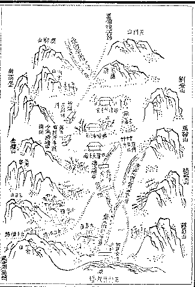

# 龙井见闻录



> **藏经**：中国佛寺史志汇刊（佛寺志汇刊）　**册次** 第 22 册（GA022）　**编号** GA0020　**部类** 史传部　**卷次** 12 卷　**篇幅** 79,563 字

> **卷／品**：0 卷 · 0 品



---



龙井位於浙江杭州西湖南山，南山源自天目山。南山中有一主山曰风篁岭，岭之巅有天池曰龙井。今之龙井位於风篁岭前，宋时龙井位於岭后，在今龙井之上，故名「老龙井」。龙井本名龙泓，一名龙泉。世传吴赤乌中，葛洪鍊丹於此。其地山水幽邃，以龙神著称。相传有龙在焉，触石为云，祷者皆应，因建龙祠，其地乃称龙井。此地又以茶名，清馥隽永，享有盛誉。隋开皇十四年（五九四），真观法师与道安禅师、头陀石室、檀越陈仲宝等於此构立精舍，曰崇恩演福寺。乾祐二年（九四九）重建，曰报国看经院；熙宁中改寿圣院，绍兴三十一年（一一六一）改广福院，淳祐六年（一二四六）改延恩衍庆院，俗称龙井寺。明弘治中洪水泛滥，遂废。万历二十三年（一五九五）重修，清康熙间僧一泓重葺。北宋有高僧元净住持，元净交游名贤，与赵抃、苏轼辈相唱和，风流照暎，於今未泯，寺因以扬名。元僧以仁尝撰「龙井志」，志久失传，故实遗阙。清乾隆间，浙江秀水汪孟𫓶因详核地志，旁及正史、文集一五二种，纂次为「龙井见闻录」十卷，分为十门：山水、古迹、名僧、乡寓人物、物产、碑刻书畫、诗、文、轶闻、餘论。复以其事不涉龙井而关元净者，纂为「宋僧元净外传」二卷以附之。所采资料，皆录原文，冠以书名；先地志，后诸家，各以时代为先后；间附考证，体例明晰。其中，〈山水〉所以记形胜，〈古迹〉所以记建置，〈名僧〉所以记高僧住持，〈物产〉所以记产物，〈碑刻书畫〉、〈诗〉、〈文〉所以记艺文，〈轶闻〉与〈餘论〉所以考杂事旧闻也。是录实为龙井寺而作也，故先纂辑名僧，后志乡寓人物。诸卷先后，亦准此例，因列为佛寺志书之一。兹据清光绪十年（一八八四）钱塘嘉惠堂丁氏刋本景印。



恭录御制诗二首



乾隆十六年辛未，圣驾南巡，幸天竺，览乡民采茶制焙之法，御制〈观采茶作歌〉：



火前嫩　火后老　惟有骑火品最好  

西湖龙井旧擅名　适来试一观其道  

村男接踵下层椒　倾筐雀舌还鹰爪  

地炉文火续续添　乾釜柔风旋旋炒  

漫炒细焙有次第　辛苦功夫殊不少  

王肃酪奴惜不知　陆羽茶经太精讨  

我虽贡茗未求佳　防微犹恐开奇巧  

防微犹恐开奇巧　采茶朅览民艰晓



二十二年丁丑，圣驾南巡幸云栖，御制〈观采茶作歌〉：



前日采茶我不喜　率缘供览官经理  

今日采茶我爱观　吴民生计勤自然  

云栖取近跋山路　都非吏备清跸处  

无事回避出采茶　相将男妇实劳劬(叶)  

嫩荚新芽细拨挑　趁忙谷雨临明朝  

雨前价贵雨后贱　民间触目陈鸣镳  

由来贵诚不贵伪　嗟哉老幼赴时意  

弊衣粝食曾不敷　龙团凤饼真无味



(臣)孟𫓶恭稽南巡盛典，伏读乾隆十六年御制〈观采茶作歌〉诗中语及「龙井」，又伏读二十二年御制〈观采茶作歌〉诗中有「云栖取近跋山路」之句。(臣)闻皇上再巡之岁，虽未幸龙井而驾幸云栖；由风篁岭南下，经九谿十八涧，御制诗云「云栖取近跋山路」，以此。(臣)孟𫓶既敬谨录登卷首，乃复拜手稽首，集经语而系以颂曰：



帝省其山(诗大雅)　自南自北(诗大雅)  

幽幽南山(诗小雅)　井渫不食(易下经)  

是兴神物(易上系辞)　龙见而雩(春秋左氏传桓公五年)  

陟则在𪩘(诗大雅)　马不契需(周礼冬官)  

有嘉树焉(春秋左氏传昭公二年)　为苍筤竹(易说卦传)  

庶草蕃庑(书洪范)　终朝采绿(诗小雅)  

维叶萋萋(诗周南)　女执懿筐(诗豳风)  

帝庸作歌(书益稷)　黼黻文章(礼记月令)  

高山仰止(诗小雅)　山夹水涧(尔雅释山)  

绳其祖武(诗大雅)　倬彼云汉(诗大雅。谨案御览西湖志纂：五云山云栖寺，圣祖仁皇帝凡四幸焉。)  

率西水浒(诗大雅)　南入於江(书禹贡)  

视远如迩(春秋左氏传昭公元年)　至於海邦(诗鲁颂)  

政在养民(书大禹谟)　无射亦保(诗大雅)  

观乎天文(易上经)　光被四表(书尧典)



浙江嘉兴府秀水县举人．拣选知县(臣)汪孟𫓶恭进







龙井图说



谨案：龙井在南山之北，其岭曰风篁。自风篁岭以上为狮子峰，更上为天门山。天门山在北高峰后，为南北两山之祖。自龙井论，则岭居寺之西北。图，於南列南高峰，於北不列北高峰者，以天门山见之；岭南之烟霞石屋不列，则以翁家山统之也。大小麦岭、丁家山本在西北，花家山亦近茆家步，而图稍南者，限於尺幅，为涧桥留餘地也。马鞍山从旧志名螺蛳山，不从旧志名碧螺峰者，以螺蛳之为碧螺，志无实证也。刘安山，地志不具；积庆山在僊姑西南，盖皆灵竺之后山也。不详茆家步一路者，龙井属南山，故详南而畧北也。其上岭出山大小径路大略附见，餘详卷一山水、卷十餘论。



龙井见闻录徵引书目



梁



萧子显《南齐书》



唐



姚思廉《梁书》



姚思廉《陈书》



房乔《晋书》



李吉甫《元和郡县志》



释道宣《续高僧传》



柳宗元《河东集》



陆羽《茶经》



宋



欧阳修、宋祁《新唐书》



欧阳修《新五代史》



司马光《资治通鉴》



乐史《太平寰宇记》



潜说友《咸淳临安志》



周密《武林旧事》



吴自牧《梦粱录》



祝穆《方舆胜览》



释赞寜《宋高僧传》



释道源《景德传灯录》



释惟白《续传灯录》



释元敬、元复《武林西湖高僧事略》



释惠洪《林间录》



傅牧《西湖古迹事实》



周必大《二老堂杂志》



释道潜《参寥子集》



释居简《北磵集》



林逋《和靖集》



范仲淹《文正集》



苏轼《东坡集》



施元之《苏诗注》



苏辙《栾城集》



王安石《临川集》



韦骧《钱塘集》



曾巩《元丰类稿》



秦观《淮海集》



晁公溯《嵩山居士集》



郭祥正《青山集》



周紫芝《太仓稊米集》



姜夔《白石诗集》



邹浩《道乡集》



程珌《洺水集》



敖陶孙《臞翁诗集》



周必大《平园集》



叶绍翁《靖逸小稿》



楼钥《攻媿集》



苏籀《双谿集》



郑清之《安晚堂集》



周文璞《方泉集》



周弼《汶阳端平诗隽》



谢翱《晞发集》



董嗣杲《西湖百咏》



葛天民《无怀小集》



姚铉《唐文粹》



陈起圣《宋高僧诗选》



沈括《梦谿笔谈》



赵葵《苇杭纪谈》



元



托克托《宋史》



释念常《佛祖通载》



释觉岸《释氏稽古略》



虞集《道园学古录》



柳贯《待制集》



王恽《秋涧集》



黄溍《文献集》



苏天爵《滋谿文稿》



邓文原《素履斋稿》



张昱《可闲老人集》



张雨《句曲外史集》



成廷珪《居竹轩集》



张翥《蜕庵集》



王逢《梧谿集》



杨维桢等《西湖竹枝词》



释善住《谷响集》



释圆至《筠谿牧潜集》



马臻《霞外诗集》



陈世隆《宋诗补遗》



夏文彦《图绘宝鉴》



邓椿《畫鉴》



汤垕《畫鉴》



李衎《竹谱详录》



明



宋濂《元史》



李贤等《明一统志》



夏时正《杭州府志》



薛应旗《浙江通志》



田汝成《西湖游览志》



陈善《杭州府志》



聂心汤《钱塘县志》



马汝砺《盱眙县志》



吴瓒《武林纪事》



袁宏道《石公集》



张京元《西湖小记》



沈仪《两湖麈谈录》



吴之鲸《武林梵志》



吴本泰《西谿梵隐志》



白琳《灵隐寺志》



释大壑《净慈寺志》



释传灯《天台山方外志》



宋濂《学士集》



林右《公辅集》



徐一夔《始丰稿》



王圻《续文献通考》



唐之淳《萍居稿》



夏时《湖山胜概记》



孙一元《太白山人稿》



姚绶《谷庵集》



方九叙《十洲集》



祝时泰等《西湖八社诗帖》



吴宽《家藏集》



夏锡祚《雪鸿堂诗草》



贺灿然《五欲轩集》



王穉登《客越志》



冯梦祯《快雪堂集》



屠隆《纬真诗集》



谭元春《岳归堂集》



傅岩《花巢诗》



《武林怡老会诗集》



李流芳《檀园集》



田艺蘅《煮泉小品》



董其昌《畫禅室随笔》



文震亨《长物志》



安世凤《墨林快事》



郎瑛《七修类稿》



徐𤊹《榕阴新检》



孙克宏《碑目》



吴应箕《复社姓氏录》



《历朝浙江题名录》



国朝



《御定广群芳谱》(康熙四十七年)



《敕修浙江通志》(雍正十三年)



《康熙督抚臣彚修浙江通志》(二十一年)



《御览西湖志纂》(乾隆十六年)



李卫《西湖志》



魏㟲《钱塘县志》



赵世安《仁和县志》



赵之珩《於潜县志》



唐如琏《餘姚县志》



胡承谋《湖州府志》



鲍复泰《台州府志》



吴之器《婺书》



孙治《灵隐寺志》



释广宾《上天竺山志》



张遂辰《湖上编》



陆次云《湖壖杂记》



吴任臣《十国春秋》



徐象梅《两浙名贤录》



谢旻《江西通志》



顾祖禹《方舆纪要》



朱彝尊《曝书亭集》



查慎行《敬业堂集》



厉鹗《樊榭山房诗集》



朱彝尊《明诗综》



冯景《苏诗续补遗》



查慎行《补注东坡编年诗》



谷应泰《博物要览》



吴铭道《明复社姓氏补录》



龙井见闻录凡例



杭州龙井，北宋始著。乾隆辛未丁丑，恭逢圣驾南巡，龙井未经临幸。伏读御制〈观采茶歌〉二首，敬谨录登卷首，以为山灵佛法之庆。  

语关祖宗、皇上国家者，谨分别跳行书；标题顶格者，跳行书，分别出格。  

南山之北，辄称龙井。〈山水〉一门期於贯串源委，旁及岭左右山水。要不敢阑入他处以混界域焉。寺则不在此例。  

浙西士民望幸诚切。龙井，名胜所在，伫邀宸顾，并乞璇题。即如疋练、插劒二瀑布，皆在昔未经开辟之胜，录名见闻，不敢曰志；新增胜境，概未详列，诚以翠华南来，山川竞秀，从此标新领异，非草莽(小臣)所敢次第也。  

录为寺作，故先〈名僧〉，后〈乡寓人物〉。诸卷先后并准此。  

郡邑志书，名贤接踵，则有〈人物〉一门。龙井地处僻仄，惟关系寺院兴废者载之；而以祠墓诸贤系〈人物〉、塔系〈僧〉，仍省去〈祠墓〉一门，亦稍变成例者也。  

诗、文各附注标题之下。诗之为游观赠答作者、文之无题可系者，并各自为卷。  

诗、文见本集者不注；有本集不载而见地志及他书者必注明。  

参考同异，以「谨案」别之，附於诸家之后。  

地志前列小叙，其例旧矣。今所传宋人志，如宋敏求《长安志》、罗愿《新安志》、潜说友《咸淳临安志》、史能之《咸淳毗陵志》、张元成《嘉禾志》、陈耆卿《赤城志》皆同。康熙中，仪徵县知县陆师撰县志，用《山海经郭璞注》赞例，每卷后附〈赞〉一首，而卷前仍列〈小叙〉。兹录谨删去〈小叙〉，易〈赞〉为〈题后〉，盖酌用其例焉。  

采登书籍，每条必冠以本书之名。既不敢没所自来，亦因以著厯代先后诸家异同之故。有未见原书者，则必注明某书徵引字样。其次第则先地志，次诸家，仍各以时代为先后。  

龙井以元净兴创得名，其有事关元净、不涉龙井者，割弃之则未免旧闻放失，别为〈元净外传〉，附《见闻录》之后。



(臣)汪孟𫓶恭识



龙井见闻录卷目



总叙



山脉



主山



近岭诸山



风篁岭四至



水源



近井诸水



杂地名



历代兴建



(附)寺址所在



古迹见咸淳临安志者十七



古迹杂见传记者十二



古迹不属僧寺者三



地志诸书所未详者二



开山僧



说法僧



住山僧



僧塔可考者



人物以山水以寺著者



人物以氏著者



人物以文著者



人物以祠著者



人物以墓著者



泉品二



竹品一



花品二



茶品一



(附)茶真赝优劣



果品一



药品二



鳞属一



碑之重刻者三



原碑存者十一



碑文见咸淳临安志者八



碑文见西湖志者二



碑文见东坡集者一



碑文见快雪堂集者一



碑见文献集文缺者一



碑见府志文缺者二



碑见县志文缺者一



书之可考者十一



畫之可考者五



名僧诗



名贤诗



名僧文



名贤文



孝宗行幸



咸泽机锋



元净、道潜优劣



两参寥、两辩才



智月



文捷



胡则



胡则永康方岩庙记



虞集题陈述古诗



三贤堂



碁盘石



暎山



片云石



龙口泻水



徐村翁家山



葛井水与龙井伯仲



记西湖豋览



南山游约



游龙井烹茶



游老龙井得茶



玉岑诗社



水涨



陈刚中



张伯雨



瑞芝



孙隆施舍



演福寺



南天竺当属龙井一路



宋时寺在岭背，今老龙井即当日龙井



小龙井



径山龙井



浙江龙井不一



葛洪鍊丹处不足信



封篁



与龙井联属诸山水寺院



九谿十八涧通江，不汇龙井



三狮子峰复一



三茯苓泉误



两君子泉



两喷月泉



一地两名



寺名先后重出



龙井演福为一



他寺并归演福亦称龙井



普泽院



演福僧



禅教互易



魏㟲钱塘县志舛复



梦粱录因袭



诗文编录之误



赵抃诗不见本集



元净著述



元净诗入苏轼集



元净诗误入苏轼集



名媛诗



妇人中官附著



三贤祠塑像



海棠



显应庙有三



於潜三贤祠



两元净



四辩才



苏轼戏问辩才师墨迹



辟尘炉不藏龙井



入山之路



(臣)汪孟𫓶恭纂



山水



总叙



陈善《杭州府志》：杭之山纪，首昌化竹岭至於潜白沙关为首节，豪千关为第二节，临安泥隖为第三节，新城青牛为第四节，富阳塌石岭为第五节，餘杭由拳为第六节，钱塘分金岭为第七节，自分金岭徂东而北、而东，五里五朝山，三里龙门山，二里牛𫐄岭，三里黄山，三里焦山，三里水山，五里天柱坞，五里五云山，二里郎当岭，三里风篁岭，四里南高峰，一里玉岑山，一里学士岭，一里九曜山，一里梯子岭，一里锅子山，一里慈云岭，一里教场山，又一里积里六十交仁和之凤凰山为第八节；其泉为龙门、青山、白沙、天柱、九谿、甘谿、天真凡七，直达乎江；北源则为龙门、西谿、冷泉、天竺、龙井、黄泥、程公、方家峪凡八，北向钱塘。



(谨案：陈善《杭州府志》以里纪山，极为明白易晓。其北源之泉北向钱塘者，犹之曰入湖也。)



山脉



天目山



李吉甫《元和郡县志》：天目山有两峰，峰顶各一池，左右相对如目；左属临安，右属於潜。



田汝成《西湖游览志》：西湖诸山皆宗天目，西去府治一百七十里，高三千九百丈，周广五百五十里，蜿蟺东来，舒冈布麓，若翔若舞，萃於钱塘而崷崪於天竺。从此而南、而东则为龙井，为大慈，为玉岑，为积庆，为南屏，为龙，为凤，为吴，皆谓之南山；从此而北、而东则为灵隐，为仙姑，为履泰，为宝云，为巨石，皆谓之北山。



主山



风篁岭



潜说友《咸淳临安志》释元净诗：



风篁荫修岭　挺节含虚心  

悠悠往还客　孰不聆清音



杨杰诗：



微风摇琅玕　萧瑟岭一道  

万帚扫晴空　纎尘不可到



《咸淳临安志》：在钱塘门外放马场西，路通龙井，岭最高峻。元丰中，僧辩才师淬治修篁怪石，风韵萧爽，因名曰「风篁」。东坡〈探梅诗〉有「问讯风篁岭下梅」、〈介亭诗〉有「丹青明灭风篁岭」之句。岭之巅有龙井，《西湖游览志》：林壑深沈，迥出尘表；流泉活活，自龙井而下，四时不绝。



陈善《杭州府志》：在南山饮马桥西，龙井在其下，岭之西可达江浒。



(谨案：风篁岭在今龙井寺后东北面。)



近岭诸山



鸡笼山



《咸淳临安志》：在龙井风篁岭侧，高而圆，若鸡笼然。《西湖游览志》：狮子峰西有稽留峰，俗讹「鸡笼」。



陈善《杭州府志》：远树亭亭，望若车盖；四山閴寂，虎豹窟藏，以是游者特罕。



(谨案：鸡笼山，今在龙井寺南。)



沙盆坞



魏㟲《钱塘县志》：在风篁岭下，有金沙井回泉鍾液。



(谨案：《咸淳临安志》「龙井山沙盆坞」，周密《武林旧事》云「风篁岭沙盆坞」，《西湖游览志》则云「岭下」，与魏㟲《钱塘县志》同。金沙井，《西湖游览志》系「演福」，而魏㟲《钱塘县志》「演福」下亦有此七字，次「夕佳楼」诸胜之列，必有一误。)



碧螺峰



聂心汤《钱塘县志》：自龙井达烟霞可三里许，两旁悉皆奇石森峭，其崒者为碧螺峰。



魏㟲《钱塘县志》：在风篁岭侧。



(谨案：碧螺峰，今无之。土人称寺南之山曰螺蛳岩，疑即此。)



鵶鸡峰



《咸淳临安志》：在西山崇因报德院，有怪石状似鵶鸡。



魏㟲《钱塘县志》：在灵石山前。



金钟峰



魏㟲《钱塘县志》：在丫髻峰侧。



(谨案：丫髻峰即鵶鸡峰之异名。金钟峰在龙井寺东南，而《武林旧事》系鸡笼山下，存考。)



狮子峰



《咸淳临安志》释元净诗：



独尔群山里　人称狮子峰  

无心自哮吼　显晦烟云中



杨杰诗：



岩峰壮威猛　晴雷隐哮吼  

无心露爪牙　百兽自奔走



《西湖游览志》：高出群岫，可瞰江浒。北望天竺诸峰，曡秀如畫。



魏㟲《钱塘县志》：在天门山侧，势若蹲狮，最为高峻，灵竺诸峰皆拜其下。山径孤峭，草树蒙茸，为南山最深处。



释广宾《上天竺山志》：在乳窦峰之右翊。大师经行，忽闻狮吼，故名。



又天门山两峰对峙如门，其西南曰栗山。栗山北拥为天竺诸峰，狮子其一也。从上竺而南则为龙井。



(谨案：狮子峰在风篁岭西北，其名不列《咸淳临安志》；而当日题咏即多及之。山高则四望皆见，此《灵隐》、《上竺》所以亦采入志也。袁宏道《石公集．西湖杂记》称为「狮子石」，未是。《武林旧事》寺下云「山有狮子峰」。)



杨梅坞



傅牧《西湖古迹事实》：在南山，近瑞峰石坞。



《上天竺山志》：在狮子峰麓。



又明刘康祉〈兴福院记〉：乳窦、狮子两峰间即杨梅坞。



魏㟲《钱塘县志》：在上天竺后。



(谨案：《西湖游览志》以杨梅坞叙於片云石、狮子峰之间。今由龙井至天竺，新开小路，必经杨梅坞。)



南山禅关



《武林旧事》：旧名龙井路，今又改南天竺。



片云石



李卫《西湖志》张丹诗：



荒涂趋沙坞　断崖得石壁  

鸟足不可栖　猿臂岂相借  

冰核实夏冻　露珠信昼滴  

兰草倒丛生　藤根互盘越  

仰视巧玲珑　眉宇皆翠色  

侧闻薜萝人　驻此曾洗涤  

我题聊与赏　早閟白云迹



《西湖游览志》：在风篁岭上，高可丈许；青润玲珑，巧若镂刻。松磴盘屈草莽间，有石洞，堆砌工致，巉岩可赏。



《西湖志》引《名胜志》：风篁岭上有石，俗呼「一片云」。



片云亭



《西湖游览志》：片云亭，司礼孙东瀛所构；设石枰於前，上镌「兴来临水敲残月，谈罢吟风倚片云」之句。



(谨案：魏㟲《钱塘县志》云「石上刻字多漫」，故卷六〈碑刻〉削之。又国朝厉鹗〈游龙井诗〉注：「片云石已仆，今已重立寺内矣。」)



神运石



《西湖游览志》：龙井神运石，高可六丈许，奇怪突兀，特立簷下。有木香一架穿绕窍窦，宛若蛇蟠。正统十三年，中贵李德驻龙井，属旱，令力士淘之，初得铁牌二十面、玉佛一枚、金银各一锭——凿「大宋元丰」年号；次得兹石，以八十人搜出之，上有「神运」二字，旁多款识，漶漫不可读，不知何代所镌也；继得铁牌十五面、银二条，上凿「吴赤乌」年号，盖皆投龙以祈雨者。其日黑云四匝，泉头汹涌，德惧而止。



《西湖志》：在龙井寺。



(谨案：神运石，《西湖游览志》止云「两字」，《西湖志》云「十字」。今考石上字甚多，详卷六。)



风篁岭四至



夏时《湖山胜概》记南高峰麓四出：一由前洋岭大慈山，南出龙山，抵六和塔，当江而止；一过慈云岭，出包家山、凤凰山、秦望山；一落石坞、烟霞二岭，岭有杨梅坞，下有玉岑山，山对高丽寺；一落西湖，过大小二麦岭，西下饮马桥，南至风篁岭，上有龙井。今创龙井寺於山之阳，西接演福寺；路转而北过胭脂岭，出九里松。



《西湖游览志．南山胜迹》：出清波门，折而南为南屏山。山西为九曜山，与赤山联属。又西为玉岑山，对赤山。由湖而陟此者为赤山步。赤山北为三台山，自此而北为小麦岭。盖积庆山之陂陁迆逦者有永福桥。又西为大麦岭，旁为花家山，濒湖而登为茆家步。自永福桥西北为积庆山，即灵石山。又西北为鸡笼山、风篁岭、一片云石、杨梅坞、狮子峰、延恩衍庆寺、龙井、神运石；岭下沙盆坞，岭畔有崇恩、衍福诸寺；岭北有碁盘山，登其巅则江湖之胜皆可环眺矣。



(谨案：近岭诸山不必皆以风篁岭为主山，然不立主山则界域不明故。由载记所列荟萃考之，赤山、三台山、小麦岭、花家山、大麦岭、积庆山、山前鵶鸡峰并在岭之东南；南则为翁家山。烟霞岭、石屋洞、水乐洞、狮子峰、杨梅坞在岭之西北；北则为碁盘山。其灵竺诸峰又在狮子峰西北，惟金钟峰今在岭南，而地志或系鸡笼山，或系鵶鸡峰，疑皆约略之词耳。今叙次诸山，鸡笼山、沙盆坞、碧螺峰，从风篁岭次列。又崇因报德寺在鵶鸡峰，褚庄在金钟峰。《咸淳临安志》於崇因、《武林旧事》於褚庄，并冠以龙井二字；《武林旧事》又次金钟峰於鸡笼山下，故鵶鸡峰、金钟峰又从鸡笼山次列。狮子峰则以老龙井录之杨梅坞，又从狮子峰次列，而以南山禅关及二石附焉。夏时所记，过二麦岭、饮马桥，而不言积庆山，疑必别由支径越小麦岭，并疑不经大麦岭；云「二麦岭」，非也。《西湖游览志》乃正由赤山步至龙井路，故并载之。详卷十，参以〈图说〉，形势大略可观矣。)



水源



老龙井



《西湖游览志》：龙井之上为老龙井，有水一泓，寒碧异常，泯泯丛薄间；幽僻清奥，杳出尘寰；岫壑萦回，西湖已不可复覩矣。再上为天门，可通灵竺；径术崎巇，草树蓊郁；人烟旷绝，幽悄不禁。



魏㟲《钱塘县志》：天门山侧为狮子峰，狮子峰下为老龙井。



张遂辰《湖山编》：越风篁岭为老龙井。



(谨案：今龙井在岭前面。考宋苏轼、秦观、杨杰、程珌、周必大纪游，及敖陶孙诗，无有不先过岭然后至井、至井然后至寺者；明张京元〈西湖小记〉、夏锡祚诗犹然。故《西湖游览志》老龙井，即〈冯梦祯记〉旧龙井，皆宋时龙井也。详卷十。)



龙井



秦观〈游龙井记〉见卷六，程珌〈游龙井记〉见卷八。



《咸淳临安志》杨杰诗：



岩下一泓泉　窈奥莫可测  

有时灵气生　散作人间泽



苏轼《东坡集．次叶教授韵纪龙井之游》



先生鲁诸儒　饮食清不溽  

空肠出秀句　吟嚼五味足  

华堂闹丝管　眸子涨春绿  

先生疾走避　面冷毒在腹  

归来煮瓠叶　弟子歌旱麓  

声淫及灵台　中有麀鹿伏  

功名一走兔　何用千人逐  

故应容我辈　清座时闭目  

高停石排衙　木杪挂飞屋  

我来无时节　客亦不待速  

似闻雪髯叟　西岭访遗躅  

朝阳入潭洞　金碧涵冰玉  

泉扉夜不扃　云袂本无幅  

慈皇付宝偈　神侣得幽读  

讷庵有老人　宴坐天魔哭  

时来献璎珞　法供灯相续  

吾侪诗酒汗　欲往无乃触  

斋厨费辰炊　车骑满山谷  

愿闻第一义　钵饭非所欲  

便投切云冠　余幼好奇服



《咸淳临安志》：本名龙泓，吴赤乌中，葛洪鍊丹於此，近西湖南山。登风篁岭，涧泉决决与幽花野草。延缘山磴，更上岭背，岩壑、林樾皆老苍，而西湖已蔽掩不可见。气象愈清古，岩骨棱瘦，泉流停涵，一泓清澈，即之凄然。相传有龙在焉，触石为云，祷者辄应，因建龙祠。咸淳五年，安抚潜说友重建门，古篆「龙井」二大字为扁。



祝穆《方舆胜览》：龙井去城十五里。



《武林旧事》：在风篁岭上，岩壑、林樾幽古，石窦一泓，清澈翠寒，甘美可爱，虽久旱不涸。石上流水处，其色如丹。游者视久，水辄溢；人去即减。其深不可测，相传与江海通，有龙居之，每祷雨必应。或见小蟹、斑鱼、蜥蜴之类。



《西湖游览志》：水经饮马桥，合黄泥岭，东出茅家步入湖。



(谨案：宋人志龙井，盖皆今日老龙井也，姑系於此。黄泥岭在行春桥外，见夏时正《杭州府志》。《武林旧事》系南山末；今《西湖志》系北山是也。)



井旁惠济祠



《咸淳临安志》：宁宗〈加封嘉应广济孚惠王敕〉：「昔我高宗千乘万骑尝登南山之风篁岭，驻跸龙湫，酌泉於上；一草一木，咸被昭回之光。时维明神，实见敬礼，涓滴分派，通海浃湖；寸云出岑，润吴泽越。揆以祭式宜有宠褒，而封爵未加，是为缺典。朕今以彻侯美称加宠於尔，有神珠宫贝阙，莫穷其源；华衮轮台，其永有耀；奠我都邑，振尔光灵，可特封『嘉应灵润普广济王』。」



《咸淳临安志》：在风篁岭上。绍兴十八年赐庙额，累封为「嘉应广济孚惠王」。咸淳五年，安抚潜说友更创祠宇。旁有德威亭，即旧龙井亭，东坡书额。



《武林旧事》：龙井旁有龙王祠。



《西湖游览志》：井上覆以楼，为惠济龙王祠。



(谨案：地名龙井，则龙之神灵著焉，故附井下。敕末「嘉应灵润普广济」七字，《西湖志》作「嘉应广济孚惠」，误也。陈善《杭州府志》「封号七字」，恐误，存考。)



龙井一名龙泓



见秦观〈游记〉，详卷六。



(谨案：灵隐有龙泓洞，《咸淳临安志》引晏元献说，亦云：「吴赤乌二年，葛仙翁於此得道，故龙井之名龙泓，不显於世。」)



龙井一名龙泉



司马光《资治通鉴》：「天复二年，镠如衣锦军，命右武勇都指挥使徐绾，帅众治沟洫。镇海节度副使成及闻士卒怨言，白镠，请罢役，不从。镠临飨诸将，绾称疾先出。镠怪之，命绾将所部先还杭州；及外城，纵兵焚掠。左武勇都指挥使许再思，以迎侯兵与之合，进逼牙城。镠子传瑛闭门拒之。牙将潘长击绾，绾退屯龙兴寺。镠还及龙泉，闻变，疾驱至城北，使成及建镠旗鼓，与绾战；镠微服乘小舟夜抵牙城北隅，逾城而入。」胡三省注：「龙泉即龙井，在杭州城西南风篁岭上，去城十五里。」又宋自高宗驻跸杭州，以杭州牙城为宫城东北隅，则今之和宁门外也。



顾祖禹《方舆纪要》：风篁岭，龙井在其上，亦曰龙泉。钱镠自衣锦军还至龙泉，闻其部将叛，据罗城微服兼行，逾城夜入是也。



(谨案：欧阳修《五代史》：「归至北郭门不得入。」吴任臣《十国春秋》：「微服至德胜门，牙将周肃以舟迎，王遂沿江至内城东北。」互有详略。据此知当日由临安入城，亦经龙井；后以兵阻，然后由城北而为沿江之行。其往来路径甚为明悉，故详载之。)



近井诸水



冲泉



见杨杰〈延恩衍庆院记〉，详卷二。



玉钩涧



聂心汤《钱塘县志》：在风篁岭下。



(谨案：龙井水初由过谿桥，经饮马桥，迆东北，循茅家步路，出通利桥以入湖，约行四里。疑即玉钩涧，然土人无知者。访诸寺僧，但云是虎谿。盖以过岭事袭讹而不知为玉钩涧。今新增插劒、疋鍊二瀑布，即在涧下流。但瀑布水自风篁岭后云𠔏庵，用竹笕屈曲承引，不独恃龙井水。以〈冯梦祯记〉考之，在岭背者或即老龙井也。)



金沙泉



聂心汤《钱塘县志》：金沙泉与龙井汇，从饮马桥入湖。



(谨案：《咸淳临安志》「金沙泉在仁和县永和乡」，「金沙井在孤山广化寺」，俱非此金沙。又金沙涧在灵隐寺侧。魏㟲《钱塘县志》引《十三洲记》：「灵隐寺东西瀵二水，东源横过寺前，名龙谿；西曰钱源。」龙谿之名，诸志所无，疑以此致误。但涧在极北，自由今关帝庙金沙桥入湖，即所谓金沙港，并不与龙井汇。细访土人，云「天马山有金沙井，其水自天马山来；龙井水过饮马桥，与此井水下流合，汇而出通利桥。」考《西湖游览志》演福寺下、魏㟲《钱塘县志》沙盆坞下，并有金沙井，盖即此井。惟天马山，诸郡邑志、诸寺志无之。土人则指灵隐后山为天马山。考魏㟲《钱塘县志》：「马鞍山在灵石山侧，今其地为天马山。」盖以地志「马鞍」实「天马」之俗称，当即其地。)



插劒池



浣花池



浴麟池



《西湖游览志》：李德疏神运石旁三池。



陈善《杭州府志》：三池并在龙井。



钵池



吴之鲸《武林梵志》：钵池庵有洗钵泉，德周果师栖隐处。



魏㟲《钱塘县志》：钵泉在风篁岭上，泉出石闲，其形如钵，又称钵池。《西湖游览志》：龙井旁有冲泉。旧邑志云「在老龙井，甚清冽」。今访其处不可得，而钵泉则又旧志所无。时代未遥，泉之兴废若此。



《西湖志》、《田志》：龙井旁有冲泉。今访其处不可得，而钵泉则《田志》所无也。



(谨案：钵池庵在今螺蛳岩下。称钵池，从庵名也。《西湖记》从魏㟲《钱塘县志》，似欲实为冲泉，殆不然。)



杂地名



善安桥



永安桥



永福桥



《咸淳临安志》：并在麦岭至龙井路。



饮马桥



《武林旧事》：地名放马场。



《西湖游览志》：永福桥俗称饮马桥，吴越宋时皆牧马於此。



(谨案：《西湖志》永福桥、饮马桥并列，仍考注其下云：「《咸淳志》载永福，《武林旧事》载饮马，而《西湖游览志》谓饮马即永福。因《宋志》所有并存之。」今依其旧。)



孝义桥



《咸淳临安志》：在麦岭西，太清宫前。



新河桥



《咸淳临安志》：在麦岭口，寨前。



小水乐



《武林旧事》：风篁岭小水乐福邸园。



(谨案：《咸淳临安志》：「福王府北园在天水院桥。」桥在城中，非此园也。)



褚家坎



《武林旧事》：金钟峰褚家坎，汉末褚盛族旧有居此者。



褚庄



魏㟲《钱塘县志》：在金钟峰下。



(谨案：《咸淳临安志》：褚家塘在蒲桥左，军寨之北。褚家故居蒲桥、盐桥东，不通舟楫。《西湖游览志》：忠清里本名升平巷，北褚家堂。又载胡世宁书云：「居近褚堂，以遂良故里得名，塘作堂。」盖阳翟褚氏之寓居城中者，与金钟峰褚家坎、褚庄不同。)



步司左军寨



《咸淳临安志》：左步军三寨，在麦岭，行春桥二。



(谨案：三寨，一在麦岭，二在行春桥。)



放马场



见《咸淳临安志》并《武林旧事》，详上。



陈善《杭州府志》：崇恩演福寺在小麦岭，宋渡江初，斥为放马场。



履泰乡



《咸淳临安志》：钱塘县管十二乡，履泰南乡管里三，曰放马、胭脂、皇妃；履泰北乡管里六，曰黄山、石塘、扫帚、石堰、师姑、青枝。



山水题后



志杭之名胜者，分路叙次。龙井为南山路，今《御览西湖志纂》又别之为南山西路，盖瞭如指掌矣。昔人或曰南山，或曰西山，实则一也。其地硗磝荦确、凸凹上下，而水泉正出、悬出、穴出，循山与俱。山不在高，有仙则名；水不在深，有龙则灵。以之举似西湖，不若举似龙井为尢近。



(臣)汪孟𫓶恭纂



寺内外古迹



歴代兴建



龙井寺



《咸淳临安志》杨杰〈延恩衍庆院记〉：「天台宗师辩才净老，坐道场者四十年，指空假中以接人。其心契於圣智，具戒定慧以行己。其德动於幽潜，真有道之士也。初住钱塘法惠院之宝阁，次住上下二天竺，又住南屏山之兴教寺。往来学徒盖逾万人，分传教观，多能演其所闻、开悟学者。师平生未尝辄有求於人，然所至必为四众依向，莫不兴盛，盖其有所致也。余在都下时，见清献公与师倡酬偈颂，已知师之所存矣。及观苏子瞻与师诗，言其儿幼弱不能行，因祷师加护，即壮而能行，然后知师功行至矣。师一日谓诸徒曰：『吾筋力衰疲，劳於应接，安得幽僻处一庵地以养餘年？』檀越闻之曰：『辩才师有退居之意，吾辈蒙其德不为不久，盍往择可居之地？』乃於龙井山得寿圣院敝屋数楹。主者不堪其居，愿人为代以舍去。於是请师徒弟怀益主奉香火，汲巾侍缾，甲乙相承，以严佛事。其院即吴越王所创，国朝赐今额也。檀越为师鼎新栋宇，不日而成。中建尊殿，严圣像也。前有三门，示三解脱也。钟鼓有阁，警晦明也。堂曰潮音，信群听也。斋曰讷，欲无言也。室曰寂，寂而常照也。阁曰照，照而寂也。泉曰冲，用不穷也。又堂曰闲，赵公致政访师，退居二闲人也。庵曰方圆，不执一也。桥曰归隐，退以乐也。沼曰涤心，涤清澈也。群居有寮，安其徒也。众山环遶，景象会合，断崖泓澄，神物攸宅，龙井岩也。势将奋迅，百兽窜慑，狮子峰也。昔人饲虎以度有情，萨埵石也。修竹森然，苍翠夹道，风篁岭也。元丰八年秋，余被命陪高丽国王子祐世僧统访道吴越，尝谒师於山中；乃度风篁岭，窥龙井，过归隐桥，鉴涤心沼，观狮子峰，望萨埵石，升潮音堂，憩讷斋，酌冲泉，入寂室，登照阁，临闲堂，会方圆庵，从容论议，久而复还。师异日遣其徒丐文以纪其本末。余既与之记，又系之以诗十三章云。」（诗见后）



《咸淳临安志》：龙井延恩衍庆院在风篁岭，乾祐二年，居民凌霄募缘建造。旧额「报国看经院」，熙宁中改「寿圣院」，绍兴三十一年改「广福院」，淳祐六年改今额。有龙井。元丰二年，辩才大师元净自天竺退休兹山，始鼎新栋宇及游览之所，山川胜槩一时呈露；而二苏、赵、秦诸贤皆与辩才为方外交，名章大篇照暎泉石，龙井古荒刹由是振显，岂非以其人乎？



《西湖游览志》：延恩衍庆讲寺俗称龙井寺。



见林右《公辅集．龙井志叙》，详卷八。



(谨案：杰作记，时在元祐中，当曰〈寿圣院记〉。若延恩衍庆，后来更名，何得题曰〈延恩衍庆院记〉耶？《咸淳临安志》盖误。)



魏㟲《钱塘县志》：龙井寺，明弘治中洪水泛溢，遂废。《武林梵志》：万歴二十三年，司礼孙隆命僧真果重修。



《浙江通志》：康熙间，僧一泓重葺。



(谨案：苏辙〈辩才碑〉：「沈遘请师以教易禅」，此讲寺之所由称也。又龙井名寺之始不可考，以《西湖游览志》臆之，当在明之中叶。迄今寺门扁曰「龙井」，游人不知宋时院名者多矣。详卷六〈谢辅碑〉下。)



（附）寺址所在



见秦观〈游记〉，详卷六。



沈仪《两湖麈谈录》：「地势幽僻，峰峦回合，迥绝尘凡。余童时犹见小庵及辩才塔，俗呼为『老龙井』」。秦少游〈题名记〉所谓「夜二鼓至潮音堂访辩才」，即其地也。今之寺则井之所在耳，非院也。



张京元《西湖小记》：寺北向，井在殿左。



(谨案：秦观〈游记〉：诸书知宋时寺址与井相远，又知游者先至井旁，然后至寺；而寺之北向，盖其来久矣。今寺内殿宇并向东北，与宝俶塔正对。旧寺门向南，扁曰「龙井寺」者，即此门也。今去门扁为缭垣，而於御道所经开建新门，则与寺内殿宇同向东北。又旧寺门之旁别有小新门，向正南。)



古迹见《咸淳临安志》者十七



归隐桥



《咸淳临安志》释元净诗：



谢讲竺峰寺　归隐新此桥  

院幽结林表　身老寄烟霄



杨杰诗：



道人从此归　影不入廛市  

端坐笑浮云　往来太多事



《咸淳临安志》：在龙井，因东坡，易名曰「过谿」。



《武林旧事》：寺前有过谿桥，又名归隐桥，又名二老桥。



吴自牧《梦粱录》：龙井路口曰归隐桥，盖东坡欲易於过谿，建此桥也。



过谿亭



《咸淳临安志》：东坡尝诣辩才师，师送至岭上，因举远公过虎谿事，师笑曰：杜子美不云乎「与子成二老，来往亦风流」。遂作亭岭上，名曰「过谿」，亦曰「二老」，东坡赋诗纪之。



德威亭



《咸淳临安志》：即旧龙井亭，东坡书扁。



《武林旧事》：二老亭后改「德威」。旧在风篁岭头，今移於龙井祠下。



(谨案：《武林旧事》以「德威」为过谿四名，而志两列院下，或者移祠下时因借「德威」名耶？)



方圆庵



《上天竺山志》〈释守一记〉：天竺辩才法师以智者教传四十年，学者如归，四方风靡。於是晦者明、窒者通，大小之机无不遂者。不居其功，不宿於名，乃辞其交游，去其弟子，而求于寂寞之滨，得龙井之居以隐焉。南山守一往见之，过龙泓，登风篁岭，引目周览以索其居。岌然群峰密围，㳷然而不蔽翳。四顾若失，莫知其乡。逡巡下危磴、行深林，得之于烟云髣髴之间，遂造而揖之。法师引予并席而坐，相视而笑，徐曰：「子胡来？」予曰：「愿有观焉。」法师曰：「子固观矣，而又将奚观？」予笑曰：「然！」法师命予入，由照阁经寂室，指其庵而言曰：「此吾之所以休息乎此也。」窥其制，则圆盖而方址，予谒之曰：「夫释子之寑，或为方丈，或为圆庐，而是庵也胡为而然哉？」法师曰：「子既得之矣！虽然，试为子言之。夫形而上者，浑沦周徧，非方非圆而能成方圆者也；形而下者，或得於方，或得於圆，或兼斯二者而不能无悖者也。大至於天地，近止乎一身，无不然。故天得之则运而无积，地得之则静而无变，是以天圆而地方；人位乎天地之间，则首足具二者之形矣。盖宇宙虽大，不离其内；秋毫虽小，待之成体。故凡有貌象声色者，无巨细、无古今，皆不能出於方圆之内也，所以古先哲王因之也。虽然，此游方之内者也。至於吾佛亦如之。使吾党祝发以圆其顶、坏色以方其袍，乃欲其烦恼尽而理体圆、定慧修而德相显也。盖溺於理而不达於事、迷於事而不明於理者，皆不可谓之沙门。以制礼乐、为衣裳，至於舟车、器械、宫室之为，皆则而象之。故儒者冠圆冠以知天时，履句屦以知地形。盖蔽於天而不知人、蔽於人而不知天者，皆不可谓之真儒矣。唯能通天、地、人者，真儒矣！唯能理事一如、向无异观者，其真沙门欤！噫，人之处乎覆载之内，陶乎教化之中，具其形，服其服，用其器，而於其居也特不然哉？吾所以为是庵也，然则吾直以是为蘧庐尔。若夫以法性之圆、事相之方而规矩一切，则诸法同体而无自位，万物各得而不相知，皆藏乎不深之度而游乎无端之纪。则是庵也为无相之庵，而吾亦将以无所住而住焉。当是时也，子奚往而观乎？」呜呼！理圆也，语方也，吾当忘言与之，以无所观而观之。於是嗒然隐几。予出，以法师之说授其门弟子使记焉。



《咸淳临安志》杨杰诗：



地方不中矩　天圆不中规  

方圆庵里叟　高𧼈有谁知



寂室



《咸淳临安志》释元净诗：



心寂寂自绝　此意焉思说  

寒云散空庭　独有月照雪



杨杰诗：



白云隔尘喧　虚室太岑寂  

寒尽春自来　莺啼报消息



照阁



《咸淳临安志》释元净诗：



高峰衔皎月　深壑泻飞湍  

谁来白云里　与汝凭栏看



杨杰诗：



幽人无适莫　乘兴登高阁  

夜月锁云林　春花绣岩壑



秦观《淮海集》：



猕猴镜里三身现　龙女珠中万象开  

未若此轩人散后　水光清泛月华来



闲堂



《咸淳临安志》杨杰诗：



赵公归休年　访师翠微间  

始知浮世上　白日两人闲



《咸淳临安志》注：在方圆庵东。赵清献公既挂冠，而辩才法师亦退居此山，因以命名。



(谨案：《西湖志》以过谿亭、闲堂入古迹，而寂室、照阁仍列本寺下，不以类叙易之。)



讷斋



苏辙《栾城集》记：钱塘有大法师曰辩才，初住上天竺山，以天台法化吴越。吴越人归之如佛出世，事之如养父母；金帛之施，不求而至。居天竺十四年，有利其富者迫而逐之，师忻然舍去，不以为恨。吴越之人涕泣而从之者如归市，天竺之众分散四去。事闻於朝，明年俾复其旧，师黾勉而还，如不得已。吴越之人争出其力以成就废缺，众复大集。无几何，师告其众曰：「吾虽未尝争也，不幸而立於争地，久居而不去，使人以己是非彼，非沙门也。天竺之南山，山深而木茂，泉甘而石峻。汝舍我，我将老於是。」言已，策杖而往，以茅竹自覆。声动吴越，人复致其所有，镵崄堙圮，筑室而奉之。不期年而荒榛岩石之间，台观飞涌、丹垩炳焕，如天帝释宫。师自是谢事不复出入。高邮秦观太虚名其所居曰讷斋。道潜师参寥属余为记。余闻之，师始以法教人，叩之必鸣如千石钟，来不失时如沧海潮，故人以辩名之。及其退居此山，闭门宴坐，寂默终日，叶落根荣如冬枯木，风止浪静如古涧水，故人以讷名之。虽然，此非师之大全也。彼其全者不大不小、不长不短、不垢不净、不辩不讷，而又何以名之？虽然，乐其出而高其退，喜其辩而贵其讷，此众人意也，则其以名斋也亦宜！系之以词曰：



以辩见我　既非见我  

以讷见我　亦几於妄  

有叩而应　时止而止  

非辩非讷　如如不动  

诸佛既然　我亦如是



《咸淳临安志》释元净诗：



忆昔毗耶老　杜口有谁听  

还闻寂寂里　其辩过雷霆



杨杰诗：



天道竟何言　四序自流转  

迺知毗耶离　默然真大辩



(谨案：苏轼〈次叶教授诗〉「讷庵有老人」，即此「讷斋」。)



潮音堂



《咸淳临安志》释元净诗：



真说无所示　真听无所闻  

海潮山外过　妙响入深云



杨杰诗：



潮来音普闻　潮平音亦歇  

孰若此山堂　潮音未尝绝



涤心沼



《咸淳临安志》杨杰诗：



纵有狂风生　未尝险浪起  

何当招世人　来此鉴清泚



萨埵石



《咸淳临安志》释元净诗：



巨石如掌平　兀然半青嶂  

钦哉昔道人　饲虎兹岩上



杨杰诗：



解虎锡常闲　饲虎石常在  

忘躯度有情　清风几千载



(谨案：《咸淳临安志》又有狮子峰，元净、杨杰俱有诗。今考狮子峰系山名，且非龙井所可独擅；与诗并附卷一，兹不列。)



月林堂



岩斋



风玉轩



《咸淳临安志》注：见旧记，不知何人所创。



(谨案：程珌〈游记〉「月林辩才所庐也」，即此。)



龙井亭



《咸淳临安志》释元净诗：



虚亭乱石间　中有潜虬府  

澄湛源莫穷　旱岁为霖雨



(谨案：元净所咏，疑即过谿亭，存考。)



冲泉



《咸淳临安志》释元净诗：



物外老餘生　泉发幽岩里  

自可给缾盂　不羡沧溟水



杨杰诗：



不汲泉不盈　愈汲泉愈清  

湛然有常德　随气利群生



见杨杰〈院记〉，详上。



魏㟲《钱塘县志》：旧志云在老龙井，甚清冽。



(谨案：元净十咏，杨杰十三咏，其方圆庵、闲堂、涤心沼三咏，元净无之。又元净曰「龙井亭」，而杨杰则直曰「龙井」而已，故杨杰诗别附「龙井」下。)



龙泓亭



《咸淳临安志》〈赵抃诗并叙〉：余元丰己未仲春甲寅，以守杭得请归田；出游南山，宿龙井佛祠。今岁甲子六月朔旦复来，六年於兹矣。老僧辩才登龙泓亭，烹小龙团以迓，余因作四句云：



湖山深处梵王家　半纪重来两鬓华  

珍重老师迎意厚　龙泓亭上点龙茶



释元净和诗：



南极星临释子家　杳然十里祝青华  

公年自尔增仙箓　几度龙泓咏贡茶



(谨案：龙泓亭亦疑即过谿亭。)



古迹杂见传记者十二



钟鼓阁



见杨杰〈院记〉，详上。



钟楼



见郑清之〈秦观龙井题名跋〉，详卷八。



(谨案：郑作此跋，时当绍定中；盖重建也，与钟鼓阁不嫌并列。)



藏经阁



邓文原《素履斋稿》记：寺肇始於吴越钱氏，曰「报国看经院」。宋熙宁初赐名「寿圣」，绍兴间又更曰「广福」。其曰「延恩衍庆」者，淳祐六年赐额也。「寿圣」故圮陋，莫能庇风雨。时辩才师谢事天竺，来居之。咄嗟而檀施响臻，栋宇云搆；搢绅士大夫慕望而与之游者，迹接乎兹山之内，由是人境之胜甲於西湖。余尝过龙井、访方圆庵、登潮音堂，高风逸韵，洒然心目，若见其人。信知一念所摄，即清净妙圆觉境，亦古今之常理也。一日，寺僧居弈来谒曰：「元贞初，比邱德祐嗣兹法席，崇敞像设、庐居，丹垩楞填之工咸增旧观。又买上腴一顷有半以饭僧；复捐己田，为亩者百，以重追远。居弈缵承其志，购四大部及《华严合论》、《宗镜录》；耆德时演、时集、居亿等悉聚力，具大宝藏，袭以髹函，庋以飞阁。观者挹其亢爽，可以扶幽阐微，於是寺有成绩。」今住山者德泉也，记之以谂来者。



听泉轩



张昱《可闲老人集．听泉轩为龙井智法师赋诗》：



山僧听得泉声好　每夜坐忘清夜深  

松上落来惊鹤梦　潭中泻下杂龙吟  

观身已净平生垢　到耳能空现在心  

此去涓流如不息　沛然难御海鲸音



镜清堂



诸天阁



并见《武林旧事》。诸天阁亦见《西湖游览志》。



观音殿



见冯梦祯《快雪堂集．龙井寺新建白衣观音殿劝缘述》，文详卷八。



(谨案：此当在寺内。)



与偕亭



见张京元《西湖小记》，详卷五。



与众亭



《西湖游览志》：与众亭，司礼孙东瀛所构，凿花池于前以复古迹。



秋月堂



与时亭



并见魏㟲《钱塘县志》。



(谨案：此一堂一亭，不见他书，惟魏㟲《钱塘县志》有之，录以备考。「与时」疑即「与偕」或「与众」之误。别有「镜心堂」，必「镜清堂」之误。「钵池庵」则误入他寺；「辟尘炉」则非古迹，且亦别见六通，论详卷十。又查慎行注东坡〈白云堂诗〉，引《咸淳临安志》：「在龙井寿圣院」，今无其文；而堂自在「天竺」，查注误。详〈元净外传〉。)



古迹不属僧寺者三



霖雨阁



陈善《杭州府志》：在龙井，嘉靖间总督胡宗宪建。相传井中有龙，每大旱，祷之辄雨，故名。



《武林梵志》：僧智果重修霖雨阁。



龙井山斋



谭元春《岳归堂集．同李长蘅寻闻子将龙井山斋诗》：



枫色红难已　黄从翠处分  

偶然乱叶下　风雨似同闻  

谷鸟临寒路　篱花间远云  

逢幽无一语　心眼自氤氲



十里苍苍路　非深亦觉遐  

阴晴淡山气　鸡犬静人家  

阁迥生谿水　萍香过荈花  

红黄光莫豓　群动岂无涯



《西湖志》：明孝廉闻启祥别业，是宋人方圆庵遗址。



荪壁山房



夏时正《杭州府志》：金应桂入元，隐居风篁岭。



吴瓒《武林纪事》：应桂，字一之，标度风雅，居西湖南山，筑荪壁山房；左弦右壶，设图史古器，客至，抚摩谛玩，清谈不休。每肩舆入城，幅巾氅衣，望之若神仙然。



地志诸书所未详者二



凖提庵



(谨案：今风篁岭上有庵，寺僧曰：「凖提庵也，祀神胡姓，南渡时著应者。」然则即旧显应庙址也，土人称为土地庙。)



云共庵



(谨案：今风篁岭背一庵，额曰「云共」，传为国朝初年建，惜无碑记岁月可考。以上二庵不关龙井寺，以其近岭存之。)



寺内外古迹题后



濳说友称：南北两山僧寺，大小合三百六十。一院何论焉，属有功成身退，从者归市，施集大檀，品盖万衲。於是后来踵继，益搜剔奇最，故三宿之恋，非所语於游方之内者也。



(臣)汪孟𫓶恭纂



名僧



开山僧



隋



真观法师(释道宣《续高僧传》：字圣达，吴郡钱塘人，俗姓范氏。)



道安禅师



头陀石室



《续高僧传》：隋开皇十四年，真观法师共道安禅师、头陀石室、檀越陈仲宝，率诸同侣，开藏拓基，搆立精舍，号南天竺。



《西湖游览志》：风篁岭畔崇恩演福寺，俗称南天竺，隋法师真观居之。



释元敬、元复《武林西湖高僧事略》：观，字圣达，钱塘范氏子。世本显仕，师生有奇相。出家，通经律论。寻谒天台智者，请受禅观。智者以师齐年，止为法兄弟。开皇十五年，於灵隐山头陀石室宴坐；众建南天竺寺，请师居焉，是为开山始祖。常讲《法华》，以心为要。感臯亭神请讲，舍祠宇为佛殿。每盥洗餘滴，地不为濡，人尤异之。师有雅操，文帝三徵，秦王两延，皆以疾辞。大业中，因山行，自标葬地；梦与智者同辇翼佛还山，觉而叹曰：「吾六十二应终，以讲《法华》，力延一纪；今七十四，生期毕矣。」中夜入寂，塔在东冈。



(谨案：《西湖高僧事略》谓「师於灵隐山头陀石室宴坐」。详《续高僧传》，「头陀石室」次道安之下、陈仲宝之上，人名非地名也。)



说法僧



唐



通禅师



处栖上座



释道源《景德传灯录》：杭州龙井通禅师。处栖上座问：「如何是龙井？」师曰：「意气天然别，人工畫不成。」曰：「为什麼畫不成？」师曰：「出群不戴角，不与类中同。」曰：「还解行雨也无？」师曰：「普润无边际，处处皆结粒。」曰：「还有宗门中事也无？」师曰：「有。」曰：「如何是宗门中事？」师曰：「从来无形段，应物不曾亏。」问：「如何是吹毛劒？」师曰：「拽出著。」



(谨案：《景德传灯录》通禅师为吉州青原山行思禅师、第六世慧能大鉴禅师之法嗣。行思禅师实福州雪峰义存禅师法嗣也，大鉴禅师即世所称六祖。柳宗元《河东集》有〈大鉴禅师碑文〉。)



住山僧



宋



元净法师



《咸淳临安志》：元净本姓徐，字无象，於潜人。十岁出家，受业於慈云。慈云没，复事明智。年二十五，赐紫衣及「辩才」号。知杭州，吕溱请住大悲宝阁，居十年。沈文通遘治杭，命住上天竺，乃以教易禅。师增室至万础，重楼杰阁冠於浙西，学者数倍。居十七年，有夺之者，遂还於潜。逾年复归天竺，留三年，谢去，老於南山龙井之上。精修行业，行成力具，著应非一。元祐八年示寂，寿八十一，门下侍郎苏辙撰碑，翰林学士苏轼书，集贤校理欧阳棐书额。



《西湖高僧事略》：师名元净，字无象，於潜徐氏。生而左肩肉起如袈裟绦，八十一日乃灭。父叹曰：「是宿世沙门也。」自幼出家，受业於慈云，日夜精勤。慈云没后，复事明智。年二十五，赐紫衣及「辩才」号。居天竺十七年，有利而夺之者。逾年夺者败，复以𢌿师。越二年谢去，老於南山龙井之上。元祐八年示寂，寿八十一，果符初生肩痕之徵。塔成，东坡志其行事，颍滨为铭。赞曰：



法苑将兴　栋梁攸属  

挥麈白云　雨花飘馥  

维赵与苏　式是高躅  

龙井风清　过者必肃



释念常《佛祖通载》：法师幼生，其伯父异之，曰「必使事佛」。十岁出家，十二就学於慈云。将示寂，乃入方圆庵；七日出偈示众，即右胁而化。东坡命子由为之铭。



《武林梵志》：元祐八年示寂。塔成，东坡铭其事。



王圻《续文献通考》：元净，杭州龙井法师。始生，伯祖异之。



(谨案：诸传叙事大抵皆同，并从删节。以苏辙〈辩才碑〉考之，十年出家，十八学於慈云，则《咸淳临安志》「十岁出家受业於慈云」、《佛祖通载》「十二就学慈云」，俱误。又伯祖父叹为宿世沙门，则《西湖高僧事略》之以为父，亦误。又元祐六年示寂，而《咸淳临安志》及《西湖高僧事略》、《武林梵志》俱云八年，亦误。至《武林梵志》谓「东坡铭其事」，盖承《西湖高僧事略》「东坡志其行事、颍滨为铭」之误而加误焉，尤不待辨。)



弟子怀楚



见苏辙〈辩才碑〉，详卷八。



见秦观〈元净十诗跋〉，详卷八。



逵上人



见苏轼〈楚逵二上人书经跋〉，详卷八。



(谨案：楚、逵并称，亦弟子也。)



徒弟怀益



见杨杰〈院记〉，详卷二。



见辩才〈心师铭〉，详卷八。



散老



邹浩《道乡集》〈送散老归龙井〉：



长安冥冥砂砾飞　道人趼足来何为  

师恩浃髓未为报　誓求卿相成其碑  

卿相盈朝成者谁　尚书妙墨侍郎词  

二公奔走天下士　士获一面犹几希  

道人愿力岂不满　文字乃今兼得之  

龙井神龙应护持　杖头星斗东南垂  

过门别我自色喜　我愧儒冠多背师



(谨案：《道乡集》〈尚书妙墨侍郎词〉下注云「二苏公」，考苏辙〈辩才碑〉，求碑者乃弟子怀楚，即此散老耶？又一人耶？不可知矣。详「儒冠背师」语，其为弟子无疑也。)



居简禅师



白琳《灵隐寺志》：敬叟居简禅师，临济宗，潼川龙氏。世业儒，依邑之广福院圆澄得度。参别峰涂毒於径山，往育王见佛照，机契，出世台之般若。迁报恩，真西山为江东部使者，虚东林命之，以疾辞。乃於飞来峰北磵扫一室，居之十年。人不敢以字称，以「北磵」称之。赵节斋奏请补灵隐，师笑曰：「吾日迫矣！」淳祐丙辰春示寂。三月二十八日索纸书偈於纸尾，复书「五月一日珍重」六字。至期昧爽索浴，浴罢若假寐然，视之已示寂矣。寿八十三，腊六十二，有《北磵集》十九卷。张子序其集曰：「读其文，宗密未知其伯仲；诵其诗，合参寥、觉范为一人。」



撰〈龙井法堂榜文〉，见卷八。



住山宗炳



见郑清之〈跋秦观龙井题名〉，详卷八。



僧全



《咸淳临安志》：主僧可全。苏籀《双谿集》龙井僧全示寄庵枢密程公累篇季文弟新什求余继其末一首：



程苏中兴什　同庵有后前  

前朝沙门首　辩净超卓然  

耆宿失闻聪　飤参餘小全  

龙泓风篁𪩘　荏苒二十年  

缁俦几换易　岩㟧岂变迁  

亭亭百岁杉　泠泠九渊泉  

梵音扰龙性　元解忘鱼筌  

有容辇瓌诡　无情施缯钱  

佛法伫隆兴　般若须人传  

更令观刹丽　但俾子孙贤  

三空正觉路　一逾实相圆  

不替人天师　重新演教禅



姜夔《白石集》嘉泰壬戌上元日访全老於此，观沈传诗碑、隆茂宗畫赠诗二首：



深夜跨羸骖　杳杳春山路  

入寺君未知　闲看桂移树



沈碑含秀润　隆畫出神奇  

道人那得此　老子乃耽之



又斋后与全老、铦朴、翁聪、自闻，酌龙井而归，赋诗二绝：



四人松下共盘桓　笔砚花壶石上安  

今昔兴怀同此味　老仙留字在孱颜



年时六月海扬尘　遥见青山起白云  

闻有高僧来诵咒　岩前抛珓问龙君



(谨案：姜夔四诗，《咸淳临安志》载於净林广福下，《白石集》有注，亦以全为净林广福主僧；而苏籀直云「龙井僧」，益证「演福」为「龙井」之说不谬，不独诗有「辩净风篁」句也。《咸淳临安志》称：全於净林创松关、南泉、芳桂为留憇之地。葛天民初为僧，名义铦，字朴翁。)



聪师



《白石集》〈诗题〉，聪自闻，详上。周紫芝《太仓稊米集》〈酌龙井泉书聪师房二首〉：



十里泉声咽断岩　绣衣元衮闭朱龛  

老翁不要千山雨　只乞龙君一勺甘



八十霜髭不出门　老师犹是辩才孙  

高人已复如云散　旧事那堪与客论



(谨案：《东坡集》〈思聪名说〉云：「法惠圆师小童彭九，自言未有法名，而同师皆联思字，遂与名『思聪』，庶几他日因声以得法。」又〈送钱塘僧思聪归孤山〉叙云：「聪七岁善弹琴，十二舍琴而学书，十五舍书而学诗；又不已，遂读《华严》诸经，入法界海慧。今年二十九，老师宿儒皆敬爱之。少游取《楞严》文殊语，字之曰『闻复』，使聪日进不止。自闻思修以至於道，则华严、法界海慧尽为蘧庐。」据此则聪师似即其人；然自闻、闻复，其字不同，而白石诗作於宁宗嘉泰，时距元净之寂一百餘年，证以紫芝「八十辩才孙」句，知又一「聪闻」也。又轼〈记服生姜〉：法净慈寺有僧号「聪药王」。)



依公



敖陶孙《臞翁诗集》：仆以绍熙壬子中夏二十五日始跻风篁、讨龙井，遂至广福，谒三贤像，阅旧碑，追观一代风流，为赋此诗。适月林依公留设茗供，因书以遗之。他日能为我揭诗板於壁间，使示来者，亦山中之一助也。



奇石斓横道　兹山信多姿  

江湖酾两股　一泓乃孤危  

相传龙所象　或恐神护持  

腥风转霮䨴　阴崖立淋漓  

山僧作屋意　惨淡生幽思  

胡为金缪影　颠倒眩俗儿  

生来百念失　苍宫导前驰  

招提果深登　屐痕恍前期  

咄哉少肉山　看此高颧师  

端能致遨头　绝唱相娱嬉  

过谿亦何事　相送了不疑  

渠能缚禅律　因来数须眉  

我爱秦郎记　字压头陀碑  

月林只夜夜　人物自一时  

贤愚尽蚁封　来者吾得知



元



澄公



《上天竺山志》：佛澄法师名性澄，号湛堂，会稽孙氏子。虞集《道园学古录．次韵邓文原游龙井诗》：



杖藜入南山　却立赏奇秀  

所怀玉局翁　来往絇履旧  

空餘松在涧　仍作琴筑奏  

徘徊龙井上　云气起晴昼  

入门避沾洒　脱屐乱苔甃  

阳冈扣云石　阴房绝遗搆  

澄公爱客至　取水挹幽窦  

坐我薝卜中　餘香不闻嗅  

但见瓢中清　翠影落群岫  

烹煎黄金芽　不取谷雨后  

同来二三子　三咽不忍嗽  

讲堂集群彦　千磴坐吟究  

浪浪杂飞雨　沈沈度清漏  

令我怀幼学　何为裹章绶



(谨案：柳贯有〈送南竺澄讲主诗〉，即此诗之澄公也。宋濂《学士集．天竺圆照若公塔铭》：「佛海大师主南天竺、崇恩、演福教寺」，《上天竺山志》：「澄公至顺壬申效辩才故事，拂衣归南竺之云外斋」，澄公盖演福僧，今以虞诗存之，详卷十。)



僧蒙润



《浙江通志》引《稽古续集》：字玉岗，海盐人。生时，母感异梦，礼伽蓝，土偶皆仆。居风篁岭，专精念佛，修法华、光明、大悲、净土，以七七为期。后示弟子止观安心之法，称佛而逝。



《学士集．故文明慧海法师塔铭》：南天竺素称教海，湛堂迁上竺，玉岗润公来补其处。



智法师



见张昱〈诗题〉，详卷二。



德祐



居弈



时演



时集



居亿



住山德泉



并见邓文原〈阁记〉，详卷二。



(谨案：记称「元贞初，比邱德祐嗣兹法席」。元贞，元成宗纪号；记盖为住山德泉作。)



明



大彰



《学士集．故文明海慧法师塔铭》：弟子广福、大彰、演福、如玘。



(谨案：寿圣院，绍兴中更名「广福」，详卷十。)



天岩



《上天竺山志．竺隐存翁法师宏道传》：秀之天岩耀公退寂广福，请师自代。



曦南仲上人



王逢《梧谿集．奉览龙井倡和什为曦南仲上人题》：



竺源龙象国　齐州凤麟苑  

千龄始汇应　匪惟晋陶远  

惟杭萃秀灵　梅柳并清婉  

湖饮六彩虹　磬殷叠翠𪩘  

悠然泳飞外　瓶锡簉轩冕  

藻章婉苏秦　泉思涌参辩  

间含棘林香　胜味御厨隽  

遗珠信僧宝　了不见兵燹  

苍寒境四寂　手之忍释卷  

藤花坠来深　松巢白云偃



以仁



见《公辅集．龙井志叙》，详卷八。



僧真志



见《快雪堂集．送果上人叙》，详卷八。



僧真果



见《武林梵志》，详卷一、卷二。



见《快雪堂集．龙井复赐田记》，详卷八；又〈日记〉，详卷九。



国朝



僧一泓



《西湖志》：龙井延恩衍庆院，康熙年间僧一泓重葺。亦见《浙江通志》，详卷二。



僧慧辂



张汇〈塔铭〉，详卷八。



白琳《灵隐寺志》：谛晖历住兴福、妙济、师林、天竺、龙井诸寺。



(谨案：地志诸书，龙井甚略，住僧莫考；要亦住斯寺者，大抵灵竺退院，故不若名山大刹之可以世次也。掇拾遗文，疏其名字如右。若苏轼〈辩才尺牍〉之法孙，程珌〈记出观辩才像〉之主僧，周必大〈记游〉之龙井僧，马臻〈诗题〉之南竺诗僧，张京元〈西湖小记〉之山僧者，惜俱失其名矣。)



僧塔可考者



宋



僧赞宁



《佛祖通载》：赞宁随钱王归朝。姓高氏，其先渤海人。唐天祐中生於吴兴之德清金鹅别墅，出家杭之祥符，习南山律。武肃诸王公族咸慕重之，署为两浙僧统，赐号「明义宗」。太平兴国三年，太宗召对，改赐「通惠」。至道二年示寂。



《十国春秋．本传》：本姓高氏，为两浙僧统。太平兴国三年召对资福殿，赐紫方袍，寻赐号曰「通慧」；命充翰林史馆编修，纂《高僧传》三十卷、《内典集》一百五十卷、《外学集》四十九卷。归杭州卒，谥「圆明」，葬龙井。孙治《灵隐寺志》：赞宁侍者塔龙井。



(谨案：《咸淳临安志》「在放马场栖真院前」；《武林旧事》「小麦岭，赞宁塔」，注：「天圣间葬」。此今依《十国春秋》等书存之。)



僧元净(详上)



《咸淳临安志》：在龙井。



《梦粱录》：龙井寿圣寺辩才和尚塔。



(谨案：《西湖游览志》「在演福院内」，《上天竺山志》邵氏〈七识〉亦云。今依《咸淳临安志》存之。)



明



僧原璞



见《学士集．原璞法师璋公圆碑铭》，详卷八。



(谨案：《宋高僧传．遗身篇》：杭州真身院宝塔寺，绍岩俗姓刘，雍州人。於钱塘水心寺挂锡，恒讽持《法华经》。俄感陆地生宝莲，续召於杭塔寺，造上方净院以居之。开宝四年跏趺坐亡，茶毗於龙井山；收合作石函，置於影堂。孙承祐为碑，详文义，盖未造塔，故不列。)



名僧题后



苏轼云：灵隐、天竺和尚退院后，却住一个小村院子。窃意正如闲散之人托处别业，又岂禅教两院、五山十刹、甲乙住持者所可比论？然而元净居上竺，自谓立於争地，以归老为乐。则兹之引蔓布条，诚不可以无述。



(臣)汪孟𫓶恭纂



乡寓人物



人物以山水、以寺著者



晋



葛洪



房乔《晋书．本传》：葛洪，字稚川，丹阳句容人也。祖系，吴大鸿胪；父悌，吴平后，入晋为邵陵太守。洪少好学，尤好神仙导养之法。从祖元，吴时学道得仙，号「葛仙公」；以其鍊丹术授弟子郑隐，洪就学，悉得其法。后师事南海太守——上党鲍元，元以女妻洪。洪传元业，兼综医术。吴兴太守顾秘讨石冰，檄洪为将兵都尉，破之。冰平，洪不论功赏，径至洛阳，欲搜求异书以广其学。避地南土，参广州刺史嵇含军事。后还乡里，礼辟皆不赴。元帝为丞相，辟为椽；以平贼功赐爵「关内侯」。咸和初，补州主簿，转司徒掾，迁諮议参军。干宝深相亲友，荐洪才堪国史，选为散骑常侍，领大著作。洪固辞不就，以年老求为句漏令。帝以洪资高，不许。洪曰：「非欲为荣，以有丹耳。」帝从之，洪遂将子姪俱行。至广州，刺史邓岳留，不听，去；洪乃至罗浮山鍊丹。岳表补东宫太守，又辞不就。岳乃以洪兄子望为记室参军。在山积年，优游闲养，著述不辍。自号抱朴子，因以名书。其餘所著碑诔、诗赋百卷，移檄章表三十卷，神仙、良吏、隐逸、集异等传各十卷；又抄五经、史汉百家之言，方技杂事三百一十卷，《金匮药方》一百卷，《肘后要急方》四卷。后忽与岳疏云：「当远行寻师，剋期便发。」岳得疏，狼狈往别；而洪坐至日中，兀然若睡。岳至，遂不及见。时年八十一，视其颜色如生，世以为得仙云。



见《咸淳临安志》，详卷一。



隋



檀越陈仲宝



见《续高僧传》，详卷三。



五代



吴越王钱俶



《五代史．世家》：俶，字文德。胡进思废倧，迎俶立之。历汉、周，袭封吴越国王。宋兴，荆楚相次归命，俶孤。太平兴国三年，诏俶来朝。《十国春秋．吴越世家》：俶文，穆王第九子，母吴氏。乾祐元年即王位，端拱元年追封秦国王，谥曰忠懿王。任太师、尚书令、兼中书令、国王，凡四十年；为元帅三十五年。位极富贵，善始善终。好吟咏，有诗曰《政本集》。崇信释氏，前后造寺无算。



见杨杰〈院记〉，详卷一。



见邓文原〈阁记〉，详卷二。



(谨案：俶以乾祐元年嗣位，《咸淳临安志》称院以乾祐二年造，即在俶嗣位之二年；惟是志称居民凌霄，而杨杰〈院记〉、邓文原〈阁记〉俱系吴越。考《十国春秋》，显德元年建慧日永明院，五年重创灵隐寺，乾德五年建净心院，开宝五年建总持寺，独无此院。又显德二年，俶诏「寺院非敕额者悉废之」，疑「凌霄」实创始於乾祐，而「报国看经」则后来所请之敕额也。存考。)



居民凌霄



见《咸淳临安志》，详卷二。



元



夏文彦《图绘宝鉴》：一之，号荪壁，钱塘人。在宋为县令，归附后隐风篁岭。书法欧阳率更，畫学李龙眠。尝作〈岩居上真出尘观音刻石〉。



周仁荣



薛应旗《浙江通志》：仁荣，字本心，临海人。治《易》、《春秋》、《礼》，而工为文章。用荐，署「美化书院山长」，士俗为变。泰定初，召拜国子博士，迁翰林修撰。其所教弟子多为名人，而泰不华实为进士第一。



周仔肩



薛应旗《浙江通志》：仔肩，字本道，临海人。以《春秋》登延祐五年进士。与其兄仁荣俱以文学名。《浙江通志》：仔肩，元延祐五年戊午霍希贤榜进士，婺州录事。



达溥化



苏天爵《滋谿文稿》有〈答达兼善郎中书〉。



夏时正《杭州府志》：元至大、延祐间，翰林待制周仁荣本心、弟进士仔肩本道、门人右榜进士及第达溥化兼善，兄弟师友皆讲学龙井山中。



明



闻启祥



魏㟲《钱塘县志》：启祥，字子将，博综群书。武林东南都会，江、闽、越之士登贤书者，公车至武林，必质义於启祥，品题甲乙，命梨枣，曰行卷；制义之有行卷自启祥始。万历壬子举於南雍，尝与吴郡李流芳偕计吏入京师；已至，忽意不自得，径趣车返。后以荐，被徵不赴。性好延纳，每庀舟车、饬厨传宴会客，若置驿然。所著有《自娱斋稿》，子谈明亦有声。



见谭元春诗，详卷二。



孙治《灵隐寺志》：闻子将孝廉，绝志仕进，筑阿西山。其言语妙天下，冯梦祯、黄汝亨一流人也。



朱彝尊《明诗综》引刘孝则云：子将灵心慧解，逈绝古今，有不可一世之意。早与名场，非其好也。



又《静志居诗话》：杭州先有读书社，倡自子将。张天生、冯千秋、餘杭三严乃入於复社而登楼继之，文必六朝，诗必三唐，彬彬盛矣。



李流芳《檀园集．题畫跋》：吾友闻子将尝言「湖上两浮图，雷峰如老衲，宝俶如美人」，余极赏之。



吴铭道《明复社姓氏补录》：杭州四十三人，首闻启祥。



(谨案：吴应箕《复社姓氏录》有闻启祯子有，盖启祥昆弟。《浙江通志》，启祥列〈文苑传〉。)



人物以氏著者



吴



褚泰



《咸淳临安志》：泰，吴封钱塘临平侯，褚氏遂为钱塘郡姓；历六朝及唐代，有显人，皆其后裔。



晋



褚陶



《晋书．文苑传》：陶，字季雅，吴郡钱塘人。



宋



褚含



详下〈褚伯玉传〉。



齐



褚伯玉



萧子显《南齐书．高逸传》：伯玉，字元璩，吴郡钱塘人。高祖含、父逷，徃剡，居瀑布山三十餘年，隔绝人物。



梁



褚仲都



褚修



姚思廉《梁书．孝行传》：修，吴郡钱塘人。父仲都善《周易》，修传父业，性至孝。



(谨案：褚家坎、褚庄，详见卷一。据称汉末聚族居此，因取《咸淳临安志．古今人表》钱塘褚氏去汉未远者，自泰至修凡七人，列之表。又列褚玠以下七人。考欧阳修、宋祁《新唐书．宰相世系表》，褚氏为汉褚少孙后裔，孙重居河南阳翟，其孙碧徙居丹阳。姚思廉《陈书．褚玠传》：「河南阳翟人玠子亮」；《新唐书．褚亮传》：「杭州钱塘人」，以非土著之褚，故不列。《咸淳临安志》：「蒲桥褚家塘」，褚氏故居是也。表又有「褚无量」，注：「盐官人」。且志别有褚无量故居，亦不列。至〈右科进士表〉又有褚南仲虎、臣大防，俱钱塘人，然无可考。)



人物以文著者



宋



赵抃



托克托《宋史．本传》：抃，字阅道，衢州西安人。进士及第，为武安军节度推官。曾公亮荐为殿中侍御史，弹劾不避权幸。以龙图阁直学士知成都。神宗立，召知谏院。及谢，帝曰：「闻卿匹马入蜀，以一琴一鹤自随；为政简易亦称是乎？」知越州，尽救荒之术；复徙杭，以太子少保致仕，而官其子屼——提举两浙常平以便养。屼奉抃徧游诸名山，吴人以为荣，谥「清献」。



与元净倡和诗，见卷二。



苏轼〈赵抃神道碑〉：公少孤且贫，刻意力学，中景祐元年进士。元丰二年，加太子少保致仕，时年七十二，子屼侍公游杭。始公自杭致仕，杭人留公不得行，公曰：「六年当复来。」至是适六岁矣；杭人德公，逆者如见父母。



释惟白《续传灯录》：赵抃居士系心宗教，典青州，多宴坐。忽大雷震惊，即契悟，作偈曰：



默坐公堂虚隐几　心源不动湛若水  

一声霹𮦷顶门开　唤起从前自家底



钱勰



《宋史．附传》：勰，字穆甫，彦远子。五岁，日诵千言。十三岁，制举之业成。熙寕三年，以荫知尉氏县，授流内铨主簿。以龙图阁直学士两知开封，吏导人诉牒至七百，勰随即剖决。苏轼乘其据案时遗之诗，操笔立就以报，轼曰：「电扫廷讼，响答诗筒，近所未见也。」



与元净倡和诗，见卷七。



苏轼



《宋史．本传》：轼，字子瞻，眉州眉山人。嘉祐二年试礼部，欧阳修擢冠多士。熙宁中通判杭州，元祐三年拜龙图阁学士、知杭州。请免本路上供米；浚茅山、盐桥二河以通漕；以餘力复完六井；又取葑田为长堤以便行者，名为「苏公堤」。轼二十年间再莅杭，有德於民；家有畫像，饮食必祝，谥「文忠」。



与元净交善，详见各卷。



苏辙



《宋史．本传》：辙，字子由，年十九，与兄轼同登进士科，又同策制举。元祐六年拜尚书右丞，进门下侍郎。崇宁中，蔡京当国，罢祠致仕，筑室於许，号「颍滨遗老」，谥「文定」。



撰〈辩才塔碑〉，见卷八。



杨杰



《宋史．文苑传》：杰，字次公，无为人，举进士。元丰中官太常，元祐中为礼部员外郎，出知润州，除两浙提点刑狱。自号「无为子」，有文集二十餘卷、《乐记》五卷。



撰〈延恩衍庆院记〉及〈十三诗辩才真赞〉，详见各卷。《上天竺山志．宋齐玉法师四十八愿后序》：孙莘老云：「四方言禅者，黄蘗、慧林为最盛。黄蘗之道，次公实传之。」



(谨案：杰记以元丰八年伴高丽僧至院，杰官太常时也。苏轼集有〈送杰诗序〉，谓「以王事而从方外之乐」，亦指其事。)



秦观



《宋史．文苑传》：观，字少游，一字太虚，扬州高邮人。登第，调定海主簿。苏轼以「贤良方正」荐於朝。绍圣初，出通判杭州，御史刘拯论其增损实录，贬监处州酒税。又以谒告写佛书为罪，削秩，徙雷州。徽宗立放还。有《淮海集》四十卷。



撰〈游龙井记〉、〈龙井题名〉，详见各卷。



米芾



《宋史．文苑传》：芾，字元章，吴人。以母侍宣仁后旧恩补含光尉，历太常博士，知无为军，召为书畫学博士。妙於翰墨，得王献之笔意；山水人物，自名一家。好洁成癖，所为谲异。无为州治有石奇丑，具衣冠拜之。



书秦观〈游龙井记〉、释守一〈方圆庵记〉，见卷六。



程珌



《宋史．本传》：珌，字怀古，徽州休宁人。绍熙四年进士，授昌化主簿，改知富阳县。宁宗时迁浙西提举常平，历官端明殿学士致仕。



撰〈游龙井记〉，见卷八。



(谨案：珌《洺水集》撰寺院记，极多载之《咸淳临安志》者；又有〈胜相院记〉、〈报恩光孝寺记〉、〈孤山三贤堂记〉。)



郑清之



《宋史．本传》：清之，字德源，庆元之鄞人。初名燮，字文叔。嘉泰进士，峡州教授。绍定元年迁翰林学士、知制诰，签书枢密院事；六年继史弥远为右丞相。淳祐五年赐第於西湖之渔庄；九年拜太师左丞相兼枢密使；十一年进封齐国公致仕。有《安晚堂集》六十卷。清之与弥远立理宗，骎至宰辅；然端平间召用正人，清之之力也。



撰〈秦观龙井题名跋〉，见卷八。



(谨案：跋称绍定己丑，盖绍定之二年清之签书枢密院时也。)



赵立夫



《宋史．宗室世系表》：魏王廷美子——广平郡王房下彦堪子。《咸淳临安志．郡守表》：温州人。



见郑清之〈跋秦观龙井题名〉，详卷八。



(谨案：清之跋，绍定己丑京尹赵公刻，秦观记。据《咸淳临安志》，绍定元年，赵立夫以朝请大夫、尚书右司郎中，除太府少师，兼知杭州，三年易以袁韶则为立夫无疑。)



元



邓文原



宋濂《元史．本传》：文原，字善之，一字匪石，绵州人，父漳徙钱塘。在宋时，以流寓试浙西，魁四川士。至元中，行中书省辟为杭州路儒学正。皇庆中为国子司业，首建白更学校之政。历翰林侍讲学士。



撰〈藏经阁记〉，见卷二。



明



林右



鲍复泰《台州府志》：右，字公辅，与方希直、王原采为友。洪武初任王府教授。为文章善驰骋，且喜谈古今豪杰事以自况。许给事廷慎尝赠之诗云：



握手步云阙　示我高世文  

浑融脱凡近　要妙几道真



公辅笑曰：「吾岂文士耶？」廷慎曰：「子非文士，岂有经济才如古豪杰者乎？」公辅曰：「吾非豪杰，亦不愿为文人也。」尝代父军役，声誉并著。



撰〈龙井志叙〉，见卷八。



冯梦祯



□□□□□□〈南国子祭酒冯公志铭〉：梦祯，字开之，其先高邮人，徙嘉兴之秀水。隆庆庚午举於乡。万历丁丑会试第一，选庶吉士。



撰〈龙井寺复赐田记〉、〈送果上人叙〉、〈观音殿劝缘述〉，见卷八。



人物以祠著者



宋



胡则



《宋史．本传》：则，字子正，婺州永康人。果敢有才气，以进士起家，补许田县尉，调宪州录事参军。灵、夏用兵，转运使索湘命则部送刍粮，为一月计。则曰：「为百日备，尚恐不支，奈何为一月耶？」湘惧无以给，遣则遂入奏。太宗因问以边策，对称旨；顾左右曰：「州县岂乏人？」命记姓名中书。后李继隆讨贼，久不解。湘语则曰：「微子，几败我事！」一日，继隆移文转运使曰：「兵且深入，粮有继乎？」则告湘曰：「彼师老将归，欲以粮乏为辞耳，姑以有餘报之。」已而果为则所料。初，丁谓举进士，客许田，则厚遇之。谓贵显，故则骤进用。至是，谓罢政事出，则为京西转运使，迁礼部郎中。部内民讹言相惊，至遣安抚乃定，坐是徙广西路转运使。又按宜州重辟十九人，为辩活者九人，累迁太常少卿。乾兴初，坐丁谓党，降知信州，徙福州；以右谏议大夫知杭州。初，则在河北，殿中侍御史王㳂尝就则假官舟贩盐；至是，张宗海摘发之，按验得实，出知陈州。逾月，授工部侍郎、集贤院学士。刘随上疏言：「则奸邪滥闻天下，比命知池州不肯行；以罢去遂加美职，何以风劝在位？」后徙杭州，再迁兵部侍郎致仕，卒。则无廉名，喜交结，尚风义。丁谓贬崖，宾客随散落；则间遣人至海上馈问如平日。在福州时，前守陈绛尝延蜀人龙昌期为众人讲《易》，得钱十万。绛既坐罪，遂自成都械昌期至；则破械，馆以宾礼，出俸钱为偿之。



《咸淳临安志》：显应庙在风篁岭龙井衍庆寺侧，神姓胡，名则，婺之永康人。天圣丙寅、明道癸酉，尝再守杭，有惠政。在郡时，独无湖患。以兵部侍郎致仕，葬钱塘龙井山中。建炎间，方寇猖獗，聚永康方岩。山贼夜梦紫袍金带神人现赤帜於空中，随就剿灭。朝廷褒嘉，为建庙，封显应侯。自后累加封，其龙井赐坟赐「显应」，墓神之赫，宣著於方岩，此不悉载。



(谨案：《梦粱录》「在郡无江潮之患」，小异。又以「显应庙」为「显庆庙」，字误。)



《武林旧事》：庙在墓前。



《浙江通志》：雍正九年，李衞重修。



吴之器《婺书．名臣传》：累知州郡，皆以惠理称。又尝奏减衢、婺二州丁身钱，乡人怀其德，立祠祀之。其在方岩者，故其读书地也，肸蚃甚盛。宣和中，巨盗方腊寇永康，民避地於此。贼顾绝涧，缘大藤欲度，忽有赤蛇啮藤中断，贼皆堕死。又有千人坑者，两石并起百仞，相去不盈尺；绝顶有泉可汲，贼缘间道据之。其魁梦神人策白马饮泉，次日泉遂涸；大惧，遂降。守臣以闻於朝，赐祠额曰「赫灵」。至本朝遂遍於郡境，不啻千百区焉。



(谨案：《西湖游览志》称「宝元中，命则长子楷通守杭州以便养」。考则墓志，楷通判杭州，又六年而则终，正当宝元二年，「宝元」纪号误。)



赵抃、苏轼、释元净



赵抃、苏轼详上，释元净详卷三。



《西湖游览志》：辩才与苏子瞻、赵阅道友善，后人因建「三贤祠」祀之。



(谨案：《咸淳临安志》：花家山下称为「三贤堂」。)



人物以墓著者



宋



胡则



详上〈志铭〉，见卷八。



《咸淳临安志》：在西湖龙井广福院之麓。



陈刚中



《咸淳临安志》：在龙井山风篁岭沙盆坞。公福州福清人，慷慨挺特，有志事功。建炎二年李易榜登第。绍兴戊午任太府寺丞，应诏上封事，主议恢复，忤秦桧意。同年编修官胡铨以鲠切得罪，贬新州，作启贺其行，有云：「屈膝请和，知庙堂御侮之无策；张胆论事，喜枢廷经远之有人。」遂与张九成等七人同谪，送吏部，差知䖍州安远，士论惜之。有诗云：「同日七人俱去国，何时万里许还家？」公至县，适有岭寇之扰。究心招抚，感瘴而没。其妻子扶柩至临安，得地葬焉。其后湘中著〈绍兴正论〉，载公出处甚详。朱文公、周益公皆跋语。



杨翱



王安石《临川集．太常博士钱塘杨君夫人吴氏志铭》：杨君翱，字翰之，其子蟠问铭。



《西湖志》：在龙井。



吴天秩



夏时正《杭州府志》：天秩，字平甫，杭州人。杜门著书，不嗜荣利。以郊恩授大庾尉，调浮梁。有文集十五卷。



《武林旧事》：在龙井。



《西湖志》：《平甫集》不传，其题名见於南屏石屋摩崖，今尚存。



元



《西湖志》：在龙井方山。



明



陈贽



唐如琏《餘姚县志》：贽，字惟成，荐为儒学训导。纂修实录、两浙事迹，皆贽采摭，称良史才。任翰林待诏，升广东参议，迁太常少卿致仕。投老西湖，与骚人墨客为诗酒会。程敏政《篁墩集．西湖百咏倡和诗叙》：太常，会稽陈惟成，博学多才，尤长於诗。其致政而归也，乐钱塘山水之胜，日与名公硕彦往来西湖之上。得宋季董静传《西湖百咏》和之，好事者争相传诵焉。



夏时正《杭州府志》：在风篁岭龙井山，子右通政嘉猷祔。



陈善《杭州府志》：贽本餘姚人，爱钱塘山水之胜，构别业於武林城北。及卒，特赐酒以荣之。所著有自怡、容台诸稿。



吴诚



徐象梅《两浙名贤录》：诚，字尚忠，钱塘人，景泰辛未进士。



《西湖志．张弼吴公志铭》：交趾弄兵，公巡抚云南，奋击贼众，卒於官。黔国公遣官归榇於乡，赐祭，葬如礼。在龙井山之风篁岭。



(谨案：陈善《杭州府志》：「在五子岭，成化二十三年谕葬」，〈志铭〉足正其讹。)



李昂



《浙江通志》：昂字文举，仁和人，景泰甲戌进士。成化间出知青州，属岁饥，发廪以济，活民二十餘万。民列其治行三十四事，立祠表海亭。历官都察院副都御史。两广、江右、湖湘、闽浙，群盗窃发，亲入贼巢，斩获万计。改督漕运，开河濬源，卒赐祭葬。大司马华容刘大夏表其墓。



陈善《杭州府志》：在风篁岭下。



汪谐



《浙江通志》：谐，字伯谐，仁和人。天顺庚辰进士，授编修，以礼部右侍郎兼学士乞休，赠尚书。



陈善《杭州府志》：在龙井。宏治十三年谕葬，子太常卿举祔，嘉靖六年谕葬。



沈锐



《浙江通志》：锐字文进，仁和人。成化己丑进士，授刑部主事。以南京刑部右侍郎乞归。值刘瑾摘往事以诬士大夫之不附己者，遂落职。嘉靖初乃复。



魏㟲《钱塘县志》：在龙井。



陈珂



《浙江通志》：珂，字希白，钱塘人。宏治庚戌进士，授刑部主事。历都察院副都御史，巡抚河南，剿平流贼徐郁等。正德十年为大理寺正卿。



陈善《杭州府志》：在龙井。嘉靖十一年谕葬。



(谨案：《浙江通志》以珂为琦，误。)



许岳



《武林怡老会诗集》：岳，字子峻，仕为南京工部主事。历员外郎中，直隶、常州、广西、柳州、梧州知府，以副使致仕。



《西湖志》：在风篁岭。



沈瑞临



《浙江通志》：瑞临，字梦锡，万历丁丑进士。授行人司正，奉命册封，餽遗悉绝。由南京工部郎中备兵川东，时杨应龙煽动，瑞临练兵训武；终任，应龙不敢叛。以母老终养，杜门敛迹。精研濂、洛、关、闽之书，著《易义》十卷、《经解》二十卷，学者称曰「约斋先生」。



魏㟲《钱塘县志》：在龙井刘安山。



(谨案：地志无刘安山之名；冠以龙井，必与龙井相近之山也，疑以「刘庵」致误。《武林旧事》「刘婉容攒所」可证。今风篁岭西有刘安山。)



钱梦龙



魏㟲《钱塘县志》：在风篁岭，邳州同知。



费镛



《浙江通志》邵经邦〈处士费西村志铭〉：镛，字鸣远。



《西湖志》：在龙井。



张伯元



《浙江通志》：处士伯元，七月孤，事母孝，好学守礼。



魏㟲《钱塘县志》：在老龙井。



(谨案：《浙江通志．吴诚》、〈介节传．沈锐陈珂〉、〈名臣传．沈瑞临〉、〈儒林传．陈贽〉下注：「传见文苑」，而传无之。费镛、张伯元并题曰「处士」。)



国朝



沈尧章



《浙江通志》：尧章，字佩彝，仁和人，瑞临曾孙。崇祯丙子举於乡。正身端拱，尝慕范希文，著〈先忧后乐论〉以见志。赵世安《仁和县志》：顺治中选临海县教谕。兄尧年亦善文。



魏㟲《钱塘县志》：在钱塘龙井。



(谨案：《历朝浙江题名录》：「崇祯九年中式八十三名沈尧章，钱塘县附学生，习《易经》」。《浙江通志》：「仁和人」，非是。)



关大生



魏㟲《钱塘县志》：在龙井风篁岭。键父，赠知县。



王一奇



魏㟲《钱塘县志》：在鸡笼山。



夏德昌



魏㟲《钱塘县志》：在龙井金钟山。



(谨案：魏㟲《钱塘县志》：王一奇、夏德昌并题「处士」。)



王起彪



《西湖志．李之芳表忠录集》：王虎子，名起彪。以《春秋》成进士，授德兴令，三月化行；而邻封寇起，讨之不克，骂贼而死。



魏㟲《钱塘县志》：在龙井风篁岭。学使王掞题曰「异烈孤忠」。



(谨案：谢旻《江西通志》：王起彪，钱塘人。顺治丁亥进士，戊子授德兴县。值金逆变起，彪随营次半载。己丑江西平，就任。时餘蘖邻邑董三等贼拥众猝至，起彪率民兵守之，寡不敌众，被执於天君庙，胁降不屈，遂遇害。雍正六年诏赐庙祀，附识於此。)



乡寓人物题后



地以人而传，假其名焉尔。释子以士夫而传，资其力焉尔。自吴晋迄今，姓氏、爵里、事迹详具群籍，洵夫山灵、佛法与有光荣者也。



(臣)汪孟𫓶恭纂



物产



泉品二



龙井水



见《咸淳临安志》，详卷一。



又烟霞岭下水乐洞，四望林峦耸秀，岩石蟠峙。有洞虚窈，渟涵如渊，泉味清甘与龙井埒。



老龙井水



见《西湖游览志》，详卷一。



聂心汤《钱塘县志》：田子艺品泉，以龙泓、武林第一。田艺蘅《煮泉小品》：武林诸泉，惟龙泓入品，而茶亦惟龙泓山为最。其上为老龙泓，寒碧倍之。其地产茶，为南北山绝品。



(谨案：陆羽《茶经》论水，山水上，江水次，井水下。又云：「山水，乳泉石池漫流者上；瀑涌湍潄勿食。」欧阳修谓羽论水，恶渟漫而喜泉源，则龙井之水是已。)



竹品一



风篁岭竹



杨维桢等《西湖竹枝词．别里沙词》：



风篁岭下月色凉　无数竹枝官道旁  

东家为爱青青节　截得参差吹凤凰



《西湖游览志》：地多苍筤筿簜，风韵凄清。



(谨案：《咸淳临安志》：竹有八种，曰碧玉间黄金竹、筀竹、淡竹、紫竹、斑竹、金竹、鹤膝竹、苦竹。惟鹤膝竹，据元「时息斋道人」李衎《竹谱详录》，谓生杭州西湖灵隐山中，节密而内实，略如天坛籐，间有突起如鹤膝，人取为拄杖；又引叶世程《闽中记》，谓古田县亦有之，不言出风篁岭也。)



花品二



风篁岭梅



《东坡集．探梅诗》：问讯风篁岭下梅。



魏㟲《钱塘县志》：鸡笼山在岭下，旧多梅花，土人称梅花岭。



老龙井素兰



魏㟲《钱塘县志》：老龙井产素兰，品绝一郡。



(谨案：《咸淳临安志．蕙兰》引苏轼题杨杰蕙兰二诗：「南山深处，宜其品绝也。」)



茶品一



老龙井茶



《西湖志》刘瑛诗〈谢龙井僧寄茶〉：



春茗初收谷雨前　老僧分惠意殷虔  

也知顾渚无双品　烦试吴山第一泉  

竹里细烹清睡思　风前小啜悟谈禅  

相酬拟作长歌赠　浅薄何能继玉川



王寅《十岳山人集．龙井试茶》：



昔尝顾渚茗　凿得金沙泉  

旧游怀莫置　幽事复依然  

绿染龙波上　香搴谷雨前  

况於山寺里　藉此可谈禅



于若瀛《弗告堂集．龙井茶歌》：



西湖之西开龙井　烟霞近接南山岭  

飞流密汩写幽壑　石磴纡曲片云冷  

拄杖寻源到上方　松枝半落澄潭静  

铜缾试取烹新茶　涛起龙团沸谷芽  

中顶无须忧兽迹　湖山岂惧涸金沙  

漫道白芽双井嫩　未必红泥方印嘉  

世人品茶未尝见　但说天池与阳羡  

岂知新茗煮新泉　团黄分列浮瓯面  

二枪浪自附三篇　一串应输钱五万



《西湖游览志》：「其地产茶，为两山绝品。」《郡志》称宝云、香林、白云诸茶，乃在灵竺、葛岭之间，未若龙井之清馥隽永也。



《浙江通志》：钱塘龙井、富阳及餘杭径山多产之。



魏㟲《钱塘县志》：此地产茶，岁不过数斤，在宝云、香林、白云诸品之上。



（附）茶真赝优劣



谷应泰《博物要览》：浙江省杭州有龙井茶、垂云茶、天目茶、径山茶、昌化茶，凡六品。



《快雪堂集．漫录》：昨同徐茂吴至老龙井买茶，小民十数家各出茶，茂吴以次点试，皆以为赝，曰：「真者甘香而不冽，稍冽便为诸山赝品。」得一二两以为真物，试之果甘香若兰；而山人及寺僧反以茂吴为非。吾亦不能置辨，伪物乱真如此。子晋云：本山茶微带黑，不甚清翠。点之色白如玉而作寒豆香，宋人呼为白云茶。稍绿便为天池物。天池龙井为茶中臣种。



(谨案：唐宋尚建茶，《元和郡县志》、乐史《太平寰宇记》，杭之土贡俱不及茶。至《咸淳临安志》而茶滋详矣。据志云：临安岁贡茶，钱塘宝云产者名「宝云茶」；下天竺香林洞产者名「香林茶」；上天竺白云峰产者名「白云茶」。又宝严院垂云亭亦产茶，白云、垂云并见东坡诗。又东坡〈游诸佛舍，一日饮酽茶七盏，戏书〉云：「且尽卢仝七椀茶」。盖南北两山及七邑大抵皆产茶，近日径山寺僧采谷雨前者，以小缶贮送，而独未闻龙井茶之名。以赵抃〈龙泓亭诗叙〉「老僧烹小龙团迓余」考之，山之未有茶可知。龙井茶始见《西湖游览志》，自后品鬬遂多。据志，盖老龙井侧，特未详何年著称。然读虞集〈次邓文原游龙井诗〉，有「烹煎黄金芽，不取谷雨后」之句，度龙井茶，元时已有之矣。今寺内外徧植茶树，要以近老龙井者为佳。)



又柴老饷龙井茶一斤，试茶，安乐山香胜，龙泉味胜。岂炒制不如法、损其香耶？



又石城山产茶，品在天池、龙井之上。



《广群芳谱》引《茶笺》：龙井茶不过数十亩，外此有茶皆不及天目，为天池、龙井之次。



又《西吴枝乘》：湖人於茗不数顾渚而数罗岕；然顾渚之佳者，其风味已远出龙井下。岕稍清隽，然叶麤而作草气。丁长孺尝以半角见饷，且教余烹煎之法。迨试之，殊类羊公鹤。此余有解、有未解也。余尝品茗，以武夷、虎邱第一，淡而远也；松罗、龙井次之，香而艳也；天池又次之，常而不厌也。餘子琐琐，勿置齿喙。



《石公集．天目山记》：头茶之香者远胜龙井。



《浙江通志》：杭郡诸茶总不及龙井之产，而雨前细芽，取其一旗一枪，尤为珍品；第所产不多，宜其矜贵也。



文震亨《长物志》：龙井天目山中早寒，冬来多雪，故茶之萌芽较晚；采焙得法，亦可与天池并。



魏㟲《钱塘县志》：茶出龙井者作豆花香，名龙井茶，色青味甘。又翁家山亦产茶，最下者法华山石人坞茶。而龙井法相僧收以语人曰「本山」。



果品一



龙井杨梅



《咸淳临安志》：旧载杨梅石坞，今在烟霞岭瑞峰寺侧。东墓岭、十八涧亦盛；臯亭山产者尤甜。



又杨梅坞在南山，近瑞峰；石坞内有一老妪，姓金，其家杨梅甚盛，俗称「杨梅坞」，所谓「金婆杨梅」是也。《西湖游览志》：宋时有金妪者，所栽杨梅甚美，因以起名。苏子瞻〈答参寥惠杨梅诗〉：



新居未换一根椽　只有杨梅不值钱  

莫共金家鬬甘苦　参寥不是老婆禅



盖谓此也。至今其地杨梅异於他产。



施元之《苏诗注》：杭州图经，杨梅坞在山南，近瑞峰；杨梅尤盛，有红白二种。今杭人呼白者为「圣僧梅」。魏㟲《钱塘县志》：龙井法华山产者为天下冠。



(谨案：杭产杨梅不一，苏轼诗自注：「杭州梵天寺有月廊数百间，寺中多白杨梅、卢橘。」而陈善《杭州府志》又有徐村、杨梅两山。杨梅有早色、晚色、熏色、吃色数种。北山多早，南山多晚，故近龙井，杨梅坞、法华山俱以此著。「杨梅坞」详卷一。《咸淳临安志》：法华坞在西谿。《西湖游览志》：青芝坞又北为法华山，去灵隐山后可里许。过北十里为西谿。吴本泰《西谿梵隐志》：西湖北山一支，其阳为竺国灵鹫，其阴为法华。有晋法华僧灵迹，因以名山。亦近龙井，故依魏㟲《钱塘县志》存之。又案魏㟲《钱塘县志》，兰花紫白者名荪，出法华山。又法华山笋最盛，有乌哺鸡、白哺鸡之名，附识於此。)



药品二



龙井贯众



《咸淳临安志》：生龙井口。



龙井益母草



《咸淳临安志》：生龙井山谷，亦名草天麻。



(谨案：《浙江通志》引此文，误增「最佳」二字。)



鳞属一



龙井鱼



见《武林旧事》，详卷一。



张京元《西湖小记》：过风篁岭是为龙井，即苏端明、米南宫与辩才往来处。寺北向门内外，修竹琅琅；井在殿左，泉出石罅。甃小圆池，下复为方池承之。池中各有巨鱼，而水无腥气。池淙淙下泻，绕寺门而出。小坐「与偕亭」，玩「一片云石」；山僧汲水供茗，泉味色俱清。僧容亦枯寂，视诸山迥异。



物产题后



龙井为南山总名，杭郡邑志，物产凡近龙井者，率冠以龙井，不必以岭以寺限也；矧乃泉甘茶香、品绝诸山者乎？



(臣)汪孟𫓶恭纂



碑刻书畫



碑之重刻者三



宋



秦观〈游龙井记〉(在寺内，明董其昌为方伯斗垣周公临)



(龙井旧名龙泓，距钱塘十里。吴赤乌中，方士葛洪尝鍊丹於此，事见图记。其地当西湖之西、浙江之北、风篁岭之上，实深山乱石中之水泉也。每岁旱，祷雨辄应，故老相传以为有龙居之然。泉者，山之精气所发也。西湖深靓空濶，纳光景而涵烟霏；菱芡、荷花之所附丽，龟鱼、鸟虫之所依凭；漫衍而不迫，纡餘以成文；阴晴之中各有奇态，而不可以言尽也。故岸湖之山多为所诱，而不克以为泉。浙江介於吴越之间，一昼一夜，涛头自海而上者再；疾击而远驰，兕虎骇而风雨怒。遇者摧，当者坏，乘高而望之，使人毛发尽立、心掉而不禁。故岸江之山多为所脇，而不暇以为泉。惟此地蟠幽而踞阻，内无靡曼之诱以散越其精，外无豪悍之脇以亏疏其气，故岭之左右大率多泉，龙井其尤者也。夫蓄之深者发之远，其养也不苟则其施也无穷；龙井之德盖有至於是者，则其为神物之托也亦奚疑哉？元丰二年，辩才法师元净自天竺谢讲事，退休於此山之寿圣院。院去龙井一里，凡山中之人有事於钱塘，与游客之将至寿圣者，皆取道井旁。法师乃即其处为亭，又率其徒以浮屠法环而咒之，庶几有慰夫所谓龙者。俄有大鱼自泉中跃出，观者异焉，然后知井之有龙不谬，而其名由此益大闻於时。是岁，余自淮南如越省亲，过钱塘，访法师於山中。法师策杖送余於风篁岭之上，指龙井曰：「此泉之德至矣！美如西湖，不能淫之使迁；壮如浙江，不能威之使屈；受天地之中、资阴阳之和以养其源，推其绪餘以泽於万物，虽古有道之士，又何以加於此？为我记之。」余曰：「唯唯。」)



(跋云：此文见《淮海集》。龙井有此碑，乃米元章书，今已不复存；但有〈方圆庵记〉，余倣米法以补之。)



(壬戌元正晦，秉烛记，其昌)



(钱塘门人金嘉会摹勒上石)



董其昌《畫禅室随笔．补龙井记书后》云：「秦太虚〈龙井记〉直称苏家胜友，元章此碑绝得李栝州三昧。惜多残缺，余为补之。然闻赵吴兴曾欲补米书数行，一再易之，皆不相似，曰：『今人去古远矣，则余其有续貂之愧也夫！』」



《家藏集．集宋米芾书龙井记石本跋》云：「天水尹希宾尝蓄米老所书〈秦太虚龙井记石本〉，字畫雄放。但其文多缺处，其子宽因录全文於前，以便读者；托吾友史明古求余题之。尹君之意虽为故物重，然亦重乎米书；而又不无不重乎太虚之文也。君如重其文，则太虚又尝有〈龙井题名记〉及东坡跋语，更录以附於后，则不独全龙井之文，且并龙井之事全矣。余方与明古约同游杭，豫期日月；而龙井者杭之胜处也，至则当案记文所载，次第登览。亦将为数语以续古人，归其为君再书以附之。」



又〈游龙井记〉横碑(在寺内，文见上)



(谨案：此碑不知何人重摹，前则大碑也，郑清之跋备述刻记始末。二碑并失之，见下。)



元丰癸亥四月九日，慧日峰守一记，米芾书跋云：「不二作此文成，过余，爱之，因书。鹿门居士米芾元章。」又跋云：「辩才故与苏子瞻伯仲，洎赵阅道、秦少游为方外交，其人可知已。太守请住名刹，晚年自天竺归老龙井之山，结庐曰『方圆』。夫生人圆颅方趾，所本来也。其用万端，幻化而不穷，率归於遑遑不吾寂，斯方圆义毕。至吾人寄身蜉蝣而襟期宇宙，善用方圆者也。泥之则不善，将为方乎？将为圆乎？善乎师与守一之说，守一记之。」而米南宫善其文，手书於石，并称奇绝。龙井昔传神物所托，故祠龙君於此。遇夏不雨，有司为百姓请命而祷辄应。今年余以不雨祷於祠下，问之游人，石已断仆榛莽中久矣。余觅有旧刻，采石重□一过，树於故迹。噫！天地之灵物未尝终秘，师之蔽庐几於道，九九行完而率复，人贤之□而祀焉。南宫书法超迈入神，幸见之，可洗瘴毒，均□山灵神气所鍾。此余重刻意也，书以纪之。



万历丁酉仲夏，知仁和县事晋陵胡澄跋



(谨案：《仁和县志》：万历二十一年，知县胡澄，武进人，壬辰进士，任四年。)



安世凤《墨林快事．方圆石刻》：此米之最有声合作者；乃以庵之增修，好事者适得米老旧搨以补亡，而恰遇一颠倒装潢者，错其先后，遂据之入石。虎林游人如织，莫有为之是政者。余早得此本，亦以为装家误旋；入杭摩挲石下，依然误也。因另搨一纸，为之改装，则文从理顺，不致诮一公为伧父、颠士为糊目矣。欲再一正其石，而匆匆北归。当賖此恨，因识於此。嗟乎！余所手正之本或未必传，而此段傥不泯泯，则后来见者岂遂乏一慧心之彦、为了吾恨者？余之汲汲老而为此者，半欲为后人一二眼耳。用寄示此一寸於永永，岂区区夸蠧鱼之架哉？



天启乙丑九月三日



魏㟲《钱塘县志．章抚功跋》：案今古石刻虽存，而文理舛错、略无伦次，不知何人伪刻，其真刻亦不知何时易去。余志学之年，初学执笔，购南宫法书，爱其奇变，种种不一；独〈龙井记〉潇洒俊逸，有晋人风度。惜其前后倒置，因为订正。临摹数纸，稍具形似。安得片石易其伪刻，庶庐山面目不失旧观？冀有识者鉴之乎！



(谨案：孙克宏《碑目》有此碑，不知断石何往！此记见录於《上天竺山志》，其文正与胡令重刻石本同，文从理顺；惟石本有数缺字而已。安世凤、章抚功俱云「颠倒舛错」，岂又一碑耶？)



原碑存者十一



明



谢辅〈龙井感应碑记〉(在寺内)



钱塘西行一舍许，有胜地曰龙井。群山环护，奇石行立，如奔如仆，如趋如伏，如龙翔，如凤舞，扶舆磅礡而郁积；世传谓有龙宅其中，故名曰「龙井」。前镇守浙江太监李公，创佛寺於其上，由是东行百步则公之佳城也。然公物故已十有二载矣。钦差御马监太监覃公礼，以公干来莅两浙；钦差镇守浙江都知监少监卢公永，慨惟李公前辈硕德，乃於癸未之秋七月丙午，相率谒公之墓，以览龙井之胜。惟时逾旬不雨，沿途田畴乾涸，稼将槁。二公顾瞻嗟叹，谓「农之依田，犹鱼之依水、木之依土；鱼无水则腐，木无土则枯；民非稼穑则无以为生。昔苏文忠公谓十日不雨则无禾，今不雨将及半月，无禾则岁且歉矣，其如吾民何？」爰相与默祷龙井之神，其降甘雨以泽吾民，则神亦享祀兹土而无愧矣。井东面凿石为龙首，引水从口而出，久为泥滓所湮。覃公以手濬导，水随汩汩而流。须臾，有物如龙状浮於水上，二公欣然曰：「此感应之兆也！」於是与群公觞咏於寺之东阁。酒阑，各乘舆之西湖。为间，油然云兴，龙见於天，雨下如注；沟浍皆盈，禾苗改色。行旅悦於涂，士夫庆於市，农民乐於野，何其感应之速哉？盖以二公惟忠惟孝，敷仁施惠，盛典足以动天地，至诚足以感鬼神，岂偶然哉？《书》曰：「惟德动天，无远不届」，又曰：「至诚感神」，其斯之谓与？时相从者则镇守浙江都指挥同知王公、布政使司左布政使秦敬、按察使副使张岐、佥事王镐、都司都指挥佥事陈文、刘鼎，咸谓「古人得禾得鼎则名之於书、名之於年。二公以精诚而得雨，宜特书以示不忘；使后人观斯文则知二公爱民之心也。」井上有龙王庙，二公又□秦方伯从而修理一新，佥谓余宜记之。肆忘其固陋，爰摭其实而勒诸石以垂永久云。



天顺七年龙集昭阳协洽秋九月既望立石



通奉大夫．浙江等处承宣布政使司右布政使．临川谢辅撰文



通奉大夫．浙江等处承宣布政使司左布政使．涿郡秦敬篆额



亚中大夫．浙江等处承宣布政使司左参政．凤阳王敞书丹



(谨案：太监李公创寺井上，谓李德也。夏时《湖山胜概记》：「创寺山阳」，殆即其时。岭前寺始此，龙井名寺亦始此。)



王守仁〈风篁山龙井记〉(在寺内)



新出土，已断为数块，不可搨。「风篁」字模糊，或传为「凤凰」，盖非。



黄克缵、李承勋倡和诗(在寺内)



龙井二首



苏公曾访辩才处　夜半空山入定时  

千古风流难再续　徘徊泉上得归迟



千株翠栢半垂藤　路绕清谿兴自增  

安事辩公来说法　青山何处不逢僧



又：六言二首



废兴新旧龙井　高低大小泉亭  

石似龙腾凤舞　鸟知日落山暝



坐上明灭翠岫　望中表里西湖  

渴饮山僧茶茗　醉看大将昆吾



李大将军同游，壬子夏日泉南黄克缵题



奉和黄大司马韵



冲炎徙倚龙泓上　何异坡公访辩时  

喜有黄芽烹石髓　清风习习欲归迟



偶随元老共扶藤　古井云蒸景倍增  

怪石垂头浑不语　前身疑是钵龙僧



路入方圆禅窟　泉飞新旧山亭  

龙卧云封寂寂　客归月破暝暝



洞口两分邱壑　岭头双见江湖  

坐拥几篇珠玉　顾惭三尺昆吾



括苍李承勋书



(谨案：《浙江通志．名宦传》引《名臣言行略》：承勋字立卿，嘉鱼人。宏治进士，为浙江按察使。事持大体、风纪肃然，仕至兵部尚书。又陈善《杭州府志》：成化中为浙江右布政，谥康惠。)



朱卿如〈游龙井诗〉(在寺内)



游龙井



山寺逢秋木叶丹　漫从飞阁见浮湍  

分开乱石一泓浅　流到片云千尺寒  

龙出洞边朝雨集　鸟归峰外夕阳残  

悠然已自忘归去　更有云腴可当餐



万历癸丑秋日，郡人朱卿如题



屠隆〈龙井茶歌〉(在寺内)



〈龙井茶歌〉，与李念江开府公同游作。



山通海眼蟠龙脉　神物蜿蟺此真宅  

飞泉歕沫走白虹　万古灵源长不息  

琮琤时谐琴筑声　澄泓冷浸玻璃色  

令人对此清心魂　一潄如饮甘露液  

吾闻龙女参灵山　岂是如来八功德  

此山秀结复产茶　谷雨霡霂抽仙芽  

香胜旃檀华严界　味同沆𤅈上清家  

雀舌龙团亦浪说　顾渚阳羡讵须夸  

摘来片片通灵窍　啜处泠泠馨齿牙  

玉川何妨尽七盌　赵州借此演三车  

采取龙井茶　还念龙井水  

文武每将火候传　调停暗合金丹理  

茶经水品两足佳　可惜陆羽未知此  

山人酒后酣氋氃　陶然万事归虚空  

一杯入口宿酲解　耳畔飒飒来松风  

即此便是清凉国　谁同饮者陇西公



万历甲午秋七月，赤水「洞天居士」屠纬真书



神运石题字



(谨案：《西湖志．山水》载「神运石」，引陈善《杭州府志》文，与《西湖游览志》同；惟铁牌「二十面」作「二十四面」，银「二条」作「一条」小异。而於「碑碣」又称「南山道人李德遣五丁神运此石就立在石上，有『嶻𡺼神运石下有玉泓池』十字」，且云：「『运池』二字独大，几尺餘，绝类米书」，其说不可合。窃尝从石下细加搜剔，然后得实焉：石前一面真书「永镇大安」四大字，另又真书「嶻𡺼神运石」五大字，而略带隶法。石字左行又五行甎瓦□工籴米等用不敢□□财助缘共造□淘得金银牌买木石。钦差管浙江市舶司陈添保拾中常大夫内官阮随，发心舍财造殿，□差镇□处州兼总戎事。小字极劣，又石侧有「下有玉泓池」真书五大字，略带行法。后一面真书「南山道人李德遣五丁神运此石就立」十五大字，又小字可辩者六行。一□□二面见在二□□。又淘得铁牌三□□武□□见□四造佛殿用诸不可取此一人之下。又淘得玉石□五两，上写「元丰年待东方姓就六□□淘□池得乾得金一镒银五十」，末有「勅令」字。又石侧上有「景泰二年岁在辛未仲秋子日此辰雾霾行者不见」，下有「荣禄大夫柱国中臣都太监日南李□书」。乃知德既出石，托言五丁以神其事，乃於石上增刻文字如上云云。然则《西湖志》「十字」之说，固未识其详矣。)



国朝



谷应泰〈游龙井诗〉(在寺内)



春日同诸公游龙井寺二首



谁念荒山里　还留一片云  

经台花自落　曲苑鹿为群  

暗壁泉流注　斜阳鸟背分  

临风聊盥潄　差可散微醺



嘉会称难遘　兹游未寂寥  

风前招白鹤　雨后发青苕  

丹灶埋云冷　丰碑积藓敲  

升沈陵谷路　於此悟逍遥



古燕谷应泰



卢高〈游龙井诗〉(在寺内)



泉石生来原有癖　每逢公暇到名山  

茂林自可坡仙坐　绝壁犹悬米氏颜  

牧竖谿行敲法相　高僧露宿寺潺湲  

古人陈迹嗟谁起　遍语诸公慎莫悭



武昌卢高



(谨案：《浙江通志》：高，湖广兴国州人，顺治十三年任浙江驿道。)



张缙彦：五言古诗(在寺内)



峩峩一片云　翻翥如惊鹄  

淅淅龙泓水　绕砌鸣寒玉  

绮林通曲径　飞盖相追逐  

石窦迷烟霄　清音沸泉谷  

历历几何时　悉以供樵牧  

三贤遗往迹　千载怀高躅  

弹指废与兴　日月何太速



中州张缙彦、后学潘舆书，马龙友立



又：七律二首(在寺内)



题龙井寺



风篁夹道响飕飗　博得公餘一日游  

秉笏何人呼石丈　藉茅我欲拜山侯  

匡床留月僧初定　古栢藏龙树已秋  

惟有片云飞不去　玲珑长嵌老龙湫



方圆庵



方圆庵下草初长　丈室相传莽棘场  

短拂空留寒筿绿　遗碑犹带紫茸香  

共寻二老当年路　欲祀三贤何处堂  

片石停云犹足记　戏鸿游鹤出襄阳



天中张缙彦



(谨案：《浙江通志》：缙彦字坦公，河南新乡人。前辛未进士，顺治十一年任浙江布政使。)



张士伟〈祷雨记〉(在寺内)



康熙癸酉五月中旱，所在设坛祷雨。至六月初一日，抚宪谕各处行香。余往龙井虔祷，击「神运石」而云生。回至湖中，雷声隐隐；遥望塘栖一带，下雨既至。万松书院魁星楼，见雨自北关至昭庆，约下一二时。初二日杭城又雨，甚喜而志杭府经历。



锦州张士伟记



(谨案：此附刻秦观〈游记〉横碑后。)



碑文见《咸淳临安志》者八



赵抃〈辩才法师真赞〉(文见〈元净外传〉)



(谨案：《咸淳临安志》载在「延恩衍庆院」下，未言刻石。夏时正《杭州府志》注：「元丰元年，资政殿学士、右谏议大夫、知杭州赵抃撰」，疑必有见。)



苏轼题名



《咸淳临安志》：苏轼、钱勰、江公著、柳雍，同谒龙井辩才。元祐六年正月七日。



又



《咸淳临安志》：元祐庚午，辩才老师年始八十，道俗相庆，施千袈裟，饭千僧七日而罢。眉山苏轼子瞻、洛阳王瑜中玉、安陆张璹全翁、九江周焘次元，来餽芗茗。二月晦日书。



陈善《杭州府志》：旧在龙井寺。



陈善《杭州府志》：旧在龙井寺。



贾似道题名



《咸淳临安志》：静庵邱邠、贾似道，乙未腊月二日来游，复亨泰侍。



又



《咸淳临安志》：后三十一年夏闰，大丞相魏国公再登揆席，少驻湖曲赐第，因谒演福来此，客廖莹中、陈诗川、从子德生侍。



《西湖志》：此段题名今已不见。



碑文见《西湖志》者二



葛采诗



《西湖志》：



千年灵洞几人看　洞里丹青畫未乾  

当是神仙栖止处　石悬龙迹喷阴寒



□巢葛采留题，住山善庆摩刻



《西湖志》：在龙井，正书摩崖。



乾道题名



《西湖志》：林景度、韩无咎、李无咎、李秀叔、司马季思、崔子霖、韩子师，乾道辛卯八月晦自龙井来。



《西湖志》：在龙井，正书，字径四寸，摩崖。



碑文见《东坡集》者一



苏轼〈辩才法师真赞〉(文见〈元净外传〉)



碑文见《快雪堂集》者一



(谨案：魏㟲《钱塘县志》又有〈祷雨记〉，以无撰人姓氏，不录。)



碑见文献集文缺者一



赵子昂题名



见黄溍〈南山题名记〉，详卷八。



碑见府志文缺者二



苏辙〈辩才法师行业记〉



夏时正《杭州府志》：在龙井寺。元祐癸酉，中大夫守门下侍郎苏辙撰。



(谨案：《栾城集》无此记文。)



杨杰〈寿圣院讷斋记〉



夏时正《杭州府志》：在龙井寺。元祐元年三月，朝奉大夫主客□郎杨杰撰。



(谨案：苏辙撰〈讷斋记〉，文见《栾城集》，未言刻石。杰作，疑误，姑列於此；陈善《杭州府志》亦有之。)



碑见县志文缺者一



孙沔〈龙井普泽院仁法师行业赞〉



见魏㟲《钱塘县志》。



(谨案：普泽院，详卷十。仁法师，无考。窃疑魏㟲《钱塘县志》多谬误；仁法师或即天台以仁，而孙沔则孙姓，而其名偶误题者，他无可证，阙之。)



书之可考者十一



南唐草书四纸



宋仁宗飞白四大字



并见程珌〈游记〉，详卷八。



(谨案：记不言何字。)



宁宗「岁寒亭」三字



「养性」二字



《咸淳临安志》：并在龙井山路太清宫。



(谨案：《咸淳临安志》，太清宫，道院也，在钱塘县履泰乡龙井山路。又有矩玉亭。《武林旧事》「岁寒亭」作「岁寒轩」。)



苏轼书寿圣院额



《武林旧事》：延恩衍庆院后改寿圣院，东坡书额犹存。



〈跋旧与辩才书〉(跋与书并见〈元净外传〉)



《西湖古迹事实》在寺中。



(谨案：铭末有「书与怀益」语，寺当有真迹也。)



周必大等题字



周必大《二老堂杂志》：乙亥二月与张德庄、周孟觉同游、题字。



郭祥正题名



见郭祥正《青山集》有〈和公择题名诗〉，详卷七。



畫之可考者五



苏轼竹石畫壁



《武林旧事》：在延恩衍庆寺。



范仲淹、苏轼、苏辙、释道潜、元净遗像



见程珌〈游记〉，详卷八。



五贤二开士像



见张雨《句曲外史集》，诗题详卷七。



(谨案：题云「游龙井方圆庵阅宋五贤二开士像」，胡则、赵抃、苏轼、辙、秦观，五贤也；道潜、元净，二开士也。)



水墨罗汉八轴



见程珌〈游记〉，详卷八。



廉布枯木畫壁



《武林旧事》：在龙井寺。



《图绘宝鉴》：廉布字宣仲，山阳人，自号「射泽老农」。畫山水尤工枯木、丛竹、奇石、松栢。本学东坡，青出於蓝。官至武学博士。以张邦昌壻，负才不得用。



邓椿畫继后，居绍兴，有畫轴传於世。



(谨案：《武林旧事》但云「廉布枯木」；而《西湖志》云「枯木竹石」，且但云「苏轼、廉宣仲留题」；而《西湖志》云「畫壁」，俱未详。又汤垕《畫鉴》：「布自号射泽老人」，亦互异。)



碑刻书畫题后



石，寿世最长；风霜剥落，为矼为础，则不得不有赖乎裒集著录。非石寿不敌梨枣之寿，聚於一而流播者广也。一龙井而所得如是，意荒崖断涧之旁，埋泐者多矣！若夫云烟过眼，放失尤易，是宜附之。



(臣)汪孟𫓶恭纂



古今体诗



名僧诗



宋



释元净(详卷三，诗见《咸淳临安志》。)



龙井新亭初成，诗呈府帅苏翰林



政暇去旌斾　策杖访林邱  

人惟尚求旧　况悲蒲柳秋  

云谷一临照　声光千载留  

轩眉狮子峰　洗眼苍龙湫  

路穿乱石脚　亭蔽重冈头  

湖山一目尽　万象掌中浮  

煮茗款道论　奠爵致龙优  

过谿虽犯戒　兹意亦风流  

自惟日老病　当期安养游  

愿公归庙堂　用慰天下忧



和苏子由



春去春来冬复冬　几思虚论未缘逢  

歙谿道赏兄遗迹　勿少龙泓一老龙



次韵参寥，四照阁夜坐，怀秦少游学士七律



岩栖木食已皤然　交旧何人慰眼前  

素与畫公心印合　每思秦子意珠圆  

当时步月来幽谷　拄杖穿云冒夕烟  

台阁山林本无异　故应文字未离禅



和佛印



久仰真风扬四海　今朝邂逅欲生莲  

法灯晃耀皆蒙照　佛印灵光孰可传  

诸子丛林禅里老　十层尘刹上中天  

烁迦罗眼同三际　豁破群疑量扩然



释道潜(详〈元净外传〉，有《参寥子集》。)



夏日龙井书事呈辩才法师，兼寄吴兴苏太守并秦少游四首(少游时在越)



翠枥高萝结昼阴　骄阳无地迫吾身  

石崖细听红泉落　林果初尝碧柰新  

挥麈已欣从惠远　谈经终恨少遗民  

何时暂著登山屐　来岸乌纱漉酒巾



雨过千岩爽气新　孤怀日夜与谁邻  

风蝉故故频移树　山月时时自近人  

礼乐汝其攻我短　形骸吾已付天真  

露华渐冷飞蚊息　窗里吟灯亦可亲



自怜多病畏炎曦　长夏投踪此最宜  

青石白沙含浅濑　碧梧翠竹聒凉飔  

云中鸡犬听难辨　谷口渔樵问不知  

斑杖芒鞵随步远　归来幽火认茅茨



朅来人外慰栖迟　郭远山长万事遗  

好鸟未尝吟俗韵　白云还解弄清姿  

藤花冉冉青当户　竹色娟娟碧过篱  

不羡故人探禹穴　短桡孤榜逐涟漪



龙井辩才法师新亭初成，有诗呈府帅苏翰林，俾余继和，辄次原韵



远公吾家杰　道妙非壶邱  

德倾龙象侣　貌盖江湖秋  

平生经纶学　不为名相留  

滔滔若悬瀑　下注万丈湫  

昔年谢讲事　众挽不转头  

刳心老岩穴　百念本不浮  

东南多望士　惟见此老优  

翰林天下公　方外实辈流  

旌旗虎谿路　竟日泉石游  

众生病未已　师竟可忘忧



寄龙井辩才法师



法师安远徒　我见常罄折  

颓纲制象运　棋构甚宏达  

煌煌四十载　说法倾吴越  

人天会方丈　万趾常杂遝  

蔼然如邱山　四座羞蚁蛭  

投老倦挥麈　毅然辞且决  

饥鹰得秋风　转盼俄一掣  

结茅南山陲　云萝占幽绝  

昔我海上还　相寻访林樾  

夜阑叩微要　猿鸟寂不聒  

慧风洒幽襟　法雨濯枯枿  

别来经四载　寒暑惊屡阅  

相望如晨星　杳杳各天末  

何当从杖藜　一笑龙泓月



四照阁奉陪辩才师夜坐，怀少游学士



猿鸟投林已寂然　芭蕉过雨小楼前  

云依绝壁中间破　月自遥峰缺处圆  

照坐不须红蜡炬　可人惟有蕙炉烟  

校讐御府图书客　畴昔还同此夜禅



辩才生日



像末真风恐不传　故生豪杰为人天  

慈航横截三千界　法雨均沾四十年  

独鹤精神秋始健　长松根节老弥坚  

莫将有物观无象　唾雾氷轮处处圆



次韵文饶同，自龙井出资国寺，泛舟以归北山



踞虎奔犀列万形　奇观直已逼南屏  

萦云细路杳无尽　落石飞泉静有声  

十里平湖初卷葑　一天秋色共扬舲  

停桡共过孤山寺　寂寂林僧半掩扃



释了元(详〈元净外传〉，诗见《咸淳临安志》。)



七律



愿海谈诃五十年　舌根功德绽红莲  

身归龙井庵中老　法是天台意外传  

珠网支罗真净土　香云馚馥似诸天  

因思永远东林社　未复相逢岂惘然



元



释圆至(字天隐，别号牧潜，高安姚氏子。有《筠谿牧潜集》。)



寄思以仁



风柳青青条叶新　别愁江畔又逢春  

交情似我如君少　一度相逢胜故人



释善住(字无住，别号云屋，吴郡僧。有《谷响集》。)



游龙井



江郊雨初霁　野兴入孤筇  

白道行时尽　青山到处逢  

冷泉鸣远涧　旭日煦高松  

阴井空犹在　如何不见龙



名贤诗



宋



苏轼(详卷四，有《东坡集》。)



辩才法师退居龙井，不复出入。余往见之，尝出至风篁岭，左右惊曰：「远公复过虎谿矣！」辩才笑曰：「杜子美不云乎：与子成二老，来往亦风流。」因作亭岭上，名曰「过谿」，亦曰「二老」。谨次辩才韵。



日月转双毂　古今同一邱  

惟此鹤骨老　凛然不知秋  

去住两无碍　天人争挽留  

去如龙出山　雷雨卷潭湫  

来如珠还浦　鱼鼈争昂头  

此生暂寄寓　常恐名实浮  

我比陶令愧　师为远公优  

送我还过谿　谿水当逆流  

聊使此山人　永记二老游  

大千在掌握　宁有离别忧



赠上竺辩才师



南北一山门　上下两天竺  

中有老法师　瘦长如鹳鹄  

不知修何行　碧眼照山谷  

见之自清凉　洗尽烦恼毒  

坐令一都会　男女礼白足  

我有长头儿　角颊峙犀玉  

四岁不知行　抱负烦背腹  

师来为摩顶　起走趁奔鹿  

乃知戒律中　妙用谢覊束  

何必言法华　佯狂噉鱼肉



(谨案：施元之注：「此诗载密州卷中」；查慎行补注称「苏轼倅杭，元净正住天竺，赠诗必於此时」，是也。)



偶於龙井辩才处得歙砚，奇作小诗



罗细无文角浪平　半丸犀璧浦云泓  

午窗睡起人初静　时听西风拉瑟声



苏辙(详卷四，有《栾城集》。)



寄龙井辩才法师三绝(有叙)



辙自绩谿蒙恩召还，将自宣城沿大江以归。家兄子瞻以书告曰：「不如道歙谿、过钱塘，一观老兄遗迹。」辙用其言，既至吴中，迫於水涸，不能久留。十月八日游上天竺，子瞻昔与辩才师相好，今隔南山不得见，乃作三小诗以寄之。



我兄教我过东吴　遗墨山间无处无  

忽报冬潮催出堰　俗缘深重道心粗



山色青冥叶未红　湖光凝碧晓无风  

行穷上下两天竺　望断南山龙井龙



井水中藏东海鱼　侧盆翻雨洗凡夫  

隔山欲共公相见　莫道从来一滴无



钱勰(详卷四，诗见《咸淳临安志》。)



和辩才



幻泡昧空色　真梦迷黄邱  

宦学类狂走　尔来四十秋  

齿发非他时　岁月不我留  

古刹插乱石　蛰龙蟠霞湫  

天人大导师　驻锡今白头  

安住善护念　晚节非沈浮  

昔尝谓出处　未用相劣优  

权贵分二乘　股肱均九流  

今知扰扰者　讵得逍遥游  

从兹许礼足　尚可治幽忧



龙泓亭赠辩才



辩才天人师　一意演说法  

犹如一雨倾　药草皆萌达  

瓮盎及湖海　各现天一月  

以是度众生　报身随数灭  

旧龛留香灯　想像瞻华发  

应供无时穷　龙渊莫之竭



米芾(详卷四，诗见《咸淳临安志》。)



五绝



竹径随泉上　山云触石生  

宝楼弹指处　的的是分明



辩才法师尝以诗见寄，继闻示寂，追次其韵



遥闻只履去翛然　诗翰才收数月前  

沧海尽头人灭度　乱山深处塔孤圆  

忆登夜阁天连雁　同看秋崖月破烟  

尚有众生未成佛　肯超欲界入诸禅



郭祥正(字功父，太平当涂人。举进士，至殿中丞。后隐於县之青山，有《青山集》。)



和公择，游寿圣院，啜茶题名



使君尚清净　携客无杯肴  

茗酌披佛经　尘缘顿沈抛  

疎云堕簷际　微风泛林梢  

吾心已皎皎　吾学岂𫍢𫍢  

濡毫题名姓　识此逍遥交



叶绍翁(龙泉人。南宋时著《四朝闻见录》、《靖逸小稿》。)



秋日游龙井诗



引道烦双鹤　携囊倩一童  

竹光杯影里　人语水声中  

不雨云常湿　无霜叶自红  

我来何所事　端为听松风



访龙井山中村叟



雨打荒篱豆荚垂　柴门未启立多时  

客来自掘蹲鸱煮　旋拾枯松三四枝



周文璞(字晋仙，有《方泉集》。)



忆辩才



读了碑文读祭诗　冷看遗像立多时  

郎当岭上生云处　山鸟山花忆老师



坡使参寥滴奠茶　定将老泪湿云霞  

谁知走入灵山队　又对闲人说法华



到龙井寺



竹门斜倚酒家帘　石路高低记水帘  

炙背老翁惊伛偻　乘肩痴女笑窥觇  

数羝人立攀篱落　一蝶儿嬉掠繖簷  

款约朋从归去路　马头应有月纤纤



山围古寺绿周遭　一阁轩腾面势高  

炉篆得芗抽露穟　石泉借茗作云涛  

风流二老归灵鹫　笔墨千年续楚骚  

拙语留题罥珠璧　暗中摸索媿刘曹



底忙不肯访禅林　山寺何曾避客深  

奇石韵高非令色　老松皮脱见真心  

簷牙徇铎关幽事　谿曲无弦出妙音  

拂拭少游碑好在　姓名曾记落碑阴



十里轻轩憇佛庐　梦身差记蝶蘧蘧  

伊蒲巧作鱼虾样　矮笋新镵茧栗殊  

暂到欲陪僧处静　等闲生怕俗尘汚  

计然老去翻多事　空挽西施向五湖



(谨案：秦观〈游记〉原碑今不可见，据此第三首落句，知郑跋即在秦记碑阴。)



楼钥(字大防，鄞县人。隆兴元年试南宫末等，仕至参知政事。有《攻媿集》。)



顷游龙井，得一联「王伯齐同儿辈游」，因足成之



路入风篁上翠微　老龙蟠井四山围  

水真绿净不可唾　鱼若空行无所依  

胜处虽多终莫及　旧游谁在事皆非  

祗今匏系何由到　徒羡联镳带月归



周弼(字百弜，文璞子，有《汶阳端平诗隽》。)



龙井道中杂记



白发宫人频笑谑　罗衣昔对君王著  

夜惊春雨洗桃花　梦魂犹挂秋千索



老僧病久声嘶喝　屡说紫衣胜短褐  

莫嫌两手渐拘孪　曾把御前供奉钹



谢翱(字臯羽，福之长谿人。至元甲午来家西湖，有《晞发集》。)



中秋龙井玩月



逢秋月再圆　不与复休眠  

脑满鱼龙夜　精藏树石年  

嗅衣腥在水　窥户影疑禅  

长啸望参伐　行来精舍边



葛天民(字无怀。初为僧，后返初服，居西湖。有《无怀小集》。)



龙井



龙护深潭草木昏　断碑元祐典型存  

蜀仙已去吴僧少　岭上松篁亦断魂



董嗣杲(字德明，又字静传，杭州人。居西湖，著道士服，尝以内醮至燕都。有《西湖百咏》。)



龙井



横陈翠葆列烟屏　联步苍林想典型  

二老相分龙井岭　一时如过虎谿亭  

风吹贴石丛篁碧　雨剥题名晕藓青  

更有涧流朝暮落　此声不厌客来听



元



虞集(字伯生，号邵庵，蜀郡人。以荐仕至祭酒、奎章阁侍书学士，谥文靖。有《道园学古录》。)



寄澄湛堂法师



月宫桂子落岩阿　想在人间阅贝多  

礼足地神衣拂石　献珠天女袜凌波  

香因结愿留龙受　水为烹茶唤虎驮  

寄到竹西无孔笛　吹成动地太平歌



柳贯(字道传，浦江人。以察举仕至翰林待制、兼国史院编修。有《待制集》。)



送南竺澄讲主校经后却还杭州



鹿苑开鸿妙　龙宫閟象𤣥  

间关来几译　披发露双诠  

梵学传皆正　华文润乃全  

义深含窈眇　道广极渊泉  

论自诸师造　言因半偈宣  

何曾离性相　间亦示机权  

述钞心同悟　分科绪各牵  

圅盛方秩秩　枣剥益緜緜  

剞劂宁无舛　研磨或更偏  

遂令迷亥豕　不复辨夔蚿  

佛耀昌龄启　皇明正昼悬  

五城银色界　三殿宝花筵  

重见崇经日　如逢出震年  

诏徵皆宿德　御讲尽真筌  

此士孤山隐　前身华顶眠  

野云生静慧　江月湛空圆  

天上青猊座　人间白马鞯  

微君能引重　与世孰昭先  

晦魄风帘烛　顽阴雪屋毡  

声将为律吕　眼岂混珠铅  

疑句多多证　芜词一一镌  

法珠终照乘　宗镜已当铨  

焕烂金泥字　牵联玉简编  

指河符圣寿　穿石毕僧缘  

竣事才敷奏　疏荣亟劳还  

万回袍锦丽　大觉钵盂鲜  

尚食来珍供　司农辍禁钱  

厐恩流濊濊　鹢影去翩翩  

昨梦宁非蝶　迟归误信鹃  

望京犹绿树　入寺始红莲  

雨外排千耦　烟中听雨舷  

屦盈南竺户　櫂集北湖船  

岩观应增耸　川容若载蠲  

应求随燥湿　钻仰喻高坚  

夏懴朝朝礼　秋灯夜夜然  

固知融至理　直可寄单传  

客袂难为别　朝簪未放捐  

爱闲思结社　食力待治田  

苦笑昌黎戅　深怀惠远贤  

献花凭一咏　安有笔如椽



王恽(字仲谋，卫州汲县人。以宣抚辟，仕至翰林院学士，谥文定。有《秋涧集》。)



题西湖图



东南形势绕餘杭　谁办山谿作国防  

踏雪欲寻龙井去　表忠祠下谒钱王



张雨(字伯雨，一字天雨，别号贞居子，钱塘人。年二十弃家为道士，有《句曲外史集》。)



游龙井方圆庵，阅「宋五贤二开士像」诗



独寻招提游　果得世外欢  

昔贤所栖集　畫像藏屋端  

山僧启锁鱼　不待啜茗乾  

修广各异制　精采俱生完  

堂堂苏长公　英气邈难千  

笻杖紫道服　天风吹袖宽  

清献薄须眉　示我铁肺肝  

尚餘所施物　片石椭而寒  

侍郎胡金华　高括侍中冠  

眉间可容掌　手版出中单  

颍滨与淮海　秋色亚层峦  

参寥独缁衣　颔髭茁茅菅  

最后辩才师　文茵高座安  

空山一室内　举目皆龙鸾  

再拜倾挈壶　喜极重悲酸  

去之三百载　归路何漫漫  

斯人为列星　下视虫沙繁  

宁不念学子　道术救凋残  

抵舍亟摹貌　微哉难控抟  

梦中傥未遇　展诗时一观



成廷珪(字原常，一字元章，又字礼执，芜城人。有《居竹轩集》。)



游龙井，过天竺，登二老亭



二老题诗处　风流不再逢  

客归红叶雨　僧住白莲峰  

谁谓山无凤　人传井有龙  

白头江海上　今夕寄行踪



张翥(字仲举，晋宁人。以隐逸荐，仕至河南行省平章政事、翰林学士承旨。有《蜕庵集》。)



南山莲社偕韩友直、伯清昆季游龙井寺



长忆东林远法师　三生张野有前期  

经书贝叶繙重译　漏刻莲花礼六时  

长老布金多满地　高僧卓锡自成池  

不妨随喜诸天上　扶得风篁玉一枝



陪刘侍中游风篁岭



山行贵徜徉　缓辔不可驱  

天竺已幽阻　风篁更盘纡  

前瞻乳窦峰　错立石笋株  

泄云相亏蔽　苍翠变态殊  

层梯俯山巅　中豁见西湖  

晴旻散远雁　秋色连平芜  

阴厓湛坳泓　直下龙所都  

森突人上栗　雷水止斯须  

泉流紧活活　鱼出闲于于  

飞霜未著树　绿阴尚纷敷  

兹晨正佳节　况得暄暖扶  

双亭俯涧谷　列坐陈酒壶  

松风吹桂花　香韵世所无  

奉常老博士　几载赐茱萸  

归来北山南　同此寂寞娱  

我友二三子　文采珊瑚珠  

权然随所适　形迹安能拘  

穷探忘前期　欲罢重踟蹰  

浮岚收不上　屐底青模糊  

炊烟忽生暝　落日栖啼乌  

终当借上方　云卧萝月孤  

勿尽兹游兴　与君为后图



马臻(字志道，别号虚中。著道士服，隐於西湖。有《霞外诗集》。)



陪葛元白、仇仁近访南竺诗僧，分韵得影字



花开空山春　穷幽到绝顶  

入寺逢远公　顿觉尘虑屏  

遂作莲社游　把酒酹龙井  

万生各有态　得意还自领  

此乐殊未极　落日倒林影  

明朝下山去　笑别风篁岭



明



唐之淳(字愚士，山阴人。建文初，荐为翰林侍读。有《萍居稿》。)



感龙井怀讲师以仁



近作长干别　旋闻只履归  

影留身后相　斋施日前衣  

龙井空秋水　风篁自夕晖  

辩才祠下路　青草没泉扉



方九叙(字禹绩，钱塘人，承天知府。有《十洲集》。)



衍庆院试茶



南山新雨后　随兴入泉林  

春茗搴初秀　寒泉汲静深  

悠然憩孤石　端以涤烦襟  

何事文园令　经年渴病侵



孙一元(字太初，秦人，居南山净慈最久。有《太白山人集》。)



饮龙井



眼底闲云乱不开　偶随麋鹿入林来  

平生於物元无取　消受山中水一杯



冯梦祯(详卷四，有《快雪堂集》。)



乙未仲月廿五日，晓泛，任其所之。因山行，历龙井诸处，还步桃隄，沿孤山湖。是日物色加浓，游情曼衍，不觉尽日。



清旦践夙期　泛舟益新侣  

和风薰肌骨　初旭媚空水  

水穷山色亲　径仄树容美  

龙泓昼常阴　竹阁晴亦雨  

返策循广隄　沿流越孤屿  

落日缬通川　红芳烁罗绮  

青帝未回镳　春物宁淹晷  

浓淡凖畴昔　羽觞奋靡止



夏锡祚(字元宠，长洲人。有《雪鸿堂诗草》。)



度风篁岭至龙井



不知何年代　人家犹太古  

丛篁高百尺　深密掩村坞  

寂寥绝人声　浓绿滴环堵  

径转下坡陀　丁丁响樵斧  

道旁万松树　落落清可数  

叩门堕山翠　竹里开僧户  

呼童汲新泉　泉自石穴吐  

烹以瀹茗芽　炒焙初出釜  

客言香色绝　僧意不自诩  

乍与佳胜辞　回顾失维宇  

树密天常阴　泉吼声带雨  

忽闻远村鸡　有路出渔浦



贺灿然(字伯暗，秀水人。有《五欲轩集》。)



游衍庆寺



石磴回盘尽日过　仙林宝刹迥嵯峨  

缘阶井溜通泉乳　绕殿花香挂薜萝  

野鹤下时秋色净　山僧卧处白云多  

南屏选胜无如此　坐对烟霞一笑歌



屠隆(字纬真，号长卿，鄞县人。仕至礼部郎中，有《纬真诗集》。)



游龙井寺



藕花菱叶傍轻鸥　路入南山景更幽  

赤日未消团扇暑　青萝先到寺门秋  

风前万树蝉鸣急　雨后千崖水乱流  

好事祗今刘尹在　身慙元度得同游



傅岩(字野倩，义乌人。崇祯甲戌进士，除歙县知县，擢江西道御史。有《花巢诗》。)



龙井寺



岧嶤精舍据神湫　碧藓犹封古玉沟  

委路轻飔丛竹晓　孤云片石岭松秋  

寒渟绝壑通灵怪　香泼新芽解拍浮  

结搆依岩高下在　至今想像过谿游



姚绶(字公绶，嘉善人。天顺甲申进士，有《谷庵集》。)



龙井



龙井泉头与客过　计程远度石嵯峨  

菜畦麦陇连山麓　僧寺人家各涧阿  

决决暗流霜叶乱　斑斑飞雉夕阳多  

品尝顾渚风斯下　零落茶经柰尔何



王穉登(字百谷，一字伯固，长洲人。国子监生，有《客越志》。)



龙井



深谷盘回入　灵泉觱沸流  

隔林先作雨　到寺不胜秋  

古殿龙王在　空林鹿女游  

一樽斜日下　独为散人留



国朝



朱彝尊(字锡鬯，号竹垞，秀水人。以博学宏词官检讨，有《曝书亭集》。)



南山杂咏



断崖横一岭　穉竹何娟娟  

时有山禽拂　新粉堕我前  

欲寻岩下寺　挥我风中弦(风篁岭)



一亭四无邻　栋坏柱已折  

山僧惯迎宾　不忍过谿别  

偶语莎草间　夕曛信明灭(过谿亭)



一泓渟山坳　过者不敢唾  

虽然龙窟宅　亦许鬬茶坐  

起摹襄阳碑　惜为僧所涴(龙井)



峰头石缥缈　岂异一片云  

有时风雨过　独立云中君  

安得五丁手　移置长水𣸣(片云石)



朅来给孤园　玩此萨埵石  

石上生莓苔　千年晕浓碧  

不见飤虎人　且铺苮草席(萨埵石)



严绳孙(字荪友，无锡人。以博学宏词官检讨。诗见《西湖志》。)



竹枝词



龙井新茶贮满壶　赤阑干外是西湖  

年时还有当垆女　青斾红灯唱鹧鸪



汪光被(字幼暗，休宁人。诗见《西湖志》。)



竹枝词



山为城郭水为家　风景清和蝶恋花  

昨暮老僧龙井出　竹篮分得雨前茶



查慎行(字悔餘，号初白，海宁人。康熙癸未进士，翰林院编修。有《敬业堂集》。)



与灵上人饷龙井雨前茶二首



风篁十里郎当岭　官焙争收粟粒芽  

惭愧老僧亲手摘　青纱蜡纸饷山家



今年谷雨雨廉纤　茶味全胜笋蕨甜  

正是不嫌山少肉　肉山无此好毛尖



魏㟲(南乐人。康熙中任钱塘县知县。诗见所撰县志。)



冲泉



著屐寻龙井　悬崖石磴长  

古苔侵竹色　新雨沐山光  

滴沥庐山雪　分携顾渚香  

泉声初溅碧　坐酌已生凉



厉鹗(字泰鸿，钱塘人。康熙庚子举人，有《樊榭山房诗集》。)



游龙井



惠远住虎谿　辩才住龙井  

坡老独见访　送过风篁岭  

亦如虎谿边　三笑趣自永  

遂令龙井名　远与虎谿并  

惜哉过谿亭　迹灭苍烟冷  

而我果斯游　多年愿力猛  

穿村拂女桑　度磴落山杏  

何时毗岚风　吹堕石云影(片云石已仆)  

安得巨灵手　重扶使之整  

寺门万竹中　萧萧翳光景  

幽云拥殿角　诸佛同一静  

僧朴状野鹿　问事不复省  

导我窥井阑　浅可弗用绠  

传闻金鳗鲡　或见游藻荇  

岂其青泥蟠　时出应祈请  

前年秋大雨　水立势欲骋  

神物终敛形　取足供瓢瘿(是日僧所述如此)  

摩挲秦郎碑　陈义臻奥境  

泉德类有道　片语默已领  

酌泉为徘徊　残阳闪鸦颈  

羡彼樵牧流　终日事幽屏



圣几饷龙井新茗一器



松风出竹炉　梦成水火战  

新芽适开封　昏睡不待遣  

为子手瀹尝　三嗅复三咽  

中有参寥禅　风味得正见



吴岩茂(诗见魏㟲《钱塘县志》)



龙井



甫出蚕丛另一天　群峰秀拥畫图圜  

闲闲古树餘秋态　冉冉孤村正午烟  

巧石玲珑云作谱　修篁排宕岭如弦  

辩才故迹堪寻访　顿使尘心欲化禅



古今体诗题后



唐人杭州题咏不少，而莫富於白居易，顾无一南山诗，何与？潜说友称「二苏、赵、秦与辩才交，名章大篇照暎泉石」，是宜断自诸贤始；今首元净而次二苏者，以录为寺作、赵抃诗附注卷二故也。



(臣)汪孟𫓶恭纂



文



名僧文



宋



释元净(详卷三，文见《咸淳临安志》。)



心师铭



咄哉此身　尔生何为  

资之以食　覆之以衣  

处之以室　病之以医  

百事将养　一时不亏  

殊不知恩　反生怨违  

四大互恼　五藏相欺  

此身无常　一息别离  

此身不净　九孔常垂  

百千痈疽　一片薄皮  

此身可恶　无贪惜之  

当使此身　依法修持  

三种净慈　十六思维  

一行不退　安养西归  

成无上智　是为心师



元祐六年中秋寂室，书与怀益



龙井法堂榜



二士共谈，必说妙法。际元丰、元祐昌明之时，三人同行，必有我师。驾难弟难兄贤良之选，蜀仙去后，吴僧寂寞。华表归来，尘世凄凉。要见一堂冷淡，千古分明；还他百世楷模，六种成就。法空为座，可无高广之床；道直如弦，亦有恢宏之地。青眼皆逢，北阮未称；全提一瓣，竟为南丰，休寻别调。



名贤文



宋



跋楚逵二上人书经



怀楚比德，示我若逵。所书二经，经为几品？品为几偈？偈为几句？句为几字？字为几畫？其数无量，而此字畫平等若一，无有高下、轻重、大小，云何能一以忘我？故若不忘我，一畫之中即见二相，而况多畫？如海上沙，是谁磋磨，自然平匀、无有粗细？如空中雨，是谁麾洒，自然萧散、无有疎密？咨尔楚逵，若能一念了是法门，於刹那顷转八十藏，无有忘失一句一偈。东坡居士说法已，复还其经。



元祐七年四月二十五日



静坐帖



无事静坐，便觉一日似两日。若能处置此生常似今日，得生七十便是百四十岁人。世间何乐，能有此效？既无反恶，又省药钱。此方人人收得，但苦无好汤，使多咽不下。



辩才法师塔碑



浙江之西有大法师，号辩才，以佛法化人。心具定慧，学具禅律；人无贤不肖，见之者知尊其道、奉其教。居上天竺，说法斋众者二十年；退居龙井，燕居行道者十年。元祐六年，岁在辛未，九月乙卯晦，无疾而灭。吴越之人失其所归依，奔走号慕如佛灭度。乃使其弟子怀楚赴於淮南，请於扬州太守苏公子瞻以志其塔。公曰：「吾固知师矣。余弟子由虽未尝识师，然知其师不在我后，我为汝请！」辙以公命，不敢辞。师姓徐氏，名元净，字无象，杭之於潜人，家世喜为善。师之生也，客有过其乡者，指其居以语人曰：「是有佳气郁郁上腾，当生奇男子。」师生而左肩肉起如袈裟绦，八十一日乃灭。其伯祖父叹曰：「是宿世沙门也，慎无夺其愿，长使事佛；八十一者，殆其算也。」及师之终，实八十有一。师生十年，从其邑僧法雨出家，口不茹荤血。每见讲堂，坐辄叹曰：「吾愿登此说法度人。」年十六，落发受具足戒；十八就学於天竺慈云师。云门人方盛厌，众欲却之，云曰：「畴昔吾梦甚异，此子殆法器也，勿却。」师日夜勤力，学与行进。不数年而齿其高弟。云没，复事明智韶师。韶尝讲《摩诃止观》，至「方便五缘」，曰：「《净名》所谓以一食於一切，供养诸佛及诸贤圣，然后可以食。此一方便也。」师闻之，悟曰：「今乃知色、声、香、味皆具第一义谛。」因涕下如雨。由此遇物，中无疑矣。尝梦与其同门友元素，入一寺曰「妙乐」，有僧出，师问之曰：「此非荆谿尊者制《法华文句记》处耶？」曰：「然！」师访以尊者遗像，相与至东阁，见一梵僧趺坐不动，容貌甚伟，谓师曰：「我，汝过去师也，当为我作礼。」师拜，已而觉，忽若有得。年二十五，恩赐紫衣及「辩才」号；盖代韶为众讲说者凡十五年。知杭州吕公溱始请师住大悲宝阁院，师严设纪律，犯者秋毫皆斥去，其徒畏敬之。居十年，沈公遘治杭，以为上天竺本观音大士道场，以声音忏悔为佛事，非禅那居也，乃请师以教易禅。师至，吴越人争以檀施归之。遂凿山增室，几至万础，重楼杰观冠於浙西，学者数倍其故。有祷於大士者，亦鲜弗答。诏名其院曰「灵感观音」。熙宁初，龙图祖公无择在杭，言者或不说其政，遽起制狱。师以铸钟事预逮，居其间泰然，拟〈金刚篦〉，撰〈圆事理说〉。居十七年，有僧文捷者利其富，倚权贵人以动转运使，夺而有之，迁师於下天竺，师恬不为忤。捷犹不厌，使者复为逐师於潜。逾年而捷败，事闻朝廷，复以上天竺畀师。捷之在天竺也，吴人不说，施者不至，岩石草木为之索然。及师之复，士女不督而集，山中百物皆若有喜色。清献赵公抃与师为方外交，亲见而赞之曰：「师去天竺，山空鬼哭；天竺师归，道场光辉。」然师复留三年，终欲舍去，谓其徒曰：「吾祖智者，圣人也，犹以急於化人，害於行己；位本铁轮而证止五品，况吾凡夫也哉？」固谢去，老於南山龙井之上，以茅竹自覆。吴越闻之，争为之筑室庐、具像设，甓瓦金碧，咄嗟而就。三年，复为太守邓公温伯请居南屏。一年，邓公去，乃归龙井终焉。师於讲说，不择昼夜，尝曰：「鬼神威德不具，多畏人；昼说或不得，至比夜人静，庶几能听。」尝焚指以供佛，左三右二，仅能以执。其徒有欲效之者，辄禁之曰：「如我乃可。」平生修西方净业，未尝以须臾废。行成力具，能以其餘见於外者非一也。余兄子瞻中子迨，生四年不能行，请师为落发、摩顶祝之；不数日能行，如他儿。布衣季生者习禅观，甚辩而无行，欲从师出家。子瞻怜之，为请於师，未言其名；师拒不许，若知其为人者。秀州嘉兴令陶彖，有子得魅疾，巫医莫能治；师咒之而愈。越州诸暨陈氏女，子得心疾，漫不知人；父母以见，师警以微言，醒然而悟。尝与僧熙仲会食，仲视师眉间有光如萤，遽起揽之，得舍利。师曰：「慎毋以告人，不知者将以妄疑我。」自是常有於其卧起得之者。及其将化，入室晏坐，谢宾客，止言语、饮食；召其常所往来僧道潜，告之曰：「吾西方业成，如是七日无魔横右胁，吉祥而逝，吾愿足矣。」至五日，出偈告众；七日，奄然而寂，皆如其言。师度弟子五十人，四方学者不可以数计，颇能以其道教化吴越。至十月庚午塔成，颂曰：



如来昔在世　心禅语为教  

譬如四大海　惟是一湿性  

於其湿性中　变化千万亿  

风来为涛澜　风去为湛然  

鱼龙所游戏　鬼神所出没  

船筏借其力　网罟取其利  

其上为洲渚　诸国所生育  

其下为渊谷　百怪所藏伏  

东西出日月　上下属河汉  

观者不能了　𥈭眙何暇说  

如来知迷闷　随变为解释  

因变所说者　是则名为教  

彼善闻教人　当知是幻尔  

既已知是幻　则当识真实  

我观世教师　皆谓教是实  

由谓教实故　则为禅所诃  

禅虽诃教乎　终以教致禅  

禅若不取教　是杜所入门  

教而不知禅　是不识家也  

辩才真法师　於教得禅那  

口舌如澜翻　而不失道根  

心湛如止水　得风辄粲然  

以是於东南　普服禅教师  

士女常奔走　金帛常围绕  

师惟不取故　物来不得拒  

道成数有尽　西方一瞬息  

西方亦非实　要有真实处



范仲淹(字希文，吴县人。大中祥符八年进士，仕至枢密副使、参知政事，谥文正。有《文正集》。)



兵部侍郎致仕胡公志铭



宝元二年六月十八日，尚书兵部侍郎致仕胡公，薨於餘杭郡之私第。明年二月十有一日，葬於杭之钱塘县南山履泰乡龙井原；以夫人颍川郡君陈氏祔焉，礼也。孤子楷言於友人范某：「礼经谓：称扬先祖之美以明著於后世，此孝子孝孙之心也。然而言之不文，行而不远；处䘮之言，乌乎能文？今得浙东签书寺丞俞君状先人之事，而敢请志焉。」某曰：「孔子见齐衰者必作，重其孝於亲也，敢不唯命？」



公讳则，字子正，婺之永康人也。某闻虞舜之后有胡公武王封於陈，盖族望之来远矣。皇考讳彭，王考讳濲，皆隐於唐季，其道不显。考讳承师，在乡闾间以积善称；因公而贵，官至尚书比部员外郎，赠吏部郎中。妣应氏封永乐县太君，赠普寕郡太君。公少而倜傥、负气格，钱氏为国百年，士用补荫，不设贡举，吴越间儒风几息。公能购经史、属文辞。及归皇朝，端拱二年，御前登进士第，释褐为许州许田尉。以干自闻，补蕲州广济宰，又补宪州录曹。以本道计使谏大夫索公湘之举，改秘书省著作佐郎，签署贝州节度观察判官公事，升本省丞、知浔州，拜太常博士、提举二浙榷茶事，兼知桐庐郡。丁太夫人忧，服除，以本官知永嘉郡，迁屯田员外郎，提举江南路银铜场铸钱监，擢任江淮制置发运使，转户部员外郎，入为三司度支副使，赐金紫，除礼部郎中、京西转运使；又移广南西路转运使，以户部郎中复充江淮制置法运使，转吏部郎中，改太常少卿。丁先君忧，终制，知玉山郡，移福唐郡，拜右谏议大夫，知杭州；入判流内铨以举官累责受少常，知池州。未行，复谏议大夫，知永兴军，领河北都转运使给事中；入权三司使拜工部侍郎、集贤院学士，知陈州。进刑部再牧餘杭郡。践更中外凡四十七年，得请加兵部侍郎致仕。朝廷命长子通判钱塘以就养。又六年而终，享龄七十有七。天子闻而悼之，进一子官，初至道中。公在宪州时，西寇梗边；朝廷命师五路入讨，诏具三十日粮以从之。索公方引公督随军粮草事，公曰：「为百日计，犹或不支，柰何？」索公乃遣公入奏。召对逾刻，公陈边事如指之掌。上顾左右曰：「州县中有如此人！」遂可其奏，具示甄拔之意。后大帅李继隆果与寇遇，十旬不解。索公曰：「微子，几败吾事！」一日其帅移文曰：「兵将深入，粮可继乎？」公曰：「师老矣！矫问我粮为归师之名耳，请以有备报之。」索从其议，彼即自还，无以咎我，其先见如此。及索公主河北计，又奏辟之，遂以贝州之行。朝廷遣使省天下冗役，就命公行河北道；凡去籍者仅十万数，民用休息。在浔州，人有虎患，公斋戒祷城隍神，翌朝得死虎於庙中！其诚之效与？案池州永丰监，得匿铜数万斤，吏惧当罪；公思之曰：「昔马伏波哀重囚而纵之，前史义焉；今铜尚在，吾忍重其货而轻数人之生耶？」咸以羡餘籍之，不复为坐。在江淮制置日，会真宗皇帝奉祀景亳，公实主其供亿。千乘万骑至於礼成，无一毫之阙。帝深爱其才，面加奖劳，遂进秩登於计相之贰。在广南西路，有大舶困风於远海，食匮资竭，久不能进；其人告穷於公，公命琼州出公帑钱三百万以贷之，吏曰：「彼本忘信，又海舶乘风无所不之。」公曰：「远人之来，不恤其穷，岂国家之意耶？」后其人卒至，输上之货十倍其贷，朝廷省奏而嘉焉。又宜州系重辟十九人，时有大水，公不虑患而特往辨之，活者九人焉。在福唐，有官田数百顷，民输租食利旧矣；至是计臣上言请就鬻之，责其估二十万贯。民不胜弊，公奏之未报章三上且曰：「百姓疾苦，刺史当言之；而弗从，刺史可废矣！」乃有俞诏减其直之半，而民始安。公领三司，使宽於财利，不以刻下为功。时上方以两京陕西官盐岁久民鲜得食而日以犯法，命通商有司重其改作。公首请奉诏，其事遂行。公性至孝，自曲台丁太夫人忧，庐於墓侧以终丧纪，有草木之祥，本郡表之。及京西之行，以家君朱绂为请，上曰：「胡某为孝，虽非其例，与以明劝也。」搢绅先生荣之。又天禧中，尚居郎署，朝廷拟公谏议大夫知广州，公以家君八十岁恳辞於政府，乃复有制置之行；寻以哀去职，得尽心於丧葬。公富宇量、笃风义，往往临事得文法外意。人或讥之，公亦无悔焉。其轻财尚施，不为私积，士大夫交称之。福唐前郡将被讼去官，尝延蜀儒龙昌期与郡人讲《易》，率钱十万遗之以归，事在讼中。及公下车，昌期自益部械至，公曰：「斯何罪耶？」遽命释之，见以宾礼。法当偿其所遗，公代以俸金，仍厚遗而还。又济阳丁公为举子时，与孙汉公客许田，公待之甚厚。及其执政而雅故之情不绝，若休戚士人而未尝预。暨丁有朱崖之行，昔之宾客无敢顾其家，公实被议出玉山郡，尚屡遣介夫不远万里而往遗焉，此又人之难矣。及退居西湖，乘畫船、击清波，深樽雅弦、左子右孙，与交亲笑歌於时岁之间，浩如也！人不谓之贤乎？夫人颍川郡君有慈和之德，先以寿终。令子四人，长曰楷，都官员外郎，前知睦州。祥符七年秋，登服勤词学科，所至政能，有先君风度。次曰湘，好学有志识，朋友多之。次曰桂，俊异居丧而亡。次曰淮，孝谨有成人风。二女，长适泉州德化县尉苏璠；次适御史台主簿华参而亡。其闺门之范见其颍州之志，某非特为重齐衰之情。尝倅宛邱郡，会公为二千石，以国士见遇，且与都官布素之游，诚可代孝子而言焉。铭曰：



进以功　退以寿  

义可书　石不朽  

百年之为兮　千载后



韦骧(字子骏，钱塘人。皇祐五年进士，累官尚书主客郎中、夔州路提刑狱。有《钱塘集》。)



吴平甫志铭



吴平甫之丧，还自浮梁，将葬；伯兄少卿以某知平甫之素，乃以其行状见属以铭。某义不得辞，谨为之叙次。平甫生而聪悟，幼不好弄。及就师学则夙夜勤苦以自励。弱冠，术业大成，为乡里推重。耽味经史，平居未尝释卷。圣贤去取之理，古今因革之绪，博通强记，无不该洽。加之德性谨厚，造道深远，以诚接物，以谦待人，故学者多从焉。天资恬退，不嗜荣利；公卿大夫之门，不喜曳屦於其间。三预乡荐，惟一试礼部，盖亦亲朋之所强也。其后绝意进取，杜门著书，捽茹以自食者几二十年。熙宁七年冬，郊祀霈恩，伯兄当荐子弟；乃密以平甫为请，夺其志而莫之告也。未几，补太庙斋郎，久之不赴调。及伯兄还朝，乃迫之偕行。入铨授将仕郎，出为南安军大庾县尉。既而辞疾不往。居数岁，伯兄复以义趣之，乃幡然悔曰：「仕非为贫也，而有时乎为贫。吾兄以友爱禄我，而我独不勉，是诚何心哉？不几乎於陵之哇也，人将以蚓视余矣。」於是再调饶州浮梁尉。到官逾年，感疾而没问至。乡之贤士大夫皆歔欷叹息曰：「平甫之所享止如是，其命矣夫！」平甫，其字也，讳天秩，世为杭人。曾祖嗣、祖赞，皆不仕。父肃赠工部尚书，初娶邵氏，生三男，俱早世。次娶邵氏，生一男曰师明，以疾不克嗣。一尚幼。有文集十五卷藏於家，享年六十二。卒以元丰三年五月之壬申，葬以是年九月之乙酉。县曰钱塘，乡曰履泰，原曰龙井。茔域於是而合乎邵氏之室也。铭曰：



位不称德寿不遐　子以疾废孰克家  

天乎与善宜无差　至此莫诘其何嗟



龙井题名



元丰二年中秋后一日，余自吴兴道杭东还会稽，龙井辩才法师以书邀余入山。比出郭，日已夕。航湖至普宁，遇道人参寥，问「龙井所遣篮舆」，则曰「以不时至，去矣！」是夕天宇开霁，林间月明可数毛发。遂弃舟，从参寥杖策并湖而行。出雷峰，度南屏，濯足於惠因涧；入灵石坞，得支径上风篁岭。憩於龙井亭，酌泉据石而饮之。自普宁经佛寺十五，皆寂不闻人声。道旁庐舍或灯火隐显，草木深郁，流水激激悲鸣，殆非人间境也。行二鼓始至寿圣院，谒辩才於潮音堂，明日乃还。



高邮秦观题



跋元净十题诗



辩才法师谢天竺讲事，退休於龙井山寿圣院；凡堂室、斋阁、山峰、水泉，皆名以新意，复作诗继之，号「龙井十题」。其言清警，发人之妙思，信非世间音也。



元丰二年八月，高邮秦观为写，遗其徒怀楚刻於石



跋秦少游龙井题名



坡仙至钱塘，特与辩才师为世外交。师归龙井，坡公为作〈二老亭诗〉，一时名胜多与之游。瑰词藻翰衣被泉石，至今枯槎断壁间弈弈飞动。独少游记文得元章书，二妙相辉，宜耀不朽；而寺失其传，好事者閟然不满。绍定己丑，得真迹於户书胡公摫，印以他米书不谬。每念镵之寺中以苴放轶。一日语京尹赵公，公敛袵曰：「前贤之胜韵不续，实遗吾邦羞，寺於何有？亟访坚珉刻之！」且损钱百万畀住山宗炳，建楼植钟，新缁宇之弊。於是龙井之胜若前贤之美，如创见然。余每爱少游「支筇步月敲辩才门，夜半清语殆非人间世」，今留题中，写涧谷经行、登危憇寂之境，冲烟破暝之态，谿潺林影、断续隐见，虽善畫不能及。题识犹尔，况记乎？虽然，微赵公好古博雅则斯记未必遇，虽遇，未必遽赫然在人耳目间。余幸记之，遇显之速也，於是借石咫书其颠末如此。



程珌(详卷四，有《洺水集》。)



游龙井记



余旧读秦太虚记，想其事，甚欲一追故步者不知几年矣！辛巳岁，出清波门，经净慈寺，过白莲院，上风篁岭，谒龙祠，酌龙井，遂至辩才塔。饭於月林，月林，辩才所庐也。主僧出范文正、东坡、栾城、参寥、辩才遗像，及坡遗辩才水墨罗汉八轴，轴皆二像；仁皇飞白四字，与南唐草字四纸。已而酌泉瀹茗，复汲二盎以归。径旁佛舍多不知名，独白莲为近，晚不暇入。四山多怪石，如乱云、如虎豹；下视西湖如盘，狭处仅若带。沿路居民，视昔不加密，炊烟断续相望。涧泉则㶁㶁如故。但太虚乃宵征，所不见者，怪石与西涧及炊烟耳。元丰距今百三十七年矣，人事几变而景物则宛然当时，可为太息！辩才结庐，今为广福寺，一山屹然内向，故备录以告来游者。



元



黄溍(字晋卿，义乌人。延祐进士，仕至侍讲学士同知经筵，谥文献。有《文献集》。)



南山题名记



婺之宦学於杭者，每岁暮春必相率之南山，展谒乡先达故宋兵部侍郎胡公墓，仍即其庙食之所致祭焉。竣事，遂饮於西湖舟中，以叙州里之好。大德八年春三月癸亥，会者四十有四人。魏国赵文敏公，时方以集贤直学士领儒台。溍幸获从先生长者之后而趋走於公履屐之末。逮今三十有九年，乃以非才补公故处。暇日从乡僧游龙井，覩公旧题而与道其故事，咸谓不可久废而莫之举，亟以白於宣政副使王公，合同郡大夫士暨方外交四十有一人，以至正二年春二月癸亥，复会於南山。雨弗克前，舣舟望拜而追数。向之四十有四人，存者殆无几；或显荣於中朝，或随牒调补於远方，或已倦游归休於家林。惟溍忝有禄食於此，而得齿兹盛集。未知后三十有九年，今之四十有一人重会者谁欤？古人云「后之视今亦犹今之视昔」，此题名之所为作也。诸公谓溍宜题识其首，是用弗让，而直书其岁月以俟后之览者焉。



跋东坡书秦少游〈龙井题名〉



元丰元年，东坡先生谪黄州；少游以二年秋至龙井，三年秋先生乃为书此题名而记其后，言「与儿子适棹小舟至赤壁，西望武昌山谷，乔木苍然，云涛际天」，而先生作赤壁赋则五年之秋冬也。溍儿时即能诵少游题名，不意垂老获见先生真迹，因考其岁月而谨志之。



(谨案：苏轼书〈题名〉以寄参寥，不必藏龙井，故不入书畫。)



王逢(字原吉，江阴人。荐不仕，自号「席帽山人」，所居曰「梧谿精舍」。有《梧谿集》。)



题〈游龙井卷〉



右，邓匪石、虞道园二司业，俞观光先辈，与澄湛堂、无极元、济天岸、若季衡四法师，及匪石子衍，同游龙井倡酬之什。后和者，张晋公仲举，时为布衣未起，实出山村仇先生门。徐则芝、石虚谷，方先生弟子也。刘师鲁则鄜王后月心先生之子。顾仁甫、陈守忠、王性存，并石塘胡先生之门人。余闻之前进士钱塘思复云，因附见焉，俾来者知当时朝野人物之盛，盖不减苏、黄、参、辩诸公追从之乐也。夫湖山自吴越迨宋元，数百年形胜，今鞠为墟莽；缁素文墨沦弃何限？曦尚宝是卷哉！曦，湛堂曾孙裔。



明



林右(详卷四，有《公辅集》。)



龙井志叙



龙井距钱塘十餘里，山水靓深，宋辩才法师行道处也。法师主席天竺，所与游皆名公巨人，如赵清献、苏文忠公，相往来叩答尤密，用是名满天下；其徒戴之如师，小民仰之如佛。一日自天竺谢事，退於龙井，依崖壑缚草以覆身。钱塘之民闻之，相与出力创其居；殿塔台宇隐映於疎林古木间，至於一泉一石皆为文士所记咏。钱塘虽多胜刹，至语清迹，必曰龙井。凡东西游者，不之龙井，必以为恨，盖三百餘年矣。元末时毁於兵，所存者唯数楹而已。顾左右荆棘没人胫，猨猱昼栖暮出、叫於风日之下，回思昔日钟鼓之音为何如耶？天台怀思以仁自少受业於是山，身与其盛；而及其衰，叹曰：「吾老矣，不能复也！」遂拾是山故实及诗文为一集，名曰「龙井志」，使后人据是志兴复祖宗之盛可也。以仁之心亦悲矣！夫盛衰相为倚伏，如昼夜寒暑之必至。炎炎之隆固生於穷冬沍寒之所，冥冥之昏实起於太阳亭午之际。君子推微而知著、测始而知终，有知其必然者矣，故遗心放形、独立於万象之表以观夫盛衰之运为何如；而世之人汩於盛衰之中，因其盛也自谓可传百代而无冺，故凡可以为者无不率先为之，但恐为之者不广、广之者不坚耳。殊不知其衰之机、骎骎乎已随其后矣！余少时犹及见豪家大族，恣不度於闾里，高櫩飞栋俨如封君之第；无几何时，形消影歇。求其彷佛而不可得，况三百年至盛之久乎？则其衰也亦数之所宜然也。虽然，数之所拘，惟人力之为者尔；人力之所不能为，数亦不能如之何也。如法师之道、清献公之德、文忠公之操行，固将回薄霄汉、寄造物於无穷，岂与是山俱盛俱衰者哉？以是知，道之不修、德之不立，区区恃夫人力之末，宜其为盛衰所戏侮也。以仁嗣法师之道甚至，人之事以仁者无异於法师，则法师之道虽有盛衰，而其中之不可以盛衰者，以仁固得之矣！



宋濂(字景濂，浦江人。仕至翰林学士承旨，有《学士集》。)



杭州集庆教寺原璞法师璋公圆碑铭



洪武元年夏六月二十七日，杭之显慈集庆教寺原璞法师，灭度於京城大天界寺。父母所生四十六年，在菩提位中二十八夏。其上首弟子住持圆觉、一印、升元、克勤等，以某年月日，奉舍利灵骨，归窆於郡之龙井辩才塔南，遵像法也。后七年，克勤奉诏往使日本，上嘉其不辱命，俾返初服，列官於朝。濂时待罪禁林，克勤数以法师塔铭为属。未几，克勤出镇方岳，承宣山西，濒行又复谆谆言之。继而一印结集白业成书千餘言，遣使者申言之。夫惟台衡之学，佛法之大宗，有若法师乃中流之舟楫。观化而往，铭其可不造耶？不造，何以为训耶？



法师讳士璋，原璞其字也。受生於海寕王氏，伏犀贯顶，目光烱烱射人。自幼即决去膻荤弗御。即御，辄呕逆不能胜。唯日取天竺书习读之。邻寺僧伽竞曰：「此释氏种也，盍以乞我？」其父某怒曰：「吾儿非若伦也！」俾投城东太平兴国传法寺，服五戒服。其师某与翰林待制柳公贯游，公尝憇止寺中，亲授法师儒家群经，为正句投、敷绎旨要；法师闻之有如破竹，数节之后皆迎刃而解。年一十九始除须发、著僧伽梨，寻禀「持犯」於某师。时佛护宣觉宪慈匡道大师，自四明延庆迁主武林上天竺观音教寺。大师讳本无，字我庵，佛海法师湛堂澄公之嫡子；令誉隆洽，一时名浮图争拥轮下。法师将担簦趋之，忽梦游宝所，大乘菩萨教之互跪作礼、口唱忏辞。觉而思之，乃〈普贤净行品〉偶文也。法师以为祥徵，佛护见果，刮目相视；凡天台大小部书，以次环授之。志虑专一，饥则亲狎釜鬵以事烹饪，一饱而止。寒暑昼夜若不知切身。佛护如三吴，俾法师迁丈室之西以便饮食。逮还，见白烟一抹；起其寝所，则自爨犹故也。佛护阴鉴其勤，以远大期之。佛护之门人曰「天心莹素」，高亢不服人，亦欣豓法师之行，约共灯火，磨切诘难，极於毫丝。餘子皆望风而畏，称为「双璧」。佛护既示寂，东溟日公来补其处，大演《摩诃止观》，陶冶生徒。夏中集读，选法师为之开科；譬陟彼山巅，阡陌沟遂虽诘曲钩联，粲然辨数。听者心地朗融，如饮甘露。东溟性严毅而寡许可，为之喜动颜色。遂命其司宾，继升领忏摩事。缨緌之士皆愿与法师交，声华由此日重。元至正十三年，江南行宣政院命主州之栖真教寺。栖真与南天竺演福邻，古称教海；而大用才公、绝宗继公，二三大长老皆在焉。法师犹以学之未足，时往叩其所未至。凡部味教观之奥、偏圆本迹之微，畴昔有疑而未彻者，二老无不条分缕析以喻之。法师弹指叹曰：「佛法教藏渺如烟海，固非独善偏长所能究。使吾自畫而不加进，其能免於专门寡陋乎？」二十年移住旌德教寺。元季兵乱，人多为自藏计；法师专心寺事，不以世相为累。彰善瘅恶，风采为之改观。日纳清净之众，共讲诸经玄疏；销文入相，洪纤弗遗；才辩清发，言与理冥。往往推为义中之虎大方，自是益敛袵矣。皇明龙兴，当建元、洪武之初，三宗以今寺主席尚虚，白於李曹公。文忠公时戍杭，遂从所请。法师提唱接引如旌德，时有过无弗及焉。未几，中书被旨俾浙水西五府浮屠道流共甓，京城立善世院以统僧尼，同将作监，交董其役。时方内附，相视莫知所为。法师独出方略，具有条序。十万之众多倣之以集事。不幸报缘已尽，竟入涅槃，缁素翕然嗟惜之。法师器局潇洒、论议慷慨，据直道行，不乐俯狥流俗。意气脗合即出肺腑相示，否则白眼怒视。俊乂来依，推食解衣以遇之，不计盖藏有无；然精练世故，勇於有为，栖贤敝陋殿堂、门序为之一新。旌德籍券久不白，乃为稽钩欺隐，使有文可覆；暴横之徒束手待命，始免捧漏沃焦之患。每惩诸刹树徒植党而为怨尤之府，誓不薙度。弟子私建退休之室，终身践其言弗渝。初，法师受经佛护，历职东溟；佛护既没，或者微以为讽。法师笑曰：「丈夫制行，当以义为断，岂可随世浮沈哉？」终嗣佛护。法师所著书，多未脱藳，诗文有别录若干卷。嗣法而出世者，升元、圆觉之外，曰某、曰某共若干人云。夫惟圆顿法门实般若之枢机，柰何传失其宗，指真心而名境，认理性以为总，论心有具造而遗於色。似此之类，紊乱真乘，法智一起而麾之，然后天台之道复盛。曾未六传，习者流於知解之说，务新骋奇，颇骎骎近於山外；慈辩再起而正之，然后法智之教益明。担负大法之任者，其所系盖甚重也。近代以来，佛海以纯悫之质，一以法智为师，最号能守家法者；故其授受真切，出其门者咸赫然发闻於世。法师乃其嫡孙，其行解似无让於前人。孰不望其大振元风？而世寿仅仅若此！铭以昭之，一以伤斯道，一以勉来裔云。铭曰：



天台之学空假中　一心三观乃其宗  

如大火聚光彤彤　五金遇之无不镕  

渣滓浑化内外红　佛海拔起建宝幢  

摩尼徧照天南东　入其室者胆力雄  

披精进铠手挟弓　一战欲使魔军降  

谁为嫡嗣蹑孤踪　伏犀贯脑冰翦瞳  

震旦群书贮心胸　一朝易辙梵夹攻  

日狎井灶劬厥躬　白烟上出横晴虹  

五章四释照厥朦　事理即具靡弗同  

肯綮一中万里融　行解双至方建功  

三镇名山黑白从　龙兴致云虎啸风  

轮下缾锡无地容　法水灌顶障执通  

亭亭净植青芙蓉　似此良师不易逢  

火风分散报缘终　水月镜像索还空  

作铭者濂碑则丰　千百亿刼镇幽宫



武林之龙井有二，旧龙井在封篁岭之西，泉石幽奇，迥绝人境，盖辩才老人退院所辟。山顶产茶特佳，相传，盛时曾居千众。东坡、少游先后访辩才於此，而坡公踪迹尤数。辩才送客，例不出寺门；一日送坡公，闲谈信步，遂过封篁岭。坡公笑曰：「远公复过虎谿耶？」后人仰其风流，作「过谿亭」，其处今俱堙废矣。新龙井则今寺是也，正踞封篁岭，疑亦辩才别院。寺左奇石如林，有宋人题识十餘处，俱小篆、八分书，特精妙而不留款。余每徘徊其间，不能舍去。惜以屋蔽之至，宝不尽露也。寺有赐田十餘顷，嘉隆间，寺中废田没於佃户而僧食贫。僧真果，盖中兴此山者！笃实精悍，能於荆榛瓦砾间起为宝坊，余甚嘉之。又能访求赐田之在海寕三十二都十图之方家圩、十一图之唐家湖者，凡一百六十四亩。久为佃户陆乔、朱仕等所据，讼之官而还之。官断亩除粮差外，岁给租二斗以为常。自万历十二年为始，岁得三十二石零，可赡十僧。此诸护法宰官之宠灵而果之力也！尝忆壬午秋，果重茧如京师，谒余邸中，乞当道书。精神如此，欲勿兴，得乎？顾寺田迷失者尚多，今日所还一成一旅耳。然非果则不能复；使果之后有果继之，祀夏配天不失旧物，斋鱼轰轰、千众聚饭以进其道业而复辩才之旧，亦可待也。果恐无记将遂湮没，再三恳余；余亦再三诺之，而竟不及偿者凡数年。此日果遣其徒诣白下守催，乃援笔叙其颠末如此，以告夫世守者。是为记。



送果上人住玄同叙



果上人住玄同，过居士乞护，居士曰：「二氏主释与𣆀两家焉，如水与火。玄同，道者居也；佛者入焉，无乃伤教而败族乎？且上人已住龙井矣，有此何为？」上人曰：「果之先有僧真志者居之，果为第二世。佛菩萨普入一切，度苦众生；道者之居，不贤於三恶道乎？果十九在山，十一在城，有此以憇可也。且果有上方而弃之，去住惟缘，岂恋此哉？」居士曰：「然！子以无心而居，余以无言而护。」遂书此送上人入院。时万历己丑六月二十一日也。



龙井寺新建白衣观音殿劝缘述



儒者尝论「求」矣！轲书曰：「求则得之，舍则失之，是求有益於得，求在我者也。求之有道，得之有命，是求无益於得，求在外者也。」在我之求为仁义忠信之求，在外之求为公卿大夫之求；一可一否，岂不较著？而佛者之论则不然。〈普门品〉曰：「若有心愿求男，礼拜恭敬观世音菩萨，便生福德智慧之男；心愿求女，便有端正有相之女。」夫男女之有无、多寡及贤与愚，儒者所谓制於天、成於命而不可易者。公卿大夫既不可求，而男女独可求？公卿大夫之求为在外而无益，而男女之求独在我而有益？诚以儒律佛，何其相左之甚而不可信欤？乃世之持白衣观音咒者，往往生子有白衣重包之异。自唐迄今，信持获验不减百千万亿。以其事印〈普门〉之说，佛岂有诳语？而束教薄福之徒往往生谤造罪，如入宝山而抉眼、截手，甘心覆宗灭烟之祸而不悔，可怜也。或曰：「佛语诚可信，白衣大士咒诚历历可验，某岂敢纤毫置疑？然所以可信而多验者，其义何居？愿吾子快为一切众生演说，令诸阐提隳弥戾车可乎？」摇手曰：「难哉！」因为之诗曰：



脱却天衣换白衣　婆心巧逐世人机  

手中孩子分明个　付与时人仔细疑



子能洗眼静坐，三年猛参，观音大士当现身与汝说破。



丁亥三月上巳日，真实居士书



国朝



张汇(字▆▆，华亭人。)



谛晖和尚塔铭



达磨西来，不立文字；廓然无圣，脱屣去来。其来也无法为法，其去也不宜有铭。虽然，不宜有铭，法也；无法为法则亦可铭。和尚讳慧辂，以明天启七年丁卯十月初八日，得四大於吴兴金田沈氏。父济、母李。以雍正三年乙巳三月二十日，舍四大於钱塘云林——古灵隐寺。春秋九十有九，僧腊七十有四。余与和尚潜远之契垂三十年，乙巳三月十一日夜示梦余。从京师走书江南，告弟弈山曰：「和尚将入涅槃地矣！」果以是日示寂。豫指二十日午时为报年之限；及期，命鸣钟，自升绳床、趺坐，点首三而灭。遗命坐三日入龛。门人智广等以佛法敛，丙午九月十三日，於飞来峰侧起塔安神。和尚秀眉大耳，步律音钟。六岁而孤，家碎於役。及母李终，乃檀那身命，自拔人间。徧参诸方以求止泊。顺治己丑二月，游学至灵隐，礼具德和尚。一日拜直指堂下，仰见「直指」二字，憬然曰：「彼以直指，我以直会。」又闻户外鸟啼声，一时大千俱直。时具德和尚弟子五千人，硕德圆戒，林植山宫，而师以年少依位而立；宝身突兀，常住不迁，乃嗣法焉。历住兴福、妙济、师林、天竺、龙井诸寺，终於灵隐。初圣祖仁皇帝赐寺额曰「云林」，因为云林寺。后南巡辄举赐和尚，御书曰「禅门法纪」；又别赐御书、黄金、佛像、白金等物。和尚三身八胜而六时一真，露地白牛，无得无舍。常造余竺西草堂，行梅花下；花千餘树如雪，香动心魂，和尚行，未尝一仰视。至草堂坐，谓寺僧曰闻：「梅花香乎！」曰闻曰：「尔等看花去！」及返，终亦不视。九十后便不酬不对，一以师子音接十方佛。当机者不喻则曰：「和尚耋矣，语不可晓！」偶落六通则曰：「和尚昔云然，今果然。」铭曰：



醍醐味醨　薝卜香衰  

斑其相纷　羊哑狐咍  

和尚智度　七十四年  

县解凥首　草腐人天  

一佛既无　千佛乃有  

演畅宗极　下足撒手  

峰昔飞来　师今飞去  

无去无来　导师常住



雍正四年岁次丙午九月朔日



文题后



韩愈、欧阳修辟佛，犹作文畅、高闲、惟俨、秘演等叙，但不说佛法而已；苏轼始阑入法界语。嗣是名家、大家别集、僧寺记叙，恒居十之三四；殆不过借题以发挥论议，而山门之兴废、衣钵之授受，舍是莫详。开堂大师嗣法上首，不惮间关重趼，谒吾徒而来请，良有以夫！首元净者，例同诗；乡寓人物志铭，先后附见。



(臣)汪孟𫓶恭纂



轶闻



孝宗行幸



乾道二年春二月戊寅，幸玉津园宴射，遂幸龙井。(《宋史．孝宗本纪》)



(谨案：孝宗屡幸玉津园，见《咸淳临安志》；而不言至龙井，赖有正史可据。又宁宗〈加封惠济龙王敕〉有「昔我高宗尝登南山风篁，夜驻跸龙湫，酌泉於上」，则高宗亦尝幸龙井，而史阙之。)



咸泽机锋



杭州灵隐山广严院咸泽禅师，初参保福展，和尚问曰：「如何是广严家风？」师曰：「狮子石前云水响，鸡笼山上白猿啼。」(《景德传灯录》)



(谨案：《武林旧事》：「资圣寺开山咸泽禅师」，《咸淳临安志》亦名「北资圣院」。录此以见鸡笼、狮子，南北山皆可见也。)



元净、道潜优劣



辩才、参寥，皆苏子瞻友也。其赞辩才云：「即之浮云无穷，去之明月皆同；欲知明月所在，在汝唾雾之中。」其赞参寥云：「身寒而道富，辩於文而讷於口，外尫柔而中健武，与人无竞而好刺讥朋友之过，枯形灰心而喜为感时、玩物、不能忘情之语。此余所谓『参寥子有不可晓者五』也。」观此则二僧之优劣可见矣。子瞻谪齐安，参寥不远二千里相从。朞年，子瞻谪南海，参寥欲泛海访之，子瞻以书戒止。会当路亦摘其诗有讥刺语，遂反初服。建中靖国初，曾肇言其非辜，复祝发。观其友善如此，亦几於近道者。(《西湖游览志》)



两参寥、两辩才



宋有杭州僧参寥，唐亦有道士参寥，见《孟浩然集》。唐有藏兰亭僧辩才，宋亦有高僧辩才隐天竺，见《淮海集》。(《郎瑛七修类稿》)



智月



宋皇祐五年，孙沔以直阁学士给事知杭州，延禅师幻旻住持上天竺，继以禅师智月开堂，提唱宗风凡十年。又智月机缘、法嗣及氏里无考。(《上天竺山志》)



文捷



吴僧文捷，戒律精苦，奇迹甚多；能知宿命，然罕与人言。余群从为知制诰、知杭州，礼为上客。文通尝学诵〈揭帝咒〉，都未有人知；捷一日相见曰：「舍人诵咒，何故阙一句？」既而思其所诵，果少一句。浙人多言文通不寿，一日斋心往问捷，捷曰：「公更三年为翰林学士，寿四十岁，后当为地下职任事，权不减生时，与杨乐道待制联曹；然公此时当衣衰绖视事。」文通闻之大骇曰：「数十日前曾梦杨乐道相过，云『受命与公同职事，所居甚乐，慎勿辞也』。」后数年果为学士而丁母丧，年三十九矣。明年秋，捷忽与文通诀别。时文通在姑苏，急往钱塘见之。捷惊曰：「公大期在此月，何用更来？宜即速还！」屈指计之曰：「急行尚可到家。」文通如其言驰还，徧别骨肉，是夜无疾而终。捷与人言多如此，不能悉记，此吾家事耳。捷尝持〈如意轮咒〉，灵变尤多。缾中水，咒之则涌立。畜一舍利，昼夜转於琉璃缾中；捷行道遶之，捷行速则舍利亦速，行缓则舍利亦缓。士人郎忠厚事之至谨，就捷乞以舍利，捷遂与之，封护甚严。一日忽失所在，但空缾耳。忠厚斋戒，延捷加持。少顷，见观音像衣上一物蠢蠢而动，疑其虫也，试取乃所亡舍利。如此者非一。忠厚以余爱之，特以见归。余家至今严奉，盖神物也。(沈括《梦谿笔谈》)



孙莘老知湖州日，问文捷曰：「吕吉甫如何？」捷曰：「只三年便在官家，左右更有一人白晳而肥、一人美髯而长。」后三年，甫果参大政；同列韩子华、冯当世，皆如其言。(《上天竺山志》)



宋吕惠卿与吴精进寺僧善，时辩才主上天竺，颇有人缘。惠卿入相，使文捷主上竺，逐辩才。邵古庵山人曰：「文捷乃一奇僧，故吕敬而主之。然辩才又正而奇者，捷不得掩之也。」辩才复天竺，未几，不欲与人相形，退避龙井，则去捷远矣。(《上天竺山志》)



(谨案：智月、文捷，《上天竺山志》在〈别传〉并与元净天竺为代者。据苏辙〈辩才碑〉称捷倚权贵人，不言姓名。考《上天竺山志》，乃知为吕惠卿。要亦宗门争胜倾轧常事，故不碍为高僧——如邵重生言也，故详录之。)



胡则



工部胡侍郎则为邑日，丁晋公为游客，见之，胡待之甚厚，丁因投诗索米。胡延晋公，常日所用樽罍悉屏去，但陶器而已。丁失望，以为厌己，遂辞去。胡往见之，出银一箧遗丁，曰：「家素贫，惟此饮器，愿以赆行。」丁始喻设陶器之因，甚愧，德之。后晋公骤达，极力携挽，卒至显位。庆历中，谏官李兢坐言事、谪湖南物务。内殿承制范亢为黄蔡郎都监，以言事官坐谪后多至显官，乃悉倾家物与兢办行。兢至湖南，少日遂卒。前辈有言，人不可有意，有意即差事固不可前料也。(《梦谿笔谈》)



胡则永康方岩庙记



廷直四世从祖．尚书兵部侍郎保定公，於婺州为乡里。婺之人庙公於方岩，岁时奉祭甚谨。绍兴三十一年，廷直为建安县丞，请於上，赐庙额曰「赫灵」。明年二月命下，廷直跪拜伏读，至於感泣。谨斋祓稽首而记之。先保定公由儒学登显仕，八典藩郡，为良二千石；七按钱谷，为能刺史；出入禁闼，为名从臣。开国建功，生有荣焉。始公被天子知遇，申命进秩，乃奏免衢婺民身丁钱，到於今受其赐。自公之薨，谋报无从，即弦诵之所，庙而食之，没有灵焉。公於平生之志，可谓尽矣。宣和中盗起清谿，保险方岩，弄兵逾月，王师不能下。首恶夜梦神人饮马於岩之池；是池，盗实怙之以济朝夕。平明往视，已涸矣。其徒骇乱，大兵一临，即日平荡。由是邦人事公有加於他日，若水若旱，若疫若疠，有求无不应，有祷无不答。「赫灵」之赐，於义为大。公蒙报祀之典可谓至矣。先是，贼平，廉访使王导以闻，封「佑顺侯」；仓卒不审，止用「方岩神」奏而逸其名氏。衢婺之人凡厥祀事，板祝旗帜，皆实公为「佑顺侯」，从旧也。继而阖邑之士状於有司，廷直於公为孙也，讵宜缄默？於是详述始末，力请正名。自天发号，繄公之神，载祈载祷享。顾廷直才不邵，不敢自任论譔，亦庶几由此以明其善之万一也。(《浙江通志．胡廷直赫灵庙记》)



胡公仕宋，为时名卿。婺之永康，实公乡邑。公尝读书方岩山中，没而为神，发祥其处。宣和间封「佑顺侯」，绍兴末乃赐庙额曰「赫灵」者，初封诰命中语也。「佑顺」之号既累加以嘉应、福泽，灵显极於八字。淳祐间遂进爵为公，更号「显应」，寻加「正惠」；宝祐初再加「忠祐」。杭之南山龙井原，公墓次有显应庙，敕命在焉。庙不书赐额而以「显应」名者，因初进封之号也。公本以助王师殄巨寇，庙食於一乡；而其光灵无远勿被，能出云为风雨，农人咸以望岁者望於公。凡邨墟里社必为祈报之所，故公之别庙布满於郡境，不啻数十百区。其在吾乌伤之裯岩者，里人方氏倡众为之也。宋初，婺之第进士者自公始。至其季年，方氏有大冶丞应龙，以进士起家，而族日益大。其子孙相率致力於祠事、弥久弗懈者，盖亦视公为乡先达而知所敬慕，不徒效俚俗徼福於公而已。庙之创造以至元二十六年，重兴以至正九年。新庙告成，以记来谒於溍，曰：「公之阴祐乎斯民而变化不测、有以惊动其耳目者，庸夫孺子皆能言之。至於公之奋由一第，逮事三朝，十握州符，六持使节，选曹计省，历践要途。晚以从官全身而退，其有德於人，有功於国，与夫出处之大致，非搢绅先生莫能言也，愿备著之。」溍窃惟公之官伐治行有传在魏国韩公所修《宋实录》，而文正范公所撰公墓铭，论次尤悉。谨书而俾之使刻诸石，且为之记其作庙之颠末，附见於石背。若郡志言公尝奏免衢婺身丁钱，民被其赐而为之立庙，则传与墓志皆无所登载，姑俟博洽之君子而考质焉。(黄溍《文献集．胡侍郎庙碑阴记》)



虞集题陈述古诗



陈文惠公述古守杭州，题咏绝句二首：



绰约新娇生眼底　侵寻旧事上眉尖  

问君别后愁多少　好似春潮夜夜添



又云：



长垂玉筯残妆脸　肯为金钗露指尖  

万斛闲愁何日尽　一分真态为谁添



盖为佳人叙幽思也。苏子瞻书此诗，并周胡龙三妓诗作一卷。元时柯敬仲得之，虞邵庵伯生题其后云：



祇今谁是钱塘守　颇解湖中宿畫船  

晓起鬬茶龙井畔　花开陌上载婵娟



又云：



三生石上旧精魂　邂逅相逢莫重论  

纵有绣囊留别恨　已无明镜着啼痕



又云：



能言学得妙莲华　嬴得春风对客夸  

乞食衲衣浑未老　为谁灵塔向金沙(徐𤊹《榕阴新检》引《西湖志》)



三贤堂



钱塘西湖三贤堂两处，皆有东坡先生。其一在孤山竹阁，乃香山居士白乐天、和靖先生林君复、东坡先生苏子瞻三贤像。中兴建都，孤山为延祥观，而阁与像俱废。乾道五年，郡守周琮建於水仙王庙之东庑。其一在龙井寿圣院方圆庵东，即赵清献公闲堂而为三贤堂，乃清献公阅道、苏东坡、辩才法师若讷像，而寺在龙井之西北数里群山中。寺门有归隐桥，下有涤心沼，游人多不到彼，是以少有语及者。(赵葵《苇杭纪谈》)



碁盘石



戊子九月初六辰刻出涌金门，渡湖至龙井；诸君已进老龙井，方迎之数十步而相遇。让肩舆老丈而与存吾、子晋、沈祖均登碁盘石。初问途，登历甚艰。逾四五峰，复下而至。一石甚巨，左有石笋四五，屋居石上。僧扃户而出，索火烹泉不得。坐石上良久，寻别路而下，路亦甚涩。赖林而行，至大路，坐草闲。德周上人索民家茶为供，乃别。(《快雪堂集．日记》)



暎山



己丑六月初二早，诣海会寺谒天竺大士，为祷雨拈香。出清波门、入龙井。薄暮，同师之暎山，观「一片云」、「巧石山」、「狮子石」。(《快雪堂集．日记》)



片云石



武林山水奇胜处颇多，若普光巷之吴坡泉、永寿寺之芝岩、甘露寺之顿足泉、龙井寺之片云石、法相寺之锡杖泉，皆郡志野史之所未载；登临访古所当穷其胜概者也。(《两湖麈谈录》)



龙口泻水



龙井泉从龙口泻出，水在池内，其气恬然；若游人注视久之，忽尔波澜涌起。其地产茶作荳花香，与香林、宝云、石人嵨、乘云亭者绝异。采於谷雨前者尤佳，啜之淡然，似乎无味；饮过后，觉有一种太和之气弥沦乎齿颊之间。此无味之味乃至味也，为益於人不浅，故能疗疾。其贵如珍，不可多得。(陆次云《湖壖杂记》)



徐村翁家山



壬寅闰二月初十阴，午后微雨冰雹。同章绍阳入山，先看龙井外演福地辛龙卯向，正应左旗右鼓地钤。至龙井，饭於德周山居。周申甫以昨约，如期至，同至翁家山而别。余从十八涧出徐村，一路李花盛开如雪。(《快雪堂集．日记》)



葛井水与龙井伯仲



己丑六月初十，晴而𤍠。早至龙井，翻山至天竺看二地，内优於外。憇长生房。白先生返龙井，而余入城，饮葛井水，甚甘冷，当与龙井伯仲。(《快雪堂集．日记》)



记西湖登览



壬午三月己亥晴，与芮国器、程泰之、蒋子礼出暗门，上风篁岭酌龙井；入寿圣寺拜赵清献公、苏翰林、僧辩才畫像；观乙亥二月与张德庄、周孟觉同游时题字。寺有海棠一株，盖苏公手植。僧颇有乾道、元祐间诸公谈论，自言得於其师云。午饭后过长耳相院，泰之读书处也。与国器弈於山亭，小酌而去。道旁有六通院，无足观。遂由支径、叩邓氏时思庵。庵僧导至石屋，嵌空可爱。进寻水乐洞，声如琴筑，音节天成。以路僻，人罕知者。舍马上烟霞岭，国器、子礼至中道，惮其险，余乃与泰之自往。至寺亦惫矣。少休，秉烛入洞，深十二丈，上下平濶，近城郭，不易得也。归饮净慈，食鸡，甚美。徵事戏为联句数十韵，如日膳双月攘一之类，语甚工。(《二老堂杂志》)



(谨案：《周必大年谱》：绍兴二十五年乙亥监行在太平和剂局，三十二年壬午除监察御史。)



南山游约



张伯雨有〈春游南山约〉手书一卷，题至正三年四月廿二日。词致、字法可称奇品，略云：鹫峰猿洞，众人何莫由斯？云石龙泓，贤者而后乐此！风篁萧爽，憇德威二老之亭；蝉冕𪸩煌，拜元祐诸贤之像。岂沙门不得称高士？而浊醪亦足名贤人！盘飧为具，酌必真率。会中车骑后时，罚依金谷酒数。(释大坚《净慈寺志》)



游龙井烹茶



龙井泉既甘澄，石复秀润，流淙从石涧中出，泠泠可爱。入僧房爽垲可栖。余尝与石篑、道元、子公汲泉烹茶於此，石篑因问龙井茶与天池孰佳？余谓龙井亦佳，但茶少则水气不尽，茶多则滋味尽出；天池殊不尔。大约龙井头茶虽香，尚作草气；天池作荳气，虎邱作花气，唯岕非花非木，稍类金石气，又若无气，所以可贵。岕茶叶粗大，真者每斤至二千餘钱。余觅之数年，仅得数两许。近日徽有送松萝茶者，味在龙井之上、天池之下。龙井之岭为风篁峰，为狮子石，为一片云、神运石，皆可观。秦少游旧有〈龙井记〉，文字亦爽健，未免酸腐。(《石公集．西湖杂记》)



游老龙井得茶



辛卯三月二十八晴，阴热不能胜裌。甲子与曹林师兄行出涌金，茂吴已先往。至老龙井，相及茂吴与闽人庄生者，俱得茶数斤。以不持卧具，别去。余与林兄宿龙井。(《快雪堂集．日记》)



玉岑诗社



西湖八社，其一玉岑诗社。高丽、法相、烟霞洞、石屋洞、水乐洞、龙井、碁盘山、九谿、十八涧，诸胜属焉。(祝时泰等《西湖八社诗帖》)



水涨



弘治三年六月杭州大雨，龙井、凤凰两山水暴涨。(陈善《杭州府志》)



(谨案：魏㟲《钱塘县志》系五年，传闻之异。)



万历三十年五月杭州大雨，龙井山水出，顷刻高四尺。(陈善《杭州府志》)



陈刚中



杭州西湖风篁岭下沙盆坞，宋陈刚中墓，谪知安远，归葬於此。余尝至岭询刚中墓，榛芜日甚，无有识者。(《榕阴新检》引《竹窗杂录》)



张伯雨



元高蹈张伯雨墓，在南高峰左麓。张号「句曲外史」，吾郡姚公绶为营修其墓，穹碑在焉。余昨到龙井，过其处，读姚文，欲寻张埋骨处；草树蓊郁，竟不可得，徘徊、太息久之。陈季象云：「曾见李洙山封翁，说正德年间，有山民锄地，深数尺，遂犯张墓；见一人盘膝坐，爪发俱长；偶伤其脑，浆忽迸出，良久复合。其人惊惧，急瘗之。墓中有书二册，携其一出，至郑栗庵公（讳环）家，郑愿以一金易之。其人云：『当至墓中再取其一。』至途中，忽风雷大作，失书所在。向以张风流诗翰钦之，不知其有道术也。」(《快雪堂集．漫录》)



(谨案：《西湖游览志》：「地名玉钩桥，在积庆山。」而此云「龙井」，可知「龙井」为诸山通称也。)



瑞芝



德玉之先，扈高宗，家临安。其六世祖茂荣，昭庆军承宣使；生椿年，荣州防御使；生待举，恩州防御使；生好问，殿前都指挥使、判太医局；生中，广东提刑，亦判医；生寿孙，仕元，广平路医学教授。咸葬龙井之方山，其地负金钟灵石。至正二十三年夏四月，芝一本，产指挥墓上，余因叙之，并为诗纪其事。(《梧谿集．题方德玉先陇瑞芝卷》)



孙隆施舍



己亥三月初一，晴和。昨夕与金小竹约拉宋宇庵为龙井之行。早出涌金门，过湖。净慈南库房访莲筠泉，病略愈。慧日一脉之为华严阁基，鼎建之费当二千金。此阁成，湖南像法亦宏壮矣。到龙井，宋、金二君已至。龙井赖孙中贵施舍，改作一新，游人如螘，颇伤雅道。德周上人邀过新起净室，具斋相款。秦冰玉寓此，与同追觅龙井正结，得之於风篁岭，为茅氏山左右山，俱玲珑秀巧、重重围抱，真佳城也。在坐有孙里长，即为余治佃湖滩者。归途步看演福寺址，张氏坟后为正结，即苍龙戏子形。惜机缘未便可得耳。(《快雪堂集．日记》)



(谨案：《快雪堂集》自言於万历十五年丁亥游天目径山，自此以后并有日记，至三十三年乙巳止，凡十九年。中间三十二年甲辰八月十五日始落成快雪堂。日游南北两山，故日记中及「龙井」者不下数十则，大抵品茶、相地居多。今采其有关考证者，分别载之如右，餘不录。)



演福寺



崇恩演福禅寺，在小麦岭积庆山。淳祐八年，充惠顺贵妃贾氏，攒所赐今额为教院。景定三年，周汉国端孝公主祔焉。咸淳四年有旨改禅院；太傅平章魏公施资增造。五年，圣上御书六大字为扁，且益赐平江田为亩五千，除其科役。苾𫇴来驻多坚苦、有梵行。(《咸淳临安志》)



演福俗称南天竺。隋开皇中有法师真观居之。元至元后复为教院，学徒甚众，号为「教海」。至元中毁，至正初重修。后有无垢院已并入寺，有白莲华院在玉几峰侧，有安养寺、本泽云梦塔院，有楼曰夕佳，至正毁，惟院与楼存。(《西湖游览志》)



(谨案：龙井、演福互为兴废，其址相去极迩。详录以备参考，三记附见。)



餘杭径山、钱塘灵隐、净慈、宁波天童、育王等寺，为「禅院五山」。钱塘中竺、湖州道场、温州江心、金华双林、宁波雪窦、台州国清、福州雪峰、建康灵谷、苏州万寿、虎邱，为「禅院十刹」。钱塘上竺、下竺、温州能仁、宁波白莲等寺，为「教院五山」。钱塘集庆、演福、普福、湖州慈感、宁波宝陀、绍兴湖心、苏州大善、北寺、松江延庆、建康瓦棺，为「教院十刹」。(《七修类稿》)



(谨案：宋濂〈德公塔铭〉：「宋季史衞王奏立五山十刹，使之拾级而升。」据郎瑛说，知演福在教院十刹之列，宜其传教之盛过於龙井已。此叙「教院五山」，止四山，有缺。)



冯梦得〈寺记〉



恭惟皇上圣性仁孝，思皇继述。粤先皇帝在宥，以戊申年六月诏有司备礼，葬惠顺贵妃贾氏於积庆山之原。盖是山自天目蜿蜒逦迤、清淑盘礴，面金钟、腋龙井；并湖诸峰，势若拱揖。迺建宝坊，赐名「崇恩演福教寺」。越十四年壬戌，周汉国端孝公主祔右，妃所出也。若稽旧刻，资荐惠顺甚备，惟端孝未果辍赐。及是益以吴门田五十亩蠲其科徭，以崇先帝割爱遗育之意，始改教为禅。时平章魏国公建无量福海，簷卜林易丈室而东，堂庑寮位，内外焕列，命僧可湘主寺事。(《咸淳临安志》)



黄溍〈寺记〉



杭之南山，由雷峰讫龙井，其间浮屠之居四十二，而传天台学者惟崇恩演福寺为最盛。寺在小麦岭积庆山之灵石坞，今所谓南天竺也。宋渡江初未有寺，尝斥为牧地。淳祐戊申葬贵妃贾氏山左，建坊、锡额；命天台宗师圆庵果为开山，率众居之。寻复给田以充食饮、降钱以资土木。景定壬戌，葬周汉国公主山右。嗣领教事者，初岩鉴石庭生，并赐紫衣，加右鉴议。咸淳戊辰，贾魏公大发私帑，俾禅僧绝岸增新栋宇。至元丁丑毁，行宣政院求能负荷其事者，得今才公。至正癸未，涖事伊始，僧俗信向；凡可以致力者，无不为。惟是兹山支於天目，至是适当风气之会，清淑所鍾，郁而不泄；冈峦回复、窈然靓深；泉甘土肥、林木茂邃，诚宇宙间奥壤也。才公名必才，字大用，嗣法於湛堂云。(《文献集》)



(谨案：黄溍〈寺记〉见《西湖志》引《文献集》，今集中不载。)



徐一夔〈夕佳楼记〉



演福寺，明静塔院佛海之徒窆其师爪发之所。院东西二楼，「夕佳」，西楼也。右瞰澄湖、左挹高峰，二麦岭在其前。至正中，海慧居兹楼，黄文献公、张外史至辄相携登楼，鬻茶赋诗。欧阳文公元持节过杭，造访海慧，为书「夕佳」二字，而名始著。(徐一夔《始丰稿》)



轶闻题后



田汝成《西湖游览志》杂采小说家为〈志餘〉，当全书强半，差云美备。今以深山荒刹、游迹罕到之境，执笔而记者盖寥寥矣。卮言剩语亦有他无可附者。依〈志餘〉例存之。



(臣)汪孟𫓶恭纂



餘论



南天竺当属龙井一路



南天竺之名始见唐陆羽〈灵隐寺记〉。记文不传，杂见地志所引有「南天竺、北灵隐」之文。《咸淳临安志》：「下竺灵山教寺，隋开皇十五年僧真观法师与道安禅师建，号南天竺。」《西湖游览志》袭用其文，增一「寺」字於「南天竺」之下，是「下竺」为「南天竺」也。然历考元明以来名流诗文，如元成廷珪有〈过南竺登二老亭诗〉，柳贯有〈送南竺澄讲主诗〉，黄溍有〈南天竺崇恩寺记〉，云：「寺在小麦岭积庆山之灵石坞，今所谓南天竺也。」皆谓龙井一路。以是《西湖游览志．演福寺》下亦曰「俗称南天竺」，且系以「法师真观」；是龙井演福一路为南天竺也。窃思龙井、演福在南山一路，下竺在北山一路；南北虽分，而龙井、演福当南山之极北，下竺当北山之极南，其地密迩。案魏㟲《钱塘县志》：「天门山在北高峰，后为南北两山之祖。」《上天竺山志》：「天门山在上竺扪壁岭之上(即郎当岭)，北拥上竺、狮子、乳窦诸峰。从此东南是为龙井。」《西湖游览志》：「中天竺之对为永清坞，永清坞之背即龙井。永清坞者，乳窦峰之支也。」亦见聂心汤《钱塘县志》。然则南天竺者，大概上竺以南诸山之通称，不必属下竺矣。且下竺，隋慧理法师首先建寺，地志甚明；而《武林旧事》於「真观塔」下注：「为下竺开山祖师」，非是。若南山则至真观始辟，《高僧传》所载「实有开山兴创之象」，其不在下竺可知。今录叙僧首列隋真观师，诚以《高僧传》不言下竺，《咸淳临安志》所载胡宿、强至二记，俱不言南竺；其说惟见《咸淳临安志》。周密、田汝成因之；而汝成作志仍以「南竺真观」兼系演福，固已显然。及再参之元明以来诗文，於是南天竺定属龙井一带无疑。



宋时寺在岭背，今老龙井即当日龙井



老龙井，宋人纪载未闻，始见《西湖游览志》。《咸淳临安志》於龙井称「更上岭背」，《武林旧事》以下并称「在岭之上」；而今日龙井仅在山半，则昔之龙井非今日之龙井也。据秦观〈游记〉：「院去龙井一里，游客至寿圣者皆取道井旁」，而张京元《西湖小记》：「井在殿左」，其说不合。《两湖麈谈录》因童时所见老龙井辩才塔及小庵不在今寺左右，遂疑今寺所在为昔日井之所在，非寺故址。此不深考之故也。山泉能洑地潜行，忽隐忽见；即一风篁岭左右前后察之，水泉不一，要皆恃老龙井以源源不竭。观《西湖游览志》叙老龙井，即用《咸淳临安志》叙龙井语，无所更易；安知非今日龙井在昔犹未著上出之功、而今日之老龙井正昔日之龙井乎？冯梦祯〈复赐田记〉：「龙井有二，旧龙井在岭西，辩才退院；新龙井则今寺是也」，尤为明白可据。又详宋人秦观、程珌、周必大所记，并先过岭，次至井，然后至院；则井与院址并在岭背，所以有过岭、越岭之文，其说确不可易。沧桑更易，固不必专属伽蓝矣！魏㟲《钱塘县志》：「天门山侧为狮子峰，狮子峰下为老龙井」，则老龙井盖属狮子峰，然龙井游人罕有至老龙井者。



小龙井



今人知有老龙井，不知更有小龙井。《武林旧事》「南高峰塔小龙井」注云：「井侧有龙王祠」；魏㟲《钱塘县志》：「南高峰塔下有小龙井」。据《咸淳临安志》，龙王祠在荣国寺后钵盂潭，未有此名。要其去龙井则远矣。



径山龙井



世传龙井水可洗眼，案《东坡集．径山诗》：「问龙乞水归洗眼，欲看细字终残年。」自注：「龙井水洗病眼有效」，乃径山龙井也。集中又有〈次韵杨次公惠径山龙井水诗〉。



浙江龙井不一



龙之神灵能屈能伸，往往托迹幽隐，凡称龙潭、龙湫、龙池、龙井，职此之故。龙井亦名龙泓，《咸淳临安志》载王随〈寄慈云诗〉：「丹井经台接岩洞，或曰龙泓即寿圣院龙井，非也。」知当时「龙井」之名已专属灵隐矣。龙泓之外，案《咸淳临安志》：「方家峪宝藏庵有古井，俗名乌龙井」，《西湖游览志》：「令泉峪有龙王井及南高峰塔下小龙井」。又《咸淳临安志》：「盐官县有乌龙井，新城县有折桂乡龙井，昌化县凡邑祷祈处在龙井院者名龙湫，在龙兴寺者名龙潭，在峒坑山、大鹄头山者名龙湫。而昌化之院，绍兴中亦赐广福额」。又案《浙江通志》：「绍兴府餘姚县龙泉山有龙泉，宋高祖饮之甘，取十瓮以去」；考《东坡集．送刘寺丞诗》：「餘姚古县亦何有？龙井白泉甘胜乳」，疑即指此。又台州府巾子山有龙井、葛谿山有龙湫。明陶望龄〈游五泄诗〉：「诸暨县五泄有二龙井，一黑龙井，一白龙井」。又《浙江通志》：「宁波府鄞县有龙井七，金华府金华县有龙井，处州府龙泉县九漈有龙井九」。浙称泽国，而祈请雨泽所恃在龙，无怪比比皆是。惟杭郡雨旸，自宋以来多请之天竺观音，《东坡集》祈雨文甚多可见。故虽有龙井而不甚著。



葛洪鍊丹处不足信



胡承谋《湖州府志》引《吴兴掌故》：「葛洪鍊丹处，天下凡十三」。今案《咸淳临安志》：「灵隐龙泓洞，葛仙於此得道」。又有葛岭、葛坞、天竺山丹井、治平寺双井。《西湖游览志》：「智果寺葛井，上方下圆」。陈善《杭州府志》有葛谿。聂心汤《钱塘县志》，翁家山有葛井，水乐洞后有丹井，并以洪著。兼风篁龙井，是钱塘已居其十。又案《咸淳临安志》，临安县九仙山、新城县宝胜院，亦以洪著；新城又别有丹井。又案《浙江通志》，宁波府定海县葛仙峰，在金塘山有丹井；上虞县龙头山有洪坐石；西庄山有洗药谿；金华府金华县葛公山一名葛仙峰，三峰山有鍊丹所。义乌县有鍊丹石；绍兴府会稽县有诸葛山，又有葛仙岩丹井。湖州府乌程县有葛仙山，并以洪著。是在浙江所属，又居其十四。又陈善《杭州府志》，昌化县有武隆山丹井，海宁县有紫薇山丹井。他如江南丹徒之丹井、江西袁州之洪阳洞、𫎬州府兴国县之洗药池、广东惠州之蓬莱阁，载之地志，不可悉数；而《湖州府志》谓乌程居其一，殆不然也。窃详〈本传〉，洪，丹阳句容人。生平侨寓广州最久，得仙亦在罗浮；仅一至吴兴，一至洛阳，仕於金陵，如此而已！何缘浙东西栖隐之所至二十餘处耶？或谓「此皆得仙后，随处显著灵迹」，则不可得而知矣。



封篁



《咸淳临安志》：「辩才淬治修篁，怪石风韵萧爽，名曰风篁」，而《快雪堂集》概作「封篁」，初非写刻之误，未详。



与龙井联属诸山水、寺院



赤山北连麦岭，东接湖滨，下为赤山步，有惠因寺——即高丽寺。寺侧有涧，秦观〈游记〉：「濯足於惠因涧」，是也。案《西湖游览志》，涧出自赤山，经寺前以入湖。陈善《杭州府志》又有筲箕泉，在赤山之阴流出，合於惠因涧。其北为法相寺，即长耳相寺。周必大〈记游〉：「午饭后过长耳相院」，是也。其西灵光庵有灵光泉，见《咸淳临安志》，《西湖游览志》谓之「锡杖泉」。六通寺在长耳巷，更北为大麦岭。《咸淳临安志》：「岭与步司左军寨相连，路通放马场」。《西湖游览志》又有小麦岭，西支径通大麦岭，则《咸淳临安志》所无也。岭有积庆教忠寺、旌德显庆寺、庆安院。《咸淳临安志》，积庆寺有君子泉、天一泉。庆安院即水陆庵，充旌德廨院。又大麦岭山后有花家山，三贤堂后相对，亦见《咸淳临安志》。更北为灵石山，即积庆山，有灵石寺、崇报显庆院、崇因报德院。《咸淳临安志》，山在西山放马场侧；而灵石山、灵石坞、灵石凡三见，可为复冗。又崇报院在放马场，即旧栖真院，独不著崇因；惟「岁寒泉」下云：「在龙井山崇因院」。《武林旧事》，灵石山崇因报德院有灵石泉，又名岁寒泉。《西湖游览志》系院於鸡笼山侧，足补《咸淳临安志》之阙。庙一，灵应庙，祀宋蒋通，在小麦岭下、饮马桥边，见夏时正《杭州府志》。道观一，太清宫，《咸淳临安志》所谓「在履泰乡龙井山路」者也。灵隐观，据《武林旧事》，改仁寿院矣。以上寺观，惠因、法相而外，《西湖志》并云久圮。又法空寺，《咸淳临安志》不言何地，《西湖志》系麦岭，亦云久圮。



九谿、十八涧通江，不汇龙井



九谿，《咸淳临安志》云：「在赤山烟霞岭西南，通徐村、出大江，北达龙井。」十八涧，《咸淳临安志》云：「在龙井之西、步司左军寨后，路通龙井。」《西湖游览志》：「在龙井西，路通六和塔。」李贤等《明一统志》云：「在龙井山西，东出钱塘江。」所谓「达龙井」、「通龙井」者，谓循谿而行，有路可至龙井，非谿涧之水与龙井汇也。《西湖游览志》又云：「龙井之南为九谿，其西为十八涧」，盖亦指路而言。



三狮子峰复一



龙井狮子峰以辩才〈十咏〉存之。此峰极峻，四望皆见，在天竺乳窦峰之右，以是灵竺诸志亦皆采列。然志西湖者不可以此为例。《西湖游览志》於南北两山并列狮子峰，《西湖志》从之，复矣。又魏㟲《钱塘县志》：「狮子峰在宝石山，以形似名，系北山」，则非此狮子峰也，故今《西湖志》有三狮子峰。



三茯苓泉误



南泉、喷月泉、僧录泉本在净林广福院，茯苓泉本在无垢院。《西湖志．山水》以喷月泉、僧录泉系暗竹园，以南泉、茯苓泉系广福寺，似未知暗竹园之即为广福寺者。虽净林、无垢后皆为广福寺，要已参错不伦；而前此鵶鸡峰下又据魏㟲《钱塘县志》列无垢院之茯苓泉，是一而为二矣。后此，北山路又据《西湖游览志》列灵隐后山之茯苓泉，是又一而为三矣。北山之误，沿《西湖游览志》之旧。案《武林旧事》，无垢院旧在石人岭，庆元中，韩平原移寺於此，故后来修灵隐志者并载无垢院，不详更改之由，宜其误也。石人岭，《咸淳临安志》在灵隐寺西。《武林旧事》，无垢院次演福寺之上，《西湖游览志》亦系之风篁岭畔，今《西湖志》从之可见。



两君子泉



南山积庆教忠寺有君子泉，北山定业院亦有君子泉，见《武林旧事》。案《两湖麈谈录》，凤林寺有乳泉石，上刻「君子泉」。凤林本宋喜鹊寺，寺与院俱乌窠禅师道场；当时二地相去不远。意者年岁既久，其一已亡，故指院以为寺与？



两喷月泉



南山广福院有喷月泉，六和塔亦有喷月泉，见《西湖游览志》。



一地两名



地志诸书讹复不可枚数，《咸淳临安志》无垢院之鵶鸡岩即鵶鸡峰；《西湖志》亦名丫髻峰。《咸淳临安志》之灵石坞即灵石山。魏㟲《钱塘县志》之钵泉，即《武林梵志》之钵池庵。聂心汤《钱塘县志》之金沙泉即天马山之金沙井。赵抃诗之龙泓亭即元净诗之龙井亭。《武林旧事》之饮马桥，即《咸淳临安志》之永福桥。《咸淳临安志》之德威亭即过谿亭。《武林旧事》之寂照阁，即《咸淳临安志》之寂室、照阁。魏㟲《钱塘县志》之镜心堂，即《武林旧事》之镜清堂。魏㟲《钱塘县志》之浣沙池，即《西湖游览志》之浣花池。或舛易其名，或两名并列。良以书成非出一手，遂致传疑。兹录类多削而不登，附辨於此。



寺名先后重出



龙井寺，宋淳祐六年改延恩衍庆额；其名寿圣者，在衍庆之前，并在广福之前，其实即此寺也。魏㟲《钱塘县志》列龙井寺於〈寺观〉，列寿圣院於〈古迹〉。《西湖志》，南山路列衍庆院，於衍庆下又列寿圣院，俱复。误与《西湖游览志》麦岭列净林广福院、风篁岭亦列净林广福院正同。



龙井、演福为一



宋元以来，龙井、演福并尝被毁；然演福屡兴而龙井无闻焉。观林右〈志叙〉，荒凉在目，演福盛则龙井衰，以是名流诗文多演福僧；而及其纪游则直以龙井之名加之演福。大抵龙井寺址与演福本相邻并；又或元明之交并归演福，若所谓下院、子院者，亦未可定。如僧澄湛堂住演福，见黄溍〈寺记〉，又见宋濂〈圆照若公塔铭〉。而虞集〈龙井诗〉有「澄公爱客至」句，则又似当为龙井僧。又王逢〈游龙井诗〉为曦上人作，而〈跋游龙井卷〉亦以曦为湛堂孙裔，盖无分彼此也。田汝成作《西湖游览志》时，演福久废；《西湖志》亦云毁於元末。其址，《咸淳临安志》谓在小麦岭积庆山，而《西湖游览志》附之风篁岭畔。今《西湖志》从《西湖游览志》，疑亦约略之词。案冯梦祯〈日记〉颇多道演福寺者，亦不言旧址何所，然则明末当尚有知者。



他寺并归演福亦称龙井



不独演福也，他寺亦有焉，如净林广福院，《咸淳临安志》不言所在，而下有主僧可全语；附姜白石四诗，诗题有全老，又有铦朴翁、聪自闻二僧，其为净林之僧何疑？而苏籀有〈龙井僧全一诗〉，中历叙辩才净、自闻聪以及全则，亦为龙井僧。考其实，盖净林广福院后为演福寺，而净林广福遂废，具载《武林旧事》及《西湖游览志》。演福以龙井著，而并归演福之净林广福院亦以龙井著矣。又考程珌〈游记〉，月林，辩才所庐，今为广福寺，广福乃衍庆以前额。证以《西湖游览志》，知后来复为广福寺。然则其始也衍庆为广福，其继也衍庆、广福并归演福，此亦衍庆衰而演福盛之一证也。他若《咸淳临安志》之无垢院，亦不言所在，而《武林旧事》亦云「后为演福，寺遂废」；《西湖游览志》云「与广福院俱并为广福寺」，《武林旧事》之刘庵注云「今归龙井寺」。《武林旧事》之白莲院，《北磵集．白莲院翻盖法堂榜》注云「在风篁岭下」，程珌〈游记〉云「傍佛舍独白莲为近」，俱此。净林广福院、无垢院、白莲院与《武林梵志》之钵池庵，历来地志并云在风篁岭。又「灵隐西无垢院半山，古松婆娑，下有甘泉」，见《咸淳临安志》。《武林旧事》「松下有茯苓，因名茯苓泉」。魏㟲《钱塘县志》：「院在鵶鸡峰下，净林广福院有南泉，喷月、僧录二泉在南山暗竹园广福院」。《咸淳临安志》，寺下、泉下互见，《西湖游览志》则云「喷月、僧录二泉在净林广福院暗竹园下」。是皆考龙井故实者所当知也。



普泽院



宋孙沔有〈龙井普泽院仁法师行业记〉，惟见魏㟲《钱塘县志》。据《咸淳临安志》，嘉会门龙山六和塔沿江一路有普泽院，旧名「灵源」，治平改额，似不得属之龙井。疑当时以普泽为龙井之下院，如《武林旧事》刘庵并入龙井，又如《快雪堂集》海宁三十二都有龙井田之类。



演福僧



演福与龙井为一，此以寺言也，僧则不在此例，见《咸淳临安志》者一。堂僧绍祖环薪自焚，见冯梦得〈寺记〉者一。僧可湘主寺事，见黄溍〈寺记〉者二。淳祐戊申，天台圆庵果开山，才公名必才，字大用，嗣法於湛堂，至元丁丑住山，见徐一夔〈夕佳楼记〉者一。至正中，佛海弟子海慧与黄文献、张外史交，海慧即继绝宗，亦见宋濂《学士集》，见宋濂《学士集》者十。圆照(若)、方岩(则)、爱山(静)、玉冈(蒙润)、天岸(济)、大山(仲龄)、瞽庵(显示)、东溟(慧日)、良谨、如玘，或住演福、或为上座，玘亦见一夔诗，见《西湖游览志》者二。元僧清古、源泽、云梦叠主寺事，见《上天竺山志》者一。我庵本无见湛堂於演福，今录所列非凿然。龙井僧不入，附此备考，亦因以见元明间演福徒众之盛。



禅教互易



上天竺灵感观音院，至元净始以教易禅。龙井为教寺，以此演福初建实为教寺。越十四年，易教为禅，冯梦得〈寺记〉可考；而据《西湖游览志》，则元至元中复为教院。



魏㟲《钱塘县志》舛复



魏㟲《钱塘县志》成於康熙五十七年，其书舛复极多，不可胜举。即以龙井论，〈山川门〉列龙泓，龙泓下列归隐桥、寂室、照阁、闲堂、讷斋、潮音堂、秋月堂、涤心沼、镜心堂、萨埵石、诸天阁、方圆庵诸胜迹，而〈寺观门〉列龙井寺，寺下又复列诸名；又去秋月堂、镜心堂，增钵池庵、辟尘炉、片云亭、与时亭。〈古迹门〉列寿圣院，院下又复列诸名；又去〈寺观门〉之钵池庵、与时亭，增三贤祠、神运石、插劒池、浣沙池、浴麟池、与众亭。至诸天阁本出《武林旧事》，今於龙井既已三见，而於演福寺下又见诸天阁。又秦观〈游记题名〉郑清之〈跋题名〉，〈山川〉、〈寺观〉两载全文，一何重复舛谬至此？



梦粱录因袭



吴自牧《梦粱录》二十卷，向少足本，近多有之。其所载山谷、谿井、寺塔、桥之类，大概抄录《咸淳临安志》原文，毫无增益删润。每段末自注云「依《咸淳志》叙之」，殊为不解。即如《咸淳临安志》：「喷月泉在南山暗竹园广福院，僧录泉在南山暗竹园福圣院」，暗竹园无两院，「福圣」乃「广福」，此《咸淳临安志》刻字之误，而《梦粱录》亦依之不改，仍作「福圣」，其他可知也。《西湖游览志》亦作「福圣」，误同。而朱存理、朱彝尊极称其书，殆未深考。



诗文编录之误



苏辙〈讷斋记〉自《栾城集》，而《淳临安志》误作苏轼，《西湖志》及《上天竺山志》从之。杨杰〈院记〉，陈善《杭州府志》误称为〈讷斋记〉。又杰讷斋、寂室、照阁三诗，魏㟲《钱塘县志》误以为赵抃诗。又杰风篁岭诗，误以为杨蟠诗。至我圣祖仁皇帝五巡浙西，未至龙井，魏㟲《钱塘县志》卷首〈天章〉一卷称龙井御书一联云：「禅心澄水月，法鼓聚鱼龙」。谨案《西湖志．云林寺》载康熙三十八年圣驾再幸，御题一联正此十字，疑当时住持僧人后来或有退院归龙井，摹刻以往，遂传本寺；魏㟲不知载入云林寺，而系之龙井，极为疎略，是皆不可不辨。



赵抃诗不见本集



赵抃〈龙泓亭诗并叙〉见《咸淳临安志》，其事当时缁俗咸乐称道之；然今《清献集》不载，而《西湖志》云「见清献、辩才诸集」，非也。



元净著述



陈起圣《宋高僧诗选》四十三人，《续选》十九人；陈世隆《宋诗补遗》三十二人，不录元净诗。《续文献通考．释老门》，元净在〈名释传〉，不与道潜同在〈诗僧传〉，知不以文词见也。元净诗见《咸淳临安志》及《上天竺山志》者，五古一首、七律二首、五绝十首、七绝二首，文则〈心师铭〉一首。又《上天竺山志》诗散句十七字，更无遗者。〈圆事理说〉见〈塔碑〉及释传灯《天台山方外志》。魏㟲《钱塘县志．经籍》有「释元净，字无象，著《辩才集》」，今亦不传，疑不必果有其书。



元净诗入苏轼集



《上天竺山志》：「元净有〈次韵参寥子寄秦少游三绝〉，时少游举进士不得。」盖道潜原倡，秦观亦有次韵，而施元之注苏诗，以元净诗系苏轼，莫可考。然详诗格，知非苏也。诗云：



秦郎文字固超然　汉武凭虚意欲仙  

底事秋来不得解　定中试为问诸天



一尾追风抹万蹄　昆仑元圃谓朝跻  

回看世上无伯乐　却道盐车胜月题



得失秋毫久已明　不须闻此气峥嵘  

何妨却伴参寥子　无数新诗咳唾成



道潜《参寥子集．彭门书事寄少游三首》云：



我思君处君思我　此语由来自谪仙  

欲借野人传纸尾　诗凭新鴈寄辽天



戏马台边驻马蹄　回廊曲院总攀跻  

秦郎前日曾来否　试拂凝尘觅旧题



百尺黄楼拂杳冥　楼前风物极峥嵘  

东州词客浑争咏　独怪相如赋未成



秦观《淮海集．次韵参寥》云：



武林渔子入花源　但见秦人不得仙  

会有黄鹂鸣翠柳　何妨白眼望青天



长安仕路与云齐　倦仆羸骖不可跻  

但得元晖曾折简　何妨平子更安题



且折花枝醉复醒　人间时节易峥嵘  

大瓠肯自羞无用　畫虎从人笑不成



元净诗误入苏轼集



元净〈次韵参寥四照阁七律〉一首，苏轼尝书之而跋其后，其跋见〈元净外传〉。今刻本犹列元净诗於跋前。冯景《苏诗续补遗》以此诗为轼作，此因轼书而误者也。



名媛诗



《西湖志》用《西湖游览志．香匳》一卷，录〈闺秀诗〉一卷，游龙井者得二人焉。



张琼如，字赤玉，杭州人，〈龙井七律一首〉：



缥缈旛幢绿树低　山门斜路夕阳西  

古坛危磴千层幛　细路遥通九曲谿  

松际谷声清磬合　竹间云气小楼迷  

禅心已与尘缘断　不碍孤猿午夜啼(见《名媛诗归》)



徐媛，字小淑，姑苏人，〈游龙井𣨼雨漫成七绝三首〉：



玉液泠泠走碧沙　芳池碎璧散冰霞  

花深古径啼莺涩　黛湿云寒染露华



珊珊奇树乱栖鸦　龙窟游鳞嬉浅沙  

缭绕青莎浮几点　凭流怪石似灵槎



细雾轻烟小径斜　半空寒雨洗亭花  

山厨不作伊蒲馔　拾得松丸自煮茶(见《林下词选》)



妇人、中官附著



今录既以「祠墓诸贤」系人物，惟「妇人、中官」别无可附。妇人可考者三。一吴越王妃仰氏，《咸淳临安志》：「在龙井放马场」。案《十国春秋》，仰氏湖州人，父仁诠，以牙将事文穆王有功绩，官至宁国军节度使。天福八年，忠献王纳为元妃。一宋刘婉容攒所，《武林旧事》：「刘庵，孝宗朝刘婉容攒所，今归龙井寺」。案《宋史》有〈刘婉仪传〉，无〈刘婉容传〉。〈婉仪传〉称婉仪与婉容俱高宗妃，同被宠。此云「孝宗」，疑误。一宋主簿关君妻曾氏，曾巩撰表云「在钱塘县履泰乡龙井之原」，表见《元丰类稿》。中官可考者一。明德，《西湖游览志》：「德，高丽人，幼警悟，读书一目下数行。洪武间，黎王以献，高皇喜之，俾事左右。历事五朝，颇著劳绩。镇守两浙，卒，敕葬风篁岭下」。又称正统中尝驻龙井云。



三贤祠塑像



龙井故有元净畫像，见苏轼〈书赠刘浙僧〉。程珌〈游记〉则增范仲淹、苏轼、苏辙、道潜，凡五人。张雨诗则增胡则、赵抃、秦观，而无仲淹，凡七人。而敖陶孙《臞翁诗集》注云：「龙井寺有辩才师、赵清献、苏文忠塑像」，疑即三贤祠中所祀也。



海棠



元净海棠见《咸淳临安志》：「塔前有海棠二株，乃师手植」是也。苏轼海棠见《二老堂杂志》：「寺有海棠一株，苏公手植」是也。



显应庙有二



显应庙祀宋胡则，案《咸淳临安志》，府治又有显应庙，乃净因寺土地也。



於潜三贤祠



西湖有两三贤堂，既载入〈轶闻〉矣。案：赵之珩《於潜县志》亦有三贤祠，祀苏轼及於潜令刁璹、毛国华。刁、毛有德政，苏轼倅杭，行县至潜，皆为赋诗。《东坡集》〈於潜令刁同年野翁亭诗〉有云「我来观政问风谣，皆云吠犬足生牦」，〈捕蝗至潜戏令毛国华诗〉有云「羡君封境稻如云，自识人人不识君」，其人之贤可知。



两元净



两辩才已见〈轶闻〉。案《上天竺山志》：「元皇庆二年，住持竹屋元净」，是又有两元净也。



四辩才



《宋高僧传．明律篇》：「唐朔方龙兴寺辩才，姓李氏，襄阳人」，是又有三辩才也。《东坡集》有〈龟山辩才师七古〉，又有〈颍川龟山长老四书〉，王注：「龟山在泗州盱眙县，同时又有一辩才」，是有四辩才也。案马汝砺《盱眙县志》，龟山有二，一在县西南，名上龟山；一在县东北，临淮河。而〈仙释〉止载宋二僧自性、广辩，岂即此辩才耶？《东坡集．海月碑》：「海月名慧辩」。又有南华辩公住曹谿，亦称「重辩长老」。又《释氏稽古略》有南山法师慧才，皆同时人。《续文献通考》有泗州山水陆院晓津禅师，临济宗。



苏轼戏问辩才师墨迹



苏轼〈闻辩才法师复归上天竺，以诗戏问〉，真迹旧藏海宁某翰林家，有南宋缉熙殿印及元虞集草书跋。翰林后雕落，鬻归他姓，今不知辗转何所矣。



辟尘炉不藏龙井



《西湖游览志》：「六通律寺有辟尘炉，非木非石，叩之铮然，纤尘不染」。魏㟲《钱塘县志》既载入六通，而於〈古迹〉复次入龙井名胜之列，殊属不伦，其误则不待考也。



入山之路



西湖泊舟入山之所，类称曰步。其一茆家步，见《咸淳临安志》「丁家山桥」下。《武林旧事》，「茆家步」系「大麦岭」下。《辍耕录》作「毛家步」，今作「茆家步」。《西湖游览志》：「花家山濒湖，而登为茆家步」。陈善《杭州府志》：「在饮马桥北」。其一赤山步，见《西湖游览志》：「赤山由湖而陟此者，近定香桥为赤山步」。陈善《杭州府志》：「在赤山路口」。其一则见陈善《杭州府志》：「在茅家步北」，且称「俗皆曰埠」。又《武林旧事》：「第六桥通耿家步」，港当在栖霞岭下，然不著；陈善《杭州府志》亦无之。此上三步则入山所必经矣。凡游者航湖、登陆以至龙井，有赤山步、茅家步二道。而赤山步又有二道，一由支径过小麦岭、饮马桥，与茅家步路会；盖自东而西，折而西北，不经大麦岭、积庆山。一则经大麦岭、积庆山，如卷一田汝成所记，则亦自东而西，又折而北，然后迆西北行。茅家步路过九里松、臙脂岭，则先自北而南，然后自东南迆西北行，与赤山支径会。当其未西北行，稍折而北，则至天竺路也。由赤山步为南山，由茆家步为北山，入山之路大略如此。考昔人纪，秦观则云「出雷峰、度南屏，濯足惠因涧、入灵石坞，得支径上风篁岭」；周必大则云「出暗门、上风篁岭。午饭后过长耳相院，由支径至石屋、水乐洞、上烟霞岭，归休净慈」；程珌则云「出清波门、经净慈寺、过白莲院、上风篁岭」，正皆赤山步路。然诸贤不由北山而南山，且不由南山赤山埠入，而必经南屏、净慈者，盖因出清波门，陆行不及航湖。若秦观则既航湖矣，又因过南山、约道潜同行，是以亦由此路。要之，北山茆家步，大路也，较赤山为近。此路当日已有特游者，偶无记述耳。如冯梦祯〈历龙井还孤山诗〉，则必由茅家步出入无疑也。然周必大既至岭寺，又称「午饭后过长耳相院」，则当其入山初未经法相。分赤山大路必经法相而与茅家步会之，支径则不经法相。又知必大亦由今赤山支径至岭也；然此支径又非秦观所由之支径。盖秦观既入灵石坞然后得之，此则不经灵石，灵石即积庆也。昔人游历，合之於今，大略如此。若乃寺门之外亦有二道：一过东北则南北两山入寺大路；一稍南，益上至风篁岭巅，自巅南下，近江矣。此路中间未及岭颠，过寺右新旧小门不一里，又分一路绕今寺墙外、迆西北。其路在岭巅，经杨梅坞抵天竺，极崎𡼲。今土人谓之「新开路」，疑天门狮子峰在焉。又今由茆家步入山，未至寺门，岭东又有一路，从此而南则为翁家山、烟霞岭、石屋诸胜。此正周必大到寺以后出山之支径矣。盖大路之外，其近岭旁、达支径，可知者又如此。



餘论题后



一卷之书，不胜异议，志家为甚！何则？其地沧海成田，则今昔迁改；其书成不一手，则彼此参差。考其异同得失而论述之，匪以云辩也。盖或庶几愚者千虑之一得。



跋



(臣)孟𫓶，草莽微末，知闻短浅，於乾隆十五年，叨与本省乡解；十六年辛未、二十二年丁丑，两逢皇上巡幸两浙，(臣)以计偕春官，不获随士民后恭迎圣驾。洎居里肄业，备闻我皇上恭奉大安，由江入浙，童叟扶携、谣颂载路。於时大泽溥洋，与江海俱长；温言稠叠，视家人父子加暱。(臣)每以未得与观听自憾。二十六年，皇上轸念南民，特谕二十七年正月，三举南巡典礼，浙之士民忭舞腾跃。而(臣)以初未与观听之列，今得仰覩天颜，欣喜尤倍。伏闻补助之餘，不废瞻眺。惟浙江杭州龙井者，以龙神著称，其地山水幽邃；在宋为寿圣院，经高僧元净住持，交游名贤如赵抃、苏轼辈，风流照暎，於今未泯。守土臣工，躬率居民，访稽胜迹，冀留宸赏。(臣)窃考元僧以仁撰《龙井志》，林右叙之。志久失传，故实遗阙。(臣)因详核地志，旁及诸家，编辑《龙井见闻录》十卷，敬谨缮写，进呈御览。自今以往，天章炳焕，泉石增光万一。敕修寺志，(臣)书虽觕浅褊略，或得比於小说家之杂识丛编。聊备采择，则(臣)之荣幸实甚。



浙江嘉兴府秀水县举人．拣选知县(臣)汪孟𫓶恭跋



宋僧元净外传



附：宋僧元净外传卷目



卷上



於潜出家之所



杭州曾经住持之所



流寓



教祖



本师



禅友



弟子



继起之僧



龙井法嗣



上天竺法嗣



卷下



真赞



东坡集．尺牍



道俗依仰



辩博



诵咒祛邪



书拒左道



缘契



问答



寄题〈龙井题名〉



元净诗



著文



塔铭未刻石



复书〈龙井题名〉后



题名书后不入石



苏轼乞塔铭



苏轼致茶果



苏轼纪梦



遗像



郡绅平塔



龙井得歙砚



手植山茶



岭坞皆名苏子



附：宋僧元净外传



(臣)汪孟𫓶恭纂



卷上



於潜出家之所



於潜县西菩山明智寺



《咸淳临安志》：明智寺在县西十八里波亭乡。初，山之西有光亘天，现菩萨像，僧道志立茅庐其下。元祐间因建佛殿，遂名「西菩寺」。治平二年改今额。熙宁七年八月，苏文忠公同毛君宝、方君武访参寥、辩才，遂留西菩山留题。建炎间重修，秦少游之子湛为记。有清凉池、明月池、双峰堂、涤轩、贤秀轩、西资阁、见山亭。又秦湛〈寺记〉略云：「於潜之西菩有光，属天现菩萨像。其时僧道志茅庐其下，遂聚邑人之钱而庙佛焉。号西菩寺，实唐天祐中也。本朝改曰明智，今谓其山犹曰西菩。辩才既从此山行道，吴越山中之徒思踵其武，踊跃精进」云云……「明智以有道者之故栖，学佛者望之如仲尼之徒於阙里。其气象景物又盖境内，自於潜十有三里，至山之麓未及之五里上，松旁涧与道委蛇，仰可以荫，俯可以鉴，循环曲折乃得平直。两峰屹然如立长人、如获居迎来，五老、九华未易伯仲。泉涌西岩之址，盛暑常寒；筒引错落，遍於百室。是以居者忘出、游者忘归」云云……「自有此寺已数百年，土殒木坏、风雨入室，像设不严、威仪不成。双峰既归，未尝有求。邑之富於力者，相率施所有，寺为之一新」云云……「余先人与辩才善，余儿时，先人对辩才语，必令旁侍；其高世之论，至今能记一一；而辩才物故，前先人十年。今龙井、天竺间，云容山色或诲人愁，其能念先人乎？余每见来自吴越者，未尝不问辩才门人何如，故闻『双峰』之名久矣。杜门锡山之下，一旦，苍头告余曰：『门有道人，吴语而文。』亟出见之，乃常乐性禅师也；谓明智重葺，欲余为记，且曰：『先太史常为辩才记龙井，今记明智，非子可乎？』余不敢辞，虽然，鸡凤异调，大方之家岂不笑我！」



(谨案：秦观为元净作〈龙井记〉，而其子又为常乐作〈明智记〉，亦宗门嘉话也。《咸淳临安志》载记文，本系节录，今从之。又释居简有〈西菩造五凤楼疏〉，注云：「辩才、参寥受业寺」，则参寥亦出家西菩矣。苏轼有〈游西菩寺诗〉，王注：「於潜图经，毛君宝同尉方君武与东坡，於熙宁七年八月廿七日同游西菩山明智院，石刻存焉。」)



杭州曾经住持之所



上天竺灵感观音院



《咸淳临安志》嘉祐末守沈礼部文通，以为「天竺」起於司马晋，时逾七百载，而观音发迹西峰甫及百年，遂分为二，所谓「上天竺」也。大士以声音为佛事，非禅那所居，即谢去。住持智月以辩才法师元净为其主，仍请於朝，以教易禅，赐名「灵感观音院」。时曾鲁公公亮为相，实奖其事。既而蔡端明襄出守，鲁公以钱十万为扁，委蔡公为书之。盖鲁公庆历间道杭，同行僧元达，至天竺瞻礼。途中见衣素妇人谓达曰：「上座同曾舍人来耶？舍人五十七入中书。」语讫，无所见。已而如其言，事具石刻。元净乃益凿山辟地，增广殿宇。鲁公又以经五千二百三十卷遗元净西庑为藏。



又肃仪亭，辩才建，蔡襄名。



(谨案：蔡襄名者为「肃仪」。《上天竺山志》云：「郡守蔡襄有铭，不存」，盖误以名为铭。)



《上天竺山志》：「山门桥在上竺山门外、中竺天正殿前。桥右，宋时辩才重建雪坡亭。东坡访辩才法师，适雪霁，搆亭厓下以纪其胜。夜讲台，治平中辩才净法师演说无倦，尝谓鬼神少威德，则不敢随众昼听，乃为夜分讲经，故名。莫考厥初，至辩才更建。」又李纲〈上天竺天台教寺十六观堂碑〉曰：「辩才净法师於嘉祐、熙宁间两住本山，兼统禅讲二教律，三宗赐诗褒美；东宫复书归隐之额，听其退居兴福。」



(谨案：碑文千言，然不载李纲《梁谿集》。赐诗、书额，惜他无可证。所谓「归隐」，岂即「归隐桥」之谓耶？「兴福」，疑「广福」，字误。)



陈善《杭州府志》：「治平中，元净益凿前山，辟地二十有五寻，殿皆重檐。」



大悲宝阁院



见苏辙〈辩才碑〉，详卷八。



下天竺



《佛祖通载》：元丰三年谢去天竺，居龙井；六年居南屏；明年复归龙井。时灵山虚席，师以慈云师祖道场，俯就众请。及月餘，定中见金甲神跪前曰：「师於此无缘，不宜久住。」既受冥告，遂还龙井。



南屏兴教寺



见杨杰〈院记〉，详卷二。



(谨案：杨记「初住钱塘法惠院之宝阁」，盖即大悲宝阁院；而《咸淳临安志》不载法慧、大悲宝阁二院名。案《淮海集》有〈法慧院记〉，《东坡集》有〈法慧院诗〉，正此院也。据《佛祖通载》又知元净之住下竺最浅云。)



流寓



秀州真如寺



《佛祖通载》：「杭守祖无择坐狱檇李，师以铸钟例被追辩，幸得释寓，止真如兰若。」



教祖



天台智者大师



姚铉《唐文粹．梁肃天台智大师碑》：「天台山西南隅一山曰佛陇，盖智者大师得道之所。长老大比邱然公，光昭大师之遗训以启后学。门人安定梁肃闻上，易名，铭勒大师之遗烈以示后世云。大师名智𫖮，字德安，时号『智者』。其先颍川陈氏，世居荆州之华容。感缘、应迹载在〈别传〉。昔如来乘一大事因缘，菩萨以普门示现；自华严肇开，至双林高会，无小无大，同归佛界。及大雄示灭，学路别派；世既下衰，教亦陵迟。故龙树大士病之，乃用权略制诸外道，乃诠智度发明宗极。微言东流，我惠文禅师得之；由文字中入不二法门，以授南岳思大师。当时教尚简密，不能广被；而空有诸宗扇惑方夏。及大师受之，於是开『止观法门』，其教大略即身心而指定慧，即言说而诠解脱。缘离化城，示灭兹山，是岁隋开皇十七年也。得深心者三十有二人，纂其言行於后世者曰章安禅师灌顶；顶传缙云威禅师，威传东阳。东阳（缙云同号），时谓『小威』。威传左谿朗禅师。自缙云至左谿，以元珠相付，向晦宴息而已。左谿门人之上首——今湛然禅师，行高识远，超悟辩达，凡祖师之教在章句者，必引而伸之。后来资之以崇德辨惑，不可悉数。」



见苏辙〈辩才碑〉：「辩才曰：吾祖智者，圣人也」，详卷八。又见海月〈碑铭〉，详卷下。



《释氏稽古略》：「天圣四年始诏天台教师入，大藏流行，天竺僧思悟焚身日观庵前，用报佛恩。」



《学士集．天竺圆照若公塔铭》：「天台一宗自法智尊者之后分为广智、神照、南屏三家，而南屏最盛。」



(谨案：肃又有〈天台法门议〉、〈止观统例〉各一篇，载《唐文粹》。《上天竺山志》亦列「教观」一门，知天竺住持概宗天台智者。苏辙碑称「元净因讲《摩诃止观》悟道」，是也。又《传灯》、《指月》等书俱称智者为「应化圣贤」，故曰圣人。)



本师



法雨



见苏辙〈辩才碑〉，详卷八。



遵式



《咸淳临安志》：遵式本姓叶，字知白。其母始乞灵於观音，遂生。法师学行孤高，博习教观。因苦学呕血，两足皮裂。师愿力坚固，以著忏仪行世，号「慈云忏主」。天圣中灭度，度弟子百餘人、学徒千数。崇宁二年赐号「慧通」。天台教观益盛於吴越者，实师之力。侍郎王古述其行事，绍兴三十年旨赐号曰「忏主禅慧大法师」，塔名「瑞光」。



见苏辙〈辩才碑〉，详卷八。



《西湖高僧事略》：师，台州宁海人。母梦咽明珠而生。出家於东掖山，传天台教於宝云通，未几继其席。祥符八年，刺史薛公请居灵山天竺寺。王文穆出守，重师之道，奏复天竺名，寻赐「慈云」号。依经撰集诸忏法，盛行於世。常行三昧，以九十日为期，感应非一。凡为法祈祷必燃指，惟存三焉。天圣九年归东岭草堂，明年示寂，累谥「法宝禅慧」。淳祐八年，其徒明禋祷晴获应，加谥「圣应」。淳祐十一年复应，加谥「正觉」。



《咸淳临安志》：下竺灵山教寺，理宗宸翰八，其五曰瑞光之塔、曰灵应大法师、曰灵应正觉大法师、曰灵应正觉广济大法师、曰灵应正觉广济普照大法师。



(谨案：此皆慈云身后赐额。)



又有〈慈云禅师真赞〉及〈行业记〉。



又胡宿〈下竺寺记〉：祥符中，州人联牒丛叩府下，请大士遵式领其众，演天台教观。式公辩博明解，远近向慕。智者之学自是益振。天禧初，文穆王冀公临州，一见加礼，为奏复天竺旧额。遄承可报，冀公亲题其榜，笔力殊劲；且有敕旨，许作十方讲院主持。还朝又表其高行，赐号「慈云」，仍施钱万缗为营佛殿。侍郎胡公继典是郡，又捐己俸。於是裒合众施凡百十餘区。又造旃檀观音像、置三昧堂，中慈相穆如智者之遗法也。初，寺有桧枯，至是柯叶复茂，众目之曰：「重荣桧乃兰若中兴之兆。」



又强至〈寺记〉：「王冀公呼主藏者取缗若百万，俾新殿宇。」



(谨案：《咸淳临安志》：「师谥灵应」，则《西湖高僧事略》以为「圣应」，非也。然「正觉」之后又加「广济普照」，亦失之。又《佛祖通载》叙孤山圆智法师事，有云：「王钦若出使钱塘，慈云遣使邀圆同迓之，圆笑谓使曰：钱塘境上且驻却一僧」。林逋《和靖集》有〈送慈云师谒王相国诗〉。)



祖韶



见苏辙〈辩才碑〉，详卷八。



《咸淳临安志．胡宿寺记》：慈云告老，庵於东岭，传寺事於明智大师祖韶；韶公亦宿植德本、密资觉力，延栖海众、宴坐道场，二纪有餘，百事无旷。



又强至〈寺记〉：慈云夏腊高，乐退岩屋，传其事於门人高弟明智祖韶；孤标独行，克遵师业。建教藏院以聚本经，礼也；建延寿院以养病孤，仁也；建冀公祠宇、不忘外护，义也；建慈云真堂、不忘先禀，孝也。是四善皆释子之难能者，而明智兼有焉。明道岁，王人左藏黄副使元吉将命过杭，得师欢甚，因还，侍上，恳求御书，愿赐为丛林荣。皇祐改元，始赐飞白字凡六轴。



(谨案：二记皆为祖韶作。遵式、祖韶俱未住上竺。晁公溯《嵩山居士集》有〈明智法师碑〉：「姓陈氏，名中立，明州鄞人，常折高丽僧谈辩」，此又一明智也。)



禅友



道潜



《咸淳临安志》：道潜，於潜浮谿村人。本姓何，字参寥。幼不茹荤。以童子诵《法华经》度为比邱。於内外典无所不窥。能文章，尤喜为诗。尝赋〈临平〉绝句，苏轼为写而刻诸石。轼守钱塘，卜智果精舍居之。轼南迁，道潜欲转海望之，轼以书戒止。当路亦捃其诗语，谓有讥刺，得罪，返初服。建中靖国初，曾肇言其非辜，诏复祝发。崇宁末，归老西湖。其法孙颖，刊其诗集行世。又道潜尝赐号「妙总大师」。《墨庄漫录》：「本名昙潜，子瞻改曰道潜。」



(谨案：《续文献通考》，道潜在诗僧列。又《十国春秋》：「吴越时别有一道潜」。)



了元



陈善《杭州府志》：佛印，浮梁县人，名了元，字觉老，俗姓林。性颖异，襁褓不茹荤。三岁，记诗三千餘篇。稍长，从师通经义；因读释书，恍然有悟，遂从释。神宗赐号「佛印」。



(谨案：《咸淳临安志》不载了元。)



惠辩



苏辙〈海月塔碑〉：名惠辩，字讷翁，姓富氏。从韶於天竺，受天台教，习西方观；复事三衢浮石矩法师。韶之将老也，命代讲。《续文献通考》：海月名惠辩，华亭傅氏子。生时有异，父母令出家，入普照寺，得法明智，遂领寺事。迁至杭州都僧正。苏轼倅杭，高其行。一日合掌坐化，遗言须东坡至方合龛。四日轼至，见其趺坐如生，赋三诗焉。



《参寥子集》诗：「当年吴会有名缁，尽是人天大导师」，自注：「大觉、海月、辩才」。



《释氏稽古略》：祖韶有二弟子，曰慧辩海月、曰元净辩才。海月华亭人，受业普照寺。



《上天竺山志》在〈别传〉。



(谨案：《东坡集》有〈海月真赞〉，《栾城集》有〈塔碑〉，详卷下。慧、惠，傅、富，字误。「大觉」亦详卷下。)



元素



见苏辙〈辩才碑〉，详卷八。



熙仲



见苏辙〈辩才碑〉，详卷八。



高丽僧统



《释氏稽古略》：高丽国君、文宗仁孝王第四子，出家名义天。



《咸淳临安志》：惠因寺，吴越王建。元丰八年，高丽国王子「僧统义天」入贡，因请从净源法师学贤首教。诏许之。



见杨杰〈院记〉，详卷二。



弟子



怀楚



逵上人



怀益



散老



并详卷三。



双峰



见《咸淳临安志》，详上。



继起之僧



圆照



《咸淳临安志》：净慈圆照禅师宗本，字无诘，本姓管。招善本居上座。圆照退居，善本继之。《泊宅编》：大通乃圆照弟子，时称「吴中二本」。



《东坡集．书赠惠臻》：杭州圆照律师，志行苦卓、教法通洽，昼夜行道二十餘年矣，无一念须有作相。自辩才归寂，道俗皆宗之。



(谨案：苏轼有〈净慈寺谒圆照本禅师诗〉。又〈书赠惠臻〉称善本曰「小本禅师」。)



龙井法嗣



聪自闻



见《太仓稊米集》，详卷三。



(谨案：龙井僧自怀楚四人外，系元净者惟聪自闻一人可考。)



上天竺法嗣



慧日



《上天竺山志》：东溟名慧日，天台赤城人。宋丞相贾魏公诸孙拜竹屋元净於上竺。至元元年涖下竺，又迁上竺。〈题名碑〉：第四十三代。



《上天竺山志》：心安房在双桧峰麓，祖嗣辩才法师，为元东溟法师退院。至明嘉隆间析为三，曰心大、心南、心外。



又宋源梵法师，东溟门人。



《学士集．普济大师东溟日公碑铭》：所度弟子，下竺则圆兴等十人，上竺近二百人；而妙思、妙本、妙修为最先，嗣真法系者则思齐、行枢、允鉴、允忠、良谨、普智、文会、元琇、景梵，各阐教於一方。继师任上竺者即妙修也。



(谨案：《上天竺山志》宋源梵法师，疑即景梵。又有性源修，疑即妙修。)



附宋僧元净外传卷上



附：宋僧元净外传



(臣)汪孟𫓶恭纂



卷下



真赞



《咸淳临安志．赵抃赞》：



师去天竺　山空鬼哭  

天竺师归　道场光辉  

大士大悲　师实焉依  

师乎真乎　真金琉璃  

教宗智者　法嗣韶师  

须弥有坏　至道无为  

稽首慈相　仰之赞之  

皆无妙幻　岂胜言思



《东坡集．赞》：余顷年尝闻妙法於辩才老师，今见其畫像，乃以所闻者赞之。



即之浮云无穷　去之明月皆同  

欲知明月所在　在汝唾雾之中



《咸淳临安志．杨杰赞》：



月白风清　云闲水渌　犀柄金炉寄天竺  

老龙头角缩寒岩　膏雨人间沾足



东坡集．尺牍



久不奉书，愧仰增深。比日切惟法履佳休，某忝冒过分，碌碌无补。日望东南一郡，庶几临老复闻法音。尚冀以时为众自爱。(以下俱翰林)



某向与儿子竺僧名，迨於观音前剃落，权寄缁褐。去岁，明堂恩已奏，授承务郎。谨与买得度牒一道，以赎此子。今附赵君赍纳，取老师意剃度一人，仍告於观音前，略祝愿过，悚息悚息！



某少有微愿，须至仰烦。切料慈照必不见罪。某与舍弟某捐纳乙百疋，奉为先君霸州文安县主簿，累赠中大夫。先妣武昌郡太君程氏，造地藏菩萨一尊，并座及侍者二人。菩萨身之大小如中形人，所费尽以此绢而已。若钱少，即省镂刻之工可也。乞为指挥选匠便造，造成示及，专求便船迎取，欲京师寺中供养也。烦劳神用，愧悚不已。



某启：法孙至，领手教累幅，伏承道体安康，以慰下情。前此所惠书信，皆领无状；每荷存记，感怍亡已！真赞更烦刻石，甚愧不称。〈维摩赞〉近杜介刻，脱却数字，好笑好笑！唯金山石本乃是也。信口妄语，便蒙印可，罪过罪过！闻老师益健，更乞倍加爱重，且为东南道俗归依也。某衰病不复有功名意，此去且勉岁月；才得个退缩方便，即归常州住也。更告法师为祷诸圣，令早得归为幸。此是真切之意，勿令人知，将为虚伪迫行。冗中不宣。(杭州还朝)



某启：别来思仰日深，比来道体何如？某幸於闹中抽头，得此闲郡；虽未能超然远引，亦退老之渐也。思企吴越诸道友，江山之胜不去心；或更送老请会稽一次。老师必能为此一郡道侣少留山中，勿便归安养；不肖更得少接清游，何幸如之！惟千万保重，不宣。(以下俱颍州)



近日百事懒废，寝食之外，颓然而已。写此数纸书，一似小儿逃学，来人催迫，日推一日。相知惠书皆不能答；如相怪，且为道此，意老病不足责也。



道俗依仰



《东坡集．杭州与大觉禅师书》：某启，奉别二十五年，几一世矣。会见无时，此怀可知。到此欲奉书，因循至今。辱书，具审起居安隐、南方耆旧雕落。惟明有老师，杭有辩才，道俗所共依仰，盖一时盛事！比来时得从辩才游，老病昏塞颇有所警发。恨不得一见老师，更与钻磨也。岁暮山中苦寒，千万为众自重。不宣。



辩博



《始丰稿．西岭草堂续记》：古之桑门上首，积行累业，蜚声一时，名垂后世，盖亦不鲜。以钱塘言，若圣达观之神异、辩才净之辩博、孤山圆之孤峻，咸所宜慕者。



诵咒祛邪



《淮海集．记龙井辩才事》：熙宁九年，秀州嘉兴县令陶彖，有子得疾甚异，形色、笑语非复平人。令患之，乃大出钱财，聘谒巫祝；厌胜百方，终莫能治。是岁，辩才法师元净适以事至秀。法师，高僧也，隐於钱塘之天竺山，传天台教，学者数百人；又特善咒水，疾病者饮其所咒水辄愈，吴人尊事之。令素闻其名，即驰诣师，具状告曰：「儿始得疾时，见一女子自外来，相调笑。久之，俱去；稍行至水滨，遗诗曰：



生为木卯人　死作幽独鬼  

泉门长夜开　衾帏待君至



「自是屡来，且有言曰：『仲冬之月二七之间、月盈之夕，车马来迎。』今去妖期逼矣，未知所处，愿赐哀怜。」师乃许诺，因杖策从至其家，除地为坛，设观音像於中央，取杨枝沾水洒而咒之，三绕坛而去。是夜儿寝安然，不复如他时矣。明日复来，结跏趺座，引儿问曰：「汝居何地而来至此？」答曰：「会稽之东、卞山之阳，是吾之宅。古木苍苍。」师又问：「汝姓谁氏？」答曰：「吴王山上无人处，几度临风学舞腰。」师曰：「汝柳姓乎？」乃冁然而笑。师良久呵曰：「汝无始已来迷己逐物，为物所转，溺於淫邪，流浪千刼，不自解脱，入魔趣中，横生灾害，延及无辜。汝今当知魔耶非魔，魔即法界。我今为汝宣说〈首楞严秘密神咒〉，汝当谛听，痛自悔恨，讼既往过愆，返本来清净觉性。」於是号泣，不复有云。是夜谓儿曰：「辩才之功，汝父之虔，无以加焉。吾将去矣！」后二日复来曰：「久与子游，情不能遽舍，愿一举觞为别。」因相对引满。既罢，作诗一章曰：



仲冬二七是良时　江下无缘与子期  

今日临歧一杯酒　共君千里远相离



遂去不复见。余闻其事久矣，元丰二年见辩才於龙井山，问之信然。



书拒左道



释惠洪《林间录》：杭州上天竺法师辩才，悟法华三昧，有至行；宏天台教，称第一，东吴讲者宗尚之。秀州有狂人号「回头」，左道以鼓俗流，宣言当建窣堵坡为吴人福田，施者云委；然惮入杭境，以辩才不可欺故也。不得已，既来，先以钱十万诣上天竺饭僧，且遣使通问曰：「今以修造钱若干，愿供僧一堂。」净答其书曰：「道风远来，山川增胜。诲言先至，喜慰可量。承以营建净坛，为饭僧之用。窃闻教有明文，不许互用。圣者已遗明诲，不知白佛当何以辞？伫闻报章，即令撰疏文也。」狂人大惊，惭见其徒。然净之门弟子亦劝且礼之以化俗。净厉声曰：「出家儿须具眼始得！彼诚圣者，吾敢不恭？如其诞妄，知而同之，是失正念。吾闻圣者具他心通，今夕当与尔曹虔请，於明日就此山与十方诸佛同斋，即法法严敬。」跪读疏文焚之，明日率众出迎。而所谓狂人者竟不至，学者皆服。



缘契



《东坡集．跋旧与辩才书》：轼生平与辩才道眼相照之外，缘契冥符者多矣。始以五年九月三十日入山，相对终日，留此数纸。明年此日在颍州作书与之，有「少留山中，勿便归安养」之语，而师实以是日化去。又明年，其徒惟楚携此轴来，为一太息。五月十一日书。



问答



《上天竺山志》：东坡一日礼大士，见座前〈普门品〉，袖手展读云：「咒诅诸毒药，所欲害身者；念彼观音力，还著与本人」，东坡喟然叹曰：「佛自仁心，岂有免人之一难而害人之一命乎？是亦去彼及此，与夫不爱人者何异也？我体佛之意而改正之曰：『咒诅诸毒药，所欲害身者；念彼观音力，两家都没事。』」问辩才曰：「何如？」辩才笑而不答。



(谨案：《东坡集》，东坡居士曰：「观音，慈悲者也，今人遭咒诅，念观音之力而使还著与本人，则岂观音之心哉？今改之」云云。其文不同，不言与辩才问答。)



寄题〈龙井题名〉



《东坡集．题秦太虚龙井题名记》：览太虚〈题名〉，皆余昔时游行处。闭目想之，了然可数。始余与辩才别，五年乃自徐州迁於湖。至高邮见太虚、参寥，遂载与俱。辩才闻余至，欲扁舟相过以结夏，未果。太虚、参寥又相与适越，云秋尽当还；而余仓卒去郡，遂不复见。明年余谪居黄州，辩才、参寥遣人致问，且以〈题名〉相示。时去中秋不十日，秋潦方涨，水面千里；月出房心间，风露浩然。所居去江无十步，独与儿子迈棹小舟至赤壁，西望武昌，山谷乔木苍然，云涛际天。因录以寄参寥，使以示辩才。有便至高邮，亦可录以示太虚也。



元净诗



《东坡集．书辩才次韵参寥诗》：辩才作此诗时年八十一矣。平生不学作诗，如风吹水自成文理；而参寥与吾辈诗乃如巧人织绣耳。



《上天竺山志》：东坡过上天竺，谒辩才，款语间因言窗前两松，昨为风折一枝，怅怅成一联，竟未得续。其后举以示公云：「龙枝已逐风雷变，减却虚窗半日凉」，坡续云：「天爱禅心圆且洁，故添明月伴清光」。



著文



《天台山方外志》：〈圆事理说〉，辩才净师撰。



(谨案：此说本见苏辙〈辩才碑〉，又碑称「示寂时出偈告众」。杨杰记又云：「元净与赵抃倡酬偈颂盖俱失传，传者惟〈心师铭〉一首而已。」)



塔铭未刻石



《东坡集．惠州与参寥书》：海月真赞，许他二十餘年矣，因循不作。因来谕，辄为之。不及作慧净书，幸付与此本也。〈表忠观记〉及〈辩才塔铭〉后来不见入石，必是仆与舍弟得罪人，未敢便刻也。此〈真赞〉更请参寥相度，如未可，且与藏公处也。



复书〈龙井题名〉后



《东坡集．跋太虚辩才庐山题名》：某与大觉禅师别十九年矣。禅师脱屣当世，云栖海上，谓不复见记，乃尔拳拳耶？抚卷太息，欲一见之恐不可复得。会与参寥师自庐山之阳并出而东，所至皆禅师旧迹，山中人多能言之者。乃复书〈太虚与辩才题名〉之后，以遗参寥。太虚今年三十六，参寥四十二，某四十九，辩才七十四，禅师七十六矣。此吾五人者当复相从乎？生者可以一笑，死者可以一叹也。元丰七年五月十九日，慧日院大雨中书。



(谨案：苏辙〈辩才碑〉，元净以元祐六年示寂，年八十一。逆计元丰七年，正七十四，而俗本题跋作四十七，误甚，今从《东坡集》正之。然此段乃跋太觉禅师〈庐山题名〉，而刊集者题为〈跋太虚辩才庐山题名〉，亦误。大觉住四明阿育王寺，见苏轼〈与宝觉禅老书〉。轼又尝为大觉撰〈鼎铭〉、〈宸奎阁记〉。宸奎阁者，仁宗赐大觉偈颂。记称「庐山僧怀琏，皇祐中赐号大觉」，亦见〈与宝觉书〉。)



题名书后不入石



《东坡集．黄州与参寥书》：聪师相别五六年，不谓便尔长进，诗语笔踪皆可畏，遂为名僧法足，非特巧慧而已。又闻今年剃度，可喜！太虚只在高邮，近舍弟过彼相见，亦有书来。题名绝奇，辩才要书其后，复寄一纸去，然不须入石也。黄州绝无所产，又窘乏殊甚；好便不能寄信物去，只有布一疋作卧单。怀悚怀悚！



苏轼乞塔铭



《栾城集．辩才碑》：子瞻谓辩才徒曰：「我固知师矣，余弟子由知师不在我后，我为汝请。」辙以公命不敢辞。



又〈天竺海月法师塔碑〉：餘杭天竺有二大士，一曰海月，一曰辩才，皆事明智韶法师，以讲说作佛事，而心悟最上乘，不为讲说所缚。吴越多禅众，闻其言者皆曰：「说教如是，是亦禅也。」故吴越之人归之与佛菩萨无异。熙宁中，余兄子瞻通守餘杭，从二公游，敬之如师友。后余与子瞻皆自岭外得归，而子瞻终於毘陵。餘杭参寥师吊余颍川，既而曰：「辩才以子瞻故，得铭於公；海月独未有铭，公以子瞻，其亦勿辞！」余亦许之。今住天竺德贤师，实公之高弟，以铭授之，俾刻之石。铭曰：



佛本说一乘　无二亦无三  

空洞无一物　应物无不在  

欲以是教人　人或不能信  

以其不信故　故示以方便  

方便皆是幻　是惠为真实  

有方便惠解　无方便惠缚  

有惠方便解　无惠方便缚  

惟惠惟方便　更相为缚解  

缚脱解亦除　然后至佛乘  

智者古智人　具惠与方便  

示人西方观　其实则是幻  

由幻而得佛　於以度众生  

会归於一乘　何者非佛法  

海月辩才师　智者之孙曾  

由教而得禅　皆僧中第一  

我不识其面　知其心中事  

作铭书塔石　二公知其然



《上天竺山志》：东坡乞〈辩才塔碑〉於黄门，与书曰：「兄自觉谈佛不如弟。」及黄门作〈海月塔碑〉，以东坡与之游，故云「我不识师面，知师心中事」。惜乎火失其书翰也。



苏轼致茶果



《东坡集．颍川与参寥书》：两得手书，具审法体佳胜。辩才遂化去，虽来去本无，而情鍾我辈，不免凄怆也。今有奠文一首，并银二两，托为致茶果一奠之。颍师得书，且喜进道纸尾，待得闲写去。餘惟万万自重。



又文曰：



孔老异门　儒释分宫  

又於其间　禅律相攻  

我见大海　西北南东  

江河虽殊　其至则同  

虽大法师　自戒定通  

律无持破　垢净皆空  

讲无辩讷　事理皆融  

如不动山　如常撞钟  

如一月水　如万窍风  

八十一年　生虽有终  

遇物而应　施则无穷  

我初适吴　尚见五公  

讲有辩臻　禅有琏嵩  

后二十年　独餘此翁  

今又往矣　后生谁宗  

道俗欷歔　山泽改容  

谁持一杯　往吊井龙  

我去杭时　白叟黄童  

要我复来　已许於中  

山无此老　去将安从  

噫参寥子　往奠必躬  

岂无他人　莫写我胸



苏轼纪梦



《东坡集．海月辩公真赞并引》：钱塘佛者之盛盖甲天下，道德才智之士与夫妄庸巧伪之人杂处其间，号为难齐。故於僧职正副之外，别补都僧正一员。簿帐案牒，奔走将迎之劳，专责正副以下；而都司总领要略，实以行解表众而已。然亦通号为僧官，故高举远引、山栖绝俗之士不屑为之；惟清通端雅、外涉世而中遗物者乃任其事，盖亦难矣。余通守钱塘时，海月大师惠辩者寔在此位。神宇澄穆，不见愠喜，而缁素悦服；余固喜从之游。时东南多事，吏治少暇，而余方年壮气盛，不安厥官。每往见师，清座相对。时闻一言则百忧冰解，形神俱泰。因悟庄周所言「东郭顺子之为人，人貌而天虚、缘而葆真、清而容物；物无道，正容以悟之，使人之意也消」，盖师之谓也与？一日师卧疾，使人请余入山。适有所未暇，旬餘乃往，则师之化四日矣。遗言须余至乃阖棺，趺坐如生，顶尚温也。余在杭州，梦至西湖上有大殿，榜曰「弥勒下生」；而故人辩才、海月之流皆行道其间。师没后二十一年，余谪居惠州。天竺净惠师属参寥子以书遗余曰：「檀越许与海月作真赞，久不偿此愿，何也？」余矍然而起，为说赞曰：



人皆趋世　出世者谁  

人皆遗世　世谁为之  

爰有大士　处此两间  

非浊非清　非律非禅  

惟是海月　都司之式  

庶复见之　众缚自脱  

我梦西湖　天宫化城  

见两天竺　宛如平生  

云披月满　遗像在此  

谁其赞之　惟东坡子



遗像



《东坡集．书赠刘浙僧》：到杭，一游龙井，谒辩才遗像，仍持密云团为献龙井。孤山下有石室，室前有六一泉，白而甘，当往一酌。湖上寿星院竹极伟，其旁智果院有参寥泉及新泉，皆甘冷异常，当特往一酌。仍寻参寥子妙聪师之遗迹，见颍沙弥亦当致意。灵隐寺后高峰塔，一上五里；上有僧不下三十餘年矣，不知今在否？亦可一往。



元符二年五月十六日东坡居士书



郡绅平塔



《上天竺山志》：辩才法师骨塔在老龙井山中。万历间，村邻父老传为郡绅李某平之。



龙井得歙砚



《苏诗续补遗．偶於龙井辩才处得歙砚甚奇诗》，冯景注：「《砚谱》：玉兔朝元砚。此为细罗纹刷丝歙石，圆径六寸、高寸五分；面有葱色兔月二像，巧若畫成。更无凹凸，真五代前物也。旁刻『建中靖国元年改制』，下刻篆书『一卷石兮呈祥，俾翰林兮增光；出煨烬兮不败，伊苏氏兮其昌。张九成识』，又二行『子子孙孙永古用之』。」案「苏氏其昌」岂即先生辩才处所得砚与？又先生倣〈毛颖〉戏作〈万石君传〉云：「罗纹，歙人也。其上世尝隐龙尾山。」



手植山茶



《上天竺山志》：辩才法师手植千叶山茶二本，在白云堂下、雪液池上。自宋历元，柯叶畅茂，有呵护。



(谨案：志又载释道衍〈雪液池诗〉注云：「上有辩才手植山茶，今无」，则明初人已不及见矣。)



岭坞皆名苏子



《上天竺山志》：梯子岭一名苏子岭，在华严坞；岭由东坡与辩才得名。又华严坞俗呼「心安坞」，以谷中为心安房也。今深处有「华严山居」，本名苏子坞。相传东坡辩才尝优游於此。



附宋僧元净外传卷下



〈宋僧元净外传〉跋



宋僧元净尝住上天竺；龙井，其退院也。沈遘请天竺易禅为教，意问答机锋足罄南山之竹。而宋释惟白《续传灯录》、明瞿汝稷《指月录》一无所载，所作偈颂亦复不传。独魏㟲《钱塘县志．经籍》载集一卷，《西湖志》亦谓「与赵抃倡酬诗见本集」，然今亦未之见也。传元净者，有《咸淳临安志》；诸书率以碑铭为本，少所润益。(臣)因编辑《见闻录》之次，杂取载记元净事迹，厘为〈外传〉二卷。每条加以标题，不敢联属成文，致失原书面目。大抵《苏轼集》居十之六七。考轼仕杭，乐交方外，惠辩、道潜、了元、仲殊、思聪、惠勤、惠思、清顺、可久、宗本、善本之流，不可悉数。而盛称元净与四明怀琏为道俗所仰；道潜诗亦以元净、怀琏、惠辩为大导师，其高风净行殆可想见。仰惟睿鉴周宣，考求故实，如因龙井而及元净，则兹〈外传〉之附《见闻录》后，或希节取焉。



乾隆二十七年上元(臣)汪孟𫓶熏沐敬书

