# 武林灵隐寺志



> **藏经**：中国佛寺史志汇刊（佛寺志汇刊）　**册次** 第 23 册（GA023）　**编号** GA0021　**部类** 史传部　**卷次** 8 卷　**篇幅** 132,480 字

> **卷／品**：0 卷 · 15 品



---



## 目录



  - [序](#序)

  - [序](#序-1)

  - [序](#序-2)

  - [武林灵隐寺志序](#武林灵隐寺志序)

  - [序](#序-3)

  - [序](#序-4)

  - [《护法论》序](#护法论序)

  - [《传法正宗记》序](#传法正宗记序)

  - [复公文集序](#复公文集序)

  - [复公《三会语录》序](#复公三会语录序)

  - [序](#序-5)

  - [赠灵隐具和尚序](#赠灵隐具和尚序)

  - [赠灵隐大和尚序](#赠灵隐大和尚序)

  - [晦山和尚诗文全集序](#晦山和尚诗文全集序)

  - [济颠本传序](#济颠本传序)



---



灵隐寺位於浙江杭州西湖灵隐山。灵隐山与天竺山合称武林，距城十餘里。其山控湖扼江，有龙盘凤翥之状，为仙灵区宅。其呼猿洞与冷泉亭，乃钱塘八景之一。寺始建於东晋咸和三年（三二八），为竺僧慧理所创，葛洪书山门榜曰「绝胜觉场」。此寺於隋前之兴废莫考，至唐代骆宾王避祸隐于此，灵隐之名大著。大历六年（七七一）重修，会昌（八四一～八四六）废教，寺毁僧散。后稍兴复，规制未宏。至吴越钱忠懿王时，命永明延寿禅师重为开拓，殿宇一新。宋真宗景德四年（一〇〇七）赐称「景德灵隐禅寺」。宋室南渡后，高宗、孝宗翠华屡幸，当时号称禅窟，为五名山之第二。元至正十九年（一三五九），寺毁於兵，二十三年（一三六三）重建。明洪武、永乐、宣德数度兴建，复还旧观。隆庆三年（一五六九）毁於雷火，万历间重建。其后经战乱，寺殿多毁。清顺治年间宏礼重建，康熙二十八年（一六八九）赐名「云林寺」，此后均称云林寺。寺志旧有明万历间白珩所修稿，清康熙二年（一六六三），孙治重修为十二卷；十年（一六七一）徐增就孙志重编为八卷，分为十四门：开山、重兴、山水、梵宇、古塔、古迹、禅祖、法语、檀越、人物、艺文、诗、遗事、杂记，后附「山地荡总目」。开山、重兴、山水三门记建置。梵宇、古塔、古迹记形胜。禅祖记历代住持之传略。法语载高僧上堂语录。檀越、人物记与本寺有关之人物，艺文、诗、遗事、杂记则录历代诗文、碑记与遗闻逸事也。山地荡总目则载本寺之田产也。康熙以前，灵隐寺文献略备於此。因志成之时，在康熙赐名之前，故仍以灵隐寺名。此志初刻於康熙十一年（一六七二），兹据光绪十四年（一八八八）钱塘丁氏重刋本景印。



钦定四库全书提要



灵隐寺志八卷(两淮马裕家藏本)



国朝孙治撰，徐增重编。治，字宇台，仁和人。增，字子能，吴县人。其书因明万历中昌黎白珩之志稍增损之，体例与他志略同，惟以宦游寄寓之人概收之〈人物〉一门，则事涉创造，於义未安。



------



### 序



方内名山、祖席琳宫莫不有志，一以显山川名胜，二以表兴创功勋，次则人物雄奇、宫殿瑰丽、畋渔旧闻、搜罗怪异、建置沿革之由、再造中兴之绩，莫不绮绾绣错、纤毫备载。顾以天下灵山、区中名胜独可以无志乎？又况灵隐以一百餘代禅祖之后，其中或开创、或重兴、或建功业几条、或置殿堂几带，功业难冺，莫不表扬。独先师具德老人，荼瘁二十餘年，举全座灵山，尺寸而鼎兴之。从外至内，殿阁巍峩、堂寮鳞砌、佛像严丽、金碧辉煌，随一殿一堂、一房一舍、一楼一阁，皆一手擎出，脱体斩新。虽曰重兴，实同开创，又可以无志乎？有志也，唐宋以来旧志有无，不可得考，所见者白珩子佩氏之志而已。白志太略，又用笔近俚、搜讨未备，不成佳书。先师重建灵隐之后又有志矣，则吾友孙宇台祉翁之笔也。宇台於先师重建功业极力发挥，已十有六七；独於灵隐名胜，开章发轫，辩论太多，纡回曲折，乐成辩駮山水之书，似乖传信。先师临上双径，手是编亲授显，嘱以校讐付刻。戒显一览，觉多所未安。适吾吴门故友徐子能氏惠顾冷泉，余乃笃畱，馆之丈室。初属涂抹拙集，次举白、孙二志力求典窜。子能乃焚膏继晷，尽力校雠研磨，秃尽管城，坐穿皋比。阅一载而后成，举白志之俚俗者而雅驯之，孙志之迂曲者而直捷之。肰后开门见山，如飞来、冷泉，举目洞达。先师重兴大业，葢天盖地，和盘托出矣。有此书也，不惟先师血汗永耀灵山，并一百餘代禅祖，其崩崖裂石之法语、飡冰嚼雪之高风，及古今鉅公伟人、奇文异藻，囊括殆尽。虽不比二酉厔𥂕之藏，以此悬之国门、名山，岂不共昭垂不朽哉？爰付剞劂，质之大方。灵山一会，从此永远未散矣。



康熙岁次壬子闰七月既望，灵隐嗣法继席门人戒显百和南撰



------



### 序



昔大圣人之立教垂世也，皆有时节因缘。盖不於前、不於后，适当其际，因时制宜之谓也。释迦老子说法四十九年、三百餘会，始以因缘，次以境智，终以般若解脱，末后拈花，此正法之时节因缘也。既而阿难结集，鸠摩罗什翻译，乃至康僧会之建塔、梁武帝之忏法，此象法之时节因缘也。是时讲席弥天、法师争立，妙论狃于文字；达摩从西天来，直提正令、埽尽见闻，此祖师之时节因缘也。今已在末法中矣，兴末法之圣人岂尚有待欤？苍生困苦已深，末法之圣人其心不知若何汲汲、而无如时节因缘之未至也！震旦自孔子述经后五六百年，圣教渐远。司马迁本太史公以成《史记》，于是班固从而傚之，辑前汉一代事迹而为书。自此而降，代各一书，故有「二十一史」之称。《史记》中列八书，《前汉书》乃变而为十志。后世人又傚之，于是郡县有志、寺亦有志，此《武林灵隐寺志》所由来也。灵隐寺志最初者已不可得见，所得见者白志与孙志耳。白子佩氏为易庵大师修志，在明万历壬辰；孙宇台氏为具德和尚修志，在康熙癸卯。九年冬余过灵隐，时晦山和尚住持，属余重修之。郑夹漈尝有言：「志者宪章之所赖，非深于典故者不能。」江文通亦云：「修史之难莫过于志。」吾辈不谙法门事，则修寺志不尤难乎？史迁谓之整齐故事，一似易之。此在子长则然，后汉而下正以整齐为难耳。余幼尝侍教于大君子矣，习其绪论；今余已六十，衰迟自弃，从不敢身预其事。兹既已有人整齐之，而余何必复修之？修之而余不辞者，盖有故焉。圣叹尝言之：「适幸作得一篇文字，可惜早间欲作而为他事所夺，失却一篇文字。假今不作、明日作，当更另有一篇文字。」此深知时节因缘之道者也。是故在易庵时有易庵时之灵隐志书，在具和尚时有具和尚时之灵隐志书，在晦和尚时又有晦和尚时之灵隐志书，时节因缘，先后固不得相假也。虽然人各有心、各如其面，用我之手握我之笔、发抒我之意，以为我所修之志各求其当，遑计修志之前有其人焉，不敢与之或有异同；又遑计吾志修之后有其人焉，与我绝不异同也。即我既修之后，属我重修，我亦不能必其无异同焉。我总听之于时节因缘而已矣。



康熙十年岁在辛亥夏六月望日，吴门徐增子能氏书于灵隐寺面壁轩



------



### 序



樵者於樵之外无所事焉；然武林为佳山水，而樵者又生长其间，则安得默然而已耶？具德礼和尚，临济之大宗匠也。其以众人之请而来至此也，盖翦其蓬蒿而居之。越十有三载而琳宫梵宇焕然而鼎新焉。樵者乐山林之宠荣，又不可以无志；虽然，灵隐有志前此矣。万历三年，昌黎白氏之所修者，吾见之矣。白氏为志凡三易稿，而帝虎杂出、年祀淆乱，况以陋劣如樵者哉？虽然，以大师之灵、竭樵之志虑，则於今昔记载、或冀其有当於万一焉耳。若以比方於杨衒之之《洛阳伽蓝》，则樵岂敢？



康熙二年癸卯秋七月，西山樵者孙治撰



------



### 武林灵隐寺志序



名山多有志，而作者殊难其人。非作者之难其人，而名山之难志也。盖纪事务奇则怪迂以滥耳，标理猥并则庞杂以淆目，而径露寡闻者畏上古如雷门，好奇吊诡者视世俗如蒙茸。甚矣！名山之难志而益以见作者之难其人也。予读樵者志灵隐十二卷，雅而不诬，赡而有体；其举赜也，虽幽隐不废；其述类也，虽猥近不遗。斌斌乎置于古作者之间，又奚疑焉？余生长武林，喜述旧闻。即如葛立之《鹤林玉露》、僧怀显《钱唐胜迹》、傅牧《西湖古事》、周益公《平园日记》、牟应隆《隆山杂记》、四水潜夫《武林旧事》、杨瑀《山居新录》、岳珂《桯史》、刘孟熙《霏屑录》、叶子奇《草木子》之类，名不能尽述，而存者或寡。樵者网罗，无所缺失，按部就班，入其中者如𤣥圃西山、侯鲭獭髓无以异也。又其逸气隽句又如读先秦以上檀、考、公、谷之书，予惊怖其言而无极也。然则具德和尚重兴灵隐，功冠八纮，道光千载，而斯志直空前后，其不朽矣乎！樵者为谁？予友孙子宇台。孙子之称「西山樵者」，盖其志也。



康熙二年岁次癸卯秋八月，严沆颢亭氏撰



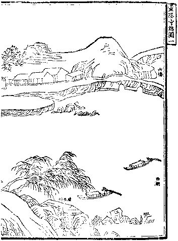



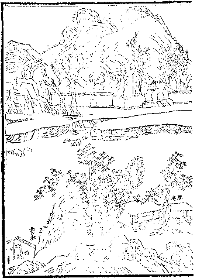



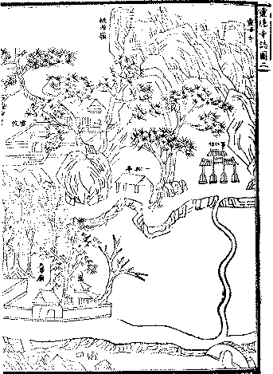



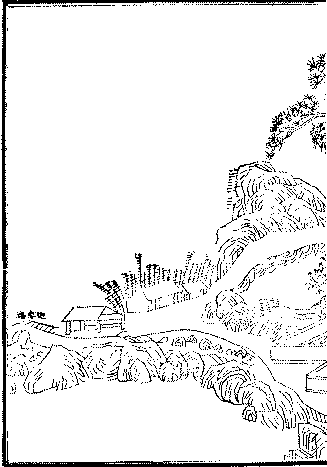



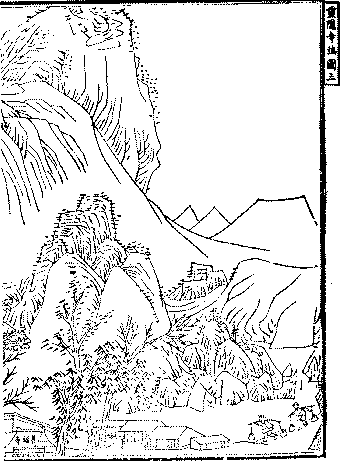



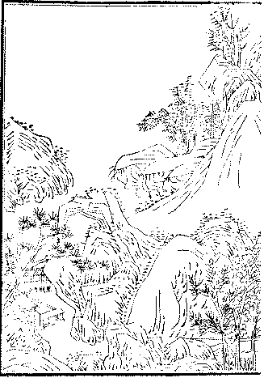



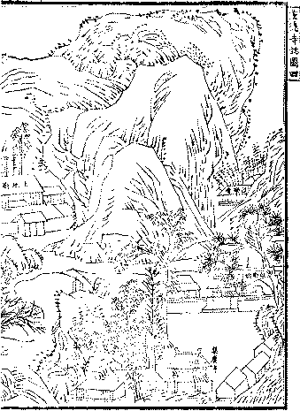



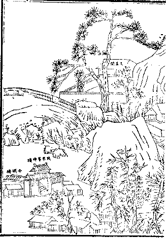



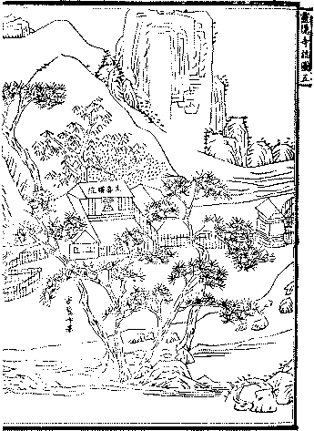



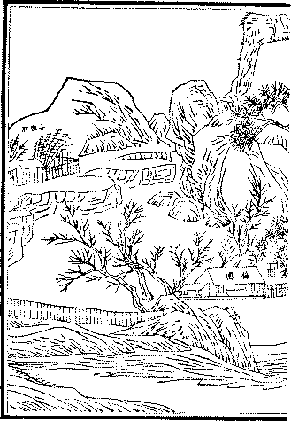



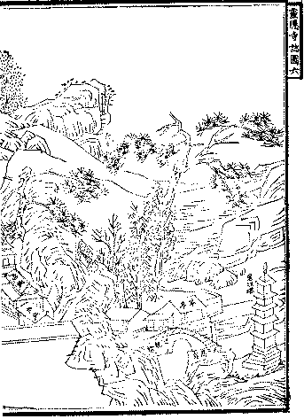



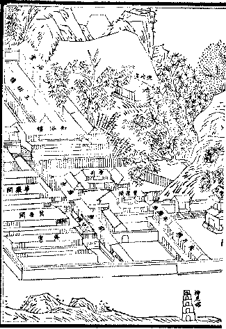



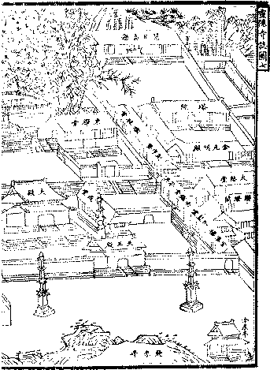



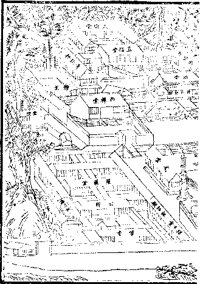



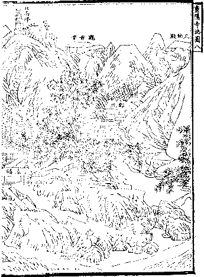



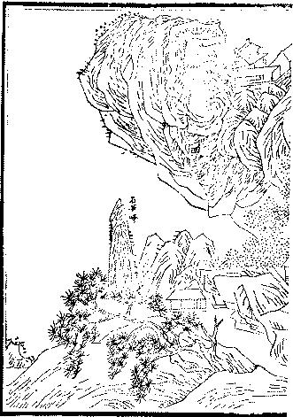



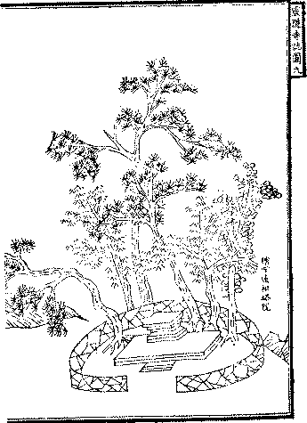



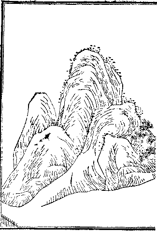



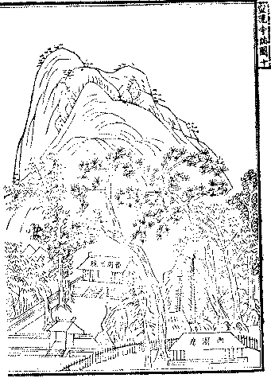



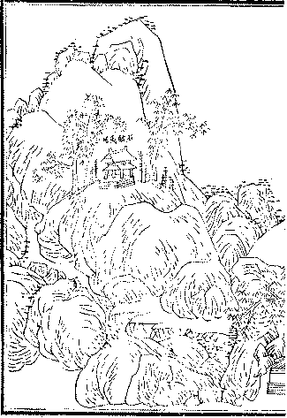



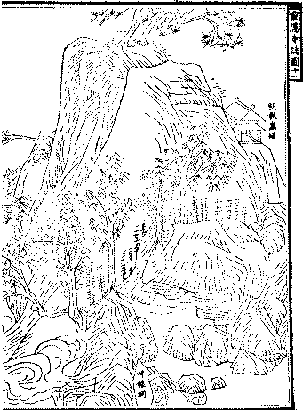



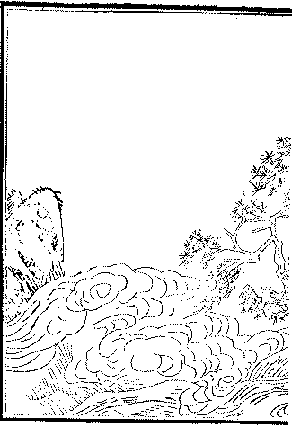



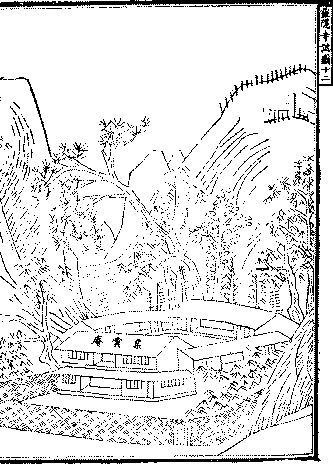



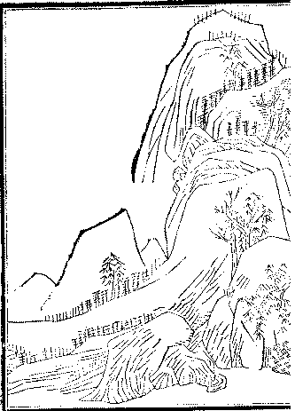



灵隐寺志总目



------



### 序



山图



卷之一



开山



重兴



山水



卷之二



梵宇



古塔



古迹



卷之三(上)



禅祖



卷之三(下)



禅祖



卷之四



法语



卷之五(上)



檀越



卷之五(下)



人物



卷之六(上)



艺文(碑记)



卷之六(下)



艺文(记　序　志　表　书　疏　赞　言　论　铭)



卷之七



艺文(跋　启　塔铭　塔表　行状)



卷之八(附山地数)



诗



遗事



杂记



山地荡总目



旧存



檀施



续置



武林灵隐寺志卷之一



武林西山樵者孙治宇台初辑



吴门而庵居士徐增子能重修



住灵隐第二代戒显晦山校订



开山始迹



原夫西方圣人之教被于震旦也。汉明帝兆金身之梦，白马驮经；康僧会恊舍利之求，赤乌建塔。由是而降，圣教大行。彼方圣贤乘运显迹，或遥空振锡，或随处托生，所在之处，建立道场以保佑君国、利济民生，其心甚远，其功甚大。近代天下大刹在吴越间者，推灵隐寺为首。然开山实自理公，踵其后者岂得忘其所始耶？志开山第一。



灵隐寺在今杭州武林山，去城十餘里。其山控湖扼江，有龙盘凤翥之状，为仙灵区宅。东晋咸和三年，竺僧慧理游至武林，见飞来峰而叹曰：「此为天竺灵鹫峰小岭，不知何代飞来。」人咸不信。理公曰：「此峰向有黑白二猿在洞修行，必相随至此。」理公即于洞口呼之，二猿立出。有此因缘，连建五刹：灵鹫、灵山、灵峰等；或废或更，而灵隐独存，厯代以来永为禅窟，五灯互照，临济子孙居多。今重兴者为具德和尚，是法运使然也。



重兴缘起



吾于兴废之际而重有感乎其人也。古来大刹不一，其始也有善知识以创之；迨其后，至瓜分房屋，各利其生，殿阁荒凉，鞠为茂草，往往然也。今观灵隐，金碧庄严冠于诸方，而亦知二十年前衰落之不堪也。嗟乎！不有住持，其何以寺？不有废者，其何以兴？然则灵隐之废，天之所以开大善知识也。志重兴第二。



昔理公之开山也，固非偶然；今灵隐之重兴也，亦多奇兆。明季以来，寺已废败。本山二十四房，于顺治六年己丑，敦请临济正宗三十二代具德大和尚住持。和尚乃三峰老人之嫡嗣、天童老人之法孙也。天童一棒，当下直捷；三峰玄要，宏畅纲宗。具和尚兼而行之，道风广被；十坐道场，位下法从动以千计。是时和尚在佛日，先有乌程金姓者寓灵隐，梦寺中鼓吹迎大慧禅师至；又僧数辈梦明教禅师嘱迎和尚。更有异者，佛日忽一日至夜半，四无人声，闻伽蓝殿閧然。细聆之，则灵隐伽蓝与佛日伽蓝相争也。于是本山僧众、阖郡护法敦请不已，而和尚于己丑进院。至则慨然曰：「夫所谓道场者，上以庄严尊像、敬礼三宝，使人得以瞻仰；下以键锤衲子、传佛祖慧命；外以接待宰官、居士，内以安置诸执事、一应僧众，寮屋缺一不可。今无歇足处，则鹫岭飞来之瑞、理公开建之功乃至于此！」即率大众，躬亲秉耒，斩棘除壤。凡事先之，不辞劳苦，乃于庚寅冬集料兴工。若法堂、方丈、客舍、僧寮、钟楼、浴室等，次第而成，焕然一新矣。大殿岁久方思修葺，而大殿灾，此岂神天佛祖以为非和尚不能鼎建，而故以是委和尚欤？旧殿高十三丈，度非百万金钱不可就。功程浩大，揆之世情，人咸难之。和尚立排众议，乃发誓愿曰：「大丈夫出家学佛，身非我有。担荷重远，为末劫津梁，顾造一佛殿而便束手卸肩耶？」于是坚金刚心，奋勇猛力，众心既齐，人天协助。所最难办者无如巨材，乃命工师求诸徽、严、常、玉等山。山深水远，卒不能下。不日水大发，从空泻出，咸惊灵异。宰官、护法、檀越施财，贫者用力，役夫助工，其聚如云，其心如火，不三年而殿成。上梁之日，人来观者十有餘万，拥塞如山，咸颂和尚法力，其声如雷，诸山谷应。说者谓：「自建造以来，未见若斯之盛者也。」其餘寮舍，寛敞足以容众，四方来参者岁以万指计，云水往来日以二三千指计。宾客辐辏，无一𡩬晷。使人虚往实归，譬如甘露水，咸得满愿。因缘福报至矣极矣，非真天下大善知识，何以有此？未几，应径山之请，乃请法嗣云居补处，即今之晦山和尚也。和尚具大才，少与吴梅村祭酒同笔研，名籍甚。甲申春，闻李贼破京，恸哭焚书，即以金刚王宝劒斩断葛藤，于千华老人处受具，于具德老人处传法印。日夜究心纲宗，与从前祖师如镜照花、如水和乳，化行江楚。连踞云居、四祖、疏山、荐福诸大祖席。曾著《锻鍊禅人说》十三篇，诸方畏仰。每结制一七之期，必有数人省发。正法眼藏之利益学人有如此。滹沱绝学重开生面，以大展具老人未竟之绪。灵隐重兴固不在殿宇鼎新已也。



武林山水



志灵隐为寺也，而何以及武林？盖先有武林山水而后有寺也。从古圣贤负佛祖慧命、为人天眼目者，往往远城市而居山林，非耽名胜、重道场也。道场为庄严法宝、陶铸衲子之地，岂扰扰名利之薮可得而混杂者哉？故古刹必在名山，不惟使皈心法道者得山水清迥之气以资其禅定，且使遨游山水者瞻仰绀宇以发其道心。然则助道因缘，莫名山若也。乃志武林山水为第三。



武林山水，其载于邑乘、见于游人记咏，亦既详且备矣，而兹何以志之？武林山，峰岭不一，名刹甚多，而世之称灵隐者，必曰「武林灵隐」。说者又以北高峰西麓、寺之所坐之山为武林，则安得有六十里之广？要之，武林是合六十里之山而言之也。孙宇台志云：「武林在钱唐县，发源于天目，森列钱唐。东至赤山埠、进龙浦，西至古荡西溪，北环西湖，南控浙江，周回六十餘里为当。」吾于是知灵隐之得以武林称者。当理公未创寺之前，祗有武林；及理公建寺，武林山亦止一灵隐，故称「武林灵隐」。今之三竺诸刹分踞武林者，皆在灵隐既建之后，是以不闻称「武林三竺」，明乎不得与灵隐抗行也。夫广六十里之武林山，既为三竺诸寺所分踞，则志灵隐寺者不可得而尽举。若就所坐之山而志之，则又非称「武林灵隐」之义矣。吾今就其西山迤逦一带以志之。



其峰则有：



飞来峰



即灵鹫峰也，为灵隐寺案山，以竺僧理公得名，高五十餘丈。此峰中空外奇，玲珑磊块，说者谓其如矫龙、奔象、伏虎、惊猿，堕者将压、翘者欲飞是也；然未能尽其形容也。其石有窍、有罅、有筋、有棱、有如手指攒撮者、有如铁线疏剔者、有如老松皮者、有如虫蚀者、有如蚁穴涌起者、有如蜂房相比者、有如波浪冲激者、有如冻云合遝者。下本浅土，势若悬浮；横竖反侧，非人思想之所得及。石色非青非紫，带白带绿。石隙生树木，甚老甚瘦，辄有无根藤附之。秋有红叶，艳若布锦。坐冷泉亭望去，迥出世外。多生药草，鲜知其名。其从西天飞来无疑，洵武林山之第一峰也。(其洞另详)



莲华峰



在飞来峰西，高起而联属者是也。《水经》谓孤石壁立，大三十围，高百丈。今从下遥望，下阔上锐；从顶视下，其石四面敷开如莲华瓣状，故名。



宰相峰



在莲华峰北下向西，如宰相执笏待漏状。



月桂峰



在飞来峰西。南唐天宝中尝雨桂子，有一子成树。慈云忏主居此十二年。宋天圣中，丁卯秋七、八月两望夜，殿堂左右天降若雨，其大若豆、其圆若珠，有黄白黑三种色，带壳、味辛，此月中桂子也。因取播种林下，浃旬而甲坼，弥月盈寸，绿叶可玩。明年春，移植白猿峰下回轩亭，凡二十有五株。其它桂树甚多，而今无存者，以花时多得烦恼，不去培植，渐至雕尽。康熙五年，灵隐大殿落成。后八月十三日早起，载堂禅师闻屋上历落有声，出而视之，其状圆而长，大逾萆麻子，壳有文，亦相类。大殿、法堂、方丈前后都有。拈取呈具德和尚，曰：「此月中桂子，吾已见过二次。」载公，秦川人，今为晦山和尚法嗣；曾住持石门虎啸寺，曩在具和尚位下。因收贮二合许，将移至秦中种之。时有好事者闻之，咸索观，辄取四五枚去。才至扬州而桂子已尽。骆宾王有句云：「桂子月中落，天香云外飘。」其语不虚，则唐初已落过。然落必有瑞应，具和尚重兴灵隐寺，十有七年间凡三见矣。



白猿峰



理公尝畜白猿于此。



稽留峰



在莲华峰。峰形正不偏，无别峰。迤逦、倾昃、突兀之状，俗譌为「鸡笼山」是也。



北高峰



武林山左支之最高者，自下至顶九十二丈。樵蹊陡峻，以曲折为湾，共三十六湾。登绝顶瞻眺，群山孙列，湖水镜涵；江流折为带环，海色宿为莽沆，真大观也。上有五显庙塔一座。



乌石峰



在北高峰西，上有乌石，故名。昔赵清献判夺法安院归灵隐作形胜，又名「形胜山」。



龙门峰



在乌石西，上有石对峙如门。



西原峰



在龙门西南，武林水北涧发源处也。



双桧峰



在龙门南，上竺右山也。上有双桧，望之如盖。



白云峰



上竺坐山，常有白云覆其上。



中印峰



在上竺左。昔宝掌开中竺山，掌乃西域五印度之中印人，故名中印。



乳窦峰



山下有乳泉，白色。



狮子峰



与中印峰左右相夹，为上竺路也。顶有奇石，状如狮踞。



香罏峰



善住峰



善住峰与中印相连，因宝掌住世故名。《悲华经》：摩尼太子成道，号「善住珍宝山王」。



其岭则有：



驼𪩘岭



北峰东，尽处宛如驼肩，今作桃源。



石人岭



北峰西，高六十二丈，路屈曲如羊肠，通西溪。



东墓岭



通黄山。



枫木岭



中印峰路。



白沙岭



以沙白得名。通梵村。



郎当岭



又名「扪壁岭」。左迫削嶂，右临深溪。缘木扳萝方可举趾，故称「郎当」。又上为天门，东通龙井、南通五云。



幽淙岭



深壑泠泠，巉石齿齿，陟此者须前后牵挽。草树周密，仰天一线，俗名「水出岭」，与郎当岭接。



东岭



下竺东大路。



西岭



道标和尚结庐于此。



仙芝岭



月桂峰下，南北二山通衢，俗名「胭脂岭」。



黄泥岭



胭脂岭餘气。



其坞则有：



於家坞



雷院西，玄本塔基。



水冈坞



在北高峰，水从东下。



巢居坞



溯涧而西，达韬光。许由夏则巢居，又云：「巢父所居」，故名。



大桐坞



乌石峰西。



石人坞



石人岭下。



白沙坞



白沙岭下。



桐木坞



枫木岭下，旧有吴寺，通中竺。



腾云坞



上竺后，通白云峰。



杨梅坞



废兴福寺路对上竺(兴福旧名「弥陀教院」，得月辉老宿重兴。)



永清坞



对中竺，内有庵，名永清。



神道坞



与下竺对。



慈云坞



以慈云建塔得名。



葛坞



葛井处也。



活沙坞



上至天门，诸山下伏。



水竹坞



珍珠坞



瑞冈坞



鹞子坞



其洞则有：



龙泓洞



前当回龙桥，后通冷泉涧，㟏岈悬霤、挂碧涌金，似真非真。内有通天处，漏天如井，后人题「通天洞」三字。其侧有小洞，底地无垠，传闻昔有采石乳者入之不已，闻篙橹、风浪之声，谓度浙江、通萧山者，即此洞也。内有蒋之奇篆书(未见)、贾似道题名(见后卷八)。唐丁飞宅於中。



玉乳洞



一名岩石室，一名罗汉洞。吴赤乌二年，葛孝先于此得道，后人就道畔凿住世罗汉十六尊。其回旋曲折，小有蛮蜗；涓滴沁凝，大旱不竭。岂上仙蜕白石之茧而龙鼻为大阴之户耶？



射旭洞



一名青林岩，即理公岩，有唐杨遵篆书三大字见石隙，乃理公燕寂之处，又名燕寂岩。其下四极三门，鳌撑而立；其上丰额险足，龟壳犹存。外视则洞可容百数人，内视则岩可树百椽屋。藤萝联络，峰石纵横，无愧署书「八面玲珑」四字者也。内小石有「金光洞」字，侧有周伯琦篆书〈理公岩记〉一碑(见文内)。山多槠桂，木叶常青，凌冬不雕，故曰青林。又曰香林。



呼猿洞



在莲华峰麓，即慧公验飞来峰处。六朝宋时有僧智一访旧迹，畜猿于此。其洞门甚狭，侧身乃容；内广堂皇，㝠如长夜。又一洞，炬火伛行数百武，或高平如砥，或𫜬䶦如牙。又一洞，非螣蚺不入，故人惮而未详。



金佛洞



飞来峰南，下竺薝卜堂后。



香林洞



亦名香桂林，黄初庵有诗。



圆公洞



三生石侧，为圆泽会处也。



其岩则有：



龙泓岩



在龙泓洞，洞有室曰岩。



青林岩



在青林洞。



理公岩



理公燕寂处也。



玉女岩



飞来峰顶，一名新妇石。岩下石罅有水如玉。女潭也



日月岩



在下竺山，一圆如日，一半湾如月。



虎头岩



在莲华峰下，虎头禅师以此为号。



千岁岩



以宝掌为名。



天香岩



在中印峰山半，又名百岁岩。



白云岩



永清坞新庵。



百丈岩



双桧峰后。



乌石岩



白云峰后。



其石则有：



石莲



即莲华峰也。



石梁



在飞来峰顶，长一丈，亘石上如梁。



三生石



(下竺右。)



水波石



(下竺后。石上有水波纹，旧时江水至此。)



鬬鸡石



无考。



卧龙石



慈云种梅其上，其诗有「梅有和羹实，龙无为雨时」之句。



一指石



龙泓洞旁。



石笋



乌石峰山半，高数仞，周可七八抱。圆峭特立，亦名卓笔峰。



石室



在韬光山后。真观坐其中得道者名「头陀石室」，理公岩下者名「岩石室」。其一未详。



狮子石



韬光山后，高数仞。



石人



在岭上。近视如将军戴铁笠之状，远望又如幼女双髻也。



棋盘石



在永清坞中，高数丈，色赤如丹，广丈许，平如砥。尝有老僧谓：邵山子埽叶林中，得石棋子。



醉石



方广一寻，在洪有竹园浴莲池侧。主人以其平踞可觞咏也，名曰「水台盘」。白珩〈灵隐记〉曰：「至是搜名胜而此石以小见遗。夜梦人指曰：何忘醉石也？」



其栈则有：



伏虎栈



陆羽《二寺记》言：「灵隐涧中奇石，后为朱勔取去。」



连岩栈



飞来峰顶，石级犹存。白子佩原志谓：连云栈与伏虎栈皆峰麓奇石，杨真伽凿为佛像。



其水则有：



南涧



一会支涧七。



南发源于五云山，水出岭。



西合上竺两山支涧，径灵隐房小桥合流，过五云山路小庙桥，又合观音井水，经时桥(汇水阴沟)，出金佛桥(在普门内)，过天岩房桥。



东合杨梅坞支涧，出琮老桥(僧琮建)。东合中竺永清坞支涧，北出中竺寺桥。东合下竺神道坞支涧，北过下竺寺桥。东合月桂峰支涧(三水横出如川，名葛洪水)，过慈云北涧，出飞来峰，至龙迹桥会北涧。



北涧



一会支涧十。



发源于西源峰，南合白沙坞支涧，西合永安支涧，西北合大桐坞支涧。流过吴寺桥西北，合乌石峰水，南会呼猿涧暗水。南合冷泉水源、北合石笋支涧。又北会金沙、银沙支涧，又北合韬光支涧。东流过曹家桥，渟汇于灵隐石门涧，经瀑雷桥(今废)、回龙桥，会南涧水于合涧桥下(旧桥三洞，今修)，曰灵隐浦(南宋通舟至此)。北合水架坞支涧，西流过白乐桥，北合瑞云坞水，经雷院名「后涧溪」。出唐家桥东南，趋西行春桥、迳东行春桥、迳金沙滩里五桥，汇为西湖。



其泉则有：



冷泉



相传在莲华峰麓，今在寺前。堆蓝漾碧，冬夏常盈。池旁有嵚𡼭空洞，形家以招提拥北高而面飞来，宜汇此涧，置闸以蓄水。建亭其上者，唐刺史元藇；广池者，宋僧如璧也。



温泉



在冷泉之上首，今涸。



涡渚泉



临安志云：在东屿。



卧龙泉



在涡渚侧。



醴泉



在涡渚右。大历六年出，酌之疗疾。



萧公泉



在寺右。



伏犀泉



在飞来峰顶。



璎珞泉



下竺后岩。元时竭僧允若祝曰：「吾缘在是，泉当再来！」已而泉出。



莲华泉　跳珠泉



此二泉疑在慈云塔院处。东坡有〈和周次元跳珠泉诗〉。



上永福



(刘宋，慧琳禅师开山。明弘治间，洪水堙废。顺治间，静照法师重兴。)



金沙泉　银沙泉



俱在上永福，二方石池现存。



观音泉



上竺为大悲泉，在讲堂下，流绕殿前，经如意池。池以青石阑之，方丈许，石面镂如意文。



梦泉



宋崇宁元年，浙西大旱，寺中厨水不给。主僧玉法师梦泉发于西坡，凿之果得。



荟泉



在双桧峰。



华光泉



在白云西院。



凝翠泉



在狮子峰下。



水月泉



在中印峰前。



孙公泉



《上竺志》谓孙思邈。



玉液泉



永清坞。



小龙泓泉



阎妃墓侧。



白公茶井泉



在形胜山麓，旧铁秀庵处。



龙王泉



(康熙辛亥夏大旱，韬光道上涧泉尽涸。忽於龙王祠前迸出一泉，充润常住，真龙神赐也。)



其池则有：



蘸笔池



在本寺东廊下，丁行者学书处。



茯苓池



在本寺西，僧堂㔉苓成池。



金莲池



在韬光。



福泉池



下永福寺，福王建亭其上。



云液池



在白云峰。



七星池



中竺殿前。



金波池



集庆寺后。



其井则有：



葛翁大井



普福寺后。洪丹井，天下凡十三，而在杭者三。此与下竺井为二，其一则在龙井翁家山。有坛在雷院庆化山，所植松在履泰将军庙。



天泽井



天泽井，履泰将军为天泽侯，此其井也。



武林灵隐寺志卷之二



梵宇



昔佛以正法教天下，而复立像法者，以正法深微幽奥，初心难测；有像法在，使转轮与听法者皆于是乎准焉。故必建寺，寺者聚也，言三宝之所聚也。入门列四天王者，表护世功在前也。中坐慈氏者，表当念即可入一生补处位也。向内建韦天者，尊其道肃三洲、向佛而拥护也。三世佛者，表三际代禅而觉体不动也。殿中左右列应真、诸天者，表真俗二谛互显中谛也。观世音拥于殿后壁者，普门示现也。后有楼阁者，普贤万行为诸佛之长子，而因缘果满也。像法之大义如此。又闻一千年像法，后五百年灭坏。今灵隐在像法灭坏之秋，具和尚独力鼎新，功勋莫大焉。为志梵宇第四。



寺自晋咸和间，理公开山。山门榜曰「绝胜觉场」，葛洪所书。正殿曰「觉皇宝殿」，为宋理宗御书。五季、隋兴废莫考。至唐初，自宋之问咏灵隐诗，承联未就，遶廊行吟；骆宾王时避祸，隐于僧，乃续曰「楼观沧海日，门听浙江潮」。之问欣然用之，灵隐之名大著。大历六年修，会昌废教，寺毁僧散。后稍兴复，规制未宏。至吴越钱忠懿王，国富民殷，命永明延寿禅师重为开拓，殿宇一新。建石幢、二殿，仍觉皇之旧。殿后为千佛阁，最后为法堂。以东空建百尺弥勒阁。宋真宗景德四年，赐称「景德灵隐禅寺」。南渡后，高、孝二宗翠华屡幸。理庙亲洒宸翰，增辉山水，当时号称禅窟，为五名山之第二山焉。改法堂为直指堂，赐直指堂印。元至大元年，殿岁久蠹朽，住持正传撤故为新，皇庆元年落成。至正己亥毁于兵。癸卯，住持辅良始建方丈、伽蓝堂。明洪武十七年，住持慧明重建觉皇殿。永乐元年，僧善才募施，装塑大佛、诸天及诸供具。宣德五年闰十二月八日，觉皇殿灾。九年，住持昙瓒建左右翼门；住持良玠重建正殿，复还旧观。隆庆三年三月毁于雷火。万历壬午，住持如通开讲说法，士庶云集。五年鸠工饬材，百废具举。以癸未冬十二月始事，越五年落成。殿倣唐式用柱，平头四十八，石柱十六，易名大雄宝殿。越今六十餘年，寺穨废，存者十无一二。大殿、直指堂、转轮殿，亦仅存而已。大清御世，顺治己丑春二月，各房僧众暨外护，合力敦请具德和尚住院。和尚相随数百僧，戮力缔造。庚寅营造方始，堂室次第鼎新。戊戌三月廿六大殿灾，天将以除旧布新属和尚也。辛丑七月十七日，大殿与天王殿同日鼎建。十八年间营造，无不高大宽敞，丹碧一新。凡为殿者七：天王殿、大雄宝殿、藏殿、伽蓝殿、罗汉殿、金光明殿、大悲殿。为堂者十二：祖堂、法堂、直指堂、大树堂、东禅堂、西禅堂、东戒堂、西戒堂、斋堂、客堂、择木堂、南鉴堂。为阁者四：华严阁、联灯阁、焚香阁、青莲阁。为轩者三：面壁轩、青猊轩、慧日轩。为林者一：玉树林。为楼者三：响水楼、看月楼、万竹楼。为房、为室、为公所者十：双桂室、香积厨、圃室、浴室、各寮房、公所。而钟楼增建为古百尺弥勒阁。计自斩荆诛棘，以迄落成，辛勤瘏瘁二十餘年，致殿阁巍峩，堂寮鳞砌，佛像严丽，金碧辉煌。从内至外，无一殿一堂、一楼一阁、一房一舍不脱体斩新者。虽曰重兴，实同开创。盖代功迹，古今未有也。大殿、天王殿、钟楼，皆募檀信；其餘都积香信为之。钱粮鉅万，一时凑集。真千年香火、万年常住；临济光明、三峰法道永久不替。晦山和尚补五载之内，完飞来峰牌坊，建具和尚慧日塔院，置普同塔三座。其他未竟，容次补入。



开列新建殿堂、楼阁、寮舍、庄院名目



大雄宝殿



高十三丈五尺。规制宏敞、丹雘精丽，不减化乐天宫，为九州名山之冠。顺治辛丑年七月十七日建。



天王殿



高七丈。辛丑年七月十七日与大殿同日建。



轮藏殿



顺治庚寅春移建于东首钟楼南。



伽蓝殿



康熙壬寅秋建于华严阁右，即妙应阁旧址。



罗汉殿



五十四间。顺治戊戌冬建于西禅堂之下。



金光明殿



九间。顺治乙未秋建于蘸笔池上。



大悲殿



六间。顺治戊戌春建在联灯阁后、蘸笔池前。



祖师殿



八间。顺治乙未冬建于罗汉殿之下。



法堂



高七丈二尺，五间。顺治戊戌十二月十日建，宋时指心堂。明正统间僧玹理建，毁。万历乙酉僧如通建。大殿灾后，具和尚先建法堂于殿后，是指心堂故址也。　下戒坛一座。



方丈直指堂



高六丈七尺。癸卯年十一月十日建。



面壁轩楼



七间，高三丈七尺。顺治十三年冬建，在方丈之左。



青猊轩楼



六间，高三丈六尺。顺治十四年冬建，在方丈之右。



小方丈楼



上下一间一路。癸卯年建，在青猊轩之左。



静室



四间，高一丈二尺。在小方丈楼之右。



东耳楼



一间一路。



狮子窟



高一丈八尺，六间。在方丈之前。



大树堂



因西栗树为西晋慧理祖手植，巨数十围，枝干参天，置堂其下。高二丈一尺，五间、两厢。乙巳九月二十八日建，在方丈后，即见山亭故址。初为茅篷，今为瓦屋。



东禅堂



五间。顺治十五年秋建，在法堂之东。



西禅堂



五间，厢房二间。顺治己亥春建，在法堂之西。



慧日塔



重兴灵隐具老和尚肉身在此，五间。康熙戊申秋晦山和尚鼎建，即慧日轩故址。



南鉴堂



六间。康熙壬寅秋建，在联灯阁之右。



斋堂（今攺楼名香积）



七间。顺治壬辰冬建，在山门之左。



联灯阁



五间。在华严阁后。以二学人同日得悟，故建。



华严阁



五间。在梵香阁之后，康熙壬寅冬建。



华严阁厢楼



九间。壬寅冬建，同日与华严阁上梁。



华严阁小方丈



上下一间。壬寅冬建，与华严阁同日上梁。



青莲阁



即集翠楼。顺治辛卯秋建，在华严阁之前。



梵香阁



在斋堂之后，五间。顺治丁酉秋建。



嫩桂堂



十间。顺治乙未秋建，在东禅堂东侧。



玉树林



九间。康熙戊申秋晦和尚建，为慧日塔院之左辅。



法寿堂(即经书寮)



七间。康熙戊申秋晦和尚建，为塔院之右辅。



官客楼



五间。康熙壬寅冬建，在伽蓝殿下。



官客公所



五间，厢楼五间。顺治乙未秋建。



响水楼



在香积楼之前。



万竹楼



在公所西。因竹取名，今为妙应阁。



钟楼



顺治壬寅夏建。在藏殿之上，古百尺弥勒阁处也。



看月楼



五间。顺治辛卯秋建，今为米库楼。



直岁楼



两间。顺治辛卯冬建。



厨房楼



四间。顺治辛卯冬建。



厨房



七间。顺治丁酉秋建。



库房楼



五间。顺治庚寅夏建。



知浴楼



五间。顺治丁酉秋建。



浴寮



五间。康熙壬寅秋建。



杂务寮



九间。顺治丁酉秋建。



柴房



三间。顺治丁酉秋建。



菜园



七间。中奉无著禅师塔，有二厢房。



梅园房



五间。新增建。



择木堂



在祖师殿之下，五间。



茶房



在南鉴堂之上。



普同塔院



三间。二脇楼三间，厢房四间。康熙丁未夏建，在天圣院之侧，具和尚同晦和尚建。



总管殿



三间。迁于东冈之上。



柴寮



在澑砂岭楼，五间。佛堂五间，厨房浴室三间，两厢房四间。顺治辛卯春建。



宝胜庵



即放生所在金沙滩。佛堂五间，厨房四间，生所五间，柴房二间。顺治乙未秋建。



松木场(下院大悲庵)



楼房五间，康熙二年置。厢房一带，晦和尚增建。



江干下院接云庵



楼房五间，平屋五间，厢房四间，茶房三间。顺治十六年建。



明万历癸未易庵建置附载



山门为最胜觉场，左曰东林会胜，右曰西竺分奇。进为天王殿，金刚四列，峙中弥勒。又进为正殿，所谓「唐殿式」者也。中奉三世尊佛，后为五百罗汉。涌壁后列十二圆觉菩萨、梵王帝释、十八尊天。又进即旧铁塔，建藏轮殿三。又进，旧法堂五，僧玹理建而易庵重修之也。又进，上坡为方丈、直指堂，元辅良所重建者，易庵以为法堂也。其餘伽蓝殿之在左，祖师堂之在右；改安遇堂为莲峰堂，改千佛阁为三藏殿，亦约略可得而数焉。



明宣德七年旧志本山寺基号址附载



维字一号至十号、十一号。



旧有山九十八亩三分。



民山一十五顷七十八亩八分。



东至集庆寺墙，西至上永福寺路，南至飞来峰顶，北至北高峰各分水为界。



本县本寺官民田山共一百九十八顷九十八亩八分九厘一毫。



今昔虽殊，附载于此以存旧也。



元赐还九里松行路碑附载



> 长生添气力里、大福荫护助里、皇帝圣旨：浙江行中书省行御史台官人每根底、廉访转运司官人每根底、迹赋总管府官人每根底、军官每根底、军人每根底、城子里达鲁花赤官人每根底、各枝儿目每根底、众和尚百姓每根底、宣谕的圣旨。



语虽不可句，然亦以见一代典制，且知九里松之属灵隐，唐宋以来未之有改也。



宋天圣三年皇太后赐钱买田数附载



收买杭州钱唐县山林田土五顷。  

盐官县思亭乡水田一千顷。  

秀州崇德县积善乡水田一千顷，并免秋粮、夏税。



宋天圣三年中书门下牒附载



杭州灵隐山景德灵隐寺住持僧禅定大师延珊奏：先奉皇太后圣旨，宣赐庄田，祝延今上皇帝圣寿，今已五年。累设过斋僧粥食四十餘万，祝两宫圣寿。其田土，见今供纳秋夏二税，䌷绢三十四疋、赤线贰十一两贰钱、米共计七十三石七斗，系属杭州、秀州两处乡县，乞与放免上件税物，取圣旨。牒奉𠡠：宜令逐州子细勘会，如委实是宣赐庄田，据合纳夏秋二税，并与放免，即不得将不系宣赐田土税一例放免。牒至准𠡠，故牒。天圣八年十二月六日牒。　工部侍郎参知政事王(曾)、给事中参知政事薛(奎)、给事中参知政事陈(尧佐)、吏部侍郎平章政事吕(夷简)。



其后洪武中，僧淳朋以时代移易，献还朝，复赐三千亩，先𠡠见存。后徐华亭相公当国，僧大茂以田被占奏闻，至今本寺管业也。附志于此，以见累朝恩遇，本寺基产不同于他山者如此。



旧志灵隐别业附载



种德庵坐落松江府青浦县师字圩。



宝寿寺坐落本府餘杭县。



大遮山庵坐落本县崇化乡。



永寿院坐落本府富阳县。



桃源寺坐落本府临安县。



唐宋以来灵隐殿室旧名附载



绝胜觉场



觉皇殿



回廊



延宾水阁



百尺弥勒阁



一笑轩



交芦室



妙应阁



安遇堂



千佛殿



莲峰堂



直指堂



妙庄严域



见山亭



面壁轩



其名列此，详见〈古迹〉。



旧志诸僧续剙庵房附载



归云庵



双桂庵



净居庵



天香庵



库司房



已上寺东。



无垢院



蒙堂



选佛斋



祇园



幻隐庵



普觉庵



涵泽庵



涧西庵



一默庵



慎庵(即岣嵝山房)



已上寺西。



韬光庵



白云庵



华光庙



元帅殿



永安塔院



已上方丈后山半至顶。



古塔



西域尚火葬。佛灭度，舍利盈斛，在在处处皆建塔以供养。长干塔乃赤乌二年康僧会西向顶礼三七日求而得之者，为震旦佛塔之祖；中有小塔，藏佛舍利，时放光。四明阿育王塔舍利，随人根器，色光不一。松江龙华塔，每岁八月望夜，万塔来朝，于水中见光芒万道，交暎如蛇如虹，不可形容，此又塔之王也。后世僧殁茶毘，凡有舍利者皆得建塔。又有肉身建塔院者，自四祖、五祖、六祖来旧矣。灵隐自理公以来，建塔至多。为志古塔第五。



唐塔



理公塔



在龙泓洞口，砌高三丈。万历丁亥六月为霖雨所圮，中获石刻云：「开宝八年募众重建释迦砖一座，在清遶桥灵山里。」则回龙桥旧名清遶矣。又有铁小塔一、铁盒一，内沈香四片、帛一方，触手如蝶翅。阅庚寅二月，僧如通重建，开其基，见一孔，甚坚，以手探得陶龛之底，遂复封瘗而藏之。郡人虞考功湻熙为之铭。



隋塔



神尼舍利塔



在飞来峰顶。隋仁寿二年，遣僧赍舍利至此，相基启土，㔉得石坎，以舍利函纳之，不差尺寸。按神尼乃同州般若寺尼，名智仙。隋文帝始生，尼知其贵，太祖委尼保育。一日皇妣来抱，见儿成龙形，惊坠地。尼讶曰：「谁惊吾儿，致令晚得天下？」及帝长，即位后，令天下造佛塔，而以尼舍利函遣僧至灵山建塔焉。



真观塔



在东冈岭，观法师手所标葬地也。久圮，宋慈云募王钦若重修，甓甃甚工。慈云有诗以识，其序曰：「上门自开，一无遗物，不知全身随多宝以证经乎？象佛垅以化往乎？」今塔有石凿，一僧坐其中，像亦甚古。



唐塔



鸟窠禅师塔



古云在灵隐山，见孤山知圆〈白莲社主碑〉。然鸟窠塔今实在凤林，想移去也。仍旧志姑存之。



北高峰塔



唐天宝中建，高七层，藏古佛舍利。会昌时毁，大中年复建。吴越武肃忠懿复重修之。宋至道二年毁於雷火，元丰间圆明大师重建。咸淳七年毁，继又建。万历间存烬餘三层。今於顺治壬辰年复圮。



修证了义法师塔



在废天台。



吴越塔



无著禅师塔



旧在石人岭。天复二年，宣城贼田𫖳等纵兵发师塔，肉身不坏，爪发俱长。武肃王遣禆将邵志重加封瘗。宋杨沂王毁塔，迁葬灵隐无垢院。韩𠈁胄取为生坟，遂启陶龛，容色如生，发垂至肩，指甲缠绕，三日不坏。顺治庚寅八月，具德和尚治圃室于寺东，举镢而陶龛𡎺破一穴，见有禅师端坐，发爪围绕，四大如生。寺中耆宿咸谓是无著禅师。具和尚急命封掩，为凿石建塔，覆以塔院五间，置香灯奉事焉。



宋塔



瑞光卧塔



月桂峰下。慈云示寂，有大星堕地，因葬其地。



延珊禅师塔



在废天圣寺。



普慈大师塔



即幻旻也。契嵩为之铭，在呼猿涧北。



永安禅师塔



旧为契嵩之退居，即其地建塔。因茶毘五种不坏，号「五相坚固之塔」。具德和尚重修。



玄本禅师塔



在瑞云别院。



白莲社主塔



为圆净大师，名省常。远嗣庐山，唱教西湖。鸟窠禅师塔侧。



南宋塔



瞎堂禅师塔



在废天圣寺。明初被某指挥乞葬其地，及发塔不克，至以火炼其石，石亦不裂。计力已穷，遂於塔后数尺许下葬焉，乃令以塔为祭石也。



懒庵安禅师塔



在永安院。



松源禅师塔



在北高峰麓。



石鼓禅师塔



永安院侧，具和尚重修。



铁牛禅师塔



在□□处。



妙峰禅师塔



在寺西冈。



元塔



普觉朋禅师塔



即淳朋禅师普觉房山后。



良用贞禅师塔



在灵隐归云庵。



明塔



幻隐禅师塔



在幻隐房。



见心禅师塔



在天香庵。



忻悟禅师塔



在东冈。



无文禅师塔



在双桂庵。



可淳禅师塔



在涵泽房。



幻庵修禅师塔



在永安院侧。幻庵，本寺八十五代住持。



慎庵祥禅师塔



在祇园房。有〈广原行业记〉。



昙瓒师塔



宣德年住持，兴建大殿者。



北峰赞塔



在涧西。



月用禅师塔



师俗姓江，与弟之浙，俱以文章、道义自命，故钱唐有二江也。师厌弃尘俗，即时受具出家，参无上义。行脚几载而示寂灵隐。具和尚即命塔於妙应梅坞，而属净寺豁公为之举火。同时会葬者数十百人。所著有《蝶庵集》行世。



古迹



从来名山胜地必多古迹，此皆前人眼光所射、神情所注之处。即岁久湮没，其名尚存，人至此无不为之徘徊，思得一见焉；而况名山如武林、大刹如灵隐者乎？或为仙真栖托，或为帝王游幸，或为仕宦莅止，或为大家别业，或为名人名士登眺品题其处，至今有可得见、有不可得见者，一一备列。为志古迹第六。



山门二石幢



高十许丈，凡十三层。用铁镕灌，坚不可动。吴越王大元帅建。周围列〈尊胜咒〉。



丹墀二石塔



高可五七丈，九层。上有石扁，书「吴兴广济普恩真身宝塔」十字。二塔所题皆同，而无年代日月。山中旧物，所存唯此。其塔八方，下刻〈佛顶首陀罗尼〉，二塔皆同。按契经陀罗尼者，此云总持。其曰广、曰普者，《显密圆通经》谓陀罗利益有十，如护国、寿民、时和、岁丰、疾疫、刀兵、恶兽、鬼魅、五无间、十恶逆皆灭，故云广普也。曰真身者，陀罗尼乃三藏之秘密、佛之真身所在。又凡宝塔中皆有多宝佛真身也。又按佛塔有生身、碎身、全身、真身者，《成论》云：「乘如实道来成正觉，此真身如来也。」合三说而真身之义得矣。塔上所镌佛皆梁像，此或惠理之后、六朝僧所为耳。其无岁年者，岂以朝梁暮陈故耶？



西部都尉治



在武林山。



钱唐县旧治



《水经》：灵隐岩有钱唐故县。西汉有钱唐，东汉无钱唐，於晋复有县也。



左军教场



宋设在行春桥北，即部司前军寨。



飞来峰坊



笑翁堪辟寺前屠沽之地，为立关建坊也。



二寺门



即天竺灵隐牌坊，袁居中书。今飞来峰坊稍下、跨大街。白乐天诗云：「两寺原从一寺分」，是也。今址尚存。



袁公松门



跨路如一字然。吴说为书「九里松」三字，今作「一字门」者非。



冷泉亭



唐刺史元藇建。白乐天书「冷泉」二字，东坡续书「亭」字；今董宗伯其昌重书。陈徵君继儒书对，用王维「泉声咽危石，日色冷青松」之句，最合。



客儿亭



客儿，灵运小字。卢元辅诗「长松晋家树，绝顶客儿亭」，是也。一称「梦谢亭」，杜明甫为灵运建。



袁君亭



后人思慕袁君建。



见山亭



唐给事卢元辅建，在灵隐寺后山半。群山奔赴，皆供目睫，故名。一曰「巢云」。



虚白亭



元和间刺史相里君建。沂溪傍口，林泉豁爽，故名虚白也。



观风亭



裴庶子棠棣建，在虚白亭又西(同上虚白亭俱在包园)。



候仙亭



韩仆射皋建，在观风亭又西。自见山以下四亭，并冷泉亭为五亭也。



紫微亭



紫微舍人唐询建，在灵隐寺前。



壑雷亭



在石门涧上，宋安抚赵与𥲅建。



紫微亭



韩世忠忤秦桧，解枢柄，逍遥湖上，最爱此山，故建此亭。邵古庵曰：「绍兴十一年冬岳飞死，十二年三月韩公即建此亭；谢兵柄时独游焉。」按岳飞有〈登池州翠微亭诗〉曰：



经年尘土满征衣　特地寻芳上翠微  

好水好山看未足　马蹏催趂月明归



韩当时忆岳此诗，故以名亭，而亦隐痛之也。亭在飞来峰半。



春淙亭



合涧桥，见贝琼〈记〉。



清绕桥



吴越时名，今称回龙桥。



东西行春桥



东在曲院，西在九里松也。



合涧桥



南北涧水会于桥下，故为合涧也。



瀑雷桥



在冷泉亭上。



石桥



亦谓石梁。飞来峰顶，近翻经台。



杜明甫宅



在飞来峰。



丁翰之宅



在龙泓洞。



颠仙庐



颠仙姓郑。在呼猿洞口。



紫芝道院



宋咸淳间，道士陈崇真卜居于此。北高峰东，俗名庆化山。



朱墅



梁隐士朱世卿别业，在九里松。



邺公庵



宋守祖无择建，在石笋峰。称邺公者，是其封号未可知也。有苏子瞻、秦少游、黄鲁直留题，文与可畫竹在焉。



香林园



苏仲虎尚书园，在九里松。



班衣园



韩世忠别墅。



书藏



苏和藏书之所。



岣嵝山房



灵隐涧西。李元昭结庐于此。



丹灶堂



葛洪炼丹之所。



思真堂



许迈宅。



九师堂



一曰隐居堂，陆伟建。伟读《易》於此，为淮南九师也。



西岭草堂



道标所居。



东岭草堂



慈云忏主之所建也。忏主名遵式，僧伽不载而独载此者何也？僧伽止载灵隐僧，慈云行虽高，例不得列。若其遗迹，则所谓「两寺原从一寺分」，安可以不列也？是故七叶堂、九品观堂，咸得类见焉。



七叶堂



白乐天诗有「宜人七叶堂」之句。



金光明忏堂



建炎三年，帝狩台州，至金鼇山，寂然空静，惟闻广殿香清。有白发老僧祷诸天於佛前，忧时保国，语意诚笃。帝悦而问之，对曰：「此护国金光明三昧忏也。」是后驻跸杭州灵隐诸巨刹，咸赐金帛修金光明忏。今其基在梅园，是高宗所建也。



九品观堂



在天圣寺，疑亦慈云所建。



翻经台



谢客儿于杜明甫翻经处。



饭猿台



在呼猿洞口，广丈许，高二尺。僧智一居此畜猿，好事者每来施猿食，故有台也。



无量寿阁



灵鹫山侧。



轮藏阁



本千佛阁，明万历时重建。中置转轮以奉法宝，计六百三十八函。董公宗伯其昌匾曰「轮藏阁」，故从今名也。



百尺弥勒阁



在旧东廊之外。



延宾水阁



在石门之东，背山而临水。



望海阁



北高峰顶，苏东坡有诗。



滴翠轩



在灵鹫寺。



一笑轩



见孝宗御语。



岩石室



即理公岩室。



交芦室



即远瞎堂所居。



明真宫



在九里松旁，宋嘉定中建，宁宗书匾。疑为道院也，并驼𪩘岭，下至灵隐，左右各建置，不一其所。流传者如兴福院、资德庙、万寿院、灵曜观、崇寿院、升僊宫、多福院、大明寺、永清寺、履泰将军庙。或为兰若，或为道院，或为香火院，或为土地祠，略为疏记，不能尽详也。



天医波利多院



在飞来峰。宋淳熙间，天医菩萨显化之迹也。



铁舌庵



灵隐寺内。惠远茶毘，舌不化，为铁舌。



韬光庵



以韬光禅师得名。庵有金莲池、狮子石、乌峰。吴越王改建，名广严庵。大中祥符间复改今名，有丞相陈尧佐题。



白云庵



在方丈后。僧清觉，孔子后，号本然，居此。



天圣寺



灵隐寺内。



灵峰院



水堈坞内。宋时建，今废。



无垢院



寺后方丈处。



海峰庵



亦在本寺。



华光庙



在北高峰顶，以奉五显神者。宋嘉定中，范师孟事颇著奇异，详见《碎录》。



元帅殿



在北高峰山半，以祀潮神。



总管堂



灵隐寺内。旧时勅封王念二总管，不在十八伽蓝之列。



陈明大王祠



在北高峰麓。王姓陈，名泽，本餘杭令。



东坡祠



在灵鹫寺。邦人初祀公苏隄，吕惠卿奏毁之。此又寺僧所建也。



土地过海大王祠



在月桂峰麓。传言钱王子有坟在坞内。



辇路



路砌为墄者，南宋时为翠华幸临也。今制存旧曲院路，赵安抚与𥲅新堤，从曲院以通灵、竺也。



椒园



灵隐种椒处，椒香胜他处。



呼猿洞旧路



内可通中竺，此出《十三州志》。今中竺后既填山塍一条，洞后门并不可得；或土石崩泐未可知也。



灵隐旧小路



在寺左，乃灵隐上菜园也。宋时屠沽在此地，住持笑翁始辟为园。



吴寺团



吴太后香火寺前聚也。灵隐寺对。



吴寺桥



菜园



在灵山下，今不存。



上菜园



下菜园



理宗为阎妃香火建集庆寺，以古荡田千亩易之。



法安院衖



今名法安衖也。



旧灵鹫寺



在飞来峰麓。理祖来武林，先建此寺。宋嘉熙初改兴圣寺。元末毁。今为张公墓。



灵隐寺志卷之二终



武林灵隐寺志卷之三上



住持禅祖



丛林之有住持，犹国之有君也。国不可一日无君，而丛林可一日无住持乎？住持者，必须善知识，知众生病，识治病药，然后弘开法道，济度生民。火以薪传，道因人举，以其行解相应，称之为祖，其来久矣。灵隐自东晋咸和至明万历，共一百三十餘代，有为天子所命者，有为大臣所请者，五灯互耀，号称祖窟。易庵而后，䆮以衰矣。大清顺治间，具德老人暨晦山和尚，父子相继，三十年来，临济一灯，光明独盛。兹考历代住持次第，系其行实暨法语，以见大槩焉。为志禅祖第七。



开山慧理祖师



西天竺人。东晋咸和初来武林，见灵鹫峰，识其从天竺飞来；以呼出黑白二猿为证，建灵鹫、灵隐、灵山、灵峰诸刹。今灵隐独存，为开山始祖。常晏坐灵鹫后岩，因号理公岩，又名晏寂岩。今回龙桥东首瘗塔存焉。



智一法师



刘宋时居灵隐山半峰，精守戒范而善长啸，牵曳其声，杳入云际，如吹笳叶，若揭游丝，飕飗凄切，闻者悲凉，谓之哀松梵。涧边养一白猿，有时不还，一乃吮吻张喉，林木振响，则猿至矣。谓之白猿梵，称为猿父。其后涧边群狙聚焉，有好事者往往从而饭之，故今有饭猿台。



昙超法师



姓张，清河人。形长八尺，每独宿树下，虎兕不伤。齐建元末，适钱塘灵苑山，每一入禅，累日不起。一日忽闻风雷之声，俄见一人秉笏，称严镇陈通。须臾又一人，形甚端伟，羽卫连翩，自称七里滩弟子，曰：「富阳邑人冬凿麓山，侵坏龙室，群龙忿，誓三百日不雨。今已百餘日，井泉枯涸，无论田禾。法师道德通神，欲屈前行，必感甘泽。」超遂达赤亭山，遥为龙咒愿。至夜，群龙悉人形，诣超所礼拜，因乞三皈。明日即降大雨，高下皆足。至永明十年卒。宋宁宗嘉定三年，赐号「灵悟大师」。



宝达禅师



不知何许人；晦迹武林山，住刹利院，因名刹利禅师。寺中有印沙床、照佛鉴，乃其遗迹。往者浙江惊涛为害，激射湖上诸山，师悯之，持诵秘咒累日。一夜，江涛中有玄冠朱衣伟人、谓师曰：「弟子吴行人也，愤心未雪。师慈心为物，敬闻命矣。」自是潮击西兴，浙之东岸沙涨数里，后罔知所终。



圣达贞观禅师



姓范，钱塘人，世显仕。幼奇相，掌有仙人字，舌紫罗纹。居灵隐山石室，戒行精专，受天台禅观，高谭寂照，金石相宣，时人语曰：「钱塘有贞观，当天下一半。」隋开皇年，众建南天竺寺，请师居焉。尝讲《法华》心要，感皋亭神，请讲舍祠为殿；刺史刘景安请讲《海龙王经》，骤雨沛然。师能文，有雅操，文帝三徵，秦孝王两延，皆以疾辞。仁寿中，手标塟地於寺东冈。大业四年，一日闻空中伎乐，遂趺化，寿七十四。



坚道守直律师



姓范，齐信安太守瑝八叶孙，钱塘人也。诣苏州支硎圆公，受具足律仪，是夜眼中现光，燄长一丈餘，盖得戒之验也。立愿诵《华严经》还，夜梦神人施珠一颗，及觉，尚烱烱然如在屋中。唐玄宗开元间，有制举请正名，隶大林寺。后移籍武林灵隐。大历五年三月，告众曰：「夫至人乘如而来、乘如而去，应迹如此；而愚夫欲以长绳系白日，安可得乎？」乃寂。春秋七十一，腊四十五。徒清昼著塔铭。



道标法师



姓秦，富阳人。七岁时，有僧摩其顶曰：「此子目秀如青莲，得非释氏威凤耶？」遂出家，事灵隐白云峰海公。肃宗乾元元年，试通经七百纸者得度，师首中选。后习毘尼，有高行。往南天竺结茆峰西，号西岭草堂。尤善诗，与皎然、灵彻齐名，时人语曰：「霅之昼，能清秀；越之彻，洞冰雪；杭之标，摩云霄。」杭人尊之，呼西岭和尚，又称为僧中十哲。李吉甫、韦皋、孟简皆心交物外，分契尘中。长庆三年示寂，寿八十四，葬本山，塔今无考。



皎然清昼律师



姓谢，长城人，康乐十世孙。受戒於灵隐戒坛，事守直律师，当时号为释门伟器。文章隽丽，后博访名山。晚入抒峰独处，绝去诗咏；孤松片云，禅坐相对。永贞初年终。



道齐尊师



姓赵，钱塘人。少游庠序，经籍淹博。剃染，投灵隐寺学《华严》经义，於天竺寺修习禅定。灵山上有石室，齐於中坐，忽巨蟒唅呀为吞噬之状，怡然不动；复有虎豹近於石室，时时驯扰。又山顶乏水，以锡杖刺地，清泉迸流。贞元二十一年，四方学者请讲《华严经》，时严冬飞雪，忽生花二本，状若芙蕖，熠爚光发，观者嗟叹。后终於石室。



抱玉慧琳禅师



姓戈，新安人。丱龄，受业灵隐西峰金和尚。唐大历中住下竺，郡守杜陟、裴棠棣、陆则、杨凭、卢元辅、白居易、李幼、崔鄯、路异先后并礼遇之，比诸簪组上流。辞学高等，或号「毘昙孔子」，或名「胜力菩萨」。於灵隐讲训生徒二十载。太和六年四月示寂，春秋八十三，法腊六十又四。塔永安院西玛瑙坡。



鉴空法师



姓齐、名佐，吴郡人，少贫困。元和初游钱塘，年四十五矣。属岁荒，求餐於天竺寺。至孤山，馁甚，不能前。俄有梵僧顾之笑曰：「秀才法师，旅游滋味足未？」空不省。僧曰：「子不忆讲《法华》於同德寺乎？子应为饥火所烧。」遂探囊出一枣，大如拳许，曰：「食之自知。」空食枣，顷刻，悟同德寺如昨日焉。因涕泣，历问：「当时云水五人，唯公得解脱，独某修法不完，坐於饥冻。」僧曰：「由狮子座广说异端，使学空之人心生疑惑。戒珠曾缺，膻气微存，声浑响清，终不可致；质伛影曲，报应宜然。」乃探囊取一鉴，曰：「要知贵贱修短、佛法兴替，宜一鉴焉。」空照久之，了然默记。遂投灵隐出家，受具足戒，后行高节苦。太和元年过河东柳珵，说其由，又曰：「我生世七十有七，尚九年在世。吾舍世之日，佛法其衰乎？」乃索笔题数行於经藏北垣，曰：「兴恒河沙，衰恒河沙，兔而𦊨，犬而挐；牛虎相交与角牙，宝檀终不灭其华。」后周游名山，未卜所终。(此为会昌乙丑毁法，武宗厌代事也。)



韬光禅师



穆宗时辞师出游，师嘱曰：「遇天可前，逢巢则止。」至灵隐山巢居隖，时白乐天守郡，题其堂曰「法安」。白尝於元旦为诗招师，师不赴。(诗载后)



无著文喜禅师



沩仰宗，姓朱，嘉禾人。参仰山，契悟。常往五台山礼文殊，逢童子曰：「面上无嗔供养具，口里无嗔吐妙香，心里无嗔是珍宝，无垢无染是真常。」遂止五台山为典座，文殊现形。乾宁四年住灵山无著院，武肃王表赐紫袈裟，号无著禅师。光化三年告众曰：「三界心尽即是涅槃。」跏趺而逝，春秋八十，僧夏六十。终时有白光之祥，竹树一色。塔本山东坞。



永明延寿禅师



法眼宗，字冲元，赐号智觉。姓王，餘杭人。七岁诵《法华经》，五行俱下。年二十八为华亭镇将，以官钱放生，坐死。钱文穆王赦之，听其出家，住天台智者岩习定，有𪉄鷃巢於衣裓。禅观中，见观音以甘露灌其口，遂获辨才。参韶国师，闻堕薪而有悟。建隆元年，钱忠懿王请重创灵隐，灵隐之兴由此。故后称住持灵隐者，以为第一代也。继迁永明道场，以心为宗，以悟为旨，著《宗镜录》一百卷。每日行一百八善；弟子二千餘人，夜施鬼食，昼放生命，世人号「慈氏下生」。开宝八年趺逝，火，舍利五色，鳞砌於地，塔大慈山。(明神庙中，迁於净慈宗镜堂，后号寿宁之塔。)



清耸禅师



法眼宗，福清人。初参净慧，慧指雨谓师曰：「滴滴落上座眼里。」师不喻旨，后阅《华严》感悟。节度使钱亿执师礼事之。忠懿王命住灵隐，署「了悟禅师」。有僧问：「如何是摩诃般若？」师曰：「雪落茫茫。」僧不领，师示偈曰：「摩诃般若，非取非舍；若人不会，风寒雪下。」师嗣金陵清凉文益。



赞宁律师



德清人，姓高。出家灵隐，习南山律宗。钱武肃王署为「两浙僧统」。宋太祖徵入京，赐号通慧，赐紫。淳化三年兼翰林史馆编修。宁博物强记，辩说纵横。著《通论》，有驳董仲舒、难王充、斥颜师古、证蔡邕、非《史通》等说，王禹偁深服之。年七十，入至道九老会。后二年示寂，塔龙井。



处光禅师



法眼宗，天台德韶法嗣。



韶光禅师



法眼宗，天台德韶法嗣。



道端禅师



法眼宗，灵隐清耸法嗣。僧问：「如何是佛？」师曰：「高声问著。」曰：「莫便是也无？」曰：「没交涉。」



云知慈觉禅师



云门宗，泐潭怀澄法嗣。僧问：「一佛出世，各坐一华；和尚出世，有何祥瑞？」师曰：「白云横谷口。」曰：「光前绝后去也？」师曰：「错！」曰：「大众证明，学人礼谢。」师曰：「默！」



王童圆明禅师



云门宗，云知法嗣。僧问：「如何是道？」师曰：「夜行莫踏白。」曰：「如何是道中人？」师曰：「胡张三，黑李四。」



文胜禅师



法眼宗，字慈济，嗣云居齐公，住灵隐，嗣法弟子二十五人。僧问：「古鉴未磨时如何？」师曰：「古鉴。」「磨后时如何？」师曰：「古鉴。」「未审分不分？」师曰：「更照看。」「如何是和尚家风？」师曰：「莫讶荒疏。」曰：「忽遇客来作麽？」师曰：「吃茶去。」



慧明延珊禅师



法眼宗，本寺文胜法嗣。僧问：「如何是道？」师曰：「道远乎哉？」僧问：「如何真正一路？」师曰：「丝发不通。」曰：「恁麼则依而行之？」师曰：「莫乱走。」天圣二年，章懿太后赐庄田，令祝延仁宗圣寿。至天圣八年，奏免所赐庄田粮税，有勅存寺。赐号禅定大师。



德章禅师



临济宗。初住汴京大相国寺，嗣石霜圆公。仁宗累诏於延春阁化成殿，与普照大师论道，赐号「明觉」。皇祐二年乞归山，御批：住持灵隐寺也。



慧中禅师



法眼宗，灵隐僧，天童清遂法嗣。



慧照蕴聪禅师



法眼宗，天童清遂法嗣。僧问：「如何是和尚家风？」师曰：「索唤即有。」曰：「未审有个恁麼？」师曰：「天台楖𣗖。」问：「古路重修时如何？」师曰：「平高就下。」



幻旻禅师



法眼宗，姓叶，信阳玉山人。既纳戒，来虎林，见慧明禅师於灵隐，即执弟子礼，尽学其法。庆历八年住灵隐。嘉祐己亥感微疾而逝，契嵩为之碑，赐号「普慈大师」。



武林灵隐寺志卷之三上终



武林灵隐寺志卷之三下



住持禅祖



明教契嵩禅师



云门宗，字仲灵，镡津李氏子。得法於洞山晓聪，夜则顶戴观世音像，诵其号，必满十万。自是世间经书不学而能，作《原教论》十餘万言，明儒释之道一贯，以抗排佛之说，读者畏服。后居灵隐山永安兰若，著《禅门定祖图》、《传法正宗记》、《辅教编》，上进宋仁宗，览之嘉叹，付传法院，编次入藏；下诏褒宠，赐号「明教大师」。执政韩琦、参政欧阳修，皆见而尊礼之。还山，熙宁五年六月四日，晨兴示偈曰：



后夜月初明　吾今喜独行  

不学大梅老　贪闻鼯鼠声



至中夜而逝。茶毘五种不坏。其顶骨出舍利，红白晶洁，如大菽者三。师有文集二十卷，目曰「镡津」，盛行於世。



玄本禅师



法眼宗，支提隆公嗣。僧问：「蚌含未剖时如何？」师曰：「光从何来？」问：「临济入门便喝，德山入门便棒，此意如何？」师曰：「天晴不肯走。」师见僧看经，笑曰：



看经不识经　徒劳损眼睛  

欲得不损眼　分明识取经



雪窦重显禅师



云门宗，字隐之，遂宁人，姓李。参北塔祚公，尽其道法。将造钱塘，值曾学士於淮南，以书荐於珊禅师。显至灵隐寺，浮沈众中。曾奉使归，访师灵隐，无识之者，於净头寮舍物色得之。曾问向附书，显出袖中纳之，曰：「公意勤勤，然行脚人非书邮也。」珊大奇之。有〈为道日损偈〉曰：



三分光阴二蚤过　灵台一点不揩磨  

区区逐日贪生去　唤不回头争奈何



师尝应翠峰请，於灵隐升座，僧问：「宝座先登於此日，请师一句震雷音。」师曰：「徒劳侧耳。」进云：「恁麼则一音普遍於沙界，大众无不尽皆闻。」师云：「忽有一人问尔作麼生举？」僧云：「三十年后敢为流通。」师云：「赚了也。」师乃云：「天下绝胜之觉场，灵隐导师之广座，暂借卑僧升陟，实愧非材，岂敢於五百员衲子前，提唱佛祖，抑扬古今，衒耀知见？耻他先作假，饶得天雨四花、地分六震，於曹溪路上，一点使用不著，何以行脚？高士有把定世界、函盖乾坤底眼，谁敢错悮丝毫？其知有者，必共相悉。」皇祐四年七月七日示寂，塔雪窦。



本然清觉宗师



白云庵主，为孔子五十二世孙。少颖悟，阅《法华经》有省，求出家。元祐八年至灵隐，后建白云庵以居。开阐玄化，自立一宗，曰白云宗。大观毁教，师著《证宗论》，为忌者发之，编管广南思州。后放归，作偈投太守游公，指日为别，至期而化。



寂室慧光禅师



云门宗，钱塘夏侯氏，慧林深公法嗣，住灵隐。僧问：「飞来峰山色示清净法身，合涧溪声演广长舌相；正当恁麼时，如何是云门一曲？」师曰：「芭蕉叶上三更雨。」上堂：「不用求真，何须息见？倒骑牛兮入佛殿，羌笛一声天地空，不知谁识瞿昙面？」



佛智端裕禅师



临济宗，吴越王裔，嗣圆悟勤。累住名山，绍兴十八年被旨补灵隐。慈宁皇太后幸韦王第，召师演法，赐金襕袈裟。上堂曰：「德山入门便棒，多向皮袋里埋踪；临济入门便喝，总在声尘中出没。若是英灵衲子，直须足下生风，超越古今途辙。」拈拄杖子卓一下、喝一喝，云：「祇这个何似生？若唤作棒喝，磕睡未醒；不唤作棒喝，未识德山临济。毕竟如何？」复卓一下，曰：「总不得动著。」绍兴庚午十月初示微疾，至十八日，首座法全请遗训，师曰：「尽此心意，以道相资。」语绝而逝。火后目睛齿舌不坏，其地发光终夕。得舍利者无计，逾月不绝。黄冠罗肇常平日问道於师，适外归，独无所获，道念勤切。方与客食，咀噍间若有物，吐哺则舍利也。大如椒，色若琥珀，好事持去。遂再拜於阇维所，闻香匣有声，亟开，所获如前而差红润。门人奉遗骨，分塔於鄮峰、西峰，谥「大悟禅师」。



慧淳圆智禅师



云门宗，嗣长芦和公，住灵隐。上堂云：「吾心似秋月，碧潭清皎洁。」乃喝云：「寒山子话堕了也！诸禅德皎洁无尘，岂中秋之月可比？虚明绝代，非照世之珠可伦！独露乾坤，光吞万象；普天帀地，耀古腾今。且道是个甚麼？」良久曰：「此夜一轮满，清光何处无！」绍兴九年住张相公本寺。



大慧宗杲禅师



临济宗，字妙喜，宣州宁国人，姓奚氏。其母初梦神人衞一僧，黑颊而隆鼻，造於卧室。问其所居，对曰「岳北」。觉而有姙。及诞之日，白光透一室，时元祐四年己巳也。绍兴二十八年戊寅，师年七十，被旨迁住径山。於二月二十八日就灵隐寺开堂，拈疏云：「这是释迦老子四十九年三百六十餘会，说不尽底其中妙义。若敷演得，皇恩佛恩一时报足；其或未然，却请表白。」拈出宣疏了，指法座云：「毘卢顶𩕳，人人有志上头行；问著路头，十个有五双不知去处。诸人要识路头麼？」良久云：「看！」遂升座拈香，祝圣罢，又拈香云：「此一瓣香，在兜率则曰仙陀婆，在善变化天则曰夺意，在阿那婆达多池边则曰莲华藏；且道在径山手中唤作甚麼？」良久云：「非但圜悟老人看即有分，便是三世诸佛出来也不敢正眼覰著。」便烧，乃就座。灵隐和尚白槌云：「法筵龙象众，当观第一义。」师云：「若论第一义，五目莫覩，二听难闻。要得谛，当分明，当须直截自观。作是观者名为正观，若他观者名为邪观。邪正未分，有疑请问！」僧问：「调御出世，三转法轮於大千；达摩西来，九年面壁於少室。和尚今日为国开堂，未审『超佛越祖』一句作麼生道？」师云：「空里忙忙书卍字。」进云：「直得四众瞻仰、万姓歌谣去也。」师云：「却被上座道著。」进云：「直饶道著也只得一半，未审向上，和尚还更道得也无？」师云：「八角磨盘空里走。」进云：「记得肃宗帝问忠国师：『如何是十身调御？』国师云：『檀越踏毘卢顶上行。』未审意旨如何？」师云：「今古历然。」进云：「顶门具眼争谩得，耀古腾今作者知。」师云：「收！」问：「灵山一会，与今日是同是别？」师云：「如是我闻。」进云：「恁麼则灵山亲见举，今日又重闻。」师云：「闻底事作麼生？」进云：「两头俱坐断，八面起清风。」师曰：「咭嘹舌头三千里。」僧礼拜。复有僧出，师云：「问话且止，纵饶问处如百川竞注，答处似巨海吞流，直得维摩结舌、鹙子无言，於本分事上了无交涉。且道本分事上合作麼生提持？」乃举拂子云：「还见麼？」又击禅床云：「还闻麼？闻见分明是个甚麼？当今圣主於此得之，以妙明心印，印十方华藏世界海，只在一尘中；於一尘中垂衣治化，演出无量无边、广大如虚空、不可思议殊胜功德，利益法界一切有情。所谓圣量广大如虚空，不可思议；圣寿广大如虚空，不可思议；圣学广大如虚空，不可思议；乃至圣智、圣慧、圣慈、圣聪，皆悉广大如虚空，不可思议。只者不可思议底，亦不可思议，都卢在一尘中，皆圣心之常分，非有假於他术。满朝文武诸贵官得之，以妙明心印，向各各当人脚跟下一印印定，更无秋毫以为透漏。所谓王事民事，一一明了，一一无差，然后卷舒自在，纵夺临时，皆吾心之常分，非有假於他术。一日一会，若僧若俗、若男若女、若贵若贱得之，各以妙明心印印之，则随其根性，悉得受用。一一明了，一一无差，皆吾心之常分，非有假於他术。且道径山得之又作麼生？还相委悉麼？唯凭一滴曹溪水，遍界为霖报我皇。即将上来，举扬般若所有一毫之善，祝延今上皇帝圣寿无疆。恭愿尧仁广被，齐日月之盛明；汤德弥新，并乾坤之久固。皇太后、中宫皇后、大内天眷，伏愿同明般若正因，悉获金刚种智。」复举：「波斯匿王问佛：『胜义谛中还有世俗谛否？若言其有，智不应一；若言其无，智不应二。一二之义，其义云何？』佛言：『大王！汝於过去龙光佛所曾闻此义，我今无说，汝亦无闻。无说无闻，是名一义二义。』」师召大众云：「明明向汝道，尚自不会，岂况盖覆将来？今日或有人问：『径山胜义谛中还有世俗谛否？若言其有，智不应一；若言其无，智不应二。一二之义，其义云何？』只向他道：『元首明哉！股肱良哉！是名一义，亦名二义。』正当恁麼时，还有向上事也无？」良久云：「任大也须从地起，更高争奈有天何？久立众慈，伏惟珍重！」灵隐和尚再白槌云：「谛观法王法，法王法如是。」下座。



无庵法全禅师



临济宗，姑苏陈氏子。久依佛智，每入室，智以「狗子无佛性」话问之，师罔对。一日闻僧举五祖颂云「赵州露刃剑」，忽大悟，有偈曰：



鼓吹轰轰袒半肩　龙楼香喷益州船  

有时赤脚弄明月　踏破五湖波底天



佛智住灵隐，师为第一座。乾道己丑七月二十五日示寂，火后舍利五色。



瞎堂慧远禅师



临济宗，赐号佛海。姓彭，眉山金流镇人。师二手如日月，参圜悟，悟举厐居士问「马祖不与万法为侣」因缘，师忽顿悟，仆於众中。良久，曰：「吾梦觉矣。」至夜，悟小参，师出问曰：「净躶裸、空无一物，赤骨律、贫无一钱，户破家亡，乞师赈济。」悟曰：「七珍八宝一齐拏。」师曰：「祸不入谨家之门。」悟曰：「机不离位，堕在毒海。」师随声便喝，悟以拄杖击禅床云：「吃得棒也未？」师又喝，悟连喝，师便礼拜。自此机锋峻利，目为铁舌。远乾道六年勅住灵隐，赐号「佛海」。上堂：「新岁有来由，烹茶上酒楼；一双为两脚，半个有三头；突出神难辨，相逢鬼见愁；倒吹无孔笛，促拍舞凉州。」僧问：「文殊是七佛师，如何出女子定不得？」师曰：「担头不挂针。」问：「庵内人为甚麼不知庵外事？」师曰：「拄杖挑蒺藜。」问：「不与万法为侣者是甚麼人？」师曰：「脚踏辘轳。」问僧：「一大藏教是恶口，如何是本身卢舍那？」僧曰：「天台普请，南岳游山。」师别曰：「阿耨达池，深四十丈、阔四十丈。」乾道七年正月有旨，令灵隐长老引见，暇日召至选德殿。三月七日复有旨，令灵隐、径山长老同入选德殿。乾道八年正月二十八日，车驾幸灵隐，至一笑轩交芦室，见师畫像曰：「此是畫的，谁是真的？」师对曰：「春风和暖，恭惟万福。」淳熙乙未示众曰：「淳熙二年闰，季秋九月旦；闹处莫出头，冷地著眼看；明暗不相干，彼此分一半；一种作贵人，教谁买柴炭？相唤相呼归去来，上元定是正月半。」都下喧传而疑之。明年果以上元示寂，辞世偈：



抝折秤锤　掀翻露布  

突出机先　鵶飞不度



留七日，颜色不变。塔全身於寺右乌石峰，寿七十四。著《御书集》，入藏。



觉阿侍者



日本国人，滕氏，通天台教，善书。与法弟金庆奋然航海而来，参瞎堂远於灵隐。后至长芦江岸，闻鼓声，大悟。返灵隐，述〈投机五偈〉，其一曰：



航海来探教外传　要离知见脱蹄筌  

诸方参遍草鞵破　水在澄潭月在天



远称善，后归国。



济颠祖师



名道济，台州李氏子。初参瞎堂，知非凡器。然饮酒食肉，有若风狂。监寺至不能容，呈之瞎堂。批云：「法门广大，岂不容一颠僧耶？」人遂不敢言。及远公既寂，出居净寺。济累显神通，奇异多端。具见本传，不能悉载。



懒庵道枢禅师



临济宗，四安人，姓徐，嗣道场慧禅师。隆兴初，诏住灵隐。孝宗皇帝召至内殿，问禅道之要，师答以「此事在陛下堂堂日用应机处，本无知见起灭之分、凡圣迷悟之别。第护正念则与道相应，应情却物则业不能系。」上为首肯数四。后退居永安兰若，逍遥自适。有偈题壁曰：



雪里梅花香信息　池中月色夜精神  

来年可是无佳趣　莫把家风举似人



淳熙八年丙申八月坐逝，塔於永安。



最庵道印禅师



临济宗，汉州人，嗣大慧杲，住持灵隐。上堂云：「大雄山下虎，南山鼈鼻蛇。等闲撞著，抱赏归家。若也不惜好手，便与拔出重牙。有麼、有麼？」上堂云：「五五二十五，击碎虚空鼓；大地不容针，十方无寸土；春生夏长复云何？甜者甜兮苦者苦。」中秋上堂，举马大师与西堂、百丈、南泉玩月公案；师云：「垂丝千尺，意在深潭。西堂振鬣，百丈摆尾。虽则冲波激浪，未免上他钩线。南泉自谓跃过禹门，谁知依前落在巨网。即今莫有绝罗笼、出窠臼底麼？也好出来露个消息，贵知华藏门下不致寂寥。其或未然，此夜一轮满，清光何处无？」



伊庵有权禅师



临济宗，姓祁，昌化人。佛智开法灵隐，师参其会，时无庵为第一座。室中以「从无住本建一切法」为问，权答曰：「暗里穿针，耳中出气。」无庵可之，遂密付心印。佛智尝问：「心包太虚、量廓沙界时如何？」师曰：「大海不宿死尸。」智抚其座曰：「此子他日当据此座、呵佛骂祖去。」后住常州华藏，嗣道场全公。淳熙庚子秋示微疾，留偈、趺坐而逝。茶毘，齿牙不坏，舍利无算。



佛照德光禅师



临济宗，姓彭，别号拙庵，临江军人。参大慧杲得悟。师头颅方正、广颡丰颐、七处平满，相者称当为帝王师。淳熙四年，诏住光孝寺。师渡江而来，上问：「古有浮笠而渡者，可谓神通乎？」光曰：「宗门不贵神通也。」上问：「朕心与佛心是同、是别？」光曰：「直下无第二人。成一切性即心，离一切相即佛。」又问：「释迦六年雪山，所成何事？」光曰：「将谓陛下忘却。」帝大悦，赐号「佛照」，勅住灵隐。嘉泰三年入寂，有《奏对录》行世。



谁庵了演禅师



临济宗，福州人。嗣大慧杲，住灵隐。上堂云：「面门拶破，天地悬殊，打透牢关，白云万里。饶伊坐断两头，别有转身，三生六十劫也，未梦见在。」喝一喝，下座。



密庵咸杰禅师



临济宗，应庵华法嗣。福州郑氏子，母梦庐山僧而生。谒应庵於衢之明果庵，问：「如何是正法眼？」师曰：「破沙盆。」庵颔之。出世衢之乌巨，嗣天童华禅师，奉诏住灵隐。上堂：「世尊不说说，抝曲作直；迦叶不闻闻，望空启告。马祖即心即佛，悬羊头卖狗肉；赵州勘庵主，贵买贱卖，分文不直。祇如文殊是七佛之师，因甚出女子定不得？河天月晕鱼生子，槲叶风微鹿养茸。」后住天童示寂，塔太白中峰，为本寺第一十八代祖。



铁牛宗印禅师



临济宗，姓陈，盐官人，嗣育王佛照光。宁宗时住持灵隐，上堂，举南泉示众云：「王老师自小养一头水牯牛，拟向溪东牧，不免食他国王水草；向溪西牧，亦不免食他国王水草。如今不如随分纳些些，总不见得。」颂曰：



不如随分纳些些　唤作平常事已差  

绿草溪边头角露　一蓑烟雨属谁家



蕴衷禅师



云门宗，嗣中竺妙公。



松源崇岳禅师



临济宗，龙泉人，姓吴。参灵隐密庵，杰指参「不是心、不是佛、不是物」，得悟。旋出世吴郡澄照，徙江阴光孝、无为冶父、鄱阳荐福、四明香山、苏之虎丘。庆元三年被旨补灵隐。示众曰：「明眼衲僧如何打失鼻孔、有贼无赃？」上堂：「大凡扶竖宗乘，须具顶门正眼，悬肘后灵符。只如保寿开堂，三圣推出一僧，保寿便打。三圣道：『与麼为人，瞎却镇州一城人眼去在。』保寿掷下拄杖，便归方丈。二尊宿等闲一挨一拶，便乃发明临济心髓；只是不知性命总在这僧手里，还有检点得出者麼？昔年觅火和烟得，今日担泉带月归。」嘉泰三年八月四日偈曰：



来无所来　去无所去  

瞥转玄关　佛祖罔措



跏趺而寂，寿七十一，坐夏四十。旧志为本寺二十三代祖。全身塔北高峰之原。待制陆游放翁铭其塔，有曰：「读师之语，峻峭嶒崪、下临云雨，如五千仞之华山；蹴天驾空、骇心眩目，如钱塘海门之涛；虎豹股栗、屋瓦震堕，如汉军昆阳之战。可谓临济正宗，应庵、密庵之真子孙也。放翁其知言者哉！」



破庵祖先禅师



嗣密庵杰，族出蜀广安氏。参密庵於风幡语，大彻。出世卧龙，辞去，遍游吴中。於灵隐笑庵悟处分第一座，命说法。



无用净全禅师



临济宗。姓翁，越人，嗣大慧杲。师一至灵隐，众请上堂，师曰：「灵山正派，达者犹迷。明来暗来，谁当辨的？双收双放，孰辨端倪？直让千圣出来，也祇结舌有分。何以故？人归大国方为贵，水到潇湘始是清。」复曰：「适来松源和尚举竹篦话，令天童纳败阙。诸人要知，听取一颂，黑漆竹篦握起，疾雷不及掩耳。德山、临济茫然，懵底如何插嘴？」



敬叟居简禅师



临济宗，潼川龙氏，世业儒。依邑之广福院圆澄得度。参别峰涂毒於径山；往育王见佛照，机契；出世台之般若，迁报恩。真西山为江东部使者，虚东林命之，以疾辞。乃於飞来峰北涧埽一室，居之十年。人不敢以字称，以「北涧」称之。赵节斋奉请补灵隐，师笑曰：「吾日迫矣。」乃举天童痴绝冲。淳祐丙午春示疾，三月二十八日索纸，书偈於纸尾。复书「五月一日珍重」六字。至期，昧爽索浴，浴罢，若假寐然，视之已示寂矣。寿八十三，腊六十二，有《北涧集》十九卷。张诚子序其集曰：「读其文，宗密未知其伯仲；诵其诗，合参寥、觉范为一人。」



涵泽禅师



住灵隐广严道场。问：「如何是广严家风？」师曰：「一坞白云，三间茅屋。」「如何是佛法大意？」曰：「出涧泉清，高峰月白。」



笑翁妙堪禅师



临济宗，毛氏子，四明人。参天童无用全公，室中尝示以「狗子无佛性」话。一日全以竹篦劈口便打，师应声，呈偈云：



大涂毒鼓　轰天震地  

转脑回头　横尸万里



全颔之。时朝廷奏令，僧得买紫衣，堪曰：「如是则财可主法矣。」抗疏庙堂，其议遂寝。以寺在屠沽之地，辟为林薮，立飞来峰门，重树罗公处约碑，皆师事也。春秋七十二。



石鼓希夷禅师



临济宗，嗣无用全公，为本寺二十八代，塔永安别苑。



今存〈和梁山远禅师牧牛十颂〉，句法与梁山相埒，理趣超卓反有过焉。



一、寻牛



只管区区向别寻　不知脚底已泥深  

几回芳草斜阳里　一曲新丰空自吟



二、见迹



枯木嵒前差路多　草窠里辊觉非麼  

脚跟若也随他去　未免当头蹉过他



三、见牛



识得形容认得声　戴嵩从此妙丹青  

彻头彻尾浑相似　仔细看来未十成



四、得牛



牢把绳头莫放渠　几多毛病未曾除  

徐徐蓦鼻牵将去　且要回头识旧居



五、放牛



甘分山林寄此身　有时亦踏马蹏尘  

不曾犯著人苗稼　来往空劳背上人



六、骑牛还家



指点前坡即是家　旋吹铜角出烟霞  

忽然变作还家曲　未必知音肻伯牙



七、忘牛存人



阑内无牛趁出山　烟蓑雨笠亦空闲  

行歌行乐无拘系　嬴得一身天地间



八、人牛俱忘



惭愧众生界已空　个中消息若为通  

后无来者前无去　未审凭谁继此宗



九、返本过源



灵机不堕有无功　见色闻声不用聋  

昨夜金乌蜚入海　晓来依旧一轮红



十、入鄽垂手



者汉亲从异类来　分明马颔与驴顋  

一挥铁棒如风疾　万户千门尽豁开



原肇禅师



通州静海潘氏子。受具，参浙翁於径山，命掌记。由四明育王迁杭之净慈、灵隐。尝赞达摩偈曰：



踏翻地轴与天关　合国人追不再还  

去去一身轻似叶　长江千古浪如山



无准师范禅师



蜀之梓潼雍氏。始见破庵於西华，后破庵居灵隐第一座，复往从之。因侍破庵游石笋庵，庵之道者请益曰：「胡孙子捉不住，乞师方便。」庵曰：「用捉他作麼？如风吹水，自然成文。」师在傍，平生碍膺之物尽释。出世，居径山，为临济正传。



石田法薰禅师



临济宗，眉山彭氏子。参破庵祖先，室中举「世尊拈花、迦叶微笑」，师云：「焦砖打着连底冻，赤眼撞著火柴头。」破庵阴奇之。端平二年诏灵隐住持，示众云：「但得本，莫愁末。唤甚麼作本、唤甚麼作末？松柏千年青，不入时人眼；牡丹一日红，满城公子醉。」退院保寿，促办终焉。师累迁望刹，阅三十有二年。撙节足用，而人咸乐施。见世之为募者，鹭伺狐探，咨且嗫嚅，鄙且贱之；而土木金碧，在处成就焉。尝建接待寺於西溪，曰「宝寿」。



痴绝道冲禅师



临济宗，武信人，姓荀氏。少长习进士业，弃之，受释氏於梓州妙音院。闻松源唱道於饶之荐福，径造其门，以岁饥不受。曹源以云居首座出世妙果，师听其入门语有省。嘉定己卯，由径山第一座出世嘉禾光孝。淳祐甲辰有旨移灵隐，谓是大父密庵、伯父松源宏道之地也。后理宗取下菜园地，建阎妃功德寺；即日退院，躬荷包笠，往游庐山。遣使留之，不回，乃赐灵隐古荡千亩、圩田若干亩与易。后住径山。师才学浩瀚，每日以一箧付侍者，有求其语者，投之箧中。钟定后，侍者进箧秉烛，随纸多寡俱尽，日以为常。上堂：「有一人，一念顿证，堕在佛数；有一人，屡劫阐提，不愿成佛。且道那个合受人天供养？」良久云：「蝶穿芳径双眉湿，蜂掠残花两股肥。」临示寂，手书龛记并遗书十数，且曰：「无准忌在三月十八日，吾以十五日即行，不能瓣香修供。」侍僧亟以遗偈请，师谓曰：「末后一句无可商量，只要个人直下承当。」即命笔，书辞众上堂语。至夜分，起坐，移顷而逝。寿八十二，腊六十一。茶毘，舍利五色者无数。



妙峰之善禅师



临济宗，吴兴刘氏子。参佛照光於鄮山，照举「风幡」语，师直箭机锋，蒙印可，赠偈曰：「今日与君通一线，斩钉截铁起吾宗。」乃游匡庐，面壁妙高峰下十载，出世慧因、洪福、万年诸刹。会天童虚席，时郑清之秉钧轴，谓非师莫宜居，因勉师行。师答曰：「老僧逾耄矣，尚夜行不休乎？」郑公高之。僧问：「如何是不入众流句？」师云：「乌龟钻破壁。」僧曰：「如何是妙体无私句？」师云：「百匹马中一头驴。」僧云：「如何是瞬目扬眉句？」师云：「花雨岩前石点头。」僧云：「如何是奇特事？」师曰：「紫薇花下紫薇郎。」僧云：「学人不会。」师云：「三十年后。」晚住灵隐，上堂云：「久参高士，眼空四海，鼻孔撩天，见也见得亲，说也说得亲，行也行得亲，用也用得亲，只是未识老僧拄杖子在。何以故？将成九仞之山，不进一篑之土。」师平生善诱，一经指授，辄神融意悟。端平二年九月示寂，寿八十四，腊七十一。茶毘，舍利不可数计。塔灵隐西冈，郑清之为铭。法嗣有径山珍、东叟颖、友云䥐、霜林果、无方安、雪翁立。



高原祖泉禅师



临济宗，金山道奇法嗣。上堂，举九祖伏䭾蜜多尊者问八祖佛䭾难提尊者「父母非我亲」话，颂曰：



父母分明非我亲　祖师肝胆向人倾  

直下若然亲荐得　优昙花发火中春



〈赠黄汉岭开接待偈〉曰：



路绕悬崖万仞头　行人到此一场愁  

蓦然得个休歇处　重曡关山信脚游



笑庵了悟禅师



临济宗，姑苏人，天童杰法嗣。上堂，举睦州因僧问：「以一重去一重即不问，不以一重去一重时如何？」睦州曰：「昨朝栽茄子，今日种冬瓜。」师颂曰：



昨朝栽茄子　今日种冬瓜  

一声河满子　明月落谁家



虚舟普度禅师



临济宗，扬州人，姓史氏。稍长，绝无处俗意，母识其志，俾依郡之天宁出家。会与毕将军遇，大奇之，曰：「此儿短小精悍，音吐如钟，他日法中向上爪牙也。」携归武林，礼东堂院祖信，奋志参方。初见铁牛印於灵隐，已而江东西湖南北悉遍历焉。时无得唱道饶州荐福，师决志叩请。其迁福严、华藏亦与俱。偶入室次，得问：「不与万法为侣者是甚麼人？」师曰：「金香炉下铁昆仑。」得曰：「将为这矮子有长处，见解只如此。」师曲躬作礼，曰：「谢和尚证明。」景定间，太傅贾魏公奏补中天竺，请旨，升灵隐。上堂，举临济和尚道：「有一人论劫在途中、不离家舍，有一人离家舍、不在途中，那个合受人天供养？」师曰：「兔马无角，羊牛有角，寸毫尺厘，天地寥廓。潘阆倒骑驴，攧杀黄幡绰。」师住径山，值火，志图复兴。将有绪，俄示微恙，索笔大书曰：「一十二年驾无底船，踏翻归去，明月一天。」全身塔寺东十里罘坞之阳。



东谷光禅师



临济宗，嗣明极祚，天童密孙也。



泰禅师



曹洞宗，雪庭裕法嗣，芙蓉楷后也。



退耕宁禅师



临济宗。初住嘉兴崇圣，次之苏，居报恩、慧日、承天、万寿，至灵隐。上堂：「目前无法，意在目前。雨餘山色翠，风暖鸟声喧。」拍禅床一下，云：「堪笑老胡无转智，少室峰前坐九年。」上堂，举香林因僧问「年穷岁暮」话，师颂曰：



王老烧钱　言端语端  

锦包特石　铁裹泥团



上堂：「极目千峰锁翠，满空栁絮蜚緜。可怜无位真人，一向草宿露眠。哑三春，看又过，何日是归年？」



大川普济禅师



临济宗，奉化人。元初住持灵隐，纂修《五灯会元》。嗣径山如𤥎。上堂，举睦州因僧问：「如何是祖师西来意？」州云：「一队衲僧来，一队衲僧去。」颂曰：



一队衲僧来　一队纳僧去  

打破睦州关　大地无寸土



〈题世尊出山相偈〉曰：



龙章凤质出王宫　肘露衣穿下雪峰  

志愿必空诸有界　不知诸有几时空



虎岩净伏禅师



临济宗，出世潭州石霜，嗣虚舟度禅师。至元二十六年住持。筑室虎头岩莲华峰麓而终焉。



如因禅师



临济宗，石田法嗣。



悦堂祖訚禅师



临济宗，南康人，周氏子。至杭见断桥於净慈，桥问：「临济三遭黄檗痛棒是否？」师云：「是！」桥云：「因甚大愚肋下筑三拳？」师云：「得人一牛，还人一马。」桥颔之。桥逝，柏山介石来补处。室中举「柏子」话，师拟议，石抗声曰：「何不道黄鹤楼前鹦鹉洲？」师於言下顿悟。元贞初，奉诏赴阙，称旨，赐玺书，号「通慧」。大德九年升住灵隐。尝勘一僧云：「微尘诸佛在你舌上，三岁圣教在你脚下，何不瞥地？」僧罔措，师便喝。诀众偈曰：



缘会而来　缘散而去  

撞倒须弥　虚空独露



春秋七十有五，僧腊五十有二。



玉山德珍禅师



临济宗，南康人，嗣虚舟度。元初住灵隐，奉旨入觐，赐号「佛光海印大师」以归。偈颂脱口，宛如宿成。时有物出目中，莹洁如珠，皆舍利也。欧阳玄为塔铭。



正传禅师



临济宗。至大元年住持灵隐，觉皇殿蠹朽倾颓，师捐资，与平章张缔建，皇庆间落成。



元叟行端禅师



临济宗，临海何氏子。文字不由师授，自然能通。少爱灵隐山水清胜，止焉。自称寒拾里人。嗣径山藏叟珍，叟示寂，至净慈依石林巩公。虎岩伏时住径山，请师居第一座。大德中住中天竺，皇庆壬子迁灵隐，寻赐号「佛日普照」，凡三被金襕袈裟之宠。辞归，养高於良渚之西庵，以呵叱怒骂为门弟子慈切之诲，以不近人情行天下大公之教。师之利物皆阴为之，而没齿不言。至正辛巳诀众云：「本无生灭，焉有去来？冰河发燄，铁树花开。」世寿八十八，僧腊七十六。全身窆於寂照院。弟子住灵隐者，竹泉、净林、性原、慧明、天镜、原瀞。其他古鼎铭、梦堂噩、楚石琦，皆诸方之峥嵘者。



独孤淳朋禅师



赐号「普觉」。常以〈定武兰亭〉赠赵子昂，欲与重结翰墨缘，住持灵隐。元延祐五年，奉旨断还九里松集庆占路，上表谢。其文云：「佛慧普觉大禅师，杭州路景德灵隐禅寺住持，臣僧淳朋言」云云。上堂云：「寺前一片闲田地，旷大劫来无四至。今朝恢复又归来，坐断脚头并脚尾。东也是，西也是，南也、北也无不是。毕竟酬恩作麼生？直指堂前香一炷。」



圆通竹田禅师



临济宗，常住金陵诸处说法。元至顺三年迎归，住持本寺。金陵诸山送师疏见后。



东屿禅师



临济宗，松源之四传也，见宣政院疏。为本寺五十二代禅师。



照庵慧炬律师



照庵慧炬律师，明天台教，诸暨人，住理公岩。周伯琦为篆记，与黄溍友善。溍文章名天下，求之者或遭怒骂，惟於师了无所靳。洪武初，海潮冲岸，坏民庐舍。师为潮神说三皈戒，杨枝洒处即止不崩。时称炬菩萨。



慧眼可光禅师



灵隐僧。述达摩西来，留二十字，如织锦回文，翻覆读之，成四十韵，以接中下之机：



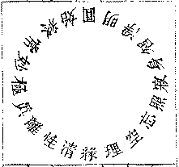



竹泉法林禅师



临济宗，别号了幻，俗姓黄，台之宁海人。参元叟於中天竺。东屿在净慈，招分半座。居净慈蒙堂，不出户者九年。至元四年迁灵隐，宗风大振。顺帝锡以金襕法衣。时寂照在径山，父子同时唱道，五山人以为盛事。上堂：「古杭管内，灵隐名山，肇建於东晋咸和年间，慧理法师为第一祖。今日上元令节，诸处放灯，知事值岁，各各照管风烛。」便下座。大龙翔席虚，星吉大夫遣币聘，辞不赴。使者三往返，师游於会稽山中。行院知不可强，具疏请师仍住灵隐。又三年，退处了幻庵。至正十五年春感末疾，二月二日集众，叙平生本末，且诫之曰：「佛法下衰，无甚於今，宜各努力。吾世缘止於斯矣。」索笔书偈曰：



七十二年　虚空钉橛  

末后一句　不说不说



遂奄然而化。龛留十日，颜色不变。全身窆於松源塔西。塔前古桂，当春吐花，清香满路，见者叹异。侍讲学士黄公晋卿目见其事，故自书塔铭序之。



见心来复禅师



临济宗，以南至生故也。丰城人。参南楚悦於径山，得其心要。至元七年住灵隐。洪武三年，以十大高僧徵。虞文靖、黄文献与结方外交，为左觉义。与太祖子蜀王甚善。王就国，命作正心、观道、崇本、敬贤四箴。未几，以诗含讽被刑。弟子昙锽编其集，宋学士濂序之，称其「秾丽演迤，整暇森严，剑出匣而珠走盘也。」



天镜原瀞禅师



临济宗，会稽倪氏子。登华顶，参无见覩。又如玉几，见石室瑛；室与语，大奇之，曰：「吾法叔径山元叟和尚具大眼目，今代妙喜也。子欲了己躬事，往见，勿后！」师遂参叟於不动轩。入门，叟震威一喝，师不觉汗流浃背。寻游金陵，见笑隐於龙翔。上江西，礼诸祖塔像。至临川，访虞文靖公，道话契合，延师度夏，为作〈断江塔铭〉、〈朴隐轩铭〉。至正丙申，出世邑之长庆，迁天衣。洪武五年，设广荐法会於鍾山，诏天下高名尊宿，轮座说法，师预焉。九年冬，杭诸山请居灵隐，曰：「而祖佛照妙峰、而父寂照、而兄了幻，皆说法灵隐。於今振堕绪、提宏纲，舍和尚其谁哉？」师幡然而起。上堂：「即心即佛，嘉州牛吃禾；非心非佛，益州马腹胀。不是心，不是佛，天下觅医人，炙猪左膊上。」良久云：「嗁得血淋无用处，不如缄口过残春。」终时年六十七，腊五十五。



古鼎祖铭禅师



姓应氏。元叟端在灵隐，往从焉。叩黄龙南在慈明因缘，叟诘之曰：「只如赵州云：『台山婆子被我勘破。』慈明笑曰：『是骂耶？』你且道二老汉用处，是同是别？」师云：「一对无孔铁锤。」叟曰：「黄龙直下悟去，又且如何？」师云：「也是病眼见空华。」叟曰：「不是、不是！」师拟进语，叟便喝，师当下廓然，即命居记室。自是声誉顿发。后住径山，法席甚盛，赐号「慧性宏觉普济禅师」。



慧明性原禅师



临济宗，号幻隐，俗台之黄岩项氏子。洪武五年选举高僧，师与焉。十一年戊午，师至灵隐，振扬宗风，建本寺大殿，修北峰之塔，皆师事也。室中垂语曰：「莲华峰被蚍蜉食却半边，因甚麼不知？」又曰：「冷泉亭吞却壑雷亭即不问，南高峰与北高峰斗额是第几机？」罕有契之者。以僧诬语被逮，至所司，憩座下，端坐说偈而化。为洪武十九年六月二十三日，寿六十九。



酉庵昙噩禅师



慈溪王氏子。元叟端补灵隐，门风高，非宿学，莫敢窥其门。师直往咨叩，了无畏惧。机契，命掌内记。出世天台之国清。洪武三年诏徵江南有道僧，师居其首。



空叟忻悟禅师



临济宗，俗姓钮，吴人，径山愚庵嗣。洪武戊辰住灵隐，居四年，丛林改观。以前住持逮至京，病卒於行，洪武二十四年夏四月三日也。门人窆骨於灵隐之东冈，为本寺六十五代。有三会语录、宋濂铭塔，今存。



用贞辅良禅师



临济宗，范文正公十世孙。参笑隐，一见契之，号「贞悟禅师」。灵隐直指堂乃其建也。举扬大法，不务缘饰。复以净土观门为苦海舟航，时兼修之。既示寂，舍利玉洁珠圆，宋濂为之铭。



无文本褧禅师



临济宗，别号无见，谢氏子，嗣孤峰德禅师。洪武二十八年住灵隐。又四年示寂。偈曰：



吾年七十有五　涅槃生死不堕  

虚空背上翻身　靠倒飞来小朵



茶毘，顶骨不坏，舍利无算。有《和同安察禅师十玄谈》最可传诵，餘详〈心泰塔铭〉，为本寺六十六代。



行中守仁禅师



号一初，富春人，灵隐僧。从杨廉夫、张伯雨游，能诗，善书法。洪武中，徵授僧录司右善世。一初有志事业，不偶为僧。尝言：「我辈从事文墨，非以废道，盖有不得已也。」在京赋〈翡翠诗〉：



见说炎州进翠衣　网罗一日遍东西  

羽毛亦足为身累　那得秋林静处栖



为太祖所见，怒而罪之。所著有《梦观集》。守仁诗与见心，俱超绝群辈，而皆不免於患，亦犹翡翠之为灾也。



可纯禅师



临济宗，象山胥氏子。参古鼎铭入室。洪武三十八年授杭郡都掌教，住灵隐。永乐四年寂於京，茶毘，灵骨塔涵泽庵。为本寺六十七代。



无杰善才禅师



临济宗，嗣无文。永乐元年住灵隐，增塑三世金身，创双桂庵以奉师塔，修寺志遗文数篇不忘，至今赖之。为本寺六十八代。



思扩性空禅师



临济宗，慈谿人，徐氏子。参无文褧公。永乐十九年迁住灵隐，奉旨修经，授僧录司左觉义。洪熙元年寂於京，塔寺在天香庵。为本寺六十九代。



伐石良玠禅师



宣德九年住持灵隐。先是寺灾，师建苏州虎邱寺大殿，遂礼师主寺。寺之建竖，师之功也。为本寺七十四代。



慎庵祥禅师



海昌李氏子。少颖悟，经书过目成诵。受具戒於前住持全庵理公，嗣法壁庵璘公。景泰间出主显宁。天顺间主本寺，大开𬬻鞴，学者景从。方丈间两庑，是师倾橐所葺也。



前溪德明禅师



黄岩人，姓林。嘉靖间，海寇焚湖墅，山后西溪男妇逾岭避乱。寺僧皆以寇必至，议弃寺各窜；惟师立主合众，结台於大路，声势相援，寇遂不敢至。师又为粥以济贫乏，於是人有固志。年八十一，为本寺一百五代。



按德明以前有幻庵修、慎庵祥、敬堂慇、大慈颐、南京识、天镜净、远庵恭、东山晓、独芳莲、大川淮、北峰赞、可泉玺、博庵广、爱山迁、恕堂忠、竹泉权、西隐方、无言讽、冷泉声、听泉禧；德明以后，横溪亮、见峰辅、灵峰永、冬岭秀、小山良、近山良、仰峰奎、南谷宁，皆前后住持也。



易庵如通禅师



临济宗，姓杭。母潘氏梦梵僧借宿而觉，即日娩。十五出家，礼大海和尚为师。未几，往双径万松和尚抉择心要。松问：「如何是白云不倚青山住？」答：「明月常悬古涧心。」松为首肯，乃继临济正宗二十七世。嘉靖癸亥，司寇五台陆公延礼，住持南山慧因，前后改观。万历壬午，冢宰元洲张公礼致，住持北山灵隐，重建大觉殿。数十年瓦砾，一旦更新，师之功为不可泯也。



具德弘礼禅师



临济宗，为临济三十二世；绍兴张氏子。初为锻工，已习道家言。后又读《首楞严》而善之。披剃受具，参三峰汉老人於安隐，彻悟宗旨。服勤十七载遂承嘱付。师出世云门广孝、维扬天灵及佛日显宁诸处，俱称千人善知识；而於灵隐破院久住，法席一新，建置甚盛。复应请住径山，大弘祖道。后至维扬天宁，甫七日，无疾坐化。以灵隐言，理公为祖，延寿为宗，而师以中兴兼创置，灵隐自来禅德未之有也。寿六十八，塔全身於灵隐慧日轩。餘俱详总录。



晦山戒显禅师



临济宗，字愿云，太仓王氏子。弱龄游泮，称名儒。甲申国难，作诗文告庙；入金陵华山礼三昧老人，祝发受具。遍参天童、雪峤诸大老。复参灵隐具和尚，於皋亭大悟「云门拄杖」话，遂嗣法焉。初隐庐山，次开法云居，一住十载。嗣住东湖荐福、黄梅四祖、临皋安国、武昌寒溪、荆州护国、抚州疎山，化行江楚，道望大著。康熙丁未，具老人迁双径，命师继席灵隐。语录、诗文有若干卷，盛行於世。



五岳济玹禅师



古越吴氏子也。母周氏梦日轮升天而姙。及师生，闻空中音乐。三岁诵《心经》如宿记。成童出家石屋，十七岁即游方、登讲肆。甫听即讲，犹如瓶泻。受具天童密祖，问「祖西来大意」，祖棒云：「向者里会取。」师便有入处。归越，沙溪作务，将盥沐，触翻水盆，得大脱洒。即遍扣，谒具和尚於显宁，遂契以嗣。凡具和尚倡化诸刹，皆师佐扬。师出世安隐，遇火，重兴之。他如鹿城安禅，海昌安国，罔不过化存神。於是声名洋溢，彼都人士相率敦请。先福善、次夕照、次隆安、津梁、正远。乃灵隐祖席非师不可，遂延师归补处焉。整颓绪，振弘纲。和硕康亲王驻浙，慕师义，礼敬请法。师固道高，而王之衞法弘愿亦不少概见云。



武林灵隐寺志卷之三下终



武林灵隐寺志卷之四



法语



宗门虽云「教外别传，不立文字」，而祖师心印亦藉言宣。故从上古虽拈椎竖拂，皆有说法机缘；玉句金章，具载传灯、僧史。具德老和尚性具宗通、不由文字，而一登广座说法，如河悬缾泻。晦和尚继之，父子敲唱，哮吼灵山，真鼓吹祖庭、万载响震者矣。为志法语第八。



具德和尚住灵隐，进院上堂法语



师于己丑春二月十三日住浙江杭州府灵隐寺，阖郡荐绅文学及各山耆宿、合院大众请升座。挥拂子云：「豁开宇宙，万象交参；皎日当空，十方烜赫。还有共相证明者麼？」愿云西堂出问：「灵山古刹，列圣觉场；宝座师登，将何行令？」师云：「人到灵山增意气，水归大海长波涛。」进云：「从来万派皆归海，今日千山尽仰宗。」师云：「灵山一会，迦叶亲闻；世尊拈花，贵须道得。」进云：「今日更添一重光彩。」师云：「七尺乌藤行活计，杖头八面起清风。」进云：「直得飞来峰顶青龙舞，西子湖边白凤飞。」师云：「谁人不仰上头关？」问：「刹竿高竖，重兴远祖风规；法令当阳，号召诸方龙象。作麼生是挽回风化底句？」师云：「金轮现瑞，百凤齐鸣。」进云：「奇峰巧石开新眼，冷涧回波看主人。」师云：「一句当机，普天帀地。」进云：「龙袖拂开全体现，象王行处绝狐踪。」师云：「好音在耳人皆听。」进云：「谁个不知音？」师云：「礼拜有分。」问：「弘开法席，大阐宗风；满目英灵，谁是作者？」师竖起拂子，僧更喝，师亦喝，僧又喝。师云：「三十棒。」进云：「放老汉出一头地。」师便打，乃竖起拂子云：「昔日世尊拈华，今朝灵隐举拂。会则同彼同此、耀古腾今；不会则乃圣乃凡、随波逐浪。诸仁者！世尊说法四十九年，谈经三百餘会。末后向灵山会上百万众前拈华嘱累，饮光尊者一笑。相传大法东来，则此山预来震旦，以待没量大人。爰有慧理、永明、延珊、明教、雪窦、大慧、瞎堂诸祖，咸向此山立极开宗。彼时问道，上自帝王，下及大臣，以至名公鉅老，亦在此山共翼嘉猷、激扬本分。今日现前宰官居士与诸山名德、本寺耆英、五湖衲子亦在此山，问似云兴，答如瓶泻，岂非灵山一会，重整颓纲；再笑拈华，知恩有地？」复举拂子云：「诸仁者！若向个里会得，则前佛性命、后佛纪纲总在者里。似地擎山，不知山之孤峻；如石含玉，不知玉之无瑕。永绝遮阑，更无向背。其或机留玄解、见逐偏枯，纵使打破牢笼、踢翻窠臼、撒开离坎、摆拨乾坤，是甚麼热盌鸣声、系驴橛子？所以道『灵光不昧，万古徽猷』。入此门来，莫存知解。直须不慕诸圣、不重己灵；向威音那边打叠定当，然后独步大方、壁立千仞，行不言之令，严不罸之威。净裸裸没可把，赤洒洒无回互。自然风行草偃，水到渠成。妙净明心，触处青霄碧落；正法眼藏，等闲栗棘金圈。八表同符，三才合契。诸仁者！毕竟格外风䂓、机先权要。『佛佛相授、祖祖相传』一句作麼生道？」掷拂子，震声喝云：「丹壑群真吟紫雾，灵山万衲笑春风。」



开𬬻铸万僧锅，升座法语



大人具大识见，运大作略，安大𬬻𫖔，启大模范，成大鼎镬。此个大𬬻𫖔、大模范，成就来多少时也？赤县神州，无处不知；大乘气象，何人不具？灵隐事不获已，因行掉臂，遇缘即宗。遂使三世诸佛振动天枢，历代祖师撼摇地轴。尽法界若圣若凡、若缁若素，靡不瞻之仰之。直得弥卢起舞、香海波腾；文殊、普贤合水和泥，弥勒、善财添铜入炭。山僧横身宇宙，号召当阳知事，唤行者人力，龙骧虎骤；冶师与𬬻头火伴，电转星驰。鼓橐籥於晴空，风抟六合；运金锤於肘后，响震三千。人人顶门瑞霭，各各脚下光腾。烁迦罗眼，左右圜融；母陀罗臂，前遮后护。火德以之振武，金德以之圜成；造化以之无私，神功以之毕备。然后普天帀地，安静如初；若圣若凡，各归本位。三世诸佛放下天枢，历代祖师仍还地轴。灵隐个汉，敛衣就座；现前龙象，参叩如常。祇如一𬬻便就，觌面赏劳底事又作麼生？香积厨开云出鼎，金牛抚掌笑呵呵。



付授愿云西堂，上堂法语



召西堂愿云上座，云：「灵山授受，一笑相亲；鸡足分灯，衣传慈氏。殊不知释迦不前，弥勒不后，法身不大，此衣不小。」乃捧起伽黎，云：「祇如者重公案，毕竟以何为验？」遂展付，云：「以此为验。」复说偈云：



鹫岭一花开五叶　神州紫气蔼三峰  

灯灯续燄交光处　虎角新生佛日红



堂展具礼拜，师下座。



开藏殿钟楼基，上堂法语



僧问云门道：「如何是自己光明厨库山门？今日和尚大启灵山，更拈出个甚麼？」师云：「握土成金。」进云：「作麼生著力？」师云：「打鼓普请看。」进云：「只如不施寸草，梵刹圆成。凭个甚麼，如此奇特？」师卓拄杖，乃云：「灵隐拂子头，现龙树大月轮；体性三昧，与太阳紫微交互争辉。直得全宾让主，转三能於东震；全主让宾，挽五佐于西乾。由是东西合辙，南北通途。据重关则先机立命，别缁素则照用同时。衲僧本分则固是，祇如尽无边华藏庄严海，拈来如粟米大，掷向灵隐青龙角上。诸人还见麼？不见道，打鼓普请看。」



供祖师，上堂法语



见性不留佛，悟道不存师。祖师玄旨是甚破草鞋？宁可赤脚不著最好。饶汝学得佛边事，机不离位；学得法边事，智向偏枯。兼带去，亦未免究妙失宗。不见云居膺禅师云：「如人头头上显，物物上通，祇唤作了事人；唤作尊贵得麼？将知尊贵一路自别。」又云：「如日出时，光照世间，明朗是一半，那一半唤作甚麼？」又云：「升天底事须对众掉却，十成底事须对众去却；掷地作金声，不得回头顾著。云居恁麼道，只解步步登高，不解从空放下。若是灵隐别有道处，但头头不显、物物不通，无事可了，说甚尊贵？如日落时，不照世间，晦昧是一半，那一半几曾欠少？升天底事，古庙香炉去；十成底事，冷湫湫地去；掷地作金声，一条白练去。且道云居底是？灵隐底是？灵隐底是，析旃檀片片皆香；云居底是，碎拱璧尘尘是玉。毫厘有差，凤萦金网，趋霄汉以何期？分文不值。龙门跃鳞，不堕渔人之手，还有不藉功勋、回途复妙底衲僧麼？设有，也是云居罗汉。」



法堂上梁，显宁义姪和尚请上堂法语



僧问：「唤醒江畔鱼龙，烹煅大方麟凤，是和尚寻常作略。祇如一茎草上现琼楼玉殿，明甚麼边事？」师云：「人天喝彩，佛祖解颐。」进云：「可谓鲁班门下。」师云：「既截珊瑚树，还为架海梁。」进云：「点！」师云：「明甚麼边事？」进云：「愿白一槌于此地，法王法令永流通。」师云：「欲赏其功，姑验其智。」乃云：「昔日灵山一会，人天百万见世尊于法座拈起一枝花；今日灵山一会，人天百万见山僧于法堂上得一枝梁。上梁大家著力，出身白汗，深明下载；清风拈花，大家一笑。因甚传灯续祖，独惟迦叶？」卓拄杖云：「尽从者里出。」



禅堂上梁，上堂法语



打鼓普请看。好禅客！前日拽木运石，今朝立柱升梁。徧刹海是个禅堂，总诸佛为个衲子。可中尔照我用，我呼尔诺；头角相似，肘臂相连，性命相共，教伊无一个不从者里振纲肃纪去、表帅人天去。然后展黄龙佛手、满把杨枝，库内金刚圈、栗棘蓬，向雕梁畫栋上蓦头一撒。五湖衲子同时下喝，争先拾得，将谓有多少奇特？放下手来，只是馒头。



佛殿、天王殿同日升梁，上堂法语



师竖拄杖云：「诸人还知各各一毫头有一座宝王金殿麼？知则百万人天匠作工徒都在汝四大色身中践踏；若不知，诸人一身具八万四千毛窍，山僧亦八万四千毛窍，释迦老子亦八万四千毛窍，于一毛端现宝王刹，坐微尘里转大法轮。莫是说了便当得麼？」卓拄杖一下，云：「古佛来也，世界起也，时节至也，栋梁枋柱、知事人力毕集也，那一柱不现丈六金身？那一梁不具衲僧手眼？那一金身、一手眼不显大檀乐施、善信功勋？究竟山僧两序合院大众，无思无为，无作无取，而两殿巍然干云摩汉。且道神通耶？法雨耶？」喝云：「高著眼！」



钟楼立柱上梁，上堂法语



举水潦和尚云：「无量妙义，百千法门，总向一毫头上识得根源去。」灵隐道：「无量妙义，百千法门，总向一毫头上识得作用去。诸禅子若识作用、彻根源，今日钟楼上梁竖柱，柱柱金身，孔孔法眼，𢲜𢲜妙挟，面面正中。然虽如是，因甚水潦呵呵大笑？」顾左右云：「大家出一只手！」



佛殿前大宝鼎成，郇护法请上堂法语



师竖拂子云：「见麼？大人缘起，梵王殿上投机，千佛光中现相，何况伊蒲为供，锦绣为旛，花插金瓶，灯然宝炬？尽华藏是个真实人体，尽供养是个真实作用。转过那边，入门便棒，进门便喝，背手摸枕子，当面露吹毛，与衲僧把臂。转过者边，云行雨施，品物流行，如雷如霆，为照为用，则父子同条。那边者边，无可不可。昔日给孤布金于祇树，今日郇公铸鼎于灵山。五湖衲子忍俊不禁，以须弥为果、大地为盘，为郇公贺！」良久云：「还会也无？大家佛殿里烧香。」下座。



大佛像成，李青芝等请上堂法语



僧问：「昔日金师补像，果感传灯；今朝大佛告成，得何利益？」师云：「法身开掌上。」进云：「妙手回天，全凭作者。功成不处，又作麼生？」师云：「法眼照人间。」进云：「恁麼则大家庆赞有分。」师云：「上座也须看榜样。」乃举黄檗在裴相国府署，裴一日托一尊佛於檗前，跪云：「请师安名。」檗召曰：「裴休！」休应：「诺！」檗曰：「与汝安名竟。」「诸子：黄檗不动一旗一鎗，裴公不施一韬一略，和主宾于直下，销锋镝于人间。且道在今日成得甚麼边事？」高声召曰：「李处士！」李举首，师云：「与汝说法竟。」



大树堂升梁，上堂法语



临济一株大树荫覆儿孙，灵隐一株大树荫覆佛祖。荫覆儿孙，为儿孙作祖；荫覆佛祖，与祖佛为师。喝云：临济大师来也！者老子动彻用大手脚，撼动三有大城，争似灵隐并不费手脚，动便撼动佛祖大城。且道临济、灵隐，阿那个较亲？若明辨得，请向大树堂中坐第一座；若明辨未得，请向大树堂前观树经行。直得朝观暮观、一观观透时，如何又荫著一个？



斋堂升梁，上堂法语



山僧年迈，放闲久矣。大众真精进真建立檀护，真精进真供养山僧。随例过堂，未免受他檀施；不随例过堂，亦未免受他檀施。不如随分纳些些，一任今日擎天架海、业就功成，山僧随檀护大众去也。何故？要且不负来机。



飞来峰牌楼升梁，上堂法语



「峰既飞来，玲珑心印全彰；楼当重建，妙相庄严具足。宽展处，佛祖横身；挨拶处，人天攘臂。文殊、普贤左右安排，释迦老子不敢正坐。且大开门户一句又作麼生？」喝云：「从者里入。」



晦山和尚进院，上堂法语



师在黄梅四祖，径山老和尚命继席灵隐。以丁未四月十二日进院，当山护法、阖郡绅士暨本寺耆宿、两序大众请上堂。拈香祝圣毕，次拈云：「此一瓣香，从苗辨地，饮水知源；德重邱山，恩逾溟渤。奉为重兴灵隐、现住径山，即此堂上本师上具下德老和尚，用酬法乳。」遂敛衣就座。南寺和尚白椎竟，师云：「泼天门户，海纳山容，果是知音，请出敲唱。」僧问：「云从龙，直得冷泉发燄；风从虎，会见鹫岭增辉。即今大座当轩，请施一机。」师云：「一棒敲开灵鹫日，普天帀地尽光辉。」进云：「一一应时击节，头头转地回天，是甚麼人境界？」师云：「大家在这里。」进云：「但得皇风成一片，不知何处是封疆。」师云：「且得领话。」问：「何如来担人天辐凑，振祖佛机，衲子扬眉，如何是绍隆一句？」师云：「青萍摇海岳，白棒验龙蛇。」进云：「可谓光合东浙儿孙裔，气吸西江父子宗。」师云：「脚跟下一句作麼生道？」进云：「脚跟下一句且置，祇如临机有眼句里，无私增万指，稠林添三玄。甲胄毕竟凭何施设？」师云：「脑后著眼。」进云：「昔年半院曾遗谶，今日重将此话圆。」师云：「切莫当头错过。」问：「仙梵彻云霄，万里山川增秀；雨花飞满岫，大千草木生辉。是何祥瑞？」师云：「拈出灵山一片石，万年何日不青青？」进云：「恁麼则冷泉势接滹沱派，青嶂遥随双径来。」师云：「不妨好彩。」问：「向上宗乘，学人不问入门一句，试为展演。」师云：「请上阶来。」问：「天得一以清，地得一以宁。衲僧得一时如何？」师云：「如龙得水，似虎靠山。」进云：「恁麼则拍掌鼓乾坤，一轮光透去也。」师云：「月落后作麼生透？」进云：「高开殿阁洪音振，一句无私亘古今。」师云：「重言不当吃。」问：「高提祖印，未审如何作用？」师云：「三十棒。」进云：「棒教谁吃？」师云：「不知痛痒汉。」进云：「和尚还知麼？」师云：「矢上加尖。」问：「一切言句即不问，直指当阳事若何？」师一喝。进云：「眼见是色，耳闻是声；不见不闻是甚麼？」师云：「山僧退身有分。」僧一喝，师拈棒，僧便走。师云：「走却草贼。」乃云：「佛祖关棙，西天令严；向上提持，谁容顾鉴？要津把断，从来铁壁无门；栈道凿开，除是金锤影动。倾湫倒岳，止在针锋；跨海擎天，不资餘力。释迦老子於灵山会上拈花示众，更加一道真言：『吾有正法眼藏、涅槃妙心，实相无相，微妙法门。』一机才动，东掷西抛；毒气流传，填沟塞壑。既灵鹫宝峰飞来至此，摩竭正令作麼生行？」卓拄杖云：「从上百四十代古锥，将这个开大觉场，雷惊电拂；本师径山老人，亦将这个重兴祖窟，雾拥云腾。山僧以二十年前旧缘，今日归来就父也。将这个权衡佛祖，龟鉴宗乘，截断天下人舌头。进一步则乾坤陡变，横拈七事钩锥；退一步则海晏河清，卸尽三玄戈甲。不进不退又作麼生？」横按拄杖云：「龙归大海波涛壮，虎到深山气象雄。」复拈椎云：「谛观法王法，法王法如是。」下座。



圆成飞来峰牌楼，江南佟方伯大护法请上堂法语



僧问：「一笠盖如来，果感人王位；今日庄严佛国，输金饭僧，如何论量？」师云：「天垂宝盖，地涌金莲。」进云：「灵山授说未到如此。」师云：「一朝圆好事，万古壮灵山。」乃云：「灵山秀异，万古雄观；奇特因缘，花攒锦簇。当门秀石，从灵鹫以飞来；证据无讹，呼猿洞而现在。此是第一重奇特。广大灵山，气吞海岳。先师老人，二十餘年，手拈茎草，劈出天官，移来华藏。功高再造，动地惊天。此是第二重奇特。留下飞来峰牌楼，虽然建就，未遂圆成。幸江南旬宣佟大护法，乘菩萨愿力，成就不思议大功德海。又耑令弟孚六大护法，光贲山门。肇启华坛，经开龙藏；饭炊香积，乐奏钧天。新题妙额，重标鹫岭飞来；巨榜高悬，指出现前佛国。此是奇特中奇特。昔世尊直指人心，见性成佛。且道心作麼生指？现前灵峰壁立、八面玲珑，岂不是正法眼藏？千尺冷泉、澄清彻底，岂不是涅槃妙心？山门飞楼涌翠、藻绘浮天，岂不是微妙法门？於此见得，直下知归。不惟佟大护法一门福慧圆满，并千百载后见闻随喜，个个成佛有分。何故？一手擎来真佛国，万年佳话播灵山。」下座。



送具老和尚全身入塔，上堂法语



戊申八月二十六日，先老和尚入塔，慧生上座请上堂。问：「三文使尽，塔涌灵山，叶落归根，是何时节？」师云：「人天百万仰浮图。」进云：「古佛位中留不住，分明独露大家知。」师云：「琉璃古殿照明月。」乃云：「过量事，非过量人不能开张；奇特人，非奇特事不能光显。临济七百年后老大法门，谁敢拔山举鼎、全身扶起？惟我老人用全象力，奋铁鹘机，大行吴越。应仰山遥谶，作大竫子，得邓尉真传。此人是大唐国内甚麼人？西晋二千年来老大灵山，谁敢斩荆诛棘、脱体鼎新？先老人竭廿载辛勤，聚多人血汗，以至嵬峩殿阁，金碧晶蓥，增武林莫大威光，成四海无双名胜。此事是大唐国内甚麼事？莫大功勋，既在灵山；叶落归根，自应在灵山建塔。今日山僧及各山兄弟、合院大众，就无阴阳地上竖起浮图，於呌不响谷中高悬慧日。层落落，影团团，标出南阳面目；净裸裸，光烁烁，掀开大佛顶光。既为天上天下独尊之人，自应建亘古亘今不朽之塔。且道三千年后，有人觅先师灵骨，作麼生抵对？」竖拄杖云：「竖起刹竿长灿烂，万年标榜耀灵山。」



为具老和尚上塔顶，兼送位入祖堂法语



一塔擎天，万古常悬；慧日五灯续燄，千年永耀灵山。兹者窣堵告成，高升塔顶。静眼观来，先老人分中著著，无非是顶。老人一生机灵铁鹘，用发狞龙，竖四杀旌旗，振三玄戈甲，以致令行吴越，海涌山翻。五千衲子下扬州，百万人天常拥座，岂不是天上天下诸善知识之顶？十坐道场，到处兴功建业；独於灵隐，一手擎出宝坊。一脚踢开，华藏现前，崚嶒殿阁，飞翚耀日，鸱吻连云，岂不是独冠海内功业之顶？所居灵隐，玲珑万窍，灵鹫飞来，喷雪奔雷，冷泉彻骨，岂不是一切名山道场之顶？从来禅祖於此阐扬正令，哮吼宗风，自古迄今，竟有百四十代。现在祖堂，烛排慧灯，星联道树，岂不是诸方祖堂之顶？老人末后树幢径山，却到扬州迁化。以兄弟孝心，龛归灵隐。目今巍然一塔，高跨北峰，坚固比於金刚，壮丽同於帝释，岂不是薄海内外一切浮图之顶？今日塔圆升顶，兼送位入祖堂。人天雾拥，光腾杲日；山灵喝采，天乐鸣空。真是以过量人显过量事，兴奇特功感奇特报。且道如何是大功圆满底句？嵯峨殿阁耸云岑，法道辉煌冠古今；消得灵峰千嶂玉，塔悬慧日照儿孙。



送兴建亡僧灵骨及四众遗骼入新建普同塔法语



僧问：「轰涂毒鼓，闻者皆丧；为甚击者不丧？」师云：「你试击看。」进云：「击个甚麼？」师云：「前言何在？」僧一喝，师打云：「不知痛痒汉。」乃云：「十方同聚会，个个学无为；此是选佛场，心空及第归。如何是心空及第？洞摩醯正眼，何圣何凡？廓顶后神光，谁幽谁显？人人在光明会集，个个归寂灭海中。但得心空，十方通畅。腊月莲花，恰值滔天白浪；龟毛数丈，尽成充国黄金。灵骨锵鸣，细看来总是琼楼玉殿；浮图无缝，卓竖起迥超潭北湘南。一入此门，悉皆成佛。且道功德圆成一句又作麼生？」卓拄杖三下，云：「坚固高幢三座涌，万年标榜在灵山。」



武林灵隐寺志卷之四终



武林灵隐寺志卷之五上



累朝檀越



昔径山国一禅师称唐帝曰「檀越」。「檀越」为大功德主，僧门所藉以安身学道、兴隆佛法者也。盖大丈夫出家学佛，寸丝不挂，一切所需总在檀越。故世尊建刹必待给孤开士，乞食必於邨聚。今具和尚鼎新灵隐，殿堂楼室，鳞次波涌，丹青绘畫，日灸霞举，极法门之宏制，为吴越之大观，皆檀越所施。其间一柱一椽，已勒姓氏于不朽。至于山志不能备悉，乃举其大者；并前代功德主亦不敢有遗漏。一以见作福者之不唐丧，一以见大善知识之有因缘也。为志檀越第九。



历代帝王



梁简文帝〈赐灵隐田记〉。(不存。)



梁简文帝〈赐灵隐石像记〉。(不存。)



隋高祖仁寿二年，遣僧赍舍利，建塔于飞来峰顶。(即神尼塔。)



唐天宝，建北高峰塔七层。(会昌时毁，此出自孙志。)



愚按：吴越建号亦有天宝。



吴越钱武肃王镠，命僧智觉延寿禅师重开灵隐，赐名灵隐，新寺建僧房五百餘间。



钱忠懿王弘俶继之，建本寺屋宇一千三百餘间，回廊自山门左右遶至方丈。



建灵隐寺门、塔幢二座。(上书「开宝八年大元帅钱建」。)



孙宇台曰：按吴越建号有天宝、宝大、宝正。开宝是宋太祖年号。开宝九年，俶与妻孙氏、子惟演、孙承祐来朝。岂八年树幢而九年来朝欤？要其归命奉朔之意已久矣。



建北高峰塔。



白子佩曰：按王慕阿育王建塔，乃于国中聚铜，造八万四千小塔，散于境内。本寺惟存二大塔。



铸觉皇殿后铁塔一座。



宋真宗皇帝景德四年，勅赐额，改灵隐寺作灵隐山景德寺。



天禧五年勅赐额，改景德寺作景德灵隐寺。



勅赐金牌一面。(后于政和间移供神霄宫。)



勅赐御书牌一轴。



仁宗皇帝天圣三年，皇太后赐脂粉钱九千五十四贯。



天圣八年，勅赐灵隐住持禅定大师延珊放免粮田一万三千亩。(杭、秀二州充设五载斋僧粥食，共计四十餘万人。有勅一通存寺。)



庆历七年，勅赐御制歌颂等件。



皇祐元年，勅赐六祖师名讳玉宝牌一面。



勅赐飞白御书「佛圣帝来」四纸。(每字一纸。)



勅赐「清净佛法」绢书二轴。(计四字。)



勅赐纸扇碑一座。



勅赐回銮碑一轴。



勅赐御绣观音《心经》二卷。(计二轴。)



勅赐飞白黄罗扇一柄。(俱皇祐元年。俱罹兵燹，不存。)



嘉祐三年，赐明教大师契嵩所著书入藏。



中书劄子曰：权知开封府王素奏：杭州灵隐寺僧契嵩撰成《传法正宗记》，并《辅教编》三卷，宜令传法院于藏经内收附。劄子付传法院。准此。(按王素字仲义。)



宋高宗皇帝勅改榜曰「灵隐山崇恩显亲禅寺」。(绍兴五年。「显亲」盖为吴太后设也。)



赐金饰「九里松」，吴说书额。



宋孝宗皇帝乾道三年二月诏：每岁佛诞日，例赐帛五十疋。



乾道八年正月二十八日，车驾幸灵隐。明日，赐僧慧远直指堂印。(慧远即瞎堂禅师。)



乾道九年，宣灵隐慧远奏对内殿，称旨。有《奏对录》。



淳熙四年八月，召灵隐德光入对内殿。赐诗二首。



诗曰：



欲言心佛难分别　俱是精微无碍通　跳出千重缚不住　天涯海角任西东



又诗云：



大暑流金石　寒风结冻云　梅花香度远　自有一枝春



(至今流传有《奏对录》，在《古尊宿语录》内。)



宋理宗皇帝赐御书「觉皇殿」三字。



赐御书「妙庄严域」四字。



赐御制〈千佛赞〉，赞曰：



一佛不二　千佛奚别  

如处处水　现在在月  

无去无来　不生不灭  

梅花开时　前村深雪



宝祐六年，上亲制〈观音记〉，御书登石。



元



仁宗皇帝延祐五年，赐还九里松。



明



太祖高皇帝勅，赐田三千亩。(淳朋以宋时所赐田一万三千亩献还朝，高祖复赐三千亩。)



神宗皇帝万历十七年，赐「观音大士瑞莲圣像」一轴。(司礼监孙隆，奉慈宁宫皇太后御赐观音圣像，内有上御制赞云：「惟我圣母，慈仁格天。感斯嘉兆，阙产瑞莲。加大士像，图写流传。延国福民，霄壤同坚。」上用「慈圣宣文明肃皇太后之宝」御宝在轴。)



历代朝臣



晋



葛洪题「最胜觉场」四字。



唐



大理寺少卿．杭州刺史袁仁，敬种松九里。



右司郎中．杭州刺史元藇，建冷泉亭。



给事卢元辅，建见山亭。



刺史相里造，建虚白亭。



庶子裴棠棣，建观风亭。



仆射韩皋，建候仙亭。(是之谓「五亭」。元藇以下五公，皆以刺史领郡于杭者。)



刺史白居易，书「冷泉」二字，并以文记之。



紫薇舍人唐询，建紫薇亭。(若言寺前五亭，则称紫薇而不言见山。)



丞相裴休有〈送子出家诗〉，其诗云：



送子出家莫学诗　要明父母未生时  

吾闻九里松门外　佛国山前有铁围



(裴休字公美，河东闻喜人。家世奉佛，与黄檗最多往返，遂嗣其法。)



宋



承奉郎．守秘书省著作郎．直史馆．赐绯鱼袋．曾知苏州吴县事罗处约，撰寺碑文。(作文为雍熙丙戌，立碑为淳化辛卯。俾文其事者，月禅师也。岁久碑断，重立者，妙堪师也。月师惜未详。重立时，理宗朝大中大夫范楷跋。)



熙宁三年及十年，赵抃以资政殿大学士两知杭州，禁天竺、灵隐寺樵采。



天圣中，吏部侍郎．平章吕夷简，给事中．参知政事陈尧佐，给事中．参知政事薛奎，工部侍郎．参知政事王曾，赐免灵隐寺田，准勅中书门下牒一道，有官衔字押。



观察李公谨，奏赐契嵩紫方袍。



庆历中，丞相韩琦、参政欧阳修、权知开封府王素，赐契嵩所著书入藏，中书劄子有官衔字押。



知杭州府苏轼，补书白乐天所书「冷泉」二字后「亭」字。



太守祖无择，建邺公庵于灵隐。



安抚赵与𥲅，建壑雷亭。



临安府都会首沈瑜等，施送华严海会善知识功德五十九轴。



元



江浙行省平章事张闾助，修觉皇殿。



明



刑部尚书潘季驯，前后捐赀装大殿佛像。



吏部尚书张瀚，募建大殿。(公不署江陵夺情事，即予告归。灵隐殿毁一季矣，公与五台陆公光祖，请僧易庵广集赀财，一新鹫宇。)



万历间，司礼太监孙隆，建三藏殿，中置转轮以奉法，计六百三十八函；左药师镫藏宝计四十九镫；右水陆像藏总一百二十五轴。(号东瀛，直隶三河人。)



左布政吴自新，助装藏殿金龙。(有题冷泉匾曰「高山流水」，方丈匾曰「法宇重兴」。)



贵州提学道副使冯时雨，补植本寺松树若干。



工部榷署分司张乔松，造觉皇殿菱花门。



兵部武库司主事虞淳熙，撰〈重建理公塔铭〉并篆额。



重兴灵隐大檀护功德主列后：



国朝总督部院赵廷臣，为文勒石清飞来峰界址，并禁樵采。



(据考飞来峰，昔东晋咸和年，西域僧慧理至此，惊曰：「此天竺国灵鹫山九十七峰之一——小朵峰，何年飞来至此？」故名飞来，一名莲花，一名灵鹫，其实一山也。)



(按钱塘田汝成《西湖游览志餘》云：「旧传谶记有云：『天目山垂两乳长，龙飞凤舞到钱塘；海门一点巽峰起，五百年间出帝王。』或云晋郭璞作。钱氏有国时，不欲其语闻之中国，更其末句云『异姓王』。苏子瞻作〈表忠观碑〉，特表其事，首曰『天目之山，苕水出焉，龙飞凤舞，萃于临安』，盖全用䜟语也。」载第一卷之十一板。)



(孙宇台《灵隐寺志》：「天目山有二水，一条东流经於潜、临安，百五十里至餘杭为苕溪。又东三十里抱钱塘。又东北流六十里，过湖州，入太湖。一条西趋于紫溪，合桐庐之水，汇于钱塘。此郭璞所谓天目两乳也。南山如龙，北山如凤，此郭璞所谓龙飞凤舞也。海门一日两潮，日轮正从鼈子门上，此郭璞所谓金星也。其块土为帝王都会，璞留谶记，盖预知五百年潮打西兴，然后为帝王都会也。夫自郭璞以前，南北皆为武林山，嗣后始有龙飞凤舞之目。然南山有凤凰山，是南山亦可曰凤；而北山有桥曰回龙、有洞曰龙泓，是北山亦可曰龙也。」载第八卷之四十八板。)



(夏乐只《西湖志》云：「无著禅师塔，《武林志》：『师名文喜，唐人埋骨此山下。韩侂胄谋葬其地，乘夜发冢，见师在龛中，容貌如生，指爪屈曲盘体。胄惊，遂掩其塔。』出合涧桥为下天竺寺。僧肇海诗：『一定空中五百年，何因发塔起颓甎？世间多少麒麟冢，过眼谁人赠纸钱？』」载第三卷十三板。)



(又民谣云：)



(灵山一片地　上有王者气　丞相营首邱　不知主何意)



(韩遂不敢葬。)



(窃稽以上所载，本山既称梵刹名胜，兼之谶记分明，更有前都宪苏茂相「天子万寿」四字镌勒在上，昭昭在人耳目，凡妄窥者，亦可已矣。讵意仍有继侂胄而起者！前天启四年，诸当事历有铁案；今康熙四年，又蒙部院赵公勒石严禁。其各上台禁示，另详别录。)



巡抚军门陈应泰，作募疏，广劝修造；自亦捐赀五六百金，助建大殿。



浙江布政使司袁一相，捐赀塑大殿文殊、普贤、阿难、迦叶，并罗汉五、六十尊。



苏州布政使司佟彭年，捐赀完成飞来峰牌楼，金碧绚丽，冠绝西山。



苏州布政使司慕天颜，为灵隐增置金沙滩宝胜庵，为放生所，手题额曰「万鳞极乐」。(又捐俸助建具老和尚塔。)



浙江提督二等侯田雄，施赀千餘金，塑大雄殿中尊大佛，并筑佛与诸天大石座。



大将军柯魁，同都统陈典谟、高及之，协致石门大钟悬新建钟楼。早晚撞击，响震西山，为万古标榜。



刑部尚书．湖州东阡沈演，子月初增建金光明殿、修理〈金光明忏法〉，兼施六百金在大雄宝殿。



翰林院庶吉士．塘栖卓彝，同子孝廉麟异，建大悲懴坛。每岁春季修礼忏法，永远不替。



户部尚书汪应蛟男本和，布施山木四十株，助建丛林。



太史金声，仝子静思，布施徽州山木建梵香阁



大理寺卿王益朋，倡置灵隐松木场下院。



登州府太守．常州徐可宣，捐赀千金，助建大殿，并施二大正柱。(先是，戊戌三月十五日，徐公梦灵隐被火，遣人到山侦探，殿尚巍然。至二十六日忽遭回禄，公大惊异，遂开檀度。)



太仆寺卿严沆，同察院顾豹文，协力护卫，建成具老和尚慧日塔院。永镇灵山，万年不朽。



山西提学道．嘉善县孙籀，塑十八大罗汉像，并著文勒石。(公十二岁赴府预童子试，被众挤门压死已一昼夜，感灵隐罗汉救回。重生后，到灵隐，宛如所见。遂施赀塑像，并立碑记异。今竖罗汉殿门侧。)



贵州按察司副使陈绍英，具和尚兴建二十年，赤心护持，始终不倦。大殿上梁日，公与沈捷、关键、姚玄瑛众护法皆在焉。



都统胡申、固山高可仰，倡议誓众拈阄，留具老和尚灵龛，建塔慧日。



云间宗伯董其昌，置甘露茶亭。太师金之俊复广之，留额，永为灵隐下院。(在湖墅卖鱼桥。)



武林灵隐寺志卷之五上终



武林灵隐寺志卷之五下



历代人物



余尝咏西湖，有「越都状妙人，西湖是其眼」之句。余在灵隐乃知飞来峰是其眉，其他总在眉目之下，况又得冷泉亭为点缀！人间天上有此绣韵之境，故游武林者必到灵隐。尝登飞来峰，憩冷泉亭，听水声泠泠然，从耳入心，尘襟顿涤。于是游者无不悔来之晚，又恐去之速也。风流人物往往留传于此，使后之人恨生不得与同时。余亦感慨系之矣。为志人物第十。



陆玮



字文该，钱塘人。东汉末纳禄，隐武林山涧南学《易》。为隐居堂西壁图九师像、东壁图八公像。世又名九师堂也。(刘向《别录》：淮南王安聘善易九人，谓之九师。杜光庭《录异记》：八公见淮南，自称姓氏曰文五常、武七德、枝百英、寿千龄、鸣九皋、修三田、岑一峰，未可尽信。汉俗皆以淮南为得仙，故玮向慕如此。玮行无可考，松江有陆玮墓。)



陈浑



汉灵帝熹平二年为餘杭令；山中祀为土神，至今犹尸祝也。(《晋志》，餘杭属吴兴郡吴兴。县令者，餘杭县令也。其时武林属餘杭，而餘杭又辖於吴兴郡。自东汉至五代皆然，故灵隐石幢有「吴兴」二字，此亦其证矣。今人称「陈明大王」，正月十五日为生辰。)



葛玄



字孝先，句容人，父为大鸿胪。玄幼负奇操，丰神标峻。三国吴，居武林山葛坞，往来会稽、云门。一贾人泛海，泊神庙；神令庙祝附书於玄。书著船如钉，不可动。及达岸，以报，玄往自取，即得。题称「大极左宫仙公」，世因称葛仙公也。按公居杭事无可考。后龙井李德淘井，得铁牌，上有「赤乌年祷雨」，或是公所为也。公从孙洪。



许迈



字叔玄，一名映，丹阳句容人，许旌阳再从昆弟，家世仕族，而许长史穆第四兄。少恬退，不慕仕进。常就郭璞筮，遇泰之上爻发，璞谓曰：「君元吉自天，宜学升遐之道。」时南海太守鲍靓隐迹濳遁，人莫之知；迈乃往候之，探其至要，因立精舍稽留，号思真堂。又以餘杭县霤山近延陵之茅山濳通五岳陈安世、茅季伟常所游处，而往憩焉。父母尚存，未忍违离，朔望时节还家自省。及父母没，乃遣妇孙氏还家，携其同志徧游名山焉。永和二年移临安山，登岩茹芝，有终焉之志，乃改名玄，字远游。著诗十二篇，论神仙之事。羲之造之，未尝不弥日忘归，相与为世外之交。玄遗羲之书云：「自山阴南至临安，多有金堂玉室、仙人芝草，左元放之徒，汉末隐者皆在焉。」羲之自为之传，述灵异之迹甚多。



葛洪



字稚川，祖系吴大鸿胪；父悌，吴平后，入晋为邵陵太守。洪少好学，家贫，躬自伐薪以贸纸笔，夜辄写书诵习，以儒学知名。性寡欲，无所爱玩，不知棋局几道。樗蒲齿名，闭门却埽，未尝交游。於餘杭山见何幼道、郭文举，目击而已，各无所言。尤好神仙导养之术。事玄弟子郑隐，悉得其法。后又师事南海太守．上党鲍靓，妻以女。洪传靓业，兼综练医术。凡所著撰皆精核是非，而才章富赡。太安中，石冰作乱，吴兴太守顾秘为义军都督，檄洪为将兵都尉，攻冰别寨，破之，迁伏波将军。洪见天下已乱，欲避地南土，乃参广州稽含军事。及含遇害，遂还乡里，礼辟皆不赴。相传住武林山葛坞，得道於青林洞也。



杜明甫



钱塘人。居灵隐，夜梦东南有贤人来访。时谢玄生孙於会稽，其父瑍狂荡，射杀蒋侯妹清溪小姑树鸟。姑怒，一夕殛死。其家恐惧，求寄养於明甫。明甫受而养之，十五岁方还。按《一统志》，鍾嵘《诗品》、《六朝诗话》皆作「明师」，其居称「杜治」。注言：「治者，奉道之靖室。」《真诰》：「钱塘人，杜道鞠处士，杜京产之父，富而好道。」乃泰和元兴间人，崇奉许氏之道。明甫岂其家耶？(钱塘又有杜子恭，有道术，豪族贵望多执弟子礼尊事之。沈警、孔灵产皆有道之士，莫不敬慕。灵产出钱塘北郭，於舟中望其墓而遥拜焉。杜氏一门何多道者？想亦犹葛玄之於稚川、许远游之於斧子也。)



谢灵运



安西将军奕之曾孙，车骑将军玄之孙。父瑍生而不慧，位秘书郎，早亡。灵运幼便颖悟，玄甚异之，谓亲知曰：「我乃生瑍，瑍儿何为不及我？」寄养杜明甫，小字客儿。文章之美，与颜延之为江左第一。袭封康乐公。宋少帝即位，出为永嘉太守，称疾去职。父祖并葬始宁县，并有故宅及墅，遂移籍会稽，修营旧业；傍山带江，尽幽居之美。与隐士王弘之、孔淳之等放荡为娱。每寻山涉岭，必造幽峻。尝著木屐，上山则去前齿，下山则去后齿。自始宁南山伐木开径，直至临海，惊动县邑。文帝以为临川内史，为有司所纠，徙广州。有司复奏其有异志，诏於广州弃市。作诗曰：



龚胜无餘生　李业有终尽  

嵇公理既迫　霍生命亦殒



时元嘉十年，年四十九。於叹！以灵运之才名而不得其死，死又不可为志节所由，殆与葛、许远矣。



朱世卿



梁盐官人，有别业在武林山，榜云「隐士盐官朱世卿墅」。(按晋梁巨室，别业称墅。)



骆宾王



义乌人。与徐敬业讨武后，师败亡命，不知所之。宋之问以谪放江南，游灵隐寺；夜月极明，巡廊赋诗，得「鹫岭郁岧嶤」二句，下苦不属。有僧坐禅床，长明镫下，问曰：「少年何事苦吟？」宋答以故，僧曰：「胡不言『楼观沧海日，门对浙江潮』？」宋异之，询寺僧，知为宾王。明日觅之，无有矣。宾王居灵隐周岁卒。



袁仁敬



开元十三年刺史杭州。(按公于神功元年九月中绝伦科，与崔颋、崔玄同时及第。)



元和间，刺史相里造、韩皋、裴棠棣、卢元辅、元藇，前后共建五亭。又紫薇舍人唐询，建紫薇亭。(张商英有〈题见山亭诗〉，则见山亭北宋犹在也；僧来复有〈题虚白亭诗〉，则虚白亭明初犹在也。)



白居易



长庆时为杭州刺史。代宗时，李泌刺史杭州，悯市民苦江水之卤恶，开六井，凿阴窦，引湖水以灌之，民赖其利。及居易为刺史，重修六井，甃函笕以蓄泄湖水。其自序曰：「每减湖水一寸，可溉田十五餘顷；每一复时，可溉五十餘顷。」则西湖之在杭，犹郑白之渠之利也，公之功也！公诗文流传于灵隐者最多。形胜山下有白公茶井，北高峰左溪上有白乐桥，法安院有白乐天书，皆公遗迹。



丁飞



字翰之，济阳人。唐咸通时，居龙泓洞。读《庄》、《老》，善养生。好古文、乐府、歌诗，作细字皆有楷法。寡睡少言，与人接，礼简情至。或问：「服何饵？」对曰：「治心修性之外，别有何物？」每月夜，登岩鼓琴，流淙协奏，天籁凄冷，往往鸾鹤翔集。咸通丙午，陆龟蒙过之，年七十二矣；见其纶巾布裘，貌古意淡，操绠缶斤𣃁，陟峻如飞。作〈钱塘丁隐君歌〉。



丁行者



不详其人。寺东廊有蘸笔池，是其遗迹。(或以为即丁翰之也。咸通时，翰之年七十，龟蒙见其畜妻、有子；则会昌毁教时，年不过四十。或为行者而返俗，未可知矣。)



陆羽



字鸿渐，竟陵人。不知其所生，既长，筮得渐之蹇，曰：「鸿渐於陆，其羽可用为仪，吉。」因以为名氏。上元初，隐苕上，自称「桑苎翁」。或独行道上，诵诗、击木、裴徊，不得意则恸哭而返，时谓为接舆也。有〈灵隐碑记〉，惜不传。



陆龟蒙



字鲁望，居松江甫里。不喜与流俗交。设篷席，赍束书，茶灶、笔床、钓具往来，时谓「江湖散人」。尝至灵隐晤丁飞之，作〈隐君歌〉相赠。



罗隐



从事湘南，历淮、润，皆不得意，乃归。谒吴越王钱镠，虑不见纳，以〈过夏口诗〉标于卷首献之，末有云：「一个祢衡留不得，思量黄祖谩英雄。」镠览之大笑，表隐为钱塘令。隐有灵隐诗。朱温篡唐，隐说镠举兵伐梁，曰：「虽无成功，犹可退保杭越，奈何交臂事贼、为千古羞？」此殆有鲁仲连之风矣。(按范楷〈跋〉，处约历官著作郎、直史馆，与王禹偁同诏试。)



林逋



字君复，号和靖先生。景德中，放游江淮，及归，结庐西湖之孤山。自范仲淹、梅尧臣，皆高其节，赠以诗文。欧阳修谓：「自逋之后，湖山寂寥，无有继者。」其推重如此。逋尝有〈泛舟入灵隐诗〉，又有诗云：



山木未深猿鸟少　此生犹拟别移居  

直过天竺溪桥上　独木为桥小结庐



则其高寄盖亦在灵、竺间。



范仲淹



字希文，为杭州刺史。僧遵式建日观庵，公为之记。灵隐至今相传有文正公卧榻。公治行，于杭最多也。



赵抃



字阅道。熙宁时，以资政殿大学士两知杭州。四十餘，摈去声色，系心宗教。《传灯录》以为蒋山泉禅师法嗣。公有偈云：



默坐公堂虚隐几　心源不动湛如水  

一声霹𮦷顶门开　唤起从前自家底



苏颂



字子容。熙宁中，以集贤学士来知杭州，龙泓洞外有题名。公治行最优，时吴越荐饥。一日，有民数百，遮马诉于公曰：「某等以转运司责逋负市易缗钱，昼则逮系公庭，夜则禁於厢院，虽死何由得偿？」公曰：「吾今释汝，使得营生，衣食之餘，悉以偿官。期岁月而足，可乎？」众应曰：「不敢负约。」於是悉纵之。转运司大怒，欲劾公沮法，而偿责者闻之，皆先期而至，事遂已。一日，燕有美堂，闻将兵结集谋害官吏，即入喧传，恐惧不安。公谈笑自如，密谕兵官捕为首者，械送狱中。迨夜会罢，而坐客不知也。



李公谨



官观察，有灵隐诸诗。



祖无择



知杭州，极爱灵隐。时为筑邺公庵於萧公泉处。



杨蟠



富阳人，字公济。元祐中，通判杭州。有〈钱塘百咏诗〉，每至山宿，与契嵩唱和。



梅询



字尧臣，知仁和县事。有〈武陵十咏诗〉刻石冷泉亭上。



苏轼



字子瞻。熙宁四年除通判杭州。元祐四年除龙图阁学士，知杭。公有遗爱于西湖，其见于灵隐者，有灵鹫后小石塔题名，为熙宁七年九月二十日，是时公移莅胶西，即以是日别南北两山道友也。又有韬光石题名，为元祐五年二月二日。明年，公年三十六，在杭州被召。通计公之在杭，前后约有六载，何杭人之幸也！寺僧祀公於灵鹫山麓，号东坡祠。其知杭州也，杭大旱，饥疫并作。公请於朝，免上供米三之一；复赐僧度牒，易米以救饥者。明年春又减价粜常平米，多作𫗴粥。遣使挟医，分坊治病，活者甚众。唐刺史李泌引西湖水作六井，民足於水。自唐及钱氏，岁辄浚治。宋时久废，葑积为田，水无几矣。见茅山一河专受江潮，盐桥一河专受湖水，遂浚二河以通漕；复造堰𡍪以为湖水蓄泄之限，江潮不复入市。以餘力复完六井。又取葑田积湖中，径三十里，为长隄，以通行者；且募人种菱湖中，葑不复生。收其利以备修湖、取救荒。餘钱万缗、粮万石，及请得僧牒百纸以募役者。隄成，植芙蓉、杨柳其上，望之若图畫然。杭人名为「苏隄」。



钱和



钱塘人。钱易孙，钱彦远子，孝义知名。建杰阁於九里松，藏书甚富，东坡为榜曰「书藏」。直秘阁，知荆南府。



徐爽



钱塘人。隐居湖山，以修真养性终老。徽宗闻其名，赐号「冲晦先生」。其墓盖在灵鹫也。



朱弁



徽州人，葬于九里松。(弁以绍兴初授官，副王伦使北，见执。附表云：「节上之旄尽落，口中之舌徒存。叹马角之未生，魂消雪窖；攀龙髯而莫逮，泪洒冰天。」高宗览之未尝不流涕也。卒葬於此。)



韩世忠



字良臣，延安人。屡立战功，追封蕲王。绍兴中，秦桧当国，公以和义不合，恳疏解枢柄。常顶一字巾，跨驴周游湖山，而於冷泉尤多盘桓。建亭於飞来峰之半，颜曰「翠微」，自号「清凉居士」。



陈刚中



福州人。建炎初，任太府寺；上封事，议恢复，遂与张九成七人同谪。其诗云：「同日七人俱去国，何时万里始还家？」有〈飞来峰诗〉。



俞颢



字商卿，杭州人。绍熙进士。尝宣抚淮东，历秉节旄。宝庆二年致仕，筑室九里松，以诗词自娱。号「青松居士」，著〈青松居士集〉。



赵与𥲅



淳祐中为京尹。自北新路第二桥至曲院，筑隄以通灵、竺之路。中作四面堂、三亭，夹岸花柳以比苏隄，人遂称「赵公隄」也。建壑雷亭于灵隐。



陈紫芝



名崇真，闽人。咸淳间，卜居北高峰东（俗名庆化山），祈祷有应，赐号「冲素真人」。崇奉雷神，后卒闽，瘗剑雷院后。



陆游



字务观，尝有〈灵隐寺冷泉放闸诗〉。



濳说友



宋咸淳间为临安府尹。每来下竺，有鸟自手中啄食。赋诗有「灵鸟不相猜，认作放生台」之句。



白珽



字廷玉，结庐于金沙滩，曰「湛囦」。所著有《湛渊集》。



仇远



字仁近，钱塘人。宋咸淳名士。宋亡，落魄江湖。初辟溧阳州学正，未几隐去。所著有《山村集》。



赵孟𫖯



字子昻，宋艺祖十一世孙。至元中，程鉅夫奉诏搜访江南逸才，以孟𫖯入见。世祖一见，喜甚，从容諮访治道，命坐右丞李叶上。孟𫖯诗文奇逸，篆籀、分隶、真行、草书，皆妙绝天下。尝至灵隐访僧恭行己，为作诗。



虞伯生（集）



临川人，官至奎章阁学士。与鲜于伯机、揭曼硕、杨仲宏、赵子昻、黄晋卿诸公友善。少游钱塘，故于灵隐多所题咏。



邓文原



字善之。其先绵州人，父漳徙钱塘，遂为钱塘人。为杭州教授，有灵隐诗。



张天雨



字伯雨，钱塘人，号居贞子，又号句曲外史，宋崇国文忠公九成之后。年二十弃家，游天台、括苍诸名山。晚入开元宫，从真人王素衍为道士。工书，能诗文，与吴兴赵孟𫖯、浦城杨载、蜀郡虞集、豫章揭徯斯、清江范梈、金华黄溍友善。尝屏居修茅山志。墓近玉钩桥，有灵隐诗若干首。



黄晋卿（溍）



义乌人。至正初为浙江儒学提举。工文章，不喜华冶。有〈西湖舟中诗〉云：「黄尘乌帽媿平生，对客犹称旧姓名。」其风致可想见。人求其文章，或遭怒骂，惟灵隐慧炬则无所靳也。



项可立



隐於灵鹫山间。与黄溍友善，黄有〈同可立宿灵隐西崦诗〉。



莫维贤



字景行，钱塘人，洪武初仕州训导。筑室南北两山间，绕屋栽杏，以书史自娱，号杏园。列二十一题，士大夫多留咏，以比王维辋川庄。翻经台石有题名：「泰定五年春二月，吴郡王连、莫维贤、叶森、陆友同游。」



高孟升（得旸）



钱塘人。记闻博洽，诗文纯雅，名重一时。所著《节庵集》有〈题灵石樵歌〉、〈冷泉猿啸〉、〈九里云松〉诗。



王洪



字希范，永乐间，十八举进士，授行人，入翰林检讨。其〈西山记〉殊佳。



杨孟瑛



字温甫，为杭州知府。以西湖占塞，奏开濬之，毁田荡三千四百八十一亩，少复唐宋之旧。于里湖西岸增置二桥，以比苏公隄。其二曰「流金」，金沙滩之水出焉，游灵竺者之所停桡也。公又增苏隄高二尺、阔五丈三尺，列插万柳，顿复旧观。



孙一元



字太初，关中人。年十八入终南山，继入太白山，嚼草木居，息大石上，时有所得。赤脚散发，走山最高峰，持古松根扣奇石以歌。久之，西入华山，南浮湘汉；登衡山祝融峰，返嵩山，渡汴，谒阙里；遂上岱宗日观峰，观夜半日出沧海中，发狂大叫。南经吴、入越，探禹穴、访天台石桥。然公居西湖久，宿南屏而游灵隐，诗思清逸，有烟霞气。其〈跨驴游西山诗〉载入志中。



王守仁



字伯安，当宸濠之既擒也，忽传王师已及徐、淮；遂乘夜遄发至钱塘，凛凛焉不胜忧栗，作诗云：



灵鹫高林暑气清　竺天石壁雨痕晴  

客来湖上逢云起　僧住峰头话月明



其意盖在灵、竺间也。



方思道（豪）



开化人。正德间，刑部郎中。跌宕不羁，雅好山水。盖尝题射旭、金光、玉乳三洞也。



汪晖



文昭公第三子。举正德丁丑进士，历官翰林院编修。有理公岩洞口题名，云「载酒访方豪也」，可谓武林胜事。豪，公同年进士。



朱裳



莅官方伯。裘褐不备，特于飞来峰顶勒名姓于石上。



陈仕贤



福州人。嘉靖二十二年为杭州太守，击杨梿真伽像于飞来峰。



王世贞



字元美，吴人。万历时为布政分守于浙地，有灵隐诗。官至大司寇。



李攀龙



字于鳞，山左人。为臬宪于浙，与元美相先后。有〈九里松诗〉。



张瀚



号元洲，官吏部尚书。以江陵夺情不肯署押，归田。张濂号泽山，官至都宪。秉持丰裁，四十报簪，自颜其堂曰「不惑」。都宪子蔚然富学问，弟子著录者众吏部。灵隐寺内有祠，都宪墓在灵鹫山下。



孙枝



号思泉。以冀宁分守归，闭户著书。与同志诸公为胜游高会，与者许少厓先生（岳）、顾西岩先生（言）、吴桂轩先生（遵晦）、赵望云先生（应元）、胡顺所先生（孝）、金莲峰先生（阶）、柴醴泉先生（祥）、严顺庵先生（大纪）、吕葵阳先生（元）。四时皆有雅集，独于灵隐听禅与看花修禊，不同邦人，至今以为盛事。



柴祥



号醴泉，天性笃孝。官御史，直谏有声。已陈情终养者二十年，转外台，尤持廉平。居乡淳厚不伐，人称为长者。



喻邦相



为杭州别驾。每以苏白自许，故尤垂情灵隐，一时辞客云集，有卓徵甫、叶茂长、潘景升、郭次甫、孙凤冈、俞玄津、王世周、曹子念、来相如、何王臣、汪仲淹、毛豹孙诸山人皆集。其〈雨中游灵隐〉及〈北高峰〉诗，皆载志中。



虞淳熙



号德园，钱塘人，官吏部员外。博学有文名，著述甚富。集内有〈理公塔铭〉、〈代飞来峰石言〉。公尝赎石窟以还僧舍，其高致非近世士大夫所有也。二子大赤、仲皜，皆以名德见重于时。



许灵长（光祚）



著籍钱塘。万历时举人，官教谕，迁府司理。以能书名，出汤先生（尧文）焕门下，二先生书法为钱塘最。公居官有廉名，尤务旷达；早年抽簪，放情山水。其卒也，于冷泉亭方与客展纸挥毫而气绝，如蝉蜕然。



屠隆



字长卿，四明人。与餘杭徐桂，岁必至湖上，税驾灵隐，信宿而返。有〈山中唱和诗〉。



李用晦



字元昭，世袭千户。早弃官，搆庐于慎庵之址，曰「岣嵝山房」。张元忭为之记，沈青门为作赋诗。



诸餘龄



号云泉，隐于五寺桥之侧，栽花莳药，坐卧小楼，十年不入城市。与邵虎庵、李元昭，同称「石隐」。子梦环，隆庆辛未进士，死亦葬于餘龄侧。



邵重生



号古庵，杭州诸生。隐呼猿洞者二十年，著《武林内、外志》数卷，盖士安节信之流也。先生父经济，当世庙时，以谏大礼被窜。先生读书灵山，矢志不仕，岂所谓父为忠臣、子为孝子者耶？



沈守正



沈守正字无回，钱塘人。为名孝廉，清介绝俗，当世士大夫重其守。下帏灵隐，讲业授徒，历有年所。官都察院经历。



孙日章



字蕴甫。弟日隆，字实甫。节妇、孝子后，为思泉公孙。少即以文章、名节相砥砺也。俱读书灵隐之普觉。蕴甫早中副榜，以弟死，独母方在堂，绝志场屋，奉养天年。年几六十，丧母犹婴啼也。实甫专志好学，与陆庸成（正奇）、沈无回结契山中，称至交焉。庸成死，托孤，乃力为济其昏娶。好古文辞，有李历下风。以疾早殁，名流痛惜焉。



柴应权



号洞山，官学训，即醴泉公季子。素与来道之、沈无回、孙思泉诸先生读书灵鹫，以文义切磋。晚尤归心白业，为本山檀护。



黄贞父（汝亨）



历官江西提学。文章清隽，有绝尘之姿。葬灵兔于麓。翰墨题咏留灵隐者甚富。



葛寅亮



字屺瞻，历官司农。尝督学楚闽，最称得人，闲居教授弟子数千。性俭素，布衣徒步于灵竺之间，人不知其贵人。本寺多赖其护持也。



严印持（调御）、严忍公（武顺）、严无敕（敕）



顺庵先生之子。家门孝友，笃志嗜学，不与俗人为伍。四方饮其高名，称「三严先生」。尝联袂于灵隐山中，春听鸣泉，冬视枫叶。印持先生书法遒劲，独步当时。忍公先生善金针，八分书尤有古法。



闻启祥



字子将，为孝廉，名重一时。晚遂绝志仕进，筑窠西山。其言语妙天下，大抵冯先生（梦祯）、黄先生（汝亨）一流人也。



李流芳



字长蘅，练川孝廉。赋性古处，善诗、古文，而畫尤绝伦。所至嗜山水，冷泉、岣嵝，徘徊不置。与闻子将先生、三严先生皆友善。有〈冷泉红叶图〉及诗，人争宝之。



高攀龙



无锡人，谥忠宪。魏忠贤窃权之日，公抗节不屈而死。先是，万历癸丑季秋，公来游韬光，静坐三七日而去，有二诗纪胜。



郑尚友



字士弘。辛未进士，官工部主事。为福建长乐令，有悬鱼之节，民爱戴之。为孝廉一十七载，唯以教授为事，足迹不至公府。公尝于南山下帏，而于北山揽胜也。



许文岐



字我西，官黄州太守。张宪宗袭城，义不欲逃，乃就执死焉。少时读书祗园房，与正嵒和尚早结方外之好。公童子时，父联枢先生偶以金鱼命公题句，公应声曰：「将云腾而虎变，故玉质而金相。」其聪颖如此。



陈濳夫



字玄倩，杭州人，历官河南御史。与妻孟氏及妾，同靖节江东。其为诸生也，读书灵隐山房，以名教自任，卒能克践其志。有三弟，丽明、祚明、晋明，子曾篁，皆能文、有节概，不愧家声。



陆培



字鲲庭，杭州人。中崇祯庚辰进士，官行人。乙酉殉节於横山桐坞。与兄圻、弟堦，读书於灵隐之涧西，人称「钱塘三陆」。好大节，敦友生；即释褐后，手不释卷。所著有《旃凤堂集》。公先死，而圻与堦奉母裘太孺人以终养。子繁弨，能为汉魏古文辞，有父风。



武林灵隐寺志卷之五下终



武林灵隐寺志卷之六上



艺文



吾观从来宗师家，有佛法者未必有文章；学士家，有文章者未必有佛法。故宗师必须学士以表扬，而学士亦乐为之挥洒，重法道也。昔大慧禅师为泐潭准和尚求张无尽作铭，张公欣然曰：「老夫为他点出光明，合教照天照地去也。」故寺碑、塔铭多出于当代宗工之手。寺碑所以记功，塔铭所以彰道，此二种为重。至若序赞、记述、书劄等，有关于灵隐者，总不敢遗。盖文章光燄，乃高贤心血所成；年虽久远，仍炳耀名山，与山门同不朽矣。为志艺文第十一。



碑记



灵隐寺碑记



罗处约



天地，体也；乾坤，用也。体不可以恒寂，故以禅而为名；用不可以终动，故以静而为本。是以境得之而为胜地，心得之而为妙道。斗牛之下有郡曰钱塘，浙水之右有山曰武林，居山之寺曰灵隐，其得境之胜地乎？居寺之徒曰禅侣，其得心之妙道乎？观其群山环倚、一峰中断，平湖鉴物、洪涛惊人，云生若趋、石怪欲语，陆羽记云：「东晋咸和初，有梵僧慧理由天竺而至，叹曰：『兹山灵鹫之一峰耳，何代飞来乎？』」所携白猿复识其处，睨彼古地同乎新丰。由是金布其田，宝装其刹，憩莲花之石，翻贝叶之文，洞深有天，岩垂为室。晋宋已降，贤能迭居，碑残简文之辞，牓蠹稚川之字。唐大历六载复大壮焉，谢亭岿然，袁松多寿。五季之末，国霸为钱，云构之规，则又过矣。绣角畫栱，霞翚於九霄；藻井丹楹，华垂於四照。修廊重复，潜奔溅玉之泉；飞合岧嶤，下映垂珠之树。风铎触钧天之乐，花鬘搜陆海之珍。有若碧树花枝，春荣冬茂；翠岚清籁，朝融夕凝。呼猿峰闲，卧龙石老。会汉南王籍彼土宇，归我昌朝。雍熙二载，郡之四众请月禅师为上首，师印可禅那，深得其髓。越明年春，仆自苏台抵杭郡，弭盖灵鹫，濯缨冷泉，山光洗心，松声娱耳。贞珉虽揭，好辞未刊。余不斐者也，月禅师俾文其事。噫！节彼灵山，奠兹吴土，秀极而为万状，翠鍾而成一色，乍耸而还趋，欲飞而却屹，岂造物者奇诡其势、与心而符契哉？不然，胡为不违世咫尺，而若在溟滓，俾仁者乐之？其得静之理也！我如来密印，由饮光而传达磨、而付南能。厥后代有宗师，竞分支派。太虚无状而《楞严》谓三界忽生，湛寂本如而《易经》称万物自动。故众生昧如如之性、住我我之所，执指为月、瞪目成花。不有导师，孰为法眼？若言真於妄，则二妄为同；破有归无，则一边为见。故融其妄法，是名真空；真空不空，斯为妙有。虽扬眉举目，则当体涅槃；三界四生，则澄心境界。栖禅於此者，其殆庶几乎！伟哉是境也，其将以心为君乎！是心也，其合是山之静乎！所谓天地之体，乾坤之用，体用无碍，端在是矣。或曰：「以兹山得静之理，斯固不诬矣。灵鹫言飞来之事，何其怪哉？」余则曰：「怪，神之端。子真不语者也。第以力垂大教、翼戴衰周，俾季世之人信道弥笃，是以取尔。嘻！太极剖而为天地，游魂变而知鬼神，岂非语怪者也？」因不自揆而书之，犹季路之率尔也。因为之铭曰：



灵鹫一峰　飞来竺乾  

非夸娥负　神妙难筌  

非巨灵擘　化工自然  

谁识其异　慧理明焉  

翠微之前　曹溪之禅  

隐不为俗　静本乎天  

四时群籁　万古寒泉  

因书贞石　用记千年



冷泉亭记



白居易



东南山水，餘杭为最。就郡言，灵隐寺为最；就寺观，冷泉亭为最。亭在山下水中央、寺西南隅，高不倍寻，广不累丈，而撮奇、得要地、搜胜概，物无遯形。春之日，吾爱其草薰薰、木欣欣，可以导和纳粹，畅人血气；夏之日，爱其泉渟渟、风泠泠，可以蠲烦析酲，起人幽情。山树为幄，岩石为屏，云从栋生，水与堦平。坐而玩之者，可濯足于床下；卧而狎之者，可垂钧于枕上。矧又潺湲洁澈，甘粹柔滑；眼目之嚣，心舌之垢，不待盥涤，见輙除去。潜利阴益，可胜言哉？此所以最餘杭而甲灵隐也。先是领郡者，有相里君造虚白亭，有韩仆射皋作候仙亭，有裴庶子棠棣作观风亭，有卢给事元辅作见山亭，及右司郎中．河南元藇最后作此亭。於是五亭相望，如指之列，可谓佳境殚矣，能事毕矣。后来者虽有敏心巧目，无所加焉。故吾继之，述而不作。



北高峰记(节略)



田艺蘅



由法华山之南，龙冈蜿蜒、猿扳蛇折，三陟三降、可四百丈许。凌拔虚峭、孤耸碧落者，曰北高峰。盖言峰，至西湖之北而最高也。其下为灵隐山，兹山名称不一，以其为神仙之别圃也，故曰灵苑；以其为许由所稽留也，故曰仙居；又以其草树郁葱而多虎豹也，则曰虎林。南唐避讳，易虎为武，遂以名郡。亦犹姑苏虎丘之尝易武丘，而此则讹而不复者也。山自仙霞岭而来，纒徽历严，结局於杭。如龙游千里而独角昻霄，如虬饮长江而怒髯注雨，真钱塘之天柱也。其附石级而登者三十六湾，势插太虚、影侵明圣，禅宫星列、都会天开。其东则渺渺茫茫，蓬瀛之胜可数；其西则隆隆隐隐，飞凤之气犹存；其南则屏以重山，而罗刹斜遶其背；其北则辟以大野，而皋亭逆峙其喉。廓然四顾，逌然长笑，襟揽天风，心空海宇，何如其乐也！忆昔癸卯秋八月十八日，与临安高子世道辈同来望潮，踏月而归，今已戊午矣。以志在山水若余者，十六年间仅仅再至；又况朝歌暮鼓、彩舆畫舫於六桥桃柳中者，谁肯更於物外著脚耶？



游西山记(节略)



王洪(字希范，永乐间翰林检讨)



吾乡多佳山水，最胜者曰西山。距郡城不半途远，经行春桥，途集庆兰若，始至飞来峰下。地志称虎林山，而浮屠相传从西域灵鹫小朵峰飞来者，盖西山第一佳处也。其高不逾五六十丈，岩石嵬怪特异，若犊骇、若隼立、若鸟啄、若豹跃、若𧉮逝、若棋置剑植，衡从偃仰，益玩益奇。上多异木，木干笔直，枝叶碧色，不假土壤，根出石外；冬夏常郁郁然，丹葩翠蕤，𫎇羃联络，种种殊异，不可名状。其下岩洞若曲室，玲珑相通，中外凿僧佛像。泉自石脉出，滴石上，作铿然鸣，隐隐出洞，久而始散。有寺在山趾，曰灵隐；有亭曰冷泉，涧经其下，始出沸激，久乃徐流。白砾布底，坦然平莹。跋石漱波，毛骨爽彻。薄暮脱帽、憩石壁之下，林壑阴翳、万籁岑寂；苍然暮色，自远而至。山风飘飘，徐动林木、响应溪谷。间以幽鸟，其韵愈远，令人萧然有忘世之志。明旦，由涉故径东还，顾瞻白云横亘四山，北峰浮图止出其半；日影照映，茸茸如白绵，可揭而取也。噫，余游四海久矣！岳之秀者泰岱、衡华，水之巨者洞庭、彭蠡；而名刹、高士、胜僧，未有若吾乡俱美者，宜吾徒乐而忘返也，故书之。是永乐七年闰四月一日也。



湖山胜概记(摘略)



夏时正



入湖路转而北，过胭脂岭，至大普寺，北出九里松，东过行春桥，接小新堤、天泽土谷庙，路通曲院。又由普福西，过集庆寺，月桂峰下有阎妃坟。迤西入佛国山，张即之书匾，笔妙入神。三竺之间，云影天光、泉声松籁，岑寂鸟空、山凝钟静，耳目心神之会，觉其迷、极其乐者，岂不超三界外乎？归路左合涧桥，过龙泓洞，有飞来峰，又名灵鹫山，与三天竺一脉，联属至此而尽。故上有巉岩，下多空谷，谓之飞来者也。相对有灵隐寺，规模宏壮，为五山第二。两山之间有冷泉亭，泉可濯、亭可憩；树林阴翳，九夏而暑无侵。乐天云「有虚白、见山、观风、望仙四亭」，今皆无所考。西有呼猿洞，猨去，西洞湮。灵隐之后则北高峰，秀出诸山。支分上竺，盘折七十二弯，麓衍二十餘里，磅礴起伏，至武林山而歇，其灵鍾於五显。山之腰有半山庙，西有韬光庵，庵极幽静，唐有僧居之。山之麓有上永福寺。



游西湖记(摘略)



杨守正



㳂山涧入，陆行道三竺佛门，见松篁夹路，水声㶁㶁然。移时至集庆寺，访理宗遗像，无存。寻跋涉久，乃坐飞来峰侧，见诸洞窟玲珑。余穿岩隙入，恍佛乳垂垂堕，佛大士诸像星列其上，石青紫有光。每窟穴处，云滃滃然起，石畔溪流激人。余因问寺僧横溪上人，究骆賔王吟诗之所在。北高峰下亦跛蹀不能至。饮罢，至冷泉亭，题诗壁上。因与诸子话往日奸桧地藏和尚之事，虽涉野史荒唐莫可据，然亦可见神鬼报施有不可逃者。冷泉亭上有一泓悠然，余遂沿石泓下，复至前飞来峰所；因询所谓呼猿洞者，在荆莾中，道狭不可步。迺同诸子坐石笋屏畔，於是访灵运翻经之台。见台葑藓剥蚀。继至三生石上，盘行山径乃下。汲葛仙公泉，冽甚。复取道后湖小径去。



新广冷泉亭记



僧如璧



灵隐冷泉，其源出於寺西南百步之近；直寺之前，潴而为池。唐．刺史．河南元藇作亭池上，后刺史白公居易记之，刻石亭中。其叙胜概甚备，然士大夫有识者，犹以池量狭陋，为未足以尽冷泉之美，盖三百年於此矣。政和初，兵部尚书张公以龙图阁学士出守是郡，暇日醼客池上，徜徉不忍去，意将廓而大之。长老云公（乐然）用其说，撤屋𣃁地，伐石为堤，东西三倍其初，南北半之，长松巨桧不改其列，而池已浩乎大矣。池傍故有岩窦，嵚𡼭空洞，如刻如斵；至是扬波石中，倒影水面，湛净明碧，可以育鱼鼈而豢蛟龙，使人登此亭者，超然有绝人遗物之意。餘波渺弥、浮闸而下者，雷奔电激，飞雪噀雾，使人临是池者，恍然如在天台、庐阜，窥石桥而睨三峡，莫知其在湖山俯仰之间也。嗟夫天下之物，用之有不极其材；骇鸡之犀，夜光之璧，世有不尽见其美者，古今之通患。是举也，能使累世未尽之奇一旦呈露，盖张公之意而云老之力，此岂偶然哉？亦尝徘徊、周览壁间之题，如唐丞相李峤、裴度、裴休，与夫元稹、张籍之徒，读其诗，未尝不想其人。是数公者，功名文彩照耀后世；今其流风遗泽固已云散梦扫，漠若与凡辈共尽，而斯泉固自如也，於是慨然而叹。今此地已三广，冷泉之名当益张，士大夫之游者当益众，援笔而赋者当益多。然逝者如流，日迁月谢，容一过之；或昔少而今壮，或昔壮而今老，盛衰得失相寻於无穷。后之视今，将犹今之视昔，则犹视池者亦可矍然以惊、翻然而惧矣。



惠力寺记(摘语)



赞宁



钱塘属邑，盐官为最；在浙之朝阳，为吴之右臂。白铺江练，青点海门，蜃楼起而䗖𬟽横，星汉低而枯槎活。潮生信大，雷霆藏龙战之声；闰下功深，蜀井丧虎形之味。



古涧洼泉记



贝琼



余在钱塘时，尝游西山之灵鹫。有泉流幽涧中，或隐或见者，如线如蛇，曲折而下赴。其激石有声，锵锵如琴筑之交奏、珩璜之相触。及憩春淙亭，其东西合流注大壑，琅然如骤雨之至；雷震之瀑，如决银河，自天而落也。虽未及观香炉瀑布、天台石门之崩腾雄悍，是亦西山之一奇矣。



岣嵝山房记



张元忭



灵隐寺之西，循涧而上得柴关。逾赤栏桥，有屋数楹，有竹万竿，中有楼曰「紫盖」。楼之上下析为小室者五，凡燕居欵客、却暑避寒之所，无不毕具。刳竹为瓦，树蕉为屏，引泉为溜，净绿庄严，清流潇淅，盛夏凛然如秋。楼之北，跻石磴，缘曲水而上，结桂成亭。充坪因石凭虚，曰孤啸；台复古，曰白砂；丹井架空，曰礼斗；阁依梅，曰香雪巢。其外，曰树蹊、茶坂、梅坞、橘坡。山不盈数十亩，而备极幽致，游者如入蓬壶、方丈，而莫能穷诘也。



玉兔塜记



黄汝亨



先癸丑四年，客有见白兔于天台山者，守三年而得之。珍重宝爱，历游诸王侯公卿间，未遇也。迨癸丑秋八月，擕之白门，见余于官舍，门下士汪生捧以归余。予笼以金缕，题以玉衡，偃仰一室，旷若林麓，与之周旋者三年。其体莹皓月，眼流赤霞，冰姿绝伦，雪态横逸，若蹲若卧，名状千变。客或见其一斑，予曰：「摩挲爱玩之未有穷也。」今年春二月，先一夕梦有黑衣童子，双眸下涕，界以赤文，若绕膝置辞者。予惊而寤，起眎之，欠伸靡恒，踯躅者三，遂往矣！予怆然若丧者久之。岂纪所谓五百年白、五百年而黑者，其变徵乎？夫迁无超有，理之大常；含杯表异，物有至贵。昔径山标灵鸡之塜，南康记鹦鹉之禽，斯皆资始道妙、任体山阿。予之斯兔岂不同然？遂裹以文车，封之灵隐山巅之韬光庵，下识曰「灵兔塜」。即委蜕一时，流耀千载，讵忍堙没不称、草木俱腐哉！



永明智觉禅师行业记



惠洪



师讳延寿，餘杭王氏子。儿时知敬佛乘，及冠，日一食；诵《法华经》，五行俱下，有群羊跪听。年二十八为华亭镇将，尝舟归钱塘，见渔船万尾戢戢，恻然皆易之，放于江。裂缝掖，投翠嵓岑公，学出世法。吴越文穆王闻而慕悦，听其弃家，为剃发。自受具，衣不缯纩，食无重味，持头陀行。常习定天台天柱峰下，有尺鷃巢衣𫌇中。时韶国师眼目世间，北面而师事之。韶曰：「汝与元帅有缘，他日大作佛事，惜吾不及见尔。」初说法雪窦，建隆元年，忠懿王移之于灵隐新寺，为第一世。明年又移之于永明寺，为第二世；众至二千人，时号「慈氏下生」。指法以佛祖之语为铨准，曰：「迦叶波初闻偈曰：『诸法从缘生，诸法从缘灭；我师大沙门，常作如是说。』此佛祖骨髓也。龙胜曰：『无物从缘生，无物从缘灭；起惟诸缘起，灭惟诸缘灭。』乃知色生时但是空生，色灭时但是空灭。譬如风性本不动，以缘起故动；倘风本性动，则宁有静时哉？密室中若有风，风何不动？若无风，遇缘即起。非物、风为然，一切法皆然。维摩谓文殊曰：『不来相而来，不见相而见。』文殊乃曰：『如是，居士。若来已更不来，若去已更不去，所以者何？来者无所从来，去者无所从去，所可见者更不可见。』此缘起无生之旨也。」僧问：「长沙偈曰：『学道之人未识真，只为从前认识神；无始来时生死本，痴人唤作本来人。』岂离识性别有真心耶？」智觉曰：「如来于首楞严会上为阿难拣别详矣，而汝犹故不信。阿难以推穷寻逐者为心，遭佛呵之。推穷寻逐者，识也。若以识法随相行，则烦恼名识，不名心也。意者，忆也。忆想前境起于妄，并是妄识，不干心事。心非有无，有无不染；心非垢净，垢净不污。乃至迷悟凡圣、行住坐卧，并是妄识，非心也。心本不生，今亦不灭。若知自心如此，於诸佛亦然。故维摩曰『真心是道场』，无虚假故。」智觉以一代时教流传此土，不见大全，而天台、贤首、慈恩，性相三宗又互相矛盾，乃为重阁，馆三宗知法比邱，互相设难。至波险处，以心宗旨要折中之，因集方等秘经六十部、西天此土圣贤之语三百家，以佐三宗之义，为一百卷，号《宗镜录》，天下传诵焉。僧问：「如和尚所论宗镜，唯立一心之旨，能摄无量法门，此心含一切法耶？生一切法耶？若生者，是自生欤？从他而生欤？共生、无因而生欤？」荅曰：「此心不纵不横，非他非自。何以知之？若言含一切法即是横，若言生一切法即是纵。若言自生，则心岂复生心乎？若言他生，即不得自，矧曰有他乎？若言共生，则自他尚无有，以何为共哉？若言无因而生者，当思有因尚不许言生，况曰无因哉？」僧曰：「审非四性所生，则世尊云何说意根生意识？心如世畫师，无不从心造，然则岂非自生乎？又说心不孤起，必藉缘而起。有缘思生，无缘思不生，则岂非他生乎？又说所言六触因缘生六受，得一切法，然则岂非共生乎？又说十二因缘，非佛、天人、修罗作，性自尔故，然则岂非无因而生乎？」智觉笑曰：「诸佛随缘差别、俯应群机，生善破恶，令入第一义谛，是四种悉檀方便之语。如以空拳示小儿耳，岂有实法哉？」僧曰：「然则一切法是心否？」曰：「若是，即成二。」僧曰：「审尔，则一切不立、俱非耶？」曰：「非亦成二。汝岂不闻《首楞严》曰：『我真文殊，无是文殊；若有是者，则二文殊。然我今日非无文殊，于中实无是非二相。』」僧曰：「既无二相，宗一可乎？」曰：「是非既乖大旨，一二还背圆宗。」僧曰：「如何用心，方称此旨？」曰：「境智俱亡，云何说契？」僧曰：「如是则言思道断、心智路绝矣！」曰：「此亦强言，随他意转，虽欲隐形而未忘迹。」僧曰：「如何得形迹俱忘？」曰：「本无朕迹，云何说忘？」僧曰：「我知之矣。要当如人饮水，冷暖自知。当大悟时节，神而明之。」曰：「我此门中亦无迷悟、明与不明之理。撒手似君无一物，徒劳辛苦说千般。此事非上根大器，莫能荷担。先德曰：『尽十方世界，觅一人为伴，无有也。』又曰：『此是一人承绍祖位，终无第二人。若未亲到，谩疲神思。』借曰『玄之又玄、妙之又妙』，但是方便门中，旁赞助之语；于自己分上，亲照之时，反视之皆为魔说。虚妄浮心，多诸巧见，不能成就圆觉。但以形言迹，文彩生时，皆是执方便门、迷真实道；要须如百尺竿头放身乃可耳。」僧曰：「愿丐最后一言！」曰：「化人问幻士，谷响答泉声；欲达吾宗旨，泥牛水上行。」又常谓门人曰：「夫佛祖正宗，则真惟识，才有信处，皆有为人。若论修证之门，则诸方皆云功未齐于诸圣。且教中所许，初心菩萨皆可比知。亦许约教而会，先以闻解信入，后以无思契同。若入信门，便登祖位。且约现今世间之事，众世界中，第一比知，第二现知，第三约教而知。第一比知者，且如即今有漏之身，夜皆有梦。梦中所见好恶境界，忧喜宛然；觉来床上安眠，何曾是实？并是梦中意识思想所为，则可比知觉时之事皆如梦中无实。夫过去、未来、现在三世境界，元是第八阿赖耶识亲相分，惟是本识所变。若现在之境，是明了意识分别；若过去、未来之境，是独散意识。思惟梦觉之境虽殊，俱不出于意识，则惟心之旨，比况昭然。第二现知者，即是对事分明，不待立况；且如现见青白等物时，物本是虚，不言我青我白，皆是眼识分与同时意识计度分别为青为白。以意辨为色，以言说为青，皆是意言，自妄安置。以六尘钝故，体不自立，名不自呼。一色既然，万法咸尔，皆无自性，悉是意言。故曰『万法本闲而人自闹』。是以若有心起时，万境皆有；若空心起处，万境皆空。则空不自空，因心故空；有不自有，因心故有。既非空非有，则惟识惟心。若无于心，万法安寄？又如过去之境，何曾是有？随念起处，忽然现前；若想不生，境亦不现。此皆是众生日用，可以现知，不待功成，岂假修得？凡有心者并可证知，故先德曰：『知大根人知惟识者，恒观自心，意言为境。』此初观时虽未成圣，分知意言，则是菩萨。第三约教而知者，大经云：『三界惟心，万法唯识。』此是所现本理，能证正宗也。」智觉乘大愿力，为震旦法施主，声被异国。高丽遣僧航海问道，国王叙弟子之礼。以开宝八年十二月焚香告众，跏趺而化。阅世七十二，坐四十二夏。



赞曰：予初读《自行录》，录其行事日百八件，计其貌，必枯瘁尩劣；及见其畫像，凛然丰颐，眉目秀拔，气宇如玉。味其平生，如江干之月；研其说法，如禹之治水、孔子闻韶、羿之射、王良之御、孙子之用兵、邱明太史之文章。呜呼！真乘悲愿而至者耶！



钱塘邑侯．谯明张公免灵隐役功德碑记(公讳文光，河南祥符人，中戊辰进士)



汪继昌



陶令作〈桃花源记〉，写山水之岑僻、人物之凉古。唐人拟作歌诗，都谓是仙域矣。及攷舆图志，今廼更隶县官，而当日陶公作诗，亦秪云「春蚕取长丝，秋熟靡王税」而已。后读《十洲记》，见其说瀛洲仙家风俗似吴人，又私自喜吴侬身堕菰薭中，竟不知是阆风玄圃也。然近年来，追呼调发，生人号咷如沸汤镬。钱塘古称佳丽，每奉院司文移徵发，惴惴不敢缓。虽复王裒步担乾饭，磬折牛旁，不足荫安邱之门人矣，矧其游方之外者耶？今上治天下之九载，岁在壬辰，大治役书，而天下邑侯躬为审定。谯明张公莅钱塘，取斯人而袵席之，以庐以粥，于今七年。杭人窃喜张使君如白、如苏。西湖带水，净如拭镜，两山绿如埽黛。其间暄晨肃月、春萋秋馥。向使吏鹰政虎、博噬狺狺，亦有何佳？而我张君布政优优、吏治闲闲；衙鼓簿书之暇，輙邀家严牵艇策蹇、信信宿宿于烟芦云杉之际，觞咏流连，消民苛慝。往时余得雁行隅坐，时时捧读篇什，忧民之色见于楮面。是役也，灵隐僧性梿等来乞家严，属予洒墨以志侯德。予叹曰：「张使君此举，不但为法城堑也！」灵隐旧额十之五，今少减之耳；乃令冷泉片地，翛翛释子，眇眇禅栖，锡钵间设于松间，梵呗飏韵於天岫。骚人游子来憩萧森，恍有「云从栋生、水与堦平」之致。昔支道林寄桓公书：「频被州符，求沙门名籍，煎切甚迫。」今具德大师得率众禅寂此中，得断薪续床、三篾绕腹；麋鹿之性，自乐林泉。然得徜徉自适者，谁为赐也？往者不可知，且以近事相况，清波门内为云居枫岭，盛时岭几千章；深秋叶赤，游人自断桥回眺城隅，赫如天半绛云。十年前，余读书庵中，疲衲困于诛求，遂将此百餘年物斩艾无遗蘖。维时同人江晚柯家苍舒作诗悼之。今灵隐沐张使君宽政，要念所以保护之者，上自莲华峰，后迄韬光，一草一木、一泉一石，以召公勿拜之思，作李家平泉之训。他日使君过山中，更邀家严联句冷泉亭畔；石蹲似兽，烟树如人，野衲与鸥鹭相狎，宛然如初入桃源时。后之诗人过九里松者，杳不识少陵野老〈垂老〉、〈无家〉诸什为作何等语者，则张侯之德为不可諠哉！



灵隐系浙省第一祖庭，参学高流皆十方聚会。所以寺无恒产者，以应酬里役不便故也。今本寺止有山地荡，旧属钱塘上扇三啚运户办粮。至顺治十八年，恩蒙前任邑侯（今升江南藩司）大护法慕天颜，编入上虞二啚二甲，本名济上立户完粮，准免杂徭，俾林下人得以朝参夕请、究明己躬下事者，悉慕护法盛德之所赐也。



奕山萃谨识



灵隐寺志卷之六上终



武林灵隐寺志卷之六下



记



明教大师行业记



陈舜俞



宋熙宁五年六月初四日，有大沙门明教大师示化於杭州之灵隐寺，世寿六十有二，僧腊五十有三。是月八日以其法茶毗，敛其骨，得六根之不坏者三；顶骨出舍利，红白晶洁、状若大椒者三；及常所持木数珠亦不坏。於是邦人、僧士更相传告、骇叹、顶礼。越月四日，合诸不坏者葬于故居永安院之左。其存也，尝与其交居士陈舜俞极谈死生之际，已而属其后事，兹用不能无述也。师讳契嵩，字仲灵，自号潜子，藤州镡津人。姓李，母鍾氏。七岁而出家，十三得度、落发。明年受具戒，十九而游方，下江湘，陟衡庐。首常戴观音之像，而诵其号日十万声，于是世间经书章句不学而能。得法於筠州洞山之聪公。庆历间入吴中、至钱唐，乐其湖山，始税驾焉。当是时，天下之士学为古文，慕韩退之排佛而尊孔子。东南有章表民、黄聱隅、李泰伯，尤为雄杰，学者宗之。仲灵独居，乃作《原教论》十餘篇，明儒释之道一贯，以抗其说。诸君读之，既爱其文，又畏其理之胜，而莫之能夺也，因与之游。遇士大夫之恶佛者，仲灵无不恳恳为言之。由是排者浸止，而后有好之甚者，仲灵唱之也。所居一室，萧然无长物。与人清谈，靡靡至於终日。客非修洁行谊之士，不可造也。时贰卿郎公引年谢归，最为物外之友。尝欲同游径山，有行色矣，公亦风邑豪预焉，冀其见仲灵而有以尊养之。仲灵知之，不肯行，使人谢公曰：「从吾所好，何必求富而执鞭哉？」凡其洁清类如此。皇祐间去居越之南衡山，未几罢归，复著《禅宗定祖图》、《传法正宗记》。仲灵之作是书也，慨然悯禅门之陵迟，因大考经典，以佛后摩诃迦叶独得大法眼藏为初祖，推而下之，至于达磨为二十八祖，皆密相付嘱、不立文字，谓之教外别传者。居无何，观察李公谨得其书，且饮其高名，奏赐紫方袍。仲灵复念幸生天子大臣护道达法之年，乃抱其书以游京师。府尹龙图王仲仪果奏上之，仁宗览之，诏付传法院编次，以示褒宠。仍赐明教之号，仲灵再表辞，不许。朝中自韩丞相而下，莫不延见而尊重之。留居悯贤寺，不受请，还东南。已而浮图之讲解者恶其有别传之语，而耻其所宗不在所谓二十八人者，乃相与造说以非之。仲灵闻之，攘袂切齿，又益著书，博引圣贤经论、古人集录为证，几至数万言。士有贤而好佛者，往往诣而诉其寃。久之，虽平生厚于仲灵者，犹恨其不能与众人相忘于是非之间。及其亡也，三寸之舌所以论议是是非非者，卒与数物不坏以明之。呜呼！使其与夺之不公、辩说之不契乎道，则何以臻此哉？虽然，仲灵之所以自得而乐诸己者，盖不预于此，岂可为浅见寡闻者道耶？仲灵在东南，最后密学。蔡君谟之帅杭也，延置佛日山，礼甚厚，居数年。然言高而行卓，不少假学者，人莫之能从也。有弟子曰慈俞、洞清、洞光。所著书自《定祖图》而下，谓之《嘉祐集》。又有《治平集》，凡百餘卷，总六十有餘万言。其甥沙门法灯克奉藏之以信后世云。



本寺住山慎庵详禅师行业记



广原



师讳详，字慎庵，海昌李氏。髫龀时怀出世志，礼本寺玉衡玑公。天生颕悟，经书过目成诵。时钱塘陆公怜其敏，欲敚其志，俾充邑庠弟子员，师固却之。薙发，寻受具戒於前住持全庵理公。会中典其藏，染指法味。居无何，掌记室於璧庵璘公。会中微辞奥旨，研精覃思，弗明弗措。学日充，名日著。景泰间，出主仁和显宁寺，缁素向慕。天顺间，本山虚席，请师补之。既领祠部檄主寺，废坠毕举，禅规严饬，大开罏鞴，钳锤后学。学者宗之，犹云委而景从也。方丈两庑顿弊，倾槖葺之。复与孙旺常、春修盖大殿，焕然一新。中兴之功岂不伟哉？预建退隐之室于中宫兑位林麓𤕤垲之地。既退，砦门埽轨，危坐如朽株，定心如止渊。复先相宅兆于隐居之背，作归藏计。非夫视此身如逆旅者耶？孙长净、天镜，通内外学，住持本山；次滔，出主光明寺。曾孙宗钦、宗镛，玄孙洪椿、洪樟皆克肖，可谓继述者得人矣。师春秋七十有三，僧腊五十有五。於戏！道之宏者得其人，人之显者有其位也。有其位、无其人，虽千万间之广犹空舍也；有其人、无其道，虽千万之众犹聚蚊也。二者兼得之，慎庵其人也。据五山之席而展其所蕴，不为不显也。有其道而众倚之为指南，不为尸位也。若是，不惟慎庵出世之幸，乃祖道光辉之大幸也。与古之宗匠夷不相下，儗之窃形服而立名非真者，不既远矣乎！



无新老人行业记



陈继儒



灵隐无新老人，每岁首必过余山中，共煨榾柮梅花屋底，二三十年如一日也。老病畏人，尤畏游客之谈兵、谈道、谈时局者，游僧之谈禅、谈师、谈缘法者，往往引避不暇。独望见老人瓢笠於篱落外，即欣然手为启扉，山中童稚亦皆称为欢喜菩萨云。乙亥秋初，怪师不至，则先期已於端午日坐逝矣。明年，法孙竑公徵余作传，诺之。按师讳性证，字无新，钱江邓氏子。早岁从易庵和尚薙发。和尚为临济儿孙，门庭高峻；独重师朴诚，以法器待之，密传衣钵。师埋光铲采，遍参诸老宿，绝不露圭角。值灵隐中兴之日，缔构烦重；工徒千指、仰师瓶盋以食。丹雘既毕，首复宋直指堂；於是飞来峰坊、回龙桥、密因阁、冷泉、石门诸胜，一切皆从师十指焕烂矣。是时云栖介如、憨山、古心诸善知识，率乐就师弘法，讲席之盛甲於东南。为长期饭僧，御众简要，魔外息心，山中大小事就师营度，无不立办者。晚年灵鹫隙起，师潜叩诸檀护，尽力保持之，幸免摧剥。改易轮殿，鼎新韩蕲王翠微亭，岁补九里松，晚犹不倦。复护飞来竹树於斫伐之后，存古禅堂於崩败之餘，改回龙桥於洪水未发之日，五易大殿柱，所费不赀，致峩眉老僧万里寄语。凡师所树有为法，皆干蛊济险，不特才识过人，乃其赤心白行，实有以孚於众也。师尝对人言：「我来时赤条条地，去时岂容以一丝自挂？」故破衲遮身之外，卑脚床、折脚铛，犹长物也。生平於持名反念，默自体会，不复以机锋自显。化去之日，徐叠双趺；有「六十四年打搅常住」之偈，可谓践履之验矣。法孙寂竑，字妙香，善述祖德，禅林所称宗象者也。塔在北峰之麓，祀在灵隐之祖堂。



樵史氏曰：余少年时尝遍礼诸尊宿，意绝不肯之诚，见其我相重、慢幢高，所为忍辱精进者，未几见也。独入五云山与莲池大士对面，輙相视而笑，莫逆於心，能解会此中意者，惟无新老人尔。终其身，披忍铠，护戒珠，雪白冰清，究竟与灵山同不朽，亦足矣！若犹向寂光土中标龙识象，是岂老人翛然去来意哉？余故特传之，以告夫平实学道、本色住山者。



月用大师行业记



张芬



师俗姓江氏，讳浩，字道暗，仁和人。生而颕悟，善读书，落笔数千言立就。汤公显祖生平不轻许人，见师文，大奇之；王公宇、方公应祥、萧公士玮，皆叹为盖世才。先是，里中黄公汝亨、虞公淳熙、葛公寅亮，咸深知师，敬为小友；至是得汤公辈啧啧传海内，海内嗜古负奇之士以诸大儒惊服，遂无不知仁和江生，愿交纳者，以故师交知半天下。心甚厌苦之，乃遯入西溪之横山；层峦叠秀，刈茅栽杏，挈妻子而家焉，颜之曰「蝶庵」。其初经子史集无所不读，而文则神明乎史迁，诗则胚胎于李白；所尤嗜者漆园之书也，故其人冲谈乐道，意泊如也。师筋骨弱、多病，于功名事不汲汲，且尤不喜习举子业。偕其弟之浙，与同志十餘人订读书社，后先砥诫，誓追古人。遇不可，即面赤，虽至戚爱，必出肝胆力争之。岁甲申，有自京师来者，谭闯贼破城事甚悉；师愤怒，发丝丝上指，乃厉声曰：「遂至此乎！」且嚼齿疾骂曰：「速死，以哭诉上帝！」不顾客，颠驰庵右绝壁，狂叫跃坠。首触乱石，血流满涧。家中人奔救，血珠尚喷溅，头顷刻如斗，口中尤喃喃骂贼。张岐然辈舆致游仙里，调护之，幸不死。自是游心禅悦，功名益置度外，而放形於𠀉壑之间。亡何，乱兵逼处横山，遂依博山汝航禅师薙发为僧，更名弘觉，号「梦破知蝶梦」，盖不作栩栩也。次慕具德和尚道望，遂倾心依止；更字月用，掌书记。方期荷负祖道，旋以病脱化。噫！师以道不得行而忠无所効，栖遯空门，卒愤愤而死。是则师虽托迹方外，而有功於名教不浅鲜也。张岐然，字秀初，志行与师同，后亦祝发於具和尚会下，讳济义，字仁庵，参禅得悟。法嗣皋亭显宁澹予垣和尚，初住显宁，次云居，终于江北泰州之庆云。道行表表，称济宗龙象；与月师行履虽有出世、不出世之分，其志皆秋霜烈日而为万古之奇人也，故因表月师而并及焉。



------



### 序



### 《护法论》序



僧来复



西方圣人之设教也，先之五戒十善，次之六度万行，终之以三德四智。其所权舆斯道，固有显密、顿渐之不同，极乎一真之妙则功超修证、理绝名言、振天地而独存、亘古今而不异者矣。世之论者或指浮图氏徒善为罪福报应之徵、地狱轮回之变以恐动愚俗，遂以其诞而诋之。呜呼，何自欺之甚欤！《易》曰：「积善之家必有餘庆，积不善之家必有餘殃。」《书》曰：「作善，降之百祥；作不善，降之百殃。」斯不为罪福报应之说乎？《传》曰：「为不善於幽暗之中，鬼神得而诛之。」又曰：「死於此者则生於彼；万物皆出於机、皆入於机。」斯不亦为地狱轮回之说乎？特经传之言，徵发其端，盖欲使人自解；顾不若佛书之详且备也。谓其不言，可乎？谓其无此理，可乎？窃尝考之吾佛圣人弘范三界，其救弊於世教者，功亦大矣。因果明而使人格非迁善，斋戒修而使民谨行洁身；至於行施而不贪，忍辱而不怨，衣弊垢而不奢，履荣名而不矜，虽强戾鄙啬之夫，闻是说者莫不说而遵之，况明智之士乎？夫民能格非迁善，则奸偷之俗淳矣；能谨行洁身，则清静之化成矣。不贪不怨则斗争息，不奢不矜则廉让兴。乃若空寂无餘之理，亦由是而臻其极焉。越自大法东被二千餘载，让斥之者从古无有；唯韩氏、欧阳氏最后出而力拒我，然皆不能博极吾佛之言与道；其所争者止於教、所攻者止於迹耳，故卒无以厌服天下识者之心。独隋之王通、唐之裴休、李翱、梁肃、柳宗元，诸贤起而大畅玄旨，於是议者少戢。至宋周敦颐、司马光、赵抃、杨亿、黄庭坚、吕祖谦，以及三苏、二程诸子，皆以深究而服膺者也。其见於成书则李纯甫之《鸣道集》、张天觉之《护法论》，尤极精微，卓然有功於圣学者明矣。近代如赵孟𫖯、袁桷、虞集、韩信、黄溍诸公，亦皆潜心此道，而操觚立论，辞益胜，理益明，隐然吾法之长城也。今我皇明混一海内崇尚真乘，度越前古。说佛则有作乐之章，尊僧则有统教之号。其曰善世利国，其曰延慈照信，赫然为一代盛典。是知圣心之所以仁育黎庶而垂裕无疆者，其为呵护之隆，有非言辞所能述也，博学多闻之士安可不鉴而择焉？虽然，吾佛以慈忍力行方便智愚毁誉等观，同为梵行。是赞亦护也，谤亦护也，庸何伤於大法乎？今吴开元住山端文禅师，有学行，能感人，谓天觉此论笃於护法而有补治化，世不可无也。其来金陵，善士蒋智达契其一言之诲，即施金重勒是论，印行四方，其存心亦可谓仁矣。文师来徵予言，因略陈吾佛之法与儒典并用而不悖者如此，且俾后之君子忘言而契道，则於是论亦必有所取焉。故不辞而为之叙。



------



### 《传法正宗记》序



宋濂



表大法之真传，起群生之正信，宜莫如书。然而真丹、身毒相去绝远，梵语、华言重译或殊，况屡遭灭斥之祸生乎！其后者必搜罗坠逸，徧现会通，然后能定是非之真。𫍲闻之士苟获窥其一偏，遂执为确然之论，斯亦过矣。呜呼！辟邪说之胶固，伸正议于千载之下，不有先觉学者，将何所从哉？昔者濂读《涅槃经》及《智度论》，颇知释迦文佛以正法授迦叶，世世相传，具有明证。故自前魏支疆梁楼至洛邑译《续法传》，自七佛至二十五祖婆舍斯多而止；东留佛驮跋陀罗至庐山所译《禅经》，自迦叶至二十八祖达磨多罗而止。逮夫后魏之时，崇道屏释，而沙门昙曜苍黄逃逸，笔录诸祖之名，匿岩穴间，仅及二十四祖师子尊者而止。佛运重启，昙曜进为僧统，吉迦夜等遂因之为《付法藏传》，其去前魏已一百九十餘年，东晋亦六十二年矣。东魏那连耶舍至邺，复备译西域诸所传授事迹；其次第与《禅经》不差毫发，则全、阙之分有不待辨而自明矣。唐兴，曹溪大弘达磨之道，传布益众，义学者忌之。而神清为甚，乃据《法藏传》所列，谓师子遭难，绝嗣不传；犹以为未足，诬迦叶为小智，不足承佛心印；指《禅经》实后来傅会，难以取徵。而好论议之徒纷纷起矣。宋明教大师契嵩，读而病之；博采三藏洎诸家纪载，释迦为表，三十三祖为传，持法一千三百四人为分家略传，而旁出宗证继焉，名曰《传法正宗记》。复畫佛祖相承之像，明其世系，名曰《定祖图》。申述禅师及西域诸师为证，以辟义学者之妄，名曰《正宗论》，共十二卷。其卫道之严，凛乎不可犯也。濂窃闻之，太平真君之七年，魏太武用崔浩言，宣告征镇佛像、胡书，皆击破、焚烧。当是时，诸种经论多煨烬之末，屋壁之藏，盖至于久而后出。以此观之，昙曜之流固未必能见《禅经》；至于诸师之论，义学者亦未必得尽闻之。顾执一时单录不全之文，而相为诟病，犹将十指而掩日月之光，一口而吸沧溟之水，多见其不知量也。大师之辨析，夫岂得已者哉？



------



### 复公文集序



宋濂



濂学文五十餘年，群书无不观，方理无不穷，硕师鉅儒无不亲。自意可以造作者之域，譬诸登山，攀跻峻绝，不为不力；而崇颠咫尺，不能到也。此无他，受才之有限也。世固有巵匜者焉，有瓮盎者焉，有沼池者焉，有溪涧者焉，有湖江者焉，有溟渤者焉。水充其量则止，小固不能为大，大亦不能为小也。濂昔官禁林，四方以文来见者甚众。晚阅见心复公之作，秾丽而演迤，整暇而森严，剑出匣而珠走盘也。发为声歌，其清朗横逸，绝无流俗尘土之思，寘诸古人篇章中，几不可辨。遐迩求者日接踵于门，公卿大夫交誉其贤。名闻九天，皇上诏侍臣取而览之，特褒美弗置。濂因谓当今方袍逢掖之流鲜有过之者焉，其可传远无疑！



------



### 复公《三会语录》序



宋濂



无相居士坐清净室、想清净观，忽有沙门号曰昙锽，合掌顶礼而作言曰：「我师灵隐，三坐道场，法音之震，有如轰雷，蛰虫皆兴，飞行自在，各适恒性；又如晨钟，人正昏酣，一闻音声，飒然惊觉。同袍宗演及诸上首，假觚翰力，成文句身，唯愿居士开光明藏，洞然篇端，使信心者同入如来大华严海。」居士微笑告沙门言：「尔师所演，大乘正法，当时闻者注耳熏心，一切缠结悉皆解脱。既解脱已，万法皆空，何况於言？尔等结集，翰墨假合，毕竟大法果何所寄？若谓出于翰墨之间，湘竹兔毫、鱼胶松煤不能说法。譬如石工，手持锤凿，凿彼崖石为菩萨相；首戴华冠，面如满月，涂以黄金，间以五彩，珍珠璎珞种种具足。尔意云何，是真佛不？」沙门白言：「如是，如是。」复告沙门：「当观是相惟是像佛，四体奇伟，被服绚丽，固无异者；若比真佛，神通变化，无量无边，二者孰胜？以此思惟，佛身充满，徧周沙界，岂同崖石拘碍方所？况此文句，才脱口吻即第二义；书之简编，去道逾远。又如畫师，和丹抹黛，经营想像，貌师子王，拳毛旋螺，利距削铁，威棱气燄可怖可愕；泊而视之，真若飞动。尔意云何，是师子不？」沙门白言：「如是，如是。」复告沙门：「有像皆假，是师子相，形模生狞，踞视左右，亦无异者；若比于真，奋迅跳掷，百兽尽伏，二者孰劣？以此思惟，物惟真者方能动物，寓形缣素，与木石等；况此文句，不见形声，徒存其迹，用之求道，如捕风影。沙门当知，法尚算权，难齐一轨，如求兔者必假于蹄，欲致鱼者定资于筌；鱼兔既护，筌蹄则弃。法因言入，言入法空，亦复如是。是知汝师显说密说、权说实说、纵说横说，无非阐扬我佛如来第一了义。有能于此一句之中，或四三句，或五六句，乃至无句，勿著声求，忽然悟入。譬一切众，眇者能视，跛者能履，瘖者能言，疾者能起，其为沾溉，胡可喻云？若执文句，反为留碍。沙门当知，有物混然，万有之宗，不依形色，不堕断常，入离出微，内外体净。众生迷惑，无绳自缠。大觉世尊大含摄故、大慈悯故，别有正传，曰思惟修。一念不生，一法不立；一法不立，万象朗融。非生非佛，非真非妄，非小非大，非一非多，此即所谓常空不有、常有不空，初无对待，亦无能所。从古诸师，灯灯相续，咸以此故。汝师继承倡明大教，一机一言皆转法轮。法不流通，是为秘法，宜示信心，共入圆智。既入圆智，法何尝法？法而非法，是为法法。法法之法，不可思议。我言真实，善思念之！」沙门闻说，心大欢喜；信解受持，作礼而去。



志



武林山志



契嵩



其山弥杭西北，其道南北傍湖而入。南出西关，转赤山，逾麦岭、胭脂岭；北出钱唐门，跻秦皇缆船石，过秦望、蜻蜓二山，垂至𫘞𪩘岭趾；左趋入袁公松门，抵行春桥。桥西通南之支路，过行春桥，垂二里，南北道会，稍有居民逆旅，行人可休。益趋二里，入二寺门，偪合涧桥；过合涧、龙迹二桥，自丹崖紫微亭，缘石门涧，趋冷泉亭，至于灵隐。流水清泚，厓石环怪如刻削，乍覩爽然也。自合涧南趋，更曲水亭并新移涧，距天竺寺门；西顾山障，重沓相映，若无有穷。灵隐，晋始寺之禅丛也；天竺，隋寺之讲聚也。其山起歙、出睦，凑于杭西。南跨富春，西北控餘杭，蜿蜒曼衍联数百里，到武林，遂播豁如引左右臂。南垂胭脂岭，北垂𫘞𪩘岭。其山峰之北起者曰高峰，冠飞塔而拥灵隐，岑然也。高峰之东者曰屏风岭，又东者曰西峰，在郡之西；又东者曰驼岘岭，俗谓之𫘞宛，乃语讹也。其高峰之西者曰乌峰，又西者曰石笋，又西者曰杨梅、石门，又西者曰西源，亦曰西庵；支出于西源之右者曰石人。其峰南起，望之而蔼然者曰白猿。左出于白猿之前者曰香罏，益前而垂涧者曰兴正；右出于白猿之前而云木森然者曰月桂。白猿之东者曰胭脂岭，白猿之西者曰狮子。又西者曰五峰，又西者曰白云，又西者曰中印。西向前走，迤𨓦于武林之中者曰无碍。又前者曰善住，并善住而特起者曰稽留，俗谓鸡笼，语讹也。其稽留之西者曰莲花，有岩号玉女。其莲华之东者曰飞来峰，乃西僧慧理所谓「此吾国灵鹫小岭之飞来者也」，昔多仙灵隐焉，乃呼白猿而验之。南屏天竺，北障灵隐，其巅有天然石梁西跨，其中有岩焉、洞焉；洞曰龙泓、曰青林，岩曰理公。龙泓洞，前者北瞰，后者东出，谓其潜彻异境，绝浙江下，过武林也。然南北相望而起者，孱岩大有百峰，多无名之者；惟二十有四，与城𬮱相去十有二里，周亦如之，秦汉始号虎林，以其栖白虎也。晋曰灵隐，用飞来故事也；唐曰武林，避国讳也。或曰青林岩、仙居洞，亦武林之别号耳。然其𡶒郁巧秀、气象清淑，而他山不及。若其雄据高挹，殆与衡庐、罗浮等矣。其山八九月，每夜霁月皎则天雨桂实，其状如梧桐子。其水南流者谓之南涧，北流者谓之北涧。自合涧桥至于白云峰之址，凡八逾桥；其七石也，其一木也。北涧自龙迹桥至于西源峰之址，凡七逾桥；其四石也，其三土木也。南涧源出白云峰之麓，东注，会他支涧，逾第八桥之西，复东注，会奚家涧，入新移涧，出闸口，曲流北之合涧桥。北涧源出西源峰之腹，东注，过腾云坞口，稍逼枫树坞口，湍于第五桥下，浸飞来峰趾，汇于西坞，漾渟于西耳潭，潴于涡渚东屿，亦谓之暖泉也。潋滟于冷泉亭下，经呼猿石门涧，潜激于伏龙泓，过龙迹桥下，东注于合涧，又东注，越二里，过行春桥下，出灵隐浦，入钱唐湖。古所谓「钱唐源泉出武林山」，此其事也。南北之涧虽多，多无名，然皆会二涧。其并南涧而入者曰南坞（南人谓谷为坞），并北涧而入者曰北坞。而北益有支坞者六，曰灵隐、曰巢拘、曰白沙、曰大同、曰腾云、曰西源。是六坞者，皆有佛氏精舍，曰灵隐、曰碧泉、曰法安、曰资严、曰辩利、曰无著、曰无量寿、曰定慧、曰永安、曰弥陀、曰吉祥、曰西庵。其精舍凡十有三(缺一名)，其十者在支坞，其三者宅正坞。南亦有支坞，皆有精舍，曰天竺、曰兴圣、曰崇寿，讲聚也；曰庆宁、曰永清、曰金佛、曰德澄、曰福光、曰天竺，禅丛也。古观音氏垂像与人乞灵曰永宁。其精舍凡十，其五在支坞，其五宅正坞。诸坞皆有民居错杂，其殷处几成村墅；然无坂垦，不牧牛犊羊豕。水陆不甚污，其人不事钓弋渔猎，以樵荈自业；然同其在古洁净清胜之风，未尝混也。其俗在南坞者穷于白云峰之巅，在北坞者至于西源；其坡陀西趋西溪、南通南荡。其泉之南出者曰月桂、曰伏犀、曰丹井、曰永清、曰偃松、曰聪明、曰倚锡。凡泉之源七，月桂在天竺寺，伏犀在飞来峰之巅，流液不常。其五皆在支坞。其泉之北出者曰冷泉、曰韬光、曰白沙、曰石笋、曰白公茶井、曰无著偃松、曰永安北源、曰弥陀西源、曰腾云上源西庵也。凡泉之源九，冷泉在涧壖，其入在支坞。古人之遗迹，其南坞若吴葛玄之葛坞者、若晋葛洪之丹井者、若宋谢灵运之翻经台者、若隋真观所标佛骨之塔者、若唐道标杜多之草堂者；其北坞若汉陆伟之九师堂者、若晋葛洪之伏龙石门者、若晋许迈之思真堂者、若晋慧理之燕寂岩者、若晋明甫之客儿亭者、若宋智一之饭猿台者、若呼猿涧者、若梁简文所记之石像者、若梁朱世卿之朱墅者、若唐白居易之烹茶井者、若唐袁仁敬之袁君亭者。二坞总十有六事，从古今相传，虽名存而其事颇亡，不可按而备书。其山无怪禽魗兽，惟巢拘之树最为古木。松筠、药物、果蓏与他山类，惟美椒与灵山之所生枇杷、桂花，发其异香耳。



表



谢还九里松表



淳朋



佛慧普觉大禅师．杭州路景德灵隐寺住持．臣僧淳朋言：伏以衮冕端居，致玉帛梯航之贡；丝纶遐布，增林泉草木之辉。鸿祚永昌，龙神胥悦。臣僧淳朋诚懽诚忭，稽首顿首。窃以眷灵隐之古刹，据钱唐之胜区，昔创建于东晋咸和之年，继恢拓于南宋绍兴之际；实乃碑辞之具载，讵期隣壤之相侵。私意町畦，难罔以非其道；细故芥蔕，不得其平则鸣。凛惧愚衷，尘凟圣听。兹盖钦遇皇帝陛下，刚徤中正，𥈠哲温恭。曰雨曰旸，曰𣋉曰寒，天心恊应；自东自西，自南自北，文德诞敷。俗既底于雍熙，化式行于慈俭。尊临五位，膺帝业之延洪；普济群生，体佛恩之广大。匪巧言之可惑，惟睿断之至公。特降玺书，俾刊珉石。臣僧淳朋钦承宠命，格守成规，阐大觉之真乘，培皇元之景福。三千世界，瞻日月之光明；亿万斯年，共乾坤之悠久。臣僧淳朋无任瞻天仰圣、激切屏营之至。



书



与拙庵书



尤延之



昔妙喜中兴临济之道于雕零之秋，而性尚谦虚，未常驰骋见理。平生不趋权势、不苟利养，尝曰：「万事不可佚豫为、不可奢泰持。盖有利于时而便于物者，有其过而无其功者，若纵之奢佚则不济矣。」不肖佩服斯言，遂为终身之戒。老师遭遇主上留宿观堂，实佛法之幸。切冀不倦悲愿，使进善之涂开明、任众之道益大。庶几后生晚辈不谋近习、各怀远图，岂不为丛林之利济乎？



疏



金陵诸山送圆通竹田和尚住灵隐疏



在宋仁庙，莫起讷公于圆通；厥后孝宗，特召拙庵于灵隐。虽出处各欲行志，而抑扬皆足扶宗。及观我师度越前古。声飞丹陛，何天竺莫抗其高风；名跃金瓯，若鹫岭有待于今日。某语空众妙，机透重玄。宗性俱高，与临济同出邢氏；师资宿契，唤雪峰万福曾郎。话行江西三十年，增高庐阜几千仞。道辟于奥，与日月而争光；宗会其元，犹河汉之无极。方喜金陵之会，遽为钱塘而归。与其领徒勘验诸方，曷若据室大弘法施？南山之南，北山之北，缵承祖父兄箕裘；一乘非一，三乘非三，埽空经律论露布。如佛出世，大众沾恩。



绍兴天章吴郡诸山疏



良用贞



吴越同风，于以修两浙一家之好；教禅合辙，盖将辟专门异户之偏。《书》称立贤无方，《易》贵同人于野。某智禅兼畅，名实相孚；密用宏机，允也龙翔。法嗣高风远度，居然魏国诸孙。盖尝涉教观之津涯，又复秉方章之机杼。方将论荐，忽覩横翔。因棋说法，相推远公；修褉赋诗，政须支遁。彼固有得，吾谁与游？黄绢色丝，肯争较于智谋之末；青鞋布袜，期相从于山水之间。勿遐尔心，尚敦旧好。



宣政院送东屿和尚住灵隐疏



推诚护教，有如金城汤池；倡道提纲，要若银山铁壁。我既不忘灵山记莂，尔其阐扬少室宗风。某行介而和，言简而要。永明之书百卷，异曲同工；松源之道四传，一丝九鼎。阳乌东升，阴霾解驳；天柱中立，狂澜障回。愿闻玉应金舂，以警鲸瘖鼍寂。二十四考中书之贵，孰拟清高？千二百人知识之尊，式瞻光彩。法轮三转，天子万年。



化砌灵竺大路疏



道济



一条滑路堂堂，直透长安；九里松关荡荡，平趋佛国。脚跟有碍，未免迟疑；眼底无私，方为平稳。断羊肠曲折之崖，履龟背坦夷之路。江山聚胜，人行翡翠途中；车马交驰，身在畫图影里。请题椽笔，为注芳衔。



赞



良禅师像赞



宋濓



眼光闪烁，如秋隼之横寥廓也；威锋峭崿，犹於菟之踞丛薄也。文彩彰灼，藻火施而江汉濯也；正令挥霍，春雷霆而撒霰雹也。萦然而若有著也，悠然而无所泊也。洸然而不可测也，沉然而堪任其托也。无忝佛智之孙、广智之子，超然而顿觉者也。



蒲禅师像赞



宋濂



师名来复，少有志行，绝尘独立；与同袍恭肃翁誓屏诸缘，直明涅槃妙旨。久之，窥见全体无碍，然未以为至。走双径，谒法喜楚公。当机锋交触，如鹘落兔走，不间一发，法喜留司内记。三载，复约标士瞻，修西方净土于吴天平山，刻期破障，比禅观尤力。会兵起，避地慈溪定水院。以干戈载涂，不能见母。作室东涧，取陈尊宿故事，名为蒲庵，示思亲也。望日以重出主灵隐，适有诏徵高行僧；师两至南京，赐食内廷，慰劳优渥。师敏朗渊毅，非惟克修内学，形于诗文，气魄雄而辞调古，有识之儒多自以为不及。其推师者，李谕德好文则曰：「任道德为住持，假文辞为游戏。」陈状元祖仁则曰：「禅源妙悟，教部精探，内充外肆，僧中指南。」至于楚国欧阳公玄、潞国张公翥，见诸觚翰间者，奖予为尤至。师之徒锽，畫师像，求赞，系之辞曰：



大法如如　流于旃丹  

不有君子　荷之实难  

慧照正宗　世济其美  

一十九传　至于法喜  

据莲华座　大振玄风  

师承一喝　三日耳聋  

聋极而聪　至闻蚁战  

祇为圆虚　物无不见  

既入悟关　可废学功  

妄灭方真　慧极则通  

乃即天平　栖神净域  

禅观混融　不二不一  

方岳致聘　耳若不闻  

优钵昙花　即见海濵  

有典必行　无坠弗举  

钟鱼互答　笠鞋川委  

移锡州城　归者纷纭  

转秽为净　载扬清芬  

有峰飞来　千载不起  

师复主斯　法筵重启  

声华远扬　达于帝宸  

有诏起之　说法如云  

锡馔禁中　恩泽优渥  

四众倾仰　秋空孤鹗  

形诸辞章　太阴四垂  

雷奋飚扬　鬼神昼驰  

人争传宝　如袭芳旨  

师笑受之　吾游戏尔  

内外两充　如师几人  

暗室非灯　曷照群昏  

学徒歆艳　丹青肖像  

我作赞辞　毋住于相



言



代石言



虞淳熙(德园)



灵竺名胜惟九里松、飞来石天下奇观。向年松厄，道民曾作谣以泣，转移大老之意，既已易容。今此石灾，道民欲存开辟之峰，比救唐时之松尤为急切。故向既垂涕而道，今可无发冲冠而谈？理不欲默，一也。况贵人向颇有一日之雅，因我卜邻，因邻祸石。势不容默，二也。朋友之道，小过责善，大过痛言；过而不改，是为独夫。若苟怀小惠之私，是坐视大恶之就。谊不容默，三也。良医对治，有触人之大怒而疾瘳；世之忌医，有痛割其赘疣而痼愈。盖不比桀纣，非至谏不牵、猛索不回头，劝百讽一，改悔庶几。情不容默，四也。山灵夜夜相泣，欲言而无其声；寺僧队队石顽，能言而词不达。天不容默，五也。作代石言。



石告贵人曰：我石无口，口在世间；我石不言，言在天下。我石自盘古皇帝迄今万岁，圣人峙立此土，名曰飞来。荫蔽郡城，阜安人物。富贵由我鍾毓而致，科名由我秀丽而崇。许由爱我，栖隐其间；惠理知予，加之美号。今蒙贵人见爱为宠，实异诸君以为石乃公物。叠灵山之假，何妨取灵山之真？不知石是云根，苟翦一片之云，实夺一峰之秀。岂不闻玉在山而川媚，乃忍珠尽徙而龙亡。可怜去岁以至今朝，始犹扛擡浮石，今则穵掘心胷；始言盆景列排，今则势侔艮岳。今虽掘土几寻，后必开坑百丈。始虽势在一门，今则效尤接踵。喊声震地，锤凿轰山。鸠众如虎而如云，扛插似戈而似雨。金声累岁，敲碎道民之心；搬运百千，活剜寺僧之肉。然且嫁言已实不遗，而暗利土人之盗来。又复笑言：「我自美观，宁惜贱人之唾骂？」故土人有「天坍长子顶」之言，山匠有「地主大人欢」之说。是犹警盗而无论窝家、详刑而不认主使。雄心恶发，巧语谁欺？虽宋世开花石之纲，凶不若是；元乱凿佛身之血，恶不如斯。一寺之流散不足论，独不念会城之秀鍾乎？一城之秀气不挂意，独不念己身之富贵由来乎？己身富贵欲享尽，独不顾朝廷之香火当存乎？淫石迷楼，穷奢极欲。陈明土地含怨而未肯显灵，灵鹫山王睨视而共须时至。我令冷泉终日汤汤相告，而贵人若不闻；我等众峰终日点头如求，而贵人若不见。必至崩我身、绝我脉而后已，哀哉痛哉！赖有道民如刀之口，尤恐言出而累以祸随。幸而道民似铁之心，誓愿头存而与璧俱碎。一言夕发，万里且闻。伏愿灵隐寺岁时朔望祝愿，万岁圣天子闻之；伏愿守土观风名山大川之寄大诸侯闻之；伏愿郡城内外间鍾灵峰诸大夫士庶闻之；伏愿会城远近百姓军民、共有富贵科名之望、坟墓祖孙之念者闻之。定发公言将无清议。倘然肤剥如救头然，泣血谨告。



论



飞来峰不从巫山来论



孙治



理公见奇峰而叹曰：「此吾中天竺灵鹫山之东岭，不知何以飞来！」有黑白二猿，呼之而出。此其事甚奇，而好事者指为「越王时巫山飞来」，亦谬矣。以杨升庵之博雅，亦曰：「巫扬台自巫峡飞来於灵隐」，亦何据耶？昔先贤邵紫之以类徵也，曰：「会稽阳明洞有飞来石，龟山一名飞来山，金华山宝掌洞有飞来峰，苏州天平山有飞来峰，广东罗浮山有飞来峰，福建汀州府有飞来石，福州府升山一名飞来山，潜山有飞来峰，𫎬州兴国县有飞来佛，广东中宿峡有飞来寺，於潜县有飞来桥，岝㟧山名飞来山。」然未有理公之证据。兹山为可信也，世之人何以不知西天竺，而妄言巫阳台耶？



灵隐号景德论



灵隐之称景德，何也？宋真宗景德四年敕赐额，改灵隐寺作「灵隐山景德寺」。而天禧五年又敕赐，改景德寺作「景德灵隐寺」。此灵隐之所以称景德也。虽然，前此者有赐矣，钱忠懿王赐「灵隐新寺」是也；后此者有赐矣，宋高宗赐「灵隐崇恩显亲禅寺」是也，则曷为至今犹称景德也？元时中天竺赐额「天历永祚寺」，易世而变矣，则曷为至今犹称景德也？虽然，以灵隐称景德，以景德冠灵隐，古今之殊绝也，则曷为其不至今称之也？武林亦有祥符寺矣，其犹然称祥符也。



治潮皆灵隐僧论



骆丞咏灵隐而及浙江潮也，人咸疑之，而余以为无可疑也。乃治潮者皆出于灵隐僧，又何奇也？钱王时以万弩射潮，而潮不能却也；僧都统赞宁与智觉禅师延寿建塔创寺於江干以镇之，而潮循故道焉。是其一也。前南齐时，惊涛为害；宝达诵秘咒累日，吴行人形见于梦，而潮击西兴东岸以平。又其一也。洪武初，海潮崩岸，坏民庐舍；照庵慧炬时居理公岩，为潮神说三皈戒，杨枝洒处即止不崩。又其一也。然从灵隐之有关于浙江潮，而灵隐僧之能治潮也，所从来矣。而又有异者，往者六和塔灾，火出于北高峰，飞而焚之。夫北高峰固为火山，而能飞火于六和塔者何也？吾是以知灵隐之有关于浙江潮也。



灵隐不宜为第二山论



宋宁宗嘉定时，品第禅院五山，以径山为第一，灵隐次之，净慈又次之，天童又次之，育王又次之。其以径山加于灵隐也，则不知灵隐之为武林也。知灵隐之为武林，则径山不得加于灵隐也。或曰：「有径山而后有灵隐，以其沿流而言之。」而非也！夫中国山川皆本于陇蜀，安得执此以论径山、灵隐哉？且是武林者，四王七帝之所都也，冝莫先于灵隐也。



灵隐遍五宗论



灵隐之为禅，天竺之为教，夫人而知之也；然中竺为禅院十山之首，而下竺则亦多禅师居焉。是教与禅则杂焉也，则未有如灵隐之耑于禅也。南岳青原以后，五宗迭兴，而灵隐皆得而有之。甚矣，灵隐之盛也！余序僧系，自唐以下，未有以教入焉者也。略摭其一二，即如真观之为曹洞也，文喜之为沩仰也，延寿之为法眼也，契嵩之为云门也，瞎堂、佛智、密庵诸人之为临济也，五宗之贤圣，指不能屈，灵隐皆得而有之，则未有如灵隐之盛也。



莲华石品论



牛奇章僧孺，以甲乙丙丁列石品，谓太湖石为甲，罗浮、天竺石为乙焉。其言天竺也，犹言莲华峰与飞来峰也。莲华之石若狮豹兕象，莫可形容也；而其鲜葩则若芙蕖焉，故以为莲华也。虽然，其甲与太湖、与乙于太湖，吾不得而知也，而其与罗浮并者，则奇章之不予诳也。乃莲华之厄，厄于杨髠；有杨髠之凿之也，而石不得全矣；有杨髠之凿为己像也，而石愈丑矣。然其质固在也，而惜乎后之人又欲伐之也。故虞比部淳熙之〈代石言〉也，曰：「石告贵人曰：『我石无口，口在世间；我石无言，言在天下。』」其以泄石之愤也云尔。东坡之去杭也，僧惠净赠以石。东坡诗曰：「还将天竺一峰去，要把云根到处栽。」其爱石也不亦至乎！然东坡两为政于杭也，未尝伐而取之也；而奈何后之人不不知爱也？或曰「伏虎岩伐于某某焉」，唏也！



塔铭



慧理大师塔铭



虞淳熙



理公本灵山罗汉垂迹。晋咸和间，鹫飞猿腾，先来震旦，公锡后落，饭而问之：「谁摘陶轮，若犹磨螘？」会物不迁，乃归院焉。俄窥神足，圉相堲周。开宝三载，崇为方坟，直清绕桥，在式公不移涧上。青乌氏曲铃囘龙，则凡骨僭入塔矣。万历丁亥夏，雨夜圮。庚寅春，释如通袚秽新之。𣐙者程理，于时崩洞扄公所，周身可抚也。当时覩史下生，乘鹫呼猿而回龙华，乃称回龙哉。万历庚寅，梵网戒众虞淳熙庸作铭辞。铭曰：



石燕拂云　岭鹫入吴  

公锡于飞　猿心可呼  

安安而迁　月运云驶  

生灭毁成　亦复如是  

谓公盖殔　鸡足与夷  

谓盖轮倾　鼈足与支  

幡摇乌惊　栱积星碍  

骨妖斯濯　黑囊虚佩  

如梵天宫　乘往当来  

南红泗影　不骞不摧



普慈大师石塔碑铭



契嵩



师讳幻旻，信阳玉山人，姓叶。童时出俗，入兴教兰若，师僧省覃。既纳戒，乃访道四方，来虎林，见慧明禅师於灵隐，即服膺执弟子礼，尽学其法。久之，慧明命师监寺。其寺大火，方根典守同事者危及祸，曰：「我总寺事，罪尽在我，尔曹不必惧也。」吏不穷询，止坐爨者，人咸伟之。及慧明告终，师即帅众白府，请慧照聪公镇其寺，仍以监寺辅之，戮力相与复其寺，不十年而葺屋庐嶷然千餘间，盖伟於旧。庆历中，朝廷用某荐而锡之章服，其后又赐号「普照」。及慧照谢世，遗书举师自代。官疑其事，不与，更命他僧主之。师事其僧愈恭，无毫发见於声彩。知府龙图季公知之，乃以上天竺精舍命师以长老居之。及观文孙公莅杭，特迁主灵隐。始演法之日，孙公重师，衣冠贵游不翅百人，预会𦶟香，听其所说；而道俗、老少、贵贱，摩肩趋者万计。是日人声、马迹溢满山谷，法席之盛罕比。师天性宽平慈恕，居寺六年。嘉祐己亥仲冬，忽感微疾。先一日，与蒙语，将授寺与今知禅德，语气详正如平昔。十三日鸡鸣，起潄洗、问时辰，乃安坐而尽。世寿六十一，僧腊四十一。塔呼猿涧直北寺垣之内。铭曰：



惟功在法　惟德在法  

法既不生　其胜缘岂有熄耶  

惟师之盛善常然　不泯不坠断可见矣



辅良大师石塔碑铭



宋濓



洪武四年正月十六日，师灭度，报年五十有五，僧夏四十。龛留五日，顶有暖气、体貌如生。又二日，用阇维法，齿牙坚洁、舌根红润，皆无坏者。火既灭，诸舍利玉皦珠圆。弟子智铠等瘗骨归云塔中，实在寺东偏若干步。按大师讳辅良、字用贞、号介庵，苏州吴县人，范文正公十叶孙。父伯和、母郑氏。大师诞，鍾粹气，聪悟夙发。见浮图氏书，辄踊跃诵、若所素习。挟相形术者谓其父母曰：「是儿骨格清耸，终非世间法可缚。若使学佛，大宗乘者此儿也。」父曰：「吾范氏无浮图者，顾颇闻先公镇蜀时，勉圆悟勤公，卒为天下禅宗乎！」年十五，遂舍同里迎福僧寿弥薙落。未受具戒，去从北禅泽法师习天台教观。时士瞻杓公住天平山白云寺，盖范氏所建以奉先者。士瞻见大师，诲之曰：「教乘固当学，若沉溺不返，如入海算沙，徒自困耳。何不更衣以事禅宗乎？今笑隐䜣公，其道被于东南，朝廷赐以『全悟大师』之号，盍往依焉？」於是大师往见，广智即以令器法身期之。问答之际，棒喝兼施；弦发而箭驰，雷奔而电扫。刹那之顷，凡情顿息；举扬大法，不务缘饰，而西来之旨自明。复以净土观门诚苦海舟航，时兼修之，未尝少怠。於戏！道行无迹，极妙无象，无形而即之，脗契本真。未定之先则万缘鼎沸，发慧之后则一性洞虚。所谓不用其力则神功化于玄冥、而忠信发乎天光矣。有如大师和粹外形、渊懿内朗，叩请之间，因言悬证不染不迁之域、泯差别次第之门，非上智宿植之恩，能至此哉？濓也不敏，早从诸老游，欲假苦为宅心之地；夙障已深，竟为世谛文字之所缠缚。鸡鸣而起，唯怅逐物而已；操觚而铭大师之塔，能不恻然以自怜、怅然而遐思者乎？铭曰：



真体如如　绝垢离纷  

妄识所胶　搅为法尘  

辟犹飚风　鼓埃扬氛  

化昼俾夜　触目重昏  

佛启觉涂　高县慧日  

白光烂然　下销群慝  

破相玄门　最为胜特  

能定诸缘　即超秘密  

昭昭大师　上承禅宗  

一真归源　万幻咸空  

染净两冥　本迹俱融  

广智之传　其学遂东  

昭昭大师　为法出世  

嬉笑怒骂　皆真实谛  

涌殿嵯峨　蜚楼弘丽  

假相以昭　非与道戾  

昭昭大师　变通弗拘  

缘尽即灭　视世为虚  

死生者谁　出没在吾  

化为舍利　如摩尼珠  

其来奚留　其去何逝  

白云在天　周流无滞  

法象既亡　勒石为偈  

式播徽音　用垂南裔



性原明禅师塔铭



心泰



洪武十九年六月二十三日，灵隐住山幻隐禅师殁，塔于寺之西冈。世寿六十有九，坐夏五十。禅师讳慧明，字性原，幻隐其别号也。台之黄岩项氏，母陈。师生七年患疮，几死，冥于床。忽失故处，母遽寻于他所，得之。问：「何为至此？」曰：「梦寐中见四童子舁至于兹。」翌日疮愈，则知四童子者，天神也。稍长，不乐从事於俗，乃往温之乐清，依宝冠寺鲁山东公落发。年二十走宣城，受具於广教寺明律师。往参径山元叟端公，公曰：「汝东岭来？西岭来？」师以手指草鞋曰：「这个三文钱买得。」公曰：「未在，更道！」师曰：「和尚何不领话？」公曰：「念汝新到，且坐吃茶。」师曰：「千年桃核里覔甚旧时仁？」公容其入室，朝参夕扣，遂得其旨。既而出世鄞之五峰，一瓣为端公嗣。洪武五年壬午，选举高僧，师与其选。季潭泐公住持天界，请师分座说法。明年冬，太师李公就凤阳设会普度，有旨命高行沙门领僧三十往作佛事，师应诏以行。既至，柄法甚䖍，凡旬有五日。时天阴晦欲雨，太师问曰：「法会之设，天神交接，正宜晴朗以绥百灵；其阴如此，得非雨乎？」师曰：「无虑！此特鬼神之格耳，非致雨而然也。」太师初未然之，及会散，云阴解驳，月星呈露。太师以前言为应，合爪叹曰：「禅师真达道肉身菩萨也。」又明年秋，季潭公与京刹诸硕举住京口金山，师重其举，不辞以往。九年丙辰，奉旨预注三经之列。十一年戊午，杭灵隐虚席，众慕师之道，合辞以请，师不应。使往还者三，於是勉就。至则以法为己任，振扬宗风，一时翕然。首创大雄宝殿，岿然瓦砾丛棘之墟，屹如山峙，雄冠诸峰，观者叹美。住灵隐几十载，塔之在北峰者则修治之，九里松之被伐者皆补树之。又以学者泥於知解，尝垂问曰：「昨夜莲花峰被蚍蜉食却半边，你因甚麼不知？」又问：「冷泉亭吞却壑雷亭即不问，南高峰与北高峰斗额是第几机？」众莫有契者。先是，有僧谒师，师失礼焉，衔之，诬师以非言於朝。使者至，众皆讽师自尽。师怡然曰：「听我去。」及至所司，憩庑下，端坐说偈而化。得法上首弟子智訚等若干人。手度弟子怀鲁等若干人。师所说偈句，深密微妙。四董名山，有《四会语》。铭曰：



於赫觉皇　宏宣六度  

其一惟禅　绝离言句  

拈华微旨　饮光克承  

竺乾四七　继继绳绳  

达摩西来　厥宗盖大  

济北之喝　启盲辟瞆  

下至圜悟　秀分两歧  

卓哉妙喜　全身荷持  

喜后四叶　是寂为照  

猗欤幻隐　于光有耀  

生以神祐　死由人挤  

死生挤祐　均为菩提  

塔于西冈　山灵水秀  

铭以昭之　千古不朽



无文大师石塔碑铭



心泰



师讳本聚，字无文，别号无见，四明定海谢氏。父子祥，母李氏。师幼端颖，童岁入党庠，《语》、《孟》诸书过目即不忘。年十四遣出家郡城五台寺来公所，三岁为剃染受具，俾习毘尼，久之叹曰：「律以严身，非究竟出世法。」时孤峰德禅师旺化金陵保宁，师乃杖竹履芒，踵茧数十舍，前扣法要。峰曰：「闻汝〈和梁山牧牛颂〉，试举看。」师拟议，峰掩其口，曰：「牛在甚麼处？」师曰：「已犯和尚苗稼了也。」峰曰：「未在，更道！」师掩耳而出。峰阴许之，命为侍者，数以语摩拂之。仲芳伦禅师退休寺右新庵，师往来决择，历三寒燠，知证日增，声誉闻诸方。元至正二十六年，开法苏之觉严，一瓣为孤峰嗣。洪武中，宜兴静乐讲院请师开堂，重创大雄宝殿。由是易讲为禅，行百丈规绳。太祖高皇帝徙蒋山禅寺於孝陵之东，赐号「灵谷」，诏物先仲义禅师住持。天下慕道，禅侣云臻，坌集数餘万指。物先以为众广易滥，匪规罔肃，必得仪行端洁、威德严重、人素信服者处之前板，庶足纠正。於是议佥归师居第一座。而师仪轨端饬，声律身度，有众秩秩，肃若凛然，丛林典礼，讲行无遗。洪武二十八年，杭之灵隐缺补处，都掌教升镇其席。寺弊方将经营，三十二年春示微疾。丈室范堂洪公走方丈候问，值师气喘，洪诘问：「赵州道：『诸人被十二时辰使老僧。』使得十二时辰作麼生？」师竦身曰：「唤甚麼作十二时辰？」洪曰：「不奈气急乎？」师振声一喝，乃问左右：「今朝是几？」对曰：「二月二十七日。」索笔书偈曰：



吾年七十有五　湼槃生死不堕  

虚空背上翻身　靠倒飞来小朶



竟掷笔、泊然而化。阇维，顶骨不坏，舍利无算。宗衍等敛诸不坏，塔于演法堂东双桂庵。寻分爪发归宜兴静乐瘗焉。



圆慈正济空叟悟禅师塔铭



心泰



大慧五传至寂照，寂照嗣法之子林立，径山愚庵禅师及公，其一也。愚庵再传是为师，师讳忻悟，字空叟，苏吴县人，俗姓钮。父华，母吴氏。师生元至正丁丑，貌简重。儿时闻梵音辄喜，父母知非处俗子。时九岁，依龙兴寺白云闲公祝发受戒。至正戊戌，长游武林，参径山愚庵及公。公问曰：「如何是永明旨？」师曰：「某甲新到，只见一湖水。」庵可之，遂容入室。壬寅，居第二座。癸卯，中竺懒庵禅师俊公请分座说法。时帝者师锡以「圆慈正济」之号，以彰其德。皇明洪武庚戌，京都宗刹疏住浙江崇宁，瓣香为愚庵嗣，振寺于百废之餘。阅八年，还住中竺。时寺废役繁，师力任不倦。募建天香阁，岿如山峙，居者安恬，游者闿爽。住九阅载，集众告闲，勤旧不忍其退，有悲泣者。洪武戊辰，僧录惜其靖退。会灵隐虚席，以师名预，适中其选。四方学者皆喜跃，赢粮愿从；钟鼓变音，丛林改观矣。居四年，以前住持旧事逮至京，病卒於行。临终偈曰：



我年五十五　信是生多苦  

踏断死生关　夜半日卓午



门人道净等依法茶毘，舌根、数珠不坏。全室泐公、梦观仁公、存翁道公、随庵濬公、一雨洽公，咸具馔祭。其徒德律等奉骨归窆灵隐之东冈，复分瘗于西溪九曲山之原。师之殁，实洪武二十四年辛未夏五月三日也。世寿五十四，僧腊四十。愚於禅师为法门昆仲，习闻平生以慈忍谨敏自将。所说偈颂，稳密不荡。三坐道场，有《三会语》。神感其诚，人饫其德，近世称善知识，如师者不多见也。



武林灵隐寺志卷之七



碑文



重建灵隐寺碑文



王益朋(鹤山大理寺卿)



灵隐名山之胜，自来作者之所详，余可得而略之也。惟具德大和尚住止兹山，自己丑至癸卯，岁星一周又加三焉，始置藏殿，而终直指堂。其始也，不为其后者计也；其后也，非为其前者补也。而星罗碁置、左翼右舒，亦若有神灵以扶建之也。昔王屮作头陀之碑，徐陵有孝义之纪，皆名播千载、芳垂不朽。余以何人，敢不为之缀笔於后哉？本北高峰九十五丈，十分其高以为殿之高；殿数楹，三分其高、加寻焉以为之修。墀有砌焉，室有阿焉，从唐殿制也。殿之上有法堂，不及殿之高五分之一，而与殿等，蹑蹬而上加于山也。殿之东为东戒堂，殿之西为西戒堂；法堂之东为东禅堂，法堂之西为西禅堂。古无戒堂而有戒堂，古无禅堂而有禅堂。栖禅者众，戒为禅本，可不东西列与？其上为直指堂，其广十餘笏，其修倍寻也。直指堂之左有面壁轩，直指堂之右有青猊轩焉。所取之面壁者，取於壁也；青猊者，取於石也。面壁轩之下为东禅堂，东禅堂之东为慧日轩；下为玉树林，左则浴室与诸寮在焉。浴楼之东为双桂室，双桂者，无文塔也，不欲没之也。玉树林下为金光明殿，金光明者，宋时忏仪也。蘸笔池在其下，茶与灶列焉，取其池之便也。其下大悲殿，殿之前为联灯阁。联灯者，为二僧人悟而建也。联灯阁之前为华严阁，阁之右为伽蓝殿；伽蓝殿与西之祖堂相对也。华严阁之前为梵香阁，又其前为青莲阁。青莲始之，华严其后建也；而梵音、联灯错峙焉，犹天有阁道也云尔。其前为响水楼，响水者，壑雷声也。其后为斋堂、为客堂、为香积厨，所为继藏殿而建者也。青猊轩以下，西禅堂下为罗汉殿，所为供五百应真者也。殿之下为祖堂。王者之制，左宗庙而右社稷；浮屠之制，左伽蓝而右祖堂也。堂之下择木堂，择木者，游僧所栖也。意南而南，意北而北，无所栖焉不可也。其下为公所，以灵隐之胜而贵客胜游可无税驾欤？然不置於东而置於西，又绝远於戒与禅也，不使学人见可欲也。又其下为万竹楼，隐者之所寓目也。东有响水以听泉，西有藂竹以揽胜也。观止也，而天王殿以是成焉。天王殿者，以奉天王及弥勒焉，古之绝胜觉场，晋以来有此称也。戊戌大殿灾，而辛丑与天王殿同告成焉，此天意也。於是建钟楼於殿东，助龙首焉。其在古为百尺弥勒阁也。建阁不如建楼也，视其高加於殿若寻，而高於殿齐也，乃建直指堂终焉。直指堂，和尚丈室，不欲以己加於殿，不欲以己加於众室，何为其不后之也？虽然，和尚之建置若此，其若有意者耶？其若无意者耶？而若轩焉，若轾焉，若仰焉，若俛焉，若两曜之界天，若众星之环极焉，斯真奇也。然则钱塘三百六十寺，未有先此者也，是安可不为之记也？



灵隐寺重兴碑文



严沆



灵隐山水，西山佳绝，即《汉志》武林山水也。武林以此得名，而武林人不之知也。绝迹高遁者得以栖托而处，故上古有稽留之号，不独今矣。东晋咸和，理公创兴，历代皆有高僧居之。其载於僧录者，可考而知也。但宋元以来皆有朝旨补授，而其后惟以僧房轮直，末流之弊殆有不可言者。具德和尚绍三峰之绝传、接黄檗之逸响，所至之处无不成林。自广孝、天宁、显宁、佛日，数大刹无不改观，而於灵隐建置尤所谓神输而鬼授也。於呼！自非和尚道法之盛，其能以有此哉？念先清卿与贤大夫十数人，为胜游之会，憩此听禅，而先君子与两世父，偕长蘅李先生、子将闻先生，每於春淙壑雷之下，流连爱玩，有终焉之志，此余夙昔所谓寤寐难忘者也。今以乞假之暇，际光天之运，覩金碧於灵宫，粲云霞於鹿苑，其又安能已於怀耶？和尚命余撰碑传於后，顾陆羽之记不传，罗公之文仅存，又焉用余芜文以贻诮於山灵耶？因缀以大略而系之以铭曰：



巃崇灵宫　包络峰崿　扶神灵兮  

高甍蜚宇　昭灼宏敞　𫄥云庭兮  

含华叠萼　葱翠紫蔚　夭卓诡兮  

胡蔽而亏　出入日月　靡终始兮  

天兴华藏　绵邈宗传　亡垠堮兮  

莫高匪山　莫峻匪泉　长舄奕兮



重建灵隐寺碑文



孙治(宇台)



粤自周星雨地，帝释肇止於天冠；汉梦徵祥，洛阳创基於白马。自此银城映沼，猋布诸华；金铎响风，聿开来载。若乃赤乌之岁，僧会始轫吴地；过江以来，支郎响振义林。则东南之弘化而吴越之始基也。咸和初祀，理公实来；早栖息於西山，疑蜚形於鹫岭。由是人天共证，比迦叶於经台；缁紫云归，掩鸠摩於祇苑。疏馆山椒，映四园而交翠；彪流涧雨，并八水而停红。鹫在山而若舞，猿就洞而归来。转金策於阎浮，化城不远；息害马於忍土，净界非遥。功自此而弥天，法由兹而振地。觉场标榜，人称句漏之仙；上苑勒铭，世重简文之记。漂流六代，沿及五朝。长廊凤翼，知自贞观以来；蜚塔云浮，实始大中之代。而钱氏御土之日，值圣僧宣化之年。宝幢耸列，落仙梵於云根；穹塔凌层，响和铃於天外。炎宋聿兴，景德标号。宝轴千装，天章云凤之笔；良田万顷，濯龙脂粉之钱。迨至南宋驻跸，翠华屡幸；交芦回天子之銮，光明有高僧之迹。金印来於天上，直指安禅；璇题复於人间，空王炳日。於焉薰风璚露，五花相继於庄严；碧月珠星，双树依然於常住。不图至大之岁，祸发丹丘；莫甚至正之年，销沉铜马。自此而降，兴衰匪一。虽中天开运而宝地淹沦。山疑虎窟，久虚开士之尘；地似龙楼，未遇高流之响。九里翔风，不见苍虬之舞；三山望月，空闻落桂之声。虽昙瓒竭蹶於宣德之年，僧通庀材於穆皇之代；不足以复石室之禅那，焕龙宫於耆窟也。时序迁移，宗风消歇；不有大觉，孰证迷津？兹惟具德大和尚者，临济之嫡乳，黄檗之肖孙；权实双融，有无互彻。祛守默之痴禅，埽寻文之狂慧。以故名园香刹争奉铢衣，秀水灵峰竞承组钵。岁在赤奋二月，和尚顿驾灵山；翦蓬蒿藜藿之居，成宝筏银沙之所。蒲团夜梵，辟第一之玄机；麈尾高挥，广不二之法旨。有万沙弥，尽游青石；三千蒲塞，竞共蜚花。而戊戌劫火，大殿告灾；天将除旧以更新，人用布金而填陌。陨三灾之火，标日月於天宫；违四大之风，界琉璃於地道。於时薝林属玉，自蹇𡶴於青鸢；梵住浮檀，遂巍峩於香象。云楣胶葛，峰接阳乌；绮井璚熿，林生阴兔。万栱千楹，回合斗杓之气；虹梁螭桷，平临沧海之潮。然则东安参禅之窟，无此名区；江右选佛之场，逊兹宝界。信有徵者，不其然乎？於戏！人以地传，地缘人显。灵隐山川之奇，和尚道法之胜，同符千载，迥绝恒蹊。庶几顿超十地，寄无言於有言；悟彼三空，归有法於无法者欤！是为铭。铭曰：



法从东度　山自西迁  

圣僧至此　憩彼林泉  

三寺并列　精庐岿然  

岳形雕鹫　石秀青莲  

金绳界道　宝铎凌烟  

名贤似续　绵矣千年  

重瞻大觉　济水真传  

天开给舍　人度宝田  

影涵瑶圃　光照金盘  

丹霞结宇　紫极开轩  

林间花绕　钵内龙旋  

天衣荏苒　帝马翩跹  

霜钟夜湛　海日高悬  

净名第一　慈照大千  

流水在涧　明河自天  

栈有伏虎　洞有仙猿  

明明宗旨　其永无刊



重兴景德灵隐禅寺碑文



王吉明(瑞五)



尝闻佛之化身徧满三千大千世界，似非人世之土木金碧所得而庄严者。虽然，诸佛往矣，黄金布地之祗园，七宝严饰之楼阁，畴其觏之？则舍人世之土木金碧以为庄严，无从因像见佛。然则庄严法界庄严化身等无有别，佛之所以长留於天地古今之内，而徧现於智愚心目之间，非像教不为功。自教外别传、直指人心、见性成佛，洵无上妙义；而后之吊奇者，视宗教若径庭然。若夫提宗摄教、借教诠宗，和合无间，足为法门渊海者，则具老和尚为不可几及也。和尚受三峰老人付嘱，炉冶精严，见於把茆之日；蹵踏奋迅，显於方刚之年。道风洋溢，所至主法席，诸方云集，堂户为满。语称福慧兼修者，非欤？顺治己丑，浙绅士延锡灵隐。灵隐自晋创建迄今，千有餘年，其间废兴不可殚述。比以栋宇毁圮，法相剥落，周环藩壁颓𡙇，赤白之饰尽成䵝昧，观者有鲁灵光之叹，和尚毅然以修建为任。或疑其为有为功德者，不知真性妙空、并无一物者，谓之清净法身；其一切庄严万行者，谓之圆满报身；随机设教、善利无穷者，谓之千百亿化身。使尘刹佛身有一不现光明，则千百亿数中便生缺陷。此缺陷者，谁为补之？而又谁为泯之？甚非细故也。灵隐为浙名刹，四方瞻礼如织；茍以生敬者生哀，则接引善信何藉？且夫无所为而为善者，曾几人哉？大都因生於感，感则动；不感未有能动者也。今使入刹而见殿堂巍焕、法相端严、供设辉煌、布置周帀，宛然西方胜境，有不作礼赞叹、勃露善端者，非情矣！则直指人心、见性成佛之机，莫显著於此，讵修建小果云尔哉？维时议修建者佥以时绌，举赢为难。和尚曰：「无难！越山多材，若等其储以待。」先是，衢郡巨木填委，溪水涸，商坐屡岁弗得下。见寺中遣人至，以廉直售。未几，水盛，长木得越堰顺流而至，积材山若，则时节因缘可知矣。於是兴作大举，数年间，殿堂楼阁及种种院舍，次第落成，完美尽致，迥逾旧观。稽其工费，难以数计。和尚优游处之，未尝以工作繁兴暂辍。两期少疎，提筞而机缘辐辏，若有神输焉者，岂非千古奇特事耶？昔六祖住曹溪，卓锡泉涌，赡足大众。东坡铭有云：「问从何来，初无所从；若有从处，来则有穷。」和尚修建灵隐，拓而大之，更而新之，其出无穷，真不知其所从矣。彼测以檀施，目以福报，乌足窥和尚之大哉？和尚固於法界中庄严诸佛化身，俾学人繇此证悟法身於真空，无加损也。故以此功德而不住相则无漏，以此深心而奉尘刹则大报恩。初祖有漏小果之论，盖为天监而言欤！若和尚之修建，非犹他方之修建也。以至繁至鉅之举，而成於无思无为之中，所谓庄严万行、究竟空无一物者乎？则外弥现而内弥寂，自非和尚，孰能与於斯？吉明皈依有素，幸躬逢其盛事，欢喜踊跃，叹为希有。谨序其修建缘起，而约略纪之：戊戌成法堂，辛丑成前殿、大殿。为阁者四，曰华严、曰联灯、曰梵香、曰青莲；为堂者十四，曰大悲、曰金光明、曰五百罗汉殿、曰伽蓝、曰祖师、曰东西两禅堂、曰择木、曰南鉴、曰库堂楼、曰知事楼、曰斋堂楼，与轮藏相雁行者为钟楼。上为总管堂，其它有玉树楼、慧日轩、万竹楼、直指堂、面壁轩、青猊轩，复有念佛堂、峰顶茅蓬以及柴寮、园寮与古今贤圣诸塔。下院二，曰宝胜庵，曰接云庵。其中像设器具，一一称是。此皆数年内先后修置，不能详载岁月；要为和尚手自擘畫，诸高足暨行僧，一心力以从。凡所位置题颜，各有意指。后之览者其致思焉。爰镵石为之记。



记



灵隐放生记



陈绍英(匏庵)



自横冲桥至九里松，旧皆灵隐之所属也。迤𨓦并湖口曰金沙滩，滩色如金；山至此而增黛、水至此而加碧者，是湖之最胜处也。钱塘鹤鸣慕侯规其地若干，以大师为放生之所；而即规其水若干，以育鱼於其中。寘僧人数辈，朝夕梵诵，一切物命咸沾法慈。呜呼，何其仁也！夫佛教之凌夷久矣，大师一至灵山，重整莲界，变瓦砾之域为栴檀之所。涧水淙淙，秋林淼淼，使百万释子咸悟无生而证宗旨；而此寸土者又被於无涯鳞介之族。夫灵隐冠山，而此陂尾湖，弥天地而亘古今，皆作如是观矣。或曰：「昔有大豕为鲁津伯，德其杀之之功，大师无乃多事？」而不知伏蟒化蛇，皆依佛力，卒何疑於此？且牛羊犬豕，怖死而求生，无以异於人者，又安得藉口以杀为生？或曰：「尽西湖为放生，有何不可？」余又以为不然。夫天地之无尽也，鱼欲其生，而渔亦不欲其死。两湖之间以渔为业者，又可尽废耶？则此之为放生也大矣。有量者乃所以为无量也与！为室几楹、为地纵横若干尺，悉书之以示后之人。



灵隐钟记



孙治



石门有钟，相传以为元时所铸也。初在崇福寺，寺毁，钟半没於土者几百年矣。或以为哑钟也，或曰非然也。古人有言曰：「一鸣五谷生，再鸣五谷熟。」石门之钟，钟且不鸣，故畏之也。大护法柯将军（讳魁）、陈都统（讳典谟）者，观於灵隐而深讶焉，曰：「此其为佛法震旦也与！石门之钟於此焉，宜！」虽然，钟之为大且万钧也，移之者，非若持缶挈瓶然也。钟之大且万钧，又半沦於地，相传屡欲出之土，愈掘则愈下。石门人共呼为神钟，非可以力致也。乃灵隐之移之也，有四僧者掀而出之於地，如有物负拥而出，有舟焉载之若蜕然而上，斯非神助不至此矣。先是，钟之未至也，有神入梦於人曰：「明日钟至矣！」已而果然。众协力焉不移，时人至屹然而止；俄而架於簴上，其声远闻。《易》曰：「震惊百里其有焉。」众懽然曰：「信哉其为震旦也！钟果於此焉，宜也。非大师不足以创灵隐，非灵隐不足以致此钟。」颜率之论周鼎也，以为九九八十一万人具而后可致。今钟纵不若周鼎，度非千万人不可，何以若此之易也？壬寅钟楼成，癸卯石门钟至。吾闻之，器从主人，斯非石门之钟而灵隐之钟也，故遂以为灵隐钟记。



重装十八尊者记



孙籀



余垂髫时，应童子试，众挤门，忽堕，被压，后至者复蹂躏其上，辄死。舁至黄王庙道舍，医莫能救，盖竟日矣。尔时神魂飞越至一山中，有老僧十餘，牟尼披袈，朗诵经卷，掣余手足曰：「吾与若有缘，若毋行。」余魂益飘扬，老僧牵拉不释，手足伸缩，从空中猛推，遂苏。越数岁，至灵隐寺，见水声潺湲、峰石奇峭，宛如当日魂飞处，始知前救我者是阿罗汉。遂矢愿，他日幸获功名，则新其像以报。但困於诸生，久之未遂，而此愿时存也。我朝鼎革来，丙戌登贤书，己丑成进士；廷对，拟元应授馆选，病不果。遂补秋曹，视学山右，以读礼归。时具德和尚大建丛林，功果无量。余乃进山礼佛、谒和尚。是日罗汉殿适驾梁，若相期约者，余遂捐金重装十八尊罗汉，次第告成。因余远宦，未获躬亲瞻礼。今丁未秋，奉裁赋归；置扁额、斋供，始完旧愿。余虽眇末，乃荷尊者保护以有今日，岂非佛度有缘耶？居官立行有不自爱，尊者鉴之，余因此益自励矣。爰述其事而勒石焉，是为记。



疏



修灵隐冷泉亭疏



雪峤信



浙江胜地，唯灵隐为最。其源发于天目，而冷泉一带，鉴照寺前，若苍龙骧于宵汉也。烟雨峰峦，映人眉目。去年大风忽发，洚水横流，损我若干奇秀。应以此情诉于天帝，偿我修补如故，奈何殃及儿孙耶？



灵隐寺大殿募缘疏



陈应泰(巡抚)



自大乘西渐，宗风南衍。本无一语，空迦叶於经台；如是九年，掩鸠摩于祇苑。由是参禅法窟，竞誉东安；选佛名扬，群推江右。五宗妙谛，非关句后前机；三昧真源，岂是声前荐得？洵足悟大意於西来，演别传于南竺者矣。若临济具德禅师者，幼皈净业，早度玄关；权要双融，有无互彻。祛守嘿之痴禅，埽寻文之狂慧。以故名兰香刹争奉铢衣，秀水灵山竞承组钵。挥松法座，本无羡於飞花；拂麈高坛，亦何期於点石？维兹灵隐寺者，实武林之首刹也。飞岑合沓，翠荫松杉；鸣涧纡回，芬流荇藻。若志公幽麓，雅堪卓锡栖真；惠远清溪，自爱挂瓢宴坐。年来宝地淹沦，法筵岑寂。苔阶流月，空闻落桂之声；古洞沉云，久绝呼猿之响。禅师策杖来游，怆焉大息；誓整檀林，重光莲界。蒲团夜梵，开第一之玄机；麈尾朝禅，演不二之法旨。遂使痴猿捉月，立解苦轮；渴鹿驰烟，顿明觉路。於时人天共证，缁素云归。五百沙弥，尽游青石；三千蒲塞，竞供银花。布黄金於广陌，浮梓柱於洪涛。花宫刻玉，应蹇𡶴于青鸳；月殿浮檀，自巍峩於白马。不图祸发神丘，毒流卭井。龙堂何孽，忽摇四大之风；雁塔非魔，遂陨三灾之火。徒逢怪鸟，焚社流音；不过灵禽，烧林渍羽。日月天宫，倏成火宅；琉璃地道，竟若化城。禅师悲愿逾深，慈誓弥笃。窃同须达，纵填陌而输金；尚比澄空，必开炉而写像。金花满面，依然常住绀园；珠泽萦眉，自复庄严鹫岭。余镇抚浙土，再越春秋；屡缉餘氛，辄骈戮力；追维尘劫，益信轮回。维愿法云遐荫，自令障火潜消；慧日高悬，长使魔风永灭。每寻欢喜之园，乐对醍醐之治。今禅师以法中之龙象，独运金轮；以教外之鸾凰，重舒玉镜。虽复设四部于无遮，消三幡於有漏，不足多也！复何难哉？惟念名山胜宇，端属高流；福地莲藏，允资开士。故嵩邱灵迹，澄公逝而沉音；天竺栖真，辨师去而绝响。至若方袍平叔，高躐二清；白眼支郎，久凌两轧。龙摅钵里，无与观心；狮伏岩前，不干演法。而或崎岖挂锡，委顿开林。山阴殿缺，遽来灵羽于飞轮；沙伏塔倾，谁发真珠於铭石？然则地以人传，人缘地显。灵隐山水之奇，禅师道法之胜，以古准今，洵美谈已。是用仰籍檀施，共成福慧。傅大士之双林，舍心是宅；迦兰陀之精舍，闻法立成。庶几顿超十地，寄无言于有言；悟彼三空，归有法於无法矣。



灵隐禅堂募重新翻盖大雄宝殿疏



晦山



灵山殿阁，耸出云霄，体势嵯峩，金碧瑰丽，不但东南雄镇，诚为海岳崇瞻，实先师老人盖世之奇功，不朽之盛业也。但以昔年辐辏因缘，成功太速；亦由匠工盖法卤莽，不得真传。以致筒瓦削薄，雨久而泥水侵椽；柳杉太长，雪压而瓦鳞脱节。苦四围之发漏，悲圣相以沾淋。三十二大士之涌壁，立见损伤；二十四诸天之宝容，渐忧圮坼。佛像偕菩萨像以俱危，大殿与天王殿而同病。若不早图翻盖，后此愈费经营；为此特具因缘，敬告十方檀护。昔也初经焚荡，平地上涌出宝坊；继殚勤劳，一只手擎来佛国。而今也，覩前功之渐坏，岂不寒心？知急救之有方，大家著力。伏乞尊官长者、大力檀那，遇兹胜事，慨发喜心，倾湘水之家珍，布祗园之金地。因风吹火，补漏未迟，望大殿以圆成，并石台而铺就。现天宫之妙丽，满佛国之庄严；登广大之门庭，还修广大之福瞻。奇特之殿阁，更收奇特之功。种大因於华藏海中，定受记於灵山会上。有缘到此，尽请当机；切莫踌躇，当面错过。谨疏。



募化絫石增灵隐山门景致疏



戒显



灵山胜境，海内奇观。怪石堆青，绣出昆冈之骨；冷泉漾碧，喷来雁荡之湫。秀绝天然，岂待人工点缀？花铺锦上，何妨幻景庄严？云间姚居士，眼底烟云，胸中邱壑，具南垣之妙手，蜚东海之高名。过浙地观光，到灵峰叫绝。拟於回龙桥之古迳、冷泉亭之四周，筑成分外峰峦，添出游人坐磴。春郊杂遝，香会奔腾；大启茶亭，广施甘露。俾缁素云归，尽得停筇而憩赏；轮蹄雾拥，不妨晏坐以盘桓。诚法窟之奇缘，属名山之韵事。顾高山流水，有待知音；白雪阳春，还期属和。但得同心解佩，便装成庐阜溪桥；众手移山，立现出虎邱石座。允关好事，谅所乐闻。



灵隐募刻《华严》大经疏



戒显



如来所留慧命，幸有大藏琅函；法宝尽当流通，何况华严教海。一乘妙典，我佛灭六百年后始出龙宫；无上经王，西天存八十卷文重来震旦。翻译则青龙侍座，讲演则甘露流祥。盥水滴而蚁子生天，经题唱而修罗退阵。讲诵与修观，古今灵异重重；书写与刊行，道俗祯符赫赫。得覩一文一句，洵称奇特因缘；欲求共见共闻，须仗流通广远。兹者灵山会上、狮子窟中，既梓各种经书，独缺《华严》大部。敬书缘起，用告知音。闻半偈而投崖，端为利生心切；剜千灯而求法，无非念佛恩深。今现有充栋之经，何不公之缁素？只须一举手之力，便可寿之枣梨。或自施、或劝人，转转无穷而馨流帝网；随一函、随几卷，多多益善而福过河沙。七处九会之灵文，弹指而云蒸霞蔚；六相十玄之妙义，转盻而锦簇花攒。破微尘而出大经，急需好手；竭海墨而书一字，莫赞奇功。幸慨发乎檀波，共圆成夫宝藏。



------



### 序



### 赠灵隐具和尚序



严沆



临济三十一世曰三峰藏者，提三玄三要以明宗旨，於佛法为中兴矣，而和尚其大弟子也。三峰受源流於天童，而勤勤然惟以宗旨示人。尝曰：「禅之有宗，犹医之有脉法也。医者立规矩、悬权衡、调阴阳、别生死，不可废也。曹洞之君臣，临济之宾主，亦犹是矣。黄龙有言：『学者欺诈之弊，不以如来知见之慧，密而煅之，何由能尽？』」故生平以阐扬为务，而其末后遗嘱者，惟和尚一人。师乎，师乎！宗旨其不晦矣乎！仆尝观古之担荷佛法者，多强力绝俗之人。自南岳马祖以下，至五代之杰出者，历历可指也。和尚初为锻工，已弃去，习道家言；后又读《首楞严》而善之，遂披剃受具，乃参三峰於安隐，有省也，而和尚勿以为足也。凡丛林辛苦力作之事，无所不为。已廼作圊头，运粪出厕，负重担上山，力疲极，忽於转肩时，见担头冉冉数下，遂现大机在前，自是禅锋不可御矣。初，三峰之椎锻学者，刬削险摈不遗餘力，而於和尚为尤甚。悟后，三峰尝召於方丈前，垂百问，矢口应对无所挫，而三峰犹不诺也。然则和尚之所以得当於三峰而回机就嘱者，宜何如哉？仆观之天下，三春之华不如九秋之干也，雨露之泽不如霜霰之加也；美疢不如药石，姑息当逊仇雠也。和尚之自治治人，多用强力，务坚苦其大端矣。和尚法席最盛，所至称千人。如天宁、佛日、云门、显宁诸名刹皆是也。年来尝止灵隐，故称灵隐。初和尚之住灵隐也，止一破堂，倾欹草中。十年拾砾，买壤尺寸而兴之。诸寮庑、禅堂、法院，以次就焉。乃去夏天又火其正殿，是天之所以劳其经营缔搆者，何无已也？客有讥之者曰：「杨岐破屋，雪满绳床；高峰龙须，缚柴为龛；而和尚无乃已甚？」而仆以为非也！夫和尚之习劳也，其所以证入者在是，则其所以磨砺学者亦在是矣。今必守一橛枯禅以鸣高，比之抱不哭孩儿，於佛法其何有焉？仆尝读《五宗救》一书，见和尚之偈颂，自雪窦以来，未之有也。诸方皆严惮之出其下，故知临济宗旨，昭昭然若揭日月而行者，昔在三峰，今归灵隐矣。吾以是知和尚之佛法，如马驹踏杀天下，其弘法世世万子孙未可量矣。今季夏之望，为和尚六旬诞辰，四方缁素麏集，而吾乡大夫、先生、长者之属，咸欲礼足於和尚，而命仆为文序之如此。



------



### 赠灵隐大和尚序



王嗣槐



二谛双融，四禅俱净；爰栖真以照寂，维晏坐而观心。溯厥流风，於斯尚矣。然而神含日月，弘觉路以为功；道蕴津梁，辟度城而成果。三空非寂，五衍斯真；逖矣无边，攸归极乐。所以林开衣钵，常次第於王城；水洗香花，亦周流於竺国。金沙银树，高映慈眉；香饭乳麋，并承趺坐。若其义存断相，妙在离言。青松拂子，句落前尘；白玉麈毫，影留后熖。天花坠而何干？怪石颠而无涉。以故无边文句，曾空摩朅之林；不二法门，即杜毘耶之口。此初祖之真传，而曹溪之嫡派也。具德大和尚者，知通微妙，悟彻幻尘。生有胜因，似吐双龙之水；早能证圣，如停四鹤之云。结茅茨於荒园，挂盂瓢於棘路。木杯渡水，敢怖横流；竹杖还山，已闻超岸。过关棹臂，更何问於赵州？坐壁忘言，直欲通乎南竺。遂乃息心旧苑，静住鹫山；环峰表刹，带水披林。芦花秋落，雪照清溪；柏树春回，云流石屋。而乃篱边薙草，不懈精修；山上樵苏，自安苦行。夜禅朝梵，偏有事於小乘；贝叶昙花，亦无遗於大品。勅法坚修，行游精进。弥天离日之辨，无羡於五门；赤髭白足之名，不夸於三辈。必依正觉，端在安禅。证人天而说法，扫狂慧於道场；离名相以悟空，息机锋於高座。才逾慧净，不以破诤得平；辨过深公，何必逆风闻馥？以故白马逍遥之解，寻味名流；瓦官筹算之谈，冥符妙旨。许玄度之清标，并为都讲；何平叔之高韵，更见方袍。虽复偶来演法，如游华氏城中；要其常住乐安，独卧雪山林下者也。恭逢盛代，弘阐宗风。兰台石室，编无字之真文；香刹名蓝，奉雕檀之法像。西关紫气，疑迦叶之重来；东郡流星，卜仙人之再聚。然而辨灰转石，驯虎咒龙之法侣虽遍於諮询；生树开莲，伏狮集乌之上人即勤於延访。直溯五宗之苗裔，必寻六祖之根源，一振传灯。端惟临济和尚，菩提法树，已摘摩珠；般若香台，早悬明镜。幢垂缨络，表离垢於前轮；树结栴檀，散空香於后乘。常住灵山，维新旧刹。龙楼四起，重看畫地布金；象塔七层，还见从空砌玉。竖拂升坛，凭空掉舌；携笻上坐，蓦地开拳。千门万户，荐一句於生前；九部三车，断多言於真际。遂令沙弥五百，绕青石而承眉；蒲塞三千，拥白莲而礼足。嗣槐夙沐休风，乐观芳旨。清阴梧苑，遥看钵影蜚来；潇洒花宫，窃听麈尘纷落。愧谢石之才锋秀逸，叙渔父于王家；惭殷源之名理擅场，列崤关於相邸。思畅玄机，共开善𧼈。和尚玄亭坐论，别室宣音。眉间珠火，似开七满之神光；掌上车渠，如现八平之瑞采。既明真而遗器，亦得意而忘筌。嗟乎！法兰、罗什竞渡金沙，迦叶、图澄来逾葱岭。洎乎荆州演法，韶郡传衣；慧镜常悬，智灯四照。杨花柏子，拈来便见真如；暮磬晨鸡，道罢更无所住。昔日浮山九带，自启遥源；今兹临济三玄，并开大地。无非选佛之场，真是参玄之窟。不图大乘，特著中朝。虽惠远之名被流沙，令然香而东拜；道林之词倾祗苑，称标胜於北来。以今方之，未能过也。是以仰瞻法席，慧日重光；侧听高坛，慈航弘度。遂使黄山石磴，争来啣果之乌；紫涧松枝，自下冲霄之鹤。



------



### 晦山和尚诗文全集序



徐增



昔崔赵公问径山国一禅师曰：「弟子出得家否？」师曰：「出家乃大丈夫事，非将相所能为。」夫世所谓大丈夫者，皆举将相为言。将则统帅百万之众，为国家戡祸乱，号令如山，生杀自主；相则位居一人之下，百寮仰其鼻息，天下安危皆在掌握。是皆千万人中之一人，尽世间男子未有不羡之畏之，欲一为之而不可得者也。径山之答崔赵公，则是大丈夫又在将相之外，此岂凡情所能窥测者哉？吾虽病废，将相之人尝得见之，大善知识亦尝得见之，其所作为截然不类。大善知识仗将相护法则有之，将相见善知识必口称弟子，稽首方丈。大善知识若是乎其尊且贵也，据是而言，则径山乃与将相相较量矣，乌足称为国一大师哉？自古迄今，为将为相者，靡不自以为大丈夫；即崔赵公岂不以大丈夫自命？而独於出家迟疑不断，只此一问便非大丈夫。夫大丈夫者，贵乎崭然一念，行止由我。崔赵公爵位功勋亦尝试之，其味既已知之，欲出家即出家，岂不毅然大丈夫哉？且唐皇帝以万乘之尊，有志道法，延请国一禅师於禁廷；崔赵公斯时有志，即求剃染，其谁曰不然？如何不作大丈夫事？嗟乎！时不再来，机不可失，乃至千载而下，被吾晦山和尚一人作去。吾见今之出家者何止万万，其始也，或因患难，或由贫困，或以怨愤种种不如意事，或出父母之命，然岂无自己发心童真悟道者？而要无如晦山和尚之出家，仁义兼至，节孝善全，光明俊伟，超俗㧞伦者也。和尚俗姓王，讳瀚，字元达，吴之娄东人。与吴祭酒梅村先生生同邑，年相若，又同学，才名不相下。屡试高等，前辈张受先先生重之，称为公辅器。午未之间，梅村联捷，廷对擢鼎甲，而和尚之名益著。和尚幼时遂有志学佛，以尊君暗修先生在堂，好道力贫且年高，和尚恐伤老人意，因浮沉於诸生中。从游者最盛，四方多馈遗，以康养两尊人，欢笑终其天年，禄养者愧不及。甲申春季，贼犯京师，思宗崩。凶问至江南，和尚大恸，即卷诗书及平日所为制举义，担负至文庙，拜告先师，焚之，并以青衿置明伦堂。嗟乎！和尚之秀才於此日终，出家於此日始矣。大丈夫之行事果高出於将相百倍也。於是诸山闻之，争愿为之披薙。会三昧老人移舟来，即往华山出家。至受具毕，乃参具德和尚於显宁。不数年，尽得其法印。具和尚初住灵隐，即欲逊狮子位与居和尚，即著草鞋走庐山。未二年，云居膺祖古道场来请，不得已应之，历十年。是时禅风渐衰，和尚以临济七事钳锤衲子，号为毒辣。入室者甚众，皆天下之英俊。化行江楚数千里，和尚开辟之功何其伟也！於是彼处道场，若寒溪，若荐福，若安国，若护国，若四祖，若疏山，一一坐遍。法语之外，有《锻鍊衲子说》十三篇，为尊宿重。江右李太虚先生尝见和尚，亟称曰：「和尚多生来，不知如何修持法道，乃得至此？吾侪科第不啻粪壤，愿以餘生为法弟子，少种来生福慧。」其为缙绅先生敬信又若此。丁未，具和尚应径山请，乃遣侍者走三千里迎和尚，补处灵隐，已逾五载於兹矣。以《灵隐志》未就，属余修葺。复出其所撰诗文集五十卷，属为序，余读之而窃有慨也。古来诗文宗匠，竭一生之力，未能至此；和尚二十年来住持，与千五百人俱，法语将等尺，而文集又裒然如是其大，天下不朽事都被和尚一人占尽，独不为吾辈留餘地耶？吾尝从事於诗矣，诗本性情，复有一定之法，则三百篇而降，汉魏古诗、乐府无不造极。歌行、近体，盛唐为最，中晚渐浇，宋元来不可言矣。近世诗文狃於习见，略不师古。小山峛崺，不知五岳为何物，而况须弥山王？细流差池，不知百川为何物，而况萨婆若海？余向评选《元气集》，周栎园先生谓余曰：「世安得有如是几十人诗供君论定？」近余好游名山，往往於方外遇之。虽然，亦有才情、学力、气魄、光燄广大赫奕如吾和尚者乎？尝评和尚匡庐诗，不从眼中看来，亦不从笔端写出；和尚胸头自有一座匡庐山在，横挥直洒，苍气充溢。庐山有尽，笔墨无穷，和尚其可以止乎！其他所作数十倍於庐山，人患才少，公患才多。锦心绣口，郁成卍字之轮；毫相珠光，悉本浩然之气。和尚所为古文，抑又难言之也。古文之尽美尽善，莫如左国，其法变化不测。其次莫如史记、前汉书；史记峥嵘，汉书整密。唐推昌黎、柳州，宋称六一、东坡。然东坡之一笔直扫，而欲如昌黎多方出奇，不可得矣。六一之清流萦折，而欲如长沙一气浑成，其又可得耶？元明以来，多出摹倣，窠臼饾饤，纷肰叠见。有博学者束於典故，前贤所未及者，则不敢言；寡学者溺於流俗，前贤所已道者，又不能省。贸贸焉无不以坛坫自雄，辄为高论，亦知墙外篱间有晓事者，从而窃听之以𠷣其后乎？生前以势位流通，末后与眼光消殒，比比然也。和尚为诸生时，既多读百家书，又透向上一著，故信手成文，处处臻至。如岱宗出云，层层动荡；沧溟浴日，转物光华。然未能尽其形容也。和尚平日好诵《华严》大经，直在万花楼上建瓴出水，一滴成大法雨，一四天下无不周遍，银面阿难亦当韬翰。复工临池，得晋唐神骨。偶落一字，人争宝之。智永、怀素又在下风。总之在和尚光明中，悉为餘事矣。嗟乎！和尚与梅村同一诸生也，一以诸生而为祭酒，一以诸生而为法王。一在水天，玉振金声；一在法窟，孤松峭壁。梅村或有并驰，和尚永无第二。和尚较梅村止少廷对一策，梅村较和尚失却法语一大帙矣。然二公道义水乳，始终无间，不啻如道林、玄度、远公、柴桑、永叔、明教、子瞻、佛印而已也。余今幸得亲见序其集，因并及之。



------



### 济颠本传序



晦山显



维摩云：「菩萨住於生死，不为污行。」而布袋、济颠、酒仙、蚬子，竟为污行者何耶？良以既证果人，欲度执相凡夫，不得不隐圣现劣故也。济颠本天台罗汉，示迹尘中，出家灵隐，继迁净慈，踪迹最为奇特。予尝谓因中、果地二种行事，迥不相同。果地中人，示为污行，便显神通，貌混凡夫，旋彰灵异，决不与痴暗愚夫同一颠倒而迷惑也。今以因中人冐果地相，不过狮虫、狐种，败坏僧仪而已，何足为正人所齿录哉？近世有等魔禅，口说宗教，妄餐酒肉，以为吾学济颠也。此虽可学，而济颠来踪去迹、种种奇特，能学否耶？济颠示梦太后、口吐佛金，乃至触境逢缘、现种种神通三昧，能学否耶？济颠锦绣蟠胸、出口珠玉，尽大地儒释皆让一头地，能学否耶？此不能学而徒学其餐酒肉一种，真泥蛇学龙，必至全身败露，识法者惧矣。济颠行实，杭地向有小说，语虽近俚，事事皆实。余门人毱堂，删其俚俗，彚成本传，以流布道俗，则又为灵隐、净慈增一段佳话也。



䟦



跋中兴灵隐寺碑



晦山显



名山祖席，方内星列；然当门奇石堆青、冷泉漾碧，景地绝胜未有过灵隐者。住持禅祖，诸方以代著者，皆百数以内；独此山大老如文喜、明教、瞎堂、密庵等，至百三十餘代，禅祖鼎盛亦未有过灵隐者。古人称天下胜处，良不虚也。余乙酉春初至灵隐，寺适中衰，殿堂荒落；邂逅五松房，万壑公虔向余礼拜，请余后必住灵隐，余心异之。己丑，寺中众耆宿请先师具老人重兴祖席，余以板首依辅两春，私虑功业浩大，落落难合。庚寅上匡庐，旋住云居十载。己亥归，祝老人六旬寿，则法堂各堂寮，大半改观矣。独大雄殿毁，道俗寒心。余返云居，又迁四祖。复八载，奉老人命，归补灵山，则殿阁嵯峨，金碧瑰丽。天王殿、方丈同日鼎兴，各堂寮从室，四望鳞砌，即鬼输神运，捷不至此。呜呼！以老人苦心於上，寸椽口瓦，罔非血汗；众执事戮力於下，手瘏足裂，尽瘁一时，卒致重兴伟𪟝。盖天盖地，口碑賛颂，亘古亘今，岂非旷世奇功也哉？兹三韩护法瑞五王公为文，树丰碑，颂老人功绩，佐以天璧胡公妙笔、凤彩黄君佳勒，并堪不朽。余喜老人事竟成，万壑公先见越二纪有餘，至今方验也。皆灵山异事，敢志颠末，以告来者。



启



杭城众护法请晦和尚住持灵隐启



宝铎凌空，法海之金城永峙；翔云丕显，珠林之香树常森。在西土之给园，望南州之法象，鹫岭仰赖，大众腾欢。恭惟愿云大和尚，艺苑雄师，瑯琊旧姓。精心白业，实庐壑之远公；砥柱洪流，比天台之智者。况临济之真传在此，兼万峰之乳水昭然。自昔松源之祖孙，系一丝於九鼎；嗣后竹泉之兄弟，炳三乘於五铢。在临济宿有传灯，于今日允祈嗣法。唯和尚宝筏金轮，早照耀於三千大众；则我等青鞋布袜，将从事於十八高贤。届兹日吉，伫候云𫐌。将见飞雨弥天，永明之书不坠；慧云布野，契嵩之道攸传。某等无任翘吁之至。



径山两序请启



窃惟无文印子久模糊，新侍天山之洗刷；有待插竿方建竖，共欣月窟之庄严。业期缵述西江，开让老之传；功在成褫滹沱，大运公之后。恭惟四祖和尚猊座，泗水遗珠，灵山圣箭。句呈银椀，赴云门之迅机；力坐金轮，通杨岐之正脉。王老师儿孙，定徧天下；大医祖门户，已压人寰。不独山头老汉，属意川勤；凡在室内雁行，群推文邃。兹者灵隐名蓝，虎林大刹。风雨拮据，老人二十年之堂搆；山川形胜，临济千百世之箕裘。堂头扶笻，苕水已入山深；大众泥首，冷泉共祈流远。用是众等，仰承师命，俯率同参。虚直指之法席，伫俟飞锡凌空；辅径坞之祖庭，会望全身就父。贵𦙍分宫，银鹤高冲霄汉；强枝内附，瑶闱势不他崇。野猿拱笔，好赓骆丞风雅之音；岩桂雨华，更续理公燕寂之说。拂峰头之雕鹫，无虞无贰，敢烦卧而治之；寄江上之鲤鱼，既再既三，惟冀至则行矣。临楮无任瞻企之至。



杭城众护法绅衿请晦和尚回灵隐启



瓣芦流去，相传波上之杯；老石飞来，应伴鹤前之锡。灵山胜会，在灵鹫以重开；西土乐邦，到西湖而俨在。珠霞驻彩，华雨悬空；必瞻白气於眉间，用展红香於足下。恭惟愿云大师，心印千江，德先四道。诗攒墨绣，正未醉之东皋；梵响灯寒，比乞闲之辋水。种根清妙，谩劳换骨出空声；果腹文章，乃效洗肠昭大法。非才子之数独穷，洵禅宗之教将溥。杖挑明月，将寻归去之猿；磬击冷泉，常问落时之桂。幸从雪立，怅为云征；携金缕之传衣，就匡庐之瀑布。般若高台，既增惠远；莲华旧社，不共陶潜。某等石共三生，人思七咏。欲挽笠鞋于鹫岭，桥久署夫回龙；遥瞻瓶钵于香炉，寺原名为遗爱。敬然紫露之灯，爰听青狮之吼。伏愿弼时祖席，缔结婆心。风吹舟叶，飘行千里之瓢；位定瑠璃，化出五方之座。威仪遍於虎象，欢喜动乎人天。临启无任翘企。



塔铭



重建灵隐具德大和尚塔铭



吴伟业(祭酒梅村)



自佛法入中国，渐被江南；宋元以来，浙河东西分立五山十刹，灵隐实居其最。历代禅祖如无著喜、永明寿、明教嵩、密庵杰诸老，百四十代，云兴川涌，甲冠诸方。本朝御箓之初，我具德大和尚用临济宗旨，敷扬正法眼藏，而灵隐廼炽然其复兴。其既也，迁席於双径，顺世於天宁，而道价攸崇，灵骨是妥，始终於此山为不朽。於是嗣法弟子晦山显公，件系梵行，属其友吴伟业曰：「子属与吾师游，塔有刻文，非子不足传信。石已具，敢请。」伟业逊谢弗获，伏而思曰：「夫像法之有盛衰，犹生相之有起灭也。兴复则重来悬记，坐脱则末后证明。皆所以开导有情、表彰正觉。今以和尚之功用庄严、迁化殊特，乌可不标举大端、昭示来𥜥乎？」且伟业称同学於晦山者四十年矣，犹记晦山初经薙染和尚，结制甫里之海藏。时缁素大集，余随众礼足，开诱殷勤；自惭钝根，无能追随参学。今窃有餘幸，获以世谛文字，效奉扬于万一。晦山之师犹吾师也，其何敢辞？按师讳弘礼，号具德，生於绍兴山阴之张氏。世称著姓，明状元阳和先生元忭，其族也。从祖父徙会城，幼好与黄冠游。有紫阳洞苏道者教以息养方，颇本天台《小止观》，与《首楞严》脗合。师因读是经而发正信，遂投普陀宝华庵仲雅师祝发，三峰汉月藏禅师则所从记莂，授以临济正宗者也。济宗在明初，法运中微。汉公出，从折竹洞悟彻尽法渊，后乃得源流於金粟悟和尚，而其始终加护者则在乎纲宗。纲宗者，全提五家宗旨，而於临济则从一句中分宾主、玄要、照用、料拣，堂奥森严，俾学者不滞鉴觉，洞抉佛祖心髓。汉公以尊奉源流，又不得已而至于辨难，以佛祖慧命所系匪细也。师闻亟往参叩，时汉公开法安隐，师於座下苦参本来面目。偶窥镜见影，被同参蓦背一推，猛然有省。又以宗旨未明，复昼夜服劳，饱参力究。凡历三峰、邓尉者十有七载。一日担粪下坡陁，放眼虚空，忽悟自家活计，而临济全机大用当前毕现矣。师面貌清棱，口机迅利。在函丈前，竖义岳岳不下。汉公辄痛加锥劄，最后乃许为铁骨禅，授以衣拂，而谓：「吾宗到汝大兴。」其师弟机缘如此。三峰殁，同参潭吉忍公著《五宗救》，师赞助居多。书成而阐扬纲宗，三峰道法始晓然於天下。虽当时辨难三峰者，持论不无异同；是书一出，淆讹永息矣。潭公告寂，师归隐云门。御史念台刘公请出世住广孝寺，烹锻衲子，名动诸方。继迁安隐、显宁，复应江北请，说法泰兴之庆云、秦邮之地藏、维扬之天宁。嗣居佛日、灵隐、会稽华严，最后径山。先后十坐道场，开大法门，雷震海内。在天宁日，湖海浩归，学侣奔凑，盛至五千，所云「五千衲子下扬州」者也。灵隐鼎建巨功，事同开创。大殿火，重新之。王公大人施者坌集，购殿材于大山深谷，鉅数十围，人力罕致。一夕雷雨大作，暴水泛涨，浮涌毕出。缺一石柱，五显神示梦募至。遂以辛丑七月，大殿与天王殿同日鼎兴。殿成，鉅丽甲天下。餘五百罗汉殿及法堂、方丈、群寮从舍、重楼复阁次第布置，绣错星罗，自有灵山以来，兴建称绝盛矣。又斥其餘力，葺浙之广孝、安隐、法相、灵峰、正等诸寺。而径山频以兴复请，师乃招晦山于黄梅四祖，以灵隐付之，自住径山，将大兴法席。为巨渤公封塔，再往天宁。临行机语皆似息机投老、报龄将近者。既至，甫七日，预刻晷为斋期。寂前一日，搭衣礼佛。夜过半，谈笑如平时。五鼓，易新衣，呼侍司「随我上方去」。从者到迟，顿足一下，端然坐逝。时丁未十月之十九日也。最师之生平，有奋迅之力，有沤和之智，有真实了义，有无碍辩才，故能上以承当佛祖，下以兴建巨功，而锻鍊学人尤推为莫及。盖佛法自马祖以后，大慧以前，正令接物皆显大机大用。三峰始修举行之，而师更极变化於莫测。故浅学初机与大乘法器，举不能越其范围。师尝语晦山曰：「纲宗者，人能讲，我能用。先师当日钳锤，晚年始获其益。此即我三峰家法也！」嗟乎！今人以分别觉路者曰知解，建立行业者曰有为。师讲求宗旨，分条析理，不落言诠；千差万别，总归一源，故能超情离见、迥脱生死，不可谓之知解也。师愿力广大，摄受经营，能以无著心应一切物；视飞楼涌殿、食轮万指，与单丁草舍了无以异。功德克就，躧屣去之，不可谓之有为也。若师者，岂非天纵以开辟宗乘、搘拄末法，为当代第一宗匠也哉？得法弟子，首巨渤恒，主天宁；次晦山显，今补位灵隐；次部玉璞、紫盖衡、三目渊、若相有；最后御宗圣，膺付嘱者共六十八人。当灵龛东归，径山固请；晦山及诸弟子念师二十年拮据，大功托於此山；且枚筮之，亦惟灵隐慧日轩吉。爰用戊申八月二十六日奉全身入塔，缁素毕会，咸叹为允。呜呼！法席有盛衰，而大道偕此山无终极。和尚至德丰功固无假於斯文。乃千百世下，摩挲其日月，考较其行履，并余与晦山缔出世之交，亦得附佛法以垂永久。则此碑之作又乌可弗详乎？师世寿六十有八，僧腊四十七。铭曰：



灵鹫何年来　玲珑入佛智  

幸遭威音喝　故得不飞去  

龙湫日喷薄　彻骨松风寒  

清冷常不竭　师心如此泉  

小悟揽镜光　大悟担夯杖  

觌面更转肩　有相参无相  

乃复三玄要　乃用五纲宗  

千圣纵复出　此理罔不同  

建瓴决悬河　辩才信无碍  

不现文句身　而得大自在  

白椎告四众　佛法无容情  

手持吹毛剑　把定迷涂津  

愿以清净心　而作广大事  

於一弹指顷　摄受缘孔炽  

公候诸宰执　都护大将军  

橐驼载法施　解放鞲中鹰  

香华结慈云　钟鱼答天籁  

妇孺布金钱　屠沽请法戒  

坛柘三十围　绝壑封云烟  

越氓闻鬼语　将以供诸天  

八龙骋威神　夜半雷雨送  

涌水巉岩齐　邪许力不用  

觚棱截虹霓　丹艧蒸云霞  

变现兜率宫　周满恒河沙  

祝厘巩丕图　皈依发正信  

白象捧金轮　青莲演佛乘  

功成己不有　道在我且行  

泊然入灭度　便是娑罗林  

是谓大坚忍　是谓正知觉  

世幻等微尘　去住总不著  

顾惟有情众　俯仰於兹山  

拳石本灌莽　冷泉空潺湲  

念以何因缘　成此功德聚  

灵骨於焉藏　理在不思议  

日色起沧海　潮声来浙江  

吉祥殊胜地　寂灭光明幢  

我为作此铭　刻诸无缝塔  

旷劫长不磨　烱烱照尘刹



塔表



重兴灵隐具德老和尚全身塔表



张立廉



惟临济第三十二传，有应期挺生，现大人相；以山海为胸襟，视道俗如一子；徧尘徧界、普利含生，成始成终、得全善逝者，为灵隐具德礼和尚。迹其椎拂之下，波沸云蒸；杖履所临，天垂地涌。不起寂灭安居之座，变现释梵龙天之宫，辨铁石身心，为人天师表，故十坐道场不以为烦，五千参徒不以为众。繁兴大用，不为疲劳；撒手便行，不为迅疾。应机则玉转珠回，却物则飚驰电埽。风雷动地，更呈鳞爪之威；杯勺皆霖，况鼓沧溟之势。四摄周足，三学浩归；法运奋兴，化仪斯在。师讳弘礼，字具德，族姓张氏，世籍会稽，裔出紫岩，里名移贵。幼躭道术，笃好参寻。初依玄教以发机，继读《楞严》为了义。旋穷梵册，博究圆宗。悟念想根为生死本，采菽初从外道闻法。回心释尊，始学阿蓝。知非便舍，於是陟普陀岭，依仲雅师，始预僧流，旋归讲肆。适先三峰汉老人开法安隐，遂诣力参。初究本来面目，从窥镜处照破娘生面皮；复研向上纲宗，於扁担头悟得自家活计。从上作略，一时现前；徵诘横机，神锋迅发。运锤脑后，室中呼聱头之禅；挂剑眉间，诸方传铁嘴之号。马驹蹴踏天下，大树荫覆域中，三峰遂以源流殷勤嘱累。经藏禅海，赏物外之南泉；彩凤铁蛇，谶灭宗之佛果。师受最后记莂，荷出格成褫；盛美多端，非人能及。撮言大节，略有其五：得法以后，下扳杂务，备历炎霜；混迹服勤，不辞荼蓼。灰头土面，隐在窟之嚬呻；槽厰磨坊，戢摩空之毛羽。如昔者踏碓求师，负舂续祖；大沩契机於典座，雪峰密证於饭头。古有其人，乃今亲见。师之晦迹退藏，真实妙行，为不可及者一。初住寺坪，旋居广孝，其倾身就锻之众，皆忘形死心之徒。克究先宗，激扬本分；学徒近百，省发多人。即屋撒珍珠，俨杨岐树下之韵；而人多瓌玮，有妙喜洋屿之风。已而寺迳交争，邻僧搆讼，乃应请而主安隐，复受嘱而莅显宁。行道维扬，旺化江北，若兴化之昭阳，天长之毘尼，秦邮之地藏，学众翕集，禅风盛行。次住天宁，萃五千衲子之缘，拈百亿琼花之偈。后受请灵隐、佛日二大祖庭，分化两山，众恒万指。住灵隐日，於广大林中，插标结界，冲繁窟内，敷座安居。驯致革心，弥兴悲愿。法堂甫就，大殿告灾。师奋身营搆，庀材鸠工；神物护呵，遐迩辐辏。三载奏绩，百废具兴。梯山通道，致材木者千章；崩角投怀，效技能者亿计。六种翕应，四部奔腾；两殿上梁，倾城毕赴。殷雷震谷，邪许沸天。缔搆之缘，近古鲜觏；时当像季，塔寺靡坚。兹乃能移浮幢于掌上，涌宝刹于毫端。缅鹫岭之庄严，奉优填之相好。界内堂阁，位置绵连；门外坊亭，次第鼎建。复以餘力，分应他方；殿宇需材，随宜散布。师之苦身戮力，感殊胜报缘，为不可及者二。洪永以来，宗风如线。至先天童，单拈一棒，直捷提持；三峰乃剖抉纲宗，讥防讹滥。自是缁林禅会，拨草憧憧；浙水吴山，趋风浩浩。顾以宗旨诘难，彼此辩争；虽两世应机，不无少异。而济宗再起，话乃大圆，皆间出伟人、弘竖末法者也。师以苦身操履，初不留意辞章，而天资绝人，慧辩无碍。据座说法，瓶泻河悬；矢口成篇，波潆绮互。称性吐露，纵夺望洋；深辨来风，窽綮洞中。至普说大篇，如长江万里、巨浪千寻；拟诸大慧中峰，庶几生瑜生亮。一向吹毛运握，灼然七事随身；有时合水和泥，不妨千仞壁立。师之善说法要，洞鉴机宜，其不可及者三。师既苦参廓然，复究先德洪规。一生苦心，尤工锻鍊。座下常餘千众，室中曲被三根。打锁敲枷，多方剥换；驱耕夺食，不主故常。炉鞲一开，英灵麕集。常以云门拄杖、高峰枕子话，激发英衲，扶竖法幢，箭定天山，筹盈石室。死偷心於铁牛机下，放全身於汗马丛边。师之为法来人，光前启后，其不可及者四。师最后应径山请，即以灵隐院事嘱法嗣四祖显公，继席得人，成功不处。丁未十月，言从双径前往天宁，普接群机，甫经七日。忽尔设供礼佛，易衣辞众。临化隔宿，垂诫学众，剧话三更。遂以十九日丑时，言往上方，端坐告寂。化后顶门火热，面目如生。两山禅众争迎，究竟龛阄灵隐，遂定基方丈东之慧日轩。以戊申八月入塔。全身不散，光流双树之园；爪发中分，花雨诸天之座。师之预知报谢，脱洒自由，初终一如，首尾端正，又末法所仅见也。师生於万历庚子，终康熙丁未，世寿六十有八，僧腊若干。嗣法得人最盛，自己丑岁嘱巨渤恒、晦山显二人，厥后相续付授六十餘人多；分化一方，绍隆不绝。而师深慈平等，洞无町畦，同门法属，视均真子。参学万指，利钝千差，诲诱忘疲，解推无间。遇有疾者辄处方用药，即乍到者亦旦过如归。故得百城倾心，万众竭力。间有飏去，仍复来归。师之菩萨行愿，平等垂慈，其不可及者五。廉昔从甫里海藏，依止一期，晨夕提持，开我蒙吝。因得预闻横说竖说之奇、用钩用锥之捷。蜜果葫芦之移换，万顷百折之汪洋。故得霆震大千，风行无两。众务纷应，神观湛然。摄受弥宽，威棱莫犯，而总销镕於大悲愿海，信乎其不可及也。已新灵隐，显公现居冢嗣，安奉窣堵。因瞻礼山头，深详化迹；兼以状示，且命撰篇。不揣荒愚，诠次如上。适有持师顶相、属题帧首者，复述赞云：



雨爨霜薪　服劳第一  

岳倒湫倾　说法第一  

地负海涵　安众第一  

云输川委　福报第一  

凤翥龙骞　得人第一  

更有一事称第一　妙德空生赞不及  

无梦无想恣掀腾　明如日兮黑如漆



於戏！示生乘愿，鴈留寒水之踪；削牍摅词，鸟窎飞空之迹。徒劳描邈，曷测高深？续谱传灯，特标僧宝。更以俟之具眼操笔、若大年寂音者。



行状



本师具德老和尚行状



戒显



师讳弘礼，字具德，生缘会稽张氏。张为越州巨族，系出西蜀，实紫岩先生后也。居地名移贵，明中叶殿元张元汴，号阳和先生，为理学名臣。餘通籍为名人者，指不胜屈。幼从父兄，家杭之郡城，业倾销。性不好章句，独喜与黄冠导引之士游。然宫观挂籍羽流，又所窃鄙。后於吴山紫阳洞见一苏姓者，终日瞑目危坐。或与语，不顾；见男女围绕，挥令退，咸莫测所为。师熟视，喜曰：「此真吾师矣！」乃数数潜往，咨修炼之术。不数月，遂尽其底蕴。苏君大喜，以为此真仙骨，非凡流也。然苏君息养之方，一本天台《小止观》。昔智者大师著《止观》既成，遇西天梵僧，谓暗合《首楞严》。大师由是向西顶礼十有八年，冀经东来，一为印证。师默计云：「彼未获《楞严》，尚勤求如此；今现流通，何为不观览修习乎？」即觅《楞严》读之，憬然悟悔曰：「吾所守者，正生死本，非出生死之正路也。」遂力辞苏师，登普陀，依宝华庵仲雅师薙削，日习《楞严》。一日，以经中疑义质本师，师曰：「吾仅知句逗，焉能会义？」师又叹曰：「若不解义，习读何益？」於是又辞师渡海，依仲庵法师於玉山，听讲《楞严》。复闻云门湛和尚於安隐起禅期，师先渡江求单，届期湛和尚忽圆寂。时座元汉老和尚新受嘱於金粟，四众即请开法。师於堂中，昼夜苦参本来面目，迥无入处。计穷力尽，疑闷不已。偶案头有镜，师俯首一窥，忽有同参背后一推，云：「照破你老面皮！」师猛然开悟，疑团顿豁；入方丈呈解，大为称赏。自此机思迅利、应对敏捷，侪軰皆惮之。期毕，随汉老人入三峰。凡丛林力作苦务，无不身任，仍不废参请。一日汉老人上堂，师出云：「一箭射红心，请师高著眼。」老人回头问侍者事，师云：「机轮转处，作者犹迷。」老人云：「你试转转看。」师云：「九乌射尽忘俱丧，锋镝消为日月光。」老人连打三棒，师云：「一柄千将剑，惟师用得亲。」礼拜归众。又一日，老人举「药山弄狮子」话，师出作礼，老人云：「我今要弄一出底。」便打。师云：「著忙作麼？」老人云：「诸人要会弄狮子尾巴麼？」便下座。师云：「大众要会临济宾主句，看取双狮辊绣毬。」时宗门久衰，禅风初唱，大略所重单在根本，谓之鉴觉，而於从上诸祖大机大用、五家纲宗、临济七事，尚未提起。如汉家礼乐未定，初事绵蕞，所谓云雷屯而天造草昧时也。三峰老人从折竹声中大彻根本，后痛救五家宗旨，与临济宾主、料简、照用、玄要等法，廓然通贯，首尾洞达。始知古人於向上眼目，重封密锁，不露毫芒；於锻鍊机用，陷虎迷狮，不留朕迹。轰雷掣电中，仍藏锋敛锷，而宗门极则事在矣。师始闻其说，时时究心，昏闷莫入。后充圊头，忽一日运粪至园房，以用心太过，误走向太湖。肩重担，下高坡，力疲不能下；蓦於转肩时，扁担头跳几跳，擡头见太湖，忽然悟得自家活计；而於纲宗手眼、临济机用，若十日并照矣。自是机锋迅捷，莫能抵触；随口啐啄，洞中肯綮。同辈皆称「具铁觜」，即於汉老人，亦横机无所让。一日，老人唤师入方丈，垂数百问，师矢口立应，一无折挫。老人竖铁面，不许可，师心亦不服，语人曰：「七佛以来，无此问法也！」老人又命侍者挝鼓，当堂诘辩，如是者再三。时师充维那，因牴牾而去。师自重重透入后，具大机用，牙爪毒辣，能擒啄龙象，在三峰老人会下称饱参者。经师旁敲暗击，一挨一拶，豁然脱鞴者不知凡几？间有一二承付嘱竖门庭者，初扣关击节，皆出师手也。师虽去，念老人法乳，时时反顾。后老人入死关，复奔回玄墓，老人遂以衣拂并源流法偈付之，勉师收铁骨徒、破断法魔，为吾宗作大竫子。偈曰：



住山养得机缘熟　多觅真真铁骨禅  

莫负老僧珍重付　痛除魔外作真传



付毕，老人旋示寂。师守丧毕，辅安隐潭吉忍和尚为西堂。时潭师负恙，师为调治内外、锥锻衲子，致道风霭著。因太白有七辟之说，师与安隐口授笔记，著《五宗救》以扶三峰法道。海内衲子始知正法眼藏。临济一宗，绵亘古今，自有七事手眼；沩仰、曹洞、云门、法眼，开宗垂久，自有五家宗旨；不止一机一境、单提鉴觉，可以唐突从上诸老也。潭和尚逝后，师回会稽，住静云门山。时念台刘公请住广孝寺，师进住，刀耕火种；人虽止百，皆诸方角立真参衲子。师握竹篦，下手烹锻；朝椎暮桚，省悟多人。时天童密老人门庭浩大，雷震寰中；师孤撑炉鞴，门风壁立，祖孙甘露，门不多让也。后因辟寺路，邻僧搆讼，司理卧子陈公直其事。师拂衣过东阳，住寺基坪。旋应请，住临平安隐，值同法澹予垣和尚，临寂嘱住皋亭显宁。师住后，为创建大雄、天王两殿，百废具举。甲申冬，显初参师，於此入门。禅风凛然，道气彻骨。虽頺垣败屋，衲子爱戴，倾动诸方。仰师法道者，遍大江南北。已而师渡江，说法兴化黎家庵；次开期天长毘尼庵、泰兴庆云寺。丙戌，於秦邮地藏庵开大禅期，龙象鳞集。三冬了悟者三十餘人。次春，应维扬天宁大刹请，衲子闻风奔骤，聚至五千。师偈曰：



五千衲子下扬州　百亿琼花笑点头  

七尺乌藤行活计　凭何面目得风流



此一偈，薄海内外无不流布。是夏，师受江北请，辙环一转，所至万人挤拥，挥汗成雨，至洗浴水一时呷尽，盖宋明以来，为法门罕见事也。秋归显宁开戒，次年受戒显请，赴苏州甫里海藏庵结冬，远迩排闼拥观，墙壁崩倒。次归武林，以现成显宁，举法姪豁堂嵒公，扶令出世，自受灵隐、佛日两刹请。己丑春，进灵隐说法三春夏。复过天宁度五十诞，付首座巨渤恒兄嗣席天宁。冬赴杭州佛日结制。腊八日嘱付戒显。次春解制，复回灵隐。嗣后，众恒逾万指。师锥锻衲子外，奋兴土木，拾砾购壤，举荟蔚宿莽之地，尺寸而鼎兴之。东西殿堂，布置鳞次，各有成局。建大法堂，雄冠东南，灵隐已大改观矣。戊戌，大殿毁，师与各执事奋身勠力，除煨烬、庀木石；从徽、闽、温、严老山中，判数百年巨材，积叠如山，非人力能致。一夕雷雨，大水暴涨，浮涌毕出。少一石柱，峨冠者五人，自称五显，示梦杭城屠成凤募至恰称。师与众执事经营缔搆，备尝荼苦。辛丑七月，大雄殿与天王殿同时日升梁，远近缁素，舍工者、施财者、助壶浆者、掷簪珥者，邪许号踊，倾动乡城，百戏攒贺，昼夜腾踏。飞来峰外市肆，杯酒盂饭，踊贵百倍，亦自古迄今，无此盛举也。又以重赀易妙应房，建华严阁、伽蓝殿。又於北高峰建华光殿。又建合涧桥与飞来峰牌楼，而旁及于广孝、法相、正等、安隐、灵峰诸寺，一一皆助财建殿。盖因师誓愿广大，因缘辐辏。不过二十年而殿阁巍峨、金碧瑰玮，壮丽甲于神州。虽曰重兴，实同开创。由是诸方道俗推海内龙象都会、广大门庭，必以灵隐称首。即数寺宇峥嵘、梵宫壮丽，亦必以灵隐称首。而师实铢积寸累，听缘自至，成大功勋，遂至盖天盖地，此岂非天授而兼之道力、法力也哉？丙午冬，上乘和尚亲到灵隐，力请师住径山，师再四逊谢。乘翁四番削牍，并携众檀护书币，坚决敦请，师不获已，以季冬望登山，振扬祖令。累命使至黄梅四祖，促显东归，补住灵隐。显苦辞不允，以丁未清和月进院。师亲为交代，乃回双径。八月下浣，灵隐以普同塔告成，复迎师回寺说法，送众灵骨入塔。住七日，复返径山。至九月下浣，以先许维扬天宁请，送巨渤兄入塔，遂於廿五日出山。至十月十二日入天宁，上堂，有「公案上重添公案」语。次日上方硕揆弟请斋，求师自命日，师沉吟，曰：「十九日去。」十七日堪舆殷自行居士至，嘱以卜塔后事。十八日硕弟复具仪请师升座，师笑曰：「仪物我收，你代我说法，我不说法了。」午后，忽命侍司发白金三两送库司，令备各殿供。傍晚师自搭衣，至各殿礼拜，示辞谢意。夜分犹与各执事谈至丙夜，迨五更，闻钟即起，命以新衣服㡌履，从顶至踵，一一更换。呼侍者云：「随我上方去。」坐半饷，复呼云：「说道往上方去，还不来。」顿足一下，端然坐脱。时丁未十月十九日丑时分也。师生平胜心悲愿在建功利生，凡衰飒退步话，素不喜闻；独南岳老和尚到山，师引座，有「隐身不现」语。又圆话付法毕，忽令众参「船子覆舟」公案。天机触发，俱异平昔。大众颇惊疑，遂以无疾，陡然脱化，亦异矣哉！又六七年前接一长老讣音，师嫌其去不脱洒。一侍者问：「某和尚捉鼻而去，如何？」师云：「也涉做作。」进云：「邓隐峰倒化，如何？」师云：「太煞显奇。」进云：「和尚百年后作麼生？」师顿足云：「便与麼去。」又临出山，上堂说偈，末二句云：「莫道武陵无觅处，一条归路各家分。」果符所言，又异中之异也。师幼失学，不攻习章句而慧辩天纵。每登座说法，河悬瓶泻，千言不竭；起结承接，皆有关键，似精通文字三昧者。又悟处超特，自性宗通，凡接机言句，随扣即应，尖新奇巧，出自天然。又敲击衲子，下刃紧凑，皆出人头地，不可方物者。禅道佛法，马祖至临济东山演以及大慧，皆显大机用，盛行毁炼。元明以降，其说久息。至三峰老人恢复五家纲宗，复握竹篦，重兴煅炼。至我先师炉鞴愈广、啐啄愈灵、擒拿愈辣，如五花八门，变化错出。故出师门者皆经毒骂险摈，深遭移换而卒成大器。有时爱护一人，任众人深排痛诋而恬若不知；有时无端讥诃一人，横加诟詈，致令反唇授谤而犹然不恤。故浅根学者每望崖退去，师却冷眼窃笑，决其必返，已而果然。师尝语显曰：「诸方是讲底纲宗，我是用底纲宗。」故锻鍊钳锤，称方内独步。慈明杨岐、五祖妙喜而后，一人而已。师敦友爱，好扶植法属。以横山一默和尚为三峰冢的，乃力锻豁堂兄，扶令出世以续其后。受显宁澹和尚托，既为兴建丛席，又锻就仁庵义、梵音咏两兄以接之。餘瑞光、灵峰、高丽诸法姪，皆与的嗣平等一视，极力成褫也。师又知医，能切脉，每日常苦心看病。即乍到挂单有病者，亦垂慈诊视。虽方丈中重价药味，亦不惜也。师俭约朴素，不好享用。自从苦行力作、深锥毒锻，得大彻悟，故不自处闲寂，亦不喜人燕佚；不自嬉戏山水、习诗歌文字，亦不以此教人。日以搬土运甓与学者相击撞。每日波波走各堂寮，警策放逸，安慰执事，不以为劳。晚至径山，愈矍铄，能徒步高山四五十里。推本色宗匠，亦区内无两也。师化后，供天宁三日，顶门火热，挺身端坐，面目如生。邗人千万，挤拥、稽首、号恸；诸弟子辈以陶龛封函。显忝居长，又嗣席灵隐，念先师二十年血汗大功在灵山，同阖院弟子恭迎灵龛，回法堂供奉。遵师遗嘱，请殷自行居士卜塔基於方丈东之慧日轩，以戊申年八月二十六日入塔。师自广孝、显宁、安隐、天宁，并江北之庆云、高邮之地藏、绍兴之华严、杭州之佛日、灵隐、径山，凡十坐道场。而天长之毘尼、苏州之海藏又在外也。付嘱法嗣，己丑付巨渤恒兄与戒显；次庚寅冬付剖玉璞、紫盖衡、三目渊、若相有四兄；嗣后渐次付嘱：煦杲照、灵沼濎、笑鲁贤、十力润、五岳玹、巢山至、坚忍铠、圣可凡、白谷裔、乾庵贤、硕揆志、牖明本、怀宗隆、在明德、卓灵长、晏岩清、天弥广、穆文德、衲华贯、载一晋、佛眉惺、慧闻圆、豁一庆、乾敏证、开之韶、大贤静、微旨朗、谛辉辂、雪涧显、转凡禧、汝水维、栗庵乘、独任云、达方界、诚一清、句玹日、履先绪、石语音、青震指、洪遂泰、介华洁、慈月时、鹤风悟、笑拈岳、素庵仁、岸广殊、谷庵萃、鹏云宏、子樵如、天越潜、灵陌敏、昙玺印、霓庵奇、圆石宁、天南临、弗为祚、古乔通、憨愚慧、御宗圣、无歇恒、慧灯绍、珂雪祯；法孙开法者：上荫元鹏、兴源圆极等；参上乳，如元海、瀛镫、普上思、溥受、元孝、超宗、智镕、元器、元舆、元海，并未开法者若干人。师世寿六十有八，生於明万历庚子六月十六日戌时，示寂於清康熙六年十月十九日丑时，僧腊四十七。十会语录共三十餘卷，盛行於世。伏觊当代鸿儒鉅公、法门硕匠，得赐塔铭，刊垂慧日，永耀灵山，显等镂心剔骨，顶戴高深於无极矣。谨状。



武林灵隐寺志卷之八



诗咏



诗乃心声，有触即发，此风人之旨也。凡世间嬉笑唾骂与夫饮食宴乐，皆足以陶写性灵、琢磨新句，而况名胜庄严有如武林灵隐者乎。鹫峰小朵载二猿以西来，慧理大师悬一瓢於东土。冷泉亭下，泉响淙淙；桂子月中，天香冉冉。仰殿阁之宏制，不信人间；礼金像之慈容，俨然天上。其他一石一树、一鸟一花，今今古古、往往来来，接引多端，畅涤人意；兴至诗随，沉吟良久。有意无意，固已得之；不即不离，其有会矣。为志诗咏十二。



五言古



三生石



谢灵运



四城有顿踬　三世无极已  

浮欢昧眼前　沉忧贯终始  

壮龄缓前期　颓年迫暮齿  

挥霍梦幻顷　飘忽风雷起  

良缘殆未谢　时逝不可俟  

惊拟灵鹫山　尚想祗洹轨  

绝溜飞庭前　高林映窗里  

禅室栖空观　讲宇析妙理



与从姪杭州刺史良游天竺寺(唐以前灵鹫称南天竺，有论在首卷)



李白



挂席凌蓬丘　观涛憩樟楼  

三山动逸兴　五马同遨游  

天竺森在眼　松风飒惊秋  

览云测变化　弄水穷清幽  

叠嶂隔瑶海　当轩泻归流  

诗成傲云月　佳趣满吴州



题天竺寺



崔颢



晨登天竺山　山殿朝阳晓  

涧泉争喷薄　江岫相萦绕  

直上孤顶高　平看众峰小  

南州十二月　地暖冰雪少  

青翠满寒山　藤萝覆冬沼  

花龛瀑布侧　青壁石林杪  

鸣钟集人天　施饭聚猿鸟  

洗意归清净　澄心悟空了  

始知世上人　万物一何扰



北高峰



苏轼



言游高峰塔　蓐食治埜装  

火云秋未衰　及此初旦凉  

雾霏巃谷暝　日出草木香  

嘉我同来人　久便云水乡  

稍观小举足　前路高且长  

古松攀龙蛇　怪石坐牛羊  

渐闻钟磬音　飞鸟皆下翔  

入门空无有　云海浩茫茫  

唯见聋道人　老病时绝粮  

问年笑不答　但指空藜床  

心知不复来　欲归更傍徨  

赠别留疋布　今岁天早霜



灵隐寺



林逋



山堂气相合　旦暮日秋阴  

松门韵虚籁　静若鸣瑶琴  

举目群状动　倾耳百虑沉  

按部既优游　此时振衣襟  

泓澄冷泉色　写我清旷心  

飘飖白猿声　答我雅正吟  

经台复丹井　扪萝尝徧临  

鹤盖青霞映　玉趾苍苔侵  

温颜照乔木　真性讶幽禽  

所以仁惠政　及物一何深  

洒翰嶙峋壁　近驾栴檀林  

回瞻窣堵峰　天半千万寻



灵隐寺



梅询



(询知仁和，有灵隐寺诗十首，勒石冷泉亭上，今存七首。)



千峰凌紫烟　中有𣑽王阙  

灵盻树幽栖　尘心自超越  

松篁发春霭　桂实坠秋月  

争得谢人世　兹焉老华发(右本寺)



古窦鸣幽泉　苍崖结虚宇  

六月期客游　披襟苦徂暑  

开窗弄清浅　吹鬓疑风雨  

不见白使君　烟萝为谁语(右冷泉亭)



竺慧指此峰　飞来自灵鹫  

猿鸟曾未知　烟岚尚依旧  

兴亡谩千古　天地岂关纽  

秪恐丹壑移　他年却西走(右飞来峰)



鹤发山中人　流水凿幽石  

如凭青玉案　分递白云液  

泠泠溅鼎俎　琴瑟穿瑶席  

醉坐三伏中　烦襟自消释(右曲水亭)



矫矫渊下龙　潜神在灵府  

云兴虽有时　泥沙可长处  

阴崖寒气腥　峭壁灼痕古  

何当救旱暵　奋起为霖雨(右龙泓洞)



巨石如芙蕖　天然匪雕饰  

䃲礴峰顶边　婵娟秋江侧  

涉川试谁探　作砺当自惜  

坐与荣华同　正心未尝易(右莲华石)



古涧飞白云　寂历不知处  

风激石上泉　僧疑月中树  

微茫认松雪　髣髴横樵路  

怅望增尔思　苍苍奈烟雾(右呼猿洞)



灵隐寺



遵式



乾坤持中枢　动运非物图  

郁郁彼灵鹫　飘飘如飞凫  

层空累怪石　古木生石肤  

仁虎终安栖　白猿时号呼  

钱源注蛟室　谢月扬天衢  

曩喆多遗尘　清风来四隅



白猿峰



人死𤠔亦亡　碧峰空崔嵬  

六龙驭圆景　巨壑流红埃  

今亦看诚古　后还思悲哀  

兹山俯南涧　水洁影如颓  

春筿生嫩筠　秋兰变枯荄  

方新林下寺　吟此心悠哉



飞来峰



慧洪



意行忽出门　欲留聊执杖  

云间飞来峰　岿然眉睫上  

气势欲翔舞　秀色无千嶂  

万物皆我造　何从有来往  

大千等毫末　今古归俯仰  

心知目所见　皆即是幻妾  

如窥镜中容　容岂他人相  

颇怪胡阿师　乃作去来想  

此意果是非　一笑声輙放  

但复临冷泉　举手弄清涨



飞来峰



陈刚中



寒峰插天出　玲珑万菡萏  

微风起松际　怪石势摇撼  

上有百尺松　幽花缀红糁  

野猿忽跃出　滴下露千点  

回首冷泉亭　天镜光潋潋  

平生山水癖　如人嗜昌歜  

对此一壶酒　玉色翻醉脸  

路逢老祝发　绛袍金光闪  

兹山信自佳　恨为缁尘染  

置之且复醉　天竺鼓𬘘𬘘



冷泉亭



白珽



灵山本清净　一泉渟其中  

灵山孤飞来　此水将无同  

山影厌不尽　照见天玲珑  

分明千尺冰　不独疑寒虫  

京洛多风尘　到此一洗空  

炎寒无二心　凛有操者风  

留然守空梵　万劫岂终穷  

骊山有温泉　虚筑华清宫



翠微亭



张履信



朝朝鸟北去　夜夜鸟南归  

所谋在一食　所息在一枝  

人生竟何得　与鸟同此机  

身世与思虑　泉石良自怡  

月上飞来峰　更谁登翠微



同项可立宿灵隐寺



黄溍



薄游厌人境　振策穷幽躅  

理公所开凿　遗迹在岩麓  

秋杪霜叶丹　石面寒泉绿  

仰窥条上猿　攀萝共相逐  

物情一何适　人事有覊束  

却过猊峰回　遥望松林曲  

前山夜来雨　湿云涨岩谷  

缥缈辨朱甍　禅房带修竹  

故人丹丘彦　抱被能投宿  

名篇聊一咏　异书欣共读  

蹉跎未闻道　黾勉尚干禄  

夙有邱壑期　吾居几时卜



飞来峰



顾璘



灵峰自何来　嵚𡼭峙苍凤  

羽翮不肯敛　时时欲飞动  

海云结轮囷　㟏岈互勾控  

虚房缀悬蜂　横梁亘垂𬟽  

巨灵若雕削　真宰资玩弄  

初临侧躬入　稍深复轩洞  

蹈危若浮槎　瞰空疑覆瓮  

霔深日影坠　谷转风驭送  

阴深𫄨衣寒　踯躅芒履重  

班荆趺旧席　剜苔记新颂  

归来眠不稳　一夜劳噩梦



灵隐寺



顾璘



水泛趣已绵　山行路仍窕  

迤𨓦经层峦　花宫冠林杪  

峭壁概微霄　下映楼观小  

崖倾树孤撑　亭远泉重缭  

萧条僧气闲　肃穆人声悄  

来游属秋暮　蕉叶青袅袅  

入径薰名香　憩涧狎幽鸟  

顾瞻桃源深　捐佩苦不早  

寄言都城子　来者一何少  

诛茅倘吾遂　庶离寰中扰



飞来峰



苏濬



吾闻灵鹫峰　乃在渤海滨  

天然不雕琢　抱朴全其真  

夜半有力者　负之置江津  

六龙无停辔　徙倚若有神  

泠泠群籁响　粲粲百花新  

鬼凿讵不工　象罔已沉沦  

玄黄实灾木　翡翠岂藏身  

曷若摧毛羽　元邱绝世尘



上北高峰



黄省曾



半涉神已栗　极振且逾眩  

分野照可捐　山云讵能辨  

藩周县界络　江木海光见  

松表鼯见清　崖间羽栖晏  

东月已吐晖　西骊将陨𬀪  

创观世可遗　薄迎情犹眷  

翠微搆翳隐　初春沃葱蒨  

飧霞哂彼晚　遯谷矜我先  

物轨谅有齐　意适无所羡  

逍遥兹永言　抒心布明彦



灵鹫看红叶，期沈无回不至；同吴伯霖、邹孟阳、方回、严印持、闻子将饮冷泉亭；同邵古庵、江邦申分韵，得山字。



李流芳



故人红叶下　频期来此山  

经旬始载酒　惆怅不同攀  

邂逅惬心赏　欢焉开容颜  

寒严爱晚气　移席临溪湾  

泉光照酒白　木叶上衣斑  

况接隐者论　暂令人意间



冷泉红树图



二十日西湖　领略犹未了  

一朝别子归　使我意悄悄  

当我欲别时　千山秋已老  

更得少日留　霜深变林抄  

子常为我言　灵隐枫叶好  

千红与万紫　乱插向晴昊  

烂然列锦绣　森然建旗旐  

一生未得见　何异说食饱  

至今追昔游　懊杀归来早  

岂意今复尔　万事有魔娆  

相牵可奈何　是身如笼鸟  

归来千日餘　昨日试闲眺  

涧边小红树　向人亦袅袅  

转忆故人游　西湖揽怀抱  

开缄读素书　因风为子道



万历癸丑季秋，与丹阳周仲纯来游韬光，静坐三七日而去，书二诗纪胜游云。



高攀龙



偶来山中坐　兀兀二旬餘  

心中澹无事　宛若生民初  

流泉当几席　众山立庭除  

高树依岩秀　修竹夹路疏  

所至得心赏　终日欣欣如  

流光易蹉跎　此日良不虚  

寄言养性者　速驾深山居



其二



落日在平野　怅然怀千秋  

缅彼临安区　当年栖王侯  

楼台何郁郁　冠盖纷相酬  

一朝世事尽　百代成荒丘  

徒存指点迹　令人心伤忧  

何如蓬庐士　偃息岩壑幽  

诗书共朝夕　花木递春秋  

觞酌洽朋好　卧起亲凫鸥  

岂不念世故　中心自有求  

生有无穷娱　既没名长流



和高忠宪公〈韬光庵〉二首



沈捷(大匡)



结伴岩上宿　梦魂恬有餘  

晓起更清旷　再逢开关初  

振策登危峰　缓步如堦除  

嵚崎六七人　高下密复疏  

三休竹树间　共笑畫不如  

廓然至其顶　仰面亲太虚  

历览不欲去　欲息难久居



开帙遇前辈　栗然悲九秋  

先生不朽人　腐鼠嗤公侯  

矢志踵其韵　高言谁能酬  

今日复何日　社屋齐蒿邱  

异代嗟兴亡　何如身世忧  

乾坤一漆室　俯仰白日幽  

绾彼二三子　登眺延穷愁  

我师佛图澄　狎虎如狎鸥  

何必去五岳　目前纵所求  

当年三七日　鸿名千载留



重登韬光步韵(七言律)



山中雪后溜春泉　竹笕清冷高下眠  

日上海门悬玉斗　山临江岸漾清莲  

琳宫已占大千界　仙宅应标尺五天  

莫笑老人诗思怯　近来筋力减于前



九日同诸友登飞来峰



查继佐(伊璜)



扶笻峰顶快登高　千里湖山一望遥  

黛色敲开灵鹫石　波光飞到浙江潮  

图攅翠壑看三竺　锦醉青枫见六桥  

狂啸直舒天地外　沧洲共订老渔樵



七言古



丁隐君歌



陆龟蒙



华阳道士南游归　手中半卷青萝衣  

自言逋客持赠我　乃是钱塘丁翰之  

连江大抵多奇岫　独话君家最孤秀  

盘烧天竺春笋肥　琴倚洞庭秋石瘦  

草堂暗引龙泓溜　老树根株若蹲兽  

霜浓果熟未容收　往往儿童杂猿狖  

去岁猖狂有黄㓂　官军骇散无人斗  

满城奔迸翰之间　祗把枯松塞圭窦  

前度相逢止卖文　一钱不值虚云云  

今来利作采樵客　可以抛身麋鹿群  

丁隐君　丁隐君  

昻头且莫变名氏　即日便寻丁隐君



和李杞〈题灵隐寺〉



苏轼



君不见　钱塘湖　钱王壮观今已无  

屋堆黄金斗量珠　运尽不劳折简呼  

四方宦游散其拏　宫阙留与人间娱  

盛衰哀乐两须臾　何用多忧心郁纡  

溪山处处皆可庐　最后灵隐飞来孤  

乔松百丈苍髯须　优优下笑柳与蒲  

高堂会食罗千夫　撞钟击鼓喧朝晡  

凝香方丈眠𣰽毺　绝胜絮被缝海图  

清风时来惊睡餘　遂起羲皇傲几籧  

归时栖鸦正早逋　孤烟落日不可逋



冷泉亭送唐林夫



苏轼



灵隐前　三竺后　两涧春淙一灵鹫  

不知水从何处来　跳波赴壑如奔雷  

无情有意两莫测　肯向冷泉亭下相萦回  

我在钱塘六百日　山中暂来不暖席  

今君欲就灵隐居　葛衣草履随僧蔬  

肯与冷泉作主一百日　不用二十四考书中书



灵隐寺



恭行己



灵山凿开山骨路　慈云侧把黄金布  

峰擎小朵凝华烟　井暗葛洪炼丹处  

洞猿抱子随人呼　竹龙弄珠愁水枯  

列刹相望五天近　梵僧往还无时无  

埽石云堆命分坐　展眼三生容易过  

李源别棹上瞿塘　牧竖唱歌天人和  

西风昨夜吹早秋　千年辛苦惊白头  

耆婆树下客归去　茶瓢打翻方自由



虚白亭



见心复



洞然一室生虚白　包括须弥百千亿  

卧游恍讶玻璃宫　幻出诸天帝青色  

常作清静观　廓达含太空  

水晶寒映座上月　玉气晴射窗间虹  

神光圆照彻中外　万物朗融无隔碍  

空明一色镜涵天　触目如居焰摩界  

我光此室依灵光　阎浮大树多阴凉  

门开冷泉境　路入无何乡  

道人不起那伽定　夜明帘卷当银潢  

扶过毘耶城　超出摩竭方  

身本无来亦无住　那用三万二千狮子床  

了知有相皆非实　明暗色空谁辨的  

莫教童子窥习禅　误作水光投瓦砾  

扫除圣解并凡情　纯清绝点泯见精  

忽惊兜率梦觉海　天晓红轮辗破琉璃青



北高峰



洪鍾



策杖直上北高颠　俯视万象皆茫然  

螺攒翠拥互起伏　芙蓉朵朵相争妍  

江流东去自今古　山势飞来如凤舞  

湖光十里傍城开　畫船日日闻箫鼓  

箫鼓声和发浩歌　人生志节当如何  

功成身退有明训　乞归便向山之阿  

山中风景真堪乐　朋徒诗酒常相约  

香山洛社有遗芳　谁谓今人不如昨



𡵺嵝山房



皇甫涍



虎林胜擅飞来峰　谿梁亘度名廻龙  

苍松迎风鼓琴瑟　巧石向日开芙蓉  

中隐仙人鍊铅蕊　虚调槖籥分金水  

周行神火退阴魔　幻出神珠细如米  

赫奕光腾五色霓　服之寿与天皇齐  

驱雷逐电护丹鼎　窃取应防后羿妻  

我是青城鹤背客　洗头犹怪南溟窄  

攀翻灵鹫挹少微　暖烟蒸发山花赤  

彷佛身游何有乡　万竿修竹披云房  

劈芝馔玉奏莺簧　瓦炉将𦶟柏铃香  

蟠桃酒泻瘿瓢满　醉卧山中岁月长



赠灵隐晦山大师歌



柯维桢(翰周)



我昨登匡阜　秀绝不可名  

香炉五老得髣髴　屏风九叠烟岚横  

宗雷慧远近已久　东林精舍谁寻盟  

揽师匡庐咏　奇伟洵可惊  

奔腾飞瀑数千仞　矫矫笔力雄相争  

前闻黄鹤曾题句　蚁视祢衡鹦鹉赋  

崔颢当年浪得名　却笑青莲投笔去  

武林湖山最明秀　西域飞来有灵鹫  

禅席东南说五山　祖庭法乳亲承授  

去年持钵来嘉禾　余方鼓柁湘江波  

猊座狮音空逖听　自怜学道常蹉跎  

频年苦行役　万里信南北  

屡欲从师杖履游　心胸一为开茅塞  

今朝挈侣过云栖　叠嶂回峦逈欲迷  

冷泉亭下还相讯　应许追踪旧虎谿



五言律



题灵隐山顶院



綦母潜



招提此山顶　下界不相闻  

塔影挂清汉　钟声和白云  

观空静室掩　行道众香焚  

且驻西来驾　人天日未曛



候仙亭



白居易



蹇步垂朱绶　华缨映白须  

何因驻衰老　只有且欢娱  

酒兴还应在　诗情可便无  

登山与临水　犹未要人扶



请韬光斋



白屋炊香饭　荤膻不入家  

滤泉澄葛粉　洗手摘藤花  

青芥除黄叶　红姜带紫芽  

命师相伴食　斋罢一瓯茶



宿灵隐



月色荒城外　江声野寺中  

贫知交道薄　老信释门空  

露叶雕堦藓　风枝戞井桐  

不妨无酒夜　闲话值生公



(附录：权德舆〈下竺诗〉)



(暮过潭上寺　独宿白云间)  

(钟磬遥连寺　星河半隔山)  

(石中泉暗落　松外户初关)  

(却忆终南里　前秋此夕还)



飞来峰



贯休



元是西天住　飞来莫去休  

未辞仙佛国　好是帝王州  

彼树亦如寄　吾生应更浮  

白猿呼不应　松露滴猕猴



寄杭州宋震使君



罢郡归侵暑　仍思灵隐居  

僧房谢朓语　寺额葛洪书  

月树猕猴睡　山池菡萏疏  

吾皇爱清静　莫便结吾庐



登北高峰塔



潘阆



高峰峰上塔　竟上最高层  

常谓人难到　何当我独登  

天香闻不断　海月见微棱  

懒下红尘路　重来恐未能



冷泉放闸



陆游



泉声飞出闸　逶迤绿阴间  

此地原无暑　多时不入山  

草欹疑石坠　水定见鱼还  

谁得同龟鹤　游吟半日闲



飞来峰



林景熙



何年移竺国　秀色发棱层  

清极不知夏　虚中欲晤僧  

树幽岚气重　泉落乳花凝  

犹忆烹茶处　闲来话葛藤



北高峰



唐玄英



绝顶无烦暑　登高三伏中  

深萝斜透日　乔木更含风  

山叠云霞际　川倾世界东  

那知兹夕兴　不与古人同



灵隐蓬莱堂



孙雄



堂开金色界　梵客好钩帘  

山影碧侵座　水声清遶簷  

彩云埋石脚　珠露泣松髯  

终拟携孤笛　凭栏唤玉蟾



游灵隐寺



道谏



长吟游古寺　九里入青松  

鸟向花间语　僧从月下逢  

阴廊连碧殿　清磬杂疏钟  

回首夕阳晚　烟霞锁乱峰



冷泉夜坐



赵师秀



众境碧沉沉　前峰月正临  

楼钟晴听响　池水夜观深  

清净非人世　虚空见佛心  

却寻来处宿　风起古松林



冷泉亭



知圆



幽亭无俗状　清驶涤烦襟  

砌压寒流浅　簷分积翠深  

晚花闲照影　古木冷垂阴  

凭槛不能去　澄澄发静吟



宿灵隐寺晓起



王问



看山逢雨色　犹得住招提  

独悟虚为性　方知往是迷  

涧从窗下落　莺在雾中啼  

微梵来金界　冥冥隔竺西



宿归云庵



孙一元



独坐山中寺　境闲真意存  

瓦灯然石壁　松叶暗柴门  

夜久无群动　诗成偶自言  

上方钟磬早　山月落前轩



灵隐寺



孙枝



谷口隐青松　深山路几重  

高峰停落日　流水和踈钟  

树古残霞断　云归一雁冲  

冷泉亭上坐　歌啸每从容



秋日鹫山雨后作



金风临北牖　萧瑟动轻衣  

雨歇千峰翠　烟飞万木稀  

残红挂秋水　独鸟下荆扉  

欹枕长歌罢　悠然月色微



飞来峰



黄省曾



洞室曲仍曲　峰椒奇复奇  

赋华形不似　游习胜还迷  

西鹫应宜记　东壶谅可齐  

至今盘郁境　犹似众灵栖



韬光庵



田汝成



高阁迥尘氛　迢遥积翠分  

渔歌湖上起　夜梵谷中闻  

竟夕唯清籁　诸天尽白云  

倘逢鸾鹤侣　从此更离群



至灵隐寺



王穉登



改朔逢流火　轻舠湖上行  

两峰争出没　一水隔阴晴  

寺寺藏云气　家家枕涧声  

不辞沾法雨　来谒古先生



灵隐寺



谢肇淛



两僧飞锡地　鹫岭几时分  

古寺唯黄叶　秋山自白云  

雨花空外落　潮信定中闻  

便欲吹笙去　清霄鸾鹤群



韬光庵



虚阁倚岧嶤　高秋气泬㵳  

乱山围郭小　一水接江遥  

峰势全欺寺　钟声半杂潮  

平生邱壑兴　斋罢宿僧寮



岣嵝山房



黄汝亨



窈窕此山中　岩房一径通  

飞泉时带雨　拂响坐临风  

人静禅初梵　天高月正空  

凄清聊奏曲　人世已鸿蒙



岣嵝山房



沈明臣



吴越新投社　山中觅故侯  

白云僧借榻　黄叶客登楼  

月出境逾静　溪深水自流  

翻怜钟磬发　破此一林幽



韬光庵



张蔚然



空王台殿后　何意有珠宫  

山转疑无径　楼高望不穷  

江涛流日夜　海色上虚空  

秋月悬孤嶂　婆娑满树风



五寺桥望诸云泉怡老处



陈实



瀑水当禅境　流云度石桥  

松杉晴作雨　呗梵夜闻潮  

谢朓空文藻　鍾期又寂寥  

回观飞鹤去　莫负白云招



灵隐寺暮归



白珩



山色晚苍苍　山门下夕阳  

栴林飘槲叶　新月到禅床  

迳出千峰秀　亭回一涧长  

淹留不可极　露湿薜衣裳



赠僧住灵隐



虞淳熙



象工来石室　宝迹系金绳  

六度初行忍　三皈始见僧  

松云空宿障　鹫日望朝升  

桂子秋风里　披衣拜骆丞



送僧住灵隐



夏衡



寻芳来上国　振锡复南还  

一钵随缘饭　孤灯到处禅  

晚风青豆雨　秋水白苹烟  

后夜钟声断　相思湖水边



灵隐寺



叶向高



山行情不厌　暑入景偏宜  

古刹依灵壁　闲云近酒巵  

逢僧能识字　对客善题诗  

踪迹能如此　吾生媿鹿麋



游灵隐寺



王思任



灵隐一孤峰　庵庵叠翠重  

僧泉依竹驿　仙屋破云峰  

绿暗天俱贵　山寒月不浓  

涧桥秋倚处　忽一响溪钟



飞来峰



晦山显



何代飞来此　空蒙郁乱青  

千奇灵鹫石　一碧冷泉亭  

壁破盘螺髻　幢高涌梵经  

有僧孤顶住　夜半火浮星



冷泉亭



灵鹫真邱壑　当门水石香  

亭幽人影静　泉冷客心凉  

古碧澄毛发　空青照殿堂  

高贤时策杖　一坐到斜阳



慧理开山祖塔(在回龙桥道左)



欲表灵峰异　迦维特地来  

双猿呼洞出　五寺凿云开  

石塔当溪口　全身听壑雷  

到山先觌面　谁虑没荒莱



明教嵩禅师塔(在寺西永安坞)



五相传坚固　遗幢号永安  

鸿文三藏吼　铁骨一龛寒  

佛日弓裘在　灵山风树看  

法王留王气　万古卓云端



莲花峰



崔嵬最高顶　奇石水经传  

乱吸千峰翠　平开十丈莲  

冰霜鲜腊月　台座逼空天  

信是灵山物　拈来不记年



神尼舍利塔



塔在飞来峰巽角。尼名智仙，曾抚隋文帝。帝即位，勅建塔藏其舍利。



插汉浮图古　传来隋代尼  

神通仙佛母　襁褓帝王儿  

闹市知天子　深宫礼圣师  

灵山藏舍利　斑剥故朝碑



殿前石塔



五代钱镠王为永师大师建。



矗立如双阙　浮图耸殿阴  

悉檀钱氏物　标榜永明心  

八面雕镂古　千龄剥绣深  

巨鼇擎不倦　劫海拥狮林



山门外石幢



高幢垂五代　端拱寺门雄  

地涌虬螭角　天成神鬼工  

莲花开仰覆　佛顶峙西东  

卓出灵峰半　招摇云雾中



五罗汉松



古寺青垂盖　峥嵘秀五松  

似浮罗汉影　幸免大夫封  

冰铁开禅虎　支离类老龙  

一株临济后　高荫属灵峰



济颠祖师



怪尔真罗汉　纵横魔佛间  

师尊一瞎老　颠尽两名山  

诗偈天然韵　神通半杂顽  

金身披破衲　顶礼欲开颜



韬光



盛伏投精舍　居然到冷扉  

一池龙喷雪　四座瀑侵衣  

金地莲时放　晴堦雨暗飞  

真禅高韵在　叹息仰餘晖



石笋峰



何人轮巨釡　斩劈卓云峰  

玉版撑孤壑　苍烟破几重  

抽条难宿凤　惊雨欲成龙  

怪绝悬崖处　偏留此异踪



冷泉亭



奕山萃



滴沥辞云窦　泓澄北磵阴  

亭餘玉局墨　记载乐天唫  

影浸松杉古　光回殿阁沉  

高轩如到此　六月已寒心



慧理祖塔



慧麟瑞



为问开山祖　双猿洞未封  

全身当谷口　一塔压回龙  

锡挂西天月　雷轰鹫岭钟  

欲知真面目　溪水尽朝宗



七言律



灵隐寺



司空曙



青山古寺遶烟波　石磴盘空鸟道过  

百尺金身开凿壁　万龛灯焰隔烟萝  

云生客到侵衣湿　花落僧前覆地多  

不与方袍同结足　下归尘世竟如何



灵隐寺



贾㠀



峰前峰后寺初秋　绝顶高牕见沃洲  

人在定中闻蟋蟀　鹤曾栖处挂猕猴  

山钟夜渡空江水　汀月寒生古石楼  

心欲悬帆身未遂　谢公此地昔曾游



灵隐寺



白居易



一山分作两山门　两寺元从一寺分  

东涧水流西涧水　南山云起北山云  

前台花发后台见　上界钟声下界闻  

遥想吾师行道处　天香桂子落纷纷



辞白太守斋



韬光



山僧野性好林泉　每向岩阿倚石眠  

不解栽松陪玉勒　惟能引水种金莲  

白云乍可来青嶂　明月难教下碧天  

城市不能飞锡去　恐惊莺啭翠楼前



立秋宿寺



苏轼



百重堆案掣身闲　一叶秋声对榻眠  

床下雪霜侵户月　枕中琴筑落堦泉  

崎岖世味尝应遍　寂寞山栖老渐便  

惟有悯农心尚在　起占云汉更茫然



中秋分桂赠杨元素



月缺霜浓细蘂乾　此花元属桂堂仙  

鹫峰子落惊前夜　蟾窟枝空记昔年  

破裓山僧怜耿介　练裙溪女斗清妍  

愿公采撷纫幽佩　莫遣孤芳老涧边



泛舟入灵隐



林逋



水天相映淡浟溶　隔水青山无数重  

白鸟背人秋自远　苍烟和树晓来浓  

桐庐道次七里濑　彭蠡湖边五老峰  

辍棹迟回归未得　上方精舍动疏钟



宿永安遇雨



杨蟠



九里松门雪过时　篮舆嬝嬝碍松枝  

雨留宿客还斜落　风送行人却倒吹  

华表忽惊黄鹤过　耳中犹听白猿悲  

来朝弗著登山屐　恐被人呼谢客儿



和杨蟠〈宿永安遇雨〉



契嵩



岩维灵彻出山时　被雨曾闻碍木枝  

树杪霜寒何足畏　管中春色亦堪吹  

风寒钟韵疑还散　水激溪声咽又悲  

鬭草野童君莫笑　初平原是牧羊儿



岁暮值雪，焚香独坐，有怀章安杨公蟠钱湖草堂



沙门惟悟



檐外惊风幽鸟归　窗前独坐事还稀  

初看历日新年近　喜见山林骤雪飞  

但忆故人能有咏　宁怀久客此无衣  

鲍昭汤老能乘兴　城郭何如在翠微



和契嵩有怀二公之作



惟悟



道安独继襄阳踵　诗好慵窥清昼评  

竹屋数间经几载　草衣三事傲平生  

纵陪林下收孤迹　难学人间走大名  

灯火已残谈未倦　晓风斜雨打窗声



见山亭



张商英



帘卷疏烟醉眼开　浮云飞尽见崔嵬  

苦遭岚气遮藏久　深谢清风引致来  

丹桂有时明月满　旧山无路白猿哀  

禅僧诘我真空理　心火茫茫一夜灰



灵隐访旧



恭行己



西风倦客懒驰奔　今日扶藜偶出门  

未学道林归养马　且寻慧理去呼猿  

早行九里松多老　旧坐三生石尚温  

劝尔更添茶一碗　此情须向此时论



泛舟入灵隐寺



杨维桢



九里松关一迳深　修廊千尺昼沉沉  

佛安玛瑙沉香座　僧住栴檀紫竹林  

南北高峰天外笔　东西流水屋头琴  

冷泉亭畔闲盘礴　洗尽平生名利心



过鹫峰赠勤上人



杨维桢



高林初日散烟霏　谢客亭前多翠微  

湖上海门狮子吼　山来天竺凤凰飞  

胡僧谭咒花生舌　木客题诗叶满衣  

谁识道人真乐意　九溪溪上御风归



集庆寺



仇远



半生三宿此招提　眼底交游更有谁  

顾恺谩留金粟影　杜陵忍赋玉华诗  

旋烹紫笋犹含箨　自摘青茶未展旗  

听彻洞箫清不寐　月明正照古松枝



送复见心返杭，兼柬张伯雨



虞集



春雨西江涨百川　袈裟又上浙东船  

行寻龙卧云生径　坐听猿吟月浸泉  

客里有诗烦为寄　山中何法可相传  

故人或者寻张拙　鼻涕垂颐雪满肩



飞来峰



朱衮



每怪青山行不动　谁传灵鹫远飞来  

地幽合得芙蓉朵　神异真疑鬼物胎  

碧玉洞虚留日月　黄金世近拱楼台  

年来悟得推移诀　时把乾坤运一回



赠灵鹫勤上人



张绅



灵鹫禅房我所思　可堪春晚送勤师  

半山啼鸟烟霞里　一路落花风雨时  

定有猿看窗外笔　应知苔护壁间诗  

门前曲径通三竺　欲向中天采石芝



观鲁侍郎冷泉亭放猿



钱思复



飞来峰上又成群　好事谁无鲁使君  

金锁曾经湘岸雨　黑衣犹带峡山云  

不应泪落舟中听　只许禅餘石上闻  

千尺长松挂孤影　夜深山月白纷纷



灵隐寺



张翥



石梁溅水湿苍苔　阴洞旁穿涧底回  

殿阁琼瑶从地涌　山林图畫自天开  

龙随僧到分云住　猿认人呼下树来  

游兴未阑斜日尽　马头呼酒尚徘徊



赠来复



莲华峰下天香树　吹老西风几度秋  

僧宝师真弘觉范　诗穷我亦孟参谋  

文章宇宙千年事　身世江湖万里舟  

甚欲相期石桥路　更须同访羽人邱



灵鹫山



西湖之西天竺深　天香满峰多桂林  

老猿引子下高树　流水兴云来远岑  

上方已变劫灰黑　古洞长带秋岚阴  

清辉娱人且归去　后夜月明重来寻



冷泉亭



董嗣杲



小朵峰前玉镜寒　几回倚杖听潺湲  

箕公饮涧非凡水　惠理呼猿在此山  

亭角静依金刹古　树深凉卧石阑间  

无因可冼人间热　时御清风照影还



灵隐寺



张宁



秋日秋山景色微　秋来风景解人稀  

泉通金谷清偏冷　峰出双林峻欲飞  

黄叶下封游客路　白云闲护定僧扉  

人生晚节须当惜　畅饮何妨到夕辉



呼猿洞



高德旸



冷泉亭外松千树　时有老猿啼树间  

逐侣出云风动壑　呼儿归洞月横山  

晓空蕙帐人初去　秋入荷衣客未还  

清响不闻巴峡怨　时听袅袅和潺湲



九里松



乔松万树总良材　九里青松一迳开  

云气直从天竺去　涛声长傍海门来  

人行道上依浓樾　子落僧前点嫩苔  

山水清晖增佛观　托根元不限徂徕



北高峰



邓林



扪萝百折上嶙峋　世界凡仙到此分  

小朵岳莲来异域　孤撑天柱入层云  

江湖俯看杯中泻　钟磬回从地底闻  

借问须弥在何处　老僧留客且论文



北高峰



姚肇



高峰千仞石嶙峋　曲磴跻攀霄壤分  

一路松声长带雨　半空岚气总成云  

上方楼阁参差见　下界笙歌远近闻  

谁似当年苏学士　登临处处有遗文



送无杰师住灵隐寺



宗启



鹫峰遥想景依然　捧檄欣师赴冷泉  

触石碧流珠喷雨　满山瑶草玉生烟  

位高曾比中书考　任重当知少室禅  

归去若逢同社问　为言九鼎一丝悬



九里松



夏言



百盘云磴入千峰　飞盖行穿夹道松  

长昼风雷惊虎豹　半空鳞甲舞蛟龙  

江涛夜合秋声壮　湖雨春添黛色浓  

欲藉丹青图直干　恨无韦偃得相从



九里松，次夏公谨韵



杨一清



出林遥见两高峰　又历周行九里松  

午后烟云来野鹤　四时风雨撼游龙  

孤根拔地疏仍耸　秀色参天老更浓  

若遣移栽向吾土　宾车无日不过从



九里松二首



李攀龙



三天嘉树俨成行　下接枌榆即故乡  

远势不随双涧尽　层阴并落二峰长  

叶栖金掌仙人露　干挺乌台御史霜  

孔雀东飞烦再顾　欲从威凤托清光



其二



武林佳气日萧萧　夹道长松入望遥  

黛色疑从天目雨　寒声不辨浙江潮  

含凄风与枯鳞起　倒影云随偃盖飘  

非直有心同竹箭　悬篱争敢附高标



九日灵隐



王世贞



秋山铙吹拥登台　龙藏含云郁未开  

天际两高风雨色　客中重九弟兄杯  

茱萸插罢偏成感　竹叶飞时不待催  

昏黑上方那可到　诸君虚有大夫才



九里松



偃盖垂髯一万株　郁葱佳气冠江湖  

长依汉地三天竺　不数秦时五大夫  

永夜涛声遥自合　高秋岭色未全孤  

无劳白眼轻人世　雨后芝兰好更锄



宿灵隐寺



王穉登



寄宿招提不裹粮　自惭玄度友支郎  

楼高隔海犹看日　腊尽空山未有霜  

乌鸟惯听斋后偈　白云长和佛前香  

新成十丈琉璃殿　夜夜长依慧火光



灵隐社集，得峰字



李维桢



松风谡谡水溶溶　茗碗薰炉野衲供  

社按兰亭修禊节　石移灵鹫削成峰  

英词注射霞餘绮　欵语流连日下舂  

信美东南饶竹箭　漫随春草斗丰茸



李本宁观察招同徐、冯诸公集灵隐寺



屠隆



使君暇日访山灵　太史遥瞻聚德星  

磴洒飞流和众乐　松含返照入孤亭  

晓堂香冷龙衣钵　夕殿风生虎扣扃  

物外胜莲真境在　坐令心骨转清泠



前题，得泉字



冯梦祯



使君张乐借诸天　接武名流不偶然  

寺影直悬江树外　松声常乐海潮边  

年衰幸齿人如玉　春老欣逢酒似泉  

且喜东南饶胜集　还愁西北有浮烟



访李岣嵝山人於灵隐寺，公自注：「时被系暂放；先是寓杭时，稍暇则扁舟湖上，故有末句。」



徐渭



岣嵝诗客学全真　半日深山说鬼神  

送到涧声无响处　归来明月满前津  

七年火宅三车客　十里荷花两桨人  

两岸鸥凫浑似昨　就中应有旧相亲



游灵隐，登韬光，望见江海



张嘉祯



招提侧畔涉岧嶤　万竹层阴曲磴遥  

怪石每扶山阁出　惊潮时逐野云飘  

烟霞仙窟藏真隐　台殿晴空见远潮  

却忆昔人沧海句　当年灵隐在山椒



岣嵝山房



沈明臣



白石青松古道幽　怜君消尽百年愁  

相逢不用通名姓　坐啸真能任去留  

竹暗泉声来北涧　月明人语在西楼  

无眠共作云门客　趺坐微吟拥敝裘



韬光



王思任



云老天高结数楹　涛呼万壑尽松声  

鸟来佛座寻花去　泉入僧厨漉菜行  

一捺断山流海气　半株残塔插湖明  

奇峰占绝杭州胜　留与韬光作隐名



三生石



袁宏道



此石当襟尚可扪　石旁斜插竹千根  

清风不改疑圆泽　素质难雕信李源  

驱入烟中身是幻　歌从川上语无痕  

两言入妙勤修道　竹院云深性自存



飞来峰



徐增(子能)



竺僧到此忽停笻　曾在西天见鹫峰  

香水海中留过影　妙高山顶透来龙  

天生佛石苔攒髻　洞有神猿臂挂松  

风起还愁飞欲去　武林云护几千重



飞来峰



晦山显



不是双猿突杳冥　何人信得此山灵  

浮来洞壑三天远　削出芙蓉万朵青  

舍利塔连慧理塔　冷泉亭对翠微亭  

他乡遥望如蓬㠀　六载云瓢寄浪萍



莲花峰



扪萝千尺类飞猿　怪石莲花耸独尊  

何代巨灵挥玉斧　突然泰华走云根  

六桥湖翠吞山市　万里江涛接海门  

兀坐山椒空外望　烟峦犹似昔乾坤



赠北高峰念响佛僧



僧，新安人，号玉真，居半山元帅殿。每夜半唱佛，山谷震动，声闻数里。或系板经行众峰，时遇大虫，亦无损，真异人也！



药山清啸露真风　佛号高提见此公  

半夜鲸铿青嶂外　一声鹤唳白云中  

击开大梦湖山动　唤醒沉迷世界空  

行遍众峰狼虎避　回头沧海日初红



灵隐寺



独任云



峰高南北望曾收　峰下潇潇水自流  

烟里钟敲松径晚　雨中幢插寺门秋  

僧因定起寻花远　客为云开步月幽  

天际浑疑兜率界　楼台百二见江洲



前题



奕山萃



铃铎遥新晋觉场　巍然屹峙两峰阳  

幢扶玉树云垂盖　泉浸金莲石溜香  

龙为法调亲宝座　虎因机息伴绳床  

天山赫奕传家远　铁鹘风高亘古扬



前题



迂叟贤



寺对泉亭水石香　川原野色晓苍苍  

楼台北枕高峰险　谿路西连大涤长  

松际鹤鸣千嶂月　洞中猿啸一天霜  

信知胜地无尘染　到此烦心顿觉凉



前题



慧麟瑞



灵山此日快初逢　九里松阴古径通  

自昔飞来峰突兀　至今不改石玲珑  

寒生佛面双谿月　幽锁猿声一洞风  

最是深秋开绣谷　层层红叶向珠宫



秋日宿灵隐寺



嵇宗孟



宝刹崔嵬霄汉间　群峰鹄立洞门闲  

泉声日咽千岩雪　树杪云封万叠山  

好月当头看不厌　清谈彻夜俗俱删  

晓天镫火芙蓉岸　趁有渔人理棹还



五言绝



望海亭



苏轼



渐闻钟磬音　飞鸟皆下翔  

入门空有无　云海浩茫茫



客儿亭



杨蟠



昔日林间兴　风流谢客儿  

春山花又发　不见屐来时



韬光



寂寂堦前草　春深鹿自耕  

老僧垂白发　山下不知名



游北高峰



杳杳孤峰上　寒云带远村  

不知山下雨　奎斗自分明



九里松



道济



九里松阴路　青泉映白沙  

谁知三伏暑　小草有幽花



了义塔院



守嶂



草深烟际重　林茂夕阳微  

不雨花犹落　无风絮自飞



赐德光



宋孝宗



大暑流金石　寒风结冻云  

梅花香度远　自有一枝春



饭猿台



张光弼



僧既非昔年　猿亦异往日  

惟有饭猿台　犹是当时石



合涧桥



西涧何年合　一桥终日闲  

桃花逐流水　未觉是人间



冷泉亭



姚铉



水石一栏杆　僧归四山静  

携琴谱涧泉　月浸夜深冷



灵鹫



皎然



山顶东西寺　江中旦暮潮  

归心不可到　松路在青霄



呼猿洞



张履信



飞来何处峰　木杪过千尺  

愁猿唤不应　月色同一白



灵鹫



汤汉



问禅去灵隐　听法去天竺  

还有无求人　来寻灵鹫宿



韬光三首



张鼐



结茅倚长松　松涛徧幽壑  

山僧何处来　坐久松花落



其二



万山看不尽　独树意相亲  

自是东篱叟　翻来莲社人



其三



花径宿烟霞　柴门来杖屦  

枳壳自春风　芭蕉又秋雨



飞来峰



晦山显



尚有凌空势　惊看洞壑悬  

只疑山未久　飞到自西天



冷泉亭



雪练来何急　冲烟下碧湍  

亭前蓝靛水　万古逼人寒



七言绝



飞来峰



方干



邃岩乔木夏藏寒　床上云溪枕上看  

台上渐多山更拙　却令飞去即应难



灵隐寺



石路泉流两寺分　寻常钟磬隔山闻  

山僧半在中峰住　共占青猿与白猿



灵隐寺



权德舆



曾过灵隐江边寺　独宿东楼看海门  

潮色银河铺碧落　日光金柱出红盆



北高峰



王安石



飞来山上千寻塔　闻说鸡鸣见日升  

不畏浮云遮望眼　自缘身在最高层



题了义塔院二首



宋高宗



古寺春山青更妍　长松修竹翠含烟  

吸泉拟欲增茶兴　暂就山房假榻眠



久坐方知春昼长　静中心地自清凉  

人人圆觉何曾觉　但见尘劳尽日狂



九里松



杨万里



被雨游山也莫嫌　却缘山色雨中添  

人家屋里生松树　穿出茆簷却覆簷



冷泉亭



林丹山



一泓清可沁诗脾　冷煖年来只自知  

流出西湖载歌舞　回头不似在山时



宿灵隐寺



恭行己



天竺雨花飞讲台　北山门对冷泉开  

石擎老树无人识　时有黄猿抱子来



呼猿洞二首



周紫芝



呼猿洞口水溅溅　忽见奔流下九天  

乞得少陵三峡句　为君题作倒流泉



万里西兴浦口潮　浪花真似海门高  

谁将一夜山中雨　换作三江八月涛



飞来峰



西邨



何处飞来息羽衣　我来唯恐又惊飞  

葛陂拾得仙人杖　不敢提携上翠微



香林洞



黄初庵



日射岩扉晓雾开　杖藜挂石破苍苔  

一双蛱蝶随人去　知是香林洞里来



冷泉



张辂



蹑𪨗扪萝上翠微　绿云深处叩禅扉  

老僧能诵香山句　惊落松花坐客移



冷泉



张舆



小朵峰峦拥翠华　倚云楼阁是僧家  

凭阑尽日无人到　濯足寒泉数落花



听猿



吴大有



月照前峰猿啸岭　夜寒花落草堂春  

同来蜀客偏肠断　曾是孤舟渡峡人



冷泉



陆圭



雨过山头夜气清　天风吹下步虚声  

道人酒醒推窗看　月在琅玕竹上明



飞来峰



汤节



何处飞来小朵峰　冷泉亭伴数株松  

黄猿引子随僧去　知在云山第几重



呼猿洞



李草阁



灵隐寺外冷泉亭　萝风吹日尽㝠㝠  

猿啼一声松子落　无数白云生翠屏



韬光



王顺



瘦藤拄到古韬光　分得山房半榻凉  

白发老僧从定起　断云漠漠护残香



冷泉亭



曹既明



朱簷日静轩窗冷　碧嶂云低草树香  

山影倒沉波底月　夜阑相对泻寒光



灵鹫山



孙一元



露下蟪蛄空砌鸣　山僧不问短长更  

天风吹人酒欲醒　北斗插江河半明



飞来峰



张瀚



莲华峰下石嶙峋　一派寒泉绕绿筠  

犹有红香凌白雪　山中疑是四时春



送祥都纲两住灵隐



吴遵晦



琅玕万叠映潇湘　一片清秋占上方  

高节昔年曾挂锡　又看枝畔起新篁



韬光泉



李芳春



危亭海气直飞来　点点江帆出断崖  

一帀光收千里意　神山十二镜中开



登北高峰



孙日章



攀藤独上最高峰　绝壁危岩路未通  

我自登临何处望　白云秋色大江东



灵鹫山月歌



孙日隆



西山树色满高秋　曲涧潺潺抱石流  

月出飞来连叠翠　群峰不断古杭州



庚午初冬游韬光，遇凭虚上人



文震孟



斜阳竹树影萧萧　独有幽蛩破寂寥  

万境不波心似水　满庭红蘂映山椒



冷泉亭



晦山显



飞泉两道寺门收　湛碧堆蓝万壑秋  

六月空亭游客到　飒疑冰雪满林邱



呼猿洞



双猿呼出骇奇闻　验得灵峰鹫岭分  

黑白不知今在否　长留幽洞冷藏云



灵隐寺石



嵇宗孟(淑子)



碧殿金铺十二重　讲筵坐遶万芙蓉  

道人不解风旛论　独爱门前六六峰



冷泉亭



万丈悬崖百丈泉　玉箫吹彻洞中天  

正愁明月寒侵骨　却被青松遮半边



飞来峰



一洞相隣一洞幽　探奇得得买灯游  

不须更问生公法　满腹机锋是石头



呼猿洞



划地掀翻狮子窟　撩天鼻孔眼如灯  

猿公莫证慧公法　一笑山门长葛藤



灵隐寺



张新标(鞠存)



天开鹫岭佛图遥　玉埒金铺接绛霄  

厘祝太平无细响　钟声殷入浙江潮



冷泉亭



千峰碍日树参天　望入空亭已冷然  

雨后还逢飞瀑急　泉声百道不闻喧



飞来峰



谁谓飞来法象奇　穿云裂石影离离  

风雷洗剔灵根见　万朵芙蓉尽倒垂



韬光庵



灵岩西上万峰悬　小径深藏不及巅  

山半看山山色异　层层白雪界青莲



五言排律



游灵隐寺



骆宾王



鹫岭郁岧嶤　龙宫锁寂寥  

楼观沧海日　门听浙江潮  

桂子月中落　天香云外飘  

扪萝登塔远　刳木取泉遥  

霜薄花更发　冰轻叶互雕  

夙龄尚遐异　披对涤烦嚣  

待入天台路　看余度石桥



宿灵隐寺



白居易



在郡六百日　入山十二回  

宿因月桂落　醉为海橊开  

黄纸除书到　青宫诏命催  

僧徒多怅望　宾从亦徘徊  

寺暗烟埋竹　林香雨落梅  

别桥怜白石　辞洞恋青苔  

渐出松间路　犹飞马上杯  

谁教冷泉水　送我下山来



游灵隐寺



张祐



峰峦开一掌　朱槛几环延  

佛地花分界　僧房竹引泉  

五更楼下月　十里郭中烟  

后塔耸亭后　前山横阁前  

凄沙涵水静　涧石点苔鲜  

好是呼猿久　西岩深响连



飞来峰



西南山最胜　一境是诸天  

上路穿岩竹　分流入寺前  

蹑云丹井畔　望月石桥边  

洞壑江声远　楼台海气连  

塔明春岭雪　钟散暮松烟  

何处去犹恨　更看峰顶莲



月桂峰



慈永



丹桂生瑶实　千年会一时  

偏从天竺路　祗向月宫知  

出海光轮满　当轩月树欹  

婵娟含素影　凌乱下宫墀  

泉客珠连并　秋荷露忽垂  

林间僧共拾　犹颂乐天诗



灵隐寺



王世贞



步屧径随尽　招提天忽开  

山驱丹鹫下　泉卷白龙回  

石气清僧席　藤阴袅佛台  

铁衣双大士　金粟万如来  

寺愧题名隐　诗怜异代才  

游人日何限　无地著苍苔



韬光庵



朱之俊



阿曲遵途远　岩空积树危  

叠台侵石骨　架塔暗云枝  

竹窅泉声细　林深磬响迟  

青川千里目　绿嶂百重思  

海月江心动　松风麦垄吹  

苍烟随谷长　碧叶倩云滋  

溜滴多新致　人来非昔时  

凭高僧气尽　坐久道心期  

银烛消残呗　金莲冒小池  

山将情共寂　莫谓有文移



韬光



钱受益



连雨催游兴　登临及小晴  

岚开群树出　湍响众山鸣  

江水云间起　湖光竹外平  

卧桥虹屡饮　踏石虎前迎  

纳子浑如旧　神仙若可成  

扶携行碧落　憩息坐青屏  

更上奇难尽　盘旋趣转并  

怅然天欲雨　啜茗说长生



遗事



孙宇台之志灵隐也，有〈山林碎录〉一卷，其言曰：「高僧之迹、名贤之概，既详之矣；而遗言、逸事，亦何可废耶？」宇台之好贤乐善，举前人之一言一动不敢遗漏，用心良苦矣！为志遗事第十三。



飞来峰下龙泓洞侧，或云：「有洞通浙东萧山，彻浙江下。有采石乳者入洞不已，闻波浪篙橹之声，惧而返。」



新城县有灵隐洞，在新安乡。高十丈，濶五丈，深莫测。中有涧水，四时不竭。昔有人游洞中，逾三日不出；忽见坐洞前石上。问之，曰：「入洞深处，逢神人叱之，不觉身出至此。」



月中桂子，见唐天宝年间；宋天圣丁卯秋七月、八月十五两夜，皆雨桂子，已详〈慈云诗序〉。又张君房为钱唐令，夜宿月轮山寺。僧报曰：「桂子下塔。」遽起望之，纷如烟雾，回旋成穗，散坠如牵牛子；黄白相间，咀之无味。则桂子之落往往有之。《本草图经》注云：「江东诸处多于衢路拾得桂子也。」今北高峰后名月桂，以此也。



邵山子曰：「唐九里松今将千岁，大者五六人抱，虬枝偃蹇，龙干攫拿；有一根双干挺然者，有苓窠苍翠郁茂者，有樛枝下垂可手按者，奇形怪状，为海内异观。数年之间，所存略尽，已绝无极大可入畫者。此山后，桐村坞土谷祠，有松六株，甚奇古。好事者欲观九里旧松，于此地访之可也。」



下竺古名天竺，其地、其景盖皆灵隐也。如李太白、崔颢之诗皆可入志，而以天竺限之。李诗有「桂子落秋月」，崔诗有「青翠满山、藤萝覆沼」之句，非灵隐而何？或谓宋时以南山演福寺为南天竺，以北山灵峰寺为北天竺，以西方为尊而三竺同谓之西天竺，似三竺与灵隐无与；不知上竺创于石晋，中竺开于唐时，而下竺则与灵隐同建于慧理。故凡古人之称天竺者，当与灵隐同称也。



天目山有二水，一条东流经於潜、临安，百五十里至餘杭，为苕溪；又东三十里抱钱唐，又东北流六十里过湖州，入太湖；一条西趋於潜，为紫溪，合桐庐之水汇於钱唐。此郭璞所谓「天目两乳」也。南山如龙，北山如凤，此郭璞所谓「龙飞凤舞」也。海门一日两潮，日轮正从鼈子门上，此郭璞所谓「金星」也。其块土为帝王都会，璞留谶记，盖预知五百年潮打西兴，然后为帝王都会也。夫自郭璞以前，南北皆为武林山；嗣后始有龙飞凤舞之目。然南山有凤凰山，是南山亦可曰凤；而北山有桥曰回龙，有洞曰龙泓，是北山亦可曰龙也。



宋僧祖秀所撰《华阳宫艮岳记》曰：「因土积为冈陵，山骨暴露，峰棱如削，飘然有云姿鹤态者，名飞来峰也。」才人文士之品题飞来峰者多矣，未若「云姿鹤态」四字为能得其神也。



杨应诏先生记飞来峰曰：「侧见诸洞窟玲珑，余穿崖隙入，恍石乳垂垂其上，石青紫有光；每窟穴处，云滃滃然起，至此不觉神怡气释。」此可谓得其状者矣。



葛稚川隐於飞来峰，故有稚川亭畔。而唐时又有葛道人隐居於飞来峰仙去，故唐人有诗云：「二葛已仙去。」是飞来峰有二葛也。



道济化后，有人遇於六和塔。〈寄嵩少林书〉有「空屋退还主人，衣钵任人将去」。僧之神通莫可端倪，未有如济颠也。



赞宁，博闻多识，虽张茂先不能远过。徐常侍铉仕江南日，尝襆被入直澄心堂。至飞虹桥，马辄不进；裂鞍断辔，箠之流血，掣缰却立。铉遗书赞宁，赞宁答曰：「下必有海马骨，水火俱不能毁，惟沤以腐糟，随毁者是也。」铉𣃁之，去土丈餘，果得巨兽骨，上胫可长五尺，膝而下长三尺，髀骨若段柱然。积薪焚三日不动，以腐糟沤之遂烂焉。徐谔尝得畫牛一幅，昼啮草栏外，夜则归卧栏中。持以献后主煜，煜献之宋太宗，以示诸臣，无能辨其理。赞宁曰：「南倭海水或灭，滩碛微露，倭人抬方，诸蚌腊中有餘泪，和色著物则昼隐夜见。沃焦山或风烧飘击，有石落海岸，滴水碧色，染物则昼见夜隐。此二形殆二物所畫也。」



钱王有铁幢三，一在旧便门东南小巷，一在旧荐桥门外，一在利津桥。盖其时塘未成也，虑潮荡幢，用铁轮护其趾，而以铁绠贯幢干，且引绠维於上下之楗，然后实土筑塘，盖其难也。然不如六和塔成而潮可平、塘可就也。为之者，僧都统赞宁、禅师延寿也，皆灵隐知识也。



钱王以强弩五百人射潮而使之平，欲以就塘也。然不如炬菩萨咒龙而使之听法也；又不如昙超之能致吴行人之以形见也。甚矣，灵隐僧之多奇也！



三竺灵隐屡有高僧，然不如灵隐为盛也。即以著书而言之，如所谓《宗镜录》、《证宗论》、《三教编》、《十地歌》、《辅教编》、《定祖论》、《正宗记》、《镡津集》、《高僧传》、《内典集》、《灵苑集》、《林道集》、《蒲室集》、《倦游集》、《奏对录》，皆斌斌可观也。甚矣，灵隐僧之多奇也！



禅家之于诗，偈颂之餘也；而灵隐僧之以诗名者，自清昼而外，不能悉数。即如延寿〈夜坐诗〉曰：「孤猿叫落中岩月，野客吟残半夜灯。」即诗人亦当逊步。契嵩与章安唱和诗，皆清新不媿古人。至惠远奏对九重、铁牛咸杰，皆有遗句。若见心、守仁，以能诗著名，又不必言矣。如无文、景隆皆深透宗旨，而诗都雅可观。豁公为三峰嫡孙，其佛法举世共推，而诗名早已著海内，有破堂诸诗，尤脍炙人口。可贵哉，灵隐僧之能诗也！



欧公《集古》最富，其〈灵隐最胜幢〉「宝大二年岁次乙酉」，未之见也。《五代史》谓钱氏有改元而无称帝之事，然独得其封落星石制书，称宝正六年辛卯耳。不知其先，朱梁篡唐之明年为戊辰，改元天宝。临安府尊胜幢云：「时天宝四年，岁次辛未」，此一证也。欧阳见其一而不知其犹有二也。要以钱氏当朱梁、李唐，有用正朔、不用正朔之时；至汉晋周则无不奉正朔者矣。若清泰、广福、开运、会同、乾祐、显德诸石刻皆可见。



〈庐山记〉云：「谢灵运见远公而异之，以北本《涅槃经》繙为南本三十七卷。」则台在庐山，而兹山更见，岂后人希谢氏之高踪而托名耶？邵古庵曰：「不然也！庐山之所谓繙经者，繙译也；此所谓翻经者，翻阅也，义各不同。」



至正壬辰，月中娑罗子随雨而落，仁如松子，与张君房慈云忏主所见桂子又异。是月中有桂又有娑罗也。



赍神尼舍利至灵鹫者，隋时慧诞法师也。诞，当时有名，讲席高流也，所发石函与舍利函不差尺寸，又何奇也！



神尼名智仙，相传为神尼舍利塔；然当年塔舍利，非塔神尼也。按释迦舍利珠八斛四斗，其三之一住人间。阿育王置塔八万四千，东震旦得塔十九，其粒不可得计也。康僧会悬佛七日，得七粒。昙荣恳之，自三粒至三百粒。隋文帝遇阿罗汉授舍利一裹，与法师昙迁数之，数多数少莫能定。乃七宝函致雍、岐等州，州各一塔，则灵鹫亦其一也，安得谓为神尼耶？邵古庵曰：「七宝厢，或尼督造有名而讹至今，亦未可知。」虽然，他州不言神尼而此独言神尼，则又安知其不为神尼而塔也？



天医波利多，乃天医菩提化身，淳熙间居飞来峰。天台临海娄氏子，年十五，厌俗，来参，师问云：「何来？」对曰：「从缘来。」师曰：「是何性？」对曰：「是佛性。」师曰：「子身尚俗，安识佛性？」对曰：「我身虽俗，因俗符真；真俗圆融，洞然无二。」利多异之，乃与落发、受戒，名善戒，世称「戒阇黎」，后住兠率院。按戒阇黎与炬菩萨，皆古佛下生而为灵隐散圣也。



南齐时，嵩山宝公向林虑白鹿山行，忽闻钟声，见一寺，题曰「灵隐」。宝入寺法堂坐，閴焉无人。仰视屋上，开孔如井，徐有僧从孔飞下，次第至六十众。坐已，各问：「今日何处斋？」或言豫章、成都、岭南、冀北、五天竺，动千万里。最后一僧至，众问：「何迟？」答曰：「相州彼岸寺鉴禅师讲法，有一僧难问蜂起，听之不觉日已暮。」宝起曰：「鉴师是我和尚。」遂失寺与僧，乃独坐柞木上。出山，问大统法尚，尚曰：「此废寺，佛图澄造，贤圣居之，至今往往闻钟声。」夫林虑之与武林远矣，乃佛图澄之址；而宝公恍惚所见寺题「灵隐」，抑所不解。



稽留峰下，许玖、许现墓在焉。玖，许远子，以远死节，拜婺州司马。现，远他子，贞元中复官之，皆葬于此。许为盐官人。



吴说书「九里松」，高宗欲易己书，命笔数十幅，叹曰：「无以易说所书。」未几，吴授信州守，陛辞。高宗因语之曰：「九里松是卿书乎？朕尝书此，终不如卿。」吴益逊谢，即令复揭之，勅赐填金。说，吴师礼子，王安石之外孙也。



光尧凿大池於宫内，引水注之，叠石为山，象飞来峰，名其堂曰冷泉。孝宗尝赋诗曰：



山中秀色何佳哉　一峰独立名飞来  

参差翠麓俨如畫　石骨苍润神所开  

忽闻倣像来宫囿　指顾已惊成列岫  

规模绝似灵隐前　面势恍疑天竺后  

孰云人力非自然　千岩万壑藏云烟  

上有峥嵘倚空之翠壁　下有潺湲潄玉之飞泉  

一堂虚敞临清沼　密荫交加森羽葆  

山头草木四时春　阅尽岁寒长不老  

圣心仁智情优闲　宫中天地非人间  

蓬莱方丈渺空濶　岂若坐对三神山  

日长雅趣超尘俗　散步逍遥快心目  

山光水色无尽时　长将挹向杯中渌



光尧览之欣然。



淳熙十一年六月初一日，车驾过宫，至冷泉堂。早膳讫，太上宣谕云：「今岁与常年热甚。」上起答云：「伏中正要如此。」太上云：「今日且留在此纳凉到晚去。或三省有紧切文字，不妨就幄次进呈。」上领圣旨，遂同至飞来峰看放水帘。时荷花盛开，太上指池水云：「此种五花同干，近伯圭自湖州进来。前此未见也。」堂前假山、修竹、古松，不见日色，并无暑气。后苑小厮三十人打息气唱道情。太上云：「此是张抡所撰鼓子词。」后苑进沆瀣浆、雪浸白酒。上起奏曰：「此物恐不宜多吃。」太上曰：「不妨，反觉爽快！」上曰：「毕竟伤脾。」太上首肯。因闲说宣和周公公：「每遇三伏，多在碧玉壶及风泉馆、万松庄等处纳凉。此处凉甚，每次侍宴，虽极暑中，亦著衲袄儿也。」命小内侍宣张婉容至清心堂抚琴，并令棋童下棋，及令内侍投壶赌赛利物杂剧。官家进水晶提壶连索儿，可盛白酒二斗，白玉双莲杯柈、碾玉香脱儿一套，六个大金盆，一面盛七宝水戏，并宣押赵喜等教舞水族。又进太皇后白玉香珀扇柄四把、龙涎香珠佩带五十副、真珠香囊等物，直至一月初还内。



宋吴郡王益，宪圣太后之弟。一日竹冠、练衣、芒鞋、笻杖，携一童纵行灵竺，濯足冷泉盘石之上，游人望之，俨若神仙。逻者奏闻。次日德寿以小诗召之曰：「趁此一轩风月好，橘香酒熟待君来。」王亟往，光尧迎笑曰：「昨日冷泉之游，乐乎？」王顿首谢。光尧曰：「朕宫中亦有此景，卿欲见之否？」盖叠石引泉，象飞来香林之胜，架堂其上曰冷泉。而亭中揭一畫，乃图王野服濯足之状，且御制一赞云：



富贵不骄　戚畹称贤  

扫除膏粱　放旷林泉  

沧浪濯足　风度潇然  

国之元舅　人中神仙



尽醉而罢，因举图以赐之。



瞎堂尝侍孝宗幸飞来峰，上曰：「既是飞来，如何不飞去？」对曰：「一动不如一静。」至上竺，上曰：「观音亦持数珠，念谁？」对曰：「仍念观音。」上曰：「何也？」对曰：「求人不如求己。」



嘉定中，进士钱唐范师孟游灵隐，忽覩五福祠后石松奇古，赋诗曰：



根盘巨石四时青　陌上香泥岂敢侵  

不但咏夸奇异迹　也须珍重岁寒心



既归未久，隐几间，忽见二吏控马来，师孟随至冷泉亭，下马登山，至绝顶大殿；六人环坐，皆起迎，独未坐者款师孟至一堂，曰聚星，谓师孟曰：「适见佳篇，钦公达者，故托素怀。余婺原人，慕钱唐名都灵隐古刹高峰冠绝，故择居焉。然昆季素性公直，福善祸淫，奉天之道；而世人妄意谓福可邀，是速罪戾耳。且奉西竺教，久无他嗜，幸君白之人间，勉为善而已矣，赛余何益？」师孟既受教，请曰：「闻神昆弟五，今六，何也？」神曰：「是能赋『疏影横斜』句处士也。阴间尤重文学，故与为好耳。」乃命竹舆送归。隐约由六桥，舁人失脚而觉，犹曲肱几上焉。高峰祈梦从此始。



唐时有李源者，京洛人。父憕，死安禄山之难。源悲愤，不仕不娶，居惠林寺三十年。与僧圆泽友善，相约游蜀蛾眉山。源欲自荆州沂峡，泽欲取长安斜谷路，源不可，曰：「吾已绝世事，岂可复道京师哉？」泽默然，久之曰：「行止固不由人。」遂自荆州路。舟次南浦，见妇人锦裆，负瓮而汲，圆泽曰：「此吾托身之所也。」源惊问之，泽曰：「妇人姓王氏，吾当为之子。孕三岁矣，吾不来，故不得乳。今既见，无可逃者。公当以符咒助我速生。三日浴儿时，公临，视公以笑为信。后十三年中秋月夜，当与公相见於杭州天竺。」源悲悔，为具沐浴易服。至暮，泽亡而妇乳。三日往视之，儿见源果笑。源遂不果入蜀，反居惠林。后十三年，自洛适杭州，赴其约。闻葛洪亭畔有牧童菱髻，骑牛歌〈竹枝〉，隔水呼源。觌之，乃圆泽也。歌曰：



三生石上旧精魂　赏月吟风不用论  

惭愧情人远相访　此身虽异性常存



源问：「泽公健否？」答曰：「李公真信士，俗缘未尽，慎勿相近，愿勤修之。」又歌曰：



身前身后事渺茫　欲话因缘恐断肠  

吴越山川寻已徧　却回烟棹上瞿塘



遂拂袖入烟霞而去。三生石在下竺，总属灵鹫。此真古逸事也。



世言风僧叶守益，于冷泉亭讥秦桧。死后见所亲者云：「寄语夫人东窗事发。」东窗事，盖王夫人谋杀岳侯，非世所知也。鬼神之事亦可畏哉！守益，相传地藏菩萨化身、隐迹灵隐者。至今罗汉殿有塑像存焉。



雷院部神有主坛，总化九天云路，急捉大将徐天君，尝从一白犬。杨琏真伽发陵肆恶，人莫敢问；又欲毁雷院，夜梦有白犬噬之不可解，大惧，忏祷，其恶少戢。则雷院之为威神大也。



履泰将军，姓孙，名显忠，钱唐人，仕吴越。宋嘉熙中，赵与懽尹京，祷雨应，奏闻，勅封「护国天泽侯」，庙在金沙滩。万历时，某年旱，太守张振之虔祷未应，忧悴成疾。忽神降乩，具示祷雨所向，曰：「吾助若雨，若新吾庙。」且推张长者而自叙，隐约数百言。张异之，适询邑祠庙，既得，遂如所指请祷。公车未入郭门而甘霖随澍。



僧子捷建北高峰浮图，有一花犬随工徒衔运砖瓦。既而工徒于荒莽间𣃁得石佛，而耳相不全，惜之。犬忽掘土深三尺许，得一石耳，合之竟是。塔成乃毙。



宋僧远瞎堂，所畜猿颇知人意，因衣之，号黑猿行者，每侍侧终日。瞎堂化时，闭门，人莫能见，惟猿行者执辞世偈，侍於侧。自理公呼猿，有呼猿洞；知一畜猿，有白猿峰；瞎堂又有黑猿行者。灵隐之猿何其奇也！



妙峰和尚住灵隐，尝有四鬼移之而出。梁楷畫〈四鬼夜移图〉，中峰为之跋曰：「昔南泉谓王老师修行无力，被鬼神觑破；殊不知鬼神不著，便白日被王老师热瞒。」相传妙峰和尚住灵隐时，为四鬼所肩而出。当时赖遇妙峰；若是王老师，未免又作修行无力会也。一种是谩神吓鬼、显异惑众，今又被人描模将来，不知面皮厚多少？



宋孝宗宣召惠远，惠远有诗记曰：



钵盂走马向天庭　谩踏天街马不惊  

回首飞来峰上望　白云包尽帝都春



五代时，灵隐行人道忠布施，一钱不私，但日求面供寺众。每会必盛面食，人往赴斋皆曰：「今日赴道忠蒸雪会去也！」



灵隐寺大松，树围数丈，正与月波亭相对。史弥远伐取之，僧元肇号淮海，有诗云：



大夫去作栋梁材　无复清阴覆绿苔  

惆怅月波亭上望　夜深惟有鹤飞来



嘉靖时海寇之乱，督府胡公严造海舟，凡故家邱墓大木皆不能免，独下令曰：「灵隐九里松，唐时古迹，不许擅伐。」故得保全。旧时有僧补种赋诗曰：



不为栽松待茯苓　只图山色四时青  

老僧终不将归去　留与钱唐作畫屏



明海寇乱，督府取寺钟，僧苦不能守。僧真祥以诗上献云：



百八鲸音吼地鸣　篁溪檀越铸还成  

曾闻兵器为农器　岂忍慈声作恶声  

一统大明何及此　千年常住敢云争  

山僧最苦多遗谴　游宦从今失送迎



此钟赖以得存。



山中有寺基久圮，势家欲规为葬地者，僧亦有诗云：



一带空山已有年　不须惆怅起颓砖  

道旁多少麒麟冢　转眼无人挂纸钱



势家卒不敢取。



形家谓北高峰为真武展旗形，洪武初右武，一时勲臣、武职多营墓于此，则铁舌庵、远瞎堂之塔，以祭台得存，犹为幸也。胡尚书世宁，尝卜瑞光址，后即迁去，可谓君子矣。无何，沈长史又迁葬焉。於乎！唐宋以来，其宗师遗塔堙没于势家、宦族者，亦岂可胜道哉？



明天启时，有缙绅欲规取莲华峰。其时豁堂大师犹为祇园僧也，以死争之，曰：「昔痴绝禅师不畏天子，吾独畏贵人哉？」



易庵通，于万历辛卯重建灵隐，与罗公处约为月庵禅师撰碑年同。相去六百一载，为辛卯者十一而复得辛卯。既竣工，治地，得断碑，原建寺僧亦号易庵，斯亦奇也。今断碑亦未之见，而前之易庵不知何代何年？



上虞令朱衮至灵隐寺，寺僧乞书「飞来峰」。命笔，将书「来」字，问公等：「欲人来乎？米来乎？」僧曰：「有人此有米。」因以三「人」字书之。今存有飞来峰七言律诗。



「绝胜觉场」是葛洪书，而龚宪使冕以「绝」字不宜，改「最胜觉场」。按《楞伽》，佛地名「最胜」，僧号「最胜子」；梵语「瞿昙」，此云「地最胜」。易「绝」为「最」亦无不可。但《宗镜录》言：「绝」是「妙」之异名，此「绝」非是「断绝」，以无尽为义，其义更胜耳。



许远游以下，葛洪、杜治皆道士也。嗣后杜京产、陈紫芝之流，间一见焉，然亦微矣。武林秦麒，号见峰，特建栖真院于飞来峰下，延卢真空鍊师修鍊焉。见峰孙心卿先生，高尚之士，有文集行世。



僧如璧者，本名饶德操，有文名，抚州士人。与曾布论不合，便落发为僧。《广冷泉记》是其笔也。又有赠勤上人诗。余尝论贾㠀之改佛，由于韩公之奖许；德操之为僧，本于曾布之不合。以出世法论之，是韩为美疢而曾为药石也。



恭行己与赵子昻同时，其思母诗曰：



霜殒芦花泪湿衣　白头无复倚柴扉  

去年五月黄梅雨　曾典袈裟籴米归



可谓有陈尊宿之风矣。



慈云忏主，正色不阿时好。有一贵客注《楞严经》，求师印可。先命炽烈焰，谓曰：「今申三问，答如契理，当为流通；如其不然，请付此内。」乃问曰：「真精妙元、性净明心，如何注释？三四四三、宛转十二，流变三叠、一十百千，为是何义？二十五圣所证圆通，既云实无优劣，文殊何以独取观音？」其人罔措，师即火之，以此处不知而作者，殊为快也。



高僧茶毘获舍利者，灵隐为多。至若契嵩舌、眼、顶骨、童真、念珠，火真不烬，谓之五种不壊。惠远舌不化，故名铁舌，斯又不止舍利也。



洪有竹，名澜，字子长。弱冠卜筑青莲山，居在莲华峰之阴，年四十卒。诗才清俊，颇有可观。其〈山居〉数首，其一曰：



嘒嘒▆蝉急　翻翻过鸟飞  

晚凉风动竹　久坐露沾衣  

招隐期忘世　投禅愿息机  

山童沽酒去　未遣掩柴扉



夫灵隐固隐者之所栖也，而隐者又难其人。以李元昭之弃官结庐，虎庵讥其立行非真；洪澜又以隐德未竟死。甚矣，隐者之难其人也。



鲁半闲，讳安，字端明，宋肃简公裔也。弘治间年八旬，谕诸子曰：「吾处世甚达，今将绝俗以娱餘年；但不知死何如生。世人引棺营葬，皆身后事；目一瞑，谁见知者？吾欲历历预观之！」於是择日具仪，同发引状，鼓吹导之，令五子缞绖斩然，己乘白骡随其后；遂隐灵鹫山，身若隔世。时有所需，缄封附骡耳，遣之归，载物聿来，都无失候，阅十有三祀。一夕，端坐以逝，骡是夕亦化去。嗟乎！此可谓有杨王孙之达矣。其时有胡元洲者，善饮作达，自署「酒泉郡太守」，祔葬于其父长史墓侧，墓在上竺路。尝有〈山中诗〉曰：



老鹤一声天欲堕　山人自枕寒流卧  

起来北斗正当胸　山鬼摄伏我独坐



其卒，遗命其子：「丧车出郭门，凡山水佳处必三奠。」亦旷达士耶！



他处祀伽蓝不过五位，而灵隐兼灵鹫，故有十伽蓝焉。盖灵鹫寺废而伽蓝不废，故知灵鹫之统于灵隐也。伽蓝十数，有龙王居其一焉。此大小龙泓洞得名之祖也，且以知灵隐之有关于江潮也。



灵隐向有本山土地，而无本寺土地以配本山土地。伽蓝之位既毕，特设本寺土地以配本山土地，是为十二神。云间有许介甫者，许誉卿先生之子，博闻绝俗，性爱灵隐山水。一日寝病于家，见有旟旐缤纷，则言神迎其为灵隐本寺土地也，遂以是卒。



东坡云：「契嵩常嗔，人未常见其笑；辨才常喜，人未尝见其怒。予亲见二人皆趺化，乃知二师以嗔喜作佛事也。」



东坡〈送人游浙东〉云：「灵隐寺高峰，一上五里，有僧不下三十餘年矣，不知今犹在否？」



杂纪



尝观古圣贤作经著传，必有体裁，其法大概有三：单提、双开、杂纪是也。单提所以立体，双开所以显用；中有未畅者，乃拉杂以言之，谓之杂纪。今志灵隐寺，上来若开山，若重兴，若山水，若梵宇，若尊像，若楗槌，若古塔，若古迹，若胜概，若传持，若檀越，若文藻，若诗咏，若遗事，一一分列；又终之以杂纪者，或有遗漏且不必另列者，皆缀于此，庶使华藏海中不失一花、帝珠网内不落一珠也。为志杂纪第十四。



题名



韬光石：元丰二年己未二月十二日壬戌，资政殿大学士．太子少师．南阳郡公赵抃阅道谒韬光。庵主佐光留题。



又：苏轼、杨杰、王瑜，元祐五年二月二十同游韬光。



灵鹫寺后小石塔：杨绘元素、鲁有开元翰、陈舜俞令举、苏轼子瞻同游。熙宁七年九月二十日。



灵山翠微亭址：绍兴十二年，清凉居士韩世忠因过灵隐，登览形胜，得旧基，建新亭，榜名翠微，以为游息之地，待好事者。三月□□日立，男彦直书。



龙泓洞内：陈思退来，苏子容颂。熙宁□年。



○苏浩然、杨景略、胡宗师、范峋、黄颂、彭汝砺、王祖道、林希逸，元年七月十二游灵隐洞。



○锡山安国七游于此。



龙泓洞外：苏颂子容、蒋之奇颖叔、李杞坚甫、传法僧慧日、禅师延珊。熙宁□年二月二日刊。



○又：太子太保严起。



青林洞外有诗：一片巫山十二峰，飞来何年不飞去。明进士唐鹏。



又别小洞诗：



吟屐一双千里　洞天万亿几年  

苍龙偃蹇鳞豁　红日掩映光寒  

白玉坐来欲化　天风吹出行仙



临海张瑞



青林洞口：嘉靖壬辰夏初伏，癖竹居薛东泓来游于此，竹邻与子希元至。



理公岩洞口：正德庚辰正月六日，按察于鏊、张淮、刘大谟、刑部方豪游。



正德十五年人日，庶吉士江晖、进士陈直载酒来访方豪于飞来洞，因游天竺。



○嘉靖丙辰，五兀山人张庭有诗二首：



镜里湖光畫里山　竹西茅屋有无间  

泉声不断云霞烂　仙子骑羊自往还



一生落落好清狂　过眼烟云木挂阳  

试上北高峰顶上　与君携手看扶桑



理公岩洞内：不有地仙福，不到此洞中。飞山子。



○临安钱德范、莆阳僧贻孙同游。皇祐二年六月一日。



○癸卯重午，与王伯虎来，二弟遫、逌偕行。沈辽题。



石景衡叔平、杜僎叔阳同游。



直翁翼道、林夫吉甫同游。



乙卯，闽山王元晋耕云、陈诗坐憩于此。



嘉靖二年，金台邵盛纪。



飞来峰顶：朱裳。(公为方岳，裘褐不备，故题亦质，惟示姓名。)



伏犀泉上：连道善鹏举、张文蔚同游。建炎三年闰八月二十五日。



石衖：李公谨唐卿、杨泊损之，庆历六年七月十二日来。



又题漫漶，止存「七年二月清明日也」八字。



虞用晦。元丰二年七月二十二日。



灵山塔侧：陈古平甫同德甫游。



翻经台石上：淳祐丁未立秋二日，天台李艮、夏绍基，武夷翁孟寅、金华何子举、嘉禾叶隆礼、宛陵吴琪来，喜雨。



至正六年秋九月朔，太史杨瑀、翰林张翥谒福初上人，因登莲华峰，留名崖石。同游者施维才、郯韶。



○泰定五年春二月，吴郡王连、莫维贤、叶森、陆友同游。



下天竺后石壁：吴棫、周之翰、史范云、程敦厚，绍兴壬戌同校艺。



题额



【绝胜觉场】　晋葛洪书。



【佛国山门】　唐鍾权书。



【冷泉亭】　唐白居易书上二字，宋苏轼补书下一字；今为明云间董其昌书。



【法安堂】　唐白居易书。



【觉皇殿】　宋理宗皇帝书。



【妙庄严域】　宋理宗皇帝书。



【直指堂】　宋张即之书。



【面壁轩】　明四明陈理书。



【轮藏殿】　明董其昌书。



【选佛场】　娄东王时敏书。



【是佛国】　三韩佟有年书。



【飞来峰】　明上虞令朱衮书。　三韩佟彭年又书。



【慧日塔院】　射州宋曹书。



【慧日高悬】　在新建塔院，光禄大夫周方苏题。



【永镇灵山】　王时敏书。



【正法眼藏】　王时敏书。



【最胜觉场】　锡山龚勉书。



【九里松】　宋吴说书。



【理公岩】　唐尚书令杨遵篆。(已下在石。)



【龙泓洞】　元江淮释教都总统所经历郭口书。



【玉乳洞】



【金光洞】



【射旭洞】　俱明方豪书。



【天削芙蓉】　在理公岩，不知何人书。



古存物



〔上堂槌〕　明教嵩禅师上堂白槌遗物。



〔照佛鉴〕　宝达遗迹。后鉴空遇僧，囊中取一鉴曰：「要知贵贱、修短、佛法兴替，以此鉴焉。」亦曰照佛鉴。



〔印沙床〕　亦宝达遗迹。



〔直指堂印〕　宋孝宗赐灵隐，铜铸。



〔范公床〕　在灵隐方丈，乃良用贞所造。良乃范公孙也，希文莅杭郡时所遗。(乙酉春，戒显至灵隐，犹见此榻。相传：人有卧在上者，醒即身在地下。想神物呵护也。)



〔龙文拜石〕　有龙鳞隐见石中，长八尺，濶六尺。



〔秦桧斋僧锅〕　秦桧因风僧激励，心怀恐怖，发心斋僧。此为遗物，现在云厨。



灵隐著述



《金光明忏仪》、《净土忏法》(慈云撰)



《宗镜录》(智觉撰)



《证宗论》、《三教编》、《十地歌》(俱清觉撰)



《辅教编》、《定祖论》、《正宗记》、《镡津集》(俱契嵩撰)



《高僧传》、《内典集》(赞宁撰)



《弘宗说》(弘礼撰)



《正讹说》(弘礼撰)



《禅门锻鍊说十三篇》、《现果录》、《佛法本草》(俱戒显撰)



已上皆内篇。



《天竺别集》、《正观集》、《灵苑集》、《采道集》(遵式撰)



《蒲室集》(笑隐撰)



《梦观集》(守仁撰)



《奏对录》(慧远撰)



《奏对录》(德光撰)



《蒲庵集》、《澹游集》(来复撰)



《外学集》(赞宁撰)



《鹫峰集》(戒显撰)



已下皆外篇。



前贤撰文遗失者(附存篇名)



陆羽〈灵隐寺碑记〉



梁简文〈石像记〉



〈冷泉亭碑〉(宝大二年)



李淑〈重修灵隐寺记〉



薛志〈灵隐山资圣院记〉



本寺二十四房(今缺一)



东庑



东库司房(瞎堂禅师旧库房也。)



西庑



蒙堂房



僧堂房



妙应阁(向在伽蓝殿基上。)



五松房



正济房



祗园房



清隐房



幻东房



幻西房



石佛庵



普觉房



普东房



上东房



上西房



西南房



西北房



西绪房



涧西房



涵泽房



韬光房



双桂房



本山物产



西栗树



系慧理祖西天携来种，实小而味美，惟灵隐有数十本，移他处则不生。大树堂一株最大，乃慧祖手植，西晋时物也，至今郁茂。



重荣桧



在金光明忏堂后，隋朝所植，高数丈，大十围。后为兵火所燎，至大中祥符间复茂。



石面灵桃



在翻经台侧，生于石面，结果甚大而甘。宋政和间取植上苑。



无根藤



往往被墙砌，无根自茂。



红辛夷花



似杜鹃、踯躅花，俗称红石荞。乐天有〈灵隐寺红辛夷戏光上人诗〉。



天亲竹



出武林山西双竹院，皆双枝对抽并胤，又名扶桑竹，言如海上扶桑，两两相比也。



石面竹



鹫山多有之。



药王树



在灵隐山门外，大三围，乃香樟也。有僧过之曰：「此药王树，可治心病。」由是远近椎剥其皮，未几死。数年复生，人复来取。寺不禁，寻复枯。每久雨，其空皆出黑色烟。



方竹



出飞来峰，今在涧西房。



曲竹



出灵山，一名唐公竹，又名鹤膝竹，节曲突如鹤膝状。



枇杷



寺大殿下有枇杷树，花实异于他所。



龙



龙泓洞本龙所藏，灵隐寺伽蓝祀龙。



龙子



北高峰涧中有，如蜥蜴，长二寸，黑色，腹有红点，四足五爪。



花犬



即僧子捷含砖砌浮屠者。



灵隐重兴纪异



具德大和尚以佛法荫覆天下，若象王、狮子，超轶前后。灵隐一席地，千百年来奇异独萃，有非偶然者。盖和尚固绝不言，而事在耳目者，亦不得而閟也。今纪数端于左方，知天人之拱护于大法王者，夫固有以耳。



仁和孙治识



叶子纬如，钱唐人，尝梦灵隐金银宫阙、白玉阶涂、法幢宝相，逈异恒观。已见和尚曰：「此其是矣。今从己丑至甲辰，却计十六年，变榛莽萑芜为庄严华藏，钱唐第二名山称第一伽蓝，其形见于梦兆，固然哉！」



金子靖思，新安人。下帷灵隐，梦寺中鼓吹迎大慧禅师至。及见和尚升座说法，俨然大慧禅师也。夫宋以来，佛法之盛未有如大慧者。其罏鞲犀利与今和尚无异，故衲子咸以和尚为大慧后身也。



宋时明教大师契嵩者，耿介绝俗，不假声色，东坡称五公之一，以嗔为佛事者也。和尚未至灵隐也，有数辈僧梦契嵩嘱迎和尚。其僧不知契嵩为何如人，后乃访耆宿，知为明教大师也。夫契嵩生则著书明宗，死留舍利，其欲和尚之住持灵隐，预先幽赞，固有以也。



和尚庚寅冬始事土木，时吴兴沈长者以病寓居其间。缔造之夕，见神人金甲而帻者以百数，晃晃在棁柱间。时沈卧病，床有帷帐，户有帘幙，而沈彻视于外，纎悉无遗焉。未几沈病亦愈。



钱唐邑侯慕公，讳天颜。其初莅任，勤恤民隐，未暇游观，而先梦至灵隐拜琉璃佛。惟中一尊光明洞彻无际，餘金身者无数，或半或全，皆不能彻视也。后见和尚即恍状所拜琉璃佛，光明洞彻无际者。侯在钱唐七年多惠泽，以此敬事和尚，佛教益兴焉。



和尚在佛日也，灵隐敦请不已。一日，四禅寂静，至夜半咸闻伽蓝殿閧肰；细聆之，则灵隐伽蓝与佛日伽蓝相争不已也。人或谓和尚神之远至者，不可以莫之慰也。后和尚克住灵隐，人言灵隐伽蓝为有灵也。



大殿既灾，僧至桐君之深处，名琐细龙者，得大木数千章，然不能以出山也。大殿建期有日矣，庚子夏，水大发，千章之木，数百年不能出者，一旦涌于峰峦之上，乘流而下，辛卯得以告成，非佛力不至此。古所谓「浮梓柱于洪涛，飞梅梁于远道」者，於此益



将建，缺一石柱。杭城居士名屠成凤，夜梦峩冠五人来募其祖遗刘家园内石柱。问：「何用？」答曰：「助建灵隐大殿。」问：「菩萨何神？」答曰：「吾等北高峰五圣也。」居士梦觉，到寺访之，果缺一石柱，立即舍到。今西南殿角一柱是也。



西山多虎患，和尚既至，虎犹一至殿墀之下，今十餘年绝迹矣。宋均为守虎渡河，大扇禅师号伏虎，於和尚尤足徵也。



《三辅黄图》谓：「汉造未央，如巧匠胡宽不少。」灵隐建置多出于和尚之规畫，其前后布置皆若天成。和尚尤有先识，如移置大锅，则掘下果见旧基；大殿未灾，则先令僧遍书水星。其灵奇天纵，有不自知其然而然，非更仆所能悉数也。



己丑僧解制，闲步冷泉亭，有白猿立於栈上，如听泉者；皎月当空，毫发毕见，约长五尺。辛卯冬，众集青莲阁下，疑阁上有人声，即而求之，见有黑猿荷笠而走，移时乃去。此黑白二猿皆见也。夫理公时，洞有黑白二猿，呼之即出。其后有智一饭猿台；远瞎堂时有猿侍者。甚矣，猿之於灵隐多奇也！夫今日之猿未必即理公时之猿，然而黑白皆见，不可谓非理公之猿也。天将兴此兰若，物应运焉，其理与数皆如是。



理公之至灵隐，咸和三年，岁在戊子；吴越王之重兴灵隐也，在宝正以后，其戊子、己丑之间耶？今和尚之住此，实以己丑，固知数有相符也。罗公处约之建碑也，以淳化辛卯；而范公楷之跋碑也，以绍定庚寅；明张公瀚之为僧通立碑也，以万历戊子。古今废置不一，而兴建者卒在此数年之间。噫，亦奇矣！



具老和尚，丙午冬应径山请，未一年往扬州，为法嗣巨渤和尚封塔。才到七日，无疾坐脱。灵隐与径山争往迎龛，一路风逆；自灵隐人登船，忽发顺风，一夜遂至北关，众叹神助。



戊申年，因径山争龛，閧閙不决，正月廿五日，集满汉护法、同两山禅众，公议拈阄定夺。固山大高及之居士，预先申誓、三番祷祝，竟阄在灵隐，由此息争。真身永供慧日塔院，爪发塔在五峰开山岭之阳。



昔世尊不舍穿针之福，贤于特标插草之功，要知善固缘生，须识根从信入。先师具老人，生魔强际，值法弱时，苟非克己践形、说尺行丈，人溺己溺、人饥己饥，又安能鞭挞域中之象龙、奔驰海外之麟凤哉？是以及门皆命世之鸿儒，入室多过量之淛子；而能成褫两脉、檄号五宗，振兴十一座祖庭。恒侍五千员衲子，拥檀波，浮山岳，流梓柱，塞洪涛，俾横目者格非心，令悭惜者倾囊橐，此《杂华》所以云「信为道元功德母」也。至于建摩霄干汉之殿阁，悬星接斗之堂楼，盲启聋聪，顽廉懦立，虽机用开百代昏昧，而轮奂属千秋胜缘。古云：「非常之人能建非常之业，非常之业必待非常之人。」非常者，岂常人之所能为也？吾于先师亦云。



奕山小师济萃谨识



山地



常住供众僧田，宋时最多，数不可考。迄明宣德年间，尚存山田一百九十餘顷；至顺治初，田土悉归乌有。先师入院时，止存案山殿基。自法席崇敷、德风广被，感发檀信助施，并方丈香资续置。山地详载，永充樵采，接纳云流。须知尺地寸金，匪易得也。后之尸席者，慎毋忽诸！爰先旧存，次檀施，次续置列后。



旧存



具老和尚于顺治六年二月十三日入院，众房公共交出率字号山地数：



案山一百三十亩。



坐山十五亩三分。



大殿天王殿基地二十一亩一分五厘一毫。



法堂洎东西两禅堂基地六亩七分六厘五毫。



直指堂洎两轩基地三亩六分八厘三毫。



冷泉亭松路地三亩六分八厘三毫。



计共一百八十亩五分八厘二毫。



檀施



具老和尚入院后，檀施山地数：



率字号山七十亩。



羌字号山四十八亩。



毁字号山八百亩零七分。



垂字号山一百二十亩。



养字号山二百零三亩三分。



率字号地二亩八分五厘。



毁字号地十亩三分九厘七毫。



调字号地一亩四分六厘六毫。



计共一千二百五十六亩七分一厘三毫。



续置



具老和尚入院后，续置山地数(附荡)：



率字号山一百六十六亩九分二厘。



养字号山五百八十九亩六分九厘。



垂字号山一百三十五亩。



𦍑字号山二十四亩。



毁字号山四十六亩。



率字号地一百二十亩零九分四厘。



王字号地八亩五分。



王字号荡二亩五分六厘九毫。



外体字号地十亩四分八厘五毫。



率字号地三分六厘三毫。



率字号荡一亩二分六厘一毫。



计共一千一百零五亩七分二厘八毫。



本寺禅堂济上户，每年完正额条银三十二两五钱八分七厘三毫。



每年完实徵粮米一十七石六斗五升五合。



每年完漕截银四两六钱三分九厘四毫。

