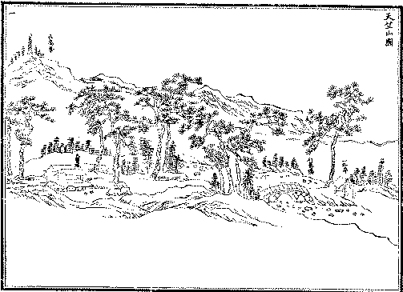
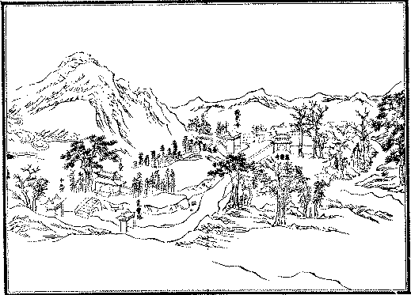
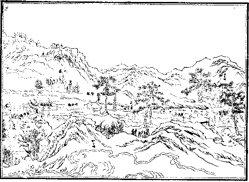
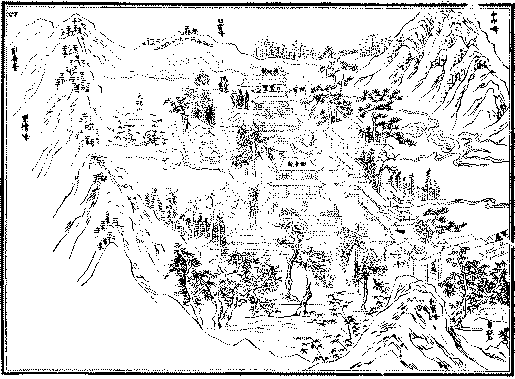
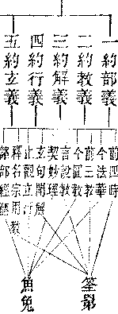
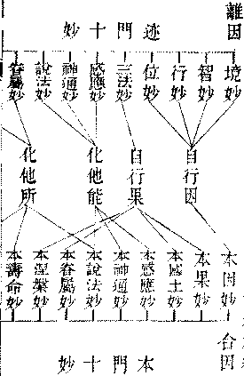
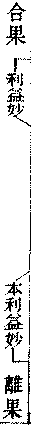
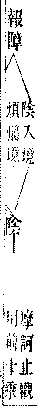
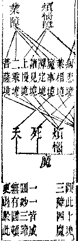

# 杭州上天竺讲寺志



> **藏经**：中国佛寺史志汇刊（佛寺志汇刊）　**册次** 第 26 册（GA026）　**编号** GA0024　**部类** 史传部　**卷次** 15 卷　**篇幅** 136,933 字

> **卷／品**：0 卷 · 8 品



---



## 目录



  - [光绪二十三年丁酉六月十九日，优婆塞丁丙合十序](#光绪二十三年丁酉六月十九日优婆塞丁丙合十序)

  - [重修上天竺山志序](#重修上天竺山志序)

  - [国朝浙江提学副使吴江赵寛〈观音感应颂〉有序](#国朝浙江提学副使吴江赵寛观音感应颂有序)

  - [金庭子〈感应颂〉并序](#金庭子感应颂并序)

  - [宋．苏子瞻：辩才大师赞有序](#宋苏子瞻辩才大师赞有序)

  - [序](#序)

  - [赵清献公诗序](#赵清献公诗序)

  - [苏颍滨倡和诗序](#苏颍滨倡和诗序)



---



上天竺讲寺位於浙江杭州西湖天竺山，天竺分上、中、下三山，上天竺山位於武林群山中，为佛教胜地。上天竺讲寺肇建於后晋天福四年（九三九），时僧道翊得奇木，刻大士像，僧勋持古佛舍利纳之顶间。吴越钱忠懿王即地建「天竺看经院」；宋嘉祐中，改「灵感观音院」。靖康初，属金难，僧道元秘圣佛於井，兵退归像院中；理宗书「广大灵感观音教寺」；元至元五年（一二六八）改「天竺教寺」；明成化间重修；清康熙五年（一六六六）因毁重建，三十八年（一六九九）圣祖南巡，书「法雨慈云」匾额，赐撰「天竺寺碑文」；乾隆十六年（一七五一）御题「法喜寺」匾额，故俗称为法喜寺。咸丰十一年（一八六一）寺毁於兵；同治三年（一八六四）寺复旧观。寺志旧有李金庭志，以附会舛讹，甚至伪撰明太祖〈竺隐说〉一篇以炫俗。崇祯年间寺僧照本乃嘱释广宾为撰新志。广宾曾撰「西天目祖山志」、「潜阳梵刹考」等书。此志凡五易寒暑始脱稿，汇成十五卷，分门为八：普门示现品，尊宿住持品、道场规制品、器界庄严品、帝王檀樾品、宰官外护品、风范隆汚品、诗文纪述品。〈普门示现品〉收功德、灵异、悲仰赞、感应颂、喜雨咏、请牒、祈谢、感应等文。〈尊宿住持品〉收题名、高僧列传、教观、清规、示众等。〈道场规制品〉录建置、塔墓、碑记。〈器界庄严品〉则载形胜、游记、物产、施田等。〈帝王檀越品〉录勅命、御制等。〈宰官外护品〉载师友、信施、著作、旌举等。〈风范隆汚品〉则备书寺僧品行。〈诗文纪述品〉则摘录历代文士有关本寺之诗文。是志曾得古庵居士校订，流通不广，光绪二十三年（一八九七）钱塘嘉惠堂丁丙觅得旧本，乃为之重刋。兹据丁氏重刋本景印。



四库全书总目



上天竺山志十五卷



明释广宾撰



天竺为东南巨刹，旧有李金庭志，广宾以其附会舛譌，甚至伪撰明太祖〈竺隐说〉一篇以炫俗，乃删补而成此书，曰普门示现品，曰尊㝛住持品，曰器界庄严品，曰帝王檀越品，曰宰官外护品，曰风范隆污品，曰诗文纪述品，凡七门。其风范隆污一品，於寺僧污行备书不隐，较他志独存直笔。据总目，尚有卷首一卷，此本已佚不存。



上天竺寺肇於晋天福四年，僧道翊得奇木，刻大士像，会僧勋持古佛舍利纳之顶间，妙相具足。钱忠懿王感白衣异梦，即地建「天竺看经院」。宋嘉祐中，郡守沈文通攺「灵感观音院」。靖康初，属金难，僧道元秘圣佛於井，兵退归像院中。理宗书「广大灵感观音教寺」，元至元五年仍改「天竺教寺」，明则重修於成化丙辰。入国朝，康熙五年因毁重建。三十八年，圣祖南巡，书「法雨慈云」匾额，赐撰〈天竺寺〉碑文。六十一年春，殿再毁。雍正九年，世宗赐帑金鼎建，制重修寺碑。乾隆十六年，御题「法喜寺」匾额。嗣后曡邀宸翰，恩锡优渥。祈祷雨旸，为一郡司命，远方趋谒不下普陀。咸丰辛酉，罹粤匪之刼。同治甲子，两浙镜清，佛日重辉，寺复旧观。光绪初，元住持释悟化校刊、海宁管廷芬原辑《天竺山志》十二卷，详近畧远，未见广宾所纂，斯志殊属缺典。今得旧本，冠以钦定四库总目，不惟直笔昭彰，且所佚之首卷亦都在焉，洵普门之宝卫，自在之庄严也。谨寿诸版，回向灵山不二门中，同圆种智。



------



### 光绪二十三年丁酉六月十九日，优婆塞丁丙合十序



### 重修上天竺山志序



天竺在月氏东南数千里，杭之山曷为沿兹名？浮图法故来自天竺，典午时以兹颜其寺，名所繇昉也。道翊结茅，光徵奇木，大士像成。而洛僧又以舍利置顶间。寤求梦见，赫有灵迹。旛盖香灯之供，口持膜拜之虔，殷山填谷，魁然此阜，遂与身毒并称矣。曷为成兹志？志者，识也。识大识小，道斯未坠。普门之示现，胜地之灵奇，衣钵之流传，锡屐之游息，非纪载莫详。旧志辑於东瀛李氏茂才手，寺僧照本惧岁远益譌，属宾公任编摩之役，凡五易星霜，彚成十五卷。静探轮藏之文，博摉籖轴之秘。孝廉、文学、住山、皈法者，各以见闻佐之，而强半取裒於古庵居士。居士存日久隐山阿，攷订精核，山之董狐也。或疑浮图树下一宿，无住无著。经曰「法无名字，言语断故」，蒙豫所谓「聚沫多缘假，标空非色香」者也。然则大士何恋於是山？山何赘以是志？余惟大士从闻思修入三摩地，动静二相了然不生，能所圆融，有无交畅。三十二应，入诸国土，无刹不现；海上普陀，湖边竺岭，出现因缘，较他刹更显。至於旱涝祈请，岁著灵奇；厯代表彰，尤极喧茂。则夫藉山以宣大士之教，即藉志以著兹山之奇，因是而可大可久；俾众生获十四种无畏功德、四不可思议无作功德。记事者参载世事，仍归无事；记言者旁采世言，总归无言。南北宋之崇褒递加於大士，固国土所同称，而广大独耑属竺岭，大士何必不托异於天竺？天竺又何必不传信於此志？所谓「观匪留色，音匪受听」，道未坠地者，当不在大月氏，而近取诸上天竺矣。古来志舆图多为经世之用，惟王子纪五山，东方朔撰十洲，陶弘景谱金坛林屋，杜光庭考洞天福地，则皆出世之观，又祇为寻𤣥采真作津梁耳。《西域记》、《洛阳伽蓝记》以后，阐宗风者，其欣揽於兹编。



时顺治三年丙戌秋七月几望，古润妙香居士孙时伟（乳仙甫）薰沐敬书於湖上之紫薇右署



杭州上天竺讲寺志凡例



慈悲净圣，灵异显赫，奔走海宇，曷可无志？寺僧照本，兴荆棘铜驼之感，倾衣钵属余。余虽不文，适修《天目祖山志》、《西湖僧宝》、《聚诸祖禅藻拾遗》、《潜阳梵刹考》诸书成，鼓舞餘勇，遂力任其事。  

东瀛辑上竺旧志，芜秽杜撰，如题中所云，冒元人於宋首，其他犹可。至高皇帝〈竺隐说〉，亦伪造一篇。本以开面灵山，翻滋罪案，粃糠沙石，槩在汰删。  

古者列国各有史，史不实录，则观者胡稽？是以董狐良史，赵盾必书。志即史之餘，将以是非得失，垂为劝诫；敢俛曲阿徇，滥施华衮？风范隆污，寸心千古；知我罪我，所弗敢辞。  

灵奇悲仰，赞颂诗文，充栋汗牛，笔不胜书，梓不胜寿。兹独力既艰，舆情未惬；何妨好事，续刻补遗？是集所收，精微洁净，有目幸鉴。  

闻之吹竽而过邯郸之市，则师旷凛色；盛容而出临淄之涂，则阳文沮颜。何者？邯郸耳肆，临淄目林，虽姝色和声，无当众视群听也。今辑志於名山，人争听览焉，其敢忽诸？搜摭散轶，稽订鲁鱼；枯心呕血，聚腋缀裘。托始於鹫山，再辑於郑庵，再辑於宝石山房，则孝廉邵以窥氏煑字宏多，更请政於严氏文学孝廉诸君子修讨，凡五易寒暑，而是书始灿然可观。  

语云：「趾欲固，视故步。」往迹未详，文献奚考？闻有藏书，饥渴往借；篝灯简读，有关某某，随笔录钞。太史公自序曰：「余所谓述故事，整齐其世传，非敢云作也。」



















杭州上天竺讲寺志卷之一



天目山三学学人广宾纂



普门示现品



侧闻应化无方，选此方之教体；随缘弗类，摄同类之机宜。予窃惟之，有深意尔。夫南海，盖善才所参小白华也。凡天下之愿躬谒者，视鲸波鼍浪为忠信可凭，则千万人中无几矣！惟西湖廼天竺所飞小灵鹫也。凡郡内之指首屈者，推岑莲月桂；为仁智攸耽，则南北峰间其最矣！於是我大士闵五季刀兵之刼，妙三吴山水之区，巧示普门，即坐不垂堂者麕至；适冲都会，兼游偏挟伎者飚来。信未信在人，纵游戏於佳丽繁华之地；仁不仁由我，盍范围於慈悲喜舍之天？是以赫赫厥灵而群趋并望，班班斯著而曲记特书。此直垂慈眼视众生，何异痛心呼父母哉！故经云：「欲识佛性义，当观时节因缘。」其斯之谓也。志示现。



自在功德章



元盛熙明纂曰：



释典所载菩萨名号，如恒河沙数，不可胜计。惟观自在洋洋赫赫功德，独显乎世间。凡遇厄难，竭诚称念、稽首请命，亦往往如影响。诚由行愿弘深，大悲无碍之力也。广如藏教，今略陈之。梵云「阿哩耶婆卢吉帝」，此云「圣观世音」。又梵云「阿缚卢枳帝湿伐罗」，此云「观自在」。诸经所称，或单云「观世音」，或云「观自在」，或兼云「观音自在」。《观音三昧经》及《大悲经》、《悲华》诸经说：「此菩萨久已成佛，号『正法明如来』。」又云：「后成正觉，号『徧出一切光明功德如来』。」



《楞严经》云：「观世音菩萨言：『我昔於无数恒河沙劫，有佛出现，名观音，教我从闻、思、修入三摩地。初於闻中，入流亡所；所入既寂，动静二相了然不生。如是渐增，闻所闻尽；尽闻不住，觉所觉空；空觉极圆，空所空灭；生灭既灭，寂灭现前。忽然超越世出世间，十方圆明。上合十方诸佛本觉妙心，同一慈力；下合十方一切六道众生，同一悲仰。由我供养观音如来，蒙授如幻，闻薰闻修，金刚三昧，成身三十二应，入诸国土。所谓佛身、独觉、声闻、梵王、帝释、自在天、大自在天、天大将军、四天王及天王太子、人王、长者、居士、宰官、婆罗门、比𠀉、比丘尼、优婆塞、优婆夷、女主、童男、童女、天、龙、药叉、乾闼婆、阿修罗、紧那罗、摩呼罗伽、人、非人等，我於彼前皆现其身而为说法，令其成就，令诸众生获十四种无畏功德。彼佛叹我善得圆通法门，授记我为观世音号。由我观想十方圆明，故观音名徧十方界。』」



《法华经》云：「若有众生受诸苦恼，一心称观世音菩萨名号，即得解脱。若水火雷电、龙蛇恶兽、夜叉罗刹、王难枷锁、军阵怨贼，诸难之中，能施无畏；於苦恼死厄能作依怙，现三十二身，随类说法。地狱、鬼、畜生、生老病死苦，以渐悉令灭。」



《大悲心总持经》云：「若有诵持大悲咒者，即灭百千亿刼生死重罪，不堕恶趣。临命终时，十方诸佛皆来授手，随愿往生诸净土中；能获无量等持辩才，解脱八难，灭除三毒，一切所求无不成就。」《大悲总持》，具载别本。



藏教密乘经中所载：观自在菩萨为莲华部主，现诸神变。忿怒则称马首明王；救度则圣多罗尊；满诸愿则大准提尊及如意轮王、不空𦊰索，乃至师子吼并毘俱胝、一髻、青项、白衣、叶衣、千首、千臂，皆有仪轨真言，略举其名。若西天未译番本，师传本续真言要门，未易悉究。



灵奇识



按《武林山内七识》曰：



上天竺观音菩萨之示现也，盖僧道翊，石晋天福间，结庐西峰，见瑞光发於前涧，㔉得奇木，高数尺，一奇也。命工孔仁谦，不他像拟，因其形似，即造大士像，因缘正凑，出现呈祥，二奇也。圣像既成，妙貌端严，白光焕发，夜亡列烛之光，昼掩太阳之影，人民崇信，三奇也。后汉乾祐中，僧从勋自洛阳来，持古佛舍利一颗，曰：「吾宝之久矣，今愿置菩萨顶相中。」神灵一合，四奇也。北宋人民有「灵感」二字，南宋加号「大慈悲救苦难」，后法照摭《大悲经》加「广大」二字。天下观音同，而此号天竺独，五奇也。



灵感录



唐僖宗光启三年丁未，时中原鼎沸，黄巢、李克用等屠戮生民，战争不息。杭州临安人钱镠，膂力绝人，有保障两浙之意。起自草野，奋梃一呼，骁勇云集，杀弘、诛昌，吴越安堵。至是以屡建大功，立为杭州刺史，从民望也。既拜官，痛加砥砺，众益钦戴。誓奠安东南，不使有一夫之警。犹豫未决，夜梦一媍人语之曰：「汝有心慈悲，不忍杀人，将藩翰一方，百战不衂。中原天子虽易五姓，汝之疆土固自若也。福禄遐永，子姓緜远；珪组蝉联，封王拜相，莫可涯涘。二十餘年，当覔我於天竺山中。」镠觉而异之。自是所向无前，屡有神助。种种响应，若合左券。故书之於策，昭示子孙，世世崇祀。四世五王，与五代相终始。后钱俶纳土於宋，联姻帝室，通籍金门，振振蛰蛰，冠绝区宇。而大江东西鹿苑宝坊，翚飞云涌以千计，皆钱氏所刱，职此之故也。而上竺看经庵，则其所发轫者云。



黄巢作乱，所过杀戮其城，血流半天下。一日，忽至杭，民无所窜匿，哭声震原野；所恃以为扞御者，惟钱镠一人而已。老稚几百万人，泣拜大士，愿乞垂慈冒怙。巢将入境，镠振兵拒之甚力。巢亦素闻镠勇武，方欲格战，闻空中有念佛声；仰视云端，旌幢、宝盖，拥护大士。其火首金刚、天龙、修罗等众，扈从无算。镠兵见之，气壮百倍。巢叹曰：「此佛士也！」戒戢群下，遂逾日而去。由是镠益笃信大士，以为神武而不杀者焉。



唐昭宗乾宁元年春正月，越州董昌作乱，焚府库、杀官吏；浙人震骇窜匿，横罹锋刃者甚众。杭刺史镠躬祷大士，以祈默佑，乃仗钺出兵。方对敌之际，空中忽闻万骑驰骤之声；昌一见禠魄，不俟接战，即斩首俘馘。而越中底定矣，遂进爵为镇海节度使。



唐天祐四年，朱温改名曰晃，受禅於唐，国号后梁，改元开平。镇海节度使钱镠欲举兵讨温，复诣大士，祷而决之。梦大士以火而诏之曰：「汝有大功德於民，能救拔百万亿苍生於刀山劒树之中，当获莫大果报。第保守境内，不可轻动，贼断不敢犯。不旬日，即进爵为王也。」未几而吴越国王之命下矣。吁，可异哉！



后唐长兴三年壬辰三月，吴越武肃王钱镠卒，中子元瓘立，素畏朱全忠之酷烈凶残，不遑宁处。乃出居别馆，斋戒浃旬，徒步拜叩大士，冀得梦兆，以破其惑。忽梦邑之山林皆被锦绮，光彩晃耀天日，瓘喜跃：「此吾先王时事也！吾当奠枕鼾睡耳，彼胡其奈我何哉？」



钱忠懿王尝梦白衣人求葺其居，曰：「能昌尔国。」厥明访知，惟天竺大士衣白，因建看经院崇奉焉。此上天竺祈梦之始。



宋



太祖建隆元年，吴越国王钱俶以太祖即位，进止未决，乃祷於大士，以求指迷。斋宿殿中，夜梦紫衣神人命金甲将校数十百人，持彩绳，由杨子江北岸以绳隔界，直抵豫章、闽越而止；急呼俶，诏之曰：「此汝故物也。」复俾以袍笏冠冕无算。觉而喜曰：「吾无恐矣。」即择日上表，献圭璧、仪物称贺。帝大喜赐宴，诏使者：「归报尔主，朕将倚彼为籓翰，以翊赞至治，当不负前勋也。」已而毫发不爽，王顶戴益虔，聿新殿宇像设，以答灵贶。



开宝五年夏五月，大雨，河决。帝祷於天地鬼神，益雨。群臣有言上竺大士之灵异，速遣中使驰驿、赍香虔祷之。数日天即开朗，河流亦复止塞。逮中使归，询之，即至杭既祷之明日也。嗣是凡水旱疾疫，必祷焉。



太宗雍熙三年五月，帝以曹彬有白沟之败，见辱於契丹。遣中使诣上竺致祷於大士，以求神助，张齐贤遂有代州之捷。诸将遥见火光中有金甲大将，长数丈许，立於云端，持赤帜挥霍；虏望之胆落魂消，辟易奔溃。



真宗咸平元年，给事中张去华守杭，正月至五月不雨。徧祷望，旱弥甚。迎大士於梵天寺，率官寮拜祷之，雨随澍，四境沛足。



咸平三年夏大旱，浙东天台讲宗四明尊者知礼，同遵式修〈护国金光明三昧懴〉，三日九雨，明州太守苏某为碑颂其德。



大中祥符九年九月，蝗飞蔽天。帝以连岁旱蝗，多方捕瘗不能止，遣中使祷於大士。是月晦日午时，赤日杲杲；忽黑云起自西北，迅雷掣电，雨雹疾於矢石，声如铳礟；蝗蝻堆积川陆，高数尺许。帝甚神之，而天书之说益信矣。



仁宗庆历八年，曾公亮丁内艰，扶柩归泉南，道由钱唐。有乡僧元达，附舟来礼大士於天竺；忽於松行间见女士靓妆雅服，问达曰：「上座从曾舍人来耶？舍人五十七入中书，上座亦受大师号。」语讫不见。后服除还朝。嘉祐元年，亮位参知政事，达亦赐号「宝梵大师」，果如其言。



英宗治平二年秋八月三日，都城大雨，水泛涨。下诏求直言。宰相曾公亮尝因虏陈知杭州。沈文通奏：「天竺看经院观音大士，始自石晋至今，福天下、泽生民，前后灵迹甚著。」上命祷之，其雨即止。赐曰「天竺灵感观音院」。端明殿学士、礼部侍郎蔡襄书额。及襄继守是邦，一新院宇。



高宗绍兴四年冬十月，帝愤数败於金人，无以自释。乃卜日斋戒，遣中使赍疏恳祷於大士，以求救拔天下元元之命於涂炭锋镝之中。即日手敕韩世忠，力图报効，以雪国家不𠔏戴天之耻。世忠拜命感泣，誓不与虏俱生。候金步卒亲提大骑兵驻大仪。会朝廷命魏良臣使金，给良臣有诏移屯守。良臣出境，即上马令军中曰：「抵吾鞭所向移军大仪。」勒伍陈设伏二十餘所，约闻鼓起击。金兵闻移屯之说，喜其兵退，拥铁骑掩击。世忠麾旗鸣鼓，伏兵四起，各持长斧揕入斫马。遥见大兵数百万计，云拥而至，蹂躏溺死者以万计，遂至大捷。史称为中兴武功第一，殆亦有神助之力云。



绍兴五年，夏大旱，遣杭州府守迎天竺观音於海惠寺，祷亦不应。时六月中，有苦行头陀潘法惠，默祷，愿焚右目。以铁丸烧红置目中，然香其上。香焰起，行云满空，大雨沾足。法惠眼即枯。后三日，梦白衣女借一珠，拒不许。有二僧在旁曰：「与不妨，自今六六送还。」至七月廿一日，又梦二僧来请赴六通斋，白衣女在前引导。山川蔚然，百果皆熟，纷纷而堕。惠就地拾食，心地清凉。忽白衣女掷一弹，正中枯目，失声而觉。枯眶内已有物若珠，瞻视渐复旧。数其再明，却三十六日，始悟六六送还之兆。



绍兴二年，两浙进士类试於临安，湖州谈谊者，与乡友六人谒上竺祈梦。是夕，谊梦以茄为餽，惟徐杨者梦食巨蟹。次日详之，谓茄者，俗称落苏；蟹者，黄甲也。阳果登科。后二年，谊复与周元者，赴漕司举。又祈梦於寺。是夜元梦乡人徐广之持省榜至，凡列三等，已为中等第一。已而贺客四集，有道士在焉。明年省试罢，还吴兴待榜，路逢徐广之，已而省榜至，元果中等，於吴兴为一。既归，贺客中一道士素昧平生，元询之，对曰：「去年君过我卜，岂忘之耶？」凡事一与梦符。



> 伪齐刘豫，同金虏入冦，高宗下诏亲征。九月亲诣大士殿，焚香供祷，仰祈默祐，显现天兵蚤平北虏。既而淮东宣抚使韩世忠败金人、齐人於润州。方对敌之顷，虏见我师行阵之上云端，金甲神将数十餘，身长二丈许，目光炳耀，威勇异常。虏知为天应神祐，不战自却。故人马自相蹂践，填河蔽野，其败衄特甚。世忠献俘行在，具言其故，是以知之。世忠因陈战没之人，乞加赠恤。上蹙然曰：「死於锋镝，诚为可悯。」即敕直学士胡松年具词，建水陆大斋七昼夜以荐度。是夕见鬼神来者甚众，有梦战死者，咸欣然相庆，以为自此得生善道。



理宗嘉熙四年正月辛未，彗星出於营室，复以流星见於营室。史占曰：「彗见，灾莫大焉。」帝甚忧之，亟下议己之诏，播告中外。乃遣中使赍香疏，恳大士以消弭天变。是夕也，有光出自大士顶间，直贯营室，结为卿云，凝聚不散者久之，而彗灭矣。



元



至正四年八月，住持东溟日法师，时以承平日久，海内兵革骚动，特建安国福民道场三昼夜，以祈消弭兵革於乍萌之始。众僧方宣疏礼拜，忽覩五彩毫光发自大士顶间，照耀殿庭；已而直冲紫霄，凝聚摇曳。万人属目，赞叹希有。



至正五年，张士诚据苏州，纵兵焚掠。将入佛国山，抵行春桥，忽有泉自流虹泉涌出，自高一丈许，崩崖堙谷，势轰雷电。贼相顾以为有神力所致，惊叹而返。由是亦不敢妄杀，杭州藉以稍全性命。或者以为慈云祖师犹能显水观之灵，御此暴耳。



至正二十年，杭城荐罹兵燹，西山寺宇尽毁，圣像不知所在，众共追慕。丞相太尉开府康里公出金旁求，乃於草莽中得之。遂卜日斋戒、徒跣，率僚佐士庶，自北关门恭迎圣像，安奉今丞相公所建清平山之西天寺中。时圣像上大放光明，照耀云汉，分为三道：其一远属东方，若向普陀山者；其一属上天竺寺；其一径属今西天寺。一时咸覩，益加敬仰焉。



吴元年夏，三月不雨，禾尽槁死。郡守王与福竭诚致祷上天竺大士，甘澍随车而沛，禾复有秋。



皇明



洪武七年，六月大旱。参政徐本、李贤、王德宣，同诚徒步入天竺寺叩祈大士，雨随沾足。



景泰六年夏，两浙天久不雨，禾稼将槁，四民徬徨无措。时镇守都知监阮公，会诸都阃藩臬重臣，遂与同镇守兵部尚书德兴孙公斋沐。六月既望，徒跣躬诣上天竺寺，奉迎灵相至仙林，建坛祷雨。即日阴云四起，至日晡，甘雨大澍；明日如之，又明日亦如之，致两浙之地禾黍芃芃，枯槁即苏，民咸懽忭鼓舞。由是公大感灵贶，念无以酬，即捐己资重建行龛，洎制冠服及诸供具而庄严之，仍奉送以归。



成化丁酉年夏，两月不雨。镇守太监李公义斋心洁行三日而走大士之前，为民请命。意勤辞恳，冥漠潜通。旋轸之际，阴云布兴，甘雨如注。槁者聿苏，仆者旋起。远迩交忭，三农讴於野，商贾谣於市，官府文於词，士林声於颂。公乃大出帑金，鼎新大士殿、天王殿、钟楼、普门、圆通门，以昭答大士之贶。



弘治癸亥，岁旱不雨。镇守太监麦公忧劳万民，爰以七月二十四戊子，奉迎金身，自天竺而来至於海会寺。道经镇府，赤日停午，忽有片云如盖，随仗而至，骤雨倾注，若翻盆然。明日己丑，阴云竟日。庚寅、辛卯，皆微雨。壬辰，奉以归，则又雨。岂非大士之灵乎！



嘉靖己亥岁，水旱荐灾。郡守陈仕贤忧切民隐，精诚率僚属走上天竺，密祷大士，若痌瘝在身。雩禜辄效，民咸歌诵之。



嘉靖壬寅闰五月，旱既甚。郡伯希斋陈公闵民无辜，斋沐率僚属吏民，微服徒跣，躬迎大士，奉安海会寺，晨夕展敬。越四日庚午夜，僧纲良缙梦大士语云：「甲戌日有雨。」至期，雨如注；明日再雨，原野沾足。



天竺道场凡遇二月十九日为大士诞辰，远近人等先期斋戒入山，不翅亿万众。殿宇不能容，皆露坐达旦，名曰宿山。嘉靖甲寅年诞期，星月昭朗，忽见白鹦鹉自殿中飞出，翱翔旋遶於太虚之上。万人瞩目赞叹，念佛之声振撼林木，山谷响应。如是者迭现数四。



杭城有王姓者，患疮疡，告许灯油苕帚。病愈，拜还。其人乃衣冠之士，方诣大士焚香稽首，所施物为恶少盗匿。已而廉得其人，将理於官。盗畏罪，倍偿而释之。王有女孩，蓦自言曰：「今日父亲还愿，许人酒食财物。菩萨慈悲，奈护法伽蓝拏我，要去之急。」更备前物至寺，求忏谢伽蓝。而女孩苏醒，问之，云如梦中，莫之知也。



上海有潘姓拉里闬三数辈进香，舟次崇德河下，见邻船少妇，谑视之，精诚已荡。既归，弭棹黄浦，其人忽堕水，众力挽乃出，几於不救。遂惊悸成疾弥月。问诸巫，巫曰：「汝往天竺，中途淫媟良家妇，神瞋汝不敬，遣鬼挤之，得土谷神哀求获免。可往祭告，庶获有瘳。」如其言，始半复。



嘉靖二十四年，自春徂夏，亢阳弥时，田畴龟坼，潴泽尘飞；米价腾涌，僵死蔽野。方伯九畹谢公乃命郡别驾、仁和钱唐令，素服徒步入天竺迎大士，设坛於海会寺祈祷。越明日，净瓶水微涌出，果得微雨。又明日，水大涌出，遂果大雨。金庭子作颂。



《夷坚续志》云：上天竺观音像，身披璎珞，皆宋朝御赐七宝为之，五色璀璨，实为希世之宝。杭州归附后，为七宝璎珞夜有神光，为异物，取之以供朝廷。至京，则晦而不明。乃祝曰：「如七宝欲回天竺，期以某时色再光明。」至期，果神光烛天，遂遣回天竺。



万历八年五月淫雨，大水当道。迎大士入城致祷，三日后随应。



万历十六年春大雨，夏六月旱，加以瘟疫盛行，途路死者相藉。上司府县躬请大士入城，虔祷屡获响应。



三十六年，夏五月大水，秋疫。抚台甘士价率郡邑，同请大士入城，致祷辄应。鼓乐、冠袍、旛盖送归。



天启六年，夏六月至七月大旱，府县请大士入城，恳祝切效。



崇祯元年，秋七月廿三日，海潮涌没沿江居民，久淹不退。方伯董承诏率郡僚迎大士，奉安海会寺，为民请命，仍获有秋。董方伯捐俸，偕郡守万国相、邑侯王扬基建藏经阁，以酬神贶。



悲仰赞



宋孝宗天竺广大灵感大士赞曰：



观音大士，以所谓普门示现神通力故，应迹於杭之天竺山，其来尚矣。朕每有祷祈，随念感应。曰雨曰旸，不愆晷刻。是有助於冲人者也。因为赞曰：



猗欤大士　本自圆通  

示有言说　为世之宗  

明照无二　等观以慈  

随感而应　妙不可思



宋理宗皇帝制灵感观音大士赞曰：



神通至妙兮　隐显莫测  

功德无边兮　应感奚速  

时和岁丰兮　佑我生民  

兵寝刑措兮　康此王国



宋郡守陈轩上竺寺记赞曰：



白衣仙人无住著　补陀洛伽渺云海  

为大导师安乐国　歙然徧应河沙刹  

世界𤍠恼或有闻　曾不旋踵垂覆护  

众生心念非一种　皇皇不足常有求  

如饥须食渴须水　顾亦何从满其愿  

我观圣心等太虚　其视万物犹一物  

细视一物如一身　是身四大犹不有  

万物何能作留碍　殊功妙用济十方  

欲求功用不可得　群生梦幻可两忘  

尔固无餘我无欠　尝观瑞像见宝光  

如净明珠时白赤　琉璃琥珀杂苍玉  

荧煌璀灿照眉宇　山顶或见初日升  

匹素曳空烟缥缈　凡人颠倒作思惟  

须臾变灭无复初　非空非色非有无　菩萨应身亦如是  

堂堂秘殿表东南　山君海王尽回向  

观音智功不思议　佛子当作何等观



元笑隐禅师大忻赞大士曰：



门门证圆通　法法无差别  

文殊择法眼　云何示优劣  

如城之四门　中道乃迳捷  

又如百川流　大海悉融摄  

是故观世音　日用常三昧  

眼尘识和合　世间相无碍  

尽空诸所有　亦不坏三界  

随其所应度　说法示慈爱  

心地诸种子　大小各不同  

时至雨露滋　发生均化工  

幻师一毫端　幻相三十二  

而彼诸应心　即我自心是  

观心而覩相　心相而寂灭  

稽首常现前　证我如是说



又赞曰：



耳於六根　功独超胜  

况不耳闻　反闻自性  

前尘起灭　自性不动  

故诸尘用　譬如大将  

遇变出奇　金鼓旌铠　错置逆施  

稽首大士　证我三昧  

为我后人　委曲垂诲  

三十二应　十四无畏  

随感而通　分身异类  

如天元气　四时运行  

万物芸芸　莫知其生  

我观畫师　毫端游戏  

即是神通　现相不二  

我眼见像　如听法说  

心精遗闻　均一解脱  

心佛众生　同证无碍  

不立一法　名观自在



国朝空谷景隆禅师赞大士曰：



闻思修入三摩地　以智观照世言音  

不从耳根坠尘识　是故尊号观世音  

闻尘闻性无所住　智体本来无起灭  

是故寂灭常现前　超证圆通无异等  

导师亦号观世音　因果符合无差别  

慈育众生如赤子　亦如赤子同悲仰  

分身应现十方界　如幻如化无去来  

反观闻性常寂灭　顿使众生离诸苦  

施诸无畏不思议　无功用行而成就  

闻极疑闻无所有　法法圆融无罣碍  

譬如明月当秋空　光明应现一切水  

水月曾无应现心　无作妙力之所感  

六根互用等无别　前后中际不可得  

尽闻闻性充法界　是故有求无不应



感应颂



------



### 国朝浙江提学副使吴江赵寛〈观音感应颂〉有序



弘治癸亥，岁旱不雨。镇守太监麦公忧劳万民，用《周礼》索鬼神之义，徧雩於上下及释氏。念观音大士以慈悲为道，爰以七月廿四日戊子，奉迎金身，自天竺寺而来於海会寺。道经镇府，赤日停午，炎光赫曦；忽有片云如盖，随仗而至，骤雨倾注，若翻盆然。明日己丑，阴云竟日。庚寅、辛卯，皆微雨。壬辰，奉以归，则又雨。虽不能溥且足，亦可谓奇矣。岂非大士之灵乎？非公精诚之感乎？然不能溥且足，何也？大士果有灵乎，则苍生不胜大愿。愿溥也，愿足也。遂作颂曰：



惟圣恻恻　济利为德  

惟神不测　变幻空色  

感则斯应　应则未溥  

殆是变幻　贸眩下土  

胡不大之　徧灌十方  

俾出火坑　咸就清凉  

忍视众生　受诸苦厄  

大慈大悲　无量愿力



------



### 金庭子〈感应颂〉并序



嘉靖二十有四载，自春徂夏，亢阳弥时，田畴龟坼，潴泽尘飞；米价腾踊，僵死蔽野，兆人有不测之变。方伯九畹谢公躬率百司，祷诸山川社稷之神；复用诸方士符咒之术，而燔灼益甚。乃命郡别驾暗斋罗公、仁和令后冈程公、钱唐令芦溪龚公，素服徒步入天竺佛国山，具仪仗迎观音大士於海会禅寺。谕都纲良缙、上竺住持惠琳道显，董诸比丘昕晡斋沐讽经，务期昭假。先是，祈祷皆以净瓶滴水为验。越明日，瓶水微涌，点滴如珠，果得微雨。又明日，水大涌出，遂果得大雨。金庭子见而异之，敢作斯颂，以彰大士之神应云。颂曰：



乙巳之夏　火入南斗  

槁苗斯焚　百姓疾首  

三月不雨　旱魃降殃  

巨津为涂　若堕火坑  

巫觋舞雩　靡神不举  

天不悔过　赤地千里  

方伯曰嘻　爰祷大士  

济济庶僚　从如归市  

舆卫拥护　坛於吴山  

惟众比丘　厥诚孔殚  

净瓶一滴　化为甘露  

利济大千　驩声载路  

大士神灵　其应如响  

发大慈悲　万刼瞻仰



尚宝卿六桥徐江山〈祷雨灵应颂〉有叙



观音大士，以慈悲广大之力，灵庇兹土有日矣。故旱潦辄祷，祷则辄有殊应。嘉靖壬寅闰五月，旱既甚。我郡伯希斋陈公闵民无辜，乃斋沐率僚属吏民，雩城隍，不雨；雩山川庶神，不雨；触土龙、舞巫觋，愈不雨。公曰：「《周礼》荒政索鬼神，〈云汉〉之靡神不举，皆忧旱者之当务也。吾闻天竺大士灵验屡著，盍往请之？」卜日丙寅，公微服、徒跣，盛旗幡、鼓吹奉迎大士，恭安於吴山之海会寺。肃香楮，晨夕展敬焉。越四日庚午夜，僧纲良缙梦大士语云：「甲戌日有雨。」至期，僧庶骈集以俟雨。日亭午，净瓶水上沿杨柳滴下，津津如贯珠然，未刻雨如注。明日乙亥，瓶水滴；薄暮再尔，雨如注，原野沾足矣。是非大士之显灵哉？公之精诚昭假有足徵也。呜呼，休哉！谨再拜而作颂曰：



於赫大士　濯濯厥灵  

旱乾水溢　靡祷弗徵  

岁阅壬寅　闰月维五  

旱既太甚　千里焦土  

郡守陈公　忧心殷殷  

肃尔寅恭　雩兹庶人  

瞻彼昊天　杲杲日出  

我心靡宁　忧心如炙  

公谓黎民　舍尔土龙  

予索尔神　曷其弗宗  

其神伊何　观音大士  

厥像孔严　於天竺寺  

乃肃香帛　乃率群僚  

郊焉迎焉　翩其旟旐  

惠然来思　登欢喜地  

载拜载祈　陈词献醴  

吉日庚午　彼僧都纲  

爰梦大士　如在洋洋  

其梦伊何　於时语语  

五日为期　甲戌斯雨  

僧庶咸集　如林如丘  

有净者瓶　津津溢流  

瓶之罄矣　其雨湿湿  

既优既渥　自未至戌  

明发再兴　瓶水犹滴  

此日而晡　雨彼原隰  

民曰休哉　膏我黍苗  

何以致之　陈公之劳  

自天降康　我公之赐  

公曰匪予　让於大士  

巍巍大士　大慈大悲  

泽我蒸民　孔惠孔时  

振振陈公　式廉式爱  

通於神明　厥泽孔溃  

维神之灵　维公之诚  

维诚维假　俾民亟宁  

维神斯依　公归弗有  

我作颂言　用诏而后



喜雨咏



成化年中，省城迎大士祷雨辄应，性庵法师永顾率众而咏曰：



去岁祈晴格上苍　今岁祈雨应非常  

才迎大士离三竺　遂喜甘霖沛八荒  

瓮内不须留蜴蜥　道傍先见舞商羊  

应知上相诚心切　顿使南方旱魃藏  

六合浓云连海峤　一竿新水满池瑭  

芃芃禾稼沾殊渥　霭霭桑麻异众芳  

野老腾懽歌岁稔　山僧作偈诵时康  

人心自与天心合　法运还同国运昌  

两浙江山增气象　万家谣诵乐虞唐  

伟哉功业垂千古　好刻贞珉示不忘



祷雨篇



万历乙巳夏六月，迎大士入城，即时滂沛，钱塘邵重生喜而歌曰：



苍天乌乎虐下土　骄阳亢魃不肯俯  

大士出山下民主　感格未通心未普  

油然沛然欲成雨　敲松击瓦点可数  

孰能漏天不复补　孰能立海若神禹  

感天旋日不旋武　使我为农亦为圃  

袭衣百拜不敢侮　小社大心在区宇  

杨枝涓滴我愿吐　伽瓶洋溢吾所怙  

匹夫之诚未狂瞽　小儿青龙白龙亦同舞(其时都城集千小儿，齐唱谣曰：「青龙头，白龙尾，小儿求雨天懽喜，点点落在苗田里。」故末句云然。)



杭州上天竺讲寺志卷之二



天目山三学学人广宾纂



请牒奏



宋郡守陈轩上〈灵感观音院奏〉曰：



臣所领州西偏，湖山之胜，甲於天下，而天竺山在焉。自五代时，僧翊得奇木，不能名，刻为观音大士像。僧勋又以佛舍利内置顶间，其后像见光，惟与人作福祥，远者载金石，近者口相传不绝，不复概举。臣自去秋视事，民方荐饥。今年春夏，雨弥月不止。吴兴苦卑，连岁水灾，父老日夜忧惧。臣即率属躬祷像下，冲雨入山，衣帽沽湿；渠决坏道，从者皆涉。比臣之还，天宇开霁，纤云不兴，白日正中，清风穆然，邦人合爪叹息。既又舆致城中作佛事，与民祈禳。已而雨旸有时，民不告病；稼穑旆旆，遂为丰年。实兹像之庇兹土也，所不可忘。臣窃考图志，惟天竺山，粤自晋末尝为道场；逮圣朝天圣，始分上下。而观音像所在，历载崇奉。在治平中，赐号「灵感」，因以名寺。在熙宁中，许寺岁度一人为僧；朝廷每遣中使谒者走香币其所，封识用御府宝玺，盖严恭如此。惟是殿宇之建，垂六七十年，日就颓弊，不足以揭虔妥灵，宜有加饰。臣不胜大愿，愿给祠部空名度僧牒数十道，货缗钱市材僦工，撤而新之。不惟俾东南之人永有瞻式，傥遇水旱祸灾，吏不能力者，庶几有所控告。臣惶恐以闻。



祈谢文



宋郡守苏学士轼〈祷天竺大士祈晴文〉曰：



三吴之灾，连岁不稔，尚赖朝廷，大分仓廪之陈，乃眷疲羸，仅免流殍。今者淫雨弥月，秋成半空。永惟嗣岁之忧，将有流离之惧。我大菩萨，行平等慈，覩此众生，皆同赤子；反雨旸於指顾，化丰歉於斯须。虽某等不德而召灾，念斯民无辜而受悯，愿兴慈恻，一拯含生。



又〈谢晴文〉曰：



民无常心，固何知於帝力？天作霪雨，当有感於佛慈。慧光照临，阴沴消复。拯农工於沟壑，宽吏责於简书。某等共衔不报之恩，愿颂难名之德。恭驰梵宇，少荐微诚。



感应记



唐皮光业譔〈上天竺观音看经院感应碑〉曰：



钱唐佛国山中，旧有天竺观音寺，相传创自典午时，毁於六朝兵燹。石晋天福四年，僧道翊从终南山来，即其故址缚茅居之。见山麓有神木发光之异，刻观音大士像，虔奉庵中。后洛僧侁施舍利纳顶间。凡诸祈祷，应答如响。唐季有异人钱镠，挺生临安，状貌魁硕，具万夫无敌之勇。适当五胡云扰，九域尘飞，奋梃一呼，两浙披靡。志图捍卫东南，中怀疑贰。忽一旦，梦感大士有封王拜相之言，乃攘臂先锋，所向克捷；颐指气使，罔不乐从。初为董昌偏将，继为杭州刺史，擢镇海节度使，后进荆扬节度使。欲出兵讨朱全忠，复梦大士曰：「不可轻动，汝能救百万苍生。不旬日，进爵为王矣。」已而果封吴越国王。镠感大士默佑之神，属予摭述其事，镌诸贞珉，以表灵感之德於无穷。予谓老翁止汲水以溺儿，井著婆留之灵迹；胡僧言托生於斯处，池无神物之潜形。宿命洞烛於未来，玄机迭徵於无朕。岱岳生申补衮，藉元良而翊运；尾箕诞说筑岩，起右相以和羹。况兹扛鼎之英豪，无始刼来，必亲赴龙华而授记；是以然灯之正觉，阎浮界内，乃数呈梦象以开迷。将欲拯溺而救焚，特此因人而假手。非广大灵感之慈，迥出於乾坤覆载之外；何天人相与之际，若捷於形声影响之间？否则，何以致三代五王之盛，山林被绵绣以腾辉；一门百辟之荣，子姓袭金貂而继美者乎！凡诸祥瑞，具载简编。迩复僭次绪言，代申铭心镂骨之悃愫；殆亦假兹愿力，普为导迷破暗之筌蹄云尔。



宋鲍钦正代郡守陈轩撰〈灵感观音碑〉曰：



绍圣二年，轩自合肥移守钱唐，明年奏疏於朝曰：「臣所领州之西偏，湖山之胜，甲於天下，而天竺山为灵感观音菩萨像在焉。臣自去秋视事，民方荐饥。今年春夏，雨弥月不止，父老日夜忧惧。臣即率官属躬祷像下，冲雨入山，衣帽沾湿；渠决坏道，从者皆涉。比臣之还，天宇开霁，纤云不兴；白日正中，清风穆然。既又舆致城中，作佛事与民祈禳。已而雨旸有时，农不告病。实兹像之庇此土也，所不可忘。惟是殿宇之建，日就颓弊，不足以揭虔妥灵，宜有加饰。臣不胜大愿，愿给祠部空名度僧牒数十道，货缗钱市材僦工，撤而新之。」奏礼部尚书，敕令从事。许裒一路祠庙施利，以充其费。於是毗陵胡公宗哲、番阳张公绶偕为转运副使，特主其事。乃得钱五百万缗，乐施者又千万。是役也，凡在见闻，智者献谋，巧者出技，富者荐货，贫者効力。良材密石，尽山泽之选。经始於某年某月，而某年某月告成。为殿屋若干楹，高明奥深，严翼宏大。复辟其前楹为忏堂，金碧丹垩之饰，炳焕夺目。华供之具，无物不备；慈容妙相，巍然益尊。过而礼者，恍若梵天帝释之居，又疑身在图畫，或以谓三昧力所变幻也。盖如是而后足以侈上之赐，而显扬菩萨之威灵，以慰夫邦人父老之心。余为撰次其本末，将勒石以诏於后。



国朝吏部尚书萧山魏骥撰〈祷雨感应记〉曰：



景泰六年夏，两浙天久不雨，禾稼将槁，四民徬徨无措。时钦差镇守浙江都知监左监丞阮公，会诸都阃藩臬重臣於议政之堂而飏言曰：「方今圣上屡降敕书，悯念元元，务在以安其生。今两浙无雨，田畴龟坼，禾稼枯槁。况嘉湖二府之民已罹水害，赈恤且未苏，今又旱若此。傥失西成，则民何以堪！非惟其嗷嗷不能以生，则国赋从何而输？在古暵旱，有靡神不举之典；今予询诸耆老，谓上天竺寺所奉之观音大士，每遇暵旱，凡守土之臣，能秉诚祈之有应。予欲狥民之情，与诸公当一往之可乎？」佥曰宜。公遂与镇守兵部尚书德兴孙公，斋沐於六月既望，率诸藩臬之臣，徒跣躬诣其上天竺寺，奉迎灵相至仙林建坛祈祷。即日阴云四起，至日晡，甘雨大澍。明日如之，又明日亦如之，致两浙之地禾黍芃芃，枯槁悉苏。民咸懽忭鼓舞，举手加额曰：「此非镇守大臣秉此一诚，躬率僚采以祈求之，其何能得雨有如是耶！」公由是大感灵贶，念无以酬，即捐己资重建行龛，洎制冠服与诸供具以庄严之。既而仍奉送以归。於时其住持僧永顾目覩其盛，且於山门有光，乃具前所云者於予，请记之。予曰：「观音大士得雨以济斯民。若迩以岁歉，杭之鳏寡惸独，及别郡流移而来乞食於市者殊夥，公则规畫百至，或给之以米，或济之以粥，赖其全活者不可胜数。又若正统己巳，括苍寇作，流毒其境，公躬擐甲胄，提兵深入，捣其巢穴，擒厥渠魁。於胁从者，则待以不死，既招徕无辜陷於寇者，老稚以千万计。至杭之街衢、河梁之类，久被堙塞，则竭尽心力以缮理之，使复其旧，以便於民。致民仰公者，不啻犹神明；感公者，不啻犹父母，愿并纪之。殆有不特表区区感公之心，而且表浙民之感公之心也，敢请。」惟予自天官蒙圣恩归老林下，知吴越之民被公之惠者非一人，颂公之德者非一口。盖以公能体圣上惓惓爱民之心为心，於民之饥寒则赈恤之，於民之寇盗则翦除之，於民之叹旱则祈雨以济之，於民街衢河梁则整饰之，於民之寃枉则伸雪之；是故强暴不兴，良善安业，以乐太平之乐，实由公秉此一诚，外尽其力，内尽其心，而能然也。昔郑火，大夫子产救灾补败，得宜当理，史实书之；卫有狄人之难，文公治其城市宫室，合於时制，诗人歌之。今公於浙，不言其他，姑以昔除括苍之寇盗、今祈雨而济民而论，与子产救郑之火灾、文公靖卫之寇难无异，其纪之也，良不为过。故予因永顾之请，特为之记。



真身考



国朝邵重生曰：



上天竺观音法身奇木，乃本寺之宝。南宋史：「建炎三年冬十二月，金虏完颜宗弼（即兀术也）入临安府，闻其奇，奉观音舆中，并《大藏经》徙而北。时有比丘智完者，率其徒以从，至燕，舍都城西南五里，曰玉河乡，建寺以奉。」田公《西湖游览志》，陈水南《两三墨谈》，郎仁宝《七修稿》，今《成化杭州志》、《万历杭州志》，皆从《传灯录》之说。或言佛身凭虏奉去，安在灵异？不知佛视中国夷狄，初何尔我？按《续传灯录》云：「建炎二年十一月，金兀术入杭城，追高宗至绍兴、四明。次年二月，兀术复回杭城，乃奉观音北去。不知此时偶阴雨，请真身在城海会寺侍香火。道元知虏求索，急藏井中；将他像置行殿，虏随取去。及兵退城，寺亦燹烁，众僧迷不知处。道元被驱至许村，逃归，知其处，卓地有声，井起像如故。则虏奉去者，非真身也。」《传灯录》之言如此。今余住山，得见真身法身沉香者，不知菩萨化现，自在一方；此土生灵感召，其曰玉河乡，未闻灵应。然则大士之灵，系於土而不系於像，假乎像而不依於像。狡虏奉去，与黠僧求存，皆断见也。惜燕京非元上都朔漠之地（乃今北京城）；纵元上都，我成祖北征已至其地，而玉河乡更迩，亦必有人至，更无能详访此像下落耶？其无可知矣。



上竺论



古庵山人曰：



或问：「上天竺於天下，无峨嵋、五台、普陀、天台之形胜；於神，无泰安、济渎之著见；於仙，无茅山、武当之来历。区区托迹灵木之光，至若狂三吴、饥渴四海，而香火不熄、年新月盛者，此何以故哉？请居客而竟其说！」



「大抵山川之灵系於境，神灵之著因乎人，习以成风者由於久，翕然攸好者秉乎彝，从心所欲者乘其便，音响流通者感其慈，愿出其途者取其适。不境则灵何所缘？不人则灵何所显？不久则灵何由同？不性则灵何所摄？不便则灵何由普？不慈则灵何由圆？不适则灵何所歆？七者得其一而从违半，况得其全而天下归也，夫何疑哉？」



「请以人境言之！」



「堪舆大势，地形全资水法，地杰所以人灵。水法东南注为顺，顺则水走，山因以飞，无情而地不结。水法西北注为逆，逆则水返，山因以回，有情而地结。粤自上古，武林山南北二支，生至钱江而止，其中南北武林二涧，水泻於今西湖。西湖东南由进龙浦，顺注於江。杭城之地，不结灵竺之山，虽有晦昧，自秦汉晋以来，武林二水泻於今西湖。其时进浦，路涨为陆，江不通而成湖，方有金牛、明圣之号。西北逆注於海，故杭城之地，结灵竺之山，於焉而始显。然则有西湖方有杭城，有杭城方显灵竺，审矣。有灵竺所以有杭城，有杭城不可无灵竺，又审矣。惠理、道翊之见，易地皆同。秦汉晋时，未有杭城，有钱塘县之草设，故灵竺亦不须深。惠理开天竺，至今下竺而止。石晋之时，杭城盛而称郡，故天竺当邃。道翊开天竺，至今上天竺而止。杭城小，故天竺近；杭城大，故天竺深。然则杭城盛，天竺宁不盛？杭城衰，天竺与之衰。天竺、杭城，风气命脉实相关系，不居然可见哉？又不观之，近有人以大士盛极，而开香火於五云、焦山二处。五云风景则大江流其前，焦山则天目耸其左，卒之风气无关，命脉不系。盖人虽有厌常喜新之情，而无可大可久之势故也。宁若上竺之不求，而自然欲废而不可者乎？不特此也，大士之风，孰不欲依以为重？虽以慈云之德，设旃檀观音而不传，江干有五丈观音而不著，本境有黑观音堂而不彰，新市有长观音而不久，近村有四面观音而不立；以至刹刹有阁、处处有堂，岂非关系所存，自潜孚默契而不可夺，因缘所感，有若或使令而不容己者乎！惟天下之涂，浙直江犬牙，而福广川蜀所必由之路。谚云有之：『上说天堂，下说苏杭。』惟天下之福，金帛财货萃於杭城；而杭城之福，富贵康宁悬於上竺。山川为杭土之母，若提纲而挈其领；大士之慈悲为杭父，若法化出而佛口生。海内香火虽多，而出现因缘，此山所独。灵感之言，士民不舍於北宋『广大』二字，南宋表扬而迄今。夫信之专者，则土石皆帝；摄其魄者，则草木皆兵。加之久道则不言而化，缘熟则不约而同。盖好德之良根於民性本善，由是天下之人即以仰杭城者而仰大士，其归已不可御矣。所谓久而性也如此，至谓便且适者。奈何生氓之情，所以求福者不过欲逸欲乐也。东南财赋有餘之地，人情更甚。杭为六省通衢，九达孔道，花锦为城，货泉为薮，万宝之所辐辏，百工之所攒集。开天竺之门户，有西湖六桥；掉天竺之手足，有灵鹫飞来峰；秀天竺之眉目，有诸装点，而天竺兼之焉。因求福而畅逸豫之情，因逸乐而益坚求福之念。故不特富贵、贤智归之，而贫贱、愚不肖莫不兴起，以此也。然其圆也奈何？盖天下灵聪司土肸蚃者，安富贵而跻贫贱已耳。大士不惟能与世间乐，尤用情於苦难，则虽至贵至富所不能无，而极愚极劣更切哀仰纠察之灵者，不过彰善瘅恶已耳。而大士尤不舍夫不善之人，过往之灵，不过电暗室察顺风已耳。大士尤遗闻反闻，无作妙力，循声感应，不特三际怀保、十方恫瘝已耳。而其缘更孚於执著难化之妇女，上合诸佛之慈，故曰大慈；下殉群生之欲，故曰大悲。世有善不善，百世既归，家有阃以内，尤怀向慕。夫孰不有父子？孰不有妻孥？孰不有顺逆？如是者安往哉？抑又犷悍之性可化而驯良，颛蒙之愚可乞而智慧。随地说法，靡刹不形。盖不特三十二应，而有千亿恒沙之身；不特千手千眼，而有千亿恒沙之手眼。此吴越之崇天竺，高於五台、峨眉；四海之渴天竺，深於灵山祇树矣。又何必泰安神道之设、济渎浮物之幻、武当昭代之崇、天台罗汉之果、茅山声闻之迹而已哉！然其外又有三说，为天下神佛之致归向者，莫不水有风波之危，陆有传舍之苦。舟车屡易，人兽俱疲。孰有水平通於千里，陆凹无过一程？善信如遵郊陆，妇女若履阈门，更出於天下之神灵之右。又四方别省，所以足民用而充官储者，或枣栗、梨橘、竹木、漆枲，皆成於人者七，而伺於天者三。惟吴越蚕桑、农谷，成於人者三，而伺於天者七。雨旸既司乎大士，丰俭必藉乎威灵。祈蚕、祈谷、祈麦，古圣王所不废，何能后於今之氓乎？且也泰山、武当、茅山诸处，闻储香资进奉，孰有如天竺旷荡之恩，士庶得自尽其诚而无取？故握粟可卜，裹饭可祷，至有心香投体而已者。又有醉饱於僧而賖有秋之偿者，或即货所业而以其羡充费者。而又有创见观光，惊心耸目，一年不至，若一事未完；一夫不行，若举家获罪。此春时之民尽若狂者，以此也。然则杭城、灵竺，岂但相为表里，而又相为盛衰；岂但相为盛衰，而实相为存亡者耶！」客闻之唯唯。



或又言：「上竺与普陀大士，是同是异？」



曰：「岂得异？盖天竺即普陀，普陀即天竺也。普陀所以镇三际之水，乃天下之大士，而三吴在其中；上竺乃三吴之大士，而天下在其中，大小无分而理亦无异。然至上天竺者，可以不至普陀而圆，谓小可以该大；至普陀者，必至天竺而偏，谓远而不可忽近。圆偏互举，而事无不同也。」



女身说



山人又曰：



观音古佛，其身不必论男女，其身自是天下万世男女法身。况《法华》、《楞严》观音普门二品三十二应中，或现优婆夷、童女身而为说法，或现女主夫人、命妇大家而为说法。盖或现者，即於其人中出生善人，即大士之身，非谓大士往变现诸女相也。大士不往变现，随其人中出生，则随其身男女矣。斯大士应身之妙，观「应」之一字，则老少男女、大身童身，皆随其人而应也。至如《法华．龙女品》之说，此以女化男；如《维摩经》，天女化舍利弗为女身，曰「一切诸法无有定相」，此以男化为女也。此属皆不可思议事。观「圆通」二字，则男无所圆、女无所缺，男无不通、女无可碍，故女身之说，亦不废焉。然则执公主之说，谓之不知佛；则执男子之说，得非局於佛耶？或者又曰：「今时以三寸小履、二寸绣缘加大士可乎？」曰：「无害，随缘。」其人艴然，曰：「荐以腥膻，涂以脂粉，拒乎？」答曰：「若如是，则又非圆通矣。且大士，天下之大士也，男女之大士也。今女人即以杭城女子之饰事之，男子即以杭产[綜-示+一]缟金银之物事之。故龙女则献珠，匿王夫人则献香缨，难陀牧女则以乳糜，此其人即以法而说大士也。所以佛入荤俗而不拒於肉菜。当晋唐之时，而男子亦口脂面药者矣，此缘之谓也。」其人乃服。又曰：「烧香何以谓之作福？」余曰：「释典且不举，姑以〈洪范．五福〉曰『攸好德』。佛之德盛而福备矣！好之而恭敬供养、亲近爱乐，非有身之福乎？至冀其餘庇之光，而忏其宿造之罪，皆第二义也。世有《观音香山卷》，言『观音乃妙庄王三公主』之说。执有者，以宣律师曾询之韦天，韦天言信，而宣律师安有妄语？且赵文敏公管夫人曾书此记，文敏岂易惑之人？今有陶石篑公言：『此大碑今现在汝南府，其文乃蒋之奇撰，蔡京所书。』然则流通於宋元矣。执无者，以大士为净土导师，净土安得有女身？女有五障，不得作佛。如王元美言，乃淫僧妖尼诳惑所撰，盖以其词中言不足信。如香山在嵩山东二百里，乃中国地，何传信无徵？又如莲池言：『妙庄王不见标何方国土、何处国王。』愚谓秦时君始称朕，周时王女始称公主，今其卷有二称。《法华经》妙庄王有二子一女，而此记妙庄王三女，所以兴疑。要之，菩萨化身，通乎过现，不可思议论，则刼前或已有诸名称，与今符合，不可知也。故有无、断常二见皆非佛法。经曰：『静极光通达，寂照𣹢虚空；却来观世间，犹如隐中事。』此言得之，盖佛止言因果而不执理，儒家信理而不信因果。儒家言古，及盘古止矣，如外纪之事，便略不经心；佛家言古，动谓前乎千万刼，此所以不可同年而语也。」或问：「今世人还拜愿，自三步至十步；然初未见显应，而人行之不废，何也？」答：「此有二说。就菩萨而论，则舍法分无为，自是不可思议事；就众生而论，则如疾痛呼天、呼父母，观音乃此方之天、之父母也。」



杭州上天竺讲寺志卷之三



天目山三学学人广宾纂



尊宿住持品



侧闻维僧为宝，参佛法而鼎称；与世作津，度人天以筏喻。文身千界，慧命一丝。睠兹天竺开山，金轮绍位。直指人心，始也契禅那於柏子；反闻自性，继而谈般若於空华。乃如凿厓架屋，以庐学者，盛莫盛於辩才；铸印标堂，以柄诸山，尊莫尊於若讷；玺书宸翰，历更廿四，久莫久於晦岩。此三老之声光道德，盖树法幢於有宋者也。至如白眉天问於斑前者，为东溟；五竹轩符於梦表者，为竺隐；妙莲科注於国初者，为一庵。此三老之英灵福慧，盖振教译於皇明者也。靡不悟丰祖髓，名简帝心。羽仪十刹，而领袖五山；洞析一家，而澜翻三观。百叶蝉联，香逆昙华之国；五峰峻极，乳流狮子之王。故记曰：「人能弘道，非道弘人。」此之谓也。志住持。



宋佛光法师法照〈上天竺讲寺住持题名碑记〉曰：



《千佛名经》，其来远矣。上天竺住持无题名，阙事也。自道翊师天福四年开山结庵，得夜明木为观音像，钱忠懿王易庵为寺。国初咸平至元祐，益增广之。由南屏辩才而下，大振法席。高宗皇帝驻驆，有祷必应。绍兴乙卯，翠华临幸，羡有锡赍，命应如暨圆智，一新殿宇。孝宗乾湻间，若讷登对，论道称旨，於是赐白云堂印，署都僧录衔。凡称禅教律，公定皆从此出，所俾不轻矣。今上圣治之暇，心悦佛乘，於僧录之任，尤加推择。淳祐、宝祐，御制御书，昭其验也。上下三百餘载，传闻异辞，窃迹宗教共二十二代，爰题诸石。其道之隆替，庶乎后之学者，亦有考云。



开庆元年九月壬寅，晦岩照记



元竹屋净法师〈上天竺寺历代住持题名碑序〉曰：



题名者何？使来者目之，必曰孰道德，孰起废，孰躐等，孰公於众，孰私於身。於乎，可不惧乎！



皇庆二年夏，住持竹屋元净书



题名



开山第一代，道翊法师，石晋天福四年。  

第二代，南屏梵臻法师，皇祐三年。  

第三代，辨才元净法师，嘉祐七年。  

第四代，法照用文法师，元丰四年。  

第五代，慈辨从谏法师，元祐五年。  

第六代，圆悟思尚法师，政和元年。  

第七代，宣梵嗣珍法师，政和五年。  

第八代，慧觉齐玉法师，宣和六年。  

第九代，普明如靖法师，建炎六年。  

第十代，佛照智坚法师，绍兴元年。  

十一代，圆通应如法师，绍兴三年。  

十二代，普觉惟日法师，绍兴十五年。  

十三代，证悟圆智法师，绍兴二十三年。  

十四代，慧光若讷法师，绍兴二十八年。  

十五代，师觉法师，淳熙十一年。  

十六代，复庵妙珪法师，绍熙三年。  

十七代，柏庭善月法师，嘉定六年。  

十八代，虚庵有宏法师，嘉定十二年。  

十九代，鉴堂思义法师，绍定五年。  

二十代，柏庭善月法师，绍定十六年(再住)。  

二十一代，梅峰梵奎法师，端平三年。  

二十二代，古镜文杲法师，嘉熙二年。  

二十三代，同庵允宪法师，嘉熙四年。  

二十四代，佛光法照法师，淳祐三年。  

二十五代，石室智观法师，景定三年。  

二十六代，东林祖印法师，景定三年。  

二十七代，佛鉴妙铦法师，景定四年。  

二十八代，默堂正观法师，咸淳元年。  

二十九代，佛光法照法师，咸淳六年(再住)。  

三十代，鼎山时举法师，咸淳九年。  

三十一代，南麓时法师，至元十三年。  

三十二代，愚山古法师，至元二十年。  

三十三代，梓山恭法师，至元二十二年。  

三十四代，鼎山举法师，至元三十一年(再住)。  

三十五代，若洲筌法师，大德四年。  

三十六代，柳塘权法师，至大二年。  

三十七代，竹屋元净法师，皇庆二年。  

三十八代，佛海澄法师，泰定二年。  

三十九代，如庵真法师，至顺二年。  

四十代，虎岩颐法师，至元二年。  

四十一代，贤叟思法师，至元五年。  

四十二代，我庵无法师，至正二年。  

四十三代，东溟日法师，至正四年。  

四十四代，绝辉鉴法师，吴元年。  

四十五代，云谷臻法师，洪武元年。  

四十六代，日彰偁法师，洪武二年。  

四十七代，惟源修法师，洪武六年。  

四十八代，竺隐道法师，洪武十五年。  

四十九代，箕山隐法师，洪武十七年。  

五十代，止堂大山法师，洪武十九年。  

五十一代，古春兰法师，洪武三十二年。  

五十二代，宗源梵法师，洪武三十五年。  

五十三代，敬修德完法师，永乐二年。  

五十四代，一庵如法师，永乐三年。时姚少师奉命取《金光明忏法》来寺住。  

五十五代，宗铉鼐法师，永乐五年。  

五十六代，显宗弥法师，永乐十二年。  

五十七代，即中实法师，洪熙元年。  

五十八代，镜中潭法师，宣德元年。  

五十九代，浩初颐法师，宣德五年。  

六十代，训中谟法师，正统三年。  

六十一代，无相住法师，正统四年。  

六十二代，有中𬱖法师，正统六年。  

六十三代，瑞岩祥法师，正统九年。  

六十四代，大猷阐法师，正统十二年。  

六十五代，本源顾法师，景泰二年。  

六十六代，芝山广法师，天顺二年。  

六十七代，宗济法师，天顺五年。  

六十八代，洪沛法师，天顺七年。  

六十九代，昙芳法师，天顺八年。  

七十代，无外广法师，成化二年。  

七十一代，秉忠桓法师，成化七年。  

七十二代，雨庵沾法师，成化十年。  

七十三代，天泽沾法师，成化十七年。  

七十四代，敏中智法师，弘治四年。  

七十五代，草堂芳法师，弘治九年。  

七十六代，默庵潜法师，弘治十三年。  

七十七代，铁峰定法师，正德八年。  

七十八代，天日南法师，正德十四年。  

七十九代，大林茂法师，嘉靖九年。  

八十代，大鼎脀法师，嘉靖十四年。  

八十一代，松隐琳法师，嘉靖十九年。  

八十二代，东山显法师，嘉靖二十二年。  

八十三代，云岩贵法师，嘉靖二十四年。  

八十四代，春谷俊法师，嘉靖二十九年。  

八十五代，心泉璟法师，嘉靖三十一年。  

八十六代，竹山蕙法师，嘉靖三十四年。  

八十七代，月洲源法师，嘉靖三十六年。  

八十八代，五峰沾法师，嘉靖四十年。  

八十九代，云峰才法师，嘉靖四十年。  

九十代，近泉松法师，隆庆二年。  

九十一代，一山福法师，隆庆四年。  

九十二代，小泉礼法师，隆庆六年。  

九十三代，月楼宪法师，万历二年。



旧志次九十三代而止，下三十五人，今续入。凡天下丛林至宗风不振，乃循甲乙相承。故上竺自皇祐间，吕郡守奏去甲乙，而外请名耆，良有以也。顷稽方丈，自月楼宪公，不惟甲乙，且增正副矣。迨云池逸公，不惟正副，又参鼎足矣。嗣是以往二十人后，又无不徼外护之灵，逾前茅之列，职此所由。盖香火之利养丧天，使山门之风规扫地耳，悲哉！且夫住持以代例称，所以序道统者也。皮既不存，毛将安附？故今续入者，上不嗣代，下不系年。



住持萃峰、道梁师



住持小山、道立师



住持继泉、德孚师



住持仰峰、承明师



住持云堂、德洪师



住持南溪、道柯师



住持竹亭、圆迳师



住持明庵、圆日师



住持云池、圆逸师



住持无尘、明远师



住持绍峰、祖玉师



住持敬坡、真宰师



住持爱云、意奎师



住持云泉、真谅师



住持伴云、诸香师



住持厚泉、明信师



住持心宇、明机师



住持潮音、海瑞师



住持心台、万灵师



住持玉岑、世高师



住持萃吾、兴美师



住持旨玄、寂嘉师



住持易庵、如贸师



住持文宇、寂缨师



住持奇峰、照珍师



住持春山、万富师



住持印中、照本师



住持寄竺、寂瑜师



住持本空、续蕴师



住持道微、本初师



住持心凝、通藏师



住持心融、续元师



住持印峰、心授师



住持了因、源汶师



住持信如、寂徵师



住持兆初、本一师



列传



五季



道翊法师



当阳侯杜公之子，出家於终南山翠微寺。晋天福四年，入天竺佛国山，止息西峰之隈，诛茅结庵，精修净虑。夜则高击斋鱼，经行五峰之颠，冲冒雺雾霜霰，不避豺虎。绝无徒侣，多历年所，遂致湱然超悟，乃屏息止观，休粮入定者久之。一夕，忽见山麓火光烛霄，师祷於天，即掷锡空中。诘旦，果得异木浮水面，锡卓其上，异香袭人。携委雕銮匠氏孔仁谦剖之，得大士像，宛然天成，不假刻削。归庵中，多获灵感。师梦白衣人曰：「明日，僧从勋自洛阳来，随身有古佛舍利，当求之。」已而僧果至，求得之，纳於像之顶门，灵感异著。师与兄道宣、弟道定偕入杭。后宣为南山六通寺律师，定为法相始祖，时号僧中三凤云。



宋



南屏梵臻法师



钱塘人，传四明法智之道。初住金山龙游。侍讲吴公倅都闻师名，革兴教禅，居请主之，学者朋来。师每讲次，会文集义，贯穿始终，浙西台学大振自南屏始。尝述二偈赞《妙宗钞》曰：



佛许六即辨　蛣蜣何不通  

知一不知二　失西又失东



三千若果成　一切皆常乐  

蛣蜣不究竟　诸佛断性恶



后与净觉岳公辨教门，陈词有司，乞筑高台、竖赤旛，倣酉竺圣师与外道角胜；以幡标显处，义堕者断首截舌悬之。府尹杜而不从，闻者凛然。初吴公多於休沐请讲，盛服止阃外；师未登座，不辄入。东坡云：「与师语群集，有所遗忘；师则应口诵之，亹亹不休。」东坡答辨才文，云「讲有辨臻」，即为师。崇宁中，谥实相。



宋辨才法师



名元净，字无象，俗徐氏，郡之於潜人。客有过其舍者曰：「嘉气上腾，当生奇男。」既生，左肩一肉起，如袈裟条，八十一日乃没。伯祖异之曰：「宿世沙门，必使事佛。」八十一者，殆其算欤。及师之终，果符其数。十岁出家，每见讲座辄曰：「吾愿登此说法度人。」十八就学於慈云，不数年而齿高弟。后闻明智讲止观方便五缘，曰：「《净名》所谓以一食施一切，供养诸佛及贤圣，然后可食。此一方便也。」师悟曰：「今乃知色香味触本具第一义谛。」因泣下如雨。自是遇物无非法界。代讲十五年，杭守吕臻请住大悲阁。严设戒律，其徒畏爱。臻为请锡紫衣、「辨才」之号。七年，翰林沈遘抚杭，为上竺本观音道场，以音声为佛事者，非禅那居，乃请师居之。凿山增石，广聚学徒，教苑之盛，魁於二浙。熙宁三年，杭守祖无择坐狱於檇李，师以铸钟例被追辨，幸而得释。寓止真如兰若，拟金錍，设问答，述圆事理说，发明祖意之妙。元丰元年，有利山施资之厚者，倚权以夺之，众亦随散。逾年，其人以败闻，朝廷复𢌿师，众复大集。清献赵公抃与师为世外友，为之赞曰：



师去天竺　山空鬼哭  

天竺师归　道场重辉



东坡寄诗云：



道人出山去　山色如死灰  

白云不解笑　青松有餘哀  

忽闻道人归　鸟语山容开



三年，复谢去，居南山之龙井，士庶争为筑室，遂成兰若。六年，太守邓伯温请居南屏。越明年，复归龙井。时天竺灵山虚席，师以慈云师祖道场，俯就众请。及月餘，於禅定中见金甲神跪前曰：「法师於此旧无缘，不宜久住。」既奉冥告，还龙井。元祐四年，苏公轼治杭，子迨生四岁不能行，请师落发摩顶，数日即善步。有诗云：「师来为摩顶，起走趁奔鹿。」师将示寂，乃入方圆庵晏坐，谢宾客，止言语、饮食。招参寥子，告之曰：「吾净业将成，若七日无障，吾愿遂矣。」至七日，出偈告众，右脇吉祥而卧，奄然顺寂，时元祐六年九月晦日也。塔成，弟子怀楚诣汝阴，请志於东坡。坡命子由为之铭，复作文托参寥子以祭之。师焚指供佛，左三右二。有欲效之者，师止之曰：「如我乃可。」修西方净业，未尝须臾废。或祷大士求放光，光即随现。沙门熙仲对食，视师眉间有光，遽起揽之，得舍利数粒，后人尝於卧处得之。嘉兴令陶彖有子得魅疾，祝之即愈。诸暨陈氏久患心疾，漫不知人；警以微言，醒然而悟。布衣李生久习禅观，辨而无行，欲从师出家；东坡为之请，未言其名，力拒不许，若先知然。秀州狂僧号回头，以左道惑众，宣言欲建大塔为吴人植福，施者云委。以师不可欺，惮於入杭。先遣使以钱十万供僧，师答曰：「承以建塔净财，欲饭僧，教有明文，不许互用。」狂人大慙而止。



法照用文法师



慈辩从谏法师



处士松阳毛氏子，幼见佛经辄能自诵，父曰：「再来人也。」年十九岁试《法华经》得度，即谒上竺辨才，夙夜听习。复往依南屏，於金山问辩如流。南屏叹曰：「吾道由子而行也。」熙宁中，讲於明庆，徒众日蕃，乃迁净住。元丰初，处人建寿圣，迎居之。越三年，辨才主南屏，自以年老，屈师首众。嗣岁，举以自代。元祐五年，上竺虚席，辨才嘱郡守蒲宗孟曰：「灵感胜迹，非从谏不能当。」郡用其说，复为奏赐「慈辨」之号。义天僧统自高丽来求法，郡以师应命。乃求𬬻拂传衣，即诣智者塔，誓之曰：「已传慈辩法师教观，还国流通，乞赐冥护。」既归，乃建刹立像，尊为始祖。大观二年辞归，寿圣之门学车溪、普明等十人，诣师省候。师曰：「诸子远至，后会无期；老僧不如乘兴便行。」遂沐浴更衣，升座说法，书偈，安坐而逝。葬全身於受业。



圆悟思尚法师



早从净慧，妙尽其道。政和元年，诏居上竺，赐号「圆悟」，讲说简明，学者咸仰。尝曰：「吾宗义学也，不旁通儒典。而事讲业者，吾恐未尽其义。苟义有未尽，其意何所在？得意忘言，自是成学之人。若初心向学，须先寻文义可也。」



宣梵嗣珍法师



政和五年，居观堂。时徽猷阁侍制李偃知杭州，入山访之。适师下山而遇诸途，即植杖立谈，忘日之既夕也。因建「植杖亭」，以志其处。师喜著屐，尝搆精舍於西峰，石磴纡盘，出入每三休焉。谓人曰：「昔谢安石隐东山，尝携二妓游蔷薇洞。吾以松竹为蔷薇，岁寒青青，卒无开落；以白云、明月为二妓，空色两忘，吾何忝安石哉！」爰搆亭迳之半，曰「谢屐」，以志所好。



慧觉齐玉法师



霅川人，尚书莫公支子也。早亲释学，日记数千言。始参祥符神智，后依慧辨。一日，赴僧次，辞逊之。或问其故，答曰：「诚不欲以五千之利，而丧一日之功。」慈辨得通相三观之旨，秘不肯说；师屡叩不已，乃於密室跪𬬻以授。初出居苕溪宝藏，每於岁终，大兴净业之社。迁横山，立丈六像，率道俗修行。中夜告众曰：「我辈未念佛时，心随尘境，作诸不善。犯一吉罗，尚受九百千岁地狱之苦，况犯篇聚重罪乎！今若念佛，则可一念能减八十亿刼生死之罪。况又父母生我，令我出家，理当度脱，以报重恩。今若破戒坠陷，则父母闻之岂不失望？」大众闻之，无不倾诚忏悔，举身自扑，至损额失声者。宣和六年，迁居上竺。先是，慈辨之去，继之者或不振，学徒谋曰：「得五公乃兴。」郡守翁彦国闻之，乃具礼以迎。讲道敷化，不异慈辨。尝中夜顶像行道，一僧失规，责之曰：「汝无知，乃畜生耳！」已而悔曰：「彼虽不肖，骂为畜生，有玷三宝。」自是三年对佛悔过。建炎元年秋，谓首座修慧曰：「吾床前夕宝塔现。」慧曰：「流通《法华》之瑞证也。」师曰：「所愿见阿弥陀佛耳。」即集众念佛。顷之，举首加敬曰：「佛已来接也。」端坐合掌而化。葬於山西草堂之侧，谥妙辨，塔曰慧寂。门弟传教者，密印修慧等二十人。所著《普贤行法经疏》及自释《祖源记》、《无量经疏》、《杂诸记》、《安般守尊法门》、《尊胜忏法》。



普明如靖法师



早入慈辨室。杭人有以私憾害其兄者，后深知悔，以问一律师，答之曰：「杀人偿命，何足为问？」其人即投西湖而死，欲偿兄命，免为后怨。既不见鬼，反悔投水。因众人入雷峰受戒，鬼随以入。闻戒师说，人造罪许忏悔。其鬼乃怒律师，早知可忏，必不投水。日夜随律师索命。语以修荐，百方皆辞。久而言曰：「为我请靖佛子施大乘戒，则可脱。」及为授戒法，乃见形，致谢而去。后主觉悟，学徒云拥。惟一室空闭，云有恶鬼居之。师中夜入室坐禅，忽闻哮吼，见一人头飞走地上，俄化为人。师谓之曰：「汝何得扰人？」鬼曰：「凡出见人，本欲求度；人见自畏，非扰之也。」师乃为设法授戒，语之曰：「汝可入吾袖。」鬼即如教。觉重甚，携至中林放之，化成天人，殷勤谢师，飞空而没。建炎二年，迁上竺。初是有为鸣童卦者，或以上竺住持为问，童云：「待问土地。」良久曰：「今早天符已下请靖法师矣。」阅月而师至。三年十一月，金虏破杭。师预感梦，知此山戹运不可免，语其徒令避去。及虏至，或谓可以礼迓，即声钟集众。虏疑其将抗己，放兵大掠，火其庐而去。



佛照智坚法师



圆通应如法师



婺之浦江人，姓胡。幼默记多闻，尤善持论。来学上竺，慈辨深器之。尝往灵山访同志，出六能义，反覆辨诘，彼义堕负。师即揭竿系帛，谓之西竺破敌则竖胜幡。道场降魔，亦表胜相；今法战既胜，当揭一竿。人畏其烈，目之虎子。初，慈辨得南屏通相三观之旨，秘不授人。玉慧觉祈请尤力，许子夜为密说。师即知之，陟梯揭瓦，伏身窃听；飞雪翻空，背若被铠。旦白慈辨曰：「我於通相三观若有冥授。」即录其言以示一众。慈辨怒曰：「应如盗法！」绍圣初，主越之圆通，尝因讲散，谓侍者曰：「今日东风吹，教法过浙西去，使眼中有耳者，得以有闻。」师三十岁便亡卷，每临座，侍者供讲袠以俟。绍兴三年，迁上竺。兀术焚荡之餘，唯存藏室。有劝他人营建者，师曰：「我但流通大法耳，他日自有修造者至。」及师亡，普觉、惟日果以继席兴土木事。五年九月，车驾临幸大士殿，师奏对若流，上喜，赐万岁香山以供大士。师不尚著述，尝以偈示人曰：



吾传智者　一性之宗  

三千实相　妙空假中  

一念法界　生佛体同  

凡圣一如　善恶理融  

毗卢身上　湛若虚空  

达斯旨者　法法圆通  

左之右之　受用无穷



山家称如虎者三人：神照本如、四明道如及师也。一夕，别大众，归寝而终。塔於寺西北隅。嗣法崇先、怀志、白莲、慧仙，皆足世其业。师有教义，名《指难集》。



杭州上天竺讲寺志卷之四



天目山三学学人广宾纂



列传



证悟圆智法师



黄岩林氏子。母梦老儒寄宿而生。幼聪敏，书史经目悉能开说，医方卜筮无不精究。后依真觉学通观，郁为师匠。



慧光若讷法师



字希言，嘉兴孙氏子。依竹庵於德藏，刻志苦学。久而婴病，心叩大士，口诵秘咒，梦大士灌以灵液，寤而失其疾。乃往赤城谒证悟，迁上竺，命师首众。既没，诏师嗣居之。乾道三年春二月，驾幸上竺，展敬大士，问光明忏法之旨。释四王下临土宇，护国护人，故佛为说金光明三昧之道；祖师立为忏法，以资诸天之威德，故帝王士庶皆可修持。上悦，授右街僧录。既而诏於山中建十六观堂，仍倣其制，作堂於大内。四年夏，召师内宿观堂论道。四月八日，召师领徒五十人入内观堂修金光护国法。上问曰：「佛法固妙，安得如许经卷？」师曰：「有本者如是。」上然之，进左街僧录慧光法师。九年，召对，问大士历代灵迹及《法华经》旨，上曰：「最初得师发明此事，遂以圆觉悟得法门。譬如著棋，胜负既分，不但并去棋子，棋盘亦须一时并去。」师曰：「并著亦不可得。」上曰：「宗教俱通，其师之谓。」有诏令讲《圆觉》，至「此虚妄心若无，六尘则不能有」，师曰：「心本无形，因尘有相。尘灭心灭，真心湛然。」上手书其语以赐。又尝问《金刚》之旨，师曰：「此乃六百卷般若中一分，兴问断疑，特喻金刚。故无著论云：『此金刚波罗密，以如是名显示势力。』维是般若皆有是力，此既诸般若之释疑，是故『金刚』二字，文虽出此，义实通诸般若作譬，故持说者福重功深。」上曰：「朕日诵此经，今更命众合诵三万卷。」乃降劄云：「平昔所食禽鱼之类，今仗般若为除此过。」时沂王尚幼，上召师入禁中，为王说法摩顶。尝以疾丐闲，上曰：「且赐地筑室，更数年，彼此作闲人，水边石上共说无生。」十一年，退处兴福，特受两街都僧录。时光宗在东宫，书「归隐」之扁以赐之，仍制赞以褒称其德。孝宗退养重华宫，召注《金刚经》。肩舆登，止宿殿庐。注成以进，上披览，益有省发。绍熙二年十月旦，谓侍人曰：「吾宗通《法华》，宜以此终。」乃遂集众修《法华忏》，取道具进两宫。端坐而化，寿八十二，塔於正寝。绍熙二年，谥宗教广慈法师普照之塔。



复庵妙珪法师



柏庭善月法师



字光远，四明定海方氏。父伟，为邑中名儒。母梦月轮堕怀，已而有孕。生之夕，白光满室。初学语，常合掌道法界字。甫成童，父编六经授之以诵习，如温故业。十二，通春秋大义。母携往正觉寺设供，循殿楹数匝。寺主道并谓其母曰：「吾夜梦白龙绕此柱，其徵此儿乎？」於是父母始令出家，名善月，符先梦也。十五具戒。越三月而师亡，乃往南湖依草庵。常以科目繁冗为劳，庵诲之曰：「白日看家书，有何难解？」师为一省。庵曰：「异时鼓吹吾宗者，其在子乎！」梓庵讲道，月波往谒焉。闻世相常住之旨，益有省发。乃复归南湖见堂，问如来不断性恶之说，身心豁然，如却关钥见府库。以所悟白堂，更为演其义，师拜领而退。堂示寂，师为专使，往当湖请竹庵。越明年，命师分讲，风仪清温，谈辩雅正。竹庵赞之曰：「吾与首座可谓得人，但恨无继之者。」所居古柏独秀，因自号焉。淳熙庚子初，主东湖辩利，迁慈谿宝严。居无何，太师史真隐请居月波，学士来奔，廪食不足。真隐闻之喜，使使白师曰：「师为道延众，欲食来取，予不啬也。」绍兴二年，郡守何公澹以南湖虚席，亲裁疏劝请。讲道有方，御众有法，十三年不易节，缁素以是信之。嘉泰四年，退隐衍庆精舍，一息十载，梦老叟耳语曰：「六十五，七十一。」嘉定六年，郡将陈卿以南湖有去思，为更屈致，辞弗克。雨华更新，旧徒再拥。未逾月，上竺以敕书召。师谓亟往有似於徇名，坚不为动。众谓上命不可不恭，始幡然而往。是年正六十五之验也。八年夏旱，诏迎大士於明庆，车驾亲幸，致师恭祷。朝注暮洽，上大悦，特补左街僧录。十二年秋，拂衣东归，偃息於城南祖关。是年七十一，又知所以验前梦也。明年秋，郡以西山资众𢍉师佚老。绍定五年春有旨，再领上竺，人皆以坡仙「师去忽复来，鸟语山容开」之句为之贺。端平三年，得目眚，请老东庵。一旦示寂，坐床上，若相酬酢者。法孙秀林问何为？曰：「吾与荆溪尊者对谈祖道耳。」将入寂，顾左右曰：「人患无实德为后世称。若但崇虚誉，我则不暇。千载之下，谓吾为柏廷叟，则吾枯骨为无媿。幸勿为请谥，以污我素业。」言已，累足而化，实淳祐元年正月十九日也。留龛七日，面色鲜白，心顶俱煖。奉全塔於寺东，为寿九十三，法腊七十八。先是，首座智觉论请於朝，言师「道光前哲，四众依仰，年登九秩，将逼归真，请建塔山中，以拟归藏。」上旨允之，故今用此成命。所遗衣发及四经解，合藏於南湖祖塔之侧。师所著述《楞严一览》、《金刚会解》、《圆觉略说》、《楞伽通义》、《因革论》、《简境十策》、《三部格言》、《金錍义解》、《宗教浅述》、《仁王疏记》、《附钞笺要》，皆行於世。自餘杂制名《绪餘》、《讲餘》。嗣其道者，香林清赐为上首。



虚庵有宏法师



鉴堂思义法师



字和甫，武康凌氏，试《法华》第一得度。依明智学，随闻随悟。历修四三，忽颈上生一肉瘿，夜梦功德天食之以桃，其疾即消。熙宁四年，赐紫服，号净慧。丞相苏颂帅杭，请住天竺，大振法道。三十二年，如明智立记。元祐三年，别众，怡然坐寂。



梅峰梵奎法师



古镜文杲法师



同庵允宪法师



佛光法照法师



台州黄岩姓童氏。其唐有为长史者，祖也。父好善，生九子，师居其次。母陈氏，梦日𫕥，褰裳得之，妊十二月乃娩。气貌奇伟，耳垂肩，眼如电。入小学，根气不凡。读儒书，多颕悟。十三礼圣水蒙庵宣公出家。一夕，归自外，寺僧望两炬晶烱，近接乃师目光也。月溪辉公欲於受经城西多福首座堪公，曰：「此子异，能返照佛祖。」堪公薙发。自后肄业，精进教乘，三阅大藏。出游诸方，豁堂（当代尊宿）贻书褒勉。诸山以职延致，悉不就。携香礼北峰印法师，次住蒋山参𤥎浙翁，问答之际，深器之。北峰住下竺，招师归；浙翁以教门为嘱，讲论授受，泠然有得。北峰顺寂，振锡东还，钱丞相作高僧堂，招延共谈。年二十三，改住天台大慈，迁圣水。史卫王举住云间延庆，一见喜曰：「师异日必大振佛法。」继迁凤山褒亲，丞相史永公举住四明。延庆、海顺二法师自日本来听讲，所作《读教记》，绘师像归国。高丽崔丞相亦致书问佛法大旨，乞〈九祖图〉，且遗师漂甆钵盂及金观音香药。育王虚席，郡请兼住，举痴绝冲自代。阃帅夺寺园为酒库，杖履而遁，道出东掖，两山学徒欢迎於境上。宏斋包公屈致智者真觉，重祖廷也。理宗闻师名，敕住下天竺；寻迁上天竺，补左街鉴义。御笔特赐「佛光法师」，进录左街，赐金襕袈裟；召见倚桂阁，对御称旨。集庆寺成，旨命开山，力辞，举白莲观此诚公自代。明年诚圆寂，有旨特转左右街都纲录，令住，不许辞免。上书「晦岩」二大字赐之。开无碍讲，凡禅教律三宗，学徒云集，闻名开悟。召见延和殿讲《华严经》，又大书「灵山堂」以赐。遣姪武经郎童炎，奉宸翰归其里。东宫召见，复古殿讲《般若经》，再赐紫金襕袈裟，斋於明华殿。圣眷隆渥，昔未曾有。面奏力乞还山。度宗登宝位，敕再住上天竺，前后阅二十四年。平章贾魏公为造塔於寺之东冈，奏请名「天岩塔院」，赐田三顷以助香灯。是年秋示疾，移居塔院，却药屏医，作文自祭。中秋之夕书偈曰：



佛寿八十　我多九年  

虚空掇转　大用现前



掷笔端坐而逝。享年八十有九，僧腊七十四。生於淳熙乙巳七月二十八日，终於咸淳癸酉八月十五日。诸大弟子妙应（继席）、时等四十餘人，手度一百餘人。奉全身，窆以衣发金地天岩墓，遵初志也。次年赐谥「普通法师」，塔曰慈应。撰《读教记》二十卷，为学者日月。其餘法语遗文、诸高弟所耳闻面命，多所记录，不可罄述。



鼎山时举法师



佛海澄法师



名性澄，号湛堂，会稽孙氏子。生有异资，四岁戏，拈笔为佛像。授以经文，即能成诵。至元丙子，出投佛果寺石门诸律师。初探律藏，继而依佛鉴铦、鼎山举为天台之学。后谒灵泽於南天竺，深加器重，职以清班。至大戊申，迁住演福，屡被旨顾问，进号佛海大师。泰定甲子，以选住上天竺观音教寺。至顺壬申，效辨才故事，拂衣归南天竺之云外斋。学者坌集，则诲迪奖励，未尝少倦。其晚年笃志净业，晨夕系念，虽病不废。尝屏绝左右，修一心不乱观门者七昼夜，屡有瑞应。一日，众以月旦问讯，师遽迎揖之曰：「老僧向退闲十二年，几在半途，今日则有，明日则无，光阴其可把玩乎？烦大众点视行李，用表无常。」众为念佛，师曰：「止、止，佛须自念。」明旦，书偈而逝，至正壬午八月二日也，春秋七十八。所著书有《金刚经集注》、《心经科注》、《消灾经注》、《弥陀句解》、《仁王经》、《如意轮咒经科》，并行於世。



如庵真法师



名净真，俗姓沈氏。母朱，梦月升海，堕於怀而娠。识者谓海月都师之再来也。九岁，依化城明静志法师出家，授以《法华》，历耳成诵。十六，为僧受具，首谒云梦泽公。服劳既久，复造无极度公咨叩，尽其学。大德间，出主海盐德藏，赖以起废。仍割己储，营法华期忏。泰定己丑，行省丞相脱驩公举住下天竺，诸大方麟凤争愿出席下。居七年，寺之门旧临涧南，逼於岩，岩下之迳纡且小；师命辟之，高其门，大书「佛国山」以揭之。至顺辛未，上竺湛堂澄公举师自代。先是师疾，梦白衣大士持金瓶水灌之曰：「汝勿忧，非久当愈。」复曰：「却后二年，汝避喧於大树之下。」及至上竺，寝堂西偏有大树，堂扁曰「静处」，始悟前梦也。临众简严，不妄言笑。每夙兴，默课《法华》不辍。翰帖酬应运管，若不经意。癸酉冬，预知时至，归受业而逝，寿七十二。茶毘，唯舌与顶骨不坏。



我庵无法师



名本无，黄岩人。从净慈方山剃落，依寂照於中竺，获侍笺翰。有舅氏，教庠老成，挽之更宗，乃见湛堂於演福，研精教部。寂照惜其去，寄以偈云：



从教入禅今古有　从禅入教古今无  

一心三观门虽别　水满千江月自孤



后出世，既为湛堂嗣，仍𦶟一香以报寂照，不以迹异二其心也。寂照示寂时，遗书祝其力弘大苏、少林两宗趣，餘无他辞。师祭之，拈香云：



妙喜五传最光燄　寂照一代甘露门  

等闲触著肝脑裂　冰雪忽作阳春温  

我思打失鼻孔日　是何气息今犹存  

天风北来岁云暮　掣电讨甚空中痕



睌年无疾，坐蜕白云堂。



皇明



东溟日法师



名慧日，天台赤城人，宋丞相贾魏公诸孙也。志慕空门，往依平山等公落发为沙门。时子庭训公讲台学於赤城，师走轮下。一旦假寐，似见竹横地下，竹上所凝者，白粥粲然，师目卧而餐之。及觉，言於祖庭，庭曰：「竹粥与竺同音，子得就地以食，其言殆在上下两天竺之间乎！子宜亟行。」师即复浙河，拜竹屋净公於上竺。为迁刚燥之地，遇之如宾友。命典客，寻掌僧籍。竹屋既示寂，越溪澄公自演福来继其后，甚器师，延居版首。未几出世吴山圣水，俄招还，处以上座，以表仪四众。吴楚闽蜀之士趼足而至者，动以百计，师随其性窦浅深而疏导之。至元四年，师获主荐福，历三寒暑。而下竺灵山教寺灾，至正元年，宣政使高公纳麟谓非师无以膺起废之任，移师莅之。师至，修普贤大士殿、大雄宝殿。四年，高公又迁住上天竺。子庭所谓两天竺之间，至是益验矣。师知缘契在斯，走募多金，凡大殿、三门、钟楼、讲堂、诸寮宇，寺制所宜有者，无不具焉。帝赐以金襕袈裟及「慈光妙应普济大师」之号。十六年，挝鼓而退隐於会稽山水间。浙江行省丞相达识帖木尔，遣使者以物色访之，力请还山，前后所住凡二十五年。国朝洪武改元，始获谢事於塔院。师躯干修伟，眉长三寸餘，其白胜雪，目睛闪闪射人。道德餘光所被，不问耄稺，见师经行，咸曰：「我白眉和尚来也。」争持香花为供。师归天竺，日修西方之学，冥心合道，不杂一念。十年秋七月朔日，梦青莲华生方池中。越四日，趺坐书偈而寂，世寿八十有九，僧腊七十有三，全身葬於西峰之妙应塔院。所度弟子甚众，下天竺则圆具等十人，上竺则妙修等近二百人。



日彰偁法师



号用拙，常熟张氏子。十七祝发，东游四明。时我庵无公住延庆，石室瑛公居育王，皆待以忘年。既首众报恩，又为上天竺第一座。出世郡城之永定。洪武初，善世院令住上天竺。以高僧选留京师。



性源修法师



存翁法师



名弘道，字竺隐，吴江澄源里人，姓沈。有梵僧过其居，视水木清华之胜，言此宅当出高僧。师既生，及睟，见佛像则合掌，能称佛号，父母异之。母殁，鞠於嫂氏。十年，就外傅，日记数千言。见人诵《法华》等经，历耳成诵。年十三，父命礼密印寺云屋慈公为师。十九薙发，进受满分戒。自此为学，孜孜靡懈。往见元叟端禅师，复归密印。是年，庭生竹五竿，因名其轩曰五竹，将藏修焉。闻鲁山文公讲授有规矩，乃从学台宗疏钞等书，罔不通贯。会我庵和尚迁主上竺，诣谒之，我庵深言奖励，且曰：「为我掌记。」未朞月，上方丈请益曰：「日前蒙和尚指教，尝於静夜试以平日所闻，返照己心，圆具法界，念念即空、即假、即中，千界如一，事理无碍。若明日以此心对一切境、接一切佛，未免掉散昏沉，不能任运泯合，不知过在何处？」我庵厉声叱曰：「未在，去！」师汗流浃背，顿觉平日所闻所行，一切疑碍冰消，遂礼拜。我庵托之曰：「子善护持，他日教门灰寒火冷之际，以此对扬明廷，重光末运可也。」国朝洪武初，我庵既寂，去从绝宗继公。未几，秀之天岩耀公退寂广福，请师自代，遂拈香嗣我庵。湖郡守请主慈感，无何，退於澄源溪上，六时礼大悲像，期生净土，为终焉之计。三年，诏天下高行僧道问鬼神事，师建议唯允。杭之灵山，兵后废甚，众与诸山力请乃起。师偕其徒净珠志尝畚瓦砾、刜榛莽，募缘重建光明忏堂若干楹。自元季世乱，期忏行法绝闻於时，至是行之，师之力也。初师於五竹轩梦与大明照师同游灵竺，赋诗有「出红尘户外，德业至今存」。照公尝住此山，始悟所梦，实今之谶也。十年，皇上有旨，笺注《楞伽》等经。师与全室具庵同注三经，颁行天下，上御制〈竺隐说〉赐之。十五年，迁住上天竺，有诏开说僧道衙门，师领杭郡都纲。明年，起师为僧录师左善世。二十四年，以老告闲，上许之。其年七十七也，退处长干，修一行三昧。明年秋八月，梦观仁公请师为学者讲《妙宗》，至「三辈往生」观文，忽示微疾，顾其徒正谟等曰：「昔我祖法智尝为：『心境叵得故，染可观净；不碍缘生，想成相起；惟色惟心故，当处显现。』吾所修念佛三昧，以此为准则，今夕世缘当谢。」泊然而逝，二十五年九月三十日也。世寿七十有八，僧腊五十有九。火餘，藏舍利於天竺双桧峰之麓，曰云隐塔。少师姚广孝撰碑铭。师凡四坐道场，所至无不兴修；惟灵竺忏堂，其功最鉅。为都纲僧录，三宗诸山有所依怙焉。



止堂大山法师



字仲龄，俗姓陈，天台临海县之梅㠗人。父再习，母方当妊之夕，梦皓月堕怀，遂生师，实元辛未十一月十有二日也。丰姿粹莹，性警敏。方逾晬，闻母诵佛书，心耳辄有会，能随母声，其亦宿根有过人者矣。年十二，益嗜梵典，往依诸父闻庄法师，於上天竺祝发为沙弥。未几，闻藏春衍大师晦迹於姑苏竹塘寺，贯通三教之旨，偕庄师往见，顶礼为弟子，恳求指教。大师知为法器，曲加奖掖。后大师应太祖高皇帝召命，选从成祖文皇帝於燕邸，趣师归上竺。临行诏之曰：「俟吾还，当与汝遐遁佛国山中也。」已而辅定靖难，受封荣国公。后大师奉命取《金光明忏法》於杭，栖止大明山居。师徒复一会晤，与止庵古春辈有〈凤山登高〉倡和之作。阅年载，以钦限不可稽留，乃叹曰：「吾一落尘网，欲脱未能；汝当虔奉香火，即朝夕侍我也。」遂别去。师既佩大师训，愈自励习衡台教观，因言荐道，见法知宗。受具足戒，己亥登班上首。后迁普福，不三禩超补圆照法师，用为住持。导迪暇，身督经营，更建圮穨，庄业之夺於豪右者咸复焉。是岁，诏天下耆学所演宗旨。浙西诸山即杭吴山宝奎寺，延师讲《心经》。众方围绕，倏闻异香盈坐，恍若睹韦天侧立倾听者，一时咸惊异之。丙寅冬，各录举上天竺，仍授杭郡都纲。师莅任十餘载，归隐观堂。颓新举废，置建之功，不可枚数。壬午秋，预建华严道场一十五日。阅二日，谓弟子曰：「身有坏灭，性常不迁。吾行矣！」结跏而化。茶毘获五色坚固子无算，诸徒为塔於白云峰下。



古春法师



名如兰，富春人。淹通经论，餘及诗文，所著名《支离叟集》。忠肃于公弥月时，师赴汤饼会，摩其顶曰：「此儿他日救时宰相也。」后果验。



一庵如法师



兰古春赠诗云：



山川发灵秀　造化无有穷  

间生贤哲人　大阐衡台宗  

吾师越之彻　夺迹千岩中  

蓬莱对秦望　浩气开鸿蒙  

孤舟鉴湖上　一笛樵渔风  

神禹奠南镇　会稽独称雄  

具翁有真子　如鱼水相逢  

胸涌冰雪净　行屹丘山崇  

朅来长干寺　静室方养蒙  

灵山古佛国　小朶攒青空  

摩霄志不冺　西岭存遗踪  

猿鹤应起舞　龙象如云从  

鹫头宣一妙　亦足畅深衷



宗源梵法师



系东溟门人。



敬修德完法师



明天台宗。留心内外学，进修不已，兢业持身。　东臯有铭。



镜中潭法师



无相住法师



名智住，荣国公法孙也。深通藏海，兼涉儒坟。尝对宣宗皇帝说法，启沃圣衷，大称厥旨。赐度牒二十纸，著驰驿南归。掩关谢世，萧然自得。偕其孙瑾无瑕，赓唱禅餘以娱岁月，殆缁流之绣虎也。



大猷阐法师



雨庵沾法师



名大沾。习台宗，位右觉义，为南洲洽法师手度得法弟子。



竹山蕙法师



名觉蕙，盐官张氏子。性好禅咏，与从兄古梅颛，同依玉虚竹东海云，交相磨砺，雅尚风标。受知於佥宪黄山焦公，郡倅柏山雷公优遇之。尝秉拂白云堂，以兴衰起弊为己任。晚搆觉照楼为䜩寝，以送餘年。



性庵法师



名永顾，字本源，四明鄞人。十岁丧母，能执丧礼，哀毁如成人。服阕出家，郡都纲竹庵问师应度为法孙。笃意释典，暇攻儒术。既而谒南京僧录唯庵实师，命和本宗，偈有「三十世生一念有，五千经旨片言该」句。庵倍加器重，为书状侍者，转忏首。值杭梵天阙住持，庵命往主之，凡七载。刺血书《妙法华》、《阿弥陀经》，报父母恩。僧录心田霔师延为大报恩寺都讲，阐扬《法华》奥旨，听者川涌。若陆参政友谅、中书姜孟圭等，咸执弟子礼。属有荐师住持上天竺寺，报恩恳留；驸马都尉沐公，冢宰黄公，宗伯王公、杜公，太常郑公曰：「天竺大刹也，非师不可办。」始得行。既至，启滞觉迷，举废兴坠，为之一新，凡十年。有都纲之命，复表率九邑，又居官十稔，无少瑕颣，诚可重也。著述有《讲贯结偈》、《朝野赓歌》、《山居倡和》、《缶音》等集。



南溪柯住持



名道柯，姓俞，仁和人。年十四岁，家云隐房。十九薙发。究心内典，又兼通世谛。温恭逊让，与物无竞。五十，众推举为总持，简靖庄肃与大宗伯范公，有支许之契。及退休，一室禅诵弥陀。寿七十一，无疾而逝。玉穉登撰铭。



伴云香住持



讳诸香，仁和人，姓沈。性朴实，喜舍不少恡。尝游天台、鴈宕。又一日行五台山中，八十里人烟绝，俄有草庵老僧迎饭。归途觅庵不可得，葢精感通也。寿七十三，卒瘗桂子峰前。黄汝亨为塔铭。



静庵让法师



餘杭人，姓王。十五出家上竺，礼进公为师。幼时性喜合掌，人以天香童子目之。既祝发，和平撙节。既四十，慨然以家事付徒如贵，曰：「余世事毕矣。」因受戒云栖，寄名广行，持戒真切，毫不肯苟。平日伤末法陵夷，每兴善业，必躬必倡。慨寺风不振，直谅必归正持，其肫肫树教之意，可方远录公；其恳恳公廉之心，无愧都僧正者。万历辛亥七月二十五日示寂。邵重生撰正定塔铭、行述。



观如法师



师讳方志，海陵马氏子。父尚元，母许，有鹿门偕隐风。师少持报母斋，抵洛伽，回参上竺。夙缘有待，即於竺之雨山居，投历庵师为师祖。万历戊戌，薙染。庚子，寺住持竹亭，暨无尘、雨山、伴云，率合寺请历庵建禅堂。师勠力勷事，持兰溪赵檀越银十六两诣龙游，更募助得材肆佰餘株，又乞榷关免税，舁归𤱵筑，担负与庵颉颃。听云栖似空师《楞严》之讲，庵促归。师念大事未明，辞游南都五台，徧悉禅讲。乙巳回竺，听明宗师《法华》於宋园，而庵将堂事交出僧自，然师亦力辅。次年，台山澄方大师同内监张然公，送御藏至昭庆，与师晤，契同函盖。戊申得古心和尚大戒，即请澄师自《华严》而下所流通法宝，於竺徧演诸福田事，咸力主之。阅藏斋僧，尤为恒课。送澄师北上，返於枫岭之阴，造中印庵，供地藏。甲寅冬，碧海昭阳李公请师说《金刚》、《法华》於慧照寺；泰州梁垜诸处四期讲香相接，道化盛矣。丁巳，澄师登皇坛，师为阿阇黎，受神宗赐紫，又受光宗赐紫，大小衣服十一件。天启乙丑，受慈圣赐紫，说皇戒。又受慈圣赐紫及金冠，密旨弘经。崇祯庚辰，回竺注《法华正旨》竟，即受径山请，主方丈三稔。甲申冬，至泰州，修西山寺。顺治戊子，应抚院陈公请讲《华严》全部，十四月圆满。己丑冬，付杭城慧林寺说《法华正旨》。庚寅夏，还竺复讲《法华正旨》，脾疾作。期终归中印庵，於七月廿六日亭午索浴褡衣，手捉白拂，命舁礼祖塔，未行即说偈曰：



七十八年幻梦中　奔驰南北走西东  

还归天竺灵山国　统照元来色即空



说毕，泊然坐脱。受业得戒弟子无算。嗣法者，溧阳野松、湖广松门、杭州恒观、高邮野营、泰州玄闻、杭州隐生、江西清白、绍兴石田、杭州道灯、扬州见明、镇江朗生。茶毘后，孙明𬭚等募众资，建塔於中印庵之山麓。



心台灵住持



讳万灵，姓邵氏，仁和人。万历甲申，同徒世荣，投华藏房灵源师薙发。食贫苦守，躬罹鼠牙，备尝险阻；拮据堂构，以长子孙，皆师之力也。建别业曰静处斋，有终焉之志。值大士殿圮，议鼎新之。师与同志航海采木竣功，钱师相麟武、虞铨部德园、黄学宪贞父三乡先生，俱护法焉。崇祯壬申八月二十日，手书遗嘱。先是，尝三捐钵资，为云栖饭僧；迄此复建道场，七昼夜，命子孙聚而念佛，取历择二十九日午时，云：「吾於此长逝矣。」届期沐浴更衣，吉祥而逝。世寿六十二，法腊四十八。



春山富住持



讳万富，号春山，姓钱氏，霅人也。礼上竺意正为师，居秋香阁，苦行清修。丙申，阁不戒於火，遂肇基普门之旁，创业不辞劳瘁。时值本寺正殿倾圮，师与同志十有四人共谋鼎新，而愿力获遂。厥后，师以齿高多病，谢去诸务。先是，师建准提阁，退息其中，晨昏礼《法华》诸经靡间，诵佛号日以万计。走天童，受密云大师戒。越三年，预知逝期，曰：「除夕，吾正七也。」呼孙续元远诣，命浴。浴罢，爰轮手珠诵佛号而逝，时年七十有二。其孙续元，字心融，姓张氏，霅人。九岁出家，二十薙发。至性纯粹，为住持，善调众志，人咸敬仰。乙亥之明年，走金粟受戒；归山，第诵《法华》、《涅槃》两经。一日示微疾，亦念佛而逝。



杭州上天竺讲寺志卷之五



天目山三学学人广宾纂



尊宿住持品



别传



五代



心印水月禅师



名子仪，温州乐清陈氏子也。童时约伴修行，至灵鹫山，曰：「是真栖修胜地矣。」投寺出家，廼升戒品，博究大乘经论。自思佛法玄微，非造次可及，遂杖策负囊，参礼尊宿。初往福州鼓山，神晏和尚一见曰：「异人至矣。」修师礼敬，问答便承言，大悟玄旨。数月后，复归灵山。钱忠懿王闻其道誉，命开法席。上堂示众曰：「久立大众，更待甚麽？却恐误於禅德，转迷归路。时寒，珍重！」僧问：「如何是从上来事？」师曰：「住。」问：「如何是荐？」曰：「可惜龙头翻成蛇尾。」有僧礼起将问，师曰：「如何且置。」问：「如何是法界义？」师曰：「九月九日淛江潮。」将下堂，僧问下堂一句，曰：「携履已归西竺寺，此山空有老猿啼。」问：「鼓山有掣鼓夺旗之说。」曰：「败将不忍诛。」曰：「遇良将又如何？」曰：「今汝孤魂，赐汝三奠。」问：「世尊入灭，当归何所？」曰：「鹤林空变色，真归无所归。」问：「未审毕竟何之？」曰：「朱实殒劲风，繁英落素秋。」问：「师将来欲归何所？」曰：「子今欲识吾归处，东西南北柳成丝。」问：「如何修行即得与道相应？」曰：「高卷吟边箔，浓煎睡后茶。」后以雍熙三年示灭，门入阇维，收舍利、起塔。



宋



普慈禅师



名玄本，字幻旻。庆历八年，住持灵隐。皇祐五年，直学士给事中孙沔守杭，以旻住持上竺。僧问：「临济入门便喝，德山入门便棒，此意如何？」师曰：「天晴不肯去。」一日，师见僧看经，乃示颂曰：



看经不识经　徒劳损眼睛  

欲得不损眼　分明识取经



宋智月禅师



补幻旻，住上竺寺。提唱宗纲，两师约十年。独月机缘、法嗣及氏里无考。



宋文捷法师



吴郡精进院僧也。戒律精苦，常持如意轮咒，灵变尤多。利上竺之鼎盛，以知制诰吕惠卿势，部使者夺而主之，迁辨才法师於下天竺，恬不为忤。捷犹未厌，逐辨才归於潜。逾年捷败，事闻朝廷，再以上竺𢌿辨才。文捷之在上竺也，吴人不悦施，草木皆索然。及辨才之复至，士女不督而集山中，草木为之生色。



宋兴咸法师



字虚中，黄岩章氏子，赐号明祖。母梦故白莲惠师遗黄柑，令食之，及寤，齿颊有香。生七岁，依香积出家。首谒知涌，涌奇之，曰「祖位再来也」。学成，以妙年居第一座。涌没，证悟为继。已而悟迁上竺，乃举师以代。聚徒既多，岁复大歉，吴中施者惟恐自后。王孟公问十六观义，师曰：「佛在十方亿刹外，而提封不越方寸。若克循观道，则往彼非遥也。」资政郑公问《楞严》「八还」，师曰：「迷心为境，八法瞀乱。达大观者，一念自反。」二公皆感悟，岁岁为遗供。师倦於酬应。隆兴元年五月别众，端坐念佛而逝，瘗龛於寺之东冈。乾道三年夏，复从茶毘，五色舍利无算。所著《菩萨戒疏注》三卷、《金刚辨惑》一卷、《复宗》二卷、《法华撮要》一卷。素精於《易》，折衷诸解。以自名咸，因号泽山。



宋明义法师



按《统纪》，嗣法慈辨谏法师。无传。



宋师觉法师



按《统纪》，出家上天竺，为慧先讷法师嗣也。盖神照下第七世。无传。



宋海月法师



名慧辩，字讷翁。学教观於明智，居第一座以代讲。翰林沈遘治杭威厉，见者多惶惧失据，师从容如平生。遘异之，任以都僧正；苏子瞻时为通守，为序以赠之。师既莅职，凡属内寺院虚席者，即涓日，会诸刹及座下英俊，开问义科场，设棘围，糊名，考校十问。五中者为中选，不及三者为降等，然后随院等差以次补入。由是诸山仰之，咸以为则。吴越大旱，祷大士，久不应。师於禅定见金身老人告曰：「明午必雨。」果验，远近感师诚致。熙宁六年七月，旦起别众，合掌趺坐而逝。初，师遗言，须东坡至方阖龛。四日坡至，见坐如生，其顶尚温。坡尽敬而返，作为真赞，吊以绝句；命子由为塔铭。



宋神焕法师



安吉人。早学，慧觉，有悟。曰：「自昔教门诸师立义未尽者，悉辨论之。」得百篇，世号「焕百章」。尝论诸天位次不正，乃考寻藏典，撰为《天传》。以君臣、宾主、男女、本迹为纲目，谓大梵尊天，君临三界，统上贯下，诸天皆其臣属也。大梵为三界主，三目摩醯为大千主，帝释主地居三十三天，四王主领八部。虽君臣不同，要各有主义。若大辨在山泽，功德在北天园中，皆客寄耳，实无所主领也。梵释四王是男天，功德、大辨、地神、树神皆女，不可使男女失序。况鬼子母有女名功德天，有男名散脂修摩；今子居母上，可谓之以母从子，其可居天主之上乎？梵释四王本是地住菩萨，金刚灭迹本护成佛，不揣其本而齐其迹可乎？知此四义，然后始可与言天矣。焕於宝庆绍定间住上竺。



宋北峰法师



盐官陈氏子，名宗印，字元实。首谒当湖竹庵观公，得教观之旨。一日，思「寂光有相」之义不得，空有声云：「寂光本体，如水中月。」通守苏玭白师座，请居正觉。未久返浙右，贰上竺，讲止观法，深砭学者支离名相之病。围坐挟策。主者以得士为忌去，隐雷峰毛氏庵。



宋择卿法师



台人。天资聪敏，博学强记。受业慈辨之门，尝曰：「四明之意，吾已得之；唯起教观，信之未及。然不敢不信也。」生平未尝屈节豪贵；聚徒三百，施者自来。居常喜茶，临终之顷谓左右曰：「晨钟即来报。」时至，啜茶一瓯，书偈而化。



宋慧照法师



善琴，为时所慕。参寥和尚赠以诗，见题咏。



宋若芬法师



字仲石，婺州曹氏子。为上竺书记。善畫，求者日益众，师曰：「钱江八月潮，西湖雪后诸峰，乃是天然伟笔！二三子当面错过，却求玩道人数点残墨耶！」后归老家山，古涧侧、苍壁间，古胜作庵，扁曰「玉涧」，因以为号。又建阁对芙蓉峰，别号「芙蓉峰主」。尝自题畫竹曰：「不是老僧亲写，晓来谁报平安？」其意趣可想见也。



宋仁济法师



芬玉涧之甥也。书学东坡，竹学俞子清，梅学杨补之。自谓「用心四十年，作花圈稍圆耳」。



宋昙莹法师



善《易》。金主亮入寇，莹卜当自毙於江北。已而，果然。时甚神之。



宋晦庵慧明法师



盐官人。剃染祥符寺。后诣上竺慧光僧录轮下听习，二十年间不舍昼夜，顿了一家教观之旨。初住慧通，后赴循王府待制位，请迁富春兰若。寻投菁山常照。与叶公守枯槁，为净土归欤之计，兼诵《法华》等经。庆元己未，抱疾垂革，弟子请作颂，乃书「骨头只煨过」五字付之，累足泊然而逝。天乐沸然，舍利无数。



元



伟首座



既精三观为正传，复慕一心为直指。寂照尝赠之云：「上人间多出慷慨，誓将生死穷根株。平生足迹半天下，岂肯汩没文字海中，甘作钻故纸之蠧鱼？德山见龙潭，便乃烧却钞疏；良遂参麻谷，便乃散却讲徒。男儿旷达有如此，光明烜赫何代无？」



原璞法师



名士璋，海宁王氏子。伏犀贯顶，目光烱烱射人。幼投传法寺出家，其师与翰林柳公贯游，公尝亲授儒书，讲究奥旨。及薙染，依我庵於上竺，及天台大小部，志虑专一。我庵门人曰天心莹者，素高亢不服人，亦歆羡师之行履，共灯火磨励诘难，时称双璧。至正十三年，宣政院命主栖真寺。洪武初，集庆虚席，请师提唱。未几入湼槃。



瞽庵法师



名显示，海宁卢氏子。投会稽悟本院一山元公为脱白。具戒，即逾江涛而西事天岸济公。久之，见其天资峻利，曰：「子曷从吾师游乎？」乃谒佛海大师於上天竺教寺，研穷三观十乘之旨，不至於洞达弗措也。至正间，聘主崇恩演福寺，以洪武四年顺寂。师古貌长身，寡言笑；清俭自持，一榻二十年，萧然如逆旅。雅不事干谒，其出世为人，皆迫於群情，不得已而起也。



天岸法师



弘济，字同舟。投宝积满公剃度；依半山全公读天台之书，悉通其玄义。尝修《法华》、《金光明》、《净土》期忏，聚精会神，存诚不二。於观定中，恍睹尊者𢌿以犀角如意，因是谈辨日增，了无留碍。泰定二年，盐官海岸崩，民朝夕惴惴，恐为鱼鼈。浙江行省右丞相脱驩甚忧之，祈禜观音大士於上天竺，仍请师冥心禅观。取海沙祝之，亲帅其徒徧掷其处。凡足迹所至，岸为不崩，人咸异之。



国朝



西源涌法师



主天竺。既投老，居苏城西之兰若里。赵宗文尝寓宿庵中，吴之诗人数辈连床夜话。师出玉杯传饮，杜用嘉碎之，殊不自安，师叹曰：「我法万物有无常，此乃常也，曷怪乎！」



一如法师



会稽人。出家上竺，善讲《法华经》。永乐间，诏修大藏，命总其事。洪熙元年，为僧录左阐教。卒，著述有《法华科注》、《大明三藏法数》。



明忏首



自京归上竺，时明州同竹庵任僧录，赋诗送之曰：



相见即相亲　忘形语转新  

眼青三竺客　头白四明人  

细雨沾衣重　凉风送棹频  

尔师吾故友　一别几经春



静中讲主



每为下竺忏首，蔚著贤声。后为上竺首座，益新风范。空谷老人题其小像，其略曰：



静中上人居此地　祖道绳绳善相继  

小朶峰前司忏摩　天竺平分风月位



士𤩽法师



字秉中。为人天资警敏，素履端醕。爱读儒书，兼长唐律。从上竺掌教性庵究天台教观，诸山推毂。



住无相



上竺僧。寺大界相石，皆其所立。熟《法华经》如注。



铁峰法师



名归定，北京僧。与镇守公善云游，为寺住持，创下白云堂。一日，镇守造堂，见其犬甚肥，问：「犬不荤乎？」对曰：「然！」守即以美馔覆地，犬不食，大异之。详载《郡志》。



青厓道人



上竺骏彦也。嘉靖中，将行脚名山，都纲缙宾山送以诗曰：



青厓原即是洪厓　圆峤空峒数往来  

不顾苍苔石头滑　月明与尔试芒鞋



句中风致，可想见其人。



宁佩韦



有锡类之孝。军门温令举侧微异行，宁曾刲股救师，举当道，得「奖励顺僧」四字扁。后赵钱塘见扁，命碎之，岂恶其自衒耶？



杲两峰



名智杲，杭城陈氏子。少持《金刚般若》，日励清修，专课诵。年六十有四忽示疾，迨弥留，索陈皮汤，饮之不辍，腹有宿秽，尽泄无餘。命笔书偈，而手不听运，叱其手曰：「汝先吾毙耶？」乃属侍者如贤代书云：



八卦年来入寂　甜酸苦辣经识  

今朝了却世缘　遮个皮袋狼籍  

一脚跨步出门　撞见寒山拾得  

三人拍手呵呵　伴我归投弥勒  

咦　九莲朶内见当人　金刚般若波罗密



嘉禾沈星吴名其庐曰「两峰草堂」。



了空禅师



山阴人，姓王氏。少贫，手供艺事，口诵弥陀。后礼莲大师，法名广似。甲午。朝天台，就万年寺落发。归上天竺华严山居，礼历庵，咸称赤脚师，以师勤苦精进，虽践踏冰雪，不袜不履也。冬惟一葛，夏惟一苎。山居而下有涧，足不逾涧三十餘年。世寿八十。钱太史受益铭所谓「沉心孤诣，抗志物表」者哉。



怡中法师



讳灵建，初字静照，苕上凌氏子。幼皈华藏院，熟治经史。进具之年，遍参名宿，莲居唯识宗，既登堂奥，后於台宗有契。兴福院月辉光禅师请升《楞严》讲座，地产灵芝，天降甘露，双瑞一时，众称希有。



海昌松谿大师付法卷曰：「夫佛祖慧命，师资道脉，唯以心印心而不谬。所承者，斯得之。然所承维何？谓有教以为说，有观以为行，行说备而事理具，造之一念三千、三千一念，修性善恶之不变随缘、随缘不变，皆於是可识矣。至若简小大、明权实、定谤止、辩麤妙，谁为所解离？谁为所解即？孰是偏渐修？孰是圆顿修？纤悉不滥，如指诸掌。殆今家舍其无从，而圆宗心印，因缘生法，即空、即假、即中。又舍今家，亦无从者。昔柳子厚尝曰：『法道微而异端起，唯天台所传为得其正。』陈莹中又曰：『只一具字显今宗，入此宗者甚希有。』此二贤岂虚美而谄附之耶？在亲尝实见，方悉吾言非诞耳。怡中法子，忆己卯岁始从佛国之山来，入戒坛之室。余固教观双弘，近数年中虽薪桂交作、海山不宁，亦必说之玄义，说之止观，未敢少有懈心。则知汝在轮下，於一家宗途，曰判、曰释、曰解、曰行，精心苦志，自多深入，盖不独撤其籓篱已也。兹弥陀兴福，高雅唯谦，情存乐法。重以檀护之命，请演《楞严》。是宜授夫衣法，以见众缘之有合，以见吾道之有属云。但吾得法於桐谿，弘道於智者；而桐谿实得法於幽谿，幽谿实得法於百松；百松悟入妙宗，又实得法於四明。故嗣兴教观，光昭天下，如日月之不可掩。乃四明与慈云同出宝云之门，而慈云阐教於灵山，其法嗣辩才复传化於上竺。若慧光讷师，则又得法於竹庵，弘经於白云之堂，归隐於弥陀之院。降而若佛光、东溟、一庵诸师，虽人分先后，道无古今，同智者之家法，同一台岭之心宗。汝得吾法，继席演教，诚渊源有自，授受非虚矣。今而后，唯不昧而不违，自可传而可大。吾道弘，祖道与佛道俱弘。所望汝者，岂浅衷哉？慎之！慎之！」



绍谿师



名圆昭，姓顾氏，盐官横山里人。度云隐德儒为本师。课诵《金刚》大乘经，靡间寒暑。性节俭，耐勤辛，敝衣恶食，澹如也。生平未尝失色於人。暮年於德馨桥躬执爨事，施茶汤以济焦吻。世寿八十四。恒自言：「人主七十古希，予年八十餘，则又希。」一日示微疾，盥浴更衣曰：「吾将行矣。」法𦙍问以往天台乎？西方乎？曰：「皆不愿，仍来为竺僧耳。」惺然而逝。



洁空禅师



名海净，宜兴人，姓庄，家业颇殷。十九娶妻，生子一。妻故，忽猛自省曰：「世间有何不了事？」遂尽舍家园田产，挈子投海潮了义师薙染。随至上竺，掩关紫竹林净居。戒律精苦，茹淡，日惟一食。持利刃刺舌端，血书《法华》及《华严》五大部等经，立愿送供五大名山。师曾患胸疾，冬月遇老叟赠巨桃一枚，服之立愈。又於窗隙见老妪问以书经工夫当无间断，语讫忽不见。深夜坐禅，有虎遶前，若有所请。师笑谓曰：「此间无物。」虎即遁避。种种奇异。一日，索浴将别，文学沈允烨言：「老师定生西方。」师大喝曰：「你来惑乱我！何处非西方？」满室旃檀香气，吉祥而逝。传法徒名寂奇，移住草庵，即其子，清苦有父风。庵即上竺醵金所建。



教观



教门



释迦如来说法四十九年，适时而进，天台判释凡为五时



一、最初成道，於三七日中说《华严经》，谓「华严时」。



二、於鹿苑十二年中，说《四阿含》小乘经，谓之「阿含时」。



三、於诸处八年中，说诸大乘经，弹偏斥小，叹大褒圆，谓之「方等时」。



四、於舍衞国诸处二十二年中，说诸部般若，谓之「般若时」。



五、於耆阇崛山并娑罗双树间八年中，说《法华》、《涅槃经》，谓之「法华涅槃时」。



五时所说不出八教



八教者：顿、渐、秘密、不定，藏、通、别、圆。顿等四教是为化仪，如世药方；藏等四教是为化法，如辨药味。



判五时麄妙



华严兼粗说妙，阿含但粗无妙，方等对粗说妙，般若带粗说妙，法华纯妙无粗。



化仪四教



顿者：顿大之教，不从渐来，正说於大。即华严也。



渐者：从浅至深，次第得益。即初鹿苑、次方等、三般若也。



秘密者：佛或为此人说顿，或为彼人说渐，彼此互不相知，能令得益。横在四时，别无部帙。



不定者：佛以一音演说法，众生随类而得解。於顿说中得渐，於渐说中得顿益。亦横在四时，别无部帙。



化法四教



藏者：经律论三藏，条然不同，三人修谛缘度，析色入空。



通者：通前藏教，通后别圆，三人同以无言入道，体色入空。



别者：别前藏通，别后圆教，界外独菩萨法，修行位次互不相摄。



圆者：圆名、圆妙、圆顿、圆足，明不思议因缘，二谛中道，事理具足，但化最上利根之人。



四教化人旁正



藏教：正化二乘，旁化菩萨。



通教：正化菩萨，旁化二乘。



别教：独菩萨法。



圆教：方入为佛法。



四教诠理化物广狭



藏通：诠真理，化六凡，改恶迁善，革凡成圣。



别圆：诠中理，化十界，俱成佛道。



藏教四谛



苦则三相迁移，集则四心流动，道则对治易夺，灭则灭有归无。迷真重故，从事得名。



通教四谛



苦无逼迫相，集无和合相，道不二相，灭无生相。迷真轻故，从理得名。



别教四谛



苦无量相，十界果报不同；集有无量相，五住烦恼不同；灭有无量相，诸波罗密不同；道有无量相，恒沙佛法不同。迷中重故，从事得名。



圆教四谛



阴入皆如，无苦可得；尘劳本清净，无集可断；边邪皆正中，无道可修；生死即涅槃，无灭可证。迷中轻故，从理得名



八种四教



一、渐中开四  

如破他宗，不识教体之妨，谓法华是渐圆，华严是顿圆。



二、方等中四  

四教并谈曰方，四机普被曰等。



三、别教竖入四  

十信  

修  

生灭四谛  

藏



十住  

无生四谛  

通



十行  

无量四谛  

别



十向  

无作四谛  

圆



四、十行横学四  

别教十行，化他心切，横出四四一十六门。



五、涅槃追泯四  

生生不可说  

藏



生不生不可说  

通



不生生不可说  

别



不生不生不可说  

圆



六、涅槃追说四  

有因缘故亦可得说，四句如前，但义同施权，却更分别前四教也。



七、法华施出四  

从法华实理施四时三教、权理明无量义，从一清净道施出二三四。



八、法华开显四  

开四时三教，归今法华，收多归一也。



五时四教筌罤鱼兎







释经首题五重玄义



一、释名  

名为一部之总，不寻能诠之名，焉悟所诠之体？故名居先。



二、辩体  

因筌得鱼，寻名显体，得体而后忘名。苟不辩之，知得何体？



三、明宗  

即得体已，须修宗行。见道修道，宗要当明。



四、论用  

宗既归体，必起大用。佛说是经，盖得乎此。此经力用，次当论之。



五、判教相  

名为能诠，三为所诠。能所之教，必有其相。顿渐大小，法当剖判。



法华五章



法喻  

为  

名  

妙法是法，莲华是喻。



实相  

体  

十界十如之法，一一离相绝非。



一乘因果  

宗  

众善为因，自行言果，是佛自行因果。



断疑生信  

用  

迹门开显断权疑，生实信；本门开显断近疑，生远信。



无上醍醐  

教相  

此经纯圆故喻醍醐，逈异偏小餘味故。



法华二妙



一、相待论妙  

待前四时三教之粗，独显法华一乘之妙。



二、绝待论妙  

妙前诸粗皆成今妙，无粗可论故称为绝。



法华本迹因果开合











圆教六即判位(无机子颂)



理即佛  

一切众生皆有佛性  

动静理全是，行藏事尽非，冥冥随物去，杳杳不知归。



名字即佛  

知识经卷闻名知字  

方听无生曲，始闻不死歌，今知当体是，翻恨自蹉跎。



观行即佛  

依教修行即五品位  

念念照常理，心心息幻尘，遍观诸法性，无假亦无真。



相似即佛  

相似解发即十信位  

四住虽先脱，六尘未尽空，眼中犹有翳，空里见花红。



分真即佛  

分破分证初住至等觉  

豁尔心开悟，湛然一切通，穷源犹未尽，常见月朦胧。



究竟即佛  

智断圆满即妙觉位  

从来真是妄，今日妄皆真，但复本时性，更无一法新。



观门



三谛



真谛者：泯一切法。



俗谛者：立一切法。



中谛者：统一切法。



三观



空观者：破见思惑，显真谛理。



假观者：破尘沙惑，显俗谛理。



中观者：破无明惑，显中谛理。



缨络三观



一、从假入空观，亦名二空观。



二、从空入假观，亦名平等观。



三、因二空方便，入中道第一义观。



天台三止



一、体真止，止於真谛。



二、方便随缘止，止於俗谛。



三、息二边分别止，止於中道第一义谛。



一心中三止观



一空一切空，无假无中而不空，总空观。



一假一切假，无空无中而不假，总假观。



一中一切中，无假无空而不中，总中观。



南岳三种止观



渐次：初浅后深，如梯隥。



不定：前后更互，如金刚宝置於日中。



圆顿：初后不二，如通者腾空。



天台三种止观



渐次：禅波罗蜜十卷。初浅后深，解顿行渐。随他空。



不定：六妙门一卷。前后更互，解顿，行或渐、顿。随自他假。



圆顿：摩诃止观十卷。初后不二，行解俱顿。随自中。



修止观前二十五方便



一、具五缘



（一）持戒清净：在家出家，大小不同。



（二）衣食具足：蔽形即足，随食资身。



（三）闲居静处：不作众事，名无愦闹。



（四）息诸缘务：生活、人事、工巧、伎术。



（五）近善知识：外护、同行、教授三种。



二、诃五欲



（一）呵色欲：男女形貌、玄黄朱紫。



（二）呵声欲：丝竹、环珮、男女歌咏。



（三）呵香欲：男女身香、饮食香等。



（四）呵味欲：饮食肴膳，种种美味。



（五）呵触欲：男女身分及诸好触。



三、弃五盖



（一）贪欲盖：追昔五欲，忘失正念。



（二）嗔恚盖：想他恼我，忿怒相续。



（三）睡眠盖：心神昏塞，乌暗沉黑。



（四）掉悔盖：作无益事，心中忧悔。



（五）疑盖：非障理疑，乃障定疑。



四、调五事



（一）调心不沉不浮：沉系鼻端，浮安心下。



（二）调身不缓不急：挺动肢节，正头直项。



（三）调息不澁不滑：气息若调，则易入定。



（四）调眠不节不恣：不可苦节，复不可纵。



（五）调食不饥不饱：安身愈疾，处中得宜。



五、行五法



（一）欲：欲离妄想颠倒，欲得禅定智慧。



（二）精进：持戒弃盖，初中后夜勤行精进。



（三）念：念世欺诳可轻贱，禅定智慧可重贵。



（四）巧慧：筹量世间乐禅定，智慧乐得失轻重。



（五）一心：念慧分明，见世间可患，定慧可贵。



十乘观法



一、观不思议境：谓观一念心具足三千性相，即空即假即中，更不前后，广大圆满，横竖自在。故《法华经》云：其车高广。



二、真正发菩提心：谓依上妙境，发无作四弘誓愿，愍己愍他，上求下化。经云：又於其上，张设幰盖。



三、善巧安心止观：谓体妙理，常恒寂然名为定，寂而常照名为慧。经云：安置丹枕。



四、破法遍：谓以三观破三惑，三观一心，无惑不破。经云：其疾如风。



五、识通塞：谓苦集、十二因缘、六蔽、尘沙、无明为塞；灭、灭因缘、智、六度、一心三观为通。若通须护，有塞须破。经云：其疾如风。



六、道品调适：谓无作道品一一调停，随宜而入。经有大白牛等。



七、对治助开：谓若正道多障，圆理不开，须修事助，谓五停心及六度等。经云：又多仆从。



八、知位次：谓修行之人知六即位次，既不生上慢，亦不生退屈。经云：乘是宝乘，游於四方。



九、能安忍：谓於逆顺安然不动，策进五品而入六根。引经同前。



十、无法爱：谓莫著十信相似之道，须入初住真实之理。引经同前。



十境、三障、四魔











杭州上天竺讲寺志卷之六



天目山三学学人广宾纂



清规



天台大师立制法曰：「夫新衣无孔，不可补之以缕；宿植淳善，不可加之以罚。吾初在浮度中处金陵，前入天台诸来法徒，各习道业，尚不须软语劝进，况立制肃之？后入天台观乎晚学，如新猿马，若不控锁，日甚月增。为成就故，失二治一，蒲鞭示耻，非欲苦之。今训诸学者，略示十条，应须增损，众共裁之。」



第一、夫根性不同，或独行得道，或依众解脱。若依众者，当修三行：一、依堂坐禅，二、别场忏悔，三、知僧事。此三行人，三衣六物，道具具足，随有一行，则可容受。若衣物有阙，都无一行，则不同止。



第二、依堂之僧，本以四时坐禅、六时礼佛，此为恒务；禅礼十时，一不可阙。其别行僧行法竟，三日外即应依众十时。若礼佛不及一时，罚三礼对众忏；若全失一时，罚十礼对众忏；若全失六时，罚一次维那。四时坐禅亦如是。除疾碍，先白知事则不罚。



第三、六时礼佛，大僧应被入众衣，衣无鳞陇若缦衣，悉不得。三下早集敷坐，执香炉胡跪。未唱诵不得诵，未随意不散语话。叩头弹指，顿曳屣履，起伏絫差，悉罚十礼对众忏。



第四、别行之意，以在众为缓故，精进勤修四种三昧。而假托道场，不称别行之意，检校得实，罚一次维那。



第五、其知事之僧，本为安立利益，反作损耗，割众润己，自任恩情。若非理侵一毫，虽是众用而不开白，检校得实，不同止。



第六、其二时食者，若身无病、病不顿卧、病已差，皆须出堂，不得请食。入众食器，听用铁瓦；薰油二器、瓯椀匙筯，悉不得以骨角；竹、木、瓢、染、皮、蚌，悉不得上堂。又不得撑触己钵，吸啜等声；含食语话，自为求索；私将酱菜，众中独噉。犯者罚三礼对众忏。



第七、其大僧小戒，近行远行，寺内寺外，悉不得盗噉鱼肉辛酒、非时而食，察得实，不同止。除病危笃，瞻病用医语出寺外投治，则不罚。



第八、僧名和合，柔忍故和，义让故合，不得诤计。高声丑言、动色两竞者，各罚三十拜对众忏；不应对者不罚。身手互相加者，不问轻重，皆不同止；不动手者不罚。



第九、若犯重者，依律治。若横相诬，被诬者不罚，作诬者不同止。若学未入众时，过，众主不受，学众未摄故。彼自言比丘故入众，来犯重诬他者，治罚如前。



第十、依经立方，见病处药；非於方，吐於药，有何益乎？若上来九制听忏者，屡忏无惭愧，不能自新，此是吐药之人，宜令出众。若能改革后，亦听还。若犯诸制，捍不肻忏，此是非方之人，不从众网，则不同止。



祝圣



每月朔望，住持领众焚修，维那举首祝赞云：



大圆满觉　应迹西乾  

心包太虚　量周沙界  

仰冀洪慈　俯彰洞鉴



月朔望之辰，谨集臣僧，恭趋宝殿，持讽秘章，称扬圣号。所萃洪因，端为祝延今上皇帝圣躬万安，皇后齐年，太子千秋，文武官班同增禄算。伏愿尧风荡荡，舜日巍巍，八方歌有道之君，四海乐无为之化。



修忏



每岁正月初一日至初二日，合寺僧众，顶礼《金光明忏》三日，上祝圣帝明王慈临无际，群臣眷属常享尊荣，兆姓四民永安富乐。佛法檀越，父母师生，平等熏修，普皆利益。具载忏文。



浴佛



四月初八日祝云：现天人相，充满太虚；深远雷音，遍周法界。巍巍乎高等须弥，晃晃乎明於日月。降生有疏，伏希采听：大明国浙江杭州府僧纲司，上天竺大讲寺末裔住持某、众比丘某等，四月初八日恭遇本师释迦如来降生之辰，谨备香斋，专伸恭养，讽演经文，称扬圣号。所集功德，用酬慈阴。伏以千圣嗣兴，莫不由实道而成正觉；一法可赞，所谓以慈心而游世间。既膺人寿百岁之时，遂补贤刼四佛之处；取万二千国中央之地，示三十二相劣应之身。固敢为天於先，而自称人中胜；岂羡继天之贵，盖昭惟佛之尊。应迹如存，仰明星而犹悟；化仪虽往，想白虹而尚腾。适奉赐影之辰，少效惟馨之荐。奉匜香水，爰浴金躯。集兹有作之熏，仰报难思之德。本师释迦如来大和尚！伏愿弥隆至化，阐宗风，复振皇风，未丧斯文。寝邪法，流通正法。罄有相，证诸相非相之实相；统含生，悟无生受生之真生。等未来时，如出兴日。



授戒



第一、求师授法。



第二、策道劝信。



第三、请圣证明。



第四、授三皈依。



第五、召请圣师。



第六、白佛乞戒。



第七、忏悔罪愆。



第八、问无遮盖。



第九、羯磨授戒。



第十、略说戒相。



第十一、发弘誓愿。



第十二、结撮回向。



羯磨



每月朔望。先一日，住持领众上殿，依授戒次第，设席趺坐。各令首过，铺花鲜委以验净秽。具载教院清规。



念佛



每年二月十五日，启建道场，供养三宝，祝延帝寿，且福利军民。其建会之法，劝请会首二百一十人，各募四十八人，逐人请念佛忏愿历子一道，每日念佛名一千声，忏障道重罪；发菩提愿，为度众生，取於净土。请畫佛於历子上，至建会日，顶赍历子，并备净财四十八文，到寺攒录上疏，至日表宣。或入社弟子倾逝者，请劝首继将姓名并其人历子到寺相报，即当告示在社九百九十人，各念佛一千声，为彼忏罪，资其愿行，令生净土。又至建会日，令社众念佛荐其往生，仍请劝首速募人填补，所冀常结万人同修净业者。



都劝缘住持，传天台教观沙门，知礼



展钵



偈云：



若展钵时　当愿众生  

信心清净　除诸粗暴



供斋



偈云：



此斋色香味　上供十方佛  

中奉诸贤圣　下及六道品  

等施无差别　惟愿皆饱满  

令今施者得　无量波罗密



受食



偈云：



若受食时　当愿众生  

禅悦为食　法喜充满



释迦如来二月望日涅槃疏曰：



鹫岳膺期，显一乘而极唱；鹤林顾命，指三德以归真。自高山先照，示以出兴；至峻岭餘辉，云当入寂。知唱生而唱灭，恒常不变，法性本然；见令始而令终，会必有离，世相如是。医师背丧，贾客他行。花柳无私，俄游逢於远日；苹蘩可荐，罔敢坠於遗风。式表芹诚，仰祈藻鉴。伏愿分身俯降，护身使佩於灵符；慧命长存，赎命见颁於重宝。庶令后裔，克绍先宗。



智者大师十一月廿四日示寂疏云：



古塔开扉，半座平分风月；灵山在目，三周俱付筌蹄。摧我慢自高之幢，示吾今亲证之地。陈隋应运，蛮貊归诚。小根小茎，每望洋而叹；大枝大叶，皆拔茅连茹而征。众丘统司命，逊其高寒；诸子驾安车，鞭其觳觫。斯民以来未有，愈高泰山北斗之具赡；此舟过后更无，益重浮木盲龟之难值。玄珠匿彩，智鉴沈光。象武绝尘於何有，郑声将乱於侏离。允赖正音，洗空邪说。谬记刻舟之迹，辄营讳日之斋。撷芳於沼沚之毛，式资明信；展敬於涓埃之效，用答洪休。伏愿：法空宝觉智者大禅师，有伴即来招手，勿忘於金地；如月初上分身，岂间於横流？再振玄猷，庶昌厥后。



示众



佛光照法师示小师正吾曰：



为人难，为人师不易。难者何？曰天资，曰学问，曰识见，曰气象。无天资，无学问，无识见，无气象，若是而能为人者，未之有也。有天资而后有学问，有学问而后有识见，有识见而后有气象，若是能为人，未也。是何也？天资不高，学问不博，识见不明，气象不雅，犹之不能也。不高则庸，不博则窒，不明则回，不雅则野。高而智，博而达，明而正，雅而文，四者备，能为人矣。而欲为人师者，未之可也。曷为不易？曰宗旨，曰教义，曰法相。不得乎宗旨，不通乎法相，不辨乎教义，犹之不可也。能提宗旨矣，能析教义矣，能解法相矣，不有师承，不明境观，而能与人为师者，未之有也。师承正，境观明，而不超悟洞彻佛意者，犹之不能也。亦能超悟洞彻矣，而不忘境观，绝知见，离法爱，为大导师者，未之有也。三者具矣，而不知进退得失者，犹之不可。故曰：为人难，为人师不易。



圆法师示学徒曰：



於戏！大法下衰，去圣愈远。披缁虽众，谋道尤稀。竞利名为己能，视流通为儿戏，遂使法门罕辟，教纲将颓；实頼后昆，克荷斯道。汝曹虚心请法，洁己依师，近期於立身扬名，远冀於革凡成圣。发挥象法，非子而谁？故虽修身践言，慎终如始；勤尔学问，谨尔行藏；避恶友如避虎狼，事良朋如事父母；奉师尽礼，为法忘躯；有善毋自矜，有过务速改；守仁义而确乎不拔，处贫贱则乐以忘忧；自然与祸斯违，与福斯会。岂假相形问命，谄求荣达之期？择日选时，苟免否屯之运，此岂沙门之远识？实惟俗子之妄情。宜乎见贤思齐，当仁不让；慕雪山之求法，学善财之寻师。名利不足动於怀，死生不足忧其虑。倘功成而事遂，必自迩而陟遐。不沽名而名自扬，不召众而众自至；智足以照惑，慈足以摄人；穷则独善其身，达则兼善天下。使真风息而再振，慧炬灭而复明，可不谓大丈夫焉，可谓如来使矣。岂得身栖讲肆，迹列常徒？在秽恶则无所间然，於行解则不见可畏，以至积习成性，自灭其身。始教慕彼上贤，终见沦於下劣，如斯之辈，诚可悲哉！诗云：「靡不有初，鲜克有终。」斯之谓矣。中人以上，可不诫欤？抑又戒慧分宗，大小异学，悉自佛心而派出，意存法界以同归。既而未晓大猷，於是各权所据。习经论则以戒学为弃物，宗律部则以经论为凭虚；习大法者则灭没小乘，听小乘者则轻毁大法。但见人即偏赞，遂执之而互相是非；岂知佛意常融，苟达之而不见彼此。应当互相成济，共熟机缘。其犹万派朝宗，无非到海；百官莅事，咸曰勤王。未见护一派而拟塞众流，守一官而欲废庶绩。原夫法王之垂化也，统摄群品，各有司存。小律比礼刑之权，大乘类钧衡之任。营福如司於漕挽，制撰若掌於王言。在国家之百吏咸修，类我教之群宗竞演。果明此旨，岂执异端？当须量己才能，随力演布。性敏则兼学为善，识浅则颛门是宜。若然者，虽各播风猷，而共成慈济；同归和合之海，共坐解脱之床。夫如是，则真迷途之指南，教门之木铎也。居乎师位，谅无惭德；趣乎佛果，决定不疑。汝无矜伐小小见知、树立大大我慢，轻侮先觉，荧惑后生。虽云听寻，未补过咎。言或有中，汝曹思之。



一初法师上堂示众曰：



天台一家，所谈修行指归之处，无出《止观》一书，所谓大乘修行之要门也。所以祖师云：「止观之道，一乘也。一乘之道，无法不备。」是如来藏大觉世尊历刼行满，涉六年而伏见，举一指以降魔；始鹿苑，中鹫岭，后鹤林，至於法付迦叶，不出此止观之道。然此止观，前代祖师谈之者众，能得止观之要者，十不能一二。只如宋圆智法师住上天竺时，秦桧问曰：「止、观，一法耶？二法耶？」智曰：「一法也。譬之一水，湛然而清者止也，可鉴须眉者观也，水则一耳。以众生心性有巨昏重散之病，用止观为药，救而治之，归一法界之全体。法界寂然名为止，寂而常照名为观。止观明静之体，岂有二耶？」圆智之说，可谓善矣。诸人直道止观，毕竟是一法耶？二法耶？若云二法，昏散各途；若云一法，明静一致。正与麼时，如何举似？不得春风花不开，花开又被风吹落。



蔬笋社仪节



第一、系心安养



会日以侵早取齐序立，向佛前燃灯进香，众念香赞，即称礼：



南无常住十方佛(一拜)



南无常住十方法(一拜)



南无常住十方僧(一拜)



南无过去七佛(一拜)



南无释迦牟尼佛(一拜)



南无当来弥勒尊佛(一拜)



再进香唱念：



一心顶礼西方极乐世界本师阿弥陀佛(三拜三唱)



一心顶礼西方极乐世界观世音菩萨(三拜三唱)



一心顶礼西方极乐世界大势至菩萨(三拜三唱)



一心顶礼西方极乐世界清净大海众菩萨(三拜三唱)



各就席坐，念《大悲呪》、《心经》毕，诵《阿弥陀经》一卷，持《往生咒》千遍。赞佛毕，念南无阿弥陀佛千声，观音大势至众菩萨各十声。〈小净土文〉，回回向、斋佛。〈普供养真言〉，宣疏、举前顶礼佛号(四拜)。化纸。午饭。



第二、讲习大乘



就席，举发愿文八句，即念前会所限大乘经卷一遍，即举经中疑义问难。有得开示，无疑务要有疑，无说必要有说。斟酌商量，如行过路，后遇有省，不使茫然。良久，复再限下会所看经。



第三、游艺翰墨



既晡，各禅坐，或散行，或乐所近见偶得相请益，或即记此日事，或成小诗，或弄笔、琴、棋。饼面取饱为别。



此会未散於灵山，是过去乃幸逢於此土，是今生共系念於西方，是未来含三世矣。且兼内外学而并进，合儒释教以同科，礼不烦而事易举。世外清修，莫善於是。莫谓浮生短，能修尚未晚；莫谓来日长，修为自己忙。有志君子，幸共勉之。



会约七条



此会凡一月一集，不欲数。  

所限诸经，各要平日於家程诵数十遍，多更佳。  

所会费不过一人二分，若有外友临期欲入者，以米一升、银一分为率。佛前相继止小烛一对，天寒用榾柮一炉。  

所会用，维香、维茗、维菜、维腐，不许精美盘飧，是富贵餘途，自伤雅道。  

凡允会，非有疾兼日道不赴此外，虽远虽冗，风寒暑雨，愿毋自畫；嫁言者有罚。  

凡会中时杂话，或家事、身事、心事，举共商量，当可不使得罪名教则可。或有世事，时情必举，廉顽立懦，安分自求。清慎敬戒之语，以相警策，不许广引。希求干谒可贱之事，非我友也，况会中乎？  

为会澹泊，有味有情，不欲如时酒食充溢，不许设滴酒美菜，不遵作第一义罚。盖君子草衣木食，已自不能无求於世；一酒不戒，一食不粗，则其餘可知，非佳士也。



古庵山子重生述



昔庐山远法师，开莲社以度群品，雷次宗等十八诸贤独为称首；其间得生净土者，不可胜纪。唯渊明陶公一人，把之入社而不可得，无酒即攒眉去。迄今世远法倾，所谓莲社者，亦寥寥无闻矣。居士岂渊明后身？慨兹敝风，因立蔬笋社，开建三时，接引后学；合儒释教以同科，兼世出世而并举，随时高下。夫亦以昔时之不可为，今日之可也，慈悲亦甚矣。性慧薙染也晚，何敢望远公下风？唯居士不吝振作之。始其社者，天竺静庵、遂清二师与焉。



是岁癸卯之十二月念又五日也，释慧和南



初集四众：



邵古庵，名重生。钱塘诸生，隐居呼𤠔洞。



释觉海，名性慧。薙染上虞，住天竺。



释静庵，名真让。度上竺天岩房。



释遂清，名如汀。隶上竺云隐房，后举都纲。



第七集益二众：



释潮音，名海瑞。度上竺长生房。



释旨玄，名寂嘉。度上竺心安房。



次年益四众：



杨又玄，名应秀。郡城武弁，隐居韬光庵。



江澹如，名镤。仁和弟子员，后举孝廉。



释静葵，名寂芳。度上竺云隐房。



吴美子，名本泰。海宁弟子员，今成进士。



杭州上天竺讲寺志卷之七



天目山三学学人广宾纂



道场规制品



侧闻台起中天，冠翠微於太乙；经来东汉，倡白马於雍西。名袭鸿胪，制追鹿苑。粤惟我东吴之有塔寺也，康僧舍利，兼营金粟於盐官；慧理伽蓝，乍指鹫头於印度。是以金甎侧布，绀瓦惊飞。倣天宫之殿，最吉祥云；摹华藏之门，不思议者。逮夫此上竺之奂轮也，较其时后五百餘年，仍其额，别下中上寺。钱国王辟最初经院，宋天子尊第一教山。乃如千柱浮幢，构白云为堂奥；三门表刹，跨沧海为阶渠。然不免成住坏空而相互，骇胡骑之南侵；特不难士农工贾以作兴，鸠檀轮之外施。是致随堕随树，载故载新。阑楯罗网，重重纡界道金绳；楼阁轩窗，隐隐驻垂空宝盖。得非僧海洛伽之岛，而人寰帝释之宫哉。诗云：「如翚斯飞，君子攸跻。」此之谓也。志规制。



名考



按《内七识》曰：



天竺国有五，号五印度。今下竺古名天竺，乃东晋西僧惠理所开。今上竺开山在石晋时，而列名在钱王时。中竺坐中印峰下，为中天竺，唐时已有此名（见唐诗）。而东南西北未明，或谓宋时以南山演福寺为南天竺，以北山灵峰寺为北天竺，以吴山刘寺为东天竺，以西方为尊而三竺同谓之西天竺。《华严论》云：「观音菩萨表位西方，以西乃秋杀之地，於杀处行慈救苦，故名观世音也。」又云：「晋以前，山中皆道教，慧理名飞来峰，人心翕然从之。道翊奉奇木为观音，人心翕然归之。」飞来若欠此名，天竺若少此佛，必有此名此佛而后山川定，皆自然莫知所以然而然。所谓大因缘也，天也。二僧虽名僧，不逢因缘，安得流通崇信？惟佛法之大，他法不能加。大法正当入此土，杭地正有缘，感人心正当皈依佛法。二僧又名僧，逢此大愿，所以万世尊崇，夫岂偶然哉？



因革



按宋潜说友《咸淳临安府志》曰：上天竺灵感观音寺，后晋天福四年，僧道翊结庐山中，夜有神光，就视得奇木，命孔仁谦刻观音像。会僧从勋自洛阳来，持古佛舍利至，因纳之顶间，妙相具足。钱忠懿王梦白衣人求治其居，因感寤，乃即其地创佛庐，号天竺看经院。咸平初，郡守张去华以旱迎大士至梵天寺致祷，即日雨。自是遇水旱必谒焉。天圣中，僧诜梦像浮空而行出小山曰：「吾欲憩此。」明日僧寂至，语梦，协乃谋徙今处。乳窦峰矗其前，白云、狮子、中印诸峰左右环遶。嘉祐末，守沈礼部文通谓天竺起於司马晋时，逾七百载而观音发迹西峰，甫及百年遂分为二，所谓上天竺也。大士以声音为佛事，非禅那所居，即谢去住持智月，以辨才法师元净为其主；仍请於朝，以教易禅，此名灵感观音院。时曾公亮为相，时实奖其事。既而蔡端明襄出守，曾公以钱十万为扁，委蔡公为书之。盖曾公庆历间道杭，同行僧元达至天竺瞻礼，中途见衣素妇人谓达曰：「上人同曾舍人来耶？舍人五十七入中书。」语讫，无所见。已而如其言。事载於石刻。元净乃益凿山辟地，增广殿宇。曾公又以经五千二百三十卷遗元净，即西庑为藏。熙宁中，诏岁度僧一；朝廷每遣中使谒者致香币，岁给大农钱作佛事。而公卿贵人致帛祈祷者，旁午於道。绍圣二年，郡守陈轩请於朝，诏以一路祠庙施利，缮修精舍。靖康初，郡迎大士祷雨於法惠寺，属有狄难，道元秘大士像於井。贼退，瓦砾中忽铿然有声，始知井所在，得圣像，归之院。绍兴五年，高宗皇帝尝临幸。孝宗初即位，以久雨，降香致祷，即日霁。上喜甚，赐内府宝玉三品；明年，御制〈大士赞〉。乾道三年，翠华一再临幸，殿及门扁咸御书，改院为寺。又赐金币，为十六观堂、法轮宝藏，仍命皇太子大书二扁。理宗皇帝赐大士应梦畫像，书《心经》其上，仍赐御制赞及殿记。又尝书唐太宗所制〈圣教序〉及白玉炉以赐。如「应真阁」、「超诸有海」、「广大灵感观音教寺」、「广大灵感观音宝殿」诸扁，已上并贮於云汉之阁。景定二年，平章魏公施田二千亩作佛供，自为记。



又夏时正《成化杭州府志》曰：元季毁，重建。



皇明成化丙申，镇守太监重建钟楼，修山门，殿庑一新。



又陈善《万历府志》曰：治平中，元净益凿前山，辟地二十有五寻，殿加重簷。乾道三年，门扁皆御书。庆元三年，改天台教寺。自宋咸平至今，仁和钱唐每有旱熯、淫潦，所司恒即山中，或迎致大士像入城，祈祷无不响应。



建置



广大灵感观世音菩萨殿



宋元旧制，不复详考。按《寺志》，洪武十五年，僧录左善世弘道上疏云：「臣前住上天竺寺，殿宇自经兵燹无存，乞赐重建。」上出御币三千金，遣中使陶砖瓦於姑苏，命杭州前右二卫军士撤操二月，搬运砖瓦、木植入山鼎建。鸳鸯殿广五楹、袤十二楹，诚异数也。岁久颓敝，嘉靖三十六年，云间僧海澄暨住持清蕙，协力缮葺。澄卒，平净继之以竣。净复以殿之砖砌壆阙，易以巨甓甃之，丹垩焕然。万历二十五年，住持道福如渊重新前半殿。至三十九年，住持明机复新后半殿，逾七载，绪犹未就。机殁，继以寺众：海坚、诸香、万灵、海瑞、如汀、世高、性恩、万富、兴美、祖玉、圆逸、真宰、如澄、如湘辈，各醵衣资，协同首事。航海采木者，为海坚、万灵、照本。迨四十六年落成之，高七丈八尺，深七十步，横阔三十四步，柱础六十有二。地砖自二十七年准十香火分，均输泉役，以竣厥事。崇祯年间，住持照本捐资，易以王砖八十有一。殿额，初，吴越忠懿王书曰「天竺看经院」；宋治平中，郡守蔡襄书曰「灵感观音之殿」，毁；绍兴中，高宗御书之如旧称；庆元中，孝宗赐改院为寺，曰「上竺天台教寺」；迨理宗，又御书其额。



浙江学政吴江赵宽譔〈重修上天竺灵感观音寺记〉曰：



佛生於天竺西域之国，以虚无为宗，以慈悲不杀为教，妙明玄寂，弘济万品。而观世音如来，从三慧门入道，以声音为佛事，始於闻而能无所闻，始於无所闻而能无所不闻，所谓大圆觉义、大解脱力，天下千万世流俗所共信向者也。杭州西湖西北诸山曰天竺者，盖袭西域之名。世传五代石晋时，观音大士示现，有瑞木放光之异，寺因以建。岭岫岧嶤，林谷回合，琳宫梵宇，参差起伏於其间，隐若鹫峰、鹿苑，诚东南绝胜处也。中间起而复毁、剥而随复者屡矣。大明弘治中，内府司监麦公奉命镇於兹，兴四民之利、奠百神之居，严兵卫、缮城隍、通津梁，纲维贲饰，以辅太平之治，灿然明备。又以其餘暇，从事於名山胜境，将以宣神圣之灵，耸瞻望於遐迩，宏象教而尊法宝，祝帝厘而资民福也。谓上天竺实惟五山之首，剏於前者，既极宏远之规，嗣其后者，宜加维持之力。捐资搆材，百役并兴；抉疏葺裁，增其式廓。会有中使奉诏来者，宣赐白金二十镒，充缮修之费。於是宫殿楼阁，外内上下，广大雄伟之势，妙丽庄严之相，豁然而天日开，绚然而云霞舒，岿然而山岳峙。农工士庶，游瞩瞻礼，目夺神惕，眴转愕眩。住僧祖芳道潜沐圣明之殊渥，承大乘之嘉惠，谓不可无以垂永久，述其梗概来请记。宽惟天下之物，废兴新故之相寻，盖理势之常。凡囿於形者，莫得而逃焉。不有以整顿而植立之，则废者终於废而不可为，兴者亦将日趋於废而莫之救。有志於世道者，不如是也。是故古之明哲，先事而为之备，患未至而预防之。兹山之新，虽非时政所以缓急，然上而圣天子致治保邦之鸿图，下而镇臣忧深思远之至意，因是可以推见其一二矣。林泉之胜，古迹之润色，亦加之意，况民用乎？方外之术亦所不弃，况吾道乎？虽然，时有所待，数有所会，或契阔而不逢，或辐辏而并集，盖有非人力之所能为者。然裁成之功，运用之妙，非人则亦莫之能为也。兹山遭遇圣世，时数相符，天人交通；寥寥於昔者，一旦赫然於今，岂偶然之故哉？意者大士在天之灵，有默而相之者乎？审如是，大士之能庇吾民也昭矣！



南京大理寺卿仁和夏时正〈上天竺修造记〉曰：



钦差镇守浙江司设监太监李公义，忠勤笃厚，允为圣天子心膂亲信之臣。惟圣天子心在黎元，视远伊迩，故用辍公侍从朝夕，而寄之以监督藩维之重。公忠勤奉国，笃厚临民，一饭不敢忘君，一念一虑恒在民。乃成化丁酉夏两月不雨，至於杪秋，魃愈肆虐，良农告灾，岁事惟愆。公援文檄，遍走群举，而神罔时鉴，旱势益蒸然不可遏也。公乃进藩臬问之，进诸郡邑问之，进诸耆艾问之，进诸国人问之，皆曰：「郡城西有观音大士，大慈大悲，至灵至感。像居佛国山中，寺曰上天竺。郡有旱乾、水溢，疾疚、患难，咸走集祈焉。惟恪诚则其应如响，前代已然，匪今日者。」公曰：「盍从事焉？」即屏诸烦秽，斋心洁行，三日而走大士前，为民请命。意勤辞恳，冥漠潜通。旋轸之际，阴云布兴，甘雨加霔。槁者聿苏，仆者旋起；远迩交忭，三农讴於野，商贾谣於市，官府文於词，士林声於颂。公则退然不有，而曰：「大士力也。」乃用礼致住持释沾师，而告以：「臆前吾有事大士，顾大士殿、天王殿，栋甍榱桷倾欹，不特金碧青红漫漶，不饰宝藏；有亭颓圮就尽，钟楼岿然於其左，而於右则鼓楼斯阙，此皆不可不为之意也。吾将以是昭答大士之贶，法财自我而捐，法喜由汝发愿，否则我亦何从以奉国临民？何缘以自效於大士乎？」乃用抡材鸠工，择日肇事。材良工僝，期月落成。又：「顾所谓普门、圆通门者，所谓庄严供养者，则用委重汝，沾其悉此心。」师承顺惟谨，罄其衣钵赢资，兼以十方檀施，以趋赴之。无几何时，两门前辟诸佛、菩萨、祖师法身，端临俨若。香灯旛盖，掩映缭绕；万众瞻仰，益生敬信。壬寅，夏雨不时，山颓石殒，堕其旧观。师复以天王殿西琢石甃甓，高若干寻，袤若干丈。念此莫大功德，莫大胜缘，不有书之文词，则无以传示不朽。乃来请言，辞不获已。按石晋天福四年，有释翊者，结庵乳窦、白云间。一夕有光灿灿，旦起视，得奇木，因命斲为大士像。适释勋者奉佛舍利自洛阳来，纳诸像之顶中。誓言当灵感，已而果然。他日大士示梦吴越国王，为扩其居，侈丽遂冠一方，因易庵为寺。自是显灵，日以动人，人心皈依，日以无替，而寺之名胜位置亦从以崇。宋乃标为讲教，五山第一，历元入我国朝仍之。然寺虽乘运，废兴不常，而大士悯念世间，譬之连城夜光函诸宝椟，而祥光外烛，曷有秘藏掩抑时哉？尝闻九州之外，更有九州，渺然莫之彷佛。其中物类，幽冥奇诡。然自今契勘，可验不诬。矧大士救世苦恼，无量无边，本之大慈大悲，为吾郡耳闻目覩者哉？惟世之人，浅薄隘陋，所见曾几，不见恒多；而欲以区隅所及以盖世外无穷，井蛙测东海也。亦有信於耳目者矣，而又眩於福田利益，敛而归之己，掊以益其家，不暇溥厥施焉。惟公之有祈於大士，一念信向，推而极之，奉天永命於亿万斯年，临民而保和劳来以乐生兴事。公以是感，大士以是而应，妙矣哉影响之随形声！然公既不忘大士之贶，有以自效；而师复承顺公意，以克有终。因果愿力显然暴白有可书者，是宜书以垂示后人。是为记。



大悲灵感观世音后殿



广五楹，岁久倾圮。成化二十三年，太皇太后遣中使赍白金重建。木材砖瓦之类，皆出於官。取土千丈坑，峻拓其基，爽垲壮丽，以为正殿之屏翳也。万历十二年，当湖顾其忠施金祈嗣，属僧平涧重修；仍范铜八百觔，为角端形，置殿外以代香炉，门额曰「圆通」。



翰林院编修，仁和江澜撰〈重建观音后殿记〉曰：



西山上天竺大讲寺，实普门大士观音如来示现圆通之古道场也。寺建於五代晋汉之际，至吴越钱忠懿王始拓大之，遂声闻於天下。凡邦有病疫、雨旸，祷之辄应，民无不仰。寺既据有名胜，诸峰环拱，双涧合流。传天台之真印，为五峰之首刹。由宋暨元，高僧辈出，微法妙梵，振荡铿訇；而金界绀园，宝华彩树，种种奇绝，俨乎化成之幻，出於人间世也。逮入我皇明，益增壮丽，涣颁藏典，金钥玉函，照耀璇霄，旷古所无，一时毕萃。乃成化壬午，皇上爰遣使臣，出内帑白金以为兹寺营修之助。适后殿倾圮，金碧剥落。今钦差镇守太监张公，议将重建以图维新，首捐禄资，仰副上意。仍辨其寺之地田湮占於齐民者，凡千四百有奇，悉收其租，以赡公役。於是斵石於山，斩木於林，陶茨墁垩，山积河汇，云滃雨至，未期岁而告成。雕檐碧瓦，宝珠缨络，昙花昼垂，海潮夜涌。观之者敬而生信，愿施毫末，希布福田，以广利益。又建伽蓝、祖师二殿，翼其左右。较之旧制，不啻什伯。住山僧洪智，承命领事，喜夤善缘，砻石刻辞，欲告将来，求予为记。夫大士有弘誓之愿，神通之力，甘露法雨，霈乎群有。其所以显应诸方者，唯杭之上竺为最。历年滋久，灵贶愈多。庇国康民，攘菑简福。自朝廷以至黎庶，崇事罔愆。是以天子发内帑，贵臣施禄资，兴坠举废，不日而成，何其盛哉！虽然，天人一理，无二致也。大士阴翊乎皇图，皇上加惠乎大士；而亲贵守臣又能克体上命，茂厥骏功，无非将以惠鲜乎斯民，欲以措诸方仁寿之域而已。揆其乃心，何可殊涂论耶？文以记之。



弘治三年，岁次庚戌，春三月既望，住山洪智立石



四大天王殿



广三楹，高五丈九尺，阔九丈，深六丈六尺。正德间，住持祖芳重建。嘉靖中，住持归定再葺。万历庚子，住持玉远鸠勤旧等倡施甃地砖阶石。住持圆径募彩绘之梁。标额曰「上天竺大讲寺」，前代书，无欵识。北面额曰「如来真境」，大方伯，锡山龚勉书。「真见如来」，王问书。



护法韦陁天殿



广三楹，古基地三分。内有楼屋二间，久废。万历己未，僧心印暨合山赎地重建於灵感正殿左。南向山阴，翰林周凤翔题额。



吏部稽勋司员外郎，钱唐虞淳熙撰碑曰：



上天竺沙门一如法师撰《法数》，叙韦天将军曰：「神姓韦，讳琨，为四王三十二将之首。修童真，不受天欲。凡建伽蓝，皆设像崇敬，彰护法之功。」度如师时，尝有彰功之殿、擎杵之像；而畏头破七分者，任十分破坏久矣。夫受人欲似天欲也。予与心印冥资护法之力，护护法者，创殿殿左，同日升梁矣。或挠之，神忽冯人从阶下逆翻阶上，如堕石之升。众骇，梁升焉。后有以他事诬印，印呼神，仅灭耳，而免碎首，固华报哉！夫神以其童真望人之童真，凡魔男、魔女惑乱比丘，凄惶奔赴，应机除翦。如胜国杨琏真伽发艳姬墓，拟污陈人；德藏真谛抽神杵，起击其党，百人头破，鹰撇虎腾，炬灭锄段，杨抱首溃走。而近有猥梵嫂之徒，予令誓净慈韦天前曰：「如所否者，七日舌烂。」乃竟如誓。彼恣淫乐者，何知神之凄惶？一旦奔赴，则其机甚捷，必翦必除，真可畏也。今竺僧幸听余言，不夺泉宝，能推此类，且无屋藏娇，然毋倚神之忘瑕，神实有不忍忘者。知凄惶难动其心，除翦必碎其首，谓无天於上乎？诸天戴殿而行，毁殿奚益？惟是披戒铠敌宝杵，若一如法师辈，神立变凄惶为欢喜；奉以铢衣瑶浆、仙厨女宝，诸师不受也。心印辈不受天欲，不令天忧，常喜界、极乐界，於斯证焉。不然者，予及韦天涕泣而随之，庶几感悟离此岸登彼岸，犹从阶下翻阶上也，殿其津梁哉！



护法伽蓝神殿



广三楹，阔六丈六尺，深五丈二尺，在灵感正殿左，西向。万历二十年，住持道沾重建。至庚子年，寺僧海坚再修。



历代祖师殿



广三楹，在正殿右，东向。崇祯丙寅，住持照珍重建。



大毘卢遮那佛殿



广轮二丈五尺，纯甓砌成，不需材木；高三丈餘，在白云堂北。万历乙卯年，住持圆径募织造司礼监刘成，倡施重建。



阿弥陀佛殿



广三楹，在普门外路南，面北。万历二十年，住持道沾募建。崇祯中毁。



香山大士殿



广三楹，在圆通门外衢北，户南。万历甲寅，寺僧道福创建，郡人杨应时题额。



明左方伯刘汝康撰记曰：



武林天竺香山殿者，观音大士示现之别境也。不佞家故东鲁，凡殊方神怪之事故不敢语，於其为书亦不之厌。间尝搜及《山海》、《河图．龙伯》诸帙，及天地四方之陲，各有金刚敢死之士，身重每兼吾土五千万人；又有人▆复倍乎千，腹围千五百里，其名曰圣，曰先，曰仁，曰信，曰无，不达其说，固自骇乎庸听矣。后阅《楞严》，所谈普门观音大士，能以三十二应入诸国土，其中或见一首、二首，乃至八万四千烁迦罗首，其臂目之现亦然，然未知所以为现者。岁癸丑，不佞官浙藩，身涖天竺，观大士异光之像，并读先守杭东坡居士《禅喜》所载〈大悲阁记〉，乃知观音大慈，端不间乎当人之仁；闻其所谓手之与眼，又何外乎提拔昭明之用哉？盖吾心吾身本来广大，而人自障之；果能脱情尘，则如来法界身云，当处圆徧。凡诸世间神鬼之为技，非吾身毛孔之所宅、肢节之屈信已乎？兹香山之殿，郡▆抑陈太仆尝嘱寺僧道福，捐己业以建置，比昔道翊所创，庄严倍胜，非普门示化无遮之旨得尔尔耶？余同榜虞司勋尝印道福之成功，而诃护既久，是岁又属不佞为记以垂永，因系之铭曰：



天竺之号　肇自西乾  

香山为殿　大士兼焉  

化迹之妙　超乎言先  

如声之谷　如月之川  

大悲为记　东坡宛然  

斯文之作　空花相鲜  

赖有檀越　劫石是传



敕赐藏经殿



自皇祐七年，宋仁宗赐秘典五千三百三十卷为教藏，特殿藏之。乾道八年二月，孝宗赐钱重建藏殿，东宫书额曰「法轮宝藏」。淳熙元年，赐福州印造藏经五百函。宋季殿毁。元洎国初亦无考。至正统十年二月，英宗睿皇帝赐本山北藏五千四十八卷全，钦赐敕谕一道，用朱龛二，奉置於灵感正殿之左右。天启甲子，住持兴美整饰缮补。於崇祯庚午，以四厨迁贮於两峰堂阁上。



白云堂



在大悲后殿之后，坐白云峰故名。莫考厥初，至辨才法师更建。高宗临幸，进素馔白云堂。孝宗赐僧录若讷「白云堂印」，以辖禅教律三宗。宝祐元年，径山住持心月乞分宗，各保举师。本山住持法照奏曰：「宗宗党党，非古也。恐违孝皇赐印之意，未敢承命，乞回避。」理宗即有旨云：「古法难易预与厘正矣，禅教律从僧录公，举朝省劄白云堂仍旧。」八月，诏辟白云堂基址。景定二年，赐住持妙铦御书「白云」二大字。咸淳元年，度宗以法堂绘事方新，诏揭先帝御书白云堂扁额。自尔历元逮国朝，鼎革相寻。嘉靖间，住持圆俊重建，副使李景萃重书堂额。万历十一年毁。乙卯年，住持圆径募织造司礼监刘成倡施复兴，广五楹，规模如旧。堂背甃砖，为毘卢殿。



两峰堂



在白云堂后，前与双桧、乳窦峰相参故名。绍兴二年，圆通如法师建。绍熙五年，丞相京镗书两峰堂扁。国朝成化间毁。嘉靖四十一年，寺众为郡倅雷公柏山建遗爱堂，即两峰故址也，翰林诸大绶有记。万历间毁。至崇祯己巳秋，住持寂缨、照珍、照本、续元，同前住持兴美募建五楹，易堂为阁，今称为藏经阁；深四十尺，高三十二尺，阁上奉安钦赐经律论藏四龛，下设禅单，以为阅藏者宴息，进士李陈玉有记。



翰林院修撰，山阴诸大绶撰〈柏山雷侯遗爱碑〉曰：



柏山雷侯之倅青州也，奉朝命以青州兵来保浙，分屯於杭西湖之诸寺。兵有纪，三千唯一心，皆如宾旅，无暴客犯吾民者；虽僧居，亦秋毫无犯也。民德之，乃诸寺僧倍德之，晨夕焚香作礼佛前，祝侯愿，报侯德。比旋师，请留像，侯不可；请留衣履，又不可。则别为堂设位，将永崇奉。疏详惠迹，砻石於山，待史氏纪之。壬戌中秋，余将北上视舟武林，乘暇游湖山，过灵隐，经集庆，至三竺上刹，僧显怀迎告余曰：「岁在己未，梵宇为行营，微雷侯等几毁矣，我僧众何托而居乎？侯不鄙夷方外，保僧众如保民。今日山门不改，方丈之地犹能𦶟炉烹茗、以迎太史公之车辙者，侯之赐也。」因稽首乞余言。时侯同守杭郡，余笑而自思，僧耳何喁喁焉颂德於使君？归数月，闻侯微疾，才就寝，遽起沐浴更衣，端坐而逝。余悼惜且惊异。及抵杭，再至湖，僧方向侯位泣奠；见余，请甚恳，余忾然叹曰：「有是哉！德爱之遗乎，不可泯矣！」侯性敏慧，恭而温温。倅吴越，分职平政，政乃平，越人称「雷侯平」。尝视篆上虞，上虞士大夫纪其行事，有善政录。前秋官郎龙川徐君，秉高节，素慎许可，录中所叙述者最详。是时岛夷寇两浙郡县，侯受知梅林胡公，奉檄往来省府，练士卒，守城池，出筹畫，以佐主帅。乙卯，杭围之解，侯有力焉。其提师自齐南征，道经淮扬。淮扬寇炽甚，巡抚李公克齐留侯之兵协勦。侯亲临陈，战姚家荡，战庙湾，皆大捷；斩首数千级，焚溺死者无算，庙议行有超格之擢。寇退，始至杭郡，在杭兵戢而民安，所济者多於战功。逮为同守连署属县，政善而平，一如倅吴越时也。嗟乎！古所谓「文以附众，武以威敌」者，非其人与？恨未究厥施耳。佛氏之教，了无受想，漠然人世。僧乃用情於侯，其爱其慕，犹夫民者。保性而止其所，应无所住而生其心，怀思崇奉，固其宜矣。名将之略，循吏之风，起於慈悲一念。侯像在堂，与寺并存，遗之无斁，碑宜有文。侯名鸣阳，字时豫，贵州永宁卫人。



吉州李陈玉撰〈上天竺寺藏经阁记〉曰：



如来以三藏妙性，乘大悲智，为无所藏；复以无所藏智，说无所说，流而为藏。无所藏故无密不显，有所藏故无显不密。其为目，曰经，曰律，曰论；而其为指也，不过圣凡同体，曰空、曰不空、曰空不空三者而已。是故人有宝藏，物无尽理；四十九年五千餘部，真巨海之一滴，而太虚之微毛。匪凡夫不能穷如来，实如来不能穷凡夫者也。然而高曾规矩，人天钳锤。先天地生，尚有青牛之访；处周秦后，方来白马之迎。《华严》分龙宫之一部，《首楞》血波刺之全躯，闻法如此其难，护法抑何其易！则大藏所有法宝攸系，故非殊智绝力鲜能办焉。武林天竺，盖南国之佛域也。开山於石晋，时僧道翊者，获奇木，肖大士像，远近响应，宗风代振。至宋辨才主之，始以教易禅，寺故有藏。中更兴废，遂未有阁，盖教之敝也久矣。有僧寂缨、照珍、照本、兴美、续元，慨然念复，嗟贝叶之委地，念宝气之烛天。而毘陵董公，以大乘器应宰官身，来长淛藩；顾盼生叹，捐退食之俸餘，作如来之一粒，因以庀材鸠工之责付诸僧等。於是上为重阁以安诸部，下为奥室以安禅诵。上焉肃肃，下焉雍雍。上为兜率、为娑竭宫，下为鹫岭、为众香国。诵者便於披阅，禅者便於静观。诵者入波斯国，片片夜光，是见佛佛各具一藏也；禅者入一真地，大地黄金，是又人人各具一藏也。即兹为教，即兹为禅，不必易也。噫！吾以是而知公之用意深、功德远矣。予以春官之役，道出武林，阅湖山者两月。游屐所至，荒址茆堂，无非公之芟除、庄严，殆西湖之谷玉而南国之金汤也乎？愧不敏，不足以赞叹万一。僧等将公之意，乐公之功，故为述夫藏之所由来，并志夫阁之所由始，使知佛法难兴，功德希有，当勤守先律，丕振宗风，各自护其室藏，以无负公之意耳。将见乳窦尽呈醍醐，狮子遍为哮吼；东涧西涧之水万派归宗，南山北山之云四天共布矣，是则公之意乎！公名承诏，字圣臣，丁未进士。



护国金光明忏堂



皇祐年间始建。绍兴三年六月，高宗诏正殿前为忏堂，又前为香华筵。寻毁，又复。今并遗址无基，或云基在正殿西偏。



十六观堂



乾道三年二月，孝宗赐金帛倡建。上命皇太子书额曰「观空净域」。既毁。开禧二年七月二十二日，宁宗赐钱重建，仍摹光宗旧书扁额，尚书内翰楼钥撰记。嘉定元年，天目山人文礼述观堂旧记并书。宝祐元年三月，理宗赐牒及米，重葺。观堂在白云峰麓，由正殿西北隅拾级而升，今为子院。



宋翰林楼钥撰〈上天竺讲寺十六观堂记〉曰：



嘉定改元，岁在戊辰四月乙巳，被命祷雨於上天竺山。住持、左右街僧录妙珪有请曰：「公顷年直学士院时，许以修造记。既而去国，遂求於内相洪公。而公今既再入朝，而寺之十六观堂崇成，愿求记文，以践前言。」予何辞？予四明人也，城中延庆教院为东南最胜处，尝读谏议忠肃陈公所为〈净土院记〉云：「元丰中，比丘介然修西方净土之法，不卧三年。谓其同行曰：『我等各据一室，成此胜缘。来者加众，而室不增多。寺之西隅尚有隙地，得檀施钱二千餘万，为室六十餘间。中间室阁立丈六弥陀之身，夹以观音、势至，环为十有六室。室各两间，外列三圣之像，内为禅观之所。殿临池水，水生莲花，不离尘染之中，豁开世境之外。』自是更七寒暑，无一不如其志。初介然燃手二指，誓必成此。元符三年三月落成之日，复燃三指以增净誓。於是见闻欢喜，静习之士无有虚位。期满者去，发志者来，依胜境而获善利者不知其几何人也！」了翁洞明教观，其序大略如此。抑闻介然愿心深切，当时一木一石，微至砖甓，皆以〈大悲咒〉历历咒之，而手授匠者。建炎虏毁，城郭焚荡，独所为净土院者，至今坚致如故。间一至其处，几於未施敬於民而民敬者。上天竺山观音大士功德殊胜，四民所钦。孝宗皇帝留心内典，乾道三年二月，驾幸此山，修供大士，赐缗钱二万，俾建此室，遂写延庆规模以为之严净精妙，过者必肃。又尝命建於禁中，退朝餘暇多燕坐其上。或引禅律高僧，设斋讲道，非人间所可及也。光宗皇帝时，在潜邸奉旨书额，自此四方修梵行者接迹其中。然物必兴废，不离乎数；开禧二年七月二十六日，灯灺为灾，悉已煨烬。珪公竭力营建，成於期年，又过於旧；金碧辉映，称其所谓净土之说。得旨再摹光宗御书揭之。山去都城最远，幽邃秀润，固已素离尘染，况又为此净处，坐进此道者，可不勉乎！予去已告老，不谓复为此来。珪公住山十有七年，建立胜事，乃作复庵於山之南，为归老计。道俗归向，日领三数百众，修进不倦；累朝眷遇，至今不衰。予非久於此者，将复寻延庆之游，又不能如了翁推明九品十伦之旨；特以珪公请之殷，为书其实以遗之。



法堂



隆兴二年九月，高宗诏知临安府事曹澄，督建法堂。咸淳元年九月，理宗幸寺，时法堂绘事方新，诏揭光宗御书「白云堂」扁额，知省扬端朝承准。今废。



讲堂



旧有之。淳祐十年九月丁亥，理宗诏辟讲堂。今废。



水陆堂



在殿左。绍定二年，理宗诏建，郡寺净胜句当。寻毁。宝祐元年九月，仍命建堂以为修斋之所。拟斫后山大枫树为梁，佥曰：「神物所依，枝叶莫敢攀，况斫乎！」是日有风自南仆於北陇，若神助然。今废。



静处堂



淳祐九年三月，住持法照建。今废。



中印堂



载《武林旧事》。《寺志》遗，今增入，莫考其地。



香积堂



即斋堂。



延宾堂



即客堂。



颐耄堂



即老堂。



延行堂



即病堂。



东堂　西堂　厨堂　库堂



并废。



禅堂



即古天仙楼秋香阁基也。万历庚子岁，寺僧明远合众请观如法师接待云水。至万历九年，住持兴美、寂嘉、如贸屡兴屡葺，拓充䜩寝两所，两厢堪居千指。观师普心苦行，乘戒俱急，弘经开律，众每盈千。注有《法华正旨》行世。



云汉阁



隆兴元年八月，住持应如建阁奉安，历赐御书宸翰。孝宗亲洒奎文，曰「转大法轮」，又曰「云汉之阁」，二扁以赐之。景定二年，住持祖印重建。宋季毁。今废。



千佛阁



绍熙五年二月甲寅，住持妙珪建。提刑赵时逢撰记。今废。



应真阁



即罗汉阁，在伽蓝殿后。绍熙二年，住持应如建。隆兴二年九月，孝宗诏临安府尹曹澄，又督建五百罗汉阁。淳祐五年九月，住持法照重新之。理宗御书「超诸有海」四大字以赐为额。今废。



准提阁



在普门外。寺僧续元建自崇祯年中。



秋香阁



与延桂、秋芳为丛。淳祐九年三月，住持法照重建，洎元并毁。至正十二年，住持古愚重建，迨万历中废。今为禅堂。



秋芳阁



在祖师殿后。绍兴二十三年，住持圆智建。今废。



延桂阁



与秋芳对。古有丛桂，可数围。绍熙年中，住持妙珪建，后废。崇祯元年，寺僧寂芳重建延桂阁，为精修净业之所。



伴云阁



在白云左偏。淳祐三年，住持法照建，为寝息之所。



杭州上天竺讲寺志卷之八



天目山三学学人广宾纂



道场规制品



建置



鸣阳楼



即钟楼，在正殿左，西向。绍兴二年五月，高宗诏住持惟日建。至七年二月，上铸万石大铜钟以赐，住持应如管领。楼毁。咸淳六年三月，度宗赐钱，住持法照复建。入国朝成化间，住持智沾重建。旧所赐钟，南宋故物也，鲸音圆亮，声闻数十里。成化间，镇海楼巨钟毁於火，时镇守太监麦公秀辇借入城，以代急用，随铸偿本寺矣。嘉靖三十四年七月，岛夷猖獗，军门命取废寺败钟铸佛郎机。麾下乘势胁吓攘取，僧众控诉云间方伯潘公恩白而止之。万历二十三年十一月，寺僧如渊等重铸，约六千餘斤。时住持圆逸、圆日、圆迳。



大学士，淳安商辂撰〈上天竺重建钟楼记〉曰：



东南佛寺，钱塘为胜；钱塘佛寺，天竺为胜。天竺有三，上天竺又其最胜也。乳窦峰耸其南，白云峰拱其北，天香岩峙其东，双桧岩直其西。重冈叠𪩘，螺髻堆青；泉水松风，笙簧入韵，诚一方胜概也。寺创於五代之间，时天下绎骚，惟两淛宴然，盖钱氏立国之功。文穆之世，高僧道翊结庵是山，一夕，见前涧光明上烛；旦往视之，得奇木，遂刻为观音像奉之。后感梦忠懿，易庵为寺，聿新殿宇。至宋咸平、元祐，寖加增广，於时赵阅道、苏子瞻、秦少游诸公皆有记。南渡以来，六朝车驾不时临幸，楼台殿岁增月益，因赐「广大灵感观音寺」额，并「白云堂」印，列为五山之首，禅教宗之。我朝改教为讲，五山之名仍因其旧。郡之人水旱疾疫，有求必祷；舆马阗骈，往来如市。是虽佛之感动於人，要尔山川之灵有以相之。於寺故有钟楼，颓圮已久。近时司礼太监李公义奉命出镇，间尝诣寺，因见巨钟在地，恻然兴念。爰施己资，募工度材，重建层楼，发钟悬之。於是鲸音四达，晨昏有警。寺之景象，远过於前。住持僧智沾，具废兴始末徵余为记，将寿诸石，以表太监之功，以侈寺之美观，可谓知所重已。且地不自美，因人而美；物不自成，因人而成。夫以天竺为寺，擅胜东南，著称丛林，非有杰构为之壮观，文字为之显白，何以昭当时、名后世哉？迹其兴建之功伟矣，愧予文不足以继赵苏诸贤后。因其请，姑为之说。或来者有考，嗣者弗失，庶几名山胜境与天地相为悠久云。



振远楼



即鼓楼，在正殿右，东向。嘉靖间，楼既坍颓，寺僧清正赤脚募缘，聿新起废。万历己酉，寺僧如涞重修。



藏经楼



绍兴二年五月，高宗诏住持惟日建。咸淳六年三月，度宗赐钱，命住持佛光重建。



水月楼



在水月池上，虚敞宏丽，僧录若讷建。自淳熙、嘉定、端平间，屡朝临幸，驾憇於此。扈从游观，搢绅名咏，留题甚夥。后毁於兵燹，今废。



大仙楼



在两峰堂后，即禅观堂。举佛事则斋天於此。废，今为禅堂。



清晖楼



在白云堂左隅，倾颓岁久。嘉靖中，僧纲道显再建。



方丈



五楹，在白云堂左，古有之。淳祐十年五月，理宗临幸，诏住持佛光作方丈石山。至国朝正德中废。



皇华馆



宝祐元年八月，住持佛光建，奉延中使降香者驻节焉。废。



夜讲台



治平中，辩才净法师演说无倦，尝谓「鬼神少威德，则不敢随众昼听」，乃为夜分讲经，故设之。



勤旧寮　侍者寮　书记寮　且过寮　茶汤寮　药石寮



并废。



三官佑圣祠



在正殿西隅，广三楹。万历二年，寺僧道祯建。



福祐灵济公祠



即伽蓝神也。按《寺志》：宝祐六年，理宗封上竺伽蓝神号。《内七志》曰：此不在十八位之列。姓曾，以四月初四日生辰。



文昌祠



在钟楼左偏，北向。崇祯八年，寺僧心印建。佥事林徽初题额。



张仙祠



在圆通门外，琴冈尽际。万历丙子，住持德洪建。左方伯朱卿题额曰「广嗣张仙祠」。



土地神祠



神盖陈浑也。汉灵帝熹平二年，为餘杭令。今山中祀为土神，不知所以尸祝之由。《内七志》曰：王莽废钱塘为泉亭县，光武恶之，废泉亭，而钱塘故县未曾复。至光和二年，封朱隽为钱塘侯，则钱塘又废为侯封，而无县矣。熹平至光和，凡六年，武林其时想分属餘杭，而浑正治斯土，有遗泽，故祀之。浑，字应明。餘杭为陈明府君庙，后唐长兴二年，封浑太平灵卫王，故俗称陈明大王。今以正月十五日为君生辰。



灵卫祠



祀朱跸也。跸，安吉人。建炎三年，为钱塘令。十二月，金虏由西溪并天竺而进，金胜、祝威二将於葛岭编竹覆泥以陷之。跸率义勇二千款其前锋，中流矢二，败犹叱以战。退守天竺山，伤重而死。咸淳四年，诰封为列侯。



雷公遗爱祠



公名鸣阳，嘉靖间为本府二守。断灵竺，赐山万畮，令佃户纳饷当差。寺僧即两峰故址立遗爱堂祀之，诸状元为记。



梁公祠



公名瑶。正德中，镇守本藩，有惠於寺，共建生祠。



双桧轩



淳熙二年，赐唐相园中双桧，植此。见正统石刻。



清华轩



在秋香阁后。淳祐九年三月，住持佛光重新。宋季毁。大德四年，住持筌若洲重建。今废。



竹屿轩



赵孟𫖯书扁，在观堂。



圆通门



在天王殿左隅，琴冈未尽处，向东。寺初建处，绍兴二年五月，高宗诏住持惟日重建。旧制亡稽，今以四柱重枅、飞甍鬬角，翼然而壮也。额曰「圆通」，王穉登书。又岭南李时行书额曰「苍烟白石」。



普门



在云心衖口，金佛桥下。制似圆通。洪武己巳，住持大山建。正德丁丑，住持归定重建。万历甲戌，住持道福又建，高二丈四尺，阔二丈二尺，嗣曹国公景隆书额曰「普门」，尚宝卿徐江山书额曰「示现神通」。



山门



旧在飞来峰外，盖三竺、灵隐共由一门，白太傅所谓「一山门作两山门」也。入国朝，诸寺始畫地分疆。其门迁在中竺寺桥之右、永清石桥之东。制如圆普，而谿峦关键过之。嘉靖甲子，住持道沾重建。万历壬子，住持圆逸重修。崇祯乙亥，众准香火助资，住持本初、心授又新之。洪武甲子，曹国公书额曰「上天竺」，抚台喻思恂书额曰「法云慧日」。按《武林旧事》载，天竺外山门额，乃蔡京书，他志恶其人，不录。高二丈八尺，阔二丈二尺。



大界相



三鉅书镵之石壁。按《虎庵住界志》云：「不知某师禁足处，东在普门下，西在观堂后，南在云心巷，北在白云房后。学人曰：此是重修忏期结界之限，非禁足也。」按《四分律》云：「佛半月说戒，众集疲劳，许僧伽蓝各结大界。」故又为说戒所置也。



肃仪亭



在孙公泉上，翰林蒋晖书扁。《西湖志》：嘉祐中，辩才法师建。《寺志》载郡守蔡襄，有名不存。洪武二十八年，一如法师重建。正统五年，住持无相复建。万历元年，僧道礼又建。正德间，方豪镵石厓四大书曰「渐入佳境」。



雪坡亭



《寺志》谓东坡访辩才法师，适雪霁，搆亭厓下，以纪其胜。



植杖亭



政和五年，郡守李学士偃，访宣梵珍法师。适珍下山，遇诸涂，遂植杖立谈。因置亭表之。



谢屐亭



志谓宣梵法师静处观堂，陟西峰之麓，石磴纡盘，每出入必三休焉。喜著屐，尝曰：「安石隐东山，乃携二妓游蔷薇洞。吾以松竹为蔷薇，卒无开落；以白云明月为妓，空色两忘。何忝安石哉！」选迳之半为亭，以述厥志。今废。



梦泉亭



志谓齐玉法师，崇𡩬元年既凿梦泉於西坡，仍建亭以志其异。废。



曲水亭



熙泰间，妙珪法师再住持，筑退居曰「复庵」，在寺门桥南。林樾蓊郁，引泉为曲水，倣兰亭故事，作亭其上。濒水列嘉石为座，参错宛转。宾客至，则命辘轳注水，泛杯茗而俯拾焉。废。



见心亭



在琮老桥外，山陲沙转处。嘉靖十三年，都指挥佥事李节建。



石幢



在见心亭路北，高二丈，镌诸佛於上。当琮老望之，矗然特立於谿山交际，莫知所自。初二，万历间毁一。



子院



大明房



在白云峰南麓之坳，由级而升。国初始分白云西房，又分西白云东房为二矣。隆庆间，东又分鲸音房，今一华四叶也。有额曰「少师旧隐」、曰「藏春楼」、曰「云深堂」、曰「啸月楼」、曰「香岩阁」，中丞喻思恂书。



观堂房



正统年，无相法师退院，法属鼎为三房，曰观东，曰观西，曰观中。在白云峰麓，与大明山同迳，历级而歧。有额曰「环中堂」，施凤来书。曰「双树堂」、「无垢堂」、曰「揽翠楼」、曰「白云楼」、曰「华光楼」、曰「觉照楼」。



白云东院



在白云堂东偏。正德年，铁峰法师退院，法脉别为二房：曰方丈中，曰方丈西。万历年，方丈中又别为二房：曰仰峰，曰镜山。北又别为二房：曰少泉，曰伴云。西又别为二房：曰碧泉、普门。有额曰「白云东院」、曰「见峰堂」，夏桂洲书。曰「岧嶤阁」，王穉登隶。曰「慧演堂」，汤焕书。曰「印月堂」，黄汝亨书。曰「振音堂」，董承诏书。曰「寄幻堂」，曰「慈云楼」，闵宗德书。曰「云住楼」，曰「啸云楼」，王恬书。



白云上房



在白云峰南，跨支冈之麓，拾磴而上，单传也。有额曰「自观堂」，钱士升书。



长生房



廼国初古春法师退院，至显宗之嗣歧为二：曰长生西，曰长生下。有额曰「莲花藏」，龚勉书。曰「长生堂」，曰「净圣斋」。



心安房



在双桧峰麓，祖嗣辩才法师，为元东溟法师退院。其胤至嘉隆间析为三：曰心大，心南，心外。有额曰「祚胤阁」，曰「宝月堂」，曰「慈恩楼」，曰「玄对」，曰「清约」。



云隐房



在双桧峰麓右，国初竺隐法师丈室。法裔至永宣间鼎为三：曰云西，曰云东，曰云中。隆庆年，云中又支一下房。万历年，云西又支一下房。有额曰「来印阁」，沈演书。曰「云隐堂」，王穉登书。曰「平远楼」，董承诏书。曰「延桂阁」，陈继儒书。曰「松华室」，程南云篆。曰「虚白堂」，陈洪蒙书。曰「七重楼」，张继孟书。



幻应房



在普门外，与天岩相向古塔院也。成化年，性庵法师之嗣骈为二：曰幻西，曰幻中。有额曰「五峰草堂」，孙鑛书。曰「万翠楼」，沈梦斗书。曰「怡云楼」。



天岩房



在中印峰南麓，盖佛光法师退院。法嗣至国朝嘉靖间分为三：曰天西，曰天北，曰天南。有额曰「万杉深处」，开化方豪书。曰「天岩佛窟」，天台王宗沐书。



见心房



在寺外妙香庵。万历十年，越僧真海承嗣都纲沾五峰，始序同心。



弥陀兴福教院



在杨梅隖。按《咸淳志》，淳熙初，慧光法师若讷奉旨拨赐上竺空闲山地，用衣钵创建。绍熙三年，光宗御书院额赐之。宋末毁。天启甲子年，僧德光复建，中立三世如来殿七楹；萧山张士骕醵金倡施，后为弥陀三圣殿五楹；东瓯刘康祉创缘为弥勒阁七楹。优婆塞张圆奎率众落成，约两厢禅燕、经行、庖湢之寮，三十餘间。像设经龛，制所应有者，悉具焉。



永嘉布政使刘康祉撰〈重建弥陀兴福教院记〉曰：



杭之上天竺有乳窦、狮子，两峰间即梅坞也。宋孝宗敕两峰强半山坡，为慧光讷法师别业，以使退休。光宗御书「弥陀兴福教院」为额，而院名始著。元时院废。我朝隆万间，寺宇鼎新，基址蓁芜，且转转互授，分属私门也。万历廿六年，灵隐祗园庵月辉禅师德光，爱此宽闲深邃，购得陈氏续置产一片，结庐禅诵。其背系上竺住持玉长老分产，及绍峰与师久契，因划其山麓若干亩舍之。师即游萧山族姓，募百餘金，购材筑精蓝。日与弟子正课，闲暇开垦平削。几更寒暑，西围基面始坦然无坑坎不平之观也。乞食越城，适吕相府染疫，延师以陀罗尼祛之；遂於餽饷外，更置桌床幔多副送归。及游台宕东瓯，宰官听所项公、伯无王公与余欣然倾盖；与合郡玉成檀度，遂下南山之木，取道东海，募营中兵士舁归。无何，又募郡人冯有恩倡刻弥陀丈六之像，观音、势至相继而成眷属，乐助四十餘金，即成后殿，盖天启五年也。嗣后弟圆慧、孙明彻共捐银帛，更造两厢，周遭掩映，焕然有章，兵部尚书衡岳朱公榜曰「重建弥陀兴福教院」。师进此山将四十年，其为院之寸土片瓦，焦心劳思，间关拮据，辛苦殆非一旦。是以未及六旬，雪鬓霜渡，眉貌棱棱而骨立矣。其所以乐此不为疲者，诚不以自己为急，可谓不负绍峰者矣。



上天竺寺廨院



淳祐十年，住持佛光照法师适左藏，薛师鲁占廨院为厅，照不许，即渡江东归。是日理宗幸寺祈雪，随祷即应。上喜甚，遣中使邓惟聪进香。聪有奏闻，上命内辖快行，遂禁渡。炤回，霅僧永颐赠以诗曰：



潇洒白云卿　泠然非世情  

住山金玉重　去路羽毛轻  

禁渡停江棹　高名满上京  

野人心独喜　得失懦夫惊



颐，钱塘耆旧也。



方圆庵



在龙泓。元丰二年，辩才法师自本山归老於此。



释守一记曰：



天竺辩才法师，以智者教，传四十年，学者如归，四方风靡。於是晦者明，窒者通，大小之机无不遂者。不居其功，不宿於名，廼辞其交游，去其弟子，而求於寂寞之滨，得龙井之居以隐焉。南山守一往见之，过龙泓，登风篁岭，引目周览，以索其居。岌然群峰密围，㳷然而不蔽翳，四顾若失，莫知其乡。逡巡下危磴，穿深林，得之烟云髣髴之间，遂造而揖之。法师引余并席而坐，相视而笑，徐曰：「子胡来？」曰：「愿有观焉。」法师曰：「子固观矣，而又将奚观？」予笑曰：「然。」法师命予由照阁经寂室，指其庵而言曰：「此吾之所以休息乎此也。」窥其制，则圆盖而方趾。余诘之曰：「夫释子之寝，或为方丈，或为圆庐；而是庵也，胡为而然哉？」法师曰：「子既得之矣。虽然，试为子言之。夫形而上者，浑沦周徧，非方非圆，而能方圆者也。形而下者，或得於方，或得於圆，或兼斯二者，而不能无悖者也。大至於天地，而近止乎一身，无不然。故天得之则运而无积也，地得之则静而无变，是以天圆而地方。人位乎天地之间，则首足具二者之形矣。盖宇宙虽大，不离其内；秋毫虽小，待之成体。故凡有貌像声色者，无巨细，无古今，皆不能出於方圆之内也，所以古先哲王因之也。虽然，此游方之内者也。至於吾佛亦如之，使我党祝发以圆其顶，坏色以方其袍，乃欲其烦恼尽而理体圆，灵慧修而德相显也。盖溺於理而不达於事，迷於事而不明於理者，皆不可谓之沙门。以制礼乐为衣裳，至於舟车器械宫室之为，皆则而象之，故儒者冠圆冠以知天时，履句履以知地形。盖蔽於天而不知人，蔽於人而不知天者，皆不可谓之真儒矣。惟能通天地人，真儒矣。唯能理事一如，向无异观者，其真沙门欤。噫！人之处乎覆载之内，陶乎教化之中，具其形，服其服，用其器，而於其居也，特不然哉？我所以为是庵也。然则，吾直以是为蘧庐尔。若夫以法性之圆，事相之方，而规矩一切，则诸法同体而无自位，万物各得而不相知，皆藏乎不深之度，而游乎无端之纪。则是庵也，为无相之庵，而我亦将以无所住而住焉。当是时也，子奚往而观乎？」呜呼！理圆也，语方也，吾当忘言与之以无所观而观之。於是嗒然隐几。予出，以法师之说授其门弟子使记焉。



元丰癸亥四月九日慧日峰守一记



不二作此成，过予，爱之因书。



鹿门居士米芾元章



弥陀庵



淳熙十一年，诏本山住持师觉补右街监义。十二年，转左街僧录。卒，塔瘗此庵，在凝翠泉右。废。



复庵



绍熙三年，妙珪住持本山，建庵为退居，在普门南。



陆务观〈复庵记〉曰：



嘉泰二年，上天竺广慧法师筑退居於寺门桥南，名之曰复庵。后直白云峰，前直狮子、乳窦二峰，带以清溪，环以美箭嘉木。凡为屋七十餘间，寝有室，讲有堂；中则为殿，以奉西方像。殿前辟大池。两序列馆，以处四方学者。炊爨湢浴，皆为其所。床敷巾钵，云布鳞次。又以为传授讲习梵呗之勤，宜有游息之地，以休其暇日，则又作园亭流泉，以与学者共之。既成，命其弟子了怀走山阴镜湖上，从予求文，以记岁月。予告之曰：「进而忘退，行而忘居，趋前而昧於顾后者，士大夫之通患也。故朝廷於士之告归，每优礼之，而又命有司察其尤不知止者，以励名节而厚风俗。士犹有不能决然退者，又况物外道人？初不践是非毁誉之途，名山大众以说法为职业，愈老而愈尊，愈久而人愈归之，虽一坐数十夏，何不可者？如法师道遇三朝，名盖万衲。自绍熙至嘉泰十餘年间，诏书褒录，如日丽天，学者归仰，如泉赴壑，非有议其后者。而法师慨然为退居之举，倾竭囊装，无所顾惜。虽然，以予观之，师独视天竺之众，不啻敝屣；加以岁月功行，遂为西方之归，复庵又一敝屣也。死生去来无常，予老甚矣，安知不先在宝池中俟师之来，语今日作记事，相与一笑乎？」



梅峰庵



端平中，梵奎法师退院，并塔於此。在见心亭北麓。万历年废。



同庵



淳祐中，允宪法师退院，塔亦在焉。



古镜庵



嘉熙中，文杲法师归塔处。



北峰庵



景定中，智观法师退居。



坐禅庵



在中印峰南麓，今废。



妙香庵



在见心亭。



讷斋，为辩才法师燕居。苏子瞻记曰：



钱塘有法师曰辩才，初住天竺寺，以天台法化吴越。人归之如佛出世，事之如养父母。金帛之施，不求而至。居天竺十四年，有利其富者迫而逐之，师欣然舍去，不以为意。吴越之人从之若骛，天竺之众分散去。事闻於朝，明年俾复其旧，师僶俛而还，如不得已。吴越之人争出其力，以成就废缺，众复大集。无几，师告其众曰：「吾虽未尝争也，不幸而立於争地。久居而不去，人以己是非彼法门也。天竺之南，山深而禾茂，泉甘而石峻。汝舍我，将老於是。」言已，杖策以往，以茅竹自覆。声动吴越，人复致其所，巉岭烟屺，筑室而奉之。不期年，而荒榛岩石之间，台观飞涌，丹垩炳焕，如天帝释官。师自是谢事不复出入。高邮秦观少游名其所居曰「讷斋」，道潜师寂寥属予为记。余闻之，师始以教法人，扣之即鸣，如千石钟；来不失时，如沧海潮，故人以辨名之。及其居此山，闭门燕坐，寂默终日。落叶根荣，如冬枯木；风止波定，如古涧水，故人以讷名之。虽然，此非师之大全也；彼其全者，不大不小，不长不短，不垢不净，不辞不讷，而又何以名之？虽然，乐其出而高其退，喜其辨而贵其讷，此众人之意也，则其以斋名也亦宜。乃作颂曰：



以辨见我　既非见我  

以讷见我　亦几於妄  

有扣而应　时止而止  

非辨非讷　如如不动  

诸佛既然　我亦如是



静处斋



万历癸丑，住持万灵重建。在中印峰麓。



大明山居



国初，姚恭靖公广孝，初为沙门，名道衍。上竺住持大山，盖其法嗣。公既贵南还，居此久之，故扁曰「少师旧隐」，萧山孙学思书。或问「大明」取义，金庭子谓：少师在元时已兆开国之徵。或谓山中古有大明寺，载《咸淳志》及《武林旧事》。邵虎庵有辩，见《内七志》，尚竢博雅正之。



华严山居



在双桂峰下梯子坞。万历初年，寺僧雨山建。楚僧正丛尝居之。吴兴施进士浚明官南部，以太史纸印《南藏》经律论为方册，付寺僧如淞安置山居便阅焉。



古显亲多福院



天福五年五月，吴越王建。旧名光福，治平改额。今废。



塔墓



道翊祖师塔



在乳窦峰之麓。墓道自普门外数十武南入，至塔计七十六弓。阔，北二弓，南一弓。崇祯丁卯年夏五月，住持炤本鸠合寺重立石牌坊一座，题曰「晋开山圣僧道翊祖师之塔」，县侯王杨基书；额阴彚刻住持名，表於路口。癸酉冬，住持照本重加塔门、柱槛、拜台等，属琢石新之。



辩才净法师塔



在南山老龙井。按邵氏《七识》，在衍福寺。



黄门侍郎苏辙撰塔铭曰：



如来昔在世　心禅语为教  

譬如四大海　惟是一湿性  

性於湿性中　变化千万亿  

风来为涛澜　风去为湛然  

鱼龙所游戏　鬼神所出没  

船筏借其力　网罟取其利  

其上为洲渚　诸国所生育  

其下为渊谷　百怪所藏伏  

东南出日月　上下属河汉  

观者不能了　𥈭盱何暇说  

如来知迷闷　随变为解释  

因变所说者　是则名为教  

彼善闻教人　当知是幻耳  

既已知是幻　则当识真实  

我观世教师　皆谓教是实  

由谓教实故　则为禅所呵  

禅虽呵乎教　终以教致禅  

禅若不取教　是杜所入门  

教而不知禅　是不识家也  

辩才真法师　於教得禅那  

口舌如翻澜　而不失道根  

性湛如止水　得风辄粲然  

以是於东南　普服禅教师  

士女常奔走　金帛常围遶  

师性不取故　物来不能拒  

道成数有尽　西方一瞬息  

西方亦非实　要有真实处



慧光讷法师



卒谥「宗教广慈大师」，塔曰普照，在兴福弥陀庵。光禄大夫宋之瑞作铭。



师觉法师



淳熙十一年卒，塔於弥陀庵。



妙珪法师



嘉定元年八月卒，塔於复庵。



思义法师



嘉定十六年卒，塔於鉴堂。



善月法师



端平三年三月卒，塔於柏庭。



佛慧法师文杲



嘉熙四年卒，塔於古镜庵。



允宪法师



淳祐七年卒，塔於同庵。中大夫直宝文阁学士，林希逸为塔铭。



默堂法师正观



咸淳元年卒，塔於弥陀庵。



慧寂玉禅师塔



在上竺山西。



佛光照法师塔



赐曰慈应。咸淳六年九月，度宗诏太傅魏国公钧，赍俸资，为造天岩寿塔。二十六日乙丑经始，十一月乙未落成。於咸淳癸酉八月十五日，窆全身衣发於天岩，在中印峰半之南。



礼部尚书文及翁撰塔铭曰：



台山苍苍　佛国相乡  

万八十丈　钟秀发祥  

挺生晦岩　巍巍堂堂  

禅宗教旨　律检精详  

总归一乘　纯挈众芳  

游戏三昧　舌吐广长  

法嗣北峰　此一瓣香  

洋洋觉海　我为津梁  

及其示寂　破钵空囊  

是幻是灭　非幻不忘  

慈应之塔　玉立东冈  

山君川后　拥护塔旁  

经百千刼　古佛放光



元



如庵真法师塔



天如则禅师撰铭曰：



天台鉅宗　天竺盛集  

匪伊人兮　孰造其极  

异哉如庵　应化靡测  

海月辩才　谁今谁昔  

虩虩法雷　杲杲慧日  

何烛非幽　何启非蛰  

归藏故丘　是训是式  

子孙继之　有永无斁



国朝



东溟日法师塔



赐曰妙应。在过山杨梅坞。



学士宋濂撰塔铭曰：



人天之际　所贵惟诚  

能贯铁石　可达潜冥  

世之修学　思证无生  

舍此不务　其将孰营  

倬彼大师　为时俊英  

春蒸草木　水翻建瓴  

天延法胤　神梦符祯  

出演鸿宝　丕昭性灵  

飞楼矗矗　涌殿亭亭  

琅函饰凤　华虡铿鲸  

一实所感　百物交并  

惟心所证　诸缘莫撄  

出言石坠　转盻露凝  

释门蓍蔡　刹海章程  

岂期莲梦　遽生净泓  

世相莫废　人文是徵  

后千百载　尚信斯铭



存翁道法师云隐塔



在双桂峰之麓。



太子少师姚广孝撰铭曰：



一念三千解行全　大苏妙悟百世传  

部味教观何幽玄　我庵得旨疏且笺  

法师联芳并教专　青镇五竹兆已先　天竺下上宜荣迁  

文藻黼黻成胜缘　四众仰德加敬虔  

左街政声弥八埏　广荐说法天子前  

法才浩浩音清圆　龙颜喜动惊外筵  

神灯下照光灿然　福及鬼域资人天  

胡为一夕倾法船　苦海莫济泪涟涟  

灵宠深密窣堵坚　勒铭山阿垂万年



宣德辛亥，上竺住持徒弟正顺立石



止堂山法师塔



大理寺少卿杨复撰铭曰：



赤城分秀　沧溟减波  

素蟾流晖　帝委厥和  

合生异人　神迈惟一  

匪俗克沉　慨归於佛  

海藏有文　含乳即通  

百千万卷　羲日以融  

遭逢哲匠　道茂志长  

驾摩诃衍　游於沆茫  

出世名刹　提纲显司  

宏加化度　大云垂慈  

龙司寝处　神相左右  

我心孔雄　何有结漏  

所作已办　爰旋净乡  

寂灭三昧　逍遥真常  

白云在塔　嗣法多孝  

奉此尘刹　深心用报  

支那天台　标屹自然  

覩比舍利　性鉴同圆



性庵顾法师生塔



在乳窦峰下。



吏部尚书魏骥撰铭曰：



系出名族　教依大慈  

释典既崇　儒术亦窥  

屡主道场　整矩顿规  

坐猊挥麈　大众悉归  

载启载沃　释彼群疑  

不懈亦勤　扶植教基  

甲子未周　归计遽为  

生死瞭然　知者其谁  

峩峩窣堵　卜协蓍龟  

百灵呵护　以俟期颐  

灵鹫盘旋　祗树蔽亏  

过者宜式　视我铭诗



一庵如法师塔



在中印峰麓。学士杨士奇为志。



兰古春禅师塔



在上竺坐禅庵后。



杭州上天竺讲寺志卷之九



天目山三学学人广宾纂



规制品



像设



广大灵感观世音菩萨尊像，按李东瀛志准神异记载，天福年间，道翊既得奇木，异香袭人，肤理神色，与凡木迥殊。翊就竹竿巷雕塑匠孔仁谦，造观音大士。孔剖之，有大士像宛然天成，不假刻削。冠服具美，慈颜婉好。孔欲易以他木所为者，翊辄梦大士云：「吾像孔已匿之幮庋中背面者，是毋为致欺。」翊往迎，果更别像，乃以梦语谕之，孔不能隐也。



按《武林外史．灵奇识》云，仁谦因其形似，即造大士像。既成，妙貌庄严，宝光焕发。夜亡列烛之明，昼掩曦轮之影。其为神异，不可格思。邵生云：「大士之灵，假乎像，不依乎像也。」然法身本无限量，今高二尺四寸，坐相。左右侍善财、龙女，并异香具足相好。



殿北拥壁，今易木龛，奉大士渗金铜像，坐相，高六尺，左右并大士铜像。嘉靖甲子，寺僧平涧募造。



殿左右中架，奉十六王子圣像，坐高约四尺五寸。



左右后架，奉十地菩萨圣像，立高约七尺。



左右前架，奉护法诸天像二十位，立约二尺四寸。



殿奥，奉弥勒应身铜坐像，约四尺。



左右后古藏经厨内，奉铜大士，洎善才、龙女，约高四尺。嘉靖年，盐官陈普惠为寺净人，专事殿之启闭洒扫、香镫钟鼓之役，暇则喃喃经佛而已。铢积日施三十餘金，装严十地诸天等像。新饰厨龛，易木座为石台。旧志纪之。



后殿，奉丈六铜大士像。嘉靖四十五年，华亭大学士徐阶铸舍。又奉千手眼大士像，约量八尺，减塑。又铜大士坐像，约五尺。左右拥壁，奉天台五百圣僧像，增塑。北面拥壁，塑星宿海，奉炽盛光佛、药叉大将，下奉三大士铁像，坐约五尺。



白云堂北砖殿，奉毘卢遮那佛，坐约一丈六尺，铜冶金装。并莲花四十八瓣，亦铜也。万历末年，淮僧真宝募造。



前殿，奉四天王天神，增塑。又弥勒应身坐像，高五尺。万历乙未，平湖陆冢宰光祖造施。



护法殿，奉韦驮尊天坐像，高四尺五寸，减塑。



鼓楼下，奉阿弥陀佛，洎观音、势至铜立像，高六尺，三面塑拥壁。



钟楼下，奉地藏菩萨坐像，高一丈；洎左右十王立像，高六尺，并铜铸。



伽蓝殿，中奉敕封福祐灵济公像，左奉大权、修利、华光、周宣、关圣诸神，右奉五显神等坐像。



祖师殿，奉菩提达摩、天台智者、开山道翊尊者三坐像。



藏经阁，上奉阿弥陀佛坐像，东向奉千手眼大悲立像，并约五尺餘高。



香山殿，奉文殊、普贤、观自在三大士；三面拥壁，塑香山胜境。



文昌祠，上奉帝君坐像，阁下奉定光古佛应身像。三官祠，奉三官大帝坐像，高六尺。



国初，僧录存翁和尚顶相一轴，国公李景隆书赞。崇祯己卯五月廿八，云中房火，废。



姚少师道衍遗像，存如渊房，木商吴宗伯窃去。〈自赞〉见赞类。



董方伯承诏建两峰堂，请像留白云东院。



供具



灵感大士内殿一座，高二丈四尺，深一丈二尺，阔如之。雕镌彩绘，精好光严，古名「最吉祥宝华龛」也。龛以内设百宝床一座，木类栴檀，饰诸珍异。长四尺，阔二尺，高尺许。廼成祖文皇帝所供，奉安大士真身於上。背张屏扆上悬大圆智镜幔，以锦绮加璎緌等饰。龛以前横安雕几，几用砖面，示有警也。盛列彝鼎，罗香华镫烛之供。龛以下琢石为台，高五尺，阔二丈四尺，深二丈。左右纳陛，拾级而升。石台不徧处，以木缀之。台端三面绕以阑干。万历中，云间徐分司知白公，蠲资整饰。因禁一切人毋登龛殿，溷渫真身，使扃𫔎之，卒不能久也。龛以外杂以罘罳伏跸。金丝幢旛，掩映交罗，氤氲缭绕，其为殊胜，不可名状。天顺年，制为联曰：「福聚海无量，是故应顶礼。」又髹漆经笥二。又黑钿香盒一。又古铜牌二，阔六寸，长一尺，琢经偈者。又黑漆神位，高尺许，螺钿嵌其字曰「灵感观世音菩萨」，是可称山门神器也。自天启丁卯年，旧住持兴美、寂嘉不交付下手所存。凡大士祈祷出山，古遗座前白铜军持一具，左右金螭为耳，注净水於中；如诚感雨应，则先夕先旦，必水从缾溢，或泡沫泛跃，断断无爽。又座前，香炉一，花瓶二，皆古铜者，寺旧物也。殿中，大方炉一，花瓶二，古铜者，太皇太后张赐施。大方铜烛台一对，高五尺，状元诸大绶施，废。铜报钟一口、大铁磬一口，古所遗者。巨钟一口，约三千斤。云板一面，约三百斤，岐阳武靖王舍，洪武十七年十一月二十七日，住持惠隐铸。又铜签筒一对，每约二百斤，太监刘舍。洪武十五年，住持妙修承领，今废其一。又铜塔一座，约高五尺，成化廿三年，周太后铸舍，今奉安后殿。殿前，铁炉一具，约三千斤；其制铸以鼎盖，承以石台，泥不陷，雨不濡也；万历庚子，织造太监孙隆铸舍。四月初八日浴佛古铜盆一，崇祯年间，住持通藏，废。



后殿前，铜角端一具，约七百斤，即香炉也；万历十二年，平湖顾其忠铸施。崇祯三年暮夜，被偷儿窃去，其首其身镕铸供器五，事见存藏经阁。



天王殿左隅，砖纸炉一座，方广约一丈六尺。炉亭石为柱，约丈四尺。天启元年重建。前此嘉靖中，郡城孙立甃。万历中，钱塘李思明修炉基，古公界地也。近议香山殿墙外南，地长三丈三尺，阔九尺，系福一山房己业。众以堆贮炉灰，取便每春二月初三，听其房收化纸钱一日，以为地税。古刹竿石柱一合，每柱匾方高一丈，在纸炉南。大士行殿一座，金彩庄严，方广四尺，高八尺，行则十六人舁之。



碑记



宋洪内翰迈撰〈上天竺讲寺碑〉曰：



华藏世界毘卢觉海，万亿河沙诸佛菩萨，均以大慈能仁、阐豁悲愿为出世导师；而随念融摄，从闻思修，使末刼有生持戴瞻仰如在其上者，惟观音大士为然。自给孤灵山、胜身赡部、兜率毘卢之宫，补怛洛伽之谷，无量无垠魔区鬼窟，未有不灵赫示化、畅宣正机，而放大光明；觉有缘众，接物利人，因病施药，直若家至户到者，惟钱塘天竺为然。故其肇始於道翊师，示梦於钱忠懿，显祠於咸平，浮像於天圣，易十方於妙臻，还旧贯於元净；尘尘刹刹，久而愈昭，於是有「灵感」美名之锡。当时宝光示现，濬发兆祥，绚烂𬯀升，上澈霄汉，湛然虚明，普照四天。知制诰吕夏卿、龙图阁学士沈文通、宝文阁待制陈轩，纪载於前，可覆视也。遭靖康孽火，鞠为灰烬。蒿目浅智，意其复初为难。人天护承，否极必泰；大驾南巡，狩临是邦；绍开中兴，宁济方夏；虽英谟雄烈，士业得以凭藉。然𥥆冥沕穆，非菩萨焉依？凡请雨谒晴，不嫌於屡。故六七十载，昭事愈饬；传序三圣，年增岁加。锡銮和铃，荐往法驾；捐内帑金币，俾建经、钟二楼。会法安僧之堂，罗汉之阁，水陆之宇，视所应为，次第崇立。孝宗创於西北隅，启十六观，赐之玉缶觚彝、珠宫金相、宝冠缨络，价值数十万缗；亲制赞文，特书两扁，终之以法轮宝藏。圣安太上亦揭贲云章，今皇帝又申「永作天台教寺」之旨。凡禅、律、贤首、慈恩异宗，毋得窥觎更易，然后学者知所蒙赖。是教也，本於智者建化，以妙为宗，以如为体，以法华三昧为极致，以安养国土为依归，以止观为修证之要。荡一切尘，以空为观；立一切法，以假而观；究一切法性，以中而观；以五时八教判释如来一代训典，讫於无生真谛，超最上乘。教海渊深，义天高远；业空缘废，理胜惑亡；等於太虚，无恶不断。厥今水精之域圆满清净，其门庭烨如，其堂殿穹如，其观阁迥如，其厢庑邃如。群居以智导迷，人知选佛之场矣。先后住持者，曰惟日，曰若讷，曰师觉，曰妙珪，皆擢录教门，实称僧中龙象。珪遗信求记不置，既书之，而又系偈言，其词曰：



北山镇钱塘　三竺分鼎峙  

西峰居上头　气与下中异  

南无观世音　的以何年至  

至今无作相　在此犹在彼  

虽自西徂东　而实未尝动  

法门元不二　一一成菩提  

应生无住心　了不滞空有  

以我清净眼　普鉴阿耨尘  

白日当空虚　岂复留纤翳  

皇居尺有咫　天近圣泽弥  

多罗莲花台　不与昔时似  

高皇屈万乘　孝祖亲制文  

玉觚宝瓶彝　冠珞粲珠琲  

价值百千万　庄严不遗力  

谁言佛土遥　小叩则小应  

炎天六七月　要雨雨随注  

乃至请晴霁　应念便护感  

左右十六观　摄彼散乱心  

天台妙教宗　永永传真谛  

荡荡水精域　化乐侔天宫  

太上及今皇　瞻敬更无极  

咨汝白足士　思报君佛恩  

善修成法身　一证一切证  

譬如航巨海　龙骧驾高樯  

无风送吹嘘　难拟彻彼岸  

珍宝秘幽谷　虎豹严卫守  

无人为我先　可到不可致  

菩萨具方便　总持观十方  

为巍大道场　誓愿徧应物  

紫金光结聚　若非烟非云  

阐宏慈悲心　为汝众生父  

念今圣天子　与佛俱有缘  

拈花世尊前　咸透第一义  

求阐无尽藏　护国并福民  

刹那弹指间　闻见悉成佛  

惟日暨讷觉　於今妙珪师  

稽首大士前　洗我绮语业



元黄溍〈重建大殿记〉曰：



至元之三年，寺毁於灾，惟圣像巍然独存，诸珍异服器亦无损毫末，人以为是有神物阴护之。亡何而主僧仲颐告寂，延庆子思以五年夏五月来涖寺事，谓复故莫先治殿，以揭虔妥灵。各探己槖，出钱有差。俄有大商献巨楠六十有三，寻收亡僧所遗钱缗、田亩各若干，而达官大姓相继输施。於是随木之植以选其材，敛田之入以给其食，量缗钱之多寡以经其费。凡其制为间二十有四，悉准其旧。其崇八寻，倍其崇而益寻有二尺以为修，半其修而去寻有二尺以为广。功未竟者三之一，子思以至正二年还四明之延庆。本无由延庆出领兹山，悉力殚虑，图终其役。三年，本无逝。四年，慧日自下天竺升补其处，节缩浮费，并裒众施之羡餘，完以圬墁，饰以髹彤，而前堂后室焕乎一新。安奉如式，纎悉毕备；缁白之侣有所瞻依，荐绅之流咸欣庆焉。盖天竺据群山之奥，乳窦峙其前，白云、狮子、双桧诸峰拱揖其左右。其外则襟江带湖，清淑所鍾；神栖圣止，光灵彰灼，有以大庇乎斯人。而杭在异时为行都，旄头属车之幸临，宸章奎奏之裦饰，宝冠龙符、玉缶觚彝之赐予，烨其餘辉，下贲林壑；矧今昭代，帝德所覆，承护有严，名香花旛，中使狎至；王公贵人至於闾里好事之家，稽首募趋恐弗及，宜不难於以坏为成。然犹六更藏钥，三换主席，乃克就绪。某是用备记其废兴之颠末，来者尚鉴於斯而扶植之，俾勿坠哉。夫大士以种种之形示现诸国土，以巍巍之力饶益诸众生，非世谛文字可得而记之者，不敢赞一辞也。



宋丞相李纲譔〈建上天竺天台教寺十六观堂碑〉曰：



上天竺寺，始自石晋天福四年，僧道翊法师开山。后忠懿王钱因感大士灵异，辟旧基聿新之，名曰「看经院」。逮高宗南迁，迭见祥瑞，万众钦仰，圣驾不时临幸。乾道元年二月，住持若讷宣对称旨，特补右街僧录。四月，复进左街。上竺录僧事者始此。特赐御币金帛，鼎建十六观堂，以为止观之所，极其弘丽；东宫亲书扁额以赐，曰「超诸有海」。先是，辩才净法师於嘉祐、熙宁间两住本山，兼统禅讲二教律三宗，赐诗襃美。东宫复书「归隐」之额，听其退居兴福。讷以观堂之设，厥功甚伟；圣王之意，恻悯佛法日就湮晦，正欲阐明教观，虔修《金光明忏法》於智者乍兴之时，以续佛慧命。讷自谓日逼桑榆，不具纪述镌勒贞珉，则无以昭示圣明之令典。时予提举洞霄宫，倩予摭其寺之颠末，以诏来者知所绍述。不惟表章前圣之殊恩，抑亦振扬如来之坠绪。愚以西方圣人之教，专以了明心性、出离死生为事，至汉明帝时方入中夏。历唐而宋，授受殊轨；惟曹溪顿悟上乘，独传心印。其次根器悬绝，各立𬬻冶，遂有南能北秀之别。枝蔓兴而宗旨微矣，必也逆溯释迦之正脉；勿以止观宣演为殊科，止以精修默悟为实地。其他如戒慧、空假中、半满、权实、偏圆、大小之论，至於止观之法，亦有十六之差殊。不知千柯万叶，本於一根；千流万派，本於一源；千经万卷，本於一理；千态万状，本於一心。心外无性，性外无心；心即是性，性即是心。如千江月，处处圆明，不以水之阔隘、浅深而现影独殊；如无尘镜，人人普照，不以貌之黑白、妍媸而鉴形少异。此心性之本无不同，均禀同赋，皆可以成佛作祖也。如登万仞之山，非一蹵之能至，必由梯磴而可升。其行步之疾徐，皆由於足力之强弱。虽到有迟速，其同至於巅则一也。如涉万里之津，非一息所能济，必假舟楫而可渡。其登岸之后先，各随其帆樯之备否。虽行分远近，其同济於险则一也。此犹根器之禀有不同，而顿渐之教所由立也。如大医王对病用药，在在差殊。故佛世尊随机说法，种种方便。故顿者一闻千悟，如真金落火，重镕迭鍊，不损毫厘。直是天生弥勒，不劳心力，到手圆成。渐者如盲人走路，觅响寻声，全仗指迷；磨杵作针，全凭锻鍊者也。学道之人，若能不求言於言，而求言於心；不求言於心，而求言於性；不求言於性，而求言於空。则空空不已，是之谓真空；言言皆泯，是之谓无言。三藏灵文，悟后全无半字；大千法界，个中普现真如。是之谓大解脱，是之谓最上乘，是之谓真般若，是之谓善知识，是之谓正法眼，是之谓无上觉。斯能仰报朝廷列圣之锡予，重辉祖灯万刼之光明也。否则，兰若翚飞，徒作心猿之槛穽窠巢，丧魄以昏迷；筌蹄山积，空劳书蠧之钻研，糟粕入唇而吐去。其不为铁围汤火之俘囚，偏受冥途磔碾之果报者几希！请各猛加淬砺，免教永堕轮回。是为记。



宋次公杨杰撰〈辩才法师退居龙井记〉曰：



天台宗师辩才净老，坐道场者四十年，指空假中以接人；其心契於圣智，具戒定慧以行己。其德动於幽潜，真有道士也。初住钱塘法慧院之宝阁，次住上下二天竺，又住南屏之兴教；往来学徒逾万人，分传教观，多能演其所闻，开悟学者。师平生未尝辄有求於人，然所至必有四众依向，莫不兴感，善其有所致也。余在都下，时见赵清献公与师唱酬偈颂，已知师之所存矣。及观苏子瞻与师诗，言其儿初弱不能行，因祷师加护，即壮而能行，然后知师功行至矣。师一日谓诸徒曰：「我筋力衰疲，倦於应接，安得幽僻处一庵地以养餘年？」檀越闻之曰：「师有退居之意，我辈蒙其德不谓不久，盍合择可居之地？」乃於龙井山得敝屋数楹；主者不堪其居，愿人为代以舍去。於是请师居之，又为师鼎新栋宇，不日而成。元丰八年秋，被命陪高丽国公子祐世僧统，访道吴越，谒师於山中。乃度风篁岭，窥龙井，过归隐桥，鉴涤心沼，观狮子峰，望萨埵石，升潮音，憩讷斋，酌冲泉，入寂室，登照阁，临间堂，会方圆庵，从容议论，夕而后还。异日遣其徒丐文以记其本末，余为之记。



明萧山魏骥譔〈湖山佳处记〉曰：



杭为两浙名郡，山水之胜，无逾於上天竺；咸谓：山之奇秀，寺据之矣。孰知寺东更有最胜之处，以草木蒙翳，人迹不通，其胜久秘。今郡都纲性庵者，尝住兹寺；课讲之暇，散策林下，注目盘桓，乃得其所胜。水天一碧，畫舫去而渔歌来，歌声欸乃而绕於东者，西子湖也。冈峦起伏，献秀骋奇，若拱若揖而峙於南者，乳窦峰也。削翠巉岩，参天锥立，不异砥柱而屹於其西者，双桧峰也。藂桂林立，虬松夹径，清芬扑人而拥於其北者，天香岩也。性庵窃自叹曰：「天地秘兹灵境，其有待於我乎，吾其可舍乎哉？」遂於谢事之日，芟荆薙棘，作生塔於其中。前搆室数楹，以为晏息之所。於以究竟其实际，於以吟咏其性情。适其所适，乐其所乐，与鹫岭祗园者无以异也。一日，其甥闽宪副钱公过之，以其胜也，乃以前中书舍人王尹实篆古「湖山佳胜」四字额之。迨浙宪使曾公闻之，复如王中书所题隶古，揭之楣间。由是性庵之居曰「湖山佳处」者，得名天竺山中也。徵余记之，余曰：「佛氏之教，苦空为要。一切有相，皆无足以动其中。虽岩居穴处，茹木饮涧，在在而得，何暇计其居之佳与不佳哉？谚曰『天下名山僧占多』，非也。殊不知，贵戚鉅家慕尚其教，闻其有道者，乃延之名山以居之耳，彼何尝有心耶？若性庵以内宗外学之著闻，众延之於杭之梵天、京之报恩、今之上天竺也，所居复何庸心乎哉？以杭之名缁拟之，若圣达观之神异、辩才净之广博、孤山圆之清峻，性庵殆兼之矣，彼区区世相，何足以混之乎？今求余记者，特以重人之标榜，似不能忘情耳。若谓有所执著，非知性庵者也。」庵曰：「执事之言，诚得我心，愿记之。」



杭州上天竺讲寺志卷之十



天目山三学学人广宾纂



器界庄严品



侧闻根身曰正，宿业缘生，器界为依，吾心影现。以故大地本微尘无明所聚，名山多间气，有道斯开。稽夫我虎林之所自也，遐祖昆陵，十万里缔南龙而尽局；迩宗黄海，五百年储西目以开都。上衡天市之垣，外控海门之案。山势北来，有朝宗之象；水形东去，无陵夺之虞。堂堂乎盖九重天子之畿，非士民所敢当也；浩浩乎实五印圣人之域，岂鬼神所敢据焉？於是我大士瑞拥五云，灵盘三竺。屏匝五峰，上耸摩天之碧；幢浮一刹，中函布地之金。遂令航海梯山，栉风沐雨；玉帛走三吴之会，香华招百粤之衡。六桥深处，同参水月分身；九里清阴，更听松风代梵。山固不殊佛国，地偏迥绝皇舆。诗云：「泰山岩岩，鲁邦所瞻。」



按经曰：三千大千世界，约「一四天下」一日月所照临，中有山王，高三百三十六万里，名须弥卢。次第有山，高广辽阔，俱以海间之。至八重外，出为中国河源。当西海之戌地，北海之亥地，有山纵广万里，高万一千里，其下青白赤黑之河环其墟，是名昆仑。自昆仑东南觚角分条，由康姑九万八千七百五十里出西羌天竺西番南界，曰六国。山之北一万二千里，达巴蜀之严鹏山，分枝三派。南股历雍思，入东蜀之南，过东北起平华顶，分二股。左股逾四川之东北，至雷磨山，起二支。一支入广西与辰州之北界，合行过东梅峰北角，入建者逾潜阳山，起祖历铅山。其左股一条，逾玉山蓼华峰，起顶分三条。一条通祁门至黄山，下昌化竹岭，洎於潜之白沙关四十五里，抵豪千关，乃崛起为西天目之金仙顶，是为武林天竺诸山之宗也。去府治一百七十里，高三千九百丈，周广五百五十里，东南发脉三十里，至临安之泥坞六十里，交新城之青牛岭六十里，次富阳塌石岭二十里，届餘杭由拳岭三十里乃钱塘。分金岭蜿蟺东来，循五朝度龙门，伏而奋起，莫不陵深拔峭，布麓舒冈，若舞若翔，崭焉郁勃，为天门山。《钱塘志》曰：「两峰对峙如门也。」天门西南曰栗山，盖天竺南北两山所宗，有吴大帝石杵在焉。栗山北拥，为天竺诸峰，曰乳窦，曰双桧，曰白云，曰中印，曰狮子，是为上竺。曰稽留，为中竺。曰莲花，曰月桂，为下竺。从上竺而南而东，为龙井，为大慈，为玉岑，为积庆，为南屏，为龙，为凤，为吴山，皆谓之南山。从上竺而北而东，为灵隐，为仙姑，为履泰，为宝云，为巨石，皆谓之北山。合南北飞来，古谓之武林山。联络周匝，钩绵秀绝；郁葱扶舆之气，盘结巩厚，濬发光华，体魄闳矣。潮击海门而上者，昼夜再至。夫以山奔水导，而逆以海潮，则气脉不解。故东南雄藩，形势浩伟，生聚繁茂未有若钱塘者。加以南北山间汇为西湖，泄恶渟深，皎洁圆莹，若练若镜。若双龙交度，而颔下明珠悬抱不释；若莲萼会敷拊瓣，庄严而馥郁，花心含蓄甘露。是以天然妙境，无事雕饰。觌之者心旷神怡，游之者毕景留恋。信灵山之佛国，宇内所稀觏者也。



形胜



双桧峰



在白云峰之右隅。上有双桧婆娑，取双树之意。昔翊大师尝趺坐其下。峰有岩，名双桧岩，一名百丈岩。



白云峰



在愚冈之右，双桧之左。昔寺创始时，居人远瞩，尝有白云，俨如幢盖覆其上，故名。实寺之主山也。



中印峰



大殿左山也。昔翊大师结茅西峰时，尝入定，见大士语之曰：「汝前刼游西乾中印度国，吾受记汝，指其对峙之山曰中印，庶汝不忘宿因。」故名。是峰实居群峰之中。



乳窦峰



寺之正案，奇峻插天，恰对大殿。下有石窦，出泉色白香冽，其味如乳。



狮子峰



在乳窦峰之右。昔翊大师经行时，忽闻狮声震吼，故名。至今山腰有奇石，状如狮。寺之把门峰也。



香炉峰



在大路侧。状如香炉，故名。按《武林内七志》。



天香岩



在天岩房之后。旧有丛桂，故名。顶岩有奇石，状如纱帽，名纱帽石。宋佛光祖师塔於此。



双桧岩



一名百丈岩，见前。



乌石岭



在白云峰后。石色斑剥，奇石岩下有洞，名乌石洞。猎人曾於此获虎，俗名虎岩。



郎当岭



又名扪薜岭，在幽淙岭之上，下为活沙坞。左迫削嶂，右临深溪。缘木攀萝，方可举趾。非芒𪨗莫登。虽矫捷亦慑，故称郎当。上为天门，东通龙井，南通五云。



水出岭



一名幽淙岭，在郎当岭下。有泉出自山巅，泠泠如琴瑟，大旱不竭。



猢狲岭



在幽淙之下。旧有猢狲，故名。



梯子岭



一名苏子岭，在华严坞岭。由东坡与辨才得名。



枫树岭



在中印峰、愚冈之交。上多枫木，故名。



石人岭



在乌石峰西，上有石如人。一名栗山，又名粟山。高六十二丈，路屈曲如羊肠。又名冯公岭，通西溪。



愚冈



在白云、中印交接之处。宋时培土号愚冈，盖取愚公移山意。



琴冈



在大殿前。平圆丰正，横亘可抚也。顶从白云峰南抽小支，峻削如翠屏，如火云，如阵旗；直下於麓，伏而为案，盖天设也。青鸟氏云，此琴形法应萟竹，则琅玕清越，寺出韵人。



杨梅坞



在狮子峰麓。宋时杨梅甚盛，而金婆家所产，尤称佳品，故以为名也。慧光讷法师退居此坞，宸翰赐额曰「弥陀兴福院」。今僧德光兴复。



华严坞



俗呼心安坞，以谷中为心安房也。今深处有华严山居，本名苏子坞，相传东坡、辨才尝夷犹於此。



云隐坞



在云隐堂后。路通猢狲、幽淙、扪薜三岭。



欢喜台



在双桧峰之上。其台平如掌，可眺览，可觞咏。俗谓负樵者至此乃喜，故名。



四顾坪



去百丈崖不数武，堪趺坐、旷览。



罗阜



上供五圣护法神，以镇水口。



如意石



一名转元石。面镂如意文，曲折回遶。大悲泉经此出焉。



韦驮石



在乳窦峰东侧。山尖巨石立如神，恰对大士殿，故号韦驮。



狮子石



见前。



纱帽石



见前。



乌石



见前。



仙人石



在猢狲岭下。两石相对老人洞。



石笋



在乌石下半。高数仞，圆峭特立，一名卓笔峰。董明德诗：



异种休夸玉版禅　崭然头角立层巅  

远尖自抱云根壮　叠藓谁疑雨箨缠  

梦里三生空过眼　胸中千亩谩流涎  

应知不入宁公谱　出土摩霄是几年



石人



在石人岭顶上。高丈许，如人。近看如将军戴笠然。又一处望，如幼女双髻，又号女儿山。



老人洞



在猢狲岭北陇。绝顶有石洞如室，可避风雨。



罗汉洞



在狮子峰。



流虹涧



汇五峰之水於普门外，又折而左，与淙老桥诸流合而为一，总名流虹。当梅霖初霁，积雨浃旬；奔湍激石，驶濑穿云；喷雪轰雷，跳珠飞沫。望之若素练萦纡、长虹亘地，故名。



南涧



发源於幽淙西，合华严坞水，会德馨桥出大涧。汉时名，即今之流虹涧。



云液池



在白云峰下。泉自山足涌出，潴之石池如玉。



又名白云泉。荣国公道衍〈次芝云法师韵〉曰：



白云飞出化为水　歘然涌起苍崖底  

初疑银汉自空堕　忽惊琼沫因风起  

流来涧曲随方圆　有时不动为云眠  

气通昆阜石中玉　光挹泰华峰顶莲  

斗星倒影澄可数　小池分出开榛楚  

渴麋下饮跪两足　灵禽并浴敷双羽  

雨餘更觉清且深　雪霁欲汲应难寻  

溶溶散野岂有意　滔滔出岫曾无心  

嗟我重游不知处　应喜樵人引来路  

霞裾沾润带天香　从兹领得山中趣  

遂倾一勺调枯桐　千刼热恼须臾空  

期与云泉作世友　日日来此听松风



池上有辨才手植山茶花，今无。



如意池



池以青石为之，方有丈许，面镂如意文，曲折回遶，如流觞焉。



水月池



在中印峰前。宋宝祐五年十二月，理宗敕住持佛光照法师凿之。



福聚池　清荫池



俱在云隐房。



华光池



在白云西院。



清兴池



在伴云房。



彻骨池



在大士殿前，琴案之南麓。离位，以镇火灾。大可亩餘，今废。载《武林梵志》。



大悲泉



在正殿之乾。



梦泉



在双桧峰下。宋崇宁元年大旱，厨水不给；主僧至法师，梦有泉发於西坡，凿之果得，因名。



华光泉



在白云西院之右，泉出崖石间。



白云泉



在白云峰下。



乳窦泉



在乳窦峰下。泉色白如乳，味香美甘冽。



水月泉



在中印峰前。



凝翠泉



在幻西房后。



冽泉



在普门房后，即流虹所潴。出《邵志》。



孙公泉



即无竭泉，在孙公亭石壁间。下有方池，可尺许。虽大旱不竭。



观音出现井



在殿后，即神木发光之所。



幻应井



在正殿之巽，按生气方也。今废为鲸音之出路。



坐禅井



一名古春井，在中印峰下。昔古春法师坐禅处，故名。



枫树巷



路通枫树岭。



云心深处巷



路通幽淙诸岭，古名苏子巷。



多福巷



在乳窦峰前。道翊祖师灵塔出路。



杨梅巷



古兴福院出路，内名杨梅坞。宋时杨梅甚盛，故名。



天竺路



阔四弓，有大树为界，路旁沙滩地在外。由普门至上竺山门，有一千五百六十步。由山门外至小桥流水，计二十步。



大士桥



俗呼旱桥，在圆通门外。



瑞云桥



在长中房。



金佛桥



在云心巷口，普门内。宋淳熙间，慧光讷法师建。桥掘土得金佛一尊，故名。



琮老桥



在鼓元亭之上，僧琮建。规制坚固坦夷，行人忻忭。名曰琮老，志其惠也。



天岩桥



在天岩山房溪上。



云隐桥



俗呼仙桥，云隐塔出路。



德馨桥



僧德馨建。路通云栖五云。



幽淙桥



在幽淙岭下，德馨建。



扪薜桥



在郎当岭下。



山门桥



在上竺山门外，中竺天王殿前桥右。宋时辨才大师重建。



两山尖市



在双桧峰后。宋时做市於此，做市日扬旗。盖此地通江干及留下人也。



紫云坑



在活沙坞。



游记



宋，苏子瞻〈三竺纪胜〉曰：



昔余守杭州时，与客出游西湖之上，探奇揽胜，寄兴舒情，极登临之乐，盖十年於兹矣。追忆往事，宛然如昨；而客慕想西湖之胜者，每从余问询，不能悉为酬应，乃录其心目之最稔者，凡十有八首，漫缀数语，并附诗歌。间有问者，辄举以示之，使观者了然，亦可以当卧游也。



三竺之胜，周回数十里，而岩壑尤美，空洞玲珑，莹拔清朗，如伏虬飞凤、层华累萼，妍态怪状，种种绝胜。



宋，秦观少游〈月夕同参寥子访上竺辨才法师记〉曰：



元丰三年秋后一日，余自吴兴道杭，东还会稽。天竺有辨才大师，以书邀余入山。比出郭，日已夕。航湖至普宁，遇道人参寥，问龙井所遣蓝舆，则曰：「以不时至，去矣。」是夕，天宇开霁，林间月明，可数毫发，遂弃舟从参寥策杖并湖而行。出雷峰，度南屏，濯足於惠因涧，入灵石坞。得支迳，上风篁岭，憩於龙井亭，酌泉据石而饮之。自普宁，凡经佛寺十五，皆寂不闻人声。道旁庐舍，或灯火隐显，草木深郁，流水激激悲鸣，殆非人间之境。行二鼓，始谒辨才朝音堂，明日而还。



皇明，杨守陈〈游天竺记〉曰：



杭多名刹，天竺为称首，久欲游弗果。成化戊子秋，过杭，杭僧纲顾本源，遣徒广无外请游。时予友御史魏孔渊暨予弟、予子六人同游，皆乘肩舆行。湖光山辉，交映无际；金刹畫鹢，隐见於松筠茭莲之表。钟梵与笙歌之音间作，令人耳目无少暇。西入山路，颇广且夷，然益入益深，奥寥閴寂，第见古松离立拂云，外闻涧水与松风交相锵鸣而已。越集庆，至灵隐寺，寺静洁幽胜；然昔称五亭，无一存者。睹其高峰，势若飞舞，岩壑奇峭，乃昔西僧谓自灵鹫飞来者，即天竺山也。其下有涧梁，以片石饮其流，冰齿，是谓冷泉。旁有呼猿洞，深且宽。传昔有猿可呼，就手取果，亡久矣。转而东一门，榜曰「佛国」。与山僧同至下天竺，见泉无跳珠者。访流杯、翻经诸亭台，但芜址耳。中天竺荒寂类之。於是尽所谓九里松者，始到上天竺。诣观音殿，宝光奕奕射人。僧为口数手指小朶轩，而壁石峻峭，松萝垂阴。天香室对乳窦、白云诸峰，若屏障前拱，空翠欲滴，寺之胜止此。然诸刹依城者，杂於绮丽喧嚣；虽湖滨者，亦不能无。惟此则幽邃静洁之极，宜其为称首也。室中布觞豆，谈笑久之。僧能诗，请留咏。且咏且觞，乐殊甚。囘忆前数十年，欲游不得遂，岂山灵固迟之，以与杰友高僧同乐也耶？



王洪〈游西山记〉曰：



吾乡多佳山水，最胜者西山；西山多名刹，最胜者天竺。永乐己丑，予告归，偕友人相与策蹇，由北郭循湖堤折旋而西。湖水镜静，云光倒垂，万象在下；而渔人钓艇往往若凫鹜，出没烟波间，远而益微，仅见其影。东望澄江如匹练新濯，遥接海色，茫然无际。又西逾集庆，至飞来峰，西山第一佳处也。其高不逾五六十丈，岩石嵬怪特异，若犊骇，若隼立，若鸟啄，若豹跃，若蛇逝，若棋置剑植，益玩益奇。上多果木，直干碧色，不假土壤，根出石外，种种殊异，不可名状。其下岩洞若曲室，玲珑相通。泉自石出，滴石上作铿然鸣。有亭曰冷泉，涧经其下，坦然澄莹，毛骨爽彻。又西不里许，至下天竺，住持伯珪上人具礼邀款，遂同至上竺。石路夷洁，苍松两行，若翠羽盖列。行绿阴中，清风徐来，暑日不烁。遂遇古春名宿，茶话久之。薄暮还宿伯珪所，觞小朶轩。脱帽坐石壁下，林壑阴翳，万籁岑寂；山风飘飖，徐动林木；响应溪谷，间以幽鸟。听之萧然，有忘世之志。噫！予游四海久矣，岳之秀者，泰岱、衡华；水之巨者，洞庭、彭蠡；而名刹、高士、胜僧，未有若吾乡俱美者，吾徒乐而忘归也。先游之一日，大雨如注，予作诗有「不妨三日雨，一为洗山川」之句。及是，天雨朗霁，山水增秀，殆不非偶然，不可以不记。



夏时〈钱塘湖山胜概〉略曰：



凡称山川之形胜，莫不以浙为首，浙以杭为首，杭以钱塘为首。分野在斗，疆域则扬州，形势则自天目。龙飞凤舞，歇落江湖，鍾灵於钱塘，餘不备论。即西过行春桥，由普福过集庆，月桂峰下有阎妃墓在焉。又西入佛国山，自下竺越中竺，至上竺。下竺则古迹为胜，上竺则观音为灵。三竺之间，云气烟光，泉声松籁；香凝钟静，耳目心神之会为之一空，恍如登极乐、出三界外也。



志辩



宋释契嵩〈武林山志〉略曰：



其山弥杭西北，其道南北，旁湖而入。南出西关，转赤山，逾麦岭、燕脂。北出钱塘门，跻秦王缆船石，过秦望、蜻蜓二山，至驼岘岭趾。左趋入袁公松门，抵行春桥。桥西通南之支路。过行春桥垂二里，南北道会，稍有居民逆旅，行人可休。益西趋二里，入二寺门，偪合涧桥。过合涧、龙迹二桥，自丹崖紫薇亭，缘石门涧，趋冷泉亭，至於灵隐寺。流水清泚，崖石环怪如刻削，乍覩爽然也。自合涧南趋，更曲水亭并新移涧，距天竺寺门，西顾山障重沓相映，有若无穷。灵隐，晋始寺之禅丛也；天竺，隋寺之讲丛也。其山起歙出睦，凑於杭西南，跨富春西北，控餘杭；蜿蜒蔓衍，联数百里到武林，遂播豁然如引左右臂，南垂於臙脂岭，北垂於驼岘岭。其山峰之北起者曰高峰，冠飞塔而拥灵隐，岑然也。高峰之东者曰屏风岭，又东者曰西峰，又东者曰驼岘岭。其高峰之西者曰乌峰，又西者曰石笋，又西者曰杨梅石门，又西者曰西源。支出於西源之右者曰石人。其峰南起，望之而霭然者曰白猿。左出於白猿之前曰香炉，益前而垂涧者曰兴正。又出於白猿之前而云木森然者曰月桂。白猿之东曰臙脂岭，白猿之西者曰狮子；又西者曰五峰，又西曰白云，又西曰中印、南印。西向前走，迤逦於武林之中者曰无碍，又前者曰善住。并善住而特起者稽留，其稽留之西者曰莲花，有岩号玉女。其莲华之东者曰飞来峰，乃西域异僧慧理所谓「此吾国灵鹫下岭之飞来者也，昔多灵仙隐焉」，乃呼白猿验之。南屏、天竺北障，灵隐北瞰。后者东出，谓其潜彻异境绝。与城𬮱相去十有二里，周亦如之。秦汉始号虎林，以其栖白虎也。晋曰灵隐，用飞来故事也。唐曰武林，避讳也。或曰青林岩、仙居洞，亦武林之别号耳。然其𡶒郁巧秀，气象清淑，而他山不及。若其雄拔高极，殆与衡庐、罗浮远矣。其山八九月，每夜霁月皎，则天雨桂实，其壮如梧桐子。其水南流者，谓之南涧；北流者，谓之北涧。自合涧桥至於白云峰之趾，凡八逾桥，其七石也，其一木也。北涧龙迹桥至於西源峰之趾，凡七逾桥，其四石也，其三土木也。南涧源白云峰之麓，东注，会它支涧，出闸口曲流西。复东注会奚家涧，入新移涧，出闸口曲流北之合涧桥。北涧源西源山之腹，东注，过腾云坞口。稍逼枫树坞口，湍於第五桥下，浸飞来峰趾，汇於西坞；漾渟於洗耳潭，潴於涡渚东屿，㶑滟於冷泉亭下。经呼猿石门涧，𣸣激於伏龙泓。过龙迹桥下，东注与合涧，又东注。越二里过行春桥下，出灵隐浦，入钱塘湖。古所谓钱源泉出武林山，此其是也。此盖有支坞者六，曰灵隐，曰巢枸，曰白沙，曰大同，曰腾云，曰西源。是六坞者，皆有佛氏精舍，曰灵隐，曰碧泉，曰法安，曰资严，曰辨利，曰无著，曰无量寿，曰定慧，曰永安，曰弥陀，曰吉祥，曰西安。其精舍凡十有三，其十者在支坞，其三者废。其三者宅正坞南，亦有正坞，皆有精舍，曰天竺，曰兴圣，曰崇寿，讲丛也。曰庆宁，曰永清，曰金佛，曰德澄，曰福光，曰天竺，禅丛也。古观音氏垂象，与人乞灵，曰永宣。其精舍凡十，其五在支坞，其五废。其五宅正坞。诸坞皆有居民错杂其殷处，几成村墅。然无阪垦，不牧牛犊羊豕，水陆不甚污。其人不事钓弋渔猎，以樵荈自业。然同其在古洁静清胜之风，未尝混也。其山无怪禽丑兽，惟巢枸之树最为古木。松筠果蓏与它山类，唯美菽与灵山所生之枇杷、桂花发奇香异耳。



国朝邵重生〈武林山辩〉曰：



武林，杭之名山，因以名郡；而古今皆朦胧，未有直指的名为某山者。旧志以武林门右土阜（俗称祖山者）当之。为其山先名武林，以避唐讳，改称虎林。《成化志》引杨正质〈虎林山记〉，谓钱王时，祖山在郭外，有异虎；其山自名虎，非避讳也。又引宋楼钥攻媿诗：「武林山出武林水，灵隐后山无乃是」。且宋《淳祐志》言《汉书》明载武林山为武林水所出，安有又避唐讳之说？决非城内无水小山，明矣。是夏断以灵隐后山北高峰为武林山矣，与薛公通志同，惜偏而未全。《一统志》列武林山，当矣；下曰：「一名灵隐，一名灵苑，一名仙居」，以灵隐山、飞来峰二山为武林山，是矣，特认而未的。至沙门契嵩《武林山志》与泗水潜夫《武林旧事》，直以飞来峰为武林山，似矣又局而不广。近田公《西湖游览志》、陈公《万历志》，皆不列武林山，而以灵隐山注「一名武林山」，岂惟龃龉不明，而名言更不正。今山予为辨者三，以伺质之夫君子焉。凡郡邑之著称，必以郡中佳山水祖山，蚁垤不足以当，固矣。特灵隐之名，发於东晋，其先秦两汉，厥名伊何？愚意凡谓之山者，以其全体而言也。其高耸者曰山峰，其如脊者曰山岭。至冈陵丘阜，皆有分别，而一「山」字足以概之。故武林山之名，乃杭南北灵隐、天竺诸峰，慧理未来之先、之祖名、之总名也。自慧理既来之后，有飞来之名焉，有灵鹫之名焉，有灵隐之名焉，有天竺而后有五竺之名焉，五印度而后有中竺之名焉。至於莲华、佛国、白云、白猿、狮子、香炉，皆继慧理发之，而为武林之支名。至於南高、北高、五云、双桧、乳窦、月桂诸名，又后人之滥觞也。其曰形胜，乌石、灵苑、仙居、龙门、杨梅、西源、善住、兴正、瑞云、庆化、集庆、秦亭，又土人之私谥也。自有诸名，而武林反以无专主而晦。如呼子之名，而不详其祖父之讳。又如子孙寡而皆晦，则祖父之名自传；子孙众多而又著，则祖父之名远而晦，久而亡，此常道也。故吴山、秦望，以宿名，非武林也。定浮、龙凤，以沿江别派，非武林也。九曜、南屏、玉皇、大慈，以过峡，非武林也。黄鹤、臯亭、临平、超山，远而照对，非武林也。孤山、独山，寡不成林、非武林也。黄山、安乐山、七十二贤山、焦山，水其所根源，非武林也。此外，诸南西北三面之山，戟攒旗矗如武库森列者，有一非武林山，不可也。如罗浮有七十二峰，皆谓之罗浮山；黄山有七十二峰，皆谓之黄山；武夷有三十六峰，皆谓之武夷山。是可辩者一也。然此意未经高人明言，而意实见，往往如罗处约〈灵隐碑〉曰：「浙水之右有山，曰武林。」卢襄〈西征记〉：「杭地北环天隐。」国朝杨太守〈开西湖疏〉曰：「杭州南跨吴山，北兜武林。」观曰右，曰环，曰兜三字，则非一二山之指。罗公自是才子，杨公极善堪舆，卢公大於游览，故其所见之卓如此，其可辩者二也。且求武林山者，必当求武林水。杭南北二山之水，孰有大於三竺、灵隐之溪乎？南则从扪壁岭，水出岭，合双桧、永清、月桂诸坞。北从石人、西源，合白沙、韬光诸坞，正与旧志合。曰武林山有二水，南出者曰南涧，北来者曰北涧。若惟以灵隐寺山为武林山，则惟有北涧而无南涧；若以飞来峰为武林山，则飞来峰无水，不出涧；若以灵隐、飞来二峰为武林山，则南涧从天竺诸峰来，发源不全；况旧志言西湖汇武林山水，秦时名武林水，至汉方有金牛、明圣之号。南北二山，凡有水流入湖者，皆武林山，其可辨者三也。始焉求之人心之同昧，既焉质之高人之伟见，终焉稽之形胜之现存，吾於武林也奚疑？



物产



白云茶



郡志曰：白云峰出者，名白云茶，与香林、宝云并称佳品。子瞻诗有「白云山下雨旗新」。又游天竺，尝饮酿茶七椀，戏书云：「示病维摩元不病，在家灵运已忘家；何须魏帝一丸药，且尽卢仝七椀茶。」今久不种。



桂花



志曰：天桂秋来特盛，非必种出月中，盖亦地气使然。子瞻〈八月十七日送天竺桂花与杨元素诗〉，见末卷。



杨梅



志载：三竺杨梅之富，在宋已然。惟杨梅坞金婆家为最。今上竺多不栽。



灵芝



有紫红黄三种，皆木本。《七识》云：柄如漆者，是暑雨时采，蒸熟数年不变。



竹簟



生竹根上，色白而甘，无毒。



香灰



《七识》云：上竺纸炉灰，用布袋水淘，淀煅过白，而火不灭。



土檀香



乃桦树根，亦名桦香，极清远。



凡毛族、羽族、虫豸、果蓏，与诸山所产无异，概不载。山中之土以砂，瘠且隘。日用蔬笋之属，皆供之山外。



荫木



引路古松，自上天竺山门内，至见心亭西，大小共一十七株。其间数围者六株，餘则合抱。



淙老桥上首路南，张姓屋角，合抱枢口树一株。



天王殿前，古柏三株，大数围。



案山古枫木七株，大小杉木三株，温杉一株，婆罗树一株，苦刁树六株。



正殿前柏树，左十二株，右十二株。



坐山墙以内，古枫木九株，大者数抱。大小杉木十一，栗木八，苦刁木十二，柏木二，榆木三，沙朴四，梧桐二，杜树三，松木八，箬树二，香桧二，香樟一。



墙外岭上，大古枫二，苦刁一。



版籍



前代乘除，敻不可究。即国初图册，迄有变更。今准嘉靖三十五年六月初一日〈优免差徭帖〉文：上天竺寺，先朝始建。钦赐佛殿、寮房，基址洎九里松路，合计壹顷贰拾亩。



按鳞图册，前后正殿、钟鼓楼、丹墀、纸炉基地一十一亩四厘六毫。又白云、两峰堂基地二亩八分八厘八毫。坐山三亩四分二厘三毫。



案山五亩五厘，并率字号；上竺山门内，行路两边沙滩地五亩。



见心亭上首沙地六分一厘二毫，下首沙滩地六分八厘八毫。



肃仪亭边地四分七厘九毫，浅涧边地一亩三分八厘二毫。



凡五峰以内，疆界纵横不恒，其主总属率字号，下具如鳞图册中。



佛殿基地十一亩一分四厘六毫。



开山祖师坟山五分，出路地四分七厘五毫。



前朝钦赐，百不存一。惟定山北管等图地方，白石光山，所存一十一顷五十九亩。



钱塘蒋公圩，发字号田八十餘亩，见存。



古荡，鸣字号庄基地二亩八分一厘一毫。



古岩，王字号田地计二百亩零，今存者半。



方井教场圩，伏字号庄基地一亩九分五厘八毫。崇祯四年归并灵隐，有契田一百亩零。存有其半。



仁和十八都三图，形字正字号田五百二十三亩。自隆庆四年至万历八年，诘告清理归户当差。



钱塘天竺港天竺桥，寺田二百亩，餘并废。



方山女南乡，推字号田一百八十亩。万历三十二年，寺僧圆迳、真谅、真定、祖玉卖。



绍兴三年七月，高宗赐上竺寺，平江府许墅庄田二十顷。



隆兴二年七月，孝宗赐上竺寺，临安府钱塘、仁和、秀州、嘉兴、崇德、平江府等处，田禾买该科敷色役等事，尽行蠲免，给下劄付刊石殿后。



淳熙十一年，孝宗赐秀州田十顷，诏住持师觉承领。



庆元二年三月，三省同奉光宗圣旨，其所赐田地、山荡等项，勘照累朝指挥，重行蠲免。



嘉定六年，光宗赐崇德田一十五顷，诏住持善月承领。



端平三年，理宗赐钱塘、仁和、富阳、海宁等处田地、山荡、沙地四十五顷，诏住持梵奎承领。



嘉熙二年，理宗赐钱塘、仁和、富阳、临安，山，每县一十五顷，诏住持文杲承领。



淳祐三年，理宗赐松江府华亭、上海，田一十顷，诏住持法照承领。



宝祐元年三月，理宗赐全免各处庄田粮税。



景定三年，理宗赐湖州府德清、乌程、归安、长兴，田五十顷，诏住持智观承领。



四年十二月，诏上竺住持妙铦检会木筹纳苗事，给省劄刊石。



施田



宋宰臣韩庄敏公，施上竺寺以平江府许墅庄田二十顷。至景定五年，其孙侍制韩大伦，述大父施田缘起，作记勒石。



景定二年，丞相贾似道以上竺寺庄田水荒，捐吴中田二千亩，亲属记，遗常住，勒石两峰堂东。至咸淳三年六月，申省理平江府许墅庄田纳苗放糙事，丞相劄下者，三岁省米二百五十石。



平章贾魏公〈施田记〉曰：



释氏法施为无量，施舍特粗迹耳。啬於己者率以是藉口。似道不谓然，直谓捐甚爱而空所有则可，以是求福田利益则不可。捐空之，在我不失为廉；如求所利，则於理第见为贪。贪廉系行己界限，所贵乎明辨於利与善之间也。似道自以身殉国，第见夫仁可成，生可舍，平日所自有者，一不得视为己物。而莫甚於己未之冬，讫於庚申之春，命之短长，直在屈伸肘间。当时母子骨肉离散，它抑可知已。人能於此发深省，则身且非我有，而何有於外物？外物不摄於心，则好货财、私妻子之念自可顿悟。贪风绝，廉道兴矣。然是心也，人固或存於艰急之时，而不能不忘於安逸之日。以艰急而存，以安逸而忘，曾是以为悟乎？斯心斯语，似道尝於侍侧。及至吾母，重有感焉。一日命似道曰：「汝能作施舍功德否？苟能是，汝固为真廉，又将以善承吾志而孝。」似道奉命惟谨。会辛酉春，所建石桥寺、昙华亭成。实宦未达时，尝於斯地有心，逮今酬之。所撒旧材，积於亭侧。一日昼晦，风雨大作；及小弛，则若有物徙而空之者，寸尺不复存矣。及五百圣僧茶，茶瓯中一一现异花，犹夫常也。中现四字，其文曰「大士应供」，聚观者神之，岂将有所动悟於似道耶？夏五月，常雨为灾，上命近臣诣天竺祷大士。导迎至於明庆寺，似道尝精祷，许饭千僧。亡何获嘉应。以六月二十八日往谢且酬。既遂事，佛光法师请於似道曰：「寺田已捐，僧饭将绝。僧非谷粟不生活，饥将奈何？内沟若己，公志也。」似道为之动，於是蹶然思外物之何有，体吾母之所命，溯大士之有缘，急辍吴中伏腊之田，为亩二千，永作常住供养。亦曰空诸所有，非以是求福田也。吾儒家法，福惟自求。布施求福，何以异於市贾之利合而动？不惟非所以自待，所以待大士也，宜不如此！吾侪小人，朝不谋夕，相时射利，遑恤厥德？似道惟於坡老之言，知所涵泳，惟大士证明。若曰为善必获福，厥应的不爽；愿以此功德回向於君亲，亦惟大士证明。



清理



按《七识》云，上竺庄田，南宋六朝所赐，约二万亩，至今尽皆迷失；惟仁和十八都田五百三十亩，为郎珠辈占。隆庆四年，寺僧道梁等具告军门谷中虚，累经按院二司，凡更县父母三。直至万历三年，方结判还本寺。今临平有庄。



〈辩复庄田议〉曰：



南宋六朝，钦赐庄田，无虑数百顷，尽皆迷失；惟仁和十八都一等啚田五百三十亩零，备知去处。迩年乡宦诸名公，怜寺僧倍赔消耗，白诸抚按、藩臬，郡邑为之辨，复行拘勘究是实，准令给主。奈所司更代不常，数年方始归结。然逋欠数多，难於追给、判还本寺，具有成案可查。不惟所费不赀，亦心力俱弊矣。虽一时喜动颜色，自识者观之，有隐忧焉，何也？彼乃土著之乡民，视为故物；此系置邮之过客，不少宁居。易姓更名，藏形匿影。据租契，则另是一番人户；求实迹，则不脱原旧根苗。以瘠薄代膏腴，以低洼抵高阜，或凿池养鱼，或种桑造屋；指东说西，以多减少。故老莫窥其宿弊，清官难究其隐衷。若使连年荒旱，不能办纳粮差；况经手老僧，难保长生不死。将来后进，不能早见预防，用力参差，为谋舛错；约伴同行，岂得齐心并力？争先退后，必致众怒群猜。若不另立良图，断然仍蹈覆辙，悔之何及也？道梁、平净等决须会集同事僧净芝、平涧、德孚、圆迳、圆周、净楠、德霖、道柯、德雷，纠请该图里书、当乡知识、本山耆旧，亲往田所，将瘦搭肥，以高就下，计亩均分，作为十处。务要各成片段，不得补凑牵连。拈阄畫地，各立庄房。听其与人租种，或躬临耕作。间遇年荒，稍获微利，此为可久之计耳。不知作倡以为何如？



今将抚按、司道、府县批词，详允缘由，开具於后：



隆庆四年四月十六日，寺僧道梁、平净等具告，钦差都察院谷，准批仁和县查断速缴，蒙县主陈，每亩判餘租米二斗，具申。本院详批郎珠等所佃既系寺田，每亩每年止出二斗，大不得其平矣，无怪乎寺僧屡屡告鸣也。且原议应追价银，今已延挨数年，遂置之不问，可乎？仰县仍秉公查处，勿偏护也。此速缴。



本县奉批覆查郎珠等，田地荡有上中下三等，上等三斗，中等二斗五升，下等二斗，具申，本院详允。仍出帖给示，郎珠等升合不吐。



隆庆五年二月二十七日具告，布政司姚，准批，仰县究报，蒙县主张，具招申详，蒙批照原招结缴。又三月初七日具告，管粮道刘，准批，仁和县掌印官严加究报，蒙县主张，具招申详，蒙批依拟。郎珠等纳赎，叶初收赎。完日与道梁等各发宁家焚修，取库收认。退状缴餘照行，陆岩免提。



十一月十八日告，按察司谢，准批，仰本司孙经历，究报具招申。



免帖



杭州府钱塘县，为乞遗照例优免差徭事。据上竺寺僧道沾告称，本寺先朝始建，钦赐佛殿廊房基址，九里松路一顷二十亩，并坐落定山北管等图地方，白石光山一十一顷五十九亩，及赔粮田地一顷六十一亩。历年无收花利，税粮年赔，烦苦不胜。即告，业蒙怜恤，均徭、丁田、杂派悉照无息。光山之例，每百亩准作一丁编役讫。若不告乞给帖，诚恐后役概派，临难控扰，乞赐给帖准免，万感恩德等情到县。据经行拘该图里老裘通奎等，结称，上天竺寺所告前项山路基址，果系先朝始建，钦赐基产，并定北地方白石光山无收花利，赔粮是的等情，具结前来。覆查得基址松路白石光山，花息无收，悉照光山之例，已经审派，每百亩准作一丁编役讫。拟合通行移送丁田递送兵等房科知会外，为此帖仰告僧道沾等收执。候审差役册注明白声说，赍帖赴审以凭准丁扣算照免，毋得代人受寄影射，查出重究不恕。须至帖者。



右帖仰上天竺寺僧道沾等收执，准此。



嘉靖三十五年六月初一日，帖押。



又帖



嘉靖三十五年五月　日，为前事给帖，仰僧道沾收执。词同不录。



又帖



万历二十四年十二月廿四日，为查究奸弊以清国税事云云。右帖仰上竺寺僧道柯收执。



又帖



万历三十四年三月初十日，为恳天纂额遵输事云云。右帖仰上竺寺僧远晖等收执。准此。



杭州上天竺讲寺志卷之十一



天目山三学学人广宾纂



帝王檀越品



侧闻地登欢喜，出为阎浮提王；果袭应真，间作妙严世主。统无为之化，推有道之权。亭毒斯氓，栋梁吾教。乃若雄为王，雌为覇，学菩萨发心；内则释，外则儒，现官家说法。昔吴越国王，副仄微之悬记；及南朝天子，赉殊渥於偏安。丘墟之棘，金碧旋晖；刼烧之灰，垩丹倍丽。矧兹天竺，旧属皇禋。乞桴鼓於禜雩，弭磁针於菑害。阴翊王度，喜绥民岩。遂尔矗堂殿也虹霓，焕山川兮锦绣。中使之驰，而道相望；尚方之赐，而月无虚。六飞驾即，俨警跸於中林；千指食繁，籍田庄於列郡。永著名山之宠，茂彰大士之灵。故曰信受奉行，斯不负世尊嘱累者也。志檀越。



敕命



太祖高皇帝



敕浙江杭州府僧纲司都纲弘道奉



奉天承运，皇帝制曰：「古帝王设官任职，分理庶务，已有成制。稽诸典礼，设以僧官，以掌方外之士，非徒为僧荣也。然其率修善道、阴翊王化，尔非真识寡欲、澹泊自守者，奚足任斯职哉？朕倣古制，受尔以官，给尔以符；尔其体至心，以己之善化人为善。来朝考绩，朕将合焉。钦哉。」



洪武十六年七月十六日



又敕左善世弘道



奉天承运，皇帝制曰：「佛本无心，而言心不已；所言不已者，为有心者也。故以无心而导有心，摄聪敏之邪以归正，启顽恶以顿良；设如来之威力，以此道而被大千。今尔弘道，履是法门，节度斯道，必人天於尔知，方契无心之本乎。朕昨勅见任僧官，於百万千中求同佛心者。尔今为众所推，而至出万百千人之上，是为希有。特命为僧之第一僧录司左善世，宜慎善世以消顽，毋增顽以长恶。廓然无依，寥然称寂，乃证佛之场。必履是道而弗迂，实方今之称首。钦哉。」



洪武十六年九月二十日



英宗睿皇帝



钦赐杭州上天竺寺大藏经敕命



皇帝圣旨：「朕体天地保民之心，恭承皇曾祖考之志，刊印大藏真经，颁赐天下，用广流传。兹以一藏安置浙江杭州府上天竺讲寺，永充供养，听所在僧官僧徒看诵赞扬。上为国家祝厘，下与生民祈福，务须敬奉守护，不许纵容闲杂之人私借观玩，轻嫚亵凟，致有损坏遗失。敢有违者，必究治之。谕。」



正统十年二月十五日



圣旨



太祖高皇帝圣旨



洪武二十一年戊辰



三月十四日，僧录司左善世弘道等，於中右门钦奉圣旨：「恁僧录司行文书各处僧司去，但有讨度牒的僧，二十已上的，发去乌蛮、曲靖等处，每三十里造一座庵，自耕自食，就化他一境的人。钦此。」



四月二十六日，僧录司左善弘道等，於奉天门钦奉圣旨：「灵谷、天界、天禧、能仁、鸡鸣等寺，系京刹大寺。今后缺大住持，务要丛林中选举有德行僧人，考试各通本教，方许著他住持，毋得滥举。钦此。」



六月十四日，僧录司左善世弘道等，於奉天门奏：「各处来未有度牒的僧人，见於灵谷寺，长发住坐。」奉圣旨：「明日带他来入见。钦此。」



次日，左善世弘道引发僧於奉天门奏，奉圣旨：「宣谕了，你仍旧剃发为僧。钦此。」



六月十四日，僧录司左善世弘道等，於奉天门钦奉圣旨：「今后有不守戒律的僧人，发他天界、能仁寺工役。钦此。」



八月初一日，僧录司左善世弘道，於奉天门钦奉圣旨：「天界寺只作『善世』为额。钦此。」



洪武二十二年



八月初九日，僧录司申该本月初一日早，本司左善世弘道等，於奉天门钦奉圣旨：「西河洮州等处，多有不曾开设僧司衙门，恁僧录司差汉僧、番僧去打点，著本处官司就举选通佛法的僧人，发来考试，除授他去。钦此。」选到汉僧、番僧人一十名。



本月初八日，本司左善世弘道等，於奉天门奏，奉圣旨：「著礼部出劄，付恁僧录司，出文书与他，八月二十日起程去。钦此。」当即将僧花名申部。钦遵施行。



八月十七日，僧录司左善世弘道等，於奉天门丹陛奏：「天禧寺管塔和尚福兴，带铁牌点灯不便。」奉圣旨：「舒了他。钦此。」



洪武二十四年



六月初一日，钦奉圣旨：佛教之始，自东汉明帝夜有金人入梦，是后法自西来。明帝敕臣民愿崇敬者许，於是臣民从者众，所在建立佛刹。当时好事，在法入之初，有去须发而舍俗出家者，有父母以儿童子出家者。其所修也，本苦空，甘寂寞，去诸想欲，必欲精一己之英灵。当是时，佛教大彰，群修者虽不能尽为圆觉，实在修行次第之间，岂有与俗混淆、与常人无异者？今天下僧寺，以上古刹列圣相继而较者。佛之教，本中国之异教也。设使尧舜禹汤之时遇斯阐演，未审兴止何如哉？今佛法自汉入中国，历历数者一千三百三十年，非一姓为君而有者也，所以不磨灭者为何？以其务生不杀也。其本面家风端在苦空寂寞。今天下之僧多与俗混淆，尤不如俗者甚多。是等其教而败其行，理当清其事而成其宗。令一出，禅者禅，讲者讲，瑜伽者瑜伽，各承宗派，集众为寺。有妻室愿还俗者，听，愿弃离者，听。僧录司一如朕命，行下诸山，振扬佛法以善世，仍条於后：



自经兵之后，僧无统纪。若府若州，合今僧纲司、僧正司验倚郭县分，僧会司验本县僧人。杂处民间者，见其实数；於见有佛刹处，会众以成丛林，守清规以安禅。其禅者，务遵本宗公案，观心目形以证善果；讲者，务遵释迦四十九秋妙音之演，以导愚昧；若瑜伽者，亦以见佛刹处，率众熟演显密之教应供，是方足孝子顺孙，报祖父母劬劳之恩。以世俗之说，斯教可以训世；以天下之说，其佛之教，阴翊王度可也。  

令出之后，敢有不入丛林，仍前私有眷属，潜住民间，被人告发到官，或官府拿住，必枭首以示众。容隐窝藏者，流三千里。  

令出之后，有能忍辱，不居市廛，不混时俗，深入崇山，刀耕火种，侣影俦灯，甘苦空寂寞於林泉之下，意在以英灵出三界者，听。



洪武二十七年



正月初八日，钦奉圣旨：自佛去世之后，诸祖踵佛之道，所在静处，不出户牖。明佛之旨，官民趋向者，累代如此。效佛宣扬者，智人也。所以佛道永昌，法轮常转。迩年以来，踵佛道者，未见智人；但见奸邪无籍之徒，避患难以偷生，更名易姓，潜入法门。以其修行之道不足以动人，一概窘於衣食，岁月难度。由是奔走市村，无异乞觅者。致使轻薄小人毁辱骂詈，有玷佛门。特敕礼部条例，所避所趋者，牓示之。



合避者，不许奔走市村，以化缘为由，致令无籍凌辱，有伤佛教。若有此等，擒获到官，治以败坏祖风之罪。  

寺院庵舍已有砧基道人，一切烦难答应官府并在此人。其僧不许具僧服入公厅跪拜。设若己身有犯，先去僧服，以受擒掌。敢有连僧服跪公厅者，处以极刑。  

凡钦赐田地，税粮全免。常住田地，虽有税粮，仍免杂派。僧人不许充当差役。  

凡住持并一切散僧，有交结官府、说俗为朋者，治以重罪。  

若欲游方问道，在所云水者，亲赍路费，循道而行，往无定止者，听。民有善德之家，一见如此，礼而斋之者，受。施财者，纳之。  

僧有妻室者，许诸人捶辱之。更索取钞五十锭，如无钞者，打死勿论。  

有妻室僧人，愿还俗者，听。愿弃离修行者，亦听。若不还俗、不弃离，许里甲邻人擒拿赴官。循私容隐不拿者，发边远充军。  

僧寺庵院，一切高明之人，本欲与僧攀语，显扬佛教。奈何僧多不才，其人方与和狎，其僧便起求布施之心，为此，人远不近。  

今后秀才并诸色人等，无故入寺院，坐食僧人粥饭者，以罪罪之。



呜呼！僧若依朕条例，或居山泽，或守常住，或游诸方，不干於民，不妄入村市。官民欲求僧以听经，岂不难哉？如此，则善者慕之，诣所在焚香礼请，岂不高明者欤？行之岁久，佛道大昌。榜示之后，官民僧俗人等，敢有妄乖为者，处以极刑。钦此。



成祖文皇帝圣旨



永乐十七年



二月二十八日，宣僧录司右善世一如等於西红门，当蒙颁赐一如，佛像二轴，佛骨五块，钞一千贯，诸佛菩萨名称歌曲大小三本。当即入见，钦奉圣旨：「恁一如等，为朕编类禅宗语录来看。钦此。」当即题奏：「中间合无去取？」奉圣旨：「祖师说的，都是佛法，不要去取。钦此。」



三月初三日，宣一如等八人，於西红门钦奉圣旨：「将藏经好生较勘明白，重要刊板经面用湖水素绫。」当口题奏：「合无用花绫？」奉圣旨：「用八吉祥绫。」当又钦奉圣旨：「每一面行数、字数合是多少？」当口题奏：「五行、六行的，皆用十七字。合无只用十七字？」钦奉圣旨：「写来看。钦此。」



五月二十二日，一如、进庵，於内用作门里奉圣旨：「你两个做僧官，较藏经，再寻一人。钦此。」



七月初九日，一如等於御用作门里，呈看僧人子谟等六十四人所写字样。奉圣旨：「好。当题后面有几僧还欠写。」奉圣旨：「只就今日好日，拣好写的。」又题：「唐太宗刊的藏经，前面有〈御制三藏圣教序〉。今圣朝重刊，合无亦用序文？」奉圣旨：「不要。钦此。」



九月十二日，一如等题奏：「藏经目录里面，前是经律论，后是各宗祖师文字。圣朝所编的《佛名经》与《名称歌曲》、《神僧传》，目录内合无编写在经律论后、诸宗文字之前？」



奉圣旨：「安在后，只要有朕名时便了。」又奏：「太祖高皇帝御制〈心经序〉，圣朝诸咒前亦各有序，合无於各经前都写上？」奉圣旨：「太祖於佛法上多用心，都写上。」又奏：「奉累朝如唐太宗、宋太宗等，经前多有序文，合无写上？」奉圣旨：「都写上。」



永乐十八年



正月十六日，大内观灯宴。十七日早，宣一如、庵进、法主思扩，未至二人。於西红门见著，看师子毕，敕问：「藏经较得好了？」当奏云：「已七番较过，好了。」奉圣旨：「上紧用心。」又敕问：「你夜来看灯来？」奏云：「曾看。」有旨云：「著人寻你，如何不见？」奏云：「在后面有。」又奉旨云：「不曾挤了麽？」奏云：「不曾。」又奉旨云：「与烧饼各五十，斋了去。钦此。」



七月十八日早，一如等於奉天门口题奏：「昔日太祖皇帝取到各处高僧，命如玘、宗泐等注解《心经》、《金刚》、《楞伽》三经，颁行天下。内有太祖高皇帝御制序文，合无写入藏刊板？」奉圣旨：「写入。」又题：「圣朝《佛菩萨名称歌曲》作五十卷，《佛名经》作三十卷，《神佛僧》作九卷，即目见写？」奉圣旨：「是好。」又奉圣旨：「经板刊后留在何处？」不敢对。当奉圣旨：「明日安一藏在这里，安一藏南京。」又奉圣旨：「石上也刻一藏，大石洞内藏著，向后，木的坏了有石的在。」又奉圣旨：「这里盖两个大寺，如今僧取来的，有聪慧的，选下些，明日起大寺了，著他在这里住。」当奏云：「僧里面只是老的多了。」又奉圣旨：「有病的，著他回去。又如今写经的，都念经。」奉圣旨：「也难遇著他念经。」当又钦奉圣旨：「写经的写经，也要办我的事。钦此。」



御制



宋孝宗皇帝诵《金刚般若经》三万卷，制劄降上竺住持讷法师曰：「平昔以来所食禽鱼之类，伤害为多。今仗般若为除此过，庶使群生俱承解脱。」



宋真宗皇帝制《法音集》一部。大中祥符二年癸丑春三月，又制偈曰：



初祖安心在少林　不传经教但传心  

后人若悟真如性　密印由来妙理深



又自宝祐六年十一月，制〈上天竺观音记〉，御书登石，惜今不存。



太祖高皇帝御制〈竺隐说〉赐僧录司左善世弘道曰：



僧之殊俗者，去姓是也，务立字为名。尔以道竺隐称，自以为奇，不知色界之道无尽，法界之道无穷，斯道幽乎？显乎？有相无相，曲如羊膓；一纵一横，诚如十字。又若弦在雕弓，其世之君子小人，故有驰之异同，今尔道名可谓志矣。且竺者，西域之国名也。我中土智僧，此立为刹，尔云於此而隐，其道承如来之教乎？说者如来成道时，放眉间白毫相光，照大千界，指迷破暗，利济群生，岂不彰之显之？尔乃以隐自任，何也？且隐者匿也，吾所不取。至者人明其道，幽其德，名彰不朽。果隐其道，则不许。然尝闻圣人有云：「德不在彰，道不在显，终日乾乾。」汝若是乎？若此，后必了然哉。



皇明慈宁皇太后赐上天竺观音瑞莲圣像，御制赞曰：



惟我圣母　慈仁格天  

感斯嘉兆　厥产瑞莲  

加大士像　图写流传  

延国福民　霄壤同坚



其年月上用「慈圣宣文明肃皇太后之宝」。召问



宋孝宗於隆兴元年秋七月初，临幸上天竺寺，升大士殿，北面未展敬次，问住持若讷曰：「拜是？不拜是？」若讷对曰：「拜则递相恭敬，不拜则各自称尊。」上乃拜。



乾道三年春二月，驾幸上竺，问《光明忏法》之旨。若讷曰：「梵释天帝、四大天王下临土宇，护国护民，故佛为说金光明三昧之道。后世祖师立为忏法，以资诸天之威德。故帝王、道士皆可修持。」上悦。



一日，上问：「佛法固妙，安得如许经卷？」讷对曰：「有本者如是。」上然之。



九年春正月七日，召左街僧录若讷入对选德殿。上问天竺缘起及大士灵迹，若讷对曰：「起自石晋天福四年，僧道翊者结庵山中，夜每见前山发火。寻之得异木，取而刻为观音像。梦神人曰：『明日有洛阳僧来，可求舍利。』果得舍利三颗，置菩萨顶髻中。每有请祈，灵感特异。开宝间，吴越国王钱俶梦白衣天人曰：『吾居处甚陋。』觉而询得其地，乃广其殿宇，名『天竺看经院』。英宗治平间，沈文通、蔡襄继守杭，疏其始末。宰相曾公亮敷陈之，赐额曰『感应观音院』。今蒙陛下宸翰表章，方成大刹。」



上又问《法华经》旨，讷随答之，上曰：「宗教俱通，其师之谓。」



一日又召讷法师，令入内讲《圆觉经》。至「於此虚妄心，若无六尘，则不能有」，讷曰：「心本无形，因尘有相；尘灭心灭，真心湛然。」上手书其语赐之。



上又尝问《金刚》之旨，若讷曰：「此乃六百卷般若中一分，兴问断疑，特喻金刚。故无著论云：『此金刚波罗蜜，以如是名显示势力。絓是般若，皆有是力。』此既诸般若之释疑。是故『金刚』二字，文虽出此，义实通诸般若作譬。故持说者福重功深。」上曰：「朕日读此经，今更命众合诵三万卷矣。」



孝宗又幸天竺，驾经飞来峰，上问净晖法师曰：「既是飞来，何不飞去？」净晖对曰：「一动不如一静。」已而驾至上天竺寺，上问：「观音亦持数珠，念谁？」对曰：「念观音。」上曰：「何故自念？」对曰：「求人不如求己。」上悦。



理宗皇帝宝祐三年值天基节，诏上竺佛光照法师入对。上御延和殿，赐讲《华严经》，皇情大悦曰：「自是不同，自是不同！」厚赉斋币。上又问无诤三昧之旨，法照对曰：「按《般若经》：『我得无诤三昧人中最为第一。』天亲论解曰：『无诤者无欲也，有欲则有诤。』须菩提不但得无诤三昧而已，又於无诤三昧之人之中，最为第一。」上首肯久之。



太祖高皇帝洪武改元，召江南有浮图待问。上天竺住持慧日法师奉诏入京，上御奉天殿，僧如鱼贯而见。时慧日年最高，白眉朱颜，列班之首。(上问以升济沈冥之道，慧日备述其故。上悦，顾众言曰：「迩来学佛者，惟饱食优游、沉埋岁月而已。如《金刚》、《楞伽》诸经，皆摄心之要，何不研究其义？苟有不通，质诸白眉法师可也。」)



赐赉



宋



真宗



大中祥符二年癸丑春三月，赐「上天竺看经院」额。



仁宗



皇祐七年八月，赐「灵感观音院」额。又赐秘典五千二百三十卷为教藏。



高宗



绍兴元年，赐祠牒，并捐两浙祠庙施钱，令转运吴宗哲、张绶之修造上竺殿宇，极其壮丽。



三年，赐平江府许墅庄田二十顷。



七年二月，赐沈香龙十四，金香炉一，玻璃净瓶二，大铜钟一。



孝宗



隆兴元年，建藏经阁，赐御书「转大法轮」之扁。又赐御书「云汉之阁」。



二年，赐「灵感观音寺」额。又赐七宝冠一，玉龙符一，玉罇、壶瓶、彝炉各一。



九月，建法堂，并五百罗汉阁，御书「灵感观音寺」额。



十月，祷雨辄应，上大悦，赐内府三品玉带。



乾道二年三月，赐若讷法师「白云堂」印。



三年，赐「观空净域」额，皇太子书。



二月，诏每岁佛诞日，例赐帛五十疋。



八年二月，赐钱建藏经阁，东宫书「法轮宝藏」额。



淳熙元年，赐福州印造藏经五百函，赐内帑建阁。



十一年，赐秀州田一十顷，诏住持师觉承领。又赐若讷法师「归隐」二字，皇太子书。退居杨梅坞兴福院。及逝，赐谥「宗教广慈大法师」，塔曰普照。



宁宗



庆元元年五月，赐妙珪「广惠法师」号。



二年十一月，寿成慈惠皇太后赐金瓶六十两。



开禧元年，赐住持妙珪「复庵」二字御书。



二年七月二十二日，赐钱建十九观堂。



嘉定六年，赐崇德田一十五顷。



四年，赐住持文杲「佛慧法师」号。



淳祐元年，赐大士像及御书〈圣教序〉、御书《心经》，又赐玉手炉。



五年九月，重新五百罗汉阁，赐御书「超诸有海」扁。



八年冬，祈雪应祷，敕法照法师管教开公事，赐座下衣紫者，六度僧录，修造祠牒十本。



九年，重彩大士，赐七宝冠璎珞一，玉屐一两，加赐金钱万餘。



本年九月，明禋，赐赉如前，御笔特书「法照」，赐号「佛光法师」，进录左街，赐金襕袈裟。



宝祐元年三月，赐度牒二十本，米四百石，修大殿观堂，兼全免各处庄田粮税。



十年，赐法照「晦岩」二字。



三年，诏法照入对延和殿，讲《华严经》，厚赐斋帛。



十一月，上御复古殿，宣若讷进见。以皇妃请祷，思学首众，如前厚赐斋帛。



五年九月，特赐法照金香盒，币帛、汤药五十缗。



六年，明禋，赐如初。赐封伽蓝神「福祐灵济公」。赐法照御书「灵峰堂」三字，复赐紫金襕。



景定二年，赐妙铦「白云」二字。



度宗



咸淳三年秋，祷晴辄应，赐祠牒十二，师号十二。



六年三月，赐钱重建钟、经二楼；复诏太傅平章魏国公钧赉俸资，为法照建天岩寿塔。



皇明



成祖文皇帝永乐二十年十月初六日，上御奉天门，赐僧道官，宴天下众僧，亦在丹墀。宴毕，先赐僧录司一如，刻丝观音菩萨。有旨问云：「你道是什麽？」不敢对。上云：「我两年摆布的文水晶数珠一串。」



成化二十三年，太皇太后周，赐沁金铜观音圣像一尊，铜塔一座。



嘉靖十年，昭圣康惠慈寿皇太后赐旛袍，修斋五昼夜。



嘉靖三十八年，唐世子施旛、修斋。



嘉靖四十年，楚王施旛二首、修斋。宜春王施旛、修斋。



嘉靖四十五年，崇王施锦旛、锦袍，修斋三昼夜，装塑天王四像，内殿石台一座，装千手眼观音一尊，左右善才、龙女二尊。



万历辛亥年，神宗皇帝遣中使李承恩，赐珠冠、衮袍、玉带、青圭。



万历戊子二月，中宫皇太后赐锦旛二首，以小旛丛翼之。



崇祯甲戌四月，潞王施金扁一道：「大慈悲父」四字。



崇祯戊寅七月，中宫皇太后周，专遣戚畹周金吾，赐织锦千佛宝旛二首。



宸翰



吴越国钱忠懿王



赐手书「天竺看经院」。



宋高宗



御书上竺额曰「灵感观音之殿」。



孝宗



御书「转大法轮」之扁，以隆兴元年八月赐上天竺寺藏阁。又书额曰「云汉之阁」。



隆兴二年秋九月，御书「灵感观音寺」额，诏住持应如承领。



孝宗又命皇太子书「观空静域」之额，以乾道三年二月赐於十六观堂。太子即光宗。又敕东宫书「法轮宝藏」额，以赐新成藏殿。



淳熙十一年，东宫书「归隐」二字，赐慧光讷法师莲居兴福院。



理宗



御书《心经》及书〈圣教序〉，同大士像，赐上竺，时淳祐元年。



十一年九月，御笔特书「法照」，赐号「佛光法师」。又敕议上竺大士号，住持法照摭《大悲经》「广大」二字闻奏，大悦，加「灵感」之上。牌座、殿扁、字额，皆亲洒宸翰以易之。



宝祐元年九月庚午，诏佛光复领寺事。十月大书「晦岩」二字，以华其号。



又御书「灵峰堂」三大字，以侈佛光生缘之地。



六年十一月，又御书亲制〈观音记〉，登之石。



景定二年十二月，御书「白云」二字，赐上竺住持左右街、仲鉴法师妙铦。



临幸



宋高宗皇帝



绍兴二年幸上竺寺。



四年九月又幸。



五年乙卯九月丙辰又幸。



孝宗皇帝



乾道元年幸寺。



二年三月幸寺。



三年二月幸寺。



四年九月庚午，从太上皇幸寺。



淳熙二年春三月幸寺。



十一年又幸。



光宗皇帝



绍熙元年幸寺。



宁宗皇帝



庆元元年五月幸寺。



四年九月幸寺。



嘉定元年幸寺。



六年又幸寺。



十二年幸寺。



十六年又幸寺。



理宗皇帝



绍定二年幸寺。



端平三年幸寺。



嘉熙四年幸寺。



五年幸寺。



淳祐元年幸寺。



七年幸寺。



八年幸寺。



十年夏五月幸寺。



是年冬又幸寺。



宝祐元年幸寺。



三年幸寺。



是年又幸。



四年二月幸寺。



五年九月幸寺。



景定二年九月幸寺。



三年七月幸寺。



度宗皇帝



咸淳元年春二月幸寺。



是年复幸寺。



三年又幸



四年八月又幸。



五年八月幸寺。



六年三月又幸。



谕祭



仁宗昭皇帝钦赐祭葬上天竺寺天岩山一如法师，谕祭文曰：



维洪熙元年，岁次乙巳，三月庚辰朔，初九日己卯，皇帝遣礼部员外郎丁镃，谕祭於故僧录司右阐教一如：维灵深明宗旨，精专戒行；解脱尘缘，众所敬服；荣膺国命，俾长缁流。方期化导愚冥，丕阐释教；属兹圆寂，良用感悼。兹特遣人赐祭，性灵不昧，尚克享之。



杭州上天竺讲寺志卷之十二



天目山三学学人广宾纂



宰官外护品



侧闻游诸国土，现宰官居士之身；治此郊圻，擅外王内圣之学。心劳密行，迹著异闻。乃若朝廷屡寄以麾符，天下并思其风采。刳心檀度，刮目藻扬。斧斤土木而适合时宜，翰墨文章而善弘佛事。是皆庄严净圣之觉场，表帅烝民於神道者也。况兹大士，旱乾水溢，凡祷捷臻；饥馑菑伤，有蕲响答。山川之祀，阴恃以祈天；兵革之锋，暗弥於向日。五马望尘遥拜，双龙载路群歌。得非民命是凭，政声斯藉者哉？加之道德所居，慈悲兼奖。苏赵作家而神交臻辨，贾秦误国而心服晦圆。别多折摄之方，绰有经权之妙。遂令津梁后进，城堑当时；虚心咨请者忘疲，极口颂称者匪妄。外侮攸御，非类自悛，故曰：「孔门有季路，使恶言不入於耳也。」志外护。



师友



宋．赵抃



字阅道。熙宁三年四月，以右谏议大夫给事中．资政殿大学士知杭州。十年五月再守杭，与天竺辩才法师道契，尝赞之曰：



阿师去天竺　山空鬼亦哭  

天竺师复归　道场生光辉



及致政，会於龙井，号二闲人。作〈闲堂〉志其事。



宋．苏轼



号东坡居士。熙宁三年六月，以直史馆通判杭州。元祐四年三月，以翰林学士出守杭州。一日访辩才不值，题白云堂壁曰：



不辞清晓扣松扉　却值支公久不归  

山鸟不鸣天欲雪　卷帘惟见白云飞



尝以幼子苏迨效灵运故事，剃度天竺观音前，权寄缁褐。后遇恩奏，迨授承务郎，乃以度牒一道另度一人，赎迨回。尝具奏，诏慈辨法师从谏住上竺，弘天台教观。当时人立公生祠於灵鹫寺后。



宋．秦观



字少游。元祐初，累迁国史编修官。与天竺辩才方外契深，有《游记》、《龙井记》、《神异记》、《唱和记》；又写〈辩才龙井十题诗〉，遗其徒怀楚刻石。



宋．李偃



政和五年，以起复集贤殿修撰，为徽猷待制知杭州。尝访上竺宣梵珍法师，值诸涂而立谈，因建植杖亭纪其事。



宋．尹焞



字彦明。绍兴中召为崇政殿说书，权礼部侍郎。在朝班时，尝迎天竺观音於郊外，有问：「何以迎观音为？」对曰：「此西方大士也，众皆迎，敢违众？」



咨请



郡守苏子瞻尝问辩才法师曰：「此山如师道行几人？」辩才答曰：「沙门多密行，非可尽识。」



高丽国王弟僧统义天者，慕法，留滞朝廷；以其国母思忆，促其归。时义天问法上竺慈辨谏法师轮下，谏谕之曰：「高僧道纪负经游学，以母不可舍，遂荷与俱。谓经、母皆不可背，以肩横荷。今僧统贤於纪远甚，岂为经背母使忧忆乎？」义天於是有归志。



有贵客谒柏庭月法师，问何以安心，月云：「心本不动。」又问《法华》经藏，答云：「当处全彰。」



王孟公请益上竺咸法师以「十六观」义，咸曰：「佛在十万亿刹外，而提封不越方寸。若克循观道，则往彼非遥也。」



资政学士郑公问咸法师《楞严》「八还」之旨，咸曰：「迷心为境，八法瞀乱；达大观者，一念自反。」



郡太守入山，见池中红莲，问咸法师曰：「既是白莲社，因甚却开红花？」咸曰：「山中并喜君侯至，任是无情也改容。」守又指看经罗汉，曰：「既是无学，如何看经？」咸抚罗汉背云：「何不祗对？」



赵彦肃，严陵人，登庆元进士，洛学之翘楚也。尝谒上竺印法师，问：「如来出世，先说何法？」印曰：「示生同居，先苦谛也。」又问：「诸大乘经，多奇诡骇人；来至《法华》，何其平易？」印曰：「群机未熟，必先动荡；机熟会入，衒骇何为？」自是深识时教大旨。初，彦肃好诋佛氏，此后尝谓门人曰：「法恩逾於父母，非小子所知也。」



秦桧尝问上竺圆智法师：「止观之义，一法耶？二法也？」智曰：「如水湛然而清者，止也；可鉴须睂者，观也。法界寂然名为止，寂然尝照名为观，岂有二耶？」



陈行婆见慈辩谏法师，师问：「修行许久？」婆称：「修行多年。」师问：「曾见阿谁？」婆称：「多见善知识。」师问：「如何指示？」婆曰：「直截根源，也不看经，也不念佛。」师云：「错了也。」因为说法，婆既信服。又示以二颂。



信施



五季．钱忠懿王



弘俶，文穆王子也。以石晋天福四年道翊所创观音像庵，感梦大士曰：「吾居处甚陋。」觉而广其殿宇，改额曰「天竺看经院」。王为人崇信大法，前后造寺数百。及归朝，以爱子为僧。



宋．张去华



襄邑人。咸平元年，以给事中守杭。自正月至五月不雨，躬迎大士，奉安梵天寺，祷之，甘雨随澍，因作诸福事。



宋．蔡襄



治平二年二月，以端明殿学士、礼部侍郎，出知杭州府。时宰相曾公亮以钱十万委襄为扁。襄为书。所赐院额揭之殿楹。



宋．陈轩



字元舆，建阳人。绍兴元年八月，以龙图阁学士知府事。奏上赐以祠牒，并蠲两浙祠庙钱修造。令转运胡宗哲、张绶主之，极其壮丽。四年，轩移金陵，慈辩以书求记，宝文阁待制李琮为立石。



宋．丁谓



封晋公。以苏人擅移皇堂，贬崖州司户。恐祸不可测，道杭祈佛，饭僧於上竺。手为疏，后以此疏寄京师知己。至达睿见，因得不死，亦佛之借力也。



宋．相国吴履斋



淳祐九年九月给省劄，减下沙庄、沙场、沙地八分税之六。



宋，待制韩大伦



景定五年，述其大父庄敏公，旧施平江府许墅庄田二十顷，自作记以勒石。



宋．秦桧



与上竺圆智法师善。桧尝问智以「止观」之义，智为开谕，甚简而明，桧悦乃拜，随施钱五万缗，为修建上竺观堂。邵山人曰：「按此，桧杀岳飞，恶闻岳字之时，知有佛法矣。在桧不肯露报应悔惧之意，在僧不敢露解寃释结之情；但借应对以为施予，渐近佛家，以冀冥护。桧立心作意阴暗如此。」



元．别儿怯不花



至顺元年，由广西都元帅，为江浙行省参知政事。次年拜左丞相。行至淮东，闻杭大火，仰天挥泪曰：「我不德，累杭人也。」驰赴镇录以赈恤之。每遇霪雨亢旱，辄恭祷天竺，无不响应。



著作



五季．皮光业



襄阳人，日休子也。贞元初，为镇海军节度使推官。后转两浙观察使，为撰〈上天竺观音看经院灵应记〉，存。



宋．李照



时以大中祥符七年，由集贤学士出为杭州司理，譔〈天竺看经院灵感观音圣像记〉甚详。后毁於兵燹，不存。



宋．苏辙



字子由，累官翰林学士、门下侍郎。元丰三年谪高安，又自绩溪召还。道歙，由钱塘追访子瞻遗迹。十月八日游上天竺，念子瞻昔与辩才相好，尚隔南山，作三诗寄之。辩才卒，子由为塔铭。



宋．杨杰



无为人，元祐中为侍郎。与辩才法师分洽，为譔诸记、十题和诗并序。尝馆伴高丽王弟义天，问法慈辩法师。赞其能满所望，作礼而去。



宋．宋之瑞



光禄大夫也。淳熙中，譔〈上竺慧光法师若讷（谥「宗教广慈大师」）普炤塔铭〉。



宋．赵时逢



官提刑。绍兴五年二月甲寅，住持妙珪建千佛阁成，逢为之记。



宋．李纲



高宗南渡，建炎元年，召为尚书右仆射，擢居相位。才七十五日，朝纲、军政肃然振饬。为黄潜善、汪伯彦所谗，遂罢，提举洞霄宫。孝宗乾道元年，召上竺若讷法师入对称旨，发币金建十六观堂，纲譔碑文以表章之。



宋．洪迈



焕章阁学士也。庆元四年九月，诏住持妙珪立寺碑，迈为撰文并书。



宋．陆游



字务观，宝谟阁待制也。开禧元年，诏上竺前住持兼左街僧录妙珪，再住上竺，前后共二十二年。上嘉其行解，御书「复庵」之额以旌之，殆与若讷接武扬休者也。游为记并书。



宋．楼钥



四明人，吏部尚书内翰也。开禧二年七月廿二，赐钱建十六观堂成，钥为之说。



宋．文礼



天目禅师也。嘉定元年，述十六观堂旧记，并为手书。



宋．程公许



刑部尚书兼侍读学士也。嘉定十六年，撰〈上竺右街监义思义塔铭〉。朝奉大夫、起居舍人兼直院牟子才书。



宋．林希逸



官中大夫、直宝文阁学士。为撰〈上竺住山允宪法师塔铭〉。



宋．尤焴



修史内翰也。淳祐十一年，理宗御笔特书「法照」，赐号「佛光法师」，焴为恭跋。



宋．文及翁



累官朝议大夫、礼部尚书、兼直学士院、兼修国史、实录院同修撰、兼侍读。为撰〈上竺佛光法师慈应塔铭〉。



元．黄溍



义乌人。博极群书，发为文章，如澄湖不波，一碧万顷。累官侍读学士。与上竺东溟竺隐诸公有方外交，尝撰殿记。



元．盛熙明



龟兹人。乃祖、乃父生居西域，世与佛邻，善诵佛书，深达梵语。尝礼普陀山、上天竺大士，亲承瑞应，乃纂四品，曰自在功德，曰洞宇封域，曰感应祥异，曰兴建沿革。



国朝．宋濂



金华人，为国初佐命功臣，官翰林学士。尝得法千岩和尚，世传为永明后身。凡法门文字多出其手，尝为〈上竺日法师塔铭〉。



姚广孝



吴郡人，初为沙门，尝侨大明山居。选侍成祖文皇帝，起靖难兵，官至资善大夫、太子少师、兼修国史。尝为〈生隐道法师塔铭〉。



杨复



吴兴人，累官中顺大夫、大理寺少卿。正统己未，为〈上竺都纲止堂山法师塔铭〉，礼部郎中兼翰林院侍书，钱塘蒋晖书。



商辂



淳安人，盖资德大夫、正治上卿、太子少保、吏部尚书、兼文渊阁学士、制诰、经筵官也。成化丙申，为上竺撰〈钟楼记〉。



赵宽



吴江人，赐进士出身、中顺大夫、奉敕总理学政、浙江按察司副使。於弘治癸亥为撰〈上竺灵感观音寺记〉。又述〈观世音感应颂〉。



夏时正



仁和人，以南京大理寺卿致仕。成化癸卯，为譔〈上天竺修造记〉。



江澜



仁和人，以赐进士出身、翰林院编修、文林郎、经筵讲官。弘治庚戌，为撰〈上天竺观音后殿记〉。



魏骥



萧山人，以资善大夫、南京吏部尚书致仕，奉诏进阶一级，九十六翁。成化丙戌，为上竺都纲性庵顾法师，撰生塔铭。又〈湖山佳处记〉。



徐江山



号六桥，官至奉训大夫、尚宝司少卿。嘉靖壬寅夏五月，为郡伯陈希斋公祷雨天竺，甚响答，作〈灵应颂〉。



诸大绶



山阴人，进士及第，翰林院修撰、承务郎。嘉靖壬戌，为譔〈雷侯柏山公遗爱堂记〉。



旌举



宋．吕溱



皇祐三年，以起居舍人守杭州。谓天竺住持甲乙相承为不称，特奏以闻。仁宗乃诏南屏法师梵臻，弘天台教观。



宋．孙沔



皇祐五年，以直阁学士、给事中知杭州。延禅师幻旻住持上天竺，继以禅师智月开堂，提唱宗风，凡十年。



宋．沈遘



字文通。皇祐七年八月，以起居舍人知制诰、礼部侍郎，出为杭守。遘，浙人也。从父老请：「大士以音声为佛事，宜教不宜禅。」亦为具奏，赐名「灵感观音院」，诏辩才法师弘天台教观。



宋．张诜



元丰四年，以龙图阁学士知杭州。以上竺首座法炤法师用文升为住持，文乃南屏慈辩法师弟也。



宋．翁彦国



宣和六年，以徽猷阁学士知杭州，奏以慧觉法师齐玉为上竺住持。玉卒，石林叶丞相梦鼎为铭，吴说书。



宋．康允之



建炎三年，以徽猷阁待制守杭，奏以普明大师如靖住持上天竺。



宋．孙觌



绍兴元年，以朝奉郎龙图阁待制知府事，奏以佛炤大师智坚为住持。时丁兵火，赐以祠牒，建后殿及僧堂。



宋．梁汝嘉



绍兴三年，以龙图阁待制知府事，奏上以圆通大师应如为住持。



宋．郑清之



丞相也。端平三年，奏上竺梵奎为住持，诏补左街僧录。



宋．吴潜



宁国人，嘉熙五年，以中大夫试工部尚书、兼吏部尚书、兼侍讲，知府事，奏上，诏允宪住山。



宋．赵与𥲅



淳祐七年，以资政殿学士兼观文殿学士，知临安府事，奏诏上竺以法炤住山。



宋．史弥远



四明人，当国日，奏列五山十刹，比仕官之九棘三槐；仍分禅教，如文武班。僧必出小院，声华彰著者拾级而升。当时列上竺为教院五山第一山；下竺为第二山。中竺为禅院十刹第一刹。



元．高纳麟



河西人，太傅宁国公之子。用名臣子入备宿卫。起家中书舍人，天历元年除杭州总管。至正元年，灵山天竺寺灾，麟敦请东溟日法师恢复之。四年，仍请主上天竺寺。护法殷殷，盖宿植然也。



断禁



宋，赵清献公，熙宁三年及十年，以资政殿大学士两知杭州，故民称大资相公。於灵竺极用情，清察上竺、下竺、灵隐三寺坐山照山；为兴圣法，安南院、光福院。及居民沈明梅承遇张僧寿产地山园，奏请判还本寺，永禁樵采烧畬。以为三寺系东南古迹，全藉四向形胜，掩比之五岳四渎。并禁樵采，影射圣旨，依准施行，至今赖之。



宋咸淳四年秋八月，诏临安府并上竺讲寺，以愚冈后培植禁伐，加后涧构桥，用接山势。



元，高纳麟，守杭有政绩。及为行宣政院使，时上竺有僧犯法，麟坐以重罪。又奏设崇教所，以治僧狱讼，俾僧知罪。



国朝，雷鸣阳，云南人。嘉靖间，公倅青州，海寇乱，公领青州兵至杭，驻灵竺，与僧善而知其病。先是，灵竺寺皆有先朝赐山万亩，时兵兴，皆以负郭山加饷，而重役随之；利归佃户，害则归僧，诸寺皆逃散。次年公升本府二守，始令僧当官告佃户承买纳饷当役，僧得仅存。寺有遗爱碑。



孙孟，郡太守也。嘉靖三十年，众举珊一峰主修多福寺、擅伐路松二株。孙置之法，并其徒正普俱还俗。



嘉靖间，海寇乱，督府宗宪胡公严造海舟，凡故家坟墓大木皆不能免。公特下令曰：「九里松，唐时古迹，不许擅伐。」故独保全。



孙冲，万历初年为钱塘令。寺僧德明补种九里松，冲与禁樵采，曰：「吾与种树，得养人术焉。」



陈善，郡绅方伯也，载《府志》，论云：「李氏谓天下治乱，於雒阳名园盛衰验之。然则壮都邑之观，增山川之色，匪特建置大者，即一纤微草木之间，亦可以观。欲存全盛之迹者，能无惜护乎哉？」北山自集庆而入，夹道古松，乃唐名守袁公所植。翠盖亭亭，郁葱弥望；游者侈观，行者藉荫，亦美政一端在焉。比者豪右或恣为翦伐，黠僧因而贩鬻；料今所存属各寺界者，上竺祗六十一本，中竺祗十六本，下竺祗十一本。疏稠靡均，蓊蔼非故。自今不严其防戢，昔贤遗爱骎荡然矣。嗟夫！乔木不足以重，故国甘棠非惠政所存，而永怀者思保其蔽芾。莅治君子，其毋以小物疏厉禁乎！



万历年间，杭严何公寓所，愤天竺之弊习，剧加整饬，因致书云栖莲大师，兼行诱导，挽其颓风。



莲大师复以书曰：蒙谕上天竺事，谨陈白如左。唯我公祖，乘夙愿力，现宰官身。以大慈心，悯念末法僧徒少持戒行，摘其尤者而寘之法，俾有罪者自新，无罪者加勉。是所以安僧，非所以病僧也。今兹发奸摘伏，万口称快，威畏德怀矣。而继承尊谕，将申明佛制，以开导而渐摩之。是则雪霜之后，煦以阳和；杀伐既张，绥以文德也。义之尽，仁之至，护法之功，莫斯为甚。但宏衰病伶仃，偷生岩穴；兼之跛躄，步履须人，其何能励精效劳、以副委任责成之至意乎？况今处士，以横议被逮，时僧以傲世取尤。以势揆之，亦所当避，因别思所以称台旨者。昔唐文皇以《遗教经》普施天下州郡，今此经本山重梓，加以鄙见补注。愚意不若流通此经。概南北两山、城内外寺院、庵堂，大者与十册，中者与五册，小者与一册；人各受持，不得违犯，或能有俾於万一也。道尊，如书所劝行之，并诸山各申厉禁，而天竺三木之刑乃释。



钱塘龚邑侯审「天竺与乡绅争山」，断案曰：「本山，寺山也，二十三房。於万历五年卖之於陈太仆，则道柯为政。万历四十一年卖之於李水部，则祖玉为政。众僧明知寺山之不可卖，而朦胧两架之於两先生。意以不发则暂时双获其利，发则必竟独取其偿。不忧共斗之更争，而窃幸可坐收其价。纵官司责以擅卖公田，彼将脱卸於乡先生之意，以免罪耳，谋大狡矣！虽然，僧不足责也。至若本山，则僧不可卖，乡先生亦不必有也。太仆之不必有，无论矣。李水部茔域切近，或者以为孝子仁人为至亲一抔，作千年之计，非得本山，恐寺僧以后砍伐树木，伤损龙脉；抑或盗卖他人，混葬风水，为害种种。但必令我子孙守之，不如万世山门为我守也。今官为厉禁，杜其种种。上以妥龙天之灵，而旁以利缙绅之域，断亦足矣。此意流传，三令五申，於后来者，胜於华胄之自为矣。爰昔山门之意，想土著之缙绅不后於传舍之邑宰，无宁使乡先生自出此意，而令众僧怀德畏威，贤於官断远矣。惟水部裁之，古之名卿尚舍宅为寺，而茔域於寺者，意或优长？若太仆，即远在京师，若爱之以德，只有还山于寺之为德也。」此案既发，乡绅莫敢谁何！



崇祯年间，按台刘公（讳士桢）禁约曰：照得三天竺者，地擅飞来，奉西方之大士，名传鹫岭，作彼岸之慈航。祗以逼近西湖，遂致声哗南国。时逢节序，瞻仰如蚁。近访有等无知恶少，蔑佛法而逞恣睢；至於有眼狂儒，亦弃《楞严》而堕恶道。或假荐绅之声势，或肆罡煞之凶残，鱼肉缁流。见在有刀山剑树，谤凌圣教，又何逃戴角披毛？阴网不疏，王章丕著，如有前项棍徒横行吓诈者，许寺僧扭赴官司，从公审究，枷号寺门。庶几三尺长存，五空不染。大千世界，辉佛日而巩王图；清净慈门，集旃檀而驱罗刹。特行给示，普告群生。



妆点



唐袁仁敬，开元十三年刺史杭州，极爱灵竺，政事之暇，为种松九里，号九里松。后人思之，建袁公亭；其下又建门跨路，曰袁公松门。其后不无死者。旧时灵竺僧好事（失其名），曾补种，赋诗曰：



不为栽松待茯苓　只图山色四时青  

老僧终不将归去　留与钱塘作畫屏



后有僧幻隐者，亦曾补种。万历初年，僧德明又补种百株。钱塘令孙公冲与禁樵采，十不活一。又令聂公心汤，谕寺僧补种，所活如之。



古山人论其不活之故有三：居民既稠，寸土可贵，无论三行、并一行之，路皆侵其半。或为墙篱庳厕，久占不还。一旦清查，则种种不悦，必加阴损，一也。各方香客既多，城中樵采不少；或游手戏攀，或覻视为利，未免生事。贵木贱人，仁者不为，二也。当道者纵断而行矣，丛怨不顾矣！松必小者可种，十年而后成；官不久任，继者未必踵事，三也。然则松终不可复耶？今亦有三道，点其见在者：不许民居其下，罪寺僧，一也。既有伐松之能，宁无种松之力？宜令自一门至寺，为茶坊五，令僧居守。官又以轻赎者植，严谕者约，是两利也。僧既住，所管每枯一松，例补植活小松五株。许补不许伐，此三道也。五年而后木成矣，如此不又称某公攸植耶？



宋孝宗皇帝淳熙元年，赐盘云桧二本，盖唐相牛僧孺园中物也。植之上竺殿阶下，以为佛供。其枝干盘回，团云绾雾，俨如宝幢翠盖相对峙耳。



辨才法师手植千叶山茶二本，在白云堂下，云液池上。自宋历元，柯叶畅茂，若有呵护。冬之时，嫩蕊含绯，繁英簇锦，照映岩谷，以代衣裓之散也。



宋吴说书「九里松」扁，乃秘阁吴师礼子，世工翰墨，人评其「端稳秀润」。高宗欲易以己书，屡书不能逾，遂命以金饰之。



宋范仲淹，皇祐元年，自知邓州移知杭州。吴中大饥，日出宴湖上，又谕诸寺主曰：「岁饥工价至贱，可大兴土木之役。」於是诸寺鼎兴工作，使贫力、技役皆得仰食於此，杭民不至流徙。



宋曹澄，知临安府事，隆兴二年九月，奉诏督建上竺法堂，并五百阿罗汉阁。



宋理宗御书「上竺天台教寺」额。



宋蔡学士襄书「灵感观音之殿」。



丞相京镗，绍熙五年书「两峰堂」扁。



国朝曹国公李文忠书「上天竺」三字山门额。



潞王净宁书曰「大慈悲父」。



翰林蒋晖书曰「圆通妙境」。



工部吴涵书曰「慈悲感应」。



知府李文奎书曰「净圣」。



按台刘士桢书曰「自在慈航」。



按台王范书曰「慈航济世」。



经筵姜逢元书曰「普照大千」。



抚台尹应元书曰「尘海慈航」。



古虞徐观复书曰「一音圆照」。



吴兴潘湛书曰「良哉净圣」。



云间杨万里书曰「灵岩慧照」。



工部朱廷焕书曰「慈航广渡」。



杭兵道吴伯与书曰「观察法界」。



抚台熊奋渭书曰「望洋彼岸」。



盐台冯垣登书曰「不可思议」。



祭悼



宋，苏端明轼〈祭辨才法师文〉曰：



孔老异同　儒释分宫  

又於其间　禅律相攻  

我见大海　有南北东  

江河虽殊　其至则同  

维大法师　自戒定通  

律无持破　垢净皆空  

讲无辨讷　事理皆融  

如不动山　如常撞钟  

如一月水　如万窍风  

八十一年　生虽有终  

遇物而应　施则无穷  

我初适吴　尚见五公  

讲有辨臻　禅有琏嵩  

后二十年　独餘此翁  

翁又去矣　后生谁宗  

道俗欷歔　山泽改容  

谁持一杯　往吊井龙  

我知杭时　白叟黄童  

要我复来　已许於中  

山无此老　去将安从  

噫参寥子　往奠必躬  

岂无他人　莫写我胷



佛光照〈祭礼禅师文〉曰：



维淳祐六年，岁在庚戌十月癸巳朔十四日丙午，天竺山人法照，谨以汤茗果馔之奠，致祭灭翁禅师之灵曰：



魂兮归来兮梁之渚　风萧萧兮木叶下  

瞻太白兮芒寒　蹇独立兮谁语  

麋何食兮中洲　蛟何为乎元浦  

夕惕兮余怀　奠蕴藻兮筐筥  

尚飨



竺庵冏〈祭上天竺觉幻师长和尚文〉曰：



维师教毓　儒经释典　策我勤读  

摄之以慈　诲之必谷  

日渐月渍　残膏賸馥  

不念至愚　期成欲速  

鸟渐高飞　牛顾后逐  

师之恩深　如雨沾木  

匪寒不衣　匪昏不烛  

师之深恩　罔报慙恧  

将期有侍　遽婴疾笃  

奄尔真归　露晞电瞩  

於戏哀哉　音不在耳　容不在目  

悲风满屋　虽欲不哭　焉得不哭  

尚享



国朝忠肃公于谦〈吊祭古春兰法师诗〉，有序曰：



古春法师，先君方外交也。昔予弥月时，师赴汤饼之会，尝摩予之顶曰：「此儿他日救时宰相也。」已而龆龀知学，先君数以师言警予。及登第拜官日，恐负师言，以贻瘝旷之羞。兹婴内艰家居，改葬先柩於三台山下，而师与先君不可复作矣。感时追旧，祇具蔬盘茗盌，展拜塔下，爰赋诗一律，以志予之耿耿云。



维那正法眼　冰鉴独先知  

摩顶昔怜我　铭心更忆师  

救时惭宰相　被谤惧磷缁  

拜奠香台下　临风雪涕洟



鍾我灵撰〈祭春山师文〉曰：



浮玉巃嵸　苕水瀜瀜  

山峙水流　蜿蜒如龙  

川岳英秀　瑞气所鍾  

笃生喆人　繄惟我翁  

菰城世胤　钱氏巨族  

族多文学　如金如玉  

翁於冲齿　遂脱尘缘  

雪霜砺志　艰苦备全  

少壮拮据　手足胝胼  

肯厥堂构　训育后贤  

森挺馥郁　桂兰盈前  

坦夷应物　衷无党偏  

诗颂温温　易著谦谦  

洎乎垂暮　梵网精严  

六时礼诵　人天起虔  

寿齐宣圣　飘然上仙  

哲人其萎　梁木斯倾  

高山失抑　爰丧典型  

林岚减色　猿鸟哀鸣  

曷能不悲　顿足拊膺  

吊盈陶鹤　春辍秦声  

临风设俎　黍稷苾芬  

荐以芳芷　杂以香蘅  

惟翁之灵　来格来歆



杭州上天竺讲寺志卷之十三



天目山三学学人广宾纂



风范隆污品



侧闻世间风气，或由地气使然；方外道情，多为俗情夹入，流而不反，习以为常。故尊者发水乳不如之叹，感众生寝薄於福缘；而如来遗狮虫自食之言，痛后世殆倾於慧命。热心千丈，苦口万端；赖有旁观不愤，夙愿未弘，再来为道德泰山，间出作人天北斗。冰清教海，粉碎魔宫；更游戏於不思之场，乃摄伏其彊阳之类。是所谓有开必先，无往不复者也。上天竺当辨老住山，罹权臣之虐。及胡元入主，费宣政之惩，顷於万历大挫三门。借有司齐之以三尺，不能遇知识劝之以一缄。此盖群居无纪，坐弛有秋。好修者密自好修，众非其伍；不肖者甘为不肖，职莫之绳。遂尔因果好旋，卧九里松间者何物？贤愚品骘，载三天竺下者斯人。故曰「董狐，古之良史也。」志隆污。



神异



辨才净法师之住天竺也，善持咒水饮病者，辄愈，杭人尊事之。熙宁九年，嘉兴县令陶彖，有子得疾，甚异，形色语笑，非复平人。令患之，乃大出钱财，聘谒巫祝，厌胜百方，终莫能治。辨才适以事至秀州，令素闻其名，即驰诣，告曰：「儿始得疾时，见一女子自外来，相调笑。久之，遗诗曰：



生为木卯人　死作幽独鬼  

泉门长夜开　衾帏待君至



「自是屡来，且言曰：『仲冬之月，二七之间，月盈之夕，车马来迎。』今去妖期逼矣，愿赐哀怜。」师许诺，因至其家，除地为坛，中设观音像，杨枝沾洒而咒之，三遶坛而去。明日复来，结跏趺坐，引儿问曰：「汝居何地而来此？」答曰：「会稽之东，卞山之阳，是我之宅，古木苍苍。」师又问：「汝谁氏？」答曰：「吴王山上无人处，几度临风学舞腰。」师曰：「柳姓乎？」乃冁然而笑。师良久，呵曰：「汝无始以来，迷己逐物，为物所转，溺於邪淫，流浪千刼，不自解脱；入魔趣中，横生灾害，延及无辜。汝今当知，魔即非魔，非魔即法界。我今为汝宣说〈首楞严神咒〉，汝当谛听，讼既往过愆，返本来清净觉性。」於是号泣，不复有云。是夜女子谓儿曰：「辨才之功，汝父之虔，吾今将去，愿举一觞为别。」因相对饮，作诗曰：



仲冬二七是良时　江下无缘与子期  

今日临歧一杯酒　与君千里远相离



遂去，不复见。秦少游曰：「予闻其事久矣。元丰二年见辨才於龙井山，问之，信然。」见《七识》。



东坡有子，四岁不能走。辨才见之，为摩顶，即能奔走。坡赠诗，见〈题咏〉。



吴僧文捷，戒律精苦，奇迹甚多。能知宿命，然罕与人言。予群从遘为知制诰、知杭州，礼为上客。遘学诵〈揭谛咒〉，都未有人知。捷一日相见曰：「舍人诵咒，何故阙一句？」既而思其所诵咒，果阙一句。浙人多言文通不寿，一日斋心往问捷，捷曰：「公更三年为翰林学士，寿四十岁。后当为地下职任，事权不减生时，与杨乐道待制联曹。然公此时当衣衰绖治事。」文通闻之大骇曰：「数十日前曾梦乐道相过云：『受命与公同职事，所居甚乐，勿辞也。』」后数年果为学士，而丁母丧，年三十九矣。明年秋，捷忽使人与文通诀别。时文通在姑苏，急往钱塘见之。捷惊曰：「公大期在，此月何用更来？宜即速还。」屈指计之，曰：「急行尚可到家。」文通如其言驰还，徧别骨肉，是夜无疾而终。捷常持〈如意轮咒〉，灵变尤多。瓶中水，咒之则涌出。蓄一舍利，昼夜常转於琉璃中，捷行遶之。行速则舍利亦速，行缓则舍利亦缓。士人郎忠厚事之甚谨，就捷乞舍利。遂与之，封护甚严。一日忽失所在，但空瓶耳。忠厚戒斋，延捷加持。少顷见观音像衣上一物蠢蠢而动，疑其虫也，试取，乃亡舍利。如此者非一。忠厚以予爱之，持以见归。予家至今严奉，盖神物也。见宋沈括著《梦溪笔谈》。



孙莘老知湖州日，问文捷曰：「吕吉甫如何？」捷曰：「只三年便在官家左右，更有一人白皙而肥，一人美髯而长。」后三年，甫果参大政，同列韩子华、冯当世，皆如其言。



上竺首座德贤。有一室女为祟所挠，求师治。贤至女卧室，设榻而卧，祟便已。见本传。



贤法师临终谓左右曰：「吾生前以道力免难，死恐莫逃。」门人造像，以铁固其颈。及金虏真珠王子兵至，祖师殿众像皆倒，惟德贤像不动。虏怒，令斩之，不能入。乃积薪纵火，薪尽而屋如故。虏惊，赞礼而去。



齐玉法师，讳改玉为璧。宣和六年住上竺，值岁大旱，井竭。玉运心密祷，忽梦泉出西坡。旦掘之，清流涌注，因名梦泉。



初，慈云忏主常制疏劝人修期，疏有曰：「求三宝之真福，感诸天之护持。」世传为墨宝。后兵，失去既久。迨竺隐法师为住持，重修忏期。俄有人持疏跪於前曰：「从餘烬中拾此疏，闻再举忏筵，敬以致献。」全室宗泐公等交赞，谓忏法弘通之兆也。



盛事



辩才法师悟法华三昧，有至行。弘天台教观，号称第一，东吴讲者宗向之。时秀州有狂人号回头，左道以鼓流俗。宣言当建浮图，为吴人福田，施者云委。然惮入杭，以辩才不可欺故也。不得已既来，先已钱十万诣上天竺饭僧。且遣使通问曰：「今以修造钱若干，愿供僧一堂。」师答其书曰：「道风远来，山川增胜；诲言先至，喜慰可量。承以营建净檀为饭僧之用，窃闻教有明文，不许互用。圣者既遗明诲，不知白佛当以何辞？伫闻报章！」即令撰疏文也。狂人惊惭。见其徒，弟子劝且礼之以化俗，师厉声曰：「出家儿须具眼始得。彼诚圣者，吾敢不恭？如其诞妄，知而同之，是失正念。吾闻圣者具他心通，今夕当与尔曹虔请，於明日就此山，与十方诸佛同斋。」即如法严敬，跪读疏文焚之。明日率众出迎，狂人竟不敢至。众皆服。见德洪著《林闲录》。



苏子瞻，元丰中为郡帅，杖策访辩才於方圆庵。及送至风篁岭，左右曰：「远公过虎溪矣。」辩才笑曰：「杜子有云，与子成二老，来往亦风流。」遂作亭岭上，曰过溪，亦曰二老。亭成，辩才作诗呈府帅。苏公与参寥子、钱勰属和之。



高宗自绍兴二年临幸上天竺寺，诣大士前礼拜进香，设素馔於白云堂。先期三日，命銮仪司除道警跸，设卤簿；丞相以下百僚俱扈从，九里松行道为之拥塞。自是以后，每朔望，遣中使赉香献供，勒为定规。



宋时二月十九日，上天竺建观音会，倾城士女皆往烧香。其时马塍园丁竞以名花荷担叫鬻，其音中律吕。黄子常因作〈卖花声辞〉，时多和之。



寺僧永顾，刺血写经多种独和墨写《华严经》八十一卷，今存塔院房。



自勉



山中亦有美俗，僧相戒不说不美事，此颇有隐恶扬善之风。天竺山民采樵，逢虎，惊而作声，山下居民皆应喊，此颇有疾痛一体之意。又僧轮流当家，能者数十年，不能者一二年，使房业不致消废。又一支传流，不收师弟，此免分析争竞，亦是良法。



僧杲两峰者，少时豪宕，房业渐废。一旦以家事付其徒，日斋诵不辍。积十年餘，微疾，饮水数日，作偈，怛然而化。



天岩有白头僧，生无过。死三年，梦其徒曰：「余今尚未得解脱，因倾泼常住待客残茶，阴司积数缸，限我食尽，真水厄也。汝等当惜福，断不可暴殄天物。」



寺有一僧，初甚贫，后颇温饱。人问致此之术，曰：「余少年无一钱，取溪中砺石往城换木鱼，持以西溪化茶，以茶易米豆延客，遂致此耳。」



寺僧春谷，机智多谋，与僧月空知交。空素谙少林，有膂力。嘉靖中，海寇猖獗，范参戎署空为头目。谷初以李府势凌人，不满於寺；至是挺身欲往，希盖前愆。行军时，谷设谋，教空以铁为棍，示贼有力。令众各含靛一粒，战酣时皆吐靛抹面。寇疑为神兵，遂败遁。后复奋臂率斗，阵亡柘林。今列湖上宗将军庙。



衰鄙



宋吕惠卿与吴精进寺僧善，时辩才主上竺，颇有人缘。惠卿入相，使文捷主上竺，逐辩才归於潜。辩恬不为意。逾年，吕势败，朝廷命辩才复还。东坡赠诗曰：



师去天竺　山空鬼哭  

天竺师归　道场光辉  

大士大悲　实师焉依



邵古庵山人曰：「文捷乃一奇僧，故吕敬而主之。然辩才又正而奇者，捷不得掩之也。辩才复天竺未几，不欲与人相形，退避龙井，则去捷远矣。」见《七识》，下并同。



或者谓：「今天竺僧中，有一二不习上者，清规扫地，弊德唾人。大士殊不加谴，其灵安在哉？」邵山人答曰：「大士，天地也。污秽之事，不得罪於天地，而得罪於王法。佛法所不计，而暗於冥加，所谓神目如电、疏而不漏者。如曰有司存耳，大士何谴哉？特诸佛子往昔曾经供养、恭敬大士，故今受其福庇。今不尊奉，狼籍古德，云袈裟下失人身为最苦也。」又曰：「天竺路旁有五官不备、四体暴露、脓蝇血蚋、兽匐鬼呻；痛楚不刀山而狱，臭秽不冰炭而惨。如是种种，各随其业以招报，所谓人而饿鬼，人而禽兽，人而地狱也。诸佛子勉之哉。」



灵竺既无沃壤，山浅附郭，不容故家。居民止以香客为活，谓之锅头。种田、交易，三春为一年之计，谓之柜上田。往年僧俗相约，俗不宿客，僧不香纸；今则惟利各兼之，而俗尤甚，揖轿牵裾，殊可笑矣。近有豪民劫夺行李，要截乡愚，深可切齿。在贤护法痛惩之，庶俾大士得妥灵耳。



僧官旧止本等服色，犹存清高微意。至屠府尊，始命服九品服色。上竺僧官制红绿绉纱圆领，大节日自城回，诸僧披禅衣盛迎。然以官拜，不膜拜，殊不雅观。其后新住者於布政司换文书，特加数金，添「冠带」二字；城外起轿，如赴任状，观者塞涂。



吴参政墓，在乳窦峰下。名玭，为广西布政。先以强买，人云「道场非茔墓所宜」。今绝。



慧珊，本图周氏子，为都事，摄差徭，世途机猾僧也。以擅伐路松，为僧俊者讼於府，挤之，且乞镇守麦公为言。珊罹刑，追度，遂落僧籍。寺有谚云：「珊老虎撞著俊猎户，屈喇喇刺到三计鼓。」



天竺僧多致举债，或难之，对曰：「世间岂有不欠债之人？惟狗子乃不欠耳。」世以为笑。五十年前已有谚云：「渊一千，迳八百，秀鍾山，真没发。」五十年后，又岂特渊迳而已？外饰虚名，内无实蓄，此之谓金玉其相而败絮其中。



寺有陈光明者，拜经精勤，今其房地砖有拜立之迹，盖不冺一时。善信云：「向以油供者多，初开山，因地瘠，人曰油甚肥，因用以粪地，遂致双目失明。悔惧礼经，终身不辍。」



废弛(纪长民之蠧，师子之虫也)



宋，薛师鲁，左藏官。淳祐十年冬十一月，规占上竺廨院为厅，时住持天台法照不许，即渡江东归。是日适理宗临幸祈雪，中使邓惟聪奏闻之，上即命内辖令快行禁渡，趣照回之。



宋，张阁，大观四年知杭州，兼领花石纲。先是，政和初，朱勔领花石纲使，流毒山水。凡民家有一花一石可玩者，即以黄封之，其家随破。当时僧众皆以玩物为蛇蝎。天竺石面灵桃，并石舁去。古斗鸡岩、伏虎栈、卧龙石、无根藤，与辩才手植山茶，非自毁，则勔与阁取，故皆不存。



王臣者，襄阳人，幼为公侯府家人。善幻术，摄人物为其主。恶刑伤胫，号王瘸子。成化十七年，夤缘充锦衣衞千户，与大珰王敬奉敕采药，收书江南。其实横索宝物，凡上竺累朝所赐，及富贵之家所献宝物，有玉观音、日月珠、鬼谷珠、猫睛、宝冠、玉钟、玻璃盏、珊瑚树等物，窃取一空。



僧宝珠者，创新庵於白云岩，颇弘敞幽寂。后纳二徒，兄弟不睦，互相讦告。次徒先以山庵投马通政以求胜，长徒又求势之最者献茅状元，因而兄胜，遂执左券来业焉。内数老僧以茅演教寺，故欲甘心於此。茅知之，阳慰曰：「余庇庐，非剥庐也。」乃施米二石。明年计逐之，令仆居守。后仆昼出，为虎所食。



辩才法师骨塔，在老龙井山中。万历间，村邻老父竞传为郡城李乡绅平夷之。学人曰：「宋僧道德光明之盛，莫辩才若也。有赵清献、苏文忠之外护，生不能芘文捷以势劫其住持；有天竺、龙井之法嗣，死不能庇李宦以势伐其委蜕。三吴百粤奉之如神明，而独於下竺无缘，是皆果有定业在耶？噫嘻！省之哉。」以上俱见《内七志》。



旧楼钟，南宋故物，声闻数十里。成化间，镇海毁，镇守麦秀取入城。嘉靖三十七年，楼复毁，钟镕坐地。人言宋铸时，所施簪珥不计，以有金银，故声宏远清亮。谓其中银可居半，官命取煎，一金不得。又嘉靖三十四年七月，岛夷猖獗，军门命取废寺败钟，铸佛郎机，麾下乘势胁取。及上竺僧众诉於云间潘伯恩，白而止之。



乳窦峰下有多福寺，与上竺一涧之隔耳。废於嘉靖末年，至隆万间柱础犹存。荫听泉吊以诗曰：



水弄潺湲遶梵宫　玉音飞去已成空  

门前翠辇无人问　屋上青山旧日同  

芳草有情还自碧　野花无恙为谁红  

不堪消歇悲前事　万壑寒涛独夜风



遗臭



僧采、新、方者三人，号为「石灰布袋」，言其著处有迹也。古庵山人曰：「以石之确，从火之洁，既清且白矣，而受此口玷，寃哉！」



僧亦号古春者，北人。牛都督供於坟庵秽行，且待其徒甚薄。夜约青州兵劫之，以末香焚其脐而死。



寺僧圆周，狼心返俗，废其祖坟穴路，迳使秽践。书为枭逆，穷饿而死，此为华报。



萧山李金庭，名东瀛。杭有数乡绅皆其故人，藉其势流寓上天竺，凡事必至为处分。寿文、号轴、挽诗，皆出其手。当修《上竺志》，则以时文之学，勦窃禅文。诗才庸腐，以学究本色造家谱手段，伪撰皮日休、李纲碑文，及岳武穆、宋元诸贤之作。至太祖撰〈竺隐〉之文，因本寺失之，而亦伪撰一篇。盖事不考古，笔不秉直，狥情逐意，造幻诬灵。欺人而至欺心，欺天而至欺君，遂使所载真赝混淆，玉石难别，不疑而疑。按佛书，大妄语成，堕无间狱。又今律，伪传圣旨，当置何地？可叹哉！以上并载邵古庵《七识》。



寺僧戴范，嘉善人，有勇力，善拳法。目无三尺，毁破五戒，婬暴酗赌，致累房业，回禄一光。败坏法门，殴辱长上，合寺不容。崇祯间，伊祖及合寺公举告，宪批府郡侯法究，驱逐下山。种种恶款，具载伊祖禀揭附卷。今蓄发归俗。



杭州上天竺讲寺志卷之十四



天目山三学学人广宾纂



诗文纪述品



侧闻白傅之诗，宛是题兹天竺；坡仙有跋，独云书彼䖍州。但既传神，何妨借重？况其太白之豪游时，有山无寺；参寥之富咏者，是宋非唐(唐道士葛参寥与龙泓丁飞善)。考降灵神木之初，乏志瑞词华之选。惜无好事，孤此穷搜。仅压卷於二苏，庶张军於残李者也。然而对景抽吟，半落徐凝之洗恶；登高撰赋，卒难谢眺之惊人。蠢尔东瀛，赝为下里。冐元人於宋首，目不识丁；溷麦气於檀林，刑当坐劓，可胜叹哉！且夫选例辞专，史科杂赘。名公鉅札，拟一字於千金；诸祖绪言，揲全身於半偈。纵曰寿诸金石，奈何殃及兵烽。或鬼秘於烬餘，或神摉於蠧末。摭兹屑玉，类彼晨星。残编断简，使名山之文献可徵；埜史稗官，即委巷之丛谈有据。读其遗制，湖山之景常新；揽夫鸿篇，禅宗之规可溯。故曰：「志者，记也，所以备遗亡之事也。」志纪述。



题咏



唐



李太白：送崔十二游天竺山



还闻天竺寺　梦想怀东越  

每年海树霜　桂子落秋月  

送君此地游　已属流芳歇  

待我来岁行　相随浮溟渤



又：与从姪杭州刺史良游天竺山



挂席凌蓬丘　观览憩钟楼  

三山动逸兴　五马同遨游  

天竺森在眼　松风飒惊秋  

览云测变化　弄水穷清幽  

叠嶂隔遥向　当轩写归流  

转成傲云月　佳趣满吴州



白居易：游天竺山



一山门作两山门　两寺原从一寺分  

东涧水流西涧水　南峰云接北峰云  

前台花发后台见　上界钟声下界闻  

遥想吾师行道处　天香桂子落纷纷



宋



苏东坡：赠辩才法师



南北一山门　上下两天竺  

中有老法师　瘦长如鹳鹘  

不知修何行　碧眼照山谷  

见之自清凉　洗尽烦恼毒  

坐令一都会　男女礼白足  

我有长头儿　角颊峙犀玉  

四岁不知行　抱负烦背腹  

师来为摩顶　起来趁奔鹿  

乃知戒律中　妙用谢拘束  

何必言法华　佯狂啖鱼肉



又：闻辩才复归上天竺，以诗问信



道人出山去　山色如死灰  

白云不解笑　青松有餘哀  

忽闻道人归　鸟语山容开  

神光出宝髻　法雨洗浮埃  

想见南北山　花发前后台  

寄声问道人　借禅以为诙  

何所闻而来　何所见而回  

道人笑不答　此意安在哉  

昔年本不住　今日亦无来  

此语竟非是　且食白杨梅



又：访辩才不值，留题



不辞清晓叩松扉　欲值支公久不归  

山鸟不鸣天欲雪　卷帘惟见白云飞



又：雨中游天竺灵感观音院



蚕欲老兮麦欲黄　前山后山雨浪浪  

农夫辍耒女停筐　白衣仙人坐高堂



又：立秋日祷雨上天竺，宿灵隐，同周徐二令



百重堆案掣身闲　一叶秋声对榻眠  

床下雪霜侵户月　枕中琴筑落阶泉  

崎岖世味尝应徧　寂寞山栖老渐便  

惟有悯农心尚在　起占云汉更茫然



释道潜：谒上竺观音大士



十年江海去飘然　魂梦长依鹫岭边  

月地云堦重到处　殷勤稽首白衣仙



又：陪司马才仲节推诸君游天竺（得青字）



西郊久不雨　草木无餘青  

薄云弄秋晖　山色时晦冥  

超然五词客　文采披华星  

联翩过吾庐　车盖纷满庭  

相携访灵鹫　细路通岩扄  

攀翻幽桂丛　衣襟袭芳馨  

绝竟异人世　吾诗岂能名  

诸豪追邺下　妙语逾琼英  

愿言一挥写　乐事良难并  

高空堕海日　归骖尚能停



又：怀辩才法师



法师安远徒　我见常磬折  

颓纲制像运　基构甚宏达  

煌煌四十载　说法倾吴越  

人天会方丈　万趾常杂遝  

蔼然如丘山　四座羞蚁垤  

投老倦挥麈　毅然辞且决  

饥鹰得秋风　转盼俄一掣  

结茆南山陲　云萝古幽绝  

昔我海上还　相寻访林樾  

夜阑叩微要　猨鸟寂不聒  

慧风洒幽襟　法雨濯枯枿  

别来今四载　寒暑惊屡阕  

相望如晨星　杳杳各天末  

何当从杖藜　一笑龙泓月



又：辩才生日



像末真风恐不传　故生豪杰为人天  

慈航横截三千界　法雨均沾四十年  

独鹤精神秋始健　长松根节老弥坚  

莫将有物观无象　唾露冰轮处处圆



又：听天竺慧照师琴



太古淳音久已亏　多君妙指善医治  

高山流水意虽在　白雪阳春和者谁  

不放惊飚侵磵户　只容明月侍帘帷  

满堂宾客俱倾耳　共失芙蓉漏转时



朱熹：春日过上竺



竺国古招提　飞甍碧瓦齐  

林深忘日午　山迥觉天低  

琪树殊方色　珍禽别样啼  

沙门有文畅　啜茗漫留题



吕祖谦：游上天竺



净域何虚寂　居然隔市喧  

僧来浑不语　吾亦欲忘言  

至乐存箪食　浮名类触藩  

行行返初服　贲趾老丘樊



真德秀：游上天竺



世事不可了　还须入是山  

遥寻黄叶路　迥出白云间  

瀹茗止烦渴　谈空得笑闲  

飘飘有餘兴　归去掩柴关



魏了翁：游上天竺



风波满平地　世路绕羊肠  

急欲逃尘网　遥登选佛场  

云深犹午暝　竹密夏生凉  

兴逸忘归去　高眠借石床



郭祥正：游天竺



谁从天竺国　分得一峰来  

占尽湖山秀　最宜烟雨开



杨诚斋：雨中游上天竺



被雨游山也莫嫌　却绿山色雨中添  

人家屋里生松树　穿出茅簷却覆簷



又



禅房寂寂水潺潺　涧草岩花数点间  

忽有仙禽发奇响　频伽来自补陀山



李纲：由上竺赴洞霄宫



山谷投闲日　乾坤板荡时  

秦庭徒痛哭　漆室竟谁知  

欲仗空王力　潜开圣主疑  

奸雄俱扫尽　谈笑定华夷



岳飞：归赴行在，过上竺寺偶题



强胡犯京阙　驻跸大江南  

二帝双魂杳　孤臣百战酣  

兵威空朔漠　法力仗瞿昙  

恢复山河日　捐躯分亦甘



张栻：过上竺



上竺诸天近　中林万木低  

迥超尘世外　恍入雪山西  

忽漫参龙象　行将混鹿麛  

何年释簪绂　於此独幽栖



戴复古：游上天竺



好山看不了　遂借上方眠  

酒渴倾花露　诗清泻涧泉  

生无适俗韵　老欲结僧缘  

睡觉钟声晓　窗腾柏子烟



仇山村：游天竺



行遍山巅到水涯　尚无红叶与黄花  

长松夹道六七里　小墅通村十数家  

竺国云深僧寂寞　草堂洞古石嵯牙  

野翁共醉官炉酒　扶醉归来已暮鸦



又



登览欣逢胜日闲　苍松九里费跻攀  

行过绿水尽头路　步入白云生处山  

猿鸟尚能知异境　仙凡原不隔重关  

几时拂袖逃尘网　野衲村樵共往还



白廷玉：宿上天竺



名山倦游历　挂起手中藤  

佛国三生石　天岩百岁僧  

定回松院磬　吟苦雪龛灯  

愧我心犹杂　何因问二乘



吴大有：游上天竺



编茅为屋住　结叶作衣裳  

不试烧金诀　惟寻煮石方  

洗瓢溪月冷　采药野云香  

常有仙家鹤　飞来遶石傍



张仲举：宿上竺寺



山僧留客意殷勤　把酒山亭对夕曛  

披径乱藤盘石树　摩厓苍藓歰秋云  

月中桂子随风落　洞口猿声静夜闻  

老去野心偏向逸　竹窗禅榻漫平分



又



石梁溅水湿苍苔　阴洞傍穿涧底回  

殿阁金银从地涌　山林图畫自天开  

龙随僧到分云处　猿认人呼下树来  

游兴未阑斜日尽　马头呼酒尚徘徊



赵子昂：游上竺寺



九松曾入畫　三竺久频登  

忽遇餐芝叟　遥寻辟谷僧  

风泉喧梵呗　霜月烱禅心  

闻见皆真谛　惭余悟未曾



杨廉夫：游上天竺



陆海翻鲸浪　香林敞鹿园  

冥心超湛寂　弹指隔嚣烦  

东渡漫多事　西来无一言  

吾将逃火宅　难闭六窗猿



又：狮子峰观潮二首



海国梅青瘴雨收　胡床高踞碧狮头  

三韩水接天无尽　百越山穷地欲浮  

楼阁刚风吹碧蜃　旌旗落日照红鳅  

行人莫问驱潮事　湖落山西浅作洲



又



狮子拿云涌翠峦　我来亲拂顶花看  

随潮月上楼阁湿　度海云生钟磬寒  

蓬岛未应三万隔　桑田今有几回乾  

大千不究恒沙界　细问弥天释道安



张光弼：访旧，次泐法师杂兴二首



但教怀抱能倾倒　莫向尊罍计有无  

不为访僧三竺寺　肯乘烟艇过西湖



又



酒馆湖船尽有名　玉杯时得肆闲情  

至今人说张员外　不是看花不入城



倪瓒：宿上竺寺



禅月湛高秋　金天夜色幽  

珠林星彩动　碧殿露华浮  

莲漏忙催酒　松涛怒撼楼  

清凉彻毛骨　吾欲换貂裘



刘基：游上竺寺



忆昔西湖覩庆云　玉毫贯顶动星文  

烛微早已徵休瑞　革命方知位圣君  

香火重参龙象窟　烟霞久负鹿麋群  

赤松黄石今安在　徙倚莲台怅夕曛



宋濂：访天竺竺隐法师



存翁古禅伯　尔我久忘形  

一笑空前梦　千秋悟独惺  

楼虚云自入　月白露先零  

扰扰炎途客　谁能为解酲



王伟：游上竺寺



五峰有宿好　此日始来过  

觉树花增笑　珠林鸟共歌  

浮云空幻质　古镜喜重磨  

尔我证何相　山僧曾会麽



释弘道：天竺杂咏四首



西湖蜃气作楼台　又见一番风雨来  

后夜月明秋似水　桫罗花向镜中开



南涧飞淙杂雨鸣　颠风老树作秋声  

庭前搅碎芭蕉叶　添得书窗两眼明



坐对晚花红照水　梦回青草绿生池  

道人居此忘荣辱　不羡长安富贵儿



晴雪生香昼不寒　光浮四壁白团团  

夜深月照斜横影　只作梅花纸帐看



释宗泐：访道竺隐



空斋高挂锡　世路让人忙  

月伴溪头影　云分竹里床  

丹苓朝入馔　玉乳煖凝香  

如此作生理　何须更绝粮



释守仁：上竺与古春话旧



看云入深谷　眺月傍香台  

幻相风前泡　尘根镜上埃  

浮生本无住　浊世转堪哀  

象教今衰落　谈元忆辩才



释来复：同黄晋卿、杨同佥游上天竺



涌金门外小瀛洲　暇日同陪节使游  

五竺山高云树晓　三江风急雪涛秋  

说经曾记僧名辩　题碣还闻寺姓刘  

祗合泛湖依钓艇　六桥烟水看闲鸥



方豪：题观堂



已登天竺上　更入观堂深  

竹密寒犹在　山高日易沈  

骚狂无酒分　寂寞对僧吟  

倚杖春风外　遥闻钟磬音



又：赠智明上人



白云西院白云寒　客散灯昏独倚阑  

乳窦峰前双鹤下　老僧拍手白云端



又：赠晖、明二上人



大明山房胜观堂　松间犬吠云苍苍  

天竺於斯称最上　题诗岩石添辉光  

忽闻钟磬声倒发　知是游人去仓卒  

棠陵狂客太奢华　独向山中弄明月



又：题天岩房



万山深处一溪横　客到柴扉犬自迎  

急扫尘埃题白壁　海曦遥射墨花明



王守仁：题白云堂



白云僧舍野桥东　别院回廊小径通  

岁古簷松存独干　春还庭竹发新丛  

晴窗暗映群峰雪　清梵长飘高阁风  

迁客从来甘寂寞　青鞋时过月明中



又：泛湖上天竺



灵鹫高林暑气清　竺天石壁雨痕晴  

客来湖上逢云起　僧住峰头话月明  

世路久知难直道　此身那得尚虚名  

移家早定孤山计　种果诛茅却易成



又：夜宿白云堂



春园花竹始菲菲　又是高秋落木时  

天迥楼台舍气象　月明星斗避光辉  

闲来心地如空水　静后天机见隐微  

深院寂寥群动息　独怜鸟鹊遶枝飞



夏言：九里松道中次邃翁元老韵



百盘云磴入千峰　飞盖行穿夹道松  

长昼风雷惊虎豹　半空鳞甲舞虬龙  

江涛夜合秋声壮　湖雨春添黛色浓  

欲待丹青图直干　恨无韦偃得相从



又：游上天竺次韵



扪萝屈曲历崔巍　玉削芙蓉面面开  

白日老僧初出定　清春有客到山来  

林深祇树云霞遶　地迥诸天日月回  

世上宰官元是佛　洞门猿鹤莫惊猜



胡濙：赠本源顾都纲



曾向都门识道林　泊舟慰我索斯吟  

谈玄天竺星霜久　拜命枫宸雨露深  

九邑缁流齐拭目　三吴士庶尽倾心  

老余致政归来晚　何日相逢听梵音



王蒙：游上天竺



选胜谒莲台　松行结驷来  

腊醅移宿酿　春服试新裁  

膏雨朝初歇　香云午未开  

催诗频击钵　丽藻愧邹枚



杨一清：九里松道中



出林遥见两高峰　又历周行九里松  

午夜烟云来野鹤　四时风雨撼游龙  

孤根拔地疏仍竦　秀色参天老更浓  

若遣移栽向吾土　宾车无日不过从



又：宿上天竺寺



望穷窈窕更崔巍　胜概元从混沌开  

天际芙蓉谁削出　海中灵鹫自飞来  

古坛阴洞云千叠　涧草岩花路几廻  

三十旧游今七十　偶然行乐莫相猜



萧一中：题上天竺



古竺深秋益可怜　藤萝袅袅隔诸天  

不妨暇日频登眺　莫惜清樽浪岁年  

曲涧寒泉萦细石　疏林夕照带鸣蝉  

端居听法依双树　犹说当年支遁篇



释如兰：次徐退翁夜宿观堂韵



来往山林鬓欲霜　雁池秋夜独徬徨  

浩歌雪壁留题句　满地月明人影长



李茂之：诣洞霄宫，道出天竺山



九里松行路　三天竺国山  

日蒸岩雾紫　花点石苔斑  

溪尽寺方到　云深僧独闲  

吟行随杖履　踪迹出人间



释德祥：同张方伯游上竺



不因游览入松门　猿鹤何由识使君  

黄叶路从流水上　青萝床与白云分  

逢僧且说裁新句　见寺先寻旧刻文  

冰雪寒岩春到后　树如膏沐草如薰



又



萝壁非常玩　高僧独爱之  

青松同寿色　老石借春姿  

引蔓斜连阁　开花直下池  

茶筵宾客散　坐到月来时



释景隆：题白云堂



竺峰孤绝势参天　华构嵯峩景物妍  

花映六桥红似锦　云封四壁白於绵  

恋巢鹤在青松上　抱子猿归碧嶂前  

日暮钟声何太速　猊床惊起老僧禅



又：清华轩



幽轩高敞拂云开　轩外诸峰自绕回  

禅老谈玄挥玉麈　神龙听法到岩台  

松涛汹涌当窗起　花雨缤纷入座来  

高庙当年曾胜览　翠华於此久徘徊



又：两峰堂



乘舆遥指白云乡　曲径迤逦到上方  

玉柱擎天分左右　梵宫居地列中央  

水声落涧双溪合　树色排空两寺长  

满目幽情吟不尽　何妨行乐到斜阳



又：云液池



灵地山川畜有施　白云流润渐凝脂  

涵空漾碧年华远　浸月扬辉夜漏迟  

甘味可侔仙掌露　清光堪拟凤凰池  

饮来最解诗肠渴　却忆相如昔未知



又：秋香阁



灏气涵秋日已凉　虬枝偃蹇独芬芳  

风翻玉叶层层绿　露滴金英点点黄  

一种异香来月窟　几多清影照禅房  

因思寒馥张云句　吟倚阑干兴愈长



又：云汉阁



宸翰当时欲伫留　白云深处起层楼  

万年睿历呼嵩岳　五夜神光接斗牛  

蓬岛路通堪驾鹤　天河槎近可乘流  

尝闻在昔林苏辈　舆骑频来作胜游



又：梦泉亭



泠泠寒碧出山椒　知是冥祈有感昭  

泉汲煮茶清梦寐　餘分沃壤作丰饶  

幽亭风月四时足　古鼎沈檀尽日烧  

吟玩不知回步晚　又看归鹤下岧嶤



又：静处斋



一室幽栖万顷云　晏然长日绝纷纭  

苔封石径人难到　鸟隔松萝昼不闻  

隐隐钟声天外落　沈沈灯影坐中分  

晓来入定初回定　不觉西岩又夕曛



又：水月池



夜窗幽瞩意徘徊　月印方池绝点埃  

玉鉴远从天上挂　龙渊近向槛前开  

游鳞每为翻萍出　岭兔长因捣药来  

却忆庾公吟思好　南楼空已地生苔



又：双桧轩



潇洒轩前两树荣　几回清赏动吟清  

未夸白鹤双栖稳　却讶苍龙并化成  

覆地婆娑分日影　凌空天矫挟秋声  

於今廊庙搜才急　会见徵输上玉京



又：三竺钟声



山从佛国忽飞来　三竺楼台罨畫开  

塔影雨晴居谷口　钟声朝暮答岩隈  

迢迢碧汉星初转　役役劳生梦乍回  

静坐蒲团闲听罢　花间香露滴苍苔



江玭：寄性庵法师



梦迷佛国白云深　步入招提一径阴  

四壁松涛惊鹤梦　半空飞雨吼鲸音  

盘回楼阁供吟兴　掩映峰峦称赏心  

彷佛高僧留我宿　薜萝笼月夜沈沈



黄隆：稿寄性庵法师



匹马过萧寺　随缘访道林  

草迷莎径浅　云护竹房深  

倚树知僧腊　因涛识梵音  

顿令尘虑息　何用问安心



又



问道启禅扃　禅癯似鹤形  

烟萝春翦衲　贝叶夜翻经  

出定苔生石　交谈水泻瓶  

何缘分半席　坐对数峰青



魏骥：赠性庵上人



长忆清才轶皎然　睽离不觉又经年  

孤高别用参心法　冷淡殊忘炙手缘  

阅徧三乘空白马　吟成四句秀青莲  

湖山佳处占新构　我欲相过试问禅



郑雍言：赠性庵上人



新承华劄兴偏浓　飞锡遥登乳窦峰  

绿树青山藏碧殿　断云流水度疏钟  

斜阳送别人千里　后夜相思意万重  

我欲投簪结莲社　联床翦烛话从容



凌煜：送性庵归上竺方丈



天竺云堂入梦频　辞官归去白头新  

诗筒问讯曾烦犬　法印承担已得人  

香梵暗惊江外晚　乳筵新试雨前春  

自怜衰老忘名爵　愿作香山社里民



刘泰：送性庵上人归上竺方丈



遥指花关一笑归　觉今才是昨犹非  

长斋岂为银鱼鲙　清梦多应恋翠微  

诗有秋霜先白发　闲无尘土上缁衣  

夕阳林下松边石　闲看孤云独自飞



张震：赠性庵上人



飘然谢事远京尘　曾是云林旧主人  

老去不教灵彻笑　归来聊学仰山贫  

诗成瓦灶茶烟午　定起庭莎草色春  

我爱桫椤林下屋　愿开白社著遗民



邓林：游上天竺，囘道与陈士宁、夏诚、毕昌、郑厚、朱勤、祝彦广、马叔良联句



夜宿招提境　晨辞佛国山  

(陈)马回知路熟　客去喜僧闲  

(夏)梵刹钟初歇　人家门尚关  

(毕)幽禽鸣上下　曲涧响潺湲  

(朱)露拂衣珠湿　苔侵屐齿斑  

(马)白云横洞口　红日射林间  

(祝)湖水玻璃莹　风霜玛瑙殷  

(夏)物华怜景好　诗思愧余悭  

(邓)欲尽登临兴　宁辞步履难  

(郑)扶持嫌劣仆　宝石更跻攀



王世贞：过九里松



未叩三天竺　先过九里松  

菁葱表河润　夭矫失秦封  

云结诸天座　风和万壑钟  

翔空舞鸾凤　折地起蛟龙  

花满餘杭酿　脂充石室供  

惟输道傍客　行止一藜筇



张文明：游上天竺



九里青松行尽时　乱山回护古招提  

丛林点景临溪口　好鸟思春语寺西  

花遶路香红袖笑　风吹衣暖紫骝嘶  

寻芳访古无穷兴　更把新诗入旧题



沈周：登上天竺



佛国最深处　令人不倦游  

鸟题千树杪　鹿下五峰头  

地僻钟声远　山明宝气浮  

老僧禅观熟　诗亦似汤休



张寰：游上竺寺



老卜行窝湖上山　爱营安乐嬾谈官  

重修白社延高屐　欲跨青牛度远关  

世路多歧那复往　性天无碍本来宽  

坐忘有诀传天隐　一枕羲皇梦亦安



施峻：暮秋到上竺寺



风岩霞壁迥青霄　松路迢迢转石桥  

阴湿恍疑龙窟宅　孤高直与鹤飘飖  

天开玉洞漏红日　地坼寒泉应海潮  

知有仙人自来去　白云红叶静吹箫



董沄：游上竺，和白乐天韵



松行行尽见松门　花事三分过二分  

高树鸟呼低树鸟　入山云笑出山云  

峰前瀑布僧前落　竹里流泉寺里闻  

忙处不知闲处好　红尘白浪正纷纷



释法聚：宿上竺，次乐天韵



两峰原是五峰门　三竺犹传五竺分  

直到水穷方到寺　未逢僧处已逢云  

东岩树色西岩见　屋外泉声屋里闻  

碧殿石幢春更好　午风花雨落缤纷



金璐：入天竺山



遐眺三天迥　遨游感昔年  

惊崖疑坠石　陡涧欲喷泉  

短酌随芳草　高吟动远天  

醉归城郭近　烟树晚钟悬



又



石脚开灵窦　云根出秘泉  

竹深团夕照　花煖驻春烟  

别涧扪萝上　清尊带月还  

疏慵谢高调　消洒任孤骞



又



十里长松入　溪回转路賖  

小云春阁雨　石树晚交花  

宝殿垂烟合　珠林倒影斜  

诸公漫高兴　醉里说三车



杨抚：游天竺



自怜疏懒性　学道苦难成  

猿鹤能无怨　烟霞故有情  

长裾还旧服　清世亦虚名  

若个春山畔　如闻伐木声



沈如松：礼上竺寺大士



斋沐奔趋礼觉王　焚香稽首祝时康  

炉烟掩映诸天近　宝炬森罗列宿光  

九里松行流湿翠　五峰台殿拂穹苍  

独惭葑菲叨微禄　生长清朝荷吉祥



释良缙：佛诞日



如来蔗诞现金身　海甸瞻依动万人  

楮燄烛天光四部　炉烟腾雾薄三辰  

丹霄快覩白鹦鹉　紫禁祈生青玉麟  

何幸清朝观盛美　岛夷从此息风尘



释怀璁：登天竺，次乐天韵



万山迥游竺天门　路逐群峰曲曲分  

台殿先迎出海月　松杉时扼入溪云  

净瓶柳色春长驻　绝壑泉声夜更闻  

孤磬月明僧未定　半空华雨正纷纷



又：中秋白云房听雨



长空不见玉轮升　山雨翻闻杂水声  

胜赏已违今夕燕　晴光还忆去年明  

淙淙飞瀑峰前下　冉冉阴堂座下生  

朗啸山堂忘达旦　峭寒轻沁骨毛清



徐公遴：过上天竺天岩房



天岩足幽胜　嘉景豁吟眸  

曲涧清堪挹　深山翠欲流  

滩声晴度雨　竹映早惊秋  

残照催归急　沉酣强再留



徐和：题上竺竹山



五峰秀出五台遥　悟道孙枝小结寮  

万玉青青团燕坐　千岩飒飒起寒潮  

山厨泉历孤根冷　木榻清同瘦影摇  

我欲同师乞收足　烦襟并向此中销



陈公纶：题白云堂



山夹长溪路欲迷　松林尽处见招提  

香岩翠合诸天近　乳窦流霞众壑低  

竹院秋深人独到　云堂日午鸟初啼  

长公往事真如梦　几向残碑忆旧题



马三才：题上竺寺



白马当年西极来　至今宫殿信雄哉  

松间鹤鹳翻风起　天际烟霞拂槛回  

贝叶肯随朝露尽　莲花常带夕阳开  

五峰不过簷前雨　谁遣双龙落涧隈



许承周：雨中游西湖入天竺



畫图初入望　风雨故须还  

烟阔渔迷棹　云深僧闭关  

横空疑有水　到岸始知山  

已订重来约　幽期次第攀



又



最是西湖景色饶　来攀高阁蹑层霄  

群山深处藏三竺　一水中间界六桥  

落日经簷翻小品　临风杯酒话长朝  

凭栏不辨来时路　万顷平烟入望遥



范禹臣：入天竺



涉涧沿隄上五峰　泉声滴滴翠重重  

前缘话忆三生石　旧政人传五马松  

井口净明秋水观　峰头冷澹白云宗  

年来世路多青草　谷口犹疑驻六龙



蔡守毅：游上竺寺



地迥红尘断　林深白日低  

抱关双鹤在　面壁一僧栖  

响应泉鸣壑　云空月满溪  

定餘闲点笔　蕉叶试薪题



施经：憩天竺方丈



朱龛围绿竹　丹径驻青霞  

野客情初洽　孤僧发已华  

循方惟锡杖　阅世几袈裟  

暂契清幽境　言归日欲斜



孙一元：游上天竺



虚阁排空送目劳　肩舆到寺步还遥  

古雷破碣无全面　老树拿崖露半腰  

盛世不须收放逸　青山正尔助诗豪  

归来湖上东风晚　带得芳鲜气未消



张可儒：过九里松



唐朝刺史袁仁敬　九里青松手自栽  

春煖不随龙化去　月明时引鹤飞来  

波涛声震千山响　幡盖丛分两岸开  

今古游人行乐地　谩将胜境说天台



陈洪蒙：夏日过白云堂旧话



五十年前已识荆　而今白首结山盟  

云岩石洞依然古　翠竹苍松几度更  

世态渐如沙逐浪　老怀宁似雨还晴  

携樽未尽平生话　秋杪仍期宿化成



李一经：宿白云堂



僧梵寂无声　云堂欲二更  

枕回山月小　门掩佛灯明  

虎啸林风冽　禽翻竹露清  

悠然见真性　幻影觉空情



董傅策：白云堂夜酌



白云深处一徘徊　瑶磴星梯接上台  

瞑树俯从千涧合　寒樽遥对万山开  

半空钟梵闻天籁　下界风涛鼓地雷  

漫把禅心分去住　诗成还为远公裁



吕音：题啸云楼



岑楼杰出五峰巅　眺远凭高此最偏  

帘卷翠微山似畫　窗含晴旭海如烟  

半空梵吹流云遏　上界钟声百谷传  

个里名缁有幽意　朗然长啸泬寥天



叶向高：秋宿天竺，赠云堂上人



万峰行尽出孤龛　高卧平分麈尾谈  

梦冷霜风归海上　秋随衡雁到江南  

昙花香散僧初定　草迳苔生鹿自谙  

正是东林逢慧远　不禁明发动征骖



徐江山：题上竺长生堂



十里翠寒松雨晴　晓行山径马蹄轻  

禅关说法消尘虑　僧舍观诗忆故情  

小涧泉浮高树影　隔林风送远钟声  

卷帘虚阁延清赏　坐看前山海日生



朱国祚：秋宿上竺寺



丹枫落叶思悠悠　古刹名山不厌游  

高卧何妨云入户　长吟惟与鹤为俦  

竹摇灯影千峦夕　松作涛声万壑秋  

竟日徜徉忘去住　此身端为白云留



申时行：谒大士



三竺云深一径斜　摄衣重到梵王家  

皈真自礼青狮座　演法仍听白鹿车  

谷底生风闻静籁　簷前飞雨散空花  

病中犹有维摩在　且向名山阅岁华



王穉登：祷大士



稽首皈依万国同　琉璃翡翠梵王宫  

当阶水散千家涧　合殿香飘十里风  

艳质如花祈早嫁　衰颜半槁愿年丰  

欲将仁遍河沙界　尽在慈悲一念中



释洪恩：赠文岩师



形如槁木念如灰　霜满头颅雪满顋  

不是老来偏厌世　眼中无处著尘埃



董其昌：送企庵上人归天竺



三竺溪流独木桥　逋仙犹自发空谣  

若为却入千峰去　黄鹄摩空不可招



章台鼎：送企庵上人归天竺



一条竹杖数函经　归去秋烟泠翠屏  

他日好寻山上路　万株松下水泠泠



周延儒：宿上竺寺



丈六空传一草茎　莲台肃肃古先生  

夜深虚阁听龙语　世远枯松赞佛名  

蒲榻禁来知夏浅　稻田栽就觉身轻  

等闲法法都如梦　眼底何劳觅化城



吴伯与：上竺礼佛



天梯如御空　幽凿迢烟上  

古树识人多　横枝交揖让  

溪流趁云肤　清界弥天相  

碧藓日生寒　渐觉光明放  

合掌拜观音　变化千百状  

百千总一身　身身非幻妄  

空堂振木鱼　万象齐回向  

至道固默昏　虚空难等量  

凡圣孰云存　我心反廓旷



秦舜友：赠潮音师



炎日入深云　逢僧绝垢氛  

袈裟住水阁　经卷阅金文  

花片雨中落　钟声竹里闻  

况多猿鹤侣　何日此同群



方文烈：赠潮音上人



苍云回合锁松龛　杯茗炉香竟夕谈  

几度梵音天竺杪　一声钟响鹫峰南  

莲台说法龙俱听　竹屿吟诗鸟素谙  

已许襟期盟白社　不堪雨色促归骖



蒋德璟：宿平远楼赠印中上人



眠烟啸雨醉香昙　中印峰前结石龛  

中国三当佛国五　何须飞锡去西参(末二句乃梦中语也)



宋奎光：赠印中上人住持上竺



曾问风雅得师传　道重还推主法筵  

印度化身分十刹　中原直指贯三天  

已知象教窥拈草　端的狮林出胜莲  

有日隔溪寻往事　相逢一笑识因缘



王卿：访竺如上人不遇



竹里寻兰若　云深户半扃  

鸟窥台施食　风乱叶开经  

支遁衣非白　王乔眼自青  

无生吾愿学　尘梦几时醒



吴载鼇：自鹤巢之上竺，赠道微师



吐哺接山川　峨眉半入烟  

柳晴无剩絮　荷烂有残莲  

锦带鱼新倦　西泠鹭罢眠  

登临来二妙　杖履指三天  

性相相依佛　庚申更话仙  

拂车石迳净　试马曲隄阗  

细草承鞋软　芳枝压帽偏  

千钟评酒圣　一字倩诗禅  

文忏尚随沈　挥毫且学颠  

安排灵利眼　长使景光圆



唱酬



辩才法师元净新亭初成，诗呈府帅苏翰林曰：



暇政去旌旆　杖策访林丘  

人惟尚求旧　况悲蒲柳秋  

云谷一临照　声光千载留  

轩眉狮子峰　洗眼苍龙湫  

路穿乱石脚　亭蔽重冈头  

湖山一日尽　万象掌中浮  

煮茗款道论　奠爵致龙优  

过溪虽犯戒　兹意亦风流  

自惟日老病　常期安养游  

愿君归庙堂　用慰天下忧



苏翰林轼和云：



日月转双毂　古今同一丘  

惟此鹤骨老　凛然不知秋  

去住两无碍　人士争挽留  

去如龙出水　雷雨卷潭湫  

来如珠还浦　鱼鼈竞骈头  

此生暂寄寓　常恐名实浮  

我比陶公愧　师为远公优  

送我过虎溪　溪水当逆流  

聊使此山人　永记二老游  

大千在掌握　实有别离忧



参寥子道潜和云：



远公吾家杰　道妙非壶丘  

德倾龙象侣　貌盖江湖秋  

平生经纶学　不为名相留  

滔滔若悬瀑　下注万丈湫  

昔年谢讲事　众挽不转头  

刳心老岩穴　百念本不浮  

东南多望士　唯见此老优  

翰林天下公　方外实辈流  

旌旗虎溪路　竟日泉石游  

众生病未已　师意可忘忧



钱勰和云：



幻泡昧空色　真梦游黄丘  

宦学类狂走　尔来三十秋  

齿发非他时　岁月不我留  

古刹插乱石　蛰龙蟠霞湫  

天人大导师　住锡今白头  

安住差护念　晚节非沈浮  

昔尝谓出处　不用相劣优  

权实分二智　股肱均九流  

今知扰扰者　讵得逍遥游  

从兹许礼足　尚可治幽忧



辩才次韵参寥子，寄秦少游三绝，时少游举进士不得。



秦郎文字固超然　汉武凭虚意欲仙  

底事秋来不得解　定中试为问诸天



一尾退风抹万蹄　昆仑玄圃谓朝𬯀  

回看世上无伯乐　却道盐车胜月题



得失秋毫久已明　不须闻此气峥嵘  

何妨却伴参寥子　无数新诗咳唾成



秦少游次韵和云：



武陵渔子入花源　但见秦人不得仙  

会有黄鹂鸣翠柳　何妨白眼望青天



长安仕路与云齐　倦仆羸骖不可跻  

但得玄晖曾折简　何须平子更安题



且折花枝醉后酲　人间时节易峥嵘  

屠龙肯自羞无用　畫虎从人笑不成



辩才四照阁夜坐，怀少游学士诗云：



岩栖木石已皤然　交旧何人慰眼前  

素与昼公心印合　每思秦子意珠圆  

当年步月来幽谷　拄杖穿云冒夕烟  

台阁山水本无异　故应文字不离禅



参寥和云：



猿鸟投林已寂然　芭蕉过雨小楼前  

云依绝壁中间破　月自遥峰缺处圆  

照坐不须红蜡具　可人惟有蕙炉烟  

校讐御府图书客　畴昔曾闻此夜禅



少游和云：



遥闻只履去翛然　书翰犹收数月前  

沧海尽头人灭度　乱山深处塔孤圆  

忆登夜阁天连雁　同看秋厓月破烟  

尚有众生未成佛　肯超数界入诸禅



元赵子昂访天竺恭行己上人不遇，留诗云：



轻轻踏破碧云堆　半为寻僧半探梅  

僧不遇兮梅未放　野猿笑我只空回



恭行己和诗云：



犬不曾嘷鹤不飞　看山今日偶归迟  

点灯吹雪照石壁　恐有玉川留赠诗



国朝释宗泐：杂兴诗



处士梅花千树尽　苏公杨柳一枝无  

向来畫舫今何处　落日西风野水湖



张光弼次泐公韵云：



但教怀抱能倾倒　莫向樽垒计有无  

不为访僧三竺寺　肯乘烟艇过西湖



杭先辈方十洲九叙、高颍湖应冕、童南衡汉臣、庠士刘望子伯结社，后有祝九山时泰亦与焉。徽山人王十岳寅有诗名，诸公延登天竺白云堂赋诗。



王云：



山深多白云　入寺淡氤氲  

证法寻僧问　忘机与鸟闻  

茶烟竹下起　乳水窦中分  

花落疑花雨　随风映夕曛



祝云：



三竺参龙树　千峰隐雁堂  

白云禅榻净　甘露茗杯香  

不染知真性　无心证法王  

悠然尘鞅外　归路急难忘



方云：



双树白云里　遥知释氏园  

方忻禅室静　况与幽人言  

一酌清冷水　聊祛尘世烦  

冲然罢文墨　时把贝书翻



高云：



白云山寺隐　灵境法堂深  

偶入天香会　俱生清净心  

竟日陪清梵　终惭异道林  

安禅僧自寂　听法鸟无音



童云：



出谷遣尘纷　中堂话白云  

孤林清磬发　双涧落霞分  

超然憩灵石　斜日对炉熏  

神理参茶悟　微言弹指闻



刘云：



尘寰聊可晤　有约过瞿昙  

茶鼎殊䐡鼎　玄谈妙客谈  

云光堕竹榻　日气抱花龛  

爱此怀堪遣　秾华且莫甘



夏一叟谢性庵惠茗诗云：



一封珍惠有餘清　粒粒鎗鎗故旧情  

闲向竹窗听夜雨　自烧金鼎汲寒泓  

云涛乍起灯教翦　松籁时闻句喜成  

为问赵州禅作麽　好将真味证无生



性庵和云：



阳羡翘英味最清　献芹惟效野人情  

青山煖摘春千片　碧涧寒分月一泓  

莫笑茶经收未遍　却惭郢曲和难成  

饮来不独消尘虑　顿使清风两腋生



释良缙：秋日同释道颛、良玉、本旃集大明山房



泉流堂影涧萦回　岩际柴扉竹里开  

万径喜逢秋雨歇　五峰笑踏夕阳来  

空林不睹鹤前锡　觉海还乘鸥外杯  

定起闲心无罣碍　西湖又看棹歌回



道颛次韵：



白云重叠路迂回　日转层崖门半开  

山鸟巡檐窥供下　野泉通竹入厨来  

夜深爱客分禅榻　月白谈诗弄酒杯  

喜尔久甘蔬笋味　清斋留我未能回



良玉次韵：



小径斜斜树几回　卷帘残照晚晴开  

半窗寒影云初度　万竹秋声雨后来  

麈尾天花平讲席　案头明月满茶杯  

问禅不畏丹梯滑　乳窦峰前礼万回



本栴次韵：



普门西上路盘回　双树岩扉倚洞开  

不问高寒云杪住　独怜幽胜竹深来  

化城有供应持钵　谈道无声自洗杯  

满地夕阳孤磬里　五峰松暝鹤飞回



王淮：过上竺湖山佳处韵



西湖天下湖　西山天下山  

湖山境界妙天下　有谁有力居其间



性庵上人抱大智　占得湖山佳胜地  

湖为心镜山为身　山不动摇湖不沸



湖中万状不可名　春秋旦暮阴还晴  

山中百态不可说　轻烟淡月描其形



上人燕坐寂无语　湖山为宾己为主  

白猿来问白鸥参　摇落半窗花上雨



四明狂客本凡流　来回湖山佳处游  

浩歌半日不归去　难舍湖山一片秋



彻其源：次上竺韵



碧壑丹崖万仞飞鸣泉　白云满屋吞吐山峰巅  

石径草烟滚滚上帘绿　竹窗花雨洒洒含清涟  

一袖好风扫开千嶂雾　数声横篴吹出青空天  

是谁脱却尘缘早归此　我来敲钵相对一谈禅



邵重生：同上竺觉海、邃清、潮音师坐月达旦



道人真趣坐清宵　况复名山月可邀  

志合偶期天邂逅　身游非梦夜逍遥  

何方镜水澄空色　几处钟鱼破寂寥  

静极欲求言语断　不知风木故萧萧



又：蔬笋社集竹云楼，暑甚，分韵



六和成社肯悠游　勇犯秋阳课不休  

小草至心求大乘　北风无暑到南楼  

冰肌触苎衣堪袭　雪藕吹丝分正投  

不信大家同热恼　慈云私向竹间流



又：社集竹云楼，分得山字



逼岁谁偷此日闲　况逢雪窦与寒山  

朔云独爱梅边意　活火同看竹里颜  

刚喜团𪢮勤问答　也怀澹泊数跻攀  

扶筇又是明年事　佛日春风恣往还



徐如翰：由西湖至上竺灵隐午斋，次和苏长公韵



满湖荷气递风香　夹路松阴带雨凉  

音入耳根清溜转　光开眼界白毫长  

苦吟欲借降魔杵　久病惟寻出世方  

拟向禅林最深处　饱为粗粝菜羹尝



杭州上天竺讲寺志卷之十五



天目山三学学人广宾纂



诗文纪述品



书



宋苏轼〈与辩才法师书〉曰：



某向与儿子竺僧（名迨），於观音前剃落，权寄缁褐。去岁明堂恩，已奏授承务郎，谨与买得度牒一道，以赎此子。今附赵君赍纳，取老师意，剃度一人。仍告於观音前，略祝愿过。悚息，悚息。



又书：



某有少微愿，须至仰烦，切料慈照必不见罪。某与舍弟某，舍绢一百疋，奉为先君（覇州文安县主簿，累赠中大夫）、某先妣（武昌郡太君程氏），造地藏菩萨一尊，及座及侍者二人。菩萨身之大小，如中人形，所费尽以此绢而已。若钱少，即省镂刻之工可也。乞为指挥选匠便造，造成示及，专求便舡迎取，欲京师寺中供养也。烦劳神用，愧悚不已。



又书：



别来思仰日深，比日道体何如？某幸於闹中抽头，得此闲郡。虽未能超然远引，亦退老之渐也。思企吴越诸道友及江山之胜，不去心。或更送老请会稽一次，老师必能为此一郡道俗少留山中，勿便归安养；不肖更得少接清游，何幸如之。千万保爱。



钱塘释永颐，号云泉，杭之耆宿也。淳祐十年冬十一月，闻上竺佛光法师，以左藏薛师普占廨院欲作厅，佛光勿许，辄渡江东归。颐甚高之，遗书慰曰：「公幡然高举佛祖，所谓毋自辱也。顾恋乎何有？昌黎公所讥『语刺刺不能休』者，当愧死矣。」



皇明蜀王〈奉僧录司存翁致仕还天竺书〉曰：



近日天禧方丈与大芦长老书，一观，知和尚谢事居闲，予乃甚喜。和尚进退出处之际，亦无愧於前修也，后生奔竞之风可少戢矣。若非肉身大士乘悲轮来整宗纲，其孰能与於此？《观经》一卷并祖师语录之类，则於法施岂浅浅哉？见日轩诗，同诸老作；序则濬公作；赋则和尚作也。



潭王梓〈致存翁禅师书〉曰：



奉问存翁和尚法几。不奉殊胜之谈，三载於兹，向注之诚，与日俱积。畴昔龙河之上获亲几杖，深沐开诲；得以荡涤瑕垢，销融尘滓，迨今不忘。不谷居湘中，为况颇适；但风壤遐僻，禅林萧索，远近无与语，令人愦愦。惟师学问宏深，笔力滂沛，片文只字，足以惊风泣鬼；刘墙屈垒，殆不敢当，敬羡，敬羡！近搆四畅亭，以娱闲适性。欲烦师作一赋，以张大之。即为下笔，慰此悬想之情，至幸，至幸！春暄加爱，不具。



又书曰：



梓端肃奉书。存翁本师和尚法席：使京人回，承翰墨，法体康健。且辱品题四畅，文彩丰缛，三复敬羡。再欲干作〈冲漠斋记〉，幸勿我靳。曹国公想时接谈，笑望一诗，为冲漠之光，仍自秘用图书为圭。全室同庵昨罹回禄之恐，比想安佳，俱求题咏。同庵自别来，未尝有片文只字见及，其弃我耶？一初讲经，必能同赋天台圣像。望借真一观，即当返璧。前托挥扫卷轴，付回是幸。进首座来，随庵惠诗文并清贶，足纫远情。区区僻处遐壤，思欲与诸禅伯如曩时清谈拟接，邈不可得，良增慨叹。不及一一奉书，例望道意，伏暑保爱，不具。



梓端肃书



存翁大师〈与云峰禅师书〉曰：



西丘一拜颜色，饫我以清供，赆我以善言，如寝而醒，如病而药，使人身轻欲飞，如在四禅。内苑不知有徒旅之艰，劻勷之变也，歆羡，歆羡！厥后从者回霅，贱迹亦继踵僻居，日修念佛三昧，结净土缘，作清泰归计耳，餘无足为长者道也。持诵之隙，忽我清容老人下顾，首询和尚动静均适，甚慰。洊出教命展诵，如对眉宇。且论及为教门一行，不觉愧浮於面。盖以和尚才学之优，德望之重，况今当道多其故旧，必能与吾清容出只手，以扶斯宗欲坠之绪。则像季之士皆承公等之赐，而区区山泽槁朽得沾餘润，幸莫大焉。至叩至祷，惟慈谅，不备。



虞稽勋淳熙〈与坚、逊、泉等续成殿事书〉曰：



不佞扶疾入山，屈十四上人同集云中，五体投地，为大士请汔殿功。此膝不屈於人久矣。敬十四上人发心盖愆，凡佛菩萨而机公悔心，自盖其愆，亦佛菩萨之流也。承金诺，一一书绅，一一必求若金口中出。直至冬月，特书贞珉而后满此愿耳。峪口闻村民喧喧，竞趣天龙，则天竺香烟淡，幸及时竭力劝募，速践前盟，至望至恳。倘有一人先私后公，暗打退鼓，欺护伽蓝神而不灵者，必借宝杵於当道。彼能给示，岂不能用法乎？况冥冥中更有阴谴在耶！谨於家所供佛菩萨前，复五体投地以请。



抚台思恂喻公〈与住持初道微书〉曰：



前嘉兴署中，已烦师远顾，并承惠小儿衲衣。因恐禅师尚欲浮杯相送，故积忱犹未展耳。今不意起行倐迫，上月廿八午刻登舟解缆，随於廿九交代，即鼓櫂而南；此别宗风，知是何年晤叙？小儿将已三月，渐知嬉笑。惟禅师保重，有便寄我一字，以慰山林老怀是望。外觉溥年又幼穉，并嘱时时看抚为幸。其前所需对联，容方中军送役京口。回时封寄，此不既。



又与住持道微书曰：



别近四年，企慕甚切。遥想老师禅定之餘，或亦相念。第不识佛印、东坡，何日再得促膝谈无上谛也。去岁特发两价，诣大士前进香，迄今年餘，竟未旋里。兹二月十九，又遇菩萨诞辰，敬拜家力，虔赉一瓣，代贱父子恭叩宝莲之下，伏祈老师焚宣鄙悃为嘱。至小儿岁已七周，神气壮健，知识大开，四五月间将入家塾学读父书矣。知老师所欲亟闻，敬此附报。高徒近日经学大进否？及时参禅念佛，光阴不可虚度，惟老师留神教之。若不佞归田三载，眠食尚健，恐终老樵渔於峩山锦水间耳。老师审时度势，亦有心悬廊庙之身者乎？呵呵。餘不尽。外具薄仪，奉贤师徒引意。盖因寇氛未靖，道涂多梗，不能擕礼物也。



仲春十二日，恂载顿首



劄



宋僧录若讷法师〈请试经度僧劄子〉曰：



洪惟圣朝，遵用唐制，立试经度僧之科。窃详大宋《高僧传》、洪觉范《僧宝传》所载，自建隆开国至於南渡，名德高行，皆先策试《法华》，然后得度。以由此经是如来出世一化之妙唱，群生之宗趣。帙惟七卷，繁简适中，故学者诵习无过与不及之患。自唐至今五百年来，昭垂令典，虽下及万世，可举而行，唐世之式远矣。及我朝而甚详，如文莹《湘山录》载，国初潭州僧童试经，此州郡比试也。欧阳《归田录》载，执政宋绶、夏竦同试童行，此朝廷开试也。若《僧史略》载，朱梁时不许私度，愿出家者入京比试。窃详三书之意，当是天下童行先就州郡，试中然后入京。执政开场亲监覆试，第名奏上，乃下祠部给牒。若特诏疏恩，如建隆八千僧，太平普度十七万，则又不在试经之限。或谓有亏国用者，则将对之曰：「但於每岁以千牒为试经之拟，即以千牒之资均於餘牒，俾不能诵经而裕於财者亦得求度，厥全天下僧冗矣。」试经以行古道，贵牒以限常人，诚足以复祖宗之成法，救末流之冗弊也。



疏



宋丁晋公〈上竺饭僧疏〉曰：



佛随徧智，道育群生，凡欲救於颠危，必预祈於景贶。某白衣干禄，叨冢宰之重权；丹陛宣恩，忝先皇之优渥。补仲山之衮，曲尽巧心；和傅说之羹，难调众口。尝於安寝，忽梦清容。妙训泠泠，俾尘心之早悟；真机隐隐，恨凡劣以何知。盖众怒群猜，时乖运舛；害至祸临而莫测，党成灾及以非常。黜向西京，感圣慈而宽宥；窜於南裔，当忠宪以甘心。咎实自贻，业非他作。念一家之散失，望万里以何归？既为负国之臣，永绝经邦之术。程由湘汉，道假灵山。正当烦恼之身，忽接清凉之众，方知富贵难保始终。特思皈命，恭发精虔；寅施白金，争羞青饭。延苾𫇴之高德，答庇佑之深慈。冀保此微行，乞无他患。伏愿天囘睿眷，泽赐下流。免置边陲，白日便同於鬼趣；赐归中夏，黄泉再感於天恩。敢罄丹忱，永繄法力。



宋灵隐书记道济〈化天竺大路疏〉曰：



一条滑路，堂堂直透长安；九里松关，荡荡平超佛国。脚跟有碍，未免迟疑；眼底无私，方为平稳。断羊肠曲折之崖，履龟背坦夷之路。江山聚胜，人行翡翠途中；车马交驰，身在畫图影里。请题椽笔，为注芳衔。



明九臯声法师撰〈日彰儞法师住持上竺江湖疏〉曰：



负天下之重名，才可托寄；交一国之善士，尚论古人。传佛心印，岂细事哉？修我友盟，所深望也。某海月辩才之流亚，慧光圆悟之重来。未尝对御以谈玄，弹指喧殿；及殆敷文而载道，肆笔成书。万流仰海而会同，片玉在山而皆润。以雷鸣夏，若岁有秋。尚期乘白云而游帝乡，毋忘见明月而思故国。允矣东南之师表，再造圆宗；隐然教法之长城，一匡象运。愿弘法施，副我深期。



又〈云谷臻法师住持上竺江湖疏〉曰：



黄河决昆仑而东注，水会其源；天台兼定慧而双弘，道臻於极。自非得一代人才之选，何以居中朝师法之尊？彼方对己以自私，赖此达人而大观。允符物论，简在帝心。某道重王臣，化行吴越。文如圆岳，词如休己，可追配於古人；教有辨臻，文有琏崇，将复见於今日。盖剡源之五世，疑南屏之再来。携香烟自天上来归，操玄印据白云深处。盖十方通为化境，会九流同入圆宗。梧桐生而凤凰鸣，世其昌矣；日月出而爝火息，人皆仰之。钦动三宗，力扶末运。



国朝宗泐撰〈日彰儞法师住持上竺诸山山门疏〉曰：



宗师负大法之重，遁迹非高；人才为当世之贤，超迁不次。虽用舍无关於我，而出处故有其时。某物外通才，法中伟器。入慧光室而味甘露，洞开真源；承五色照以馆鸿胪，发明奥义。与其化行中吴之久，孰若位冠五山之雄？妙演一乘，非藏非通非别；互明三观，即空即假即中。况竹屋有先人敝庐，而白云乃昔年分座。载脂载舝，早驾指南之车；将翱将翔，愿接埀云之翼。共扶末运，敢不同心？



又曰：



翊祖高行绝尘，始现普门境界；辨才硕德迈众，肇开教海渊源。从兹冠冕诸宗，仰止风规百世。代多作者，今见其人。某器宇恢弘，才学优赡。明宗辩旨，孰能相抗？立幡赴诏讲经，何异忘言挥尺？况教府委宗极之重，而吾徒得北道之贤。由梁甫登泰山，诸岸在下；驾大车归宝所，家业斯存。观四象之机宜，阐一代之时教。桂子月中落，分来鹫岭清香；鸟语山容开，坐见白云深处。一音普被，万寿无期。



释行镃：刻存翁文集募疏



伏以四象二仪，乾称父，坤称母；三纲九法，车同轨，书同文。攻诸圣贤之言，始於经纶之义。纪述必录，语言可无。有如存翁之贤，是乃教门之杰。五十年硕德，以无素餐；数百篇文章，幸有青眼。况宋学士为之赏叹，而徐大章重以服膺。由学博而识明，致理长而辞赡。空韩柳欧苏四家之糟粕，溯晋唐秦汉千载之渊源。挫古今於笔端，笼天地於形内。与其匵蕴山中，曷若版行天下？大书深刻，见本他如读家书；造境即中，想师仪犹观掌果。凡膺颜模之重望，盍念手泽之难闻？拔一毛而弗为，徒有噬脐之叹：挥千金而不吝，便成鼓掌之资。谨疏。



万历初，上天竺募修补藏经疏曰：



摩诘之不二法门，示疾必因人有问；达摩之不立文字，安心非缄口无言。故经律论，三藏之别名；为戒定慧，诸根之异等。即规矩以为方圆，大匠有教人之定法；舍筌𦊨而求鱼兔，学人昧入道之先机。欲登诸佛之道场，思续正宗之慧命，贵因文而悟道，必得意而忘言也。顾兹天竺名山，业奉朝廷宝藏。牙签犀轴，王言绚玉简以昭回；凤彩龙章，圣教灿瑶编而焕发。奈何岁月既久，不免蠧鱼交侵。碎金不止二三，完璧仅存六七。念国玺之全书既毁，矢山门之缺典重新。先须有餘之财，庶补不足之数。遍叩高贤，共成胜事。一卷两卷，请随缘而缮写；三函四函，更量力以助装。片言逾九鼎，顿令再转法轮；一字值千金，定见同栽福果。谨疏。



赞



------



### 宋．苏子瞻：辩才大师赞有序



余顷年尝闻妙法於辩才老师，今见其畫像，乃以所闻者赞之。



即之浮云无穷　去之明月皆同  

欲知明月所在　在汝吐雾之中



明．曹国公景隆：赞存翁大师像



充然之容　粹然之质  

学富而丰　材大而硕  

亲承纶綍之音　屡赐天厨之食  

其静也孰窥其源　其动也莫辩其迹  

所以领昭代之教宗　为丛林之柱石者也



明．少师道衍：小像自赞



富贵舌探刀上蜜　功名手摸水中天  

山林鍾鼎元无二　万事从宽且坐禅



铭



宋，辩才法师〈心师铭〉曰：



咄哉此身　尔生何为  

资之以食　覆之以衣  

处之以室　病之以医  

百事将养　一时不亏  

殊不知恩　反生怨违  

四大互恼　五脏相推  

此身无常　一息别离  

此身不净　九孔常垂  

百千痈疽　一片薄皮  

此身可恶　无贪惜之  

当使此身　依法修持  

三种净观　十六思惟  

一行不退　安养西归  

成无上智　是为心师



元，笑隐䜣禅师为清公〈那伽室铭〉曰：



定以制动　不动何定  

如太虚空　如大圆镜  

风动尘起　鸟飞鱼泳  

种种尘劳　头头佛性  

非出非入　非假非证  

别求玄悟　白日深穽  

当知此室　寂而常应  

天魔胆落　佛祖乞命  

棒喝交驰　春行秋令



又作〈天岩铭〉曰：



维尔之祖　曰东西岩  

尔维似之　字以弗惭  

岩不绝续　而应无穷  

静而能通　杳而有容  

嗟岩之人　千古一息  

不起於座　周乎八极  

天花何来　若将我凂  

譬如虚空　绘之五彩  

是故智者　赞毁不动  

五岳可轻　一芥可重  

我铭於岩　传之无已  

识真者谁　惟寒山子



明，妙声法师〈敬修字铭〉曰：



敬修之要　存乎厥心  

戒谨恐惧　何往勿钦  

相在尔室　虽极幽深  

勿二勿欺　上帝汝临  

坐不愧席　寝不惭衾  

日慎一日　式昭德音  

於穆西圣　诞扬玄风  

一哉心乎　曰此是任  

客卿子墨　敢告於司箴



------



### 序



宋，齐玉法师〈四十八愿后序〉略文曰：



或曰：「净土乃圣人之权方，所以接钝根、化凡器也。苟能一超直入如来地，何藉於他力乎？」对曰：「佛世文殊、普贤，灭后马鸣、龙树，此土智者、智觉，皆愿生净土，应尽是钝根乎？释迦劝父王净饭并六万释种，亦愿生净土，应尽是凡器乎？此等圣贤，应皆不逮今人之利根胜器乎？况若以此为权，指何为实？权实之判，非止一途，自非教眼瞭焉，何以甄别？咨尔有识，当信佛言；招报非轻，切勿容易。」昔孙莘老学士，始以此疑之，因会杨次公主客、王敏仲侍郎，论道契合，遂释其疑。故莘老云：「四方言禅者，唯黄檗、慧林为最盛。临济之后有慈明，慈明传江西黄檗之道，次公实传之。云门之后唯雪窦，雪窦传怀，怀传本。本公居慧林时，敏仲早得其法。次公、敏仲皆儒者学禅，得师如此，方且汲汲以净土为依归，则知净土非圣人之权设，真禅侣之栖止也。苟能即心净土，本性弥陀，生则随念往生，去则实无所去，则亦焉有彼此之异，而横相是非於其间也哉？观夫莘老之言，则信真善知识不违佛训，不欺自心，事理俱圆，实可宗仰。愿诸仁者，当以死生大事为心，无以人情取舍自碍。赖如是愿力，念阿弥陀佛，发决定信，诚起娑婆险恶之程，作净土水云之客；濯足於八种功德池水，挂锡於七重行树丛林；入清净海众中，参弥陀善知识。览胜境而得不退转，闻妙法而易悟无生。七宝楼边，四花池畔，优游泮涣，乐莫大焉。庶以此愿为凭，前程定无间阻；苟或谓之不然，则吾末如之何也已。」



慧光讷法师〈教诫新学比丘行护律仪后序〉曰：



吾佛详开道学，深达物机，首令收摄於威仪，毕遂圆成於德业。莫现乎隐，内先戢於狂心；莫显乎微，外必柔於细行。皆是四仪之素践，可为百行之先知。非甚高而难行，盖至明而易见。毫厘致谨，杜横流於滥觞之初；纤悉加铏，翦滋蔓於发萌之始。芜秽都尽，真实独存。视先代之古贤，意不多让；俾后生之来彦，思欲相齐。是则代代有承，化化无绝。非止绍终南之芳躅，抑将联寂默之华辉。坐解脱床，播真风於百亿；注甘露雨，霈慧泽於三千。普令粗暴之庸，同肃安庠之雅。来尔明哲，慎尔攸为。愿诸有志，依而行之。俾仪止超伦，生人天之敬仰；佛法住世，为道俗之瞻依。普与同舟，深崇斯道。



我庵法师〈佛祖通载后序〉曰：



士也穷日，力事著述，设无禆益於宗教，虽勤何为哉？其有才赡思雅、置辞不苟，纵可传世，使不涉於道，虽工何取哉？览观祥符上《通载》之书，一是锐於辅教者，志亦专矣。然自唐李、五代之倏更，十国之割裂，宋室、辽夏之未混，金源之王北，光岳既分，域地有限，间有作者，又何从而周历天下以尽奇观？故是书之成於万国同文之日，宜其集全功也。於戏，韪哉！



竺隐道法师〈送如一庵序〉曰：



有聪明之姿而无师友之教，非学也；有师友之教而无聪明之姿，亦非学也。噫！学岂易哉？譬夫梓匠轮舆之工，利其斧锯，正其准绳，善其规矩，不得良材而用之，则巧无所施焉。亦由楩楠杞梓之材，其大合抱，其高拂云，其直如矢，不遇良工而斲之，则器无所成焉。故弟子之於师也，将求硕德而依归之，虽数百年中，不一二遇焉；师之於弟子也，欲得英才而教育之，虽数百人中，仅三五得焉。具庵法师以天台性具之学，讲授东西两浙之间，逾三十年矣。其登门受业者，盖不为无人；而於一庵如上人，尤器重之。盖天姿聪明，勤学问，强记览；大小教部之文，一目成诵，若宿习然。法师凡有注述，未尝不与之讨论也。间尝语人曰：「吾家之颜子，其在如乎！」余与具庵同录僧事於龙河之上，云间掌教者以一庵补杨林崇寿之虚席。余与其试，文擢为上第。兹将往涖寺事，众皆曰：「具庵之道东矣！」能言之士咸赋诗以饯。余谓一庵以聪明之姿，得师友之教，学之不已，其所成就，奚止於是哉？昔神照悟经王之旨，传四明之道，以至於今，山家学者皆宗仰之。今一庵即其名，求其实，焉有不为神照者乎？余特以是期望之，遂为序，弁众作之篇首云。



又，〈送吉祥海序〉曰：



杭之诸刹，星列棋布。若山林城郭，缘江被湖，处处有之。考其年代之久近，自东晋而下，至唐五季、钱氏王吴越时，塔庙林立若植笋。宋南渡，驻跸为行在所，佛事尤为称盛焉。兴元寺在凤山之阳，经始为最近。盖以宋季主尝梦僧告之曰：「吾有五百徒众未知攸止，塔以升元阁处之。」卒为蒙古氏得国之䜟。先是，其地有招提，悉归之内苑。国除改建，复其旧焉。兴元，五之一也。前临大江，后踞重城，吴越江山之胜在几席，为东南之伟观也。阐扬天台氏性具之道，四方之学者接踵而至，往往来游辄忘返。废兴相寻，曾未几，向时之所有鞠为黄壤矣。主之者如过客，视传舍然，不久乃去。业之成坏，漫不为意，况大法弘荷之足凭哉？幸际圣明盛治之世，黼黻像教，都府州邑皆置官以僧，曰录，曰纲，曰正，曰会。凡其所在寺院虚主席者，慎选老成戒德、为时所重者，以次而补之。时祥海吉公居上竺之板首，真诚有识，众举而来京师考试。中第将行，所知者咸赠之以言，而属予为之序。予惟废兴之数固悬於天，道之隆污未尝不在其人也。祥海往矣，当以大法流通为己任，庶不负朝廷护教之心。起先业於已隳，依宏纲於将坠，焉知不在是行也耶？



又，〈送彻自明序〉曰：



吾佛氏之教，与王化并行於世，所以使人去恶而就善，薄口体之嗜，绝声色之娱。非欲以矫异於人，盖法之所宜然也。故凡游学大丛林者，必先择师而师之，择友而友之，然后可觊其成功焉。苟非大丛林，则不能以容众；非良师善友，则无有讲贯之益、薰陶之功。师之视弟子也，犹父之爱其子；弟子之事师也，犹子之孝於父。不以死生远近二其心，非勉强然，理势然也。自明彻上人，早从日章法师游历，清职於上天竺，山众多材之。又尝司忏悔事於雨花尊者之室，声誉日著。吴郡之柄教者，选补昭庆之虚席，而为法师出世之高弟，人益重其谊焉。彼或以势驱利诱，虽游从日久，一旦幡然而叛去，略无愧色，其视自明为何如哉？余固知自明可谓不失其所者矣。兹将捧檄往莅寺事，京都之交游，能以文言者，咸赋诗以饯，遂特举其大义而为之序云。



释妙声〈送斯道成游学上天竺序〉曰：



上人居东海之滨，通内外学，喜从贤者游。与予遇於具区之上，徵言以为赠。予语之曰：「子亦尝观夫水乎？予尝自具区遵湖而南放，於东澨登垂虹，俯洞庭以临三江。见汪𣿄停蓄，震荡喷薄，弥望数万顷，包络三州，浩然巨浸。乃慨然太息，以为天下之水莫此若也。及北浮大江，溯天险，极吴越之交。其潮汐迅悍，猋驰霆击，神造鬼设，瞬息数千里，莫测源委。於是目眩心掉，赧焉自愧其见之晚也。后观东海，见江汉百谷之会，日月星辰之所出入，浩浩汤汤与天地混，徒望佯而叹，敞罔自失曰：『嗟夫！水有至於是者乎！向之所见若蹄涔耳，何足以语天下之壮观哉？』夫吾圣人之道犹大海也，诸子百氏犹江若湖也。人有学圣人之道，遗其大者远者，而安於小成，是犹习江湖之流，而不知海之大全。其敖然自足也宜哉？孟子曰：『观於海者难为水，游於圣人之门者难为言。』信夫！今吾子富於春秋，有志於圣人之道，譬诸水焉，固已绝江湖之流，而侵寻乎海矣。果能力学笃行而弗措，吾见其入圣贤之域不难也。东海净信之堂，有日章法师弘台衡之学。彼上人者，善观水者也，善言圣人者也。子以吾言讯之，为何如也？」



明杨守陈〈西湖归隐序〉曰：



杭僧纲司都纲性庵大师，今年寿六十又七。一日忽自叹曰：「世氛何溷溷若是也！」遂移文所司致仕。不俟其报，竟超然引去。一时重师之名而年未耄也，相与留之，不听；四众走谒而坚留之，又不听。其有为咏诗、相与歌咏其去，既装潢成卷。师之上足得度，曰广嗣，曰琥，曰沾。三上人因得中书舍人王公尹实「西湖归隐」四篆字，因以名卷，来徵余言序之。余曰：「大师学佛者也，佛之徒以出家名，是以一瓶一锡，到处为家，何有於归？空虚寂灭，既无所显，何有於隐？而况西湖烟月水云之间，不禁朝歌暮宴之乐；世氛固犹溷溷若也，师也归也隐也何居？」三上人曰：「大师至性圆明，善根夙植。提孩而坐即跏趺，能言而解称佛号，甫童而恳求出家，其於隐也固其所矣。」是故昔也江湖京阙，杖锡云游，遍礼名师，再居名刹。勤心苦行，刺血书经，广敷奥典，启觉群迷，兴举坠堕，俾生敬信。师也若云显矣，迹之云尔，心固隐也。夫何珠渊光媚，兰谷香披，文辞交来，众心皈仰。挈法门之领袖，提一郡之宗纲；障颓波於既放，泯妙化以无功。如是廿年，始终一日。师也若云隐矣，身之云尔，心何尝不隐也？今也蝉蜕污泥，风生履舄；托明月以为俦，挟孤云而遄往；循北山之南丛，睇南山之北陲；溯西湖之游，探天竺之旧业。招呼猿鸟，检点烟萝；白石不移，青松如故。锡乃卓而长植，盖因置而不举。於是霞岚喜笑，岩壑回姿；山灵呵禁，龙天护持。师也莲花刻漏，静礼六时；金兽吐香，单传一指。空虚实际，寂感而通。自然心境俱空，出处两忘，何有於湖山乎哉？



明陶望龄〈普门品序略〉曰：



菩萨慈悯群生，若医师急病，有瘴乡焉，则荷囊而驰之；若父慈众子，有尩劣贪瘁、弱丧久逝者，则亟拊而来之。故世界秽浊，菩萨必入；水火厄难险贼，菩萨必赴；三毒方煽，五欲方湎，菩萨必援。临安为东南都会，三吴百粤所凑，其物力谣尚，易以从嗜导淫，增长鬭诤。是故上天竺观世音菩萨，深愿弘慈，赫有灵迹，缁白崇仰；旛盖香灯，呗赞称颂，殷山填谷，奔走百郡。寺为天台讲院，慈云、辨才高贤辈兴，比丘月旦祝厘诵〈普门品〉，非以诱教聋俗，振以圆音哉？



黄汝亨〈普门品序略〉曰：



今夫浪游子行尽九州而不思家，还家而不见母，见母而不见母之音容语言、温凉欢惨之意，世必唾为背逆之子。沙门幸生长佛世，称佛弟子，入灵山而不见天竺大士，见大士而不能诵〈普门品〉，诵〈普门品〉而不能解其慈悲普度、圆通妙应之义，则亦浪名浮搭之僧而已。予少不识佛事，第见先慈严，晨朝神拜慈悲观世音，则必焚香合掌称观世音《普门品经》。余从耳入，以至从口而出，颇能成诵，无异诵习吾师孔孟齐鲁之篇。已而读书灵鹫山，与天竺密邻，则见十方万众，填山谷、蹈湖海而礼拜称念观世音者无算。乃知佛子之皈依大士，犹游子之必还见母，其情孔亟，何者？子母一体，而众生一切与慈悲观世音无二体故也。



〈蔬笋社题辞〉曰：



社，净业也。社以蔬笋名者何？道人气味不能外蔬笋，盖世人所嫌，而至人所急也。何也？欲君子之知：蔬笋为至澹，而至味攸存也；至微，而至足攸寓也；至薄，而至养攸关也。至味则美，至足则富，至养则尊。至美则不歆慕乎外，富则随取於吾生，尊则可率尚乎贪味也。然则曰蔬足矣，而又笋之云者何？蔬以笋为重，笋以蔬为常；蔬以笋为甘，笋以蔬为乐；蔬以笋为宾，笋以蔬为我；蔬以笋为新，笋以蔬为净。君子如此，则口无毛血之秽，蔬笋之元也；身无肺肠之灾，蔬笋之亨也；心无非分之取，蔬笋之利也；食无躭嗜之情而终身不渝，蔬笋之贞也。盖四德具而四端举，儒释之道无餘蕴矣。以是振天竺之风也，易末法之颓俗，进之於德则澹泊，修之於业则清净，见之行品则安乐，措之文辞则简易，莫此为急者也。山子居猿洞久，天竺上人爱山子甚，属觉海性师寓焉，因结是社，而为名以此。



万历癸卯仲冬长至一日，古庵乞士邵重生顿首书



〈蔬笋社删劝叙〉曰：



予自甲辰、乙巳客湖干，耳天竺古先主偕诸胜侣，薰蔬笋之社，藻瑶华之篇，徒令挹清芬、翘逸响，一窥户外之屦迹无从也。亡何，老成雕谢，风范穆如。己卯秋，会印中师倾钵，属以寺乘之役。因摭名山故实、先正遗编，见蠧餘一册，题为社之稿耳。惜其零落，手为缀之汰之，铨次而帙之。噫！予读是集，有深感焉。钱塘盛事，著於史策者，莫尚乎唐宋。迨乎国朝，则仅见灵竺之缵公、需公与姚方伯辈之湖山社，胜果秀公与孙太初辈之石门社。然彼乃一觞一咏，所向生春，不过点染太平而已。近则贞父居士开壑公之香岩社，伯霖居士开灵公之澹泊社；然又举而不永，过而不存，乌能及此蔬笋之人齐龙象、岁耐冰霜，励白业、讲求为急务，好缁衣、𢋫唱为雅风？其为学也，即俗即真；其为教也，可群可激。有不观感而兴起者，其秃居士也耶？敬删之，奉为南北山之劝书何如？



潜州三学学人谿子宾槃谈书於云东之平远楼



引



明会元曹勋〈题上天竺重修前后殿引〉曰：



佛以七十二圆通接引世众，悲愍沉迷，超其苦趣；惟虚能圆，惟灵能通，以化善男子女人，从五浊中稍有觉念，莫不皈依三宝，荡涤悭贪，陡作布施想。始见菩提，随地下种，随人含性；乍逢慧雨甘露，感即承受，上即发生。住相布施与不住相布施，俱从妙明一点圆通也。余薄游上竺山，守僧本印中诚悫清湛，身不私一钱。有即庄严圣貌，或捐助经需，或修道路，或铸鼎钟，作现前胜果。本山僧众鳞遝，如上人真诚孚缶，宾礼名贤，经纬重务，无有能出其右者。年已六袠餘，始终如一，上人可谓苦行修矣。兹来挟募本以请，余笑谓侍僮曰：「印中必有未了信缘、欲求竟究者。」及至前，和南而告曰：「本山圆通大士殿，创於石晋，拓於钱王，修於我皇明成化年。蒙皇上发帑，敕使营缮，兴废举坠，焕乎聿新，兹已多历年所。墁垩倾颓，金碧无色，此贫衲所白首而泫然者。欲丐宰官长者、善士信人，各捐欢喜金，以完此果。使金界绀园种种如初，则自来祷之辄应。灵山名重，藉大人以逾重矣。」我闻大士作三十二应，百亿化身，以一手眼现众手眼，以众手眼通一手眼。或现宰官身，或现婆罗门，种种说法。正般若无门，从心变现；金钱珠玉，俱属浮沉。人或恋浮沉而昧变现，愿从喜舍一法，破悭去昧，惺自己本来身，助上人诚信果，岂不今古一大奇缘乎！合掌而劝诸檀那，勿作文字观。



题跋



苏东坡题壁曰：



钱勰、江公著、柳雍，同谒天竺辩才。



元祐六年正月七日



又曰：



元祐庚午，辩才老师年始八十，道俗相庆，施千袈裟，饭千僧，七日而罢。眉山苏轼子瞻、洛阳王瑜中玉、安陆张璹金翁、九江周焘次元，来餽香茗。



二月晦日书



又跋辩才和诗云：



辩才作此诗，时年八十二矣。平生初不学作诗，如风吹水，自成文理。而参寥与吾辈诗，乃如巧人织绣耳。



又书天竺怀楚上人示若逵所写经后曰：



怀楚比丘示我若逵所书二经。经为几品，品为几偈，偈为几句，句为几字，字为几畫，其数无量。而此字畫，平等若一，无有高下、轻重、大小。云何能一？以忘我故。若不忘我，一畫之中，已现二相，而况多畫。如海上沙，是谁磋磨？自然匀平，无有粗细。如空中雨，是谁挥洒？自然萧散，无有疏密。咨尔楚、逵，若能一念了是法门，於刹那顷转八十藏，无有忘失一句一偈。东坡居士说是法已，复还其经。



------



### 赵清献公诗序



元丰己未仲春甲寅，以守杭州，得请归田，出游南山，宿天竺。今岁甲子六月朔旦复来，六年於兹矣。老僧辩才，烹茗迓予，因作四诗云。



------



### 苏颍滨倡和诗序



辙自绩溪蒙恩召还，将自宣城沿大江以归。家兄子瞻以书告曰：「不如道歙溪，由钱塘，一观老兄遗迹。」辙用其言。至吴中，迫於水涸，不能久留。十月八日游上天竺，子瞻昔与辩才相好，今隔南山不见，乃作三小诗寄之。



秦少游跋云：



辩才法师谢天竺讲事，退休於龙井山寿圣院。凡堂室斋合，山峰水泉，皆名以新意。复作诗继之，号「龙井十题」。其言清警，发人之妙思，信非世间音也。



元丰二年八月，高邮秦观为写，遗其徒怀楚刻於石



纪谈



唐天宝中，天竺山秋夕，雨月桂子，一子成树。今月桂峰在焉。至宋慈云则有〈种桂子记〉，东坡有〈分桂花诗〉。而上竺寺有树大数围，面树开延桂、秋香、秋芳等阁，以章其胜。盖嵩禅师所称「桂丛发奇香」，因忆《洞冥记》曰：「有远飞鸡，朝往夕还，尝衔桂子归於南土。」固其异也。



唐牛奇章僧孺，性爱石，以甲乙丙丁列石品。太湖为甲，罗浮、天竺为乙。公未尝宦浙，未曾取於山，以厚价购，故为癖爱石者焉。



宋寇莱公有妾名倩桃，能诗书歌，即「一曲笙歌一匹绫」妓也。公贬岭南，道杭，倩疾甚，谓公曰：「妾必不起，幸葬天竺山中，无憾矣。」既卒，公从之。



东坡一日礼大士，见座前〈普门品〉，袖手展读云：「咒诅诸毒药，所欲害身者，念彼观音力，还著於本人。」东坡喟然叹曰：「佛自仁心，岂有免人之一难，而害人之一命乎？是亦去彼及此，与夫不爱人者何异也？我体佛之意而改正之曰：『咒诅诸毒药，所欲害身者，念彼观音力，两家都没事。』」问辩才曰：「何如？」辩才笑而不答。



东坡过上天竺谒辩才，款话间，因言窗前两松，昨为风折其一，怅恨成一联，竟未得其续，因举以示公云：「龙枝已逐风雷变，减却虚窗半日凉。」坡续云：「天爱禅心圆且洁，故添明月作清光。」



东坡乞辩才塔碑於黄门，与书曰：「兄自觉谈佛不如弟。」及黄门作海塔碑，以兄与之游，故云：「我不识师面，知师心中事。」惜乎火失其书翰也。后东坡在黄州梦至西湖，梦中亦知其为梦也。湖上有大殿三重，其东一殿题其额曰「弥勒下生」，梦中云「是仆昔年所书」。众僧往来行道，大半相识。辩才、海月皆在，相见惊异。仆散衫策杖谢诸人曰：「梦中来游，不及冠带。」既觉亡之。



大士之灵，凡郡中旱涝，必请入城，大士无不悯然者。特当道者不务修德弥灾，而反恃佛为重，则末矣。甚至有不秉寸诚，虚应故事，轻亵净圣者，则风又斯弊焉。宋淳熙辛丑夏秋之旱，迎大士就城明庆寺祷雨，时有诗曰：



走杀东头供奉班　传宣圣旨到人间  

太平宰相堂中坐　天竺观音却下山



时赵温叟当道，其为民之意未至，而大士之念已勤，故人讥之。



〈雨中〉，若东坡诗曰：



蚕欲老兮麦欲黄　前山后山雨浪浪  

农夫辍耒女停筐　白衣仙人坐高堂



东坡之念已勤，而大士之悯未发，故若有憾焉。然则后之祷者，宁为苏公之怨，毋致温叟之讥可耳。



宋永嘉甄龙友，善滑稽，大书上竺壁间曰：



巧笑倩兮　美目盻兮  

彼美人兮　西方之人兮



孝宗临幸，称赏，命物色其人。白玉蟾〈大士赞〉曰：



柳叶双眉翠　桃花好面皮  

夫是之谓谁　东海比丘尼



山子曰：「按此二赞，既无象教尊严之旨，又非宗门扫空之见，不过随俗趁口，以文为戏，不几於侮圣人之言、狎大人乎？甄不足怪，玉蟾惜哉！」



宋仪王。尝游上天竺寺，有「山禽忽惊起，冲落半岩花」之句，盛为时人传诵。王生有紫光照室，视之则肉卵，以刃剖而得婴儿。靖康时，大军欲拥王立之，王仗剑固却之。后扈南渡，卒葬天竺山中。



叶少蕴云：



钱塘西湖灵竺，盖士大夫愿游而不获者。仕宦适至，未有不厌足所欲。余在钱塘十月，值虏犯京师，信息未通，日望北涕泣，何暇顾其他？仅以祈晴，一至上竺而已。晚往来浙东七里濑、金华三洞诸胜处，辄留数日，非兴尽不归。乃知山林丘壑亦各有分，非轩冕者所可常得，天固付之山人野老也。



宋孝宗乾道间，司业林兼之、正字彭仲举，游天竺小岭，论诗，谈杜工部妙处。彭醉亟，呼曰：「杜少陵可杀！」邻壁闻之，告人：「林、彭在天竺谋杀人矣！」问所谋之人，则曰：「杜少陵。」喧传缙绅间，闻者绝倒。



李金庭之流寓上天竺也，与诸房斋款，后五云山僧亦竞友之。有嘲之曰：「嚼尽三天竺，吃过五云峰。」



弘治五年六月廿四日大风，西山水发，山崩地裂，西湖汛溢，坏天竺、灵隐诸刹及民庐数百家，死者数百人。城墙坍圮，街市乘舟而行。是岁大饥。崇祯八年六月二十四日，西山风雨，大水发，崩坏僧俗庐舍及道路。惟天竺、灵隐、云栖、虎跑为甚，慈云、瑞光塔亦为冲损。是秋民俭且疫，嗣后岁累洊饥。



嘉靖中，海寇倡乱，来杭，抵行春桥、九里松而上，欲至天竺山。忽见一妇人，身长丈餘，黑如漆，手执巨棍立於当路。四围山顶，一望皆树旗帜。晴空杲日，倐而掣电轰雷。寇知是神兵，遁去。遂建黑观音堂。至今山中老宿，能盛谈其事。乃知菩萨三十二应现，随类化身；或黑或白，或为黄金，初无定色，皆可有祈响答，凡祷捷臻。如执一色以求，此庸愚之见耳。

