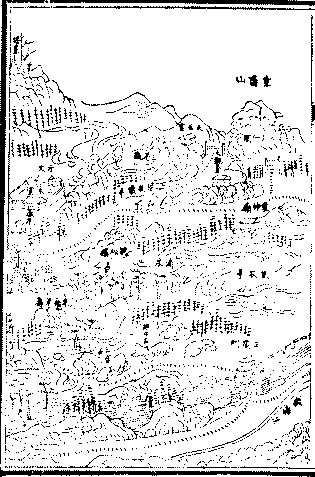
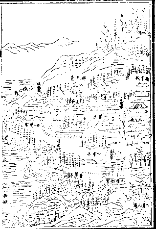
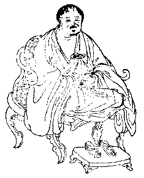

# 云居圣水寺志



> **藏经**：中国佛寺史志汇刊（佛寺志汇刊）　**册次** 第 27 册（GA027）　**编号** GA0025　**部类** 史传部　**卷次** 7 卷　**篇幅** 67,063 字

> **卷／品**：6 卷 · 13 品



---



## 目录



  - [云居圣水禅寺志序](#云居圣水禅寺志序)

  - [时乾隆癸巳四月初吉仁和七十八岁老人陆宗楷凫川氏序](#时乾隆癸巳四月初吉仁和七十八岁老人陆宗楷凫川氏序)

  - [序](#序)

  - [序](#序-1)

  - [序](#序-2)

  - [序](#序-3)

- [圣水寺志卷一](#圣水寺志卷一)

- [圣水寺志卷二](#圣水寺志卷二)

  - [字房仲江西人官副使寓居年餘著有蘧庵集为本寺作志序](#字房仲江西人官副使寓居年餘著有蘧庵集为本寺作志序)

- [圣水寺志卷三](#圣水寺志卷三)

- [圣水寺志卷四](#圣水寺志卷四)

  - [古峰长老住持本山序](#古峰长老住持本山序)

  - [弘泉禅师六十寿序](#弘泉禅师六十寿序)

  - [达方上人七十寿序](#达方上人七十寿序)

  - [达方禅师八十大寿序](#达方禅师八十大寿序)

- [圣水寺志卷五](#圣水寺志卷五)

- [圣水寺志卷六](#圣水寺志卷六)

  - [洪武二十年岁次丁卯四月佛诞日杭州府儒学教授天台徐一夔序](#洪武二十年岁次丁卯四月佛诞日杭州府儒学教授天台徐一夔序)

  - [后序](#后序)



---



云居圣水寺位於浙江杭州西南云居山上，云居山位於吴山（又名七宝山）之西南，面圣湖，倚枫林。吴山之北有紫芳岭，上有圣水岩，巉石突兀，势若垂云。唐咸通中（八六〇～八七三），道膺禅师游杭州，入七宝山，爱其山麓（即云居山）之胜，就树结庵，颜曰云居。宋元祐间（一〇八六～一〇九三），佛印禅师喜圣水岩之幽胜，乃安禅以圣水名其寺。元代中峰和尚重建，众僧云集，渐成丛林，名与五山十刹并列，赵孟𫖯手书「云居」匾额。明洪武二十四年（一三九一），勅旨归并天下寺院，圣水寺并入云居庵，赐额「云居圣水禅寺」。其地襟江带湖，与天竺、灵隐并称古刹胜览。而中峰禅师之发爪舍利藏寺中之塔，颇为后人瞻仰。清雍正年间，释𧧌湛偕门人释明伦为辑寺志，乾隆年间，释通渊偕门人释实懿重纂之。厘为六卷，分十一门：形胜、建置、祖师、耆宿、侨寓、灵异、古迹、题咏、法谱、赞偈、清规，前冠寺图，末附补遗。形胜一门，纪山水。建置一门，仅纪现存者。祖师一门，仅列光耀本寺之祖师，即道膺、佛印、中峰等七位之简传。耆宿一门，则记有功於本寺之僧侣。侨寓一门，记古今高人达士之寄寓本山者。灵异一门，记自唐至明六百餘载之异徵。古迹一门，凡本寺之建置，今已废者，列入古迹。题咏一门，录历代文士关於本寺之诗文。法谱一门，录塔传、历代禅祖、本寺高僧传、寿序、庵记、塔记等。赞偈一门，录赞、诗、疏、偈等文。清规一门，除僧灿与明本所订之清规外，文疏之属亦附焉。本志分门明晰，然体例紊乱，恐系增补之故也。此志初刻於乾隆二十七年（一七六二），光绪十八年（一八九二）钱塘丁氏重刻。兹据清光绪十八年钱塘嘉惠堂丁氏重刋本景印。



------



### 云居圣水禅寺志序



云居圣水禅寺者地接两峰名齐三竺带海襟山之所法宇宏开龙飞凤舞而来琳宫矗峙层峦绝𪩘闯见山门白石青苔疑来仙洞近挹湖边秀色揜映松关遥传江上涛声悠扬梵咒宜卓锡之高人踵至而携瓢之韵士联踪然非载笔而载言奚以徵文而徵献必有资乎慧业乃克永夫胜因粤稽禅寺创自李唐绵亘千年钟簴无恙递更数代榱桷维新溯厥开山道膺因云居为号洎乎奕叶中峰合圣水成名仰金碧於烟峦询经营於慧衲风车云马常驻灵旗暮鼓晨钟时闻法诫皆资人力用妥神庥然而玉梁飘渺银殿虚无给孤园中数声𫛸鴂灵光殿外一片荆榛若无子安之碑谁知净土使非休文之记讵识法王绀马青鸳藉词章而不朽龙宫象塔因翰墨以常畱鼓若海之文澜慈航宝筏灿生花之笔彩莲座香城此寻奥旨於六通固在语言之外而证妙谛於三藏不离文字之中欲示畱贻须凭记载志书之作乌容己已顾宝笈难窥草创始於寂湛瓣香已远重纂在乎通渊卒业未成旧章谁续乃有云巢衲子者有如支遁居白马以谈元略似晦堂住黄龙而作志从源达委井井有条别类分门班班可考情最躭乎吟咏后复附以诗篇允矣梨枣之光可推鸿笔采兹刍荛之句属以弁言楷也禁省周旋乡关契阔童子嬉游之地为念林邱诗人恭敬之思讵忘桑梓今则遂初已赋尽幅巾朱履而归方外与游可蜡屐芒鞵而至　锡香山之鸠杖陟险非难主松岭之鳣堂卜邻伊迩因名求实援古证今倍领妙手之空益信良工之苦每掀髯而大噱何必坡仙或并辔以联吟相逢㠀瘦又况右文有典重罗碧海珊瑚兹虽史乘小言总属吉光片羽曾闻半偈空彼万缘还见五云生於二乘裒然成帙君为夹漈之所难率尔操觚我恐温陵之腾笑矣



------



### 时乾隆癸巳四月初吉仁和七十八岁老人陆宗楷凫川氏序



### 序



国有史家有乘所以原本大业而永世也而郡邑而山川而奥区古刹志犹是已杭城吴山之阴曰云居在大江以西余数年于浙未尝过问己丑乞休寄迹南溟见僧幻因所藏中峰祖师亲自写照及手置壁间诸相次观麻鞋发珠诸盛迹乃知斯因师著天目云居并峙大雄匪凡近也顾犹未详夫开山得名之缘起有僧休复雅怀缵述示一编曰将有志而未逮本末条理灿然可观溯自唐咸通中玉田道膺禅师由涿州住江西云居山既而至杭结茆於斯而不忘云居仍以名庵至明以圣水寺并入乃称寺然则中峰此山振起之少祖道膺此山肇基之初祖也然则山非浙寺非自唐宋元而庵非自今也然则一云居江可也浙可也庵与寺无不可也然则无江相无浙相无山与庵与寺相何为云居是为云居然则即一云居曰江曰浙曰庵曰寺非名非非名可说不可说已缕缕矣谓可无以志之乎况乎祖风为烈天如无念辈继武龙象东坡松雪阳明辈晖映后先湖山奇凑江海大观以暨一石一木都堪谱牒奈何听其落落无迹令后之人若今视咸通以前莫可致诘乎诚哉休复是编之弗可已也而属余一言亦似弗可辞何也云居为吾乡名山十年来颛愚衡大师自五台厯南岳清源至止余实荷法施其在杭也嗣中峰法者首推天如即我庐陵人且中峰证祖位彰隆号而垂藏法吾乡揭曼硕为赞其词而余之藏疾于斯亦敬入告矣则云居之为云居圣天子既耳目及之余之于云居也亦既辱指十手云居也余也岂无因缘于其间余何能辞一言也



顺治六年冬十月豫章周汉杰拜撰



------



### 序



凡都会必以形胜财货之所聚人文之所毓技巧之所出於以酝荣饶而倾恢诡匪细也武林甲寰宇郡兼山川之美波回麓抱更仆数未殚顾率郭外名蓝或以爽垲或以幽奇著若凭高而江湖生於屐底则惟城中之山为然昔越沼吴以此置吴社然由伍行人祠循而南至三茅观道院十九类显拔千寻纵眸即见再折而西藏铃铎於蓊葱磴而下磴而升高枫负湖凤凰诸山出於列雉惟云居寺为然寺缘僧道膺卓锡开山名新志旧大德间起英流竞赏独志缺焉亦子瞻孟𫖯之遗憾也夫兰若或牛吼不及或离聚落五里兹寺隐𨐅肩之中窅如绝壑岭足即市阓廨舍万猾嘈嚣都若隔世惟鸟语虫鸣而已然则有三竺之谿山四合而无车骑列肆之艳杂有灵隐韬光之林木森蔚而无燐明虎啸之苍凉有昭庆之人烟凑集净慈之独踞连冈而无严𬮱夜闭当涂昼呵之惊虞诚攀跻之所必至而眺览之所首推者也宜中峰薰修於斯梅咏芒鞋犹存人世厥后寺几为势力有赖精斋以死获全畅宗风而持觉苑不可泯灭拈花渍羽其揆一也寺有二径一从铁崖岭一从青屏山奇石妙树天巧布错违歌钟於顷刻无裹粮於十里尘念不杂于此中者代固不乏人即偶至者亦自能识取也闻之长者云云居之松不独松乐亭为量随地挺虬飞雨间不容发亭旁为官长张筵驺从伍伯所戕更有不堪述者其他可令久而或湮哉则兹志信当作矣



浙上傅岩书



------



### 序



名山古刹之形胜人物郡乘邑志有未采辑者则各成一书详纪其鉅细以信今而传后或名流或高僧穷年矻日殚精铅椠惟恐一事一类之不备不彰以为山灵佛祖羞如通渊实懿之志云居圣水寺是已寺建自唐咸通中为佛印中峰拄锡之所其地爽垲幽异襟江带湖跨吴山之西偏与天竺灵隐并称古刹千百年来缁涅之接踵贤豪之萃止殿宇之修葺文物之昌炽郡邑虽载纪之通渊以其不能周该备至且惧厯代久远易湮没而无闻也遂取寂湛草创之原本重加攟摭不漏不支成志六卷俾天下后世莫不望武林而思名刹瞻经幢而景苏赵即或给孤园圮布金地废而云居圣水之名犹表表尘寰间也世之士大夫悠悠忽忽于郡邑之志乘漫不加意即其家世谱牒亦茫然乌有以视通渊实懿之用心顾何如耶余家居时虽于祖德宗功暨桑梓之耆旧粗有纪刊而学识浅鲜不能纤悉具陈至官仁邑于地方之风土人情因革损益之规纵不敢以无才自诿而邑志未暇修举今对通渊不亦赧赧然有愧色乎而凡吾儒之阅是志者固不特嘉通渊实懿之愿力兹寺赖以不朽亦可借以自勉勤于家谱邑乘之篆订以光照　国家之盛於无疆也是为序



旹雍正七年岁次己酉仲夏月上弦日勅授文林郎知浙江杭州府仁和县事甲辰科浙江乡试同考官荆门胡作柄譔



------



### 序



云居寺志先师尊寂湛草创於前吾师通渊掇拾於后雍正己酉仁和邑侯荆门胡公罢官居寺甄综而荟萃之遂成完书科分条贯可谓备矣顾三十年来佛舍僧寮金碧辉映於山水间者化为烟云圮为瓦砾见于志者十存四三而已可胜慨哉夫志以传信倘不重为厘正一切仍旧则名存实亡将使览者按图索骏视为诞虚不且贻四方之诮乎懿因不揣谫陋於山川泉石之不变者悉仍前志其餘莲台香藏则据现在具书之已废者详於古迹一门庶几不戾



传信之旨方今圣天子勤咨吏治隐念民生四举巡狩之典湖上诸名刹无不鼎新以备皇上恭祝皇太后慈厘纯嘏而我佛亦祥云暧日香雨洒尘酿和气於翠华遥莅之辰於以媚一人而成景运者寺僧或裁新志或益旧文极古今之盛焉云居虽僻在吴山一隅然峰峦耸秀江上数峰湖间诸岭萦青缭紫如绘如畫映带左右者一凭眺而悉在眼前安知无大檀信广结善缘捐朱提贯赤仄以完旧观为后日皇上拈花献佛之所则志诚不可以已也因购棃枣而急刊之



释实懿撰



云居圣水寺圗











身如天目山　寂然不动尊  

慈云洒法雨　徧满十方界  

化身千百亿　非幻亦非真  

觅赞不可淂　为师作赞竟



至正二年正月人日弟子吴兴赵孟𫖯焚香谨赞







圣水寺志目录



卷之一形胜　建置



卷之二祖师　耆宿　侨寓　灵异　古迹



卷之三题咏



卷之四法谱



卷之五赞偈



卷之六清规



补遗



圣水寺志目录



------



## 圣水寺志卷一



𧧌湛同明伦原辑



通渊同实懿重纂



形胜



吴山又名七宝山突起会城东南隅緜亘数里逦迤而西蹊迳幽邃峰势秀削凭虚却立左吞江光右饮湖绿风帆隐现於林隙游舫荡漾於岩坳前则雉堞横云缥缈如带后则岭如屏幛青围翠绕盖奥如而具旷如之观不独为兹山之冠即两峰三竺未便过之其天设地成之胜有足称焉志形胜



山在郡城内七宝山西南隅左江右湖面坤负艮东则橐驼岭下抵清屏山西则铁崖岭北则紫芳岭下抵郭璞井南则崇墉百尺列若屏垣幽深静谧迥隔嚣氛诚胜地也



凤凰山脉来自天目为郡主山昔人所称龙飞凤舞到钱塘者城踞凤凰左翼城内诸山缘祀泰伯伍员总谓之吴山



云居山在杭州城西南隅面圣湖倚枫林颇称佳境(杭州府志)



三台石



位置端拱俨然列宿



三台石记



(荆门)胡作柄



三台石为云居寺十景之一访之僧辄指寺西南隅谓石在山巅路险仄皆闻其名未尝至其地也夫泰华嵩衡之高人往往蹑层峦临绝𪩘矧跬步之前数仞之势僧乃惮于游乎遂独步寺门外厯磴十餘级稍折而西觅径而往是时午日当天清风拂地不数百步即见所谓三台石者石斜对上方庵后枕女墙左挟西湖右瞰钱塘江如剑戟列如虎豹伏高下其形其数有六昔之人盖尝徙倚攀摩锡以嘉名厥后继踵者少徒付之荒烟蔓草厯岁经年曾无有过而问焉者岂非石之不幸欤虽然天下事亦何常之有不有余今日之闻其名即欣然造其地不假宾朋之从不待杯酒之携相与惝恍流连而不能已已耶又岂非斯石之重幸与独是三台者斗魁之下有六星天下治其象平所谓泰阶平是也世人且以比三公之爵兹石何以名耶星宿之精下而为禽为兽陨而为石岂山三台之星有时陨耶抑其精之所流耶以其数六两两相对象於台星故名之耶求其故不得乃凭石而寐忽有谓予者曰子不记五云多处是三台之句耶名石之意是使人触於目感於怀而不禁望阙怀恩之思也予遂恍然而寤见有人立麓下是岂梦中语予者耶谛视之则上方庵之树影著墙耳渴甚掬水饮之若饱因思明月之下携斗酒面石而饮岂不对影成九人耶遂与石订再来之盟踏夕阳而归寺



三台石



释实懿(云巢)



三台异顽石　间气结巑岏  

峰峰距咫尺　朵朵空中攒  

象纬绕山灵　列宿旷奇观  

秀削高城上　清风落暮寒



江櫺石



高数丈屹立城隅洞穴玲珑瞰望平沙极浦有如窗牖江櫺之名以此



龟石



规圆二丈餘色缁而润皴以细纹断续如卦形首昂背俯状甚肖



朝阳洞



在岭上吸受朝晖通明晃耀故名朝阳



吕字岩



在东岭之阳立石数仞洞穴双朗上小下大有似吕石字



圣水岩



在紫芳岭半有巉石突兀高大约四五丈势若垂云下有潴水停泓冬夏不耗今则为崩土所淤矣



三佛泉



昔中峰和尚辟地夜见草莽中碧色光起得古井浚之获三石佛首相既庄严泉亦甘冽元巴西邓文肃有序铭见杭州府志



三佛泉记铭



邓文原



三泉在七宝山云居庵沙门指月所浚也庵始湫溢延祐丁巳扩而大之夷高就深出土盈尺得古井甘而易涸岁甲子复深之去木与石复得眢井甓甃坚完距地餘四寻寒泉芳冽汲用不竭越有神异见石佛首三诸相具足於是续以贞珉涂以黄金诸比邱众恭敬围绕叹未曾有已而邓艾文原为之铭曰



我观大地　积水所载  

孰疏凿是　太虚无外  

掘地及泉　视之萦带  

如履冥途　破诸障碍  

其源渊谷　其泻湍濑  

不止不流　以与井会  

瑞相现前　示我三昧  

彼坏者石　实相不坏  

是实相改　偏河沙界  

以一勺甘　除世浊爱  

是相是水　无在不在  

我作铭诗　以惊盲瞆



一滴泉



在山之东石上有苏轼钱勰江公著柳雍元祐六年三月七日记又东坡刻诗于旁今模糊不能识



题一滴泉



苏轼(东坡)



一庵高隐古城边　半是山林半市廛  

月色透窗霜满屋　卧闻宰相去朝天



释德一(达方)



石泉分圣水　一滴似曹溪  

味得高僧别　名从学士题  

苔痕浸墨润　云影拂岩低  

倚竹长吟罢　城乌月下嗁



释实懿(云巢)



为觅源头叩竹扉　深林空翠湿人衣  

石含米芾三生秀　泉落曹溪一滴微  

掬到掌心清更彻　尝来舌本味还稀  

闲寻学士畱题处　断壁荒凉烟雨霏



烧香洞



三字勒石洞侧疑古多烧香於此



枫岭



高峰突兀老枫百株森然围绕每一登眺则阖郡形胜俱在睫下



建置



夫把茅盖头便开净域双树说法即成丛林则地因人著不信然耶溯唐咸通间道膺禅师杯渡西江锡飞东越入七宝山爱其峰峦深秀林木茂密结庵禅诵颜曰云居洎宋佛印迄今中峰选佛场开宗风益扇易庵为寺金碧辉映於岩壑闲缁流问道胜侣题襟厯数百年无不知有云居之胜者然则夷茀而基拨云而庐缔造之始其可略而不著使后之人无所考哉志建置



唐咸通中禅师道膺云游来杭爱此山麓之胜就树结庵颜曰云居盖参学于豫章云居山仍以二字名庵志不忘也



宋元祐间佛印禅师见圣水岩林幽胜远隔尘嚣乃安禅以圣水名其寺



元初兵燹隳废住山指月禅师谋新之躬请普应国师中峰和尚讨寻旧迹芟去荒芜重建前后殿宇方丈僧寮廊庑毕具大众云集复成丛林名与五山十刹并列赵孟𫖯手书云居匾额及净土诗迄今碑勒犹存



明洪武二十四年奉旨归并天下寺院浙江布政使王钝遂将圣水寺并入云居庵奏闻赐额云居圣水禅寺嗣后素庵朴禅师始建观音万佛等阁



成化丁亥毁于火素庵徒文绅首倡鸠工四方乐助复建大雄宝殿琳绀庄严百废具举有逾昔观落成於丙申之秋



宏治乙卯比邱道孜募缘重修海盐沈衡有记邑人沈源篆道孜立石



寺墙周数百丈以近阃司署(今改为学院衙门)厯任都师惑形家言禁不使筑康熙四十三年巡抚张泰交知府张恕可始断令寺僧曙升心学复筑之盐驿道高熊徵为之记刑部侍郎高其佩跋并勒于石



寺自宏治至今几三百载殿堂寮庑日就荒落其存者具书於左常住祭祀法产并附焉



山门



一楹坍废已久乾隆乙酉云巢募修



天王殿



三楹高三丈七尺现大庄严额瀋阳李之粹书



对联



禅心正与天心合  

国法幽将佛法扶



佛生西域　祥光现於周朝  

法教东流　金像梦於汉帝



禅堂



三楹高二丈一尺



斋楼



三楹俱在天王殿之东今废



中峰塔院



三楹内瘗中峰祖师爪发舍利有觉照堂额云间徐朗书乾隆己巳外麓仑山修



对联



天目同源　舍利放光照法塔  

云居分派　净土畱偈镇名山



幻住十四世孙实懿题



游云居寺礼中峰和尚发塔



厉鹗(太鸿)



幽磴无人行　露藓绿相待  

倚山为女墙　春物见爽嵦  

丛深鸟嘤嘤　沙崩石磊磊  

长廊据寺胜　酌泉散忧痗  

恭闻大导师　喦畔藏落彩(唐净业法师《塔铭》：「高宗忌辰　方阶落彩。」)  

作礼向闲房　真风故常在  

选树坐移阴　仰看云意改  

游云忽东南　遐心渺江海



同作



(上虞)石文(真石)



春雨回荒姿　餘寒晴复阴  

逶迤步石径　禅室来幽寻  

众山已秀发　绿浅未满林  

绕寺雉堞壮　入门台殿森  

阿师久西去　遗屐犹至今  

妙相渺难睹　默契情更深  

合十向云际　恍闻净土吟  

四体岂无爱　诸妄惟灭心  

缅彼绀螺色　香土岁月沈  

但餘烟草碧　如丝缘塔侵  

平生慕禅意　苦为饥火𬊈  

焉知此僻境　修廊静愔愔  

闲闲湖上景　悠悠南山岑  

鉏声编芳野　微风怱钟音  

暂憩如有会　虚寂归冲襟



按：莲池《续高僧传》云：「徧阅中峰《语录》实未至杭。圣水，盖其弟子习静之所。」然中峰题《东坡大悲像记》后书云：「元至正题於圣水岩」则住云居，盖可信矣。



前殿



三门三楹



长廊



一带即西麓、内麓、外麓三房之廊，一名看月廊。



长廊纵步



方九叙



尘外烟峦倚碧空　回廊宛转度晴虹  

楼台近寺澄湖接　杖履疑将法界通



拍拍湖波遶郭长　霏霏松雨洒衣凉  

寻山踏遍西湖路　谁解烟霞属上方



题长廊



(四明)屠隆(纬真)



烟峦最深处　幽鸟嗁空山  

日暮蝉声急　松高鹤梦闲  

鱼舟花里出　僧屐雨中还  

客去禅逾寂　焚香独掩关



步长廊



(西安)张文价(少谷)



往来高兴发　还共步长廊  

何处石泉响　半堦瑶草芳  

孤云护巢鹤　初月满绳床  

供客足清茗　何妨言笑长



长廊雨望南屏



释篆玉(让山)



蒙蒙一湖雨　倏忽镜乍函  

散入薝卜林　盈耳鸣松杉  

复岭賸斜照　倚天青巉巉  

宛如井西畫　眼渴萦秋馋  

澹远总诗思　凉气归单衫  

云亦作幻住　同我还重岩



(寿春)释净泓(笠江)



在山云与住　出山云与游  

随云意自适　迳折屡小休  

石壁澹素晖　夕照上帘钩  

群彦欣所谐　爽气横清秋  

骄雷载云起　白雨满山楼  

迷蒙湖上山　远带岚光浮  

花气静不飞　餘滴响深楸  

新凉快披面　一听清溪流



释实懿(云巢)



结庐恰山凹　面面岚光连  

万象媚舄下　一榻卧峰巅  

支许不费招　共咏长廊前  

古迹瘗舍利　时或吐云烟  

俯仰感今昔　六百有餘年  

雨声倏西来　云气霾大千  

一望尽模糊　万物无𡟎妍  

如窥米家畫　泼墨空中悬  

如听陶公琴　会心在无弦  

须臾忽开霁　凉意归枯禅  

消除烦恼障　结习清净缘  

秀色接西爽　双镜明湖鲜  

峰峰新出沐　朵朵青插天  

塔影挂残照　钟声起幽岩  

栏凭湿翠里　大家耸吟肩



长廊夜月(六字诗)



实懿



修廊最好明月　清辉上我香台  

双镜湖头映出　四更山顶衔来  

照眼金波影动　会心玉叶云开  

宿鸟一声岑寂　松阴又转莓苔



西麓房



素庵朴禅师



宿西麓



释法聚(玉芝)



远径通深麓　斋居小更幽  

松声四壁雨　湖影满床秋  

世路迷真境　僧缘息妄求  

开门渔篴近　明月在沧洲



又



白云虚阁倚西岑　幽兴撩人不倦寻  

钟声已忘城市近　松萝忽见寺门深  

千峰落日鹤相语　一树梅花僧独吟  

莫谓烟波总游事　半湖春月共禅心



宿西麓



朱朴(西村)



平生乍识云居寺　便欲题诗满石房  

千顷翠涛欹短帻　两峰斜日据匡床  

未经霜树黄兼绿　不出山僧老更苍  

西阁夜凉清事足　一镫疏雨漏俱长



西麓山房



陈鉴(句溪)



门开苍壁山气佳　千树万树生莓苔  

堂虚白日有云度　地远青春惟鸟来  

石磴阴浓展孤岫　林麓声动喧风雷  

犹记翻经待明月　还从树里筑高台



过西麓山房



(钱塘)秦舜友(冰玉)



重湖浮树杪　短径出城头  

千步回廊寂　双扉傍竹幽  

峰阴衣上合　云气座中流  

茗碗烹春雨　因贪佛日畱



东麓内房



用彰绅禅师即素庵朴禅师之徒秘山堂额西湖毛奇龄书



重访素庵不遇



姚汝循



两度相寻竟不逢　孤云何处觅行踪  

禅关深掩长廊静　积雪时飘窗外松



赠内麓笑云上人



马三才(松里)



客子乘闲策杖藜　白云深处访幽栖  

相逢得共高僧语　一笑还看过虎溪



赠笑云



释方泽



白云层叠卧青山　似与山僧伴掩关  

薄暮偶然飞出岫　飞扬不及在山间



有时飞度海门秋　苍狗青虬幻未收  

何似衲僧岩岫里　身心不动万缘休



东麓外房



守泉兼禅师用彰禅师之孙



外麓山门联



莲社临湖　三竺月波浮槛白  

松关拱堞　六桥烟翠叠堦青



天医院联



橘井泉香　大地无心融圣水  

杏林花绽　阳春有脚遍吴山



俱实懿自题



芝桂堂额联



赵苍璧书



仁术通禅理  

祗园即杏林



趺翠山楼



清明日趺翠山楼同人访风远心学两上人



(湘潭)陈鹏年(沧洲)



绀宇吴山山背开　重湖镜里见莲台  

六朝僧向云中老　三笑人从雨后来  

丈室优昙香佛骨　残碑松雪护春苔  

依然空翠寻趺坐　欲酹陶潜酒百杯



广陵一曲起湖波　石鼎联吟绕荔萝  

座上茶瓜分供养　岩前花雨足婆娑  

十年取相君何妄　半日浮生我觉多  

不负清明芳草会　春泥滑滑亦频过



张愈奇(退庵)



纡折峰阴古殿闲　一林空翠湿香台  

流云出岫飞还住　小鸟呼晴去复来  

石碣囓残埋赑屭　虬根趫出走莓苔  

招闲暂憩清凉室　莫戒深杯与浅杯



山城高峙枕晴波　一片岚光净碧萝  

峰外有峰无障碍　客中忘客任婆娑  

冰弦忽泻流泉出　竹阁遥分夕照多  

为问探幽何所得　远公许我日相过



赵瑜(瑾叔)



云山别自一天开　望里湖光倚镜台  

僧在幽篁趺翠坐　客从高顶踏青来  

过头藜杖拖烟雨　著脚芒鞋没藓苔  

正是使君佳兴发　况逢令节喜传杯



倒泻珍珠泛绿波　携琴直上共披萝  

梵宫钟磬连鸳鹫　汉殿云霄傍馺娑  

叠石栽花闲不少　焚香煮茗癖何多  

青山方外无宾主　此日疎狂兴莫过



释德言(心学)



入望湖光万顷开　东邻近接大观台  

未随支遁栖山去　何幸元龙带雨来  

曲径春深餘碧草　闲房昼静长苍苔  

清风拂面情无限　幽意惟将茗一杯



怀清江水静无波　蹑屐佳辰问碧萝  

兴逐仙桃花灼灼　湿沾春服雨娑娑  

鸣琴试借青霞起　积案吟成白雪多  

他日庙堂回忆此　湖山依旧待君过



前题追和



实懿(云巢)



寺界湖山道祖开　一层楼阁一层台  

蘸波鸥影拖烟起　滴翠山光拥塔来  

舍利香云畱净域　牟尼花雨护青苔  

红稀绿暗春将老　自煮林间陆羽杯



平湖如练净鸥波　筑得松寮覆绿萝  

岚气湿衣山黯淡　春光媚眼树婆娑  

雨鸣竹屋跳珠急　烟锁蓬门插柳多  

遥和杜陵人不见　莺花岁岁带愁过



释明浦(静安)



绿玉几前双镜开　西湖图里著楼台  

暗连竹阁云同住　响入山楼雨欲来  

令节客应吟白社　闭关人不踏青苔  

风流硕彦今何在　想像花闲啜茗杯



心如古井水无波　毳衲芒鞋隐薜萝  

题遍烟霞时变化　读残碑碣日摩娑  

七条弦上知音少　一盏灯前感慨多  

忆昔踏青陈迹杏　多情惟有燕来过



秋夜宿趺翠山楼



金吰(闻石)



星河晳晳破雷车　坐绕龛灯午夜餘  

熠燿光微风淅沥　虾蟇更静树扶疎  

人怜犵猓愁非类　水瘴牂牁叹索居  

何幸家山仍落手　消除药裹接襟裾



戴廷熺(鹂亭)



雨过凉影落禅关　晏坐煎茶秋思闲  

一树得风吟败叶　百虫仰露语空山  

清吟物外同岑意　短鬓灯前归客颜  

景色颇躭良夜好　僧床可惜便忘还



释实懿



雨洗深山夜倍凉　新泉活火试茶铛  

咏梅僧去空畱塔　结社人来更下床  

四壁寒蛩秋乍肃　一灯茅屋漏初长  

隔林钟动诸峰寺　听到邻家月过墙



宿趺翠山楼次晚独归



戴廷熺(珠渊)



步屧禅栖晚　苗茨未掩关  

秋声多在竹　人影独归山  

近郭草迷路　迎庐月照颜  

孤怀惬幽赏　得句咏歌还



趺翠山房密印上人



释通贤，字石香，号迂叟，常州人



独上黄泥冈　崎岖天路长  

岚烟迷杖履　竹露滴衣裳  

钟语云居顶　琴鸣圣水堂  

访君尘世外　相对又斜阳



读书云居外麓山房𥳑云巢上人



柳溥(洁夫)



游踪鸿爪倦行縢　逭暑幽岩静气澂  

书笥到今传后辈　诗名隐自访山僧  

绿沈古竹风前爽　翠綷朝岚座内蒸  

近赋归来结莲社　许吾酬倡得无曾



携得长安负米图　来从山顶瞰明湖  

扬眉纶阁虚簪绂　息足琳宫问苾刍  

尘网白云深处隔　雨花清啸望中敷  

胸情礧珂终何济　莫笑逃禅兀坐枯



搜到名蓝六月凉　菁林盘磴度长廊  

樵歌曲径依清磬　莲渚遥风送佛香  

百雉城头山作带　三台石畔月如霜  

我来急待寻芳躅　惹得诗情又欲狂



雒诵因缘开士林　烟霏雾结许追寻  

残碑片石清堪语　古履空山迹未沈  

细𦶟炉香参易畫　闲烹茗椀听焦琴  

𡩬须脉望书成蠹　学坐蒲团透佛心



麈尾谈空意蕊清　沧桑厯劫感深情  

梅花百咏今传韵　松树千章旧指名  

木末当头亲鸟语　人烟吹谷识鸡声  

冲霄自比支公鹤　养翮空阶聊一鸣



半邻城堞半林泉　挈伴来登缥缈颠  

隔院篴声新雨后　残阳塔影小窗前  

湖开图畫供晨夕　月作宾朋晤水天  

尽许衔杯萧寺里　懒来成癖可忘年



栖迟暑月已成秋　满室云根雨未收  

客少叩门惊吠犬　床多醒梦怪鸣鸠  

薜萝独喜终朝放　岩壑堪追旧日游  

更待九旻恣眺览　南屏红叶满山稠



回忆黄沙驾远𫐌　竟来纡岭探江櫺  

唫蛩四壁传秋气　云嶂一门遮翠屏  

𧑀蛣未离羁客况　支离堪笑病癯形  

湖西钓碣何时遂　静对遥𥮾眼自青



莫说苏公共了元　名区总足养灵根  

泉流圣水能医俗　岭遏枫林可涤烦  

灼灼野花然石壁　哑哑怪雀噪城垣  

云驼已徧南兼北　应借云居作故园



台观参差倚翠微　为怜梓里恋春晖  

无心出岫云仍在　已倦知时鸟亦归  

座客莫猜鹦鹉赋　荒居已制芰荷衣  

下方钟鼎随烟雾　坐看双丸日月飞



赠云巢上人



周宽(敬夫)



出世超然作大师　珊珊丰格总清奇  

三生语久千山雨　百尺楼高一卷诗  

静里故应空色相　望中真欲小须弥  

我来愧未抛尘网　稽首阿难问律仪



张朗山招集云居，分体得七古，同毛鹤舫先生、钱景舒、严学川暨风远、心学二上人，是集洪昉思以病不赴。



朱襄(啸园)



云居山有趺翠之山房　乃是中峰禅师古道场  

《梅花百咏》久传诵　思之齿颊犹餘香  

今有风上人　弹琴妙无比  

声固不在弦　音亦不在指  

朗山邀我去访之　因循半载空尔思  

况复走使折𥳑召　足踏烈日行步迟  

冥蒙树木暗山口　上山入门时过酉  

稗畦主人病不赴　鹤舫先生到已久  

主宾握手无俗情　开窗脱衣尊茗清  

一枝红烛照谈笑　那论扑面来蚉蝱  

须臾月上东山头　圆如瑶台镜未收  

轻云往来光隐见　五月凉生不须扇  

尔我今宵且勿眠　人生欢会亦偶然  

禅榻相依暂相语　明朝各自东西去



趺翠山楼避暑



杨知(诲仲)



胜地逃炎暑　山房一榻休  

蝉声移树静　竹影绕廊幽  

赤日方临岫　阴云乍满楼  

诗僧能爱客　秋雨为遮留



释实懿和



高处尘襟谢　恬吟不自休  

门临山路近　榻傍竹窗幽  

雨气迷江树　秋声入寺楼  

晚凉应可纳　欹坐且迟畱



水明楼



「水明」二字，苕溪孙汝元书。



「嶷云」额，董其昌书。



联



金湖作盂钵  

白云为藩篱



包括题



水明楼记



(仁和处士)胡树虚(西林)



佛氏以明心为第一义盖此心不明则触处障翳况欲悟彻上乘耶世之人泊淡荣利其夜之所思昼之所趋昏冥沈迷老世而不觉者比比皆是彼欲聚财帛广田舍为子若孙计长久固宜若此其急也吾不解披缁衣修白业之徒飘然一身无世人之累然此心多营同於世人之罔觉或更甚焉岂亦有不得不然者在耶何明于佛氏之义者之鲜耶惟云巢上人居云居之山日以悟彻最上为事顾山之寮舍多倾圮无严净之地于是购材木运瓴甋度地之宜建楼三楹面西山之阳江光荡其左湖影凝其右山月相对八窗昼白因额曰水明楼取杜陵四更山吐月残夜水明楼之句其意实欲使此心皎然如月湛然如水绝去障翳空明洞彻觉悟上乘若师者庶几不戾佛氏之旨有见於第一义哉人之登斯楼者能不泥子美之句识师之用心猛然深省不徒玩景於清夜使昏冥沈迷者稍有觉焉当亦师之愿哉然则是楼之成师不独自觉其觉於人者不少矣



初夏登云居水明楼



金志章(江声)



古寺云所居　烟翠浩如积  

千峰绕长廊　百雉拥危石  

来游及清和　逍遥驻轻屐  

礼塔瞻法云　看竹入丛碧  

鸭脚摇空阴　禽语生昼寂  

殿随龙象堕　楼因药王辟  

胜览喜自今　陈迹感犹昔  

凭襟共舒啸　高咏遂移夕  

湖环一角明　月吐四更白  

销夏许再来　吟风布瑶席



戴廷熺(鹂亭)



爱山期山游　十日佳招预  

维夏景清和　好山僧所居  

雅集同竹溪　入座聪殊与  

城郭环昼阴　林峦漾晴絮  

畫境目远收　楼成胜全踞  

尽拓湖面窗　茶香石泉滤  

米汁酡客颜　伊蒲且饱饫  

阴浓绿染衣　黄鸟风前语  

隐隐答吟声　幽修竹深处  

合并兴偶乘　良会时易去  

阿师句可参　少陵诗有据  

他时待月来　水明额新署



雨霁登水明楼访云巢上人不值



(新安)汪圣扬(石侪)



未识水明楼　取斯集中见  

老树绘阴森　遥峰写葱蒨  

湖漾白千层　城围青一线  

禅榻作吟坛　茗椀供酣战  

恨我来何迟　不获陪欢䜩  

久雨快初晴　轩窗开面面  

登眺一凭阑　恍若披诗卷  

药香砭俗肠　炉烟妙清篆  

餘生欲结缘　莲社吾师羡  

远公出未归　赋此以为券



新霁同杨昆台云巢水明楼饯柳洁夫北上



邵晋之(叙阶)



我家绣云楼　日夕翠色浮蔚蓊  

西南瞰视辨晴雨　最近一岭森青枫  

此间磴道回转处　知有调御栖琳宫  

芒鞋前度岂陈迹　瘦藤重策尚过从  

夜来愁淅沥　晓起喜瞳眬  

山径足侧泥滑滑　山楼角滉波溶溶  

群山万状冲楼起　明灭逼漏云烟中  

飞泉练净眩银海　古塔肤剥擎玉蓉  

闲鸥露影沙际落　长堤半见晴何虹  

总之众夏酿深绿　倚栏自可明方曈  

复有杨夫子　乘兴抚焦桐  

梅花叠三弄　恰似和中峰  

千年爪发餘香在　竹林习习生清风  

新诗赋群贤　伊蒲供已公  

衔杯发兴破寥廓　山水能教结习空  

携归贮景绣云卧　底用八埏周九𡽀  

今日良会具欢乐　溥也促我折柳何匆匆



外麓山望湖上诸山



(钱塘)范肇新(容安)



长廊午风凉　夏木罗空青  

林深敛积雨　日薄含疎櫺  

山颠古城堞　依依列遥屏  

竹外漾湖水　奁镜初出硎  

众峰翠可拭　俯视烟冥冥  

忽忆去年时　蜀道愁淋铃  

掉头返茅茨　得与胜侣并  

吟诗向白社　结夏寻禅扃  

领略静中趣　摆脱世上形  

在家贫亦乐　岂必腰悬钉  

徘徊日云夕　谈笑醉复醒  

明朝酒人约　泛艇湖上亭



(南屏)篆玉(让山)



雨止整游屐　清思遂纷纷  

微风拂林杪　疾卷阴壑云  

兴会固无适　登陟从所欣  

修廊瞻遐瞩　物各呈殷勤  

重湖界若罫　山辉镕氛氲  

羡彼众峰影　遍绕荷香熏  

天空惬晴望　连袂忘剧分  

侧行净莎圃　示我瘗发坟  

各循城坳归　喧寂两不闻  

回寺绿沈寺　哑哑叫鸦群



爱松房



溢中璇禅师少峰精斋皆其裔也



憩爱松山房赠三峰上人



释明奇



几度寻真到水浔　招提转抱数峰深  

门前竹浪云连屐　石上花涛雨点襟  

虎卧松龛参慧旨　月来笏杖问禅心  

头陀指引烟生处　只在竺峰最上岑



秋夜宿爱松山房



(钱塘)郑江(筠谷)



竹凉月在水　读书闭秋寺  

露下寒空高　清景娱无寐  

幽人咏招隐　逍遥发遥思  

徙倚漏方沈　衣裳湿岚翠



又读书爱松观暴雨



云压长天暗万峰　秋声远近吼群松  

雷霆废寺轰妖木　风雨空潭起毒龙  

两镜湖光埋密雾　一帘花影度疎钟  

轻鸥明灭随烟艇　霁后凭栏翠几重



孤云房



在殿东爱松分支无文敬禅师



钱塘魏明府(讳)㟲解组后长寓孤云与维新西铭二僧交好后因魏公修县志寺中冐将维新西铭刊入志云



国朝某年僧维新西铭重修云居实无其事又寺额云居二字系赵松雪嫡笔被魏公易去近日孤云后裔不振已败废矣



按孤云盛时曾卖木屐故有云居木屐之名



上方庵



系云居下院亦爱松分支春堂茂禅师



上方在一滴泉之下仇兆鼇读书之所今废



南溟房



在天王殿东向有半堂罗汉佛壁今废无念思和尚



听松楼诗



(德兴)夏原吉(维喆)



大雅久不作　钧天寂无音  

繁声急响徒沸耳　湻风古意谁存心  

南溟道人独尔得真趣　拂却哇淫埽尘虑  

缚茅直向吴山巅　绕屋森森种松树  

天风时自天际来　松声毕发真奇哉  

清如孤鹤唳碧落　惊如万马奔黄埃  

又如瑶台三千仙子朝帝阙　环佩珊珊步明月  

琼林十八学士登瀛洲　轩盖翩翩振金节  

南溟此际谁与俱　钩帘晏坐心于于  

声来松间听在我　我心还似松声虚  

不抱焦尾木　不弄柯亭竹  

惟听髯龙吟岁寒　更奇独愧予尘俗  

走未休　耳边安得辞喧啾  

南溟南溟为我畱半榻　尚期后日重来游



赠南宗上人归(有序)



(钱塘)夏原吉



永乐初，予奉命在吴时，南宗上人携看〈松楼诗〉，谒予索题。忙迫中，尝为缀数句于卷末，迄今二十餘年，偶会于燕都晏馆。语旧未几，又复告归，踪迹萍逢，良用怅怀，姑作五十六字以送之。



二十年前浙水游　题诗曾上听松楼  

四檐窗几清人骨　万瓦云烟驻笔畱  

车辙祇惭同泛梗　尘心徒切仰虚舟  

如今又向燕山别　旧日松风得在否



南溟上人听松楼



黄泽



南溟惠上人　深居绝尘想  

锄云种青松　松随白鹤长  

禅心何悠悠　开楼坐闲厰  

微风天上来　木末动清响  

初疑琴声弦上起　非角非商亦非徵  

又疑山阳铁笛声呜呜　双蛟夜泣寒潭水清  

如玄都仙人骑鸾朝玉京　疾如长江风帆日走二千里  

疾而徐　广庭凉夜吹笙竽  

芭蕉卷绿雨声碎　池荷泻露惊游鱼  

疎而数　九皋月冷闻孤鹤  

萧萧黄叶阶下飞　簌簌风泉涧边落  

阴晴风雨声随变　老衲听之浑不厌  

俗耳昏声岂解闻　尘眸芒昧何由见  

𬴂𬴂四牡皇华使　公餘偶向名山去  

松下逢人问所之　相邀直到云深处  

琳宫宝刹何崔巍　高楼百仞云中开  

徂徕秀色满窗户　虬枝戛戛鸣春雷  

须臾坐定风转息　万籁无声山寂寂  

上人索我听松诗　醉墨淋漓埽楼壁  

诗成相对已忘言　松月涓涓松露滴



白云亭



在山门东岭柳洁夫读书山中同僧仑山新建岭上多白云额李文静书



对联



豁开心地浑无我  

收拾山亭好望湖



柳溥题



暝色西来千嶂雨  

练光东起一江潮



通渊题



山亭



黄万钧(观日)



岭头亭子接嶙峋　搆自云居外麓人  

野径顿呈新色相　名山不改旧精神  

东西一揽江湖在　高下周环树石邻  

废殿却愁荒藓合　布金长者待良因



同作



戴廷熺



岭脊高临雉堞边　一亭新搆往来便  

霏微树霭楼簷角　断续江云落眼前  

周隐佛庐清磬出　细分樵径野花妍  

月生坐久忘归去　读畫听诗不碍禅



苏白(竹泉)



古寺山城绝市嚣　翼然簷角露岩椒  

看云客过躭休息　携杖人来破寂寥  

石上拂苔题好句　风前搔首听寒潮  

新亭景物堪畱恋　不负诗瓢与酒瓢



杨式玉(元白)



雉堞成屏叠石遮　高亭危立倚烟霞  

乱云古寺斋钟动　一径清波夕照斜  

江色倒翻天影碧　湖光隔断市声哗  

我来欲共山僧咏　尚有深林未落花



常住祭祀法产计田三十八亩二分一厘一毫又续置田　亩　分　厘通计四十　亩　分　厘坐落仁和县五行镇王家桥二都八图今入似兰一图发字号内俱系素庵朴用彰绅两禅师置(每年正月元旦上殿供菜花菓连中峰殿六桌祝　圣之烛大小共四觔烧饼百枚分给上殿众僧寺长维那双股撞钟擂鼓各一股二月朔日送香悉照元旦办事清明上中峰殿祠堂供菜三桌银锭六千黄纸三角七月望冬至节悉照上行事二月十九日礼观音忏一永日香烛供给轮流值事四月八日沐佛早上吃糖荳礼忏一日悉照二月十九办向来冬至日出门收租归山分给墙头米按墙之多寡分给一切完粮纳课衙门公费俱在此产支用总属不敷众僧口粮所賸无几矣)



内麓房普同塔一座在畱下钦贤十四图黎字号内计五亩



外麓房普同塔一座字号同前计十八亩　分



左侯庙在城北一图明季西麓所分普同塔在内(瘗素庵朴禅师)



天竺坟一块在中天竺之上计十弓内麓祭祀



> 集庆坟一块在普福岭计外麓祭祀



天宁塔一座内瘗维扬天宁寺具如和尚讳明奇系外麓实懿付法师也计地五分六厘一毫字号同前



云居寺荒土山三十五亩六分八厘九毫二丝　石山七十二亩　每年完粮一两二钱二分闰年加二厘八分



计开常住法器



大铜钟一口约重二千餘觔系文晓同徒道清于宏治十六年十月初十日募铸



铜磬两口　重十餘觔



大木鱼一个



大铁云板一块



铁磬一口



琐碎等物(常住另有交单不及细赘)



金文元海昌人也系仑山之族姪长斋绣佛终身不娶住外麓三十餘年如一日闭户焚修有金老佛之名助刊梅花百咏二卷



考田副使西湖游览志谓云居圣水本二寺也明洪武二十四年始合为一赐今额此语则是其谓云居庵宋元祐间僧了元建圣水寺元元贞间僧明本建尚有未确查咸湻临安志载圣水庵本名灵智院在七宝山巫泉能疗民疾嘉定二年改称圣水则不始于元也又云居庵万历钱塘县志载称唐懿宗年间建与现在寺志合似云居并不始于宋也惟游览志成于嘉靖而聂氏钱塘志成于万历彼此互异不知何据姑俟再考



艮园汪氏附识



------



## 圣水寺志卷二



𧧌湛同明伦原辑



通渊同实懿重纂



祖师



名山胜刹必有伟人焉主席其闲阐扬正教然后鹿苑生辉鸡园增色若南宗北秀各启宗风开山说法者是矣抑或持苦行厉真修使四方钦仰皈依亦足取焉至若横说竖说总属旁门朝参暮参不离惑障是则野狐钝汉实贻缾钵之羞宁足道哉今之所书非有光禅门实证善果者均所不列志祖师



道膺禅师



幽州玉田人俗姓王氏髫年出家於涿州延圣寺参方至翠微闻洞山法师名遂造焉契悟宗旨居豫章之云居山久之来杭住锡吴山之西著语录行世有传



佛印禅师



讳了元字觉老江西浮梁县人博极经典禅悟超然主席圣水缁素咸钦名人硕士乐与之游天子闻其名以高丽所贡磨纳赐之东坡守杭日与往还其赠答诗文至今流传



中峰禅师



讳明本号幻住钱塘孙氏子元帝赐号普应国师虞集铭其塔揭徯斯序其语录赵孟𫖯书其净土诗其身履长大倍于时人真佛门罗汉也茶毘于天目本寺建塔藏其发爪舍利遗麻履二尚藏寺中有传初松雪极敬礼冯海粟意殊不然及示梅花诗六十首师谈笑立和复别成百咏及九言一首冯由是叹服加礼焉



天如禅师



讳惟则号天如豫章庐陵人髫年出家初参海印禅师后参中峰和尚遂嗣幻翁法往来华亭吴门天目不开堂不领住持到处皈依问法有语录四卷



守泉禅师



讳照兼海盐县陈氏子九岁出家习医善谈论为外麓房之始祖买田六亩在海盐以贻后嗣塔在畱下安乐山



宏泉禅师



讳清荫嘉兴县蔡氏子少聪敏闻佛即欣然乐礼住东麓外麓薙发后复喜习医虽以术鸣而修持愈力因往平窰闻谷大师所受具足戒归请径山义航法师说楞严般若等经装塑弥勒韦驮诸像填山西水冲大坑善行不能殚述先是和尚楚才重建圆通阁未毕而卒师为勉力落成复发愿修建大雄殿有木商倪作霖者曾以药生其命因罄资得三百金托买大木将建殿以毕宏愿天不假之以年赍志而殁塔于西山月桂峰下后本山开拓禅房犹用其遗木不尽云



寂心



字精斋嘉靖庚申寺几为势豪夺为窀穸地赖师虔祷神明指示得以保全然师以此弊命杖下明给事戴公纪其事吏部郎中毛汝贤篆都纲良缙里人诸应麟本山住持性哲等立石邑侯胡公复为立传



耆宿



光耀无边尽续慧灯之燄渊源有自总扬觉海之波振此宗风仗我耆宿故寺有初祖以开其基必藉继世以持其后或证明心性绍往开来或恢宏愿力兴废举堕庶几三门永辉法轮常焕若仅衣粗食淡完山僧野衲之本分安能使木佛放光金绳永奠耶然则继世之贤否寺之兴废系焉苟有贤者悉当考其遗行备录而细书之志耆宿



云阇黎



宋元祐间住持庵中危坐读书客来过访不交一语未尝窥户者十五年无疾而化



明乘



嘉禾陈氏子早岁依云居出家后礼天目山狮子正宗禅寺中峰和尚受具久之有省还山不忍庵之凋敝经营数载百废俱举年五十辞院事精修净土腊六十有八



指月



钱塘人姓林投云居落䰂六时行道薰修忏摩旁通书史喜种植性刚直慨殿宇卑隘躬芟荆莽兴工重建颇极壮丽腊七十有三微疾念佛而终



润斋



不知何许人中峰为之赞味其语意盖亦白足高僧而精岐黄者



方思



字无念仁和人幼弱不乐居尘埃诣云居薙染惟一衲一钵萧然自处二十年不出山天如禅师有无念记



至朴



字素庵海盐人性端悫慈慧有恢宏绀宇之志遂建观音阁万佛阁方丈两廊兴造之功惟师最多塔在城北望佛桥左侯祠内



文绅



字用彰海盐人素庵之徒司主院事成化己丑复建中峰塔院立像



智昭



字盟谷嘉禾人修隐西麓山居慨圣水废址尚存遂白藩司奏闻赐金额重焕金碧



道孜



字义方仁和人清修苦行绍往创新有碑记



真心



字精斋钱塘人精禅学无俗氛有死节碑记



良缙



字以云号宾山桐乡姚氏子父母知其有释氏宿因舍送盐官安国寺性好吟咏正德戊辰薙染为僧复究心儒术诣阳明先生闻良知之说具悉三教异同之旨识见益宏与玉芝聚禅师齐名登万寿戒坛受戒毕乐西湖山水之胜脱屣故业挂锡于云居超然山房本郡桂湖陈公举为都纲暮年移住虎跑寺



宗福



字东溟吴兴黄氏子年十二白父母愿出家父母许之投云居看松山房落䰂性敏而诚恒诵经课佛修忏摩作佛事



𧧌湛



字休复不知何许人究心禅学博极群书偕门人明伦纂辑寺志



德一



字达方仁和郎氏子禅学之餘兼精诗赋一时名流乐与往还年登大耋趺坐而化有诗集一卷



寂章



字密印桐乡毛氏子自幼披剃受具足于灵隐具德禅师以医能救济众生遂绍宏泉之技且命如不能作人天师不妨精岐黄术



德[琥-儿+ㄆ]



字宝雨嘉禾人披剃中麓山房礼慕云觉明两师参学之外精于焦桐冠盖过访有如云集燕秦楚闽足迹几遍吕章咸为之传



德言



字心学精岐黄工诗能文总河陈鹏年少宰汤右曾仇兆鳌往还唱和有趺翠楼诗一卷



祥峰大师



昔住香积戒行高妙合郡士民延请至寺开坛说戒



元玢



字玉山有愁囊集一卷行世



侨寓



古今高人达士莫不抗志烟霞寄情邱壑视热闹场不啻苦海曾不能终日处若遇名山胜境精蓝净社每畱连不忍去云居寺虽在都会之冲实为烟霞之窟且筠寮松舍靡不雅洁故投簪解组之客与探奇选胜之英当其欣於所遇或低徊三宿或憩息经年厯世既遥寓公不少凡有足称者书其爵里姓氏使与名山同不朽焉志侨寓



杜真人



南容人不详名字有修炼术能符药济病又能祈祷晴雨与松雪赵公常往还于云居中峰师亦不以玄教而拒之有如远公之遇修静也



杨维桢



字廉夫会稽人有重名不乐仕元寓七宝山铁冶岭因号铁崖日游云居为养真之所



萨都刺



字天锡雁门人元至正问官至学士来浙寓居厯览名胜题咏几遍



孙一元



字太初太白山人丰仪秀朗踪迹奇谲玄巾白祫混游尘俗常以铁笛鹤瓢自随寓所会心辄一倾倒初谈导引人疑其仙晚始婚娶入司空刘公湖南雅社诗词潇洒雪江居西麓数与往还或共住弥月后雪江移居圣果孙居湖南西隐庵清江皓月映照两人



郑忆兰



隐于山寺宏治间石塘王本仁孙德昭德诚仝访之有诗



夏元吉



字维喆德兴人明永乐时官至户部尚书谥忠靖因奉命督饷至浙寓听松楼著看松楼记畱咏诸什墨迹犹存



刘铸



阳人洪武二十六年应浙藩之聘司文衡之任寓寺弥月有和王方伯诗墨迹



王守仁



号阳明餘姚人有明一代儒宗正德时封新建伯谥文成每过钱塘即榻云居



释法聚



字玉芝号月泉别号天池老人出家海盐资圣寺闻阳明先生讲良知有省后参方契悟宗旨游杭喜西麓幽胜居数年出度世缘有语录诗集



释明秀



字雪江海盐天宁寺楚石禅师十四代孙寓居西麓听鹤堂数年后移居圣果号石门山人终于天宁有诗集



徐渭



字文长号天池一号青藤道士会稽人书畫诗文无不入妙中丞胡宗宪辟至幕府每出即以云居为别馆袁中郎有传



释广印



字闻谷嘉禾人本郡清屏山开元寺出家参成都仪丰禅师有省复参云栖莲池大师兴藂席于陶山今为真寂院后因藂林事繁爱云居幽谧常养静爱松山房



祝銮



字篁溪抗志烟霞怡情山水尝居云居别业与太白山人为世外交



查继佐



字伊璜海昌人博学高才书法直逼鲁公不乐仕进惟癖泉石坐卧云居经年弥月寺藏其诗字甚多



黄机



字次辰幼时肄业外麓山房达方师年七十时制文祝之官文华殿大学士



仇兆鼇



字沧柱康熙乙丑进士官至吏部侍郎为时闻人与韩慕庐(菼)翁铁庵(叔元)胡抑斋(作梅)陈介眉(锡嘏)齐名读书寺内请业者甚众



赵苍璧



字圜庵康熙壬戌进士官侍御读书外麓山房诗文甚富僧心学辈俱其造就令子荃苏芝亦久肄业于寺



陈鹏年



字北溟号沧洲楚湘潭人康熙乙丑进士官至总河初任西安令每至会城必至云居解任后下榻外麓山房日事吟咏墨迹甚多



蔡升元



字方麓宏泉师之族也在寺肄业数年康熙壬戌科状元官至礼部尚书



张嗣溥



字铭轩衢州开化人选拔贡士同弟嗣博每如杭即寓外麓山房为人好善刊戒杀戒淫等书行世



陆有绳



字道𦙌本郡人官延津未遇时静摄山斋多厯年所有募修云居引



魏㟲



字云岑大名人康熙丙戌进士宰钱邑谢事后寓中麓孤云两房



徐涵



字季容昆山人大司寇健庵先生之孙中康熙己卯乡荐官温州太守襟怀潇洒诗酒淋漓不减王谢风韵公子记名于通渊法名智耀



卢奠勋



字敏功仁和人标格高逸诗文古秀读书趺翠楼上人以为仲宣再世



钱琦



字相人仁和人肄业趺翠不事游览潜心经史识者知为伟器



唐建中



字赤子号南轩楚天门人康熙癸巳进士翰林才名震俗乐云居之幽异趺宕诗酒布祫履悠然自得人不知其为太史也



周汉杰



------



### 字房仲江西人官副使寓居年餘著有蘧庵集为本寺作志序



胡石圃



讳作柄为仁和邑侯解组后寓外麓十有餘载陶情诗酒作三台石记



周经邦



字凝巫一字理斋号龙冈其先江南云门人也祖勿庵讳份始迁于杭占籍钱塘博学高望后学宗仰与甬东郑梁禹梅仇兆鼇沧柱齐名晚岁登康熙己酉贤书一试礼部拟第一人复失去遂不再上春官以宏博徵固辞不就畱京师十载名公卿大夫推重之再传至孙邦读书外麓山房著有四书大全参阅尚书约义龙冈艺志樊桐山人文集长子天度字心罗庚午科解元玉环司马李公讳惺延课诸子假馆外麓



金志章



号江声钱塘人官口北观察解组后游云居吟咏颇多著有江声草堂集



杭堇浦



讳世骏钱塘人以宏博徵官翰林编修文章诗赋人皆宗仰暮年归里不时吟啸云居



朱鹿田



讳樟为泽州太守住居山右朝夕吟眺著集颇多



黄松石



号楷瘿仁和人博学多闻隐居城北长至寺吟眺



汪沆



字西颢别号槐堂钱塘名士以宏博屡徵不赴有沽士题襟等集每闲过云居吟咏忘返



施安



字竹田本郡名士也风流跌宕每至寺吟啸



张世荦



字无夜别号妙峰登甲子科解元博通内典每覔句于佛印吟廊之间



吴树虚



字西林仁和处士也隐居城北不与外事学通三教著述等身每月朔至趺翠山楼讲论楞严诸经义布衣芒履超然物外



戴廷熺



戴廷熺字纶掌别号珠渊辞荣归里陶情山水诗笔清绽每偕丁钝丁金寿门周穆门吴瓯亭邵晋之诸名士登眺云居吟咏竟日



柳溥



字德洋别号洁夫钱塘明经辞宗黉南归设帐于外麓山房居十餘年与僧仑山筑山亭于东岭之巅执经问字者屡满户外诗才敏捷为文立就有城南十六子之名



释明奇



字具如别号懒云吴兴人也始开堂于平湖上乘寺次迁小崇福再住香积寺后住维扬天宁禅寺方丈退院后隐居西湖之北书法绝伦禅学精奥面如满月暮年往来云居即云巢嗣法和尚也今塔在西溪



汪皋鹤



字立亭徐州人曾署钱塘令爱民如子颇有清声政事之暇过云居吟咏探幽



灵异



石言於晋神降於莘见之於经书之於传其在梵䇲如来在西域现种种神通流传中国以为美谈是知幽奇玄怪之事世所时有世人狃於闻见凡耳目所不及辄斥为诞虚陋矣云居自唐厯明六百餘载或仙或佛屡有异徵虽理标象外说似凿空而迹著山中事皆摭实因述向之所闻以传来叶云志灵异



吕岩施肩吾皆唐进士相传仙去明宣德元年两乞匄至寺门语笑移日临去草书一回字又楷书方人也三字识者谓二公降临云



世传道膺禅师清臞如鹤采薇蕨以代斋粮或弥月不食



宋乾道间僧能会就岩建庵取岩下水咒之以施病者辄愈



黄龙洞僧宋理宗时人自讳其形矮劣因洞巅有巨石命工肖己形长丈餘飞云隐其足祝之曰愿后世有身等此涅槃后托身钱塘孙氏有异相及长身长九尺有奇出家即中峰和尚也所遗蔴履二倍於恒人今尚存寺中



正德间一士人过鍾翠亭见二乞对食肉糜盛以青荷时残腊积雪士疑深冬无此鲜荷叶正诧其异二乞即起行尾之至寺门见其入踪迹之不可得



嘉靖庚申寺将为势横所夺僧众虔祷伽蓝神神流汗不止者三日远近来观事闻当道寺赖以全



精斋禅师因势宦傅姓欲夺寺作葬地祷於土神忽见老人指示曰云居山有王者气太史谋之是何意将此二语遍贴通衢则事寝矣后果然



明正统间因鼓铸有毁各寺观铜器之檄寺僧惧大钟不能全群祷于伽蓝殿时钟已被当事传工役舁出山门忽堕地数百人莫能移银台张石川闻之知佛力护持止弗毁仍舁至大殿仅数人力耳



舍利法云塔耆旧相传塔成每夜晦见周匝有白光久之入塔缝



太守刘半堂手植苍松三十株大已合围有欲翦伐之夜梦长髯叟诵楞严咒醒悟而止



关帝圣像旧在正阳门康熙十三年忽放光布政司佟公讳国器以梦兆请迁於大殿之东庑



有僧夜见白光起于井中是日大雨岂龙也耶



玉观音菩萨高尺餘万历丁亥岁旱都司前衞浚井得磁相法身端好莹洁如玉因称玉观音王都阃送祠于圆通殿越数年有私移别供者即搆奇祸旋即奉归天启癸亥秋寺众咸梦大士云应化他方晨起遂不见相有人见于吴门北禅寺至寺访求寺僧云有一居士送此因集众迎请归山随即失去



松岭古塔基每遇秋月皎洁夜半现五色祥光或如来法相



古迹



世尊常云：「一弹指顷成去来」，今天运且然，况人事哉。故荣华过眼，譬之空花，等之泡影，是不独甲第名园有然，即精蓝香界，或经兵燹，或毁雨风，向之朱甍畫桷，崇宏岌嶪者，悉堕劫灰。倘不急为标举，久将湮没无闻。圣水寺屡废屡兴，自宏治至今，则经台讲室，半归虚无，有如前所云者。幸佳名尚存，旧迹可考，是赖有力者一振兴之，庶几重换云山之色，岂非三尊之厚幸欤！志古迹。



大雄殿



五楹，今废。



观音殿



三楹，有楼，旁有两披。今废。



方丈



三楹，有楼，外有两廊。今废。



十王殿



三楹，在天王殿西，爱松房后。今废。



圆通殿



三楹，今废。



秋夜坐圆通阁



释德一(达方)题



阁敞月飞白　山高云㘈流  

鸟嗁星夜午　叶落竹亭秋  

调古琴难和　诗闲笔未休  

坐聆玄诲后　从此欲盟鸥



藏经阁



今废。



万松阁



今遗址即南溟房，尚有数百佛祖，立平屋影壁。



听松楼



今废。



法云塔



在中峰祖师塔院后，今废。



鼓儿井



不知辟是何年。井栏如大鼓状，故名。昔有本寺沙弥悮落井中，自辰至未，不沈不溺，救起无恙。询之云：「如有人背上托起。」亦神明之默佑也。乾隆辛卯冬大旱，外麓苇航鸠工浚之，去土石四百餘担。下周围大三丈六尺，深五丈五尺。傍有活石，如观音兜，可藏十餘人。津津水脉微流，疑泉窍在是焉。下有条石三十九层，上皆大甎砌绕。阖寺饮汲，皆赖此井。



石亭



在橐驼岭上，过客行人，憩足於此。东瞻朝旭秋涛，西覩湖光山色。真胜概也。今废。



振衣亭



拒城十数武，临高纵目，迥出尘表，真有振衣千仞之势。今废。



赞玄亭



今废。址侧片石似屏，有纪游姓名。年久模糊，苔藓驳蚀，不能识，



叠翠亭



在三门外右百五十步。城外西南诸山，排青耸翠，扑人襟袖。坐久忘归，不知此身，犹在尘埃中也。



闰重九同让山、漏云登叠翠亭故址



实懿



闰九同幽讨　携筇到屋西  

云和山不断　霞映日初低  

亭废惟畱迹　僧闲各有题  

徘徊频𥩟望　老我在招提



古塔基



去松乐亭址百步，先有七级浮屠，影落塔儿街。今废。



超然台



在超然房之后。高阜夷敞，诸峰列峙。两湖浮映，超然于尘俗，真绝境也。今废。



怡筠房



于雍正八年，僧清远将破平房五间连屋基园地，悉卖与朱宅，为读书别墅。于雍正十三年，外麓僧仑山，系本寺之产，不忍沦没，勉力用价赎回，而屋宇年久坍损，惟基尚存。今归外麓办粮。



竹隐房、中麓房、超然房、山居房



今改瑞凝道院。外餘地一方，向属西麓房管业，后西麓契卖于外麓。乾隆三十六年间，凭黄金声、萧成子二居士，捐资买助道院，后因仁和邑侯高公建紫霄宫。今晶凝别墅之址即是其地。云居总名办粮，无从开，付公议，每年道院住持出津贴钱一百六十文，订于端午节交入外麓，以为永远抱纳之资，并有公议津贴粮票一纸，存外麓为照。



松隐房、看松东房、看松西房、嘉栖房、晓然房、般若房、翠东房、翠西房、玩松房



以上诸子院俱废



------



## 圣水寺志卷三



𧧌湛同明伦原辑



通渊同实懿重纂



题咏



杭实名都人多好事每遇上九重三春秋佳日时选胜摛辞探幽饾韵或访寂於优昙或兴嗟於芃黍四方游宦之客闻声相思携壶挈榼往往名篇秀句争奇鬬丽於山水闲极古今之盛云居近在南城逵衢车马闲瞻之在望不必劳藤枝费屐齿兴到即行攀跻尤便自髯翁畱题而后士大夫集中往往有游集云居之作今拾珠采翠都为一帙其他纂言记事咸附集焉志题咏



云居一山凡孤云片石咸可登攀杰阁危亭颇资胜赏故临风高咏或托兴於长编倚树微唫或寄情於短韵若挹云烟於杖底髣髴如觌仙山摇星斗於笔端呼吸想通帝座皆能冥搜苦索探象罔於玄心独立孤蹇破洪荒於赤手然此唱彼和语及他山者不收寄赠远怀事关禅宗者方录匪其言足重则其人可思序以时代为先后尚俟搜辑其阙略



游七宝山上方



去年秋，游七宝山上方入小院，閴然无人，有一僧隐几低头读书，与之语，漠然不对，问其邻之僧，曰：「此云阇黎也，不出山十五年矣。」今年六月自常润还，复至其室，则死葬数月矣。作诗题其壁云。



苏轼



云师来宝山　一住十五秋  

读书常闭户　客至不举头  

去年造其室　清坐忘百忧  

我初无言说　师亦无对酬  

今年复扣门　空房但飕飕  

云已灭无餘　薪尽火不畱  

却疑此室中　常有此人否  

所遇孰非梦　事过吾何求



题云居



杨维桢(廉夫)



赤日行天午不知　老夫一榻号希夷  

儿童𨚗信松阴好　又到西湖唱竹枝



题云居壁



韩蕲王



芒鞋竹杖是生涯　老鬓今年玩物华  

为爱云居松桧好　不须更看牡丹花



登云居山



张翥(仲举)



高处见沧溟　西风吹酒醒  

潮来一片白　山拥万重青  

草木如浮动　烟尘忽杳冥  

登临不可极　吟思满秋汀



题中峰国师望松图



释克新



邱陇青松天一涯　兵戈千里未还家  

潮回沧海鲸波险　路入丹山鸟道赊  

心逐浮云飞落日　梦随明月上孤槎  

野夫亦抱终天恨　何处相期赋白华



登云居寺



王钝(士鲁)



吴山山上云居寺　修竹长松畫不如  

佛阁倚天尘世远　僧窗畱月镜台虚  

淡烟翠霭或无有　苍狗白衣任卷舒  

孰谓无心出岫者　也寻真境藉肩舆



(中阳)刘铸



老树团阴护隐居　禅房深处会真如  

纤尘不染都成幻　万有难明总是虚  

袅袅炉烟香霭合　娟娟山色翠屏舒  

欲追使相登临赏　媿我无因继后舆



(会稽)王子谦



僧家楼阁倚云居　金刹诸天俨自如  

山绕四簷凝晚碧　湖开一镜蘸晴虚  

神龙护法天花散　老衲焚香贝叶舒  

曾侍使君久登览　松风飞雨洒旗舆



(曾泰)程介庵



一半云居半佛居　云笼佛像妙如如  

护巢鹤唳松杉暝　送雨龙回殿阁虚  

钟鼓数声禅后响　幡幢一幅望中舒  

要知不是无心物　归路还须使者舆



钱溥



吴山顶上白云居　云气看来雪不如  

有意从龙浑欲化　无心出岫本咸虚  

孤飞自喜随风度　五色还看捧日舒  

柏府使君今李白　时来此地一停舆



姚公绶



相就闲云蚤卜居　云连山径畫中如  

簷牙堕影和松暝　窗户生云过月虚  

地籁无声秋正肃　天池有趣晓还舒  

忆曾借卧衣裳冷　约取重来唤竹舆



石塘



湖山胜概有云居　霭霭层层畫莫如  

苍狗变形禅榻润　白衣散影梵宫虚  

从龙有意随开合　出岫无心任卷舒  

乘兴登临迷返路　隔林山老引归舆



(吴人)韩雍(永熙)



乘闲同谒梵王居　满眼风光畫不如  

四面好山凌碧落　一窗修竹称清虚  

苏公邱壑情偏放　范老江湖心暂舒  

和罢阳春人尽醉　不知身世在堪舆



(豫章)郭子章(青螺)



天回七宝辟仙居　幽径风来兴晏如  

直引湖光连塔润　岂应嶂影碍亭虚  

岩前风定青猿卧　松顶云开白鹤舒  

好是山灵护法界　长悬紫气慰扶舆



(湘东)郝史正



湖天一镜照云居　点点晴峰烟自如  

高阁翠涵横畫垭　幽窗碧映湛清虚  

法轮欲共金轮转　慧日常同化日舒  

楚水吴山千里客　忽惊云外驻篮舆



(荆门)胡作柄(石圃)



红尘不入此禅居　居在云中畫不如  

钟磬阴阴幡幢润　松篁漠漠殿亭虚  

浑忘衣狗分常变　谁识佛心日卷舒  

记取潢污滞龙久　九天春暖起扶舆



朱樟(鹿田)



闲云寂寂护僧居　寒碧遮门竹翳如  

行处长廊清似水　望中双镜迥涵虚  

西归剩对青絇在　示现难逢绀发舒  

白首重来成小劫　凭谁初地问权舆



张世荦(妙峰无夜居士)



空山一榻近巢居　悟得浮生电火如  

鹤梦青云尘不到　鸽王白业境仍虚  

雨餘早觉秋声逼　午夜还看倦眼舒  

快对南能评旧㡧　临风坐啸小穹舆



云居畱咏



(德舆)夏原吉(维喆)



谁辟云居境　峨峨瞰石城  

湖光漾寒碧　山色拥孤清  

经锁千函妙　钟鸣万户声  

此中真可乐　何必访蓬瀛



谁辟云居境　依稀古化城  

狮柑霜过熟　凤竹雨餘清  

石悟禅中语　钟收饭后声  

我来临绝顶　一览小蓬瀛



谁辟云居境　僧多居白云  

晴窗清可采　晓榻暖堪分  

曲引泉通水　多栽松备薪  

山中如有社　我亦寄闲身



谁辟云居境　满山多是云  

淮扬千里隔　吴越一江分  

僧献有声畫　童炊带雨薪  

寄言老幻住　今换几番身



谁辟云居境　崎岖一路遥  

青猊依佛座　玄鹤近僧寮  

竹雾朝飞雨　松风夜鼓涛  

中峰招不返　老我在尘嚣



谁辟云居境　登临不惮遥  

翠阴团竹径　金粉落松寮  

泉响窗前瑟　峰排江上涛  

远公知我否　慎勿笑嚣嚣



谁辟云居境　我来临翠微  

江山吴越胜　人物古今非  

东旭辉宸翰　西风振客衣  

飘飘林下士　宴坐话禅机



谁辟云居境　僧闲心事微  

大颠真可友　韩子岂宜非  

花落山藏锦　云来石有衣  

三车尝自惜　未解脱尘机



重游吴山



云居圣水风景为诸山最。余少时从先人宦游往来此中，迄今四十餘年。春王正月，蒙恩巡视两浙，复一至寺。山川云物，俨然如旧，询问故老，凋逝八九，有一二存焉。不禁感叹，因作诗云。时宏治乙巳岁。



夏原吉



云居风景最称奇　今日登临有所思  

浙水潺湲无异态　湖山掩映似前时  

老僧能说先人政　宝轴仍收上世诗  

嗟我重来多感慨　怀亲忆旧不胜悲



游云居



(餘姚)王守仁(阳明)



拂袖风尘尚未能　偷闲殊觉媿山僧  

杖藜终拟投三竺　裘马无劳说五陵



长拟西湖放小舟　看山随意逐春流  

烟霞只作鸥凫主　断却纷纷世上愁



云居畱咏



唐国秀



萧萧一境入微茫　翠竹苍梧九夏凉  

幽鸟调声歌绝壁　闲云畱影浸虚堂  

坐来顿觉嚣尘远　别去悬知岁月忙  

自笑功名真幻物　归鞍欲上思徬徨



畱题云居



金灿(丰村)



飘扬岂肯甘肥遁　是处青山即故岑  

未出岫时先有望　便从龙去也无心  

轻拖化雨千山润　薄护骄阳四海除  

万丈碧霄夸著足　激昻今亦许藂林



登云居眺城南



(会稽)徐渭(文长)



夕照不曾残　城头月正圆  

霞光翻鸟堕　江色上松寒  

市客屠俱集　高空醉屡看  

何妨高渐离　抱却筑来弹



赠宾山上人



马三才(松里)



慧远归藏地　泉通静惠林  

一从传钵后　不尽筑场心  

艺圃开三昧　禅关破五阴  

问年八十上　观徧世间音



春日赠静山上人



释法聚(玉芝)



岩居随分得　已悟是还非  

鸟听谈经下　云随乞食归  

病妨禅课减　梦验世缘稀  

别汝青春日　书成木叶飞



题山木堂



释戒言(少林)



文室西岩下　悠然兴味长  

开门落峰影　隐几映湖光  

宿雨浮空翠　高阴拂地凉  

端居无外慕　静里阅年芳



匝地千章木　参天半是松  

云闲饶宴适　地僻少过从  

夕影归林鹤　秋声出坞钟  

空台终日静　坐对两三峰



赠云栖



山翁云居不出山　白云日日护禅关  

松边阅世长僧腊　石畔开门生道颜  

殊有高情了岁月　更无闲梦游尘寰  

夕阳定起步西麓　鹤带秋阴湖上还



晚由铁冶岭过云居圣水寺



(归安)茅坤(鹿门)



林度翠微曲　城悬绿水隈  

绮罗倏云隔　仙梵入天来  

落日西陵树　孤烟帝子台  

上方看不厌　归路绝尘埃



予病后适逢初度奇上人为修斋诵经赋诗



谢云



山僧怜我文园病　共向峰头礼释迦  

四十九年迷苦海　百千万劫总河沙  

经声西岭通祇树　仙梵中天散觉花  

愿乞世尊为弟子　从教髠发具袈裟



访仁山上人



丰坊(南禺)



三伏炎蒸草阁中　不知秋到梵王宫  

倚窗乱竹来飞雨　隔屋长松度远风  

久坐暮云时变白　吟边朝槿忽消红  

经年多病妨行乐　一叩禅关万虑空



题智公山房壁



曹学佺(能始)



山云四绕多苍翠　山中还有云居寺  

寺在云关尽日幽　一往弥令长禅思  

我闻尊者曰中峰　经行多暇手栽松  

松叶松枝渍甘露　一卷法华一株树  

而今松树长青青　世人谁觅中峰路  

空门宁惜人代徂　形胜居然恒不殊  

僧房各置岩仍谷　半岭时收江与湖  

湖水萧萧黯无色　祇见寒波一片白  

冶游谁复堤上子　静眺故有山中客  

客子来时不欲还　真性能随老衲闲  

岁除应是梅花里　日落徘徊松树间  

漫复相逢歌白水　由来生计在青山



宿云居



李奎(珠山)



一斋吟不出　高卧白云居  

万竹维摩榻　双林大士庐  

诗禅超上乘　水月证空虚  

为问西来意　然灯话折芦



春日雨中过参黛楼借榻赠静山上人



李金庭



山楼烟景少　吟眺兴偏幽  

花雨千峰暝　松涛万壑秋  

野情真自适　仙境复何求  

孤啸残阳外　蘼芜绿满洲



碧嶂环虚阁　藤萝绕石阑  

云光晴滴翠　雨气昼生寒  

地僻尘无染　神清梦亦安  

睡酣江上月　闲试小龙团



独坐云深处　翻怜世路非  

僧闲堪作侣　景胜欲忘归  

阳谷秋阴茂　堂空燕雀稀  

钩帘湖水碧　闲看白鸥飞



过云居



施琏川



精舍岧嶤隔翠微　我来便觉世情违  

孤灯照雨檐花落　短鬓临风木叶稀  

白雁虚凝千里信　青山容得几人归  

诗成正在钟鸣后　独坐空庭揽旧衣



寓云居山房



顾青厓



小阁开何许　苍云秀水间  

幽寻曾屡过　胜绝竟忘还  

石磴悬春雨　柴床落晚山  

高眠长不出　信尔有真闲



赠古松上人



(长洲)王稺登(百谷)



冲泥度岭问僧家　竹暗松深径路斜  

一夜雨声添碧草　满园春色锁梅花  

禽言谷静偏宜听　酒债山寒未肯赊  

头白友郎能好客　开厨畱客饭胡麻



赠古松乔上人



皇甫锡



三乘翻贝叶　四律吐灵花  

暂谢郎官省　因探帝释家  

赤乌论劫远　白舄渡江赊  

苦行将何事　迷转法华



松乐亭晚眺呈宾山上人



(西安)张大介(少谷)



山晚云烟合　亭虚眺望通  

湖光斜枕海　江色远连空  

邂逅何年别　攀登此日同  

不愁归路暝　畱宿有支公



春日过回崖禅房



青春重欲半　杨柳渐堪攀  

偶逐烟霞侣　因过松竹间  

澄湖明夕照　微雨暗春山  

终日嗟城市　今朝喜暂闲



与回崖夜坐有怀



吴兆



投师知夙好　几夜坐深更  

煨芋山炉暖　烹茶石澑清  

残钟度湖水　落日半山城  

似觉诸缘静　怀君空复情



云居畱题



徐春塘



江上吴山生九峰　峰回客路是城中  

天开水镜前江月　坐接松涛绝壑风  

落木径开宜舞鹤　上方山晓自鸣钟  

西湖只在危阑外　引领秋光思不穷



又



阁倚层崖迥　开窗对畫图  

乱峰鸣夕照　残霭散秋湖  

客路依城转　松阴过雨无  

前江吟眺里　一鸟下平芜



同李笠翁、沈因伯云居话旧



何玉振(泗音)



人逐秋风至　青山老客情  

竹深孤寺隐　雁集一沙平  

古道埋荒草　长江送远声  

登临时把袂　日落照孤城



祝达方



顾豹文



谈禅趺坐俯沧波　白昼天花下薜萝  

绕院菩提岚翠重　满庭贝叶雨声多  

春山振锡能降虎　秋水挥毫不换鹅  

僧腊七旬空万境　人称无著古维摩



云居寺赠风远



曹溶(洁躬)



幽尽丹青出　硿硿俯石林  

树含樵斧寂　晴涌佛香深  

伏窦泉宜酿　吹松涧有琴  

不须问胜义　早已薄悬金



梵宫围密霭　不道是城中  

窟静云能照　栏高地总空  

竹光畱宿雨　鸟语出回风  

更卜重阳后　来看万叶红



同杨香山、叶林屋云居西园竹阁，赠心学上人



偕寻竹阁寺西偏　逸迹相传数百年  

人倦尽容嵓下住　夏凉尤觉醉来便  

鼯鼪霭霭相忘地　翡翠粼粼欲暮天  

莫怅黄尘销未得　暂分清晷学初禅



从清屏山至云居访仁庵大师



毛先舒(稚黄)



翠微引步上虚空　高下楼台曲径通  

红叶遥分秋万树　青山行过竹多丛  

云生古壁将成雨　日落长松更起风  

望里白毫知不远　天花落处坐支公



又云居寺



石径几里欹忽平　峩然宝刹开西城  

天花贝叶总妙法　禅室香台非世情  

古碑喜畱片石语　双履谁踏空山声  

身心渐觉尘累少　将寻此地谈无生



云居江望



云居绝顶俯寒空　此日晴披雁背风  

一片江山秋色里　万家烟树夕阳中  

吟看太古云凝白　醉觉衰颜酒借红  

不是春心劳目极　那堪处处老丹枫



登云居访心学大师并志乍归复别之意



吴致一



江湖空老去　弹铗暂归来  

禅榻依然近　香花特地开  

路从云外遶　山向座前回  

独恨饥驱客　征帆已复谁



过达方禅师园



(武林)赵苍璧(圜庵)



云树为篱山作屏　月明荇藻横中庭  

禅心映彻澄波碧　诗骨高凌夕照青  

静处见闻皆妙谛　定中色相尽忘形  

尘缘愧我犹羁绊　得步灵岩昧已醒



上人趺坐翠篁中　冷韵秋怀味颇同  

澹泊趣能高石隐　潇疎致欲类蓑翁  

茶炉声沸烧桐叶　竹径风敲喧草虫  

真意已从佳句得　知师觉后蕴皆空



悟入空来身亦餘　方知出世胜华居  

刹连古堞尘偏远　迹寄云窝俗每疎  

贝叶静翻机跃跃　蒲团兀坐意如如  

纷纭户外虽争扰　慧眼终疑赋子虚



山中十咏



释德言(心学)



圣水寒岩



岩下清泉涌　曾无卓锡痕  

轻寒生白昼　皓月湛黄昏  

境擅吴山胜　名因圣水存  

补天畱此物　千古覆云根



塔基松乐



见说浮屠址　长松几十寻  

亭亭多劲节　落落少知音  

递响疑流水　迎风似鼓琴  

欲消炎热苦　不厌此登临



振衣亭



步屧寻南郭　凭高一振衣  

应知尘不到　惊起鹤飜飞  

古岸凌沧海　烟萝出翠微  

亭空餘怪石　或恐是支矶



超然台



细路悬篱上　高台四望开  

泉源疑鹫岭　霞气接天台  

碧树城隅密　青山眼底来  

莓苔供步屧　发兴自悠哉



一滴泉



小院幽深处　泉香喷石颠  

千秋畱古迹　一滴至今传  

溅去苔痕湿　烹来瓠叶便  

坡仙题咏在　拂拭忆当年



三台石



何年辞上帝　许尔卧东山  

不为苍生起　从教白昼闲  

云深人迹断　日落鸟飞还  

突兀知何意　偏容在此闲



西山晴雪



朝来看霁雪　目断两峰西  

树挺琼枝出　光摇碧汉低  

六桥连缟素　万里绝云霓  

已得山阴兴　何须到剡溪



东岭翠涛



身倚云天半　东南胜概收  

翠涛兼树吼　青霭傍城浮  

山拥乾坤出　江分吴越流  

超然尘世外　相对不知愁



古堞秋云



风引晴云出　秋来度女墙  

相将共舒卷　未许独飞扬  

叶落林光淡　城高暮色荒  

乘闲聊极目　丛桂正飘香



长廊夜月



长廊澄皓魄　散步到深更  

夜静光逾洁　风微籁自清  

美人千里隔　宿鸟一枝轻  

仰见星河转　优游寄我情



中峰墨迹旧藏余家，今归之心学，赠之四十字



陆次云(云士)



我有高禅迹　恒藏在箧中  

好将怀素笔　付与梵王宫  

珍重牟尼似　尊严贝叶同  

携之还合浦　善守有心公



谢陆云士先生以先祖师墨迹见赐



德言(心学)



幻祖高风在　欣逢手迹归  

笔花今始见　书法古来稀  

虎向临池起　龙争染翰飞  

士衡畱俊句　千载共瞻依



题云居寺



(昆山)徐涵(季容)



万堞山高下　千寻磴往还  

人来飞鸟外　风过落花间  

宝碣苍苔古　梵音白昼闲  

共传枫岭近　乘兴更跻攀



过云居寺伤贞石下世，同丁敬身、张东扶



厉鹗(太鸿)



春色悲人事　松门澹夕晖  

昔游同礼塔　今望各沾衣  

一病惊才尽　三生向佛归  

伤心堦草合　行迹尚依稀



和明尚书夏忠靖公云居畱咏原韵



(钱塘)周经邦(理斋)



谁辟云居境　依山面列城  

文峰高削秀　圣水曲环清  

一碧长廊竹　风来戛凤声  

我从闲徙倚　即此便登瀛



谁辟云居境　禅林坐白云  

翠宜三面匝　清可一泉分  

石破穿成牖　枫枯折作薪  

自来人少至　乐得趁闲身



谁辟云居境　逶迤石磴遥  

远帆飞野浦　清磬出僧寮  

花溅三春雨　林翻半夜涛  

未能离世网　暂尔脱尘嚣



谁辟云居境　翻经坐翠微  

妙难参入悟　年已近知非  

泥草香游履　苔花绣佛衣  

印公如可作　相伴话禅机



题云居寺



(荆门)胡作柄(石圃)



行脚阇黎似此身　秋天又过圣湖滨  

半肩行李云深处　红叶黄花是主人



中峰祖师麻履分韵



金志章(江声)



只履记西归　流传自初祖  

幻公天人师　千载复步武  

巍然两足尊　双绚镇禅宇  

素制韧菅麻　细痕灭针缕  

尺咫长有餘　颜色黯且古  

想当闭关时　足不染尘土  

蹴踏龙象翻　千峰度寒雨  

幻影返真空　遗迹畱法炬  

落䰂人共瞻　皈心鄙簪组  

为语居云僧　世守慎藏弃



黄松石(楷廮)



永明有道迹　中峰接光燄  

今观双履存　莫谓双灯掩  

净土路明明　梅花香冉冉  

何尝隔一尘　实不离三检  

云门法眼宗　践形乃无忝  

曾读泰山铭　三宝慈谦俭  

每怀夫子履　立身耻行检  

更生惭愧心　屐齿苍苔染



戴廷熺(鹂亭)



阿师来大涤　建树祇园勋  

畱影瞻法相　作歌垂清芬  

禅身本无著　人事脚底勤  

肃观双不借　缕织缠氤氲  

伟然藉白足　尺六超人群  

阅世五百载　犹护谿山云  

即此为传衣　履空祛众芬  

石头牢把持　踏实尊所闻  

我惭缨世网　学步聊云云  

日车走不住　林际含斜曛



柳溥(洁夫)



高峰谁接武　中峰迹未湮  

云居有遗履　岁久无点尘  

蹋破天目云　坐断大古春  

行吟梅树下　雪月相鲜新  

把滑到今日　道迹传后人  

彼眎身毒缘　世事数屣均  

慧业重高躅　矧跂彼先民



(净慈)明中(烎虚)



吾道大无垠　祖风渺将失  

此心竟何依　得得来云窟  

所喜迹未湮　遗履二而一  

传非章敬来　制非睦洲出  

想见兜罗绵　金铖度精密  

愧我脚下孙　个事参难毕  

合眼坐圆蒲　秋虫吟唧唧



(南屏)篆玉(让山)



缅怀师担簦　烟霞涌游足  

兹履编尘刹　却无尘俗沃  

已厯数百年　麻色新未触  

渍有草露香　脱尽古苔绿  

启我别峰行　精勤我敢不  

所以久瞻对　山月堕空曲



(云居)实懿(云巢)



瞻仰幻祖风　云居一双履  

针痕织细缕　麻色净如洗  

遥遥数百年　花雨隐香底  

踏月转法华　趺坐悟性理  

道放龙象参　德化天人喜  

足迹遍名山　松关闭圣水  

至今爪发塔　顶礼合十指  

伟然九尺躯　法相满月美  

一悬竹楼中　四壁清风起  

愧我隔世孙　未会禅中髓  

疑团领犍椎　行脚走千里  

徒费草鞋钱　岁月空逝矣  

闲读净土诗　古欢盈窗几  

想见旧行踪　吟觅梅花里



雨后集云居望湖上诸山分韵



金志章(江声)



积雨喜澄霁　夏木纷蒙茏  

招携遂幽赏　古寺聊相从  

长廊一何深　对面环高墉  

凭襟畅遐览　豁达开心胸  

苍翠润欲滴　远近罗诸峰  

塔影静卓午　湖光澹春容  

尘境渺然隔　诗景争来供  

神因寂虑远　趣以还山浓  

沈思忽孤往　天外闻疎钟



杭世骏(堇浦)



连山横高城　日夕云所出  

万物各洁齐　一雨积宏力  

曲岭紫蚓盘　林莽忽露日  

振策偕素侣　纵目借禅窟  

空廊不居人　写望适其职  

镜湖自昔清　卓塔岂今立  

天光送遥青　散作众峰色  

意似供客看　苍秀不肯匿  

耽玩情辄移　翻怪曦晷疾  

斋厨饫蔬香　得句各呈佛



丁敬身(钝丁)



云居西南城　厥构何代始  

入门劫烧餘　丰草翳殿址  

拾级寻僧房　今朝风日美  

解衣各自在　一释束裹累  

云公合瘦权　诗得幻住髓  

殷勤导修廊　潇洒大半里  

豁耳南屏钟　照眼湖山起  

天开林态媚　林霁鸟音喜  

盭厔不模糊　涌现絇履底  

晶明青铜镜　重叠绿玉几  

天公爱诗人　先令霉雨洗  

茶酣且夷犹　吟足更徙倚  

归携诗稿看　湿翠生袖里



戴廷熺(鹂亭)



中峰瘗发地　树翳雉堞环  

一角见湖尾　晴翠罗群山  

远近互单复　半镜呈烟鬟  

片阴暗前岑　度壑归云闲  

长廊久延伫　斋厨破僧悭  

午景净如拭　坐对修篁间  

新蝉忽曳响　逸兴不可删  

日夕恣幽讨　相与忘疎顽



施安(竹田)



一峰立城阴　黛色浮几上  

群峰湖面来　近远疑相望  

积雨忽破阴　快如埽残瘴  

闲行就林樾　颇亦便萧爽  

路转闻斋钟　净居聊一访  

经龛已成尘　发塔喜无恙  

苍凉话枯禅　牵率酬诗帐  

廊空放远目　妙处得新况  

风篁语不喧　参差摇绿涨  

谁梳佛髻云　清净见诸相  

我疑坳堂舟　江湖落盆盎  

夙爱已云清　愧无杜陵唱  

逃暑指后游　宽鞋独来往



吴城(鸥亭)



黄梅浃旬雨　洗尽苍苔纹  

朝光荡绝壁　岚影摇风帬  

我来长廊立　茗香散氤氲  

遥望湖上山　积翠空中分  

天公若迟客　冉冉飞凉云  

研席削新句　图经怀旧闻  

谭禅苦不易　爱山差足云  

何时结净侣　匄我旃檀薰  

流连当落景　一舸招鸥群



戴树元(春昙)



结庐西城隅　岩壑揽昕晏  

环湖雨后山　新沐呈半面  

精蓝接烟萝　拾级众峰见  

密竹摇清风　修廊得胜选  

澹沲云化岚　空明波若练  

积霭午渐消　晴光眼微眩  

僧厨蔬笋供　佛座岩花荐  

阿师旧迹畱　瞻仰慨流转  

香灯耿长明　妙法传一线  

谷鸟递飞鸣　投林亦知倦



(净慈)明中(大恒)



谁知入城游　仍在青岩畔  

寺右路转幽　竹树影凌乱  

凉飇发长廊　小立纵目看  

宿雨痕乍消　四山烟忽断  

湖波明灭中　葑草出远岸  

闲房纳霁景　飘瞥不容玩  

我本中峰裔　藜床安清盥  

翻经话宿因　岁月悲漫漶  

吟罢理归桡　白鸥共萧散



实懿(恭文)



新霁晚凉生　野水乱鸣泻  

薰风自南来　披拂青藤架  

耆英来叩关　忘形不须迓  

相引望林峦　清谈趁多暇  

湖分一角明　烟忽四山卸  

照眼翠如洗　参差露台榭  

隐隐南屏钟　清韵落茅舍  

尘虑久蠲除　恬吟乐无价  

鸣蝉曳斜晖　深壑忘九夏  

惯伴闲云眠　看尽云变化



重九日过云居访云巢上人



王曾祥(茨檐)



佳节肯轻负　登临藉短筇  

风声随涧远　树影倚岩重  

碁侣旧同调　茅斋足放慵  

羡师吟卷富　早晚欲相从



和云巢大师云居怀古韵



(西山)聚星(渭滨)



空居何处著尘埃　云外江城碧四回  

奇石三台惊大米　原泉一滴契黄梅  

青螺只许诗僧住　白发应随笔冢堆  

飞锡自投天作意　鹤归松㠀漫哀哀



黄叶秋山石迳斜　独怜城市绝纷华  

平湖水月三千顷　扑地人烟百万家  

疎雨绿垂江浦树　初阳红映海天霞  

遥知登眺忘空阔　直指恒河一点沙



同友过云居访云巢上人



金志章(江声)



春山荦确路高低　浅草茸茸翠欲齐  

古寺半荒藤覆瓦　寒城斜抱石为梯  

湖先映槛浮空曲　塔影横窗隔竹西  

便拟与君归净业　经龛禅板共幽栖



陆文谟(𦬊洲)



飞阁悬崖万象低　当门雉堞与堦齐  

长廊展步思遗舄　仄迳层登悟法梯  

千嶂翠痕来砚北　一湖水影接窗西  

曾闻看月称名胜　愿借山房半夜栖



柳溥



郊原芳草望中低　新绿还如翠黛齐  

远瞰鲸波万里舶　平凌雉堞九霄梯  

断碑落日横苔上　筿竹村庄在水西  

自问孤怀宜僻处　忽嗤寥寂学卑栖



云居怀古



实懿



堞拱枫围净域开　群峰泼翠隔湖来  

山空迹賸一双履　人去诗畱百首梅  

法席凭谁传白业　残碑遗我抚青苔  

幢竿记取烟霞里　吟断西风畫角哀



修廊独倚暮烟稠　境静人闲豁远眸  

云气黑含灵鹫雨　涛声怒卷广陵秋  

泉流一滴源分细　石记三台事最幽  

净土牟尼陈迹在　香台翻诵不胜愁



和



(徐州)汪皋鹤(立亭)



圣水高踪雉堞开　中峰禅悦昔参来  

塔明宫女奁中发　花放支公卷里梅  

三佛香泉畱古井　双趺履迹隐苍苔  

王孙何处残碑渺　枯木寒鸦起暮哀



精蓝云护众峰稠　枫岭高头一纵眸  

鸡犬万家城市远　风涛三折海门秋  

讲堂畫壁烟霞古　老佛涂金殿阁幽  

囘首湖山无限意　与僧酬倡破闲愁



又秋夕读云巢《水明山楼集》



红尘辞逐役　缁侣觅交游  

一卷碧灵集　回环卒未休  

禅心清似水　诗律澹于秋  

风雨镫窗黯　能消旅客愁



夏日同堇浦鹿田敬身访云巢上人分韵



金志章



逍遥散步折风廊　癞可相逢话未央  

五字难靡诗垒破　一瓯聊试茗旗香  

烧猪韵事思前哲　倦鸟归心恋夕阳  

可许宗雷同入社　还来消夏共清凉



和



实懿



水镜山屏护曲廊　群然连襼乐无央  

茶炊松子诗脾沁　席递荷风客韵香  

云影忽来清酷暑　溪声不断走斜阳  

相期共订秋桐下　重肯扶筇话夜凉



晚入云居寺



魏之琇



云居寺前夕照曛　落叶满山秋不闻  

云居寺里无人迹　虫吟草底学诗客  

丹枫树老银杏肥　长廊久立风吹衣  

五云山顶快鹘落　万松岭上寒鸦飞  

朦胧林际穿微月　城郭炊烟生木末  

西湖凉影上阑干　天与水云同一阔



题云巢上人《水明山楼集》



(钱塘)汪沆(西颢)



柿园蒲室风流邈　一卷清词净眼花  

谁道法门原不二　枉教杜口学毘耶



心香一瓣嗣中峰　野鹤孤云来去踪  

记得水明楼上坐　交挥谈麈折青松



梵夹翻残事药王　八功德水汲清凉  

此身苦器君知否　好证闻思般若航



赠云巢上人



陈士寅(耑木)



竹阁松窗尽自由　琴书堆案胜封侯  

名高十笏中丞举　德化诸山太守畱  

半夜潮回僧入定　四更月吐客凭楼  

禅心诗骨清无敌　风雅应推第一流



师系维扬天宁寺法派，韬迹云居。曾经大中丞庄公选僧迎銮，列入十大高僧中。岁戊子，太守严公复有都纲之荐。



前题



(吴江)余易亭



佛子兼才子　风流最可人  

书声通梵呗　茶鼓出比邻  

诗到无心妙　交从物外真  

何时租小艇　载鹤过南津



行脚无多远　归来懒兴长  

禅心常少梦　幽句忽生凉  

松雨袈裟润　荷风篛笠香  

为求蝉一饱　沆𤅈每先尝



赠云巢上人



(句吴)王廷范



澡雪灵台牧慧光　自提宗镜砭膏肓  

花拈佛祖灯前案　草别君臣肘后方  

支遁讲堂标理窟　远公吟社富诗囊  

机锋未接毘耶路　曳杖何缘似宿桑



西泠烟树六桥东　是处珠林客寓公  

坐借编蒲劳摸象　谁能钻纸类雕虫  

青鞋布袜云门与　丽句清词雪窦风  

竿木随身参一指　不须瓶缶饷虚空



忘言自笑哑羊僧　未会牛车最上乘  

粟粒漫藏千世界　蒲团终老一龛灯  

刳肠何术从元化　换骨谁人得少陵  

惭愧尺竿催进步　石头来路正凌竞



刹竿倒却见门墙　行脚腰包尽道场  

拂拭微尘光映彻　破除热恼髓清凉  

尽参初祖三年壁　谁奉中峰一瓣香  

智藏不离文字海　渡人应未倦津梁



凤凰山怀古



张雨



江左夷吾浪得名　豫州英概亦沈溟  

夕阳枯木山如赭　秋雨荒台草自青  

汉苑玉鱼谁复葬　昭陵石马亦无灵  

可怜白发山人妇　犹向灯前话后庭



前题



郑江



连骞凤势压钱塘　零落觚棱闪夕阳  

金殿凄凉春草合　玉笙哀怨暮云长  

江花似带铜驼泣　野麦如含宝鼎香  

禹井秦碑犹寂寞　遗黎何必悼兴亡



前题



金吰



何堪劫换又红羊　壶塔安能镇海疆  

徒有遗民悲赵宋　旋闻焦士说准张  

军声歇绝谁貔虎　山势飞腾自凤凰  

赢得兰城江上宅　城隅夏木郁苍苍



游云居寺



朱辂



千章乔木倚山城　古刹云深锁碧峥  

拍几湖光浮晓夜　横轩江影变阴晴  

春风入阁飞桃瓣　秋月临楼落桂英  

但得心闲栖胜地　著书何必论无生



登云居枫岭绝顶



魏麟徵



眺尽湖山在此闲　振衣尘外更超然  

香林遍是谈经处　卜筮方逢学易年  

道德五千人度谷　琴声六一客名泉  

登临便觉浮云小　漫拟高峰不语禅



首春云居寺与宾三上人茶话



朱樟(鹿田)



味此曹溪一勺甘　手挥如意且清谈  

春来只有情难割　老去都无佛可贪  

语带烟霞供晚听　禅分宾主学同参  

旧游禅指今如梦　一夜梅花照碧潭



海棠石壁歌同金江声观察作



莫拭(柳亭)



二月二日天气佳　春游不惜几緉履  

遗荣观察性爱山　云居寺畔寻石壁  

我亦扶筇陪往探　果见㻏珑雉堞侧  

高脊藤萝十丈牵　瘦筋树瓣千层坼  

中间窍穴更逶迤　剔泥不用烦人力  

花萼天然肖海棠　分明造物工雕刻  

僻在城隅人不知　图经缺载殊堪惜  

君不见南榷废署石簇青　芙蓉流传远自宋朝德寿宫  

今上省方邀赏鉴　一朝拔出泥涂中  

从来显晦有定数　安见石壁终沦草莽无遭逢



初春偕马眉叔马兰若至云居访云巢上人和前韵



朱晋(退谷)



灵区不忘豫章开　一脉灯传旧法台  

佛印风流云未散　中峰禅悦锡飞来  

消闲拉友登林麓　欢喜题诗踏藓苔  

徙倚夕阳陈迹杳　吟餘同试陆卢杯



幻人幻相逝烟波　春意春风长薜萝  

襟袖香分梅冷澹　杖藜湿惹翠婆娑  

山中静极偷闲少　世上愁偏入梦多  

恰值云公莲社启　二三知己得频过



前题



马芬(兰若)



我爱云居静　登临一纵眸  

湖山苏白雅　殿阁汉唐畱  

鸟语澁春冷　花香恋客游  

叩关吟侣在　更上水明楼



夙仰诗名重　招邀入寺寻  

烹茶延旧雨　挟册颂新吟  

妙笔寿存歾　清思绘古今  

浮生闲日少　披对豁尘襟



访云巢上人



(云闲)康梅(春湖)



春游频到寺　胜境似相招  

青滴千峰翠　绿浮一叶蕉  

竹花生塔顶　风雨隔山腰  

他日重来访　新诗定满瓢



瑞凝道院



旧系云居山房下刹也，羽士居者久矣。客岁辛卯，仁邑高侯、钱邑汪侯捐俸新之，颜曰：「晶凝别墅」。负山面湖，颇称佳境。今春抱膝松寮友人，限「屋北溪西」成韵嘱题，兴来学步，贻辴寿陵，定知不免也。



实懿



晶凝新筑山间屋　鬬角钩心供西北  

庀材不取化金鸠　落成行见随车鹿  

两侯经济流德辉　孤衲登临爽幽独  

珠宫琳馆许飞来　白云深处伴君宿



翠壁丹崖望九溪　腰包行脚任东西  

簷前栗树窜松鼠　槛外茶山聚竹鸡  

平远峰岚青不断　参差林木绿将齐  

眼前不遇搜奇士　辜负春鹂自在嗁



鸠化金，汉京兆长安张氏事。鹿随车，后汉郑宏事。



寺面城



宋时有钱湖门，与寺斜对，元季堵塞。



中峰：云居庵记



系赵子昂书，廉希贡篆。



按：中峰有《系念》一卷，词偈颇精，至今苕霅闲超度亡者用此。莲池仿之，作《云栖施食》文，盖宗此也。



载凤翔：精斋死节记



系吏部郎中毛汝贤篆，都纲良缙，里人诸应麟，本山住持性纯、真殊、真良、性欢、海昌、海性、澄逸、寂言、海钰、海安、性瑞、法雨、如滔、如磨、海伦、真瑜、真才、真定，本房海镇、照元、通衢、智乔、性慈同立石。



沈冲：云居圣水禅寺重建殿记



系无为州学正胡懋钦书，邑人沈源篆，僧道孜立石。



------



## 圣水寺志卷四



𧧌湛同明伦原辑



通渊同实懿重纂



法谱



法法相传灯灯相续所谓一花开五叶者曰临济正宗曰曹洞曰云门曰法眼曰沩仰是也法门三乘禅教律是也禅门参禅学道明心见性教门讲剖经义究悟本来律门精守戒律兼修净土千差万别总归一贯(懿)以都纲因病辞职嗣受维扬天宁禅寺具如老和尚之法自问凉德闭户空山屏绝世缘怀把茅结庵之意息竖拂开堂之念法乳难酬恐辜师德溯其渊源纪其巅末以志不忘志法谱



释迦如来真身舍利宝塔传



四明阿育王寺释迦如来舍利宝塔按僧统赞宁传世尊入王舍城乞食路傍有童子戏沙即以为麸殷勤奉施佛授记曰此童子吾灭度后於阎浮提作铁轮王四大洲中悉皆臣伏取吾入塔真身舍利造八万四千塔於一时役诸鬼神往四天下供养佛灭度后果符昔记时耶舍尊者於五指间放八万四千道光明诸天夜叉众各随光中往四天下遇八吉祥六殊胜地乃安一塔此其一也。晋代太康中并州刘萨诃弋猎为生病至死具一梵僧语曰汝罪重应入地狱吾愍汝故宜往洛下齐城丹阳会稽有阿育王宝塔处顶礼忏悔得免既苏出家名慧达徧求会稽海畔山泽莫识基绪夜闻地下钟声精诚恳切三日宝塔从地涌出光明腾耀色青如石高尺四寸广七寸五层露盘四角挺然四面窗虚中悬宝磬周以天下及诸佛菩萨善神圣僧天神绕塔像极精巧达每闻鍾声见塔悲喜忏礼瑞应颇多刘萨诃者利宾菩萨示现也唐僧宗亮诗云



铁轮王使鬼神功　灵塔飞来鄮岭东  

有客不随流水去　磬敲疎雪细云中



东晋丞相王导初过江有道人来告曰昔与阿育王同游鄮县安真身舍利宝塔阿育王与真人捧塔飞空入海诸弟子中有未得道者攀引不及一时俱堕化为乌石石为人形上有袈裟纹缕郡守褚琰取看奇之至今村名塔墅𡒃名乌石义熙元年勅鄮山造塔亭禅室度僧住持守护宋元嘉中遣陈精并僧道等广兴创建掘基下得石函盛玻璃鍾覆以铜镜又金盒盛银罂安三法身舍利并迦叶佛爪一其色红发一茎伸之数尺置之成螺文帝设造木浮图三级藏之竟陵王欲增成五级梦神告曰此塔三十年后有大力人增添梁武普通三年勅建堂殿房廊赐额阿育王寺大同五年上座僧绶奏木浮图隳损勅岳阳王萧詧增修至五层施金五百两铸金铜像四百躯写经论五百卷铸四大铁鼎以镇四角传武帝昭明二真安塔内詧寻取石函内舍利三颗浴之咒曰浮者进上其最大者浮乃遣主吴文宠僧琏等四法师同进因勅免赋给兵士三千人置营防衞一时名士倾心皈向陈宣帝遥敬度二七僧



唐太宗时瑞现尤数永徽闲处士张太玄闻塔前诵金刚般若垂拱间士曹唐玄默迎塔到越忽飞在西家屋上即送还本寺中宗勅送供施招僧栖旷如法香火国清智晞尊者到寺礼八万四千拜旋绕数周忽紫文印於臂方整明亮终身不没临终谓弟子曰众圣封印心无虚焉吾定生弥勒内院矣武宗澄汰沙门塔止越州府库宣宗重兴教法塔入开元寺鄮山僧论请观察判官蒯希逸判归育王寺大中庚午岁正月八千餘人传塔供养天花纷纷散落如雪众以手擎旋化夜初放五色光明是年新罗僧盗塔手捧绕亭亘夜而行不离本处懿宗咸通中观察使杨严奏度三七僧精严香火且云舍利宝塔灵异实国内福境天祐中太守黄晟迎塔归奉化登舟顿重众力莫举钱武肃王贞明二年十二月遣弟铧并僧清外等具船舫香火迎塔归奉化登舟顿重众力莫举



钱武肃王贞明二年十二月遣弟铧并僧清外等具船舫香火迎塔明年上元夜回止西陵岸祥光明照江中如昼武肃王躬扶彩舁从行至罗汉寺广陈供养一僧顶戴手搦一角堕地随手安著屹然不动虔祷至晚其角火星迸散始知神力补铸丁丑岁勅建木浮图九层舍利塔安七宝龛中累岁大会多睹光明据感通传天人云有二塔今鄮县是阿育王右塔乃萨诃求出者人天恭敬也小塔是贤劫初佛者中有迦叶臂骨罗汉将住铁围山非人所见



又按僧从廓记宋绍兴闲高宗书佛顶光明之塔六字湻熙二年闰九月廿一日皇子判府魏王恺体塔制度以金造成奉安宝塔於中自赞四章刻塔四傍当年十一月廿八日孝宗遣供奉李裕文降香传宣迎塔五日塔至帝素饍焚香瞻敬未有所睹屏左右再祈再祷忽舍利塔尖上涌现如月轮相次日帝又祈祷舍利复现宝塔两角如水晶珠是日勅从廓入内问法赐妙智禅师之号廿九日皇太子精诚祈祷舍利现宝塔相轮第二层累累如水晶珠次年正月七日帝於碧琳堂瞻敬舍利现塔角如淡金珠是日书好胜之殿四字赐本寺奉安仍赐行者度牒五道钱万缗勅徐德荣与从廓奉塔还山



又僧行弥续传大元至元十一年丞相伯颜南征天下归仁怜占加僧录安抚江南僧尼事明年三月奉旨迎宝塔五月抵开平府百官四众争先迎睹如面觌紫金光聚奉安华严寺大集衲侣梵呗歌诵竟七昼夜尽诚尊奉畱一月奉旨送大都大昊天寺供养九月一日迁至玉塔寺集诸国僧凡十万人於禁庭万岁山皇太子府镇国寺太庙中书省枢密院及府库等处立十六坛场有司供具殽饍灯幢金珠闲错示极尊严为国祈福初三日车驾亲临玉塔寺致敬是夕瑞光发现贯烛宝塔相轮之表自相轮分色祥光东射禁庭晃耀夺目天人共睹殊胜之盛未有若此明日奏闻皇情大悦初八日大赦天下初九日毕会赐禅讲大德衣银币各差施牒广度僧尼遣怜古加大师南方大德慈祥宣使张德庆忽卢儿等迎捧南归勅所过州县遵引入境以福黎民十二月十九日抵鄞邦人驩呼歌舞塞途溢巷如赤子见父母之归也明日抵玉几大师擎捧宝塔宣传玉音曰佛以慈愍视一切去住何分南北但天龙侍卫化摄有方滞於爱执宁忍舍鄞况海东之民皆吾民也其不汝执俾福是邦言未既空中瑞现累累如珠绀红五色光彩散乱万人稽首叹曰吾佛光明之所照吾君圣德之所被也恩赐御香僧布金银等复令州县供给所需增搆宝殿不日告成自得神圣感应颇多未能具述今摘其本末瑞现若此以便缁素晓知其义者



至正乙未五月住山佛日圆明普济禅师悟光识



初祖菩提达磨尊者(天竺第二十八祖中华初祖)  

二祖慧可大师(第二十九祖中华二祖)  

三祖僧灿大师(第三十祖中华三祖)  

四祖道信大师(第三十一祖中华四祖)  

五祖宏忍大师(第三十二祖中华五祖)  

六祖慧能大师(第三十三祖中华六祖)  

七祖南岳让禅师  

八祖马祖一禅师  

九祖百丈海禅师  

十祖黄蘖运禅师  

十一祖临济玄禅师  

十二祖兴化奖禅师  

十三祖南院颙禅师  

十四祖风穴沼禅师  

十五祖首山念禅师  

十六祖汾阳昭禅师  

十七祖石霜圆禅师  

十八祖杨岐会禅师  

十九祖白云端禅师  

二十祖五祖演禅师  

二十一祖佛杲勤禅师  

二十二祖虎邱隆禅师  

二十三祖应庵华禅师  

二十四祖密庵杰禅师  

二十五祖破庵先禅师  

二十六祖无准范禅师  

二十七祖雪岩钦禅师  

二十八祖高峰妙禅师  

二十九祖中峰本禅师  

三十祖千嵓长禅师  

三十一祖万峰蔚禅师  

三十二祖宝藏慈禅师  

三十三祖天奇瑞禅师  

三十四祖无方璁禅师  

三十五祖笑岩宝禅师  

三十六祖幻有传禅师  

三十七祖天童悟禅师  

三十八祖费隐容禅师  

三十九祖石庵琈禅师  

四十祖四航海禅师  

四十一祖巨如奇禅师



临济宗



其人自南岳怀让禅师下出马祖道一禅师一下出百丈怀清禅师海下又并出黄蘖沩山二支



自黄蘖希运禅师下出临济义玄禅师从此立临济根本一支



又自十四世界源禅师嗣法门人性金号碧峰又旁出临济一支计四十八字(此即云居披剃字辈)



　智慧清净　道德圆明　真如性海



　寂照普通　心源广续　本觉昌隆



　能仁圣果　常演宽宏　惟传法印



　证悟会融　坚持戒定　永纪祖宗



又碧峰下四十七世祖定禅师入闽住雪峰山复旁出临济一枝计二十字(即今临济付法字辈)



　祖道戒定宗　放光正圆通



　行超明实际　了达悟真空



道膺禅师传



胡作柄



道膺禅师云居寺之开山祖也唐时佛法甚盛士大夫乐舍其子入桑门以祈福师为幽州王氏子生而端凝无外慕甫数岁父母施于涿之延圣寺稍长究心经典欲了上乘闻洞山法师名往受戒洞山门墙甚峻非有根器者辄摈不纳师一见即欣然摩顶日加棒喝焉其冥心面壁盖十数年乃大悟遂嗣洞山法远近宗仰之云居山为豫章胜地缁流千百人共迓道膺坐堂上说无生法一时领其玄趣超然顿解者指不胜屈师知吾道可以大行乃去豫章游览四方所过名都大邑幽村僻壤莫不悉心化导仗慈悲而礼空王宗风于是乎益振暮年至浙之吴山悦西麓山居昙花苾草不减灵鹫结一小庵朝夕趺坐问道者如云集开示之不稍倦并著语录诚所谓天人共仰龙象交参也有请名其庵者即署曰云居示不忘豫章也人以师故遂称此麓为云居山与吴山并传云外史氏曰毛鹤之乱师如豫章裘甫之叛师来杭州岂以两地人民涂炭仗佛法以超济耶佛法本空不可以形像求吾道宜晦不可以势利交师在懿宗时闻重谦等受讲座之赐暨迎佛骨于法门倘亦心非之耶两地俱以云居名意深远矣



明本传



田汝成



明本者钱塘人姓孙氏幼好梵呗结趺坐长则出家吴山圣水寺时有高峰原妙禅师居天目山狮子岩立死关以待参学明本往扣之师欣然知为大器也久之明本诵金刚经恍有开解者谓识量依通虽于义趣通解终非悟也已而薙染给侍死关昼服力役夜事禅定十年而学成豁然超脱宗旨别传九流诸子罔不淹贯激扬提唱机锋翕霍圆转不穷时称大辩焉号中峰有广录三十卷元元统二年诏收入佛藏揭傒斯为之序有爪发舍利塔院在圣水寺



守泉禅师传



胡作柄



守泉禅师名照兼海盐陈氏子为人机警慷慨以利济为心年九岁即出家受四子书读至孟子尽心章恍然大悟曰心藏佛者也性即佛也见性则见佛见佛则无佛而后可以证道于是屏荤酒究释典又念人生世间须有功德及物今已削发不能作皐夔事业若愿力深广又不能一时了偿惟有随地随意拔救疾苦则事易而功溥乃学医详绎内经灵素诸书洞晓方脉活人不可胜计是时嘉靖中运分宜用事疮痍遍世忠良莫保师慨然欲如京面短之同辈坚谓非僧家所宜乃止然每中夜趺坐北向长吁不置云辟外麓山房内则延揽名人硕士外则为药局梵呗之餘每与人谈论时事洋洋𫄥𫄥殊无倦容忽见有疾者则愀然为之不乐也茶毘后瘗安乐山塔宏泉寂章其后嗣也袭其业以医鸣



心上人传



胡作柄



心人上字精斋中峰三十代法嗣也师事少峰人与语讷讷如不能言众皆异之嘉靖闲有某太史丁父忧信形家言谓云居为牛眠吉地遂嗾当事毁殿宇驱僧众众俱畏缩不敢抗散之四方者且大半精斋谓少峰曰师主僧也亦弃而他徙乎如祖德何少峰辞以弱门不能与势豪敌精斋大恸曰吾宁死誓不令此寺作邱垄也日夕祷于土地神忽见一老人曰土地泥偶耳祷之何益精斋长号不顾祈请益力老人抚其背曰云居山有王者气太史谋之是何意回视之已不见精斋遂书此二语揭之通衢且诉于中丞太史闻之惊急语中丞欲得精斋甘心焉中丞固太史之门下士也立拘于堂下杖毙之被拘之时乃谓少峰暨其众曰此行必死死则寺可无虞是死贤于生也大笑出门临杖中丞诘之大呼曰惟愿公为朝廷保御封疆如僧足矣暴其尸数日颜色不变太史惭阻寺赖以全远近壮其义烈祭吊者以万数至今寺僧崇祀之与中峰埒



宝雨禅师传



吕章成



师名德壉号宝雨俗陈氏嘉禾望姓也七岁侍父入杭随喜云居圣水禅寺见绀宇宏丽佛相庄严道心激发如逢夙游慨焉辞父矢念出家礼慕云觉天如两师阅十年两师继寂师未披缁遽膺寺务勤瘁敏达咸嗟异之二十三受戒闻谷大师持之崭崭惟谨及赴新伊古德两法师讲堂数年得提示之要於是携只屐西走豫章访匡氏之遗庐踞紫霄之绝𪩘空蒙寂厯如遇真如久之乘风放武昌摩赤壁长江荡胸大崖耸目廓然有洗空一切之意回櫂白门花岩彷佛南宗点滴在师军持一挥手闲得得所至境与年忘寻以岁歉栖还寺中盖冥心参访者又几数年已复杯浮闽渤延睇武夷揽九华三谿之胜三年而遇汉冲林君鼓琴而乐之遂得其传至今称师绝调愿受教者无虚时过万玉山房有声从岩谷泠泠而出不知在师十指间也师为人伉爽能任事与人交厯久无倦容更好为之下遇横逆则坦然笑受不与校世顾以是益重师性诚悫年十九即能登坛以法事见推于耆宿尝为延平令陆君道𦙌追荐亡母夜风雨灭烛有光自天照壁如日见者惊叹冯之焕父参军楚南槥返自燕未抵门歘夜半蹴同行梦中使起曰吾家方仗佛慈悲有师召我侦之正百日为父设荐则师实为之仪真守将杨新失母迎师资往见母冉冉驾空蹑梁而来新投地哀号望师顶礼微师吾谁与见母生天上也盖师以现童真身而为说法加之以虔故能得其感召多类此嘻亦罕觏矣抑予闻云峰故多巨荫一望千章会鼎沸白足四驱樵者烟集师独与仁所力御之得不尽逮师频年飞锡归视林泉悲风萧飒山骨剥露回忆曩时勇衞祇洹等於狮象斯亦荷担如来之一验矣今师年甫三百甲子僧腊四十有三自此勤精进证真空其为无量寿又孰能知焉



------



### 古峰长老住持本山序



法聚



嘉靖丁未玉芝山人访宾山师于云居之超然精舍秉烛夜坐语及丛林之敝慨然谓山人曰缁流民役不啻脱尘缰而复入樊笼安求所谓栖心物外而坐进其道哉吾将谢事邱林要其有同志者相与砥砺因其材而成之庶亦可以为他日丛林之庇山人曰师志则嘉矣而犹未及其本也夫法之不振者在主席乎丛林者不得其人也故言丛林之兴者在得其人耳何暇事夫他哉曰然则住持之要当何所先曰惠与德而已吾闻之先德云惠而罔德则人不敬德而罔惠则人不怀苟知惠之可怀加其德以相济则所敷之惠适足以安上下诱四来苟知德之可敬加其惠以相资则所持之德适足绍先觉导愚迷故持德以行其惠则苟有志于道者孰不愿归如鱼鸟之于渊薮者耶于是乎辟进修之途靡近习之陋审权实之宗别贤愚任才器如是而谓其世之不信丛林之不振者未之有也师乃唯唯明日复与问讯巨瞻岳师巨瞻方为众所推重荐膺厥职择日以登其堂师乃请所论为赠巨瞻乃予故人也遂不辞而归之



------



### 弘泉禅师六十寿序



黄机



语云仁者寿斯称无量寿也言其心德镇静物欲不能移也又云六十耳顺此验其识力圆通定慧并举入世出世均同是理弘泉禅师迺今六秩揽揆之辰乞余言以为寿予喜方外交遂不辞余读武林志及游鉴吴山厯七宝山覩其雉堞萦纡江湖左右林峦丰蔚佳气郁葱曲径禅房回廊白社实称宝所斯地灵而人杰也故东坡之于佛印松雪之于中峰问道往还即云居是也迩其弘泉禅师远承药王之秘奥嗣幻住之宗源高风硕德山斗禅林湛法露於来叶炳慧𦦨以传薪乃人杰而地灵也余不摭冈陵松竹宝掌古宿之话以谀悦略举云居之胜弘泉之德口授书人以祝之



------



### 达方上人七十寿序



仇兆鼇



浮屠氏之教垂世立法行於中国盖千八百餘年而其戒律之严规矩之密承先启后以大其传者厯有奇人也以故雄伟奇崛之士多归之而老参宿禅於道有得者又往往借吾儒之教以行释氏之权此非儒与墨之本相混一而吾之好为是言以和合两家之异也盖佛之於儒其操存省察用心于大本大原之地者吾不能必其皆同而就其课徒行教朝夕孳孳以谨持其法律盖与吾儒未尝不相似也余昔读书云居僧舍得与其上人达方游达方固从事于浮屠之教者而于儒书多所兼通有叩者辄娓娓应之其於禅儒之间了彻会悟如寒潭之𣶬秋月而山雪之映冰壶也课其徒众至老不倦得法弟子数十人俱体相英异擅龙象之目盖所谓戒律之严规矩之密承先启后以大其传者也寺在武林之西南隅凭栏骋望罗刹江居其左明圣湖环其右峰峦拱揖屋瓦鳞次极山川泉石之胜晴峰雨翠暮鼓晨钟数十年如一日余每乐而忘归而思之不置今年冬十月为上人七十之腊僧众之与游者相率以花果供养且属予为文以序其事余愧不能文而宿昔游处之雅不能己已故因以素稔者书之将为浮屠氏之言欤则无量寿佛非亿劫所能穷矣将为吾儒之言欤则仁者必寿余于其理决之也虽然仁之大至于胞与群灵涵育百世岂易量哉无量寿殆为仁者言之之也甚哉浮屠氏之言有合于吾儒也於上人祝厘之词益信



------



### 达方禅师八十大寿序



赵苍璧



吴山之西偏曰云居梵宇深邃古树参差非特为浮屠止静地也四方贤士往往读书其处以故山之僧得浸润於琴书骚赋之林多有墨名而儒行者盖云居实擅会城形胜自天目蜿蜒而来襟带江湖藩篱雉堞有灵泉怪石枫林长廊堪与明圣十景相颉顽则淑气所鍾岂偶然哉余曩时假馆外麓喜与达方师交师本望族郎姓子幼颖异勿屑尘俗弃家为僧於释氏宗谛一一解悟访古德新伊两法师于莲居深悉内典三昧厯金陵黄山诸胜境天空海阔触处洞然余虽不嗜释典之言知其于彼有得者况其於吾儒之经史文章靡不通晓每议论所至上下古今词锋百出叩之辄娓娓应高谈闳辨宁复知有晋魏耶月白风清芒鞋竹杖兴会飇举在吾儒亦首肯而心羡之出所得以授徒众既耄不衰有法弟子数十人皆体相奇伟抱负深醇密印福生风远诸上人或精歧黄作山中良相或具才胆为佛家干城或调弦丝寄情于流水高山挥麈而天花霏玉而心学则从事余门姿学绝异余门若吴暗园王扆臣凌藜照凌庭晖徐月涵王殿文顾圣郊周青选余弟姪毓蜚眉三瑾叔辈咸领袖鸡坛策名天府而心学相为后先其才望且突过之与儿子荃苏芝道义讲好情悃真挚盖於禅为名僧於儒则诚佳士也其徒澹安子充上岐月沧等均有龙象之目惟师以一钵大启其传以世俗论虽顾厨俊及未闻多且贤若此则师之统系与名山永匪仅寿於身而已也兹十月之望寿八十余备官西台遥序数行继当年之风雨话言一切祝嘏浮辞余概不以蔑懿戚良朋又岂敢进之方外名禅悬之云山精舍哉



云居庵记



明本



瞿昙氏生迦毘罗城弃王位入雪山鍊行清苦逮为法而出家不染世味栖身树下分衞檀门入灭千年教被兹土而僧伽蓝星分棋布迨今尤甚愿轮深广曾不期尔而尔也云居庵在杭城七宝山之巅开山沙门明乘元贞丙申请佃财赋所白山东至行路南至城西至铁冶岭北至圣水寺开剏手鉏椔翳结庐其闲攻苦食淡凡负薪汲水皆躬为之坏衣垢面客至则喜见眉睫经营正之至大己酉迺知时知命指月领庵事效甲乙之传事定入寂明年庚戌户屦克众檀信输金增广餘屋至延祐戊午方将改观而檀越提举桂茂千公偕其子焕文愿施家资鸠工度材既营栋宇复造灵山圣像由是率庵之徒均奋其力乃抵于成素乏赡众之田惟募檀信岁遇始生施米相资或不给则持钵分衞以延伏腊凡庵之殿宇器具食观服用纤悉皆檀信所致意在作兴禅学而延纳水云也虑继之者罔知所自来乞文以纪其颠末惟佛有三学曰戒定慧乃破众生迷妄之利器具佛知见之捷径也持守清禁戒也昼夜坐参深调禅味定也随机设化利乐自化慧也由是而彻证自心超出名相不可得而思议也或舍是三者不惟去道逾远虽则兴福以资信施其可得乎乃笔以记之



普应国师中峰舍利法云塔记



惟则



至治癸亥秋先师中峰和尚寂于西天目山之狮子岩弟子建塔于岩之西奉全身葬焉天历元年奎章阁学士虞集奉勅为塔铭其塔曰法云元统甲戌今上皇帝赐号普应国师并赐语录入藏勅艺文监丞揭徯斯为之序其道行机辨宗法授受出处建化之迹累朝锡赉之重既见于铭与序矣是年之冬杭州七宝山云居禅庵别为塔一成用藏遗发舍利即塔为祠俨肖像以供事之住庵沙门指月谋记其略于石谓余曰初国师不愿处俗父母患之邻有故宋宫人杨氏妙锡奉老子之教为女冠识师非凡器迺喻其父母令出家及祝发又助僧牒衣具而求其所祝之发少许贮以香函供之净室越数年有舍利生于发久而益多积至五十餘五色晶莹观者骇异杨自是易所学以学佛既老遂以舍利托云居盖有意焉然云居之创也叨国师化力未有以报愿因杨氏之遗以杞灵瑞以告夫庵之后来云余谓国师绍临济垂绝之宗大唱其道普应群机薄海内外风驰霆震自吾徒以及异教上而王公士夫下而街童灶妇均被其化相率跻于圣贤之域其应之普之大若此杨氏以信慕之机而获舍利斯特冥应之一小验耳乌足记觇月之意将使来者观小验以发其大机是又不容其不记也



看松楼记



夏原吉



古者爱其人则及其物其人非恩深德厚则人奚有及物之爱乎盖爱召伯则及甘棠爱宣子则及嘉树爱其亲者则及卮匜以手口之存焉耳爱其人则及屋上之乌彼数物何足爱乎此所谓爱其人而及其物者也



若释氏自古迄今爱其师者代多有之而及物者未之闻也南宗继上人受经云居早从同庵禅师于净慈习内外典入室为弟子时同庵手栽万松於南屏山自号栽松老人而封植扶灌之疑南宗与有力焉及同庵升天界久之而寂南宗亦出世临安之太平既而归隐云居乃楼於寺之东冈以时休息间常登楼南望见所植松郁然成林黛色参天恒在眉睫于是颜其楼曰看松嘱予记



夫楼以看松名非看松而已也看南屏之松耳非看南屏松也看同庵所栽之松耳与世人同观而异目南宗之看不忘其师也见松之昻霄耸壑如师之高姿卓议也风丁而鸣如师之谈玄说妙也四时苍翠霜雪不凋如师之终始不渝其节也吁南宗不死其师如此予观今之为弟子者师未殁背而之他者有之寒弃炎附者有之设有遗植不尽薪之不已也奚有勿翦勿伐之心乎又奚有作楼而目之如南宗者乎视南宗之於师而不愧者非人也同庵恩深德厚足可为人之师南宗不负恩足可为人之弟子师弟子云乎哉遂书以为记



云居圣水禅寺重建殿记



沈衡



杭郡西南隅七宝山浙水环其左西湖浸其右凤凰山峙前紫微垣拥后山奇秀或起或伏或远或近列如屏畫形胜甲於他处巅有庵曰云居宋元间天目山狮子正宗禅寺僧明本号中峰普应国师大和尚修隐於此庵有圣水寺厯久隳废迨我圣朝洪武二十四年令天下归并寺院有僧智昭慨圣水基址尚在名额犹存爰白於藩臬请以奏闻上可赐额云居圣水禅寺归并焉逮今俱废沿革碑刻坠轶莫考传及素庵朴公始建观音阁万佛阁两廊方丈僧房毕备素庵示寂至远至浩继之无何毁于成化丁亥佥举素庵徒文绅司主席成化己丑九月复建中峰塔院有像于院世有相传以为宋宫人杨氏妙锡求其所祝发贮以香函越数年舍利出於发久而益多积至五十餘颗五色晶莹观者骇异遂以舍利托于云居即此塔也时有旧都阃张公贞素器重之捐金五镒为首倡众多乐助乃抡材鸠工建大雄于丙申之圬镘四周甃砌中外穹檐奥宇侵云蔽日彪炳雄焕望之巍然后左方丈室前右涅盘堂外屏内门僧房宾馆随山势之参差百废具举可传永久殿中像设坛位珠璎宝鬘辉赫整严晨夕撞钟击鼓祖履云集上祝国厘可使人畏为恶之祸慕为善之福培植善根无穷已者且中峰诗文至今流传於世如说防情复性之旨语孟𫖯赵公推经世之策语云翼郑公是诚释门中之文人旷世所无良可嘉也若文绅受知于宪使继宗杨公欲拔为僧都纲坚却勿就即是可想其为人之概矣予未第时常主于此因与之厚今嘱予记予谓云居固得文绅而中兴亦中峰遗风有以感人故耳中峰全身葬于天目有奎章阁学士虞伯生为塔铭艺文监丞揭徯斯为碑序今云居圣水亦不容以无记故不特序中兴之岁月且又以中峰故事语来者记成非惟使后者可考所自抑又知所景仰云



时董赞襄者，文晓、文胜、文聪、文沧、永𤩽、文津、文伟、恩仁、道坚，皆所从事也。



宏治八年乙卯五月谷旦募缘比邱道孜立石



云居寺无尽灯记



空谷



一灯之光能破千年暗室十镜之照可明三界昏衢与日月而同辉无幽不烛共佛心而广被有愿皆从上穷欲色无色之苍穹夺星斗之灿烂下彻幽冥复冥之地府息囚缚之苦辛覩此灯光显心光之晃燿会斯照性知自性之灵明灯影连辉法界重重无尽佛身互显此心刹刹全彰犹帝网之交罗映现一多无碍若太虚之宽廓圆融万像森然诸佛心众生心不离当处智慧藏功德藏即在目前比邱功行因缘成就空王殿里檀越灵苗种子永栽福德田中开优昙花结菩提果者



云居精斋心禅师死节常住记(并铭)



戴凤翔



盖人为物灵立天之下所欲无甚於生所恶无甚于死死生之大虽蠢动无知亦弗轻许之也吾儒名教中有舍生取义以报主者杀身存仁以安社稷者然推其势亦有勉强不得已而为之者多矣审夫释氏之教迹类孤云野鹤去住飘然不为富贵功名所系容足之外皆无用之地何争尺土致忿以丧其躯也然当势豪凌烁弱门不振倘尽委靡因循则禅光无色佛法永坠是所贵於一二操坚忍力者不避斧钺不顾性命毅然起而救护之如少峰之徒精斋其大有造于兹寺岂可及哉昔中峰携锡杭郡圣水山中剙建道场大张法席自元迄今仅三百餘载烟霞数顷松盖蔽山绀殿朱宫灿然金碧钟鱼节奏于六时修演袈裟济济法乳緜緜以永千年百世不易之长规也近于嘉靖庚申寺遭势伐忧弗获全四山之众尽皆魂丧胆落奔乱失所吁常住之大关乎住持少峰一人而已少峰欲决策尚犹豫厥徒精斋且忿且悲启诸师曰常住本祖师开宗立教世守之大业也安忍弃之弃之则法遂弛而教遂隳矣不惟有辜祖意实后人继述之耻也幸藉郡侯海州翁陈公慈仁惠爱决无大咎曰师老矣不可往乃奋不顾身讼申都台力争之怒遂负冤而尽既尽且曰吾死常住事毕矣复何憾焉精斋一死事竟解矣而众举安矣呜呼精斋今捐生以存常住犹古人捐生以存社稷今捐生以代师死犹古人捐生以报其主然则一举两尽又不待勉强取义成仁其道同而不愧于名教矣抑世之匹夫去仁义偷生苟安弃家国犹敝屣得无污颜乎予以汝佛论之则山河世界皆虚幻乌乎惜以吾儒论之国无争臣家无争子则国危而家破矣余以精斋一身之死固为是诗云夙兴夜寐无忝尔所生精斋此死其光大矣宜刻铭以励其餘云



铭曰：



圣水之阳　中峰道场  

龙象繁衍　百世传芳  

一朝见伐　众各惊惶  

势不可遏　奔乱何方  

一僧挺特　誓死婴芒  

死则已矣　祖道有光  

南城之松　大节坚强  

南城之山　镇之天长



书僧心学买地议单后



胡作柄



礼曰入里必式诗曰维桑与梓必恭敬止盖谓近父母之居也生存且然况死亡乎自古墓下不樵采敦本之家复於墓之前后易为己业勿使他族逼此斯即恭敬必式之旨欤释氏弃父子之亲多目为异端然苟能於师死之后不忍背而慎重之亦庶几吾民归厚之德不见鄙於士君子也吾於心学之买地有取焉心学为云居寺僧有张姓地十亩隶钱塘钦贤里与其师之浮屠相邻乃谋之附近永兴寺僧位育用价公买付永兴管理兼与之约地所产之柴草则芟售为纳粮计至其地不再售林木不妄翦有禁樵采暨他族不埋葬之深意焉今心学茶毘久经簏中藏此议单以示后人故得其略如此吾甚慨夫不肖之徒往往视祖父邱垄有若闲田任人樵采埋葬无所顾惜闻心学斯举其颡宁不泚耶况父母生存之日尚忍悖逆绝伦跬步忘之耶释氏之说可以醒愚斯亦可借以醒之也故著之於笔



云居圣水寺筑墙记



高熊徵



考杭志及云居志唐咸通间僧道膺肇造宋元祐间僧了元驻锡圣水寺志元贞间僧明本重建明洪武间并圣水於云居始赐额曰云居圣水禅寺了元号佛印明本号中峰又号幻住皆名僧也东坡守杭尝过云居至今有佛印烧猪待子瞻之句脍炙人口予以辛巳恭膺特简司鹾莅浙虽久闻名胜而鞅掌薄书不克寻芳稽古殊惭俗吏今年冬因访原河曲令胡子子威於云居兰若始获偕寺僧攀萝扪磴登枫岭之巅古木参天凭高远眺圣湖十景尽在目前第见山下墙垣版筑具兴询其故云此山周环墙垣昔日巩固后因某阃司惑於左右胥役之言以此墙垣碍其署之风水不许兴筑者数十年赖今大中丞洎谷张公念切民艰断归寺僧管业听从版筑而僧贫无力又得胡君子威言於候补知县叶君宗之为倡众商勷之始克竣事予闻之不禁喟然兴叹曰噫嘻哉物之兴废诚有数也然不有废者何有兴者此寺当宋元之间佛印中峰之际可谓盛矣有明归并之后尤杰然名刹也乃至於今墙废不修几同荒址大中丞既还其故业而群商复完其颓垣此寺之兴也勃焉矣群僧咸唯唯请磨石以记之予不能文因述其盛衰兴废之概以俟后之君子考焉於是乎记



时康熙四十四年岁次乙酉律中黄钟之吉，署浙江等处提刑按察司使事、两浙江南等处都转运盐使司盐法道事，西岑高熊徵撰



钱塘王曾期书



跋



高其佩



丙戌春予初抵观察省署儿辈游云居归述山寺形胜并言寺僧心学德言精医理能诗方垄石摹刻家鹾使渭南兄筑墙记予疑寺皆有墙之筑何以记为及夏秋再至鹾使已亡心学携墨刻来请予为跋予卒览之乃知筑墙于既废之后不可不记也墙何以废以近门司署为形家言所惑禁不使筑者廿年迨甲申岁大中丞洎谷张公始断令寺僧曙升照昻复筑之予观西湖志载宋僧佛印了元居云居庵元僧中峰明本建圣水寺洪武中合而一书赐额云居圣水禅寺其时即置阃司多勋戚为之三百年来有寺有墙未闻其相妨也近废墙二十年官斯署者动且落职是禁之筑墙反有所妨其明验也张公之断名益寺实益阃司鹾使兄之为记以告后人乌可已乎予徵逐会城不获如子瞻之时过佛印海粟之与中峰倡酬因其兴复寺墙而刻是记志予人琴之感聊缀数语于后



丁亥初夏分巡瓯括使者铁岭高其佩题并书



云居铭(并序)



明本



天地之气凝而为云动则布弥十方静则卷归无所物其似之三界如云也万法如云也开合无时推而穷之则道人之心亦如云也道人所居亦如云也无意而行随处而寓何有为于世哉乘月二禅素习杜多行凿石辟址缚屋于七宝山之阳扁曰云居乃有得于理也乞铭于幻住道人乃属其铭曰：



八荒一云　天地一庐  

寥寥四壁　孰与同居  

以云之舒　弥纶十虚  

以云之卷　收敛无餘  

道人住处　岂同舒卷  

窗牖不扁　户庭深远  

清风徘徊　明月缱绻  

水净僧闲　水流石转  

万法不到　柴关自掩



------



## 圣水寺志卷五



𧧌湛同明伦原辑



通渊同实懿重纂



赞偈



古德有云临济沩仰诸大善知识皆具王公将相之材为法门梁栋今幻住老祖道超三乘学富五车龙象交参人天共仰一切制什如龙喷法雨润泽群生如鹤唳九霄沁人心骨诵读之间疑有名花解笑顽石颠头者皆从法海性中流出惊心骇目迥轶凡响古德之言诚不诬焉志赞偈



大士三十二赞



明本(幻住)



万象森罗　文殊悟窍  

一亘晴空　普贤心妙  

具是大德　如青莲华  

皭然皎然　泥而不滓



即佛离相　众生诸佛  

即相索佛　诸佛众生  

百万亿好　大千威神  

能见是者　不以目睛



秉般若剑　摧黑暗尽  

光明洞然　行佛心令  

令行如燄　无处凑泊  

锋锷未露　天魔胆落



明月一圆　清风两袖  

笊篱笊篱　虽工莫售  

莫信者何　劳心碌碌  

譬动水珠　竟无捞摸



龙性难驯　惊雷驾电  

仰菩萨慈　朝参暮见  

脱旁生趣　成正觉缘  

念念道德　尘尘行徧



彼卖鱼者　一钱二尾  

踏破指头　白昼见鬼  

隐菩萨身　化童女贞  

非大悲心　著甚死急



猛子求道　渴龙却海  

菩萨何求　清净自在  

乘其背项　游戏无时  

龙以渴故　亦总不知



众生热闹　炽然若甑  

得杨柳水　一滴消尽  

我四大中　观空亦多  

云何无明　但滋爱河



浮图宝级　纵广百万  

以自在力　指掌可玩  

衣裳离披　龙鬐凤毛  

游行去来　八荒九霄



海月流光　天云弄影  

缥缈玉局　展普门品  

转转不已　喃喃自喜  

云何自持　反求诸己



飞鸟拍肩　蹲蹲将及  

正未及间　狂心顿息  

天和气薰　小雨沾裳  

浮云柳絮　空阔飞扬



日映海中　红光赫奕  

百怪潜消　天吴尽泣  

一囘顾问　千里瞬息  

汝唾露中　亦有是日



琉璃瓶中　满贮甘露  

灌我顶门　透心溢腑  

小童无知　问师乞取  

师言何用　此恶毒水



海音轰雷　浪花卷雪  

彼大士者　飘然一叶  

此非因缘　非自然相  

欲寻明月　在尔指上



婉矣大士　为女为男  

男女二相　了不可拈  

皤然老翁　为人为天  

惟天与人　同此法缘



有经二函　置之石磴  

未展一叶　意义已尽  

彼又云何　如恒河沙  

徧入沙际　在一刹那



宇宙昧昧　大被长枕  

举世齁睡　呼之不醒  

以彼梦机　投我梦说  

实知梦者　眼未尝合



珠网金络　光芒亘起  

我比莲华　不舍不取  

离取舍相　两头谁倚  

昨夜江边　一天春雨



形体变幻　神通妙有  

我趋亦趋　我走亦走  

或携之前　或携之后  

前后两际　不可意逗



娑婆恶浊　如大苦海  

菩萨安然　得大自在  

乃知沸镬　自有清凉  

云眸旋月　雨花生香



师猎得麕　师农得粟  

善财立泣　礼菩萨足  

菩萨不定　前瞻后瞩  

汝自问取　白云青竹



菩萨化身　并化是石  

情是无情　同是幻质  

既随化生　亦随化灭  

是故佛言　一法不立



维狮子王　骏不可沮  

领鬣风生　鼻端出火  

道人行径　狐纵归族  

发勇猛时　剑心沥血



华鬘璎珞　具种种好  

因好生爱　妄想颠倒  

颠倒百变　烦恼境现  

诸善男子　莫作是见



侗侗贸贸　随落坑堑  

舒母陀罗　光辉烂烂  

地无险平　而差趋蹷  

没巴鼻中　婆心正切



抱几南坐　为默为说  

为是说者　不涉口舌  

若名为默　彼意了然  

切不可说　非默非言



桓桓武人　犀颅虎发  

负法王子　云蹇雾发  

仰之瞻之　邈彼天外  

回兮旋兮　近我衣带



珊珊郁郁　风踞洒然  

草蔓枯石　云飞高天  

昨夜大士　入我梦来  

醍醐一滴　心花自开



俯首瞷月　爱而忘归  

江风水露　助其清晖  

试观我心　一尘不染  

万古寒潭　光明洞远



彼佛俨然　不起於位  

合掌向佛　开掌即背  

开合总然　向背不涉  

石狮吼风　泥龙舞月



何此打坐　莫非观音  

音声起灭　为根为尘  

根尘总非　非总不是  

入是三昧　观音大士



鸠摩负钟　钟如是轻  

大士乘莲　莲如是重  

轻重无性　一切在心  

我苟无心　莲叶可乘



中峰老人书於浮玉山精舍



怀净土诗



明本



东海一丸金弹子　流光日日射西林  

世间多少奇男子　谁向窗前惜寸阴



迷时无悟悟无迷　究竟迷时即悟时  

迷悟两头俱拽脱　镬汤元是藕花池



四十八愿水投水　百千亿身空合空  

法藏慈尊无面目　不须重觅紫金容



尘沙劫又尘沙劫　数尽尘沙劫未休  

当念只因情未撇　无边生死自羁畱



四大聚成玄兎角　六根缚住白龟毛  

沤花影里飜䈥斗　出没阎浮是几遭



正念阿弥陀佛时　宝池树影日迟迟  

更驰心欲归清泰　又是重栽眼上眉



浊水尽清殊有力　乱心不动佛无机  

眼前尽是家乡路　不用逢人觅指归



万劫死生如重病　一声浮号是良医  

到头药病俱忘却　不用重宣母忆儿



暗室中藏大黑蚖　未曾驱尽莫躭眠  

髑髅压碎须弥枕　帀地香风绽白莲



藕池无日不花开　四色光明映宝台  

金臂遥伸垂念切　众生何事不思来



故乡易到路无差　白日青天被物遮  

剔起两茎眉自看　火坑都是白莲花



独坐幽斋万虑逃　一团山月上松梢  

不将迷悟遮心眼　尽是眉闲白玉毫



八功德水暎金沙　百宝楼台散晓霞  

更有一般奇特事　开敷红藕大如车



贺了新正看上元　万家银烛照金莲  

展开常寂光明土　佛法何曾不现前



示入泥洹记仲春　风前歌舞恨波旬  

谁知自性黄金佛　常供千花转法轮



寒食荒郊尽哭天　有谁遥会老金仙  

劫初埋向莲花土　不要人来化纸钱



初夏清和四月时　九龙喷水沐婴儿  

乐邦化主无生灭　只把黄金铸面皮



不悬艾虎度端阳　惟向西方古道场  

一炷炉薰一声磬　六门风递藕花香



清泰古家无六月　从来火繖自张空  

金沙地上经行处　阵阵吹来白藕香



七月人家暑渐衰　晚风池上正相宜  

遥看落日如悬鼓　便策归鞍已较迟



登楼共赏中秋月　回首谁思父母邦  

不问多生逃与逝　至今垂念未相忘



谁知九日东篱菊　便是西方四色花  

一个髑髅乾得尽　百千闻见自无差



人间十月尽开炉　深拨寒灰问有无  

金色愿王元是火　能烧千劫爱河枯



群阴剥尽一阳来　五叶心花当地开  

遍界枝条无著处　香风吹上玉楼台



腊尽时穷事可怜　东村王老夜烧钱  

即心自性弥陀佛　满面尘埃又一年



一串素珠乌律律　百千诸佛影团团  

循环净念常相继　放去拈来总一般



四蛇同箧险复险　二鼠侵藤危更危  

不把莲花栽净域　未知何劫是休时



深思地狱发菩提　父母家乡勿再迷  

痛策归鞭宜早到　莫教直待日沈西



要结莲花会上缘　是非人我尽倾捐  

无时不作难遭想　欢喜同登解脱船



念佛直须图作佛　不图作佛念何为  

但当抱识含灵者　白藕均同有一枝



老来念佛正相当　去日无多莫暂忘  

南无阿弥陀六字　是名越苦海慈航



诸苦尽从贪欲起　不知贪欲起於何  

因忘自性弥陀佛　异念纷驰总是魔



势至曾参日月光　教令存相念西方  

自从亲证三摩地　不离慈尊左右傍



观经是一卷家书　日落之方有故居  

多办资财期早到　免教慈父日嗟吁



兄呼弟应念弥陀　要与浑家出爱河  

辨得此心常与麽　重教佛不奈伊何



船往东西南北了　依前不离古滩头  

等闲推转虚空拖　香气满船花满洲



若不行船便任家　从教门外拽三车  

笑看火宅深深处　陆地纯开水面花



六方佛出广长舌　俱赞婆娑念佛人  

须信白莲花世界　无时不散劫壶春



念佛不曾妨日用　人於日用事相妨  

百年幻影谁能保　莫负西天老愿王



富贵之人宜念佛　黄金满库谷盈仓  

世间受用无亏缺　只欠临终见愿王



贫乏之人念佛时　且无家事涉思维  

赤条条地空双手　直上莲花占一枝



尽道少年难念佛　我云年少正相当  

看他七岁龙王女　掌上神珠放宝光



身膺宰辅与朝郎　盖世功名世莫量  

自性弥陀如不念　未知何以敌无常



心中有佛将心念　念到心空佛亦忘  

撒手归来重检点　花开红白闲青黄



清旦黄昏礼忏摩　低头泣告老弥陀  

轮回六趣知多少　誓欲今番出网罗



金沙地上无红藕　赤肉团中有至尊  

千圣顶𩕳移一步　等闲踢倒涅槃门



念弥陀佛苦无难　入圣超凡一指弹  

除却弥陀存正念　万般闻见不相干



现成公案绝商量　晓磬频敲蜡炬长  

昼夜六时声不断　满门风递白莲香



动地惊天勤念佛　搥门打户劝修行  

问渠因甚麽如此　只怕众生入火坑



便就今朝成佛去　乐邦化主已嫌迟  

那堪更欲之乎者　管取轮回没了时



禅外不曾谈净土　须知净土外无禅  

两重公案都拈却　熊耳峰开五叶莲



佛与众生夙有缘　众生与佛性无偏  

奈何甘受娑婆苦　不肯囘头痛著鞭



右怀净土诗者中峰和上之所作也诗凡一百八首取素珠之一周也予尝为书其全稿今兹特取其要者再为书之悯群生之迷涂道佛境之极乐及其成功一也



大德五年春三月戊申弟子赵孟𫖯书



与冯海粟居士



明本



曩辱下访继领诗章枯槁之纵过蒙提奖何以得此哉寻问阁下奉旨入觐而某亦理浮游之棹走淮溯汳又复三年别来不识阁下於此道上能精加念力否今古利达之士靡不知三界是大梦宅苟不曾一回亲切警悟则与此所知之心俱落梦寐故吾法中目之曰所知障是也此障钝根人无分惟利达者有之故少林初祖只令人外绝诸缘内心无喘心如墙壁乃可入道肯将胸中解会底百千道理猛与截断俾之如墙壁一回忽尔於墙壁处孔窦豁开千差万别一以贯之曾何悟迷之有异同也或孔窦不即开豁但令久持而不忘纵使尽生不了当针芥相投於异世矣安有虚弃之理哉所以佛祖教人深信而不疑惟阁下於吾道信根未尝不深独未知其於信处能脱略所知否世间浮光幻影能几何时向者鄙偈中有披衣终日坐茅室之句尝蒙阁下许我以践之今日所谓贫人索旧债也



募修观音阁疏



虞湻熙



伏以祇树东来荫三千之幻界圆根深入悟十二之契经念彼观音了兹法界惟圣水落中峰之锡华鬘与舍利交辉其高殿容普陀之光海粟与文身相证是我普应指人普门摄龙宫五时五味之灵诠现蛤舍千手千眼之妙迹不眴而一珠自转反闻而三宝互融岂属思议直须舍离夫舍者六度之要津五灯之前燄截魔军之利刃开惑障之金錍但修无量庄严不是有为功德启善人卷荷之耳听衲子化财之言今大众云居而大士露宿实所未忍以此希求况本老之偈颂如新又朴公之旧趾尚在因缘成事正在斯时喜舍为心愿作是施或贻纸笔而装赤轴或指缨珞而饰白衣或建应化之僧庐或制花冠之佛像总阿那娑罗言吉低输为主更指三洲韦驮尊天者为盟锱铁甚少一时而奉常住之三尊福德极多弹指而登不退之九品谨疏



募修观音阁偈(并序)



黄汝亨



云居圣水禅寺元中峰和尚卓锡兹土冠郡名刹朴公嗣之为建大士殿阁房廊之胜递新递圮剥落松石见者慨然万历丁亥属岁大旱直指蔡公按周礼荒政十二之一索神疏井而得磁相大士于前衞古井中相好妙庄严莹净如玉香钵水盂涵八功德天降时雨百官有司暨亿万民踊跃称颂菩萨大士锡祐山川奉之云居礼拜供养朴公之业可绍而隆都阃王侯乃倡其事住僧照玄领之给部虞公长孺疏劝有众惟忌与悭成功不易佛弟子黄汝亨稽首申赞而作偈言



稽首大悲尊　三十二圆应  

具足千手眼　照覆诸十方  

十方暵晘苦　如儿堕火坑  

又如身焦烂　脂膏及汗血  

一切非我有　化为清凉地  

现彼白玉相　大火不能焦  

洒作一滴水　而遍恒河沙  

是井非始有　是佛非始来  

应此一念慈　灌溉极无量  

我等浴佛恩　如儿吸母乳  

报称亦无量　身命皆可舍  

而况金银粟　珠宝及旃檀  

持此一念心　常呼观自在  

念念相应结　如空无退转  

能消八难苦　犹如火烧空  

中无寒热故　身心获安乐  

是称大慈悲　是故应喜舍



募修云居圣水禅寺疏



(本山)实懿(云巢)



窃惟梵宫焕彩实护国以垂庥净域宏开堪祐民而护福兹云居寺者地接吴山名高灵竺江涛湖影近在目前市杂人喧远空脚底控离龙而作镇圣水常资轩舞凤以如翔文坛藉荫溯自唐宋开基元明继迹东坡佛印秀结禅宗松雪中峰名高翰海云每畱而不去暝和松烟泉一滴之长流响分竹雨风飘旙影尊尊宝相庄严香袅炉烟个个名师驻锡钟鼓上震乎太虚梵呗遥宣於天际讵意居诸屡易兴废殊观崇楼杰阁之上无复凌虚修廊深院之中何能引胜梅花香里惟畱百咏清吟净土碑前犹剩一双麻履岚气兼霞气以迷窗漏痕杂蜗痕而篆壁月穿梁隙栖鸰应惊风逼簷牙然灯将灭若不早扶衰桷印公之缔造长湮惟当急整觚棱幻老之规模庶复(实)(懿)填海有心负山无力伏愿贵官长者阖郡檀施籯金能布宝气应腾笥帛肯捐刹光定现或楩南梱至足供梁桷之材或瓴甋辇来可备堦垣之甃共成白业复涌青莲从兹文运重兴祝融永息异日龙旗南指或寻胜於兹山鸾辂东临好拈香於是刹则不特名蓝被宠且大为众姓增辉矣



赠无念说



惟则



云居思庵主以无念字义质于予予谓无念有三怒雷震地山岳惊泥牛之耳不掩白刃横空鬼神泣木马之晴不摇此顽冥之无念也万仞崖头撒手铜沙锣里盛油把定要津风高水急埽除行迹路绝门悬此坐断攀缘之无念也一心不生万法俱悉前后际断生死情忘此心空之无念也如是三者子将何所居思曰不然吾一念之闲具含法界非心空也万有交参群机并赴非坐断也木马舞三台泥牛鬬入海非顽冥也如月影之落江海浅深一无所择如莲花之出水泥垢净二俱不著寂而常照作而不为以是为无念可乎予亦竖拳示之复展手示之思罔措一笑而去



------



## 圣水寺志卷六



𧧌湛同明伦原辑



通渊同实懿重纂



清规



天下丛林祝国佑民定有轨则晨钟暮鼓必藉坛仪致於禅诵之餘趺坐课香参临济喝德山棒天皇饼赵州茶一千七百重公案工夫到日疑团顿释豁然了悟如香岩击竹灵云见桃太原闻角洞山过水如此辈皆具大乘根器全在坚持戒定慧三法早已斩截贪瞋痴三业方能法程可循取舍有方浮图一级初发信步必由威仪而入故大智立清规百丈建丛林一动一静须循模范岂可漏略莫谓丰干饶舌实为后贤指南志清规



信心铭(三祖僧灿大师作，中峰祖师注解。)



至道无难　唯嫌拣择  

但莫憎爱　洞然明白  

毫厘有差　天地悬隔  

欲得现前　莫存顺逆  

违顺相争　是为心病  

不识亥旨　徒劳念静  

圆同太虚　无欠无餘  

良由取舍　所以不如  

莫逐有缘　勿住空忍  

一种平怀　泯然自尽  

止动归止　止更弥动  

惟滞两边　宁知一种  

一种不通　两处失功  

遣有没有　从空背空  

多言多意　转不相应  

绝言绝虑　无处不通  

归根得旨　随照失宗  

须臾返照　胜却前空  

前空转变　皆由妄见  

不用求真　惟须息见  

息见不住　慎勿追寻  

才有是非　纷然失心  

二由一有　一亦莫守  

一心不生　万法无咎  

无咎无法　不生不心  

能随境灭　境逐能沈  

境由能境　能由境能  

欲知两段　元是一空  

一空同两　齐含万象  

不见精麤　宁有偏党  

大道体宽　无易无难  

小儿狐疑　转急转迟  

执之失度　必入邪路  

放之自然　体无去住  

任性合道　逍遥绝恼  

系念乖真　昏沈不好  

不好劳神　何用疎亲  

欲取一乘　勿恶六尘  

六尘不恶　还同正觉  

智者无为　愚人自缚  

法无异法　妄自爱著  

将心用心　岂非大错  

迷生寂乱　悟无好恶  

一切二边　良由斟酌  

梦幻空花　何劳把捉  

得失是非　一时放却  

眼若不睡　诸梦自除  

心若不异　万法一如  

一如体玄　兀尔忘缘  

万法齐观　归复自然  

泯其所以　不可方比(止动无动，动止无止。)  

两既不成　一何自尔  

究竟穷极　不存轨则  

契心平等　所作俱息  

狐疑净尽　正信调直  

一切不畱　无可记忆  

虚明自照　不劳心力  

非思量处　识情难测  

真如法界　无他无自  

要急相应　惟言不二  

不二皆同　无不包容  

十方智者　皆入此宗  

宗非促延　一念万年  

无在不在　十方目前  

极小同大　忘绝境界  

极大同小　不见边表  

有即是无　无即是有  

若不如此　必不须守  

一即一切　一切即一  

但能如是　何虑不毕  

信心不二　不二信心  

言语道断　非去来今



贪瞋痴箴(并序)



明本



一迷根乎自心纵而为贪抑而为瞋合而为痴良由迷无自性由不守正念而生以其生故曰贪曰瞋曰痴皆一迷之异名也圣人不以砒霜鸩酒为毒而以此为毒者以其丧坏法身沦溺慧命也今三有界中众苦充满无有一物不本乎贪等一中其毒则杀盗婬业四面纷合卒莫之避良可哀也惟悟达自心洞契法源之士能夺其纵之之贪以求道返其抑之之瞋以治心转其合之之痴以利人资长法化则贪瞋痴果何物耶乃为箴曰



惟贪如海　瞋以火喻  

痴比同云　依一心住  

心迷则来　心悟乃去  

优劣圣凡　不离当处  

勿强分别　毋劳指注  

如手掌兮　放开捏聚



戒定慧箴



一悟根乎自心懒而为戒守而为定融而为慧良由悟无自性因不失正念而生以其生故曰戒曰定曰慧皆一悟之异名也圣人不以栴檀沈水为香乃以此为香者以其光明灵台盘结不散庄严法性之上妙具也今杂华法界众宝充满无有一物不自吾戒定慧而生焉一薰其香则法报化之迹随念出现其有尚存悟理未尽功勋者执其存之之戒以违宗泥其守之之定以碍理放其融之之慧以失妙欲望其超然於寂照圆明之户未知其可也戒定慧云胡不辨哉乃为箴曰



由戒而定　即定以慧  

三法互融　了无向背  

薰之为香　充塞大地  

惟闻在心　齅不以鼻  

功用两忘　动静一致  

如走盘珠　不可思议



喜箴



世之所谓喜者由适情遂欲而生焉道人不尔必使情消欲尽动与理融不遭爱见诸魔之所惑其喜也政未易以足蹈手舞既其情状者焉箴曰



至哉之喜　微法源底  

曰如意轮　契解脱体  

爱见不住　情欲何倚  

劫外春回　华开碓觜



怒箴



为物所忤怒气结为心火至使面赤发立不蹈祸机不已也圣贤则不然其一怒如金刚王剑诸烦恼魔婴其锋者应念斩截然后致万物於无诤之地则其怒也岂徒然哉箴曰



圣贤奋怒　不堕诸数  

𨚫烦恼魔　成大法聚  

嗟凡夫瞋　烧然无度  

当处扑灭　神机独露



哀箴



凡夫哀圣贤亦哀凡夫结情妄而致哀圣贤乃哀其所哀也於是发为辞章悲奋激切必使其感愕於中脱略情妄则其哀也岂可与凡夫同日而语哉箴曰



圣贤悲极　咸致斯哀  

辞章奋切　含吐无涯  

湻漓道丧　其谁不怀  

凡愚自若　伤已焉哉



乐箴



乐莫乐於道道为天下之极乐舍道而求乐是犹弃食而求饱也世之昧者纵声色之欲而为乐一报忽尽变化万殊不知与苦循环岂其所谓乐哉箴曰



三界无乐　动遭业缚  

达人大观　目之倒错  

寂灭真常　非修非作  

当处现成　地平天廓



(世称丛林者盖取喻於草木也法道之所寄材器之所从出焉然草木培植则丰沾濡则荣霜雪则凋斧斤则败丛林以无上大道为培植以慈悲喜舍为沾濡以偷安利养为霜雪以贪欲瞋怒为斧斤主丛林者不谙其培植之道沾濡之理则草木病矣况贪安利养之霜雪贪欲瞋恚之斧斤时时斫伐而殒获之故其草木区萌芽蘗犹不暇而欲望丛林之盛材器之盛难矣哉)



(吾丛林揖让升降之谓礼鞭笞摈辱之谓法古之人欲行所得之道必以礼法辅之而道行焉礼者防於未然法者治於已然其或道之所存岂必待礼而后正法而后从者然丛林用礼法犹国家之用兵盖不得已也特假此以规正学者之心术与其仪范耳倘不本之以至道而胶於礼法者则礼出于虚诈法近乎仇敌虚诈易忘仇敌生变礼忘法变并其心术亦大坏矣仪范云乎哉)



临济钟板



五板后堂内行香钟三阵内一板一钟击长钟钟完内二板一钟击鼓鼓内三板一钟止静即开大静打板三阵击云板上殿晨课回堂闻开梆云板三下过堂回堂当值打板一下钟一下起香香半炷二板一钟香剩一寸鸣鱼二下抽解人齐香完三板一钟止静当值行礼香完打引磬一下开小香三枝当值送香闻开梆云板三下过堂回堂当值打一板一钟起香照前行事香六炷半当值送香闻开梆云板二下过堂回堂当值打香钟三下击长钟上殿夜课回堂当值打一板一钟上单养息将暗起香香半炷二板一钟香完剩一寸鸣鱼二下抽解人齐三板一钟止静香完打引磬一下或三炷或六炷开大静上单养息



本寺朔望祝延



圣寿进殿礼拜问讯立定念无量寿咒毕举药师如来二称皇帝万岁一称凡三遍又称皇帝万岁万岁万万岁毕念大圆满觉应迹西乾心包太虚量周沙界仰叩洪慈俯垂明证奉据大清国浙江等处承宣布政使司杭州府僧纲司云居圣水禅寺住持比邱(某某)等於今　年　月　日(住持入院良辰或朔旦望旦之辰)常住营备香花灯烛茶果珍馐以伸供养谨集合山僧众恭趋宝殿持讽秘章称扬圣号所萃洪因端为祝延今上皇帝圣寿无疆　皇后齐年太子千秋文武官班同增禄算伏愿金轮永镇玉烛常调八方歌有道之君四海乐无为之化现前大众念金刚无量寿护国仁王菩萨摩诃般若波罗密　接上楞严咒毕念上来讽咒功德回向真如实际庄严无上佛果菩提祈祷大慈悲父灵感观世音菩萨诸大菩萨次伸祝供光明会上护法列席诸天大权仙众遍及三界满空圣贤十方护法龙神遐迩庙貌神祇守护伽蓝真宰所冀山门镇净檀那福慧庄严四恩三有均资凡圣同缘种智更冀现前众等修行有序进道无魔般若智以早明菩提心而不退念(大悲咒一遍消灾咒一遍毕遶转念大悲消灾咒各三遍进伽蓝殿念)摩诃般若波罗密多三遍念神威凛凛常为护法之神圣貌堂堂永作伽蓝之主仰启　神聪俯垂照鉴僧众上来诵讽大悲中道无碍神咒消灾妙吉祥神咒称扬圣号所集功德专伸祝贡当山土地护教圣德明王广平侯周宣灵王招宝大权修唎菩萨护伽蓝神合堂真宰所祈山门镇静内外咸安火盗公私诸缘吉庆十方三世一切佛一切菩萨摩诃萨摩诃般若波罗密



释迦如来二月望日涅槃疏曰：



鹫岳膺期显一乘而极唱鹤林顾命指三德以归真自高山先照示以出兴至峻岭餘辉云当入寂知唱生而唱灭恒常不变法惟本然见全始而至终会必有离世相如是医师背丧贾客他行花柳无私俄游逢于远日苹藻可荐罔敢坠于遗风式表芹诚仰祈藻鉴伏愿分身俯降护身使佩于灵符慧命长存赎命见颁于重宝庶令后裔克绍先宗



二月十九日大士降诞文疏



大清国浙江等处承宣布政使司杭州府僧纲司云居圣水禅寺伽蓝下居住禀佛遗教比邱(某某)等稽首焚香恭通情旨於今　年　月　日恭遇普门大士示生之辰常住虔备香花灯烛茶果珍馐如法供养云集合山僧众登临宝殿讽诵大乘妙法莲华尊经称扬圣号所集殊勋上酬南无大慈大悲救苦救难广大灵感观世音菩萨伏以圆常智体三千刹海无日而不生湛寂真身微尘国土中有念而皆土中有念而皆应因垂形於世界以降迹於斯辰碧桃花露湿春风献园林之上供紫竹林中敲夜雨宣海藏之真诠辄罄微诚仰酬慈荫伏愿万亿香水海流通佛事长为菩萨广大愿王百千日月光洞照普门永作众生清净眼目但(某)等下情无任瞻望慈容激切屏容之至谨疏



上中峰殿作享(遶念楞严咒毕，即回向文云。)



宝明空海湛死生漩伏之波大寂定门营今古去来之相仰启　慈容俯垂明证奉据大清国浙江等处承宣布政使司杭州府僧纲司云居圣水禅寺住持比邱(某)等兹今　年　月　日或清明(中元冬至)令节之辰常住营备香花灯烛茶果珍馐以伸供养谨集合山僧众登临宝殿唪诵大佛顶首楞严万行神咒称杨圣号所集殊勋奉为佛慈圆照广慧智觉普应国师中峰大和尚上酬慈荫伏愿重提祖印辉佛日於中天再整颓纲扇真风於末荫(接念金光明经　心经　大悲咒　往生咒各一遍念)大哉阿弥陀极乐无量寿巍巍西足尊智慧光明集仰启　灵仪俯垂明证僧众上来念诵西方教主无量寿佛圣号金光明经显性空品般若密多了义心经大悲中道无碍神咒决定往生成佛根本真言称扬嘉号所集殊勋奉为开山和尚厯代住持前亡后化僧行觉灵证大菩提齐登　佛界伏愿　祖宗远降来乘明昧之光华净魄昭彰去享高天之快乐十方三世一切佛一切菩萨摩诃萨摩诃般若波罗密



四月初八日释迦佛诞辰(进殿向上排班，开具三拜，献供。)



先举香赞次宣疏九龙吐水灌沐金躯　奉　佛遗教庆诞(沐浴比邱某等)(具疏)宣乡贯同前秉佛遗教庆诞沐浴比邱(某)等洎合山僧众恭通情旨稽首焚香



伏为於今　年　月　日恭遇释迦如来示生沐浴之辰常住营备香花灯烛茶果珍馐以伸供养谨集合山僧众登临大雄宝殿严持香水灌沐金躯讽诵大悲中道无碍神咒摩诃般若密多了义心经称扬圣号所集殊勋上酬本师释迦如来大和尚伏以春满毘蓝园优钵昙花自天垂降香遶无忧树妙菩提果当处发生白玉毫万象瞻依黄金躯九龙灌沐讽秘密之真诠敢忘遗教献苹蘩之薄供仰酬慈恩伏愿智慧海宏深荡慈波於无穷无极功德山高耸垂道树而益茂益荣同十方诸佛大转法轮与法界众生俱成正觉但(某)等下情无任瞻仰慈容不胜激切屏营之至



又



释迦如来(二称)无忧树下圣母攀枝



释迦如来(二称)九龙吐水灌沐金躯



香烟缭绕俨然净梵宫中灯烛交辉宛似毘蓝园内切以法身非相祥光叆净梵之宫显迹应真瑞气降迦维之国金身生下便能一手指天宝相沐时遂感九龙吐水四方遍顾七步成莲称上下之独尊感人天之交赞不恋王宫富贵直趋雪岭修行十九学道出家三十成佛作祖演藏经五千餘卷住浮世七十九年开三乘方便之门辟十界超生之路於昔周昭王甲寅二十四载我佛降生当今圣朝厯三千八百餘岁遗风宛在今辰释子广严殿宇谨集众僧满泛香汤灌沐金躯望我佛以慈悲愍众生而赐福更冀现前众等般若志於早明菩提心而不退欲增佛日光辉须仗雷声同和南无本师释迦牟尼佛



天上天下无如佛　十方世界亦无比  

世界所有我尽见　一切无有如佛者  

诸佛容颜甚奇妙　放大光明照十方  

当来我适曾供养　道场今复还亲觐  

毘蓝园内降生时　龙与诸天咸灌沐  

如来所有吉祥事　我今灌沐亦如是  

我今灌沐诸如来　净智庄严功德聚  

五浊众生令离垢　同证如来净法身



即起楞严咒念毕　三称摩诃般若波罗密



(上来现前清净众发菩提心各用虔诚讽诵如来妙良因酬天地谢龙神祝赞皇王万万春父母劬劳法界冤亲三途八难出迷津消灾障保安宁以此功德普回施利群迷免灾危四恩三有证菩提摩诃般若波罗密)



世尊降诞功德文疏



奉佛遗教(庆诞集福)比邱(某)具疏



大清国乡贯同前　秉佛庆诞供圣集福比邱(某某)洎合山清众恭专情旨伏为于今　年　月　日恭遇本师释迦如来降诞之辰常住营备香花灯烛茶果珍馐以伸供养谨集合山僧众就于大雄宝殿启建诵经庆赞祝延　圣诞道场一会於中奉迎常住三宝刹海万灵光降华筵作乎证明僧众在坛唪诵　大乘妙法莲华尊经全部　加念　十般秘密神咒称扬　圣号化贡云驭金资所集洪因总伸回向真如实际庄严无上佛果菩提祈禳南无本师释迦如来十方三世一切诸佛大慈悲父灵感观世音菩萨次伸祝贡光明会上护法列席诸天大权仙众统三界若幽若显格十方乃圣乃凡功德平等资培善利普皆饶益先愿皇风永扇帝道遐昌佛日增辉法轮常转次冀　山门镇静内外咸安火盗公私诸缘吉庆更冀现前众等修行有序进道无魔般若智以早明菩提心而不退四恩普报三有均资法界众生同缘种智谨疏



华严文疏



宣疏起头



佛身充满於法界　普现一切群生前  

随缘赴感靡不周　而恒处此菩提座



佛之圣德难尽赞扬香烟起处灌满娑婆奉据一四天下南赡部洲大清国(云云)禀释迦如来遗教植因比邱(某某)洎十方众信士(某某)是日沐手焚香一心归命十方灵相千光遍照之慈尊一字法门万行庄严之海藏如象王回金刚心之大士真狮子吼逝多林内之比邱仰凟　莲眸俯彰蓬悃伏闻舍那法身若云兴而弥沦大地华严乳味似日升而光照高山尘说刹说以何穷事遍理遍而无尽七处九会共演圆乘四分五周同敷妙义字字而金声玉振言言而璧合珠连空金刚之种究而穿肠诚菩提之根顿能作佛意者伏念众等根类败噍器惟污杂蒙荷佛慈尚次僧列仰惟三宝大矣难酬宏赖四恩渊哉罔报憾白业之无成悔素飡而有愧由是卜於　年　月　日谨集合山僧众祇就殿庭诵持大方广佛华严经一期专伸祈祷南无华严教主具大智海兴大慈云毘卢遮那如来南无甚深法性所流圆满修多罗龙宫上中下三本诸华严经南无一一尘方佛会中普贤文殊等诸法身大士信住行十地等妙诸大菩萨摩诃萨南无三界九有城林水火日月风雨药草河海昼夜诸器世间一切护法神祇护世四天所领八部大力等众南无表法最胜前隐后显六千大比邱僧善财童子及童子南询诸善知识南无结集今经文殊阿难恒沙菩萨罗汉及后世龙躯菩萨晋唐译经尊者帝心大师云俨大师贤首大师玄通大师清凉国师圭峰禅师长水祖师晋水法师再光法师金碧禅师广及法界一宗诸大和尚统上若权若实维圣维凡同鉴精虔共锡祐庇　上祝皇图永固　帝道遐昌　佛日增辉　法轮常转伏愿讽经弟子(某)等信为初步即五根而超十地之阶证作终途就一生而旷劫之果次冀山门镇静拟磐石之奠安海众柔和若缁渑之涽合檀那来布金之长者浮图出多宝之如来佛光之内恩有齐资性海之中等无不拔谨疏



四月十五日结制启楞严会疏



大清国乡贯同前禀佛遗训比邱(某某)兹今於　年四月十五日恭遇本师释迦如来大和尚结制之辰本寺启建楞严胜会九十日一众勋修刻期取证今辰开启常住营备香花灯烛茶果珍馐以伸供养谨集合山僧众登临宝殿讽诵大佛顶首万行楞严神咒称扬圣号所集洪因端为祝延今上皇帝圣寿无疆专伸回向真如实际庄严无上佛果菩提祈祷大慈悲父灵感观世音菩萨次伸祝贡光明会上护法列席诸天大权仙众满空真宰三界万灵十方贤圣今年岁分主执阴阳权衡造化赏善罚恶幽显灵聪五岳四渎名山大川圣帝明王忠臣烈士五方行雨龙王六合雷公电母主风主雨主苗稼穑发生万物无量圣贤省府县城隍主者当境貌庙遐迩神祇当田土地护教伽蓝合堂真宰监斋使者水火井灶神君田园土地山林界相守护百灵修造方隅禁忌神将合山僧行本命元辰十方檀信运临星斗各人生身父母养育劬劳酆都界内冥府十王三途八难六道四生诸有情众统三界若幽若显括十方乃圣乃凡功德平等资培善利普皆饶益先愿皇风永扇帝道遐昌佛日增辉法轮常转次冀山门镇静内外咸安火盗公私诸缘吉庆更冀现前众等修行有序进道无魔般若智以早明菩提心而不退四恩普报三有均资法界众生同缘种智谨疏



七月十五日兰盆会榜文



大清国同前(某)寺住持沙门(某某)等为兰盆普渡幽冥事伏以诸佛心内众生结法界升沈之业众生心内诸佛兴兰盆普济之慈由一念之悟迷成三途之苦乐刀山劎树皆成等正觉之场宝地玉阶乃飘堕轮回之域切思众等夙生父母及现世父母师资檀度恩有冤亲四生六道诸恶趣中受苦众生莫由解脱於今七月十五日恭遇本师释迦如来欢喜之日僧伽自恣之辰　目莲教启地狱门开凡本寺僧行须於预日讽诵经文神咒忏法俱各详明填注己名粘列于左以便回向佛菩提普度河沙孤魂等众为此谕众通知须至榜者



告许伽蓝神疏



大清国(同前)伽蓝下居住禀佛遗教告许比邱(某)等稽首焚香恭通情旨伏为兹今　年　月　日住持入院之辰思念一载之中公私干办全凭神力以维持动止安详咸藉诸天而保护若非恳愿何由　圣力以冥加是以谨发诚心恭诣护教伽蓝案下告许大乘妙法莲华尊经　部用作匡扶自陈之后伏祈佛天圣力保佑山门镇静僧行安和外障无侵内魔不起公私两利火盗双沈四时无忏芥之灾八节有泰来之庆凡在时中悉赖帡幪之至



供圣大意



稽首金色大教主巍巍三教法中王九修福慧正菩提端坐红莲花一切佛之圣德难尽赞扬今以斯时当日轮祝午之期乃佛天受供之际营供三德香斋修奠六和僧福命我等诵妙伽陀加持香水洒秽为净变少成多达长河为酥酪遍大地作黄金贡以金钱赠之宝马以是因缘一切回向常住佛法僧三宝包罗天地水万灵聪惟愿千尊同一供万圣同一筵香斋香馔悉庄严诸佛诸天咸集会上天下地平等资培万圣千贤普同供养



祝祖咒食文



一躯沈巨海片月落长空世相皆如是浮生一梦中说斯经偈仰悼吾宗阴中享鉴奉据(某)府(某)县(某)寺(某)房居住禀佛祀祖沙门(某某)洎合房徒孙众等恭伸情旨伏为兹今　年　月　日恭遇　令节之辰思念祖宗遗荫之德常怀报荐之思由是发心营备香供之仪僧众上来持奉(某)经(某)咒宣扬圣号化炼冥用资财咒变现前法食所集功德先伸投入阿弥陀如来愿性海中出生妙利端为庄严祠堂之内诸位觉灵承此良因早生佛界证大菩提次愿花开莲现见自性之弥陀花谢莲成了惟心之净土恭请三宝证明表宣谨意



(上陈文意宣读已周荐悼祖宗悠悠乐土十方云云)



大殿回向文



玉毫腾辉金色炳耀具大人相号正徧知瞻之仰之福满沙界　赞叹相好恭惟彰明今据大清同前(某寺住持某)伏值岁旦令节之辰常住营备香花灯烛　茶果珍馐之仪以伸供养云集合山僧众讽诵大佛顶首万行楞严神咒称扬圣号所集殊勋先伸回向广大真如实际庄严无上佛果菩提大慈悲父灵感观世音菩萨诸大菩萨声闻圆觉一切圣僧西天此土厯代祖师光明会上护法诸天大权真宰三界万灵十方贤圣杭州府主城隍当境土地一十八位护教伽蓝合堂真宰护法韦驮尊天大权修唎菩萨统三界若幽若显遍十方乃圣乃凡功德平等资培善利普皆饶益先愿皇风永扇帝道遐昌佛日增辉法轮常转师长父母过现咸安信施檀那俱增福寿合院僧行修行有序进道无魔闻思修而渐渐增明戒定慧而重重光显四恩九有等报三途八难遍资广及法界有情同圆无上种智



(岁旦大殿诵楞严神咒毕举此毕急念大悲咒一遍慢行念三遍又念消灾咒三遍维那入伽蓝殿内举神灵赫赫云云)



祈子文疏



伏以普陀毓秀大士泽遍人寰法相鍾灵定光誉腾梵刹檀信对香幢而发愿缁流展贝叶以行诚戴锡宁馨丕承光显兹以信(官士)硕彦浙水名门道通三教簪缨继武于鼎台学富五车翰墨分辉于星斗斯固回文心既倒之澜政治砥中流之柱者也　夫人世系齐姜匹谐秦晋缨络缤纷夙具前身菩萨笄珈灿烂获配现世宰官百尺楼头日日齐眉举案六桥堤畔年年并辔联镳蓝田之合璧连城洛浦之双珠照乘贵皆有种福岂无因独琼英吐萼已开岭上梅花金粟飘香未举月中桂子云居久蒙护持夙承捍衞白太傅结社香山奚止醉歌之达苏眉山契心佛印岂徒文字之禅既立标准於前徽必振箕裘於奕𥜥窃惟诸佛六合咸其神化四生倚为覆帱虔卜良辰敬集法侣合掌(某某)山房稽首观音宝座自古龙生龙子凤生凤雏皆自善缘发出则今相门出相将门出将必由胜果结来惟冀天上麒麟望德门而启瑞人间𬸚𬸦择仁里以呈祥不惟廊庙列为圭璋即精蓝亦藉为屏翰人天共护福德并隆谨疏



圣水寺志补遗



书已成帙易来挂漏之讥事有可观用增缥缃之富况乎名胜之地实多异见新闻而且说法之场不弃片言只字散金碎玉皆生色於琳宫集锦铺裘每重烦于毛颖私幸諮诹几遍畱存於里歌巷舞者之必收犹虑耳目难周湮没於荒烟蔓草者之不少志补遗



佛牙赞(大宋绍圣改元甲戌岁乙亥月)



宋仁宗神文圣武明孝皇帝制



三皇掩质皆归土　五帝潜踪已化尘  

夫子域中夸是圣　老君世上亦言真  

埋躯只见空遗冢　何处将身示后人  

惟有吾师金骨在　曾经百鍊色尚新



厯代祖师(幻公法语数则)



世尊教外别传脱略义解之大旨二十八传而至菩提达摩大师是为东土第一代禅祖初师观东震旦人有大根器乃越重溟三周寒暑以梁普通七年抵金陵寻往少林居九载得可祖领荷心法已而翩翩只履复返流沙五传至黄梅而横出牛头一枝六传至曹溪则有南岳青原派而为二自南岳青原而下宗而为五南岳出马祖祖出百丈丈出黄蘖蘖出临济济以金刚王宝劒之喝雷轰霆震不容掩耳别传之道由斯而盛济十七传而至仰山雪岩岩授先师高峰和尚



达磨一灯四传至大医则有牛头一宗五传至大满则有北秀一宗六传至曹溪而下又出青原南狱荷泽此三人者不可得而混焉



智觉禅师明本



明本号中峰钱唐人住雁荡邨姓孙氏出家吴山圣水寺闻高峰原妙禅师居天目山往叩之一见欢然薙染于师子院遂契妙旨与断厓义公俱为高峰座下或问优劣曰义首座固是根老竹其如七曲八曲惟本维那却是竿上林新篁他日成材未易量也元贞间高峰将迁化以大觉禅寺相属辞推第一座祖雍主之登皖山游庐阜至金陵结庵庐州弁山及平江雁荡已而还山领师子院宰相大臣以五山主席交聘俱力辞因日避走南北间朝廷闻其名特赐金襕伽梨衣进号佛慈圆照广慧禅师欲召见阙廷终不一至惟再封香下诏即所居修敬而已至治三年八月安坐而逝世寿六十有一僧腊三十有七文宗敕词臣制碑谥曰智觉塔曰法云有中峰广录三十卷元统二年诏收入佛藏艺文监丞揭徯斯为之序谓其提倡激扬如四渎百川千盘万转冲山激石鲸吞龙变不归於海不已其大机大用见於文字有如此者中峰屡辞名山屏迹自放时住一船或僦居城隅土屋若入山脱笠即结束茅而栖俱名曰幻住自作幻住庵记其居东林也赵学士子昻冯学士海粟为之躬运土木以执役初子昻与中峰为友海粟甚轻之一日子昻偕中峰往访海粟出示梅花百韵诗中峰一览走笔和之复出所作九字梅花歌以示海粟竦然遂与定交



昔者吾佛弃万乘之权而受摈辱於匹夫之手舍海宇之富而匄衣食於域内之民忘宫室之华而委形质于草木之下泯道德之贵而厯辛苦于涂炭之中六年之间忘形冻馁卧冰啮蘖乃有夜覩明星之悟自佛以降西天二十八祖皆岩栖穴处或混迹於差别门头以真心不泯实行无差皆克证已功传师心印及达磨东迈百丈未生牛头横出一枝南北宗分两派皆腰镰荷锸火种刀耕执爨负舂鹑衣匄食铁石身心冰霜怀抱以佛祖大事因缘一肩负荷了无畏怯盖行处即亲所到必的矣彼时安有五山十刹之广居三玄五位之奇唱放收杀活之异作拈颂判别之殊音不加雕琢而玉本无瑕安用规模而眼元自正自百丈建丛林已来广田大宅指顾如意其奈正因日坠谬妄日滋纪纲日繁礼义日削数百载前提唱之师如临济德山云门真净气愤愤地怒骂诸方如婬女兵奴视之盖责其不体道本惟务言通互相欺诳者也已而闲有眼目定动之师喻诸方说禅如叶公之龙赵昌之花然叶公赵昌已自不真矧乎复有效叶公赵昌者出乌焉成马之叹正不在今日也



儒之道治心者也修心者也佛之道明心者也悟心者也治与修渐之之谓也明与悟顿之之谓也心一也渐顿之途不可以一者盖住世间出世间之异也使吾佛言入世之道亦不忘正心诚意之说也使孔子言出世之道则逆知其不能外吾心空圆觉之旨苟不达圣人垂教立化之大权则徒事讻讻之多言惟憎其是非耳



治世间书道德仁义礼乐刑政八者皆不能外吾一心之妙用也心通之谓道心正之谓德心慈之谓仁心平之谓义心中之谓礼心和之谓乐心直之谓刑心明之谓政以至百千万行凡有利天下而泽斯民者未不因吾一心妙用之所著也凡夫反是而失其妙用则颠倒错乱由之而生焉故圣人不得不设教以裁之也



或问禅称教外别传果有别传之理否每见义学纷纷於此不能无议幻曰义学以分别名相为务而於此不能尽分别之理使尽究其极则於别传二字当一笑而释矣何则夫四宗共传一佛之旨不可阙一也然佛以一音演说法教中谓惟一佛乘无二无三安容有四宗之别耶谓各擅其专门之别非别一佛乘也譬如四序成一岁之功而春夏秋冬之令不容不别也其所不能别者一岁之功也密宗春也天台贤首慈恩等宗夏也南山律宗秋也少林单传之宗冬也就理言之但知禅为诸宗之别传而不知诸宗亦禅之别传也会而归之密宗乃宣一佛大悲拔济之心也教宗乃阐一佛大智开示之心也律宗乃持一佛大行庄严之心也禅宗乃传一佛大觉圆满之心也犹四序之不可混既不可混非别而何或者谓彼三宗皆不言别传惟禅宗显言别传者何耶对曰理使然也诸宗皆从门而后入由学而后成惟禅内不涉思惟计度之情外不加学问修证之功穷刦迨今不曾欠少拟心领荷早涉途程脱体承当翻成钝置诚别中之别也彼按图索马者乌足以知之闻吾禅有教外别传之说无怪其惊且骇矣



古人参禅用一番苦工只如六祖到黄梅但令槽厰去沩山在百丈会中充典座杨歧十餘年惟总院事演祖於海会充磨主云峰之化缘雪窦之持净慈明参汾阳惟戏笑讥诃黄龙扣慈明惟遭诟骂南岳磨甑青原垂足总之当人正因炳焕断一切偷心识情之妄任其异境纷如一一消归至理又何所往而不与道相遇哉



五宗公案各有不同者乃语言机境之偶异耳如沩仰之谨严曹洞之细密临济之痛快云门之高古法眼之𥳑明各出其天性而父子之闲不失故步语言机境似相蹈习要皆不期然而然也使当时宗师苟欲尚异其自为一家之传则不胜其谬矣然公案通则情识尽情识尽则生死空生死空则佛道治矣夫公案即烛情识昏暗之慧炬也揭见闻翳膜之金篦也断生死命根之利斧也鉴圣凡面目之神镜也故凡通语言文字而不知佛道内典者谓之聪明外道方外知佛道而不会参禅者谓之堕落众生



昌黎韩公唐之大儒也以不知佛氏之教有补於治道发为词章而诋诃之逮遇大颠固心降之其讥毁之声斑斑见於𥳑牍柳子厚与之同时亦以文鸣於世作诸佛祖碑碣发挥佛氏之学虽非极至初未尝效韩之诋毁也宋欧阳氏出文章宗韩作本谕以拒佛谓攻之愈坚扑之愈炽而不知有不可攻不可扑之大本於其间徒讻讻多言又何加损於吾佛也明效和尚著书非韩非非韩也乃谕欧也后儒相倣效诋佛者颇众吾教之士往往谓彼嫉佛余谓彼非嫉佛也实不知佛也使彼知之则将外护之不暇虽强使其诋毁宁无愧於中乎复以因缘果报言之亦可以收谤矣如佛累遭提婆达多以恶计陷于死地而不动念者乃知其有宿冤也当其狭路相逢返观报尽还无之理如饮甘露又何念之可动哉韩欧之怒排力诋又安知其非提婆达多之餘蕴未消者乎但坚持正念待彼之餘蕴消尽则逆耳之声将不求息而自息矣永嘉谓从他谤任他非把火烧天徒自疲永嘉之说虽尽善惟从他任他似亦未能当念融化之也灵芝照云取文中子何以息谤曰无辩谓尝事斯语矣且无辩与从他任他之语然亦俱未尽理也故圆觉谓若知我空无毁我者则从他任他以至无辩赘且剩矣嗟乎近代之持公论者不鉴其本见彼斥为异端我亦非彼为外道与闾巷倚门而相骂者无异又何以表无生慈忍之力因缘果报之理哉昔有国王放五百醉象害佛佛竖五指迎之象皆驯伏时阿那律见佛五指端各现金毛狮子时一弟子白佛云尝闻佛说此身如梦不可爱乐今现狮子之威御醉象之难岂非爱乐其梦中之身耶佛曰我有何心於御象哉我积刦以来修慈忍三昧今竖指入此三昧任其践害以我三昧之力成熟故狮子之威不期自现观佛之说乃御难息谤之第一义也语言云乎哉机智云乎哉又世有所谓见德人之容使人意消心醉德人岂亦使之然乎期亦御象难之浙也或不尔者皆自召也苟欲以语言言息之适滋之耳何益哉



昔冯给事有偈云



公事之餘喜坐禅　未尝将脇到床眠  

虽然现出宰官相　长老之名四海传



又李驸马有偈云



学道须是铁汉　著手心头便判  

直趋无上菩提　一切是非莫管



又厐居士云



日用事无别　惟准我自偶  

谐头头非取　舍处处没张  

乖朱紫谁为　号邱山绝顶  

埃神通及妙　用运水与搬柴



又张拙秀才云



光明寂照遍河沙　凡圣含灵共我家  

一念不生全体现　六根才动被云遮  

断除烦恼重增病　趣向真如亦是邪  

随顺世间无罣碍　涅槃生死等空花



又赵清献公有偈云



默坐公堂虚隐几　心源不动湛如水  

一声霹雳顶门开　唤起从前自家底



如上士大夫皆是不离功名富贵游戏大圆觉场岂古人独能而今人独不能耶惟在信之深行之力则古今可以一致更惑踌躇乃自畫之耳



山可移也方可易也一定之业不可逃也所报之业有曰善曰恶而已善则报之以福恶则报之以祸福与祸虽不同咸属报缘同名业耳业之定分如行路之遇境也三十里一桥五十里一店行至所期里数而桥店在焉虽圣贤莫之能避夫善恶之念不从天降不从地出一由迷妄之情自结缚耳通於三世贯以多劫因缘会遇福也祸也犹三十里之遇桥五十里之遇店丝毫不可易也世人徒见仁者天暴者寿逆者吉义者凶岂知其作於昔而受於今作於今而受於后惟恐不作安有不报而受之也故圣人不怨天不尤人良有以也昧者怨天尤人实不知其出於己也



厐居士谓于𬱖侍郎曰但愿空诸所有慎勿实诸所无此二语是入毘耶不二法门之要径是转诸祖向上关棙之玄机既不可以事说尤不可以理论更不容以义解也惟亲到大休歇大解脱田地者如两镜相照直下无毫发隐覆真所谓超言象越格量透情尘没窠臼底最末后句盖尽得诸祖不传之秘乃发机如是之准的也



幻住庵歌



幻住庵中藏幻质　诸幻因缘皆幻入  

幻衣幻食资幻命　幻觉幻禅消幻识  

六窗含裹幻法界　幻有幻空依幻立  

幻住主人行复坐　静看幻花生幻果  

放还收　控勒幻绳骑幻牛  

时或住　八万幻尘俱捏聚  

时或眠　一觉幻梦居四禅  

有时动　幻海波翻幻山耸  

有时静　幻化光中消幻影  

可中时有幻菩萨　来扣幻人询幻法  

我幻汝幻幻无端　幻生幻死幻涅槃  

净名室内龟毛拂　龙女掌中泥弹丸  

更有一则幻公案　幻证幻修须了办  

莫言了办幻云无　只此无无名亦幻  

学人未达真幻轮　动辙身心自相反  

幻心瞥尔生幻魔　幻翳忽然遮幻眼  

阳燄空华乾闼城　天堂地狱菩提名  

有问此幻从何起　云月溪山自相委  

要见庵中幻主人　认著依前还不是



九言梅花诗



昨夜东风吹折中林梢　洞口小艇滚入沙滩坳  

野树古梅独卧寒屋角　疎影横斜暗上书窗敲  

半枯半活几个𢬍蓓蕾　欲开未开数点寒香苞  

纵使畫工奇妙也缩手　我爱清香故把新诗嘲



次韵瀋王题真际亭



按中峰行录云驸马太尉瀋王王璋遣参军洪钥赍书币叙弟子礼期请上命南来参叩己未秋九月王奉御香入山谒师草庐咨诀公要请师升座为众普说师激扬提唱万餘言王复求法名别号师名王以胜光号曰真际王因建亭师子岩下以托其事和诗云



高亭结搆标真际　体共云林一样闲  

山势倚天忘突兀　水声投涧自潺湲  

伽陀逈出言词外　海印高悬宇宙间  

伫看凭阑人独醒　又添公案入禅关



昔真歇和尚有偈云



访旧论怀实可伤　经年独卧涅槃堂  

门无过客窗无纸　炉有寒灰席有霜  

疾候始知身是苦　健时多为别人忙  

老僧自有安闲法　八苦交煎总不妨



古人作此偈伤身世之浮脆了梦幻之起灭指情妄之所缘示斯道之真寂五十六字网罗殆尽真道人之龟鉴也



昔维摩居士谓无住为家舍大慈悲为父随顺菩萨为母柔和忍辱为妻智慧为子方便为奴婢



送吉上人之江西下高峰和尚遗书



寒岩一夜风雷恶　狮子迸断黄金索  

骅驑万里追不囘　声沈宇宙空山岳  

今君去去持此音　十八滩头探麟角  

君不见马师一口吸西江　波腾浪沸烟茫茫  

又不见集云峰下四藤条　雨洗风磨恨未消  

生耶死耶俱不道　铁壁银山齐靠倒  

有问禅　血染溪花春正妍　有问道　两岸夕阳带荒草  

千差万别任纵横　瞥转一机何处讨  

玄沙白纸脱或举　似时更须莫谤西峰好



和皖山隐者



野人原上十五里　寒厓白日嗁山鬼  

万峰重叠路回旋　半闲箬屋青松底  

老僧和锸入烟霞　满林遥落朱藤华  

烧田种寒粟　𣃁地栽胡麻  

云根拨笋　涧底寻茶  

粪土深埋魁芋种　砂瓶烂煮黄菁芽  

人谓隐者闲不足　何故山翁事驱逐  

山翁笑指溪上花　庭前竹　春风几度更新绿  

香岩不作灵云死　徒有是非喧两耳  

争似侬家百不知　从教少室分皮髓



少林初祖



扬子江心波　少林峰头月  

寥寥一片心　直指成曲折  

谓其有传兮胡为壁观九年　谓其无传兮因甚麽花开五叶  

秋山木落猿昼嗁　行人眼底流鲜血



大鹏展翅取龙吞　一搅沧溟彻底浑  

触破珊瑚枝上月　至今千古暗昏昏



布袋



兜率天宫降人世　忘却当来下生记  

闲家泼具有许多　勾引儿童恣游戏  

袒肩赤膊当神通　扬眉瞬目称三昧  

夺将拄杖劈头挥　一齐趁入龙华会  

黑拄杖　横挑布袋转头忘  

率陀天　茫茫不顾肩头重　犹要逢人乞一钱



临济



𡎺三拳於大愚肋下　将虎须於黄蘖面前  

肆一喝如雷砰霆震　摇寸舌似电激云奔  

掣风颠汉世希有　普天帀地皆儿孙



赵州



高丽僧请赞



脑后万茎雪　面前三尺霜  

肚里直儱侗　语下绝囊藏  

勘破台山婆子　大坐平欺赵王  

万里海门拦不住　远遗清影过辽阳  

我只唤作三百年　浸渍不朽底  

陈烂葛藤椿　试将此语传诸方



赞润斋



心如镜明　斋如掌平  

克己之功　惟尚其实  

活人之道　乃存其诚  

按六脉决　中其的使  

二竖畏闻　其名圆陁  

陁地神通手　堪与毘耶把臂行



咏葫芦



秀结团栾带晚秋　偏从根本易绸缪  

墙头髣髴悬明月　架上依稀缀碧旒  

漫隐神仙三㠀饭　隐乘罗汉五湖游  

将来剖破成双器　半赠颜囘半许由



松月



天有月兮地有松　可看松月趣无穷  

松生金粉月生兔　月抱明珠松化龙  

月照长江松挂衲　松同禅定月当空  

老僧笑指松头月　松月何妨一处供



自赞



幻人无此相　此相非幻人  

若唤作中峰　镜面添挨尘  

墨痕洒袈裟　笔花点精神  

展向挂空壁　日日生阳春



又



我不是渠　渠不是我  

物外变通　目前包裹  

闲云居此幻住身　狭路相逢来合火  

咄咄咄　我我我  

是甚麼一天星月影团团　万叠湖山青朵朵



又



虚空有体貌　墙壁具耳目  

惟有这个汉　完全离背触  

唤作幻住　沤华翻性海之波  

谓非幻住　阳燄转识曰之曲  

不堕两头　如何付嘱  

常忆开沙十万家　锦团团兮华簇簇



又



咄哉此僧有甚巴鼻　大坐胡床全无义味  

谈禅禅不曾参　论道道非所契  

以茫茫业识当参学眼睛　以扰扰幻缘为平生住计  

有时横孤舟於青莎白水之上　笑船子便弃浑身  

有时拨魁芋於寒灰冷火之中　笑懒瓒不收残涕  

千手大悲推不向前　八臂那咤捺不入地  

尽指南阎浮提　唤作西来祖意  

只如斯卤莽为人　如何做得他徐十三郎之后裔



又



遮呆汉只好看杀　有丰姿全无气岸  

谓知道不明本地风光　谓会禅罔测古人公案  

最无分晓处佛祖爪牙　极有来由时鬼神茶饭  

从来伎俩只有斯　一字如何可加赞



又



寂而照鼻无两窍　照而寂家无四壁  

见得彻处领下眉长　靠得隐时机前意的  

铁如意击珊瑚枝　秤锤揑出黄金汁  

匡床坐看北庭花　春风处处成狼藉



佛印玙禅师赞



明释德洪觉范



临济正宗　有杨岐会  

化四十年　丛林精彩  

唯端精神　辩博无碍  

克肖其家　沩仰犹在  

后出舒勤　骨面气概  

始自太平　遂游智海  

如法中龙　游戏三昧  

玙也其后　斫额前辈  

要识当年栗棘蓬　白藕火中香不改



澹憨道人周初平百忍说



忍之为德其至矣乎乐天知命忍之原也惩忿窒欲忍之方也天道亏盈而益谦人道恶盈而好谦鬼神害盈而福谦谦即忍之旨乎忍为德行之本忍为圣贤之基忍为豪杰之用故君陈篇云必有忍乃有济有容德乃大孔子云齿刚则折舌柔则存柔必胜刚弱必胜强好鬬必伤好勇则亡百行之本忍之为上是故不得为已甚圣而忍也犯而不校贤而忍也不报无道强而忍也虑以下人达而忍也仁者其言也讱言可不讱乎动心忍性益所不能性可不忍乎羑里(文王)陈蔡(孔子)忍不可忍之患难箪食(颜子)鹑衣(原宪卜商)忍不可忍之困穷其守己也忍饿于嗟来(黔娄)忍渴于盗泉(孔子)其笃学也忍痛于刺股(苏秦)忍寒于立雪(游酢杨时)夷齐饿首阳为义而忍薛包勤洒埽为孝而忍寇恂屈贾复为忠而忍子卿甘啮雪为节而忍险阻厯国文公忍而霸晋卧薪尝胆句践忍而沼吴屈体鸿门沛公忍而蹙项濳泣枕畔光武忍而兴刘子房忍圯上王孙忍跨下夷吾忍槛车师德忍唾面刘宽忍污袍王旦忍墨饭终身让路朱仁轨之忍也逊谢叩马李文靖之忍也大耐官职向敏中之忍也污卷自陈夏原吉之忍也折节受侮公瑾能忍让温克不怠康成能忍度屈己抗礼郑公能忍贵六院同庖君良能忍义无地起楼台莱公能忍俭若夫忍嫌于秉烛(关公)忍捷于围碁(谢安)忍功于大树(冯异)忍主于道棃(许鲁斋)忍愬于射牛(牛宏)忍屈夷门而救赵(信陵君)忍耻饭牛而相齐(寗戚)忍乞吴市而覆楚(伍子胥)忍事女主而反周(狄仁杰)忍之为用其大矣哉明此忍则客缨可绝(楚庄王)明此忍则帝足可蹑(张子房)明此忍则葅蛭可吞(楚惠王)明此忍则宝盘可碎(裴行俭)明此忍则巾帼可不耻(司马懿)明此忍则袖钏可不问(彭思永)是故我舌尚存殴亦忍(张仪)佯死弃厕辱亦忍(范睢)不欲知名毁亦忍(吕蒙正)驴首署名侮亦忍(冯道诸葛瑾)偿同舍金诬亦忍(直不疑)认马不争妄亦忍(卓茂)髠钳自贬奴亦忍(季布)梁上君子盗亦忍(陈实)孟德怜才则忍陈琳之檄狄青克己则忍刘易之诟袁盎恕吏则忍侍儿之私(赖此以脱吴难)马翁恤下则忍毙儿之误(生子森为状元)跪而结袜释之忍下贤也失印自如晋公忍变故也系狱读书杨溥忍缧絏也遇刺不惊魏公忍授命也(韩琦)不究窃器齐贤以忍容人也不认原金知常以忍全交也先嫁令女鍾离瑾以忍恤孤也焚券择配窦禹钧以忍宥过也(五子皆为显官)人情最难忍者色与财若靳翁之逾垣避女(子文僖为宰相)冯商之还妾赠金(子京为状元)曹鼐之书名自戒(后为状元)罗伦之拒女奔楼(后为状元)是能忍乎色者林积之约主还珠(子德新为尚书)高翁之捐金完配(子铨为尚书)朱轼之代完青苗(三子皆显官)舒翁之馆赀救妇(子芬为状元)是能忍乎财者由是观之自帝王以至卿相自豪杰以至圣贤未有不得力于忍者也是以君子忍人所不能忍忍人所不堪忍忍人所万难处之忍如冰之忍冻而益坚如金之忍鍊而益精如松之忍寒而益劲忍之为德至矣庸夫不明此忍则为暴戾为横逆为作乱莫大之祸皆始于不忍可不戒欤噫张公艺所以有百忍之规余因以自警为之广其旨云



修云居记



许时若



凤山舒翼南入会城首萃於云居昔人以其位为离也因颜其寺圣水所以制亢濡不及也然自前明再劫及今六百有餘年再创在明时万历二十八年抑在本朝康熙五十七年为大风摧折而佛印吟廊中峰遗履依然如故无如旧址颓垣古松败壁已岌岌不支吾郡大章金公尝为长沙司马暮年养病归里游憩湖山闲往往屐齿芒鞋寻复故址尤爱云居之幽邃慨然思整其制岁乙酉蠲赀五百金与寺僧云巢商搆於是薙草筑堵拓其殿址缮其门楹今之过是寺也叟童薪牧聆山钟之逸响披野蔓于朱宫咸得指而识之自是以往倘欲踵而增胜者岂非今兹葺助之力有以基于不坏耶是为记



浙江巡抚都察院张公定案



康熙四十三年三月初三日具控原呈为宪究捏名清界超冤事本年三月初十日奉巡抚部院批据僧人时中等呈词开称痛中等住持云居圣水禅寺寺基坐落钱邑丰兴坊内左右前后餘山通共一百餘亩自唐宋至今厯奉丈入鱼麟官册向系僧众办粮印票炳赤围墙种蔬收花修葺康熙三十二年间蹇逢阃司工房范丽源顾朗耀等霹捏云居山为阃司辕门照山种菜有碍风水诳禀前司熊差人到山尽将四围墙垣折毁反差拿寺僧监禁勒餽方休弱僧无奈将屋变献方释至今不许种植蔬芜树枝被窃久难看守中等众僧赔粮十有餘年饮泣无伸本年正月内不知何棍隐匿姓名捏造寺僧智明诳报阃宪奉批右衞经厅查审差唤惊奇因查各房并无智明已将飞诬供明在厅详司日久司房又显神通不但不究捏名又差人来取具看守结状霹要中等添种枫树但寺僧厯年赔粮困苦已极司房设计飞害弱僧粉骨难支况阃司照山原系王家山并非云居山今王家山现有居民纳佃种植军民迥别与僧舍相去甚远窃去细枝系僧办粮产物并非王家山树枝泣思贼窃树枝与僧何罪捏名陷害不究司房权重如山哀叩宪天电察冤害苦情严究捏名翦蠹安良等情奉批都司查报



都使司缪由详文奉批该本司查得未奉之先本年正月廿六日据云居寺值年僧人智明呈为禀明事呈称切照云居寺后山枫岭一带树木乃是都司老爷照山向蒙前任都司熊老爷查清立碑示谕一应树木毋许砍伐照山枫树有关风水遵法禁示并无砍伐伤枝忽于上年冬间有本寺西六房僧时中将枫树砍伐数枝又将枝枒砍下二十餘枝恐干行查遗累值年理合禀明据此随批仰右衞经厅查报续于二月初七日据右衞经厯罗万邦详称遵即查唤问据西六房僧时中回称本寺并无僧人智明旧年值年系僧人时中今年值年系南溟房渭一当值并无砍伐树木不知何人假捏智明系属匿名等情据此卑职就经差役督著本年值年僧渭一细查去后复据渭一回称各房并无智明出具并无智明如虚甘罪结状现在并覆遵奉台差各处看视并无砍伐止有三枝微损细枝八条餘无别情等情据此卑职就经当堂询问本年值年僧渭一那智明果然各房没有麽这砍的树你不要代人隐瞒日后都司大老爷查出来责成下来要重处的据实说来回供那岭上的树内止有三枝的枝枒共盗去八枝有一寸来大的本身原不动的又问时中那智明你们讲说匿名了那砍的树是那一个砍的你既值年为何不报呢回供上年十二月原被人偷砍了七八枝是早晚偷去的僧人的寺离得远难照管的又是小枝僧人不敢渎报当初熊老爷立碑原开释说不伤大树若是小枝就罢了如今不知何人捏智明的名字来害僧人的等语据此该卑职查看得云居寺时中乃去岁值年之僧也今年则易渭一据时中供称系上年十二月被人窃砍小枝因前宪碑禁不许砍伐树木未载小枝不敢渎报之语则时中之不报俗情亦或有然其捏报之智明寺中确查并无其人将谁凭证以为自盗者惩则影射无端之事似难以坐时中也然时中系轮值之年理宜照料但离庵颇远委系三枝树木窃取小枝数茎非复巨木高枝声闻倒砍为时中者或可仰邀宪恩原情宽宥并饬该僧以后无分枝干严禁砍伐永远培植据此本司批据详时中供认被人盗去枫树八枝则智明不为诬矣何得又以匿名为诿此乃虑及智明对质之计姑免深究仰押时中于山空之处栽植枫树八枝以赎其罪再取合寺僧人看守结状报查缴等情在案今奉宪台批据僧人时中等呈称枫岭系有粮之地不是阃司衙门照山之语本司即令经承检查照山卷案即据查出康熙六年李都司任内有王候毛荣佃种照山基地呈词印案可据又有康熙二十八年熊都司任内有云居寺僧真朗里书韩遇吉禀复枫岭树木数目及禁示印稿可据更有康熙三十二年熊前司取有照昻十二僧结状及勒石碑摹凿凿可攷并有康熙三十九年林前司饬禁印稿在卷除钞录附览外该本司查得枫岭称为阃署照山由来相传甚久似难一时追溯其木根水源矣今就康熙六年暨二十八年三十二年三十九年李熊林三都司任内印卷碑摹而论是现在之凭据既真则从前之传流谅非虚诞矣讵时中不理直于三都司饬禁勒碑之时辄欲混占于立碑十载之后若谓熊前司信任范顾二书不敢控究何不公吁于从前厯任院宪乎况熊前司于康熙三十三年离任林前司于三十九年出示严禁又何不将鱼鳞官册办粮印票具控于宪辕乎乃竟默默多年全无一字展辩今乘智明禀报之后一旦诬陷于书办归过于本司不识是何意见或寺是僧非意欲各施佛法或误听教唆希图总占照山前柔后刚令人叵测窃思宦游地方衙署尚为传舍何况一照山乎本司又岂可轻信浮言而与僧人争一照山乎但从前卷案似不守泯本司愚懦亦不可欺惟将旧卷钞呈详请宪台俯鉴酌夺是否本司凌压僧人抑或僧人藐抗本司统候宪台一判则如山之案定矣再查僧人智明据吏房书办赵士昌回称原识其人又名于南或系时中等暗令远游不出反作捏名以图翻案更查此案承行系工房书办赖兆荣并非范丽源顾朗耀本司亦未听其设计飞害应否严缉另究伏乞宪台批示遵行



浙江巡抚都察院加五级张批照山树木据控系僧众之物该司不当过问若系该司衙门所植责令僧人看守借端扰累不几贻一地方之害乎今阅回详并不平心静气细陈原委则该司之书役操权肆意妄不止一事为然可知矣仰将此山现在作何承佃办粮之处逐一明白详夺再勿洵混未便此缴



都使司缪审后详文为宪究捏名清界超冤事四月初七日奉巡抚部院批本司呈详申覆云居寺僧时中等呈控云居山系云居寺完粮并非都司照山等情奉批照山树木据控系僧众之物该司不当过问若系该司衙门所植责令僧人看守借端扰累不几贻一地方之害乎今阅回详并不平心静气细陈原委则该司之书役操权肆意妄行不止一事为然可知矣仰将此山现在作何承佃办粮之处逐一明白详夺再勿洵混未便此缴



奉此该本司捧读宪批惊悚无地扪心自省盖缘本司误以厯任前司案卷为凭里老传言为据遂将枫岭认为阃署照山又因时中等将十餘年前之事一旦归过本司是以钞卷日月详过于直戆此乃本司筮仕不经之咎已难自逭犹蒙宪台恩批指南此又不幸中之幸矣今遵宪批本司传集众僧里书同往亲勘见其照山石多土少枫树罗列据时中等口称此山自唐宋迄今俱系云居寺承管问其凭据佥云并无又据里书朱鳞回称系康熙三年丈量分立鱼鳞图册三本民地一本军地一本军地拨入民地办粮一本云居寺坐落军地拨入民地等语验其来厯丈册可称由此推之是此山先属于军后拨于民地明矣但熊前司未察先军后民之故惟认作为照山本司又以熊前司之碑卷作为信案唐突钞详此本司因其误而误之实非敢于洵混也今奉　宪批仰将此山现在作何承佃办粮之处逐一明白详夺等因遵查此山既于拨入民地则应归于云居寺承管办粮惟是岭头树木栽植多年郁郁葱葱恐其遽伐不但畱护阃署之风水亦可作为会城之佳气可否免僧看守饬禁剪伤此又出于宪台化及草木之仁矣再查时查原状内称书房设计飞害时中等十僧众口同词佥呼并末得银取有十僧押结在案夫范顾二书既未得赃应否免议恩出　宪批更查起衅之僧人智明前据赵士昌回称又名于南远出未归除现在勒令寻觅俟回寺之日究明另覆本司未敢擅专统候宪台俯赐鉴原批示遵行为此今备前由粘同原奉批详理合具呈



浙江巡抚都察院加五级张批既据声明如详销案嗣后应归寺僧管业听其自便毋再借端扰累致干察究缴



凡本寺各房沙弥初进山门本师即同伊亲戚或父兄当诣寺长处通知面会稽其来厯并白大众可否收畱以便登常住大簿分别尊卑  

凡遇祠堂祭祀各房学生应到祠堂礼拜祖先不到者每人罚锭五百有事远出不在此例  

常住法产祖课向托主管黄在邦收管倘有私自下乡窃契戤押串通主管私自盗卖者一经察出毋论尊卑立即摈逐鸣官存案盗卖之产仍归常住此系至公之论永照此例



元云居寺中峰和尚札



正月十九明本顿首再拜上　福寿堂上山翁大和尚尊几明本自新春而来口欲上尊履之状病衰日积殊切驰情即日孟春伏惟　尊体起居纳福迩者人自城中至传闻　和尚日昨有意外之扰又知所问之官皆故旧信吉人天相之也方欲拜问兹以中便武亟扶病上状殊媿草恶大觉寺讼声闻亦少宽但常住苦於户役窘於债负一清如洗明本眼不耐见具述寺门之艰作一呈子上　礼相之门以中能言其略　和尚或会　礼相之昆玉更望方便请其与之主维则大幸也餘不多及仰干　尊悉不备明本顿首再拜上



右石刻在云居寺行书二十二行行字不等不知何时刻札中言寺中事书体颇清逸雄劲自成一家明本不以书名而天骨自具今寺中传遗履长一尺二寸合观此书足证其巍然龙象具体也



贵池令近溪沈公墓志铭



茅坤



嘉靖乙卯予以河南按察使司副使罢官归归而栖圣水寺同山人仕通政使马公三才太仆卿沈公淮光州守高公冕辈为西湖社游而吟



当是时近溪沈公梅亦以第乡试摈之南宫者且四(按沈公嘉靖癸卯举人)而於马沈两公为同年也故亦囊诗筒过焉公性夷旷与人交无城府无坑堑间出举子业读之翩翩也已复三试南宫不第於是补博士出谕铜陵下帷帅诸弟子讐六籍及百家言誉望稍稍起直指撽校文他省公固辞未几令贵池贵池吏民稔闻公之故谕铜陵风素也於是父老携壶浆出迎公既至省供张绝馈遗邑之豪举而骫法者稍芟薙之其他节冘费决滞狱平赋役刷庠序以循吏称而按节使所撽而奖之者沓至然公澹宕而亢不善俯仰誉者什九而𬺈龁者亦什之一於是解绶弃官归结庐於苕之上曰永安曰也足别卜筑於北山中曰怡闲闭户读书向所共西湖社游而吟者并凋落殆尽公犹数过圣水共予徜徉泉石间按公所草西湖志多先辈闻见不逮其他近溪集并也足堂俚语苕上游咏西湖游咏与善恶报应录诸所手著予间及览睹而士大夫间亦数口赏不置



嗟乎公抑诗所谓大雅不群者已公生正德乙亥十一月朔日其卒於万历庚寅十一月十四日享年七十有六公自高祖进家世安溪里故号近溪娶周氏先公殁所生男三长汝忠邑庠生次养元太学生次汝诚蚤殇女二适德清庠生徐汝翼次适钱塘庠生薄元宰孙男三长懋礼太学次懋义次懋信孙女一适钱塘朱长治元孙四嗣贤嗣哲嗣科嗣登养元同兄卜以癸巳十月四日附葬公於圣水寺之东祖茔之麓来请铭铭曰



公之少也　鹿鸣於乡兮　文业其昌  

垂尔墨绶兮　挂尔铜章  

公之晚也　社游西湖兮　矢歌其光  

烟霞痼癖兮　泉石徜徉  

公之殁也　予题其墓兮　呼为地下郎  

千斯秋万斯𥜥兮　猿与鹤其郁相望



重刊中峰和尚广录序(坿刻)



徐一夔



昔在大德延祐之间江之南有大和尚曰中峰本公居天目山发大愿力具大辩才痛救末法之弊大机大用变化翕霍雷震电走如大医王视一切众受病己剧悉皆因其病而药之故其所为书有曰信心铭辟义解曰㮙严徵心辨见或问曰金刚般若略义曰别传觉心曰拟寒山诗曰幻住家训曰山房夜话曰东语西话曰续集曰语录曰别录千言万语反覆辨说无非随机开示俾凡参学之士证上乘也总名之曰天目中峰和尚广录和尚化去其徒表请於朝愿如五季永明寿禅师所著宗镜录宋明教嵩禅师所著辅教编传法正宗记得赐入藏与内典并行朝廷允之镂板於杭之南山大普宁寺未及广布而数遭小刧板与寺俱毁



有武弁之士曰张子华者善人也得其残编读之惕然有省於中曰和尚之言切实明快因事示理真对证之良药若我之迷钝且犹有所警发而况圆机之士乎吴山有云居庵亦和尚法嗣所筑也子华谋於其庵之上首智暠慧泽二师曰吾愿重刊广录以广流通吾捐己槖为之倡师等皆唱其道者也幸助我募缘成之二师曰是吾志也时和尚之慈风被於人者未冺乐助者众板材既具择日命工以镂刻焉逾年而功完请余为序



呜呼和尚之道大矣其见於虞文靖公集宋正献公本所著塔铭与道行碑者备矣至於广录入藏揭文安公曼硕又奉勅为之序顾余何敢追继三公之后纵一言之其於和尚之道犹指虚空而加赞叹安能得其髣佛哉尝试论之言禅不尚文字其来尚矣要之第一义谛非文字亦莫能以传譬之涉长江大河非假舟筏之力未免望洋而退恶能济彼岸故凡传宗之家必有语录者此也夫文字者舟筏之具也何可废哉方元室全盛之日崇尚佛乘前古未有有能续佛慧命大宏法量力尸化权普应十方而无碍者和尚一人而已当其住世王公贵人学士大夫以至遐陬裔域之长攀萝缘磴𬯀千仞之巅瞻其光仪聆其謦欬得悟於一棒一喝之下固无资於文字及夫报缘已尽光仪不可得而见矣謦欬不可得而闻矣虽欲承其策励邈不可得犹幸其应世之迹见於文字者可以为究竟之地不然光沈响绝未有不舍正涂而趋邪道者此广录之书所以不容废也虽然能仁氏之道累千万亿言至於无一言可说乃为大彻呜呼是书也其大彻之门乎是故广录之书完和尚虽已化去四众持诵常如住世之日然则张子华氏有功於心宗之传岂小补哉书凡三十卷字以枚数凡二十一万有奇若其族出之懿承传之的与其纯德苦行之详则有虞宋二公之碑铭在兹不著



------



### 洪武二十年岁次丁卯四月佛诞日杭州府儒学教授天台徐一夔序



### 后序



吾本师仑山公讳通渊海昌人也与懿原系同乡本属亲串髫年时偕先君子读书寺中一病几危师以药生懿之命病愈不愿还家即礼仑山禅师为师师讽呗斋薰惠我三昧久之谓懿曰吾密印老祖云云居宋元业医衣钵传山今已披缁且指下活人与静修并济后嗣不能作人天师不妨精岐黄术因授之以医经予虽镂冰伎短针血计疎然皆吾师之教也既而吾师迹寄林泉心超祇鹫复以中峰祖师梅花百咏及寺志一册授懿曰数百年来失修旧矣开辟有自而颠未无稽只防山灵腾诮梅魂献嘲亦传应器者咎也予闻言悄然而思竦然而恐曰唯唯懿虽不敏誓成师志顾其中有难为者剖心寡窍问不知三对面多墙书惟阙五则博采难家餘四壁贫似相如产仅十金业同扬子则工费难与李杜齐名者少愿侨札交贶者稀则秉笔纂修者尤难具此三难志事不果古銕王先生者东城名士也惠然来吾庐啜茗欢甚逡巡以志事就商先生欣然乐董其事云飞壮思泉涌丽辞收阙文於百年捃逸韵於千载惜乎手笔未竟人琴俱亡志事复不果自是懿以山椉自前不复外索夫何郡伯严君荐懿为都纲辞不受强之再姑任之义在斯合道或可存然而喧嚣犯虑倥偬装怀时或有焉比年来以病免谢绝业尘打开缘障方克肆力于搜讨追踪乎清芬凡斯寺之所以兴殿宇之所以存灵异之所以著更人物之可以传诗文之可以诵自唐洎今都为六卷刊中峰祖师梅花百咏二卷复以实懿水明山楼集四卷附之肇以辛卯竣於壬辰嗟乎日迁月化吾师云遥云散风驰王生不再践在昔之宿诺成未竟之遗篇即或山寺容有变迁而斯志斯文庶几不死作后叙



乾隆壬辰岁二月十二日本山云巢衲子实懿谨述



幼读厉太鸿与石贞石两先生游云居诗辄慕其胜咸丰戊午冬日独访山中寺之长廊已半欹斜佛屋亦多穿漏僧徒寂迹钟鱼稀音求观麻履不可得但礼中峰发塔摩挲梅花诗石而已越两载猝遇兵燹净域化城益不暇问同治庚午乱既大定偶偕陆点青竹舟兄登寻遗迹丛木推残枫岭仅留一干闲阶遗础碎无微尘虽点青少日屡游之地欲访鼓儿井所在亦四顾渺然盖地接钱湖门庚申二月粤贼即从此穴洞燃药轰裂城堞扑陷省垣寺正当其冲宜乎遭刼尤烈也相与感慨久之点青言寺故有志盍加访求又数年得此志於海昌管芷湘处阅之有未尽者如明徐大章教授重刊中峰和尚广录序中吴山云居庵亦和尚法嗣所筑张子华谋於其庵之上首智暠慧泽二师曰吾愿重刊广录幸助我募缘二师曰是吾志也时和尚之慈风被於人者未泯乐助者众得以镂刻至今印本尚传而志中不惟失载此序即子华氏之为檀护智暠慧泽之为耆旧亦阙焉不书岂非数典而忘乎迟回又十年点青与竹兄墓有宿草而寺仍荒芜恐并此志而失坠也因付梓人以永其传且缩摹许迈孙所藏赵承旨绘中峰遗像翼助庄严其梅花百咏水明楼诗姑置缓刊工竟之时上距志成之岁重周甲子法轮转运默有微因呜呼志既因玅运而复刊寺讵不得仗慈灵而复兴耶谨识以竣



光绪壬辰腊八日优婆塞丁丙

