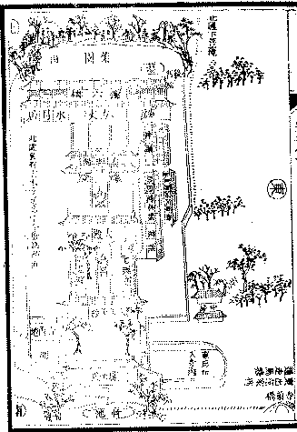
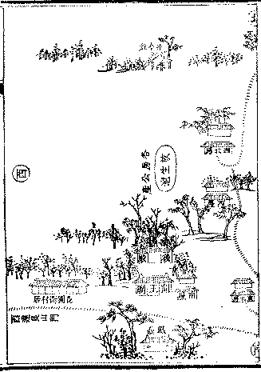

# 崇福寺志



> **藏经**：中国佛寺史志汇刊（佛寺志汇刊）　**册次** 第 30 册（GA030）　**编号** GA0030　**部类** 史传部　**卷次** 4 卷　**篇幅** 17,884 字

> **卷／品**：0 卷 · 0 品



---



崇福寺位於浙江临安乡艮山门外。石晋开运三年（九四六），明义智厚禅师始开此山，名「护国禅院」（一作原名「宝寿院」），宋雍熙间（九八四～九八七）大兴之，大中祥符元年（一〇〇八），改称「崇福寺」，大观间（一一〇七～一一一〇）毁，绍兴间（一一三一～一一六二）重建，元末又毁。明洪武十六年（一三八三）复建，二十四年（一三九一）立为丛林。清初殿宇坍塌，康熙五十九年（一七二〇）四航和尚复兴，乾隆九年（一七四四）静山和尚修葺大殿，乾隆、嘉庆两朝一再增修，颇具规模。本寺住持僧自明义智厚禅师而下千餘年间，茫无可考，自清康熙间四航超海和尚，为本寺中兴第一代，守临济一宗，以下住持，寺万年簿皆有记录，其有功於本寺且有行谊可考者，有静山相和尚、广瑞和尚、道宏和尚、心一通和尚、自求和尚、久贤达圣和尚，玉山真源和尚等，为禅宗临济祖庭之一。寺旧无记录，嘉庆六年（一八〇一），邑人朱文藻与住持释真源创修寺志，厘为四卷，分门有五：总敍、寺宇、寺产、住持、檀护。总敍一门，载本寺之简史。寺宇上列有关帝殿、关帝笤经，体例不纯。寺宇下载本寺殿阁堂房之建置。寺产则录本寺之田产与檀樾之布施。住持一门，则载四航超海和尚迄玉山真源和尚。檀护一门，载宋思山等三十四人。光绪重刻本后附「重建崇福寺碑记」。道光二十二年（一八四二），章庭棫应住持释懋成之请，据寺万年簿编「续志」一卷，首录住持、檀护，次载事实，懋成汇集有关题诗以附之，以补嘉庆道光间四十年之文献。按寺志之史源，除辑诸县志外，大抵据寺之万年簿，所记简略，要存古寺之零篇也。兹据清光绪七年（一八八一）钱塘丁氏刋本景印。



崇福寺志叙



武林艮山门外庵院栉比半为吴越两宋所剙而崇福寺独壮丽闳深为群刹之冠然自吴越剙建以来千餘年闲纪载缺遗碑碣无攷盖由寺无恒产主席更易不常高僧不能聚集至　国朝康熙闲始有捐田舍地之檀护寺中稍有稻粱可资而主僧率不暇为文饰之务地处郊坰骚人词客足迹又不恒至以致旧述无稽水月居额跋虽云有旧志搜之无所得东乡诸古刹之有专志者惟辩利院而此寺较古不可无志以垂久远文藻移家临江乡二十餘年村庐距寺数百武不辞弇陋与玉山上人諮访耆宿参稽故籍剏成寺志厘为四卷新模凭诸目见旧事得之传闻譌误遗漏知所不免详赡增采俟诸后来剞劂既竣爰书简端



嘉庆六年岁次辛酉九月朔日朱文藻识



崇福寺图











御制崇福寺碑记(乾隆元年)



昔如来以正法眼藏涅槃妙心传付摩诃迦叶自达磨来兹震旦提倡宗乘一花五叶递相祖述厥后曹溪分派临济号为正宗棒喝之用实与灵山拈花面目后先同揆祖印相承提持接引信觉海之津梁灵山之通轨也近日丛林刹宇遍天下皈依释氏者虽众而宗风頺替象教日衰我　皇考世宗宪皇帝圣明天纵万几餘暇了达性源旁及内典悯正法之不传整饬宗门谆恳告诫冀其真参实悟以续曹溪临济之一灯凡昔时尊宿开堂驻锡之地具荷　皇慈次第修葺杭州艮山门外崇福寺者临济祖庭之一也剏於宋毁於元复建於明厯年七百餘载琳宫倾圮钟鼓寂寥　皇考命以内币之嬴重加修整经始於雍正十二年九月落成於十三年七月梵宇庄严禅林载焕用记始末勒诸贞珉维尔缁流居是寺者当念　世宗宪皇帝护持正梵之深恩各守戒律努力参究实具正知正见上接诸宗之传无令涂污慧命垢浊法轮朕实有望焉(右见　皇朝文典卷九十九　乾隆元年编修臣王峻恭拟)



临江里人朱文藻纂辑



本寺住持释真源参订



总叙



崇福寺在杭州府仁和县临安乡八啚二十四都



太平寰宇记仁和县十二乡



咸湻临安志仁和今管十一乡第十一曰临安乡管里三曲江海门望潮



杭州府旧志临江乡二十四都一十一里



仁和县赵志仁和县在野十二乡第十二曰临江乡管十一啚



出艮山门



咸湻临安志杭州城东七门第七曰艮山门



杭州府旧志艮山门东北第一门也东北隅有艮山故名门内有顺应桥一名坝子桥俗因呼门为坝子门



杭州府新志按今之艮山相传元末筑新城累土为之而艮山门之称宋时已有旧志以为因山得名非是仁和志谓门位于艮易艮为山或近之



过吊桥沿沙河迤东市店稠密俗呼沙河𪣟



按字书无𪣟字详玩音义乃壖字之转音壖同堧而缘切韦昭曰堧河边地张晏曰堧城旁地一曰城下田史记河渠书故尽河壖谓岸边地也今路旁有碑额曰重筑沙河壖石塘记盖不从俗作𪣟也



市尽处有桥俗呼俞家桥(旧传为东仓新桥)



杭州府新志艮山门东一里餘俞家坝侧泄沙河水入清凉闸



按清凉闸在沙河壖北侧市中有衖通清凉桥俗呼闸衖



又按闸衖者向为天仙庙山门额曰忠孝里今毁北至天仙庙又西通杨墅庙天仙庙祀孝子董永庙前有月河环至俞家桥向有老者曰旧传刘诚意过此指此为藕形四下水沟通流为藕根庙为莲花庙门荡为荷叶荡傍一井上有六柱石亭其形尖圆为莲花蘂年久亭圮移六柱为俞家桥上石阑十餘年前重建天僊庙取回作卷棚柱



过桥向东北行为吴家更楼



按此为一村落南北居人三四十家村中南向大宅为吴氏之居吴氏先世居徽州休宁之黄源明时天绶公始迁杭官锦衣指挥传二世尊周公荫袭指挥三世仲文公袭替始业儒为郡庠生四世景春公为乡饮宾五世继泉公生三子长瑞芝次环芝三珍芝珍芝公生子讳君荣号容庵候选州司马善治生家饶裕周给闾里所居门外建楼跨途以备守望里人呼公名曰吴君遂称此楼为吴君更楼后人避讳改曰吴家楼上旧奉城隍神今楼圮神像供於吴宅



过更楼转东直北经圣帝殿为九里松塘通下菩萨三里亭枸桔衖茧桥大路



按圣帝殿故老相传旧奉关帝为崇福寺伽蓝神昔年迎天开河圣帝祈雨经此遇大雨少憩雨止再舁重不可移众谓神意欲驻此也卜之得吉遂奉圣帝於殿中而奉关帝於殿右里中吴岐生家遇盗官为缉获枷毙於此岐生夜过鬼辄为崇暗中见刀光而解乃建而新之



又按九里松塘宋时旧名咸湻临安志云蔡官人塘河在艮山门外九里松塘是也下菩萨亦宋时旧名今为土谷祠祀诸葛瑾庙门外左壁有石佛一龛佛像三尊合为一石旧湮井底今嵌庙壁佛像下节刻题名十一行文云临安府城东新九里松下菩萨庙焚修香火善友系嘉兴府行孝人口募缘刊凿圆通圣像一龛并重建施水一所祈求丰稔国泰民安上答四恩三宥嘉熙元年四月初八日嘉兴府行孝善友义庵周贵圆谨题据此可知九里松塘及下菩萨庙自南宋始矣石刻谓为新九里松则是始於嘉熙初元以前未有此名也



未至圣帝殿东向数百步村居十餘家名花园衖



园为屠氏先世之别墅奇花异果四时繁茂今为桑塍蔬圃矣



过花园衖为闻王庙



庙在路北南向大殿三楹后殿三楹奉土谷神前殿神像前栗主题曰溥泽侯左壁神榜题曰商勅临安九里松九朝都土地勅封溥泽侯



按闻王事迹不可攷土人据稗说家商纣时闻太师当之故榜题商勅固属不经然下文十五字则由来已久必有所本杭州之称临安府始於南宋高宗此地之称九里松始於南宋理宗其曰九朝都土地者宋代南北各有九朝此云九朝必非南宋之九朝葢宋亡之后元人立庙何必复称前代之九朝乎则所谓九朝者指北宋而言以臆度之当由高宗定都临安以后扈跸之人侨居此土追祀中原土谷之神立庙於此称之曰九朝都土地者示不忘中原也神为闻姓封溥泽侯亦仍宋勅之旧攷闻姓仅见於正字通载宋咸平进士闻见自明以后乃有尚书闻渊明史有传明末则有闻子将为杭郡名人可见吾杭闻氏大率为宋进士闻见之后则此闻王庙或亦北宋闻进士之后嗣有功於朝封号溥泽其子孙侨居此乡立祠奉祀而年久遂奉为土谷神也杭郡土谷神有姓名者大半类是今未能详攷姑备一说以俟博雅者论定焉庙中香火即崇福寺南房僧主祝史庙门外路南北向戏台一座额题昭昔警今四字集朱子书台左右有樟枫银杏等大树十餘株(庙后同)台西一水环流曰清宫港东通寺前桥南通小顾家桥



闻王庙东即崇福寺



寺南向门外直南甬道一带临大路左右角大樟树二株可二人合抱路东为兴隆桥俗名寺前桥东通范家衖走马塘大路南通永济桥路南面寺有小荡名曰骨池本寺各房共之



崇福寺



咸湻临安志崇福院在艮山门外元系宝寿院祥符元年改赐今额(又传开运三年郡人以地易仁王院菜园建护国仁王院后改宝寿)



杭州府马志崇福寺艮山门外宋雍熙闲建大中祥符初改今额后累毁明洪武中重建



仁和县赵志崇福寺在艮山门外临江乡宋雍熙闲建大中祥符元年改今额大观闲毁绍兴闲重建元末毁明洪武十六年复建二十四年立为丛林



又云崇福院在庆春门外难消埠晋时为护国仁王院后改宝寿宋大中祥符闲赐今额元末毁明万历闲僧养虚重建观察陈禹谟复题枕流院额



杭州府新志崇福寺在艮山门外宋雍熙闲建大中祥符元年改今额大观闲毁绍兴闲重建元末毁洪武十六年复建立为丛林



又云崇福院在庆春门外晋为护国仁王院宋大中祥符改额元末毁明万历闲重建



按艮山门在城东北庆春门宋时为东青门在城东其地上下相距数里不能混也崇福院与崇福寺本是二名惟咸湻志谓之崇福院元系宝寿院祥符元年改额在艮山门外则非庆春门外难消埠之崇福院明矣嗣后府县志皆称为崇福寺而删去宝寿旧额但云改赐今额夫不载旧额则何从改赐府县志之误显然至仁和赵志乃以宝寿院额属之难消埠之崇福院而於艮山门外之崇福寺不载宝寿则崇福寺之旧额究属何名似系赵志有误咸湻志为郡志之祖所载自属可据当从之惟不详宝寿之额始於何年据马府志谓寺建於宋雍熙闲则宝寿之额当即始於是时赵县志谓晋时为护国仁王院者自是难消埠崇福院额似非即此崇福寺也然本寺记略又但有护国而无宝寿则护国之额又非难消埠之崇福院矣今住持玉山亲至难消埠徧询耆老谓难消埠祗江沙一片久失其址而左近小庵数处亦并无崇福院之名葢院之颓废已久矣府县志但仍旧文编录未尝细攷其存亾则其误无从辨析姑从其说以备攷而寺之开创从记略以为自晋开运三年为不失其旧也仁和赵志又云因果寺在艮山门外后晋开运二年建名崇寿宋大中祥符元年改是额元末兵毁明洪武初草葺二十四年并崇福寺万历壬子僧月居玺重建按此今谓之月居庵洪武闲并入崇福寺者今虽析出仍附载之



崇福寺记略武林艮山之左古有九里松漫为平原石晋开运三年有明义智厚禅师始开此山名护国禅院大宋雍熙年闲大兴之大中祥符闲改额崇福禅寺大观闲兵毁绍兴重建元末复毁洪武二十四年再创万历甲午岁有思山宋公复整崇祯戊寅里中玉存屠公舍地七分零本寺房僧存如师就地募建禅堂三闲



本朝康熙丙子年殿堂坍颓西北房懋华师捐金二十两里人容庵吴公主兴修造戊寅岁懋师病卒中止丁亥岁懋师之徒霁远师约同七房各捐金二十两归容庵公公即破土发木兴造未遂而病笃命仲子岐生公继志完工岐生公於辛卯岁兴大殿天王殿兼创山门伽蓝祖师两廊清逸堂厨房等屋七房师亦皆殚力胜瑢师更倍力於工作至乙未年冬岐生公即同长兄道深公纠诸同志诣石门福严敦请超海和尚於丙申春来主席参者多至千餘指安禅栖众净律为常始成名刹而寮舍尚少是岁之暮岐生公卒戊戌秋复整大殿海公与道深公议完其缺略公曰弟功宜续父志当遵即与季弟两姪谋完其事仍纠诸同志天生沈公等议劝众房调换地基屋宇众房允协海公复命诸职尽力募化檀护乐助是冬天生公道深公竭力共完胜事乃创建大悲阁改造三房於山门之左右庚子岁禅堂方丈库房乃成辛丑夏华家衖有慈云庵者因患海水拆施常住因建斋堂宿云堂柴房圊房壬寅六月海公退院荫寰培公主席乙巳春培公退院演教海公复主席是年七月十七日大悲阁始上梁此雍正已前本寺兴建之始末也



按此记略书於本寺万年簿之首万年簿者本寺住持授受之故籍也首云在晋开运三年有明义智厚禅师始开此山名护国禅院大宋雍熙年闲大兴之大中祥符闲改额崇福禅寺石晋为五代时国开运乃出帝纪年时吴越建国钱王元瓘奉晋正朔故开运三年实吴越钱王时事明义智厚禅师开山名护国禅院似即仁和赵志所载难消埠崇福院晋时为护国仁王院者据志则属之彼处据记略则属本寺厯世久远究不知孰是也又记略但称大宋雍熙年闲大兴之而不载宝寿院额似乎宝寿之额原非本寺所有然则咸湻志之称崇福院在艮山门外元系宝寿者将何属耶同一大中祥符元年既改护国院为崇福寺又改宝寿院为崇福院而咸湻志无明文后之府县志又不加辨析此疑终不能明矣府县志但云大观闲毁而记略云兵毁大观闲杭州无兵戈之事则云兵毁记略误也



本寺修建原委本寺自明洪武二十四年立为丛林至　大清顺治闲坍塌康熙五十九年闲各檀护迎四航和尚主席复兴乾隆甲子秋静山和尚修葺大殿四十年九月本寺两序邻房尊宿至皋亭龙居寺迎道宏和尚主席四十一年行梆劝募蒙施焕章吴西林同募善信於十一月兴工先修弥六阁四十二年春修禅堂冬修天王殿关帝殿并庄严佛像五十六年二月文贤和尚主席周围筑墙一百三十堵造伽蓝殿五闲五十八年造报本堂五闲关帝殿五闲重修斋堂五闲五十九年造厨房五闲小房八闲祖师殿五闲重装大佛三尊韦驮一尊嘉庆三年六月稑润和尚主席五年冬鸣梆立关募缘重建大殿六年正月稑公退院法嗣玉山和尚主席竭力振兴事事务期整顿



按此条亦载本寺万年簿而加以增润者也



临江里人朱文藻纂辑



本寺住持释真原参订



寺宇上



关帝殿



本寺山门第一进凡五闲门外左右八字墙各一带左偏园地为东房旧址今归寺内右墙小门通东北房出入殿为乾隆癸丑年里人吴隆昌等因旧重建(按记略载康熙辛卯年创山门至乾隆丁酉之冬始修关帝殿至是年因旧规模而更新)殿中供奉关帝祈祷极灵凡有事不决及蚕收叶价致诚卜笤无不响应



关帝笤经



按笤字本音条笤帚也未有作卜笤用者卜者所用古谓之杯珓以玉为之音教类篇云巫以占吉凶者演繁露云杯珓用两蚌壳或用竹根字又或作筊石林燕语高辛庙有竹桮筊以一俯一仰为圣筊演繁露及石林燕语皆宋人之书则筊用竹根与俯仰为圣之制由来久矣今若从古当作筊字然时俗皆通用笤字遽易之恐启后人之惑姑从俗作笤



凡占者神前默祷以手举笤二枚相合而掷于地三掷而毕以一仰一覆者为圣两仰者为阳两覆者为阴检读笤经以占吉凶经语旧书於粉板今里人金怀捐赀刻本印以签条占者免誊写之劳矣经语甚朴遫无文韵多不谐经厯年久不无流传之误今悉仍原本镌之不复改易取其徵验已久也惟寻求命意颇与易理相通葢易以阳为君子阴为小人君子道长则吉小人道长则凶故经语中以圣阳多者吉阴多者凶阳固合於君子之道而圣则阴阳相合也三掷分列为六犹易卦之有六爻一阳一阴谓之圣以配爻辞则先阳后阴即如三圣畫为六爻是为阳阴阳阴阳阴自下而上成既济卦餘悉倣此推之今取易爻与经语参详无不相合可知当时制经二十八字具有深意非漫尔为之也愚既悟此理因详加疏解备载於此愿与占者共晓然於神灵之不爽也



> 三圣上上　



　离下坎上既济卦



风云际会正当时　万事亨通大可为  

三日幸逢欢喜到　花开结子月光辉



水火相交坎离既济六爻之位各得其正故风云际会万事亨通也离光照水如花开之丽月光之辉六二爻辞云勿逐七日得此云三日者极言其速也



圣阴阴　下下　



　震下坤上复卦



初时有吉后头凶　莫把奸人作弟兄  

日后反成冤业债　总然得利也空空



一阳初复而群阴尚蔽於上故初吉后凶易云朋来无咎然君子少小人多虑奸人为害也



圣圣阳　上上　



　离下巽上家人卦



贵人相济合阳阴　何虑前途不太平  

千里威风惟君有　他年金谷自丰盈



卦辞云女正位乎内男正位乎外是为阳阴相合之象上九一爻有孚威如经故云千里威风惟君有也



圣圣阴　中平　



　离下坤上明夷卦



男子行藏事合成　买卖何须用一人  

防他久远遭他计　利不成时反受亏



离为明象而逼於三阴小人间阻故买卖不宜专任一人也小人用事遭计受亏害所必至矣



圣阳阳　上上　



　离下乾上同人卦



无忧无虑太平年　坐贾行商利万千  

病者起身官事散　求谋作事有良缘



此卦为利涉大川之象故云商贾皆利文明以健故云病者起身君子能通天下之志故官事散卦名同人故谋事有良缘也



圣阴阳　下下　



　震下巽上益卦



倚势须防有尽时　莫持豪富莫欺贫  

神明不佑终非久　祸患临时悔也迟



卦有损上益下之象益中有损戒人勿自恃也经云祸患临时悔也迟葢因易上九爻辞有立心勿恒凶之语而重警之



圣阳阴　中平　



　离下震上丰卦



好好行来又若何　几乎失却在中途  

若非用力施为计　反被旁人笑是非



丰卦王假之勿忧宜日中日中与中途同一中也云勿忧则先已有忧故云几乎失却也离为明象震为动象明以动而后丰则当用力施为矣



圣阳圣　上上　



　离下兑上革卦



读书及早登金榜　吉人怀孕必生男  

丹诏贵人相接引　凭他谋望总如斯



革卦辞云文明以说（悦）大亨以正故云读书早登金榜也离为火兑为泽水火相息又为生息之义故怀孕生男也汤武革命顺天应人故云丹诏接引也



圣阴圣　中平　



　震下坎上屯卦



你问前程事若何　小人阻闲在中途  

劝君且过月半后　任汝施为笑呵呵



此卦乾坤始交而遇阴险故云中途阻隔也过月半者坎陷过中则震动奋发可任汝施为矣



> 三阳上上　



　乾下乾上乾卦



三阳交泰似新年　到处风光万物鲜  

花满路时香满袖　家家齐插嫩杨枝



此卦六畫皆奇上下皆乾阳之纯而健之至也三阳开泰正月之象万物资始於卦为上吉



> 三阴下下　



　坤下坤上坤卦



说起愁来愁更多　祸从天降两相磨  

宽心待过甲子日　可保平安免难波



群阴相连愁多之象坤卦西南得朋东北丧朋安贞吉甲为东北子亦正北经故云过甲子日保平安也



阴阳阳　下下　



　艮下乾上遯卦



闲是闲非不可听　听了却是恼人心  

从今一笔钩消罢　各自寻门自主张



遯卦为君子远小人之象故云是非不可听也凡事退避则小有利贞故云可各自主张也



阳阴阴　下下　



　兑下坤上临卦



欲知机处未知机　小辈阴人惹是非  

作急隄防须仔细　免教骨肉两分离



临卦为君子教思无穷乃尊长教戒小辈之意也卦象二阳上逼四阴刚不胜柔故云隄防须仔细也



阳圣阴　中平　



　乾下坤上泰卦



贵人相济合阴阳　何虑前途不吉昌  

劝君诸事须守旧　免教后悔喜洋洋



此卦为天地交泰之象经故云贵人相济合阴阳也君子之道虽长而小人之道尚未尽消故须守旧



阴圣阳　中平　



　艮下巽上渐卦



说起愁来且莫愁　先凶后吉不须忧  

当时却被花徒哄　更有收成在后头



卦有渐进之义故云先凶后吉彖辞云女归吉故云被花徒哄也进得位往有功故云有收成在后



阳阴圣　中平　



　兑下坎上节卦



行人性急反成迟　诸事还须许愿心  

官事求谋因半阻　始中还有好收成



节有限止之义故急而反迟求谋半阻也兑说(悦)坎险说(悦)以行险故许愿心以求说(悦)神明而后可行乎险也天地节而四时成故云有好收成也



阴阳圣　中平　



　艮下兑上咸卦



小人破戒祸相随　我若无私也不妨  

但把一心行正道　自然天理不相亏



此卦艮下兑上艮为山兑为泽山刚泽柔柔上刚下当以正心相感则无私矣无私则天理不亏小人不能为祸也



阴阳阴　上上　



　艮下震上小过卦



风霜磨尽好音来　眼见青天红日开  

否极泰来生造化　讼事和同病好来



卦辞有飞鸟道之音故云好音来也六五爻辞有密云不雨故云眼见青天红日也下艮为否极上震为泰来山上有雷为动荡之象故讼和而病好也



阳阴阳　中平　



　兑下巽上中孚卦



好好行来自逞强　慌忙作事欠端详  

愚夫弄巧反成拙　忍耐胷中免祸殃



此卦上下四阳中容二阴乃中虚之象外实内虚象如舟楫逞强慌忙皆行舟之不稳者勿贪



利涉而说(悦)逊以前则忍耐之受益多矣



阳圣阳　上上　



　乾下巽上小畜卦



君欲求谋事必谐　吉人天相喜重来  

春风动处花香绕　异日回头著锦衣



此卦为风行天上之象经故云春风动处花香绕也柔得位而上下应之故谋事必谐



阴圣阴　中平　



　艮下坤上谦卦



千般用力事难成　才到完成又未成  

到底半凶有半吉　小心守旧保安宁



谦卦本六爻皆吉然地中有山则裒多益寡用力不易成也经云半凶半吉小心守旧者戒人勿自满之意



阳阳阴　下下　



　乾下震上大壮卦



二人作事欠完成　弄得头齐脚不齐  

各自心来不一路　方知临了见分明



四阳在下而有二阴阻之故云二人欠完成且为头齐脚不齐之象也易云大壮大者正也正大而天地之情可见故云临了见分明也



阴阴阳　中平　



　坤下巽上观卦



弄成祸事不停留　多少慌忙多少愁  

幸得后来好人解　和同作事且安宁



此卦四阴上逼二阳阳为阴掩故惹祸多愁然卦象为风行地上解散阴翳则后来安宁矣



阳圣圣　上上　



　乾下坎上需卦



劝君立志往前行　名已成来利已成  

好似春花初发作　犹如秋月正团圆



需有利涉大川之象故云名成利成也



阴圣圣　上上　



　艮下坎上蹇卦



莫自欺瞒莫自乖　初时小阻后平开  

问名求利终须有　完成事业且开怀



此卦二阴相阻於下上乃阴阳交济故云初时小阻后平开也彖辞有利见大人贞吉之语故云问名求利终须有也



阳阳圣　上上　



　乾下兑上夬卦



及早施为正遇春　一朝平步上青云  

风平浪静无他阻　管取前程万事亨



夬卦以五阳决一阴三月之卦故云正遇春也彖辞谓扬于王庭孚号有厉故云平步青云也



阴阴圣　下下　



　坤下坎上比卦



轻灾薄悔已多年　迟迟阻阻不周全  

从今略得些儿日　别作生涯始得安



此卦以一阳而阻於上下五阴之中故为多年迟阻之象然刚在中而上下应可以人来比我亦可我往比人则不妨别作生涯矣



立笤　下下



立笤皆因不致诚　未来问我我知因  

要知祸福因情事　早向神前许愿心



立笤不分阴阳神明示戒惟有许愿祈佑而已



临江里人朱文藻纂辑



本寺住持释真源参订



寺宇下



天王殿



本寺第二进由关帝殿后中行甬道左右列大松数株殿左大樟树一株树外左右土墙各一带左墙二门一通园地(即东房址)一通中房出入右墙一门通西房出入墙外路南北蔬圃一方为常住产殿内中奉弥勒佛题楣额曰生欢喜心乾隆丁酉信士沈容鼎刘宪华沈虔立甲寅小雪前五月住持达权重修净土学人蒋仁书佛龛上额曰无如一笑石帆顾升书龛后北向奉韦驮立像极灵两次行梆募缘奉以护法有侮慢者辄示灵异左右塑四天王像按记略载天王殿兴於康熙辛卯年至乾隆丁酉冬重修



大殿



本寺第三进康熙辛卯年兴修戊戌年复整乾隆甲子年修葺嘉庆庚申年重建殿三槛中四柱新易以石题联云崇旧宇以焕新模佛日慈云幢拥香林雄北郭福桑田而祐松里晨钟暮鼓灯传梵呗震东皋(楷书勒柱上)中奉佛像三尊殿左铁钟一口万历丁酉年九月本山比邱真俊真杰如懃如懋如宪如慧如德明心明京明朗觉逸明晓海嵩惠谌智楠海瑞荐考姚公妣陈氏智桂荐妣张氏募化沙门觉远劝缘弟子蔡廷檀等(餘不备录)佛前铁磬一口万历廿五年本山比邱如德立殿左右柱题联云具大人相乃分身百亿愿作中天调御三身四智内不觉重开斯面目证无上士已徧覆大千欲度博地凡夫十刹五山中何妨复驾此招提后学超海题(印曰七十一世孙四航海印)九沙万经书(八分书)乾隆五十九年甲寅秋八月住持达圣重修殿门外甬道上铁鼎炉一座(右耳已失)乾隆庚午年铸庭左右有大银杏二株左一株旧有寄生木樟槐谷及月季花等七种穴藏松鼠乾隆甲辰年捕鼠者熏穴遗火焚树今惟右一株存西墙脚有雍正乙巳办粮碑嵌砌模糊仅辨数字



吴颕芳西林崇福寺诗



古寺松塘近　鸣钟午梵闻　江山门独向　花竹径平分　客到茶烹雪　僧高衲贮云　日斜村路静　林鸟自为群



翟灏晴江崇福寺钟声诗



百八洪音起　村斋梦正阑　一时增壮悔　五夜逼秋寒　菘圃清霜粲　桑塍白月残　老僧头似雪　坐破几蒲团



任经抑斋崇福寺前晚步诗



东皋望不极　野色淡斜睴　木落半山出　风高一隼飞　疏钟鸣古寺　流水咽荒矶　信步浑忘远　人家半掩扉



翁永锡玠山晚过崇福寺诗



逶迤来古寺　夕照尚餘红　麋鹿遥相伴　藤萝近自丛　云翻水漾月　玉响竹敲风　清磬一声下　悠然万籁空



沈鹏桐谿崇福寺银杏诗



盈极则含虚　何物不可隶　俗见别分支　归原惟一柢　留此镇三门　迦陵时说偈



伽蓝殿



在大殿左庑凡五闲康熙辛卯年建乾隆辛亥年重建中奉伽蓝神五尊额曰吉祥拥护汤志高立王栻书联曰白拂重挥新气象乌藤再振旧家声



祖师殿



在大殿右庑凡五闲康熙辛卯年建乾隆甲寅年重建中奉达摩祖师像



大悲阁



本寺第四进重楼五闲康熙戊戌冬剏建雍正乙巳秋工竣乾隆壬子正月七日坍毁后重建楼中奉大悲像额题前后佛身四字奚冈书左侧旧有额书陀罗尼三字孙行书今佚楼下为禅堂又为戒堂门有额曰无碍随心雍正五年屠宪臣题庭有铁鼎炉一座乾隆四十九年周辩助南房劝缘僧雨耕住持际元



九闲楼



本寺第五进乾隆庚子建楼下中三闲为方丈有额曰高提祖印乾隆甲子秋为静山和尚陈世倌书左有额曰祖林秀出孙效曾为导鸿和尚题左一联曰天香直欲熏人醉仙骨何曾带俗尘康熙辛丑仲春龙溪胡衡为四航和尚右一联云竹籁松涛供棒喝花香鸟语逗禅机秋塍鲁曾煜为静山和尚题方丈后一联云拓开兜率月吼破涅槃心阆庭杨士栋为四航和尚题后轩中间向年供奉心经碑搨一幅碑刻佛塔一座准提菩萨像居中周刻心经一卷准提左右刻二十诸天十八罗汉像旁题曰雍正十三年元旦刻和亲王沐手敬书相传乾隆十六年圣驾南巡住僧巨根迎驾蒙赐佛像二轴一是观音像一即此幅其后住僧融通携至扬州为永济庵僧道昌所见请归藏之今尚恭贮庵中方丈东三闲为库房西三闲为西方丈为住持退院静修之所额曰水月居跋云曷名乎水月仍其旧也曷取乎水月喻其道也古崇福寺自祥符之年改额以来星霜既移兴废屡矣惟旧志(按此志不知河年所葺今已失传)载轩堂斋室一一可称而原址不可一一寻矣甲寅春久公理古屋三楹以志中水月二字嘱书於余且曰其屋与方丈邻有楼可登四顾方塘园沼远近相映带有曲迳纡回可达水上月夜时或步或登悉领是中趣味噫公之意吾能窥之矣尝闻禅之妙境犹羚羊挂角香象渡河不著一毫痕迹今久公以水中之月悟之又与旧额相符所谓古今一贯心心相印矣他时秋月扬辉寒潭澄澈当与久公质诸居亦正宜也时乾隆五十九年上已前一日芃潭王棫并书其西直南抵天王殿西南隅旧有云水堂延寿堂今皆废毁成隙地楼上中三闲额曰弥六楼跋云崇福为艮山门外第一古刹年久颓废龙居导鸿上人来主讲席□□伪习宣空实华不瞬岁与斧斤云集楼阁巍然予自广陵为补书弥六楼旧额并媵数语以其胜愿竟遂欢喜赞叹语以详兹寺中兴缘起乾隆丁酉冲寂观三□□右三闲为西方丈楼



祖堂



在大殿之左南连伽蓝殿面大殿东墙西向(从大殿庭左侧廊而入)凡五闲中奉列世住持位



报本堂



在大殿之左南连祖堂面大殿东墙西向凡三闲中列护法长生位



厨房



在报本堂之右面大悲阁东墙凡三闲右一闲有井绠汲以通内厨内厨之东有屋八闲为柴房浴房圊房



斋堂



在大悲阁之左南连厨房北抵库房楼五闲西向额题斋堂二字八分书跋曰崇福禅院古刹也岁久倾圮幸久公上人卓锡於斯苦志焚修善缘广结致有居士端书周君矢愿一力重修功甫半而周君遽逝善果未竟人共惜之然久公大愿宏深当必有继起而成有善因者行看斯刹重新有日余所深望焉乾隆五十九年岁次甲寅七月既望平江安陶吴丰书并识又悬额於门书重修斋堂记云斋所以供僧也堂所以受斋也启十方之宏愿收十方之供养存十方之僧众是以丛林道场靡不有斋之堂焉乾隆壬子圣适住持崇福古寺见其前后宝殿左右廊庑藏经之楼参禅之堂凡修佛事之所虽垂霤重簷棼橑交接而不治者久矣殿之东偏有斋堂五闲其陊剥颓废为尤甚癸丑春里中周居士端书重而新之噫工未竣而居士已作古人矣今居士鸠工於未逝之前能蒇事於既逝之后殆亦了此龙华会上一段因果若居士者可谓再知识矣圣作是记也一以感居士之乐施一以留此规模俾后之来者肯堂肯构踵而行之庶几粥鱼茶板有所安而道可永永矣乾隆甲寅年住持达圣识芃潭王棫书



方丈后墙外从斋堂东北启门而出有小迳沿墙而南可达柴房其北有埂向东而北而西达於西北房环埂密栽松樟麻栗杂树百餘株埂内近墙东北角有小荡荡北桑园一方其右水田一方俱寺产埂外西北有井上覆以亭额曰井亭社井南近西北房西侧有荡曰放生池其埂之东北通九里松塘下菩萨大路



本寺六房(旧有七房内东房久废地半归寺内半归西房)



南房



在东北房之西闻王庙之东由庙中出入有屋二进额曰绿筠堂



东北房



在关帝殿之西南房之东由关帝殿西八字墙出入有屋二进额曰玉芝堂堂中又额曰沐尘堂王炜书



西房



在大殿之西东北房之后由天王殿前西墙出入有屋二进旧额白云堂又曰罗吉堂庭有枸桔一本蟠为六层如塔门有额曰曲沼野航书门外大樟树一株



西北房



在西方丈西侧西房之后与西房同由天王殿前西墙出入有屋二进额曰永仁堂后有竹园



中房



在天王殿之东由殿前东墙出入有屋二进额曰大觉堂



西南房



今分居下菩萨上诸葛庙主庙中香火寺内无屋旧额曰水月堂



寺产



徵田共三十亩六分六厘三毫坐落亭子村



岐生吴公舍　入临江八啚五甲内(壬寅年入册)



立户崇福禅堂　改户弥六楼(野航户下)



计开号段亩分



男字八百三十八号　田二亩一分四厘三毫



男字九百二十号　田四亩六分零六毫



男字九百二十一号　田八亩九分五厘九毫



男字九百四十号　田一亩八分三厘三毫



男字九百四十三号　田一亩一分一厘五毫



男字九百十九号　田五分



六共男字号内田十九亩一分五厘六毫(吴逢源付)



洁字三百八十号　田三亩二分九厘七毫坐落白马坞



洁字四百四十号　田三亩四分五厘



二共洁字号内田六亩七分四厘七毫(吴逢源付)



效字九百四十四号　田一亩五分五厘



效字九百六十九号　田二亩零二厘五毫



二共效字号内田三亩五分七厘五毫(吴逢源付)



男字五百零七号内田三亩五分七厘五毫(吴起源付)



以上共田三十亩六分六厘三毫



折地共三亩一分五厘



又地二亩七分零九毫　扇子地(今有普同塔静山和尚设)　存澧吴公舍　吴守智付



计开号段亩分



而字一千四百零六号　地六分三厘三毫(沈云付)



而字一千四百零八号　地一亩零五厘四毫(沈朴付)



而字一千四百零九号　地二分七厘六毫(沈朴付)



而字一千四百零十号　地七分四厘六毫(沈文御转付)



四共而字号地二亩七分九毫



换地号段亩分



换中房地　而字四百八十八号　地三分二厘



换南房地　而字四百八十号　地一分五厘八毫



换西房常住地　而字四百八十一号　地四分七厘六毫



换明甫师地　而字四百七十九号　地三分七厘五毫



换明甫师地　而字四百七十七号　地一分九厘七毫



五共地一亩五分二厘六毫归东北房作新基



兑东北房旧基地　而字五百零二号　地一亩二分二厘四毫



而字五百号　地一分



二共地一亩三分三厘四毫　此是东北房与常住所换之地作禅堂基址



换西房明甫师地　而字四百七十七号　地三分四厘六毫



换西北房地　而字四百七十六号　地五分九厘九毫



换西北房地　而字四百七十五号　地四分七厘五毫



三共地一亩四分二厘归南房作新基



兑南房地　而字四百八十五号　地七分五厘六毫



而字五百零二号　地一分



而字四百八十号　地三分一厘



内一分五厘八毫归东北房



一分五厘二毫常住收



三共地一亩一分六厘六毫　此是南房与常住所换之地



方丈九闲楼基地(节录舍书)



舍书屠文英仝男仲源泓源有祖遗桑地一则计三亩零坐落崇福寺禅堂屋后今因启建佛阁需用其地因父玉存公向系本寺檀越文英继父志凭众议将地内拨二亩三分屠澎浚户下付出折地归崇福常住得半价银十九两



计开四至



荡东南一方块直落



荡西两方块(今挑空)



靠荡北首一横𫭢(今挑空)



横𫭢北靠东三长𫭢(今常住收花)



东至行路



南至东南禅堂地



中屠宅荡



西南禅堂地



西至屠宅地



北至屠宅地



长𫭢后北至小路(北首地上挑去泥土听屠处畜养鱼鳞水涸之日仍听寺中挑泥应用)



康熙五十九年九月　众檀护(沈天生　顾捷三　陈元章　吴道深　许殿书　朱玉明　许尔调　裴际尤　张彦博)



中房公议(节录)



邻里冯昌期沈天生等先年因崇福寺坍损蒙吴君翁居士捐助修造而岐翁等延请四航和尚住持重整山门大殿起造宝阁两序但寺基贴东一带向与中房地界接壤其闲犬牙交错彼此凹凸今中房明沧师将己地内贴近客堂之左基地计阔一弓一直上南长十弓又伽蓝殿坐身基地南北计长六弓七分东西计阔三弓一分又上南小天井并基地南北长一弓七分东西阔五弓七分丈过合数共一分七厘俱照起造取足其用



今君翁岐翁相继去世而明沧师又已西归其所用基地条粮理应本寺常住输纳今中房法嗣胜瑢等凭里邻三面证明所用基地永归崇福常住条粮仍归中房自户输纳既不失羽翼禅堂之功德又不没先师欢喜之本怀子孙两无异说议单各执一纸



康熙六十一年六月　邻里(朱玉明　陈元章　冯昌期　沈天生　屠文英　高奕千　刘吉臣　道生师　大彻师　许殿臣　元章师　吴道深　蒋鼎彝　张际龙　吴存澧　尔昌师　松隐师　吴西林　恒先师　四航和尚　惟高师　胜瑢师　荫寰和尚　悦山师　玉成师)



董得春等舍书(节录)



舍书董得春象春向年先父存日续置荒地一则计七𫭢坐落仁邑临江八啚而字号内折地八分零东至汤高二姓地界南至孙处坟地并崇福常住地界西至姜桓聪地界北至沈处义塜地界情愿施舍与崇福寺常住为业推收过割



乾隆五十年九月　族亲邻友(孙茂昌　董治田　董天成　董楚山吴出云　董尚周　屠圣高　住持雨畊)



沈海云舍书(节录)



舍书沈海云今将祖遗桑地三𫭢半计折地七分零坐落仁邑临江八啚而字号方家井头东至沈家地荡为界南至沈家地界西至沈家地界北至沈处地界情愿施舍与崇福寺常住管业过户办粮



乾隆五十四年正月　见舍(周青远　邬瑞卿　李锦章)



由单开载宝产(乾隆四十年由单)



徵田三十亩七分九厘九毫



徵地三亩六厘七毫



折田三亩六分四厘六毫



折地十四亩八分二厘七毫



荡三分二厘



共五十二亩六分五厘九毫



每年实完漕粮三石二斗一升一合



每年实完条银七两三钱六分三厘



临江里人朱文藻纂辑



本寺住持释真源参订



住持



按本寺住僧自开山禅师而下千餘年闲茫无可攷　本朝百数十年闲凡祖堂有位及有功於寺载在万年簿有名号可攷者略加叙次录之餘无攷者仍阙之其有散见各条者无论是住持与否悉附载焉但能略载其兴建之绩而於俗姓里居受具道行各事迹皆不能详葢各住持西归建塔者祇三人又未有塔铭刻语录者祗一人又别无著述是以邈无攷稽姑存大略以俟博闻者追忆而补所未备焉



明义智厚禅师



晋开运三年开山(见本寺记略)



按各房追荐先师皆以明义宣教厚法师为开山始祖今首列於此各房不复备载



真俊　真杰　如懃　如懋　如宪　如慧　如德　明心　明京　明朗　觉逸　明晓　海嵩　惠谌　智楠　海瑞　智桂　觉远



右十八人俱见万历丁酉钟铭称本山比邱不知其孰为住持及是何僧职名不可没因并列之内如德又见磬铭



存如师



南房山主崇祯戊寅里中屠玉存舍地七分零存如师就地募建禅堂三闲



四航超海和尚



系福严长房传临济正宗第三十三世在本寺为中兴第一代康熙丙申年里人吴岐生吴道深诣石门敦请来主席参者多至千餘指安禅接众净律为常整大殿剙大悲阁及禅堂方丈库房斋堂宿云堂柴房圊房以次而成壬寅六月退院雍正乙巳复主席师生於康熙壬寅八月廿二日圆寂於雍正戊申四月一日世寿六十有七塔院在扇子地普同塔西南居中面清宫港有语录一卷板藏寺中



按塔左右旧多荫木久贤住寺日判卖与人今无存矣(按语录为侍者普兢编皆师住石门福岩餘杭龙泉及艮山崇福时法语)



懋华师



西北房僧康熙丙子年殿堂坍颓捐金二十两兴修



霁远师



懋华之徒康熙戊寅懋师病卒至丁亥岁师约同七房各捐金二十两兴造完功



明沧师



中房僧胜瑢之师康熙壬寅年因造大悲阁将已地内贴近客堂之左基地一分七厘归寺取用其条粮仍自户输纳



胜瑢师



中房僧康熙辛卯兴建殿宇七房师皆殚力师更倍力於工作



以上四人俱系房僧今以其有功於常住因详列於此



荫寰培和尚



康熙壬寅十月主席雍正乙巳春退院



匡源洪和尚



传临济三十四世本寺第三代



静山相和尚



传临济三十四世本寺第四代乾隆甲子年修葺大殿塔院在四航和尚之左



晚枫翘和尚



传临济三十四世塔院在四航和尚之右



鉴开照和尚



真如奇和尚



俱传临济三十四世



善化孝和尚



传临济三十五世本寺第六代



普怀权和尚



传临济三十五世住龙居寺往来本寺



宏传芳和尚



传临济三十五世



会文源和尚



传临济三十六世



普见严和尚



传临济三十七世



融通和尚



自四航和尚主席厯传门人世守传至融通渐见衰落



广瑞和尚



融通之后有广瑞和尚住持重加修葺寺后地埂周植松樟麻栗杂树百餘株至今茂荫



以上二人并见乾隆四十八年公议单



巨根和尚



耳通庵僧曾住本寺乾隆辛未恭迎　圣驾蒙赐佛像碑搨



大能源和尚



传临济三十五世乾隆丁丑主席



道宏和尚



又号导鸿龙居寺普怀和尚法嗣传临济三十六世乾隆乙未年主席殿宇佛像焕然一新住持三载交法弟道本代摄三年己亥复住



道广莲和尚



传临济三十六世



心一通和尚



传临济三十六世元系永济庵僧与其徒道昌曾同修崇福与有力焉



此语据道昌自述



自求和尚



自道宏住持之后无力撑持於四十八年二月(癸卯岁)开元并不请命自请自求和尚进院以致四祖门下众师要究开元之罪并请自求手卷查系受怡堂和尚之传亦从石祖之法根本一脉六可暂摄三年众皆欢允特请六房檀那开单交代至四十九年三月(甲辰岁)会文交与立权和尚接手(是年六月雨耕收)



此条见公议交单



雨耕润和尚



南房僧传临济三十七世乾隆甲辰年主席劝缘铸铁炉



际元和尚



与雨耕和尚同募铁炉



以上二人并见铁炉题名



久贤达圣和尚(弥勒殿额作达权)



传临济三十八世乾隆辛亥正月雨耕容照两和尚交久贤主席劝募檀那周端书发心重建斋堂等处嘉庆戊午圆寂



稑润彻和尚



嘉庆戊午六月主席行梆立关劝缘重建大殿辛酉正月殿工未毕退院



玉山真源和尚



乌程县人出家孝丰广济庵稑润法嗣嘉庆辛酉正月主席立志久住以期振兴坠绪百废具举



各房山主



丛林之兴废全视各房为盛衰故各房兴盛则寺可终不废而各房之兴又全恃有道行者以维持之庶可经久不绝则各房山主之贤者顾可没而不书乎兹不能详攷祇就各房住僧岁时顶礼之先师录而存之以备攷云



南房



古彰玠　竹亭懋　文宇桓　存如周(已见住持)恬然𥡥　勉庵旭　碧溪濂　道生敩　巨华瑛戒宾岩　杰峰　碧峰冈　玉溪琳　美中琇　纳庵伦



东北房



寅庵升　东林珩　养心杰　幼心愈　月泉奇　云峰㵰　瑞芝兰　宗如本　静安悰　德明儒　瑞华明　尔昌顺　能通贯　量海仑　启祥和　文学和　松崖山



西房



大用成　天香芝　一山森　东明旵　楚山瑞　圆中镜　韦庵儒　无心志　静岩晓　秀峰远　敬岩嵩　茂林楠　信斋谌　天然福　观心定　见如昭　我元慈　数元一　朴先绮　妙元微　省愚觉　一如性　旭先煜　灿章珂　德初虔　明达洪　恒宣云　天益仁　能高相　皓成周　豁然舟　晓闻信



按静岩晓秀峰远敬岩嵩茂林楠信斋谌疑即大殿钟铭所列之明晓觉远海嵩智楠惠谌也今未能臆定附识於此



西北房



怡泉㫤　松坡慧　月亭朗　竹庵俊　筠山德　本庵迁　静云时　本元戒　嵩隐岳　妙宗英　恒在修　明怀炌　慧高点



按题门有状元额为沈廷文立乃妙宗之俗家姪也



中房



古彰明　适中逵　天泽恩　玉山润　玉庵瑢　大坚铠　寿山仁　小山懃　爱山暹　华峰山　天香桂　明斋谏　自然裕　益心宗　通元茹　继山文　心庵瑞　心宇梁　宾斋诚　隐然绶　明心富　连如贻　辅元正　体乾修　越凡煃　瑞云𬰏　宪章屾　悦山宏　明沧浮　胜瑢宾　天如清　大宗真　元中庆



按古彰明　胜瑢俱已见前



西南房



圣益　维成　巨峰　建宗



附录



实彰



号紫松祝发於东郊崇福寺



选僧宏法实彰预其数明年



扬州天宁寺后常往来武林与报国楚木善所著诗文语录名山房敝帚录梓行



按东郊即艮山门外自临江乡以南与庆春清泰两门接壤皆可谓之东郊也



悟明



东城天妃宫僧乾隆辛亥助功德畫佛像三尊曹王十轴行素堂周羊氏重装



檀护



按丛林有檀护佛法所赖以兴也杭郡东乡俗勤耕织居人天性慈善男女多精信佛法一村之中钟鼓之声不绝他郡所不及也崇福寺檀护助寺兴修者屡矣而故籍无稽兹据记忆所及广询耆宿并近年善举约略记之然善信众多难以备载览者勿讥其遗漏焉



宋思山



万历甲午复整寺宇



蔡廷檀



万历丁酉劝缘铸钟



按钟铭不止此一人因倚壁尘积不能拂拭摹录举一以槩其餘



玉存



讳尔绶崇祯戊寅舍地七分零建禅堂



吴容庵



讳君荣先世详见前康熙丙子殿堂坍颓兴造未遂而病笃命嗣子继志完工



吴岐生



恒甫次子嗣容庵为后康熙辛卯兴各殿宇工未毕而卒



吴道深



恒甫子岐生兄康熙戊戌秋议复整大殿曰弟功宜续父志当遵与季弟两姪完其事



按季弟字阶三两姪字西林仲皋



沈天生



康熙壬寅劝众房换地



按中房公议劝换地者不止沈天生一人名已详前兹举一以槩其餘



刘元明



事迹无攷



吴西林



讳颖芳号临江乡人其用於佛事则称名树虚岐生长子读书善诗多著述有临江乡人诗四卷刊行尤研究内典著唯识论文释二卷又即其论中条例指授学者谓之五要须知论释之外更有劝所缘缘论释因明入正理论后记因明正理门论各一卷东城餘庵僧莲印西城慧安寺僧超尘各受其书传之常与超尘来寺中讲论超尘闲止宿焉乾隆丙申与施焕章同募修弥六阁卒后长孙出云次孙琅圃弟仲皋之子有孚并善继先志常住多资其力陈嵇元山尝过崇福寺追忆西林先生有诗云



居士布金地　一声秋磬踈　禅心风动后　空腹树焚餘(寺中银杏树自焚)　片石文难得　东林社已虚　临江遗泽近　指点意何如



施焕章



乾隆丙申募修弥六阁



翟美怀



岁助斋粮供众



杨尔迪



岁助斋粮灯油



唐仲周　宋宪章　徐良臣　祝君发　屠搢坤　赵武公



俱时有乐施



俞民瞻



乾隆庚申助大殿石柱二根遇有修建复乐为捐助



俞汉文



讳起凤捐助天王殿铺砖



吴隆昌



讳文林乾隆癸丑与周端书汤明贤同建关帝等殿其子正华亦善体父志踊跃助捐姪士鼇字六擎姪孙启存字心田乐善相继无倦色



周端书



讳凤超与继室羊氏同修善果修建自关帝殿外若斋堂重建之功尤伟详见达圣斋堂记中凡寺中题行素堂者皆其功德也



祝广伦



同室沈氏法名永达皈依佛法广伦殁后捐资助寺追荐冥福



按自屠玉存以下二十一人报本堂有长生位



屠文英



讳宪臣玉存子康熙庚子同男仲源泓源立舍书拨地得半价入寺建九闲楼雍正丁未文英题额禅堂犹存文英生五子第四子讳潮字日升生二子长右昌字巨川次右珍字大用巨川子舜风大用子履端凡遇寺内有修建之事谋虑经畫无不尽心尽力葢自玉存公舍地以来施功德於寺者五世於兹矣



周辩



乾隆甲辰助铸香炉



董得春　董象春



乾隆乙巳舍地八分归寺为业(近扇子地)



沈海云



乾隆己酉舍地七分零归寺为业



汤明贤



乾隆癸丑助建关帝等殿



章谦六



乾隆庚申助大殿石柱



陈邵



同室俞氏乾隆庚申下菩萨立关劝缘时首捐重赀为众缘倡



沈怀宗



陈俞氏乐输之时劝缘之力为多



杨建侯同室吕氏



赵峻昭同室赵氏



当道宏住寺募缘振兴之时杨赵二宅各捐重赀内外工作及一切什器储备无吝色



郑汉章



李锦章　孙茂昌　章大有　张圣和



凡遇寺内有劝募营办之事诸人皆不辞劳悴欢喜成就绩不胜书



王泰甫



粜籴以营什一乐善好施有子名棫号芃潭能缵承父业暇则力学善书寺中联额遗迹极多年未三十而卒里人至今深惜之



杭州素号佛地伽蓝院寺庵刹之盛甲於他郡钟鼓之声相闻金碧相望名僧硕师代有其人然皆出江湖山墅之闲其东则无闻焉城东之古寺有三曰月塘曰殊胜崇福其一也年月浸久皆败坏不可收拾基址秽蔓僧徒奔散名不扬於人为寻胜者之所不到康熙癸亥崇福重建至雍正乙巳厥功大成主寺四航和尚道风嘘咻僧俗一时趋赴恐后近附远徕罔不响应士大夫往往从而翱游周览赞叹忽若创得学徒行僧横担望东而行如家有归於是崇福遂为名精蓝与湖山诸胜刹埒峙东西按县志崇福始於后晋天福年中兴废岁月弗可考最后为明永乐时所治迄今三百年矣栋宇不庇佛坐草中里人吴翁过之恻然心动谋与同志成之会得疾不起疾革诫其仲子曰吾志欲重建崇福今病如是已矣尔能就吾愿乎仲子曰惟力所能敢不严命是承乃以后三年之冬首捐银若干视材督功巨细以躬不懈不苟厯二寒暑成大殿前殿山门若干楹廊房重屋耳房内宇若干椽瓴甓堦戺悉治墙壁悉饬法像悉光朱碧煤垩飞走之采悉新厨灶厕凊悉洁床几凭坐𥁠㼜金当箕匕备用之物悉具既成而迎四公於福严奉为寺主至之日城野男女坌集香花塞道梵吹之声隐振十餘里登堂说法人人挹光饮声扶服树领皆大欢喜具出意望外众固以知崇福之大有兴也居未几传述赞叹四方倾动时大雄山亦有崇福寺名甚著人称小崇福以别之小崇福之名奋起於吴越而学徒之来者袂接踵及地陿不能容至假宇居习四公嘅然曰兹崇福虽古寺开堂自予始不为万世之业无以报佛祖恩今学徒多借居而远来之行僧过者无所专宿法堂禅堂斋堂方丈尽狭隘不足以发观瞻迪道德心吾为始任可辞责乎乃大会僧俗语之故谋募建造时寺基无餘地附寺悉诸房僧居有建造必先移诸房功重费大众咸惊然素伏师德不敢迕及募书四出众施流委其徒某某宣其劳里人吴长公沈居士佐其勤房僧既徙九宇重建斋堂带侧前起法堂悉为重屋以贮徒众爽亢整净惟其固不惟其华始雍正某甲子至某甲子落成於乎非如来之广大何以兴废基振法门非四公之道风动人何以誓宏愿启信心非耆善之至诚亦何以成兹伟功哉三者合而崇福兴岂偶然乎四公讳超源某县人吴翁讳钧其子长讳道深仲讳岐生沈居士讳遇春恐后人无考缀缉其事而书之者仲之子颖芳也复系以颂曰



维佛慈悲牖众生　普周四海玄教行  

龙象庄严崇浙杭　新标百尺城东乡  

瓦砾蔓草今道场　旛幢金朱昭辉光  

渤海善成施果成　大知识来横海鲸  

捧拂宣阐微妙声　法雷一震群梦惊  

邪蘖菀枯智性萌　百川注壑波澜清  

继功次第搆恢宏　更千万年无圮倾  

踵我道躅坚化城



右文见翟氏灏艮山杂志朱氏文藻所辑寺志未载当时似未上石也按咸湻临安志城东有两崇福院一在艮山门外一不系某所县志谓庆春门外难消埠有崇福院殆即不系某所之院也惟两院一建自雍熙一建自开运吴氏记引县志崇福寺始於后晋天福年中又四公讳超源某县人按寺志作超海疑均误耳



光绪乙酉新秋附刊此文因记丁丙

