# 径山志(第6卷-第14卷)



> **藏经**：中国佛寺史志汇刊（佛寺志汇刊）　**册次** 第 31 册（GA031）　**编号** GA0032　**部类** 史传部　**卷次** 5 卷　**篇幅** 105,556 字

> **卷／品**：0 卷 · 24 品



---



## 目录



  - [径山志序](#径山志序)

  - [径山志序](#径山志序-1)

  - [径山志序](#径山志序-2)

  - [径山志序](#径山志序-3)

  - [《正法眼藏》序](#正法眼藏序)

  - [悦堂禅师《四会语》序](#悦堂禅师四会语序)

  - [径山愚庵禅师《四会语》序](#径山愚庵禅师四会语序)

  - [重刊《镡津文集》后序](#重刊镡津文集后序)

  - [《痴绝禅师语录》序](#痴绝禅师语录序)

  - [淳祐辛亥端午日序](#淳祐辛亥端午日序)

  - [赠一清和尚住径山禅寺序](#赠一清和尚住径山禅寺序)

  - [《径山集》序](#径山集序)

  - [重刻《径山集》序](#重刻径山集序)

  - [《径山志》序](#径山志序-4)

  - [募刻大藏经序](#募刻大藏经序)

  - [赠幻余、密藏二上人唱缘刻大藏序](#赠幻余密藏二上人唱缘刻大藏序)

  - [刻大藏缘起序](#刻大藏缘起序)

  - [刻大藏经序](#刻大藏经序)

  - [密藏开禅师募刻大藏序](#密藏开禅师募刻大藏序)

  - [开公募刻大藏序](#开公募刻大藏序)

  - [募刻大藏经序](#募刻大藏经序-1)

  - [宋文宪公护法录序](#宋文宪公护法录序)

  - [《全室外集》序](#全室外集序)

  - [《全室外集》序](#全室外集序-1)



---



径山位於浙江天目山之径路，故谓之径山。唐天宝初（七四二），国一禅师隐居於此，并行开山，经宋、元迄明代月林镜禅师共八十七代高僧之经营，殿宇广建，绀宇琳宫罗布，其主寺为兴圣万寿禅寺，唐代宗（七六三～七七九）时僧法钦结庵於此，法钦赐号国一禅师，乃径山开山祖师也。代宗即其庵建寺，僖宗乾符六年（八七九）改为「乾符镇国院」，宋大中祥符元年（一〇〇八）改赐「承天禅院」，政和七年（一一一七）改「径山能仁禅寺」，孝宗御书额赐「径山兴圣万寿禅寺」，由宋迄元，为禅林之冠，元末兵毁，明洪武间重建。其下院有双溪化城接待寺、大安禅寺、小径山万寿禅寺、西径山寺、安乐寺、安众寺、法华寺、万寿正续寺、广化禅寺、顺庆禅寺、实际禅寺、妙济禅寺、云福禅院、普庆禅寺等二十餘座，佛教史迹林立，与东、西天目蔚为佛国。径山旧未有志，万历初年有僧宗净者，刻《径山集》，仅载诸祖事十之二三，诗文亦寥寥。天启初，李烨然请宋奎光辑径山文献。奎光自大藏检阅诸祖之语录行事，辑唐代宗、宋理宗逮明高祖、成祖与神宗诸制勅，及历代高僧名士之序纪、吟咏之诗词，为编《径山志》，分门十七：列祖、制敕、序文、塔铭、碑记、游记、书启、偈咏、名什、外护、殿宇、静室、名胜、下院、古迹、寺产、纪事，厘为十四卷。此志异於一般名山志书，首志列祖，以径山因祖席独著故也。列祖资料取自《佛祖统载》、《传灯录》、《禅宗正脉》、《五灯会元》、《高僧传》，益以松源所藏抄本。达观禅师创刻方册藏，后板移置径山，故刻藏序文辑录甚多。全志条理井然，搜罗完备，盖集明天启以前径山佛教史迹之大成也。兹据国立中央图书馆藏明天启四年（一六二四）原刋本景印。



------



### 径山志序



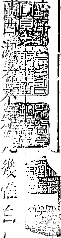



古今守西湖者不知凡几，惟白少傅、蘓端明最著。以故，人以颂守輙曰「白苏」。嗟乎！白苏岂易言哉！长公以戒禅师后身示现学士，而香山亦叅鸟窠有省，其先后守西湖，一切规为制度，悉自无畏光明光中流出。嗟乎！白苏岂易言哉！余东鄙人也，谬承两公之后，仰惟风义，雅不欲见笑于湖山，顾时异势殊，法微魔旺，每于簿书之暇兴情临眺，輙低回感叹两峰六桥如故也，而当年之盛不可复覩。因思鸟窠为钦师第一弟子，而长公推悟禅师为径山住持，至今尊为十方第一代，而又与宝月、澄慧诸名宿交最久，意者东南法席其在径山乎！顾径山旧无全志，以去省会稍远，而禅那幽杳之地鲜有过而问焉者。今年首夏，适餘杭博士宋君来谒，询以径山去餘杭几何，曰：「一由旬耳。」因命往搜故实，凡三阅月而稿呈。首列祖，次制敕，次序文，次塔铭，又次碑记、游记及名胜等若干则，凡为帙若干卷。予为披繁理绪，考证而诠次之，又一阅月始竟。自唐、宋，历元至我明，千餘年间祖庭之盛衰，名胜之隆替，与人物代兴，制作彪炳，称大备矣。



夫春桺秋波、兰桡锦障，西湖非不艳也，而巨人之迹既往，三生之魂不来，名山法脉几不复振。自云栖以一声佛号续佛慧命，而永明辨才诸风赖以不坠。兹志而成也，非敢谓于薄伽之旨有所倡导，庻几八十七祖一片绍法苦心犹可想见，方内外士凭而吊之，或者其有兴乎！虽然，予窃重有感焉。



西湖自长公以后，国朝正德间，杨公温甫始一濬之，已称极难。故当时谓：「湖有葑，苏去之；湖有梗，杨锄之。」盖锄更难于去也。及今而梗乃愈多，余则谓清之尤急于濬。夫清与锄之难易又何如哉？是纵不得覩天僖中放生之盛，或者万姓血脉不至壅阏，亦五百应真之所乐观也。余何敢自附于白苏？苐以两公所拂拭者，西湖之形胜；所扬扢者，径山之宗旨。余亦欲两存之，而径山则独完固。倘亦幽远者固示人以无争乎！夫𠊓湖之人厥有佛性，使两公而在，必已尽摄于无畏光明，而余犹日役役焉逐梗者而清濬之为事，则余其亦有魔之心也夫！



天启甲子秋九月，汶阳李烨然文若书于西湖之广生天







------



### 径山志序



径山旧龙宫也，自神龙施地与钦师，绝𩔗茶林，二龙为商那建刹，与龙柎率五伯龙众受具摩罗尊者，以故嗣法八十餘祖，炳燿海内，十方锱素仰之不啻如摩竭印度。余少好㳺，每过名山，吊古德应化之地，未尝不徘徊瞻仰。一行作吏，此事遂废。径山去西湖不几由旬而弗淂数。向五峰𠫵巾子一喝，正如曺子震所谓邑邑令人气尽。然犹幸陪鹤汀李公之后，於古杭境内山川，时时一纵吟眺，譬如𣪞浩登楼，庾公兴复不浅，致足多耳。公頋念径山震旦祖席志载缺然莫攷，抑亦守土之责，乃命禹航学博宋元实氏搜其故事，攷校而删定之。凡为志若干卷示余，朱受而读之，白椎也，𥪡拂也，掀床也，痛棒也，累朝之明信与当代之涣汗也。大藏之所以流通，宝所之所以化现，与诸大臣、长者之鸿萹丽藻昭汉而囬云也。挂瓢飞锡，名宿如云，㝎渊空而动雷震也；畸人不借，幽士孤笻，𠋣龙树而叩天宫也；墨汁生香，茟花说㳒，𠫵龙象而高法幢也；鸡灵而兎驯，杉𠫵天而竹蔽日也；五峰环峙，杰阁峥嵘，三千寒而㕠径杳也。



噫嘻！真大备矣！尝考径山自国一开山，子孙相继凢七代，而蘓长公草为十方住持，今六百餘年，而李公始一表章之，径山与公缘岂偶哉！有苏长公而十方始得与径山之席，有公而天下始尽知有径山之法雨。公於径山，其自国一而下，必个个明眼觑着。先后因缘，俱非偶也。昔李公度谓：「释迦生中国，设教如周孔，周孔生西方，设教如释迦。」夫何异同之有？慨今天下多事，邪术纷𧺫，白莲、无为几同波旬璎珞，然其弊搃由於正教之不眀。今此志标指正法，不啻揭日月於中天，令人出迷途而登觉路，不特名山信史已也。余与同官维立陈年兄不胜赞叹，谓従此已饱啜醍醐，不羡龙泉一勺矣，何必亲见竹箆乃觧背触哉！囙为之序。



天启甲子重阳日，新安徐文龙田仲父书於如水斋中







------



### 径山志序



夫朝市山林皆可学道，而古宿求道率依名山，何也？深岩茂林之间无人而有道，凡人载其尘心，以行乎山谷，则泠然如涤焉。及夫峰逥壑转，𦬆闲筞止，巍然而睹梵刹，肃然而瞻宝相，则又不觉胷中情缘脱落都尽，若惟此可永依者。至若名师大德夙有道塲，火尽灯传，法嗣绵邈。伫立凝望，虽杳不可接，而松声竹韵，鸟语泉鸣，皆恍然提唱之殶，令人与道相视莫逆。譬如师延之琴，得之濮水，固知桐沉丝绝之䖏，犹有不没其清音者。艺事法事，可以类求而得也。



径山自国一师以来，登祖籍者八十七人，可谓盛矣。桾松夹径，修篁绕麓，入其间者，杳然而深，左望云海，前眺都城，越山如黛，赤日如珪，既幽既邃，亦超亦旷，可谓山之能载道者矣。兹胡继法席於宗林，叩禅心于双径者，若是寥寥耶！夫事有久而无记，物有感而思兴。志者，所以记事而感物者也。扶筞担具走径山之道，宿诸师之院，能有所得乎？曷亦求诸记志之林，得其书而读之，庶有以窥五峰之灵，见八十七祖之心者耶！汶阳李文若先生以白苏之后身，作径山诸祖之护命，又得宋元实氏慧手辑志而删㝎之，其於山灵道心両俱无尽矣！



予媿俗质，幸陪清幕。志成，受而读之，翛翛然，泠泠然，不觉有如涤如脱焉，与诸祖相视莫𨒫，处力未逮而神先徃矣。夫亦安能於语言𫈉册之中，别其孰为朝市孰为山林，添求道者一障耶？虽然栁子有言：「吾病夫世之唯印组是务以相轧也，孰与夫不爱官，不争能，乐山水而嗜闲安者？」则夫是志也，宋元实经其始，而李先生成之，予序之，即世有栁子奚病哉？



杭李陈懋德题於西湖之思过斋



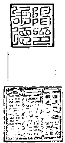



------



### 径山志序



四大部洲名山不可胜纪，而以佛祖著称者，惟是燕之清凉、蜀之峨嵋，吾浙之补陀、灵鹫、南屏，而双径略禹杭、临安，通东、西天目之径，是东南最胜道塲也。自唐国一师开山至月林镜师为八十七代，称天下径山与少林祖庭而二。诸山志余不尽见，所见《清凉》质而詄，《补陀》雅而博，《南屏》秀而丽，《灵鹫》近于俚矣！独径山向无旧志。万暦初年，有僧宗净者，刻《径山集》载诸祖事，十之二三仅存其名与示𡨜日月。诗文亦寥寥，戴令邑志更自简少。达观禅师昔谋刻大藏，易以书册，广为流通。澹居铠公承之，与吴本如诸公，恢复化城寺贮此刻板，事甫就而入灭，任此志者遂虗无人矣！



海虞宋元实氏以博雅名流，偶寄官禹杭，拥皋比与诸生谭道论文之暇，慨然是山佛法僧具备而独无志，为东南缺典。爰自大藏检阅诸祖之语录、行事，得十之六。自唐代宗、宋理宗，逮我高祖、成祖与神宗，诸制𠡠而一切废兴诸縁，与天下高衲道流鉅公名人序、纪、吟咏之章辑而为志，列为十有四目。帙成，出以属予序。余览之作而叹曰：「灿乎俻哉！井井乎有伦哉！是径山中兴之书也。」



夫惟人弘道，惟杰耀灵，故列祖首焉；不尊不信，域中惟王，故制𠡠重焉；唱縁阐法，文序乃宣，形委神传，铭塔斯勒，垂像教之范，厯𪨷壑之美，故碑记逰记次之；通玄𢍆泄，秘密畅性灵，故书启、偈咏、名什次之；蘧庐一宿，金汤四固，故流寓、外护次之；琳梵代搆，支流派演，故殿宇下院次之；或面壁而证智，或杖策以探奇，故静室名胜次之；以迹象眙神理于是乎纪古迹，以供养资无生于是乎纪寺产，十方𠫵同，万灵标异，故以纪事终焉。灿乎备哉！井井乎有伦哉！是径山中兴之书也。



余尝言：「王者握符御宇，抚有江山。不有国史，则何以纂图垂统，恢万世之业？士大夫于其后人，贻之以堂搆，启之以诗书。不有家乘，则何以振箕裘而昌门祚？」今天下佛子法嗣望此山者，将绍明祖席，奉扬宗风。不有梵志，则何以知法幢之所繇竖，法宝之所繇传？又非徒以林壑烟霞，导向平之屐履，快少文之卧逰已也。然则此山此志，彰法诏来，所与清凉、峨嵋𠫵峙法畍，而华藏宝函并揭日月者，元实之功焉可泯哉？如以山河为幻泡，列祖为影像，经典为糟粕，庋阁此志若灭若没，非古之神明，则今之狂惑者尔，吾亦恶乎𡚶序之！



天启甲子秋九月，武林黄汝亨𧩿并书



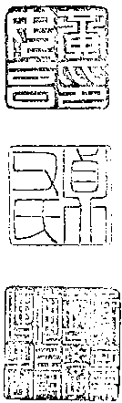



叅阅姓氏



李流芳，字长蘅，嘉定人。



王宇春，字季和，常熟人。



李縠，字孟芳，常熟人。



沈焕然，字无文，餘杭人。



闻启祥，字子将，钱唐人。



严调御，字印持，餘杭人。



王道焜，字昭平，钱唐人。



时载杲，字旭如，常熟人。



释广来，字无从，华亭人。



释超宗，字昙衍，江陵人。



姓氏终



凡例



凡志名山者，类先形胜，以泉石得名故。径山虽胜甲海内，实以祖席独著，故首志列祖。  

诸祖惟大慧杲禅师语录最多，卷帙浩繁，不能悉载。今考之年谱及《正法眼藏》，开示警切者，采录数则。若欲博览其全，则有专行语录在。  

万历初年，本山僧宗净重刻《径山集》，所载诸祖事实，十无二三。今考之《佛祖綂载》及《传灯录．禅宗正脉》、《五灯会元》、《高僧传》诸藏典，复益以松源所藏抄本。八十七祖，称大备焉。  

冯开之、陆五台诸先生与达观禅师创刻方册藏板，始于清凉，后移置寂照，再议置化城，则双径一区遂为震旦流通法宝要地，以故刻藏诸序文一一录载，以识诸名宿最上愿力，今已悉萃于此。  

近代名僧如憨山、无幻、湛然等，到山说法有上堂、小叅等语，俱不及载，以有别刻专行故。  

本山自唐、宋、元，历代钦赐庄田最多，今已悉归民间。特存其额，以俟有力者恢复云。  

本山下院，凡见《旧志》者，虽兴废不一，竝载入以便𥡴考。  

列祖而下即载　制𠡠及序记诸篇，以弘畅祖风、绘写名胜、山灵增重故。旧套、图画、形胜，悉裁革。  

名缁飞锡恒满山谷，无论异代，无从徵考，即近世亦莫由徧𥡴，祗据一二𦒿宿所知者，备载法侣，庻存高风于什一云。  

诗文多方采辑，收录不齐，总期于增重名山，故世代前后，爵里远近，悉不及序，览者谅之。  

凡志例载土产，此山惟松杉以庄严祖席，茶笋可供养僧众，别无他物可录，故不列。  

诸名公𢰅述序、䟽、诗、偈等，不及徧访，第据耳目经见者锓入，餘俟续载。  

诸祖语录悉出自大藏，各欵篇章悉回向祖庭，俱再四印证，方敢登板，俨然佛祖心印，逈异郡县志籍。信心君子幸无泛视，以滋罪过。  

刻板若干块，送入本山常住，附大藏流通，其刷印板头规例，俱照楞严寺定额，不得增减。



径山志总目



卷之一　列祖开山起至第七代　十方住持一代起至十四代



卷之二　列祖十五代起至四十代



卷之三　列祖四十一代起至八十代　列祖补遗　附法侣



卷之四　制敕　序文



卷之五　序文



卷之六　塔铭　塔铭补遗



卷之七　碑记　游记



卷之八　书启



卷之九　偈咏



卷之十　名什



卷十一　外护



卷十二　殿宇　静室



卷十三　名胜　下院



卷十四　古迹　寺产　纪事



总目终



卷之一目录



列祖



开山大觉国一贞元祖师



无上禅师



法济禅师



慧满扶禅师



法警庠禅师



修禅师



广灯湛禅师



十方住持



祖印悟禅师



净慧隣禅师



妙湛慧禅师



演教赏禅师



宝月方禅师



澄慧渊禅师



维琳无畏禅师



净慧仪禅师



觉润云禅师



玄应仁禅师



普明舜禅师



大悟裕禅师



佛日大慧禅师



妙空明禅师



卷之一目录终



径山志卷之一



汶上李烨然删定



海阳徐文龙、鹿城陈𢡟德订



虞山宋奎光辑



列祖



第一代　开山大觉国一贞元祖师



祖讳法钦，吴郡昆山人。姓朱氏，世服儒业。师初孕，母管氏梦莲生於户枢，折取一花系於一带，寤乃恶荤饵。既诞，形貌奇伟，神色莹彻，好以佛事为儿戏。及冠，身长七尺，体备诸相，立性温柔，雅好高尚，服勤经史，便从乡举。年二十二，州以克赋，道由丹徒，因遇寉林素禅师，见而异之，问曰：「子何之？」师曰：「将求仕於上京。」素曰：「虽有五等之爵，岂如三界之尊耶！」师曰：「可学乎？」素曰：「观子神观几於生知，若肯出家必悟如来知见。」师闻，悟识本心。素乃躬为剃发，谓门人法鉴曰：「此当大弘吾法，蔚为人师。」师日夜奋励，鍊行安禅。领径直之一言，越周旋之三学，廼请素示其法要，素曰：「无人得我法。」师曰：「以何传？」素曰：「我法实无可传者。」师顿释疑滞，久之辤素，请示所止。素曰：「乗流而行，遇径即止。」遂受具於餘杭龙泉寺法仑律师。后之临安，行次东北山之下，见樵者问曰：「此何山？」樵曰：「此天目山之径路，谓之径山，亦名径坞。」师忆素语，廼披榛而入，四顾非人居，适逢苫盖以覆𦊨罘，师就之宴坐。大雪经旬，绝食安禅。既霁，猎者见之，投诚归向，师诲使更业。猎者毁弓矢、罟网，以其地结庵，请就居之，日饷於师。他日，谓猎者曰：「吾将隐於此山。」猎者曰：「此山神异，中有龙居，师勿往。」师曰：「何患焉？汝宐导吾。」即自重冈之西，至危峰之北，有一石屏，师坐其下，凡数日，有白衣老人前而致拜，师曰：「汝何人也？」曰：「龙也。」师曰：「何为至此？」曰：「自师到此山，吾属五百皆不自安。师必久住，我将挈其属而归天目，愿舍所居为师卓锡之所。」引师南进登绝顶入五峰之间，中有大湫，指谓师曰：「吾家若去，此湫当涸矣。愿留一穴以通天目，我欲时至而衞师焉，慎勿湮之。」言讫乃隐。(今之龙井是也。)於是云雾晦㝠，风雨连霄诘旦，湫水尽涸，涨沙如平地。北峰之阳有庵，俨然新成，师知龙所创，遂居之。至今基陛，诸草不生。自是远近乡风，悉来给奉，四方禅纳景从，庵居满於岩谷。山左，前临海令吴贞舍别墅，以盖精舍。未逾数载，名震天下。马祖令人驰书，书中作一圆相。师开缄，於圆相中作一点，却封回。又令智藏来问：「十二时中何以为境？」师曰：「待汝回去时有信。」藏曰：「如今便回。」师曰：「传语：『却须问取曹溪。』」有僧问：「如何是道？」师曰：「山上有鲤鱼，井底有蓬尘。」又僧问：「如何是祖师西来意？」师曰：「汝问不当。」曰：「如何得当？」师曰：「待吾灭后即向汝说。」唐代宗永泰初，师一日坐于峰北石屏之下，见一白衣人称是天目巾子山人，致礼言曰：「彼山神告我，长安佛法有难，遣我护之，非僧相不足以增重法门，愿度我为沙弥。」师曰：「汝有何能？」曰：「能诵〈观音〉、〈俱胝〉等咒，功力无比。」师欲騐之，指坐后屏石，「汝能咒之令破否？」曰：「可。」遂叱之，石裂为三。(今喝石岩是也。)师异之，度为沙弥，与名曰「崇慧」。入京，寓止章敬寺。大历三年戊申，九月二十三日，太清宫道士史华奏，乞与释氏当代名流，角佛法道法胜负。于时代宗留神空门，道众愤疾，故有是请。於东明观架刀为梯，史华登蹑而上，如履磴道，缁侣相顾，无敢蹑者。崇慧闻之，谒开府鱼朝恩，朝恩为奏其事。异日，𠡠于章敬寺庭树间，梯架锋刃，铦白如霜，增东明观之梯百尺。观者如堵，崇慧跣足而登，至绝梯而止，忻然蹑而下，如行平地，以至蹈烈火，探沸油，餐铁叶为馎饦，嚼钉线为脆饴。史华与道众视之骇汗，掩袂而走。四众讃仰，声若雷霆。帝遣中贵巩廷玉，传宣慰劳，嘉叹至于再三。赐紫衣，授鸿胪卿，号曰「护国三藏」，𠡠安国寺居之。寻被召，𡭊问：「师承何人？」慧曰：「径山高道僧法钦，臣之师也。」慧辤，以未具戒不敢受紫衣之赐。帝特命开坛，方羯磨，慧隐身坛上，莫知所往。帝骇异，赐号「性空大师」。时疑观音应现，救护佛法，因慧之奏，以礼径山为师，师名益著。大历中，代宗遣内侍黄凤持诏，致师诣阙，其词曰：「朕闻江左有蕴道禅人，德性冰霜，净行林野。朕虚心瞻企，渴仰悬悬，有感必通，国亦大庆。愿和尚远降中天，尽朕皈向，不违愿力，应物现形。仍𠡠所经州县严肃馆饷。」(勒石现存。)既至阙庭，帝躬迎登殿，设座以咨法要，同弟子之礼。师一日在内庭，见帝起立，帝曰：「师何以起？」师曰：「檀越何得向四威仪中见贫道？」帝悦，谓忠国师曰：「欲赐钦师一名。」忠忻然奉诏，廼赐号「国一」焉。顷之辤归，帝曰：「此众生有当度者，彼众生岂有殊乎？」师曰：「实无有法以度众生。」居内仅一年，每赐缯彩，设御馔，皆抗而不受。唯布衣蔬食，噐用陶匏如平时。相国杨绾见而叹曰：「此实方外之高士也，难得而名焉。」崔赵公尝问弟子：「出得家否？」师曰：「出家是大丈夫事，岂将相之所能为？」赵叹赏其言，一时名公如李泌、徐浩、第五琦、陈少游等凡三十二人，皆称门人，问道以求决择。已而力辤，南还旧山，饯礼荣耀，𠡠本州於径山重建精舍，度僧七人，以奉巾瓶，命州长吏逐月躬至问候。德宗贞元五年，遣使赍玺书慰劳，并庆赐丰厚。久之，刺史请居州之龙兴寺，师亦暂往。越之连帅，悯其民新被宼，愿师往临以福芘之。师从其请，或半年或一年，如是者再复归龙兴与径山，不择所止。师将示灭于龙兴，先期三日，告众曰：「当葬吾于南庭𨻶地，勿封勿树，恐妨僧徒之菜地。」俗寿九十二，僧臈七十，实贞元八年十二月二十八日也。师悲愿弘深，见面闻名，如子得母。濳符密契者不知其数，目之为功德山。故东至海岱，西及陇蜀，南穷交广，北尽朔方，学者靡不慕义而来，志求咨决。至於天龙敬向，异类皈依，地产灵芝，空雨甘露，圣灯夜现，彩云朝晖，(寺之玉芝岩、含晖亭，因名于此。)猛兽栖其𠊓，众禽集其室，白鹇、乌鸦就掌而食。有二白兎，驯伏靴履之上，欲师足煖。有一鸡常随听法，不食生命，师之西也，长鸣三日而绝。有一麕，常依禅室，不他游，师之灭，亦三日而𣦸。贞元九年，德宗赐谥号曰「贞元大觉禅师」，塔曰「天中」。宪宗元和十年，赐丰碑，比部郎中崔元翰𢰅，左散骑常侍龟登书其碑在寺之西南隅。师得法于鹤林素，素嗣威，威嗣持，持嗣方，方嗣岩，岩嗣牛头融，融师四祖信大师。天复中，钱氏刻土，许思兵乱，发塔见二缸合藏肉身如生，发长覆面，士卒悚拜而去。吴越王厚礼，重葬于旧塔焉。



第二代　无上禅师



禅师名鉴宗，湖州长兴钱氏子也。祖徽，礼部侍郎。父晟，晦德不仕。师少而颕异，风骨不凡，挺然有抜俗志，依本州开元寺大德高闲出家。年二十七受具戒，闲使习经业，通《净名》、《思益》二经。弃之游方，谒盐官悟空禅师，尽得其要领。悟空赏识，以为堪任大法。咸通三年，至天目东登径山，见旧寺自国一去后，僧徒分散殆尽，荒凉如传舍，师意欲追还旧观，遂驻锡焉。未几，百废具举，道望日远，学者相寻而至，翕然成大法席，冠於江淛。门弟子杰出者，洪察、洪𬤇、洪谐、洪寂。知名咸启行谦、行满、行真，皆从上宗门爪牙。先是，𬤇以经论自负，师告之曰：「佛祖正法，直截亾诠，汝筭海沙，於理何益？但能莫存知见，泯绝外缘，离一切心，即汝真性。」𬤇闻而适悦，即呈偈云：



这个非他物　元来不昧机  

达而全体现　应处不思议



师曰：「汝问取察师兄。」察曰：「师弟高见，非吾境界。」𬤇即辤，徧往诸方。至大沩，方悟玄旨。师平时指徒，语言切直，类皆如此。咸通七年丙戌闰三月五日，集众说法，端坐而化。阅世七十有四，坐四十八夏，门人奉全身葬于寺之西大寂岩。五代梁太祖乾化五年，吴越武肃王请于朝，赐谥「无上禅师」。唐之名士云牙先生沈敬修𢰅〈灵龛铭并序〉，又为之赞曰：



睂目清开　风神秀发  

图入丹青　不差毫发  

潭底无波　天心印月  

是兮非兮　师宁有说



第三代　法济禅师



禅师讳洪𬤇，其先吴兴乌程人也，姓吴氏。生而神异，长而聪颕，十九依无上禅师削发，二十二往嵩岳受具。初习律乗，未十日而诵毕，弃之。游心经论，机辩风生，𦒿宿下之，归觐无上。无上问曰：「汝於时中，将何以报答四恩？」师𦬆然莫知所𡭊，废食三日，无上方便慰安之。师於言下有省，述偈以进无上，颔之。(具无上章。)未几乃辤。行脚始谒云岩，不契。遂造大沩，顿释蒙滞。再走石霜，得末后句。寻遇唐会昌沙汰，众皆悲惋。师曰：「大丈夫鍾此厄会，岂非命耶！何乃效儿女子态乎？」大众初复沙门相，师还故里西峰院。咸通七年上径山，无上委以住持事，师辤甚力。无上曰：「吴中佛法，藉於子耳！何辤之有？」开法之初，众不满百，未终岁间，堂餘万指。僧问：「掩息如灰时如何？」师曰：「犹是时人工干。」僧曰：「干后如何？」师曰：「耕人田不种。」僧曰：「毕竟如何？」师曰：「禾熟不临塲。」僧问：「龙门不假风雷势，便透者如何？」师曰：「犹是一品、二品。」僧曰：「此既是阶级，向上事如何？」师曰：「吾不知有汝龙门。」僧问：「如霜如雪时如何？」师曰：「犹是汚𣑱。」曰：「不汚𣑱时如何？」师曰：「不同色。」僧问：「如何是长？」师曰：「千圣不能量。」曰：「如何是短？」师曰：「蟭螟眼里着不满。」其僧不肯，便去举似石霜。石霜云：「只为太近实头。」僧问：「如何是长？」石霜云：「不屈曲。」曰：「如何是短？」石霜云：「双陆盘中不喝采。」佛日长老访师，师问：「承闻长老独化一方，何以荐游峰顶？」佛日曰：「朗月当空挂，冰霜不自寒。」师曰：「莫便是长老家风？」佛日答曰：「峭峙万重阙，於中含宝月。」师曰：「此犹是文言，作麼生是长老家风？」佛日曰：「今日赖遇佛日。」佛日却问云：「隐密至真，时人知有道不得；太省无辜，时人知有道得。于此二途，犹是时人升降处，未审长老亲道自道如何道？」师曰：「我家道处无可道。」佛日曰：「如来路上无私曲，便请玄音和一塲。」师曰：「任汝二轮更互照，碧潭云外不相关。」佛日曰：「为报白头无限众，此回年少莫归乡。」师曰：「老少同轮无向背，我家去路勿参差。」佛日曰：「一言定天下，四句为谁留？」师曰：「汝言有三四，我道其中一也无。」师因有偈曰：



东西不相顾　南北为谁留  

汝言有三四　我即一也无



许州金明上座闻师说法，颇契石霜，乃曰：「径山老子，何敢说石霜禅！我往问之，彼若果合，我则为渠作园头；如其不然，我则掀倒禅床。」先问石霜：「一毫穿众穴时如何？」石霜云：「直须万年后。」云：「万年后如何？」石霜云：「登科任汝登科，拔萃任汝拔萃。」后问师云：「一毫穿众穴时如何？」师云：「直须老去。」云：「老去后如何？」师云：「光靴任汝光靴，结裹任汝结裹。」明乃作礼，为之治圃三年。师始至是山，适遭黄巢之乱，巢之偏帅，领卒千餘人见师，师宴坐不起，帅以劒挥禅床者再，师神色不动，帅异之，献宝再拜而去。(今禅床二劒迹犹存。)吴越武肃王微时，师一日谓其徒曰：「翌日有异人至，当厚礼以待之。」诘朝王至，师乃门迎，延于丈室，特异於他堂，众皆讶之。乃密谓武肃曰：「他日独霸吴越，当须护持佛法，无忘此言。」武肃恭谢而去，及立军功收杭州，执弟子礼以事於师，待遇勤厚莫可为比。(僖宗)中和二年，表乞赐师紫衣、方袍。(昭宗)景福二年，武肃封吴越王，复表乞赐号「法济大师」，皆制可。乾宁二年乙卯，九月二十九日，院前柽树忽萎，㕑内饭如金色，知事白师，师令鸣鍾，大众云集，乃升座示众曰：「牟尼掩足，迦叶藏峰。彼彼不落见闻，一句莫教人说。汝须急切，各自知时。法界虽长，人世景促；佛法非远，大道不迷。孝顺住持，如吾在日。久立珍重！」乃修书遗武肃王。复命门人冲羽、久住、智全等遗戒曰：「自吾去后，汝等传噐住持，凡度徒弟，皆礼吾真为师。兄弟相摄，无忘此语。」三十日寅时入灭，俗寿八十三，僧腊六十一。以元和八年癸巳岁生，大和五年辛亥岁出家，年一十九。大和九年乙卯岁受具戒，年二十三。咸通八年丁亥岁住持当山，至乾宁二年乙卯岁，凡二十九年。武肃王自为述赞四十句，又谥师为「建初兴国大师」，及亲号塔曰「广济之塔」。开平五年辛未岁，僧师烈制碑文。贞明二年丙子岁立石。武肃王将薨，谓文穆王曰：「吾昔自径山法济示吾霸业，自此发迹，建国立功，故吾尝厚顾此山焉。他日汝等，无废吾志。」其后文穆、忠献、忠懿王皆不忘武肃之遗旨，恩顾山门非他可竝焉。



第四代　慧满扶禅师



秀州人，四月初七日示寂。



第五代　法警庠禅师



杭州人，九月三十日示寂。



第六代　修禅师



杭州人，九月十八日示寂。



第七代　广灯湛禅师



秀州人，四月二十一日示寂。



十方住持



第一代　祖印悟禅师



杭州人。元祐五年，内翰蘓公知杭州，革为十方，命师为一代住持，三月十日示寂。



第二代　净慧隣禅师



杭州人，正月念五日示寂。



第三代　妙湛慧禅师



杭州人，二月三十日示寂。



第四代　演教赏禅师



杭州人，七月初五日示寂。



第五代　宝月方禅师



杭州人，五月十六日示寂。



第六代　澄慧渊禅师



杭州人，东坡尝寄以诗，有「师住此山三十年，妙语应须得山骨」之句，十二月十六示寂。



第七代　维琳无畏禅师



俗姓沈，武康人，约之后也。好学能诗，熈宁五年，蘓轼通判杭州，招住径山。大明僧问：「师唱谁家曲，宗风嗣阿谁？」师曰：「不在然灯前，亦非释迦后。」云：「莫便是育王儿孙也无？」师曰：「神岳峰高，尾闾水急。」问：「如何是大明家风？」师曰：「神莺顶上轩睂坐，黄鹄岫中昻首行。」云：「未审意旨如何？」师曰：「会即便会，觅甚麼意旨！」僧珍重便去。师曰：「听取一偈：



榾㭾火残飞白灰　老僧身上白如雪  

地炉宴坐人不知　苍狖山西呌明月



久立珍重，后居邑之铜山，作庵名『无畏』」。建中靖国初，轼自儋耳，还至昆陵，以疾告老。琳往问疾，有诗赠答。始琳之在铜山也，院有松合抱，郡将治屋索材，将往伐之。琳知之，预命削皮题诗，其二云：



大夫去作栋梁材　无复清隂护绿苔  

只恐夜深明月下　悮他千里鹤飞来



县尉至，读其诗乃止。政和七年，琳老，朝廷崇右道教，诏「凡僧尼皆顶冠」，琳独不受命，县遣尉谕之。四月初三日，师即集其徒，趺坐而逝。遗言以二缶覆其躯，瘗山后。



第八代　净慧仪禅师



秀州人，二月初五日示寂。



第九代　觉润云禅师



信州人，十一月三日示寂。



第十代　玄应仁禅师



台州人，九月初十日示寂。



第十一代　普明舜禅师



建宁人，八月初三日示寂。



第十二代　大悟裕禅师



台州人，正月初一日示寂。



第十三代　佛日大慧禅师



宣州城奚氏子，讳宗杲，字昙晦。夙有英气，年十二，入乡校。一日，因与同窗戏，以砚投之，悮中先生帽，偿金而归，曰：「大丈夫读世间书，曷若究出世法师！」即诣东山慧云院，事慧齐。年十七，薙发具毘尼，偶阅古《云门录》，恍若旧习，往依广教珵禅师。弃游四方，从曹洞诸老宿。既得其说，去登宝峰谒湛堂凖禅师，一见异之，俾侍巾裓，指以入道㨗径。师横机无所让，堂诃曰：「汝曾未悟，病在意识领解，则为所知障。」堂疾革，嘱师曰：「吾去后，当见川勤，必能尽子机用。」(勤，即圆悟。)堂卒，师为堂求塔铭于无尽居士。无尽门庭高，少许可，与师一言相契，下榻延之，名师庵曰「妙喜」。洎后再谒，且嘱令见圆悟师。至天宁，一日闻悟升堂，举僧问云门：「如何是诸佛出身处？」门曰：「东山水上行。」「若是天宁即不然。」忽有人问：「如何是诸佛出身处？」「只向他道，熏风自南来，殿阁生微凉。」师於言下忽然前后际断。悟曰：「也不易你得到这田地。可惜𣦸了不能得活，不疑言句是为大病。不见道，悬崖撒手，自肯承当，绝后再蘓，欺君不得，须信有这个道理。」遂令居择木堂，为不𨤲务侍者，日同士大夫入室。(择木，乃朝士止息处。)悟每举「有句无句，如藤倚树。」问之，师才开口，悟便曰：「不是，不是。」经半载，遂问悟曰：「闻和尚当时在五祖，曾问这话。不知五祖道甚麼？」悟笑而不答，师曰：「和尚当时须𡭊众问，如今说亦何妨？」悟不得已，谓曰：「我问：『有句无句，如藤倚树，意旨如何？』祖曰：『描也描不成，畫也畫不就。』又问：『树倒藤枯？』祖曰：『相随来也。』」师当下释然，曰：「我会也。」悟遂举数因缘诘之，师酬𡭊无滞。悟曰：「始知吾不汝欺。」遂著《临济正宗》付之，令分座室中，握竹箆以騐学者，丛林浩然归重，名振京师。右丞相吕公舜徒，奏赐紫衣、「佛日」之号。趋吴，度夏虎丘，阅《华严》至「菩萨登第七地，证无生法忍」，洞晓问湛堂殃崛摩罗持钵产妇家因缘。时圆悟诏住云居，师往省，命师居第一座。冬至秉拂，昭觉禅师出众问曰：「睂间挂劒时如何？」师曰：「血溅梵天。」圆悟于座下，以手约云：「住！住！问得极好，答得更奇。」元乃归众，丛林由是改观。悟归蜀，师于云居山后古云门旧址，创庵以居，学者云集。久之，入闽，结茅于长乐洋屿，从之得法者十三人。又徙小溪云门庵。绍兴丁巳，应张丞相魏公浚命主径山。开堂僧问：「人天普集，𨕖佛塲开，祖令当行，如何举唱？」师曰：「钝鸟逆风飞。」曰：「徧界且无寻觅处，分明一点座中圆。」师曰：「人间无水不朝东。」复有僧竞出，师约住云：「假使大地尽末为尘，一一尘有一口，一一口具无碍广长舌相，一一舌相出无量差别音声，一一音声发无量差别言词，一一言词有无量差别妙义。如上尘数纳僧，各各具如是口，如是舌，如是音声，如是言词，如是妙义，同时致百千问难，问问各别，不消长老咳嗽一声，一时答了。乗时於其中间，作无量无边广大佛事，一一佛事周徧法界。所谓『一毛现神变，一切佛同说，经於无量劫，不得其边际』，便恁麼去，闹𤍠门庭即得。正眼观来，正是『业识𣴭𣴭，无本可据。』祖师门下，一点也用不著，况复勾章棘句，展弄词锋，非唯埋没从上宗乗，亦乃笑破衲僧鼻孔。所以道『毫𨤲系念，三涂业因；瞥尔生情，万劫覊鎻。圣名凡号，尽是虚声；殊相劣形，皆为幻色。汝欲求之，得无累乎？及其厌之，又成大患。』看他先圣恁麽告报，如国家兵噐，岂得已而用之？本分事上亦无这个消息，山僧今日如斯举唱，大似无梦说梦，好肉剜疮，检点将来，合吃拄杖，只今莫有下得毒手者麽？若有，堪报不报之恩，共助无为之化。如无，倒行此令去也。」蓦拈拄杖云：「横按镆鎁全正令，太平寰宇斩痴顽。」卓拄杖，喝一喝，便下座。少卿冯公檝问曰：「和尚常言不作这虫豸，为甚麽今日败阙？」师曰：「尽大地是个杲上座，你作麽生见？」冯公拟议，师便掌，时群寮失色。冯大笑曰：「长老与檝佛法相见。」曩时师与同叅超然居士赵表之，每以不宦游出世为戒。时表之辟宗正，师赴径山，适晤官驿，师述偈见意云：



超然妙喜两同叅　蓦地相逢各负惭  

我去住山君跃马　前三三与后三三



明年众将一千，皆诸方角立之士。师行首山令，起临济宗，憧憧往来，其门如市，学徒咨扣，日入玄奥，规䋲不立，而法社肃如也。给事冯公坐夏山中，馆不动轩，日只一食，长坐不卧，遣道谦往零陵问讯紫岩居士。谦中途打发大事，及归，师于半山亭，望见便云：「这汉和骨都换了也。」谦闻，大惊云：「这些验人处，设使释迦、达摩亦不让。」次年，坐夏者一千七百有奇，自真赞云：「一千七百痴衲子，围绕这个无明叟。」以神龙未有封号，敷奏于朝，蒙赐侯曰「广润」，庙曰「灵泽」。庚申，剏建千僧阁，参政李邴汉老作记。(别录)是年，侍郎张公九成、状元汪公应辰，登山问道，谈格物之旨。又问临济因缘，得大自在，尝曰：「九成每闻径山老人所举因缘，豁然四达，如千门万户，不消一踏而开，非出常情，莫知我二人落处。然九成了末后大事，实在径山，此瓣香不敢孤负他也。」明年，张公以父卒，登山修崇，请师升座，因说圆悟谓张昭远铁刬禅，山僧以无垢禅如神臂弓，乃偈曰：



神臂弓一发　透过千重甲  

子细拈来看　当甚臭皮袜



未几，遭论列，以张坐议朝廷，除三大帅事，因及径山主僧应而和之，追牒责衡州。先是元丰戊午，师始出家慧云院，塑释迦像。有异人丁生，语寺僧曰：「若像之毁，是人婴祸。」于时，慧云后昆忘丁生之谶，毁像新之，正此日七月。至贬所时，昭远知临川，师以偈戏之曰：



小郡知州说大禅　因官置到气冲天  

常携刬子勘禅客　谁知不直半文钱



昭远戏酬偈曰：



小庵庵主放憨痴　爱向人前说是非  

只因一句臭皮韈　几乎断送老头皮



师初到衡阳诸处，道友送钱米，遣两侍者往岳山、沩山散处斋僧，衡人初不知是说，因普说。方与言：「宣律师问韦䭾天神：『世间功德何者最大？』曰：『斋僧功德最大。』」人即听信，稍知归向焉。师居廖季绎通直之西园，四方衲子云委川会，攍粮景从，庵无以容。十七年，侍者冲密、慧然，录师与衲子问答语，请名师目之曰《正法眼藏》。示众云：「古人道：『大智无分别，大用无理事，如月印千江，似波随众水。』且那个是无分别底大智？那个是无理事底大用？莫是问一答十，辩㵼悬河，是大智麽？莫是麤言及细语，皆归第一义，掀倒䋲床，喝散大众，栏腮赠掌，拂袖便行，拟议思量，劈口便𡎺之类是大用麽？若作遮般见解，莫道我是衲僧，便做他衲僧门下，提破草鞋，挈骨董袋底奴子，也未得在。善知识实悟实证，而大法不明。为人时，未免以自悟自证处指似人，瞎却人眼。况无悟证学语之流，瞎人眼不在言也。此事大难，没量大人到这里无插足处，你小根无知魔子辈，如何敢造次开大口？你试静处坐地，微细揣摩你方寸里，还实到不疑之地也未？若实未到，我却赏你放得过把得定，不受人走作。遮般的，唤作地狱滓。十方施主一粒米、一茎菜，将来供给你，只要你道业成就，同趣佛乗，求异世他生福报。道业不明，如何消得？你诸人决欲绍继此个门风，直须心境一如，方有少分相应。你莫见我说恁麽事，便闭目藏睛，做𣦸模样，硬差排心与境一如，遮个尽你伎俩，如何差排？你要得真个心境一如麽？直须啐地折、嚗地断，拈却髑髅里作𡚶想底，将第八识断一刀，自然不着差排。你不见岩头和尚有言：『才有所重，便成窠臼。』你诸人一生在丛林，参寻此事，无所得者，不在言也。其间多有头白齿黄，坐在窠臼里，一生出头不得，都不知非。向古人言句上得些滋味者，以奇言妙句为窠臼；于经教中声名句义上得滋味者，以经教为窠臼；於古人公案上得滋味者，以古人问答、代语、别语、抑扬语、褒贬语为窠臼；于心性上得滋味者，以三界唯心万法唯识为窠臼；于寂然无言无说处得滋味者，以闭目藏睛、威音那畔，坐在黑山下、鬼窟里，不动为窠臼；于目用动转施为处得滋味者，以扬睂瞬目、举觉提撕为窠臼；谓法不在言语上、不在情识上、不在举动施为处，错认业识为佛性，於此得滋味者，以击石火闪电光为窠臼。如上所说，皆于得滋味处有所重，若无大丈夫气槩，退步知非，即以所重处，便作奇特想、玄妙想、安稳想、究竟想、解脱想。作如是等想者，佛出世亦不奈何，教中谓之痴暗惑。何以故？为你痴，故执邪为正；为你暗，故堕在所重处，不能动转。若于心无所起、于法无所著，则无所重。无所重，则自然赤骨力地，无欲无依，於法自在。你即今便要恁麽相应亦不难，但於心平等无所𣑱著。如何是𣑱著？作众生想、佛想、世间想、出世间想、求出离想、求佛智想，皆名𣑱著。你但向欲起未起时，猛著精彩一跃跳出来，此心朗然独脱，才觉恁麽，便转向上面去，自然头头上明，物物上显。得到恁麽田地，亦不得采顾著。若采顾著，则有所重，才有所重，此心即渗漏矣。只名渗漏心，不名平等心。谓平等者，善与恶等，背与向等，理与事等，凡与圣等，量与无量等，体与用等，遮个道理，唯证者方知。诸人若未证，直须证取，证得了，方得名为真出家儿。若心不正，向心外取证，此名出家外道，不堪为种草。此心广大，无分剂，无边表，尘沙诸佛成等正觉，山河大地万象森罗皆不出此心，此心能与一切安名立字。一切与伊安名立字不得，故诸佛诸祖，不得已随你颠倒，著个名字，唤作『真如佛性』、『菩提涅槃』。强立种种差别异号，为你众生界中，见解偏枯。有种种差别，故立此差别名号，令汝于差别处，识取此无差别底心，非是此心有差别也。所以僧问马祖：『如何是佛祖？』曰：『即心是佛。』你若实证实悟，不信此心决定是佛，只此即心是佛，便是差别因缘。佛言，欲以譬喻而显示，终无有喻能喻此。说个广大，已是限量他了也。况以限量心，欲入此广大境界，纵然入得，如持蠡酌海，一蠡纵满，能得几何？然只遮蠡中之水，未入蠡时，即是无限量底水，为你境界，只如此大，生满足想，故此无限量境界，亦随你噐量满足，非是大海水只有许多。故佛有言，譬如大海不让小流，乃至蚊䖟及阿修罗饮其水者，皆得充满。此水喻心，蚊䖟、阿修罗喻大小差别，此心体上，本无若干差别，汝但不起诸见，识取此心，种种差别，亦自识得矣。先圣尚不许执此心为实，心外更有什麽实底物，为你作障难？我今拖泥带水，亦是不得已，为提奖娇儿，抚怜爱子，老婆心切，故牵枝引蔓，你莫记我说底便以为是。今日恁麽说，明日又却不恁麽说。你才恁麽，我却不恁麽。你不恁麽时，我却恁麽。你向那头寻我住处，只我亦自不知住处，他人又如何寻得？遮个是活底门户，𣦸却见行，方可入作。而今学人，将少分精进礼佛、持诵、戒身口意以为资粮，希求证取，有什麽交涉？大似痴人埋头向西走，欲取东边物，转走转背、转急转迟。此是无为、无漏、无功用大法门，若起纤毫取证心，则背驰矣。如何欲凭些小有为功行，便拟希求？所以古人见得太近，故云『我坐地看你究取』，又云『我立地看你究取』，即不曾教你起模畫样，积功累德，希望成道。纵你希望得成，随成即坏，徒自疲劳。你莫见恁麽道了，便拨无因果作地狱业，以平常无事，唤作无佛法知见。饥来吃饭，困来即眠，以此为无修证，以此为无功用。且莫错会好，荷担此事，也须是个浑刚打就、生铁成底汉始得，岂容你小根小噐造次承当。不见临济三问黄檗佛法的大意，三度被打，后得大愚点破，遂忽然大悟，不觉失声云：『恶！元来黄檗佛法无多子。』愚云：『你适来觅有过无过，而今却言黄檗佛法无多子，你见个甚麽，便恁麽道。』临济于大愚脇下𡎺两𡎺，愚遂托开，云：『汝师黄檗，非干吾事，你诸人参禅，还得恁麽也未？』云庵和尚颂云：



资粮更不著些些　岐路年深恐转賖  

直下痛施三顿棒　夜来依旧宿芦花



又颂临济悟旨云：



便言黄蘗无多法　大丈夫儿岂自垂  

脇下两拳明有信　不从黄蘗付将来



又端和尚颂云：



一拳拳倒黄寉楼　一踢踢翻鹦鹉洲  

有意气时添意气　不风流处也风流



据遮两个老汉颂，便可承嗣临济，作他儿孙，真不忝窃。古来幸有恁麽体格，如何略不着些眼脑，看是个甚麽道理？此事如青天白日，有甚麽遮障？诸方有奇特差别海蠡儿禅，曲曲折折。此语又是讨他，那语又是识破，遮语又是不上他钩线，不入他圈䙌。遮语又是偏正回互，遮语又是尊堂有讳，不敢当头。又有一种以《楞严》、《宗镜》，临济偈语所说，眼见耳闻无非是心，更非别法。引：



通玄峰顶　不是人间  

心外无法　满目青山



之类为证，谓之根脚下事，谓之基趾，谓之绵密地。你不妨会得好，若恁麽会，岂不是认物为心？既是你心，又要认他作麽？又有一种，将临济三玄、云门三句，逐句解说，以《传灯》、《广灯》祖师言句，各分门类。以「一尘才起，大地全收」、「一毛头师子，百亿毛头师子现」、「尽大地是个解脱门，尽大地是沙门一只眼」、「若人识得心，大地无寸土」、「山河大地，明暗色空」、「咸是妙明真心中」之类，配为体中玄，函盖乾坤句。以「三脚驴子弄蹄行」、「锯解秤椎」、「火里蝍蟟吞大虫」、「文殊起佛见法见，贬向二铁围山」、「东山水上行」、「北斗里藏身」，凡语言注解不得处，便道「蚊子上铁牛，无你下嘴处」，如此之类，谓之句中玄，截断众流句。如「蹋着秤椎硬似铁」、「蹋破草鞋赤脚走」、「饥来吃饭困来打眠」、「山是山水是水」、「行但行坐但坐」、「大尽三十日，小尽二十九」，将如此之类，谓之玄中玄，随波逐浪句。岂不见汾阳和尚颂云：



三玄三要事难分　得意忘言道易亲  

一句明明该万象　重阳九日菊花新



此老子，明明为你指出临济骨髓，却来逐句下解注。谓「三玄三要事难分」是总颂，「得意忘言道易亲」是体中玄，「一句明明该万象」是句中玄，「重阳九日菊花新」是玄中玄。此是前辈中，负大名望，有真实悟处。而大法不明，无师承，杜𢰅如此瞎众生眼。其餘禆贩之流，不在言也。想汾阳老人，未肻点头在，分明向你道：『三玄三要事难分，得意忘言道易亲。一句明明该万象，重阳九日菊花新。』恁麽道了，更将钵盂安柄。莫道你负大名，具大辩才，有大智慧，便是达磨大师出来，作遮般去就，政好捉来活埋，免致教坏人家男女。一盲引众盲，问着三要，却注解不得。便将同德山托钵、岩头末二句、南泉斩猫猊、百丈野狐、归宗斩蛇、大隋烧畬、赵州勘婆子勘庵主、睦州担板、陈撡尚书勘僧、玄沙敢保老兄未彻在、洞山道即太煞只道得八成、达磨只履西归，如此之类，皆谓之末后句。便引洛浦云：『末后一句，始到牢关，把断要津，不通凡圣。』



任从天下乐欣欣，我独不肻，谓之『我为法王，于法自在。』任你学者逞尽神通，逞尽伎俩，我只一向把住不许。你谓之牢关，直待举立僧住院，密室口耳传授。如斯之类，自毁正因，返行魔说。又有一种道，南泉斩猫儿、百丈野狐、归宗斩蛇、大隋烧畬、赵州勘婆子勘庵主之类，谓之建立门庭。本无恁麽事，贵要罗笼学者。又有一种，以偏正回互为宗旨，如洞山与云居过水次，洞山问：『水深多少？』云：『不湿。』山云：『麤人。』云居却问：『水深多少？』云：『不乾。』谓水讳湿，而当头道湿，不能回互，谓之麤人。云居却云不湿，是触讳而不能回互。洞山道不乾，乃有语中无语。何谓有语？不乾是。何谓无语？不乾是。不乾乃是湿，是活语，能回互不触讳故也。又以黑白圈儿，作五位形相，以全黑圈儿，为威音那畔。父母未生，空劫以前，混沌未分事，谓之正位。以二分黑一分白圈儿，为正中偏。却来白处说黑底，又不得犯着黑字，犯着黑字，即触讳矣。更引洞山颂云：『正中偏，三更初夜月明前。』谓能回互。只言三更，三更是黑，初夜是黑。月明前是黑，不言黑，而言『三更初夜月明前』，是能回互，不触讳。以两分白一分黑圈儿，为偏中正。却来黑处说白底，而不得犯白底消息。云：『偏中正，失晓老婆逢古镜。』不言明与白，而言失晓与古镜，是能回互。明与白字而不触讳，葢失晓是暗中之明，古镜亦是暗中之明。老婆头白，不说白而言老婆，白在其中矣，能回互白字故也。又说正中来颂云：『正中来，无中有路隔尘埃。』或云出尘埃。谓凡有言句，皆无中唱出。便自挟妙了也，无不从正位中来。或明或暗，或至或到，皆妙挟通宗。凡一位皆具此五事，如掌之五指，无少无剩。兼中至，谓兼黑兼白，兼偏兼正而至。何谓至？如人归家未到，而至别业，乃在途为人边事，亦能回互，妙在体前。兼中到，谓兼前四位，皆挟妙而归正位，谓之『折合归来炭里坐』，亦是说黑处，而回互黑字，不道黑而言炭。或者又谓，曹山有言：『正位者即空界也，一向无物；偏位者即色界也，内有种种诸杂万象。』兼中至者，舍事入理。正中来者，背理就事。兼带者，即㝠应众缘，不随诸有，非𣑱非净，无正无偏。故云：『虚玄要道，无著真宗。』从上先德，推此一位最妙最玄，须是审详辩明当体。又说，五位皆三字成句，偏正上下回互，而不犯中。中即正位也，说理说事。教有明文，教外单传直指之道。果如是否？若果如是，讨甚好曹山邪！又引浮山作大阳真讃曰：『黑狗烂银蹄。』自注云：『此语正位中有偏位。黑狗是正位，烂银蹄是偏位。』『白象昆仑骑。』自注云：『此语偏位中有正位。』『于斯二无碍。』自注云：『此语不堕有无二边。』所以洞山云：『不落有无谁敢和？』『木马火中嘶。』自注云：『妙挟。』然虽妙挟，而虚玄唱道者也。似遮般说话，须教你烧顶炼臂，发誓愿不得𡚶传。然后分付，亦谓之末后句。」师举了遂弹指云：「好掩彩底禅！若是皮下有点血底，还肯吃遮茶饭麽？我且问你，腊月三十日，四大相将解散，平昔记持学得底，还回互得麽？回互时还着意也无？当恁麽时，心识已昏，如何回互？既回互不得，定撞入驴胎马腹中，随业受报。当此之时，欲触讳作麤人，亦不可得。况能敌他生𣦸耶！」又有商量洞山示众云：「向时作麽生？奉时作麽生？功时作麽生？共功时作麽生？功功时作麽生？」时有僧问：「如何是向？」山云：「吃饭时作麽生？」「如何是奉？」云：「背时作麽生？」「如何是功？」云：「放下鉏头时作麽生？」「如何是共功？」云：「不得色。」「如何是功功？」云：「不共向时作麽生？」谓「趣向此事。」答曰：「吃饭时作麽生？」谓：「此事不可吃饭时，无功勋而有间断也。」「奉时作麽生？」奉乃承奉也。如人奉尊长，先致敬而后承奉。向乃功勋之所立，才向即有承奉之义。答曰：「背时作麽生？」谓：「此事无间断。」奉时既尔，而背时亦然。言背即奉之义，盖奉背皆功勋也。「功时作麽生？」功即用也。答曰：「放下鉏头时作麽生？」把鉏头是用，放下鉏头是无用。洞山之意谓，用与无用皆功勋也，亦是无间断之义。「共功时作麽生？」谓：「法与境敌。」答曰：「不得色。」乃法与境，不得成一色。正用时是显个无用底，无用即用也。若作一色，即是十成死语。洞山宗旨，语忌十成。故曰不得色，乃活语也。「功功时作麽生？」谓法与境皆空，谓之无功用大解脱。故曰不共，乃无法可共。不共之义，全归功勋边。如法界事事无碍是也。你靣前无我，我面前无你。所以夹山道：「此间无老僧，目前无阇𥠖。」是也。如此之说，皆趣向承奉，于日用四威仪内，成就世间出世间，无不周旋。谓之功勋五位。你道他古人意果如是乎？若只如此，有甚奇特，只是口传心授底葛藤，既不如是，且古人意毕竟作麽生？妙喜为你下个注脚，也要诸方检点。不见汾阳道：「面目见在，一任拣取。」故净名云：「但除其病，而不除法。」又《首楞严》云：「汝以缘心听法，此法亦缘。」古人一言半句，虽是垂慈，皆在未屙已前著到，如三玄三要、四种料拣、十智同真，亦是遮个道理。妙喜恁麽说，不是贬剥诸方，且要个中人辨明缁素而已。又有一种，也不在言语上，也不在古人公案上，也不在心性上，也不在玄妙上，也不在有无得失边，如火相似，触着便烧，非离真而立处，立处即真。信手拈来，超今越古，一句来一句去，末后多一句，便是得便宐。似遮般底，只是弄个业识痴团，便谓无因果无报应，亦无人亦无佛，饮酒食肉不碍菩提，行盗行[婬-壬+(工/山)]无妨般若。如此之流，正是师子身中虫，自食师子身中肉。永嘉所谓「豁达空，拨因果，莽莽荡荡招殃祸」是也。有一种商量古人公案，谓之针线工夫，又谓之郎君子弟禅。如商量女子出定语云：「文殊是七佛之师，为甚麽出女子定不得？」云：「文殊与女子无缘。」「罔明是初地菩萨，为甚麽出得女子定？」云：「与女子有缘。」下语云：「𡨚有头，债有主。」又有商量道：「文殊不合有心，所以出不得；罔明无意，所以出得。」下语云：「有心用处还应错，无意求时却宛然。」又有商量道：「文殊为甚麽出女子定不得？」「杓柄在女子手里。」「罔明为甚麽出得？」「如虫御木。」又云：「因风吹火。」又云：「争奈女子何？」邪解甚者，至于作入定势，又作出定势。推一推，弹指一下，哭苍天数声，伏惟尚飨，拂袖之类。冷地看来，慙惶杀人。又芭蕉云：「你有拄杖子，我与你拄杖子；你无拄杖子，我夺却你拄杖子。」商量云：「你若是遮般人，我与你说这般话，谓之与你拄杖子。你不是遮般人，我当面换却你眼睛，谓之夺却你拄杖子。」下语云：「量才补职。」又云：「看楼打楼。」又有商量道：「有无与夺是擒纵。」学者似恁见解，如麻似粟。如上所说，皆口传心授，露布葛藤，印板上打来，模子里脱出，非唯自𧩂，亦乃𧩂他古人，此是诸方学得底海蠡禅，诸上座还信得及麽？不见道：「垂慈则有法，无法不垂慈。识取钩头意，莫认定盘星。」我遮里是海蚌禅，开口便见心肝五藏，羞珍异宝都在面前，闭却口时何处觅伊缝罅？不是强为，法本如是。诸上座光阴可惜，各各趂色力强健，猛着精神了取，莫爱他奇特，奇特处赚悮人，杂毒在心识里。他时后日莫道得力，只死时也死得不瞥脱，更说甚麽敌他生死。世间无明烦恼却有限量，一念识破，则当体寂灭。恶知恶见法尘烦恼无限量，能障道眼，使得你心识昼夜不停，谤佛法僧，造地狱业。虽是善因，反招恶果。果有智慧大丈夫汉，方识得破，不被他作恼。不见云门大师有言：「尽乾坤一时将来着你眼𥈤上，你诸人闻恁麽道，不敢望你出来，性懆把老僧打一掴，且缓缓子细看，是有是无，是个甚麽道理，直饶你向遮里明得。若向衲僧门下，好椎脚折。若是个人，闻说道甚麽处，有老僧出世，便好蓦面唾汚我耳目。你若不是个手脚，才闻人举，便承当得早，落第二机也。又不见罗山和尚有言：「玄门无法，不立纪纲，若欲讨寻，声前看取。」诸佛子，真心无定，真智无边。我若纵遮两片皮，从今日说到尽未来际，钩锁连环相续不断，亦不借他人气力。此是人人分上，各自具足底事，添些子不得，减些子不得。佛祖得之，唤作大解脱法门；众生失之，唤作尘劳烦恼。然得亦不曾得，失亦不曾失，得失在人不在法。故祖师云：『至道无难，唯嫌拣择。但莫憎爱，洞然明白。毫𨤲有差，天地悬隔。欲得见前，莫存顺逆。』你禅和家个个念得，还曾略着意理会麽？祖师安个名字，谓之《信心铭》，只要诸人信此广大寂灭妙心，决定不从人得。故中间有言：『一心不生，万法无咎。无咎无法，不生不心。能随境灭，境逐能沉。境由能境，能由境能。』又云：『大道体寛，无易无难。』又云：『执之失度，必入邪路。放之自然，体无去住。』你但言此一心之法，不可取不可舍，便好向遮里放，身命若放不得，是你根性迟钝，腊月三十日，不要错怪老汉。」时𤍠久立，喝一喝下座。庚午，准命移梅州，至曹溪礼六祖塔，十月至贬所。郡守谢朝议语僚属曰：「朝廷编置，所谓长老者，但一僧耳。兵马东偏𨻶地，从其居止。」既而，僧行日至，几数百指。施锹镢而平基址，运竹木而缚屋庐，听其指呼，无敢怠者。守虽闻其服勤如此，亦未知果何人也。於是延见一二，观其能为。南闽修仰书记，适承命，乃与从容弥月，语论英发，榷古商今，逢原左右。守复徴：「等伍更有蕴异能者否？」仰遂告以：「负大经论者有之，博极书史者有之，诗词高妙者有之，翰墨飘逸者有之，其所以未能明彻，则佛祖大事因缘而已。是以不惮艰险，随侍而来，得依仁政，幸莫大焉！」守且骇异，知其徒皆为法忘躯之士。自是于师日益加敬，遣子谢纯粹求入道㨗径。示之以《法语》八篇。临安陈安常、张处俊，各具一百问答，遣价求印证。师题后，略云：「自问自答，自倒自起。蚊锥铁牛，卖弄口嘴。赏伊胆大，来呈妙喜。尽令而行，埋入地底。放过一著，各自看取。若不放过，打出骨髓。」师迁梅六年，遐陬远俗，靡不从其摄化，家绘其像，敬事虔肃。乙亥十二月，蒙恩自便，〈答经略方公务德书〉云：「往岁南迁，参随僧行，零落瘴乡六十三人，义难以忘。今之所存，于兹无几。间或熏炉茗盌，必异于众，盖不忘南荒，朝游夕处之义也。」师在梅受人供养，临行庵中，所有动使之物尽散与人，平昔所收施利，悉用办斋，遍请合郡僧道。士庻并现任官云：「师离梅，太守邓公酢賔礼，委官兵津发居民，扶老携幼，遮道祖饯，眷恋有不胜情者。」取道汀州时，张子韶自横浦蒙旨守永嘉，师维舟俟之，既见留连欵语，遍赏名山，联舟东下，各赋诗分袂于临江。之新淦三月，被旨复僧，谢恩升座，有：



青氊本是吾家物　今日重还旧日僧  

珍重圣恩何以报　万年松上一枝藤



丞相和国张公德远居长沙，其母秦国夫人问道于师，卧疾将亟，曰：「妙喜老师今不复见也，老婆有私恩未报。」和公凡三走价之宐春，趣师之行，及至，秦国捐馆矣。和国公语师曰：「先妣愿供养和尚一年，为报德之私。」遂馆光孝寺之东堂。明年，却饶州荐福之命，遂作桑梓之行。中书舍人唐公文若，字立夫，于道自谓有所趣向，每闻师有未语已前之騐，立夫时召赴行，在维舟谒师。相见次，师曰：「莫是子西之后否？」立夫曰：「乃大人也。」师曰：「尊丈与某昔在无尽府第相从甚久，不如公有个无。」师自得底道理，但未吃得径山手内竹箆在，立夫乃俛首感服，炷香致谢。遂连樯之鄂渚，抵九江，太守朱公请说法于能仁寺，而以庐山圆通敦请住持三辤不获，因举道颜长老补其处。然后解维至宣城，馆于敬亭山，适明州阿育王山专使至，准朝命住持。师住育王，裹粮问道者，万二千指，百废并举，冠于今昔。云岩典牛游禅师，以颂寄师，云：



五浊海底辗屎猪　跃出那边三脚驴  

铎声既已喧四衢　云间腾踏天马驹  

谛听典牛一句子　世上有你何用余



寺以众多食贫，陈请海岸闲地千顷开筑为田，率八万四千人结般若会，人出缗钱，餘竭衣盂以成。丞相汤公思退敷奏，诏赐其庄，名「般若」。二十八年，师七十，被旨迁住径山，坐夏千餘众。师之再住此山，道俗钦慕，如见其所亲。虽老，引接后进，不少倦。一日，忽厨房倾仆，盖神龙欲师兴建之始，师即檛鼓，示众云：「去岁育王方修了，今日径山又倒却。云堂大众一时惊，只有老僧浑不觉。问大众：「因甚不觉？岂不见道『不哑不聋，不做大家公』？」由是广其址，以新之，建孚佑王殿及严像，设置东坡祠像于殿之右庑。己卯，求退于朝，才进表，即渡江之四明，府尹张公偁致书，差衙校挽师。再归径山，有「重理旧词连韵唱」之语。孝宗皇帝，在普安潜藩，遣内都监黄彦节，命师就山中举扬般若。师说偈曰：



大根大噐大力量　荷担大事不寻常  

一毛头上通消息　徧界明明不覆藏



献上，上嘉叹之。孝宗皇帝，居建邸，内都监黄彦节侍，次诵於妙喜处所，授祖师偈：



心随万境转　转处实能幽  

随流认得性　无喜亦无忧



上闻之，理与神遇，欣惬盈怀，委内都监访师。请升堂，遂说偈以献，曰：



豁开顶门眼　照彻大千界  

既作法中王　于法得自在



上甚嘉讷焉。寻复请为众说法，亲书「妙喜庵」三字，及制真賛，题曰「文囿賛真」。呈妙喜师，师演成四偈，其引曰：「宗杲伏承，文囿至人，颁示妙喜讃。大哉言乎！而思惟所不能及也。宗杲虽不敏，演成四章，谨缮写上呈。」偈载《语录》。辛巳夏，谢事径山。遂所请知省，李公伯和施钱重建明月堂，为师佚老之居。师以衣盂重建𨕖佛堂。壬午，师居明月堂，虽老益健，以法求人接物为己任，学者益亲贤，缙绅为道而至者无虚日。孝宗皇帝即位之九月，诏师问佛法大意，适师卧疾，特赐「大慧禅师」号。隆兴元年，师七十五岁，三月闻王师凯旋，作偈曰：



氛埃一扫荡然空　百二山河在掌中  

世出世间俱了了　当阳不昧主人公



出衣盂命阖山清。众阅《华严经》七百餘部，用祝两宫圣寿，保国康民。六月之宁国，上冢葺治还山，上复取向所赐宸翰，以御宝识之，曰：「赐大慧」。七月十二日，示微恙。大众力请说法于千僧阁，以为末后垂训。师委曲付嘱，其语恳励至切，于时众皆悲叹。十四日夜，有大星陨于寝室之后，流光有声，师微笑曰：「吾将行矣。」八月初二日，凌晨法皷震裂。初九日薄暮，学徒识师无意于世，环拥寝室，师以手摇曳曰：「翌日始行矣。」至五更，亲书遗奏，及作〈丞相张公德远书〉。以端石砚寄别丞相汤公，进以外护吾宗为嘱，仍书委曲以示。参徒了贤请偈，师高声曰：「无偈便死不得也？」众恳，乃大书曰：



生也只恁麽　死也只恁麽  

有偈与无偈　是甚麽𤍠大



投笔就寝，吉祥而逝。度门弟子八十四人，嗣法自教忠而次，数过百十，星分棋布，列刹相望，皆其的子亲孙。潜通密证，匿曜韬光，唯恐有闻于世者殆不可胜数。士大夫，恪诚扣道，亲有契证，如叅政李公邴等十八人；抠衣与列，佩服法言，如内翰汪公藻等二十一人。其餘空而往实而归者，众矣。是月二十日，众以全身葬于明月堂之后。皇帝闻之，嗟惜制师真賛，曰：



生灭不灭　常住不住  

圆觉空明　随物现处



诏以明月堂为妙喜庵，赐谥「普觉」，塔名「宝光」。所赐御书，建阁以藏。其八处九会全录，编为八十卷，褒其纲要，为五册，诏入大藏流行焉。



第十四代　妙空明禅师



濠州人，正月十五日示寂。



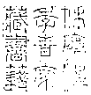



径山志卷之一终



卷之二目录



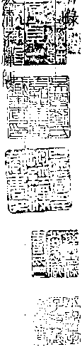



列祖



真歇清了禅师



佛行月堂昌禅师



佛海妙空讷禅师



照堂了一禅师



圆悟粹禅师



佛慧可庵衷禅师



大禅了明禅师



无等才禅师



佛日普慈闻禅师



寓庵潜禅师



密庵杰禅师



别峰宝印禅师



涂毒智策禅师



佛照德光禅师



云庵庆禅师



佛智蒙庵元聪禅师



佛日石桥宣禅师



佛心浙翁琰禅师



佛行少林崧禅师



佛鉴无凖范禅师



痴绝道冲禅师



石溪心月禅师



偃溪广闻禅师



荆叟如珏禅师



淮海原肇禅师



虚堂智愚禅师



卷之二目录终



径山志卷之二



汶上李烨然删定



海阳徐文龙、鹿城陈𢡟德订



虞山宋奎光辑



列祖



第十五代　真歇清了禅师



左绵雍氏，师叅丹霞，霞问：「如何是空劫以前自己？」师拟对，霞云：「你闹在且去。」一日登钵盂峰，豁然契悟，归白霞。霞掌云：「将谓你知有。」师便礼拜。师一日因丹霞升堂云：「日照孤峰翠，月临溪水寒。祖师玄妙诀，莫向寸心安。」便下座，直向前云：「和尚今日谩某甲不得也。」霞云：「试举我今日底看。」师良久，霞云：「将谓你瞥地。」师拂袖便出。师出世真州长芦，迁四明宝陀、台之天封、闽之雪峰，诏住兹山。师一日看厨下煮面，忽桶底脱面泼地，上众皆失声，云：「可惜！」师云：「桶底脱，自合欢喜，因甚却烦恼？」僧云：「和尚即得。」师云：「灼然可惜一桶面。」师问僧云：「你死后烧作灰撒了，骨头向什麽处去？」僧便喝，师云：「好一喝，只是不得飜欵。」僧又喝，师云：「公案未圆，更喝始得。」僧无语，师便打云：「这死汉。」师一日普请，路逢一僧，师以拄杖指地上竹担，僧拈起云：「短些子。」师劈脊打云：「这里是什麽所在？说长说短。」师尝作《无尽灯记》，曰：「东平打破镜已三百餘年，龙潭吹灭灯复四百餘载，后代子孙迷於正眼，以谓镜破灯灭，而不知行住坐卧，放大光明灯，未曾灭也。见闻觉知虚鉴万像，镜未曾破也。灯虽无景，能照生死长夜；镜虽无台，能辩生死魔惑。镜与灯光光常寂，明与鉴幻幻皆如。照之无穷，则曰『无尽灯』；鉴之无穷，则曰『无尽镜』。日用不昧，昭昭於心目之间，但众生迷而不知，故有修多罗教，开如幻方便，设如幻道塲，度如幻众生，作如幻佛事。譬如东南西北上下四维，中点一灯，外安十镜，以十镜喻十法界，一灯况一真心，一真心则理不可分，十法界则事有万状。然则理外无事，镜外无灯，虽镜镜中有无穷灯，唯一灯也；事事中有无尽理，惟一理也。以理能成差别事故，则事事无碍；由一灯全照差别境故，则境境交叅。一镜不动而能遍能容能摄能入，一事不坏而即彼即此即一即多。主伴融通，重重无尽，悲夫众生居一切尘中，而不知尘尘皆毘卢遮那无尽刹海；普贤示一毛孔，而不知一一毛孔含众生三昧色身。然则一切众生日用在普贤毛孔中、毘卢光明内、慈氏楼阁中出没，文殊劒刃上往来，念念中与诸佛同出世，证菩提，转法轮，入灭度。如镜与镜，如灯与灯，一切时普融无碍，诚谓不可思议解脱法门。非大心众生，无以臻于此境。或问即今日用见闻觉知，毕境是灯耶？非灯耶？是镜耶？非镜耶？答曰：『镜镜灯灯本无差，大地山河眼里花。黄叶飘飘满庭际，一声砧杵落谁家？』」后慈宁皇太后命开山皋亭。示寂，塔全身于华桐坞。



第十六代　佛行月堂昌禅师



湖州人。拈世尊初降生一手指天，一手指地，周行七步，目顾四方云「天上天下，唯吾独尊」颂曰：「奴儿婢子，十生九死，於里不正，被外边使。纵饶开口便过头，未免浑身辊泥水。」正月二十日示寂。



第十七代　佛海妙空讷禅师



秀州人。僧问：「牛头未见四祖时如何？」师曰：「坐久成劳。」曰：「见后如何？」曰：「不妨我东行西行。」十一月二十六日示寂。



第十八代　照堂了一禅师



明州人。上堂：「叅玄之士，触境遇缘，不能直下透脱者，盖为业识深重，情𡚶胶固，六门未息，一处不通，点绝纯清，含生难到。直须入林不动草，入水不动波，始可顺生死流，入人间世。诸人要会麽？」以拄杖畫曰：「秪向这里荐取。」拈首山竹箆示众曰：「汝诸人，若唤作竹箆则触，不唤作竹箆则背，汝诸人且道唤作甚麽？速道，速道。」颂曰：



竹箆举起成生杀　岂可容人乱札锥  

劈脊一挥如荐得　银山铁壁也光辉



三月十九日示寂。



第十九代　圆悟粹禅师



福州人。垂戒曰：「住持以众智为智，众心为心，恒恐一物不尽其情，一事不得其理。孜孜访纳，惟善是求，当问理之是非，讵论事之大小。若理之是，虽靡费大，而作之何伤；若事之非，虽用度小，而除之何害？盖小者，大之渐；微者，著之萌。故贤者慎初，圣人存戒。涓涓不遏，终变桑田；炎炎靡除，卒燎原野。流煽既盛，祸灾已成，虽欲救之，固无及矣。古云：『不矜细行，终累大德，此之谓也。』」正月二十八日示寂。



第二十代　佛慧可庵衷禅师



婺州人。六月初九日示寂。



第二十一代　大禅了明禅师



秀州人。妙喜会中，龙象丛林，所谓明大禅也。身长八尺，腹大十围，所至人必聚观之。始妙喜谪梅州，州县防送甚严。或以为祸在不测，师为荷枷以行，间关辛苦，未曾少怠。既至贬所，衲子追随问道者，率不下二三百人。杲以斋粥不给，且虑祸，尝勉之令去。师輙不肯，以身任斋粥，每肩栲栳行乞。至晚，即数十人为之荷米、面、薪、疏食用之属，成列以归。衲子虽多，无不具足，如是者十七年如一日。杲法嗣之盛，在贬所接者居其半，师之力也。杲被旨复僧衣自便，继被旨住育王，师尝在座下。师为人豪迈，机锋敏速。妙喜室中不许衲子下喝，师每入室，必振声一喝而退。妙喜一日榜方丈前云：「下喝者，罚一贯钱。」师见之，乃密具千钱于袖中。至室中，先顿於地，高声一喝，便出如是者数矣。妙喜无如之何，再牓曰：「下喝者，罚当日堂供一中。」师见之，即骤步往库司，语曰：「和尚要十两金。」主事者不疑，即与之。乃遣行者随往方丈，师袖之以入，复顿於地，高声一喝，而妙喜大骇。入室罢，徐问知其然，为之一笑。每语师云：「你这肥汉，如是会禅，驴年也未梦见在。」然念其勤劬之久，举令出住舒州之投子。先是，投子诸庄牛遭疾疫，死毙几尽，比岁不登。师以大愿力，化二百只牛以实之，连岁大稔倍常，颇有异迹。迁住长芦，衲子辐凑，丛林改观。及妙喜住径山，师来供施，及饭大众。泊归长芦，妙喜送以偈云：



人言棒头出孝子　我道怜儿不觉丑  

长芦长老恁麽来　妙喜空费一张口  

从教四海𡚶流传　野干能作师子吼  

孰云无物赠君行　喝下铁围山倒走



后奉诏住径山，道望愈著。先是杨和王梦一异僧，长大皤腹，缓行，言欲化蘓州一庄，觉而异之，未言也。翌日，师忽杖履徒步而至，门者呵不止，以白和王。和王出见之，遥望师奇伟，与梦中见者无异，遽呼其眷属出观之，眷属竝炷香作礼。茶罢，师首言：「大王庄田至多，可施蘓州一庄，以为径山供佛斋僧无穷之利。」和王未有可否，因令办斋，师饭罢便出，更无他语。时内外閧然，传言和王以蘓州庄施径山长老，遂达孝宗圣听。会和王入朝，上为言：「闻卿舍蘓州一庄施径山，朕当为蠲免赋税。」和王谢恩归。次日，以书至径山，请师入城。而二日前，先已迁化矣。自是和王宴居寤寐之际，或少倦交𥈤，即见师在前，语曰：「六度之大，施度为先，善始善终，斯为究竟。」和王即以庄𨽾本山，此庄岁出十万犂牛舟车，解库应用百事具足。复有蠲赋之恩，至今蒙其利。师於缁素有大因缘，所在施供云委，衲子臻萃，佛事殊胜。江淛、两湖，皆号之为布袋和尚再出焉。六月初七日，浴罢，趺坐而逝。



第二十二代　无等才禅师



杭州人。六月二十六日示寂。



第二十三代　佛日普慈闻禅师



台州人。僧问：「如何是道？」师曰：「水冷生冰。」曰：「如何是道中人？」师曰：「春雪易消。」曰：「如何是谈论？」师乃鸣指一下。问：「东西密相付，为甚麽众人皆知？」师曰：「春无三日晴。」曰：「特伸请益。」师曰：「拖泥带水。」曰：「学人到这里却不会。」师曰：「贼身已露。」



上堂：「城里喧繁，空山寂静。然虽如此，动静一如，死生不二，四时轮转，物理湛然。夏不去而秋不自来，风不凉而人不自爽。今也古也不改丝毫，谁少谁多身无二用。诸禅德，既身无二用，为甚麽龙女现十八变？君不见，弄潮须是弄潮人。珍重！」



上堂：「风雨萧骚，塞汝耳根；落叶交加，塞汝眼根；香臭丛杂，塞汝鼻根；冷𤍠甘甜，塞汝舌根；衣绵温冷，塞汝身根；颠倒妄想，塞汝意根。诸禅德，直饶汝飜得转，也是平地骨堆。叅！」



上堂：「严风刮地，大野清寒。万里草离衰，千山树黯黪。苍鹰得势，俊鹘横飞。颇称衲僧，钵囊高挂，独步遐方。似猛将出荒郊，临机须扣敌。今日还有麽？」良久曰：「匣中宝劒，袖里金锥。幸遇太平，挂向壁上。参！」



上堂：「诸禅德还知麽？山僧生身父母一时䘮了，直是无依倚处。」以手搥胸曰：「苍天！苍天！」复顾大众，良久曰：「你等诸人也是铁打心肝。」便下座。



上堂，举栢树子话。师曰：「赵州庭栢，说与禅客。黑漆屏风，松楞亮槅。」僧问：「如何是无为？」师曰：「山前雪半消。」曰：「请师方便？」师曰：「水声转呜咽。」



十一月初四日示寂。



第二十四代　寓庵潜禅师



兴化人。入门弹指一下便入，六月四日寂。



第二十五代　密庵咸杰禅师



福州郑氏子，母梦庐山老僧入舍而生。自幼颕悟，出家为僧，不惮游行，遍叅知识。后谒应庵於衢之明果。庵孤硬难入，屡遭呵叱。一日庵问：「如何是正法眼？」师遽答曰：「破沙盆。」庵颔之。未几，辤回省亲。庵送以偈曰：



大彻投机句　当阳廓顶门  

相从今四载　徴诘洞无痕  

虽未付钵袋　气宇吞乾坤  

却把正法眼　唤作破沙盆  

此行将省觐　切忌便跥跟  

吾有末后句　待归要汝遵



出世衢之乌巨，次迁祥符、蒋山、华藏。未几，诏住径山、灵隐，晚居太白。僧问：「虚空销殒时如何？」师曰：「罪不重科。」



上堂：「牛头横说竖说，不知有向上关棙子。有般漆桶辈，东西不辨，南北不分，便问如何是关棙子？何异开眼尿床！华藏有一转语，不在向上向下，千手大悲摸索不着。天雨无处晒㫰，今日普请，布施大众。」良久曰：「达摩大师，无当门齿。」



上堂：「世尊不说说，抝曲作直；迦叶不闻闻，望空启告。马祖即心即佛，悬羊头卖狗肉。赵州勘庵主，贵买贱卖，分文不直。秪如文殊是七佛之师，因甚出女子定不得？河天月晕鱼分子，槲叶风微鹿养茸。」上堂，卓拄杖曰：「迷时秪迷这个。」复卓一下曰：「悟时秪悟这个。迷悟双忘，粪扫堆头重添搕𢶍。莫有向东涌西没全机独脱处道得一句底麽？若道不得，华藏自道去也。」掷拄杖曰：「三十年后。」



上堂，举金峰和尚示众云：「老僧二十年前有老婆心，二十年后无老婆心。」时有僧问：「如何是和尚二十年前有老婆心？」峰云：「问凡答凡，问圣答圣。」曰：「如何是二十年后无老婆心？」峰云：「问凡不答凡，问圣不答圣。」师曰：「乌巨当时若见，但冷笑两声。这老汉忽若瞥地，自然不堕圣凡窠臼。」



上堂，举婆子烧庵话，师曰：「这个公案，丛林中少有拈提者。杰上座裂破面皮，不免纳败一上，也要诸方检点。」乃召大众曰：「这婆子洞房深隐，水泄不通，偏向枯木上糁花，寒岩中发𦦨。个僧孤身逈逈，惯入洪涛，等闲坐断泼天潮，到底身无涓滴水。子细检点将来，敲枷带鎻则不无二人，若是佛法未梦见在，乌巨与麽提持，毕竟意归何处？」良久曰：「一把柳丝收不得，和烟搭在玉栏干。」



上堂：「动弦别曲，叶落知秋。举一明三，目机铢两。如王秉劒，杀活临时，犹是无风匝匝之波。向上一路，千圣把手共行，合入泥犂地狱。正当与麽时，合作麽生？江南两浙，春寒秋𤍠。」



上堂：「尽乾坤大地，唤作一句子；担枷带鎻，不唤作一句子。业识𣴭𣴭，两头俱透脱。净倮倮，赤洒洒，没可把。达摩一宗，扫地而尽。所以云门大师道，尽乾坤大地，无纤毫过患，犹是转句。不见一法，始是半提。须知有全提底时节。大小云门，劒去久矣，方乃刻舟。」晚居天童，六月十二日示寂，塔于天童之中峰。



第二十六代　别峰宝印禅师



嘉州李氏，得法于华藏民禅师。师初谒圆悟，随众入室，悟问：「从上诸圣，以何接人？」师𥪡起拳，悟云：「此是老僧用底，作麽生是从上诸圣用底？」师以拳便打，悟亦举拳相交，笑而出。师谒大慧，慧问：「甚处来？」师云：「西川。」慧云：「未出劒门关，与汝三十棒了也。」师云：「不合起动和尚。」慧深肯之。淳熈七年秋，召入𡭊𨕖德殿，当日赐肩舆於东华门内。上问云：「三教圣人本同此理。」师曰：「譬如虚空初无南北。」上曰：「但立门户异耳，故孔子以中庸设教。」师曰：「非中庸何以立世间？《华严》有云：不坏世间相，而成出世间法。」上曰：「今时学者秪观文字，不识夫子心。」师曰：「非独今之学者，当时颜子为具体，秪说得瞻之在前忽焉在后。如有所立卓尔，亦未足以识夫子心。夫子亦曰：『二三子以我为隐乎？吾无隐乎尔。』以此观之，当时弟子尚不识夫子心，况今人乎？张商英有云：『唯吾学佛，然后能知儒。』」上曰：「朕意常作此见。」上又问曰：「老庄之教何如？」师曰：「可比佛门中小乗人耳，小乗厌身如桎梏，弃智如杂毒，化火焚身入无为界。正如《庄子》：『形固可使如槁木，心固可使如死灰？』老子曰：『吾有大患，为吾有身。』大乗人则不然，度众生尽，方证菩提。正如伊尹所谓『予天民之先觉者也，予将以斯道觉斯民也。』如有一夫不被其泽，若己推而内之沟中也。」上大悦，即日诏住径山。十年，上亲注《圆觉经》成，遣使驰赐，命作序。师具表奏谢，仍进颂曰：



古佛与今佛　同一广长舌  

于无途辙中　为物启途辙  

拨开千障云　放出一轮月  

普令大地人　言下悉照彻  

觉亦无可圆　幻亦无可灭  

只此无亦无　红罏一点雪  

𥡴首佛与佛　字字无异说



上览大悦，赐号「宝印禅师」。及年迈，益厌住持，奏乞庵居，得请。十二月初八日示寂，葬于庵之西冈，谥「慈辨禅师」，塔曰「智光」。



第二十七代　涂毒智策禅师



天台陈氏子。幼依护国僧楚光落发，十九造国清，谒寂室光，洒然有省。次谒大圆於明之万寿，圆问曰：「甚处来？」师曰：「天台来。」曰：「见智者大师麽？」师曰：「即今亦不少。」曰：「因甚在汝脚跟下？」师曰：「当面蹉过。」圆曰：「上人不耘而秀，不扶而直。」一日辤去，圆送之门，拊师背曰：「宝所在近，此城非实。」师领之。往豫章谒典牛，道由云居，风雪塞路，坐阅四十二日。午初，版声铿然，豁尔大悟。及造门，典牛独指师曰：「甚处见神见鬼来？」师曰：「云居闻版声来。」牛曰：「是甚麽？」师曰：「打破虚空全无靶柄。」牛曰：「向上事未在。」师曰：「东家暗坐，西家厮骂。」牛曰：「崭然超出佛祖，他日起家一麟足矣。」住后，上堂举：「教中道『若以色见我，以音声求我，是人行邪道，不能见如来。』虽然恁麽，正是捕得老鼠，打破油瓮。怀禅师道：『你眼在甚麽处，虽则识破释迦老子，争奈拈锤䑛指。』若是涂毒即不然，色见声求也不妨，百花影里绣鸳鸯。自从识得金针后，一任风吹满袖香。」师将示寂，升座别众，嘱门人以文祭之。师危坐倾听，至「尚飨」，为之一笑。越两日，沐浴更衣，集众说偈曰：



四大既分飞　烟云任意归  

秋天霜夜月　万里转光辉



俄顷，泊然而逝，七月二十七日也。塔全身於东冈之麓。



第二十八代　佛照德光禅师



临江新喻人，彭氏子。父术母袁，梦异僧入室，有娠。既生，乃祖曰：「吾家世积德乃生此儿，必光吾门。」因命名德光。年九岁，有妙应大师伯华善相，曰：「此子伏犀贯顶，出家必作法门栋梁。」时年十岁，遽失怙。恃伯父循、伯母万，育而教之。年二十一，闻人诵《金刚经》，忽然通解。归告伯母曰：「适闻诵经，身心欢喜，世间万事真如梦幻。」力恳出家，族不能夺。遂散家赀，诣本郡东山光化寺足庵吉禅师薙发。一日入室，吉问：「不是心，不是佛，不是物，是甚麽？」师罔措。遂致疑，通夕不寐。次日诣方丈请益，昨日蒙和尚垂问：「既不是心，不是佛，不是物，毕竟是甚麽？」望和尚慈悲指示，吉震威一喝曰：「这沙弥更要我与你下注脚，在拈棒劈脊打出。」师於是有省。吉携师入闽，寓福之西禅，谓师曰：「是行为择所依，东禅月庵善果具衲僧眼，子依之，时复省吾足矣。」一见，月庵遽问：「不落有无中，何如露消息？」师云：「不落有无中，分明露消息。」月庵云：「是甚麽消息？」师便喝。庵云：「未在更道。」师云：「我畱口吃饭在。」即畱叅堂。后谒应庵华、百丈震，终不自肯。适大慧领育王，四海英才鳞集，师亦与焉。大慧室中问师：「唤作竹箆子则触，不唤作竹箆子叫背，不得下语，不得无语？」师拟对，慧便棒。师豁然大悟，从前所得瓦解冰消。慧说偈以顶相付师曰：



有德必有光　其光无间隔  

名实要相称　非青黄赤白



慧再主径山，拉以偕往阅。夏至蒋山省应庵，庵称赏不已，谓人曰：「光兄顿出我一头地。」乃移书于李侍郎浩曰：「光兄一自径山老叔印可，如虎插翅。」畱月餘而归。乾道丁亥，李侍郎浩延住鸿福，徙光孝。孝宗雅闻师名，淳熈三年，召入观堂留五宿，数问佛法大意。师敷奏直截，上大悦，赐「佛照禅师」之号。明年，改涖径山，师力辤。帝曰：「朝夕相见耳。」再𡭊便殿，进〈宗门直指〉，两赐御颂。



上堂，僧问：「浩浩尘中如何辨主？」师曰：「中峰顶上塔心尖。」



上堂：「临济三遭痛棒，大愚言下知归。兴化于大觉棒头，明得黄檗意旨。若作棒会，入地狱如箭射；若不作棒会，入地狱如箭射。众中商量，尽道赤心片片，恩大难酬。总是识情卜度，未出阴界。且如临济悟去，是得黄檗力，是得大愚力？若也见得，许你顶门眼正，肘后符灵。其或未然，更为诸人通个消息。丈夫气宇冲牛斗，一踏鸿门两扇开。」



上堂：「七手八脚，三头两面，耳听不闻，眼覻不见。苦乐逆顺，打成一片。且道是甚麽？路逢死蛇莫打杀，无底蓝子盛将归。」



上堂：「闻声悟道，落二落三。见色明心，错七错八。生机一路，犹在半途。且道透金刚圈、吞栗棘蓬底是甚麽人！披蓑侧立千峰外，引水浇蔬五老前。」



嘉泰三年三月二十日，说偈而逝。塔全身于东庵之后，谥「普慧宗觉大禅师」，塔曰「圆鉴」。



第二十九代　云庵庆禅师



建宁人。师拈袁州杨岐方会禅师。僧问：「如何是佛？」会曰：「三脚驴子弄蹄行。」曰：「莫只这便是？」会曰：「湖南长老。」颂曰：



杨岐一头驴　眼光如电烁  

踏杀天下人　说甚三只脚



十月二十三日示寂。



第三十代　佛智蒙庵元聪禅师



福州朱氏子。晦庵会中得心要，众推为高第。庆元三年，自福之雪峰被旨而主是山。拈药山首造石头之室便问：「三乗十二分教，某甲粗知。尝闻南方直指人心，见性成佛，实未明了，伏望指示。」头曰：「恁麽也不得，不恁麽也不得，恁麽不恁麽总不得，子作麽生？」山罔措。头曰：「子因缘不在此，且往马大师处去。」山禀命，㳟礼马祖，仍伸前问，祖曰：「我有时教伊扬睂瞬目，有时不教伊扬睂瞬目。有时扬睂瞬目者是，有时扬睂瞬目者不是。子作麽生？」山于言下契悟，便礼拜。祖曰：「你见甚麽道理便礼拜？」山曰：「某甲在石头，如蚊子上铁牛。」祖曰：「汝既如是，善自护持。」颂曰：



倒腹倾肠说向伊　不知何故尚迟疑  

只今便好猛提取　莫待天明失却鸡



上堂，举玄沙见僧礼拜，沙云：「因我得礼你。」师颂曰：「因我得礼你，莫放屁撒屎，带累天下人，错认自家底。」



上堂，举赵州和尚在东司上见文远侍者过，蓦召文远，远应诺。赵州曰：「东司上不可与汝说佛法。」师颂曰：「明明道不说，此理凭谁识？春风一阵来，满地花狼藉。」送行者求僧偈曰：



山前麦熟雨初晴　桑柘青连柳色新  

毫发不存风骨露　头头总是比丘身



十一月十五日示寂。



第三十一代　佛日石桥宣禅师



蜀嘉定许氏，橘洲昙公是其同气。嘉定丁丑，获知丞相鲁国，俾居兹山，创化城接待于双溪之上。详杨汝明记中。十二月十三日示寂，塔于寺之后。



第三十二代　佛心浙翁琰禅师



台州周氏子，幼岐嶷，颕悟迈伦。上堂，举乾峰因僧问：「十方薄伽梵，一路湼槃门，未审路头在什麽处？」峰以拄杖畫云：「在这里。」后僧请益云门，门拈起扇子云：「扇子蹦跳上三十三天，筑著帝释鼻孔；东海鲤鱼打一棒，雨似盆倾。会麽？」师曰：「唱愈高和愈峻，还他二老者，是十方薄伽梵一路湼槃门，总未踏著在。」



上堂，拈拄杖云：「蒋山唤这个作拄杖子，诸人亦唤这个作拄杖子，还有缁素也无？阑干虽共倚，山色不同观。」作《维摩讃》，偈云：



毘耶示疾放憨痴　添得时人满肚疑  

不是文殊亲勘破　者些毛病有谁知



书〈惩私篇〉，略曰：「此书真𨶒老子殿前一本赦书也。今之诸方，道眼不知若何？果能受持此书，则他日大有得力处。」浙翁每以此举似于人。璨隐山亦云：「常住金榖，除供众之外，几如鸩毒。住持人与司其出入者，才沾著则通身溃烂。律部载之详矣。古人将钱就库下，回生姜煎药，盖可见。今之踞方丈者，非但刮众人钵盂中物以恣口腹，且将以追陪自己，非泛人情。又其甚则剜去搜买珍奇，广作人情，冀迁大刹，只恐他日铁面𨶒老子与你计筭。」七月十七日示寂。



第三十三代　佛行少林崧禅师



建宁人。有《语录》十卷，板厄于火。二月二十二日示寂。



第三十四代　佛鉴无凖范禅师



生於蜀之梓潼雍氏。九岁，依阴平山道钦出家，经书过目成诵。绍熈五年冬，登具戒。明年，出游至成都，坐夏正法。有老尧首座、瞎堂高弟，师请益坐禅之法，尧曰：「禅是何物？坐底是谁？」师受其语，昼夜体究。一日如厕，提前话有省。明年辤去，谒佛照于育王，照问曰：「何处人？」师曰：「劒州人。」照曰：「带得劒来麽？」师随声便喝。照笑曰：「者乌头子也乱做，贫甚无资剃发。」故人以乌头子目之。未几，闻破庵住蘓之西华秀峰，遂往见焉。



有纯颠者，入室次，横机不让。庵打至法堂，且欲逐出。师解之曰：「禅和家争禅亦常事，何止如此？」庵曰：「岂不闻道，我肚饥，闻板声要吃饭去𫆏。」师闻其语，不觉白汗浃背。逮破庵居灵隐第一座，复往从之。因侍破庵游石笋庵，庵之道者请益曰：「胡孙子捉不住，乞师方便。」庵曰：「用捉他作什麽？如风吹水，自然成纹。」师在侍傍，平生碍膺之物顿释。岩云巢居吴郡穹窿，迁瑞光及台州瑞岩，皆延师分座。师在瑞岩，忽梦伟衣冠者，持把茅见授。翌日，明州清凉专使至，迨入院，见伽蓝神姓茅，衣冠形貌与畴昔梦无异。升堂开法，一香供破庵。三年迁焦山，升雪窦，被旨移育王。又三年，嵩少林散席，复诏住径山。师居径山二十年，储峙丰积有众如海，号法席全盛。僧问：「赵州道，三十年前火炉头有个无賔主话，未曾有人举著，此意如何？」师云：「舌头拖地。」僧云：「毕竟如何是无賔主话？」师云：「言满天下。」僧云：「只如玄沙闻得云：『者老汉脚跟未点地在，又作麽生？』」师云：「一坑埋著。」僧云：「可谓焦塼打著连底冻，赤眼撞著火柴头。」师云：「一畫畫断。」



上堂：「灵山指月，曹溪话月，递代相传，证龟成鳖。范上座寻常有一张口挂在壁上未曾动著，今日无端入这行户。事到如今，只得东𥳽西𥳽，未免拈起多年历日，于中点出些子悮赚处说似诸人。且要郭大、李二、邓四、张三，知得江南两浙春寒秋𤍠。虽然如是，黄河三千年一度清。」



上堂：「若论个事，直是省要易会，多是诸人自作艰难，自作障碍。所以有时东廊西廊，见诸人和南问讯，山僧便乃低头相接。其实无他，只要诸人识得长老是西川隆庆府人氏。若识得去，便与诸人打些乡谈，说些乡话。如今且未说你识得长老，且各自知得自家乡贯也得。还知麽？明州六县，奉化八乡。」



上堂：「五峰门下，百种全无，僧床迫窄，堂供萧踈。脚下踏著底破甎头、碎瓦砾，面前撞见底王獦獠、李麻胡。恁麽薄福住山，真个孤负老胡。虽然如是，更点分明。」



上堂：「一夏已满，无事不办，遂府钵盂，邛州磁碗。」理宗尝召见于修政殿，奏𡭊详明。上为之动色，赐金襕僧伽棃。仍宣诣慈明殿升座，上垂帘而听。以师所说法要，示叅政陈公贵𧧼。陈公奏云：「简明直截，有补圣治。」乃赐「佛鉴禅师」号，并缣帛金银等物。先是，师住山之明年寺毁，师逆知其数，不动容经意。三年寺成，阅六年复毁。师不惊不变而助施云凑，不数年寺宇崇丽。师去寺四十里，筑室数百楹，接待云水，赐额「万年正续」。又西数百武，结庵一区，为归藏所。上建重阁，秘藏后先所赐御翰。敞室东西，偏奉祖师与先世香火。遇始生日，为饭僧佛事，以荐㝠福。盖蜀乱，师之先祀遂绝，故兹祠奉，以旌孝慕。上闻而嘉叹，赐扁曰「圆照」。淳祐戊申秋，筑室明月池上，榜曰「退耕」。乞老于朝，而旧疾适作。己酉三月旦日，升堂示众曰：「山僧既老且病，无力得与诸人东语西话。今日勉强出来，从前所说不到底，尽情向诸人面前抖擞去也。」遂起身抖衣云：「是多少？」十五日，集两班畫后事，亲书遗表，及遗书十数言。笑谐谑如平时，医者诊视次，师谓曰：「你未识这一脉在。」三月十八日𥠖明，索笔书偈曰：



来时空索索　去也赤条条  

更要问端的　天台有石桥



移顷而逝。遗表上闻，上遣中使降香赐币，奉全身葬于正续之侧，塔曰「圆照」。禀法分化，有雪岩钦、断桥伦、西岩惠等，欝为大宗匠云。



第三十五代　痴绝道冲禅师



武信长江荀氏子，母郭氏。生而丰上短下，资性绝人。少长以进士业应诏不利，弃之受释氏学。诣梓州妙音院，礼修证为落发师。游成都，习经论于圣慈，以名相厌人，复弃去。绍熈壬子，出峡回翔荆楚间。时松源岳唱密庵之道于饶之荐福，径造其庐，以岁饥不受。会曹源，以云居首座，生出世妙果。师才入门，闻语有省。叅堂俾侍香，朝从夕游，老拳痛棒不少贷，平生知见至是多无影响。曹源徙龟峰，师复侍行。久之，以偈辞。游淛有曰：「尚餘穷相一双手，要向诸方痒处爬。」江湖盛传。至杭时，松源主灵隐，门严户峻，八阅月不获入室。或以失士告，源曰：「我已八字打开挂搭他，自是他当面而蹉过了。」师闻其语，彻见曹源于妙果、龟峰时嘻笑怒骂皆为人善巧方便。嘉定己卯，由径山第一座出世嘉禾光孝，时英灵衲子皆在会下。道闻于朝，忠献史衞王以堂帖除蒋山。濒江卑涝，下田无秋，师忍饥鸣道，行乞养士，居十三年无倦。嘉熈己亥，侍郎曹公豳帅闽以鼓山来聘。未行，雪峰牒至，领事半年而天童诏下。众集如海，法度修明，虽宏智盛时，殆不之过。育王虚席摄住持事，往来说法两山间。



上堂曰：「天童用底来，育王用不著；育王用底归，天童用不著。虽然如是，用不著处用有餘，一箭双雕随手落。」



淳祐甲辰，有旨移灵隐。师谓：「大父密庵、伯父松源弘道之地方，欲奋励力振祖风，而世故有不满其意者。」伐鼓辤众，归隐金陵。京兆尹遣属官追挽，不可。朝命以虎丘养老，不就。留守虚斋赵公以蒋山起之，不应。戊申春，育王笑翁散席，朝论以大觉故家不轻畀付，特召师隐所，三返卒不奉诏。明年，京尹赵公以法华请开山，将领事，而𠡠牒住径山之命继至。师欲以法华并辞，自谓：「不赴法华则不信，重违君命则不恭。失恭与信，何以为后学法？」乃翻然而作，畱法华逾月，即登径山，故人神响应，懽声若雷。



上堂，僧问：「心佛及众生是三无差别，如何是过去心？」师曰：「故待冷来看。」僧云：「如何是现在心？」师曰：「你问我答。」僧云：「如何是未来心？」师曰：「后次上堂向你道。」僧问：「如何过去佛？」师曰：「去年梅。」僧问：「如何是现在佛？」师曰：「今岁桺。」僧问：「如何是未来佛？」师曰：「颜色馨香依旧。」僧问：「如何是过去差别智？」师以拂子击禅床左边。僧问：「如何是现在差别智？」师以拂子击禅床右边。僧问：「如何是未来差别智？」师以拂子中间点一点。僧云：「心佛众生无向背，十方刹海一毫收。」便礼拜。师乃曰：「过去心不可得，未来心不可得，现在心不可得，三世既不可得，唤甚麽作差别智？若人见得彻去，三世诸佛，无一时不在诸人顶额上转大法轮，更来这里挨肩竝足讨什麽碗？」以拄杖一时赶散。



结夏上堂：「圆觉伽蓝尘尘有路，坐断去来顿空今古。那里十三这边十五，后先不差毫发许。可笑黄面瞿昙，至今不知落处。」



上堂：「尽乾坤大地，无丝毫许大。是汝诸人，横担拄杖绕四天下行脚，道我无处不到无事不知。且道西天那兰院寺戒贤论师，今日说什麽法？」便下座。



上堂：「有一人一念顿证堕在佛数，有一人累刼阐提不愿成佛，且道那个合受人天供养？」良久云：「蝶穿芳径双睂湿，蜂掠残花两股肥。」



临示寂，手书龛记并遗书十数，且曰：「无凖忌在三月十八日，吾以十五日即行，不能办香修供矣。」说偈书讃，嬉笑言论如平时。侍僧以遗偈请，麾斥不顾。已而笑谓侍者曰：「末后一句无可商量，只要个人直下承当。」即命笔书辤众。十四日，上堂语至夜分，起坐移顷而逝。寿八十二，臈六十一。茶毘舍利五色者无数，其徒遵治命奉骨归葬金陵玉山庵。学者追慕不忍，舍分其半，建塔菖蒲田玉芝庵。



第三十六代　石溪心月禅师



西蜀睂州人。上堂，举僧问九峰和尚：「如何是学人自己？」峰曰：「更问阿谁？」僧云：「便恁麽承当时如何？」峰曰：「须弥还更戴须弥。」师颂曰：



自家冷煖自家知　祖意西来更问谁  

全体承当全体是　须弥顶上戴须弥



拈黄龙祖心禅师因黄山谷太史乞指㨗径处。龙曰：「秪如仲尼道：『二三子以我为隐乎？吾无隐乎尔。』太史居常如何理论？」公拟𡭊，龙曰：「不是，不是。」公迷闷不已。一日侍龙山行次，时岩桂盛放，龙曰：「闻木樨花香麽？」曰：「闻。」龙曰：「吾无隐乎尔。」公释然，即拜之曰：「和尚恁麽老婆心。」龙笑曰：「秪要公到家耳。」颂曰：



渠侬家住白云乡　南北东西路渺𣴭  

几度欲归归未得　忽闻岩桂送幽香



又送僧偈曰：



未到双林见旧游　睂横新月眼横秋  

寒暄未举宐先问　因甚桥流水不流



六月初九日示寂。



第三十七代　偃溪广闻禅师



闽之侯官林氏子，母陈。家世业儒，疎睂秀目，哆口丰颐。从季父智隆于宛陵光孝。十八得度受具。初见铁牛印，少室睦，无际派，追随甚久。叅淛翁于天童，针芥难投，自知未及。再叅于双径，翁笑迎曰：「汝来耶。」一夕坐簷间，闻更三，转入室，曳履而蹶，如梦忽醒。翌朝造室，翁举赵州洗钵盂话，师将启吻，翁遽止之，平生疑情当下冰释。绍定戊子，四明制阃胡公，以小净慈致之，历住香山、万寿、雪窦、育王、净慈、灵隐、径坞八山。所至革弊支倾，广容徒众。开炉上堂，举赵州和尚示众云：「老僧三十年前，在南方火炉头，有个无賔主话，直至如今无人举著。」师云：「森罗万象，明暗色空，日夜举扬，赵州古佛不是不知，只为贪程太速。」



上堂：「杨岐眼中睛，临济顶上髓。一不成二不是，点著不来，白云万里。」



佛成道日，上堂：「错错，六载草䋲空自缚；了了，开著眼来天大晓。古今天地、古今日月、古今星辰，拍𦡀云劒去久矣，切忌刻舟。」



上堂：「云门放洞山三顿棒，嚼饭𫗪婴孩；黄檗打临济三顿棒，按牛头吃草。只今不犯丝毫，有个方便。」良久云：「大事为你不得，小事自家担当。」



上堂：「非风幡动，仁者心动，浣盆浣盆；非风铃鸣，我心鸣耳，漆桶漆桶。尽古往今来，和泥脱墼有什麽限，还知万寿落处麽？劫石有消日，虚空无尽时。」



上堂：「十字街头石幢子，无你遮护处；一声江上侍郎来，无你廻避处。衲僧家早出暮入，脚前脚后也须子细。忽然筑著磕著，净慈拄杖别有分付。」



上堂：「一升三合，拄杖头边，万水千山，草鞋跟底。未言先领，谁家灶里无烟？撩起便行，是处井中有水。莫道空来又空去，许多途路不相孤。」



上堂：「一句绝离微，浑沦无缝罅。善财七日寻觅不得，赵州五年分踈不下。灵山今日快便难逢，为通一线。六月卖松风，人间恐无价。」



上堂：「绕禅床一匝，挥香案一下，转藏已竟，讲经已竟，若具著眼目，方知落处。其或未然，依经解义，三世佛冤，离经一字，还同魔说。」



上堂：「赵州吃茶去，金牛吃饭来。龙门多上客，有人续得末后句，许你入阿字法门。」景定四年六月十四日示寂，寿七十五，夏五十八。



第三十八代　荆叟如珏禅师



婺州人，圆悟五世孙也。功用比圆悟益弘，际遇穆陵，宠遇甚至。初见痴钝，室中僧问：「如何是佛？」师答曰：「烂冬瓜。」复成颂曰：



如何是佛烂冬瓜　咬著冰霜透齿牙  

根蒂虽然无窖子　一年一度一开花



又尝作偈寄呈痴钝曰：



鍾山白刃赤身挨　几度曾经被活埋  

一自人亾家破后　了知无位可安排



结夏小叅：「我此一宗正令全提，如暴风卒雨鼓荡无前，石火电光追奔不及。举意即迷源，擡眸已蹉过。不是目前法，莫生种种心。纵汝三种互修剋期取证，第一头第三首，万柱千撑转见气急。殊不知髑髅未具己眼，先明呱地一声，千了百当。然虽如是，亲证者万无一二，错会者数有河沙。」



佛成道日颂曰：



六年雪岭方成道　打失从前鬼眼睛  

满面惭惶无著处　至今生怕是明星



十二月初十日示寂。



第三十九代　淮海原肇禅师



通州静海潘氏子，母朱氏。邑之利和寺妙观，其诸父也，谓其父母曰：「是子生而有异，却荤胾，殆亦夙种，盍俾出家？」父母然之。年十九，薙𣑱受具。叅浙翁于径山，翁问：「汝何处人？」师曰：「淮人。」翁曰：「泗洲大圣为什麽在杨州出现？」师曰：「今日又在杭州撞著。」翁曰：「且得没交涉。」师徐曰：「自远趋风。」翁以师警敏，欲大激发，未容其叅堂，才见便云：「下一转语来。」拟开口，即喝。师以书上，又以颂呈，末句云：「空教回首望长安。」翁云：「这里是什麽所在？」师曰：「谢和尚挂搭。」始密就入室之列，已而命掌记。



翁既寂，师出世通之光孝，迁吴城双塔、金陵清凉、天台万年、蘓之万寿、东嘉江心。而四明育王虚席，庙堂奏师补处，迁杭之净慈、灵隐、径山。其住径山歉餘，逋券山积，僧残屋老。未几，楼阁矗霄，云衲踵至，不减浙翁全盛气象。俄示疾，嘱其徒为吾袝一穴于东磵，见生死不忘奉师之意。六月初十日，浴讫书偈而逝。尝举达摩偈曰：



踏翻地轴与天关　合国人追不再还  

去去一身轻似叶　长江千古浪如山



第四十代　虚堂智愚禅师



四明人。出世嘉禾兴圣，迁光孝、明之显孝、延福、瑞岩、婺之宝林、四明育王、柏岩、杭之净慈，凡历住十刹。咸淳十年，诏住径山。师室中垂语曰：「己眼未明底，因甚将虚空作布袴著？畫地为牢，因甚透者个不过？入海筭沙底，因甚向针锋头上翘足？」僧问：「声前一句，不堕常机。转位就功，如何相见？」师云：「问讯不出手。」僧云：「且道天子万年作麽生？」师云：「瑞草生嘉运，林花结早春。」僧云：「直得九州四海，雷动风飞。」师云：「出门惟恐不先到。」



上堂：「春风如刀，春雨如膏，衲僧门下，何用忉忉？」



上堂：「言而足，终日言而尽道；言而不足，终日言而尽物。且道，道与物是一是二？若道是一，为甚麽客山高，主山低？若道是二，为甚麽天地一指，万物一马？个里缁素得出，还你草鞋钱。不然，但愿来年蚕麦熟，罗睺罗鬼与一文。」



结夏上堂：「有一人日销万两黄金，同此圣制，只是无人认得。若有人认得，许伊日销万两黄金。」



上堂曰：「虚堂初无门户，与人近𠊓，亦不置之于无何有之乡。只要诸人如铁入土，与土俱化，然后可以发越。其如运粪人者，吾未如之何。」



上堂，举松源师祖临示寂告众云：「久叅兄弟，正路上行者，有只不能用黑荳法。临济之道，将泯绝无闻。伤哉！」拈云：「鹫峰老人似倚杖骑马，虽无僵仆之患，未免𠊓观者丑。」



师先在净慈，入院日，问答绝。忽天使踵门传旨，问：「赵州因甚八十行脚，虚堂因甚八十住山？」师即举赵州行脚到临济话，颂曰：「赵州八十方行脚，虚堂八十再住山，别有一机恢佛祖，九重城里动龙颜。」使以颂回奏，上大悦，特赐米伍百石、绢一百缣，开堂安众。



十月初八日示寂，塔于直岭下，曰「天然」。



先是高丽国王请师于彼国，说法八载。还山，问法弟子，常随千指。后嘉靖间，高丽遣法嗣至山扫塔云：「彼国法道甚盛焉。」



径山志卷之二终



卷之三目录



列祖



藏叟禅师



虚舟普度禅师



云峰妙高禅师



虎岩伏禅师



本源善达禅师



佛智晦机禅师



大圆佛鉴虚谷陵禅师



佛日元叟端禅师



广慈昙芳忠禅师



佛慈法喜南楚悦禅师



古𪔂祖铭禅师



佛慧慈照正源禅师



愚庵智及禅师



悦堂颜禅师



宗泐禅师



象源淑禅师



复原福报禅师



大宗兴禅师



止庵祥禅师



呆庵庄禅师



岱宗泰禅师



伯蕴琇禅师



敬庵庄禅师



雷庵泽禅师



月江净禅师



雪崖珂禅师



西畴顷禅师



宇中宸禅师



杰峰英禅师



一清天禅师



无极灏禅师



宗胜㣧禅师



正觉成禅师



用璚琚禅师



竺芳蕋禅师



庭礼训禅师



天才英禅师



悦山恺禅师



石窻珉禅师



月林镜禅师



补遗



列祖



慧满扶禅师



法警庠禅师



宝鉴修禅师



十方住持



祖印悟禅师



澄慧渊禅师



玄应仁禅师



月堂道昌佛行禅师



佛慧可安衷禅师



无等才禅师



寓庵清禅师



佛行少林崧禅师



佛心荆叟珏禅师



大圆佛鉴虚谷陵禅师



广慈昙芳忠禅师



佛慈法喜南楚悦禅师



象源淑禅师



大宗兴禅师



止庵祥禅师



呆庵庄禅师



岱宗泰禅师



雷庵泽禅师



雪崖珂禅师



宇中宸禅师



杰峰英禅师



无极灏禅师



宗胜㣧禅师



正觉成禅师



用璚琚禅师



竺芳蕋禅师



庭礼训禅师



天才英禅师



悦山恺禅师



石窻珉禅师



法侣(附)



智藏禅师



如会禅师



鸟窠禅师



丹霞天然禅师



敬叟



断桥妙伦



崇岳松源、恕中无愠



大辨



风穴延沼禅师



法师行靖、行绍



桐江绍大



石室祖瑛



一关正逵



孚上座



九仙清嗣



高峰妙禅师



布衲如玉禅师



宝彻禅师



资寿尼



安分庵主



净度



惟政



慧静



僧瑜



僧翼



慧辨琦禅师



来复



荐福本禅师



无趣如空禅师



无幻性冲禅师



达观可禅师



云栖宏禅师



古道禅师



梅谷禅师



密藏禅师



幻于禅师



幻居禅师



化仪禅师



仪丰禅师



憨山禅师



洞闻禅师



万松禅师



月亭禅师



寒灰禅师



瓶匋闻谷禅师



湛然禅师



鹤林禅师



汉月禅师



卷之三目录终



径山志卷之三



汶上李烨然删定



海阳徐文龙、鹿城陈𢡟德订



虞山宋奎光辑



列祖



第四十一代　藏叟禅师



名善珍，泉州南安县吕氏子。年十三，依郡之崇福寺南和尚落发。十六游方，至杭受具足戒。谒妙峰善公于灵隐，入室悟旨。后出住里之光孝，升承天，继迁安吉之思溪圆觉，福之雪峰。复以朝命，移四明之育王、临安之径山。师示众云：「古者道『知之一字，众妙之门』，又有道『知之一字，众祸之门』，只者二门入得更须出得，三世诸佛出不得，历代祖师出不得，天下老和尚出不得。何故变铁成金易，变金成铁难？」



上堂：「尽大地是紫磨金身，诸人终日开眼覻见释迦老子心肝，举步筑著释迦老子鼻孔。说有说无是诳，说生说灭是𧩂，说即心非心是𡚶。不诳不𧩂不𡚶，春风吹落桃李花，淡烟踈雨笼青嶂。」



上堂：「春雪寒，春宵短；古佛心，破灯盏；正法眼，乾纸撚。抖擞精神只管看，看到北斗西移，南斗东转，上元依旧正月半。」



上堂：「灵云见桃花悟去，玄沙道敢保老兄未彻；香严闻击竹悟去，仰山道祖师禅未会。禅和十个五双道，我此一门全无肯路，亦未知灵云、香严在！要知二大老麽？醉我落花天，借他弦管里。又据室云，这里便是问讯烧香了，来老僧身边立地底所在麽？呆子！你自钝置犹可，莫来钝置老僧。」



尝自题其像云：「叅禅无悟，识字有数。眼三角似燕山愁胡，面百折如赵婆呷醋。一著高出诸方，敢道饭是米做。」送忍书记偈云：



鬓丝不可织寒衣　煮字那能疗得饥  

别欲语君安乐法　正𢗅却未有闲时



师生于宋绍兴甲寅十月十二日，示寂于嘉定丁丑五月二十一日。世寿八十三，僧夏六十。塔全身于南院。



第四十二代　虚舟普度禅师



维扬江都人，姓史氏。稍长虽习世书，绝无处俗意。母识其志，俾依郡之天宁出家。会与毕将军，再遇共语，大奇之曰：「此兄短小精悍音吐如鍾，他日法中向上爪牙也。」携归武林，礼东堂院祖信为受业师。侍信左右五年，奋志叅方。初见铁牛印于灵隐，已而江东西、河南北悉偏历焉。时无得唱道饶州荐福，师决志叩请，其迁福严、华藏亦与之俱。偶入室次，得问：「不与万法为侣者是甚麽人？」师曰：「金香炉下铁昆仑。」得曰：「将谓这矮子有长处，见解只如此。」师曲躬作礼曰：「谢和尚证明。」若天童晦岩光、大慈石岩琏、虎丘石室廸，一见噐异，畱与法务。



淳祐初，制府赵信庵以金陵半山请出世，迁润之金山、潭之鹿苑、抚之疎山、蘓之承天。景定间，太傅贾魏公奏补中天竺，复请旨升灵隐。至元丁丑，被命径山。



上堂：「邪人说正法，正法悉皆邪；正人说邪法，邪法悉皆正。」卓柱杖一下：「邪耶？正耶？」又卓柱杖一下：「说耶？不说耶？向这里拣办得出，黄金为屋未为贵，玉食锦衣何足荣！」



上堂：「万法是心光，诸缘惟性晓。本无迷悟人，只要今日了。既无迷悟人，了个什麽？」卓柱杖一下：「千言万语无人会，又逐流莺过短墙。」



上堂，举云门和尚示众云：「汝等诸人在此过夏，山僧深不欲向你道，惜取睂毛好。」师云：「云门灵龟曳尾，拂迹迹生，灵隐即不然。汝等诸人在此过夏，山僧直截向你说，口是祸门。」



上堂，举临济和尚道：「有一人论劫在途中不离家舍，有一人离家舍不在途中，那个合受人天供养？」师云：「兎马有角，牛羊无角。寸毫尺𨤲，天地寥廓。潘阆倒骑驴，攧杀黄畨绰。」



师住径山值火餘，志图兴复。将有绪，俄示微恙，索笔大书曰：「八十二年驾无底船，踏翻归去明月一天。」全身塔寺东十里𦊱罳坞之阳，四月二十四日示寂。



第四十三代　云峰妙高禅师



福之长溪人也。家世业儒，母阮梦池上婴儿，合爪坐莲华心，手捧得之。觉而生师，因名梦池。幼而神彩秀发，嗜书力学，尤耽释典，愿学出世法。依吴中云梦泽公，继受具戒。师锐意在道，首叅痴绝，次见无凖，凖尤噐重。寻之育王见偃溪，入室掌藏钥。一日，溪举譬：「如牛过窻𣠄，头、角、四蹄都过了，因甚尾巴过不得？」师划然有省，即答曰：「鲸吞海水尽，露出珊瑚枝。」溪云：「也只道得一半。」后出世南兴大芦，迁江阴劝忠、霅川何山。后蒋山虚席，奉朝命居之。历十有三载，众逾五千指。德祐改元，寺被兵。军士有迫师求金者，以刃拟师，师延颈曰：「欲杀即杀，吾头非汝砺刃石。」辞色了无怖畏，军士感动掷刃而去。丞相伯颜见师加敬，施牛百、斋粮五佰，寺赖以济。至元庚辰，迁径山寺，罹回禄，草创才什一。师究心兴建，不十年悉还旧观。



示众：「前念是凡，后念是圣，一刀两叚，更莫迟回。是以涅槃会上，广额屠儿放下屠刀，便言我是千佛一数。虽然若无举𪔂拔山力，千里乌骓不易骑。」示众：「言前辨旨，句下明宗。东计山炽然说法，湛渎水转为流通。这里搆得未免递相钝置。若是尚存观听，扰扰匆匆，晨鸡暮钟。」



上堂：「声色为无生之鸩毒，受想乃至人之坑穽。者般说话阿谁不知？然粗飡易饱，细嚼难饥。」



上堂：「世界未形，乾坤泰定；生佛未具，觌体全真。无端镜容大士，鹰巢跃出，擘破而皮，早是遭人描邈。那更缺齿老胡不依本分，遥望东震旦有大乗根噐，迢迢十万里来意在搀行夺市。直得凤堂皷响阿阁钟鸣，转喉触讳插脚无门，合国难追重遭讦露。新蒋山迫不得已，跨他船舷入他界分。新官不理旧事，毕竟如何？拍禅床云，戍楼静贮千峰月，塞草闲铺万里秋。」



上堂：「五峰峭峙，到者须是其人；一镜当空，无物不蒙其照。祖师基业依然犹在，衲僧活计何曾变迁？著手不得处，正要提撕；措足无门时，方堪履践。直得山云淡泞，涧水潺湲，一曲无私，万邦乐业。正恁麽时，功归何所？车书自古同文轨，四海如今共一家。」



至元戊子春，有譛毁禅宗者，师叹曰：「此宗门大事，吾当忍死争之。」遂趋京，勅集诸徒廷辩，上问：「禅以何为宗？」师进前奏云：「禅也者，净智妙圆，体本空寂，非见闻觉知之所可知，非思量分别之所能解。」上又云：「禅之宗裔可历说欤？」师云：「禅之宗裔，始于释迦世尊在灵山会上，拈起一枝金色波罗花，普示大众。惟迦叶微笑，世尊云：『吾有正法眼藏，涅槃妙心分付迦叶。』由此历代佛祖授受，而至菩提达磨。达磨望此东震旦国有大乗根噐航海而来，不立文字，直指人心，见性成佛，是为禅宗也。」上嘉叹之。师因从容奏云：「禅与教本一体也，譬如百千异流同归于海而无异味。又如陛下坐镇山河天下一统，四夷百蛮随方而至，必从顺承门外而入，到得黄金殿上亲覩金颜，方可谓之到家。若是教家，只依著文字语言，不达玄旨，犹是顺承门外人；若是禅家，虽坐破六七个蒲团，未得证悟，亦是顺承门外人。谓之到家，俱未也。是则习教者，必须达玄旨；习禅者，必须悟自心。如臣等今日亲登黄金殿上，面覩金颜一畨，方可称到家人也。」上喜赐食。陛辤南归。



示众云：「我本深藏岩窦隐遯过时，不谓日照天临难逃至化。」又云：「纳被蒙头万事休，此时山僧都不会。」径山复灾，师谓众曰：「吾负此山债耳。」遂竭力再营建，汇殿坡为池，他屋以次而成。癸巳六月十七日，书偈而逝。寿七十五，臈五十九。葬寺之西麓。



第四十四代　虎岩伏禅师



淮安人。至元二十一年甲申，正月己卯，帝御大明殿受朝贺，因问南禅才者，右相和礼霍孙首举师。师作偈以进，其略曰：



过去诸如来　安住秘密藏  

现在十方佛　成道转法轮  

未来诸世尊　一切众生是  

由妄想执著　结烦恼盖纒  

迷成六道身　虚受三涂苦  

唯念过现佛　不敬未来尊  

与佛结冤讐　或烹宰杀害  

不了众生相　全是法性身  

昔有常不轻　礼拜於一切  

言我不轻汝　汝等当作佛  

若能念自他　同是未来佛  

现世增福寿　生生生佛国



帝览悦而问曰：「戒勿杀，有道者试为朕言之。」师奏𡭊曰：「有宋仁宗皇帝，一日语群臣曰：『朕夜来饥甚，思欲烧羊。』群臣奏曰：『陛下何不宣付有司办之？』仁宗曰：『朕偶饥思尔，虑为常例，宁忍一时之饥，不忍启无穷之杀。』殿下皆称万岁。」上嘉纳，即受帝师戒。七月初二日示寂。



第四十五代　本源善达禅师



僊居柴氏。早年与及庵信行脚，誓不历职。往江西见雪岩于仰山，随众入室，无所省发。后归僊居，里人请主多福，弃去游湖南，主福严。寻还浙西，见径山云峰，入室有省，峰印可之。适慧云虚席，命师补处。后住保宁、净慈、径山，皆有成绩可纪。师凡住处不设卧榻，夜则焚香然烛，安坐至旦，率以为常。又体所禀与人异，遇严寒则衣𫄨绤，大𤍠则衣缯絮。以餘资建大圆院於东路半山，接待云侣。一日自知时至，会众叙平生行脚，事毕须臾端坐而寂，是为十二月十八日。



第四十六代　佛智晦机禅师



讳元熈，族豫章唐氏，世业儒。西山明觉院明公廼师之族。叔父聚其宗族子弟，教之世典，师与兄元龄俱从进士业。元龄既登第，师年十九，遂从明公祝发。将游方，其母怜之，私具白金为装，师谓财足䘮志，即善辤母，不持一钱以行。闻物初观禅师阐化玉几，往依之。物初与语，惊异畱侍左右。后谒东叟颕公，於南屏命掌记。至元间，总统扬琏真加奉旨取育王舍利塔进供养，乃亲诣师，求记述舍利始末。因招与俱，师辤曰：「我有老母，兵后存亾不可知。」遂归江西。则元龄先以临江通判，从文丞相起兵死，独母在堂，师奉之以孝闻。



元贞二年出世，应百丈之请居十二载，法席振典。至大初应净慈请，入寺日，行中书省行宣政院官属俯伏迎，请发扬宗旨，四方英衲一时辐凑。



上堂：「云门道个普字，尽大地人不奈何。殊不知云门四棱蹋地，当时若与震威一喝，待此老恶发，徐徐行个问讯道。莫怪触忤好，非徒扶起此老，管取话行天下。」



上堂，举太原孚上座，闻角声悟道话，颂曰：



琴生入沧海　太史游名山  

从此杨州城外路　令严不许早开关



上堂：「三界无法，何处求心？白云为盖，流泉作琴。古今无间，谁是知音？」击拂子云：「一曲两曲无人会，雨过夜塘秋水深。」



上堂：「独坐大雄峰，寒灰拨不红。一星荧火出，孤寉过辽东。」



结制上堂，以手作结布袋势云：「南山今日结布袋口了也，汝等诸人各各於中，身心安居平等性智。忽有个冲开碧落，撞倒须弥底，莫道结子不坚密。」良久云：「缦天网子百千重。」



居七载，迁径山。阅三月，师杖策归南屏山下。复起之，不往也。江西学者闻师退闲，咸倾诚法味以致。百丈、大仰之徒，争来请师，师辤不获已，遂返仰山。居三年，将示寂，手书与所往来，作偈示众，掷笔化去，延祐六年闰八月十有七日也。寿八十二，臈六十三。大仰之下有金鸡石者，建塔葬焉。又分爪发塔于净慈之西隐，以存詹敬之所。嗣法者有笑隐䜣、石室瑛、仲芳伦云。



第四十七代　大圆佛鉴虚谷陵禅师



时右丞相和礼霍孙言於帝师曰：「江南禅丈虚谷陵者，国宝也。」一日帝师奏帝，赐「大圆佛鉴」之号，诏住兹山，四月十二日示寂。



第四十八代　佛日元叟端禅师



讳行端，族临海何氏，世业儒，母陈氏。师生而秀拔，幼不茹荤。年十二从族叔父茂上人，得度於餘杭之化城院，十八受具戒。一切文字不由师授，自然能通。初叅藏叟和尚於径山，叟问：「汝是甚处人？」师云：「台州。」叟便喝。师展坐具，又喝。师收坐具，叟云：「放汝三十捧，叅堂去。」师于言下豁然顿悟，即延入侍司。叟告寂，师至净慈依石林巩公，即处以书记室。寻以灵隐山水清胜，往挂锡焉。师尝自称寒拾，里人横川珙公在育王，以偈招曰：「寥寥天地间，独有寒山子。」师竟不渡江，而谒觉庵真公於承天。复叅雪岩钦公於仰山，岩问：「何处来？」师云：「两浙。」岩云：「因甚语音不同？」师云：「合取臭口。」岩云：「獭径桥高，集云峰峻，未识书记在。」师拍手云：「鸭吞螺蛳眼睛突出。」岩笑，顾谓侍者：「点好茶来。」师云：「也不消得。」居三岁而岩逝，乃还浙右。



大德庚子，出世湖州之资福，学徒奔凑，名闻京国，勅旨赐「慧文正辨禅师」。中书平章事张闾公任行宣政使，首举师主中天竺。开堂之日，公率僚属亲临座下。皇庆壬子迁灵隐，有旨设水陆大会于金山，命师升座，设法拈香。毕乃云：「尽不可说、不可说微尘数世界，是个金刚正体，净躶躶绝承当；尽不可说、不可说微尘数世界，是个宝觉真心，赤洒洒无空阙。如天普盖，似地普擎，如日普照，如风普吹，无一时不徧，无一处不周，无一理不圆，无一事不具。尘尘刹刹，八面玲珑；物物头头，十方通畅。拈一茎草作丈六金身，将丈六金身作一茎草。腹中现百亿𨶒浮提，室内涌三万二十狮子座。七纵八横，千变万化，左之右之无可不可。三世诸佛以此正体，以此真心，坐宝莲花成等正觉，津济四生，梯航九有；六代祖师以此正体，以此真心，开甘露门广度群品，启廸盲聋，炳耀痴昧；奕世人王帝主，以此正体，以此真心，为生民立极，为世开太平基，拯黎元於涂炭，措天下於盘石；大元世界主、当今皇帝，以此正体，以此真心，克绍丕图，缵登大宝，百亿须弥卢、百亿香水海，日月所照，风雨所至，悉禀威灵，咸归化育。乃至此日特颁圣旨，敦遣使臣，就金山古泽心寺，照依梁武皇帝科仪，修设天地㝠阳水陆大会七昼夜，𦶟种种香，然种种灯，营种种上妙饮食，设种种上妙服御，金银、珊瑚、真珠、玛瑙种种上妙珍宝，而为供养。命僧一千五百员，披转三藏五乗十二分教秘典真诠。权也实也，顿也渐也，半也满也，徧也圆也，交光相罗如宝丝网。上以翊衞皇图，下以资培民。本臣山僧行端，与教禅律三宗𦒿年硕德，以此正体，以此真心，钦奉纶言，高升宝座，阐扬诸佛无上奥旨，发挥诸佛无上秘传。若幽若显，若圣若凡，若飞若潜，若动若植，普伏良囚均沾，妙利四方。消灾沴之虞，万姓乐耕桑之业，同跻仁寿共享升平。当此之时，理周事徧，果满功圆，直下无私一句，毕竟如何擎展。」击拂子云：「化行舜日山川外，人在尧天雨露中。」复说偈云：



执尺量虚空　终难究其数  

持蠡测海水　岂解知其源  

吾君本心体　广大亦如是  

欲求其边际　毕竟不可得  

吾君之寿量　与此心体同  

欲求其穷极　是亦不可得  

吾君之福源　与此寿量同  

欲求其穷尽　是亦不可得  

太后皇太子　嫔妃诸眷属  

心体及福源　等无有差别  

一尘一佛刹　一刹一释迦  

各现广长舌　共说如上事  

百千万亿中　亦不能及一  

天人群生类　地狱鬼畜等  

十方诸有情　三界众含识  

当知此心体　本来相如是



竣事入觐，奏𡭊称旨，加赐「佛日普照」之号。陛辤南归，养高于良渚之西庵。至治壬戌，径山虚席，宣政行院请师补其处，阖词奏请玺书护持，师至是凡二被金襕袈裟之赐。二十年间，足不越阃，而慕其道者，鳞萃蚁聚，至无所容。上堂曰：「掩室摩竭陀国，掘地觅天；杜口毘耶离城，接竹点月。如金翅擘海，直取龙吞；似香象渡河，截流而过。苕菷柄三十，且待别时。方外疏，言言见谛，句句朝宗。西天昔日净名老，东上今朝庞蕴公。」升座，拈香毕，僧出问云：「堂前皷响，大众云臻，学人上来请师说法。」师云：「破粪箕，生扫箒。」僧云：「临济和尚示众云：『夫说法者，一句中须具三玄，一玄中须具三要。』还端的也无？」师云：「有甚不端的？」僧云：「如何是一句中须具三玄？」师云：「人天本竖。」僧云：「如何是一玄中须具三要？」师云：「畜生本横。」僧云：「如何是第一玄？」师云：「东村王老屋头穿。」僧云：「如何是第二玄？」师云：「大海波心驾铁船。」僧云：「如何是第三玄？」师云：「阿谁家里灶无烟？」僧云：「如何是第一要？」师云：「眼里瞳人吹水呌。」僧云：「如何是第二要？」师云：「寒山拍手，拾得笑。」僧云：「如何是第三要？」师云：「皎月当空无不照。」僧云：「三要三玄蒙指示，西来的意事如何？」师云：「答汝亦不难。」僧云：「大善知识岂悋方便？」师云：「老僧入院事繁。」僧礼拜归众。师乃云：「千峰顶上，出身一路，十字街头不知；十字街头，觌面一机，千峰顶上不会。千峰顶上若会，即是十字街头；十字街头若知，即是千峰顶上。尽无量阿僧祗劫，天人阿修罗，若圣若凡，全体是个国一道塲；尽浮幢王刹，山河大地，若草若木，全体是个妙喜世界。释迦、弥勒拱手归降，文殊、普贤全身奉重。天魔窥覻无门，外道瞻仰有分。如壮士展臂，不假他力；狮子游行，不求伴侣。逈绝异缘，高超诸有。以之寿圣君，则天地同久，日月竝明；以之福贤佐，则安若泰山，固如盘石；以之康济兆民，则风以时，雨以时；以之锻鍊衲僧，则虚而灵，寂而妙。正法眼藏，自此流通；邪见稠林，由兹寝息。正恁麽时，毕竟功归何处？」击拂子云：「蒲团静坐无餘事，永日寥寥贺太平。」



复举法灯和尚云：「本欲深藏岩窦，隐遁过时，奈缘法眼老人有未了公案，出来为他了却。」时有僧出云：「如何是未了底公案？」法灯打云：「祖祢不了，殃及儿孙。」僧云：「过在什麽处？」灯云：「过在我殃及你。」师云：「能杀能活，能纵能夺，法灯不失本分钳锤，惜乎伤锋犯手，致使贻笑𠊓观。山僧本志亦欲深藏岩窦，隐遁过时，奈缘藏叟老人有未了公案，出来为他了却。就中忽有个浑钢打就，生铁铸成底，担当得去，领略得行。一棒也不打他，一句也不骂他。向明窗下，如法安徘。何故？总似今日，老胡有望。」



僧问：「如何是正法眼藏？」师云：「十字街头石敢当。」僧云：「莫只这便是麽？」师云：「月似弯弓，少雨多风。」



上堂，举僧问赵州：「狗子还有佛性也无？」州云：「无。」又僧问：「狗子还有佛性也无？」州云：「有。」师云：「若以无为究竟，后来因甚麽道有？若以有为谛，当前面因甚麽道无？者里捉败赵州，许你天上天下。」圆寂。详塔铭。



第四十九代　广慈昙芳忠禅师



南康人，十月二十八日示寂。



第五十代　佛慈法喜南楚悦禅师



隆兴人，十月二日示寂。



第五十一代　古𪔂祖铭禅师



姓应氏，世居四明奉化，依金峨横山锡公得度。竺西坦公主天童，辟为内书记，后徧叅诸尊宿。元叟在灵隐，往从焉。叩黄龙见慈明因缘，叟诘之曰：「只如赵州云：『台山婆子被我勘破。』慈明笑曰：『是骂耶？你且道二老汉用处，是同是别？』」师曰：「一𡭊无孔铁锤。」叟曰：「黄龙直下悟去，又且如何？」师曰：「也是病眼见空花。」叟曰：「不是，不是。」师拟进语，叟便喝。师当下廓然，即命居记室。自是声誉顿发，而师愈谦抑自持。



及年五十四，始出主隆教，迁宝陀、中天竺，及径山。帝闻师法席之盛，锡号「慧性宏觉普济大师」。僧问：「祖意教意，是同是别？」师云：「破粪箕，生苕箒。」僧礼拜云：「谢师指示。」师云：「昨夜三更失却牛，天明起来失却火。」问：「如何是佛？」师云：「秤锤蘸醋。」僧云：「如何是佛向上事？」师云：「仰面不见天。」僧云：「记得僧问云门：『如何是佛？』门云：『乾屎撅。』又作麽生？」师云：「云门不是好心。」僧云：「乾屎撅与秤锤蘸醋相去多少？」师云：「镬汤无冷处。」僧拟进语，师便喝。



上堂：「将十方世界，安向诸人眼𥈤上，丝毫不动；将四大海水，倾向诸人脚跟底，涓滴不流。会医还少病，知分不多愁。」上堂，举大愚芝和尚示众云：「大家相聚吃茎虀，若唤作一茎虀，入地狱如箭射。」师云：「宗师为人，如蛊毒之家，置毒于饮食之中与人，未尝不欲断其命根。虽然是冤𡭊者，能有几人？」



颕豪作乱，师治妙明庵於放生池上，以将归老焉。元日祝𨤲，行省现白光三道。丞相康里公奉师所讃观音像于紫薇阁，是夕，瑞光煜然。苗䝤焚掠径山，丞相延至郡城云居，时诣师叩宗门玄旨。一日看经次，问：「长老何不看经？」师云：「寻行数墨为看经耶？」丞相无语，师翻经云：「老僧看经去也。」丞相以手掩经云：「请为说破。」师云：「伊尹、周公是阿谁做？」中天竺用真良公谓：「师尝阐化是山，请归了幻庵。」寻示疾，致书嘱丞相外护。书偈曰：



生死纯真　太虚纯满  

七十九年　摇篮䋲断



掷笔而逝，是为正月二十二日。



第五十二代　佛慧慈照正源禅师



字竺远，母梦梵僧入室而生。南康欧阳氏文忠公是其远祖，年二十七受具戒，始见虚谷陵禅师，谷以「龙潭灭纸炬」语问之，师曰：「焦石可破层冰。」谷曰：「破后如何？」师曰：「探索乃知。」谷诘曰：「所知者何事？」师拟议，谷举杖击之。悚然默喻，由是智开识融，外内无碍，主观音兴圣、道塲灵隐。灵隐阨于回禄，悉为灰烬，师所居独存，似有神相之者。主径山时，见乱兵遗骼暴露，师乃焚而㙠之。帝闻其贤，锡以「佛慧慈照普应禅师」之号。凡五主巨刹，皆方镇大臣遣使邀致。尝劝人念佛曰：「石巩张弓，三平驾箭。远公径㨗劝修行，一句弥陀无别念。」至元十二年六月十六日预告日期，书偈而化，遗命塔全身于径山。弟子剪爪发分瘗于道塲，舍利丛丛然生，共灵异显著如此。



第五十三代　愚庵智及禅师



字以中，别号西麓，蘓之吴县顾氏。父茂卿，母周氏。入海云院为童子，释书儒典竝进，闽国王清献公都中见之，特加赏异。听贤首家讲法界观，未终章，遂莞尔笑曰：「一真法界，圆同太虚，但涉言辤，即成剩法。」乃去谒广智于龙翔，微露文采，广智大惊。有屿上人者呵曰：「子才俊爽若此，不思负大法，甘作诗骚奴仆乎？《无尽灯》偈所谓『黄叶飘飘』者，何谓也？」师舌禁不能答，即归海云，胸中如碍巨石。逾月，忽见秋叶飞坠于庭，豁然有省，虽喜不自胜，不取证明。眼恐涉偏执乃走见径山，山勘辨之，师应答不滞，山遂命执侍，久之迁主藏室。



至正壬午，行院举师出世昌国隆教转普慈。未几，行省左丞相达识公延主净慈，复升径山。僧问：「语是𧩂，默是诳，语默向上更有事在，如何是向上事？」师云：「胡孙上树尾连颠。」僧问：「如何是賔中賔？」师云：「君向潇湘，我向秦。」问：「如何是賔中主？」师云：「常在途中不离家舍。」问：「如何是主中賔？」师云：「常在家舍，不离途中。」问：「如何是主中主？」师云：「横按镆耶全正令，太平寰宇斩痴顽。」一日，达失帖穆尔丞相到方丈，问：「净名丈室容三万二千狮子座，净慈丈室容多少？」师云：「一尘不立。」相云：「得与麽觌体相违。」师揭起帘云：「请丞相鉴。」相呵呵大笑云：「作家宗师不劳再勘。」师便拱茶。



上堂，举东山演祖示众云：「祖师说不著，诸佛看不见，四面老婆心，为君通一线。」师云：「若教频下泪，沧海也须乾。」上堂：「诸方今日开炉，未免与诸人说些火炉头话。」乃以拂子作吹火势云：「唤作火烧杀你，不唤作火冻杀你。」上堂：「一二三四五六七，地水火风空觉识，拈来数目甚分明，明眼衲僧数不出，数得出也大奇。乌龟鑚败壁，鸡向五更啼。」



洪武癸丑，　诏有道硕师十餘人集天界寺，师居其首，以病不及召𡭊，赐还穹窿山，即海云也。戊午八月忽示疾，至九月四日，索笔书偈而逝。其徒以遗骨藏海云阴，分爪发归径山，於无等才禅师塔左瘗焉。寿六十八，臈五十一。



第五十四代　悦堂颜禅师



明州人，受度於婺之宝林寺，徧叅诸宿，彻悟心源，为东屿之正嫡焉。初住昆山之东禅，转吴门万寿，升虎林之南屏。遂陟双径，树大法幢，名闻京国。遣使者再降玺书护教，赐金襕法衣。藩王大臣无不函香问道，缁素云臻，如流奔壑。师逗机开发，多所沾被，其接引后进，和气袭人；其警策生死，若震雷发蛰。黄文献公与师为方外友，得敷宣般若之力。师住持四大刹，有《四会语录》，金华宋公濂为之序。八月二十三日示寂。



第五十五代　宗泐禅师



台之临海人，字季潭，别号全室。八岁从天竺笑隐䜣公学佛，十四薙度，二十受具。洪武四年，住径山。太祖高皇帝诏江南有道浮屠，师应召称　旨，命住天界。上丕建广荐法会，於蒋山太平兴国寺，宿斋室，却荤肉不御者一月。服皮弁服，搢玉珪，上殿面大雄氏，行拜献礼者三　诏，集幽爽引入殿，致三佛之礼，　命师升座说法。上临幸，赐膳无虚日。每和其诗，称为泐翁。



十年冬，　诏师笺释《心经》、《金刚》、《楞伽》三经，制讃佛乐章。丁巳，奉使西域十五年还朝，授右街善世。复命育发，授以儒职，师姑奉命。至发长，上召而官之，师再辤求免，愿终释门，　上乃嘉叹从之，赐师〈免官说〉。



学士宋公濂尝讃师像曰：「笑隐之子，晦机之孙。具大福德，足以荷担佛法；证大智慧，足以摄伏魔军。悟四喝三玄於弹指，合千经万论於一门。向上关，如涂毒皷，挝之必死；杀活机，类金刚劒，触之则奔。屡镇名山，教孚遐迩。　诏升京刹，名溢朝绅。夙受记於灵山之会，今简知于万乗之尊。云汉昭回，天章锡和於全帙；宠恩优渥，玉音召𡭊于紫宸。屹中流之底柱，转大地之法轮，信为十方禅林之所领袖，而与古德同道同伦者耶。」



二十四年，以老赐归，渡江于江浦石佛寺。九月初十日，晨起唤侍者曰：「这个𫆏。」侍者𣴭然。师曰：「苦。」遂寂，有《全室集》行於世。



第五十六代　象源淑禅师



台州人。一日趋入门曰：「杀来了，杀来了，作麽生避？」遂坐脱，是为六月初四日。



第五十七代　复原福报禅师



台之宁海人，俗姓方，母张氏。禀父母命，往杭之梁渚崇福出家。时石湖美公，主净慈，师往叅湖，噐之，为祝发。径山元叟门庭严峻，师以己事未明，往咨决之。叟问：「近离甚处？」师云：「净慈。」叟云：「来作甚麽？」师云：「久慕和尚道风，特来礼拜。」叟云：「赵州见南泉作麽生？」师云：「头顶天脚踏地。」叟云：「见后如何？」师云：「饥来吃饭，困来眠。」叟云：「何处学得这虚头来？」师云：「今日亲见和尚。」叟颔之，次日命居侍司，明年升掌藏教。久之出世慈溪芦山，迁越之东山、四明智门。



皇朝洪武初，驿召道行沙门，师与径山以中及上竺日章偁，赴京馆天界寺，屡入　内庭，应𡭊称　旨。留三年，　赐还智门庵，于寺东扁曰「海印」为终焉之计。径山虚席，起师补处。上堂：「举一不得举二，放过一著，落在第二。古人恁麽说话，正是抱赃呌屈。东山即不然，举二不得举一，放过一著，落在第七。到这里，须知有向上一路始得。」「如何是向上一路？」良久云：「莫种寒岩异草青，坐却白云摠不妙。」



上堂：「一叶落天下秋，一尘起大地收。谁谓北欝单越，不是南赡部州？刚自骑牛更觅牛。」



上堂：「语是𧩂，默是诳，还有二俱不涉者麽？」拍禅床云：「洎合停囚长智。」



上堂：「一默一语，一作一止，何似水银落地？僧问赵州云：『乞师指示。』州云：『吃粥也未？』僧云：『吃粥了也。』州云：『洗钵盂去。』」



上堂：「终日著衣，未尝挂著一缕线；终日吃饭，未尝咬著一粒米。似地擎山，不知山之孤峻；如石含玉，不知玉之无瑕。不著佛求，不著法求，不著僧求。」拈拄杖：「有时乗好月，特地过沧州。」



前住山象原，经始佛殿，未就而终。师力完之，其费则出姑蘓葛德润氏。两住径山，甫八年，忽一日得疾甚革，侍者请偈，师叱曰：「吾世寿尚有三年。」已而果然。及化之日，忽拍手曰：「阿呵呵！大众是甚麽看取？」竟寂，世寿八十四，僧夏六十四。门人奉全身窆寂照之右冈，六月初四日忌辰。



第五十八代　大宗兴禅师



台州人，一日忽叹曰：「夫三十妇六龄，毕竟偶不成。」遂坐去。是为三月十一日。



第五十九代　止庵祥禅师



杭州人，守仁尝题其畫「浔阳雪意」云：



残雪浔阳九叠屏　芙蓉华盖望中青  

谁将司马琵琶泪　洒作寒江雪满汀



则精于畫可知，惜今不能复见。忽倚坐曰：「一队噇糟汉，我争如你何不道？」竟寂，是为十月十三日。



第六十代　呆庵庄禅师



台州人也，住持径山，学者云合，说法酬问，迅若疾雷。有《呆庵语录》行於世，诵师言则见轰轰然，诚宗门伟人也。忽於十月二十三日，云：「难！难！二八娇娘上高山，老僧扶不得。」言竟遂寂。



第六十一代　岱宗泰禅师



绍兴人王氏子，依祥禅学，笃行恭谨，诸刹佥举。住育王后，住径山。一日盥罢，即坐寂。



第六十二代　伯蕴琇禅师



蘓州人。通内外学，䟦《浔津集》别载。师新膺径山之命，少师姚公赠诗以劝驾焉，临化倚杖而逝。



第六十三代　敬庵庄禅师



台州人，自幼智慧不凡，厌荤秽，轻世薄尘，好浮屠法。出家于广慈庵，久之遍叅方外，了彻宗源，及主径山，化道隆盛。永乐十二年冬，奉诏修纂大典，寓天界三载，姚公广孝等交章举住持，辤还径山开堂，有《四会语录》行于世。其嘉言善行不尽，传呆庵尝云：「敬庵禅师尝主越中二刹，既来龙河，全室翁以二座处之，退休一室，以风节自持，良可尚也。」师尝曰：「凌霄龙脉接鹏搏，水领为蜂腰，吾塔宐下不宐上。」一日，含笑坐化。门人奉遗言，塔于水领小池之上。



第六十四代　雷庵泽禅师



蘓州人，八月初五日示寂。



第六十五代　月江禅师



讳宗净，别号月清金华。倪姓，父景华，母包氏梦神僧入卧室，觉而有娠，既诞有异质。自幼聪慧，授以佛经即能成诵，十七岁从同邑正觉院文译为祝发师，受具戒。诵《楞严经》，至「如人以手指月，是人因指当应见月」，豁然开悟。闻双林正庵訚禅师，往谒，訚一见奇之，问：「黄檗打临济，你作麽生？」师云：「按牛头吃草。」訚即留领维那职。后出世住径山，开堂说法，宗风远播。寿六十七，于正统壬戌三月十三日示微疾。午时集众，索笔书偈云：



祖师门下客　开口论无生  

老我百不会　日午打三更



书讫，跏趺而逝。七日后，茶毘，舌根不坏，敛骨贮瓶，建塔于圆照庵。



第六十六代　雪崖珂禅师



金陵人，昼沐而逝。



第六十七代　西畴顷禅师



会𥡴人，尝作诗曰：「愿汲龙渊一勺水，为云为雨沃枯田。」其担荷大事可槩见矣。嘉靖间，大尹尹公入寺祝延，因检径山旧集，岁深板坏，属师补缺略，捐资重刻焉。一日整衣趺坐而去。



第六十八代　宇中宸禅师



金华人，径行顷坐去。



第六十九代　杰峰英禅师



金华人，初为径山首座，归鄞，楚石琦禅师作偈送师，有「凌霄峰头第一座，摩诃衍法曾明破。百非四句俱已离，白雪阳春有谁和？」等句。后为住持，宗纲严肃，一日持《金刚经》竟，泊然而逝。



第七十代　一清天禅师



江右庐陵人也，别号洁祖，为欧阳族。自幼颕悟异群，不茹荤酒，深厌尘俗，遂出家于宝，礼正宗忠公授业焉。宣德改元丙午，得度于右街云海法师，潜侍香于大天界达会中，即左街讲经，制授弘慈普应禅师是也。随典藏事未几，升首座，开古迹黑塔于都阜城门之西，隣朝天宫之右𠊓，个砖片瓦皆自手焉。正统癸亥，闻于上，𠡠额曰「弘庆禅寺」，即黑塔也。师拔萃超群，卓卓然如野寉之在鸡群。初主水月，次迁南通法至，开山弘庆，自此道风浩荡，朝野知名。正统丙寅，右街善世大功德两庵宗师等，荐师于春官，若大宗伯胡公及诸鉅卿名公，莫不推赏，遂有双径之行。觉山冯宁印施《华严》大经，并函绣幡幢，入殿供养。一时金台诸𣐙越，沈福诚、杜弘真等，欣然发心，鬻铁铸佛三躯、钟磬、云板、香罏、花瓶若干𡭊。越明年，丁卯入院。浙江都指挥使司张公辈敬师道行，咸嘉奖助住持所履之事，大有迳庭。详翰林张公序中。



第七十一代　无极灏禅师



嘉禾人，诵《心经》坐化。



第七十二代　宗胜㣧禅师



常时礼佛，一日卧去。



第七十三代　正觉成禅师



持戒精专，无病而寂。



第七十四代　用璚琚禅师



禅定不懈，端坐而化。



第七十五代　竺芳蕋禅师



秀州人，元叟端之的孙，常说法勉人。忽尔坐逝。



第七十六代　庭礼训禅师



十年不出户，飘然坐去。



第七十七代　天才英禅师



每劝人念佛，念佛而终。



第七十八代　悦山恺禅师



常笑无嗔，亦笑而寂。



第七十九代　石窗珉禅师



躭文证果，趺坐而化。



第八十代　月林镜禅师



杭州人。师少颕异，穉龄出家，弱冠剃𣑱，专修净业。间叩僧硕，俾叅本来人，久乃省作偈曰：



本来人本来人　无脑无头作麽寻  

蓦然揪著个鼻孔　试勘元来是白丁



硕见，睨视曰：「可是。」师与一掴，由是名振一时。正德己卯归寂，年八十六，塔凌霄东崕。



径山志卷之三终



补遗



列祖



第四代　慧满扶禅师



上堂举云：「西方圣人为一大事故出现于世，后以正法眼付嘱迦叶，传至二十七世，而达磨入于中国，设大法药，开甘露门，直接上根不立文字，吾於汝等当勤而勿失耳。」



第五代　法警庠禅师



开堂时，集众曰：「佛法不是小事，老僧前日被大师一喝，直得三日耳聋，不觉吐舌。」廼举拂颂曰：「蚤因无事侍师前，师指䋲床角上悬。举放却归本位立，分明一喝至今传。悟了游方却再还，全机大用久当权。若无喝下忘知解，良马何曾离得鞭。」下座。



第六代　宝鉴修禅师



尝谓众曰：「夫鼻祖西来，不立文字，直指而已。时门人所谓『不执文字，不离文字，而为道用』，已向第二机矣。汝得吾皮之记，道不在言也，审矣。子以为何如？」众曰：「非也，道虽不在於言，而终日言于道。」师曰：「庸何伤？否则一语犹以为赘也。」



十方住持



第一代　祖印悟禅师



本州人，姓许氏，世宗儒业。师既冠，好与名流游，遂有厌尘志，于是出家。年二十二，师于湛尽得道。及内翰蘓公轼知杭州，与师论及韩退之非佛，云：「退之於圣人之道，知好其名而未乐其实，其论至於理而不精，往往自叛其说。」师曰：「人有乐孟子之拒杨墨，而以斥佛老为己功。庄子所谓夏虫不可语冰，斯人之谓乎？」由是蘓公深契之，举师为兹山第一代住持。



第六代　澄慧渊禅师



尝会蘓公子瞻于转物庵。时公请师为转物庵铭曰：



若能转物　即同如来  

咄哉瞿昙　诳謼痴呆  

物无自性　我亦非有  

转者为谁　徒劳心手  

知无自性　复是何物  

𫏐起情尘　扪空揣骨  

此庵无作　住者何人  

具顶门眼　试看疎亲



公亦登山，为师三以诗赠。



第十代　玄应仁禅师



台州人。上堂，举百丈上堂：「有一老人常随众听法，众退，唯老人不退。丈曰：『汝何人也？』曰：『吾非人，於过去迦叶佛时，曾为比丘，因学人问大修行人还落因果否？某甲答曰不落因果，遂五百生堕野狐身，今请和尚代一转语，贵脱野狐身。』丈曰：『汝问廼问大修行人还落因果也无？』丈曰：『不昧因果。』老人於言下大悟，作礼曰：『某甲已脱野狐身，住在山后，敢乞依亾僧事例。』师令维那白椎告众，食后送人，僧众惊异。食后，师领众往山后岩下，以杖挑出死野狐，廼依法火葬。」



师颂曰：「明明道不落，老人何曾错？的的言不昧，玄应何曾会？不会将不错，浑然宣妙觉。不落与不昧，卓尔标正位。前机因果有来由，脱体升沉无忌讳。非自非，是谁是？言下迷宗生拟议。再问重教举一回，潜观彻底起风雷。逆风喝转雷声绝，饮气归家藏丑拙。他日如何举似人？雄峰撑破秋天月。」



第十六代　月堂道昌佛行禅师



湖州宝溪吴氏。僧问：「大用现前，不存轨则时如何？」师曰：「张家兄弟太无良。」曰：「恁麽则一切处皆是去也。」师曰：「莫唐突人好！」问：「心生则法生，心灭则法灭。秪如心法双忘时，生灭在恁麽处？」师曰：「左手得来右手用。」问：「如何是从上宗门中事？」师曰：「一畒地。」曰：「便甚麽会时如何？」师曰：「埋没不少。」问：「如何是诸佛本源？」师曰：「屋头问路。」曰：「向上还有事也无？」师曰：「月下抛甎。」



上堂：「与我相似，共你无缘。打翻药铫，倾出炉烟。还丹一粒分明在，流落人间是几年。咄！」上堂：「雁过长空，影沉寒水。雁无遗踪之意，氷无畱影之心。若能如是，正好买草鞋行脚。所以道动则影现，觉则冰生，不动不觉，正在死水里。荐福老人出头不得即且置，育王今日又作麽生？向道莫行山下路，果闻猿呌断膓声。」岁旦，上堂，举拂子曰：「岁朝把笔，万事皆吉。忽有个汉出来道：『和尚！这是三家村里保正书门底，为甚麽将来华王座上当作宗乗？』秪向他道：『牛进千头，马入百匹。』」



第二十代　佛慧可安衷禅师



婺州人。上堂，举僧问洞山：「寒暑到来，如何廻避？」山云：「何不向无寒暑处去？」僧问：「如何是无寒暑处？」山云：「寒时寒杀阇𥠖，𤍠时𤍠杀阇𥠖！」僧又问一老宿：「时节恁麽𤍠，向甚处廻避？」宿云：「向镬汤炉炭里廻避。」僧云：「镬汤炉炭里，如何廻避？」宿云：「众苦不能到。」师云：「二老宿，一人在寒暑里垂手，一人在寒暑外垂手。寒暑里垂手者，不见有寒暑之相；寒暑外垂手者，通身是寒暑。径山恁麽道，诸人还辩明得麽？若辩明得，南天台、北五台。若辩明不得，今日𤍠如昨日。」



僧问：「教中道，尘尘说、刹刹说，无间歇，未审以何为舌？」师拍禅床右角一下，进云：「世尊不说说，迦叶不闻闻也。」拍禅床左角一下，进云：「也知今日令不虚行。」师云：「识甚好恶。」次举兴化谓賔维那曰：「汝不久为唱导之师。」賔曰：「不入遮保社。」化云：「汝会了不入，不会不入？」賔云：「总不恁麽。」化便打云：「克賔维那法战不胜，罚钱五贯，设饡饭一堂。」来日，兴化自白槌云：「克賔维那法战不胜，罚钱五贯，设饡饭一堂，仍湏出院。」云居舜和尚云：「大冶精金应无变色，其奈兴化令行太严，不是克賔维那也大难承当总似，而今泛泛之徒，翻转面皮多少时也。」师云：「云居恁麽道，未免抝曲作直，径山即不然，要作临济炟赫儿孙，直须翻转面皮始得。」



宋孝宗诏师至内廷，帝曰：「朕观韩愈《原道》论，文繁而理迂耳，朕实非之。晋成帝晦德，以信道士王浮，伪𢰅《老子化胡经》。北魏明昭听道士姜斌，引《关经》说道『老子西入化胡，以佛为侍者。』信乎？」师曰：「佛生于周昭王甲寅，灭后三百四十五年，至周定王老子始生。太尉萧综刻奏，《开天》、《化胡》二伪经当灭，诏流马邑。盖二伪经且无翻译朝代，岂非伪造也？帝乃𠡠令搜聚伪本一处禁毁。准前唐高宗时，沙门慧澄乞依前朝𠡠八学士议毁，及中宗𠡠毁《化胡经》，并畫壁变相，违者科罪。」帝深然之。



第二十二代　无等才禅师



杭州人，邑之多宝寺正宗和尚实为厥师。有僧问：「逼塞虚空时如何？」师便喝，进云：「文殊、普贤来也。」师云：「逼塞虚空，何处与径山相见？」僧亦喝。师云：「文殊、普贤为甚在你脚跟下过？」僧拟议，师便打，乃举永嘉道：「了了见无一物，亦无人亦无佛。大千沙界海中沤，一切圣贤如电拂。」有老宿拈杖云：「既无一物，了了见底是个甚麽？」师云：「且道遮老宿恁麽道，还具眼也无？」



第二十四代　寓庵清禅师



兴化人。中秋，上堂云：「去年人看中秋月，今年人看中秋月。今年人是去年人，去年月是今年月。还有人向遮里着得一只眼麽？若也著得，径山分半院与伊住。其或未然，归堂吃茶。」师一日举云门道：「既知来处，且道甚麽劫中无祖师？」自代云：「某甲今日不著便。」师云：「云门也是作贼的心虚，径山即不然，既知来处，且道甚麽劫中无祖师，不图打草且要蛇惊。」



季秋菊旦，上堂：「今朝初九，天色半晴半雨。衲僧鼻孔眼睛，切忌和泥合土。」廼顾视大众云：「惺惺直是惺惺，灵利不妨灵利。等闲问著十人，五双不知落处。不见道，事因叮嘱起。」



第三十三代　佛行少林崧禅师



建宁人。师尝问：「一僧问睦州云：『如何是展演之言？』州云：『量才补职。』『如何是不展演之言？』州云：『伏惟尚飨。』」师云：「睦州古佛善应来机，虽然如是，只得八成。或问径山：『如何是展演之言？』即向他说：『问十答百有甚麽难？』『如何是不展演之言？』喝一喝云：『且莫是屎窖佛。』」师云：「拆破东篱，补起西壁。山门下全无凖的，有准的谁委悉？僧堂覻破香积厨，鸱吻咬杀佛殿脊。」



第三十八代　佛心荆叟珏禅师



婺州人。帝素慕师戒行，值端平春，福建观察陈公德刚所陈於帝。俄有诏自育王升住兹山。始开堂，乃述铭以谕曰：



幻身梦宅　空平物色　前际无穷　后际宁尅  

出此没彼　升沉疲极　未免三轮　何时休息  

贪恋世间　阴缘成质　从生至老　一无所得  

根本无明　因兹被惑　光阴可惜　刹那不测  

今生空过　来世窒塞　从迷至迷　皆因六贼  

六道往还　三界匍匐　早访明师　亲觐高德  

决择身心　去其荆棘　世自浮沉　众缘岂逼  

研穷法理　以悟为则　心境俱捐　莫记莫忆  

六根怡然　行住寂默　一心不生　万法俱息



新鞔法鼓，岁旦上堂：「新岁击新鼓，普施新法雨。万物尽从新，一一就规矩。普贤大士忻欢，乗时打开门户。放出白象王，徧地无寻处。」拈起柱杖，云：「惟有遮个不属故新，等闲开口吞却法身。」掷下云：「是甚麽？千年桃核里，元是旧时仁。」



第四十七代　大圆佛鉴虚谷陵禅师



有僧问曰：「过去心不可得，现在心不可得，未来心不可得，如何？」师云：「亲不相赠。」僧礼拜，师曰：「过去诸如来斯门以成就，现在诸菩萨今各入圆明，未来修学人当依如是法。既依如是法，只如过去心不可得，现在心不可得，未来心不可得。三世既不可得，作麽生？依若向遮里知归，出息不涉万缘，入息不居阴界，常转如是经，百千亿万卷，只如今日檀越请径山一千七百大众，所转者还在百千万亿卷中也无？若在其中，即取法相；若不在其中，即取非法相。故经云：『若取法相，即著我人众生寿者；若取非法相，即著我人众生寿者。』正当恁麽时，还有定夺得出者麽？若定夺不出，明日来向汝说。」



先是师贫而苦学，寒暑如一。早年梦入净慈罗汉堂，至东南隅，忽一尊者指楣梁间，诗示师云：



一室寥寥绝顶开　数峰如画碧於苔  

等闲翻罢贝多叶　百衲袈娑自剪裁



初不谕其意，及自仰山而升双径良騐。盖仰山有贝多叶经，而径山有杨岐衣也。吁！师之出处，彼应真者为之前定，非果位中人能致是欤？



第四十九代　广慈昙芳忠禅师



南康人，端禅师之神足也。开堂示众云：「云水之人不暂休，问君著甚苦来由。异乡彼此皆为客，无事相干且缩头。行与住，坐与卧，两片唇皮只管播，是是非非谁个无？也须检点自家过。出家儿，着便宜，袈娑不是等闲披。田不耕，亲不养，不修道业更何为？𨶒老子，不懡㦬，据你所作因，还你所受果。涅槃堂里呌阿爷，要行不得行，要坐不得坐。正与麽时，是你是我？」



第五十代　佛慈法喜南楚悦禅师



隆兴人。上堂云：「闻声悟道，见色明心。」蓦拈拄杖云：「遮个是色。」卓一下，云：「遮个是声，诸人总见总闻，且那个是明底心，那个是悟底道？」喝一喝，云：「贪他一粒米，失却半年粮。」



第五十六代　象源淑禅师



台州人。开堂示众曰：「善知识！何名坐禅？此法门中，无障无碍，外于一切善恶境界心念不起，名为坐；内见自性不动，名为禅。善知识！何名禅定？外离相为禅，内不动为定。外若著相，内心即乱；外若离相，心即不乱。本性自净自定，即为见性，思境即乱。若见诸境，心不乱者，是真定也。善知识！外离相即禅，内不乱即定，外禅内定是为禅定。《菩萨戒经》云：『我本性元自清净。』善知识！於念念中，自见本性清净，自修自行，自成佛道。」



第五十八代　大宗兴禅师



台州人。师举金峰示众云：「老僧二十前有有老婆心，二十年后无老婆心。」时有僧问：「如何是二十年前有老婆心？」峰云：「问凡答凡，问圣答圣。」僧云：「如何是二十年后无老婆心？」峰云：「问凡不答凡，问圣不答圣。」师云：「余当时若见，只将五祖师底𡭊他。」遂举手作鹁鸽嘴，云：「谷谷呱。」



第五十九代　止庵祥禅师



杭州人。师作隐龟鉴曰：



在尘出尘　如何处身  

见善努力　闻恶莫亲  

纵居暗室　如𡭊大賔  

乐情养性　逢危守贫  

如愚不愚　修仁得仁  

谦让为本　孤高作隣  

少出为贵　少语最珍  

学无废日　时习知新  

荣辱慎动　是非勿询　常切责己  

切勿尤人  

抱璞刖足　兴文厄陈  

古圣尚尔　吾徒奚伸  

安闻世俗　自任天真  

奇哉快哉　怛荡怡神



第六十代　呆庵庄禅师



台州人。或以儒释内外之辨，问曰：「昔宋儒晦翁曰：『释所谓心上做工夫本不是。』程子曰：『释氏之学，於敬以直内则有之矣，义以方外则未有之也。故滞固者入于枯槁，疏通者归於恣肆，此佛教所以隘也。吾儒则不然，率性而已。斯理也，圣人於《易》备言之。』二翁之说何如？」师曰：「不然，教有内外不同，故造理有浅深之异。求之於内心，性是也；求之於外，学解是也。故心通则万法俱融，著相则目前自昧。呜呼！外求之，失斯为甚矣。今儒学之弊，浮华者固以辞章为事，纯实者亦不过以文义为宗，其实心学则皆罔然也。宋之真儒深知其病，又知吾心工夫为有本，是当教本抑末，以斥其言语文字之之非，可也。而复以心上工夫，不是何自为矛盾欤？本既不是，何谓却胜儒者乎？此其不能穷心学之理，于吾佛之道深自惑乱而不能取决也。观伊川之言亦然，夫既愍吾道为有内无外矣，果能以内为本，得本何忧于末哉！继言枯槁恣肆，又愍吾道之隘，是未见其大者矣。既曰佛有觉之理，为敬以直内，复言要之亦不是，皆反复自惑之言耳！岂真知此理者哉！若率性之说亦不出吾心上工夫，必取证於《易》，《易》乃心上之妙理。先儒不明本心之体，遂不明良知良能之所自出，谓有气而后有知，乃推性命之源於气，推性为气中之理，以性循理为道，故随事随物以明理。不知天地人物形气，皆生於觉性之中，而吾之本心妙明徧照，已在思虑未发之时。若有得於此，即时中之义也；失此不能少存于内，徒追求于事物之末，谓之义以方外，岂有是哉！取证于《易》者，《易》言至神至圣，皆指不可测、不可知之地，故不疾而速，不行而至。又以无思无为为感通之本，则《易》所证固非外矣。夫了悟之地，非学解所能到。悟则谓之内，解则谓之外，则内教、外教所以不同也。儒者专用力于外，凡知解所不及者，不复穷究，故不知允执厥中之道、天理流行之处，皆在思虑不起、物欲净尽之时，践履虽专，终不入圣人之域矣。盖因疑佛氏之迹为无父无君，遂不究尽其说，使孔圣之道不明，乃成毁佛之过也，惜哉！」



第六十一代　岱宗泰禅师



绍兴王氏子。依祥禅学笃行㳟谨，诸刹佥举，住育王及兹山。所著〈戒铭〉示众略曰：



卿以出家　永为死生  

剃发毁容　法服加形  

辤亲之日　上下涕零  

剖爱崇道　意凌太清  

当遵此志　经道修明  

如何无心　故存色声  

悠悠竟日　经业不成  

德行日损　秽积遂盈  

师友慙耻　凡俗所轻  

如是出家　徒自辱名  

今故诲励　宐当专精



第六十二代　伯蕴琇禅师



姑蘓人。师引罗睺罗受佛诫云：「十方世界诸众生，念念已证善逝果，彼既丈夫我亦尔，何得自轻而退屈？六凡四圣同此一性，彼既如是，我何不然？直湏内外资熏一生取办，更若悠悠过日，是谁之咎？古德云：『此身不向今生度，更向何生度此身？』」



第六十四代　雷庵泽禅师



蘓州人。或问：「如何是和尚家风？」师曰：「金鸡抱子归霄汉，玉兎怀胎向紫微。」僧曰：「忽遇客来将何秪待？」曰：「金果早朝猿摘去，玉花晚后凤㘅来。」



第六十六代　雪崖珂禅师



金华人。师云：「世尊於腊月八日明星出时，忽云：『一切众生俱有如来智慧德相，但以𡚶想执著不能证得。』」师说颂曰：



瞿昙失却眼睛时　雪里梅花只一枝  

而今到处生荆棘　却笑春风恼乱吹



第六十八代　宇中宸禅师



金华人。师示人心要云：「近世多以问答为禅家家风，不明古人事，一向逐末不反，可怪！可怪！昔人因迷而问，故问处求证人，得一言半句，将为事究明令彻去。不似如今人胡乱问，趂口答，取笑达者也。」



第六十九代　杰峰英禅师



金华倪氏子。上堂，示众云：「衲僧行李岂寻常，出匣吹毛不隐藏。夺食驱耕全正令，东西无复鬼分赃。又清平世界罢干戈，无奈儿曹籍甚何。急水滩头抛直钓，锦鳞不遇枉多罗。」



第七十一代　无极灏禅师



嘉禾人。举头云：



但自无心于万物　何妨万物常围绕  

銕牛不怕师子吼　恰似木人看花鸟  

本人本体自无情　花鸟逢人亦不惊  

心境如如只遮是　何虑菩提道不成



第七十二代　宗胜㣧禅师



或问：「佛可方东土周孔之圣，孰为优劣也？」师曰：「不知，虽然余少时尝观外典，商太宰嚭问于孔子曰：『夫人圣人欤？』𡭊曰：『丘博识强记，非圣人也。』又问：『三王圣人欤？』𡭊曰：『三王善用智勇，圣非丘所知。』又问：『五帝圣人欤？』𡭊曰：『五帝善用仁义，圣非丘所知。』又问：『三皇圣人欤？』𡭊曰：『三皇善用时政，圣非丘所知。』嚭骇而问曰：『然则孰为圣人乎？』孔子动容有间曰：『丘闻西方有圣人焉，不治而不乱，不言而自信，不化而自行，荡荡乎人无能名焉。』据斯以言，孔子深知佛为大圣也，时缘未升，故默识之。有机故举，然未得昌言其致矣。」



第七十三代　正觉成禅师



初入堂，偈：



全提大用乌投网　绝照忘机龟负图  

入此门来都不是　如何升降老臊胡



第七十四代　用璚琚禅师



尝问诸学人曰：「若言舍秽取净，厌此欣彼，则是取舍之情，众生𡚶想。若言无净土，则违佛语，修净土者，当如何修？」众无语。复云：「生则决定生，去则实不去。」又云：「譬如雁过长空，影沉寒水；雁绝遗踪之意，水无流影之心。」



第七十五代　竺芳蕋禅师



秀州人，元叟端之嫡孙也。师作〈讃佛传法偈〉云：「𥡴首千百亿化身释迦牟尼佛，三祗修鍊万行功圆。纤瑕去而法性凝清，片善具而报化微妙。尔后上生兠率，下化王宫。三十岁居道树成佛，四十九年住世教化。说法三百五十度，宣演八万四千门。」



王候外护于四海九州，师僧内传於人间天上。利益广大，道法难思。偈曰：



假使顶戴经尘劫　身为床坐遍三千  

若不传法度众生　毕竟无能报恩者



第七十六代　庭礼训禅师



或问镇州萝卜。师曰：「镇州萝卜话多年，嚼著津生齿颊边。多谢赵州言语直，至今犹得见南泉。」



第七十七代　天才英禅师



尝曰：「默堂和尚，平地上涌起波涛，虚空敲出木楔。中人毒气回来，刚道亲见宝月。不知瞎劫多少人眼睛？哑洎合饶舌。」



第七十八代　悦山恺禅师



讃佛云：



六年辛苦绊芦牙　途路盘桓不到家  

自谓睹星成正觉　依然元著眼中沙



第七十九代　石窗珉禅师



圣节，拈香罢，雷震，师曰：「震法雷，击法皷，布慈云兮洒甘露。即今法雷已震，法鼓已击；慈云已布，甘露已洒。事上也合，理上也合。事理上既合，作麽生？」(补遗终)



法侣(附)



智藏禅师



虔化廖氏子。八岁从师，二十五具戒，叅礼大寂与百丈海禅师，同为入室，皆承印记。大寂遣师诣长安，奉书于忠国师，寻又遣送书上径山，属连帅路嗣㳟延请大寂居府，应期盛化。师回郡，得大寂付授衲袈裟。有一俗士问：「有天堂地狱否？」师曰：「有。」曰：「有佛法僧宝否？」师曰：「有。」更有多问，尽答言有。曰：「和尚甚麽道莫错否？」师曰：「汝曾见尊宿来耶？」曰：「某甲曾叅径山和尚来。」师曰：「径山向汝作麽生道？」曰：「他道一切总无。」师曰：「渠有妻否？」曰：「无。」师曰：「径山和尚道无即得。」俗士礼谢而去。后穆宗谥「大觉禅师」。



如会禅师



始兴曲江人也。初谒径山，后叅大寂。(即马祖)学徒既众，僧堂床榻为之䧟折，时称折床会也。相国崔公群，出为湖南观察使，见师问曰：「师何以得？」师曰：「见性得。」师方病眼，公讥曰：「既云见性，其奈眼何？」师曰：「见性非眼，眼病何害？」公𥡴首谢之。公见鸟雀于佛头上放粪，乃问：「鸟雀还有佛性有无？」师曰：「有。」公曰：「为甚向佛头上放粪？」师曰：「是伊为甚不向鹞子头上放？」唐长庆中寂，谥「传明大师」。



鸟窠道林禅师



本郡富阳人也，姓潘氏。母朱氏梦日光入口，因而有娠，及诞，异香满室，遂名香光。九岁出家，二十一于荆州果愿寺受戒，后诣长安属代宗，诏国一禅师，至阙师乃谒之，遂得正法。及南归孤山永福寺，后见秦望山有长松枝叶繁茂，盘屈如盖，遂栖止其上，故时人谓之鸟窠禅师。复有鹊巢于其侧，自然驯狎，人亦目为鹊巢和尚。元和中，白居易侍郎出守杭州，因入山谒师，问：「口禅师住处甚危险。」师曰：「太守危险尤甚。」白曰：「弟子位镇江山，何险之有？」师曰：「薪火相交，识性不停，得非险乎！」又问：「如何是佛法大意？」师曰：「诸恶莫作，众善奉行。」白曰：「三岁孩儿也解，恁麽道？」师曰：「三岁孩儿虽道得，八十岁老人行不得。」白作礼而退。



丹霞天然禅师



本习儒业，将入长安应举，偶禅者问曰：「仁者何往？」曰：「𨕖官去。」禅者曰：「𨕖官何如𨕖佛！」曰：「𨕖佛当往何所？」禅者曰：「今江西马大师出世，是𨕖佛之塲。」遂直造江西见祖。祖曰：「南岳石头是汝师也。」遽抵石头，头：「著槽厰去。」师礼谢，入行者房，随次执爨役三年。忽一日，石头告众曰：「来日刬佛殿前草。」至来日，大众诸行童各备锹镢刬草，独师以盆水浴头，于石头前胡跪。头见而笑，便与剃发，又为说戒，师乃掩耳而出。再往江西，后杖策观方，居天台华顶三年，往餘杭径山礼国一禅师。唐元和中，至洛京龙门香山，与伏牛和尚为友。后于慧林寺，遇天大寒，取木佛烧火向。院主诃曰：「何得烧我木佛？」师以杖子拨灰曰：「吾烧取舍利。」主曰：「木佛何有舍利？」师曰：「既无舍利，更取两尊烧。」主自后睂须堕落。



敬叟居简



潼川龙氏，世业儒。幼颕异，见佛书必端坐，默观如宿习。依邑之广福院圆澄得度，叅别峰、涂毒于径山，沉默自究。一日阅《万庵语》有省，往育王，见佛照，机契，自是往来十五年。后走江西，访诸祖遗迹。莹仲温尝掌大慧之记，庵于罗湖，纂所闻成书，发挥祖道。与师议论，大奇之，以大慧竹箆付之。久之，出世台之般若，迁报恩，英衲争附。硕儒钱竹岩、叶水心，莫不推重。大叅真西山为江东部使者，虚东林命之，以疾辤。乃于飞来峰北涧扫一室，居十年，人不敢以字称，因此北涧称之。关一室以居，名曰「薤室」，作赋以自见。晚居天台，委羽有二姓，争竹山不已。仙居丞王君怿嘱讽之，乃作《种竹赋》一首，而讼遂已。所著有《北磵集》十九卷行世。



断桥妙伦



天台黄岩徐氏。母梦月而孕，十八落发永嘉广慈院，见谷源道于瑞岩，闻「麻三斤」话疑之，徧叩诸方，机终未凑。自谓口讷耳聩，不若把本修行。日以诵经为业，忽阅《楞伽》至「蚊虫蝼蚁，无有言说而能办事」，顿然有省，曰：「赵州栢树子话，可煞直截，然不以语人。」还谒无凖，凖以「狗子因何有业识」令师下语，凡三十转不契。师曰：「可无方便乎？」凖以真净所颂答之，即竦然良久。忽闻板声，通身汗下，于是始脱然矣。凖俾分座说法，出世净慈。



上堂：「荆山有玉，获得者不在荆山；赤水有珠，拾得者不在赤水；衲僧有无位真人，证得者出入不在面门。」蓦拈拄杖横按云：「会麽？幽州江口石人蹲。」将终与大众入室罢，索笔作书，辤诸山及魏国公。公馈药，不受。又使人问曰：「师生天台，因甚死净慈？」师答曰：「日出东方，夜落西。」遂书偈而化。



崇岳



字松源，龙泉吴氏。隆兴二年，得度于南屏白莲精舍，初叅净慈木庵永，讥所得大慧杲、应庵华之法无益。后见密庵杰，闻「不是心，不是佛，不是物。」师侍侧，愤激力叅，忽大悟，曰：「今日方会木庵道，开口不在舌头上。」自后机辩纵横，出世平江澄照。庆元三年，诏住灵隐，自后六住名山。六年上章乞老，帝许之，退居灵隐东庵。示寂，塔於北高峰之原焉。



恕中无愠，住径山。泰定初，送灵石芝主净慈，遂随例挂搭。其时众满五百，首座忠景初者德腊竝高，后生多归之。愠方居学地，偶于廊下见鬻文籍人，就购《庄子》一集，持归藏主寮围炉阅之。适忠至见，意甚不乐，曰：「汝初入众，不去衣单下做工夫，而反从事杂学耶！且围炉乃延客论道之所，而汝检阅外书可乎？」后复归径山。二十年再到净慈，凡寮舍围炉，但见少年丛杂，或吟诗，或抚琴，或围棋，或吮墨图山水，如是而已。肯检外书者亦无其人，矧衣单下做工夫者乎！嘻！三思忠之言，与妙喜洋屿众寮所揭之牓，何以异？



大辨希陵



字西白，义乌何氏。年十九，落发东阳资寿，依东叟颕于净慈，掌内记，侍石林巩兼外记。后至径山，云峰高禅师尤敬之，分座说法，凛凛诸老之遗风。元世祖召见，说法称旨，赐号佛鉴。成宗加号大圜，仁宗又加号慧照。至治壬戌四月十二日，手书付嘱，说偈而逝。谥「大辨」，塔曰「宝华」，有《瀑岩集》及《语录》行世。



风穴延沼禅师



餘杭刘氏。叅南院，入门不礼拜，院曰：「入门须辨主。」师曰：「端的请师分。」院于左𦡀拍一拍，师便喝。院于右𦡀拍一拍，师又喝。院曰：「左一拍且置，右一拍作麽生？」师曰：「瞎。」院便拈捧，师曰：「莫盲枷瞎棒，夺打和尚，莫言不道。」院掷下棒曰：「今日被黄面浙子钝置一塲。」师曰：「和尚大似持钵不得，诈言不饥。」院曰：「阇𥠖曾到此间麽？」师曰：「是何言欤？」院曰：「老僧好好相借问。」师曰：「也不得放过。」便下。叅众了，却上堂头礼谢。院曰：「阇𥠖曾见甚麽人来？」师曰：「在襄州华严与廓侍者同夏。」院曰：「亲见作家来。」院问：「南方一棒作麽商量？」师曰：「作奇特商量。」师却问：「和尚此间一棒作麽商量？」院拈拄杖曰：「棒下无生忍，临机不见师。」师于言下大澈，四众请主风穴。晋天福三年，开山善法禅寺，今称安乐寺，为径山接待下院。



法师行靖与行绍



皆钱塘人，同居石壁寺。时韶国师法道大振，初往从之。国师观其法噐，即使往学三观于螺溪之席。二师既偕往，讲求大义，旦夜不息，未几所学已成，乃复回石壁，为众讲说。前后五十年，确守山林之操，未尝出游闾里，吴中宿学皆服其高洁。(石壁在径山后，今废。)



桐江绍大



入同里凤山寺为沙弥，私自计曰：「化龙之鱼，肻于蹄汵求生乎？」即上双径，谒大辨陵。久之辞，历三吴，留建邺，经匡庐沂大江之西，还止汉沔间，名德必往叅焉。告之者不异径山时，复慨然叹曰：「吾今而后，知法之无异味也。」归浙，每夜敷席于地，映佛前灯，读一大藏教，至三过遂通其旨。元至顺壬申，出世严之乌龙景德，凢三坐道塲。至己亥八月七日，鸣钟集众诀别，敛目危坐，或请书偈，接笔掷地云：「纵书到弥勒下生，宁复离此耶？」遂翛然而化，阇维舍利如绀珠色，齿牙贯珠不坏，有《三会语录》。



石室祖瑛



吴江陈氏。龆年出家，即策杖游方，初从虚谷陵于仰山。闻径山晦机道化，亟来投之，一见契合，遂留掌记。声闻日彰，出世昌国之隆教，杭之万寿，明之雪窦、育王。谢天童平石砥问疾，有偈曰：



是身无我病根深　惭愧文殊远访临  

自有岩花谈不二　青灯相𡭊笑吟吟



后造一龛曰「水裰」，日坐其中，不涉世事。至正癸未三月，见一衰妇人，叩头请师应身为国王。师曰：「吾不愿生天王家。」逾十七日，趺坐而化。



一关正逵



番阳方氏。叅晦机，机问：「甚处人？」师曰：「番阳。」机曰：「番阳湖水多少？」师曰：「瞪目不见底。」机曰：「恁麽则浸烂衲僧鼻孔也。」师曰：「终不借和尚鼻孔出气。」机曰：「毕竟借谁鼻孔出气？」师曰：「恭惟和尚万福。」机肯之，命克侍者。元叟复命掌记，出世金陵崇因。帝师授以佛日普照之号。朴隐瀞禅师、台宗诸大老，竞以书聘，欲令出门下，师不从。元叟端禅师说法双径山，人尊之为当代妙喜，师往从之。入门，叟厉声一喝，师若闻雷霆声，黏缚尽脱，遽𥡴首作礼。叟曰：「汝果何所见耶？」复问，答三四转皆惬。叟意顾左右，曰：「是般若位中人也。」遂录为子，命归侍司，寻迁掌记。见〈宋濂传〉。



孚上座



初在径山法会，一日於大佛殿前，有僧问：「上座曾到五台否？」师曰：「曾到。」曰：「还见文殊麽？」师曰：「见。」曰：「甚麽处见？」师曰：「径山佛殿前见。」其僧后适闽川，举似雪峰。峰曰：「何不教伊入岭来？」师闻，乃趣装而迈。初至雪峰廨院憇锡，因分柑子与僧。长庆问：「甚麽处将来？」师曰：「岭外将来。」曰：「远涉不易，担负将来。」师曰：「柑子！柑子！」



九仙清



嗣慧日雅和尚，闲居径山。佛日命清为座元，辤曰：「一千七百大众皆是英杰，安敢行立其前耶！」坚不允。佛日曰：「只如举一不得举二，放过一著，落在第二。意作麽生？」清曰：「惺惺底惺惺，懵懂底懵懂。」日曰：「如何做径山首座不得？」遂与众送归寮。



高峰妙禅师



上见无凖于径山，凖噐之。提「一归何处」，直得东西不辨，寝食俱忘。一日行廊下，见众出堂，不觉混入队中。至三塔阁上讽经，擡头忽覩五祖演和尚真賛云：「百年三万六千日，返覆元来是遮汉。」蓦打破「拖死尸」之疑，直得魂飞胆碎绝后再苏，何啻如放下百二十觔担子！乃三月二十二日少林忌日也。



布衲如玉禅师



自匡庐至径山双溪，见陆羽泉上山麓森秀，遂结茅，息影持钵乞食，随缘化导，自号双溪布衲。久之，扶策登凌霄，依岩搆室，三年不下山。一日遥睇吉祥峰五色瑞云，曰：「此中必有灵气。」遂寻至峰阴之坡，建寺成丛林焉。后勅赐曰「大安」。一日妙嵩禅师戏以诗，悼之曰：



继祖当吾代　生缘行可规  

终身常在道　识病嬾寻医  

貌古笔难写　情高世莫知  

慈云布何处　孤月自相宐



师读罢，举笔答曰：



道契平生更有谁　闲乡於我最心知  

当初未欲成相别　恐误同叅一首诗



投笔坐去。六十年后，塔户自启，真容俨然。



宝彻禅师



同南泉二、三人，谒径山，路逢一婆。乃问：「径山路向甚处去？」婆曰：「蓦直去。」师曰：「前头水深过得否？」婆曰：「不湿脚。」师又问：「上岸稻得与麽好，下岸稻得与麽怯。」婆曰：「总被螃蟹吃却也。」师曰：「禾好香。」婆曰：「没气息。」师又问：「婆住在甚处？」婆曰：「秪在这里。」三人至店，婆煎茶一瓶，携盏三只，至谓曰：「和尚有神通者即吃茶。」三人相顾间，婆曰：「看老朽自逞神通去也。」於是拈盏倾茶便行。



资寿尼无著妙总禅师



丞相蘓公颂之孙女也。年三十许，厌世浮休，脱去缘饰，咨叅诸老，已入正信。休夏径山，大慧升堂，举药山初叅石头，后见马祖因缘，师闻豁然省悟。



安分庵主



少与木庵，同肄业安国。后依懒庵，未有深证，辤谒径山大慧。行次江干，仰瞻宫阙，闻街司喝侍郎来，释然大悟，作偈曰：



几年个事挂胸怀　问尽诸方眼不开  

肝胆此时俱裂破　一声江上侍郎来



净度



本县人。少游猎，常射孕鹿，胎堕，鹿母忍痛就地䑛子。因摧弓折矢，出家蔬食，诵经三十万言，屏处山泽。



惠勤



餘杭人。尝从欧阳修游，修称其聪明才智，尤长于诗。修与蘓轼俱有诗赠之。



惟政禅师



住餘杭山。静修时，蒋侍郎堂守钱塘，与师为方外友。师每来谒之，则跨一黄牛，以军持挂角上，市人争观之，师自若也。至郡庭下牛，笑语终日而去。一日蒋因会客，欵师清话。师许之，蒋喜甚。明日要之，则留一偈而去矣，曰：



昨日曾将今日期　出门倚杖又思惟  

为僧只合归岩谷　国士筵中甚不宐



坐客皆仰其高韵。又作山中偈曰：



桥上山万重　桥下水千里  

惟有白鹭鸶　见我常来此



冬不拥炉，以荻花作毬，纳足其中，客至共之。清论无穷，秀气逼人。秋夏好玩月，盘膝大盆中，浮於水上，自旋其盆，吟笑达旦。



慧静



餘杭人，姓邵氏。励行精苦，行止可观。颜延之叹曰：「荆山之玉，惟静是焉。」著《文翰集》十卷。



僧瑜



餘杭人，姓周氏。孝建二年，灭度后十有四日，房中生双桐，其徒以为娑罗实木，因号曰「双桐沙门」。平南长史吴郡张辨为讃。



僧翼



餘杭人。上庐山，依慧远修学，后止径山。



慧辨琦禅师



名梵琦，字楚石。尝阅《首楞严》，至「缘见因明，暗成无见」处，恍然有省。历览群书，不假师授，文句自通，然胶于名相，未能释去缠缚。闻元叟端禅师倡道径山，师往问云：「言发非声，色前不物，其意何如？」元叟就以师语诘之。师方拟议欲答，叟叱之使出。自是群疑塞胸，如填鉅石。会元英宗诏，粉黄金为泥，书大藏经。有司以师善书，𨕖上燕都，一夕闻西城楼鼓，动汗如雨下，拊几笑曰：「径山鼻孔，今日入吾手矣。」因成一偈，有「拾得红炉一点雪，却是黄河六月冰」之句。翩然南还，再入双径。元叟见师气貌克然，谓曰：「西来密意，喜子得之矣。」



来复



字见心，丰城人。始从笑隐出家，后叅南楚悦于径山，得其心要，幼有声价。洪武三年，诏十大高僧于万机之暇，应宣说法，大惬皇情，遂赐金襕袈裟并御食。十五年，升僧录司左觉义，与诸大臣结方外交。有《𣽃游集》行世。



怀玉用宣



四明彭氏子。幼为僧，径超丛席，侍泐潭于黄檗。值潭晚叅，有云：「一叶飘空便见秋，法身须透闹啾啾。」师闻领旨，潭为证据。后依大慧，慧亦谓其类己。以是名卿鉅公列刹迎礼，不就。尝有颂大愚答佛话曰：「锯解秤锤。」出老杜诗：「香稻啄残鹦鹉粒，碧梧栖老凤凰枝。」



荐福本禅师



绍兴十年，首众僧於径山，有偈示聪上座曰：



毒蛇猛虎堂前立　铁壁银山在后横  

进既无门退无路　如何道得出常情



聪还鄱阳，取道徽州，谒太守吴元昭，因出似之，吴曰：



毒蛇猛虎空相向　铁壁银山谩自横  

长笛一声归去好　更於何处觅疑情



吴与本以同叅契分，更唱迭和，若非透脱情境，安能尔耶？



无趣如空禅师



秀水人，姓施氏。弃家叅访，得法于野翁晓禅师。尝驻锡传衣庵，有语录行于世。



无幻性冲禅师



秀水人，姓张氏。叅无趣，恳求㨗径。趣诲以教外别传之旨，即欲出家，母不听。后母终，始剃𣑱。欲结庵径山，辤趣，趣嘱曰：「子缘在水边，今姑从汝志。」趣欲焚弃生平所作偈颂，师乞稿以集之。既就往见，趣问曰：「子向在甚麽处？」师曰：「径山。」「做得甚麽事？」曰：「某甲买得一叚田，收得原本契书，请和书佥押。」即将集本呈上，趣展看曰：「这个是我底？汝底𫆏？」师曰：「和尚莫抢夺行市。」趣掷下，师即趋出。已而呈四偈。趣曰：「是汝作底麽？」师曰：「辜负和尚不少。」趣点首，遂传衣法。趣入灭后，师复住径山三年。因思水边之嘱，下山禁足圆明三年。复应车溪之请，居二十年。万历庚戌，径山请师主禅期，不赴。次年复请，不得已赴之。未几脾疾作，归车溪。嘱后事，端坐而逝。阇维奉灵骨塔于径山。



达观真可禅师



吴江人，塔于文殊台。详塔铭。



云栖莲池宏禅师



钱塘人。每岁以衣钵之餘，散给常住及诸静室。尝曰：「相传大慧杲老，大悟一十八徧，小悟不计其数。愚按学道人时有觉触，谓之有省；乍而省，未大彻也，则名小悟，容或多遍。至于大悟，则世尊夜见明星而廓然大悟，是一悟尽悟，不俟二三矣。即如诸祖，有直至如今更不疑者，有从此安邦定国天下太平者，有『元来黄檗佛法无多子』者，虽未至佛，亦皆大悟也。而必重重累累如是，则向之不疑者，当更起疑矣；向之太平者，当更变乱矣；向之无多子者，当更欠少矣。云何得称大悟？若夫无明虽断，犹欲断最后穷微至细之无明；公案虽透，犹欲透最后极则誵讹之公案。则几畨大悟者容有之，但不应多之至于一十八遍也。又云妙喜云：『若是乾屎橛，如是说得落时，如锯解称槌、麻三斤、狗子佛性等，皆可如是说得。既不可如是说，须是悟始得。你若实得悟，师家故言不是，亦招因果不小。』学者当切记妙喜此语，息却口头三昧而求实悟。」



古道禅师



笑岩弟子，为刻《笑岩集》行于世。创静室于文殊台，力叅大事。径山静室之盛自师始。



梅谷禅师



又号含辉，华亭人。初住寂照，能诗。后返嘉禾，过三过堂，看《东坡诗》。归本觉寺，遂坐化。



密藏道开禅师



达观弟子。冯开之太史及诸缙绅辈，请住寂照，主刻方册大藏。详缘起。



幻予法本禅师



达观弟子，同密藏主刻大藏。详请启。



幻居真界禅师



嘉禾人，住文殊台，著《楞严纂注》。



化仪如显禅师



嘉禾人，大千宗主法子，少林书记八年。后住径山惟一室，入寂塔于此。



仪丰方彖禅师



蘷州人。年十八叅金佛山云庵和尚。令叅「如何是鬼神覻不破之机？」三年有省，出峡依京师辩融和尚，住有年，生死大事犹未释疑。遂复南询，登径山结茆于寂照之后，十餘年深究「三玄三要」之语。一日午炊，闻甑中作声，忽大彻，作释疑颂曰：



三玄三要没来由　用尽机思无处求  

窗前移步灶前下　白云青嶂齐点头  

齐点头　南岳天台共一畴



又曰：



二八女子嫁新郎　绩蔴撚线一如常  

称家丰俭随时过　懒插堂前这炷香



憨山德清禅师



先礼径山，后入五台。遣岭南，还南岳。复会葬达观于径山。有小叅及开示禅人诸语，门人为刻《双径录》行于世。



洞闻法乗禅师



晚又号雪柏，吴江人。尝登山颂古，有《雪柏语录》行于世，后终于虞山之破山寺。



𣽃居法铠禅师



江阴人。先住寂照，后恢复化城。详见缘起诸诗文。



万松禅师



塔于菖蒲田。详塔铭。



月亭禅师



塔于菖蒲田。详塔铭。



寒灰如奇禅师



先住寂照，后寂蘓州瑞光寺，仍塔径山。倡虞山瞿元初纯仁，捐赀刻《西方合论标注》行于世。



瓶匋闻谷印禅师



湖州人。先住径山之白云庵，后复于观音阁结禅期三年，一时究心之士多蒙证可。后复念诸方叅礼径山，自瓶窰而至者绝无寄息之地，因觅真寂故趾，捐赀倡信施创真寂禅院。不日落成，归者云集。师因避入闽中。后瓶窰诸学人得师所在，相率虔请。不得已，复归真寂。至今称东南丛林第一焉。



湛然圆澄禅师



绍兴人。万历乙卯登山，上堂。有语录行于世。



鹤林大寂禅师



嘉定人。先结茆径山，后登匡庐，历五台，返杭州之莲居，叅究惟识有省。常熟瞿元初、王季和、钱受之诸公请，住藤溪，因倡导虞山焉。



汉月法藏禅师



无锡人。初住径山寂照，检视大藏。后创禅期于常熟之三峰，有山居诗及诸法语行于世。



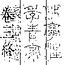



卷三终



卷之四目录



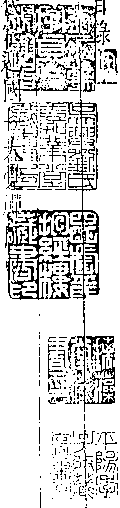



制𠡠



唐代宗迎国一大觉禅师勅



宋理宗蠲免径山和籴指挥劄



又帖



明太祖高皇帝赐径山宗泐免官说



成祖文皇帝勅谕



神宗显皇帝勅谕



附进大慧禅师语录奏劄　释蕴闻



序文



《正法眼藏》序　吴潜



古𪔂和尚《四会语录》序　宋濂



悦堂禅师《四会语录》序　宋濂



重刊寂照和尚《四会语录》序　宋濂



愚庵禅师《四会语录》序　宋濂



送月江禅师住持径山寺　贝秦



重刊《镡津文集》后序　琇禅师



《痴绝禅师语录》序　尤𤋾



赠一清和尚住径山序　张益



《径山集》序　李照



重刊《径山集》序　方壹



重刊《五灯会元》募缘文　陆光祖



《径山志》序　释德清



化阳和王舍田疏　释了明



题传衣庵缘册　陆光祖



重建大殿募疏　沈季文



径山佛殿缘起　释真可



议复化城缘引　冯梦祯



题重兴化城接待寺疏　吴用先



重兴化城寺疏　黄汝亨



募植松杉引　释广印



《西方合论标注》䟦　释如奇



卷之四目录终



径山志卷之四



汶上李烨然删定



海阳徐文龙、鹿城陈𢡟德订



虞山宋奎光辑



制𠡠



唐



代宗迎国一大觉禅师



朕闻江左有蕴道禅人，德性冰霜，净行林野。朕虚心瞻企，渴仰悬悬，有感必通，国亦大庆。愿和尚远降中天，尽朕皈向，而不违愿力，应物现形。今遣内侍黄凤宣旨，特到诏迎，速副朕心。春暄，师得安否？遣此不多及。𠡠令本府县供送，凡到府州，开净院安置，官吏不许谒见，疲师心力。弟子不算多少，听其随侍。



宋



理宗蠲免径山和籴指挥劄



淮淛发运措置和籴所状凖省劄。备据临安府径山兴圣万寿禅寺特差住持僧心月状奉：本寺系朝廷第一祈祷雨旸感应去处；累奉圣旨蠲免诸般差、科、敷、役等事，竝有省劄。昨被不照，敷籴米九千餘石；本寺九月内具奏，恭奉圣旨宣谕平江府发运，照上天竺恩，蠲免科敷，即具依应。闻奏已，得余发运呈免，回奏讫。元照本寺已得指挥蠲免。劄下平江府发运司及本寺，照应永免科籴之患，劄付本司契勘。去年承准蠲免和籴指挥，禀尚书省准此，本所照得，昨凖朝廷指挥抛籴。淳祐十一年，分百万仓米斛，本所凖行，照劄行下诸县劝籴。当年九月二十三日，据临安府径山兴圣万寿禅寺知事僧悟心状理，各县不照指挥蠲免，敷籴米九千餘石。窃念本寺安众浩大，与官民户事体不同。况上天竺与本寺恩例一体而行；上天竺既照指挥不科，本寺亦当蠲免。乞照例行下各县，照应免科。本寺年例劝籴米，𨽾籍诸县计九千餘石。今据本寺状，乞蠲免，以为供众之用。但上项米皆系已派定数，本所遂别行指挥各照诸县之额，且与从免。帖长洲、常熟、昆山、嘉定县，将所劝本寺米斛免籴。仍帖径山万寿禅寺，照应永免。准前项省劄，伏乞照会申闻。



帖



据径山能仁禅院知事僧净鉴状，称本院承前住当山讷和尚退居庆恩院住持。小师惠初等立据，说是庆恩院一针一芥，竝是本师将衣钵钱建造殿宇；并置田地，准备养老送终、香火安众、焚修追远去处。今来本师化去，真身归殡径山白云庵建㙮。每年忌辰祭奠，实无所出。集众小师议定：每遇忌辰，就庆恩院常住取。先是，本师原用衣钵钱置到田地数内，拨米二十石入径山白云塔头追修及香火支用。且净鉴委见佛海妙空讷和尚于庆恩及径山之住持功迹；切恐庆恩院日后忽作名色，更改住持；於斯难为分雪。乞执状立石，永远为照。每年不拘水旱，支拨前项米斛，贵得香火不绝。司府寻行下僧司勘会去后。今据本司申结，寻即差人前去勘会责。据庆恩院甲乙住持僧惠初等状，为见本师妙空佛海大师昔住灵隐寺，过此，因见金人焚毁，空地一方；本司即将衣钵钱於上建造殿宇，轮藏库司具备，退归径山白云庵。蒙司府给帖，今惠初於小师数内轮差一僧，作甲乙住持，为国焚修。本司又将衣钵钱置买田地贰拾餘顷，因界打量，尽归本院常住，为户所收花息，永克香灯，次备供众追远之费。师于绍兴五年，奉𠡠住持径山，建塔白云庵。请僧在此看守；责令庆恩院常住，每年供上白糙米二十石。惠初与小师议定：本院实立文据，付径山塔为凭，令蒙勘会；且惠初等委初诈胃诸般违碍等情，所供是实，如有异同，甘罪不辤。又据径山能仁禅院知事僧净鉴状，词入石即无诸般违碍等事，所供是实，如有异同，甘罪不辤。本司所据各人供证，委的即无诈冒。除责状入案外，保明是实。乞照会施行，呈奉台判行照。



大明



太祖高皇帝赐径山宗泐免官说



世人灾害有三，往往皆不自知，故其灾害周流方寸间，日夜无息，古今未尝有能尽去者。所以释迦成道，教化众生，指迷破昏，乃云灾害之三者，曰贪、嗔、痴。斯三者孰能不备？孰备而不殃？所以古今不备者，圣人是也；虽备而不殃者，贤人是也。洪武九年春，遐游天界，见住持僧宗泐博通古今，儒术深明。询问僧之苦行，本面家风，果幽静。𠊓曰：「是僧动止异常，因识儒书，大知礼义，又非林泉之士，於是朕命育发须以官之。」当时本僧姑且奉命而不辤，待至发长数寸，将召而官之，其僧再辤而求免，愿终世于释门。吁难哉！世人之於世，谁不欲富贵、妻子，名彰於世者欤？是僧却富贵，弗美妻妾，可谓三害之中善却一者欤！人将谓是僧生性淡薄有是欤，抑玄悟之有知而若是欤？不然其僧性淡薄玄悟，不可以言貌而见。盖丈夫之气，初志不夺，斯僧是其人也！特听免官放老山林。其世之三害，僧不为一害所迷，妙哉！



成祖文皇帝𠡠谕径山赴会僧



朕惟佛氏之道，清净慈仁，弘深广大，包含万有，贯彻微妙，利益幽明，功德无量比者。仁孝皇后崩逝，举荐扬之科，启无遮之会，广集僧伽，讽扬经典。百日之间，嘉祯翕集，慧灯降于舍刹，法云覆于绀园。绣绚五文，辉灿诸品，毫光累现，众彩毕呈。天花雨宣，满祗林之宝树；缟寉飞舞，绕碧落之旛𣄢。佛之舍利，或流辉于梵宫，或腾耀于宝塔，开照空之菡萏，烂涌地之摩尼，动若骊珠，炳焕午夜，晃如虹彩，烛影丹宵。宝殿之前，圆结金梅之果；长干之境，秀产琼芝之祥。若斯显灵，难以悉举，皆由尔众毘尼克谨，梵行清修，澜翻八藏之文，悟解三乗之旨，秉至诚以奉朕命，摅精意以扣佛慈。其中亦有至人，道化高妙，飞行变化，隐显莫测，感应朕诚心，来临法会，证明善功。朕德薄有未能知，藉兹众善，遂致感通，睹瑞应之蕃，臻想神灵之济度。超游极乐，信有明徴，朕实欢愉，特加褒奖。夫观百川之流者，必至海乃止；亏一篑之功者，则为山不成。尔等益勤精进，庻永谢于尘缘；究竟真空，期早登于觉地。利生助化，翼我皇家。钦哉，故谕。(永乐十五年十月十五日)



神宗显皇帝𠡠谕杭州府双径寺住持通会及僧众人等



朕发诚心，印造大藏经，颁施在京，及天下名山寺院供奉，经首护𠡠，已谕其由。尔住持及僧众人等，务要虔洁供安，朝夕礼诵，保安眇躬康泰，宫壸肃清。忏已往愆尤，祈无疆寿福，民安国泰，天下太平，俾四海八方，同归仁慈善教，朕成㳟已无为之治道焉。今准钦差蘓、杭等处，提督织造兼理蘓、松、常、镇税务，司礼监太监孙隆奏请，前去彼处供安，各宐仰体知悉。钦哉，故谕。(万历二十八年九月初三日)



附进大慧禅师语录奏劄



释蕴闻



臣僧蕴闻窃以佛祖之道，虽非文字语言所及，而发扬流布，必有所假而后明。譬如以手指月，手之与月，初不相干，然知手之所指，则知月之所在。是以一大藏教，为世标凖。于今赖之臣山野微贱，遭值圣明，屡获瞻望清光，禀承音旨，圣言高远非凡所及，斯道庆幸有待而兴。窃欣希阔之逢，敢陈诚切之恳。伏念臣先师前住径山，大慧禅师宗杲敏悟英发直受正传，善巧方便开悟后学。其平日提唱语要，臣随处记录，皆已成书。既为《广录》三十卷，又为《语录》十卷，谨缮写诣阙上进，伏望万机之暇，俯垂省览。臣又伏见真宗皇帝景德年中，以僧道原所集《传灯录》颁降入藏。今臣所进先师《语录》十卷，欲乞圣慈依上件体例，特赐指挥亦令入藏，用广流通，使后学皆得预闻，在先师益为不朽。臣无任战灼，俟命之至。



序文



------



### 《正法眼藏》序



吴潜(字毅夫，宋相国)



此事亘古亘今，漫天漫地，端视侧视，直视横视，开视阖视，明视暗视，无不视，亦无所视，亦无无不视无所视。直敢道，谓正即离，谓法即尘，谓眼即凿，谓藏即塞，是故这四个字，直须撇向大洋海里，方免担枷带索，受人圈䙌。然虽如此，初机钝根，也要得一则半则胡言汉，覻来覻去，绽些光景。此时正好𢬵命舍身，单鎗直进，如老鼠入牛角，挨墙拶壁，更无去处。正迷闷中，猛忽地头破额裂，通身流汗，得个休歇，始知法眼、慧眼、天眼、佛眼，只是一双凡眼。到这里说道学人事毕也且未在。履斋老子即说偈言：「若以色见我，以音声求我，是人行邪道，不能见如来。」



《正法眼藏》已足槩妙喜家风。顾当时入室，如张无垢，犹以忠国致疑，而公独抉开四字，直示五眼，宣扬妙旨，无此痛快。嗟乎！公可谓了窥印度，警策迷方者矣。公相业冠赵宋，所在尸祝餘杭亦有专祠，人苐知为洞霄提举，而不知实径山津梁也。故录此以存什一云。



古𪔂和尚《四会语录》序賛



宋濂



古𪔂禅师铭公，以临济十七世孙，四坐道塲，为黑白之所宗仰。一旦祝𨤲江淛省垣，现白光三道。丞相康里公见之，极加敬礼。未几将示寂，语其徒曰：「观世音莲台至矣。」安坐而逝。及火化，舌根齿牙数珠俱不坏，五色舍利灿烂无数。国史危先生已摭其行业，为文勒诸碑，而《四会语》未有序之者。师之得法上首，今天界禅寺西白金公属濂作之。濂览已，合爪言曰：「是真正语，是不著有无语，是雷轰电扫语。学者随所悟入，如慈云徧覆，法语普沾。小大根茎，皆获生成。非入正知见，具大力量者，孰能与于此？呜呼！世安复有斯人乎哉？非果无之也，求其真淳无伪若师者，鲜也。」濂既为叙其事，复歆艳之。歆艳之不足，复作伽陀一章賛之。其辞曰：



我观我师四会语　一言一句皆真实  

河沙妙义总含藏　其中无餘亦无欠  

及至能所齐泯时　欲觅片言不可得  

有如十万虚空界　种种色相皆现前  

或飞或潜或动植　以至洪纤高下等  

枯荣生死及崩竭　了然不𣑱虚空相  

而亦不出于虚空　真相如如不动故  

卬昔尝登寂照塲　耳边一喝三日聋  

惟聋故使功用绝　绝后通身皆是耳  

自兹出世入翁川　翁川海水亦生耳  

但闻鱼龙哮吼声　即使波涛增汹涌  

继升补陀洛伽山　合掌问讯观世音  

目能观色耳闻声　音声何独以目观  

不知本来无耳目　见所不见闻不闻  

尽大千界无碍者　中天竺国凌霄峰  

所谈妙法皆如是　只因妙法法难思  

结集已落第二义　睂间放出白毫光  

七宝莲台向空至　此皆游戏神通事  

于师之道不相摄　师之道大不思义  

千古賛叹莫能尽　姑以第二门中观  

可以洗空于结习　可以触动于悟机  

可以速证于菩提　是宐流通于世间  

视如照耀光明幢　我言或诬有如水



------



### 悦堂禅师《四会语》序



宋濂



根有利钝，故所教有异同；悟有浅深，故所印有大小。施其善巧之力，释彼结习之固，非假言辞难穷实际，所以达摩历辨于六宗，临济有发于三要，照耀今古，函葢乾坤，兹其为巨浸之舆梁，作昏衢之灯烛也欤！有若悦堂颜公禅师，以东屿正嫡，弘西来大宗。初住昆山之东禅，转吴门之万寿，升虎林之南屏，遂陟双径。树大法幢，凡四坐道塲，名闻京国。遣使者再下玺书，护其教，且有金襕法衣之赐。藩王大臣无不函香问道，黑白骏奔如众归市。禅师随机接引沾被为多，其善诱弗倦，则春气津津，太和袭人也；其发蒙撤蔀，则翳卷太清，冰释洪河也；其警省振励，则震雷虩虩，䘮厥匕箸也；其含弘摄授，则山不让尘，海不择流也。由是而观，所教有同异，非根有利钝者欤？所印有小大，非悟有浅深者欤？前谓施善巧释结习，假言辞穷实际者，其道岂不在于斯欤！昔者先师黄文献公，现宰官身，敷宣般若，与禅师为方外交。而禅师受度婺之宝林，又在予父母之邦，𥡴兹缘契，实繁中情。禅师上首南峰珵公，得法最蚤，乃出《四会语》，俾题首简。予窃闻之，入奥室者能探于幽邃，升危岑者始瞩于㝠𣴭。松月大师印公，禅师之狮子，法海之长鲸也。其称禅师之道，高于圆照、佛照二公，其言岂虚发者哉！惟贤知贤，益可徴矣。仰前哲之风，徽作后武之矩度。究其遗辙，足证新功。是录之行，其必有超然独得于语言之外者乎！



云栖曰：《四会语录》今无存。松月亦未知何许，而曰：「道高于圆照、佛照」，夫二公岂易及哉！」而曰：「过之」，更俟贤者考正。



重刊寂照和尚《四会语》题辞



宋濂



寂照和尚元叟端公既示寂金华，黄文献公为铭其㙮，蜀郡虞文靖公为序其《四会语》，二公以文辞名天下，亦云备矣。其入室弟子清泰子楩、金山惠明、天宁祖阐，复合辞请曰：「旧刊所录先师语，不幸毁于兵。然非此，无以见道之所存。窃惧不传，子楩三人者已恊力命印生重雕之矣。敢重以首简，请为序。虽然序犹可略也，先师事迹多涉神异状行者，辄讳而不书。神异之事，大乗者固所不乐闻，苟录以示入道之士，亦足以起其正信，初何伤乎！愿并识之序中。」予不敢辤。𥡴子楩等言，公平顶古貌，眼光铄人，颔下数髯，磔立凛然，如雪后孤松。坐则挺峙，行不旋顾，英风逼人，凛如也。所过之处，众方讙哗如雷，闻履声辄曰：「端书记来矣！」噤默如无人。賔友相从，未尝与谈人间细故。舍大法，不发一言。秉性坚凝，确乎不可拔。自为大僧至化灭，无一夕脱衣而寝。其从南屏归化城受经，夏夕启窗而卧，忽一梵僧飞锡而来，与谈般若枢要，亹亹不绝。未几，腾空而去。虎岩师主双径时，尝言道家者流，有上章谒帝者，其还甚迟，因叩之，答云：「为𨕖径山四十八代住持，故天阍久不开尔。」公正符其数。公朝京师，梦径山潭龙君，持金匙举食食公，数凡十又八。公主法席，实十八春秋也。公将示灭，所剪爪发，留瘗化城幻有庵。逮启视之，舍利累累然生矣。公之遗事有若此者，皆宐补书以见于世，不可略也。葢公道契佛祖，名震华夏，诚堪舆间气之所鍾。其祥应之至，亦出自然，非苟涉于神恠者比也。文献所谓「门庭之盛，规重矩叠，法雷普震，裂地轰天」，文靖所谓「譬诸名藩，镇以宿将，隐然持重，风霆不惊，握机行令，舒卷自由，足以使方城连戍，有所仰放，不敢逾越」，其言诚不诬哉！濂何敢复賛一辞？颇念文靖之学，粗闻而知之，又执弟子之役於文献之门者最久。於是勦其绪论，重申之如此。呜呼！公之《四会语》，其尚假濂文以传之哉！子楩，字用堂；惠明，字性源；祖阐，字仲猷，皆设化一方，黑白咸皈仰云。



------



### 径山愚庵禅师《四会语》序



宋濂



或问于濂曰：「世间至大者何物也？」曰：「天与地也。」曰：「至明者又何物也？」曰：「日与月也。」曰：「然则佛法亦明且大也，其与天地日月竝乎？」曰：「非然也。」曰：「其义何居？」曰：「天地日月寓乎形者也。形则有成坏，有限量。虽百亿妙高山，中涵百亿两曜，百亿四天下，以至於恒河沙数皆有穷也，皆有止也。此无他，囿乎物者也。若如来大法，则不然。既无体叚，又无方所，吾不为成，孰能为之坏？吾不为后，孰能为之先？吾不能为之下，孰能为之上？𦬆乎，忽乎，旷乎，漠乎，微妙而圆通乎，其小无内，其大无外，真如独露，无非道者。所以超乎天地之外，出乎日月之上。大而至于不可象，斯为大矣；明而至于不可名，斯为明矣。是故以有情言之，则四圣以至六凡，或觉或迷，佛法无乎不具也；以无情言之，则火水土石与彼草木，或洪或纤，佛法无乎不在也。三乗十二分教，不能尽宣也；八万四千尘劳门，不能𣑱污也。呜呼！罄徂徕之松以为煤，断淇园之竹以为管，其能尽賛颂之美乎！然而佛法固明且大也，其灵明之在人者，万劫虽远不离当念。一念不立，即证菩提，亦在夫自勉之而已。」濂虽不敏，每遇学佛者，喜谈而乐道之，初不以其证入浅深，而有间其意，颇有见于斯也。径山住持以中禅师，名智及，学徒尊之，号曰「愚庵」。俗姓某，世居姑蘓，得法於元叟端公，历住隆教、普慈二刹，帝师锡以「明辩正宗广慧禅师」之号。已而，升净慈，遂主径山。四据高座敷扬佛法，以耸人天龙鬼之听，缁素相从如云归岫。其弟子某会粹成书，介吾友用堂楩公请文以题其首。濂悬灯而疾读之，其解人胶缠，如鹰脱绦鏇，摩云而奋飞也；其方便为人，如慈母爱子，一步而三顾也；其宏机密用，如大将临阵，旗皷动而矢石集也。诚一代之宗师，而有德有言者欤！虽不二门中一法不存，何况于言？览者，当求禅师言外之意，使意见两忘，而忘忘亦忘，方近道矣！呜呼！佛法超乎天地之外，出乎日月之上，岂细故哉？人患不求之尔！今极其賛颂，而书于此录之端，实欲起人之敬信也。绘画虚空，非愚则惑，濂葢无以逃其责矣！



送月江净禅师住持径山寺



贝秦(国子司业，金华人)



自古沙门虽息欲归于无为，而好与贤士大夫游，何也？葢其人，乃世之颕敏悫愿者，假浮屠之名以为高，托文章之流以为胜，如道安於凿齿、慧远于元亮、道林于居易、文畅于退之、宗元。彼尊竺土之法，此服先王之教，二者固未尝不相侔，而贤士大夫亦乐与之游，浸滛乎恬淡枯寂之境也。月江净禅师，颀身伟貌，德本宿植，觉由性禀。以真乗法印，叅儒典竝用，默而能融，辩而不肆。所著诗文皆有足观，尤以接物利生为己任。总司闻其贤，举公授径山住持。夫径山天下首刹，唐代宗朝国一钦禅师为开山第一祖。得其传为大慧杲，杲传佛照光，光传妙峰善，善传藏叟珎，珎传元叟端，端传灵隐幻隐明，明传正庵訚净。师乃正庵法子也。往时翰林侍讲王公时彦，在秘阁纂修，少师姚公实总其事。二公论及东南名僧，净师亦居其一。师推悟理而信，故于孔氏之学，习而不懈；释氏之教，行而不怠。虽小戒律，如践青折萌、盥手泛席之类，未尝放心。是故异夫纵诞谲乱假托之所为者焉。观少师姚公所𢰅重修记、春坊大学士曾公灵徴记，则净师之历职功行，贤士大夫之敬礼推许，从可见矣！况径山与竺乾鹫岭，𪔂峙角立，净师又得正庵嫡传。方今朝廷清明，裒崇释道，而净师蹑空驱锡，舍筏振尘于五髻凌霄之间。说法度人，脱去秽累；行道化凡，超诣觉路。兴起少林、妙喜之家，世以擅重于千载之后，此香火缘也。予虽非退之、宗元文章之流可以增高益胜，然有乡曲难忘之情。故其行乐为致辞，以告于慕道风重文雅好事者云。



洪熈元年乙巳春，三月十有七日



------



### 重刊《镡津文集》后序



琇禅师



学有及物之功，文为载道之器。学而不能利乎物，徒学也；文而不能衍乎道，空文也。若夫推其道，发于文章，肆其学，以援斯人，宋明教嵩禅师其人欤！嗟夫！吾佛之教法，心法也。生灵同而有焉，但为虚𡚶所蔽，不能显现。汩四生沦六𧼈，何由得已哉！而吾佛愍之，以此心法，随噐而谕，俾各得乎本有。或者不仰恩怀德，反生讥毁，是则自毁其心，非毁其教法也。教中所谓，世智辨聪，八难之一，且不信而毁，又为虚𡚶所蔽。若虚𡚶所蔽，或能了𡚶即真；不信而毁，则自昧其心。犹种之败芽之焦，不复有发生之日矣！得不尤可愍哉！而明教性禀生知，能体佛意，学则必欲援世，非徒学也；文则必在明道，非空文也。况是时天下学士，宗韩氏以拒我。故劝书原教诸文，不得不作焉！学者总梓，号《镡津文集》。斯文行世，真救世明道之要术也，可一日而无哉！旧版湮没，人皆痛惜。嘉禾天宁首座天全叡公，乃东海慧眼弘辨禅师之弟子，施衣资，重梓流行，其亦明教之心也欤！板既成，请叙其后。蒙晚生读其文集，有不得执笔从游之叹。今获厕名于后，不亦大幸乎！不亦大幸乎！



此六十二代祖师琇公𢰅文也。旧志第载其倚杖而逝，未详说法。因存此文，以表其一班云。



------



### 《痴绝禅师语录》序



尤𤋾(号木石，锡山人)



径山痴绝禅师既示寂，其徒了源，以师平生提唱语一编示锡山尤𤋾曰：「子知吾师者，盍为叙引以传？」余晚识师，得其数语受用，因不复辞。余观近世尊宿语录，多成窠臼，惟痴绝师独较些子。盖其得处超轶，用处洒落，故平生室中，不许人下语。专以此着，罗龙打凤，而学者鲜能凑泊。门庭高峻，屹然宗匠之灵光。今也则亾，徒存劒迹。非其种草，孰识苦心？必有护持，流通久远矣！



------



### 淳祐辛亥端午日序



### 赠一清和尚住径山禅寺序



张益(苏州人，修𢰅)



杭之径山禅寺住持虚席，僧录以为兹寺乃五山之首，补厥处者，非戒行学业敻出于其众者不可。於是加慎择之，而得一清，天上人焉。右街、善世两庵宗师，即举之于礼部。上人领劄南行，中外士夫需言为赠。上人生江右文献之邦，为名家子，自幼学出世法于庐陵邑之多宝寺，正宗和尚实为厥师。上人根性坚利，志力勤笃，遂能因师之教，悟玄义于杂花。视师之行，绝三业于满分。既而观光上国，复承指授於僧录右街觉义云海和尚，获掌藏钥于弘慈普应禅师，前天界住山会中。正统初，得古刹废址于都城西山之麓，慨然有兴复之志。由是罄鬻衣资，并募众缘，度工庀材，招提是建。事闻于朝，得赐额曰「弘庆禅寺」，而上人遂为开山第一代住持。兹之膺荐，而有径山之行也。得不由其行业之素著千人乎！予闻径山众灵，所萃五峰高耸，乃国一钦禅师卓锡之地。自唐至今历世已久，自国一以来，相续而主兹席者，盖六十有餘人矣。上人当视其行业，与己何如哉？同其所同，而勉其所未至，俾列名于诸师之间。人将指而议之曰：「此可为径山之贤住持也，此可以振后而光前也。」则上人之所得者，不既多乎是用，书而赠之。



------



### 《径山集》序



李照(宋叅军)



天下山水奇秀，则吴、越称首。越则有天台、四明为尚，吴则有天目居最。径山乃天目东北峰，比诸峰又复奇胜。其顶则五峰周抱，中有平地，实洞天耳。承天禅院居北焉，余闻是山是寺之名久矣。大中祥符辛亥，奉命司宪于郡，日无清暇，故莫遂访焉。今年孟夏，既获美代，心腑清适，有命驾之兴，快畴昔之素。俄至于是，见其峰峦胜异，草木鲜莹，基构高下，甍檐萦带，非丹青之可状，非咏歌之可记。乃问诸僧开山之事，始先贤之灵迹，其说颇骇人之耳焉。再徴其据，乃得石碑数片，旧录一卷。考其事实，得诸僧之说半焉。而又乗笔者记述事迹，或得前而遗后，或得后而遗前，观之者莫能尽见始末之实。余惜此山之奇绝，高先贤之茂行，痛其郡记错杂，难尽行于世，使好事者不能传之。乃命笔总集其事，使终始一贯，前后无失。然其事得於古石者存之，传于人口者勿载，欲后之见者不复疑焉。



------



### 重刻《径山集》序



方壹



凡集之歆慕於当时而传於不朽者，非以其迹，以其实。迹无实，罔以徴；实无迹，终莫能废。故古之圣贤所遗之坟索《诗》、《书》、《易》、《春秋》、《礼乐》，以至百家子史等籍，皆灿然千古犹一日也。何哉？以其有实之可以垂教万世，而为法於天下耳。我宗门自竺乾七佛迨於六祖，以及千七百家，咸有经论篇章敷宣无量妙义以显示真宗。故自周抵今之喆圣明王、公卿大夫士，往往尊崇之不替。而与孔孟之道偕存者，盖亦以其实之有在也。径山名列天下道塲之首，岂以山盘踞之奥胜，与遗迹之繁夥也邪？实由于唐之开山国一钦公，与无上宗公、法济𬤇公之廿数等，皆以性地朗彻，法境晶莹，其衜足以当代宗皇帝之诸圣眷伫，钦承历朝之群公企仰礼下，而可垂教为法于后世耳。暨是，涉五代，届赵宋，而大慧杲公者相继辈出，又且二三十许员，皆雷轰电掣，狮吼象骤，诚谓古佛递现，真宗迭显者也。故宋帝孝宗屡赐玺翰，及御制真讃，以嘉赉之。鉅公如魏国张浚丞相、张商英侍郎、张九成之诸贤达，前后相叅叩，承事而弗斁。抑又岂非以其实之所召与？是故道塲居称天下第一，固无忝於径山矣。世欲考见已上诸家之实，其玄猷玅旨备载《五灯会元》，条然可讨，攟摭浩繁，兹弗克悉缀。至欲求访往古事迹，则必身临于境，自可槩得耳。以迹以实，惟世之君子取之焉。是集旧有刻本，历年兹久，书亾板废有日矣。今年首春，寺主僧尝董治楼殿诸冗事者，正璠也。虑其愈久而愈失之，荐至无所从考也，乃搜厥残册断编，聚钵资倩工，依抄本重缮刻之，以𦖂存其故。住持自唐国一祖师至此，共凡八十代。梓既讫，持一本示余，请以序弁诸端。余即展以阅之，见其中间鲁鱼亥豕者屡出，余顾谓之曰：「曷为若是？」璠曰：「板失罔所据证之也。又祖上之遗籍，后人莫敢妄为之臧否耳，姑从其敝为是。」余遂廼弗再诘，而撮其略与为之序。其传互之故，葢白璧蝇玷也！从来既远，咎靡所质矣。幸大方观者抉其梗概而遗其譌缪，付之以辗然一笑云尔。



重刻《五灯会元》募缘文



陆光祖



夫佛道东流，而至晋宋齐梁之间，学佛者竞以名理禅观相高，莫竟本心妙明之体。自达磨大士来至此方，始唱直指人心，见性成佛。传至六祖能公，斯宗大振，厥后五宗竝立，门风峻甚。其圆机密，义不可以随言而解，用智而求。至於扬睂瞬目，或喝或棒，所以阐呈真体，愈出愈奇。有省者，若痛处吃拳；不会者，如聋人闻鼓。而肤识之士，乃或病其难通，訾其诡异。葢由钝根之无入，则谓圣言之有隐，大抵然也。然开元之后，宗教大明，上至旒冕簪貂，下及贩樵孺妇，往往能响答玄言刃游道妙。当斯时也，见性知心，超凡入圣，上下数百年内，先后几千万人，自两仪分奠以来，未有若斯之盛者。何儒门淡泊寥寥如此，释教流通林林如彼？其故何欤？良以道䘮多岐，智分穿凿。仲尼没，而时乎不再；颜渊死，而今也则无。官失而求之四夷，学绝而传诸方外，一晦一明有由然矣！至宋巨儒周元公、程伯子，乃能旁寻坠绪，密阐心宗。伯子叹曰：「我於天壤之间，直自孤立。伊川晚阅内典，遇异人始明此学。」考亭暮年亦曰：「达磨尽飜窠臼尤为高妙，乃知齐佛老为异端，非程朱之定论也。」由是言之，维释与儒，自唐及宋，晔然其两盛矣。自兹而降，去圣时遥。儒昧通方，释拘义学，由是西来妙旨，东土希声。所幸教外之单传，具载《传灯》之五录，济禅师以其书浩博，撮为《会元》。斯固庄生所讥，圣人已往，而糟粕徒存焉者。然而求道之人有能因言筌穷理窟，玩其要妙言，嚼其无义语。日由绎之，夕鑚剔之，忽焉而锯穷木断，水到渠成。所谓因指以见月，假筏而渡海，亦易易焉。则是此土此书之不可一日无矣！近者书残板毁，教末风微，有径山大慈上人苦行薰修，发心弘济，欲复募缘刻梓以惠后人。不远千里而来谋，因乞一言而为倡。贱子幼慕神仙，每符瑞梦，既闻《鲁训》，知反求於六经。载遇竺坟时，泛观乎三藏，稍能通其一贯，会其殊涂，秪自讨论无谁告语。嗟乎！五千退席，悯增慢之难移；四十无闻，嗟寓形之易尽。愿与同怀之士，共成得道之因，敢以此书请同戮力。昔在先觉，有闻半偈而明心，或识二字而证果，矧二十卷之活句，诚百千劫之奇逢。入此法门皆当作佛，傥有通微俊彦，慧彻高贤，尽舍床头阿堵物，成就世间希有事，庻开来而继往，亦自度而度人，不亦伟与！幸无胶泥曲儒谈曰：「非吾孔氏之书也。」



------



### 《径山志》序



释德清(憨山)



域内名山大川，方舆载籍，志之详矣。不志，则无所考其源流，穷其窈眇，探其灵胜。故使览者披图了然，若身履其间，谓之卧游，岂徒说哉！及佛法入中国，则琳宫梵宇皆托迹于名山胜槩者，在在星罗，此葢道脉潜流，殊非探奇仰异者比。古称方志为野史，而佛法之志则僧史也。苟无所考究，则何以溯法界之真源乎！维双径乃东南奇胜，昔称法窟，况自国一开山，固多灵异。以其山自昆仑面东走，雄峙五岳；而南干自衡湘迤逦驰数千里，直耸黄山白岳；而飞涌二目融结兹山，以鍾灵秀故，佛刹始创。唐大历年间而历宋元我明，上下千载，其间相继雄长法门者八十一人，非山川蕴结之厚，又何能若是之悠且久耶！国初尚不乏人，顷百年来法幢倾圮，殿宇隳頺而僧徒寂寥。万历己丑间，达观禅师蹶起立宗门，赤帜海内，由是知有人焉。时创刻方册大藏，初议五台，而兹山僧徒蠒足数千里，往请于此。未几而果迁于山之寂照，而殿宇亦因是以重新，乃法轮再转之机也。居顷之，冯太史复议启古化城为藏板地。适直当道藩臬诸公，有深心者，竟恢复之。达师入灭，弟子𣽃居铠公，克荷其业。而达师竟得塔於鹏搏峰下，与大慧同条，是岂小缘哉！然昔之住兹山者，虽善扬宗乗，但引法海之一滴耳。今则全摄如来藏海而注於兹，为法门之全提，则因缘胜前万万矣。黄贞父有言：「萧何入关，子女玉帛秋毫无犯，唯收其图籍，卒以王汉。」今大藏，乃法界之图籍也，今尽收於此。而拓法王之疆土者，必大赖於是矣。非此山之鍾气博厚，又何能负重法哉！呜呼！因修者易，创业者难，今中兴法门之大业，非图籍斑斑，后世将何以考焉？是《径山》之志，不得不作。而开疆拓土重在元勋，同为休戚始终者，则铠公不得不秉深心焉。其事已承餘杭令公戴君，入邑志於此。所关者大，非徒纪胜而已，故重辑之以便一家观览。予特为之序。



此憨公于万历丙辰过径山作也。时澹居铠公拟辑志，而预索其序。志未成，而序畱化城。因录之，以见两公夙志云。



化阳和王舍田疏



了明禅师



天下真胜境，烟云古宝刹。径山三千口，每人三寸舌。都来九十丈，谁能与渠接？水食沧溟乾，粥饭斛斗竭。油盐许多般，蔬菜更罗列。百事摠艰难，一身当不迭。特来谒郡王，故意丁宁说。冷处着把火，大家相暖𤍠。两堂坐禅僧，真个修行彻。心源湛如水，脊梁硬如铁。等心供养渠，因果岂虚设？福慧自庄严，共出轮廻劫。大根大行大财主，舍田一万三千畒。归依径山供众僧，饱暖安然度寒暑。两堂衲子欣欣然，高谈慷慨贤中贤。愿君福寿等山川，留与声名万古传。偈云：



做事须还烈汉　拈起笔来便判  

若要功果完成　切莫前思后筭



题传衣庵缘册



陆光祖



嘉靖己未秋，余与先学宪君，从千松得禅师之请，为修径山传衣庵，则万松林禅师灵塔在焉。葢宋绍定癸巳无凖范大师，奉诏住山，即后山搆庵，匾曰「传衣」。用黄梅付法之义，万松则无凖范十一世法嗣也。自修庵以来，又历三十五岁，而千松复化去矣。庵僧性悟，徒海耀，（悟者，余族姪也。）欲修葺頺弊，稍复旧观。谨撮其始末题之缘册，俾持以谒大方君子有所取徴焉。



径山重建大殿募缘疏



沈季文



㳟惟双径者，震旦名山江南胜地。自国一开山，首演牛头之旨，逮鉴宗继轨，兼宏马祖之宗。大慧杲师振玄风於宋世，元叟端师展顿教于元时，迄於昭代世不乏传，祖祖相沿，䋲䋲不绝。登坛秉拂，嗣法传灯者，八十一人；入室投机，悟道超凡者，莫纪其数。用是道以时隆，地因人重。虚空幻出楼阁，荆棘俄成宝坊。梵刹嵯峨，恍疑兠率之宫，从中天而下；法堂清閟，婉若祗园精舍，自西竺移来。乃今祖道凌夷，宫殿倾废。昔以狐兎窟宅，顿化琳瑯；今以佛祖道塲，几沦墟莽。抚今追昔，宁已怀思。兹有无边上人者，戒行精严，愿轮深广，覩此頺圮，实切拊髀。葢往曾于祖师会下发心，故今于人天众前，立誓愿殚一生精力，拮据经营，顾兴衰起废，匪孑力所能。而鸠工集材，实众檀是籍，将广募有缘，以共襄胜事。况此名区，神龙不难于舍宅；矧兹盛举，贤硕岂惮于捐赀？伏愿深心大士，宏力高流，各随心愿，尽力庄严。则黄金布地，何必让于昔贤？而宝殿崇成，自顿还乎旧观。岂惟既往与八十一祖广结无上净缘，抑且将来为百千万人助成出世道果。谨疏。



径山佛殿缘起



释真可(达观禅师)



双径冠世绝境也，自昆仑南来，翱翔万里。越天目而逶迤，隐隐隆隆，雄雌万状，势方奔舞，直趋东溟。而双溪一阻，则英灵秀杰之气，回而氤氲盘薄，怒拔于五峰之间，世为龙象窟宅。自唐国一钦祖开山，乃至宋大慧杲禅师，传心如贯珠，灯灯相续以迄于今。则去圣弥远，世与道䘮，僧不能转俗，更为俗转矣。夫经曰：「若能转物即同如来。」今不能转俗，竟为俗转，岂非现成肉佛自作众生？呜呼！一心不生，凡圣路断；一微涉动，𣑱净俄分。即此而观众生、诸佛，初无差别。了悟者，梦觉都除；未了悟者，不惟於无梦中作梦，更於大梦中强为己觉，殊可叹耳！昔佛经行时，俄指曰：「此地可建一梵刹。」帝释信手拈一茎草，插已，曰：「建刹竟。」比幻居讲主，作径山僧引进导师，不远千里，来曲阿见老汉曰：「径山众上人某，曾引渠䟦涉燕山，请开藏主，并祈旁鼓修殿严像。藏主已诺，会病未至，蒙大师代以幻余本公。今复迁化，则向求所举，似同说梦。故某与众僧，不惮劳勤，今更强颜求礼和尚。所愿不惜弹指，震大法雷，破众生痴梦，成就如上胜事。」老汉曰：「公等此来，既不为自己求，专为祖道。今老汉有转语举似公等，公等答以相应。即梦中说觉，觉中说梦。恣我舌端，无不可者。试问帝释插草，建梵刹耶？不建梵刹耶？建则琳宫宝坊了不现前，不建则佛与帝释，两皆脱空。」时诸上人俱以默答，老汉亦以默领。唯喝石岩旁观，不禁向老汉曰：「和尚不必抛掷古今，广打葛藤，国一、大慧鼻孔要与和尚不别。道开、法本虽皆梦中承当，和尚大须觉中著到。管取径山大雄宝殿，刹那成就，诸祖残棋，移星换斗。唯时王内翰于比部，只解顺水推船，不能逆风把柁。撺掇喝石生儿，并诸现前黑白大众，擎跽而请。唯愿和尚发大慈悲，勿孤负喝石，亦令某等各各愿满。」噫！



双径五峰江海秀　濑阳江彻影重重  

相逢若问谁家曲　管取声声落眼中



议复化城缘引



冯梦祯(字开之，南京祭酒)



刻经之缘始於清凉之妙德庵，地寒而峻远，役南匠转输工，力倍费功半，不得已而有径山之迁。径山为东天目正干，五峰攅廻，中开佛界，我东南胜道塲无逾此。而云雾笼罩十日而九，藏板其中最易朽腐，又不得已而有化城之议。化城踞径山之东麓，去双溪数里，地坦平无云雾，既便藏板而输工力，事事皆宐，因故址而新之。先为屋十间，令足以安经板处工匠，而化役徐俟其后，似无甚难举。今约同志以十缘倡之，缘五十缗。祯虽贫，勉任一缘。夫刻经大役，自北而南。而其南也，又自径山而化城，三徙而后定。而任事之人，始于密藏，继於幻予，而终之者又未卜何人也？因缘时节，惟佛与佛乃能究尽。而自剏缘以至未来，凡于此事曾舍一钱半铢，及一手一足之力已上，福不唐捐，直至成佛。而吾等与焉，岂不幸甚？



题重兴化城接待寺疏



吴用先(字体中，蓟辽总督)



余从紫栢尊者游逾二十载，所承钳锤锥劄罔所不至，通身𤍠汗不知透出几畨矣，末后以流通佛法付嘱。不佞唯唯徼天之幸，承乏越中，即悉心殚力，求刻藏之役。兹功已过半缘，成或有日矣，乃谋藏板善地，卜及化城。化城故宋佛日禅师宣公所剏接待寺，郎官杨汝明记之甚详，见《径山集》中。及我朝而香火犹盛，渐次凌夷，僧徒凋落，遂以寺田转佃於方姓者。转转相侵，尽为居隣所剥蚀矣。然其径，尚存化城巷之名，至今在人口。今年𣽃居上人图恢复之，而乡绅王中泉公首倡义举，愿以其地归寺，于是左右闻风者响应。乃𣽃居犹运慈心，量其多寡，各给其直。余于吴下，诸君子恊济之，虽未尽复旧址，从此诛茅建刹，亦庻几可观矣。然此非今日创议也，葢自冯开之司成始矣，而余又不知司成之原有此议也。一日𣽃公过余，持开之手卷见示，谓偶从密藏弃箧中检得之。余展阅疏引，即向时与藏公所谋，卜化城以厝经板者也。噫！奇哉！司成住矣，谋于十数载之前，而余与𣽃公成于十数载之后，不约而合，无心而成。九原可作，当为鼓掌。第胜地既复，梵宇𪔂新。向后更有许多商量，不无藉十方大檀之力，余小子亦不敢不贾勇从事。道化重兴，法轮当转。誓头目脑髓之不恤，而遑恤其他。



时万历辛亥岁浴佛日



重兴化城寺疏



黄汝亨



昔楚、汉相距，约曰：「先入关中者王之。」迢汉入咸阳，诸将竞取子女、玉帛，萧何独收秦图籍，以此知天下户口山川要害之处。然则大藏，固佛祖之图籍，而天下之名山胜境，固法嗣圣僧之关中也。此藏经板不可以无刻，而化城寺在双溪，踞径山之东，有林木而无云雾，作经笥工署甚善。寺故宋佛日禅师宣公所剏，为接待所，不可以久就堙灭。方伯体中吴公本经世人，负出世力，以𣽃居禅师净心湛智足以任此，遂欣然与化导经营，渐次恢复其地。先以厝置经板，而徐议诛茆建刹，𪔂新佛日之业。佛宝法宝才施法施，可谓一举两得，片刻千古者矣。而澹公复从弃箧中得〈劝缘〉一疏，亦为藏经名刹。经始此地，葢冯司成开之，与密藏禅师起缘于十数载之前者也。嗟乎！一真必应，灵山同会，司成之后有方伯，而密藏之后有澹居。谁为为之？岂非道念之合，符凡圣之证印者哉！而腐生侣理以拒真悭，人据欲而成鄙，弃经言於草莽，委佛地于荆榛。将令楚王不入关，而取子女玉帛者，之出图籍上乎？亦慈氏之所大愍矣！嗟乎！昌𥠖有言：「怠者不能修，忌者畏人修。」守虏殒躯，永隔圣路。假令去腐破悭，振怠销忌，知身外之皆长物，而性中之有觉塲。则方伯不云乎：「头目脑髓之不恤，而遑恤其他。」世间善信人，必当踊跃应缘，大者牛车，小者蚊负，不患资粮之不给，胜事之不成。不佞亨，即贫士乎！亦愿以螳臂当辙，涓滴输海也。



募植松杉引



释广印(闻谷禅师)



栽松道者曰：「亭亭三尺餘，欝欝覆荒草。不知何代人？得见此松老。」古人之为山门，何意味深长也。是山先有大池龙神主之，百万松杉欝苍深秀，而樵者不敢犯焉。李唐天宝间，有国一禅师自寉林来岩居穴处，为法亾躯。神以师道大德备，即献池居师。复化堂于池上，池寻涸，遂成伽蓝。相承住持者八十七人，雄殿杰阁，奕世庄严。至万历间，大殿倾圮，唯妙喜塔、龙王祠仅存焉。中吴居士沈太素公布金重建，落成于三十六年戊申。然贸材千里之外，道经扬子、孟河，材几失，人几䘮。予闻艰苦为之涕零。及至双溪骤雨，溪涨随流飘入丘陵蓁莽间，转运登山，费将十倍于材矣。念兹䟦涉，安得不预为之计耶？遂同桂庭上人，恭𡭊龙神立誓，募缘置买本寺佳山四十畒，栽植柳杉五千柯，谅过五六十年可成梁栋矣。山高雾重，殿宇不坚，他日或修或造，材木资于本山，何其易哉！噫！今之视后，虽世殊事异，其难易可知。后之视今，虽不见其人，见其心亦将有感於栽松道者。



题化城慈门师募斋僧缘疏



宋奎光



余尝谓恢复难，而守成则尤难。昔光武以帝胄起，诛簒莽，非不称一代中兴令主。顾永平之政，综核操切殊甚，向非章帝长者每事务从寛厚以矫枉救獘，则东京之业衰矣。嗟乎！守成岂易言哉！化城故宋宣禅师道塲，正德间为居民簒据，𣽃居毅然为请复之，举徒众未免杂霸。以故故址虽复，而人心未必尽悦。去冬澹居化去，难其主者本石吴先生，为请慈门住此。葢先是慈门以化城无佛，自吾虞山装造大佛一尊供此，已是化城第一功臣。论功禅位法应慈门，而复德噐冲和，正如东汉所谓慈祥贤君，可与更化者，其为化城灵长可知矣！顾化城旧以接待得名，即今为往礼径山者必由之路。二时饭食，慈门不能为无米之炊也，则不得不仰给于十方。善乎贞父黄先生之言曰：「天下名山，佛之关中；大藏，佛之图籍也。」今得化城为置藏之地，则既奄有关中，并获图籍矣！至于转输运粟，端在信施。即今朝鱼暮梵且不能宿饱，则重茧而来者，枵然待食可知。佛说六波罗密檀施为先，众生三毒轮廻，破悭第一。矧人命无常，一息不继，都为长物。何不以有待之资，作无尽之福？伏愿十方信心，念化城正中兴之候，转输值告急之秋，随力随心，普为运济，则恢复功臣不独𣽃居与慈门已也。试观云水骈集禅悦饱满，回向信施因果昭然。当必以吾言为不妄者，因为题其册云。



《西方合论标注》䟦



喝石如奇(寒灰)



往予携郢中张明教，叅访袁中郎先生。一日出《西方合论》相视，予惊叹其禅土合源，超绝乐邦诸典。从中有未甚了解者，随请质先生，命明教标注其首。及持归南中，每欲梓以度世而未就也。岁己未，海虞瞿元初终后，遗法财见施。予即就其灵前，许刻经十卷，荐其往生。适从吴门瑞光卧病，为忆前愿，因检付袁无涯，重为诠次讐校，而属吾徒性成董其役，一以报袁先生法施之恩，一以了瞿元初施财之愿。至於𢰅述之精详，议论之卓越，是以明眼者自得之耳，予复何赘。



径山志卷之四



卷之五目录



序文



募刻大藏疏文　释真可



募刻大藏文　释道开



刻大藏缘起　冯梦祯



又　陆光祖



赠幻于、密藏二上人刻大藏序　陈瓒



刻大藏缘起序　王世贞



又　汪道昆



刻藏缘起述　曾乾亨



募刻大藏唱导文　瞿汝稷



又　傅光宅



又　于玉立



又　虞淳熈



又　管志道



又　张寿朋



宋文宪公护法录序　钱谦益



题无生募铸铁瓦文　释传如



又　沈㴶



又　沈演



又　黄汝亨



又　文震孟



又　钱谦益



又　周祗



化城寺迎佛饭僧缘疏　钱谦益



安乐寺募建殿堂及供单缘起　王在公



安乐寺重建禅堂疏　钱谦益



募建普庆福田寺疏　宋奎光



书一轮禅师径山结庵卷　陈继儒



题无从禅师径草　李縠



《全室外集》序　朱右



又　王达



《径山》节要引　倪瑗



《径山》节要䟦　文苪



题无从禅师径草　宋奎光



径山志卷之五



汶上李烨然删定



海阳徐文龙、鹿城陈𢡟德订



虞山宋奎光辑



序文



募刻大藏疏文



释真可



大觉示生，顺机缘而应质；圣人制告，愍同体以垂慈。大梦雷霆，幽霄日月，揭万古之昬盖，活群生之慧根。半字满字，宛转剖本有之光；大身小身，方便现圆廻之相。道高则声闻自远，义备则圆照无亏。理不乖事，开凡圣之正因；色不异空，杜魔外之邪见。滋多生之净种，破五使之疑情。曰深曰浅，摠就路以还家；若见若闻，俱立地而成佛。是以补天地之玄化，广君亲之至仁，挽回薄俗之风，启廸高明之习。舍乎大藏，别觅真乗，何啻饥寒弃捐粱纩！或者以释迦非我国之人，而不从其法，抑不思文王亦西夷之产，奚以被其风？渴不辨泉，饥不择饭，迷方固当问路，瘉病必事求医，乃智者之所尊，不智者之所弃。从长为善，舍短称贤，泥涂可以致云霄，行潦可以通沧海。故刺血为墨者，非无知而作；剥皮代纸者，必有见而然。在昔固有英贤，当世岂无豪杰？是非曲直，义理浅深，譬夫九天之上而日星皎如，万镜之中而灯珠灿尔。然非韩愈、欧阳修之排斥，曷致契嵩、洪觉范之发挥？阳挤阴助，权抑实扬，天风起而云翳消，时雨降而枯槁茂。爰自运有通塞，法以升沉。玄奘求经於印度，必也唐文皇之朝；怀琏鸣佛于洛阳，宐乎宋仁宗之世。况我太祖高皇帝、成祖文皇帝，於通训则颁金汤之诏，在会典则列墙堑之条。故曰：「化凶顽而益王纲，利良善而资帝道。」义林幽邃，俗世罕闻，王臣无爱无憎，𥠖庻宐崇宐正。捧王言之焕朗，识圣鉴之渊微，岂不以功高世宪，道格殊方者哉！用是吾徒道开、法本，不揆下愚，远追德意，誓刻经律论之全藏，愿报佛法僧之至恩。力微而满愿为艰，事胜而资檀须普。或十函五函，量缘而襄刻；或一部两部，随意而乐成。大地慈云，普天甘露。一字之功，赞扬之莫尽；半偈之益，思议之难穷。乃知常啼东请，善财南询，皆重法以轻生。亦知恩而报德，直以身为如来之床座，岂若手持菩萨之慧灯。众生造罪，愚昧先之；大士利生，智光始也。万行波腾，离般若则终归业苦；六通云变，舍沤和则俱堕偏空。慈母周旋百至，未喻佛子之用心；良友曲照多方，庻象至人之护念。流通大藏，稀遘胜因。或贵或贱，共成坚固之缘；无亲无疎，咸作难遭之想。终期克济，永用宣流。谨疏。



募刻大藏文



释道开(字密藏)



众生非佛法，则㝠迷长夜流浪三涂；而佛法非流通，则玄言靡宣妙义将隐。故众生非佛法不能自度，佛法非众生不能自弘。凢为佛之弟子，必切度生，既有愿于度生，必事弘法。法之所被见者闻者，皆植般若之缘；触者撄者，尽树菩提之果。如来正徧知，由荷法而成；恶道那落迦，由远法而入苦流。无涘非法不济觉苑，无阶非法不臻。世出世之福，以法而成就；为无为之业，以法而解脱。如有弘焉者，如羲和御日，四海必被其光明；娑竭为霖，诸方悉承其润泽。所以胪传句语，能空琰魔之狱；蚁浥灌沥，爰升提婆之宫。况复琅函罗七千之富，宝氎具二藏之文哉！镕冶三贤，埏埴十圣，拯溺三界，导迷九类，莫不由兹矣。是以群圣幽賛，列代咸推属。我熈朝尤尊胜典，太祖高皇帝既刻全藏于金陵，太宗文皇帝复镂善梓于北平。盖圣人弘法之愿，惟期于普，故大藏行世之刻，不厌于再也。后浙之武林，仰承德风更造方册，历岁既久其刻遂湮。今宇内所行，惟南北两藏。《北藏》既在，法宫请施非易；《南藏》虽行，诸郡印造犹艰。僻壤幽岩，何以取办？苾𫇴蒲塞，每自兴嗟。开等滥被田衣，稍窥海墨，𠹉以宋刻校兹二藏，鲁鱼之讹互有，潦寉之舛递彰。因思法云以徧覆为功，宝筏以毕渡为德。教有多门，道惟一致；时虽异代，圣无两心。观文皇再刻大藏之心，即如来悉度众生之愿也。今我圣天子，凡大藏未收疏论，皆收梓于藏中，印施于海内。岂不欲家握摩尼之珠，人入栴檀之林，群生归善，四海蒙休哉？顾武林之刻，即以久而毁，则更梓之谋，逮于今为急。请以三藏竝校叅之，英贤正其讹谬，仍易梵帙以从方册。所费既约，其行必普，是体紫宸之仁心，而续如来之慧命也。昔之人，有以半偈而舍身，有以四句而析骨。遐讨於几万里之外，不辤流沙𤍠风；㝠搜於数十年之遥，无惮狻猊虎豹。诚不忍永劫之沉昬，故宁劳於一世；深愍诸有之交䘮，故甘瘁其四体耳。今唱化虽勤，无流沙𤍠风之扰；刚强难化，非虎豹狻猊之伦。捐槖易于舍身，而所得不止于半偈；锓梓殊於㭊骨，而所传有逾于四句。集彼众檀成兹全藏，俾日城广𪹳雷音远流，不亦善欤！一时居士若大司空五台陆公光祖、少司宼雨亭陈公瓉、太史具区冯公梦祯等，皆闻而悦之，力賛开等，负笈九州，乞金七众，辟无上之因田，布希有之圣种云。



刻大藏缘起



冯梦祯



世尊说法如大海水相似，其在此方者，海中一滴耳。而金函玉轴已逾五千餘卷，益以宗家机缘，诸录讲下疏钞等文，几及七千卷。自此方众生心𣊹计之，已不胜汗牛𠑽栋之叹，而况印土龙宫所有可令见耶！此方藏经自东汉迄赵宋千有餘年，而传译稍偹时未有板刻，俱缮写流通，非胜道塲处力不能有。自板刻行，而流通浸广矣！宋元间除京板外，如平江之碛砂、吴兴之某寺、越之某寺某寺等，俱有藏板，不啻七八副。法道之盛，此其一端。迨国朝，仅有两京之板，而诸方之板尽废。北板稍积而藏于禁中，请印甚难。今江南诸刹所有，皆景泰间勅赐物也。南板印造虽易，而讹谬颇多，愈改愈甚，几不成读。然印造装潢，其价亦百金以上。以故山陬海隅，穷乡下邑，有终年不见藏经者，可叹也。时密藏开师、尚书五台陆公与梦祯等，商及此事，不觉慨然隳泪，因记碛砂藏板缘。始弘道尼断臂募化，弘道化后，其徒复断臂继之，更三世其愿始满。吾侪丈夫，不能深心荷担大法，镂板流通，反一女子之不若，即生清世遇佛乗，空手入宝山，岂不愧死！遂合掌向佛，愿尽命为期，了此一段公案。又念梵䇲烦重，愿易为方册，可省简帙十之七。而印造装潢之费，不过四十餘金，即穷乡下邑、山陬海隅之人，可以酬终年不见之叹，岂不幸甚！或曰：「梵䇲尊重，方册轻䙝，今之应付酒肉之僧，可谓至不肖矣，然每发梵䇲，无不焚香致敬。而世之儒者，手揣先哲之书，偃仰嬉笑，毫无惭愧，甚则为枕为籍，虽淫房酒肆无择焉。子奈何抑圣经为世典，令一切众生轻蔑佛法，长无𣊹罪过，此法灭之兆，子其忍倡之与？」梦祯曰：「吁！不然，路鼗出於土鼓，篆𨽾生於鸟迹，缮写不已，而至於镂板；卷轴不已，而至於梵䇲；梵䇲不已，而至於方册。其法愈简愈便，而流通愈广矣！且子以尊重为佛事，而我以流通为佛事。今之藏经皆梵䇲也，不委之蠧鱼，则弃之泥沙，糊壁覆瓿，在在而有。𠹉见宋经笺装潢他书卷者，皆从经背剥取，轻蔑践踏莫此为甚，安见其尊重耶！即知尊重矣，日焚香散花礼拜供养，而穷年卒岁未𠹉开卷，究其一字一义，此与世俗所谓靠米囤饿死相似，即种来生因不已晚乎？若方册既行，山陬海隅，穷乡下邑，不患不能有藏经。布帛菽粟，随取随足。即毁弃轻䙝者，不能尽无，而若经若论若祖师机缘，一言半句上筑着磕着，便能彻去，如是者得一人两人，便可酬报佛恩。即不然，而依文𠊓义，挨墙摸壁，虽是鬼家活计，亦是甚深般若因缘，其为尊重，何如以无穷福利遗一切众生？而一切众生毁弃轻䙝之罪，作俑之人皆是。某等誓为代受，诸佛在上岂敢诳言？是尊重流通，子所谓两失之，而我所谓两得之者也。子已矣！」或者退复焚香，合掌而白佛曰：「愿十方诸佛世尊，及昔有誓愿於末法中，传持经典令不损灭，一切深慈大士加被於我，拥护於我，令我愿王速得成就一切众生，见者闻者生驩喜心。同此誓愿，同此鼓扬，如水入水，了无乖异。又愿板完以后，天龙诸鬼神时时拥护，不相舍离。世界为微尘，此经无变坏。」遂次第其语，以为十方同志告。



------



### 募刻大藏经序



陆光祖



余世业儒，诵孔子之言甚谨。𠹉暇日检国朝故事，窃见太祖高皇、成祖文皇，所以尊崇佛典特异，既刻大藏经板贮两京，又数出内帑金印造数千部，颁天下郡邑诸名蓝，延高僧讲演而属四民共听焉。余始𫍰𫍰然疑，岂佛氏之教有出吾儒上哉？不然，聪明圣知莫如我二祖，胡信之之笃？如是，试取内典观之，则广大无际如望溟渤，而莫得其涯涘也。久之，稍窥端绪，则如昏衢之覩日月，而仰其照也。又久之会文归己，稍获其用，则如布帛菽粟，不可一日阙也。然后知二祖之见，渊哉远矣！夫自道家儒家而下，九流百氏之奥，礼乐德萟之微，性命之精，事物之粗，方内方外，世出世间之法，大藏靡不具焉。凡至理密义，诸家累千万言而不能发者，以一言发之，瞭如也。清凉国师有言，佛法之浅浅，胜外道之深深，讵不信夫！然则藏经岂可少哉！惜岁久板渐刓敝，又梵䇲重大，印造甚艰。二三名卿开士，欲更刻方册，俾家藏而人诵之，将募施而从事焉。或谓圣师之门有不执文字，不离文字为道用者，秪许其得我之皮。则三藏皆文字也，纵不即不离文皮焉，尔何勤勤是刻为也？余应之曰：「余闻佛性有三，曰正因佛性，曰缘因佛性，曰了因佛性。天真本具不假修习者，正因佛性也；触发熏修待教而兴者，缘因佛性也；玅明普徧一切圆成者，了因佛性也。不藉缘因，则不明正因；不明正因，则不得了因。兹刻岂非缘因之至要至备者欤！」或又谓梵䇲尊重，方册轻䙝，易彼为此，则教不尊。又谓时诎风微，恐费鉅而难就。余又应之曰：「佛道广大，不独尊而敬者，生大福慧。即轻之诋之侮之仇之者，亦终将得益焉。如入栴檀之林，或躏蹴焉，或斩伐焉，皆𣑱香气以出。又如涂毒鼓闻之者，不论有心无心皆死。」故方册易造，流行必广，广则闻者众矣！如来本愿固欲众生尽闻而获益也。昔有女子崔法珍，断臂募刻藏经，三十年始就绪，当时檀越有破产鬻儿应之者。圣朝道化宏广，越前朝远甚，岂无胜心豪杰乎？不能倡而成之，而诿以为难，是丈夫之志不如一女子也。爰书於册，属禅上人某某、居士某某，分适四方募焉。余老矣，不能须三十载，愿旦暮亟成之也。



------



### 赠幻余、密藏二上人唱缘刻大藏序



陈瓉



夫思渔照乗，则远骛於丹泉；怀猎连城，则探搜於稷翼。求珍者，必事于毓珍之所，珍获而所㤀；求道者，不离於载道之辞，道得而辞泯。使未超阴宇，尚惑觉城，而㝠执毘耶杜口之迹，不探钵罗结集之章，是犹苕华无获，遽释垂木之区；火齐尚虚，不索圆流之泽。珍宁赴物，道岂弘人？是以饮光、庆喜竝缵微言，龙树、马鸣互扬玄旨。皆承善逝之训诰，爰疗愚子之㝠迷。由质分象兎之能，乃机异鹿牛之引，而真唯一乗，教无二致。妙运沤和之慈，殚溉我法之执，语空有者绮，互无相函矢，谭性相者云起，同此津梁辟之。秋日炳虚影，随群有而骧驻；天风吹万响，因众窍以洪纤。虽影响之繁兴，於风日无殊应者也。既而宝氎西传，瑶函东被，汉兰肇秘，秦什承繙，马䭾之典屡臻，龙藏之文遂富。焜烨十二部，璧合神州；浩瀚五千轴，星罗此土。信拯溺之智檝，导迷之慧旌也。列代咸崇，皇朝尤重，太祖、成祖竝宝灵诠，金陵、金台率梓全藏。以较汉唐，必资缮录，功殊倍蓰，施博亿千矣。乃有幻于、密藏二上人者，识利宵练，鉴朗龙膏，莹握戒珠，坚披忍铠，皆缁流之楩梓，净苑之芝兰也。爰念利生宐普，当无方不被般若之光；树行应坚，期毕寿自竭僧那之力。请悉繙《俱舍》之言，更梓支那之册，则牋章大省，装潢不繁。舟车之运，靡难于遐陬；财法所营，易足於贫里。事功就简，沾被自周。俾摩诃法云，含生咸覆；频伽妙韵，有识率闻。蚩蚩演若，悉出狂涂；扰扰阐提，同臻彼岸。余久企庄严之林，稍涉音声之海，与闻弘誓，大𢠢夙心，诚输槃那寐，殷勤讃叹，才𡙇钵底婆，蹩躠称扬。嗟乎！丹化僊流，玉枝终折；善婴天乐，花冠有萎。匪法轮之是归，讵苦业之能离？一言契旨，三有圆明；半偈证真，六根解脱。顾获爵虽由于一日，必冠云霓而张罗；悟空无事于繁文，必穷人天而立教。罗博施於中林，则林无逸飞；教曲尽於群机，则机罔遗趣。欲众生尽获一如之妙，必率土皆习三藏之玄。上人斯举，可谓大庇交䘮，善启蔽蒙。智岂逊于赤髭，德宁弟於青眼，大哉胜事行矣！上人九州之游，始於跬步；七众(之福，植於)檀那。愿永毘梨之度，爰成无上之功；尚令华发之人，获睹日城之耀。勉诸。



------



### 刻大藏缘起序



王世贞



昔我薄伽梵之宰世阐化也，以大慈力摄诸天龙、鬼神、人、非人，咸集而收之大法门。佛子、菩萨、阿罗汉，随缘参发，賛叹显密圆通之妙。葢四十九年而所说，何啻百千万言？所度之人因声入悟者，何啻百千万众？薄伽梵迁化，大迦叶、阿难陀，继起而绍明之。尚虑登坛之述，不能逮远。而没身之后，微言泯，而渐失其真相。与结集成篇，以梵音寄梵书，以梵书寄贝多罗叶。上至国王宫，下至婆罗门家，远至娑竭龙藏，靡不转写流布。而大教之盛，如日中天矣！后千餘年，而震旦之文明日盛，缘亦渐起，所谓菩萨、阿罗汉者，多下降于此方。而竺法兰、摩腾，遂以《四十二章经》来。其后鸠摩罗什、佛陀耶舍辈，为姚秦主翻译。葢以汉儿习梵语作梵字则甚难，而法不广；以汉语度汉字传佛印则甚易，而法亦流。至唐而法师玄奘，西游天竺诸方，遂悉奉诸经，及慈氏所𢰅《唯识》诸论来𨤲为三藏，官置司翻译。易世之后，得房融所译《楞严》，而教修备矣！然法语既繁，传写亦不易，自通都大邑之外，贫贱鲜事力之家，有毕生不能见，见而不能自致。於是始知寿之梓，而印行之流传，亦复广矣！顾诸经之流传，见者顶礼供养，焚香呗诵，而像引隆崇，简袠重大。将携远致，则有所不能；循环咀讽，则有所不便；丹铅注乙，则有所不敢。于是开士密藏，始发心倣弘道比丘尼碛沙故事，以儒书例募梓。而尚书陆与䋲、太史冯开之，相与賛助，成大因缘，而二公仍各叙之。太史所云：「彼梵䇲者，以敬奉为法事，今梓以流行为法事。」其辞甚晳而尽，余复何赘？独余向者疑观世音大士，以一人之身而具八万四千烁迦罗首、毋陀罗臂清净宝日，以三千大千之界而无所不应，随应随足，以为万万无此事。今以梓经一端，而騐之固可推也。夫百应者化身也，不动者法身也；梓者法身也，流传者化身也。昔梓圆也，今梓圆而满也。以目为耳是即观世音，如如不动即又曰观自在也，或谓观世音之转而为菩提。达摩教外别传，不立文字，而今乃以梓经拟之，不亦左乎！是不然，当同泰、永宁之际，南北人主狥於有漏之果，而泥於文言之粗。其用益繁，其浸益远，故达摩出而救之。五六传而后，即心非心之教大行，而吊奇者至焚像弃经，书七佛名於袒服，而流至於倡狂自恣，并其迹而失之。盖棒喝之教穷，而教典与宗皆两屈矣！若观世音之再转而为达摩也，宁不思所以更救之乎！余不敢遽谓密藏为观世音转，要亦能不失其意耳！或又谓此末法时也，薄伽梵𠹉授记矣！念不久且归之娑竭龙藏，而何以梓为？即梓岂复有如迦叶、阿难者，能传佛印也？则又不然，后慈氏而成佛者，非我瞿昙记耶！一奋迅而立超三劫，夫焉知末法之中无龙女者？出彼龙女宁受记者哉！密藏其勉之，诸为密藏缘者亦俱勉之。



------



### 刻大藏经序



汪道昆



不佞故不佞佛，守儒家言。其书五车，其所诵法，一禀于六籍，丁年始亲内典。若河伯之涉大方，四望汪洋莫窥彼岸，既而探西来意，跂最上乗，乃知教外别传，不立言语文字，本然具足。非即非非，捐耳目，黜聪明，猥以无得为得矣！顾䘮家穷子，迄今犹复，故吾一衲不存，珠将焉索要之？利钝异器，顿渐殊涂，如皆上根，无庸大藏。则如来出世者何事？度世者何因？说法何用四十九年？集经何用五千四十八卷？是诃佛也，是燔经也，如学人。何故太上无言无不言，如来无法无非法？无以观其妙，则默存；有以观其徼，则言显。一真四谛将无同乎！吾闻密藏开公，通佛心，具法眼，誓将阐扬三藏。利济众生，则以经度。尚方俨若中秘，刀布不易购，舟车不易通，僻壤遐陬，千岁不觌，彼伥伥乎不知向往夫非河沙众耶！乃今校旧梓以求精良，易方策以从简，便计期餘什数䙫，计费约三万缗，务在流通，庻无拥阏。于时质之吾友陆尚书、冯太史，唯然力賛之，王长公能自得师相与印可。二三君子为之嚆矢，言人人殊。尚书则曰：「不藉缘因，则不明正因；不明正因，则不得了因。」言悟入也。太史则曰：「或以尊重为佛事，我以流通为佛事。」言权宐也。王长公则曰：「梓者法身也，流传者化身也。昔梓圆也，今梓圆而满也。」言周徧也。诸佛子、法王子、长者子有味乎！三君子之言，由是发菩提心，施菩提力，满菩提愿，凢诸罪福恶足以溷高谭。窃惟不佞，凡夫自矜狂慧，今兹之药得大医王，顾夸父穷追，曾无及于佛日。我躬不阅，遑恤未来，鲜克举之，爱莫助之，吾甚慙于开士。维兹首事，愿与诸佛子、法王子、长者子，矢言者三：一曰繙，二曰契，三曰㤀。经成矣，非穷年不能睹其全，如椟而藏之，奚益！苐齐心诵说，如闻狮子吼振给孤园，是为栴檀林芗泽揽矣，则深心也；繙而不契，口则是而心则非。要必得之口而印之心，混融尘刹，久之徧踊徧击触处洞然，是为海潮音、镜智圆矣，则妙明心也；契而不㤀，殆将守筌蹄而亾鱼兎。必也默成，而信归之坐㤀，无实无权，无显无密，是为虚空藏诸有空矣，则无所住心也。斯意也，吾师师师说之详矣！不佞何说哉！



刻藏缘述



曾乾亨



震旦自东汉以来，佛教隆兴，其中苾𫇴建刹，焚诵登坛，挥麈作佛事者，代不乏人，惟流通实所鲜觏。夫流通者，徧植般若之因，所谓在在𣑱旃檀香，处处闻涂毒鼓，泥洹家希有功德也。而非大藏广布，其曷臻是？有幻于本师、密藏开师，慨然兴思曰：「昔龙树大士，自龙宫读华藏，遂潜诵八十卷秘文以出，而宏显于世。般剌密帝剚膊藏《首楞严》，泛重溟而入中土。今人愿力何独异古人愿力？」於是誓刻此藏典。又以梵䇲请艰，欲易为书册，以便流通。谋之大司空陆公、少司宼陈公，及予同年冯太史，而下咸报可。予从长安晤二师，实重有感焉。频年奔逐风尘，屡入长安，覩世态之迁谢，观人心之浇䘮，至于今日，殆不忍名状。盖国家法令所不能禁，而圣贤理道所不能挽。涧𠹉与二三学佛者，俱见其志意坚固，戒立精严，语𣑱业不啻蹈𪔂镬，获解脱不啻断徽𬙊，乃知如来真为末劫众生示现。而今日流通此法，则时节因缘者非欤！或者谓予：「子学圣人，奈何漫为左袒？且寂灭之教，不可以治家国。而孔氏之宫庭，胡遽启籓篱而入他道也？」予曰：「夫遗伦物而趋寂灭者，二乗之断见也。一缕三飡孰非究竟，酒肆庖宫立证菩提，诚何有于治理？不识诸法之无性，不明万缘之无体，其安能出世？不能出世网，安足语经纶？且广大深心，如来与尼山夫子一也。藉令佛道违拒圣道，则佛道碍圣道，违拒佛道则圣道碍，曾谓两家大师有是乎！吾人驰驱名利之坂，出入市朝之间，啖肉嗜酒未闻有碍，未闻扄籓篱，不入一切，乃独于此云然何哉？其益非尼父之心矣！夫无知空，空至难言也。夫子自明之外，惟于陋巷之子，许其屡空，则何以说焉！致虚静笃之旨，视无上菩提殆隔数尘，夫子以为犹龙，且承禀而趋下风，然则大圣人之虚受，其於此之流通，当必辗然而首肻矣！信及夫子之首肻，即信自性之真如。信自性即信佛祖。夫遍观一切众生咸具菩提者，是佛祖之真如也。滋茂熏修能无藉此一段公案，是又可缓图哉！」近世学者人我山高，未究圣人广大深心，不无有妨流通。予深恐其隳弥戾而入泥犁，故因表而申之，以坚此向往因缘，俾愿王速成就尔。若两开士刻经机缘，暨我二祖崇典弘法之心，十方共誓拥护之愿，已详诸名卿，叙述中兹不具论。



募刻大藏唱导文



瞿汝稷



世之诞佛者，皆比于范缜之神灭者也，而神灭非圣人所立教也。夫神也者，妙万物而为言者也，即心也，即道也。范围天地，曲成万物，圣人所以叅赞化育者也，是岂形之所及也？惟圣人为能穷神，而庸愚固未𠹉，人特不知其即道耳！故曰百姓日用而不知，不知则一狥于形，於是遗范围天地之广大而自狭，弃曲成万物之微妙而自秽。终日役役，不过耳目口腹。圣人愍焉，故谕之曰：「形而上者，谓之道；形而下者，谓之噐。」谓之道，复虑人之自畫而高远之，谓非己所及也，故曰「利用出入，民咸用之，谓之神」。终身由之，而不知其道。尧之所以尧，穷此神也；桀之所以桀，昧此神也。是神者溯之无始，推之无终，岂形生而始生，形灭而随灭哉！形有尽而神无穷，故曰「原始反终，故知死生之说。精气为物，游魂为变，是故知鬼神之情状」。而缜之言曰：「形即神也，神即形也。形生而神生，形灭而神灭。」藉如缜言，操则存者，存形欤？舍则亾者，形亾欤？出入无时，莫知其乡，百骸九窍六脏，谁为然欤？心不在焉，视而不见；梦说筑岩，岂目所瞩？处今而忆昔，在吴而知越，何形之能？然缜亦不思甚矣！履帝武敏而生弃，杜伯关弓，伯有为厉，坟典所载，未易悉举，是皆迦文之所倡乎！故缜之言「形即神也，形灭神灭」，非圣人所立教也，君子之所弃也。是使人重形而遗神，沦胥以溺者也。何以言之？谓形即神，则舍形无我。舍形无我，则凡形之所欲，皆我之所欲，而以礼义维之，是强也，是外铄也。神不灭而谓灭，则尧桀均尽，颜跖均生。均生则纵佚者自适，均尽则好修者徒劳。于是示之以餘庆，戒之以百殃，则见以为𣴭昧而难徴也。揭之以仁义，则以为仁义撄人心；揭之以性善，则以为性善非定论。善恶混几，何其能信之？于是聿皇得䘮，徽𬙊贪毒，恶积而不可掩，罪大而不可解。沉沦昏衢，莫能自出；旋复流浪，为苦无已。如来智入三世，圆应众机，五时说法，海墨不可胜纪。其流入震旦者，才海墨之一滴，是为今一大藏。其语报则徴之三世，其语性则尽之妙觉。知三世之报，则尧桀不均尽；知性觉之妙，则性善无所疑。故下焉者，得其说必惕于三世之报。恶不俟惩而革，善不俟劝而行矣！上焉者得其说，则妙契性善之真，居仁由义若耳听目视，何有撄吾心哉？是以圣贤之教，得如来而大畅。惜哉！缜之不讲，谓神灭形灭，而诞佛也。惟如来之教，能穷此神之广大微妙。语其大，则天地者，无尽大海之一沤耳！元会运世者，无尽时劫之一瞬耳！语其妙，则无声无臭，此之空谛也；精一执中，此之尸波罗密也。一言演为无量义，竟古今而推之，莫能竟也。儒墨之是非，黄老之秘密，与夫百家之雄辨，一言蔽之而有餘也。佐尧而尧，佐舜而舜，父以之而慈，子以之而孝，护世以之而护诸众生，帝释以之而离爱，梵天以之而胜慧，二乗以之而廻向真乗，菩萨以之而证入妙觉。四圣六凡无根不被，故其言必至于海墨也；河沙妙德罔越穷神，故其要必归于一乗也。世出世法莫不竭尽而无餘矣！是以世之兴王，莫不尊尚。三藏之备，备于贞观五宗之盛，炳烨于开宝兴国。于时传经之僧，往返西域，至𠡠王公百辟送迎，宿衲出世，示寂宸跸时临焉。而语唐、宋之治，莫盛于此时。乃若三武宣和之毁法，则亦自毁其祚理乱之阶，实有深系。故我太祖、太宗弥极绍隆，太祖既刻大藏于畱都，太宗复刻大藏于京师，列圣纂绪底今无替。至於列代名卿宿儒，或行峻一世，或文雄百代，龙翰凤鶵之彦，兰薰雪白之贤，归命法流颐真灵筏者，数之更仆未易终也。考其人之操履事业，皆彪炳史册，故未𠹉以嗜此而坏世间法也。或者谓当如淫声美色以远之，惟恐入于其中。夫饱梁肉者，必无求于粢粝；服缟纻者，必无取于短褐。以短褐而弃缟纻，以粢粝而弃粱肉，虽愚者不为也。使道德之蕴不出于六秇，性命之微无过于诸儒，则彼固皆含六秇之𦚤，入诸儒之室，何肻悦诐辞而释微言，就僻行而盭大道乎！是弃缟纻而求短褐之类也，非人情矣！嗟乎！四大假合也，百年旦暮也。昔之所历，于今奚存？今之所存，又何可恃？至爱终离，大业终弃，神之未穷，𣴭𣴭安托？适百里而不得其所托，则皇皇焉。浩劫之适，何翅百里，七趣纷遝，所托非定。狃百年之得䘮，而轻浩劫之流浪，可不谓大哀耶！故济我于一时者，不及济我于一世者也；俾我一世得所安者，不如使我浩劫得所安者也。求济我于浩劫者，非如来之教而何？姑未敢论受果登地。第能泛澜觉海，少溉餘润，则契根根尘尘靡不周徧法界，故不独可以穷神，亦可以穷形色之原矣！于是缠盖不能縻，阴阳不能控，翛兮其翔，汩兮其集，得固如也，䘮亦如也。未游焉者，不独䘮之为䘮；既游焉者，不独得之为得。念念灭尽而非断，古今不异而非常。毕化沙界而一无事，默然宴坐而万行严。往来生死，未常生死；出入净秽，初无净秽。岂将来而后证，审于今而不诬。是以究旷劫于刹那，收九类于半偈，莫尚如来之教矣！密藏、幻于二上人，以南北二藏皆梵䇲，流通不易，思刻方册，广其流通，拯溺之慈甚盛。诸龙象敷美其事尽矣！予特恐世之诞佛者或沮之，遂书此以辅。韦䭾氏之䟦折罗杵云。



------



### 密藏开禅师募刻大藏序



傅光宅



夫佛力宏深，无生不度，群迷业重，正法难闻。即聪明之士，或终身不耳佛名，便博雅之夫亦穷年不目佛典。况复愚痴下流，无所闻识者哉！其或志向高明，识趣玄远者，俱谓一言悟道，何假博闻？诸佛唯心，岂须教典？宁知竟其妙义，固只字全无；布为玄言，则万函莫尽。菩萨尚皆依教而入，众生岂能舍经而修哉！此大藏之流通，所以不容已也。密藏开禅师者，夙契心宗，力承道脉，悯末法之易弊，悲众障之难除。爰发广大之心，用开方便之路。远乞檀信，独任勤劳，使其工费省而便于流通，卷册轻而易于携载。庻几穷乡下邑，无往不周；贫士愚夫，咸得而诵。虽根有利钝，信有浅深，而种菩提因，长般若智，起刹那之一念，证僧祇之三身，则不可以彼此论矣！况复上智辩才，因言悟妙勇猛精进即象超玄者，其利益又安可量哉！故大司空五台陆公光祖、少司㓂雨亭陈公瓉、太史具区冯公梦祯等，皆以宰官身具菩提智，共欣胜事，喜助信缘。禅师之宏誓大愿，不可称量；名公之妙德深功，岂容思议？余作宰吴门既闻善举，今官柱下宁负初心，更复叅达观於天池，见密藏於帝里。针投芥子，水入江流，幸前劫之有缘，期后生之无误。㤀其愚谬僭为叙言。呜呼！佛为四生之慈父，法为苦海之鉅航。达官长者，总为佛子佛孙；信女善男，尽是法门法噐。种无漏之良田，成无上之正果。谁谓双树之下，久别能仁；三会之中，难期弥勒也哉！



赠幻余、密藏二师唱缘刻大藏叙



于玉立



佛典雅以梵䇲传，及国朝惟南北二藏，法穷於所不能普。幻于、密藏二师慨然悲之，愿广以方册，聿续慧命，此许彦周所称，贯高、田光之用心也。将挟册以游，玉立赠之言曰：「诸佛大慈为众生故，破一微尘，出大千经卷。密之明之，权之实之，法雨普澍，三草二木，邪种焦芽，无不滋茂，而实未𠹉外众生心别立一微尘法。盖众生心即佛心，众生现前一念全收一大藏教，而自情生境，发觉路深扄，乃安处火宅相恬以嬉，非大慈悲父善巧方便，有永劫镬汤炉炭耳！即非光明不足，如翳眼何？由斯而论，则四十九年说法，不异以头目髓脑普施十方。而众生仰怙一切修多罗，亦如头目髓脑，必不可无。无之，则命根断。噫！可悲矣！况以娑婆浊恶，涉象季之陵夷乎！其津梁何可不广哉！故由梵语而华言，由梵䇲而方册，譬震涂毒皷于须弥巅，始得声际四天下。盖迦文既不容掩口，则末代儿孙义当鼓扬。」而说者曰：「世册之乃无，当于庄严。」殆不知众生妙得於言音文字，而游行于如来大光明藏。於一毫端，百千万亿炳焕齐明，是所称无相庄严。虽尽虚空作琅函玉轴，曾未足以喻丝毫许也。善建者，志存其大；识法者，事彻其源，则庻几其见二师之心乎！方二师起愿时，余固筹之，念众生苦恼，弗复可忍。而沾濡法润，永息苦轮，得早一刹那为快然！冯虚责实，葢难为功。普於为缘，则又晚也。遂愿盟诸吴中法侣，为倾赀，亟其成间，以请之吾达观师。师咈然为叹，谓是最胜佛事尔！何得以格量心当之？夫一毛之施，一饭之供，终不坏灭。况以资财振法皷，则两施圆收，故于是而或一滴一尘，一愿一力，微而至于一讃叹。又不然，以至于无心而闻，有意而谤，即一大藏教，未畅波澜，而众生八识田业已大有是事。奈何以无边因，作狭劣想乎！则定策广募。呜呼！余立主张速成，吾师主张广募，是果同耶？别耶？善信之士，怜余所以速成之心，感激於吾师所以广募之愿，将必有怆焉而悲，烈焉而奋，不入思惟，而真心自劝者。余又𠹉考佛之诚言五十六亿万岁，有大丈夫来自善足天，於龙华菩提木下，三转法轮，度诸有缘。嗟乎！缘宁有逾於此哉！则二师所游，䟽册所经，声传所及，实龙华老子前，旄尽大地，人宐急著眼。於此蹉过，长夜漫漫，何时旦乎？



------



### 开公募刻大藏序



虞淳熈



众祐与其满分二身之开心地藏也，盖自开化中阴以至磨胸示趺，合为一藏，离为八藏。结集者、羽翼者，千门竞启；而天龙之所秘，青象白马之所不胜者，犹故未入支郍也。一时同业之伦，富兰恨不遇于始，迦叶几不遇於终，吾等乃幸遇于末法之会。其曲指人心、直指人心，为人心而出现於世，乃人心竟安在耶？云台宝网，毛孔光明，消香饭、听风柯，及净名所载诸佛事，吾不蕲遇矣！众祐为我𨕖卷荷之根八千，返而聒之，岂不当机哉？兜玄国乱、黉塾小竖，言提其耳，咻以七略四库；浸假而化为蟫鱼，三食其中。徴六艺则应以经；徴九流则应以术；徴千古则应以史；徴圆、测勾股，枫枣之局，黑锦之囊，推而博卢雉于阎浮，括英雄于一洲；则有喙三尺，无不响应。卒徴其心身如枿貌、如灰口、如缄结。即漫然应之，剖其中扄，饰以丹绛；七节曰小，九宫曰大，拘蔽曰人，虚灵曰道。此世之所号为诵诗、读书、博物君子也，而卒不知心。永平以来，士之阐者疑贝荣汉炬胜竹燔秦熖也。出罗什之舌以为证，谓夫夫咀芗焦哺我，虽失故味，心藉其养。于是明心者遂不下数千百人，大抵多薙发之徒。其间鹦鹉、鸜鹆尚与印土泥蛤、垤蚁同沾灵泽；而荐绅先生顾反攘臂掩耳，以自失其心。则日外救形之典，不及日内济神之典明矣！二典分攻，内典者见藏而㤀心，日理丝筭沙；于所谓教者，无论分河夺衣，即贤首、天台，慧观光统、岌师、刘虬诸党，各鸣桴相向；而八藏学者，遂有八心。一旦请平，玄觉饮曹溪之钵，子璇登台衡之席，永明悬百家之镜，称一心矣！试徴其徒曰：「何谓心？」辄遮以百非，表以万法，揭顿教圆教，满字无字，而当之斯。其珍见留悟，拟心失心，与荐绅先生一节也。嗟乎！攻内典者往往失心如此，开公奚以灾木而动梓？人为宣洒曰：「唯唯否否，此夫严事梵䇲之过也。」往宣洒，无端求心，取天目梵䇲繙之，非盥手不敢近。偶得《禅源诠集》、《传佛心印记》，蕴于心，而他䇲以难数盥弗涉也。便讐南宗已获五灯方册，生疑至今。假令皆方册也，以吾书淫之僻，穷年周之，何至讐所不当讐者？因是以知缙绅先生所云「《华严》不如艮卦，梵音足比淫声」，皆不见大藏之全者耳！开公自以方便而贯华，方便而员多，方便而皮骨，方便而楮氎，方便而梵䇲，方便而书空、书裩、书所坐之石，无不可。随顺者，则行方册之方便，何不可也？毘尼通七众，无取加点；呪心恣五辛，无取洁坛；剖尘而出经，尘即经也，奚为避秽？烦恼等即菩提，烦恼等即经也，奚为偏？上严敬庻，几稻麻竹苇之人乗方便而见全藏，见全藏而明真心乎？令麻苇人于此明心，彼人一毛端上，转法界轮。而我灾木非但迸出舍利，亦复一策一磔，摄麻苇人心，罄无不尽。其视闭藏，而仅得五言之解，若朱利槃特者，不径庭耶？虽然神诃康乐，僧纠奉御，鬼责庾信，物瞽昭明，竝人、非人等加护之力，独奈何容五部六册者，而使忽列于金函哉！瑜珈禁于天朝，演楪害之法眼，沉于日本，台教妬之。此静蔼所以捧心，而开公得无意乎？或曰：「六师者论之賔，十乗者咒之用，百界者夷之府。」子胡不入魔境而生格量心？宣洒曰：「若无乃称妙臂？」经云：「诵经不騐，如嘉种失时。」若非时而作此言，终失心矣！尚求之心，无为经转。吾所忧者，开公必能办此。



刻大藏植因疏



管志道



藏经之议易方䇲也，肇自密藏开上人，裁于大司空陆公光祖、太史冯公梦祯等，而余亦加賛焉。或有以轻䙝圣典，汗漫时日为疑者，读司空、太史所为叙，盖详矣！藏上人挟伴比游，将复谋於妙峰禅伯，吾知其必有合也。则愿以此大事因缘，订诸十方佛子。昔我释迦世尊在因地中，共诸大菩萨暨无漏声闻、文殊、普贤、迦叶、阿难等众，修无上道。或现比丘身，则互为师友；或现国王身，则互为主辅；或现居士身，则互为眷属。历百千万亿劫不相舍离，以至於登正觉。何也？则三宝之因厚，而植缘深也。叔世道微，无论拍肩执袂之徒，易合易携。即闻三宝名，行佛门事，而能以道法缔深缘者几哉！兹举也，经翻一大藏，藏通南北宋三刻期，订十数䙫赀，募三万金。若倡若和，若自施若劝施，若校𡭊若缮写，若锓梓而流通，俱有无量功德，为当来成佛根本。不啻如《法华经》中所谓散心称佛，尚成佛道已尔。笃信审思宁无庆跃，至于发愿之弘隘，持念之坚脆，助缘之厚薄，共事之久近，又成佛后先之顿渐之攸分也。深心奉刹，世尊且为证明矣！而禅者或以为向外驰求事，是未知福慧两严，事理无碍之说也。且藏上人与陆司空、冯太史、二三开士方究心向，上一著求无师智，余亦不自揣量，以唯心净土法门树于吴中，而俱不舍此刻经功德。岂槩以羊鹿小车，自躭娱哉！葢闻道无拣择，贵在知时。时节因缘，作佛事者之所乗也。竺法兰始入震旦，必以《四十二章》；达磨航海传宗，必于梁武之季。棒喝交驰之后，狂慧将猖，则衞元嵩不得不逆行。于周武宗教两衰之日，昏散难拯，则板独空，不得不猛锻于牛峰，皆时至而事起耳！以今末法鬬诤，众生根劣，展梵本者惮其烦，购全经者艰其费。易为方册，以从缁若素简便之情，时节因缘至矣！佛子其能违诸二三开士所为，惓惓谂诸众也，上人行乎哉！遄往遄复，了此大事，微尘国土必有先得此心之同然者。



------



### 募刻大藏经序



张寿朋



寿朋凡夫也，凡夫往往执有，执有者𡚶情耳！乃谬自指曰吾性则然，吾性则然既谓之性矣！所有愈真，则所执愈坚守。沤生电灭之四大，如䋲结胶固。牵鹿梦蜗，鬬之五蕴，如掌握囊贮。持爱憎取舍，如别苍素。而分胡越视人间世，为吾身必不可脱离，必不能超出之境。视吾身为必可生，不可死之物，刹那刹那，百结千缠，随断随续，执有一念为之也。嗟吁！谁有哉！一旦得佛典，诵数十字朗然，开笑萧然，虚游荡然。数十年前，𡚶情如林间竹柏影耳！有情冰泮，空境秋澄，众生总是佛身，大地无非净土。昔闻半偈者，上树报半偈之恩。佛恩如斯，寿朋未知所报。第令众生是佛，则我报佛矣！作如是想，密藏开师自南游燕，募刻大藏经，若与我想会，爰属寿朋序其事。夫所称卷则数千卷，刻经费则数万金，南北两板未易印请，而方册不难于持载诸语，此则陆司空、冯太史诸公序之矣！顾破三藏皆文字之说，我苐应之曰：「如君语佛，可以无经？」破方册起轻䙝之说，我苐应之曰：「即稗官农圃之书，谁其使汝䙝狎之？」汝自生慢心，破数万金难为作缘之说，我第应之曰：「募金且难，捐金且难，作佛者亦人持三语破三难，经其成矣！」夫寿朋闻佛典以来，求报佛恩，第令众生是佛。佛者，心也；闻佛者，经也；成佛者，非心也，非非心也；非经也，非非经也。熏闻众生，经其筏耶！寿朋寄迹曹郎，需明年之春季，当三载考绩藉令无罪过，复其职。复职之日，旋自乞身归西山，戏斑娱二亲之暇，輙与旧日徃还二三开士，分募东南，为藏师偏裨可也。弥勒成於佛后，意者寿朋刻经于藏师之先也哉！𥡴首订盟，佛曰如是。



------



### 宋文宪公护法录序



钱谦益



谦益㳟读高皇帝御制文集，𥡴首飏言曰：「天命我祖统合三教。大哉！蔑以加矣！」已读故翰林学士承旨《宋文宪公集》，则又叹曰：「嗟乎！夫宪章圣祖者，舍文宪何适矣！」圣祖称佛氏之教，幽賛王纲，开国以来，凡所以裁成辅相设教祐神，靡不原本一大事因缘，而文宪则见而知之，为能识其大者。〈广荐〉之记、《楞伽》、《金刚》之叙，通幽明显权实，大圣人之作用存焉。传有之金铎振武，木铎振文。文宪，其高皇帝之木铎，与由文宪以闚圣祖之文，其犹易之，有翼春秋之有传也。与圣人之言天也，算以周髀，测以土圭，而天体见焉。于以宪章圣祖，葢思过半矣！圣祖现身皇觉，乗愿轮以御天。文宪应运而起，典司禁林辅皇猷而宣佛教。前代以翰林学士为内相，高皇帝不置相，文宪有相道焉。云从龙，风从虎，圣人作而万物覩。文宪以大儒应聘，君臣之际，史官颂之，至今抑岂知其夙受付嘱，开华严法界于阎浮提，其为云龙风虎，又有大焉者乎！姚㳟靖之于成祖閟现稍异，要皆后天奉时，佐二祖以章明佛乗，日月未改。圣谟洋洋而儒生掩耳如尘沙劫事，岂不誖哉！或谓文宪故服习程朱，程朱辞辟佛氏凛于戎索，何可越也？於戏！圣祖不云乎，天下无二道，圣人无两心，夫道譬之则日也，圣祖出而日中天矣！程朱见日于牖𨻶，文宪见日于扶桑，其广狭至不同量也。生盛明之世，而墨守程朱，终不能仰青天而覩白日。悲夫！文宪集无虑数十本，余搜次其关于佛事者，合诸云栖所辑校定付梓而僭为之叙，以谂于世之宪章。文宪三阅大藏，入海算沙，有如指掌，在儒门中当为多闻总持。至其悟因证地，著见于文字中，必有能勘辨之者，固非学人所可得而评隲者也。



题无生募铸铁瓦文



释传如(戒山法师)



双径兴圣万寿禅寺，唐国一祖师开山，上挹灵鹫之宗风，下衍牛头之法派。顾灯传于八十七代，而雷震于千二百年。慨金碧既委荒烟，龙象徒闻盛世。然不有其废，何由以兴？得吴门中丞沈公之捐资，凤郡知识无边之殚力，遽伤莲台之西逝，乃当绀殿之垂成，但期胜境弥新，愈喜哲人间出。承常住廓庵而接武，兼无生精进以同盟，地匪乞缘布金瓦，必易泥为铁。顷久总祈乎无漏，俯仰惟听乎有缘。霖雨十日，宁同敝宇，子犁之深悲云露万重，岂符石室空生之徧观，为因更固受果，益圆信佛语，不虚善心顿发者矣！



题无生上人募铸铁瓦疏



沈㴶



若以肉眼观阎浮提世界等，如琉璃脆铁，瓦应无住。若以法眼观，不问净秽，土具金刚体性，贤劫常不坏。云何无生禅却住有为法？庄严万寿寺，是径非山，义即寺显，能所毕竟，所能无离，即印空山，此山径常住。



题无生上人募铸铁瓦疏



沈演



有僧颀然而长睂，烨烨放光，手持铁瓦两片，更兼文字几行，故作狡狯游戏，卸却老衲行藏，莫恠主人粗目。试将泥铁较量，折戟沉沙，半消铜雀，子墨生香。究竟孰坚孰脆？波波着甚于𢗅，太史不作戏论铁。在比丘心里，此念亦是能所，祗今谁来谁去？成住岂离坏空？更请下一转语，径山铁瓦因缘，便作西方公据。



题无生上人募铸铁瓦疏



黄汝亨



双径山有万寿禅寺，唐国一师作开山祖，寺以泥作殿瓦，日久流坏，与诸刹等。寺僧证公以解脱智，修真实果，誓发愿力，易泥以铁。要于长永，而浩费难集，过遇庸居士而属唱缘。居士难之曰：「世间一切成毁坚脆，俱非实相。当其成时，瓦铄非脆；究于流坏，金铁匪坚。请公转一语，以解是惑。」证公曰：「不然，所云成毁坚脆者，外相也。一念真实，无成毁坚脆。而大千累劫不与迁流者，实相也。《法华》谓之如如不动，《金刚》谓之般若，《楞严》谓之究竟坚固。子试究，乞者何念？施者何念？如其真实是铁非铁，即与如来法身相见，历劫不坏。」居士闻是语已，而欢喜合掌而作偈言：



世间一切法　有成毁坚脆  

非相名实相　起竟一念中  

实即瓦铄坚　而况金银铁  

给园八十顷　乐土七宝塔  

非以金宝故　㧑手片念成  

是种菩提智　是见如来身  

贪乞与悭施　起念与堕落  

以此幻与实　证诸历代祖



题无生上人募铸铁瓦疏



文震孟



泥瓦何𠹉脆？铁瓦何𠹉坚？抛却金刚身，来寻有漏禅。东西日驰走，波波亦可怜。衣领径寸珠，不杂铜与铅。若能自探取，金屑都无缘。况复铁与泥，分别都云烟。



题无生上人募铸铁瓦疏



钱谦益



无生上人住径山之万寿寺，以行解闻於诸方，顷持锡谒余于虞山，庄严衍裕具大人相，使人见而意清。上人发愿，欲易殿瓦以精铁，为永久计，乞余一言，以为唱导。夫大千界中，不离一念，上人愿力坚固，即兠率天宫下移人世，亦一弹指间耳！於以铁易瓦乎何有？或谓世界依幻，葢茆镕铁摠归变坏，了无实相。不知上人一念，劫火洞然，不与大千俱坏，不应作如是戏论也。



募铸铁瓦疏



周祗(吴江人)



𠹉闻苦海无边，非法航无由稳载；福慧兼修，非宝地从何肇业？所以高人达士於名山胜地，往往注念独专。我震旦国中，江南名刹无过双径，自国一祖开山以来，祖祖相传代不乏人，历诸兴废不知凡几。中丞沈公目覩頺圮，为文广募；无边海公殚力拮据，善信响应。宝殿崇成，涣然𪔂新矣！独以山高风广，积雪非经春不化，坚冰非大阳不开，陶瓦柔脆，半损风霜。继此法席者为廓庵观公，遂兴忧深虑远之思，誓愿广募贤豪，行将铸铁瓦为葢，作千年常住之计。正所谓一劳永逸，利穷筭喻矣！良以众生没在苦海，倘不藉三宝为福田，长夜何由旦乎？今观公竖此无遮旗皷，与大众植此无上因缘，吾知毒眼汉见鞭影而行，又奚俟予之闲言剩语哉！偈曰：



钱高北斗　不买常年  

一息不来　餘皆剩物  

藉有待赀　肇无待因  

因因而果　疾证真常  

果不俱因　至寂灭地  

究其功能　惟此念始  

三途极报　反此念兴  

孰利孰害　谁雌谁雄  

石火光中　各各谛观  

但念无常　急急着眼



化城寺迎佛饭僧募缘疏



钱谦益



藏经之以书本行也，自紫柏道人始也。其自清凉而之径山，以其便于刻也。自径山而之化城，则以其便于藏也。「化城」之名起于宋赐御书二字，遂为寺额，毁于元，而兴于明，后稍稍湮废矣！𣽃居铠公暨诸金汤案故，而克复之。筑垣搆屋其中，鸠工藏板各有其所，於是焕然重为名刹。而海内称弘法之区，无化城匹矣！法具矣，不可无佛。适有比丘慈门造大像一，於虞山之麓思为室以居之，而度不能办也，遂举而归之铠公，而化城于是不患无佛矣！佛具矣，不可无僧。包腰行脚者，朝夕过化城，安所取𫗴粥焉？铠公乃乞粟四方以给之，而化城于是不患无僧矣！佛法僧三宝具，则是化城也，即谓之宝所可矣！嗟夫！事以时兴，时以缘会，道法之有显晦，犹寒暑之有进退，果实之有生熟，不可强也。自世尊说经，庆喜结集，垂千年而入震旦。圣僧辈出，易梵为华，而经始便於诵说。又数百年，而有镂板以传，印代书写，而经始便於流布。又数百年至今，复以书本代卷帙，而经始便於印造，便於蓄贮。从源溯流，愈变愈巧，愈简愈妙，紫柏之利益群生，岂有量哉！然刻藏之功，必待化城而后毕；化城之美，必待迎佛饭僧而后备。则地利、天时、人事固有相须而成者，故愚谓铠公斯举也，于过去世必有希有奇特之因，於现在世即为希有奇特之缘，於未来世必有希有奇特之果。凡捐施赀米乃至一钱一粒之微，与夫随喜劝导一笔一舌之劳，皆当於龙华会上，历历证盟，功不唐捐也。愿我善信闻且见者，作希有想，作奇特想，如趋晨市，如赴𨕖塲，庻不虚度此福田也。



安乐寺募建殿堂及供单缘起



王在公



古德云：「一法若有，毘卢堕在凡夫；万法若无，普贤失其境界。」故六度之中，以檀波罗密为首。餘杭旧有安乐寺，侵蚀有年，几成榛莽。宋元实、严印持诸君，竭尽心思，与魔力争，以存斯刹。无畏禅师捐其衣钵以修复，而殿则漏湿，堂则狭小，难以安期。且供单未备，尤为缺典。愿大心之士，慨然乐施，一切所施，悉廻向般若。推三轮而无著，超二乗而直上。胜事既毕，福慧二严一时成就，无上菩提现前不远。



题径山下院安乐寺重建禅堂疏



钱谦益



武林自云栖出世，精蓝宝坊，梵呗相闻，俨如极乐国土，餘杭独窅焉无闻。元实、印持二君乃能夺安乐古刹於魔波旬之手，化火聚为清凉，变屠肆为佛土。此末法中甚难希有之事也，尘沙诸佛所共讃叹。凡我同人，有不转相告语，成此胜因者耶？无畏禅师呐呐如不出口，然机缘所感，当使木马夜鸣，西方日出，无待沿门持钵也。



募建普庆福田寺疏



宋奎光



余于凌霄护法，识临安孙茂才云，知为笃实居士也。未几，以普庆因缘告余曰：径山故名双径，一自餘杭而东为化城，一自临安而西为普庆。自国一开山以来，历唐宋与径山𪔂峙，入我明依然宝所。后化城夷于草莽，而普庆旧额犹存。智禅师碑记与赵松雪书法凭而吊之，想见庄严境界。顾化城废而复兴，普庆虽未尽废，而一线之额渐归圮没。自临安而借径径山者，每用叹息，谓安得僧如澹居，弘护如吴方伯者？为恢复旧观，以故僧某发大誓愿，祈与化城聿还其旧。嗟乎！普庆与化城难易亦较然矣！化城无尺土，而普庆寺基无恙；化城作难首青衿，而普庆发心有居士；化城坐落魔境，降伏实难，而普庆寄刹仁里，重以邑大夫抚字之餘，易于虑始。处易兴之地，而加以僧某弘誓之初，所谓事半功倍，端在于此。余言不足为建刹重刹，自有足为檀施重者，何以故？径山双径不能阻西来一路也。佛法因缘不可思议，苐告之十方，当必有欣然子来者。



书一轮禅师径山结庵卷



陈继儒(字仲醇，华亭人)



识时务者谓之俊杰，非独经世，即避世亦然。方今海内多故，辽左、川西以及东省，赤白羽书旁午奏阙下，募兵徴饷，椎髓及膏，百万生灵，化为血海颅山，迄今未有宁宇。盻望忠孝男儿，为国家出死力，而文罔议论，束缚太苛，莫可措手足。若游衲往来国门，輙指为妖为间。虽鸠摩罗什、佛图澄复生，亦不知揣作何等相矣！一轮禅师目击此时流獘，投入径山之北，有同安旧道塲，缚茆垦田，终日叅禅，透入云门宗旨。其餘惟火耕刀种，草衣木食，不复问门外十步事矣！余𠹉谓：「了明生死，便知现前皮袋自无始来抛掷千千万万，岂必恋此躯壳及眷属身外物等。」不恋身家，拨转此念，为子孝，为臣忠，为英雄立㮄样，为国家出死力，皆由死生上看得分明故也。轮公有同心，老居士可以此示之。



题无从禅师《径草》



李縠(字孟芳，常熟人)



游西竺之大者，视东鲁不啻一区，顾托足不由尼山去印度，必不㨗。他不具论远，若径山近，则云栖可徴也。无从师，少师孔氏，晚入薄伽，般若智圆，言思路杳，余末由窥。第窥之于诗，谓非直㨗无碍，悉自妙明光中流出者耶！其于西方品位，不知当补何处？若诗则已超季潭诸师而上之矣！



------



### 《全室外集》序



朱右(编修)



(季潭泐为五十五代禅师，著有《全室外集》，古近体诸歌诗凡八卷，不能尽载，特存其二序云。)



往予客金陵，今中竺季潭师从龙翔广智业，与余仝里闬情𧧼驩合，且以远大相期。待日切劘於文事，游从荐绅宿德间，往复闻问为甚盛也。时𠹉厌世之为文辞者，识性不高，则见地肤陋；体裁无度，则铺叙失伦。且曰：「学固弗如是已也！」乃杜门坐一室取古人载籍，矻矻读之，至㤀寝食，将求其制作之体，与所以立言之要，其志可谓大矣！既而师上径山掌记室，元叟端公会间，复归龙翔，余亦还留中吴敩学，广业比载晤金陵而师之，学已克然有得，沛然不可御矣！自是遭时多故，予避地姚、虞间，时出主宣之水西寺，风尘修阻，欲见无由。俛仰二十餘年，已兹获遇西湖之上，握手道旧，因出其平日所著《全室藁》，若古诗、乐府、歌行、唐律，凡若干卷，读之终日不厌。惟见其高古温垕，风度悠扬，烨然若翔空之孤凤，览德来仪，欲快睹而不可得也；昻然若霜晨之老寉，声闻九皋，欲近之而不可即也。追乎黄流之玉瓉，缜栗而有章也；𣽃乎清廓之朱弦，一唱三叹而有遗音也。是非其识之高，工之精而趣之妙，能若是乎？置诸古人未易甄别，讵不可以行后也哉！尤足以副予夙昔之望矣！抑余𠹉观晋唐以来，高僧以诗名者固不少也，若支遁之冲淡，惠休之高明，贯休、齐己之清丽，灵彻、皎然之洁峻，道标、无本之超绝，惠勤、道潜之滋𦚤。虽造诣不同，要适於情性，寓意深远，至于今传诵不衰。季潭师识地高迈，调趣清古，导扬规咏，有风人托物之思。得三百篇遗意，传之将来，岂居澈、休辈下？尚当有知音者矣！



------



### 《全室外集》序



王达(侍读学士)



释皎然曰：「诗有六迷七德，以虚大为高古，以缓慢为淡泞，以诡差为奇，以错用意为独善，以烂熟为隐约，以气劣弱为容易，此六迷也。识理、高古、典丽、风流、精神、质干、体裁，此七德也。」余以为论诗若皎然者，可谓知诗矣！夫六迷者，世之恒病；七德者，罕见其人。余𠹉叹息诗虽为道之末艺，然有道者之诗，则七德无不备也。季潭泐公以博大之德，圆融渊伟之道，陶铸龙象，出而为天下丛林师。间作诗章，浑涵汪洋，千彚万状，而一以理为主，抑所谓七德者欤！太祖皇帝恒称为福慧僧，且和其诗百四十五首，美其兼通儒而神不𡚶驰。夫以太祖皇帝之明圣，乃眷宠賛诵若此，草茆之士，其敢致訾於其间哉！今将锓梓，其徒永祚如升，求余序之。呜呼！「成康没而颂声寝，王泽竭而诗不作」。非不作也，作而不出乎性情，失中和之道也。诗能出乎性情，则中和自萃，而无六迷之病矣！此集也，皆根乎性情，而七德具备。诗之所用，虽同於皎然，得君阐教，则非皎然之所及也。忆！余少时颇嗜辞章，公一见之大加奖誉，谓如风行水面，自然成文。余之感公非一日矣！今读公诗，敢不赘一言以报公哉！虽然其徒锓梓流行者，义也；余之序公集者，礼也。若公之圆融渊伟之道，如春行大地而无滞迹，则岂能以文词而名状之哉！



《径山节要》引



倪瑗(进士)



𠹉闻正法无法，阐之以法则支；妙心唯心，窥之以心则晦。自语录杂出，观者望洋，而至道为之一病矣！嗣禅师明秀，乃取《径山语录》，而萃其深著明切者为一帙，以示予谋重梓，而沛其利于天下。愚询其所以利者，则曰：「日月有限，而昬明乃出于莲花；山河无垠，而胥弥乃藏于芥子。」至道若是乎难喻也，姑即其形声色相者，质之可乎？夫如来肉髻，观音千指，徧身毛孔，作声华土，庄严妙相。观之者云：「有色乎？无色乎？有声乎？无声乎？有相乎？无相乎？展转幻化，何以示人？」证之者云：「即此相非此相，即此声非此声，即此色非此色，超升堕落已归分别。」疑之者云：「法本无相，唯相所相；法本无声，唯声所声；法本无色，唯色所色。即此范彼总成牵合。」拟之者云：「无相而相，是谓真相；无声而声，是谓真声；无色而色，是谓真色。」隐护雕笼，宁为真载，要之大中为极，人心本虚。无为太极之原，虚乃万化之本，夫人而不知也。于是即相以昭幻，即声以求空，即色以显𡚶，夫人而不能自拔也。于是即其形声色相之外，使反而求之，饫而通之，如天之有相，而不见；如皷之有声，而无端；如风之有色，而无迹。知我之有真者，知形声色相之有异者。知无极太虚之道，有不可分别计较者。岂方体之可以尽人，尘滓之可以尽法哉！人性上不可加一物，无心上不可施纤功。琉璃原非碍眼，赤丝原非素质。澄海本无惊涛，霁空本无点翳。薝卜之香，波罗之味，空中之声，相中之色，学者知之乎！乃若摘涂者，启天王之华屋；渡𢬩者，测海藏之金壶；得噐者，㤀千峰之翠色；梦醒者，悟谿涧之多岐；饮冰者，知凝解之同兆。悟则有，舍则无，无则一，而原非在彼矣！何佛非尘？何尘非佛？何空非相？何相非空？宫商应节，何分律吕？夫妻欢洽，奚别姓名？一志在我，何求而不获？双足在我，何行而不至？见者性，不见者亦性；虑者心，不虑者亦心；显者相，不显者亦相；鸣者声，不鸣者亦声；觌者色，不觌者亦色。天地日月皆肾膓，而皮毛骨骼皆霜露，喜怒饮食男女皆家园，而声声色色皆相皆故物。谁为之？尔我轨径抑谁为之？内外离即也。乃若辩形是而镜非，认光同而影异。千言之下，字字传声；无始以来，灯灯皆境。抝翼求飞，孤掌欲鼓，匪曰蜚𧩂，实以自沈。愚白首儒书，雅心佛教，慨至道之高明，悯童垂之滞劣。拟议忽堕于顽空，苦思终成夫恶识。依稀其一窍者，光甫遏而疑兴；穷研夫百氏者，馂愈长而骾甚。輙不自揆譬之木焉。蠧则情也，火则识也。性不可见，敷花布叶，则性在是矣！心不可求其所以，为之蠧，为之火，为之敷花布叶，以及人为之声声色色相相者，则心在是矣！人心道心相为出入，舍其一则虚明，舍其二则广大。至于悠久真常，则成佛而作祖矣！何空之难求？而何如来之不可见耶？敬附于篇末，以翐夫圆融达顺者。



《径山节要》䟦



文苪(楚中人)



夫道果有节要可传者乎？抑亦无节要可传者乎？余闻诸佛诸祖无实法与人，而引导众生不过以假名字而已，是诸佛祖亦无节要示人也。然万法千门自有究竟，初机晚学必赖宗旨，故设方便以引诱者，其节要之传，乌可少哉？慨自光明种子之坏也久矣！每每学者迷头认影，寻牛遗迹，而本地风光，竟𣴭昧焉！於是有㤀怀默照作鬼家活计者，有向言语上思量卜度为门径者，有以心意识为窟宅者，有堕我见网中者，有落断常坑者，此皆不能绝生死，浣垢浊，伐稠林，而直取无上菩提也。彼抱道者，安能坐蒲团上，视众生之流荡，而不指其节要以药之乎？江夏秀上人，别号素嵓，夙有灵骨，竖精进之幢，悟解脱之境。闭关参玅，宛然莲花之不着水，宝珠之不𣑱尘。所谓历试于𨕖佛塲，而心空及第者也。至若搦管咏言，思超凡界，又其餘事。楚中士荐绅辈莫不与之驩，而氓𨽾景慕者，其𫖯囱拱拱敬如礼佛然。一日，获覩径山禅师语录，不觉法喜禅悦油然自生，而阅之不厌。𠹉捧卷示同志曰：「此其可以药众生之流荡，而为引诱之最方便者也。」既又虑求之者，泛而无统，廼节其切要者为一卷，梓而传之。诚法门之究竟，后生之宗旨。盖此语此理，上人已活泼於胸中，而径山禅师不过先得上人此心之同然耳！学者苟能向脚根下推穷，不独玩节要之言，而能会节要之理，则斯道之节要，不在剡籐间，而在吾心中矣！是上人一人之佛，将溥而为众生之佛也。其功德岂小补哉！呜呼！孰谓道真无节要可传者乎？谨䟦。



题无从禅师《径草》



宋奎光(字元实，常熟人)



余自虞来苕，师亦自九峰来大安。大安废刹，师将起百代于今，而为之徘徊焉者也。因访师於所搆庐中，索其诗纵观之，风则宗也，旨则骚也。盖骚其初地，而宗则究竟也。昔皎然住杼山，往往以诗句牵劝，令人入佛智，若师诗乌容秘而不传耶？



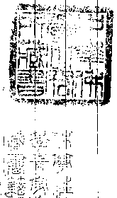



径山志卷之五终



卷之六目录



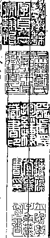



塔铭



大慧普觉禅师塔铭　张浚



元叟端禅师塔铭　黄溍



古𪔂禅师塔　危素



痴绝禅师行状　赵若琚



竺远源公塔铭　宋濂



明辩正宗广慧禅师　宋濂



月江净禅师圆照塔铭　胡濙



双径林禅师塔铭　方九叙



月亭得法师塔铭　陆光祖



幻于上人塔铭　瞿汝稷



紫柏大师塔铭　释德清



补遗



晦机熈禅师塔铭　虞集



卷之六目录终



径山志卷之六



汶上李烨然删定



海阳徐文龙、鹿城陈𢡟德订



虞山宋奎光辑



塔铭



大慧普觉禅师塔铭(十三代)



张浚



隆兴元年八月十日，大慧禅师宗杲示寂于径山明月堂，皇帝闻之嗟惜，诏以明月堂为妙喜庵，赐谥「普觉」，塔曰「寳光」，用宠贲之。其徒以师全身葬於庵之后，使了贤来请铭。先是，上为普安郡王时闻师名，尝遣内都监至径山谒师。师作偈以献上，上甚嘉之。及在建邸，复遣内知客，请师山中为众说法，亲书「妙喜庵」大字，及制真讃寄师。又二年，而上即位，始赐号「大慧禅师」。明年，复取向所赐宸翰，以御寳识之，恩宠加厚，而师亾矣。仰惟主上神圣英武，资不世出，而惠顾一方外之士如此。葢师於释氏，所谓卓然杰出於当世者，忠诚感格得之天理，是以上动宸心，眷知特异。吁其盛哉！自昔圣贤以传心为学，诚明合体，变化兴焉。西方之教，指心空为解脱究竟，葢得一而不见诸用。而悟入要处，或几於尽性者所为。后世三宗竝行，临济正传，号为得人。超出声尘，不立一法，根源直截，以证为极，焜燿震动，卷舒无碍，如师子儿，游戏自在，获大无畏，此固不可以智知识识也。临济六传至杨岐，杨岐再世，而圜悟师克勤得法于五祖演，被遇两朝，其道葢盛行矣。师实嗣圜悟，益光明焉。师讳宗杲，宣州宁国人，姓奚氏。年十七，为浮图，不欲居乡里。从经论师，即出行四方，始从曹洞诸老宿游，既得其说，叹曰：「是果佛祖意耶？」去之，谒准湛堂。准识师睂𥈤间久，谓之曰：「子谈说皆通畅，特未可以敌生死。吾今疾革，佗日见川勤，当能办子事。」勤即圜悟师也。湛堂死，师谒丞相张公无尽，求准塔铭。无尽门庭高於天下，士亦少许可见。师一言而契，即下榻，朝夕与语，名其庵曰「妙喜」，字之曰「昙晦」。且谓：「子必见圜悟师，吾助子往。」遂津致行李。来京师，见勤於天宁。一日勤升堂，师豁然神悟，以语勤。勤曰：「未也！子虽有得矣！而大法故未明。」又一日，勤举演和尚「有句无句」语，师言下得大安乐法，勤拊掌曰：「始知吾不汝欺耶？」自是纵横踔厉，无所疑於心，大肆其说，如蘓张之雄辩、孙吴之用兵，如建瓴水转圆石于千级之阪，诸老敛袵，莫当其锋。于时，贤士大夫，往往争与之游。雅为右丞相吕公舜徒所重，奏赐紫衣，号「佛日大师」。会女真之变，其酋欲取禅僧十辈，师在𨕖中，已而得免，葢若有相之者。渡江而南，圜悟方主云居席，命师居第一座，为众授道，誉望蔚然。已而去入云居山，居古云门，学者云集，复避乱走湖南，转江右入闽，筑庵长乐洋屿，时从之者才五十有三人，未五十日，得法者十三辈，前此葢未始有也。后皆角立，始应给事江公少明之请，住小谿云门庵，而浚在蜀时，勤亲以师嘱，谓真得法髓。浚造朝，遂以临安径山延之，道法之盛，冠于一时，百舍重趼，往赴惟恐后拜其门，惟恐不得见至无所容，敞千僧大阁以居之，凡二千餘众。所交皆俊艾，当时名卿，如侍郎张公子韶，为莫逆友，而师亦竟以此遇祸。葢当轴者恐其议己，恶之也。毁衣焚牒，屏居衡州，凡十年。徙梅州，梅州瘴厉寂莫之地，其徒裹粮从之，虽死不悔。噫！是非有以真服其心而然耶！又五年，太上皇帝特恩放还。明年复僧服，四方虚席以邀，率不就。最后以朝命住育王，聚众多，食或不继，筑涂田凡数千顷，诏赐其庄名般若。又二年，移径山，师之再住此山，道俗歆慕，如见其所亲。虽老，接引后进不少倦。居明月堂凡一年，以终将示寂，亲书遗奏，及寄声别右相汤公，又贻书於浚。了贤请偈，复取笔大书，不少乱。师虽为方外士，而义笃君亲，每及时事；爱君忧时，见之词气，其论甚正确。晚自径山来秣陵，见浚，垂涕言：「先人不幸无后，某之责。家贫何所仰？愿乞一给使，名藉公重，庶有肯就者。」浚为恻然兴叹，遂奏其族弟道源奉师亲后。既退居明月堂，冒暑走其乡，上冢葺治，所存葢如此。使为吾儒，岂不为名士？而其学佛，亦卓然自立於当世，非豪杰丈夫哉！卒被光宠，表之无穷，诚有以自致也。所赐御书，建阁藏於妙喜庵，与兹山不磨矣。师寿七十有五，坐夏五十八年。僧俗从师得法悟彻者，不啻数十人，皆有闻于时。𪔂需、思岳、弥光、悟本、守净、道谦、遵璞、祖元、冲密，先师而卒。我秦国太夫人，亦尝於师问道焉。呜呼！我识师之早，此心默契，未言先同。从容酬接，达旦不倦，人间至乐，孰与等拟？葢惜其沦没山林，惠利之不溥加于人也。然而以道观之，安可以隐显去来，索师於形骸之内哉！我实知师，宐为之铭。铭曰：



死生为一　非想非说  

证彻了悟　一息千刼  

嗟师何为　拳拳忠孝  

欲廸群迷　俾趋正教  

嘻笑怒骂　佛事炽然  

情生智隔　疑𧩂兴焉  

天目巍巍　终古莫移  

师兮道德　此山与齐



元叟端禅师塔铭(四十八代)



黄溍



菩提达磨以摩诃迦叶所得无上正法来止中土，直接上根，其后枝分为二，心印独付於曹谿；派别为五，而宗风大振於临济。至大慧，而东南禅门之盛，遂冠绝於一时，故其子孙最为蕃衍。径山元叟禅师，大慧四世孙也。师讳行端，元叟葢其字，族临海何氏，世为儒家。母王氏，能通五经。师生而秀拔，幼不茹荤，超然有厌薄尘纷之意。六岁，母教以《论语》、《孟子》，辄能成诵，雅不欲汩没於世儒章句之学。十二从族叔父茂上人，得度於餘杭之化城院。十八受具戒，一切文字，不由师授，自然能通。而其器识渊远，夙负大志，以斯道自任，宴坐思惟，至忘寝食。初叅藏叟和尚於径山，叟问：「汝是甚处人？」师云：「台州。」叟便喝。师展坐具，叟又喝。师收坐具，叟云：「放汝三十棒叅堂去。」师於言下豁然顿悟。一日侍次，叟云：「我泉南无僧。」师云：「和尚𫆏？」叟便棒，师接住云：「莫道无僧好！」叟颔之，即延入侍司。是时众满万指，莫有契其机者。叟既告寂，师至净慈，依石林巩公，即处以记室，相与激扬此事。与虚谷陵、东屿海、晦机熈、东州永、竹阁真，为莫逆交。寻以灵隐山水清胜，往挂锡焉。师尝自称「寒拾」，里人横川珙公在育王，以偈招之曰：「寥寥天地间，独有寒山子。」师竟不渡江，而谒觉庵真公於承天。复叅雪岩钦公於仰山，雪岩问：「何处来？」师云：「两浙。」岩云：「因甚语音不同？」师云：「合取臭口。」岩云：「獭径桥高，集云峰峻，未识书记在。」师拍手云：「鸭吞螺蛳眼睛突出。」岩咲，顾谓侍者：「点好茶来。」即送师归蒙堂。居三岁而岩逝，乃还淛右。虎岩伏公时住径山，请师居第一座焉，既而退处楞伽室。拟寒山子诗百餘篇，皆真乗流注，四方纳子多传诵之。大德庚子，出世湖之资福，伏公加盛礼，觊师唱其道，师微笑而不答，瓣香酬恩，归之藏叟焉。学徒奔凑，名闻京国。后三年癸卯，特旨赐「惠文正辩禅师」。中书平章政事张闾公任行宣政使，首举师主中天竺。开堂之日，公率僚属，亲临座下。寺当久废之餘，师为树门榜而正隣刹之侵疆，治殿宇而还樷林之旧观，皆出公外护之力。皇庆壬子，迁灵隐，有旨设水陆大会于金山，命师升座说法，竣事入觐於便殿，从容奏𡭊，深契上衷，加赐「佛日普照」之号。陛辞南归，即拂衣去，养高于良陼之西庵。至治壬戌，径山虚席，三宗四众，咸谓非师莫能荷负其任，相率白于宣政行院，请师补其处。泰定甲子，用使院阖词奏请，为降玺书，作大护持，师至是凡三被金襕袈裟之赐。二十年间，足不越阃，而慕其道者，鳞萃蚁聚，至无所容。岁饥，皆裹粮而来，以得见为幸。径山自大慧中兴后，代有名德，得师而其道愈光。师尝勘一新到僧，云：「何方圣者？甚处灵祇？」僧云：「临朕碪。」师云：「杜𢰅禅和，如麻似粟，叅堂去。」又碪一僧云：「棋盘石，斫破你脑门；𭽽盂池，浸烂你脚板。」僧拟答，师便喝。又碪一僧云：「擘开华岳连天秀，放出黄河彻底清，即且置，平实地上，道将一句来。」僧拟开口，师便打。其机锋峭峻，多此类。师以呵叱怒骂，为门弟子慈切之诲；以不近人情，行天下大公之道。为藏叟之的传，一人而已。师之利他，皆阴为之，没齿不言，而其道德闻望，为朝野所推服，荐膺命赐，人以为荣，而师未始自衒，意漠如也。暇日以餘力施於篇翰，尤精绝古雅，石田林先生隐居吴山，不与世接独，遗师以诗曰「能吟天宝句，不废岭南禅」，其取重於前辈如此。师生於宋宝祐乙卯，佛涅槃后一日，以至正辛巳八月四日，终於径山之丈室。世寿八十八，僧腊七十六。其先五日，示微疾，问侍僧云：「呼之曾已休，吸之尚未舍。寄同诸苦源，来者不来者。如何是来者不来者？」侍僧无语，师良久云：「后五日看。」越四日夜分，沐浴更衣，别众趺坐，书偈云：



本无生灭　焉有去来  

冰河发𦦨　铁树花开



投笔垂一足而化。龛留七日，颜貌如生，以是月十一日，奉全身窆于寂照塔院，而分瓜髪，建塔于化城幻有精舍，四会说法语有录行于世。所度弟子若干人，嗣其法，而同时阐化於吴楚、闽粤、蜀汉间者，若干人。其上首灵隐法林、本觉梵琦、中天竺祖铭等，状师行业，俾溍书之兹碑，溍忝从章甫逢掖之后，未能於宗门中，齅薝卜之香，尝醍醐之味，罔知所以措其颂美之辞，庸备著状所述，为序而铭诸，庶几不失其实，来学得以究极夫旨趣云尔。铭曰：



大雄唱灭　宗途肇分  

不有单传　孰开我人  

巍巍大慧　垂阴四叶  

门庭之盛　规重矩叠  

法雷普震　裂地轰天  

据狮子座　四十二年  

被遇三朝　便蕃异数  

王臣顺风　有严外护  

大法栋梁　一夕而摧  

本无生灭　焉有去来  

寂而常照　碧潭秋月  

散为千光　非同非别  

径山苍苍　上与云齐  

真身常住　大慧焉依  

讃述虚空　非愚则惑  

直书具文　刻此山石



古𪔂铭禅师塔铭(五十一代)



危素



元顺帝至正四年，素以王事留觐，暇日泛钱湖至青山寺，葢古𪔂铭禅师隐处也。师方出主补怛洛迦山，瞻挹道风，莫能遂一见，素既还朝，师两升巨刹，大振玄学，道重东南，凡十有四年。为至正十八年，而师示寂，其门人仁淑万金以书若状来请铭其塔。按：师讳祖铭，字古𪔂，姓应氏，世居四明之奉化，从祖徽宗叅知政事，父贞，母叶氏。师生於元世祖至元十七年十二月二十九日，幼颕悟不近荤食，稍长学道通《左氏书》，而尤嗜释典。年十八厌处尘俗，以父母命，从金峩寺横山锡公学出世法，锡公鍾爱之。二十有五，得度受具戒，出游诸方，首以竺西垣公於天童山为内记，寻走闽浙，多所叅访，莫有契者。时元叟端禅师在灵隐寺，师往谒焉。一日入室，扣以黄龙见慈明机缘，元叟(即当山四十八代)诘之曰：「只如赵州云：『台山婆子被我勘破。』与慈明笑曰：『是骂耶？』你且道二老汉为复肝胆相似，为复鼻孔不同。」师云：「一𡭊无孔铁锥。」叟云：「黄龙当下悟去，又且如何？」师云：「也是病眼见空花。」叟云：「不是不是。」师拟进语，叟便喝，自是坦然无疑滞。未几，命居记室，晨夕警发，益臻其阃奥，一时德誉蔼著，所与交游，皆雅望之士，去留樷林轻，而师愈谦抑自持，有以舆从为相迎者，悉谢绝云：「惟杖履而已。」(元顺帝)元綂元年，师五十有四，始自径山出住昌国之隆教寺，学者不惮步险，争愿趋往席下。后八年，廼迁宝陀寺，即补怛洛迦山也。浙东都元帅完者都公威震海上，而于师至礼甚恭。日本商航数奉国命，盛赍金币来聘，师每避去。至正五年，浙江丞相朵儿只国王，领行宣政院事，特移师住杭之中天竺。七年，廼迁师还主径山。师在中竺时，有童子仇姓者，从师荷包笠，夜宿蘓之承天寺，见空中有一寳𪔂，左右翼卫皆天神，若有所告，曰：「天帝以此𪔂还赐径山也。」诘旦，以事质其僧，曰：「此必古𪔂禅师还迁径山也。」日与之俱来，为求给役，俄而径山命下，闻者异之。京司以师法席之盛，锡号「慧性文敏宏学普济禅师」。十一年，颕豪乱作，师治妙明庵于放生池上，曰：「吾将老于此焉。」十七年，杭再受兵，师退而庵居。又数月，苗獠焚掠径山。丞相达识铁木迩公延师至都之云居庵，暇则诣师，諮叩宗门玄旨，请礼弥笃。一日请看经次，师惟默坐，公问：「长老何不看经？」师云：「寻行数墨为看经耶？」公无语，师翻经云：「老僧看经，看经去也。」公以手覆经云：「请与说破。」师云：「伊尹、周公阿谁做？」公遂领悟。用贞良公特主中竺，谓：「师尝阐化是山，请归了幻庵。」已而有微疾，澡浴更衣，集众危坐。致书丞相，嘱以外护佛法之意。俄而指语其徒曰：「观世音金台至矣，吾平生兼修之功有验也。」乃大书偈曰：



生死纯真　太虚纯满  

七十九年　摇篮绳断



书已掷笔而逝，正月二十二日也。先一日，丞相梦师告别，即遣吏候问，而师已化去，为之嗟悼不已，致赙有加。龛留七日，颜貌如生，行院槩郡府官僚，盛设俎奠于道。茶毘时，舌根数珠皆不坏，得五色光舍利无算，其徒收取舍利与不坏者，建塔於径山及隆教、寳陀、青山焉。世寿七十九，僧臈五十五。有《四会语录》暨外集若干卷传於世。师意度直率，不为缘餙；居处物用，清苦淡泊；晨兴盥颒以致澣濯，未尝役僮仆。自幼至𦒿年，未尝少休，怛兼修净业礼观世音像，日必千拜。而於大法洞彻玄微，开示直截，踔厉纵横，应变无穷。虽门庭峻拔，若不可少杀，随其夙器，慈悲诱掖，成就为多。至於文学廼师之世业，里中袁文清公桶、金华胡公长孺、黄公溍、蜀郡虞文靖公集、长沙欧阳公玄，咸称慕之。见诸文字者，举可徵已，所度弟子若干。素向承诏纂修宋史实、论著，叅知政事。师为公世胄，虽离尘绝俗，而所建立章章若是，序而铭之，有不容辞。铭曰：



达磨西来　直指心性  

后列五宗　临济为盛  

妙喜在宋　其道弥尊  

灯分淑世　有烨后昆  

猗慧性师　笃生海裔  

家学有源　簮缨之系  

廼慕空乗　受业金峩  

壮游海岳　掉臂而过  

投锡于吴　泠泉是游  

遂逢硕师　开厥蕴奥  

在昔黄龙　有大机缘  

群疑一祛　竟绍真传  

为法出世　道行岛屿  

竺峰再迁其化益普  

爰升双径　有奕有耀  

元臣鉅夫　𥡴首受教  

十年化洽　息影岩扄  

靡显靡晦　龙象纯纯  

倐尔而逝　生死俱寂  

空洞混㝠　谁究其极  

瞻彼窣堵　来学攸思  

记德贞铭　宗伯告辞



痴绝禅师行状(三十五代)



赵若琚



师名道冲，自号痴绝，武信长江荀氏子。母郭氏，尝梦经山木爪树下，其实累累，取而食之，占者谓当产奇士。已而师生，丰上短下，资禀过人，长应进士举，不利，受释氏学於梓州妙音院，礼修政落髪，游成都，习经论於大圣慈寺。未几，以名相厌人，雅有志於出世间法。绍熈壬子，出峡，回旋荆楚间，时松源岳倡密庵之道于饶之荐福，径造其庐。适岁饥，闻曹源生首众云居，松源以饶州妙果举出世。师听其入门语，有省，叅堂俾侍香。甲寅夏，复从弁，从龟峰，留三年。以偈辞入浙，有「尚餘穷相一双手，要向诸方痒处爬」之句，江湖至今传诵。松源主灵隐，门庭高峻，不妄许可，师栖笠八阅月，未得归堂，每嗫嚅欲自言，屡呵斥不容近。一日，有告之松源者，松源曰：「我八字打开挂搭他，自是他当面蹉过。」师闻此语，口耳俱䘮，始知侍曹源於妙果、龟峰时，嘻笑怒骂，无非善巧方便，自此不疑天下老和尚舌头。既而曹源顺寂，遍历诸老之门，逾二十年。净慈肯堂𠑽、华藏遁庵演一见以为法器，知密庵之传必复兴於异时。其后潜庵光、一翁如、痴钝颕、掩室开、浙翁琰，皆分半座，俾倡所学。嘉定己卯，由径山应嘉兴光孝请，一芗为曹源，修末供。宝庆乙酉，被堂帖，移蒋山。蒋山田多，依山濒水，旱潦不常，岁租不足以供众。师攻苦食淡，相安於寂寞，十四年始终如一日。时叅枢抑斋陈公开阃金陵，素敬师操行孤高，举似於闽师东畎曹公。会鼓山虚席，即命师主之。未行，迁雪峰，嘉熈戊戌入院。甫半载，有旨住太白名山。适育王住持未得人，因师之至，又强之兼领。师往来两山间，四方学者从之如归，声闻京师。淳祐甲辰，诏移灵隐，说法飞来峰下。追念密庵、松源旧游，方思所以振起祖风，而魔事出於意料所不及，难以口舌争，遽动终老故山之志，伐鼓亟去。虽京兆尹节斋赵公致书力挽，堂帖有虎丘之命升师，虚斋赵公以蒋山起之，俱莫能回其意。戊申春，育王散席，诸大老落落如晨星，惟师为藂林尊宿，众举於朝，日夜俟师之出，亦固辞乃已。明年己酉，访丞相弘毅游公、侍郎沧洲程公於苕溪私第。归涂，京兆节斋赵公命驾遣书要於路，留连郡治。弥两旬，欲挽之为法华开山，恳祈再三不得请。而𠡠牒住径山之命继至，师谓先诺固不可违，君命岂应引避？乃以九月至法华，逾月登双径，实踵无准范之后，人神向合，声懽如雷。俄𣑱疾在心膈间，饮啖日减，自冬涉春，形体虽羸，而升堂提倡，精明如平时。三月六日，忽手书龛记，叙得法之由，遣遗书十数，且口占法语，寄无准塔所。曰：「无准忌在十八，吾以十五即行，不得瓣香修供矣。」侍僧骇其言，亟以遗偈请师，咲曰：「末后一句，无可商量，只要个人直下承当。」即命笔，书辤众。上堂曰：「世尊师入涅槃，告众云：『汝等善观吾紫磨金色之身，瞻仰取足，无令后悔。今日即有，明日即无。』拈世尊云：『平生用尽伎俩，临死之际，求生不得生，求死不得死。山僧则不然，要行便行，要去便去，八臂那咤拦不住。』」自是屏医却药，果至十四日，夜分起坐，移顷而逝。后三日，茶毘，舍利五色粲然。弟子遵遗教，奉灵骨，以庚戌五月十九日，归葬金陵之玉山庵。学徒追悼不舍，中分其半，建塔径山菖蒲田玉芝庵，实是月二十四日也。寿八十二，腊六十七。师纯诚无伪，表里如一，待人恕而立己严，应世圆而领众肃。住山三十年，所至以激扬宗风为己任，以道法未得其传为己忧。平居简淡沉默若不能言，及坐筹室勘验纳子，机锋一触犹雷奔电掣，海立江翻，皆𣴭然莫知凑泊。誓不轻以词色假人，重误来学。晚年无他好，多留意字法，於小楷最得三昧，往往端严凝重类其人。僧俗归敬，求法语偈賛无虚日，虽祁寒盛暑，挥𣑱不倦。士大夫多乐从之游，而尤为名公鉅卿所推重，以至声名喧传海外，有具书礼，犯鲸波，而来问法者。其道德有以服人，一至於此方。在天童、育王时，被旨开堂灵隐，束担将戒行，而隣峰疾之者，声言欲嗾群不逞，梗於中道。左右闻之举以告，师曰：「吾平日以诚实接人，将何以加我？略不为之动，彼亦终於无所施而止。」双径、冷泉、太白、雪峰，海内甲刹也。近年以来，萌欲速之念者，挟奥援矜，智巧历阶而上，力可以通神。师则不然，短褐布衣终其身，不为势利所动，故其进不由介绍，其退心常泰然，真法门之栋梁，后学之标准也。鍾阜去东阳六十里，玉山实介其间，由润而升，禅锡经从，曾无驻足方袍之地。师诛茆结庐，凿石开径，倒囊钵所有，不足以给土木之费。京湖制帅无庵孟公、秋壑贾公，闻而为之助。京尹节斋赵公继捐金粟，以相其成。於是即庵之𠊓定瘗骨之所，峰峦回环，龙虎𡭊峙，既尽挹金陵诸山之秀。而玉山、玉芝其名又适相符，夫岂偶然哉？故其亾也，葬如志。既葬后一月，嗣法弟子法鉴致师遗书，以行实属若琚为之状，顾方屏迹田里多病侵陵，有所未暇。越再岁，其徒了源持木石侍郎尤公所作语录叙引，切切申前请益力。慨念丙申之春，识师於独龙冈下，一见倾葢如故，今回首十七年矣。𧧼不容辤，因摭门人所编行实，间参以所闻，叙次始末，面授了源，使持以乞铭于当世大手笔，为樷林不朽之传。谨状。



竺远源公塔铭(五十二代)



宋濂



径山禅师入寂已久，古缙州男子实为之铭，其序曰：禅师讳正源，字竺远，欧阳其氏也。文忠公为远祖，而南康其所居也。年二十七受具戒，越四十五载，当元至正二十一年六月二十六日，寿七十又二而逝，其始与卒也。大辨和尚虚谷陵公，以道德名东南，其传法师也。观音兴圣、道塲灵隐、径山，其所主伽蓝也。始见陵公，公以『龙潭灭纸炬』语问之，禅师应之曰：『焦石可破层冰。』公曰：『破后奚为？』复应之曰：『探索乃知。』公诘曰：『所知者何事？』方思𡭊其语，公遽举仗击之，悚然默喻，由是智开识融，外内无碍，雄谈慧辩，动静皆空。叩之者无穷，归之者有容。近者化而信，远者慕而宗。又能饰之以文，持之以勤。位尊而不以为荣，德盛而守之以谦。所得乎道，而出乎世者也。居道塲，增其室庐之未备者；主径山，焚乱兵遗骼之暴露者。在灵隐，楼阁皆为煨烬，惟其所居独存，类有神以相之者，其建功动物之可见者也。生之夕，梵僧见梦于其母，及将殁也，预告日期，书偈而化。弟子分瘗爪髪于道塲，舍利樷樷然，生其灵异之显著者也。元之帝师闻其贤，锡以「佛慧慈照普应禅师」之号。五主巨刹，皆方镇大臣遣使者所邀，致其法孚于人者深也。广化圆伊、本觉文煜、兴圣宗得、承天道琼、净光智聚、大慈等若干人，其得法弟子也。某等若干人，其所度学子也。径山，其白塔所在也。全身而瘗者，禅师之意也。二十一年某月日，其瘗之时也。集而传之者，其所说法也。法不可以迹求道，不可以形著，虽无塔可也。有塔矣，虽无文可也。宐无文矣，繁其辞者，过也，故略而约之。略而约之者，古之道也。以古道处禅师者，余志也。谓余为简者，非知道者也。请铭者，圆伊也。铭曰：



道之原　本无言兮  

以言求道　道岂宣兮  

有倬达摩　号为禅兮  

指心见性　简且专兮  

弊而失宗　口耳是传兮  

袭讹蹈诞　欺昏顽兮  

虚石崭崭　法雷震天兮  

餘音所及　詟以颠兮  

师奋大勇　直走其前兮  

象据狮吼　溯幽玄兮  

五莅名山　从者千兮  

抉堙疏滞　道百川兮  

洗濯白日　光烂然兮  

有目皆覩　照八埏兮  

文辞如云　来翩翻兮  

即而索之　以𫄠絷烟兮  

道且不有　矧简编兮  

又况幻形　同蜕蝉兮  

閟塔镵文　不愈衍兮  

有文之文　多紏缠兮  

文而无文　道乃全兮  

师道如羿　此遗弦兮  

因粗解妙　在后贤兮



明辩正宗广慧禅师径山和尚及公塔铭(五十三代，洪武十二年化。)



宋濂



姑蘓之区，山川清妍，其所毓人物，性多敏慧。学禅那者，以攻辞翰器物为尚，虽据位称大师，亦莫不皆然。自宋季以迄于今，提唱达磨正传，追配先哲者，唯明辩正宗广慧禅师一人而已。师讳智及，字以中，蘓之吴县顾氏子，父茂卿，母周氏。师之始生，灵梦发祥，及入海云院为童子，智光日显，释书与儒典竝进，其师嘉之。同见闽国王清献公，都中公大赏异，留居外馆，抚之如己子，使其祝髪，受具足戒。师闻贤首家讲法界观，往听之，未及终章，莞尔而笑曰：「一真法界，圆同太虚，但涉言辞，即成賸法。纵获天雨宝花，于我奚益哉？」遂去建业，见广智䜣公于大龙翔集庆寺。广智以文章道德倾动一世，如张文穆公起岩、张潞公翥、危左承素，皆与之游，以声诗倡酬为乐。师微露文彩，珠洁璧光，广智及群公见之大惊，交相延誉恐后。师之同袍聚上人诃曰：「子才俊爽若此，不思负荷正法，甘作诗骚奴仆乎？《无尽灯偈》所谓『黄叶飘飘者』，不知作何见解？」师舌噤不能答，即归海云，胸中如碍巨石，目不交𥈤者逾月，忽见秋叶吹坠于庭，豁然有省，机用彰明，触目无障。师虽自庆幸，然不取正有道，恐涉偏执，于是杖策游虎林，升双径山，谒寂照端公，自列其所证甚悉。初寂照尝以法器期师，闻其言喜甚，因勘辨之。师随机而答，如叶落秋空，而兎走荒原也。精神参会，不间一髪。未几，命执侍左右，以便咨叩。俄迁主藏室，师取三乗十二分教，益温绎之，宗通说贯，衮衮如悬江河，声光炜烨，顿超诸老上。至正壬午，江南行宣政院举师出世昌国之隆教，海濵之民暨清净四众，手持香花百里驩迎，如见诸佛。为升座说法，不翅大将，树建旗皷，申令发号，闻者靡不畏服。乙酉，转隣刹普慈，其激扬诱掖，如隆教时。戊戌，江浙行省左丞相达识帖穆尔兼领院事，延师主杭之净慈。兵燹之餘，艰窘危厉，人所不能堪。师运量有方，轨范峻整，绰有承平遗风，较之普慈，君子恒谓过之。丞相犹谓未尽尊师之道，辛丑之秋，复请住持径山，补寂照故处，师亦不辤而往，风动四方，考德者愈众。亾赖男子瞿范日饕盘飧，主庖者厌之，瞿䘖而去，赴部使者诉。院之僚属受赇，诬师为通衷私。使者摄师问状，师了无惧色。癸卯，省宪二府白其冤，强师复还径山。缁素骏奔，如戴父母，至有乐极而悲泣者。皇明龙兴，洪武癸丑，诏有道浮屠十人，集京师大天界寺，而师实居其首，以病不及召𡭊。乙卯，赐还穷隆山，山即海云所在也。戊午八月，忽示微疾。至九月四日，索笔书偈而逝。九日，行茶毘法。火燄化成五色，有气袭人，如沉水香。齿牙数珠不坏，遗骨绀泽，类青琉璃色，室利罗交缀于上。是日，其徒大均、士龙等，藏于所居山之阴。宝盈分爪髪，归径山，卜于无等才公塔右瘗焉。世寿六十八年，为僧五十一夏。度弟子若干人，嗣其法者若干人。师长身山立，昻然如孤松在壑，威令严肃，其下无敢方命，故所至百废具兴。然处事达变，接引后进，又如春风时雨之及物，使人不自知。元帝师以为贤，为锡今号云。师在天界时，濂颇获闻其绪论。于其殁也，上首弟子普庆、住持道衍藉是之故，自状其行来请铭。夫圆明玅性，实具三千，四圣六凡，悉从中现。诸佛不得已而说经，雷动蛰惊，风行草偃者，为明此性也；诸祖不得已而忘经，绝其枝末，直探其本根者，亦明此性也。性在是，则道在是矣。奈何道䘮性乖，非惟学徒为然。至于师表当世者，一从事于末学曲艺之间，以资清玩，其去佛祖之道，盖亦远矣。有如师者，可不表之，以为东南龟镜哉？师出世时，穷隆山石夜走，及涖普慈，神降于人，述师清严之状。天之生师，殆不偶然。《四会语》有录其机缘，已备载之，兹不敢勦人也。铭曰：



华梵诸祖　所了惟心  

函乾盖坤　开阳阖阴  

万汇芸芸　靡不苞括  

肯捐全躯　而局一髪  

奕叶相仍　轨辙弗殊  

融通小大　无碍无拘  

猗欤禅师　神观孤耸  

文彩渐彰　云流山涌  

一旦易虑　而壁自治  

摄念入定　如斩棼丝  

秋叶之零　飘堕庭𢨪  

仰视清天　一碧万里  

我性之觉　证诸硕师  

机锋交触　劒戟差差  

出世海濵　人天拱手  

发祥含徴　白石夜走  

全提正印　法皷频挝  

以眼闻者　断除空华  

由其见凝　转识为智  

珠玑落纸　亦第一义  

方岳大臣　遣使候迎  

陟于南屏　惟德之馨  

名山列五　首曰双径  

匪私于师　东南龟镜  

轻儇小夫　憯不自惩  

皦皦白璧　何忧苍蝇  

风腾波掀　万辤嗟惜  

是非既昭　重涖旧席  

昔师之去　泉流哭声  

师今之旋　卉木含荣  

世缘已终　微笑而灭  

设利如珠　缀于绀骨  

末学竞奔　曲艺宏施  

胡不反观　本实在斯  

遗光所被　千载犹浅  

瞻之仰之　谁敢不勉



月江净师圆照塔铭(六十五代)



胡濙(尚书)



师讳宗净，字月江，别号月清。既退径山之席，更号圆照。族本浙之金华兰溪人，倪姓，父景华。母包氏尝梦神僧入卧室，遂觉有娠。皇明洪武九年丙辰九月二十五日降诞，生有异质，自幼聪慧，授以经文即能成诵，若宿习然。既长，出家同邑正觉院，礼沙门文译为师。年十七祝髪，即洪武二十六年癸酉受具戒，遂往虎跑习静业。诵《楞严经》，至如标月影指处，豁然省悟。闻知双林正庵訚公乃宗门巨擘，躬诣咨扣印可。訚一见奇之，便问：「黄檗打临济，你作麽生？」师即答云：「按牛头吃草。」訚喜其机见敏㨗，如针芥相投，畱领维那之职。后游径山，至京师天界寺，住持道成延掌藏钥。永乐元年癸未，士友唐道正、姚如觉复请师看藏经。师结跏趺于其室，终日诵念，三年不逾阈，致有白寉啣芝之应。廼印经一藏，迎归正觉，亦感天降甘露，地产灵芝。由是道誉日彰，众咸举住三衢正果禅寺。五载之间，兴废举坠，人咸钦仰。后退归受业，重建殿宇，雕粧佛像，什物噐用，无不毕备。我太宗文皇帝遴𨕖天下高僧，校勘三藏教典。师应诏，驰驿赴京居海印寺，数蒙恩赐甚渥。事毕回南京，复倾己帑印造大藏尊经，贮以琅函，送至当山永镇宝所，以报国恩。时灵隐住山昙缵重其学行，延居第一座。迨仁庙改元，岁在乙巳，径山虚席，僧录少师荣国公衍举师主之。至则百废具兴，殿堂廊庙，一新佛像。粧饬毕备，自书「天下径山」之扁。驸马都尉沐昕特为大书寺额，揭於照殿。率苾𫇴辩正宗绪，扶立教基，往来云水，悉有依庇。宣德乙卯，退居东堂。正綂庚申，回兰溪，祭扫祖垅。七年壬戌三月三日，还径山，忽示微疾。至十三日午时，集众索笔，书偈云：



祖师门下客　开口论无生  

老我百不会　日午打三更



书讫跏趺而逝。后七日茶毘，舌根不坏。诸弟子敛骨，葬于凌霄之陇，建塔於圆照。世寿六十七，僧腊五十一。嗣法门人若干人，手度弟子径山住持大英等若干人。平昔说法，皆自胸中流出，无非借言以显明也。所著《径山集》、《月清餘录》、《中峰净土诗》、《石门语录》，刊行於世。师体貌魁伟，噐宇宏博，得传临济正𣲖，廼大慧七世孙也。当时公卿大夫，若少师姚广孝等，咸赠诗文，相共称许。其徒大英恐师行业久而泯湮，以状请余为铭章，俾勒之贞珉，以传永久。铭曰：



大雄立教　肇自西域  

汉明帝时　始入中国  

四众皈依　风行草偃  

涵溶万法　妙悟者鲜  

卓哉大慧　独得其传  

法雷普震　罔不翕从  

师克继绍　木铎载扬  

校正藏典　衣被恩光  

久住名蓝　兴坠举废  

戒行兼全　屡感祥瑞  

说法有缘　述作尤多  

密裨皇化　利益莎罗  

寿六十七　忽示微疾  

书偈跏趺　掷笔圆寂  

七日茶毘　舌根不坏  

久积精成　不缘四大  

凌霄之原　巍巍窣堵  

勒时贞珉　垂休千古



双径林禅师塔铭



方九叙(钱塘人，兵部郎中)



师生沈氏，讳慧林，字万松，别号双径，杭之仁和人也。生禀异质，不类群儿，稍长躭玩佛书，授以世典，弃而弗观也。父母察其志，以为终不可夺，遂舍为法轮寺僧。寺在省城中，诸僧所习瑜伽荐亾之教，罔知出世大法，师独愀然叹曰：「此岂生死大事可能了耶？」素闻天目平舒老人道行超卓，即别其师实庵坚公，投礼老人，获闻心要。一日晏坐林间，偶闻猿鸟之音，豁然有悟，仍别老人，入京师，徘徊诸讲肆中，研究玄奥。夜宿通堂，𠊓闻一僧诵丹霞上堂公案，尤大了了。是时伏牛空幻叟寓止广德禅林，师乃诣叟，自陈所解，遂得法于空幻之门。已而入川峡，登峨峰，复归於杭。岁在庚戌，师特造余曰：「吾年浸老，衰朽之相岂可久游人寰？兹欲别子，遯迹诸暨山中，以毕此颓龄耳。」乃以《永明心赋》一帙，畱别而去。是后复迁径山，竟绝迹於城府矣。师素通三藏，尤精於《圆觉》、《金刚》、《法华》、《楞严》诸经，为人讲说，谆谆靡厌，其人领解乃止。予尝读《楞严》，诣质疑，颇得其详。师之居径山也，道日益崇，修日益精，而四方从学者，日益以众。经云「两足者」，其师之谓欤！丁巳春月，师忽谓众曰：「吾报将尽，当不久人世矣。」自是绝谷月餘，时时唯啜涧水，至冬微疾而化。目未瞑，犹涉笔书偈云：



七十六年　萍踪何倚  

本无去来　应缘而已



于时禽鸟哀鸣，瑞雪飞舞，众以为异云。师生成化壬寅四月十四日，卒于嘉靖丁巳十二月十五日，世寿七十有六，僧腊五十有八。盖自临济传法以至於师，实二十六世也。缙绅与师交友者若万，总戎表王郎中畿予尤被厚於师，其为悲感何如哉？兹岁庚申，弟子性中等将建塔葬师，以为稔知师道者莫予若也，廼以悦庵喜公状乞铭，乃为铭曰：



佛法有三　曰戒定慧  

畴克兼全　是为高第  

师禀异资　卓然早岁  

性乐一乗　志卑六艺  

初入法轮　厌于尘世  

载礼平舒　洞乎实际  

遐游京师　徧参讲肆  

传心空幻　继綂临济  

峨峰既归　径山是憇  

戒珠圆明　慧天澄霁  

说法谈经　启蒙祛蔽  

实惟利他　匪但自利  

吾道无涯　此生罔逮  

绝谷逾旬　跏趺而逝  

嘱付群徒　朗吟以偈  

存鲜遗金　藏惟寸竁  

新塔岿然　山灵拱卫  

𥡴首以铭　垂诸万世



月亭得法师塔铭



陆光祖



万历丁亥十一月，余赴南司宼，命月亭法师追送於锡山，舟次言别，意甚怏怏。明年戊子正月，余以请老，未上留句曲，而师讣音至矣，为嗟叹流涕者弥日。其年七月二十四日，弟子真芹等葬师於王村塔院之后，因走留都徵余铭。余虽不获辤，未暇应也。今岁壬辰，予告归田，师没且葬已五年矣。真芹辈复申前请，遂志师生平行槩，而铭之云：



「师讳明得，号月亭。以绍万松禅师法，又号千松。俗姓周氏，世为乌程县人。幼岐嶷不凡，尝随父赴西资佛会，指画像问曰：『是非僧耶？』父曰：『然。』遂求出家于双林庆善庵。年十六而祝髪，初习瑜珈教化。长慕大乗，始叅百川海禅师，求出世旨，道机不契。遍叅名宿，备历艰辛，所遇多外道，事具师所刻〈十地品〉发愿文中，於是益发愤厉志，诣武林上竺，哀吁大士祈值明师，乃遇万松禅师於中竺寺。万松问师来意，师以礼〈普门〉𡭊。万松𥪡一指曰：『汝去见了观音来？』师方下顿有所省，再拜求了生死之诀，万松授以摄心念佛法。师遂受具足戒，留侍左右，朝夕叅学，凡十载。一日阅《楞严经》，至『清净本然，云何忽生山河大地』，豁然悟入，作偈呈万松，云：



楞严经内本无经　觌面何须问姓名  

六月炎天炎似火　冬天腊月冷如冰



万松为印可焉。一日独行山中遇虎，师卓锡正立，虎俛首避去，时咸异之。万松既化，复参佛慧祗园和尚。又六载，坚持戒律，博通群典，道誉日彰。嘉靖甲子，讲《法华》於报光寺，会听者常千人。师忽念：『大事未的，何暇为人作口耳伎俩？』乃孑身登径山凌霄峰，结茅庵独坐三载。草衣木食，苦行精求，本来遂彻，因作偈曰：



千年翠竹万年松　叶叶枝枝是祖风  

前岳高峰栖隐处　无言杲日普皆同



偶阅《华严》有所未了，忽感神僧于窗外指示。又梦金狮入口，经旨洞然。四方禅侣接踵来叅，师随机响应问者，无不迎刅而解。迁传衣庵，讲《楞严》，一时名士大夫皆折节为方外交。嗣游天台山，彼中缁素邪正混淆，师为讲《华严》等经，化外道以千计。讲甫毕，堂内宝花偏生，今扁为『涌莲堂』云。比归，南司宼韫庵吴公时为杭守，延师演法於灵隐。佥宪东溟管君，延师演法于天池。仪部观頥沈君，延师住持圆证寺。先是，余延师讲《华严》於秀水之东禅寺，师乐其雅僻，乃相与葺法云堂以居，迄今遂为师示寂之所矣。师为人修干玉立，性度高简伉直，以道自重。遇公卿未尝降礼，作卑谄态，群小或憎诟之，百折不回。骤与之言世故，不越庸人耳。及乎升座，握拂逞辩，才宣佛奥，机锋圆㨗如倒峡悬河，千古凝秘一时冰释。盖师之知见，尽从妙明自得发挥，非若义学讲解拘拘文字间，有识之士咸讃叹希有。师保护正法，毅然不为身谋。其寓天池，日有豪贵挟妓游僧寮，师会众逐之，无所顾惮。世方崇事真武，师以彼不过玄武之神主，治一隅耳，何至奔走天下若狂也！我薄伽梵为天人师，何不易彼事此耶？往往改像设而更庙貌，性喜汲引后学，而视外道如讐。同衣有过，讥弹不少借，以故招忌者之口，非有诸缙绅为之金汤，几不免矣。师生於嘉靖十年辛卯元日，归寂于万历十六年正月十七日，世寿五十有八，僧腊四十有二。所度弟子百计，其高足嗣法者，曰『真觉』、曰『真界』、曰『真頥』、曰『真澄』，暨真芹也。惟师以苦行得见地，以强毅任未法，固佛门龙象也。余获交师三十年，所受教益非一，期晚年相与修东林坟事，而师先化去，谁为余作莲邦指南车耶？铭曰：



维贤善首　继大总持  

阐阿毘昙　为人天师  

陵持末教　义学是资  

师起菰芦　励志叅諮  

岩栖三载　乃豁夙迷  

爰觏神僧　且吸金狮  

慧命已续　辩才纵恣  

大转法轮　导世金𫔇  

涌莲表瑞　降虎策藜  

化伏外道　狂澜一隄  

抗礼公卿　象法用维  

刚毅强忍　威武不移  

我怀其人　空门所希  

归神兠率　埋骨于兹  

与劫终始　视此铭词



嗟乎！此大冢宰五台陆先生所𧩿〈千松法师塔铭〉，乃弟子真芹辈，葬师於王村禅院时笔也。先生没后，飞英狡僧、如心辈百计媒孽院地，真芹辈势不能存。恐百年后并师骨或遭荼毒，遂谋之同门真界辈，将改厝于径山，而决策于余。余念师为万松入室弟子，万松住持径山，其地自国一祖师衣钵相传，以道鸣於历代者逾八十餘人，师之宐归于径山无疑也。或者师神不安於王村，姑假飞英之祟，以还就本宗欤！吾闻入栴檀林者，虽以刀锯𢦤贼犹𣑱香气，则飞英之逐真芹而致迁师骨，或者反有感於师，未可知也。师既改厝，恐将来读碑铭者疑师葬地之异，因为纪其委，悉如右。



万历戊戌，归安沈桐识」



幻予上人塔铭



瞿汝稷(字元立，常熟人)



万历丁丑秋九月，幻余上人顾余于海虞，均持不借，皆烟霞也。盻睐謦欬，足以徵沉浊而清𤍠恼。予𥡴首讃叹：「希有上人！真末法中日月幢，雪山之上味药草。堪照幽迷，痴暗众生令入妙光明藏；堪医五毒，疾苦众生离忧海而登欢喜地。一心皈依，瞪视不舍。」未几，上人复偕慧空上人、幻居上人结制安居。予日叅请，烦羊顿息，害马都捐。禅悦法喜之胜，有生以来此会称最。嗣是三上人，飞锡恒集虞之阿兰若塲。逮己卯春，上人弃诸法侣，独北游五台，予恒悒然怀之。丙戌春，予至燕，脱牵之日，即觌字髪于雁堂。予寓比七阅夏，自金刚窟过余者凡四至，恒逾长期，近亦当中期。壬辰，予历南都。癸巳甲午，过予如燕中。乙未，予涉黄仅，各一致书，常念希世非独无高符且非雅好。不久，且拂衣从上人于大幻三昧，羽翼了毕钵餘习，俾三有众生，若有情若无情，无不立地证无上正等正觉，于已证皆证。乃八月辛酉，忽得达观和尚书，知上人于七月己巳示寂矣，和尚命为塔铭。上人天资粹白，精进无伍，凡杜多苦行，皆力践无媿古宿。其在清凉，有僧病且危，医谓非人肉不治。僧泣曰：「是有死耳！将何几？」上人笑，刲肉如掌，命羹以饲病，立起居常。有善绝不自伐，与予游数载未口及。一日，予遇其僧于龙华，为予具言之。予始索视刲处，不可。坚请不已，始示瘢。色正赤，如丹砂。臂故瘦，其半肉尽去，独瘢衣骨耳。此与善逝、鹰王往因何异？而上人视犹遗土也。颂之欿然，若不足也。于诸细行人所不屑检者，无不曲折护持。言非利生，不关辅颊；事非弘教，不衡心虑。每夜拥衣而寝不过寸香，跏趺申旦神气烱然，终身翼翼处弟子位。惟奋所未至，不多其已能与密藏上人，同唱导刻方册大藏。丁未岁春，计所刻得十之二，不知今所益复有几也。此上人未了公案耶？是不然。𥡴首诸佛前，为铭以证。是不然，铭曰：



群有沦䘮　翻如野马  

孰为拯之　爰资觉者  

於维上人　觉苑之秀  

末后说法　大师子吼  

十方无边　所有刹界  

克刹克尘　无边佛在  

如是诸佛　闻说讃扬  

五浊佛子　啔甘露塲  

如是诸佛　放光无量  

交罗上人　显顶后相  

如是诸佛　发频伽音  

悉阐教海　穷微极深  

无能正示　上人此说  

此说徧满　炽无间歇  

一音所被　无机不摄  

有情无情　感受记莂  

於刹那际　获无生忍  

直圆十身　何论九品  

兹窣堵波　弘法无尽  

畴未云了　殃我觉㣧



紫栢大师塔铭



释德清



夫大地死生，颠瞑长夜，以情关固闭，识鎻难开。有能一击而碎之，掉臂而独往者，自非雄猛丈夫，具超世之量者，未易及也。历观《传灯》诸老，咸其人哉。久蔑斯道，顷於达观禅师又见之。师讳真可，字达观，晚号紫栢。门人重法故，称师为「尊者」。其先句曲人，父沈连，季子，世居吴江太湖之摊缺。母梦异人授以附叶大鲜桃，寤之尚觉餘香，遂有娠。师生，五岁而不言，僧过其门，摩顶而谓其父曰：「此儿出家，当为天人师。」言讫忽去，师便能语。先时，见巨人迹下於庭，自是不复见。师幼奉母训不坐阃，则尽命立不近阃。师髫年性雄猛，慷慨激烈，貌伟不群，弱不好弄，生不喜见妇人。长志日益大，父母不能拘，尝有诗曰：「屠狗雄心未易消。」年十七，方仗劒远游塞上，行至阊门，天大雨不前，偶值虎丘僧明觉，顾师状而异之，因以伞蔽，邀归其寺，具晚飡，驩甚相得。闻僧夜诵八十八佛名，师心大快悦。侵晨，入觉室，曰：「吾人有大宝，何以汚在此中耶？」即解携囊之物，授与觉，令设斋剃髪，礼觉为师。是夜即兀坐达旦，每叹曰：「视之无肉，吃之有味。」师尝闭户读书，足不越阃者年半。凡见僧有饮酒茹晕者，师曰：「出家儿如此者，可杀也！」时僧甚惮之。年二十，从讲师受具戒。至嘉兴东塔寺，见僧书《华严经》，乃跪看良久，叹曰：「吾辈能此足矣。」遂至武塘景德寺，掩𨵿三年。复回吴门，辤觉曰：「吾当行脚诸方矣。」即杖策而去。一日，闻僧诵张拙〈见道偈〉，至「断除妄想重增病，趋向真如亦是邪」，师曰：「错也！当云『方无病』、『不是邪』。」僧云：「你错，他不错。」师大疑之。每至处，书二语于壁间，疑至头面俱肿。一日斋次忽悟，头面立消，自是凌跞诸方。尝曰：「使我在临济、德山座下，一掌便醒，安用如何如何？」师过匡山，穷相宗奥义。一日行二十里，足痛，以石砥脚底，至日行二百里乃止。游五台，见一老宿坐於峭壁空岩，师即作礼而问：「一念未生时如何？」宿竖一指，又问：「既生后如何？」宿展两手，师悟其旨。寻迹之，失其处矣。师至京师，叅徧融大老，融问：「从何来？」曰：「江南。」又问：「来此作麽？」曰：「习讲。」又问：「习讲作麽？」曰：「贯通经旨，代佛扬化。」融曰：「你须清静说法。」师曰：「只今不𣑱一尘。」融命褫师直裰，施𠊓僧。顾谓师曰：「脱了一层还一层。」师笑颔之，遂留挂搭。去九年，复归虎丘省觉，乃之淞江掩𨵿百日。之吴县，适聊城傅君光宅为县令，其子利根，命礼师，子不怿。子一日搦二花问师云：「是一是二？」师曰：「是一。」子开手曰：「此花是二，师何言一？」师曰：「我言其本，汝言其末。」子遂作礼。之天池，遇管公东溟。闻其语，深噐之。师因拈蔷薇一蒂二花问公，公曰：「此同本生也。」师分为二，复问公，公无语。因罚斋一供，遂相与莫逆。时上御极之三年，大千润公开堂於少林，师同巢林、戒如往叅扣。及至，上堂讲公案，以口耳为心印，以帕子为真传。师耻之，叹曰：「西来意故如是邪？」遂不入众，即南还。有密藏道开者，率其同行而归之。师知是法噐，留为侍者。至嘉禾，见陆太宰五台翁，先是藏公与其善。师方至，心大相契。郡治之西北隅有楞严讲寺，乃长水说经之处，因兵火废，有力者侵为园亭。师有诗吊之曰：「明月一轮帘外冷，夜深曾照坐禅人。」志欲恢复，乃属太宰为护法，藏公力主其间。太宰公弟云台施建禅堂五楹，既成，请师命一联。师曰：「若不究心，坐禅徒增业苦；如能护念，骂佛犹益真修。」谓当以血书之，师遂引锥刺臂，而流血盈碗。自是接纳往来。豪者力拒，即未完局。后二十餘年，适郡守槐亭蔡公倡，始求诸明公，公子竟修复矣，盖师之愿力所持也。师尝见人终日碌碌，纵有一二向上者，而没师承缘，无佛法点化故也。因念大藏卷帙重多，而庸僧常言不是，念者又自来，南北遗风俱好博览，唯於梵䇲执性不翻，致遐方僻陬，有终不闻名字者。若刻方册易为流通，普使见闻作金刚种子，即有𧩂者，罪当自代。遂与陆公五台、冯公具区、曾公见台、瞿公太虚等议，同驩然，愿賛佐。即命密藏开公董其事，以万历己丑创刻於五台。居四年，以冰雪苦寒故，复迁于双径。嗟夫！开公隐去，仍嘱弟子体玄奇公协幻予本公。本寻化，自此后辈弟子相继於刻塲。至万历己酉，南北诸檀复请𣽃居铠公终其役。师初以刻藏因缘议既成，闻妙峰师建鉄塔于芦芽，乃送经安置于塔中。且与计藏事末，偕复之都门，乃访予於东海，时万历丙戌秋七月也。时予以五台因缘，有闻於　内，因避名於东海。适遇慈圣皇太后，为保圣躬、延国祚，印施大藏十五部。皇上颁降海内名山，勅僧讽讼，首及东海，予以谢恩入长安。时师与开公走海上，至胶西，值秋水泛涨，众度必不能渡。师解衣先涉，疾呼众，水已及肩。师跃然而前，顾谓弟子曰：「死生𨵿头，须直过为得耳。」众心服师。时予在长安，适师弟子于君玉立来访，言师已东行，计其程，旦夕乃入山期也。予闻之，日夜兼程赶至即墨，时师已出山在脚院，诘朝将长发。是夜一见，大欢笑。明发，请还山，留旬日。心相印契，师即以予为知言，许生平矣。师返都门，复潭柘古刹，乃决策西游峨𡼴。由三晋，历𨵿中、栈道至蜀，礼普贤大士。顺流下瞿塘，过荆襄，登太和，至匡庐。寻归宗故址，唯古松一株，为寺僧售米五斗。匠石将伐之，适丏者怜而乞米赎之，以存寺迹。师闻而兴感。其树根底为樵者剥斵过半，势将折，师砌石填土，呪愿复生，以卜寺重兴兆。后树日长，寺竟复，其愿力固如此。时江州孝廉邢𢡟学礼师延居长松馆，执侍最勤。师为说法语，集名《长松茹退》。先是，邹给谏尔瞻、丁大叅勺原素重师，意留驻锡匡山，未果。遂行，过安庆，时有江阴居士赵我闻谒见不可。适阮君自华归心于师，因为居士先求得度，未许。阮君请游皖公山马祖庵，师喜其境超绝，即属宐建梵刹。居士恳乞出家，遂薙髪于山中，詺名曰「法铠」，是为𣽃居。其庵今蒙𠡠赐佛光寺。师复北游至石经山，乃晋琬公虑三灾坏劫，正法浸灭，乃石刻藏经，安於岩穴，师见而感之。时琬公塔院，被力者侵，师至复之，启石室，佛座下得函贮佛舍利若干，出时光烛岩壑。适慈圣圣母闻师至，命近侍陈儒致斋供，特赐紫伽𥠖。师让之，谢曰：「自惭贫骨难披紫，施与高人福更增。」因请舍利入内，供三日。出帑金，重藏於石窟。师重二事，思得予作记。适予闻师西游回，即驰至京，候於上方兠率院。师拉予游观石经，遂记之。予回寓慈寿，师感遇亦出山见访，同居于西郊园中。𡭊谈四十昼夜，目不交𥈤，信为生平至快事。师与予计，修我朝《传灯录》。予与师约，往濬曹溪，以开法脉。师先至匡山以待，时癸巳秋七月也。越三年乙未，予初以供奉圣母赐大藏经，建海印寺成。适以别缘触圣怒，诏逮清下狱，鞫无他辞，送法司拟罪。蒙恩免死，遣戍雷阳，毁其寺。师时在匡山闻报，为予许诵《法华经》百部，冀佑不死。即往探曹溪回，将赴都下救予。闻予将南放，遂侍于江浒。是年十一月，方会师于下𨵿旅泊庵。师执予手，叹曰：「公以死荷负大法。古人为法，有程婴、公孙杵臼之心。我何人哉？公不生还，吾不有生日。」予慰之再三。濒行，师嘱曰：「吾他日即先公死，后事属公。」遂长别。予度岭之五年，庚子，上以三殿工，下矿税，令中使者驻湖口。以南康太守吴宝秀不奉令，劾奏被逮，其夫人哀愤，以缳死。时师在匡山闻之，曰：「时事至此，倘阉人杀良二千石及其妻，其如世道何？」遂策杖赴都门。吴入狱，师至多方调护，授吴公毗浮佛半偈，嘱诵满十万，当出狱。吴持至八万，蒙上意解，得末减。吴公归，每念师輙为涕下。师以予未归初服，每叹曰：「法门无人矣。若坐视法幢之摧，则绍隆三宝者，当于何处用心耶？老憨不归，则我出世一大负；矿税不止，则我救世一大负；《传灯》未续，则我慧命一大负。若释此三负，当不复走王舍城矣。」癸卯秋，予在曹溪，飞书属门人之计偕者，招师入山中。报书直云：「舍此一具贫骨。」居无何，忽妖书发，震动中外，时忌者乗白简劾师，师竟以是罹难。先是，圣上以轮王乗愿力，敬重大法，手书《金刚般若》，偶汗下渍纸，疑更当易，亟遣近侍曹公质於师。师以偈进曰：「御汗一滴，万世津梁，无穷法藏，从此放光。」上览之大悦，由是注意。适见章奏，意甚怜之，在法不能免，因逮及。旨下，云著审而已。及金吾讯鞫，但以三负事𡭊，绝无他辞，送司宼。先是，侍御曹公学程以建言逮，久在狱，与师问道，有《圜中语录》。时执政欲死师，师闻之曰：「世法如此，久住何为？」乃率浴罢，嘱侍者性田曰：「吾去矣，幸谢江南诸护法。」道人哭，师叱之曰：「尔侍予二十年，仍作这般去就耶！」乃说偈，(具见《圜中录》)略曰：



事来方见英雄骨　达老吴生岂宿缘  

我自西归君自北　多生晤语更泠然



言讫，端坐安然而逝。曹公闻之，急趣至，抚之曰：「师去得好！」师复开目微笑而别，时癸卯十二月十七日也。师生于癸卯六月十二日，世寿六十有一，僧腊四十有奇。噫！师生平行履，疑信相半，即此末后快便一著，上下闻之无不叹服。师化后六日，颜色如生，及浮葬于慈慧寺外。次年春夏，霖雨及秋，陆长公西源欲致师肉身南还，因启之，安然不动。适予弟子大义，即奉师龛之。经潞、京口、金沙，曲阿诸弟子乃奉归双径，供寂照庵，时甲辰秋九月也。越十一年乙卯冬，弟子先葬师于山后。适朱司成文宁公礼师塔，知有水，亟嘱弟子法铠后移塔至开山。乃与俗弟子缪希雍，择其五峰之内文殊台，于丙辰十一月十九日茶毘，廿三日归灵骨塔于此。於戏！师生平行履，岂易及哉！始自出家，即脇不至席，四十餘年。性刚猛精进，律身至严，近者不寒而栗。常露坐，不避风雪。秉金刚心，独以荷负大法为怀。每见古刹荒废，必志恢复。始从楞严，终至归宗、云居等，重兴梵刹一十五所。除刻大藏，凡古名尊宿语录，若寂音尊者所著诸经论文集，皆世所不闻者，尽搜出刻行于世。晚得蘓长公《易解》，大喜之。室中每示弟子，必令自叅，以发其悟，直至疑根尽拔而后已。然义重君亲忠孝之大节，入佛殿见万岁牌必致敬；阅历书，必加额而后览。师于阳羡，偶读《长沙志》，见忠臣李芾，以城垂陷不欲死于贼，授部将一劒，令斩其全家，部将恸哭奉命，既推刃，因复自杀。师至此，泪直迸洒，弟子有𠊓侍者不哭，师呵曰：「当推堕汝于崕下！」其忠义感激类如此。师气雄体丰，而面严冷，其心最慈。接人不以常情为法，求人如仓鹰攫兎，一见即欲生擒，故凡入室不契者，心愈慈而恨愈深，一棒之下即欲顿断命根。故亲近者希，凄然暖然，师实有焉。师性躭山水，生平云行鸟飞，一衲无餘，无住足地。居常悲禅宗凋敝，欲求国初以来诸尊宿机缘，续为《传灯》，未遂本愿，赍志而往。於戏！师每慨五家纲宗不振，常提此示人。予尝叹曰：「纲宗之不振，其如慧命何？」原其曹洞，则专主少林；沩仰圆相久隐；云门自韩大伯后，则难见其人；法眼大盛于永明，后则流入高丽。独临济一派，流布寰区。至宋大慧，中兴其道。及自国初楚石、无念诸大老，后传至弘正末，有济𨵿主。其门人，先师云谷和尚，而典则尚存。顷五十年来，狮弦绝响，近则蒲团未稳，正眼未明，则𡚶自尊称临济几十几代。於戏！邪魔乱法，可不悲乎？予以师之见地，足可追配古人之风，姑录大略，以俟后之明眼宗匠，续《传灯》者采焉。以师未来世，故无上堂、普说、示众诸语，但就叅请机缘开示，门人辑之，有内外集若干卷行於世。入室缁白弟子甚多，而宰官居士尤众，不能具列。乃为之铭，铭曰：



佛来出世　祖未西来  

击涂毒皷　谁其人哉  

鹫岭拈花　少室面璧  

只道快便　翻成狼藉  

黄梅夜半　老卢窃逃  

谁道岭南　有此獦獠  

南岳青原擦脓涕汉  

多少痴人　被他诓赚  

五家手快　如抚舜琴  

南熏倐至　辨者知音  

儿孙恶辣　触者先亾  

但放一线　其家永昌  

门户孤单　命存一丝  

有救之者　定是嫡儿  

如汉张良　为韩报仇  

纵然国破　宗祧可求  

是生吾师　如石迸笋  

出则凌霄　孰知其本  

为法力战　通身汗血  

大似李陵　空拳不怯  

身虽陷虏　其心不亾  

千秋之下　毕竟归王  

师金刚心　尽化为骨  

逼塞虚空　岂在山麓  

师不知我　谁当知师  

一死一生　春在花枝



径山志卷之六终



补遗



塔铭



晦机熈禅师塔铭(第四十六代)



虞集



古之所谓豪杰之士者，必旷世而一遇，其不恒见于天下者何也？盖尝闻之，岂无其人哉！自夫世务之沉㝠，俗学之缠纠，有不足以絷而留之者，于是脱然自抜于浮湛起灭之表，以求其本初之极至者焉！则漠然莫所为乎斯世者矣。其卒为浮屠氏之归者，皆其人也。予尝诵其言而悲之，然尝上下千百年间而求之，殆果然不诬也。大江之南有佛智晦机禅师者，讳元熈，姓唐氏，世为豫章儒家。其族父曰：「明公者，学佛西山明觉院，而能聚族人子弟教之。」师与兄子元龄，俱从学进士业。元龄既登进士第，而师遂从明公落髪。游方时，年十九耳。其母怜之，私具白金为装具。明公曰：「是足䘮子之志。」师即尽以归母，不持一钱以行。至吴，一时名师皆欲出己座下，不顾也。闻物初观禅师住玉几，往依之，十年无知者。偶与书记清默语，大惊异之，以告初。初召诘之信然，留侍左右，朝夕諮问，尽发其秘。字之曰「晦机」，为偈以嘱焉。后至钱塘，宁退耕。衍石㠶在南北山，虚记室以待，不应。久之，勉从颕东叟之请。当时贵人多致师出世者，皆不答。一衲二十年，泊如也。至元中，杨琏真伽总统释教江淮，有旨取育王塔中舍利，进入。乃亲诣师，求记述始末。因诏俱朝京师，师曰：「我有老母，兵后存亾不可知。」归江西寻之。则元龄固以临江通判从文丞相起兵死，独母存耳。奉之，以孝闻。种竹筑庵於乡，曰：「竹所与简竹屋，申如翁居往。」复酬唱发扬宗旨。四方来学者数百人，至无所容。又居灊山，凡六年而弃之。洪之人请师住天宁，师以让简。简殁，洪人来请师，又以让秀祖。岩江西总统乃请师住黄龙，亦不住。元贞二年，始应百丈之请，居十三年，而百丈赫然为天下禅宗第一。至大元年，应净慈之请。至之日，行中书省行宣政院之长各率其属，拜伏迎请。中国学者及高丽、云南、日本之僧，前愿致师而不得者，皆争见门下以千百数。居十年，乃作千佛阁，市民僦居。旁近相挠杂者，撤而迁之。端门广术夹植松柏，皆前人以为难者，指顾成之有餘也。于是中书省平章政事张闾与行省丞相下令告群寺曰：「其各以僧集冷泉亭下，惟老病守舍者勿至。」众大惊，不知所为。是日，集者几万人，以次立听。曰：「径山者，当卜某若某。」众曰：「诺！」丞相亲探得师名，以示众。众曰：「诺！」无异言。即亲送师入山，不容辤。至亲为券假食，以供众。居三月，师扶仗归南山下。复起之，不往也。江西学者咸思慕师，愿得住大仰而依归之，师颇闻竟乗扁舟逃去。或告曰：「师老矣。百丈故乡也，盍此归乎？」师信之，返至杭。大仰人哀恳，得师归乃已。居三年，将示寂，手书谢所与往来。作偈示众，掷笔化去，某年月日也。寿八十二。度弟子数百，叅学者数千人。大仰之下有金鸡石者，名应马大师悬谶故奉瘗焉。而弟子之在杭者，又建塔于净慈之西隐，师所尝居也。至治二年夏，集过浙江，遇师之大弟子某，於报国寺同礼师。山中从诸门人知师遗事，如因请为之铭。云：「集尝观师於文字，盖积思博学，非俗儒小生所能至。其大辨明慧，洞彻心要，诚一代之宗匠。四住名山，皆迫而后应，进退裕如。庵居从之者过于大刹，及其门者多特达卓异，此非所谓豪杰者乎？彼持不足之资，区区自矜，求试致败，取訾而不耻者，视师为何如哉？铭曰：



於皇圣元　崇佛尚祖  

𠊓求硕师　密讃神宇  

跨浙历江　梵宇於於  

师三十年　四专其居  

或尚力致　我有弗有  

或竞於𫏐　我纾而久  

鼓钟振扬　人天毕来  

龙象言言　孰是可欺  

师住世时　言满天下  

温慈畅宣　心泯物化  

来叅来归　千百与俱  

各极精明　不留固愚  

今去而亾　俯仰无极  

何以谢之　南山之石  

金鸡愔愔　慧日赫然  

有觉尔㝠　孰敢弗钦」



大殿僧福观助刻



卷之七目录



碑记



径山兴圣万寿禅寺记　楼钥



径山禅寺重建记　吴咏



千僧阁记　李邴



圆觉阁记　陆游



双溪化城接待寺记　杨汝明



径山兴圣万寿禅寺重建碑　家之㢲



增修径山兴圣万寿禅寺记　杨复



太平万寿禅院元住持传法赐紫等觉大师慧源庄田记　陈度



清复径山下院太平寺庄田碑记　吴用先



重复双溪化城接待寺碑记　王在晋



凌霄峰记　释德清



瓶匋重建真寂禅院记　朱国祯



普庆福田寺记　释元熈



寒翠楼记　宋奎光



种树记　李縠、钱谦益



游记



记径山之游　蔡襄



游径山记　慎蒙



又　王在晋



又　张京元



径山纪游　吴之鲸



游径山记　李縠



径山游记　黄汝亨



游大安寺记　马用锡



游径山记　吴伯与



径山游记陶奭龄



卷之七目录终



径山志卷之七



汶上李烨然删定



海阳徐文龙、鹿城陈𢡟德订



虞山宋奎光辑



碑记



径山兴圣万寿禅寺记



楼钥(奉化人，显谟阁直学士)



径山乃天下奇处也。由双径而上，至高绝之地，五峰巉然，中本龙湫，化为宝所。国一禅师开山于天宝之初，特为伟异，天作地藏，待斯人而后发。道成名震，召归长安，代宗为之执弟子礼。将相不得与大丈夫事，继之以无上，又继之以法济，坐镇群魔，刀斮禅床而色不动。识钱武肃王于微时，故吴越累世崇奉尤谨。皇朝至道中，太宗皇帝赐以御书，并佛骨舍利。元祐五年，内翰蘓公知杭州，革为十方，祖印悟公为第一代住持。绍兴七年，大慧禅师来主法席，衲子云集，至千七百众。末年，南归重来，跲而复振，人境相与映发，道俗趋仰，龙神亦随指麾而定。显仁皇后在慈宁宫、高宗皇帝在德寿宫时，皆𡮢游幸，就书「龙游阁」扁𤗒。孝宗皇帝书「兴圣万寿禅寺」，又赐以《圆觉经解》，天下丛林拱称第一。大慧以来，名德继起，神龙灵响素著，国家民庻有祷輙应，累封「神应德济显佑广泽王」，庙为「灵泽」，且有玉圭、玉带、黄金瓶𬬻祭噐之赐，其盛极矣。



然而废兴有数，不可预知。国一之后，以会昌沙汰而废。咸通间，无上兴之。又后八十餘年庆赏，始以感梦起废，为屋三百楹，剪去樗栎，手植松桧，不知其几。今之叅天合抱之木，皆是也。蒙禅师元聪以庆元三年，自福之雪峰，被旨而来，道誉隆洽，不媿前人。五年仲冬，行化浙西，而回禄挻灾，烈风佐之，延燔栋宇，一息而尽。异哉！人皆以为四百年积累之业，一旦扫地，有能兴之，非磨以岁月，未易就也。



先是，寺基局於五峰之间，又规模不出一手，虽为屋甚夥，高下奢侈，各随其时，因陋就𫈉，亦复有之。众为之请曰：「大慧无恙时，岂不能撤而更之！顾其势未可。兹焉火起龙堂，瞬息埃灭，岂龙神欲一新之乎？况祖师之像，出於烈燄而不毁。开山之庵，四面焦灼而茅不伤。师与国一，俱姓朱氏，或疑以为后身。北移酱坛，涌泉成井。今日安知暂废，而当复大兴邪！」聪曰：「有是哉，微我谁当为之！」乃出衣盂为之倡，率学徒元韶、可达等，所在缘化，两宫加以锡𧶘，施者闻风日集，动以万计。又命南悟等，广募闽、浙、江东西良工伐木于山，日役千辈。斤斧之声，震动山谷。凡食于山者，无问比丘、优婆塞，相与劝勉。智者献谋，壮者出力。夙夜经营，不翅己私。开拓旧址，首於东偏为龙王𣪫，以严香火之奉。继为香积厨，以给伊蒲之𩜹。延湖海大众，则有云堂；供水陆大斋，则列西庑。此皆一日不可缓，寺之所以立也。宝𣪫中峙，号普光明。长廊楼观，外接三门。门临双径，驾五凤楼九间，奉安五百应真。翼以行道阁，善财叅五十三善知识。仍造千僧阁，以补艮山之阙处。前耸百尺之楼，以安洪鍾。下为观音𣪫，而以东西序，庋毘卢、大藏经函。凿山之东北，以广库堂。辇其土石，置后山巨壑中。开毘耶方丈于法堂之上，复层其屋，以尊阁思陵宸翰御榻。修复妙喜㙮亭，仍建蒙庵于明月池上。为香水海以沐浴，为天慧堂以𨕖僧。禅房客馆，内外周备。像设雄尊，金碧璀璨。法噐什物，所宐有者纤悉必具，不可胜书。



盖其百工竞起，众志孚应，经始於六年之春，成於嘉泰改元之夏，阅月才十餘，而变瓦砾之区为大宝坊。始者荡废於一弹指，顷若甚𢡖矣。及其兴之神速，则高掩前古，而又雄壮杰特，绝过於旧。按图而作，井井有条。云栋雪脊，翚飞层叠，逈出於烟霏空翠之表。春秋二会，来者益众，奔凑瞻仰，如见化城。惊惧踊跃，称未曾有。径山於是乎大振矣。



予𡮢登含晖之亭，如踏半空。左眺云海，视日初出。前望都城，自西湖浙江以至越山，历历如指诸掌，真绝景也。为别峰宝印赋诗，有「百万桾松双径杳，三千楼阁五峰寒」之句，印为之抚掌，且曰：「山中之景，几无餘蕴矣。」是时新创大阁，丹雘未施，上下一色，如凝霜雪，涉二十年，犹属梦境。今则土木之盛，何止十倍，恨未能一寓目也。



聪忽以书相寻於寂寞之濵，属以记文，遣僧契日携书来见，偹道始末。辤之曰：「年侵学落，笔力随衰。子之师，愿力宏深，成如许大佛事，不求于重望雄文之士，而为此来，何其舛邪！」求之再三，拙庵又助之请，遂櫽括其语，为之大书，且告之曰：「大慧千僧阁之成，一时称为盛举。善乎李资政之记，以为在杲公何足道，而循袭龌龊者以为奇特，不亦陋甚矣哉！聪之为此，初岂有意于兴作者，因欝攸之奇变，偶人情之响合，上资国力，广集喜舍，时节因缘，有相之道以济登，兹是固不可不记以传远，然於师何有哉？矧国一之初，本无可传之法，其后瞻礼之众，倾於亿兆财施之广，盈於千万，视之如幻，等之如空，居惟一室，室惟一床，布褐陶匏，澣衣粝食，其视宠荣震耀何如也？聪方以此道行，而余欲以言语赞叹有为功德，多言益足为赘。是故言尽於此，师其以为然乎？」



径山禅寺重建记



吴咏(宋尚书)



国家驻跸临安，自西天目龙翔凤舞，舒冈布麓，蟠结而为帝王之都者钱塘也。自东南天目熊腾马奔，陵深抜峭，发越而为梵释之宫者径山也。山以径名，乃天目之径路，其地尊，故鬼神不敢宅；其境胜，故凡庻不得居。必也，以大法力建大道塲，然后能储精会秀，揽光景而纳於其中。如国一禅师卓锡于此，兴废逮今，盖已四百餘年矣。



先是，庆元己未冬，龙王𣪫灾，精庐佛宇，一夕而烬。住持僧元聪，治故而复新之。后三十五年夏，再毁，无准师范慨然叹曰：「曩在育王时，曾梦一神人，伟衣冠，盛仪衞，驰骑而前迎。畴昔之夜，又梦前神人者，持一宝珠以相授曰：『谨勿讶。』或谓梦之神即山之龙，珠之数则火之日也。岂住止或坏皆数耶？」师于是以精进心，转不退轮；以勇徤力，檛无畏皷。披榛塞，窍高深，度材於山。视昔所封植，可以为榱、为梁、为杗、为桷者，适饱厥用。则鸠工聚粮，命干力之僧相其役。一念才起，诸天响合。上方颁𧶘甚渥，公卿大夫士乐施舍，南国之好善者，不祈而献货，不命而献力。越三年考成，曰堂、曰𣪫、曰门、曰廊、曰楼观，栖客之庐，斋庖之所，库庾井廐，靡不毕具。最是龙游阁，居翠峰之顶，畫栱璇题，承云纳日。而檐外曰凌霄之阁，天空宇逈，若与灏气者游。循而下，曰宝𣪫、曰宝所、曰灵泽𣪫、曰妙庄严阁，不但如飞来涌出，而宸奎丽畫，宝镇此山，实振古所未有。旧两僧堂，幼学者居外，久习者居内，殆非不二法门。今则綂而为一，楹七而间九，席七十有四，而衲千焉。矧翼五凤而闶离门之虚，建万佛而补艮山之阙，皆以大用胜服之。若夫乗金相水，西秦多闻异僧所云，更不道也。比年以来，岁数不登，诸方寺宇，兵残火毁，荒基断础相望，百不能兴一二。师乃于艰棘之秋，廉以克己，勤以募众，竟乗愿力，成就兹事，岂不谓释中之杰耶！



虽然，予𡮢闻瞿昙氏之为教也，旅泊三界，木下一宿，穴土为庐，编茅为庵。达磨之不屋也，德山之无𣪫也，包摄之不设佛像也，杨岐之不盖僧堂也，风穴之不葺破院也，林洋泰布衲之不饰，寺㙮不占檀那地也，瓦石击竹无非道，山桃开花无非禅，地上木、庭前栢无非佛，安得有宫𣪫楼阁之华哉？无凖曰：「否也。了性者，真幻皆性。证实者，权假皆实。一大宝藏，半说庄严；一部《华严》，只言现量。有是身，非旅亭也；有是物，非寓宇也；有是居处室庐，非假观也；有是宫𣪫、楼阁，非化城也。於密屋，可以识无漏；於竟壁，可以见因果；於广大楼阁，可以观三生。立一枯木为像，可以起人敬心；拈一泥团涂地，可以使人不堕恶趣。茎草建刹，具足大智；聚沙为㙮，皆成佛道。安得为无范金合土、塈茨丹雘之事哉！」予谓：「由前之说，则一切有为之事，俱落虚无，由后之说，则诸祖无上之宗，悉成断灭。泥空，则如盲人摸象，黑山窟里修行；堕有，则犹跛鼈困泥，浊海波中起没。二说皆非也。道有，则一尘不立；道无，则一法不舍。於真空而不着顽空，於妄有而转归妙有。信圆而不偏，念活而无弊。合体性容貌，融为一源，其庶乎道哉！」师曰：「此事且止。普乐院火，永邦建之，记者张无尽也。圆通寺焚，师序复之，记者周益公也。己未之厄，聪亦求《记》於楼学士。子旧词臣也，盍为我识之？」



岁丁酉(理宗绍定六年)登山，首请守宁国，又请奉祠龟溪，请益勤，且曰：「上累颁金币，赐御书，复贲范以金襕法衣，佛鉴师号，盖自𩄇山付嘱以来未有。如今天子神圣慈武，清心寡欲，笃行善道，扶立教门如此之力，子尚可得而辤耶！」「咏不𡮢醍醐，不嚊詹卜，枯藤败笔，何能铺述盛美。然学自孔氏，所求乎子以事父，臣以事君，常恐不尽其分，无以报国。汝等舍世俗家，出形色界，辤亲割爱，不拜君父，饭以珍厨，栖以大厦，将何所求报国恩，持经诵咒，不足以报；谭空说妙，不足以报；穷子之力，尽未来世，以无量庄严，不足以报。惟发扬大旨，警悟群迷，具如来眼，踏毘卢顖，掘二祖髓，御大梅心，标俱胝指，破马师、钦师惑，使一切众生，成等正觉，此真是报国恩处。」范曰：「唯。」乃为之记。



千僧阁记(略)



李邴(参政)



师於临济为十二代孙，其道大，故其摄者众；其门峻，故其登者难；其旨的，故其悟者亲；其论高，故其听者惊且疑。而同时者，讥毁嫌𧩂不胜其忿。然四方学者，或自谓亲证，或几号罢叅，皆肩靡袂属，沓来於座下。而公所遇之，未𡮢假词气，接慇懃，拒之而不去，踈之而益亲。至於水洒挺逐，而户外之屦常满院。去城百里，自唐国一禅师始斩蓬，藋驱龙蛇而居之，寺无常产，山之神龙实助其缘化。师至之始，众才三百，二年法席大兴，众将二千。而院有僧堂二，不足以容。於寺之东凿山，开址建层阁千楹，以卢舍那南向嶤然居中，列千僧案位于左右，设连床，斋粥於其下。经始於十年春，越明年春告成，余𡮢问道于公，闻之而叹曰：「非成是阁之难，致其众之难；非致其众之难，道行而不能使其众不至之难。」一阁之成，在公何足道？而循袭龌龊之者，以为奇特，不亦陋甚矣哉！独喜其道行，而众从之，故为书其本末。



圆觉阁记



陆游



淳熈十年二月己未，径山兴圣万寿禅寺西阁成。乙丑，上赐住持僧宝印《御注圆觉经》，且命宝印为之序。既进，上为嘉叹，召见锡𧶘甚宠。於是道俗咸曰：「赐经与阁成同时，宐𤗒曰『圆觉之阁』，且刻石以侈盛事。」则又咸曰：「陆游宐为记。」印以众言来谂游于山阴泽中，游蹙然不敢辤。



㳟惟圣天子，以聪明睿智之资，体尧蹈舜，深造道妙，悟一心於万法之中。既以博极皇坟、帝典、羲图、鲁史之秘，而像胥所传，木叶㫄行，亦靡不究览。以大圆觉为我世界悼士之陋，多岐私智，昧乎大同，乃以万机之餘，亲御注释。凡十二大士之所问，调御之所说，佛陀多罗之所译，宗密之所注，裴休之所言，皆冰释缕解于宸笔之下。十日竝照，物无遁形。百川东归，海无异味。如既望月，无有缺减。如大宝镜，莫不照了。东夷西戎，南蛮北狄，霜露所坠，日月所照，莫不共在此大圆觉中。鲁之缝掖，楚之黄冠，竺乾之坏衣，祝发于时相与为矛盾，为冰炭者，亦莫不共在此大圆觉中。不偏不欠，不迷不谬，垂之万世，亦莫不然。而宝印以山林枯槁之士，道行海内，名彻九重，得怀琏入侍仁宗故事。召至便𣪫者，再觐清光。承圣问，口诵所闻，文附巨典，有学士大夫愿而不可得者。又此阁壮观，首冠一山，费至三十万贯钱。其落成也，适当赐经之时，山川动色，神龙踊跃，於乎盛哉！方阁之未建，东偏有千僧阁，绍兴中，大慧禅师宗杲所营。宗杲，法门之杰，方住山时，众盈千数，故以名阁。然自今观之，虽万亿阿僧祗众，犹有限量，岂若圆觉之广大无边也哉？



顾游衰病憔悴之餘，学问废落，文思局澁，而名山胜事，本末闳濶，非区区笔力所能演述，实以为媿惧云。



双溪化城接待寺记



杨汝明(宋进士)



径山，天下第一禅刹，𥥆深修阻，高人达士之所辐凑，余每恨无因至焉。去年春，奉诏祈泽山间，佛日禅师宣公获知，今丞相鲁国公居是山七年矣。忻然领予裴徊周览，云山重复，草木蓊𫉁，悦可人意而又栋宇宏丽，噐物洁齐，为之惊愕加叹。彼息心净住，何为得此哉！乃言曰：「重趼而来者，穷其日力，食息无所，吾又於双溪之上，筑室百间，济其所不及。皇帝𡮢赐『化城』二大字，因创重屋，尊而阁之。𣪫寝门厢，庖廪湢浴，靡不备具。」愿得识其实，亟命箯舆竝游，至则有过其言无不及也。余遂言于师曰：「吾儒之道，食无求饱，居无求安。敏于事，谨于言，就有道而正焉。释迦氏初至雪山，劳其筋骨，饿其体肤，既勤且勚，不减吾儒也。今为僧者，不耕而获，拱坐得食，随寓随足。又为之茇舍，使朝不及餐，於此乎谷；夕不及宿，于此乎馆。将翱将翔，不至半途而废。得无过于安且饱乎？夫登山者，将为道谋乎，将为安饱乎？苟志於道，则居不必安，食不必饱，孜孜求之。求之不得，不敢少怠。意会神契，斯有得矣。师谓何如？」师曰：「此吾考室之意也。能不媿此室，则在其人。」吁！彼能识师意欤？既毕力营缮，远近信敬，翕然乐施。师又自裒其槖，合缗市田千畒，为无尽供。於是，化城之居，可久以大，而师所以待其徒之意始惬，不可不识也。



师名可宣，吾蜀嘉定许氏子，别峰印公、橘洲昙公之弟，昙又其同气也。禅印师昙，有之似之，上雅闻其名，用赐佛日之号，奎畫焜耀，草木生荣。年餘七十，𡮢手书《华严》等经，庋藏兹山。又筑萃堵波於后，当相与为不朽云。



径山兴圣万寿禅寺重建碑



家之㢲(元进士，睂山人)



径山，名为天下东南第一释寺。寺何以重？以道重也。盖自唐世，至人指径以知津，神龙奉地以启宇。异僧辈出，驻锡谭道。顾盻叱咤，明心阐性。超越生死，足以指南。禅流莆勺，真乗见知。累朝𬪩恩渥，赐龙文，虹气照耀林谷。尚矣，驯至近代，崇极而圮。变故凢五：一毁於庆元己未，住持元聪新之。两灾于绍定癸巳、淳祐壬寅，师范载营之。又厄於至元乙亥，更二住山，而云峰师妙高至，披榛扫砾，竭蹷重建，粤五朞，寺如旧，轮奂过侈。己丑正月，刹那复烬，寺众骇惧，师喟然曰：「吾宿生负此山，吾偿之。吾不忧亾寺，忧诸人不解狗子无佛性耳。」众悚然林栖。



庵潜法社如故，择人受事度材，虑庸瘠已，首公再捐衣盂，施者踵至。及更旧规，汇大𣪫为龙渊而从。𣪫稍北直池，南为照𣪫。潮音之堂，丈室正寝，无垢、不动二轩，东西对扁。迁大觉寮於布金，移祖庭复归於宴坐峰上。宅毘卢顶，灵泽祠宇，下瞰幽窦，翼以廊庑。纲维职掌，云栖前序。行署賔馆，庖湢帑廪，多所更定，寛平𣸧稳，倍胜畴昔。僮𨽾工艺，咸有宁栖。寺东，刬积壤为三门。𨕖佛塲最后建，益壮丽。范鍾千石，像设严具，金碧交绚，如住佛国。朝家钦崇护持，恩礼有加。壬辰十月落成，为屋千楹，计工百万皆有奇。创祝𨤲库，市苏湖田。岁阅藏典，効华封，上衍帝祝。其赢接待云水，其徒宣力者，淳畅、法瑞、心开也。



师虽治土木，而晨夕唱道，云衲奔凑，瓶锡兀兀，宴若无事。甫十年间，两建鉅刹，如探诸怀，功亦伟矣。论者或曰：「佛果灵耶，九十年而五隳其宫也。随仆随起，易於折枝，又何神耶！」吁！是一谛义，学者未之思耳。天下莫大乎道，而物为小；莫寿乎道，而物为夭。天地山川，人物宫室，何莫非物，何莫非道。道即理，理即释氏之禅，非耶？物有噐形，理超噐形。物有数量，理无数量。物有成毁，理无成毁。未有天地，此理先具。人物销尽，此理固存。常人见物不见理，圣贤见理即见物。无在而无不在，物物而不物于物。主宰群动，圆裹十方。不假一木，不烦一斤，不动道塲，清净法栖，瞠乎俨乎，常在目𥈤。兵戈不能斩杀，水火不能焚溺。施者何施，受者何受，毁者何怒，营者何求。彼假借之云「半千之期」，何异鸴鷃之量大鹏、井蛙之议海若也哉？



癸巳四月，师过予，以寺碑请，且作别语甚异。未几，师果示寂。弟子正宗、宗岳、清泰，𦒿旧行哲，奉遗言申前请益力。予事理学，不解禅义。理者，天下公共，非释氏得私也。乃具著于篇，而重宣偈言：



吾观世间物　有相皆幻𡚶  

空华及空果　起灭相轮廻  

惟有金刚身　徧满于法界  

得大坚固力　常住永不堕  

云何众宝山　诸佛演法地  

人天所聚会　而现五衰相  

世尊说经教　天地及日月  

凡丽四大者　时皆有劫坏  

其间有一宝　不属诸有形  

湛如太虚空　皆为万象主  

万形皆有尽　而此独不朽  

强名理与道　而字曰禅那  

非性亦非相　而不离性相  

非空亦非有　亦不厌空有  

不生故不灭　谁舍复谁取  

是故观此山　不落成坏境  

何处四禅天　即此伽蓝是  

佛子净觉塲　了达无上义  

能证无住法　即见常住性  

以此祝圣人　等物无量寿  

下及恒沙众　同住安乐国  

云何得福多　非幻不灭故



增修径山兴圣万寿禅寺记



杨复(字泰之，少卿)



凡山川有胜绝，必有物之灵者据之。物之灵，莫灵於人。而其间横雄显发能仁氏之道者，尤人之极灵。故往往不能不移其所胜，以归于其人焉。此径山五峰之抜秀幽盘者，所以始室群龙，卒成兴圣大精蓝，历今几百年，补六十七善知识，而犹未艾也。虽然，难陀波罗乳縻未供，安受菩提？迦陵尊者竹园未舍，瓶沙王堂𣪫未兴，安处千众？是则庄严为阐法之因，构结为度人之要，主师席者，容视为粗行小果，而致荒先绪乎？



前三衢证果禅寺住持金华月江净公禅师，实六十五代主。先是，仁庙优崇象教，徵天下高僧，翻修藏典，公亦与焉。明年，为宣庙宣德丙午，诸山以公学行知见，如武库森严，云龙超越，相举於宗司，遂檄住是山。指南迷途，意气直截。座下千餘指，一为观根发机，矢无虚发。四方尊仰，檀信填门。少暇，则雅步踌躇，经营废敝，妙筭神出，意至皆成。积财储粮，鸠工定规，次第举行，竟获完美。先修大佛𣪫，巍巍若新。次修伽蓝堂、祖师堂及方丈，莫不增换益固。殿壁亦施五彩绘，光耀人目。观音大士、十八大阿罗汉，一切神像，尽加以金碧朱粉，襍色丽装，殆有生气。复建天王殿若干楹，为丛林拥衞。搆无垢轩，并云厨等室若干间，为怡賔安众之所。百噐具修，常住赖之。径前作大门楼，自书「天下径山」之扁。其天王𣪫门之扁，则驸马都尉沐公所书也。



迨岁甲寅，公春秋浸高，倦於接引，思休闲且预谋归宗之地，廼即寺北徧，作退居，号「圆照」，结窣堵波，号「寿墖」。乙卯秋既就，述偈而逝。今天子改元正綂之丁巳夏，偶游京师，因旧善余，来求记。其作用之岁月，将立石寺中，以贻谋后。求俾有䋲缵。予素重公平昔行愿非小，今此盛举，真菩提心，信所笔之。



太平万寿禅院元住持元传法赐紫等觉大师慧源庄田记



陈度(丹阳人)



临安县东二十里，灵凤乡之腰，乔木刺天，修竹成林中，有万寿禅院者，故吴越国武肃王钱氏所建，太平寺也。唐天祐二年，更为禅居。天圣七年，始赐今额。初县人高君保，与其子瞻，自景德以来，大新栋宇，造𣪫塑像，藏经铸钟，百用具修，又以田百有二畒，与常住供僧。君保、瞻卒，其子弟分财产，欲夺前所予田，交诉於县，县没入之平其估许人市。崇宁元年，住持等觉大师募檀越百餘人，得钱三十七万有奇，诣县请如本估市，宰君嘉其请而归之。等觉刻檀越姓名于石，以传不朽，属无住居士序其事。居士为临安地寡人繁富，官田今日示价，明日争者盈庭，高氏沃野膏壤，竟四十年莫有市者，岂神物护之乎！抑亦有待乎！且善恶一念，至微细也，长劫受苦，乐报秋毫不差，况予夺罪福之明著者？等觉与十方来众，当其食时，升堂展钵，上味妙供，不念自至，何用区区营此一顷田？为葢欲与高氏子弟悔罪，与诸人植无穷之福也。当知是田，本无去住，于彼于此，何得何䘮？彼此得䘮两㤀，则罪福安在哉？故此山可颠，此地可移，此石可磨，此福无有穷也。他日大获仓箱，克溢禅子，终朝饱满，元不曾破一粒米，始知居士前语，不绮宰君者。霅上姚祐伯受，以学行知名，施於政事，人安乐之。等觉者，法号慧源，大通禅师之法嗣，不惟道行高洁，抑且才力过人。无住居士者，丹阳人陈度。



崇宁元年秋七月中元日



清复径山下院太平万寿禅寺庄田碑记



吴用先(字本如，蓟辽总督)



太平寺，在临安邑，治东灵凤山间，擅风林云壑之胜，肇基于吴越王，至宋天禧中，改为万寿禅院。邑有檀信高君保者，父子相踵而护持𣪫宇像噐，各极其庄严，而又捐田百餘畒，供四海苾刍，以克香积之𩜹，当时丛林亦云盛矣。及君保逝，而后裔之为阐提者，谋夺其前田，遂搆讼田没入官，欲市者听。越四十年，而竟无市者，岂非维衞力耶！至崇宁间，有慧源为住持，募得钱数万缗，自白於县，请得赎之，然世代变更，渐次凌夷，而田尽为比隣所吞并矣。寺僧零落，三五辈无恢复志，迄今有澹居者，为达观禅师高弟，以刻藏因缘，来主径山之席。一日，至其地徘徊久之，追寻古迹，偶见石壁，刻一「小径山」三字，知为径山下院，抚然而叹曰：「此梵释龙宫地，有神呵护焉！是百畒之丘，乃高檀所舍，饭十方僧者，若辈踞为己有，入泥犂如箭耳！曷若直而归之，为众赎愆？」於是，聚吴中善信周祗等赀，仅赎其半，半仍归比隣，盖运以慈心也。而邑令黄君佐成之力居多焉。噫！此一地也，檀化为魔，魔化为檀，予而复夺，夺而复予，成成败败，去去来来，亦何常之有，总唯一心所造耳。心缘於善，则为喜舍，为庄严，是高君保之父子也，是慧源、澹居之恢复也；心缘於不善，则为悭贪，为侵并，是高君保后裔之反汗也，是左右比隣诸人之蚕食也。善恶祗缘识心，成败了无实义，论性则空有之，不立论相则因果之难逃。福缘瑞种，随善萌芽；异类幽沦，乗恶滋蔓。夫人生如掣电飘风，七尺躯壳受享几何？胡为乎贪执不舍，甚至强吞，甘以有尽之身，而酿无穷之业哉？吾愿后之人，勿复垂涎此地，而自招业报也。



重复双溪化城接待寺碑记



王在晋(太仓人，尚书)



昔大藏西来，流通徧满，明明国制，不废顶礼慈尊，名山福地，多颁法宝，广度僧伽。故翻刻藏经，自北而南，始於清凉妙德，以其岭道廻复，转输倍费工力，议而之径山。径山万菁丛深，烟云震暖，枣梨易蚀，又议而化城。化城，为宋佛日禅师宣公所创，寺名接待，皇帝赐「化城」二字，因搆重簷嵬阁，分径山之东麓。沿至我朝，僧徒毕集，为径山𨕖胜道塲。



正德间，以寺田编役，僧不能守，割地转质民间，质券具存，石垣界址在焉。冯开之太史，择地化城建屋，以藏经板，自任一缘，捐钱五十缗，徐图恢复。以其事属之密藏，募金赎地未竟，而以手帙遗之𣽃公。会桐城本如吴公，任浙左辖，慨然欲竟成开之之志，乃乗阅湖工，偕廉宪窦公，躬履其地，曰：「旷墟可复也。」讯诸业民，曰：「得价可还也。」禹航乡绅王君，先以其地归寺，於是慕义而来归者如响，乃赠金给直，以赎其半。诛茆结舍，处大士蘧庐中，而经板乃得其藏矣。



化城薄於林莽，椽居绝罕，而其间有封土如累者，外割餘地，任其祭扫，𠊓无所卜筑。方伯公以慈悲一念，保安化者，𦶟慧炬而照昏城，野鬼得藉无边法力，永宁其𩲸於功德之林，枳棘转为初地，芜莱化为觉塲，因明入智，喜信皈依。乃𡚶触邪宗，阴怀睥睨，嗾诸狂少，浪托无𥡴。於是经法官之勘断，烦公府之质成，魈魑既遁，正显邪逐，法门得据而安焉。嘅自金轮常转，世劫周遭，变徙沧桑，古来兴废。然而魔劫虽浑，金刚不坏，生天地而无始，彻天地而无终，坚固慈心，自隳罡煞，佛力如天，有时藉转于人力。然尽人之力，终不能加於佛力。



余不佞，不能为无尽居士省后深造，更著护法，然亦不能凝神搆思，立论无佛。化城八百八十畒，典价不逾二百七十金，今出三百五十金，而仅赎原田之半，无损于民而有益于僧，僧田归僧，僧与民作平等观，何必斥僧而惟民之与哉！一化城也，在宋则栋宇宏丽，噐物洁齐，徵于郎官杨汝明之记。乃栋宇变而为灌莽，灌莽今又将变而成栋宇，冯太史缔缘而未果，吴方伯矢念以聿成。议始于万历甲申，十六年而获竟其事。慈心点化后先相待而然。不佞仅为方伯布虔以告诸天，请消人心之荆棘，则此地之荆棘不生。能植善信之根基，则我佛之根基不坏，翻经𨕖佛之塲，金镛以是而依崇，铁鍱繇兹而扄镬，可祝圣寿万年於久矣。



凌霄峰记



释德清



按志：「龙游阁居翠峰之顶，畫拱璇题，承云纳日，而虚簷之外，曰凌霄阁。」是知峰顶有阁也。会峰顶时，见五色毫光，因有宝光𣪫，似阁前有𣪫，皆宋所建，今皆废矣。昔圆照禅师，居峰顶十年，诗云「坐断凌霄已十年，匡宗扶教且随缘」之句，而古𪔂禅师亦居十年。由是观之，则前代住山，靡不爱其孤绝，想必居之，但峰顶无水，况峰孤逈，非藏修地也。前月亭法师亦会于此讲《华严经》，以此峰乃五峰之主，双径之祖龙也。顷梵怀慧公结庵于顶，居十三年矣。向苦无水，以凿石虚岩得泉，可供百众，大旱不竭，味甘而烈，以从空中出，如天甘露，因名甘露泉，葢从来所无也。手植引路松数百株，冀化龙也。予於万历丁巳初春，登其顶，四望寥廓，一目千里，因题其庵曰「空中居」，志超世也，遂为之记。



瓶窑重建真寂禅院记



朱国祯(湖州人，大学士)



言天下之名山，无不举东西两天目者；言天下之名刹，无不举径山者。远则国一、大慧诸祖之法席，近则紫栢可大师之灵蜕在焉。故黑白之侣，登临两天目，瞻礼径山者，日无虚晷。或乗竹筏，缘磎涧而进；或包腰𦬆𪨗，穿林麓而入。虽水陆异途，要必于瓶窑发足焉。故言两天目、径山，又无不先举瓶窑者也。然其地俗朴民俭，自农桑外，多以埏埴为业，故市𢋨之与陶穴，相望如栉比，而求所谓伽蓝精舍，则窈乎无闻。登临两天目，瞻礼径山托宿焉者，非寄民庐，则依食肆。虽缁衣白足之流，势不得与齐民异，有识者过之，未𡮢不徘徊兴叹也。闻谷禅师慨然捐衣钵，为善信倡访真寂废刹故址，复建禅院，为往来食息之所。厚直市地，集材搆屋，凡为佛堂若干楹间，僧寮若干楹间，墙篱、门庑、㕑井、湢溷，各有其所。虽无雄𣪫杰阁，震竦观听，凡所以供佛养僧之具，灿然备矣。院未有储粟，而居民千餘家，环拱敬信，每食必贮净饭一瓯以俟。禅师使沙弥三四辈，聚而归之，蒸饎以为僧食，食时主客僧恒不下千指，无匮乏之忧。晨钟暮皷，木鱼梵呗之声闻数里外有，过大丛林无不及焉。久之，四方敬信者日益，众竞为师佃，复古安众寺，并𠊓寺山塲二顷有奇，以供薪㸑，又陆续施买饭僧田五十餘畒，稍佐净食云。盖禅师貌温而气寂，行修而言中，当其在云栖会下苦行，菁山名闻已洋溢诸方，道俗仰之，不啻瑞云祥凤，故一出而所过必化，所举必遂，流衍而光大之，正未有量也。廼予所醉心禅师者不止是。自初祖西来，而义学之士疾之如仇；六祖传衣，而南北宗亦相为水火。盖我相难除，法执易起，所从来久矣。紫栢以单传之印，倡道径山，而云栖大师专提净土，二大士之权实隐显，讵可凡情分别？而猥墙倚壁之徒，亦遂各分门户。今禅师不离净土，直契单传，且以云栖之的𣲖，作径山之津梁。此真寂院之作，盖亦借事显理，合异为同之妙用也。按志：院始建于宋宝庆间，中更废兴不一，重建于万历四十二年甲寅，落成于次年乙卯。院成后，师旋入闽中芝山，至泰昌十月，狥善信之请，复来主院事。及天启改元季冬，而国祯始为之记。



普庆福田寺记(碑为赵松雪书，原逸四字。)



释元熈(四十六代住持)



普庆福田寺在径山之阳，初国一禅师过其处，爱其高山深林，秀气茐欝，顾瞻裵廻，久之而后去。至元十七年，云■■■为径山屦及于斯曰：「昔国一之所盘桓而不忍去者，此其是乎？吾将营禅居，以饭游锡。」其徒师能跪于前曰：「今四海一统，师首奉纶音，主东南第一法席，当以正宗自任。能虽不能，当尽瘁土木，以承师志。」于是审曲面势，乃搆乃筑，积三十年，始克就绪，𣪫堂门庑，一倣祗园之制，飞锡如归，居者以安，又建大庄严楼阁，上容十千金色宝花玉座，百宝光明，互相灌射，如帝网珠，旋转无碍。延祐四年，仁宗皇帝赐今额，为十方禅寺。明年，师能来南屏，请曰：「夙夜兢业，惧坠先训，今兹有成，皆先师愿力也。诸父行，惟师岿然。敢求一言，以纪成绪。」余谂之曰：「自国一相传至于今，五百有餘岁矣。鬼物呵护，蛇龙虎豹，罔敢窜伏，而卒为释梵之宫，此岂人力也哉？居于斯者，盍亦思绍之人，重趼而舍，并日而炊，访求知识，决了大事。慎毋厚自奉，而薄于𫏐集，是违先志，以速祸尤也。有能以身为准，以行为训，昼永勤劳，夜■禅诵，若牛首之负米、金牛之畀饭，奯公诃雪峰于逆椽、地藏接法眼于旦过，居者游者，二俱相当，此而翁之志也，能其以是朂之。」



寒翠楼记



宋奎光



余游兹山再矣，而未登斯楼也。登斯楼自兹游始，葢前此未有，有之自癸亥秋也。常住廓庵观公，继无边海公，𪔂新大𣪫，次龙王𣪫，次禅堂，次祖师𣪫，次斋楼，又次厨房，次养老堂，及库司湢溷。自万历壬子以来，数年之内，拮据道塲，次第翼然大备矣。而复念十方冠盖，访道名山者，绝不得一高敞之所，与之延眺，因建斯楼予兹，与马令公来游也。时维初夏，嫩绿流鲜，延大人于几案，攀鹏翮于𣠄间，钵盂献翠，宴坐高骞，佛日耀五峰之顶，清风来奇树之颠，徘徊顾盻，飡爽涤烦，因有感于中，曰：「临春结绮高华靡丽之观，伐竹凌云骚人寄兴之地，转眼沧桑，消沉莫继，令人凭而吊之，则有叹风流之不再者矣。若登斯楼也，则祖席峙五峰之胜，僧寮起八代之衰，无论一时游屐，咸生瞻仰，观公权巧，化导不可思议。将千载而下，有睹榱栋而觅竹箆者，非斯楼为之感动耶！即谓之宝所化现可也。」令公曰：「善！盍为之记？」因命童子掬泉泚笔，而飞翠生凉冉冉，与墨花映发，并颜其楣曰「寒翠」云。时天启甲子四月佛日也，同游马令公，名用锡，号晋荷，晋江人。



种树记



李縠



瓶匋闻谷禅师，以陶轮智埏埴诸方，一时英俊蔚然相从，譬之种植已自，金锄不动土，灵苗在处生矣。复念径山大𣪫，需材实难，𡮢见万历戊申，吴江沈中丞公𪔂新之，求木千里之外。已达双溪，弹指入径山耳；而溪流横溢，飘散丘陵草莽间，运载之费十倍于易。因择地于山，募植松杉于上，曰：「百年之计有待也。」予闻之为之三叹。《华严》五十三叅所在，祥河宝树，散花流香，而极乐土中亦行树周匝，阶楯严饰，可知宝所变现，刹刹庄严矣。而予谓末法像教，则庄严尤第一义也。凡夫见相作佛事，非庄严无以启信，则夫念及于佛刹者，则安得不计及夫庄严佛刹之具？昔衞文播迁一方，犹树之榛栗，椅桐梓漆，诗人之意曰：「礼乐不患无具也。」矧八十七祖，炳中天之耀，而后之人崇隆像教，顾艰于堂搆耶！向无虑及此者，而师独秉远识，预为善后，不必龙神缔造，祗陀信施，而径山佛刹，知无穷尽矣。虽然含育利生名宫𣪫，防非护善为栏楯，既树矣，成就周圆是在守之者，语云：「剩栽无影，树留与后人看守之谓也。」予虑众生，情见尘沙不一，因为之记，以告将来。地名黄沙滩，种树期满大藏之数，始终经纪其事，为本山松源僧桂庭，名大矼者也。



种树记



钱谦益



径山为天目东北峰，伽蓝在山冢五峰之间，凡有兴作，取材於千里之外。凌大江，冒双谿，历洪流暴涨，然后逆坂而上，缘縆邪许，十里百折，卒徒颠踣，木石腾藉。是故寺不久輙废，废而难复以兴也。闻谷禅师印公语其徒大矼曰：「盍买山而树之？树可材也，百年之内，其可以抡材於山矣乎！」於是买山若干畒，树松杉若干株，循直岭以至三门又若干株，刻其券而三之，以为之守禁。而又曰：「是不可以不志也。」使益书之於石。《诗》有之：「树之榛栗，椅桐梓漆，爰伐琴瑟。」此古之邦君建侯营室者之所有事也。印公，学佛之人也，乃能计久远如是。世之君子，虑及于浃岁者亦寡矣，岂或百年？呜呼！浮图之昌其教宐矣。其训于有官君子，不尤深切哉？夫以印公之愿力，后五百年，兹山之飞楼涌𣪫，当有如蘓子瞻之诗，余之言何足以云也。使世之君子，过而眡之，则以余言为厉己而已矣。



游记



记径山之游



蔡襄(字君谟)



餘杭县之北鄙，直五十里，有径山在焉。山有佛祠，号曰「承天祠」，有碑籕述载，本初唐崔元翰之文，归登书之石，今传于时云。始至山之阳，东西之径二，登自其西，壁绝襟绕，轿行少休，松桧交错盘欝蒙翳，寻丈之间，独闻语声。跻棱层，披翠蒨，尽十里许，下视来径，青虬蜿蜒，搏岩腾霄。且及其巅，峡束洞隐，几不容竝行。已而内括一区，平林坦壑，四面五峰，如掌𥪡指，一峰南绝，卓为巨擘，屋盖高下，在掌中矣。庭间小井，或云故龙湫也。龙亾湫在，岁率一来，雷雨暝曀，而乡人祠焉者憧憧然。环山多杰木、丝杉、翠柽，千千万万，若神官苍士，联幢植葆，骈隣倚徙，沉毅而有待者。迸溜周合，锵然镠然，若銮行珮趋而中节者。由西岑之北数百步，矻然巨石，屏张笏立。上下左右，可再十尺，划而三之，若「川」字𨽾文，曰喝石岩，其传甚神。竝岩披谷，修竹茂密，𡮢以锲刀刻竹两节间，成「景祐三年十二月十五日」字云尔。



由东径而往，坎窞为池，游鱼旷空。其西径东折，蹴南峰岭脰之间，平地砥然，盈畒而半。偃松一本，其高丈，其荫四之，横柯上耸，如芝孤生。松下石泓，激泉成沸，甘白可爱，即之煮茶。凡茶出北苑，第品之无上者。最难其水，而此宐之。偃松之南，一目千里，吴江之涛可挹，越岫之桂可攀，云驭霭骞，状类互出，若古图畫，虫蠧断裂，无有边幅，而隐显之物，尚可名指。群山属联，呈露岗脊，矫矫剪剪，咸有意气，若小说百端，欲圣智之亢，而不知其下也。



临观久之，魁博通幽之思生焉。古人有言，登高能赋，可谓大夫。旨乎哉！予於斯见之矣，曷止大夫之为也。大凢言之，天嶙地绝，山廻物静，在处入巧，举可人意，虽穷冬閴寂，未覩夫春葩之荣，薰风之凉，秋气之清，然取于予者犹在也。既归无几何，而曩所历者，重钩复结无一见焉。追而言之，若觉而言梦，使人悄怆，而不知其自也。



同游者，建安王瑊君度、岳阳朱师德宗哲。又君度之侄子常、子美，甥杜沂，皆从游。其前与谋，而后以事已之者，朱宗哲之兄师道希圣、杜沂之父叔元君懿、揭阳卢几举之三人，莆阳蔡襄一与之善，惜乎不及俱也。书所经见，𨓒贻之，人一通。𡮢刻竹两节间之十字，其游之年月日也。



游径山记



慎蒙(吴兴人，御史)



𡮢读《武林志》，谓径山者，往天目则在所必由之径，故曰径山。又以此径於餘杭、临安二县为会通，故以径名。然考其香火之所由建，则自唐和尚名法钦，号国一者，问其师曰：「吾欲建𨕖佛塲以卓锡，将何归？」答以「遇径则止」。行至此山下，遇有樵者在山，问之，则以前坞为径坞，廼悟师昔所指授。少顷，又一素衣老人前而致拜：「请师登山绝顶，入五峰之间，愿舍此地为师卓锡之所。第山有一大湫，吾家若去，此湫当涸，幸留一水穴，我将时至以衞师。」言讫，云雾晦㝠，风雨骤作。及明既霁，湫水尽涸，惟一穴尚存。至今有龙井者，在本寺通道之左，其深无既，传言井泉直通钱塘江，见于《禅家事类》。迨至宋孝宗，勅赐「径山兴圣万寿禅寺」，其额即上御书。《志》载楼阁几至三千，盖肇建於唐，而尤显於宋也。



隆庆二年，岁在戊辰九月三日，余往登焉。路隘且险，至山麓廻首，从右而望之，则自浙以西诸山，俯伏逶迤，空旷无际，令人有尘芥六合之意，亦西浙一奇观也。顷之入寺，僧有号梅谷者，迎余入座。饭毕，导余由寺西而上，不数百步，则有喝石岩在焉，旧人题名尚存。喝石者，盖为观音化身，与开山和尚讲法，其辞颇诞，和尚微致讥诮，乃曰：「随师指示。」祖师和尚云：「此有顽石，汝能喝之使下乎？」乃大声喝之，其石随而下。覆命喝之使上，石之随而上者如前，遂裂为三，其文象「川」字。游者以丝线彻底经之，与石座无毫发沾𦊱，即其所语法师「上不著天，下不著地」之明证也。今地名前喝界，儿童妇女皆能言之。始知幻化之事，殆以神通，难以执一论也。岩之石有灵鸡冢，高可三尺许，凡师升座讲法，鸡即伫立不动，倾耳听之。讲毕，随众以散。所谓伯牙鼓琴，而游鱼出听，可以互照，非𡚶传也。又有一白兎，每冬夜时，来与师护膝，若解人意者。由西而北，则松竹夹道，隂森可爱，殊非尘境。所谓「青青翠竹，总是法身；欝欝黄花，无非般若」，其是之谓乎！又转而西，则有浴佛池，为泥沙壅淤，止有金莲花遍开拂水，岂佛家所谓莲花色相历万古而不灭耶？



顷之，步至寺门外，则有碑记者三，中一石，既大而巍然独峙者，即前寺题名，勒宋孝宗御书于石也。碑之北向者，乃宋蔡襄所为记。又一碑，低狭仅可三尺，乃东坡蘓老亲书三游径山诗，曰「来游」、曰「再游」、曰「重游」也。虽苔藓昏翳，予以手摸读之，尚可讽咏。公之胸次，卓越飘然，身世两㤀，亦可以想见于千百载之下矣。



再步至山麓，有地一方如砥，余立而视之，时午后天阴，云气蒸蒸然，俯视诸山，如群马百万，跳跃于烟雾中，与初入山之景，变态又大异也。余曰：「此地若立一亭榭，可以便观眺。」僧曰：「此宋望江亭也。日久亭废，恨无再创之者。」余为之怃然。且堪舆家谓：「此山为五峰攒秀。」盖指钵盂、鹏搏、宴坐、大人、朝阳也。其名晏坐者，昔黄巾贼入山中，祖师坐於峰石，贼疑其为人也，连以矢射之，矢皆中石，师则晏然不动，以名峰。余皆以形象之。山僧备道是山典故，历历如指掌。余因记之，以俟博物君子。



游径山记



王在晋(太仓人，尚书)



武林之属，多佳山水，而餘杭之有径山称最胜。东西两天目，山高插天。水因山曲折，浸为巨源，若两目然，故曰：「天目入两目。」以是山为径路，山遂以径名。余雅慕径山，而未有企及也。



岁在辛亥，南湖告成功，监司往阅视。余以鞅掌三路，不得从诸大夫后。会八月逾望三日，往吴兴谒台使者毕，归由苕溪。苕溪一带，天目诸山众流环合，溯流可达。乃从吴兴泛舟，过德清，渡双溪。双溪之流，一出天目，一出高陆，至双溪桥合流。入径山港，舟不得通。舍舟登陆，过化城接待寺。化城为故宋佛日禅师宣公所剏，踞径山东麓。宋时栋宇宏丽，钦赐「化城」二字。上创重屋，尊而阁之𣪫、寝、门、厢、庖、廪、湢浴，靡不备具，载郎官杨汝明记中。我朝香火犹盛，渐次废弃。寺田转佃，闾左豪右踞之。然化城巷之名不冺，冯司成开之创刻经之缘，始於清凉之妙德庵，地峻远役，南匠转输，工力费倍，乃迁之径山。径山云雾罩笼，藏板其中易朽腐，始议复化城。化城地坦，无云气润湿，便藏板而易输工力。乃为屋十间，以安经板、处工匠，而大士金身以草殿居之。海内宰官、居士，布金恢复化城旧域，捐赀赎地。而有子衿，鼓众䟦扈，必欲与沙门相角。事闻当道，属予讯其事，郡邑勘明，予按法治其尤。割地归僧，封畛不失。而其间有墓冢者，听之以宁其穸窀。佛处蘧庐中，得重开法地，以须十方大檀越之力。予过化城，而一二野衲，邀入和南佛前称：「善事周遭故址。枳棘蓁芜，辟草莱而重新法王之宇，西来白马，兹其为翻经演法之塲乎！」



过化城，折而西北抵径山。山去县五十里，雄据乾位，挺然而东目正干宴坐、朝阳、天显、堆珠、鹏搏、凌霄、御爱，七峰攅拥，草木蓊𫉁。树古而苍，地僻而野。山门幽寂，有老松婆娑，可阴十畒，与木兰交枝，薄青旻，翳白日。松为数千年植，而木兰亦森发离奇，匪㴱山无此异种。参差白㙮，同虬木横斜。巢云归寉，竹松间杂。景色清饶，葱翠交𥈤。入山而路转深，地转奥，无数簧筜，霏烟蒙蒙，新竿雄抜，妬毋高凌。排冈直上，各高十里。层峦峻岭，长骞伟观。盘跚逶迤，尽在竹间。竹路箨龙透地，摄屐崚嶒。一头陀引导，美箭蒙茸，萝葛纠缚，时摩僧顶。群峰𡺃𡺃，拱护灵岳，中豁然坦壑，去险而夷。重岩滴水，清洞空沕，头陀指为明月池，其间小井为龙湫。龙岁一来顾，雷雨曀㝠。过洞，行少许路，绕屋后登崖，叅大慧禅师㙮，明堂窒塞。方伯吴公言：「㙮前当介然辟之而成路。」僧苦去屋未果，辟孰为周行，则茅塞之矣。由墖崖而东，为喝石岩。唐时僧法钦结庵，有白衣士求法度为沙弥。钦指坐后石屏，谓曰：「能开此乎？」叱之，分为三片。代宗召法钦赴阙，赐号国一禅师。辤归杭，即其庵建寺曰「径山」。宋开禧间，孝宗额赐「兴圣万寿禅寺」，东南胜道塲，无逾此者。



行过复岭，崇嶐隐天。有斐菉猗，坎窞为池。方塘一鉴湛洁，如澄鲜漾碧。僧曰「放生池」。池边刻经工匠，排列雁行，伏迎道左。已，访铠公上人所寓静室，治蔬为供，清话移时。片言点悟，此不殊钦公三片石，恨不如白衣士立度为沙弥耳。别而登楼，同餘杭令戴君进饭。夕阳西沉，遂促从者亟行。余时有天目之兴，径山直传舍视之竭蹶而趋，至无垢寺而宿焉。



是夜，惺惺不寐，取唐崔元翰碑籕文摩拟，不能属草。乃读东坡径山诗，击节高吟，与松涛林籁相为答和。残月半窻，莽烟伴榻。无何而山乌呜呜，不觉东方之既白矣。



游径山记



张京元(泰兴人，进士)



径山者，两天目之径也。在餘杭西北境，去武林百里而遥，不当孔进，游者多不易至。余行视漕例，自餘杭、临安，始戊申正月十九日，出武林登舟。是日晚不及发，廿日𥠖明解维，行四十里，日晡至餘杭桥。餘、临两邑令，俱肃候。廿一日，早毕公事，两令顾舟中，指点青山舆马已集，刘君先往，余尾而行，出餘杭北门道，田间约十里，渐入山径。又数里，饭西溪禅院。饭毕，度一石桥，溪流甚迅。过溪，皆行竹中，密若芦苇。山益近，竹益深。度可三十里，至洞桥，为径山寺界。两僧来迎，因令夹舆行。指问冈峦、竹坞，一一能答。询寺远近，尚在五里外。雨蒙蒙至，渐益飞注。屈曲千盘，俱在绿阴翠霭，第不一见松栢，亦地气然与。至山半，舆人少歇，庵僧供茗。泉清茗香，洒然㤀疲。数里抵寺，候人皷吹，山谷答响。固自雄爽时，衣履沾湿，亟入僧房小憇。房前后，皆古杉银杏，雨淅淅鸣叶间。略偃卧栉沐，令君秉烛命觞，雅谭娓娓，无世途寒𤍠语。夜卧枕上，雨达旦不休。早起，刘令辤归。余与友人周公弼、门人张德𢡟，冒雨登山。肩舆穿𣪫左，曲折而上。观藏经小阁，时方剏。一僧前导，上礼妙喜庵、大慧㙮。盘旋度竹，浓雾陡合，四顾杳然。廻看山下，白云涌起，茸茸缕缕，如兠罗绵积成银海，海中青螺点点，荇藻浮沉。盖下方诸山，在云雾中时露峰尖，倐隐倐现，顷刻万状。几尽云物之变，真是得未曾有。绕大慧㙮，又数盘，得一池正圆。四围修竹，池北垒石为级，竹里残碑，为端禅师㙮，镌至正间谕祭文。池故放生处，池在诸峰间，㴱可三四丈，水蓄不流，雨不溢，旱不涸，亦灵踪也。又上为寂照庵，新刻书本藏板贮焉。右转竹丛中有灵鸡冢，国师钦禅师说法，此鸡时时谛听。师往长安，长鸣三日而死。乃知一切畜生道，俱足佛性，一了便了。固不似世界凡夫，营营万绪，汩没本来，苦行解脱。而一情忽动，便堕泥犁，曾羽类之不如也。冢下为喝石庵，想水冲石破，状如驱走，遂为巾子山人持咒立喝，走而为三。有之乎？无此等神通，固非思议可及耳。还僧房午餐，复出寺门，阅蔡君谟、蘓子瞻碑。时无榻手，以不及摹为怏。岩畔有望江亭址，晴明可见钱塘。是日尽为雾障，纵观云海，抵掌清言，僧手苦茗，共啜而返。



径山纪游



吴之鲸(字伯霖)



四月朔日，赋天目游，理屐南屏舟公山楼所期，俞似宗薄暮至，小饮庭际，甚适。次日，以余治南都书，不果行，日三商佛石。至饭后步堤上，访秦冰玉，短芦疎桺，荒斋𣣱矶，意自闲宕。偕返寺，舟公方受戒云栖归，设伊蒲为供，余佐以家酿冰玉，微醺别去。𥠖明，渡湖北，唤舟松木塲。过兎泉，泉极浅冽，以澡丝莹白异他水，时担者肩摩进，顷刻满意去。似宗曰：「此有村醪颇佳，据丛篁深树间。」各飞数十大白，夷犹谐𠽁，纵步高下，抵佛慧黄昏矣。僧规隐扫榻命觞，余与似宗且弈且斟，而佛石操不律应索诗者，腕欲脱。似宗曰：「胡不分劳逸也？」余笑曰：「我两人𡭊酒不为甘，石公称诗不为苦，亦各适其适耳。」众为辗然。浃辰遄行，而似宗夙戒峙粻庀具之使，亦以是时至，僦短篷，薄禹杭，舍逆旅。主人寻问南湖路。湖为众流奥区，由苕霅达震泽入海，此其居停也。铲葑濬淤，因势蓄泄，使有所归，不㫄溢为患，诚万世之利。亟命修旧闸，导其往来，自无啮堤之怒，且潴以渐深，必不至焦泽。议者欲甃石为六桥，中别岛屿，令千顷烟波，与远近峰阜，青翠互映，当不减明圣，大是快事。余迟回堤上，已恍然缥缈涒潾之想矣。时觅天目舆人不可得，佛石曰：「从此至青山，一舴艋力耳。」似宗曰：「随地皆游也，何必计程并力耶！」即命舟抵青山。饭罢，联步而前，倦则藉草谈世外事。宿五柳楼居，似宗出醉鲥、海错为侑，爵无筭。次早，觅得一竹篮，两君以供余。至西墅，随买二兠，方治饭行矣。适高两目先生踪迹至，邀饮别业。高与似宗同官於闽，顷以读礼归，而与余称年家晜季，殷殷地主之好，蔼如也。佛石言：「玲珑去此不远。殽核既设，大堪𨕖胜。」因连舆行田间，薄华石山。石壁陡峻，长涧渟泓，有小亭可憇。过流霞桥，登石门，诎曲而上，为三休亭、九折岩，风雨骤至，屐下皆作小瀑。「醉眠石」为坡公书，字势飞舞。既陟冈，涧合峰环，古树盘郁。寺中圮，所存败簷数楹耳。㫄设东坡、山谷、佛印像。寺相传为左元放、葛、许二真人修炼处，蘓、黄诸公盖𡮢觞咏於此，坡公有「白云穿破碧玲珑」之句，石根犹泠泠作响云。东去半里许为琴操墓，深菁荒葛，有坡公依，自不寂寞。酒数巡，似宗与两目鬭棋，各雄长不相下。余凭轼而观之饮，遂至丙夜。比晓，雨益横，岚结如盖，扑人面，莫辨睂发。两目所携二十人之供，昏旦且匮，余惧为地主累，且室湫隘，局蹐作苦，遂坚辤。两目破雨下山，而舆人以踸踔高岭难天目之役，从者色阻，乃取青山棹返禹杭文昌坝，寄宿茶亭，禅阁飞澍无停晷，衣履各载几斛水，似宗急命酒消雨气，遂至沾醉。佛石曰：「雨妬游，奈何！」次日为浴佛日也，晓旭映窗𣠄间，佛石奇喜，亟唤余两人披衣起，朝爽晃耀，如痿能行。忆昨踯躅滂泥中，无异隔世。僧为设斋供礼佛，佛石诵诸品，香灯梵花，氤氲遶幢影，似宗狂叫曰：「天助我辈游，勿旷此日。然宐天目而趋径山，取道近，且屐齿喜新也。」余与佛石皷掌称善，亟呼笋舆，沿溪行，宿雾渐消，山顶次第现，如新粧出罗幌。行可二十里，饮溪边酒家，遥望舟枕，巍然独峙，秀郁可挹。又三十里，林渐深，地渐高，将逼双径。循趾攀𪩘，委折数百里，涧花飞洒，俱成白炼。山形周环复叠如入谼，上下筿荡檀栾，万畮一色。余随舆偃仰，觉日光射，风细云疎，非若高峰轶云，苍干蔽景，作鞺鞳之声、䃸磹之状也。岭甫半，舆人告疲，余顾佛石：「隔山小浮图，非即歇足处耶！」佛石指曲磴数坂，曰：「此须遶而上耳。」既上，岭如马脊，左右悬削。忽白云覆他山，飞㨗於鸟，细雨随至，余振袂度数盘沐佛圣水。杉松环立平台，俯瞰则三山门岿然列矣，视小浮图又在足下。远峰嵣𡵀，近峰峣屼，含泽吐霓，倏忽殊态。武林两高，龛、赭一线，俱在叆叇中。余㗳然宴坐云海，荡吾心胸，觉生平寥廓之气，呼吸相应。昔陶贞白志在冲举，每云「指白日、覩青天，去此不远」，独於尔时有会。已投松源山房，古杉蒙茸，方沿沉碧，高楼十五楹，邃洁可居。僧冲宇供笋蕨，煮清茗，情甚洽。月光初灿，仅於密𣜀中作掩映观耳。晨起，谒新殿，制度宏伟，未饰丹垔。过妙喜庵，礼大慧禅师㙮，视龙湫旧迹。循左级而上，眎放生池。池圆如珪，广可盈畮，惜无游鳞泼剌，余实有愿而未卜偿法也。再上为寂照庵，刻藏经处，镌工麕集。室后供达观甚肃，令人转思密藏。忽缁衣箨冠过谒余，询知为门人通州崔叔锦。叔锦为诸生不得意，刳心大典，栖遯於此两月矣。余携之出。过喝石岩，石㭊为三。昔巾子山人乞国一师剃度，以咒力护佛法，赐号性空大师。大历中，代宗遣内侍迎国一入京，径山之兴，实由於此。访鸡、兎二冢，至今在岩下。三白驹或寝或讹，乃载经板出山者，俨然雪山梵从也。是日阴翳多濂瀸，久益密。叔锦别去。返松源山楼，饭后稍有霁色，命舆从右级而上，旋转竹径菖蒲田，新秧离离，涧水澄㵼，石磴梳洁如镜，高冈砻密。遥见炊烟一缕，从修篁中出，即知为云房，杳然无觅径处。余喜㤀返，翛然缑山烟谷，飡沆瀣，佩九节灵苗，不复知有人世。既过传衣庵，为万松禅师传衣处。蹑白云庵，攀萝而上，为凌霄峰，浩淼如大瀛海，何减泰岱新𣪫，枕鹏搏山势拱衞！余谓此山幽旷，非通都大邑，而宸章御跸，后先𪸩焕，故楼名五凤，阁建龙游，南朝四百八十寺，未有其比。今山水依然，未知八十一代传灯何人耳。返流止亭，舆人告息，各曳杖寻东坡放生池。坡公游径山二诗，如「欲看细字销残年」、「灵水先除眼界花」，俱颂水德，今浊甚。亭碑幸无剥蚀。及读楼钥「百万桾松双径杳，三千楼阁五峰寒」，自是实境语矣。似宗探藏录，许为刻《高僧传》，灯下各繙一编，间拈以问佛石。佛石各为宣说，吐旨玄畅，因曰：「宗门不立文字，而微言奥义，终古不磨，猛志精求，参悟非远。今人根力未坚，而遽称文，喜游戏彷佛，而𡚶冀丰干，正恐慧蕋乍枯，慈筏罔济耳。」相与嗟叹久之。余夙知有闻谷住径山，急欲一晤，而闻其坐不语禅，殊怅怏。佛石为通信闻谷，慨然曰：「吾素所愿见者也。」晓访之观音殿，时禅习者三百餘人，而阁户𨶎寂，鸟雀不喧。入左扉，若无人者。执事虔嘿惟谨，闻谷坐余辈小阁，色静而气融，神理泓上，发语简远，真禅定士也。余为肃容而别。微闻谷，几虚径山一游矣。



游径山记



李縠(字孟芳，常熟人)



辛酉八月十有三日，出餘杭之北门十餘里，度新岭，朝雨空蒙，远近山光树色，如沐如黛，浓淡疎密，俱入畫理。元实谓予曰：「好一幅米家山也，余纵目如弗及焉。」又十餘里上，下田坂路滑难行，舆人几覆者再，过麻车堰，雨甚小，憇市阁，又五六里许，过双溪抵化城寺。寺故宋佛日宣禅师道塲，旧称名蓝，正德间倾圮，为民间占佃。万历中，僧澹居主刻藏，议置藏化城，募金恢复，周遭九百餘畒，尽还本寺，可谓旷劫胜因。然规模草创，梵宇僧寮犹未绀密，惟大佛一尊，为僧慈门，自吾虞山装造供此，金资宝相，员满庄严，一瞻礼间，不胜賛叹。盖寺废而复兴，寺兴而佛至，澹居与慈门此一段因缘，似必有㝠契于夙生者。由𣪫后入客堂，侍者为设小食，食毕过香积㕑，至浮度庵，庵后为置藏阁，登阁凭栏前眺，白云堆叠，诸峰出没其间，延瞰久之。及暮，出𣪫上随喜功课毕，仍返客堂进饭，宿于旅泊轩之左楹，夜半闻风雨萧萧之声，为之无寐。及旦雨稍疎，亟治装行，促慈门与俱出化城，折而北，夹路丛篁茂密，轨不得方，几二十里，过直岭崛崎，幽茂缘梯而上，竹色葱倩袭人。时从山豁回视下界，如陵如阜，在餘临间不可名指，而山间田禾，色淡如水，俯仰俱异境也。未几抵径山寺，寺僧五六人，立松杉间，衲衣翩𦒘，与苍翠一色。中镜庵者，由本山出理。南湖之地藏𣪫，知余辈入山，先期而至，为余辈向导者也。上大𣪫礼佛，出视左厢一树，高可四十餘丈，贞枝连抱，峻挺插天，信哉檀林宝树也。其下为龙井，即老龙避宅，愿留一穴，以通天目之处。𣪫庭两树相𡭊，枝叶员整，高可二丈，云是娑罗异种。经钵盂池，过梅谷房，丝杉数株，参楼而上，岳岳林榛，是亦奇观。登楼少息，镜庵为引叅大慧㙮及紫栢塔，经灵鸡冢，看香水海。水出石坡上，大可一拳，深三四寸许，相传灵鸡饮水处，水味甘香，虽大旱不竭云。过放生池，池犹宋时故迹，绕以青石，贠整如镜，池上石台可坐，更四面檀栾映带。元实欲携尊酒于此，适山雨飘堕，亟上寂照庵，庵为刻藏道塲也。叅端禅师塔，礼紫栢像，徧阅藏经阁，适从者携酒至，元实戒不得入，而门外雨甚，庵主自光为设方便，许酌于堂前之左。余适当十斋日，不入同游之队，自光为设山蔬果茗，与慈门辈饱餐，禅悦甚适也。自光，云中人，自五台偕紫栢护藏居此，貌修而文词敏而达，似有尊宿风。致薄暮，雨小歇，仍归梅谷。余以来朝为月望，欲观大𣪫云集，乃独偕镜庵，宿于禅堂之奇树楼。约四更，闻钟声铿然，披衣起，则镜庵已秉烛至矣。梳洗毕，当家师廓庵出见，师即镜庵本师也。朴貌寡言，凝然法幢，令人起敬。须臾上𣪫，听祝賛毕，随大众称弥陀百声，仍归单小寝。至旦，廓庵侍者景如，邀元实诸公，为设早饭。饭毕，拟登凌霄峰，镜庵谓宐先传衣庵，余以诸僧无舆，策杖与偕，约三四里至庵，庵主觉辉以凌霄路草披离，先为茀除而待。遂由庵后，媻姗而上，并元实诸君，亦舍舆而杖矣。几四五里，至空中居，居为僧梵怀所搆，相传此峰无水，梵怀凿石得泉，砌小池，畜文鱼数头，杂莳幽花小草，柴门曲磴，颇具胜情。入室晤梵怀，登峰绝顶，俯视千山，如舞如拜，如归鸟如趋凫，参谭翋𦑶，缜纷无际，遥盻钱塘一带，隐隐轧沕中，真大观也。憨大师诗云：「西来二目如鹏翼，东去千山似马蹄。」得其槩矣。元实命酒酌于池畔，予偕诸僧坐岩上，各尽欢适。比兴尽下山，旋憇梅谷，复偕镜庵，由观音𣪫，过喝石岩，欲礼国一禅师，则屯云作雨，不及启庵而返。予倦𧮭就寝，不知夜为中秋，身在山中也。然毕竟无月，亦无遗憾云。明发，山色㝠蒙，多疑阴结，亟亟出山。以松源多佳树，复一往观，则丝杉数株，高耸似梅谷，但地空楼敞，游盻更多姿耳。别诸僧出寺门，经东坡池，池在短篱荒草间，元实以为无奇，先登舆去。余与羽仲循岗而上，折而西为雪峤静室。一老僧出见，问以山主，谓往双髻云。精庐整洁异他所，因问僧姓氏，云：「昆山人，号定生。」余曰：「定生西方与？」曰：「然。」遂引余辈过西岭，忽同游许君亦至，相与南望，诸山俱在其下，而御爱如盘舟，枕如带，𦂳𡭊岩前，绝为奇胜。余谓登此可无上凌霄，羽仲亦以为然，虑前去者俟久，匆匆别定生出庵。慈门以舆人未便，欲留寂照，偕镜庵送予辈至此，而镜庵复以余喜遨策，以一竹杖见贻。遂谢，登舆下山尾，元实可五六里而近归途，由斜坑出菜园，一路磵石纡谲，水声潎洌不断。人行磵底，时出磵上，每遇崎嶬，下舆辄为披情焉。过跳板桥，经白社塘，仍逾新岭，而进餘杭，是为十六日也。同游宋孝廉元实、张君谦之、许君镇之、元实次公羽仲，又次筑季云。



径山游记



黄汝亨(字贞甫，进士)



径山在临安北三十里，东西天目通山之径也。九日晚，宿化城寺，次日即欲朝发，而同年汪孝廉至，引裾畱醉。予笑曰：「固胜孟公投辖雅情耶！」遂畱饮。是日午前，因便登钱武肃王墓，墓在县治右。出城西有山，名「石镜」，巉岩片石甚秀，俗传武肃微时过之，照见冕旒，此不可考。有像藏开化寺，两睂豁坚如箭，面枣色似武安。寺又有婆畱井，鎻井夹道，有旧宫门砖砌，亦胜迹也。次朝至普净寺饭，发足。明宗师曰：「记昨夕过溪流，清浅游鱼如发，似鸟行虚空，此意云何？」予鼓掌唯唯，行六七里许，从西北磴道上十餘里，曲折盘薄，大都以竹居胜，绿阴翠霭时时拂披，襟带鸟语颇清多，不似两天目顶，寥绝无鸟声。日未夕，投中峰南院宿，从院背小径，仍行竹间，翠阴郁秾，林林千立，天光从竹𨻶入，予从来看竹无此地幽畅也。因以剩夕，问万松塔及月亭千松塔，为传衣庵，是陆太宰、沈中丞碑记蜕骨处也。塔所居菖蒲田，环山绕林，俱饶苍翠色，而红叶烨烨出秋林中更觉艳绝。仍归院，长卧楼上，为十三朝矣。蚤起饭，院僧引看玅喜庵，为大慧杲禅师塔。杲师有像，清美无伦。庵名盖，宋孝宗所题也。又迤而塔后行，竹径上残碑为四十八代端禅师塔，有至正间谕祭文，前有放生大圆池，中深三四尺许，亦竹翠所绕。又上为寂照庵，则达观和尚从长安归瘗处，因记予往者，逢此公於长安西掖门外，隔面送语，遂成异世。生平雄心霸气，究竟此寂寂中不可谓无因。世间一切法，何处可住？为之太息起。仍右转竹丛中，有灵鸡冢在焉。此鸡不食生类，唐国一钦禅师会众说法，时时𥩟听，因师去长安，长鸣三日而死，乃信一切众生，具佛灵也。志尚载灵兎冢，今不知其处。鸡冢下为喝石庵，石碎为三，屏张笏立，上下可十丈餘，乃巾子山人持呪立喝，神通现示，此非拟议可及。开山钦禅师像，较大慧更超秀而长耳，似法相信兹山乞霛人也。此下有香水海，泉澹可嚼，仍归南院饭，即从径山东南下，入禹杭东南径，迤折十餘里，大都岩岫涧泉相错落，间以竹色，不似西径竹树居胜，晚仍禹杭公署宿。十四旦，丞成君促集舆马，行入西溪一带，烟雨微湿，翠竹林丛，不甚减径山西境。小憇永兴寺，为冯开之司成中兴，池有济颠和尚无尾螺灵迹。顷之，仍投佛慧赋公，移竹室下榻。二日，𦖂纪此游草。而赋公有孙方垂髫，予发足时持纸索书，尚徤如虎，归时忽闻物化，惊叹无常迅速如此，人生不五岳游而五鼎食何为？因思向平「俟婚嫁毕游名山」语，亦贪天幸，令婚嫁未毕，卒然不可知此身不当俗死耶！明宗闻之大笑，促予疾艸此纪，而各得诗若干首，是游也。幸而得三缘：前后十餘日俱晴霁似春，无片刻阴雨，有天缘；灵岩名刹，秋林石骨，所在献胜，有山缘；得明宗禅侣，而家侄载以从，所逢山主賔俱供应无倦色，有人缘；即予生平好游，亦何能数数得此，投之名山作入林佳话耳？九月秋纪成为十六日。



游大安寺记



马用锡(餘杭令，温陵人)



莅餘杭之三年，为天启甲子四月，维夏偕学博宋元实氏，寻所谓双径而登焉。过化城稍折而西，访僧无从于荒畦败址中。余曰：「安取此而结庵也？」元实曰：「此故大安寺基，自布衲禅师开山之后，为妙喜安禅究竟之所。宋治平间，钦赐寺额，故名蓝也。无从自九峰来礼径山，已而低佪于此，谓布衲高风，岂容一坠不振？慨然思所以恢复之。莲社诸公，因为捐资赎产若干畒，建室若干楹，栖禅于此，行还旧观未可量也。」嗟乎！佛法隆替，名胜升沉，信在人耶！云栖虎窟，瓶窑市𢋨，一经名宿，遂尔佛日照耀。无从登东鲁之堂，而直提西来之旨，云栖之后学者推仰，顾于兹卓锡也，岂偶然哉！因叩其所，置山产畒数，为之立户，而复为之记。无从，名广来，俗姓华亭杨氏。



游径山记



吴伯与(字福生，宣城人)



余居杭年餘，神注径山天目也，推占几日福缘者数矣。偶竣事宝安，回自富春渚，遂舍舟，北趋禹航，以半日程，抵径山之阳。蓝舆行绿树中，碧萝垂幄，苍技掩盖，已觉心折，由山脚仰视之，高为五峰，中为龙湫。𡚶意石屏中，当有白衣老人前致礼者，因诵〈观音〉、〈俱胝〉，不敢望石裂为三，乍抛牛马心雄，「喝石」也。陟级西径，则山骨峰立，睂峭牙崿，石凡万谲千诡，有锐下丰上者，有叠高数十层，出必半仄者；有粘空倒立，生动如具性情者。日落半规，朱光注射，煜然万丈，𦬆颕如镕五金。俄而，紫气西沉，则山河浮湛中，长松弥天布涛，拔地插青俱数百年。古物不下千章万章，而灯炬错落於树祖藤孙强附弱攀之中，转觉夜气罡风如束起，钱塘水倒泼岩石，冷气栗人骨也。导者刻刻呼呌，宿鸟翻扑欲沸，又不知谁呌谁答矣。然吾独羡其威纡百叠疉，愈取愈多，径中走二十里而到僧堂，似双鸎翔空欲下，正当月孤雪壮，不胜奔竞者。邵不朋适至，飞觥流览，星文下迎矣。乃捉不朋裾而问曰：「山中所现白兎、灵鸡，龙湫出没，是幻是真？是何实义？但欲空诸所有，愼勿实诸所无，又何称焉？如谓神通，自在不平地波涛起耶！」不朋哑哑曰：「吾何知？吾何知？智和尚云：『𦂳峙离水靴，蹋破湖湘月，手把铁蒺藜，打破龙虎穴，翻身倒上树，始见无生灭。』是何幻化，不归法身？是何一只眼不能七纵八横，而漫以己所能者为本等，己所不必能者为神通？」予亦哑哑，彷佛质明。瞻礼诸佛𣪫堂之高敞，象设之奇大，俨然阿房旧址，非汉以后帝王居也。偶阅「三千楼阁五峰寒」之联，因手书易之，谓误「寒」为「含」，恐宝印掌不肯再抚耳。取东经而下，日照石如镜，照泉如银床，照苍松青篁如冰林，凡畴夜隔林所极目碧霭者，今又嘘吸其间乎！但团结移换若夕罅，而今员若夕杳，而今莹恠体幻来，殊无巴鼻矣。会众美而叅大意，其此山之两径乎！径以森石为骨，以浓松肥竹为肤，乃石以空而活松竹，以淡逸而灵骨肤，又两兼之。眼耳虽两形，同是一头；指掌虽两形，同是一手，其无住法门也。欤蔡君谟作记，自谓觉而言梦，况予又梦中梦也。而《正法眼藏》云：「登山须到顶，入海须到底，方能蹋翻四大海，掴倒须弥山。」余何能撒手到家？言家常事，即通身皆口，且为径山挢舌矣。



径山游记



陶奭龄(字君奭会𥡴人)



天启丙寅二月之十有八日，余在苕上已六阅月，始谋偿径山之负。肩舆且发，或曰独游无侣将减欢兴，余曰：「山中诸衲皆吾侣也！」遂行。



纡回十餘里，至法华访昙衍，趍㝛化城，就死关晤慈门，遇孤休於浮渡庵。次日为　大士降辰，与村人夫妇肩肘接于悬磴斗崖间，逾晷始及。士膜拜毕，廓庵、髻峰、 𨔶源、明初诸上人皆来迎。无何，孤休自化城至。坐奇树楼，将饭，西莲自凌霄峰至——皆余故人，游意始不孤。饭已，遍礼诸祖塔，日且映。王祉叔来，复共出寻诸名迹，曛黑始归，㝛梅谷房——𨔶源主焉。澡浴。意啜茗、噉果蔬，坐谈有顷。步自殿墀至於望江亭址。寒吹袭人，蔽树强立，须月上寻丈乃还。



二十，旦，昙衍来，共寻寂照、开山诸庵，扪喝石，望灵鸡冢，酌龙湫水，沿放生池。午饭於观音殿主髻峰毕，即肩舁登凌霄峰。至上水池，舍而徒。遇庵即休，遇石即坐，遇老梅方花即偃卧，仰观良久始去，遂造峰顶，殊不知其高。稍下为一灯庵，即西莲所居，因止㝛焉。瀹茗、吹飰，果核、菜茹皆香甘。余谓：「君仅身一口、室一榻、瓶无储粟，是种种皆何来？岂灯王香土作金粟𠆸俩耶？」或曰：「此下方诸上人舁以从者，客去，尚餘主人数日粮耳！」西莲及余皆大笑。将夕，饯日于西崦；漏下数刻，候月於东崖。坐久归，燃灯茶话于右个，恣谈幽恠事，夜分乃寝。



质明扶杖下山，别诸道人於山门，改从小径行，有悬泉巉石之胜。居民业舂纸，舂声与水声相答，转更幽悄。途经王祉叔家，畱饮，盘桓数刻乃别。秉烛行十餘里抵署，天始微雨。



自戒行及还凡四日，风日皆清美，似与兹山有香火缘。大抵兹山踞势虽高，然胜不在孤峭，在深稳——以龙渊为腹，以羱石为骨，以长衫鉅篁为须麋，以崇楼杰宇为冠冕，以静室百六十星罗棋置为点缀，以祖师八十七薪传灯续为光明。谿刻不及天目，幻怪不及鴈宕、黄山，丰博不及天台、匡庐，总在东南数百里之间而屹然。欲与之争席，非苟然而已。



余一官邅回十年不调，人以为戚，今得此，乃更自贺。夜就灯下纪其略，得诗凡二十二首。



餘杭丁应标助刻



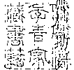



径山志卷之七终



卷之八目录



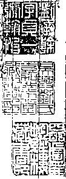



书启



答曾侍郎天游略　释宗杲



又　释宗杲



答李叅政汉老略　释宗杲



又　释宗杲



答江给事少明略　释宗杲



答李叅政别纸　释宗杲



答陈少卿季仕略　释宗杲



答许司理寿源　释宗杲



答刘宝学彦修略　释宗杲



答张丞相德远　释宗杲



答张提刑旸叔略　释宗杲



答汪内翰彦章　释宗杲



答吕郎中隆礼略　释宗杲



答李叅政泰发　释宗杲



答大慧禅师　孙觌



上大慧禅师　孙觌



又　孙觌



又　张偁



召友人　庄法师



答宝月禅师　苏轼



又　苏轼



又　苏轼



与径山无畏惟琳禅师　苏轼



又　苏轼



又　蘓轼



请月江和尚住径山启　溥洽



又　唯实



又　余𪔂



送一清天禅师住径山　妙衎



贺月林镜禅师住持径山启　张宁



复仲淳、藏公支檀三法子憨郎书　真可



请幻于、密藏二上人住径山启　冯梦祯



请廓庵观公住持径山大殿启　王肻堂



请自光师住寂照书　缪希雍



请𣽃居铠公主刻藏　吴用先



与铠公　窦子偁



又　王在晋



又　汤賔尹



又　曾凤仪



请径山朗月泉住持龙居书　闻涞



请径山朗月泉书　闻启祥



请朗月住持龙居书　释广印



请慈门主化城　吴用先



答钱太史　吴用先



寄慈门师　吴用先



答宋元实　钱谦益



与宋元实　释法铠



与无从禅师　姚镗



寄宋元实　吴伯与



答李孟芳居士　释广印



卷之八目录终



径山志卷之八



汶上李烨然删定



海阳徐文龙、鹿城陈𢡟德订



虞山宋奎光辑



书启



答曾侍郎天游略(附问)



释宗杲



(开顷在长沙，得圜悟老师书，称公晚岁相从，所得甚是奇伟。念之再三，今八年矣。常恨未获亲闻绪餘，惟切景仰。开自㓜年发心，叅礼知识扣问此事，弱冠之后即为婚宦所役，用工夫不纯，因循至今老矣。未有所闻，常自愧叹，然而立志发愿，实不在浅浅知见之间，以为不悟则已，悟则须直到古人亲证处，方为大休歇之地。此心虽未𡮢一念退屈，自觉工夫终未纯一，可谓志愿大而力量小也。向者痛恳圜悟老师，老师示以法语六叚，其初直示此事，后举云门、赵州放下着须弥山两则因缘，今下纯工，常自举觉，久久必有入处。老婆心切如此，其奈钝滞太甚。今幸私家尘缘都毕，闲居无他事，政在痛自鞭策，以偿初志，第恨未得亲炙教诲耳。一生败阙己一一呈似，必能洞照此心，望委曲提警，日用当如何做工夫？庻几不涉他途，径与本地相契也。如此说话，败阙亦不少，但方投诚自难隐逃，良可愍也。至扣。)



承叙及，自㓜年至仕宦，叅礼诸大宗匠，中间为科举婚宦所役，又为恶觉恶习所胜，未能纯一做工夫，以此为大罪。又能痛念无常，世间种种虚幻无一可乐，专心欲究此一叚大事因缘，甚惬病僧意。然既为士人仰禄，为生科举婚宦，世间所不能免者，亦非公之罪也。以小罪而生大怖惧，非无始旷大劫来，承事真善知识，熏习般若种智之深，焉能如此？而公所谓大罪者，圣贤亦不能免，但知虚幻非究竟法，能回心此个门中，以般若智水，涤除垢𣑱之秽，清净自居。从脚下去一刀两叚，更不起相续心足矣，不必思前念后也。既曰虚幻，则作时亦幻，受时亦幻，知觉时亦幻，迷倒时亦幻，过去现在未来皆悉是幻。今日知非，则以幻药复治幻病，病瘥药除。依前只是旧时人，若别有人有法，则是邪魔外道见解也，公深思之。但如此崖将去，时时於静胜中，切不得㤀了须弥山放下着两则语，但从脚下着实做将去。已过者不须怖畏，亦不必思量。思量怖畏，即障道矣。但於诸佛前发大誓愿，愿此心坚固永不退失，仗诸佛加被遇善知识，一言之下顿亾生死，悟证无上正等菩提，续佛慧命，以报诸佛莫大之恩。若如此，则久久无有不悟之理。



又



承夜梦焚香入山僧之室，甚从容，切不得作梦会，须知是真入室。不见舍利弗问须菩提：「梦中说六波罗密，与觉时同别？」须菩提云：「此义幽深，吾不能说。此会有弥勒大士，汝生彼问。」咄！漏逗不少。雪窦云：「当时若不放过，随后与一劄，谁名弥勒？谁是弥勒者？便见冰消瓦解。」咄！雪窦亦漏逗不少。或有人问：「只如曾待制，夜梦入云门之室，且道与觉时同别？」云门即向他道：「谁是入室者？谁是为入室者？谁是作梦者？谁是说梦者？谁是不作梦会者？谁是真入室者？」咄！亦漏逗不少。



答李叅政汉老略(附问)



释宗杲



(「邴近扣筹室，伏蒙激发蒙滞，忽有省。入顾惟根识暗钝，平生学解尽落情见，一取一舍，如衣坏絮行草棘中，适自缠绕。今一笑顿释，欣幸可量，非大宗匠委曲垂慈，何以致此？自到城中，著衣吃饭，抱子弄孙，色色仍旧，既亾拘滞之情，亦不作奇特之想，其餘夙习旧障，亦稍轻微，临别叮咛之语，不敢㤀也。重念始得入门，而大法未明，应机接物，触事未能无碍，更望有以提诲，使卒有所至，庻无玷於法席矣。」)



示谕：「自到城中，着衣吃饭，抱子弄孙，色色仍旧，既亾拘滞之情，亦不作奇特之想，宿习旧障，亦稍轻微。」三复斯语，欢喜踊跃，此乃学佛之騐也。傥非过量大人，於一笑中百了千当，则不能知吾家果有不传之妙。若不尔者，疑怒二字法门，尽未来际终不能坏。使太虚空为径山口，草木瓦石皆放光明，助说道理亦不奈何。方信此叚因缘，不可传不可学，须是自证自悟，自肻自休，方始彻。公今一笑顿亾所得，夫复何言？



又



(「邴比蒙诲答，备悉深旨。邴自有騐者三：一、事无逆顺，随缘即应，不留胷中。二、宿习浓厚，不加排遣，自尔轻微。三、古人公案，旧所𣴭然，时复瞥地。此非自昧者。前书大法未明之语，盖恐得少为足，当扩而充之，岂别求胜解耶？净除现流，理则不无，敢不铭佩！」)



信后益增瞻仰，不识日来随缘放旷，如意自在否？四威仪中，不为尘劳所胜否？寤寐二边，得一如否？於仍旧处，无走作否？於生死心，不相续否？但尽凡情，别无圣解。公既一笑豁开正眼，消息顿㤀。得力不得力，如人饮水，冷煖自知矣。然日用之间，当依黄面老子所言，刳其正性，除其助因，违其现业。此乃了事汉，无方便中真方便，无修证中真修证，无取舍中真取舍也。古德云：「皮肤脱落尽，唯一真实在。」又如旃檀繁柯脱落尽，唯真栴檀在。斯违现业除助因，刳正性之极致也。公试思之，如此说话，於了事汉分上，大似一柄腊月扇子，恐南地寒暄不常也，少不得一笑。



答江给事少明畧



释宗杲



人生一世，百年光阴，能有几许？公白屋起家，历尽清要，此是世间第一等受福底人。能知惭愧，回心向道，学出世间脱生死法，又是世间第一等讨便宜底人。须是急着手脚冷却面皮，不得受人差排，自家理会本命元辰，教去处分明，便是世间出世间一个了事底大丈夫也。承连日去与参政道话，甚善甚善，此公歇得驰求心，得言语道断，心行处灭，差别异路，覻见古人脚手，不被古人方便文字所罗笼。山僧见渠如此，所以更不曾与之说一字，恐钝置他。直候渠将来，自要与山僧说话，方始共渠睂毛厮结理会在，不只恁麽便休。学道人，若驰求心不歇，纵与之睂毛厮结理会，何益之有？正是痴狂外边走耳。古人云：「亲近善者，如雾露中行，虽不湿衣，时时有润。」但频与参政说话，至祷！至祷！



答李参政别纸



释宗杲



富枢密顷在三衢时，𠹉有书来问道，因而打葛藤一上，落草不少，尚尔滞在默照处，定是遭邪师引入鬼窟里无疑。今又得书，复执静坐为佳，其滞泥如此，如何参得径山禅？今次答渠书，又复缕缕葛藤，不惜口业，痛与刬除，又不知肻回头转脑于日用中看话头否？先圣云：「寕可破戒如须弥山，不可被邪师熏一邪念，如芥子许在情识中，如油入面，永不可出。」此公是也。如与之相见，试取答渠底葛藤一观，因而作个方便救取此人。四摄法中以同事摄为最彊，左右当大启此法门，令其信入。不唯省得山僧一半力，亦使渠信得及，肯离旧窟也。



答陈少卿季仕略



释宗杲



承谕，欲留意此叚大事因缘，为根性极钝。若果如此，当为左右贺也。今时士大夫，多于此事，不能百了千当直下透脱者，只为根性太利，知见太多。见宗师才开口动舌，早一时会了也。以故反不如钝根者，无许多恶知恶觉，蓦地於一机一境上，一言一句下撞发。便是达摩大师出头来，用尽百种神通，也奈何他不得。只为他无道理可障。利根者返被利根所障，不能得卒地便折，嚗地便破，假饶於聪明知解上学得，於自己本分事上转不得力。所以南泉和尚云：「近日禅师太多，觅个痴钝人不可得。」章敬和尚曰：「至理亾言，时人不悉，彊习他事，以为功能。不知自性元非尘境，是个微妙大解脱门。所有鉴觉，不𣑱不碍，如是光明，未曾休废，曩劫至今，固无变易。犹如日轮，远近斯照，虽及众色，不与一切和合，灵烛妙明，非假锻鍊。为不了故，取於物象，但如揑目，妄起空华，徒自疲劳，枉经劫数。若能返照，无第二人，举措施为，不亏实相。」左右自言根钝，如此返照，看能知钝者，还钝也无？若不廻光返照，只守钝根，更生烦恼。乃是向幻𡚶上重增幻妄，空华上更添空华也。



答许司理寿源



释宗杲



左右具正信，立正志，此乃成佛作祖基本也。山野因以湛然，名公道号，如水之湛然不动，则虚明自照，不劳心力。世间出世间法，不离湛然，无纤毫透漏，只以此印於一切处，印定无是无不是。一一解脱，一一明妙，一一实头，用时亦湛然，不用时亦湛然。祖师云：「但有心分别计较，自心见量者悉皆自梦。若心识寂灭，无一动念处是名正觉。」觉既正，则於日用二六时中，见色闻声，齅香了味，觉触之法，行住坐卧，语默动静，无不湛然。亦自不作颠倒想，有想无想，悉皆清净。既得清净，动时显湛然之用，不动时归湛然之体，体用虽殊，而湛然则一也，如析栴檀，片片皆栴檀。今时有一种杜𢰅汉，自己脚跟下不实，只管教人摄心静坐，坐教绝气息，此辈名为真可怜愍。请公只恁麽做工夫，山野虽然如此指示，公真不得已耳。若实有恁麽做工夫底事，即是污𣑱公矣。此心无有实体，如何硬收摄得住？拟收摄，向甚处安着？即无安著处，则无时无节，无古无今，无凡无圣，无得无失，无静无乱，无生无死，亦无湛然之名，亦无湛然之体，亦无湛然之用，亦无恁麽说湛然者，亦无恁麽受湛然说者。若如是见得彻去，径山亦不虚作此号，左右亦不虚受此号，如何如何？



答刘宝学彦修略



释宗杲



公既于此个门中自信不疑，不是小事，要须生处放教熟，熟处放教生，始与此事少分相应耳。往往士大夫多於不意中，得个瞥地处，却于如意中打失了。不可不使公知，在如意中须时时以不如意中时节在念，切不可暂㤀也。但得本莫愁末，但知作佛，莫愁佛不解语，这一着子，得易守难，切不可忽须。教头正尾正，扩而充之，然后推己之餘以及物。左右所得，既不滞在一隅，想於日用中，不著起心管带，枯心㤀怀也。



答张丞相德远



释宗杲



恭惟燕去阿练若，与彼上人同会一处，娱戏毘卢藏海，随宐作佛事。少病少恼，钧侯动止，万福从上，诸圣莫不皆然。所以於念念中，入一切法灭尽三昧，不退菩萨道，不舍菩萨事，不舍大慈悲心。修习波罗密，未𠹉休息；观察一切佛国土，无有厌倦。不舍度众生愿，不舍转法轮事，不废教化众生业，乃至所有胜愿，皆得圆满。了知一切国土差别，入佛种性，到於彼岸，此大丈夫四威仪中，受用家事耳。大居士於此，力行无倦；而妙喜於此，亦作普州人。又不识还许外人插手否？闻到长沙，即杜口毘耶深入不二，此亦非分外，法如是故。愿居士如是受用，则诸魔外道定来作护法善神也。其餘种种差别异旨，皆自心现量境界，亦非他物也，不识居士以为何如？



答张提刑旸叔略



释宗杲



老居士所作所为，㝠与道合，但未能得㘞地一下耳。若日用应缘，不失故步，虽未得㘞地一下，腊月三十日𨶒家老子亦须拱手归降，况一念相应耶！妙喜老汉虽未目击，观其行事，小大折中无过不及，只此便是道所合处，到这里不用作尘劳想，亦不用作佛法想。佛法尘劳都是外事，然亦不得作外事想。但回光返照，作如是想者，从甚麽处得来？所作所为时，有何形叚？所作既办，随我心意，无不周旋，无有少剩。正甚麽时，承谁恩力？如此做工夫，日久月深，如人学射，自然中的矣。众生颠倒，迷己逐物，耽少欲味，甘心受无量苦。逐日未开眼时，未下床时，半惺半觉时，心识已纷飞，随妄想流荡矣。作善作恶虽未发露，未下床时，天堂地狱在方寸中，已一时成就矣。及待发时，已落在第八，佛不云乎：「一切诸根，自心现噐身等藏，自妄想相，施设显示，如河流、如种子、如灯、如风、如云，刹那展转坏。躁动如猿猴，乐不净处如飞蝇，无厌足如风火，无始虚伪习气因，如汲水轮。」等事於此识得破，便唤作无人无我，知天堂地狱不在别处，只在当人半惺半觉，未下床时方寸中，竝不从外来。发未发觉未觉时，切须照顾。照顾时，亦不得与之用力争。争者，则费力矣。祖不云乎：「止动归止，止更弥动。」才觉日用尘劳中渐渐省力时，便是当人得力之处，便是当人成佛作祖之处，便是当人变地狱作天堂之处，便是当人稳坐之处，便是当人出生死之处，便是当人致君於尧、舜之上之处，便是当人起疲氓于凋瘵之际之处，便是当人覆荫子孙之处，到这里说佛说祖，说心说性，说玄说妙，说理说事，说好说恶，亦是外边事。如是等事，尚属外矣，况更作尘劳中先圣所诃之事耶！作好事尚不肯，岂肯作不好事耶！若信得此说，及永嘉所谓「行亦禅，坐亦禅，语默动静体安然」不是虚语，请依此行履，始终不变易，则虽未彻证自己本地风光，虽未明见自己本来面目，生处已熟，熟处已生矣。切切记取，才觉省力处，便是得力处也。妙喜老汉每与个中人说此话，往往见说得频了多忽之，不肯将为事。居士试如此做工夫看，只十餘日，便自见得省力不省力，得力不得力矣。如人饮水，冷煖自知，说与人不得，呈似人不得。先德云：「语证则不可示人，说理则非证不了。」自证、自得、自信、自悟处，除曾证、曾得、已信、已悟者，方默默相契。未证、未得、未信、未悟者，不唯自不信，亦不信他人有如此境界。士大夫学道，多不肯虚却心，听善知识指示，善知识才开口，渠已在言前一时领会了也。及至教渠吐露，尽一时错会。正好在言前领略底，又却滞在言语上。又有一种，一向作聪明说道理，世间种种事艺我无不会者，只有禅一般我未会。在当官处，呼几枚杜𢰅长老来，与一顿饭吃却了，教渠恣意乱说，便将心意识记取这杜𢰅说底，却去勘人，一句来一句去，谓之厮禅。末后我多一句，你无语时，便是我得便宐了也。及至撞著个真实明眼汉，又却不识，纵然识得，又无决定信，不肯四楞塌地放下，就师家理会，依旧要求印可。及至师家於逆顺境中，示以本分钳锤，又却怕惧不敢亲近，此等名为可怜愍者。老居士妙年登高第，起家所在之处，随时作利益事，文章事业皆过人，而未𠹉自矜，一心一意，只要退步著实，理会此叚大事因缘。见其至诚，不觉忉怛如许，非独要居士识得这般病痛，亦作劝发初心菩萨入道之资粮也。



答汪内翰彦章



释宗杲



伏承第五令嗣，以疾不起。父子之情，千生百劫，恩爱习气之所流注，想当此境界，无有是处。五浊世中，种种虚幻，无一真实，请行住坐卧，常作是观，则日久月深，渐渐消磨矣。然正烦恼时，子细揣摩穷诘从甚麽处起？若穷起处不得，现今烦恼底，却从甚麽处得来？正烦恼时，是有是无，是虚是实，穷来穷去，心无所之，要思量但思量，要哭但哭，哭来哭去，思量来思量去，抖擞藏识中，许多恩爱习气尽时，自然如水归水，还我个本来无烦恼无思量，无忧无喜底去耳。入得世间出世无餘，世间法则佛法，佛法则世间法也。父子天性一而已，若子䘮而父不烦恼不思量，如父䘮而子不恼不思量，还得也无？若硬止遏，哭时又不敢哭，思量时又不敢思量，是特欲逆天理灭天性，扬声止响，泼油求火耳。正当烦恼时，总不是外事，且不得作外边想。永嘉云：「无明实性即佛性，幻化空身即法身。」是真语，实语，不诳语，不𡚶等语，恁麽见得了？要思量要烦恼亦不可得。作是观者，名为正观；若他观者，名为邪观。邪正未分，正好著力，此是妙喜决定义，无智人前莫说。



答吕郎中隆礼略



释宗杲



令兄居仁两得书，为此事甚𢗅。然亦当著𢗅，年已六十，从官又做了，更待如何？若不早𢗅，腊月三十日如何打疉办？闻左右迩来亦𢗅，只这著𢗅底，便是腊月三十日消息也。如何是佛乾屎橛？这里不透，与腊月三十日何异？措大家一生钻故纸，是事要知，博览群书，高谈濶论，孔子又如何？《孟子》又如何？《庄子》又如何？《周易》又如何？古今治乱又如何？被这訾言语，使得来七颠八倒。诸子百家，才闻人举著一字，便成卷念将去，以一事不知为耻，及乎问著他自家屋里事，竝无一人知者。可谓终日数他宝，自无半钱分，空来世上打一遭。脱却这壳漏子，上天堂也不知，入地狱也不知，随其业力流入诸趣竝不知。若是别人家里事，细大无有不知者。士大夫读得书多底，无明多；读得书少底，无明少；做得官小底，人我小；做得官大底，人我大。自道我聪明灵利，及乎临秋毫利害，聪明也不见灵利也。不见平生所读底书，一字也使不著。盖从上大人丘乙己时，便错了也，只欲取富贵耳。取得富贵底，又能有几人肯回头转脑，向自己脚跟下推穷：我这取富贵底，从何处来？即今受富贵底，异日却向何处去？既不知来处，便觉心头迷闷。正迷闷时，亦非他物，只就这里看个话头。僧问云门：「如何是佛？」门云：「乾屎橛。」但举此话，忽然伎俩尽时便悟也。切忌寻文字引证，胡乱搏量注解，纵然注解得分明，说得有下落，尽是鬼家活计。疑情不破，生死交加；疑情若破，则生死心绝矣。



答李叅政泰发



释宗杲



示谕：「华严重重法界，断非虚语，既非虚语，必有分付处，必有自肯处。」读至此，嗟叹久之。士大夫平昔所学，临死生祸福之际，手足俱露者十常八九。考其行事，不如三家村里省事汉，富贵贫贱不能汩其心。以是较之，智不如愚，贵不如贱者多矣。何以故？生死祸福现前那时，不容伪故也。大叅相公，平昔所学，已见於行事，临祸福之际，如精金入火，愈见明耀。又决定知华严重重法界，断非虚语，则定不作他物想矣。其餘七颠八倒，或逆或顺，或正或邪，或非他物。愿公常作此观，妙喜亦在其中，异日相从於寂寞之濵，结当生来世香火因缘，成就重重法界，以实其事，岂小补哉？更须下个注脚，即今这一络索，切忌作寓言指物会。一笑。



答大慧禅师书



孙觌



觌顷佛果於开宝，时公道价，藉藉满都国矣。靖康以还，崎岖兵乱，偶然不死，又罹罪苦，流窜岭海，仰瞻一世龙象，如有仙凡之隔，只自媿叹。



上大慧禅师



孙觌



公高风绝尘，已出世外，而非意之于同逐客放臣迁贬之例。正如痴儿抟空捕影，只堪一笑耳。然佛法遇厄，而后奇胜，乃见所以化服同异也。



又



自公入吴，一佛出世矣。侯王而下，皆获瞻礼。独觌尚未一诣，遂无以藉口。觌方欲上书谢事，得请后书疏小间。当由临安入山，抠衣听法，一洗尘陋也。



上大慧禅师



张偁



窃闻拂衣禅席，再挽莫回；翩然清风，已趣高驾。此固不可以宠利势力迎屈，然岂不念圣天子以公名德之盛，增重名山；以佛法护行阙幸为小驻，以副上意？偁职在守土，朝命是依，谨差衙校陈愈洊布区区万冀。使张京兆异日为白莲社中人，请自兹始矣。



召友人书(用朗师语)



庄法师



自到凌霄　泰然心意  

高低峰顶　振锡常游  

石室岩龛　拂乎宴坐  

清风碧沼　明月白生  

风扫白云　纵目千里  

名花香果　蜂鸟啣将  

猿啸寉鸣　远近皆听  

锄头当枕　细草为毡  

世上峥嵘　竞争人我  

心意未达　方廼如斯  

倘有寸阴　愿垂相顾



答宝月禅师



蘓轼



近递中两奉书，必达。新岁，想法体康胜。无缘集会，怅望可量。屡要经藏碑，本以近日断作文字，不欲作。既远书丁宁，又悟清日夜煎督，遂与作得寄去。如不嫌罪废，即请入石。碑额见今悟清持书往安州乞滕元发大字，不知得否？其碑不用花草栏界，只镌书字一味，已有大字额，向下小字，但直冩文词，更不须冩大藏经碑一行及𢰅人冩人姓名，即古雅不俗，切祝！切祝！又有小字行书一本，若有工夫，更入一小横石，亦佳。黄州无一物可克信。建茶一角子，勿讶尘凂。餘惟万万保练。适冗中，清师行，奉望草草。



又



此间诸事，但问清师即详也。清又有礼，练事多能，可喜！可喜！海惠及隆大师，各计安胜。每念乡舍，爽飞去，然近来颇常斋居养气，自觉神凝身轻，他日天恩放停，幅巾杖屦，尚可放浪於岷峨间也。知吾兄亦清徤，发不白，更请自爱，晚岁为道侣也。餘附清师口陈，此不𫌨缕。



又



有吴道子绢上畫释迦佛一轴，虽颇损烂，然妙迹如生，意欲送院中供养。如欲得之，请示一书，即为作记，并求的便附去。可装在板子上，仍作一龛子。此畫与前来菩萨、天王无异，但人物小而多耳。



与径山无畏惟琳禅师



蘓轼



卧病五十日，日以增剧，已頺然待尽矣。两日始微有生意，亦未可必也。适睡觉，忽见刺字，惊叹久之。暑毒如此，岂𦒿年者出山旅次时耶？不审比来眠食何如？某扶行不过数步，亦不能久坐，老师能相𡭊卧谈。少顷，即告晚凉，更一访。



又



岭南万里不能死，而归宿田野，遂有不启之忧，岂非命也夫！然生死亦细故耳，无足道者，惟为佛、为法、为众生自重。



又



径山长老惟琳，行峻而通，文丽而清。始，径山祖师有约，后世止以甲乙住持。予谓以适事之宐而废祖师之约，当於径山门𨕖用有德，乃以琳嗣事。众初有不悦其人，然终不能胜悦者之多且公也，今则大定矣。



请月江和尚住径山启



溥洽(四明人)



国朝新开泰运，佛法重光；教省载整宗纲，师承唯谨。矧径坞为五山之首，而抡材得万指之雄，操励修能，贲光祖席。径山堂上月江和尚，质貌魁特，襟度豁如，证果初登。借我邦人作善知识。冷泉分座，人天眼目，表率丛林。早承天诏，宠荣独运。霜毫透发，蘸乾太液池水，现出优昙钵华。既不动舌，转大法轮；乃出无心，感多灵瑞。畴咨极品，旌贲奇才。妙喜法道再隆，寂照家声不坠。登凌霄，挹鹫岭，瞻光彩於父子之间；敷至頥，演真乗，翊至治於尧、舜之上。



请月江和尚住径山启



唯实(会𥡴人)



国一开堂，双径为凤麟之灵囿；妙喜据室，四方称龙象之法筵。惟视古以犹今，在得时而行道。顾兹盛举，允副舆情。径山堂上月江和尚，德重珠玑，𪸩联奎璧。伟姿丰丽，浩气冲於斗牛；道韵孔昭，美誉播於湖海。屡应名蓝之聘，久观上国之光，正宐接物以利生，何碍入鄽而垂手？共讶凌霄独步，谩夸光岳蜚英。圭斋别古𪔂於西湖，语留圆镜；大觉辞仁庙於北阙，事见遗书。煌煌吾道有光，凛凛宗纲不坠。继前贤之芳躅，示后学之清规。拱听佳音，永坚夙好。



请月江和尚住径山



余𪔂(匡山人，侍讲)



陶令入远公之社，事见西江大颠接韩子之游话。行南海虽抑扬，必行其志，然出处各得其宐。契道相㤀，坚盟既久。径山堂上月江和尚，机锋圆妙，气宇和平。东鲁书西来意，咸究其源；雪山草沧海珠，实增其价。蜚佳声于阙下，沾宠渥於天中。饱飡禅院之烟霞，深味儒林之风月。丹山仪凤，赤岸良驹。黄太史秉志叅禅，先机独露；张商英存心护法，斯道大彰。尚愿留衣，毋㤀展笑。



送一清天禅师住径山



妙衎(临川人)



位冠五山，信名噐之所重；道传一统，宐师范之可遵。方嗟作者蔑然，又喜斯人出矣。新席径山堂上一清和尚，邓林乔木，渥水神驹。师礼两街，雨露优沾於象阙；表仪多士，风月平分于凤山。盍簮笏多与交游，𠊓辇毂敦行化道？北方学者未或先也，南宗密印其在兹乎？敕额精蓝，教法大弘而可庆；春官华劄，公论允在于当仁。僧中乃有此郎，名下固无虚士。麈尾清风，尘间花雨，不妨迁席；移幢山土，鲤鱼井底，蓬尘试看；倾湫倒岳，祖灯续𦦨，隣壁增辉。



贺月林镜禅师住持径山启



张宁(进士)



舞凤飞龙，五结青莲于天目；灵鸡驯兎，一鉴光彻于祖师。地既曰灵，天其有待，共惟新命。径山堂上大和尚镜公月林禅师，瑞芝三秀，古栢十围，得正度於无传，嗣玅法于东屿。顷者五百间，清风净扫，人望方归。迩来三寸年优钵猛闿，王气犹在，起龙瞑於下界，兴象教於中衰。丞相开𨕖佛塲，和尚悟出世法，乗流而行，遇径而止。当年国一亦起于昆山，首度坡仙，重游於方丈。凡吾方外之友，尽讃僧中此郎。



复仲淳、藏公支檀三法子憨郎书



真可(达观)



「万事畱人情，后来要相见。」此虽俗语，可以喻大。故曹山大师，𠹉以三堕示人谓是也。然人知堕旨者，方今天下恐未有人乎！此非欺语。是堕旨，二乗亦不可测，凡夫大根者，或反有悟者，怪哉！堕乎其谁知之？支檀使来，得汝等书信，如暂𡭊而欢喜无量，然藏公餘欠未偿，犹不能即从吾行。仲淳支檀，又为藏公曲处周旋之意，在早得相追我也。则仲淳支檀，护法之勤，虽肉骨之至，安足喻此？吾虽痴憨，汝等若是用心，吾必精进报汝等，去勿烦多虑也。支檀此畨不中，虽于世情有所未如意，实于支𣐙分上，方在进志。待力克中𨕖，则护法稳大又曲久，而伸必远。故此畨不中，未尽无益也。仲淳既迁亲武康山中，而不使母氏身故，赁舍而魂灵无嗟于黄壤矣。吾𠹉与仲淳书，未始不以此责者，虑其遗恨千古耳。且仲淳又法属血脉，吾不责之，谁敢置喙耶？今不负吾言，而能安亲慰行人厚矣，又何言哉！惟刻藏事体，我虽曾乞素老，及其高弟等任此，我辈幇而成之。其高弟志大，而实亦为法门者，则闻之，便相许可。惟素老犹有推辤，如藏公至而定议之，恳求之，然此老亦难辤矣。能如是，则藏无不成之理，此老又信久矣，且广也。又摄山，本朝钦赐山也。其住持又疏通知大体者，我以是知无不可也。且往年素老，有大𣪫未完，今将完矣，故藏公不可不早来议定之也。如来迟，或此老又为别事，则不可两烦之矣。我之牛山之行，自有随宐方便，料不使人异我也，无多念。我书藏公、仲淳支檀，同读惟仲大为我谢之。明瑞不中，命薄极矣。信造物之柄，不可情见测也。惟超情遗量者，可转也。我未遗量，是不能转之，亦自然也。汝等无以世谛小境为騐，遂不信出世法，而生疑退也。想汝等皆高明之流之俊也，宁有此哉！然亦不妨我饶舌也。山川修阻，音信未期，汝等各宐为道偕重，餘不多喋。



请幻予、密藏二上人住径山启



冯梦祯



字发方起沙砾，悉是珍奇雷音，既徂金地共成坑坎，故大千世界孰非道塲？无量法门总归至道，能负荷而灯灯续明，失皈依则处处荒芜。越中径山，国一濬其源，昙晦广其荫。自唐以来，龙象争依，数每溢鹦林之众；芝兰竞出，宗无二鹭池之传。迩者堂前草深，不系药山佳唱，架后屋倒，岂是汾阳峻机？慈流塞而苦流长，法云远而业云布。蚩蚩弱子，谁拯昬衢？寂寂空岩，尽迷宝所。某等滥侍释提之㫄，不㤀熈连之嘱，虽执御九重，未深玄于胜壤，而驰怀千古，实致慨于昔人。惟我密藏神足幻余宿𦒿，戒珠素洁，忍铠坚维，息心了义，已溯禅河之最，深彻妄穷，真可绍佛慧于无上。频伽好音，闻者惑尽；优钵罗目，望焉意消。信烦林之凉月，允悲海之巨航。𠹉闻大化无化，酬因廼扬；至缘非缘，有感斯应。为不请友，固开士深心，建大法幢，必室洒坚祷，鹫岭之轨持，率然熊耳之传弘。不异某等，伤雁堂之日圮，嗟鹏𦒿之靡依，敢𥡴首顿首，哀恳吾二师，卓锡灵境，无为白寉所先敷座，高峰复振青鸳之胜。秉般若劒，断疑网于重封；开甘露门，润枯荄而更茂。说处鲤鱼横飜山顶，拈来狗子咬杀赵州，纵是钦师𡭊指点而犹惑，藉令妙喜顾謦欬而销声，六师解籓而崩角，七众入𢋨而利生，盲聋瘖痖悉证无生，林鸟川鱼同成正觉，则某等虽居王舍城，均登法云地，妙光罗于十方，如宝丝纲净，因亘于三界，隳弥戾车。窃计二师，愍群有沉沦之莫回，痛末法陵夷之将绝，思起頺纲，而更维援就溺于弱䘮。大心久发，弘誓必深。某等直以，下巫刍狗，蕲申格帝之诚；稚子泥龙，冀启弥天之泽。吾知二师无俟，辞竟牋端，已自云生足下矣。



请廓庵观公住持径山大𣪫启



王肻堂



大矩孕奇，耸五峰之灵秀；那伽密护，垂诸祖之徽猷。人地娴矣，洽苻因缘，时乎际会，恭惟廓庵老师，智轮圆运，德噐深弢，掌钥库司，靡忝卖生，姜汉弼弘，监度重称，用大椀名，六度纲张，十方响应。某等宿乗慈筏，尚滞迷津，兹向金䋲，尤希觉路。窃念宝𣪫为名山壮观，忍覩倾頺？祖庭乃大道法幢，讵宐消歇？裒捐净施，用续鸿规，何图？无边老人奄尔一朝西逝，浩功未竟，善继唯贤，不腆香仪，载摅悃素。统蕲老师，俯陟总持之位，垂手入鄽，永绥群望之情，调心和俗，结未了之公案，焕末后之庄严，庻务获以权衡，水云归其栖宿。天龙推出一千年，佛日重晖，遐迩欣逢，八十员祖灯再朗。



沈珫、陈良模、朱大启、周祗、周宗建、于玉立、沈正宗、贺烺等，同具。



请自光师住寂照书



缪希雍



敬启双径寂照，乃本师紫栢大师所恢复，以为刻经道塲之所也。既而藏公建刻塲於兹，今藏板在焉。嗣后某辈，请𣽃居师兄来主刻塲，驻锡寂照。后直本师迁化，留偈䜟记云：「怪来双径为双树，贝叶如云冷自屯。」始悟本师欲归骨此山，与刻塲相终始也明甚。遂塔本师于鹏搏峰下。今𣽃居师兄以久劳善病，思念休息，来告某辈云：「某将云游行脚，兹地不可无主。窃见幻予师兄法子自光法姪，戒德精严，等心为众，堪作常住，监寺敢白同门护法诸檀越，发心迎请自光法姪，住持寂照，董督僧伦，永作七众依怙。」雍等闻之，不胜踊跃，特奉书专申众意，伏祈慈允，速临法门。幸甚！本师幸甚！



于玉立、孙云仍、于玉德、贺学仁、王𢡟铻、贺𢡟照，同具。



请𣽃居铠公主刻藏



吴用先



不嗣法音间者濶矣，想吾兄道履清泰，山中百凡俱得就绪，顷金坛于贺，并吴江沈茂所、周氏兄弟诸公，俱欲以大师龛地刻藏因缘，请吾兄住径山。弟谓浮渡之请，寒舍叔侄主之，何得自请而自夺耶？众复以大师𧧼责之甚急，弟不得已，敢白于左右。秋菊开时，幸来一议，径山即不敢烦常住，或得兄往来其间。一料理之，则众心𢠢，而弟亦可塞责矣。吾兄於师门不薄，当不省此一来之劳也。



与铠公



窦子偁



径山别是一界，不必沧海日升、浙江潮𡭊之为奇观也。唯上人能住此，非住脚而住佛，藉化城而登宝所也。楼头夜话，气色至至，飞杨诗画之惠，便露神通，绘弄大千，其一点矣。



与铠公



王在晋



不佞讽诵藏经，皈依大道，若令山房自备印纸，无功白受，恐诸佛菩萨嗤当为罪业，至于法门雍衞，发自素心，未敢贪天。奚胜食报，惟上人麾置焚香，礼谶方寸中，为始惬耳。径山给照并碑记，事当遂成，毋烦厪念。



与铠公



汤賔尹



近况得之汪元博，知以刹事费心，此佳事也，亦苦事也。今得就妥，甚幸！弟久欲伴兄山居，贱性尽能寂苦，虑头陀中，未必能饥能寒如弟者。虑径山犹是熟地，故未及行。黄仪部亦谓，径山近杭，未免冠盖声相闻。然弟即入径山，亦必不使冠盖相闻也。一科名迟我十七年素业，甚恨甚恨，岂至今日，仍葛藤其间哉？



与铠公



曾凤仪



吉州晤𡭊，宛如平生，岂非多劫同叅，偶尔相逢也？别去令人怅望不已。未几，有传弹射吴本如者，牵连尊名，亦入章内，窃为足下甚喜。芙蓉被遣，大慧遭谪，此自古大善知识，方遇如此钳锤，恨不与紫柏尊者同遇王难。令千载而下，想见清风，以为是师是弟不忝法门龙象尔。兹辱手书，似有不平之叹。世事浮云，何足叹也？憨公于四月十六，已从湖东起行，云：「於庐山过夏，近有报矣。」至金坛尚未得的音，此老颛为紫柏塔铭而来，欲践生前之约。明春必且入径山，非足下尽心经营，未易了此一叚公案。倘不佞得遂所请，共得相送，真是多生有缘矣。



请径山朗月泉住持龙居书



闻涞



名高监院，诵十载之清芬；人重掌亭，归十方之古德。丛林必期担荷众法，始有总持，㳟惟径山月泉老师，道与腊高，智同境寂。池莲深种，入云栖之一门；庭拍闲看，蛰雷音于双径。允称角虎，解牧泥牛，人天乐推，缁素欣仰。涞等念龙居古刹，为清净之胜幢，乃闻谷大师所安立之别界。非𦒿旧纪纲不振，人人鼻孔撩天；须作家賔主历然，个个脚跟着地。欲此事不废，舍吾师其谁久矣？堂空愁见草深，门外怀哉！席煖快瞻，花雨林开。况深闻于天，梦现洪钟而待叩，且阳生于复，朋来寒谷而适逢。感应甚奇，机缘已熟，恳祈卓锡，伏望悬椎。试看出岫之云，道塲不动；想见到家之日，条令一新。月在指端，照诸方之净念；泉飞杖底，慰大众之渴思。愿住且常，永以为庆。



李事道、施浚明、卢复、严武顺、柴应梓、李兆勋同具。



请径山朗月泉书



闻启祥



径山奉别吾师两月餘矣，计法体增胜，为慰吾郡丛林，自云栖而外，则为瓶𥥲。幸大师亲为主持，又得佛乗师为之左右，法席日兴，已不必言。龙居则大师岁或一至，虽其中𦒿宿如电，百废具兴，然自一江隐居，二师迁化之后，互相逊让，莫为主者，亦丛林之缺事也。今徧索硕德，行解俱超，福慧两足，堪任此事者，无如吾师。龙居诸师，特赍片香，奉请伏乞，慨然许可，勿复他辤，使丛林大事，旦夕可以藉托。而闻大师东顾之忧，因此将以少寛，皆吾师之惠也。恃法爱甚深，因诸师之请，故为劝驾临楮祈望之至。



请朗月泉住持龙居书



释广印



闻菩萨发心，利生为急。利生方便，丛林为先。后生晚学，非丛林无所瞻依；宿德白睂，非丛林无所寄托。故《戒经》云：「冬夏坐禅处所，菩萨皆应立之。往来食息，菩萨善当知众。」此如来谆谆诫劝，菩萨之所当行者。吾师得戒久矣，大心已成，静定有年，𡭊境无事，良贾岂能久藏？龙天自然推出。马大师曰：「未有常行不住，未有常住不行。欲益无所益，欲为无所为。宐作舟航，无久住此者。」政吾师今日事也。且东南丛林，可观者无几，龙居道塲，吾师亦𠹉飞锡。目击其内外庄严毕备者，迩因智增者西行，一众久无依托，於是遍求𦒿宿具大悲者。佥曰：「径山月泉老师可胜其任。」前印持、子将二居士踊跃喜欢，即手书劝发，尚当登山敦请，谅吾师精神镢铄，尚可利生耳。皋亭机熟，有真慈者，安得不乗时赴之耶？



请慈门主化城



吴用先



径山化城寺唐宋以来为名刹，宋高宗钦赐山田千畒，为接待十方禅院，后渐被侵占，寺遂荒落。不佞在藩司时，捐赀赎付，澹居上人管理。今年久，古松修竹又被僧惟证等，砍伐殆尽，适自海上来，入山一见，五内恻然。闻𣽃居在日，已有书请上人交付，其徒有不奉法者，恶语冒触，致师复去天目。兹询之地方士民，皆合口讃师盛德，咸欲挽畱，而𣽃居善徒清隐等，亦复共议，遵其师遗嘱，愿尽散去，立有议单。不佞遂从众懽，启请返锡住持此山，以保全名胜，伏冀俯临。倘有复蹈故辙溷扰者，即此伸白上官，必无过虑也。临启拱竢。



答钱太史



吴用先



㳟惟台台，品重琮璜，望隆柱石，不肖之皈心仰斗，已非一日，第无缘得遂瞻承，时怀耿耿苐徼。有天幸获侍令侄，老先生光霁竹林风范，芬馥袭人，已自窃附神交矣。径山化城寺为八十一代祖师道塲，不肖痛其沉沦，苦心恢复，浙中左右两辖俸资，悉罄于此，以赎寺田，任怨任𧩂，随以倾挤归山。岂料𣽃居魔徒，甘为狮虫娆法，本山合抱古松，累年大竹，伐卖一空。不肖去春，自礼普陀，回至径山清理，始将魔徒驱逐，躬请慈门住持，以为得所托矣。不意今年仍蹈前辙，若慈门复去，则古刹遭其蹂践，复就荒芜矣。两位老先生大护法，金汤慈光，所照无分远近，破山洞闻虽逝，原无外侮，闻本善尽堪住持，况去潭府甚近，护衞不难，万乞悯念化城在危撼之际，幸寛假慈门仍主法席，则古刹赖以保全，两位老先生功德永永不朽矣。披沥丹忱，𢢽希俞允，不胜感激。



寄慈门师



吴用先



去春，不佞千里外躬诣化城，礼请上人住山，无非为道塲念重耳。上人亲受付托兹方，逾年乃欲弃之去耶！一去，则古刹凌夷矣。於当年不佞𢬵官𢬵命恢复之苦心，何言之可为下涕？二位钱老先生，皆法门金汤，破山、化城必无异视，况彼处风恬浪静，一本善可撑支，且法卷尚多也。此则魔党危撼上人去畱，关道塲安危，其能不为八十代祖师动念而忍于去耶？若彼魔徒，去岁不佞区处，周悉彼等，各有亲笔誓约，出山净室，向有批帖，止容小朴一人，不许餘徒混住山，除方家山外，悉听常住专管，纸笔甚明。今复写告示，并军门布政司各书共七封，可看过封投斋米十石，帖付天真，取运刻藏。银每岁一百两，自明年送起，丹阳贺门刻赀，已在京中面说过矣。开田以充斋粮，极是好事，尽力为之，但可为山门护持者，生无不竭尽心力也。万乞安住，勿移望空。叩祝至𢢽至𢢽。



答宋元实



钱谦益



亲丈秉铎，禹航鼓吹文事，惠顾风雅，为一时青氊之最。至于护持法门，为闻谷师唱导，大作人天眼目，则又末法所希有，恒沙请佛所共讃叹也。远承见存，深感注念，长安邸中当先呼斗酒为兄濯足耳。孟芳兄扇置之家笥，另以一柄书去为致意。



与宋元实



释法铠



钦仰明公，积素有年矣。不期会晤，因缘得借名山佛地，仰仗金汤大力何异？玄度重来，不惟众僧得沾恩渥，即不佞私谓就正有道之日，长且远也。昨承欵接，接谈深语，乃知是一魁梧丈夫，其伟杰之气，不露一言，而舌覆大千矣。门下遄征，正应龙天行时也，不知再晤在何年何地重话今日公案也。所愿门下江南胜处，惟有越国山水而已，於无思念中念之。所求序文，虽不佞与门下有一日之雅，实千古定交，亦在此耳。门下笔端之口，扪写云林丘壑，他日山僧送客松间竹下，溪声潄石，倚杖听之，响若盘空而下，答门下之说法也。门下谓山僧此言何如？不然与公作他日巴鼻，据案可也。大纸二张奉用。



与无从禅师



姚镗(临安令)



幸接田衣，深慰夙昔，愿见之怀，一侍麈谭，如听天乐、饮醍醐。至今膈门犹作旃檀香气，簿书俗吏政儗摆落尘氛，载奉支公，杖履而飞锡。遄欲言旋何故，岂五浊界中，不堪长者信宿畱耶？修复古刹，故是再来菩萨事；护持善果，故是我辈今日事。敢不竭蹷，无烦挂念也。春和倘得再一过，从何快如之？



寄宋元实



吴伯与



舟中检游纪二纸、诗九首，附上览政，乞为订讹。〈无徒灾木合志序〉久已脱稿，尚欲亲笔书之，当偏袒顶礼公案，奈行人来甚，迫不及候，然亦不出十日便寄到也。国一师为年兄同府人，妙喜师为弟同邑人，而弟忝同籍，正属操笔转轮，岂非因缘哉？愿年兄大致神力，弟尚欲广宣其间也。序文到时，或年兄北征，幸先致之，同事俾其卒业，何如？



答李孟芳居士



释广印



承问脚跟下事者，只是当人涅槃心耳。涅槃心未明，便是生死苦，今无他，但将身世随缘勾当，将涅槃心作切要的大事，不然业识𣴭𣴭，尘沙劫又尘沙劫去矣，岂不痛哉！玄沙所谓：「不向今生都了却，谁能累劫受灾殃？」然要明此心的工夫途路极多，只消依祖师门下，看个「生从何来，死从何去？」的公案。叅来叅去真疑现前，自然身世轻微，生死重大。如牧牛相似，始则生狞，头角不受鞭䋲，终见相随归去不须牵矣。佛法无难事，久长难得人，珎重珎重。志事居士郑重，再三精详真难得，若是信心也。松源旧本亦仔细看过，间有字句不妥者、误者，亦率意订正，俱可入补遗。虽有几代言语浅淡，在人不在文，既为一代佛法住持，所贵在人之道德，切不可遗之，他日未必有人真为兹山故也。



餘杭丁应标助刻



径山志卷之八终



卷之九目录



偈咏



契嵩一首



道潜一首



宗杲一首



东山空二首



道冲一首



原肇六首



行端三首



砥平石一首



祖铭七首



智及一首



僧声二首



宗泐六首



明本四首



仁行中一首



梵𤦺七首



栯堂益一首



僧祥一首



普庄五首



文琇一首



宗净二首



僧顷一首



道衍一首



昙讃一首



僧珉二首



僧镜一首



来复一首



景隆一首



祖福一首



真可二首



如空一首



性冲二首



龙大渊三首



广询二首



玄讃二首



介轩雝一首



德清四首



月珠一首



法乗四首



法铠四首



圆澄一首



广化一首



广印十一首



广来七首



圆信一首



超宗三首



大淑一首



照初二首



大惺一首



自彦一首



道衡一首



广澈一首



广灯一首



大壑一首



卷之九目录终



径山志卷之九



汶上李烨然删定



海阳徐文龙、鹿城陈𢡟德订



虞山宋奎光辑



偈咏



契嵩(字仲灵，五言律一首)



题径山寺



翠拔群山外　连天势未休  

云迷飞鸟道　雨出古龙湫  

僧在深云定　香和杳霭浮  

人间游不到　一𣪫自清秋



道濳(别号参寥子，於潜人，七言律一首)



游径山怀司马才仲



柔桑蔽野麦初齐　布谷催晴雨一犂  

略彴独横溪上下　蔷薇乱发水东西  

重寻胜处追前赏　无复斯人手共携  

回首春风增感慨　绵蛮黄鸟更悲啼



宗杲(第十三代大慧禅师，字昙晦，宣州人，七言绝句一首)



寄无垢居士



上苑玉池方解冻　人间杨柳又垂春  

山堂尽日焚香坐　常忆毗耶杜口人



东山空(氏里未详，七言绝句二首)



送僧上径山柬妙喜老子



大士昨来闻出世　阿师今日又登途  

杖头倘有闲田地　寄我山头一纸书



半幅全封一字无　莫嫌者也及之乎  

还将昔日芭蕉语　冩作王公十道符



道冲(第三十五代痴绝禅师，武信人，偈一首)



朱居士化姜芋以实斋庖，因示之以偈



佛功德海不可量　有如虚空含众像  

园林衣食及卧具　作诸佛事随所须  

姜芋为物虽甚㣲　能灭世间饥火苦  

讷诸香积国土中　香气周遍十方界  

乃至一切诸众生　具有无邉佛功德  

佛之功德非有无　众生心量亦如是  

而我现前诸衲子　实无能受所受心  

檀波罗蜜众上人　亦无能施所施者  

有无能所二俱遣　空之一字还非真  

是名为佛最㣲妙　世出世间难思议



原肇(第三十九代淮海禅师，通州人，五言、七言古律六首)



径山天开图画



幽涧㵼泠泠　千峰疉翠屏  

晓云开混沌　远水接沧溟  

松影揺禅榻　苔衣上净瓶  

尘中梦不到　争欲买丹青



径山冬日



东西两径幽　歳晚得周游  

壑雪隂犹在　溪云冻不浮  

鸟惊樵斧重　猨挂树枝𣐱  

怕有梅花发　因行到水头



喝石岩



皓首来迎宴坐师　山灵易地应俱胝  

要知弘法回天力　但看精诚裂石时  

一径藓苔春寂莫　断崖文字雨淋漓  

徘徊想象登云处　风撼松杉万壑悲



菖蒲田



一从神武挂冠缨　便入千峰适性情  

已向𦒿英逃姓字　肯因杨柳作歌行  

石田水冷菖蒲节　茅屋云深薜荔荣  

白发山僧知此意　时时来听野泉声



树王



翠丝缜密赤心存　肤凑陵风溜雨皴  

直节向时曾遇上　㣲荄率土莫非臣  

轮囷古栢空生蜀　偃蹇寒松枉仕秦  

瀑布青山堪带砺　森森同见万年春



上淛翁和尚



凌霄峰顶极高寒　中有高人把钓竿  

万里江湖未归客　满天风雨独凭栏  

医和世遇肱三折　慈氏门开指一弹  

管领梅花春有意　免教回首望长安



行端(第四十八代元叟禅师，临海人，五、七言古三首)



题径山（二首）



昔人弘法动天庭　此地因垂万古名  

龙抱雨云归洞府　鹏搏山岛壮江城  

先秋每觉岩风冷　未晓常观海日明  

玉局诗镌旧贞石　至今苔藓不曾生



曲曲湾湾水　重重叠叠山  

水流双径畔　山在半天间  

九夏凉偏甚　三秋暖尚悭  

龙潭因作寺　今古共跻攀



赵、李、倪三居士建凌霄会求赠



双径在吴淛，实为山之雄。天目如屏拥其北，钱塘如练纡其东，其东重峦叠𪩘不知几千万数？但见五峰秀色，𡺚崒摩青空。下有䟦难娑竭神龙之窟，上有覩史夜摩之宫。晴云暖霭生岩松，朝开暮合无终穷。祖师据之，而鞭麟笞凤；灵物依之，而给雨支风。叅玄上士由之，洞森罗寳印，明万象真宗。纳须弥于芥子，卷法界於针锋，皆本源自性之常分，且非妙用并神通。诸上善人，登此山预此会者，境由心摄，事得理融。治生产业，皆与实相不相违背。俨然如鹿苑、鹫岭，覩紫金光聚於百千万人天之中。说法至今犹未散，天花如雨飘空蒙。噫！四生纷扰兮，白云苍狗儵变灭；五欲驱驰兮，惊涛骇浪常撞舂。苟非氷怀雪虑，而栖禅于此地兮，其将曷从？



砥平石(未详，七言律一首)



送蕴藏主省径山元叟和尚



山头老汉八十一　如此东南大法城  

双髩又添新歳白　片言能使古风清  

为人不用击虎术　养子宁忘䑛犊情  

明月堂前坐深夜　餘光分得到长庚



祖铭(第五十一代古鼎禅师，五言古七首)



宿径山娑罗林（二首）



高斋宿层峦　无眠振衣起  

历历夜方悄　婉婉情自美  

浓露濯桂花　清香袭庭几  

林旷鸣籁隐　空净停云徒  

万事坐若遗　静极到天理  

举目注秋江　凉月薄如水



其二



闲宵散积抱　淡然得心妙  

𧉨冷暗响流　灯静寒光掉  

星河累明灭　崖溜落渊奥  

林风来朋朋　吹我形影吊  

浩歌弄明月　高楼入清照



堆珠峰



天势下凌霄　坐使万壑趋  

元气结峦岫　状此大宝珠  

翊殿护释𣑽　钟鼓殷八区



大人峰



五髻上云雨　镇踞何春容  

具此大人相　题为大人峰  

伟哉天地间　万象同扩充



鹏搏峰



峰势来大鹏　鼓此垂天翼  

培风本无待　适兹造化力  

何须问天池　在在六月息



宴坐峰



杉松太古色　不别春与冬  

道人此宴坐　一念万劫融  

不特座灯王　等了诸法空



朝阳峰



二仪开幽漠　日月临下土  

万物丽高明　此峰正当午  

堂堂大圣人　两眼空寰宇



智及(第五十三代以中禅师，苏州人，七言律一首)



次韵贺象原禅师迁径坞



万仞龙门奏凯归　山头鱼跃井尘飞  

生机透脱空诸有　妙用纵横显众㣲  

四海丛林师望重　三台人物晓星稀  

祖翁塔所能延老　拟办遮寒布衲衣



僧声(字九臯，七言律二首)



次韵寄径山以中和尚



山川楼观总丘墟　双径还成化佛居  

四海重修舆地起　群龙仍护𣑽天书  

野猿拱笔诗成后　玉女焚香定起餘  

大觉昔承天子诏　解知山体本如如



其二



东南地上绝尊荣　国一重来更有情  

一院秋风萝卜老　满山风雨苾𫇴生  

他方弟子来传法　上国公卿尽慕名  

绕绕花云围宴坐　予生自愧老于行



宗泐(第五十五代季潭禅师，台州人，律古绝六首)



晓晴流止亭看岩下眠云



非烟非雾晓蒙蒙　万象都归一气中  

深似海时初歇雨　白於绵处不随风  

得闲渐有还乡意　偃卧宁无泽物功  

亭际老僧来倚槛　只疑下界顿成空



法华寺山房为昙公赋



山房白日静　政对五莲峰  

猿坐沼邉石　鹤巢簷外松  

闲门无客到　深径有云封  

坐冷千林雨　香残半夜钟  

道情甘澹泊　身计得从容  

莫恋一枝稳　鸟飞无定踪



长偈送印无相还径山重盖国一祖师塔院，兼简海印老叔和尚



来无所从　信脚踏断槎枒峰  

去无所至　一口吸尽龙渊水  

不来不去又如何　机先勘破迦叶波  

须弥卓　海水立　木童拍　石女歌  

道人本来无所住　一种平怀仍旧去  

喝石岩前架楼阁　井底蓬尘话重举  

有为法与无为法　体用全彰元不别  

国一高风天下闻　径坞禅丛冠吴越  

昔我峰头继席时　忍见祖塔何𣣱危  

道人不日还旧规　森罗万象同掀眉  

方丈老人今硕匠　云月谿山远相望  

不学江西马𥳽箕　千里令人寄圆相



寄径山南石禅师退居大安



径坞荒凉正下秋　老师砥柱屹中流  

一新门户龙神喜　何事匆匆即退休



竹箆放下便抽身　妙喜庵头去结隣  

山上鲤鱼打𨁝跳　谁知井底辊蓬尘



凌霄退席皷三挝　去住浑同眼底花  

何日到京重叙旧　殷勤意不在香茶



明本(号中峰，钱塘人，讃四首附。)



(元至治壬戌，行宣政院虚径山席，强师主之。师不就，结茅中隹山终焉。)



密庵禅师



(径山二十五代)投机以句　顶门廓彻  

唯破沙盆　万古一杰



无准佛鉴禅师



(径山三十四代)用文武火　行密化周  

凤毛麟角　一网齐收



晦机熈禅师



(径山四十六代)面如临济三角　心似妙喜空廓  

坐断大雄峰　高踞慧日阁  

自径山而至仰山　肻受尊卑之束缚  

是风动旙动心动　黑漆竹箆难凑泊



虚谷陵禅师



(径山四十七代)面冷如铁　髪白如雪  

起集云万古法幢　追凌霄三世遗业  

奔走象龙　扫空魔孽  

佛祖不敢正视　天人咸被慈摄  

我𠹉隔岭望餘光　惟见昙华开五叶



仁行中(未详，七言律一首)



次韵象原怀径山



苍苍乔木五峰齐　十载江湖忆旧栖  

丘壑芝兰香雾里　金银楼阁彩云低  

秋风怅望辽天鹤　夜雨悲凉冢上鸡  

但得闲身各安徤　会寻石壁洒新题



𣑽𤦺(字楚石，象山人，五、七言古律七首)



送径山空维那



井底蓬尘山上鲤　大家坐听炉邉水  

三登九到不惺惺　少室谁云有皮髓  

此事将心谩度量　山河为汝长敷扬  

虚空开口笑不已　露柱灯笼争放光  

兴化打克賔　丛林俱鼎沸  

须是金毛狮子儿　一声哮吼咤沙地



题径山



五峰之势欲东垂　当寺一峰如覆杯  

高极上通闻笑语　断崖终日见楼台  

下方凤舞千山去　绝顶龙分两道来  

却忆坡仙三百载　壁间诗句逸风雷



送弘藏主还径山兼柬西白首座



上上上　上到最高高处望  

望见青山起白云　云山出没如波浪  

大华藏海知几重　重重围绕凌霄峰  

须弥绝顶只这是　耳闻迦叶敲金钟  

百千万亿四天下　信手拈来无一把  

束作龟毛一管笔　经头一字如何冩  

冩得分明说得亲　还他眼目人天人



送明禅人往叅径山兼简古鼎和尚



近离何处来　曾到此间否  

不许俊衲僧　人前乱开口  

天宁拄杖子　未免劈脊搂  

决不至三十　但打二十九  

畱一棒自吃　诸方若为剖  

凌霄老宗匠　管取横点首  

不是野干鸣　亦非狮子吼  

若人会此意　堪续牟尼后



送径山英首座归鄞



凌霄峰头第一座　摩诃衍法曾明破  

百非四句俱已离　白雪阳春有谁和  

直得含晖亭𨁝跳上𣑽天　东坡池吞却四明山  

蓦然倒骑佛𣪫出门去　碁盘石径苔痕斑  

君不见寒山子归太早　十年忘却来时道  

又不见明觉老无处讨　十洲春尽花凋残  

珊瑚树林日杲杲



送径山一藏主



一大藏教闲葛藤　尽大地人跳不出  

梦庵本是竒衲子　夜半扶桑吐红日  

拈起凌霄峰顶茶　却是洞庭湖上橘  

松风涧水自谈玄　却笑区区论权实  

权非权　实非实  

白云道个钵罗娘　带累儿孙空受屈



贺径山永首座



摩诃衍法若为宣　五髻峥嵘高插天  

一喝虚空成粉碎　重提佛祖旧因缘  

分明剑向眉间挂　岂得瓢从地上旋  

弹压满堂龙象众　方知法社有英贤



栯堂益(未详，七言律一首)



题径山



攀萝扪石上崔嵬　为访名师特到来  

碧眼望穿红日际　青鞋蹋破白云堆  

松涛振壑鸣天籁　瀑布春岩动地雷  

好境自然尘世别　何须海上覔蓬莱



僧祥(第五十九代止𢊊禅师，杭州人。)



题雨篷



岩头茅屋两三椽　寛窄其如一钓船  

几树晴鸦晚来看　一谿春水雨中眠  

旧愁无复生心上　新句偏多到眼前  

吾亦平生钓竿手　菰蒲丛里住多年



普庄(第六十代呆𢊊禅师，台州人，七言绝五首)



龙河遇敬𢊊禅师，出示涂毒和尚真迹，用韵为赠



箭锋相直解南机　自是情㤀取舍时  

截断从前闲露布　龟毛拈得笑掀眉



蓦劄相逢笑日邉　布单欲卖不成钱  

诸方徧历浑闲事　佛祖原无一法传



道情亲密世情疎　方外交游个也无  

笑索梅花寒共语　一轮明月伴清孤



远随彭蠡下扬州　一叶扁舟逐水浮  

自断神仙东海上　钓鳌谁复置金钩



半生踪迹水云乡　两处曾升演法堂  

喜有睦州遗范在　闲房独坐破䋲床



文琇(第六十二代伯蕴禅师，苏州人，七言律一首)



敬庵禅师见访北山松院叙旧次韵



承召修书蚤识翁　超然才调自堪从  

泰山屼屼群峰绕　沧海茫茫万派宗  

言谓有言成滞碍　妙知无妙绝研穷  

近蒙远访吴城里　拍手松间一笑同



宗净(第六十五代月江禅师，金华人，七言绝二首)



京师问径山之胜，老子倦荅示之以偈



天下丛林数径山　贞珉墨迹枕高寒  

苔封文字迷消息　错杂从教着眼看



退居东堂偈



坐断凌霄已十年　匡宗论道只随缘  

於今休去便休去　啸月眠风乐自然



僧顷(第六十七代西畴禅师，会𥡴人，七言律一首)



住径山作



千觔担子上吾肩　道德荒芜愧昔贤  

得座披衣无法说　聮芳续𦦨有灯传  

含晖亭古存餘景　喝石岩高蔼瑞烟  

愿汲龙渊一勺水　为云为雨沃枯田



道衍(又名广孝，字斯道，苏州人，七言古一首)



琇公禅师新命住持径山，无以为赠，赋诗以驾之



径山主席非公谁　山灵但恨公来迟  

今年山中王气回　公忽自至逢其时  

凌霄峰头日杲杲　喝石岩畔风披披  

升堂提唱第一义　缁白围绕如春熙  

当年国一心为喜　宜与诸老相追随  

诸天散花无路入　老龙献供伸须眉  

碁盘石剥旧苔藓　洗砚池发青涟漪  

僧残屋老固非昔　入门尚见穹然𥓓  

坐看檀越施金粟　飞楼涌殿重维持  

嗟余老病不出月　终日兀坐如蹲鸱  

安得乗云到山顶　援笔再和苏公诗



昙讃(号云隐，讃一首附。)



讃月江和尚



神定气冲　言雄貌伟  

击拂一下　大海截流  

咳唾一声　须弥粉碎  

衲子师模　佛祖骨髓  

文渊阁下　道动天颜  

喝石岩前　名尊地位  

夫是之谓正𢊊和尚之的传　妙喜七叶之华裔也



僧珉(第七十九代石𥦗禅师，律古二首)



题大安东谿草堂



爱尔东谿草堂静　几廻相过却忘还  

牕含斜日吴山紫　门掩落花春藓斑  

问字船来虚载酒　濯缨歌罢每凭栏  

忙忙奔走红尘客　飞梦何曾到此间



讃达磨祖师



臊臭老皮脓　靣黑肠似漆  

万里见萧王　觌靣道不识  

打落当门齿　少林去靣壁  

痴痴坐九年　着甚麽死急  

吁　若不是神光眼有䈥　千古万古成狼藉



僧镜(第八十代月林禅师，杭州人，七言古一首)



赠琳座元职满解回嘉禾漏泽寺住持



五髻山高竒更绝　涌殿飞楼人境别  

白云岩际宿层层　涧底泉声鸣决决  

上人扬锡扣我门　风月平分情更悦  

山头鲤跃井尘飞　密密机锋如电掣  

含晖亭上望晴川　郁郁苍松挺寒节  

明朝拂袖赋归欤　嘉禾旧隐存高洁



来复(号见心，五言律一首)



宿径山天瑞院次虞伯生韵



佛屋凌霄见　僧钟隔水闻  

石苔留虎迹　山气动龙文  

钵自诸天送　灯从白日分  

东游共清赏　猿鹤每为群



景隆(号空谷，五言古一首)



送僧归径山



侍者叅得禅　日轮正卓午  

顽石尽点头　木人齐起舞  

却笑老南阳　三唤成露布  

归去凌霄峰　抹过途中句  

更有转身着　子当自会去



祖福(号谷泉，七言律一首)



礼佛日大师塔



振衣独上大鹏峰　云磴迢迢轶紫空  

力借扶摇搏旷汉　自临缥缈挟长风  

重崖尚接源泉远　乔木常悬海日红  

逈立千山春欲暮　石床花雨正蒙蒙



真可(字达观，吴江人，七言古绝二首)



登径山作



天上富贵人间慕　人间富贵天上唾  

从来唯有达道人　天上人间都觑破  

楖栗一条横瘦肩　穷山深水不知年  

两丸日月谁抛掷　沧海桑田几变迁  

君不见　昆仑腹　飞来江淛号天目  

一枝揺摆向东溟　怒马方驰忽顿伏  

双径萦廻云雾深　五峰盘踞星辰簇  

天所作　地所藏　待人而兴名始扬  

钦师一受龙神施　深湫涨为行道塲  

道成德厚动天子　王侯奔走为金汤  

须信开池非待月　池成水满月自光  

又不见　幽岩树　历尽严霜春未遇  

一旦阳和蓦地来　娇花嫩蕋分相附  

自唐来　至于今　烟霞朝市几浮沉  

何事东风撼塔铃　残红流水澹人心  

龙与蛇　无常居　山头老汉八十餘  

夜叉佛靣振家声　正令当阳肯让渠  

白兎踪　灵鸡冢　暖足功高报晓勇  

岂可人为万物灵　逢缘不布菩提种  

放生池　金莲开　异香时复𣑱楼台  

㣲风闲吹石上松　定里初惊声若雷  

声与色　休妄测　眼闻耳见不可即  

两者既然法法同　凡夫作佛无多力  

怪底呆郎业垢昏　青天白日生疑惑  

石解喝　螺解活　情与无情一机栝  

试将轻线石下牵　横来竖去皆通达  

螺既死　仍复生　百沸锅中别路行  

若人於此知消息　劫火毘岚一任烹  

且拈小　喻其大　了得头头本非昧  

前朝后代祖师禅　善解施为何利害  

赵州狗　无佛性　相逢举著谁不病  

一朝彻底忽掀翻　救却瞿昙穷性命  

一大事　饶将相　管取悬知弄不上  

非是钦师惑乱人　情断输他本色匠  

子房谋　淮隂功　楚汉争雄春梦中  

沙飞何处鸣刀斗　醒来自笑两成空  

这空相　元清净　无邉劫海虚明镜  

一㣲涉动太山崩　今古纷纷憎爱柄  

莫若早　直下休　千头万绪付溪流  

明月池邉趺坐时　云空台殿自清秋  

嗟祖道　转荒凉　狐兎成群白日狂  

三衣瓦钵是何物　[婬-壬+(工/山)]房酒肆较低昻  

山林胜　无过此　绝顶才登收众美  

淛江涛接海门潮　观音舌相拖床被  

大慧老　慈悲好　白云却许红帬扫  

游人若怪烟花迷　敢保先生未闻道  

迷在我　不在人　境缘逆顺䧟根尘  

逈脱根尘光独露　闲花野草大家春  

聊𫏐游　未能畱　阿谁追我双溪头  

孤灯达旦话畴昔　临别甄陶情更绸  

丈夫脚　肯闲蹋　莲花藏板期永纳  

分付山灵善护持　万古苍生无畏塔



吊千松得法师



茫茫宇宙总他乡　像季惊摧正法幢  

南望江梅愁不尽　千松深处落寒香



如空(字无趣，秀水人。)



径山竹箆子



探竿在手任施为　那管人间是与非  

总使这僧能脱略　好生认取不饶伊



性冲(字无幻，秀水人，古律二首)



题径山植树行者



劫初有树名菩提　般若干兮金刚枝  

不滋雨露宛自茂　累经扳折颜无移  

有一道人亲㧞得　无隂阳地深培植  

云蒸水发摩尼香　日炙风吹太古色  

道人得之宜自保　顷刻莫交藤蔓绕  

元非智药移将来　不识这株何处讨  

道人保之宐自重　不与千林万林共  

常将智慧水溉根　莫被八风轻撼动  

道人重之宜自固　迦文昔日曾为坐  

不离自己脚跟邉　日用森森靡不露  

道人固之宜自悟　莫弄闲条功不数  

抱根守节到春深　自有枝头香果堕



径山回至圆明禅院关居



歳暮下空碧　来栖湖上关  

八风门外撼　一窍个中圆  

白日谁为伴　黄昏我独眠  

通宵今古意　都在寂寥间



龙大渊(未详，七言律三首)



明月堂



明月堂开似广寒　八牕潇洒出云端  

碧天㵼作琉璃镜　沧海飞来白玉盘  

金粟界中香冉冉　水晶帘外影团团  

清心肝胆谁能共　独𠋣天街十二栏



含晖亭



亭亭逈出千峰上　绝顶青苍世罕闻  

畫栋浮岚开晓日　彤簷新霁逗春云  

谷中虎豹皆能变　天上鵉皇本不群  

拄笏何人瞻气爽　拂衣唯我出尘氛



凌霄阁



脚蹋玲珑上木天　此身如在第三禅  

重重楼阁香云合　一一山河帝网悬  

玉辇曾扶双凤下　珠宫只带六鳌连  

眉山学士今何在　彩笔题诗百代传



广询(字明宗，古律二首)



登径山次苏长公韵



生平长作天涯客　不爱城中爱山色  

双径路出古临安　野竹流泉清到骨  

堦前万壑云不蒸　峰头九月秋搏鹰  

霞标古寺苔封塔　一代高僧一代灯  

高僧无去亦无至　月落屋梁谁得似  

秋风飒飒松影飘　且拭残𥓓看文字



径山看竹



(径山之竹胜于他山，而径坞火衖尤胜。)



处处幽篁里　迢迢不厌行  

乱山全托影　深径独含情  

织翠搏秋色　调水弄夜声  

相看潭上水　历历共君清



玄讃(号北厓，五、七言律二首)



赠梅庵



古梅深处结禅龛　地位孤高懒访叅  

群玉山中闲宰相　蕋珠宫里老瞿昙  

翠禽啼早春先得　白鹤归迟雪正酣  

僵卧闲门寒彻骨　了无残梦到城南



赠玉峰



友公栖隐地　千仞玉为峰  

瑞气清吟骨　温光长道容  

益知精进力　更见琢磨功  

倒影蛟潭净　归云鸟道通  

瑶泉流雪乳　琼树压玲珑  

丹阁漫霄逈　明霞拂石重  

卓然双径处　秀出玉芙蓉  

甘露心𡮢润　灵芝地本空  

威仪真有凤　磅礴岂无龙  

法鼓鸣峰下　天花点座中  

袈裟含佛日　杖锡振宗风  

慧劒凝神秀　笼灯閟劫红  

禅翁初出定　顿屐散行踪  

回首浮尘世　人间万事慵



介轩雝(七言律一首)



题径山



五髻萦环紫翠连　叅差楼阁冠层巅  

安禅人去惟开石　听法龙移或在渊  

万顷白云来上界　四时花雨集诸天  

四禅不动人间顶　下视双轮日月旋



德清(号憨山，南京人，七言律绝四首)



登凌霄峰



独上高峰𠋣杖藜　侵人空翠转凄迷  

西来二目如鹏翼　东去千山似马蹄  

岩壑久称师子窟　山林终许象王栖  

我来欲说无生法　麈尾才挥万象低



示径山静主



电光石火岂为真　瞥地相逢未可亲  

若是本来消息断　大千随处现全身



示若野禅人从黄梅走南岳复叅双径



远从南岳覔行踪　喜得黄梅一线通  

别向五峰相见处　万山雪拥白头翁



寄径山廓庵堂主



双径单传佛祖心　苍崖翠竹古丛林  

应知正令常新处　钟鼓时宣妙法音



月珠(氏里未详，七言律一首)



赠隐翠禅师



丹崖翠壁拥珠峰　境绕诸天世念空  

竹舞朝阳腾彩凤　泉流灵壑起神龙  

经开五蕴心初净　悟了三生日正中  

暂借禅林一栖息　还闻妙法𠋣苍穹



法乘(号雪栢，吴江人，七言律四首)



赠澹居弟



衲僧皮骨瘦伶仃　看到山穷眼倍青  

双径春深归鸟倦　五峰花发过云灵  

门高几处开禅窟　地广随方设旅亭  

漏尽钟鸣尘梦断　薜萝猿鹤正惺惺



化城



法宇沉埋几百年　凭谁须复大因缘  

狐狼远遁连宵走　师象常游趂日还  

鸟啄幽花分野供　僧持香饭共诸天  

会来总是慈悲力　满贮灵文益后贤



大佛殿



佛堂虚厂逼诸天　叠嶂层楼积翠间  

时有清风来万竹　年无白衲出重𨶚  

𠋣门下视千山落　转径遥闻一水传  

佛法无多亲荐取　鼻头还被祖师穿



径山招等慈师



(等慈，名广润，云栖高足，姓钱氏，长兴人，附葬于常熟破山四高僧墓。)



半间茅屋暂容身　瓦灶茶炉事事真  

漏月自怜簷角破　过云却喜短墙新  

奈缘紫阁多留客　岂是青山不放人  

漠漠天涯谁作伴　诸天百鸟谩相亲



法铠(号澹居，江隂人，七言绝四首)



山居



为僧清净住山中　憎爱是非念自空  

冬日围炉烧榾柮　春来带雨种青松



重崖道士不朝天　山乌山花颇解禅  

月到竹牕春梦晓　佛灯无𦦨灶无烟



云月谿山处处同　莫将云月又随东  

化城门对双溪水　月在五峰云几重



访自光法姪



千嶂松风万叠云　杖藜行遍为寻君  

春林花尽逢人少　尚有黄莺到处闻



圆澄(号湛然，绍兴人，偈一首)



和憨山老人为紫栢尊者秉炬偈(并序)



达大师达大师，生前好恶相半，灭后非是两忘。天人已失依怙，四众永没舟航。大地一时变白，松涛彻夜颠狂。(时风雪大作故云)吹散许多障碍，竖起无上法幢。大师来也在甚麽处？却在山僧笔尖放光。那知音的搥胸呌屈，那不知音的徒自悲伤。偈曰：



石火光中着脚　电光影里翻身  

当塲烧却皮袋　踏破毘卢顶𩕳  

露出本来靣目　千圣莫有知名  

只许自问自荅　休言无臭无声



广化(字无期，海盐人，律一首)



江上怀化仪师寓径山



忆初留别处　西水驿前亭  

梦里惊春色　途中换客星  

雨来吴甸黑　月出径山青  

倘涤清江足　香龛就石扄



广印(号闻谷，乌程人，颂律十一首)



(师住白云庵最久，后复于大藏阁，集众坐禅三年，机会所触，輙寄之吟咏，顾未𡮢脱稿。门人请以授，简曰：「此非衲衣下事也。」以故佳句多落人口，而全篇则绝无。偶得牧牛图颂，及简无尽法师一首录之，以见住径山师有此等诗偈，俾后人知所向往云尔。)



和牧牛图十颂



未牧



信足奔驰不觉劳　东西南北路途遥  

只贪𫇴草平田濶　亡却家山有异苗



初调



气性虽顽鼻已穿　牧童从此痛加鞭  

浑身血汗芒䋲急　遥望家山尽力牵



受制



暂时出草息奔驰　好把鞭䋲紧自随  

到处冻云霜路滑　斤斤调伏敢忘疲



回首



芒䋲不到自回头　毛色皤然性已柔  

水草也知山里足　牧童多意尚羁留



驯伏



暖风晴日柳溪邉　俛首循人意悄然  

花落郊原春色晚　相随归去不须牵



无碍



调伏多年意自如　水邉林下总无拘  

一声羌笛松风起　此日忘归乐有餘



任运



百花溪上柳隂中　饱食和云卧绿茸  

歌罢山童无所事　遗鞭枕石睡方浓



相忘



在在溪山云月中　木人花鸟意相同  

国王水草从来足　闲步陂塘西复东



独照



玉鞭无用草䋲闲　踪迹全无古路间  

空手独归林下月　更前一步即牢𨵿



双冺



杳杳人牛不见踪　一团新月照秋空  

个中若问还源㫖　风落岩花点翠藂



登高明寺简无尽法师(无尽，名传灯，唱导天台。)



晴日度幽溪　松萝青蔼迷  

路随峰上下　云逐树高低  

猊座支郎即　鸡园学士题  

此中堪隐处　应在响岩西



广来(字无从，华亭人，七言律绝七首)



径山感怀次韵



楼阁三千几度尘　草鞋蹋破石头鳞  

空堂列祖既非相　昔日老龙曾化人  

一冢鸡灵何自晓　五峰螺翠为谁新  

如逢拨草瞻风者　莫道无人却笑秦



开山影堂



霜空清洗碧琅玕　劫外长趺草不残  

遇径止来千嶂里　乘流行徧一毫端  

岩云尚作灵芝秀　夜雪翻怜伏兎寒  

自是祖庭从此立　一枝横出破头看



礼大慧塔



神弓圣箭较犹迟　铁壁银山粉碎时  

一个竹箆离背触　片言皮袜浪惊疑  

广长舌覆倾无尽　日月心空照不私  

突屼五峰县窣堵　常光宁与劫同隳



马大师缄书径山



打圆作点绝无踪　一墨水成两处龙  

多口南阳添注脚　却令千里信难通



礼紫栢塔



胸藏狼毒气冲天　一劒横眉雪佛冤  

珍重曼殊台畔骨　何如撆在路𠊓邉



肯将性命闲抛掷　不是冤家不聚头  

今日空山埋舍利　白云孤月自千秋



云龙风虎及时雄　一等心肝绝不同  

佛祖顶门都抹煞　棒头流血至今红



圆信(号雪峤，宁波人，七言绝一首)



径山作



亭亭乔木两三行　古井无龙圣水香  

欲向五峰寻旧迹　残𥓓云续断文章



超宗(字昙衍，江陵人，七言律绝三首)



赠野萍住白云窝



五峰旋𥩟𠊓幽栖　隐几山𥦗听鸟啼  

凿石栽梅畱月影　寻诗拾叶带霜题  

寒松郁郁停云色　瘦竹萧萧夹路迷  

异境尽知归掌握　望中那得与君齐



喝石



昔闻肯法生公聚　今见当机国一徒  

莫道无情不解语　曾经一喝下嵯峨



盘陀石(一名宴坐)



空生宴寂语如雷　遍界雨花香满台  

今日盘陀敷坐在　诸天何事不归来



大淑(号西莲，杭州人，七言律一首)



礼大慧塔



寻常破笠蹈𤇆霞　铁脊生成小释迦  

百亿须弥一拄杖　五千教海半袈裟  

竹箆无靣横南国　慧眼忘人谪海涯  

𥡴首再三重问讯　此山若个又拈花



照初(又名正初，字朗㣲，南屏僧，五言律二首)



餘杭董性之招游双径



自分如孤鹤　闲行孰与俦  

会君攻苦暇　邀我事芳游  

路隔五峰胜　泉通双径流  

今宵有清梦　随月到山头



将游径山喜值复如师、宋元实、张叔维、李孟芳



言寻翠屏胜　遥指白云邉  

游计凭孤锡　行装减半肩  

𡶨容开晓霁　树色敛寒烟  

何意寻支许　㝠搜兴更偏



大惺(字以明，湘南人，七言偈一首)



送孟芳居士再游径山



双脚频向双溪走　依样葫芦莫开口  

五峰默默待人叅　昔日竹箆今在否



自彦(字朗若，杭州人，七言绝一首)



游径山



几回坐石听松风　双径盘廻鸟道空  

长啸一声千仞上　自疑身在五云中



道衡(号西吾，常熟人，偈一首)



径山偈



井底蓬尘山上鲤　阿谁究得西来㫖  

横担楖栗上凌霄　南山出云北山雨



广澈(字念空，华亭人，七言律一首)



早春同无从道兄、冯文玉、钱澈原、李蕚西三居士登径山叅憨山和尚



名篮绝顶列杉松　残雪还将石径封  

礼遍祖师唯白塔　叅来知识是犹龙  

晴空竹密半沉雨　古𣪫莲开五片峰  

落草喜从良伴侣　山头同听几宵钟



广灯(号断峰，华亭人，五言绝一首)



登径山



双径直条条　五峰青矗矗  

八十老古椎　阿谁真面目



大壑(号玄津，五言排律一首)



丙辰冬入径坞谒紫栢尊塔院



峰势矗凌霄　跻攀不待招  

径疑通上界　石想喝前朝  

乱竹迷空翠　长松落海潮  

香浮花气合　梵逐树声飘  

鸡冢荒灵迹　龙湫徙别椒  

岚生群嶂没　风起众山摇  

总为寻师切　宁辤涉险遥  

会心狂顿歇　旋见翳俱消  

谁谓禅非净　从他夕与朝  

一身因抖搜　千指亦丰饶  

礼塔嗟何及　升堂悟欲超  

那堪愁忽别　积雪过溪桥



餘杭王祺助刻



径山志卷之九终



卷之十目录



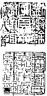



名什



张祜一首



蘓轼八首



蘓辙一首



范仲淹一首



晁补之一首



陆游二首



范至能三首



徐敏一首



张翥一首



赵纬一首



行素生一首



朱全一首



虞集一首



高启一首



张羽一首



习怀清一首



侯复一首



陈道亨一首



邵经邦一首



邵经济一首



张复阳一首



徐渭一首



王洪等联句



方九叙一首



方相卿一首



周忱一首



徐锐二首



俞景寅二首



王泽一首



王守仁一首



吴扩四首



高得旸八首



王蒙亨一首



明谷山人一首



胡朝一首



良缙一首



陆树声一首



严大纪一首



沈季文一首



沈瓉五首



吴用先二首



陆光祖二首



冯梦祯一首



傅光宅一首



徐梦华一首



徐𢡟升三首



顾起元一首



张瓉一首



夏原吉一首



潘淑一首



陆彦章一首



吴光裕二首



王在晋二首



黄汝亨四首



汤賔尹三首



周祇一首



缪希雍一首



戴日强一首



姚可尚一首



李长庚一首



李长房一首



洪都一首



王在公三首



朱鹭一首



胡开文一首



陈调𪔂一首



吴之鲸二首



吴伯与二首



龚立本一首



李縠四首



张维一首



李烨然一首



徐文龙一首



陈𢡟德一首



沈焕然一首



徐㣧翓三首



徐㣧翘三首



徐㣧翀二首



李玉虬一首



王祺一首



王福贞一首



冯维坤一首



戈汕一首



陈继儒一首



王之杰一首



宋奎光五首



周光祚一首



张之采一首



卷之十目录终



径山志卷之十



汶上李烨然删定



海阳徐文龙、鹿城陈𢡟德订



虞山宋奎光辑



名什



张祜(字承吉，清河人，五言律一首)



题径山大觉禅师影堂



超然彼岸人　一径谢微尘  

见相即非相　观身岂是身  

空门性未灭　旧里化犹新  

谩指空中影　谁言影似真



蘓轼(字子瞻，睂山人，古律八首)



游径山



众峰来自天目山　势若骏马奔平川  

中途勒破千里足　金鞍玉镫相回旋  

人言山住水亦住　下有万古蛟龙渊  

道人天眼识王气　结茅宴坐荒山颠  

精诚贯山石为裂　天女下试颜如莲  

寒窗暖足来朴握　夜钵咒水降蜿蜒  

雪睂老人来叩门　愿为弟子长叅禅  

迩来废兴三百载　奔走吴会输金钱  

飞楼涌𣪫压山破　朝钟莫皷惊龙眠  

晴空偶见浮海蜃　落日下数投村鸢  

有生共处覆载内　扰扰膏火同烹煎  

近来愈觉世路隘　每到寛处差安便  

嗟余老矣百事废　却寻旧学心𣴭然  

问龙乞水归洗眼　欲看细字消残年



再游径山



老人登山汗如濯　到山困睡呼不觉  

觉来五鼓日三竿　始信孤云天一握  

平生未省涉艰险　两足惯曾行荦确  

含晖亭上望东溟　凌霄峰头挹南岳  

自爱丝杉翠丝乱　谁见玉芝红玉琢  

白云何事任来往　明月长圆无晦朔  

冢上鸡鸣犹忆钦　山前舞凤遥徵璞  

雪窗驯兎元不死　烟岭孤猿苦难捉  

从来白足傲死生　不怕黄巾把刀槊  

榻上双痕凛然在　劒头一吷谁能角  

嗟我昬顽晚闻道　与世龃龉空多学  

灵水先除眼界花　清诗为洗心源浊  

騐人屡欲逃竞病　禅老但喜闻剥啄  

此生更得几回来　从今有暇无辞数



寄澄慧大师



我昔曾为径山客　至今诗笔餘山色  

师住此山三十年　妙语应须得山骨  

谿城六月水云蒸　飞蚊猛㨗如花鹰  

羡师方丈冰雪冷　兰骨不动长明灯  

山中故人知我至　争来问讯今何似  

为言百事不如人　两眼尚能看细字



初自径山归述古召饮介亭以病先起



西风初作十分凉　喜见新橙透甲香  

迟暮赏心惊节物　登临病眼怯秋光  

惯眠处士云庵里　倦醉佳人锦瑟𠊓  

犹有梦回清兴在　卧闻归路乐声长



次韵和杨次公惠径山龙井水(水洗病眼有効)



漏尽鸡号厌夜行　年来小噐溢瓶罂  

弃官纵未归东海　罢郡犹堪作水衡  

幻色将空眼先暗　胜游无暇脚殊轻  

徒烦远致龙渊水　宁复临池似伯英



与周长官、李秀才游径山（二首）



少年饮红裙　酒尽推不去  

呼来径山下　试与洗尘雾  

痴马惜鄣泥　临流不肯渡  

独有汝南君　从我无朝莫  

肯将红尘脚　暂著白云履  

嗟我与世人　何异笑百步  

功名一破甑　弃置何用顾  

更凭陶靖节　往问征夫路



其二



龙亦恋故居　百年尚来去  

至今雨雹夜　𣪫阁风缠雾  

而我弃乡国　大江㤀北渡  

便欲此山前　筑室安庭莫  

又恐大幽独　岁晚霜入屦  

同游得李生　仄足随蹇步  

孤明不自爱　临老启三顾  

吾归便却扫　谁踏门外路



径山道中次韵答周长官兼赠蘓寺丞



年来战纷华　渐觉夫子胜  

欲求五畒宅　洒扫乐清净  

学道恨日浅　问禅慙听荧  

聊为山水行　遂此麋鹿性  

独游吾未果　觅伴谁复听  

吾宗古道直　穷达付前定  

𫗦糟醉方熟　洒面呼不醒  

奈何效燕蝠　屡欲争晨㝠  

不如从我游　高论发犀柄  

溪南渡横木　山寺称小径  

幽寻杳兹始　归路微月映  

南望功臣山　雪外盘飞磴  

三更渡锦水　再宿畱石镜  

缅怀周与李　能作洛生咏  

明朝二子至　诗律严号令  

篮舆置纸笔　得句轻千乗  

玲珑最奇秀　名实巧相称  

九仙更幽绝　笑语千山应  

空岩侧破瓮　飞溜洒浮磬  

山前见虎迹　候吏铙鼓竞  

我生本囏奇　尘土满釡甑  

山禽与野兽　知我久蹭蹬  

笑谓候吏还　御虎吾有命  

经山虽云远　行李稍可并  

颇讶王子猷　忽起山阴兴  

但报菊花开　吾当理归艇



蘓辙(字子由，睂山人，七言古一首)



游径山和东坡韵



去年渡江爱吴山　忽㤀蜀道轻秦川  

钱塘后到山最胜　下枕湖水相萦旋  

坐疑吴会无复有　扁舟屡到凌深渊  

今秋复入径山寺　势压众岭皆迷颠  

连峰杳嶂不知数　重重相挹如青莲  

散为云雾翳星斗　聚作潭井藏蛇蜒  

钦公未到人绝迹　千里受记来安禅  

荒村草野置茅舍　坐令海贾投金钱  

至今传法破烦恼　饱食过寮宐安眠  

解装投锡不复去　纷纷四合投乌鸢  

或言处此犹未远　海上人少无烦煎  

天台雁荡最深杳　水秀石瘦犹清便  

青山独往无不可　论说好丑徒纷然  

终当直去无远近　藤鞋竹杖聊穷年



范仲淹(字希文，蘓州人，七言古一首)



送圆悟粹禅师入径山



观水莫观汚池水　汚池之水鱼鳖卑  

登山莫登迤逦山　迤逦之山草木稀  

观水须观沧溟广　登山须登泰山上  

所得不浅所见高　功夫用尽非徒劳  

南方幸有𨕖佛地　好向其中寻妙旨  

他年盛噐整頺纲　不负男儿出家志  

大丈夫　休拟议　岂为虚名灭身计  

百年随分觉无多　莫破光阴暗添岁  

城都况是繁华国　打破只因花酒惑  

吾师幸是出家儿　肻随龌龊同埋没  

吾师幸有虹霓志　何事踌蹰溺泥水  

岂不见　吞舟之鱼不隐卑流　合抱之木不生丹丘  

大鹏一展九万里　岂同春岸飞沙鸥  

何如急驾千里骥　莫学鹪鹩恋一枝  

直饶讲得千经论　也落禅家第二机  

白云长是悬高台　莫罩朝笼不暂开  

为慰苍生霖雨望　等闲依旧出山来  

又不见　荆山有玉名琼瑶　良工未遇居蓬蒿  

当时若不离荆楚　怎得连城倍价高



晁补之(字无咎，鉅野人，七言古一首)



游径山



盘崖绕壑步步高　仆痡马乏游人劳  

五峰崛起干云霄　众山奔走争来朝  

我行直欲犯星杓　意彻绝顶才山腰  

松间鸟语如相招　仰见白塔当林梢  

担携上下若桔橰　路穷飞栖郁岧峣  

钦翁未来蔽菅茅　山精木恠惟游遨  

麏驰虺窜猩鼯跳　灵景晦昧何由昭  

忽然飞锡从江皋　探穷不惮东峰遥  

曲腰丈夫白丝袍　再拜岩前风雹飘  

三百年来响钟铙　闽商海贾转金刀  

直栏红牖山周遭　晨叅夜讽声嘈嘈  

碧山紫栢罗旌旄　高深六月㤀炎熇  

明月庵前醉浊醪　白云峰顶瞰若郊  

鵞毛一点钱塘潮　越王宫阁如累樵  

临之股栗精魄超　归不得寐心摇摇  

含晖孤亭立嶤崤　此地览景尤难逃  

五更月落禽嘲嘲　阳乌欲上海云烧  

晦明变化不终朝　儵忽阴阳状莫描  

夜阑灯清雨飘潇　偶坐两客论幻泡  

探玄穷妙窥寂寥　破除万事与丝毫  

不奈诗思犹强豪　归时日没红霞销  

荒崖老木山蝉号



陆游(字务观，号放翁，山阴人，绝律二首)



呈松源禅师



几度驱车入帝京　逢僧一例眼双青  

今朝始觉禅家别　说有谈空要眼听



哭涂毒禅师



岌岌龙门万仞倾　翩翩只影又西行  

尘侵白拂䋲床冷　露滴青松卵塔成  

遥想再来非四大　尚应相见话三生  

放翁大欠修行力　未免人间怆别情



范至能(号石湖，古律绝三首)



凌霄庵



峰头非尘寰　一舍谁所茇  

轩睂玉霄近　按指沙界豁  

万山纷累块　众水渺聚沫  

来云触石廻　去乌堕烟没  

向无超俗缘　兹路讵可越  

偕行木上座　同我证解脱



题径山寺楼



落日苍𣴭水　扪星缥缈楼  

神光来烛夜　寿木不知秋  

海内五峰秀　天涯双径游  

爱山吾欲住　衰病嬾乗流



倾盖亭



万山罗立翠云幢　袅袅时闻晚炊香  

山下行人尘扑面　谁知世界有清凉



徐敏(七言古一首)



赠痴绝禅师



> 痴绝有庵不肯住　弄月挑云径山去  

> 地水火风分裂时　亲书赠子黄葛布  

> 蜕封读罢咽无语　会得龙须能避暑  

> 岂知玉骨本清凉　书则珍藏布不取  

> 源老忽踏幽深路　道在隔山遥望处  

> 巨帙已载烂葛藤　何堪又送闲家具  

> 开眼一看笑呵呵　犹有这个可奈何  

> 来而不往非世法𦖂效芹忱愧不多  

> 两角茶　十袋面　宝缾飞钱五十万  

> 虔心献此一瓣香　奉为禅师作清荐  

> 且问先师来不来　玉山庵顶白云开  

> 更烦大众打圆相　拨取青莲火里灰



张翥(字仲举，号蜕庵，五言律一首)



题大慧禅师塔



大慧谈经地　林园即给孤  

凿云藏舍利　鞭石起浮图  

风铎时喧寂　天灯忽有无  

沙门每来此　三绕作曩谟



赵纬(荆南人，五言古一首)



赠敬庵禅师



西来有妙义　了悟在真积  

庄师善学人　味道如杂绩  

平生物与我　何曾自栽植  

往年住锡山　蜚声振丛席  

初如出钵龙　晚会投林翮  

拂袖返故居　杜门绝尘迹  

径山席再兴　宝雨绚金碧  

愿言出焚修　上以酬圣泽



行素生(不详姓氏，松江人，七言律一首)



嘉禾天宁遇敬庵禅师



邂后高僧老敬庵　幸同乡土话江南  

宦情客思惭驰逐　法道宗纲喜遍叅  

我已此山思慧远　君今何处见瞿昙  

几时卓锡云间路　茗椀熏炉接笑谈



朱全(嘉禾人，七言律一首)



金溪重逢敬庵禅师遽别



喜遂重逢说故乡　那堪遽别思偏长  

江湖纵有三生石　岁月难禁两髩霜  

晚渡归舟过檇李　春山卓锡到餘杭  

遥知后夜相思处　人在深林石竹房



虞集(字伯生，临川人，七言律一首)



送见心上人之径山



台山蓦直勿岐差　双径峰前路不賖  

若有劒光冲北斗　更愁帆影落谁家  

曲江水暖花千树　古道秋高月一槎  

记取题诗相送处　鹭鹚和雪立芦花



高启(字季迪，蘓州人，七言律一首)



和复见心简季潭泐公



高堂钟鼓毒龙惊　曾布袈裟海上城  

庐岳禅师传法印　道园学士许诗名  

几趋北阙瞻天近　独坐南屏𡭊月明  

书到喜闻双径老　雨花新散满瑶京



张羽(字来仪，五言律一首)



径山夜坐闻钟



凉风生毛骨　天高露满空  

二十三年事　一百八声钟  

绝顶人不到　此心谁与同  

凭栏发孤叹　宿鸟起长松



习怀清(清江人，五言古一首)



赠月江禅师



双径极幽邃　中有招提隐  

净公慧远流　住山不出影  

夜吟萝月寒　昼卧松雪冷  

夙心谐善缘　满腔尽春景  

禅学既已精　儒行亦深省  

何日再相从　为师挈裘领



侯复(云中人，七言古一首)



上月江师



径山山下江水流　白云常鎻禅关幽  

高僧卧山久不出　六朝应诏来皇州  

香街紫陌畱不住　又言飞锡东归去  

云散天空江水流　一轮月挂珊瑚树



陈道亨(嘉禾人，七言律一首)



登凌霄峰



凌霄峰头烟雾深　野水虚阁此登临  

长藤古木有佳兴　翠壁丹崖生壮吟  

飞瀑洒空千树湿　白云笼日万山阴  

来叅玉版春雷后　又见森梢横出林



邵经邦(七言古一首)



游径山



素望山巅倚如掌　㞧乩奇穴来天上  

径山不比天目高　犹能放眼延萧爽  

瀛洲只在海东边　长江一泻何𣴭然  

天吴蹴水雪山拥　鹏鸟搏风寉背连  

𦬆鞋蹋徧云缥缈　千山万水何时了  

笑踞芙蓉最上头　指点乾坤一时小  

五峰拔翠碧云封　渊泉涌出金莲丰  

锡钵遗来降水恠　袈裟挂处收苍龙  

瑶华种种庄严境　遂使名山失真静  

何似昆仑未凿开　不惊龙象犹天幸  

我欲乗槎问汉津　三山敻隔蓬壸春  

𫏐栖佛日穷清赏　自入空门避世尘  

飘飘如在神仙宅　夜半披衣坐盘石  

同攀皓月访古松　要识玄星倚苍栢  

白云尽掩下方同　咫尺难论万里通  

毒龙带角悬岑塔　铁骑空嘶万木风  

玉堂真笔龙蛇势　净扫鸠坛散胸次  

可怜兴尽一代宫　惟勒丰碑两行字  

寒霜裂竹啸声哀　不见玄猿独倚台  

千古禅心无此寂　百年浩气涌如雷  

回头独看三花树　雾灭荒山断归路  

扶桑已出鸦背红　博得浮生此真趣  

腐儒出处皆声名　大游不似维那行  

任他喝石千年在　不及朝阳一凤鸣



邵经济(号心斋，仁和人，七言古一首)



游径山



吾闻弱水之上蓬莱山　云霞缥缈非人寰  

鹏翮三千水一息　鳌背万仞那能攀  

壮怀踏遍天目路　羽翼骞风失鸳鹭  

自泛蓬莱只此山　谁知双径迷烟树  

复磴悬崖霄汉开　杜蘅薜荔相依偎  

晴云不负看山眼　落日何孤泛斗杯  

双径山高出林杪　回首千山万山小  

蜀栈崎岖鸟道廻　秦关崱屴羊膓绕  

五峰返照岳莲红　峰头抚掌摩长空  

江光不远一线落　云气常随万里同  

钟鸣磬发迎天马　袈裟倒曳胡为者  

宝华庄严礼世尊　不知佛日身三舍  

我寻佛祖问真源　慧力禅机到处存  

钵水倒翻天北极　石崖喝堕海东门  

龙湫奫奫泉滴滴　云是真伽亲卓锡  

古来沧海几桑田　恠底禅家说空寂  

放生池上蜿蜒多　飞跃鸢鱼石未磨  

吾道千年常活泼　返生谁复知枯螺  

灵鸡冢高去天尺　复尔盟坛悲赤帻  

也应羽化出尘埃　曾似岩头空抵掷  

驾幸空门喝石高　天章御墨挥秋毫  

不思北狩飘零后　空复南都霄汉劳  

光矅三台囬四极　雨积亭烟风剥泐  

可惜当年龙劒文　都随蔓草无颜色  

岂能步月下林𦤎　露液霜华点髩毛  

月到中天明宇宙　风生渤海见波涛  

坐觉高寒刺诗骨　临风便欲搏霜翼  

翛然轻举绝纷嚣　明霞可飡石可食  

旧闻蘓子爱逃禅　玉堂素简青云镌  

好是叅禅叅不破　苍烟空鎻墨花鲜  

我来高揭叅禅手　笑倚天空击瓦缶  

珮环苍碧光陆离　绾结龙丝烛牛斗  

环秀窗前凝晓霜　朝阳峰头熹晨光  

布袍白帻坐天上　赤日红云望帝乡  

再歌天寳更丰芑　六龙永驭千百祀  

蓬莱弱水一荒唐　笑托山花识仙址



张复阳(七言律一首)



题径山



石径萦纡出薜萝　诸峰环拱势嵳峩  

举头便觉天颜近　极目还知地界多  

西北云来燕雨露　东南潮涌浙江河  

振衣直上高峰顶　苔蚀穹碑手自摩



徐渭(字文长，山阴人，五言律一首)



化城寺



方引主人辖　转为山寺嬉  

门深当水尽　路曲入松移  

破铎摇簷鸽　寒萍蔽澡龟  

过溪无虎啸　枉送远禅师



王洪、王畿、王澍、王沂



夜坐径山松源楼联句



高灯喜雨坐僧楼　共话茶杯意更幽(洪句)  

万丈龙潭飞瀑倒　五峰寉树湿云收(畿句)  

碑含御制侵苔碧　径启昙花拂曙秋(澍句)  

还拟凌霄好风月　海门东望大江流(沂句)



方九叙(钱塘人，七言律一首)



游径山



云里五峰环紫翠　空中一径转微𣴭  

黄花渐报重阳节　白社遥寻古道塲  

精舍更宐留谢客　玄都何必访刘郎  

高僧趺化千秋事　独有灵鸡冢树苍



方相卿(邑人，五言律一首)



游径山



名山万壑里　迢递拂云行  

乌下窥藜杖　僧来问姓名  

岩花迎日艳　谷树曳风鸣  

深入无人处　相随鹿豕盟



周忱(庐陵人，七言绝一首)



径山寺观梅



双径山前夜月明　寒梢踈蕋影纵横  

禅扉半启行吟处　人比梅花一样清



徐锐(邑人，七言律二首)



径山雪霁



蜿蜒西来耸更尊　已看银汉绕昆仑  

雪光掩映千峰见　海色微𣴭一线分  

天旷浮云苍狗变　林深阴洞玉龙蹲  

高僧自爱青莲座　时𡭊梅花静掩门



其二



篮舆忽度翠微𨵿　行尽双谿上径山  

日月连珠从地转　蓬蒿浮玉倚天看  

龙飞凤舞千支袅　越北吴南两乳盘  

雪水秪应仙品试　诗篇仍向石林删



俞景寅(邑人，五、七言律二首)



游径山十四韵



双径通金地　群峰列宝屏  

初登疑𥥆窕　渐陟觉孤㝠  

迟日岩头堕　浮云岫脚停  

江涛一马白　海峤数螺青  

杉桧森成霭　楼台逈逼星  

呼泉流壁罅　咒石划川形  

鸡冢封前慧　龙湫雨后腥  

莲呈真法相　僧诵大乗经  

砌石曾过辇　碑残尚识铭  

竹风飘梵磬　萝月映禅扄  

境寂还心寂　山灵总性灵  

井尘繙旧案　劒吷发新硎  

蔡碣苔文绣　蘓池墨色莹  

漫留诗笔在　千载肯同订



登凌霄峰



双径穿云上碧霄　凭虚胜览此偏饶  

窗间吴越连三楚　树饱风霜自六朝  

沙碛寒飞江练白　海门春逐浪花遥  

兴餘一啸狂𩙪起　历乱烟霞杖底飘



王泽(字叔润，天台人，五言律一首)



寄季潭禅师



宝树香云合　龙河绿水新  

凉多今夏雨　僧少去年人  

一骑留京国　孤鸿入塞尘(师曾出使外国)  

西天几万里　沙草濶无垠



王守仁(号阳明，餘姚人，五言律一首)



题化城



僧屋烟霏外　山深绝世哗  

茶分龙井水　饭带石田砂  

香网云岚杂　窗高峰影遮  

林栖无一事　终日弄丹霞



吴扩(延陵人，五言律四首)



游径山



青云盘一径　香霭接诸天  

福地灵泉涌　金容慧日悬  

塔平餘宋址　松偃记唐年  

愿谢尘中迹　㝠心证丄禅



其二



幽径悬青壁　飞淙百道分  

涧松交晚翠　谿碓响秋云  

净域标龙藏　高峰下鹿群  

自餘林阁兴　长啸倚斜矄



其三



香木悬崖合　流泉石路分  

洒空喧瀑布　映日落峰纹  

抱子玄猿出　呼雏黄鸟间  

何当迷处所　更入鹿麋群



其四



古院千峰隔　空堦万竹分  

薜萝延畫壁　松栢秀苍云  

落目鸦翻阵　长风寉破群  

老禅睂覆面　世事不相闻



高得旸(字孟昱，钱塘人，七言律八首)



天掌峰



五峰秀出冠丛林　千载奇称遇赏音  

云雨自成翻覆手　虚空谁识往来心  

山围竺国层层玉　地入祗园步步金  

一指傥教归大道　石头未怕路岖嵚



骊珠峰



谁向龙渊发秘藏　远烦天掌为擎将  

四山白月争秋色　一岛红云护夜光  

灵鹫斜飞天侧畔　阳乌正照地中央  

向来娑竭输珍玩　在处还应属上方



浣云池



偶然凿破一方苔　云影中间去又来  

本已飘飖离世俗　何烦洗濯绝尘埃  

捣衣溪女花阴合　涤砚山童墨晕开  

智者正为秋水观　可容凡砾溷灵台



㵼玉岩



千尺飞流如泻玉　溠岩新爱得佳名  

雷惊石眼分岚气　云走峰腰学水声  

百折岂辤归海远　一生长喜在山青  

浮沤起灭寻常事　惭愧高人眼独明



云笔峰



一峰崒嵂直如椽　五色𬘡缊烂若烟  

太华秋高金气肃　湏弥春煖玉毫圆  

油然亦是无心出　卓尔何曾有字传  

安得文如燕许手　相期泚露向尧天



娥睂峰



普贤说法西江上　节彼名山具仰瞻  

人喜长卿能慕蔺　我惭逢世讳称严  

烟供淡扫兰煤重　月比新弯笋玉纤  

宝阁梵餘聊作供　莫因莫雨始掀帘



双桂林



双桂成林开胜域　绿阴夹道閟禅𨵿  

芳联天目东西径　气压淮南大小山  

金粟堆时何粲粲　宝华雨处共斑斑  

觉皇境界容亲到　袖取天香散世间



万菊轩



一轩专为黄花设　富拟人间万石君  

佳本賸从方外得　妙香多在定中闻  

引泉北涧分清露　开径南山见白云  

此意欲为知者道　陶翁犹自未离群(已上西径山八咏。)



王蒙亨(号中泉，餘杭人，五言偈一首)



舍田入化城寺系之以偈



我田众生田　谁施谁为受  

施受了无别　请问石桥叟



明谷山人(五言律一首)



留别众僧



草阁廻双径　松林带五峰  

秋光净如水　落日𣽃高空  

僧住翠微里　客来江浦中  

百年长扰扰　清话几相逢



胡朝(号秋江，五言律一首)



游径山



寳马香车客　披云谒上方  

龙孙依竹长　雀舌散茶香  

明月池犹在　灵鸡冢独荒  

古碑苍藓合　都是宋文章



良缙(号賔山，五言律一首)



赠净庵



秋日依双径　林宁风不闻  

冰心无劫火　金刹入慈云  

懒际风云会　还寻麋鹿群  

堦前观寉舞　清燕共斜矄



陆树声(号平泉，华亭人，七言绝一首)



书径山禅师卷(时年九十有七)



淛西狮窟首名山　竹箆曾过妙喜关  

八十七灯无昼夜　一光东照老人颜



严大纪(字汝肃，餘姚人，七言律一首)



径山静室信宿



偶出风尘坐翠微　幽奇晨夕在山扉  

林开鸟带栖云去　石润龙含剩雨归  

莫问茅荆非别业　即看萝薜是初衣  

却嫌樵𥪡惊相识　未遣猿鼯共息机



沈季文(号太素，吴江人，七言绝一首)



过寂照庵



兰若萧踈夕照间　碧云黄叶满秋山  

逢僧为说无生法　喝石岩前带月还



沈瓉(号定庵，吴江人，古律五首)



游径山访铠公



渐远招提境　犹闻谷鸟啼  

雪深僧欲定　花发客将迷  

野町清泉绕　空林倦马嘶  

何年悟禅理　得意㤀筌蹄



其二



祇园千畒废　野竹遍荒陂  

雀啄草花子　风鸣桑树枝  

日光含舍利　山影界毘尼  

若问莲花塔　今当地涌时



游径山长歌



四日卧櫂清溪河　怅望游侣无人过  

浩然乗月放归艇　櫂声已入沧浪歌  

竝河冒暗呼不已　僧偕行者来山坡  

从昏达旦足重研　冲虎夜行肩负戈  

谓言诸客尽入寺　取道郊区登云窝  

闻言一笑却转柁　有缆仍系桑林柯  

匋丁踯躅耻驾舆　久不跨马今乗骡  

疾驰不觉三十里　轻雷挟雨成滂沱  

寓楼小憇遂淹宿　客衾夜藉谿簰蓑  

诘朝云气尚黯淡　已报东旭呈青螺  

藂篁高下浚谷杳　双径迤𨓦千峰罗  

巍宫远接宋香火　异境肇开唐岩阿  

数百年来八十祖　今何寥落昔何多  

丹青剥落榱栋朽　扶倾起废非人何  

此来匪直事游眺　为奉龙象倡檀那  

禅林况多梓里彦　清淡微笑皆磋磨  

惭余顽钝不受琢　恍若聋瞆惊灵鼍  

尘劳扰扰竟何事　要当拂袖栖云萝  

五人同行一人住　勦绝家事称头陀  

灯前三叹重自省　赤帜在望犹蹉跎  

出门步步惜风景　浮踪行复随蓬料  

愿与山林订新约　岁一再至谁见诃  

焚香洗钵毕吾事　此生岂复思其他



佛𣪫上梁赴礼拜晚至有述



惯携瓢笠往来轻　却借冠裳费送迎  

后至恐因虚佛会　疾驰何异急王程  

身游世外仍多事　岁到林间有旧盟  

莫以布金跨胜业　化城涌塔未须惊



莫春偕周子介、金太初通公自双溪步至径山



偶结同心朋　言寻物外赏  

遥期灵境宿　宁惮廻溪广  

乗桴有夙志　溯流无凡想  

青山杳深秀　白日闻苍莽  

疎林缀桃梨　野町敷筿簜  

玄言波与清　高视天为朗  

舍筏讵即安　杖策成迈往  

泉声时韵屐　日影犹悬掌  

敢辤足力疲　取惬游情爽  

岭树沉烟光　行歌答钟响  

欣逢林间彦　香台接云上  

一笑聆真谛　餘法何足奖



吴用先(字本如，桐城人，七言律二首)



润州舟中送铠公之径山



一从法栋叹摧残　禅藻如君秀可餐  

指边标月思量绝　笑底拈花领略难  

杯浮京口孤云起　锡卓餘杭双径寒  

大事更将谁荷担　莫㤀清夜此盘桓



蜀中送𣽃居还径山



方外知交绝世情　翛然飞锡到蓉城  

来时寒照三巴雪　去日春啼二月莺  

巫峡迢迢疉𪩘翠　洞庭渺渺片㠶轻  

送君高卧径山里　余亦归寻鸥鹭盟



陆光祖(号五台，平湖人，律古二首)



游径山



自愧无才位六卿　探幽偶出凤皇城  

申车带月临山径　宝刹披云驻玉旌  

𣪫阁峥嵘同上竺　松杉高古拟南衡  

何当了却人间事　重与禅僧话月明



族子尧家度为僧住径山易出性悟说偈以送之



最初佛出家　知法是无常  

重念生老死　顿舍金轮王  

汝既为佛子　莫虚过时光  

当明第一义　与佛无等量



冯梦祯(字开之，嘉禾人，七言律一首)



题径山松源楼



造设灵山五个峰　岚光花雨翠重重  

水声台𣪫上方磬　月色轩窗下界钟  

万本寒松青入汉　一池秋水净涵空  

供茶童子清于寉　笑问何来世外踪



傅光宅(号金沙，七言绝一首)



吊传衣庵千松禅师



流水空山演梵文　千松寒影自纷纷  

青天月落星河泠　愁听钟声出白云



徐梦华(字子善，钱塘人，五言绝一首)



径山雪霁



径山高入汉　飞雪冻云封  

斜阳时返照　朶朶玉芙蓉



徐𢡟升(字玄举，钱塘人，五、七言古律绝三首)



赠梵怀上人



茅庵高寄白云端　敻绝浮埃眼界寛  

散得空花秋不谢　坐来破榻夏犹寒  

心同止水涵天净　貌似疏峰带雪看  

悟处了然开寂照　凌霄顶上月团圌



喝石岩



泼墨片云立　一喝成川也  

莫恠事荒唐　犹有点头者



重游径山和蘓长公韵



山灵知我非生客　到来蓊然旧风色  

翻忆当年卓锡僧　莽荡何处埋灵骨  

含晖亭望海霞蒸　乱云飞堕疾如鹰  

岚气倒笼双径竹　旭日初悬一慧灯  

睂山老人曾三至　欲步高踪谁得似  

尚餘彩笔勒贞珉　拂拭苍苔读奇字



顾起元(号隣初，金陵人，五言律一首)



登径山



云磴平于席　流阴景自饶  

为探双径至　翻爱五峰招  

木榻供闲散　松𨵿鎻寂寥  

大观应极望　千里让孤超



张瓉(七言绝一首)



游径山



古寺松杉一径深　雨花台上听潮音  

若非借得天风便　安许春宵一合簮



夏原吉(七言律一首)



游径山



西北群峰万马来　东南地势接蓬莱  

彩云宫阙天中起　红日山川掌上开  

十锦人家攅几簇　三吴客路绕千廻  

凭高极目鸿蒙外　身在层巅最上台



潘淑(餘姚人，五言律一首)



径山赠静主



上人栖息处　云水自优游  

说法龙归钵　谈玄石点头  

松堂明月静　竹径野烟浮  

尘世深如海　坡仙旧此游



陆彦章(字伯达，华亭人，七言律一首)



寄径山旧衲



精庐双径枕中峰　掉首人间事事慵  

空翠半浮晴似雨　泉飞百道暑如冬  

晨钟绝顶开龙藏　夜雪层崖印虎踪  

不动旧轩今在否　会携笻竹到深松



吴光裕(字寛生，桐城人，五言律二首)



寄𣽃居禅师径山



妙喜佛无动　维摩法界同  

往来离色相　语句本圆通  

一月千江影　三春两度鸿  

他年双径迹　落叶扫教空



其二



孤云归旧窟　宝藏出人间  

何意翻殊胜　独能反钝顽  

纸窗蝇自出　芦叶履空还  

一笑相逢地　禅堂本不𨵿



王在晋(号岵云，太仓人，七言律二首)



游径山



葱翠筤筜敞夕阴　秋高野宕气萧森  

瞿昙尽现空中相　阐士常超物外心  

水到香㕑勤洗钵　风来松下听鸣禽  

青山镇古依然旧　世劫从教任陆沉



其二



丛竹山房踞岭幽　望机应识似天游  

片言警醒人如梦　一喝分明石点头  

缥缈昙云开法藏　逍遥白塔隐灵丘  

如来尽许凡夫度　世事於今认水沤



黄汝亨(字贞甫，钱塘人，五、七言古绝律四首)



游径山和东坡韵



扰扰不耐尘为客　夙昔爱看名山色  

朝登东目及西目　处处秋林见山骨  

径山石上层云蒸　凌霄撇日如秋鹰  

风吹万竹声泠泠　钦师慧老嗣明灯  

径山和尚知我至　迎问东西目何似  

我言千丈岩断狮子吼　秋色长空绝文字



题灵鸡冢



一灵通微妙　万类等佛种  

累累生人头　何如死鸡冢



题喝石岩



是石无受处　云何喝为三  

现兹神通力　开彼妙灵函



径山看竹



竹色自可爱　无如此径深  

千林寒玉立　万畒绿云沉  

远窦窥天入　清光覆地阴  

泠泠秋韵切　到处奏嵇琴



汤賔尹(号霍林，宣城人，七言绝三首)



游径山访铠师



觅友寻师渡会𥡴　含情千载不能啼  

闲从国一堂头过　一瓣香儿吊冢鸡



其二



千丈龙潭万仞山　飞泉百道到人间  

法流自是清如许　一任僧寮去复还



其三



自谓颇饶济胜具　寻山卓锡有何难  

不须更乞香㕑饭　翠色明霞剩可餐



周祇(字子介，吴江人，七言绝一首)



游径山



行尽谿流十里山　千峰廻合鎻潺湲  

个中古路无人到　独许闲云自往还



缪希雍(字仲淳，常熟人，五言律一首)



秋日双径寻幽



突屼五峰标　禅居敞寂寥  

松杉云外掩　钟梵月边飘  

山色凝秋黛　溪声带晚潮  

听鸡人不见　荒冢自萧萧



戴日强(号兆台，蒙城人，七言律一首)



登凌霄峰



壁立芙蓉万古悬　丹梯直上碧云连  

中峰色夺吴山秀　绝顶青收越岫烟  

石壁丹砂烧圣火　重楼缥缈住金仙  

狂来双舄浑如梦　踏徧凌霄啸海天



姚可尚(号澹林，餘杭人，七言古一首)



登凌霄峰



盘空直上凌霄巅　扪萝磴石触云烟  

大山小山一磊磈　苍江万里如蜿蜒  

绝壁阴风吼地起　山狙野穴争我前  

便欲大呌问青天　恐惊帝座还回旋  

下有结茅聊一憇　老僧休心㤀世缘  

舟泉流出玉芝田　涧边瑶草寻可撷  

菖阳曾记能延年



李长庚(郡人，七言律一首)



游径山



雾合烟迷望不穷　岧嶤飞阁出高空  

松连天目开双径　翠叠云头鎻五峰  

踏遍崔嵬叅法象　坐深花雨散天风  

逢人欲问西来意　为扣禅扉谒远公



李长房(钱塘人，七言律一首)



径山观雪



诸天曾结白莲台　谁挈狂夫顶上来  

玉树菁葱双径合　六花凌乱七峰开  

联翩欲舞辽东寉　彩笔应传郢客才  

蓑笠不妨频住访　逢僧疑是雪山回



洪都(号紫崖，青浦人，七言绝一首)



同苏更生宿径山煮茶



活火初红手自烧　一铛寒水沸松涛  

与君醒尽浮生梦　竹影半轩山月高



王在公(别号芥庵，昆山人，五、七言古律三首)



径山初夏



何处无名胜　幽深唯此山  

翻经长止静　看竹一偷闲  

聊与𣽃栖泊　时同空往还  

烟云能解意　镇日护禅𨵿



贝林禅师高行𦒿宿也居天目有魔难作此招之



两山相去百餘里　知君魔娆无穷已  

快担楖栗过山来　山中香芋美无比  

饱经行　倦即止　五峰明月如秋水  

大寂塲中无是非　与君共究西来旨



题传衣庵



寸丝不挂已传衣　夜渡空江去不归  

混迹尘寰依猎纲　藏天岁月宿蛮溪  

偶逢佳会风旛话　却入宗门赏罚机  

此际绿阴题佛眼　一花何处不扬辉



朱鹭(字白民，长洲人，七言绝一首)



中秋步月径山



荳汤催熟五更钟　散步披寒月挂松  

无碍十方尘刹海　一庭虚广可相容



胡开文(字质甫，华亭人，七言律一首)



寄怀双径大安无从禅师



欲买名山先买泉　青松白石誓曾坚  

羡师已结跏趺地　愧我仍无负郭田  

螘战梦酣呼未醒　寉归云驻唳堪怜  

秋江到处饶红叶　於越相寻续胜缘



陈调𪔂(字玄玉，高淳人，七言律一首)



题径山



五十里程行未尽　千峰竞起梵王家  

岩前瀑布溅晴雪　门𡭊凌霄灿晓霞  

童子放泉敲碎竹　老僧留客煮新茶  

我来偶得山中趣　犹厌崎岖石路賖



吴之鲸(字伯霖，仁和人，古绝二首)



妙喜庵



开士传衣号应真　龙章炳燿出枫宸  

只今琪树犹堪忆　无垢轩中问法人



访闻谷禅师于观音𣪫修不语期



阁门昼夜扄　严于环㦸棨  

始知坚忍力　醉象邈难底  

嗒然寂无言　月照空潭水  

法净心自安　心灭法不起  

劈开归宗拳　攦断天龙指  

能转十二时　总在空中里



吴伯与(字福生，宣城人，五、七言古律二首)



登径山次苏长公韵



胜因暂作峰头客　山气㝠蒙罩海色  

微明世界水天佛　送致莲花清彻骨  

别有野台花雨蒸　掀翻一似横秋鹰  

青芝碧检何冷冷　提出阴光日月灯  

雪睂道人因我至　争问宗风举何似  

我言有情身中无尽藏　梵唱盈篇没一字



晚上径山



五峰如竖指　回合蔽天𨵿  

字划川文石　泉通一发山  

恠禽冲杖底　松树破灯间  

烛夜神光引　犹分僧月闲



龚立本(字渊孟，常熟人，七言律一首)



宋元实以径山诗见寄奉答兼柬李孟芳



知君高寄五峰寒　不管侯芭问字难  

杖倚松风时飒飒　泉飞竹雪昼𩆓𩆓  

千年佛地龙能护　何日山门指一弹  

为问李郎游兴剧　眼经几处似奇观



李縠(字孟芳，常熟人，五、七言古律四首)



径山大安寺访无从禅师



妙喜中兴后　宗风久未还  

锡来重薙草　刹建亦开山  

曲径深寒翠　繁花落藓斑  

凌霄白云近　不借几跻攀



昙衍法主枉诗见约，次韵奉答



一微尘寄大𨶒浮　欲问西来没路头  

缘浅梦魂空变幻　山深消息自清幽  

狮林花散翠屏石　龙井泉香奇树楼  

本拟五峰寻说法　敢㤀明月到中秋



登凌霄峰赠梵怀上人



急急登凌霄　朝雨喜初霁  

拉僧山路熟　脱衣杖底锐  

登登望山下　行人忽已细  

乃陟峰之巅　五峰直其弟  

其他小岗峦　俯伏不敢睨  

有僧庐其上　形瘦须不剃  

凿石寻乳窦　种菊理岩砌  

于此小休息　忽遗前后际  

毕竟孤绝者　容易讨禅慧  

一住十九年　能无解分齐



径山次苏长公韵



双径迂廻邈孤客　峰峰寒翠搏空色  

十载江湖曾浪游　希逢此际清心骨  

八十七祖如云蒸　沙油蔴汁饲饥鹰  

㘞地一声通大界　昏衢烁烁流明灯  

灵鸡一去不复至　龙树龙宫俨相似  

佛日震旦正中天　灯临莫但题文字



张维(字叔维，常熟人，七言律一首)



登径山



十年常问凌霄境　今日才能拄杖游  

秀拔五峰攅寺起　寒深双径到门幽  

苍崖下有蛟龙窟　奇树中藏梵䇲楼  

向晚莫愁归路远　石床一宿主僧留



李烨然(字文若，汶上人，七言古一首)



次蘓长公游径山韵



白云堆里白云客　客与白云同一色  

双径斜披蜿蜒形　五峰削出芙容骨  

三伏竹松寒气蒸　老僧骨徤如秋鹰  

指心直泯三千界　抵掌能谈八十灯  

试问钦师未曾至　此山寂寞将何似  

空里无花老古锥　西来毕竟无文字



徐文龙(字田仲，休宁人，七言律一首)



登径山



果然双径异人寰　绝顶松杉不等闲  

风雨自从龙去后　𣪫庭千载白云间  

残碑人重坡仙墨　古迹僧传巾子山  

最是磵泉流不尽　竹烟堆里日潺潺



陈𢡟德(字维立，昆山人，七言律一首)



怀径山



迢递昆仑驻五峰　千年佛国护神龙  

苍松翠竹知无数　白石清泉信几重  

帘卷晓云寒入座　岩飞秋雪夜闻钟  

何缘谢却尘劳累　踏徧名山一短笻



周光祚(字承明，长洲人，五言律一首)



读凌霄诗寄宋元实



问峰先问胜　开卷得凌霄  

松竹岚收古　云泉塔引遥  

未登神已越　才读兴先超  

欲理寻山策　吾将赋采苕



宋奎光(字元实，常熟人，五、七言律五首)



宿化城同孟芳赋赠慈门禅师



晚来踈雨散长天　浮度秋光净独鲜  

客竝李膺疑有道　僧逢佛印或坡仙  

空岩绕树栖云气　香积当窗落涧泉  

入夜钟鱼歌梵呗　声闻说法即灯传



径山登凌霄峰有述



迢递寻双径　崎岖历五峰  

翠寒飞岭竹　苍雨落崖松  

树古瞻灵塔　泉源见老龙  

云堂秋入座　香积昼闻钟  

寂照随叅藏　凌霄共策笻  

许询原有致　元礼亦谈宗(时同游为李孟芳、许镇之云。)  

绝𪩘天疑逼　云生壑几重  

安能依片石　长此放孤踪



无从禅师重开大安古刹有赠



再现优昙布衲如　尚于陵谷幻嗟嘘  

携笻几踏烟霞路　负镢重开瓦砾墟  

双径法幢龙象杳　七朝名刹虎狼餘  

只今一浣山灵面　翠竹苍松总遂初



龙井树下与昙衍禅师



宝树何年物　千寻冠碧山  

五峰高象法　一穴待龙还  

祖席怜虚久　宗风岂等闲  

吾师谁示现　来此独相𨵿



同马令公访上水池明空上人有赠



寻山挟仙令　访道得真禅  

貌古浑如木　心空逼似莲  

频伽竹林鸟　功德上池泉  

太宰给孤后　于斯见大缘(庵地为陆太宰施故云。)



张之采(字去浮，仁和人，五言律一首)



题径山禅堂



直岭陟危巅　高堂敞法筵  

五峰藏性海　一井见龙泉  

树相开多宝　筠情幻夕烟  

九朝名胜地　祖意几人传



沈焕然(字无文，餘杭人，七言律一首)



登寂照庵有感



独携秋色上岩端　曲曲岩光翠可餐  

门鎻龙宫深海藏　径通鸡冢悉檀栾  

千年胜地人能到　累代名僧塔半残  

谩说中兴多紫柏　清凉月色至今寒



徐㣧翓(字孟凌，钱塘人，七言古绝三首)



径山次蘓长公韵



山为主人我为客　老杉不改冰霜色  

试问岩前喝石人　白兎灵藏何处骨  

林风冻藓日气蒸　凌霄峰顶骞孤鹰  

五峰茇舍泉堪枕　两夜蒲团月作灯  

苕花溪上人曾至　逍遥踪迹云相似  

不能草𪨗结山隣　但学蠧鱼食仙字



弹岩



壁立高岩色郁苍　犹传射弹自钱王  

向来山木被文绣　藓石依然青锦光



望径山积雪



往时策杖凌敻绝　满地霜光踏松叶  

今日溪边望远山　高高下下封春雪  

不知此山高几何　但见峩峩半天白  

五峰云卧玉鳞飞　双径泉僵冰柱合  

恨不此时坐僧寮　地炉煨芋听竹折  

凝眸一饷云忽迷　山重重兮溪疉疉



徐㣧翘(字幼凌，钱塘人，五、七言古绝三首)



径山次韵



径山曾过睂山客　诗与山山鬬奇色  

我来登览诵诗篇　眼空尘世饶仙骨  

龙归大海云犹蒸　杉生太古不巢鹰  

八十七祖在何处　于今谁续法钦灯  

一片寒光天外至　变幻千峰不相似  

忽感往事如流云　笑𡭊碧空吟数字



灵鸡冢



悲哉千古人　迹灭不可睹  

何物去灵通　名山留杯土



弹岩



弹去寒星流　弓开秋月白  

莫将射潮雄　惊落山头石



徐㣧翀(字仲凌，钱塘人，五言绝二首)



弹岩



岩边弹者谁　云是吴越王  

一丸落沧海　卧龙惊飞翔



东磵桥



石梁度幽涧　潺潺落寒泉  

蒲石激清泚　竹风韵冰弦



李玉虬(字君玉，餘杭人，五言律一首)



再游径山登凌霄峰



春日曾携屐　深林听鸟声  

重来及秋尽　绝顶探云生  

叶落千岩出　天空万籁清  

十洲应不远　咫尺见蓬瀛



王祺(字祉叔，餘杭人，五言律一首)



夏日同姪子严登径山



海内推名胜　户庭我岂賖  

经春看竹雪　入夏采岩花  

渐与五峰狎　几㤀直岭斜  

阿咸能琢句　千里或吾家



王福贞(字子严，餘杭人，五言律一首)



登径山奉和叔韵



闭户吾岂敢　登临兴不賖  

鸟闲披谷草　人笑答山花  

碧树叅云直　清泉引竹斜  

品题蘓蔡后　近复几名家



冯维坤(五言律一首)



访诸静室



闲寻方外侣　径曲杳难分  

胜地留青眼　逢僧话白云  

泉声寒到屐　秋色𣽃斜矄  

绿玉千林幕　疎钟何处闻



戈汕(字庄乐，常熟人，五言古一首)



径山作



筠色幻空碧　杉容亭古姿  

咄哉巾子山　大矣竹箆师  

千载讵云远　神龙渺难期  

再礼紫柏尊　吾其谁与知



陈继儒(字眉公，华亭人，七言绝一首)



寄无从禅师



不挑世上是非担　不驾海中名利舟  

支却老拳松底坐　野猿相唤懒回头



王之杰(字千凡，新安人，五言古一首)



送昙衍禅师还径山



自昔双径禅　举世所共推  

入则类枯木　出为狞怒狮  

公也住其中　三年方解期  

未寻黄海云　𠧧抵白岳陲  

予岂有风因　遇之丰水涯  

容止惊傲兀　谈言开积迷  

壁立硬脊梁　宗风宁自榰  

众徒具耳目　瞻听转生疑  

人各置一喙　纷纷无定辤  

知公如我有　尤胜公自知  

荏苒岁五迁　忽怀栗旧枝  

中夏理枝笠　触势遂睽携  

公本无缘慈　盖作有情痴  

望之不忍别　寸衷如渴饥  

何时复从公　聊以慰我私



餘杭王福贞助刻



径山志卷之十终



卷十一至十四目▆



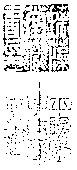



外护



国王、宰官、居士共七十六位



殿宇



寺一



𣪫、堂、楼、轩、亭、房等六十四所



静室



一百三十二所



名胜



一百八十三处



下院



三十一处



古迹



四十六处



寺产



旧额庄田八处



传衣新额



大𣪫新旧额



观音𣪫新额



真寂院新额



地藏𣪫新额



化城寺旧额



安乐寺旧额



寂照新额



(本山各房及各下院不开出者不载。)



纪事



古鼎圆镜



惠洲业报



净业见报



宝上座



西岩和尚



佛性不得道有无



神龙



喝石



神冶钟



无尾螺



灵鸡



白兎



南塔



卷十一至十四目录终



径山志卷之十一



汶上李烨然删定



海阳徐文龙、鹿城陈𢡟德订



虞山宋奎光辑



外护



唐代宗



大历三年，诏径山法钦禅师入见，待以师礼，赐号「国一禅师」，𠡠一道。



宋高宗



绍兴七年，诏宗杲禅师住径山能仁禅寺。廿六年，诏师住明州育王广利禅寺。二十八年，诏师再住径山。



孝宗



改元隆兴，遣内都监黄彦节至径山，命杲禅师就山中举扬般若，师说偈云：



大根大噐大力量　荷担大事不寻常  

一毛头上通消息　徧界明明不覆藏



上嘉叹之。及封建王，又遣内知賔至径山，供五百罗汉，赐「玅喜庵」三字及真讃。九月，诏杲师问佛法大意，师卧疾，特赐「大慧」之号。淳熈七年，召雪窦寺住持宝印(即别峰印)入𡭊𨕖德𣪫，问语备〈别峰禅师本传〉。



钱镠



字具美，钱塘人。唐僖宗时，率乡兵破走黄巢，昭宗拜为镇海、镇东军节度使。天复二年，封「越王」。梁太祖封「吴越王」，谥号「武肃王」。微时到径山，神𪔂𬤇禅师识之。后𬤇禅师入灭，武肃王自述讃四十句，又谥师为「建初兴国大师」，墖曰「广济」。王将薨，谓文穆王曰：「吾昔自径山法济示吾覇业，自此发迹建国立功，他日汝等无废吾志。」其后文穆、忠献、忠懿王皆不㤀武肃之遗旨。



张浚



字德远，绍兴中拜相，封「和国公」。孝宗朝，封「魏国公」。大慧禅师在泉州云门庵，遂以临安府径山延之。公居长沙，其母秦国夫人问道於大慧。及夫人疾亟，曰：「妙喜老师此生无复见也，我有私恩未报。」公三走介师至，夫人捐馆。公谓师曰：「先妣愿供养和尚一年，为德之报。」遂馆于光孝寺之东堂，以尽诚敬。



张九成



字子韶，号无垢居士。登径山，问道於大慧公。建无垢轩，与师谈「格物」之旨。师曰：「公只知有格物，而不知有物格。」顿领深旨，投偈曰：



子韶格物　昙晦物格  

欲识一贯　两个五百



子韶𠹉曰：「九成每闻径山老人所举因缘，豁然四达如千门万户，不消一踏而开。九成了末后大事，实在径山老人处，此一瓣香不敢孤负他也。」



吕本中



字居仁。绍兴初，赐进士第，除中书舍人。平生因诗以穷，耽禅而病，清癯如不胜衣。作《江西传衣诗派图》，推黄山谷为诗祖，列陈无己等凡二十五人为法嗣。本中𠹉致书，问大慧禅要，慧答书略曰：「千疑万疑，只是一疑。话头上疑破，则千疑万疑一时破。若一向问人佛语又如何？祖语又如何？诸方老宿语又如何？永劫无有悟时也。」本中有省。



曾开



字天游，官至侍郎。致书大慧曰：「今年私家尘缘都毕，闲居无事，正在痛自鞭策，以偿初志，第恨未得亲炙教诲耳。一生败阙已一一呈似，必能洞照此心，望委曲提警日用当如何做工夫，庻几不涉他途径，与本地相契也。至叩。」大慧答书曰：「时时於静胜中，切不得㤀了须弥山，放下著两则语，但从脚下著寔做将去。已过者不须怖畏，亦不必思量。思量怖畏，即障道矣。但於诸佛前，发大誓愿，愿此心坚固，永不退失。伏惟诸佛加被，遇善知识，一言之下，顿㤀生死，悟证无上正等菩提，续佛慧命，以报诸佛莫大之恩。如此久久，无有不悟之理。」



李光



字泰发，上虞人。致书大慧问禅要，慧答书曰：「大叅相公，平昔所学，已见行事。临祸福之际，如精金入火，愈见明耀。又决定知华严重重法界，断非虚语，则定不作他物想矣。其餘七颠八倒，或逆或顺，或正或邪，亦非他物。愿公常作是观，妙喜亦在其中，异日相从於寂寞之濵，结当来世香火因缘，成就重重法界以实其事，岂小补哉？」



李邴



字汉老，官至叅政，醉心祖道。及见大慧举赵州庭栢话有省后，以书咨决曰：「近叩筹室，伏蒙激发蒙滞，忽有省入。顾惟根识暗钝，平生学解，尽落情见。一取一舍，如衣坏絮，行草棘中，适自缠绕。今一笑顿释所疑，欣幸可量，非大匠委曲垂慈，何以致此？自到城中，凡著衣吃饭，抱子弄孙，色色仍旧。既无拘执之情，亦不作奇特之想，其餘宿习旧障亦稍轻微。临行叮咛之语，不敢㤀也。重念始得入门，大法未明，应机接物，触事未能无碍，更望有以提诲，使卒有所至，庻无玷於法席矣。」



冯楫



字济川，蜀遂宁人，号不动居士。绍兴丁巳，除给事中，会大慧就明庆开堂。慧下座，楫挽之曰：「此生不作这虫豸，今因甚却纳败阙？」慧曰：「尽大地是个杲上座，你向甚处见他？」楫拟𡭊，慧掌之。楫曰：「是我招得。」因坐夏径山，榜其室曰「不动轩」。后知泸州，所至于道无倦。𠹉自咏曰：



公事之餘喜坐禅　小曾将胁到床眠  

虽然示现宰官相　长老之名四海传



绍兴二十三年秋，乞休，致报亲知，期以十月三日报终。至日，令后厅至高座，见客如平日。辰巳间，降阶望阙肃拜，书偈曰：



初三十一　中九下七  

老人言尽　龟哥服赤



书毕，拈柱杖按𦡀而化。楫于建炎后，凡名山鉅刹藏经残失，遂以己俸印施。补之足五千餘卷者，凡四十八藏，用祝君寿，以康兆民。门人蒲大聘𡮢志其事，有语录、颂古行于世。



陆游



字务观，号放翁，佃之孙，越之山阴人，仕至秘监。𠹉问松源岳禅师云：「心传之学，可得闻乎？」师云：「既是心传，岂从闻得？」公领解，献偈曰：



几度驱车入帝城　逢僧一例眼双青  

今朝始觉禅家别　说有谈空要眼听



公居镜湖，与涂毒策禅师往来寖厚。策住双径，受生祭七日，跏趺而逝，公哭以诗，别见。



李华



𠹉谓：「闻道于径山，犹乐正子春于大夫也。洗心瞻仰，天汉弥高。」见〈润州玄素师铭〉。



张商英



字天觉，号无尽居士。徽宗朝拜相，大慧为洪州凖公乞铭于公。公曰：「今有一问，问上人。若道得即做，若道不得，与钱五贯裹足归，叅禅去。」曰：「请相公问。」公曰：「闻凖光眼睛不坏，是否？」曰：「是。」公曰：「我不问这个眼睛。」曰：「问甚麽眼睛？」公曰：「问金刚眼睛。」曰：「若是金刚眼睛，在相公笔头上。」公曰：「老夫为他点出光明会，教照天照地去也。」一言而契，下榻朝夕言语。号大慧，曰「妙喜」，字之曰「昙晦」云。



蘓轼



字子瞻。径山琳禅师问疾云：「学士生平践履，至此更湏著力。」公应声曰：「著力便差。」语绝而逝。《游径山》诗及与宝月、无畏诸师书，别见。



蔡襄



字君谟，游记别见。



孙觌



尚书，字仲益，无锡人，书别见。



吴潜



字毅夫，宣城人，正肃公柔胜之子。宋理宗朝拜相，序大慧《正法眼藏》。于法门得大自在后，为贾似道所排，谪循州。预知死日，语人曰：「吾将逝矣，夜必雷雨。」已而果然，作诗端坐而逝，封「许国公」。



元世祖



中綂元年，问法径山住持云峰妙高，𡭊扬称旨。帝常问师曰：「修寺建塔有何功德？」师曰：「福荫大千。」由是建仁王寺，仍诏天下，寺院、田产二税尽复之，以弘教为己任。国语曰「薛禅皇帝」。



太祖高皇帝



御制〈径山宗泐免官说〉。洪武二十七年，勅礼部条例一欵：「常住田地虽有，税粮仍免，杂派僧人不许克当差役。」



成祖文皇帝



永乐十五年十月十五日，颁御制〈径山赴会僧勅谕〉，别见。



神宗显皇帝



万历二十八年九月初三日，钦差司礼监太监孙隆颁施大藏一部，勅谕别见。



虞集



字伯生，宋丞相允文五世孙。其先蜀人，汲宋黄岗尉，宋亾侨居临川之崇仁。大德初，始至京师，以大臣荐授大都儒学教授。除国子助教，自将仕郎十二转为通奉大夫，封「仁寿郡公」，谥「文靖」。𠹉辟右室，书邵尧夫诗，题曰「邵庵」，故世称邵庵先生。接方外士必扣击其说，以为圣人之教不明，为学者无所底止。苟于吾道异端疑似之间不能深知，而欲窃究夫性命之原，死生之故，其不折而归之者否矣。𠹉曰：「佛以因果二法，制服得天下人心。无智愚贤不肖，总出不得这两个字。」



𢰅〈北磵简公塔铭〉，有曰：「自昔奇伟之士，或旷世一遇，其不恒见于天下者，何也？盖𠹉闻之，岂无其人哉？自夫世务之沉㝠，俗学之缠纠，有不足以絷而留之者，於是脱然自拔於浮沉起灭之表，以求其本物之极至者，皆其人也。」



作〈径山晦机熈公塔铭〉曰：「闻佛氏之宗，禅者其度人也，以悟为则，必使自致于思虑之所不及，时至机应则决而启之。是以言发意解，解泯言㤀，谓之不立文字，岂欺我哉？」



〈水陆缘起賛〉略曰：「一切众生皆具佛性，如摩尼珠五色随应，如何累劫业识相应无明，展转生死根尘？我佛慈悲施方便力，如大医王救彼痼疾，饿者与饱，渴者与浆，幽暗与明，𤍠脑与凉。况你六道诸苦随业，不藉佛恩何由自洁？」



〈杭州报恩寺铭〉曰：「我以慈悲大愿力，运大音声作佛事，充满虚空体无碍，有间即觉成解脱，人天龙海无尽际。过去未来现在者，一音所摄悉平等，同我报国如报佛，永住坚固宣佛法。」



吴伟明



提刑，久叅真歇了禅师，得自受用三昧。后访大慧，遂留咨叅。一日慧谓曰：「不湏呈伎俩，直湏啐地折、曝地断，方敌得生死。若祗呈伎俩，有甚了期？」后辤去。道次延平，倏然契悟。



林希逸



字肃翁，福清人。绍定间进士，号鬳斋，𠹉称大慧杲禅师为元勋，大老敬重。



宋濂



字景濂。学士𠹉云：「人知大慧说法，如雨如云，觉悟群迷，而不知其忠义耿耿，注意于家国者甚笃。纵有知其忠义，而又不知其游戏翰墨，循蹈矩彟，亦自可传不朽。呜呼！若师之应物无方，是谓如神然变化不测者矣。」国初法禅师序铭，多出公手，别见。



沈季文



大中丞，号太素，吴江人。于万历三十六年，捐资建大雄宝𣪫。



陆光祖



大冢宰，号五台，平湖人。创刻方册藏板于清凉，后移至径山。复以烧山多害物命，捐资买凌霄峰下山一叚，护养生类。



冯梦祯



国子祭酒，字开之，嘉禾人。议刻方册藏板移至寂照，再议移化城。缘起别见。



王肻堂



宪副，号宇泰，金坛人。偕刺史陈良谟、宪副吴长庚诸公，书请廓庵观公住持大𣪫。书别见。



于玉立



吏部，字中甫，金坛人。偕陆、冯诸公议刻方册藏板，为紫柏尊者建塔于文殊台。



瞿汝稷



运使，字元立，常熟人。议刻方册大藏，为幻予𢰅塔铭，别见。



陈瓉



少司𡨥，号雨亭，常熟人。议刻方册大藏，缘起序文别见。



王世贞



大司𡨥，字元美，太仓人。同新安司马汪道昆诸公，𢰅〈刻藏缘起〉，别见。



缪希雍



字仲淳，常熟人。以紫柏先瘗黄沙，滩下有流泉，倡金坛于贺诸公改塔文殊台。同金坛于贺诸公，捐资二百餘金买山，寂照供养僧众。



朱国祯



内阁大学士，号平涵，湖州人。𠹉问法瓶匋，为𧩿〈真寂院记〉，别见。



朱国祚



内阁大学士，号养淳，嘉禾人。同子孝廉大猷于径山大𣪫、下院真寂，庄严护持，檀施最久。



吴用先



大中丞，号本如，桐城人。恢复下院化城，岁施刻藏银一百两，缘起别见。



陈懿典



翰林学士，号如岗，嘉禾人。刻藏缘起别见。



窦子偁



原任淛江廉宪，号淮南，合肥人。督同司理孙公榖、餘杭令戴公日强，清复化城。



王在晋



大司马，号岵云，太仓人。分守杭严时，亲历化城，清复故址。游记别见。



虞淳熈



吏部，号德园，杭州人。护持瓶匋，及本山常住。



翁汝进



宪副，号周野，杭州人。护持常住，及诸静室。



黄汝亨



学宪，字贞甫，杭州人。本山常住，下院化城驱魔安众，具有大力。诸文别见。



洪瞻祖



尚宝卿，号清远，杭州人。护持常住，及诸静室。



沈珫



宪副，号𢡟所，吴江人。偕其弟佥宪瓉侍御珣，及司空沈公正宗，书请廓庵观公住持本山，岁输刻藏银若干。



李事道



运同，号行可，杭州人。护持常住，及真寂等刹。



朱大启



吏部，号广原，嘉禾人。本山常住及各静室，岁有供养。



周宗建



侍御，字季侯，吴江人。本山常住，岁有供养。



贺烺



民部，字暗伯，金坛人。以父中书公虚谷皈依紫柏，岁输刻藏银若干。同学宪王吏部于，书请自光杲公主持寂照。



姚思仁



尚书，号罗浮，嘉禾人。岁施常供。



王志坚



佥宪，字弱生，太仓人。任本省水利道时，以本山静主贝林师精于密部，时为送供下院真寂寺。改路南湖地藏𣪫，开田临勘，行县给照。



周祗



字子介，吴江人。捐赀置下院太平寺刻藏，田四十二畒。



周延光



本省方伯，号斗垣，蕲水人。清查化城虚税，行县审豁。



吴伯与



本省兵巡道，号师每，宣城人。𠹉游天目及径山，手书〈戒晕酒〉，示勒于石曰：「欲海横流，𤍠熖转炽，故味为嗜性之首，而斋乃断爱之根。僧家返清凉绝贪求，即粒米茎菜尚无虚用。至其核因果，明罪福，凡戒杀放生无非善缘，若常人食肉，犹比之曰「人搏人」也。况僧不持斋，不甚于食他肉而补秽身乎！惟戒足以护法，惟斋足以居心。至人守若严城，御若坚兵，诚谓醍醐岂贮秽噐，斋疏即为甘露耳！倘寺僧酒肉破戒，即不名为清净僧，便当驱除还俗。倘游人必㩦酒肉入寺，何取以腥燥浊体，枉向佛门叅礼耶？凡我四辈，永坚一心，无种地狱之深因，甘受来生之恶报。」游纪及诗别见。



王在公



郡丞，号芥庵，昆山人。弃官礼峨𡼴，归径山倡导孝廉。徐仲容公洌捐资购良材，易大𣪫柱，及葺龙王𣪫。复葺般若轩，同朱公鹭检阅大藏。



方应祥



礼部郎，字孟旋，西安人。𠹉问法瓶匋有省，偶谒当道，以西湖放生池应否拆毁问公。公曰：「西湖固杭州之睂目也，欲去目中翳而并剔除瞳神可乎？」当道笑而从之。



吴之鲸



上饶令，字伯霖，仁和人。𠹉游径山，叅瓶匋，谓不见闻谷师几虚此游，诗文别见。



郑圭平



乐令，字孔肩，钱唐人。初归云栖，后叅瓶匋，弘护诸山。



马用锡



餘杭令，号命荷，晋江人。清理化城虚税。



王宇春



字季和，常熟人。倡其兄别驾宇熈、叅军宇新，刻径山大慧禅师《正法眼藏》，助建真寂禅院及安乐寺。



顾大章



字伯钦，刑部主政，常熟人。助建真寂禅院，及安乐寺。



顾大韶



字仲㳟，常熟人。助建真寂禅院，及安乐寺。



钱谦益



谕德，字受之，常熟人。𢰅〈闻谷大师种树碑文〉，重兴下院安乐寺。缘起别见。



李縠



字孟芳，常熟人。皈依瓶匋，举扬双径。诗文别见。



瞿式耜



进士，字起田，常熟人。真寂禅院及安乐寺皆有供养。



王蒙亨



县令，号中泉，餘杭人。首捐田四十餘畒，倡复化城寺。



沈焕然



字无文，贡士，餘杭人。初归云栖，再叅瓶匋。护持下院安乐寺，及南湖地藏𣪫。



闻启祥



字子将，孝廉，钱塘人。径山大𣪫，及诸下院静室，皆其护持。



时载杲



字旭如，常熟人。皈依瓶匋，缘及安乐。



严调御



字印持，餘杭人。助复下院安乐古刹，及常住各静室，具力护持。



严武顺



字忍公，餘杭人。为荐母舍田八畒，入真寂院。



王祺



字祉叔，餘杭人。偕其侄福贞，供养常住各静室。



邹之峄



字孟阳，仁和人。常住及真寂院，岁有供养。



许国[王*助]



字镇之，兰溪人。归依瓶匋，檀施传衣诸所。



徐楩



号龙南，餘杭藉蘓州人。护持下院安乐寺。



许应𨕖



字青钱，餘杭人。护持下院安乐寺。



严敕



字无敕，餘杭人。护持常住及诸静室。



吴江接待寺僧兴勤助刻



径山志卷之十一终



径山志卷之十二



汶上李烨然删定



海阳徐文龙、鹿城陈𢡟德订



虞山宋奎光辑



𣪫宇



径山兴圣万寿禅寺



在县西北五十里，乃天目之东北峰，五峰环抱，奇胜特异。唐代宗时，僧法钦结庵於此。永泰中，有白衣士来求法，度为沙弥，钦指坐后石屏，谓曰：「能开此乎？」曰：「可。」遂叱之分为三片，今号喝石岩，遂即剃度，名崇慧。如长安与方士竞法，既胜，代宗问其师承，𡭊曰：「臣师径山僧法钦。」召赴阙，赐号曰「国一禅师」。逾年辤归，诏杭州，即其庵建寺曰「径山」。僖宗乾符六年，改为乾符镇国院。宋大中祥符元年，改赐承天禅院。政和七年，改径山能仁禅寺。初师之来是山也，猛兽不抟，鸷鸟不击，山下之民不渔不猎。五峰之间，有大湫，龙所居也。龙化为老人，谒言：「愿归天目，以奉此地。」一夕，风雨晦㝠，涨为平陆，止存一穴，今龙井是也。有灵鸡常随法会，不食生类，及师之长安，鸣三日而死，今灵鸡冢存焉。绍兴间，妙喜建千僧阁。十七年，真歇建大雄𣪫。二十八年，重建龙王𣪫。孝宗赐妙喜，号「大慧禅师」，乃以山中明月堂为妙喜庵，及书扁以赐，塔号曰「宝光」，魏国张忠献公浚，作铭并序。乾道二年二月，孝宗游幸。越二年，建龙游阁。开禧年间，孝宗御书额赐「径山兴圣万寿禅寺」。由宋迄元，为禅林之冠。元天历至顺间，元叟端禅师在山二十餘年，衲子从者如市。元末兵毁，皇朝洪武间重建，见成化间府志。



大雄𣪫



绍兴间，真歇禅师始建。后孝宗游幸，御书赐「径山兴圣万寿禅寺」额。元末兵毁，国朝洪武间重建。万历戊申，吴江沈中丞季文，请僧无边海公，更旧向𪔂新之。未几，海公迁化，廓庵观公继之，丹垩金碧，称大备焉。



大藏阁



即观音𣪫。大明神宗皇帝颁赐藏经供此，因名。万历三十七年，瓶匋闻谷印师立禅堂，集众叅禅于其下，迄今犹䋲其旧，而诸方禅期，悉从此禀法焉。



灵泽𣪫



即龙王𣪫。宋孝宗封王曰：「孚佑累封神应德济显佑广泽王，赐玉圭、玉带、黄金、瓶炉。庙额『灵泽』云。」



祖师𣪫



中奉达磨、百丈、八十七祖。



禅堂



龙王𣪫后。



斋楼



两处，共三十楹。



云㕑



奇树楼



树王之旁，赵宦光题。



养老堂



寒翠楼



大雄宝𣪫后。有记。



般若轩



王芥庵在公重修，同朱白民鹭于此检藏一年。



宝积居



阅藏堂



观音𣪫前。



十方堂



云水僧栖宿之所。



三门



旧扁「天下径山」。



南塔



三塔之东。



钟楼



大𣪫左。



鼓楼



旧在堆珠峰，今废。



千僧阁



宋大慧建，补㢲峰之阙。李汉老记：「今观音𣪫藏阁，即其址也。」



圆觉阁



宋孝宗皇帝解《圆觉经》，赐别峰印。适建阁初成，故名。今废。



龙游阁



宋高皇帝登兹山，乾道四年建，今废。



妙庄严阁



无凖范建，今废。



凌霄阁



今废。



万佛阁



艮山之阙，今废。



五凤楼



九楹，供五百应真像。翼以行道阁，塑五十三叅相。宋庆元六年，僧元宗建，后毁。庵聪重建，今废。



宸翰阁



大慧建，藏御书，今废。



天慧堂



蒙庵聪建，今废。



版亭



大慧建，在梅谷院冈上，今废。



四寮



大慧建，以处众僧，今废。



库司



大慧建，在松、梅谷二院之侧。



香水海



大慧时浴室，今废。



古忏堂



在三塔下，元高峰悟道处，今废。



含晖亭



国一禅坐时，有彩云朝晖，覆聚不散，故名。今废。



流止亭



唐永泰间，国一受嘱曰：「乗流而行，遇径即止。」故名，今废。



天王𣪫



界三门、大𣪫之间，上悬「径山兴圣万寿禅寺」，今废。



妙喜庵



宋孝宗御书，即明月堂，大慧示寂处。



洗心亭



宋显仁皇后登径山，礼佛更衣于此，今废。



圣碑亭



宋孝宗免税碑，及蘓轼诗、蔡襄记碑藏此。



倾盖亭



灵谷庵



宋大禅了明禅师退居，今废。



逢径庵



在黄沙滩，今废。



天开阁



不动轩



冯公檝问道大慧，结室于此，号不动居士，故名。今废。



无垢轩



张公九成问道大慧，结室于此，号无垢居士，故名。今废。



死心亭



今废。



娑罗林



古𪔂禅师退居，今废。



半山亭



旧大圆院，本源达禅师建以接待云水。今沿亭一带，为梅谷僧通衢，植引路松千餘株，颇增胜焉。



松源房



宋松源岳禅师退居，为凌霄东院。其悟道出世因缘，别见。八十代镜祖塔院在此，见旧志。



梅谷房



明𪔂庵，讳天彛，别号梅谷。洪武三年，受呆庵旨称法会中高足，结庵于鹏搏峰右，相传为梅谷房。



中峰南院



第二代无上宗，塔全身于大寂岩。岩即鹏搏峰下，为五峰之中，故名。金陵徐公六岳书「狮子窝」，镌于石。



宣照房



在后房坎下。



大慧房



在大慧祖师塔前。



圆照房



月江净退居，上有祖像及葬塔。



天然房



直岭下，虚舟度禅师塔院。



开山



旧为开山房，后废。万历间，达观可禅师以开山祖基，为复其地，建庵名「喝石」，中奉钦师像，安置藏板。



妙香庵



旧为妙香房，后废。今为云水静室。



寂照庵



旧为房，今改静室。别见。



幻室



旧为房，今废。



妙明房



今废。



南塔房



今废。



如意房



今废。



惠泉东房



今废。



惠泉西房



今废。



安隐房



今废，为静室。



已上为十八房也。祖师道塲，累朝崇奉，合山庄田，咸属钦赐。自唐迄明，一众同飡。至正德六年，管事僧惠诚等，爪分为十八，分后遂倾废。今所存者，唯三、四房而已，此祖庭衰相之始也。



梅谷僧通衢助刻



静室



般若轩



王芥庵在公重修，同朱白民鹭于此检藏一年，属常住。



宝积居



常住。



空生室



宴坐峰下。



钟楼



即神冶钟。



量虚室



(已上坐晏坐峰前。)



行童庵



童真室



(已上坐行童坑。)



妙喜庵



昔为明月堂，系大慧禅师圆寂处。宋孝宗皇帝闻而嗟惜，诏以为妙喜庵云。



大慧塔



寺数遭火厄，塔院在烈熖中不毁。



紫栢塔



在文殊台。



妙香庵



僧大心建。



(已上坐鹏搏峰前。)



喝石庵



即开山，国一禅师最初修道处。



寂照庵



在寺北五峰之背，四十八代端禅师塔全身处。万历甲午，房僧欲弃此他去。陆五台、冯开之诸公，因捐赀置以供紫柏大师，遂为密藏、幻于二师刻藏道塲。及澹居铠公嗣二师住此最久，后以恢复化城，下山请自光杲公代焉。杲公，云中人，幻师高弟。



湛寂庵



万历四十四年，僧止水重建。



见如室



显密室



(已上坐开山。)



修竹室



惟一室



万历二十八年，僧化仪如显重建，塔于此。



白云窝



万历三十八年，僧野坪重建。



狮子岩



(已上坐放生池后。)



了实室



以僧号了实，故名。



指归室



(已上坐鹏搏峰后。)



白云居



闻谷禅师旧隐处，今住僧幻有。



妙空塔



第十七代佛海讷禅师塔院。



白云室



(已上坐白云山。)



法云庵



来月斋



海云庵



贝林师住此。



秀峰室



(已上坐羊栈头。)



三一室



连珠庵



陶冶室



妙高庵



念云身负达大师灵骨，归瘗本山，因住此。



慧芳室



以僧号慧芳，故名。



天然室



僧破有住此。



清香庵



(已上坐黄沙滩。)



贝叶庵



青霄庵



僧心渠住。



栽种居



涌莲室



以僧号涌莲，故名。



西林庵



襍华庵



僧空林住。



藏石庵



藏云庵



万历四十八年，僧大林重建。



圣隣居



以僧圣隣，故名。



秀石室



(已上坐查洲一带。)



守一室



以僧号守一，故名。



无𣑱室



以僧号无𣑱，故名。



宗印室



以僧号宗印，故名。



安养居



解续坪



僧彼岸住。



(已上坐萝卜坪。)



伏虎庵



豹子岭



僧聚光住，今并入大𣪫。



净行庵



默容室



以僧号默容，故名。



善住庵



道渊室



以僧号道渊，故名。



崛山室



曰业室



(已上坐豹子岭。)



石语室



卉木居



僧古先建。



东土庵



德空室



以僧号德空，故名。



栖云谷



华严兰若



僧孤休住。



(已上坐擂牛宕。)



子潜室



即子潜坑。



朗如室



以僧号朗如，故名。



松隐居



僧妙见住。



慧明室



以僧号慧明，故名。



源石庵



月堂室



以僧号月堂，故名。



玉记庵



体空室



(已上坐子潜坑。)



别岸庵



即山名僧古岑住。



清泰庵



常住。



敬心室



(已上坐横岭头。)



圆通庵



玉芝庵



娑竭庵



(已上坐拉塔。)



狮子林



僧青松住。



无相室



以僧号无相，故名。



栖凤山



净土庵



定然室



以僧号定然，故名。



昆山室



以僧号昆山，故名。



近真室



以僧号近真，故名。



(已上坐鸡笼山。)



传衣庵



在菖蒲田。昔为玉芝庵，三十五代痴绝禅师塔于此。后为万松、月亭二禅师重搆，改今名。二师亦塔此。



甘露庵



古慧渊禅师退居，今明空重建。



清凉庵



僧聚芳住。



大乗庵



僧知希住。



(已上坐菖蒲田上。)



凌霄峰



僧梵怀者住此二十年，旧苦无泉，怀为寻泉穴，凿石蓄水，甘美异他所。复种引路松若干株，后为狮虫作祟，尽弃所有，与之飘然他往。今为杭州闻孝廉启祥辈，请大淑住此。



莲花庵



濯翠庵



僧明空别业。



弥陀庵



僧戒心住。



庆莲居



僧一林住。



大山室



僧境虚住。



龙潭头



径坞室



不昧室



僧号廓然。



湛之室



以僧号湛之，故名。



(已上坐凌霄峰南。)



杨家山



净业庵



僧真净住。



自空室



以僧号自空，故名。



妙智室



以僧号妙智，故名。



朝阳庵



僧庆厚住。



留云庵



(已上坐横清岭。)



大觉庵



僧洪明住。



密究斋



僧寒云住。



(已上坐棋盘石。)



盘石庵



僧广朗住。



云居庵



(已上坐蚂蚁窠。)



南塔



碑亭



宋孝宗御碑，及蘓、蔡二碑藏此。



千指庵



僧雪峤建。



吉祥庵



僧弘济住。



(已上坐东坡池上。)



佛圣庵



普香庵



(已上坐千丈坑。)



风居庵



即风车岭。



普庆寺



即下院。



竹林庵



御爱峰



(已上坐孟家洋。)



半山亭



洞桥庵



直岭上



天然茶亭



(已上即地名。)



栴檀室



坐直岭下。



大安寺



即下院，吉祥峰。



香象庵



坐大安寺，僧祇园建。



青居庵



养智室



化城寺



即下院。



观音堂



即下院。



西径峰



即下院，坐临安。



径山志卷之十三



汶上李烨然删定



海阳徐文龙、鹿城陈𢡟德订



虞山宋奎光辑



名胜



大人峰



亦名天显峰。



宴坐峰



即钟楼之坐山，顶有无垢轩，今废。



鹏搏峰



又名大寂岩，西有无上宗禅师塔。



朝阳峰



堆珠峰



亦名钵盂峰。



(已上是为五峰。)



凌霄峰



此峰最高而秀拔，为径山之主，顶有宋勅建宝光𣪫，今废。



御爱峰



宋高宗游幸时，𠹉伫立遥盻，乃曰「此峰可爱」，故名。



攀云峰



寂照庵主山。



鸡笼峰



在凌霄峰背。



宝珠峰



黄沙滩最高处。



别峰



凌霄峰西北。



白云山



鹏搏峰后，常有白云如铺玉，故名。境幽人绝，静修之所，闻谷大师常结庵于此。



古龙湫



在五峰之间，即老龙徙居天目，奉此地为钦师道塲处。



龙鼻水



南塔下，从五峰中龙洞出，大旱不涸，崕岩巇𡾴，有湍水瀑喷，若龙鼻中出，故名。



𡭊过川



佛圣水下。



豹子岭



横岭北。



狮子岭



在凌霄峰后。



象鼻峰



攀云峰左。



蚂螘窠



横清岭



风啸岭



南塔下，临安大路，俗云「风车岭」。



水岭



凌霄、鹏搏二峰之间。



泥𨶚岭



豹子岭东南。



弹岭



萝卜坪左。



翠屏石



喝石庵左，又名「悟道石」。



千丈坑



南塔龙首山下，悬崖直下，不啻千丈。



林阶坑



树木如阶梯，层层而上，故名。



雪坑



横岭西北，四山高深，积雪不消，故名。



径坞



凌霄峰西北，国一禅师由此径而入。



鹰窠石



在径坞，有石耸于崖上，俨若鹰窠。



瀑布



在凌霄峰下，径坞之上，飞湍如疋，练悬注石崖，大慧作水碓磨房于此。



秀才岩



大禅庵北，一云「绣崖湾」。因罗隐隐此，故名。



向岩



松源房后。



石塌坞



在半山亭下。



粪箕坞



洞桥西。



廻龙桥



俗云「洞桥」，涧水潆廻，逆注桥下。



野人坞



千丈坑𡭊过。



牛䋲坞



千丈坑下。



孟家㟄



风啸岭东南，圆照西房。



茄秧坞



千丈坑南。



枫树湾



孟家㟄外。



𦊱罳坞



四十二代虚丹塔于此。



蜀葵湾



茶园



孟家㟄。



檀树湾



孟家㟄南。



令凡坞



南塔下，栖息于此，凡心顿冷，故名。



风洞



子潜坑下，山风旋入，三伏凛然。



晒阳山



佛圣水左。



火衖



凌霄峰背，幽深萧寂，美竹蔽空。



骨花池



普同塔下，古炼骨于此，投灰池中，结为莲花，故名。



仰天湾



白云山东。



杨栈头



萝卜坪东。



黄沙滩



横岭东，土如金色，古静栖之地。



三塔



即普同塔。



四顾坪



径山后，登此四望在目，讹为「师姑坪」。



石壁坞



相传千峰万壑，群贤聚集之所，径山后。



楼房坞



径山后。



横山



横岭



别峰下。



广积池



圆照房右。



惠泉池



梅谷房前。



双见桥



骨花池下。



朱家坞



独山前。



漆树坞



大山



蚂蚁窠北。



萝卜坪



黄沙滩上。



种树山



瓶匋闻谷印师募置，松源房僧大矼恊种树一藏，以备大常住修造采取，碑文别见。



百步坎



黄沙滩后。



椒园



种椒供众。



擂牛宕



横岭下。



查洲



将军潭



洞桥北。



深潭湾



富家坞



洞桥北。



菜园



洞桥右。



直岭



廻龙桥东，去餘杭大路。



天泽坞



直岭下，因钦赐，故名。



通径桥



如玉禅师建，鎻大安涧口，古茶亭基址尚在。大松一株，相传大慧手植。



吉祥峰



御爱峰东，常现五色瑞云，故称「吉祥」。



将军峰



国一祖遥睇天神金甲持杵立于峰顶，故名。



双溪



径山前后二溪合流，故名。



吴山



双溪外，径山之罗星也。圆如翠螺，当于溪口。



径山港口



双溪尽处，几至径山，停舟于此，古第一山门也。即今房屋基址，俱属木山。



松源僧大矼助刻



下院



双溪化城接待寺



宋嘉定间，径山住持可宣创建。八年，钦奉御书，特赐「可宣佛日禅师」，并书「化城」二大字，赐充接待院额。元初重建，至正末兵毁。明洪武年，僧慧寛重建。正德中，僧净松等以役累消乏，将山产九百餘畒，得价银二百七十两，出佃民间。迨万历中，僧法铠主刻藏，议置藏化城，募金恢复。详见碑记。吴方伯公用先捐俸，造藏板房二十餘间，浮度庵一所。



大安禅寺



径山下通径桥内，去县北五十里长安乡。唐同光三年，僧如玉禅师开山化导，有异荅妙嵩禅师诗，投笔坐化，塔于本寺之侧。六十年后，塔户自啔，容貌俨然。宋治平二年，英宗皇帝敕赐今额。绍兴三十年，佛日大慧杲禅师诏再主径山，叅徒二千餘员，就寺增建禅阁、安老堂，其徒开悟得大安乐者居之。元末毁于兵，皇明洪武间重建，为径山养老丛林。弘治八年，毁于火。天啔元年，无从来公以莲社诸檀越捐赀，赎产结室于𣪫基，次第恢复焉。



小径山万寿禅寺



唐代宗皇帝钦赐太平庄，遂敕建，坐临安县灵凤里，有记。



西径山寺



国一初到，曾经过此山，后建禅寺。山有八景，见高得旸八咏。



真寂禅院



去县东北三十里，大慧时县尉督庄粮于此，交卸后废。明万历壬子，闻谷印禅师重建，以接待四方云水。



安乐寺



在县东南三里，安乐山之阳，旧名庆善院。晋天福二年，风穴沼禅师开山。宋治平二年，改额善法寺。元末毁于兵，国初重建，后为僧古垣佃废。天啔二年，餘杭严调御辈，请云栖僧大顺恢复。昆山王在公、常熟钱谦益、宋奎光、王宇春、李縠辈，因为倡募重建禅堂，复礼请僧大林为首座，期复风穴之旧焉。



安众寺



建于唐同光三年，后废。万历间，瓶匋闻谷禅师捐赀恢复。至天启年，造楼房若干楹，以安置学徒，请玄著眼法师住持，称真寂别院焉。



法华寺



去县西北四十里长安乡。唐同光三年，僧法式开山。宋大中祥符元年，改赐今额。痴绝冲禅师为开山，逾月敕牒住径山。元末兵毁，皇明重建，后僧徒懦弱而废。万历间，僧云峰复建。



万寿正续寺



宋佛鉴无凖范禅师建，以接待云水。仁宗皇帝亲洒宸翰，而赐额焉。无凖圆寂，葬全身于正续之侧，塔曰「圆照」，今废。基犹存，坐双溪下二十里张堰。



广化禅寺



在县西一十里同化乡，旧号罗汉院。宋景定间，𬤇禅师开山。元至正十六年，毁于兵重建。



顺庆禅寺



在县北三十里孝行乡。宋咸淳间，僧伊岩开山。元至正十八年，毁于兵重建。



实际禅寺



在县北二十里孝行乡。元至元元年，浙翁琰禅师建，接待云水。至正末，毁于兵重建。



妙济禅寺



去县西北四十里常熟乡。元至元间，愚溪禅师创为接待寺。中统间，改今额。至正末，毁于兵重建。



云福禅院



去县东北四十里常熟乡。宋绍兴三十年，僧善智建。元末，兵毁重建。



圆觉庵



在县东北十五里安乐乡。元至元间建，至正末毁重建。



圆修庵



在县东北十五里安乐乡。元至元初，僧同庵开山。大德四年，中峰和尚重创。至正末，兵毁重建。



普庆禅寺



圆庆奎住持，寺后有姚少师衣钵塔。至元间，径山住持云峰高禅师建。详赵松雪碑记。



接待寺



在石瀬内。



圆觉禅寺



去县六十里。宋时建，元末兵毁重建，今废。



石壁寺



径山后。法师行靖与行绍先后住此说法，凡五十年，今废。



广际禅寺



县北二十里孝行乡。



庆恩院



空讷禅师创。



西堂庵



在连家庄。大慧时，西堂禅师建，𠊓有普同塔。



坛石寺



坐落石门。石门璁禅师、法云杲禅师曾于此说法。僧大莹重建。



寂照禅寺



在于潜县。元大德，元叟端禅师建。



迎恩院



坐吴山。宋敕命至于此迎迓，故名。



万寿山



嘉兴府丰门。



水西寺



嘉兴府。



祥符寺



坐嘉兴府。成化间，本山拨田四十畒供众。



东禅寺



万松林禅师住持，坐嘉兴府。见〈径山香灯田碑记〉。



南湖地藏𣪫



旧地藏庙废基，县西南三里石门桥左。万历四十五年，重建。天启元年，檀信沈焕然辈礼请径山僧镜庵，名海闻者，主此。因以接待云水，称径山下院焉。复募搆斋堂，及左右厢[序-予+(幅-巾)]、钟楼等，翼然丛林大观。未几以劳致病，安然而逝，曰：「吾再来完放生池与天王𣪫也。」今在继之者勿坠，其绪云。



观音𣪫僧广慧助刻



径山志卷之十三终



径山志卷之十四



汶上李烨然删定



海阳徐文龙、鹿城陈𢡟德订



虞山宋奎光辑



古迹



开山



国一先此结茅，今建开山庵，供像于中。



喝石



开山庵侧，即巾子山人喝石为三片。里有前喝、后喝，界以此。



龙井



龙王𣪫侧，即龙王徙居天目，留一穴送供处也。



龙洞



三门外岩下，人或秉炬而入，空深无尽，寒气𠸃人。



钵盂池



堆珠峰下。



明月池



宋绍兴，妙喜杲禅师凿于明月堂前，因以得名，今池尚在。



洗砚池



在三门外，东坡先生𠹉登山题咏，洗砚于此。其水澄澈可爱，明月上生，微波鳞动，旧有东坡祠。



放生池



寂照庵左，宋时所凿，池中曾生金莲花，有碑题「祝延天寿放生池」，铭曰：



鸢飞丽天　鱼跃于囦  

各从其类　亿万斯年



佛圣水



望江亭外，水能明目。



钱王井



妙香庵下，相传井上石栏镌《金刚经》。



上水池



凌霄峰半，古云㕑接水处。



下水池



凌霄峰下。



棋盘石



凌霄峰南，元时雷去一角。



玉芝岩



在喝石峭壁之左，钦师入定时，产灵芝，色润如玉，故名。



罗汉石



磴级若阶陛，相传大慧时，五百应真化身应供，常坐其上，在望江亭。



云居石



古云居庵左，一名盘陀石。



行童坑



古千僧阁后。大慧时，以此山为行童衣单，故名。



子潜坑



讹为「纸钱坑」。



南塔



三门前龙首。详见〈纪异〉。



面台石



国一息影于此，有石平如台，山下樵者送供于石上作面，故名。



垃塔坑



横岭下，有小石塔立于上。



龙潭



在径坞，瀑布流注，有龙王庙。



梅树湾



梅谷南，多栽梅花，开时香雪满谷，今无。



水磨坞



菜园外，古作水磨处。



少卿坞



弹岭下，北海冯少卿问道高峰禅师，潜修坞中，故名。



陈大坞



普庆寺陈大舍坞中山于寺，故名。



文殊台



大寂岩，紫栢塔在其上。



普贤台



南塔，𡭊过上有二祖师塔。



碑牌湾



通寂照路，𠊓有御祭端禅师碑在。



香水海



开山西，石𰧒上仅容一拳，大旱不涸，相传为灵鸡饮水处。



金鸡泉



喝石西冈，国一初到，见金鸡跑麓，泉随涌出，味极甘洌，冠于诸泉。



灵鸡冢



喝石东。



白兎冢



开山侧。



菖蒲田



凌霄峰下。



蜡衲岭



径山西北。大慧时，有八百众老衲坐蜡于此。讹为「𡓍塌岭」。



月清桥



跨月清池上，圆照房前，今毁。



船桥



大慧时，雨后溪深，船可至此，在直岭外。



鲫鱼池



在大安寺，大慧蓄文鱼于中，故名。



栗园



在大安寺，大慧栽栗树以供众僧，今废。



茭苩池



在大守寺，大慧栽茭苩处。



花果园



大安，古栽花果处，在通径桥北，相传四十畒，今废。



礼拜石



在萝卜坪，宋徽宗入山，见四围丛竹，秀木若紫逻翠屏。惟西方一阙，因望而叹曰：「观此西天胜境，尽在目前。」即下辇，拜於石上，故名。



古枞



唐时植，即诗云「丝杉树王」是也。在山门前。



古银杏



宋时植，大可百围，大慧塔右。



金莲花



出放生池中，移植他所则槁，今无。



佛圣水



宋孝宗临幸，跸至半山时，盛暑，六飞称渴，忽石间迸出一泉，胥饮沾足，故名。



寂照僧如杲助刻



寺产



径山



唐代宗、宋孝宗勅赐香灯山，界限广大莫考，今据碑勒，寺基四至，东至里洪龙潭，南至临安观音岩下，西至径坞立塔，北至𨵿门石雪坑、长[山/郎]青潭后。正德六年，分为十八房，而常住割裂矣。



蘓州径山庄



坐嘉定角直镇，东至西十二里，南至北十二里，共田一万三千畒。宋阳和王所赐，孝宗免税，今废。



湖州庄



敕赐，莫考。



昆山庄



国一时钦赐，有大寺基八角井，坐落径山江，今废。



嘉兴庄



钦赐，今废。



仁和庄



钦赐，今废。



草荡三千畒



钦赐，坐径山港口，今废。



梅谷庄



市村田五十畒，地一十畒，山一号。



临安庄



田四十畒，山六号，坐大王坞。又田四十畒，山一号，坐独山坞。



传衣庄



尚书陆公光祖舍山八十畒，又临安山八畒五分，寄税盛四纲户。嘉兴田一十五畒，立石东林寺。



大𣪫常住



山六十四畒，坐落曹仰大南坞，亦名火衖。  

山十畒，坐落后杳界后童坞。  

山十五畒，坐落风高岭。  

山十五畒，坐落东界四郎坞南后[山/郎]顶。  

山十畒，坐落龙潭里。(已上旧额。)  

山四十畒五分，坐落妙香庵、行童坑、半山亭。  

山十五畒二分，坐落开山、碑牌。  

山六十二畒，坐落横岭头。  

山一百五十畒，坐落萝卜坪。  

山三十二畒，坐落林家坑横青岭。  

地四畒四分五厘，坐落大慧门首南塔。(已上见在。)



观音𣪫常住



僧广慧于万历四十七年，置柴山共十畒，坐落𡭊过川。又山五畒，坐落行童坑。又惠力寺僧景虚，于天启元年，舍常住山五十畒，坐落棋槃石。



大安寺



原额山九十三畒，东至大安街，南至大路，西至田畈，北至树山。古册在大慧房，於天启年间，三契续置山田，共一十二畒。



真寂院



钱唐县界田三十餘畒，坐落板桥调露十七啚珠字号。又六畒又二畒五分，俱坐落洋山圩。餘杭县界田十三畒三分，坐落小吴山塔水桥。又严武顺舍田八畒，坐落免涵化湾圩。又柴竹茶山二百二十畒、静室一所。又山六十畒，又山六畒，俱坐落厚郎坞北山。又恢复古安众寺，山二百零五畒，亦坐落厚郎坞。



南湖地藏𣪫



𣪫基一十二畒，僧明贤于天启元年，呈水利道邢准，升科立户于郎王界一啚。又湖𠊓久荒废土，及土堆二处，僧海闻于天启三年，呈水利道王准开垦，升科行县议定额税一两八钱。



化城寺



原额山田地八百九十畒，悉为居民估佃。万历三十九年，僧澹居募金恢复，后为乡书飞诡虚税。僧慈门令徒解义，于天启四年，呈布政司批县查豁申详。复驳送本府覆审，开除实存税七百二十五畒。



安乐寺



山八十四畒、地八畒八分，坐落东南隅。一啚禅师坞俱。云栖僧大顺于天启元年募赀回赎。



寂照



山二百四十畒，金坛于玉立、贺学仁，常熟缪希雍共捐赀置。



梅谷僧通衢助刻



纪事



古鼎圆镜



古鼎和尚住杭之中天竺。欧阳圭斋以福建廉宪任满，赴召京师，过杭抵古鼎，欵洽道话。旬浃临别，古鼎送至西湖，圭斋云：「此别未卜会期。」古鼎云：「大圆镜中，未𠹉与公相别也。」圭斋喜。无何古鼎迁径山，圭斋寄以偈云：



上人力举龙文鼎　坐断凌霄第一𨵿  

湖上别来圆镜语　想应照我鬂毛斑



惠洲业报



径山惠洲提点，虎岩徒弟，颇聪明，有干蛊才。掌常住众务三十餘年，一切金榖恣其糜费，或以果报谕之，乃答云：「满载载角来，洲只戴得一双。」至正初，高纳麟领行宣政院事，其属净珂具状诉之，结罪杖，断归俗。既而潜住化城院，得风痺疾，挛拳如猬，两手握拳，承其两顋，两脚反承其尻，看病欲伸之，痛不可忍，日夜但闻霍霍之声，如是者三年，始气绝。



净业见报



径山𦒿旧，讳清泚，号一溪。壮年不守戒律，饮啖无所择。至正中，自念：「人生于世，寿命能几何？一旦无常杀鬼到来，将何排遣？」遂尽敛所积衣赀，就普庆东建观音堂一所，修白净业，祈生净土。越数载，手书《金刚般若经》，至「三千大千世界」处，握笔正身，安坐而化。至正丁酉，猫𤢸烧劫普庆，及居民房屋，观音堂岿然独存。佛说善恶报应如影响，岂不信然？



寳上座



破庵和上退资福赴径山，蒙庵招委以立僧首座职。有宝上座者，具大知见，遇住持首座开室，必横机㨗出，迎锋取胜。一日破庵开室，宝上座至，破庵垂语云：「乾坤之内，宇宙之间，中有宝。」拟议，被打出。其时，寳待破庵举语尽，乃进语：「既於中有处被打出，以谓破庵故，摧我归衣单下脱去。」火后，乡人收舍利呈破庵，破庵拈起云：「宝上坐，饶你有舍利，八斛四斗置之一壁，还我生前一转语来。」掷地唯见浓血。



西岩和尚



天童西岩和尚，蜀人，南游徧叅。至径山见无凖，机语相投，容入室，欲授藏主职，或者以力攘之。次日，为亾僧讷侍者起龛。怯众，一辞不吐。无准即令维那，请惠侍者起龛。惠至龛前，连唤讷侍者三，人亦以为怯，乃曰：「三唤不应，果然是讷，顶门放出辽天鹘。」无凖黜或者，而以惠侍者代其职。惠侍者即师也。



佛性不得道有无



无愠禅师曰：「径山如一庵藏主，台州委羽人。由教入禅，沉潜不竞，博通内外典，而于己躬下事尤研精究，晚年隐于天童山。」至正甲申，余过其隐所，因语及「无情有佛性？有情有佛性？」徃复徴诘。如庵忽曰：「吾记得教中先德曾难云：『将无情中本自有佛性耶？抑亦佛性周徧，不隔无情，於无情中有佛性耶？』」语未竟，余亟止之曰：「佛性虚旷，逈出名言，不得道有无也。」如庵首肯。



神龙



五峰中，故为大龙湫，钦师至山，龙化老人谓师曰：「自师至此，吾眷属不安，愿徙天目，舍所居为道塲。」至夕，雷雨瞑瞹，遂成平陆，𠊓留一井送供，累朝封王以祠焉。



喝石



昔国一禅师度天目巾子山人。师问巾子曰：「汝有何能？」巾曰：「能诵观音咒。」师指座后石：「汝咒之能破否？」巾遂叱之为三，如川字。游者以线度之，根不着地。



神冶钟



宋庆元间，住僧裒铜万斤，欲铸巨钟，患无良工。一日，有工至，自言能铸，遂以冶事委之。铸既成，谓僧曰：「此钟音韵洪远，俟予去山三日，方击之，可闻数百里外。」言讫辤去。僧有疑其诈者，度工下山甫数十里，即击之，声遂仅及此。



无尾螺



宋时，有异僧者乞食山家，其家获螺数升，已去尾熟釡中，僧见而悯焉。请为放生，其家戏谓曰：「螺今可复生乎？」僧曰：「可。」遂与之，携投放生池。越日，螺复生，仅无尾耳。迄今池中，并山下涧，沼螺俱无尾。



灵鸡



国一禅师有灵鸡，常随法会，不食生类。及师之长安，长鸣三日而死，至今有冢存於喝石庵上。



白兎



天寒时，为钦师暖足，驯绕履间。



南塔



宋南渡，青乌家有言：「径山可作陵寝。」高宗令术者往视。一夕于三塔龙首忽起一塔，凌晨有见云雾中，一僧从下砌上，一僧从上砌下，相接成塔。术者至，见塔云：「老龙生角，不堪作陵寝矣。」



传衣庵僧海耀助刻



径山志卷之十四终

