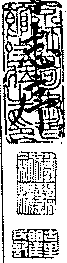
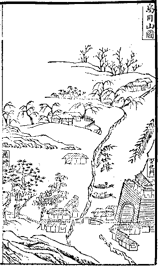
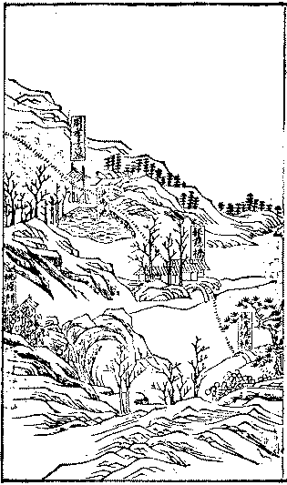
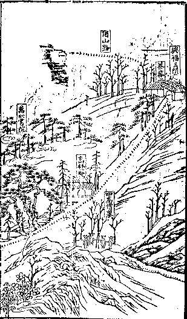
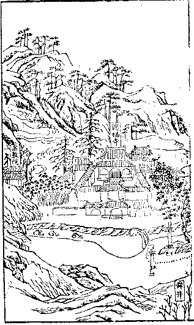
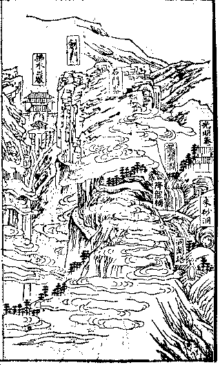
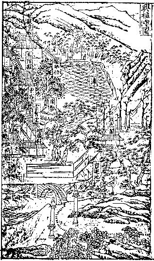
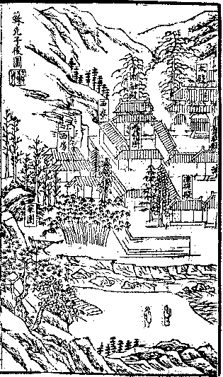
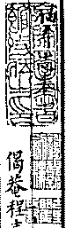
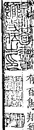

# 破山兴福寺志



> **藏经**：中国佛寺史志汇刊（佛寺志汇刊）　**册次** 第 35 册（GA035）　**编号** GA0036　**部类** 史传部　**卷次** 5 卷　**篇幅** 16,824 字

> **作者（译者）**：康熈三十二年癸酉上元日，吴郡司马李继勋：重修大雄殿募疏

> **卷／品**：5 卷 · 2 品



---



## 目录



  - [破山寺志序](#破山寺志序)

- [常熟县破山兴福寺志卷一](#常熟县破山兴福寺志卷一)

  - [元丰五年四月旦日宣德即知苏州常熟县刘拯序](#元丰五年四月旦日宣德即知苏州常熟县刘拯序)

- [常熟县破山兴福寺志卷二](#常熟县破山兴福寺志卷二)

- [常熟县破山兴福寺志卷三](#常熟县破山兴福寺志卷三)

- [常熟县破山兴福寺志卷四](#常熟县破山兴福寺志卷四)

- [常熟县破山兴福寺志卷五](#常熟县破山兴福寺志卷五)



---



破山兴福寺位於江苏常熟县西北，破山乃虞山之别山，兴福寺在县西九里，虞山北岭下。以山光水色名於世，唐常建「题破山寺后禅院」诗云：「清晨入古寺，初日明高林；竹径通幽处，禅房花木深。山光悦鸟性，潭影空人心；万籁此都寂，但餘鍾磬音。」诗颇为后人称颂，故名寺亭为「空心亭」，而破山之秀洁，乃益为文人所推许。寺始创建於齐（四七九～五〇二），以邑人郴州牧倪德光舍居第置之，是为大慈寺，至梁大同三年（五三七）改为兴福寺。寺中最著名之建筑者，厥为四高僧祠，即唐之怀述、常达，梁之彦偁，宋之晤恩。怀述字体如，学涅槃，有体如塔。常达字文擧，通涅槃经及庄老书，隐迹破山，有文擧塔。彦偁，曾救中箭之虎于寺阁，故有救虎阁之遗迹，有彦偁塔。晤恩字修己，通天台教，设宗教院于破山，有晤恩塔。元、明两代，颇有毁败，至万历年间，始予增修。清康熙三十二年（一六九三），吴郡司马李继勋曾重修大雄殿。明末程嘉燧辑寺志，前有崇祯壬午（十五年，西元一六四二）钱谦益序，志属草创，体例不免驳杂。志分五卷，卷一记形胜，历代艺文附之。卷二记塔院，怀述、常达、彦偁、晤恩四高僧传在焉。卷三记明朝以降重建本寺事迹。卷四为明朝名僧事略，海舟、无著、钵庵、洞闻、等慈等五位名僧是也。卷五为清康熙间重修之疏、记，有「重修大雄殿募疏」、「重修兴福大雄殿记异」二文。兹据国立中央图书馆代管北平图书馆所藏明崇祯十五年（一六四二）序刋本景印（按此本原为瞿氏铁琴铜剑楼所藏，后归京师图书馆。志中第五卷收清康熙三十二年重修大雄殿募疏，则是志或刻於清康熙间，或系后人所增刻，因无可考，兹依钱序注为明崇祯十五年序刋本）。



------



### 破山寺志序







余为儿时每从先大夫游破山寺饭罢绝龙磵下上激流泉拾赭石輙嬉游竟日长而卒业壮而缚禅捿息山中徃徃经旬涉月虽在车马尘𡏖顿踣幽絷之时灯残漏转风回月落山。阿磵户斋鍾粥皷未尝不髣髴在梦想中也循览斯志如观李龙眠山庄图信足而行自得道路如见所梦如悟前世禅房花木山光潭影与夫此山中名僧胜流经行晏坐高吟长啸之遗迹皆显显然影现卷帙间尘网羁绁餘累未毕未能以残生餘年遂乐天草堂之约俛仰今昔为掩卷太息者久之而余於此以有二愿焉山寺之废而复新也先大夫奉王母卞淑人之命经营草昧以溃于成屠长卿寺碑云善女人罄产偈縁似昔贤之舍宅谓王母也王母尝嘱余云山门东西二里许皆古时经堂佛阁旧址伽蓝神所呵护汝外王父母之墓偪处寺之东偏汝他日择善地卜外王父母之宅兆而徙焉用以妥先灵忏宿业汝其勿忘三十年来外王父之子姓累累青衿而家益衰落至不能庇其丘木而纵寻斧焉邑志云山名破山葬者皆不吉以佛地因縁论之斯又不足言矣余思王母之言每一瞻拜未尝不流涕此一愿也寺之西有宗教院高僧晤恩演台教之地更西为光明庵跨龙磵之上大比丘素公供金光明经修忏法之地今世盲禅盛行教义衰落余欲斥寺西菜圃隙地架杰阁搆广院复宗教光明之旧招延高人即中诸公唱演其中使教幢再树魔燄顿熄即中合掌讃叹以为希有此又一愿也岁月云迈誓愿历然又安知愚公之移山操蛇之神不感其诚而相之乎山僧刻志成余遂以斯言弁于首且以为识焉



崇祯壬午嘉平月，聚沙居士钱谦益书于优昙室中







乌目山图























兴福寺图







苏先子后图







------



## 常熟县破山兴福寺志卷一



偈庵程嘉燧辑







破山



宋文林郎秘书省较书郎守县尉陈于顶山路记云常熟居海濵地无大山县依山之阳是为隅山以濒海之隅也又名虞山以昔人治虞于此也山北行九里是为破山以鬬龙破山而为涧也又北行九里为顶山又北行六七里为小山山之南北相距才二十四里而名已不一矣又合而名之或曰乌目山也



姑苏志云庆元志引山海经曰虞山之北冈垅相接即乌目山今顶山之南有乌目涧疑即此也自此东北九十步有空心潭又有舜井



寳祐志破山之名旧传正观中有老宿在寺说法常有白髯老人每旦必先至一日师问为谁曰某山中白龙也师愿见其形老人云我见形时当念摩诃经号助我之威师怖误诵揭谛神咒神以杵击龙龙冲山而去遂成破涧



又高僧传云白龙与黑龙交勇冲迸成溪



朱长文续图经云正观中山中妪生白龙与一龙鬬于此而成涧(旧志云唐贞观十▆年夏▆月白龙与乌龙鬬于虞山之东北冲山而去山裂成涧则又与白龙祠事相涉三说未知孰是)



中吴纪闻旧传有四高僧讲经山中一老翁日来听法久之问翁所从来答曰吾非人也龙也因问本相可得见乎曰可已而果以全体现僧恐甚亟诵揭谛咒语揭谛神与龙角力龙不能胜破其山而去续图经所载不同谓白龙与一龙鬬未知孰是



卢熊苏州府志破山亦虞山之别山因白龙鬬冲山而去故曰破山



兴福寺



吴地记后集云兴福寺在县西九里虞山北岭下梁大同三年置



唐破山兴福寺再修功德记



此寺始自齐始兴五年因邑人郴州牧倪德光舍居第置之是为大慈寺至梁大同三年改为兴福寺自为邑为寺历陈隋四代迄于我唐甲辰岁岁逾三百年会昌末释教中圮僧难聿兴武宗斥去浮屠法寺毁大中践祚再恢释教俾饰伽蓝先是大檀越主吴兴钱公某吴郡顾罕汝南周坦与彼亲友兼募信士助修塑像添建殿堂赫赫垂芳传之不朽以隽侨居是邑废之兴之耳目相接俾书其事有愧斐然



中和四年六月五日记



范成大吴郡志兴福寺在常熟县西北九里唐寺记云始於齐始兴五年按齐无始兴年号但有延兴中兴二号皆止一年流传之误如此既是唐碑姑存之即常建题诗处(郑虎臣吴都文粹同)



朱长文吴郡图经续记兴福寺在常熟县破山为海虞之胜处齐郴州刺史倪德光舍宅为寺唐常建诗云竹径通幽处禅房花木深山光恱鸟性潭影空人心即此地也山中有龙鬬涧唐正观中老妪生白龙与一龙鬬于此而成此涧有空心潭因常建诗以名有御赐鍾唐懿宗咸通六年所赐有文擧塔体如塔二人者唐之高僧也有救虎阁五代时僧彦偁为虎拔箭於此有宗教院雍熈中高僧晤恩修天台教於此故以名近刘御史拯宰邑作八咏以志其事云



范成大吴郡志破山兴福寺去邑九里齐始兴五年邑人郴州刺史倪德光舍宅为寺名曰大慈梁大同三年改兴福寺飞泉石桥修廊复阁气象雄古多唐时屋也僧堂三柱皆有雷篆倒书竒恠不可识相传唐初雷震故然(寳祐志同)



郭彖暌车志曰常熟县破山寺僧堂李唐新建柱有雷神书凢三处盖昔人所传谢仙火之类内一柱题字最端谨可识云助溪作火田凢六字上一字作从具从力字书所无字皆作隶体倒书入木三分不类雕刻然各去地丈餘与旧说身长三尺者差异



卢熊苏州府志出宣化门循山而北过报慈寺六里西北入破山兴福寺寺多古迹临龙鬬涧山腰有光明庵



唐诗



常建：题破山寺后禅院



清晨入古寺　初日明(一作炤又作曜又作朗)高林  

竹径通幽处　禅房花木深  

山光恱鸟性　潭影空人心  

万籁此都寂　但餘鍾磬音



唐诗记事丹阳商璠撰河岳英灵集首列建诗爱其山光恱鸟性潭影空人心



欧阳公临行题青州山斋曰吾常喜诵常建诗云竹径(通)遇幽处禅房花木深欲效其语作一聮久不可得乃知造意者难为工也晚来青州始得山斋宴息因谓不意平生想见而不能道以言者乃为已有於是益欲希其髣髴竟尔莫获一言夫前人为开其端其物景又在其目然不得自称其怀岂人才有限而不可疆吾将老矣文思之衰耶兹为终身之恨尔熈宁庚戌仲夏月望日题



姚𡩖西溪丛语曰常建题破山寺后院诗云竹径通幽处禅房花木深余观又玄集唐诗类选皆作通熈宁元年欧阳永叔守青州题廨宇后山斋云竹径遇幽处有以鄠杜石本徃河内以见邢和叔始未见时亦颇疑其误及见碑反覆味之亦以为佳不知别有本耶抑永叔自改耶古人用一字亦不苟也



僧清昼：晚秋破山寺



秋风落叶满空山　古殿(集作寺)残灯石壁间  

昔日经行人去尽　寒云夜夜自飞还



高僧传云皎然名昼姓谢氏长城人留心篇什凡所游历皆以诗句牵劝令入佛知有集十卷



寳祐志载皎然双峰百战后一首题曰游破山考杼山集乃游吴匡山破寺诗也今削去



吴融：送僧归破山寺



万里指吴山　高秋杖锡还  

别来双阙老　归去片云闲  

师在有无外　我婴尘土间  

居然本相别　不要惨离颜



僧常达：破山山居八咏



身间依祖寺　志僻性多慵  

少室遗真旨　层楼起暮鍾  

啜茶思好水　对月数诸峰  

有问山中趣　庭前是古松



二



晚望立虚庭　心心见祖情  

烟开分岳色　雨霁减泉声  

远树猿长啸　层岩日乍朗  

更堪论的旨　林下笋初生



三



一室尘埃外　翛然秪麽常  

睡来开寝幔　鍾动下禅床  

溪浸山光冷　秋凋木叶黄  

时题诸祖意　欹石看斜阳



四



西来真祖意　秪在见闻中  

寒鴈一声过　踈林几叶空  

心闲怜水石　身老怯霜风  

为报叅玄者　山山月色同



五



真性寂无机　尘尘佛祖师  

日明庭砌煖　霜苦药苗衰  

汲水和烟酌　栽松带雪移  

好听玄旨处　猿啸岭南枝



六



古寺凭阑危　时闻举妙机  

庭空月色净　夜逈磬声移  

漏转寒更急　灯残冷熖微  

太虚同万象　相会话玄徽



七



胡僧论的旨　物物唱圆成  

踈栁春来翠　幽窓日渐明  

禅心亲石室　蝶翅覆花英  

好听谭玄处　乔松鹤数声



八



祖祖唯心旨　春融日渐长  

霜轻莎草绿　风细药苗香  

月满真如净　花开觉树芳  

谷前鸎啭处　时听话圆常



宋诗



刘拯：破山八咏(有序)



拯，字彦修，宣州南陵人。进士及第，知常熟县。



元丰元年苏州常熟县沙门思雅谒予言曰海虞之胜鍾于破山然林泉之势游观之繁无近无远传之盛矣自倪郴州舍宅为寺数百年间僧人竒士徃徃间出而人知者愿有以发明之余因请而咏其可道者俾灵踪异迹不揜乎山水之胜云



------



### 元丰五年四月旦日宣德即知苏州常熟县刘拯序



兴福寺



齐郴州刺史倪德光舍宅为寺号大慈院梁大同中改为兴福寺



峩峩乌目山　曾临贵侯宅  

重房昔珠翠　峻宇换金碧  

泉激晨霞明　松摇暮云白  

宜尔山中人　日轮自朝夕



(餘七咏俱别见)



李湛：兴福寺



湛，宋秘书丞，大中祥符间人也。诗归载此首譌为唐诗。



云门十里长　殿塔明朝阳  

半夜风雨至(一作止)　满山松桧香  

清猿啸远壑　好鸟鸣虚廊  

尘土斯可濯　胡为语沧浪



莫俦：破山



俦，吴江人。



久闻胜地有莲宫　乘兴来游杖瘦筇  

庭老樛枝翠璎珞　池生并蒂玉芙蓉  

飞仙何意来题柱　开涧当年想鬬龙  

归骑回看楼阁处　云深隐隐度踈鍾



李光：破山兴福寺



招提清绝冠诸方　溪遶山围胜气藏  

好在池塘存旧址　依然花木隐禅房  

风生殿阁元无暑　雨后松篁自有香  

日暮不教清兴尽　更登绝顶瞰微茫



旧志载陈简斋诗一首乃雒中龙门诗也今削去



章康：游龙山



康，浦城人。



名山久相望　今日为著屐  

到寺第一义　古松足蟠屈  

一一龙蛇形　风雷气萧瑟  

璎珞桧两株　皆数百年物  

佛灯耿青荧　像设暗金碧  

云廊极徘徊　老屋共崪兀  

僧房小盘薄　西原访泉石  

于其㝡幽绝　似可使筑室  

因而思古人　多有爱山癖  

要之亦何为　一赏事已毕  

上方不及登　尚或俟他日  

无非会心处　妙同箭锋直  

山灵谓何如　移文兹不必  

作诗留山中　并可告来辙



元诗



周霞賔：破山后院



一路入青山　禅居树木间  

竹泉和雨酿　梅壑倚云攀  

塔冷高僧骨　岚清俗士颜  

夕阳鍾磬远　相趂采樵还



僧如镜：破山寺



虞阜前朝寺　萧然一径深  

烟霞多古迹　花果满晴林  

逢石泉应冽　空亭昼自隂  

高僧遗塔在　何日复重寻



吴讷：破山



老龙逞餘怒　旧触苍厓裂  

厓边古佛祠　年深亦销歇  

隂房燐火青　曲窦泉声咽  

客游纵竒讨　摩挲看遗碣  

朗吟常建诗　清风满林樾



李杰：游破山寺和钱世恒韵



今日重来续旧游　可堪岁月去如流  

春光冉冉红将歇　山色隂隂翠不收  

天晚腥风生虎穴　雨深新水溢龙湫  

老僧煑笋充清供　石上三生话未休



王同祖：游破山兴福寺破龙涧



破龙廻绝涧　灵鹫倚修林  

绀宇烟霞静　苍崖松栢深  

虚无侵海色　去住引禅心  

日夕山风冷　幽禽空好音



钱籍：游兴福寺归途即事



古寺登临罢　肩舆下翠微  

山僧擕钵上　樵子负薪归  

暝雀喧凋叶　寒鸦度夕晖  

独怜游客兴　犹逐野云飞



杨仪：游兴福寺



为爱禅林好　时来坐夕曛  

幽禽喧败屋　古木堕寒云  

细读逍遥论　清谭怪石文  

步兵长啸罢　皷吹半山闻



杨仪：赠破山寺洪上人



寻春过夏事俱寒　惟有留题墨未残  

落叶不教潭影静　闲云长伴衲衣还  

吾难求富徔吾好　汝可将心与汝安  

三十年餘京国梦　家山依旧醉中看



孙七政：春日游破山遇雨



春游不觉远　幽兴转无涯  

雨送一峰磬　云埋半壑花  

暗芳遥更识　空翠湿还賖  

归处浑迷径　翻疑洞口家



邵鍪：破山赠李超无得贫字



涧户绳床寄此身　眉间精悍色犹存  

千年寺色松头冷　半日茶烟竹里贫  

野鹿徤如逃世客　岭云间似住山人  

繇来此意无多子　与尔蒲团子细论



尹嘉賔：寄破山樵者李超无三首



羡尔佯狂已陆沈　青山作伴遂幽寻  

相思只恐难求觅　闻说禅房花木深



二



江上青山政忆君　西风旅鴈自为群  

天涯岁晚多冰雪　若个峰头蹋冻云



三



自断文章岂致身　忍看时事日沈沦  

东来山色何骄𥠧　思杀当年采药人



龙鬬涧



邑志一名破山涧亦云破龙涧相传龙鬬山裂成涧至今涧石皆赤研之色如代赭画家用以皴染



刘拯：龙鬬涧



唐正观中老妪生白龙与一龙鬬于此而成涧



白龙鬬巍峰　长涧落千尺  

灵泉应竒踪　高连莫云碧  

寒影凌苍崕　清流动危石  

八月苗正枯　犹能变甘泽



宋高九万：题龙山



开禧中僧居简送高菊涧游吴门序云山隂菊涧高九万得句法于雪巢林景思于后山为第五世



古涧沧浪外　晴蓝缥缈间  

木枯曾阅世　龙老解分山  

鸟道秋迷迹　禅房昼掩关  

诗成游子去　流水自潺潺



朱砂洞



南畿志破山上有破龙涧旁有朱砂洞邑志云在龙鬬涧中



大涧



邑志在虞山北麓兴福寺北



空心潭



朱长文续图经云有空心潭因常建诗以名潭有无尾螺相传有神僧见烹螺者已去其尾放之潭中得生或徙之他处则尾如故



刘拯：空心潭



在殿之东北九十步



碧潭发幽石　潇洒无纤尘  

寒光湛秋月　有物难比伦  

离钩况无鱼　千尺徒垂纶  

到此心已空　何用濯我缨



明季箎：空心潭



寺里寒潭百尺深　冷𣹢秋气碧沉沉  

风波不动开明镜　恰比山僧入㝎心



空心亭



寳祐志寺有通幽轩空心亭盖取常建诗中语邓黻志至正五年重修叚天祐作记弘治十一年建今又废



叚天祐：空心亭记



天祐字吉甫河南人泰㝎甲子进士为常熟州判官



海虞山循常熟州治西北十里而近曰破山直破山之麓有寺曰兴福涧流绝山而下潴为深潭潭之上有空心亭山以崖断石裂得破山之名亭以唐少府常建诗得空心之名海隅之胜萃于破山而破山之秀鍾于斯亭孱颜峙其前冷冽停其下设置既宜而称谓允当人知少府之诗之工而不知所以为工一登斯亭不言而喻矣亭之始莫知为谁岁滋久风雨弗支至正五年寺僧徴上人谋撤其故而更剏焉走邑士崔君天游后君议皆许诺二君人望也既相为先后闻者乐趋而朱君其倡者也落成宏敞雅洁十倍其旧先是崔后二君尝与寺昌上人取少府诗析为韵授四方名士大夫各赋五言一诗至是悉刻梓揭之亭冠以少府诗亭所宜为者始大僃以天祐佐是州而山𠰥亭实所游历致书属为记惟元气结而为山其秀且竒者所不乏非有文章才艺之士发之未必显于世破山之以秀杰称宜矣必少府诗出而后人人知之又必空心之亭立而后人人信之地有待夫人重事有待夫时如此檐甍翚飞栋宇云涌晴隂雨云光景变幻游者税尘鞅纵清躅荫林樾之荟蔚睇谷岩之碅磳寓听于琴筑而致迹于氷雪平昔宠荣势利之胶乎中者荡然火烬烟灭其𩄇台虗明直与潭水相为洞炤名亭空心畴曰不宜天祐不敏方将命杖屦载茟札从诸君子之后崔君名元方后君名克正朱君名士昭



八年九月应奉翰林文字儒林即同知制诰兼国史院编修官叚天祐记



李杰：重建空心亭记



虞山为海隅之镇发脉自北而西迤逦南迈其首则邑治在焉其中支㝡为深秀以山形磅礴环抱𩄇气所鍾也旧有寺曰破山今称兴福山下有泉出焉潴而为潭唐常少府诗所谓潭影空人心者也后人作亭其上兴废屡矣前令尝再建之实土潭心以为亭基四周所餘不过数尺水源尽窒茂草丛生余致政归每至輙为之闷然廼谂于邑大夫澶渊胡公巍命义官徐明夫董其役撤去旧材屏除积土攘剔芜秽濬而深之清泉汩汩灌注冬夏常盈渊渟澄澈可烛须眉而天光日华上下交暎莹乎一鉴之空明也於是更树亭于潭上饰以丹雘楹桷栋宇高出岩厓老梅古桧离立于前修竹长松森绕于后游于斯者倐然改观而尘襟开豁万虑俱消名之曰空心其亦称情也已



张著：分题空心亭得枝字



山寺无僧涧道疑　华亭零落已多时  

空潭云动蛟龙影　老树霜摧虎豹姿  

谩拟稽隂成列坐　那同历下徧题诗  

明年此地重相忆　石上梅花雪满枝



御赐鍾



寳祐志寺有御赐鍾是唐懿宗赐鍾文云唐咸通九年岁次戊子正月二十一日𠡠赐破山兴福寺鍾一口重一千三百六十觔



刘拯：御赐鍾



唐懿宗咸通六年赐



大声扣洪鍾　万里来彤廷  

鸟间栖影重　星淡云气清  

餘响遶岩壑　林叶如廻惊  

有客发深省　尘耳非谩倾



------



## 常熟县破山兴福寺志卷二



偈庵程嘉燧辑



四高僧祠



寳祐志寺有四高僧祠唐之怀述吴人常达及朱梁彦偁宋晤恩皆邑人按四公行履见高僧传及刘拯诗甚详而俗称四高僧有降龙伏虎朝阳对月之目伏虎者偁公也降龙者则贞观中老宿也俗语流传徃徃见之碑版宜刊正之



宋僧居简：破山高僧塔



居简号北涧蜀人庆元嘉熈间尝居西湖鄮山有北涧诗文集



寺倚四僧传　僧今已蜕蝉  

塔随榛棘老　徳与苾𫇴全  

翠滴添衣重　云深染屦鲜  

何年山脊断　飞去玉蜿蜒



唐高僧常达塔



邑志字文擧年七十四岁塔在兴福寺东南三百步



唐吴郡破山寺常达传



见有宋《宋高僧传．明律篇》，賛宁智轮奉𠡠撰。



释常达字文举俗姓顾海隅人也发迹河阳大福山游学江淮诸胜寺达允廸中和克完戒法专讲南山律钞后求涅槃圆音法华止观复通隂符老庄百家之书其餘分时之学尽二王之茟迹后随方叅禅诣于宗极俄属武宗灭法叹曰我生不辰不自我后繇是寝默山捿委裘遁世而无闷焉宣宗重建法幢荐兴精舍合境人民皆达之化导故太守韦曙特加崇重身不衣缯纩室惟蒙薜萝四众知归诸方慕化其洁白寉鹭如也咸通十二年合郭僧民请绍四众教诲或游遨坰牧或肃傲海壖不出林麓动经数载虽贵士单车诣门莫得而见於七五言诗追用元和之体著青山履道歌播人唇吻忽於自恣明辰鸠众于长廊合掌遂申长别辞甚㓻正因卧疾不起绝食七日而逝实咸通十五秊九月十六日也春秋七十四僧臈五十一门人会清传朗奉灵柩殡于寺之东南三百步后年即坟起塔颕川陈言撰塔铭邑大夫汝南周思辑为檀信乹符四年立碑焉



刘拯：文举塔



唐高僧常达字文举通涅槃经庄老书隐迹此山虽王侯诣门莫得而见塔在寺之东南



圆昔探双林　巵言发南华  

万理归一空　谁云正非邪  

门影摇青松　曾廻贵侯车  

犹遗数层塔　岌岌凌飞霞



唐高僧怀述塔



邑志在常达塔东北字体如戒行不下常达



刘拯：体如塔



高僧怀述字体如学涅槃伊字沙门遭武宗沙汰至大中仍复僧衣始终无瑕塔在文举塔之东北



妙理悟三伊　巍巍抗竒节  

千尺岩下松　萧然独凌雪  

珠影虽青黄　月轮犹圆阙  

危石扬寒泉　至今伴清绝



梁高僧彦偁塔



梁寳祐志彦偁年九十九岁戒行清苦一夜登阁有虎中矢咆哮于地偁徐为拔之虎偃伏瞑目舐血顾偁而去至晓猎师朱德寻踪而至偁示以矢镞朱感悟为罢猎有碑存焉塔在兴福寺东



梁苏州破山兴福寺彦偁传



寿阇黎附见亦见高僧传明律篇



释彦偁姓龚氏吴郡常熟人也揭厉戒律锱铢尘务勤求师范唯善是从末扣击继宗记主得其户牖乃於本生地讲导同好鸠聚律风孔扇号为毗尼窟宅焉先是海隅巫咸氏之遗壤招真治之旧墟古寺周围不全垝垣而已尝一夜有虎中猎人箭伏于寺阁哮吼不止偁悯之忙系鞵秉烛下阁言欲拔之弟子辈扶遏且止者三四俟其更阑各睡乃自持炬就拔其箭虎耽耳舐矢镞血顾偁而瞑目焉质明猎师朱德就寺寻虎偁告示其箭朱德悛心罢猎焉武肃王钱氏知重每设冥斋召行持明法时覆肩衣自肱而堕还自搭上或见鬼物随侍焉所谓道德盛则鬼神助也以贞明六年六月终于山房年九十九岁云次



寿阇黎者淮浦左右贞谅不群护防正念时少双偶传南山律钞极成不看他靣唐李杨氏奄有广陵频召供施四远崇重食惟正命不畜盈长户不施关及临坛度弟子正乘羯磨未周三法忽尔坐亡于覆釜之畔闻见惊叹与



救虎阁



邑志在三门东偏又有伏虎桥在邑厉坛左百步俗传高僧骑虎入城虎伏候于此桥故名



刘拯：救虎阁



朱梁高僧彦偁尝一夜有虎中箭投伏寺阁偁闵之下拔箭其虎舐血顾偁而去阁基在三门之东偏



三昧游深慈　结宇依苍崕  

猛虎伏巍阁　拔箭非忘骸  

穷兽虽覆车　危雀亦投怀  

况我见已忘　而彼犹其侪



宋陈表：高僧彦偁塔



茁茁霜髭百岁身　惯持清苦发慈仁  

不因解脱於莬厄　一箭那能悟猎人



宋高僧晤恩塔



邑志太宗雍熈中通天台教起宗教院于破山塔与梁彦偁塔相近有石存焉按朱长文续图经及刘拯破山八咏止载文举体如二塔而邑志并载偁公恩公二塔偁公传云终于山房则塔在破山无疑而恩公传则云坐化于杭之慈光院今其塔仍在破山有碑石可考盖慈光化后归舍利于此山与宋僧北磵诗云寺倚四僧传僧今已蜕蝉四公塔皆在破山可无疑也



大宋杭州慈光院晤恩传



见有宋高僧传义解篇



释晤恩字修已姑苏常熟人也姓路母张氏尝梦梵僧入其家而姙焉及穉孺见沙门相必起迎迟年十三闻诵弥陀经遂求出家亲党饶爱再三沮之乃投破山兴福寺受训后唐长兴中受满分戒登徃昆山慧聚寺学南山律晋天福初从檇李皓端师听习经论悬解之性天然时辈輙难抗敌后微闻天台三观六即之说冥符意解汉开运中造钱塘慈光寺志因师讲贯弥年通达法华光明经止观论咸洞玄微寻施覆述出弟子相次角立雍熈三年八月朔日恩于中夜覩白光自井而出明灭不恒谓门人曰吾报龄极于此矣乃绝粒禁言一心念佛次梦拥衲沙门执金炉焚香三遶其室自言祖师灌顶来此相迎汝当去矣梦觉呼弟子至犹闻异香至二十五日为弟子说止观旨归及观心义辰时端坐靣西而化享年七十五僧腊五十五其夜院僧有兴文偃等皆闻空中丝竹嘹亮而无鞉鼓且多铃铎渐久渐远依稀西去迨九月九日依西域法焚获舍利青白圆粒无筭恩平时谨重一食不离衣钵不蓄财寳卧必右脇坐必加趺弟子辈设堂居亦同今之禅室立制严峻日(别亲)视明相方许净人施粥曾有晚饮薯蓣汤者即时摈出黉堂每一布萨则潸洒不止盖思其大集满洲之言耳徧诲人以弥陀净业救生死事受教得生感祥可见者徃徃有之凢与人言不问贤不肖悉示以一乘圆意或怪不逗机者乃曰与作毒皷之縁耳不喜杂交游不好言世俗事虽大人豪族未尝辄问名居况迃趋其门乎先是天台宗教会昌毁废文义残缺谭妙之辞没名不显恩寻绎十妙之始终研核五重之旨趣讲大玄义文句止观二十餘周戒行兼明目足双运使法华大旨全羙流于代者恩之力也又慊昔人科节与荆溪记不相苻顺因著玄义文句止观金光明金錍论科总三十五帖见行于世吁河汉中有鱼溯流而上者何潜泳有所取故恩公不宽乘戒而出弟子十有七人求解而行行耳



中吴纪闻曰后唐时昆山慧聚寺有绍明律师僧中杰出者居半山弥勒阁一夕梦神人曰簷前古桐下有石天王像与铜鍾师宜知之诘旦掘地果得二物今尚龛置壁间常熟破山恩高僧尝学于绍明见本朝僧史天台宗唐荆溪尊者五传为高论法师清竦高论二弟子羲寂志囙寂以教观正脉传义通通传四明知礼志囙传慈光晤恩恩传𩄇光洪敏奉先源清清传孤山智圆梵天庆昭境观解行各师其说志磐统纪云光明玄义有广略二本恩师著发挥记解释略本清敏二师共结难辞辅成师义法智撰扶宗释难力救广本十种观心恩师与孤山亦撰辨讹以救发挥之说法智备引详论号十义书四明学者指恩清昭圆之学为山外宗按恩公当会昌毁废讲演山家教典法华大意昭著于世徒以光明广略发挥同异衡岳家世斥为山外山家谓学华严唯识者为他宗而𩄇光敏之徒为长水璇师贤首宗推嗣七祖则山外之斥或非通论也公以雍熈三年示寂慈光后三十一年法孙智圆获遗骨于学众凿石为塔葬马脑坡孤山塔公遗骨在三十一年后则破山之塔岂非其徒先藏骨𩬊此与



宗教院



邑志在破山涧上



刘拯：宗教院



雍熈中高僧晤恩通天台教持于此在三门之西偏



妙义传天台　迷云净如扫  

初终虽五时　修短自三草  

结隐非此峰　获藏亦珍(一作真)寳  

秋来月正圆　独炤松(一作僧)已老



光明庵



寳祐志兴福寺之属院也熈宁𨐌亥僧海素经始绍圣丙子讫工在山腰龙鬬涧之上最为胜绝望之缥缈若仙居僧仲殊为之记陈徽猷起宗有宿光明庵诗



僧仲殊：破山光明庵记



仲殊安州人居钱塘为诗敏捷立成辟糓常啖蜜东坡呼为蜜殊作安州老人食蜜歌熈宁中上堂辞众闭方丈自缢死及火五色舍利不可胜计



佛说金光明经是经莫知所始莫究所终杳无形声广无边际最尊最上众经中王类名曰金不可沮坏之体也现前日用光明之实相也虽天地之大万物之多幽明之异死生之隔皆不出是经含洪徧覆之无外也广矣大矣不入二乘之论浩然寂然未离三界之中乐著是经则入起灭轮趋向是经则示忏悔法繇忏悔法故能拂乐著之心无乐著之心故能达菩萨之本有大沙门名曰海素以曩故行愿爱乐是经出入是经受用是经得是经三昧安乐賛叹之不已又思一切众生同入道塲供养是经行忏悔法去一切罪垢与人天四众得清净果究竟了义入无生法忍安住如如复次香火之地不无择焉乃相眎此山西南顶有竒峰裂涧可以隔尘凢有长松茂竹可以庇经像燕坐屏息归者悦来者遂以熈宁辛亥经始讫绍圣丙子建立凡三十餘间得东南之绝境拟化城之髣髴背望辽海而镜空一天前临尚湖则澄光百里於是击大金皷出大音声诸有闻者合手而至称曰某甲等以宿昔縁堕尘色界烦恼障难愿尽忏除素公乃为整威仪良久而大众恍然有失瞿然有得悲唬恳切告谢而去徃问之则曰所失者烦恼妄想向来觉知今已断灭所得者口耳不及使予何言仲殊身隐光明迹涉忏悔闻此殊胜书以自警公命勒于石以示四众云尔绍圣四年正月十五日霅川空叜记一云云游比丘仲殊记



仲殊：光明庵



身是光明幢　语是光明经  

光明聚不散　妙有成真形  

示现三界前　何劳问丹青  

坐断龙鬬山　寳月孤亭亭



宋陆曦：光明庵



曦，吴郡人。



槛外琅玕山外山　三峰横碧有无间  

尘埃莫便市廛去　斜日秋风更倚阑



璎珞栢



寳祐志门外二老松如虬龙屈蟠庭有璎珞树尤古左开花右结实



僧居简：破山璎珞栢



雪枝新纵纵　霜子旧玲玲  

漙露频添缀　萦风缓剪零  

贯珠烦蚁度　编贝倩谁经  

瑶草随山尽　来寻千岁苓



白莲池



寳祐志池产千叶重蕚白莲芳色异常又云放生池旧即破山兴福寺白莲池为之乹道间令赵善括改就东塔崇教兴福寺



叶石林避暑录曰裴晋公诗云



饱食缓行初睡觉　一瓯新茗侍儿煎  

脱巾斜倚绳床坐　风送水声来耳边



公为此诗必自以为得志然吾山居七年享此多矣今岁新茶适佳夏初作小池导安乐泉注之得常熟破山重台白莲植其间叶已覆水虽无淙潺之声然亦澄澈可喜此晋公之所诵咏而吾得之可不为幸乎



宋陈掞：破山寺双头白莲



湘南夜永风露清　明月耿耿波益平  

婵娟有人步罗韈　琼珰玉珮双娉婷  

可怜玉骨埋藏久　肠断人间无复有  

岂知化作兰若莲　宿契未忘犹并首  

想应快意洗尘縁　不向谢池争取妍  

玻璃盘中净玉颊　一心稽首西方僊  

请君以图献天子　当与嘉禾并周史  

毋令寂寞堕空山　泣月悲云清夜残



尊胜石幢



钱糓续吴都文粹云破山自宋以来历岁久古迹皆废独石梁外尊胜石幢犹存其上经刻乃唐平原陆展书清劲有法妙迹也▆二幢当寺山门前左幢平原陆展书右幢京兆全贞书唐大中中建造宋建炎三年己酉八月二十三日重建



舜井



南畿志破山寺东北有空心潭舜井邑志在兴福寺南又名舜过



石梅



林大同集云石梅旧志载在破山寺今招真有之在石厓上



破山龙堂



朱长文吴郡图经续记常熟县龙堂唐咸通中县令周思辑以旱故禜龙于破山之潭上果雨以应于是为堂以祀之记刻今存破山即虞山也父老以谓每岁有龙徃来於阳山虞山之间其云雨可识



范成大吴郡志焕灵庿在常熟县破山唐咸通中所建龙堂也本朝政和二年赐今额五年加赐𩄇惠侯



皮日休：破山龙堂记



礼山林川谷丘陵能生云为风雨见怪物皆曰神若然者龙亦能为风雨见怪物则其泽之在民厚矣神而祀之又宜矣常熟泽国也风雨怪物日作于民在有其地者苟祀之至被其利祀之不至民受其祸汝南周君为令之初年夏且旱禜其神于破山之上果雨以应君曰受其赐徒禜以报不可也於是命工以土木介其象为室以荫之著之於典用洁其祀於是风雨时怪物止水旱不为厉连岁以穰其神之泽乎君之祀乎凡雩者春秋之道皆书之勤民之祀也君为其祠已乞文其事日休嘉其为在民故从之



咸通十三年二月十九日前摄岭南东道节度巡官试秘书省较书即皮日休记



大观三年陆韶之焕灵庿记梁天监元年顶山东有蒋媪孕而生白龙失所徃三日龙归若就乳姥怖而死即所居葬之既七日大雷雨冢迁于山腹每岁五月龙率来省墓必暴寒甚风雨或现形山间唐贞观十年龙尝鬬黑龙于虞山之东山破水泉出其下有破山寺今兴福寺是也邑人因像事龙母子于破山寺西涧旁水旱祷焉咸通十三年夏旱令汝南周思辑雩于破山之潭上果应肖像立宫著之祀典皮日休为记宋太平兴国四年令蒋文怿归其祠于顶山寺



破山路



县尉陈于记曰自县至破山有破山寺又至顶山有顶山寺其路随山山皆沙石昔有兴福僧自出衣钵累甎甃之自县北门至兴福寺门止今顶山中峰庵主怀素自破山双塔甃之以抵顶山又建双石塔以镇交衢成于元丰二年之季夏云



宋中散大夫陆绾墓



卢熊苏州府志云在破山绾为江淮荆浙𭛁运使卧疾真州官舍仪状无故动摇寻卒归葬山下人每夕闻诃导声从墓门出红烛夹道如赴燕集繇是樵苏无敢窥积五十餘年乃已



明中宪大夫顾玉柱墓



顾公历仕有声绩为嘉靖间名臣仕至山东副使墓在寺东今迁于墓门之东偏营墓时掘得吴越钱忠懿王所藏阿育王铜塔今尊藏寺中憨山大师清公瞻礼作记



僧德清：吴越忠懿国王造铜阿育王舍利塔记



昔世尊入灭茶毘得舍利八斛四斗分作三分天上人间龙宫各建塔供养尔时阿育王亲受一分散阎浮提震旦国得一十九座明州阿育王塔乃其一也其式亦出自西域而舍利灿烂光明变现随人各见亦有不见者盖因障有厚薄耳二千年后五代时吴越忠懿国王承先业敬事三寳如式造小铜塔八万四千座埋藏国内名山世未有知者我明万历初常熟顾耿光造其父宪副一江公茔地中掘出一小铜塔高五寸许如阿育王塔式内刻款云吴越国王钱弘俶敬造八万四千寳塔乙卯年记一十九字外四靣镂释迦徃因本行示相前则尸毘王割肉饲鹰救鸽后则慈力王割耳燃灯左则萨埵太子投厓饲虎右则月光王捐舍寳首文理密致渗以金饰顾为太史钱公母舅因公为忠懿王之后遂以塔付之公得此自号聚沙居士志因也乃送兴福兰若供养予适东游访太史过洞闻上座覩其塔竒其事因记之曰佛以法界为身即草叶缕结皆成佛真体况托象者乎良以众生迷本法身变为三毒成八万四千烦恼佛以普光明智熏三毒为三德秘藏故变烦恼为八万四千功德育王所造盖表功德之数量也吴越王倣造铜塔如其数尽埋地中意表功德藏于众生心地兾启一塔则见一种功德即覩法界之全身如从一隙见无际空见可以色相眎之哉法身坚固历刼不磨随縁应现太史此塔岂从因地示性空之一隙耶



万历四十五年佛生日憨山沙门德清记



邓黻常熟县志寺址修广自官路外山门皆僧业兵火后僧徒散去为人占而为坟比岁豪右据者不已地理家以为山以破败称不利葬地僧舍故得仅存县令冯汝弼见而矜之特与蠲除寺基税一石四斗升寺已废访胜者率喜至焉(续吴都文粹同)



------



## 常熟县破山兴福寺志卷三



偈庵程嘉燧辑



本朝以来重建本寺事迹



屠隆：重建破山寺碑



破山寺者虞山名蓝也山开一时则自倪牧舍宅寺名千古则繇常建哦诗诗之千古实维两言山光恱鸟性潭影空人心建为礼佛而成诗余请以诗而论佛夫有山则有光有潭则有影有鸟则有性有人则有心譬之刹竿立表形在而影随山亦可以言影潭亦可以言光鸟亦可以言心人亦可以言性譬之帝网缀珠交光而涉入山不与鸟期鸟性自恱鸟不与山约山光自临潭不因人设人心自空人不与潭谋潭影自印寂寂长松惠风来吹则泠然成韵冥冥大地孤月下炤则瞥尔生明灵鍾无识应蜀山而自鸣蕤铁何知闻流徴而忽跃是知大佛灵通咸自众生之机感如来极圣不度博地之无縁究之则竹下间关花前𪾢睆鸟性自恱岂须待恱于山光波平寒水云尽太虚人心自空何必借空于潭影再究之则山本无光鸟亦无性摠之能所双亡潭本无影人亦无心斯是根尘并脱再究之则山光即是佛光鸟性即是佛性悉表真如潭影无非佛影人心无非佛心尽归般若是故语荡相则一空一切空大火聚中秋毫不著语建立则一有一切有大红罏内众寳俱镕未能证悟此两语或尚是凢夫声诗默契道机即一诗亦何异如来妙偈吾闻此山有大和尚先后住大道塲或灵心伟智示游戏而现通或宿德耆年精木义而弘范绣栋华榱寳相庄严金地烟廊雾馆丛林盛甲神州沧桑眨眼殿堂塌彼秋风幻泡伤心金碧销于寒雨佛性无形无形故无变灭佛庐有相有相故有消沈縁以时来事因人造高僧无著者远从云水之踪览名山而太息遂即榛芜之地思古迹而经营无言率物桃李之下成蹊至德感人枹皷之应如响善女人罄产倡縁几似昔贤之舍宅诸檀信发心乐助一同长者之布金梵宇巍峩倐尔高骞云表玉毫璀灿焕然光暎林端山光潭影亦增秀于徃时鸟性人心且振响于雅咏是如来式临之日佛日中兴之期也方殿宇仗縁而落成适道民采真而至止钱侍御汝瞻翁给谏兆隆及侍御子用章进士太学生钱君偁孝孙君子桑等率僧无著问记道民夫阐扬宗乗奉三寳者既愿增白业品题名胜志千秋者又乐附青云吾想刼火洞然定信此碑无恙



万暦三十二年闰九月朔东海屠隆譔京山李维柱书



李维桢破山寺碑跋云



海虞破山相传白龙母葬此忽一夕雷雨移其棺改葬今白龙祠而山为之破因是得名建寺自倪牧舍宅始唐常建赋诗而名益显年远寺圮钱太史受之王母卞夫人罄其资缮之诸檀那从之名蓝复还旧观屠纬真仪部为之碑是时比丘为蜀无著再传而其徒衡阳人孚如以钱太史受兹介福于其王母纬真先生言深悟道秘在简栖头陀上属余弟本石书碑余因附数语志其始末如此



瞿汝稷：重修兴福寺唱导文



破山兴福寺邑人郴州牧倪德光舍宅以建于齐始名大慈入梁乃更今名其地谿涧萦纡岩𪩘环合多茂林修竹夏日为之沧凉曲磴窈窕四境萧寂息心了义之侣於以捿止真胜区也当其盛时丹甍翠橑与霞霱争丽珍木灵蘤炤曜金地岁禩悠漠悉▆就芜废苾𫇴明昱谓予曰而知佛法之所以不振欤夫佛法之有毗尼若树之有柢西竺诸祖靡不受具即曹溪传衣黄梅后亦受羯磨于智光而悠悠之徒冈念灵鹫苦心屡嘱影附丹霞掩耳之一端殊不知翱翔实际木义为春后之复裪针砭膏肓尸罗诚病时之药上世之能翱翔实际者少应针砭膏肓者多且戒初无戒三千威仪何所拘牵持本无持八万细行奚为缠缴若奉众善而无善善之心蠲诸恶而无恶恶之想则苦心者固嘉拾级掩耳者有不同趋哉乃兹龌龊浮说无碍之宗未诣不淄之域偃蹇具缚指挥拨无则擅特之幽求为虚施阐提之无信为正悟是先蹶其灵根又何冀于法荫故佛法为善世之圣师而毘尼为救时之首务此寺达公偁公稽之徃牒皆弘毘尼以垂范者也幸有净信矢心再兴愿为唱导俾克蚤成庶几鵞珠之英比肩慧门麋草之秀接武慈室虽有窃田衣之波旬且见伏于授华鬘之大士耀日域于重昬永雷音於无尽为功不亦伟欤於是予为踊跃讃叹遂次第其语以告于介众



兴福寺大殿



寺芜废几二百年古殿在寺之东偏颓垣败壁像设崩坠其地皆为荆棘林矣僧徒募修未几輙弃去无著禅师昱公自天池来誓葺兹宇披攘经营不舍昼夜万历二十九年经始大殿三十二年落成三世佛十八罗汉塑像皆备请大藏于南都会其徒以繙阅将建阁尊藏未果而卒兴福今复为丛林昱公开山之力也



四高僧殿



在大殿之左万历四十四年治事僧海莲募宪副钱公建



懒融殿



在大殿之右崇祯七年治事僧本善募宪副钱公建



韦驮殿廊庑



万历三十八年钵庵法师捐衣钵资建



四天王殿



在山门内万历四十七年海莲募侍郎钱公领众建



地藏殿



在天王殿东崇祯十一年治事僧契德募钱公子孙爱建



凖提殿



在天王殿西崇祯十六年契德募太学陆廷祉建



云会堂



在韦驮殿左侧崇祯十二年契德募善信鲍应鸿建



东西客寮



东寮万历三十八年钵庵弟子六空募建西寮崇祯八年僧契铭募建



观音殿



在大殿东北铁铸大士像相传是宋朝物崇祯八年契铭募太学严杓建殿之廻廊契德募建



观堂



在观音殿左侧崇祯十五年契德募善信高云举建



方丈



在大殿之后万历二十六年无著禅师建



斋堂　库房　香积厨　茶寮



俱契德募建



三门



崇祯十六年契德募孙公子藩建



龙涧桥



在三门之东崇祯十五年契德募孙孝廉鲁建



东房



在寺界之东空心潭观音殿基址皆在焉房之僧贫不能守崇祯八年侍郎钱公祭酒许公太学严公等赎归于寺殿东新辟松冈山地又若干亩



西房



在寺界之西有应付僧若干人堂之额曰晓云傍破龙涧竹树峭蒨可观



兴福寺外三门



茶庵



并去寺六百步崇祯十三年契德募祭酒许公建



日居庵



在三门内崇祯十五年寺僧恒思建



高林庵



在三门内万历间僧法雨建



团瓢



在空心潭上游僧了幻建



高僧墓



去寺二百步向入于民家万历某年僧如子募侍郎钱公赎归于寺仍建四塔



菜园



在寺之西凡三畆寺之旧址入于民家万历某年施主赠侍郎景行钱公捐赀赎归本寺又五畆在四十五都经字号兴福庄



山场



若干亩在寺之前后左右向入民家天启某年等赎归于寺



僧田



六百餘亩



> 四十五都四五啚兴福庄经书亦达等号田二百餘亩  

> 十四都五啚秉鉴贡劝等号田一百十二亩  

> 四十四都三十三啚练村圩移自等号田五十亩  

> 四十三都溪叚圩元亨等号田五十亩  

> 二十九都六啚微字号田二十亩  

> 二十七都十三啚姚庵圩造字号田八亩  

> 三十都啚历园等号田四十五亩  

> 二十一都啚慈隐等号田四十四亩



------



## 常熟县破山兴福寺志卷四



偈庵程嘉燧辑



本朝名僧事畧



海舟禅师



名普慈吴郡海虞钱氏子也世宗儒业出家于破山寺初至慧日寺听讲楞严至但有言说都无实义叹曰今日言说愈多矣叅邓尉山万峰和尚结庐洞庭山坞廿九年后叅安溪东明旵公嗣法阐化景泰元年示寂全身塔于东明左侧世寿九十六僧腊七十四得法弟子十二人



无著禅师



名明昱蜀人也建炼魔场于吴郡天池寺以魔娆弃去居兴福废寺𫁟力兴复捐衣损食伐木辇土与其仵偕力作者数年二百年芜废蔚为宝坊万历三十四年卒于寺葬高僧塔旁师为人雄徤峻特心地轩豁孳孳有为法不以禅宗自眩一言半句机锋逗露如疾雷一击闻者掩耳尝与瞿同卿元立共饭师放箸不食瞿问何故放箸师曰且待公数尽箸下米粒老僧大嚼几口与公看瞿为悚然



钵庵法师



名圆信嘉兴人也无著殁来住山坚持毗尼昼夜礼诵尝繇正㝎趣安乐国至于旬时朴诚敦厚丕勤诱掖壊衣不补揣食不味如桃李不言人望而亲之万历三十八年卒葬在无著塔之右



洞闻禅师



名法乘吴江李氏子少出家事华山兰风和尚后叅紫栢憨山两大师自天目中云庵徙破山老焉师慈和乐易具大人相所至住山其徒雪庵拮据庀治师焚香宴坐优游傲兀而已天启三年七月溽暑中示寂越三日入龛垂首趺坐肤理香洁四众惊叹墓在破山寺之南雪庵名海莲俗姓𦵮弃妻薙染晚忽能识字作小偈先洞闻四年沐浴敷坐而卒



等慈禅师



名广润吴兴钱氏少雄于赀慷慨负气多贤豪长者之交工于诗婉弱流丽世所谓钱叔达者也诖误触文冈出家事云栖大师晚捿拂水山居精勤策进羸然老衲顾好与文士游处其于文章意气未能舍然也万历四十七年卒于拂水诸公皆曰等慈名僧也葬于高僧塔之旁俾附以不朽焉



------



## 常熟县破山兴福寺志卷五



**译者**：康熈三十二年癸酉上元日，吴郡司马李继勋：重修大雄殿募疏



破山之兴福寺繇於萧梁即常少府建后院题诗处也古有遗迹而今无其人以处之则废而不传秀州雪鉴和上功行真实来修祖庭大畅宗风斯其人矣予莅官后於诸山皆无所向独尊重和上道德和上亦以予为可语而无所隐焉先是殿庭中栋为蠧所𩞾诸佛寳幢处危堕间又四宇頺剥和尚谓非宰官力不可属予为首倡予曰噫佛家以象教化行震旦蕋宫绀宇几遍山陬海澨间矣今之人犹多剏精益庄严螺髻镂檀竦棨徒为酒肉汉所居而忍此丈六金身岌岌不保其於功德之轩轾抑何昧耶且观少府诗曲径禅房之句窈然秀绝而今之斋钟讲树遥出於苍翠窅蔼间则深幽之迹俨然在也山光潭影心与物契有独悟之趣今和上鸢飞鱼跃月到风来之旨徧浃人心何殊远公莲社宁止一少府之独悟独乐乎哉乃任其栋倾佛危至于名刹就圮古迹湮沦匪惟负和上继徃开来之意其抚澄漪而见道溯嘉景以流连者将邈焉矣兴废之感能不动於心乎予马曹薄俸媿乎全力愿有位与邦人士均致力焉事佛也延古迹也徜徉歗歌自乐而及乎人使后之视今亦▆夫今之致美乎少府也若夫由因得果更有种福无漏之论予不多赘云



重修兴福大雄殿记异



上元摄山人马贽记



破山之兴福寺为齐梁旧刹其大殿复搆於明万暦间中极之下寳相巍然初縁栋材失选不百年而蠧而桁栌栱榱之朽者多矣峕秀州雪鉴禅师重兴祖庭虑珠幢戴危甫欲易之会郡副三韩李公菉园来董海防钦服禅师道德遂为首倡适各邑大夫咸集琴川得共勷焉于是庀材鸠工於康熈甲戌九月之三日先令圬者数十辈升极而去其甃除其瓴甋廻翔运旋于上者累日若无事也继令梓人又数十辈踞其栋拔其榱桷锥凿雨施往来如织一木横亘载亿万钧而恣之震凌又若无事者意其外或蠧蚀而中好尚如故焉迨栈木既具以繘络栋群工甫脱趾升栈则渹然有声及垂络而下如刅中截而十围之材肤不逾寸其中尽属腐屑皆如泥滓观者环堵相頋竦息不知向之载亿万钧而无危堕使寳华安然又复任群力措施讫无所虞而於一弹指顷忽作异响截然中摧不可思议如此是时讃佛之声欢如雷动非禅师玅圎功行深心尘刹郡侯之精诚有以感之曷克臻此哉用是檀信景徔多所输𦔳而殿庑三门众寮库𢈔皆山涌翚飞悉具瞻骇六朝选佛之塲复轮奂改观矣记异近于语神九日上梁之辰天清地宁祥云覆宇佛光照耀于丹陛间有百鸟翔舞之瑞皆不特书





