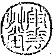
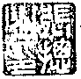
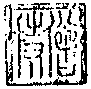
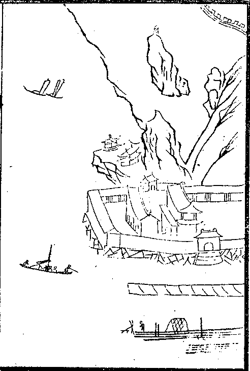
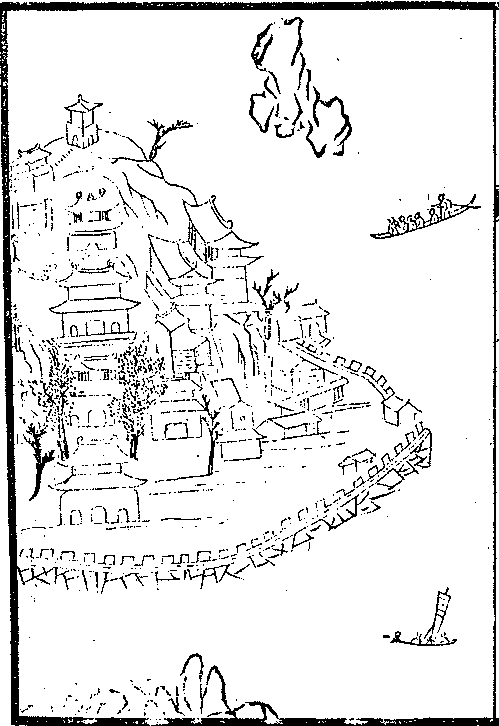
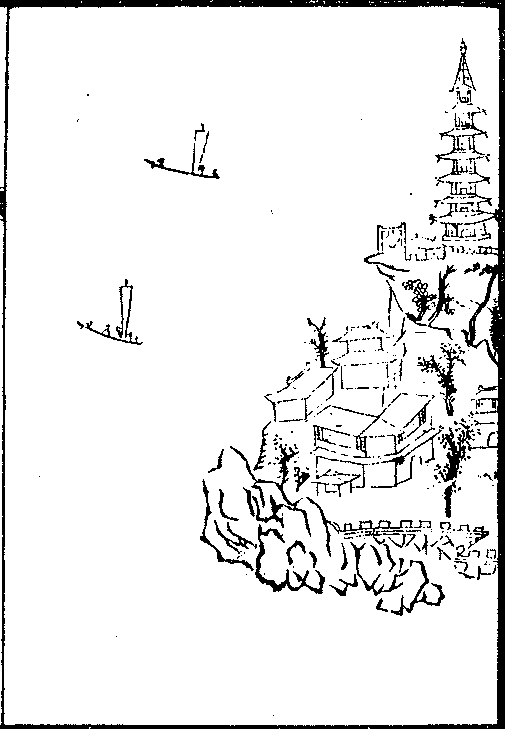
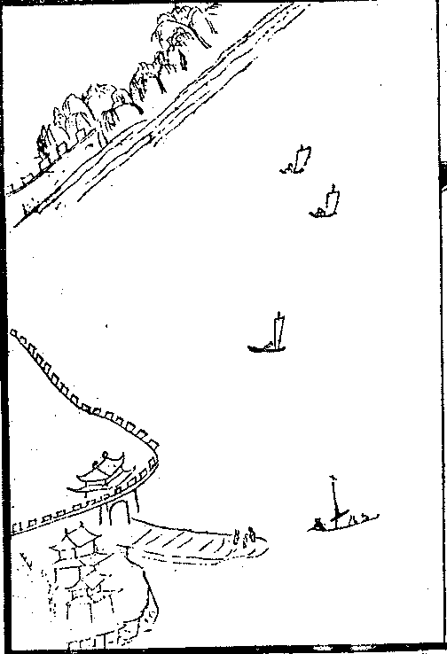
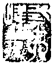

# 金山龙游禅寺志略(第2卷-第4卷)



> **藏经**：中国佛寺史志汇刊（佛寺志汇刊）　**册次** 第 36 册（GA036）　**编号** GA0037　**部类** 史传部　**卷次** 2 卷　**篇幅** 54,709 字

> **卷／品**：0 卷 · 11 品



---



## 目录



  - [序](#序)

  - [卷首序](#卷首序)

  - [序](#序-1)

  - [注已见前序](#注已见前序)

  - [序](#序-2)

  - [泉石生涯诗序](#泉石生涯诗序)

  - [赠文海澜禅师还金山序](#赠文海澜禅师还金山序)

  - [送文海禅师住金山序](#送文海禅师住金山序)

  - [金山志序](#金山志序)

  - [金山志后序](#金山志后序)

  - [金山新志后序](#金山新志后序)



---



### 序



忆昔余埀髫，当丁丑冬，从石头先师大中丞余公，问易武林西谿之横山。峕放舟过京口，望一峰孤耸大江，险怪崚嶒、盘欝苍翠。讯之，知为金山也。诵树影中流、钟声両𡶨之句，輙神往久之。辛卯岁，淂接天𨺚铁舟禅师，一见心契。未几，师即受润城蕊亭陈公之请，继席金山祖庭。余益深向慕，窃冀咨扣方丈，兼诣山中，一愽旷观，而竟未能也。惚怳至丙辰夏望前一日，始买一叶舟造焉。师为烹中泠泉，欢然道故，设榻古晓坣东。纵谈世出世之暇，出所辑金山志畧见示。余焚香展对，适风雨淹留，为之三宿卒读而拜手言曰：凡天下名山，各有纪载，师扵兹首标形胜，独表祖位纲宗，旁搜诸名贤佳话、轶事，以暨历代碑记、古文、辞赋、诗歌，无不悉收入山者。不待缕询，其大端己列睂指掌。即闻风相思者，亦不妨卧游。如历惊涛骇浪，身峙龙门三拄中。旨哉，是可藉金山以说法矣！师盖嗣法南涧箬老人，亲自堂奥中来。其雷电之机用、氷雪之心胸，作为出风入雅之撰述，良有以哉！或云金山拳石耳，似未足夸异！余则不然，大抵域内山在水中者，不可胜数。其最著，近如采石之翠螺、洞庭之缥缈、岳阳之君山；稍远则普陀之洛伽；再则神山之十洲三岛、香水之须弥，约畧止矣。而蓬莱亦有时三见清浅。噫！达人旦暮古今，横睇八表，抑又何大小之殊视耶？曩闻之先师称前辈尊宿，每以南涧老人与报恩天童诸大老为法门杰出，尤叹其高韵不群。余恨未获追随，犹幸把手铁师。余徃来江上将四十载，今方一至止，徘徊不能去。师乃住持山中，高座大彻堂三十餘年。烟云围绕供养，立说成书，与山灵争光。余能无望洋而叹哉？是为序。



南邨法弟子大纲张㧾拜手题于龙游之古晓堂



▆▆▆



张㧾之印



僧持



金山志畧目录



------



### 卷首序



山图  

缘起



卷一形胜  

建置  

祖堂法系  

记  

纪游  

碑  

赋  

勅书赐田附



卷二高僧  

题赠  

纪迹  

纪异  

汇纪



------



### 序



僧诗  

联对  

咏江唐句



卷三选诗(唐宋元明)



卷四选诗(明国朝)



金山志畧目录(终)



















金山志畧缘起



夫山川奇秀而崒嵂无过金山若也坐於江南京口即古云南徐者也其巉岩屹立孤峙江心上达荆楚下抵苏浙百川归海风波汹涌四面环绕中流砥柱信不诬矣然山之居水中者不一近而金山称最著焉肇自梁天监诏高僧宝公律师僧祐从金陵来建水陆大会极其祥瑞时号泽心寺金山之名已著至大唐得大鉴之孙灵坦禅师系则天武后之苗裔也每有异徵住锡山之巅蟒洞安禅入定蟒服归海此禅宗开山之始四方高僧建置疉兴遂为京口十刹之首而成江南名胜也贞元年间相国之子裴公重建伽蓝於水际迨宋兴以来幼聪公献图於真宗皇帝梦游此山赐改泽心为龙游禅寺又赐大藏一部山塲田地若干顷当斯时也主法席者如达观颖掩室开佛印元枯木成别峰印诸祖皆杰然秀出者相继兴起不翅十四五员大善知识激扬祖道说法如云宏阐宗乘辩才无碍而名震天下嗣后高宗南渡驾临维扬诏佛果勤祖於行在机缘称旨赐号圜悟勅住金山为国开堂结制日一夜悟十八高贤更古晓堂为大彻禅堂法道益彰元时有衲堂心海了即休诸公说法山中任运嘉会而已历明以来主法者稍间后先不一其文海渊公从天界迁任此山大有因缘善於视事见所赐洲田差徭烦苦躬诣朝廷疏奏蒙尚义太监力为蠲免建永安堂则差徭无扰惜乎后裔竞任都纲分列为十二房矣至天泉顶目问石诸公说法一期因缘殊胜奈何解制即翛然长往而明季有蜀晋云公若氷法师住静十有餘年已为讲席



国朝鼎兴始公议敦请　先师箬庵问和尚廼圜祖第二十代孙也於戊子春进山开法衲子云兴户无纳履至此又见一番崇胜矣命余监寺三年后交谢本山阖山诸耆德偕护法陈蘂亭诸公恐新兴祖庭又成冷落矣于是出书赴天隆请余继席余勉就赴请於癸巳夏六月入院四方衲子闻风而至者纵不能如　先师时云集然从而开法者亦不乏人但余目击祖堂不称三门大殿及大彻堂倾圮兼值海波腾涌橛橛梗梗兢株苦守上不干於朝惟有待於野幸随缘一一重而新之不觉羇迹三十餘年日久月湥得以考核详细禅餘之暇手辑志畧以历代宗乘法脉及名贤达士高风逸韵庶显山灵之胜不负护法之诚心也虽然有成有坏者世间相也其宗风相传斯历万劫而常存又何虑乎后贤之不振而继起开来也哉切念历代之光明幢不昧本原之大义斯廼江南之名胜宜为天下后世传故述而志之以备旷观焉尔



峕大清康熈二十年岁次辛酉　月　朔旦嗣临济正宗圜祖第二十一代孙行海撰行海铁舟



破浪



▆▆▆▆



金山龙游禅寺志畧



金坛绥庵居士蒋超较正



嗣祖比丘铁舟行海修辑



楚潭叅学门人超智编次



形胜



山在郡城西北七里大江中长山西北起为五州至下鼻浦遂入大江突起而为金山又名浮玉又名获符又名伏牛皆相形之比拟而已金山之名其来久矣自梁天监中律师僧祐高僧寳志已在金山建水陆会极其祥瑞名泽心寺至唐天寳中有广陵灵坦禅师初於江心金山之北入定蟒洞降蟒归海乃重开山为禅宗之始焉贞元间裴头陀建伽蓝水际获金数镒以闻赐名李锜奏而易名皆前人之悮也金山之说本出华严此阎浮提外香水海中有七金山遶须弥卢因海水潆洄播溢无定以金山镇之此山相似而得其名梵语须弥此云妙高故亦名妙高峰又乌得而疑之乎葢天下之名山皆本同而末异孰谓兹山无本自其远而言之雪山发脉昆仑抽干五岳定鼎南抵金陵之紫金山自其近而言之以紫金旋北而起五州自五州入江以此山奇秀威峙中流万派朝宗古德名贤互相推盛无得而比之虽所拟之名不同亦其胜之一端也本末同异详录於左以昭天下形胜云



金山



------



### 注已见前序



浮玉山



道书云自玉京诸峰若浮而至周必大谓风涛四起势欲飞动故名



获符山



晋破符坚置俘山下故名



伏牛山



此相形比拟又唐志贡伏牛山铜器为据



龙游山



宋真宗常梦游其山后赐额故名



石簰山



在西北急流中有漩涡常防溺舟之患米芾赋云浮玉卷雾石簰落潮又号头簰宜慎之



妙高峰



即须弥也独出众山曰高四寳所成曰妙南方有国名曰胜乐峰名妙高比丘德云常居於此善财童子叅之



金鳌峰



宋端明学士苏绅有诗云僧依玉鉴光中住人踏金鳌背上行之句



日照岩



在山之东即朝阳洞是也巉崖绝磴深丈餘许万历间有僧重开草莽号曰老朝阳焉



妙空岩



在朝阳之右谽谺洞豁纵广数丈可通山底



裴公洞



在峰之侧幽峻奇绝入深四五丈许宋相张商英题云白蟒化龙归海去岩中畱下老头陀事与龙洞同



郭璞墓



在金山之西日本使臣中心叟题曰水底有天行日月墓前无地拜儿孙之句



善财石



在山之东南水中亦名鹘岭宛然瞻礼之状道遐题妙高台畔有时见疑是善财叅德云



磐陀石



在洞前苏子瞻与佛印禅师常谈於此题云中泠东畔石磐陀古来出没随涛波



卧龙石



此石在石𥱼山前隐於水底舟触自坏特立险竿以警过往者



龙洞



在朝阳之左深不可测俗呼珠洞唐时常有毒龙吐气近者多病因灵坦禅师降之即去



龙井



即中泠泉其泉在郭璞墓前因有三禁之说又当漩波险峻难汲以井易之其水亦佳



觉岸



在砥柱东泊舟处明许少华题云几时登觉岸为我发尘蒙小华山人重勒石



信矶



在听潮轩前昔人呼鼋处以浮玉山随波出没潮汐不爽



竹迳



山头有竹二本云黄金嵌碧玉碧玉嵌黄金在大悲殿后灵观阁前谓之竹迳



龙门



在笔架山之右相传龙宫在下纪出三禁堂



鹘岭



即善财石也



建置



形胜者天生也建置者人力也无天生何以见峰峦之奇秀江海之宽广无人力何以见殿宇之精丽楼阁之参差虽有天生之胜其人力岂可以少乎哉然人力在缘胜缘胜则百废俱兴缘不胜相时补缀而已是故缘胜则建置胜具载无遗备年氏於现在实录也详废兴於既往返始也或昔有而今无必录以存其功也三者立将来劝建置之道益无穷矣故毕列於左以昭天生人力之佳境焉



泽心寺



东晋时名赵孟𫖯谓元帝时虞集谓明帝时未详孰是



龙游寺



以其状若游龙出水宋咸平中寺僧幼聪献金山图诏遣内侍蓝继宗赐大藏经祥符五年诏改龙游寺天禧初真宗梦游以飞帛书龙游禅寺四字赐之寺僧表求旧额改曰金山龙游禅寺



大雄寳殿



按天下丛林正殿咸称大雄大者包含万有雄者摄伏群魔寳者乃三寳也皆归此殿传持正法我佛威力雄镇大千也此殿曾遭宋元兵火已废明正綂间是殿复成之者有徽郡祁门汪克明公也公客京口尝登是山见殿宇倾頺非尊佛道遂倾囊鸠工重建此公艰於子嗣因修建丛林普济急难乐善勇为子孙殷富代不乏科乃公之缘所致后之见此凡覩丛林零替必有加於汪氏者



天王殿



在大雄殿之前天顺壬午都纲弘霔重建正德庚辰御用太监马俊重修至顺治戊戌年复倾弛住山比丘行海率同耆宿浩然沧涛二公及信士汤承宇汪正甫吴五州等重建本殿两间永禁不可竖碑有伤风水阖寺咸知



祖师殿



在大殿右即成化年住持安溥重建至清朝因其坠落住山比丘行海重建葢天下名山祖堂皆遵白云端祖仪式惟设像三尊一达磨祖师西来正脉二百丈禅师丛林师表三开山大师不忘始创今此山设像五尊何故因其旧有不便改移遂令安名佛印元禅师圜悟勤禅师实住此山有大功而名最著者其餘列祖均是牌位此系行海公同阖山耆宿在郡诸护法所设永垂不朽云时顺治戊戌年十二月朔日立



伽蓝殿



在大殿左旧名水府殿正綂丁卯都纲弘霔重建正德辛未住僧重建



大悲殿



在半山之中永乐年太监郑和浮海至大洋空中现千手观音得无风波之险於是命工塑所见像造殿于兹祀之正德戊寅尚膳太监李和奉使浮梁至清河夜梦此殿頺重建



弥勒殿



在大彻堂后是也



大彻堂



即古晓堂也宋建炎临济正宗佛果勤禅师结制山中一夜悟十八位高贤如佛智佛海彻庵或庵瞎堂瞎石等遂更名大彻堂高宗南渡即位二年正月诏金山住持克勤入对行在称旨大悦赐号圜悟又奉旨住维扬雍熙寺上问居金山如何勤曰金山在大江中臣僧老且病愿归林野以保餘年复勅住江西云居寺时大慧杲亦过金山省觐后数百年虽有主席不及复整戊子春行海同先师箬庵问和尚重开此席内外万指可谓一时之胜至顺治庚子此堂倾坠於壬寅勉力有蒋太史讳超胡盐台讳文学杜道台讳漺及信商黄僎等重建大彻禅堂五间上下楼阁楼上为古晓堂作法堂楼下仍为叅禅堂是不忘其所自也



三禁堂



宋别峰印禅师主金山入定神游水府龙有所告出建此堂三禁者以其不载钟楼鸣大钟不推转轮藏不渡石𥱼汲中泠水皆神龙所忌始知山下有龙宫焉



永安堂



在大雄之南宣德年住持道澜建正綂年主僧弘滋重建中书舍人金湜扁今废宣德初金山以赋重役繁僧皆散去有司以是事闻於廵抚廵抚召谕之曰僧民一理也今或不得其生而去者必有故汝其图之於是群寮相议以为废兴之机存乎其人诚得勤能之僧以主之则其废斯兴矣乃聘澜师来主寺事师奉命唯谨既入寺即以事佛为己任举废为急务晨夕拳拳如有所失忽遇宦臣尚公义携师至阙下恳陈寺之重役頺苦又得地官尚书兼署兵部夏忠靖公具本复奏蒙赐优免师遂谢恩归寺涤心焚修赏其勤戒其墯僧佃有再犯不悛者悉摈斥之於是上下劝惩捷如影响兹山之胜焕然改观特搆永安堂以昭后进按师字文海苏之常熟人号拙庵住浙之阿育王奉旨迁金陵之天界系别峰印禅师法嗣后由承天复迁金山住持丙辰正月廿二日沐浴更衣趺坐而化寿六十有九腊四十八后有剃度弟子三人弘霔弘演弘滋升任都纲滋传永奫奫传安吉吉之传子孙不绝崇祀法荫代不乏僧纲其文海之功有光于后故名永安余以师考之乃佛法中人缘弟子辈以世法为继未免不能体师之志也良可太息



泳思堂



此山有上司官长迎送设席在大佛殿亵慢佛天此心不忍於顺治年间蒙鞠四尊讳鼎𢖍率都纲深奥建此堂作公馆则佛殿得以清净功德福泽无穷命题为泳思也



净居堂



在永安后癸巳岁长沙旷宗舜为济公藏修题扁净居乃梵天宫名以其超六欲绝声色也今废



玉鉴堂



王安国为佛印禅师题或名玉带堂今废



浮金堂



在寺之中宋徐元用尝邀子瞻同游赋诗处今废



悟心堂



在妙高台下景泰间宁谖重建今废



至游堂



元祐年宝觉禅师建苏学士为记今废



雄跨堂



乾道初淮东路总管洪适题额今废



观澜堂



在祖师殿后成化间僧安贤建今改为三官殿



海月堂



在中泠亭后今废



黄鹤楼



原系郭璞祠基顺治丙戌丹徒令唐虞世建



海岳楼



在永安之右正德唐都纲惠銮建郡守滕谥题



华藏楼



在天王殿左崇祯癸巳住僧成理建



待月楼



在永安之左嘉靖年主僧圆济建今废



水陆楼



在大彻禅堂左明住僧晋云建便供水陆道塲



善财楼



在妙高峰右宋僧𢖍适中建今废



𣷉虚楼



在听潮轩左正綂间都纲弘霔建郡守姚堂题扁



枕江楼



在天王殿左今废



听江楼



散玉楼



怀劬题今废



拱都楼



洪有声题今废



寳光楼



僧定越建后孙都纲深奥迁一分住朝阳门郭家坡长生庵



潄玉楼



今废



毘卢阁



在大雄之后成化年住山安漙重建即金鳌阁昔苏端明书额



藏经阁



即昔日殿也在毘卢阁后正綂十二年侍郎周忱奏请一藏安置本寺建殿奉事计经一十匮合六百四十凾天字至庭字止经从植字凾竟已后唐宋元明各代高僧禅师圣皇名臣编集拾遗纪录虽入藏矣不在此数



江天阁



在山顶之南弘治丙辰主僧安贤建即灵观阁自监建水陆大会祀五显神于兹山左少叅王徽撰碑



畱玉阁



周廷鑨题



慈云阁



化城阁



未详建氏僧仲珠有南徐十词此阁居七王安石登过今废



无边阁



未详建氏今大彻堂后有台是阁基俗云布袋亭



奎文阁



宋高宗幸建康孝宗以元子扈从登金山命郡守方滋建今废



万寿阁



即万佛阁至治辛酉勅僧应深出内府寳钞装万佛像至顺二年上命学士虞撰记今废



西来阁



环虚阁



司禄阁



李延大题



关圣阁



明辛卯僧定澄建



三圣阁



今废



真武阁



今废



回澜亭



在大藏经殿右俱郑公重建有记



观澜亭



在中泠泉北临江处宋寳祐间主僧永茂建久废



吞海亭



在绝顶之北宣德年住持德全重建



畱云亭



在绝顶之南景泰年都纲弘霔重建



妙高台



楞伽台



涌翠轩



在回廊右住僧宁谖建吏部尚书三原王恕题扁



听潮轩



在江天阁下都纲弘霔建住持安漙修太常卿程南云书扁



养素轩



在觉岸左住僧智明建旴江左替扁



𣷉清轩



在妙空岩右住僧理潮建



镇涛轩



在寂迳右



雪月轩



在寂迳左



笑傲轩



今废



龙王庙



在山之西南正统年侍郎周忱重建按五代初杨氏据江南封神为下元水府昭信㤗江王祥符初封曰显济元丰中佛印以祷者病涉又附禅林割牲以享非其礼因请迁于江之南岸建炎中毁浙西安抚刘光世重建绍兴丁卯都綂制王胜重修嘉㤗中加封英灵普护圣惠㤗江王嘉定中郡守史弥坚重建自撰记畧曰岁夏六月不雨至于孟秋之望农以病告祷於祠肤寸之云起自祠旁次日炎曦亭午焦山外浓云泼墨冷风掠人面如氷雪两龙现於其间水波逆泫有声上与龙接疾电震雷甘雨随至岁仍大丰明朝洪武初诏封顺济龙王每岁十月望旦郡邑特牲致祭天顺八年郡守姚堂重修工部主事郑霛记畧曰天顺壬午夏秋不雨遂躬诣祠下三祷三注岁获有秋癸未甲申天复亢旱祷之随雨岁仍大丰四民懽颂曰此无他牧民得人故雨旸时若也



荐慈墖



元符末丞相曾布建双墖於山顶南北相向请名于朝舍芦塲七顷在建康又王安石舍田八顷并为墖下香灯之资今俱迷失



方丈



在山之中唯住持得居之以其容纳无𥝠巨细毕举之谓否则道眼日昏衰相日见



库司



在香积之右



香积厨



在涌翠轩后



一沤庵



今废



信庵



今废



净业庵



冯梦祯题



北庵



弘治僧惠明建今废



玉带桥



在山之北



永安桥



在山之南



三忠祠



内奉嗣韩世忠文天祥魏胜国公皆宋忠臣也系龙王庙左首春秋有祭



祖堂法系渊源叙



葢天下名山因法席而显法席以住持为尊住持必以祖堂为灯续其奉祀规模起自白云端祖之仪式也则住持渊源不至淆乱而有序矣金山江南名刹历代祖庭山夙有名祖堂不称



顺治戊子春叅随先老人重兴此席每以此语余与梅生杲法兄二人曰当秉我意旨而行毋负名山重兴之愿



梅兄有秀水漏泽之请余亦有江宁天隆之命皆不及此后蒙润之诸君子山之众耆宿请继斯席遂不敢违遗命朝夕兢兢勉力告成然祖堂虽就奉祀列祖之位难容混越必求兹山开堂激扬宗乘师承的据法系洞然者庶几为一代之光明幢也其泛滥之流曷能预数哉余所以愽采五灯诸录叅考高僧志传鉴订清彻而续入之一则开诸祖俨然生面二则满先老人之遗命自唐至国朝三十有四灯系临济曹洞云门三宗其法嗣来源綂出於禅灯世谱稍有疑似不敢轻入仍有法嗣无机缘语录者俟再稽考补之可也俾后之住持此山者一覩渊源之意则昭然而有次序矣



临济三十二代孙行海顿首拜撰



祖堂历代渊源法次位



梁东土初祖达磨大师  

唐南岳下三世百丈怀海禅师  

唐大鉴下三世开山广陵灵坦禅师  

宋南岳下十世瑞新禅师  

宋南岳下十一世达观颕禅师  

宋南岳下十一世佛印元禅师  

宋南岳下十二世怀贤圆通禅师  

宋南岳下十二世寳觉禅师  

宋南岳下十三世善宁印禅师  

宋南岳下十三世法慧禅师  

宋南岳下十四世慧满禅师  

宋南岳下十四世佛日禅师  

宋南岳下十四世惟仲禅师  

宋青原下十三世枯木成禅师  

宋青原下十四世金山坚禅师  

宋南岳下十五世晓常禅师  

宋南岳下十五世金山一禅师  

宋南岳下十五世圜悟勤禅师  

宋南岳下十五世了心禅师  

宋南岳下十七世别峰印禅师  

宋南岳下十七世达观禅师  

宋南岳下十八世永聪禅师  

宋南岳下十八世道奇禅师  

宋南岳下二十世掩室开禅师  

宋南岳下二十世普度禅师  

元南岳下二十世讷堂禅师  

元南岳下二十一世慧朗禅师  

元南岳下二十一世心海禅师  

元南岳下二十一世惠明禅师  

元南岳下二十二世了即休禅师  

元南岳下二十二世长溪深禅师  

元南岳下二十三世别峰在禅师  

元南岳下二十三世南清凯禅师  

明南岳下二十四世文海澜禅师  

明南岳下二十四世慈舟济禅师  

明南岳下二十四世天泉渊禅师  

明南岳下三十五世箬庵问禅师  

明南岳下三十六世顶目彻禅师  

明南岳下三十六世问石乘禅师  

清南岳下三十六世铁舟海禅师  

清南岳下三十六世天笠珍禅师  

清南岳下三十七世香林净禅师  

清南岳下三十七世法乳乐禅师  

清南岳下三十七世可达𤇍禅师  

清南岳下三十八世量闻铨禅师



东土初祖达磨大师



师於梁普通七年庚子岁九月二十一日广州史萧昂具主礼迎接表闻武帝帝览奏遣使赍诏迎请十月一日至金陵帝问曰朕即位以来造寺度僧不可胜纪有何功德祖曰实无功德帝曰何以无功德祖曰此但人天小果有漏之因如影随形虽有非实帝曰如何是真实功德祖曰净智妙圆体自空寂如是功德不以世求帝又问如何是圣谛第一义祖曰廓然无圣帝曰对朕者谁祖曰不识帝不领悟祖知机不契是月十九日潜回江北十一月二十三日届於洛阳当魏孝明帝正光元年寓止於嵩山少林寺面壁而坐后顾慧可而告之曰昔如来以正法眼付迦叶大士展转嘱累而至於我我今付汝汝当护持并授汝袈娑以为法信各有所表宜可知矣可曰请师指陈祖曰内传法印以契证心外付袈娑以定宗旨后代浇薄疑虑竞生云吾西天之人接汝此方之子凴何得法以何证之汝今受此衣法却后难生但出此衣并吾法偈用以表明其化无碍至吾灭后二百年衣止不传法周沙界明道者多行道者少说理者多通理者少潜符密证千万有餘汝当阐扬勿轻未悟一念回机便同本得听吾偈曰



吾本来此土　传法救迷情  

一花开五叶　结果自然成



祖又曰吾自到此凡五度中毒我尝自出而试之掷石石裂缘吾本离南印来此东土见赤县神州有大乘气象遂逾海越漠为法求人际会未谐如愚若讷今得汝传授吾意已终



唐南岳下三世百丈怀海禅师



师以禅宗肇自少室至曹溪以来多居律寺虽列别院然以佛法住持未合规度切常尔介怀乃曰佛祖之道欲诞布元化冀来际不冺者岂易与诸部阿笈摩教为随行耶或曰瑜伽论缨珞经是大乘戒律胡不依取师曰吾所宗非局大小乘非异大小乘当博约折中辅律而行调护摄持在事皆理葢佛之道以达磨而明佛之事以百丈而备凡为天下后世建立丛林开遮禁劝细大合宜未有不取法於斯者其诸轨度具载清规



唐大鉴下第三世开山广陵灵坦禅师



荷泽神会禅师法嗣师姓武太原文水人乃则天太后姪孙也师叩神会会施善诱顿见其心默而许之容其执侍始末研磨得破疑滞神会於天寳初召坦曰我有一句祖祖相传至曹溪付我汝谛受之后住润州江中金山其山北面有一龙穴常吐毒气如云有近者多病或毙师常居之毒云灭迹出高僧传



宋瑞新禅师



师系福昌善禅师法嗣南岳下第十世传云门宗也



僧问吾有大患为吾有身父母未生未审此身在甚麽处师曰旷大刦来无处所若论生灭尽成非曰恁麽则周徧十方心不在一切处师曰泥里撼椿上堂云世间所贵者和氏之璧隋侯之珠金山唤作驴屎马粪出世间所贵者真如解脱菩提涅槃金山唤作𡱰沸碗鸣且道恁麽说话落在甚麽处故不是取舍心重信邪倒见诸人要知麽猛虎不顾几上肉洪炉岂炼囊中锥



宋达观颕禅师



得法於谷隐聪禅师南岳下第十一世传临济宗也



师首谒太阳玄禅师遂问洞山特设偏正君臣意明何事阳曰父母未生时事师曰如何体会阳曰夜半正明天晓不露师罔然遂谒谷隐举前话隐曰太阳不道不是秪是口门窄满口说未尽老僧即不然师问如何是父母未生时事隐曰粪堑子师曰如何是夜半正明天晓不露隐曰牡丹花下睡猫儿师愈疑骇一日普请隐问今日运薪邪师曰然隐曰云门问僧人搬柴柴搬人如何会师无对隐曰此事如人学字书点畫可効者工否则拙葢未能忘法耳当笔忘手手忘心乃可也师於是默契良久曰如石头云执事原是迷契理亦非悟隐曰汝以为药语为病语师曰是药语隐呵曰汝以病为药又安可哉师曰事如凾得葢理如箭锋拄宁有加者而犹以为病实未喻旨隐曰妙至是亦秪名理事祖师意旨知识所不能到矧事理能尽乎故世尊云理障碍正知见事障续诸生死师恍如梦觉曰如何受用隐曰语不离窠臼安能出葢缠师叹曰才涉唇吻便落意思尽是死门终非活路



上堂大众集定有僧才出礼拜师曰欲识佛性义当观时节因缘僧便问如何是时节因缘师便下座僧问师唱谁家曲宗风嗣阿谁师曰临济曰恁麽则谷隐的子也僧曰德山问如何是长法身师曰拄杖长六尺曰如何是短法身师曰算子三寸曰恁麽则法身有二师曰更有方圆在师过京师寓止驸马都尉李端愿之园日夕问道一时公卿多就见闻其议论随机开悟李公问曰地狱毕竟是有是无答曰诸佛向无中说有眼见空花太尉向有中觅无手摣水月堪笑眼前见牢狱不避心外见天堂欲生殊不知忻怖在心善恶成境太尉但了自心自然无惑曰心如何了答曰善恶都莫思量又问不思量后心归何所颕曰且请太尉归宅颕东游初住舒州香炉峰移住润州因圣太平之隐静明之雪窦又迁金山龙游寺嘉祐四年除夕遣侍者持书别扬州刁景纯学士曰明旦当行不暇相见厚自爱景纯开书乃惊曰当奈何复书决别而已中夜候吏报扬州驰书船将及岸颕欣然遣挝鼓升座叙出世本末谢裨赞藂林者勤修勿怠曰吾化当以贤监寺次补下座读景纯书毕大众拥步上方丈颕跏趺挥令各远立良久乃化



嘉祐间正月元日达观昙颕禅师迁化生钱唐丘氏年十三依龙兴寺为大僧神情秀特于书无所不观为词章多出尘语十八九游京师时欧阳文忠公在塲屋识之游相乐也细阅师之广录乃五年元日可谓夺胎神化乃秉夙愿耳



宋佛印了元禅师



字觉老生饶州浮梁林氏世业儒父祖皆不仕元生二岁琅琅诵论语诸家诗五岁诵三千首既长从师授五经畧通大义因读首楞严经于竹林寺爱之尽捐旧学白父母求出家度生死礼宝积寺沙门日用试法华受具游庐山谒开先暹禅师南岳下十一世传云门宗也暹自负其号海上横行俯视后进元与问答捷给乃称赏时年十九又谒圆通讷公讷曰骨格已似雪窦后来之俊也时书记怀琏方应诏以元继其职江州承天虚席又以元当选郡将而少之讷曰元齿少而德壮虽万耆衲不可折也于是为开先之嗣时二十八矣自承天迁淮之斗方庐山之开先归宗润之金山焦山江西之大仰又住云居凡四十年间德化缁素缙绅之贤者多与之游东坡谪黄州庐山对岸元居归宗酬酢妙句与烟云争丽及其在金山东坡释还东吴次丹阳以书抵元曰不必出山当学赵州上等接人元得书迳来坡迎笑问之元以偈答曰



赵州当日少谦光　不出山门见赵王  

争似金山无量相　大千都是一禅床



坡抵掌称善又尝谓众曰昔云门说法如云雨绝不喜人记录其语见必骂逐曰汝口不用返记吾语异时裨贩我去今室中对机录皆香林明教以纸为衣随所闻即书之后世学者渔猎文字语言正如吹网欲满非愚即狂时江浙丛林尚以文字为禅之谓请益故元以此讽之高丽僧统义天航海至明州传云弃王位出家上疏乞遍历丛林问法受道有诏朝奉郎杨杰次公馆伴所经吴中诸刹皆饯如王臣礼至金山元床坐纳其大展次公惊问故元曰义天亦异国僧耳僧至丛林䂓绳如是不可易也众姓出家同名释子自非买崔卢门阀相高安问贵种次公曰卑之少徇时宜求异诸方亦岂觉老心哉元曰不然屈道随俗诸方先失一只眼何以示华夏师法乎朝廷闻之以元为知大体李公伯时为元写照元曰必为我作笑状自为赞曰李公天上石麒麟传得云居道者真不为拈花明大事等闲开口笑何人泥牛漫向风前齅枯木无端雪里春对现堂堂俱不识太平时代自由身元符元年正月初四日听客语有会其心者轩渠一笑而化其令畫笑状而赞之非苟然也



宋怀贤圆通禅师



得法於达观颕禅师南岳下十二世传临济宗也



僧问师扬宗旨得法何人师拈起拂子僧曰铁瓮城中曾印证碧溪崖畔祖灯辉师拂一拂曰听事不真唤钟作瓮



宋寳觉禅师



乃育王琏禅师法嗣南岳下十二世传云门宗



宋善宁印禅师



系慧林本禅师法嗣南岳下十三世传云门宗



僧问天皇也恁麽道龙潭也恁麽道未审和尚作麽生道师曰手握白玉鞭骊珠尽击碎曰退身有分师曰知过必改上堂顾大众曰古人道在眼曰见在耳曰闻在鼻曰嗅香在舌谈论在身觉触在意攀缘虽然如是秪见锥头利不见凿头方若是金山则不然有眼覰不见有耳听不闻有鼻不嗅香有舌不谈论有身不觉触有意绝攀缘一念相应六根解脱敢问诸禅德且道与前来是同是别莫有具眼底衲僧出来通个消息若无复为诸人重重注破放开则私通车马捏聚则毫未不存若是饱战作家一任是非贬剥僧问如何是佛师云眉如初月眼似流星云如何是法师云义列交罗星分大野云如何是僧师云古貌棱层丈夫意气



宋法慧禅师



乃慧林本禅师法嗣南岳下十三世传云门宗



僧问大修行人还落因果也无师曰鸠鸟入水人皆死毒龙行处草不生



宋慧满禅师



乃常熟珍禅师法嗣南岳下十四世传临济宗



宋佛日禅师



乃善宁印禅师法嗣南岳下十四世传云门宗



宋惟仲禅师



乃佛国白禅师法嗣南岳下十四世传云门宗



皇后遣中使降香为皇帝祝延圣寿上堂法本无说随事应机心本绝形遇缘即现古今如是凡圣同途葢众生迷妄不知遂成流转故能仁顿忘情见了达根源不从外求亦非内得所以佛佛授手祖祖相传道贯一乘宗分五派临济则宾主互换韶阳乃顾鉴全超沩仰则父子相投曹洞乃君臣庆会清凉法眼直指惟心建立门风各张舖席包含万象该括大千冥冥不混於色声荡荡岂妨於语嘿把定则十方坐断虎踞龙蟠放行则千圣出兴风行草偃助尧仁政化祝睿算延鸿降伏众魔普利群有然虽恁麽犹涉程途且道正令当行如何理论良久云一气不言含有象万灵何处谢无𥝠



宋枯木成禅师



乃芙蓉楷禅师法嗣青原下十三世传曹洞宗



师初住东京净因次住金焦二山上堂灯笼忽尔笑咍咍如何露柱亦怀胎天明生得白头女至今游荡不归来这寃家好归来黄花与翠竹早晚为谁栽上堂知有佛祖向上事方有说话分诸禅德且道那个是佛祖向上事有个人家儿子六根不具七识不全是大阐提无佛种性逢佛杀佛逢祖杀祖天堂收不得地狱摄无门大众还识此人麽良久曰对面不仙陀睡多饶寐语上堂归元性无二方便有多门但了归元性何愁方便门诸人要会归元性麽露柱将来作木杓旁人不肻任从伊要会方便门麽木杓将来作露柱撑天柱地也相宜且道不落方便门一句作麽生道三十年后莫教错举



颂达磨大师示门人得皮得髓公案云



四维上下绝遮栏　涌出水壶印碧天  

无孔笛中藏六律　一声惊起钓鱼船



出《寳训》



宋金山坚禅师



乃净因法成禅师法嗣青原下十四世传曹洞宗



宋晓常禅师



乃智海平禅师法嗣南岳下十五世传临济宗



宋金山一禅师



乃泐潭清禅师法嗣南岳下十五世传临济宗



宋圜悟勤禅师



乃五祖演禅师法嗣南岳下十五世传临济正宗



住金山师在高邮乾明受勅升座大道无背面真机有卷舒撮大地如陶家轮运大千向针锋上犹未是寰中正令阃外全威所以万国仰瞻同归舜日灵光一道共照皇家重兴佛祖道塲追还普天寳所正令全提主宾同用山僧今日得奉一人圣诏傍资宰辅威权共建法幢竖立宗旨杨子江心滔天辊浪妙峰孤顶舒卷闲云是处著眼不前顶𩕳正令全现若是个同得同用同杀同活底共一眼见共一耳闻同一口宣同一音演更无异缘亦无异见说什麽九十六种二十五有正要当头辨取一时列在下风且如今日应时应节事作麽生道一句逈超今古格万年仰祝圣明天上堂僧问远辞帝阙已届南徐不涉程途请师埀示师云到此已六日进云竹密不妨流水过山高岂碍白云飞师云犹涉唇吻在进云不涉唇吻请师道师云高高处有餘进云衲僧家入林不动草入水不动波且以何为证师云犹较些子进云只许老胡知不许老胡会师云且莫诈明头师乃云三十年前曾到此如今楼阁碧参差善财叅处真消息谁识德云间古锥还有识得底麽未渡瓜洲时有一句子已与诸人道了也若以心思若以意识若以眼见若以耳闻则没交涉直得七佛已前威音𨚗畔荐得犹是话会在若委悉得更不用如之若何便请丹霄独步苟或未然不免落第二义门去也江心一峰楼台相映水面双塔金碧交辉诚圣帝福田乃禅林上𠛴为琳宫为佛宇为净土为秽邦建立法幢弘荷祖道若非今上皇帝睿圣文明深信此道安能首降诏书复此宝坊以为福地如今所以与诸人向此古道场中各得相见既到者里直须念德修德知恩报恩若也如此则佛法付嘱有在正当恁麽时一句作麽生道银山铁壁无回互草偃风行得自由开堂判府延康度疏与师师接了云断尽现成公案掷地金声发明古刹家风耀天光彩出自大手笔显示最上乘正欲四海普闻便请僧正宣过



指法座云须弥灯王如来见居此座放大光明说法了也还闻麽苟或未闻既尔当炉不避火更须拨转上头关遂升座拈香云此一瓣香奉为今上皇帝祝严圣寿恭愿文明齐二曜睿等等乾坤夺少康得禹迹之功成宣光与汉室之业万邦归圣化八表偃干戈此一瓣香奉为判府安抚延康通判学士阖郡文武官僚伏愿位隆盘石功济维城居方面则鲁衞晋齐陟岩廊则臯蘷稷卨此一瓣香佛眼也觑不见江淮十载受尽辛勤一旦白云打破漆桶六处忝领大𠛴七回拈出此香奉为蕲州五祖山真慧禅院第十二代演禅师以酬法乳遂敛衣升座焦山和尚白槌云法筵龙象众当观第一义师乃云适来未升此座第一义已自现成如今槌下分疎知他是第几义也还有打成一片解观得底麽试出未对众举看僧问目视云汉德云不下玅高峰至化难逃金山且通一线路报恩一句请和尚道师云万年长祝圣明君进云可谓帝力丘山重君恩宇宙宽师云愈令心似铁进云金枝永茂千年秀玉叶长芳万古春师云又得阇黎其证明进云昔日裴相公入寺石霜借笏垂慈今日台斾亲临未审如何相见师云只了个见成公案进云瑞气直从天上降祥云元自日边来师云高著眼进云只如和尚六处开堂为人说法还有人相肯也无师云一时不肯进云为什麽不肯师云独许师乃云大道绝中边至真离言说诸佛莫能提祖师莫能传透声透色绝遮栏盖地盖天无向背岂止棒头取证喝下承当直饶千眼顿开未免依草附木到者里要须是针劄不入风吹不倒把断要津不通凡圣底始得是故灵山会上广额屠儿放下屠刀云我是千佛一数大集会中大刀魔王云待一切众生尽皆成佛了然后发菩提心岂不是龙象蹴踏师子嚬呻敌胜惊群蕴大丈夫意气始可承当担荷所以道杀人不眨眼底立地成佛立地成佛底杀人不眨眼还他过量人提持过量智发明过量机展演过量用正当恁麽时向过量境界中作麽生道还知麽仰祝圣君无量寿河清海晏乐升平



宋了心禅师



乃雪峰慧禅师法嗣南岳下十四世传临济宗



上堂佛之一字孰云无木马泥牛满道途倚遍栏干春色晚海风吹断碧珊瑚还有同声相应同气相求者麽百鸟不来楼阁闭祇闻夜雨滴芭蕉



宋退庵道竒禅师



乃径山别峰印禅师法嗣南岳下十八世传临济宗



僧问雪峰曰望州亭与汝相见了也意旨如何师曰左眼半斤曰乌石岭与汝相见了也作麽生师曰右眼八两曰僧堂前与汝相见了也又且如何师曰鼻孔大头向下曰只如鹅湖骤步入方丈保福入僧堂此意又作麽生师曰水向石边流去冷风从花里过来香



上堂此段大事无处不周新焦山未离东霞时已与诸人相见了也且道相见底事作麽生几多头角成龙去虾蟹依前努眼睛上堂至道本乎无心心法本乎无住心体灵知不昧性相寂然所以道吾打鼓四大部州同𠫵拄杖横也挑干乾坤大地盋盂展也覆却恒河沙界到者里象王行处狐兔绝踪水月现时风云自异古今收不得历刼不知名千圣立下风谁敢当头道咄我王库内无如是刀



宋蓬庵自闻永聪禅师



乃径山别峰印禅师法嗣南岳下十八世传临济宗



杭於潜徐氏子幼依本邑东资福出家十五从父游径山慕别峰机辩惊拔白父愿学焉峰器之育王天童当䂐庵密庵全盛时师往来两公间十餘年后游闽越江东西湖南北凡遇各流反覆愽约雍容尽底蕴乃已出世台州净慧徙金陵保宁蒋山转金山终焉寿六十五腊五十七



宋掩室善开禅师



乃灵隐岳禅师法嗣南岳下十九世传临济宗



上堂举蜜庵破沙盆话颂曰



法眼拈来早自瞒　无端错对破沙盆  

而今徧界难遮掩　殃害丛林及子孙



宋虚舟普度禅师



乃华藏通禅师法嗣南岳下二十世传临济宗



上堂邪人说正法正法悉皆邪正人说邪法邪法悉皆正卓拄杖一下邪耶正耶又卓一下说耶不说耶向者里拣辩得出黄金为屋未为贵玉食锦衣何足荣上堂万法是心光绪缘惟性晓本无迷悟人只要今日了既无迷悟了个什麽卓拄杖一下千言万语无人会又逐流莺过短墙



元讷堂辩禅师



乃云巢岩禅师法嗣南岳下二十世传临济宗



上堂举僧问古德万境来侵时如何德曰坐却著古德有障断狂澜底手段未免劳心费力设有人问金山万境来侵时如何只向他道我既无心于万物何妨万物常围绕上堂我若与你说破将后必须骂我我若不与你说破又恐你因循蹉过忽有个汉出来道长老话堕了也只向他道老僧罪过



元性原慧朗禅师



乃径山元叟端禅师法嗣南岳下二十一世传临济宗



浴佛上堂举药山俨禅师因遵布衲作殿主浴佛次山曰汝秪浴得者个还浴得那个麽遵曰把将那个来山便休去师曰者一个那一个一一从头都浴过药山布衲谩商量仔细看来成话堕成话堕转誵譌拍禅床武林春已老台榭绿阴多佛诞上堂举世尊才生下一手指天一手指地周行七步目顾四方曰天上天下惟我独尊真成大人相不是小儿嬉云门曰我当时若见一棒打杀与狗子吃贵图天下太平要作老胡种族直须恁麽始得法昌曰好一棒太迟生未离兠率脚跟下好与一锥岂到今日虽然如是贼过后张弓将谓胡须赤更有赤胡须黄面老子固是未上卖俏似乎傍若无人云门法昌虽则见义勇为争奈箭去久矣尔方刻舟以拄杖畫一畫召众曰还会麽一把柳丝收不得和烟搭在玉栏干



上堂今朝闰五月初一依旧日从东畔出衲僧个个解知音短咏长吟皆中律梅雨晴树阴蜜林下优游何得失无位真人赤肉团等闲靠倒维摩诘佛涅槃日上堂涅槃生死等是空华佛及众生皆为剩语诸人到者里作麽生会良久拍禅床曰但见落花随水去不知流出洞中春



浴佛上堂举香严和尚云去年贫未是贫今年贫始是贫去年犹有卓锥之地今年贫锥也无众中忽有个汉出来问长老错了也今朝四月八是佛生日如何举此公案山僧只对道住持事烦下座师始至经畫大雄寳殿仅一载即落成岿然山峙师室中垂语曰莲华峰被蚍蜉食却半边因甚麽不知又曰冷泉亭吞却壑雷亭即不问南高峰与北高峰鬬额是第几机罕有契之者示灭于洪武十九年六月二十三日寿六十九夏五十



元金山心海禅师



乃笑隐䜣禅师法嗣南岳下第二十一世传临济宗



元惠明禅师



乃元叟端禅师法嗣南岳下二十一世传临济宗



明慈舟济禅师



乃高仰友禅师法嗣南岳下二十五世传临济宗



西竺作礼曰某甲拏得贼来请和尚决断师曰赃在甚麽处竺拍案一下师往复徵诘复曰诸佛不说列祖不传除却摇唇鼓舌瞚目扬眉还我到家一句来竺默然师曰去圣时遥尚有此子善自护持



明箬庵问禅师



乃天隐修禅师法嗣，南岳下三十五世传临济宗师。



在竹林受请升座，宗乘一唱，三藏绝诠。亘古亘今，轮槌不动。风行草偃，木到渠成。自然时节因缘，满目全彰殊胜。同杀同活同纵同夺，同照同用同主同宾。提持向上玄猷，共展衲僧巴鼻。有意气时添意气，增些子不得；得风流处且风流，减些子不得。减不得处增些子，增不得处减些子。便见法随法行，法幢随处建立，如肓龟值木，如香象渡河。波浪滔天全身出没，截流而过㴱浅随宜。杨子江心扬化日，玅高峰顶露针锥，何曾畧假外求，只在竿头进步。正当恁麽时，兵随印转将逐符行，节拍相资作麽生道，九万里鹏才展翼，三千年鹤便翱翔。复偈云：



满院竹风关不住　一声长笛到江闻  

弘恢佛祖机前令　偏向洪波浪里行



上堂云神龙窟宅古佛名蓝我二十世圜悟禅师重开正觉之塲十八高人打失鼻孔眼睛一回彻证之地洵江南之巨刹诚衲子之寳坊不劳弹指楼阁门开无所希求风云际会据此位者显示不言正令导此机者激扬向上宗乘明如杲日皎若大虚一语归宗千差坐断回千百年既倒之澜挽今时世已隳之辙直得临济有喝倒退三千德山有棒无敢动着抺过建化门裂破囫囵句风高浪涌水沸波腾正当恁麽时且妙高已到寳所亲登刹影高扬谁遭毒手擘开华岳连天色放出波涛动地雷



复举三圣开堂云我逢人即出出即不为人兴化云我逢人即不出出即便为人师云纲宗在握正令当行照用全提拳踢相应三圣兴化是他临济的子方敢向人天众前激扬个事山僧要将二大老肝胆一时揭露掷向人前莫有辨得者麽有不犯之威乃能树起尸之德有不言之化始可成歃血之功太平只用埀裳治建土分疆列下风复白槌云谛观法王法法王法如是下座



当晚小叅师云机不到处万境𪭢然境不畱时一机独现机境互用人法双彰机境俱冺衲僧向甚麽处出气者里着得只眼人人常光现前个个壁立万仞所谓据虎头收虎尾第一句下明宗旨你面前无我我面前无你得路填路过桥拔桥骑贼马捉贼刀万人丛里揭高标者回不是虚相识眨眼流沙万里遥卓拄杖



复举当山达观昙颕禅师僧问如何是长法身观云拄杖六尺僧云如何是短法身观云算子三寸僧云恁麽则法身有二也观云更有方圆在师云古人一期施设可谓四棱蹋地仔细捡点将来也是随他语脉展演设或有人问山僧如何是长法身拄杖六尺如何是短法身劈脊便打恁麽则法身有二也掷拄杖云兵随印转将逐符行且道与古人是同是别更听一颂



万叠长江浪里游　月随渔父上扁舟  

钓竿收放慿吾手　不计工程得便休



顾左右云珍重



上堂师云一雨普润三草二木低低处平之有餘(高高)处观之不足天左旋地右转牛头没马头回一举四十九阳春律起灰五凤楼前听玉漏七金山上布云雷喝一喝



示众举张天觉金山偈云



龙伯狂夫不自闲　竿如天柱饵如山  

六鳌上钓群峰碎　一片巉岩落世间



师云过量人有过量语金山面目葢古葢今被天觉居士道破山僧不图别展家风贵要大家知有聊为续和楼阁门开竟日闲善财南岸尽青山不须香饵和钩掷但肻回头到此间



晚叅举佛印了元禅师一日与叅徒入室适东坡居士到印云此间无坐榻居士来此作甚麽士云暂借佛印四大为坐榻印云山僧有一问居士若道得即请坐若道不得即输下腰间玉带士欣然云便请印云秪如山僧四大本空五蕴非有居士向甚麽处坐士不能荅遂畱玉带印却赠以云山衲衣师云作家炉鞴杀活全施明眼高人隐显互用佛印可谓作家东坡不妨明眼若也死了活不得活了死不得不惟不能与古人增色要且自救未得了在山僧不惜睂毛为诸人判断佛印与叅徒入室魔宫虎穴任纵横适东坡居士到蹄踏蹄嘴对嘴印云此间无坐榻居士来此作甚麽见兔放鹰不为分外士云暂借佛印四大为坐榻骑贼马杀贼印云山僧有一问居士若道不得即输下腰间玉带剑刃上横身士欣然云便请虎口里夺食印云山僧四大本空五蕴非有居士向什麽处坐铁褁泥团锦包特石士却不能荅遂畱玉带荆棘林中掷蒺藜印却赠以云山衲衣若非佛印了元洎被东坡摧折一上山僧恁麽判断还有节拍唱酧者麽若唱酧得金山大开方丈与诸人相见去也江涨云高浪涌雷一波才动万波随幸然玉带山门在暮雨横冲鴈影归



明顶目彻禅师



乃三峰藏禅师法嗣南岳下三十六世传临济宗



上堂举圜悟勤禅师为金山住持宋高宗皇帝适幸维扬诏师入对行在上曰朕素知师道高妙可得闻乎(师云若非圜悟老祖谁当此问)悟曰陛下以仁孝治天下率土生灵咸被光泽虽昆虫草木各得其所此佛祖所传之心此心之外无别有心若别有心非佛祖心矣(师云一句当天八万门永绝生死)帝大悦赐号圜悟(师云作家君王天然有在)师云这个公案仔细看来如狮子之翻掷和身觔斗纵象王之(威猛)安然稳步如今适有人问师道高妙可得闻乎乃大喝复云当时圜悟老祖下得这一喝免得说心说性葛藤注解大众还会麽不会且置即今开堂祝圣一句作麽道仁蔼乾坤知圣德寿齐日月永皇图卓拄杖下座



明问石乘禅师



乃三峰藏禅师法嗣南岳下三十六世传临济宗



清铁舟海禅师



乃南涧问禅师法嗣南岳下三十六世传临济正宗



於顺治戊戌十一月初一日继席开堂师升座中轮首座出问登狮子座发海潮音祖令当行如何举示师云一会俨然进云一花现瑞灵山后五叶芬芳徧界馨既隆释种必绍门风临济料拣还许学人请益也无师云逐一问将来进云紫嶂峰高迷古径碧岩花下见芝翁如何是夺人不夺境师云满目是风光进云春潮带雨晚来急野渡无人舟自横如何是夺境不夺人师云遶座听雷音进云桥上马蹄敲雪水歌横山背牧牛人如何是人境两俱夺师云退后退后进云白云尽处是青山行人更在青山外如何是人境俱不夺师云进前来答汝话进云人境蒙师亲指示普利群机一句作麽生师云钟鼓一齐鸣进云若然铁瓮城边垂雨露金山顶上起风雷师云恰被阇黎道著进云有意气时添意气不风流处也风流师便打师乃卓拄杖云峰头坐断千江水浪里横冲八面威四海五湖归化域到来须识此中机若识其机急须破的苟能破的一任横行设有穷诸玄辩竭世枢机亿千问难不经一拶说甚人人有通天活路个个有畫地奇猷假若智如鹙子慧似满慈不透上头关也是馊饭泥茶炉临济三玄三要曹洞五位君臣云门一字关沩仰法眼圆相六义总系岐分丝染令人特地生愁拨转上头关掷翻华藏海顿超凡圣裂破古今事是恁麽事人须恁麽人须知百千沙界真境现前亿万殊途同归一致且道全主全宾能杀能活踏破化城亲登楼阁一句合作麽生千峰势到岳边止万派声归海上消



复举当山达观昙颖禅师一日升座众方集定有僧出礼拜颖云欲识佛性义当观时节因缘僧问如何是时节因缘颖便下座师云者僧奋步龙门秪望明珠入手颖祖孟尝贤主岂负天下来宾虽则两不相亏诚恐迷封滞壳设或问海上座如何是时节因缘以拄杖劈脊便打不惟壁立万仞亦俾此僧后来有出身活路结座云谛观法王法法王法如是下座



当晚小叅远山泼黛近水描青绿气生烟红霞开旭亭台灿白玉之光楼阁映赤珠之色人与境会事得理融方能建法幢於水国殿中始可树德林於江心净土须弥非大浮玉非小渤海非宽涔蹄非窄同此依正同此身心同此行愿同此福利正当与麽时不离人境一句合作麽生击拂子一下



性明庵主率檀信请上堂问浮幢名胜海内奇观紫云葢覆宝座增辉普施法语请师举示师云万古镇长川进云如何是金山境师云僧归夜船月进云如何是境中人师云龙出晓堂云进云人境相去几何师蓦呈拄杖进云人境不立又作麽生师云也知你在此躲跟进云恁麽则妙高台上千秋月中泠一滴万年清师云点点不在别处乃举白云端祖举雪窦道偶续灵峰炤夜灯遽泛铁船下沧海承天此者也随例泛一只铁船文殊普贤为招头把柁观音摩诘为打篙摇橹承天秪管坐地看扬州既然如是且道将甚麽报答诸人良久云谁知远烟浪别有好思量师云金山者里则不然虽有一只铁船也不用文殊普贤招头把柁也不用观音摩诘打篙摇橹有时撑过江南有时放过江北通身泥水满面风霜为甚如此只要诸人亲到者里且道到者里后如何有时乘好月随我过沧洲敢问诸人山僧道底与端祖道底是同是别具眼者辨取



举当山十六代圜悟勤祖上堂云月圆月望月旦月朔斩钉截铁堆山积岳小乘钱贯大乘井索有漏笊篱无漏木杓定龙蛇句全杀活散向诸方任贬剥叅师云依稀似曲才堪听又被风吹别调中



江陵天隆监院东旭率苏息吾居士等供法衣请上堂问大庾岭头提不起岂从鸡足付将来和尚法服从何处得来师云急著眼覰进云灵山一会俨然犹在师云止止不须说进云大千俱捏聚祖令正当行师云可知礼也进云恁麽则知恩有地师云劄问文殊普贤昨夜起佛见法见贬向二铁围山且道是神通妙用法尔如然师云见义不为无勇也进云鸳鸯绣出从君看不把金针度与人师云衲子难瞒进云玲珑巧石开心眼冷地廻波看主人师拈拄杖僧便喝师亦喝僧拟进语师便打乃云十五日已前无风起浪十五日已后浪静风恬正当十五日道泰时清林泉乐业虽然如是太平本是将军致不许将军见太平



复举阿难尊者问迦叶师兄世尊传金缕袈裟之外更传甚麽叶召阿难阿难应诺叶云倒却门前刹竿著师云二尊者恁麽问答虽则有宾有主有照有用争奈行海放不过在脱或有人问山僧世尊传金缕袈裟之外更传甚麽但提起袈裟角云定光金地遥招手智者江陵暗点头



清天笠珍禅师



嗣箬庵问南岳下三十六世传临济宗



示众举宋时本山达观颕禅师首参太阳元便问洞山特设偏正君臣明甚麽边事阳云明父母未生时事颕云如何体会阳云夜半正明天晓不露后参谷隐举前话复问如何是父母未生时事隐云粪墼子又问夜半正明天晓不露又作麽生隐云牡丹花下睡猫儿即便悟去达观挑得一担蒙懂换了一担瞒顸谷隐错下名言要会父母未生时事三生六十刼金山则不然若有问父母未生时事向道牛头马面夜半正明天晓不露又如何荅云芳草碧嘶韩干马绿杨影击戴嵩牛恁麽答话不惟使十八高人当下瞥地直使现前大众一个个如龙得水去也设或伫思都被牛头马面吞却



示众要叅临济禅莫将问来问你若胸中才有个问老汉若有一句答你只明得宾中宾未识宾中主在直饶问在答处答在问处只明得个宾中主未识主中宾在直饶答不在问处问不在答处只明得个主中宾未识主中主在要识主中主麽未上船舷先吃棒隔江招手去还迟



示众举应庵老祖道蜻蜓许是好蜻蜓飞来飞去不暂停被我捉来摘却两片翼却似一枚大铁钉老祖惯用者只铁钉钉瞎诸佛诸祖师天下群生眼睛今晚落在金山手里不免抅直作曲抛向郭璞墓前还有人收拾得者麽蓦竖竹篦云负命者上钓来



晚叅掀翻海岳拨转乾坤须是没量大人始得若也伫思停机且缓缓著德山入门便棒家肥生孝子临济入门便喝礼义出丰年金山者里不行棒不行喝凡有来者但举拂子云者是曹家女未甚嫁了白拈贼拟议即趁出且道还有为人处麽但能莫触当今讳临济德山俱赧颜



清香林净禅师



嗣铁舟海南岳下三十七世传临济宗



挂寺额上堂怒猊颁赐九重天渴骥奔嘶中泠泉浩荡恩波沾帝泽仰祝皇图亿万年辉煌金刹昂霄逈郁秀琳宫涌翠连香惹御炉花欲湿山留



宸翰日长悬於斯长也风恬浪静海晏河清万邦宁谧八表归仁且道林下臣僧如何恭谢捧拂嵩呼云日月光天德山河壮帝畿圣明何以报愿上万年书



颂德山托钵



遇著出门风色恶　狂涛浩浩打头来  

转篷直入芦湾泊　钓罢月明满载回



颂夹山叅船子



竹林不出奈他何　及到秀州鼓碧波  

钓得锦鳞归去后　清风月映至今多



清法乳乐禅师



乃铁舟海禅师法嗣南岳下三十七世传临济宗



佛诞日镇海将军董大护法请上堂师拈香祝庆毕举世尊初生一手指天一手指地周行七步目顾四方天上天下惟我独尊云门云我当时若见一棒打杀与狗子吃贵图天下太平瞿昙傍若无人不知正是嚼饭𫗪婴儿韶阳虽则正眼流通未免伤锋犯手怎似董大将军不施一刅不展一旗能令河清海晏国泰民安且道得何三昧坐致太平如此一点丹衷如晓日高悬宇宙照江天



丁丑元旦讽诵钦赐御笔石刻金刚经上堂拈香祝圣毕遂举起经云此是释迦老子於祗树园中说不尽底细大法门数千年后复从当今至尊笔尖上流出钦赐江天永远供奉幸值元旦良辰特命四海高流焚香讽诵一言一句皆从一毛头上放大宝光徧照百千万亿世界内国王王子百官缁素乃至情与无情一切仓灵同明船若正因其证金刚三昧以此无量无边功德庆祝圣寿无疆万民乐业风烟永息天下太平金轮与法轮共转舜日并佛日同辉秪如般若云若以色见我以音声求我是人行邪道不能见如来毕竟是阿那个如来又作怎生见良久云千祥共祝金銮下万国来朝贺圣君下座



康熙己卯年四月十八日圣驾南巡三幸金山至五月初一回銮直郡王设斋谢恩　上堂僧问幸逢三次驾亲临泉石增辉万类欣惠泽𡙆𡙆弥宇宙师将何法报皇恩师卓拄杖进云写出琅函来水国铸来寳像镇金鼇如何是光大法门句师云杲日丽中天进云处处升平歌舜日家家咸若戴尧年如何是黎民乐业句师云含哺鼓腹进云九重雨露九州溢万里江山万世清师云也须与麽道问薰风解愠南巡日林下相逢事若何师云一人有庆进云棒头点出金刚眼麈尾挥开净法身如何是净身师呈拄杖云见麽进云如何是金刚眼师打云放过则不可进云江天万古传心印弘振祖风满大千师云站过一边问宾主交叅即不问君臣五位请师宣师云逐一问将来进云如何是君师良久进云如何是臣师云开口落二三进云如何是臣向君师云礼拜了退进云如何君视臣师云识得你进云如何是君臣道合师云大家在者里进云五位君臣蒙指示祝延一句作麽生师云天长地久日月齐明乃云佛祖大法周遍乾坤在天同天在人同人示现国王王子文武群臣权衡造化际会风云尧天荡荡舜日欣欣抚万民如赤子视三寳若家亲幸山敕寺赐帑题名江天生色祖席增荣如此洪恩将何报答挥拂子云金鼇背上栴檀绕愿祝吾皇亿万春



己卯四月十九日皇上驻跸金山面奏准磬山修祖语录入藏至庚辰正月初九日内织造曹公兼署江南江西总督陶公委江宁理事同知贲江宁县陈同送版入南藏上堂皇图巩固帝道遐昌佛日增辉法轮常转以拄杖指录版云汝等诸人还见麽佛心天子丝纶布磬室宗风万古传下座遂送入大报恩寺大藏殿



庚辰二月二十二日进　京谢恩至三月二十四日辞驾出京皇上手赐菩提叶帽回山上堂非俗非僧一老翁天冠高顶镇金峰有人若问酧恩句杲日腾辉万象中喝一喝



佛成道日江宁织造府曹大护法设斋请上堂僧问文殊是七佛之师因甚出女子定不得师云为汝不唧𠺕进云罔明出得意旨如何师云一犬吠虚进云佛与众生同一鼻孔出气因甚有出得出不得师卓拄杖云百杂碎乃举楚石奇禅师上堂云如来明星现时成道且道半夜里瞌睡的还见明星麽非惟半夜里瞌睡的不见明星纵绕不瞌睡的向明星下走过千遍万遍秪恐瞌睡犹未惺在毕竟惺后如何年年有个腊月八满天星斗挂梅梢或有傍不甘的出来道秪如卒风暴雨明星在甚麽处但云若向织造府前躲避时自有没量大人为汝指示便下座



示众破一为三摄三归一识得一生死毕会得三透祖关祖关透顶门只眼明如昼生死毕裂石之机似箭劈碎却三拈却一新妇骑驴阿家牵等闲踏破苍龙窟咄



清河达𤇍禅师



乃铁舟海禅师法嗣南岳下三十七世传临济宗



示众云众无多寡贵在真纯道绝功勋惟期透彻栴檀林幸无杂树如意寳不类他珍孤峰百尺翠摩天洪浪千层寒泼面面面洞彰刼初消息明明显示古佛真机果能一笑知归便见心空及第顾左右云相期共作中流柱奋志追还上古风



结制上堂浮玉峰头炉鞲开些儿火种自深埋乘时引发金刚燄璞玉混金辊作堆猛烈士全机拶入伶俐汉点著便回髑髅门正眼黑豆爆寒灰疑团蓦拶虚空碎赫赫红轮遍九垓



解制上堂把断要津佛祖无趋承之路放开线道人天有相见之期时逢腊尽春回道在心融境寂处处风光溢目尘尘条令斩新草鞋尖踢出百千祖师拄杖头拨转洹沙诸佛切忌循途守辙直须就路还家饶伊剔起便行何似从空放下侬家不管兴亡事尽日和云占洞庭



万寿节镇海将军马　钦命织造曹副都统(崔黄)诸大护法率同八旗四营请上堂拈香祝圣毕云江心瑶岛碧崔嵬丹阙珠楼向晓开遥望天庭申祝颂一炉香散妙高台欢腾海宇春满寰区为九霄瑞应之辰实万国光华之旦冠裳普会同倾葵蒮之心法象欲陈共祝同陵之算景星耀而泰堦平化日舒而卿云集龟龙麟凤并萃瑞徵蛮貊苌夷咸臻寿域云中野衲化外逸民既荷殊恩特输诚悃竖拂云仰祝圣君无量寿万年松上一枝藤下座



天使赍人参瓜果诸珍至谢恩毕升座异味奇珍色色鲜恩膏颁自九重天微躯深愧难图报直使心同铁石坚海外殊珍上林嘉味圣君颁赐天使赍来欢声动江国春雷惠泽沛九天湛露隆恩异数揣分逾涯草野之臣若为秪受良久云惟凭一缕栴檀气仰祝　仁皇寿万年



小叅黑月白月作无殊别生魄死魄妄生卜度空外无云眼中离膜玉鉴光寒氷轮影落蓦竖拂子云仙桂高攀正斯时广寒宫殿无关钥



晚叅三拜得体一笑印心圆相著点钵木投针袖头打领掖下剜襟速则易改久则病深选佛若无宗正眼真风那得到於今



清量闻铨禅师



嗣法乳乐南岳下三十八世传临济宗



师在金陵蒋山香林寺受请升座有负垂天之翼方能搏万里长风具截众流之机乃可破千层巨浪山僧一句晏坐鍾山目视云汉上无攀仰下绝已躬直饶千圣到来敢保钳口结舌不意祖庭虚位使命徵行既然回避无门只得一肩担荷所以道人行履无固无必有时向十字街头垂手却在孤峰顶上兴慈有时向孤峰顶上兴慈却在十字街头垂手须是过量人方行过量事今既声和向顺正当换步移身贵图正眼流通那顾拖泥带水且符到奉行一句作麽生道自信平生有仙骨好风吹上妙高台下座



入院上堂僧问金陵竖起刹竿杨子江心垂钓阐扬石磬宗风发宗佛祖心髓如何是开堂圣底一句师云地久天长进云恁麽则皇风与宗风并扇佛日与舜日齐明师云道得恰好进云全凭补衮调羹手拨转如来正法轮如何是砥柱中流句师云御碑亭子立青霄进云德山用棒临济用喝未审新江天用个什麽师竖拂子云唯此一事实进云作家宗师天然犹在师云莫来涂污进云大抵还他肌骨好不擦红粉也风流师便打问一毫端上现寳王刹坐微尘里转大法轮此是和尚寻常作畧未审新主江天如何施设师云斩钉截铁进云登先人之堂入先人之室如何是入室句师云识法者惧进云据先人之座行先人条令未审作麽生行师云点水滴氷进云掀翻海岳求知己只如知己到来作麽生接待师云侍者点杯茶来进云谢师厚疑师云三十年后此语大行问金钟才扣人天普集灵山会上何似今日师云今之古之进云大振宗风即不问公案重新事若何师云昨日阴今日晴进云杨子江中辉化日妙高峰顶鼓云雷师云瞻仰有分乃云壁立孤峰千山稽首泼天门户万派朝宗揭示摩醯正眼提持向上弘规拈一机则群机顿赴示一法则万法周圆明如杲日濶若太虚大用天旋不存轨则挥金刚利剑勦绝圣凡之窠臼用格外钳锤断送衲子之命根古佛家风再展大人境界全彰直得杨子江心风恬浪静妙高峰雾散云收日月争辉乾坤朗耀堪报不报之恩共助无为之化正恁麽时祝延圣寿翊赞　皇猷一句作麽生道遂躬身云金轮统御三千界寳祚绵延亿万年



阖山耆旧师设斋请上堂云太虚无向背大道没边中至理绝言诠大公忘彼此若是没量大人开山僧与麽道不用如何若何正好一肩担荷直下如天普盖如地普擎如日普照如风普扇荡荡乎廓周沙界尘尘尔充塞十虚无所希求风云际合不消弹指楼阁门开古佛家风依然犹在祖师法印妙用全提到者里自然高超物表独步大方任运升腾随缘自在正恁麽时毕竟功归何所但愿皇风成一片莫教建土列封疆下座



元旦上堂师拈香祝　圣毕新日新年新主人旧山旧水旧丛林弥天瑞气缤纷落共祝吾皇亿万春下座



移新方丈小叅古人道若得一回汗出一茎草上可以现琼楼玉殿其或未然纵有琼楼玉殿却被一茎草盖覆辩金𨱎别玉石不无古人拣点将来大似徐六担板话作两橛江天者里折东篱补西壁拾短从长开方便示真实平高就下且道为甚如此虽然旧阁间田地一度嬴来一度新下座



示众金鳌峰顶玉楼台面面轩　尽豁开欲问江天端的意波涛万里自西来下座



圣节日镇海将军马副都统(崔黄)三大护法同设斋请上堂管本山防御(张景)二护法引师升座拈香祝圣毕僧问天垂寳盖地涌金莲一会灵山俨然未散如何是祝延　圣寿句师云庭前古栢叅天秀进云金轮永镇三千界圣德威严万国尊如何是地久天长句师云岩畔青松插汉青进云纵有虚空广长舌赞扬不尽圣明君如何是尊贵句师云垂衣拱手进云恁麽则日月光天德山河壮帝居师云庆遇一时问人天普集勋贵临筵自他两利即不问君臣五位请师宣师云大哉问进云垂裳治世尊贵天然如何是君师云尧眉八彩进云保障万方屏维四海如何是臣师云舜目重瞳进云身离凤阙三千里心近龙颜十二时如何是臣向君师云将军塞外绝烟尘进云天心常眷恋丹诏屡褒荣如何是君视臣师云王令已行天下遍进云佛心天下道念宰官如何是君臣道合师云验在目前进云前问已蒙师指示即今万寿良辰如何庆赞师举拂子云荐取者个进云恁麽则华封三祝不独唐尧师云确乃云瑞分刹土春满寰区一人端拱无为万物各得其所是以顶天立地感荷皇恩含齿戴发均承帝力大众还委悉麽今日乃我大清圣主皇帝陛下降诞之辰镇海将军亲率寮采恭集此山启建万寿无疆道场仍命山僧升于此座举扬大法用展丹葵直得日月星辰全彰妙明心印昆虫草木咸沾殊胜恩光和风匝地花雨弥空福荫南天庆集北阙林下道人无由报答仅成一偈畧表微忱



海天空濶妙峰高　玉殿琼楼耸碧霄  

罗列香花陈妙膳　嵩呼万寿祝皇尧



结椎下座



千秋节启建师拈香祝延毕乃云五月天中节储君隆诞辰福流千界月庆集一人身林下潜修士焚香演梵音愿消黎庶三灾刼睿算弥隆亿万春



晚叅师卓拄杖云上通下彻地转天旋绕门绿水隔岸青山经行及坐卧常在于其间虽然善财叅后谁相访楼阁门开竟日闲下座



晚叅举同安否禅师因僧问如何是和尚家风安云金鸡抱卵离霄汉玉兔怀胎入紫微僧云忽遇客来如何抵待安云金菓早朝猿摘去玉华晚后凤衘来师云丝来线去玉转珠回偏正相承惟明尊贵此是同安老汉为人处金山则不然或问如何是和尚家风但云得人一牛还人一马忽遇客来如何抵待向道我不敢轻於汝等汝等皆当作佛



记



重建水陆堂记



宋曾子固撰



庆历八年润之金山寺火明年寺之僧瑞新来治寺事某月择山之阳亢爽之地劝州之人某氏为水陆堂积钱之数百三十万积日之数若干而成夫金山之以观游之美取胜於天下非独据江瞰海并楚之冲而演吴之要也葢其浮江之槛负崖之屋椽摩楝竭环山而四出亦有以夸天下者则天下之东驰而莫不顾慕者岂特一山之好哉而其作之完葢非一人一日之力及火余固嗟夫尝得与时之君子者游而纵夫余心之所乐焉至于今未久也则闻夫山之穹堂奥殿环杰之观滋起矣此非佛之法足以动天下葢新者余尝与之从容彼其材且辨有以动人者故成此不难也夫废于一时而后人不能更兴者天下之事多如此至於更千百年委弃郁塞而不得振行於天下者吾之道是也岂独牵於势哉葢学者之难得而天下之材不足也使如此寺之坏而有新之材一日之作轶於百年累世之迹则事废者岂足忧而世之治可胜道哉新方以书告某氏之世善而其子某又业为士因以求予记堂之始故为之历道其兴坏之端而并予之所感者寓焉



重建佛殿记



宋洪迈撰



江自岷山而下历巴夔湘楚包吞前沫横漾浯流沱潜澧沔𣅙金巨川数千百演迤横放薄于朱方极沛以大然后东入于海举天下之水莫盛此焉金焦两山崒然天立镇乎中流皆有大兰若岧嶤其上古记谓紫金浮玉者是矣浮玉处其左如幽人逸士岩栖谷隐恐入林之不密故航苇罕至而僧居触事随亦泯歇惟紫金超遥擅胜不复与同荡然开辟八面应敌所谓江心一峰水面千里潭月双暎云天四垂真能雄跨东南二百州如宸章所表揭者千颿下来万客鳞萃鱼龙之所慿怙人天之所宾悒古今推胜无得拟议寺旧名泽心天禧中真宗皇帝感宵梦所抵更为龙游飞帛扁额以贲方来室庐峥嵘槩与境称遭罹魔劫鞠为烬墟中兴以还视力开葺军帅刘宝奋营大殿几成而厄于火明年郡守韩及祖又嗣为之筑于道谋旋即蠧败淳熈四年枢密沈公复出治慨然叹曰吾行四方多矣未有如此刹者住山非本色人其可哉乃卑礼厚帛延金华蕴𠂻师于焦山俾主张是舍寂而居嚣去安而即烦人以为介介师不屑也徧行其彊悲智歘起自念己身逢此坏相亟倒空钵囊先众募舍前所未及一切趍新展前资以安耆旧抗塔院以壮瞻睹寿坊经室庖浴厢萦易翳为明宽洁敞靓江滨故址隘而不舒累石拓基堤护榆杨作屋二十四楹中建亭命曰烟雨奇观游士戾止洗心储清又舍法施为后人买田六十顷唯雄殿尊居役鉅费侈居之六年而后敢议择廉谨僧入闽即山伐木如约浮海归命鼋鼍而协谟节定星而揆日道充于内而迹彰于外其声远扬如谷应响施者惟恐不克丰其献匠者惟恐不克既其巧度为崇五十有五尺为广七十有四尺縻钱六十万阅四寒暑而成廓如穹如轮奂华奕却顾城阙根尘聿清前瞻海潮法音如在吴头楚尾莫之与京功甫讫师移锡钱塘灵隐邦人愿有记使来谒当绍兴之季戎马饮江暴骨堆莽是时长老净信诱化童隶收拾瘗藏予再奉使往来亲见为之启于太上被褒宠而僧徒二十人则予兹山疑若有宿因故书而不辞殿经於癸卯之孟夏成於乙巳之仲春而记於丁未之秋八月实有二十四日癸巳云



翰林学士洪迈撰淮东路总管吴踞题额住持净全立石



万寿阁记



元虞集撰



南徐古治限大江之堧受众川之委东趍而将至于海也其浸汪洋以无涯其流舒肆而莫止拳然屹立中江以迎其冲者金山也山有佛祠始建于晋明帝时梁武帝著水陆斋仪亲幸其寺至宋真宗赐名龙游禅寺国朝至大己酉僧应深以天子之命主之兼𢌿以马薛里吉思所据银山东西二院且敕使者修水陆大会如梁之仪延祐至治间又两敕建会如至大故事於是应深以辛酉之岁即寺之右建大阁焉上严万佛之像下肖罗汉之容为位五百后三年今上皇帝潜邸之日由江引舟而亲登是阁壮其缔搆雄伟而善深之为也出帑金成佛像千以赞之又三年皇帝既登大寳建元天历三遣使赍名香白金往祠之山祗波神鱼跃龙舞幽显咸若应感著焉至顺元年秋应深来朝京师十月乙未入见上御奎章阁奉佛像以进上曰阁中万佛已庄严乎对曰像具而未完以金也上曰朕悉为若成之即出内府宝钞五万缗以赐之仍归以罗汉庄陷江沙汰之田明日应深入谢曰臣僧请以万佛祝万寿愿万寿等万佛上曰朕之崇佛岂𥝠朕躬所愿含生均被佛力因名其阁曰万寿又明日敕学士臣集勒文以记之臣集闻诸浮屠氏之说曰充乎法界一佛身也何有於万及其化现至百千亿恒河之沙析为微尘犹不能拟岂万可言用像设教取数于圆以表也臣请喻之以言今我圣皇运至善大慈之心位乎亿兆万民之上一念虑之善一佛之全体也一号令之善一佛之大用也一日二日已具万机至于岁时积善无数即佛之言非万可计然则圣天子万施之施岂独见于斯阁而已哉有生之类无间远迩大小知上之念己也仰而望之一一如视涵上之恩惠焉辟如瞻日於天人各见日如日视已不知所见共一日也观月於水人各见月如月视已不知所见同一月也散之诸有名之为万归之於无其实一佛也一佛万佛也我圣天子一佛万佛之所具乎一佛之寿已不胜计即至万佛其寿无量即寿即佛即佛即寿是故斯阁可得而名矣请书其事以谂诸来者而深之勒亦得系於无穷焉



勅赐大藏经记



明王肻堂撰



皇上以孝治天下以天下孝养圣母而圣母慈圣宣文明肃皇太后以万物得所为心不私其养每推服御之餘以为利济事如药饵桥梁之属岁縻金钱不訾而尤加意于佛事增刻此方撰述未入大藏者四百一十卷出金缯摹印装缮全藏以赐天下名蓝及高僧所栖之处千箱遥递邮传不知岂非以三藏圣教夺群生三涂八难之苦而予以涅槃之乐尤为利济之大者欤维兹金山峙大江中流锁钥南徐山川之气不使随波荡散以为运道之咽喉旧京之门户相传其下即为龙宫雷咆电激无风自波舟出其上者有戒心焉识者以为宜得竺乾氏之教镇之故名德多出世其间有宋盛时棒喝如雷龙象如云为名丛林矣厥后法道陵夷宗风不振崇台飞观徒资游眺伎乐殽醴跳踃纷拏寺僧不能禁或反以为利过者伤之有僧空满从北方来结庐危𪩘下发不薙足不履萧散夷远类有道者学徒景附始累甎石为重阁十年间郁成精舍四方云衲往来大江南北者始有驻足之地而满躬筦钥操作为行甚苦以愧世之安享利养者寺旧有赐藏残阙不完满乃与其徒如然至京师时天下乞藏者闻风猬集所司厌之不敢以闻然犹内降香药紫方袍赐满以归而如然独留誓不得藏不已沦落长安中者五年肻堂时读中秘书每马上见之踽踽稠人中若有所失而求之者虽摧辱万方不为动有识者咸谓满业已受赐归机会既失必不可复得徒自苦耳虽譬晓百端不为止时刑部郎中吴㧑谦尝守镇江素敬礼满见而悯之乃属肻堂为题疏令资檀信具楮币摹印不必仰烦宫掖而朝之大僚暨诸从官鉴其诚咸乐助之可得二百金于全藏费尚阙四之三肻堂且予告归矣未几有以金山赐藏且至告者肻堂未之信已有僧从山中来讯之果然乃为大喜过望盖内侍周珣因内奏事牌子赵媛以闻圣母大嗟赏取二百金者以付内侍张本益以金缯不月而就时缘海有警他藏悉尼不发而独此附便差舟以南故若是其速也於乎非我圣母皇上弘法度生之心无微不通曷克臻此而匹夫一念之诚可以动天地讵不信夫昔睂山苏氏记李氏藏书以谓前辈得书之难日夜诵读惟恐不及今人得书之易宜所得倍蓰前人而皆束书不观游谈无根为可怪夫宁独世之学者而已彼学出世法者犹不能免焉禅莫盛于唐宋时而是时藏经传写不易犹未大行南渡以来虽有刻本得之艰甚及我祖以佛法辅儒教而行两都并有刻而北藏尤精名山大刹赐本往往而是顾得法闻道者壹何尠也葢人情以得之难易为重轻诚有如苏氏之所叹者今此藏始得之尝难矣及夫诚达帝阍丹函绨袠如取诸寄而旧藏亦补缀畧完得无覩今之易忘昔之难矣乎夫人不幸而为世法所𦊰无论也业已弃父母妻子为佛弟子矣而亦束书游谈玩愒时日虚消信施余窃痛之苟能立为程课以此身心浸渍其中一念既专六根俱聚覔昏沉掉举了不可得则何诵读之非禅定如读楞严则思万法无一坚固者何以为一切究竟坚固读法华则思始叙将说法华已即赞叹法华无一语正说法华者所谓法华安在开卷皆疑也因大疑而得大悟则何教之非宗不然藉口前人语以一大藏教皆拭疮脓纸而弁髦之即无论圣母皇上弘法度生之心委诸草莽而法门之波旬即此其人将如业报何学者其朂且戒哉如然以肻堂尝经纪其事过而请记因述其颠末申之鄙意以为大众劝



妙空岩记



明周忱撰



金山之东麓有岩焉𥓂砑洞豁纵广数丈许居其中可当屋四楹然其上崖㟧叠出有倾侧之势下则藂石隐起作礧磈状荒茅篁竹又蓁翳于其前故高人胜士不以为奇而踪迹未尝至前住山敏机聪上人作竹院退居于其旁已十餘载亦未之顾也宣德五年秋余至京口暇日过金山啜中泠泉陟妙高台坐楞伽室进至绝顶倚吞海亭穷极胜览然后退坐于上人之竹院始覩是岩谓其可以居也因俾上人营而治之后二月予复至焉则向之倾侧于上者补以簷楹列窗户而正向之礧磈于下者足以土石加甓甃而平矣其前之蓁翳者亦芟治而为径路矣入其中几案床榻熏炉茗椀无不具矣徘徊瞻顾则岩之深与广逈若有增于昔时因为名之曰妙空岩求驸马都尉沐公为书三大字揭而扁之且告于上人曰兹岩空洞之妙出于天造地设自开辟以来然矣何其晦于昔而显于今耶葢有赖乎上人之窗户甓甃也窗户甓甃非岩之本体而岩不能无赖之者非此则倾侧者无由正礧磈者不得平终於蓁翳而妙空之体不足以表见也嗟乎一岩空洞之妙尚有赖于营治之力曾谓人之有身而可以颓堕委靡不事修饬乎佛家谓之定慧必由戒律而通於此亦可以取譬矣上人曰善请以是为记使后来者知所警上人名善聪博学而严於戒律尝与予同修中秘书余是以为之记云



金山游记



明郑怀魁撰



玉京缥缈向岘首以云浮金界崚嶒耸泽心而岳立限大江於南北宛在水之中央灵山涌巨鼇之区瞿唐失如象之险上有琼楼琳宇金碧晔以辉煌翠壁丹梯葱蒨纷其环合境超欲界望若仙居其下则有蛟龙之宫鼋鼍之宅躨跜夭矫惊大鸣於洪钟隐见沉浮荅清声於方响下元秘府既上应乎天垣中泠名泉廼潜通乎地道然而梁朝胜会虚传水陆之塲晋代灵丘已成陵谷之变惟见残碑断碣清江白云而已临水登山凭高望远台三休而始上峰七盘而遂跻相轮闻铃铎之音合尖穷阶槛之势游极重峦之柱浮提邈以三千六通四辟之都窣堵吞其八九意轩翔而欲舞腋翕习以如飞既乃月上沧溟地悬山河之影云销江渚星辉牛斗之墟氷天与雪𪩘同清银汉共金波争曜信足以发皇耳目莹彻心灵者矣二仪已会於旁罗万象随移於转顾不有凌云之笔孰标出尘之观㧞地孤根屹长撑乎江纪磨崖片石惭仰荅乎山灵



游金山记



明冯梦祯撰



金山在大江中不能三十仞中藏寺上有浮屠两岸烟火相望与焦山北固称京口三山渡者望之培𪣻耳而远近异势峰峦互变随波涛上下唐以来题咏甚多惟称张祜塔影钟声句它俱可芟山傍小峰离立或名郭璞墓或名善财石际郭璞墓水最洑下有甘泉汲者截竹为筒去上下得泉陆羽所称扬子江心水为第一泉者是旧有标识僧病其艰取去之指井当之大不称世无陆公谁辩泉品噫岂独泉哉宋时佛印元公住持此山苏子瞻往来叅扣为不能酬四大作禅床输却玉带镇山金兀术兵过失去韩蕲王料兀术必过金山伏兵龙王庙兀术果与数骑至庙兵误先出兀术坠马跃上得脱去余每徘徊不能舍去本朝景泰间北藏板始完印赐三山百年来独金山藏缺失数少余万历庚辰侍先封君过三山遍得随喜而金山果沙弥者发心写补并剏藏殿许为匡护因极力从臾之壬午补官复侍先君游自癸未遭艰甲午自畱翰内转戊戌解南司成归俱从大江俱不及登金山而果上人音耗不绝今岁乙巳冬十一月余出吊江都李氏而返汝唐客部见送方侯启闸因约游金山既至僧来迎迓时果上人已称耆旧趋而前云补藏与藏殿两缘俱幸毕事专俟公作记耳僧虚舟延至水月楼已迫暝色客部倦坐余洎诸客从果上人礼藏殿赞叹久之索额题之曰龙宫宝藏殿之左曰净业庵其左一室果掩关写经处承檐修竹十数竿不碍眺望庵之右为德云楼楼下址连妙高台台自佛印时得名坡公尝登此暮不及竟览归饮水月楼更之江月殽兼荤素肴及名酒客部所擕葢客部不耐素云客吴人二陆合奏丝竹甚佳惜不能和佳曲耳客部宿江月而余宿净业与胡仲修沈伯宏俱其明日早登吞海亭昔游亭圮后重修亭直海亭一望淼渺亭在浮屠前更上为绝顶畱云亭亭后餘址尚堪他构为丛所有由吞海亭觅径而下至江天阁更前则僧虚谷者建一楼面西中有大士颇厂堪眺上游诸胜楼北置梯梯东一禅房甚幽可卧坐楼中久之涛声清耳字之梵音阁又僧持心者称余旧居停延坐其楼亦南向左塞右通客部字之无碍楼又出诗册见示中多闽士诗陈肃翁师公衡仪部曹能始俱有诗追念公衡不觉泫然僧太虚设早斋其楼楼面北登之寒威偪体下徙始安楼左一堂尸祝李汝培中丞以鲁中涓配葢位可左右客笑中丞得左当是假灵吾辈耳汝唐亦胡卢不已过中净业庵畱连德云楼妙高台见一官鹢在江中流欲向京口四渔舟带缆或疑余舟又有疑其非者已从汝唐及客随喜无梁殿绣头所居绣头者山东人居此二十餘年昔尝一见劝余勿绝仕进今岁九月又访余西湖其人葢修习华严法界观者误传未返廼从关中相见欲畱余宿以戒舟江北辞之遂与汝唐诸客别于瓜洲登舆踪余舟至闸则午前已渡江妙高台所见良是复觅渡之金山晤二客亦无耗久之老苍头至舟入京口故来相迎遂与二客共渡逆风到京口达舟昏黑矣是游也李客部为政沈伯宏从臾余初无意也客部曰使金山怅望过门不入可乎余之过门不入屡矣岂敢重得罪于山灵既至如久客乍返眷属欢踊佛庐僧舍路径参差半属新治喜果上人写藏缘就记诺未偿又再晤绣头三人俱老矣江中悬望不胜依依渡江之三日舟未至浒墅二十里追忆为记



金山游记



明吴郡都穆撰



金山在扬子江心其胜槩为天下第一弘治戊午秋予与同举之士将会试春官舟济中流风恬日丽江平如掌侍行之人咸有喜色十里维舟山下有石并峙其前类双阙然传为郭璞葬处入龙游寺酌中泠泉味极甘冽陆氏水品以为东南第一水是也散行登毘卢阁其南为妙高台半已倾圮上故有楞伽室宋睂山苏公尝书经于此北曰善财楼今与室俱废上大悲阁既而登吞海亭席地环坐小饮数廵闻畱云亭据山之巅摄衣登之四望江波渺然台殿皆在其下令人神爽飞越亭南石刻妙高台及玉鉴堂六大字披草视之稍下有塔基二南北相向葢宋曾丞相布所建毁於火经观澜亭循石级西下岁久石多断裂俯视江波如行天上足甚危栗顷之至祖师崖中有唐裴头陀像即开山得金山因以名者也崖之右有洞深黑不可入日向莫由故道出观龙池僧言旱岁祷之可致云雨左有龙王祠著祀典有司每秋祀以特豕僧复言山有江山一览烟雨奇观二台回急皆不及游顺风张帆仍饮舟中还𤓰步宿尝一至江口欲为山游惧於风涛而未能也今而毕素愿殆有数焉而非偶然者矣夫江山犹昨人事靡常吾辈登临能无慷慨激烈如昔之人者乎遂为记之以贻诸君



金焦两山记



明袁衮撰



金焦山屹立江中流险峻而奇然金当润州之咽喉渡江者苟好事必游焉而焦山则僻故游者特鲜余之游金者再矣而焦独阙庚寅之秋余将北辕也乃有事于金焦焉时秋高气清天风和融水波宁缓穷日而游两山亭阁轩台攀跻畧尽客曰夫两山者孰胜袁子曰金狭而巧所眺者广焦广而幽所眺者狭此两山之槩也夫江发于嶓冡赴于海而润州者当其下流江之奔也势若赴壑金焦者适当其冲束其隘口截之使缓此两山之功也昔余有四方之志焉如浙之天台雁宕闽之武𡗝江右之匡庐荆湖之衡岳武当洛之嵩邙鲁之秦山晋之恒霍秦之终华蜀之峩睂剑阁咸思纵观以毕吾愿未遂也葢所覩巨丽者三焉曰震泽曰大江曰黄河此天下之大观也而金焦者抑又其次乃于是作游金焦山记



游金焦两山记



明董传策撰



余渡淮而南爰以六月五日渡江于时江流浩浩大风俄起江中浪高于山葢余又得奇诡观焉既而风收浪恬日照江面舟子语余当渡余小子策从家大人偕两友人渡而甚𡗝也无何望见金山家大人暨两友人欣然欲登余葢已两度登云既结缆甫登江岸遽有鼋上而仰食入寺纵观复循廊瞰江外鍾山诸胜宛如在目余卑六朝之偏安颂　高皇之大烈慨然有覩河洛而培丰邑之思焉已而越毘卢阁入憩观音殿遂由旧迳出寺摩阅古今人诗刻寻中泠泉吸之复汲以烹茗甚清甘日晡放舟泊北固山下家大人先还家明旦廵院尚仰山君过访语奋然有奇气且云明时浩荡迁客多得奇游余三人游兴方锐又监押官未戒行仰视日方中廼遂复放舟焦山余葢亦未尝游云山视金山殊大其上僧寺幽闲旁布田畴更平旷慿阑而瞰江洲令人飘飘然有物外之适山以焦光名於是张生为作招隐辞而余与吴生和而题之壁俄有驺从来乃镇江郡守都君苏郡节推王君知余三人者当游因以廵院意擕酒殽相随从既见欢笑口诵壁间诗复徧游历碧桃湾青玉坞诸僻绝处薄暮还渡江两君从陆去余三人乘月溯流江澄于练鼓柁鸣楖豪兴辄发而余与两友人评两山之胜则谓金小而丽其望远焦旷而幽其栖息亦惟人所爱好焉然润当大江下流水势入海甚近而两山相对束隘口实有砥柱洪流撑峙江海之势属者岛𡗝窃发沃土为墟江南民力竭矣圣明轸念元元数督过诸守吏谁能假两山之灵为我畿辅拯沦溺也两友人曰余辈忽漫游耳君慎无多语乃记而藏之笥中



游金焦两山记



明王叔承撰



丙寅五月同陈贞甫范伯桢仲昭兄弟为金山游自京口渡江而西数里及山由修廊左折入寺廊壁嵌古今碑题数十百虚敞临江寺中观中泠泉亭而井之水经品为天下第一云又左右三四折数百步至吞海亭又上则畱云亭亭立绝顶所谓妙高峰也东顾海门南绝吴越上游北襟淮扬长江自岷夔湘蠡涌天西来分下山足两岸商舟万计樯立如林江山奇胜飘然神爽下峰而南至江天阁悬空俯江大可憩望辄倚栏觞咏可二时许见月出江上辄徙酌寺门面石簰山地饮山即郭璞墓酾酒吊之则暮潮与明月作白如大雪垂天江寒逼人不知为夏又渔舟明灭波际如畫工写意家素缣飞洒水墨也忽忆异时同商任叔陆伯玉游此今商生客死陆生病不果来死生离别觉江水悠悠者山有日照崖头陀崖朝阳洞龙池会暮夜不及游水有善财石亦曰鹘山分状证之葢两肖也月下扪张清河诗碑指识其字识者谓张后无诗或又诵杜少陵吴楚东南圻乾坤日夜浮之句云



游金之明日游焦焦山去金山下流十五里是日风大逆舟人扬帆就风横折而下倍直道六七乃抵山其半有关侯祠饭焉去祠左折上登佳处亭榴花甚吐童子折一枝佐饮见山下江船乱流僧曰渔鲥鱼者斤可十八钱买而及釜犹鱍鱍生动也右折而上至吸江亭则亭对金山而高倍畱云山亦大于金金山峻绝当津渡要冲游者易焦有田可稻麦山根多巨奇石如乱兽卧草中草树四垂如衣女萝衣者固幽僻藏胜夫金焦伯仲山也乃坐焦而酹金云顷之客有买鲥鱼来者果鲜活色青鳃微开合遂烹鱼酌水晶庵石庭庵噉江又面隔江石壁不减金之长廊耳会日暮云垂垂且雨乃濯足江渚而去按东汉焦光隐此三诏不起山以名今嘉靖中杨继盛又大书椒山二字于壁及其名氏月日椒山杨所自号也葢焦椒同音或其自负杨后竟以劾奸论死忠臣处士名节畧等陈子曰焦山亦云椒山矣



畱云亭记



明彭禄撰



金山在京口江中每风四起势欲飞动昔人谓之浮玉山良有以夫山上有寺寺旧有六亭今惟存其一曰吞海餘皆久废景泰甲戌郡守白公祀金山之暇访古怀兴乃命主僧弘霔作亭于山顶因旧址也越明年夏六月而亭成高明雄杰叅绝霄汉复旧观也华扁重揭辉映山水昭旧名也弘霔感公之惠徵记于予夫亭以畱云名岂有他哉或曰晦冥之朝风雨之夕云气往往停畱其上故得名云嗟夫江山亭榭非人不传唐王弘中在连山僧景常建亭以供游息而宴喜之名载诸简册宋欧阳永叔守滁阳僧智仙筑亭以备宴多赏而醉翁之名垂诸后世今弘霔之作亭又因公而致余知畱云与公之名流芳无穷必矣岂待记而后传耶公名仲贤字希闵陕西绥德人由御史擢郡守所至皆有仁政云



景泰丙子中秋之吉



重建灵观阁记



明王徽撰



金山之阳有阁焉曰灵观其兴替始末志刻莫载莫可考历岁既久岸石崩塌阁荡然无存惟餘颓垣坏砌蒙蔽椔翳土像偶躯剥蚀风雨有秀头和尚者至其处见而闵焉乃募财庀工凿他山之石伐他林之木而重建焉累岸为基高七十尺有奇比旧益开拓为阁五间重簷覆宇其高深广丈尺各若干雄伟壮丽畫栋桷榱绘以青碧扉闼窗壁涂以漆垩中塑华光像后塑五显像旁列诸传诵及诸神像金粉彩色崇餙尊严光炫人目于凡供具罔有不备创始于弘治乙卯八月越明年八月阁成其工木圩墁陶瓦铁石漆胶之用工价佣役饮食之需费白金餘千数百两皆秀头孑身为之者秀头名定清广德州民家子自少削发入僧籍初广德有耆旧僧来金陵募缘造佛像清与俱来其僧美尚募无所清辄充牣而归归即悉与僧后僧颇为私藏清遂弃去闻祖堂山幽栖之胜往栖焉去城南三十餘里梁武时旧刹也殿庑倾侧清一见之顷即以兴复为己任遂入城募缘重新修造阅三逾岁而功始成其所费比灵观不啻加数倍又皆清孑身为之者余尝嘅夫天下自三代以迄于今忠臣义士有功德於民节妇孝子有关於风教其祠庙湮废於荒郊之墟野水之滨者不知几处矣安得吾士夫辈有如清者而为之修复哉清质状朴野语言甚拙澁未尝以巧令干人人无富贫见者皆乐为施与岂清一诚有以动人也与每募缘暇辄躬薪水以助役夜则入山呌佛蚤暮勤苦不少休头发复长出不暇剃及长长又不暇栉沐发遂缠结如氊岁久积高尺餘峨然在顶如一塔然虽盛暑间亦不作汗腻气人见而异之因称之曰秀头和尚平生惟食淡饭凡滋味未尝入口一衲数年寒暑昼夜不脱足惟草履而已先后所募之物货累鉅万未尝以一毫为己私用呜呼若秀头者诚可谓戒行精清无愧于学佛者矣士大夫有居高位食厚禄不顾义理取非其有而有者视秀头能不少愧也耶僧宗文者楚石上人之嗣孙也来求予记遂刻诸石



重建观音殿记



明钱仁夫撰



金山在杨子江心据南北之要冲作长江之襟带有此天地有此江山称重於人旧矣自张处士题诗苏学士畱带金山之名益以增重达官显宦道由江而南北者所必登焉人故以不登金山为欠事山之奇胜前人记述详矣山有寺寺有观音殿岁久颓圮寺僧乏力修建徒有嘅叹乃正德丁丑春督光禄寺尚膳监太监李公和奉勅提督饶州浮梁烧造自北来南过金山舣舟山下入寺焚香礼佛祝延圣寿乃历览山之奇胜寺僧惠镫实与前导行次观音殿目覩頺圮恻然兴念欲与重建因呼寺僧悉来前谕之曰吾受朝廷厚恩得有今日方切图报而未知所以报也念惟观音大士誓愿弘深寻声赴感灵应彰彰殿既颓圮吾当重建仗兹愿力监我微情祝圣寿于无彊保皇图於永固庶以尽臣子涓埃之报遂倾其囊施白金二百两命寺僧彻旧易新寺僧奉命唯谨乃市材鸠工择日兴作经始于正德丁丑二月落成于是年十一月也堂搆侵云辉暎碧落金山气象为之改观亦盛事也寺僧惠镫辈谓胜事不可以不传远来谒余请记将勒石殿庑传示永久余惟世之称好事者因轻财重义而得名用财合宜谓之义用财而失其宜其如义何若今太监李公之用财不为私计近以祝无彊之圣寿远以绵永固之皇图用财为得宜於义为有合诚当世之所罕见推其一念之义则凡有所监临必皆尽忠报国知有君而不知有身无一事之不合於义诚出寻常万万矣又安可不述而记之以为后人告哉



重濬龙池记



明吴华云撰



余昔跻金山穷名迹谒龙王庙又得所谓龙洞龙池云者异之攷厥遗牒金山顺济龙王庙即下元水府庙其来最远建置非一载在祀典龙池一名龙洞水通太江与潮上下或云日照岩西北其处也正綂丙寅工部尚书吉水周文襄公廵抚江南徙庙于天王殿左石𥱼当前若拱若揖若偃若卧江流盘涡人称龙门而天壍之险意在是乎又凿池其后深广仅丈许命曰龙池以神其说其水渊如冬夏不竭鳞介生焉其亦灵恠也已正德十五年秋毅皇帝洪都凯旋渡江驻跸临池顾问人侈谈之既而水渐涸沙泥草莽葢二十四年矣行者恻焉嘉靖壬寅腊月云以复命道江上登山乃邑侯卢溪李尹隆仲褁茗来会容与终日言念旧迹龙池是先知僧纲圆济才属之然亦未意其能速成也癸卯四月既望济来欣欣然告我曰龙池兴矣愿丐一言记其事且曰下有石穴亦通大江池既濬召匠石开两阶碧槛朱阑神灵桓桓而逾旧观矣矦实捐俸为之始于二月二日丙子成于三月七日辛亥成之夕大雷雨水盈数尺厥明少长环立相庆欢声隆隆咸曰是我守令之泽也走白李矦矦曰是龙王之灵也天之贶也民之祉也太守之庆也於栋何有俾济属云记之云获偕兹游幸托名于山复为诗以数之诗曰



赫赫龙祠　奠彼南服  

大旱作霖　为下民福  

龙池洋洋　不远之复  

孰湮孰开　神明於告  

龙有变化　云行雨施  

蛰以藏身　神哉斯池  

旬宣之泽　河润千里  

涤之扬之　乐只君子  

人之恒言　有龙则灵  

圣作物覩　天下文明  

事系民瘼　我心则忧  

胡为泥中　而作神羞  

惟龙升天　惟云触石  

茫洋玄间　深山大泽  

兹江兹山　实蛟龙之宅  

我诗于碑　乃颂其成  

龙乎龙乎　与时偕行



宋韩蕲王庙记



清河滨李楷撰



金山血食为有司所祀者惟蕲王一人然其生平本传未有碑游人无所稽余每过祠下辄叹之嗟乎蕲王之赠不在於督军行阵之日乃在於西湖萧散之后不在於论功中兴之时而在於晚好释老之餘生未尽其力死未竭其忠虽以王爵荣之差过於鄂国宋人知公而不能用公亦何益哉夫宋人之差有可观者战功也其伤心之痛贻恨於千古者和议也天下之论将者莫不曰张韩刘岳所切齿不忘者莫不曰秦桧是其功罪皎然三尺之童子皆知之宋人诎将而主和吾诚不知其何心则夫蕲王之未尽其力未竭其忠者天也嗟乎天何尝亡宋哉宋自亡耳宋之可以不亡者以有将也将之可以存宋者以有君也君不知其贤而弃之不可谓之有君知其贤矣任以权矣所至有功矣天下信之矣此君将相得之秋也卒以相之故而挠之有君无相亦不可谓之有君君不自存以底於亡天何心哉若韩公者吾又为之流涕焉惟公战功之大略能胜金人而挫之金山大仪楚州凡三捷其大过人者抗疏诋秦桧之误国又撄桧怒力剖岳飞之寃狱它如削平方腊於青溪峒荡灭刘忠於长沙定苗刘之乱而帝为握手流涕靖李复之寇而宿迁餘党悉降生平嗜义轻财赐赉悉分将士持军严重与士卒同甘苦故能设伏出奇以寡胜众累立战伐之功惜也杜门谢客绝口兵事跨驴携酒纵游西湖以自乐平时将佐皆罕得见其面乃於晚年好释老之学自号清凉居士疾革之日戒家人勿讳忠字讳忠不言是忘忠也若韩公者不谓之纯臣不可矣老於牗下无武穆之痛暮年恬退又能加子仪一等虽天下徧祀之可也今以其金山一事详言之当兀术之自广德趣临安也公已屯兵镇江邀其归路兀术至约战求渡梁夫人亲执桴鼓金兵终不能渡相持黄天荡者四十八日公以海舰泊金山下预用铁绠贯大钩授骁健者敌舟澡而前公分海舟为两道出其背每缒一绠则曳一舟沉之能使兀术穷蹙哀请公要要以还我两宫复我疆土兀术语塞驰去葢初战於江南之岸再战於水中海舰金山未尝用兵也其伏百人於庙中伏百人岸𫞛者设奇兵以鼓声为约公计以为敌至必登金山庙窥我虚实俟其来岸兵先入庙兵继出以合击之果有五骑入庙庙兵先鼓而出仅获二人而兀术蟒袍玉带堕而复驰详史氏之言庙以金山称非於金山之庙也五骑与堕驰皆非金山之事当是江之南岸高阜处为庙祀金山之神不然金山乃在南𡶨不隔江水唐人张祜之诗亦不为工矣今祀蕲王於金山之上犹可彷佛其泊海舟用铁绠之槩因是以推大仪背嵬军各长斧上椹人胸下砍马足公以劲骑四面蹂躏卒擒金别将挞孛也等二百餘人俘获无算刘豫入祀公引兵图淮阳围其城卒能勒兵向敌杀兀术刘倪之前导教兵激厉山阳遂为重镇嗟乎如公者尚可多得哉凡有天下者不患无将患无名将不患无名将患任将之不专夫如是则后於宋者宜祀公以风天下之为将者宋虽亡蕲王自不亡也



康熈皇上登览金山集



僧明真记录



岁次甲子二十三年十月二十四日皇上登览金山方丈和尚超净普领阖山大众僧俯伏恭迎圣驾至山登岸问和尚汝是住持麽旁僧奏他是方丈和尚住持是僧人上问和尚你是何方人和尚奏是江西上云引道和尚即旁行引道上路问你是宗门麽麼和尚奏是宗门问是那一派奏是磬山一脉玉林和尚姪孙问是何法名奏法名超净问多大出家奏十六岁出家上行至大殿阖山大众僧排立两旁举香赞和尚奏万岁拈香上即拈香礼佛毕云游山和尚奏阖山僧众朝贺万岁众僧俱向上班齐和尚首领一同朝和九拜口呼万岁万岁万万岁礼毕上云游山和尚即引道上遶殿而出至第一泉僧献水上问好麽麼僧奏甚是清凉上饮些些云果然好水即命取此水煎茶上遂登山路问和尚你年多少和尚奏六十九岁问多大出家奏十六岁出家问名甚麽奏法名超净问可曾到京奏曾到过上对王爷云听得有个超净上游至无梁殿旁僧云此处原有座无梁殿久被山石坠下打去了旁臣云谁知有殿无殿上即以手自点胸复拍和尚肩云这个老和尚晓得和尚点首奏是上随行指一草云是甚麽和尚奏是万年青上微哂之遂登宝塔问老和尚能上麽和尚奏还能上云引道上即登塔层层礼佛直拜至顶上如是敬佛和尚感叹曰真乃佛心天子今古罕闻遂奏万岁出塔外看看上遂出外倚栏四望见其江涛广濶船只纷然时龙颜大悦快观一会畅然下塔上塔者甚多和尚未能下塔上问老和尚何在遂诏和尚听忙然下急促不觉撞至上背王爷以手隔之上知转身云这老和尚好徤硬和尚遂启奏万岁登畱云亭看看上至畱云亭见其破败不堪哂而下山至公厅坐定命大臣云万岁用午宴和尚领众且廻和尚云禅堂恭办有斋供献万岁大臣云万岁不用你们斋且廻和尚领众暂廻竢之上宴毕和尚奏万岁恩赐御笔上喜云有笔墨麽和尚奏恭备禅堂上步至禅堂登楼坐定和尚献茶上问你写得有字麽和尚奏有即献字上逐一看过又看墨笔梅遂命和尚写大彻堂三字和尚奏万岁前不敢写上云你写看无妨和尚即写数笔不觉笔头活动上即赐御笔和尚即领写彻堂二字上遂写江天一览四字畱云二字又命和尚写诗条和尚奏写何诗句上云写片石孤云窥色相和尚奏知道即写上又命大臣写一幅上遂自写一幅即下楼至梯问禅房何处和尚奏旁有小居上云引道直至禅房坐定见案头大册一函问是甚麽和尚奏是历代佛祖图上即检阅问好麽和尚奏好是名笔献上万岁请至宫中太皇太后皇太后太后千岁随喜随喜上云且放著上自取一册叶问是甚麽和尚奏是募修大殿缘簿皇上看毕遂下楼至法堂中坐定取出自写御笔心经手卷展开桌上云老和尚你看和尚即看奏万岁写的是淳化上云是董字和尚奏强董百倍上即自卷好签定亲手赐与和尚又赐石刻心经三卷上对大臣言大臣复对和尚云万岁说喜你年高有德是宗门方才赐与你的一字也是难得的好好收供著和尚忙忙顶领谢恩时有二宿跪求和尚奏此二僧甚是有德万岁赐他等二卷供养上即出随驾臣云你问老和尚要看上听得即著臣云俱和尚的即取纸笔写十月二十四日赐金山禅堂老和尚超净御笔心经手卷石刻心经翻本三册江天一览四字畱云二字书条一幅逐一记去上即步至公厅坐定与大臣言过大臣复与和尚言万岁说廻京即差人来修理金山要你老和尚用心料理和尚即谢恩奏圣恩千古名山有幸上即出公所和尚随至江隄上立定似有未尽之意和尚启奏万岁还有金言分付上云先俱分付过了和尚即领众江边谢恩上即登舟和尚领众立竢万岁舟行望不见处各各俱廻数日和尚闻知圣驾至苏州江宁定转维扬廻都预乘舟至维扬三昼夜在天中宝塔舟前见驾龙颜大悦云老和尚你也来的和尚奏特迎圣驾献佛祖图内有祖图二册有一册未完待完再献又语录四本净土偈六本字条八幅梅一大幅俱同献上上即命大臣接上舟命臣云万岁收下分付晓得和尚廻罢和尚即廻至金山数日寒窗切感普集大众云皇恩弥布圣德深滋切生渴仰之心大作难逢之想若非宿结善因此生宁能如是乎明辰当大办普斋供佛升座谢祝皇恩时十一月十二日和尚升座拈香云此一瓣香巍巍堂堂辉辉煌煌亘古亘今为瑞为祥热向炉中耑为祝延当今皇上圣寿无疆伏愿帝道同法轮永固皇图共佛日齐彰复拈香云此一瓣香奉为太皇太后皇太后皇后遐龄地久太子储君妙算天长更愿天下尊官满朝将相一念精忠报国永增禄位名扬敛衣就座西堂白椎云法筵缁素众当观第一义和尚挥拂子云此是第几义会者出众道道未会者急须切忌子西堂问龙游古寺幸龙游无限风光孰可酬御笔圣恩师得受弘扬祖道镇中流请问和尚圣恩佛恩如何酬谢师打圆相○云如是如是进云恁麽则九重恩力光天地一镜高悬耀古今师云可知礼也进云灯笼露柱添光彩佛殿山门瑞色新师云赞之有分乃举手卷云大众可知个中消息麽遂云始自释迦西降汉王梦感金人像法东流白马驼来玉轴圣驾亲迎立建鸿胪供奉公卿恭敬时扬士庶皈崇瑯函妙典行行展皆梵字鸠摩罗什字字译作华言言言见谛高超十地三贤句句明宗普救四生六道即佛即寺因如纵横宇内其法其僧自此阐布坤维说法利生虽弘释氏之家风摄亾女归真大助国家之正气前王后帝以三纲五常治兆民忠信而共善吾佛世尊说三皈五戒利六道心法之双融戒慎恐惧遵严儒范得成贤暮究朝叅依佛真乘而证道明德新民力继天伦之不尽自觉觉他足延圣道之无休如是则佛道帝道总名一道儒也释也何间然也遂举手卷云且道此中是佛道是帝道儒也释也良久云此中乃佛祖之心经人天之命脉始从唐时先帝钦命金山有德禅师元奘特至西天取来东土合国君民恭敬供养可为醒迷度众永镇国家之大宝也幸感当今皇上於紫霄宫中御笔亲书一字一句从龙腹中写出立成手卷牙签传至金山亲手赐与超净净即谢恩受供於方丈亦为开迷度众永镇金山大彻禅堂之宝此乃历历古今不异明明授受皆然千年一念莫大因由岂得作寻常世谛流布之争论乎大众若道圣上亲手赐超净是御笔心经手卷即是凡情见解大负皇恩了不可得若道圣上亲手赐超净不是御笔心经手卷亦是凡情见解大负皇恩了不可得诸仁者可会麽设或未然只得更下个注脚复举手卷云此乃佛说心经从佛心日中流山即是佛心又从圣天子心手中书出即是天心赐与超净者何也要知世尊说法四十九年末后在灵山会上拈花示众百万人天悉皆口哑惟迦叶破颜微笑世尊云吾有正法眼藏涅槃妙心付嘱与汝无令断绝自迦叶二十八传而至东土东土六传而至曹溪曹溪五传而至临济临济三十传而至磬山磬山四传而至金山超净净得无所得者佛佛授受祖祖相传正法眼藏涅槃妙心所以圣天子得心於心於心授心即佛心天心涅槃妙心且道那一心是真心𫆏良久遂厉声喝一喝云三一分明会者难声前句后任追攀光超日月灯明佛续燄传辉满世间僧受皇恩何愿谢遂打圆相○云云泥一统万年欢西堂结座谛观法王法法王法如是师竖拄杖下座



十月廿四日圣驾登山廻銮和尚感拈俚句天舒嘉运小阳晖驾至光腾远近依水献江心红日丽林呈峰顶白云威皇恩普布頺山秀帝泽湥滋祖道徽万里江山今在握满襟风月转皇畿皇上亲手赐和尚御笔心经和尚感拈俚句江心古寺朽缁衣何幸龙颜一面晖非是多生缘有分何能此际擅瞻依臣轮玉带时为异帝赐灵文世罕希受阐祖庭山色丽恩光千古镇巍巍



康熈二十三年十二月八日西堂明真记录募刻



纪游



陈仁锡



尝读太史公书始知蓬莱方丈瀛洲为三山始皇好奇衷徐福语遂举求仙问药事心快之吾吴金焦北固名袭而实左欲为山灵拭汗及登金之妙高台焦之吸江亭北固之三山楼青冥落地龙江无色不知一片热世界失在何处玉免为两金乌作双低回於明镜中若远若近而琳宫紫刹飞廊舞磴为之色矜呜呼所谓蓬莱方丈瀛洲名挂图籍而试以此律其实无繇也即反居水下之说特福之愚始皇耳然古今游三山者咸便帆过舫稍稍载笔延讨輙以傲人是以皮相山灵贻辱非浅愚谓游三山必未游数年前闻风结想几深梦寐及游则裹岁粮携同心一二奇书数种嗒然居之鸡五喔后急奋策孤往据绝顶最高处细观云之往来凑合度水入林舍崖吐谷或白衣或苍狗或桥梁或车葢姿状万出应接不暇日始升则廻视日所瞩处隐跃晦显远近浓淡之奇毕在林峦相错时及返照静看落霞帆影出没长江之致不全在丹金五色为奇也大雨后短衣狼狈趋乱壑重泉间观水势不能直行跃舞飞鸣与山争奇于一虩之内春时花未发先课数诗商拟开时景色及烂熳离花数百武择危楼杰搆置酒凭阑与客指点霞封绮错之奇秋则山水本色譬犹病客乍痊动定闲静又如醉士卧起七碗茶后也奇石露奇怪水呈怪江之形澄以远泉之响悠以调真堪歌李青莲绝句数首消之此葢三山之胜塲古今游之所不及也廻视蓬莱方丈瀛洲失核负名不可大愧耶余二十七游洞庭庚戌游碧云香山又尝五泛杨子江弥月眺三山归则晏坐清溪时与林仙翁酣对适润州霍公祖选补三山京口二志谬承鲁豖之委集成附洞庭诗碧云香山诗清溪诗酒仙诗各一卷质诸霍公祖曰可因并载焉



碑



重建吞海亭碑记



明彭国光撰



大江奔流万里东入于海而金山崛起中流立江海之间于寰区称奇绝山上下四围墖院庵刹凡数十各有所受之景乃其绝顶有亭岿然东瞰海洋旧名吞海又此山最奇绝处亭剏不知何代我朝宣德景泰间经修者再后复倾圮残基断础委诸榛莽之中久矣嗣山曹公以甲午岁奉简书备兵江南再逾年不佞谬忝同官相继受事先是诸台使按竣渡江而北两监司必相与祖饯于此公及不佞循故事其于此山岁凡一再登每徘徊千仞问其所谓吞海亭者而不可得公慨然语不佞曰金山之胜兹亭为最胡可不亟复于是檄润州王守督毛叅军稍稍营度计费可四千贯遂相与捐俸鸠工庀材重建焉阅月而亭成所谓岿然者尽还其故公乃属不佞记其事余惟天下大观无过于海金山据海上游空青无碍而兹亭据山绝顶当夫日月踊出如金丸跃冶闪烁激射沉影浮光变态无极若乃阴霾雾雨天水苍茫上下玄同如鸿蒙一气混沌未分时或长风骤来惊涛黏天怒波拍空山根摇而欲浮地势拔而若飞恍如神鼇扬鬐岛屿腾跃凭栏俯视目眩心颤海之大观于斯为极故自古及今骚人墨客登眺其上往往对景抒思触兴吐奇载在三山志中可考镜焉乃嗣山曹公所为愀然寄慨独有异于诸君子者公尝与余把酒此亭因论典午之际能与江流山色竞爽争雄我朝自太祖高皇帝混一六合雍熈大业迄今二百四十年无论耕凿之民相忘帝力即此山一草一木荣华鬯遂不见斩伐蹂躏之𡧱孰非雨露之恩所蒙被然而承平既久文恬武嬉渐归窳惰顷者海氛倐扬载勤我师既阅五载未覩底绩万一横窥江左我辈蒙国厚托不能灭此即山灵有知彼乃以我为非人乎噫嘻公所寄慨葢若此视昔王丞相斥新亭之泪期于戮力中原者岂不千载一辙欤以余覩公肝胆气魄俱号绝伦即今大江以南倚公为长城岂惟江以南天下而无事则已即有事舍公其谁可属者然则兹亭之建傥亦有深思焉独区区览胜云尔哉不佞固陋僭为之记既成属长洲江令伐石丹徒厐令徙置山巅使夫登此亭者诵余之言闻公之风其于立功报国之心可以油然而奋矣公讳时聘直隶获鹿人辛未进士嗣山其别号云王守名应麟寻擢越之观察使龙溪人江令名盈科桃源人厐令名时雍汶上人



建水陆大会碑



僧应深撰



皇帝缵业以来海内生民安安惟念堕坠下泉者罔克攸济延祐改元二月乙亥尝钦旨顺母后以金山为水陆建始地特降侈仪修大斋会一七昼夜普用津利其感神光圣灯颇与常异明年八月丙戌乃再钦旨如元年例仍建水陆大会用荅内弼之勤於乎大觉圣人昔愍阿难启请斛食其水陆要仪已具萧帝广以法言弘设金山斋会典仪始著皇上今原是教复眷兹山益以宗说圆音两崇无极之鸿勋臣应深幸备洒扫罔竭涓埃谨以盛美形于声颂勒于金石庶俾幽显得与见闻咸遂蒙福



延祐二年二月佛海慈惠禅师住持临济宗臣僧应深撰



集贤院学士臣赵孟𫖯书



复建水陆大会碑



僧应深撰



其畧曰佛道巍巍三界具瞻皇化荡荡万邦咸服皇帝有以克肖之乃召有司如延祐元年例严备净仪入金山古坛建水陆大会一七日始事以七月戊戌毕于乙巳用培社稷之鸿厘及津幽显之多众(徛欤盛哉)



赋



金山赋



明盛恩撰



润有金山公子与焦山处士相遇于大江之东公子嬉嬉然有咍色诩诩然有夸容廼语诸处士曰润自古昔郡名朱方控引全吴凌蹑大江金焦并峙东西相望脍炙多口震荡遐荒若有奚异与台并飏请各撰微用质低昂夫金山者据京口之上游界南北之中央屹横流之砥柱亘帝都之巨坊雄跨肇於太乙嘉名锡於李唐星纪牵牛荧荧煜煜而埀耀焉势迎长江滮滮涆涆而会交焉其东则吞吐溟渤枕倚扶桑玉山为肱尔质我相云山作股曲阜连冈石堰俨户枢之阖辟正屏罗物色之弛张尔焦峰以列障彼北固以为隅含谿怀谷而献巧涴沙抱石而呈奇咸𫖯躬而下首可使气而指颐和风浩荡拂其隈初月滉瀁射其阿延旸谷之朝旭道尾闾之晨波於是乎琼桃蚤实琪草先华奇葩眩锦杂卉流霞葛覃莫莫而蔓衍灌水萋萋而交加黄丽求友於荟蔚之岑玄鸟掠云於𤀰瀑之涯其西则遐瞩岷峨邈挹荆楚汇以浔阳阻以瓜步金陵道其脉五州袒其肩下鼻漱其腋江流突其巅龙潭峙而𡸃巇真州衍而平原流汉汤汤直泻万里怒涛雷奔惊湍电起大火坠於虞渊夕晖沦於蒙汜於是乎秋声淅沥白露载零井梧凋翠崖菊敷英鴈阵惊寒於远浦芙容倒景於沧溟木兰梫桂椶枒杞櫹爰擢修干载竦长条鹏鹗高骞乎云汉猿狖长啸乎林臯其南则百粤所届四闽所通两浙纾其臂三吴荡其胸长揖会稽於逖域𫖯紏叠阜於迩封扬鹏星翥鸿鹤云翱菊峰挺秀岘岭岧嶤宝葢亭亭乎丰蔀磨笄翼翼乎清标漕渠习坎津驿通衢舳舻鳞次冠葢尘驱客子肩挥而竞渡舟人楫诟以争舣於是乎薰风荐爽水殿生凉嘉木繁阴郁郁苍苍虎兕风於氷雪之窝蛟龙沃於廻澜之房芰荷扬頳葵榴炽赩岸帻凛而憎寒𫄨绤紾而忘燠其北则燕冀在望齐鲁指掌徐泗孔迩淮扬接壤黄河纡带而横奔吕梁嶻蘖而流响挹具区之大薮郁葐蒀之无底爰自泰而徂通衍盐田之千里扬子之梁通其吭太乙之峰委其体穹然秋虹之丽空藐尔蚁封之突起𤓰渚作镇天壍要津嚣嚣烨烨实我比隣於是乎朔风凄凄玄云漠漠雨雪霏霏石出水落绮阁重闱煖歌燠酌雪藕氷桃互为酬酢郁郁盘徂徕之松猗猗撼昆仑之竹癯鹤啄寒濑之氷梅花露先天之易娱尔岁时瞻望北极尔其体势则鸟道陟其巅龙宫守其基沧浪流而为隍两岸廓而为隅赑风无纤埃之集潦雨尠微津之淤伏牛彷佛浮玉依稀获符互父名与世移尔其胜槩则金鳌中屹妙高插空善财头陀怪石巃嵸崆㟅嶱嵑石排之山嵣𡵀岝峈裴公之岩璞坟喷薄而隐迹中泠淯而寒泉尔其梵宇则大雄西敞𪸩煌金碧天王伽蓝前驱后翼江天乘听潮之轩海岳载毘卢之宅雄跨玉鉴大彻悟心三禁永安养素涵清雪月无边烟雨化成留云北偃吞海西凭廊腰纡折而蜿蜒簷牙高啄而峥嵘若乃日霁天晴风和云敛朱履寻芳士女游衍挈榼提壶登高望远镂壁镌崖剥苔涴藓估客舣八方之舟三老忽龙门之险橹声咿轧於中流渔唱悠扬於清浅揭寰宇之奇观余躭乐而忘倦若乃阴风号怒浪起蜃拥波龙撼雨暗若天昏蹴若地圮神蛟鼓鬣而嗔怒江豚延颈而忭舞舟子狂呼倾樯毁橹余亦悄然而悲肃然而怖若乃贵界公子墨客骚人探奇览胜辉映古今感真宗之梦𥧌动文帝之哦唫英庙巽申而晋锡武皇驻跸而来临宋学士之解带唐宰相之命轮金玉充栋珠贝盈垣欧苏溯其流孙张启其端焕尔词林烂然文苑托兹山而并久终万古而弗谖若乃明神降灵高僧栖迹裴陀能搆佛印善葺菑畬荐千顷之租水陆赉万方之福岂若野人之䠥𨇨窭子之龌龊公子辞毕淟㶍欠伸切齿怒目奋臂攘衿谅处士之见屈敢怙势而凌人



金山赋



明旷宗舜撰



金山峩峩立彼江波其天造而地设抑神凿而鬼磨烟云兮缭绕星辰兮布罗日月悬於楹牗蛟龙游於槛阿壮哉奇矣嘅夫长江万里顺流而东漰漰[泳-永+劈][泳-永+劈]淼淼𣺷𣺷吼狻猊驰风騣拔坤轴转乾釭轰轰雷逐赫赫龙从断瞿唐之峡劈五老之峰固瞬息而千里若囊绽而矢冲由之涛珠溅而柱折飞沫洒而矶崩顺腾牛渚直指吴淞沧瀛既迩合泒愈众斯正赴家之势穷寇之锋将避之而恐及敢独立以当冲兹山则亭亭闲闲突自中起立静专压波靡邻援不资声色不侈纵震撼之不惊亦中立而不倚遏长驱於破竹冲坚阵於两臂斯不战而屈人兮亦匹夫而秉志犹之倒孟津之戈兮溃昆阳之骑取日於虞渊兮存孤於晋祀撄孤城於睢阳走老瞒於赤壁诚文王之怒仁者之勇矣及循波罗之岸蹑至信之矶观澜听潮廊歩不迷乘风带月葛巾杖藜阁则朝阳江天楼则海岳𣷉虚眺烟雨之奇观览双塔之遗墟穿𡧯径折磐陀出藤萝之外境登一览之危坡蹲踲妙高之台愒息氷雪之窝浮金涌翠嘉名不磨养素镇涛於焉再过大观於留云之亭重寄醻於郭璞胡日中之不遁尤诡秘於江峩既生死之有数将陵谷之谓何考三禁之奇迹寻危岩之裴公出雪洲穿妙空桥度惺惺池瞰苍龙覩如来之面立般若之峰斯皆深瞰龙宫高凌象度行者欷嘘立者恐怖及兠率之悬喦乃回头於一步细吹竹叶旋汲中泠将试蒙山之上品验陆羽之茶经动清风於两腋觉沈疴之顿轻润通法雨功迈洗心抚辘轳则法轮常转瞰深清则修绠宜寻斯第一之称万世之名比厨异香积堂开大彻弘济功深饥馋道塞愧稷道之陵夷思博施而未得聿兹台殿突兀巄嵷或嵌悬壁或倚危峰或倒临龙窟或上摩高空如翚斯飞如苞之丛鳞鳞角角隐隐窿窿𬘡𬘡缊缊杳杳蒙蒙竹窗摇日松榻流风丹霞护於悬磬屃屭负其辰钟篆香凝而昼暝舍利见而宵明(叶)蛟龙惊轮藏撤彩云流旛幢揭贝叶动异香泄疑三岛之瑶宫与大千之乐国因而眺长江观巨浪望海门瞻叠嶂时乎清风息朗月上绿烟乍销金波不漾澄万顷之玻璃连长天於一象浮光湛然静影晃晃恍若布金砖於祇园压银盘以青嶂吴帆楚缆兰桡竹榜欵乃轻歌咿哑缓桨来若中留去疑不往或缓而似驰或迅而复党时乎风雨合蛟龙争阴霾起浊浪层冯夷舞海若腾长年泣舟人怜张皇顷刻失错颠连使人神驰魄悸毛发悚然若东海红羲轮驾六合白琼花下悉顺时而改观皆可喜而可骇覩太平於有象开无声之图畫比夫暮钟动晚潮升征骑猎猎战鼓钲钲嗟有期而不爽悟人事之虚盈若或指战塲於北固望王气於金陵葱葱蒨蒨渺渺冥冥覩蛟蟠而螭据思虎鬪而龙争幸金汤之如故怀保障之无能亦或仰长空飞鸟疾俯深渊游鳞集临矶呼老鼋出斯至信之所孚非一朝而一夕殆有甚听法之蛟点头之石斯皆异态交从奇观杂沓(叶)类有德之润身而文章之外饰者也吊维往古灵异弥膴启水陆之玄宗拔九幽之堕苦或胎幻以知期或书经而病脱虽恠诞而无徵又相传而不惑斯又类神化之无方而非常情之所能度用是名贤闻士罔不假步回车或以为游仙之传舍或指为文客之寰区始能解坡翁之玉带发张子之秀句斯有似夫德高而利见实修而盛誉者矣然是岂直燕游之地释子栖息之居而已耶辞曰天高地厚兮造化寔工阳辟阴阖兮变化无穷高高下下兮莫测其踪或山立於渊兮泉瀑於峰知无物不有兮可兴可风惟达人大观兮近取吾躬秉节贵定兮处世慎从修德乃耀兮尚䌹於中宁蒙求我兮匪我从童万说不移兮虚受而通始终一致兮德乃尊崇贫富不渝兮夷险则同首阳奚贵兮千古高风我心匪石兮变化犹龙蒸云布雨兮静乃有功将叅三而中立兮焉事夫培𪣻之蚁封言有尽而意无穷乃返棹而击节於(江中)



泉石生涯赋



罗坤泰撰



南清凯师辞金山涉长淮登高虎圈吊古汉台跨瀛洲之缥缈上瑶京以徘徊觐九重於伊迩招群英而往来于时罗浮子通籍金门操觚青锁遭师与言憺忘物我凯师曰子亦知夫泉与石乎吾昔巢中流之孤屿接大江之飞霞以巉岩为屋清泠为家漱地脉之春腴齐云根之秋华知夫泉之为物始而涓涓终而潺湲激而为澜潴而为渊浩浩荡荡而播为巨川若乃兰汀敛雾花岛无烟飞鸟就树贾客栖船一碧万倾湛然与遥天相连於斯时也以智察之空明洞泓有似吾圆若夫石之为物平者如砥峻者如戟欹者为崖窍者为隙苍苍郁郁而削为峭壁尔其遥霭上阴膏雨下涤松萝借青苔藓附碧屹立万仞截然与洪波相敌於斯际也以愚谋之妥帖恬默有似吾寂是故智圆足以周乎万物而其机欲动愚寂足以灭乎万虑而其神欲静智愚相连动静相应相应者心相连者性然而物生於气气祖於虚则吾与物咸归於无物我既无而又何有心与性乎此吾所以得於泉石者如此而吾子果以为何如罗浮子曰无吾不能知也有则吾能言之与其智以察之曷若求诸心以发之与其愚以谋之曷若发诸心以求之故观夫空明洞泓不若观夫进后乎盈羡夫妥帖恬默不若羡夫固而且贞此坚者所以贵乎不磷而逝者所以叹乎无停也况夫心吾身宰性我心生厥初至善厥体至灵非若泉石徒然其名今皆以为无有矣复何说之可称也耶凯师曰虽然子言其要我言其妙我言其无子言其有有无要妙举无足较烹泉煮石与子同调於乃援焦桐之琴抚清泉之操而歌曰清泉淼淼兮白石皛皛兮空吾耳兮非子莫知其妙兮罗浮子既竦耳而听之乃赓为白石之歌曰白石皓皓兮清泉澔澔兮勿复道兮盍亦从而所好兮歌阕明月满天清风在树二人相顾一笑别去



本山历代相传勅书



宋咸平中有僧幼聪献金山图於真宗诏遣内侍蓝继宗赐大藏经一部  

明勅赐诸经一部(景泰万历癸巳又赐藏经全部)  

皇帝勅谕金山寺住持及僧众人等朕惟佛氏之教具在经典用以化导善类觉悟群迷于护国佑民不为无助兹者  

圣母慈圣宣文明肃皇太后命工刊印续入藏四十一函并旧刻藏经六百三十七函通行颁布本寺尔等务须庄严持诵尊奉珍藏不许诸色人等故行亵玩致有遗失损坏特赐护持以埀永久钦哉故谕



> 广运  

> 万历二十一年二月  

> 之宝



本山所赐田地旧额



西津田地山塘滩共二百四十九顷一十七亩三分三厘九毫(宋大中祥符间及元至大己酉年赐)  

弘治间廵抚都御史彭蠡奏免坍江官田五顷一亩二分  

建康芦塲七千亩(宋元符末知枢密院曾布施以供荐慈塔下香灯之费)  

岁输夏税麦四百八十五石九斗七升九合二勺  

荳二百八十八石三斗六合四勺  

丝一十四觔十三两二钱一分九厘八毫  

绵一十三两四钱一分一厘三毫  

秋粮米一千六十四石五斗二升四合  

马草一千四百三十包三觔十二两  

折纳米一百四十三石三升七合五勺  

每十年轮充均徭三名(弘治间僧安贤奏免以为事例)  

寺旧有军三名站马二疋僧充粮里长役岁运所输粮至通州交纳寺僧苦之宣德三年住持僧道澜具奏奉宣宗皇帝圣旨当军的开了他军伍当匠的还当匠事故了免他勾补站马免他走递官粮准他本处交纳粮里长不要和尚当钦此今刻石寺中



已上旧额田产俱以渐消耗今只存在册田五十七顷



书京口三山存恤碑后



明尚书陆光祖



金焦北固三山鼎峙大江巩固天阙金陵实寰宇间之鉅胜其梵刹自江左六代僧得道者如林先朝赐香灯供养田甚夥近岁腴田尽没於民家所存硗薄才什百之一而赋益重费益繁僧益困极则千餘年古刹日頺废矣余每过之兴嗟语当事者漫无(訾省至万历癸未春)抚台中丞郭公按院侍御邢公下其议于兵宪按察李公於是太守王君司理左君与徒阳二邑之长佥议存恤减赋蠲役具如兵宪檄文所云余同郡太史冯君为书其事镌于石以草示余余时病卧当湖上窃独叹一时内外台郡邑长佐皆仁贤循吏故能为此利泽之事於无穷因书以识喜立图传示永久焉



书京口三山存恤碑后



明编修冯梦祯



余闻兵宪李侯存恤京口三山事而甚为法道兴慨也鱼相与处于陆相呴以湿相濡以沫孰若相忘于江湖哉三山鼎峙大江为东南胜刹当法道盛时多择明眼尊宿为之住持十方龙象望风云集僧徒万指至割膏膄数千顷充其供养缙绅大夫东西游者非徒登眺山川且以咨决心要如东坡佛印之事不一而足炳耀今古抑何巍巍也方今法道向衰僧徒凋弱赐田存者仅千百之十一又多瘠薄佃租亩仅一斗粮差户役不异齐民天下故少明眼人职住持者与常僧无异官府追呼若待奴隶缙绅大夫仅以游览行不复知佛法为何事而送迎供给之费反以累僧奈之何其不穷且逃耶李侯以宪臣视兵镇江郡慨然念之下有司议存恤於是三山田若干顷除额税外条编料价如数蠲免且给券为永守计嗟乎仁哉鱼将枯死而不呴之湿濡之沫即顷刻之不延而安所俟江湖以是知李侯之恩与三山并存也李侯去矣继李侯者庶几其常存李侯之心而徼福三山也哉



附存恤下帖



钦差整𩛙苏松常镇兵备兼管河道驿传湖广提刑按察司副使李为违旨飞累事万历十八年二月初八日奉钦差总理粮储提督军务兼廵抚应天等府地方都察院右副都御史周批该本道呈详本院批仰苏松兵备道通将金焦甘露应纳应免钱粮查议详报奉经行据镇江府查议前来该本道看得金焦甘露三山并系先朝勅建故各有钦赐田地在金山则有五十七顷焦山五十六顷甘露四十九顷每亩止纳劝米二升其餘夏秋税粮条编料价等项尽数蠲免此特恩也后因一则均粮一应粮差悉与民田同科由是金焦等三山寺僧呈告不已至万历十八年间该前道酌议除夏秋税粮照旧办纳外止将条编料价量行优免焦山约免十分之五金山约免十分之七甘露尽免葢因地当南北之冲经过使客时而登临僧人薪水之费诚所不赀故以此少示优恤耳况经前院详允似应仍旧批开前因拟合就行为此除行该府转行先年钦赐田地照数优免所据金焦甘露三山田地仍照前道原议优免合给劄付焦山金山甘露寺住持将本寺先年原蒙钦赐田地每年夏秋税粮照依民间田地一体办纳其料价条编尽数优免餘田不得影射冐滥须至劄付者



万历十八年二月十三日给



汇纪



重建大殿上梁文



宋孙仲益撰



万川东注一岛中分长江界吴楚之冲故刹踵陈梁之旧肇新兰若寅奉金仙都綂太尉得正法眼藏而擢军官了一大因缘而作佛事眷兹胜地独有颓基钟鼓不鸣龙象皆泣毘耶城大居士已属当人妙高台老比丘而为说法指囷分粟除地布金嗣开祗树给孤之园首建释迦文佛之殿六鼇负出三神山仙圣之宫一鹫飞来四大海神龙之会廻起诸天之上中严两足之尊仰止仁祠俯伸报地大安国步衍河沙数之难穷求锡帝龄等西方佛之无量爰修修梁之举共赓击壤之音



东赤岸银河一水通万叠彤云竟天起六龙推出半轮红西草舍芜城望眼迷日脚未收蜺饮海涛头初上雪平堤南一勺中间乳水甘殿角风来铃自语曼陀花雨落毵毵北北户星埀如可摘夜鹤休惊蕙帐空古佛同龛有弥勒上堂中丈六金身相光明五色烂摩尼八部龙天尽回向下二十三生本同社庭前松栢自长春神里灵珠光不夜伏愿上梁之后四恩拥佑十方护持万德从众香之钵而来群魔分一炬之灯而去三登岁应百顺人康六合混同城池有金汤之固千龄际会山川书带砺之盟凡在见闻普沾利乐



祭顺济庙文



维年月日镇江府某官某偕僚属等官敢昭告于金山顺济龙王之神维神托迹金山扬灵江海褒封顺济实以报功月吉辰良下元届候谨遵国典常祭是伸尚飨



与寳觉禅师书



苏轼



去岁赴官迫于程限不能住舟一别中流纵望云山杳然有不可及之叹既渡江遂蒙轻舟见饯复得笑语一饷之乐惭荷之怀殆不可胜言别来因循未及奉书专人至辱教累幅慰喻反覆读之爽然如对妙论仍审比来法体佳胜某比粗遣但未有会见之期临纸惘然惟万万自重至游堂记即当下笔递中寄去近有后杞菊赋一首写寄以当一笑人还草草



宝觉禅师真赞



望之俨然　即之也温  

是惟宝觉　大士之像  

因是识师　是则非师  

因师识道　道亦如是



与佛印禅师书



轼启人至辱书承法体佳胜离扬州日忙迫不复知公在郡也但畧见焦山耳顷承示喻知世外人尚劫劫如此吾辈何足道耶妙高诗聊应命耳仆不知大颠如何人若果出世间岂一退之能轻重哉今日过邵伯埭自此入尘土狭猾之乡矣回望山水间麾麈妙谈岂可复得惟千万为众不具



与佛印禅师离黄州



辱书伏承道体安佳甚慰驰仰约游山固所愿也方迫往筠州未即走见还日如约怱怱布谢不悉



复金山雪仞首座



旅泊问老人



法道不振繇於趋竞时缘以时缘盛为道法盛所以叅学无眼无识无骨力从最初一步便错也担荷法道要在立得定守得住不图人众攒簇因缘辐辏刻刻以法道为己任刻刻以后学失据为己忧古人单丁住山五六人不废晚叅亦何尝营心时缘之得失公既首众名山所患道德不充不患时缘不就常住一切事非公才力所宜亦非公职分所当自効昨知同众发心虽出鼓舞人情至意然不免失名山延请所重初心矣山僧八月朔日已入先师磬山山深岑寂真可一洗近时狂滥之习有志兄弟亦乐安心此今冬快事耳



复金山铁舟海监寺



旅泊问老人



为法致身此向上人趋操也如疑此外更有他事则日用谁为之主一刀两断挺立自任杨岐血脉不至断绝内外一如心行调直不落始终不堕边际吾深为监寺望之矣大彻祖庭不类他处可已则已继然抛撇行尽阎浮恐不能出祖庭一步钱榖琐屑有此愿力自有此福利不必踌躇过虑也冬期望同首座以安众为心嘱嘱



与铁舟禅师



李臯



阳晖甫茂大地春廻正至人养和长年与物无极之会某以夙缘得叨法会感切三生敬当躬谒坛墀以罄祝颂虽座下旋绕悉大阿罗汉无容此下界凡愚而缔因奕世恋恋道光亮不弃此毫末微忱也偶以凝寒相袭未能轻脱敢遣小力代叩昙筵耿耿之𥝠愈增怅切伏兾鉴茹无任神驰



复铁公方丈



华山读体



百里一江两刹相望每於云水边藉知道履康休兴修事盛殊为加额峰头惟艰谋面为快耳此浮玉一席甲苐诸山只缘頺落多年竟无一出手眼者致使祖厦寥寥法灯虚继苟非铁公铁力决不能感发铁瓮檀施令大彻堂斩新条令也泐此附候起居惟兾节劳珍育不备



与铁舟禅师



蒋超



昨得领导益兼饱伊蒲归来捧诵佳刻天花乱坠至今魂梦犹作龙华境界种此胜因想当多生曾事过师来不则当返折福也金山名胜先君有二律敬书呈正其后二作乃是弟子皈仰所成奉扇十柄原拟供师挥洒今乃污涂一柄亦是借婆衫子拜年耳附笑于老想即回车尚当奔晤凭楮主臣



又



春间拜别巾瓶牛马驱驰无隙轨远承慈讯埀念殷勤感激天末嗣顷覊绊一官目断梓里常自叹念右军誓墓之谓何言犹在耳竟自忘之不审此生犹能赤脚上金山石也杜道台在都中甚承提挈兹复远任四明临崖失杖遇暗夺灯思之怅然今弟子从风火不停中警策自诘我今果在何处而於任运安命则如护髻珠不敢一毫分外此报师恩之实在际也绍隆清冷于老有己饥之忧想当官中必能为海众畧施檀度倘师晤时再叮咛之不河汉我也嗣容续布凭楮瞻驰



复铁舟禅师书



杜漺



前於舟中恭领和尚指诲如黄檗痛棒令人感激接法诲益深喜甚葢必立定脚跟始不为他人舌头所惑至顺逆境界差别因缘不受轮替始得安稳并行六度遵四摄此皆心法双修体用兼至之要敢不秪遵乎若论打失眼睛只一味黑漆漆地正不须复较些子耳承惠语录诸刻不敢却大彻堂功德完上谨此以复不尽神往



又



久违道范不胜渴思向闻螺鼓发我愚蒙梦寐时亦在金山法座左右也客岁在都晤蒋虎老年兄知和尚已驻锡圌山故渡江竟未图往谒也虎老有寄师一书过扬州托泰州玉田师送至法坛玉师想必不至浮沉耳佳惠谨登一种餘璧并谢不尽



再与铁舟和尚书



蒋超



吴郡得赐远光病中如获医王施药此后又承颁示绍隆法语感领教益谢不可言鄙意圌山终近江海兵马往来师台脱一尘入一尘虽愿船逆驾无所不可终使皈仰者有畏龙神狞恶之心向承面谕欲於舍间闭关阅藏心甚慕之眼前力薄不能为师筑静室倘餘生不死定将僮辈移居兴化仓中其近禅堂右边一带造成斋堂厨厍业成然后屈请法驾入院此素志也石佛庵仅可暂栖但卓公来去不定统俟攺日面商不肖曩在万峰欲从剖师受菩萨戒因恐多病戒酒非养生家所宜不曾的决今往长安誓欲了此积愿容卜吉专僮舟迎吾师至华藏庵为我圆成此事至所感也寓扬尚有十日相晤非遥翘仝嗣仰



又



近接手谕只遍寻不得一语是好消息谨领谨谢人传老师台又住龙游想是绍隆常住不能次第耶杜君来山曾畱宝带否鄙意金山有驻防兵马师台或在圌山或雨花牛头吾辈间云野鹤何所恋恋不然金焦一日吹向石头城去也不肖近来剧病簿书鞅掌欲得刻停不能思欲奋身名山作随侍头陀如驿马卸鞍思之最切愿师台於静中默加护念早遂初心使不肖无生得生即是沐师台再安甲子之赐也附贡斋金稍供伊蒲冗中率复不尽欲言



与铁舟法兄和尚



黄山弘睂



别后至天目谒老人蒙以破格见待曾已俯允约夏秋之间拟可惠临天都也新安法道寥寥之极所赖兴起者惟老法兄有力大人耳此回当不妨就路还乡挝大法鼓俾聋聩知有此事弟亦能合掌从傍赞叹希有也天目老人回札奉览不备



天目玉琳老人手复铁公老侄览



承手书谆谆喜名山多故人明年夏秋之交当相擕於三十六峰间但龙池祖庭近来茅塞特甚所司善权祖塔视为膜外水木本源共应培濬统待面悉不尽



与铁舟法兄和尚



南涧大珍



献岁诸事猬集未遑遣候兴居反辱蘧使远临颁诸厚贶益增愧感弟尠德无似者乏任师门毫无裨补颙望责满卸肩深入楚云讵意涧南之铁枷未脱道峰犁耙加来不啻如䖟负山叨老法兄之福祐将来不致颠蹶有玷祖席即啮檗蹈氷固所愿也秋冬𥩟候驾临倾倒契濶西子湖头竟不见子乔帆影至今耿耿无已幸晤端姪备悉鄙怀并聆近况廸吉欣慰欣慰承命墖头办供一众沾惠容遣谢不宣



与金山铁公禅师书



华山读体



时临秋晚法运下衰苟非固力弘忍以法自重者奚能挽回狂倒也吾公道明德立高追前古一味家常茶饭本色惠人俾诸遐迩归从由兹渐实顿令千秋祖席一旦斩新所谓大彻堂重辉於今日矣老朽律身寒谷株守空山翘企徽猷不胜欣慰苐悭促膝缘寡曷能时吐积怀耳今时维冬杪山骨苍寒岭梅傲瑞雪三分足下寿期愿半百亟拟东渡相见别峰缘以有众所羇故弗克其愿焉谨耑二子聊将不腆以介弥龄江天隆寒惟为道自玉不备



与铁舟法兄和尚



天华行悦



两年岭表渴仰之情殊难言喻昨至京口即欲躬趋函丈敬候起居因以劳顿受病且兼气血不调百苦交集了无间歇奈之何也新刻正宗一书自知𡚶作然非瓦砾终不能引大贝南金惟望法兄和尚正颜直削不辜恳请幸甚幸甚外书面一帋求客头侍师实贴座右使来往龙象知闻是录不识法旨何如餘仪不成乞麾存之更望勿以拘拘形迹之礼悦至七月初必图把晤也诸餘面悉不一



请铁舟和尚书



史福谦



弟子福谦忆自维扬亲炙大德仰慕威光诚古佛之临凡洵如来之出世嗣后音问濶疎德容缅渺徒存饥渴之怀未遂瞻依之愿兹启舍亲蒋虎臣护持正法葢已有年今者舍宅为寺禅林虚席兼以石佛庵主心切皈依用是展布微忱走恳法驾伏乞大和尚猊座下玉趾光临金沙住锡慈云别院开阐法之塲石佛禅庵住静之所德音远畅无嫌蕞尔方隅正觉宗风共成光明世界恳祈惠然辱临曷胜荣藉之至



募修大彻堂疏



清蒋超撰



金山为大江崛起一耆阇山殿阁罗列嵌空杰出极尽造物之奇山有大彻堂为宋圜祖道塲相传此山一夕彻悟一十八人惟师道风高秀汲引群英法嗣最为繁盛今磬山天童皆师正脉也入明以来有箬师翁洎其嗣铁舟禅师后先唱和缁流云集法雨四布祖堂并寺前天王殿久已倾圮师皆只手成之继念堂为法席煆炼圣凡之地而其瓦腐栋桡久不任担荷数向不孝𥝠计之以为此山名胜历代祖师渊源所系幸得从先师后托迹於此中间兵燹之所震惊人事之所委曲皆悍然不顾志图恢理此亦似有宿愿存焉子其为我成𧚜之予应之曰自己亥六月之变吾润远近奔走公𥝠惶惑莫有宁处师寂坐妙高台双趺面壁不能动其一毫头此自天神护佑非人力可致者祖席当兴不云自雨师持此坚固心岂无檀施蹶起为师建大法幢者爰书数语为券异日堂成不孝当持破衲一住一千劫师无以为钝汉驰我也



与铁舟法兄和尚



广教行玉



己亥春过访妙高峰厚扰常住怀歉至今拟扫塔回欲罊所欲言不意法驾出山相左别来未两载殊觉变态多端想道力镇静人天钦仰不待言已客岁十月轮土座至西河捧读普说并承雅贶欣谢交集闻迁天隆弘护攸跻今五月初有南涧化主至复闻受金山请大彻堂前花雨拥簇又是一番景况矣屈指弟兄中有大福德大力量如吾老法兄者乎偶因便羽忙中修候倘下路法门细大弟相去辽远倘有鸿便冀示一音



寄铁舟和尚启



吴一贞



浮生碌碌如在睡乡苐年来触境皆魔连做几翻恶㝱虽本来自了奈着魇还迷顷承法旨提撕真清夜洪钟敲醒邯郸枕上心境都空诚刮翳之金𫔇渡迷之宝筏也燕京返后亦识漏尽钟鸣已作方外想矣拟春山可揽春水堪航当借上刹一蒲躬聆妙谛冀吾师以莲华筏待我於碧浪津头也敬具菲供京香贰函少表区区希惟莞茹不宣



寄谢铁舟和尚



汪昌光



浮生半百鹿鹿鱼鱼岂识我是阿谁那知我在何处前承指教真如梦里闻钟一棒当头强於九年面壁也所叹根器原浅夙业且深不敢觊作双林会末之人亦不敢认为门外汉当时寻所谓我者还我不使逐猿马纷驰服膺和尚法旨耳虔书金经一卷奉上伏乞供之精蓝襄日遥礼莲幢顶焚没齿也嗣容面叩不尽



词



登金山次苏韵作大江东去词



宋仪望



独上蓬莱第一峰　遥览江天风物  

绀宇琳宫相映带　踏遍苍崖翠壁  

日射蛟涎　浪吞龙沫　翻出千层雪  

江南佳丽　信是地灵人杰  

为问神京何处　看三山烟树　王气千年发  

倚阑长啸破层云　遐瞰落霞明灭  

丹阙心悬　赤松人杳　一夜凋华发  

试泉初罢　归载满船新月



一沤庵偈



汪道昆



无量者　海奄忽为沤  

无住者　沤奄忽而海  

沤生而海不减　沤灭而海不增  

即海即沤　非沤非海  

何以故　无生灭故　无增减故  

极之则无空幻　无刹尘无混合　无区分无差别  

无因仍无斯　为不二法　无斯为最上乘  

见此者　为文殊法眼  

居此者　为维摩法身



赠净谈说



马孟河



世教三老佛与焉，其徒与吾人并天下君子多损之。有损哉？予独无损也。是惟无损也，损之不可也。惟人奚取焉学焉耳？奚取焉言焉耳？奚取焉净焉尔？夫净释氏之宗也，释之宗净，犹吾之道中，是或一说耳。夫净难以言，一尘不立谓之界净、万虑澄息谓之念净、圆如真如谓之性净，是皆不立文字、不事言语。彼谓六祖西去，无复能谈净者，则世无净谈久矣。



月斋善谈者也。夫善谈莫若儒，谈儒而中。中则真儒。净谈非真释耶？以净谈为真释也，则饰儒而背道者，复当为净谈所损。宁知所损哉，知所损於净谈，则予之无损於净谈也，非过也。君子知於天下，固不泛宗其学，亦不泛弃夫人。孔孟先予为净谈地，予何不为净谈耶？



道澜大师半身喜照



明靳贵



公身真禅　公身不全  

吾来访公　已上西天



金山半字歌



陈观阳



半是山阿半水隅　半遮楼阁半通衢  

半望江南半江北　半看山色半平芜  

半住僧伽半游客　半同廛市半江湖  

半安禅诵半诗酒　半祠名宦半毘卢



戊午九月渡江怀古



赵吉士



卷尽秋涛　金焦划断烟光濶  

六朝景物付沧波　无路寻吴越  

天未青山一抹  

是何人　锦袍坐月  

夕阳斜照　江村荒凉　海云残缺



风挟山鸣　鱼龙喷薄飞晴雪  

遥看南北两三峰　长啸江流咽  

著我中泠片叶　顷刻间　稳过百折  

浪游无了　对此茫茫　自然愁绝



感怀次韵



陈力生



江上三山　势连沧海洪波濶  

生憎弱水阻蓬莱　今古难飞越　目断烟岚横抹  

最逍遥　壶中日月笑  

看尘世　乌兔奔忙　几廻圆缺



总角儿童　奈转眼鬓毛成雪　亲知沦没  

鉴前车　屈指心如咽　静里时翻贝叶  

著先鞭　不堪周折　劈开缰锁  

云散天空　那时快绝



奉答赵天羽护法金山遥江调写怀原韵



铁舟海



寄迹金山　频观上下　襟怀濶  

孤峦耸翠镇西来　一脉许谁越  

万水千山尽抹　喜凴栏　江朗月奔驰  

世态虚度居诸　安知盈缺



风翻白浪　滔天起伏　犹如雪  

潜消楚岷吞群流　不为波涛咽  

四顾舟横似叶　任飘飖　由他转折  

清闲逊我　淡泊自甘　尘氛久绝



------



### 序



### 泉石生涯诗序



王英



浮屠师惠凯字南清蚤从游方外戒行纯洁尝应诏至京师既还说法於金山喜其山水幽胜自题其室曰泉石生涯今年夏复徵至北京考校三乘之典暇日访余剧谈其泉石之胜且曰此吾所以托之而为生计者也缙绅大夫皆赋之以诗幸有言以序之予尝泛舟济乎大江瞻望金山巉岩盘礴奠乎中流而苍石隐起崚层险怪古木藤蔓蟠错阴翳慨想其下中泠之泉甘冽绝品惜风烈帆驶不得登览以遂幽赏而吾师独擅其趣闻师之言益重予之所慕也其能已于言乎今夫天下之物人之所以爱重之者非徒然也莫不资之以为吾生之用若泉石之谓乎是故土壤可以耕稼也水泉可以灌溉也农以之而为生麻枲茧丝可以制布帛也织者之为生金铁玉石材木之属可以为宫室器用也工以之为生因山泽川陆之产变而通之以致其利者贾人之为生储丹砂琥珀草木花实疗人之疾挟龟策与人决休咎祸福者又医卜之为生凡物之可致于用者若是而人之生也固不能外于此矣然或者谓耕织之勤劳技艺之工巧皆所以经营奔走役其心肆其力而后乃获其利葢亦为难矣是以古之遗民逸士羽人释子高尚其志而勿事于此往往耴适烟云风露之浩渺岩洞涧壑山谿之幽邃濯清泉抚白石吸沆瀣而卧烟霞取其清洁之姿以为终身之用故其所得者非但寓之于目必能契之于心而有非他人之所能知也若吾师者岂非是欤嗟夫师之所以自适者如是故凡世之所谓勤劳奔走而为生者举无所与焉宜其於闲暇之顷笑谈之间其心休休然未尝有忘于泉石者也予与师为同乡窃喜师之性质慈惠秀朗既深悟禅理而尤喜读儒书工词翰与缙绅遨游精究理义故所造者益至而其所资以为生者非有求异於人亦方外之所宜也于是益嘉吾师之志而叹予之治生既不能効农工之服力田野又不能如师之脱离世俗徒切探讨六籍佩服格言夙夜匪懈以为生计而深愧无补于时因吾师之言姑胥其槩以弁诸作俟他日来游金山又当与吾师枕石漱流浩歌击节而赋之也



永乐十七年冬十月望日



泉石生涯说



曾棨



凯师南清卓锡金山因题其所居丈室曰泉石生涯葢将以寓其乐也既而承诏至北京乃得请其所谓泉石生涯之说於予遂为之言曰天下之物其澹泊清峭莫泉与石若也然非世之贵富显荣者之所好虽或好之而有所不能致或可以致之而又有所弗暇以穷其乐然则知其可好得以身处其中而乐之弗厌者其惟山林遁迹之士方外遗世之流若凯师其人也夫金山耸然特立於大江之中奔流之所喷激怒涛之所簸荡而其谽谺磅礴之势其若与鼋鼍蛟蜃战鬬於波涛浩渺之间确乎其不可拔屹乎其不可撼也何其壮哉山之上有寺未暇究其所始然实为天下之奇胜唐宋以来诸贤往往见於歌咏至於今犹可指也凯师之居於此咽漱濯沐无非泉也偃仰休息无非石也或酌而饮焉或倦而枕焉以至嬉游宴适之际皆得其乐宜其惓惓於兹而不忘也虽然佛氏以寂灭为教而凡世之所谓境者皆目为幻与空也然则此身之寄於空壤者亦空幻耳泉石何有哉凯师岂外其教而违之者哉予固有知其意矣夫佛之道欲此心湛寂持志坚确庶几其能有悟然则凯师之嗜泉石其将托之以自励乎不然何独取於斯也凯师既深於其教而又工吟而善书且博通吾儒之道而乐闻其说也故士大夫皆爱重之而於予复有畴昔游从之好因其请遂书以归之



泉石生涯解



盈天地间足生涯者皆是独取於泉石何也飞者忍弋潜者忍钓动者忍害植者忍伐其生无涯矣则夫不择地而施脉络乎天地流通乎古今放之而盈溢无穷止之而泓澄莫测者泉也有生者无不资之无或敚之也随处而有骨骼乎川岳盘礴乎悠久凿之而形琢之而文戞之而声者石也有欲者无不资之无或敚之也其有资则於吾有益其无敚则於用无穷藉其有益而恃其无穷故以为生涯也曰有资也无敚也人皆得而生涯也独以名之若将敚之又何也曰世之资夫泉者不弋其飞则钓其潜虽有泉未见其以为生涯也资夫石者不害其动则伐其植虽有石未见其以为生涯也不弋不钓不害不伐枕乎石漱乎泉泉吾其动石吾其静泉吾其通石吾其确泉吾其必造石吾其不移将与之终身而不於他图虽与之终身而亦无所图斯乃以其名名之也曰适远者不迩止图大者不小成石不逾山泉不逾海况复其山而载其海者乎儒者以圣人之道发育万物峻极于天以圣人之德博厚配地高明配天今学其学谓将超万有出世无上廼不于彼而于此则所适欲远而止於迩所图欲大而成于小又何耶曰智者不疑人之所疑而知人之所不知如泥其有则凡快吾目者吾目之生涯清吾耳者吾耳之生涯馥吾鼻者吾鼻之生涯甘吾舌者吾舌之生涯乐吾身者吾身之生涯悦吾意者吾意之生涯而不舍也岂独泉石然扩其无则覆吾者不久吾覆载吾者不久吾载鞠育吾者不固吾存温饱吾者将荡吾形躯爱乐吾者将促吾性命而不恃也岂独泉石然能神而通之则天地不以为大泉石不以为小而吾之所以能远且大者又皆不在於此否则徒资之无益也谓其有者溺人谓其无者诞人不溺不诞因其所可有而名其所本无故名之曰泉石生涯也



泉石生涯铭



胡俨著



凯师住金山题其丈室曰泉石葢有所资也何则资其清将以洗涤其根尘资其确将以坚持其戒定然天地间动而不息者无逾於泉静而不易者无逾於石师於日用动静亦尝有点头微笑默会其妙者乎师既不以此自足复有求於余余乃为之铭始述其学之其然而极其所归终告以阴阳动静之所以然反身而诚庶几有得焉铭曰



泉之清　石之白  

清与白兮　未离有色  

泉沄沄　石珢珢  

本来清净　何有垢氛  

泉石两忘　心休意歇  

天机独露　太虚寥绝  

一动一静　互为其根  

阴阳阖辟　此德之门  

乾坤无言　万古一春



泉石生涯辨



道遐



临川沙门南清雅以泉石生涯颜其宴休之所客有质其义予者因为辨之曰凡世之人庶类虽各靡同而其所以生涯云者孰不均有乐乐尔夫君君臣臣父父子子诗书弦诵进退揖让郁乎其文闲邪规正游心圣域此士君子之生涯也深耕易耨春种秋获罔或违时麻枲蚕桑以充织𫟃岁计给足此农者之生涯也椎轮绳墨规圆矩方像形创制埏埴物状此百工之生涯也坐者於市行者於途以有易无踊贵趋利此商贾之生涯也至於巫医版筑离群绝俗遯世无闷怪僻狂简之㳅亦皆自得生涯之趣惟吾南清所谓泉之与石生涯之实有非斯数者之可比也客复之曰可得闻欤曰吁难言也扣之至再曰向尝询诸南清云子以泉石生涯自居岂非有慕夫古之人有为掬溪而饮者聚石为徒者有云枕流欲洗其耳漱石欲砺其齿有云临水则学其清坐石则学其坚者子之生涯有得於是欤曰非也某闻先觉微言若有所得遂托泉石为之生涯视被大块以为石融其溟渤之为泉以有生之微躯周游旅泊乎其间斯之乐也曷有涯哉虽然斯有形也有物也未至焉极其至也无形无物其生也无涯窈乎冥乎其息也无终不得已而谓之玄也性体云尔天地之广焉足并吾泉石之大毫末之微安能喻吾泉石之小当是时也恬其神静其虑恍然若游乎无何有之乡广莫之野并忘其有身世不知泉之为石耶石之为泉耶生之与涯一欤二耶葢不可得而摹拟也客再拜而退适中山毛颕氏介傍因命录之为泉石生涯辨



------



### 赠文海澜禅师还金山序



周忱



佛家以大愿成因果犹儒者以诚心立事功葢心而不诚则不足以取信于人而成天下之务愿之不广又何足以感格幽明而致人天之助哉此古今之通论非一人之言也金山为东南胜境屹立大江中山有寺旧名泽心梁武帝天监四年车驾临寺中设水陆会宋真宗天禧初梦游其寺遂勅寺名曰龙游历代以来僧伽攸聚者常以千计禅林老宿之欲倡其道者常在於此骚人墨客往来登览长篇短咏照暎简册诚四方禅刹之观爰自数十年以来寺众有得罪谪戍于辽海及黔中者凡三人有故则寺中僦人以补其缺且其税额有远输之数而验税以给驿传诸役者又难而不易由是修葺之功不继赡众之资不给而金山之胜槩日就隳圮矣圣天子继大统纪元之三年姑苏澜上人文海实主兹寺据猊说法之暇究观前弊遂发大愿心稽颡阙下以陈其故皇上恻然悯之特诏所司贷其谪戍之人宽其远输之税而驿传之役亦皆蠲之上人感激圣恩既抃舞称谢即治任将归山中吏部主事钱君淑平属余言以为赠之夫金山自隳圮以来多历年所住持者凡更几人未有能究心於此者上人独能不惮劳勚奔走数千里以达其情纶音涣发悉从所请葢亦知其愿之大而心之诚也世之居官食禄坐视民隐不肻一启喙以言于朝者其视上人此举心能无愧乎上人可谓贤矣虽然予於上人复有告焉昔宋之盛时佛印元公亦主兹寺其所以纳交於苏端明而畱名至今者葢亦因其气岸轩豁能兼读儒书有文翰之足称也上人聪明秀整归而求之一效元公之为人安知异日无文章风度如苏端明者重过于山中乎上人勉之此予与钱均之所望也



时宣德三年龙集戊申冬十月望日



------



### 送文海禅师住金山序



邹齐



镇江古润州当时为观察使治所其地民物繁阜故其城之中外梵刹相望率皆鉅丽而金山屹立大江为中流砥柱其寺列在江南十大刹代有名德为之住持若佛印元之扬於宋了即休显於元别峰之登径坞性源之迁泠泉咸由是而升而望重丛林葢住持任师法之尊自非负荷得人则何以提唱宗纲利生接物今金山虚席僧录司公举文海澜公主之澜受法於先育王别峰和尚得法於天界朴庵椿禅师尝出世常熟之慧日禅寺暨再游京遂分座善世学行老成性质宽厚人皆敬服兹举佥谓得人吴僧古章习上人友善自以起遗佚於大方克行素学想高风於江上足慰同盟来谒文以华其行余惟佛法兴隆必际夫亨嘉之会如唐之玄奘慈恩宋慈明大觉皆逢时际遇以大其宗教葢圣主明王所以隆太平之治普福生民者既本之以礼德辅之以刑政又虑夫未足以尽格其非心而大雄氏之教以弘慈愽济之大善而化导之俾有以劝其为善销其萌恶有不知其所以然而然者故有取其阴翊王度也方今圣人统御既集诸佛名经俾人人礼诵又制为歌曲使之称扬赞咏凡所以遏恶兴善而资太平之治又选名僧修崇藏典许度沙弥以俟考试教门兴隆葢自兹始而澜公之出政惟其时矧金鳌之峰仰接云汉俯临巨浸仙圣之所栖蛟龙之所宅兹山实为名刹据猊床秉麈拂者其地清高其望崇重非才德瑰奇之士岂能副人人之所仰哉是行也其尚以身率众扶立教基以报国恩庶不负同袍之庆幸也是为序



------



### 金山志序



胡经



前冈子志金山成或曰岳渎而特志古与前冈子曰地不自胜惟人则鸣嘉不在景惟心乃神典不袭迹惟义足徵予志金山也志吾志焉夫道万物之舆也倚则不中回则不直窒则不虚穷则不达金山崒嵂大江边江诸山或俯或献或卫或奔犹之曰中天下而定四海也是故君子登之思务精一之学旁谿邃豅维罔由是曰中而不倚江潨于三江汇于彭蠡沛于京口险矣险矣兹山以孤岛而障厥会又犹一夫秉节三军莫夺是故君子思养浩然之气勿亾助以求配于道义以塞天地曰直而不回左绝楚氛右断吴鞅瀜瀜乎荡荡乎是故君子观之思明吾明德致广而尽精微于兹哉曰虚而不窒由京口东注以达于海几矣一山西峙若望洋而未之见是故君子思日闯闯焉极深致远欲罢而未能也曰达而不穷夫中道之枢也直道之介也虚道之鉴也达道之奥也枢定而时发以和介石而居安以真鉴彻而应顺而居安以真鉴彻而应顺以自有此山以来登览不绝四道备而金山无遗胜矣四胜寓而君子有真乐矣大哉孔子乎登泰山而小天下在川上而发不舍之叹孔子如登是山也临长江望东海必将洒然喟然摅精而发微其谁能御之诗曰泌之洋洋可以乐饥是故金山之足志也是业也大学郝子子高倡我广陵寺僧智宜则摭拾以俟於戏冠天舄地万物一体吾身其能金山哉



------



### 金山志后序



文徵明



世言山川灵境必藉文章以传永柳诸山非有子厚诸记人固不得而知也或又谓文章必得江山之助杜子美夔州诸诗所为尤不可及金山在大江中号为胜绝由唐以来题咏多矣世独称张祜孙鲂二诗以为绝唱自今观之二诗诚未易及然在唐人中未为极致徒以金山故独得不废诗以山传耶山以诗传耶要之人境相须不可偏废而传不传固有幸不幸存焉今味泉宜公褒录古今诸诗备山中故实他日过吴门示予俾为选择云诸诗虽妍蚩工拙不能皆同然莫不各有意义使选得其当尚无益於传否况酸咸异嗜可以一人之见私之耶顾其意不可辞则为铨次先后正其伪误而还之



------



### 金山新志后序



施儒



正德己卯岁除儒偕吴门袁袠太学游金山维时天子驻跸南京有司计当临幸诸凡赋咏在墙屋者撤洗无餘有若西涯阁老长江行钱状元与谦勒石长廊亦圬墁不可见则相与怅然恨来游之晚也急访宜师听潮轩中欲观志焉师曰刻在郡斋岁深且漫灭矣将新之山中而未能也予二人曰诚哉缺典其早图之又明年辛巳之春师持袁书访予霅上则知新志已刻私心甚喜岂亦曩时赞成之力耶夫金焦为江上名山而金为尤胜则夫寺宇废兴之迹词人忧乐之情非志於何考焉是知新志行而金山将增胜矣宜师别去附赘末简见志所由成耳师常熟人别号味泉称能诗云



僧诗



重游金山



宋性嘉



十载抠衣登此楼　江山有待我重游  

景多人立海东面　天近鸟飞云上头  

雨过烟峦翠屏晓　月明氷壍镜奁秋  

世间无限丹青手　谁写蓬莱第一洲



次唐韵



江空山独立　境与世平分  

潮白多宜月　岚青半是云  

梵宫鳌背起　仙籁鸟边闻  

啜罢中泠水　游人兴欲醺



金山



法涌



一拳苍玉一泓泉　家业从兹富有年  

制衲不妨裁瀑布　买山宁用费苔钱  

和云卧去衣偏冷　持钵𨟛来月正圆  

试问金鳌岩下水　几时送尽利名船



石𥱼山



德焕



碧潭深皦洁　教我如何说  

性理本来明　万古中秋月



宁谖



卓锡金鳌上　禅餘少步岑  

碧潭深似海　水冷有龙吟



金山



元明本



一拳玉立万重波　曾记扁舟载月过  

象外断香飘海宇　云边仙梵杂渔歌  

山高日月光平抱　天近星辰手可摩  

到岸回看何所似　水晶盘内一青螺



金山



智铉



江上重楼江上山　跻登恍若出尘寰  

窗涵远水平舖练　槛绕群峰玉作环  

万古云烟樽爼外　六朝风月笑谈间  

瓮城铁镬空相对　曾见微澜拥碧莲



金山



守端



山面鲸涛远碧天　金汤形势尚依然  

山花黯黯人吹笛　江柳青青客上船  

马带淮云东入浙　鴈拖湘水北归燕  

武矦一去孙刘死　原野几人畊墓田



金山



梵奇



半江涌出金山寺　一簇楼台两岸船  

月转中宵为白昼　水吞平地作青天  

墖铃自触微风语　滩石长磨细浪圆  

龙化老人来听法　手持珠献不论钱



金山



昙噩



峥嵘两岸市廛开　爱静人寻静处来  

水底有天行日月　山中无地着尘埃  

塔擎灯影凌云杪　船载钟声出浪堆  

自喜平生有仙骨　好风吹上妙高台



金山



夜半枯禅倚石屏　风光满目境偏清  

帘前月转定初起　错认江声是雨声



金山



宗泐



水际一峰出　危楼倚寂寥  

烟云连北固　风物见南朝  

山势临淮尽　江声入海消  

偶来闲眺客　倚槛兴偏饶



金山



守仁



砥柱东南壮帝州　飞楼涌殿压中流  

云收蛟窟天无际　风卷鲸涛地欲浮  

两岸青山迎畫舫　万江烟雨隔沧洲  

妙高台上青冥里　乘兴须登到上头



金山



惠凯



隔岸山横紫翠深　倚阑一望涤烦襟  

怪来最是门前水　不洗浮生名利心



金山



智铉



云遶楼台水遶山　长江天壍隔尘寰  

晴波漾日铺银练　远岫凝烟列翠鬟  

万古乾坤兴废外　六朝风月笑谈间  

我来极目忘机处　一片心随白鸟闲



金山



明宗泰



九水西来一口吞　端为江上众山尊  

一峰碧玉当天壍　半点青螺塞海门  

殿涌高低千佛住　岸分南北万船屯  

屹然独立红尘外　可共三光永劫存



登妙高台



野闲



万派奔流到海深　奇峰孤镇碧波心  

声轰绝壁潮翻势　影落半江云弄阴  

天末远山争突兀　槛前沙鸟自浮沉  

妙高台畔藤萝径　览胜何妨日日临



次韵



圆济



凭虚御风时一攀　啸歌真在云霄间  

浪起蛟宫骤作雨　烟开蜃阁高浮山  

群峰北拱势争壮　大江东下声何潺  

吴楚平分自中峙　共怜此僻超尘寰



喜准矦缺漫作



清虚境界绝尘沙　布衲蒲团了岁华  

消却一番烟火气　水晶宫里读楞伽



寄赠金山霔都纲



道成



江心涌出翠崔嵬　上有千年梵宇开  

月下谈经了无极　不知花雨满楼台



金鳌峰



道隆



金鳌屹立负禅宫　势压群山气象雄  

万古中流为砥柱　应知造化有奇功



善财石



道遐



块石孱颜立水𣸣　天然异状不同群  

妙高台上有时见　疑是善财叅德云



烟雨奇观亭



江头烟雨昼溟蒙　水色山光淡复浓  

词客倚栏看不厌　恍然身在畫图中



金山



净谈



鳌背逈浮江上寺　僧居面面俯潺湲  

楼吞海气兼天涌　船载钟声带月还  

漫说蓬壶悬世外　分明孤岛插江间  

平生自是超尘客　更得山云一倍闲



金山



圆悟



波中卓出始昂头　裂破长江两道流  

隔岸红尘飞不到　三三两两渡人舟



金山



通问



破浪千层只一拳　妙高孤顶出云烟  

平吞沙界空中色　横截蛟龙水底天  

怒马挟雷奔碣石　伏牛衘月引泠泉  

分明塔影呈秋面　举棹休迷别浦船



题慈云阁



座绕慈云夏亦宜　爽凌秋汉敝犹奇  

江光雄压高低势　山色晴开远近睂  

有梦不生缘自寂　无尘可碍眼何疑  

夜深月印空天水　听入潮声到海时



金山



际庵



金山水底有龙眠　楼殿嵳峩玉镜悬  

真庙梦游曾赐额　武皇亲幸是何年  

楞伽故事寻苏子　大彻遗踪付老禅  

莫道大千无佛界　一拳石上现诸天



金山



天彻



水上蓬莱何处寻　中流佛地涌黄金  

裴公去后闲风月　千载单传只此心



寄题金山



明瑞



江心屹立涌鳌峰　两岸遥闻破晓钟  

旭日煖烘金殿阁　秋波冷浸玉芙蓉  

浮屠倒卓九千丈　峭壁环遮百二重  

拟欲登临发长啸　恐惊潭底抱珠龙



寄赠金山贤大愚



普泰



杨子中流山遶寺　题诗远赠住山人  

四围水浸鱼龙窟　千古天开草树春  

生饭许分江上鸟　庭除不落世间尘  

纷纷俗事都无累　清梵朝朝谢紫宸



赠钦上人号野闲



宗林



自从幽处结茅堂　尘事纷纷彻底忘  

门外有云依水石　案头无历纪炎凉  

雨肥蕨菜厨添供　风老松花廪受粮  

却笑飞黄浮鹢者　此身终日为谁忙



次王世赏韵



惠钦



好山如畫明双眸　中流奇迹真天留  

搜吟畅兴倚松立　寻幽陟险穿云游  

鲸涛澎湃忽作雨　蜃气变化时成楼  

个中景物道不得　品题当让岑嘉州



金山



文湛



孤峰浮水面　胜境世无双  

亭枕一拳石　楼开四面江  

天光浮玉鉴　云影落晴窗  

纵使风涛息　诗魔未肻降



其二



昔闻金山寺　今上妙高台  

僧向云中住　帆从浪里来  

地高霄汉近　山碧畫图开  

日暮诗成处　潮声暗作雷



金山



理潮



寳地称名胜　登临兴不穷  

林峦浮海上　台殿倚空中  

岚气晴飞雨　潮声夜吼风  

临流坐磐石　真乐有谁同



次王翰林韵



惠镫



禅榻留云卧　渔舟泛月来  

钵空龙化去　松暝鹤飞回  

星斗寒侵室　烟波润拂苔  

渺然隔尘世　诗梦亦悠哉



次韵杨黄门宿山



圆璋



诗客来苏老　山僧非印公  

一觞涵皎月　两袖挟清风  

水濶炎氛绝　林深灏气通  

长江回首处　帆影又吴中



登金山



福静



陟险心犹壮　凭高眼更空  

豪吟销野况　纵饮敌江风  

渔火明沙际　鲸音吼月中  

缅怀张处士　一宿兴何穷



金山



惠琰



楼阁涵空碧　风云任去留  

涛声喧日夜　幻影自沉浮  

我亦浑忘世　心同不系舟  

痴吟坐磐石　清兴逐江流



金山



圆环



一峰削玉枕中流　台殿撑空势若浮  

岩畔有台堪结社　槛前无路只通舟  

风涛涌处惊禅子　钟鼓喧时起宿鸥  

见说三山在何际　恍疑此地是瀛洲



登金山



慈恩



独倚危阑俯碧流　上方台殿接神州  

钟声过院日初午　竹吹入空山更秋  

潮喷天光云影动　气吞千嶂万山浮  

乾坤未尽东南眼　又上清风海岳楼



金山



圆涧



一拳孤立势嵬然　砥柱中流不记年  

红漾水光涵晓日　翠分山影破晴烟  

得金开寺追先代　留带遗名感昔贤  

几向妙高台上坐　俯临江汉咏诗篇



酬杜湘草有声阁坐雨之作



通明



楼空江冷难留客　天意留人未肯晴  

险韵逼吟非细事　薄醪宽饮更多情  

案边花草看犹媚　窓外云山辨不明  

小阁别无长物供　只餘步步有潮声



登海岳楼次戴士章韵



智宜



翼翼簷牙高啄天　东南形胜此为先  

波光明几漾晴日　山色入帘凝暮烟  

槛外潺湲通昼夜　风前飞跃见鱼鸢  

诗人酒客来登处　谁是当年鹤背仙



次唐韵



万里长江胜　奇观独此分  

晓堂昏宿雾　晴几湿生云  

塔影浮波动　钟声落渡闻  

古今登眺客　无日不成



月夜登涵虚楼闻笛



沧波万顷月华明　独倚危楼思转清  

何处胡床吹玉笛　梅花吹落满江城



送铁舟和尚住金山



清行谦



全提一句振三玄　坐断江流启法筵  

活路通时谁凑泊　生机用处自超然  

须弥影里香云绕　拄杖头边杲日悬  

翻尽由来旧公案　从教寰海永流传



赠金山铁舟和尚



行冈



泼天高揭水云关　独钓金鳌意自闲  

千里江涛翻舌底　三峰岳色接睂间  

老龙听法常浮水　衲子闻风尽识颜  

渺渺餘波今四溃　中流砥柱看囬还



其二



到来山寺里　不复记寒温  

瓜润风烟介　波涛昼夜奔  

三秋淹越客　千里见荆门  

天下滔滔日　中流一柱存



金山



行昼



晨昏孰所先　钟磬在渔船  

狎浪龙闻法　平秋江是天  

客来云一日　僧老水多年  

不记曾游处　凭楼思怆然



壬寅春寄怀金山铁舟法兄



行玉



金山横截海门口　龙子吹涛势作吼  

雨花晴雪涨江潮　义牙滉漾争群有  

山水雄长俱欲过　翠崿丹岩逼帝座  

鬼神变态含氤氲　蛟龙鬐鬣互翻播  

一叶曾将破浪前　客帆无数㫰江边  

焦子风清悬丽日　司农草茂郁朝烟  

中有真人指拨空　妙高顶上青且葱  

曾是云璈奏欲彻　鹤将清唳赴别峰  

绳武年来话已堕　玄珠错落争一颗  

我欲乘槎天汉　附飞舸四溟　那窄谁可  

可君乎　本是吾宗亢  

打就铁船海上行　锦鳞齐遏桃花浪



金山



懒愚



孤峰突出迅流中　一柱高擎隐梵宫  

返照霞光蒸几案　当窗帆影拂帘栊  

隔江看月天相似　两岸闻钟地不同  

闲坐蒲团修静观　日轮遥映晚潮红



金山赋呈铁舟法兄



行杲



江流如驶片帆开　眨眼峰头万象陪  

落叶半庭秋欲老　吹萧别馆暮何哀  

风廻北固迷阳鴈　石迸蛟龙滚地雷  

赖有德云知已在　搘笻更上最高台



呈铁翁老法兄和尚



行悦



砥柱狂澜　寰㝢内　金鼇雄杰  

挽时趋　猛浪千重百疉　直使廻源知所自  

倾颓故态从空歇　即毘岚频起怎如何　真奇绝



龙睡稳舟安楫　两岸钟一江月  

喜微茫　水国人天交接  

由自千年并万载　全承大力  

夫何说是那日　再共把玻璃　此情切



奉祝铁舟和尚并正



大珍



占断金鳌浪里峰　唯君能起古人踪  

一拳高豁蛟龙眼　万派旋归山水胸  

腊算自应齐赵栢　灯传不尽颂华封  

廿年辉映江南北　大彻云雷久景从



和南涧老人韵



行海



千流裂破屿如卷　横锁长江浪里烟  

标月平分山月影　拨云惟露水云天  

应知有榻舒三禁　最爱无尘落一泉  

几勒伏牛回海渚　宝王亲现度人船



谢孔明府



畫图烟雨亘崆峒　万派惊涛一櫂通  

慧业未堪追往迹　圣朝端喜遇明公  

祖庭再造凭山斗　雉堞庄严赖惠风  

莫道子瞻难继美　即今光被有谁同



山居



云顶棕团坐翠岑　海门空濶列高嵚  

三山气槩雄寰宇　六代人文冠古今  

玉带输留名寺重　金峰横踞泽波深  

孤怀试咏前贤句　石长寒潮又几浔



其二



人世炎凉总不关　此峰消受此心安  

空中楼阁开图畫　窟底蛟龙护石坛  

千叶含苞同日长　一枝藏蕴耐风寒  

无才自觉身宜朴　笃志寰中守大端



重建大彻堂



卷石鹫峰脉　疎林古法筵  

楼台环水面　亭塔出云天  

莫道此山小　能廻万里川  

浮幢重建立　勉继后来贤



玉带桥



江山阅历无今古　影迹还同去住身  

桥石苔斑俱落尽　不知玉带属何人



开堂日拟宋端明学士韵



撞动玉楼钟　七众五千指  

徘徊复謦欬　频伸示故里  

独露主和宾　双显父与子  

俨若灵山会　承恩泽国里  

练江及中冷　本是一源水  

琉璃碧波清　洞开八面羙



裴公洞



超智



石屋崩厓到最艰　白云栖老此岩间  

裴公一去无消息　夜冷苍梧月一湾



蕲王庙



楼𫇛当年战碧波　百年南宋借公多  

近人一拜蕲王庙　千古英雄自不磨



金山



超法



突出波心寺　金山名已传  

钟清瓜渚月　树老铁城烟  

双墖分今昔　层碑续后先  

凭栏舒野况　万里一江天



晚眺金山



超信



乘兴登临俯碧湍　潮生日落大江寒  

千年古寺波中出　两岸青山畫里看



金山



超宗



金鳌背上卓琼楼　势压江南四百州  

箕踞妙高闲品调　片帆横截海天秋



金山



超定



万派奔流处　天然插一峰  

诗存今古迹　径藉水烟封  

帆影飞晴树　潮声错晚钟  

几回清夜望　明月抱游龙



金山



超宏



荡漾波中突一峰　江干遥听暮烟钟  

移舟拍浪桃花细　古寺宜春塔影重  

岚气催云归海峤　潮声洗月入帘笼  

苍茫极目无涯际　拟是蓬莱作梵宫



金山



超还



四面山如畫　危楼倩月支  

龙吟风雨夜　僧定晚钟时  

墖影翻涛乱　云声出树奇  

古来登眺者　张祜有传诗



金山



寂学



一点青螺涌　芳名冠六朝  

乾坤廻砥柱　今古耐风涛  

岸濶横舟楫　波深卓玉鳌  

每从闲处望　逸兴动诗豪



金山



超溥



一拳撑汉表　卓破大江天  

佛住波心地　僧叅水观禅  

钟声闻远近　鸟语出萝烟  

纵使王维在　应知绘不全



妙高峰



寻幽登绝顶　俯瞰海门东  

浪濶天分壍　台高人御风  

征帆来远汉　清磬隔疎枫  

抛卷和云卧　山河握掌中



戊午冬日恭祝铁翁法兄七旬



行植



祖道垂秋赖阿谁　中流砥柱独坚持  

妙高峰顶安禅处　大彻堂前说法时  

隔岸千山争起舞　当阳一句破群疑  

年来更得新三昧　消息惟容宝掌知



联对(附)



七层天欲尽　远色带孤屿　落日惊涛上  

八面景皆空　虚声涵殷雷　浮天骇浪长



乡连江北树　水流心不竞　山形无地接  

云断日南天　云在意俱迟　寺界与波分



天晴秋见海  

山润午生云



孤峰屹立昂天柱　门前一水常来遶  

万舰奔流破海涛　屋后三山不断青



平分沙界空中色　齐梁栋宇金山寺  

横截蛟龙水底天　吴楚乾坤铁瓮城



天开图畫孤峰秀　檐花半落岚光重  

地涌楼台万派新　木叶乱鸣江雨寒



江水涌光　涤尽逐流凡气  

巍山耸极　顿开超世矌观



屹屹孤高　廻狂澜於既倒  

滔滔东下　竖砥柱於中流



洪流东注吐长江　烟波万里  

积水北潮吞大海　雪浪千寻



金塔冠金山　直上九重擎日月  

碧涛凌碧汉　还从万里驾风云



咏江唐句



岛间应有国　波外恐无天(周繇望海)  

秋色湖上山　归心日边树(又)  

雨暗迷津时　云生望乡处(戎昱晚次江上)  

拂潮云布色　穿浪日舒光(又)  

照岸花分彩　迷云鴈断行(太宗春日望海)  

惊涛含蜃阙　骇浪掩晨光(许敬宗春日望海)  

林声寒动叶　水气曙连云(萧颕士江上秋曙)  

野旷天低树　江清月近人(孟浩然宿江)  

雪照聚沙鴈　花飞出谷鸎(李白望江)  

孤石影如马　高萝垂饮猿(杜甫长江)  

东风吹客梦　西落此中时(李白江上寄巴东故人)  

思君不可得　愁见江水碧(李白江行寄远)  

天清一鴈远　海濶孤帆迟(李白送张舍人)  

日晚烟花乱　风生锦绣香(杜甫泛江)  

片云天共远　永夜月同孤(杜甫江上)  

月随碧山转　水合青天流(李白江行)  

朔雁别海裔　越燕辞江楼(李白江上秋怀)  

雪晴山脊见　沙浅浪痕多(章八元江行)  

返景斜畱草　廻潮暗动苹(李端游江东)  

归时不觉夜　出浦月随人(张仲素春江曲)  

细雨翻芦叶　高秋却柳条(罗隐秋江)  

萧萧客舟帆　暮入寒江雨(柳中庸江行)  

渚花张素锦　汀草乱青袍(杜甫渡江)  

细动迎风燕　轻摇逐浪鸥(又)  

霄汉愁高鸟　泥沙困老龙(杜甫江涨)  

水气多为雨　人烟远是云(戴叔伦江干)  

听草遥寻岸　闻香暗识莲(姚元崇夜渡江)  

浪草侵天白　霜林映日丹(张祜江城晚眺)  

根老藏鱼窟　枝低系客舟(鱼玄机江边柳)  

海色晴看雨　江声夜听潮(祖咏江南旅情)  

谁惊一行鴈　冲断过江云(杜牧江楼)  

鸟归沙有迹　帆过浪无痕(宋之问江亭晚望)  

云归全岭暗　日落半江红(贾琮旅泊江津)  

斗转月未落　舟行夜已深(钱起江行无题)  

雨餘江上月　好醉竹间楼(戴叔伦江楼会别)  

寂寂深夜寒　清霜落秋水(权德舆江上夜咏)  

远树悬金镜　深潭倒玉幢(宋元祯泛江玩月)  

水烟暗吐月　山火夜烧云(岑参江行夜宿)  

落日见秋草　暮年逢故人(李端江上)  

草树含远思　襟怀有餘情(又)  

纳爽耳目变　玩奇筋骨轻(刘禹锡秋江早发)  

树远天疑尽　江奔地欲随(英融晚泊)  

残霞无变色　游鴈有餘声(刘禹锡晚泊)  

凉天生半月　竟夕伴孤舟(于邺晚泊)  

岸沙平欲尽　垂蓼入船窗(钱起江行)  

人事年年别　春潮日日生(崔涂江泊)  

黯澹遮山远　空蒙著柳多(杜牧江上雨)  

孤舟蓑笠翁　独钓寒江雪(柳宗元江雪)  

岸花明水树　川鸟乱沙洲(李峤江雨初霁)  

惊花翻霁日　垂柳拂烟波(张均江上逢春)  

暮雨潮生早　春寒鴈到迟(崔涂江上)  

影动鱼边火　声迟话后钟(曹松江上暮春)  

雨下侵苔色　云凉出浪声(又)  

飞浪惊飞鸟　回风起绿鳞(刘畋江渡)  

远山横落日　归鸟度平川(温庭筠秋江晚泊)  

遥林浪出没　孤舫鸟联翩(张九龄江上遇疾风)  

岸凿青山破　江开白浪寒  

日沉源出海　春至草生滩(贾岛新开江)  

月落江路黑　前村人语稀  

几家深树里　点火夜渔归(项斯村夜归)  

白鸟波上栖　见人懒飞起  

为有求鱼心　不是恋江水(陈陶江鸥)  

水容侵古岸　峰影度青苹  

庙竹惟闻鸟　江帆不见人(温庭筠江岸)  

薄云岩际宿　孤月浪中翻  

鹳鹤追飞尽　豺狼得食喧(杜甫宿江边阁)  

极目无人行　浪打取鱼笼(僧贯休)  

草白牛羊瘦　风高猿鸟寒(僧卿云江居闲咏)



爽气遥分隔浦岫　斜光偏照渡江人(李嘉祐晚登江楼)  

何处青楼方凭槛　半江斜日认归人(罗邺江帆)  

潮声归海鸟初下　草色连江人自迷(刘沧江中晚渡)  

月色满床兼满地　江声如鼓复如风(元稹江楼月)  

箫管曲长吹未尽　花南水北雨蒙蒙(卢纶曲江春望)  

白石素沙亦相荡　哀鸣独呌求其曹(杜甫横江)  

一风三日吹倒山　白浪高于瓦官阁(又)  

横江欲渡风波恶　一水牵愁万里长(又)  

白浪如山那可渡　狂风愁杀峭帆人(又)  

郎今欲渡缘何事　如此风波不可行(李白横江)  

江深竹静两三家　多事红花映白花(又)  

桃花一簇开无主　不爱深红爱浅红(又)  

繁枝容易纷纷落　嫩蕊商量细细开(杜甫江畔)  

新添水槛供垂钓　故著浮槎替入舟(杜甫江上值水)  

江上相逢借问君　语笑未了风吹断(李白江上)  

满空星河光破碎　四座宾客色不动(杜甫携酒泛江)  

林花著雨燕支落　水荇牵风翠带长(杜甫曲江值雨)  

乱波纷披已打岸　弱云狼藉不禁风(又)  

宠光蕙叶与多碧　点注桃花舒小红(杜甫江雨有怀)  

曲岸危樯移渡影　暮天栖鸟入山光(刘沧游江)  

青莎覆城竹为屋　无井家家饮潮水(张籍江南行)  

水风浦云生老竹　渚暝蒲帆如一幅(又)  

鲈鱼千头酒百斛　酒中倒卧南山绿(李贺江南弄)  

空江独树楚山背　暮雨一舟吴苑来(又)  

人渡深秋风叶落　鸟飞残照水烟开(刘沧江行即事)  

草色连云人去住　水纹如縠燕差池(杜牧江上偶见)  

思飘明月浪花白　声入碧云枫叶秋(刘沧江楼月夜闻笛)  

澄江月上见鱼掷　晚径叶多闻犬行(周贺晚题江馆)  

卷箔槛前沙鸟散　垂钩床下锦鳞沉(又)  

白云野寺凌晨磬　红树孤村遥夜砧(方千桐庐江阁)  

黄叶梦餘归朔塞　青山家在极波涛(罗邺秋日怀江上友人)  

妾梦不离江上水　人传郎在凤凰山(张潮江南行)  

水濶风高日复斜　扁舟独宿芦花里(左偃江上晚泊)  

江上荻花飞雪花　风吹撩乱满袈裟(拾得江上送梁拾遗)  

楼空客散燕交飞　江静帆稀日亭午(韩偓江楼)  

闻道渔家酒欲熟　夜来翻喜打头风(郑谷江上阻风)  

裌衣犹冷过寒食　云度春阴半江黑(高廸江行)  

江上闲冲细雨行　满衣风洒绿荷声(韦庄江口雨)  

远天䗖𬟽收残雨　映水鸬鹚近夕阳(戎昱江上秋霁)  

梦归兰省寒星动　吟向莎洲宿鹭惊(郑谷江上秋夕)  

数星昨夜寒炉火　一阵谁家蜡瓮香(罗邺冬夕江上)  

关中秋雨书难到　江上春寒酒易醒(罗邺江上)  

龙头劈浪哀笳发　千里涵空澄水魂(又)  

万枝破鼻飘香雪　漏转霞高沧海西(温庭筠春江)  

日欲没时红浪沸　月初生处白烟开(又)  

辞枝雪蕊将春去　满镊霜毛送老来(白居易江亭夕望)  

日消石柱绿岚气　风坠木兰红露浆(白居易江行)  

愁见舟行风又起　白头浪里白头人(白居易江上送客)  

此时闻者堪头白　况是多愁少睡人(白居易江上闻笛)  

最是霜闺年少妇　白籹素袖碧纱裙(白居易江岸棃花)  

日出汀花红胜火　春来江水绿如蓝(白居易江南词)  

风吹古木晴天雨　月照平沙夏夜霜(白居易江楼夕望)  

寒流带月澄如镜　夕吹和霜利似刀(白居易江楼宴别)



金山龙游禅寺志畧



金坛绥庵居士蒋超较正



嗣祖比丘铁舟行海修辑



楚潭叅学门人超智编次



选诗



(小引)



余自髫稚时即触发己躬下事遂掷诗书不求世荣不亲世味孳孳扣己朝夕叅承以此即为最上乘也辄杖笠徧叅诸方尊宿逮至透露虽机思脱落照用纵横苦不知诗书惟动止面墙而已辄生惊悸脱或有把茅葢头将何以助发机宜耶遂勉强批阅诸子诗集始知诗中亦有最上乘也矧见名公巨卿文藻佳制深有愧赧凡见吟咏必有格式必不失其本旨故集金山诗惟不失本旨者集之至於骚人韵士乐情山水与兹山面目不相干涉即明珠联璧亦不敢多录惟唐宋元明国朝虽时代分明而名位先后参差不及次序惟识者鉴之至於近代诸名贤新咏未及徵录者虚左以俟



金山



唐张祜



一宿金山寺　微茫水国分  

僧归夜船月　龙出晓堂云  

树影中流见　钟声两岸闻  

因悲在城市　终日醉醺醺



送僧归金山寺



许浑



老归江上寺　不忘旧师恩  

驻锡逢山色　停杯见浪痕  

秋江吞楚驿　晓月上荆门  

为访题诗处　莓苔几字存



金山寺



杜荀鹤



僧爱无尘地　江心岛上居  

接船山影瘦　登陆路头疎  

载土春栽树　抛生日放鱼  

入云萧帝寺　毕竟欲何如



孙鲂



万古波心寺　金山名日新  

天多剩得月　地少不生尘  

过橹妨僧定　惊湍溅佛身  

谁言张处士　题后更无人



李翱



山载江心寺　鱼龙是四隣  

楼台悬倒影　钟磬隔嚣尘  

石室堪容膝　云堂可憇身  

我来登眺处　能有几闲人



韩埀



金山一峰秀　岌然殊众山  

盘根大江底　撑影浮云间  

雷霆常闻作　风雨时往还  

象外县清景　千载长跻攀



马戴



金陵江色里　蝉急向秋分  

回首横孤岛　归僧渡水云  

夕阳依岸尽　清磬隔潮闻  

遥想禅林下　𬬻香带月焚



徐道晖



两寺今为一　僧多外国人  

流来天际水　截断世间尘  

鸦宿腥林径　龙归绕墖轮  

却宜成片石　曾坐谢心身



许棠



四面波涛匝　中流日月隣  

上穷如出世　下瞰忽惊神  

刹碍长空鸟　船通上国人  

禅房皆叠翠　风扫永无尘



忆万岁楼望金山



李绅



楼高雉堞千师垒　峰拔惊波万壑攒  

山绝地维消虎踞　水浮天险尚龙盘  

蜃嘘云拱飞江岛　鼇喷仙岩隔海澜  

长对碧波临古渡　几经风月与悲欢



宿金山寺



刘沧



一点青山翠色危　云岩不掩与星期  

海门烟树潮归后　江面山楼月照时  

独鹤唳空秋露下　高僧入定夜猿知  

萧疎水木清钟梵　灏气寒光动石池



金山(七言绝)



窦庠



一点青螺碧浪中　全依水府与天通  

晴江万里云飞尽　鼇背参差日气红



题金山僧房



罗隐



根盘蛟蜃路藤萝　四面无人辍棹过  

得似吾师始惆怅　眼前终日有风波



金山寺石堂(七言绝句)



唐李群玉



白波四面照楼台　日夜潮声遶寺回  

千叶红莲高会处　几曾龙女献珠来



望金山寺



鲍溶



一朵蓬莱在世间　梵王宫阙翠云闲  

近南秋水更清浅　闻道游人未忍还



赠宝觉禅师(并序五言古)



宋王安石



予始与宝觉，相识于京师，因与俱东后，以翰林学士召，宿金山一夕，今复见之。闻化城阁甚壮丽，可登眺，思往游焉，故赋是诗。



大师京国旧　兴趣江湖迥  

往与惠询辈　一宿金山顶  

怀哉若留恋　王事有朝请  

别来能几时　浮念剧含梗  

今朝忽相见　眸子青烱烱  

夜阑接软语　令人发深省  

化城出天半　远色有诸岭  

向前对汀洲　犹思理烟艇



前人



招提凭高冈　四面断行旅  

胜地犹在险　浮梁褭相拄  

大江当我前　飐灎翠绡舞  

通流与厨会　甘美胜牛乳  

叩栏出鼋鼍　幽姿可时覩  

夜深殿突兀　太微凝帝宇  

壁立两崖对　迢迢隔云雨  

天多賸得月　月落闻津鼓  

狂风一何喧　大舶弄双𫇛  

颠沉在须臾　我自檝迎汝  

始知像教力　但度无所苦  

忆昨狼狈初　只见石与土  

荣华一朝尽　土梗空俯偻  

人事随转烛　苍茫竟谁主  

咄嗟檀施开　绣楹盘万础  

高阁切星辰　新秋照牛女  

汤休起我病　转上青天去  

摄身凌苍霞　同凭朱栏语  

我歌尔其聆　幽愤得一吐  

谁言张处士　雄笔映千古



送金山乡僧(归蜀开堂)



苏轼



撞钟浮玉山　迎我三千指  

众中闻謦欬　未语知乡里  

我非个中人　何以默识子  

振衣忽归去　只影千江里  

涪江与中泠　共此一味水  

氷盘荐琥珀　何似糖霜美



暇日侍法曹叔父游得往字



朱熹



长江西委输　汇泽东滉漾  

中川屹孤屿　佛屋寄幽赏  

我来此何日　秋气欲萧爽  

共载得高俦　良辰岂孤往  

酒酣清笑发　浪涌初月上  

叠鼓唤归艎　奇迹真俯仰



游金山寺作



曾巩



候潮动鸣𫇛　出没纵方舟  

举箔见兹山　岿然峙中流  

朱堂出烟雾　缥缈若瀛洲  

十年入梦想　一日恣寻游  

屣履上层阁　披襟当九秋  

地势已潇洒　风飇更飕飕  

远挹蜀浪来　旁临沧海浮  

壶觞对京口　笑语落扬州  

久闻神龙伏　况覩鸷鸟投  

行缘石径尽　却倚岩房幽  

颇谐云林思　顿豁尘土忧  

昏钟满江路　归榜尚夷犹



(自扬子渡，以两小舟夹引所乘舟，故云方舟。)



鲜于侁



蓬莱三神山　横绝巨鳌背  

鳌倾海水动　一峰失所在  

飞来大江心　䃲礴几千载  

化为金仙居　龙象错朱贝  

夙昔爱山水　江湖不易㤀  

君前或剖竹　匏系古维扬  

隐然绝胜地　旦旦遥相望  

不忆二君子　招携一苇航  

高攀蹑云梯　濶视皦溟涨  

潮来隐天地　万里卷白浪  

波清霄汉净　澄澈迷下上  

更深月正中　山影杳无象  

蛟鼍四面穴　形势三洲壮  

融结既难穷　丹青殊莫状  

苏侯韵高远　邵子雅趍尚  

奇观极无边　幽寻端未放  

浮生阅流水　清晨造方丈  

毕景趣言归　侵星摇两浆



陈子高



缥缈浮巨浸　空漾倒诸天  

林栖十方僧　门泊万里船  

四围极壮丽　一钵餘芳鲜  

颇疑龙宫逈　时有人世喧  

大江东流去　天濶象纬旋  

群动骤起灭　独餘此山巅  

蓬莱若可到　补陀亦现前  

二家忽聚讼　委曲信所传  

径滑缭幽步　窗虚寄空眠  

老僧将无问　但咏山中篇



化城阁集句



王安石



层宫凭风逈　两岸闻钟声  

凿翠开户牗　构云有高营  

化城若化出　仰攀日月行  

俛视大江奔　茫茫与天平  

大江盘嵌根　囬波自成浪  

却畧罗翠屏　秀色各异状  

楞伽海中山　杳出霄汉上  

中有不死庭　天龙尽回向  

惜我不得往　侧坐渺难望  

登兹翻百忧　意欲铲叠嶂  

忽忆年少时　孤屿坐题诗  

空怀焉能果　唯有故人知



寄佛印禅师妙高台诗



苏轼



我欲乘飞车　东访赤松子  

蓬莱不可到　弱水三万里  

不如金山去　清风半帆耳  

中有妙高台　云峰自孤起  

仰观初无路　谁信平如砥  

台中老比丘　碧眼照窗几  

巉巉玉为骨　凛凛霜入齿  

机锋不可触　千偈如翻水  

何须寻德云　即此比丘是  

长生未暇学　请学长不死



金山寺



苏辙



扬州望金山　隐隐大如帻  

朅来长江上　孤高三千尺  

僧居厌山小　四面贴苍石  

虚楼三百间　正压江潮白  

清风敛霁雾　晓日曜金碧  

直侵鱼龙居　似有鬼神役  

我行有程度　欲去空自惜  

风吹渡江水　山僧方午食  

波澜洗我心　笋蕨饱我腹  

平生足游衍　壮观此云极  

铁瓮本谁安　海门复谁植  

东南递隐见　遥与此山匹  

兹游几不遂　深愧幕府客  

归时日已暮　正值江月黑  

顾视天水并　坐恐星斗湿  

使君何时罢　登览不可失



苏子美



孤峰涌沧江　突兀台殿积  

惊波四面起　日夜走霹雳  

阴壑畜风云　阳崖产金碧  

离披万年树　根抱太古石  

修廊转峻阁　窈窕压山脊  

宝像浮海来　珠璎冷光滴  

扣阑见鼋鼍　扬首意自得  

偃蹇互出没　日此饱餘食  

又有翠羽禽　群飞喜宾客  

口衔绀蒂花　近我若相识  

开轩心旷绝　上下无异色  

气象特清壮　所览辄快适  

余心本高洒　误为尘土隔  

不知人间世　有此物外迹  

落日将发舟　低回空自惜



秦观



江流会杨子　汹汹东南骛  

海门划前开　金山屹中据  

鼓钟食万指　金镬栖千柱  

夜庭游月波　晓顾搏山雾  

天清猿鹤哀　风暗鱼龙怒  

云物横今古　波涛阅晨暮  

三州气色来　上下端倪露  

伟哉元气间　此胜知谁聚  

念昔琴瑟庐　登临辄忘去  

汲新试月团　饭素羹魁芋  

妙兴入芳藤　真境在芒屐  

别来星暑换　寤寐经从处  

忽蒙珠璧投　了与云峦遇  

幽光烱肝肺　爽气森庭户  

区中多滞念　方外饶奇趣  

寄语山阿人　泠然复复御



游金山分得微字



史良臣



长江古天壍　浩浩无津涯  

金鳌屹中流　白昼烟雾埀  

大船声号嘈　开蓬若星驰  

系缆石壁侧　天风吹我衣  

攀萝陟幽险　四顾心神怡  

东观浴赤日　光动扶桑枝  

西拱蓬莱宫　银潢抱神畿  

上有五色云　万状争献奇  

吴楚隔南北　间气裂坤维  

壮哉形胜地　恍若青琉璃  

晚登妙高台　飞步纵所之  

其巅宿牛斗　其下蟠蛟螭  

临流不敢唾　转愳神物疑  

萧爽给孤园　祗树森陆离  

台殿雨花外　突兀摩穹倪  

浮屠历浩劫　千年今若兹  

涓涓杨枝两　洒向青莲池  

洪钟吐崇岫　大荒西日微  

再拂古碑碣　试读前贤诗  

长歌归去来　清绝和者稀



金山(七言古)



苏轼



魏王大瓠无人识　种成何翅实五石  

不辞破作两大樽　只忧水浅江湖窄  

我才廓落无所用　虚名惊世终何益  

东方先生好自誉　伯夷子路并为一  

杜陵布衣老且愚　信口自比契与稷  

暮年欲学柳下惠　嗜好酸醎不相入  

金山也是不覊入　蚤岁闻名晚相得  

我醉而嬉欲仙去　傍人笑倒山谓实  

问我此生何所归　笑指浮休百年宅  

蒜山幸有闲田地　招此无家一房客



金山



王珪



江流滚滚抱山回　旷古不易牢根荄  

一峰但见贴云起　仰观俯视森楼台  

吴淮此景端第一　金碧一片中天开  

清诗妙畫远持寄　使我东望心悠哉  

隋苑吴宫已寂寞　茆峰蒜岭空崔巍  

大风吹江昼翻雪　惊涛卷浪晴轰雷  

吾徒何为自惊绊　驱马六月走黄埃  

厚恩宠禄无禆补　青山白云归去来



郭祥正



金山杳在沧溟中　雪崖氷柱浮仙宫  

乾坤扶持自今古　日月彷佛躔西东  

我泛灵槎出尘世　搜索异境窥神工  

一朝登临重太息　四时想像何其雄  

卷帘夜月挂北斗　大鲸驾浪吹长空  

舟摧岸断岂足数　往往霹雳锤蛟龙  

寒蟾八月荡瑶海　秋光上下磨青铜  

鸟飞不尽莫天碧　渔歌忽断芦花风  

蓬莱久闻未成往　壮观绝致遥应同  

潮生潮落夜还晓　物与数会谁能穷  

百年形影浪自苦　便欲此地安微躬  

白云南来入我望　又起归兴随征鸿



潘景良



嵌岩穹窿　屹立乎江中  

崩湍下瞰不见底　巨石崛出高摩空  

混沌破来到今几万岁　雄奇秀丽胡为乎此山兮独鍾  

长江西来一万里　当空削出金芙蓉  

上有金仙居　下有冯夷宫  

宝坊栉比列霄汉　塔影倒置惊鱼龙  

有时洪钟咽烟响　潮音属和驱群龙  

鸟飞竟力不得到　我尝挐舟一抵其云峰  

摄衣步楼阁　矫首观无穷  

齐州九点落眼底　岷峨西望沧溟蒙  

忽闻长风破巨浪　芥蒂一洗平生胸  

山僧喜殊常　握手何从容  

杯擎陆羽水　茶泛玉川风  

鹤庵散仙　恒斋老翁　把臂大笑声融融  

天风吹袂欲轻举　白云缥缈将何从  

不知海外之三山　群仙之乐与此将异而或同  

迄今别去五六载　我舟又复来掀蓬  

山灵偃蹇我踞傲　尘怀汨没不得追前踪  

风帆一笑金山过　山头日落飞冥鸿



杨万里



金山未到时　羡渠奄有万里之长江  

金山既到了　长江不见只见千步廊  

老夫平生不耐事　点检风光难可意  

老僧觉我见睫睂　引入妙高台上嬉  

不知老僧有妙手　卷舒江山在怀袖  

挂上西窗万丈间　长江浮在炉烟端  

长江南边千万山　一时飞入两眼寒  

最爱簷前绝奇处　江心巉然景纯墓  

僧言道许乃浪傅　龙宫特书珠贝篇  

初云谢灵运爱山如爱命　掇取天台鴈宕恠石头　叠作假山立中流  

又云王逸少草圣入神妙　天赐琉璃笔格玉砚屏　仍将大江作陶泓  

老夫闻二说　沉吟未能决  

长年抵死催上船　徘徊欲去空茫然



宿金山



秦观



山南山北江水流　半空金碧随云浮  

我来仍值风日好　十月未寒如晚秋  

山僧引客寻苍翠　历尽参差到平地  

万里风来拂骨清　却忆人间如梦寐  

夜深无风月入扉　相对老人如槁枝  

流水与天争入海　共笑此心谁得知  

下山却向中泠望　翻忆当时在屏障  

老母思儿且欲归　囬首云峰已天上



游金山



苏轼



我家江水初发源　宦游直送江入海  

闻道潮头十丈高　天寒尚有沙痕在  

中泠南畔石磐陀　古来出没随涛波  

试登绝顶望乡国　江南江北青山多  

羁愁畏晚寻归楫　山僧苦留看落日  

微风万顷靴文细　断灵半空鱼尾赤  

是时江月初生魄　二更月落天深黑  

江心似有炬火明　飞焰照山栖鸟惊  

怅望归卧心莫识　非鬼非人竟何物  

江山如此不归山　江神见怪惊我顽  

我谢江神岂得已　有田不归如江水(是夜所见如此)



晓登金山



杨廷秀



金山东　金山西　金山排霄南斗齐  

天将三江五湖水　并作一江字杨子  

来从九天上　泻入九地底  

遇岳岳立摧　逢石石立碎  

乾坤气力聚此江　一波打来谁敢当  

金山一何强　上流独立江中央  

一尘不随海风舞　一砾不随海潮去  

四旁无蒂下无根　浮云跃出江心住  

金银宫阙起峰头　搥鼓撞钟闻九州  

诗人踏雪来清游　天风吹侬上琼楼  

不为浮玉饮玉舟　大江端的替人羞　金山端的替人愁



次梁必大金焦行



费震



太仓一米梁魏中　梵王坐处如天宫  

砗磲玛瑙珊瑚重　护法更有诸天龙  

醍醐浮香甘露浓　我欲问讯当何从  

惟有一席西津风　快哉八九云梦胸  

海门直指扶桑东　金鳌两角争豪雄  

蒜山房客送墨综　妙高千偈佛印同  

衲衣玉带知何在　至今诗句撑苍穹  

江山如畫人往已　云霾浪打寺复寺  

华阳真逸曾至止　鹤铭笔法兰亭似  

老纶败壁扶不起　沙户初蚕修竹里  

处士蜗牛空旧址　畱得名山作焦字  

年来俗事怕到耳　神尻气舆随所至  

从渠乌兔走如矢　白云之乡吾故里  

桑榆斥鷃安识此　大鹏逍遥问庄子



金山



苏辙



长江欲尽濶无边　金山当中惟一石  

潮平风静日浮空　缥缈楼台转金碧  

瓜洲初见石头城　城下波澜与海平  

中流转舵疑无岸　泊舟未定僧先迎  

山中岑寂恐未足　复将江水绕山麓  

四无隣家群动息　钟声铿锽答山谷  

乌鸢力薄堕中路　惟有胡鹰石上宿  

谁知江海多行舟　游人上下集岩幽  

老僧心定身不定　送往迎来何时竟  

潮来未厌夜未归　爱山如此如公稀  

不待游人尽归去　恐公未识山中趣



游金山



程卓



杨子长江天际来　中流有山何壮哉  

深根盘礴千万丈　寸土不受双崔嵬  

金山屹据上流险　四面佛屋相环回  

来帆去浆别舻舳　住僧过客烦追陪  

排空杰阁揖沧海　海山乱点浮纤埃  

龙潭列耸石峰巧　独立野鹤慵毰毸  

堂头回首指遗像　坡翁印老留青煤  

其人已去诗尚在　倡酬风月相徘徊  

再三瞻我二山去　缥缈又入云涛堆  

焦山一望二十里　舟师驾橹如奔雷  

行行滉荡呼吸顷　系缆埆荦登山隈  

山中僧少竹木古　瘦根迸石穿莓苔  

幽姿野态随步出　胜处往往多楼台  

洪厓路转寻瘗鹤　几年浪打风雨摧  

遗铭破碎石剥落　摩挲细读心眸开  

同行韵远心未尽　飞仙亭上倾樽罍  

酒酣我为发前绝　底须方外求蓬莱



登金山



唐文若



江流出岷蜀　万折东南倾  

兹山若巨舫　势欲扼沧溟  

天高象教尊　海岳朝百灵  

云水渺四极　下上涵日星  

朱甍倚霄汉　倒影鱼龙惊  

重游十年旧　挂席鸥鸟轻  

维扬魏公幕　回首剑戟明  

行都望北固　铁瓮高峥嵘  

孤舟系烟月　六尺僧窗横  

印师支远俦　静对如风铃  

旷怀怜此翁　得法世虑平  

尘劳霜鬂秃　风月氷壶清  

乞诗写崖壁　指月双浮萍



金山行次梁必大韵



金遁初



江春淮水通吴中　深有万丈天吴宫  

珠楼贝阙知几重　鱼首人面赤如龙  

紫云赫奕青霞浓　天帝下降百神从  

鲛鲸无端怒生风　勅移三山填其胸  

日缠月纬分西东　戴鳌方知策强雄  

马尘辙迹绝游踪　仙境真与蓬莱同  

千涛万浪插两峰　乞然对拱摩层穹  

金山蜿蜒势未已焦山萦廻藏古寺  

大觉仙所庐圣止　人间畫图那得似  

镜铜摩青鸟飞起　浮屠倒影澄波里  

六朝陵阙存故址　百战功名数行字  

相去清风半帆耳　此身未游心已至  

君诗到手破的矢　我诗刻划惭下里  

三分之句岂辨此　举杯一酹问苏子



次前韵



张道元



二山砥柱江流中　下有水府之幽宫  

巨灵设此天险重　怒涛欲起两伏龙  

山光对面山淡浓　朝暮云起相过从  

钟声两样飘江风　撞惊大梦醒尘胸  

海门茫茫直其东　江山第一丽且雄  

六朝形胜留遗踪　天荒地老代不同  

登临此地阅几翁　公独硬诘盘高穹  

长江滔滔去不已　千古名山占萧寺  

白发印公心水止　嗟予劳生竟何似  

人间平地风波起　谁能钓舟烟波里  

千年门限铁台址　不如流芳向文字  

州县之职徒劳耳　丈夫封矦待时至  

以道事人直如矢　岂但弦歌化州里  

人兮山兮有如此　我愿学者梁夫子



登金山(五言律)



范仲淹



空半簇楼台　红尘安在哉  

山分江色破　潮带海声来  

烟景诸隣断　天光四望开  

疑师得仙去　白日上蓬莱



梅圣俞



吴客独来后　楚桡归夕曛  

山形无地接　寺界与波分  

巢鹘宁窥物　驯鸥自作群  

老僧忘岁月　坐石看江云



韩持国



宝塔中流起　香园此布金  

鸽栖秋殿冷　龙伏夜潭深  

水鸟衔生食　江鼋听梵音  

上方聊纵目　天幕杳阴森



熊茂叔



注海银成壑　浮空玉作堆  

鼇翻三岛出　鹫驾一峰来  

塔影波摇动　钟声潮拍回  

犹嗟禅伯老　虚入妙高台



李焘



金山何处好　四顾不相连  

窗逈前无地　波澄下有天  

堂留三楚客　门泊五湖船  

暝色关诗思　江笼两岸烟



杨时



环望荆吴坼　清江日夜流  

飞腾潮汐浪　漂泊利名舟  

山涌鼇翻出　楼虚蜃气浮  

僧窗千古意　出没看轻鸥



张栻



万顷洪涛里　巍然阅古今  

云烟三岛接　花木四时深  

乱石维舟住　西风倚槛吟  

朝宗知不断　凄切此时心



戴复古



水涌孤峰出　涛声日夜闻  

重岩戍铁屋　双墖碍行云  

天地八窗见　江淮两岸分  

登临多感慨　北鴈又成群



何千里



上妙空王殿　诸天不敢窥  

云霞捧兠率　日月遶须弥  

八柱当如许　三山定自奇  

波澜吞巨海　正要十分诗



刘仪凤



奇特开山老　江心一味禅  

众流将到海　万顷忽擎拳  

绝境宜衰病　归途憇静便  

故巢心未死　又上逆风船



金山(七言律)



欧阳修



地接龙宫涨浪賖　鹫峰岑绝插云斜  

岩披宿雾三竿日　路引迷人四照花  

海国盐牙争起榻　河童施钵但惊沙  

春萝攀倚难成去　山谷疎钟落暮霞



金山怀古



黄庭坚



星𫕥高冈势若浮　上擎青殿宝香楼  

裴公托迹开神秘　真庙颁名纪梦游  

东际云航来越国　北边烟树认扬州  

笑看郭璞坟前水　激石淘沙几日休



题金山



苏绅



九派分流涌化城　登临潜觉骨毛清  

僧依玉鉴光中住　人踏金鳌背上行  

钟阜云开春雨霁　海门雷吼夜潮生  

因思绝顶高秋夜　四面银涛浸月明



金山夕望



杨蟠



世上蓬莱第几洲　长云漠漠鸟飞愁  

海山乱点当轩出　江水中分遶槛流  

天远楼台横北固　夜深灯火见杨州  

回船却望金陵月　独倚牙旗坐浪头



与荆公会宿



王安国



寺压苍崖势欲倾　欢然西度为谁兴  

云随草树萦群岫　江浸楼台点万灯  

坐久不知身寂寞　梦回犹觉气轩腾  

思君城郭尘埃满　相逐寻闲亦未能



会宿次平甫韵寄亲友



王安石



天末海云横北固　烟中沙岸似西兴  

已无船舫犹闻笛　远有楼台只见灯  

山月入松金破碎　江风吹水雪崩腾  

飘然欲作乘槎计　一到扶桑恨未能



别宝觉圆通二禅师



苏轼



沐罢巾冠快晚凉　睡餘齿颊带茶香  

舣舟北岸何时渡　晞发东轩未肻忙  

康济此身殊有道　医治外物本无方  

风流二老长还往　顾我归期尚渺茫



登金山



晁公武



东游寻胜即登临　浮玉知名冠古今  

万壑波涛喧海口　千年岩岫据江心  

两蓬烟棹征帆远　晓磬昏钟佛屋深  

诗客分畱风景在　凭君为发一长吟



游金山



曾巩



城外岧嶤鹫岭宫　驾虚排险出青红  

林光巧转沧波上　海色遥涵白日东  

夜静神龙听呪食　秋凉苍鹘起搏风  

连荆控蜀长江水　尽在回廊顾盻中



金山述怀



宋贤



水涌楼台寺里山　鱼龙听法石溪禅  

饭香京口三千众　茶好江心第一泉  

古墓衣冠传晋代　断碑文字见唐年  

几回楚尾吴头梦　长在金鳌胜槩边



金山



翁逢龙



波涛涌处浮双墖　墖影高低树影边  

山下虽无归寺路　门前却有过淮船  

石峰隔水难寻水　井脉通泉易得泉  

闻说老龙归洞口　几番惊起定僧禅



赵葵



紫金千仞郁崔嵬　四面惊涛卷雪堆  

屹立中流天柱壮　高标双阙海门开  

江流今古几分合　日月东西自往来  

一览众山皆培𪣻　不知身世是蓬莱



王安石



数重楼枕层层石　四壁窗开面面风  

忽见鸟飞平地上　始惊身在半空中  

插云金碧虹千丈　倚汉嶒嵘玉一峰  

想得高秋凉月夜　分明人世蕊珠宫



同大觉游金山寄介甫兄



王安国



忆同支遁宿嵚崟　不负平生壮观心  

北固山连三楚尽　中泠水入九江深  

纷纷落月摇空影　杳杳归舟送梵音  

东去何时来蜡屐　天边爽气梦相寻



李士元



沧江水底涌金根　千古崔嵬势独尊  

双墖层台飞壮观　全吴平楚入雄吞  

天开兠率在人境　神驾金鳌控海门  

倦客欲归归不得　时登绝顶望中原



王逢原



万顷清江浸碧山　乾坤都向此中𡩖  

楼台影落鱼龙骇　钟磬声浮水石寒  

日暮海门飞白鸟　潮回𤓰步见黄滩  

常时户外风波恶　秪为高僧静处看



蔡天启



曾访山中支道林　厌闻钟鼓日钦钦  

百川赴海通三岛　万籁逢秋共一音  

折戟战痕谁与吊　浮杯足迹杳难寻  

鱼峰梵呗随曹植　试听云间鸾凤吟



余去金山五年而复至次旧诗韵赠宝觉禅师



苏轼



谁能斗酒博西凉　但看斋厨法豉香  

旧事真成一梦过　高谈为洗五年忙  

清风偶与山阿曲　明月聊随屋角方  

稽首愿师怜久客　直将归路指茫茫



毛泽民



莫把他山比一同　紫金光彩孰磨礲  

楼台影压浮天月　钟磬声随过岸风  

知有神龙潜洞壑　初疑海市变青红  

蓬莱此境应相类　我欲南徐覔画工



平甫游金山见寄次韵



王安石



漳南开寺好丛林　慧剑何年出水心  

独往便应诸漏尽　相逢未免故情深  

槛窥山鸟有真意　窗听海潮非世音  

一笑上方人事外　不知衰境两侵寻



登金山



黄庭坚



落星开士深结屋　龙阁老人来赋诗  

小雨藏山客坐久　长江接天帆到迟  

燕寝清香与世隔　畫图绝妙无人知  

蜂房各自开户牗　处处煮茶藤一枝



金山



吴日



我泛灵槎天汉来　清风吹到妙高台  

一拳石上须弥见　万象珠中金碧堆  

乌兎东西催昼夜　鱼龙掀舞响风雷  

瓣香端拜东坡像　喜见纱笼无点埃



登金山



陈孚



万顷天光俯可吞　壶中别有一乾坤  

云移墖影横江口　风送钟声过海门  

僧榻夜随蛟室涌　佛灯秋隔蜃楼昏  

年年只有中泠水　不受人间一点尘



游金山



唐桂芳



我正无心懒似云　那堪奔走汗缁尘  

飞花岸柳偏留客　吹浪江豚忽拜人  

玉带暂抛烦转语　楞伽曾写悟前身  

异时好说金山寺　小小渔舟唤渡频



冯海粟



双塔嵯峨耸碧空　烂银堆涌紫金峰  

江流吴楚三千里　山压蓬莱第一宫  

云外楼台迷鸟雀　水边钟鼓振蛟龙  

问僧何处波涛险　郭璞坟前浪打风



申屠䮐



层层绀宇耸崔巍　脚底洪涛激怒雷  

墖影暗摇坤轴动　钟声晴击海门开  

僧临水府洞中出　人泛仙槎海上来  

六凿尘根俱洗尽　不知身在妙高台



黄晋卿



偶为清游宿梵宫　凌晨试上最高峰  

水翻雪色寒犹落　云掩丹光远更重  

旧有一僧能跨虎　近闻三洞尽藏龙  

下方车马应难到　烟际唯听日暮钟



吞海亭



张翥



危亭突兀戴鼇头　俯视沧溟一勺浮  

龙伯衣冠藏下府　梵王宫殿起中流  

扶桑夜色三山日　灔滪江声万里秋  

者我惜无吞海句　但磨崖石记曾游



寄即休禅师



危素



八十了公如古佛　禅心久矣会真如  

饭供南海浮来钵　经钞西天译后书  

持呪降龙秋雨歇　焚香迎客晚潮初  

此生终拟依莲社　犹苦尘缘未破除



俞希鲁



雪崖氷柱出氛埃　挂席登临每厌囬  

两塔撑空鼇极壮　千楹卷露蜃楼开  

无风但见惊涛沸　尽日如闻骤雨来  

欲访开山裴祖迹　荒凉古洞翳蒿莱



送长溪禅师还金山



前人



阿师召到金銮殿　喜动龙颜坐赐茶  

三宿观堂谈般若　九重春色上袈裟  

波涛险处龙藏钵　鸿鴈来时月印沙  

归到江心旧禅榻　妙高台上望京华



金山(五言绝)



陈篁墩



楼阁中天起　波涛四面降  

崔嵬千尺影　终古镇长江



善财石



何物瑶琨石　龙宫夜不函  

由来江岸侧　天造补陀岩



题金山(七言绝句)



宋孝宗



崒然天立镇中流　雄跨东南百二州  

武士每登须破胆　毋劳平地战貔貅



题金山寺



王安石



北檝南樯泊四陲　共怜金碧烂参差  

孤根万丈沧溟底　除却蛟龙世不知



其二



波澜荡沃乾坤大　气象包藏水石闲  

秪有此中宜旷望　谁令天作海门山



其三



天日苍茫海气湥　一船西去此登临  

丹楼碧阁皆时事　只有江山古到今



金山晚眺



秦观



西津江口月初弦　水气昏昏上接天  

清渚白沙茫不辨　只应灯火是渔船



登金山



李石



绀殿浮渠十丈华　黄金布地梵王家  

只应白足行天上　免使尘埃污紫霞



其二



楼观惊飞水府开　海龙扶出妙高台  

潮音震动龙欢喜　子母西川万里来



登金山



杨大年



白浪掀空无尽时　孙鲂张祜此何之  

兴来独上盘金顶　万里清风快我吹



金山



王元之



波心楼殿拂云霓　吟绕诗脾日欲西  

张祜孙鲂灵魄在　也知相笑不畱题



次韵荅宝觉禅师



苏轼



𦬆鞋竹杖布行缠　遮莫千山更万山  

从来无脚不解滑　谁信石头行路难



解玉带镇山门



病骨难堪玉带围　钝根仍落箭锋机  

欲教乞食歌姬院　故与云山旧衲衣



其二



此带阅人如传舍　传流到我亦悠哉  

锦袍错落真相称　乞与佯狂老万回



金山梦中作



江东贾客木绵裘　会散金山月满楼  

夜半潮来风又急　卧吹箫管到扬州



将游金山寄元禅师



苏辙



麤砂施佛佛欣受　怪石供僧僧不嫌  

空手远来还要否　更无一物可增添



元禅师见访畱坐具而去戏作一绝调之



石霜旧夺裴休笏　坐具只今君自畱  

畱放书房还会否　受降曾不费戈矛



金山书怀



晁补之



山名浮玉一峰立　波接海门千顷开  

我欲此中成小隐　莫教山脚有船来



夜登金山



沈括



楼台两岸水相连　江北江南镜里天  

芦管玉箫齐送夜　一声飞断月如烟



金山晚眺



米芾



插云楼殿压沧溟　笑语风生袢暑清  

谁为决云开皎月　练飞雪卷看潮生



赠金山寺僧



蔡襄



畫梁诗板暗流尘　水石鱼龙万句新  

谁识高僧最湥意　慈航长济过江人



赠金山石牛上人



赵葵



万里江山万里天　疎钟半夜落渔船  

老来却羡禅关客　一枕江声抱月眠



金山



元俞希鲁



突兀浮金出浪花　江淮一览浩无涯  

谁依玉鉴光中住　知是法成禅老家



晚过金山



虞集



云连山树树连村　数笔元辉水墨痕  

吟苦不知身入畫　更添白鸟破烟昏



金山



遗山



攒青疉翠几何般　玉镜修睂十二环  

常著一峰烟雨里　苦才多思是金山



浮玉山



赵孟𫖯



玉湖流水清且闲　中有浮玉之名山  

千帆过尽暮天碧　惟见白云时往还



题金山



陈元舆



千寻宝阁涵秋色　四面鱼龙听梵音  

应是江神好禅理　故移兠率在波心



宿金山



萨都剌



远人夜宿金山寺　坐对畫图如梦中  

剪烛题诗云气重　不知身已在龙宫



金山龙游禅寺志畧



金坛绥庵居士蒋超较正



嗣祖比丘铁舟行海修辑



楚潭叅学门人超智编次



宿金山听潮轩(五言古)



明储巏



朝游欢未极　暮憇还自营  

上方钟磬落　虚室冷然清  

起视夜何共　片月东南生  

青山如攺颜　隐隐攒高城  

蛟龙寒尚蛰　波浪谁与争  

乃知群动息　夕景寒空明  

歘尔紫霞想　缅怀沧洲情  

篝灯闭石阁　细听江涛声



游金山



罗崇岳



旧闻金山名　偶访金山寺  

印公远相迎　踏徧黄金地  

山灵知我来　春风扇和气  

云帆地中行　银盘涌螺髻  

试汲中泠泉　一掬尝真味  

洒然涤我怀　逈隔人间世  

愧无玉带留　重结印公契  

一笑登舟去　钟声隔江涘



登金山



黄元功



寺傍虚空搆　山从元化分  

佛光沾浩渺　潮响带声闻  

清啸惊灵壍　高跻想莫云  

江寒秋气早　枫叶月如新  

天壍分南北　帆樯日夜行  

其峰应历劫　此水未扬尘  

灏气通真宰　浮沤悟幻身  

一花五叶后　谁是渡江人



游金山



王士性



金山一拳石　杳然天宇涵  

朱甍连万瓦　梵宇俯澄湍  

海月开夕霁　天风散朝岚  

长江咫尺地　天舆隔东南  

水府淼莫测　[馬*百*百]颔谁许探  

若为拾金人　骤至启石函  

卜筑嵌空窦　犹然坐瞿昙  

回首挹浮图　贝叶声喃喃  

真境不再得　何时早投簪  

回光坐水观　弥勒好同龛



游金山



湛若水



世道程途永　艰危忧思长  

涉江问京口　驻节金山阳  

群公半知旧　相逢喜欲狂  

登高濯长缨　浩荡阅湖江  

举首望五云　悄然思帝乡  

心期久不至　𥩟立以徜徉



题妙空岩



盛祥



斯岩同地辟　万古尚完坚  

窈曲幽而深　寥廓虚以玄  

上连兠率境　下引中泠泉  

祥芝毓幽窦　佳木荫华巅  

海曙出云霞　日暮生岚烟  

有时风雨暝　一如混沌先  

天日倐开霁　轩豁犹洞天  

幽栖方外士　静隐云中仙  

说法琅风生　人定明月悬  

岩影倒寒碧　心境俱湛然  

妙趣谁能识　聪师独悟传  

何时谢事归　结屋隣岩前



金山



俞则全



漫游天姥客　特上留云台  

云冷山将暝　路危僧未来  

岩空归鸟集　汐暗江风急  

起舞香袖单　欲歌彩琴澁  

徘徊不成饮　惆怅还群立  

回首望江南　江南云汉湿



赠野闲上人



马一龙



山林异台阁　勋业同草菅  

天地一逆旅　日月如转环  

此身寄尘土　谁能百岁颜  

逸于性之外　备历辛与艰  

安得大师分　一日山中悭  

幽居非厦屋　草舍餘一间  

世事付水流　白云昼常关  

游神入碧落　定归玄鹤还  

虚窗夜生白　一念空宇寰  

迩来悟圆觉　闲者闲更闲



游金山



华云



点皷越京口　扬帆行中流  

对面金芙蓉　可望不可求  

临渊兴弥生　太息双浮沤  

幸遘轻舟廻　飘飘惬兹游  

飞磴恣蜡屐　玄风极高丘  

观妙矌六合　嚣尘逈遭周  

江寒柳花黄　石落鼋鼍愁  

何处谪仙人　遥伤白鹭洲  

他时据孤抱　卧听江枫秋



月夜泊舟金山寺



邹之麟



系舟以山系　闲眠有孤诣  

水尽天为涯　影谢月无蒂  

将此穷俯仰　於何置身世  

夜半钟声来　畫然前后际



登金山(七言古)



林俊



孟凟海门江所汇　几道桑田信东海  

风饕浪雪日啮之　灭没青山一拳在  

龙游古寺开头陀　僧船载景横夕波  

就食鼋鼍冷不起　巴蜀雪水潮来多  

是日长风送孤楫　鸟外吴峰半含日  

岸影遥连岛树深　暝晖斜映山门赤  

东方月迟日初魄　路滑石头行昏黑  

春星布野摇空明　出没水恠神魂惊  

无生妙语凭谁识　眼里赘疣皆长物  

白云作伴同宿山　晓猿夜鹤惊痴顽  

达曙听涛意未已　归吸中泠一瓢水



再登金山



沈周



金鳌嶪嶪高当江　西览凤皇东渤海  

薄游已快老夫眼　身今去山心故在  

当时戏笔貌陂陀　苍玉拳然蘸碧波  

东堂不意掣敏手　我正鄙陋他人多  

补忘尚忆笑有诺　尘土悬忙徒旷目  

今年吉老遣孙来　喋喋致勤书一尺  

空心何苦存既亡　譬自白须求返黑  

贤孙顾谓我累明　具意涉文辞可惊  

江山须公记赏识　非为吾徒锢留物  

若教归袖无此山　不蒙收录山耻顽  

我起磨墨兴不已　欲注中泠充砚水



听潮轩



张宁



海门荡荡天风来　云潮千里如山摧  

空雷隐地雨将作　万皷齐伐车喧豗  

初疑群蝇争振翼　忽若洪罏沃汤液  

风廻籁歇如渐远　兵马萧萧走勍敌  

年去年来似有期　春秋长落几人思  

天涯共道初来惧　梦里空惊夜语时  

海滨老禅得幽趣　禅居正近潮来处  

山空木落境无人　地逈天高岁云暮  

尘缘断绝双耳清　天机自动非人声  

上方钟梵随风散　下界楼台孤月明  

风微月朗众将定　将定犹闻心转静  

来非有为去无情　留连世韵何须听  

见说空轩百事无　音声色相尽成虚  

禅家自有西来话　莫向中州说六如



赠别味上人还金山



颜福



金山遥望一拳小　乱石巑岏出江表  

佛宫梵刹倚云霄　似此奇迹天下少  

个中还有中泠泉　碧波倒影连青天  

一脉渊洪不可测　人言内有蛟龙眠  

喜有高僧号义之　能医能写亦能诗  

爱此泉香味偏美　啜来肻令旁人覗  

江南鉅儒沈石田　作诗写畫如通仙  

卷中写出味泉僧　持杯独坐心悠然  

钱公本是龙头客　蚤向金门曾射策  

生平大手爱题诗　云烟满卷光赫赫  

我亦归来林下叟　潦倒无能空白首  

挥毫写就味泉篇　汝水桥头酌别酒



长江行



李东阳



长江西来是何年　奔流直下岷山巅  

长风一万里　吹破鸿蒙天  

天开地辟万物茁　五岳四渎皆森然  

帝遣长江作南渎　直与天地相周旋  

是时共工怒触天柱折　遂使后土东南偏  

女娲补天不补地　山崩谷鏬漏百川  

有崇之叟狂而颠　坐看万国赤子沦深渊  

帝赫怒　罚乃罪  

神禹来　乘四载  

驱大章　走竖亥  

黄龙夹舟稳不惊　直送驰波到东海  

朝离巴峡暮洞庭　九派却转浔阳城  

萦纡南徐万餘里　更万餘里通蓬瀛  

君不见黄河之水天上下　其大如股空纵横  

长游清济出中境　曷敢南向争权衡  

千流万派琐琐不足数　虽有吐纳无亏盈  

下亘厚地　上摩高穹  

日月出没　蛟龙所宫  

奇形异态　不可以物象　但见变化无终穷  

或如重胎抱混沌　或如灏气开穹窿  

或如织女拖素练　或如天马驰风𩦲  

或如空山怒号饱后虎　巨壑下饮渴死虹  

或如轩辕铸九鼎　大冶鼓动洪罏风  

或如夸父逐三足　曳杖狂走无西东  

或如甲兵宵驰　聚啸满山谷  

或如神鬼昼露　万象出入虚无中  

吁嗟乎长江　胡为若兹雄　人不识　无乃造化之奇功  

天开九州　十有二山  

南北并峙　江流其间  

尧舜都冀方　三苗尚为顽  

魏帝倚天叹　征吴但空还  

吁嗟乎长江　其险不可攀  

古来英雄必南骛　我祖开基自江渡  

古来建国惟中原　我宗坐制东南藩  

始知天险不足恃　惟有圣德可以通乾坤  

长江来　自西极　包人寰　环帝宅  

我来何为　为观国  

泛吴涛　航楚泽  

笑张骞　悲祖逖  

壮神功　歌圣德  

圣德浩荡如江波　千秋万岁同山河  

而我无才竟若何　聊为击节长江歌



砥柱行



杨一清



长江万餘里　来自岷山巅  

摩空亘地　不知几千载　直与造化争机权  

千流万派时吐纳　滚滚下彻沧溟渊  

当年神龙驱百怪　宵驰昼走无停鞭  

岩摧岸拆在顷刻　涛决浪倒　荡荡浩浩　止有巨浸无平田  

天吴愁　海若惧  

排清都　诉上帝  

帝闻曰吁其可伤　锡以砥柱为隄防  

中流无声屹相向　狂澜过之不敢狂  

江汉朝宗　衡嵩镇定  

乾为之清　坤归其静  

猗欤嗟哉　雨云变化晨昏殊　风波世路多艰虞  

元气一脉须匡扶　何人能作砥柱乎　柱乎柱乎今有无



留云亭



亭子临孤绝　江云碍不飞  

时来岩下宿　水气湿僧衣



金山寺(五言律)



明吴登



金山孤绝处　幽閴远尘寰  

花木江心地　楼台水面山  

安禅无客到　唤渡有僧还  

此日乘舟过　钟声落照间



卢濬



天地奇观在　登临两腋轻  

云横低度鸟　潮濶远吞城  

帆影春霞没　渔歌夕浦生  

疮痍吾有寄　俯槛若为情



姚涞



孤嶂登临处　凭栏四望通  

潮声千里静　秋色万山空  

石压鼋鼍窟　烟开舴艋风  

广陵逢八月　豪思纳胸中



杨一清



长忆波心寺　能清尘外心  

乾坤自高下　鱼鸟任浮沉  

径转层楼险　云深古洞阴  

道人吹铁笛　如和老龙吟



顾福



金山高突兀　玉宇静尘埃  

窟底苍蛟卧　沙边白鸟来  

江空浮岛屿　树远见楼台  

斜日帆樯乱　临流首重回



罗洪先



久别江南景　逢山眼更明  

楼台石壁逈　霄汉暮钟轻  

秋水四围碧　芦花两岸清  

平生爱幽绝　对此亦堪情



白钺



千古金山寺　分明镇海门  

涛声春岸急　云影入帘昏  

杰阁凌空际　疎松漏月痕  

题诗记曾到　回棹指天阍



次唐韵



方豪



再宿金山寺　空堂坐夜分  

开窗见新月　入洞破晴云  

水冷鼋犹伏　春初鸟未闻  

平生爱山水　无酒亦成醺



黄侍显



红尘吹客鬂　僧榻此宵分  

绝𪩘低沙月　虚堂抱石云  

乾坤元有限　鸡犬杳无闻  

爱尔能同调　𢋫酬酒半醺



唐鹏



闭户北隣近　追君烟雨分  

谷音开远曙　岛色湿轻云  

蜃阁参差出　鲸涛日夜闻  

仙舟那可挽　愁绝不成醺



张祜



古今斯岛绝　南北大江分  

水濶吞沧海　亭高宿断云  

返潮千磵落　啼鸟半空闻  

此日登临处　归航酒半醺



金山



蒋诏



万里廻天壍　中流涌地舆  

涛声翻槛急　云影落窗虚  

晓日观桐树　长风引玉裾  

登临疑蜃结　羽化欲何如



郑大同



九折趋溟渤　金鳌势欲吞  

孤根出鼋窟　一柱控龙门  

石影秋边瘦　江心夜不昏  

蓬莱吾已得　应不数昆仑



孔彦光



孤逈尘缘断　无如此寺僧  

月分江练白　涛涌髻螺青  

鸽散惊鸣磬　龙归欲听经  

中泠空世味　瓢饮独惺惺



唐顺之



隐隐樯帆外　分明见法幢  

川光孤断石　井脉割寒江  

折苇僧归渡　观潮客倚窗  

一窥龙女偈　坐使战心降



金山寺



顾锐



绝𪩘突江心　禅关合屿阴  

塔摇晴浪影　钟散暮潮音  

佛境浮年月　神州阅古今  

吴堤兼楚岸　不受一尘侵



次张祜韵



李学道



浮玉浑无倚　乾坤向此分  

亭吞吴海月　帆带楚天云  

图畫江心出　风涛石下闻  

蓬瀛一舒啸　不觉酒微醺



次孙鲂韵



一峰横巨浪　四面物华新  

地脉连沧海　江光隔世尘  

塔悬帆外影　僧老镜中身  

南北纷争渡　幽寻有几人



江汝壁



凭虚聊纵目　奇胜隔人间  

白鸟依沙影　青山带雨颜  

楼高风易冷　尘远世何关  

未尽登临兴　哦诗月下还



陈锐



览胜息尘机　攀萝入翠微  

鸟从天外没　僧向渡头归  

山色浓还淡　人情是与非  

凭阑舒醉目　帆影挂斜晖



金山



王同祖



宝刹临无地　丹丘倚碧空  

古台留夜月　禅榻自春风  

水势微茫外　钟声杳霭中  

艰难复行役　回首意何穷



其二



紫峦晴雾起　沧海暮潮回  

楼观诸天近　帆樯万里来  

凌波看白鸟　坐石扫苍苔  

卧向云霄外　斯游亦壮哉



徐泰



海上评佳胜　金山最得名  

湿云拖水影　清磬荅涛声  

落日催诗急　长江洗骨清  

纷纷名利客　过此亦忘情



金山寺



袁袠



孤岛龙门逈　飞云鸟道迷  

大江流日夜　吴楚混东西  

空翠浮莲宇　金银燿玉梯  

登临牵别兴　愁绝暮乌啼



送僧还金山



高僧何处住　孤锡向空飞  

驿树连天尽　江帆带雨归  

潮声喧讲席　山色映渔矶  

遥忆东林下　精庐隐翠微



金山寺



舟从京口渡　地涌大江孤  

水濶遥吞楚　山长半入吴  

海门分脉络　斗极望虚无  

直北浮云外　迢迢是帝都



王缜



长江风浪定　此地古今浮  

山静惟闻磬　天空不碍舟  

楼台云外逈　烟树望中稠  

共说凭阑后　何人为国忧



梅俊



乾坤鍾此秀　鳌背立松关  

金布水心地　玉浮江面山  

磬声云外落　帆影月中还  

郁结尘襟久　登临一解颜



金山寺



黄玄



江心浮绝岛　古寺轶氛埃  

楼逈中天起　窗闲向水开  

空云龙影度　海雨鴈声来  

故国登临后　如今又几廻



许宗鲁



北客理归棹　南江别远公  

行旌沾法雨　离思乱春风  

化国鱼龙护　高楼海岳通  

结缘期后会　谈劫水云中



留云亭



罗洪载



一亭天尺五　坐此赏云容  

曲槛还看落　虚簷亦借封  

从龙应出洞　作雨更埀松  

羽翼浑疑假　蓬莱羡尔逢



其二



南纪无双胜　东吴第一丘  

江云呵怪石　天意扼横流  

瑶海风烟合　晴空殿阁浮  

揽衣登绝顶　欲接太清游



与顾华玉登金山



陈沂



江心拥鹫峰　金界出芙蓉  

僧向空中定　人从水上逢  

悬灯动星月　传梵起鱼龙  

浪说蓬瀛路　鲸波更几重



登金山



文肇祉



波心千古寺　日夜一峰浮  

草色分江岸　潮声带海流  

月高人返棹　更静水鸣楼  

欲坐金鳌阁　攀跻最上头



沈鲸



孤峰从水涌　峭拔自天成  

佛阁凌空起　渔灯隔岸明  

鱼龙谙梵语　鸥鹭识僧名  

四面虚空处　红尘何处生



夜渡金山



傅慧



空江信淼茫　月出水生光  

入浦潮如雨　沾衣露欲霜  

天清河气白　夜静海云黄  

坐久钟声动　应知近上方



金山寺



罗端



独上金山寺　禅关次第开  

塔穿霄汉碧　僧卧水云堆  

鸟为悬旛去　龙因击磬回  

妙高台上望　弱水绕蓬莱



张元忭



天险何年设　神功此地分  

涛飞千里雪　楼插九霄云  

帆影参差渡　渔歌杳渺闻  

当杯论往事　惆怅不成醺



登金山



张鏊



鹫岭天香染　慈航法水侵  

定中潭月白　空里雨花深  

洗钵龙惊蛰　传灯海散阴  

一江清汉影　何处着尘心



金山寺



顾璘



俯鉴江心寺　涛声两带分  

天晴秋见海　山润午生云  

短棹今重到　名泉昔有闻  

西风吹别酒　斜日未成醺



金山即事



张奎



屹立江心寺　仙凡景自分  

悬崖晴滴雨　虚阁晚留云  

沙鸟随潮落　渔歌隔岸闻  

登临天地濶　不觉酒成醺



孔镛



一水远趋海　孤高极接天  

江分南北路　潮送往来船  

砥柱经千古　廻澜倒百川  

涵虚楼上月　闲伴老僧眠



朝阳洞



天地石色老　东南江势开  

神鞭真浪说　仙岛定飞来  

根古龙为窟　崖奇鹘亦猜  

云亭舒望眼　山海共萦廻



韩蕲王庙



谈自新



庙存孤岛上　白浪日奔腾  

以此江心月　为君地下灯  

数推安足定　忠愤独堪凭  

麦饭何人祭　唯应隔岸僧



其二



我厌人间世　来寻最上禅  

乘潮泛星斗　蹑磴到江天  

空濶无生界　微茫太古前  

相将御风去　郍复绊尘缘



金山



李春芳



谁将一拳石　点破江心碧  

如彼浮云起　太虚生障隔  

我欲遣天丁　铲此块然迹  

顿令如掌平　悠悠无湍激



郑材



岛屿空中见　招提象外幽  

潮回云共敛　天霁月同流  

树影翻江底　涛声下石头  

逍遥聊寓目　蓬峤问庄周



登金山多宝塔



李开芳



潮平双岸出　塔耸半空寒  

鸟背看云度　钟声带月残  

沧江浮一粟　大地等孤丸  

莫道人天隔　翛翛长羽翰



张敷华



浩浩长江水　巍然卧玉龙  

山高疑地少　水远觉天空  

塔耸层层月　楼开面面风  

夕阳飞鸟下　云外一声钟



张程



长镜开天壍　孤峰浸巨波  

潮连平野漫　风送乱帆多  

海气朝含蜃　钟声暮起鼍  

此中超象外　虚说泛银河



王叔杲



骋望临高阁　无边景色新  

洪涛翻日月　绀宇出风尘  

形胜连三岛　人烟绝四邻  

坐来忘去住　何必问迷津



袁宏道



白浪三千顷　苍岩二十盘  

鲛人分夜火　龙女给晨餐  

潮涌天难定　地孤石也寒  

由来多胜迹　草里读碑残



邓伯羔



古寺微茫里　辉辉木叶红  

蛟龙日下舞　麋鹿水边逢  

清磬有时发　禅房无路通  

远心何处是　千里付冥鸿



郑直



唤起登山兴　飘然渡水涯  

云霞互出没　楼阁倚高卑  

鼋解山僧意　花催游子诗  

一朝成胜赏　谁复是相知



厐浩



万顷波涛上　鳌峰磊玉堆  

飞楼凌碧汉　贝阙壮山隈  

海色连潮至　江声入座来  

登临因奉命　去意总徘徊



诸葛味水



江势吞天去　金山特吐奇  

飞来将自海　俛仰尽成诗  

王气潮声里　荒坵碧草弥  

妙高台上月　何必▆鸱夷



龚情



杨子金山寺　狂波至此廻  

人喧江底市　樯度月中杯  

打磬鼋求食　听经鸟自来  

分明开色相　为我拂天埃



夜宿金山寺呈同游黎惟敬因读黎所题碑文赋此



朱正初



寺僻藏幽胜　烟霞满榻生  

窗窥远潮白　钟响出云清  

夜密传灯寂　心将听偈明  

看君题石处　共起薜萝情



谢肇淛



一柱接青霄　春江浪正骄  

龙归山寺雨　月落海门潮  

水气中峰合　人烟两岸遥  

振衣危塔畔　疑度赤城桥



盛德



山寺江心挺　恍如天落星  

僧资舟楫渡　佛藉浪涛荧  

钟响鱼龙逝　经声鸟雀听  

诗人题石壁　渔叟钓沙汀



登金山寺



王正亿



渺渺江心寺　停桡试一游  

深林晴带雨　虚阁夏先秋  

风送潮声急　天空塔影流  

寂寥尘世外　疑是陟蓬丘



登金山寺二首



黄惟楫



江天四望宽　吴楚此奇观  

山色寺门静　涛声佛座寒  

黄金浮夜气　白日走风湍  

一柱中流植　沧桑欲变难



其二



日照水冥冥　江峰数点青  

重萝萦鸟道　古木带龙腥  

吞海若无岸　留云故有亭  

凭虚聊纵目　大块一蟭螟



游金山寺二首



王承勋



中流寺孤立　面面绕风烟  

鸟卧波心树　僧移渡口船  

慈云空外护　慧日镜中悬  

不道人间世　居然别有天



其二



一尘不到处　晏坐淡忘归  

山色全侵座　天花欲坠衣  

鹤来当月到　龙出带云飞  

试问尘途客　何如此息机



宿金山禅室



章诏



金地隐祗林　孤峰象外寻  

还因月中坐　会得水边心  

鸟或听经下　龙犹向钵吟  

自知常住者　不断海潮音



何乔远



团团似玉缸　拖练挂小窗  

入门惟见寺　面壁不知江  

龙藏家非一　昙花树本双  

一声悬磬下　万念已俱降



陈思谦



山寺盘危磴　江流万古分  

明星动空水　绝阁隐层云  

客梦他年到　渔歌此夜闻  

悠然抱孤兴　高枕谢尘醺



同净谈夜坐



萧祥曜



金地逢僧话　山房坐夜深  

江空天一色　禅定月同明  

诸相元无着　三生夙有盟  

临风增感慨　不尽古今情



俞则全



相传开此洞　何代得黄金  

远水生秋月　虚岩无夕阴  

山中闲佛骨　海外住禅心  

只恐云深处　重来不可寻



徐九臯



朅来洗心魂　旅憇磐陀石  

树影入江深　波光荡山碧  

空岩月徘徊　鹘岭天倾侧  

为谢苏长公　风期宛如昔



海岳楼玩月



旷宗舜



金山落木夜　宝月倚楼看  

轮满空中相　人逢绝境欢  

举杯吞海气　廻席避江寒  

遥忆关山笛　谁怜泾渭官



孙升



江口倚天碧　中流见此峰  

珠楼涵蜃气　玉柱壮鸿蒙  

一水吴淮隔　三洲蓬岛通  

飞樯簇来往　山势转奇雄



次鍾陵张韵



张尧臣



立我金山上　翛然近斗牛  

江空惊鸟堕　阁逈共云浮  

秋色群峰净　藤萝侧迳幽  

振衣消客虑　何必问瀛洲



中泠泉



陈沂



一酌中泠水　尘襟即洒然  

江心辨地脉　石窦得天泉  

思入吟风叶　身轻吸露蝉  

暂叅殊胜味　还结惠山缘



张祜



帆收依浦口　潮上渡江心  

壁立烟崖古　水涵玉井深  

中流分月色　飞阁枕松阴  

地脉金陵接　凭高望远岑



宗训



两岸瞻台殿　金银畫里天  

澄江翻白练　绝壁见青莲  

四面萦帆影　半空飞海烟  

更怜瓜渡口　往返渡人船



金山



钱溥



渡江方一半　同作此山游  

背踏金鳌晓　堂开玉鉴秋  

人烟分两岸　佛刹映中流  

海内论名胜　当为第一洲



题金山



丘濬



岷江万里下　梵刹半空开  

吴树风吹断　淮山水荡廻  

潮声杂钟磬　波影动楼台  

千载张公子　题诗会再来



右次唐韵



姚埛



独上高台望　青山隔岸分  

潜龙吹洞雨　野鹤梦松云  

岚翠波心滴　潮雷岛上闻  

徘徊恣漫赏　归酒不成醺



登金山



姚堂



大江一孤屿　岩畔耸禅林  

水漾疑山动　潮来觉地沉  

龙光现石罅　墖影蘸波心  

两岸人家近　时闻钟磬音



游金山



吴启



造化真奇绝　江流四遶山  

楼台浮水面　钟磬落云间  

地接红尘远　僧眠白昼闲  

宦游经此处　仙境欲忘还



金山



吴廷举



夙有金山约　今无玉带留  

僧身天竺化　地势海珠浮  

壮观唐人句　飘零楚客舟  

独行怜影外　四面抱江流



登金山



毛伦



一上金山寺　飘然与世疎  

云霞孤岛出　今古几僧居  

钵润龙涎在　楼高蜃气虚  

天风醒醉目　杯酒笑谈餘



次唐韵



谢琛



大江千古寺　吴楚自平分  

地断天连水　亭空昼宿云  

鸥盟闲有伴　世事喜无闻  

坐看风波恶　诗成酒未醺



次韵



陆深



过水金山寺　真怜地脉分  

潮声生绝壁　江影落孤云  

晚吹先秋到　渔歌入夜闻  

登临殊不极　斜日伴微醺



游金山



郑善夫



双眼无空濶　长江会百灵  

吴门对海定　淮树贴天青  

钟动鼋鼍窟　云生鹳鹤庭  

中流倘并济　击楫下沧溟



游金山



许相卿



山脉潜沧渚　江心涌玉虬  

鲸波环佛舍　客路寄僧舟  

此境若为胜　吾生本自浮  

壮游犹未惬　汗漫访蓬丘



除夕登山



施儒



奇绝冠江左　登临适岁终  

风帆天借便　僧榻意何浓  

灯影摇孤屿　寒涛吼万松  

奉高真脱洒　千里得相从



金山寺寿蒋南泠



刘储秀



银汉仙槎下　珠林寿域开  

莲花平入座　竹叶共传杯  

青鸟啣书至　苍龙听法来  

欲知遐算远　劫石尽成灰



登金山



杨宏



突兀金山寺　江流一柱分  

帆樯朝浴日　台殿暝栖云  

胜槩登临见　洪涛远近闻  

蓬瀛渺何许　此地绝尘氛



次唐韵



欧阳重



寻春来古寺　春意逐江分  

山暝洞留雪　亭高簷宿云  

人歌疑鸟散　僧语惯鼋闻  

今古多贤达　能消几度醺



游金山



伍餘福



有约扬州鹤　重来问长公  

楼前青玉案　江上白苹风  

树接山云闘　船从水国通  

樊川寄何处　明月落杯中



登金山



薛祖学



紫翠凌虚阁　苍茫浮汉津  

风涛喷吴楚　岛屿列梁陈  

海窟横蛟室　江光动鬼神  

飘然欲结社　忆尔庐山人



次王守溪韵



汤惟学



卓锡无多地　禅房住几间  

波涛自今古　登眺豁心颜  

群岫开京国　孤帆渡海关  

重游情不极　向夕未言还



次前韵



萧与成



涛声环日夜　孤岛屹江间  

天设东南壍　山呈远近颜  

跻攀成野兴　幽寂坐禅关  

望望知何极　轻帆任往还



次许樊川韵



杨言



破浪登山寺　僧房宿赞公  

入门发清磬　倚杖起秋风  

金玉两峰落　波涛万壑通  

乾坤陪一啸　师塞定吾中



登金山



吴儒



十年擕一杖　几度妙高台  

图畫江心出　风云天际来  

此中非幻境　何处是蓬莱  

酌罢中泠水　忘机坐绿苔



游金山



丰坊



危楼控江阁　闲坐尽遐荒  

波送千山翠　云连落日黄  

便风闻岸语　远树下烟航  

到此吟怀豁　神游入渺茫



次许御史韵



曾梦祺



胜地多僧占　由来造化公  

云屯京口树　花落杖头风  

击钵鱼龙跃　乘槎霄汉通  

凌高趺坐处　诗思渺茫中



登妙高台



杨时润



台逈八方尽　川廻东海深  

江空声荡漾　秋老气萧森  

碧殿中流枕　青山两岸襟  

登临多逸兴　偏起浩吟心



次唐韵



杨镠



偶上金山寺　飘然与俗分  

一身旋瘦鹤　两足衬飞云  

苏带今何在　张诗古即闻  

兴亡感无尽　索酒欲求醺



次前韵



王尚綗



清磬诸天近　高台上界分  

佛光波耀日　僧衲冷栖云  

墖影层穹见　涛声尽日闻  

登临兴何极　夕坠未成醺



登金山



李梦阳



狂澜日东倒　此屿忽中流  

蜃学楼台结　龙专澒洞游  

光涵天上下　影变地沉浮  

解识超三界　何须问十洲



游金山



盛颙



一柱摩空碧　登临手可扪  

江流吞日月　海气荡乾坤  

泉冽通云脉　松寒荫洞门  

分携各南北　翘首望天阍



题金山



金献民



客喜中秋至　舟寻胜槩停  

抠衣临绝顶　拭目看空冥  

江水围山碧　岩松拥佛青  

烹茶消俗虑　呼仆汲中泠



金山



桂华



丹碧慿虚起　蓬莱入海流  

坤舆应轴断　尘世逐萍浮  

日暮愁飞鸟　天空失去舟  

兴亡千古恨　寂寞望中收



登金山



周伦



试陟金山顶　能收大观奇  

孤帆悬海际　一鸟入天涯  

象纬依簷逼　龙蛇出洞迟  

老僧烦引接　玉带愧无遗



游金山



马章



寺古头陀老　江空眼界宽  

乾坤一砥柱　南北两奇观  

树影迷晴浪　钟声隐怒湍  

平生今日过　诗酒夕阳酣



次唐韵



范璋



江心一古寺　野趣许谁分  

水濶先来月　山高多碍云  

市城元有隔　鸡犬寂无闻  

到此怀陈迹　诗肠酒半醺



登金山



叚金



弭棹凌苍翠　登台识妙高  

暝含瓜步雨　晴见海门涛  

绝界廻飞鸟　神功掣巨鳌  

坐闻钟梵发　未觉佛天遥



楞伽台



阎世科



埀老投簪稳　凭高对衲闲  

江风梳白发　海雾羃青山  

目极秋天远　身依暮鸟还  

书经有遗迹　千载喜追攀



登金山(五言排律)



黄鹗



乾运埀玄象　坤灵耸石头  

江流千里涌　山势半空浮  

日月飞明镜　星辰灿缀旒  

凉风生殿阁　细雨洒松楸  

听月潮声急　留云树影幽  

悬崖新宝塔　砥柱古丹丘  

漠漠渔歌晚　潇潇木叶秋  

波涛惊旅鴈　钟磬起沙鸥  

老我江天兴　携儿海岳游  

开窗尘眼豁　闭户放心收  

学慕醇儒董　文希大笔欧  

登临来往便　题咏古今留  

东望沧溟近　西连赤壁悠  

淮扬朝北极　吴楚列南州  

为惜兹山胜　空烦彼岸修  

皇威任文武　驻节拥貔貅  

永赖江防重　全销海寇忧  

贾生言厝火　王灿赋登楼  

窃抱山林见　奚裨廊庙谋  

应知千虑得　可致万年休



金山



陈永年



名区开漭荡　初地启澄清  

蜃气楼台杂　莲花岛屿成  

已将鸥鹭侣　终是薜萝情  

埀柳分堤绿　归云夹浪轻  

玉浮孤砥砫　金布小蓬瀛  

笑指交如石　烟波狎主盟



偕陈郡伯实斋先生同登金山用东坡韵



廖道南



把袂同陈矦　矫首望扬子  

凌空超八极　乘风来万里  

江清荡鳌背　山翠削龙耳  

杰阁临波出　层台拂雾起  

群籁若有窍　一柱堪为砥  

飞虹堕簷楹　惊涛溅轩几  

招鹤霞冥冥　呼鼋石齿齿  

僊阙启蓬壶　海门限弱水  

留云亭故在　待月人谁是  

独忆苏长公　深究常不死



游金山



周讷



乍到金山寺　疑从阆苑游  

乾坤一大刹　今古几经秋  

地极江心建　仙踪石上留  

龙门漱白玉　鳌背载丹丘  

砥柱潮声撼　凌霄树影浮  

鼋鼍眠水窟　鸥鸟立矶头  

月透江天阁　钟鸣海岳楼  

一泉通渤海　万象拱神州  

崖洞环僧宇　山藤系客舟  

大观元自异　斯境更殊尤  

玩赏双眸豁　登临百感幽  

重来何日是　赋此净谈收



金山寺



张恂



拳石浮江上　巍然势独尊  

俨成金法界　幻出玉昆仑  

洞掩裴陀迹　波埋璞老魂  

孤亭吞远海　双塔擘朝暾  

风起山摇寺　潮回水到门  

夜龙嘘月白　晴鹘踏云蹲  

钟鼓鲸音杂　楼台树色昏  

呗多闲日月　襟带限乾坤  

随喜真如境　聊投净土辕  

三泠如可汲　一勺涤尘烦



登金山



吕高



翠叠波心寺　登临思不穷  

孤峦上霄汉　万象俯晴空  

客至碧云表　帆归白浪中  

楼台低日月　钟梵出鱼龙  

江汉三泠派　山河四望通  

水摇金滉漾　斗转木巃嵸  

磴折攀阴雾　簷虚宿断虹  

神超三岛化　醉醒八窗风



金山龙游禅寺志畧



金坛绥庵居士蒋超较正



嗣祖比丘铁舟行海修辑



楚潭叅学门人超智编次



游金山寺(七言律)



黄翰



一室云间半虚白　数峰江上尽涵清  

舟从翡翠屏边过　人在丹青畫里行  

东岸笑谈西岸应　上方风雨下方晴  

寻芝野鹤归来晚　松顶长鸣三四声



其二



湘帘卷日清晖满　水阁临风爽气生  

下界路从尘外断　上方僧在镜中行  

云封洞口禅心定　露滴松稍鹤梦清  

几度游人归去晚　满船空载月华明



登金山妙高峰



吴国伦



春波浮玉起帆前　兴发披衣到绝巅  

江合万流奔赴海　山蟠一柱上撑天  

灵宫俯瞰蛟龙卧　石阁危慿象马悬  

骋望不知乡国远　镜中吴楚接风烟



登畱云亭



杨一清



畱云亭上立多时　古木沧波系远思  

南北界分还此水　孙张题后岂无诗  

风高鹘岭惊秋早　江转龙门到海迟  

三十年餘尘梦里　每因登眺叹吾衰



其二



坐上青苍接淼漫　楼台面面枕高寒  

八窗帆影随潮过　两岸人家隔水看  

地有江山成伟观　天将砥柱障狂澜  

尘心到此消应尽　更欲临风漱碧湍



登金山



李东阳



每向名山忆所逢　偶来南国寄行踪  

潮声夜落江心寺　云气朝浮海上峰  

玄圃楼台通日月　石坛风雨护蛟龙  

诗成却爱张公子　解道中流两岸钟



宿山



高鉴



老月西飞万里天　半江寒浪锁空烟  

断鳌阁水疑无地　古树撑云信有年  

湖海梦魂孤鹤远　乾坤身世一匏悬  

中宵未敢舒长啸　只恐蛟龙误稳眠



金山



何洛文



砥柱无关来去潮　琉璃万顷翠峰摇  

天开形胜标千古　世阅繁华洗六朝  

俯槛欲浮银汉上　飞帆半入紫烟消  

谁擕谢眺惊人句　搔首山灵似可招



平宁藩过金山



王守仁



每过金山便一登　鸣钟出迓每劳僧  

云涛石壁深龙窟　风雨楼台逈佛灯  

难后诗怀全欲减　酒边孤兴尚堪凭  

岩梯未用妨苔滑　曾踏天峰雪栈氷



登金山



储懋



遥望金山一撮多　群峰不敢对嵯峩  

撑云楼阁东西耸　带雨帆樯左右过  

晓雾失迷京口树　朔风雄振海门波  

古今题咏多豪士　欲赋苍崖恨未磨



万端



鳌背雄蟠紫翠峰　波光倒浸玉芙蓉  

龙嘘海雾成朝雨　风送潮声杂暮钟  

镜里有天涵宝地　人间无路觅珠宫  

妙高台上登临处　极目云山几万重



金山述古



沈周(石田)



龙宫涌出玉璘峋　乍看来时极悚神  

满地莫论无坐处　中流真见不覊人  

墙低树少多容月　石瘦花悭晏得春  

舟楫一江名利路　烟波谁谓不生尘



曹鼎



玉琢拳峰浸巨流　上方台殿似瀛洲  

岸分南北荆扬会　水渺东西日月浮  

粉砌露翻惊鹤梦　石阑云湿近龙湫  

滥竿天上乘槎客　得遂平生一胜游



春日与客游金山



唐寅



山峙清江万里深　上公乘兴命登临  

凭尊指顾分吴楚　满眼风波自古今  

春日客途悲白发　祗园兵燹废黄金  

日斜未放沧浪渡　饱酌中泠洗宿心



游金山



王豫



一山能障百川流　楼阁虚涵景最幽  

听法老龙时出水　闻经臞鹤夜归楸  

峰头云去天无尽　海口潮来地欲浮  

莫讶跻攀无限险　巍巍雄槩冠南州



秋日与茂秦登金山



李攀龙



孤亭遥上翠微重　槛外山林何处钟  

秋到诸天开薝卜　湖连双阙散芙蓉  

云光忽落鼋鼍窟　雨色飞来𬸚𬸦峰  

自信登临能作赋　肯令陶谢不相从



登金山



赵宗文



水天楼阁影重重　化国何年寄此踪  

淮海西来三百里　大江中涌一孤峰  

涛声夜恐惊巢鸟　云气朝随出洞龙  

几度欲登帆去疾　苍茫遥听隔烟钟



金山纪游三律



汪道昆



群山万壑尽朝宗　坐扼江关百二重  

碣石高撑层阁起　尾闾近借一丸封  

斗牛夹岸悬河鼓　龙象乘潮迸雪峰  

下榻柢应成夜宿　白云深处落疎钟



其二



岧嶤孤屿出中流　百亿诸天在上头  

纳纳乾坤开定水　滔滔江汉坼神州  

化坛下见潜蛟窟　佛国高悬结蜃楼  

日暮招提听说法　风生洲渚浪花浮



其三



偶来海屿攩江流　天遣群峰拥帝州  

净土真成金作埒　空华幻出蜃为楼  

塔边鸿鴈凌风起　堦下鼋鼍抱日游  

待月欲依重阁晚　归舟恐失五湖秋



登金山



刘承直



孤峰宛若巨鳌簪　横绝中流翠色深  

势与波涛相上下　影随鱼鸟共浮沉  

海门风起云翻玉　瓜步潮囬月涌金  

拟汲中泠观放鹤　维舟三日阻登临



与客重游金山



诸大绶



胜地神游二十年　登临此日共高贤  

山城王气浮晴日　水国寒波接远天  

箫鼓渔舠知节序　松萝鸟道𥩟云烟  

从君晏坐心如水　暝色江光正渺然



游金山



吴山



灵鳌戴出梵王宫　殿阁崔巍百世雄  

额古泽心颁建武　地鍾元气孕鸿蒙  

云连吴楚江山秀　水接沧溟海日红  

我欲楞伽分半榻　汲泉煮茗话真空



秋日登金山二律



王世贞



山秋木叶翠将收　憇棹扶擕到上头  

天柱中悬南北影　海门西拒古今流  

层云锡响空王座　落月明珠帝女游  

便欲休餐旬日往　千帆风色使人愁



其二



青螺潋灔水晶盘　斗削风烟面面看  

地涌楼台千蜃结　天廻波浪六鳌蟠  

山形自挟秋云壮　海色遥将曙日寒  

恍惚龙宫吟啸起　何人玉笛倚栏干



游金山



张楷



山压中流寺遶山　海涛送月到禅关  

梵王下占冯夷国　龙伯来登舍利坛  

晓日钟声催棹发　夕阳帆影送僧还  

何当直上浮图顶　万里沧溟一望间



金山二首



吴世良



铁城缥缈开孙氏　六代金陵海作池  

古碣尚留萧帝咏　荒亭犹勒宋皇诗  

江山不为兴亡攺　鱼鸟疑舍今昔悲  

踪迹浮萍任流转　恣谈兰若定尘思



其二



竹杖芒鞋访上乘　银潢一望护金陵  

风廻牛首氷崖叠　春转凤台云锦层  

万壑千岩吞楚越　朱陵青岱失嵩衡  

十年踪迹还成梦　好事修文忆旧僧



登金山



胡濙



太极初分万象罗　江流远派接银河  

一峰削玉天垂仞　四地浮金月浸波  

僧出僧归京口渡　潮来潮去海门过  

非夸杰特峩空碧　更喜先沾雨露多



登金山



杨茂



金山涌出似擎拳　砥柱中流不计年  

一点翠云浮水面　半洼沧海落岩前  

楼台倒浸参差影　星斗虚涵上下天  

公暇偶来登绝顶　恍疑身近北辰边



雨登金山



艾芳



不到金山四十年　重来风景尚依然  

苔梳石发青含雨　松拂龙髯绿带烟  

寂寂僧房隣水住　层层佛塔与云连  

凤城回首三千里　一寸丹心向日边



题中泠泉



丁元吉



万水西来势若崩　金鳌背上一泉生  

气嘘云雾阴常合　寒逼蛟龙梦亦惊  

地脉不劳神禹凿　品茗曾入陆仙评  

谁知一勺乾坤髓　占断江心万古清



同中丞吴悟斋游金山得秋字



曹大章



画戟朱旗闪碧游　中丞霜色正飞秋  

诗篇剪雪兼潮涌　剑气生云抱日浮  

砥柱孤标苍玉削　廻澜细织锦纹流  

忧时未遂澄清意　缥缈江云起暮愁



登金山



孙铎



砥柱狂澜坤轴牢　地空尘静隔喧嚣  

雷霆夜吼惊涛涌　楼阁朝盘蜃气高  

云洞雨香蒸石髓　海门天远见秋毫  

楞伽不作东坡梦　酾酒临江洗郁陶



登金山



陈凤梧



山下江围石磴斜　老僧相引着袈裟  

波涛面面长飞雨　楼阁重重半入霞  

乍见鼋鼍真海怪　不闻鸡犬是仙家  

小瓶汲得中泠水　指点舟人旋煮茶



登金山



虞谦



关河迢递接神州　才到西津却暂留  

风送钟声来枕上　月移山影过船头  

煮茶夜汲中泠水　沽酒朝登北固楼  

窃禄圣朝无以报　此心日夕向东流



游金山寺



张表



融结宁知大造功　危峰孤耸半江中  

地从鼇极分来断　天向鲸波尽处穷  

楼阁光涵龙伯府　帆樯影拂梵王宫  

跻攀直越藤萝上　笑语云霄第几重



登金山



邵曦



造化无𥝠似有情　波心涌出小蓬瀛  

船从碧玉台边过　人在黄金界里行  

四面星河连上下　几重楼阁自阴晴  

门前奇观知多少　纵有丹青畫不成



游金山



胡缵宗



金楼突兀大江心　碧石沧波面面深  

蜃阁潮声生近浦　棹歌梵语度空林  

乾坤水抱一丘地　日月云连两岸阴  

登眺独怜骢马客　高山流水正宜琴



次李西涯韵



费采



江心楼阁兴偏浓　系舸聊停半日踪  

贝阁参差疑海屋　金陵迢递见蟠龙  

浪头白浪春潮急　山外青山夕照重  

醉后一帆风正稳　维扬灯火听初钟



游金山



俞僴



杨子江心第一山　崔巍砥柱海门关  

金陵烟树微茫外　铁瓮人家指顾间  

四面潮声惊鹤梦　八窗云影伴僧闲  

一尘不到真如境　时有天风振珮环



秋雨晚霁登金山



吴嵚



倐忽空江宿雨收　湿云卷尽一天秋  

槎通银汉人何处　潮涌金波月满楼  

驯鹊影翻岩底树　游龙光吐夜深湫  

相逢况是烟霞客　倚醉狂歌指十洲



金山



严正学



帆樯白昼随风下　灯火黄昏隔岸明  

山色带云连水色　树声和雨杂潮声  

善财石上晚霞散　郭璞坟前春草生  

我欲放歌乘小艇　沧浪随处濯尘缨



游金山



陈察



独抱孤亭更远游　山僧识我唤维舟  

千寻崖岫出深浪　四下楼台映碧流  

鼍窟摩挲天柱古　云亭吞吐海门秋  

临流欲写登临兴　凉月娟娟薄斗牛



登金山



史𤪙



烟树微茫塞海门　江流一带势如奔  

龙池星蘸晴摇影　蟒洞云收湿有痕  

北固风松寒翠挺　西津烟柳绿阴屯  

无端佳景牵情思　几度清宵入梦魂



同张虚庵枕江楼望月二首



沈奎



百尺长廊石作洲　与君同上枕江楼  

帆归远浦和烟没　鸥伴闲云逐浪浮  

夜静潮声闻户外　月明人语在峰头  

青山故旧俱相隔　何日同来信宿留



其二



渡口逢君共放船　胜游快入暮云天  

虚堂清籁僧初定　古洞幽香人自怜  

杨柳稀微残夜月　楼台吞吐一江烟  

空山猿鹤知相诮　回首风尘已十年



登金山



夏寅



江心喜见碧崔巍　不惜楼船破浪来  

谩说风云有神护　真成图畫自天开  

文章健笔推苏子　泉石幽清属辩才  

壮观由来豁心目　夕阳扶醉妙高台



与沈剑南登枕江楼次韵



张祥鸢



宿雨初收晓放船　布帆斜挂旧江天  

云留松磴午犹湿　槛俯沙鸥春可怜  

阁影静依波面石　磬声清落海门烟  

故人同别江楼月　双鬂风尘又几年



游金山



张泰



七月江天秋气清　妙高台上坐江声  

东来海色扶金岛　西去山形拱石城  

碧树岩峦留雨润　夕阳楼阁映波明  

凭虚未了东周意　不问无生问有生



金山



蒋忠



篮舆驾我上高台　无限风光入品裁  

万里江流连日下　一天秋色带潮回  

云盘螺髻空中见　金削芙蓉水面开  

俯仰只疑浮世界　更于何处覔蓬莱



题金山



吴一澜



名山地远绝纤埃　图畫真怜四面开  

砥柱恰当江尽处　海门不碍雪飞来  

天连焦固成三岛　蜃结阴晴见五台  

过客留题岩石满　悬知独有曲阿才



登金山



程敏政



大江中涌一峰孤　面面天开海岳图  

黄鹄已随拳石化　白鼋能受老僧呼  

遗坵漫笑青囊郭　输带犹传学士苏  

起向妙高台上望　红云绕处是皇都



和吴郡守金山二律



李学道



飞峤中浮隔世间　风廻堤畔水潺湲  

遥分淮北成双壍　屹镇江南第一山  

虚阁漫连苍树泒　老僧长伴白鸥间  

年来幸喜烽烟息　尽日登临兴未悭



其二



半空楼阁出尘埃　应是蓬壶向水开  

群鴈拂云天外落　老龙破浪雨中来  

地分瓜镇浑无路　山峙金焦并有台  

千古奇观题不尽　风流谁是谪仙才



金山别林文学



高廷礼



天壍何年擘巨鳌　地分南北限波涛  

云浮绝岛金山出　潮撼孤城铁瓮高  

往事几廻人世换　东流千里客心劳  

龙沙落日空洲树　送子离心正郁陶



登金山饮中泠泉



虞谦



楼阁峥嵘面面开　天然图畫若蓬莱  

风云时向山头出　日月长从海上来  

神女献花香作雨　老禅说法石为台  

愿将第一中泠水　捧祝吾皇▆寿杯



金山待月



文徵明



浮玉山前白露凉　晚潮微上月洋洋  

鱼龙深夜浮光怪　云树遥空带渺茫  

水国题诗酬一宿　中泠煮茗荐初尝  

江风吹酒不能寐　起踏松阴自遶廊



秋日金山阻雨



郝梁



岚气阴森晓未开　旅怀僧舍重徘徊  

洲前芦絮冲风起　海上潮声带雨来  

抚世独怜荒草塜　催诗频送菊花杯  

扶笻极目临江阁　不见征帆一片回



游金山



许彬



山涌波心耸处尊　梵王宫殿倚天门  

平临北斗星堪摘　俯视东溟势欲吞  

人世几回嗟废置　江流千古自晨昏  

南游未及还朝日　绝顶时凭望帝阍



秋日金山晚眺



胡道



秋日衔杯坐江阁　野花流水照纶巾  

尘中对月惭为客　忙里看山有几人  

霞接海门初月上　云昏京口暮潮频  

行行未尽寻幽兴　万木归鸦促渡津



登金山



王守仁



水心龙窟只宜僧　也许诗人到上层  

江日迎人明白帽　海风吹醉掖枯藤  

鲸波四面长疑动　鼇背千年恐未胜  

王气金陵真在眼　坐看西北亦谁曾



金山怀古



李应祥



乾坤何代涌浮丘　岂是神仙驾石游  

空里楼台鳌负出　眼前身世水争流  

潮声送月吞瓜步　江气排云下石头  

兴废六朝俱浪迹　佛灯长照瓮城秋



游金山



赵祥



叶舟冲浪访高僧　上尽亭台上上层  

一线天光通巨浸　千年瘦石锁枯藤  

江山有兴诗应敌　杯酒无多意不胜  

记取西岩留句处　铁溪太史与吾曾



饮中泠泉



吴国伦



峭壁当江截海潮　芙蓉千叶锁僧寮  

峰峦飞动疑三岛　殿阁峥嵘自六朝  

仙梵杳从空翠落　乱帆纷挂野云飘  

擕壶自汲中泠水　一饮居然万虑消



登金山



金信



一自乾坤阖辟来　中流便有此蓬莱  

屹磨不为秦鞭去　秀拔元非禹凿开  

万古诗人吟不尽　六朝流水去无回  

风晨两岸闻钟磬　疑是龙吟般若台



游金山



申时行



青螺丹鹫结氤氲　振策凌高破夕曛  

千地楼台孤屿出　万家城市两涯分  

峰前夜汲中泠月　渡口晴披北固云  

徙倚江天频送目　烟波愁思转缤纷



其二



天下名山此独灵　半江高露一螺青  

楼台常日在图畫　鍾磬有时来杳冥  

浩荡正当流靡靡　峥嵘偏自立亭亭  

诗成一笑下山去　古木绕岩云满藤



登金山



林瀚



故人载酒棹仙舟　共向金山寺里游  

吞海一亭当绝顶　擎天孤柱镇中流  

雷轰岩下潮声壮　龙卧波心塔影浮  

试问苏公登览日　横腰玉带为谁留



题金山



沈固



钟鼓晨昏出梵林　金山寺在碧波心  

墖凌霄汉青苍近　楼倚松筠紫翠深  

片水飞甍无客到　孤峰绝阁有僧临  

红尘一点应难着　时有松风乱法音



登一览亭



谢琛



两岸青山翠作堆　大江东下海门开  

乾坤到此分南北　风月无边自去来  

十里潮声穿铁瓮　千年王气望金台  

伤心满目前朝事　欲赋惭非宋玉才



登金山



韦椿



岫刻崖镌碧藓深　小奇留待野狂吟  

涛声忽作万山雨　云影倒埀千亩阴  

我辈登临良偶耳　化工幻出岂无心  

中冷累试非真味　须更盘涡触险寻



秋夕登金山



屠隆



楼台泽气写氤氲　万里空波荡夕曛  

天地苍茫孤寺出　东南咫尺大江分  

钟声夜渡秦淮月　树色寒生瓜步云  

不用蓬莱望宫阙　吾将此地净埃氛



游金山



郭郛



烟水周遭寺影中　岿然不与众山同  

登临渐觉诸天近　孤绝遥知四面空  

江静最宜当户月　僧归尤爱顺帆风  

十年扰扰经过意　吟倚清𨱔夕照红



游金山



王弘诲



绀宇岧嶤锁翠岑　明霞宿雾净朝阴  

慈航能渡江天濶　法界偏依水府深  

海月熹微窥佛相　河沙寥寂印禅心  

朅来欲问无生灭　徙倚空门漏转沉



登金山



黄相



晚风吹袂度崚嶒　石洞云深锁古藤  

妙处江山偏着寺　闲中岁月总输僧  

龙门声带三生话　蜃气光浮六祖灯  

南望金陵雄几许　万家烟树隔层层



金山纪游



刘应秋



淼淼中流此一丸　嵯峨磴道拂云端  

楼台上下波间出　日月东西镜里看  

万顷潮声连海动　千层塔影落江寒  

由来浮玉神仙地　咫尺蓬瀛去不难



登金山



杨光溥



晓日波心拥翠峦　一螺光映水晶盘  

闻钟始觉无多远　到寺方知有许宽  

涛险不惊僧梦稳　江长须信客行难  

妙高台上南风急　五月征衫早已寒



游金山



李长春



飞刹棱层俯碧湍　泬寥秋色入凭栏  

千峰声撼惊涛过　万顷光摇片月寒  

江渚对悬灵鹫影　海门应戴巨鳌冠  

长波不断三巴水　欲拟孤根灔滪看



金山怀古二首



陈言



枕水轩窗面面幽　六尘飞不上帘钩  

一声清磬海门晓　数点残灯山寺秋  

莴笋荐茶香可啜　蒲团作榻倦堪投  

灵观阁上凭阑看　宦海奔驰若个休



其二



翠箔朱甍荫玉泉　层层石径费攀缘  

江山一览穷千里　风日双清抵万钱  

岸柳绿藏沽酒市　渚花红飐钓鱼船  

匆匆又逐尘途去　回首松庵愧老禅



送僧取经归金山



焦竑



春深开尔百花潭　曾与维摩共一龛  

浮世无成登小草　空门何意见优昙  

龙知听法归池钵　马为驮经度岭岚  

铁瓮宗风今欲振　好传消息徧江南



登妙高台



许国诚



衲子逢迎扫碧苔　临风伫立绝尘埃  

个中袖拂烟霞映　眼底山环图畫开  

天凿海门通佛照　地浮蓬岛驾仙来  

登临不尽妙高兴　屈指劳生几上台



早春登金山



王士崧



盘旋曲迳好扶笻　城市轻烟碧且重  

天濶秪疑丹阙近　堂虚时有白云封  

霁回春雨千峰翠　声落寒潮两岸钟  

拟向老僧期结社　倦将身世逐萍踪



吊郭璞墓



中心叟



遗音寂寂锁龙门　此日青囊竟不闻  

山下有田埋寿鼎　墓前无地拜儿孙  

秋风野寺供生饮　夜月渔灯照断魂  

我有诔歌招不返　停帆空见白鸥群



登金山



胡组



一峰紫翠逈江心　两岸风传钟磬音  

楼阁倒悬波弄影　水云低度树生阴  

堂开大彻观龙象　泉酌中泠足洗心  

独有妙高台上好　百年能得几登临



游金山



叶忠



爱看金山似海鲸　直从绝顶步虚行  

乾坤欲合洞云起　风雨未来江水平  

玉带松亭苏学士　断崖荒塜郭先生  

漫嗟今古兴亡事　明日重临恐异情



晚渡金山



瞿祐



坐倚牙樯逸兴增　天容水色两澄澄  

三通铁瓮城头鼓　几点瓜洲渡口灯  

夜静钟声闻断续　月明塔影见棱层  

秪缘一信风潮便　孤负禅堂访老僧



登金山



严方



日沉日起朝还暮　人去人来古是今  

白鹤自飞青嶂外　红尘不到碧波心  

虎能匿迹他山啸　龙解听经出水吟  

一块生成真造化　开山谁说有黄金



登金山



陈豫



浩荡长江自古今　奇峰平耸碧波心  

娱情鸟雀临人语　听法鱼龙悟梵音  

吞海亭边红日近　妙高台畔白云深  

老禅隐几安然坐　不使尘埃半点侵



吊郭璞墓



沈周



气散风冲岂可居　先生埋骨理何如  

日中数莫逃兵解　世上人犹信葬书  

漂石龙涎春雾后　交沙鸟迹晚潮餘  

秪怜玉立三峰好　浮弄江心月色虚



再登金山



高鉴



江上叅寻敬访僧　金山遥在水云层  

晓堂坐处劳双橹　石径行来仗一藤  

凉月随人清不断　晚风袭袂怯难胜  

怜予亦有东坡志　玉带相留愧未曾



登金山



王鏊



大江中涌小昆仑　势遏洪涛几欲奔  

万古乾坤限南北　一方台殿自晨昏  

云低北固山争出　潮落瓜洲海半吞  

长啸一声天地濶　妙高高处是天门



游金山



杨守陈



一区孤屿四围江　山映禅扉水映窗  

两岸楼台闻梵钹　万方船舰望仙幢  

瓜洲欲暮潮音定　北固初晴雨势降  

珍重故人纡五马　不辞欢醉倒秋缸



题金山



朱镛



江心一朵金芙蓉　水面突出光玲珑  

仙掌摩青结沆瀣　玻璃浸碧摇晴空  

大山小山俨盘踞　千派万派归朝宗  

中流屹立有如此　河清海晏歌神功



登金山



杨守阯



览胜金山兴最浓　长江如练插芙蓉  

禅宫逈出三千界　别嶂周围几万重  

津树槎牙栖鹳鹤　海潮来往送蛟龙  

同游总是青云客　直上留云第一峰



秋日与荆州宿金山寺



胡缵宗



壁立波心千尺台　晓云扶日座中开  

潮乘江海自吞吐　鸟逐帆樯亦往来  

纵有王维恐难畫　更无张祜独怜才  

豁人心目忘归去　坐对山花酒满杯



游金山



刘澄甫



青山迢递独凭阑　碧树苍茫好挂冠  

远客向来多梦想　幽人自古爱盘桓  

春帆细雨江涛稳　石榻疎灯夜色寒  

病骨不堪风力峭　危峰愁共海天宽



金山



马一龙



神鞭驱出小蓬莱　走向江心白浪堆  

僧在鳌鱼身背住　舟从水墨畫图开  

潮声直下吴门去　山色遥连蜀地来  

不尽登临千古兴　西风落叶漫停杯



金山追赋



文徵明



白发金山续旧游　依然绀宇压中流  

沙痕灭没潮侵磴　帆影参差日映楼  

江汉东西千古逝　乾坤高下一身浮  

谪仙故自多愁绪　更上留云望帝州



登金山



吴世良



五天久说金山寺　千载重登玉鉴堂  

雄跨东南襟楚越　望廻西北带徐扬  

钟铃响动蛟龙窟　楼阁高邻日月光  

过橹不妨僧性定　葛藤共话倚禅床



伏日登金山



汪道昆



文园消渴逃三伏　法界登临览四禅  

望望扶桑东尽海　阴阴祗树上叅天  

江淮风壤黄尘里　京洛云山赤日边  

回首孤峰扣龙象　袒衣合掌礼金仙



竺延叟载酒金山寺因访隐者闵寿卿



屠隆



陟步峰峦似拥螺　孤县台殿郁嵯峨  

一痕大地连青霭　四面遥空满白波  

阁傍云巢妨鹤鹳　厨留香饭与鼋鼍  

最怜此处栖禅者　悟后应叅水观多



送君钓游金焦二山



焦竑



双崖出水势堪凭　才子乘春快一登  

槛外烟峦低北固　望中云树接金陵  

风回两岸闻人语　雨过千颿乱佛灯  

好为吾家寻旧隐　洞门萝薜翠层层



入贺同高郡博登金山



叶向高



喜随万国共呼嵩　览胜无如此地雄  

已见楼台开蜃窟　还闻钟磬暗蛟宫  

廻澜曲折难奔海　宿雨溟蒙欲混空  

南北车书看此日　谁言天壍古今同



登金山



盛天瑞



金碧楼台紫翠山　嵳峨屹立水云间  

红尘不到禅林净　皓月长空宝地闲  

洞口云来龙听法　岩头钟响虎临关  

老僧出定浑无事　独倚高松看鹤还



登一览亭



严方



烟笼江树晚依依　舡载孤僧月下归  

自落自开花解意　相呼相唤鸟忘机  

海门日上疑天近　山岛云深觉露微  

一览亭中恣吟眺　不知空翠湿人衣



游金山



罗文瑞



孤峰突兀峙江心　楼阁高悬紫翠深  

风卷鲸波山欲动　云生蛟窟地长阴  

僧归晚渡半蓬日　鴈落寒汀两岸砧  

莫望石城伤往事　六朝文物总浮沉



登金山



朱境



何处堪居避姓名　金山千尺起嵘峥  

业因地静三餘足　心与云闲一片轻  

映几孤灯连雨色　到江疎磬杂涛声  

寺前杨柳年年绿　可记临岐赠别情



题金山



李言恭



日日中流坐讲堂　大江云气满奚囊  

扣门不借青藜火　展卷频分舍利光  

树影梦回京口月　钟声客渡广陵霜  

悬知作赋凭高处　多少帆樯下夕阳



登金山



乔宇



晚风江上踏金鼇　坐待氷轮影渐高  

烟雾岛中双贝阙　乾坤壶里一鸿毛  

景逢胜地秋偏壮　诗到名山兴更豪  

便欲寻仙东海去　蓬莱清浅不容舠



游金山



方鹏



破浪冲烟此探奇　坐来宜酒更宜诗  

沙边寺古因江胜　城外山高得月迟  

绝顶楼台宽眼界　中泠风味爽心期  

老僧莫作谁何问　留带山门会有时



登金山



钱博



十年重上妙高台　古塔崔嵬长碧苔  

山色不随今日攺　潮声还似旧时来  

法书安国当终现　神剑丰城岂久埋  

过客宁无崔颢句　品题谁有谪仙才



其二



金山杨子江心寺　千古英雄惬壮游  

日月平临窗外过　波涛近逼槛前流  

龙宫宝藏光堪掬　鳌背蓬莱势欲浮  

却忆长公留带后　石岩花草自春秋



登金山



王同祖



海岳楼高蔼暮烟　凭阑一望思悠然  

三生石上留真偈　一宿山中有胜缘  

寂寂蛟龙廻夜壑　冥冥风浪入江天  

登临尽日销尘虑　瀹茗重烹第一泉



游金山



姚涞



海外空传有十洲　水云遥处见灵丘  

平分南北古今势　横截乾坤日夜流  

钟引蛟龙声远近　灯联星斗影沉浮  

轻风鼓棹归来晚　频倚仙槎继胜游



登金山



吴宽



文舶西来趂晚潮　金鳌峰下且停桡  

江从灔滪流偏急　春尽昆仑雪未消  

万里京师瞻北极　一时人物嘅南朝  

中泠入口平生足　坡老诗篇已命骚



沈弘道



江浮楼观壮三吴　万丈丹梯尚可扶  

石屋春深千佛古　山亭日暖一僧孤  

苏公玉带今何在　郭璞青囊事已无  

支遁不须牵住着　白门烟树锁浮屠



高第



江濶天空入望賖　妙高台畔踏烟霞  

晚潮欲起奔涛壮　山雨初晴落日斜  

鸥鹭翩翩应识我　鱼龙杳杳更为家  

明朝依旧归城市　回首岩前愧落花



胡廷禄



江风浙浙吹早秋　江雨冥冥逆浪游  

眼前有景尽题石　云外空天还放舟  

一鴈不闻来故国　七年今始下山楼  

振衣绝𪩘逢新霁　遥指南云当白头



冬夜偕唐济轩白尧山二年兄宿海岳楼



李中孚



归路隔江成夜宿　飞楼袅袅驻霓旌  

天空月色含山色　风急涛声轧树声  

怅望云山他日泪　留连罇酒此宵情  

醉来莫唱分擕曲　窟里蛟龙梦亦惊



登金山



司马垔



几年渴想金山寺　今日真从寺里游  

江面晓云依玉节　海门初日映朱楼  

化工忽点沧溟破　元气长兼紫翠浮  

胜境登临方自适　可堪难忘庙廊忧



王应鹏



杨子江头日欲阴　秋风吹动旅人心  

中流会见群峰碧　远水独怜孤鸟沉  

天险也能人一往　覇图宁用锁千寻  

金山露出层云顶　昏黑应须到赏临



赠月斋上人



王涣



蛟龙擎出波心月　错认明珠投小窗  

云拨秋光照闲衲　夜多寒气卷长江  

向明虚榻经千字　踏影廻廊鸟一双  

更静山空不能睡　水晶冷浸听淙淙



是日再陪鹤臯萧道长留宿山房



薛甲



青山欲渡风吹断　留得江心此一螺  

车马不来闲岁月　帆樯重过访烟萝  

云开吴楚晴光远　人在星河爽气多  

欲别山僧重回首　此心吾已订维摩



胡森



微茫云海郁孤峰　陶谢风流恨不逢  

波涌玄堂朝结蜃　龙眠秋水夜闻钟  

江门细雨悬乡梦　山寺疎灯照客容  

书剑薄游聊复尔　衣裳已遣制芙蓉



柬净谈主人



马从谦



扶桑日出海门开　独障狂澜百折廻  

金锁肻教天马渡　玉龙常负雪山来  

濯缨喜有沧浪水　献赋惭无赤壁才  

好客主人延坐久　月明同上妙高台



白悦



寤寐直疑超上界　高闲真不换三公  

当空人语半江月　清夜钟声两岸风  

适意壶罇宾客共　探玄扄钥鬼神通  

孤云独倚心俱远　手卷南华日未中



登金山



梁珤



浩浩长江万顷宽　碧波深处拥层峦  

寺前潮起风雷壮　台上月明星斗寒  

苏子昔曾留玉带　秦王何必问金丹  

此中便是蓬莱岛　要学长生也不难



其二



梦想金山二十秋　好风吹我上瀛洲  

红尘不到波间地　绿树深藏水上楼  

指点无穷图畫趣　登临不尽古今愁  

老禅话及东坡事　玉带令人慷慨留



登金山



于冕



浮玉山高海日晴　峰峦如畫接空明  

云连梵宇诸天近　潮落澄江一镜平  

览古题诗聊适兴　思乡对景不胜情  

晚来还挂孤帆去　笑指鹏南九万程



游金山



达永定



大江东去几千里　一朵芙蓉漾秋水  

石间多少昔人题　笔迹半掩苍苔里  

天风吹我游复游　长廊六月凉如秋  

堪叹人生不满百　纷纷尘世空白头



登金山



丁元吉



才觉尘襟爽气浮　便登浮玉坐中流  

孤帆远入江云影　一笛横吹海国秋  

词客可能怜我老　山灵端不解人愁  

六朝往事那须问　独爱沧浪有白鸥



次明山姚太史韵



郑天佑



大江翻下直万里　神将真开此一丘  

溟澥北吞龙气合　天池西抱翠华流  

半空钟磬水心落　无地楼台云外浮  

司马正须天上去　不妨兰楫纵豪游



同黄德文集海岳楼



风涛海口秋帆静　烟雨山楼晚席开  

倚槛看诗随鴈落　隔江呼酒趂潮来  

疎灯此夜家千里　短剑经年赋百哀  

吟对高僧兴无极　瘦笻还上妙高台



登金山



张弼



第一江山第一楼　年来频得纵清游  

盘云苍隼如相识　煮茗缁衣苦欲留  

笔底风雷摇海岳　壶中日月送春秋  

古今多少登临者　何事哀吟动客愁



登金山



王鼎



几年南北经过地　名胜真成梦里游  

万里清秋停短棹　八荒凉气动虚楼  

亭藏碧树阴常合　山涌寒潮地欲浮  

今古茫茫无限事　且凭阑槛散沉忧



臧镜



水乡惊见此楼台　兀嵂分明紫翠堆  

万里鲸涛孤柱屹　百年蜃阁几时开  

声传云板僧俱集　望入风帆客正来  

多少好怀吟不尽　隔江烟雨更奇哉



次绳武太史



文彭



日落江寒生紫烟　登楼怀土各凄然  

凭高不碍乾坤眼　谈劫空餘妙相缘  

海峤虚无遵北极　薜萝直上接诸天  

洗茗相对论文细　桑苎何年此品泉



陆景



孤峰高耸近星辰　形胜应推第一伦  

四顾有天皆在水　俯临无地可容尘  

波翻夕照悬虚阁　钟送寒潮落远津  

今古壮游题咏处　孙张诗句自通神



次邃翁夫子



吴扩



暖风晴日坐高台　面面澄波玉鉴开  

石上白云闲自起　海东黄鹤忽飞来  

传山上有坡仙带　点笔惭无张祜才  

人世百年登几度　酒酣犹自恋深杯



南归舟过金山



费宏



望入名山意颇浓　振衣何处洗尘踪  

云巢隐见看栖鹘　水府苍茫忆卧龙  

冐险舟航惭扰扰　嵌空楼阁爱重重  

向平未尽闲游兴　老衲应偿几杵钟



和钱学士望都门



林瀚



壁立波心万仞山　小孤山色草如菅  

风开五两来金壁　雪积千层胜玉关  

塔影不随流水去　洞门长有宿云还  

为询苏老叅禅处　更说当年稼穑难



春日与赵叔鸣周子贤二观察游



顾璘



江上春山青可怜　角巾同泛过江船  

峰尖仄起通仙径　海色平铺到法筵  

烟月光摇洲树动　风涛声撼石堂悬  

驱驰久恨妨清兴　徙倚应知废夜眠



与钱屋舟自焦山放舟登金山



陈沂



畫舸乘流风色晴　锦袍江上坐春明  

三天佛国金山寺　万井人家铁瓮城  

白日楼台生海气　绿芜洲渚暗潮声  

须臾畫障皆陈迹　好事从谁彩笔成



柴奇



孤屿鼍鸣应海潮　蒹葭杨柳共萧萧  

朝阳阁下风微度　吞海亭中日半消  

鴈落晴沙迷北固　僧归古渡话前朝  

纵横重诵匏仙句　不用舟人歌楚骚



登金山



吴鹤



试上金山绝顶游　无风览胜冠中州  

梵王台畔云长合　龙伯宫前水漫流  

树色近连京口暮　潮声遥送海门秋  

匆匆未尽登临兴　恠底钟声起石头



其二



江势东来接海潮　一峰屹立载灵鼇  

龙眠古洞云长湿　人倚危阑日正高  

身到层巅疑隔世　眼空八极称挥毫  

诗成步入藤萝里　暮霭霏霏落布袍



游金山



司马垔



天下名山此独灵　半江高露一螺青  

楼台常日在图畫　钟磬有时来杳冥  

浩荡正当流靡靡　峥嵘偏自立亭亭  

诗成一笑下山去　古木绕岩云满汀



海岳楼别黄德文杨子静



朱谏



慷慨离歌意未降　暂凭山色倒秋缸  

晴光入树犹含雨　风叶随人欲渡江  

万里沧波天作岸　百年诗史笔如扛  

峰头笑指惊涛白　砥柱于今见击撞



登金山



徐霖



江上三山此据尊　牢蟠地轴镇天阍  

金鼇玉鉴名无朽　树影钟声句独存  

转语难叅惭乞衲　奇观莫负诧呼鼋  

波光岚气争萧爽　洗我平生眵眼昏



游金山



黄扆



银汉无声玉露收　隔江遥见一钩秋  

故人相对意自好　美景共看心欲留  

地僻那堪闻蟋蟀　天涯应笑寄蜉蝣  

壮怀不负三年约　再宿金山海岳楼



赠净谈都纲



王三锡



山中宰相元无我　净隐真成小洞天  

跨鹤每锄山径药　枕书时向石床眠  

往来长结烟霞侣　语默曾无色相牵  

久欲振衣腾岛外　却恹簪冕滞风烟



登金山



罗龙渊



孤峰耸玉倚晴空　积翠微茫望不穷  

远近楼台芳树外　晨昏钟磬白云中  

虚岩冷滴松花露　绝壑香飘桂子风  

三寄蓬莱书到否　海天秋霁见归鸿



登金山



李东阳



楚缆吴樯万里还　梦魂常在水云间  

地当好景多逢寺　江到中流合有山  

鹘岭高秋增突兀　龙宫深夜锁潺湲  

谢公无限登临兴　不为苍生暂解颜



游金山



屠滽



知是蓬莱第几洲　六鳌载出障中流  

僧从水国留华斾　子侍严亲到上头  

翠黛半圭南海晓　青螺一点洞庭秋  

争如此处真奇绝　今古词人作胜游



登金山



黄淮



浪花堆里涌㠝岏　铁瓮嵬峩指顾间  

杰阁修廊深窈窕　层峦叠𪩘倦跻攀  

一尘不到庄严地　万劫长存秘密关  

听法鱼龙时出没　老禅心共白鸥闲



金山



黄谏



金山山寺古招提　此日登临觅旧题  

石骨有根从地起　风光无际老僧栖  

危巅上逼天光近　胜槩雄吞海势低  

更上留云遥极目　长江天壍石城西



游金山



柳琰



独爱风波四面降　兀然高坐看飞艭  

海门潮信通孤寺　京口山形出半江  

石磴凌空盘古塔　楼台嵌水敞虚窗  

老僧说法鱼龙听　不避钟声早暮撞



登金山



吴一鹏



水国禅林望渺然　振衣重上渡江船  

置身似在青霄上　举目长过白鸟前  

列岫四围瞻晚翠　中泠一勺试寒泉  

日斜啜茗从容坐　聊把餘情记往年



游金山



秦金



突兀孤亭不计年　白云常为宿层巅  

日沉帘影峰头雨　风散钟声树杪烟  

放鹤漫游神八表　从龙滂沛泽无边  

掀髯一笑凭阑处　下俯重渊上九天



登金山



刘玉



雨过金山霁色开　江心高下见楼台  

舟从鹘岭云边转　人踏鳌峰顶上来  

干将不辞歌雪曲　允文初展济时才  

只今世泰留都近　赢得凭阑对酒杯



游金山



韦椿



游氛无发海无声　天水中涵太古清  

万宝呈光开贝府　毒龙嘘气涌金精  

林空树杪闻仙梵　夜逈云虚度玉笙  

坐遣诗神周八表　青冥何处放槎行



金山



刘绩



万流深处列层峦　绝顶登临一纵观  

因缓水维凌渤海　故令砥柱遏狂澜  

烟霞入腹语言异　星斗袭人毛骨寒  

钟磬声飞落尘世　凭阑始信上方宽



游金山



钱福



飞尽尘寰劫外灰　分明幻出好楼台  

鳌应有足浮还峙　蜃亦无心结不开  

万里奔流须著此　十年清梦是重来  

石头城下真州路　几见寒潮寂寞回



登金山



赵祥



好风吹我上金山　山在飞云缥缈间  

江水拍隄留客醉　海潮带月送僧还  

凌高望远心应徤　蹑磴扪萝力尚孱  

世外俗尘都不管　跏趺终日听潺湲



金山寺吞海亭



吴天佑



百尺孤峰控海门　一拳亭子纳乾坤  

腥风起处鱼龙舞　急雨来时蜃气温  

北固南徐形自下　东溟西渤势平吞  

题诗未挽长扛笔　欲起坡翁与细论



游金山



顾鼎臣



霞侣飘飘何处逢　名山此复驻游踪  

海门光彩通玄窟　楚甸山扉敛翠峰  

仙子又来今化鹤　江云欲起旧从龙  

官程计日长安道　万国衣冠晓禁钟



金山



朱应登



水国题诗畅夙心　半空晴望接疎襟  

长天草树烟波逈　落日鱼龙窟宅深  

高葢平临金粟地　故乡遥指白云岑  

六朝经梵无寻处　唯有山灵是赏音



登金山



蔡潮



留云亭畔妙高台　览胜无厌客又来  

栖鹘尚看危岭在　唤鼋空忆故僧陪  

苏碑廊下增新刻　郭墓滩头减旧培  

安得平分云半榻　月窗高卧听潮雷



游金山



谢廷柱



览胜初非问隐沦　缁流却喜得高人  

山中富贵宁为幻　水上烟霞岂有尘  

一勺甘泉心赏屡　半峰残照首回频  

明朝又作天涯梗　空羡岩头自在身



登金山



杨亘



中流屹立玉崚嶒　两度穿云掖翠藤  

高兴却怜长在客　闲心翻愧不如僧  

坐吞溟渤三千里　话到宗乘第几灯  

下界行人遥指点　阿谁笑语紫霄层



金山



林魁



每到山中百虑轻　烟霞应讶向来情  

江声一枕从吾有　客梦三年此夜清  

世路尘途槃若棹　玉堂书冷了元盟  

水流花谢惟如许　休问兰香几度生



游金山



丁孔暲



谁分峭壁在沧洲　江阁风生六月秋  

石洞有龙归海去　玉山无地任波浮  

楼台缥缈疑仙迹　烟树苍茫隐钓舟  

忽忆清游乘兴去　不堪多病倦登楼



登金山



梁朝宗



满山风雨老龙吟　草木萧森昼欲阴  

千里沧波围寺碧　万灯高阁浸江深  

天边舟楫分吴楚　槛外风烟变古今  

回首六朝形胜地　东流江水日西沉



游金山



黄绾



横江紫黛隐澄漪　正是龙宫雪霁时  

虚阁卷云天上见　孤帆掣海月中迟  

坐忘击磬纡清听　望入乘槎快远思  

此去风尘了魔业　钓竿须寄莫相疑



登金山



张璧



几年梦忆金山寺　此日来登玉鉴堂  

万古乾坤开壮观　两川鱼鸟坐相忘  

郎官远载沙头酒　仙侣闲停月下樯  

晚上留云更奇绝　海风吹乱鬂丝凉



月夜登妙高台



徐缙



江山秋日转㠝岏　异境还须入夜看  

月色波光相荡漾　芦花烟树共弥漫  

乾坤自合开蓬岛　身世浑如坐广寒  

最是主人能醉客　不知凉露湿缨冠



金山龙游寺



陈观阳



西来佛国半江开　曾纳须弥芥子胎  

似藉一丸封铁瓮　更烦八部护经台  

帆摇云影亭边度　潮带鱼声谷口回  

向晚塔灯明水际　恍疑龙捧夜珠来



金山四首



山灵如欲薄尘寰　自立孤根濯水间  

船到急流逢彼岸　僧依隙地结松关  

巉巉怒石高人骨　淼淼烟波愁客颜  

何事长江只东下　徒劳一柱挽回艰



其二



支机一片落波间　楼阁凌空引客攀  

隔水莫嫌城市近　空门常对钓舟闲  

苏公畱玉名徒在　郭璞游仙望未远  

惟有山容依旧胜　江云千古自廻环



其三



风樯振壑水砰鍧　天壍尤资地险成  

虎控三江穷禹凿　雄当一面拱尧京  

钟声夜震龙宫慴　塔影晴悬蜃阁明  

壮士不须多击楫　中流寓目见澄清



其四



天畱柱石压风波　势逼蛟门激怒涡  

月印一江峰影瘦　树连诸阜晓云多  

碣残每惜蝌蜒字　苔滑频登雨后坡  

莫笑市城终日醉　几人清醒此中过



游金山



张衮



风烟漠漠素秋开　紫气真从北极来  

鳌岛千年流转壑　龙宫深夜月升台  

依微树色迷江浦　隐约山光入酒杯  

此日登临徐学士　莫教鱼鸟漫相猜



金山二首



蒋鸣玉



伟然龙伯峙中流　蹴踏灵鳌镇十洲  

海震潮音危列宿　天标塔影肃先秋  

尧洪九载梳苔发　禹步千年刻石头  

嫡骨昆仑开戒络　那容凡土狎螭蚪



其二



峡马河龙险莫当　金山气宇更如王  

衷行日月双丸小　顶指风涛万里长  

燕尾分江吞泽国　虎头出穴奠吴疆  

帆樯南北仝呼吸　共笑书生垒战塲



登金山



聂豹



金山游作三年梦　今日登临岂漫逢  

钟磬忽传飞鸟外　风云时落酒杯中  

一拳未可轻君少　万顷从教入望空  

回首西风瞻北极　大明宫阙倚天崇



金山



谈允谦



轻舟问渡往来艰　隔水孤悬岛屿孱  

涉险客游龙窟邃　凭高僧住鹘巢间  

波涛起有千寻雪　楼阁环无肤寸山  

羗笛一声江月上　不禁终夜泪潸潸



郭璞墓



楚地兵凶犯石城　叅军义激遂捐生  

崖边尚有波涛怒　墓上曾无松栢声  

孤岛寒云山鬼啸　荒江秋月漆灯明  

止将一勺中泠水　日荐凄凉晋代茔



元日郡公金山修佛事和韵



谈自新



问诗浮玉将依寺　修社初春一渡江  

词客寻梅遵野屿　使君携鹤上寒艭  

清琴韵洒潮音铎　畫隼旟翻花雨幢  

元祀芳洲良日永　隔流钟鼓发新撞



郭璞墓



谈兆隆



共传遗墓枕涛声　可是生前卜此茔  

似我置身无地净　幸公抛骨得江清  

既依龙窟招魂住　定有蛟珠作泪倾  

岁岁吾乡舟吊屈　溯洄孤岛岂无情



登金山寺



成始终



波湛孤峰紫翠明　芙蓉一朵讶蓬瀛  

钟声水国金山寺　树色江关铁瓮城  

楼阁尽从天际出　风云长向岭头生  

伤心郭璞坟前路　日落寒潮万古情



登金山寺吕仙阁



张缙彦



浮玉插天势若倾　长空不尽大江声  

晓钟遥度焦山月　夜雨时侵瓜步城  

妙高台静犹闻梵　壁垒烟沉未偃兵  

几欲乘风骑鹤背　拂衣苍漭海云平



游金山



熊槩



金山屹立镇中流　势压东南二百州  

雁塔半空长带雨　龙宫三伏亦生秋  

扬州城郭参差树　京口帆樯上下舟  

何必蓬莱问清浅　此中已自是丹丘



登金山



胡漨



金山形胜推今古　举目乾坤入网罗  

柱立中流天有意　潮廻四面地无多  

烟光渺渺江同尽　帆影悠悠鸟共过  

酒进中泠坐磐石　醉看龙窟舞鼋鼍



游金山



胡经



东南形胜金山寺　三月登临逸兴新  

隔水帆樯分楚越　倚天楼阁下星辰  

气吞湘汉浮双墖　波吐乾坤荡六尘  

忧乐未忘江海梦　一亭风日百年身



登金山



邵宝



世间谁信有瀛洲　奇观江南第一州  

龙窟不知何事露　星槎真向几时浮  

石分砥柱还孤注　水入沧溟正急流  

更上留云穷望眼　海风吹浪晚飕飕



游金山



刘节



江中之山霄汉侵　冲流突起孤根深  

波浮苍玉来大地　气压狂澜回古今  

西接疑分灔滪出　东立恍见扶桑沉  

游人鼓檝秋未老　四望风烟空远心



金山



李廷相



突兀中流俯一隅　势尊常受众山趋  

江清日照鼋鼍窟　云霁天开楼阁图  

名胜地当南北会　登临人忆古今俱  

秋风万里蘼芜老　恨不开樽坐夕晡



登金山



袁经



南来佳境说金山　山在长江巨浸间  

地涌云根擎宝刹　天开图畫隔尘寰  

逢僧且了三生话　览古能消半日闲  

身世直疑蓬岛上　夕阳西下尚忘还



游金山



冯允中



星峰八面揖群山　势截中流荡涌间  

龙避孤根移窟宅　鳌浮元气奠区寰  

台高云与蓬瀛接　寺远僧便岁月闲  

欲汲中泠乘兴去　王程无暇且言还



登金山



刘澄甫



淮海维扬污漫游　乌纱皂葢俯清流  

溟溟雨落蛟龙出　渺渺云开殿阁浮  

濯足喜从千仞下　采芝闲上碧峰头  

买舟何日三山侧　欲借烟萝老一丘



再登金山



陈达



不到兹山又六年　举头四顾转茫然  

恍疑楼阁九天逈　仰视旛幢五色鲜  

北道喜逢新邑主　中泠还酌旧时泉  

酒阑歌罢餘孤兴　江上何人为扣舷



游金山



王木



使舟才泊润江头　咫尺名山负此游  

墖影巃嵸双柱耸　水心平濶二螺浮  

孤舟簸浪横轻叶　飞栋穿云见小楼  

欲驾长虬收绝景　海门东下即瀛洲



登金山



顾潜



江山如许发清豪　此日何缘上妙高  

楼阁连云疑蜃气　帆樯破浪一鸿毛  

曾无坡老新围带　欲借并州快剪刀  

香茗淹留移白日　明时佳境幸相遭



游金山



王济



乾坤好景知多地　山出江心此更奇  

水势西来源有委　海门东望渺无涯  

路通绝顶攀嫌峻　舟急中流渡恨迟  

探壑倚岩看旧迹　好题都是古人遗



登金山



王瓒



浮玉山高地亦灵　中流屹立镇沧溟  

渡头雨过蒲帆湿　洞口龙归草石腥  

万里青冥开眼界　千年形胜压图经  

却怜未极登临兴　更上峰尖一小亭



游金山



十峤



突兀中流独擅雄　好支开凿自鸿蒙  

关严海岳留天险　势压波涛运化工  

戏暖鱼龙吹骤雨　盘云鸾鹤下刚风  

虹桥直跨沧溟水　方丈蓬瀛咫尺东



甲申北上登金山兼谢邃翁(七言排律)



白悦



金风动地接皇州　振服高岑试壮游  

楚汉洪涛收万里　乾坤奇观属中洲  

鲸波晓映牙樯丽　蜃雾春从贝阙浮  

晴拂灵花明宝槛　静疑兰楫渡丹丘  

岩亭挥手珠泉冷　锡杖谈心虎磴幽  

独立混茫真砥柱　待教移向凤池头



金山漫兴(六言诗)



暮鼓晨钟梵刹　白沙翠竹江村  

山色平分北固　水烟近接京门  

渔笛吹寒夜月　海鸡啼上朝暾  

衣振风生碧落　酒酣足踏昆仑



登金山(七言绝)



魏淡



披云远上妙高台　香绕楞伽室半开  

举目九重天日近　恍然身世在蓬莱



题金山



莫棨



金山屹立大江心　四面波光映梵林  

纵目吟怀尘世远　坐观乌兎日升沉



游金山



下荣



偶为吞海亭中客　海入秋杯饮十分  

可惜一亭当绝顶　不能留客只留云



赠济上人一绝



王𫄧



梵王宫殿峭峰开　江绕根盘西极来  

出定禅师还入定　不知人世几轮廻



登北固山奉别鹤臯介堂二公



薛甲



金山焦山风色微　来帆去帆如鸟飞  

青青芦叶照江渚　送尽南行与北归



登金山有作



刘钦顺



此间定识钓翁游　偏得苍龙出一头  

饱吸乾坤江海水　化为砥柱立中流



绝顶远眺赠汤沂东总戎



孙升



凌虚忽送空尘目　万树千帆杳霭间  

只愿长江风色好　将军载酒日登山



题净谈上人卷



柴奇



净谈已解谈中诀　净处工夫更若何  

木落江空尘不起　月明风细水无波



登金山



叶盛



黄门绣豸白云司　同阅江山一叚奇  

我媿才非苏礼部　不留玉带只留诗



题金山图



祝允明



昔年曾趂海门潮　独向龙宫吊寂寥  

衬席寒风不成梦　老蛟一夜献琼瑶



金山



何迁



中泠东断大江流　一片孤峰两岸秋  

日暮钟声何处落　山光海气满扁舟



登金山



陈鹤



瓜洲霜落鴈初飞　铁瓮城寒树渐稀  

南国兴亡空怅望　金山残月夜潮归



赠金山寺半江和尚王问



绛殿朱楼映海图　鲸波千顷鹫峰孤  

夜深月转维摩室　一点禅心贮玉壶



金山



汪道昆



怪秘阴灵与护持　重丹复碧焕参差  

沧江见底应无日　万丈孤根世不知



送闵寿卿游金山



沈𢡟学



金山堪作采真游　坐俯澄江静不流  

伴尔孤吟江月白　清光遥映谢公楼



太虚上人请大藏于朝慈圣赐紫衣护送之南归赋此为别



焦竑



两度帘前赐紫衣　谈边玉屑倍光辉  

皇恩已许无拘系　一任凌云锡杖飞



太虚上人玉京造藏归赠



全元立



莲花法藏大江开　绝胜驮经白马廻  

长信慈云万年护　朝朝龙女献珠来



夏日同王元美宪使登金山



邬佐卿



半空楼阁倚江开　钟送潮声落酒杯  

宪节直从天上至　独携云色一登台



其二



午树阴阴照鹖冠　一罇山色对凭阑  

火云倒射江涛沸　雪拥青螺白日寒



妙高台戏柬果公



孤踪潇洒离人群　海汐林钟夜夜闻  

自笑此身无住着　妙高峰顶伴闲云



赠味泉上人



陆节



邂逅叅禅即悟禅　尘缘谢却即仙缘  

禅心万物都无味　惟有江心第一泉



寓金山藏殿



孔承宠



江寒木落孤屿寂　古殿残灯照石壁  

中有幽人尚未眠　朔风吹雨空堦滴



寓浮玉庭中一杏盛开



孤屿悬江夜雨鸣　不知门外已春晴  

谁道杏花开满屋　晓来一树乱啼莺



寓浮玉后君邀集平江阁



一卧沧江二十秋　市城虽近不曾游  

春风昨夜吹新酒　来醉龙湖明月楼



卧江天阁听李善甫吹笛



前人



玉笛秋清弄晚涛　一声风断碧天高  

莫教吹落关山月　孤阁江寒夜寂寥



送闵寿卿游金山



吴运嘉



中流孤寺锁秋云　破浪来登喜遇君  

趺坐小窗看落照　不堪回首又离群



前题



梅鼎祚



送尔聊为汗漫游　白云无际大江流  

镜中一点金山小　蜃气吹成十二楼



冬夜宿太虚上人紫衣阁却赠



章诏



寒江万里撼风涛　满目蛾睂雪未消  

独有中宫赐衣处　一楼春色紫云高



金山竹枝词



蒋锡畴



日落江风水气腥　打鱼船过浪冥冥  

一声噪子菰蒲晚　无数秋山天外青



其二



卖菜船从京口来　如常一日两三回  

今朝见说风波恶　歇定银山不敢开



赠味泉上人



陈策



味淡始知泉水好　味泉无过此中泠  

一涓一滴清如许　此是源头第一乘



登金山



汤沐



登临不负十年期　更喜交游会有时  

休得乘风便归去　不留玉带且留诗



金山阻雪与若氷法师



谈允谦



群峰隔岸屏如玉　绝岛风涛怒未回  

游客云寒借僧衲　欲沽山下少帆开



金山城成



金鳌楼阁戍旗红　鼓角声高向晚风  

漫道过江为隔世　谁知今复落城中



访铁舟和尚时辑山志



不畏风涛隔江住　开堂直在翠岩隈  

山无半亩堪畊地　云水终朝千百来



其二



碧波深处冷禅扉　浸透江云旧衲衣  

师在山中葺烟寺　不教傍岸筑渔矶



其三



删得禅乘并古诗　示予三卷墨淋漓  

山中左史唯师在　摩徧苍厓读藓碑



金山龙游禅寺志畧



金坛绥庵居士蒋超较正



嗣祖比丘铁舟行海修辑



楚潭叅学门人超智编次



大彻堂访若氷禅丈用东坡妙高台寄佛印韵



(五言古)清胡世安



我昔登峨嵋　寄怀骑羊子  

攀萝揽白云　窈曲不计里  

积雪澣尘襟　松涛清市耳  

今我陟金山　历磴频坐起  

四顾碧浸天　孤屿自中砥  

冷泉敞阁櫺　寒光生净几  

中有禅栖人　莲舌金刚齿  

跏趺妙高峰　朝夕中泠水  

拈句不即离　入境融非是  

有如月魄明　旋生不可死



偈呈铁舟老禅师



杜漺



金山砥大江　历刦作真宰  

无阐复无遮　滔滔至东海  

德云与了元　面目自常在  

谁除有漏瓶　来着无生铠  

龙蛇盈钵中　大彻宁须待  

汲得第一泉　吾师乃尝乃



过金山



张惣



孤屿横中流　参差列精舍  

上有妙高峰　水云结冬夏  

经年屡行行　登陟了未暇  

眷言托伊人　逸兴遥相迓  

杳杳暮烟生　漫漫遂东下  

吴楚空波澜　此情渺难谢  

骋望穷溯洄　极目不能罢  

造物秘灵文　徘徊惜清夜



登金山步唐韵(五言律)



洪承畴



寺向金山砥　流从鳌柱分  

塔光冲斗极　石浪动星云  

樯橹飞天墅　铎铃静夜闻  

中泠试一酌　可以解尘醺



孙承恩



一到金山寺　苍茫四望开  

客帆迎日去　烟树接天来  

幽壑鱼龙偃　深秋鴈鹜哀  

题诗不尽兴　更上妙高台



登金山



赵有成



一山浮水面　不与众峰群  

潮满江淮合　沙连吴楚分  

鱼龙宵鼓浪　草木昼含云  

胜地增坚垒　烽烟暗夕曛



金山纯阳阁



吴惟华



山以金为号　丹砂一粒开  

松涛寒日响　竹浪晚风催  

不入黄龙定　宁骑白鹤来  

长生终有劫　再上一重台



题畱玉阁



王仕稹



梦想金山寺　迢遥近十年  

远游思素侣　佳兴阻通川  

六代人何往　三山事杳然  

临流一挥手　怅绝渡江船



其二



缥缈凌云地　三山望不遥  

莺花环北固　云水错金焦  

一抹海门树　平分瓜步潮  

妙高台上月　今夜梦相招



次前韵



刘梁嵩



重过金山寺　曾游记昔年  

登临餘胜迹　时序阅晴川  

去水终何极　高台自岿然  

浪花催日夜　今古渡头船



其二



水驿隣京口　频年一苇遥  

风尘谁去住　指顾媿金焦  

偶载僧归夜　来听江上潮  

浮生酬夙昔　深得远公招



金山



杜首昌



默坐如杯渡　轻身共鸟飞  

蜃高随日上　龙湿带云归  

天地有心怪　江山用意微  

岷流千万里　供我一开扉



慈云阁作



登此即登仙　慈云绕佛前  

万山争拔地　一水乱吞天  

眼濶乾坤小　窗虚图畫全  

去年如昨日　风景只依然



宿山中夜雨



张惣



长江清入夜　阁卧雨风闻  

下界应生浪　悬崖定结云  

气寒知地逈　潮动觉天分  

所幸临空濶　遥从鸥鹭群



听潮



日坐最高层　听潮得未曾  

雪翻惊寺涌　雷激讶崖崩  

树语难分鸟　钟鸣不辨僧  

怒涛闻彻夜　渔火乱疎灯



别金山



屡负金山约　相思今始酬  

狂风三日住　薄霁几廻游  

客过每临镜　僧居宛在舟  

临岐犹有恨　明月未当头



登妙高台



蒋燿



层台波面起　半壁敞岩扉  

宝鬘经千叶　澄江练一围  

僧厨过午寂　渔艇趂潮归  

坐到㤀言处　钟声出翠微



坐慈云阁



高楼临绝𪩘　小榻对江眠  

直下千寻瀑　都㤀六月天  

潮声喧枕上　帆影过窗前  

梵呗松稍起　披襟意洒然



庚子秋宿山翌日留别之作(七言律)



蒋超



宝陀华月静纷纶　僧共龙眠一谷云  

难后转怜风浪稳　愁来莫遣夜摩闻  

疎林暑退衣增秩　杰阁𤎆廻茗策勋  

莽客到山悲信宿　坏船乘雨霎时分



壬寅再访铁翁大和尚



缬纹春浪一帆轻　到岸新看马面平  

剩有鸿嚎沙渚急　不堪龙卧鼓鼙惊  

瓶香自滴曹溪远　锡冷常怀鹫岭横  

香火南华频负约　重来收拾愧深情



韩蕲王庙



李楷



忠武祠堂白昼闲　江流东去泪潺湲  

清凉自合栖初地　战伐今谁念故山  

望里秋涛寒雨入　𤎆中老树暮禽还  

信公魏胜如同驾　应见骖虬到水间



查士标



蕲王往烈不堪思　寂寞空存异代祠  

抗疏当年犹有恨　论功此地竟何知  

比邻长伴叅军墓　并峙还留处士碑  

千古神游应共啸　一抔无处说兴衰



登妙高台



赵吉士



云盘曲径上荒台　六代繁华安在哉  

可是化城空结就　将无灵鹫远飞来  

长江𤎆静青螺涌　匝岸波澄碧鉴开  

纵望海风吹落日　翻疑清梦到蓬莱



饮泳思堂



秋入沧江僧舍分　二洲遥接海门云  

楼通帝座诸天近　风递渔歌隔水闻  

石隐莫招焦处士　沉埋空吊郭叅军  

一尊呼啸流湍咽　山对清人亦乐群



夜泊金山登峰顶



张飌



孤舟此夜金山住　与客重登最上头  

一抺远烟生隔岸　半轮凉月照高秋  

星星渔火明还灭　寂寂江声澹不流  

莫更倚栏吹玉笛　老龙时出寺前游



奉祝铁舟老和尚



罗为𢋫



年华七袠鬂初斑　猊座孤悬错绣间  

深窟蛟龙安地轴　高蹲虎豹守天关  

衲衣斜绾三洲水　警锡平分两界山  

未许北焦称伯仲　妙高峰顶几能攀



戊午初秋访金山铁翁和尚



阎泂



秋光面面碧波澄　放艇来叅最上乘  

入定几曾惊过橹　拈花何必尽传灯  

千江印月心常在　一叶随风住未能  

半偈久持缘不断　好从壁上坐枯藤



其二



寒江五夜落松风　清磬微微出梵宫  

梅子熟时花烂熳　木樨香发雨空蒙  

生天可许先灵运　结社还来问远公  

大海苍茫东去水　不堪飘泊任孤篷



冬杪日奉祝铁公大和尚



朱祜



七十年来老冻脓　终朝呵佛又穷冬  

椒盘是处营新供　玉带因缘举旧踪  

已向无生开面目　何烦此日逞机锋  

珍重晓堂挝毒鼓　金山脚底舞潜龙



金山西来阁予十一龄时，随先大人来游，丙辰仲夏再至其地，相去二十有六载矣，今昔之感怆然于怀偶作，示大愿斌如慧舟诸禅丈



蒋燿



江阁斜开雉堞边　虚窗晴日枕山烟  

浮沤影里三千界　弹指声中二十年  

彩服趋庭宁再得　碧纱笼句尚依然  

重来满眼悲摇落　惟见青峰插远天



金山铁舟海禅师行繇



师升座良久蓦竖如意云还见麽复击香案云还闻麽既然闻见分明复何可说倘不情存闻见自然面目现在若论大事因缘任历千生百劫从来本自现成如碧天杲日毫无云翳似月映寒潭清波有路利根上智者一点水墨便可成龙脱或纤疑不净即被所知而为障碍未免将黑豆子换却诸仁者眼睛若是英灵衲子须照顾眉毛始得遂放下如意云大抵一回沦替定受千辛万苦非夙有愿轮岂能达此不退之地哉山僧生缘徽郡歙之黄山原与义兴丹徒总是一宗因始祖莘公迁通德乡丰乐里双溪社管系鍾山子文公蒋玉之苖裔也父名文焕母谢氏素性乐善晚求添嗣於山之朱砂庵告香至敬忽於是夜父梦金神手抱一儿于灶上递儿与父父接以双手喜不自胜寻即惊觉以所梦语母如上所言母曰奇哉如我之梦无二无别至万暦己酉十二月二十九日午时诞生虽在襁褓神情安静寡於言笑父尝喜谓母曰此儿吾家跨灶子也宜加保惜不幸三岁失恃父出经商寄托兄嫂抱父母之思不几渐染成疾形色尫羸长兄怜之携往山口忠灵堂祈龄保福得瞻像好乐意忘归时方五岁兄亦送寺僧供给每在於佛前瞻礼趺坐端凝或合掌歌咏或缓步经行主僧见而惊讶语众曰此子不凡大有夙因未可轻视也幸身病渐愈至八岁父念时当养蒙专人舆出南都随命读书年渐长大每於世典不生欣乐惟见佛经遂肻究心尝闻梵呗心更喜跃至十五世缘渐深汨没尘世常自警策不期旧疾举发几希不禄至十八岁有性命之忧与日俱积凡闻有道之士躬行叅谒值劳山袁氏字冲衢者授以坐功朝夕修持微有效验於是喜阅道书日夜批读因见上阳子有诗云涕唾精津气血腋七般灵物总皆阴若将此物为丹种争得飞升上玉京顿起疑情私计曰世人所求长生者不过为此身也既皆阴物毕竟以何为丹本乎遂七日夜不寝专心锐志真叅实究至第八日正困极处中夜展衾忽然开发顿明已事自云原来原来即说偈曰



仪容动静是何人　岂关气质号全真  

七般脓血成何用　休执从前梦幻身  

此时已知有本分　一着虽因邪打正  

不遇明师终不能　透脱因循恍惚动



辄数年后於家庭之间冷眼自看甚生感慨乃拟渔父词云幸处家庭曾露布妻孥聚首相欢处蝴蝶梦中仍栩栩休恋取冷眼觑破空今古爱欲牵缠宜暗覩知机始解玄沙虎莫逐浮生同浪侮沉吟语好筵难再终归土诸仁者可见做工夫定要死心勇猛精进莫似学语之流隔靴抓痒何曾得快活处山僧此时若逢明眼尊宿深加煆炼不费程途自有出身活路其奈所遇者皆杜撰长老依稀越国彷佛扬州打入葛藤窠里不知不觉堕坑落堑诚所谓依他作解塞自悟门一般说也会说拈也会拈机锋转语亦不让人争奈胸中碍膺终不能释先父见山僧终日好道以善言劝曰吾儿汝曾见中外几人成佛几人作祖切莫愚执以负吾望汝光大门户一片殷殷之心也山僧虽领庭训其实孳孳不舍叅学且先父亦有夙因年至七十在下关二兄船上坐谭之间翛然长逝遂有风木之悲勉进人子丧祭之礼然一种绝尘志向如山不动真且切矣乃扶柩於牛首吴山路远夜行露冷月凉荒居野处坐想此事明明历历且如父死归於何处柩竟往矣前后失伴觉如梦中其实非梦闻林中有人密语某禅师在此入定吾辈不得挠之忽然惊醒时已半夜四顾无人且惊且疑虽是鬼神警策俗缘未毕不得脱白闻得博山和尚应天界请特去叅谒蒙尚垂问善友在家所作何事进云不是穿衣便是吃饭尚云去此二途合作麽生进云尝闻一饱忘百饥今日学人身便是尚云一火烧却又且如何山僧拟进语尚打一掌云弄虚汉出去正抓着山僧痒处次日怀香进方丈告以实情尚云善友要为生死心切不可学语如今学者熟读公案以资谭柄阎罗老子岂怕多语乎山僧请问如何用心尚云汝既如是当抛去从前恶知恶见但看一口气不来主人公在甚麽处安身立命又拶着山僧痒处再拜而出从此复做工夫惟此心了了理路明明疑情发不起一任聪明卜度决不能打脱坐定见识始投金陵天隆德安老律师名下蘂香和尚芟染方就大报恩寺三昧和尚圆具次谒五峰和尚尚问那里来进云久仰和尚如何来处也不知尚云不得乱统进云情知和尚有此一机尚便打山僧接住云夺打和尚莫言不道尚云这钝汉复打山僧便喝一众以为机缘相契细审当初一味卤莽谒寳华朝和尚尚云到此做甚麽进云特来亲近尚云生受远涉进云乞师一接尚云还要第二杓那进云恁麽则礼拜去也尚下床扭住云速道速道山僧便喝尚云这一喝无主在便打一日在堂趺坐至午夜人境皆寂身心安泰遂得一梦自乘顺风船扬帆疾走忽然仰首见浩浩水中屹立一山楼台殿阁金碧交辉便问左右曰此是何处从来未见左右不答忽尔惊觉闻楼头已四皷矣乃知是梦常思梦景在於何所意中怀想后自瓜洲渡江一见金山恍应昔梦想是有夙因在此耳曾叅天童密老和尚便问从上宗乘还许学人着一问否尚云说底进云鹞子过新罗尚云盌脱丘山僧方进语连棒打出被此一顿始知学解无用因见太白峰高坡事繁难恐发旧疾不告而行遍历丛席相应者住否者即去游罢两浙道经灵峰闻先和尚名即入瞻礼值客在座不及问话林泉疎畧人境荒凉复取道还金陵过溧水县憇平安山禁足一年即叅林臯和尚尚问发足那里进云南京尚云正要讨个京中信进云不敢妄通消息尚云想是不从京里来山僧便喝尚云大好不通消息便打山僧与竹林有缘放下一住三载为众拮据募斋濑上请为客司同两序弟兄至武林理安寺请南涧和尚为林臯和尚入墖整顿丛林先和尚初至升座山僧出问灵峰曾一见夹岭又重逢的的一机如何举唱尚云站过一边进云七众瞻依人天钦仰尚云且莫诈明头山僧便喝尚便打偶侍立次尚云你日用事作麽生进云直下无疑尚云好个无疑丢在无事甲里进云惟临机稍滞尚云堪作甚麽山僧才礼拜尚已入方丈此处不能领旨一日升座出问猿抱子归青嶂里鸟衔花落碧岩前请问是人是境尚云好个消息进云白鹭下田千点雪黄鹂上树一枝花是境是人尚便喝进云人境已蒙亲指示格外一句作麽生尚云风前滴泪斩丁公山僧喝一喝拂袖便出虽则机用如此不敢自欺终放不下尚一日命颂临济大师初住河北普化克符成褫机缘山僧即呈颂二首



一叚神峰具要玄　接人真处自森严  

而今报告叅承者　白棒临头莫惘然



又



觌面全机用处奇　当家种草自相宜  

三三两两来伸探　济北宗风从此施



尚阅而颔之随示偈云



同条生不同条死　触着临机不见师  

过犯弥天休负堕　到头此意许谁知



又



若是知音不用疑　森森家法整全规  

总饶透得牢关者　要识棒从何处来



山僧礼拜受之



先和尚受金山请山僧率溧水马寅公居士设斋请上堂出问狮子窟中无异兽象王行处绝狐踪如何是狮子窟中意旨尚云风凛凛地进云如何是象王行处机宜尚云蓦直去进云宾主相逢如何接见尚云放汝三十棒山僧以坐具一摵云恁麽则放学人弄爪牙去也尚云大众看取这员战将解制日命山僧监院事山僧恳辞再四尚云喜汝真实履践才德兼全义不可却山僧见诸兄弟偷行者放行告假者告假因动名山祖席之思不忍弃去且与前梦符合黾勉拜命大众名山祖席值艰难处始见愿力而今弟兄们只图现成良可太息先和尚应磬山请因金山两序以书请结冬尚以书辞山僧此时见处虽有胸怀凝滞不得洒乐亦奉书告假蒙尚以书付云为法致身此向上人趋操也如疑此外更有他事则日用谁为之主一刀两叚挺直自任杨岐血脉不至断绝内外一如心行调直不落始终不堕边见吾深为监寺望之矣大彻祖庭不类别处可已则已总然抛撇行尽阎浮恐不出祖庭一步钱榖琐屑有此愿力自有此福利不必踌蹰过虑也冬期望同首座以安众为心嘱嘱首座即千仞兄山僧反覆跽读谨遵师命而机宜稍顺想亦夙因所至己丑春进磬山省觐蒙和尚特升座小叅法语畧云海上座昨自金山来忆上座随侍山僧刚及二年在竹林作知客在金山领院事你知我见绰绰有餘此番特来省觐莫疑山僧更有说不了底佛法麽你见我欢喜我见你喜欢道出常情句明明不汝瞒因风吹火用力不多珍重是时乃截流兄作记录以此法语录送山僧次日进方丈侍立尚问云你试道一句看进云父坐子立尚云如宾主相见如何酬酢山僧即礼拜立尚云你是透得礼拜透不得礼拜进云是甚麽所在说恁麽语话尚云如德山棒临济喝又明甚麽边事山僧拟进语尚以茶鍾一击粉碎是时山僧胸中宝惜一时氷释遂悟从上以来大机大用不觉通身汗下如雨即冲口说偈云



一击百杂碎　吹毛全体施  

过蒙提及处　大用在临时  

亲见吾师旨　纵横任卷舒  

报恩应有日　尘劫岂能移



冩呈和尚尚见而笑曰始信吾从来不欺汝也是夜集两序以偈付之命还金山偈云



大鹏劈海取龙吞　击碎当阳透顶门  

未展手时机已露　到廻旋处用方亲  

卷舒有凖凭时节　逆顺须存奉刹尘  

个是报恩亲切句　一瓶香茗送君行



更嘱以重起祖堂并安列祖位等事山僧见和尚法乳情深俛仰而受即回金山始觉方好操诣至庚寅夏山僧承总曹吴实宰并金岂凡相国二护法书请先和尚应淮上请尚虽允行沿途犹加骂詈彼时犹不知尚之用处可见师家提挈非在一处期毕还山告假辞监寺职尚固执不允山僧力辞以便亲近尚云汝果如是乃菩萨中人也遂与众议请梅生杲兄因杲兄应漏泽请不果此举山僧后寓河梁复阅五灯见黄龙南与慈明机缘始知和尚用处乃真药现前是年蒙和尚召至竹林送单侍寮自此后往往临机不让和尚亦壁立万仞偶因旧疾举发告假尚怒发雷霆钳锤更甚一日命天笠兄召至一佛居尚端坐叱退左右谓山僧曰屏却咽喉唇吻时如何进云窗外竹风清尚云切莫乱道进云和尚还屏却也未尚云至如玄沙道谛当甚谛当敢保老兄未彻在那里是他未彻处进云精金不怕火尚云这是甚麽说话进云惜取两茎眉尚云香岩上树话汝作麽生会山僧以手拍门扇三下尚云神仙妙诀父子不传进云和尚漏逗不少尚微笑归方丈复专侍者请进丈室云山僧与汝商量你进磬山安汝首座我结制汝则率众我出山汝不须动老僧自有安顿山僧私忖磬山系先老爷道塲且身有旧疾不能往返坡事故坚辞不敢担荷亦是山僧福薄处也因举密传能兄代之是年腊月三十日夜阖寺僧众皆去吃茶闲话尚惟据室中命颂百丈野狐立刻便要山僧呈颂云



狮子游行本自由　何关落昧为拘碍  

有人问我解何宗　拳倒虚空七八块  

阿呵呵　哩哩啰  

任是腊月三十日　何用婆心更琢磨



尚看了拈笔直抺却瞠目视之进云不劳再勘尚云见个甚麽山僧便喝尚云一味胡喝山僧云今日捉败老汉尚云好与一顿山僧云恩大难酬便礼拜尚便打山僧再拜而出次年辛卯春解制室中赐如意一柄祖衣一领云是我一生用不尽今日付汝善自护持不得轻易举示与人遂命往焦山别峰庵养病和尚过江北山僧在庵月餘有慈云大德接住五岐山千峰精舍度夏至七月十七日遂有江宁李香岩护法天隆之命癸巳六月二十五日金山众耆德赍陈蕋亭护法书念先和尚重兴祖席恐至荒凉遂勉应之然而住院领众始终遵先和尚命以法门为重凝然静处不轻举妄动此是山僧十数年实行毫无欺语可谓钝根极矣这等说话不是好昧心粧点的不是好自夸逞俊的可以鉴诸佛祖质诸鬼神实实透过向上关将前从门头户底一串穿来方敢担荷法门之任嗟乎山僧住金山十餘年来入泥入水厨无隔宿灶绝炊薪土面灰头随缘节俭学徒人力去而复来来而又去惟自己站定脚跟受尽千波万浪为扶竖圜悟勤祖道场以完先师遗命偶因常住缺粮往真州托钵道过䢴关华藏庵遇绿林豪士刀斧围绕山僧高声云要杀便杀少你还你我是道人可杀不可辱此乃安受苦忍群盗相视悚然云可谓不怕死的和尚遂即散去子仲主人得免此难其金山遇四番兵燹彻夜亲炙此乃观察法忍安然不动从容慰众恪守清规施以无畏幸龙天呵护遇难成祥一山得以瓦全又不比绿林豪士之险也戊戌年系山僧五旬初度承本郡笪再新张公选蒋虎臣诸护法以书命山僧开堂又承诸山法兄和尚光降阖山耆德推出人前虽欲不为莫由已也因而瓣香拈出以报先和尚处处不肻放过末后提击之恩至癸卯十二月二十三日应五峰山绍隆禅寺请众虽不多其中却有真实抱道者兹缘首座晖公率两序弟兄进方丈启请求说行繇此系山僧最不肖的样子这段因繇自觉慙惶岂堪举示因诸弟兄慇勤礼请不容缄默露布一上但切不得学山僧个般行履须是别行一路始得何故𫆏他人行处我不行始是丈夫有骨性设或有性燥的衲僧将山僧这些葛藤直上圌山顶上狮子崖前撒向长江大海不为分外岂不闻见过於师方堪传受见与师齐减师半德复竖如意云还见麽又击香案云还闻麽果然闻见分明又何必打只许多之遶其或仍前向语默里取次恰是驾与青龙不善骑也且不要问诸人照顾眉毛敢问山僧眉毛还在麽复举如意云先和尚一生用不尽的今日总在山僧手里可谓住阿惟越致逆境顺缘安心奉尘刹也久立众慈伏惟珍重



金山江天寺铁舟海和尚塔铭



宋曹



予老矣偶为浪游憇金山法乳和尚谓予曰别公二十餘年矣先师铁舟老和尚驻金山三十年鼎建鉅功事同开创公悉闻之有塔铭刻文藉公不朽石已具与公同乡敢请予逊谢既又请予曰皆所以开导有情阐明正觉兹以老和尚之功用庄严迁化殊特乌可不标举大概昭示来兹效奉扬於万一乎师讳行海号铁舟南涧箬庵老和尚嗣法弟子也俗姓蒋氏为新安巨族父有善行祈嗣于黄山之朱砂庵梦金神从灶上以儿舁之明神宗己酉年十二月小除日师降生三岁失恃父出经商依兄嫂刻刻念父母不置尫羸成疾兄怜之携往忠灵院祈祐师见像教端严欣然忘返兄即命其僦食院中师尝於琉璃佛火之前瞻礼经行俨若老衲主僧讶之八岁疾愈父挈之诣金陵授以帖括业师聪慧绝伦凡经籍无不该览然而非所愿也偶阅释典及闻梵呗声猛然心动年十七旧疾复举几不测自念本分一著从此厌世妙契本心向上一念如矢赴的未几父歾扶榇由牛首夜行冷月凄风途间假寐闻林中神语某禅师入定在此我辈当拱伺左右毋挠之及醒四顾寂寥山籁俱泯营葬毕奋然立志遍叩名蓝愈加策励每日结跏澄坐不知有饥渴寒暑机用彰明业益精进必就诸方尊宿往返扣击又以宗旨未透昼夜服劳苦参力究十有餘载时博山和尚驻锡天界寺师慕其道眼朗彻即怀瓣香特求汲引交融水月言下有省遂投德蕊香和尚薙染就报恩三昧和尚图具次谒五峰宝华及天童密老和尚皆於最上宗乘真参实学放眼虚空都无窒碍一日定中乘巨舟扬帆疾行於烟波浩淼中一山屹立殿阁参差云树缥缈耸然天际迨出定知是梦境嗣从润州渡江覩金山恍如昔梦因缘夙定亦非偶然自是往灵峰特谒箬老和尚客次未及叩问遂参林皋和尚住竹林三年躬诣南涧敦迎箬老和尚所谓灵峰曾一见夹岭又重逢机缘载语录中此后大用现前当机不让是岁老和尚赴金山师随往解制日命监院事辞不可且与前梦符合黾勉惟命老和尚复归磬山江心祖席属师摄之继授衣拂顾金山当省会之冲缁素云集曾无祗园布地之术咬定菜根随缘节俭一切废坠靡不修举但祖室板荡法座虚存师乃披荆棘辟砂砾次第布置宿错星罗正脉顿兴学侣奔赴钟鼓一震响彻江心自有灵山以来兴建称绝盛矣壬辰应江宁天隆之请癸巳还山常住日窘托钵䢴关寓华藏庵贼至刀斧环集师曰我世外人可杀不可辱贼遯去金山屡遘风鹤之警皆以法忍持之僧众赖以无恐盖由其一诚所孚内静外忘故异患莫得而侵之癸卯春住五峰绍隆明年过维扬设斋僧馆遍给云水复还晓堂岁丙辰赴河阜三昧之请乘愿东行入方丈日万指环绕顿使海滨斥卤之乡尽闻妙谛大振宗风继又还山前后住山数十年尝曰佛法自马祖以后大慧以前大机大用极变化於莫测万别千差超情离见总不落三乘窠臼者实难其人当正法陵夷邪魔互炽得一人焉特提宗旨壁立万仞俾依声附影之徒敛迹却避其有功佛祖为何如哉若师者智慧渊深风规峻肃机锋捷出迅疾如神箭锋相拄间不容发非树大法幢施大钳锤不足以耸动山灵摄伏万众若不能抱逸格之禅无有敢闯其门者师因道腊渐高切念祖庭预以院事付弟子超乐领摄无何膺疾伏枕癸亥四月二十五日呼诸弟子曰法门担子须要办取实心护持大道俾心源一滴永远流通方为当家种草殁后若请诸方封龛又向须弥安鼻孔乎秪移龛至法堂三七日荼毘至五月三日子时命浴趺坐说偈云



七十五年　空花水月  

末后全提　虚空迸裂



一喝而逝正襟危坐面色如生三七付火舍利如珠金刚正眼斯为明验远近法子扶龛入金山师於此山拓开法窟惠泽独深坚请灵蜕留山建塔遗命营窣堵于五峰山绍隆寺之西北隅呜呼师以夙植上根屡徵异梦故于灵山付属朗朗分明虽操持严峻而虚已接人诱掖不倦当代宰官如金相国吴漕督蒋太史虎臣张铨部公选笪侍御在辛杜兵宪子濂诸公莫不景仰皈依互相酬答如玉带镇山故事一时传法高流徧满南北今上召见之香林净公即师之嫡子也著述有心经说通一卷语录若干卷并金山志行世宗门统要若干卷未梓铭曰



维师降生　金神显应  

天界上根　胸罗慧镜  

三岁陟屺　谁遣病魔  

僦食听禅　朗诵高哦  

秣陵至止　曷胜惆怅  

佛即我心　乃参无相  

帖括何补　遍历名蓝  

茫茫宗旨　锤鍊心肝  

扶榇归来　爰及江浒  

神语林中　真禅伏虎  

镫传南涧　化洽金山  

天隆揭日　铁瓮回澜  

大振宗风　法幢高竖  

正脉流通　信施骈至  

优昙应瑞　来作法槎  

大启城阇　灵转心葩  

伟德丰功　祥临胜地  

彻骨松寒　苦心月霁  

敷扬法藏　缔搆开天  

一念澄彻　如中泠泉  

去住不著　龙湫喷薄  

当前毕现　竖义岳岳  

爰辟虚阁　载创飞楹  

建立龙拱　丹艧霞蒸  

棒骇金刚　喝通天籁  

建瓴悬河　辩才无碍  

抉佛心髓　金断石穿  

道敌生死　学无中边  

如龙起潭　任蛇烧面  

万指跻跄　神以梦现  

宰执聆法　香花满空  

泊然灭度　大智玲珑  

择日荼毘　舍利如雨  

夜夜晨钟　潮来日起  

永昭灵塔　自在行歌  

悠悠千载　旷劫不磨



右金山志略四卷三百二十一叶铁舟海禅师所撰成扵清熙二十年距今二百五十有餘载矣流传甚少收藏家多未著录(惟光)初入山时尚有一本存于寺中后遂不复见去年尹石公居士谈及南京之国学图馆及北平图书馆各庋一本承柳翼谋馆长出国学图书馆藏本假印繙㠾之餘计阙三十七叶复从北平图书馆钞补二十三叶犹有十四叶则南北两本所同阙也正搜讨间柳贡禾居士访得焦山自然庵涤心和尚亦藏有一本慨然惠假而前两本同阙之十四叶居然补得十一叶之多尚有三叶一时无从諮访乃附白叶编入所阙之次以付景印续有发见可补缀也惟书中第一卷四十二叶祖堂法系类载有铁舟海禅师次于明问石乘禅师之后因思手辑此书之人似无取己之行事嗣入祖住之理细察板刻亦微有不侔此卷载康熙登览金山集后显有康熙二十三年十二月八日西堂僧明真记录募刻一条志略既成于康熙二十年有序文可证则此为明真续有增入殆无疑焉铁舟故有语录行世前载行繇一篇又续修志中有宋曹所撰塔铭一篇均可考见其行谊并附卷后以谂学人



民国二十六年一月霜亭惟光䟦于金山江天寺之楞伽丈室鹤园居士书▆▆



▆▆



金山志畧校勘记



卷次  

类别  

页次  

行次  

字次  

校正



卷一  

祖堂法系  

十七  

二十  

四  

下字不明



卷一  

祖堂法系  

二十二  

十五  

五  

氷字不明



卷二  

高僧  

十二  

十三  

十七  

皃当作见



卷二  

汇纪  

九  

八  

九  

愿当作颐



卷二  

汇纪  

十一  

十四  

三  

上字不明



卷二  

僧诗  

九  

一  

二十  

缺醺字



卷二  

咏江唐句  

二  

十五  

一  

柬当作东



卷三  

选诗  

二  

十六  

四  

闻当作间



卷三  

选诗  

十  

一  

五  

两当作雨



卷三  

选诗  

二十四  

四  

三  

者当作老



卷三  

选诗  

四十五  

八  

十八  

问字不明



卷四  

选诗  

二十四  

十一  

一  

大字不明



卷四  

选诗  

三十三  

一  

二十  

敞字不明



卷二  

记异  

十三  

十一  

十四  

原缺



卷二  

咏江唐句  

十四页当作七页

