# 邓尉山圣恩寺志



> **藏经**：中国佛寺史志汇刊（佛寺志汇刊）　**册次** 第 42 册（GA042）　**编号** GA0042　**部类** 史传部　**卷次** 18 卷　**篇幅** 116,215 字

> **卷／品**：0 卷 · 13 品



---



## 目录



  - [重刊邓尉圣恩寺志序](#重刊邓尉圣恩寺志序)

  - [重刊邓尉圣恩寺志序](#重刊邓尉圣恩寺志序-1)

  - [邓尉山旧志序](#邓尉山旧志序)

  - [邓尉山圣恩禅寺志序](#邓尉山圣恩禅寺志序)

  - [录序](#录序)

  - [万峰和尚语录序](#万峰和尚语录序)

  - [海舟普慈禅师拈古颂古序](#海舟普慈禅师拈古颂古序)

  - [颂古语录序](#颂古语录序)

  - [三峰禅师语录序](#三峰禅师语录序)

  - [玄墓山探梅倡和诗序](#玄墓山探梅倡和诗序)

  - [祝吼崖大和尚八十高腊序](#祝吼崖大和尚八十高腊序)

  - [苏州邓尉山天寿圣恩寺募修万佛阁序](#苏州邓尉山天寿圣恩寺募修万佛阁序)

  - [重印邓尉山志序](#重印邓尉山志序)



---



邓尉山位於江苏吴县西山中，山距县城七十里，逶迤十里，周围三十里许，高五百餘丈，中峦隆起。旧名大尖，相传东汉邓尉隐於山中，故名邓尉山，后晋青州刺史郁泰玄葬於山之西南六里处，名玄墓山，两山相连，实为一山，后世名玄墓者，即邓尉山也。山之南麓有一寺，曰圣恩寺，寺枕邓尉而瞰太湖，备山湖之壮观。寺始建於唐天宝间（七四二～七五五），时称天寿禅寺，宋宝祐间（一二五三～一二五八）又建圣恩禅庵，元季寺毁庵存，时有万峰禅师卓锡於此，开山说法，於明洪武九年（一三七六）辟建观音阁；普寿构法堂；普隐等建大殿、斋厨、三塔院；普持铸巨钟，建层楼。永乐七年（一四〇九）智璇重修大殿，建藏经阁。正统八年（一四四三）道立奏请赐额「圣恩寺」。崇祯元年（一六二八）建大法堂，修万峰塔，建文殊堂；六年（一六三三）法藏修大殿佛阁，建方丈，弘璧又重建天王殿，新建大悲堂，造毘卢像，大藏经供佛阁等；此有明一代之建置沿革也。万峰禅师乃本寺之开山祖师，本寺明代以前之建置则不详焉。万峰以降，古德相望，皆衍临济之传，为禅门作后起龙象。明嘉靖间，沈润卿撰「邓尉山志」；崇祯年间，周永年取沈志增益纂为「邓尉山圣恩寺志」十八卷，分门二十四：形胜、泉石、梵宇、禅祖、名释、圣制、颁赐、奏对、谢表、奏疏、公移、碑记、寺记、语录、录序、募疏、请疏、塔庙、祠墓、塔铭、钟部、游记、题咏、杂文。卷首绘图，总揽形势，王焕如撰图说，并参订全稿，熊开元为之裁定。民国十九年（一九三〇）时圣恩寺住持释中恕以年烟版毁，乃取存本影印，按此本后人曾有增辑，内间有顺治、康熙间事。兹据民国十九年圣恩寺影明崇祯至清康熙间刊本景印。



------



### 重刊邓尉圣恩寺志序



邓尉於吴郡西山中为最胜，而圣恩寺位其南麓，枕山而瞰湖。还元一阁，远见莫厘，缥缈环拱，槛外渔洋，法华出没，云涛中隐。然备湖山之壮观，而为选佛之场，安禅证法之胜地也。寺自万峰禅师草创后，古德相望皆衍。临济之传为禅门作，后起龙象，盖於元明两朝称最盛云寺。故有志吾邑乡先生周安期，永年所纂辑而嘉鱼熊开元所裁定嘉鱼。於崇祯初作宰吴江，徵入为给事中明亡，弃儒冠，隐匡庐南岳闲。后来灵岩，顶礼弘储，得承印记为三峰。汉月再传弟子，世所称黄蘗禅师者也。方嘉鱼染翰之年，正值赡部毘岚之劫，修罗下降，刹幢摧倒，而江南半壁歌舞湖山钩党重兴，清流窜逐。积悴之士，如苍雪、咒林月函，大瓢诸老，遂以吴山为栖遁之所。独邓尉弘璧，少不涉世网，以正觉阐大法，而与诸大德相投契。即文文肃、姚文毅、刘大参、蔡忠襄辈，亦皆推挹宗风，相与为世外之友。然自是而记载缺绝其闲，衣拂传授，非桑门或不能约略数其世次，则志之不可不续辑也。方今百法凌替，修涂榛莽，山中无弘璧之定力，世上少安期之洽闻，今古势殊，则固取旧志而重刊之，庶几推见前贤之心迹，亦述往事思来者之旨也。寺僧中恕通世出世法，以此志属为弁言。余於兹寺有空桑之缘，而闵兹末劫，恨无世尊之力，断取阎浮大地，着置手掌，使诸众生承佛威神，无有恐怖。抱此宏愿，终成苑结。设想伽蓝，心身安隐，含毫怅惘，弥颂前修。



民国己巳孟夏浴佛日吴江金天羽松岑甫譔



------



### 重刊邓尉圣恩寺志序



丙寅春，予游邓尉宿圣恩寺，寺僧中恕出山志示予溯成书之日已远，山中故事，增益已多，盖尝有重辑之志。人事卒，卒无好怀，亦遂忘之。阅三载戊辰二月中恕携山志来曰：知君绝去一切益，无意於著述矣。然舄杖经行，旃檀提掇，信有因缘，未容恝默。此志板久毁，寺中所存，祇一帙愳其久而湮失也。将锓梓印行，子其为我序之。予逊谢不获，乃告上人。兹山名最晚出，而五百餘年来，殿阁雄杰深迥之观，今亦稍替矣。上人其无以起废为急也。造物忌盛满象教，崇虚寂岩壑之胜，故宜在若隐若显闲，不则贵豪之车马杂沓，而沦为酒肉之场。上人其能以出世自域而不送迎，不将接耶？况世运迁流，孔孟之教，几乎毁熄郡县学舍，或改作或颓朽，而谓释老之宇，能幸存耶？睥睨而蹴踏者，已不乏人，他日事不可知。上人重梓此志，庶几留宗风於垂烬之餘，表古德有不朽之托而已。三峰之悲愿，剖石之中兴，吼崖之遭际。当时贤士大夫因而辑山，志为碑记，声闻烂然，上人固无媿前修，而所处非其时，予亦非其人，既不敢以纂辑自任，抑承命作序而犹有餘懔也。此志出熊周两先生手阳九之厄，甚於今时，而俛仰之闲，身心尚有著处。伊予小子，忧生念乱，若是之亟固，学养之未充乎？后之览者，亦可即是而考其故矣。志之体例无可议，惟阑入有清顺康闲事，则俗僧为之当别为一编，而承以历代事之可纪者，名曰续志云。



吴江费树蔚



影印邓尉山志弁言



吴郡西山有志者，若虎阜、阳山、华山、尧峰、灵岩，皆得前明人纂述。而邓尉尤著山中天寿圣恩禅寺，自万峰创建，至明季汉月中兴剖石嗣法周永年，编志之，而熊鱼山为之序，时在崇祯末叶今志有清代康熙时吼崖鹤山迎驾称旨，并乾隆初次南巡，事由渐次增补也。此后禅宗绍述，代有闻人道光同治间觉阿应群公聘得保寺田悦岩广法戒之传，聿新寺宇，皆有志重，刊而未果。迨近松樵上人主席，鉴於山志外间，留存甚尠，唯恐日久湮殁，无所攷据。遂自奉俭约樽节钵资十载以还，蓄有数百金。时与(璜)磋商欲，竟前人之志，若重行付梓，以区区之数力有未逮，拟就本寺保存之旧志，影印若干部，以广流传。(璜)溯自我家文定公后，所营庐墓，或乔居山中者，先后绵绵不绝。而平日又荷松公结契最深，似与此山有三百年，香火因缘，心焉韪之。无何，松公圆寂，赖其法兄铁桥沆瀣，一气亟命，法徒中恕，踵成斯举，勿缓勿忘，(璜)亦从旁怂恿之。庚午秋初，遂获蒇事。此段公案始告结束，(璜)不解佛学语焉，不详述其颠末如此。然而凡游此山者，流连风景，如入众香国，万梅花里置闲身，结想华严如闻上乘禅一粒粟，中藏世界当未有不钦此志，为之先导也。



民国十九年八月　里人申璜谨识



邓尉圣恩寺志凡例



山占地胜，寺占山胜，非绘图幅，不能总揽形势，故镌图置之卷首。  

旧志有本志，今因之，但欲刊定山名，不嫌㫄考，故特遍加叅详，为卷之一。  

旧志有泉石，今亦因之，此今昔无改也，为卷之二。  

旧志有梵宇、有山居，今总为梵宇，而以山寺、山庵、山居并列，以其皆属净地也，为卷之三。  

旧志有名释，今欲推重灯传，故分禅祖为卷之四，名释为卷之五。  

旧志止於集诗集文，故以　赐诗　敕谕冠两者之首。今诗文裒聚既多，胪分各异，故特尊　圣制，不与他作同卷，为卷之六。  

昔并庵为寺，寺以初创，今改书院为禅院，寺以中兴，又寺额　赐出　天朝，稽诸案牍，皆有考据，故以奏疏公移为卷之七。  

有寺则有记，记所以永寺也，故以寺记为卷之八。  

有禅祖则有语录，录所以行禅也，故以语录为卷之九。  

有录则有序，序所以弁录也，故以录序为卷之十。  

寺之兴，与寺之复、僧之聚，无不取资檀施，故以募疏为卷之十一。  

禅语所繇成录，本於劝请说法，故以请疏为卷之十二。  

旧志有祠墓介于泉石梵宇之间，今志归重禅寺，故以塔庙为卷之十三，而祠墓附载不尽，则有郡邑两志在也。  

有塔则有铭，铭所以表塔也，故以塔铭为卷之十四。  

钟为寺镇，法华钟更为法宝，其因缘功德甚大，非他器可比，故特列钟部为卷之十五。  

名山名刹，时有名人来游，而不尽作记，记所以表山刹也，故以游记为卷之十六。  

名人之作，记少诗多，诗所繇作亦多种，总不离山刹，故以题咏为卷之十七。  

名文有为此山作，而非前诸条所得类收者，当别载以附见，故以杂文为卷之十八。其诗文之外，偶拾片语，亦资多识，故以杂记终焉。  

凡书例有目录在前，今既已条次其说，遂不更复出。



------



### 邓尉山旧志序



陆粲



邓尉，吴之名山也。前此未有志，沈君润卿始为之，读者谓其详赡得体，非苟作也。余少时尝一游兹山，今二十年矣，间者再至，虽岩壑之胜不殊，而梵宇荒落，顿异畴昔。其间幽栖邃构，往往为势家所据，而长松古梅剪伐，殆尽问之。山僧云：苦更赋繁重鬻，以偿逋负矣。余闻而怃然，比得君志读之，则往时秀杰深逈之观，犹历历在目为太息，不能已抑盛衰相寻，固物理之常，未足深论。余独慨夫横政亟行，而人力之日单竭也。虽浮屠氏自谓修出世法者，犹不能一日安其居，以保其所有，矧夫齐民者耶？君子即是编以考其废兴之故，可以占时政焉，不徒观游之细而已，而君所谓区区纂辑，意亦有在於斯乎？故书其后，以俟夫观民风者录焉。



嘉靖丙申端阳日长洲陆粲浚明父书於贞山草堂



旧志总叙



沈润卿



吴号泽国，而其西境多山，自秦餘杭，以南迤逦，至於太湖，其间标名纪奇者亦众矣。厥有邓尉山，寔临湖上，龙翔凤翥，特立云表，奇丽卓诡，称东南之秀焉。信人寰之异区，霞外之绝境矣。山旧名大尖，东汉邓尉隐於山中，始有是名。后晋青州刺史郁泰玄葬此故，又名玄墓云：前世犹未大显。洎胜国之末，万峰蔚禅师卓锡其地，始创精蓝，亦名万峰。厥后缁流相承，益勤缔构，遂成鉅刹。其中有清泉碧石，修竹茂林，堂宇皆静密幽雅，谈者称为吴中诸山之冠，特未有志之者。予虽家郡城，而先墓所在，岁必一再至苾，徘徊依恋，不能舍而去也。因为考其事而列焉。



邓尉圣恩寺志叙



圣恩堂头剖石和尚，初继师席，方振宗风，宜其不以文字为意，顾即购得山志旧本，并条示法源及中兴事实，持以授余，俾作寺志。余承命以来，略已草创，顾以懒性而兼杂学，遂至缓於讨论修餙之事，因循直逾六载。和尚既屡书相促，嘉鱼熊先生，复寄远信，欲急观厥成，乃复寻绎旧闻，搜采别书稿，凡再易厘为十八卷，稍具权舆，以待能文者之润色。葢兹山於花事为香国季迪辈所不能尽咏於佛教为禅窟子威辈所乐与首载以视虎丘之有隆祖，洞庭之有显怀，父子皆用名山之杰出者，以高竖法幢，又不与他丛林比。惟以晦於前代，显於国初，故不获入唐宋人纪述要以鼻观心宗，咸据绝胜，则亦何嫌於后出。若夫为袁为玄之有别，为尉为蔚之各殊，与夫玄墓邓尉之为离为合开辟来，已具奥旷之观，传闻间，奚争同异之数抚卷而如按图兾寓目者之能会意耳。况禅学中兴祖庭，再辟曹溪、南岳，近在湖山，或亦能令观者一新眼界，且至并忘作者之孤陋寡闻矣。旧志重在山，故止标名胜。今志重在寺，故悉僃故实。斯则和尚见委之微，指余所缘以属笔者也。



崇祯壬午仲冬既望周山樵者周永年书永年之印



安期生



------



### 邓尉山圣恩禅寺志序



於华藏世界中，纪九州四海，赋三都两京，过量人犹轩渠以为是算稊米太仓，数一毛全马也。矧夫郡一邑，邑一山，山一寺，如圣恩之在邓尉，顾欲取其人物，语言盛衰，广狭更仆，而指数之以成一袠，寿之枣梨，是不可以已乎？有说焉是寺故善知识龙象蹴蹋之区也。脚尖所踢，拄杖所挑，时有无量诸佛菩萨於一毫端放，光明动地。唐宋以前，虽未大著，数百年来，尘垢粃糠，岂止一二人尧舜哉？以言乎至小莫顶踵若进而之，芥子之藕丝，眇乎眇矣。然而纳万卷书於顶，踵纳须弥於芥子，纳八万四千修罗，於藕丝孔中，一一坦舒，无坏无杂，则其间高广奥折，虽使离娄运睛，普眼播舌，隶算颉书，如此百千万营营穷刼，亦不能尽。志之於山於寺祗不足是患，患有餘乎哉？安期周君以剖师命任此役，蹉跎未及就余，故受三峰老人付嘱，愿观厥成敦趣之，乃竟业会　国难相寻，彼此无暇晷略加裁定，即授梓人如谱奕。然此王积薪所受，尝埶耳后有作者，於是十九道中一道，或一道中一着，竖百千妙义，使观者读者穷未来莫能弹究，庶几沨沨乎大观矣。



大明崇祯甲申岁仲秋日楚人熊开元敬识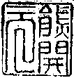熊开元



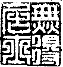无▆▆▆



邓尉圣恩寺志



图(凡三各系说)邓尉山寺形胜图  

邓尉登山入寺津路图  

圣恩禅寺殿堂楼阁全图



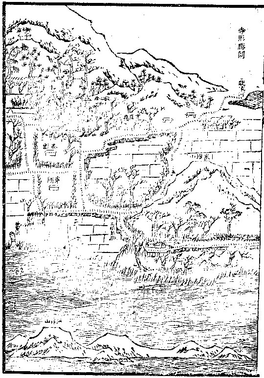



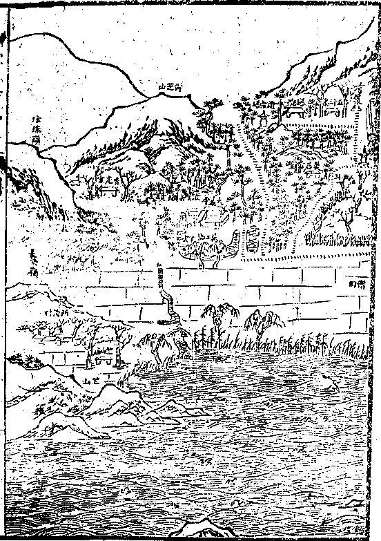



邓尉山寺形胜图说



邓尉东自穹窿诸山来，结脉最长，南北西三面遶湖，而圣恩寺坐坎向离居明堂正位，具区三万六千顷，当襟摄受渔洋山为正案，莫厘缥缈，则远炤矣。七十二峰，浮黛出没，亦足点缀胜槩。左抱米堆逶迤，东南度吕浦、石梁仍转渔洋，又为正拱，穹窿凤凰，诸𪩘耸列，外护右抱，青芝长旗，绵亘西南竺山廻顾湖中，而外护则珎珠潭西碛诸高峰也。此三龙三凤，人天朝拱之区，非大觉金僊不能享。非国师禅祖不能居万峰开辟，於密中兴大法，聿隆天行，数值迩遐，覩法幢而稽首缁素，叩祖塔以合尖欣剖，公缔构之完正，新皇登极之会山灵尚希诏旨绀宇，再勒穹碑，则圣恩福利，宁止夸扬震旦哉！



○舟航东繇胥口过吕浦桥，则山南钱家墈施家浜蹑𪨗而登，或从东北浮履桥转南，则姚家河涉柴庄岭循径入寺，亦为坦道。



王焕如识



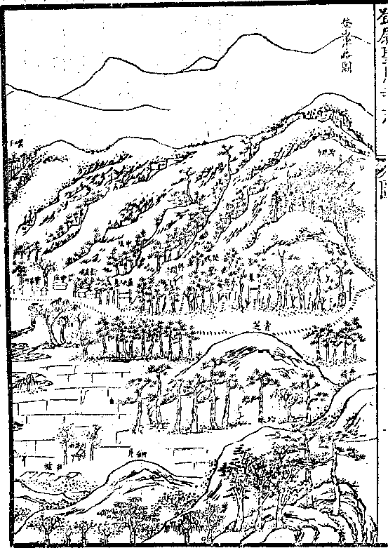



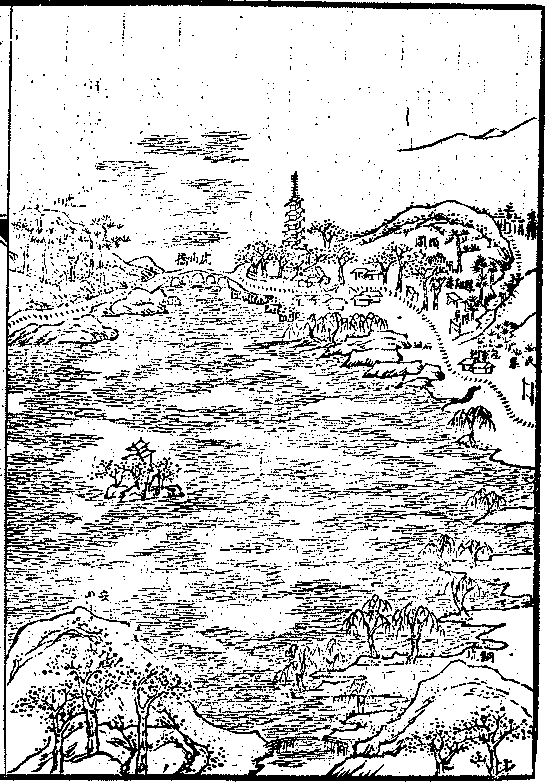



邓尉登山入寺津路图说



此邓尉之西面也，寺故南向，前图已揽胜矣。兹曷为又图盖山之势，自光福而起人烟辏合舟舆登涉，径深路修。而寺乃幽邃山川，暎带古刹，依峦与震泽之层，波相荡漾，尤有情致。矧光福枕山之阴为寺，后坎虎山长虹肖龙卧，而讲寺浮图，则又圣恩翔凤之尾也。其偃仰上下，竝合形家之说。故万峰手构，独推佛土之尊，代有禅师，继隆灯燄。其意义不可弗显。噫嘻！东西二崦，汇玄武之广潴；包费两河，便青舸之系缆。自奉慈以攀石址，缘崖蹭蹬可循转铜井以达市墟，到处桑麻无间。得闲亭畔，高人寄硕隐之踪；司徒庙前，全里护栖神之柏。种种皆助精蓝之景，人人求添点缀之工。鉅姓夜台，聆钟声而返魄；渔翁布艇，闻鱼呗以收帆。普利群生，望峰头指，见明月皈心，诸佛度𡹶下，径跻禅关，展阅斯图，不仅谓春花秋月，夏荫冬薪，夸东南之绝胜已也。



王焕如识



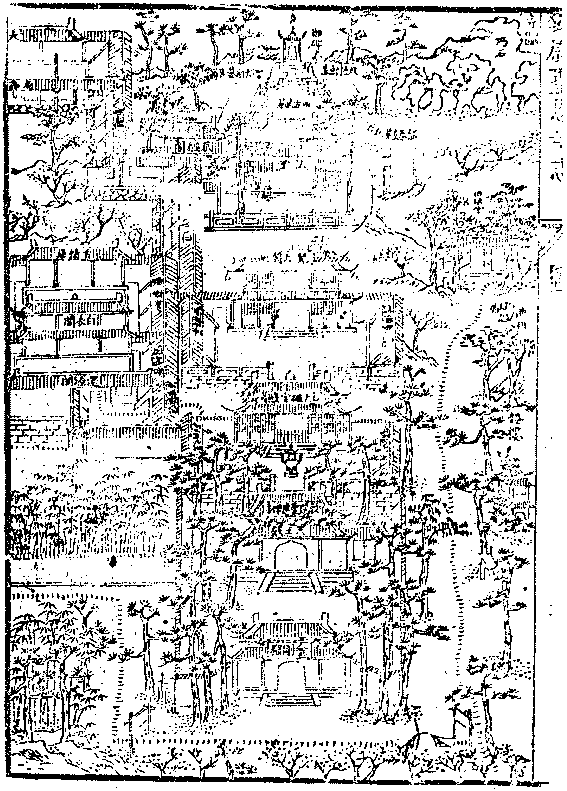



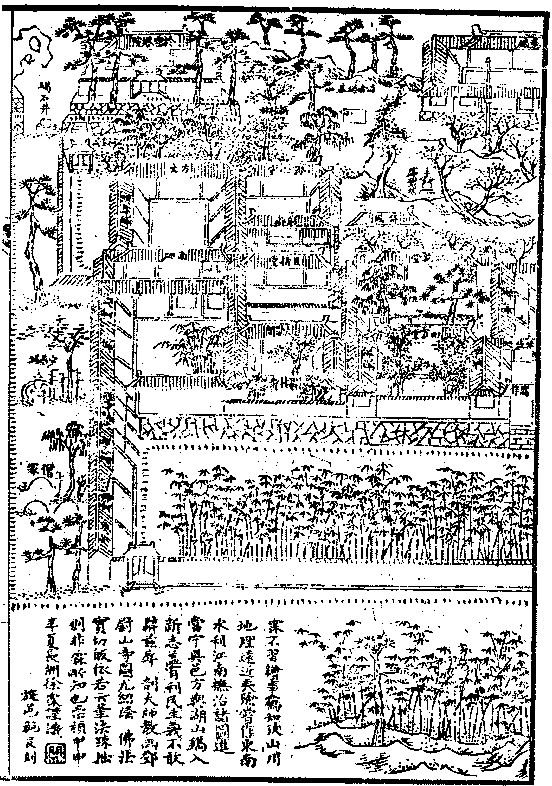



圣恩禅寺殿堂楼阁全图说



圣恩寺殿堂楼阁，位置皆剙自万峰禅祖，而继为增拓则虚碧诸师，先后手迹在焉。竝协阴阳之宜，体天人之道，动当宁倾慕启，四众瞻依，凡山之阳，皆万峰净土。厥后法裔陵夷，析房为十四，值困役，累粮逋，或转属巨室，为山房别业。击鱼诵呗之所，多为酣歌豓舞之场幸神鬼诃讥檀那遮护汉师，重振法席，剖公嗣响宗门羡道之弥高，皈心者益盛。僧居悉并尝住弃壤，渐复伽蓝。施米施钱，襁属而集运材运甓，航，载而来朽腐易以坚新，欹邪支以正直。金容玉相，现慈蔼於世尊；复道重檐，侈嵯峨於气象。宸翰为山门永镇凛林立之屭赑，单词为顽汉，指迷惊壁悬之麈棒百遍。大悲神咒昼吼，鼍音千声极乐弥陀，夜听版寂。按堪舆更旧制，奂东西南北之诸寮；循故迹，显芳模，穷南北东西之四址，剔仆碑于草覆，培祖墖于榛栖。担水负薪，种种助道之力；开荒凿沼，事事服民之勤。拾级甫登，但见翠筠蔽日；冯栏四顾，转仰乔木叅天。岂徒地灵，昔年何以几废；全繇人杰，今日所以中兴。谬托东吴识小之遗，敢扬西圣刹尘之化。



崇祯十七年甲申七月朔娄江王焕如谨识



邓尉圣恩寺志卷之一



嘉鱼熊开元（玄年）裁定



吴江周永年（安期）编辑



娄江王焕如（仲至）叅订



本志



山距吴城七十里，乡曰长山，逶迤十里，周围三十里有奇，其高五百餘丈，中峦隆起，东抵遮山，远列穹窿，西抵铜坑诸山，北抵虎山，左右冈陇，势若环抱。其岩岫联属，昂伏千态，石色皆缜润其间。邃阁层楼，各据幽胜。太湖萦带其前，法华山浮於波面。烟云明灭，顷刻变幻。日落则頳玉万顷，月明则素练千尺。飞帆往来，凫鸥起落，凭高远眺，心目开朗。若夫晓气凝合，雾霭横斜，重峦飞动，楼台隐约。时有天风引吹，白云弥岩，塞谷拥护，松桧若琪花翠黛掩映白雪，别具一种妙象。山雨欲来，暝云合沓，泉飞树杪，溜滴檐端。既而郊原流润，山泽含辉，新水平墀，可坐而濯阴晴夙莫间，倏忽异状，此则山之大观也。乃至曲径深蹊，艸树茂密，幽庭古砌，花竹秀雅，触处成景，未易殚述。郡人固好游大抵，先其近者，而此以遐邃，故罕及焉。然名流逸士，探奇选胜者，亦累累无虚日云。



大明一统志



玄墓山在府城西南七十里，一名邓尉山山峰，四立林木葱蒨，前一石䇄立太湖中，若畫屏然。山上有万峰寺，楼阁翚蜚，湖光掩映，亦吴中佳处，其山之阴，名至理山，山势蜿蜒，前瞰太湖，对峙阳山，光福诸山，左右夹拱，山虽北向，隆冬入山，其气盎然。



卢熊苏州府志(吴县山)



邓尉山在县西七十四里。



玄墓山在县西南七十里，即晋青州刺史郁泰玄墓。



王鏊姑苏志



邓尉山在光福里，俗名光福山，在锦峰西南，与玄墓铜坑，诸山联属(按圣恩庵开山记作邓尉山庵在玄墓山之南冈记作袁墓村葢旧志以袁为玄蔚为尉而名村以山耳后得宋进士叶和甫墓志与旧志相合)其东有虎山凤鸣冈至理山北有龟峰光福寺在焉。其相连诸山，有安山聚坞山朝士坞，蟠螭山西碛山。(在游湖南)弹山，即小鸡山在湖滨土阜也。(竺泽丛书小鸡出胥门西行四十里过光福市市西五里土多石寡无大林木)竺山(一名竹山)、观山、茶山(即绣裘山也)、吾家山、茆冈山、石帆山、褚山、邢山、游城山(在游湖北)、长山，皆附邓尉山。



玄墓山相传郁泰玄葬此，故名在邓尉。西南一名万峰山。山之半南面太湖，远见法华山如屏浮於波面东有米囤山，与石牌至理诸山相连，直抵吕山。其西则孙家虫头，诸山迤𨓦入於湖心。其南为周山。



圣恩庵(在邓尉山之南冈元至正间僧蔚万峰自杭来止於此初蔚辞其师千岩请所往答曰汝名所止也至邓尉结庵居之其徒大集遂创精蓝为时名刹洪武中僧普寿普隐永乐中僧智璇先后重建内有碧炤轩)



杨循吉吴邑志



光福山。《卢志》云：在县西南七十里。《姑苏志》云：邓尉山，俗名光福山，与玄墓、铜坑诸山联属也。



餘山十：安山(在西一里)、虎山(北二里)、铜井山、蜀山、聚坞山、小鸡山、长山、新丰山、锦峰山、西碛山。



玄墓山。《卢志》云：在县西南七十里。《旧》云：晋青州刺史郁泰玄葬此，故名。《姑苏志》云：玄墓山南面太湖。今按：此山有土有石，宜松、竹、杨梅、柑橘，而梅特盛，高大之山也。寺，天寿圣恩禅寺，元释时蔚建。



餘山十四：栅山(东)、石帆山、吕山、竺山(西)、法华山、观山、吾家山、茶山、茆山、褚山、刑山、雅宜山、周山、渔洋山(并在南)。



王焕如吴县志



邓尉山在光福里锦峰山西南，去城七十里，汉有邓尉者隐此，故名。或作蔚，非也。北有龟山光福塔在焉。前为钵盂山，山之西北为虎山，中通一溪，跨以虹梁曰虎山桥桥之西南有上崦。袁中郎宏道记云：两峡一溪，青峦四匝，山前长隄一带，几与湖埒。隄上桃柳相间，每三月时，红绿灿烂如万丈锦。其东麓三里有七宝泉。邓尉西行，历乌山观山，朝士坞外窑里窑熨斗柄，西碛山弹山，过长旗岭竺山至玄墓，出入湖山间，山人以圃为业尤多树梅花时，一望如雪，行数十里，香风不绝，此吴中绝景也。所历诸山，大抵各有致。惟西碛最高，大少景然，在湖滨潭西聚坞差胜潭西一▆色如铁，名铁山。



玄墓山，在邓尉西南六里，相连不断，本一山也。后晋青州刺史郁泰玄葬此，故名。　国初万峰和尚居之，又名万峰。袁学宪袠游记云：吴之山，惟玄墓最僻，亦最奇，面湖而险。隩丹崖翠阁，望之如屏背邓尉而来，法华障其前。铜井青芝迤𨓦其右游龙界，其左尤奇在绝顶。一登，则洞庭诸山悉陷伏於湖，而湖波遂混茫荡为一色。山之麓有奇石在卢橘树下，势欲飞动，山有圣恩。寺即万峰道场。旧法堂在佛殿东北，其前银杏数株，皆数百年。物归太仆有光诗曰：欲寻老子当年处，五杏叅天宝殿东。正指此也。其后则奇石在焉，俗谓之真假山石类太湖，天然嵌空。以此知湖石玲珑者，不尽出水力也。但此石顽大非湖石比殿右为郡士，徐冽山房，今为汉和尚静室。庭中古桂数株，本当时屏障，今皆七八围矣。蟉结甚奇。山前面湖，法华山浮於波面东有钱家坎米堆山顾封公天叙辟有五云洞，其山与柴、庄岭石牌诸山相连，直抵吕山，西则孙家岭虫头诸山渐入於湖南，为问山。



天寿圣恩禅寺在邓尉山之右，唐天宝间建天寿禅寺，宋宝祐间又建圣恩。禅庵元季寺毁庵存，万峰禅师时蔚开山说法。　本朝洪武九年，辟建观音阁徒普寿构法堂，又徒普隐等建大殿、斋厨三塔院，又徒普持铸巨钟，建层楼。永乐七年，智璇重修大殿，建藏经阁。天王殿方丈山门寮库碧炤轩正统八年，僧道立，奏请　赐今额。嘉靖间钟为分，宜移去。万历间，僧素一修寺如晓，募铜铸钟如旧。云栖僧智，在谋建钟楼，郡士徐冽舍山房，复虚碧塔院。崇祯元年，吴江知县熊开元延三峰法藏主席建大法堂。僧炤觉，又修万峰塔院，建文殊堂。崇祯三年，金粟圆悟，又移堂院左，今两院并峙。六年，法藏修大殿佛阁，建方丈并规畫重建天王殿，山门属徒弘璧成之璧，又建大悲堂及造毘卢像，造大藏经，供佛阁。(顺治十年经阁成复迁大藏供于阁上)



陆应阳广舆记



玄墓山(府城西吴之山，惟玄墓最僻，亦最奇。面湖而险，丹崖翠阁，望之如畫，相传郁泰玄葬此，故名。一名万峰山)。



邓尉山(玄墓之北，俗名光福山)。



按：玄墓，邓尉郡邑志皆分为两山，而山志则合为一山，今俗亦通称玄墓，间呼邓尉，要不能不以一山两名，如一统志所载为准矣。



山之左冈曰米堆山，突然高耸，如米泻之状。其南为吕山，旧有胡坚，尝墓庐，因名胡庵山，后以吕姓蕃衍，遂易今称。



米堆后有柴庄岭石牌山，山后为东西山姚二坞，姚葢亦山中著姓也。又有坞名章坟，其北有学士坞及南北山场二坞。



志里村光福里有虎山，相传吴王，阖闾养虎，於此下有崦中界。石梁名虎山桥，因称东西二崦，又名上下。二崦四周皆山围合映带最为奇胜。人谓吴中山水佳处，无逾此者。



山西岭曰竺山，环绕抵於湖，其后为长旗岭聚坞北折为山之西麓，有幞山市墟，前后雀梅蓬石址，西桥市堰诸村。



山南居民数家为袁墓村，其西为陆家坞，又有村名西湾竺山渚云。



邓尉圣恩寺志卷之一(终)



邓尉圣恩寺志卷之二



泉石



七宝泉在山东麓，僧於岩下，凿池贮之，结亭於前，泉从其下流出，伐竹为笕，引之味，殊甘冽其南。有玉泉一泓，清澈可鉴，僧结庐其上。山西麓有寿岩泉，与七宝泉相背，疑本一脉也。



八德泉，旧名沸珠，在寺之西南近河平田内，因水沸如珠，故名后人。砌甃方池，覆以大石，年远仍废。迨崇祯戊寅，大旱徧山水，少惟此泉盈满远近，人民竞汲不竭，日供寺众三百餘，其味冲澹，甘洁烹煑，有异色乡人缲丝，俱用此水为佳品。



法乳泉在西山祗林后，万历初，忽从石罅流出，土人𡎺池深二尺许，尝盈不涸，味甘清洌。



井有四：一在喝石下，名中井，大旱不涸，近者接竹引之；一在斋厨外；一临山半(即巧山下)；一在僧室簷下。



又井四：一在山门西南茶园前，一在上阳村大路南，一在圣恩下院斋厨前，一在香光室左皆甘渫。



山南邓太尉庙东有一井，名曰龙眼，俗呼三角。竺山庙有井，亦名龙眼，其味俱与尝水异。



万工池，在圣恩下院东南大路傍放生池，在纯白窝前，鉅石在天，开图畫僧室。后天顺间，忽於土中露见棱锷，扣之琤琤，遂加剔濯。巉岩洞越巧若天成，旧刻狮子岫栖禅洞，螺髻峰，涤砚泉，凌空桥削璧，岩流云涧，海涌门八，题於上。(今废)



山之绝磴东上又有巧石，俗呼真假，山青碧奇绝。前有望湖亭，今废。西下有喝石，相传万峰师穿井，有巨石上坠，师呵止之，遂名。



邓尉圣恩寺志卷之二(终)



邓尉圣恩寺志卷之三



梵宇



山寺



山寺旧名圣恩庵，宋宝祐间，建天顺间，　赐额为圣恩禅寺。初万峰蔚禅师既创庵居，复得叶和甫所葬碑石，欣然若有宿契，遂盛作佛宇。其后有普寿智璇、道清、道宗以下，相继修建楼阁杰耸，与林谷相辉映，遂为西山丛林甲乙焉。中有大雄殿上设释迦弥陀药师像，绕以十八罗汉，其天神二十则侍立焉。左为钟楼殿之前为天王殿立，　高皇帝赐无念，　御制诗碑刻又前为金刚殿，其东立小山门，以便出。入殿之后，有毘卢宝阁中设毘卢遮那像，环列十二圆觉楣栋列无名佛万计，又名万佛阁下奉观音大士像，傍庋经律论三藏，书五千轴。阁后为禅堂中设憍陈如像，旁设广榻，则修其学者列焉。其左有大悲殿，后为法堂，堂左屋以奉释。初祖达磨及中峰、万峰二师，亦有祖师堂，右屋为伽蓝神。赵松、雪书，扁其东为斋堂，扁曰香积，庾库庖湢二十餘楹。寺既有名额人慕万峰道行又称万峰寺云。



以上系旧志文，以下据见在记。



大雄宝殿



宋宝祐年间，创始至明洪武二十年丁卯四月开山始祖时蔚鼎建正统元年丙辰闰六月，住持智璇重修。崇祯八年乙亥七月，住持法藏，又重修於大清顺治十四年丁酉七月十一日，住持弘璧，同耆旧戒，萃监寺济如照闻等，重新鼎建。



毘卢阁



亦名梵天阁。在大殿后，正统十年乙丑六月，住持道清鼎。建崇祯七年甲戌十一月，住持法藏，重修上层。顺治十三年冬，住持弘璧，又修下层。



大法堂



在佛阁后永乐十四年丙申十二月，住持智璇鼎建废久基存於顺治五年戊子正月初六日，住持弘璧、同济、据济如等重建。



旧方丈



在法堂后地，益高山之最深处也。其后有美石嵌空玲珑，森肰离立，前临虚壑，瞰太湖诸峰於栏槛外。洪武九年丙辰，开山万峰蔚祖创建，太常卿程南云扁曰天开图畫。隆庆间，杖朝顽徤，吴涵复扁东为双梧轩。少师姚广孝题西有碧照轩主，事陈亢宗书后有室曰：万峰深处，即蔚祖寝堂并废基存。今树景　英二庙御碑，永镇於上。(恢复事迹别见)



东关



在佛阁左。顺治十五年戊戌冬建。



伽蓝堂



在大殿左。



祖师堂



在大殿右。顺治戊戌三月重建。



天王殿



在大殿前，景泰七年丙子五月，住持道清鼎，建崇祯八年乙亥十二月二十六日，住持法藏，同门人弘璧监寺济教等，重建洞庭。优婆夷，法名济𥳇。捐赀，协建中，奉弥勒像，傍列四天王弥勒像。后立，高皇帝　赐无念，　御制诗碑，南向悬敕赐圣恩禅寺扁。(旹大明天顺三年岁次己卯五月吉日题)



金刚殿



在天王殿前，正统十一年丙寅三月，住持道清鼎建。(今废)



三门



在天王殿前，顺治五年戊子正月初六日建，即金刚殿基。



香花桥



在金刚殿左正统十四年己巳七月，石城万寿寺住持宗学捐赀独力建本寺释道清题。(石刻在桥南下)



钟楼



在大殿东南洪武二十一年戊辰，宝藏持禅师建崇祯七年甲戌四月初九日，住持法藏同堂主性贡重，建上悬法华鉅钟，下设舍那佛像。(事迹别见)



大悲殿



在佛阁西北隅，即栖云山居故址。崇祯十年丁丑八月初七日，住持弘璧，鼎建海虞谭于墀为求嗣，捐赀协建。



南廊



在大悲殿前长廊在大悲殿，左一指轩，在长廊中间，俱崇祯己。卯年建。



拈花堂



在南询堂前，即虚碧璇禅师退居故址。崇祯二年己巳六月十六日，住持法藏同监寺济萃、堂主性贡等鼎建。(事迹记云璇禅师以僧腊之高谢事，退隐同袍　禅师典其事。又师墖铭云，营筑退居墖院二所俱备。又云瘗於祖墖之左，倚於本寺之右，崇祯六年癸酉，按察御史陈公乾阳置额，题为万峰禅院，兴复事迹别见。)



方丈



在拈花堂西北天山墖院前。崇祯三年庚午四月，住持法藏建。



华严坛



在方丈后墖院左，顺治十年癸巳，闰六月十二日，住持弘璧鼎建。



东厢楼



在坛之左，顺治十一年甲午三月二十五日建。



西厢楼



在坛之右，四月二十日建。



藏经阁



在新法堂右，顺治十年癸巳十一月二十二日鼎建。



温研寮乾室



在方丈右肩，崇祯壬申年建。



证心室



在方丈左肩，崇祯四年辛未建，藏禅师为诸子入室处。



舫斋



又名船屋，在证心室前。崇祯壬申年建。



侍寮



在证心室左，茶室在侍寮左。



精进堂



在拈花堂右肩，崇祯三年庚午八月，住持法藏鼎建。



大歇关



在拈花堂西南，精进堂前，永乐十四年丙申建，即虚碧璇禅师退居。天启五年乙丑，藏禅师於此著济宗颂重修。



丛桂斋



在大歇关前。崇祯十一年戊寅二月十七日，住持弘璧建。



厢楼



在丛桂斋右，崇祯十五年壬午八月二十日建。



南询堂



在影堂右。顺治七年庚寅十月十五日建。



四宜堂



在拈花堂前。永乐十四年丙申建，即虚碧璇禅师退居。於大清顺治十三年岁次乙未九月初三甲申日子时重建。



库房米廪



并在白衣阁后。崇祯四年十月，住持法藏建。



宝书楼



在天王殿左，旧为娑罗林，庚子十一月日建。



小楼



在库房右。崇祯十五年壬午十二月十八日建。



白衣阁



在拈花堂东南库房前。崇祯十四年辛巳二月初二日，住持弘璧同监寺济观等鼎建，上奉白衣大士像。



还元阁



在白衣阁前，顺治五年戊子三月建。



禅悦堂



在大殿左肩，顺治十五年戊戌二月初八日建。



香积厨



在大殿右肩戊戌十月初六日建。



悟因堂澡室



在大歇关右。



茶房延寿堂



在还元阁前。顺治庚寅年建。



即心堂新楼行寮净所



俱在丛桂斋西南一带，崇祯四年辛未十一月建。



纯白窝



在寺西，崇祯六年癸酉七月二十日，住持法藏鼎建，开荒凿池，置饭僧田三百六十餘畆，有抚按府县免役碑。建大义堂、放生所、诸堂室，永为圣恩下院。



旧法堂



在大殿东北隅，洪武九年丙辰，开山万峰蔚祖鼎建。正德二年丁卯七月十一日，练川普炤禅寺住持明遵重建。



南菜园



在山门下大路南，顺治八年四月十一日建。



茶园



在山门西南万工池右，顺治七年三月初三日建。



西山静室



在田庄西北，顺治十三年五月十六日建。



西菜园



在寺西万工池东南，顺治十五年十月二十日建。



碧云庵



在寺东柴庄岭，顺治十五年十月，圣恩常住恢复重修。



天寿寺



在寺西真如坞，顺治七年岁次庚寅十一月十五日丑时，住山沙门弘璧鼎建。



满月阁



在天王殿右，康熙十一年冬建。



地藏殿



在大法堂东旧东厰基，康熙三十四年乙亥秋建。



影堂



在藏阁西旧南询堂址，供中兴二代剖石璧禅师像，始於康熙三十一年壬申冬，告峻於三十八年己卯春，住持嗣法门人(济石、诔震、济涵、济志)同建。(司空李莱嵩居士颜其额曰真狮堂)



康熙三十五年丙子七月二十三之夕，大风鼓发，林木拔倒，山门压坍，是年冬重修。



大殿



在康熙三十七年戊寅春，住持济志重修佛像暨弥勒佛像，於康熙四十四年六月，比丘净觉超福捐赀重装金。



涅槃堂



在延寿堂西，康熙四十三年甲申春建。



天王殿



於康熙四十四年乙酉秋，住持济志同比丘超福净觉捐赀重修。



柴庄岭、碧云庵



於康熙四十四年乙酉冬重修。



东菜园



於康熙四十四年乙酉冬重修。



纯白窝、七佛殿



为白蚁所伤，倾圮於康熙四十六年丁亥十月。是年冬，住持济志同两序职事重新鼎建。



又



新庵



又名善庆，在市墟，旧为邵武知府徐公济墓庐，又有东庵，其北有石址庵，即宋黄策祠。



正觉庵



在陆家坞，元元统二年甲戌，僧大楫建，废久，其方池尚存，西南为长旗，岭有凤翔庵。宋咸淳元年乙丑，僧椿寿建，旧传其下莲池最胜，今不存。



五十三叅



旧名善财房，在本寺右。永乐十二年，万峰的嗣虚碧璇禅师鼎建，隆万间荒废，遂为民间别业。崇祯七年，僧性乘同徒海慈募资恢复。崇祯十四年，蔡懋德捐资，为僧济炤倡首重修。



妙高庵



在本山后，万历丙辰年僧一轮开创。崇祯八年乙亥僧寂闻重修，左有井，清冽味殊。



山居



紫云居



在旧法堂后，初蔚禅师卓锡之地，王文靖公汝玉题扁。其东上为东山居，门径幽僻，林樾交覆，中有松云堂，尤多美竹。(今废)



南园



在小山门东南下路，数折而入，皆松竹环绕。又有流泉经其左冈，清洁可爱。(今废)



栖云山居



在禅堂西北，结庐负岩，开厨映竹，临眺澄湖，於长松之下，青爽特甚。左有瑞云轩西隐皆高竹，乔松密布，前后有危楼，中耸推窓青郁观者，洒然易虑，信佳处也。楼左右有筠隐、苍雪二轩，或题为竹坞云。并废，今建大悲殿於上。(碑记别见)



古松山房



地僻多美竹，东小径八澄湛轩尤静美。其中和房、寿椿房、庆云精舍、万峰塔院，皆据岩壑胜处，匪其缘，弗能居也。



狮子窟



在三峰塔院后，崇祯二年己巳，住持法藏搆。



巢居



在善财房南。崇祯五年二月十六，僧清印建。



香光室



在圣恩下院西北，崇祯六年癸酉十月法藏搆。



莲花居



在香光室左。崇祯十四年辛巳八月，老宿海舒搆，於此专修净业。



歇心居



在钟楼东。崇祯十一年戊寅五月，僧济长济时同建。



祗林



在香光室北。



邓尉圣恩寺志卷之三(终)



邓尉圣恩寺志卷之四



禅祖



圣恩禅寺开山祖师万峰蔚公传



承德郎刑部主事永嘉陈亢宗述并书篆



师讳时蔚，字万峰，出温州乐清金氏。母郑梦，儒、释二人，入其寝觉而生二子。师居末，适有光烛，室郑惧，欲弗举其姑，保而育之。襁抱中，见僧，辄微笑，作合掌态，父母度不可留，使礼越之。永庆寺升讲主为师，时年十一。尝诵法华经，至诸法从本来，常自寂灭，相忽有省，遂入杭受具，叅止岩禅师於虎跑，示以南泉，三不是语别。入达蓬山卓庵佛迹寺故址，昼夜究竟岩语，至忘寝食。一日，寺主宗律师举似沩山净瓶公案，触所叅，即说偈云：



颠颠倒倒老南泉　累我工夫却半年  

当下若能亲荐得　如何不进劈胸拳



遂往见岩诘前语，献偈云：



南泉正是恼人心　更要将心去覔心  

不是心兮不是佛　性天宽廓有何寻



复之华顶访无见覩公见，问：从何处来？师云：从杭州来。曾见何人？师云：止岩和尚有何指示？师云：南泉三不是见。云：我这里南泉三不是即不问，如何是万法归一？师曰：从生至死皆无一。又问：如何是一归何处？师近前叉手云：不审。见云：且居山保守，还返达蓬独处者十稔。已而往伏龙山中，谒千岩禅师，初入室，问：将甚麼与老僧相见？师竖拳头云：这里与和尚相见。岩问：死了烧了，向何处安身立命？师云：沤生沤灭水还在，风息波，平月映潭。岩复云：莫要请益受戒麼？师即掩耳而去。明日，复请众斫松，师拈圆石作献珠状云：请和尚酬价。岩云：不值半文钱。师云：瞎。岩云：我也瞎，你也瞎！师云：瞎瞎！即说偈云：



龙宫女子将珠献　价值三千与大千  

却被傍观人决破　谁知不值半文钱



岩顾昭首座曰：蔚山主，颇有衲僧气味烦请归堂比佛。诞日岩上堂云：今日有三种好事：一者世尊降诞；二者天道晴明；三者有大施主设斋。若向此三种好事，上识得老僧，舌头落处，日销万两黄金。师从西过东，一手指天，一手指地云：天中天！天中天！释迦弥勒。谁后先岩云：大狮子吼过了也，还有小狮子麼？未几，复还佛迹。岩遗以衣拂各一并偈一首，见千岩语录中。既而移居嵩山，阅九载，岩三为手书招之，所以爱重期待者甚厚比至请与分座，寻返嵩山岩嘱云：汝缘在浙西，可往化导，大振吾宗。遂以元末己丑年入吴，凡三筑精蓝，卒之玄墓。邓尉山中，卓锡半山，斩蒙羃，结庵居之。久之，四众归向，乃搆为大伽蓝，号曰圣恩。自是缁素奔凑，远迩云集。师随机开导，俾满意欲，初不为雕琢语，故人益慕而信之。一日，忽沐浴更衣，召众诀别书偈曰



七十九年　一味杜田  

悬崖撒手　杲日当天



遂趺坐而逝。时洪武十四年正月二十九日也。龛留十有三日，颜色如生，倾城聚，观膜拜，瞻叹其徒普寿等奉全身，合二缶瘗庵之西岗，遵治命也。师貌古而清，髭鬓疎秀，寡缘餙千岩，常称其纯粹质朴，有古人气象，深得之矣。师殁垂四十年，吴人无少长，咸知尊慕其行。嘉湖诸郡至有绘其像而事之者，其生卒之辰，远迩毕集。如其生时，而杰阁重楼，逾增旧观，焚修之徒，数常满百岿。然为一大丛林，虽宿号名山盛刹者，或未之能先焉，岩所嘱者，益又验矣。师平生未尝读书，惟以深悟，自得其形，诸语默者，俱能刊落浮华而一践乎？实其徒普寿等辑为万峰语录一帙，锓梓流行，然非师志也。其所度弟子若干人，而胜学无念者，独号能绍其传云。赞曰：昔中峰普应国师以临济正宗，振耀天目，得其心印者，弟子千岩也。千岩再传，而师实承之。厥后无念学公，复亲受师衣法之付受，知太祖高皇帝龙章宠锡，云汉昭回，天目渊源，遂为有托师所付得人矣。呜呼盛哉！



永乐十七年八月二十九日，徒弟比丘智璇立石



又山志旧载



万峰禅师温之乐清金氏子名时蔚，始学於餘杭山中，将出游，辞其师千岩，请所止，答曰：汝名汝所止也。后至邓尉，将结庵，其地乞诸叶，承三氏。叶初不许，后见其智慧能知未来，遂舍与之。始创精蓝，其徒大集。师深造物谛，词翰亦奇。古尝作偈题其山云：



玄高向午面朝湖　三凤三龙天下无  

左右环盘前后濶　此山真好立禅徒



师居此，凡三十餘年。一日，告众曰：吾时至矣，又嘱其徒。而今而后，汝等须向山间林下镢头边接引一个半个阐扬。吾道不可攀高接贵，轻慢下流，逐利追名，迷真惑道。如今末法将沉，汝等慎之。乃趺坐，说偈曰：



七十九年　一味杜田  

悬崖撒手　杲日当天



语毕而终。所遗语录命悉火之曰：从上佛祖言说后学，畧不听从。况吾区区，杜田话柄。其门人掇拾所遗撰，次成卷行世。先是其徒鉴无碍，欲候师涅槃葬之金山，师闻而致书谢焉，其语尤异。又自题其像，皆援古验今，词旨崭绝。今寺西北有塔院，师葬处也。翰林侍读王公达善铭载，异迹甚悉，为开山始祖。



又



陆粲



吴西山圣恩寺僧，时蔚号万峰，温州乐清金氏子。元末名僧长，千岩高弟也。初学成，请於师出游，师谓曰：汝逢汝名。即住至苏州，止於邓尉山东麓曰玄墓。建大兰若，初未尝识字，既超悟禅乘，遂能作诗偈语，皆可诵，虽僧服而不去，须发自为赞，有束发办头陀留须，表丈夫之句。洪武辛酉，　朝廷闻其名，使　徵之，使未至之七日，蔚已前知，谓其徒无念曰：吾与之无缘，汝当　召吾，今去矣。遂沐浴入涅槃，遗令母焚尸。越十三日，肢体犹温，以磁缸覆尸而葬，无念入　觐，大被　宠锡。后往湖广之九峰寺，与蔚埒望焉。蔚素精堪，舆家常言玄墓形势，三龙三凤，胜绝天下，卜葬者多扣之，蔚未常轻答也。老患疾气，语其徒曰：吾当服城中沈以潜药，吾与之有缘也。彼在　京师，今夕且归矣，宜往速之。徒如教。至沈氏，则以潜初未归也，返命又遣之徃及夜，因寝其家门下待之。二鼓，以潜果归，闻其言异焉，即往治疾。既瘥，蔚谓曰：荷君治疾，无以为报。有地於此，请奉以为太夫人寿域。因指示竺山后一穴，稍下六尺，云：是虽微劣。至六十年后家大发，后以潜竟以葬母至成化，间以潜诸孙廛等皆富甲其里布政使𤇍谕德焘，数人相继，取科第门户，赫奕距葬时，恰及六十年矣。予闻诸以潜末孙注者如此，然留须之说，实石室僧语，意谓非蹈袭，殆是偶合耳。



又续吴先贤赞



刘凤



时蔚，乐清人，姓金氏，学其道者称祖焉。传法於千岩，来吴玄墓，聚橡栗藜，藿而食之；或累日不进。开立宗教，建寺设坛授受，其徒甚盛，名万峰师。洪武辛酉召之，蔚已预知，趺坐而逝，使至已无及。数日，肢体犹温如生。



无念胜学禅师传



释弘璧



无念胜学禅师，万峰嗣，德安府随州应山人。父姓陈，母周氏，元天历元祀，戊辰八月十九日子时生，九岁礼本郡宝林寺无极。缘公为师，初不识字，执苦经年，自觉己事不明，往叅荆州无闻和尚开示，万法归一，一归何处。公案，师骤发大疑，日夜提叅，复归宝林。廿有二岁，往宣州登坛受戒。后入嵩山，住静履影不出，常穿一衲脇不沾席，精进逼拶。一日，豁然有省，偈曰：



数载东山昬雾蒙　凭栏终日待晴空  

夜来忽覩霜天月　万象全彰一镜中



由是遍访海岳耆宿，东抵姑苏玄墓叅。万峰蔚和尚，机语相契，峰亲书法语，付僧伽棃，以偈证之。复回宝林，道风昭著，缁素敬慕。后楚昭王建刹，延师居之。洪武间，太祖召至，　奉天殿　赐坐　上问法要，师进偈　上览之，大悦　御制诗文赐之，今勒碑镇寺。永乐三年乙酉十一月二十九日。师说偈曰：



世尊七十九　无念八十边  

打破华藏海　依旧水连天



俨然而逝，世寿七十八，僧腊五十七。全身塔於狮子岩，谥清福广慧禅师。



虚碧智璇禅师



虚碧智璇禅师万峰嗣苏州吴县长山乡顾氏子语录未见塔铭存寺为圣恩第三代住持。(旧本璇误作第二代宝藏误作第三代)



宝藏普持禅师



宝藏普持禅师、万峰嗣姓氏，未详语录塔铭并无存。但圣恩事迹记中，有僧录实公为撰灵骨塔铭，万峰禅师付法与师偈云：



大愚肋下痛还拳　三要三玄绝正偏  

临济窟中狮子子　灯灯续燄古今传



为圣恩第二代住持。



本义禅师



本义禅师万峰嗣有语录若干卷，今失。



普荣禅师



普荣禅师初叅万峰，勤於问道，犹兼苦行，得峰激励，愤志叅究，七日而悟。



碧潭道清禅师



碧潭道清禅师，虚碧嗣尝受知于廵抚侍郎周文襄公忱延之住山所居有虬松倚岩，结鹤巢於上趺焉。语录塔铭，俱失其行业。载事迹碑记为圣恩第四代住持。



圣恩道宗晏禅师



圣恩道宗禅师，虚碧嗣苏之常熟人语录塔铭俱失。景泰中　诏修保国道场，感五彩祥云缭绕，光明炤耀，特降　敕褒谕师，复於天顺三年五月十九日奏　请寺额有　敕文劄付勒碑，永镇於寺，为圣恩第五代住持。



善祐禅师



善祐禅师，虚碧嗣能诗，有禅学，亦於景泰中　召为宗师，卒　赐谕祭。



东明虚白慧旵禅师



东明虚白慧旵禅师，宝藏嗣。年十四，於丹阳妙觉寺礼湛然。师薙发受戒，叅云间，松隐叩其心印。然未心肯，自誓若不彻证不已，因禅定六日出定，举首覩松，豁然有省。寻至苏之玄墓圣恩寺，见果林和尚针芥相投。复指示见宝藏持禅师具陈悟。因藏叱之曰：佛法如大海转入转深，那得泊在这里？师遂亲炙座下藏一日问曰：心不是佛，智不是道，汝云何会？师向前问讯叉手而立。藏呵曰：汝在此许多时，还作这个见解。师乃发愤忘寝食，至第二夜，蓦然彻法源底，呈偈曰：



一拳打破太虚空　百亿须弥不露踪  

借问个中谁是主　扶桑涌出一轮红



藏笑曰：虽然如是，也须善自护持。时节既至，其理自彰。



海舟普慈禅师畧传



海舟普慈禅师，苏之常熟人，姓。钱世宗儒业，出家於破山。初至慧日寺，听讲楞严至但有言说，都无实义处，乃曰：言说今日愈多矣。遂归日夜阅经，寻思实义，而颜日悴。有居士问曰：师颜色有病。师云：佛法不明故，尔非病也。士曰：佛法不明，何不往府中邓尉山问取万峰和尚去。师闻欣然，便诣邓尉见万峰，峰问曰：沙弥何来？师礼拜起曰：常熟。峰曰：到此何为？师举前话，再拜求示，峰便劈头两棒，拦背一踏，以脚两踢，曰：只这是实义。师有省，起曰：好只好大费和尚心力。峰笑而许之，付以偈曰：



龟毛付嘱与儿孙　兎𧢲拈来要问津  

一喝耳聋三日去　个中消息许谁亲



又曰：子当匿迹护持，莫轻为人师范。师自以为得，乃结庐於洞庭山。坞廿有九年。一日僧至，师问曰：上座何处来？曰：安溪。曰：安溪有人麼？曰：有虚白和尚说法不异。高峰曰：是谁弟子曰：宝藏。曰：有甚言句？僧举室中验人语云：心不是佛，智不是道。三藏不是法，是甚麼下语？者皆不契。举毕，复问师曰：叅宝藏否？师曰：我与宝藏同叅万峰。僧曰：当日有何所见？遂隐於此，就再不叅人去。师曰：问但有言说，都无实义。峰便打，我从此得悟。僧曰：请言得之所以。师曰：但要人知痛痒的是实义，是妙心言说，尽属皮毛。僧笑曰：若据此见解，生死尚未了，何得云悟未在未在？不见道：心不是佛智不是道耶？师遂有疑曰：彼处众中有真大彻者麼？僧云：无。师即弃庵渡湖，往安溪诣东明，适有人设斋，师至关前问明曰：今日斋是甚麼滋味？明曰：到口方知，说即远矣。师曰：如何是到口味，明即打灭。灯曰：识得灯光何处着落味即到口？师无语。次日黎明遣侍者请师，师即至，明问曰：曾见人否？师笑曰：见只见一人说出恐惊人。明曰：假使亲见释迦依然是个俗汉，但说何妨？师曰：万峰明。曰：为叙先后耶？为佛法耶？若叙先后，万峰会下有千人；若论佛法，老阇黎佛法未梦见在，何惊之有？若亲见万峰万峰，即今在甚麼处？师面赤惘然。明曰：若如此，不曾见万峰。师归客寮，三昼夜寝食俱忘。偶值香，灯绳断堕地，忽然大悟。诣关前呈悟繇，明曰：老阇黎！承嗣万峰去。师曰：白公为我打彻，岂得承嗣万峰？明乃笑，遂集众出关。升座曰：



瞿昙有意向谁传　迦叶无端开笑颜  

到此岂容七佛长　文殊面赤也茫然  

今朝好笑东明事　千古令人费唾涎  

幸得海公忘我我　济宗一脉续绵绵



乃掷下拄杖云。千觔担子方全付，玄要如今拄杖谈。以拂子击三下，下座。师即入方丈礼谢。明曰：老僧不出月去也。至廿七夜辞众。廿九日示寂。师仍欲遁归洞庭，四众苦留，乃继其席。万峰忌日。师拈香指真曰：我几淹杀你。瓮里幸是普慈。若是别人，不可救也。𦶟此瓣香，堪酬接引。喝一喝，云：只笑你护短没头。师佛法当人情。展坐具礼拜。又拈香云。此一瓣香。供养东明长老。一片赤心鞭策令余洞达宗源连喝两喝云。一言岂尽普慈心。千古儿孙赞报恩。又拈香云。此瓣香供养昔日师僧指南之力。若不蒙师，何繇今日。他日到来拄杖三十吃。有分堪报不报之恩。喝一喝云。受恩深处便为家。有乳方知是阿娘。礼拜起，说偈曰：



源头只在喝中存　三要三玄四主賔  

五棒当人言下会　四料还须句里明  

末后真机死活句　个中消息在师承  

碎形粉骨酬师德　将此深心报佛恩



恸哭归方丈。临示寂。说偈曰：



九十六年於世　七十四载为僧  

中间多少誵讹　一见东明消殒



以拂子打○云：释迦至我六十二世，有不可数老和尚。又打○云：多向者里安身，咄！乃投笔而逝。在景泰元年，全身塔於东明左侧，得法十二人。



天寿圣恩藏禅师行状



师讳法藏，字於密。初住三峰，人皆以三峰和尚称。梁谿苏氏子，父兰，母周氏，家世奉斋。师生而颕异，状貌修伟。有大志，八岁患痘疹，值洪水破岸，将及床，见玄龟如盘，师下床，入水乘之，因成瘵。十五就医于五牧之德庆庵，礼佛心动，遂念曰：世间法无足圣者。归告父母，求出家，许之割田以给衣食，嘱曰：必无为经忏僧，他日当拯我于尘劳也。师谨佩其言。然性高旷，不事事，留心笔墨，间以事清散，虽不能，即为渊灏之学，而阄题拈韵，错趾于文人。伍与廉宪、薛纯台诸公为世外交，尝语同辈曰：吾四十当悟道六十岁死矣。问者曰：子不修行，安期悟道？师曰：时未至，尚当游观耳。且公以何法为修行乎？闻者皆异之。二十九岁，见高峰语录开卷，怅然隐隐，若能记忆，遂决志叅禅。是岁受戒于云栖。又八年，受具于灵谷，又明年，住海虞之三峰。如是十餘年中，费尽心力，虚檐破壁，草屋萝墙，食荳滓衣，补缀不以为苦。尝叅万法归一一归何处话，目不交睫，脇不至席，夜中为昏沉所罩。师乃悬巨板于座侧，命徒众分香击板，佛声彻天，每叹曰：尝言四十悟道若有，可凭今三十有八矣，而徒劳若是，岂终负此语乎？于是惶惧泣，不自禁。至欲养发入医卜，不受十方茶饭，俟叅透再来，其惧罪福如此。至万历壬子，师年四十，叅究愈猛，必以得悟为期。适峰中有老宿朗泉者闭，不语关师，乘便求入，才与老宿相拜下，忽眩晕吐痰斗许，放身一睡，五日不知人事。会窓外有二僧夹篱折大竹，声若迅雷，师自枕中跃起，顿得心空。至夜，闻两堂课诵钟鼓之音，如在自己身中历历落落，毫无间隔，觉得身遍虚空，坐一夜如弹指，复念曰：此正古人所谓前后际断，不可坐着。乃尽力推究，忽于青州布衫打失鼻孔，凡祖师言句一时会尽，自此触处皆悟，转悟转深，尤于高峰睡中，主得大受用，乃作偈曰：



一口棺材三只钉　声声斧子送平生  

自从薤露悲歌断　赢得朝朝墓柏青



尝叅三玄要，四十餘日。心不异缘痰痈，发于左背自肿。及溃了不经意，后脱衣脓血，胶冻始觉。乃叹曰：使我有师如汾阳辈，当不致十年堕荆棘岐路矣。言毕泣下。既会，得两堂首座同喝意旨，宛与觉范所著临济正宗符合一契，如五百年前对面亲印，遂欣然。奉高峰为印心，觉范为印法，且伤觉，公无后意，欲遥嗣之。又复携杖笠游浙东溯匡庐兾得一二。具眼者，为法中水乳，而禅风绝响转，觉调高不第，狮弦不振，而师且几为破琴计矣。于是闭门高卧，唯以所得质之。古人研极五宗之妙，著五宗原时，海内衲子望风云集。未几，太仓之慧寿，吴门之北禅，迎师开法师至不正位，不登座，惟随宜起发而已。或问其故，师曰：威音已后，不许无师自任。若一旦称师据座，则未得谓得者易启便门，吾罪深矣。或指见五乳，师曰：此老固菩萨人也，吾所欲嗣者，临济儿孙，何可因彼盛名，更吾志哉？后闻天童悟和尚出世金粟，师策杖从之，甫至粟，即上堂，告众曰：汉公悟处，真实学大而名先出世，于我所以屈身来此者，为临济源流耳。老僧从来不易安首座，今以累汉。公即日请师为第一座，师请粟上堂粟，举百丈再叅马祖，黄檗接临济公案，师出众礼拜，起便喝，粟云：好一喝！师又喝。粟云：你更试喝一喝看。师礼拜，归众粟顾。师复举：僧问古德云：朗月当空时如何？德云：犹是堦下汉。僧云：请师接上堦。德云：月落后相见粟。云：且道既是月落后，又如何相见？师便出法堂粟，便下座。由是师资道合，若龙骧云起，识者咸服吾师荷法之诚，而天童之道，亦自此愈尊矣。未几，请及堂奥中事，粟不应。良久，曰：宗旨太密，嗣续难乎？其人不若己之师曰：不然。黄龙有云：学者欺诈之弊，不以如来知见之慧，密而煅之，何由能尽？且古人建立宗旨，千牢百固，尚有乘虚接响者，混我真宗。若师家大法不明，无从辩验，则胡喝乱棒，群然而起，吾宗扫地矣。遂辞去，粟手书，源流信拂亲至。蔡子榖静，室面付师，师不受，起更衣，潜入舟中，侍者密收之。师觉叱曰：辞受之间，大故有道，何得草草？竟作书辞，还之曰：闻和尚为高峰的骨儿孙，故访大法于座下，承一面相许谬及源流，真如饥逢王膳，所以未敢受者，只以法中微密尚未脗合云云。复遣座元一嘿诣粟谢过粟，仍取源流付嘿曰：汉公欲建宗旨，出于至诚，老僧但恐多事耳。彼既知此，听其自为，何拒之坚乎？嘿拜受以归师怏怏丙寅秋，杭之安隐寺，请师开法。先是云门湛和尚闻师煅炼，学者有三七日中了毕，大事之说。终岁骂詈数为魔外，及见师语录，惊曰：真古佛再来也！是年安隐，请湛说法，湛以手书邀师为第一座。师方至，而湛先示寂，檀越悟其旨，遂请师开堂。而天童悟和尚复遣僧赍伽黎至，师始升座拈香，嗣天童为临济，三十一代正受海内衲僧北面之礼。自此玄风大唱，师纵其机辩，以煅四方学者，犹喜接贤士大夫多为阐明河洛之旨，间拈学庸诸书，开其理障，闻者如拨云翳，而士大夫亦乐从之。如蔡、云怡、刘长倩十数公，皆亲受印契。尝谓门弟子曰：小得小悟，诚不足恋，直须穷尽源底，得大歇场乃可耳。妙喜云：大悟一十八遍，小悟不记其数，岂欺我哉？乃取觉范智证传提而满之痛。宗旨灭裂，凡所演说，极力匡救，不嫌重复，不顾诽谤，不避名位，但为宗旨障者，皆指而斥之。弟子虑祸，及请少，贬师正色曰：吾欲存赵孤耳。夫程婴公孙氏，非闻道也，义有所激，遂为人之所不能为。公等为如来子，而轻法惜身若是，非所望也。岁丁卯，值文姚两太史及徐氏诸护法，请师住玄墓山圣恩禅寺。寺先为　国初万峰蔚禅师道场，师于蔚为十一世孙，欣然应请。及至萧条荒落，龙碑狮座，尽置之荆棘瓦砾中，唯旧屋数间，而衲子几无宿处。师捐衣钵，率众力，凡有供施，无公私，尽付修造，开田凿池，以供禅侣，而有吴江邑矦熊公鱼山数造法席，尽弟子礼。尝叙师语曰：禘不知而指掌，道无示以拈花，三峰乎？洙泗乎？不可得而测之矣。其敬服如此，且为助土木之役，顿还旧观，俾酒人歌舞之场，复归丛刹，师之力也。然师开发洞达，搜微剔隐如秦镜，炤人肝胆毕现，虽不欲易，近者犹复归之，如过毘陵，而郡守洪公半石下车，折节闻法，生信解任之。后数千里，驰书入山，乞法名为门弟子。至维扬缁素，拥护罗拜道侧者，几以万计杖履为之不前。至虎林士庶，缙绅千餘人，日就听法，莫不凛然钦慕，叹未曾有。师平时临众严惮，学者以为寡恩，师闻之，亦不介意。尝见僧衣履鲜洁，诫曰：老僧习性柔驽，不能身先风雨，殆以早年，未得亲近真善知识，使汝等无所取法，有愧先贤我之罪也。嗣是浮泛之伦，稍稍引去，惟法中数子虽饥饿，不忍舍师生平，以大慧禅师竹篦子话接人，更加精削，使学者铲去。圣凡知见，向触背两关不得处，直下如银山铁壁。往往有三七日中撞断消息者，尝榜门曰：宅破家亡，阿谁是主？缝开楔棒，是何意旨？挂拂卷席，因甚不住？新到下语相契，请以客礼。见或者已为诸方称赏，自谓饱叅造师门墙，咸遭点额。又有四杀雄语，为室中罏鞴，苟非真子，难获髻珠。于是枭獍之徒，两相激怒，使法中父子同室操戈，门外游人，吠虚指影。师叹曰：法数如此，岂能强乎？因慨然有离世之想矣。甲戌六月，冐暑归故里，重瘗父母以竣其志。隆冬，过苏阊，遍诣檀越，懽笑毕日，嘱以山中常住，若预辞焉。乙亥春，自松陵还脾病，遂作师命。知事造龛，索诸子悟由，翻覆勘验，以宗印付之。戒其住山，深蓄常住，巨细尽付知事人乃以手书示清凉彻并诸护法。其畧曰：白牛固水草寻常，然而脚下无私，要行便行矣。又招刘长倩曰：吾说法竟，思欲大休，然饮食如常。木龛正造，居士若来，尚当一笑也。于是远近奔骤应接无虚日，缁素索遗语，手不停笔。四月廿八日，问龛成不知事以材木未僃为对。师曰：是何不相信耶？命速成之。至五月初二日，谓众曰：吾不死，但久劳笔舌，思欲大睡一觉耳，令以方丈为死关署其门曰：自埋颜其堂曰歇处，指后地曰可为塔基。遂掩户月餘，虽弟子不见其面。适云怡居士同瑞光彻公入山，省候请开关，师从之，即日命剖石璧为圣恩。第二代面嘱蔡公，始终护法。又数日，龛成，师强起视之，微笑移时复就寝。侍者问：如何是身后事？师曰：床头老鼠偷残药，壁上孤灯炤旧衣。众黯然。侍者复欲问，师举手曰：放下幔子着。遂酣睡。至中夜，索浴更衣，泊然而逝。乙亥七月廿二日丑时也，奉全身于方丈后，入龛之日，道俗数百人，哭声震地，如丧父母。师生於神庙改元十月初七日巳时，阅世六十三岁，坐三十四夏，度徒百餘众，得法弟子十有三人，起名受戒者，以万计门人集其平生，得语录三十卷，广录五十卷，并弘戒法仪诸书行于世。呜呼！临济七百年来，正如阴风晦日，而忽有吾师挺出，建大宝幢，炤耀一世，开凿人天眼目，以振聋起瞆煅炼学者，使滹沱支本向邓尉峰头重悬日月，而野干狐狗不得乱鸣。墨僊所谓震古一人无疑矣，祖庭栋宇，倐焉摧折，佛法平沉，此其时也。呜呼痛哉！尝忆吾师有云：七百年来起临济搥胸换手哭苍天至今诵之，益令人潸然泪下也。呜呼！吾师荷担祖道，真不惜一片身，心虽蹈汤，火无所悔。比来儿孙继出法道，琳琅无不从。吾师大冶中为工为匠，或曰悟道古人之难，今师之门，墙称悟者，比比皆是，无太轻乎？师曰：不然。诸子既舍父母割亲爱从我游于寂寞之滨，为求出生死耳，必欲尽其机用，使彼深浅得入，以尽吾心。吾岂效木罗汉，不能说法，专以避谤，毁贪礼敬乎？是以一生孜汲，务以接尽英杰，以报佛恩，今竟舍我而去矣。忍尝忆初入山时，才礼拜，师便诟骂不已。既退，颇有疑望。后阅黄龙，见慈明语，趣还谢过，始有今日。呜呼！德音已远，法乳难酬。谨录师之梗槩，以昭来世，然挂一漏万正，如见日于盆盎之内，而真日隐矣。呜呼！



崇祯八年七月廿八日嗣法门人弘忍稽首百拜谨状



附遗(师虽秉拈花之旨，犹以弘戒选择人根，尝于北禅寺注梵网，而殿中佛像放光，后说戒毕，率众礼开元石佛，佛亦放光，城中士民皆得瞻覩也)。



邓山剖石大和尚道行碑



前乙丑进士。河南浙江云南道监察御史廵按真定等处法弟子密庵李模。敬撰



临济真传。二十世而至万峰蔚公。次传宝藏持公。皆阐化邓山。越九传而汉月藏。公自三峰来恢弘祖道古刹复兴。慎推继席。益加光大。是为剖石禅师。师讳弘璧。出梁溪郑氏。父邦贤世业儒。母邵持斋事佛。谨师生而渊渟岳立龆年辄习趺坐。父见异之曰。此非尘网中人。宜归释氏。九岁失怙。即知生死大事。十二出家。邑之普济。十七为僧。乐诵华严宛如宿习。二十二偕大树证公。谒藏和尚於三峰。令叅竹篦话无所得。入精进堂。昼夜猛厉。时听石座元。入堂举万法归一诸因缘。闻之如毒中。心益深痛愤。至第三日夜半。竟。不知有身心世界。时天气炎热。汗流浃体。蚊虫满面。偶举扇一挥。忽会得座元所。举洞然明白。遂作青州衫颂曰。青州布衫重七斤。𫜪人恶狗踞当门。吃饱饭团终日困。翻身踏碎破砂盆。晨趋方丈通所悟。峰为助喜尽心玉。公见地超卓。欲加勘验。立索秘魔杈颂。师随声应之。玉公首肻而去。颂载录中。是时师年二十四冬。就坛圆具。遂发百城烟水之愿。往叅博山。重其法律严肃。依止最久。历黄檗匡庐。还游两浙。访显圣所。至尊宿器重。寻过金粟。叅礼悟祖和尚。终疑纲宗。大法未透。仍归三峰。深就炉鞲峰。尝指为涅槃阇黎。及峰主邓尉。命为堂中主规。不言而肃。戊辰元旦与一老宿相拜下。顿证玄要。主賔临济用处。峰大喜曰。正望汝到此田地。方得真实受用。不然。非克家真种草。次日峰上堂。师酬唱无让。峰云。真狮子儿。善狮子吼。复随至方丈。呈真佛真法真道三偈峰。对众云。昔日涅槃。阇黎今日狮吼。阇黎。从此一众倾服。复温研八载。偶病就医。京口见五州翠岩古迹。若旧游处。乃结茆憇止乙亥夏峰示疾辞众语人曰。璧公悟处极好人品端庄下手。有力求人。不轻此定案也。遂手书招回。付以源流衣拂。嘱令接续宗旨。并示以偈。有一朝恶狗变。神龙四煞雄。透尽诸家极。奥宗之句时门头安行者。夜梦神人舆。拥一沙门而入曰。圣恩主人到也。明日师至峰。即命继席。力辞峰曰。蓍卜者三众志已决。勿复辞。廼拜受命。逮峰顺化。阖郡绅士檀护启请开堂时。文文肃公湛持姚文毅公现闻。刘大叅公心城胡水部公。远志蔡忠襄公云怡。皆留心宗要。望风钦挹为一时盛事云。师登座。即提唱纲宗。玄旨峻拔。闻者欣踊。师室中尝设三问辨验衲子。有时云。举一为用。甚是现成。你作麼生举。或云。说得做不得。做得说不得。此人秪见一边。你作麼生兼。又云。有头无尾不得有尾。无头不得。如何得头尾句。诸方罕有契机者。师每阐扬玄要旨趣隐显机用煅炼英灵。然一本诸诚心质行。悉铲枝叶德风薰被。一种平怀。能致遐迩咸孚。云奔川属。檀施自辏。百废具兴。如天山塔院首事崇严。若大雄、天王两殿，伽蓝堂、祖堂，若还元阁、白衣阁、法堂、大悲坛、四宜堂、纯白窝等规制维新，缭垣界道，闳壮精丽，遂为三吴宝坊之冠。既请大藏建阁尊奉，又念像设为末法所重，廼购栴檀遴塑王躬。亲指授造宝像数百躯。罗供杰阁。徧令瞻仰者。即修普贤礼敬称赞之行。此乃从权化导之餘力。而师之深心尘刹。亦见於此。师平日恒掩关寂坐四方名硕向。道諮叩足不离绳床。口不谭尘事。语惟真实相为。皆益信。其高简率任。不觉屈膝。申弟子礼焉。师既屏迹城市。闻天童悟祖讣远奔尽。忱法中耆老。咸谊重之。寻过育王。礼舍利塔。先是守塔。僧语人曰。夜梦一大善知识来。礼塔。是日师适至。复造天目。扫高峰中峰断崖三祖塔。时中峰塔毁于火。师叹曰。是吾责也。召匠庀材陶甓。重为完治。迨甲申乙酉间。城乡骚动。邓山滨太湖湖寇猝至。左右请避之。师曰。吾誓守先师灵塔耳。无何寇退。守帅率兵追逐左右。复恐师曰。毋动伽蓝。足凭也。果无事。人皆服师定力。师晚年益栖心华严。常以法界义海与学者印契心宗。每向道俗拈示。辄亹亹数千言不休。牧斋钱宗伯。曾博通贤首。入山咨决曰。和尚真华严会上法身大士也。师见晋水法师。著普贤行愿忏。尚未该备。手加补订。务与贯华宗趣脗合。复相山中善地。创搆华严坛。高朗严靓。精择梵众。六时修礼。感佛中夜放光。先是广购华严。古册秘函。几及百部。悉贮坛内。师又以方册世无善本。字句袭讹。乃延十大高德精通教义者。研核付梓。兼标图说。印送名山。流通四远。咸奉如金牒瑶縢焉。或曰。师担荷大法。秪合高提祖令。何汲汲以华严为重。师曰。是余宿愿也。法当秋晚。卤莽流辈。罔知修证。狂慧自矜。非以此经策发大心。曷知全修即性乎。师以年近七旬。疲於应接思曳杖他往致请。灵隐礼公主席诸护具书恳留。师悯众诚缓其行。适太傅息斋金公诣山拜请。以北寺古塔与金陵报恩竝尊。且阖郡龙脉攸系。非仗和尚清凉法幢。曷能重新。为吴人士造福。师逊谢太傅申恳再三乃勉。应会。师七袠缁素。多有供献。悉归诸塔。工师殚虑。区畫剔基展界檐楹。轩槛中坚。外晖致感。舍利腾光。金容现彩。灵瑞众瞩。不能备纪。为是神通自然。抑岂功勋边事。华严十地品云。虽知国土如虚空。而能以清净玅行庄严佛土。师之谓与是役也。始於丙午中秋。告成於己。酉五月。师旋拟还山。因事说法。辞诸檀护。亿众喧拥。请留使杖。锡不得前。师且应诺。而意已心厌世相。决意谢山中院事。十月。出衣钵散众并赠贻诸邻峰。既登尧封。敦请灵岩。储公主席固辞。仍勉徇两序请应求戒者曰。聊借作满散道塲可耳。腊八后入城。别诸道故。复上塔礼佛谆诫诸执事还山。遣书招回。玅济石将付院事。二十七日周廵众寮集。两序勤旧苦切示诲。复率众拜扫祖塔。受常住年斋。至晚普荐徧礼。悉如往例。事毕还方丈。且行且语。𠡠汝后辈各自努力。及寝室行数步。就榻趺坐。若假寐然视之。已俨然逝矣。即是日之亥时也。世寿七十二。僧腊五十六。说法三十五载。学者入室必委曲折。磨稍不契。辄正色厉辞责之。嗣法首付巨冶教德。为宗吼崖石。月航函乙未付佛幢华。一峰彻幻庵时丁酉付文水。恬佛日觉物外净。己亥付石树岳道林。至克初岱化雨震鲁石琦。乙巳付仁山震。戊申付氷鉴。朗复归住黄龙。又付一源。闻己酉付梅屋。益石浪枢肯堂学朗真纯遗衣付鹤山志。一月印止庵。勇见住世者。虽隐显迹殊。各任弘化。手度弟子暨方内外与餐法旨。不可数记。受戒法者累万。师尝垂训云。传持道法当行。同佛祖法华安乐行品。汝等终身诵之。座下每抄录师语。屡请梓师不许。曰。三藏尚为故纸。以吾言为禆贩乎。活祖师意不在此。师之识鉴。云门偃后不多见也。迄黄龙朗至力请始刻八卷。吴太史梅村为叙内云。法印相承之。耆宿修证最久。犹慎重若是大异乎。朝叅承而暮撰述者。葢亦以讽世云。华顶震别有自集广录。师平昔却观览。不向外缘。无嫌寡韵。崇戒律饬细行。寝室中敝履补缀。不忍弃布裩。必自浣濯颒面终身用。小盆未尝多。使水非阅经不𦶟一香。凡餽献者即令供佛。嚫施绢帛。则装饰法宝。衲子具仪请见者必返之。襟度坦易无忤。容然不喜逢迎贵显不乐与噉名客作缘丛林佻脱之习。欲令优人作伎为供。师以不可诏后学。卒止之。其严冷又类如此。徐孝廉俟斋谓师天下远近无一间言。岂非衞道之严荷法之重躬行实践之所致。是真知师者。岁辛亥冬。门人奉师全身塔於华严坛后。师毕生尊信华严符师志也。余瞻奉师垂四十年。重师心行以实不以文兹据行述叅见闻。不敢加藻饰之辞。期无欺於后世尔。



康熙岁次庚戌孟冬嗣法住持济石立



邓尉圣恩寺志卷之五



名释



善信传



释明河



善信，字无疑，苏州嘉定吴氏子。年二十九，削染为僧，不识一字，唯事禅那。入玄墓，叅万峰和尚。忽有得，谓众曰：我自出家以来，脇不至席，今日始了当矣。未几，示微疾，索浴，入龛毕，于弹指间，歘然火起，自焚其身，是葢得道急于入灭者也。或赞之，以偈曰：



一念才空万境忘　更无餘事可商量  

翻身永入火光定　惊倒灵山老药王  

出轮廻又入轮廻　究竟何曾有去来  

昨夜氷河中发焰　虚空烧作一堆灰



山志旧载



德昌、德珎皆笃於修行。珎於扬州，结万松庵，以阐其教。后归山铸铜观音像，吴文定公为记。



静戒性颕异，笃修净业，尤明经论，机辨风生，时号法门梁栋，尝游历名山，楚王制山记赐之，寿九十，终庭有两高竹玉立，若侍卒之日，忽为风撼而折，人咸异之。尝题佛像云：红日光中坐得安，众生业海自然乾，分明想像河沙数，鼻孔原来没两般。



文端静之徒，能诗尤善。学松雪书，晚年精进修行，遂得解悟。临终，自书偈曰：



七十九年　种种随缘  

今日归去　神孕九莲



趺坐而逝，其书视平日所作，风格特胜。



大鲁端之徒，持戒清苦，口不言钱财，足不入城府者四十年。尝游天目，道经廛里，始知尘境之纷，冗其修行，老而益坚，自戒至鲁，三世皆能持律。僧徒推其精诣云。



道纯、明遵、自坚、宗惠、明贤、惠杰皆良僧。纯于寺中多所兴创，遵营别室幽胜，名公多赋咏之。宗、明与坚，同入山苦行，有文集，尤善写兰石。杰孤清自守，不妄募人，而人慨施之，建诸堂宇，亦于本寺有助焉。



七宝泉庵僧慧顺奉慈庵僧来复本亨，皆元时名释。顺自结庵一榻之外无他物，或欲广其室力拒之，斯禅衲之孤介者也。少师姚广孝铭其塔。复字见心，最名能诗，卒于洪武中，与亨俱有集行世。



相首座云南灵谷寺僧，禅定山中四十年，茶毘有五色舍利。惠坚亦云南人，弘治间，栖于山中十年，尝作偈赠惠杰云：



本性真源独不清　阴云散后即尝明  

从兹识得渠侬了　也不白兮也不青



近代尊宿



达观真可禅师万历间入山，覩本寺荒落，殿宇倾頺，遂有兴隆之念，付嘱昙旭。晓公铸钟建楼，以补巽方之缺。因作偈曰：



沿门乞得万觔钟　次第灵文铸七重  

一撞一声经一部　天寒莫怯五更风



有紫柏老人集行世



憨山德清禅师于万历末至山后，与仲容徐孝廉书云：山野夙慕，吴中多君子，高义薰心，非一日矣。适来幸覩光霁，与二三胜友济济一时之冠，良慰下怀，且辱慈爱之深，法施之厚，顾山野凉德，何以消受？信心檀度，抚膺增愧，报德无称，行时匆匆，未及晤别，尤为耿耿。华山承尊慈，发广大心，振支公之绪业，开法道之重关，惟此功德，自垂不朽。喜有巢雨二法师，为一时法门之眼目，何幸得公作金刚幢，此又法门中沾恩不浅也。昨至邓尉，观其山水胜槩，当为吴中第一道场。所幸赖公保持山灵，自当时时稽首，但念此山，为我　朝禅宗发源之地，乃　圣祖崇教重僧第一之明命西来，道脉传灯，赖此为印证，殊非他山古刹比也。鄙意愿公喜施璇师退居为中兴檀越，倘得兹山重开，不惟昭　圣祖护法之心，抑令慧命不断，而此功德祝公之子孙繁衍，其福当与太湖七十(二)峰同，其高深，又可儗议哉？深知公明达素有此心，故敢冐昧以请，然非山野一已，实法门之大望也，惟高明谅之。又与文湛持、姚现闻二太史书云：山野生平，足迹未达。吴中葢夙慕山川人物之盛，切恐终身有负此心，何幸垂老游目，得遇诸公胜友，一时人伦之表，聊慰下怀，仰辱法爱甚深，匆匆言别，未及深谈，中怀有所未尽。嗟嗟老矣！后会无期，当与诸公结龙华树下缘耳。华山承二公赞成，仲容公已发大心，其究竟又在二公法力所持也。前坐中谈及邓尉之胜，当为吴中第一道场，及读丰碑，为我　圣祖崇教重僧之明命，乃禅宗传灯之首倡，殊非他山前朝故事比也。所幸仲容公保护，至今不为狐窟，倘得发无上心，喜舍智璇，退居以全法门之完璧，惟此功德福利不可思议，是有望于二公赞叹助扬之力也。此山野为名山道场，惜为仲容懿德劝，非区区世俗一己之私也。倘遂下愿，则华山、邓尉两名刹，皆仲容重开，则法道之兴，功德不让其他矣。何如何如？惟高明谅之时，因匆匆未及面别，舟次京口，附此以谢。(有梦游集行世)



古心馨律师万历三十七年八月间，在山说戒，大阐律宗时，寺宇颓敝，法属陵夷佛土山场，岌岌不守申文，定公时行手书梵天阁，悬扁於上，颇作山门之镇，寺址不渐为豪右所侵矣。



邓尉圣恩寺志卷之五(终)



邓尉圣恩寺志卷之六



圣制



太祖高皇帝御制居山图序诗文一轴



谕僧无念



佛生西乾，为净饭国王子既长，悲悯众生，罪重巍山，愆深旷海，因是有警于累世因缘。遂入雪山栖岩屋树六载道成，归演妙法。



天人咸听其所说也，为成非非成，生死死生。其释迦之道，灵通上下，妙贯三界，博被寰中，此其所以尊称大觉金仙为此也。迩来通灵侯奏秘知有僧无念者，方令群僧中是僧神僧者也，陛下可召会之。於是即遣内臣帆舟星驰，数日抵武昌东上桥。召起，又数日，达京师即日面见朕目是僧，虽寿有年，其顶相巍然，色身俱僃者。呜呼！自童子忘欲，至于寿高，自受业而成人辞本师之座，云水寰中，寻方问道，谒高明而不已，方乃内观。噫！身外无身，戒外无戒，在处有佛，又何指方？寻佛本性即佛，佛外更有何佛？佛外更寻他佛，又何佛有之哉？今无念定若巍山，戒昭日月，於斯之时，独出世僧，他日脱去，其名长寿如月在天世犹诸水所在，有水无水，不月岂不？千江有水千江月，万里无云万里天。呜呼！久同天地，名垂不朽，僧无念者也。



题僧无念九岁出家



从师童子问清玄　世事茫然学坐禅  

幼出渐知心是佛　老来悟得性通天  

朱门不谒藏金锡　茆屋无干饮碧泉  

召至九重谈妙法　问伊落魄几经年



觐毕舟归武昌



舟行帆饱舵机玄　船室堪栖老衲便  

两岸树催风力徤　一江波涌蜃威鲜  

邯郸谁问黄梁梦　少室渠叅不二禅  

午夜雪山星忽见　前三三是苦空年



送武昌归隐



蹑云深入万重山　回首烟村远世间  

初夜不闻三弄引　五更惟觉四时寒  

天香馥郁盈禅悟　月色精英炤影闲  

比似市廛车马集　此心无事与相关



怀僧无念，特赐松实诗(并序)



朕於庶务隙中，将世人心意较之是非，析之两端，思之再三，谋之不已，其人之情意，变态多端，倏此忽彼，是非混淆，纷然艰析。朕阅人既多，历事且久，尚不能治不善，而安善良于仁寿之乡，此果不师古而有此也。抑人心不古而亦此耶？呜呼！静观熟虑，人之情意，始古至今，倏然忽然，反覆不常，艰于治化。古人有云：犯刑宪如饮食嫉，良善如讐隙，信有之不诬也。尝闻西方有大圣人，不教而化，不治而不乱，此大觉金僊之道也。朕於繁虑中，视踵佛之道者，能如是快矣哉！出三界而不轮廻，神通妙用无碍於上下，逍遥乎两间。常云出世斯出世也。前者僧无念戒精明，於皎月定慧，稳若巍山，𫏐来一会，去此常怀。怀之不已，遣人就见，特以松实供之，兼以诗劳之。



志空五蕴隐藤萝　深行由来积岁多  

山鬼鉴知常拥护　水神到处每㧑诃  

戒如皎月天将悦　定若巍山世欲歌  

几度有时思善者　命赍松实诣磐陀



赐僧无念诗，用前松实诗韵



谈空幽隐入烟萝　路合苍苔岁月多  

问道无门明五教　进斋何处受三诃  

残经对月从容诵　补衲朝阳自在歌  

侣影山间真寂寞　俦灯松下任坡陀



大明洪武三十年丁丑九月十八日，臣僧胜学刻石



天寿圣恩禅寺建幢演教，元季乾纲解纽而值神僧万峰蔚禅师出世於此开山说法，是以十方檀越趋向僧衲，皈依叅礼于座下者，莫可胜纪。时无念禅师生而神异，九岁出家，超然有脱幻之想，遂入蔚禅师之室为嗣法弟子，道之所存，梵辙之所存也。四方扰攘，虑道之不行，为忧际遇，太祖高皇帝龙飞开天，举义兵削除暴乱，乾清坤宁，雨旸时若，沐浴宠遇之恩至优至渥者也。蔚师入大寂定，所遗无念禅师之偈有佳声，赢得震中华之句，葢知其为灵山授记再来僧也。云游行化於湖海，涉八闽，至三湘，驻锡於九峰招提，以廷臣通灵侯秘知奏闻皇上，遣中贵官戋戋捧帛，召至京师，熏沐更衣，朝见於奉天殿，赐坐，作诗一章，四韵以进。其辞曰：



万机之暇究真玄　百草头边佛祖禅  

毛孔徧含尘刹土　毫端现出性中天  

定廻坐看云横谷　行乐闲观石涌泉  

林下衲僧何以报　祝延圣寿亿千年



御览大悦，及应对皆合上意。既还九峰，御制诗文锡赉之厚，古今高僧所莫及，易世所未有也。无念禅师喟然曰：出山住山，不无彼此。当知法身法性，繇受业道场之所自出，故以所刻诗文，命其法嗣智璇重勒于碑，以诏后世。璇师赍志证无声三昧，今主席清禅师乃无念禅师之三代法孙，善继善述，不忘先志，感圣恩之所重，仰佛功之所符，砻石翻镌，为山门之永镇。



景泰五年七月吉日直隶苏州府知府臣汪浒识



住山三代孙臣僧道清立石



景皇帝



谕道宗禅师敕



皇帝敕谕僧人道宗比因灾异，朕思𠈃国安民之计。既自修省，复命尔众於大隆福禅寺修建保国，护民金光明忏道场。凡一百日，屡有五彩祥云缭绕，光明炤耀。此实繇尔，能体朕志，精白一心，阐扬慈教是致。



佛天降格，现大吉祥，为我国家，隆长民物。阜康之兆，兹特降敕褒谕尔其永坚乃诚，祚我神化於无穷，可故谕。



> 广运  

> 景泰六年十月初一日  

> 之宝



康熙二十八年己巳春



圣驾南廵吴郡，二月初五日幸邓尉山，　驻驆圣恩禅寺，特赐御书松风水月四字畱供。御榻后永镇山门，左刻　扈从恭纪诸章，临幸纪略。



御舟由胥江至木渎镇，舍舟登陆，未刻至邓尉山圣恩禅寺，住持(臣)僧(济石)率众僧迎接。



上问：老和尚年多少？和尚对云：八十四岁。



上问：那里人？对云：浙江嘉兴府人。



上问：是临济宗麼？对云：是。



圣颜温霁，命侍僧扶掖和尚，上缓辔而行，过雨华桥，释骑至大殿，同亲王大臣徧礼　佛像，至法堂登座，勅老和尚免礼，众僧朝拜，献茶毕起，登天开图畫。



上曰：和尚年老，不去罢。和尚遂止。



上问：首座，你是甚麼人？对云：法名𧧌震。是和尚法弟。



又问：知客，你是甚麼人？对云：法名(德和)，是和尚剃度弟子。



上问：梅花甚处好？(德和)对云：吾家山第一。上即命(德和)引驾。时夕阳在山，花光掩映，上情欢甚。至酉刻方回，四宜堂陈设御榻，内侍进膳毕，传谕取纸笔入内。



初六日卯刻，和尚朝见，面赐御书松风水月四字，帑金二百两。和尚同众僧谢恩，进山志一部。上繙阅数叶，命侍卫收贮。和尚奏云：今日风大。上曰：不到洞庭山去。即起驾。又勅老和尚免送。和尚谢　恩，命众僧远送。



上曰：马多，众僧也罢了。众僧俯伏道旁，上遂行。(德和)随至柴庄岭，上谕(德和)：你也回去罢。(德和)叩首谢恩。



康熙三十八年己卯春住持臣僧(济志)恭纪接



驾奏对语。四月初一日，上从武林回銮到苏，至申刻於尹山河界迎着御舟。



上问：是那里？和尚对云：元墓山。



上问：是老和尚麼？和尚进迎本。上招手云：近前。侍卫接，呈上，览毕，遂问：可是临济宗麼？对云：是临济宗。



上问：是那一派？对云：三峰。



上问：甚麼名字？对云：(济志)。



上云：朕可曾到过麼？对云：二十八年皇上幸临，曾驻跸寺中。



上云：可曾赐寺额麼？对云：曾蒙皇上御赐松风水月四字。上欣然点首。和尚奏云：蘓松二郡臣民暨耆老等，在山启建万寿道塲，(臣)僧恭迎圣驾。



上云：今日晚了，老和尚先往苏州去，明日到织造那里来。和尚谢恩，开船前行。次日到织造府，进请本。苏大人传旨云：万岁有旨，明日来。遂谢恩。



奏对



康熙四十六年丁亥二月



圣驾廵视河工，驻跸淮上邓尉山天寿圣恩寺。(臣)僧(济志)於本月二十六日至宝应地方，舟中迎见。



皇太子问：是元墓山老和尚麼？奏云：是。随进，迎请谢恩二本。皇太子欣然手接。见有风涛，云：我启奏，万岁不必前去，可往宝塔湾俟候。



二十八日驾幸宝塔、高旻寺同诸山俯伏迎接。



二十九日皇太子传见，问老和尚：多少年纪？奏云：七十三岁。那里人？奏云：松江。皇太子笑云：上年坐和尚船到灵岩，可是麼？奏云：千岁尚还记得，蒙千岁颁赐睿翰一联，光辉祖苑。又蒙万岁赐(臣)僧三代谥匾，均沐皇恩，捐身难报。皇太子云：明日候旨。谢恩。



三十日早，皇上至大殿礼佛，同诸山叩见，请安毕，奏云：上年蒙万岁赐(臣)僧师祖法藏镜通禅师谥匾，(臣)僧应赴辇毂，叩谢阙庭。因年老不能匍匐，今万岁廵幸南来，(臣)僧鼓跃上前，恭迎叩谢。天颜甚悦，问：和尚好麼？奏云：草木微躯，仰叨圣庇。上颔之，遂进行宫。午后传旨：宫门伺候。皇太子赍御赐人参二筋，　哈蜜贡瓜、　瓜盘、　瓜条、　松塔、　松子、　榛子、　频果、　玛瑙、葡萄。　公领孙索索葡萄、　黑葡萄共十二盘云。万岁见和尚年老，赐参与吃，呌侍者领去。就向宫门九叩谢　赐。皇太子云：万岁明日大殿礼佛，老和尚可谢　恩，回山。



三月朔日黎明，上进大殿，同诸山肃跪丹墀。上升御座，奏云：(臣)僧(济志)昨蒙万岁恩赐多品，草莽之臣无以仰报，惟有顶祝与天地同寿。(臣)僧等九叩谢　恩。上笑云：和尚年老，不必随驾回山去。遂谢恩回山。



四月十五日，武林回銮，於平望镇迎圣驾，进呈祝　圣语，谢恩诗二册。上览毕云：诗狠好。传命千岁收着，在本山俟候。因水浅，未及幸临，二十一日至射渎送驾，上谕：年老，不必远送。谢恩回山，谨记。



乾隆十六年辛未春



圣驾省方观民南巡吴郡，二月二十四日幸邓尉山圣恩寺。



御制畫梅诗二首：



香雪旧曾闻　真逢意所欣  

南华篇第二　小大漫区分



真者在目前　肖貌转难为  

爱他姿特别　记取会心枝



御制邓尉香雪海歌：



邓尉之名久诏吾　邓尉之奇今见初  

一四天下总在海　都梁嵰山夫岂诬  

天风卉歙波涛泛　春日澹治涟漪舒  

目谋耳食已绝胜　更惟鼻观难为模  

偨池韶秀复蓊匌　泌潗案衍还萦纡  

坐令甲煎嫌艳腻　远虑葱岭非坦途  

山僧抱月眠初醒　却跽道左纷相趋  

尔所羡者我厌久　我所慕者尔厌餘  

乃知两全信难得　何妨一晌供清娱  

北眺虎阜南太湖　南船北马用各殊  

此间无可无不可　满阬满谷酬所需  

林逋毕竟寒俭相　但咏香暗及影疎  

德潜黄山诧云海　咄咄香雪讵可孤  

东皇亦解助韵事　春寒勒待今临吴  

春寒勒待今临吴　平山何有见金夫(维扬商人虽种梅平山今岁春寒到时始绽数英今正值盛放之时故戏及之)



御制行宫前殿匾额：千林烟月。



御制行宫前殿对联：



春入湖山韶且秀  

雪凝楼观净无埃



御制行宫后殿匾额：众香国里。



御赐　佛殿匾额：梵天香海。



御赐　佛殿对联：



万顷湖光分来功德水  

千樷花影胜入栴檀林



四月初八日叩领颁赐：心经墖图一幅、心经佛轴一幅。



二月二十四日辰刻皇上驾幸圣恩寺，时值春满林泉，梅花盛放，住持臣僧(德明)率(德乘、德忠)两监院并合山大众至柴庄岭西



恩赉帑金，屡蒙清问，诚不世之荣也。因书奏对。始末志太平盛事，俾后之住山者，有所考焉。



恭和圣制题畫梅元韵：



邓尉九重闻　宸章万木欣  

写神兼写韵　大造与平分  

化工真在手　有为实无为  

仁风披拂处　已徧万千枝



恭颂圣驾南巡幸邓尉观梅：



翠华临幸江南道　树拂旌旗鸟不惊  

梅绽雪消晴日暖　莺啼柳绿午风清  

千林香气随銮绕　五色明霞近辇迎  

世外微躯叨化育　也随野老庆升平



万峰山顶筑亭迎驾，登高望远，恭纪：



上方佳气日氤氲　近搆双亭接圣君  

浩浩湖光连碧汉　重重山色暎晴曛  

往来不隔排空鴈　出没惟容度岭云  

眼界豁开千里望　顿教胸次净尘氛



谢恩表



康熙四十六年二月二十六日，江南苏州府吴县邓尉山(臣僧济志)奏为恭迎銮驾申谢天恩事。康熙四十四年四月，圣驾回銮，荷蒙御书，追谥(臣僧)师祖(法藏)为镜通禅师。匾额褒扬，无任忻荷。伏以睿藻光天，弘梵天之大化；宸章焕日，耀佛日之清辉。体势则鸾凤双翔，气象则蛟龙并舞。千秋万世，永为古刹之光；五岳三山，同拱西峰之秀。师翁何幸，上沐宠荣(臣僧)自愧孙谋，获昭祖德。实遭逢之多幸，俾继述之有光。已於本年八月二十日恭同(法姪臣僧纪荫特藻震济)等悬安讫(臣僧)升堂九叩。恭谢皇仁窃念邓山僻在湖滨(臣僧)素无慧性，滥窃诸方之供养，谬为缁素之皈依。多愧多惭，且危且惧。而皇上心勤民病清躬，不惮南廵(臣僧)喜溢，山光草昧，幸瞻北极。而又覩奎章之灿熳，发先德之幽潜，龙书宠锡，金象增辉。本当趋驰辇毂，叩谢阙廷。而力衰年老，徒倾葵藿之衷；地隔情殷，未遂专驰之愿。其为罪戾难尽，语言兹盖。伏遇皇帝陛下圣神首出而御天佛祖诞生而福世。太阳普照，不计苔藻之微；慧月兼涵，常宥蜎飞之谴。允文允武，如地如天。为大生为广生，统四溟而归瑶镜；无我相无人相，合六道而入金绳。(臣僧)沐浴太平，敷宣道法。惟有宏禅宗之义谛，祝圣寿之无疆。今者欣逢皇上，重临茂苑。再莅吴疆，(臣僧)谨洒扫香林之下；𥩟候薇跸，俯临匍匐荒寺之前。冀望天颜载觏，特以表闻。上尘行殿，摅蝼蚁之悃忱，若为缁衲所独私戴天地之生成，则与山川而并庆。(臣僧)不胜顶祝战栗之至。



谢恩表



康熙五十八年正月二十二日，江南苏州府吴县邓尉山(臣僧济志)奏为恭谢天恩敬摅圣愿事(臣僧济志)备员祖席，执帚名山。藜藿充膓，岂意遭逢王膳？草茆蔽体，何缘得赐天衣？此真旷世未闻，实是千生罕遇。恭惟皇帝陛下功高五帝德迈三王。仁孝法天，历汉唐而无匹；慈心及物，继尧舜之一人。优渥山林，俯埀草野，钦命内臣(曹)奉旨到山。赍赐帑金壹千两数珠，壹千伍伯零壹挂僧衣僧帽，僧鞋僧袜，各壹千伍。伯零壹件，钦宣圣意，徧给众僧，顿使万峰草木，均滋雨露之中；四海禅流，并会风云之内。启建万寿，道塲薰修。　华严忏法，祝圣天子万世之鸿基，作皇太后九天之善果。(臣僧济志)深惟薄德，际此非常，抱愧无能，有辜宠锡。率宗徒而遥拜，瞻宫阙以陈情，拈麈拂以升堂，指南山而献寿。则虽太湖万顷，无如此　赐之深；华岳千寻，莫比斯恩之重。拟觐九重春色，自知步履维艰，徒令一点丹衷，只有倾心企慕。谨缮折附奏，恭谢天恩(臣僧济志)等曷胜感激屏营瞻天仰圣之至。



邓尉圣恩寺志卷之七



奏疏



奏请寺额疏



直隶苏州府吴县圣恩禅院住持僧臣道宗谨奏为乞恩颁降寺额事。臣本民人慕道，出家离俗，叅究宗旨。景泰六年诏建保国道场行，取海内僧众。臣滥入徵中，遵赴京师。其原住邓尉山圣恩禅院系胜国。至顺等年间，臣师祖万峰时，蔚结茅卓锡，道行精坚，感激四众，剏建禅院。有僧胜学，远来投叅，颇得深解。高皇帝召对称旨赐坐赐诗，归隐武昌。而禅院属僧智璇，尝住璇复起建佛阁，钟楼殿庑像设领，率僧徒叅禅学道，上宣圣化，下觉愚蒙，共称选佛之场，实占名山之胜。但未请赐额，何敢遽称丛林幸臣奉诏入都，值陛下降旨清理，天下梵刹。臣所住圣恩禅院，诚无黍供，佛祝厘臣，不揣冐昧。伏恳圣恩敕下所司勘实准将圣恩禅院改为圣恩，禅寺赐额昭垂，则颂天寿于无疆，奠皇图于永泰。臣无任激切恐惧之至，为此具本亲赍奏闻，伏候敕旨。



天顺元年二月　日



公移



钦赐寺额劄付



礼部为乞恩颁降寺额事，据僧录司申僃，直隶苏州府僧纲司，申据吴县光福等寺住持首僧宗杰等结勘得圣恩禅院的系万峰。时蔚禅师於元至顺、壬申等年间，开山剏建以来，正统年间，有僧智璇亦行盖造万佛宝阁，钟楼廊庑，殿堂佛像俱全。每遇节届，僧众焚修，祝延圣寿，补报不缺。及勘得道宗系尝熟县民籍出家本院请给度牒僧数并无违碍等。因将本司官吏僧众不扶结状，具申转缴到部案。查天顺元年九月初五日，於礼科抄出，直隶苏州府吴县圣恩禅院。僧人道宗奏称，本院葢造完僃，乞赐寺额等，因具奏抄出为炤。恐有窒碍已经行勘去后，炤得先该本部题为重请寺观额名事，除已奏请见行炤勘者，候回报至日另行覆奏。其已有额名者，不许再行奏。请已经奏准除钦遵外，今据僧录司申称，前因系未奏奉之先行勘之数，既已直隶苏州府僧纲司官吏僧众结勘圣恩禅院僧人道宗所奏前项缘繇，并无违碍。所据奏请寺额系出特恩未敢擅便定夺。天顺三年五月十九日，本部官於奉天门题奏。次日，奉圣旨与做圣恩禅寺，钦此钦遵，拟合通行，除外合行，给劄本僧，前去该寺住持领众，焚修施行，须至劄付者。



右劄付圣恩禅寺住持僧道宗准此。



天顺三年五月二十八日，对同都吏吴暹(乞恩颁降寺额事)劄付(押)



并天寿寺额劄付



僧录司为住持事，据直隶苏州府僧纲司申据吴县光福等寺住持首僧道昕等呈本处，古有天寿禅寺消废年远存有下院圣恩禅庵近有僧道立告，奉礼部勘合劄付行下体勘明白。准令搬移牌扁就顶原寺名额，接续香火。今炤本寺系是名山，云水僧人往来数多缺僧住持，今众议得白马禅寺前住持僧道清戒行老成见识通达，堪为本寺住持，理合举荐转达，请给劄付来住相应。具申据此案炤近奉礼部劄付为分豁事行据直隶苏州府僃吴县申开勘，得本县十九都天寿禅寺已行消废遗下。前代寺额牌扁及祝圣万岁龙牌，有本都圣恩禅庵系本寺下院，见今殿堂廊庑俱各整齐，若将天寿禅寺扁额及祝圣龙牌，於本庵安奉，就顶名额接续天寿禅寺香火祝延圣寿，则僧俗人众莫不欣喜。官吏里老僧人保结具申到府僃申缴到部案炤先该通政司状送。僧道立系前项府县僧告有本都天寿禅寺消废，要将遗下牌额搬移圣恩禅庵安奉，未委虚的已经数行查勘去后。今据保结是实，除类行直，隶苏州府着落僧纲司并吴县审勘相同听从搬移安奉外合行劄付僧录司转行知会施行。奉此依奉已行去后，今该前因，除将本僧审供明白，外合行出给劄付本僧前去入寺住持，领众焚修，祝延圣寿，须至劄付者。



右劄付天寿圣恩禅寺住持道清准此。



正统八年九月十九日劄付(押)



初恢复虚碧禅师退居帖



直隶苏州府吴县为恢，复旧址以完宝地，绵法脉以弘正宗。吁！恩给示勒石，永垂不朽。事据生员徐元鼎、陆榖等，连名呈词，内称窃炤。邓尉山圣恩禅寺系敕建古刹，自洪武以逮正景列圣之恩，遇弥隆，繇万峰以及道宗梵宇之庄严愈整。堂寮殿阁，具见坚完。泉石峰峦，僃诸名迹，向称祖师道场，诚吴中第一胜槩也。今万峰禅院居大殿之右，系虚碧璇禅师之退居院，立灵骨塔於中。迄嘉隆年时，移事改僧徒寥落，寺基半属民间，而院址遂为徐孝廉仲容，别业孝廉，念系佛地，久欲施舍，适万峰的派嗣孙汉月藏禅师，飞锡吴会孝廉于易箦时嘱姪官生徐树藩暨托孤叔生员徐泰宁徐用徵立契送县印钤施舍。旋蒙文姚二太史周铨部及张朱两春元庠、生王景皋等延请本师秉教，主持于内说戒叅禅，焚修祝颂，用恢名刹，以绵法脉。至崇祯二年，蒙吴江熊父母特捐清俸，同乡绅赵、沈两、中丞孙方伯徐中翰、吴顾二春元等，于退居院址鼎建拈花堂甫鸠工而碑铭出，字迹宛然，具在而虚碧禅师骨塔，亦备载于上。此孝廉、张异度朱德升简验旧迹，查院后有空地一带，旧为璇师方丈基亦为徐孝廉家人。吴仁所得伊主、叔生员、徐泰宁复倍价赎回，并舍拓基议重修建，仍发愿募田，得善信、金光仪马昆冈、杜应魁等，共置田五十餘亩，以为尝住饭僧之产。胜地胜因，非尝胜事，善人善果，广辟善门。虽阐释宣慈，实体国赞化。矧邓尉擅姑苏名胜郡邑，风水攸关，今既合众心，以复精蓝，必仰祈明，示以垂鉴，戒庶缁素，凛遵台法，僧徒恪守清规，惟此冒昧陈恳。伏乞洞察下忱，俯赐给示给帖，以便勒石遵守。俾古刹重光，法幢永固，福生阖郡德颂千秋等情前来据经出示谕禁外，合再给帖付，炤为此帖给万峰禅院住持查炤帖文内，事理永远遵守，不拘基址。房廊、田土、木石等项，凡系尝住之物，敢有私行更变改卖者，即指名呈县，以凭尽法惩治，通同隐蔽者，事发一体。重究以后，承管僧徒，务承先志，仍勒石晓谕，永垂不朽，须至帖者。



右帖给万峰禅院住持僧准此。



崇祯三年五月十九日，吏陈象亨(恢复旧址等事)帖(押)



宪题寺额帖



直隶苏州府吴县为出廵事，蒙廵按苏松等处监察御史陈　宪票内开邓尉山圣恩禅寺系敕建古刹近经诸缙绅捐资鼎，建法堂，渐复万峰之旧，殊为胜举，相应给扁，以垂永久等因蒙此除僃扁差官导送本寺悬挂外，合行给帖僃炤为此仰万峰禅院住持。僧务须约众恪寸清规共遵明禁。一应游方僧道，细查来历，母得滥容投住其闲，杂人等尤不许混扰。所有各乡缙绅捐舍，及置买山地，并葢造房屋等项，俱永归尝住相传以绵香火。如有私自弃卖，致废基业者，许僧据实呈县，以凭畫法，究追施行，须至帖者。



右帖给邓尉圣恩禅寺住持准此。



崇祯六年三月廿二日给(出廵事)帖(押)



天寿圣恩禅寺万峰禅院免役碑



直隶苏州府吴县为开荒裕国，行苦功，全恳宪准批免役，以垂永利事於崇祯七年三月初七日，奉钦差总理粮储提督军务兼廵抚应天等府地方都察院右佥都御史庄　批据本县十九都三四五等图粮塘理排虞塘姚萱、孔蕙禄李彩春、张德魁、马六朋、张王顾、徐、僧寿顾缨望、马王察、姚五朋顾、郁王马五朋等呈词前事，呈称本县邓尉山下山田，百顷向来，草芜盈野。葢地高而湖流莫挽，山浅而溪涧无潴。十岁九荒业户经赋，无出敲筋竭髓。值有戒僧玄峰，卓锡本山，偕徒弘净，思发愿力，凿池畜水，广资一方，灌溉充办，税粮兼助。众衲饔飧，免募檀越，随荷乡宦，申尚书文姚二翰林蔡叅政，各助俸金召，买荒田三百餘亩。两僧自罄衣钵，每田十亩，损一亩，濬池一亩，堆土耕获，登场止十，得其八，且费两年。开垦工力，代纳荒粮。在山中实邀莫大之功，於僧伽仅沾微渺之利。凡开池积土，所占丘塍，其惟正尝供以后，皆僧赔补则粮差里递诸役区啚民甲共甘往义，不忍以俗累僧先该塘等，具呈前任陈知县署印王同知见任杨知县，俱蒙核勘得实，并批永免差徭给帖付炤。但查长洲县接待寺，曾有士民，喜舍僧田，俱蒙(抚按)两院批准免役。矧今二僧更有开荒，普济功劳，若不叩明宪天，或时移事，改今日胼胝之勤，翻致他年践更之扰。伏乞恩怜，准批吴县将玄峰弘净二户，僧田免役缘繇立册勒碑。庶山区利赖，尝存名蓝，香火不绝，等情连名。呈院奉批，各宦捐资，置田二僧，开荒输赋。此举急公普惠大矣。仰吴县查炤，立户免役，置册勒石，以垂永利缴。又蒙廵按苏松等处监察御史祁　批呈前同事，蒙批该寺所开荒田，与民间不同，既已升粮，自当免役。仰县查其所垦，并召买字号，给与印帖，永为豁免。仍听寺僧立碑遵守，并不许胥役，以清田为名，稍有扰累。此缴等因蒙此案炤。先于崇祯六年三月初三日，据粮里虞塘等呈前事该本县知县陈批僧玄峰等供奉香火，不堪充役，准豁免续于本年十月初四日，据邓尉瑞光僧玄峰弘净呈为，恳乞炤例免役。永守尝住僧田，以弘化泽事呈称邓尉。瑞光千年古刹，自法祖开山历朝锡额，至熈明恩赉尤隆峰等荷蒙阖郡士绅推举请白当道守护招提，祝延圣寿。秪恐外缘有时断续，香积不继晨昏。赖司马申公、翰苑文公、姚公、叅藩、蔡公助买荒田三百六十亩，凿水成渠，开垦播榖，随该十九都粮里虞塘等，呈蒙前任陈知县批准，免役在案。今续有官户顾明等，舍田一百五十四亩，零理合一，并收明分。立僧玄峰弘净二户，岁办粮折。伏乞俯念名刹，香火上出，贤绅喜舍，下繇贫衲。垦荒准炤，尧峰山饭，僧田事例，永免差徭。仍给帖树石，以垂不朽，庶无绝食之艰，佛有尝明之燄。等情该本府署县事王同知批开准给帖勒石。又于崇祯七年二月二十二日据僧玄峰等呈同前事，该本县杨知县批开本寺土瘠赋重，既损十之一二，以贮溉正供足矣。重苦之役乎况以结佛，缘亦不应役也。准炤前例免役，仍勒石、永炤等，因各在卷。今奉批除遵依给帖并注造圩号坵形图册印，发收炤外，合行勒石，永免差役，为此僃抄。前繇查将邓尉瑞光二户，僧田数目，分勒碑石，着令玄峰弘净，掌收岁租，供办国课，仍听传流，济宗真派，永为圣恩。上堂说法安众，叅禅学戒，尝住供亿之需，并不许私自析产，分房别爨，或典卖僧俗及他方游衲挜身侵夺，尤不许里胥区恶，假托公事，朦胧报役，扰害谋占，违者一体治罪不贷，须至碑者。



计开：



邓尉天寿圣恩禅寺万峰禅院僧玄峰开荒免役，尝住田三百餘亩，坐落十九都四六等，图临深尽命等字圩。



崇祯七年六月　日知县杨云鹤、县丞周乃祺、主簿刘贞、典史张维、监寺济上立石



再恢复圣恩寺址帖



直隶苏州府吴县为梵宇，鼎新宝地，初拓吁恩，给帖镌石，永垂丕振。宗风亘奠弘基事奉钦差总理粮，储提督军务兼廵抚应天等府都察院石佥、都御史张　批据、邓尉山圣恩寺监寺僧济上等呈词，内称切炤邓尉山圣恩禅寺，系敕建古刹有太祖高皇帝谕无念禅师碑景皇帝敕谕道宗禅师碑英宗皇帝赐额御劄碑，森然胪列。历代洪恩，锡赉甚厚，殿阁廊庑，轮奂庄严。向称万峰禅师道场，诚三吴第一名胜也。殿右系虚碧禅师退居院，立灵骨塔于中。迄嘉隆间，时移事改僧徒寥落寺基半属民间，而院址遂为徐孝廉仲容，别业孝廉，念系佛地，久欲舍施。未几，仲容疾革于易箦时嘱太史湛持文公、现闱姚公铨部蓼洲周公族长、徐庆生嫡姪徐公宣诸文学立券吴县请印施舍前院，仍建佛宇，延请万峰嫡派，嗣孙本师三峰。汉月和尚住持时，有吴江令、鱼山熊公、中丞荩庵赵公弘所沈公方伯、同玄孙公各捐俸资，鼎建大法堂，以续万峰。第十一代正脉甫鸠工而碑铭出，虽淹荒草字迹宛然，而孝廉张异度、朱德升，同验旧志，廼知院后空地四十餘亩，系璇禅师方丈基，为徐孝廉家人，吴仁所得伊主、叔生、员、徐泰宁倍价赎出，并舍拓基。今建大悲殿三峰塔院于上殿左旧为钟楼，年久并废。后僧昙旭复铸钟甫就而昙旭物，故时阁殿俱为飓风所摇，栋析榱崩，圣像剥落，其徒体慈，缘浅力绵，弗能修整。公同生员沈伯修同山僧月林觉如及地方徐太和等公立议，单将殿阁钟楼，悉交付本师次第修建。今始焕然鼎新，并坐山一带，计三十七亩。此系体慈，立券通，共受价一百两，以为衣钵之资，卖与本师，俱系诸檀越乐施，以襄胜举。又阁后有已废天开图畫基址二亩四分，体慈售与杭僧寄浮结静室於上，侍御庆绳叶公大叅云怡。蔡公以此地关系一寺，风水特捐七十金连屋基地买出，舍与本寺嗣法住持剖石禅师永为佛地。今将盖造碑亭，竖立(英景)二帝御碑，永镇于上，以杜僧俗侵占之患。又因山居乏粮承大护、法申文、姚王蔡李顾诸缙绅同各郡邑大檀捐资，约置沿山葑田三百餘亩，建大义堂等，永为饭僧功德院。其田俱系硗瘠高壤，历岁荒芜，今辟池沼，以资浸灌，方可播种。蒙前任廵抚都台庄　廵按宪台祁　给帖蠲免。一应徭役，恩沾万禩，凡此胜地，胜因善人。善果虽阐释宣，慈实体国赞化，既合众心，以复精蓝，必祗宪檄，以昭烱戒。庶缁素凛遵台法，罔敢侵渔僧徒，恪守成规，无容擅废。伏祈仰县给帖勒石永垂等词，奉批仰吴县给帖勒石、永垂报等。因奉此合亟遵行，为此帖仰。本山监寺僧济上等查炤帖文内僃载寺基并新拓地址置立沿山田亩开辟池沼等项，备叙前繇勒碑本寺遵炤守护焚修，绵延香火。如有不肖僧徒，不守成规，或擅弃卖者，并有势豪侵占者许，即指名呈县僧，即迸逐占即追还执帖，遵守施行，须至帖者。



右帖给邓尉圣恩禅寺济上等，准此。



崇祯十一年十二月十三日给帖



邓尉圣恩寺志卷之七(终)



驾幸邓尉圣恩寺碑记



康熙二十八年皇帝南廵至吴郡邓尉圣恩寺，寺住持吼崖老和尚济石命监寺济上恭纪临幸事略，故詹事府少詹(臣)归，允肃手书，传示草莽之臣钱陆灿，属为碑文，飏言帝旨，以垂万世。维是年己巳春，皇帝南廵者再，二月丁卯日之五癸卯御舟发胥江，遵横塘，次木渎镇，以未刻陆路抵寺，(臣)僧济石领众望属车之尘，迎谒道左。上问老和尚：年几何？(石)回奏曰：八十四岁。上又问：何处人？奏曰：浙江嘉兴府人。上又问：是临济宗否？奏曰：是。天颜温霁，𫖯劳侍僧：好扶掖和尚。上缓辔行过雨华桥，释骑次，大殿礼佛，扈从亲王大臣随上礼佛次，法堂升座，传旨老和尚免礼，众僧朝拜，献茶毕起，登天开图畫。上曰：和尚年老，不须行也。和尚谢恩。以次问首座(𧧌震)，问知客(德和)，又问梅花何山第一？(德和)奏：吾家山第一。吾家山者，去寺里许，山不甚高。诸山看梅，其峰峦往往与花相碍，惟登吾家山详观其下，则梅花如在釜底，故(德和)以第一奏上。随命(德和)御前乡导。是时梅花万亩，平铺日色，斜阳倾岩，倒暎其上，香影奔悦，圣情有喜。酉刻驾廻四宜堂案图堂在拈花堂之前，一层松竹翳如仰惬宸衷，御榻陈设其中，两寮轩厰，足以延置扈跸诸贵人，较便司候传旨奏对也。翌日甲辰刻之卯，和尚朝见，赐和尚御书松风水月四大字，又赐和尚帑金二伯两。和尚领首座、知客等谢恩，奏献邓尉山志一部。和尚奏：今日风大。传旨曰：不必往洞庭。即廻跸。又传旨：和尚年老，不须送也。和尚谢恩，(德和)随驾至柴庄岭。上谕(德和)回去。(德和)谢恩。是役也，迎送二日耳。皇帝天语慰劳和尚年几者一，问籍贯者一，问禅宗者三，传旨扶掖和尚者四，法堂旨免和尚礼者五，登山旨免和尚行者六，允和尚旨不往洞庭者七，驾归旨免和尚送行者八，其御书赐和尚者九，赐和尚帑金者十，问首座者十一，问知客者十二，问梅花第一山者十三，最后柴庄岭谕(德和)回寺者十四。其惠顾合寺僧众者不具书，一切山门堂下叩首侍从奏对之仪，掌次氊案㡩幕之具，茗蔬葅菜之物(德和)部署惟谨。恭荷皇上宸翰勒石，永镇山门，加赐帑金，将作办护。一登临而万象香严，一謦咳而龙天响答。固已山呼佛日度越千古矣。(臣)窃以谓皇上典学精深，恭默思道，震动千百世者，首在是临济宗之一问云。临济宗者，镇州义元禅师之宗也，在昔宋臣朱夫子熹之论禅也，曰：曹洞宗说得细，故法孠中绝，临济说麄枝大叶禅，故久远。麄细之说，前人辟之矣。然而禅宗五叶，惟临济一灯独炳，在朱子之世已然。迄临济、历宋元明而入国朝，临济为禅宗之极盛者，何哉？葢自临济，迄天童密云悟禅师为三十世，传三峰於密藏禅师为三十一世，藏自三峰来开堂于邓尉，上堂四十餘会，度徒百餘，受戒万众。至付法第六子剖石璧禅师为三十二世，又一传则今吼崖石禅师三十三世，俱秉临济之道，主圣恩之席，其道益光，其风益远。



皇帝勘定，是临济宗否？一语固已克知忱恂。夫禅宗莫盛于临济，临济之禅莫盛于三峰，三峰之禅莫盛于圣恩，圣恩之禅莫盛于今日。梅花香中，松风水月道塲，岂不索微笑于梅花之外，寓微言于点畫之中，从上事重，皆由勘定宗旨一句中流出，所谓金刚王宝劒一挥，所谓一喝直得三日耳聋。山门景致，重装济上，纲宗建立木铎，万古雷霆一世，於乎媺矣哉！陆灿由举子奉世祖章皇帝，戊戌试午门者三，己亥试瀛台者三，糠粃播前，今年七十九，麄知文字。自公车报罢，叅学黄山先师檗庵志禅师，即三峰之孙也。以是因缘圣恩，辱委碑文，然沙难聚塔，管岂窥天？仰承皇帝提掇宗旨，金汤佛法，不胜懽踊，庶竭仰钻惧，无以窥圣道之光明，万分一尔。



康熙庚午春正月　日原中江南丁酉科第二名举人前考授府通判(臣)陆(灿)拜手谨撰



奉抚院立石永禁一应寺产不许贴赎碑



江南苏州府吴县为府县，两番结案豪强百计阴谋等事。康熙三十三年二月十四日，奉总理粮储提督军务巡抚江宁等处地方都察院右副都御史加三级。宋　批该本县呈详玄墓，圣恩寺僧济上呈控被呈凌典胄婪价，勒赎寺基各情由。奉　批凌典胄，将伊父远年绝卖之寺基先则强逼取赎，继则朦禀划地，抗断肆横，不法已极，本应究拟。姑念既已领银，从宽结案，仰县立石，以杜葛藤。至于礼生社生，各项名色，久奉部文，禁革该县，何尚有引赞生员之名殊干功令，仍严查另文报夺缴等？因奉此为查，先奉本部院批据原呈僧济上呈，称古天寿寺明季颓废，凌羽阶以荒山赔累於顺治十七年，情原卖与圣恩常住，永为佛地。近遭贡生邵言璋利图风水地棍。姚奉梅等串通凌典胄，冒认己产设谋翻赎两番，虚控公议，结案复图，畫蛇添足，跋涉公庭等，情呈词蒙。　批仰吴县查原案报等，因到县，随该本县正堂加三级张　看，得凌典胄之父，凌羽阶於顺治。十七年间，将荒山八十一亩售与圣恩寺剖石和尚，契载价银三拾两。原称古天寿寺基，听凭开荒，永为佛地，已经三十餘年。而松楸茶竹，郁为乔林，乃典胄遽背父议，藉此居奇，纠葛无已。本县三次具详奉府，两经批结，讵将山地复诓贡生邵言璋银八十两，惟兾割地，抗不领银。是以济上将府县两番结案等事，具控宪台呈典胄，而并及言璋也。　批县查案，始据典胄，具领前银，取有领状，附卷真震霆之下，自敛魈形，庶三载之葛藤得斩，千秋之刹址恒存，则宪恩佛日当与河山而竝茂矣。等由呈详本都院，奉批前因，蒙此合行，勒石永禁，为此仰各该地方人等知悉嗣后本寺一应山场田地及凌羽阶所卖寺基已经割绝者，不许复生觊觎。如有地棍，从中煽惑。串通原主翻赎勒贴图诈弱门，不遵宪批，再起衅端者，许住持指实鸣控以凭解宪法惩均宜凛遵慎之慎之，须至示者。



右给圣恩寺住持、𧧌震监寺(济上大成)等准此。



康熙三十三年四月　初四日给正堂加三级张



邓尉圣恩寺志卷之八



寺记



圣恩禅庵开山记



承德郎刑部主事永嘉、陈亢宗撰，并书篆



中吴号称名藩，非特以物产富雄天下，而佛宇之盛，咸殚极壮丽，虽小乡僻壤，无处无之。郡西连山数十，郁然森耸，香台宝坊，争据殊胜。若灵岩之轩豁，白云之深秀，天池之幽邃，固已为古今名人所称赏，其巍然兴于我朝者，则圣恩禅庵亦其一焉。庵葢禅师万峰蔚公所剏，在郡西七十里，袁墓村之邓尉山。按郡志以袁为玄，蔚为尉，而名村以山。公恒得石刻山下，廼宋进士廸功叶君和甫墓中物，绍兴二十九年所，藏繇是始克正三字之误碑。晚出庵时，未甚有名，故志不暇悉。疑三字或姓，则莫知其然也。厥地濒太湖，草木青润，群峦环抱，庵当其腹，轩豁而不病於敞，深秀而不患於僻，幽邃而弗失之隘。重楼复阁，位置适宜，并山势为起伏，层现叠出，如畫法华山，自东逶迤而南，转折西指，堕半湖中，宛若飞舞，下有小阜，隆然离立，类覆钵正当其前，而洞庭诸峰点缀间处。其次而湖南苕霅群山复次其后云：远黛浮岚，风颿沙鸟，日夕容与三万六千顷之波澜，七十二峰之奇，秀一盱衡，若指诸掌，诚足以兼众美而有之也。初公以元末壬申，提其师千岩之学，自浙东游历，至是覩厥殊胜丐迪功之玄孙华一得弃隙数尺，䌸茆居之。久之，人渐信向。　皇明开天表，章真乘，而公道价益隆，缁素奔凑。洪武九年，始辟地为观音宝阁，诸室号曰圣恩焉。寻与其徒普寿等搆演法之堂落成，而公示寂寿，与其弟普隐，用甲乙之传，继主庵事，廼乘其愿力，发其留赀於经畫指授处，建大佛殿，以及伽蓝祖师二祠及三塔院。斋厨有堂，舂硙有室，凡像设之庄严妙丽，则僧普现、善明与今住持智璇任之。已而首座普持以为梵宇之制，必备鼓钟警昬，旦以集众而阙焉。非所以称严肃乃为重屋，范铜为鉅钟，而法鼓云版，则委之僧净心。自是雷轰鲸号，六时震撼，香花灯供，净洁明鲜，而规制渐备矣。永乐七年，智璇既正席，尤孜孜於述作，首撤大殿瓴甓之毁败者，而一新之议，以为前所造法堂去殿一隅非处，乃改卜於殿后龛置檇李蔡景和所施大藏经於中易旧为丈室，中奉大士小像前设无尽灯，后营僧堂，右立碧炤，轩为娱賔之署。而山门廊庑、众寮库庾船舫之类，以十四年之冬，咸用告成。于是丹甍绀宇，文栱华榱，山涌翚飞，人天瞻骇。而山川改观四方游览之迹，莫不以寓目为胜事。云水之徒从而栖止者，常以百数计有万里而至者，咸谓之胜槩宏模。虽宿号名刹者，未易过之。其为役至殷，为费至鉅，虽出于四方，善信之所乐施，而人未始非之。大殿则郡人金荣甫及其子妇三人，罄家以济，而功居其半。僧堂则智璇，佐以衣盂之，羡为钞六千缗，前后置山园二百餘亩，敛其产，贸迁以佚，岁用不足者，则赖远近好事之家，舟肩之助，庸取给焉。始公凿四大井，人莫测其意，及是人无远汲之困，益可见慧力之至矣。智璇念自剏始已来，三百甲子登载，顾未有作，爰砻石以记来请，余辞弗获。窃以为天时人事之会合，一皆有数。今而四方名胜，为方外据，而有搜决殆尽，矧吴佛祠之盛欤？是地也，距郡不一牛鸣初无崇冈峻岭，长林大泽为之限，隔方袍羽人之踪，日相寻乎是，而有目弗见焉。岂非天造地设、鬼神诃衞，有俟于今日者乎？方公之得石刻也，欣然若有夙契，则其兆固非偶然矣。抑尝观夫所谓名山胜刹者皆兴，自往昔多者千餘年，次以五六百祀，而后剏建始备。公以赤手入吴，得容膝之弃於灌莽。蒙羃中非若名山胜刹，素为人所钦仰之为易举其难，岂直什百乃能跨而轶之，隐然成一大丛林？虽繇时事之会合，而公愿力之，感召于人者，良不可诬。其为开山第一代祖师，又何负哉？普寿等又能笃于继志述事，益可见其源流之懿，非能深达事理之不二，示现有为以成始成终者，畴能然乎？方今　圣人执金轮以驭世，佛日再中行见　敕额之颁，有不期然而然者矣。余不足以知佛学之奥庸，备著其山川之美，剏始之详，欲使继之者无忘所自，而顾名思义，共报夫　君师之恩，因不觉其辞之𫌨缕。若夫公之行业，自有语录，及见翰林侍读学士王公达善所为塔铭，洎余所造传中，兹不复赘。



耆旧本义、志杰、净心、福祥、本忠、砧基道人本安永乐十二年三月朔旦住山比丘智璇立石



天寿圣恩禅寺事迹记



通议大夫礼部侍郎王一宁撰



太常卿兼经筵侍书程南云篆



承德郎刑部主事东淮史敏书



姑苏，去郡治西南仅七十里，有山名曰邓尉，缀毓峰峦之苍翠，远枕洞庭之巨区。前朝剏建天寿禅寺圣恩禅庵，为上下道场。元季寺毁庵存而后神僧万峰蔚禅师出谓是庵，气脉敻异，乃於此开山说法，十方禅衲争驰叅礼於座下者，星拱云合。师日勤于封植，培蓺垦田於山，凿井於谷，佳木修篁，䓗茏环绕。山麓间，师叱石，预知觉慧神通，不可具述。繇是居民向化，施财资助者甚众。殿宇廊庑轮奂一新像设，严整安禅。有室延僧有寮，伊蒲有供，为接众丛林净境。师入大寂定，其弟子胜学无念禅师勘明上乘微妙正宗，究竟不立文字之学，道风驰振於半天下。幸际，　太祖高皇帝龙飞开天，得以安隐。洪武中云游行化於湘南，以通灵矦荐　召至　奉天赐坐，喻问当世之事及正法宗旨，师仰瞻，具清净眼，应对掉广长舌，敬谨一言无失。　上大悦，欲授以僧录，总司纲领法门之职。师载拜九顿，辞不就，　诏许之。爰洒　宸翰，遣中贵官赍送还山。厥后屡荷　龙章宠渥，锡赉弥厚，诚千载一遇也。师脱幻出尘，其法弟智璇亦蔚师手度梵行，卓尔而能静定心王，超然物外，恢宏其新规，增餙其旧制，建层楼，甃复道，盖其功深矣。永乐中秋，官主事陈公。亢宗尝为作传，以僧腊之高谢事复隐，同袍宝藏持禅师典其事。宝藏既超化僧录讲经，实公大和尚叙其本末，撰灵骨塔铭，其所传有自也。璇师证无声三昧，其法嗣碧潭清禅师，悟坚密彻见之，微历正信，希有之功。其操也如金斯刚，其行也如玉斯洁睠是庵嗣葺若是之金碧交焕，叹寺之废弛，为荆棘瓦砾之场，喟然曰：夫三界一体，十方一刹，可不以彼此并而归之，奚用谋于二业？遂遣法弟道立上春官大宗伯疏其事，援　圣朝定制，得允所请部檄下郡，并额为天寿圣恩禅寺，实正统八年也。时住持虚席，适廵抚工部侍郎庐陵周公忱举碧潭师以莅其任，师尢能砥砺加勉，增建毘卢宝阁天王殿，香花石桥，山林出色，泉石重辉。法钟法鼓祝　圣寿，与天地同其久。慧香慧灯赞佛法与沧海同其长，复搆轩室百楹，将广阶墀发，坡岭得奇石，玲珑小山，一壁四仞，灵秀乃天成也。岂非碧禅师道德之所符，夙缘之所合，主其寺寺，致日益盛，大继之于其前，续之于其后，无忝祖风、名卿儒、硕乐与碧潭师交税驾于此，则心旷神怡，不知世之埃𡏖为何如哉？一日，师致书请予言，记其传宗事迹，勒石以诏，后之嗣法者，义莫能斳予。惟汃国之教流于东上，延衍于天下。后世临济其一焉，得其人则显其地，得其地则表其人。今碧潭师得时行道于太平之世寺，与名两立，后之仰于清师，若清师之仰于蔚师也，阊阖门艁玄关，以便云水行脚，野衲休息之所，可谓博施矣。投寺之选佛场者，常满千指，香积斋粮，岁以千斛，计住持举，以甲乙规范，有定而不紊也。因其请述此以复乐，道人善之万一云是为记。



大明正统十二年十月，上澣谷旦，住持沙门，道清立石



敕赐圣恩禅寺中兴记



赐同进士出身都察院右副都御史，奉　敕提督雁门等关廵抚山西等处地方，昆山蔡懋德撰文



赐进士出身都察院协理院事，左副都御史武进张玮篆额



赐同进士，出身行人，司右司副前吏科，给事中嘉鱼熊，开元书丹



圣恩禅寺在吴故称名刹剏建缘始王少宗伯一，宁陈比部亢宗两记，言之详矣。唯天顺　赐额以后，寺渐颓废，沦为酒肉之场，其所谓万峰禅院，居大殿右，即虚碧璇。公之退居岁久，规约尽隳，遂分东西两房，嘉隆间尽，贸为民产。至万历时，徐孝廉洌得之，读书其中，已知为禅院故业，欲返无其主。后闻郡绅将延吾师三峰和尚主席病革时遗命归寺。师既开堂，唱临济正宗，续十一代灯焰，而璇公塔碑出焉，与清师塔相属。院后旧有璇公方丈其业，主亦书券还，基镜心觉。公先修塔院前建文殊堂，适万峰十代，嗣法孙天童悟师入山扫塔，见塔前有堂，障湖山之胜，移堂於左，於是两院并峙吾师，更念僧徒食指难继谋诸檀越市滨湖葑田三顷有奇开荒凿沼，以资灌溉，仰输　国赋，俯饲僧伽，建纯白窝、大义堂、放生所，为圣恩子院。殿左钟楼，向悬万石巨钟，嘉靖间，被权相攫去。至　神庙中，年昙旭晓公受紫柏大师，命募铜蜀山，值前吴令傅公光宅持节，按蜀力为劝扬，获铜万餘觔，入冶三铸不就，晓愿舍身洪𬬻始成器，仍镂法华经六万字，於上云栖僧智在巢露架，昼夜杵击千声，声持大悲咒一遍。天启丁卯六月，其钟丙夜，随声放光，如飞隼廻翔祖塔。晓公殁，钟楼犹未构也。大殿佛阁，并为震风凌雨，飘摇柱栋，莫支其徒体慈洎本山，如修将殿阁、钟楼及坐山悉交吾师。师复偿以百金，躬荷其事，俾麓屏贡。公任钟楼之役，而师自捐钵资缮佛阁己经畫，内外指授，规为付法。剖石璧公退息死关，匪久示寂。璧公嗣綂，克振宗风，亟新大雄殿，并剏天王殿山门大悲堂方丈禅室，复购栴檀雕毘卢像，请大藏供奉佛阁。昔阁后璇师亦建禅堂，有天开图畫一区，程太常南云题额。东为双梧轩，少师姚恭靖所憇也。西曰碧炤轩，轩后曰万峰深处，以迨旷壤之粥为幽宫者，以堪舆不利，告迁乞赎，而寺之址斯全复无遗。万峰之业，实于吾师中兴云：嗟乎！非吾师，何以天人相辏如是？其初为劝相者，吴令陈公文瑞、吴江令熊公开元乡绅阁学文公震、孟宫詹姚公希、孟忠介、周公顺昌也，其山硗顷亩，永免徭差，坐派军恤以护持不替者廵抚庄公祖诲、张公国维廵按陈公、乾阳祁公彪佳、县令杨公、云鹤牛公若麟也，称扬大法。若财施殷殷无怠者，宗伯董公，其昌勋卿叶公绍颙、侍御李公模、孝廉、吴君瑞、凤硕士周君祗、徐君泰宁、周君永年、沈君、愈昌也。不类德，虽立雪门，墙浅衷，弱植无能禆益大道，祗吾师西归之。顷德尝启手启足辱提耳，命曰寺成日尔。其作记德稽首敬诺，廼名根未净，驱驰　王事，非践戎马之郊，即入荒残之地，鞅掌未遑。兹衔　命晋疆寤寐之际，尝若见师而璧公札至，遂盥手纪其大略。若夫师之道行海内，共尊德小，子何能赞一辞？其记亦纪夫有为之迹。倘云大道，则不立文字，记亦赘矣，奚以多为？



大明崇祯十四年辛巳季春朔旦，住持沙门弘璧立石



华严坛碑记



葢闻宝轮香海，悉在一华交摄之中，行树音声，即是众生发愿所现。故毘卢无相，不离毛孔而显光明；普贤有权，能挈尘界而游清净。初从信入象王，逈绝狐踪，终用智牧狮子，顿消驴乳。邓山圣恩寺堂头大和尚、剖石禅师者，披释迦如来祖衣，受天山老人正印，幼涉文字，域辄於斯。经有酥酪因缘，长叅生死关，仍仗是谛诣遮那境界，潜孚密证八十卷，刳肉藏珠，拣异标同。六十年通身透顶，顾犹以一切忏仪十方禀式。若大悲楞严等部，咸筑坛以庄严；惟犬方广佛胜因，独瞻容而杳邈。溯厥先代，大有祥徵绘像建华堂瑞鸟翩翾而戾止土龛修合论猛虎蹢躅以皈依和尚，援古验今，乃罄一生阐扬之盛心，补本山缺陷之旷典。於是方丈后墖院左巍巍华严坛出焉。手芟荆棘，广购楩柟，栋宇云浮，则高连碧落；轩墀日丽，则俯瞰平芜。中供华严圣相三尊，旁贮大经五十三部。玅选僧伽，精严礼诵，烟光滃浡，幡影参差，聚茎节於一丝，汇海山於半粟，以一世界现一莲华，合小千世界为一莲华，又合大千世界为一大莲华。此日月须弥，各各不相涉之法位也。观其图者，可以徵娑婆之湫隘，与幻住之无穷。自初会菩提场二会普光殿，三会忉利天，以至八九复会普光殿逝多林。此信住、行、向地，以至等妙，各不相紊之次序也。领其旨者，可以徵开示之不难悟入，行布之不异圆融。且夫启窓南眺，则太湖浩淼峙两洞庭，为左右臂之双。垂键室静披，则梵䇲炜煌，俨三大士，即法报身之互用。梅花极目，逝多林炫炫槛前童子南询玅峰，山青青杖底师之悟超象罔故文殊失其慧机。师之行满僧祗，故峩嵋让其毅；力师不起於座，而徧历阎浮。故胜峰香积以下，步步追随；住一山，即具众山之岩壑。师不染於趣，而圆彰法界，故胜热无厌之俦，时时遮摄；示逆行益，表顺行之威仪。宗风播矣，教乘超矣。尔时麈拂所加，智过鹙子，炉烟既集，缘等空生弥勒之楼阁，门开观音之耳目，障撤不肖，钝根覩而喜之，矧承慈命，感且倍矣。自悔一生钻故纸，闷於牖蝇，而私窃微明於经下，兼愧十载滞俗廛，同夫穽鹿，而重依大乘于坛间。若使役色身作仆已，逼栽松道者之龄，仅令沥心血充供，敢备众艺童子之数。涂毒鼓，闻声心死前庄严后，星宿不离弹指而脱落言诠，颇黎镜，覩影出生左清凉合方山，直取玅心而流通仪轨，镌石以垂金地，聊酬善信之檀施，镂版而布丛林，即当文句之缘起。谨记。



天山座下两世听法，弟子米前　赐进士出身，河南开封知府武进薛采拜手譔



藏经阁碑记



吾吴天寿圣恩禅寺，繇山门拾级而登，仰见杰阁，耸於虚空，剖石璧和尚所搆，以奉一大藏教者也。其地踞邓尉之半，层岩拔起，支陇蜿蜒，雕楹文础，插入崖腹，前瞰具区，渟泓万状。远则洞庭两山，近则法华渔洋诸胜，若拱而揖，或环而抱。其下则秀樾干云修篁漏日，法花忍草茁，长缤纷怖，鸽驯禽，飞翔匝绕信兜率之鉅观，般若之胜境矣。先是万峰蔚祖，当皇觉现身之初，受圣恩开山之寄。弟子智璇等，传衣主席，琅函贝叶，结集流通，尊奉之地，即今毘卢遮那阁。是已岁月既往，龙象中衰，千箱秘帙，化作飞尘，万众名区，鞠为灌莽。於是三峰汉老人，杖锡飞来，剪剔薉荒，经营宏敞，庶事草创未尽，云为剖师亲承记莂，进补其处，时节因缘，缁素瞻仰，信施填委，无废不兴，梵䇲竺坟，缺焉未备。会有峨嵋道者，装成南藏，道梗西川，因其方便之功，申我殷勤之请，遂移法宝，作镇山门。方当牛首飚廻，瓦官雾塞，未逾旬朔，便接烽烟。独此经早畁精蓝，不罹劫火，咸以为修多罗藏有天龙神鬼，百万护持和尚，福德感孚，不胫而至，四众顶礼，网不欣欣，顾其时阁，犹未之建也。葢毘卢阁，虽经修葺业，以供养诸佛，安集僧徒，将谋改卜，高原另图，严奉吾母。朱太夫人，专心在道，入山禀戒，躬覩胜因，发愿弘施，闻者坌集。监院济上等廼相，材运甓练，日鸠工经，始于癸巳之仲冬，告竣于甲午之季腊，列楹三间，广筵九丈，深如其广之数，崇閷其深之一，翼翼严严，若化若涌。就中塐释迦药师弥陀三像，慈容睟盎，缨络交加。其旁则方匦长龛，东西森向，琼签玉轴，𠑽仞琳琅，经律论藏，部分栉比，共有六百七十餘函。和尚以丁酉之夏六十，初度诸山老宿，为讽华严秘典者五十三人，皆安禅阁下，规重矩叠，衣裓肃肰，清净道场，得未曾有。和尚曰：是阁之成，所以扬祖风示学者，不可无记。廼以相属伟业，合掌而白师言：我佛如来演说三乘十二分教，利益众生。达磨以拈花微笑之旨，不立文字而见性成佛。盖利世人教相纷拏，欲以扫除支蔓，非谓鹿野苑跋，提河金口所宣一切空之也。古德相承，共弘斯义。后来门庭各立，诤论滋多，或执教以议禅，或窃禅而扫教，识者忧焉。今和尚从拈椎竖拂之中，搜扬真典，孳孳不倦，於以捞笼今古，震压诸方，岂不盛哉！且成坏相仍，世相如是。以万峰之圣皇授记，说法名山，犹不免法席榛芜，劳后人之修复肰则贞珉之有镵也，其可已乎？是经也，出於干戈俶扰之际，慬而获存，百世而下，知其孔艰是缵是述，俾勿陨坠，皆记事之辞，所不得而缺略者也。为之颂曰：



世尊天人师　普说无上道　传译至震旦  

是名修多罗　毘尼阿毘昙　不可得思议  

邓尉古道塲　众山尽环绕　有一善知识  

亲遇金轮王　手持玉库经　开演一大藏  

百年化宫坏　乘愿廼再来　吼若狮子威  

直标正法眼　临济大宗旨　文字本不留  

方便利众生　何所不融摄　但能去缠䌸  

不落义解门　即此文句身　足证圆满智  

如来广长舌　八万四千言　於一卷卷中  

各滴醍醐味　於一字字内　各贮摩尼珠  

护法天龙神　呵卫在左右　以此刀兵难  

末劫不得侵　将我贝多罗　移入清凉界  

宝阁矗天起　广望千由旬　洞庭七十峰  

即为耆阇崛　震泽五百里　即为阿耨池  

无量玅高台　变现弹指顷　当知向上著  

不碍於有为　覩像生敬心　藉彼庄严力  

诸佛所说法　亿万恒河沙　究竟归虚空  

本来无一字　见道不见山　何处复有阁  

见心不见佛　何处复有经　乃至法界中  

草木禽鸟等　飞鸣与开落　若以慧眼观  

无非是经者　经如红日轮　旋绕须弥山  

照一四天下　经如香水海　舟航到彼岸  

涌出青莲华　头目与髓脑　有人乞施舍  

无怖亦无爱　此经当护持　能续慧命故  

珊瑚与玛瑙　高过苏迷巅　瓦砾了不异  

此经当宝惜　能种福田故　用此告来者  

常生难遇想　薰心与注耳　历劫乃不磨  

我今作此辞　毫端见如来　刻之灵鹫峰  

永永示无极



顺治十四年丁酉三月，娄东奉佛弟子梅村吴伟业薰沐拜撰



住洪州云居晦山法侄戒显和南书并篆额



康熙二年岁次癸卯冬日监寺济上立石



重建大法堂碑记



三界导师，设教闳胜，弘开觉路，启迪群迷，因事随时，方便教诏，或炽然建立，形归成坏，而摄入如幻三昧，以祛妄趋真，其致一也。所以悯凡夫之贪著，则树下一宿；折昏涂之我慢，则尊崇塔庙。入不二门，理事无碍，此之谓矣。而后世躭苦空者，不知破众生之悭，而启愚氓之信。嗜有为者，则日逐逐于人天小果，而不知为有漏之因。二者交病焉。惟古佛再乘愿轮而来，则真如世相，互摄交融，有为无为，皆第一义。故虽经营缔构，不属尘劳，丹艧堲茨，皆成般若，而非凡情之所能测也。法运晚秋，迷情胶结，沉沦黑业，未有出期。苟无以耸观听而摄身心，则何以祛昏蒙而启正信？故耆阇崛山，有重阁讲堂之胜；莲华世界，侈琳宫宝地之严，盖繇敬生信，繇信生悟此楼阁塔庙之所系於象教者极重也。昔周穆王筑中天之台，以奉化人，汉明帝立精舍于雒城西门，以居摩腾吴大帝赤乌中，感舍利之异，始大营浮图，以居康居僧会。而晋宋之时，佛图即有讲堂，及达磨西来，直指人心，拈花一宗，盛唱东土，始分创禅院，而法堂之立从可知矣。自是世奉代严，岁增月益，而丛林巨刹，徧满寰区，涌殿飞楼，充溢尘界，而名山胜地，尤无不开。法王之席者，如吾吴邓尉山万峰圣恩禅寺，亦其最著者也。山距吴城西七十餘里，其冈峦层复，岭岫萦纡，五湖涵漾其前，二堰环带其后。山水交暎，泉石含晖，艸木菁华，烟云明媚，而龙翔凤翥之奇，象廻虎踞之迹，为障为屏，若几若案，此固吴山之最深，而亦最奇者也。而既逾重峦复岭廻溪曲涧，而豁然天开，雄踞湖上，左右翊衞，前后承趋，气象非常，形势殊特，而圣恩大刹，巍然实踞其中焉。寺之经始，实于元季万峰。祖师有荜露蓝蒌之勤，开人天龙象之窟，地灵人杰，再世益𨺚，　龙光昭回，　奎章赫奕，宠锡荐加，寺以增重。然建立一时，规制虽备，而历年三百，倾废为多。故昔之金辉碧明，大都凉烟衰艸，而昔之香林宝所夷，为酒坫歌台，今昔废兴，为可感也。于是三峰汉老人，贲至而再兴之，而今剖师大和尚继住而法席愈盛。天龙杂遝，缁素奔趋，海涌云臻，川流坌集。於是撤旧更新，兴坠起废。一时像设之玅丽，楼阁之峥嵘，有若天成，有同地涌，不特尽还旧观，亦且什百往迹。入其门者，如践天宫，如游化城，宝华庄严，毘卢楼阁，无以加矣。而大法堂之复建，则于戊子春焉。盖其时诸废具举，而法堂未立，师慨然曰：续佛慧命，在於敷宣大法，而一时会下，常逾万指。苟椎拂所至，而无以大容之，则何以展龙象之蹴蹋，而聆狮王之哮吼乎？乃庀材鸠工，垒基构室，而檀施翕集，畚锸填委，不日而大厦成矣。凡为巨屋五楹间横袤百餘尺，崇三进五，㴱峙宜称。而觚楞𬸣飞，栋宇雄邃，层橑蜚栱，联甍栉甓，地据殊胜，形称最高。於是日月经于上楹，山河拱其洞户，闳敞巨丽，实为大观。直是兜率现弹指之间，不特东林有神运之殿也。所以一登斯堂，才据高座，而五湖淜湃，俨若朝宗，万峰环立，若为拱听，将使滴水还源，顽石点首，又岂止化导法筵之四众，觉悟含识之群生哉？营建之功，於斯极矣。吾闻尊那经云：无尽功德七种而建立精舍，实居第二而福田经则又以兴立佛图僧房为梵天七种福德之第一。何也？噫！吾知之矣。但崇像设，仅芘雨风，而木石不通其性，灵禽鱼无駴於钟鼓，则虽高闳广厦，概日干云，穷金碧之妍，极仑奂之美，而事止有为，实第二义。若狮弦於此而再振，毒鼓於此而大鸣，龙神於此而听法，天魔於此而摧锋。大机大用，於此而阐其全；为实为权，于此而充其际。则如虎之负嵎，而威狞倍增，如龙之得云，而神通愈大。则其有关于明心之大法，如来之慧命，为何如哉？故虽人天有漏之因，即是无上菩提之道矣。此福田经之所以称为梵天福德之第一，而有进于尊那之所云也。因合掌稽首而复系之以铭。铭曰：



有一大士　说法如雷  

霆电交飞　风涛并来  

鼓荡万汇　声施九垓  

震聋起蛰　地划天开  

遂破阴凝　云汉昭回  

神功一寂　雷安在哉  

惟此大士　说法如雨  

或洒稠林　或膏瘠土  

润徧茎根　泽周天宇  

福蘖慧芽　瞬花息蘂  

会袭珠衣　顿森玉麈  

究竟千言　实无一语  

所以听法　其众如林  

琼株骈条　玉树千寻  

荫芘大千　蔚蔚森森  

所以法席　其广如海  

珊瑚千网　珠玑百琲  

鲲鲸游泳　岛屿块垒  

沐日浴月　坤函乾宰  

沧海虽广　函盖容之  

邓林虽稠　巨野载之  

讵此大众　雨立风披  

乃购异材　乃集工师  

豫章层构　贞珉街基  

虹梁蜺栋　雨桷星榱  

鱼鳞万甓　龙首千栭  

八窗㻏珑　修廊逶迤  

万顷为沼　层崖作梯  

香台云矗　宝级天跻  

峰峦扶伏　星汉低垂  

前𫖯巨浸　后倚崇巇  

暑来西爽　寒袭东曦  

山河萃美　风气罄宜  

既成斯堂　以容法侣  

人天龙鬼　爰萃爰止  

半偈敷宣　四众欢喜  

天乐要眇　雨华缤纷  

香烟沓雾　花气蒸云  

道风渐被　芳声普闻  

我闻洪名　上弘下璧  

古佛现身　如来宝积  

大定巍山　精心慧日  

再乘愿轮　实据此室  

嘱吾为文　以标禅窟  

譬如有人　因指见月  

我一豪端　涌现闳阀  

永无坏者　在此铭碣



俟斋居士徐枋譔



临幸圣恩寺记



康熙二十八年正月皇上念东南财赋巨区，远在三千里外，虑民生休戚阻於上达，乃命法驾，廵行吴。越二月五日，至苏州幸西山圣恩寺，住持僧(济石)年八十有四，率其徒众跪迎道左，上命和尚起温语慰劳，顾侍僧扶翼之。寻至法堂，少憇薄暮，幸吾家山观梅圣情欢悦。明日召(济石)赐御书松风水月四字，白金二百两上遂行。山僧一旦膺此异数，闾里观叹，得未曾有。於是监寺者恭纪其事，排次天语，泐石以传，会(叔元)予假归里。其知客僧(德和)卜日具舟楫过常，熟谒(叔元)於村舍，而嘱为之记。(叔元)自惟无文，不能飏赞圣德，逡廵且止。明年正月，(叔元)以事至邓尉过圣恩，登四宜堂，仰瞻御榻几案，具设肃如，穆如徘徊，屏息如觐，天颜不违咫尺(德和)复以记请(叔元)乃稽首顿首，执笔而为之辞曰：(臣)伏读周南驺虞之诗，至于春田之际，草木之盛，禽兽之多，有以想见当日文王之化，无所不被。读大雅卷阿之诗，至于游歌矢音，有以想见成周盛时，海内清和，百姓乐业，而君臣之间，赓歌喜起，致凤鸣朝阳之盛。我皇上乾施坤载之功，巽风解雨之泽，日星河岳之文，盛德大业，巍巍皇皇，充塞天地。自畿服甸服，以至海隅，出日含生之伦，无一物不得其所。而临幸所至，蠲租省刑，问民疾苦，儿童妇女，瞻云就日，莫不望见颜色，煦以春温大泽殷流，耋艾歌咏舆跸之地，葢不觉山川之炳焕，而动植之咸若也。千百年后，游兹寺者，瞻拜宸翰，周视堂庑，摩娑古桂，轩窓阑楯间，一草一石，皆以为圣。天子之所经行循览，有以想见我皇上今日春田草木，游歌矢音之盛事。况幸生斯世，遭遇主恩，晨夕於皇上之侧，亲承圣训，如(臣叔元)者而纪之，乌容已乎？爰伏地书，此以窃附於驺虞卷阿诗人之后，俾来者得以览观焉。



康熙二十九年二月朔日赐进士及第资政大夫经筵讲官工部尚书(臣)翁(叔元)谨撰并书



邓尉山地藏殿记



中吴之有邓尉，居名胜之一衔远山偭五湖佳木，繁阴修篁，叠翠可以步芳径，访香雪，听鸟歌，邀素月。其间梵宫之巨丽，金碧之荧煌，经狮律虎之所开，承豊碑碣石之所，志述前人，道之备矣。顾是山深隐秀蔚无崇冈，曲磵而缩於南北，嬴於西东。昔吴太史梅村公太母从大法堂右，经始藏阁，今岿然存也，而左翼阙如，未称大观。余友张子省碞顾而任之。自癸酉，阅乙亥，鸠工落成，为三大楹，中供幽冥，教主香像，旛幢整丽，猊座庄严，又清净福地也。夫地藏以救母，故於忉利天宫，受佛接引，以一身度脱百千万亿恒河沙界众，功德不可思议。张子力搆精蓝，妙选僧伽日喃喃，大乘经无间。葢曰：为德配葛孺，人资冥福也。吾昆故太常中恬公文章政治，咄咄人口，鍾秀孺人淑慎，天植克娴，经史明妇顺三子，七女相继早世，卒以忧悸，成疾而殒，虽邀翟茀，不获永年。宜张子之悼丧无涯，冀其速转法轮也。虽然，张子之意，念深远矣。山河大地，无有尽期，卷舒出没，总归幻化。惟是本智慧因，树无漏果，足长畱天地间耳。若乃不烦鼓动，不藉信施，而檀那俨然，运於反掌。由是鲸音鞺鞳，无异梵天之声闻也；波光浩淼，不如法堂之图畫也。而且暗香风动，翠影云栖。或有禅宗法侣，探奇送难；或有骚人墨士，登高赋诗。彼游息於斯者，𣶮厥本末。佥曰：此某之缔造也，而张子传、张子德配之，懿范传，而邓尉之为名胜，更传所谓与天地长畱者，其在此乎？忆张子为顿丘馆，甥甫弱冠意气，激昂闳中肆外知为有血性人，与余兄弟相敦以道义。洎宰中州政通人和，望高卓鲁，既迁司马发未艾，以太孺人春秋高拂衣去郏。数年后，余匏系京邸，遇中州人士，辄交口颂，其遗爱尤信为笃挚人，凡所表见，皆古君子也。矧其有造於名山者，诸天必设宝葢覆之五云护之雨无量香华为忉利天，不朽胜果矣。故乐而为之记。



康熙岁次戊寅，嘉平月昆山徐秉义薰沐拜譔



圣恩中兴第二代先师璧和尚影堂记



堂之建也。始于康熙辛未腊月越七年己卯三月告成数。先师去世寒暑，阅三十主，法已四更，乃于是年菊月之朔，奉安遗像，以慰式瞻，所谓因缘时节，亦不易也。嗟乎！从上佛祖出世，或千百年一出，如优昙钵华时一现耳。其出也，则必有法身大士同愿同行辅翼之继述之，故其道愈久而愈远，愈光而愈大。昔世尊为一大事因缘出现于世说法四十九年，未曾说一字。最后於灵山会上拈花示众，独迦叶微笑，世尊云：我有正法眼藏，涅槃妙心，实相无相，微妙法门，付嘱于汝，教外别传，源始於此。遂称迦叶为西天第一祖。迦叶二十八传菩提达磨航海而来，传佛心印。此土之人，知有禅宗，乃称达磨为东土第一祖。达磨六传至曹溪，并出南岳。让青原思，自后派分五宗，因称南岳为第一祖。南岳五传出临济济于滹沱小院，建立纲宗，故又称临济为第一祖。临济二十一，传出万峰蔚开辟万峰，故兹山称万峰为第一祖。万峰十传至天童悟祖悟出三峰藏翁崛起三百年将坠之。纲宗重复，邓山已废之，法席如日月丽天，雷霆震地，得其传者十有三人，而其克绍邓峰之祖席，应机说法，遐迩向慕。三十五年如一日者，实惟先师璧和尚师。十二岁出家，十七岁剃染，二十二叅学，二十四开悟，三十一得大彻，三十八而得受源，流衣拂即开堂说法，至七十有二而示寂。又二年，塔全身于华严坛。后又二十八年，得入影堂。司空李公颜其额曰真狮葢取汉祖记先师之语，凡师精进之勇，悟入之深，机用之峻，操履之笃，誓愿之弘，利济之普，固非小子笔舌所能殚述，而其建立规绳，精详周备，无一事不禀佛心，无一法不遵佛制，摄化人天，感悟兴起。此(志)所以追叙生平之实，以告将来，俾人人瞻之仰之，恋之慕之，於以见一代中兴，师法之不朽。呜呼！刦石或有时尽也，先师道德周行于天地之间，则无时尽也已矣。后之贤者，当思绍述先宗，绳其祖武，庶不辜真狮之意，是为记。



嗣法门人济志拜撰



康熙五十八年己亥春正月初九日，特旨钦命管理江宁织造加一级(臣)曹(𫖯)，管理苏州织造户部侍郎加六级(臣)李(煦)，总理粮储提督军务廵抚江宁等处地方都察院右副都御史加六级(臣)吴(存礼)，江南江宁苏松常镇淮扬徐州一州布政使司布政使(臣)杨(朝麟)，赍赐帑金壹千两，数珠壹千伍伯零壹挂，衣帽鞋袜各壹千伍伯零壹副，到邓尉山，并勅在寺饭僧三千四百餘众，敬涓十三日，肇始选戒行僧八十员，启建万寿道塲九永日。二十一日圆满，奉为庄严皇太后遐升果位。仰体圣天子大孝诚心，於二十二日放堂饭僧，俵给颁赐谢恩。



住持(臣)僧(济志)谨纪



闻之布德施惠一人，庆有道之灵长，报本崇先，万国仰孝，思之不匮。葢寝门视膳既恪奉晨昏，而春露秋霜尤情深昭格，此诚四方之维则，而一代之隆仪也钦。惟我皇上道高尧舜，德迈禹汤，世德作求弘猷，广被善继善述。辟亘古未廓之山河丕显丕承开两间，未有之功业，以丰年为上。瑞不夸膏露景星，昭文德於武功何惮？栉风沐雨，车书大一，统日升月，恒声教讫九州。民安物阜，金瓯永固。历数膺亿万斯年，玉烛长调冠裳集。千八百国，凡此受祜。弘多孰非，贻谋尽善。维兹吴会，夙擅山水。名区属在邓山，尤号东南首刹，岁逢己亥，月正春王。皇太后懿德昭垂圣天子明禋特举，爰命臣工，聿修佛事。宝殿层层，依碧嶂绝少尘埃；珠宫处处，绕祥光真称净土。忏坛设夫九日，僧众及於三千。响彻层霄，奏钧天之雅乐；恩隆袛树锡内帑之金钱。衲衣如带御炉香典崇北阙；念珠遥锡天家宝贵并南金飞舄天来不数七襄锦制梵音，雷动何殊？万岁嵩呼，岩前翠壁，丹崕俱沾。法雨界下香灯石室尽落天花，岂仅宝地生辉？抑且普天蒙福(臣)幸际昌时。愧涓埃之莫报，忝司封域，竭祷诵之维虔。看支遁谈经拈香粟界，听生公说法。拜手珠林，心切倾葵。情殷向日，伏愿旸时。雨若皇图，巩固千秋。常见海晏河清，箕畴备陈五福。恭逢盛典，敬布丹衷。



总理粮储提督军务廵抚江宁等处地方都察院右副都御史加六级(臣)吴(存礼)恭纪



邓尉山圣恩禅寺重建天王殿记



域内有奥区得人而显，人世有胜业，得时而彰。何谓时凡业之兴也。或自始而有之，或继废而有之，又或受成而有之论者，皆以前之二者，烈倍受成，而事未可概也。彼作始起废示现非常见者，闻者更相赞叹，理有固然。若其人处受成之，会其纯心厚力，常晦没於安隐循持之餘，而世或莫闻而传焉，则时为之也。然吾闻之时，会无常形，诚则必形。世有实心实力，应时办道，其人则必不自异而天异之，固将曲为之时，以震於世而暴其迹。(龙)葢观邓尉裕远圆和上天王殿之役，益信天之巧，於为时也。吴郡邓尉山圣恩禅寺当元之季明之兴，万峰蔚公始剏禅庵，阅五传，规模大备，得请于朝易寺额。厥后裂为房，贸为别墅，百有餘年，荡然废败讫。愍帝时，三峰藏公道价高天下，应请来为寺主，承以剖石璧公，而后殿堂楼阁，库寮庖湢之为居像，设钟悬藏经馆，客之为制，灿然具举，有严无斁。夫灌莽开而宝坊启，沦胥转而法运昌，如蔚公璧。公所谓作始起废，其人是已。今和上以雍正十一年冬秉拂斯席，越明年甲寅二月，天王殿灾，逾岁而工起，又逾岁而竣其楹间，崇广像塐位，向如旧式麋白金二千二百两，有奇出信施者十之八，出两序者一出，具戒弟子者又一𫄶属囊解，若酬逋责实乾隆二年丁巳春也。明年正月，(龙)信宿山寺寺僧为言灾之起也。有衣工，见烟焰从佛口中出，亟召寮众，已炽然成火，聚瓦皆作赤乌飞翔，类世俗翁媪燃楮库，须臾皆烬，而殿左右廊櫩无燎及者，皆曰：是天火也。嘻天固以兹一炬震暴和上之精，能使与蔚公璧公争烈欤？和上璧公之孙，而鹤山志公之子，四世九传，伦序及之。世盛法隆，师驯象伏，载其清静，引而勿替已尔向非事起不意，功成不日，孰传之而孰震之？一旦转无为，为有为，身处受成，功侔前烈，成毁变现，电掣云起，不使纯心厚力，佚於安隐，循持而不出，谓非一诚之应，而天之巧於为时者哉！考璧公遗绪天王殿实其始基在崇正乙亥，距今之毁甲寅，适得百年夫十日、十二子相配五子而甲一周，又四甲而数一转。故古今纪年，率以百年为成数其人其时前后相际，而功绩相辉，信乎其不偶然矣。和上震泽王氏子，脱白吾邑北禅寺寺老宿懒牧上人，吾王母舅也，自少以法器许之。吾兄弟尝联研削比壮岁，负担行脚，勘明个事，留侍志老人最久已乃应化接待陟金粟，养晦佛华，与吾軰把臂旷绝。会吾邑崇安大雄殿圮僧伽募建数軰皆中罢，咸以宿契屈致和上。浃岁，晤语工溃於成方谋息机湖壖，而祖庭折简，属余有滇行，遂别去。及归，就访入三门，丹碧异旧，合掌顶礼，徐乃得悉缘起，且出一编，皆入山来据座，普叅文句曰：序而记之，惟吾子宜(龙)不解佛法，未暇以为近趣。其门人德照理前说，来请(龙)方奉命司教苏州时地会合，姑记其有为世谛佛所称第二义者，以复於和上如此。或者曰：劫灰影事，眨眼虚空，忉利化城，弹指出现。於斯时也。四方正信，旁午而遝来；巨手钳椎，应机而疾发。即此第二义夫安知非第一义之权舆乎？若夫侈峦势之盘纡，骇湖光之隐耀，则陈比部、亢宗、吴司成伟业言之葢详兹不复云也。非敢学过量人语，尘视山河，谓不屑道也。



赐进士出身．雍正壬子科．应聘江西乡试同考官．云南五华书院掌教．苏州府学教授法弟子．金匮浦起龙拜手譔



邓尉圣恩寺志卷之九



语录



开山万峰时蔚禅师



上堂



上堂，舒两手云：大开方便门，便从这里入。复握双拳云：闭却牢关说家里话。且道不开不闭一句又作麼生道？良久，敛僧伽黎，下座。



解制上堂云：一叶落，天下秋；一尘起，大地收。解开布袋口，衲僧得自繇。脚头脚底风云起，撒土扬沙辊人流。逼塞虚空无影像，啼莺元在柳梢头。毕竟作麼生取用？喝！



示众：从上佛祖，剖露单传，开权显实，说玄说妙，契理契机，只要学人识取自心。累他先圣，曲垂方便，诱进斯门。所以道，摩尼珠，人不识，如来藏里亲收得，六般神用空不空，一颗圆光色非色。此珠人人具足，个个圆成，非特如来藏中，三世诸佛历代祖师何尝少欠。若佛若祖，是圣是凡。莫不皆有此珠。汝等诸人，六根门头放光动地，因甚不见？即为情生智隔，想念体殊，无端杂毒种在八识田中，醍醐上味番成恶水，埋没自己灵光，决定无繇得见。若是决烈丈夫，直下一刀两叚，不被邪师惑乱，不受尘缘系䌸，具大眼目，具大手叚，直入斯门，得获大宝。岂不见大梅尝禅师叅马祖，问云：如何是佛？祖云：即心是佛。便向大梅一住二十年。马祖令僧去探其是可。僧到便问云：和尚见马大师得何道理，便住此山？尝曰：向我道即心即佛，我便向这里住。僧云：马祖佛法近日又别。尝曰：作麼生别？僧云：又道非心非佛。尝曰：这老汉，惑乱天下人，未有了日在。任他非心非佛，我但即心即佛。看他一得永得，了无退失。这个便是叅禅问道底英灵衲子，一见便了，更不狐疑。如百丈问长庆云。如何是佛。庆云。骑牛覔牛。僧问西明和尚云。如何是佛。尚云。即汝便是。便是自家珎宝。更莫他求。如斯会得。看破马大师心肝五脏。苟或不然。更听一偈。一对眉毛眼上横。莫问渠侬短与长。八字打开全剖露。分明遍界雨花香。



中夏示众云：达磨的的西来，直指人心，见性成佛，且道性作麼生一喝？於此直下死团百杂碎，便见青青翠竹显真如柳绿花，红明皎洁，风生虎啸，石龙吟燕语，莺啼为汝决，衲僧家活泼泼。满怀撒出夜明珠，献宝波斯难辨别，放倒和衣打觉眠，一任天崩与地裂。其或未然，叅。



偈



赠九峰无念学首座



五派传来临济宗　入门一喝露机锋  

老婆心切能容易　试看疑蛇变作龙



竹篦倒握辨龙蛇　佛祖场中有作家  

两手展开亲付嘱　佳声赢得震中华



寄日炤慧首座



金鸡啼省觉心王　杲杲圆明耀十方  

升腾不息缘何事　要与众生作眼光



寄宝峰真首座



吕仙飞劎斩黄龙　一喝当前入地中  

长老收看无用处　拈来分付与禅翁



示乕丘圆首座



等闲坐断死生关　寂寂如如得自闲  

三十年来圆道者　清名从此落人间



示悟首座



彻悟心源达本源　学无前后悟为先  

室中黑漆竹篦子　续焰联芳千古传



寄海舟慈首座



龟毛付嘱与儿孙　挂角拈来问要津  

一喝耳聋三日去　个中消息许谁亲



寄天界华首座



宝劎全提劈面挥　祖师心印铁牛机  

嵩山今日重拈出　分付渠侬继祖衣



赠瑛首座



妙明真性本天然　个事何曾有静喧  

问著西来端的意　乌藤六十显三玄



赠清首座



传衣表法狱囚枷　无底蓝乘死活蛇  

撞着知音开痛口　同生同死会龙华



寄源首座



铁蛇昔日透龙门　吐雾兴云日月昏  

掣电光中轰霹雳　腾身普雨润乾坤



寄果林首座



传衣表法为人师　不是闲人说是非  

实地叅来心自悟　何妨语默涉离微



九峰无念胜学禅师示众(附)



师云：如何是达磨直指一句？众无语。师代云：五乳峰前谈少室。良久，曰：我昔在邓尉山先师，曾举銕牛过窓櫺公案，令众作偈，有呈者鲜有相契我。彼时颂云：



头角峥嵘四足蹄　通身过隙月沉西  

当机若解翻身去　哮吼一声更不疑



师又举：高峰和尚示众云：海底泥牛啣月走，岩前石虎抱儿眠，銕蛇钻入金刚眼，昆仑骑象鹭鹚牵。此四句，内有一句能杀能活，能纵能夺。若捡点得出，许汝一生叅学事毕。且问大众：那一句是？众无语。师代云：鹭鹚。复云：也未是在。便归方丈。



天童密云圆悟禅师上堂



师於崇祯二年，入山扫万峰、宝藏二祖塔。吴江赵荩庵、周居实等请升座，本山嗣法门人。三峰藏出问云：问也打不问也，打饱领多矣，今请别垂方便。师便喝。峰云：打也。问不打也。问呈似多矣，此时另转家风。师又喝，峰转身，约众云：大众一句了然，超百亿粉骨碎，身未足酧，各礼一拜，答：谢师恩。众礼拜。起峰进身几步，云：末后一句，始到牢关。最后之机，乞师赐棒。师云：面皮厚三寸。峰复礼拜归众，顶目出问：从上来事，分付阿谁？师云：脑后见腮目。云：恁麼则临济一宗，全承渠力。师云：脚跟下更须吃棒目云：谢师指示。便礼拜归众。师乃云：今日不肖儿孙，高升远祖之堂，不必更说偈言，觌面为众举扬。急著眼莫思量，绰得便行真汉子，人间天上本无双。卓拄杖，峰率众礼，拜起便喝，师打一下，便下座。



圣恩於密法藏禅师上堂(师为本山第六代住持亦为中兴第一代)



师於崇祯二年五月十八日，吴江邑矦同诸缙绅缁素请赴天寿圣恩禅寺开堂。迎至座前，师拈疏示众云：三世诸佛舌头谈不到底，历代祖师拄杖点不着底，在吴江熊明府诸护法毫端放大光明，拈向诸人面前，贵须大家瞥地。维那宣疏毕。师以拂指座云：狮子座今日扬声大呌，尽情与诸人说破了也。若不会，更须看取向上一路。遂升座拈香云，开国重重沐圣恩，蔚持清学逮今孙。旃檀一片重拈出，天寿无疆祝至尊。此一瓣香。端为祝延今上皇帝万岁。万岁万万岁。次拈香云。此一瓣香。伏为青宫内壸百福千秋柱石干城泰山北斗。集英贤于北阙。列仁宰于万方。此方院道府县尊官。并驾佛乘。齐推　天毂。又拈香云。此一瓣香。伏为圣恩大护法吴江熊明府所兾。直透佛祖奥关。用作盐梅调鼎。又拈香云。此一瓣香。伏为吴江大护法赵中丞孙。方伯沈仪部。吴郡伯。暨阖邑乡绅孝廉文学诸檀越。本郡各邑护法山主大檀。及今日设斋饭众。周居实居士。并进紫宸齐明白法。又拈香云。此一瓣香。伏为折竹声中捉败枕子。打破高峰和尚。落梅地上。掀翻自悟。三要之觉范老人。截树寻根。从苗辨地。供养临济三十代金粟堂上。密云大和尚。用酬法乳之恩。乃就座上首白椎云。法筵龙象众。当观第一义。师以拂子结却竖起召众云。三世诸佛历代祖师。山河大地。世出世间一切诸法。䌸作一团千牢百固。囫囵拈示诸仁面前。还有决烈汉子一击粉碎者麼。出来道看。旋顾左右便掷下。时有僧出问。昔年万峰老祖。於此太转。法轮今日和尚到来。祖道重光。未审唱谁家曲调。师云。龙碑鍾王气。僧云。则恁麼则临济中兴雷轰电掣也。师云。凤岭霭青霞。僧进语未出。师拈拄杖便打云住住。又僧问威音旧有金圈在。抛向当阳事若何。师云。湖洗千秋日云。得意忘言即不问。横三竖四是何宗。师云。山擎万古天。僧才进语。师亦拈拄杖便打云。住住。良久环视大众云。诸佛未出世。祖师未西来。威音王未有名字已前。还有生死也无。汝诸人父母未生三缘未合。天地未分。觉明未咎已前。还有四句两头是非好恶言思识路也无。秖如昨宵正睡著时。无梦无想无见无闻。还有现前许多埋会也无。若向者里了得。老僧更要问汝诸人。即如从朝睡醒下床洗面吃粥吃飰。迎宾送客。喜笑怒骂。是有心耶是无心耶。若道有心。则前来三处心不是有。若道无心现前。是谁主持。若向者里透过。则山涌波心。树撑殿角。正好摇扇乘凉过夏。虽然如是。犹坐在无事甲里。若有一物现前。未免心生意解。情尘亘天顾杼停机。生𢀸塞路。如何得休歇去。到者里须是个不顾危亾底。向未问已前劈口一搥。板齿落地睂间挂剑。血溅梵天饥鹰爪中。夺雀猛虎口里插针。始契临济大师道。一句中具三玄。一玄中具三要。额上亚目顶中出头。处处超佛越祖。在在葢色骑声。堪报不报之恩。共助无为之化。喝一喝。卓拄杖三下。上首复白椎云。谛观法王法。法王法如是。师便下座。



上堂：把断要津，不通凡圣。你才出头来，早与三十棒趂出矣。老僧一向闲极目朝云汉，不得已指点桑麻行看山水。你若恁麼会，又错过了也。喝一喝，曰：何不简便会取？便下座。



法座成上堂，岩岩狮座涌堂中，老衲披衣坐法空，跨下狻猊忽返踯，一声哮吼见威雄。喝一喝，曰：狮子踞地吼，佛祖倒身走。出头天外看，只有万峰叟。又喝一喝。



上堂：冐虚空为鼓悬。日月为槌。打鼓普请邓山五百木罗汉。夯取柴庄岭上薪蒸得米囤峰头粟将渔洋钵盂峰满盛香积饭凭邓山翀天飞凤和声念摩诃般若。三世诸佛如蔴似粟。虚空中权喜合掌。惟有普贤长子。骑却竹山卧象峰。为作证明曰：若人会得这一句子。管取叅学事毕。



付法上堂，抹杀法中英雄者，为其能以举一为用也。验尽法中英雄者，为其能以大机为用也。夺尽法中英雄者，为其能以抽爻逊位为用也。瞒尽法中英雄者，为其能以前定不满为用也。



辞众上堂：心休不说法，骨瘦上堂艰，分明都说尽，湖水洗山巅。喝一喝，云：大道绝言，坐断心路。若能如是，不用露布。便下座。



圣恩剖石弘璧禅师上堂(师为本山第七代住持)



师於崇祯八年八月二十二日。苏郡大护法宰官孝廉。文学山主大檀诸山耆宿众善信等。请住邓尉山天寿圣恩禅寺。上堂。师拈疏示众云。者个便是诸大护法。辉天鉴地。万古不磨底。大光明幢。今日不敢囊藏。却请维那对众宣出。贵大家知宣疏毕。师指法座云。西天四七。东土二三。乃至天下老和尚。莫不登于此宝华王座。转向上法轮。今日新圣恩。又作麼生施设。喝一谒云。拨转上头关棙子。直踏毘卢顶上行。遂升乃拈香云。此一瓣香。为云为盖。为瑞为祥。薰成五分法身庄严万德之主。𦶟向炉中。瑞为祝延今上皇帝圣寿万岁。伏愿。圣心与日月齐辉。至德等乾坤永固。东宫内壸。福慧弥㴱。玉叶金枝。恩荣广沐。次拈香云。此一瓣香。奉为满　朝文武阖国官僚。此方抚按道府县学诸位尊官。恒为佛国金汤。永作　皇家柱石。再拈香云。此一瓣香。奉为本山大护法申大司马文阁。学姚宫詹顾。封翁刘大叅。胡水部顾侍御沈令尹蔡大叅沈刺史李侍御。徐太史张孝廉。文文学徐山主。暨阖郡缙绅。孝廉文学。一切大檀。咸悟自心。高迁禄位。诸山耆宿。在会英贤设斋檀越众善信等。齐明向上玄机。共证祖师玅旨。又拈香云。此一瓣香。日月照临不到。乾坤覆载不著魔外。潜覰无踪。千圣觅之不得。信手拈来专申供养。前住圣恩堂。上传临济正宗第三十一世先师三峰藏和尚。用酬法乳之恩。乃就座。维那白椎云。法筵龙象众。当观第一义。师挥拂子云。拈花微笑代相传。弟应兄呼倒刹竿。乃至安心三拜后。毒流三顿筑三拳。欲透主宾玄要事。须明双角没栏棬。众中有同心共证者出来。与圣恩相见。云门礼和尚问。法筵初起。海众云从。祖令当行。敢请拈出。师云。邓峰顶上云舒卷。进云。纵料拣於当阳施主宾。於格外则且置。只如新圣恩为人底句。又作麼生。师云。渔洋出没碧波中。进云。一句顿开摩醯眼。万峰法道又重光。师云。礼拜著。进云。分明垂手处。仔细好生观。师便打。国清储和尚。问如何是先圣恩宗旨。师云。汝自道取。进云。新圣恩今日如何建立。师云。你还肎成禠我麼。进云。恁麼则礼拜珍重去也。师亦打。祥符铦和尚。问。龙象交叅。人天云集。如何是新圣恩。开堂一句。师云。明月堂前吹铁笛。进云。先师入无声三昧。师兄显大用神机。别出手眼。当塲展看。师云。琉璃殿上辊花毬。进云。恁麼则圣恩道树千枝茂。临济渊源万派长。便礼拜。师打云。者棒放你不过。乃以拂子竖起。复掷下。震威一喝。召众云。会麼。若向者里会得。则个个如雷如电。土面灰头。任运腾腾。自由自在。若也未会。不妨与诸仁拈出。令未闻者得闻。未开悟者悉得开悟。未到末后者咸到牢关。不见临济祖师曰。大凡演唱宗乘。一句中须具三玄门。一玄中须具三要。有权有实有照有用。且道。如何是一句中具三玄门。秤锤扑落。击碎方甎。生生死死铁团𪢮。如何是一玄中具三要。龙角雷轰。劈破乾坤蟠结。摩醯亚靣门。蓦地复雷轰。如何是权。铁树花开落。如何是实金果熟飘香。如何是照夜半日轮红。如何是用。忽轰涂毒皷。若向者里谛当分明。非惟透彻临济宗旨。即使云门函葢截断随波一字。关曹洞偏正兼至。兼到三种堕沩仰有无两口一舌。法眼华严六相曹源一滴。乃至从上一切古今差别因缘。无不俱透。於此一一透得。便能主宾互换。举一用先。或时棒喝如雷。而擎头戴角。或时闭门打睡。而衲被蒙头。或时宾是宾而主是主。或时宾作主而主作宾。或时主据主中之主。而宾作宾中之宾。或时全宾全主。全卷全舒。全出全没。而不分贵贱辊作一团。或时东涌西没。西涌东没。东西齐涌齐没。而隐显莫测。魔外难窥。如斯之事。皆是吾人日用中本分事也。且本分一句作麼生道。喝一喝云。龙得水时增意气。虎逢山色长威狞。久立众慈。伏惟珍重。维那结椎云。谛观法王法。法王法如是。下座。



上堂有一句子，如青萍出匣，逢物便挥。有一句子，如白云归洞，卷无踪迹。有一句子，如露地白牛，藏头卷尾。有一句子，如奔雷掣电暴雨疾风。随顾左右云：会麼？三醉岳阳人不识，等闲飞过洞庭湖。



元旦杨承宣居士请上堂。一年十二个月，今日又从头起。人人温故知新，个个明心契理地。神欢空神喜森罗。万象尽开颜灯笼。走入露柱里，木人拊掌笑呵呵。石女讴歌欣不已，一时聚首共商量。如何是不迁之义？良久，云：元正启祚，万物咸新。应时纳祐，庆无不宜。



上堂：有时千峰顶上啸月眠云，有时十字街头横拈倒用。有时颓然尊贵不识不知有时杀活自由，擒纵在我。且道总不恁麼时如何？喝一喝，云：举头天外看，谁是我般人？



上堂。一二三四五。金凤空中舞。五四三二一，铁牛眠少室。一二三四五，五四三二一。水流涧下太忙生。云在岭头闲不彻。万谷梅花似雪舖。阵阵香风时扑鼻。邓山叟尽情说。西来大意悉敷扬。佛祖家珍俱漏泄。蓦竖拂子。喝一喝云。瓮里何曾走却鼈。师於示寂前告众云。老僧自受先师之命。住院三十餘年。秖有者一著子乾𥗋𥗋地。别无有长处。每遇信施请法。皆不得已。曲为机宜。或举古论今。谭禅说道。唯以佛祖大法与诸人本分拈提。秖要开人眼目。实不将四六文词华言巧语。以当宗乘中事。记得先师有言。三十年来法道变。说禅多半学文章。所以我一生只是称性而说。任他诸方笑邓山老实头禅。如今年老不能领众。只合放身那畔。令渠自由自在去也。若是邓山佛法。自有人说。在此后不必更问老僧。各各努力。珍重。



玅济吼崖济石禅师上堂



师於康熙九年二月初一日。苏郡大护法绅衿。祖山尊长诸大居士隣封耆宿山主。檀护两序勤旧同门昆季合院大众请上堂。师拈疏云。一字不著畫。文彩已全彰。口缝未曾开。声震十方刹。如未委悉。却请维那对众宣白。宣疏毕指法座。喝一喝云。向上关棙子。千圣不传真秘诀。大宝华王座。万机酬唱觅知音。瞻仰不及处。足下起清风。便升拈香云。此一瓣香。根蟠空际。荫覆娑㜑。遍界芬芳。花开五叶。𦶟向炉中。耑申供养释迦文佛。历代祖师。祖祖亲承。心心相印。此一瓣香。端为祝延今上皇帝圣寿万安。恭愿无为而治天下太平。海晏河清。万民乐业。金枝竝茂。玉叶齐芳。绍𨺚最上。宗乘不忘。灵山付嘱。此一瓣香。根㴱蒂固。拄地撑天。奉为满朝文武阖国功勋。此方诸位尊官绅衿护法本山山主大檀长者居士。愿将掌握乾坤。手扶竖禅宗大法幢。此一瓣香。诸佛下种不得。列祖。岂可滋培。头正尾正。离相离名。第四回拈出。耑申供养心印。天山真狮子吼传临济正宗三十二世。当山堂上先师璧和尚。用酬法乳之恩。揽衣就座。长泰和尚白椎云。法筵龙象众。当观第一义。师随声喝云。大好第一义。且作麼生观。物外净和尚出问。踞虎头收虎尾。已见全提作狮吼。奋狮威正在今日。宝座既登。敢请垂范。师云。七尺乌藤横宇宙。进云。恁麼则千山瞻仰。四众攸归。师云。看取今朝祖令行。进云。可谓师恩佛恩一时酬毕。师云。须是老弟成禠始得。进云。三十年后孰不流通。师云。一任观光。石浪枢和尚。问。大觉堂内重兴杰祖风规。万峰会中。咸仰人天眼目。即今檀护抒诚。未审说何法要。师云。一点水墨。两处成龙。进云。正当法化维新。一众愿观盛作。师挥一拂子。进云。可谓拈茎草以现琼楼。布慈云而洒甘露。师云。知即得。进云。如是则圣恩道树千枝茂。济上宗风万古传。师云。阿谁不愿。乃竖拂子云。看看释迦老子来也。震声喝云。会得这一喝便会得。临济道。我与释迦不别。复竖拂子。喝一喝云。续佛慧命。明取纲宗。三要印开。本无实法。作家相见。啐啄同时。互换之机。喝非喝用。只贵单刀直入。安用如何若何。若是当家种草。主中验主。知有全提。入佛入魔。圣凡莫测。要津把断接引后昆。源远流长。化化不绝。堪报不报之恩。以助无为之化。复喝一喝云。且道。新长老今日以何证据。卓拄杖三下云。林木山河齐点首。万峰㴱处白云闲。久立众慈。伏惟珍重。长泰和尚复结椎云。谛观法王法。法王法如是。便下座。



宝华月航济函禅师上堂



师於康熙二十九年十一月十五日，苏郡护法山主檀越邻封耆宿同门昆季两序勤旧请。上堂，拈香祝圣毕，复拈香云：此一瓣香，三十年常埋山角一千里，牵引人间。今日对众拈出供养，即此堂上先师璧和尚，用酬法乳之恩。揽衣就座，华顶和尚白椎云：法筵龙象众，当观第一义。师挥拂子云：台岭㴱埋三十载，芒鞋又复向人前，祖翁田地重来到，一片氷壶月正圆。所以古人道：欲识佛性义，当观时节因缘。即今时节既至，回避无门，只得按下云头，和泥合水。于此会中及诸毘耶大士同声唱和，极力赞扬，使见者闻者，人人顿发心光，各各豁开正眼，始知过去心不可得，万壑千岩同一脉，现在心不可得，汝擎茶来我便接，未来心不可得，相逢谁是知音客？取不得，舍不得，不可得中只麼得。寒山舍得笑呵呵，饶舌丰干犹不识。秖如为众举扬一句又作麼生道？击拂子云：龙归大海波涛静，云到苍梧气象闲。华顶和尚结椎云：谛观法王法，法王法如是。便下座。



华顶仁山𧧌震禅师上堂



师於康熙三十年十一月初六日。苏郡缙绅护法山主大檀洎同门和尚两序勤旧请继圣恩禅寺。上堂。师拈请疏曰。此一道催符是迦文。世尊在灵山会上。付嘱国王大臣长者居士。尽未来际世世不忘。一叚真心。验在今日。虽然要得海众同闻。须是当阳宣白。指法座曰。先邓山留下者个座子。终日尘说。刹说炽然。说无闲歇。觌面领会得去何待。老僧扶杖高登。但而今既承众心推拥。只得上者一层去也。顾左右曰。莫恠白头犹意气。少年曾踏上头关。首拈香曰。此香先天地而生。超日月而出。𦶟向宝炉。供养禅宗。始祖迦文本师大和尚。端为祝严。亲幸名山。光被祖席。当今圣主万岁万岁万万岁。钦愿皇图济美。而万国来賔。帝道允隆。而兆民乐业。拈第二瓣香曰。此香遇佛祖以发机。得圣贤而显用。普同供养东西两土诸位祖师临济正传。列祖和尚。仰愿。满朝文武勋戚侯王。此方督抚司道府镇县学众。位尊官恩承帝简兮。爵禄崇宏。道契佛心兮福缘殊胜。拈第三瓣香曰。此香大地莫能鍾其灵。群岳莫能毓其秀。敬申供养开山万峰蔚祖和尚继席弘化诸大禅师。伏愿。护法宰官山主檀信及当筵设供。大檀护等为师为傅朝野欢歌治国治家恩荣胥庆拈第四瓣香曰。此香从佛国乘愿以再来。向神洲应运。而崛起耑申。供养本山中兴第一代三峰师翁藏和尚。所冀同条。共本四远分化诸山和尚。同展四煞雄机。揭示五宗正印。本寺耆英邻封法侣。两序头首。在会诸贤均培智果共彻法源末上正拈香曰。此香劈破圆成多方。煅就双头独结。三法圆融。秪缘一度收来。向怀中第七回拈出。特申供养。坐镇祖山光大万峰。旧业力弘宗旨发明藏祖宏谟。即此堂上。中兴第二代临济正宗三十二世。邓山先师璧和尚。用报法乳大恩。玉泉轮庵和尚白椎曰。法筵龙象众。当观第一义。师随声便喝曰。未白椎前。谁敢露布。既白椎后。吾岂囊藏。且看手眼超群底。出众相见。洙泾鹤山和尚。问。拈七尺。乌藤滹沱。犹在振三峰。正令法印聿新。澄清祖苑则且置。如何是新邓尉的的为人句。师曰。彼此皆知。进曰。狮音久已绝响。法堂岂止苔生。何图今日𥩟听雄机。师曰。谁知师弟肻成褫我。进曰。若然则湖光再洗千秋日。山色重开万古天。师曰。人天前孰不仰望。玉泉和尚问。倒拈四句。针绣氷棱。横擘三元。钵安杓柄阃域。以外则不问。如何是堂奥中事。师曰。觌面露真机。进曰。侧闻三峰师翁望和尚久矣。师曰。兄弟成十字。进曰。如此语话造次凡流。宁容凑泊。师曰。长安道上人争望。进曰。灯史丹铅开正眼。万峰賔主振圆机。师曰。三千里外得知音。泉礼拜起。师瞬目视之。泉便喝。师亦喝。泉又喝。师连喝两喝。泉便归众。师曰。末后者两喝。大众记取。餘问不录。师举起拂子曰。昔日灵山初行此令。便有迦叶尊者一笑相传。西天四七圣。东土二三祖。分二支列五派显开密阖宝印全彰线去丝来金针不露。流传到今未免字。三写而失真法。久旷而成弊。所以三峰师翁于此中兴。临济纲宗诸方老宿。不敢正眼覰著邓山。先师于此重唱玄要的旨。四来龙象。那容开口问著。山僧当日亲遭恶毒。一时廻避无门。直教赤体无依。勘破白拈手脚。于是两处隐山。四主禅刹。或时拈龟毛拂子。左舞右挥。或时提兔角拄杖。东敲西击。贵图重整。家风到底难瞒作者。而今老不知休。仍归祖翁地上。伐鼖鼓而考鸿钟。据曲录而行正令。率由旧章别无改作。复举拂子击一下曰。现前大众。若于斯明去。不妨句藏霹雳。言言双放双收。机用钩锥著著可舒可卷主賔道合上下和同。可以行不言之教。严不罚之威。酬浩荡之恩。助升平之化。虽然且道。今日为众提纲。又如何举扬。乃挥拂子曰。云起碧潭龙奋迅风生大野虎威狞。玉泉和尚复结槌曰。谛观法王法，法王法如是。师便下座。



洙水鹤山济志禅师上堂



师於康熙三十四年五月十三日。苏郡大护法缙绅山主邻封诸刹。同门和尚。两序勤旧。合院大众。请继圣恩祖席上堂。师拈请疏曰。三世诸佛谈不到底。历代祖师拈不出底。尽在大护法笔端流出。直使灯灯相接。叶叶联辉。诸人急著眼听。一幅丹诚千秋慧命分付维那。当阳剖露。宣疏毕。指法座云。此个曲录床父父子子。起坐相承。因甚今日山僧重为注破。只恐诸人眛其所始。喝一喝便升。拈起香云。天上天下最尊最贵。不思议大愿之所庄严。阿僧祇善根之所成就。𦶟向炉中。专申供养。禅宗始祖迦文世尊大和尚。端为祝严金轮亲幸御翰光昭。当今皇帝圣寿万岁。恭愿　鸿图滋固。臻至化於唐虞。景命方绵。被仁风於乾竺。次拈香云。此香一超直入八表。风行普同供养饮光。以下六十八世。传法正宗。诸祖大和尚。仰愿钦承佛勅。阖朝文武公卿。此方督抚司道府镇县学。诸位尊官。功侔日月。勋烈嵩华。展臯夔稷。禹之𬣙谟。明佛祖圣贤之大事。再拈香曰。此香根踞千岩。叶垂万壑。毒鼓莫喻其威。砒霜岂比其烈。特申供养开山始祖。万峰蔚和尚。相继开法。诸大知识。伏愿。阖郡诸大护法本山山主。远近檀那。天阶早晋。兴不世之勋。慧命无疆树名山之业。又拈香曰。此香威音到今谁敢提著。应西天悬记。恢济上纲。宗敬申供养本山中兴第一代三峰师翁藏和尚。伏冀诸山尊宿。共本宗支阖院耆英新旧两序。尊所闻之。高明跻斯道。於平实怀中出香曰。此香毒辣最深。从骨髓里印下温研。积久向镢头边。拈来单为供养。上下二千年角。虎声腾标砥柱。竺乾七十叶。真狮吼出振滹沱。即此堂上中兴第二代临济正宗三十二世。先师璧和尚。用酬法乳。敛衣就座。报恩和尚白槌曰。法筵龙象众。当观第一义。师震声喝曰。椎声未举。千圣攒眉。正令当行。阿谁敢拟恁麼会去。早落第二格外。明宗出众相见。僧才出。师拈拄杖曰。垂丝千尺。意在深潭。离钩三寸。子何不道。进曰。今日是第一日。请和尚道第一句。师曰。已吃棒了也。进曰。谢和尚指示。师和声打曰。载领一顿。问纶竿千尺招回船子家风。拄杖一条。行出滹沱正令。师曰。眉间飞热銕。进曰。是上祖风规。是今时枢要。师曰。脑后奋金槌。进曰。兴化道。我逢人即出。出即不为人。三圣道。我逢人即不出。出即便为人。意旨如何。师曰。一对无孔銕槌。进曰。今日在和尚分上。又且如何。师曰。你且向兴化三圣边会取。乃曰。投老湖滨只一竿。满船明月钓清寒。惭无道福追前哲。那有闲情继祖山。事不获已。入这虫豸去也。好大众。诸佛法印逼塞虚空。历祖心光贯通今古。除非荡尽纤尘。彻见风规。壁立上祖。纲宗未冺。先师遗范。森然明明。不覆藏法。法无向背。何用寻言摘句染污已灵。援古证今涂糊先圣。窃纸上之空文。究何补於实事。欲得廻颓波於既倒。显正眼於当阳。必须本色提持。始得经纶克济。然后奋金刚剑。乘象王身。双放双收。有杀有活。照用同时。与夺自在。有时恁麼。有时不恁麼。大高海濶。电卷星飞。恁麼也得。不恁麼也得。玉转珠廻龙骧虎骤不落今时高。超物表报不报之深恩扬不扬之至化。正与麼时。入院提纲一句作麼生道。水归大海波涛静。云到苍梧气象闲。山僧道薄缘轻久栖湖畔。泛一叶之扁舟。学华亭之垂钓。远承台命。承乏祖山。勉升斯座。举扬先圣。恩家法实无一丝毫瞒。汝诸人冀各存诚。共相委悉。复举。僧问百丈。如何是奇特事。丈曰。独坐大雄峰。僧礼拜。丈便打。师曰。大小百丈。只解平地登高。堕在尊贵一路。今日设有人问山僧。如何是奇特事。但向他道。破夏扶藤住祖山。僧若礼拜。更向他道。谁人知此意。令我忆汾阳。久立众慈。伏惟珍重。报恩和尚结椎曰。谛观法王法。法王法如是。下座。



康熙三十五年三月初一日，刑部员外郎宋骏业奉旨赍赐御书金经。到苏州府邓尉山圣恩禅寺(臣)僧(济志)谢恩　上堂，拈香云：此香全体，全用证般若之真宗；至贵至尊，等金刚之不坏。炳向宝炉，祝延今上皇帝圣躬万万岁！钦愿舜日与佛日长明金轮共法轮，并转在筵。　天使布宣圣德，同晋道枢。敛衣就座，还西堂，问：昔日须菩提尊者岩中宴坐，遂感天帝释散华赞叹，今日宋护法亲赍御书金经，到山毕竟有何祥瑞？师云：银钩铁畫，云汉昭回。进云：秪如帝力，何有於我哉？又作麼生？师云：龙飞凤翥，至德光天。进云：恁麼则天人群生类，皆承此恩力。师云：恭愿吾皇万岁。进云：和尚善说般若，仰祝圣天子万寿无疆。师云：好音在耳人皆耸，一句无私亘古今。乃云：金刚正体，历劫常坚；般若智光，万机洞悉。昭昭于心目之间，而相不可覩；晃晃於色尘之内，而理不可分。佛祖以之出生，乾坤以之覆载，日月以之照临，江河以之流注，亘古亘今，逈无变易。遂捧起御书法宝，召众云：见麼？金轮天子从笔尖头，现身说法，特蒙隆恩颁赐，直使祖苑光华，神灵拱护，开千圣顶𩕳之正眼，壮万世仁寿之丕图，用保帝躬，以祈民福。(臣)僧(济志)今日对众宣扬，毕竟功归一句作麼生道？劫石有销日，皇恩无尽时。下座。



康熙三十八年己卯三月十五日圣驾再幸三吴苏松二郡臣民耆老於邓尉山启建万寿道塲，恭祝圣诞，上堂拈香曰：此香芳腾鹫岭，价重神洲，九重之尊贵难名，万德之庄严莫及。炳向宝炉，端为祝严今上皇帝圣躬万寿皇太后齐年　皇太子　皇子千秋。恭愿龙图凤历寿臻百亿须弥，　玉叶金枝，福迈三千刹海，白椎竟，还西堂，问：宝王如来世间灯，诸吉祥中最无上，彼佛曾来入此殿，是故此处最吉祥。弘开万寿法筵，一众愿闻祝赞，师曰：皇图齐北极，圣寿并南山。进曰：祝赞已蒙指示提纲，又作麼生？师曰：擘开华岳连天秀，放出黄河彻底清。进曰：千圣堂前伸一问，而今礼拜万斯年。师曰：瞻仰有分。乃曰：祥云匝地，瑞霭盈空，瞻湖山之屹峙，会龙凤之飞翔。况天威俨对　圣泽滂流，鹫山三百餘会，从未道着；少林九年面壁，亦未覰见。是以禅宗的旨，惟在明心，心若洞明，万机具足，此从上诸圣之所履践，一切众生之所归承。所谓天下无二道，　圣人无二心。钦惟皇帝陛下道冠前王，德超群后，以中和之道育民生，以仁孝之心治天下，欢腾海岳，光耀林泉，一切处殊胜，吉祥千百载，非常际会，恭逢圣诞，庆遇　天恩，开广大慈，门集无边梵行，诸天音乐，不鼓自鸣，梵呗咏歌，自然敷奏。直得山河大地，共沐皇仁，四圣六凡，咸资法雨。两郡(臣民)暨(臣僧)等，仰倾葵藿之诚，敢效华封之祝，人人歌尧舜之风，在在乐羲皇之世。(臣)僧记得杰祖有云：虚空可量风可系，无能尽说佛功德。佛功德海既难量，吾　君寿量亦如是。(臣)僧登斯宝座，举唱宗乘，仰祝圣君，永隆睿筭。结椎，下座。



康熙四十六年合省当道大护法本郡缙绅启建万寿道塲，恭祝圣诞请上堂，拈香，崇高莫极，广博无涯，开佛祖之微权，显人天之真实，功超觉地，位证金轮(臣)僧，炷向宝炉，端为祝严。当今皇帝圣寿，万岁！万岁！万万岁！钦愿皇图与佛日同辉圣德，共法轮悠久，寿量越须弥，乾坤无等匹。(白椎竟)问：南国名邦，邓山禅刹，宏开万寿法筵，恭祝无疆睿算，四众倾心，愿闻法要。师曰：祥云捧日，圣寿同天。进曰：一句全提，人天共仰；祖师心印，再请敷扬。师曰：帝释殿前放赦书。进曰：恁麼则灵山一会俨然在，仰见尧天亿万年。师曰：倾尽此时心。问：建大法幢，弘济宗旨，不落言诠，请师垂示。师曰：松风一奏，水月双清。进曰：圣心同於日月，寿算逾於须弥。祝严一句又作麼生？师曰：尧风荡荡，舜日熈熈。进曰：与麼则一人有庆，兆民赖之。师曰：真实之言，谁不愿乐？乃曰广大慈门全彰，万德伫瞻，龙凤飞翔河沙，妙谛单显独尊，咸听琳瑯涌出九重端拱道洽寰区一人指南，令行吴越兹者，庆遇诞弥之吉，欣承於穆之休，祥光普烛，瑞泽长流，协亿兆之讙心，效华封之嵩祝。钦惟皇帝陛下大觉现身，神功超於虞夏；重华应世，文德冠乎古今。如天普覆，似地普擎，一切处无不周园，一切时无不具足。灵山一会，沐浴皇风；邓尉禅林，辉煌宸翰。纵使云兴无尽之辞，奚足导扬至化？直饶瓶泻难穷之句，何能毕赞？皇猷(臣僧)等敢倾尘刹，微诚虔祝无疆；万寿在筵，龙象共戴天颜。毕竟如何是独尊之旨？竖拂子曰：群星皆拱北，万派悉朝宗。御书汉祖谥匾到山。谢恩上堂，拈香曰：形名已立，文彩已彰，天人群生，咸承恩力。炷向炉中，端为祝延，当今皇帝圣寿万岁。再拈香曰：股肱王室，黼黻宗猷，奉为抚宪，方伯郡侯县尊诸位宰官，不忘佛嘱，荫及禅宗。(就座白椎毕)肃恭起立曰：钦奉圣谕勅赐本山中兴第一代师翁镜通禅师，谥法郡侯。二尹同慧业、狮林两和尚恭送到山，臣僧望阙谢　恩悬安塔院，(复就座)挥拂子曰：祖风绵𨗿，法印宣传，简在帝心。嘉名肇锡，慨自济宗。七百餘年之后，大法乖离，纲宗湮没。至人出兴，扶衰起弊，揭开心印，重辟禅天。正如镜智光含，通凡彻圣。灵山奥旨，禅机默契於圣心；临济真灯，法燄垂辉於睿思。是知大风应谶，吴越令行双髻再来丝纶褒重况兹山，龙象蹴踏之区，历朝崇奉之地，金轮亲幸宸翰昭回，山林被以光华，草木沾其润泽。如今所遇，振古未闻，一句当阳，如何委悉？卓拄杖曰：万峰正脉传天下，三代崇恩谢圣明。



癸巳元旦祝圣上堂。拈起香曰。透出威音之外。高超象帝之先。道同天地。德并唐虞。遂炷炉中端为祝延。当今皇帝圣诞六旬。万岁万岁万万岁。恭愿睿𥮅等嵩华。永享万年宝祚。圣心同雨露重沾矌。代恩波不忘佛嘱。荫覆禅宗(白椎毕)高悬法印。降瑞雪于普天。庆会乾元。被祥风于大地。湖光岳色全露遮𨚗蠢动含灵齐开。正见尘尘普照刹刹提纲。无一物不游泳光华。无一人不讴歌仁泽。臣僧(济志)身覊岩穴景逼桑榆虽违咫尺　天威。率禅流而拜庆同上。　无疆　圣寿。随父老而欢呼。遥望阙庭。寸心如矢。[禾*互]如新年头佛法。又且如何。卓柱杖震声喝曰。一句逈超今古格。万邦齐仰圣明天。(下座)率众至大殿。拜祝万寿圣节。上堂。拈香。率陀天上降来。震旦宫中捧出。至广至大。九重之尊贵难名。全体全用。万德之庄严莫及。炷向炉中。端为祝延。当今皇帝圣寿。万岁万岁万万岁。钦愿金轮统御。抚群黎於覆帱之中。宝祚延洪。蹑四海於仁寿之域。尧风永扇。舜日恒明。(白椎毕)乃曰。诸佛出世为一大事因缘。祖师西来。单显第一义谛。故我今上皇帝。受天眷命。抚育下民。正如天地号令。风雷皷行。尧舜无为垂衣至治洪惟皇帝陛下。功超三后。道贯百王。大一统之乾坤。朝万邦之玉帛。山川壮丽云物光华。当流虹之瑞诞。应万世之昌期。(臣)僧(志)远迹山林。向叨隆赐。敬宣龙宫大法。恭祝圣寿万年。记得杰祖有云。虚空可量风可系。无能尽说佛功德。佛功德海既难量。吾君寿量亦如是。下座。



鹤山志禅师修葺示众



师卓柱杖云。数百年祖翁田地中心树子。覆荫人天无端阿修罗王与八大龙王交争。向虚空中拏云皷浪。播弄神变。直得崖崩石裂。推荡无餘。到者里。临济有嘘无开口处。黄蘗有棒无下手处。所以一月之内。每日起来提青原斧。荷仰山锹。撑赵州柏肩云门柴。甚而至於拽石搬土。架梯垒墙。扶起门前刹竿。扫荡路𠊓枝蔓。若非这一队老古锥神通妙用。在汝诸人眼里手里磕着触着。那得家活渐兴。复还旧观。更告诸公。洞山麻云居篾。各出只手。相共扶持。但莫去担睦州板叅无事禅。蓦地里撞着大雄山下虎。南山鳖鼻蛇。你作麼生抵对。大丈夫当磊磊落落。自然临危把定立处纯真。何必较得较失生难生易。喝一喝云。今晚人事匆忙。且放过一着。



十月吉日山门竖石柱示众



师云：大海不择细流，龙门岂容宿客？拈一茎草现玉殿琼楼，家国兴盛，野老颦蹙。抟万里风，任鲲鹏变化，家国丧亡，野老安帖。二俱不了，合作麼生？圣恩门下，道出常情。一向安帖，从无丧亡。自来兴盛，竟致颦蹙。所以攻玉必借他山，雕沙须资敏手。象龙蹴踏重瞻玉柱擎天岩壑崚嶒顿觉，金轮烁地葢逆溯。



先老人开法中兴以来，始於乙亥，迄今丙子，整整天历，一周法运通塞，气数使然。询六十年之耆旧，恍若前生，继十三代之住持，敢忘今日？世风愈远，祖意愈长。此非小缘，说何等法？记得昔日翠岩示众云：出门逢弥勒，入门见释迦。修山主云：出门逢阿谁？入门见恁麼？山僧总不然。出门则天台普请，入门则南岳游山。若是向上一路，未担楖𣗖时，早已为汝指示了也。卓拄杖，喝一喝。



癸巳四月重修宝祖塔上供拈香，法运肇兴，祖当二代，续焰联灯，垂四百载。日月行天，常光不改。吾祖之道，无在不在。卓立一锥，乾坤亟盖，叠石为垣，环湖为带。噫！滹沱正脉世相承，天下儿孙威仰戴，遂炳炉中，顾左右曰：祖师来也。



阇黎玅圆



仝上珍杨居士重修



大殿告完请上堂至道非远，功行德之则愈深；言象非虚，因缘合之而始办。击香几曰。诸仁者！还知麼？好舖功德成就久矣。山踞太湖之上胜甲江南寺，经驻驆以来。名闻天下。灵山之会俨然济北之灯。烛灿自开山垂统。以暨中兴诸祖。靡不毫端。现刹茎草擎天祗因。岁籥推移，岚风凌震。致有颓危之势。终难奋臂之支座下。阇黎玅公者。本山中耆宿也。更得弘农檀越同心肩任帏幄运筹。所谓舍不坚之资，易坚固之事。宝殿加新川岳咸承气象。金轮重焕天人尽获庄严。非具卓然之操。曷克展卓然之度他日纪名蓝者，平分懋绩。表鸿业者永勒金汤。振后贤之美兴怀古之思厥功伟哉志也。备员洒扫，惭无继述之才。虽值衰龄，欣遇高贤之作。况法道垂秋，宗风扫地。不致古佛殿前草深一丈。衣盂下事。云隔千里现前。大众但能去妄念而发真心。却凡岐而登圣路。心地戒光源渊不绝。福基慧命绵远无穷。祗如功圆行满一句作麼生道。卓拄杖曰。从前汗马无人识。祗要重论盖代功。



康熙五十八年正月特旨修忏圆满谢恩上堂



拈起香曰：阿僧祗善根之所庄严，不思议大愿之所薰就，功同大觉，位证金轮，炳向炉中，端为祝严，当今皇帝圣寿，万岁！万岁！万万岁！恭愿尧仁舜孝，承太平百亿之鸿基；文德武功，大一统万年之睿筭，不忘佛嘱。覆荫禅宗(白椎毕)监院寓林，问：两仪之内，仰赖生成；三教之中，钦承化育。佛心天子，恩遍林泉，海众临筵，愿闻法要。师曰：帝德乾坤重皇恩雨露深。进云：千载光华逢盛世，谢恩一句又如何？师曰：天子万年。进云：恁麼则山林学道者，恭颂寿无疆。师曰：但愿如是。西堂闻先问：世尊不说说，迦叶不闻闻，即今天使临筵，请示拈华之旨。师曰：三十棒且待别时。进云：皇仁浩荡，海众沾恩。祝圣酬恩一句又作麼生？师曰：南山齐寿量。进云：恁麼则天上有星皆拱北，人间无水不朝宗。师曰：但恁麼会去。(餘问不录)廼曰：九重纶旨自天来，万壑春回气象开，四海禅流沾圣泽皇恩浩荡及尘埃。今日佛心天子钦命内府大臣(曹)奉旨到山，宣传圣愿赍赐帑金数珠，衣帽履袜，并勅就寺饭僧(臣僧)稽之。前古自有佛法以来，从未有此盛典，此真希有中希有！殊胜中殊胜。诸仁者！还见麼？雨花桥畔，狮象骈填；邓尉山中，人天会合。正是轮王植福之地，实为苾刍应供之林。一塲佛事，振古辉今，直得森罗万象，草木禽鱼，咸皆游泳於尧天舜日之下(臣僧)自愧凡庸，年已衰迈，何幸重叨宠锡，领众安禅，拈灵山之奥旨，揭少室之心宗，一句全提，当阳显露，草莽微诚，钦承圣意，建此法幢，奉为庄严皇太后顿辔华严，复归佛位，并以仰瞻大圣人，端拱无为，万邦入贡，天长地久，海晏河清。正恁麼时，庆遇一句又作麼生道？卓拄杖曰：会得道塲圆满处，顶天履地荷皇恩。下座。



圆明存夫孚禅师上堂



师於康熙庚子十月初一日，苏郡山主护法邻封耆宿同门和尚，两序勤旧，请继祖席。上堂，拈香祝圣毕，末上正拈香云：此香净躶躶，赤洒洒团不圆，劈不破，自向宝安拈出后长年退，隐竟弥彰，向怀中第二回拈出，供养前住当山堂上先师华顶震老和尚用酧法乳之恩。揽衣就座，上首白椎云：法筵龙象众，当观第一义。师云：若举第一，岂堪落二众中有第一句下荐得底，出来相见。(问答不录)乃云：法王正令著著举一衲子，全提头头不二。有言时也，则据头收尾；无言时也，则拂电轰雷。拈起拂子击一下，曰：孚也。离群索居，久默斯要，勉遵法叔老人之遗书，诸大护法之尊，启辞避无从，只得当轩露布，深愧绝无所长，刚刚只有这着子。乾𥗋𥗋，见得分明，硬紏紏用来亲切，以此接续三峰宗旨，有主有賔，揄扬邓尉家风，有权有实，即今法筵，肇起法令，初行入院，提刚恩酧，至化一句作麼生道？复拈拂子击一下，曰：一星朱点开宗印，六代中兴首绍隆。结椎，下座。



臯峰闻先觉禅师上堂



师於康熙六十一年十月初二日，受苏郡护法山主檀越，邻封耆宿同门和尚，两序勤旧，请继祖席。至二十七日进院，据室卓拄杖云：据此室，行此令，显大机，发大用，不让佛祖出头，岂容圣凡开日？其餘之軰，且居门外，不得已，放一线道，借太湖三万六千顷为胸襟，无物不容，以洞庭七十二峰作眼目，有为悉鉴。若是入室之真子，只消道个㘞字。掷下拄杖云：出头天外看，谁是我般人？



上堂，拈香祝圣毕，末上正拈香云：此香有眼觑不得，有耳听不得，有鼻嗅不得，有舌尝不得，有身触不得，有意着不得。今向人天众前第二回怀中拈出供养，即此堂上传临济正宗第三十三世。



先师鹤老和尚用酧法乳之恩，敛衣就座，华严和尚白椎云：法筵龙象众，当观第一义。师拈拄杖云：有眼者见。卓拄杖云：有耳者闻，众中还有不涉见闻者麼？出众相见悉。西堂问三载：华严勇退养闲潜耐久，一经排闼，不违诚恳。应来机，踏到祖翁田地，请问：如何是新圣恩的的为人处？师曰：这根拄杖子也要大家扶。进云：佛佛授手，祖祖相传。作麼生是授手相传的事？师曰：老弟承当一半。进云：龙吟虎啸，风驾云从，秪如选佛道人分上又且如何？师曰：接待不易。进云：恁麼则从此门庭新祖令，仰瞻高振旧家风。师曰：大众证明，方知藏门。



金轮永镇，玉烛常调。如何是祝圣开堂一句？师曰：如天普葢。进云：　帝德！乾坤大皇恩雨露深，又作麼生？师曰：似地普擎。进云：恩沾三有，德被四生，如何是四众沾恩一句？师曰：瑞雪纷纷大有年。进云：佛佛授手，祖祖相传。如何是源远流长一句？师震威一喝。进云：狮子吼时芳草绿，象王廻顾落花红。师曰：钝置煞人。乃曰：金刚正眼，涅槃妙心，竖穷三际，横亘十方。这是本有之性，何必向外驰求？在筵请法，善信亦不欠少。如日月之经天，似江湖之行地，照临万国，泽及群生，威音王前不增楼，至佛后不减。故初祖西来，见众生执持名相，背觉合尘，将谓有众生可度，有佛道可成；我祖指斥名相，扫除见惑；不立文字，惟传心印。所以临济七事随身，曹洞君臣，五位沩仰，种种圆相，云门顾鉴，全超法眼，广演六义，乃至秘魔擎义，禾山打鼓，道吾舞笏，雪峰辊毬，这一队老古锥，虽用处不同，各有实据。若非本有之性，岂能如此自在？新圣恩见处不过如是，众中还有抑扬者麼？若无，自道去也。震威一喝，云：纵夺随机收放由我权衡在握㨿令而行，即今觉上座踏着祖翁田地，敢不遵依家法。如何是入院提刚一句？水归大海波涛静，云到苍梧气象闲。华严和尚结椎云：谛观法王法，法王法如是。便下座。



华藏裕远禅师入院示众



雍正十一年癸丑冬十月，天寿圣恩寺闻先和尚入寂，讣至梁谿华藏，师扫祖塔，进山即受两序耆旧及合山大众请继席住持，因奉上谕，不升座，乃据室示众，举五祖演和尚偈：



山前一片闲田地　义手叮咛问祖翁  

几度卖来还自买　为怜松竹引清风



恁麼说话，若非妙契，寰中纲宗在握者，谁能理会？虽然如是，也是乞儿见小利争如我万峰常住自镜通老人，中兴以来，递代相传，渊源有据，兹当虚席。同门兄弟，或以年迈为辞，或以谦恭不诺。圆上座虽云应得，实媿非才。既承众命，勉赴来机，权作守山行者，以俟高贤，诚所愿也。伏惟诸公以及合山大众同甘澹泊，共守先规，则镜通老人、真狮师翁、严山先师、诸父诸昆功不浪施矣。



行者上圆谨白



邓尉圣恩寺志卷之十



------



### 录序



### 万峰和尚语录序



释慕联



万峰和尚自见止岩之后，居山一住二十年，寒暑不易，发明向上事，末后见千岩无明，长公分坐，尽其决择。复居嵩山十二年，褁粮蹑𪨗而从之者，莫知其数。后于邓尉山，坐断要津，建法立宗，利生接物，虽不动舌，转大法轮，言满天下，而无原字脚与人卜度，何从得此语？其徒龄山寿上人，不为父隐而计露于余，时当中夏槐阴昼清，一展玩间，不觉邓尉山壁立其前，矍然起舞，正所谓天目正宗，真善知识也。余曰：达磨西来，不立文字，直指人心，见性成佛。今观此录，是文字耶？非文字耶？则此老口业现在具大眼目者，试请与予言之。



从上宗师应机接物，直是斩钉截铁，初不以言句示人。至如云门大师说法如云如雨，犹不许记录其语，惧属流布也。今万峰蔚公禅师，出天目之门，入伏龙之室，一出世住山，即庵居中吴，垂三十年，履真践实。吴人多服其化而登其门者，可谓骈肩案迹。但随机开导，未尝以言句形于纸笔，其徒华首座私录其语，间以示予，请识其后。予闻此老末后一叚光明，尤为卓异，宜乎吴人家绘其像而敬事之所录之语，特其土苴绪餘耳。虽然，道本无言，因言显道，读是录者，忽然筑着磕着，洞见此老心肝五脏，未必无其人也，故为书之。



洪武癸亥春，前住天界全室叟宗泐书



------



### 海舟普慈禅师拈古颂古序



沈贯



禅师讳普慈，吴郡海虞钱氏子也。少读楞严，有疑往叅万峰大师，得悟印可，付以法偈。不久，辞大师，结庐於西洞庭，三十年不过湖，每尝自痛未彻法源，万峰久灭，宝藏已逝，今无其人，发明差别。法智闻虚白，旵公在安溪，东明说法，亲承万峰。祖印作用，大有超过。古人随弃庐往叩居，旬日大悟深入堂奥洞达济宗源底，纤毫无滞，遂嗣旵公。始知悟有浅深，法无隐秘，但有坐定悟境，而不肯百尺竿头，策进一步耳。呜呼！海舟嗣旵公一事，自佛至今，无有其人。人我四相，微些未尽者，不能为之师，诚古佛再现人间也无奈师年迈腊尊出世无何而入灭宗风，未能大畅。寰中惟有拈颂古机，缘百则令慧日重开，破暗千古。其颂或引人诗句，出自手眼，有合佛祖意者，采摭而成之。个中意旨是非，不敢固必。但见师之操履人品，为法忘形，去名存实，自无苟足，而其颂拈量，不妄意测度，谬为撰述者也。明眼人见之究之，奉行有日在。嗟乎！今时魔炽法残，拈花一脉，寥寥不显於世。真正宗师煨铛山穴，保养圣胎，俟时待缘，暗流枝派，使儿孙布扬祖道。云兴雨澍，润泽灵根，佛祖花开，香浮震旦，触闻其香，咸令悟入者，舍师之裔其谁欤？



三峰和尚语录说



熊开元



于开口不得处说法。方是正宗。于下手不得处用功。乃称绝学。今人将修行打坐。依经𠊓律。一切憧憧知见。蕴在胸中。一遇上善知识。言无罅缝。不得个方便进身之路。道与我针锋不对。便自撇开。正论别理闲言增长。无限我慢贡高恶习。是犹五都市贾收贮米盐杂坌。以至珊瑚妙宝百货牣僃。以待过客直入而货售。则适然志满。自以为无不应。如有畸人语。以是诸实法。等于龟毛则群诧为妄语。虽持其臂告之。亦必唾不顾。如是说法。误尽儿孙祗成骨董。如是用功忙枯脑血无捄葛藤。便恁麼会。道能行总是识情。搬弄于祖师头边事。全无交涉。安得有出头日子痛哭痛哭。三峰和尚阐扬宗旨。不啻千万言。而其教人入处。却独拈个竹篦子话。硬杀活人学人苦。其无有门径可通。遂往往葫芦提。放过甚有疑。其诳语者。殊不知话头之妙。正在不通门径。门径不通。则一切憧憧知见都无用处。平日蒲团上收摄书本内钻磨。眼孔边定动肚皮里打算底本事。只得尽情抛却。抵死研穷。久久忽然坐断。内无出路。憧憧知见一时顿绝。不识此四大置在何处。便是法身。现在止为鼻孔不在手内。尚卷舒不得自繇。一日顶门霹雳于无罅无缝处。撞开关棙。一轮杲日当天。顿见娘生铁面。始信憧憧知见。我这里原无他分。就是涂膏点漆。也粘惹不上。只落得个赤条条地。无上无下无左无右。无古无今无大无小。无里无外一齐函葢。圆觉经云。百千世界一滴之雨。能知其点。数弥陀经云。各以衣裓盛众妙华。供养十方如来。即以食时还到本国。此际看来都成实义。更有何身心世界。虚空国土足为留碍。如是廻入火宅。中间径行直步。不用垂帘闭户。尘劳猛焰本来原。自清凉先德火里生莲。岂谬语哉。然要知是火里莲花。非有甚神通法术。入火不烧。原是入水不濡。入泥不污底本分。但要直直长养。可如斗大即可。如车轮大。即可与八万四千繇旬等大。十方三世诸佛菩萨纳于是花。一叶之中。都无逼促。亦无杂坏。又何火宅之足云。不然者。或拔置瓶盆。或用奇方接莳。或屈曲枝茎。倒插泥壤。不逾时日与败草同朽腐耳。可不察与说法用功至与麼地。终日翘唇。鼓舌擦掌。摩拳父母未生前。面孔未动一纤尘许。还看竹篦子无恙。老和尚无恙。便好鼾天𪖙地。大睡一觉慧师非诬人也。余自吾乡觉来大师所出山二年于兹。未见有拈及此者。一日过玄墓山万峰古道场。得见和尚初语间未能得其底蕴。尚未詟服。是夜别去方丈取和尚普说法语。诸集挑灯朗诵一过。遂竟夜不能成寐。明日再相举证。始知和尚吾师一流人千里玄风。立教不同。而宗旨自一。宰官居士正好吃他三顿痛棒。非敌手也。因索其未尽传之语。录得四卷。凡一百五十四篇。急付梓人。以广其传。叅学者须刬尽知见。降伏其心。一听和尚钳锤。方于此四卷中。一句四句有个入处。不愁不悟。不愁不了。若曰和尚诳人。则释迦老子诳人临济德山诳人慧师诳人。万峰无念诳人。我　太祖高皇帝。见无念则喜。去无念则思是喜是思为因为想。若有纤尘知见在世界。便自狭小有天子明堂。无和尚结庵处矣。



------



### 颂古语录序



蔡懋德



今天下聪明强力之士，率喜为义路之学，彼其心识之所依通，既日有可见之勋，而静景之所栖泊，又暂得幽闲之乐，且学问愈深，我见愈重，与之随顺赞叹，尚肯盘旋与之，当头劈棒入骨逼拶，则且怪且笑，直欲作无禅论矣。而一二善知识叅教明宗，微开一线，此为接引学人地非不婆心甚热，而教外别传之指，当前闪电之机，遂使觌面差池，交口唾骂所系，殆不小也。嗟乎！时当末法，人尠深心，叶公一生好龙，见真龙而怖走，岂特此一事为然哉？法华云：惟此一事实，餘二即非真。非真之病，罄竹难数，而独举前义路之学者，葢学人酣醉于他路，其眯巨，其所争在，枝节肤貌，人得摘刺之故一日憣然犹易，学人酣醉于义路，其眯细其所争，在根荄命髓，人偏尊贵之故。一日憣然反难，古德谓以思惟心测如来智，如将萤火烧须弥山，使以文字道理求祖师禅不几，仰箭射空，箭尽而莫得，虚空所际哉！噫嘻！未易言矣。今乌黑鹄白鹤长凫短，有目者能辨，若蹑泰山巅，望吴门疋练，即颜氏子且在，惝怳缥缈间，况餘人乎？此非眼开心直真叅实鍊者，其孰从邻虚杪忽之介，而洞然别白之三峰？汉月和尚得法金粟，而智过于师，精微自辟，固非廓门外所敢料量。但觉其提警学人处如万仞壁立，不许攀缘，只要人勿畏险危，勿恤身命，一击一撞，斩关直人，入得才好商量，正如人遍身麻木，须一针一锥，得其穴，道使知痒痛，方好下药。而学人于壁立没攀缘，一步便已，瞪目摇舌，掉去不前，又安从量其入后，所诣之浅深而赞之诃之也哉？然和尚婆心较热，不妨以文字说法语录若干种，皆所谓舌头谈而不谈，似有义路而绝尽义路攀缘之愈见壁立而一往猛击，自有迸开时节者也。近见诸方竞抹杀宗旨，致賔主炤用末后句等极妙的骨髓尽丧，仅以一棒一喝、一联诗为得旨，其间线去丝来浅深，起住魔外，佛祖之分无从勘验，乃不惜口业，一一将古人差别公案颂出，俾大心凡夫即有八处正好力，叅以振续七百年临济之灯，此其心良苦矣。廓根钝习，秾幸从和尚法门小具信因誓，此生决不作文字禅，自了而大事极则，实未死心，锻鍊透过，何敢容易置语，第丁佛命？悬丝祖道孤危之际，宁能昧吾胸微光屈殉时贤崇尚，而逡廵嗫嚅，不一发明其说耶？故不揣谬披管见，以请正于天下后世之大开心眼，直斩疑关者。孟子曰：大匠不为拙工，改废绳墨，羿不为拙，射变其彀，率君子引而不发，跃如也。中道而立，能者从之，廓于和尚亦云天下后世，果有能从之者，必知廓言之非诳也夫。



------



### 三峰禅师语录序



周永年



三峰和尚，以万峰老人之嗣孙，来居邓尉，祖位重登，宗风大振，当提唱之始年，亦预在叅请之末语出录成请以入刻同事者谓年宜有片言以引其端。年于宗门，曾无一知半解，安敢轻语机缘，妄谭般若？特因辑造吴都法乘一书，亦尝麄识前言往行，则请以记事代飏言，可乎？当六祖之已传衣而未下发也，闻其风旛非动之语，即从众会中推出为天人师者，实维吴僧印宗是举曹溪法水沾溉，天下缁流也。我吴人当居首功，当五灯之未出也。汇集佛祖机缘进景德传灯录，实维承天道原禅师是举别传心印，勘定后世禅派者，我吴地又当称武库临济一宗。其尝开法于我吴者，如翠峰月、南峰广定、慧信、瑞光月、般若、端荐福亮、穹窿圆、东、斋川、宝华鉴、泗洲元、永安、正慧日、道育王裕、南峰辩、灵隐、远明因玩雪庭、净、宝华、显觉、报清等诸耆宿，固代不乏人，而虎丘隆之。后乃得应庵华，以至高峰、妙中峰本诸大祖师，则杨岐正脉独此一支经行于我吴者为最盛。幻住之子虽有天如，则师居于郡城之师子林，乃若遇山悬合，其师记遣徒入应夫　帝召，则幻住之孙万峰老人，在元末　国初兴，显于我吴者为最著。厥后无念学别，住九峰虚白旵，亦别住东明月江净。又别住古道所谓宝藏持之的裔传至龙池金粟，而还归玄墓，直继蔚师者，则惟我三峰和尚而已。和尚得心于高峰，得法于觉范，皆以无师之智印，不传之秘举。近世兼打坐者，苦其沉滞，兼讲究者，痛其廉纤，而悉去其病。乃往嗣金粟、金粟、单提三顿痛棒为黄檗再兴。而和尚重竖三玄，要四宾主，如临济复出会万峰禅院，久已化为酣歌恒舞之场者，得徐氏喜舍，而复返为兰若和尚先从诸地主檀那之请，而入院安禅，复狥邦君暨诸长者之请，而开堂演法，此语录之所繇布也。先是山中所铸法华钟，屡放异光，直贯塔院。初谓声光交摄，举皆经中不思议力，今乃觉为大善知识瑞世之徵矣。年庆此遭逢转慙顽懦，犹蒙悲悯，时加开示。爰表中吴之殊胜，并系祖灯之继承使。于未展时，先生一叚希有之心，庶于未开口前一掴，会尽从前向上之旨，是为序。



邓尉圣恩寺志卷之十一



募疏(偈附)



玄墓造殿疏



董其昌



姑苏有玄墓者，葢震泽之上游，梵天之灵境也。雪映梅花，似得孤山之路；泉归莲社，如游慧远之林。昔万峰曾一口，吸尽具区；今僧灌披三条，悟明大事。荆蓁既剪，轮奂将兴，虽兰亭故有茂林，船子上无片瓦；念佛地有金，尚资檀度，而僧人作定，反与道谋。信能倾缾钵之餘赢，便可落招提而游宿。多材为林，不敢期於一岁；善因成果，是所望於十方。嗟乎！昔也僻岛穷岩，尚有啣花之鸟；今也朱门大宅，閴如缘木之鱼。何则？名闻既普，刹那而化宝坊；感应未交，毕世而难茆葢。欲摄悭吝之种，须竖精进之幢，不日成之，吾笔非椽，斯言左券哉！



玄墓山买饭僧田疏



王稺登



郁泰，玄墓门安在。晴湖千顷浸玻璃万峰师塔院犹存香骨一函生舍利洪武时，𪸩煌梵宇。至今　赐额。自天题嘉隆间流散僧徒纵欲布金无地着波涛三万顷。无处安禅竹树一孤村。谁家乞食腰装顶笠到来香积断炊烟杖锡持瓢。入得山门空蔓草住山。真惠少年苦行独立无依。云堂上欲供十方僧尘。甑中全无一斗粟。葢谓有米作饭米尽而饭亦穷。不若买田种米田存而米可继。钵中如水。谁能阿堵化青蚨囊里生云。安得水田飞白鹭有钱施钱有帛施帛。须教早结良因。得尺则尺。得寸则寸。是必共成胜果。休论贫富贵贱。人人尽发菩提心。不分贤圣凡愚。个个悉沾禅悦味。



邓尉圣恩寺募斋疏



姚希孟



今天下法席之盛极矣。招提相望，四众廻绕，登坛竖义，多属讲师，而教外之传，几於绝响。　昭代二百餘年，佛法盛而宗门衰，如云门沩仰法眼三宗斩然既久，临济、曹洞亦在明灭间，赖金粟、博山诸尊宿稍为撑拄耳。余尝语二三禅侣，何不共扶此事？忍使壁观婆罗门一派家风，至今日销歇。且义学门庭横说竖说，纵饶石人点头，犹恐堕在所知障於生死关头，未能提刀直入，持名一路，最为切近。然使性光未迸，终成滞惑，况悠悠忽忽，火力不猛，终日念佛，不知念在何处，至於念佛是谁向上一路，更茫然无转身站足之地矣。夫看教与念，佛在初心，必不可废，看教者如顽徒得师，念佛者如矫儿傍母。然终日寻师指教，忽槖笔而赴选场，家中恋母啼呼，偶出门而逢暴客，师既讲解不尽，母或迢递未来。此时此际危乎危乎，大可怖也，则叅究一事，真急捄良方矣。顿悟渐除，佛语具在，岂待拈花会上，始逗露消息？而宗门驾祖师於如来禅上者，总是垛绝义路，又未许痴人前说梦也。予学佛日久，近欲究心於禅，因知宿生习气绝非。杨大年张无垢一辈人，至古来善知识，如广慧妙喜者，今世定不乏意，欲办草鞋钱广为諮叩，以迷阳载途枳足，未敢三峰汉公，杰然担荷。此事於邓尉山之圣恩禅寺，聚诸学人，晓夕提掇。浃岁之中，风光透漏，四方来叅，不期来集，拟以来春演法，提唱宗风。夫绍隆祖席，各有禀承，正印相接者，如宗子之承祧；分投住山者，如本枝之藩甸。千百年来，虽衣钵禁传，而谱系不爽，固非来学所可共载，亦非自己所可滥膺。但以性灯失熖，慧命垂丝，若人人各抱谦冲，则奄奄将成匮绝。昔年紫柏大师，宗风丕振，棒喝交驰，原其得统何人迄今似续何在？总为绝学道丧得人而兴谦言之，则为闰位直言之，何妨崛起？守先待后，宁多让焉？况三峰曾叅金粟，执侍巾瓶，仰溯流传，直接临济。论其荷担之勇，即草昧可以自辟；乃肇述之由，则芝醴亦有源本。当此式微衰飒之运，忽有弘道提唱之功，此诸方尊宿所共为埙箎，亦远近宰官所乐与金汤者也。禅人某，愿殚心力，为之粥饭主人，此最上一乘事，余何敢复言饭僧功德，落有漏之因，即古来公案亦何用荟？蕞成文效，头上安头，但欲覔黄鲁直所书徐龙图禧请晦堂说法，疏摹勒一通，置法堂前，毋令草深三尺耳。



戊辰九月，撰於毘陵舟中



募修佛殿疏



释法藏



具区三万顷，诸峰七十二，若奔若回，似驻似伏，从天目堕。苕溪落，苍弁渡洞庭起於渔洋，跃彼穹窿，廻勒一脉而西。突然邓尉奋舞冲霄之凤，双翼低垂，如钳如窝。其下乃天寿圣恩之古刹也。寺前平湖群峰拱立案上，钵盂如从曹溪来，饭气犹蒸，蒸然在米山柴岭置于左，双履八缝，浮于右古，殿巍于中杰，阁峨于后　国。初迄今云浮丹剥，雨湿栋虚，天王殿址，石柱孤立。而圣祖赐无念禅师诗，序碑亭亭，𥩟芳草间，野花独笑，山鸟自歌，而不知万峰大师创业之有关於法道之隆替也。追惟万峰开山继之璇藏清宗列祖五代之隆，今二百年餘矣。藏媿不材，甘於樗朽，苐覩此荒落，不无激于花鸟，痛于法道。是将有事于弘辟适苦行。某发心奔募巨木于池阳，以叩夫大檀属不肖，自书疏语，以见信干大方。藏媿不文，敬随笔略。此以代夫椎钟广告之远响云。



圣恩寺募饭僧田疏



文震孟



世尊说法四十餘年。自阿罗汉而下。无不人人乞食供养。此何以故。道人家风办道不办食。众生愿力修供并修道。布施因缘所从来远矣。然而有欢喜布施者。有发愿布施者。有口舌布施者。有身命布施者。有随缘布施者。有恒河沙数布施者何谓欢喜无所恡惜者是。何谓发愿一切忏悔者是。何谓口舌竭诚劝募者是。何谓身命。不惜顶踵者是。何谓随缘见善作福者是。何谓恒河沙数无可限量者。是施虽不同而同为利益。利益虽有大小不同。而同是福田善果。故饭僧一事乃真无量功德。施之不可不亟。并不可不力者也。吾吴自万峰无念二祖以来二百餘年。宗风衰堕。不惟无知之抑。且无闻之矣。汉月老人独具明眼拽杖三峰自得折竹消息。遂直追万祖而亲见临济。卓哉邈乎不可尚矣。吾友徐庆生自髫年。惟慕宗旨三谒紫柏。而三为病阻。乃叹夙业沉黑。痛加刻励。迨后幸遇汉公。而遂委心皈依并修。其从子仲容之志。以玄墓书院数武地为汉公禅室学人云集。而斋厨萧然。其何以安。汉公乃相与谋所以计长久而续振。万祖门风者。无如买田。便日计一亩亩以三百六十而止亩。计三金金以一千八十而止。庆生遂慨然愿为苦行头陀劝募同志。分毫十百一凭愿力。其或为欢喜。或为发愿。或为随缘。或为恒河沙数施者自施受者自受。利益者自利益。若以口舌布施庆生。则自任之不继。惟有身命布施而已。愿有志者。慎无错过。汉公因缘而别云。布施乃真布施也。



募置叅禅田疏



释法藏



余少善病，目不知书，及弃俗修出世法，遵如来持钵一食，暮宿冢间、粪布蔽形、绳床随地之教，深见超然离脱冷月孤云飘飘乎不知有身心世界之为累矣。遂疑东土百丈诸祖建丛林开田置突，大违佛制，初未知其为深体佛心，以弘道极赞皇纲以成化也。既而携一笠过海虞之三峰，漏室破铛，拾陇边菜叶，乞村中麦饭，月灯地席，於　神宗时，亦但知有佛制，而尚未知祖制之当学也。廿年以来，民齿日繁，僧衣益夥，就食人间者，十户一堂，百步一院，月米盏饭，林林总总，檀福虽隆，而施力渐浅矣。顷以祖禅一唱，於天寿圣恩禅寺僧海忽来持钵不便，人间宿冢，难於露地曰：募堂曰：乞米奔走则不便其聚叅，坐对则难耐其枵腹。始知如来之法，不便今时祖制开田有禆当世矣。因阅东土圣人书，至大学云：生财有大道，生之者众，食之者寡，为之者疾，用之者舒，则财恒足矣。是知圣王之治，生财於井田，用财於民力，民富有而国计充民生安而王道久也。方今天下赋出，东南一隅，地而九边待饷，万役需飡。且海水久淤而洼浸巨沟，浍渐塞而高阜荒，民力瘁於供应，商贾疲於关津，旷人多而工益烦，司农劳而财道限。丁此则畏生死之心，人人真切，而日趋於超生脱死之场焉。欲求损缁益素，则势有所难遏也。覩此，则古住持之法，政合行於今之世矣。夫开田说义为　时王，辟荒落以安淤旷也；制规安众为　时王植良善以化凶顽也；种艺贡输，百姓无异也；开丁图版，四民不餘也。所以出家薙染者，为成道利生耳。夫成道利生佛之制也；开田禆　国祖之制也。一举而两得之矣。是当募福田于大檀，而继法餐于僧众，为长久之策宜矣。监寺某计置僧田三百六十亩，则率持戒之僧力耕以自食，斯不碍其日上殿　祝延时升堂说法也，利益莫大矣哉！计田直每亩白金五两，或施百亩十亩，用饭无尽之僧，以种无涯之福。此政为佛，即尊　皇弘道，即助　国矣。谨疏。



建天王殿偈



释法藏



莲花佛刹四王持　建寺生生护佛慈  

国土永坚风雨顺　一生成佛岂云迟



重建天寿禅寺募缘疏(附)



王稺登



天寿禅寺者，坞号珎珠，径连铜井。宋朝开创胜国，倾摧鸡犬，桑蔴彷佛溪山如罨畫衣冠耕凿，依稀风景，类桃源坏础，卧荒草之间，犹纪绍兴年代刼灰，出空林之下，曾经至正兵烽，爰有高僧，名为素一，葢茅茨而持诵，集缁笠而薰修。发愿重兴，坚心再造量沙安可求饱？无米不能为炊。破衲不完，只待披霜募化；高门虽闭，也须带月敲开。若公卿若大夫，尽是十方现在佛。或长者或居士，岂无一个有缘人？分乐岁之餘财，复空王之旧刹。欲教殿宇参差出，须待金钱次第来。霜前朱实橘千家，无非善果；雪后暗香梅十里，即是旃林。



按吴县志於天寿圣恩禅寺则云在邓尉山之右。唐天宝间建天寿禅寺，宋宝祐间又建圣恩禅庵元季寺。毁庵存万峰禅师时蔚开山正统八年，僧道立，奏请　赐今额。万历间，僧素一修寺于天寿禅寺，则云：在铜井山。宋绍兴间，僧法琳建元至正间，兵火废本朝隆庆间，僧素一募赀重建是则有两天寿寺，一在邓尉者建于唐，一在铜井者建于宋。其在邓尉者，则已与圣恩合并矣。但止一僧素一在万历，则修邓尉之天寿寺，在隆庆，则重建铜井之天寿寺。事易淆讹，故特附载此疏而详具，其说如左。



邓尉圣恩寺志卷之十二



请疏



请三峰藏禅师住邓尉山天寿圣恩禅寺开堂说法疏



熊开元(法名如志)



伏以变化即成龙半亩方塘雨吼分明未是镜。一堂空钵云飘好喃喃。咦折棒子。无头一喝。刚兀兀坐。拾钟声不系之航。恭惟大师莲座。万峰空里去来。金刚山中出没庭前。皆是草竹影。分披枕子声。桥下更何人。鱼钹萧疎。清夜月。明明祖师意。古柏蟠溪。若葱寂寂。永嘉歌蝉声。彻天相际花嫣蝶舞。坐看云起石边。吃茶洗盂。忽听雷鸣床角。枯梅下马去。牛来磊墙时。风清月白。行深自在。般若炤也。真如常住摩诃萨乎。东阶致殷勤。北面通礼让。那处安身未奇绝。怎知格外有高风。若更伫思逆顺太平。草木成兵如志。志愿宏深，翘勤瞻仰。



疏二



伏以青山依旧，万峰何似三峰；白月重新，九夏已过半夏。无论应时而结制，所当开法以接人。良马能驰，功全资于鞭影；野狐欲脱，必得渡于杖挑。争听白椎，渴承玄诲。恭惟汉月大师宝华敷座，金缕传衣，折竹悟心，知因缘之甚大；握篦騐物，明触背之皆非。大畅宗风，露出本来面目；高提祖印，坐断天下舌头一句，中间具有三玄三要。两堂齐喝立分，谁主谁宾？今此名山，夙称禅窟。拾圣祖诗中之松，实尝闻草木吹香，饱蔚师钵内之餘粮，无俟天龙送供。顾以时当末法祖庭，久覩其荒芜。兹焉运值中兴，宗旨再从，而昭揭几多龙象，随高步以周旋。如许香花结胜，因于久远恭迎瓶锡，𥩟领钳锤，转法华乎？洗钵盂乎？但见案山当面捋虎须者，安佛名者，从教缁素同叅。谨疏。



赵士谔、沈珣孙枝芳、李逢节、吕纯如、周祝周祗、吴士龙寗接武、陶元采、沈正宗庞承宠、叶绍、袁叶绍颙、顾廷槚、吴有涯、周永年、赵度、沈自继、周永言、周永肩、沈自友、陶廷爗、吴晋锡、吴溥、德赵、庾张起、周世澄、周廷祚、沈应祯、沈介立等同具



请剖石璧禅师继天寿圣恩禅寺开堂说法疏



伏以曹溪一滴澍千江，法流再润少室孤。灯传午夜，祖焰重光。惟宗乘雅重俊儿，而大事难依，败种黄檗亲游马驹窟，能随卷簟之踪；白云翻断，鹦鹉洲不媿雪珠之席。矧法末正忧，扫地式聸多子能持廼，座餘尤庆。得人洵幸，济宗不坠。一花敷蕋，大地生春。恭遇剖石禅师，清姿玉立，妙悟渊渟，带下绾单传夙负祖庭，麟角峰头标大隐深藏法窟，狮威铁额铜头摧倒千七百人而独立华言；梵行善来，二十八代之后尘。灵树遗符，识金轮之真主；戒坛悬记，应明镜之非台。会邓尉堂头和尚鹿苑终期鹤林高逝，三要三玄之雪调；属和寡俦，四喝四简之牢关，嘱累有在。顾狮位犹虚，继踵龙门，谁任先驰？拖白练而坐断香烟，讵梦先师的意？背青原而竞高，甎镜徒劳静处寻思，不有芳贤，将成废席。惟师良玉在璞，球琳已耀清光况今神劒重施温栗能沉素匣亲闻末后句，饱观紫磨金色之身，已捩上头关，堪受绀网珠光之座。叶波在迩，何辞礼鸡足以求师？慈氏当前是用哀龙华而补处，便请耸身华藏，高御刹尘。携来雪岭一枝藤，蒺藜尖刺破瞿昙鼻孔，拈出梵王三寸铁劒刃上，劈开聋瞆顶门建前人所未建，无妨发新令。斩新条明，向后之欲明。一任南斗七，北斗八云横谷口拦，五家衲子以迷巢电；闪塔𠊓拶，万峰老人而上壁。是号再生之日，真酬不报之恩。所以众山开士，阖郡道盟，瞻畫㲲而悲流叹，金棺遥而金言不再。仰猊弦而喜动，幸象王去而象子犹存。衣钵寄中峰，双髻之音徽如旦；绳床归百丈，西江之水月长晖。钟鼓雷竑，人天云𥩟。不胜翘肃瞻仰之至。



申用懋顾天叙文震孟、姚希孟、刘锡玄、郭忠宁、胡汝淳、顾宗孟、沈士奇、蔡懋德、沈几、李模、徐汧、张世伟、王志长、王佐圣、陈宗之、杨廷枢、王志庆、顾咸正、郑敷教、张发、许元溥、陆坦、徐籕、文从简、张世俊、管珑、徐波、文震亨、姚宗典、张我城、黄翼圣、沈愈昌、姚宗昌、文秉、王偲、周茂兰、王偕、申绪隆、王傚、张奕、周茂藻、徐淳、文乘、申绎受、许元恭、章美、张邕、李楷、蔡方熺、许元毅、戴颖昉、张鉌、汪日燝、汪日煃、魏肇曾、张封、王瀚、李拱、文东、朱陛臣、周之轴、徐允善、戴文光等同具



疏四



伏以一棒掀天，震毒鼓而圣凡俱丧；五宗扫地，拨寒灰而烈焰重飞。自非法王，孰肩兹任？惟我先师汉月大和尚，落梅影里，踏翻触背之根；折竹声中，透尽要玄之路。野狐徧天下，曳杖挑来法席满荆榛，运鉏载柞。钓洪波而金麟始遇，方幸说法，有人担楖𣗖而直入千峰，正好自埋不顾。爰虚猊座，用伫鲸音。恭惟剖石大禅师，夙赋英灵，亲承陶冶。实邓山之嫡子，自应继炤重离为临济之云孙，直拟嗣音空谷。念先兄买山日久，半属屠沽，幸宁等舍宅未几，顿成丛薄。此固荷前人开创之力，实还赖后贤善守之功。谨遴廿二吉辰，虔请宝幢踞座，伏冀仰维祖风俯怜，庶有度三百餘会未度之人。天唱四十九年未唱之法要，俾尉峰旧莽，辟尽狐嘷，震泽新涛，濯清鼍窟，庶几有情无情藉，邓山如藉临济尘说刹说契大师如契先师宁等，且世世沾被无既矣。谨启。



徐泰宁，同弟泰安，率姪淳友、淳让、洽洵用汲波元俊元芳元鼎溶元会、沆濬、濲瀛、梦得，同男渟溍，姪孙光祖、树丕、树启、樾、树藩、树纪、树韡、树芬，姪曾孙燧煦煜兴燇熺等同具



疏五



伏以六月霜晨，万里不生；寸草三更，日午于林。何处孤峰石女儿？解舞能歌铁馂饀。随时供众，莫谓白牛嬾惰，空打车辕。应知青鸟沉冥，犹传记莂。恭惟剖石大禅师得来崭绝用处纵横调清浊妙，抚狮弦揽头尾，掀翻虎窟。绍济宗三十二代，轰毒鼓於寂音，环具区七十二山，应洪钟於大歇，坐看木蛇脱兎，难禁露柱搥胸。只因先和尚折竹声中偶然筑着磕着，以及今圣恩拈花堂上，乘便撒土撒沙秋涛，卷万壑，风幡古镜，落三江水石。会中龙象，方惊函劒之雷鸣；塞外烽烟，永靖櫜弓於月指。伏愿慈云垂接，均利诸根，敷陈行脚，得道机缘，普为法界，人天眼目。生等虽路穷峭壁，莫敢跻扳，而香徧遥空，曷胜颙企。谨疏。



于仕廉、于玉德、玉重、王观宗、荆本彻、曹宗璠、于鉴之、于鎏、于美中、于在镕、于嗣昌、于鍾、荆彬、于重庆、于颕于沚、于汝祺、于清禊等同具



请疏(终)



己卯春三月望旦，苏松两郡(臣民)等启建万寿道塲，至四月初八日满散，圣躬万寿睿筭永隆疏



伏以东土普被皇慈，南国恭逢圣寿，群依佛日，永戴尧天，俯沥愚诚，仰尘慧照。窃惟圆通有觉，西来瞻象教之尊；澹泊无为，古往溯皇风之极。惟圣契圣，理无间乎。显藏以真印真，相偶分于帝释。欲展封人之祝，常流梵土之音。云牗声腾，珠林鉴朗。伏遇皇帝陛下知周庶类弘菩萨，愿以化民；仁育群生，现帝王身，而福世临御。三十八载，辑宁亿万兆人。奠薄海若覆盂，制遐方如运掌讵两河安澜未奏致比岁纳稼维艰。四载亲乘，厪己溺己饥之虑；　六飞顺动，继省耕省敛之谟。塞巨浸于金堤，杯浮径渡；导灵源于葱岭，槎泛遄回。依古制之四廵，溥弘仁于一视。翠蕤南指，色相庄严；玉辇春临，龙天拥卫。慈云布濩，人皆各遂其生；甘露涵濡，物靡不得其所。适际季春之月，恭逢万寿之辰。念　帝历自极灵长，奚假冈陵之颂；顾　圣慈不遗愚贱，敢抒芹曝之忱。用是择地灵山，结坛净宇。宸章悬处，松风共水月双清；法席开时，鹿苑与鹫峰并峻。葢中国，仰圣主，斯真持世之如来。而西域传化人，即是乘时之哲后。稽首狮猊之驾，咫尺如觐。夫天颜皈心，龙象之筵，呼吸可通于帝座。御炉晻霭香熏薝卜之花；仙仗缤纷，影拂栴檀之树。梵窓夜呗，声应呼嵩。斋室晨钟，韵依击壤。户祝万年之嘏，未足报此生成人持千佛之经，共欲捐夫踵顶。伏愿法轮常转，道驾时廵，证金刚不坏之身；世传　龙钵衍眉寿无疆之祚。岁奉　鸾舆，行看九品青莲大地种真如之果；庶见四时玉烛，普天升至治之光。谨疏。



邓尉圣恩寺志卷之十三



塔庙



开山万峰蔚祖塔院



在寺西北涅槃山洪武十六年正月，门人普寿等鼎建。天启丁卯，僧炤觉重修。



虚碧璇禅师塔



在殿右，拈花堂后。崇祯癸未十二月二十四日，法孙弘璧重修。



宝藏持禅师塔



在寺西北大井东南崇祯己卯十一月重修。



果林禅师塔



无存。



碧潭清禅师塔



在虚碧禅师塔西北大悲殿右塔废久基存。



圣恩道宗禅师塔



在开山祖塔右肩。崇祯十二年十一月重修。



圣恩於密藏禅师塔院



在寺西北隅方丈后，崇祯十年七月二十九日，嗣法弟子弘璧等鼎建。



相首座塔



无存。



曹林文法师塔



在大悲殿后。



镜心觉法师墓



在开山祖塔东北。



昙旭老宿塔



在曹林法师塔右，崇祯己卯十二月，住持弘璧，捐钵资施造。



普同两塔



在祖塔左右万历间，僧炤觉重修。



祠墓(附)



邓将军祠



有三：一在山南湖滨门有古柏；一在志里村，一在顾巷，传为东汉太尉、邓、禹三兄弟所居。此当是各村立祠，祀将军耳。今寺前有邓尉庙。



竺山祠



在西湾兴福祠，在米堆岭下，司徒庙在青芝山北，皆未详其人。乡人岁时於此祈赛云。



晋青州刺史郁泰玄墓



在山寺后之东，一云在山南村。按冢墓记，玄性仁恕，葬时有燕数千衔土飞集其冢上乡人岁时祀之。



寺之南曰袁墓村有叶和甫墓和甫名侃，赠金紫光禄大夫棐恭之孙。登绍兴乙卯进士，丁时多难，不乐仕进，竟隐而终。初山名或称邓尉，后有发地者，得和甫墓中石实。绍兴二十九年镌字云：葬袁墓村邓尉山，与旧志合，始正其误。



邓尉圣恩寺志卷之十三(终)



邓尉圣恩寺志卷之十四



塔铭(祭文像赞附见)



慈光寂炤圆明利济万峰大禅师塔铭



苕溪花城隐士海安同知沈贯撰文



太常寺卿程南云篆书



一真法界。万象无迹。妙有不妙。真空不空。寂而常知。无机不僃。洞炤十方。含包天地。故名大觉。吾佛证斯。开方便门。示真实相。迦叶得斯。破颜微笑。越正法眼。少林得此面壁九年。与可安心。以三即一。以一即三。四七二三。皆证此也。佛佛相印。祖祖相传。衣钵可藏。而法不容冺。曹溪付与南岳。岳授於马祖。祖得百丈海海得黄檗运运得临济玄。一花五叶从此而分。临济沩仰云门曹洞法眼。济得黄檗亲传。古云。临济正宗一十八世。至高峰妙公公。得雪岩钦公心印。居天目山。狮子岩三十年。不出死关。四方从者。雷动海涌。鲜有升其门者。唯中峰本公深造阃奥。以得其诀。通博无碍。以大辩才。息三教之有。破六宗之执。王臣慕仰。帝道施恩。入室弟子以数十计。惟千岩长公得其法尔。岩得其传居义乌伏龙山。建大伽蓝。学徒恒数百人。搅动江山名倾宇宙。齐鲁燕赵秦陇闽。蜀外而日本三韩。八番罗甸交趾琉球。莫不奔𧺆。膜拜咨决。惟万峰禅师一人最为上首。师讳时蔚号万峰。温州乐清县金氏子。母郑氏。夜梦白气亘天。因时怀姙癸卯八月二十九日午时生。母晚年生师双子。师得第二。母欲弃之。有姊金氏鞠以为子。年始七岁。父母俱丧。忽一夜自覩。白光满室。贤愚莫能知之。十三岁。依本县演庆寺升讲主出家。十六岁为僧。因看法华经安乐行品云。在於闲处。修摄其心。师有省问。讲主此语。如何解说。讲曰。世尊教你向山间林下结庵办道。师闻其语。不胜欣喜。长时打坐。兀兀如痴。讲曰。汝非吾宗人也。令师游方问道。年十九岁。更衣学禅。受具足戒。游于两浙。至杭州。闻虎跑止岩和尚道誉。遂往礼拜请益。岩曰。因甚叅禅人。不悟真性。逐日区区打閧过了也。或三五成群。说长老如何。或三五成群。说丛林好恶。一向不在己躬下做工夫。若要了悟大乘。切要真叅实学。从头开发一遍。就付三不是公案。岩云。便从这里昼三夜三。心心无间。念念相续叅去。师得开示。夜不寝席。日不涉缘。以经数月未得其决。复回明州达蓬佛迹山卓居办道正在疑网中。忽闻寺中宗律师。举百丈问沩山云。不可唤作净瓶。唤作甚麼。山出踢倒便行。触发疑情。不觉㘞地一声。打破疑团。直得虚空粉碎。大地平沉。非一切世间境界可比不。是心不是佛不是物。咄这钝汉。正好为渠。三十棒本来现成。何有许多周折。颂曰：



如来腊八覩明星　也是将𫚥作眼睛  

为有远孙明悟处　日轮当午豁然明



自厥之后，径往华顶峰，无见和尚处，求其决择，见问：万法归一，一归何处？师上前问讯，叉手而立，又问：如何是道？师云：道无可道见。云：不道又不道个甚麼？师云：正要和尚疑着见。云：疑着即错。师云：不疑亦错见。便喝，师亦喝；见又喝，师亦喝；拂袖而行，见云：侍者！侍者！你虽悟得个真性，年纪小在，未可印证你来，汝且居山十年二十年，我自令人来取你也。其年二十六岁，复回达，蓬数载，自后竟无消息。师忽闻虎跑止岩和尚，圆寂久时，师遂往扫塔。偶宿灵隐旦过，忽闻方殿主举千岩和尚一颂云：



断崖和尚春圆寂　无见知翁夏亦亡  

毕竟有生还有死　千岩不久也无常  

两轮日月如梭过　一合乾坤是磨忙  

寄语诸方叅学者　莫教蹉过好时光



一闻便知来意，一同本僧直造伏。龙相见和尚，才入门，便问：不是心，不是佛，不是物，是个甚麼？师将坐具，打一圆相，叉手而立，问答不录偈。呈南泉不是恼人心，有要将心去捉心。不是我，心不是佛，性空宽廓有何寻？师允诺，就命堂中第一座，辞不获已，黾勉秪领。忽一日，和尚升堂，举：无风荷叶，动必定有鱼行。师出众，震声一喝，拂袖而行，和尚示偈云：



郁郁黄花满目秋　白云端坐碧峰头  

无宾主句轻拈出　一喝千江水逆流



师见偈，从此退职。遂往兰溪州嵩山结庵办道，奈何十方云水交叅，四海高贤咨决千岩令人持书相招。前日堂中大众问：老僧首座如何不来走遭？以见众人之心欢喜。老僧门下得人你如何执坐于此？以知斯意。师念愚鲁，于宗无补，不敢妄为担荷大法。后于壬辰三月二十四日和尚令源藏主送法衣顶相来，岩云：老僧袈裟一顶，送与嵩山蔚长老，畧表丛林之道，念非诸方兜法子者也。呵呵！师得法之后，因浙东田少山多不堪着众，又遭三年亢旱，由是行锡苏州游玩山水，乃见光福邓尉山，山水相拱，龙虎盘旋，朱雀导而玄武从，阴阳合而子午。正剙建道场，铺舒厥志，三十餘年，道风遍布，如谷应声，往来云水靡问，贤愚骈集，座下致无虚日。於洪武辛酉正月十五日，告众曰：吾今时节至矣，大众切莫远去。门人骇然不散。后於当月付嘱衣法与众弟子门人。行宗问曰：和尚会中几人得法弟子？师示偈曰：



慈悲无念华　开果熟因地  

分明慧宝致　嘱清彻源源  

一派流千古　万古来相续



付法已讫此日京都西天。师父令庆侍者来报，师欲以奏闻，请师相见，一一应答酬谢，以毕明日。二十九日乙卯午时，付嘱门人曰：如今已得，须向山间林下镢头边接引一个半个阐扬。吾道报佛恩德不可攀高接贵轻慢下流逐利追名迷真惑道如今末法将沉，汝等切须仔细道了，结跏趺坐，说偈曰：



七十九年　一味杜田  

悬崖撒手　杲日当天



语毕而逝，春秋七十九，僧腊六十夏。停龛十三日，肢体温如、形容俨若、门人普鉴等，取二月十三日巳时，奉全身瘗于院西涅槃山之永光塔。四众弟子，哀声动摇，山水师一生清苦莫能言之。衲衣蒲履，锱铢不蓄，数处开山，畧无顾盻。学徒皆称菩萨，不呼名讳受化，僧俗，莫知其数。室中举古騐今，直截根源，并无剩语。所有示众语录，送行法语，不肯流传，但曰从上佛祖种种言说，句句朝宗，言言见谛，后学初机，畧不听从，况吾区区，杜田话柄乎？悉付火烬。门人记录，畧成文卷，仍行于世。门人普寿敬持行实，勉余请铭。余才轻德薄，不敢污禅师之德，自念为师，嗣法弟子海舟和尚座下叅学久矣，况吾祖父亦受天目。中峰和尚戒谕往来不彻。余一日请问海舟曰：圆觉经云：修多罗教，如标月指。若复见月，了知所标。毕竟非月，此理如何？舟举手云：经也，月也，指也。余懵然舟拍，案一下云：月落寒潭。因而有省，乃知月指，不别为经。从此知师之道，非凡情之所测也。了知一月当天，本无标指无指，恐观者不覩真月直指之言，智者观之有进，故述其铭。铭曰：



天目穹窿　大道盘宗  

至高至妙　本乎其宗  

千岩一陨　卓然万峰  

梦感母妊　瑞应童蒙  

爰自落发　性智圆融  

一闻妙义　声入心通  

虎跑回首　归隐达蓬  

机触百丈　顿悟真空  

灵隐逢方　道契伏龙  

遍历殊胜　罔克惬衷  

相彼平江　山水之邦  

尉山秀拔　群峰颉颃  

登临一览　终焉允臧  

坎离中正　龙虎超骧  

大展厥志　洪肇道场  

天人拥护　圣凡赞扬  

徒众云集　跻跻跄跄  

援溺扶蹶　道念遑遑  

寒之裘裳　饥之膏梁  

汲引将来　山海梯航  

继踵接迹　靡间遐方  

卅有餘春　其道大昌  

为人天师　宜寿无量  

八旬相将　偈说无常  

瘗院西𠊓　涅槃之阳  

位正玄堂　甃塔全藏  

维石昂昂　松柏苍苍  

石烂松枯　斯塔永光



大明洪武十六年三月　日，弟子普寿、普福、善坚、普隐、西序、普持、普华、普荣、普慈等立石



天寿圣恩禅寺虚碧璇禅师塔铭



文林郎江西南昌府南昌县知县郡人沈辚撰文



大中大夫江西等处承宣布政使司右叅政致仕陆友谅篆额



承直郎尚书工部屯田清吏司主事范阳邹顺书丹



姑苏去城七十里之许，有山曰玄墓，面太湖，枕光福，众峰环抱，群壑联络，耸然而高，郁然而秀。元末己丑，有禅师、万峰蔚公，卓锡开山，成一大丛林。后至正统癸亥，圣朝请额曰天寿圣恩禅寺前有住持璇公禅师受业於本寺苏之吴县长山乡人也。按状，讳智璇，号为虚碧，姓顾氏之子。昔诞生时，异香满室，经宿不散，生乃神清气秀，非伍。常儿髫齓间，识方，名知旧迹，父母甚鍾爱。十有一岁，出就外傅，穷究儒书，慕修梵行，即脱白投礼万峰和尚为师，受度祝发，求真妙诀。一日，请师求出世，法师曰：无法可度，但明心地即是佛性。繇是退益，痛自磨砺，懋勉忘飡奋苦志修苦行，真积力久，将有所得。一日，峰举万法归一公案，豁然契悟，遂蒙印可。寻诣北山本空相禅师，会中充侍香，寻典藏钥。久之於常州锡峰圆通寺说法，多人感化，速证身位。法众请回本山，协心拥为住持。三十餘年，阐扬万峰，直指之道，宏倡梵刹，开拓境界，种种严餙。佛有殿兮僧有堂，行有寮兮客有舍，爨有厨兮粟有仓，物积库兮事事从心。经行坐卧，各得其所，湖山之地，焕然一新。四方禅流，闻风云集，远近士庶，慕德皈依，手度弟子一十餘人，师孙一十七人，法筵之盛，卓冠姑苏。师知世缘将毕，择期日限营筑，退居塔院，二所俱备。师乃一疾弗痊，瞑目长逝。茶毘之日，祥云覆龛，瑞焰充虚，烟垂舍利，得者争先。其师生於至正癸卯二十三年十一月初六日吉辰也。卒於正统。庚申五年八月初九日，西归而去。世寿七十有八，僧腊五十九夏。龛炼已久，嘱传衣钵，遗业有托，得其所付，代不乏人矣。主山徒弟道清，念师苦行，功过前人，恐灭其德，抱泣骸骨，瘗于祖塔之左，倚於本寺之右，是以谨具塔铭于上，复笔出处事迹持状来求铭焉。呜呼！生有奇异，戒律精严，阐扬宗风，光前振后。是宜灵塔，以传后人云。



真如奥妙　以心为师  

了得一统　万法咸归  

若不觉悟　色相相离  

粤惟我公　生时鍾奇  

幼有志操　早证菩提  

严持梵行　恪守清规  

恢弘祖道　种种适宜  

灵归西域　骸尚存斯  

巍然建塔　倚寺之西  

而今而后　瞻之仰之



正统十年七月　日，住山徒弟比丘道清立石，同手勒弟子道夷、道弘、道澄、道荣、惠明、道新、道宣、道渊、道勒、道净、道宗、惠海、道洪



圣恩於密藏禅师塔铭



赐进士出身．光禄大夫．太子太保．礼部尚书．兼翰林院学士．掌詹事府事．华亭董其昌撰并书



赐进士及第．礼部左侍郎．兼东阁大学士．郡人文震孟隶额



学道须归铁汉，非将相所能利生必用金篦，非人我之逞山。有肉而无骨者，难居得骨之僧；人有英而不雄者，莫荷大雄之担。若夫高朗其识，刚大其气，沉潜其思，坚固其愿。眉毛挂劒，血直溅於梵天；舌本含莲，香徧薰於净域。当吾世也，有其人焉。其三峰禅师乎，师名法藏，字於密学人，称为三峰和尚，梁溪苏氏子也。父兰母周氏，积慈善根，获宁馨报。岐嶷厌於荤茹，龆齓不为童嬉，覩供养具，若识金环，诵般若经，如注瓶水。十五岁剃度五牧之德庆庵焉。虽初发心，尚修慧业，神者来告，若宿命通。有曰：四十悟道，六十归空，其悬记也。二十九岁受戒於云栖，又八年受具於灵谷。又十五年，嗣法於金粟。又六年开堂於邓尉。其阅历也。初从高峰语录，悟半醒半睡之徵，故以高峰为印心。后读觉范智证传悟一宾一主之偈，故以觉范为印法其师承也。语录三十卷，广录五十卷，弘戒法仪十卷五宗原一卷，最后语录一卷，其著述也。北禅著梵网，则佛像放光；开元礼石，佛则石佛显瑞。其感应也，老赵州云：上等人来床上接中等人来床下接。师则不然，甘霖一雨，甘露一味，老宿与初机等观，宰官与卑田同视，叩则必应，诲则忘疲，其接物也。厥初，寺名破山，隐同贫子，甘半菽如王膳，披百结如铢衣。既而名声普闻，财施坌集，有布金者，委土视之。藉其河润，转我食轮，砺齿有加，涤肠如故。其苦行也，至于背触俱非之𬬻鞴，佛魔皆扫之钳锤，使髑髅吞丹七而返魂，蚊子望铁牛而退步，骂岂骂耶？古德之法施如此谤，则谤耳护持之花报历然，其弘法也。上堂四十餘会，普说小叅，不记其数度徒百餘，受戒万众，得法者一默成问石乘在可证，顶目彻澹予垣，剖石璧于磐鸿具德礼继起储慧刃铦潭吉，忍硕机，圣先付法有梵伊，致已早殁。其传受也，师所苦心，纲宗为最。五十年前紫佰老人尝从事於斯矣。狮弦重奏，鹤和仍稀，将酬未了之因，岂取不还之果？嗟乎！鵞王择乳，知云门之有人；白马驮经，误生公之忍死。神州大乘气象，忽尔黯然，江表白社，风流于兹尽矣。其昌趋风日久倾葢，须臾渔父入桃源，谓前途之可识，庆喜见阿閦，嗟再觌之无期。辄应蒙求，续标僧宝，龙颡化城，山神必来礼足虫啮半字石丈，将无点头乎？铭曰：



空王弟子　惟烈丈夫  

十号居一　五叶不无  

临济行令　雪点洪罏  

巍巍赫赫　岳偃海枯  

小根小器　巾帼为徒  

不克负荷　绝学荒芜  

爰有三峰　崛起菰芦  

真风严冷　古貌贞孤  

疑团先破　得大头颅  

悟无可悟　吾犹故吾  

频伽息响　野干竟呼  

剖斗折衡　悬丝可虞  

师曰危哉　慧命我扶  

顾此纲宗　因循久矣  

师实间关　程杵自许  

群嚣炽然　如石投水  

或曰一花　五叶如父  

有子父业　既同诸诤  

可止或曰　明取纲宗  

本无实法　若有流布  

何成舍筏　若无流布  

证据则乏　独是之是  

引而不发　或曰得坐  

披衣辨魔　拣异葛藤  

既翦符节　自己不食  

马肝亦为　知味嗟嗟  

蝉翼为重　千钧为轻  

折枝为难　超海为易  

师负九鼎　而轻者忌  

师渡弱水　而易者议  

是颠倒见　非差别智  

吾所知者　天童三峰  

一云一龙　临济正脉　沩仰家风  

钟中无鼓　鼓中无钟  

葢消融于大寂灭之海　而以竹篦契同者耶



大明崇祯十二年岁次己卯四月十六日，本寺住持嗣法门人弘璧立石，同手勒弟子弘广、济愿、济贡、济超、济能、济应、济航、济萃、济拔、济垂、济教、济叡



祭文



岁维乙亥七月甲申，吾师三峰藏和尚示寂于玄墓山天寿圣恩禅寺廿二日也。中夜更衣，诫众勿喧。顾盻诸子，申最后言。晓月凄凄，素星如沾。顶后神光，弹指顿圆。呜呼哀哉！师之生也，后五百岁。祖庭葑莽，穴魈潜魅。群狐夜嬉，虎豹其文。取英灵子，投解脱坑。惟师挺出，如大力士。折竹声中，指归临济。握金刚刀，宣夺命符。魔与魔民，一战而刳。宇宙既清，不自尊雄。礼金粟堂，弘揖让风。师资道合，与水乳同。再振滹沱，旁起四宗。烹煅佛祖，延徙鲲鹏。补天立极，海内咸服。师于祖庭，实有勋德。呜呼哀哉！功高者谗，震主者疑。尹父放子，莫有悔知。尔门外人，齿其唾餘。专事谮毁，随盲者趋。譬彼凤凰，生于鸡族。子妇讙哗，惊入戒出。噫嗟我师，求德之邻。触讳发隐，希尔变更。尔既不纳，翻以讐陵。种粟得麻，岂曰无因？方将鸣鼓，正告天下。何光明幢，一旦摧。卸余▆薄德，不堪荫下。天人龙神，永悲长夜。呜呼哀哉！忆我寻师，走八千里。水宿鼍宫，陆叅猱指。峡风长号，江涛郁起。九死不沮，一见能许。始自壬申，终于此辰。良工大冶，朝煅夕烹。以雨以霜，隆杀互成。或示孤峰，禁攀绝援。或示大海，波澄浪恬。龙鱼骊犀，琼贝珠璧。错陈于前，命我标识。苍蝇附骥，瞬目千里。不贵其能，贵得其所。呜呼哀哉！昔尝与师，议及古人。我爱龙山，履止幽深。老子曰嘻！法道陵迟。赖子振起，莫滞前规。我行其难，子行其易。谤怒讥诃，抑止我世。顾余拙讷，佩此明诲。业业兢兢，谓恐失坠。师之爱我，出于至诚。一得之长，师为赏音。开智慧光，翦痴慢林，不以小悟，而覊后昆。呜呼哀哉！父母生我，或未之训。师以一机，拨邪反正，断生死根，续如来命。此恩如海，我力如巵。穷精困思，百一其辞。呜呼哀哉！



嗣法西蜀门人弘忍稽首谨告



三峰和尚像入牛首祖堂赞



何如宠



道力眉端悬尺铁　师恩肋下报三拳  

团团塔样真无缝　不向丹华墨彩传



又



张玮



三峰堂上摩金翅　邓尉山尖奋毒拳  

悲愿慈容谁识取　牛头百一卷中传



三峰大师像赞



刘道贞



临济纲宗　壁立万仞  

玄要主宾　大法宝镜  

杰出五家　超越群圣  

英灵代兴　灯传无尽  

如汾阳昭　如石霜圆  

云词电机　波澜廓然  

妙喜寂音　辉映后先  

垂五百载　遇风而灾  

火薪失传　孰嘘其灰  

岳岳三峰　慧炤重来  

如据地狮　如戴角虎  

奋迅嚬呻　莫敢与伍  

生銕竹篦　握主中主  

截断衲僧　锻尽佛祖  

彼灭宗旨　狐狼野干  

施无畏辨　障其狂澜  

申胥哭秦　留侯为韩  

稽首真师　厥力维艰  

踞毘卢顶　用魔王印  

提奖三毒　诃斥戒定  

绝知见林　取食正命  

欲识师真　如驴觑井



传临济正宗三十二代重兴圣恩禅寺剖石璧禅师塔铭



自少室灯传，分张二五，临济之道，烜著群宗万峰蔚以后二百餘年，天童悟三峰藏继世扬辉，滹沱重振。别传直指之宗，徧满天下，通都穷谷，并建法幢，可谓处处道塲，尘尘觉路。然而语解则微，徵行若远求。其行解相应，不愧昔人之名祖者。吾於三峰藏禅师之嗣，圣恩剖石璧和尚为无间然矣。师讳弘璧，字剖石，梁溪郑氏子。父邦贤，母邵氏。师幼即喜趺坐，父母异之，九龄失怙，服阕求出家，母不能夺。年十二，礼邑普济僧苍碧为师，十七得度，乐诵华严，宛如宿习。二十二偕，同邑大树证公谒藏和尚於三峰，叅竹篦话二载无入，闻首座举万法，归一语，如毒中心顿忘身世。经三昼夜，偶挥扇，豁然契悟，矢口颂曰：



青州布衫重七觔　𫜪人恶狗踞当门  

吃饱饭团终日困　翻身踏碎破砂盆



玉上座见之云可为我更颂秘魔杈。师随声颂出。玉深肯之，峰闻为之助喜，旹年二十四，是冬就坛圆具，母卒完葬，徧涉诸方，若博山、黄檗、匡庐两淛，无不扣焉。所至，咸加器重，过金粟，叅礼悟和尚，寻归三峰峰、开法北禅安隐，皆侍左右，日臻玄奥。丁卯，峰主邓尉命职堂规。戊辰元旦，与一老宿相拜，次洞明济上主宾，峰大喜曰：专望汝到与麼地。次日，峰上堂，师酬唱无让，峰云：真狮子儿！善狮子吼命。师为众开导，一众倾服。偶病，就医京口，见五州翠岩古迹，喜而结茆。乙亥夏，峰示疾，手书招师，门头安行者梦二神人掖师而入，峰以师悟处深稳，人品端庄，下手有力，求人不轻，付以从上源流，且证之偈，命继席焉。师力辞，峰不许，乃受命。暨峰迁化。阖郡绅士请师开堂，室中尝设三问辨验衲子。有时云：举一为用，是讨便宜，汝作麼举？或云：说得做不得，做得说不得，皆秪得一边。汝作麼生兼？或云：有头无尾，有尾无头。古人所病，如何得相称去？学者多不契。师以机要锻炼英灵，而诚心质行，遐迩薰感，檀施自臻，百废具举。首建藏和尚、天山塔院，次及丛席诸务经畫。既周，复请大藏创阁尊奉，造宝像数十躯，亲为指授，梓华严方册印送名山，流通圣恩一席，遂为三吴宝坊之冠。师常掩关寂坐，非问法者，不轻启钥。士大夫造室，不循世数，不及世谛，有识者重之，咸申弟子礼焉。师久屏迹，且三十载，闻悟祖讣千里，奔赴法中，耆宿叹悟祖为有孙，过育王守塔僧前梦一善知识来礼塔预候，而师适至，随诣天目，扫高峰、中峰、断崖、三祖塔中峰塔毁於火，庀材复之。甲申乙酉间，城乡骚动，山湖撼沸，众请师避，师坚卧弗去，卒获宁宇，人皆服。师定力晚益栖心华严，常以法界义海示学者，令印心宗，见晋水法师著普贤行愿忏，有未该备，手为补订，务与贯华宗趣㳷合择地为华严坛，精选梵众，六时修礼，感佛中夜放光。虞山钱宗伯入山咨决，聆之，赞叹曰：和尚真华严会上大士也。师疲於应接，欲请灵隐礼和尚主邓山席远近，扳畱而息。斋金太傅入山，以新北寺古塔请申恳再三师念北寺为郡城首，刹因勉应之。值师七袠，缁素供献悉归之塔，塔遂襄事舍利现于轮盘，白光经时不散，至今瞻礼者与长干而并重焉，是为己。酉之夏五，旋拟还山，四众喧拥，弗释。至十月，出衣钵散众。十一月，登尧峰，与灵岩储和尚剧谈，两昼夜，且请主席圣恩，岩以书固辞，师谓众曰：灵岩即不来，吾亦退矣。两序以求戒者请师笑云：聊借作满散道塲可耳。期竣入城，别诸道旧。复上塔，礼佛诫軄，事毋怠。逸还山，贻书招回，门人妙济石。二十七日，廵视众寮集，两序谆诲再三，遂率众扫万峰、天山二塔，受常住年斋。至晚，普荐徧礼，悉如往例。事毕，还方丈，且行，且语曰：汝辈各自努力。行者持灯至寝室。师云：从此不烦汝矣。就榻趺坐，若假寐然视之，已俨然逝矣。是日之亥时也。世寿七十二，僧腊五十六。说法三十五载，得法弟子二十五人。辛亥冬，门人奉师全身，塔于华严坛之后。先是众请梓师语录，师不许，曰：三藏尚为故纸，以吾言为禆贩乎？后因黄龙朗坚请始刻八卷，华顶震别集广录十二卷。本山后刻八卷，继席吼公同石树诸公以书请予铭师之塔。予念昂岁奉佛吴越诸大禅师，多曾礼觐其间踞狮子幢，作象王顾，云兴泉涌，妙用纵横者，非子浅见所能测识。窃以为精醇真实，鉅细无议，更无逾於师者，悼贤劫之迷归。悯化城之谁指，即微吼公之请予，安敢以拙陋辞而不一伸？愚悃乎爰理来状而乱之以铭。铭曰：



具区之滨　万峰如绣  

有大沙门　诛茅枕漱  

宸翰炳霄　圣恩贻后  

法席既秋　珠林草茂  

届世十一　载起三峰  

宗门香像　天际游龙  

百层铁皷　千石金钟  

威音震响　启尽群聋  

善继藏声　返於无听  

石剖玉呈　圆通密证  

青州衫颂　语出靡賸  

一拜洞然　神人皈命  

以真以率　以微以精  

内敦一实　外锻诸英  

曲细必谨　硕大难名  

如珠之莹　如月之晶  

诣极绝言　净除说辩  

行以践知　更无深浅  

久韫山辉　百城重趼  

乞法施金　南舟北辇  

殿堂凤翥　寮庑翚飞  

阁窝坛塔　妙丽峩巍  

檀塐垒𠛱　宝册云齐  

灵光再著　四众倾晞  

此以诚感　不期而至  

胡彼罔觉　舍己他视  

那伽在躬　蛟鳄亡忮  

入无碍界　揭华严义  

圆融行布　六相十玄  

普贤行华　文殊智严  

证无可证　垂手于廛  

有情均利　抱识咸沾  

竖清凉幢　津热恼海  

鼎列隐岩　同质殊彩  

缘尽肤脱　有去无怠  

华藏归根　青山不改  

至愿难尽　出世功终  

慈光虽掩　传火莫穷  

年年梅发　师面重逢  

我铭贞石　永照华宫



嗣法门人：巨冶教、德为宗、吼崖石、月航函、佛幢华、一峰彻、幻庵时、文水恬、佛日觉、物外净、石树岳、道林至、克初岱、化雨震、鲁石琦、仁山震、冰鉴朗、一源闻、梅屋益、石浪枢、肯堂学、朗真纯、鹤山志、一月印、止庵勇，凡二十有五人。



前太常寺卿娄东法弟子八十六叟王时敏拜譔并书



康熙十年岁次辛亥十一月住持嗣法门人济石等立



邓尉圣恩寺志卷之十五



钟部



邓尉山圣恩寺募铸法华钟偈



冯梦祯



佛法寄音声　文字所宣说  

二句秘密藏　能拔诸有苦  

佛说修多罗　妙法华第一  

纯谈实相义　权说所不及  

一切大音声　钟声彻地狱  

闻者悉歇苦　诸天咸拱手  

良哉比丘文　发心铸大钟  

徧铸法华经　音声错文字  

一声一法华　十声十法华  

乃至千万声　犹如涂毒鼓  

不论闻不闻　声到悉灭罪  

直至於成佛　不出一刹那  

仁者大方便　作如是善因  

诸佛共欢喜　利益无边生  

弟子曰如晓　与师同发心  

如说出十方　身如秋空云  

普劝诸有情　舍悭成胜事  

赤铜计万觔



圣恩寺募铸全部法华鉅钟疏



瞿汝稷



鸣钟拯苦出，增一阿含经及付法藏经，其事著于罽腻咤王及南唐主，而大宝楼阁经称以秘密陀罗尼书出声物，凡声所被，利益众生，尤胜吾吴圣恩寺往固有钟，肃皇之季，为有力者负之。去比丘昙旭欲复铸以利众，且谓鹫岭微言，惟法华为圆极最上乘，请循大宝楼阁之旨，范钟以法华全部，其功德当无量谋于予。予稽首随喜曰：一切含识心量广博，与诸如来无二，一切刹海罗列其中，如众沤之丽于海。苟惟知六尺是利，则此心听不逾耳，视不越目，虽聪如师，旷明如离朱所过人者无几。苟能外此六尺，而以利众为心，则我此心即诸如来之心。上人初弘是愿，三界二十五有，俱已沾溢，法润矣。若圣若凡，悉涵摄无遗矣！况能念念坚固，究竟成事乎？凡我净信，有闻是说，随量行檀时，是心功德广博，一一皆与上人等，亦与诸如来等，当知互摄互入，如释提桓因、摩尼珠网、光光交罗，初无少异也。是上人以是唱导，见者闻者，已获益无量矣。况钟成而吐一圆顿之音于无穷乎？于是佐以伽陀鼓诸七众。曰：



一心具百界　百界具千如  

诸师尽度量　不能竟妙义  

缘以所可说　说不可说故  

洪钟臂咤时　一音转法华  

乃说不可说　非能言所及  

是为法华心　法华所从出  

一切有闻者　获益无有涯  

有学超无学　有漏登无漏  

提婆闻此音　舍乐入圣地  

捺落迦闻此　停苦悟法忍  

一音所宣流　众机无不被  

凡具耳根者　获闻悉蒙益  

稽首十方众　愿听如实语  

喜舍有量资　妙植无上果



法华钟楼记



贺世寿



邓尉，峰峦奇秀，襟带震泽，宝坊精舍，与云霞竞采，而钟楼适当左岭之缺。癸未孟春，余以看梅至山中，於数里外即望见觚棱碧汉有声，铿鍧出苍翠丛薄间，如听广长舌说法生大欢喜。既登楼作礼，又不禁悲，感葢铸钟者为昙旭晓公与余游甚久，凡三铸而始就，当因缘未凑，几欲跃身於冶竭。一生勤苦，仅见钟成，而栖钟之楼，尚未经始。临末犹遗言钟楼不讫工，毋得移龛入塔，其愿力如此。虽谓此钟，即昙公不坏身可也，乃昙公之愿实倡。自紫柏大师紫柏尝登兹山知寺，故有巨钟。嘉靖中为有力者移去，概肰谓邓尉荒凉是繇名器失守必复之。乃顾昙旭，授之偈曰：



沿门乞得万觔铜　次第灵文铸七重  

一撞一声经一部　天寒莫怯五更风



维时聊城傅公光宅视学，蜀中昙公走蜀，呈偈已，傅公随输铜万觔还吴，复益十之三𩍼鞲既设，以凫氏不胜，任甬衡薄，而铣于厚，不眎其侔，甫悬随堕。昙公痛心疾首，再募再铸。及成而考击其声，且石且郁，复毁而改为至於三铸，乃得完善而声亦殷，殷然远彻，九天计聚，铜在万历。戊戌讫工於戊午，已历二十寒暑矣。谒吴中名士，属人书法华一品，汇成全经，镌镂精好。从此邓尉山头，昼夜说法，遂於天启。丁卯之夏，有五色瑞光，随钟声飞出，流至万峰祖塔，结成宝葢之异。未几，三峰禅师以弘法入山，爰命麓屏贡公肩钟楼之役，募造艰苦，凡历数岁乃成，而朱甍碧瓦，炤映湖山，问矣。三峰谢世，法胤剖石，禅师继之，宗风大振，叅叩学徒，屦溢户外，门殿楼阁，次第庄严，名器复而名山兴。孰谓非兹楼之助，不有符紫柏之记莂乎哉？剖公以余为紫柏弟子，稔昙旭麓屏之勒属，记其始末谨次之，以备山中故实。若夫法音弘演，与法钟互答，震动人天，使同入法华三昧，是在剖公哉。



崇祯癸未仲春吉旦



苏州圣恩寺募建法华钟楼颂(有序)



吴应宾



葢苏州圣恩禅寺有大钟焉，从鞲镂中，出广长舌，尽未来际，说妙法华，时节因缘，东涌西没，於彼吼击，於此默然，更数十年。而紫柏大师使其上首募蜀铜万觔复现，大圆空中，师相匪铸而锲，精好倍前。劝请伽陀有一撞一声经一部之句，而岑楼未建，宝杵犹虚。方广之座，若有待於净名，而惜其后往经之玄要，秘在希声，偈之广长，谁当侧耳。属者三峰大师开宗是刹，一棒一喝，大叩大鸣。如是钟声，固已炽然无间，而麓屏高足，复贾毘耶借座之勇行，乞诸方瀹，幸历耳根，叹未曾有，而於廿八品布金之檀愧无能为役也。於其行也，说孤起之文，阐重宣之义，赞长者之德，解贫女之嘲举似诸过量人不妨，即偈法华作楼法华用，即楼法华作钟，法华用即钟法华作灵山座上法华用也。偈曰：



我闻无情能说法　尘刹明明百草头  

何况文字妙法华　依钟有声而演说  

钟声了无文字相　以无相故而徧周  

一切声中一切声　无量义光尝震动  

经能为依钟所依　二俱无功互缘起  

钟欲悬兮楼乃建　能所交叅亦复然  

楼非钟兮声不生　钟得楼兮声远闻  

谛观如是妙法华　非楼独无钟独有  

钟之一声一部经　楼之一椽亦应尔  

施经若石若锱铢　施楼若金若木石  

供养礼拜赞叹者　乃至暂生随喜心  

摄妙法华无有餘　三世十方悉平等  

我今说此钟楼颂　钟说楼说虚空说  

愿诸比丘诸檀那　疾证法华妙三昧  

异熟加持不思议　超闻思修入三摩  

楼以严座钟严身　说妙法华无有尽



钟楼偈



陈继儒



圣祖御诗　碑於玄墓  

景晖烛天　神鬼呵护  

名山大川　环拥回互  

紫柏老人　笑而相顾  

顾昙旭师　亲口嘱付  

铸法华钟　幽冥普度  

撞钟一声　转经一部  

一百八声　经亦如数  

有钟无楼　终岁偃卧  

煌煌法宝　几委行路  

谁续因缘　麓屏来助  

戒律精严　信於缁素  

乃谒眉公　请题募疏  

居士宰官　施者金布  

楼建钟悬　髑髅敲破  

声闻九天　门开万户  

有情无情　闻者超悟  

耳根圆通　不思议故



昙旭禅师法华钟成



释法藏



三铸黄金欲舍形　钟成新勒七函经  

云生殿角补柴岭　月落鲸音过洞庭  

山逈不知何处发　梦劳真得几人醒  

一声六万有餘字　若个翻身子夜听



圣恩寺法华钟诗和三峰师韵作



周永年



会将经意象钟形　十二时闻千部经  

眼耳寻常容互用　声光施设在门庭  

范金事就僧随老　破梦功多客愿醒  

湖外有山山几折　一音长向八方听



寒夜宿山中听法华钟和韵



王焕如



钮伏蒲牢倣古形　金光熠奕范莲经  

静通耳观心无住　夜落霜搥月满庭  

响入云中孤鹤唳　声沉水底毒龙醒  

病餘嬾入庐山社　恒返篮舆隔水听



题法华经十六韵



蒋秋



斯钟镕大冶　镂刻皆精工  

绣色有班碧　营结多螭龙  

妙莲华全轴　演出从此躬  

畫畫自殊胜　点点多圆通  

波撇有旨意　渊渊见心宗  

扣则无大小　声亦无异同  

出之远水上　或播从高风  

去来万山里　万山为一空  

抑扬随午夜　涌没随西东  

怒吼及温语　人天咸发蒙  

湖山草木类　接之自明聪  

钟为法华转　转法华者钟  

两俱不可得　一击当其中  

一击一转已　转转无终穷  

拂身全露布　祖意何汹汹  

声后声先事　云山到晚封



玄墓山法华钟放光赞



周祗



大圆空中大导师　虚圆无我渠本灵  

卧士横敲声寂灭　声声旋转法华经  

俄放光明徧十方　川谷见闻咸清净  

此光本有非外来　心佛众生三平等  

过现未来尝绝待　无言无说本无生  

众生习染醉情尘　举念尘劳便失真  

按指发光心量满　圆成实性了无痕  

邓尉山中僧如晓　募铜勤苦绝贪嗔  

镕冶三火始成就　多刼熏修悲愿轮  

正因佛性本无二　了因须仗缘因兴  

本光圆满非涯际　破碎虚空作证明  

见闻获与斯光者　蒙熏咸植如来乘  

永矣坚此菩提愿　勤修佛道悟众生  

生生仰藉法华光　永谢二三归一乘  

普愿佛我群众生　同此愿海行正令



昙公铸钟，十年一铸，三铸而就



徐波



物成人半世　愿力一何长  

金火作之合　天人静其旁  

龙蹲声自养　佛语扣时详  

隐处青山下　微微近夜床



法华钟



释济玉



金函勒就绀文青　畫架高悬扣不停  

兕虎骇闻潜野壑　鱼龙喜听出沧溟  

衣珠炤燿山藏月　霜杵频繁渚坠星  

林下衲僧身世澹　髑髅穿处罢看经



邓尉圣恩寺志卷之十五(终)



邓尉圣恩寺志卷之十六



游记



西山游记



吴宽



成化十四年五月，光福徐翁用庄，邀予为西山之游，予诺之，然不忍，独游也，则为书招史。明古乙酉明古来自吴江丙戌，舟发胥门，西过横塘，由木渎斜桥拆而北行。经灵岩，读宋韩蕲王墓碑，前望穹窿晚，乃至光福首过徐氏，用庄喜客至，见其子玭其孙天颕，更召其里隐士徐孟祥同导予步虎山桥桥南登擅胜亭，还饮其家，夜宿来青堂。丁亥，缘玉遮，入蒸山，谒徐武功墓，循北麓观眠松遂泛下崦，入铜坑，还泊虎山桥。戊子游邓尉山，饮七宝泉，入玄墓寺，憇奉慈庵，登凤冈而还。己丑，过海云院，观连理山茶，读虞道园百丈泉遗墨已，乃别去。晡时至胥门，明古还吴江，予入城。是游也，历四日，舟行六十里，舆行四十里，总得诗三十首，悉录归用庄僃山中故事云。



游郡西诸山记(节文)



都穆



丁丑早云翳，翳布空中，疑有变少焉。日光曈昽，众游兴勃发，由谢庄西行。复经游湖南，过陆家港二里，入西𡹶水益缓山益近，冈岭稠叠，横廻峭拔，呈技献巧，殆不可状，而浮图七级，耸龟山巅，影落水中。予笑曰：此王摩诘得意笔也。泊泰定桥，登虎山里许。至光福寺主僧闻客至，出速入方丈山峙其前者，名钵盂，其左邓尉山也。壁有元人，联句诗，多剥落，皆不著氏名。其字畫类，黄豫章有墨沼，从窓隙窥之。僧云：传为顾野王研池，殆或然也。过斋堂，读唐进士，顾在镕诗刻，遂上龟山，坐浮图下浮图，有巢鹤二见人戛戛作声，众方欲呼酒僧，谓七宝泉，在邓尉东麓，不三里而近，共出登舟。经东崦已半，淤塞芦苇，蒲稗生其中，视西崦少劣。至则舍舟遵山，经行夹道，多古梅长松，入僧庵。有双柿丹实累累，可爱上山，行修竹间，有亭憇焉。其后即七宝泉，泉生石间，环甃以石，形如满月深尺许，掬饮甚甘，僧接竹引之，然不知发自何时，且吊陆子之不能遭与，兹泉之不遭也。予索笔题名亭上，暮还光福方丈。戊寅，至姚家河陆行数里，游奉慈庵中，故有养闲楼。元季里儒，徐良夫好客，四方贤士多集楼上今亡，独其扁存堂，背白山茶枇杷腊梅列植左右出僧欲导观山上泉，不果三里。至玄墓山，从松筿间伛偻而上。山多杨梅梅树湖山明灭树间，众冉冉如空中行入西塔院小饮，晚院之僧具汤沐宿焉。己卯，自西而南，路多古梅苍藓被之如鳞出大道东北千步有长松五株鹰巢，其一度石梁上万佛阁，南望太湖法华山横亘其中，渔舟数十，出没若凫雁。然而洞庭诸山隐隐，列烟雾间，自北而东，有僧揖入小阁阁，视万佛十才一二。然所据地高出木杪山四面，环之如玦景。特奇僧饭客，阁上仍出松花饼。客作诗，有不见太湖真面目眼前，终恨法华山之句。予不以为然，乃作诗为法华讼冤西行，可百步至僧房，其扁曰天开图畫，见湖最多，兼见小横山一抹，由禅堂西南三百二十步，有老僧房前美竹数百挺，与松柏争长，地洼然下流，众啸咏焉。又西三百步经僧房六，以日暮不及游还塔。院宿庚辰，僧陪客下山西行，复经奉慈庵，谒宋金紫光禄大夫黄公墓。其㫄有香火院僧尽出断碑五六横草，问葢玄墓，至是行四里至铜坑山，其山一名铜井。



游玄墓记



蔡羽



邓尉之山长，不知其几里，负其胜而名吴中者，得玄墓之万峰寺。甲戌三月十五日，潘崇礼主玄墓之游，乃从白马磵出穹窿，南面泥行。田中未远，而林木起，平野甚适，忽从深林入磵，道木叶蒙密，日光无所漏。泉行树头，鸟鸣穴中，林路斜覆，媒引乃通。俄从磵道登高山，忽若开霁，三里一墟，五里一村，烟火相望，还视故道如在渊底。始易绤以褶，寻易褶以裕，如是者屡屡行几二十里，仅见邓尉，出於烟际，乍敛乍长，忽又盘结，如青髻立雾中万峰。寺藏焉求其道，左入右出，陟其冈外，高内深，岩巧而峦秀，峰廻而谷长。长松蔽日，仰不见天。白云平铺，俯不见地。殿屋如鸟飞厓间即之心恐。客有爱僎上人方丈者饭焉。从方丈望太湖，如在门中，包山烟浮，如落几格。客曰：是所谓十洲三岛也。玄墓实以此胜於戏。余包山人也。生长太湖中，不自知其不凡，乃从玄墓，望包山，人皆以为不凡。凡不凡在我顾不自爱哉！饭已僎导客从诸院，或高视物表，或潜行磵中，或循竹数十百亩，荫坐终日而不思去。天黑不逮归还湢于方丈，处於维摩榻。明日绕光，福登虎山，桥由海云看茶屏返自官桥，则出於穹窿之背矣。



春游偶记



杨文骢



自癸亥春客湖上探梅，西溪友人从万顷香雪中语我曰：吴门邓尉山梅花四十里。较此，则三山之与名岳，洛神之与夷光大有仙，凡隔不可失也。繇是梦寐花神十有六年，无日不作春想，无春不作游想，而鹿鹿鱼鱼忧思不折。逋此良愿，甲戌乞一氊於茸城，去此一衣带水，乃三年拜跪腰膝，为黄虀屈，而不能为梅花屈，不特陶元亮掩口捧腹，即余亦何以对此面目耶？丁丑复归云间，意欲一了山水朋友之缘，请自邓尉始。戊寅正月三日，即拏舟，过娄水达江上，修拜谒故套。十一日，抵金阊童千仞，舣舟相待，遂订游事。友人汪尔康程穆倩抹厉以须，而衲子利根，久居玄墓，因拉为先导焉。十二日，舍余敝舟合千仞，轻舟以进，风清日丽，澹荡可人。出怀胥桥过横塘，看两岸诸山，山顶有墩垜，累累数武相接者，皆传为吴王斥堠处也。噫！狼烟何在？虎帐空悲，反不若寒枝冷艶，年年动人热，想忘情学草木，古人葢有远思哉！再入转幽溪桥，错出空青撩人草香路细，舍舟登陆者久之，真不减在山阴道上。午餘木渎，舟出桥下，水浅胶舟，询土人买小舠至善人桥，而明月已落杯中矣。桥边有小庵，庵有广陵僧急问花信，则曰：东风吹萼，十绽二三，虽未及爪，然已是娇羞学舞时矣。余不能待，意欲乘黄昏月影，一索暗香，急趣解维。而庵僧有危语，舟人有苦语，奴子有怨语不听，急去之月，严人静谑浪中流更盏更酌漏箭约三下，看太湖如掌流入胸次而花依山麓，袭袭送清烟霭中，不知狼藉过几千树也。将达光福桥，见小艇掠舟西去，从人疑之，余语千仞曰：安知非放？鹤林逋传书，柳毅乎抵岸就寝，而魂梦已在七十二峰头矣。十三日晨起，舟不能达寺前，遂於桥畔觅笋舆东行，举目无凡草，唯有长松修竹相，为隐见应接，俱疲心神若醉过汪墓少憇之。诸友递相后，先如人玉峰，各载所宝安意此时是碧瑠璃世界也。登舆半里过放生院，左折而北入钟楼访麓屏巍然杰阁，是大法幢。茶毕，登殿礼佛，过四宜堂古桂栖簷湖水就案，是即文。姚两先生读书处所谓邓尉山房本蔚禅师所开后，斩式微荡，为民有然。读书於此者，皆如有物，凭之不能终日。文姚两公独处无恙，皆获大物去。两公心动，知是佛地，劝舍入寺，意谓复此，古德非善知识，不可共迎。三峰老人入山而玄墓中兴，遂自此始。余初入云间，潭吉师屡劝余早叅和尚，恐迟则无及，余以俗䌸乃悭此缘，今惟以瓣香顶礼，致仰止而已。虽然，三峰具在，见与不见，何与焉？周金刚谓：塔长三寸，吾当再来，而寺僧终日看塔骨不几，劒去而凿舟耶？因退而作礼塔诗过方丈晤堂头剖师及四弘三关，皆三峰高足茶，饮而罢，转而上看天开图畫余意，自入山处处，是此四字，若指某地而实之，则又凿矣。汪尔康间，道登半颠，大呌奇绝，谓余不登峰顶，终是缺陷。约饭毕而往出寺左，折麓屏强，余看真假山，余曰：吾志在大烹，不屑此一脔矣。舍之扳援而上达山后静室，主僧好洁，折竹为楹，一尘不到，跏趺石上，俯弄北面。诸峰俱在下界，出庵门望峰顶犹在，云际千仞，病不能上，意欲中辍。余与穆倩尔康先登两僧鼓千仞餘，勇亦次第。至天风怒，飞凄清，四顾湖波三万顷，至此遂无遁情。峰颠七十二，至此亦无隐。相即远如阳羡、如苕溪、如畫溪，皆知是此湖之襟带而南也。近如东西两山，如阳山、如米山、如渔山，皆此湖之枕藉而周也。再近如董墓、如管墓、如茶阜虎山桥七十二峰阁竹坞，凡梅花盛处，皆此湖之光影所接也。万峰深邃，恍坐莲花水上，不知何福消受耳。千仞欲回旧路，穆倩不许，发兜子先归，以示烧绝栈道之意，於是御风而行，如在天上。左右直视，香气氤氲，大约有数十里。尝闻径山竹盛，题为竹海玄墓之梅，余亦欲以梅海赠之，逶迤峰上，自下仰视。不几向蜃气楼台中行耶，盘旋五里许，仍下山，入光福市。到虎山桥，而榜人推蓬相候载月衣云，尚有花气，游事竟矣。乃月下与诸友举杯相酧曰：请以山中之权式序在位，则是山也，当以两湖为第一，梅花次之，松竹又次之餘不足录矣。山无水则燥，水狭则浅，玄墓以百里起，遂能狎主齐盟，使天下诸山包茅辑瑞，则论功列土洞庭君宁不受上赏乎？至于蛾眉黛绿，歌舞三千，弄雪承霜，水犀十万，通侯之爵花王正笏而受之，无忝也。乃若龙鳞千丈秦封耶？龙种万竿淇澳耶大夫君子，均无素餐之诮矣。不僭不滥，无枉无狥，授彤弓於一日，藏绿字于千秋，深山大泽，实闻斯言。月御花神，共钦是语。余之放浪于兹游也，庶不负十六年相思万斛也哉！诸君皆以为然，遂援笔而记之。



卷之十六(终)



邓尉圣恩寺志卷之十七



题咏



舟中望邓尉山(此下系之「山」)



郑元祐



卧枕船舷诗思清　望中浑恐是蓬𤅀  

桥横水木已秋色　寺倚云峰更晚晴  

翠羽湿飞如见避　红蕖香袅似相迎  

依稀渐近诛茅屋　鸡犬林萝隐隐声



邓尉山次韵



张适



城西佳山水　不到倐两秋  

偶离城外迹　远泛雪中舟  

况得良俦共　放歌荡中流  

登眺誓非极　兹行弗云休  

落叶下空渚　征鸿度遥洲  

只尺接幽峦　仙人屋上头  

逍遥俟我至　环珮风翛翛  

境胜恍超世　愒此复何求  

攀萝蹑飞峤　穷探恐清游  

未工康乐吟　已发剧孟忧  

樵翁欲邀返　白云奈相留  

琴樽亦眷恋　猿鹤复绸缪  

既穷竟日乐　庶惬平生幽  

夕阳逐鸟归　残钟断烟楼



又



倪瓒



云卧雨声集　庭树色以秋  

身同孤飞鹤　心若不系舟  

燕俎登松菌　匏樽𣂐磵流  

芳兰日凋瘁　吾生行归休  

不作蝼蚁梦　游神凤麟洲  

青出澹相对　白发忽满头  

仙去云冉冉　凤鸣竹翛翛  

谅哉伐木诗　鸟嘤尚相求  

居吴二十载　未及兹山游  

君才如鲍谢　摛辞亦云优  

懽然敬爱客　能不为尔留  

桑土夙所彻　户牖何绸缪  

地无车马尘　路转岩穴幽  

既晴引飞𪨗　回望林间楼



过邓尉山二首



杨基



随意扶筇入远林　紫藤花落迳苔深  

山中莫道无音乐　一片莺声在绿阴



浮云载山山不动　春水煑茶清午梦  

绿苹风起恰开帆　数声啼鸟来相送



与诸友燕集玄墓



王汝玉



与子乖游久　年华几度更  

宁知在兹夕　忍复叙幽情  

山月含秋影　风泉急远声  

相看吟坐久　中抱有餘清



与骆蕲州骥沈石田周马清痴愈同游玄墓，夜宿



万峰精舍，因成十二韵徐有贞



山水为我癖　平生不厌游  

每迁康乐屐　时泛米家舟  

石磴穿云远　林扉入洞幽  

问途从野老　结社集缁流  

自喜逢清世　谁能免白头  

梦空千代事　吟破五湖秋  

嗜酒怜彭泽　叅禅悟赵州  

径开招二仲　亭搆拟三休  

畫与天机会　诗将险韵酹  

蠡应羞霸越　良也幸封留  

邀月聊停盏　临风独倚楼  

求仙闲即是　何必问罗浮



山楼雨晴，同诸公临眺具区林屋，景象天开，遂成联句



湖上雨初晴　分明见洞庭(骥)  

天光回映白　山影倒舍青(有贞)  

水鸟依清浅　风颿度窈冥(周)  

酣来豪兴发　吹笛与龙听(愈)



玄墓山纪游



张灵



玄墓名山久注思　不携间伴是春时  

隔窓湖水坐不起　塞路梅花行转迟  

清福可教何日领　闲情曾有几人知  

漫收形胜归村馆　梦里烟霞亦自追



登万峰绝顶



周用



久办登山兴　万峰劳一攀  

天低云阁雨　地逈水浮山  

魏阙江湖上　吴田秕稗间  

平生有心事　应厚此时颜



九日邀高户部周道长游玄墓



朱寔昌



自入东吴又八年　寒花开对泬寥天  

舟樯五鼓沧江度　砧杵千门夜月悬  

云气已开玄墓曙　霜威先净太湖烟  

孤臣賸有登高兴　欲望清光北斗边



吴中诸山，玄墓为胜，辛巳五月与襄弟同登，即兴二首



卢雍



昨日登山俯太湖　已夸身世入蓬壶  

争如今日湖还赏　此是天开真畫图



与师陈夜宿玄墓山下



黄昏初系舫　衾枕纳清风  

僧磬翠微杪　野禽灯影中  

云多山压树　月淡水浮空  

莫道未登陟　烟霞梦已通



登玄墓



王宠



天凿东南山　秀出芙蓉片  

万峰入云端　鸟道悬一线  

竹色炤人衣　桃花映人面  

烟岚暗松杉　采翠飞宫殿  

金磬忽冷然　鸟背明於电  

忘却灵岩岭　怪底江山变  

凭虚神欲飞　久坐心犹战  

老僧具袈裟　指点诸山遍  

法华掌上螺　太湖天外练  

鸾凤势廻翔　骊龙珠隐见  

我欲解儒冠　尘缨若覊缠  

况复春花开　千林落香霰  

何当投此山　宁问罗衣贱



次韵王履吉登玄墓



汤珎



霁色丽春光　云霞落成片  

嵯峩万峰山　涧道绝飞线  

异草未知名　珎禽初识面  

行遵狐兔迹　却入青莲殿  

返炤漾平湖　红光走金电  

屹然双洞庭　对垒阵不变  

诸峰七十二　列戟欲相战  

天开西南奇　顾览畧已遍  

春花笑碧桃　春服明白练  

飘飘赤羽轻　冉冉紫霞见  

逍遥凌太虚　洒落失尘缠  

孤磬响松间　天花散如霰  

俯视万象墟　陟觉下土贱



玄墓书事



方太古



最爱青山藏白足　雪花松影炤清癯  

铜盆供日当香案　竹笕通泉到净厨  

却中野人春睡稳　可堪工部夜吟孤  

十年载作梅花梦　欲泛扁舟到五湖



嘉靖丙戌春三月十有六日，予以廵抚之暇，与乡



衮阁学吴白楼、中丞毛砺庵、盛值庵、司成陈苇川、太守皇甫世庸、中舍王子贞，仝登玄墓山观太湖，辄赋一律，以纪其胜陈凤梧



玄墓山头望太湖　湖光潋滟半虚无  

洞庭缥缈云峰隔　烟雨苍茫晚炤疎  

风送波涛浮万顷　天开图畫壮三吴  

同游多枉名公驾　吟对沧浪兴不孤



玄墓



伍餘福



千蜂盘错太湖空　曲曲禅房有路通  

到此尽多投足处　谋生何必买山铜  

寒梅历雪僧俱老　宝劒临风客自雄  

十载一游如作梦　夕阳犹记问渔翁



夏日登玄墓



陆俸



百里寻幽去路长　千峰苍翠接林光  

太湖浪卷群蛟舞　六月烟生万竹凉  

龙藏护云金界净　天花飞雨客裾香  

斜阳更访高僧迹　松影泉声绕客床



登玄墓



顾闻



春日开玄境　桃花燃翠微  

山云衣外卷　湖鸟镜中飞  

对雨禅房静　谈经客虑稀  

诸天已昏黑　吾意澹忘归



春日同潘崇礼宿玄墓



蔡羽



春杪百药消　松柏独含滋  

朝舆指远山　山远行者疲  

旋崖御云师　飞壑骖风骐  

诸天尽超胜　次第迂馆池  

既藉搏栾绿　复荫三花枝  

出入兜率宫　静肃云日眉  

长烟引包山　高攀歌紫芝  

山空紫芝老　世远丘壑卑  

冰炎本异境　此地应付谁  

上士悟尘鞅　浮豫及佳期  

佳期容易失　支公勿复疑  

载历中条挮　曳杖迟所知



拂曙度光福寻玄墓



皇甫涍



谷口望未引　前林烟色滋  

寤言明星夕　独向青山时  

稍稍众峰出　荧荧孤月随  

遥过石梁去　庶以𨗿心期



始登玄墓



皇甫汸



邓尉开山久　轮王结宇深  

湖光同练水　梅树即珠林  

客兴乘春霁　僧斋过午阴  

望中枝勿剪　无碍是禅心



登虎山桥，陟铜井，入梅林，投邓尉



梁辰鱼



暮宿东湖湄　朝游怯登顿  

结伴遵平麓　步步入幽胜  

岩转径始仄　地僻坞更尽  

梅花遍村落　山色相炤映  

樛枝浸廻溪　疎香堕危磴  

盘纡湖南路　松风起清听  

数里到兰若　禅门闭花径  

古殿响夜铎　空林发春磬  

重湖临翠微　波明远山净  

落日浮洞庭　双峰列明镜  

怀古慨子皮　扁舟每游泳  

始知独往事　不与尘世竞  

悠悠林岩中　可以谢名姓



秋日重登玄墓



释真可



览胜携高侣　扪萝谒梵宫  

千山飞片雨　数载寄孤踪  

空翠鸣疎磬　波光炤远峰  

烟霞谁爱客　相送有支公



游玄墓山(即邓尉山寺废复立，山半掘土得奇石，人呼为假山)



申时行



邓尉空山半草莱　远公新社结楼台  

双峰稳压波涛出　一镜长涵岛屿开  

历落布金还旧观　巃嵸斵玉起沉灰  

秪怜桂树能招隐　不为梅花载酒来



玄墓



顾大典



绀殿倚碧岑　澄湖相映发  

凿石见崚嶒　却疑山有骨



游玄墓



高攀龙



春至百蛰作　吾亦难幽居  

玄墓梅万树　兹游岂当徐  

出门日以远　尘事日以疎  

终日栖花间　志意常浩如  

入俗苦不足　入山觉有餘  

以此成荏苒　欲归还踌躇  

吾性最所适　终当期结庐



冐雨游玄墓



发兴上篮舆　贾勇著芒屦  

寻花欲乞命　岂为风雨怖  

冒雨发龟峰　穿花到玄墓  

参月横清晨　玉雪蔽行路  

沾湿闻雨香　登顿入花雾  

初疑雨妬花　转为花惜雨  

梅亦爱清妍　裛雨如含露  

孤标宜轻寒　靓籹倚薄暮  

清游未可忘　幽兴谁与诉  

秉烛坐三更　共出寒饿句



登玄墓山游天寿圣恩禅寺，寺新赐额，从碧潭



禅师请也(此下系之「寺」)王越



万峰形胜出尘埃　中有名僧惠远才  

佛法早从三藏得　圣恩新自九天来  

莲花刻漏金壶滴　贝叶翻经宝藏开  

到此宛同庐岳景　诸山空说旧香台



入圣恩寺



吴宽



高登邓尉山　遥入圣恩寺  

老僧具衣屐　出门迓予至  

落落长松门　一迳独深邃  

鞺鞳钟磬声　鸟雀少惊异  

仰面睇山腰　殿宇危若坠  

长松扫清风　修竹自为篲  

结夏四五人　趺坐更无事  

树密山果悬　草深井泉秘  

旋登小楼幽　洞庭正相值  

洋洋太湖波　兀兀林屋翠  

始知众山中　此寺真畫笥  

昔闻万峰老　卓锡据兹地  

道行既孤绝　遗言有高致  

化去动吴人　金帛争布施  

岁久骨当朽　遗容未全敝  

禅堂昼仍开　向来乏供馈  

惟餘佳山水　不改太古意  

磨崖纪胜游　吾当一题字



宿圣恩寺



沈辚



白苎凉生万壑秋　为寻禅寺爱清幽  

红尘黑业庭前少　绿树青山槛外稠  

洞虎受降尝俯伏　野鸥逐浪任飘浮  

名山胜景僧多占　那得人间半点愁



圣恩寺



王鼎



驯鸦惊客散　种竹与人齐  

春色闭门静　泉声就枕低  

两山何似裂　一剑不空提  

亦爱全身地　谁能学马蹄



又



杨循吉



寻山行数里　自欲展微劳  

回望太湖濶　仰睇青磴高  

松声洗尘耳　云气袭练袍  

何不归来隐　浮生甘二毛



宿圣恩寺



朱寔昌



洞庭湖濶三江会　玄墓山高万木森  

天到重阳偏应候　世无风雨似多阴  

虚堂钟韵吴僧梵　寒榻鸡声楚客心  

浪涌兼天昏黑到　故留一宿了登临



登天开图畫



程南云



万顷波光湛碧苔　畫图千古镜中开  

阿师受用知无限　一脉源头活水来



碧炤轩



皇甫涍



森沉转幽径　远近含澄辉  

秋色引初曙　孤轩当翠微  

玄言应虚籁　宴坐发清机  

缮性从兹适　邱中无事违



登万峰佛阁



彭年



高阁虚无里　千峰紫翠纷  

云帆天际落　烟鸟望中分  

祗树鸣蝉夏　雕簷宿鸟曛  

山空禅诵杳　清梵隔林闻



锦上人西堂有作



陆百川



满山微雨竹烟昏　路转桃萝又一村  

石燕避寒春落子　箨龙惊暖夜添孙  

危峰压殿天初逈　缺沼当岩水半浑  

愿向西堂分半榻　禅翁莫厌客敲门



己丑岁过万峰道场，拈五韵寄文起、孟长二太史



释法藏



千岩法脉国初来　圣祖恩碑半蚀苔  

列嶂拥身屏畫展　具区当面净瓶开  

钟敲响雪三洲浪　阁浸空香万壑梅  

多世忆曾湖上住　野云邀我又重回



题邓尉山圣恩寺



周永年



向惟存胜览　今廼复禅栖  

山色睡中主　湖光悟后迷  

秋香闻满院　翠竹见菩提  

秪是心难肯　何妨物不齐



又



释僧叡



拥节登危旧有篇　湖山佳处未容传  

千帆南去通吴会　百㠋西来带楚烟  

怅望松杉迷倒景　熏风殿阁倚婵娟  

高皇翰制称难和　见说霄光紫极边



重游玄墓忆碧潭清长老(成化五年十二月)



韩雍



湖山如此世希有　况复秋高烟雾空  

老我重游寻旧景　入门何处覔清公  

天开图畫沧浪里　人望楼台锦绣中  

若忆归来心未遂　羞看短棹驾长风



春夕宿万峰高阁留赠敬堂长老



陈霁



披云上翠微　春山纵芒𪨗  

和明变林姿　菲菲阳卉灼  

涛惊风绕松　泉鸣雨飞壑  

蹑磴石多欹　攀岩葛犹弱  

空翠拂人衣　揽之不可握  

荒基漫苔痕　幽龛翳萝幙  

巨浸空潜蛟　层厓树巢鹤  

字古壁糢糊　禅枯灯寂寞  

波游扬素帆　云卧栖香阁  

睠兹山泽癯　外物徒濩落  

纫兰撷琼英　𣃁笋裁冰箨  

思远境偏奇　玄悟情无着  

愿随王子乔　吹笙向寥廓



赠味闲禅师



顾鼎臣



万玉青林表　依然见远师  

贝灵翻叶叶　莲漏滴迟迟  

寿域添黄耈　名山见白眉  

身心两无碍　自在到期颐



游圣恩寺，赠晓上人，铸法华钟成



周祝



七轴凭三铸　经从钟里闻  

已知缘法熟　全得愿香熏  

桂院餐金粟　梅林卧白云  

春秋好时节　半席可容分



过邓尉谒三峰和尚



文震孟



临济曾传第一宗　葛藤扫尽见机锋  

观於水月皆心印　悟到风旛散讲钟  

行化尔时居邓尉　挂瓢当日住三峰  

神通无量身无际　狂象能调制钵龙



癸酉，守毘陵时，得侍万峰汉大师杖拂，兼捧梅边



十二偈，念不去心。乙亥，对顾伯平遥礼之，呈二偈，上求印可洪周禄



未生父母目前关　一句长行粥饭间  

击竹声前先说破　瓣香遥礼大沩山



西来意旨别峰奇　不向昙摩面壁时  

三拜远伸千嶂外　问师谁髓复谁皮



崇祯乙亥八月，重游邓尉，见麓屏师苫栖钟楼之傍，怃然有作



张世伟



余本城郭人　偶居山中久  

亲见铸钟始　兼规置楼阜  

钟铸三乃成　楼址培仍狃  

去兹三十年　杰搆忽而陡  

小扣或小鸣　大扣真大吼  

周廻镂莲经　唪经不须口  

感叹妙功德　从古未曾有  

撞毕辇施钱　酒胡称不朽  

书生抱空质　徙倚徒垂手  

天风飒飒来　念此苦栖叟



圣恩寺观万峰祖师钵



周永年



座满人咸饱　厨空日渐炊  

逢缘索米处　虚往实归时  

挂项同肩负　垂腰似碓筛  

寻常重应器　洗罢但教持



释弘成



乙亥仲秋廿二日，会剖石法弟开堂邓尉，重继祖席，凡诸兄弟忝同付受之列者，瞻被末光，协扬大道，作诗为贺。



金襕嘱付自师前　此日全提展法筵  

迹茂龙峰知玉韫　法同凤岭得珠联  

重开日月灯幢上　旧有湖山杖履边  

好沐圣恩光祖道　一新槌拂调狮弦



丙申正月，偕苍雪法师、愚庵和尚，及张静涵、李灌



溪诸君子到山，春雨连作，梅花盛放，坐华严阁，烹泉分韵释弘储



法门兄弟老来稀　结伴偷闲谩道非  

行到雪深迷去路　回看云起失前扉  

百寻楼上聊传茗　万仞峰头独振衣  

细嚼寒香沁心骨　可将清瘦敌痴肥



和前题



释读彻



南朝古寺访遗踪　华藏图开二十重  

说法了然无一字　接机直指有圆宗  

雪深不辨梅花国　路断遥闻邓尉钟  

早已南询叅徧处　德云只在玅高峰



答



释弘璧



满座群贤访道来　且登山阁共徘徊  

雨中岚翠添新色　湖上梅花正盛开  

会意不妨谈道玅　挥毫只合让英才  

云山此日惭为主　快读鸿篇实壮哉



过玄墓谒万峰禅师影堂(此下系之「塔庙」)



梁辰鱼



寒殿秋山里　林岩木落时  

雨侵狮座藓　风堕鹤巢枝  

寺古有衣钵　堂空无住持  

松房读书处　犹见旧题诗



礼三峰和尚塔



杨文骢



去住任卷舒　天地不能位  

历历拜吾师　死生讵云二  

昔日见闻人　谁能弃一字  

大哉慈悲心　掉臂静相示  

见与不见中　何者是赵帜  

我生寄洪涛　中年百忧萃  

习性苦纠缠　展转悉诸累  

亦欲空此心　心静复生意  

纵使意识忘　冥顽无一事  

茫然进退艰　三叹自生愧  

灵光愍愚氓　炤耀及深寐  

梅花袅孤香　万竹静生翠  

庭前柏子叅　岂必非此义  

即此名佛恩　吞声涤肠胃



礼汉月大禅师塔



薛采



海内趋仰　矧予旧盟  

此东家丘　洵古先生  

五木舍衞　圣恩化城  

十年梦到　再拜泪倾  

起视岩阿　俨师仪刑  

草树芽柮　𩭹髿颊盈  

眉掀鼻竖　湖流有声  

洪钟晨夕　代师铎鸣  

迄今未往　陟降在楹  

予来实迟　公则深情  

桂馥广除　高峰月横  

三四龙象　谈笑迭迎  

不闻虎溪　有此德音  

山气长窅　波光自明  

吾所挹公　匪以其名  

久而愈馨　孚予以诚  

溯昔周甲　予旅帝京  

或徵予言　神与偕行  

盍我慗遗　涤虑趋承  

震威一喝　顽骨顿惊  

如何怅隔　徘徊顿缨  

竹深三宿　石田可耕  

何以似之　八月湖平



礼三峰和尚塔



熊开元



末后双趺　西归只履  

一二二三　乱云堆里  

如何是老人向上全提  

舌头一具　撑开长夜之天  

塔石如拳　吸尽千江之水  

漫沉吟　休比拟  

试观博地凡夫　可有眼睛牙齿



圣恩寺礼三峰和尚塔



杨士修



日高山雾开　山梦忽然醒  

梅花千万株　参差露光影  

遥看一片白　雪海波千顷  

院宇久废沉　次第得精整  

古像开慈颜　侍卫现勇猛  

兴复端赖谁　吾师神炯炯  

洪钟昼夜鸣　草木多似警  

稽首宝幢前　竹篦正严冷  

岭梅遍地香　如何能有省



庚辰春日入山礼三峰和尚塔



于鉴之



谁向机前证五宗　却来末后礼三峰  

香飘异域初惊鹤　荫寂深山几化龙  

只履凭将波月驻　双趺宛在隥云封  

秪今幽对如何举　灔漾明湖一点钟



庚戌春日雨过邓尉，雪夜宿还元阁，哭剖老和尚



邓尉看梅，得乌字(此下系之「梅」及「杨梅」)黄习远



青芝开万树　玄墓绕千株  

既藉亭台胜　况兼山水殊  

远风香出谷　斜日影侵湖  

废圃看还有　何村望去无  

絮云翻布地　花雪不迷途  

渐暝幽生白　微瑕偶集乌  

傍霞浑欲染　写月孰为图  

璇室迎青女　瑶池浴素姝  

粧成春在额　梦断冷侵肤  

条劲生苍藓　英残露绛柎  

折多频寄远　择巧半裁枯  

𢈔岭人难到　孤山地已芜  

明年花里醉　应不待相呼



次黄山人邓尉山看梅韵



申时行



不浅罗浮兴　贪看庾岭株  

曲岩林转密　深坞境全殊  

绰约分姑射　微茫接太湖  

天清开黯淡　月白浸虚无  

晻暧云垂幕　飘扬雪载途  

芳心疑罥蝶　瘦影不藏乌  

破萼微添绿　含苞细染朱  

折残怀陇使　粧罢想吴姝  

风递香生阵　霜凝玉作肤  

九英标异种　百卉让寒柎  

远墅装成绮　奇枝摘欲枯  

氷壶收丽景　瑶岛借清娱  

谁续狐山咏　逋仙似可呼



邓尉山观梅



王衡



槛外平湖匹练光　䰐𩭹梅坞共低昂  

茫茫十里晴岚白　隐隐于林水月凉  

雪里人家兼浪涌　镜中鱼鸟媚花香  

繇来未踏江干路　庾岭扬州漫短长



繇玄墓历长旗盘螭寻梅茶山



熊开元



胜事逢场未有穷　南山兴啬北山丰  

衣沾石藓随人绿　云锁樵蹊信步通  

黛色各家收夕炤　梅花交臂语春风  

眼前此意向谁共　湖水悠悠碧满空



玄墓山探梅



袁枢



看梅无过来玄墓　一望山椒远近同  

弄日辉光何淰淰　随人馥郁自融融  

浑忘俗世多尘累　祗觉仙都有路通  

不信罗浮还胜此　隄防午夜梦魂中



圣恩寺前看梅



周永年



浓阴忽破出湖天　雾散烟姿分外妍  

松挺半身晴雪拥　山开三面白云填  

众香国里人来去　起信风中鸟倒悬  

更喜水光相映发　横斜疎影托波传



薰杨梅



沈周



摘落高林带雨枝　碧烟蒸处紫絫絫  

肉都不走丸微瘦　津略加乾味转滋  

乌口夺生鲜恐烂　龙睛藏熟久还宜  

珎飧品作杨家腊　报寄须当费我辞



忆杨梅



卢襄



北方地冷无南果　最恨杨梅未得尝  

极目杭山涎欲下　移家聚坞未能忘  

若论带雨千金直　谁为和氷万里将  

此日吾乡真不恶　红盐紫颗写筠筐



杨梅



王醇



仙露凝寒深紫痕　谁家最美在云根  

乱收色但随鲜市　晚熟甘才异别村  

病客心躭将去郭　筠筐日馈不离门  

高眠似了山僧约　碧岫无劳几日昬



又



王世贞



吴筵饾饤应无限　不及杨家种最奇  

焰焰晴空烧靺鞈　澄澄嘉露滴胭脂  

虚劳驿骑传桑椹　忽忆氷盘荐荔枝  

散发空林三百颗　可如金阙拜恩时



食杨梅



葛一龙



入荐推卢橘　论交可荔枝  

墨云涂一色　朱火郁三时  

西子坞中好　邓尉山北迟  

空教氷碗对　转渴故人思



己巳春皇帝南廵吴郡幸邓尉山驻跸圣恩禅寺，特赐御书帑金恭纪。



圣主廵游地　珠林玉四围  

湖波千嶂合　磴道五云飞  

竹翠迎行辇　松声护衮衣  

暗香浮羽葢　疎影拂龙旗  

方丈诸天拱　招提化雨霏  

梵宫施宝座　佛日庇皇威  

宸翰题青壁　奎躔耀紫微  

神人胥感悦　缁素共瞻依  

德意今何远　恩光古所稀  

侍臣慙企望　相与戴春晖



翰林院侍读学士(臣)顾(汧)谨撰



泰阶六符如掌平　天地得一皆清宁  

登三咸五迈千古　帝德荡荡何能名  

玉辇东廵辑五瑞　欢声万里腾吴会  

省敛渔樵识冕旒　捐租畎亩沾汪濊  

吴江东来连巨区　峰峦矗矗青芙蕖  

中有招提绚丹碧　中天楼阁仙人居  

寺门匼匝烟岚锁　曲港廻汀抱村坞  

三秋朱橘不论钱　九夏杨梅贱如土  

就中梅花尤最奇　千树万树压枝低  

山僧杖锡出门去　雪堆香海春常迷  

万乘乘闲一游豫　回鸾更指香浓处  

树拂旌旗鸟不惊　光生草木春先至  

宝网珠林向日开　乱香丛里六龙来  

羽人乐奏依双树　天女香焚彻九垓  

一灯独接南宗席　煌煌天语人天识  

内帑分将布地金　行宫下驻安禅室  

载锡扁榜光璇题　鸾翔凤翥烟云飞  

二曜可三纬可六　一洒元气何淋漓  

小臣摩挲三拜手　圣藻昭回古无有  

宝藏金刹比河图　佛日皇基同不朽



詹事府少詹(臣)归(允肃)谨撰



象教流传久　今真仰圣恩  

金轮消积冻　绀殿启朝暾  

春满高低树　香霏远近村  

鸾旗承露展　羽骑若云屯  

觉海沾仁泽　诸天拥至尊  

炉烟飞缥缈　宝月对黄昏  

济水从今濶　雄峰终古存  

清光团凤尾　紫气护龙孙  

胜义摽辰极　宗风钦帝阍  

宸章畱梵刹　长此照乾坤



日讲官起居注翰林院修撰(臣)陆(肯堂)谨撰



江汉朝宗日　烽烟释堠年  

华山散马去　渭水钓鱼前  

履泰思游豫　观丰爱力田  

龙旗万乘出　凤吹后车联  

路入吴天暖　春归泽国先  

浓香梅岭过　修荫竹林穿  

花雨黄金刹　衣珠白足禅  

林莺邀晚跸　山月待霄躔  

华鬘诸天肃　莲灯法座悬  

奎章洒宸翰　宝地布金钱  

民瘼询三老　尧聦达八埏  

捐租尝顾问　减赋并安边  

徧野欢声沸　南廵歌颂传  

苍生还望幸　岁岁翠华旋



翰林院庶吉士(臣)沈(宗敬)谨撰



宸游来翠辇　访俗托观梅  

香与鸾旌动　枝随羽葆廻  

皇情滋化雨　法皷散轻雷  

佛座端诸相　天宫有辨才  

璇题瞻睿藻　龙翰重琼瑰  

从此深山曲　祥光映九垓



内阁中书(臣)张(大纯)谨撰



春日过灵岩元墓看梅，同吴志尚、心壁道人，儿至六首



商丘宋荦



花事盛江南　看宜蕊半含  

春风吹小艇　远岫送晴岚  

野店经行好　精庐取次探  

提擕双蜡屐　谢客未应慙



千载吴宫迹　青山未陆沉  

廊空传响屧　台耸罢调琴  

怀抱江湖入　登临感慨深  

迢迢香径在　白鸟下波心



斜阳照山麓　皷枻向长河  

崦里梅花放　人家酒旆多  

溪桥聊待月　畫舫忽闻歌  

烟水迷蒙际　幽香几阵过



小泊太湖尾　高眠领众香  

凌辰扶竹杖　结伴入僧房  

仙梵云霄落　宸游磵壑光  

相思今一写　倚槛对渔洋(谓王阮亭侍郎)



未嚼铜坑蕊　还看隧道花(董浔阳墓)  

山瓢挹氷雪　风袂罥槎枒  

危石闲堪凭　游人静不哗  

谁将补之笔　貌取此幽葩



最是吾家山　千林一望闲  

浅深花远近　上下鸟绵蛮  

胜友此为别(时志尚还钱塘心壁还庐山)　官衙仍独还  

呼儿编蒲草　将句写孱颜



癸未仲春二十二日，泊舟枫江，恭送圣驾



风雷除道翠华旋　四海讴歌膏泽年  

莫谓白云深处卧　说禅两奏至尊前



其二



乘风冲浪候江滨　天慰群黎缓紫宸  

两岸绿杨凝雨色　𣰦毶毳衲捧丝纶



丁亥仲春，迎銮恭纪



金勒长安度晓霞　重疏禹绩颂无涯  

銮舆到处春光丽　开遍江南二月花



其二



草衣木食戴君恩　宸翰光昭净域尊  

懿旨廵行真盛典　嵩呼岳舞满郊原



其三



天气初和水势宽　黄淮从此庆安澜  

遥瞻紫陌来仙仗　一统名山作大观



其四



望里新晴瑞霭重　千官环佩动疎钟  

花明日丽旌旗绕　柳岸莺啼黛色秾



御赐参果谢恩(时在高旻寺)



珠林晖映翠微中　宝塔庄严辇路通  

重译梯航呈果异　高旻词翰拜恩同  

云开帝座香凝碧　钟静禅关灯遍红  

白首欣承仁泽最　薰风一曲奏何穷



释济志撰



邓尉圣恩寺志卷之十八



杂文



本志



柳河东有言：游之适有二，旷如也，奥如也。吴中名山水可游者累数十。大率孤敻者，乏平远之观，娟秀者，鲜幽遐之趣。所谓旷与奥葢恒病，其不相兼也。廼惟兹山，实称其美，所以使玄学栖迟，高贤赏寄，亦不虚得矣。爰志其槩，而诸山之附属者，并牵连书之若太湖，则此仅当共一隅，又已有纪录者，故不著。



泉石



名山净界，灵气所鍾，融为冷泉，耸为奇石。往往使岩壑增奇，卉木借润。昔桑苎翁挟品藻之谈，奇章公怀躭嗜之癖，皆所谓膏肓者而未及乎此。岂泉石之不遇，抑斯人之寡闻耶？若夫二八三八，飞泉仰流，亦灵源之委支，非食鲋之凡品，恶可遗之，庸附诸末。



梵宇



原夫崇峦淼浸，秀异则天泄其秘；珠宫金刹，弘邃则人成其能。厥实相须，以彰鉅美。谈者或曰：造玄解者空诸相擅，赏适者贵自然是奚取於土木之区区者？然而居巢处穴之迹，非中士可希；担簦褁粮之游，亦尝流所病。匪资梵宇，又安能使锡钵有憇，宾旅如归者乎？若乃兴替靡尝，系於玄数，亦叙其略，俟来者考焉。



山居



山居者，因林负岩，得其自然上也；次则崇土木缀丘壑，以成其趣，久而忘其凿焉。夫幽房古屋，妙香凝寂，足以澄神，飞轩浮宇，云水交映，足以寓目，斯固高禅之邃栖，隐沦之别馆矣。若夫束䌸世网而假步山扄者，恶暇识此。



名释



圆觉轮廻，元圣垂其妙法；虚潜悟脱，大士衍其真传。夫自白马言湮，流沙道阻，上宗实证，遐哉邈乎斯山，繇万峰以降至人辈，出阐三乘之要诀，超四大之无何，真可继飞锡之灵踪，涉浮杯之幻化。纪其名行，续传灯之后云：若乃游缁埜衲，纵脱尘缨，名山福地，多憇息焉。夫其去来无碍，示现有徵，亦纪冥鸿之迹附焉。



集诗集文



山自有寺始多游览之作，然往往散佚掇其仅存者，著于篇首录　御制，示所尊也。



------



### 玄墓山探梅倡和诗序



文徵明



吴玄墓山在郡西南临太湖之上，西崦铜坑，带映左右，玉梅万枝，与竹松杂值。冬夏之交，花香树色，郁然秀茂，而断崖残雪，上下辉焕，波光渺弥，一目万顷，洞庭诸山，宛在几格，真人间绝境也。但其地僻远，居民鲜少，车马所不通。虽则古刹名蓝，岁久颓落，高僧韵士，日远日无。苟其人非有幽情真识不能得其趣，非具高怀独往之兴，不能即其境而游，矧能发为歌诗，品目咏赞，以深领其胜耶？此予於方伍两君探梅之作而有取焉。古之名山，往往以人胜所贵於人，岂独盘游历览而已？有名德以重之，有高情雅致以颂之。然非文章雄杰，足以发其奇秘，亦终冺冺尔。是故山无浅深近远，苟遭名人，皆足称胜天下。吾吴号山水郡，然知名当世，则灵岩虎丘耳。葢顾野王之文、清远道士、李太白、韦白诸人之诗，謌有足重也。若玄墓之胜良，有不在二山之下者，而一时之人能道其名者鲜矣。岂非不遇其人文章之不立欤？或谓永柳诸山以柳子诸文传，而柳子之文之奇，非永柳诸山，不足以发二君。他诗固多清丽，而评者谓玄墓诸篇尤胜，岂非山水之奇，有以发之耶？而其幽情真识，与夫高怀独往之兴，实足领之。且其人皆清修有立仕，以政显隐以操称，不肯碌碌人，后充其所至，必将名世他时，当有读其诗而想见其人以歆兹山之胜者，余故叙而传之。



告文



维崇祯五年岁次壬申七月丁酉朔越十五日中元令节之辰，嗣法第十一世孙法藏綂监寺济上什百禅流等，谨以果茗香馐之供，敢致敬告于临济正宗传法第二十一世天寿圣恩禅寺开山始祖万峰蔚和尚及敕封楚国师无念学禅师果林和尚，本山第二代住持虚碧璇禅师第三代住持宝藏持禅师第四代住持碧潭清禅师第五代住持圣恩宗禅师并合山积世觉灵左右两塔普同净侣曰：粤自威音兴，而圆相出祖之佛有繇来，七佛传而迦叶起佛之祖，因继畅简。三宗从如来禅，以单提向上乳出醍醐，传一脉。绍祖师位以直指人心，珠联璎珞达磨之一句，不识顿使，截江流而起。少林传衣六代马祖之四足全提直下，断人命以立宗旨，道振千秋，五叶独尊於临济二枝最胜於杨岐，三玄要霆震雷轰，末后句天高日赫智过师而代起英雄，总属再来之宏愿。法振起而时兴龙象，皆承悬记之真流，维我万峰。大师得法千岩，藏修元末，若隆冬为之植种，待阳春以之发华。遭遇　圣明，蒲轮敦聘而不起；阐扬祖道，尉峰始创而聿新。开大明之佛光，为万世之祖席。遣学公应制妙契，　至尊得璇老绍隆，大弘胜国，宝藏持灿东明之后，胤及非材，碧潭清续，四代而昌，悬垂今日。果林挺乔枝而益茂，道宗振芳烈以逾明。霆震一时，春腾万国。於戏！二百餘年之湖山长丽，第十一世，而法道重光。昔时叅众复来，锡振晨松之响。此际宏模再整钟联夜塔之光。庆兹法运律回，将见，禅枝雨沃，仰大树广荫之密布，见千葩万果以齐荣。返本培根，溯今推始。瞻涅槃山而致敬，展舍利塔以翘勤。𦶟法身之香，呈正命之食。掬花洒水，烈炬扫龛，聊申嗣法之私，仰戴禅宗之德。赖我祖全身，尝住圣听时聪，寂光不动，而棒喝宛存；水腾山涌，正定靡移；而音闻炽若，石立松呼。所兾山灵鍾蕴道之光，祖荫发毓祥之孕，俾五家之宿杰重来续万世之真禅，不替不肖。孙藏等悲欣交并志，愿郁殷百拜。谨祝。



邓尉山温研寮兴让社文



刘道贞



壬申初秋，万峰解制，堂头和尚感念法门，敕厉同学。一日鸣椎，告众而言曰：昔妙喜大师庵於洋屿，结夏者五十人，得道者十三辈。今兹一夏，寥寥无闻，胡古今之不相及也欤？噫！我知之矣。业怠於垂成，功隳於末路。吾今令诸子分曹结社，互效规模。初修与久习同勤，俗士偕衲衣并进。于是区分鉴别，各锡嘉名，钟鼓聿新，云山改色。其已经省悟者十有五人焉。龙象杰出，记莂非遥，寮列温研，社名兴让。将绍觉王之位，先弘无诤之风。弟子济斌稽首座前，厕名社末，濡墨为文，爰记其事。嗟乎！此风不作，垂四百餘载矣。粤自灵山嘱累，妙法西来。少室曹溪，叶灿一华之秀；马蹄麟角，光分二曜之灵。涂毒甘露，齐施狮儿，象王并奋，三登九到，不惮勤劬，断臂折足，敢言躯命，当仁不让，绝学离名，弘阐一心而机用各殊，差别多门，而归元无二。略标大槩，用识其餘。云门得旨于尊宿而受印雪峰，济祖省发于高安而还。师断际，鳌山功收上友黄檗，智过明师小释迦续风穴之灯，颠，普化助滹沱之教。牛首住山而得度，华亭把钓而获鳞。末后句旨泄，师徒不说破恩，逾父母还单钱而指人点化，趂出院而听自眼。开千里之外，水乳相投；只字之讹，溪山互证。明心尽法，服动必至，穷年入众，藏身谦退，永居学地，波深澜濶，源远流长。是以儿童妇孺，咸荐机锋；卿宰帝王，均沾法乳。宋元而降，差谬多门，或功困于密绵，或机穷于断索。或离师太早，或印证非人，或覩始而昧终，或罣一而漏万。或瞎骂盲拳，而宗眼逾失；或执修泥教，而正令不行。纵深闻慧，徒落颟顸，即识根源，竟归渗漏。玄黄互角，门户竞高。刻鹞讵可从禽，羊质焉能蒙虎？慧命垂绝，末法谁扶？幸仗真师，重开慧日。抽钉拔楔，大人之略斯全；拯溺救焚，调御之心独苦。矫偏邪而应机，接物念济。上而忘己求师，入门扫尽，廉纤透法，务彻微奥。可谓禅兼众妙，道集大成。在会群贤，值缘非偶，从兹警策，勿负婆心。虽见性不涉程途，而人细无忘玄造真叅实悟，断前后际。以为期极深研几尽大小。法而无漏，先透济宗之秘用；转吹毛后，穷洞上之微诣。跻尊贵繇信位而证无；位出三要，以了三玄。薄佛祖而不为，忘岁时而弗计。破家散宅，龙须之霜雪晏如；遁迹藏踪，铁笛之烟波长往。斯乃克臻稳实，冺绝功勋。印空印水，着着相因，入佛入魔，尘尘解脱。应时扬化，垂万古之徽猷；出世为人，秉单刀而直入。炤用宾主，机从格外。掀翻函，葢乾坤，语必胸中流出，脱生死于问答箭锋之下，收英雄于杀活。擒纵之间，极差殊之智，理事互融；销诤论之端，埙箎叶奏。上下咸尊宝训，始终严净毘尼戒香，滋正法而普薰名德，载道风而丕著。在於今日，犹贵通方。倾心外护，秉同舟共济之思；垂手入廛，收世典儒书之益。若天觉徧叅乎知识，如昙晦弘摄乎簪绅。尽廓偏私，同偕大道。将见英灵辈出，祖席联辉，灯焰弥光，狮弦永续。亘十方，穷三际，咸悟一乘；超毘卢越释迦，不为分外。凡有志於大事幸母，忽于斯文。



大弘祖席永灿祗园疏(时顺治庚子九月廿七日)



伏为邓山祖席，洪武初系临济第二十一世万峰蔚祖道塲。其殿以西为虚碧禅师退居禅院，嘉隆间，法裔式微，一再转售而归。我先祖通议公文江府君府君念系佛地延戒僧，秋月居之，捐赀供养，历有年所。府君弃賔客我伯我考三尊人，读书于四宜堂中，相与发愿，重恢祖席。缘主法无人，因循未果。天启壬戌，孝廉仲容公即世后湛持文阁，学因三峰汉老人实为万峰祖，十一世嫡孙遂同族长庆生公(法名济泰)劝藩舍山嗣，同阖郡檀护，敦请开法，仰遵先世。素志兴复，禅林呈宪，给劄永安僧众，此崇祯戊辰年事也。迨至乙亥，汉老人示寂山中，剖和尚继主法席，纲宗益振。祖道重光，于今三十年来，恐前人之风雅渐遥，香林之艺文犹略，非所以成先志而弘大愿也。为此虔诚披沥于圣恩寺护法韦驮尊天菩萨暨本山伽蓝圣众座下，惟愿弟子上心等俗障，蠲除我相不立，历千百世无二。此心世为佛法之金汤，代作禅林之屏翰。其常住后世法侣，亦愿精心善护，永续灯传，惟　神昭鉴，永作证盟，奉佛弟子。徐树藩，法名上心。徐树芬，法名上彻。同姪男徐炅，法名德载。徐昌炽法名德裕，徐烜法名德能等。谨疏。



------



### 祝吼崖大和尚八十高腊序



徐昌炽



临济大法单行区夏，传至近代，当绝续之交。汉月和尚以命世人杰扫除偏邪，为中兴之祖，吴门大众首请开堂。邓尉山天寿圣恩寺剖石禅师则和尚第七法嗣也。剖公为克家之子，谨守无失，当兵戈震荡，举步荆榛之时，捍患御灾，不遗餘力。迨其辞世也，嘱今吼崖禅师统众弘化，缁流安之，方是时世腊几七十矣。师以朴诚蕴藉之才，坐镇深山十餘年间，不变色于触迕，不破颜于欢愉泊如也。有侵陵剥啄者，以矜悯应之，亢厉自雄之徒，无不气沮意销，不自得以去师之於道也。未尝以名德自恃，未尝以文彩见长，未尝以耆宿轻后生，未尝以门庭异同，扬扢侪伍。其接人也，具正慧眼，施平等心，握持杓柄，操纵予夺，人自折服，而师无容心焉。至其勤敏刻苦，自同厮役，诸方或不能及也。曩者圣恩鼎新之日，势处全盛，一时士大夫喜谈佛法，自负作家，而当途诸公，又以宰官身为之拥衞，倡帅流俗，播闻远方，以是瞻礼辐凑道昌，而财力充，今非其时矣。道衰於传授太广，而财力之诎，则由于世家大族，日趋窭贫，一切选佛塲，安得不困？而师适逢其会，上承汉公，振扬纲宗之烈，次禀剖公，持牢法席之心，肩荷榰梧，有不易言者。东土圣人之言曰：彻彼桑土，绸缪牖户。今女下民，或敢侮予，虽指归不同，可借之以颂师矣。若夫逞倾危之词，纵数寸之管，讥诃驳辨，驰骤风霆，则师所掩耳，不愿闻者也。斯真圣恩，子孙无忝厥祖者哉！圣恩虽古刹前此芜废日久，背山面湖，多寒门别业。先曾祖银台公未第时，读书其间，已而从祖仲容公心皈释氏，先以华山精舍归袛林。后应憨大师之请，复属先子举别业，益圣恩寺。今大殿西偏四宜堂，及汉公塔院基址，皆其遗规也。仲容公万历间名孝廉，同里如文、文肃、姚文毅、周忠介、朱德升、张异度诸先生，皆金石交与才子钦愚公有倡和合，刻传于世，不幸无嫡子，墓木森挺，寻斧斤焉。黄土一抔，震惊杌陧，况醴酒麦饭之供乎？先是圣恩住持，不忘栋宇土田之所，自为先孝，廉立祠堂，岁时荐馨，若烝尝然，至於师不废则甚矣，释门之泽之长也。康熙乙丑，师春秋八十，临济大法，尚赖老成，典刑砥柱洪涛，用是畧叙本末前为寿。



杂记



诫出神(载尚理编)



释景隆



洪武间，姑苏万峰和尚，入僧堂，廵视众僧坐禅，指文藏主云：此僧出神去矣。少顷，万峰召文诫曰：圆顶方袍，叅禅学道，何以出神作此鬼神活计？苟非改正，吾即摈出老僧门下，不着闲神野鬼。文乃忏悔改过，自新永乐间，万峰弟子义首座向我说也。已而复会统藏主於虎丘，亦言此事。统尝与文同处坐。夏文谓统曰：我之出神，不分远近，皆能往来，亦能谈论，亦能取物，惟不能到天边运行，只在低处行去，我亦自知，不足取也。苟不得万峰老和尚，痛心尅责，然亦沉溺於其中矣。统诘文之心法，所蕴文实供说，元来浑无见识，惟能静坐而已。嗟乎！佛祖诃斥出神鬼家活计，非谬矣。



三峰语录问答内一则



姚太史现闻入万峰，问：临济四喝，如何是金刚？王语未竟，师震声一喝。又问：如何是踞地？师遽云：住！住！史疑骇久之，云：此是老师机用。师疾云：今日可谒昙公否？史云：要去𫆏。语未竟，师抚凡大喝，史不觉洒然。



常熟三峰禅院志略(附)



海隅乌目山，其西北最高之顶为第三峰，峰之东北冈有三峰禅院，创始齐梁，怀素禅师曾结庐於此处。唐尝徵君建尉海虞，登三峰，诗有西山第三顶之句。今董太史其昌书其诗勒石峰中院前有大师巷，以破山文举禅师退居於此，故得大师名焉。邑卢志载三峰院，复勒院名于山图之颜嘉靖倭乱僧徒散去，遂成虎穴。属大护法赵少参益斋公护持，存其墟屋万歴间。庚戌，僧法藏住持其院，善友包福明出资赎其半，而山主和斋赵公率子侄施其半。间有须价者，则文靖公孙严豫林出资十两，购完其址。其山门基则萧观察夫人统媳，若孙所施，环址山场，俱以价还。尝住僧因修建，遂成一大丛席。钱太史　序藏公山居诗，谓之小云栖。续置参禅田三百亩，立约制规，永为选佛场云。



邓尉圣恩寺志卷之十八(终)



题邓尉山圣恩寺志后



此志为剖石禅师及熊鱼山嘱周安期所辑，详见周熊两序。攷安期卒於顺治四年丁亥，剖石示寂於康熙八年己酉，志中羼入丁亥、己酉以后事甚多，非复安期原本矣，为攷正之如次：



本志(原本)  

泉石(原本)  

梵宇(山寺山庵问有羼入山居原本)  

禅祖(原本　剖石行道碑羼)  

名释(原本)  

圣制(原本　颁赐奏对谢恩表羼凡例亦无是目)  

奏疏(原本)  

公移(原本)  

碑记(全羼凡例亦无是目)  

寺记(原本　藏经阁以下羼)  

语录(羼)  

录序(原本)  

募疏(原本)  

请疏(原本)  

塔庙(原本)  

塔铭(原本　剖石塔铭羼)  

钟部(原本)  

游记(原本)  

题咏(原本)  

杂文(原本)  

杂记(原本)



友人周迦陵(麟书)，安期九世从孙，藏有周氏旧谱钞本，载钱牧斋撰安期志赞，录之卷末，以见作者生平云。



民国十五年丙寅十月李根源



周安期墓志铭



年家弟虞山蒙叟钱谦益撰



故太宰吴江周恭肃公有曾孙二人，曰永年，字安期，宗建，字季侯。与余俱壬午生，以书生定交。余与季侯同举万历丙午，相继中甲科，季侯入西台，忤奄拷死，赐谥忠毅而安，期为老生。自如季侯殁安期视余兄弟之好益亲，故余知安期为详。余初交安期，才名惊爆，不自矜重，攒眉摩腹，输写情愫，久与共居，而不能舍以去。其待后生，门下士亦然。诸公贵人声迹，击戛争罗致，安期安期，披襟升座，轩豁谈笑，不为町崖，卒亦无所附丽邦君大夫虚左延伫笺表撰述，必以请材官小胥错迹道路间，值诸旗亭酒楼捉败管，舍寸幅落笔声簇簇然缘手付去，终不因是有所陈请以是知其人乐易通，脱超然俊人胜流也。为诗文多不起草宾朋唱酬，离筵赠处，丝竹喧阗，骊驹促数笔酣墨饱倚待数千百言，旁人愕贻，惊倒安期，亦都卢一笑，以是叹其敏捷，而惜其不能深思，徒与时人相骋逐也。父季华府君笃老，安期扶侍如婴儿，与二弟践更侍寝，以终其身，哭季侯也，过时而悲，二弟善小词工畫出，以示余喜见，颜面不啻身为之也。家世奉佛，王母薛夫人禅定坐脱安期，禀承父叔，刻藏饭僧，誓终紫柏付嘱，穷老尽气，若营其私，盖能以佛修梵行称其家风者也。晚年撰吴都法乘百餘卷，蠧简𫜰翰，搜罗旁魄，其大意归宗，紫柏一镫，标此土之眼目。又以其间排缵掌故，访求事务，庶几所谓用我以往者弘光南渡，诒余书数万言，条列东南战守中兴建置事宜凿凿可施用，余将疏荐而未遑也。乱后，移家西山，与余执手嘘嚱酒半，脱帽垂顶，童然顾影长叹，以谓老可践而死可贳也。丁亥八月，发病不汗，卒无子，以季弟之子人牧为后生，四女皆适。士人与其妻沈氏合葬吴县之藤箐山。既葬，弟永言永肩，泣而言曰：吾兄已矣，其生不获，以功名显有志於文章禅悦，皆有绪言而未竟也。夫子其何以表之，使其无憾於土中乎？余曰：安期学道人也，功名之与文章，其能立与否，皆有命焉。我知其无餘憾也，安期植善根深矣。佛言：食少金刚，终当穿骨。安期之食，金刚不为少矣。虽未终正定，所有善根，不唐捐，不沦坠。佛有要言，可无疑也，而吾与子何足以知之？姑略次其生平以志於墓，又长言以为之词，庶几并写余之所以哀安期者。其辞曰：



岁在敦牂兮　三人以降  

先弱一个兮　碧血如虹  

惟我与尔兮　睕睌过从  

俛仰昔游兮　飒如雨风  

吴趋清嘉兮　宛雒雍容  

春明柳市兮　夕阳花宫  

染翰未慗兮　酒杯不空  

浮图矗天兮　长桥漂红  

梵志归来兮　皤然两翁  

又俾我独兮　如蹷失蛩  

斵词告哀兮　归命法幢  

长夜一灯兮　庶吾子之不梦



周安期像赞



虞山蒙叟钱谦益题



呜呼　此吾友安期之遗照也  

神情萧爽　笔力兀奡  

才无数器　中怀孤调  

或就肆而阅书　或危坐而持钓  

或抠衣而徐谈　或掷帽而大叫  

或伸纸奋笔　飒飒如春蚕之食叶  

得意高吟　落落如梵猿之夜啸  

惜哉斯人　终老蓬藋  

回心净域　西向而笑  

般若因依　薰香染妙  

毒鼓必发　灰豆终燋  

依紫柏以南询　访启明之东庙  

斯人斯愿　我却其尘尘刦刦　不与刦石而俱烧也耶



> 应如是  

> 布施



壬戌八月　张宝之通州张宝之印



> 行於布施  

> 无边功德



朱熙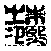朱熙之印



> 如是我闻  

> 法尚应舍



癸亥夏五月德清蔡宝善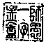师愚一宝善盫



随愿慨助，替天地启生门；乐善好施，为子孙培福果。硕中外大，善士励且劝焉。



癸亥小春七十七叟朱永璜永璜



能▆



有志者事竟成，修德者无不报。此语愿为行道上人朂，且为十方善士告焉。



癸亥麦秋▆矦郭▆▆



无量功德



壬戌孟秋朱佩珍朱佩珍



广种福田



癸亥冬日八十二叟潘祖谦▆▆



大德𣻤芳



壬戌九月申璜题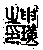申璜之印



祖楹篆▆▆▆祖楹▆▆▆书



聚沙成墖，集腋成裘，愿众擎之易举，留此▆求永久。



癸亥立秋嗅桐何震堃何震堃印



盖闻恒星未见鲁史，襮其祥以教初来洛京闿其化，悬慧日於中。天既惣去来今三世，溥慈云於下土，何妨千万亿化身七佛法，所以至高至明，而无边无际也。吾获邓尉山天寿圣恩寺始基唐宋章美，元明万峰府祖肇开夫藂席三峰藏师大振。夫宗风综南朝四百八十寺，兴衰猒辉金碧，揽太湖三万六千顷，浩淼恍鉴，琉璃其灵。奇则喝，石泉涌，假山天真▆；辅佐则香雪梅蘤，松风水月。诚探奇必至之地，亦选佛最胜之塲。中名梵天阁者，乃明正统闲，碧梧清禅师所创也。先世祖文㝎公榜题者，上王宗传记叙尤详。盖上层供毘卢像，旁为十二，圆觉中层供万佛，故亦名万佛阁。下层乃有观音象维兹杰构疋称世尊岁月既远，风雨互蚀，龙表山修，理所能了，事须根本，建置乃▆▆▆璜，居傍旃檀，叨陪地主，不忍坐眎，谬愿垂修，而志大力微，交疏行薄为代。(住持僧敬求)



当代官绅洎都人士，随缘乐助，弘无量之愿，程示日之功，广种福田，合装净土，弹指而闳观，顿复兜率，庄严克期而众愿皆完。菩提美满斯出为名山弥𧣹憾三龙三凤所诬与我佛结善缘一叶一花，皆是而异。探梅掇桂，召迹俱香，勤名未泯之士，微示著参敬叩。



氷衔日修善果，倘蒙金诺，请列芳名。



岁在壬戌葭月邓尉申璜敂启



------



### 苏州邓尉山天寿圣恩寺募修万佛阁序



佛说始於魏自天竺迦维卫国王子释迦昌明佛学德充道备，导化群生，於是清净寂灭家宗之至。后魏又有达摩，亦天竺国王子让国出家，入南海，深参禅理为中原，崇奉佛教，最盛时期。唐韩退之谏，迎佛骨辟佞佛之不诚，非护法也。然佛法精微，浩渺无边，迄今传授不衰，苏州邓尉，名胜也。太湖在其前，群峰列於后，层峦耸翠，环峙左右，固天然佳境，而亦森然佛地也。明万峰禅师创兴天寿圣恩寺，於是山阅四传至碧潭，和尚当正统十年，剏建万佛阁，於寺中初供毘卢佛像，故称毘卢阁，亦名梵天阁。阁之旁供十二圆觉，楣栋闲罗，列佛像万尊，此万佛阁之名所由来也。是阁也，轩敞高宏，为全寺冠。当建筑时，王一寗先生曾作事迹碑记，勒书於石，皆班班可考者。年湮代远，浩刼屡经，昔日巍峩，今渐倾圮，风霜剥蚀，及时修葺，事尚轻而易举，若听其颓废，不独佛像庄严，胥归乌有。窃恐桒田沧海，向之鸟革翚飞者，不几年而悉成瓦砾矣。禅师圆达圆通，皈依释教，信仰素深，无闲暑寒，数十年如一日，颇得禅宗奥理。今虽年迈，退居闲适，而欲重新是阁，每虑有志未伸，其徒行道，能承其志，详述缘起，属为之序。理泰有心无力，欲谋赞助，而自愧未遑。然天寿圣恩寺中而有是阁，知必有大发慈悲者之乐，观厥成也，爰不揆梼昧而为之序。



时在壬戌大暑，古吴贝理泰（哉安甫）敬叙



苏州邓尉山天寿圣恩禅寺募化重建万佛阁缘起



古以立德、立功、立言为三不朽。然而轩辕生知尚师广成，博施济众，尧舜犹病六经以外，餘如杂说。三不朽，岂易言耶？释迦世尊为一大事因缘，往昔舍无量数之国城、妻子、头目、手足，灭度一切众生已，而云实无一众生得灭度者，乃至说不可说不可说之微尘数法，而曰若云如来有所说法，即为谤佛不立而立，作三界导师，为四生慈父不朽之道。葢从自性中流出，不落生灭窠，四方为止於至善。此性也。万佛同宗，众生共具，惟是佛已觉满，众生尚迷耳。故释迦世尊应机出世说法四十九年，最后拈花示众，直指见性之道，遂开禅宗一脉。东土禅宗自达摩西未奕叶相传而至，临济、临济二十传而有万峰蔚祖出彻，悟本性开山邓尉，创与樷席，明太祖问风慕仰，遣使徵召，载在圣恩志书班班，可考蔚祖四传而至。碧漂道清和尚大兴佛事，凡前所未及举者一一举之，万佛阅即明正统十年碧祖所创建者也。阁中供毘卢佛像，初名毘卢阁，亦名梵天阁阁，傍供十二圆觉，楣栋列佛像万尊，故名万佛阁。下层供观音圣像，西傍安禅床以栖禅者。清初本寺中兴曾经修理阁之巍峩，广博为一寺冠，材料丰硕，工程坚固，迄今数百年，本根尚在。王一寗君作事迹碑记，称碧祖悟坚密彻见之，微立正信希有之功，信不诬也。兹山其阁，一兴於明始，再兴於清初盛衰，咸与国运相终始默默之间关系何其切欤？今则重厯刦波，阁将倾圮，万佛之金容已，杳多年之大厦。杂支非由表面，修理能以敷衍；须从本根建立，庶可重新。(衲等)障深慧浅，心大力微，欲立举而未能，岂坐观之可忍？是用恭修短引，普告十方，惟冀檀那，共垂鉴纳。窃谓际兹法运垂秋，人心不古，黑业山积，致感水旱刀兵之灾；召苦无己，虽万佛之𡨜光常照，而自於幻相空花中，翳目颠倒。不悟如驰之光阴，培修自性之功德，良可浩叹！夫名山古迹，能使人身厯其境，心旷神怡，高尚性质，自然埋长。当今逢者，公认此理，己不惜精神财费之牺牲，而经营之矣。矧邓尉既系名山，又属佛地，大有关於世道人心，而可不一致意耶？邓尉前临太湖，后枕需山，群峦环抱，佳木繁阴。梅花万树，与松竹杂植，烟云雪月，与湖光山色相辉。四时之闲，音态万状，以姑苏而言佳胜，不下於虎邱、白云、灵岩诸山，古之志者，已有空评圣恩寺，适当山腹住置得宣试，一登万佛之阁，游目四顾，一切▆▆罗列於前矣。是阁也，禅宗碧祖之所经纬，清净道场，以其出现，显三身於上座，会万佛於一梅。在昔一瞻一礼，已曾永结胜因；而今或舍或施，定必长培道果。施舍财物，不殊施舍悭心；庄严佛土，便是庄严真性。(衲等)摅诚悃以陈言，窃有渐乎佛使，立德功而不朽，是所望於檀那。随愿布施，不执一相。资筹群力，仰群力以就岑楼；事仗众心，缘众心而成万佛。果得踊跃输将，信诚护助。伫见杰阁重辉，金身复耀，叩毘卢於本雷，叹万佛於毫端。华藏非远，阁应自彰；不厯他方，普皆供养。如此以垂不朽，当与万佛无二。



时在壬戌年孟秋邓尉山圣恩寺前(住持)圆达、圆通、(退居)行梵、(现住持)行道、(监院)行静等叩募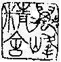万峰精舍



------



### 重印邓尉山志序



吴西之邓尉山胜境也，冒雪探梅，诗人逸趣，结庐避世。太史高风(潘遵祁归田后尝与夫人偕隐此山)在当时以为平淡无奇，不数年后，即为可敬可羡之事。苟无志乘，何能垂久年远？代湮之后，势必湮没无闻，贻无徵不信之口实而已。此无论乡镇山川志书之不可，或缺也。(麟)愧不文生平有爱故之癖，是以江苏省通志长、元、吴三邑合志均任采访事近修相城小志，甫将出版，然覆瓿之物不堪，与木凟、黄埭等志并传然一乡之掌，故得以阐发，亦足以遂我之初衷耳。中恕上人住持邓尉山天寿圣恩寺，能继铁桥，暨松、樵两师父之志，罄钵餘资，重印山志，广为流传。得曾君淦泉之托，转求吴颖芝太史作序，遂不揣谫劣，代述数言，以伸同志云。尔时在。



民国庚午季夏　谷旦渔沙施兆麟济众氏谨识

