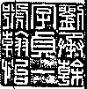
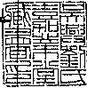
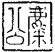
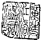
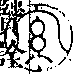
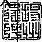
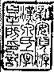
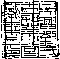

# 鹤林寺志（释明贤本）



> **藏经**：中国佛寺史志汇刊（佛寺志汇刊）　**册次** 第 43 册（GA043）　**编号** GA0046　**部类** 史传部　**卷次** 1 卷　**篇幅** 34,247 字

> **卷／品**：0 卷 · 3 品



---



## 目录



  - [序](#序)

  - [鹤林寺志序](#鹤林寺志序)

  - [鹤林履中上人诗序](#鹤林履中上人诗序)



---



鹤林寺位於江苏丹徒黄鹤山下，黄鹤山在府城西南三里，一名黄鹄山，俗名鸿鹄山，乃京口五名山之一也。鹤林寺旧名竹林，晋大兴四年（三二一）创，刘宋高祖微时尝游焉，及即位，改今额，称「鹤林律院」。唐开元、天宝间（七四一），有玄素禅师法照者，得法於牛头山，归主其地，僧徒日众，始改为禅寺，又名古竹院。后薛朗、刘浩作乱，寺烬废。宋绍兴中（一一三一～一一六二）重建，改名「报恩光孝禅寺」；咸淳间（一二六五～一二七四）僧庆清重修。明水乐中（一四〇三～一四二四）寺烬废，僧得月就古竹院稍葺治；弘治中（一四八八～一五〇五）了心始建殿宇；万历间（一五七三～）郡守鍾庚阳招僧德乘居之，吏部尚书陆光祖捐金，重建天王殿：此明万历以前寺之沿革也。重要之建置，如尚喜堂、天雨宝华堂、圆音堂等，乃高僧讲经之处，为佛教之名利；餘如积弩堂、濂溪祠、陆秀夫祠、丹徒宫、爱莲池、曾布宅、米芾宅等，亦具有历史性之古迹。鹤林寺自明万历间许国诚、高一福增修「京口三山全志」，以鹤林寺志一卷附之，时寺僧明贤亦撰有「鹤林寺志」一种，搜罗较前志完备，然前志所收释法永「黑漆光菩萨传」，明贤此志未收，其高僧门之黑漆光菩萨传，则极简略；前志所收「殷天祥传」，此志未收，人物门之殷七七传，亦极简略；前志又收法语一门，此志亦未收；据此可知，二志虽修於同时，当未曾互为依据也。明贤此志不分卷，略分十四门：山川、建置、山界、田土、碑铭、古碣、高僧、人物、纪异、记、序、疏文、说、诗。碑铭、古碣尤存文献中之珍宝。此志初刻於明万历间。兹据国立中央图书馆所藏万历初刻本景印，俾与许国诚、高一福所撰志比观焉。



鹤林志序刘承干字贞一号翰怡



吴兴刘氏嘉业堂藏书印



▆▆▆▆



京口有五名山，曰金、焦、甘露、招隐、鹤林，予皆信宿觞咏此中。然金焦险，甘露喧，招隐僻，独鹤林南去县郭无数里，不风涛而有清泉，不市嚣而有幽梵，不舟车而可以缓步，可以迟归，所谓幽人之贞，履道坦坦者也。山中有始皇凿道、王恭飞楼、刘裕藏农具於此，戴颙女磨笄於此，殷七七借开杜鹃於此，最晚为马素塔、米襄阳伽蓝，与竹院莲池耳。寺中多残碑断碣，自宋思陵，以及岳珂、孙觌、圆悟、中峰，其餘古佛大士刻像半出唐宋名手，非他山所敢坐也。寺茀废垂久，赖冡宰陆公、郡守文壹吴公、玉沙王公，捐俸𠛼复，始还旧观，而鹤林志则阙有俟焉。寺僧履中护戒能诗，乃以禅诵之暇，排纂志稿，请裁於函伯贺公，厥亦勤矣。夫国乘以劝戒贤不肖而设也，郡乘以因革利害而设也，而寺乘则否。夫名公巨人客卿，以探奇吊古至，其指点泉石，品量松桂，不至七圣迷而岐路哭者，赖一二寺僧为导师耳。若问之名胜，不知叩之古迹，不识愕焉嗒焉，如顽石稿木相似，使骖鸾控鹤者流，取往于犊子雀儿、田更谷叟之口，非山负客，乃僧负客也，亦僧负山也，而可乎？履中笑曰：山僧辛苦撰志，岂以逞识途之马，通问津之舟？盖此志成就，豪右不敢渔，徒属不敢鬻祖塔，僧庐免于草莽，名迹护法垂若日星侵者，还仆者起，皆志书一线之力也。若为游客指迷，则诸公杖头自有眼在，何烦老僧饶舌！



万历甲寅中秋日眉公陈继儒撰陈继儒印



麋公



鹤林寺志目录



山川  

建置(附祠庙方丈宅舍楼台亭桥诸遗迹)  

山界  

土田  

碑铭(附唐宋古碣)  

高僧  

人物  

纪异(附杂纪)  

纪



------



### 序



说  

疏文  

赋  

诗



鹤林寺志



广陵▆▆▆藏



▆▆



鹤林比丘明贒诠次▆



扬州罗聘







延陵贺烺凾伯订正新▆项源汉▆▆字▆▆▆▆



山川



黄鹤山



在府城西南三里，一名黄鹄山，俗名鸿鹄山。相传宋武帝微时采樵山中，见黄鹤百群时翔时集，故名京口。记曰：有黄鹤山在县界，晋王恭为刺史，改创西南楼名万岁楼，西北名芙蓉楼。俗传此楼飞向江外，以铁锁縻之廼已。则此山之名，其来已久。而谓宋武帝微时游息於此，有黄鹤飞舞其上而得名者，或非实录也。刘宋戴颙世居剡中，又徙京口，止黄鹤山。宋文帝每思见之，曰：吾东游当宴戴公山下，故又名戴公山。



磨笄山



在黄鹤山东南，戴颙女於山顶磨笄，誓不适人，故名。



胡𧊵岭



相传秦始皇凿，俗名祖师冈。



万松冈



与祖师冈相接，即竹林寺老僧手植，后为刁景纯葺之，为藏春坞。苏轼诗「白首归来种万松，伫看千尺舞霜风」，即鹤林寺西菜园也。



龙目湖



刘桢记曰：龙目湖，秦王东游，观地势云，此有天子气，使赭衣徒凿湖中，长冈为两断。而梁典乃云：武帝望京岘，盘纡似龙，掘其左右为龙目二湖。一湖令水南注，从鹤林胜果门经西菜园，过道人桥入河。一湖令水北注，经唐頺山后至关门桥达京口。港周孚诗曰：平湖认龙目，断岭记𧊵腰。



秦潭



一名渌水潭，在鹤林寺。右唐陆龟蒙诗曰：松门穿戴寺，荷径遶秦潭。唐时开并头，莲於潭中时贤皆有题咏俞德隣，作双莲诗序，宋绍兴间，郡守郑滋改名放生池。



爱莲池



宋周濂溪先生，少失父，奉母依舅氏郑龙图居润州，母卒遂葬焉。夙与鹤林寺僧寿涯交善，读书於寺旁，因凿莲池。万历丁酉，丹徒令厐公时雍於池上，环以石阑杂莳花柳松柏焉。



荷香池



在虎踞门外，西菜园中，可二三顷旧有亭不存。



白莲池



在古竹院东谷中池上有鬦鸡庵苏轼诗云：白莲池上鬬鸡庵



寄奴泉



泉中旧有白龟，人疑其为龙种，又名龙泉，大旱不涸。宋绍兴间，有僧祷雨，於此获甘霖焉。



逆流泉



在鹤林别业白龙冈下去鸿鹤山六里，水味清甘齐，庆封奔吴，居此所凿。



珍珠泉



在兽窟山北，四靣高峰，廻冈复岭，环抱泉上，上有及泉亭为李迪搆今废。



莲花洞



在白龙冈，逆流泉上。万历庚戌，寺僧明贤新辟洞内㟏岈奇邃幻出天巧洞前，石尤奇胜。



鹤林寺志建置(附祠庙方丈宅舍楼台亭桥诸遗迹)



鹤林寺



在黄鹄山下。旧名竹林，晋大兴四年创宋高祖微时尝游焉。及即位，改今额，是为律院。唐开元天寳间玄素禅师法照，得法于牛头山，归主其地，始改为禅寺，又名古竹院。后薛朗刘浩作乱寺烬废。宋绍兴中重建，改名报恩光孝禅寺。咸淳间，僧庆清重。修国朝永乐中，寺烬废僧得月，就古竹院，稍葺治之。弘治中了心，始建殿宇。万历间，郡守秀水鍾公庚阳招僧德乘居之。吏部尚书陆公光祖捐金复寺，傍侵地重建天王殿及方丈僧寮莲亭竹院刑科，左给事前知丹徒县事马邦良有记古竹院，唐李涉诗，因过竹院逢僧话，即其处也。及火烬，后宋苏学士培竹莲池上，今名苏公竹院。



妙喜堂



唐大中六年，建法师於此，开演弥陀法华圆觉诸经处。



天雨寳华堂



在古竹院前，唐夹山禅师说法处。



圆音堂



元至正间，西竺僧法喜讲华严经处。



积弩堂



宋武帝藏万钧神弩处。



寿涯方丈



在旧寺佛殿基后杜鹃台前，今为童氏占为墓陶太史，石篑题曰古宿道塲。



濂溪祠



在寺之西，万历甲申，冡宰陆公光祖赎其址，郡守文台吴公建祠，以和靖尹先生配祀尹，开封人。建炎中，奉召赴绍兴经镇江夫人郭氏亡，遂葬焉。先生没后，子孙家于丹徒。



陆秀夫祠



在寺之东竹院中。



米元章护伽蓝神祠



张王庙



旧名广德，王庙相传，即唐开元间，马师所叱之神祠也。在鹤林寺门外宋崇宁间，新葺为建炎兵火所坏。元至大间，重修万历间寺僧明贤使其徒守祠。



丹徒宫



宋武帝故宅微时，躬耕于此。及受命，贮农器，以示后人。



竹林精舍



在黄鹤山北林涧甚美戴颙尝憇于此，其趾今废。



郗鉴宅



在鹤林门外，唐頺山南。



刁勰宅



在黄鹤山西。



曾布宅



在千石墟东。



米芾宅



在鹤林寺养老堂后鸿鹤山下。元章因庐父光辅墓建手书城市山林四字，此额为米友石取去万岁。楼在戴公山北岭上，即古月观也。至唐犹存千岩，楼在南岭上。唐刺史王璠造绍兴间，郡守刘岑葺而新之。



光风霁月亭



在濂溪祠前，万历丁酉，郡守王公建竹间亭万历己亥岁建在竹院中，陆秀夫祠后浮花亭，张子颜所居欧阳永叔诗有水浮花片，出人间之句。



南山亭



在放生池上。宋绍兴间，郡守郑滋建后废嘉定间，郡守赵善湘复立，今亦废。



荷香亭



在荷香池上万历间，寺僧明愚重建。



杜鹃台



唐贞元中，有外国僧自天台钵盂中，以药养根种之。每春月花开，见二女子游于花下，后收归阆苑，台址尚存。



升仙桥



或谓绯衣杜鹃花神自桥腾空云。



马玄素禅师塔



在旧寺杜鹃台后有李唐左补阙李华撰塔铭。



米光辅墓



米元章墓



俱在黄鹤山下。宋僧庆清䟦曰：黄鹤山下旧有米元章墓碑，称礼部郎中米芾父左武衞将军．赠中散大夫，母丹阳县太君阎氏，皆葬于此。中书舍人蔡肇为之铭。



鹤林寺志山界



东至鸿鹤坊、天福山、菊花山  

南至石人桥、兽窟山、岘山、黄山  

西至龙目湖、黄蜂岭  

北至唐塠山鹤林门



鹤林寺志田土



钦赐鹤林田土原额官民田地贰拾捌顷贰拾柒亩伍分五厘五毫官田地肆顷壹亩陆分捌厘柒毫  

民田地贰拾肆顷贰拾伍亩捌分陆厘捌毫



无徵虚额坍江官民田地壹拾壹顷柒拾叁亩捌分捌厘玖毫官田壹顷贰拾壹亩伍分陆厘贰毫  

官地壹顷贰拾亩贰分伍厘肆毫  

民田陆顷叁拾肆亩参分陆毫  

民地贰顷玖拾柒亩柒分陆厘柒毫



今量有徵官民田土壹拾陆顷伍拾贰亩柒分贰厘陆毫官田伍拾叁亩柒厘伍毫  

官地壹顷伍亩捌分伍厘陆毫  

成熟地玖拾肆亩捌分贰厘玖毫  

荒白地壹拾壹亩贰厘柒毫  

民田地壹拾肆顷玖拾叁亩柒分玖厘伍毫  

减劝田地壹拾肆顷捌拾叁亩贰分叁厘陆毫  

全劝田地壹拾亩伍分伍厘玖毫  

田捌顷陆拾叁亩伍分贰厘叁毫  

地陆顷叁亩贰分柒厘贰毫  

成熟地伍顷贰拾壹亩柒分肆厘捌毫  

荒白地壹顷捌亩伍分贰厘肆毫



官民山塘贰拾柒顷肆拾陆亩伍分柒厘壹毫官山伍顷玖拾陆亩捌分捌毫  

民山贰拾顷柒拾捌亩贰分柒厘陆毫  

民塘柒拾贰亩肆分贰厘柒毫



本运以上官民田土肆拾肆顷贰分叁厘柒毫  

原额官民田地伍拾肆顷贰拾玖亩柒分陆厘肆毫官田地玖顷贰拾肆亩肆厘陆毫  

民田地肆拾伍顷伍亩柒分壹厘捌毫



无徵坍江虚额官民田地壹拾壹顷陆拾亩柒分捌厘叁毫官田壹顷壹拾玖亩叁分捌厘肆毫一则坍江田壹顷陆亩肆分贰厘捌毫  

一则虚额田伍亩叁分陆厘贰毫  

一则虚额田伍亩贰分壹厘玖毫  

一则虚额田贰亩叁分柒厘伍毫



官地壹顷壹拾柒亩壹分玖厘一则坍江地捌拾壹亩肆分伍厘  

一则坍江地贰拾叁亩陆分伍厘壹毫  

一则坍江地肆亩肆厘叁毫  

一则虚额地陆亩  

一则虚额地壹分贰厘壹毫  

一则虚额地壹亩玖分柒厘



民田陆顷叁拾伍亩陆分陆毫一则坍江民田伍顷捌拾壹亩叁分陆厘伍毫  

一则虚额民田肆拾柒亩肆分叁厘  

一则虚额田陆亩捌分壹厘壹毫



民地贰顷捌拾捌亩陆分叁毫一则虚额地贰顷捌拾捌亩玖厘叁毫  

一则虚额地伍分壹厘



今量有徵官民田地壹拾伍顷捌拾叁亩捌分陆厘肆毫以上共捌百陆拾陆坵官田地壹顷　亩陆分贰厘捌毫　共柒拾贰坵  

成熟官田叁拾柒亩壹分玖厘　共拾肆坵  

今现存田壹顷肆拾肆亩贰分肆厘  

地柒拾壹亩捌分柒厘玖毫  

荒白地伍拾伍亩捌分  

山五顷壹拾陆亩肆分玖厘捌毫  

新增濂溪先生祠籍没膳田壹百零叁亩



鹤林寺志碑铭



唐润州鹤林寺开山大津法照马素禅师塔铭(并序)



唐左补阙李华譔



道行无迹，妙极无像，谓躰性空而本源清净，谓诸见灭而觉照圆明我天人师，示第一义师，无可说之法，义为不二之门。其定也，风轮驻机；其慧也，日宫开照；其用也，春泉利物。三者偹体，谁后谁先？入无量而不动，开法华而踊出。湛兮以有无观听而莫测，寥兮，以远近思惟而不穷。智得皆空，为真实际，大悲恒寂，遍抚群迷。月入百川之中，佛帀千华之上。修而证者，玄同妙有；应而起者，旁作化身。先大师适来此土，化身欤？适去他方补处欤？不可得而知也。自如来现灭，四魔横恣，人天无怙，寄命崩崖。胜大敌者，那罗延身；消大毒者，伽陁玅药。拔陷扶坠，而生大师。大师延陵马氏，讳玄素，字道清。崇高绍兴於法外，径不系於人间。慈母方娠，厌患荤肉。长至一日，诞弥仁尊，生有异祥，乳育安静。既龀，稽首父母，求归法门，即日获请，出依精舍。如意年中剃度，𥛬江宁长寿寺。既进具已，戒光还照，定水澄源，鵞王之不受泥尘，香象之顿除羁锁，未之比也。身长七尺，躰无凡骨，眉毫际脸，口若方丹，目不頋睇，声侔扣玉。入南牛头山，事威大师，撞鍾大鸣，入海同味。迦叶以头陀第一大师，亦抖薮尘劳，闻一知十，未尝请益。观法无本，观心不生，喻金刚之最坚，比师子之无畏。圆月照海，高深尽明，惠风吹云，宇宙皆净。威大师摩顶谓曰：东南正法，待汝兴行。命于别位，开导来学。于是驺虞驯扰，表仁之至也；众禽献果，明化之均也。接足右绕，百千人俱，大师悉以菩萨呼之，教习大乘。戒妄调伏，自性还源，无渐而可随，无顿而可入，摩尼照物，一切如之。吾常默然，无法可说，或有信愿䨥极，恳求心要，于我渴仰，施汝醍醐。问：禅定耶？吾无修问；智慧耶？吾无得道。惟心证，不在言通。坏帝释轮，终为世论。自净而已，无求色声。既悟者小无微尘，大无三界；当悟者内珠虽隐，犹作来因。药草万殊，根茎等润，貌和言寡，饥至饱归。或有闻尊称而迁善，见色身而独得。我无尔念，道溥慈圆。食不问咸酸，口不言寒暑。身同池水，饱蛟蚋之饥渴；道离人我，顺众生之往来。䝿贱冤亲，是法平等。故馈甘味而不辞，同乎糗糒；奉上服而不拒，齐于獘褐。俾夫家有道侣，府无争人。开元中，本寺僧法密请至京口，润州刺史韦铣洒扫鹤林，兹焉供养。有屠者恣忍，积骸如山，闻大师尊名，来仰真范，忽自感悟，忏悔求哀，大师受之。又白言：和尚大悲，当应我供。大师衲衣跏趺，未尝出户，公侯稽首，不为动摇。至是如其恳乞，欣然降诣。夫盗隐其罪，虎慈其子，仁与不仁，皆同物性，不生不灭，无去无来。今浊流一澄，清水立现，诸佛所度，我亦度之。天寳中，扬州僧希玄密请至广陵，便风驰帆，白灮引道，楚人相庆，佛日渡江。梁宋齐鲁，倾都来会。津塞途盈，人无立位，觧衣投施，积若丘陵，皆委于所在，行无住舍。礼部尚书李灯时为扬州牧，斋心跪谒，为众唱首。望慈月者，谁不清凉？传百亿明灯，照四维上下，尘沙之数，皆趋佛乘。二州以贪法之心，移牒逾月，均吾喜舍，成汝坚牢，无非道塲，还至本处。天寳十一载十一月十一日，中夜坐灭。呜呼！菩提位中六十一夏，父母之生八十五年赴哀位者，可思量否？有至浮江而奠，望寺而哭。十里花雨，四天香云，幡幢葢网，光蔽日月。以其月二十四众等，号捧金身，建塔于黄鹤山西原像法也。州伯邑宰执丧师之礼，率申哀慕，江湖震悼。曩于寺内移居，高松互偃，涅槃之夕，椅桐双枯，虎狼哀号，声破山谷，神祗惜动，天地晦冥。及发引登原，风雨如扫，慈鸟覆野，灵鹤徊翔，有情无情，德至皆感。初达摩祖师传法三世，智信大师信门人达者，融大师居牛头山，得自然智信大师就而证之，且曰：七佛教戒，诸三昧门，语有差别，义无差别。群生根器，各各不同，惟最上乘，摄而归一。凉风既至，百实皆成。汝能总持，吾亦能随喜由无上觉路，分为此宗融大师，讲法则金莲冬敷，顿锡而灵泉涌溢。东九西域，得神足者，赴会听焉。融授𪨷大师𪨷，授方大师，方授持大师，持授威大师，凡七世矣。真乘妙缘，灵祥嘉应，佥具传录，布于人世。门人法镜，吴中上首是也。门人法钦，径山长老是也。观音普门，文殊佛性，惟二菩萨，重灮道源。门人法，励法海，亲奉微言，感延霜露，缮崇龛座，开构轩楹。时惟海公求报师训，庐孔氏之墓，𧺫净明之塔，世异人同，法然长慕僧端等荫旃檀树，皆得身香。菩萨戒，弟子故吏部侍郎齐澣、故刑部尚书张均、故江东采访使润州刺史刘日正、故广州都督梁升卿、故采访使润州剌史徐峤、故采访使常州刺史刘同升、故润州刺史韦照理、故给事中韩赏、故御史中丞李丹、故泾阳令万齐融、礼部员外郎崔令钦，道流人望，莫此于盛。弟子尝闻道于径山，犹乐正子。春之于孟子也，洗心瞻仰，天汉弥高，镜公门人，得甚深者。大理评事杨诣，过去圣贤诸功德藏，志之所至，无不闻知。鲁史从告，况乎传信。其文曰：



浊金清镜　在尔销鍊  

磨之莹之　功至乃见  

膏渍炷然　灮明外遍  

阳升律应　草木皆变  

启廸瘖瞽　惟吾大师  

息言成教　舍法兴悲  

辰极不动　风波自移  

境由心寂　道与人随  

杳然玄默　湛入无餘  

性本非垢　云何净除  

身心宴寂　大极沦胥  

内光无尽　万境同如  

甘露正味　瑠璃妙品  

遍施大千　无同无异  

度未度者　化周缘备  

道树忽枯　涅槃时至  

我无生灭　随世因缘  

吉祥殿上　应化诸天  

寂寂灵塔　滔滔逝川  

恒沙不坏　智月常圆  

道以人著　人以道尊  

舍道求人　何有凡智



大津法照禅师，唐有道之高僧也，事迹载于传灯鹤林，旧为律院，师因住焉。后奉师像于室，示不忘初之义。岁历悠久，庆清领事，始为师前，覩其像服弗完，挠栋弊陋，喟然叹曰：祖师乃道之尊优昙花枝叶，荣茂人而可忘本乎？况师道德，照世千古，不冺遗像，昏蒙若是。即日巾工，装餙一新，金碧辉华，髹漆崇丽。旧获唐李公撰师塔铭，有序无铭，且传写失真，鲁鱼有异。一日，本山居士出家，藏本而订正改易舛讹，增铭锓梓龛寘壁间，以衍其传。庆清三复碑铭有云：浊金清镜，则知清镜二字。前哲语机，默合符契。清名镜号撰述于五百年，前谶应于五百年后，庆清来此。周旋师之香火，发扬师之道德，岂偶然哉？又闻耆老相传，谓米元章御史银青公自襄岘来居京口，时过鹤林，听法于𦖟。禅师屡言：我于鹤林有缘，殁后当为护法。至捐馆日，忽寺之伽蓝神仆于殿下。师曰：米公显灵来护法乎？乃肖像而祠之，今伽蓝神是也。历数世而莫有传者，庆清因表揭，以彰神迹，故可以并书，俾后之有攷云尔。



咸淳庚午岁七月既望住山古镜庆清䟦



余昔检唐人著述，见李华氏所撰法照禅师塔铭，爱其文辞隽丽，诣达名理手之不能释万历己卯冬，归自京师道润州，与乡进士钱君与映散步过鹤林寺，则李公撰铭在焉。板刻于宋咸淳间，钱君惧其久而刓也，愿镌之。石周览庑间，有宋高宗御书及苏子瞻岳武穆，与　国朝杨少师石淙公诸刻具在寺之左为竹院。唐李涉诗因过竹院逢僧话，即其处也。右为周濂溪先生所凿莲池，近岁并侵没于民，家迹几泯。时吾郡鍾公庚阳守是邦，稍复竹院之故址。越六年甲申，予再过寺，而太守临川吴公㧑谦觞予于此。顾瞻唐宋名贤，往迹慨然思振之。於是右方莲池并寺前侵地，则又次苐尽复而钱进士断石适成盖，至是而千载名刹，古今高贤胜躅，实赖二公而表著焉。因述其事，授主僧德乘，并镌于石。



是年正月五日吏部右侍郎浙平湖陆光祖识



米元章墓志铭



蔡肇



崇宁三年甲子六月制诏，今四方承平，百揆时叙小大之政，毕举增光，继志旷古，绝无独书畫之学，未有高世绝人之风，殆劝励之不至也。其议投试简拔之法，著为律命，建官养徒，庶几异时彬彬者有纪焉。於是六艺之学，以次开设矣。是时元章名能书，适官太常。一旦奉诏以黄庭小楷，作千文以献，继进所藏法书名畫，赐白金缗钱甚腆。方民间竞以前代笔迹来上，萃於秘府，号宣和御览几百帙，特诏丞相太史楚国公跋尾公亦䟦旨预观缙绅，以为荣遇。已而出，知常州不远，改勾管洞霄宫。未几，就除知无为军。逾年，𣸪召为书畫学博士便殿，赐对询落，逮因上其子友仁所作。楚江清晓图既退，赐御书畫扇各二，遂擢为礼部员外郎。复以言者罢知淮阳军弥年疡生其首上书谢事，不许以某年月日，卒於郡廨，享年五十有七。遗命送终，皆有治命。赙其家以百缣不受官，其子皆特恩也。公讳芾，字元章，世居太原，后徏襄阳。自其高曾以上，多以武干官，显父光辅，始亲儒嗜学，公生秀颕，六岁日读律诗百首，一再过目，辄背诵稍长。博记洽闻於书，务通大畧，不喜从科举学议论断以己意，其说踔厉，世儒不能屈也。刻意文祠，不剽袭前人，语经奇蹈险要，必己出，以崖绝魁垒，为工作字。遒劲更沈着，雅有晋唐，风流尤善，临摹至，能乱真。其畫山水人物，自成一家，尺缣寸楮，人以为玩。四方碑榜，咨请踵至所著诗文，凡百卷，号山林集。宣己子圣度录正韵杂说，又数十卷。平居退然，若不能事事至官下，则率职不苟喜，为教戒吏民初为烦已而安之，时亦越法纵舍，有足大者家。故饶财既仕，悉以分族人，后贫不以为悔。遇古书名畫，必极力购取，得之乃已。余昔相遇於都城，败屋僦居，客至，烹饮出诸奇，相与把玩啸咏，终日所至，喜览山川，择其胜处，立字制名，后来莫之废也。过润爱其江山，遂定居焉。作庵城，东号海岳，日咏哦其间为吾州佳绝之观。平生与游，多天下士蜀、刘泾、长安、薛绍彭好奇尚古，相与为忘形交风神萧散，是其一流人也。举止颉顽，不能与世俯仰，故仕数困，踬冠服用唐人规制所至。人聚观之，性好洁置，水其傍数，颒而不帨，未尝与人同器，服视眉宇，轩然进趋，襜如音吐鸿畅，虽不识者，亦知为米元章也。少与禅人摩诘游诘，以为得法。其逝，不但作偈语有伦。父佐左武将军，赠中散大夫。母阎氏，赠丹阳县太君。既卒，始葬润州黄鹤山，以中散祔。初宣仁圣烈皇后在藩，与丹阳君有旧，故公少长邸中，以后恩入仕。初补秘书省校书郎，授含光尉，七迁入淮南幕，改宣德郎。知丘雍丘县乞监中岳庙，授涟水军使，除发运司勾当。公事蔡河，拨发入奉，常为博士，三加勋服五品。娶许氏封宁公县君，有贤行五男，长则友仁也。补将仕郎，辞艺能世其家，餘早卒。八女子适进士乔襄公僖老南康君教授叚拂承奉郎吴激，餘未嫁，孙男女各一人。以大观三年六月某日，葬丹徒长山下。余元丰初谒荆国王文公於金陵，公以诗文贽见文公於人材少所许可，摘取佳句书之便靣。余由是始识公，故为之铭曰：



米胄楚出自鬻分　仍世勇爵史载芬  

既极而迁禀不群　生怜野鴩憎家鹍  

掉弃鞲决习典坟　君才弱冠秇且文  

豪气激越荡乹坤　剧谈四座寂不喧  

冠巾说制傍朝掀　浣衣濯带肌廖皲  

手扳拉颊送飞云　邈晋千载风流存  

鍾王已往楷法纷　后生不复窥完浑  

临池几年墨练裙　句法甫白相弟昆  

造雄设险惊刓昏　文成挥扫千兔髠  

蛟蚓着𥿄尾角骞　尺牍藏去珍瑶琨  

一官肮脏诸侯门　熟视试一引手援  

南宫坐曹席未温　世间巧语空织文  

澒淮出守朱两轓　三仕三已无戚欣  

视身蚊蚋何足论　思坐海岳穷朝曛  

暮年消中病文园　逾月止酒不茹荤  

却乘泠风反众薰　西山嶒崚星可扪  

其阴大江郁东奔　啧沙发石漂无垠  

气象历落宜置君　欲酌中𤃩采芳荪  

生刍舍奠宿草根　尚书局促驹伏辕  

追摘往实诏九原　吾文坐荒失锄芸  

为歌铭诗下招魂　巫咸上天谁复闻  

薄暮雷电归呌阍　驶雨忽作九河翻



鹤林十三松铭



皇明丁同



偓佺之化徂徕肓　千年菩提水泽沃  

日月降祥丽而或　霹雳愤裂怪不俗  

受命土壤正也独　数以纪闰分象属  

墨氏不守樵氏读　畴其惜者今柱国  

割廪奚异解骖赎　爰景坠寺巢桥木  

高荫日出青原陆　止我游人倚我谷  

屏息既幻玄龟伏　摩庠莫变青牛触  

后千百禩野史录　闻者𧺫敬见者肃  

咸曰太傅式多福　试铭盘石垂无斁



明鹤林寺一宗禅师塔铭(并序)



师法名德乘，一宗其别号，广陵房氏子也。母高氏，梦飞光堕室而孕。年三十，东家以奸事诬之。师两断其阴以自明，遂走昭阳，礼太虚道极和尚。和尚曰：礼我何为？曰：世缘有尽，佛法难闻，念求出家耳。和尚大异之，鸣鍾告众为剃发焉。执巾瓶侍左右三年。一日，辞往四方叅学，遍游天台、南海、少室、五台，与五台大千师机语契合。已而南还，渡江，居姑苏天平山白云禅寺三年，又居金山。大彻堂饭僧，郡守秀水鍾公闻师道行请住鹤林。古刹废十餘年矣，余适过之，乃𦔳师力为规复，重搆佛殿。太守临川吴公复捐俸修饬焉。右莲池、左竹院、前后梵宇焕然复新。工将告成，延麓亭法师讲《楞严经》，於是土人有讼师者，师勿辩，竟趋径山结茆椽以居。越三载，士夫暨其徒众仰师法利，恳请归山。万历十七年秋染微疾，至十二月五日合掌语众云：今日有二人求见，莫令入吾室，老僧今日无暇矣。少顷，果二人至，止之不入，跪竢於门外，忽闻师歌曰：泥牛才出海，木马又嘶风；欲觧个中语，山重水又重。歌罢，端坐而化。塔于寺左山麓，世寿六十三，僧腊三十二。铭曰：



惟师禀灵异　夙具出世因  

往业亦须酧　魔境时荆榛  

戒体苟不毁　幼身何足怜  

由兹脱尘网　佛种从缘生  

叅方励苦行　利养施慈云  

巍巍古名刹　既隳赖鼎新  

坐脱预知时　留偈度有情  

末教振一时　超然等应真  

白骨埋青山　历刼弘法轮



万历壬辰年腊月朔　吏部尚书平湖陆光祖撰



古碣



宋高宗宸翰碑七通



不见佛身知是佛　若实知有别无佛  

智者能知罪性空　坦然不惧於生死(拘那舍摩尼佛)



身从无相中受生　犹如幻出诸形像  

幻人心识本来无　罪福皆空无所住(毘婆尸佛)



起诸善法本是幻　造诸恶业亦是幻  

身如聚沫心如风　幻出无根无实性(尸弃佛)



假借四大以为身　心本无生因境有  

前境若无心亦无　罪福如幻起亦灭(毘舍浮佛)



见身无实是佛身　了心如幻是佛了  

了得身心本性空　斯人与佛何殊别(拘畱孙佛)



一切众生性清净　从本无生无可灭  

即此身心是幻生　幻化之中无罪福(迦业佛)



法本法无法　无法法亦法  

今付无法时　法法何曾法(释迦牟尼佛)



观音碑



行深般若妙智力　普观自在济含识  

五眼圜明无罣碍　六通慈誓示千亿  

瞻之仰之福胜比　情与非情俱获益  

稽首水月观世音　感应难思刹尘迹



古徐鹤林假坣比丘如瑶



米元章断碑：纪曾游□流玉浅沙墙影賖□米友仁书当山护伽蓝神御史银青米公之位。



东坡先生断碑：存「游招隐鹤林」数字。



断碑：竹院无人到，云屏尽日关，墙头栖鹤树，屋外磨笄山□落蕋秋容净□鸣镳。祖韵次总卿。氷壸先生□高韵道主□古镜□。堂头禅师聊资棒诵诞祖首□。



断碑：劝农之次日，和方□及时膏雨汝楳□敬和□景定五𥜥僧法心䟦



碑：柳子玉见和，因以送之，并寄其兄子璋道人一首碑忘姓名，见苏子瞻集中。



断碑：庆元元年秋，简池刘光祖书呈鹤林宗山长老□竹院过僧话□半年来往，屡□合送人行。



断碑：庆元庚申春闰二月三日，予因得月明□所三字。山西赵逄书□通鲁彦□天子文游偕群，从者乙亥正月二十二日□钱唐俞烈□。



断碑：镇江府濂溪先生书堂记。



断碑：□元□冬过古竹院，访鹤林旧寺，东雀相呼，修竹依然。因读左史舍人壁间，敬次其韵□。后题判府殿探中书，尝赓左史舍人留题，珠玉交暎有光竹院，并刓于石，以永其□传。嘉定改元冬，住镇江府妙□题。



断碑：春晚视赈题云长台坐问首示府，判奏院诸文旧作属，余和之勉用韵塞责，冀发一笑□。



断碑：题右竹院僧房嘉定甲申八月廿一日，鄂国岳珂肃之景定甲子，永嘉陈均□。



䟦云：奉使总领大卿硕德，弘才辉映，当世□膺重，寄平□一道，政成暇日，玉节俨临，山色水光，为之改观，留咏诗章。清深雄丽，有爱君报国之志，笔力遒劲，凌跨前軰。虽坡谷之贤，未之方驾。䟦𨱏翠琰，庶百千年之下。知江左道德文章，忠孝未泯。嘉定甲申闰八月初八日，住山慧曦刻石。



断碑：咸淳□春□龙图阁学士朝殿大夫提举江判太平观毛友□行相□乃尤□雪阳春□。越俎之谈□非待价见机□随丝须飞锡□临应□望云而止。



碑：西湖然禅师云：释氏所以久长者，止以能作善言，警悟不肖。今观圆悟禅师遗墨字字真率，读之森然加敬，但患有不能终身行之者尔。绍兴癸五谷雨日章𬳶仲骏书。



断碑：瀹虎斑，绍定改元。二月既望判府节制，寳谟太卿□民平易遵令欢耕□税驾□间，寄兴言外，不独古竹增贲农父得醉，老僧得闲，皆其赐也，敢不刊诸石，住鹤林山僧慧曦。谨书。



金刚经碑一座



心经塔一座



额天雨寳华(晋索靖书宋咸淳间赵溍重立)



额古竹院(古篆书)



额城市山林(米元章书米仲诏工部取去)



额镇江府濂溪书堂记



米元章自写护法小像、米友仁赞一残碑，赵丹徒移去甘露寺海岳庵。



鹤林寺志高僧



开山马素禅师延陵人，姓马氏，讳法照，字道清。初剃度于江宁长寿寺。后入牛头山，事威大，师遂悟性宗。开元中，僧法密请至京口，遂住。一日，有屠者礼谒，愿就所居辨供，师欣然而往，众皆见讶。师曰：佛性平等，贤愚不一，但可度者，吾即度之，何差别之？有僧问：如何是西来意？师曰：会即不会，疑即不疑。又曰：不会不疑底，不疑不会底。有僧敲门，师问：是什麼人？僧云：是僧。师云：非但是僧，佛来亦不着。僧云：为什麼不着？师云：无汝栖泊处。又马祖遣人送书，与国一钦禅师，书中作一圆相，国一发缄，遂于圆相中着一点封回。后忠国师闻，乃云：钦师犹被马师惑。



黑漆光菩萨讳法明，示迹于莱州，即墨县𠛼沟村，以试经得度于郡之崇福寺，精练法华。每游州邑聚落间，遇有胎孕妇往过其门，或为讲药草喻品，其娠即轻免求嗣者，即果遂他郡有木客，为风涛所败，即示以观世音菩萨号，俾其急诵，遂获安济。后值岁旱，民庶吁祷不应，乃以积薪为窣堵，遂捐身入化，火方焚随。大霔三日，雨足开霁，众奔聚观，尚餘真身，危坐灰烬，曾无少损，但益以光明如黑漆。宋州牧以开赐号黑漆光菩萨。



国一钦禅师剃度於鹤林寺云：素禅师语之曰：此非汝所。乘流而行，遇径则止。后为径山苐一代祖。



唐建法师於大中六年开演法华、圆觉、弥陀诸经于妙喜堂。



唐夹山禅师说法于鹤林之天雨寳华堂。



宋寿涯禅师与胡武平、周茂叔交善，茂叔尤依寿涯读书寺中，每师事之，尽得其传焉。其后二程之学本于茂叔，皆渊源于寿涯云。



宋御史银青米元章，自襄岘来居京口，时过鹤林聼法于聪禅师，谓师曰：我于鹤林有缘，没后当为护法。



宋庆清师咸淳间，重刻李华塔铭。



元西竺僧法喜至正间，讲华严经于寺之圆音堂。



一宗禅师讳德乘，广陵房氏子。年三十，东家以奸事诬之。师断其阳，以日明，遂去昭阳，礼太虗道极和尚。后叅学四方，遍游天台、南海少室五台，已而南渡江，居姑苏太平山白云寺。三年，又居金山，大彻堂饭僧。郡守秀水鍾公请住鹤林规，复千餘年，已废之古刹，法堂香积，重见光明。万历十七年冬，师合掌语众曰：今日有二人求见，莫令入吾室，老僧今日无暇矣。少顷，果二人至止之，不入跪竢於门外，忽闻诗歌曰：泥牛才出海，木马又嘶风。欲觧个中语，山重水又重。歌罢，端坐而化。



明达观禅师万历间过鹤林，慨然怀兴复之志，有吊鹤林寺松诗，及与诸宰官书。



鹤林寺志人物



宋武帝微时，尝栖于山下，时鸿鹤百群，张翼蔽日，又凿泉为寄奴，泉后即位，署故宅为丹徒宫。



戴颙字仲若，樵郡铚人也。父逵兄勃，并隐遯，有高名逵、善琴书颙并传之。会稽剡县多名山，故世居剡下。后又居桐庐山中，衡阳王义季镇京口。长史张邵与颙姻通𨒖来止黄鹄山，山北有竹林精舍，林涧甚美，颙憩于此。涧义季亟从之游，颙服其野服，不改常度。为义季鼓琴，并新声变曲。其三调游弦、广陵止息之流，皆与世异。太祖每欲见之，常谓黄门侍郎张敷曰：吾东廵之日，当䜩戴公山也。自汉世始有佛像，形制未工。逵特善其事，颙亦叅焉。宋世子铸丈六铜像于瓦官。寺既成，靣恨瘦，工人不能治，乃𨒖颙看之，颙曰：非靣瘦，乃臂脾肥耳。既错，减臂脾瘦，患即除，无不叹服。



刁勰尝卜居于黄鹤山西



殷七七名天祥，又名道筌。尝於九日开杜鹃花，李涉有竹院逢僧诗，竹院之名因此浸著。



曾布卜居鹤林寺外千石墟布诗有云：家住城南千石墟。



周敦颐与寺僧寿涯禅师交，尝读书寺中，凿池莳莲。苏轼尝游鹤林，有诗刻石，又竹院芜废，为培竹于莲池之上。



米芾字元章。父佐，由襄阳徙居丹徒。后葬黄鹤山芾，因筑室守墓。襄阳志林称元章爱鹤林松石沉秀誓以来生为寺伽蓝，永护名胜。后果还宿，愿於此。壬酉发，字噩甫，安丰人。父沔，宋端平中，徙居丹徒酉发，登寳祐癸丑进士，历金坛荆山两县丞迁知静海县。入元不仕，隐居鹤林，自号息寮子。



杨遵为郡守，以梦感迁玄素师，塔于玄武麓岳珂尝游寺中，有诗刻于石。



鹤林寺志纪异



晋王恭建万岁楼，有僧自西域来，指其地谓曰：百年后当有异僧。驻此说法。后果有素禅师㨿此说法，听者千餘人。说罢，众退，惟缟衣百人侍立不去。师诘曰：众退！汝延立谓何？应曰：我等仗师圣法，各脱缟衣矣。遂谢。师翔空而去，因名鹤林。



晋义熈中，润州山中多虎患，刺史王恭令乡社俱立，庙禳灾而虎患终不息。恭闻东林远公高弟法安禅师，有戒德，恳请入山安。一日，临暮独入戴公山古树下，通夜禅诵侵晓，群虎跳跃，来安左右，安为说法授戒。虎踞伏，不敢动，有顷皆去，虎患遂息。恭因建寺奉安像安，指其地曰：此处代有异人住此说法，相传古鹤，林有银杏树，大数十围，即法安於此，伏虎之树也。至万历五年，废于土人潘姓者。予考招隐山，旧穪虎窟山。然鹤林穪戴公山，而招隐，亦戴颙所居。今黄鹤山去招隐，尚距三四里，岂当时衹园精舍，固连亘两山耶



开元间素禅师登座说法，四众云集。有顷霞光烛天，林鹤翔舞，忽寳花弥空而下，纷绕法座。大众莫辨为何花？师曰：此天花也。



鹤林杜鹃高丈餘，春月花开倾城游。赏相传，唐贞元中，有外国僧自天台钵盂中，以药养根种之。每春末开时，或窥二女子来游花下，俗传花神也。其后有殷七七者，名天祥，又名道筌。周寳于长安中，识之及寳，自泾原移镇浙西，七七亦到郡，寳师敬益甚。一日，谓七七曰：鹤林之花，天下奇绝。尝闻子能开，非时花，今重九将近，能开此乎？七七曰：乃可前二日往花所。其夜女子来曰：妾为上帝司此花，今与道者开之。然此花不久，当归阆苑矣。晨起花渐破蕋，九日盛开，如春寳惊异。燕贺累日，数日后花，俄不见，亦复无落花在地。后二十年，薛明刘浩乱寳南奔杭州，而寳总戍为政，刑杀无辜。前上饶牧陈全裕经其境搆之，以祸尽赤，其族寳八十三，筋力犹北，女妓数百，尽得七七之术。及全裕作厉，一旦忽殂七七。刘浩军变之。时甘露寺众推落北崖，谓坠江死矣。其后人见在江西十餘年，卖药入蜀，莫知所之。鹤林犯兵火焚寺，树失根株，信归阆死矣。按乐天东坡诗注并容斋随笔皆云：山石榴映山，红山踯躅，即此花也。宋咸淳八年，寺僧庆清，乃以踯躅补其旧迪功郎、光州司户叅军朱正国作纪刻石。未几，枯瘁元延祐丙辰，里人。戈道恭，家圃有此花，乃移植故处。蜀郡青阳翼为记容斋随笔云：鹤林寺杜鹃，乃今暎山红，又名红踯，躅在江东，弥山亘野，殆与榛莽相似。而鹤林之花至以为外国僧钵盂中所移上命玉女司之，已逾百年，终归阆苑。是不特土俗罕见，虽神仙亦不识也。王建宫词大仪，前日缓方来嘱，向昭阳乞药栽，勅赐一窠红踯躅谢恩未了，奏花开，如此则宫禁亦鲜之矣。



唐开元天寳间玄素禅师主寺，寺前曰祖师冈冈外伽蓝护谴，师叱之已，米元章父子与寺僧聪禅师交契，元章每谓曰：我必护法此中。师曰：无戏言。元章曰：我死之日，寺中鍾皷自鸣，即神来矣。将化，语子曰：鹤林缘熟，我神将栖之。死之日，伽蓝神忽仆地下，咸谓元章代玄素所叱也者，梵乐亦皆自响如其言。其子米友仁，手书当山护伽蓝神御史银青米公神位。又云：米光辅自襄阳岘山来居京口，游南山，入竹林，憩杜鹃台下。偶见黄鹤𡶶头一老比丘，手执白拂，青藤扶云而下，呼光辅曰：公今日始来耶？老僧待汝久矣。公愕然相向，遂呼童命酒上老僧。僧曰：五百大戒酒为尊，贫僧自幼不沾唇，接了大人一杯酒，伽蓝依旧进山门。又谶曰：坐黄鹤靣北，固得文石为葬地。语毕，遂往随寻聪。法师发愿曰：我与鹤林有缘，没后当为护法。后某年月日，无病而逝。遂为寺中伽蓝。元章扶其柩，葬养老堂。后果得文石一方，云二说，不知孰是。宋僧别𡶶印禅师住金山，入定游龙宫，龙王谓师曰：寺每推轮藏吾宫，为之震动，请去之。僧许诺，觉而语其徒：咸莫之信也。僧乃探袖中龙，须巾示之，遂将轮藏移来鹤林寺。元祐中，僧了元与米元章苏东坡宿鹤林深，夜见红光两道，𧺫于万佛阁前。达曙方灭，因搆两藏殿于大雄殿之后。晦堂有记曰：龙宫海藏五千卷，定里移来置鹤林。至今仅存残经百卷而已。



鹤林厨下有一行人，无姓氏，不知从何来。万历初年可五六十岁，见人微笑作颠语，问之，则不复言，掉臂而去。尝卧灶下，执爨汲水，礼佛念佛，食残飰补，破衣扪虱，闲则抚掌大笑，覩其形若垢，即之香洁无秽气，日日浴池中，冬月大小便后，必往池边，敲氷洗涤，数次乃止。云间陈眉公异其人。一日，举手摘野菜一把与陈日彀了，又问其年，荅曰：有何年岁？眉公谓寺僧履中曰：此必异人也。



陆秀夫祠，旧在金山，后移唐塠山。万历二十五年元旦，昧𤕤时，予梦见一人幞头绛袍来鹤林方丈，予曰：公何人耶？公曰：我乃陆秀夫师，是我主人。遂拜。拜讫不见，觉而异之，即往唐塠山陆公祠中肃拜，见庑下有断碣，乃少师杨文襄奉𠡠撰陆公祠碑记也。数日后，命工人塌得碑记，三纸归藏。箧中无何，祠遂崩圮，碑亦不存。至二十八年，郡守许公国诚迁陆公神主来寺中，命僧司之始知陆公已於三年前神先来此矣。寺僧履中识



韩无咎云：鹤林招隐，皆京口胜处也。余顷游焉。鹤林近城，犹屋数间，招隐逈在山中，屋亦无矣。况修林哉！东坡所谓古寺满修竹也，惜其未深者，殆鹤林耶。周寳为浙西节度使，治城隍，至鹤林门，得古冢棺椟，将腐发之。有一女子靣如生铅纷衣服皆不败寳，即命改葬，具车舆声乐，以送与僚。蜀登城，隍望之，有紫云覆辆车上行数里，见一女子出自车中，坐于紫云，冉冉而上，久之乃没，启棺则空矣。



附杂纪



米元章好奇怪，当平世葬其亲润州山间，不封不树。尝自诧於人言：莫有知其穴者，有王相者，子韶之子也。素与米游甚狎，独知之米一日，与客游山，因至墓所，周览之次，相忽溲於草间，米色变意甚怒，然业已讳之，竟不敢止相。



宋时有数贵人，遇休沐擕歌舞僧舍者，酒酣，诵李涉题鹤林寺诗终日昏昏句。僧闻而笑曰：尊官得半日闲，老僧却忙三日，谓一日供帐，一日燕集，一日扫除也。



孙觌启族孙书言云：公住鹤林矣，鹤林寺杜鹃花收还阆苑。数百年后，鍾皷一新云山改色自公始也。又启上山老云：每记浮杯卓锡之嘲，想见故人风度，聊以自慰也。



释达观与金坛王损庵于中甫书



鹤林黑漆光之再照于世也。实大檀那、　护法深心，并二公委曲𦔳成之耳。若少不耐烦，则此光之偏照，未可幸也。由是言之，　二公苟非任贯高田，光之愿力，安能遂志？故师子捉物遇香象，即奋全力，设遇狐兔，亦不敢不奋全力也。此在梅村居士或败之无辱矣。惟二先生此为护法之始败则非夫也。且寺僧幸有履中主持之，贫道不敢候行轩矣，惟慎图之。



释永坚与履中书



时境中见天上飞一染色，僧▆棃飘飘冉冉，挂禅兄法体，谂知禅兄戒德夙因矣。今游京口，志在寻师，岂有饥逢王膳而不飡者耶？待瑜伽论完挟，唯识过访，且求指示，将订终身之约，不独以结冬之故也。



公尧封与鹤林履中上人书



上元前得南海僧寄到手札鹤林上人信士哉！几年相托，千里不忘，足徵素养，惟是委曲践言，不无烦琐有劳行者。缅惟莲池竹院犹存当年境色万一否。其祠田果为强有力者侵没院道申文，炳如日星当事者，自是爱礼存羊，何劳过虑？若与之校，反多一番，扰攘静聼，为当昔日曾许我山东之游，乃竟靣壁深藏，令人不得覩靣，真是自了汉哉！观公笔法文义，似有老像内养静工，岂强弩之末稍稍劲力少耳，收功全在此时，百尺竿头当更进为佳。



鹤林寺志记吴兴刘氏嘉业堂藏书印



鹤林寺兴复记



润江山称寓内甲观中流，角立金焦而北固翼然临其渚。迤南则崇冈叠翠悬壁插空诸名山，唯是黄鹤磨笄最胜。磨笄之亥，黄鹤之阳，隐古刹，其中曰鹤林。鹤林创晋大兴间原额竹林，以宋武帝旧游也，赐田山万计而更今名。迄唐马祖玄素师主之为禅寺，因有古竹院李涉诗，因过竹院逢僧话，即其处也。环寺前一冈，师经出入人，题曰祖师冈冈，外神祠旧传护伽蓝神也，获谴，师叱之。寺中杜鹃花枝凡九叠，异僧从天台寘钵中移来，每春时盛开，芳香凝蔼，彷佛二仙，女出其旁，疑为花神。自后花归阆死，而寺𥨊凌夷衰微也，则数存焉矣。宋兴香火，复振高宗，赐名报恩光孝禅寺，制御书七通石，刻郡守。杨遵以梦感迁其师灵塔于寺玄武麓，今遗迹兀然。周濂溪先生凿莲池寺右，而东坡公复培竹莲池上，号东坡竹院南宫米氏自襄岘来时，过聪禅师曰：我于鹤林有缘，殁当护法，至今有米元章祠人咸谓代昔玄素师所尝叱也者，理或然也。寺题咏甚夥，靡得緌述。如李白朱放皇甫曾李涉綦母潜、东坡岳武穆诸什摭入郡志者，尤推炙美。入　国朝寺基，改为莹墓僧得月者，恢古竹院，存遗弘治中，了心重建奉龙象一新郡少师石淙杨公爱寺前松十三株，挺秀时来，盘桓其下，于是搆十三松赋记铭重之亡，何兵兴赋，冗僧众苦，徭役不支，逃亡畧尽。而寺坐废并向所为十三松者，且不免继焦桐爨矣。夫当其盛也，一卉蒙神，一木入品，及其衰也，景物随移，山林改色，寰宇兴亡，大较若是，矧区区一鹤林乎？盖至万历改元而登其墟，殆不胜凄怆焉。栋宇倾欹，像颜頺剥，左右地侵没为花圃为蔬畦藩篱，两逼餘一道，仅通兰若。其间断碑残石，埋没荒芜。前后五十餘年，在籍土田移去者什之八九鍾公庚阳来守是邦，岁维丁丑始一过，辄慨然思寻𧺫坠绪，延僧德乘与图。时五台陆公光祖捐俸，金一十二两而古竹院旧址，复仍捐金二十两，合餘𦔳俸资十两，而莲池书屋并复得府县捐俸资，而池上莲亭，建金坛于公业，𦔳资而古竹院祠堂建王公肻堂捐资而米公祠重建于公玉，立捐资而玄素。法堂建郡守吴公㧑谦捐俸金，勒法照禅师塔铭于石而碑亭建嘉禾钱君与映捐资而香花桥建，兼以僧明贤辈以募缘𦔳。而天王殿方丈廊厨静室，次苐建大鹤林，赐田优免额，皆与三山埒。三山古刹鹤林亦古刹三山称古迹，鹤林亦称古迹。第三山居要冲冠，盖往来得不废，而鹤林地僻径纡显者，履不时及废故易夫废则已矣。今业已兆兴，忍不与三山一例。视原田山，除有力去籍外，不可考餘缘之告入公庄者，视籍灼灼，在覩于是按其数归之。田壹顷，肆拾肆亩贰分肆，厘地柒拾壹亩，捌分柒厘荒白地伍拾伍亩，捌分山伍。顷壹拾陆亩肆分给帖，复差令不失为鹤林故物。然以方完业，不及远甚事付之无可谁何而已。甲午夏，余南迁明贤辈来白，始知寺田贰拾餘亩，犹为土官汪氏所㨿。邑尹厐君时雍竟判属焉，以续成余志。余因具述寺所繇，兴衰颠末，谨授厐君镌于石，以寄不朽，且以望后之当寺者，惜古刹名踪景高贤懿躅，延石淙公，遗爱成五台。公盛举则厥寺也，庶永终乎母聼二三豪强规目前尺寸，以致千年，胜趾湮灭无稽，而屑越之也，则幸矣。



刑科左给事中前知丹徒县事马邦良撰



鹤林寺畫祖师像记



陶望龄



电至疾，云至变也。而人能状之，水之霔凸，火之光燄，善绘者至以擅名皆相也。天下之必不可畫者，唯天唯风。然草树之梢偃，波涛之飞立，特写其摧靡澎湃之态，而风状得矣。星纒日道罗络经纬，明之以云霞，晦之以雰雾，而天象具矣。然则天与风，亦未尝不可绘也。如来三十二相，即为非相，志公一靣而现观音十二靣见者如状风，拟者如图天况，纸墨所能摹邈哉！然非相一相多而三十二又多，而八十种好，万毛孔灮明，非靣正靣多而十有二，又多而千手千眼而八万四千。烁迦罗首母陀罗臂，清净寳目，如草树之一叶一缕，如星之一纒一次。非天非风，而天风宛然，笵金刻木，土塑纸描，一一相好，一一庄严，皆非相皆正靣，皆真佛真祖也。呜呼！像教陵夷，古宿道塲草深，一丈经游者，欲瞻仰遗像而不可得。僧徒惰窳，恬不知怪久矣。京口鹤林寺僧名明贤者，乃能具此一大因缘，精绘善装，历世前后，历土东西诸圣比肩，如语如笑，又惧其久而莫守也。谒余言以永之，岂非奇特最胜事乎？绘本出白下祖堂，裒而聚之者，为达观禅师，今绘工之施赀者，陈如寳等，为轴七十有四。诸佛无相，诸祖无相，绘者无相，施者无相，作是因缘者，无相记者亦无相。



濂溪先生祠记



徐大用



尝疑先生去孔子千四百年，六经割裂，师友源渊蔑如矣，然卒闻其道。所言行事，不疑于孔子、杨雄、王通、韩愈之徒，皆负一世之才，极思虑之致。如尝合水于江河，其孰能以津为海？而先生太极一图，直溯河洛为万世言道者，准天授非力人耶？及观孔子不得中行而与之，必也狂狷乎？孟轲氏谓其古之人，古之人夷考其行而不掩者，孟轲氏之言非耶？至闻明道，再见先生，吟风美月，以归先生。常令寻孔颜，乐处廼，豁然知先生所以闻道，孔子、孟轲氏，岂欺我哉？朝气清，莫气归，七日止，必有与天地通者矣。天地一日，百生人万生物道何？晦之与有礼乐于周，六经於孔，子火于秦，训诂于汉，犹百尺之波，振落于大海。阴昼亡日者，等见耳号物之数，谓之万物之则一天地万物，吾心一物也。未有一物，而是物非物，自岐自合分，荣分瘁分，多分鲜分存分亡者，毛嫱西施，生而不知其美也。人谓之而后知其美，此以人之谓为见也。其不知者全也，何以间于里之妇哉？是一物之说也。放之天地而不御，驰八极而不疾，入于金石之中，而不窒孺子。入井于我，怵惕仁也；虽有忮心，不怨飘瓦义也；西施生而不爱诚也，是心之谓也。故泰山崩于前，麋鹿兴于左，而息不止；左州右夏，谑浪醉頺，梦晚而传。此尧桀之所同，岂移于外物哉？夫惟先生胷次洒然天地之表百情，随太虚而感变；其出也，荡荡若流水，止也辉辉。如过云之日，孔颜之乐，所繇与光风霁月者为旦暮耶？夫权臣之威，至於流血千里，冠冕白族，皆主之灵也，则借之而以自亡。五情之变，至於桀跖，皆心之材也。心则授之而以自牿，即使反权臣之灵而以露群生，岂有既哉？故主能借之，亦能揽之，心能授之，亦能返之。心权物则制情情，权物则制心千四。百年之间，无先生其心者耶？无以心权者也；无以心权者，彼不知吾心而之情者也。此先生所教寻孔颜乐处，而与观于吾心之气象也。吾郡太守王公令君厐公，既皆慕先生之风而按志，故有先生祠鸿鹤山下。盖先生尝奉母依舅氏郑龙图居润，母卒遂葬焉。读书山下鹤林寺之侧，故即其地祠之后，或废或徙儒学，或迁主文庙介在儒学者，有亭曰光风霁月寻圮祠，或废为游践之地。王公嘅然曰：先生之教，即所在，无不风人。若其读书之地，未有不过而思者也。于是乃创修之复祠，先生其中，以和靖尹先生配享和靖，亦过润葬其妻家焉者也，然是有堂三楹耳。厐公乃度陆公，废祠木石，悉锾羡凿池，周以石栏。池之前复建光霁亭，环墙内外植桂桐梅柳数百，本门外开迳，有践松栢，迳折而东达寺为坊，曰周子莲池。又东为东坡竹院坊相望云：经其处宫墙之间郁然。登其亭虗，敝纳群岫，入拜祠下，徘徊池上，庶几见先生既落，而碑予记之。予二公察举士，乃为道先生，所以得与于千四百年之下，而以告夫过先生之祠者。



重建濂溪祠并祭田碑记



王应麟



先生读书鹤林寺，后之人即其地祀之祠圮。当事者迁主文庙之东清风祠旧祠，遂为游人踏践莲池，亦渐淤塞，且业于土人矣。己丑春五台陆公赎焉，于是檄丹徒厐君时雍复之，以尹和靖曾寓居京口配焉，深濬其池，四靣石砌，环之以栏池前建光霁亭，围垣内外植桃李桐桂，诸木宛然，庭草交翠，祠逶东辟。径通寺竖周子莲池坊，与苏公竹院坊相对以妖。僧汪元洪藉没田百餘亩，向隐占者供岁祭贮，其餘以佐修缮。周先生曰：菊之爱，陶后无闻。莲之爱同予者何？人额其亭曰同予。



鹤林别业白龙冈记



释明贤



白龙冈，在润州西南最高峰下去鸿鹤兽窟，五六里而近。有泉发源深谷泻於两山之间，潺湲清澈，可鉴毛发掬而饮其味。温泉上有岩岩中石室，即新辟洞也。洞前叠𪩘，凌霄如列戟，然意其上必有幽绝处人所不及知者。余欲结茅其中，以了幽栖之愿而未能也。今万历庚戌春日，抠衣岩行历黄岘诸𡶶过九华，招隐作南山竟日之游，再憩白龙，冈日脯矣。但见牛羊下山，游云荡胸，其景蔚然深秀，真为道人息心之地。遂兀坐终夜，万籁无声，歌沈佺期，顿令心地，欲皈依之句。良快僧某为余言，方开山出土，才深四五尺，有龙骨星散土石间又有滴乳石，其色莹然，则知此中自龙觧后骨化几千年矣。且石根虗悬，状若覆釜，随高随下，渐开渐大，周览立壁，霔者凸者，卷空而突出者左右相环，抱者前起，两三怪石，当洞门如屏如嶂，可梯可坐，嗟乎奇矣！岂山霛𢌿石室与老衲安禅耶？或假神斧于僧手秘之千载，而阐之一朝耶？然循岩左折而上，石磴百餘级，则峭璧插空，礧磈殊绝，从人指处曰石骨天池，登龙山绝顶伫目大江见岚雾锁山，练灮如带。余时两袖翩翩若御风矣。复缘鸟道右折而下，度还云岭。明月，溪出松阴，隐隐一小山，如卧狮状，嶷然踞洞口，山头结一草，标曰卧狮庵即鹤林别业也。门外奇𡶶青嶂，与村畴云树，各相暎带，翘首远望，五州屹峙于前，廻龙环拱于后。其中层峦复道，石浪千盘，涧壑幽深，碧云满地，又何羡庐岳浮罗、牛山鴈宕耶？使道人观空，悟性了大，因缘于此，其亦幸也夫！



鹤林寺合堂记



澹发僧净居讲寺，无荣无辱，无缘无染，以目观鼻，以鼻观心，作如是观。尔时，古竹比丘贤长者子，手持戒珠，披衣足踏兹地，稽手讯予而言：贤古竹法眷家世毘陵髫龀皈依，从无始生死以来，愿入三摩钵提，念是净梵旧，有飰僧土田，山塲殿宇，僧寮若干，於时寺众浑然一体，痛痒呵护，如手足之捍头目，无有言说。嗣后岁月弥远，各𥝠其我，各怀其有，甚至甲乙𬺈龁，嫉人利己，因而膏腴析入世阓。赖有夙因菩萨化为宰官，现冡宰身，不爱𩬊肤，亟返土田，兼收籍没，新畬充祀先贤无何。复有𥝠匿肥己者，如彼善博日胜日负，自云是巧不知自拙，不明性地，出入𥝠利，如彼耳目口鼻，各司一窍，无有统摄。大蠧圆教，认苦海为福田，投坑堑为彼岸，出力拔救，沉溺弥深，反致横口相加捶打，不忍不获已鸣之人天父母苦恼悲惋彰明其罪而后已。於是诸长者子等，不一人悔作尤念，愿还所有，合归主持。凡一粒一丝合为一堂，名曰合堂。欲祈是说勒之贞珉，以永其传，俾后住兹行持，统是印证，无有差别。澹𩬊僧曰：善哉！希有！尔作是说，功德无量，无以一切世间荣辱缘染为问而念：祗舍大众比丘失足汗澷恒河，令归净名惟是究竟，是大根因，是大识量。当想人性佛性，只一不二，匪但刼习起灭，即汝一身，元无有分，何以有合？既以有合，何从有分？分以分合，合以合分，无分无合，分合既无，始归於一。若人色声香味，以耳目口鼻故具观聼，嗅尝无有形，现无有出入，无有是非，统一性灵，苞孕森罗，三千大千以及微尘刹土，无不照也，无不闻也，无不通也，而本性圆圆。陀陀！是为如来，是为妙觉。如一切生老病死苦，诸业不染不着，以无分故，而护此一身。如是一家亦如是。今诸长者子，还念如初，自无内疚，外眚曷侵，永归坚固，是为大菩萨大修行。金刚不坏，历刼不毁，其一切覆规叛教之徒，祗迷谬目堕，出悆愈滞，去佛愈远，如饿犬饥鹰，攫食不得，气息奄尽，终无益已。我愿尔古竹祗舍，从兹悔怨，合堂以来，人有尔我，心无内外，若耳、目口鼻四肢百骸，悉统一心，无人相、无我相，是为完人，是为真佛子。於是诸长者子欢喜信受，而说偈言：偈曰：



人从四大生　四大惟一理  

一理不究竟　四大为何物  

如彼大庄严　众寳原散乱  

不经神玅手　独寳不成名  

即是尔祗陀　众等成法界  

必归一真如　然后能不毁  

世业既一己　妄念自不生  

有一而无妄　是为菩提果  

设起尔冡宰　及尔祖比丘  

见我澹𩬊僧　呼喏应不𤕤  

后之继今者　悉奉如是法  

合即为佛子　分即为魔道  

护法有神威　灭邪伏灵杵  

𧺫手成虀粉　万刼堕阿鼻



------



### 鹤林寺志序



贺鹤林素心常上人住持叙



厐时雍



今上昭阳大荒落之岁，余为丹徒丹徒，盖冲邑供饩骚绎，簿书旁午。以余简澹之性，间出登临，如黄鹤兽窟，金焦北固，群峦绣错，清江环遶，荡中涤日，藉以豁其嚣尘之絫若鹤林为马素禅师道塲，左子瞻竹院李涉偷得浮生，半日闲之句在焉。右则茂叔莲池十三松，有赋有记有铭，人所艶说，而殷七七。杜鹃台有僊迹，台虽废，而碑与志可攷已传。宋至元间，明灋华菩萨显其神力，以三日夜雨，祛旱魃，历稽祖之系派与山之森秀鹤林最哉。中有僧履中旧以名悳为郡守龙溪王公推视僧纲司篆，彼其所持，似与世之所谓僧者，异余遇之，亦不与凡僧伦也。及与究谭名理，即五千塞胸秘玅哆口，余益严重之。无何，辞去篆事，携其徒真常来请藏志，固不细会，妖人难作，不得请师弟以谙通经律，传食诸刹，廼净名卓行，因寝寝。闻公卿间常上人才茂龄竟以宿德与选，遂劄充鹤林寺，冠带住持，俾督率僧寮永远焚修共励。今鞠月告尽，恐此北地早寒，胶其舟而常上人。遽辞余还京口也。余因其行，追序往事，为文内之橐中，令其归而藏之名山，抑亦揽余文而兴起，以相续诸祖垂灭之灯燄也。



------



### 鹤林履中上人诗序



余既序履中上方集卒业，上方集续已，所许可见前序中其续矣，而未及见见矣，而未之序者，则复拈取一二，以为杂言。今成书具在履中之有声，天下，岂必以予言哉？而予则有意，履中如是。是故天下之知有履，中也以履，中也不尽，以其诗也。天下之知有，履中之诗也，以履中之诗也，不尽以予言也。乃予知有履，中则以履中之诗矣。頋履中，脚底甚濶，眼界甚宽，游道即不甚广乎？而不可谓不广。十载以来，瓯越括苍以后，北燕中，豫南蕲黄又南虔州廋岭，足迹几徧，所知交多闻人名士，而诗亦称是。今年夏五，俨然见造殷勤道故已，即称诗夫予自客岁悼亡，扰扰万绪，不复知声偶为何物。乃履中慓，锐迅疾，横以挑予。予不得已，迫而应之，成诗一二，多不成语而履中复汇后先诸稿俾予为序，予聊为点定。大都以应远暇引皎然灵一清江法振处默广宣贯休齐已之数。公者传世之语，岂必在多哉？精骑五千，可当羸卒，百万兵不贵多，夫诗亦若是已履中其谓予何何时聚粮襆被重覔履中於磨笄大岘之间，与履中头颅相触，笔𨦟相竞，一句之奇相赏，一字之譌相戡雌黄甲乙，窜易丹铅，互相加遗，以续十餘年前一叚佳事乎？庶几天下后世知有鹤林，则不独知有马祖之墖，寄奴之泉、殷七七之杜鹃、李博士苏端明米南宫之遗迹，而知有履中矣。知有履中，则知有履中之诗，知有履中之诗，则知有今时文字之交，如冒生者已。



丁未六月望日广陵社弟冒愈昌譔



鹤林寺志疏文



修鹤林寺疏



陈其志



世传鹿苑有山神常护法幢寺号鹤林。无石梁隔分凡境。自昔庄严净域。至今熏习名区一道碧潺湲尚忆庵栖海岳千寻金琐碎。仍餘门掩琅玕。有时过客题诗山门系马。竟日高人看竹方丈。留莺竖起拂铁瓮。一丸放下锹。金焦▆点要识西来祖意。暮潮边帆影高低。欲知首坐禅心烟。树外鍾声远近。粥鱼茶板分禅诵以成群。寳月金云续香灯于永夕。非不林雕樾绘。其如雨剥霜摧高榜仄而鸟啄。罘罳残碑卧而苔侵负赑。賔头卢委墙破堕戒慱迦倚杖支离谩夸缭绕绀园越世。久踏成樵客。路遮莫崔巍。碧殿数年来。址作野人居。欲令兰若中兴。爰有明贤。上足逸群声价。谁云雪浪横枝。本色钳锤。却是云门滴泒。白牯牛骑来露地。赤班蛇窜出惊人。推倒廻头。踢翻不托。只当逢塲作戏。九𡶶拽耙。杨岐牵犂。不妨到处。随缘寻常。贬剥诸方。箭𨦟机句中。有眼造次受敌。八靣本字诗笔下无痕。然虽衲子生涯。曾被宰官物色。正使旃林𠕂辟。必藉檀越。同心布施聪名善因。王公士庶莫教空。入寳山钱刀。大都长物。铢两百千。随分舍来。香界即捐大海之数滴。亦是檀波。但分上林之一枝。莫非春色。



鹤林寺志说



鹤林寺兴废缘起说



释灋先



京口南里许鸿鹤山下磨笄山侧有寺为鹤林剙。自晋大兴间名古竹院，即唐李涉题逢僧话处也。宋武帝微时，枕扁担于此。时鸿鹤百群，张翼蔽日，相人曰：此人它日当为王后。即位，赐额鹤林，锡之土田百顷，又凿井曰寄奴泉。至唐马祖玄素师，大开禅席，四方宗向，悟道者不可指数。入灭后，左补阙李华譔塔铭，谥大津法照禅师板刻于宋咸淳，今石尚存。中有杜鹃花枝蚪曲柈九叠二姬出没花下人，彷佛见之，号护花神女。殷七七借开后，后竟亡花有台，如广陵琼花台琼，花台尚存，杜鹃台则废已。马祖说法时，感天雨华有匾，为索靖书曰：天雨寳华，骨力劲丽，若龙跳鸾停，致足珎也。上足法钦禅师剃度于是，祖曰：此非汝所。乘流而行，遇径则止。后入径山，龙神引至五𡶶之间，筑潭为基，遂开山鸟。窠嗣之法镜，则倡道于吴门，夹山则衍谛干、闽水牛头，法嗣最胜一唯鹤林所秀出哉！宋有寿涯大师，与濂溪先生善授以太极图说契之，因凿池寺旁为爱莲池。结屋池上，颜曰：读书处米，襄阳两尊人。客死，润州瘗寺左鸿鹤山麓时为庐墓父子，与寺僧聪禅师交相契甚，晨夕还往。元章每谓曰：有心护法，此中师曰：亡戏言。元章曰：它日我死，寺中鼓鍾自鸣，即神来矣。将化语子曰：鹤林缘熟，我神将栖之。师设祠而𨒖，梵乐皆自响如其言。米友仁，手书当山护伽蓝神、御史银青米公神位，至今显霛焉。元章自绘像友仁之赞在石高宗南渡入寺，勒七碑，立七像，御书七佛偈，上有玺，今峩焉存其三四为乌有矣。大中祥符间，赐寺田地共一百二十顷，鸿鹤、招隐、黄岘等山八十顷有奇。入国朝来正殿基为有力者占为茔。弘治间了，心师重修。嘉隆间竹院莲池亦据于豪右。万历初，陆太宰五台先生谓鍾郡守西星，曰：此鹤林历代祖庭亡泛视之，乞延大德僧，以振前烈。于是延一宗师为住持，赎还竹院莲池未几入寂，徒孙明贤嗣之。于是郡守临川吴公，蠲俸葺修，门扃廊庑粲然辉映龙溪。王公则断，复祭田百餘畮入濂溪，祠汶上厐公砌池衞以石阑造光风。霁月亭，晋安许公则重迁陆秀夫祠于竹院，前有餙而新焉。山塲田地，以贤极力恢复，然仅仅三百畮耳。校昔万畮至𦕈尠已不意贤瓢笠游叅数年来归，复见古寺，翻为草莽，则知天运密移，世态匪固，皆付之於成住、坏空。嗟乎！物有兴衰，时有隆㫺，废则废矣，必有时而兴。因纪其颠，末刻诸石，庶后之观览者有所考云。



鹤林寺志诗



唐



竹林寺



李峤



早起出城市　寻僧到竹林  

始知竹林幽　僧栖云自深



题鹤林寺



綦母潜



道门隐形胜　向背临层霄  

松覆山殿冷　花藏溪路遥  

珊珊寳幡挂　焰焰明灯烧  

迟日半空谷　春风连上潮  

少凭水木兴　𫏐忝身心调  

愿谢携手客　兹山禅诵饶



鹤林寺崇上人山亭



储光羲



清旦历香岩　山径纡复直  

花林开宿雾　游日清霄极  

分明𥦗户中　远近山川色  

金沙童子戏　香饭诸天食  

呌呌海鸥声　轩轩江燕翼  

寄言清净者　闾阎徒自踣



寄江南鹤林寺石氷上人



顾况



山川重复重　心地暗相逢  

忽忆秋江月　如闻古寺钟  

湖平南北岸　云抱两三𡶶  

定力超香象　真言摄毒龙  

风中何处鹤　石上几年松  

为报烟霞道　人间共不容



奉倍韦润州游鹤林寺



李嘉祐



野寺江城近　双旌五马过  

禅心超忍辱　梵语问多罗  

松竹闲僧老　云烟晚日和  

寒塘归路转　清磬隔微波



鹤林寺



皇甫曾



古寺传灯久　层城闭阁闲  

香花同法侣　旌斾入深山  

寒磬虗空里　孤云起灭间  

谢公忆高卧　徙望欲忘还



秋宿鹤林寺



崔涂



步步入林中　山穷意未穷  

偏逢僧话久　转与鹤栖同  

烛焰风销尽　兰条露湿空  

又湏从此别　江上正秋鸿



游鹤林寺



方干



得路到深寺　幽虗曾识名  

苏浓阴砌古　烟起暮香生  

曙月落松翠　石泉流梵声  

闻僧说真理　烦恼自然轻



鹤林寺中秋夜玩月



许浑



待月东林月正圆　广庭无树草无烟  

中秋云尽出沧海　半夜露寒当碧天  

轮彩渐移金殿外　镜光犹挂玉楼前  

莫辞达曙殷勤望　一堕西岩又隔年



竹林寺别友人



许浑



骚人吟罢起乡愁　暗觉年光似水流  

花满谢城伤共折　蝉鸣萧寺喜同游  

前山月落松杉晓　深夜风清侊簟秋  

明日分襟又何处　江南江北岭悠悠



望鹤林寺(并序)



李绅



仍岁往来牵迫，皆不得往。元和初在，故度支尚书兄賔府，多因闲暇，经由此寺。寺内有木兰杜鹃繁茂人言，至今犹未衰歇。



鹤栖𡶶下青莲宇　花发江城世界春  

红照日高殷夺火　紫凝霞曙莹销尘  

每思载酒悲前事　欲问题诗想旧身  

自叹秋风劳物役　白头拘束一闲人



同友生题僧院杜鹃花



李咸用



若比众芳应有在　难同上品是中春  

牡丹为性踈南国　朱槿操心不满旬  

留得邞缘真达者　见时宁作独醒人  

鹤林太盛今空地　莫放枝条出四隣



题鹤林寺僧室



李涉



终日昏昏醉梦间　忽闻春尽强登山  

因过竹院逢僧话　偷得浮生半日闲



春晚游鹤林寺



李端



野寺寻春花已迟　背岩唯有两三枝  

明朝携酒犹堪醉　为报春风且莫吹



鹤林寺



张祐



古寺名僧多异时　道情虗遣俗情悲  

千年鹤在市朝变　来去旧山人不知



赠鹤林上人



戴叔伦



日日涧边寻茯苓　岩扉常掩凤山青  

归来挂衲高林下　自剪芭蕉写佛经



附录　简族弟



鹤林僧玄素



同气连枝各自荣　些湏言语莫伤情  

一回相见一回老　能得几时为弟兄



宋



游鹤林寺二首



苏轼



郊原雨初霁　春物有餘妍  

古寺满修竹　深林闻杜鹃  

睡餘柳花堕　目眩山樱然  

西窓有病客　危坐看香烟



其二



行歌白云岭　坐咏修竹林  

风轻花自落　日薄山半阴  

涧草谁复识　闻香杳难寻  

时见城市人　幽居惜未深



鹤林寺



岳珂



秋枕竹鸣屋　昼棋松掩关  

雨晴犹湿径　云薄不藏山  

未洗中原恨　难消永日闲  

西风动征隰　空媿鬂毛斑



鹤林寺



冯多祖



春郊躬劝相　税驾拟禅关  

院古深藏竹　堂虗净对山  

日曛农父醉　云伴老僧闲  

暇日还携茗　同来瀹虎斑



鹤林寺



朱承祖



鹤林古竹院　马素旧松关  

草合门前路　云埋寺后山  

花神千载去　僧话片时闲  

满璧瑰奇句　慙窥豹一斑



鹤林寺



刘光祖



竹院逢僧话　山门扫地迎  

英雄犹有迹　般若太无情  

玉树春阴密　瑯玕晚暑清  

半年来往屡　只合送人行



俞烈



藓石鱼龙卧　松风几送迎  

卯金空往记　玉立尚多情  

寺古人犹胜　诗腴味更清  

臞仙定何许　岁月老江行



同柳子玉游鹤林招隐醉归呈景纯



苏轼



花时腊酒照人光　归路春风洒靣凉  

刘氏宅边双竹老　戴公山下野桃香  

岩头疋练兼天净　泉底珍珠溅客忙  

安得道人携笛去　一声吹裂翠崖岗



景纯见和次韵赠之



觧组归来道益光　坐看百物自炎凉  

卷帘堂上檀槽閙　送客林中桦烛香  

浅量已愁当酒怯　菲才犹觉和诗忙  

何人贪佩黄金印　千柱耽耽锁北冈



其二



人间膏火正争光　每到藏春得暂凉  

多事始知田舍好　㐫年偏觉野蔬香  

溪山胜畫徒能说　来往如梭为底忙  

老去此身无处着　为翁栽插万松冈



题鹤林神女



苏轼



上苑夭桃自作行　刘郎去后几回芳  

厌从年少追清赏　闲对宫花识旧香  

欲赠佳人非泛洧　好纫幽佩与沉湘  

鹤林神女无消息　为问何由返帝乡



次韵张子野竹林寺二首



王安石



涧水横斜石路深　水源穷处有丛林  

青鸳几世辞兰谷　黄鹤当年瑞卯金  

败壁数𡶶连粉墨　兰烟一穗起檀沉  

十年亲友半零落　回首旧游成古今



其二



京岘城南隐暎深　两牛鸣地得禅林  

风泉隔屋撞哀玉　竹月缘阶贴碎金  

藻井仰窥尘漠漠　青灯对宿夜沉沉  

扁舟过客十年事　一梦此山愁至今



寄鹤林辛上人



宋苏庄



苦忆长廊清磬音　复怀赞公旃檀林  

阳坡佳木鸟相唤　涧户晓行藤竹阴  

日晴山路笋蕨晚　雨足野塘蒲稗深  

短褐兀然聊戏剧　沧江鸥鹭本无心



题寿涯庵



释庆清



嵬嵬风骨峻何孤　游遍天涯是垣途  

密竹不遮狮子座　空岩元是象王都  

六千乞士浑高第　七百机缘摠道枢  

破却疑园无立处　悔教周子畫空图



次氷壸先生



率翁



联鞯拍拍踏晴沙　鸿鹤山头眺望賖  

院古松苍虗翠竹　台存草碧欠鹃花  

爱他物外心源净　坐见庭前树影斜  

得待主翁清话久　汲泉更煑白云茶



鹤林寺



曾子固



昔人春尽强登山　只肯逢僧半日问  

何似一尊乘马去　醉中骑马月中还



清明日游鹤林寺(二首)



王埜



蒿目黄尘扰扰间　出门偶到鹤林山  

仙花僧竹俱陈迹　白日青天祗自闲



竹院闲来春正迟　箨龙犹自有孙枝  

埜夫岂识寻芳意　为爱光风靣靣吹



鹤林寺(二首)



陈均



知有枫林坐竹间　每寻纡路试寻山  

虗簷忽见笼中鹤　似我爱闲身未闲



竹绕高僧逢话处　花留仙者旧开枝  

道身虗淡元无着　付与东风烂熳吹



次前韵(二首)



赵汝棋



仙去当年寻旧迹　传来此日尚名山  

花开花落朝昏事　惟有春风岁岁闲



偷闲闲共山僧话　犹想清音在竹枝  

我正无言春昼永　几声桐角隔林吹



鹤林寺



率翁



因观李涉题　一字不可续  

鹤去几何年　空山自修竹



鹤林寺



文天祥



屐齿俱无登尽山　卧游多病远公关  

相思南园故人少　满寺萧萧落叶班



元



病中寄即休上人



萨都剌



床头药裹列　门外芳草荣  

庭闲午阴转　睡觉餘香清  

曹吏日三谒　幽鸟时一鸣  

岂不好驰逐　但恐劳吾生



夏日游鹤林寺



病餘乘野兴　来扣了翁房  

竹笋迸出地　花枝垂过墙  

雨声鸣客枕　云气暗僧堂  

归路马蹄滑　风吹满靣凉



病中寄了上人二首



鹤林四月路　佳景集芳辰  

花落石桥水　鸟蹄山树春  

吟归山似畫　醉卧草如茵  

衲子清游处　何妨问病人



其二



日长草木茂　古寺乐芳辰  

野衲归时晚　山泉滴夜春  

清吟联石𪔂　病酒吐车茵  

不是天涯客　林泉一故人



寄即休翁(四首)



苔老应无屐齿痕　旧游历历眼中存  

秋深南国行人少　落叶萧萧满寺门



北窓终日对竹坐　老却叅军不入城  

秋迳山风多落叶　隔林疑是马蹄声



鹤林老子久不见　应是山门长绿苔  

几日城南风雨过　村村无处不黄梅



上人才思塞胸次　强欲禁之无不鸣  

一日相望吐奇句　满林光影照山精



清明游鹤林寺



青青杨柳啼乳鸦　满山烂开红白花  

小桥流水过古寺　竹篱茆屋通人家  

潮声卷浪落松顶　骑鹤少年酒初醒  

试将何物赏清明　且伴山僧煑新茗



寄京口鹤林寺长老了即休



元萨天锡



白头不出城南寺　枯坐蒲团笑客忙  

过暑葛衣从破碎　逢秋竹院愈荒凉  

空山云湿龙归钵　古屋松低鹤到床  

遥忆题诗旧游处　夜深东壁月苍苍



休上人见访



京口叅军门不出　鹤林老子轿相过  

主人病久来车少　门巷秋深落叶多  

金帐人趋新党顶　尘寰谁识旧维摩  

如何与子谈诗夜　腊雪空林落冻柯



游鹤林寺



野人一过竹林寺　无数竹林生白烟  

江左玉龙埋碧草　月明黄鹤下青田  

寺衔宿雨藏山鹧　花落春风老杜鹃  

何日来分云半褐　故人不用买山钱



游鹤林寺，僧送竹笋



椶鞵桐猬走风雨　正是山僧送笋时  

夜月不留栖凤影　春风失却化龙枝  

从来不失葛藤味　此去方叅玉版师  

老子胸中氷雪满　岁华晚节更相期



送鹤林长老胡桃一衷、茶三角



胡桃壳坚乳肉肥　香茶雀舌细叶奇  

枯肠无物不可用　寄与说法谈禅师  

竹龙吐雪涧水话　茅屋烟吹树云薄  

竹院深沉有客过　碎桃点茶亦不恶



次韵休上人见寄



山林树密鸣鸦肥　山人得句多清奇  

深沉竹院白日静　焚香自礼天人师  

门前雨过岩花落　凉风萧萧衲衣薄  

狂隣卧病在江城　怀抱思君空作恶



寄朱舜咨王伯循了即休(并序)



元萨都剌



元统二年八月秋，仆与淮东宪副朱舜咨、广东佥宪王伯循、鹤林寺僧了即休饮酒赋诗，而即休辞去，舜咨、伯循留广东。仆过淮北，人生聚散，信如云萍，屈指岁餘，旧游如梦，向时舜咨有「雨过江色净」五字，天𧼈妙发未竟篇。兹以为歌赋诗寄上舜咨、伯循二前辈、鹤林主者了上人。



飘飘鹤林僧　布袜青鞋双  

长江飞锡渡　海磬鱼龙撞  

远来作偈别　楚雨鸣秋窓  

振锡独归去　天花飞满江



鹤林寺



元释德焕



几上重重影山色　树老嘈鸦暮还集  

头戴青霞老衲寒　心证无生生秋月



国朝名宦



晚至鹤林寺



王偁(翰林检讨)



问讯山人指白云　数声烟磬隔溪闻  

竹房灯静知僧梵　松院苔深见鹤群  

聼法夜阑山寂寂　懒吟衣上月纷纷  

晓钟又逐尘缘散　此地心期孰与论



鸿鹤山庒



杨一清



鸿鹤冥冥事已遥　清谿曲曲下通潮  

镜中白发谁能变　江上青山可待招  

兴到登临随短屐　客来倾倒醉长瓢  

郡城相望无多路　也得幽居远市朝



陆丞相祠，用许豸史韵



志作貔貅气作城　指天不作负恩生  

中原狥国无坚垒　濒海勤王有义兵  

手挽龙髯空抱恨　令传虎旅竟吞声  

新祠故国瞻依地　不尽怀忠吊古情



鹤林寺



王鏊



鹤林自是前朝寺　落日荒郊有一僧  

安得道人殷七七　杜鹃花似旧时能



鹤林寺



金鸾



春山尽日寻　佳木昼阴阴  

客散孤亭寂　花迷万壑深  

醉餘还强饮　歌罢复闲吟  

借问前朝寺　斜阳古鹤林



鹤林寺



申时行



舣棹遵鸿渚　扶笻到鹤林  

花宫云外逈　竹院雨中声  

习静堪移日　偷闲且息阴  

支公千载后　无复九皐音



游鹤林寺，赠贤上人



孙继皋



只履西来几许春　乘风偶尔到红尘  

肩头日月悬孤锡　腹内乾坤运大钧  

说法天花平膝满　谈经座石点头频  

他年得奉如来教　莲社何湏别卜隣



赠鹤林寺贤上人



周弘禴



偶从天竺访裴休　谩说青莲足胜游  

寳塔散花驯白象　金田张乐引苍鸠  

易教有意猿聼法　难得无情石点头  

眼底名山堪卓锡　碧云深处接浮丘



鹤林寺



屠隆



闲林旧日逢僧处　开士於今印上方  

钵寄半岩秋水净　衲穿千嶂落花香  

春云覆竹双扉掩　埜客叅禅竟日望  

却怪远公何处去　坐看啼鸟下斜阳



次鹤林履中上人韵，兼忆往事



彭好古



南郭春深入路迟　东风暮雨看花时  

寻真共喜穿松径　赠别空悲折柳枝  

人卧旧斋千日酒　客来新社一囊诗  

双龙下合丰城剑　不是侬家未可支



游鹤林寺



王士崧



梵宫疑不在人间　携榼春风试共攀  

断碣残碑唐后寺　黯红深碧雨餘山  

重过竹院僧非旧　暂叩禅扉客自闲  

莫报城笳归骑疾　还期洗耳聼潺湲



鹤林寺



唐文献



每逢山水地　便有卜居心  

终岁风尘里　何年沧海浔  

林寒泉滴细　花暝石房深  

青壁湏留姓　他年好共寻



送鹤林寺海禅人南还



释真可



千年常住一朝僧　汝师独为常住死  

蜜蠓虽微尚贪生　人而安能不爱此  

吾悲死者赋此诗　莫言朽骨无所知  

几廻竹院月明夜　幽魂鸣咽声噫噫  

名蓝未复心岂忘　心不忘兮在道塲  

最怜秋风苦雨歇　汝师来往山之岗



吊鹤林废寺松



从来说法有松涛　老衲无烦舌相劳  

谁料一朝都伐尽　几廻孤鹤夜寻巢



送履中归鹤林



王士昌



息缘方以内　到处礼名山  

经月担簦至　闲云傍锡还  

厓湖澄象外　龙瀑下林间  

许援耽禅理　清都好共攀



同鹤林履上人围炉煨芋



松龛移得傍禅枝　寂历空山欲雪时  

已是太常斋禁后　与僧相对飰蹲鸱



重过鹤林寺



释洪恩



冲泥来竹院　风雨宿岑楼  

调息依安般　忘缘接预流  

莓苔侵几席　黄叶洒松楸  

世相能番覆　空门只自游



秋日期李园观芙蓉不果，因过鹤林，有访贤上人限韵



丁鸿阳



闻道名园枕碧湾　楼台矗矗水潺潺  

芙蓉隔渚遥相忆　萝薜空山近可攀  

秋色飞丹弥野径　云容破白落禅关  

莫言莲社无幽兴　携得新诗好共删



赋得因过竹院逢僧话限韵



何事禅关昼半扃　苍松深护碧云亭  

莲花片片依高座　竹色姢姢净短櫺  

梵寂却留孤月白　林踈不碍万山青  

谈空今日寻支遁　细雨拈花问讲经



同赋，因过竹院逢僧话限韵



林继祖



深山长日绿阴扃　结驷闲寻放鹤亭  

缥缈笙竽来法界　萧森松竹历踈櫺  

玄中空寂能知白　世上浮名几汗青  

欲向支公探妙理　偷闲半日觧谈经



同赋，因过竹院逢僧话



厐时雍



平原招饮启云扃　同调追随集草亭  

已识暮云开觉路　谁知明月上踈櫺  

看山拾翠心俱远　入寺逢僧眼共青  

况是招提支遁在　谩舒长舌演真经



同赋，因过竹院逢僧话



谈自省



山木阴森古寺扃　万竽修竹总亭亭  

林中花雨曾平席　风外香烟半出櫺  

拂石卧云还太古　倚笻邀客对空青  

尘襟涤尽清凉地　始证无生一卷经



鹤林寺怀古六首



马祖师塔



邬佐卿



高僧埋玉处　叠石起浮图  

精爽秋云护　闲心夜月孤  

烟霞依舍利　篆籕掩蘼芜  

古寺栖禅者　还闻说法无



米元章祠



岁月深祠宇　丛林祀昔贤  

生躭书畫癖　死学辟支禅  

墙外添新竹　池头长白莲  

虹霓照江水　犹认米家舩



竹院



万竹叅天碧　繁阴匝地清  

过墙斜日映　开户湿云平  

雨歇尘根净　风来瘦影横  

逢僧聊问偈　不假说无生



莲池



辨刼灰犹黑　穷源水自深  

波涵洙泗派　花发妙明心  

不染泥中色　无声象外音  

若耶溪畔女　莫唱采莲吟



杜鹃花



蜀帝魂成树　移根梵宇栽  

江南秋色里　曾为道人开  

月白啼仍赤　云深恨未回  

应知天上种　不使世人猜



十三松



欝欝徂徕种　苍苍氷雪中  

几年常傍佛　一旦已归空  

入手成谈麈　盈庭受午风  

曾因僧欲返　枝干忽朝东



鹤林寺怀古绝句六首



竹院



万竿修竹翠云层　踈影清香映佛灯  

落日闲门秋自掩　欲将兴废问山僧



莲池



寂寞荒池藓色深　千秋遗迹傍禅林  

云光半落残荷影　谁识莲花不染心



米公祠



竹色松阴覆古祠　几声踈磬出林迟  

不知拜石躭书日　何似空门护法时



马祖师塔



浮图旧迹半成尘　雨歇郊原墓草新  

秋色满山千树月　只今谁是坐禅人



杜鹃花



怨魂千载托飞葩　秋老曾开释子家  

真种已归天上去　世人犹说杜鹃花



十三松



亭亭松树十三株　傲雪凌霜岁月徂  

鸾尾凤鳞今不见　白云无主暮山孤



游鹤林寺，赠正上人



邬佐卿



石径绣莓苔　招提春乍回  

竹深僧闭院　食施鸟栖台  

鬂雪龙沙得　杯云易水来  

御寒惟一衲　犹学野田栽



游鹤林寺



夕阳投远岫　载酒欲何之  

古寺几僧在　空林独鹤迟  

竹光清入殿　云色冷残碑  

重以兴衰感　况逢摇落时



鹤林寺夹竹桃花



古刹标名胜　花开淑景宜  

如何天上树　偏傍岁寒枝  

竹认慈云护　桃含法雨滋  

仙葩依劲节　直干拥娇姿  

不是玄都种　空将嶰谷疑  

双林春正好　无柰鹤归迟



鹤林寺



邬嘉文



细路犹残雪　空门又早春  

竹枝分鸟羽　松树作龙鳞  

礼佛元非侫　论心总是真  

浮生一杯酒　同醉梦中人



晚过鹤林寺读履公新春诸作(二首)



钱玄



谿上逢僧日已斜　旋抽松叶煮新茶  

禅心自是寒岩木　忽到春来更发花



萧然一榻老孤岑　竹叶梅根托苦吟  

莫谓年来饶绮语　却於半偈识禅心



游鹤林寺，用壁闲韵



薛岗



尽说黄金屑作沙　润州西去鹤林賖  

僧寮故傍长青竹　佛土宁无不谢花  

路熟岂须人指点　山深应有径𣣱斜  

禅心未厌风尘客　来煮寒泉试雨茶



游鹤林寺



娄坚子柔



晨出朱方寻竹院　远林深翠近红酣  

回头喜揖平生友　转语难逢老宿叅  

风物宜人重九后　登临绝胜大江南  

日斜更蹈城西路　除却闲游摠不堪



上巳日集古竹院



骀荡春光花事繁　也随游伴出郊原  

若言修禊翻成俗　每到分随便觉烦  

脉脉清泉浸石路　憨憨浊酒醉松根  

米家一幅真丘𡋹　镇日常悬在寺门



游鹤林寺



刘觐文



因怀马素迹　引杖出江城  

日影窥林冷　风声到竹清  

片云闲白散　断字续无情  

倦掩柴扉晚　归来有月明



集鹤林寺



汤賔尹



鹤林悬野殿　鹫岭掣空江  

霁爽飞香界　秋光映法幢  

禅栖苍筿院　客赋白云窓  

重结远公社　相留倒玉釭



集鹤林寺



茅溱



载酒寻幽赏　沿流路几重  

碑残苍藓合　院古白云封  

感慨悲陈迹　沉冥寄幻踪  

浮生闲不易　聊得话从容



陈永年



上巳日刘汝州邀同茅平仲、邬氏叔姪、蕲氏叔姪、钱文学集古竹院，适汤太史、钱叔达至，得寒字。



院闲深竹碧琅玕　浮蚁轻鸥杂笑欢  

春到桃花能劝饮　诗成风雨不知寒  

停云缥缈占星聚　浮水虗无出剑看  

筹数荒庭兰几叶　一觞一咏一盘桓



上巳次日，同李观察、童子缓再集古竹院，得云字



林香岚气结氤氲　小院清凉鹤径分  

聼竹时时缘绿雨　看山处处叠青云  

不多仲举留高士　只少罗敷对使君  

诗借碧桃池上水　微风轻点落花纹



过鹤林聼履中法师讲经



王之佐



醉眠瑶草挹朝晖　垂老无论生事微  

花径谩飞开士锡　柴门倒著野人衣  

梁间驯鸽依禅定　天际神龙聼法归  

一自杨枝施露后　顿令身世澹忘机



大雨中，摩鹤林寺古碑



陈仁锡



长空漰湱山外来　飞泉走瀑交徘徊  

疾如万弩张仆射　散如狂风吹落梅  

老蛟不眠地轴动　女娲失笑天公回  

嗟予青蓑与芒𪨗　手拍危崕发长呌  

巉碑百尺封苔衣　短褐千围障泥淖  

鸟迹依然随手呈　球琅灿烂俄纵横  

昔人用意今所轻　淋漓读罢心神惊  

君不见　英雄埋没固无限　我欲置汝黄金殿



题鹤林寺二首



眭石



西湖旧迹胜东山　翠竹苍松曲径间  

千刼观空来佛地　片时寂静启禅关  

怀贤海岳窥真像　吊古风尘寄醉颜  

回首金鳌佳丽处　夕阳南埭泪痕班



其二



碧殿丹梯万竹颠　鸣蜩不断树交天  

将窥绝搆派云㢠　忽俯前除众壑连  

尽日深廊飞翠蔼　中宵高阁注红泉  

山前几许缁尘路　屈指重来已隔年



鹤林寺



李蔚



稍似武陵溪　人家绿树迷  

桔橰茅屋左　荷筿荜门西  

清吹生衣袂　繁阴散马蹄  

红尘才咫尺　城郭意都暌



同雪浪师宿鹤林寺贤公山房



靳观明



招提秋色暮　共谒远公禅  

竹径踈钟度　松崖落日悬  

窓虗摇野翠　山僻断人烟  

喜对莲花相　应从世外缘



谒米南宫祠



杨文烱



洞庭黄鹤几时还　水自清清月自闲  

千古才名餘肃爽　更留彩笔看青山



得深字



樷林饶秀竹　苍翠欝深深  

禅榻留云卧　僧巢许鹤寻  

众峰青玉遶　双树紫藤侵  

兀坐真㴋寂　悠然隔世音



题鹤林下院



曹良佐



曹王山下景悠然　水遶𡶶廻别一天  

荒台废址无人问　惟有唐碑记昔年



夏日过鹤林寺古竹院



彭宗孟



古寺荒凉后　相过问昔时  

野花依席笑　山鸟喜人窥  

竹径非唐院　苔封尚宋碑  

逢僧殊爱客　坐语夕阳迟



夏日过鹤林古竹院



层峦一望气芊芊　处处探奇足可怜  

鸟道忽穷开古刹　钟声遥出隔深烟  

参差立石疑无路　远近䒱霞各异天  

但使胜游常借客　不湏更辨买山钱



赠鹤林灋先上人



范仑



片片秋云任剪裁　袈裟补就渡江来  

祗林喜现黄金色　莲社争传白雪才  

驻锡媿无香积供　谈经得上法华台  

禅关不尽松萝𧼈　迟尔重临带月来



送鹤林贤上人归京口



梅大节



北来南去曾无定　惟见凌空一锡飞  

笑指诸天云外近　还看双树雨中微  

鹤鸣深竹禅房冷　猿啸孤山鬼火稀  

说道此间多静理　期君借得一乘归



冒雨游鹤林寺



吴大礼



杖藜游处集林池　云影千𡶶意自迟  

上界楼台侵碧落　下方钟鼓隔苍嵋  

石悬萝径猿难到　竹护禅关鸟不知  

山色空蒙一尊酒　松头小雨故催诗



鹤林寺访履中上人



刘汝弼



出郭探奇胜　清言喜共君  

山廻溪路合　迳转石梁分  

菡萏红衔雨　松篁翠攫云  

嗒然机已息　相伴鹤成群



鹤林寺夜坐



释能晓



磨笄黄鹤对苍茫　断碣残碑十二廊  

怪杀夜深何处鸟　月明啼过祖师冈



鹤林寺



释钦义



野水寻谿直　枫林入寺斜  

竹阴踈枕簟　蕉雨缀袈裟  

鹤去餘山阁　僧归种藕花  

六时聊藉尔　两得宿烟霞



鹤林寺



冒愈昌



树合深藏寺　僧闲独悟禅  

残碑唐宋在　半日古今缘  

鹤献山头色　茶烹竹里泉  

东林如许入　不羡远公年



游鹤林寺



贺烺



历历山中梦　警发赖幽寻  

蓝舆才出郭　旷然已清森  

风林何寂历　况乃秋气侵  

烟峦动青翠　俨如米老临  

一往皆畫笥　憬然启予心  

山川亦何常　目力自浅深  

一游擭一趣　逈异昔与今  

摩娑读断碑　徘徊修竹林  

僧话不知疲　莫逆在清音  

将归更延伫　惆怅嗟人琴



鹤林寺赋得院古深藏竹



姜齐



西来白马花宫旧　南望青林竹径賖  

屭屃有孙常近佛　瞿昙无日自宜家  

琅玕掩映泉光合　苍翠溟蒙塔影斜  

忽闻轻风美幽响　半空新粉落袈裟



鹤林寺



周重润



翠微层薄梵王宫　秋气阴森落净丛  

雨带林花鹃血染　风鸣松叶鹤声同  

闲寻米迹偷糜蚀　澷访苏题竹院空  

惆怅不看回首处　万山红紫夕阳中



鹤林寺别业



梁怀德



深树幽齐此对君　青莲香自舌间分  

维摩摄静非干病　支遁逃名亦善文  

梦落半峰龙洞月　诗成满纸鹤林云  

慙予敢复希同调　白发吟情已倦勤



迟丁泰来铨部、眭东荪太史不至



明贤



几翻迟尔集松关　古寺莲房空翠间  

云过晚山和雨碧　天高秋叶点苔班  

已知醉入东林社　谩说浮生半日闲  

方外贫交能不厌　重来终拟聼潺湲



山窓昼𥨊



山窓高卧日初长　竹翠迎人花气香  

一榻独留云▆在　任他墙外马蹄忙



鹤林寺



霍镇方(镇江郡守)



何处雨声起　清风缘玉台  

深松分径入　孤鹤共云来  

博士竹留坐　仙翁花助开  

子民耕凿处　可有汉池灰



题鹤林寺



张孝(丹徒令)



鹤去丹丘邈　僧来林麓深  

禅心潭路现　清兴竹间寻  

寺古镌犹在　碑残莓欲侵  

云封苍径窄　惟见梵钟音



游鹤林寺



吴𬀩(镇江节推)



跃马过渔市　携琴访鹤林  

泉声禽语乱　岚色佛头深  

僧出花龛暮　云归石榻阴  

飞凫予不远　岸帻屡招寻



秋日游鹤林寺有感



霍镇方



斜日停骖古刹虗　石林秋静鹤来踈  

蛛丝满院蛩催织　石发盈堦雨自梳  

竹里逢僧惊落鸟　山中留客问垂鱼  

废兴只有门前树　花落花开几岁除



竹歌



玄素老禅留异迹　钵里毒龙枯作腊  

山灵瘗向旃檀林　蜕骨春深劲如石  

大江昨夜轰霹雳　头角飞空二千尺  

山僧一叱来掌中　噀作铿锵紫篁策  

红铜弯跧鹦鹉喙　黑节磥磈狻猊眷  

色疑湘江裁　数合嶰谷▆  

何由结双𦂀　雨气盘文腮  

十三之松兢灵质　杜鹃百尺争芳埃  

老霞疑碧湿秋羽　石眼新茎粉花古  

露压烟啼开石房　蹲龙跃虎迷春坞  

吾将截汝於圃之西　院之东  

为三十四管阴阳筒　吹作七十二凤声  

雌雄调六　气宣八风　功成醉揖蓬莱宫



重游鹤林寺



吴㧑谦(镇江郡守)



逢僧此夜话　超然忘积愁  

意适池塘草　心闲沙伴鸥  

梵宫新十载　竹迳已千秋  

莲国从兹入　曾夸万户侯



重游鹤林寺有感



李一阳



城南咫尺鹤林寺　今日重来岂负盟  

入院闲寻逢旧话　临池欲共爱莲名  

花归阆苑谁人护　鹤去寥天空月明  

惟喜前朝宸翰迹　更餘残碣不胜情



鹤林怀古



潘一桂



萧条千古寺　兴废百年心  

石栅坐黄鸟　空庭移绿阴  

頺恒残碣在　往迹老僧寻  

落日平荒草　闲麋卧竹林



夏日同周承明、潘无隐过鹤林怀古，用林字



秦鍾元



避暑重来寻古寺　老僧闲坐白云深  

荇牵野水空莲沼　藤蔓荒丘变竹林  

山势浑疑鸿鹤舞　碑文徒受藓苔侵  

杜鹃往迹成虗事　米石依然自古今



寄鹤林寺履中



释德清



寒雨萧萧风满林　莲华漏永夜沉沉  

谁知举世难醒梦　尽是光明般若心



憩鹤林履中上人房



任鼎



深寺沉沉锁翠筠　浮图千刼半成尘  

为探往迹俱残碣　番悟重来是后身  

满院碧云苏子意　数峰寒月米公神  

何当阑入支林▆　细雨拈花问寳津



次鹤林怀古



释通门(牧云)



㴱林鹤不飞　盘谷泉犹响  

当此风日媚　纵步寻幽赏  

昔人高隐地　何渐成草莽  

残碑读未竟　前村明月上



秋日还山漫述(四首录一)



多年住此鹤林寺　未见四山秋色佳  

此度来时秋正好　白云红叶寺㴱埋



重过鹤林(丁卯春)



释超位(匡云)



衰年何事复漂萍　黄鹤峰头又一经  

古壁寻诗传墨妙　精蓝听法忆银青  

莺声枝上歌新调　栢子庭前话旧铭  

检点春山犹似昔　不须重见望江亭



又过鹤林(戊辰秋)



廿年六过竹林寺　今日犹来费所思  

古殿灯青全绕翠　案山树老半成丝  

钟沉夜月僧眠早　木落霜寒客泪迟  

试问磨笄山上石　千秋谁忆马玄师



寓鹤林感怀



释智肇(敏芳)



廿年飘泊信孤笻　踏破云山几万重  

马素堂中来驻锡　银青石上纪游踪  

论交浪说三生梦　远害将栖五老峰  

卓个团瓢千丈里　烟霞㴱处学栽松



其二



杜鹃楼上月三更　旅梦惊囬雁一声  

花底怀人南岳远　灯前吊影北堂清  

矦门皷瑟怜衣敝　客舍歌鱼耻醭生  

永夜愁吟风露下　疎钟叩耳最关情



其三



闲来策杖祖师冈　草木蒙茸落日荒  

北固山头风雨暗　南徐路口海云黄  

无端司马青衫湿　却笑嗣宗白眼狂  

底事盛名今已矣　故园归梦冷残阳



重修陆丞相祠堂碑记



润州之城南鹤林寺，旧有陆丞相祠丞相者，宋同签书枢密院事陆公秀夫也。按宋史端宗景炎二年，帝次惠州甲子门公扈从行在时播越海濵庻事踈畧公独俨然正笏如在。治朝三年，帝崩，公与张世杰共立衞王方八岁，公外筹军旅，内调工役，兄有著作，皆出其手。虽匆遽流离中，犹日书大学，章句进讲。厓山之围，世杰兵败，公急走帝所，语帝曰：德祐皇帝辱已甚，陛下不可再辱。乃光趣其妻子，八海已躬负帝赴海死，一时从者甚众。呜呼！公于君臣之分，死生之际，可谓明于大义矣。当是时，天下皆为元有厓山一片石，进退无㨿。公不顾成败利钝，从帝於危涛巨浪之中，思以一成，一旅之众，光复旧物。此其志有足悲者，特以大义所在，一线尚存，不敢𫏐忘兴复之业。迨势穷力竭，计无复之，然后奉帝以死国君死，社稷公死，国君同归于义而已。士大夫读书明理事之成否，原不可以预计，惟审乎义之所在而知之，明处之当不难以身殉君，并不难以君殉国公，此志也，与日月争光可也。嵇公之先世为楚州盐城人，生三岁，随父徙家于镇，遂为镇人焉。自宋迄今六百餘载，公祠在润者，俎豆不衰。按公旧祠在阳彭山明正德中，敕建于寿丘山，为四贒祠，因祠癈，复迁于城南鹤林寺，有司以时致祭，此祠之本末也。余守润之三年，郡诸生以修葺公祠来告，且请文於余。余因表公之大节著於史者，镵诸丽牲之石，以风示郡之人，亦以嘉郡人之能祠公为知义也。



中宪大夫知镇江府事加三级王燕撰

