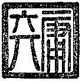
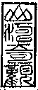
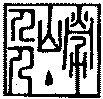
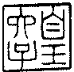
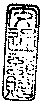

# 潭柘山岫云寺志



> **藏经**：中国佛寺史志汇刊（佛寺志汇刊）　**册次** 第 44 册（GA044）　**编号** GA0047　**部类** 史传部　**卷次** 2 卷　**篇幅** 35,848 字

> **卷／品**：2 卷 · 0 品



---



## 目录



- [潭柘山岫云寺志卷一](#潭柘山岫云寺志卷一)

- [潭柘山岫云寺志卷二](#潭柘山岫云寺志卷二)



---



潭柘山位於北平旧都正西七十里，山本来自太行，冈连西山，旧志称太行第八径，为神京之右背，山势险峻，上干云霄，挹抱廻环，峦重岭复，特称幽奥，名迹最多，古有龙潭柘林，因得名焉。山怀有古刹，俗呼潭柘寺，随山而名之也，开创於晋，谓之「嘉福寺」；肇兴於后唐，名曰「龙泉寺」；重饰於金熙宗皇统年间（一一四一～一一四八），敕赐寺额「大万寿寺」；明宣宗时（一四二六～一四三五）赐名「龙泉寺」；英宗正统年间（一四三五～一四四九）诏改「广善戒坛」，并赐金额，颁大藏，建阁贮之；天顺元年（一四五七）敕改，仍名「嘉福寺」。燕人谚云：「先有潭柘，后有幽州。」此寺之最古者也。古寺自宣德初年（一四二六）重拓，弘治年间（一四八八～一五〇五）复修，岁久敝坏，清康熙三十一年（一六九二）赐金重修，赐御书额曰「敕建潭柘山岫云禅寺」，崇宏侈丽，远轶旧观。本寺历代法统，始自晋华严禅师，继之者有后唐从实禅师、金佛日圆明禅师、广慧通理禅师、政言禅师、相了禅师，元瑞云霭禅师、雪磵禅师、柏山智公禅师，明无初禅师、无相观公禅师、西竺源公禅师、大圆佐公禅师、正舍禅师。清康熙间中兴以后之住持，有震寰、止安、德彰、洞初、本然律师等。乾隆四年（一七三九），清宗室神穆德撰「潭柘山岫云寺志」一卷，分为六门：主山基宇、梵刹原宗、中兴重建、历代法统、行幸颁赐、名胜古迹。光绪九年（一八八三）释义庵复辑和硕恭亲王於光绪乙酉季春及乙酉秋两游岫云寺之诗作十八首，又辑中兴第五代本然明寿律师以下各代住持，止於第十七代慈云普德律师，综为一卷。后人将此二卷合刻为一帙。兹据国立中央图书馆藏清嘉庆至光绪间递刊本景印。



序国立中央图书馆藏



予性癖山林，兼爱静中之味，故於公事之暇，𢦙就宿僧舍取其静也。僧时见予常注目郊原林木并山水畫图，窃知予之癖此也，因述西山潭柘寺之幽雅静深等佳处，推为神都境内无上古刹，而贵贱贫富、智愚贤否，无弗倾心思至者，而思至者，究亦不能皆至也。读书攷古之君子，冀遇之几案间。而碣碑矗立，数百年之雨琢风雕，谁模石鼓？梨枣蛀蚀，岁千翻之箒磨墨渍，仅传晨钟。以致宗风虽胜，而胜迹不能普传；佛日常辉，而辉光未能流简册，是岂能一缺限哉？然幸旧纪犹存，聊为之约编参究，即可补之，不必俟夫女娲也。故留心自任访询其抄本旧志，及别传异记诸文，折衷节取，合编叅订以成之，名曰潭柘山岫云寺志，筹为名山胜迹，少效微劳。而又思世或令癖山林、躭静味如予，益思至潭柘而不能皆至者，诗此或可稍慰其情，则此举不为无谓矣。



时乾隆四年岁次己未暮春望日也



原任镇守朔平府等处建威将军．加二级．纪录三次．镶红旗．都统宗室．神穆德谨序



神穆德印



庸▆



潭柘山岫云寺志总目



主山基宇  

梵刹原宗  

中兴重建(下院附)  

历代法统  

行幸颁赐  

名胜古迹(附诗)



------



## 潭柘山岫云寺志卷一



主山基宇



潭柘山在京都正西七十里(出平则门至黎园庄四十五里，从黎园庄至山二十五里)，山本自来太行，冈连西山，旧志称太行第八陉，为神京之右背是也。险峻叠岫，巉干云霄，挹抱廻环，𪩘重岭复，特称幽粤，名迹最久。主山以培𪣻当群山心，九峰扆而立。古有龙潭柘林，因得名焉。(旧志古有三潭，潭水磅礡遶峰而出，其一今为寺基，二则甃以为池。又言柘树千章、修竹箯娟者，今无矣。)潭水之支委涌洋在山额，去寺数里，建瓴下流，泉走石崖壁间，滔滔然声甚怒。至寺桥水益怒，闻者莫不愕然惊讶而苏然离烦。柘木惟存枯株一枚，今以为古迹矣。



梵刹原宗



潭柘山怀有古刹，俗呼潭柘寺，随山而名之也。其趾本青龙潭，所谓海眼。华严师时潭龙听法，师欲开山，龙即让宅。一夕，大风雷雨，青龙避去，潭则平地，两鸱吻涌出，今殿角鸱也。开创於晋，时谓之嘉福寺。肇兴於唐朝，名曰龙泉寺(从实禅师事见碑记)。重饬於大金熙宗皇统年间，敕赐寺额大万寿寺。世宗大定年间，广慧通理禅师建造。章宗明昌年间，相了禅师住持兴建。明成祖永乐年间，无初禅师住持，建置甚广。宣宗宣德二年，孝诚皇后赐帑，建造殿宇。越靖王建延寿墖，敕赐名龙泉寺。英宗正统年间，诏攺广善戒坛，并赐金额，颁大藏，建阁贮之。天顺元年敕攺，仍名嘉福寺。孝宗弘治十年，良宦戴公重葺寺宇。神宗万历年间，太宰陆公光祖、太仆卿徐公琰启慈圣皇太后重新殿宇。前后数名之矣，独潭柘名传久不衰。燕人谚曰：先有潭柘，后有幽州，此寺之最古者也。都城自辽金以后至于大元，靡岁不建招提，明则大珰无人不建佛寺，梵宫之盛，倍于建章万户千门。成化中，京城内外勅赐寺观至六百三十九所，见周尚书洪谟奏疏中。内臣作观，此则琳宫绀宇，皆巨珰逆竖所为，唯独潭柘一区无宦竖建造之迹，洵可称清净佛地矣。(按谢迁〈重修嘉福寺碑记〉称，弘治年间司礼监戴良矩捐金修寺。良矩，号竹栖道人，引年休，致步至潭柘，见寺敝坏，遂为倡修，与于魏诸珰借琳宫而营生圹者不同也。)寺碑七。金碑二：明昌五年僧重玉诗，大定十三年杨节度记。元碑二：至正八年葛天麟记，至正某年危素记。明碑三：正统某年胡濙记，弘治十年谢迁记，万历中紫柏禅师送龙子归潭文也。



明大学士谢迁记重修嘉福寺碑文曰：



司礼监戴公顾命旧臣，引年休致，雅爱山水。时维弘治十年秋，步至潭柘。僧通经通严等曰：此地有古寺曰龙泉，我朝天顺初奉勅改名嘉福，岁久敝坏，弗称祝厘之所，盍图葺之？公曰：善。於是出所积为工食费，又请於上赐金益之，殿庑堂室焕然一新。又增僧舍五十餘楹，工兴於正德二年三月，迨次年九月告成，公属予为记。窃闻潭柘山者，距城西二舍许，当马鞍山之西，有泉汇而为梯潭，土宜柘木，因以得名。后唐时，有从实禅师与其徒千人讲法於此，后遂示寂华严祖堂。皇统间，改为大万寿寺。继有广慧通理者，踵实师之迹，成大道塲，山灵益加显焉。其详见於大定间蔡居士杨节度之碑可考也。我朝宣宗皇帝即位之二年，特命高僧观宗师住持，孝诚皇后首锡内帑之储，肇造殿宇。越靖王又建延寿墖。英宗睿皇帝诏为广善戒坛，颁大藏经五千卷，并赐金额，迄今岁逾一甲子矣。所以绍前美，启后观者，实於戴公赖之。公名义，字良矩，号竹栖道人。斯举也，岂福田利益之谋哉？其亦感时怀昔有餘不尽之心也夫！



大明正德六年岁次辛未秋七月日撰



(金僧重玉诗，及紫柏送龙子文，各从其类，附编於后。其他诸记，则以年久，数经兵灾，失残靡完，因未得全录焉。)



中兴重建



(按西山诸刹，惟潭柘最古。晋唐以来，寺屡兴废。自明季至今，𫄰搆日增，则山僧营度之勤，檀越布金之力，不可没也。高卑纵广，具有丈尺，如其制录之使，后有考焉。)



岫云寺



在潭柘山前，寺以山名者久。肇兴於晋唐，重饬於金元。明宣德初重拓，弘治年复修，岁久敝坏，国朝康熙三十一年圣祖仁皇帝赐金重修，及赐　御书额，曰勅建潭柘山岫云禅寺，崇宏侈丽，远轶旧观，实为山林增胜云。寺基南北八十丈有奇，东西五十丈有奇，周围共三百丈。寺前牌坊高二十五尺，纵八尺，广三十五尺，前曰翠嶂丹泉，后曰香林净土，圣祖驾幸时赐额也。坊临怀远桥，桥广二十一尺，修二十八尺，入山门百餘步，面势严整，山环水绕，甫临初地，心目为之旷然。山门高二十七尺，纵一十三尺，广三十三尺，勅建新额丽焉。内为天王殿三间，高三十七尺，纵三十四尺，广五十尺，旁两间各通，门径高广亚之。正中为大雄宝殿五间，崇七十一尺，纵五十八尺，广九十八尺。月台高七尺，纵二十七尺，广七十六尺，围以白玉石阑，镂刻精巧，纵广如阑之制，高乃半焉。殿之宏丽严整，像设之金宝璀璨，又为寺中之冠，赐额所谓清静庄严者，称是矣。殿之前，由天王殿西为十方堂五间，高二十尺，纵一十七尺，广三十三尺。前有寮房二间，天王殿后为钟皷楼，楼东西相向，纵广各一十八尺。正殿后为三圣殿五间，高三十四尺，纵三十九尺，广六十九尺。前楼卷棚五间，高亚丈许，纵不及三丈，广如之，所谓斋堂是也。正殿再后，最弘丽者为毘卢阁，七间，崇四十七尺，纵三十八尺，广十丈有奇，云梯百尺，可供眺览，诸天肃穆游者，不轻入也。圆通殿三间，在毘卢阁东，高二十一尺，纵二十九尺，广三十九尺。舍利墖在圆通殿东，高五丈，纵广各五丈。地藏殿三间，在舍利墖东，高二十九尺，纵二十七尺，广三十五尺，香灯寮附焉。药师殿三间，在毘卢阁西，高三十一尺，纵二十一尺，广三十五尺，香灯寮附焉。其东西耳房、庖湢薪菜之所、典座之寮，约共四十餘间。东伽蓝殿系鍾板堂，西祖师殿系西板堂，各三间，俱在大殿前，高三十四尺，纵二十九尺，广四丈。其东西配楼、东西过厅、东西戒堂，及监司知殿、羯磨寮、书记寮、教授寮、学事堂、都管寮、念佛堂、殿主寮、客堂、客厨、果房、米库、面库等，俱在三圣殿左右及毘卢阁前。此寺正中殿阁之大概也。方丈五间，在东配楼后，高二十八尺，纵三十五尺，广六丈。静室二间，东厅三间，俱在方丈。东客厅三间，知客寮一间，在方丈西，前庭幽爽，列莳花木，御题松竹幽清，非道风高峻缁素钦心者，殆未易居此席也。行宫五间，在方丈前，崇二十四尺，纵三十七尺，广五十四尺。御茶房五间，在行宫左。南楼五间，在行宫前，高三十九尺，纵一十七尺，广五十三尺，左右耳房各一间，楼最轩敞，坐对寺前锦屏，捧曰诸峰，霞光翠影，瞬息异状，清钟梵呗，若远若近，荅谷响而漱松风，山间清旷之境，无过於此。宜乎翠华临幸，於焉憇息而娱情也。东廊房五间，在南楼左。南廊房五间，在南楼前。南膳房三间，北膳房三间，俱在南廊房右。太后行宫三间，在地藏殿东，崇二十一尺，纵二十七尺，广三十三尺。内侍房二间，在宫北。万岁行宫三间，高二十二尺，纵二十三尺，广三十四尺，在太后宫前。侍衞房一间，在宫右。流桮亭，在万岁宫后。按《日下旧闻》，宫中有万岁流桮亭，盖引玉泉之水入焉。(高士奇〈金鼇退食记〉云，流桮亭在无逸殿旧址，风𣠄水槛，甍角飞动屈曲，溅玉飞琼。)此间潭水自山而下，㶁㶁绕阶，中亭镂砖石为九曲，放之则流驶不停，止之则清澈可鉴，洵足以澄虑怡神。妃嫔宫七间，在万岁宫右附，内侍房二间，行宫制度，虽不及殿阁之崇广，而碧瓦朱阑，明敞靓丽，与泉香翠影相萦带，御书匾联，日星辉映，奇花异卉，皆出内赐，青葱芬馥，在鹊𬬻翠扇间，娱亲爱日之诚，至今犹可想见焉。古观音殿三间，在毘卢阁西北角，高四十一尺，纵四十九尺，广六丈，围以石阑，畧如前殿之制，而地势殊高，可俯而临视也。文殊殿三间，在观音殿东，高二十六尺，纵二十五尺，广三十四尺，左附香灯寮二间，系一音堂旧址，明万历年间，紫柏尊者静息于此，今仍旧额而供像焉。六欲自虚，纤尘不着，恍惚与尊者相对，出世之想，怀古之情，缅焉而深。祖堂三间，在观音殿西高二十六尺，纵二十五尺，广三十四尺，右附香灯寮一间。龙王殿三间，在祖堂西高二十二尺，纵二十一尺，广二十五尺。大悲殿三间，在观音殿前，高一十七尺，纵一十五尺，广二十五尺，右附香灯寮一间。孔雀殿三间，在观音殿前，高一十七尺，纵一十五尺，广二十五尺。左附香灯寮一间，势至殿三间，在药师殿前高二十三尺，纵一十六尺，广三十二尺。东西寮房各三间。药师殿在毘卢阁西，故先及之，势至则自西北而南矣。戒坛三间，在势至殿前，崇三十七尺，纵广各五十五尺。内玉石须弥戒台一座三层，高一丈，纵广各一丈六尺，髹彩严饰，妙华缤纷，使人摄心净念，如对诸天左右寮房各七间，东西监坛亭各一间，配房各三间，皆严洁过於他所。楞严坛八面圆殿一座在戒坛前崇四十九尺，纵广各四十七尺。四围玉石雕阑内坛，八方高二十五尺，纵广各一十六尺。像设庄严，华光镜采，重重涉入一依经文结制曲尽其妙。盖戒坛为历代建置，势虽严整，尚与他处相亚。楞严坛则监院印如致诸大檀越，殚力鼎建，宏丽殆远，过前代矣。此亦导师苦心，特於化城宝所指示廻向第一义耳。如谓此胜彼绌，则恒沙七宝视一微尘一毛端，岂有差别哉？坛外左右忏寮各五间，东西过厅各三间，照厅五间，左右附寮各一间。静室三间，在西过厅内院外，客堂五间在照厅前，左右寮房各六间，前厅房七间在客堂前，皆所以翼衞坛仪者也。大悲坛三间，在势至殿西高三丈，纵三丈四尺，广三丈八尺，宏丽亚楞严坛，而像设之妙拜诵之，严相俪焉。附左右观堂、香寮廊房侧房共十餘间，前有垂花门楼，若别一院宇，自毘卢阁西面，与山岚树色相接几席间者，此为最胜矣。行宫方丈在寺之左方观音殿及大悲坛诸殿在寺之右方，而毘卢阁居中焉。左方之胜在行宫，南楼而方丈严正，开朗有俯视一切之槩，右方楼阁，因山而高窻櫺阶，陛间皆挟西山爽气。至夫晦明晴雨景态百变，花香鸟语与泉声，山翠相映发，则一山所同耳。左方之东南别为小院，曰十间房者，阶下即泉槛外即山在南楼之下，而相间若远，芳树垂檐，幽花压砌，倚修竹听，流泉邈然，身世俱忘，真幽绝境也。山中松最古数十株，夭娇可爱，竹秀而茂，尤与泉石相得，花木繁植，皆位置随，宜增珠宫绀宇之胜，不可以殚悉焉，此寺中之大概也。慈悲院在宝坊牌楼西南正房三间，高二十五尺，纵一十八尺，广五十九尺，左右耳房碾房油房之属在焉。外有门楼一间，云水堂三间，在慈悲院北寮房二间附焉。园房七间，在寺西南一里许观音洞静室在寺东南正殿三间，左右掖房各三间，门楼一间。洞在殿后，高一十五尺，深一十五尺，广一丈餘，有石刻在焉。姓氏澷泐不可辨，洞虽荒寂，殊有幽致，藉苔晏坐，清磬冷然，转觉寺中梵呗之喧也。紫竹禅院在寺东正殿三间，左右寮房各一间，两掖房各三间，门楼一间。浴室五间，在院北院中供华严畫像，即开山祖师也。歇心亭，在禅院西北高一丈九尺，纵广各一丈五尺。翠微山径，正当潭水细流跏趺，小坐楖栗横拖此亭实据幽胜。循径而上一里许为少师。静室正殿三间，左右寮房各一间，两掖房各二间。内塑少师像，山僧习静於此。烟霞庵在寺北三里许正殿三间，两掖房各二间，门楼一间。庵之西北，即青龙潭。众峰环护，一水萦廻，寺之形势益崇，而山之胜概，亦萃於是矣。余谓潭柘之胜，固在山水幽奇，而殿宇适据山水之胜。崇基累搆，掇拾於残垣。废瓦之餘，而规制聿新。俯视云萝，上插霄汉，庄严胜境，拱护皇都。西山梵刹，屈指称首焉。住持之苦心，檀护之弘愿莫大。於是后之人踵而继之，有增无废，使神龙让宅之灵迹，万古长留，岂不伟哉。



附下院



下院奉福寺在寺东南二十五里棃园庄山门一间，正殿三间，左右附寮各三间。东伽蓝西祖师殿各三间，客厨三间，在伽蓝殿前客堂三间，在祖师殿前韦驮殿三间，在正殿前方丈三间，在正殿后，左右附房各二间，两掖房各三间围房十餘间



京城平则门内潭柘，下院翊教寺山门一间，左右两角门各附房二间，钟、皷、楼二座在山门内，天王殿三间伽蓝，祖师殿各三间，大雄殿三间，毘卢阁五间，垂花门楼一间，杂房二十餘间。



建置年月(前代所修已见前篇，故不复录。)



大清康熙三十一年(壬申)，赐金勅建，赐额岫云禅寺，命震寰律师主席，剪荆除砾。弘启，毘尼殿阁、僧寮次第肇举，遂臻山寺中兴之盛。



毘卢阁  

三圣殿  

斋堂(戊辰年造)  

大雄殿  

圆通殿  

药师殿  

毘卢阁下左右配楼  

新戒东西二堂  

监司、书记二寮  

伽蓝殿  

祖师殿  

天王殿  

钟鼓二楼  

山门牌楼  

戒坛、势至殿、并前后左右各厢房门楼  

方丈并左右寮房东西客厅  

行宫二所(癸酉至己卯)



以上第一代震寰和尚创建。



东西两朝房两角门  

大厨房震寰和尚墖



以上第二代止安和尚监造。



观音殿(信官夏增吉捐赀建)  

文殊殿(监院空忍募建)  

祖堂(内监邓震捐赀建)  

龙王殿(信士季宗禹捐赀建)  

大悲殿(信官五十三捐赀建)  

孔雀殿(信士龙坤捐赀建)  

地藏殿(信士陈有德捐赀建)  

少师静室(信士孙成德捐赀建)  

观音洞静室(内监邓震捐赀建)  

彩绘大殿，并左右各配殿、各楼房、各厢房，共六十餘间(信士王惠民捐赀四十餘两)  

楞严坛并左右厢房南楼(监院空忍募造)  

止安和尚墖一座  

下院奉福寺(遵化州蔡家楼庄房，大悲会众姓捐造。)



以上第三代德彰和尚监造。



大悲坛并左右厢房门楼(俱大悲会众姓捐赀建)



附墖(舍利墖、金刚延寿墖、佛墖俱在寺内)



后唐龙泉堂上从实禅师墖  

金佛日圆明海云禅师墖(天眷时建)  

广慧通理禅师墖(大定十五年建)  

政言禅师墖(大定二十八年建)  

相了禅师塔(泰和四年建)  

元龙泉堂上瑞云霭公禅师墖(大德四年建)  

龙泉堂上雪磵禅师墖(至正时建)  

龙泉堂上柏山智公禅师墖  

明龙泉堂上无初禅师墖(宣德年建)  

万善戒坛无相观公禅师墖(宣德年建)  

嘉福堂上重开山第一代西竺源公禅师墖  

赐紫沙门嘉福堂上大源佐公禅师墖(万历年建)  

赐紫沙门嘉福堂上正舍禅师墖(万历年建)



以上历代祖师墖(共十三墖)。



本朝钦命中兴第一代震寰照福律祖和尚墖  

第二代止安超越律师墖  

赐紫沙门第三代德彰道林律师墖  

第四代洞初证林律师墖  

第五代本然明寿律师墖(乾隆元年开建墖院於新房村西南坡山墖儿崖)



以上本山中兴祖师墖(共五墖)。



本朝监寺六合春公墖  

钦命监院修林彬公墖  

监院异珍瑸公墖  

济生润公墖  

明如祥公墖  

阇黎越凡翮公墖



以上本山中兴职事墖(不及偹载)。



元妙严大师墖  

清慧大师墖  

鉴如大师墖



以上比丘尼墖。



金中都竹林禅寺第七代了奇禅师墖(大定年建)



师名了奇，姓潘，白霫富庶县人。年十六试经得度，以华严为业。闻广慧通理禅师，倡道辽海，师抠衣谒之。会广慧移锡霫川之云峰寺，师从之。一日升石落地，有省广印可。大定三年后遍历诸方学徒云萃十年示化竹林茶毘，火光中，青莲冉冉，舍利五色。建墖於潭柘广慧墖之东。



浑源州永安禅寺第一代归云禅师墖



师名志宣，字仲徽，生广宁李氏。得法於临济下。尊宿玉泉容庵老人。七坐道塲。临终说偈云。五十九年，掣电月钩。云饵作伴。而今抛却。纶竿星斗。一天炳焕。掷笔而逝。茶毘舍利。百数灵骨，分葬永安潭柘玉泉柏林四道塲。有语录归云集行世



鸡鸣禅寺曹洞正传隐峰琮禅师墖  

前住庐山终极无如禅师墖  

前住甘泉古涧泉禅师墖  

天宁寺宗师府住持章玉玺公禅师墖



以上寓墖。



十方普同墖(明万历四十七年赐紫沙门正舍建)  

德彰和尚墖  

京城潭柘下院翊教寺大殿



以上第四代洞初和尚营建(雍正癸卯至戊申)。



华严坛一所(监院空忍募造)  

大园房五间  

廊房十间  

马圈三间  

洞初和尚墖  

阇黎越凡师墖



以上第五代本然和尚营造(雍正己酉至壬子)。



历代法统(事纪未详者阙而待补)



晋



华严禅师



潭柘寺，晋魏唐宋，代有尊宿，而华严和尚为着。神龙徙宅，蚩尾涌现，琳宫弘建，法席肇兴，迄今奉为开山第一代祖师焉。释不知姓氏，唐则天时居在幽州城北，恒持华严经以为净业。其所诵时，一城皆闻之，如在庭庑之下。通天万岁年中，韩国公张仁愿之为幽州都督也，夜闻经声，品次历历然。及尔晨兴谓夫人曰：昨宵城北道人讽诵，若在衙署前也，还闻已否？夫人曰：是何地远，可得闻乎？张君曰：如其不信，可各遣小竖走马往，覆之果无差谬。张君请召入城，及相见，谓张君曰：有愿胡不报乎？答曰：现造袈裟五百缘，布施罗汉去。华严曰：勿去餘处，但送往州西马鞍山竹林寺内施僧。及遣使赍香衣物已去，覔竹林寺且无踪迹。如是深入陟高山，见一翁，问之，曰：旦随吾来。倏覩云开，寺现景物，非凡世所有。入寺散袈裟毕而少二人，彼老宿曰：可赍还二分，一与张仁愿，一与华严和尚。自此方知华严和尚是竹林圣寺中来。使留一宿，出已经年，行化既久。及终坐亡，肉身不萎败。范阳之人多往乞愿，时有徵应墖，近因兵革而废矣。



后唐



从实禅师



师与其徒千人讲法潭柘，宗风大振。后示寂华严祖堂，建墖山中。餘姚谢迁〈嘉福寺碑记〉载其事。



金佛日圆明禅师



大定年间人。金末元初时有一释名号俱同者，不得相混。



广慧通理禅师



师名开性，俗姓侯，顺州怀柔灵迹里人。九岁依都城嘉福寺戒振出家，十五受具戒。天眷初叅佛日於汴梁，未几，豁悟心法作颂，日日首肯，以正法眼藏付之。乃潜南行，历齐鲁。时昭禅师居越峰，将造之。是夕有神人冠服甚伟，语昭曰：广慧大士明日来，当扫馆宇以待。诘旦师至，众咸异之。后数主大刹大定年间，僧善诲十餘辈，请主潭柘师念潭柘从古祖师道塲禅学，扫地二百餘年。吾将起废，正在兹时。遂往经畫。众以规模弘大惧难遽集。师曰：苐恐诚不至耳。诚若至，奚患无成。方凿石际有大石误坠，众悉骇避。师恬不顾。才去，师不半寻而止。咸谓师志愿精悫致神祐云。十有一年，工始告止。大定十五年六月三十日，沐浴易衣说偈跏趺而逝，寿七十二，腊五十七。茶毘后，建墖於潭柘虎首之阳。得法者五人：善照、了奇、圆悟、广温、觉本。有语录三编行世。所著寺中规条，至今遵守，无敢遗轶焉。



政言禅师



师，许州长社人，姓王。九岁诣资福禅院净良祝发受具戒。后叅香山慈照禅师，尝入丈室请益，慈照曰：诸法如意，即诸如来。师言下有省，即说偈：诸缘不坏，了性无灭。云散长空，碧天皎月。照可之。后至中都叅竹林广慧通理禅师。既而梁园大长公主暨东京留守曹王请师住潭柘龙泉寺，遂继惠公法席焉。三岁制颂古拈古各百篇注禅说金刚歌。又著金台录真心真说，修行十法门，皆行於世后，大定年间，说偈而化。



相了禅师



师义州弘政宋氏之季子也。初举止端重，行必直视，坐即跏趺。髫年闻祖父诵赋，至秦皇汉武不死何归，师便问：死归何处耶？祖异之语其父此子非尘，俗中人。令依本郡大嘉福寺祚公落发名行录，九岁得度，习华严、圆觉等经，神机妙解，发於髫龄，历诸讲肆，同学共尊，咸平石城，继请讲授，开诱不倦。一日，忽念经云：修多罗教如标月指。经既为标，月何所在？寻闻辽阳禅刹有大导师，单传佛心，不立文字。乃罢讲腰包，径往清安。访月，公不契，遂造咸平。见定公复往锦州。大明叅诱公命掌记室，久之亦无所得。诱曰：汝缘不在此。懿州崇福超老人，明州嫡嗣也。可往依之，必为子发其奥耳。乃拜辞，遽谒超公，一见曰：丛林主来，何暮命掌？维那一日问：俱胝一指头禅，受用不尽。未审和尚有多少？超应声一吹。师忽然有省。如披云见月，欣跃无量，呈颂云：窥破浮云月色寒，狂心顿歇髑髅乾。通身光透威音外，普应群机作大缘。超印可，乃更名相了众，举立僧。机锋超逸缁素倾。仰后遁去隐云峰。禅悦自乐然令名。振飞德香，远播懿州。连师敦请，开法崇福。北京留司具疏迁住松林龙象，云归人天。蚁慕东京，留守曹王向师道风请居大惠安六稔，规范肃清。但性乐闲寂，倦於应对。遂夜遁闾山宁国寺，枕石眠云，作终焉之计。明昌年间，会潭柘虚席功德主岐国大长公主恭请住持宗风大振四年。又晦迹天王小刹冀国公抑居竹林。师媿名为道累，息迹无计，未经岁，退居城隈古寺。龙泉闻知，复迎颐老，乃欣然从之曰：吾将终老此山。师禀性纯质，加之慈恕，心不忤物。一生未尝畧起瞋恚，纵遇呵毁，容色不易葢心如大地八风不能动也。虽五坐道塲，皆信缘甘分，诲门弟子皆退步就理。日损之语嗣法者三人，道积相崇善惠各行道一方。泰和三年十月末旬，忽示疾，至期索笔书偈云：



三十餘年说法弄巧成拙　临岐更为诸人重重漏泄  

本来无法与他人　依旧清风伴明月



偈毕右脇长往寿七十，腊五十二。茶毘日，有百千蝴蝶。自烈熖出，祥云五色，徧现空中，牙齿不毁。门人收灵骨树石墖求铭於重。苏叟叟曰：汝师，吾畏友也。其潜德密行，非吾所知。聊述事迹，以纪岁时耳。铭曰：



混沌未分　太初冲寂  

情窦日凿　妄兴智识  

识丧乎真　智劳乎神  

所贵达人　返朴还淳  

抱瓮忘机　拾蜩凝虑  

普化风颠　谷泉垢污  

了公导师　纯粹天资  

道齐先觉　行同婴儿  

火里琼瑶　雪中松柏  

温润坚贞　炎凉叵革  

佛鉴远嫡　明州亲孙  

穷理尽性　寻流得源  

接物功成　顺缘而化  

识返真常　名流华夏  

我作芜词　雕氷镂雪  

刻诸翠琰　以示来哲



(按重苏叟不知其姓氏文虽繁，不便删削，铭亦可观，故全录之耳。)



元



瑞云霭禅师



雪磵禅师



旧志维见顺帝赐酒皇姊致膳之句。



柏山智公禅师



明



无初禅师



师名德始，字无初，日东信州神氏子。幼遇群儿嬉戏，辄引去，见僧过门，则色喜。父母知其志，遣从本郡一公祝发。逮长诣天宁探群籍，三冬悉通大意，已而叹曰：文字之学，不能洞当人之性源。遂舍所学。附啇舶，抵中土，谒灵隐慧禅师，深悟单传之旨。及东归，国人景仰，尊为禅祖。闻古幽都山川之胜，结侣来游，遂憇庆寿。时独庵衍公治寺事与师有法门之旧，延致丈室，相与激扬，临济宗旨，识者称之。衍公欲以寺事付师，师不允，遂礼峨嵋。时献王咨问法要，礼遇勤厚。丙子出世无为，道望弥隆。永乐初，独庵进阶，太子少师邀师论道。六年春，应董平坡之请，居再岁，即谢事。十年壬辰，将辟静室为佚老计太宗皇帝有旨𢌿龙泉寺事，师钦承明旨，早夜孜孜，以缮修为务。凡楝宇蠧敝者易之，阶戺頺圮者搆之，丹垩剥落者新之，比旧有加焉。先是，献王致金百两与师，造西方三圣像，金彩庄严，曲尽其妙。师平昔尤喜，恤贫赈乏，薄于奉已，厚於待人，以故四坐道塲，囊无餘蓄，褚衾瓦钵，萧然自怡。临终，端坐而逝。茶毘时获舍利百餘颗，晶荧圆洁，观者耸异。



无相观公禅师



西竺源公禅师



赐紫大圆佐公禅师



赐紫正舍禅师



大清



钦命中兴震寰律师



师名照福，字震寰。顺天大兴人，姓孟。七岁就延禧寺祝发。康熙七年戊申冬，於广济寺万中律师圆具足不越阃十有五年，精研毘尼，同学共尊。二十二年癸亥，本寺监院同众请师继万老人行席於广济。二十五年春，奉旨住潭柘。是年秋圣祖仁皇帝驾幸山寺，奏对称旨，温语奖异。自是学侣云集，法财雨施，建造日新，金碧像餙，擅西山诸刹之胜。戊寅秋，示微疾，奉旨命内务府佛大人选医调治，因奏请本寺阇黎止安继席。己卯五月六日，辞众而逝，寿六十六，腊三十二，主丛林。一十七年，八坐道塲，护持法门，专精戒律示寂时，特赐帑金龙旗宝仗，临葬建墖於本寺之前，四十一年四月驾复临幸皇情眷恋命，取畫像进览，咨惜良久，题七言，绝句一首，殊恩异数，实为兹山所仅见云。



钦命止安律师



师名超越，字止安，顺天大兴王氏子。髫年依胜福寺海云师薙染。康熙十四年乙卯，於万寿戒坛，道光和尚圆具。二十五年，振公中兴潭柘师掌监寺，总摄内外，不辞劳勚，法众咸服。三十三年，大殿毁，赐帑重新置栋一株，先拟左众，欲右之，舁不能举，师祝曰：吾左汝也。不数人舁之而行。三十八年己卯，有旨继席本山。明年，同众知识，请安畅春园，因观虎圈、虎威，众不敢前。师近曰：汝由性暴，故堕虎身，今犹不改，何也？请伏吾为汝说三归，可脱此皮毛也。虎驯伏，说毕，摇尾而去。餘多奇迹，师恐近怪，勅门徒勿以语人。四十一年仲夏，示微疾，至八月，辞众而逝，寿六十一，腊一十七。建墖於振公之左。



赐紫沙门德彰律师



师名道林，字德彰，河间人。少依龙坡寺乾宗为师，后於广济寺道光和尚圆具。康熙四十一年壬午钦命主席，持诵叅礼，顷刻无间，常领众绕舍利墖，念佛不辍。经年，墖忽放光后，每岁常然远近见闻，无不归心。师住持二十餘年，兴造最多。壬寅十一月晦日，合众念佛，端坐而逝，寿六十一，腊三十九。建墖於振公之右。



洞初律师



师名证林，字洞初。真定武邑人，姓张。生时有异徵，颖悟过人。幼从京观音阁，从心薙染。康熙二十八年己巳，受具於本寺振寰和尚，徧诣讲席，讨论性相。后叅柏林妙伟和尚有省。壬寅，继席本山精严律仪，时与诸弟子讲演梵网四分毘尼等律仪，洞明开遮持犯之义，不为律䌸，不犯律仪，圆陀陀，活泼泼，虽律而禅，虽禅而律，宛转偏正，纵横妙叶，人天共仰，龙众咸归。雍正六年戊申十一月五日，说偈坐逝，寿六十三，腊三十八。茶毘时，禅云五色，从烈熖中出，火后收灵骨，建墖於止公之东。



本然律师



师名明寿，字本然，顺天房山人，姓杜。



行幸颁赐



康熙二十五年丙寅秋，驾幸潭柘，御书金刚经十卷，药师经十卷。沉香山一座，寿山石观音一尊，罗汉十八尊。



三十一年壬申，赐修大殿银一万。



三十六年丁丑，驾幸潭柘：「勅建岫云禅寺」额，大殿额「清静庄严」，天王殿、毘卢阁、戒坛、大悲坛御书额，金黄龙縀大旛一对，竹帘一百六十挂，绵帘一百六十挂。



三十七年戊寅赐：桂花十二桶，龙须等竹八扛(植行宫前后)。御书牌楼额，前「翠嶂丹泉」，后「香林净土」。



三十八年己卯赐：大殿镀金剑，光鸱带四条。



四十一年壬午驾幸潭柘，御书行宫额「倚松恬澹」、「松竹清泉」，方丈额「松竹幽清」，楞严坛南楼五云多处。对联：



庆云宿飞栋  

喜树罗青墀



经声夜息闻天语  

罏气晨飘接御香



御书旧作潭柘诗一章：



怡神水树清榤洽　满目奇峰入夏云  

微起凉风响万籁　山中莺啭奏纷纭



御题振寰老和尚畫像诗一章(并序)：



朕偶至潭柘览老和尚照福畫像因而有感故作诗以赐之：



法像俨然参涅槃　皆因大梦住山间  

若非明镜当台语　笑指真圆并戒坛



赐斋僧银三百两。皇太后赐：饭僧元宝四个。



四十三年甲申赐：墨刻心经塔一轴，墨晶罗汉一尊，大雄殿古铜供器一堂(凡五件)，大铜磬一口，金钟一口。



五十二年癸巳赐：墨刻金刚塔一轴，万寿罏一座，岕茶二缾。



五十四年乙未赐：喇嘛藏佛一百尊，金山寺诗一轴，橘柑榛果共八扛，大红縀大旛一对。皇太后每年赐：饭僧银五百两(四十三年甲申至五十六年丁酉)，又织金幢五十对，织金旛五十对，锦幔一百方，龙縀棹围二百条，绣锦经盖八百袱。怡亲王施：楞严道塲上供银一百两，礼忏银一百两。庄亲王施：客堂额「来紫气」。果亲王施：楞严坛额「金姿宝相」，又「慈云普覆」。对联：



登自在天　金口圆音宣落落  

入三摩地　玉豪光相昱如如



显亲王施：石刻心经板三块，毘卢阁额「翠嶂清泉」，楞严坛额「月镜常圆」，观音殿「松风水月」，方丈「青运喻法」。对联：



默坐烟霞散  

闲观水月明



雨花似引三车语  

佛火微明七宝函



诗二首（附录）：



山花绣云根　潭心湛明月  

流水无俗情　终年潄白石



绝壁启松门　清泉分竹径  

林籁天风鸣　空山一声磬



名胜古迹(诗附)



尝考潭柘山，实剏自司马氏为燕都胜迹，迄今年将二千姓更十餘矣。虽废兴数数，而基趾难湮，谓非山林灵气之所呵护，佛轮常转之所维持乎？野谚曰：先有潭柘，后有幽州，虽俚鄙近齐东，而寺之最古，亦可槩见旧志所载柘林竹丛，今虽无存，然前人亦何爱於潭柘而为之创虚名以诳世哉？则二景之有亦可信。试据目前之可覩者，论之森森者松也，傍峰岚而蔽日，山僧与野鹤共挹。其凉涓涓者泉也，遶殿宇而流清香，积偕客缨，各濡其志。鸣声上下，半部鼓吹，红紫万千，天然锦绣。虽纵横周匝无十里，而流连游赏可百年始悟洞里乾坤桃源内信有桑麻鸡犬。寰中扰攘红尘里，谁知辟胜探奇。兹欲罗列古迹之可传，用是曲写今时之可乐。游兹寺也，或值云雾四塞不辨方陬，渍渍清香扑鼻手，如持七宝玅树，或值日光普遍，彻显庄严，历历美景，怡情身疑，登八功德池，常来者辄忘返，久寓者永不厌。僧钟永续客屐多穿自华严师而后其驻。锡之高僧不啻数十餘辈，即我圣祖仁皇帝亦尝驻跸於斯，而谓其名山胜境，不亚五台焉。夫既经圣人之品题，何难定招提之称誉？即谓之为文殊大士之化宇，秘魔宝岩之别院也，亦无不可。



诗附



从显宗幸潭柘(今勒石於舍利墖傍)



金释重玉



一林黄叶万山秋　鸾仗参陪结胜游  

怪石斓斒蹲玉虎　老松盘屈卧苍虬  

俯临绝壑安禅客　迅落危崖渴瀑流  

堪笑红尘名利客　几人於此暂心休



秋日游潭柘山礼祖墖



明释道衍



早悟人生如寄尔　不计流行与坎止  

只缘山水窟中人　此心未肯负山水  

策蹇看山朝出城　葛衣已怯秋风清  

白云横谷微有影　黄叶堕涧寒无声  

乍登峻岭宁知倦　古寺重经心恋恋  

潭龙蛰水逾千丈　空鸟去天才一线  

老禅寂灭何处寻　孤墖如鹤栖乔林  

岩峦幛开豁耳目　岚雾翠滴濡衣襟  

燕山如此越物表　下视群峰一拳小  

何时乞地息餘年　不学乌巢居木杪



潭柘山三首



(泗水)郭武



潭柘山高处　金银佛寺遥  

断崖吹石雨　虚阁贮松涛  

结社还携酒　临溪欲弃瓢  

白头僧自老　相对说前朝



来寻古寺宿　骑马白云层  

犬吠到门客　香薰入定僧  

半龛崖际罄　孤墖夜深灯  

有暇频过此　繙经证上乗



青山亦无尽　细路转来通  

霜草萦浅碧　霜梨落半红  

罏存前劫火　树老两朝松  

无柘无潭寺　年年现雨工



潭柘南村



(蒙阴)公鼐(明)



芙蓉村下绿溪环　刳木通流乱石间  

十里浓烟深树里　钟声冉冉过前山



潭柘



(武进)金印荣(明)



蟠屈竞深寻　崇严据幽窄  

清水穿树根　树光泽以碧  

攒峦碍奔云　少人而多石  

视天不盈亩　视地不逾隙  

嶷嶷古寺存　云是龙之宅  

法能除龙嗔　龙亦舍其国  

或时龙归来　雷雨火青赤  

灵怪伏潭底　神圣居潭背  

谁知世代湮　犹存灵异迹



一音堂示诸法侣(七首)



明释达观(真可)



梦里青山梦里身　了然去住别疎亲  

何须醒后观憎爱　始信龟毛第七尘



日暮龙潭即目(其二)



岩端待月一天静　石上听泉万虑空  

笑问同来二三子　是谁行乐有无中



赠潭柘龙泉寺柘林藏主(其三)



布衲萧萧抱寂寥　遍探龙藏荅清朝  

山深自是桃花晚　红白枝枝祖意饶



潭柘怀缪仲淳(其四、五)



谷水龙泉一片云　去来谁复见离群  

夜深惟有沧溟月　无限清光不可分



晓露风高便结霜　冰凌入夏袭衣裳  

人间暑气浑无有　五顶经行少缪郎



再游潭柘寺(其六)



峨嵋万里去重来　法雨香林徧九垓  

谁料昔年荆棘地　空山已复涌楼台



一音堂寄怀静光滑居士(其七)



世路多崎岖　悠悠寄岩谷  

去来惟白云　天地亦茆屋  

渴有泉可饮　饥有松充腹  

明月上东峰　贝叶聊披读  

会旨忽丧我　朗然镜光复  

松边坐良久　介尔一成六  

天水本不远　亦宁非五竺  

行踪顾难留　去去心有属  

邂逅虽可期　江山阻人目  

摇摇莫进思　卷来托兹幅



国朝



圣祖御制六首



下戒坛将至潭柘，马上同高士奇联句二首



岭腹层层小径斜(御制)　穿云陟尽石㟏岈(臣高士奇)  

涧中草屋流泉绕(御制)　万匹龙骧拥翠华(臣高士奇)



其二



蝉鸣草木动薰风(御制)　蛱蝶双来引御骢(臣高士奇时有双蝶飞导仗前)  

潭柘幽深聊驻辇(御制)　省方不与豫游同(臣高士奇)



潭柘寺偶作(其三)



怡神水树清襟洽　满目奇峰入夏云  

微起凉风响万籁　山中莺啭奏纷纭



咏潭柘寺竹(其四)



翠叶才抽碧玉枝　经旬清影上阶墀  

凌霜抱节无人见　终日虚心与凤期



夏日潭柘寺(其五)



微云缀冈岭　细路扬前旌  

磴转松门开　渐觉沙界平  

潭湮石甃露　柘古苔纹生  

一径得疎豁　层轩面峥嵘  

爱此户外泉　俯视涓涓清  

修篁挺苍翠　其下流交横  

雯然淇澳思　宛尔渭滨情  

嶰谷有遗响　箫韶鸾凤声



观苗无意到潭柘咏时景(其六)



昼永薰风至　清泉决决长  

芳年添景色　迟日换流光  

旧行随堤发　新花满涧香  

观苗不觉晚　微雨点衣裳



扈　跸西山纪事(四十首之四)



(桐城)张英



灵境无如潭柘杳　幽栖真见古瞿昙  

惭无济胜登临具　咫尺名山不易探(上幸潭柘念臣英艰於登陟命暂留石景山)



岩壑纡廻入渺茫　鸟啼花落总天香  

浑河西畔山逾秀　福地珠林纪晋唐(潭柘山更幽奇佛刹乃晋唐之遗)



翠竹烟梢碧玉姿　傍崖临水绿参差  

皇心珍重凌霜节　题作筼筜第一枝(潭柘有竹最茂　御制诗咏之)



宝翰偏宜洞壑藏　山光云影入天章  

一经洗笔溪头水　清涧常流御墨香



扈驾游潭柘三首



高士奇



九峰合㳫树蒙丛　野蝶山蜂满目中  

扈从𢋫飏千载事　吟鞭时近玉花骢(下戒坛　幸潭柘命臣士奇於马上联句二首)



枯柘还餘选佛塲　金元碑碣纪沧桑(潭柘寺有金元碑记佛殿下有龙潭)  

登临原是勤民暇　犹有茆檐念不忘(上幸潭柘寺爱其幽邃吟诗二章虽在豫游未尝不在天下蒸黎也)



老幼村村望荜门　太平鸡犬足饔飧  

喜瞻鸾斾威容盛　山果盈篚献至尊(上幸潭柘还道左民人携老挈幼聚观上命勿禁时有献青李者)



游西山(八首之一)



(合肥)李天馥



柳塘轻浪煖　水箭漾红亭  

縠绉流清浅　藤萝入杳冥  

猿啼深涧冷　龙卧古潭腥(潭柘有神龙听法)  

东向看归道　重城暮霭扄



潭柘宿风



(宛平)王崇简



山空夜半雨　触处欲惊龙  

钟破凉烟入　寒依荒籁通  

沟花何处辨　动鸟几林风  

此际生新思　峰峦集梦中



重游潭柘寺(山中蛇虎时见不为害)



烟冷云荒野径迷　游踪又到碧峰西  

蛇蟠虎伏凭人说　柘萎潭迷听鸟啼  

䨇吻势增危殿矗　千山影断僻门低  

攀幽为忆当年侣　惆怅空山落叶凄



其二(寺有唐碣元妙严公主拜砖)



迈岭盘溪尚未艰　峰峦廻互缀烟鬟  

石根泉落犹穿石　山外云生别起山  

残碣糢糊苍藓上　遗砖寂寞乱红间  

催人暮雨迟迟去　欲唤龙擕潭水还



潭柘



(华亭)王顼龄



杖策戒晨装　兴发事幽讨  

黄叶覆石梁　峭壁插晴昊  

马蹄历岞崿　砰磕如骨骹  

至止嘉福寺　枯柘风霜饱  

其下有海眼　蛟龙窟宅老  

华严戒律精　说法神龙扰  

幽潭一夕徙　金碧焕云表  

殿吻髯鬐张　传自龙王造  

至今佛座下　犹闻波浩浩  

摩挲画壁间　祖师骑龙矫  

龙子遗五百　隐现无昏晓  

当春始出游　掬水故相嬲  

我行闻此言　龙呼何猾狡  

刘累能豢龙　醢龙龙去蚤  

叶公好似龙　真龙便惊倒  

如何此伎俩　人龙共相保



游潭柘三律



(黄冈)王泽弘



半生踪迹摠飘摇　今日何缘度此宵  

山古石留秦代树　泉深水接海门潮  

感恩秋垒今俱破　济世雄心亦渐消  

到此无生无可说　江山满目是鱼樵



寻幽不惮路行难　石磴层层百折湾  

飞瀑穿云飘古雪　乱峰迎日闪苔斑  

山游历险心愈輰　水涉临深意自闲  

应笑世缘何日尽　早擕飘笠叩禅关



谷转溪廻别有天　四山环绕尽流泉  

龙分两地蹲鸱吻　人拜䨇趺透石砖  

杰阁凌空钟梵落　巉𪨷倒锁洞云眠  

莫言惠远开莲社　岭上青池有白莲



雾中由戒坛度罗㬋岭，稍霁至潭柘



(松江)王鸿绪



既瞻戒坛松　言观潭柘树  

山僧劝我且莫行　白额秋来乱林坞  

我闻斯言大吁怪　欲行不行日亭午  

此生到处被物厄　不信山游复有虎  

擕朋大笑出寺门　樵子前驱荷干橹  

联镳兀兀云雾中　羊肠鸟道愁花骢  

十步九折凌绝壁　仰面直欲摩苍穹  

但觉千山万岭同一气　举世高下归鸿蒙  

我仆马蹇滞岩底　招呼不辨西与东  

兹山猛虎固安在　耳边作吼惟松风  

须臾度岭四天豁　西崦已堕铜轮红  

忽见九峰开锦帐　朱霞一抹青芙蓉  

红楼金殿耸天际　秋林杳霭闻清钟  

我策我马入幽谷　苾𫇴相引山之麓  

绀宇辉煌绕玉阑　禅房窈窕摇修竹  

古柘千章无复有　妙严䨇趾今谁续  

日斜不及访龙泉　仰睹峰头乱红绿  

对景行厨泻酒醅　临风万里酣高台  

我且歌　君莫哀  

元规朝市多尘埃　城外名山谁看来



潭柘寺分得柘字



(宣成)施闰章



良游欣素侣　越岭骋幽暇  

眷兹云外峰　尘缨罕策驾  

绿阶泻碧泉　古树卧残柘  

旧闻此海眼　真僧夺龙舍  

灵迹信有无　蜿蜒见犹乍  

阳坞竹还青　春渚梅未谢  

栖宿尚𪨷扉　潺湲响清夜



潭柘寺分得柘字



(宣城)梅庚



同游为毛会侯、姜西溟、严荪友、朱锡鬯、秦留仙、朱品方、曹宾及、施愚山，主人张见阳。



古殿护灵湫　磴道丹泉泻  

一线入青冥　残柯偃枯柘  

讲坛花尚飞　福地龙能借  

蜿蜒闻至今　时时窜僧舍  

帝女存遗甓　䨇趺宛承藉  

往迹探未穷　尘鞅憇初暇  

延赏及餘春　疎梅敷竹榭  

劖厓表岁时　摇笔媿颜谢



畣耦长，同愚山山中寄怀诗



(新城)王士真



听吟潭柘寺　宛抚戒坛松  

空翠行相引　清晖复几重  

孤笻穿鸟道　百里望云峰  

述作思陶谢　幽寻怅莫从



送梅耦长游潭柘山



徐元梦(蝶园)



送尔看山去　山中花正开  

晚霞明远岫　春草暗高台  

鹿傍松崕过　僧穿石洞来  

遥知幽兴极　醉月坐莓苔



又



邵长蘅(子湘)



西山青突兀　连蜷都城傍  

马首见空翠　欲往神飞扬  

羡君遂幽讨　明侣行相将  

攀跻讵一境　胜事难具详  

我闻西山寺　香火多中珰  

刑餘窃威福　绀碧争辉煌  

冢墓何嶙峋　石兽夹道傍  

朽骨噉猯狢　象教托空王  

岂徒供历览　良足騐兴亡  

诸陵接天寿　想像云气荒  

红墙日顿擗　黄瓦颓清霜  

牛角砺断碣　松𩙪激笙簧  

潭柘古灵湫　其下有龙藏  

至今餘龙子　蜿蜒出僧房  

君见当再拜　神物非荒唐  

或能致霖雨　慰此苍生望  

不似南山蛟　拔木摧峦冈  

残雪洞壑净　飞花涧水香  

婵娟春山秀　黛碧澄湖光  

冥搜穷雕镌　览迹餘慨慷  

得句倘见贻　珍比璆琳琅



潭柘山龙泉寺喜雨留宿



(松江)周金然



燕多古名山　罕出龙泉右  

潭封柘则寺　幽州更其后  

我来历陂陀　登顿令人瘦  

赪碧莽廻合　草花纷错绣  

阴厓奇石积　彷佛蒸馈馏  

遥见殿角鸱　良久未及霤  

叩关日已晡　炯碎出悬溜  

未论人马饥　先覔泉源潄  

破衲赤脚迎　佛号喃喃呪  

蹒跚捧柈献　山灵此中覆  

启视得二青　𧉮服乃驯揉  

潭龙舍宅去　龙子守𪨷窦  

愆阳或秩祀　响畣曾不谬  

三农今望泽　是物果出岫  

俄闻雷殷殷　斯须变气候  

树杪飒㳫来　沾洒盈襟袖  

始知物有神　不信天能漏  

兹游岂偶然　失喜徧朋旧  

既饱斋房芝　还酌清樽酹  

秉烛过夜半　欵叚已嘶廐  

残梦餘瞢腾　更阅千山秀



游潭柘寺



吴雯



一岭郁岧嶤　横断潭柘路  

香光庄严渺何处　奋力登蹑顿忘疲  

岂云济胜全无具　忽然涌出青莲花　千峰万峰不知数  

人在青莲花里行　僧在青莲花里住  

岂知胜地限咫尺　功力未到终难遇  

宝阁崔嵬入云表　石龛𡽱嶫开珠户  

雨后争看修竹林　鹤来忽动青松树  

珠泉滴沥递空响　鸭脚甘蕉荫行步  

斋厨供馔众花集　长廊梵呗神龙护  

嗟我劳生慕栖隐　对此真令屏尘虑  

安得早谢区中缘　静息西岩发深悟



潭柘晚坐斋心



前人



至人离有无　冺然众机挫  

修持苟无力　鬼神辄觑破  

呜呼华严师　冥心绝行作  

神龙不能见　此地曾孤坐  

我来千载后　道风想担荷  

但恐纤尘隔　虚空即点涴  

精诚发向往　筋力愧孱愞  

白鹿堦下行　黄鸟花间过  

中宵梵呗闻　肃然警偷惰



霁仑、轮庵两上人并至潭柘，霁公有作，依韵奉荅



胜缘随处好　此地即清凉  

宝阁争云出　天花杂雨香  

忘言证摩诘　善飰祝张苍  

新月前峰是　金鵞蕋正黄



霁公又次壁刻金释重公韵，索和即答



年华忽忽髩丝秋　下泽常思马少游  

高咏喜闻清似鹤　好山惊见翠如虬  

名心难遣千年妄　世事谁为第一流  

今日追陪龙象后　髻珠可许付裴休



再次前韵



岩花裛露散清秋　梦醒三生识旧游  

不拟读书滞高凤　誓将绮语断罗虬  

皈心后觉须先觉　达本儒流亦道流  

古镜不烦重拂拭　大千寂照几曾休



潭柘寺



王嗣槐



山足岚低夕杳冥　林兰坐隐九峰青  

含桃红点祗园树　修竹苍浮曲水亭  

谷口龙归通海汐(泉眼通海)　殿头鸱竦拂天星(鸱绝雄丽)  

遥瞻云气多芝采　界道时闻玉辇停



叠嶂层峦抱寺门　云中鸽影梵王樽  

千年古柘开山出　百丈寒潭倒峡喷  

采药僧随盘谷老　种花村傍给孤园  

小亭树倚藤床醉　满地风摇碎绿繁(曲水亭坐饮和冯承相躬暨作)



夹嶂纡廻云气沉　马行石路晓寒侵  

岩高豹走腥风急　树老藤遮午日阴  

出谷初闻莺舌巧　穿林更入虎谿深  

逢人莫问天台路　象墖能传铁铎音(发潭柘至天台寺谷中行三十里)



初夏同崔使君游潭柘寺



(黄山)何灿



嵸巃烟翠郁晴空　净域弘开上国雄  

双凤阙移灵鹫岭　九龙峰抱蘂珠宫  

摩霄古树寒云落　挂壁飞泉绝磵通  

静听梵音流夜月　冷然幽韵写松风



赠震公和尚



释慧善(乐修)



滤水与笼灯　长长护有情  

自从青草出　再不下堦行



访振寰律师



释兴源(楚云)



十丈尘消暑气清　此行方许慰幽情  

竹林寒翠峰前起　石硖飞涛雨后鸣  

西竺心灯谁得旨　南山道韵久流声  

未生前与君相见　一任人间岁月更



夏日游潭柘(四首)



李暾



不识山深浅　但知心冷然  

白云同坐卧　到此欲忘年



绝境人间少　清泉屋里飞  

自来童不俗　相对欲忘归



绿筠千个好　掩映绝纤尘  

不觉生乡思　真如遇故人



此际身何着　悠然趣自深  

好风香细细　清昼树阴阴



中秋偕诸同人游潭柘五首



(竺西)张彚



爽气着庭树　谁与秋兴同  

幸多素心人　结伴来山中  

崖石履欲滑　林条攀乍红  

山店村酒香　野桥细雨通  

皇居廼咫尺　旷荡纤尘空  

生物息吹马　身世若飞蓬  

跂足绝壁下　傲尔当长风



身在翠微里　随山作高下  

山转秋林深　林端见潭柘  

流泉走龙蛇　嵌石百道泻  

砑然山门开　金碧漏松罅  

像设极庄严　缁流亦间暇  

竹圃清有餘　山光美无价  

深入境益奇　倒持啖都蔗



笑语同游者　汝闻木穉香  

共指方丈室　白露浦清凉  

老宿复茶话　天花落绳床  

先皇昔游豫　宝座犹辉煌  

翰墨迈往哲　玉轴飞龙章  

小臣拜手观　如身立岩廊  

感叹固非一　结念依空王



蔬笋具须臾　香洁沁牙齿  

一洗洒肉腥　回甘得嘉美  

瓶钵既清严　浮尘净棐几  

饭食似对山　林风吹清耳  

缅想开山人　寻幽弄潭水  

爱此廻抱势　面午而背子  

卓锡翠微中　终焉宅於此



咄哉姚少师　煌煌袭金紫  

老矣犹爱山　所历几登涉  

触热大江波　冲寒泰山雪  

况兹秋正佳　林壑意尤惬  

停车屡廻顾　渐觉云峰叠  

乞句聊具训　存想息疲苶  

泛菊撰良辰　还来就红叶



游潭柘寺联句



(满洲)巢可托



嶻嶪中开小有天(晓亭)　空青红树敛秋烟  

傍崖石径逶迤入(匡山)　倚壑云根出没联(晓亭)  

丹阙琳宫瞻法界(蕙圃)　石床贝叶化初禅(匡山)  

半山残照修篁影(晓)　一线分流古涧泉(匡)  

稽首莲台宸翰肃(蕙)　皈心宝墖相轮圆(匡)  

放间粥鼓僧寮寂(晓)　撤尽籓蓠佛火传(匡)  

绣带香幡来紫禁(蕙)　花砖芳躅继金仙(晓)  

质孙服饰窥元制　曼硕风裁讳史编(妙严修真佛寺薛禅塑像坛边元史俱未载故云)  

驯致灵蛇盘妙髻　摩挲枯柘委华钿  

低徊缔造开皇际　沼溯荒芜天宝年  

刼运屡经重濩落　庄严又见势飞骞(匡)  

琅函近觏藏经阁(蕙)　绀殿新横授戒筵  

筵侧木兰含雨润　庭前柏子受霜坚  

晴岚澹荡归岩岫　阴岭嵚崎落彩牋(匡)  

徵事祗林穷往复　探幽净地镇迁延  

长房青豆浮茗蜿　精舍湘帘透甲煎(蕙)  

破灶折芦钦宿德　吹毛间柱会忘筌(匡)  

吾侪性具栖霞癖　共就裴王占胜篇



潭柘山四首



(静海)励宗万



潭柘谁名寺　幽州未肇先  

虎藏依戒律　龙徙让安禅  

枯树留坛供　清厨引钵泉  

幽灵洵可异　龙子尚蜿蜒



其二



梵网持先律　维摩证妙诠(壁间所绘天女维摩)  

庄严新宝所(新造楞严坛最为妙丽)　华藏古瑶编(藏经多出内赐)  

镜影重重摄　珠光个个圆  

龙华徵法会　觉海共乘船



其三



证得无生忍　空山苦行僧  

妙音常示寂　独立更无凭  

颜澹逾充悦　心空得上乘  

衍师应让席　说法继南能



其四



瘦藤聊可仗　同出宝珠峰  

怪石疑蹲虎　空山隐蛰龙  

山深不见寺　林午乍闻钟  

落叶半迷路　步随樵牧踪



西山纪游



(蕲州)易泗



曾闻西山之胜甲长安　游人宁厌春色阑  

纵马呼船行有伴　拄杖攀援石潭间  

群峰突兀势如劈　前山高耸后山脊  

参差寺院起中阿　金殿琼台千古迹  

我携野客入山𬮱　自喜心胸绝点尘  

寺里老僧未识面　科头倒屣如故人  

好花列砌共游目　幽径还餘万竿竹  

洞天深处见禅心　流觞水向盘龙曲(院中有流觞曲水亭)  

忽听飞泉响碧空　入谷寻流断续通  

直到源头活水处　对之两腋生清风  

樵人指引半山麓　绿阴之下一亭矗  

石上苔衣片片鲜　携手行来小可宿  

歇心(亭名)未久意蘧蘧　留宿僧房兴不孤  

一枕清香邀月上　风过廻廊响木鱼  

无端东岭吐朝旭　催归可奈小童促  

我行不忍骤挥鞭　回首间吟情未足



岫云寺下院晓发



张鹏翀



下院微云掩夕光　上方朝景射清旸  

摩天峭岭围空翠　夹𡶨疎林隐半黄  

游躅追随如几席　吟舆安稳似匡床  

戒坛未许渊明饮　聊把茶瓯当菊觞(潭柘戒坛戒律精严不得饮酒)



又



松阴夹路蔽晨光　杮实垂林晕晓旸  

山接居庸关塞紫　河流涿鹿陇沙黄  

小桥跨涧临茅屋　古磴盘云上石床  

佳节欲穷吟赏兴　龙公为取帝台觞(居庸涿鹿用寺碑语)



又



黄登谷



寺门弘丽接天光　御笔舒华眩谷旸  

破壁奇松蟠鬛翠(万寿蟠龙松奇绝)　嵌崖丛菊碎金黄  

午岩拱护安禅地　百宝庄严供佛床  

极乐峰联潭柘影　寒泉流月好浮觞(潭柘寺有流杯亭旧名曲水亭)



初至岫云寺竹房



张鹏翀



乍听疑风雨　泉声满竹房  

潄餘清肺腑　卧对冷衣裳  

阶藓生新净　檐花裛细香  

宝峰看不厌　拄杖立残阳



又



修竹流云古佛庐　鸣泉㶁㶁贱阶除  

不须更把浮名洗　静对安心听法初



潭柘寺



(崇明)沈文镐



径入罗㬋列九峰　平潭遗迹认禅宗  

千章已失环山柘　五尺犹存绕钵龙  

石雨飞随空外锡　松涛响答上方钟  

何当来听华严法　踏破幽岩翠一重



龙潭柘木



潭柘寺本青龙潭大小二渊，及有柘树千章，因为名焉。而祖师开山，青龙避去。其大潭平为寺基，小者在寺后。今已甃为池柘林，今亦乌有。惟殿左有一柘株，瓦亭覆之，长不盁丈，枯而不朽，志所称虬形，其犹最睌特后凋者也。



大青二青



潭柘寺殿中二蛇，腹大如盌，长五尺餘，名大青、二青。藏红箧，自箧穿罏，足交蟠供桌上。



(按盘山志载，徐昌《燕山丛录》云：蓟州甘泉寺有蛇曰小青，龙虬之属也。与人驯狎，时蟠宿僧榻，祷之能致雨。拙庵智朴辨曰：甘泉寺未闻小青祷雨之说，惟西山潭柘寺旧传潭龙舍宅于华严祖师衍公，今殿角鸱吻，潭所涌也。龙子，青蛇服，曰傍僧居。又秘魔岩旁有潭，大如鬴，覆以巨石，深杳莫测，即当日大小青侍卢师行雨化龙处也。拙庵所辨，最为明晰。今世俗所传，每以卢师大小青事附会潭柘，殊非其实。潭柘藏红箧中者，寺僧呼曰龙子，又名善虫，随地皆有，亦随时可致耳。谭即目比为大小青，亦非其实，故录盘山志，并附辨之。)



送龙子归潭柘文(今勒石贮在大殿内)



明释达观(紫柏)



潭柘龙子，灵应异常，其衞法也甚固。岁在丁亥，我将礼普贤大士於峨嵋，顾惟水陆间关，夷险莫测，乃白龙父。余虽不德，忝为佛子，行迈在迩，其尚有以借我。既而辞龙泉，客济南青崖观。一夕，梦小青逶迤，缘壁而下，无何开侍者至，谓开曰：梦蛇而若来异哉？对曰：和尚杖锡将西，此必燕山龙子来赴盟耳。自是每食次，必祭诸龙子。龙子夹辅跋涉，三易寒暑，履波蹈险，冥护实多，天蜀往返，我得志焉。己丑，我始东还，结夏曲阿於观詧别墅，则龙子现形辞我，欲归故居。呜呼！龙乃鳞虫之长，能大能小，能隐能显，智德威灵，变化多种，如多现毒。摩那斯慈心、难陀、欢喜、优钵罗、黛色、婆伽罗醎海，此皆或以德，或以威，或以处，故名或人，其龙德非我所知也。潭柘大青小青夫亦龙族奉如来敕，藩屏伽蓝，蛇形而佛心，异类而敦善，见人不怖，遇物不伤。岁或不苦，雨旸𠎝期，百榖憔悴，农人悲惶，二青显通，吐沫为云，喷涕为雷，弹指之顷，润沾大地，枯者尽苏，僵者立起，颦蹙而望者，鼓舞欢忭。於是感青惠施金碧其宫昭廓其神，代有明志，以示不忘，礼也。余道不胜习，万里周旋，勤诸龙子，恬不告劳，可谓毕力矣。敢不躬造阙庭，以不腆之币，敬致龙父奉还，令子行，恐后世不知龙德，我姑识之，以传不朽，仍愿龙之长幼，藉佛宠灵，得无上觉，道为大金，汤於不替也。



双鸱吻



潭柘寺大殿，双鸱五色，备鳞而作。匠或柹之，云五色者，鱼、龙、虾、蠏、荇藻，各现其形其色，而工绝非神匠不可焉。鸱若置地，过人髻五尺许高，危然不摇。今之寺基，故龙潭也。潭通大海，因谓海眼。华严师时潭龙，日听法於师，师欲开山，龙乃让宅。一夕，大风雷雨，潭则平地两鸱吻涌出，今殿角鸱是也。(为之龙宫所献，亦为金元故物。)



自油柱



大殿中，佛前左右二柱，每年春夏之交，焕彩如新，人莫测其所以。康熙三十一年殿灾毁。



畫祖



畫祖者，水墨畫华严祖也。在殿左壁坐，蕉竹下，骑老龙畫蕉，若雨竹，若烟龙，若雾出，其甲祖若入定，未出之像。



石佛



石佛者，白石佛像，乃唐时古佛也。在三圣殿左侧有黄莲树生，石座横过雨后根菌纷𫄙，使像愈辛苦然者。



拜砖



拜甎者，元妙严公主拜佛双趺，痕隐然入甎，几透甎背也。相传妙严为元世祖女削发，居此日礼观音大士不辍，遂留此迹。其先额手足五体皆印岁，久甎坏，惟两足痕存。万历壬辰，孝定太后欲经御览，贮以花棃木匣迎入大内。后送归寺。



紫柏禅师赞云：



顶礼道人双足迹　身毛不觉忽俱竖  

无始懈怠习顿除　觉天云迸精进日  

我想斯人初未逝　朝暮慇勤礼大士  

心注圣容口称名　形骸屈伸安可计  

积日成月月成时　积时成岁岁成劫  

如是积渐难尽言　氷滴石穿心力至  

譬如千里始初步　又如合抱生毫末  

以踵磨甎甎渐易　甎易精进犹未止  

甎穿九地承足底　地穿有时人不见  

我独了了无所疑　因之耿耿生悲泣  

愿我从今顶礼后　精进为足践觉地  

境缘顺逆汤泼雪　又如利刀破新竹  

迎刃而解触即消　在在处处常自在  

又愿见闻此迹者　刹那懈怠皆氷释



武进金印荣拜甎诗：



貔虎匪矍视　鸷鸟罕怒形  

震雷无烟气　利锷含迅霆  

精极动四体　四体惊神灵  

足刺大地穿　心坎光荧荧  

屈伸臂者谁　呼吸通元冥  

投佛五体皈　顶踵俱螟蛉  

刹那周沙界　毋使三昧停



四像



在观音殿四像林立，大士前其左，前元世祖右，前其后左，次其子右，次即妙严公主也。妙严祝发，于是持观音文礼大士老，於是墖是山之下。



静室



少师静室在寺东北一里许。



江宁艾容宿潭柘寺瞻姚少师像诗：



万叠芙蓉缀岭西　青鞋已破系还跻  

壁藏溪涧声声错　路过泉声步步携  

僧记寒山黄叶早　人临秋月夜云低  

独庵老去知何在　彻骨风流自品题



按《日下旧闻》，京师有少师畫像，而方大肥，红袍玉带，髠顶上带唐巾，今崇国寺犹是僧服，姿容潇洒，䨇睛如电光之灿。自题赞云：



看破芭蕉持杖子　等闲彻骨露风流  

有时摇动龟毛拂　直得虚空笑点头



今静室塑像僧服露顶，与崇国寺所供相类。观艾容诗，用彻骨风流语。此僧曾供静室，来可知也。姑附识之。



康熙丁亥住持德彰律主，重修静室，寺僧洪慈修净业於此，内外严饰，洁不容唾，异草琼葩，绕屋而生，虽乐邦胜地，亦无过也。僧名福慧，江南籍，脱白纵晚，修为更觉猛焉。本朝王泽弘诗：



少师靖难辅诸闱　尚有茅庵在翠微  

宿世合为真主佐　老来仍著旧僧衣  

风飘台瓦鼪鼯入　日冷崖墙薜荔围  

却恨江南书种绝　一时视死竟如归



雀儿庵



在潭柘山后，金章宗幸此，弹雀弹发不虚。章宗喜，即行幄为庵曰雀儿。庵后方僧来住，以臆造佛母孔雀明王像，更名孔雀庵。然人呼雀儿庵如故。



宣城施闰章诗：



石子鸣马啼　夕岚出衣带  

遥覔雀儿庵　数点归鸦外



宣城梅庚诗：



雀儿庵好游人稀　潭柘峰高山路微  

僧房倦倚一丛竹　坐弄潺湲忘却归



一音堂



明神宗时，紫柏尊者游燕，爱其幽邃，栖一音堂，或去或来者数年。



语录诗文甚多，不及偹载。临殁，有示众语云：水缘深渍，山以高崩，此有因所致。为善致殃，为恶致祥，此何因耶？因自多生，凡夫不觉耳。老朽出山，山门无恙，汝辈遇境，慎勿惊，以因不属汝辈故也。雪寒蔀屋亦不恶，镬汤罏炭，苦痛吟呻，总是意乐三昧，不信，请於老汉瞑目地騐之。



康熙四十四年，监院空忍募建文殊殿於一音堂基，以殿东房三楹存旧名，供尊者像，於中示不忘也。



锦屏山



在寺前，丹崖翠壁，烟霞明灭，宛若畫障。



释实来诗：



天然一架锦屏开　不费人间智巧排  

纵彼白云全卷去　清风还未展将来



在锦屏西，旧名窟竉山，中空一洞，东西望之若门。



释实来有「石传听法头能点，山是何年心亦空」之句。



马鞍山



在锦屏东最高处，形凹如鞍。



古三山与潭柘联属，然惟马鞍见於图记，亦非止一处。按蒋一葵《长安客话》，马鞍山厐涓洞，两壁皆石乳，沥成物状，有如绘畫旁扄，一门启门，以火烛之。有石如龙沙，拥为州一井，绝深相传与浑河通。有人投犬於井，果从浑河流出。此山虽与浑河不远，旁亦有空洞，若门然，未有确据，姑记之以俟详考厐涓洞，本属附会，不足辨也。



宝珠峰



寺后主山，层石耸立，九峰环抱。



按帝京景物畧云。一山开九峰列缑山集。亦谓一山当心。九峰扆立。则九峰之名旧矣。



大兴黄叔琳九峰诗：



九峰环簇亘争雄　万古潭龙从旧宫  

鳞瓜尚餘拏攫势　一珠圆影正当中



璎珞峰



在宝珠峰后，奇石累累如缨络然，有凌霄子龙鳞等石。



金陵戴瀚璎珞峰诗：



叠嶂嶙峋上翠微　峰头珠络暎烟霏  

妙庄严相无人识　长抱空山宝月辉



紫翠峰



在璎珞峰左山腰一径，通门头沟丹凤山。



按松江周金然，度九龙山诗：



已辞九龙山　更问他山路  

山僧知我僻　好奇导入山（中险绝处殆谓是也。潭柘无九龙之名，或即指九峰耳。）



蕲水王国英紫翠峰诗：



翠霭苍茫晓未收　岩腰石径曲通幽  

谁将宿鸟惊飞起　烟外樵歌度远洲



捧日峰



在紫翠峰前，旭日东升，霞光紫气，璀璨林表。



黄叔琳捧日峰诗：



晓鍾声度白云层　露气冥蒙冷翠凝  

扶杖独来峰顶望　四山浮黛日初升



回龙峰



在虎踞峰前，旧名张飞寨。



大兴黄咏廻龙峰诗：



兹山本是神龙宅　峰势廻龙袭旧名  

无柘无潭休怅望（见郭武诗）　好教含景佩苍青



虎踞峰



在捧日峰前，前踞后伏。



猛虎蹲伏岩之幽　如闻啸谷风飕飕  

旧传头骨致雷雨　会当䌸取垂龙湫



按东坡集，旧见太平广记云：以虎头骨缒之，有龙湫中能致雨，须以长绠系之，雨足乃取出。不尔不止，在徐与黄试之皆验京师每亢旱，必祷雨潭柘，故借用此为虎踞峰诗并识。



集云峰



在璎珞峰右。青龙让宅。潭陟峰后。云气翕集。时滃山谷。



王国英，集云峰诗：



嘘吸成云气尚腥　寒潭垂溜气泠泠  

谁知千里神京雨　犹是当年大小青



架月峰



在集云峰前。每当银河斜影玉蟾欲下阁在翠嶂之巅、苍松之杪。令人心眼顿豁。形神俱忘真绝景也。



有诗：



珠斗横斜碧汉低　夜凉风露正凄凄  

冥蒙淡月谁留得　影在苍松翠岭西



按五台山西台有挂月峰。月坠风巅，俨若悬镜。殆与此类偶尔成咏。



象王峰



在架月峰前。



象王峰诗：



远传驯象自西天　无侣孤停翠岫巅  

廻顾落花红影在　普贤疑现六牙前



莲花峰



在象王峰前，数峰环合侵云而起。如青莲粲发。



莲花峰诗：



千岩奇秀郁云霞　翠崿如含玉井沙  

不待山僧开梵宇　夹空自涌妙莲花



右四诗乃山僧所作，旧失其名。



青龙潭



在集云峰下。



紫柏大师日暮归自龙潭诗：



利名非　烟霞牵人不知远  

泉石非　美酒醉我不知返  

一笑出　重残阳幽没松阪



印月溪



在寺前。



大兴黄，登谷印月溪诗：



薄暮倚行吟　溪声如互答  

浑忘月在衣　更踏溪边月



浣花溪(在寺东)　碧玉溪(在寺西)　歇心亭(在寺左)



山径半里许，流泉绕阶，清响㶁㶁，憇坐听之，发人深省。



释贤来，歇心亭诗：



山光潭影落寒龛　日下空阶睡尚酣  

不是道人无个事　驴儿三脚不须参



王国英，歇心亭诗：



千叠峰峦上翠屏　歇心初地倚空亭  

溪声不让广长舌　奈此狂心唤不醒



按中峰和尚云。楞严谓狂心未歇。歇即菩提。华严谓。了知卢舍那自性无所有。是如来禅。少林直指。未必如此亲切。有人於此说下痛快领略。瞥转狂心返照自性。便尔歇去不真何待。昔僧谒元沙乞指个入路沙问。还闻溪水声否。闻沙曰。从者里入僧领悟非痛快。领略而何。当知狂心苟不自歇。虽佛如来千百万亿种。不测神变。乃至旋乾转坤碎山竭海。独不能与众生歇狂心于俄倾。此事非当人自肯休歇自肯照了超越。则自性卢舍那万劫不得归家安稳生也。阅此警悟不卜。请书石壁作歇心亭记。



莲花池



在寺右。



紫柏大师莲花池诗：



树密无心遮日色　风微有意缓花香  

当波更爱科头坐　衣裓萧然五月凉



龙泓泉



在歇心亭外。



长安可游记云：潭柘寺东有泉出，石罅中黄叶白云缭绕其上，疏其滞叶泉益，琤琤不绝。



观音洞



在寺东不甚深，水净苔寒，殊有幽致。



潮音洞



(莲花池上。)



华严洞



(象王峰北。)



梅花洞



(华严洞西。)



桃花洞



莲花峰北。



李天馥桃花洞诗：



过桥山更幽　流水响山涧  

四顾无桃花　时有桃花瓣



怀远桥



(山门前。)



接翠桥



紫竹禅院西。



黄咏接翠桥诗：



声清别院静　深竹锁双扉  

不见廻桥影　浑疑接翠微



问津桥



观音洞西。



黄登谷问津桥诗：



竹房清不寐　雨听彻秋宵  

和月开窻看　寒泉落涧桥



仙人桥



(江家凹上。)



摩天壁



新房村东。



摩天峭壁疑无路　流汗頳肩悯仆夫  

却忆吴山登眺好　畫船载酒荡晴湖



此首，甲寅秋陪座主北平公游潭柘作也。公偶话及天下法螺之游，偶占此诗，附识於此。



罗㬋岭



寺东十五里，从下院入山，必经之道，路颇险仄。宛平尹王君国英修治之，有修道碑记。



明郭武，罗睺岭诗：



樵林者谁子　悲歌入云磴  

三步两廻坐　谁能健驰骋  

辛苦输官薪　动即加鞭打  

何繇䜣真宰　铲削开路梗  

永通车骑行　此理亦侥幸



王顼龄罗睺岭诗：



往来两度罗睺岭　磴滑岩纡马足疲  

敢许林泉游屐徧　徧从邱壑散人宜  

枣林霜打枝枝秃　柿叶风摇颗颗垂  

帝里山川看洵美　登临还恨到来迟



励廷仪罗睺岭诗：



不耐罗睺岭　峰峦变幻中  

行人隐复见　石磴曲还通  

舞蝶近人面　娇花艶野丛  

前途浑未辨　迢𨔛问山翁



梅庚罗睺岭诗：



岭路巑岏策马迟　繁花满谷少人知  

春风尽日愁无赖　谁把琼箫背客吹



黄叔林罗睺岭诗：



度岭盘盘咫尺迷　十峰还合碧云低  

疎林半脱萧萧叶　遥见斜阳古寺西



凌壁峰



疑即摩天壁也，见王崇简诗录以备考。



王崇简自戒坛至凌壁峰诗：



路疑无想步　高峰生遐想  

登登无径从　目与心相恍  

树老风自寒　云起溪欲响  

崩冰欹峭壁　疎花缀嵣㟿  

我侣同远怀　悟异欣所往  

所往无暇日　一步一欣赏  

趺坐古石根　心胸忽清朗



潭柘十景



平园红叶  

九龙戏珠  

千峰拱翠  

万壑堆云  

殿阁南薰  

御亭流杯  

雄峰捧日  

层峦架月  

锦屏雪浪  

飞泉夜雨



内十三村



平园村(寺前一里许，秋林红紫烂熳如绣。西南有洪恩寺平园红树，为潭柘十景之一。)  

新房村(寺前三里，为游山必经之道，东有古庙。)  

鲁家滩(寺南八里。)  

南张家庄  

东张家庄  

北张家庄(俱在寺东南十餘里，庄后有昭庆寺。)  

桑峪村(寺东三里，东有观音洞，北有广慧寺。)  

龟石村(寺西四里，村后一石似龟故名。)  

元宝园(寺西五里，北有小庵。)  

贾家沟(寺西五里。)  

曹涧水(寺西六里，有小庙。)  

赵家台(寺西十餘里。)  

岗子涧(寺东南九里，村民刚勇明季奉旨分徙各村。)



外十三村



岢岚头(寺岭东十五里有西峰寺三教庵)  

石厰村(寺东南十八里，有十方院。)  

何家庄(寺东南十六里，有圆照寺。)  

石门营(寺东南十八里)  

棃园庄(寺东二十五里，有奉福寺，常住下院进香游山者住宿於此。)  

小园里(寺东南二十二里。)  

王家村(寺东二十三里。)  

新城村(寺东二十五里。)  

卧龙冈(寺东南三十里。)  

上𡶨村(寺东南二十五里。)  

桥户营(寺东二十五里。)  

曹家庄(寺东二十六里。)  

冯村(寺东南二十三里。)



▆通▆赠



国立中央图书馆藏



------



## 潭柘山岫云寺志卷二



续刊潭柘山志略序山▆奇观



国立中央图书馆藏



潭柘岫云寺，背倚深潭，面拱群峭，华严祖师，故道场也。古佛应缘，神龙护法，自开梵宇，厯住名流，逮我大清康熙二十五年，天下承平圣人崇尚佛法，特选僧振寰住持，此寺是为中兴第一祖。迄今几二百年，传十有七代，衣拂相袭，教律兼宏，祖行宗风，赖以不坠，甚盛事也。今年夏，(义庵)以避嚣来此山，清心念佛，冀消幻业禅诵之暇。法叔慈云大师出山志见示，仅到五代下则阙如，而第五代复无行实传灯之义，谓之何哉？讶而相问，大师怃然曰：老僧有志未逮子适来，此不可谓无缘，盍为我成之乎？(义庵)以不文谢大师曰：不惟其文，惟其实也。子何拘？於是详询尊宿，博访遗闻，据事直书，不假修饰。稿既脱，谨述其梗概，如右云。



时光绪九年岁次癸未七月佛欢喜日劳山贤宗后学义庵拜撰於潭柘山弘仁阁南窗下



义庵之印



劳山▆▆



光绪乙酉季春游潭柘山岫云寺，集唐句古近体诗八首



和硕恭亲王



由奉福寺度罗㬋岭至潭柘山岫云寺，宿延清阁，喜而有作



深嶂多幽境(朱庆餘)　直入如来地(僧寒山诗)  

萧疎松柏阴(张九龄)　清磬度山翠(崔峒)  

偓佺空中游(储光羲)　毫发顾无累(崔湜)  

随山到水源(刘长卿)　禅侣欣可庇(颜真卿)  

问我来何方(杜甫)　怪我苦何事(村牧)  

豁然神机通(王昌龄)　思问楞伽字(韦应物)  

行心佛证安(裴说)　机宜闻不二(沈佺期)  

心能向物空(李建勋)　如如数冥昧(卢照邻)  

归依弥勒前(僧凤)　笑破人间世(司空图)  

眇然多异感(姚系)　万事有何味(孟郊)  

伊余孤且直(郑世翼)　本无荣辱意(张籍)  

坐读养生篇(刘得仁)　善哉远公义(崔颢)  

狂题几首诗(项斯)　步虚清晚籁(权德舆)  

天地入醺酣(陆龟蒙)　忽忽醒还醉(白居易)



松竹幽清禅房与慈云上人静话



如幻如泡世(韦庄)　元关讵有扉(陆龟蒙)  

静居青嶂里(婺州山中人)　时见白云飞(僧拾得)  

终日淡无昧(李白)　忘情同息机(钱起)  

莺花啼又笑(李商隐)　道我是耶非(白居易)



瞻礼大雄殿、毘卢阁、楞严坛、观音殿诸胜境



春去春来有底凭(李绅)　雨餘杨柳暮烟凝(刘沧)  

世情已逐浮云散(萧静)　山色牵怀著履登(卞震)  

仙乐拍终天悄悄(雍裕之)　绕廊行处思腾腾(韩偓)  

对持真境应无取(杨巨源)　愿得身闲便作僧(李涉)



延清阁夜坐闲咏



堂悬金粟像(僧贯休)　薝卜自成林(刘禹锡)  

绮阁云霞满(袁恕已)　禅房花木深(常建)  

春烟生古石(张说)　皓月吐层岑(宋之问)  

有兴时开卷(戎昱)　无妨到晓吟(许棠)



猗玕亭小酌



高步寻兰若(上官仪)　人间事倦闻(僧齐己)  

空山惟习静(宋之问)　胜地绝尘氛(僧无可)  

卧石铺苍藓(苏颋)　思诗赠白云(卢照邻)  

竹深留客处(杜甫)　鸟语亦殷勤(孙鲂)



留别岫云寺



梵林遗址在松萝(袁皓)　杨柳垂丝烟倒拖(唐彦谦)  

新水乱侵青草路(雍陶)　石梯深入白云窠(李习)  

世间甲子须臾事(许浑)　细念因缘总是魔(白居易)  

莫怪临风惆怅久(徐铉)　教人无奈别离何(张谓)



药师殿乞药



洞壑仙人馆(沈佺期)　侵窗竹影孤(李中)  

病身惟辗转(喻凫)　灌顶遇醍醐(卢纶)  

世事空名束(独孤及)　诗魔未肯徂(韩偓)  

囊中有灵药(僧齐己)　能乞一丸无(刘禹锡)



晓发岫云寺，微雨至戒坛



碧嶂插遥天(太宗皇帝)　薄烟横绝𪩘(骆宾王)  

其上有仙坛(元结)　雪路侵溪转(僧清江)  

石栈夤缘上(柳宗元)　乘兴不觉远(李白)  

绝顶一茅茨(邱为)　空林对偃蹇(王维)  

春风细雨飞(僧栖蟾)　百花已满眼(独孤及)  

合有羽衣人(吴融)　迎我笑而莞(韩愈)  

心净琉璃光(李颀)　路穿天地险(白居易)  

自得无端趣(郑谷)　世缘从此遣(钱起)



乙酉秋日重游岫云寺，再集唐句十首



由京起程宿奉福寺



空山独夜旅魂惊(杜甫)　虚谷迢遥野鸟声(张说)  

自是宿缘应有累(罗隐)　兼疑阴隲也难明(秦韬玉)  

秋风南陌无车马(羊士谔)　竹杖纱巾遂性情(崔峒)  

欲问参同契中事(白居易)　还因白石号先生(皇甫冉)



度罗㬋岭，至潭柘山岫云寺，仍用前韵



流年堪惜亦(一作又)堪惊(赵嘏)　又听西风堕叶声(僧齐己)  

一洞烟霞人迹少(韦庄)　众山摇落月偏明(徐凝)  

谢安不倦登临费(杜甫)　庄叟元谈未及情(张泌)  

欲识蓬莱今便是(周朴)　无如此处学长生(崔颢)



延清阁晓望



庭廓云初卷(僧寒山)　秋晨景气醒(韩愈)  

风尘终不解(杜甫)　诗思在无形(僧齐己)  

明月松间照(王维)　寒钟竹里听(唐求)  

幽深红叶寺(雍裕之)　甘露洗山青(宋之问)



松竹幽清禅室与慈云上人夜坐闲咏



松间楼里月(僧无可)　雨息夜无尘(张说)  

地角天涯外(僧贯休)　祥云瑞霭(一作露)频(裴说)  

不辞山路远(张九龄)　来访竹林人(骆宾王)  

菊散金风起(太宗皇帝)　诗成觉有神(杜甫)



延清阁雨夜吟



峰前峰后寺新秋(贾岛)　细草香飘小洞幽(韩翃)  

石濑云溪深寂寂(权德舆)　寒窓凉雨夜悠悠(牟融)  

物情多与闲相称(刘威)　事往还将水共流(罗隐)  

禅伏诗魔归净域(韩偓)　元珠仍向道中求(许浑)



大雄殿礼佛饭僧偶成



昨日小楼微雨过(殷尧藩)　天香桂子落纷纷(白居易)  

老僧心地闲於水(赵嘏)　古殿秋深影似云(温庭筠)  

物象自随尘外灭(杨衡)　风泉祗向梦中闻(僧良又)  

𬬻烟乍起开仙仗(皇甫曾)　鹦鹉晴林采眊分(沈佺期)



重阳前一日瞻礼舍利塔大悲殿



飞塔云霄半(刘宪)　凭高御北辰(赵彦昭)  

岁华空复晚(刘方平)　风物入题新(僧齐己)  

树树皆秋色(王绩)　年年濯客尘(杜荀鹤)  

明朝是重九(白居易)　花月解留人(张谓)



九日登毘卢阁远眺，倒押前韵



性拙难趋世(许浑)　非通非介人(黄滔)  

山川乱云日(陈子昂)　衰迈久风尘(杜甫)  

浪迹花应笑(韦庄)　流连意更新(韦应物)  

三秋异乡节(白行简)　聊以庆佳辰(明皇帝)



慈云上人以菜根谭见示，因成一律



高歌北山北(僧贯休)　高枕南山南(孟浩然)  

筋力年年减(白居易)　烟霞处处谙(杜牧)  

才疎惟自补(陆龟蒙)　身退道弥耽(张九龄)  

竟日风兼雨(李郢)　难忘灯下谈(贾岛)



由山寺起程回京，留别慈云方丈



身退谢名累(邱丹)　愚蒙但隐沦(杜甫)  

遽欣陪妙躅(王勃)　深感浩难申(卢纶)  

迢递双崤道(孔绍安)　萧条一旅人(李花开)  

殷勤故山路(姚合)　无奈别离频(皇甫曾)



皇▆



恭亲玉宝



潭柘岫云寺中兴第五代本然明寿律师(山志不载实行今依灯谱补之)



师直隶顺天府房山县杜氏子。幼依普济寺，休如师祝发。康熙四十年四月八日，圆具戒於潭柘止安和尚座下，即为本山引礼研究五篇七聚，并诸律部理解超然，侪辈罕有及者。后德公和尚请为首座，进尊证位十有六年，至洞公继席，又为教授为羯磨凡规式，丛林模范后学，无不克尽厥职矣。维时适逢和硕康亲王来山避暑，一见师深器之。时诣所居，谈道妙退，辄语人曰：本公实而不华，真纯品也。继而洞公将以重任授之，犹恐其忍力不坚，乃伺其以事出山，故参错其日谓之过。期於归时，彻座锁寮，大加屈辱，师怡然受之，不嗔不辩。洞公始信其为入室真子，因属以方丈事师之居丈室也，不立，侍僧不使行童凡香炉、茗椀、洗涤、瓶钵之事，皆躬自料理。檀越慕其品高，欲师一过，其门不可得也。其慎重出入如此。一日，无恙，忽集众曰：我时至矣，汝等当念光阴迅速，人命无常，趁此强健，努力修行，以求度脱，毋致末途，追悔莫及。今将方丈事付毓安阇黎，大家念佛，助我西归。遂合掌而逝。师生於康熙庚戌年八月十五日子时，寂於乾隆丙辰年三月十九日酉时，世寿六十有七，坐夏三十有五，塔全身於锦屏山新房村南塔儿厓，是为潭柘第五代律师。



潭柘岫云寺中兴第六代毓安源福律师



师直隶真定府新河县王氏子。幼依本邑地藏庵护生慈公祝发。康熙四十二年四月八日圆具戒於潭柘德彰和尚座下，即依本山学律，次为首堂引礼，阅四期为西堂进尊证位。未几，复请为监司内外大小事，悉尽心布置大众一时粥饭皆同，典座如法调理至师所，得经忏𫎪赀积至五两，即设斋供众，以是常住上下。咸谓师於过去生中早得布施波罗密故能再来，无纤毫悭吝心。康熙六十年，洞公主席，师鞠躬辅弼，与德公时同雍正三十年，本寺教授乏人众推师，师力辞让。贤而以朝海请洞公知其志不可强，乃听暂往，权请沙河天水法师代之。洞公不以本寺职事代者，意葢有待於师也。明年春，师归自南海，有京都广济律院，专启到山，请师为教授。师辞再三，不获已，应其请为客期教授，仍居本山尊证。越两期天水法师去，师补教授职。雍正六年，洞公示寂，本公继席，进师为羯磨。至乾隆元年，本公将西归集，两序以方丈事嘱之。师继席后，愈谦谨与众同甘苦，每遇坡事，必身先之。见众中有单薄者，多方周济，务令得所。至於接待十方禅侣及本山弟子，惟以本分修行脚踏实地者为重己未岁钦赐本朝龙藏一部。辛酉春，监院琮璋大师於京城内外募化，大起龙华三会，徧请五十三㕘，缁素云集，法财两施，二时过堂，常有千众，洵旷刼希有之胜缘也。夏五月，道场圆满，师以厯年劳瘁致染，沈疴累月不痊。凡僧俗弟子问讯起居，惟以身为苦本，各自努力，幸勿顾我戒之。至十月二日，沐浴更衣，跏趺端坐，默然三日，安详而逝。始知师之卧病数月，乃以病行示人也。师生於康熙十八年己未四月二日示寂，於乾隆六年辛酉十月五日，世寿六十三，僧腊三十九。奉全身塔於本公塔之左，是为潭柘第六代律师。



潭柘岫云寺中兴第七代恒实源谅律师



师直隶河间府东光县侯氏子六岁，依吴桥县三元庵，钓一师薙染。康熙六十年十二月八日，於潭柘岫云寺德彰和尚座下圆具戒，依本山学律。至雍正元年癸卯，德公命为引礼师范新学，朝夕不怠。六年戊申，肢体疲倦，举动维艰。至大慧寺，住静少愈，即厯诸禅讲，煅炼身心，所至之处，机缘不契。九年辛亥，归本籍居止。因念病苦，纠纒多缘，宿业深重，遂自设坛，朝夕礼大悲忏，默求垂护。十三年乙卯，身始健壮，朝五台礼文殊，回京值潭柘，启建龙华大会。师赴之时，本公主席，留为引礼。乾隆元年丙辰，本公迁化，毓公继席，师由引礼，迁教授己，未进羯磨。辛酉冬，毓公示寂，师主法席。癸亥春，装潢钦，赐龙藏工毕开阅藏道场，恭请八大菩萨甲子。春上幸本山，临视庄严整肃，供品明洁，天颜大悦赐供银二百金，匾额九楹，联二诗二章，幅子一轴，珐瑯五供一堂乙丑秋，又建无量寿会。十五年庚午，复於下院翊教寺建龙华大会，请五十三㕘，道场之胜，与前无异。二十年乙亥，监院琮公感念老病无依，与人为善，行化十方，善信於山门外左畔建安乐延寿堂一所，收养老病。二十二年工竣，建念佛开光大会，勒碑刻铭，昭示不朽。二十五年庚辰，朝南海以了夙愿既归，遂不复出。二十九年甲申，皇上驾幸山中，欢喜倍前，赐护身佛一尊金刚经塔图二轴，供佛斋僧银三百金，并御书四额皇太后赐珐瑯镀金供器二十五事，此更难逢之盛也。师为人宽裕温厚，不矜不忌，虽新戒弟子作务行人，莫不爱之。如亲眷属院中琐事，一任职事经理，从不介意，所谓海纳山容者也。师生於康熙三十七年十二月六日，寂於乾隆三十年四月二十日，世寿六十有八，戒腊四十有五，奉全身塔於莲花峰祖塔之右，是为潭柘第七代律师。



戒弟子善学拜述



潭柘岫云寺中兴第八代静观圆瑞律师



师山东济，南府厯城人。依本邑慧福寺还，一师薙染，受具戒於潭柘洞祖座下，即依止学律，厯三寒暑。时调公住万寿寺，道法大振，师往㕘之。寻进堂结制，专心本分。解制，后复㕘观音嵩法师听讲法华诸经，凡日课有不足者，每於佛前琉璃灯下补之。嵩公悉其诚笃，遂印可焉。后遇世宗宪皇帝重修龙藏，师被选入藏经馆。三年既竣，犹厯㕘都中诸大名刹。至甲寅，值同戒琮公为潭柘监院，力挽回山，任西堂，兼引礼职，继迁尊证。及琮公辞阇黎，师进位教授，丁卯岁补阇黎。壬午春，偕琮公南礼普陀，谒舍利於阿育王寺，岁乙酉恒公示寂。时庄亲王兼僧录司事为之，转奏师奉旨继席，合寺僧众皆以主持道场，得人为庆。师登猊座后，兢兢业业，益自勤慎。凡丛林之规条，遵守毋越，而於众僧之慧命，尤加意焉。且监院琮公年虽就衰，而辅弼之心益坚，以故潭柘道法之盛，春冬戒期之广，衲子景从之众，信施资助之殷，诚诸方所罕觏者也。然方兴未艾后，此之功行，难以逆举而述其梗概，固己推为一代之律师矣。



以上四代和尚行实，今从律宗灯谱录出，以补山志，永远流通。



京都潭柘岫云寺监院琮璋来琳法师



师顺天，宛平县张氏子。幼依京北龙母宫祝发，及长仰潭柘，律法大振，遂诣山於洞祖座下受具戒，潜心律学，不避寒暑。时岫云屡遭岁歉，间以秫粥过堂，师膺知客，职见大众，有不能下咽者，师悯之，乃发心置买香火地亩。继闻西方寺不二法师道冠都中，师下山听讲楞严，偶以疾不能随众，不公知师缘不在此，勉其还山，以辅祖庭。复授以菜根谭书，令其细心玩味，应答事缘，自有把柄，师领受不忘。复㕘迦陵、调梅二宗匠，机锋迅利，洞澈本原，为二老所称，许值岫云监院印公力挽回山，师不获辞，复膺知客，兼引礼自来岫云旧规、监院知客兼理内外诸务。师悉心筹畫，事必躬亲，虽劳不倦。时洞祖示寂，本祖继席、印公建、龙华大会、庄严、陈设师之力居多此乾隆元年事也。岁己未本，祖示寂，毓祖继席，毓祖机教严厉，每以揵椎加之，师受之，无难色。至壬戌，毓祖示寂，本戒师恒公继席。未几，印公亦西逝。恒公性情浑朴，不以琐事萦怀。由是进师监院，一切事务，悉以委师，相信益深，尽心益力。不数年，殿堂寮舍百废俱兴，岫云名胜，遂甲於畿内矣。师念印公，夙愿未满，复建龙华三会，装潢龙藏，恭请五十三㕘，仿善财故事，一时香花络绎，海众云臻，盈万餘指。



甲子岁皇上临，幸览山水奇秀，道场精严，知为师所布置，赐匾赐对赐诗宸章灿烂，辉映泉石，钦命佛楼，各道场内，一切陈设，悉以师总理。师又觐礼五台，以夏季开山朝山者恒苦饥渴，於是施茶接待，力行三年，所感种种霛异，事载清凉山志。当是时，岫云阇黎虚席合院请师由教授，升阇黎教戒后学，精勤无倦，而承其教者悉中规矩。师以潭柘祖规职阇黎者，即继法席，乃逊谢退位，仍专理监院事。葢心存行门，不以名位先人也。又念十方缁素，穷苦无告者，殊堪悲悯於寺左建安乐延寿堂，俾得以次就养。师犹朝暮入堂，导众念佛，以修净业。丁丑岁堂成，建无量寿会。维时复有和硕，庄亲王为之记，又增置是堂，养赡地以贻永久，直隶总督方公为之记。庚辰岁，自念年力就衰，夙有朝海之愿，迟恐不能待也，遂白方丈，辞众南下。时有王公大人，欲酬愿於普陀者，多以赀助，属其代为举行。复以餘赀於江浙名山大刹，供佛饭僧。又於杭之净慈寺修济公塔立五百尊者，名号牌。及归过广陵盐运使高公留瓶钵於慧因寺度夏延师送佛，於宝华拜经台上供奉事竣还山，是冬於万寿寺启建祝延皇太后万寿道场七昼夜，复於九处设粥济贫嗣。是以后冬三月，例於本山下院二处施粥本山旧规。凡求戒者，不受香仪，惟自备香烛牒录之资，自是冬师皆代备以为例。师后欲辞监院职恒公弗允，因命知客亮修副之，又重修大悲坛，吉林德公为之记。



甲申岁皇上复幸山中天恩叠沛，次前韵诗一章，斋银三百金玉佛宝塔一座皇太后赐供器一堂际遇之，隆真旷代所希有也。师自理院事后，增置香火地二百餘顷，虽资出十方，亦由师感人所致。复蒙户部准作香火地亩，以贻永久，而吉林德公复为之记师，亦可谓有志竟成者矣。岁乙酉恒公示寂，静公继席，师与静公同坛秉戒，辅弼之心，较前尤笃，於是重修楞严坛，庄严陈设，焕然一新。庚寅岁皇上巡幸京南长芦盐运使延师至天津建万万寿道场七昼夜。辛卯春，皇上复幸东省。盐运使西公又延至泰安，建万寿道场，当登岱岳之巅，天空海阔，若置身云，表其胸次有难以拟议者。师生平戒行，精严广行，利济如饭狱，囚斋行旅，印经文，施棺木，种种善事，不可枚举。且辅弼常住，凡厯五世，垂四十餘年如一日。诚四方衲子所宜观法者，虽谱中无方丈位者，概不立传，而师乃避位：真修其行，实有超乎寻常万万者，顾可听其湮没不彰乎？因厯述之。



戒弟子善学拜撰



此师实行，亦从灯谱录出，以补山志而示来贤云尔。



潭柘岫云寺第九代静海印彻律师



师生於辛丑年十一月二十六日，直隶顺天府，蓟州人。幼依本州关帝庙福餘，师祝发。乾隆八年四月初八日圆，具戒於潭柘山恒实和尚座下，即习律於本山。遵五夏之制，严净毘尼，威仪不忒。五篇七聚之文，烂熟於胸中；八万四千之行，实徵诸践履。见者咸以道器期之曰：异日传木叉宏轨，则续祖灯者。殆此人欤？厯膺要职，位至羯磨，辅弼丛林，开导后学。聆其教者，无不畅满而去。嗣值静观和尚圆寂，大众共推，即方丈位。因示众曰：本山自中兴以来，衣钵相传至印彻己九代矣。悉依戒律为根本，念佛为指南矩矱精严工夫邃密，仰承列祖之餘晖，坐受十方之信施。各宜勉力行持，庶几一生事办。勿想黑山鬼窟里作生活㘞地一声，明心见性，即得成佛。此火内生莲，古今有几者？岂不闻永明寿禅师云：有禅无净土，十人九差路。阴境若现前，瞥尔随他去。又云：无禅有净土，万修万人去。但得见弥陀，何愁不开悟？夫以寿禅师之宗镜圆明，机锋迅利而开示后学，犹汲汲於念佛法门，则知禅不如净土之直截了当，万无一失耳。於是师自踞法座，专以纯修净业，广阐毘尼为己任，得度弟子，多而且贤，类能不隳其业。迨师化缘毕，颜色颇不怡忽，猛力念佛，安然而逝，谓非夙根深厚，乘愿再来，能如是之自利利他，去住无碍乎？塔建本山南塔院，为潭柘第九代律主。



潭柘岫云寺第十代了然行修律师



师直隶顺天府，宛平县籍，丁未年生，弱冠即厌尘俗，决志出家，嗣父母为纳采，遂遁山林隐匿。寻从弥陀禅院超尘师薙染。乾隆十三年腊月八日，圆具戒於潭柘山恒实和尚座下，遂於本山学律，调鍊身心，遵循规矩，於五分法身，无作妙色，冀有所自而生焉。寻擢引礼，知客从无愆忘，众皆刮目，复由监院尊证而任教授羯磨己桑榆暮景矣。所谓大器晚成者非欤？及静公示寂，众心共戴，请践法席，不得已，俯从众望，肩荷重担。尝曰：赵州八十行脚，犹能眼烁大千，吾今坐食现成，独不能毅然而率众乎？由是淬厉精神，凡所应作，以身先之，大众莫不感奋，讵意仅厯寒暑，而法幢将倾。一日，忽觉幻体沈重，知时己至，遂唤侍者沐浴更衣，端坐集众，遗嘱谆谆，以未传戒法，为愧大众对，以即时开戒，以偿师愿，遂合掌念佛，瞑目而去。呜呼时不待人，生死关头，谁能幸脱？真可畏也。学道之士，宜深思之。师化去日，颜色如生，知禅定之力深矣，享世寿八十有餘茶毘，后建塔本山，为第十代律主。



潭柘岫云寺第十一代月朗海亮律师



师生於甲子年山东济南长清县童年，聪慧过人，凡有所教，服膺弗失，见者异之。及长，即思披缁脱俗，见僧辄喜，愿追随於左右，因父母在堂不忍去，因循者久之，二亲没丧葬。事毕，遂礼本邑霛岩寺，至诚师祝发。乾隆二十八年冬，自腰包至京，诣岫云寺恒实律师座下，圆具戒，专心律仪，五夏安居。律仪既明，思听教义而参禅理，遂负笈至舍卫大城，凡弘宗演教之区，陶鍊后昆之匠，无不徧厯而领奥旨。寻归山中，拣静室潜居有终焉。独善之志，奈执事乏人，不容不出，此正所谓果熟馨香，难藏隐，自有龙天拥出头也。师屡任要职，径阶两寮，匡扶律门，翊赞教化，致感人天欢，忭诸缘辐辏，讵意了公示寂四众请师继席，因受了公顾命之重，先传戒法广度沙弥了了公未了之心，愿振律宗千古之徽猷，师可谓善继善述矣。尔后安居办道，传戒度僧，率由旧章岁无虚度，得戒弟子千有餘指筹室几满，而寂灭现前。忽示微疾，泊然西归。众奉全身，建窣堵波於本山南塔儿厓，是为潭柘第十一代律主。



潭柘岫云寺第十二代永寿广福律师



师生於乙酉年八月二十七日，直隶河间。府阜城人也。幼不茹晕，性厌尘俗，怀出家之志，非一日矣。忽脱俗时至，得礼天齐庙。明天师祝发，因质鲁仅持半偈，复事田畴，非性所甘，遂辞师远赴潭柘，禀尸罗於静海律师座下。时乾隆四十八年十二月初八日也。复以经卷少谙，愿服劳，遂执役。厨下淘米，去砂高风。继夫卢老搬柴运水苦行効夫寒山嗣充典作。调和六味供佛斋僧，必洁必精不厌不倦。然虽日勤於厨务仍不懈於真修，忙里偷闲。专以念佛为主。故十方啧啧，谓之菩萨再来。一日忽著衣告，假愿礼五台行至中途，遇一老僧扶杖而来。鹤发童颜厐眉深目，向师诘何来。曰：潭柘来何去？曰：礼文殊去。老僧曰：天将暝矣。请荒庵一宿何如？师欣然随至一寺，茅屋数椽亦甚清洁。茶饭毕，相对促膝老僧曰：观师福相光明温润，当有大因缘至仍在本山。为期不远。莫外驰求。徒费草鞋钱也。宜急返锡。翌日别僧仍寻旧路行，不数武回望。而寺已杳老僧殆菩萨化身为师，指迷欤？师叹息不已，遂归本山，执役如故。未几月，公西归本山，祖规应阇黎即位，而阇黎以目疾未痊难作人天眼目，逊之教授而教授。以才德未备，莫振古祖家风。彼此揖让，一寺无主。有僧挺然出曰：二师不居大位，宜另选贤者。倘权宜不达，固执成规，则提唱无人，焚修奚赖。厨下典作师，再来人也，才虽未裕，德实有餘。足以仰继前型，俯开后学。何不请证尊位，以为山门主？众从其论。於是备香花鸣，钟鼓齐集。厨下请师，继位师方，朝阳补衲，不知所以。众以实告。师默念因缘至矣，遂允所请继席名山，为仁厚主。噫！天下讲席，星罗棋布而典作践高位，未之前闻。岂知行门之下内秘，终当外显，特不至其时，则人不知耳。故曹溪负舂雪峰司饭，沩山典食，径山洗筹。百丈不作不食，寿昌终身力耕。往哲遗徽，传灯备载。学者习焉不察，遂以执役服劳为分外事，岂非俗眼师莅重任以来，佛心为心，苦行是行从，不以善知识自居居恒日中一食，身未尝离衣钵。且也足不履长者之阈，衣不沾尼寺之尘。戒行清净，皎若氷雪。至以时传戒，普度沙弥，逐日念佛，诱引诸子，盖二十餘年如一日焉。忽染微疴，自知时至，默然念佛三日而逝。大众悲哀，声震林木。阇维之后，收取舍利多粒。由是咸知师净因圆满，法身坚固，非泛常所可及也。视彼撑拳竖臂而堕落於口头，禅弄月吟风，而汨没於文字障者。其华实之相去，殆不能以道里计后之人，宜知所取法矣。奉舍利建塔於本山，为十二代律主。



潭柘岫云寺第十三代西峰印吉律师



师山东济南府济阳县卢氏之子。父讳正宗，母杨氏，皆深信三宝，行诸善事。师生头角岐嶷，迥异凡童，见圆顶方袍者，辄欣然乐从父。若母知有夙因，不忍以尘事羁累稍长，即送本邑长寿寺。从弘亮师披薙性颖悟，授以儒书。佛经过目，辄成诵，若夙习者然。众咸异之，以为再来人也。年二十，诣西山岫云寺静海和尚座下圆具戒。时乾隆六十年冬也。读梵网经，研毘尼法。五载中跬，步无所亏。继思听教㕘禅宜遵五夏之训，不可躐等而进也。遂负笈至嘉兴寺灿公一见奇之，即授以堂主之识。寻灿公讲法华，指掌此经，为阐教禅师注疏文简义该学者读之，若指诸掌也。故以指掌名师。听讲既久，始知佛为一大事因缘出现於世，开示众生，欲令悟入佛知见故。夫佛知见者，即吾人固有之知见。第从无始以来，为情尘锢蔽，失却本来，遂至流浪生死，无有了期。非佛发慈悲心，运广长舌，则芸芸之众，又安知勤而习之，神而明之，出火宅而造安居，复见本来面目乎？师於是晓夜研究，深得法喜。嗣闻崇寿寺祥座主开演楞严，复踊跃曰：三乘即是一乘慈父之善诱，幸得闻矣。七徵八还之妙义，讵可交臂失之。因诣座下，谛听而名言奥旨，日灌溉乎灵根，颇有怡然涣然之趣。后以㕘禅之愿，不果隐居阜城门外慈悲院地藏王庵十有餘年，观佛法衰微，人心偷薄，有终焉之志。迨丙子秋八月，得戒之常住，理事乏人，为永寿和尚，挽回山中，料理院务，兼教授职订正，规模整饬，纲纪百废，一时毕举。寻转羯磨，维持法席。由是诸山法侣，莫不景仰。以为将来续鸿规，张梵网，有人俟复授本师洪老人衣卷为南观音堂上传贤首、慈恩性相两宗第三十二世焉。至道光十六年，本山永公谢世，师继席领众。因平素有威可畏，有德可仰，故一寺肃然，无敢放逸者。其於传戒安居讲经、念佛诸事，率众行持，以励真修，始终无怠。至二十八年正月二十日，略染微疾，不思饮食，召众嘱以后事，言讫而去。师生於乾隆丁酉岁六月初五日享世，寿七十有三，戒腊五十三冬，法腊二十二夏，众奉全身建塔於本山，为岫云堂上第十三代主。



潭柘岫云寺第十四代寿光源祝律师



师生於甲寅年世居直隶顺天府顺义县髫龄，厌俗务誓志出家作佛弟子，遂投本邑关帝庙，礼静然，师祝发。嘉庆十九年冬，依潭柘山永寿和尚座下，禀受尸罗，谨遵五夏之制，严净三业，於三千威仪，八万细行，无不因端，竟委曲畅旁通。尝曰：无上菩提道，应以戒为本。本立而道生，不独儒者为然也。今时学人才知戒品律仪，犹未深谙，便去听教㕘禅。譬如未升堂，即思入室，岂可得欤？师秉性直谅，戒律精严，由引礼，以次递升，位至羯磨，辅佐律门，模范后学，从无过失。至道光二十八年正月西峰和尚，应化已圆，敛身入寂，潭柘一席，推师主之。师虽居高位，犹在学地，每施食自以梵音高亮，谨遵古式，不减不增不如法者，辄重惩之，无所徇用。是清规严肃不肖者畏之如烈日严霜嗣以事事躬亲积劳成疾遽尔撒手西归。世寿五十九岁，时在咸丰二年茶毘后本山建塔，为十四代主。



潭柘岫云寺第十五代心纯真常律师



师生於嘉庆丙子年九月二十九日，山东济南厯城县李氏子。父延龄公母刘氏无子，因持斋奉佛，祷观音大士。一夕，梦一长身漆面，僧入室而师生焉，因名曰和尚。在襁褓时，有相士曰：此子骨格丰隆，状貌绝俗，他日出家，必为英贤。佛子父母信之。丱角时，即送至本邑东方景礼宽露师薙染就塾读书及长攻梵典，皆以聪敏称至道光。十四年冬，径赴潭柘圆具戒於永寿师座下。师一见其仪表知为法器，即委以知宾引礼之职，嗣升慈相法主之堂，复入法室为贤首，其於三藏之实相妙理，既能心领神会，宗说皆通，而於史鉴诸子百家，并能沿流溯源，贯通融会。由是士大夫翕然称之，求见者踵相接，师即以此为诱掖，所谓先以欲钩牵，后令入佛慧也。其善巧度人，若此三十六岁，由教授转羯磨。适值寿公化去，众请师正位，遂为一寺领袖，统六和之僧众。自中兴以来，如师之年荷重任者，诚罕觏哉！师性量恢宏，不亲细故，一切事务皆委任执事经理，自惟率众薰修，冬则传戒，夏则安居，平时则上殿过堂，念佛虽风寒雨湿，不愆其期，识者谓深得住持之大体也。性复至孝，因母春秋高无人侍奉，而又远隔千里，每一言及泪涔涔下，遂白大众，迎至常住，晨昏定省，作孺子慕，凡出家者，当以孝名为戒师，殆深知此意欤？师荷大任厯十四载，届孔子知命之年，偶患痰疾，自知时至，屏药弗进，越数日，遂化去。论者惜之，以为未竟所施云。时在。同治四年七月，世寿五十岁茶毘，后建塔本山南塔院，是为岫云堂上第十五代主。



潭柘岫云寺第十六代栋昌元魁律师



师生於嘉庆庚辰年二月二十七日。直隶宣化府万全县籍。幼稚即依龙王庙安正师祝发，就乡馆攻书。颇称聪慧及长专心梵册。皆能上口见者奇之。道光十七年春。诣潭柘圆具戒於西峰和尚座下。遂结夏安居。足不越阃。取所受之三坛戒法。从头披阅细心玩索。总期言行相符。三业清净。又复精研五篇三聚之文。梵网四分之律。悉谙旨趣。掉臂游行。绝无束缚之苦。西峰和尚。鉴其好学深思。四仪不缺。柔和忍辱。与世无争。知将来造就。有不可限量者。即命为书记引礼知客任事后练习世缘。莫不洞中肯綮。如庖丁之解牛。由是升教授转羯磨嗣因。宣化府城内有普化寺者。师之祖庭也。开建常住。接纳云水大家。俾师主之。寺内之清规律则一以潭柘为式。继席未久，心纯和尚示寂。师因本山阇黎未退。大众仰望。故仍回本山即方丈位。是冬即传戒法。继往开来。为天人眼。洵可嘉也。讵意秉赋素弱。加以一心两刹。兼顾为劳。仅及二年。即示疾辞世时同治六年秋也。众奉全身建塔本山。是为第十六代主。



潭柘岫云寺第十七代慈云普德律师



师生於道光丁亥岁十一月初十日。直隶顺天府大兴县傅姓君，德公之子。母贾氏，长斋绣佛，感生三子。而师最小尤，鍾爱之嗣。两兄皆以痘殇二亲惜之。及师出痘，复危甚虔，许为僧，乃得愈。师生而颖异绝伦，性喜佛事，双眸炯炯。如晓星言，笑常不苟，默默趺坐为僧伽像。识者谓是再来人。异日出家，必建法幢也。九岁礼药王庙奇峰。师祝发未入庙而奇峰。师化去。从两师兄成立。而两师兄日勤稼穑碌碌无所短长。师虽年少立志最坚。欲学经典苦。无人指授。幸庙内设塾。日就正之。得读邹鲁之书。颇谙文字。年已十九犹顶重发如俗子。心甚厌之。恳两师兄为削去之。乃大欢喜。继登潭柘山。秉尸罗於西峰和尚座下。时二十五年冬也。由是发心㕘学亲近善友。栖息禅堂。勤习功课。复精研毘尼。举止威仪。毫厘不忒。大众咸以清才目之。后膺维那充收掌和合僧伽权衡出入。皆无过失。遂擢引礼。知客续升教授。羯磨凡二十年。常住职掌无不备厯。而总以谨慎小心。因果不昧为本分。师性廉介不乐苟得不畜珍玩。尝曰。世间奇货异宝人之所欲也。远之则无害天下仁义道德人之所尚也。行之则致祥况吾辈。身登戒品号称福田。当力除贪瞋。勉修梵行。庶报佛恩於万一耳。适翊教寺海然大师察师。动静语默皆循规矩。知是法门砥柱。末世良师。遂出昔年所得崇理老人衣卷付之。俾为贤首宗第三十四世勅封阐教禅师。达天理祖之五代高足也。自得法以来。更加策励。事无鉅细。罔不躬亲。天性复至孝。每思母年老衣食艰难。所得𫎪资悉以供母。不令有所缺。同治六年七月。栋公示寂。众推为本山继席。今阅十七年矣。春冬传戒。绍寰祖之家风。九夏安居。秉如来之法命。六时行道一心念佛。以倡梵行以导清修。用是常住之僧。恒逾二百众。而云水往来。尤不可以更仆数。苟非法喜禅悦。有以饶益而感通之。焉能道风远播缁白咸钦俨然灵山胜会。又现於今日耶。师每念梵宇倾圮风雨飘摇。奉圣栖僧。均有未便。辄诵古德语云。莫谓诸天不护佑。皆因自己无修行。於是先立刹竿以壮观瞻。次修斋堂以供僧饭。续修司房记室。以司出入。此正院之紧要所也。东院则延清阁库神殿。吕祖殿猗玕亭。东西配殿。左右廊庑。方丈静室西院则楞严坛比邱坛。南楼禅寮。其上则舍利塔大悲殿寺。外则龙潭观音洞少师。静室阙者。补而旧者新。金碧𪸩煌㕘天耀日嗣。又修补祖塔。俾没者得安。续添香火。俾往者获福视曩日印公琮公竭力经营者。岂多让哉。师梵行清净居心平等。又得圣修公襄赞。乃能如是耳。然犹未已也。本山有下院两处。一在梨园庄奉福寺。一在城内翊教寺俱属化城接待来往。今皆庄严藻绘蔚为大观。非复昔日景象。良由法眼所照。职事得人。以故继往开来所作皆办。(愚闻之继海然大师之愿者超尘师故重修翊教寺又闻之继清福大师之愿者一元师故重修奉福寺)而两处憇息之所尤以奉福寺为最要。总理香火出纳财产。春秋二季有还愿修福者来此。得信宿之安。无暴露之苦。既宏扬夫佛法。复嘉惠夫本山。故并叙之以垂永久。后之主是寺者，当奉为龟鉴焉。



贤宗后学义庵拜叙



▆通新赠



国立中央图书馆藏

