# 弘慈广济寺新志



> **藏经**：中国佛寺史志汇刊（佛寺志汇刊）　**册次** 第 44 册（GA044）　**编号** GA0048　**部类** 史传部　**卷次** 3 卷　**篇幅** 34,651 字

> **卷／品**：0 卷 · 5 品



---



## 目录



  - [序](#序)

  - [原序](#原序)

  - [传记序](#传记序)

  - [传记序](#传记序-1)

  - [金陵印藏序](#金陵印藏序)



---



弘慈广济寺位於北平内城之西、大市街北，东望西华门，西接阜城门，地敞而境幽，近市而尘隔，虽非山林，实山林也。寺始创於宋末，原名「西刘村寺」；元末兵燹之后，已废为荆榛瓦砾之墟。至明宪宗时，潞州僧喜云法师因土人掘得石佛，即於其地重建今寺，赐额「弘慈广济」；清康熙间，湛祐禅师建大悲坛，并创修新志，发凡起例，广辑文献，后经然丛法师编辑，厘为三卷，前绘寺图一幅，下分绘十景：中庭放鹤、经台夜月、院树秋阴（原书缺此景左页，又缺梵阁春云全景及海棠晚色景右页）、花开方丈、大椿团盖、别室驯猿、香袅深窗、仙枣垂璎。广济坛前绚彩蒸霞、陆离璀璨、花木垂阴、云烟缭绕、猿鹤闻经之佳趣，跃然图上。次录康熙「御制弘慈广济寺碑」，以次则分建置图、碑铭颂、传记序、赋赞跋、尊宿、塔院、下院、题咏等八门。建置门记本寺之建置沿革，本寺主要建筑有山门、天王殿、东云水堂、延寿堂、大雄宝殿、东伽蓝殿、祖师殿、普门殿、大藏经阁（内贮大藏尊经六百七十七函）、戒坛、毘卢殿、大悲坛、地藏阁等。碑铭颂门所录诸文，皆有关建置。传记序门录有喜云慧大师、恒明羔律师、满月清法师、玉光寿律师、万中禄律师、德光祥律师、道光会律师、复初仍律师、天孚祐禅师之传记；另有大悲坛记、旃檀佛记、广济戒坛记，则有关建置；又录「金陵印藏序」乙篇。赋赞跋门仅收「广济寺赋」、「观音三十二变相赞跋」二篇。尊宿门记本寺之僧侣。塔院、下院二门亦建置之属。题咏门收历代文士之咏诗。后附「广济旧志跋」。按是志所收，泰半为编者湛祐之所撰，灵光片羽，亦可珍宝。兹据国立台湾大学图书馆所藏清康熙四十三年（一七〇四）大悲坛刊本景印。



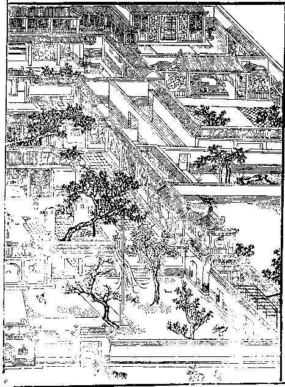



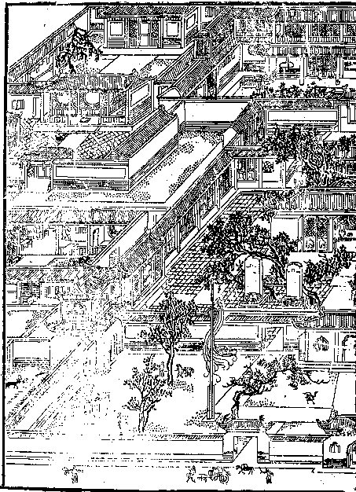



中庭放鹤



师诵经次，忽有白鹤降於庭中，若聆妙法者然。由是以来，寉或时至时不至，乃异徵也。



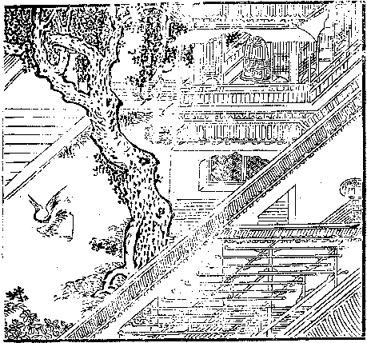



禅诵感仙禽　忽自云中落  

飞去复飞来　可鄙扬州鹤



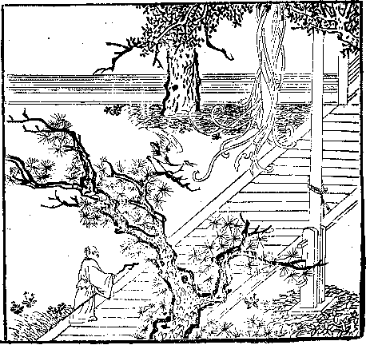



经台夜月



一夕经台散步，口诵贝音，忽见浮云中断，朗然月出，光满虚空。对此皎皎玉轮，殊觉禅心照



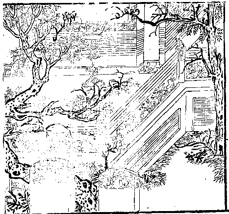



暎，一腔澄彻，岂六祖所云「心如明镜台」者非耶？



明月在浮云　光辉何处起  

老人方徘徊　独立松阴里



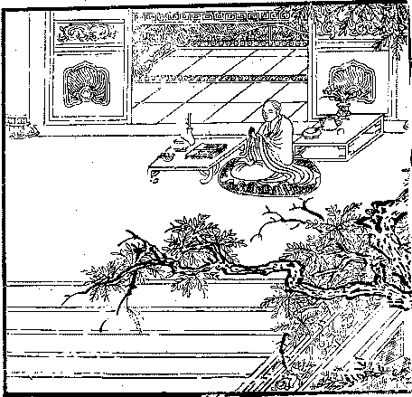



院树秋阴



西刘村旧有古木数十，蓊然可观，居人纳凉其下，天虽溽暑，而薰风徐引，宛然深秋时。



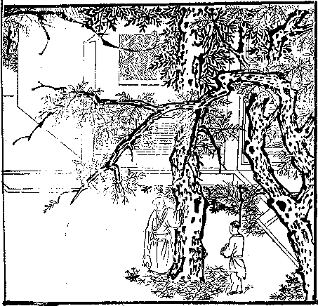



梵阁高嵯峨　登临发长啸  

凭栏不见人　云影闲相照



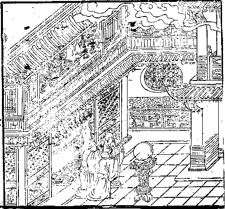



花开方丈



玉光师持诵华严几二十载有奇。停午时异花缤纷，从窓外飞入，师出定，大众皆惊。



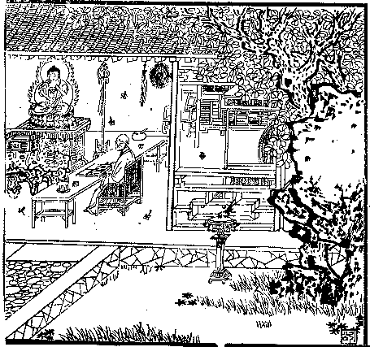



风起虚庭中　异花飞入室  

儿童喜复惊　主人浑不识



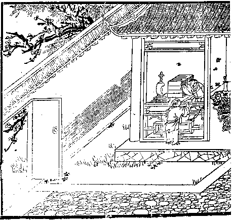



大椿团葢



山门之东有大椿一本，望道人所遗。喜师结茅其侧，时与廖公屏徃返，相得甚欢，廼发重建本山之愿。



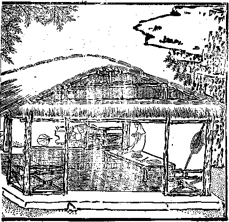



灵椿大如葢　遮日复遮雨  

安禅不出门　此中何所取



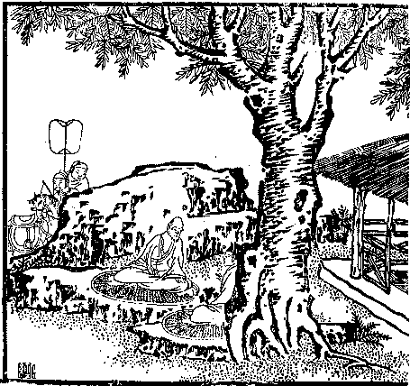



别室驯猿



南征者送一猿于别室，天孚大师常以此猿说偈示众，有法语若干篇。



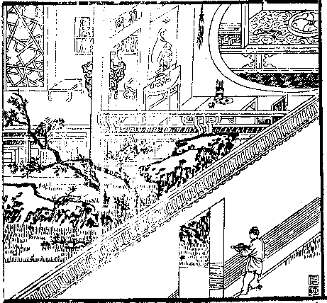



猿子出深山　居然有佛性  

何当脱去皮　直上高峰巅



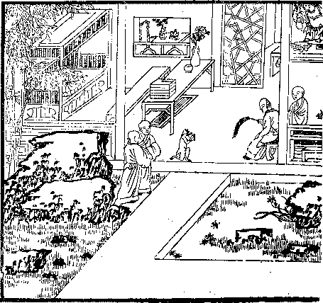



香袅深窓



大悲坛落成，修忏祝国，深窗香气直接重霄，彷佛有莲幢掩映。



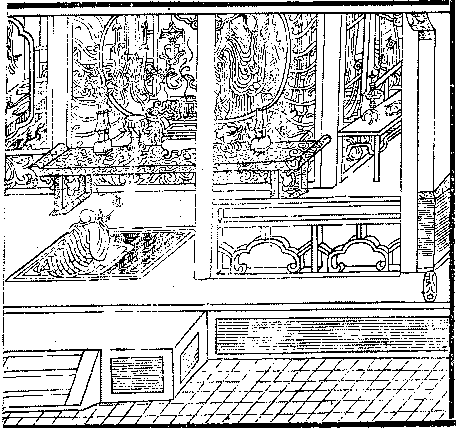



笼窗香气深　袅袅空中举  

借问隔窗僧　炉烟在何许



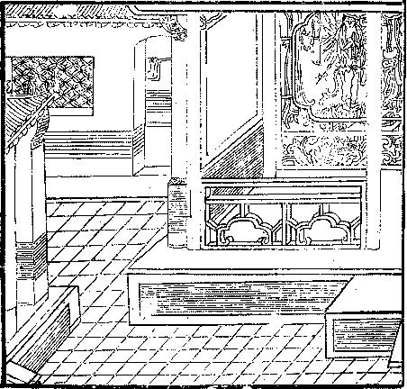



仙枣垂璎



望云道人为天台真裔，手植大枣，广荫丈餘。云皈喜师，枣遂化为璎珞。



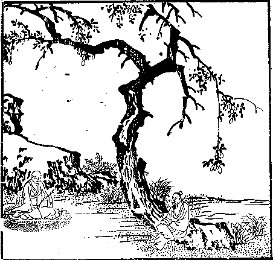



大枣来天台　变种为璎珞  

能移草木情　感化功何博



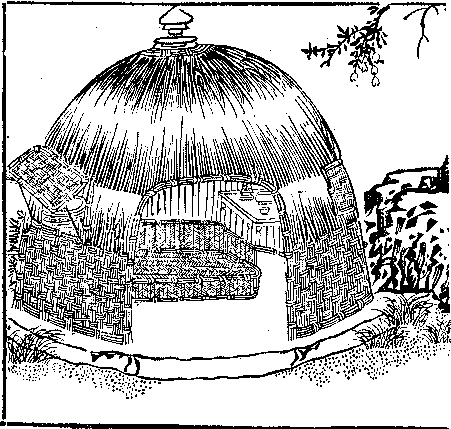



名刹广济，居内城之西，地敞而境幽，近市而尘隔，虽非山林，实山林也。历有高贒旧住，宣扬法教，利益群生。今康熙四十三年六月十一日，皇上赐御书匾额，庄严色相。由是广济坛前，绚彩蒸霞，陆离璀璨，虽古秪树鹫峰，不是过矣。至若寺中花木之垂阴，云烟之缭绕，猿鹤之闻经，虽绘十景於前，而隹趣摹冩不尽，实未足以形容其妙，聊以表其大畧云尔。



------



### 序



佛法来自东汉，於是乎始有经与寺。继而盛於晋，於是乎遂有戒坛讲席。其后曹溪滴乳，心心相印，於是乎乃有宗旨源流。历五代、唐、宋、元、明以来，葢千餘年矣。至於禅教二途，日增凌替之感，惟律师家精持毘尼，无指可标，无奥可入，立僧徒入道之基，开聋瞽迁善之路。当末法艰危之时，犹不失迦文四白羯磨之遗意，故戒坛之盛，历久不衰。



京师弘慈广济寺创於宋末曰西刘村寺兵燹之后，已废为荆榛瓦砾之墟。至明，宪宗时，潞州僧喜云慧公，因土人掘得石佛，即於其地重建今寺慧公戒行精严，远近钦仰，故法施云涌，郁为宝坊赐额，弘慈广济，与愍忠并为戒坛。



兴朝定鼎顺天僧恒明羙公暨其门人，复初仍公大加修葺，巍然焕然，一切堂殿，楼阁门庑，仓廥庖湢，凢僧居之冝有者悉备，可谓盛矣。於是天孚祐公惧其不久也，作而曰：寺居朝市间，五方襍处，年运而徃，或者欺有司而寓其孥，则寺废矣。家世隆替，不可常万分一有子孙以贫，故规寺之产，侵寺之事，则僧散矣。因刊为志，垂诫后人。公殁睡林丛公监院事意，犹以为未广也。乃建戒坛，筑大悲坛，作饭僧堂，粥鱼斋皷、安隐高闲，可谓尽矣，而其意犹未已也。镇之以天子之赐额，守之以天子之宸书，凛凛乎其不可犯矣，而其意犹未已也。奋然曰：自我作之，自我述之，虑不足以传信於后世。於是乎因其法护翰林，供奉曹子恒斋，请余更为志之。俾来者知此寺经理之艰勤，则不忍寓其孥。子孙知乃祖乃父志愿之坚确，则不忍规其产，侵其事。嗟乎！丛公可谓贤矣夫富贵烜赫，非不震动一时未几，而囊金椟帛，弃掷道涂，腐骨遗胔，狼籍虫鸟，纵其历久，而子孙不肖，且不保坟墓而况第宅有如此。前人庀治之，不惜脑髓，斯宜其后人捍护之不啻头目矣。则兹寺也，不其与宇宙相为终始矣乎？且闻之，佛者曰：戒生定，定生慧，既已斩断葛藤，便可飞龙腾象。闲汉之中，自有头正尾正之人，所谓根於慈爱，成於利济者，庶几丛公之志，可以慰矣。



康熙岁次庚辰仲夏之吉枫亭余宾硕题於松筠庵寓斋



------



### 原序



广济寺，天下名刹也。瓢笠而来者，等乎众流归海，水有潮汐，而海无浅深，如是故故足以方广济。我自广济恒老人薙染，以至得法，应知广济所由，然后可间。考喜云祖师创辟以来，古名西刘村寺，不以广济称。元末乱寺亦寻毁。呜呼噫嘻！今之广济，昔之西刘村寺也，自元而明，而至兴朝，日月几何，而遗踪断碣，遂不可问千百岁后广济之，钟声幢影，谁复游而顾之者，用是惘然若失云。又慨然太息曰：广济诸宗祖，苟有咀经嚼史，跌宕诗文，如灵一皎然者，安得至此？然不远游吴越，能自得师，又乌能作沙门太史耶？以故一肩行脚，徧访江淛。诸名胜以求所谓沙门太史者，我钝且拙，始受杨坟老人钳锤，继得鹤林和尚契正，恍若泛长，流出沧海，拨飞云於鳌背，荡皓月於鲸波，归见湖湘，沅沚直沟，洫尔广济，非律门之海乎！呜呼噫嘻！广济固海，窃谓我亦海也。畴昔读书白下，即与通儒徃来松高石胜处，必出崇论宏辩，与之角谈。及名山异书，刺刺不肯休。有能守我律，聼我法，读我文字者，安在其非泛海之人乎？客有问卓锡地者，则瞠目而答曰：广济问厥所由，则指堂前片石曰：碑文且磨灭矣。客曰：师知西刘村故事乎？曰：否否？客起而笑曰：师既不知西刘村后人安知有广济？读书好古，何所用之？我於此忽有感焉。喜师者，海之源也，西刘废则桑田矣，恒老人者，又一海源也；广济废，则又桑田矣。废者可兴，兴者可废。言念及此，能不悲哉！嗟乎！喜师者，海之辽绝处也。恒师者，海之浩瀚处也。一则启其披榛锄莽之功，一则吊其断础頺垣之惨，旦夕鸠工，聿然金碧。古人曾有挥五丁而反山川者，意在斯乎？意在斯乎？我廼焚香禁足兢兢，惟恐家风之或坠下，不能暴霜露，斩荆棘，建辟琳宫於物外上，不能提宗旨唱元机，大开觉路於人间。其为海也，乌在问。及曩时布金之由，则语人以目。悲夫祖宗何负於我而故靳其字而不书也？广济志之不作，是我之罪已。夫！是我之罪已夫！因与复初，师兄商确，兄乃踊跃久之，欣欣乎望其竣，又恐其不即抵於成廼，使我闭关董其事，上自方丈以及两柱，有瑰意奇行，悉志之。



朝廷所赐佛像法宝悉志之戒，子中有得法行教者悉志之。自草木禽鱼得日月之气，含天地之灵者，无不载荒渺无稽之物。虽通都共闻，皆削去示信也。梓行后藏板，大悲坛中，后世子孙有怠而不修，善而不录，以残缺此集者，即以不孝论我祖行之於前，我辈述之於后一世，以至百世，岂非灯灯相续之义欤？凡撰一文，立一传，必斋心僻处，依其实迹而成之，不敢少有虚诞，以干四方之鄙，且笑而犯喜。恒二师之怒也，有如不信，譬之蜃楼作市泛海者，将廻舟而不顾矣。不异不书，不真不记，山僧有焉。



峕康熙二十三年岁在甲子别室湛祐书於大藏经阁中



御制弘慈广济寺碑



葢闻堂开鹿苑，夸秪树之香林；境辟鹫峰，传宝华之胜地。若其清风盈丈室，亦岂在於离群？皎月暎禅心，初何嫌於近市？正以琳宫伊迩，瞻龙象者知尊；精舍非遥，听钟鼓者易肃。兹弘慈广济寺，夙称名刹，旧住高僧。梵宇庄严，峙凤城之兑位；贝音宣朗，接紫陌之西隅。古木垂荫於阶除，皓鹤闻经於戺户。境幽尘隔，如在山林；心远地偏，焉知阛阓？莲花幢内，常明日月之灯；柏子香中，深入栴檀之海。六时禅诵铎铃，响彻丹霄四海，纵流钵锡。云依法界。藏经阁敞珠联贝叶之文；说戒坛高石点雨花之偈。是以驻跸常临於净地，挥毫特贲於禅扉。睠此幽恬，赏其清旷。僧湛祐，心通释典，志励虔修，葺陈构以维新，率群衲以遵礼。住持僧然丛克襄厥事，庭宇秩然。葢其教以利益群生为本，其事以修持戒律为归。朕嘉其同善之心，挹彼广慈之意。俯俞敦请，爰锡斯文。振宝筏之宗风，弘金绳之觉路。用垂贞石，以示来兹。



康熙三十八年四月初八日皇三子多罗诚郡王(臣)胤祉奉勅书



翰林院待诏(臣)曹曰瑛奉勅篆额



御书处监造(臣)祁世杰奉勅督镌



康熙四十三年六月十一日皇上赐御书「玅明圆通」四大字额，供奉大殿。



勅建弘慈广济寺新志目录



御制弘慈广济寺碑文  

御书匾额供奉大殿  

建置图  

碑铭颂



------



### 传记序



赋赞跋  

尊宿  

塔院  

下院  

题咏



勅建弘慈广济寺新志(上)



传临济正宗三十三世沙门湛祐遗藁



监院沙门然丛编辑



白下余宾硕鸿客较订



建置



旧志，弘慈广济寺，东望西华门，西接阜城门、历代帝王庙，南隣乾石桥、万松老人塔，北近大街寺。基三十五亩，相传为西刘村寺古刹废址，明景泰间，居民掘得佛像石龟石柱於土中，山西僧普慧圆洪軰募缘兴复。天顺丙戌，尚衣监太监廖屏土闻，赐额曰勅赐弘慈广济寺。今康熙三十三年，𫎇圣恩勅建御书匾额碑记。



山门三楹，内供金刚像。左右角门，康熙三十三年重修。



天王殿三楹，供弥勒尊佛，左右列四天王，北向供护法韦驮尊天。



东云水堂三楹。



延寿堂三楹。



米库三楹。



钟楼一座。



煤炭库四楹。



向北书记寮四楹。



西澡影寮三楹。



磨房五楹。



马房三楹。



皷楼一座。



菜房五楹。



西向北客寮四楹。



皷楼南有井，旧志云：初穿水苦，惟供浣濯。今康熙年间，忽变而甘，大众茶汤赖之。住持湛祐和尚题曰攺过泉，居士余鸿客铭之。



大雄宝殿五楹，供三世佛，两旁列十六应真，壁绘诸天，内奉御赐宸翰药师延寿本愿经十部，香花供养。古炉三座，成化年造。古鼎铜钟，万历年造。月台前古槐二株，时有神鸟栖集。



东伽蓝殿三楹，供伏魔大帝、给孤长者、清源妙道真君。



殿南米库二楹。



客寮一楹。



钟板堂三楹，内安禅侣。



殿主寮一间。



茶房三楹。



料库三间。



香积寮三楹。



西来悦寮三楹。



祖师殿三楹，供达磨初祖、百丈大师、本宗临济大师。



职事寮三楹。



习戒堂三楹，以安毘尼大德。



杂用寮一楹。



行人寮三楹。



客寮五楹。



香积厨十楹，在客寮后，前有慧基泉，泉南圊房五楹，向北。



斋堂十五楹，在香积厨后，供宾头卢尊者，康熙三十八年建。



普门殿三楹，供普门、文殊、普贤三大士。殿顺治四年三韩辛大勋得外国白檀造，接引佛金身，供大士殿前。



古槐二株，盛夏扶踈掩暎，观其叶之燥润，以占晴雨。



总持堂五楹，在普门殿东南向。



汇善堂三楹，在普门殿西南向。



流云轩一楹，在普门殿后西向。



馨生窝三楹，在流云轩后。



月轩一楹，在普门殿后东向。



返照室三楹，在月轩后西向。



返照室五楹，对大悲坛内，供普眼菩萨像。



别室五楹，在返照室后，向南，即天孚祐禅师栖息地也。堦前有奇树一株，人不知名。或曰桐之属。亦无攷据。详祐禅师传。



客寮五楹北向。



第一关在普门殿后，由此入藏经阁。



自镜堂五楹，在第一关向西。



羯磨堂五楹，在第一关向东。



大藏经阁五楹，詹事华亭沈荃题额，阁上贮大藏尊经六百七十七凾，中供世祖章皇帝赐渗金释迦文佛像一尊，左右观音普贤二菩萨。有西域僧施供佛牙，广长五寸，阁下供三十二应观音相，莆田廖经畫，绘染极为精工。中奉泥金多宝佛铜像，阁前左傍定时针以凖刻漏，右设生台以施鸟鹊。广庭植海棠二株，方春花发，绚彩蒸霞，都人游赏，传为胜事。世祖特延报恩大觉老和尚开炉结制，屡蒙圣驾临幸。



东方丈五楹，额曰最上乘，在藏经阁东。



西方丈五楹，额曰高着眼，在藏经阁西。



东西各有楼，与阁联遶，登高望远，云树郁葱，碧瓦朱甍，陆离璀璨。旭日初升，夕阳返照。诚燕市之大观，金台之胜境也。



坛前垂花门楹游廊六楹，东西配房六楹。



戒坛三楹，在第一关外，东隅南向，石座三层，周遭栏槛，并白玉石凿成，㻏珑花草，云涌兽攒，过於绘畫。上供阿育王塔一座，塔内供四大菩萨梵僧舍利子一颗、御书金刚经八部。坛前悬御书「持梵律」匾额。



游廊十二楹。



毘卢殿三楹，在戒坛后，内供渗金毘卢遮那佛像一尊，四围贮书本藏经全部三百三十三凾。



阁东小楼一楹，供慈氏佛。



阁西小寮一楹，俱康熙三十二年建。



大悲坛五楹，在第一关外，西隅南向，内供栴檀佛像，向南大悲菩萨像二尊向东，又供释迦文佛二尊观像弥陀一尊，外坛左韦驮尊天、右武安王，四面纱笼，香花幢幡，庄严殊胜，甲於诸刹。



东观堂三楹，在大悲坛左。



西观堂三楹，在大悲坛右。



地藏阁五楹，在大悲坛后，康熙三十七年建上供幽冥教主十殿冥王，下供伏魔大帝。



阁左静室三楹。



阁右静室三楹。



别室内供圣驾龙椅宝座，上赐御笔临米芾观音赞一轴有宝，又临赵孟𫖯大阿罗汉赞十首。



弘慈广济寺帝城古刹也。粤稽其地，本西刘村寺基，天顺间普慧宗师来自山右，募缘创建，时与尚衣监廖公屏为方外友，上闻赐额曰勅赐弘慈广济寺，历有百年，佛像剥落，殿宇倾頺，有守忠、元善二张公复从而修之，迄今又百餘年矣。(丛)发愿修葺，庀材鸠工，易朽成坚，稍称完整，庶焚修者有赖焉。



勅建弘慈广济新志(上)



传临济正宗三十三世沙门湛祐遗藁



监院沙门然丛编辑



白下余宾硕鸿客较订



碑铭颂



弘慈广济寺碑铭



明万安(大学士)



都城内西大市街北有古刹废址，相传西刘村寺，莫究其兴废之由。景泰间人有得陶佛像石龟石柱顶陶供噐於土中，始信■■古刹也。天顺初，佛者普慧，山西潞州人，有行■，领戒坛宗师，时■众信向，与其徒圆洪軰相规兴复之，址■废久没荒秽，中为潴泽，广若干步，深若干尺，乃募缘价工■治而平之。既召六工■■■经■之初，洪深历成功之难。适尚衣监太监廖公屏过■窃■甚，语洪曰：屏上荷殊，遇官都监员职典内局及军营，每欲得一福地，搆寺奉佛，凭法力图，报大德，於万一而未能得兹，殆天畀，我与尔师徒共结此善缘耶？遂为洪请牒具其兴建之由以闻乞寺额，诏曰弘慈广济，时丙戌岁也。公自是累捐己资为费，凡上所赐白金，亦自是辄以付。洪又语曰：宠赉不敢自私■用兴复兹寺，以遂图报之心。是秋九月，首建山门门内左右建钟皷二楼，内建天王殿中塑四大天王像。丁亥夏后建伽蓝，殿中塑给孤长者，清源妙道、崇宁宝德二真君像，右建祖师殿中塑达磨百丈临济禅师像，正建大佛宝殿中，镂释迦药师弥陀像，左右列十八罗汉尊者，正殿后建大士殿中镂观音、文殊、普贤像，至是诸佛像，皆餙以金。凡廊庑门牗，点染丹雘，焕然一新。其斋堂、禅堂方丈僧舍，与夫庖湢廪𢈔之所以及幡幢供噐寺所冝有者，无不毕具。寺既成，公乃奏洪授僧录司右觉义寻升．右阐教僧住持於内日领众酌水献花，仰祈国祚亿世圣寿万禩，宫壸清宁，嗣德繁衍，下及臣民庶汇，并一切有生，均沾利益公图报之心，至是咸遂矣。又以寺殆廿年，然后兴复，不可无言■■於后■■石。来请■■■来鸣呼佛氏之道，自入中国以来，■教日新其宇日广，其徒日繁以众，而达官贵人徃徃，多信向之，然亦未尝不与时为隆替。兹寺之作，吾不能究其始，而窃计其所以废。葢亦因元季升淑元解之餘，徒■■■■■道为主以致灭■■■■■。今乃复遭际，国家隆平，民康物阜，故有好善种福如太监公者，主张而作新之，而慧洪师徒因得殚厥心力，以成厥功■■。斯■■■之故哉！因纪其始末。铭曰：



佛氏有教　自兆西土  

永平而来　盛於中夏  

其盛为何　日与及徒  

兴替靡常　乃与时俱  

刘村荒名　莫究其始  

道罹变故　仅存废址  

■■■■　■■■■  

废久复兴　其道则德  

像出於地　人骇厥迹  

徒为神之　究乃安宅  

主持者谁　帝之侍臣  

捐资鉅百　像宇聿新  

翼翼新宇　帝锡其额  

峩峩新像　金耀其餙　成兹善缘  

曰■自始　■■■■■　■■■■■  

弘慈广济　甲於大都  

守而弗替　实系其徒  

维时之雍　维俗之熙  

帝之■■　■佛与同　永永无■



成化二十年岁次甲辰秋九月■日立



■■■■■■■光禄大夫．柱国太子太傅．吏部尚书■．华葢殿大学士．知制诰．经筵日讲官．屏山万安撰



■■■■大中大夫■资治少■太仆寺■■尚■司■■文华殿东吴朱奎书



■■■■■■■■■■■赐进士出身．翰林院侍讲学士．奉■大夫．经筵日讲官．兼修国史．侍文华殿．长沙李东阳篆额



■■■弘慈广济寺𦔳缘碑偈



■■■明释思胤■■



吾佛世尊为一大事因缘故出现於世，欲令一切众生开示悟入佛之知见，然说法必得信闻，时住处众六种成就，所谓处若耆阇崛山之类。而东土自汉建寺后至今傚之亦处也，特其建亦匪易。昔须达多长者之建得，秖陀太子共之，始成精舍，夫岂易耶？都城西大市街北■■■■■■■■勅赐弘慈广济寺者，乃今尚衣监廖公屏所建，继得司设监太监曹公整疏屏报本之意，闻於皇上，遂荷累赐白金助工恩典。又得前尚衣监左少监卢公仪、今兵仗局左副使王公景、右副使王公郊、董成之，以故山门钟、皷楼天王殿、迦蓝殿、祖师殿、大佛宝殿大士殿，暨诸雕粧绘像既严，餙方丈、廊庑、旛幢、供具，庖湢廪𢈔，亦靡不偹。经始於成化丙戌之春落，成於甲辰之夏，规制轮奂，壮■■■处不异乎昔矣■。前开山禅师，讳普慧，号喜云，山西潞人。具大福缘善说法要，道价崇重。尝奉■■■■■■■■■■■■■■■■■■钦依传戒於万寿戒坛■■■子。余寅长前僧录右阐教兼本寺第■代住持讳圆洪，号大海，辅扬法化，感诸太监。公启发信心，尊重三宝，久而弥笃，实上祝■■■■■■■■■■■■■■■圣寿、延长■图、巩固、宫闱、吉庆、储■康宁下及臣民，以■幽显众生俱沾利乐，葢亦无异於佛住世■■■■■。揆厥缘起，已具今相国睂山万公安所撰碑文■。今大海之弟子第三代住持名明，仁名明宗，偕其法兄，余同寅本司右觉义兼华严寺，住持名明，聪号无闻，复具劝缘之始末来请余言，用识不朽。夫佛於灵山以法付国王、大臣，良有由然建寺功德，岂可思议？如须达多精舍之建佛，以舍利弗指授规，则经理之际，六欲天显，现宫殿焉。又佛告地藏菩萨修建佛寺发心及助缘者，百■生中常受人天福报，若能回向法界，则尽成佛道焉。因果昭然，信不可诬，僣因所请，故叙如右。至若契世尊出世之初心，明众生本有之知见，则有非文字所能诠次者。於是重宣此义，而说偈言：



释迦大圣尊　为法出於世  

普欲令众生　皆入於佛慧  

西乾秪洹舍　东土白马寺  

内弘■■■　去来今不异  

宗师慧喜云　■■■■■  

■■■■■　■■■■■  

教主洪大海　相承阐圆猷  

感应功德主　瓦砾粪堆头  

放光现祥瑞　祝赞大明世  

永永为福田　同入门不二  

发心及助缘　河沙福无艾  

离想超诸趣　直入佛境界



僧录司左觉义释思㣧盥沐敬撰



成化二十三年岁次丁未秋九月重阳日，内府尚衣监太监署兵仗局事廖屏立



重修广济寺碑记



明(张守忠、张元善)



尝闻一诚有感，廼假像以求心；万善同归，是闻声而起义。佛光普照，妙化圆融，一时所作良因千载难逢好事。兹以勅赐弘慈广济寺肇建，自天顺丙戌落成於成化甲辰，迄今历有百年，以致佛像斑剥，殿宇倾頺。时万历癸未长夏盛暑，愚尝留憇庑下，因感前人之创建，而弗能保将来之废毁。因与我同志者捐金义会，积少成多，遂於甲申岁孟夏吉日，鸠工修葺，易朽成坚，稍称完整。此佛天垂善同诚，俾僧众焚修。有赖前人善事，复延上祝，圣寿无彊，皇图永固。更冀各姓福履延长，施为顺利，仍勒芳名於后，用垂永久云。



万历十二年夏六月一日，中军都督府彭城伯张守忠、后军都督府惠安伯张元善同立



重修金佛像碑记



高珩



聚沙抟土皆成佛道，法华有偈，胡不闻焉。而世人缄其悭囊托於高论，以折芦大士对同泰主之语，为千载干橹，将举江南寺四百八十阿育王八万四千塔寺之乾闼婆城，此亦耳食之过也。夫实际理地，不落有作因缘，而佛事门中不昧庄严净土着於有作，是未能几於无漏因也。而神天胜果求三途中，亦谈何容易乎？谓菩提般若，若谓金碧土木，非也。谓金碧土木，足累菩提，般若可乎？故二梵之舟车，即三德之旌旄也。野狐禅与狮子吼直一翻，覆乎尔。夫西方圣人之法，予夺有机权实，各当担板之士，尚有蓬心，岂知廓然无圣，而圣谛第一义，直下了然，全无功德之功？德不住行施者，檀波罗密之，为般若波罗密，即俗即真乎？弘慈广济寺帝城古刹也。兵燹以来，丹青漶漫，绀宇白毫，风雨剥落，亦已极矣。工部尚书廵抚畿辅捷轩王公、太夫人刘氏，故七品官加一级。王公尚智之配也，慨然捐资鼎新之，下至法筵供器，一切灿然。然则散花天人与布金长者，固一合相乎？盛事落成，后之花香呗赞其中者，顶礼生虔，随喜生悦，旋绕感应，生阿耨多罗三藐三菩提心。谓是即太夫人，以庄严净土度生说法可也。十方虚空无尽，而此举功德如之。泚笔戋戋，聊识崖畧，亦正如弹指畫虚空耳。观者倘以笔墨文字相索，急流而去，不既远乎？至太夫人男，则候补三品官王登元七品官加一级。王登云监生王登龙孙男则候补三品。京堂王盛唐皆殚心襄事者也。家人焦万里，督工例得并书。



康熙九年岁次庚戌夷则月望日立



都察院副都御史加一级高珩顿首拜撰并书恭上



御制广济寺碑文颂



徐兰



如来之奥义，在贤智其犹迷；天子之大文，非愚贱所能测。但佛日高悬宇宙，举世尽沐其光，而乾文上丽云霄，尽人得窥其象。钦维我皇上道隆前圣，慈等觉皇，德会一源，洞本觉为如之旨，君临万国，广与人同善之心，葢般若为大海之慈航，若广济乃神京之名刹，翠华频幸，灵山之付嘱攸存，凤藻特颁，初地之庄严益焕。仁声善教，上继三乘，妙谛真诠，前无千古。笔底现琉璃世界，花雨弥天；空中成金色楼台，香云布地。於是青岷丹篆，彩焕龙文，兼兹铁畫银钩，祥开麟趾，胜炎汉之图，梵像迎而拜者万人。迈李唐之序心经，出而单行一世，人天拥护，琳瑯琬琰同珎金石𫞡煌日月山河并久(臣)幸过宝界伏睹瑶编，为雹为灯，理昧十支之一，如纶如綍，嵩呼万岁者三。谨拜首稽首而颂曰：



猗欤梵宫　在天左侧  

爰有高僧　虔修是𩛙  

钟鸣於寺　声闻在天  

帝心式喜　税於金田  

锱流景从　慈云𫎇羃  

乃制宸章　载嘉载锡  

思涤浩露　心融智灯  

圣能天纵　无有餘乘  

璚畫昭回　宝纶𪸩映  

驾典超坟　入神出圣  

峨峨贞石　如圭如璋  

煌煌天训　为龙为光  

谁其书之　我君之子  

谁其宝之　实维开七  

天颜咫尺　龙象秪承  

高山仰止　茀禄攸增  

二仪同休　三辰比耀  

亿万斯年　永光象教



攺过泉铭



余宾硕



黄沫内拥　紫苔傍生  

金沙倒漾　石岸高横  

涤垢荡邪　得一以宁  

昔也濯足　今也濯缨  

谷神不死　川德永贞  

以朂厥志　顾义思名



基慧泉铭



余宾硕



惟戒生定　由定生慧  

今日复来　昨日斯逝  

窞不限深　流不择细  

浮沉日月　出入天地  

言不恍然　西方祖意  

於何始基　基於广济



勅建弘慈广济寺新志(中)



传临济正宗三十三世沙门湛佑遗藁



监院沙门然丛编辑



白下余宾硕鸿客较订



------



### 传记序



喜云慧大师传



余宾硕



大师，名普慧，字喜云，山西潞州人也。未详其生缘，亦不能考其本师授受。明天顺初至京师，常与彭城伯张守忠、惠安伯张元善、暨大学士李东阳万安相友善，为方外交。重建西刘村寺，宗风大振，名闻九重，赐额广济，遂为广济开山祖。先是景泰间人有得佛像及石龟石柱於土中者，云是西刘村寺故址。按宋末有两刘家村，在西者为西刘村，村人刘望云自谓天台刘真人裔孙，得炼气法。一日有僧号且住者过之，望云出迎，僧喝曰：守尸鬼！认得老僧麽？云无语，僧即曳杖行。云执其手曰：且为我说法去。因为之建寺，曰西刘村寺，说法二十年。元末为兵火焚毁，荡然无遗。至是慧重为兴造，金碧焕然，云水始归，京师宝坊，斯为第一。慧为明敏，性复沉静，虽曰默默，而机锋所触，犀利莫当。涅槃涅槃后，造墖於玉泉山二圣庵侧。成化六年岁次庚寅朔，越十六日乙未，帝遣礼部郎中孙洪谕祭於万寿戒坛。诏曰：尔早通释典，克持戒律，正期阐扬宗风，何遽一疾而逝？爰昭锡典，特赐以祭。尔灵有知，尚其歆！　树碑於墖院。大海洪禅师，其高弟也。洪弟子明仁、明宗，皆能祖述宗旨，一时穪许。有云：前有大海名不弱，后有二蛟未生角。至今百餘年，寺僧尚守其遗规云。石户农人曰：地之灵也。岂不以人哉？一寺也，前何以兴？后何以废？前何以废？后何以兴？观於且住、喜云二衲，谓人不灵於地者，必其人非也。故吾於传而详其先后之兴废，以为举世之禅衲劝。



恒明羙律师传



释湛祐



性羙，字恒明，顺天人也。父王母艾，师生而敦厚，性颕气雄。母早丧，师泣曰：慈亲长逝，我将入山矣。王公遂送入广济剃度。时洗元相和尚道风藉甚，师执弟子礼不少怠，周旋进退，悉中机宜。洗元大奇之。及长见广济酬应杂沓，不可作焚修地。因退隐玉泉山之二圣庵，闭户禁足，草衣木食，并日而餐，有昙摩九年面壁之意。葢崇祯元年事也。兴朝兵，过玉泉山所获男妇，尽衣以彩绘。见师有道，使其监守兵发。师与诸妇处，凡数日诵经不绝，畧无乱意，男妇皆敬服焉。兵退悉全节归。崇祯十五年，皇师复从墙岭下守将逆战，半日擒杀数千人，陈尸遍野。皇师还，师意豁如，若不知有军旅事者。战塲外糜烂血肉，腥秽薰天，过客触之辄病。师悯然怆恻，荷长锹，率弟子复初徃。是时复初十五岁，亦乐与俱，至积尸处，掘土深四五尺，抱尸入坑埋之。复初颡有泚掩其鼻，师变色曰：此非人耶，汝怪之也。复初用是不复憎恶埋尸。一月复初或以他故辞不行，即责之曰：作善事不了底，岂是好人。以故复初无日不偕徃埋，讫天阴夜黑时徃徃鬼哭，亦有白昼现形者，人或逢之无不死。师即建水陆大会四十九昼夜燄口，后四郊不复闻鬼哭矣。当其始逢兵也，军士以两指之曰：瓦迷瓦迷者。华言曰杀其主者。以师方外头陀令勿杀。师於万众奔窜中，低徊不去。明使来畧地，又不疑贰。天下望之曰：安得真实如恒师者乎。师亦不以得名幸扬扬喜，苟非忠信笃敬，足以孚远近者未易言。此师住二圣庵地甚逼隘。四方禅客归之计六千众请师上座不许。曰。我常行人耳。安知说法。大众固请师却益，坚不得已迎满月法师升座讲华严疏钞。众闻之皆有省悟。功归於师。而师谦让未遑也。师以一人饭六千众，皆果腹无去意师剌血冩，华严经饭而不菜，众称曰：白斋爷然，恭敬满月。师与大众等至今常住有巨釜煑粟二十四石。葢遗迹云。师未策蹇入城市，而名啧啧禁庭。时史兵两曹以至御史内院来谒者，车辙马迹交於庵门。而司礼监太监王永祚尤加敬礼。诸公问：常住米缺乎？师曰：否。又问：衣单足乎？师曰：然。问答后，忽见行者自外担菜入，众讶之曰：何不艺蔬。师曰：常住无圃。诸公皆无语。王公独发心买园十亩，为艺蔬地。则知白斋之戒皆为菜蔬不给而起。



世祖章皇帝顺治元年贼目。李自成突犯阙下，荼毒生灵殆尽皇师入关逐之八旗所处，皆故明宅第丛林未免筑薛之恐乐山僧为广济耆宿，不能支马化龙舍柳林地。十二顷作贽见礼迎师於二圣庵，师复如广济。尔时从师来者百人大众皆不行。满月法师亦踌躇二圣庵中。师在广济诸藩府，闻之不曰：此绝女色之。恒大师即曰。此埋枯骨之恒长老其剌血冩经。请师说法白斋自励之行。感化行人诸檀那慕之来者门如市。於是仍请满月法师升广济座，讲护国仁王经。　八王随喜至，见师有加礼五年春。师慨然曰：丛林规矩败极矣。满月师已去世，法席久虚且奈何。玉光律师朝五台山回留京阙，师即请入方丈。执弟子礼。大众皆从师意。随侍之尊其戒也。广济为都门律席，恒师实倡举之。大众益多，常住忽绝粮。师曰：粮尽矣。大众何不乞食去。堂中执事皆死。守不散。遂键户瞑目禅床。有顷，忽有叩门声启所键户。显功冯居士送米五六车，至师延入坐定。问曰：送米于意云何？显功曰：昨夜梦中似有人告曰：广济绝粮，何不送去？如是者三，故送来耳。长安遂有成佛之谣。是时复初上人十七岁。其兄德光讳湛祥先，以其未经薙染故复初得常侍巾瓶，湛洽湛宁，湛期湛实，湛因湛桧、湛裕湛礼，湛禄湛祚湛岫相继。至惟天孚湛祐，上人最幼，与复初同随杖履，得钳锤之益。居多副寺。乐山有孙曰慧全慧鉴及回首二公尚稚，师抚之屹然成立乐山临命时有回礼之意不受也。十三年秋七月，发大弘愿，供如意斋，斋名如意。佛家所谓大欢喜之义。有一僧，即与床帐衣服，日用动作之物靡不具。问其所好，罔不与之。上自知识法师下及村俗无知之衲，皆平等观，见则下拜无傲色。齐鲁燕赵闵越滇黔有名知识平生向慕者，皆以前所供僧之物送之，悉如意焉。而成佛之说由兹定。师乃南渡江游雨花牛首诸胜，东至灵隐，执净头事。三月后过金陵印藏，经五千四十八卷。十六年秋，江南行脚归玉光，师把手甚欢。十八年冬，玉光示寂。



今上康熙二年建大藏经阁，其额宫詹沈太史荃题也。六年正月十三日寅时，呼德光复初，天孚等卧所曰：大愿已完，我将逝矣，汝等好为之。众皆愕然汗浃，背师沭浴，披衣盘膝，叠掌而逝，建塔於玉泉山外。史氏曰：我佛皆由行门起，我师亦由行门起恒明，岂肉身菩萨耶？何生之慈也？观其不屑屑于色欲，不恋恋于货利，以天下为一家，是非不形，物我无间，其所造道至矣。然其无呼不应，无愿不酬，苟非再来者，曷克臻此恒明之为僧神矣。世人舍此而求佛于西域，岂不谬哉！



满月清法师传



释湛祐



满月，大师，姓杜，讳　清，号满月，山东人也。少读书学举子业，博通经史诸家其于正心诚意之学，尤所究心，不乐仕，进去而出家。后𠫵学于京都卧佛寺。岫和尚座下，聼讲诸经。和尚问之曰：汝识字否？师曰：未经。师和尚心知其为大噐，佯谓之曰：汝既不识字，且向楼上撞钟去。师即出升楼，撞钟不少怠。是时慈慧院慈悯庵千佛寺卧佛寺，皆具讲席，名僧据坐善信如云四处聼讲者千百计。师于撞钟暇，窃徃聼讲方过。慈慧又到慈悯，还至卧佛三处聼讲毕，仍归聼本寺讲经不废，而楼上钟声未尝间也，如是者五六年。岫和尚疾剧，众弟子绕榻，圜立问曰：和尚涅槃后，谁为继席者？众弟子皆有希望心，畧不以师为意也。和尚张目移时大言曰：撞钟者安在？众弟子相顾失色和尚，即将祖衣源流与侍者持付撞钟者。侍者趋出唤师，师甫撞钟讫，铿尔。徐谓侍者曰：和尚唤我耶？侍者曰：然。师问：何故？曰：和尚命汝，上座且亟去，即将祖衣授师。师拜受上座讲华严经一章。众弟子闻之，惊且喜曰：撞钟者亦能尔乎？于是深相叹服。讲罢，下座礼拜和尚，岫和尚一笑而逝。师以此主卧佛寺讲席，檀护聼法者不减岫公在。时崇祯二年，恒明大师迎入二圣庵。师在玉泉山，瞻顾徘徊，仰视峰峦之突，兀俛观水势之汹涌，呻吟有顷，曰：我将老此山矣。日与大众讲华严疏钞、涅槃诸经。阅十五载。大众中有好文者，即以左史、秦汉六朝诸书与之论有好诗者，即以晋、魏、唐、宋诸集与之谈有好奇思卓识者，即以庄骚荀、杨管晏诸子与之语，谆谆然如父之训，其子未尝稍倦。十四年岁饥绝粮，凡数月，大众食糠粃不肯去，徃徃脱衣买粟以办斋。其师弟之相得如此。常以膝示大众曰：我昔在卧佛寺撞钟聼讲后跪奉华严经，瓦砾中不施具，今年近七十膝上，肉痂尚在，万勿畧得此中意即置诸高阁也。大众皆欷歔。间有问：其聼经四处不误撞钟者何？师曰：此老僧好学耳，岂身外复有身耶？弟子亦不敢复问。师恶闻恠异，院中迭有奇瑞，皆不记晓起。时侍者以铜盘盛水进师沭后，侍者倾所沭水盘底辄氷，且结异花，或莲或梅或桃杏，盘日进水，日易所结，花亦日异，大内索之。监院抱铜盘献，自玉泉山至宫禁凡二十餘里，氷不化。皇后见之，氷方解通，都以为奇。师笑曰：此偶事何奇之有？皇后为师送供养，师受之不以为㤗。襄城伯李国祯、司礼监王之臣曹化淳等，皈依者凡千百人。



世祖章皇帝顺治元年，恒师复入广济，请师讲护国仁王经。一期八王无不敬事焉。二年从容语恒师曰：我将归二圣庵作西归计矣。遂示寂于玉泉山。其所留典籍铜盘诸物亦旋失云。别室天孚祐题其畫像曰：这个老人，豁达放旷，卓锡玉泉。发无尽藏。明无无明想非非想。或恐此公文字所障，六经糟粕诸史诨帐。何况西来单提向上。法本非法，讲无所讲。劈破重关一条拄杖。满师为何？舌尖榜样。希圣希贤演说快畅。借问自己，可曾厮像。师道甚高。师胆甚壮。化度众生。口头无量。花亦可献。钟亦可揰。勿与多言。此公崛强。



玉光寿律师传



释湛祐



玉光老人。讳宽。寿平阳洪同人忘其姓氏。少时徧历诸山，足迹半天下。顺治五年，朝五台山回广济恒明大师。请住方丈。杜门却轨。终日与人坐对无一言故弟子甚亲炙者，莫知其由。自主席以至涅槃。夜必烧烛。坐至晓未尝曲躬兀首挺如也。喜则笑，怒则喝。窅然不知尘世间事。渴饮饥食。有无怀葛天氏之风。至其升座说戒条理井井。一岁三期共十三载。出其门者数千人。



世祖章皇帝闻之，顺治十三年冬，亲幸广济住持德光入报曰：皇帝驾临师方，瞑张目曰：亲近老僧耶？曰：善。师曰：何不入住持？曰：方且迎驾。师曰：谁为迎驾者？曰：和尚去。师雅不欲出大众，以师不接，驾方遑，遽而龙辇已驻山门矣。侍卫传呼甚急，大众固请师不肯行，强扶掖出天王殿。众皆蛇行匐伏，师屹立上见之，勃然。有顷曰：不接驾者是谁？师默然，上微笑，下如正殿，住持劝随驾，师以目瞠之，即趋归方丈。驾回，辇将发上，谓住曰：和尚不知礼住持。惶恐谢罪。上还宫，问：今日朕游广济，御史在否？内臣曰：在。默然者久之，使侍卫来，方丈问曰：不接圣驾，出何经典？师抗声曰：出梵网经。菩萨戒中，以手抽经与侍卫曰：进呈。皇帝看侍卫得经，即驰去。大众为师，恐相顾失色。师廼相羊杖履无惧容上御便殿侍卫捧经至上曰：和尚如何？对曰：和尚礼在此中。上展经叹赏久之。越一日，召师入椒园，师不徃，大众劝曰：和尚当保障此山。师徒步入西华门，至万善殿，众知识皆在，师廼南向趺坐，传云：驾至众知识，皆变色长跪，师卓然不起。上近师坐处曰：和尚好麽？对曰：好无他语。斋毕，即拖拄杖出。上又临问：和尚安在？众曰：行矣。上颇重之语众善知识曰：汝曹当学此老诏经筵大臣日讲梵网经，讲官购经，急经价腾贵万机之暇，常曰：广济虽崛强，朕视之愈觉，可喜遣使送币。师即传副寺曰：汝将去卖之，买米供众。使臣曰：此圣赐物也。师曰：有此不将供众受，且何为　亲？王元宰礼拜者不能悉数。十六年冬，奉旨说具足戒，赐衣钵七百五十人。十八年驾崩，师亲率大众哭临极哀，寻归方丈叹息曰：万岁既升遐，我亦无意人世矣。是年十二月二十四日，终於方丈茶毘，时得坚固子六十餘颗，世寿八十岁，僧腊五十八岁。外史氏曰：师亦峻绝已哉！凡人读书至叚子逾垣，泄柳闭户，则掀髯大呌，自谓能之，一见朝廷，则悚然恐矣。玉师之见驾，何其异也？於戏！师亦峻绝已哉！



万中禄律师传



何元英



万中老人，讳海禄，顺天，大兴人。髫稚祝发兴隆庵。顺治五年间，玉光和尚开戒广济。师与同衣相诫曰：我等守戒未坚，当先登律堂求造履坐作进退，悉合规矩，方是衲子。非谓畧知经典，以口舌为活计也。况近来沙门佻挞，甚不守律，何称佛者？遂入广济玉光。师语人曰：此真戒子也。大加赞赏。师居广济衣敝履穿坐无越席，行无越步，经岁不闻笑语声行过处，尘不为动，即有喧笑其侧者，师则凝坐寂然视若无覩。玉光师以其纯笃，非庸众所及，拔为教授。大众中有好读书者，师则欣然，与之究解，终始无倦。虽崛强不驯者，与之处未经月薰，其德皆化。尔雅玉光师愈益敬爱，见师入则訚訚然欢，若父子然有问则答，未尝妄下一语。出见大众，澹然无繁言，而腹中空洞不着一物数十载如旦夕也。八年默然。师坐方丈时玉光师已入灭矣，默然。师好游，不喜枯坐遂去。广济恒老人率大众迎师升座，师仍着前来旧衲冠履行止与木坐方丈同主席六年，未尝轻责人过，拄杖且虚设堂中有相角者，执事入白。师从容诘曰：汝等执何事廼使相角耶？曰：既角矣，和尚何以处？师曰：此何等事不克排解。来白老僧曰：彼不服我。师曰：汝德不可服，众挂虚名何益？遂夺其执事，用是两序。有不睦者，执事悉力以和，不使露诸色相。两序感师之化，皆怡然无一言，以故说戒六年，檀那若不知和尚在方丈大众，则畏之如严君也。康熙七年戊申冬，作持戒简要颂一百十四言，明白易晓，以训后学，幽燕弟子皆遵之。检藏之暇，著正法经五卷行於世，撰作在别集中者，皆不录搜。今摭古外好乘月独行，闻诵读声，师即其门，𥩟立不去。时或以指弹户牖，弟子即知为方丈来也。开门时，师即检其案曰：所读何书？弟子以诵读之书对，师闻之欣然给以纸笔。其抚堂中新进皆如此。而於天孚上，人尤切焉。文墨之缘不断於广济者，实师有以基之也。语笑中节，冠履洁朴，不怒而威，不言而化，游其门者几二千人。其最上者则曰：非我师之戒不及此。师闻曰：汝等能自向上，我何功之有？康熙十年，示寂於广济茶毘，后归灵骨於二圣庵之塔院。鸳水何元英。赞曰：观诸尘众，缘假相结，如大海水波涛起灭，戒等慈航，彼岸新涉，是何以故而得净彻？惟解生定，灰木解脱，因定生慧，摩尼皎洁，宗教悉由，法无差别。万中老人，远离苦业，坚持净戒，律仪超绝，以此清凉，化诸烦热，瞻斯道貌，菩提满月，结跏趺坐，圆顶如雪。我闻至行，寿无量刦，勇猛精进，千花六叶。



德光祥律师传



释湛佑



湛祥，字德光，顺天人赵姓。八岁拜恒明老人求剃度许之，用是披衲於二圣庵，其在玉泉山也。恒老人且以其年尚雏，不以法律规之，故染而不薙。稍长渐有成德，乃披剃焉。顺治元年，同老人入广济，众皆守戒。师独喜结纳，豁达大度，一言投契，挥金如土，视碌碌庸，众不屑也。因朝五台山得大空和尚戒一变，前所作为，於是居然戒师矣。恒老人曰：德光举止，非复前日，殆可托以行吾志矣。顺治十三年老人，南游吴越印藏，金陵将束装，遂立师为监院。老人既去，师总持山门。复初，师为副寺，从如掌书算，皆名宿练达常住。事冝故老人远出，而大众不易。是时世祖章皇帝结制二期，说戒一期。龙车数过，恩礼特隆。衲子云屯，道风洋溢。虽师焦劳所致，复初从如实勷成之复初，慎重能为大众从，如检料纤悉不遗以故师虽监院而内外调，理裕如也。大众每叹曰：非恒老人安此二公不至此十六年秋。恒老人归见山门，气象无异，昔时喜甚。师与诸藩徃来，不啻家人。父子章皇帝结制说法济贫，作诸佛事，所降旨皆师拜，受师进椒园，启奏语大臣曰：广济德光奏事上即传入便殿，奏讫即出一日数次，上不为厌，以其常徃奔走劳顿，亲出名马赐之。



今上康熙二年恒师，复建大藏经阁。尔时东华门大街有僧葢阁为游，览地当事，为其妖执。至刑曹僧无辩廼，引广济葢藏经阁事，欲将此以方彼也。部署即遣人问常住欲与东华门僧一等议罪。阁将废师白部堂曰：本寺后原有藏经阁旧基，非与侵占官街等。且阁之兴，世祖皇帝皆闻之，非私意也。阁乃建於是。刑曹相顾曰：不聼德光言几污此广济矣。恒老人藏经阁之兴，惟师是赖。十六年冬十一月十三日卒，享年六十五岁。戒腊三十岁，造塔於玉泉山二圣庵傍，即其离尘所在也。外史氏曰监院，亦难乎其为人矣哉。有道之衲，持诵焚香，不知世事者，良不少也。然一遇事变之来，能劈理分肌，如德光祥师者乎。以师如此作畧，而又托以复初，资以从如诸宿而后成乃公事而况其外之人乎。今之好独断而不用人聼言刚愎不逊自是，其愚者见师当如何也。噫嘻！德光可谓不负老人者矣。



道光会律师传



释湛祐



正会，字道光，汾州永宁人。父刘母李师生而持重檏实性直气刚有不可一世之意离尘。时甫十二岁，安国寺果从师抚之长披度。后从能隐法师聼楞严经。聼未竟，知识忽开眼光，识力与群儿自异。



世祖章皇帝顺治七年，玉光老人说戒广济，师即拜受焉。尔时缁衲渐众常住，日给浩繁，师慨然曰：我将击柝大同矣。遂蹑芒辞去。大众皆不知所如，师亦不作别归，见故园田庐榛莽，耆旧凋零，断井頺垣，离离禾黍，低徊久之，不能去云。又矍然而兴曰：我道其南乎？於是泛长江，浮震泽，往来於金陵铁瓮之门，徘徊於玉峰鉴湖之上。登高四望，满目烽烟，凭吊久之，怅然自失。师由是折而北历。齐、宋、鲁、赵魏，为五台之游葢，顺治十八年事也。其在五台，退然自处，不敢求异於人，见之者皆不顾。师乃於行单小憇，斋后客师皆出游，览不恋师，师即徐步入梵园。暮春三月，磵谿草长，荒蔓四围，路径皆没。师乃揎袖拔之，作芟辟焦芽计，忽见空中现金光五六丈，瑞云中半露文殊，宝相下停尚隐金光中师方错愕，而菩萨已屹然前立，师礼拜时而一片紫霞从东极飞来，捧之西逝，金光随灭，师以白大众，众皆疑之。然师平生无戏言，洵不诬也。本年冬，师见文殊，后发愤，欲透一着子，行般舟三昧，百日不坐，不卧其勇猛之气，直作与佛齐肩想，以故不恋恋都门大同。击柝，葢寓言也。师久出云光，师乃立阇黎於本院。康熙元年，复入广济为西堂首座，悉非师志。大众曰：师曾见文殊者矣，又行般舟三昧云何？师闻之，辗然而已。是时，万和尚在座，云光与师为羯磨教授。十年和尚终，因师说戒，信安不得与广济事，且应宗师府万寿戒坛，两期不少，暇用是云光师得主方丈。十五年，云光游盘山不返法席虚者，将一载监院迎师还，师入广济，乃立振寰上人为阇黎，振寰为燕台，华胄恬澹自如虔於礼诵，又能左右本山诸事宜故，师得不出丛林，而道风籍甚。辛酉冬，今上皇帝幸临藏经，阁下问：和尚：安在？阇黎对曰：前接驾者即是。上曰：何不见朕？大臣即引和尚入，师欲拜，上以手扶起曰：起来。上曰：和尚何处？法腊几何？师对曰：晋人年七十，上熟视。有顷，曰：殊健在上举趾而东，师即随驾行入丈室，重瞳顾般若经，问曰：此经共几卷？师老重聼不及，答阇黎。对曰：六百卷。上曰：朕闻此经八百卷，何云尔？阇黎对曰：二百卷实相般若亦在此中。上曰：汝言乃是，即乘翠辇出。大众但知阇黎相师之贤，而不知师之用人，实有过人处。嗟乎！悲夫！大觉匪易，真实亦难，道光和尚可谓空门之真实者也。夫以云师去后，律堂有欹，不可扶之象，师之来此安然以处之，而大众之规模如故，何其幸也！假令云光去师，不归龙宫狮窟蛇鼠穴之，且柰何师之复来，广济安知其非文殊指示而为此者乎？以是故故师不忘广济其主席也，见上而上重之，安人而人服之，其作畧已概可见。噫嘻！师终不得为真实於行门者耶！葢确乎守律者矣。



复初仍律师传



释湛祐



燕京之西有玉泉山民，风悃愊嬉，嬉如方孩。编蓬为牗，结茅为轩。有太古之风。住持复初。师居之师杨姓母。王怀抱时，即舍入二圣庵。出家成童。随广济老人行苦行。颠覆艰难靡不历尽。其行事大畧载恒明德光二传中。师为副寺时。出其囊积修筑二圣庵并塔院。不取给善信资财本山诸耆宿。尝言於大众曰。师从幼薙染。未尝作俗人态。十四年十月。父早丧母独居。师虽在广济。而定省不绝。母矢柏舟志师愉色婉容奉事之。而恒老人亦为其有至性甚爱重。老人之为山门。日不安食。夜不贴席。长衣碎衲。赤脚行雨雪中。师无不追随。老人供斋为众菜必甘脆馔。必精洁供养至数千人。而师无有少怠老人坐卧无常所。终岁与十方人同寝处。而师无不侍。自客寮而园头，而圊房皆委一人总管。而师无不总。外而采办出纳之事，内而焦劳烦剧之工，一一托师为之掌。而师调度秩如也。老人徃徃故掩其功而过痛。责之且甚。而师未之或辩怡然承受无怨言。其为人也。行重语迟。一目稍眇。两腮不髭。胸无城府。身肥而色苍。见人辄微笑。十八年德光师逝。僧录司心明与众护法。及诸山开士闻讣慨然曰：如此法席。可无真心为众之人乎。遂立师为监院。尔时本山缁衲萧萧翘翘溃然。欲散米无宿。储瓶罍将罄，师独当常住。事不辞其嗣睡林丛上人籍。真定寓居八里。庄与师有渭阳谊来归。摩其顶曰：此子北人南相。可撑我门。遂留本寺睡林雏年丰神清雅，举止不群，可二旬许。其作畧宽厚，酷类舅氏。此本山香火之所由永久云。师生徒三人而睡林为最然进然荣皆留守下院。十八年，京师地震所在院宇倾圯。𢘆老人旧建俱毁。师独鸠工庀材，修葢如故。前后梵殿瓦缝悉裂，畫壁崇垣剥落无剩。师乃昼夜修行伤心蒿目，喟然作意曰：仍虽不德，甫当监院祗林凋谢乃尔耶。是时镇国将军法名如髻。发心重整。非师之硕德安所募化之。一时执事悟修兰若纳川诸公。均能奔走効劳以成厥事。其法姪然鈘然悦然志系师髫稚抚养诸公。皆早岁丧师。伶仃孤苦。非师之慈爱又安所辅翼之大众日繁。欲起东西禅堂未就。发竖眉棘。有极不堪之状。见四五龄小衲。则辗然喜其心。无适莫类。如此。禅堂久竣愿力犹未艾焉。进茶时必问曰。大众饮否。莫使渴进。食时必问曰。大众斋否。莫使饥有。一菓之鲜。必送众前。虽从不知味者无私啖。则又感化檀那之大概也。师所安执事朝廷尽识其名而师绝无非分想。



圣天子驻跸山门，游幸大殿，深嘉法地，精严有霁色。大众皆传朝廷一日之称许，庸讵知复师继往开来之不易也？辛酉冬，大悲坛落成斯时也。滇闽悉平，楚秦向化，启建祝　国，裕民道塲，四十九昼，夜　和硕康。亲王奉命凯还，甚悯干戈之惨。又修大悲忏。期二十一日，见师子孙蕃衍重师，德行高闲，闻其奉母尊师为之加礼焉。



天孚祐禅师传



曹曰瑛



湛祐，字天孚，三韩金氏子。甫生而家遭毁，生七月而孤，六岁时得危疾。有道人至其门，手拈一丸，药投入师口中，疾随愈。道人订其母曰：此子空门法噐也，勿久留。年十三，母送入广济寺落发，师事恒明羙。尊宿未几，母亡，师哀毁，甚久之，豁然曰：吾有以报吾母矣。於是恪遵师训，读经论解义，受具戒。后禁足书华严经。久之，忽有省发。遂南游江浙，徧𠫵诸方，与灵机观和尚问答，投契机缘，不偶复去，至京口鹤林寺。时天树植和尚开法，道风甚炽，师留久之，深入阃奥，授衣偈都门檀护启请师归广济於寺，别筑一室，韬晦自养。诸名刹往往延请开法，卒不一赴师室前种仙枣一树，甚赏爱之。八景中所谓仙枣垂璎也。久之，树坏别种一树，人皆不能名，或曰桐树。



康熙甲戌孟冬三日车驾临幸坐别室中，问师：此何树？师曰：人谓之桐树。上曰：非也。桐树故多种，此甚不类，存之以待，识者勿强。名有花否？何时开放？师曰：季春时。上曰：花色云何？师曰：紫而蓝上。曰：花时奏知。明年乙亥，春王朔旦，上赐御书金刚经八部东宫赐文，徵明所扶杖一其年，季春花放，师趋奏　孟夏朔日，车驾临幸坐花下，问侍臣曰：识此树否？皆对曰：不知。上曰：此树皮质柔輭，细蔓不旁，引枝枝上，耸葢异树也。师跪奏曰：树凡两株，其一植圃中臣僧一并进奉。上曰：此树勿动圃中可也。又曰：尔为宗，为律师曰宗天童牧云和尚之孙。得法京口鹤林寺天树植和尚，问答深合圣意，语多不录，特赐帑金寺额中。元盂兰会三日，特赐御书药师经十卷。十八罗汉赞十首，临米芾观音赞一首，师拜受讫。日长至，进树畅春园团𪢮青翠上甚悦。是时，天童祖席启请师方欲请假，一夕示疾以逝。年五十四，僧腊四十一。建塔玉泉山下为传。临济宗三十三世有偈颂，诗若干首未梓行世。赞曰：



天童一老　传法十二  

佛缘最深　光耀海内  

师始以律　如谷传灯  

默悟显修　历然光明  

孤阳独囬　穷冬阴沍  

氷雪崔巍　风霜飘忽  

西方圣人　归以禅宗  

东方圣人　扇以仁风  

楼阁千间　云堂一宿  

何处是师　本来面目



大悲坛记



沈荃



十六年秋七月，天孚大师鹤林得法归。当是时滇南多事，禁旅遄征，干羽临阶，有苖未格，用是发愿建大悲坛，以祝　国居。士蔡永茂闻而善之，即与俱邓光乾谓师曰：汝欲建坛鸠材，属我蔡与邓，同发是愿，则坛於是乎？有成说云：噫嘻！师亦一愿也，蔡亦一愿也，邓亦一愿也。众人但知蔡与邓之成师愿而不知师之成蔡邓之愿，而自成其愿也。王寂，本解其貂裘，趋别室曰：师何以绝大功德，引蔡、邓二居士，不使我少分维摩一座耶？师笑而受之。继之起者曰梁𠃔，昌曰侯居，正是一公者，则又因蔡邓之愿而自成其愿者，自成其愿也者，成师之愿者也。上而峩𠜍愽带之客下而挂锡披缁之侣，罔不倒槖，以完厥愿。辛酉冬，工廼竣，诸君起问曰：佛性欢喜，大悲之义云何？师曰：以大为大，不若以非大为大之为真大也；以悲为悲，不若以非悲为悲之为真悲也。世人所谓大悲云者，照彻欲界之为大，救拔苦难之为悲也，皆非也，落迦大士说法而已。尔谓之大，而大无所大，谓之悲而悲无所悲。大悲者，无名而强名之词也。果且有声与闻乎哉？又问曰：我曹结坛瞻礼之有功德乎？曰：有。曰：昔者西域王通正游於郑郑人搆宫室苑囿台池楼阁之属，与之处顾而笑曰：我居石门岩窦焉足矣。安所用此大悲菩萨，岂非石门岩窦之人耶？其素所悲，不悲端，不在坛之成不成也，必筑坛者乌乎？义曰：此葢僧之一愿也。天下甫平，擒纵南人所在，且有水火焚溺者，且有崖岸坠落者，且有军阵相撞怨家雠，对枷锁杖禁者，种种㐫恶，不可名状。噫嘻！菩萨亦人尔，能不悲乎？噫嘻！我之愿足，菩萨之愿亦足也。诸公曰：菩萨者，亦有建坛之愿否耶？曰：大悲者菩萨，建坛者居士也。大悲於我，一而已矣，然而不可亵也。苟斯坛之不建，则宝葢莲幢，奚以安置士女之瞻仰者，又何途之从也哉？故曰大悲者菩萨，建坛者居士也。大悲像廼，永茂独成，并为之记。



赐进士及第．通奉大夫．经筵日讲官．起居注．詹事府詹事．加礼部侍郎加一级．兼翰林院侍读学士华亭沈荃沭手拜书



旃檀佛记



严我斯



康熙中，佛弟子王国弼与其弟国臣薰修自善，忽得白檀高数尺，宝而藏之。良久曰：此香可成佛，惜乏良工。适江南刘拱北诣门，请见拱北良工也。二子具陈得香事。拱北曰：此旃檀也，世尊曾有之。二子问以故曰：昔优填王思佛而不得见，愿刻像瞻礼，举国名手皆在第不识佛之面目，何如欲中止其事？目犍连尊者闻而悯之，白优填曰：汝等欲识佛状，能引见王疑，且骇尊者。遂使诸工升忉利天，见佛三返而像成。葢周穆王十二年事，迄今历二千八百载，而像廼迎入宫禁中，举世罕见之。葢有是檀者，未必发是愿。举是像者，未必得是，工无恠乎？寥寥千百年，莫之觏也。子得此香，而又遇我，安知不有数存乎其间二子然其说三年像始竣别室。天大师得法还二子请至出像随喜。和南之后，如见故人旋绕三匝，心神怡悦，退而叹曰：我终不得是佛供养乎？斯时大悲坛尚未建也。又闻世尊下忉利天，为母说法，旃檀佛像，出殿相迓。世尊三唤像亦三应云：辛酉冬大悲坛落成二子，遂送入广济大师奉迎供养。焉知佛不为之色喜乎？於戏！优填之想佛，犹大师之想佛也。师方慕之，而佛即副其愿以到，庸讵知非三唤三应之旨欤？坛既成矣，佛亦临矣，大师之愿已满矣。假令远迩不识其神，壸掖不传其异，则此像之来，又乌足为祗林重哉！是年十月三十日朝廷驾幸坛中，一见斯像，又如他乡之遇，故解白帨悬左臂而去，志不忘也。余於此复有感焉，以千百年不得之香，而王氏忽得之，又得普天下，罕遇良工以造之，又得普天下仅见名僧以事之，又得普天下绝大上刹以供之。又得普天下第一，聪明仁圣，朝廷以拜之，则其理甚非偶然也。世尊曰：无为真佛，实在我身，像安得应？嗟乎天下之大感，而遂通儒家泥於理而不化，特未见非常之人耳。斯时也，翠华少驻，从容唤之，我知旃坛，必应声而出矣。是为记。



峕康熙二十二年岁次癸亥三月吉旦赐进士状元及第．通议大夫．经筵日讲官．起居注．翰林院侍读学士．加詹事府詹事．充纂修．圣训官．壬戌科殿试执事．前翰林院侍讲学士．弘文院侍读．庚戌科文武殿试执事．内秘书院修撰管理．诰勅己酉科山东典试正主考．归安严我斯薰沐拜手撰



广济戒坛记



城西广济寺，京师名刹也。旧址为西刘村寺。明景泰间有耕地者，得石碑於土中。天顺丙戌，山西僧普慧即其地建为寺太监。廖屏以闻，赐额曰弘慈广济此寺之缘起也。初为缁流习静之所，晨钟暮鼓，一瓶一钵，二三法属，自相传授而已。我皇清龙兴恒明大师主寺事师，戒行精严，福慧圆足，闻风皈向者，不可胜数。始攺为律院，延请玊光老人入主方丈，升座说戒，条理井然。岁三期，凡十三载，聼受者恒数千人。顺治十三年世祖章皇帝车驾至寺，召见老人，深加欢异。自是王公大人接踵顶礼，寺名益著。恒明始造大藏经阁五楹，贮藏经於上，屡延尊宿，宣扬戒律，如万中德光，道光复初，皆人中龙象，有功兹寺者也。暨天孚和尚寺益开拓，楼台殿宇，金碧焕然，规矩庄严，威仪整肃，遂为京师伽蓝之𠜍天孚故名家子人。寺时年仅十三，恒明知为法噐，深加爱重。性敏慧，尝读法华经有省，遂徧游东南，穷历名胜。最后至镇江鹤林寺，遇天树植和尚，机锋契合，因受法焉。都门檀越启请还山，恭遇我皇上至圣至仁，为人天宗主，万几之暇，㽞心禅悦雅闻广济。寺戒律精严，屡赐临幸。天孚奏对称旨，圣心嘉悦，御制广济寺碑文，以赐亲书寺额，悬之山门。历赐御书金刚经八部、御书药师经十卷、十八罗汉赞十首、临米芾观音赞一首皇太子赐文徵明所，扶杖一枝。天孚自念，遭际圣明，叠膺荣遇，惟有阐扬佛教，以祝赞皇图。既建大悲坛，复慨然曰寺。以律名律，因戒入岁，为众生说戒，而戒坛未立，犹阙典也。



详考大藏戒坛，宜在寺之东隅，为善神护，持之地坛，凡三层，周围遮以栏楯，皆白玊石，凿成云涌，兽攒过於绘畫，上供阿育王塔一座，塔中贮舍利子一颗坛成皇上亲书持梵律三字，以赐每逄。说戒之日，云水毕至，缁素环列，祥光拥护，香气氤氲，恍如诸天，森罗左右，见者咸赞，欢不可思。议云：余惟都城说戒之地，北则广济，南则愍忠，所设戒坛，皆架木为之。规制未备。且方位失宜，不合大藏。若天孚之考㨿精确，缔造严整，不独天龙八部恒为护持，於以衍佛法於可久，祝圣寿之无疆，其功伟矣。余岁一再至其地，天孚求记於余。余嘉其所兴建，深有合於佛法，而能为我国家宣扬教化也。遂欣然为之记。



康熙岁次戊寅孟春宛平王熙薰沐拜撰



------



### 金陵印藏序



周天成



葢闻释教之兴昉于周时祥光发现，已知西方有圣人矣。自大雄氏以金身入夣，汉武帝遣使西迎，得四十二章经及摩腾、竺法阑二尊者来我震旦，始重佛法僧三宝。故尼山氏创建儒教，犹龙氏肇辟玄宗，乃当时王公宰辅异道九流于孔老二氏外，别闻夫天地我生性命我造之旨。此三界惟心万法惟识之所自来也。佛祖垂世立教，于诸方世界出广长舌相，随上中下演大小乘，但有闻经者，皆为一切诸佛之所护念，得不退转于阿耨菩提，于世出世之力难解之法，而能欢喜信受，其功德可思议哉！至于经之来东土，自梁、魏、隋唐诸君尤为笃信。贞观间，勅法师玄装，演译阐扬，而圣教一叙，遂括之渊海矣。迨至明朝，修复南藏经缮，始起于高祖北藏于永乐庚子梓成于正綂。庚申万历七年，圣母李太后皈依释教，顶礼尤虔，印施续藏。自华严圆谈以下四十一凾，共计前后经文六千七百一十四卷，六百七十七凾。此南藏之全数也。现贮江南大报恩寺北板全经，贮于大内，不意年久，比遭寇乱释典散遗巳多，南板之残缺过半。有松影和尚者，禅门之法师也。性严圭璧，戒凛氷渊，始住于庐山。既而广陵后卓锡报恩寺，慨然以补造藏板为己任，洵莫大之功矣。予自戊戌夏，奉　玺书织造江宁，偶过长干，瞻礼宝塔，僧即指示贮藏板之处，墙壁倾圯，轩窻頺坏。明之二百餘年，为风雨之所剥落者有矣。视无雀鼠秽垢之迹，亦天龙护持之力大耳。予见藏经阁经板，功成洪鉅，何敢惜涓滴之水，不以益高深于是跫然动念，捐微俸以助洪功，犹土壤之加泰山耳。正在庀材鸠工，忽有都门广济寺住持律师、恒明等持司吏院掌印、理事官张公、嘉谟、暨冯公显功、张公、起祥、刘公登科、孙公继儒等书，并捐资属，予印藏全经，以董其事。此众宰官之愿力相济侍御孙公魁布金二百金有同善云，予亦自捐薄俸，用是众力成功，克勷厥事。虽云浮图合尖，不过藉诸公之力以集成耳。大抵全经，固有要道，儒以尽心知性，握其宗道，以修真养性，提其要而释以明心见性，洞其源摠之三教合一，自古皆然。若佛祖以天上天下之尊，阐无上无边之法，以三千大千世界愿力宏施，自天子以至庶人，必以忠孝节义为本。方今圣天子聪明睿智，冨于春秋，教敷释典，现有万善殿蕉园，各处锡米，赐号赐紫衣，晨夕祝延，再谕礼部，以传灯附入大藏，颁赐诸王大臣、楞严尊经各一部，迎请大善知识，以谈性命之学，将见淡薄无为，以奏恬熙之化。一时公卿士庶，靡不信受皈依，实知善法之诱掖，可以佐刑赏之不及者，则佛教之功不浅矣。即诸印藏护僧之力，予敢猥云功德哉！



印藏檀越开列於左：



巡抚江宁等处地方都察院右佥都御史张中元  

督理苏州织造司设局掌印加一级马偏俄督理杭州织造掌印务事陈秉正  

巡按陕西监察御史孙魁  

江南等处布政使司布政使陈培桢  

督理苏松常镇四府粮储道左𠫵政王添贵  

分守江宁兵偹道布政使司右参政李翀霄  

江南江安等处督粮道布政使司右参政范廷元  

江南池太兵偹道按察使司副使张文光  

江南通省驿传盐法屯田道按察使司副使吴大壮  

江南都使司掌印都司徐烶  

苏州府知府邹蕴贤  

苏州织造物林大张成福　李逢春  

笔帖式汪显明  

江宁织造物林大孙继善  

笔帖式葛勒  

原任浙江嘉兴府秀水县知县孙继儒  

江南布政使司长银库郭鼎  

户部办事管理马献祥  

信士冯显功　张起祥　刘登科　黄旋相



时顺治己亥仲秋望日临济学人辽左周天成题于织造公署



勅建弘慈广济新志(下)



传临济正宗三十三世沙门湛祐遗藁



监院沙门然丛编辑



白下余宾硕鸿客较订



赋赞跋



广济寺赋



释湛祐



僧自江南归，城郭依然，丁公已化，一声长啸，鹤唳猿惊。



客见园中树阴交杂，时鸟变声，整冠而请曰：师以法王之学，运才子之文，必有过人词藻，幸为我赋之？山僧偏袒合掌曰：敬闻命矣，但愧不文耳。因即席而为之赋曰：



惟广济之丛林兮，台殿郁以嵯峨。东枕西华以卜筑兮，决法海之洪波。叹车尘之扰扰兮，髣髴寝食於岩阿。花澹荡兮落荫，树茏葱兮交柯。钟声沉沉兮相发，鹤影翩翩兮乍过。何须轩冕而佚豫兮，即方袍圆领而亦可。婆娑面目兮秪林，道德兮恒河。我常终日闭关而定想兮，葢空诸所有而不知其他。出门惘惘有不可一世之意兮，且埋头独善而学夫诗歌。蒲编兮咀嚼，竹简兮吟哦。猛然畀之炎火兮，逈革去乎从来意。想而拜我弥陀，尘沙兮金马、荆棘兮铜驼。奚况此区区之兰若兮，讵足托游方之迹而为安乐之窝？秋清小屋兮可供高枕，月明深树兮可起沉疴。尔乃南北奔驰，不知所止。本分持循，留心生死八极。一言三昧，一指夣幻泡影。宗门如是：水向东流，云从西逝；经不可谈，道不可试；慧外无禅，定中无事。问学佛之原，则灵山在空；问开山之心，则大隐在市。子虽属我以绣虎雕龙，我已扫除一切而不立乎语言与文字。



歌曰：广济兮清幽，僧众兮薰修。达人大观，废址荒丘。



又曰：广济兮萧森，僧众兮登临。达人大观，绝壑深林。



乱曰：泰山颓兮黄河竭，星斗亏兮烟云灭；惟有广济风，千年吹不绝。



观音三十二变相赞跋



高兆



观音大士普愿护群生，三十二相传冩供养，殆遍墖庙，从未有以应身表示现者。别室天孚禅师住持广济律院，修建梵宇，亲承鹤林天树老人付嘱提唱济宗於化度之暇，念大士愿中，以种种形度脱众生，当使人天觌面相见，作颂拈举真谛。众学人覩闻踊跃，捐舍善财，偹诸毫素。适吾友廖子引公客燕，因请绘冩，永供兹院，俾诸有情顶礼围绕，悟形异法一之义，各乘大愿，用证菩提兆，访旧相过，躬逢图成，礼诵庄严，得未曾有。不敏载笔，敬跋於后。



按院为成化廿三年，尚衣监太监廖公屏所建。后二百年，禅师嗣法重兴，而廖子来冩此像异化，同姓因缘感应，葢不可思议云。



勅建弘慈广济新志(下)



传临济正宗三十三世沙门湛祐遗藁



监院沙门然丛编辑



白下余宾硕鸿客较订



尊宿



万松老人名行秀，河内人。游燕历潭柘、庆寿各刹，亦曾挂褡西刘村寺。后叅胜默灮禅师令看长沙，转自已归山河大地，话半载，无所入。灮曰：我只愿你迟会。一日，有省，复於元沙未彻语有疑。行脚至磁州，大明请益。雪岩满禅师力叅廿七日，於满言下廓然大悟，满以衣偈付之。旋还住中都万寿金。章宗请入内廷说法宫眷罗拜建普度会，万众云臻，复诏师住大都仰山，次移锡报恩洪济元太祖。庚寅，复奉勅主万寿。晚年退居，从容庵数迁巨刹，大振洞上宗风。至元定宗元年丙午后四月四日示疾七日，书偈而逝，世寿八十一，腊六十。建墖於西刘村寺前，今乾石桥、北砖墖是也。



云灮师精持毘尼，历任羯磨，曾演律於寺，后归盘山，不知所终。



密圆师专心本分，不务尘嚣，长年为常住化米，每家一钵，每月再收，有聚沙成墖之意，历数十年，无倦广济，一众赖之，人谓之千钵师。



复庵师处西堂之位，仪度端肃，缁素望见，即攺容瞻礼。然师闲雅温厚，令人可畏，可亲学者瞷其独处，趺坐观心，长年无懈。



欣怡师堂中散众也，亦不详其生缘年尚少，凛然有不可犯之色，耆宿皆敬礼之。忽一日，从容语同衣曰：乞与某甲冩一帐。同衣捉笔为书，欣曰：某物与某，某物与某。同衣讶之。问曰：汝将所有散讫，殆将死乎？欣笑曰：然。汝以为奇特耶？同衣惊告於众，群徃视之，则已瞑目化去矣。



克念师能背持楞严、法华梵网诸经，少时行脚，南方徧叅知识，诸山尽识其名。晚岁北归，栖息广济，日持弥陀万句两行，般舟三昧，不求人知，而善信来叩者，接踵对客，默然间出，一语先事有奇验，葢静极而通也。



玉庵师为尊证，阇黎有年礼，拜华严经。寒暑无间，道范整肃，有古尊宿之风。



翠峰师本京人，玉灮老人之阇黎也。高洁不诡随，又能悦众玉老人门风高峻，目空一世。师独执侍多年，老人最爱之，且曰：如我阇黎方是衲子，他何能及耶？大众受峰钳锤者皆成大器，至今学者称之。



普化师修行真实，自焚香礼佛外，不知有门外事，常谓人曰：我等衲僧家，生死事大，自治不暇，乃与他事，唐丧灮阴哉！或有𠜍葢来访，即辞以他出避之，倘有相晤者对之，默然而已。



徧如师为人慎重，周密生平，无一戯言来徃堂中，人皆钦重云灮。师厺盘山不返，寺中无主席者，戒子星散，师独留不肯厺。曰：学者原由自己，岂在他人手中讨生活耶？后果成律门耆宿。



续灮师日事持诵，不游市廛，坚守戒律，口不妄开，齿不轻露，焚修禁足，绝不接见賔客。生平道契，惟恒明老人而已。



恒老人普设如意斋，忽有癞头陀入腥秽不堪，闻堂中人辄掩鼻却走，执事挥之，出头陀曰：斋名如意独不如我意耶？众异其举止，因延入堂。恒老人三拜，引之上坐，供以伊蒲头陀无所不啖。临去索𫎪，恒师与之。且曰：未能充我，愿何名如意？师又与复曰：未能充我愿何名如意？师又与将出，复索酒肉，师难之。头陀笑曰：是终不如我意矣。师以钱授之自市头陀乃欣然曰：是可名如意矣。遂辞厺。厺后职事检所供食物，与钱宛然，仍留客寮葢，应化圣贒也。



道庵师一生苦行，至老不移，常语人曰：做衲子不勤办本分事，出家何益？一见恒老人则礼拜曰：此真善知识也。



道灮师曾演律於寺僧俗云臻，后入五台不归今上皇帝御书「松风水月」四字赐之。



勅建弘慈广济新志(下)



传临济正宗三十三世沙门湛祐遗藁



监院沙门然丛编辑



白下余宾硕鸿客较订



墖院



玉泉山西麓墖院一所，中建历代方丈墖一座，中内建五十九龛。左普同墖一座，德光祥律师墖一座。右开建律院恒明羙律师墖一座。复初仍律师墖一座。



墖院中碑一通，祭台一座，五供一分。南房七间，北房七间。垂华门一座，大门一楹，小楼一座，南角四围石垣遶之，林木叅天，盛夏暑气不侵。



墖右新建临济正宗第三十二世天孚祐禅师墖一座，在墖院之穆围墙绕之，墖上照房三楹，外出厦一间，中墖铭行实碑一通，祭台一座，五供一分。大小罗汉松二百餘株，维树不赘，林木茂盛。



勅建弘慈广济新志(下)



传临济正宗三十三世沙门湛祐遗藁



监院沙门然丛编辑



白下余宾硕鸿客较订



下院



二圣庵：三门，里钟，皷楼二座，二圣殿三间，后大殿五间，东西禅堂六间，耳房四间，大厨三间，后观音殿三间，大锅一口，在玉泉山西北华亭。汪历贒诗「新绿涨天犹吝夏，晚花贪水未归春」，即其处也。昔年於此演律，僧俗万指，大锅尚存，炊米二十四石。



玉泉山饭僧地二顷二十亩，坐落二圣庵。



昌平州西南太监马公化龙舍饭僧园地一十二顷，坐落柳林村。



彰仪门外天宁寺东墙下菜园二十四亩，瓦房五间，井二圆，康熙二十六年置。



勅建弘慈广济寺志(下)



传临济正宗三十三世沙门湛祐遗藁



监院沙门然丛编辑



白下余宾硕鸿客较订



题咏



冬日过广济寺



袁炜



冻日苍凉风满衣　闻钟下马访禅机  

早知流水东西去　不及闲云朝夕飞  

贝叶飜经清磬远　𣑯花满观冷烟微  

老年数欲寻玄理　宁待朝仆叩此扉



宿广济寺



程敏政



早晚朝簪出苑城　喜投禅室坐深更  

顿疑身在山中住　却记诗从马上成  

把钓未能归计拙　照人偏是佛灯明  

枕酣一夜清无夣　蕉鹿当年亦浪惊



偕白塔寺钦上人过广济寺



叶维荣



扶节偕道侣　日暮叩松寮  

老衲通禅理　踈钟应海潮  

繙经人悄悄　挥麈鬂萧萧  

一与法筵接　清言共此宵



题广济寺



纪映鍾



晚寺苍𣴭鸦乱飞　朔风凛凛弄寒威  

钟声起处行人少　犹有山僧带雪归



冬日同郑侍郎游广济寺



余怀



古槐深殿径通幽　风动旛幢瑞霭浮  

吟就碧云探白社　踏残黄叶见红楼  

钟鸣午夜宁知省　鸽绕空王不解愁  

莫谓老年贪佛日　平生意兴在林丘



过广济寺



王泽弘



薰风春煖护胚胎　迟日烘云花漫开  

我向海棠亲致语　今朝不为老僧来  

方丈浓阴自洁清　手栽奇树不知名  

叶垂深绿花凝紫　独坐蒲团对月明



冬日游广济寺和广霞韵



郑重



苍苍古木爱清幽　寺后西山一片浮  

野衲经行芳草地　诗人吟啸夕阳楼  

每从退食思行乐　便与同心豁旅愁  

回首皇居照丹碧　畫图难得李营丘



游广济寺用前韵



邓瑛



风尘隔断上方幽　佳气葱葱寺里浮  

清磬声招云外客　白毫光抱空中楼  

禅机直欲穷三乘　覊思真能慰九愁  

满眼繁华望宫阙　此身今日在蓬丘



游广济寺用前韵



陈于王



林间鸣磬夕阳幽　树泊闲云宿雨浮  

鸟语不离清静地　佛光常现妙香楼  

天花散处人同乐　莲社开时客遣愁  

欲问无生寻惠远　人间何必羡丹丘



广济和韵



查克敬



宫阙𪸩煌佛寺幽　曈曈曙色瑞烟浮  

莲花开后风飘麈　贝叶繙时月满楼  

古树雪消禅客定　暮山帘卷故乡愁  

胜游未易还心赏　却拟乘闲访比丘



过广济寺



朱端



楼台空际出　门外五云飞  

白业三乘妙　青苔一迳微  

雁堂风渺渺　龙藏日辉辉  

便与禅栖客　清言不忍归



同马祖修过广济寺（二首）



袁启旭



飞阁耸霄汉　天高云气清  

映窻松子落　绕槛鹤雏行  

𬸚𬸦回头见　琉璃照眼明  

已知清静理　不必学长生



初地留天语　洪炉发御香  

青园开白社　紫禁接红墙  

树影云千片　钟声月一方  

何当共秉烛　问法接高光



同昭亭游广济寺（二首）



马几先



忽与尘嚣隔　入门宫殿清  

偶闻一磬响　如在半山行  

天语传松籁　香烟霭月明  

未能逢惠远　何处问无生



渐觉来幽处　行闻一院香  

飞花红扑面　细草绿依墙  

鸟雀喧深殿　钟鱼隐上方  

举头瞻睿藻　初地有辉光



游广济寺和前韵（二首）



蔡㺱



寺与皇居近　人沾雨露清  

磬幽通宛转　僧老惯经行  

饭罢鸟争下　灯悬月并明  

凭谁相问法　天竺古先生



夜夜天花落　微风吹妙香  

幢幡常绕阁　薜荔复缘墙  

金埒开初地　瑶凾赐上方  

红楼一以望　如见白毫光



游广济寺



洪韶



香林夕照开　一杖破苍苔  

月殿僧初定　花台鸟不猜  

阶前青树合　钟后白云来  

欲问无生法　还应访辨才



过广济寺



朱庭柏



遥闻钟磬音　一径惬幽寻  

人有烟霞气　门垂萝薜阴  

青云看道噐　白月净禅心  

圣藻光辉处　人知雨露深



题广济寺



龚铎



庄严不与旧时同　月殿花台耸梵宫  

门外软尘三十丈　那知僧老磬声中



同石农白红桥看落照，遂过广济寺



查弘道



气静虹垂水　光斜山压城  

楼台照金碧　鸟雀堕空明  

遂接幽人步　还为初地行  

闻钟深自省　真欲谢浮名



广济寺祝天孚兄五十寿



释超揆



始信人天定有师　岁寒今识傲霜枝  

法身何碍威仪覔　寿量惟应鹤鹿知  

沙界三千犹可算　赵州百二末称奇  

未流砥柱心常苦　试看星星两鬂丝



赠睡林法侄



前人



操持瓶钵有家传　更向滹沱荷一肩  

坛建喜看弘律虎　社开何必种池莲  

五云卓锡原无住　十字开罏待有缘  

谁道睡公真瞌睡　大千沙界枕头边



自玉泉浮舟至高梁桥，信宿广济，与睡林



续寰诸公篝灯夜话前人



去住皆尘迹　何分律与禅  

欲寻梵王宅　远泛御沟舩  

燕市沿流句　盘山应化贤  

掀髯同一笑　剪烛竟忘眠



和轮庵和尚自玉泉投宿广济寺



余宾硕



徒然天下士　一笑已逃禅  

花煖石门路　烟深泖水船  

蓬蒿容我懒　缁白数君贤  

料得经行处　闻钟夜不眠



重过广济，赠睡林上人



前人



信步过禅舍　西风肺气蘓  

一灯明暗室　半偈醒迷途  

花槛清晨鹤　烟钟子夜乌  

六时持诵好　心地不荒芜



己卯秋日同敬夫过广济访睡公（二首）



前人



楼阁浮云外　松杉落日边  

暗尘消晚磬　清梵响秋天  

驯鸽宁知法　拈花欲问禅  

如何第一义　自古少言传



摇落逢时晚　招携与客闲  

径廻秋苑草　帘卷夕阳山  

䨇阙金茎外　诸天银汉间  

徘徊龙象侧　日暮不知还



冬夜宿摠持堂，用少陵夜宿赞公土室，韵二首



前人



琳宫敞天衢　微尘消跸路  

悲风飒恒河　从容得车渡  

我心旷以闲　兹游惬平素  

访旧引禅机　弥新结山趣  

逍遥龙藏探　俯仰花台步  

澹然望远空　隹气穷四顾  

一室土锉烟　趺坐忘寒冱  

华月吐流云　灵禽息嘉树  

冷冷钟磬音　万象纷已暮  

因之悟吾生　繁霜变零露



人闲境逾清　月明心更静  

征鸿恋群游　野鹤爱孤影  

儒释本异源　清谈忘夜永  

茶香烹活流　饭輭煑甘井  

飞蓬转天涯　寂悟夙所秉  

前途穷杳渺　后念悬高逈  

世事付云雷　吾生堕箕颕  

以此慎风波　了然就幽屏  

寻空愿启钥　观化惜骑岭  

何当解爱网　独立三峰顶



赠睡林上人



曹曰瑛



兰若依丹禁　翛然隔软红  

闲看䨇树老　静觉一身空  

宠渥承天语　庄严迈祖风  

自怜难入社　茶话暂时同



己卯秋日，同石农过广济寺，访睡林上人（二首）



章松



钟鸣开广济　楼阁五云边  

树影濯初地　曦光彻梵天  

鸿闻归说法　花笑待安禅  

上有圣人字　书来万古传



招提临帝座　选胜访僧闲  

见月如临水　开门似入山  

云垂秋殿角　风定戒坛间  

况得幽人赋　相携共徃还



重过广济寺访睡林上人



张昭



三年重过访　禅寂意闲闲  

堦老巢云树　苔添畫壁山  

天章褒物外　花雨落人间  

驯鹿随飞锡　闻钟亦解还



题广济寺月台古槐



姚景崇



古槐阴下有神仙　不见神仙几百年  

今日乘风来树下　晚钟敲彻夕阳天



广济寺后古槐下纳凉



郭𫟸



钟静天空风寂然　暖烟销尽古槐边  

浓阴亦有山林意　莫遣虫声来替蝉



壬申三月九日过广济寺藏经楼看海棠



张英



万斛车尘吹软风　扰扰阛阓喧嚣中  

焉知咫尺有佳地　香林一鹤尘埃空  

糓雨才过名卉发　红云两簇楼西东  

我正来值烂熳时　锦幢绣幄花重重  

自昔西川号繁艶　海棠香国将无同  

别有神仙好丰骨　苦教桃李若为容  

最是斜阳烘屋角　粉腮乱点腥腥红  

惠休知予惜花意　徘徊宛转芳树丛  

为言居士今老矣　一年一度难遭逢  

须乘旭景再来看　烟开露湿春溶溶  

我闻斯语笑未答　发人深省如晨钟  

便是上乘微妙义　不须更与叩南宗



前题



张廷瓒



柳丝摇绿啼春莺　垂鞭拂袖风微生  

乘闲走马过兰若　海棠䨇树当阶迎  

扶踈老干各异熊　丹霞轮菌纷纵横  

小缀朱丝琢红玉　半含细蕋悬春星  

微雨轻阴若朝沐　低昻不定随风倾  

恍如华清宿酲重　羯鼓催促愁难醒  

自昔讽咏放翁句　锦城歌吹看花行  

东阡南陌逞娇咤　扬州芍药羞同称  

祗今无复一枝在　碧鸡坊里繁榛荆  

燕山名卉不易得　慈仁古寺罗修茎  

可怜浓艶杂廛市　弱质怯与嚣尘争  

何如此花托清閟　远公谢客门常扄  

丹楼百尺起天际　嫣然欲语依前楹  

我来花底日将夕　晚烟落照光盈盈  

周遭谛视那忍别　轮蹄顿使心䰟清  

想象朝景更奇绝　露花滋浥红蘓蒸  

更拟重过存后约　夜来风恶无停声  

天公好事不相借　枝头香雾应难胜  

明年探取任朝暮　更待坠粉伤飘零



己卯暮春曹恒斋供奉招集诸子广济寺看海棠



马士芳



瑞霭氤氲隐梵宫　寻幽步入海棠丛  

才标嫩碧三更月　忽吐娇红一夜风  

春接上林分冨贵　香生初地破鸿蒙  

光辉摠是君王借　正与身沾雨露同  

消受繁华清磬声　颠狂记得放翁名  

千愁万恨躭春睡　舞蝶游蜂恋晚晴  

宿酒未醒微雨过　流莺欲啭好风生  

莫将街鼓催人去　银烛高烧照锦城



前题，分得十五咸



汪灏



春风来初地　川红发香嵓  

一夕燕支雨　綘绡润春衫  

艶质喜皈佛　花鬘对经凾  

宛如优婆花　色相逈不凡  

梵音入高枝　珧珠绕沨沨  

翻疑剪紫霞　天女散掺掺  

老僧饭清斋　世味殊酸醎  

复指优昙花　威仪尊古杉  

浓淡眼前树　幽窻云外岩  

心境万象清　榛莽一时芟  

胜因难忍归　西山从日啣



前题，分得十二侵（二首）



查嗣韩



颇闻僊种植禅林　良友招携入院寻  

一笑乍疑神女现　半开微觉彩云侵  

多情合带繁花相　不语真含锦绣心  

最爱戒坛清净地　名花相对话幽禽



䨇䨇琼树共为林　枥马嘶来尽合簮  

天近独饶云日丽　春深不怕雪霜侵  

笼纱书在瞻羲畫　击钵诗成杂梵音  

归到蓬山夸盛事　乱英犹自袭衣襟



前题，分得八庚



黄叔琳



玉河金穗留莺声　天街十二春正明  

化城香阁绝人境　奇葩移值从瑶京  

庄严龙象始昭代　时传翠辇花中行  

紫锦䨇株竦百尺　夭桃秾李孰抗衡  

晓光欲夺碧瓦色　夕艶惯与红霞争  

恍如悬圃群真集　翩翩鸾鹤来合并  

又如昭阳䜩未毕　三千杂遝理凤笙  

阊合九重添气象　上林虞谱徒虚名  

看花续举南皮会　不及飞觞撷紫英(时不及赴)  

主人才子东阿裔　承恩甲第连太清  

芙蓉阁下捧御赐　墨花松雪同春荣  

藉君补却少陵阙　香粉毫端宛转生



前题，分得九隹



万经



春暮晴空风日隹　招提选胜有同怀  

客攀秪树多因色　僧设伊蒲且当斋  

消得清芬寻翰墨　引来杂珮走裙钗  

蕋珠宫里天花落　云际门高阊合排



前题，分得五歌



曹彦栻



珠宫绀宇高峩峩　翠华游幸时鸣珂  

缭垣广庑拓十丈　海棠满树当盘阿  

结根清净尘不起　离离细蕋生猗傩  

如见翠绡垂玉手　朱颜不醉含微酡  

敢作寻常羙人看　洗粧解佩𠫵维摩  

乘风拂拂啜杯茗　踈阴覆席扬清歌  

起问花年惊座客　植来三纪还再过(家恒斋生於壬寅花之移植亦于是岁)  

名花国士却相若　诗成起舞重摩挲  

年华方盛不用惜　干云直上舒璚柯



己卯暮春，邀诸公广济寺，看海棠分得十一真（二首）



曹曰瑛



香林咫尺净无尘　暇日招携坐锦茵  

䨇树笼烟依法海　万花啣雨待诗人  

燕莺自合归初地　桃李应惭占好春  

最是年同移植岁(树于壬寅岁移植适同予生之年)　莫夸隹丽笑人贫



> 梅花同艶不同春　绕树依稀索笑廵  

> 酒晕欲销知睡足　烛痕新褪得愁频  

> 高悬佛日风沙少　近接皇居雨露匀  

> 词客山僧齐搦管　却结良因



寒月宿广济啸轩



余賔硕



凛凛关山路　棱棱氷雪天  

已生无限思　何必十分圆  

帘烛歛无熖　楼钟禁不前  

徒将徙倚意　并入啸轩眠



题广济寺双树



金之缙



䨇树团团初地寻　到来不废短长吟  

一株不肯躭禅寂　管领春风人上林



冬日憇别室



万夔辅



室煖炉常热　阶明雪未残  

客愁忘岁暮　乡思惜居欢  

好鸟能添兴　繁花亦耐寒  

庭前有芳树　日日报平安



别室八首



释湛祐



别室从来独自居　五更灯火碧窻虚  

山童又变烹茶法　野老空传乞食书  

賸有片云翔独鹤　漫劳尺牍寄䨇鱼  

柴门深锁无人到　绝壑高峰摠不如



别室从来独自居　十年客坐半窻虚  

闲看日漏簷前竹　莫问风飘架上书  

扣户儿童惊乳燕　傍溪鸥鸟嬉游鱼  

物情共有飞潜趣　我亦凭阑得自如



别室从来独自居　沉沉钟磬耳边虚  

惊回半枕华胥梦　忽忆十年风雨书  

南麓祗堪驯虎豹　北溟终见化鲲鱼  

即今每忆重游处　峭璧丹崖畫不如



别室从来独自居　天将时雨人清虚  

那须支遁同槜杖　但有倪宽伴读书  

禁路花深嘶骏马　御河风急纵神鱼  

凉秋景物嗟摇落　一苇何年任所如



别室从来独自居　且凭蠧简问盈虚  

江淹漫著销䰟赋　李密空闻挂角书  

种得高梧招彩凤　凿成灵沼出丹鱼  

扶笻大笑非无谓　指月传灯葢阙如



别室从来独自居　御风谁得共凭虚  

只言一钵能传食　无复千金为购书  

豪杰共忘秦苑鹿　故交犹望薛公鱼  

黄昏读史蓬窻下　拍案狂歌意豁如



别室从来独自居　云阶草色静含虚  

南游曾道埋金简　西狩何时上玉书  

车马风尘终鹿鹿　山林日月且鱼鱼  

此中大有忘机趣　杖策临轩一洒如



别室从来独自居　十年心意摠空虚  

欲从天上问奇字　肯向人间覔异书  

山里恶闻三面虎　海边惊见半身鱼  

锡飞未尽搜探兴　偃息禅床亦自如



别室晚晴



释湛祐



雨过蜻蜓喜　花飘蛱蝶愁  

杖藜成独徃　日影澹溪流



十景诗



梵阁春云



崔嵬梵阁对晴空　十里春云指顾中  

自是徃来常载雨　可怜狼籍不禁风  

龙堆昼出边阴静　凤阙朝过御气同  

忽到祗园成小憇　依稀𠫵拜白头翁



经台夜月



松门不许游踪驻　海月偏从薄暮来  

稍喜清凉同欵洽　漫将幽思与徘徊  

蟾宫有客三秋到　兎窟何人五夜开  

莫照山人空外色　须知明镜本无台



中庭放鹤



凉秋白鹤下空庭　独立西风岛屿青  

院外客闲同露顶　花间禅定好梳翎  

松江唳处还思陆　华表归时本姓丁  

想为世情消未得　远来堂下一闻经



别室驯猿



山猿自绝天台路　忽傍沙门意若何  

佛印禅关新意旨　仙谿玄峤旧经过  

有时熟睡呼还起　永夜相闻泣更多  

安得为君添一定　大开襟抱寄岩阿



花开方丈



花发祗林春不深　况将红白挂踈藤  

远迎丽色峰䨇峙　深锁幽香雾几层  

开落自成尘外物　横斜不碍定中灯  

群芳压倒寻常事　西域青莲见未曾



香袅深窻



竹窻松火燄中宵　坐𦶟蛟涎慰寂寥  

香气自能穿佛壁　炉烟未肯驻僧寮  

数回欲去仍无定　一度归来若见招  

只待东风好消息　餘馨尚可望云霄



院树秋阴



丛林秋晚树萧森　影落阶除乐静心  

窻上有痕应为日　潭中不染自成阴  

僧当大葢空持钵　我藉餘凉且坐琴  

若使乾坤终不晓　却从何处更招寻



海棠晚色



黄昏钟鼓静云堂　晚色行看上海堂  

賸有轻盈欺拙汉　敢将妖艶近空王  

摠教迟日开先足　但向薰风落不妨  

高烛漫劳频照睡　智灯无恙老禅床



大椿团葢



灵椿本属天池种　偶到长安亦不愁  

自吐云霞三百度　莫论甲子八千秋  

高柯远障名人眼　交荫平临大士头  

我欲借君遮赤日　不教残暑到龙楼



仙枣垂璎



仙枣鍾灵海外移　至今惟是怪安期  

花香似桂曾无隐　实大如瓜或用奇  

莲座下居欣有托　梵园肥遁最相宜  

恒河忽见蓬瀛物　璎珞垂来亦可疑



自述满江红词（四首）



前人



广济禅林　正好覔　西来消息  

怪他们　白头金阙　半星不得  

几处风尘驰战马　几番花月留行客  

摠只是　一去不回头　真无益



并非是　深难测  

又何曾　高难极  

为名缰利锁　块然成僻  

翠毂故随月色远　朱门浪把光阴掷  

笑则笑　随喜绣衣郎　将人吓



广济禅林　聼车马　镇喧京洛  

溯开山　许多奇事　宛然如昨  

日月平临留客院　云霄逈矗繙经阁  

怪的是　庭下海棠花　刚吹落



当隹境　诗休索  

遇良辰　文慵作  

把寻声问响　付之寥廓  

回首不教俗虑起　翻身顿觉尘情恶  

苦斜日　不多高　无绳䌸



广济禅林　又早是　秋声刚足  

念当年　西冷𠫵学　享些清福  

晚鸭鸣时山色紫　暮鸦飞处云光绿  

到今日　独立绣幢间　疑天竺



大拄杖　拖青竹  

小纸窻　关红玉  

道书中一句　至人无欲  

开辟𫏐为舒只手　繁华并不关䨇目  

有则有　佛典六千餘　都高朿



广济禅林　别室外　梅花开彻  

想江南　负经而去　数枝横雪  

落照笛声烟翳隔　太湖舟影波光裂  

最可惜　行脚赋归来　三年别



早抹杀　凡夫业  

乍跳出　空王刼  

与长安故旧　没些交涉  

埜老那知学佛好　山僧自分为人拙  

喜则喜　独坐捡名香　和云𦶟



南轩晚坐（二首）



前人



鹊噪林稍坠落花　游蜂忽尔过窻纱  

夺巢酿蜜浑闲事　且坐南轩看晚霞



数竿修竹近南轩　风影轻敲对月圆  

寂寂钟声人不到　暮鸦归自白云边



雪后登广济寺藏经阁



万夔辅



宝筏渡金绳　高楼与客登  

虚无藏万法　妙有发三乘  

鹤语尧年雪　钟鸣午夜灯  

欲寻莲社约　须覔虎溪僧



春日藏经阁晓望



何李



阁晓望晴空　钟声杳霭中  

千花迎佛日　万户动春风  

宫阙金银界　阶墀锦绣丛  

上林瞻紫气　回首意无穷



游广济寺藏金阁



阮柽



自知尘迹入门尽　喜有闲心与道深  

夜半登楼僧定后　仰看萝月思沉沉



游广济寺藏经阁



朱弦



徘徊䨇树下　想像六龙廻  

忍草生驰道　慈云覆讲台  

灵禽云外落　异卉雪中开  

为有登楼兴　犹扶一杖来



雪夜登广济寺藏经阁



龚缨



拨火当寒夜　传筹起禁城  

卷帘山尽失　倚杖月同明  

灯暗幢幢影　窻鸣淅淅声  

自怜无酒伴　寂寞话浮生



广济旧志跋



弘慈广济志成，客起而问弘慈者何？曰：仁也。广济者何？曰：义也。既仁与义矣，而志焉者何？曰：弘其所慈，广其所济也。弘其所慈，广其所济，必欲传诸当时，而声施后世者何？曰：我以本院诸僧众之行事，表而出之，使天下后世皆弘其所慈，广其所济也。呜呼噫嘻！天下一大弘慈广济，弘慈广济一小天下也。以天下之大，必有君以主之。群公之袍笏者，都俞相答，则史臣必珥笔以议其后。某为善则与之，某为恶则削之，某为忠则赏之，某为奸则罚之。夫为善为恶，为忠为奸，初不计及与之削之、赏之罚之也。然而朝廷作史非无谓也，不过欲天下臣工知有与削赏罚之不可逃，为善而不为恶，为忠而不为奸也。志书之刻，大亦前所云之谓尔，岂山僧好劳也哉？间尝过高山，探大𡋹，放下凡缘，洞然心腑，此中诸妄消除殆尽，无有所谓与削赏罚累其灵台也。夫如是，则与削赏罚皆足以害其心，而孰知有大谬？不然者，辟如置一镜于此，未尝有物照其中，则湛然已尔。有物临之，则妍蚩好丑毕露而不得遁。假令妍者好者照之而不别其好与妍，蚩者丑者照之而不分其蚩与丑，安在其为镜乎？兹所编者，禅门一镜也。禅门之妍蚩好丑悉集其中，而镜不失其为镜，我相人相令彼自得，而又不为镜累。夫能谙我之意者，廼能读我之志者也。我闻祖师东土除棒喝之外，不立文字语言笔墨之事，何为乎来哉？若然，海外有形语之国，以指为口，捷於齿颊，其遂足以为祖师之意耶？僧窃以为非也。我人为道，不入于弘慈，即入于广济，不入于▆削赏罚，即入于忠奸善恶，诚如异学，弃尔弘慈，去尔广济，禁尔与削赏罚，捐尔忠奸善恶，惟有逃入空虚而已。然空虚之内，岂能舍仁与义而坐清净寂灭之乡者乎？是非佛之道而魔之道矣。呜呼噫嘻！法王之法，犹人土之法也。革去语言文字者，亦法也；别出语言文字者，亦法也，此本山志书之所由出也。僧虽独居别室，传述古人，缮冩区处之所在，一若珥笔于金马，与其所与，不与其所不与。其所与者，即赏也。削其所削，不削其所不削，其所削者，即罚也。推此意以及天下，其亦有春秋之义焉。山僧虽无坐镜之优，葢亦少过於形语矣。



峕康熙甲子岁别室湛祐琹书

