# 鸡足山寺志(第7卷-第10卷)



> **藏经**：中国佛寺史志汇刊（佛寺志汇刊）　**册次** 第 81 册（GA081）　**编号** GA0084　**部类** 史传部　**卷次** 6 卷　**篇幅** 60,394 字

> **卷／品**：0 卷 · 8 品



---



## 目录



  - [序](#序)

  - [鸡足山志序](#鸡足山志序)

  - [康熙三十一年八月既望，广宁王继文序](#康熙三十一年八月既望广宁王继文序)

  - [鸡足山志序](#鸡足山志序-1)

  - [鸡足山志序](#鸡足山志序-2)

  - [旧序](#旧序)

  - [序](#序-1)

  - [旧序](#旧序-1)



---



### 序



鸡山奇秀甲天下，与峨嵋、九华、天台、雁宕相为伯仲。第以僻处滇西，遐荒万里，东南之士鲜有至其地者。然而历揽山川，非有烟霞之癖在亓胸中、山水之缘结於梦寐，不可与言游。不然，农夫俗子，岁之登临，往来绎络，其能领畧山川之胜者几何？若鲁人先生则大异焉。先生江左名士，文章经济倾动当世。又性好吟咏，阅历山川几遍天下，所到之处无不留题，积而成帙，余尝得纵观焉。今春，有鸡足之游，爰作游记及登山诸什，序次错落，得柳州笔意；诗则少陵之遗，不同凡响。观其杖履所至，笔歌墨舞，有潇洒出尘之想。而鸡山名胜，星罗碁置，无不了然於心目间者。先生所云：「身历而得，遥望而得，神会而得」之语，询非诬人也。余流浪滇西，十有餘载，尝窃慕斯山之胜，未能一探其奇。今而后，将日诵先生之记与诗，以当卧游；又何必戒行李、命仆夫、问道所从，姑足云畅游也哉！是为序。



吴门同学．弟陆翼拜题







------



### 鸡足山志序



余宦辙所经，颇与山水有缘。寻嵩抵洛，历华之秦，泛洞庭，诣庐岳，临浙涛，探禹穴；其间奇峰幽壑，川月溪泉，贤踪圣路，宝刹琳宫，以及悬虹飞瀑，古木名花，平生意想不到之境，靡不饫闻餍见，而独於滇西鸡足山，余心不能无憾焉。自奉命抚滇，荣历两任。因驻节昆明，与山相距数百里，无从假道一徃。每於公餘退食，披读《滇志》中游山诸记，亦苐就其人偶尔所至，触目濡毫，以自冩其登眺临流之致；而於山之胜概巨观、呈奇竞秀、变幻莫可名状者，何能包举无遗？对此茫茫，既乏探幽之便，又鲜博物之书。山灵寂寞，未免笑人，此余所以不能无憾也。辛未冬，制军范公巡历金江，顺游名胜，慨然增修山志。事既竣，寺僧捧志呈览，流连讽诵，於山水形势，得起伏流峙之由；於星辰分野，得经纬昭囘之度；於云霞草木，得霏布滋蔓之容；於仙纲佛窟，得贝叶琪花之𣲖；於文章宗㫖，得抒灵摽性之机；於虫鱼鸟兽，得屈伸动植之理。别类分门，搜鉅剔细，栩栩然觉神游其际，而五百里之名山胜地，近在磨丹渍墨间也。播诸中邦，洵为方外之奇；传诸奕叶，并寿不刊之典。且此书出而卧游有具，余亦得藉以告无憾耳。是为序。



峕



------



### 康熙三十一年八月既望，广宁王继文序



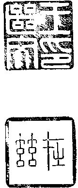



------



### 鸡足山志序



鸡足山得名於宇内，其来已久。余少时尝闻游滇者谈其胜，心窃慕之。然在万里荒徼外，名可得闻，地不可得而至也。今上二十五载，奉命总制滇、黔，意以为鸡山之游或可得遂。及抵滇，驻节於昆明池上，询此山，葢在叶榆境内，距省尚数百里。每披《滇乗》，颇得其概，心益艳之。然束於官守，虽欲登览而莫由也。辛未冬，奉㫖廵历金沙江，因会提军於宾川城下，甫获假道一游。信宿而登绝顶，周览形势，方知此山发脉西域，来龙万里，盘回纡郁；三岭前伸，一冈后距，俨然鸡足焉。中界二溪，支分𣲖衍，恍有山阴道上千岩竞秀、万壑争流之致。顾而乐之，因向寺僧索山志，僧曰：「无之。」因诘之曰：「斯山得名已久，虽远居荒徼，徃古无论已；自明迄今三百餘载，岂无高人达士徜徉探览，纪其胜於车尘马足之餘者乎？」僧曰：「昔曾有志，创於徐弘祖，辑於僧大错。叠罹兵燹，板为火毁，旧本散失无存。间有存者，亦不能无不纯不备之感。」余以廵历事迫，疾驱去之。今年春，忽寺僧持旧志残编至，且请增修。余思此山为滇西名胜，不可无纪。退食之暇，聊为删其芜陋，补其阙略，付寺僧梓之。虽余以仓卒经行，未暇冥搜幽讨，备述其奇；然而斯山之胜，约具於此。世有慕其名而未获至其地者，一览是编，俾万里荒徼之山川，可一旦而游於几席之近，岂非快事欤？至於山寺土田，多在宾、邓二州间。盈缩无常，增损不一。其田粮赋役，自有有司主之，志内俱略而弗载，惧混也。是为序。



> 康熙三十一年岁次壬申孟秋月谷旦，总督云南贵州等处地方军务．兼理粮饷兵部右侍郎．兼都察院右副都御史加三级．瀋阳范承勋蘓公氏题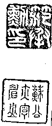



------



### 鸡足山志序



擅天地之灵奇者，无如山水；而能阐山水之灵奇者，赖有人文。是则山水之在天地，非文而何能发挥若是哉？昔谢灵运在当世，其步履非不遍，探索非不㴱，乃独遗一雁荡。是岂时之有显晦？良由足之有至有不至耳！如鸡山属在西域，称名已久。自释迦佛於灵山拈花，以示正法眼藏、教外别传之㫖，特以衣钵付嘱迦叶，命入定鸡山以待弥勒。历周孝王至今三千餘秊，事载经书，岂虚诞而无所攷述哉？然在向来，名公鉅卿轩车或未一至；即至，亦仅信宿而返，未获留以文词。於是名山佳胜，不同於草木之无闻也鲜矣。昔有人识铁船，探玉策，必经数日登陟，载之以文，是乃所谓搜奇览胜者矣。葢鸡山去中华极远，文献少所徵信。自大䥘和尚纂修成志，鸡山之胜槩乃传，屹然与普陀、五台、峨眉并峙。其志虽不僃美，而志实始於此。辛未冬，制府范公奉简命廵历诸边，乃於公暇即登临焉。复捐金建阁其上，挥如椽之笔，灿珠玉之章，顿使佛土生光，山灵起色，将与燕然之石永𡸁奕祀。山水之赖人文，顾不重哉？后之采风者披览之下，瞭然若指诸掌。谨序。



> 临济三十二世，香海本元冰壑谨譔



------



### 旧序



曹延生(蜀人)



尝读天下名山记，见吾乡蛾睂、瓦屋、青城，以及瞿塘、滟预、巫峰三峡之奇胜，无不入名人笔底，供其发挥。而独滇云鸡足一山，绝无纪述，心甚讶之。及𢈏子春，以按部便，过鸡山，访䥘师，询及山志，阙如也。始知滇云古属西域，附中国版图最后，前代名贤罕至其地。虽相如、阆𠎣先后来游，维时荒昧未辟，赋咏寥寥。唐宋以来，复沦于绝裔，南诏阻化数百餘年。鸡山虽胜，其不得附于山经水志、高人才士之翰墨也宜哉！余既承乏一方，为此山长，迄今不亟为修辑以救前人之失，后死者其得与于斯文也哉？幸大䥘和尚以江东大儒栖禅于此，余因率山中比丘共为拜请，俾为纂修。始于春正，成于夏孟。凡佛祖之迹，山川之奇，梵刹人物之盛，以及诗文物产之繁富，靡不旁搜博采、润藻摛华、体物状情、穷工尽态。有是志书，游观者可以触发其才气，想像者可以舒畅其性情，修摄者可以澄汰其尘滓。余游鸡山不过三日，遂以公事去，恨未得领其万一，梦魂峕为神徃。幸志书告成，徃复读之，一丘一壑，朗然心目，以当卧游无憾矣！昔人穷洞庭两山，十七日不能尽，得《禹书》灵文以归。殆余今日之谓与！因付之剞劂，愿与海内好奇者共之也。



沈天锡(浙江)



往见晋僧法显《西域记》，述灵鹫取经，见迦叶尊者及诸佛化奇迹，以为怪诞不可信。及己亥宦滇，驻大理，凡诸佛菩萨种种灵迹，多在百里之内，与法显所纪，往往符合。考城西一塔寺碑文，塔属周峕建造，而三塔又有四天王荅唐律师事，乃知此即佛苦行之地。在宋以前，版图未附中国，故中原人以为远而异之。及今耳目相习，又以为近而疑之，无足怪也。𢈏子春，以便道游鸡山，适大䥘和尚有修志之事，余索其稿读之，山水之奇，佛化之异，以及寺宇人物之名盛，无不搜罗辨析，靡有疑误。余不觉神飞睂舞，因为探历幽险，穷四观峰、华首门之奇迹，天险万仞，陡矗危削，信乎其为佛地也。然二十餘年，纪载不传，文献无徵。今幸䥘师以吾乡硕儒，载千秋之史笔，纪荒外之名山，顿使佛教重灮，山川生色，岂偶然哉？夫山水之著述，昉于《山海经》而纵宕于《水经》一注。后人虽极意粧点，终不能出其范围。今䥘师罗正变之鸿藻，集今古之大成，虽柳河东一代名手，山水诸记最称奇削，视此瞠乎后矣！余幸与𠫵订之軄，因不揣荒昧，合十赞叹而为之序。



大错和尚(俗名钱邦𦬊　江南人)



尝读《尚书》，至〈禹贡〉，见其辨土宜物产，必先详山水之源流界域。及见唐一行论星气占测，则专以河山为界，而不系於州国。夫河山既以占星气，则其中之灾祥修悖，自当与国政民事为盛衰，始知圣人著述，关系微渺，固儒者所宜讨论也。《吴越春秋》及《越绝书》皆言，禹得金简玉书於衡岳，乃知山川之理，使伯益作《山海经》。既告成功，藏於洞庭之苞山。龙威丈人窃之以献阖庐。维时童谣有云：「天地大文不可舒。」可知文章之道，与山川相终始，非细事矣。汉桑钦著《水经》，原始昆仑星宿；郦道元因为之注，古今山川物类，奇险幽遐，一披览焉；而薄海内外，瞭如指掌。从来史官撰述，无不援引其说以相证㨿，不能异也。攷历代史书之外，有郡邑志，多详城郭、赋贡、风俗。别有名山志，则专载山水、寺院、人物、诗文之类。夫岂哆炫奥博哉？亦所以存埜史之遗文，僃作史者之徵信耳。余自甲午祝发贵筑，即慕滇中鸡足之胜，思欲一游，以叩迦叶入定之处。至己亥冬，始得登山游览，攀崖扪壑，搜奇吊古，历数十日而其奇未厌也。越𢈏子春，未孩曹公偶尔来游，向山中比丘索志书一观，众乃瞠然应以无有。曹公曰：「兹山为尊者道场，与五台、蛾睂、普陀、九华并称域内久矣，而志书阙焉！使游览考古者，茫然无从问津，岂非我辈之责哉？」次日，即率僧众向余拜请，俾撰述以灮名山。夫山水之文，岂易言哉？尝上下千百年间，自应劭〈封禅仪〉、诸葛武侯〈黄牛庙记〉，及柳河东游记之外，佳者葢寥寥焉。且余自投迹空门，惟习禅观之学，笔墨荒废久矣，安敢以寡昧之质，谬当重任？辞之再三不得，勉为网罗放失，采集旧闻；与无尽及山中禅㕛参论笔削，积百四十日而稿始成。嗟乎！滇云旧属西域，汉峕乃通中国，至元始入版图。虽子长、相如、贾阆仙辈偶一至止，而绝无纪述。宋祖玉斧一畫，且举大渡外弃之。故宋臣撰《洞天福地记》竟遗鸡足。葢足迹未经，故难县揣，文献无徵，所从来矣。兹又当兵燹之餘，断简残篇，复归煨烬。凭空撰著，闭目揣摹，求其不为好古博闻之士所嗤摘也，难哉！虽然，使余不亟为采述，以供有识者之覆瓿，更百年后，搜奇揽胜者愈无从得其梗概，不又贻废阙之诮哉？用是不惮讥评，私创其畧，聊供异日讨论润色之资。若曰「藏之名山，传之其人」，则俟后之君子。



鸡足山志目录



卷之首



------



### 序



### 旧序



像賛



鸡足山指掌图



指掌图记



卷之一



攷证



星野



形势



卷之二



山水(上)



山　峰　崖壁　林　洞　台　坡　冈　岭　石　峡　谷　箐　坪　窝　窟



卷之三



山水(下)



水　溪　涧　壑　瀑　潭　泉　池　塘　湖



卷之四



寺院(上)



寺　庵　阁　楼　殿　塔　祠



卷之五



寺院(下)



罗汉壁静室四十九处



栴檀林静室十三处



狮子林静室四十二处



九重崖静室一十五处



诸庵院静室五十二处



(右合山静室共计一百七十一处)



亭　坊　庙　桥



卷之六



人物



禅僧　仙　道流



高隠　流寓　名贤



卷之七



灵迹



峰顶四观(附)



鸡山八景



物产



树　花　果　鸟　兽　食品



卷之八



艺文(上)



宸翰　游记



卷之九



艺文(中)



碑记　赋



卷之十



艺文(下)



诗



五言古诗



七言古诗　歌行



五言律诗



七言律诗



五言排律



七言排律



五言绝句



六言绝句



七言绝句



迦叶尊者守衣入定像



迦叶尊者守衣入定像　弟子方正阳敬写



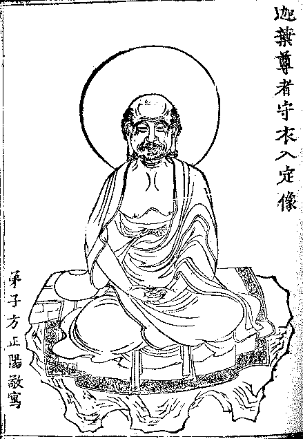



鸡足山迦叶尊者赞



我闻饮光　久灭意根  

圆明了知　心念不存  

犹风鼓槖　虽出无垠  

如月印潭　穿水非痕  

所㠯青莲　顾眄殷勤  

正法眼藏　付之混沦  

一花五叶　钝滞儿孙  

向鸡足定　入华首门  

捧郁多僧　待补处尊



金陵雪浪沙门洪恩盥手赞



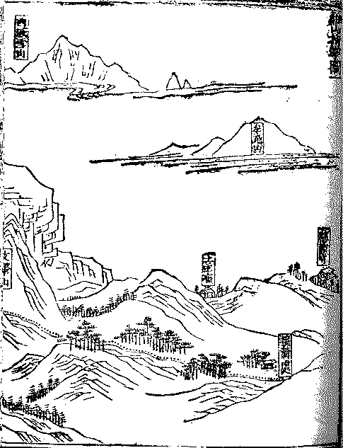



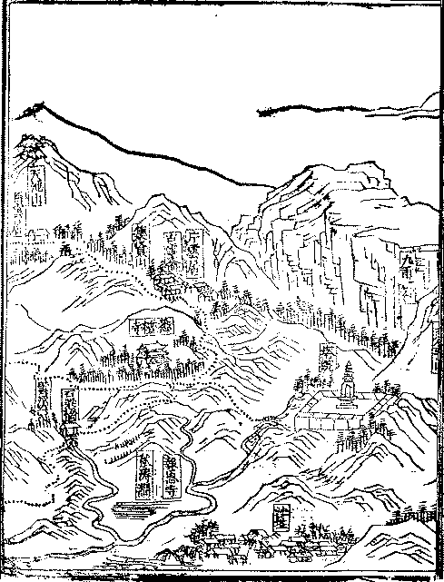



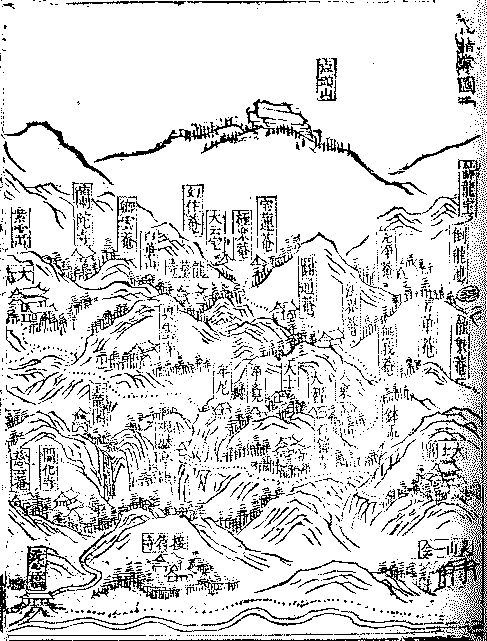



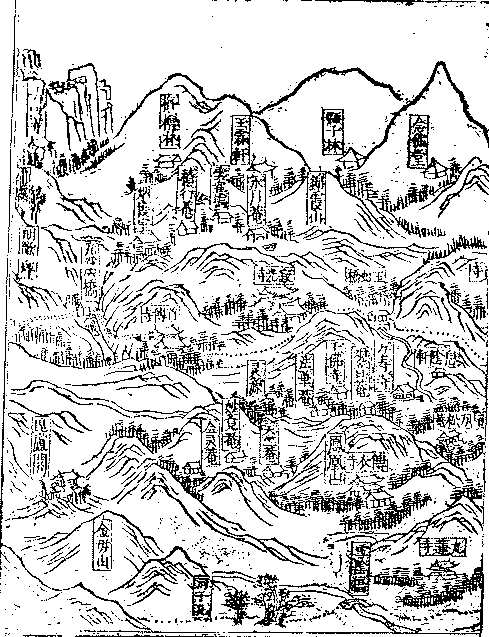



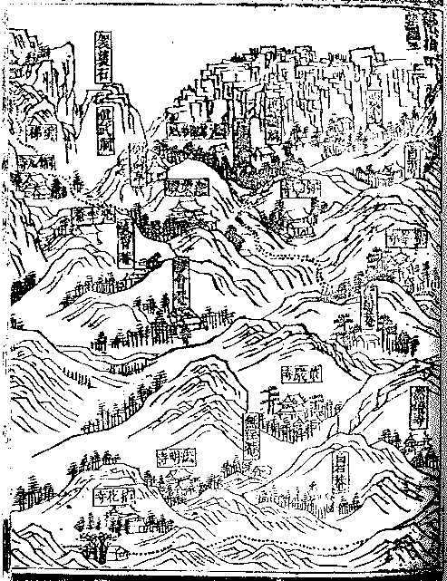



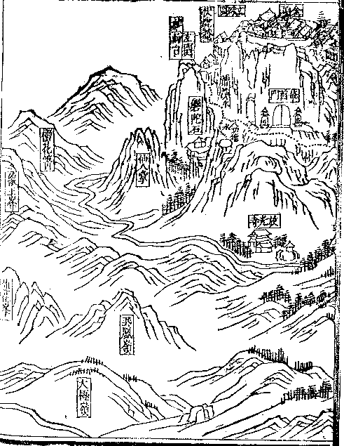



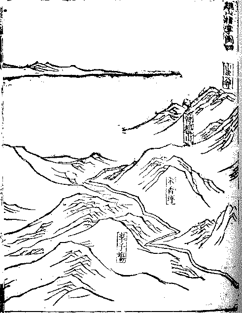



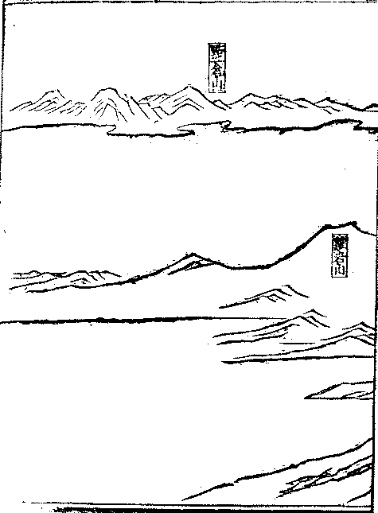



鸡足山指掌图记



大䥘和尚



自《河图》、《雒书》并出而垂文字之训，古之圣贤必左图右书。葢观玩之学，书之讲论者浅，图之悟入者深也。余读刘向之书，乃知古人著述，图居其半。自汉以后，文字渐盛，而图象之学杳然无闻。至若山川之形势，有言语所不能状者，非图以绘之，其何以使披览者一见会心哉？况名山大川，散布人寰，若五岳、十大洞天，俱在衣冠都会之地、舟车奔凑之区。其林泉丘壑之美，著于有闻，葢地势使然。至于鸡足，邈处滇云，虽为佛祖示化之地，而去中原绝远，又附版图最后，天下想闻之而恨不覩其胜。虽逸世高蹈之士、希灵慕道之人，亦远阻河山，惮于䟦陟。而身至其地，幽探遐讨者鲜矣。山之高，自麓至巅九千四百丈，周围四百里。前列三峰，后拖一岭，宛然鸡足之形。其中分见之山四十有奇，峰十有三，崖壁三十有四，洞四十有五、溪泉一百餘所。至於冈、岭、壑、涧、林、谷、峡、石，有不可胜数者。虽山中深隐积修之士，未易徧览，而况士大夫来游者暂至倐还，旬日而罢，又安能周知其胜，使山无遯奇哉？此〈指掌图〉所以作也。游山者自苍波山麓拈花寺，过辞佛台三里，循山径卥北转至白石崖，顺冈南下二里为金母山，山下即雪阴桥，桥之卥为河子孔。过桥卥北行一里，至接待寺，寺后上坡为九莲寺。过石钟涧、华津桥，到报恩寺，后有云溪庵。繇葫芦涧过石梁桥，至大士阁。循解脱坡北上，至观瀑亭，西对玉龙瀑，飞流千尺，为一山胜观。自此直上为牟尼庵，东转稍下为石钟寺，寺前钵盂山，下为钵盂庵。庵左折过溪为龙泉庵，左又有五华、无我二庵。自此下坡为悉檀寺，寺前即大龙潭。南下过伏龙桥，东行三里至文笔山，为塔院。内有尊胜塔，后为振衣冈，俯视灵山一会坊及土主庙，不啻千仞。繇文笔山西折北上，至集贤山下，有古雪斋。左为片云居，即余与诸道友修志处。繇片云居卥过满月山，至天池山下，为白云居。右为毘沙精舎，卥即钵龙室，前为绿净山房。由南下坡，东转为断际处。从后卥折，为圆净、法界二庵。过倚杖溪、逍遥桥，为大乘、大士、大智、净觉、极乐、宝莲诸庵。此后有幻住庵、兰陀寺，稍前为圆通寺，右即𠧧竺寺。北转为龙华寺、卿云庵，西有万寿庵。卥北上为大觉寺，寺正对息阴轩。右转，过溪为千佛寺、观音寺，法华、灵源二庵。上坡，过响雪桥为寂光寺。西转为水月庵、积行庵，更西为首传寺。过九溪桥为燃灯寺。转西北上，即明歌坪胜峰寺。寺左隔涧有白云寺、补处庵。少上过慧灯庵，左为弥勒院。再上三里即迦叶殿，殿左为罗汉壁，有杨黼洞，即杨真人修真处。东有卥来、碧云二寺及静室四十九处。由罗李二先生坊上，为仰高亭。再上，为真武洞，傍有真武阁。又上，为兜率庵。二里，至铜瓦殿。左有袈裟石。殿后上猢狲梯，为大悲阁。过三天门，即四观峰顶矣。顶有罗城，城内有金殿，后有佛殿，最后为天一阁。峰顶望西域雪山，莹白如银；卥望点苍，近若咫尺；俯瞰洱海，一衣带水耳。峰卥北二里为大观阁，下至文殊崖，文殊阁旧址存焉。西为舍身崖，更卥为束身峡，有仙奕石、虎跳涧。过此为礼佛台。更卥为玄关洞、妙高台。又东转，一里至曹溪水，又二里八功德水。从此东南二里即华首门。门前有双塔，旁有金鸡泉。至此，仍由铜瓦殿下，至迦叶殿、胜峰寺。由胜峰寺正南直下，为隆祥寺，妙觉、慧灵、天竺、无住、凌霄诸庵，法明、祝国二寺。至云海庵、毘卢阁，达华严寺、万松庵，直至传衣寺。寺左有菩提塲、雷音寺，般若、净云、圆通、弥陀、昙花等庵。稍左箐中，又有慈云、开化二庵。由胜峰东转，为𣃼檀林、狮子林。𣃼檀林静室十四所，狮子林静室四十二所，是为栖玄最胜之处。更东为九重崖，静室亦一十五所。由胜峰寺卥折七里，为放光寺。更卥，过昙花箐五里，即金华庵。又五里为大圣寺，又一里为龙翔、广恩二寺。又卥十五里为怀恩寺。山后又有华藏洞、小石洞，上、下石潭及慈圣寺。大约山踞三州之胜，峰秀数郡之间。大寺八，小寺三十有四，庵院六十有五，静室一百七十餘所。其间幽洞危崖，奇峰怪石，曲涧清泉，不可名数。使此山在通邑大都、三吴两浙，一丘一壑其入名人韵士之品题者，不知何限！而乃僻处滇南，介在蛮服，文人墨客过者甚稀，遂冺冺无闻。余以纂修山志，侨寓半载，与眼藏、仙陀、把茅、中也、德音诸道友，攀危陟险，伐山窥穴。虽樵牧绝迹之巅，猿猱𨚫步之处，无不穷讨冥搜，把笔纪胜。从此鸡山胜迹，几无遯隐。虽然四镇五岳假封号以称雄，福地洞天藉撰述以自显，鸡山独以荒远见屏，岂山之罪哉？自〈指掌图〉一出，海内名贤卧游是赖；鸡山始出，而与名山大川争胜千古。山水遇合，固亦自有因缘哉！缘合则方壶、员峤、岱舆，远隔弱水三十万里，可以𫏋车飞空而到；缘未合则蓬莱、瀛洲、方丈，近对会稽，虽驱石填海，终弗可逢也。为是图成，复系以记，后之君子以览观焉。



鸡足山志卷之一



考证



野史氏曰：饮光为释迦大弟子传衣人，定实在鸡山。宗灯不息，葢始於此山。以尊者名故，考订冝详也。因首及之。



传㳒正宗传



宋沙门契嵩著



摩诃迦叶尊者，摩伽陀国人也。姓波罗门，其父号饮泽，母号香志。始生，质美茂，其体金色而炤甚远。相者曰：「是子夙德清胜，法当出家。」父母忧之，乃相与谋曰：「必美妇可縻其心。」稍长，苦为择娶；而尊者不得已，乃绐之曰：「非得女金色如我，不可为偶。」父母乃以婆罗门计，铸金人辇行其国。囙观者求之，果得金色女如迦叶者，遂以室之。先是，毘婆尸佛灭度后，众以其舎利建塔，塔之像，其面金色缺坏。是时迦叶方为煅金师，会有贫女持一金钱求冶为薄，欲往补之。迦叶闻且乐为。补已，囙相与愿世世为无𡛸夫妇。以是报，九十一刼体皆金色。后生梵天，天之寿尽，乃出此婆罗门富家。及是夫妇而其体复肰，故初名迦叶波，此曰饮光，葢取其色之义也。肰皆清净，虽偶，未尝有男女意，终亦恳求出家。其父母从之，即为沙门。入山以杜多行自修，令空中有告者曰：「佛已出世，请往师之。」尊者即趋于竹林精舎，勤敬如来。乃分座命之坐。而大众皆惊，谓其何以与此？如来知之，乃说其夙缘，以断群疑(有《佛说大迦叶本经》在藏)。寻为之说法，而尊者即座成道。肰其积修胜德而智慧高远，故如来尝曰：「我今所有大慈大悲、四禅三昧、无量功德以自庄严，而迦叶比丘亦复如是。」一朝乃以正法付之，嘱其相传，无令断绝。复授金缕袈裟，命之转付弥勒。及如来般大湼槃，而尊者方在耆阇崛山。是时地震，光明炤耀，即以天眼知之，乃谓众曰：「佛湼槃矣。嗟乎！正㳒眼灭，世间虚空。」与其徒众即趋于拘尸那城。既至乎双树之间，而如来已化，内于金棺。尊者大恸，遂感如来足出於棺，以慰其哀慕。寻致栴檀白㲲，以资其阇维。既而尊者谓：「金刚舎利，冝与人天，为其福力。吾等比丘，当务结集，以惠来世，为其大明。」即以神通自升须弥之顶，而说偈曰：



如来弟子　且莫湼槃  

得神通者　当赴结集



遂击金钟，其偈因钟声而普闻，故五百应真皆会於毕钵罗岩。惟阿难以漏未尽，不得即预(有《大迦叶集藏经》，在藏中指阿难九罪)。宿户外，终夕思之，及晓乃得正证。遂以之叩户相告，尊者曰：「若肰，汝可以神通自户钥中入。」阿难如其言而至。是时佥议三藏者冝何为先？尊者曰：「冝先修多罗。」因谓诸圣曰：「此阿难比丘，总持第一，而常侍如来，其所闻㳒，如水传器，无有遗餘，冝命以集修多罗藏。」次命优波离以集毘尼藏，复命阿难集阿毘昙达摩藏。已而尊者即入愿智三昧，观其所集，果无谬者。肰尊者处世方四十五年，终以结集既毕，而说法度人亦无量矣。自念衰老，冝入定於鸡足山以待弥勒。故命阿难曰：「昔如来将般湼槃，预以正㳒眼付嘱於我。我将隠矣，此复付汝。汝善传持，无使断绝。」乃说偈曰：



法㳒本来法　无㳒无非法  

何於一㳒中　有法有非㳒



阿难於是作礼奉命。复念，如来舎利皆在诸天，欲往辞之。遽凌虚遍至塔庙，礼已而还。复以夙约必别阿阇世王，及至其门，会王方寝，因谓阍者曰：「摩诃迦叶将入定於鸡足山，故来相别。王起奏之。」遂以周孝王之世，窅肰入其山，席艸而坐，自念：「今我被粪扫服，持佛僧伽黎，必经五十七俱胝，六十百千岁，至於弥勒出世，终不致坏。」乃语山曰：「若阿阇王与阿难偕来，汝当为开，已复合。」於是寂肰乃入灭尽定，时也大地为之动。而阿阇世王亦梦其殿梁忽折，及觉，而司门者果以尊者之语奏。王闻泣下，为之叹息。即诣竹林精舎，拜阿难，命之同往。逮至鸡足山，而其山辟，尊者定体俨肰在其间。王且哀且礼，命取香薪欲为焚之。阿难谓王曰：「未可燔也。此大迦叶方以禅定持身，而俟弥勒下生，授佛僧伽黎，乃般湼槃。」王闻此而敬之益勤。及至与阿难引厺，而其山合如故。



曹溪一滴



鸡足摩诃迦叶尊者，摩伽陀国人也。因世尊在灵山会上，有六梵天王以金色波罗花献佛，请佛说法。世尊登座，拈花示众。是时，百亿人天皆黙肰，唯迦叶尊者破颜微笑。世尊曰：「吾有正法眼藏，湼槃妙心，实相无相，微妙㳒门，不立文字，教外别传，付嘱摩诃迦叶。」世尊至多子塔前，命摩诃迦叶分座令坐，以僧伽黎围之，遂告曰：「吾以正㳒眼藏，密付於汝。汝当护持，传付将来。」一日因阿难问曰：「师兄，世尊传金襕袈裟外，别传个甚麼？」迦叶召阿难，阿难应诺。迦叶曰：「倒𨚫门前刹竿著。」既付㳒与阿难，尊者复以夙约，必别於阿阇世王，入鸡足山席艸而坐。自念：「今我被粪扫服，持佛僧伽黎，必经五十七俱胝，六十百千年，至弥勒出世，终不致坏。」(彼时阿难亲刻尊者像一尊，遗于华首门。今迦叶殿所供小像是也。出《白古通》)。



按：《传灯录》及《佛祖纲目》诸经书所载摩诃迦叶事，皆与此同，故不重录。



大唐西域记



迦叶承佛旨，任持正㳒，结集既尽，至第二十年，将入定灭，乃往鸡足山。山隂而上，盘曲取路，至西南冈上。山𡶶险阻，崕迳磐礴，乃以锡杖叩剖之，如割山径。既开，逐路而盘纡曲折，回互针通，至于山顶。东北面出。既入山𡶶之中，奉佛袈裟而立。以愿力故，三𡶶覆敛。故今此山三𡶶隆起。



名胜志



鸡足山大顶普光殿脚，有石门千仞，人迹罕至。藏经云：平阳僧㳒显入西竺求经，逾葱岭而南。将至鸡足山，路遇老人，庞睂伟貌，显不悟其为神人。顷有一沙弥至，显始问：「耆老为谁？」荅曰：「大迦叶也。」显始知即是尊者显灵，乃追至迦叶门，为大石所横，不得入，遂流涕而去。



㳒显传



从贝多树南行三里，到一山，名鸡足，大迦叶今在此山中。劈山下入，入处不容人。下入极远，有旁孔，迦叶全身在此中住。孔外有迦叶洗手土，彼方人若头痛者，以此土涂之即差。此山中，故有诸罗汉住。彼方诸国道人，年年往供养。心浓至者，夜即有罗汉来共言论。释其疑已，忽肰不见。此山𣝾木荗盛，又多狮子、虎、狼，不可妄行。



三代之时，滇中原属西域之地，为阿育王所封。攷之佛典、野史，点苍即灵鹫。则此鸡山为迦叶尊者入定之处无疑矣。缘鸡足山至汉以后，始通中国。而中原人覩佛书，哆大多荒唐语，遂以佛为非复人世所有。故亲覩鸡山华首石门，而反疑尊者未必在此。葢不知鸡山当周时，原在天竺幅员之内，具此山前后数百里之间。诸佛菩萨灵迹显著者甚多，其为佛地可知。其辨论具〈山水下〉，览者冝细详焉。



星野



野史氏曰：九州分野，悬象于天。丰歉灾祥，於是徵焉。谨则获吉，怠则贻凶。人事与天行相召，乌可忽也？志星野。



分野在天属井鬼，入参七度。(《汉书》)



次鹑首末位。(《晋书》)



丽中台上位北斗开阳一星。(《宋书》)



太白主益州，又北斗第二星主益州。(《星经》)



参伐流为益州。(《元命包》)



明堂为益州。(《太乙书》)



鸡足於大理十之一，於滇则百之一也。何问乎星野？肰其间有人事焉。一人之身，修悖之感，上通于天；德星之聚，关乎两家。久旱飞霜，系于一人。况五百里之大，其人事之叅䥘，不知几何？休咎既异则有灾祲，有灾祲则有徵应，有徵应则愈宜谨修悖矣。况天文家言星气，在朝象官，在人象事，在野象物。鸡山在野，独无可象乎？此固儒者所冝求详也。今考之前史，并《通志》等书，辨论纷纷。详究其说，则鸡山分野，原属井鬼。祲祥之占，循是考验，或可以无谬矣。



按：范少伯、鬼谷子、张子房、诸葛孔明皆云，参觜益州，益州入参七度，越嶲入觜三度。繇此言之，则益州于辰为申，於星为觜参，於次为实沈，于分为晋。及考《汉．地志》曰：「东井、舆鬼，秦之分野。其界自弘农，故关以西至张掖、酒泉，又西南牂牁，越嶲、益州皆冝属焉。」皇甫谧《帝王世纪》：「自井十六度至柳八，曰鹑首之次，为秦之分野。」蔡邕：「起井十度为鹑首，起毕六度为实沈。」李淳风以毕至井为实沈之分野，属益州。僧一行以东井、舆鬼为鹑首，其野自汉三辅、北地、上郡，尽西南彛越嶲、益州郡。繇此言之，则益州於辰为未，于星为井鬼，于次为鹑首，於分为秦。夫一益州也，或言其星为觜参，或言为井鬼；或言其次为实沈，或言为鹑首。此无他，益之於秦，地相近也；参伐、井鬼，宿相近也；实沈、鹑首，次相近也；申与未，辰相近也。一行独究之说曰：「悬象在天，其本在地；星之与土，以精气相属，而不系於方隅。」其占测以河山为界，而不主於州国。古今言分野者，莫精于此矣。苏伯衡之说又曰：「分野指列宿所属之星土，古书已亡。列辰纪天运日躔之度舎，历家取证。囙度舎所止而妖祥见焉，则所属之地亦可徵矣。」观此，则分野不可以方隅测；而星主精气相属之说，古书无存，惟静极通达者识之。彼以揣摩臆度言星气者，无怪乎往往乖互也。云南幅员最广，其在西而北者，皆属井鬼；其在东而南者，皆属觜参。鸡足一山，实界滇之西北，占验之家，其能舎井鬼而他适乎？



形势



野史氏曰：地理之说，形势尚矣。先王疆理九州，间以山川，宁止辨土宜等赋贡已哉？控带险阻，变移风俗，厥旨深哉！鸡山虽僻一隅，连跨三州；旧介蛮彝，土俗悍鲁。赖迦叶之力，殷重此山。佛法既兴，人情化善。感通遥邈，山更以名。则崇巍之兴观匪细也。志形势。



滇为梁州裔土，蜀之苑囿。(《河图纬》)



按：蜀初名梁州。汉武开拓滇地，渐置犍为、越嶲、牂牁诸郡，附梁州。以其地渐增益故，改梁州为益州。元封二年，乃置益州郡，即今大理是也。



鸡足山地届三州，面左宾川，右邓川，后北胜，而总属大理府。大理即古所谓南诏也。彝人称王为诏，称朕为况，称帝为𤾛信，称兄曰容，称弟曰鍾，称其下曰昶。按滇初名六诏，至唐宪宗元和十八年，蒙氏以计灭五诏，都於叶榆。以其地在六诏之南，故名南诏，后改为大理国。考六诏之地，东西三千里，南北四千六百里。鸡足一山，葢处六诏之中。



鸡足山，上古之世原名青巅山，属天竺国，为阿育王所封故地。《南诏野史》载：「周天竺国阿育王有三子。王畜一神马，三子争之。王令放马，得者与之。三子追至昆池东山得马，即今之金马山；长子继至，知马已为弟得，遂屯西山。时碧凤在山，土人呼为碧鸡。至蒙氏封二神为景帝，今鸡足山土主神即景帝也。」可见金马、碧鸡之名，皆本於阿育王。则此山疆域旧为西域无疑矣。



山形雄㨿六诏，控引西番。前临苍洱，后带金沙。连接三州，风和土美。南有毕钵罗窟，北有石宝山(此石宝在鹤庆)，俱菩萨显化道塲。又《郡志》载：「苍山中岩号雪山，世传为佛苦行之地，草石皆有栴檀香气。丛林梵刹，诸峰相望。」葢旧在天竺幅员之内，为阿育王封域，故国有三千兰若，今存者什一耳。且兹山三峰回抱，万水奔朝，洞穴幽奇，岩壁陡峻，实甲西南。且林阻谷奥，而从无蛇虎之患，其为佛地无疑。宋太祖按地图，以玉斧畫大渡河以西，弃而不有。故宋人作《洞天福地记》，南中见遗；未得为通方之论矣。



鸡足山：东一百二十里至宾川州界，西一百二十里至邓川州界，南八十里至宾川州界，北一百二十里至北胜州界。



卷之一终



鸡足山志卷之二



山水(上)



野史氏曰：山祖昆仑，水源星宿，普散寰宇，起伏回旋，变态不一。古今纪述，多以一二言形其竒胜，简而文，精而辨。后之观者，卧游是赖矣。志山水。



山



鸡足山一名九曲岩，实居南徼，古属西域。此名「鸡足山」，梵语云「屈屈叱播陀」。由汉、唐而附中国，至蒙古始入版图。考《传法正宗》及晋僧《法显传》、《印土名山记》、《大唐西域记》诸书，知为迦叶尊者入定处，故其山遂与五台、蛾睂、普陀、九华并传。即《大明一统志》亦载：「洱海东北百里，有鸡足山。」《滇志》载：「宾川州西北七十里，有鸡足山」，与《郡志》相符。葢此山发脉昆仑，即南支龙也。由西番雪山中出一脊，环丽江府西南。峰峦秀起，插日凌空。曲折南行，为鹤庆府西冈，剑川州东山。又南行二十餘里，层峦叠嶂，划分两支。一支自西南横亘连冈，经浪穹后岭，结为大理府之点苍山。一支绵延回折，繇东南行经南、北两衙玉丝等塲。当洱海东北，或起或伏，东度三涧门，耸为青檀山；北度檀花箐，特起为鸡山顶峰。背抵西北，面向东南。自峰顶环观山形，前分三冈，后拖一岭，若前伸三爪，后支一距，宛然鸡足形也。后一支繇巅西北下四十餘里，至大石头而止。前三支中列两大溪，众泉奔送。中支自顶巅下垂，繇铜佛殿、迦叶殿、慧灯庵至胜峰寺。自胜峰之右趺脉，又繇凌霄、圆觉两庵之右下五里，为华严寺。又下三里，为万松庵。又下二里，结传衣寺。至此，地势平旷，庵院凡十餘处。东西两峰，宛然环拱。繇传衣寺，下尽於接待寺。东支亦自顶分𣲖，经罗汉壁、狮子林、九重岩，直行回卷而下，为西顾山。繇山南峙为塔院，乃下而尽，为报恩寺。西支亦自顶横分，繇青檀山回抱起伏三十餘里，为白石崖。又五六里，回龙顾祖，乃结为拈花寺。前山三支，中支与东支，自巅至麓各三十里许；西支则四十餘里。皆蜿蜒起伏，错综环抱。磵树幽曲，梵刹隐映。洵西南名胜也。



山以峰顶为中，前后四支环拱。自东至西二百四十里，南至北二百里，山麓周围四百里。



考《白古记》一书，鸡足山，上古之世原名「青巅山」，洞名「华阴洞」。厥山左峰，名曰「花石回龙峰」；今罗汉壁、狮子林、九重崖转下至文笔山塔院者是也。右峰名曰「青檀顾虎峰」，即青檀山太极岭；趺至白石崖仰止台、至拈花寺者是也。中一峰名曰「钟灵启圣峰」，即绝顶；中岭自迦叶殿、胜峰寺，趺过华严、传衣，尽於接待寺者是也。迦毘罗国净梵大王因其山形像鸡足，遂更名曰「鸡足山」，名其洞曰「迦叶洞」，后讹为「华首门」。阿育王时，勅长者明智、护月、李求善、张敬成等来，创迦叶、圆觉、龙华、石钟等庵，即为名胜之始(张敬成，即今宾居大王也)。考释氏经典诸书，皆云：「迦叶尊者持衣入定鸡足山。」而世人贱近贵远，妄谓西番别有鸡足，以便逞其荒唐奇怪之说，使人渺茫难稽。不知滇南在周时，版图未入中国，原属西域之地，为阿育王所封。且西方哈嘛僧，每年来朝鸡足者颇多；细询之，皆云：自古相传，此是迦叶守衣鸡足。使西方果有鸡足，又何为远来朝礼？且崇祯𢈏辰，乌斯藏大宝法王亦遣其弟子来鸡足朝礼迦叶，则知此为迦叶入定之处无疑矣。按范石湖《吴船录》：「唐乾德二年，诏沙门三百人，入天竺求舎利及贝多叶书。有继业三藏，姓王氏，耀州人，预遣中。至开宝九年，始归寺。」其分记西域行程有曰巍峰、曰鸡足山、曰优波掬多石室、曰王舎城、曰鹫峰、曰温泉二十餘井、曰阿难半身舎利塔、曰毕钵罗窟、曰阿难证果塔、曰轮王塔（轮王即阿育王也），又曰塔庙甚多。以今考《通纪》，考之《吴船录》，证以梵书、《法苑珠林》，稽之毕钵罗窟、鹤庆石宝，及阿育王遗迹。如《酉阳杂俎》之说，与范石湖皆异代同符。则此鸡足华首门即迦叶入定之处；而西番别无鸡足，不待辨而自明矣。



天柱山



即鸡足中峰，今呼为四观峰者是也。自明歌坪攀跻而上十里许，方至其巅。孤耸峭㧞，顶垂云霞之表。远近仰瞻，状同天柱。



花石山



即鸡足左峰。考《白古通》，名此峰为花石回龙峰，又名鸡足为花石山，即指此山也。葢此山繇东转南，逶迤起伏三十餘里。东南一壁，陡削千仞，嶙峋环抱，即罗汉壁、狮子林、九重岩是也。山中名刹多建其下岩壁间。茅庵团标，不下百所，修静之士居焉。其上有石鼓峰、点头峰、道冠峰，满月山、集贤山，重岩洞、凤眼洞最为奇隽。



青檀山



即鸡足右峰。自山顶西北而下十里许，至檀花箐。此山峻伟寛平，东北与绝顶相对，有象王峰、莲花峰、古碑岩、飞凤岭、太极岭。西南与苍山相对，有木香坪、撒马塲。



面壁山



在华严寺熊罴冈上四五里许。尊严𥤮涌，如巨人端坐。正向罗汉壁，肖达磨面壁之状。



象鼻山



自明歌坪垂冈而下，至然灯寺。长三里许，宛然象鼻也。



琼楼山



在放光寺后，直连绝顶，高十里许。此山悬岩峭壁，插汉横空。奇树危石，怒𥤮倒垂。层级重复，有若琼楼。



天池山



自点头峰垂下，旁出天池。还源禅师於其下建白云居，遂隐居焉。



凤毛山



在宝莲庵后。自仙鹤山垂峦右叠，有凤毛仪彩之状。担当老人隐居其下。



钵盂山



在石钟寺前，下有钵盂庵。山形丰隆圆起，正当两涧之间。周环观之，宛然钵盂当胸也。



马头山



在白草龙下。有泉出於马头之下，即名马头泉。



罗星山



在文笔山之东南，沙址村山尾并南村山尾两交处。有山正镇水口，周围半里。



紫芝山



在双水涧之上。其山紫色，如灵芝结朶。



苍波山



在拈花寺后。繇青檀山檀花箐自西而南，过金母山、白石崖，绵亘四、五十里。至此𥤮起圆峰，回对天柱，山形如几案。



蹲象山



繇苍波山之东北转而西向，长二里许。为拈花寺对案，形如象蹲。



骈指山



自苍波山之西，繇辞佛台过峡，斜拖一支，与蹲象山相对。



松云山



在华严寺下，万松庵之后。乱松连云，长三里许。人行其中者，希觏日月。



卧狮山



即南村后山，在白石庵下。势如卧狮，俗呼为罗磨祖山。



文笔山



即塔院山。以其在东，上又有塔，故名。



满月山



在悉檀寺后。此山从九重崖分脉，丰伟端好，形如满月。



仙鹤山



在石钟寺后。山形横展，势如翔鹤。



锦霞山



在寂光寺后。山形耸秀，尝有晴霞冠翼其巅。



紫云山



即大觉寺后山。回偃崇隆，形如覆云。



钟灵山



在胜峰寺后。山形秀美，谓为一山灵气之所钟也。



花影山



在萂勒地之后，又名马鞍山。其峰头与马鞍相似。



凤凰山



在传衣寺后。其山势如凤翱翔而下。



象头山



在大士阁之后。形如象头，鼻耳皆具。



金母山



俗名金老太山。在河子孔上，高四五里。嵯峨雄俊，正对绝顶。金母即圣母也，其下有圣母龙王庙。



白花山



在龙华寺之后。山势崇涌，因前建有观音阁，遂呼为白花山。



插屏山



在迦叶殿后。高岩横展，宛若屏开。



高鼓楼山



在花影山之左。



天鼓山



在滴水崖边。其下空洞，人履其上，足声逄逄然。尝有大白蟒出现，俗相传见者主吉。



集贤山



在片云居之后。繇九重崖而下，别起一峰。穹窿秀出，树石掩映，下有流泉遶之。



凌霄山



在凌霄庵后。其山自明歌坪侧垂而下，至此忽𥤮涌，宏大寛广，势欲凌霄。



西顾山



即九重崖尽处，与文笔山相对。山势至此回顾中峰，峦岫皆似西向。



青阳山



在西顾、文笔两山外。相去里许，更涌一山，丰隆有势，实居震方，故得青阳之称。



片玉山



在九重崖下，集贤山之左，另耸一峰。顺崖南行，势不甚远，而瘦削有致，如禽翅直竖。



西来山



在白石崖之西。此山自青檀山太极岭，层叠起伏，回翔几折，至此忽起一山，更为雄𥤮。自此而下，遂为金母山、白石崖，诸峰皆极奇秀。



公干山



在鸡足山东南。自九重崖叠下鸡坪关，迤𨓦南行，起而为朝阳哨坡。平原广衍五六十里，𥤮起数峰，形如群仙拜舞。东面大河，又起而为广黄山。西对炼洞，又起为马益龙山。形势寛舒，峰峦磊落，为鸡山之几案。



牟尼山



在鸡足山左峰之外，东北去四十里。自鱼盆、甲庒迤𨓦而上，𥤮出一峰，高二十里，山形如莲花，多崖峦洞穴。西南与绝顶相望，有大石洞鹦鹉郎。东北临金沙江，有四角山青石岩。



大觉山



在鸡足山东去九十里，即宾川东山之支。面对鸡足，山势崇隆，远近瞻望，峰峦最为奇秀。上有吉祥寺，鸡山大觉寺僧徧周建。山之西麓又有圣泉庵，皆为鸡山之别院也。



峰



四观峰



四观峰即天柱山之高峰，乃鸡足绝顶处也。峰势𨺗绝，四望上耸霄汉。秋冬时有积雪，青云笼绕，苍素万状。攀蹑而登至顶，平正如舒掌。自东及西一里许，南北仅八十步，张直指建罗城于其上。楼四𬮱，东曰「日观」，西曰「海观」，北曰「雪观」，南曰「云观」。日观，观日出也。海观，观洱海也。遥望洱水，光平如面，正当山麓。雪观，观西域雪山也。雪山正当西北，干霄插汉，莹洁如银，然非清霁素朝，不可望见。云观，观佛灮也。夏秋之间，天气明爽，有时白云布满空界，如银海晃耀。即于白云中，现大圆光，外晕五六重，每重五色，中虚明如镜。同观者，虽千百人，各见己身，不见旁人。虽举手动足，拱揖礼拜，无不肖像，是谓「摄身灮」。又或现圆灮如虹霓；又或现白毫灮，周围笼映恒数十里；又或黄灮布满峰顶；又或光中现银船往来，篙楫具僃。礼佛者，斋宿祈祷，则佛灮变现，种种不一。四观之名，繇是而起。游者东繇猢狲梯上，西繇束身崖下。



翠屏峰



在舍身崖前，一峰附崖并起。自南而西，高数十丈，濶如之，横展如屏。自上观之，顶与崖平。自下瞩之，峰身为崖所掩，莫可辨识。惟自礼佛台斜眺，则别峰森秀，𨺗削争奇，与崖乍合乍离；回灮互影，巧若施设。虽江郎三片，不为专美矣。



玉枕峰



在四观峰后。状如玉枕横峙，高可数十尺。



石鼓峰



在九重崖西。凭依岭脊，南崖魁杰雄𥤮，嵚崎百状。东九重崖，西狮子林，两翅横开，若为所掖。𨺗耸千仞，翠在栴檀林上。耸出层云，秀削孤峙。



象王峰



在飞凤、太极二岭之中。其峰𥤮濶寛厰，层云笼映，高霞缭绕，较诸峰独为雄秀。



凤头峰



在铜瓦殿下。𥤮出昻起，高四十尺，形如凤头。



莲花峰



在象王峰之右。岫峦森秀，状若莲花。离离蔚蔚，远浮霞气之表，乃圣僧所居也。



岩壁



舍身岩



在四观峰西南隅。下嵌上𥤮，凭㨿其上，若飞梯蹑空，不复知下之仍有地也。愚人登此，舍身荒徼，冥顽化之不可，悯之者甃砖为垣以阻之。今环为城墉，足迹罕至，此风遂绝矣。



华首门(一名「迦叶门」，载《通志》)



华首门在四观峰南侧，岩如平劈，高数百仞，广且数倍。岩壁有痕，内剜厥，状如门，双阙宛然。上簷飞𥤮丈餘。周回隆起，圜扉对掩，中裂一隙。其门左右各三丈三寸，高倍之，所谓迦叶奉佛金缕衣入定处也。壁间餘沥津津，游人取以洗目，俗呼为眼药水。崖向西南，终夕晅旸，而水不盈勺；朝暮尝盈，夙称灵异。加之此岩平削千仞，仰视矗𨺗，俯瞰无际，而门嵌其中，鬼斧神工，至此穷绝。东自猢狲梯，西并舍身崖以抵束身峡，横亘二里，俱自山顶平剖直下。至此叠为细纹，缘如腰带。凿壁为路，行者随纹蹑缕，恍若蚁之缘壁。从此下坠，尚有数级乃抵放光寺。上眺则缕纹交叠，缭白折青。且面曝西旸，苔草杂色。虽丹青穷巧，不能绘其错麓矣。



按《大理府志》，迦叶门俗呼为华首门。此迦叶波入定之地，在鸡足山顶。唐南诏永贞间，有僧小沈，与二僧同结茅鸡足。一日自城归，见二僧，问食。二僧曰：「汝从城来，反索食於我耶？」小沈遂走叩迦叶石门，訇然中开。二僧追呼，至则石门闭矣。二僧悔恨，焚身门外。焚处生栢二株。或谓小沈乃迦叶化迹也。(《滇志》同)



又按《通志》李逸民〈游山记〉：嘉靖间，有一僧自远来，径投石门，结草以居。自誓苦行，三年满而后去。期满之夕，梦石门忽开，中有多僧，延之使入。见殿宇金碧，门上各有金字对联，惟正殿有金锁不开。左堂僧众皆黙坐，右堂如斋厨设供。谓僧曰：「汝勿去，得乎？」僧曰：「吾有愿欲游名山，尚未得住也。」言已而窹。犹记对联，识而藏之。



屏风崖



在华首门下，放光寺之后。高三十餘丈，濶亦如之。直插横开，如斧削石磨，左右匀停，宛然玉屏也。



罗汉壁



罗汉壁在四观峰东，从仰高峡横𥤮而起，西抵旃檀林。𨺗壁横开，崚嶒耸叠，垂绡卷幛，连亘四里。西来寺嵌其西隅，为陕僧所栖。碧云寺缀其东坳，为燕僧所止。而西来一带，崖壁尤奇，拏云激浪，凹𥤮崎削，回曲万状。崖下静室，刳壁累石，高下骈嵌，若蜂房燕窠。咸剜木笕泉，互相贯注，以资瓢钵。



观音崖



在狮子林雪印静室之下。



般若崖



在罗汉壁下。侧倚东涧，另辟𡽡岏。禅师古亭结精庐其间，名般若庵。缘石磴而登，俯瞰壑中，梵刹攒隐；仰瞻翠嶂，树石蒙丛，幽险之观，此亦称最矣。



紫栢崖



在罗汉壁下，白云寺右岭。上原有静室，今废。



霹雳崖



在钵龙室之后。绝境天开，耸削异势；烟岚旋绕，树石错映；朝昏递变，横侧殊态。观者危心逊目，不能自已。



勒马崖



在狮子林左，高可百仞。其崖头势如奔出，而能顿驻，有勒马之势。



九重崖



九重崖在石鼓峰东。从罗汉壁而来，岭冈东行至此回掉，与西峰相顾。其崖上负冈脊，下临层峦，联罗汉壁。特角互峙，前对青巅，曰如翠屏岚幙；下视众壑，凸凹差互，刹宇隐见，松桧层深。山中胜境，独此隐僻。东崖人迹罕及，自非一念精修之士，鲜或栖焉。岩东石窍有泉珠迸，分给诸庐。岩畔有飞石覆空，而悬若坠复，倚观者危之。



蕉鹿崖



即九重崖回龙峰也。



白石崖



白石崖在南山东陲，乃鸡足西峰将尽之处。回峦北向，返拱正峰。石骨㻏珑，窍孔空漏，穿穴互通，出没隐见。而石色莹白，少杂赭翠。天划神镂，莫喻其巧。云邑杨氏凭崖架阁，梯空而居。加以此境别出，不附众山；径曲途隐，俗驾莫遘。可谓栖幽之胜境矣。



滴水崖



即玉龙瀑悬崖，在天鼓山之下。千章丛杂，崖壑层深，加以悬瀑飞流；上下者至此，鲜不驻足溯观，移时叹赏。



重阴崖



在狮子林慧光静室之上半里许。崖高数丈，其下容四五人。深林密翳，虽亭午杲烈，不见曦影。



猢狲梯



在铜瓦殿后，乃绝顶峰岩下垂之脊。石齿棱棱，仅可容足。壁立𨺗上五十餘级，落手投足、支膝抵胸，始得进步。登者不得下视，下视则䰟摇足酸，不能自主。



按《郡志》，名「覩光梯」。石磴嶙层，高数十仞，游人匍匐而上。此间望佛光出现，更为明显。



寿星崖



在狮子林守白静室之上。高数十尺，孤孑挺㧞，状若南极老人之首。



千花崖



在九子溪东。壁嵚嵌叠磊，异卉丛生。回岚隐映，如缨络贯花。



佛手崖



在袈裟石左。插空支耸，正如佛掌横舒。



背光崖



大背光崖、小背光崖在华首门之上，四观峰之下。悬崖万尺，壁立如斧削。左右稍作囘曲，如佛背光。此崖奇险，冠绝一山，虽猿猱不能升也。



狮子口



在大观阁西三里许。南北两崖，杰峙争高。中通一路如咽喉。有踞之地吞天之状。



金猊崖



在小华首门崖下。悬壁直下，削如立掌，中𥤮。崖头长数十尺，形如狻猊。左顾青狮，右望白象，宛然三大士所乘跨也。



青狮崖



在小桃源洞前，与金猊崖相去三十餘丈。



白象崖



在收蛇洞前。金猊、青狮、白象三崖，极威雄踞伏之势，而金猊稍大，尤魁杰也。



滴雪崖



在九子溪头，初献水之上。



长离崖



在插屏山后。《文心雕龙》云：「彩如宛虹之奋髯，光若长离之振翼。」宛虹，龙也；长离，凤也。是崖之得名，葢本於是。



文殊崖



在文殊阁旧址之上。



叠书崖



在小华首洞右。崖石层折，累数十叠。苔绣草衣，剥蚀茸衬，宛然书史堆叠。上有輭瀑纷披，而飞岚溅雾，甚具奇致。



楞伽崖



在藏头庵上。以其险绝不可往，故名。又曰「玄鹿崖」。



小猢狲梯



在龙吟壑之西。悬级危仄，攀附而登，繇猴子洞至藏头庵。



古碑崖



在木香坪半山。其地有观音显化碑。



檀溪崖



在华严寺后，俯临𣸧溪，上下悬绝，莫可攀倚。楞伽室即建其上。



聚仙崖



在檀溪之西，相去里许。



栴檀林



在罗汉壁、狮子林之下。其上则崖壁插空，峦岫阻日。稍隠而下，幽崖丛柯，回映负险。加以𣸧洞迷岚，悬流绝嶂；层林杂木，凌空交合。一念精修之士，多或凭崖结室，依石支广。肰而游轩罔过，界宇孤僻。所谓「修修释子，渺渺禅栖」，真堪托胜怡情，𣱵绝尘虑矣。



洞



玄关洞



在礼佛台前。三面绝壑，下悬𥤮石骈𠋣其上。中迸成隙，东西交透。西穴下临栈木，崭壑而度。繇穴洞宛转东出，即蹑小石台，俗呼为「太子过玄关」。洞穴竒险，於斯为最。



石漏洞



在石漏泉之左。𣸧可丈许，中出泉如石漏。



文殊洞



在绝顶后，文殊阁旁。今阁圮废，故址尚存。



仙奕洞



在文殊洞前，虎跳涧之上。相传仙人奕棋於此，故名。其上有棋枰石，今误为真武洞。



狮子洞



在龙吟壑右，觉林寺址之上。悬崖西𥤮，自玄关层累下坠，中横一线，侧㠌其间。其门东向，中不甚𣸧；惟外径𣣱遶，缘崖引栈，披烟蹑虚，有若猿猱之扪历矣。



石广洞



一名云归处。在狮子林陕西僧静室之右。高丈许，𣸧一丈四尺。昔有僧栖禅其中，以石为床灶，今存焉。



白虎洞



在伏虎庵拜佛石下。此洞乃一片大石横架而起，中可坐十餘人。



斜阳洞



在神足峡东。洞不甚𣸧，但高而难登。洞前有石柱一根，好竒者梯之而上，如猿猱之缘木也。其洞面向檀花箐，斜阳对炤，晚霞丽空；洞中晴晃，别一天地。



古佛洞



古佛洞在八功德水之上。石窍横并，俨若胡床，仅堪容膝。



落伽洞



落伽洞俗名猴子洞，在鲁摆室削壁下。洞出清泉，四时不竭。昔有行僧大千隠居於此。法师自如与之游，为改今名。



真武洞



在九子溪东，真武庙侧，洞因庙得名。水出其右，即三献水之一也。其洞西向，颇隘。中有一潭，不竭。土人目为诸龙湫之首。



黑熊洞



在落伽洞左崖下。旧传有黑熊居此。法师所庵曾於此洞谈《法华经》。



凤眼洞



在罗汉壁、西来寺后。绝壁上一崖外附，东向成门。前有横石，凌崖上跨；中透小隙，日光注焉。洞不𥥆𣸧，而洁净可居。



杨黼洞



在罗汉壁西危崖下。杨黼者，大理人，栖息於此。二十年得道而去。其始末详〈人物志〉中。



重崖洞



即白鹿洞。在九重崖绝壁。回𡶶返向青檀山，上竖巨木崖间，斧痕为级以升，又蹑石痕扪壁而上。崖畔穹肰，如飞簷上覆。宴坐其中，肆目南眺，水目、天花诸峦罗供，有奔役之势，自非烟褰雨霁，莫辨此遥岫矣。



麒麟洞



在狮子林大力、南宗二静室左涧中，即珠帘水飞注处。



金华洞



在檀花箐西，金华庵西北，即𡶶顶西冈将尽处。崖悬路绝，层峦危耸，与列岫争竒。人迹罕至，有僧南松尝止静其间。



仙鹤洞



在白云寺、补处庵右百餘步。三石攅起，上累一小石，有似鹤顶。洞边多产松菌、灵芝诸异艸。



华藏洞



即大石洞。在鸡坪关后石洞村，乃此山后岭向北环转处。山至此伏而再起，另辟洞天。洞门宏厰，高九丈，濶七丈。渐入渐高，𥥆窕𨺚𣸧，石乳凝滴，结而为笋。高者如塔如柱，又缀而为幡幢缨络。鬼工天巧，名状都绝。兼有石台、石人、石床、器、狮、象、羊、虎、禽、鱼、花、树，罗列其中。进至一处，有石穹窿，击之吰肰如鍾；又有稍𨺚起处，其声逄肰如鼓。俗亦以石鍾、石鼓呼之。左右小洞曲穴不可枚数，洞天之竒，於斯极矣。



小桃源洞



在小华首门之东。以其石寛厰，下临绝壑，山路险峭。土人尝避兵於此，故名。



小石洞



在大石洞东五里，外窄中𣸧。秉炬而入，门窍层叠，竒𢲘不尽。中有𣸧潭，人传有龙潜焉。清窅冷寂，游者不能久留，实兹山之幽异处也。



腾蛇洞



腾蛇洞在后山东壁。相传有异书及《法华经》藏其中，恒有毒蛇守之。人或援藤而入，多被跌伤，故罕至焉。又名藏经洞。



收蛇洞



收蛇洞在小华首门西。有石窍，其𣸧不知几许。古昔相传有异人以咒术收蛇其中，故此山蛇不伤人。



黄猿洞



在悉檀寺前小瀑布下，大士阁之东。恒有猿猴蓄山果其中，人往覔焉，或得数斛。



泉经洞



在洗心桥边，圣母水潭西二十步。或歳水涝，此洞出水，则次年必旱，农家每以为占。



卧虎洞



在白石庵后。



红蛇洞



红蛇洞在接待寺，三家村西箐内五里许。每秋前，有小红蛇出卧石上而不伤人。



岳山洞



在放光寺之下。



藏头洞



在华首门北岫侧，历落㠁牙。昔周哲於此洞修炼。多藏经史道书，人罕见之，故名。



玄鹿洞



在楞伽、虎啸二崖之间。𢈏子春，知空、眼藏搜揽竒胜，登小沈台，见藏头庵北悬崖之上，古木丛荫处，有玄鹿二，呦鸣而出，驯扰不惊，如相迎之状，故名。



箐口洞



在九重崖下，塔院之北。洞不甚大，而林木茂密，境界幽窅。



碧云洞



在幻空阁左崖半。可坐五六人。



玄玄洞



在鹤峋碑崖畔。绝壁数十仞，空洞临危。其𣵫广莫测，而无路可登。自非飞鸟翱翔，莫得窥其幽奥矣。



壶天洞



在真武洞之上。窍穴玲珑，广一丈五尺。有竒葩异卉，翠竹碧罗，拥荫其门，俨肰仙客栖真之洞天也。



小莲房洞



在千华崖之下。怪石隠门，人迹罕至。盖猿猱栖息之所。



大莲房洞



在小莲房洞之上。



飞光洞



在背光崖之西。洞中可坐十餘人。夏秋之际，尝有金光飞遶其处。



石室洞



在狮子口之西。弘厰幽邃，中涌流泉。



丹霞洞



在狮子林后山下十里许，昔有僧习禅其中。孤邃幽险，不易居也。



一念洞



在功德庵之左，寛一丈三尺。



蛰龙洞



在翔龙寺之西，隔涧悬崖之上。



隠显洞



在袈裟石左。上下二洞，空怪相连。栖真之士每神娱其间。



小华首门



在华首门下层，小𣑯源洞之右。此处又下一层，平出三崖，中曰金猊，左曰青狮，右曰白象。一名「小华首门」。



羚羊洞



在回杖处之下。



老古洞



在觉灵寺右岭上。昔有僧老古，穴土为洞，栖禅於此。



台



礼佛台



礼佛台在束身峡西南。𡶶顶三面绝壑，南向木香坪，后有伏虎庵，前为玄关洞。昔时古行之士恒於其上礼佛，以致精虔。李中谿爱其竒胜，於此建賔苍阁。以其面对点苍山，宛肰天外屏画也。



望台



望台在狮子、栴檀二林之间。自横亘大岭，分冈南下，𨺚起一𡶶，东界狮子林。披林萦磴，若穿翠幄。登此始见𡶶顶西悬，故以「望台」名。小阜联𥤮，如贯珠递坠。



指顾台



在点头𡶶之下。自九重崖达狮子林，路经其处；指顾合山庵寺，如观掌果，历历分明。



阿难台



在华首门左，面临苍洱。



妙高台



在玄关之右，寛可二丈三尺。



小沈台



在藏头庵前。群𡶶拱抱，叠嶂回环；涧溪竹树，无不生情，势若云霞拥月。



辞佛台



辞佛台在白石崖东大路傍。繇南山北转，为登山初境。上有小塔，凡入山礼佛者，归路至此，回望山顶，作礼辞佛，以伸眷慕焉。



坡



解脱坡



在石鍾寺下，大士阁上，长可三里。西望玉龙瀑，登山必经之处。



蜜哆坡



在积行庵傍，水月庵上。



火雷坡



在拈花寺右，石蟇江外。此山高一里，长五里。自炼洞西山顶分支东北向，逆上仓湖之水为石蟇江，与鸡山诸溪之水合流而为炼洞河。



冈



回龙冈



在放光寺前。从中𡶶斜分一岭，自东向西，正对飞凤岭。迤𨓦起伏，长二里许。



熊罴冈



在华严寺后。此地原为熊罴窟穴，先时，有南京老僧真圆习静於此。熊罴渐隠，遂建梵刹。



横琴冈



在古雪斋、片云居之前，塔院之上。垂峦平亘，状若横琴。



振衣冈



在文笔山之南。绝壁百仞，上有平冈。俯视接待寺、河子孔诸景，了了可画。



岭



飞凤岭



即鹧鸪山也，在放光寺西。山形自古碑崖翔舞而下，其长数里，宛肰飞凤。



御风岭



繇白井庵前，下至会灵庵。起伏延衮，长五里许。清溪交流，长松掩映，逰人经此，有凭虚御风之想。



太极岭



在飞凤岭之右，既圆且正，形如太极。四周诸𡶶簇起，并秀争竒，恍肰媚灵於兹岭也。



双泉岭



在觉林寺右。



拂袖岭



一名蛇伏冈。在西竺寺前。自息隂轩左，斜拖而下，繇西而东，至牟尼庵约一里许。细瘦横披，如拂袖之状。



石



棋盘石



在绝顶之西，束身峡上，文殊阁前。南北两崖夹坠，而石悬其中，平整如盘。世传昔有两仙对奕於此，原有三十二子，於今亡矣。



升仙石



在舍身崖东，玉井峡之上。高五六尺，寛平，可坐二三人。俯临绝壑，上逼层霄。登其上者，矌肰遐览，俗虑顿空，飘飘肰有羽化升仙之意。



华津石



在四观𡶶后，休歇处之前。寛二丈，高三丈。一片横斜，上可坐数十人。石面浸出，流泉注滴石下，即汇而为三极泉。



眠狮石



在栴檀林烟霞室右。其石高一丈六尺，广九十围。层叠两级可攀而升高，下回凹处可坐十餘人。石隙生大树，高七八丈。修柯曳云，浓叶蔽日，笼罩婆娑，故堪玄赏。



子母石



在大乘庵左。其大石高一丈三尺，广可一百一十围，古意崚嶒。有级可升，上可坐三十人。更左三十步，有石差小，亦伟俊可观。旁更有数石，半露半藏，僃极嵚崎之势。



袈裟石



在铜瓦殿。有坡，野卉蒙茸，别具幽胜。相传当日尊者晒衣其上，青石白觔，其文缕缕，领褶俱全，宛肰袈裟铺覆，因名焉。其上原有小阁，为比丘栖禅之所。



玉屏石



在蓑衣庵旧址。其石高一丈一尺，濶七尺。正面平削，宛肰插屏。下又有小石，方正可作坐墩。旁立古木一枝，大八九围，高四丈许，苍肰掩覆，势颇相得。



狮头石



在迦叶殿西三十步。高丈许，大八、九十围。前张吻如狮口，生树二枝，掩映葱倩，培增竒致。谢东山〈逰山记〉曰：「殿西数十武，有盘陀石，可坐十数人。崖畔孤悬，不可行而至。」考此山，别有盘陀石，在放光寺西，此故名狮头石。谢公落笔偶误耳。谢即近时人，慕晋谢安之为人，故号东山。其逰览之兴，果堪追配晋人。东山之号，非浪称也。



盘陀石



盘陀石在放光寺西崖，藏头庵下。石高一百二十尺，直立如笋，亭亭上擎。虽附崖而起，不与崖合，挺肰离立。架桥而度，顶平可二十餘尺。上搆小亭，危耸特绝。行僧大千尝趺坐於此。后当飞泉摇曳，叠嶂萦流，幽异孤渺，别具灵秀。逰者扶杖而登，下临绝地，峰壑罗列，故堪竒赏。



半落石



在盘陀石左数十步。其石附崖而生，𥤮兀欲堕，下临千尺之磎。



跏趺石



在观音崖下。其上平正，故堪结趺入定。



片云石



在狮子林纯持静室。侧高二丈，寛丈许，可坐二十餘人。旁有流泉，美冽甘洁。



移石



在悉檀寺右坡。石高一丈二尺，广四十围。此地旧为罗汉寺，石原在寺内，僧众嫌之。忽有人来云：「此石可移也！可为我具食。」僧入厨治斋，既出，则石已移出寺外，其人不知所往矣。或云：「是潭中老龙，特示灵异耳！」



翠屏石



在狮子林中，一𡶶高耸，四面如削芙蓉，而金粉杂铺，彩文如缋，上刻「翠屏」二字。



云生石



在狮子林𡶶顶。其大数围，高二丈三尺，傍有小石潭。凡山中欲雨，则此石傍必生浓云，如车葢散布蒙密，其雨即至。



金刚石



在放光寺门内。高一丈一尺，寛可三十围，峥嵘兀𥤮。上建小亭，名「四无亭」，可容数客。石脚有空凹处，可以趺坐。



云鹤石



大石五六倚叠，河子孔之上，乃中谿李公所题。



放光石



在胜𡶶寺前。其石大小不等，五色俱偹，各具六棱，可供清玩。



兠率石



在弥勒院左。两石连生，参𠋣作势。高五丈许，顶寛平，可坐数人。紫苔交错，有如绣𦂶。



螺文石



在慧灯庵右，状若螺纹。



牛首石



在迦叶殿门外，土地庙前。状如牛首，俯瞰众壑。有老树数枝，盘根其上。



曲笕石



在狮子林六般罗密静室之下。其石嶙峋当路，静室比丘引泉资汲者，必经其石之腰，苦於不能直度。乃刳木为曲笕，遶石而流，故名。



念佛石



在二天门上，顶可趺坐。朝山比丘、修净土者，尝於其上黙坐念弥陀焉。



霹雳石



在钵龙室之后。其石嵯峨兀𥤮，若不可犯。石之上更有大石，中开一隙，若离若合，险怪岈岠，恍若雷轰。傍有老树怪藤，特𦔳竒古。石顶正平，蹑级而登，可坐数十人。前后百步内，大石二、三十枚，各具异势。其冲肰负土而上者，若熊罴之登於山；其嵚肰相累而下者，若牛羊之饮於川。柳子厚所云，未足当也。



砥石



在白云居前，倒影池之右。石高五丈，广三十围。顶平如砥，上坐五六人。



伏虎石



在白云居左。高八九尺，长二丈许。遥睇近观，周回审视，宛肰蹲虎，首尾高下，无不匀似。



箕踞石



在石钟寺左。平冈上大石数块，横侧异状。上有古树数枝，丛䕃周覆，真可供幽人之箕踞矣。



笋石



在念佛石上。矗立如笋，最为孤峭。



凭栏石



在念佛石上。形如栏槛，下临绝壑。凭倚遥观，则苍山如案，洱水如巵。



仙人床



在华首门傍，左右两座对列。其上寛平，宛肰床榻，可供坐卧。



阿阇石



在华首门崖右。阿阇世王曾于此朝礼尊者，故名。



鱼头石



在放光寺右，屏风崖下。高七尺五寸，尖唇外𥤮，恍若鱼头。



金鳌石



在铜瓦殿右。长数十丈，昂首之势，俨若鳌山。



流云石



在无字碑下。高五六尺，广丈许。



双柱石



在玄鹿洞左。两石连峙，直立如柱。



龙树石



在龙华寺门左，相去一百九十步。其石正方，高八尺，周围四丈三尺。上生树一枝，大十二围，高五丈餘。一根分作二枝，其干相抱，叶复作二种，有老藤蒙缀。旁有小树一枝，高二丈，其根皆蟠石而下，入於土。石之东南又有古树五枝，茂密隂森，以𦔳幽异。



拜佛石



在伏虎庵前。其石高丈许，𥤮临虚崖。登跻其上，骨悚神栗。尝有行僧履而拜佛。肰须一心朝向，绝去瞻顾，方能俯仰起伏。若左右旁视，即匍匐欲坠矣。



鬼工石



在玄关之上。大小数块，委叠相倚。怪谲险侧，欲坠欲崩，不可名状。



无字碑



大石二块，宛肰碑碣，在羚羊洞之上。知空、眼藏𢲘幽揽胜，不辞危险，无竒不搜。行至此处，小遇雾雨。知不可登，遂扶杖而囘。两人以为胜游之大缺䧟也。道友仙陀为题其地曰「回杖处」。



烂柯石



在伏虎庵左，棋枰石之侧。



生公石



在罗汉壁德上静室之下。大小数十块，或蹲或倚，如拜如侍，宛肰群聚点头之状。



小盘陀石



有二，在大盘陀石之左二百四十步，旁有古树三枝。



潄玉石



在静林居前路下，高五尺。其顶寛平坐五六人。双涧夹流，清潄如玉。



谪星石



在龙藏谷中，放光寺前后。大小数十块，竒形怪状。高者百尺，小者丈餘。或如正士危坐；或如武夫肃衞；或如竒鬼猛兽，森肰欲搏人；或如金翅劈空，腾蛟戯海，有飞舞奔跃之势。山石之竒，目中未覩，游至此观止矣。



峄阳石



又名天磨石，在罗汉壁绝顶之上。两石相垒，高数十尺，最为竒险。



三笑石



在石梁桥西北。大石三块，相并𣣱𠋣。雄伟𥤮兀，颇有嶲致。



老人石



在黑熊洞左。㧞地矗起，形如老翁。



水心石



在岳山洞西大涧中。高十三丈，广倍之，顶平如掌。



三多石



在二殊室之下。大石三块，相去各二十餘步。上石高七八尺，其根空而出泉，状若云之倒垂。中石高丈许，𥤮兀竒伟。下石高二丈，顶方且平，可坐十餘人。



九品石



在石梁桥东。石甚竒𨺗，有僧刻「九品往生」四字於其上，故往来者，遂呼为九品石。



峡



束身峡



束身峡在绝顶西，文殊阁前。两崖对峙，中分一径，仅容人身穿过。径中流石历落，拥足碍履。行者𠋣侧，不能自持。可二里许。



藏书峡



在鲁摆静室之左。



仰高峡



一名五十三叅。在迦叶殿北，罗汉壁西，即登𡶶顶大路。轰峦𥤮石，𧇊蔽左右。中迳若剜，厓壁欲合。行者视前，以为路穷。更转更睇，窅曲森险。俯瞰林壑，仰眺岑岭。一步一景，倐忽互换。𨿽屡游者，亦疑误焉。崖中吐三献水，足资行者之渴。周直指建亭於斯，今圮废矣。



狮口峡



在狮子口之下，长四五里。𨺗直险僻，人罕繇焉。



梯云峡



在罗汉壁西来寺左。高十五丈。两崖夹立，窄如箭括通天，无路可升。静室比丘每於峡上采薪，从峡中掷下，又从下拾之而归，葢天险也。



玉井峡



在舍身崖、翠屏峰之间。崖壁环匝，宛然欲合，形如玉井。



蛇立峡



在罗汉壁安心处之右。两崖束身，矗起一峡。崚壁当面，𨺗上干霄。虽飞猿㨗猱，穷於登降矣。



巨灵峡



在幻空静室左。从罗汉壁最𨺗处，崖势对裂，状如斧劈。峡高十七、八丈，仰视崖顶，炫目危心。己亥兵乱，山中比丘用十寻直木，斧砍为级，缘之而上；然从之者鲜矣。



神足峡



在狮子林大静室左。其峡寛而且深，长五六里。𨺗险异尝，非具神足者，不能登也。



谷



通天谷



即束身峡绝顶西北下。繇文殊阁至伏虎庵，两崖矗起，中通一路，二里有餘。崖石嵚崎，径道盘折。既穷复通，幽邃无际。



蟠龙谷



在华首门下，放光寺前。直连檀溪大壑。



箐



檀花箐



檀花箐即桃花箐。此地原有大青檀树一株，故峰与溪皆以青檀名。后其树既伐，土人遂误檀为桃。繇山顶西南七里许，深林杂树，蒙翳幽窅，莫测其高几许。南北穹峦，中凹成坳。东西则分溪㵼流，逝湍各别。东下成溪，汇出洗心桥；西流迸涌，直繇和光桥而逝。箐为宾、邓分界，因去山稍远，游者鲜及。实则绵邈幽深，逈绝尘境。



蜜蜂箐



在太极岭之左。



松花箐



在万松庵上，连松二十餘里。花开时，人行其中，衣袖俱沾松粉。



万里箐



在太极岭之右。此处树木最为深密，多藏刼盗，行者苦之。



山神箐



一名冷水箐，在白石庵右。



芭蕉箐



在南村后。相传此处旧有芭蕉四五里，今无一存。沧桑之变，信不诬矣。



坪



明歌坪



今建为胜峰寺，寺碑载：迦叶入定，八大明王送至此，鸣歌作乐，故名。后人因而建寺。



罗汉坪



在沙址西塔院。崖下灵山一会坊内，昔传有罗汉现身於此。



木香坪



在西南峰，檀花箐东南，与点苍山对。其坪在高山顶脊，围环寛二十里。四傍皆深林密翳，积雪不消；而此坪独寛坦温煦，甚宜花树。昔时服勤之僧，多於此结庐习静。今荒芜，无复存矣。洱西人士，驾艇登山，多繇此取道焉。



万松坪



在四观峰之后。繇绝顶西北下四十餘里，皆合抱古松。修柯曳云，浓荫蔽日；长风远振，涛籁幽长。使陶弘景见之，不知何如神往矣。



憇佛坪



在大龙潭之前。其地寛广平厰，树石回映，清泉交流，俗传古有五百罗汉，游憇於此。



窟



金刚窟



在华首门西二百步。高八尺，深丈餘。中可坐卧六七人。还源、眼藏两师避兵于此。但崖路危仄，人罕至焉。



窝



狮子窝



在狮子林后崖下，面对东北。广三里，长七里。多产奇树名卉。旧有狮子庵，今圮废矣。



二卷终



鸡足山志卷之三



山水(下)



水



鸡足山源泉、喷流不下百十餘，咸奔为大溪，界山而下。其南面诸溪水，皆繇雪隂桥合河子孔水，东折过拈花寺前蹲象山北麓，合石蟇江水。又东南流，会观音箐及宾居大王庙龙泉诸水，同归大罗河。北行过达旦哨，入金沙江。金沙之下流即孔明征孟获所渡之泸水也。此水东北流，注马湖，入川江，归东海。又山北面诸溪水出和光桥，合佛光寨罗川水，亦出金沙江。惟西南山外诸溪水，则流入西洱海，繇大理玉龙关西流至合江舖，会漾濞河水南折，西合澜沧江水。又西南流，繇顺宁、景东、沅江、交阯，竟出南海。澜沧江即黑水也，《尚书》云：「黑水、西河惟雍州。华阳、黑水惟梁州。」其源出南吐蕃鹿石山，本名鹿沧江，后讹为澜沧。今人以澜沧衞近金沙江，遂呼金沙为澜沧，而又譌澜沧为浪沧矣。天下之水，皆东流入东海，惟云南澜沧水西南流入於南海。尝疑滇中必有山势𨺼起，界划东西之处。今穷考鸡足一山之水，其支流汇归，遂分金沙江、西洱海两处。肰金沙、洱海，相去不过二百餘里，而两水之归，一东北流向东海，一西南流向南海；则滇中地脉，界划东西二流之处，实在於此。可知鸡足一山，繇西域雪山而来，发脉昆仑，自西北而行东南，地势独𨺼，为东西最高处；故一山之水，东𠧧分赴，关系地脉，政匪轻也。囙附若水、黑水两江之考於后，以俟博学者论定焉。



按：金沙江原名若水。考之《水经》：「若水出蜀郡旄牛徼外，东南至故关。」又考旄牛徼在丽江𠧧北，吐番雍州界，昆仑之东南，即佛经所谓「四兽口中流出者」是也。《山海经》曰：「南海之内，黑水之间，有木名若木，若水出焉。」郦道元《水经注》曰：「若水，南经云南郡之遂久县」，即今金沙江北岸廵检司地是也。此水出吐番，经雪山之北，过丽江，经鸡足，北合绳水、孙水、泸水、大渡水诸水，沿注通为一津，即若水也，东流注马湖江。诸葛征南，曾渡此水。又金沙江有二，在缅甸者流而南，出丽江者流而北。人多混混，故樊绰又以丽水为黑水也。



按：澜沧江即黑水也。此水自丽江雪山之西，经云龙州东南，流入蒙化、顺宁、景东、沅江、交阯，乃入南海。郦道元《水经注》：「汉武帝时，通博南山道，渡澜津，行者苦之，歌曰：『汉德广，开不宾；渡博南，越兰津；渡澜沧，为他人。』」即此水也。黑水之说，本於〈禹贡〉，从来辨论纷纷，终无确㨿。以郦道元注《水经》锐意寻讨，亦不能知黑水所经之处。〈地志〉以为至僰道入江，其言与〈禹贡〉不合。孔、郑诸儒考究不得，蔡氏作传，引〈地志〉出犍为郡南广县汾关山。《水经》出张掖笄山南，至炖煌，过三危山，南流入於南海。樊绰以西南𢑱水南流入於南海者有四，曰丽水即黑水也。郦道元又以叶榆水𠧧南流，而水以榆叶所清，其色㴱黑，遂欲以当「黑水」。肰叶榆水出浪穹县罢谷山，止在大理境内，遂入南海。若《尚书》雍梁之界，皆曰「黑水」，则黑水当自雍之西北以经於梁之南，岂叶榆可当？惟澜沧之水，源出吐番嵯和哥，自西而南经雪山，西至丽江、兰州入云龙州，南过𣱵昌，又南过车里大甸，入於南海为是。但《甘肃志》载：「甘州西十里，有黑河流入居延海；肃州西北有黑水东流，荒远莫穷所之。」是其源出雍州𠧧北，而流入梁州之西南，其正西则流遶西极之外，而不可穷。葢地势𠧧北最高，故水径西而西南也。总之〈禹贡〉曰：「黑水、西河惟雍州，华阳、黑水惟梁州。」又曰：「禹道黑水，至於三危，入於南海。」夫陇蜀无入南海之水，惟滇之澜沧、潞江二水，皆繇吐番西北来，与雍州相连，并入南海；但潞江西南流，竟趋缅中，与梁州不相陟。惟澜沧繇西北而南，至交趾，入於南海。水内皆汉，水外皆𢑱，则禹之所导，分别梁州界者，其为澜沧江无疑也。〈地理志〉谓：「南中山曰昆弥，水曰雒。」《山海经》曰：「洱水西流入於雒。故澜沧江，又名雒水。」言脉络分明也。梁雍之间，黑水非一，肰皆枝水而流，不入南海，如孔明笺所谓「朝发南郑，暮宿黑水」之类，皆非也。



云南为西域之地，前朝虽通中国，封号覊縻而已，至宋竟与中国绝。故汉宋诸儒，考辨黑水，终不得其要领。余自己亥避兵蒙化，亲见洱水西流合澜沧；及𢈏子春纂修山志，考鸡山水势，半出金沙，东流归东海；半入洱水，西流入南海。始知鸡足一山水分两𣲖。则此山为滇之冈脊，地脉遥远，其与他山偏在一方逈不同矣。因博考方舆载志诸书，及详问土人故老，为著若水、黑水之辨，以见鸡足之地势，其来脉高远，关系匪轻。可知迦叶祖师之入定此山，亦自有因缘，未可艸艸视也。



三献水



三献水在仰高峡中，一出滴雪崖下，一出兜率庵左石洞下，一出真武洞右。危崖万仞，怪石崚峋；绝壁悬空，傍无宿土。而洪泉争涌，聮络奔会；汲资千鈢，溉澍百区。世传迦叶尊者勅七十二龙拥护此山，故飞泉灌洒，无𡶶不润。虽孤崖峭壁，亦注悬泉。迄今梵刹星布，佛会佳辰，香客游人时盈数万；香积笕水、钵瓢涤濯，率皆沾注盈足，未尝累汲也。



曹溪水



出悬崖下，在八功德水西，涌注不息。宋直指建庵，崖间题曰「曹溪精舎」。今屋宇倾圮，惟故址存焉。



八功德水



一名八德溪。在曹溪水、华首门之间。飞崖二临，迸石而出。《滇志》云：迦叶尊者於石上卓锡成泉，故涓流不竭。



珠帘水



珠帘水，一名万珠帘，又名四谛泉。在狮子林中，观音崖之东隅，翠屏石南崖。危石矗起，上𥤮下嵌。崖上多竹树杂卉，水从树根石隙乱流而下。崖窟若廊若榻，而悬流虚羃其外。展氷绡於林杪，挂珠箔於云端。溅注霏微，令人逊目怡心，不能自绝於其际。



河子孔水



一名圣母泉，在雪阴桥南。上有大石横偃，空如张吻。濶一丈六尺，高可半寻左右。复有石数块，名云鹤。石大小差等，撑拒支亘，势甚危险。诸乱石下，众水奔涌，廽注斜射，与山中诸水相汇，竒发齐泻，东注大涧。夏秋澍雨后，溪水皆浊，而孔水独澄净如故。虽与诸水合流，而清浊不杂。世传此水自大理西洱海透山而来，故水独别。再诘其故，则云：昔时有人朝山，在西洱海边午餐，所携食盒，落水流去。其人既至山下，小憇此水之傍，则见原盒繇此孔中流出，以为神异。知其地脉潜通，於时俗呼此为「盒子孔」。后蒙氏得国，建号「大理」，乃封其水为河子孔。葢西洱海，故名洱河也。



三道水



一道水，在金华庵下三里许，其源出白鹿寺之𠧧。繇一道水西去半里餘，即二道水也。其水发源威音寺之傍，繇西而北，合一道水并入於三道水。三道水之源，发自木香坪后，流出大圣寺之下。自南而北，从翔龙寺之右循崖而下，三水汇合，并注一溪。清流激湍，奔泻数里。总繇松鹤桥下，又合和光桥水，出罗川河，入於金沙江。



溪



九子龙王溪



在迦叶殿东五十步，此溪源最高，水最涌，合三献诸水而下注於栴檀诸溪。



鸣琴溪



在白云寺、补处庵二刹之东。



栴檀溪



在寂光寺左。𣸧窅回曲，树石笼映；众水奔赴，湍浪激荡。上有大桥，名曰「响雪」。



花石溪



在幻住庵、兰陀寺之中。溪不甚大，而回曲清𤃒。树石蒙绕，实为幽僻。



檀花溪



在木香坪檀花箐中。此地旧有大青檀树，可数十围。远近瞻异，故此𡶶名青檀顾虎𡶶。



黄沙溪



在华严寺前。窈窕层折，竹树茂密。冲涛啮石，声乱钟板。上横巨桥，题曰「德水」。



𠋣杖溪



在大乘庵之左，上有逍遥桥。大䥘和尚尝独行至此，𠋣杖听流水声，移时忘归，故有斯称。



赤蕨溪



在山后𠧧北，金华庵、大圣寺、翔龙寺诸刹之中。



涧



虎跳涧



虎跳涧即四观𡶶西折下山处。两傍峭石突起，𠋣崖并蹲，各具咆哮之势。相去丈许，下临𣸧涧。



按《滇志》，驯虎涧在鸡足山，两崖峙立，霞围霰集，昔迦叶驯虎之处。相传有二虎出入，故此地有伏虎庵。



集流涧



在传衣寺傍。众流汇集，高下𣣱折，乍大乍细。叠注支流，汇而为瀑。



秋涛涧



在山南河子孔边，上有雪隂桥。此涧汇山南诸水，合河子孔泉，东折南出，过拈花寺前，出石蟇江。



双水涧



在九重崖后。雨水交流，险峻层折。



葫芦涧



在大龙潭下。繇龙潭下至水露庵，崖石攅空，卉竹蒙杂；涧势阻险，溪路幽折。



石钟涧



在接待寺之左。万水奔赴，树石窅𡨋，猿栖鸟呼，行者感动。



壑



龙吟壑



在盘陀石之右。崖壁天险，剖为大壑，人迹罕经。



吞天壑



俗名大箐。在中𡶶、右𡶶之间，长数十里，寛四五里。众水奔流，长风振树，实具吞天之势，即大觉寺山庄也。



腾蛟壑



在猴子洞左。幽折险峻，故为龙蛇之窟。



瀑



玉龙瀑



在牟尼庵西。其源自仰高峡来，会华严诸流下奔。而峡中有巨崖，水自崖上飞流，如崩涛舞雪。游人从解脱坡对壑而观，真有玉龙走潭之势。葢当登山之始，层𡶶冠云，殊壑拥翠；而松崖萝壁之间，飞流潄玉，响答钟磬，竒秀森灵，实厌众目。



栴林瀑



在玉霖轩左崖。横斜下注，激涌作势。上更有东西两瀑，尤为佳胜。自崖面临空平铺，旁无所挠，前无所障。牵曳烟风，摇荡林影。遥睇旁睨，各具胜趣。



软瀑



在小华首洞西。其源自八功德水流下叠书崖。



东峡瀑



在鲁摆静室下，猴子洞东。其源自曹溪水来，东从藏头庵下。凑泊萦旋，曳雾搴烟，喷嗽变幻。葢当两崖回合之中，又极上嵌下削之势。所谓「落银河於九天，控珠帘於双阙」，未足形其胜槩也。



苍龙瀑



在体一桥上。源自悉檀寺前大龙潭，渡伏龙桥，汇诸细流而成。曳练垂珠，溅石作态。



潭



大龙潭



大龙潭，一名乌龙潭，原名软石香芹溪，在悉檀寺前。昔时水𣸧林翳，隂森寒悚，樵采者不敢斧斤其旁。或有犯者，即风雷骤至，盖有黑龙窟其中也。自潭上建悉檀寺，林间渊碧，素流澄鲜，灵物似亦有归依之意。肰山中夏秋霖雨，必有浓云自此潭兴。升至山巅，即风雷交作，倾泻如注。僧众每以此为占；其细霖微沾，即不肰矣。或云当悉檀寺未建，此潭水涌如潮，昼夜崩腾。建寺时，僧释禅着衣杖锡，作文祝之，龙遂移赤石崖。每夏秋之交，一归此潭来，则风雷震荡，飞沙偃木。合山僧众皆知为龙归也。旧传迦叶入定，有七十二龙来护此山。事虽难稽，肰此山之龙虽多，而绝无横潦崩𥤮之害。则佛法无边，天龙驯伏，固有肰也。



小龙潭



小龙潭，一名柳枝泉。在悉檀寺后冈上，五华庵前。晶碧一泓，杞柳樵竹，丛茸杂映。清流远引，澄泛无际。



石洞上潭



在后山华藏洞左侧一里许。潭上有大椿树二株，大数十围。潭北有龙王庙，祈祷者尝见有龙作小蛇游於潭中，青红五色随时易形，土人崇敬不敢轻亵。



石洞下潭



从上潭南行二里，即下潭。水出乱石下，迸涌作声，噌吰可听。潭上杂树交映，希见曦景。激湍奔流三十餘步，又汇为小潭，清𣸧可掬。



小石洞潭



在山后岭下，小石洞中。



泉



金鸡泉



金鸡泉即眼药水也，在华首门东。按李逸民〈游山记〉曰：「金鸡泉，仅一碗水。日有异鸟饮之，其来必双，至二十双而止。四时皆肰，鸟无增减，水亦无盈涸。有僧𠋣崖搆阁，汲此水以供香积，梦神语曰：『此是金鸡泉，尔不宜溷扰。』越日，阁灾。」



太极泉



在飞凤岭之右。



碧云泉



在碧云寺左峡。其水自石间出，其味甘冽，缁素资之。



阴阳泉



一在双泉岭南，一在岭北。南阳北阴，岭亦以是名也。



一泓泉



在𨺚祥寺之左。清洁香美，逾於他水。



清凉泉



在无住庵左侧。



石漏



石漏即白云泉，在念佛堂后。青壁千仞，杂树倒垂。傍𥤮一石，支崖凌虚，上实下虚，宛若悬钟。水自石腹中散缀而下，不见泉脉。飞珠喷霰，如刻漏之垂注。余故改题为「石漏」。闻万历间，有僧白云结庐崖畔，礼诵《华严》，精勤不息，感石窍灌滴下注，涓涓不绝。其石高三尺，濶如之。高处中空，渐上渐隘。水从空顶中坠下，为方池一泓。四旁皆崩崖𡽡石，𣣱曲倚侧。乃水不溢於坎，而溢於脊；不溢於脊之外，崩而溢於脊之中管。管中之液又不溢於旁，伏而溢於中垂，其灵异如此。至九重崖东石缝，迸沥分级而下，列为三𣲖各悬注丈餘。资给诸庐，甚为甘冽。



天乙泉



在清凉泉右。隆祥寺所引，即此水也。



环侍泉



在圆觉庵左右，两泉并侍，水脉潜通。



湿云泉



在会云庵之右峡下。



万佛泉



在罗汉壁太华静室内。削崖危耸，如刺空劈云。而崖下剜潭，广可五尺，𣸧亦如之。半入崖根，半露崖外，澄肰不竭。始僧广传持诵《法华》，如此咒钵迎八功德水，倾注坎中。水仅盈勺，资给未广。后太华更加开凿，遂成渊泉。



三沸泉



在狮子林下。有泉三孔，涌出如沸。



云涌泉



水出法云室之左，莹洁腾涌，不啻白云出洞。



青龙泉



在华严寺左腋，去寺里许。



暗香泉



在聚仙崖之下。泉上有古梅一株，踈影横斜，堪入图画。



望台泉



望台有泉，自岭脊沥石而下。东会狮子林水，同发齐泻，涓涌不息。栴檀比丘引流资引，多於崖端架木；曲折横斜，度岫穿𡶶，以代运汲。



初地泉



在接待寺之左。



三极泉



在山顶后冈，去罗城二里许。泉有三孔，涌出作「品」字形。上有屋三楹，榜曰「休歇处」。山顶比丘咸汲此水，以资佛供。



涌莲泉



在放光寺前七十餘步。其泉周围多产木莲花。



木香泉



在青檀山东北峡中。



女灯泉



在慧灯庵左，菜圃之上。水从横石中泄出，虽遇久旱，而此泉盈注如常。



潜龙泉



在片云居左岭下。每天将雨，则泉中云起。



饮马泉



在撒马塲西南，下山路左峡。



洁泉



在沙址，女僧继周庵中。



捉月泉



流自猴子洞侧，出於削壁绝壑之间，其源不可穷也。



琉璃泉



在碧云寺路旁。去观彻静室百餘步，水从三大石中沁出。



浣石泉



在狮子林二殊比丘石弹轩之西。水从大石下涌出。



伽音泉



在狮子林顶相静室左涧中，危石之下。



涌泉



出自狮子林支秋广傍，流灌栴檀林。诸修静之士咸资汲焉。



四歌泉



在狮子林下，林泉静室左边。石孔流出，及天香师所凿。



金龙泉



在兰陀寺内佛殿后。相传昔有金龙潜伏於此。



天乳泉



在幻住庵前东涧中。泉水清莹，浮花泛彩，故名天乳。



白露泉



在兰陀寺门首，离寺一百八十步。



香樟泉



在止止庵旧址。



醉象泉



流自九重崖东石窟中，去道本静室三十步。从一衲轩流过。



箭括泉



在蕉鹿崖下，即本懐禅师书《华严经》处。



金刚泉



在九重崖，河南大定禅师住静处。其水逆流，自东至西二百步许。下泄过法易禅师静室，分笕支引太小繇。



射皷泉



在九重崖西。从大石孔中流出，去醉象泉数十步。



碧绀泉



其泉自静居林左涧流出，去静室六十步。水作青碧色，逈异他泉。



崩雪泉



在明歌坪左涧中。



鹦鹉泉



水出凌霄庵左涧中，去庵三百步。



摩罗泉



在补处庵左，鸣琴溪中。水从三大石中流出。



石鹿泉



在补处庵前，水自二大石下流出。其石蹲立作势，有似鹿之饮川也。



树手泉



流自法明寺左涧中，去寺半里许。



盘龙泉



在法明寺门首，水从盘龙庵故址下流出。



狮尾泉



水自首传寺右𣸧箐中流出，下注止水静室左涧中。



四论泉



自首传寺右涧中出，去寺四十步。



水莲泉



在寂光寺后麓。左涧有小山𥤮起，复凹如缺，水自此中出，离寺半里许。



弄珠泉



从大觉寺左涧浸流。相去一里，分注过白花山、潮音阁。



铁骨泉



自庆云庵后麓流出。此水注泻甚长，资给广远，缁素汲引，前后不辍。



五云泉



从庆云庵路旁泻出，流过龙华寺。



莲须泉



在龙华寺右涧中泄出。



笔花泉



在西竺寺门外。其池形如半月，寺门内原有旧泉，久而渐湮，此即旧泉所注也。



鹅眼泉



水自净觉庵后小涧中无节树下流出，去寺七丈许。



雨香泉



在大乘庵左侧大石下流出。



青鸟泉



青鸟泉出法界庵溪边，下泄无我庵，去庵一百六十尺。



染泉



出自龙泉庵后麓，流至庵左。其水与土相渍，染布作色甚冝，缁流山中頼之。



停云泉



此水自白云居石窟流出。内外两池，方广畧等，大约可八九丈。涓流甚涌，昼夜不舎。兰若汲溉之外，犹复下注溪潭，归纳江海。



点雪泉



自古雪斋左崖下流出，西汇黑龙潭，水泄为悬瀑。



庄严泉



出自悉檀寺藏经阁东，去阁半里许。



浴塔泉



浴塔泉出西顾山东岭，飞流泄云，倾涛溅雪。尊胜塔院僧体极治瓦为筒，自西顾山南麓，引渡文笔山北冈。两山对峙，各处高阜中夹成沟。自卑而升，下注上迸，逆流不息，汇而为池。畜鱼资汲，巧具神工，不啻禹凿。𢈏子年，其徒妙济复易瓦以铜，引入院内。另凿方池，中搆小亭。池水平遶，俨肰蓬岛之胜。覉逰宦子，莫不留连信宿，用相娱慰。



菩提泉



从菩提塲右涧泄出。



般若泉



一名灵湫水，出般若庵溪左。



涌雷泉



出雷音寺前路旁，相去百步许。



岚影泉



从慈云庵后溪泻出，下注开化庵溪中，多产榛栗。



万松泉



在菩提塲上，出古树根下。



问津泉



出白石庵卧虎洞前，去洞九十步。其水涌出路旁，旱涝无异。



天女泉



出木香坪。此处多产天女花，花似玉兰而微小，其香胜之。山中比丘移植庵寺，春初盛开，色净香清，堪冝佛供。



天眼泉



在玄雪𡶶𠧧南隅，去伏虎庵二里许。



鹿野泉



在白鹿寺西岭之麓。此处为賔、邓二州交界，去大路百步许。



碧落泉



一名双林泉，在翔龙寺左涧两大树中。乱石离离，清流迸涌，双树交映，故又因以著名。



天隠泉



在翔龙寺后。山冈回复，林树蒙翳，虽久居者，未能𢲘其源脉也。



药叉泉



在觉林寺傍，去寺半里许。



清碧泉



在无声吼之右，从大石间流出。鼻𡶶舎、雪岸居诸比丘咸引之，以寛负汲。



慈云泉



在八角庵菜圃之下。



云友泉



在净云庵门外涧中。



浣衣泉



水出传衣寺右腋。



让泉



让泉原在开化庵内，有龙居焉，人不敢犯。后建开化庵，龙移居庵门外，僧众頼之。泉之得名繇是矣。



莲子泉



在九莲寺之右。



受记泉



在华首门右，与眼药水相对。古传为迦叶尊者授记僧处。



玉井泉



在绝顶之北，去罗城三里。



喷珠泉



在罗城正北，下山五里许。有崖数丈，斜挂飞泉，形如喷珠。



一滴泉



在龙吟壑中，繇放光寺右流过。



一叶泉



在放光寺叶子蓬之前。



穿石泉



水出岳山洞前。



回龙泉



出回龙冈下。



浴凤泉



在飞凤岭之上



潮音泉



出飞凤岭下。其声汹汹，如海潮之奔涌。



池



抱月池



在传衣寺北坡侧，寺僧德华所开。山势闲旷，崖影遥连，平𤃒云麓，倒漾翠微。周围环以小垣，不碍山色。傍搆一小室，挹兹光影，致堪清玩。



洗砚池



在宝莲庵内。担当、把茅师徒居庵内，俱好画，恒於此池洗砚。道㕛德音为题是名。



软碧池



在大觉寺门内。方池甃砖，周围九丈，畜金鱼数百尾。荇藻交横，翠微掩映，澄碧荡漾。横桥而渡，凭栏啸咏，足澄心怀。



半月池



在水月庵前，形如偃月。



锦莲池



在悉檀寺门外。昔年莲花盈沼，花皆锦边，故名。



秋月池



在白云居门内。池面方平，周以青砖，上横板桥。泉从其中涌出，水色清映，独胜他池。苹藻鲜澄，竟池涵碧。俯视游鱼，恍若乗空。



倒影池



在白云居门外。空净明莹，绿卉丛生。鸡山峰顶，影倒此池。良亦地脉相依不止，波光澄洁也。



炤花池



在拈花寺门内。离离漾碧，恍若映花。



云涌池



在云海庵前二百步许。每山中欲雨，则云从池出，故庵与池皆因此得名。



灯明池



在肰灯寺外。



春艸池



在龙泉庵门外。水色鲜澄，芳卉丛映，恍入谢公诗梦矣。



宝华池



在华严寺之左，青龙桥下。



烟水池



在德水桥上。



数息池



在息隂轩之前。



天水池



在西竺寺门外。此池原在本寺大门内，有龙潜焉。建寺后，住僧祝之，遂移门外坎下。



塘



茨菰塘



在檀溪嵟下。广可数畆，有流泉涌出其中。



湖



上仓湖



在鸡足山之南，周回十里。中出嘉鱼，有丙穴之称焉。其傍产莲花菜，味甚鲜美，土人珍之。



鸡足山志卷之四



寺院(上)



野史氏曰：滇南古属西域天竺界内，自西汉以后始通中国。前此帝王之化不及，而彝俗愚悍，赖佛教化导，兴起善思。《郡志》载：「兹地旧有三千兰若。鸡山元旦，僧俗烧香散花，远近至者万计，自汉迄今无虚岁。」可知滇南崇信佛教，殆先於中国。今村野土民，多有不畏王法，而谈及因果报应则凛肰敬信者。肰则释氏遏恶扬善之功，有助於帝王之治匪浅也。志寺院。



寺



金顶寺



在天柱山四观峰。古有方塔一座，今毁。弘治间，有僧建庵其上。至嘉靖年，郡人李元阳建普光殿；万历己未，直指潘𤃒建观风阁；天启丁卯，直指朱泰祯建天长阁；崇祯丁丑，直指张凤翮建善雨亭，筑罗城，上立四观楼；己卯，直指凃必泓建景星亭；辛巳，黔国沐天波移云南省城太和宫金殿来山，废普光殿并塔，就其址以立金殿。顺治甲午，因殿宇颓废，合山耆宿同僧自玉重修。因观风阁旧址为佛殿，废天长阁为伽蓝殿，废阿难殿为藏经阁，废善雨亭为卧龙轩，废景星亭为碑亭。后有土主殿，前有灵官殿。康熈三十年，殿阁俱灾，惟铜殿独存。三十一年总督范承勋、提督诺穆图重建天一阁於观风台旧址；僧慧酪、福峙募姚安土官高奣映、子映厚重修殿庑、过道、山门。山顶风厉，冬春之间，积雪不消。而寺居其上，孤耸寒寂，非有志者不能久居也。



迦叶殿



原名袈裟殿，在插屏山麓，登绝顶悬崖之半。此寺创自先朝，年代莫考。古碑碣有云：「周昭王五年丙辰，牟尼佛出世，其脱衣正在此处，故名袈裟殿。」唐天宝时，供刻像於此，又名迦叶殿。明初间，有羽人结一小庵，至成化时倾废。嘉靖壬子，僧圆庆募邓川土官阿子贤建寺。后又倾圮，复募阿国祯重修。万历壬子，阿岑增修，僧洪诏募造万佛铜塔一座。顺治戊戌，僧广高与合山重修。康熈丁未灾，殿阁楼塔俱烬。𢈏戌年，山东僧净极重修。丙寅年又灾，徒慧文重建殿庑，惟塔未建。辛未年，徒慧辉募《南藏》全部并水陆庄严，还贮本寺，接众饭僧。内有土主殿，相传为沙(音「灼」)漠土主。葢其神自西域随护迦叶尊者至此山云。



石钟寺



在仙鹤山下，背靠狮子林望台，面向钵盂山。寺创自唐时，明永乐、正统间，勅赐大少林寺僧了通、了晓重建并后阁。康熈𢈏戌，僧洪舒、广𧇩重建殿阁，上供三世佛，接众饭僧。



按：寺名「石钟」者，阁之左，古有澄潭，上悬崖石，叩之如钟鸣，故以名寺。今潭石俱废。相传有圆石，形如钟者，譌也。



寂光寺



在锦霞山之下，背靠栴檀林。弘治年初，剏花椒庵。嘉靖初年，为奸徒盗葬，已而毁庵。僧悟明控官断复。三十七年，僧本贴同苏鹏程、杨舟建寺。万历年，僧儒全募童指挥重修。天启间，儒能再修。康熈己巳，僧学彦、通智重修。



圣峰寺



在钟灵山前，即古明歌坪。背靠青檀山，面向尊胜塔院。左去数百歩，接净居林。嘉靖辛丑年，僧净月开建，其徒道裕、德住相继增大之。后有玉皇阁，左镜光阁，右观音殿。康熈𢈏申灾，甲子僧寂佐募修。



按：此寺址为明歌坪者，净月初建寺时，掘地得碑，上云：迦叶入定时，八明王歌咏颂佛於此地，古称为明歌坪云。



华严寺



在鸡足中峰之中，背靠熊罴冈，面向九重崖。嘉靖间，僧真圆建庵。后黔国公张、郭二总管扩为寺，内有沐公祠。万历𢈏寅，颁赐藏经。乙卯年灾，僧海川募张举、郭子荣重修，丽江土知府木增建藏经阁。戊戌正月灾。康熈癸丑，僧照敏、照彦募江西客人吴文华重建。总督蔡毓荣、巡抚王继文俱有题额。



按：寺址林峦深邃，原系熊窟。僧真圆选胜至此，趺坐通宵。众熊大吼散去，僧遂居焉。



传衣寺



即古圆信庵。在凤凰山下，背靠万松山冈，左尊胜塔，右白石庵。得山水大会鸡足中峰尽处也。嘉靖初年，僧性玄同李元阳剏建。隆庆年灾。万历丙午，僧寂观重修。康熈己酉，僧心怡、源霔、源统重修。



大觉寺



在紫云山前，万寿庵之上。背靠望台，左去龙华寺数百歩，右邻千佛阁。万历初年，寂光寺僧儒全同　城杨宗尧建一小庵。万历十七年，楚僧本安同吴僧福登，赍慈圣太后懿旨一道，颁藏经至山。儒全、宗尧延请本安居之。至三十年，僧可全增大为寺。康熈癸卯，僧周璧、洪质、普宜、普开新建大殿廊房。



悉檀寺



在满月山下，大龙潭之上，后靠石鼓峰。万历丁巳，丽江府土知府木增延僧释禅建。天启四年勅颁藏经，赐额「祝国悉檀禅寺」。崇祯己巳，建法云阁贮之。至辛未年，其子木懿，重加丹垩，宏丽精整，遂为一山之冠。辛巳年，僧道源往朝普陀，又请嘉兴府藏经一部归，贮奉大殿中。康熈丁卯年，僧妙枝、教绵募丽江土知府木㙓重建门阁。



龙华寺



在白花山前，西竺寺之上。背靠望台，左接极乐庵，右邻大觉寺。弘治年间，僧圆亨建。嘉靖甲子，僧悟学募李元阳修治。万历戊午，僧洪聚、王治中重修。后有潮音阁，嘉靖丙寅，僧周堂募彭文学建。万历乙卯，僧普坤、李春富重修。



放光寺



在琼楼山下。倚壁参天，面山横案，适当鸡山之胸臆。嘉靖丙午，僧圆惺同李元阳创建。万历三年灾，圆惺复建。戊戌年勅颁藏经，后有藏经阁，久已倾頺。崇祯间，合山耆宿重修。康熈辛亥灾，万寿庵僧文波募顺宁知府杨■■重建藏经阁。



西竺寺



在龙华寺之前。弘治间，僧慧彻建了空庵，其徒德林扩大之，更名古松庵。万历乙未，圆瑞重修为西竺寺。后有昊天宝阁，姚安陶珽读书于此。辛卯年灾。甲午年，僧真崇重修。



千佛寺



在寂光寺之下，前对灵源庵。嘉靖甲寅，僧明玉、李元阳剏建。天启间，性㓗重迁建之。



接待寺



即古福缘寺。在中峰之麓，背靠传衣；山冈左里许接九莲寺。剏建自先朝，年代莫考。永乐年，商太监同僧普炤重修，后毁。嘉靖二十二年，僧致学募李元阳重修，遂移今址。万历年，天心和尚居此，接待往来僧众，更名接待寺。后有观音阁，今废。



首传寺



在积行庵西南。万历丁丑，僧周乐募建。康熈丁卯，僧德海重修。



兰陀寺



在金龙潭，背靠狮子林。万历间，黔国公建，延法师真澄居之。康熈𢈏午，僧寂尚、寂戒募化重修。



传灯寺



即铜瓦殿，原名迦叶寺。在猢狲梯之下。左有袈裟石，右百步许，接华首门。即迦叶入定处，故寺即以此名。正德间，僧圆成同北胜州土官高世𢡟建，铸铜瓦为殿。万历间，中丞唐时英修。后乡官李元阳更为增扩，乃树碑以记之。



西来寺



在罗汉壁太华静室之左。万历年，僧如唐禅栖於此。崇祯十年，其徒性让改建为寺，今废。



碧云寺



在西来寺左腋下。天启年，僧幻空创建。康熈三十年，僧有悟、有光重修。



祝国寺



在毘卢阁左。万历九年，僧普宗剏建。辛卯，明月重修。康熈三十年，僧真奇重葺。



白云寺



在补处庵之上。万历甲午，僧古事建，陶不退更名定云庵，今荒废。



法明寺



在毘卢阁之上。万历己丑，朱廷伟同僧普宗剏，今废。



燃灯寺



在象鼻山前，首传寺右二里许。万历年建，后灾。崇祯初年，僧自周重修，今废。



隆祥寺



古名白井庵，在圣峰寺垂峦下三里许。成化年剏建。嘉靖间，僧戒寛修建。康熈丙寅，僧福昹重建。



圆通寺



在西竺寺东。隆庆元年，僧德成建。万历丙午，其徒真凤扩大之。崇祯年间，性宁重修。



迎祥寺



即钵盂庵，在石钟寺之南，钵盂山下。嘉靖年，陈𡏬剏建，李卓吾尝寓此听经。崇祯丙戌，僧周定重修。康熈丙午，僧普宜、广富重修。



观音寺



在息阴轩后。嘉靖年，僧能中建。万历二十九年，郭子荣重修，今废。



三摩寺



在象头山前，即大士阁。万历乙巳，直指沈公正隆剏建，徵僧古言居之。康熈丙辰年，僧德海、德寿重修。



雷音寺



在净云庵左。万历年，僧黙庵先建止止庵於般若庵之下。李元阳、杨如槚迁於今处，改名雷音寺。崇祯间，僧海法重修，内有听竹轩。



九莲寺



在福缘寺西里许。嘉靖间，接待寺僧居静於此。万历三十八年，延僧无为㞐之，遂建寺。其徒紫真、觉用相继增修。顺治丁酉，本湛重修。康熈三十年，蜀僧自证居之。



报恩寺



在尊胜塔院垂冈之下。嘉靖初年建。万历𢈏寅，姜应雷修治。顺治壬辰，僧寂顺重修。康熈壬申，僧通璧重修。



拈花寺



在苍波山下，辞佛台右三里许，为入山之第一刹。面对蹲象山，自此至山顶，计四十里。万历年间，赵日新建，后有玉皇阁。



罗汉寺



在大龙潭上，悉檀寺前。剏自先朝，年代莫考。今废。



觉灵寺



在放光寺西三里许。嘉靖初年建，今改为迦叶殿塔院。



大圣寺



在金华庵下五六里许。万历辛卯，僧普霖建。



广恩寺



在翔龙寺左岭下半里许。万历十年，僧炤能建。



翔龙寺



在大圣寺西三里许。万历丁巳，僧通文同邓川庠生张瓒建。康熈丙寅，本寺僧体微重建，饭僧结众。



白鹿寺



在金华庵之左，威音寺右。万历年建，今废。



威音寺



在檀花箐西十里许，背靠木香坪。万历年，僧普明建，今废。



怀恩寺



在鸡次坪西后山之麓，乃邓川登山必由之路。嘉靖年，大理府卞经历建，今废。



慈圣寺



一名幻居庵，在萂勒村之上。万历年，僧妙瑞建。此处最多佳木花果，前后俱有流泉池沼。



牟尼寺



在牟尼山，去鸡足六十里。谢抚院买山为僧释禅建，中有塔。



吉祥寺



在大觉山。天启年，僧可全建，今废。



庵院



补处庵



在白云寺下，背靠罗汉壁。万历丙子，僧如正结茆於此。后周𢡟和、倪拱宸扩而为庵。康熈辛亥，僧文相、大幸募修。



幻住庵



在林泉室下一里许。万历年，僧如堂建。顺治初年灾，僧净立重修。康熈戊辰，僧普严募修。



尊胜塔院



在文笔山，乃鸡足左峰尽处。回顾一山，如张图畫。崇祯戊寅，丽江府应袭木靖，同悉檀寺僧道源、道真剏建。中立尊胜塔，高六丈六尺，周匝禅室四十楹。制度宏净，颇堪托胜散怀。顺治丙申，木氏复捐赀冶巨钟，重二千餘斤。晨夕钟声，震响一山。精修之士，藉以警动昏沈。即愚罔之夫，亦可以震醒聋瞆，实闻修之一助也。康熈己巳，僧教绵、教立募土官木櫾、孙土知府木兴重建。



弥勒院



在慧灯庵左，背靠迦叶殿。剏建年远，日就倾圮。丁亥年，僧正用募乡绅吏部曾高㨗迁址重建。康熈丙辰，僧学融重修接众。



片云居



在集贤山下，古雪斋之左。崇祯辛巳，僧道涵建。𢈏子春，大错和尚寓此修《鸡足山志》。康熈癸丑，僧教卓重修。



白云居



在天池山下，右去二百步为圆净庵。崇祯癸未，宾川乡绅曾高㨗延僧圆彩建。曾晚年祝发隐修于此。康熈辛亥，僧妙熏同曾学祖重修。



古雪斋



在集贤山下，片云居右。崇祯甲午，僧道源、道慈建，内有苍波阁。康熈甲寅，僧教绵募修。



罔措斋



在宝莲庵内。僧普荷隐居於此，著有《罔措斋颂古》。



息阴轩



在观音寺之南。万历壬子，宪副冯时可为僧释禅建。崇祯十三年，丽江府知府木懿重修。康熈己巳，僧教运重修。



菩提塲



在般若庵左。万历年，僧周科建，后荒废。丁亥年，僧本达募周京重建，今废。



圆净庵



在白云居右岭。嘉靖年，僧周严建。



法界庵



在圆净庵右岭。万历初年，僧圆心建。康熈壬寅，僧广息重修。



五华庵



在龙泉庵左。嘉靖元年，僧如月募众建。𢈏戌重修。康熈三十年，僧德寿重修。



无我庵



在龙泉庵上。嘉靖年，僧普周建。万历间灾，僧道定重建，今废。



龙泉庵



在小龙潭上。万历𢈏辰，僧古尔建。门外有染池，缁流取其土以染衣。



大乘庵



在大士庵左。弘治初年，僧悟禅剏建。康熈己巳，僧洪敬重修。



大士庵



在大智庵左。剏建年远，莫可稽考。嘉靖丁未，僧可解募李元阳重修。万历丁亥，僧周儒再修。康熈癸卯，僧广严重修。



大智庵



在净觉庵左，一名慧灯院。万历乙卯，僧如显建。



净觉庵



在圆通寺左。嘉靖二十五年，僧真莲建。万历壬辰，威远州刁土官重修。癸巳年，僧洪宣重修。



极乐庵



在净觉庵右，旧为涌泉庵，在宝莲庵斗母阁之上。嘉靖年，僧真山、真用同建。后因山水崩泻，庵为之圮。万历二十年，僧如海迁建今处，更名极乐（一名太平庵，一名地藏庵，一名净宁寺）。崇祯𢈏辰，僧洪镜重修。康熈𢈏午，僧普合募土官高奣映重修。



宝莲庵



在凤毛山下，净觉庵上，古名莲宗寺。万历𢈏辰，僧真慧剏建。顺治戊戌，僧普荷重修。内有罔措斋，庵后旧有斗母阁，今圮。



万寿庵



在西竺寺右。万历己亥，僧真松募众建。康熈己酉，僧海淳重建。



卿云庵



在潮音阁上。万历二十二年，僧周彻募杨续芳剏建。崇祯间，僧洪聚重修。相传迦叶入定旹，有彩云飞绕於此，因以名庵。康熈甲子，僧宗源重建。



牟尼庵



在钵盂庵右，隔涧半里许。嘉靖间，有僧建茆庵於此施茶，因呼为「茶房」。后囘禄，杨周改建为牟尼庵，延僧智空居之。万历年灾，僧宝印重修。



法华庵



在观音寺右。嘉靖间，僧圆光建。万历壬子，僧如松重修。崇祯十年，僧海荣重修。康熈己巳，僧通璧募修。



灵源庵



在观音寺之上。万历三十年，僧如金建，今废。



妙觉庵



在燃灯寺下。万历初年，僧圆贞建。崇祯十二年，僧真式重修。康熈戊辰，僧真密重修。



天竺庵



在慧灵庵之下。嘉靖四十年，僧悟能习静於此。万历十一年，其徒大千募韩璠建庵。万历四十四年，僧普伸重修。康熈𢈏午，僧自明重修。



慧灵庵



在天竺庵上，旧址在天竺庵下。正德间，僧可秀习禅於此，有天人送供之异。万历间，包见㨗、沈时泰重修。崇祯四年，僧普信移建今处，但荒僻寥落，无人居之。



云海庵



在祝国寺下。天顺年，僧智晓同徒慧云建，后因囘禄。嘉靖间，僧普宗迁建。天启乙丑，僧清满重修，康熈壬戌灾。𢈏午年，蜀僧天璧重建，即「万壑松涛」八景之一。



无住庵



在隆祥寺右里许。万历间，僧真鸾开建。康熈𢈏午，僧寂玉募修。



凌霄庵



在明歌坪右腋，凌霄山之下。万历二十八年，僧圆恩建，今废。



慧灯庵



在弥勒院西，背靠迦叶殿。万历乙巳，僧洪平结茆习静於此。崇祯甲戌，其徒普现募朱新祈扩址建庵。康熈壬申，僧宗海募修。



海会庵



在胜峰寺之下。嘉靖癸卯，僧潓寿建，今废。



积行庵



在满月轩西。万历三十四年，僧灵骨建。康熈壬申，僧德悟重修。



水月庵



在寂光寺右，内有清凉阁、云鹤坞。万历年，僧用周习禅於此，其徒广月扩大之。



昙花庵



古名八角庵，在传衣寺之左。嘉靖间，僧圆炳建，隆庆年灾。万历初年，僧真悟募阮尚宾重修。康熈丁巳，僧寂洪重修。



净云庵



在弥陀庵左。嘉靖乙未，李元阳同僧真炳剏建。天启元年，僧如江募洱海杨土官重修。崇祯乙未，僧性杲再修，内有懒云窝、无我室。康熈壬申，僧肇先重修。



圆通庵



在弥陀庵右。嘉靖间，僧海印建；丙戌年，僧心慧重修。康熈甲寅，僧无然重修。



弥陀庵



在圆通庵左。嘉靖间，僧如松建，隆庆年灾。万历八年，僧了贵重修。康熈丙寅，僧源敏募修。



万松庵



在松云山下，古名兰宗寺。嘉靖间，僧圆清建，旧址在左腋中。天启辛酉，僧如桂募李中谿迁建今地，废。



般若庵



在菩提塲右岭下。隆庆间，僧海众建，后废。崇祯初年，僧雪峰重修。癸巳年，僧心怡再修。康熈辛亥，僧源统重修。



慈云庵



在传衣寺垂冈左侧。嘉靖年，僧三昧建。崇祯末年，僧性文重修。康熈壬申，僧寂洪募修。



开化庵



在慈云庵下。万历三年，僧真鸾开建。崇祯辛巳，僧性永重修。其址先有龙潭，自真鸾开基，龙遂譲地，而出泉於左腋之下。康熈辛未，僧照瑞募修。



云溪庵



在报恩寺右。万历年，僧道备募众建。康熈癸卯，水目嗣法玄颜重修。



白石庵



在白石崖，乃鸡足右峰尽处。左二里许，接洗心桥；右二里许，接辞佛台。弘治间，僧明正募洱海杨土官建。其崖壁玲珑，洞壑幽邃，极天划神镂之巧，今废。



金华庵



在檀花箐西五里许。嘉靖年，僧南嵩开建。



伏虎庵



在曹溪庵之西崖，今荒圮。



曹溪庵



在古佛洞西，左腋出泉，甘美如曹溪。万历癸卯，僧明悟建；直指宋兴祖重修，今荒废。



功德庵



在八功德水上。万历年，僧云聚居静於此，今废。



藏头庵



在盘陀石北，小澄台上。万历年建，今废。



兜率庵



在滴雪崖前。嘉靖初年，蔡关主建，集僧炼魔於此，今废。



观音庵



在象鼻山宝藏庵之上。万历四年，李元阳建，今废。



宝藏庵



在观音庵下，燃灯寺之上，今废。



圆觉庵



在凌霄庵右岭下。创建年远，莫可考论。今庵已倾废，惟故址存焉。



瀑布庵



在瀑布崖之西。嘉靖年建，今废。



净土庵



在传衣寺下。万历年建，今废。



慈圣庵



在净云庵右。万历间，僧圆升移瀑布庵於此，今废。



大力庵



在弥陀庵内。嘉靖年，僧大力建，今废。



水露庵



在大士阁下，今废。



奉真庵



在翔龙寺下。万历间，僧普润建，今废。



盘龙庵



在法明寺前，今废。



狮子庵



在狮子林山后狮子窝。其间林木深旷，人不能居，今废。



东坞庵



在狮子庵之北。东坞村土人建，今废。(以上自金华庵起至东坞庵止，十八处皆废。)



继周庵



在山麓沙址。内居女僧。天启年建。



袛园庵



在沙址村右。康熈丁巳，僧慧自新剏。



永胜庵



在沙址村后。康熈丙寅，僧净光新建。



阁



玉皇阁



在圣峰寺内，万历间建。崇祯年，北胜州枈州守重修。



御藏阁



在放光寺内。万历年剏建，以贮藏经。明末，洱海道何闳中、乡绅曾高㨗同八大寺重修。康熈甲寅，僧文波新之。



石钟阁



在石钟寺内。万历年，僧了极募孙学易建，其徒周辉、洪舒重增大之，以贮藏经。顺治戊戌，毁於兵火。康熈壬寅，僧洪舒复建。



法云阁



在悉檀寺内。崇祯二年，丽江土知府应袭木懿同悉檀寺僧道源、道慈剏建，以贮藏经。辛未年重修。



潮音阁



在龙华寺内。嘉靖丙寅，僧周堂募彭文学建。万历乙卯，僧普坤募李春富重修。康熈戊辰，僧宗㓗同庠生李朝凤重修。



华严阁



在华严寺内。万历年，丽江土知府木增剏建，以贮藏经。丁酉年灾。



观风阁



在四观峰顶。万历己未，直指潘𤃒建，今废。



天长阁



在四观峰顶。天启丁卯，直指朱泰祯建，今废。



藏经阁



在四观峰顶，罗城内佛殿后，即禅僧广称阅藏之所。



大观阁



在四观峰之后二里许，玉枕峰上。万历年建，今废。



千佛阁



在灵源庵之上。嘉靖甲寅，李元阳同僧明玉建，奉佛千尊。今阁废，迁建为寺。



毘卢阁



在祝国寺西，背靠青檀山，右去半里许接华严寺。万历𢈏戌，僧如文募王麒剏建。



太子阁



在华首门，即迦叶入定处。先年有僧建庵於此，日就倾圮。嘉靖四年，僧昌玉同阿国祯重建铁瓦殿。万历己亥，僧性来募周𢡟和建二方塔。癸巳年，乡绅曾化龙重修。康熈𢈏午，举人曾学祖同僧学融重修。



大士阁



在三摩寺内。万历乙巳，直指沈正隆建。康熈𢈏申，僧德海、德寿重修。



明镜阁



在圣峰寺内。古有镜千百面悬於其上，今镜失，阁存。



拈花后阁



在拈花寺内。天启年，赵辉寰同僧普念建。



真武阁



在仰高亭上。



玄天阁



在碧云寺后，即幻空静室也。



迎祥阁



在钵盂庵内。康熈甲子，僧普宜重建。



苍波阁



在古雪斋内。大错和尚题扁，取唐句「连山若波涛，奔走似朝东」之意。



光明王阁



在九莲寺内。



极乐宝阁



在大乘庵内。



清音阁



在大士阁左涧中。天启年，僧排清建。



大悲阁



在猢狲梯上。万历间，僧可极建，今荒废。



文殊阁



在四观峰二里许。嘉靖年建，今废。



普贤阁



在大悲阁之上。万历年建，今废。



宾苍阁



在拜佛石之上。正德年，郡人李元阳曾读书於此，今废。



袈裟石阁



在铜瓦殿左数十步。大石𥤮起，青石白纹，分为条片，宛肖水田衣之状。世传迦叶晒袈裟於石上，故遗迹存焉。嘉靖初年，僧圆清结茆於此。后搆小阁，今废。



微笑阁



在迦叶殿旁。嘉靖年建，今废。



千手阁



在西来寺之左。万历年，僧如唐建，今废。



昊天宝阁



在西竺寺内。万历丁丑，僧德林建，今废。



斗母阁



在宝莲庵内。万历年建，今废。



玉龙阁



在瀑布之上。大理周太守建，即龙吟壑，今废。



观音阁



在接待寺内，今废。



天一阁



在四观峰顶，观风台旧址上。康熈三十一年，总督范承勋、提督诺穆图同建。



楼



天咫楼



在迦叶殿前。顺治丁酉修建。上贮藏经，中奉万佛塔，最为庄严。其楼三层，而地形又最高，故名「天咫」。康熈三十年灾。三十一年，僧慧文重建。楼仅二层，巡抚王继文题额。



九年楼



在寂光寺殿右，内供藏经。达磨尊者不立文字、面壁九年。斯楼之称，葢欲阅藏经者，触目警心，不借文字为津筏耳。



二观楼



在大觉寺正殿前，内贮藏经。楼以「二观」名，取《道德经》有欲无欲之义。



锦云楼



在传衣寺佛殿右。万历年建，以贮藏经。楼前有大山茶一株，其高五丈，大七围。花及万朶，开时烂若堆锦，枝柯入总。朝暾初升，影映櫺槛，炫人瞻顾。其下又多种杜鹃，英灿繁丽，楼以此名。



殿



金殿



在四观峰顶。铜铸为殿，外以金装，梁柱窻壁，备极精巧。此殿原在云南省城鹦鹉庵太和宫。崇祯辛巳，黔国公沐天波移建峰顶，因名此寺为金顶寺。



铜瓦殿



又名铜佛殿，在传灯寺。正德间，北胜州土官高世懋与僧圆成重修此殿。因山顶风冽，严冬积雪，屋瓦冻裂，遂冶铜为瓦以覆之。



铁瓦殿



在华首门。嘉靖四年，僧昌玉同阿国真建，今废。



万寿殿



在悉檀寺内。万历年，丽江土知府木增同本寺僧释禅建。



弥陀殿



在华严寺内。康熈甲寅，僧照敏同庠生吴维相重建。



塔



万佛塔



在迦叶殿前阁，高二丈六尺。炼铜为之，外餙以金，上铸万佛，最为庄严。万历年，僧洪诏募造，今废。



尊胜塔



在文笔山。高六丈六尺，四围回廊四十间。制搆精宏，远近瞻仰。崇祯戊寅，丽江土知府应袭木靖同悉檀寺僧道源剏建。后道真重加修整，鲜圣端崇，逈绝凡境。



饮光双塔



在华首门，左右对峙，各高二丈三尺。万历己亥，僧性来募周懋和建，太子阁正居其中。



吉祥塔



在牟尼山，高四丈。僧释禅建。



祠



黔国公祠



在华严寺内。万历间，黔府张、郭两总管，奉沐国公命，重修华严寺，因为沐公建长生祠於左。丁酉年毁于火，今故趾存焉。康熈辛未，僧照律重修。



恭节公祠



在大觉寺内。公剑川人，己未进士，任四川巴县知县。天启元年，川中蔺酋叛，陷重庆府，公死之，阖门殉难。赠光禄卿，谥恭节，寺僧为立祠。



潘朱两代巡祠



在四观峰金顶寺内。万历间，潘直指讳𤃒者，於山顶建观风阁。至天启年，朱直指讳泰祯者，复建天长阁。两阁最为伟丽，山顶由是香火始盛。合山比丘德之，为立祠，肖像祀焉。



木太守祠



在悉檀寺大殿右。木公讳增，号生白，丽江土知府。崇祯间，以输饷助边，加叅政衔。万历丁巳，公以母老祈寿，拜疏於朝，请建「祝国悉檀寺」。上可其奏，遂捐赀数万，延僧释禅剏建于大龙潭上。复于本寺门内建万寿殿，以致祝国之诚。天启戊辰，命僧道源入京请藏经，建楼供于殿左。寺僧因为立祠。公又于本山华严寺建藏经阁、九重崖建一衲轩、文笔山建尊胜塔院，俱极精伟。山中修建功德，惟公为最焉。



卷四终



鸡足山志卷之五



寺院(下)



罗汉壁静室(共四十九处)



万佛堂



在罗汉壁撒手处之东。悬崖万仞，竹树参映，累石架木，别具胜致。万历丙辰，僧洪诏建。先有寂光寺僧心宗持钵盛八功德水倾於崖下，因以成泉，至今不竭。



安心处



在西来寺之东二里许。屋止三楹，附崖而搆，窄处梯栈为阶。老树修竹，交映左右。崇祯甲戌，僧性超建。



撒手处



在杨黼洞左。下临悬崖，势颇危仄，而结搆精好。左有小楼，坐揽云山，别具静远之致。天启甲子，僧广高建，大错和尚为之题额。



栖真处



在杨黼洞傍。天启年，僧还真建，今废。



半空庵



即幻空静室右，碧云寺上。乃张直指与幻空老僧问荅处。



天然室



在宝印庵之东，今废。



宝印庵



在停云庵之东，今废。



停云庵



旧名还真室，在宝印庵西。僧还真建。



还慈室



在半空庵之左，今废。



普光庵



即还普静室，在半空庵之右。崇祯年，僧还普建。



体然庵



在普光庵下。崇祯年建。



一笑轩



在体然室之下。崇祯年建。



自觉庵



即觉融静室，在碧云寺下，水井之上。万历年，僧觉融建，今废。



贯彻室



在水井之旁。崇祯年建，今废。



甘露轩



原名会心室。在碧云寺左。僧元然建，今废。



休歇处



在四观峰西北四五里许。其下出泉，峰顶比丘汲饮於此。万历年，僧来秀建。僧广和曾隐於此，今废。



古佛洞团标



在华首门西，古佛洞之下，今荒废。



望北庵



在插屏山崖上。万历年，僧幻空栖静於此，今废。



献果庵



即鲁摆静室，在藏头庵西。昔鲁摆老僧栖静於此，有老猿来为之执㸑，今废。



桃源庵



在小桃源洞前，今废。



摩云居



在兜率庵右，今废。



海印庵



在伏虎庵旁，今废。



广西室



在软瀑之旁，今废。



青斋庵



即山东静室。在收蛇洞门前，今废。



洛伽庵



在猴子洞。昔大千和尚居静於此，今废。



磐陀石团标



在放光寺西盘陀石上。石附崖而起，高数十丈。僧归空结茆於上，架桥以登。俯视千崖万壑，最为奇险。今团标尚存。



悉怛多室



在飞凤岭之左，太古庵右。万历年，僧如琳居静於此。



太古庵



在觉灵寺右岭上，昔僧老古栖静於此。穴土为洞，人呼为老古洞。



净业居



在放光寺御藏阁之左。昔僧渊明阅藏於此，今废。



叶子蓬



在放光寺左崖下。旁有怪石澄泉。万历年，有江南僧居静於此，今废。



衡阳庵



即岳山静室。在放光寺下三里许，岳山石洞之旁。清流激湍，映带左右。昔南岳僧禅隐於此，今废。



宝山室



在凌霄庵之下。铁脚宝山居静於此，今废。



静居林



在圣峰寺之左半里许，僧真利建。



般若崖室



在白云寺之左崖上。僧定云结茆於此，今废。



紫栢崖室



在白云寺右岭崖上。圣峰寺僧结茆於此，今废。



楞伽居



在紫栢崖西。僧真利建，今荒废。



大云庵



旧名法云室，在圣峰寺左二百步。崇祯年，僧法云建，今废。



法行室



在弥勒院左，兜率石傍。僧法行建，今荒废。



宝光庵



即𦦨光室。观音庵左，隔涧里许。僧𦦨光建，今废。



齐云庵



在楞伽石之下。万历年建，徽州僧居静於此，今废。



会云居



在楞伽居之右。



体如轩



在补处庵下里许。崇祯壬申，僧周用建。



松云堂



在体如轩左，僧周正建。



智印室



在体如轩右。崇祯间，僧周悦建。



禅心室



在体如轩之右岭下。崇祯年，僧洪海建。



丹霞庵



即自朝静室。在补处庵左岭下，僧自朝建。



全真室



在燃灯寺后岭上二里许。昔有羽人炼丹於此，今废。



栴檀林静室(共十三处)



烟霞室



在栴檀林玉霖轩右岭下二里，眠狮石之左。天启元年，僧觉明建。



玉霖轩



在栴檀林老僧崖下，左有悬瀑。天启年，僧殊胜剏建，其徒学蕴叅禅於此。



止水室



在积行庵右岭，隔涧半里许。崇祯年，僧读谈建。



素雯居



即年碍室，在玉霖轩左。崇祯年，僧无碍建，今废。



毕婆室



在栴檀林。崇祯间，僧淡惺建，今废。



止月庐



在栴檀林。崇祯间，僧德明建，今废。



碧桃轩



旧为学弘静室，在素雯居之上。崇祯年建，今废。



赤昙庵



即隔凡室，在老僧崖上。崇祯间建，今废。



半山舫



原名大乘室，在栴檀林望台之西。崇祯年，僧大乘建，今废。



梨花庵



即了尘室，在半山舫西。天启年建，今废。



野鸡蓬



在老僧崖右，崇祯间建，今废。



无疆室



在老僧崖下。崇祯年建，今废。



松竹居



在栴檀林，今废。



狮子林静室(共四十二处)



念佛堂



在狮子林前。有小楼，俯瞰万壑，竹树深映，境颇幽胜。万历四十七年，僧圆灿建，后有石漏泉。康熈丙寅，僧教盛、真行募鹤丽镇总兵王珍重建。



云深处



在念佛堂之右。



藏海莲居



在念佛堂之下。天启年，僧隐空建。



观音崖室



在藏海莲居之下。万历年，僧大力习静於此，开辟狮子林，为诸静室之始。



吼天坪



在狮子林左岭，一名大静室。天启年，一明建。崇祯间，僧野愚扩大之。



六波罗密



在念佛堂左。天启年，僧玄月结茆于此。崇祯间，僧圆常就其址建一大艸阁，四围搆六小静室，故名。



圆明室



在六波罗密之左。崇祯年建。



松月阿



在狮子林吼天坪之下。天启三年，僧念诚建。大错和尚来游，为题是名。



守白室



在圆明室后。崇祯年，僧玄谷建。



石笋庵



即无心室，在圆明室左。僧无心建。



普炤室



在狮子林六波罗密之右。康熈丙寅，僧寂法、照明重建，改颜「东林精舎」。



灿辉室



在狮子林松月阿之下，今废。



鼻峰舎



在狮子林右岭。崇祯十三年，僧道真建。



雪岸居



在鼻峰舎右。崇祯十二年，僧玄指建。



石弹轩



在雪岸居右。崇祯十六年，僧玄闻建。



慧光庵



即慧光静室，在雪岸居之上。僧玄窍建。



无宗庵



在石弹轩右岭上。今废。



和光室



在云深处之右。天启年间，僧道偕建。



翠宇室



在和光室下。天启年，僧性淑建。



若野室



在垂虹居之右腋。



支秋庵



在若野室之下，旁有涌泉。崇祯元年建，乃仙陀栖禅处。



氷雪庵



原名约宇室，在吼天坪之右。崇祯年，僧约宇建。



太清居



在念佛堂之上。



倚天庵



在太清居之上，即石广洞之左。今废。



纯持室



在倚天庵之左，前有片云石。今废。



智行室



在普炤室之上。今废。



还忠室



在守白室之上，前有寿星崖。今废。



青霞居



在无心室之下。



徧空居



在无心室之右。



黄玉居



在珠帘水之左。



弥陀室



在松月阿之下。万历三十七年，僧宝峰建。



慧剑庵



在无宗室之下，今废。



太素庵



在石弹轩之下，今废。



密用室



在太素庵之左，今废。



晓天庵



在容宇室右箐中，石洞边，今废。



无尘室



在晓天庵之左，石壁下，今废。



虚白居



在若野室之右。



容与处



即容宇室，在晓天庵之左岭上。



垂虹居



即永川室，在若野室之左肩上。



惠通庵



即惠肰室，在虚白居之右。



林泉室



在狮子林之麓，幻住庵后里许。崇祯年，僧天香建。康熈丙辰，河南僧叅惺募翁大元重修。



九重崖静室(共一十五处)



一衲轩



在九重崖。背倚高岭，面俯西山，地宇宏厰，重阁相向。崇祯二年，丽江土知府木增同僧道源建。𢈏寅年灾，仅存后楼。



寒山楼



在九重崖白鹿洞下。奇石怪树，层绕左右。地不甚广，而野花杂卉，颇极崖居之趣。崇祯元年，僧道乘建。



山月扉



在白鹿洞下，寒山楼之东。崇祯三年，僧玄悟建，今废。



瑞云轩



即应机室，在一衲轩下。天启元年，僧应机建。



法义室



在瑞云轩下。天启二年，僧读宣建。



静观庵



旧为文玺室，在法义室上。河南僧文玺习静於此，二十餘年足不越户。



木庵



在一衲轩左。僧道真建，今废。



知宗室



在山月扉下。僧玄理建，今废。



枕流居



在自得庵之上。僧玄象建，今荒废。



自得庵



即道本室，在枕流居下。僧道本建，今废。



太玄庵



旧名大定室，在自得庵之左。僧大定建，今废。



韬光室



在山月扉东。今废。



美庵室



在九重崖白鹿洞下，寒山楼之上。今废。



柔知庵



即月庵室，在枕流居傍。僧月庵建，今废。



纯白室



在白鹿洞下，寒山楼之下。崇祯年间，僧玄𢍆建。



附：诸庵院静室(共五十二处)



绿净山房



在天池山下，钵龙室前，毘沙精舎之右。砥石正当其前，左为倒影池。居士曾沛霖建。康熈癸亥，僧净彻重修。



毘沙精舎



在白云居右。崇祯年，羽士曾高明建。



钵龙室



在天池山下，毘沙精舎之右。天启年，僧琼明建。



觉容室



在片玉山前，古雪斋下百步许。万历年建，今废。



不二轩



在满月山下，悉檀寺后。天启元年，僧冲虚建。



断际处



在五华庵上。僧寂定建。



翠栢居



在圆净庵左。天启元年，僧洪时建。



华池室



在圆净庵右。崇祯十五年，僧三池建。



柔绿轩



即无为室，在法界庵之左。崇祯十年，僧无为建。



处约室



在法界庵右。崇祯四年，玄要建。



肃月轩



即恒肰室，在五华庵左。僧恒肰建。



不知处



在无我庵右。僧周璧建。康熈甲寅，僧广䛿重修，改颜鹿野苑。



拈花精舍



在圆净庵右岭。万历年，僧释禅建，今废。



贝叶斋



在悉檀寺法云阁之旁。



摩诃室



在大乘庵右。崇祯年，僧渊明建。康熈丙辰，僧洪希同吴文华重修，改颜「拈香室」。



中峰室



在圆通寺左，僧玄修建。



洒陀轩



在卿云庵左，僧玄顶建。



隐空居



在卿云庵右，僧玄同建。



离钓室



在潮音阁内。



置帚居



在龙华寺内。



大云居



在龙华寺左，隔涧百步许。嘉靖年，僧周彻建。



法兴室



在西竺寺后。



炼魔室



在万寿庵之右。昔有河南僧炼魔於此，今废。



优昙室



在千佛寺左。僧学选建。



寛宇室



在法华庵右。康熈壬子，僧洪纪重修，题颜兜楼室。



古镜室



在水月庵下。今废。



云鹤坞



在水月庵内。天启年，僧书佑建。



满月轩



在水月庵右。崇祯年，僧书奇建。康熙壬子，僧行照同吴文华重修。



灵源精舍



在法华庵右，隔涧半里许。万历己丑，僧宝会居静於此。后迁建为灵源庵。今废。



燃灯室



在燃灯寺之下。今废。



蘷宇室



在云海庵内。崇祯三年，僧性倪建。康熙甲寅，僧寂崇募修。



持心室



在云海庵右。万历二年，僧明真建。康熙丙寅，僧仰黙重修。



楞伽室



在华严寺后，檀溪崖上。崇祯辛巳，僧灵相建。康熙壬子，僧普胥重修。



清音室



在大士阁左涧中。



玩虎居



在报恩寺左。天启年，僧昭印建。康熙壬申，僧抱璞重修。



水云居



在传衣寺后。崇祯八年，僧了愚建。



可是楼



在水云居左。崇祯十年，僧觉悟建。



静笑居



即定庵室，在水云居前。天启年间，僧定庵建。



幻智楼



在圆通庵后。万历年，僧释禅居静於此。崇祯元年，僧空宗、寂光重建。



懒云窝



在净云庵内。



无我室



在净云庵内。



怀玉团标



在雷音寺内。羽士怀玉建。



寄寄斋



在九莲寺左。天启四年，僧觉用建。康熈辛未，蜀僧自证重建。



秋雪庵



即彼岸室，在传衣寺左箐中。今荒废。



福缘林



在秋雪庵之左。僧云谷建，今废。



净云室



在罗摩苴箐。万历四十二年，僧觉心建。



梅隐庵



旧为无方室，在东瓜邑山。天启年，僧无方建，今废。



金华室



在金华庵之下三里许。



问天处



即体微室，在翔龙寺之前半里许。僧体微建。



瑞莲精舎



在鸡坪关。天启二年，僧释禅建。谢抚军游此，值沼生瑞莲，故名。



碧云山房



在牟尼山上十里许。僧释禅建。丽江府知府木增重修，今荒废。



莲花山房



在大石洞山上十里许。僧释禅建，今废。



亭



景星亭



在四观峰，与善雨亭相对。今废。



八角亭



在昙花庵内。今废。



观瀑亭



在牟尼庵之后。天启六年，宾川州守蒋尔第建，今废。



四无亭



在放光寺门首，金刚石上。守州蒋尔第建，今废。



仰高亭



在罗李坊之上。直指周懋相建，久废。康熈三十一年，僧慧辉重建。



善雨亭



在四观峰，今废。



旅亭



在狮子林翠雨室内。



松阴亭



在尊胜塔院后，振衣冈上。



坊



鸡山胜概坊



在铜瓦殿左侧，旧称为一禅天。双松为柱，悬额于中，路经其下。今树老而额废矣。



罗李二先生坊



在迦叶殿左峡，仰高亭之下。宾守李世申建。考罗、李二先生，当是罗近溪、李中溪。此坊之立，巡按周懋相之命也；复建仰高亭於坊上。周有〈仰高亭记〉，载〈艺文〉中，述景仰两先生之意甚详。后人误以为罗念庵，实非也。



群峰拱圣坊



在圣峰寺门前，大理王治中建。今废。



覃恩坊



在放光寺三门。



万松深处坊



在寂光寺门前，响雪桥之上。今废。



圣旨坊



在悉檀寺三门。



蓦直去坊



在悉檀寺门右百步许。



鸟鸣蝉噪坊



在体一桥上。



地胜龙灵坊



在大士阁左涧。



西来第一坊



在大士阁门内，直指周懋相立。



三脚坊



在息阴轩右路旁，今废。



竹林清隐坊



在传衣寺门前，直指毛公建。



撼云筛月坊



在传衣寺门左。



蓬莱初地坊



在接待寺门前。今废。



灵山一会坊



在沙址村上，报恩寺之下。万历癸卯，直指宋兴祖立。有修坊田，附在寂光、大觉二寺。康熈己巳，僧普宜同合山重修。



宾邓交界坊



在檀花箐。



庙



上土主庙



在四观峰藏经阁之后。祀信峕景帝土主，乃蒙氏所封金马碧鸡之神也。



中土主殿



在迦叶殿内。祀沙(音「灼」)漠土主。相传此神自西域随护迦叶尊者至此，又称为迦叶土主云。



下土主庙



在灵山一会坊之右。其神即迦叶殿土主。土人每以血食享之。崇祯年，有陕西僧恶其污秽，告经巡道，移神于沙址，以便血食云。



沙址土主庙



在下土主庙之下。其神即沙址村土主也。



二母古窟土主庙



在九重崖后山。



毕钵罗窟山神庙



在华首门左百步许，僧正用建。



大龙王庙



在悉檀寺左，大龙潭上。僧释禅建。



小龙王庙



在尊胜塔院之北，西顾山下。僧道真建。



圣母龙王庙



在河子孔，有上下二处。



土地庙



在迦叶殿门前，祗陀松下。僧广高建。



桥



五叶桥



在拈花寺右五里许石蟇江上，俗误呼为百接桥。考百接桥，原在拈花寺前。寺未建时，山道泥淤，土人以方木数十根连接其上，以便往来，故名「百接」。今既成坦途，旧桥久废，人遂以五叶桥为百接桥。其顺非有如此者。



洗心桥



在雪阴桥右。



雪阴桥



在河子孔下，诸溪水合河子孔水，俱由此桥下出。今误以此为洗心桥，其实洗心桥别在此桥之东，人罕由焉。



华津桥



在九莲寺前半里许，僧本达、性杲重建。



石梁桥



在报恩寺上，葫芦涧中。



体一桥



在悉檀寺前半里许。天启四年，僧玄同造。



响雪桥



在寂光寺下，大觉寺上。



青龙桥



在华严寺路左，宝华池上。



德水桥



在华严寺路右，黄沙溪之上。



伏龙桥



甃乱石为之，在大龙潭之前。



和光桥



在白沙嘴下五里许，丽江府造。



逍遥桥



在法界庵西，倚杖溪上。旹大错和尚修志片云居，担当老人隐居宝莲庵，无尽禅师寓断际处，恒与仙陀、眼藏诸衲子闲游至此，倚杖逍遥，故名。



九溪桥



在九子溪下，由首传寺过燃灯寺处。



坦歩桥



在大觉寺内，软碧池上。横板相连，长一丈一尺，濶八尺。方正寛平，不为斜陡。履道坦坦，足称幽人之歩。康熈壬申，僧广慈改修为石桥。



三笑桥



在白云居门内，秋月池上。还源禅师隐於此者二十年，送客不过桥。一日，大错和尚同眼藏来访，还源不觉送过是桥，眼藏云：「远公乃过虎溪耶！」三人大笑而别，桥遂以此得名。



松鹤桥



在象石村之上三里许。天启年，邓川庠生包大任建。



一心桥



在鸡次坪下三里许。僧一心建。往来者因号名桥，至今相延不复更矣。



天生桥



在白沙嘴之下四里许。两岸各有一大石负岸而起，对横溪上；东西相接，阙处仅三尺许。往来者由焉，遂号为天生桥。



鸡足山志卷之六



人物



野史氏曰：於戯！地由人重，岂不然哉？滇南古属西域，崇尚释氏其来久矣。至文章礼乐之教，则开自司马相如。宋祖玉斧一畫，复沦於侏𠌯者数百年。故滇中人物，自明以前，概难稽核。士生斯地，其亦不幸也！夫今考之舆志，徵之野史，以及故老传闻，择其可纪者著之。若夫耳目传疑者，则姑阙焉。孔子曰：「多闻阙疑。」诚不敢屈笔以诬斯民也。志人物。



禅僧



唐



古和尚



鸡足古和尚，不知何许人也。名小澄，俗呼为「小沈」。与二僧同住一庵。入城吃食，南诏问：「识何法门？」小澄荅云：「我能使死者生极乐世界。」南诏遂令国中，但有死者，请小澄起棺，如此十餘年。有谗于南诏者曰：「小澄妄人也！云能超度死䰟，何所证验？臣愿入棺试之。」南诏如其言，请小澄起棺。将至化骨处，起棺葢视之，诚死矣。恳之求生，小澄又作法，遂苏。死者悔曰：「我已生七宝宫殿中，如何复来此？」小澄遂还旧庵，见二僧，问食。二僧曰：「汝从城中来，乃不褁粮，𨚫至此索食耶？」小澄遂走，叩华首石门，门訇然中开。二僧追呼至石门，则石门闭矣。二僧悔恨，焚身门外。焚处生栢二株，有泣泪泉存焉。或云，小澄即迦叶化身也。(见《曹溪一滴》)



宋



慈济



不知何许人，尝在洱海东北青巅山峻石上礼迦叶，日课百拜。人名其石为礼拜石，下临不测之渊。济后立化於石，今无有蹑其石者。(出《滇志》)



元



源空



威楚人。三岁能诵佛号，入微溪山为僧。尝游螺髻山，有虎伏崖下。后入九重崖，绝粒经月。一日端坐而化，茶毘之处，祥云羃焉。



普通



禅师号德存，赵州人也。幼入鸡足山出家，遍历讲席。因问中峰和尚：「于三乘十二分教明得，与祖意是同是别？」峰曰：「你举教意来看。」师曰：「拟举即差！」峰曰：「恁麼则你讲的经𫆏？」师拟议，峰便喝。师不觉汗下，因兹服膺。峰为升座示法语，有「叅玄上上人，须识巧方便」之句。后结庵山中。一日闻僧云：「水自石边流出冷，风从花里过来香。」遂开悟。(嗣中峰，本见《曹溪一滴》)



本源



河南人，至正年间来山，开罗汉寺，在大龙潭上。



明



宗玙



禅师号商岩，得法于玄鉴。初住鸡山，为土官高凤请于姚安，创活佛寺。与总镇继轩沐公为方外交，题师殿额曰「真如境界」。赠诗曰：



诸𡚶已消除　一真独自如  

舒之弥大千　卷之无欠餘  

境界亦何有　湛然灵以虚  

心境两相忘　寥寥徧幽居



后诸方学人云集座下者七百餘人。送圆炤香周禅人偈云：



正是丛林摇落时　出门相送步迟迟  

明朝玉案山中寺　逢着仙人莫看棋(见《曹溪一滴》)



净月



圣峰寺开山僧也。弘治年间人，俗姓胡，曲靖世阃之弟。年十九弃俗，日食一飡，积久道重，人以「白斋」呼之。遂历湖海印证，末旋滇，入鸡足山。先憇峰顶，后於明歌坪建寺。掘地得碑，有「迦叶入定，八大明王歌颂相送」之说。遂营缉成寺。(见寺碑)



实庵



大理人，长身修髯。始居净土山，后入鸡足，历九载。每入廛市，尝依祠庙，置瓢神案，托食於神，人輙以食食之如神。后至白崖。忽一日谓众：「明日䖝蝗寺示寂。」扶掖至塔所，趺坐说偈曰：「吾三十年寂而常照，照而常寂。效此修得吾啖饮也！」奄然顺化。茶毘之次，忽瞠目曰：「大衲与举火者，此中有药，当分。」遂寂。



性玄



号大机，圆信庵开山僧也。俗宾川人，姓赵，生於弘治壬子。初入鸡足山接待寺披剃。师体貌颀然，存心仁厚。尝应禅期，累居首座。后剏圆信庵，诸山俱服其德。于嘉靖癸亥年无疾而逝。



圆惺



放光寺开山僧也。陕西甘州人，年十六出家伏牛山。后历峨睂、五台，遍叅知识。于嘉靖间至鸡足山，见华首胜迹，誓建寺于下。李中谿游山相遇，遂为兴创焉。惺道行孤高，三十餘年为僧俗所归。



本帖



号定堂，寻甸杨氏子。嘉靖礼摇铃山白斋和尚，叅「万法归一」有省。后住鸡足山金龙潭，屡见金龙出现。又见本寺椒树放光，故初创庵名花椒庵，后方改寂光寺。师化时，书偈云：「几囘力尽心圆处，坐脱娘生铁面皮。」端坐而逝。(载《曹溪一滴》)



如正



「老广西」者，鸡足山老僧也。名如正，广西桂林人，俗姓周。万历丙子来止鸡足，人以「老广西」呼之。住山四十年，栖隐艸庵，或趺坐空心树下。在庵则捆屦、莳菜以自供。或遗之钱，即遗寺主，以为供餽斋粮之佐。凡经行处，鸟不乱群，兽不乱行。后趺坐而化。粤东羲印禅师铭其塔曰：「师之生年，花甲四百七十有零；师之僧腊，水边林下七七餘龄。木人花鸟，蘗苦氷清。雪衲补处，密行圆明。翻然示寂，空花死生。形影不吊，声响分明。笔头只眼，舎利归宁。窣堵坡前，山色青青。明明千秋，月炤西陵。」僧普荷题像赞云：「尝闻老广西是个金刚汉子，今日见你、拜你，不过是个骨柮子。谓是行僧，便歇不下你担子；谓是禅僧，又摸不着你鼻子。带来底是敲破了半个鱼子，打坐处是一科将死未死空心树子。这便是你留与后代儿孙底榜样子。请看这驼子，这𡐊子，咦！只恐还不是你。」



真圆



号月潭，鸡足山华严寺开山住持也。嘉靖初，自南京来，卓锡於此，故人以「南京庵」呼之。后弘为寺。李逸民曰：「真圆有戒德，其徒皆率教，一山所不及也！」



匾囷



和尚不知何许人。居百接桥东土龛。日惟种圃，夜则跏趺。尝以艸席为囷，趺坐其中。囷形稍匾，故人呼为「匾囷和尚」。人传师持〈𦂳那罗王神咒〉。时有剏贼之扰，殊不介意。后扰之甚，师笑曰：「何乃如是？」遂黙坐持咒。是夜，盗数人旋绕囷旁；至晓，迷谬不得去。盗叩头求释，师以手挥之，乃去。鼓山尝有妖夜出，人不敢行。师以咒制之，妖遂息山中。僧众𥪡降妖坊于法华庵旁，今故址尚存。



圆清



鸡足山僧。嘉靖初，结庵袈裟石上，孤标峻洁。李中谿〈游山记〉称为「一山高僧之首」。



天心



名道裕，圣峰寺净月徒也，幼出家。行脚至南海普陀山，得定三日，一时名德莫不钦之。道行清玄，声称远播。后归鸡山，李中谿与之为方外交。耆年无疾，端坐而化。



太空



名兴彻，洱海人。初师鸡足定堂，誓立禅，永不坐卧。后往孤岛寺，叅天竺和尚。竺与师钵烙饼，连燔六枚，一一被诃。跪请曰：「某素为鄙业，所食不佳，愿赐指示。」竺曰：「示汝耳。」继又入荡山，学《楞严》于印光禅师，每定三日。光讯曰：「得法喜乎？」曰：「然。」自是翘一足立，无欹斜。住狮子山，一日向众为别语：「香烟尽，我则去矣。」迨香烟既尽，闻空中佛声，渐向西而逝。



法光



亦定堂法嗣。赋性孤高，不随世缘。住山遇虎，白额掉尾而来，见之輙伏。年八十餘而终。



悟月



号古镜，白崖人。自幼于龙华寺出家，后历诸方叅究心地，囘结茅于寂光寺，名古镜庵。一日，师补衲，有僧来叅，绕师三匝。师将衲掷地示之，僧便礼拜。寿至九十六而终。



如堂



寂光寺僧，澂江杨氏子。年十五，诣千佛阁出家。从定堂得三昧法。栖金龙庵六载。因山无藏经，入都叩请。罗近溪遂为请送寂光寺。师奉藏归，结幻住庵居之。后坐化。



周堂



号雪庭，赵州人，俗姓张。髫年习儒。一日阅《般若经》，慕释氏学，遂出家，徧叅知识。后谒龙华寺佛心，师曰：「某甲初进，乞垂开示。」佛曰：「近前来，为汝说。」师拂袖而去。佛深契之。后剏潮音阁，寿九十有五。



德住



宝山德住禅师，圣峰寺僧。劒阳人，俗姓张。嘉靖辛亥，於圣峰披剃。后依蔡关主究心宗学，脇不至席。一日，历伏牛山，欲入堂，众哂为滇人足软。师遂翘一足，立七昼夜。众皆惊服，呼师为「铁脚罗汉」，名振遐迩。还滇，隐居幻住庵。圣峰遇灾，师与妙峰重恢建焉。



真语



黙庵禅师，宾川李氏子，生而喜佛事。嘉靖癸丑，投师正宗，创止止庵。师初不识文字，日夜礼《华严》不断。经六七载，顿开慧性，诵《华严》如夙记，遂叅匾囷和尚。中谿公请师三塔开堂。后建徧炤寺于白崖，建般若寺、万松庵于洱海。著有《观无量寿佛经注》。国母遣妙峰赍藏入山，赐师紫衣。年至七十有五坐化，分灵骨於雷音、万松二处建塔焉。



如唐



西来寺开山僧也，关中人。结茅于罗汉壁崖下，日礼《法华》。既久，泉自崖根涌出。每斋罢，以手擎饭，念佛一声，群鸟集肩而食。修铜瓦殿下大路十七里，登山者便之。



明鉴



号无台，大理郡守李华之孙。年十八，投圣峰寺白斋披剃。后隐波罗崖，艸衣水食，尝七日㤀飡。又叅定堂、接天二禅宗。中溪赠诗云：「贝叶翻三藏，昙花作一灯。」又送师归净云旧隐，赠诗云：「袖云一旦别，萝月几时圆？」后中溪请师白鸥社同居三年。至万历十五年九月九日，沐浴端坐焚香，命众诵〈准提〉千遍，诵毕而逝。及茶毘，室有异香。



儒全



号水月，昆明人。万历初年，礼古林为师。后与朗目同叅。遍历大方，海内宗匠无不印可。一日，至峨睂山四会亭，得璢璃三昧。后归，主寂光寺。朗目寄诗云：



鸡山古寺初逢处　楚国长途复遇时  

三十六年成久别　而今题作一联诗



又：



华首峰头大寂禅　烟霞养得慧身坚  

有时坐到忘言处　迦叶重来展笑颜



天台兵宪王公问师：「日用事如何？」师荅曰：「凿池不待月，池成月自来。」



本安



号无心，大觉寺开山和尚也。承天人，俗姓舒。幼随母至燕，不茹荤。遂辞母，祝发法海寺。年十六受戒，大阐宗教。万历己丑，慈宫颁藏鸡山，赐紫衣。与妙峰同赍至山，奉藏华严。师驻锡大觉，一山无不宗仰。



如满



号月轮，华严寺月潭法嗣。马龙人，姓易。年十八祝发，即谓：「万行为菩提初基。」云游至燕，演习经论二十六载。请藏来山，两赐紫衣、圆顶，与妙峰同赍藏囘山。重修华严寺。



可全



号徧周，大觉寺僧也。鹤庆李氏子。年十六入山依月轮，值妙峰、无心二师捧藏来山，议安华严寺。由是开阅藏制塲百期，于众中选师披剃，侍无心老人。既妙峰复命，而无心老人居大觉，师随侍数年。感云邑杨公后成大觉，法席即隆。门下百人，如彻庸辈，咸其孙也。



幻空



幻空和尚，北京人。初入山，住大觉前楼，次住迦叶殿崖上，又住罗汉壁石崖边大树下。后诸方宗仰，遂剏碧云寺。师居山四十餘年，惟以叅禅为宗。有来问法者，但随机接人。时有直指姜思𧇩慕师道德，入山访师，见师真挂壁，师坐龛中，即云：「和尚和尚，业障业障。既在龛中，又在纸上。此处为真，彼处为妄；彼处为真，此处为妄。速道速道，免吃吾棒！」师从龛中荅云：「业障业障，不止和尚。赤条床头，冠裳舆上。这也不真，那也不妄；真则俱真，妄则俱妄。如此是说，请收尊棒。」姜公改容礼之，遂为建寺勒碣云。



南嵩



不知何许人。依印光出家，习头陀苦行。檀花箐素为盗薮，师独结茆于路傍，昼夜经行三十年。盗贼感化，餽以香供。本乡善士请为建刹，师拈香祝曰：「若此当兴佛事，请示灵异。」祝罢，金光炤彻山原半日，因建金华庵。师后于庵之东石洞中礼佛十三年，繇是大圣、翔龙等九寺，因金华之灵异，遂继剏焉。临终，师命门人具斋，邀诸檀越，沐浴趺坐盆中而逝。茶毘之次，觉有异香。



清虚



禅师曲靖人。稚年入山，礼月轮祝发，乃游历诸方，叅访明哲，顿悟心宗。后结社庐山，四方衲子云集，座下千餘众。后不知所终。



真澄



所庵真澄法师，寻甸张氏子。年十五，企仰玉龙庵发光。师一日菓园摘柿为献，忽堕地，昏昏如梦中。赴发光座下，光曰：「汝事办否？」师曰：「已办。」及苏，五体犹仆堕处，遂悟生死不在色身，乃礼光受五戒。年十八，叅古梅曲江。梅告以遍游天下，遂历叅诸师。至千佛寺，礼徧融和尚。受法后，乃来往五台、鸡足，弘演教乘，为近代法师之冠。建那兰陀寺於鸡足之金龙潭。



寂观



号法界，传衣寺僧也。大理人，俗姓陈。于万历间出家。后历诸方，至燕叅徧融和尚。归滇，至响水关值虎，虎避。囘山主传衣，延所庵开讲。后寺灾，师恢剏焉。



慧光



朗目慧光禅师，曲靖人，姓李。曾住鸡足寂光寺。后游海内，登天目兰风之堂。风以「见佛了生死」为问，每拟议，风輙呵。一日风肩柴次，遥见师，掷柴于地，曰：「见佛了生死？」师不言，直肩柴去，曰：「见佛了生死！」风深契之。后神宗李太后召开堂于北京芦沟桥，复兴安庆浮山，刻《九带集》。囙与众说《楞严》，至同分、别业二种妄见处，忽下座告众曰：「缘尽矣！」跏趺而逝。塔于浮山，有法句行世。



释禅



号本无，昆明张氏子。博学有道行。初宪副冯时可择鸡足胜处，建息阴轩居之。后丽江土知府木增复延建悉檀寺，并开牟尼山。所著有《风响集》、《老子注》二卷，及《楞严懴》、《禅宗颂古》，俱行世。



澹虚



法名广融，叶榆人。俗名李应霖，中乡榜。万历年任知州。弃家祝发于寂光，礼水月为师。建三益楼、清凉阁。



儒施



号大力，宜良人，所庵法裔。初入山时，四林茂密，人迹罕到。是时山中无住静者，剏建静室从师始。师素履朴直，举止有古人风。初修苦行，后叅禅，专以净土接引后学。年近六旬，梦生西方，现一池中，皆大莲花，花上皆坐伟人，自身亦与焉。示寂时，合掌西向。



广慧



禅师号野愚，云南嵩明人，法嗣水月。行脚江南数十年归来，著有《颂古百则》、《沤花集》一卷行世。逝於昆明，化时获舎利数十粒，手骨赤如珊瑚。聚洲王太史以师礼之，临终偈云：「一句元无，踏倒太初；非凡非圣，万象如如。」塔於古庭之侧。



尽玄



号如如，澂江张氏子。幼业儒，因看《楞严》、《维摩》诸释典，遂有出尘之想。后弃家，投幻空祝发，惟以叅究为事。有叩问者，随机应荅。著有《三教直指》、《金刚定衡》、《性学正宗》等书。拈花寺乃师始剏也。



如桂



号兰宗，黔中毕节人，姓王。年十八，投所庵披剃。遍叅海内知识，精通教典。住狮子林三十餘载，修「华严法界观」为宗，诸山耆德无不钦仰。端坐而化。茶毘之时，异香满室，隣僧念诚闻空中有天乐之声。



周理



彻庸禅师名周理，云南县人，姓杜。生於万历十九年，白气出屋，乡人异之。𦆵出襁褓，啼不止。有二僧登门，赐名慧九。九岁䘮父，十一岁入鸡山大觉寺礼徧周为师。时周预梦，有大莲花生於殿庭，明日师至。稍长，笃志宗风，有僧密藏开发叅禅之要。后历诸方，得法天童密云和尚。归鸡山妙峰开堂，海众云集，以棒喝传宗。滇南自古庭后二百餘年，祖灯再熖，实从师始。晚住妙峰，著《曹溪一滴》及《语录》行世。临终示偈云：「生也如是，死也如是；梦幻空花，物恒顺常如是。」塔于妙峰山。



读彻



号苍雪，昆明人。出家于妙湛寺，归鸡山，为水月侍者。年二十五，行脚江南，住吴门中峰，为一雨法师上首。绍长干十友讲席者数十年，宗风凛然。诗名籍甚，大兴支公道塲。著述甚富，海内宗之。有〈送唐大来归滇〉诗，云：



小艇难禁五两风　鸡山有路几时通  

殷勤为我传乡信　结个茆团在雪中



后老於中峰，不知所终。



洪相



号应机，云南县人。幼入鸡山，礼法光为师。遍叅海内，叩朗目于浮山。将辞归，朗目赠诗云：



孤身游万里　一锡振千峰  

心花开片片　慧目演重重  

踏破曹溪旨　叅罢少室宗  

讯谒诸方去　归家叩石钟



既归石钟，众欲请师住持，师云：「我事尚未了，宁能为人乎？」遂登九重崖结茅栖二十五年。将谢世，迎归石钟。方坐，乃云：「这遭我坐家里了也。」合掌而逝。



如常



号艮一，宜良人。自幼投大方和尚剃落，后嗣所庵学「华严法界观」。师戒行威仪，无可比者。



真怀



号冲虚，昆明黄氏子。出家盘龙寺，初不识文字。遍游海内，住峨睂山二载苦行；住五台山九载，学尽诸经。后徧叅蕴璞、憨山诸大师。归滇受具於所庵，建不二轩居之。后住传衣十五年，专心念佛，誓欲往生净土。将迁化七日前，邀山中耆宿告别。至七日，跏趺念佛而逝。



文玺



河南人。年十三出家，往浙江叅湛和尚。问：「何处来？」答曰：「牛山来。」湛云：「干何事？」答云：「念佛。」湛云：「还要叅究。」师云：「怎麼叅？」湛云：「叅个话头。」师云：「某甲不会。」后至湖广叅黄蘗，请开示。蘗大喝一声云：「你看我这里有个甚麼开示？」师亦不会。又求请，蘗搊住脇下抖三抖，师亦不会。遂求话头，蘗命叅「父母未生前，谁是我本来面目？」又十年，不契，乃发誓住山。天启年间，来鸡足，住九重崖，不出户者二十年。单叅一个「谁」字，至不知朝暮春秋。一日，见撞钟僧，问云：「如何不撞钟？」僧笑云：「𦆵放下钟搥，又呌我撞钟。」一日，说偈云：



一窍玄关在此时　世间曾有几人知  

若还开了通天眼　步步头头合祖机



后师道行既高，接引愈广，鸡山僧众以「老河南」呼之。临终辞世偈云：



我原本无我　人亦且无人  

会得老僧意　大地现全身



真利



和雅真利法师，云南大树营人，姓石。幼投彻明为师。游方至金陵，受戒于古心和尚，传教于三槐、蕴璞诸大师。谈经三十餘会，律徒半海内。至楚，为岷王师。后还鸡山，广开讲席，至八十而终。



来秀



号云聚，河南人。苦行自持。住四观峰，剏建金顶寺。住山数十年，精勤不懈。崇祯末年，无疾而逝。



寂定



自如寂定法主，劒川人。游历诸方，受戒於三昧和尚，叅颛愚大师。博通经典。后归鸡足山，弘开法席，建断际处，居数年。剑川段氏敬师名德，请开石宝山，遂终老焉。



周续



号传灯，叶榆人。幼依大觉徧周出家，壮而遍历名山。归来，日夜念佛，不简寒暑。忽一日，闻墙角西有唤声云：「当中品往生。」师遂集众，众方至，师起，立床前而化。手中数珠、拄杖不坠。后出茶毘，惟数珠不化。及视其珠，乃木盾也。



印寛



首传寺僧也，昆明人。与还源禅师交善。尝于午斋后熟睡，还源曰：「斋后即睡，无碍乎？」寛云：「我睡在虚空，何碍之有！」甲午年某月日忽嘱寺僧云：「我来日午时，当告别大众。」即散其衣钵。至来日午时，索笔畫莲花。及畫完，乃一偈也。偈云：



缘合则现　缘离则寂  

体自真尝　了幻如是



命僧徒送与还源，端坐而逝。



慧鉴



行僧也。镇南州白土城人。于本处出家，来山依大力。住狮子林三十载，夜游念佛三年。居无床榻，昼夜跏趺。顶上燃灯，计有三千餘盏，而顶骨莹白如玉。年八十，终于石钟寺。



洪如



无住洪如禅师，定远人，姓邓。幼慕宗学。万历丁巳，同周芝公遇彻庸和尚，即拜为师。庸命叅「狗子无佛性」句。后就河南大千祝发。复来鸡足叩彻庸，入白云窝，苦叅三年无所得。一夜坐高楼，闻铙钹声，忽然大悟。举似彻庸，庸许之。陶不退问：「叅何话头得悟？」师举「赵州无字」。陶曰：「无字𫆏？」师曰：「雪阁。」陶深然之。



仙



杨黼



先生者，永乐年间太和人，号存诚。隐居不仕，孝友好施。庭前桂树扶疎蟠蹙，巢居其上，因别号桂楼。读书不辍，一日砚水竭，欲下取之，顾视则水溢矣。自是有得。后入鸡山，栖罗汉壁崖穴中二十餘年。年八十，归家卒。卒之日，家人见公从外入，曰：「杨黼今日大事了也！」凡所交游尽见其至家为别。又有人於安宁道中遇之，疑仙去也。所注有《桂楼集》、《篆隶宗源》。卒之日，又有人於贵州见之，寄语诸孙。计程，是日已过二千里外矣。



道流



云和



山东人，旧居终南日久。万历间，入鸡足山，住狮子林，与山中名德结百期打七炼魔，后不知所终。



周东华



河南归德人。幼通三教，尤精《道德》之旨。年二十五，云游方外。崇祯甲申至鸡山，后游腾越。人皆以神仙呼之，周荅诗云：



人人说我是神仙　我是神仙岂偶然  

只为南滇无大道　故来此地示真传



后竟隐去。



高隐



还源



讳宗本，俗姓曾，名高㨗，宾川人。崇祯𢈏辰进士。得第后，於南京叅天童和尚。言下有解，遂不仕，归隐鸡足山天池斋。昼夜叅究，精勤不息。



流寓



罗念庵



讳洪先，江西吉水人，嘉靖己丑状元。隐退，游域内名山。至滇入榆，造弘山庐夜话。走鸡足，李中谿迹其后。讲道于宾苍阁。



李秃翁



讳贽，号卓吾，任姚安知府。万历八年，游鸡山，寓钵盂庵听经。



罗近溪



罗汝芳，号近溪，吉安人，进士，云南学宪。万历丙子登山，诗赋标题，无寺不有。归家，命子送藏寂光寺。



羲印



讳圆易，广东人。万历末年来游鸡山，与如正等交。师精通宗教，诗词赋，落笔千言，道俗共钦。后如正示寂，为制塔铭。载〈如正传〉中。



陈润之



法名如清，襄阳人。万历𢈏申年，同云石、王亨宇游山。栖兰陀寺二载有餘。



王聚洲



讳元翰，宁州人，翰林。万历年间游止鸡山。



谭文化



号语公，蜀梓州人。万历壬戌进士。于崇祯壬午入山，栖片云居三月餘。「片云居」即公题名也。



陶不退



讳珽，进士，姚州人。万历间，寓鸡山大觉寺。



徐弘祖



号霞客，南京江阴人。生而好游，欲尽绘天下名山胜水为「通志」。游遍京省，阅尽天下佳山水。崇祯𢈏辰，将游鸡足，道经南京迎福寺。有僧静闻亦慕鸡足之胜，徐遂携之同行。及至广西，静文病且死，嘱公曰：「我志往，不得达。若死，可以骨往。」徐怜其志，因焚其尸，取骨贮以木匣，负之入滇。及至山，止悉檀寺，欲于山中乞地葬之，以了其游山之志。寺僧仙陀高其义，为卜地，葬於文笔山之阴，建塔墓上。晋宁黄郊为之铭曰：「孰驱之来？迁此皮囊。孰负之去？历此大荒。志在名山，此骨不死；既葬既塔，乃终厥志。藏之名山，传之其人；霞客静闻，山水为馨。」徐既葬静文，爱鸡山之胜，遂止焉。丽江土知府木生白聘修鸡山志，剏稿四卷。未几，以病辞归。



杨雨



太和人，郡吏也。有志节，不与胥曹偶。人餽之，必问所从来，或受十之一。凡有[宋-木+(美-(王/大)+兄)]事，必力诤于庭。守怒笞之，起而复诤。久而知其无他，亦时时嘉纳之，一时无[宋-木+(美-(王/大)+兄)]民。冬月，其𫖇无袜，藉之以艸。役满后，入鸡山。郡守物色之，不得也。(见《滇畧》)



妙峰



燕京人。万历己丑赍藏入山，贮华严寺。后复命还京，栖五台山。



德心



和尚不知何许人。万历间入山，或居庵门，或宿树下，夜惟念佛经行。大觉寺徧周亦尝叩之，乃为建室，请讲《宝训》。后四年返蜀，开峨睂之洪春坪焉。



真全



燕京人。万历间来山，徧周留之大觉。尝植一大木缸于钟楼上，日夜趺坐其中二十餘年。崇祯丁丑冬，夜坐缸中，大声念佛。次早往视，乃知化去，而端坐俨然。



大千



河南人。尝𥪡高竿，顶上安一盘打坐。又於街冲坐一二月不动。万历年来山，住猴子洞。后至禄丰之狮子口建净莲寺，终焉。



雪影



名广和，杭州法师。天启六年来山，寓悉檀寺，与本无为道友。朱直指敬其道行，于四观峰顶建天长阁居之。后归南京博山。



洪度



号不空，临安府孝廉。初于云南玉案山笻竹寺祝发，名自度；后归依彻庸，改今名。尝随彻庸住鸡山，僧众以禅问之，惟荅以「念佛」二字。后於妙峰谈律，门徒甚盛。临终时，或问曰：「和尚平日念佛，此时何如？」师应曰：「我自念佛，与汝何与？」遂寂然而逝。



名贤



李中谿



讳元阳，大理府太和县人。嘉靖丙戌进士，翰林院庶吉士。建宾苍阁，读书山中数年。开建放光寺，捐赀置常住田数百畞。山中寺院，凡倾頺者，无不修葺，兼为撰文立碑。鸡山之盛，公为首功矣。



本朝洪舒



号印文，楚雄杨氏子。年十八，投法光和尚披剃。住石钟阁，禁足持诵弥陀七十餘年，未尝一日少间。德行孤高，重建教义阁，徒众数百，年九十而化，塔於本山之西。



学蕴



号知空，洱海张氏子。甫十岁，即入山投水月和尚祝发，住寂光寺。精修戒律，脇不至席者三十年。建玉霖轩静修，后出山，於楚雄开创九台山，学人数百。临终三日前，集众辞佛，对众云：「三日后，天必雨。雨时可相报，吾好去也！」嘱毕，遂入方丈，趺坐不出。至期午刻，果雨。侍者入报，师命众念佛。随出方丈，将己须掠入口中咬定，遶殿三匝不言。复入方丈，端坐而化。年七十七，塔於本山。



普行



号非相，迷渡孙氏子。年十八，投悉檀寺德周和尚祝发。随创云溪庵，住静二十年。后入水目山，叅无住禅师有醒，遂主席斯山。康熈𢈏午秋，师於七日前鸣钟集众。沐浴拈香毕，随将本身衣钵送入塔中。开视己塔，安龛於内，入龛跏趺不出。四众礼足，哀请不已，乃出，与众懽留二日。至三日昧爽，复入龛，诀众偈曰：「万刦从今，万刼归古。几根朽骨，寄入水目窣堵。」喝一喝，入寂。时年八十有七。



普荷



号担当，晋宁州儒士。俗姓唐，字大来。以明经选，不赴。弃家遍游，归而出俗，叅水目山无住和尚。往来鸡足、点苍间。师善书畫，索者盈门。康熈癸丑冬，一日，趺坐说偈曰：「天也破，地也破，认着担当便错过，舌头已断谁敢坐？」寂然而化，寿八十一。所著有《翛园》、《橛庵》二集、《拈花颂百韵》行于世。



净极



号达一，山东兖州曹氏子，生于崇祯戊辰年。游南岳，投学明和尚祝发；后叅诺诺禅师有醒。康熈癸卯入滇，初至临安府，修迎恩寺。𢈏戌岁，始住鸡足，重建迦叶殿，焕然一新。戊午冬，一日，集徒众慧㳒、慧晖等，嘱云：「尔辈随吾学道有年，诚能一切放下，大休大歇，畅快平生，庶不负多年勤苦。」示毕，趺坐而寂。时年五十有一，塔於本山。



读体



号见月，滇楚许氏子。投寂光寺量如㳒师薙发。后历海内，遍叅知识，无不印可。受具，嗣㳒於金陵三昧和尚，主席宝华。戒律精严，门下嗣㳒六十餘人，戒子万计。集有《三坛正范》、《指作二持》行世。康熈戊申，示微疾，坐化。



普匀



号平若，寻阳洪氏子。七岁祝发於寂光寺，受具，承嗣于鍾灵梵庵和尚。主席斯山三十餘年，名重两迤，门徒广众。於康熈辛未冬十二月初二日，在临安大乗寺集众传戒毕，辞众云：「吾今不待，尔等都来。」将衣钵付嘱广因等毕，喝一喝云：「当阳一喝出凡尘，任运逍遥撒手行。吩咐精勤三学者，人天相外觅无生。」吃茶一杯而化。



悟祯



号友山，滇姚高氏子。致仕，出家于大觉徧周。创昙华古佛林，精修梵行数十餘年，昼夜不辍。一切名山古刹，无不中兴。凡有倾圮，皆赖修葺。于康熈己巳七月六日坐逝，塔于昙华山。



悟澄



号渊明，楪榆绅士杨春秋之子。幼年辞荣入山，礼无心和尚。出家，为徧周禅师之徒。结茆放光寺左，阅藏五载，究明佛意。临终，端坐而化。



周璧



号印如，楪榆阮氏子。自幼入山，礼徧周和尚落发。智性聪颖，㴱究教乘。明直指姜公游山，甚为相契，有诗赠，因铸洪钟。至永历圣主入滇，颁赐紫衣。



洪敬



号怡渊，楪榆李氏子。自幼礼徧周和尚出家，慕道叅禅。入狮子结茆修静，十越寒暑。临终辞众，尅时沐浴毕，跏趺，寂尔定去。墖於正宗院后。



洪质



号清宇，云南县杨氏子。丱岁入山，礼徧周和尚落发。干蛊丛林，续赐紫衣，时为山中知识。绍继紫衣，后付洪让而传育山。



普见



号一唯，定远人。礼彻庸和尚为徒，徧叅江南。与房公请藏，赍还大觉。同彻师开堂妙峰法席，主持四十餘载。临行，鸣钟集众，上堂辞世，抛拄杖立化。



鸡足山志卷之七



灵迹(附：峰顶四观、鸡山八景。)



野史氏曰：子不语怪。吾儒尚矣！宗门耻言神通，儒、释一理，𡘆诞非所贵也。但山川灵气，每与圣贤遗迹相映，以垂不朽。域中名山，幽灵昭著，彰彰耳目。神道设教，《大易》岂欺我哉？志灵迹。



佛光变现



佛光之现，各名山或有之。如五台、峨睂、九华，种种不一，而鸡足山独异。每雨止云收，朝旭将升绝顶之上，下视山腰，白云弥漫，忽有圆光现于白云之中；山顶观者不啻千万，人人各见光中惟现己像，拱揖朝拜，无不相应，俗谓之「摄身光」。又或时现五色毫光，形如彩虹而周轮圆满；又或绝顶遍现黄光，佛殿左右无不弥漫，僧众皆行坐于光中，经数时而始散。大约在夏、秋之间，天气清爽，阴雨初霁时为多。葢冬多雨雪，春多昏霾霖澍，则光不能时见也。



华首灵异



华首门高十餘丈，其门中裂一隙，作两扇，各濶三丈三寸。旁有眼药水，水仅勺许，而旱曝不竭。相传即古二僧泣泪泉也。昔有僧名小沈，与二僧同住一茅庵。偶自城市归，索食於二僧，僧曰：「汝自城市来，乃索食於我耶？」沈遂走叩华首门，门訇然中开，沈遂入。二僧追呼，至则石门闭。二僧悔恨涕泣，焚身门外。焚身处生栢二株，至今存焉。



山下土主



山下灵山一会坊右有土主庙。此神旧在迦叶殿，祀用血食。万历年间，忽有陕西僧人来山，将其神像负之而厺。本寺僧众大骇，逐而夺之。其僧曰：「尊者道场，何可牲酒作汚？我已告巡道，准斥此神下山矣。」寺僧以其诞，争持之不释。其僧不能胜，委其像於门外而厺。寺僧舁之归，重不能举。是夜梦神曰：「我已为某僧所诉，官命移下山矣。今无颜居此，宜送我山下。」至次日，忽见山下沙址一带，村农具鼓乐来迎。询之则云：「是夜皆梦土主神云：欲来山下卜地以居。故村老相约迎之。」寺僧以所梦相符，乃听舁下山，建立今庙。后细访之，则前此陕西僧果於大理府，具词巡道处，告土主神，牲牢酒醴秽辱名山，乞以法冶之。巡道曰：「彼神也，我何能禁？」僧曰：「但求准我词，僧自能治之。」巡道乃批准移下山，僧遂来山强移神像，故其庙竟因之而迁。至今神甚灵显，山下远近皆敬祀焉。



香艸治疫



本山多产香艸，红梗绿叶。远近进香者取归，能治六畜瘟症，俗名之曰「仙艸」。



灵鹫来朝



每岁春夏之交，有灵鹫鸟数百，其形类鹅而差小，来朝华首门。其栖止，多於狮子林一带大树上。



蛇不为灾



此山虽多蛇，从来不伤一人。山有收蛇洞，俗传昔尊者收蛇於此洞，故蛇不为害。皷山下有白蠎，见者反以为瑞。



驯龙逊避



鸡足山龙潭、灵泉百餘处。经教皆传迦叶入定时，有七十二龙随来护卫。故山虽多龙，率皆驯伏。虽时现灵异，而绝不为灾，似受降伏於佛法者。若悉檀寺前大龙潭，初水势汹涌，林树幽邃，人不敢犯；及建寺后，水渐微细，龙遂远移赤石崖。即石钟寺左有赤龙潭，初亦尝兴云雷；今寺址渐扩，龙亦迁焉。以至龙泉庵原有小龙潭，天池山下亦为龙窟，建庵宇后，遂为池沼。又山后华藏洞右有上石潭，尝有小蛇游行水中，时隐时现，青红黄白，五色各异。土人皆知为龙潜处，时以牲醴享焉。



泉通洱海



河子孔水在山之南金母山下。水从大石下涌出，合山上诸溪水，繇雪阴桥出宾川。其水清洁奔腾，虽夏秋之间，霖澍不息，山中诸溪水皆浊，而孔水独清；虽与诸水并流，而绝不相杂。或云：昔有人繇大理渡海朝山，於洱海边午餐，其食盒误落水中。及至山下，小憇水边，则见其盒自此孔中流出。乃知此水繇洱海透山而来，百有餘里。故俗呼此水为「盒子孔」，后更名「河子孔」，葢洱海又名「西洱河」故也。



洱东履迹



《白古通》载：「迦叶尊者繇大理点苍山入鸡足。」今洱海之东莲花曲有大石一块，上存尊者足迹，其深葢数寸许。



附：峰顶四观



日观



鸡鸣时，山顶观东方日出，千霞绚烂，别一景界。游观者每言，泰岱之奇正如是也。



雪观



西域雪山去此山千里。每云收雾敛，山顶望见雪山连亘霄际，玉峰莹洁，晃耀心目，有如觌面也。



海观



西洱海正遶山麓，光平如面；苍山相映，宛若畫图。



云观



每雨收天霁，则白云弥漫。虚空佛光变现作种种相，洵山顶之奇观也。



鸡山八景



天柱佛光



鸡山正峰最高，仰插青汉，名「天柱山」。游观者至山顶，适遇风止雨收，则佛光现於山下，其变幻种种不一。详具〈四观峰〉下。



华首晴雷



华首门当山之极高处，雷雨皆在其下。每见山下云暗一方，雷声殷然，则知其下澍雨。然山上日光四炤，晴明如故也。



苍山积雪



点苍山积雪，冬夏不消。苍素相间，烟云缭绕，实宇内奇观。而榆城近处山麓反不能见，惟此山正对，了了可畫。乃天造地设，以为鸡足之景，非他处所能借也。



洱海廻岚



洱水明净，与点苍十九峰相映。每风日晴明，烟岚映带，有非丹青所能绘者。惟鸡山全收其胜，非真具山水胜情、老於此山者不知。



塔院秋月



尊胜塔院在文笔山。塔高六丈六尺，饰以垩粉，莹白如玉。秋月当空，皎洁互映，加以院宇宏厰，廊庑清雅。山空夜静，恍如濯魄氷壶矣。



万壑松涛



鸡山遍产松树，自巅至麓，绵亘数十里。加以此山深邃窈窕，松阴幽映，别一天地，逈与他处不同。清风谡谡，音韵悠扬，恨不令陶弘景听之耳。



飞瀑穿云



山中瀑布，大小十餘处，而玉龙瀑为第一。悬流千尺，掩映崖树。有时烟岚旋绕，隐蔽出没。对岭遥观，忽疑中断矣。



重崖返炤



九重崖居山之东侧，壁立千仞，正对西旸。每当夕阳返炤，千霞𦔳彩，红紫万状。自罗汉壁亘九重崖二十餘里，岩壁尽赤，树石皆为之改色，亦一奇观也。



物产



野史氏曰：南中，蜀之苑囿，《河图括地象》言之矣。岂非以物产之饶富与？每读陆贾《南中行纪》、唐蒙《博物记》、稽含《南方艸木状》，记载虽侈，无关风土；《禹贡》纪山川耳，并载璆、铁、球琳、孤桐、浮磬，岂非验土宜之高下、徵山川之灵秀哉？鸡山百里之区，产物不多，钟灵独异。佛区祖地，信非偶也。志物产。



树



韦驮树



在木香坪，拱朝本山正峰，远近皆见。大数十围，高不知几百尺也。山中之树，此为最古。



巢隐树



在西竺寺后静室左。大数十围，上可结巢为居，故名。



空心树



在补处庵前。高百餘尺，大可数围。其下一干，中分两开，中可安蒲团趺坐。昔广西老僧如正，尝止静於此。



三颗树



在慧灯庵上。其树三株，列如品字，质古心空。尝有游山僧众，坐卧其下，以辟风雨。



袛陀松



在迦叶殿门外。古干叅天，不知岁月。僧众依树搆土地庙。相传此树有神凭藉，游山者必致礼焉。



如意松



在大悲阁前。高八九丈，大四围。



晒经松



繇绝顶西北下，跨壑连冈，有长松数十万株，郁葱四十里。凭高一望，叠翠平铺，若可晒经也。



灵鹫松



在铜佛殿前。上下参差数十餘株，高者千尺，大者十围。依岫凭崖，虬屈各异。楼殿偃映，岚雾褰迷。深秋气爽，尝有灵鹫百十连群，翔宿其上。



弹指松



大小二株，在华首门前。



若木



在真武洞下，二株相望，奇古异常。其大合抱，高七、八十尺。



千尺虬



即传衣寺前古松也。兹山产松四五种，不下数十万，独此躯干极伟，粗二十围。一丈二尺之上，左右各分一大干，后又出一小干，枝干细处亦且数围。横拿倒攫，屈曲魁诘，非特畫工难到，亦意想所不能及，似造物者有施设于其间。



紫金杉



在曹溪水下。其大合抱，枝干扶疎，有如偃葢周身。皮皱作紫金色。



平顶松



在松月阿右。树可合抱，高与崖并。其顶上平正，竟可趺坐。



三折栢



在迦叶殿前。树本三折，屈曲如人力刀锯所裁，不似天植也。



分开树



在安心处门外。昔老僧印宗将一树手分作两开，左右对种之。今其树已大十围，苍老叅天，其心半空云。



摩顶松



大小十餘株，在迦叶殿门首，奇古各异。



紫虬树



在金刚石右，龙吟壑中。



龙藤树



在暗香泉之前。有苍藤如柱，盘绕其上。



孤山雪



古梅一株，在九莲寺寄寄斋后。形势奇古，为鸡山第一梅。其年代不可考矣。



龙化树



老松一株，在古雪斋之右。大数围，高数十尺。横拿倒攫，恍疑龙化也。



花



天女花



出木香坪。花似玉兰，而清香胜之。



黄牡丹



生华首门下，及袈裟石傍。其花叶俱似牡丹而差小。



白山茶



山中各寺，红茶花有十餘种，而白者最少。惟大觉寺、龙华寺、白花山及传衣寺者最佳。



仙艸



生山顶诸崖壁，红梗绿叶而有异香。腊月间，艸木皆枯，而此更葱翠。土人采而市之，远近进香善士，以钱易得，戴之於顶，归以奉之家庙。经久其香不歇，能治六畜瘟疫。



雪兰



山中兰有数十种。有紫兰，有蜜兰，有朱兰、碧玉兰，而以雪兰为第一。开於十二月，其色如雪，鲜洁可爱。



果



松子



滇中多产松实，而惟山中者最佳。



梧实



产山之东麓，其实较他处独大而味美。



鸟



灵鹫



其形如鹅。每春夏之间，数十为群，飞集树上。多在罗汉壁、狮子林等处。土人不识，呼为旱鹅。后有西番僧见之，曰：「此即天竺灵鹫鸟也」。



念佛鸟



其大如鹦鹉，每啼便作「弥陀佛」三字。



松鸡



毛羽芦花色，形如鹧鸪而稍大，多宿松树上。其声咯咯然，若老人之咳且笑於山谷也。



鹦鹉



鹦鹉，滇产也，而此山尤多。葢山树多松，此鸟独喜食之故耳。



兽



小花鼠



其形似䑕，而毛色花纹可爱，多栖崖壁间。



玄猿



山多玄猿，较诸猴为大。深崖积修之士多见之。



玄鹿



山中有玄鹿，与常鹿异，非久住山者不恒见，见则主吉祥。



食品



松花



山中松有二种：结子者，谓之「赤松」；其不结子者，即谓之「山松」。当三月间，其花将放，比丘采之，取其花粉作饼，服之轻身延年。赤松花味甜美，其山松之花，味稍苦，宜和蜜食之。



椒



山中多种椒，其辛辣较胜他处，与蜀产等。



树衣菜



生栗树上，味如海菜，别具风致。



橄榄膏



山中产野橄榄，实小而圆。捣汁为膏，味甚隽永。远行携之，可生津止渴。



莲花菜



生上仓湖边，味极甘芳。土人珍之，不多得也。



卷之七终



鸡足山志卷之八



艺文(上)



明．宸翰



野史氏曰：封禅之说，见於《史记》，七十二君之事，不可攷矣。然登嵩而呼万岁者三，山灵与帝王之精神固相应也；况封山濬川，《尚书》纪之。鸡山远在荒裔，至明始入版图。勅书煌煌，各寺宝藏，与山川俱永，甚盛典也。故志焉。



谕华严寺勅



朕惟佛氏之教，具在经典。用以化导善类，觉悟群迷。於护国佑民，不为无助。兹者圣母慈圣宣文明肃皇太后，命工刊印续入藏经四十一函，并旧刻藏经六百三十七函，通行颁布本寺。尔等务须庄严持诵，尊奉珍藏。不许诸色人等故行亵玩，致有遗失损壊。特赐护持，以垂永久。钦哉故谕。



万历十四年九月初一日



慈圣宣文明肃贞寿端献皇太后谕大觉寺懿旨



窃惟本躬彝伦天造，符命坤元，坐享清平，思惟感酬。乃自捐内帑银两，命司礼监汉经厰，造佛藏尊经二十餘部，散施各省名山寺院，延请课诵。以斯上荅苍穹主德，恭酬祖帝洪庥。祝皇帝皇储而永御万邦。愿臣忠子孝而敦崇治化，康及国庶，泽荫华彝。特命遣内宫近侍太监陈相传，与勅赐卢芽山护国永慈寺禅僧福登、本安，赍持藏典，兼以幡首、供赀，特送云南地方鸡足名山，永为供奉，以延国祚，福庇黔黎。尔其钦之勿怠。特谕。



万历十七年十月十五日



谕放光寺勅



朕发诚心，印造佛大藏经，颁施在京及天下名山寺院供奉。经首护勅，已谕其由。尔护持及僧众人等，务要虔洁供安，朝夕礼诵，保安眇躬康泰，宫壸肃清；懴已往愆尤，祈无疆寿福；民安国泰，天下太平。俾四海八方，同归仁慈善教，成朕恭己无为之治道焉。今特差御马监左监丞高登赍诣，前厺彼处供安，各宜仰体知悉。钦哉故谕。



万历二十九年九月二十六日



谕悉檀寺勅



朕惟自古帝王以儒道治天下，而儒术之外，复有释教相翼并行。朕以冲昧，嗣承大綂，天下和平，人民乐业。仰思天眷，祖德洪庇，良由天公同善之因。况国初建置僧录司，职掌厥事。葢仁慈清净，其功德不殊；神道设教，於化诱为易。祖宗睿谟，意㴱远矣。兹者朕嘉善道可依，念传布之未广，爰命所司印造全藏六百七十八函，施舎在京及天下名山寺院，永垂不朽。庶表朕敬天㳒祖之意，弘仁普济之诚，使海宇共享无为之福。先民有言：一念思善，和风庆云；一念不善，灾星疠气。夫善念以有感而兴，无感而懈。是以皇极敷言，不厌谆谆；圣喆所贵，善与人同。古今相同，其揆一也。且善在一人，尚萃一家和气；若亿兆向善，岂不四海大和？此经颁布之处，本寺僧众人等，其务斋心礼诵，敬奉珍藏。不许亵玩，致有毁失。特赐护勅，以垂永久。钦哉故谕。



天启四年七月初六日



又



朕惟尔地僻在南滇，北邻西竺，崇尚佛教，自昔已肰。兹以木增奏称伊母罗氏，夙好修持，捐赀建寺，护国庇民；命僧释禅虔恭护持，奉请藏经。该部议覆，特允颁赐。尔等尚其益坚善念，率领合山僧众焚修，导悟边民，阐扬宗教。皇图巩固，圣化遐宣。钦哉故谕。



天启四年七月初六日



明．逰记



野史氏曰：攷古徵今，实资文献，宣圣言之矣。道德同，则文轨一；土壤阂，则风俗殊。宋三百年，弃滇云为异域。鸡足虽名山乎，文献无存久矣。王道贻阻化之诮，贤士鲜附骥之荣。岂独地之罪哉？况兵燹之餘，简编散失，搜辑为艰。虽苦心访采，十不得一。聊存兴创之略，寻游览之迹，附以诗赋，以俟后之补订云尔。



游鸡足山记(载《云南通志》)



(翰林)李元阳(中谿　郡人)



叶榆水东，陆行八十里，至白石庵，见一山耸出。平顶、南向，餘三方各有山一支。葢一顶而三足，故名「鸡足」。由白石庵至河子孔，过福缘寺（福缘一名接待），由此上传衣寺。谓此山乃佛大弟子饮光石门洞天，因以「传衣」名寺。先君与僧彻空建庵，名净云院。院傍庵所，结搆皆清幽。由传衣西南经万松庵，少憇，西至华严寺。北行里许至龙祥寺。又西南行直趋放光寺。约四里皆由冈脊行，磵谷舂淙，崖壁在望。至放光寺，为常年放光之地，上至迦叶石门。以风水向背言之，此为胸臆之穴，餘诸庵院皆在山之肩臂矣。旧为灌莾，嘉靖丙午，余与壻吴阶州懋来游，从大顶下瞰见之。因谋於山僧圆惺，以田金与之，阅十年乃落成。余三度来游，皆在冬春，不见光相。此来正当六月，诣岩殿致祷。俄顷，见兠罗绵云缅平一白，宛如玉地。有大圆光倚玉地之上，外晕七重，每重五色。环中虚明如镜。观者各见自身现于镜中，毛发可数；举手动足，影亦如之。众人同止，惟见己身，不见傍人。僧云：「摄身光也。」有顷，光没，风起壑中，云气散尽，林峦改色，鲜妍夺目。复出一光，如大虹霓，肰虹霓半缺不圆，此光圆莹如水晶映物。僧谓此光乃佛现也，极难得遇。须臾乃收。同游有老人云：「昨见平云上现二银船，樯柁皆具，往来江村沙浦之中，如人掉之，但不见人。」肰则光非一状也。寺西北六十里，有化麓等七寺，皆大梵刹，游人罕至。余昔岁曾游，今彷佛在目，不能再往，遂登迦叶殿。此殿有伽蓝神，甚灵。余初年来游，只单骑入山，僧多不识。是夜，此殿钟不扣自鸣。僧起视之，重门皆闭，不见人。谓其徒曰：「土主报钟，必有异也。」曙光初升，余至寺门，僧迎见，顾其徒曰：「钟鸣以此也。」余询之，诚肰。殿北崖龛，为杨黼仙人修行处。又西上兠率庵，为行僧蔡关主所建，集僧炼魔。今道月居之，不失其旧。庵北石下出冽泉，上下诸庵皆赖之以食。又至铜瓦殿，殿后有袈裟石，青石白觔，如袈裟之制。余玩坐至夕，卧不解衣。人言此处五更见日出，騐之信肰。虽无鸡漏，肰四望沉黑。东方未白之时，已见红光如火焰。假寐有顷，乃见红日径丈许，跃肰而起。须臾，即渐减小矣。此与衡岳日观峰相似。凌晨，上猢狲梯，手攀足跻，时觉石动而未尝落。足每近手，膝尝点胸，后人之帽尝触前人之履。梯尽处有大悲阁，僧曰：「且止，此处风软，可以四望。过此则风劲不可久立矣。」如其言，班荆而坐。苍洱塔庙在空蒙中，如世外壶天，五百里外山川皆在足下。既至大顶普灮殿，出殿而西行，於罡风灏气中，历虎跳涧、仙碁石，过一艸庵。西南至拜佛石，下临千仞，可坐不可立。余正德间常筑室读书于此，今故屋在焉。辞僧下台，至曹溪水，上有曹溪庵。庵前小坐，囘望拜佛石，令人有飘肰远举之想。又东，有八功德水出飞崖下，仅容一瓢，四时不竭，世传罗汉修行处。东行有石窍，古老云「异人以咒术收蛇此中」。又前至迦叶门，即尊者守衣入定之洞天也，俗呼华首门，声之讹也。高下有二门，皆彷佛城门之状。以今观之，则耸肰一壁耳。野史载：唐时有神僧小沈者，诃门，訇肰中开，入已复闭。其语虽若不经，及观记传所载，洞天褔地皆在人境，肉眼不识也。嘉靖间，有行僧自远来，径投石门，结艸庵以居。自约苦行，住三年满而后厺。期满之夕，梦石门忽开，中有多僧，延之入。见殿宇金碧，门上各有金字对聮，惟正殿鎻不开。右堂僧众皆黙坐，左堂如斋厨设供。谓僧曰：「汝勿厺，得乎？」僧曰：「吾有愿，欲游名山，未得住也。」言已而寤，犹记对联，识而藏之。迦叶门崖畔有金鸡泉，仅容一盌。日有异鸟饮之。鸟来必双，至二十双而止，四时皆肰。鸟无增减，水无盈缩。尝有僧贴壁结楼，取水自供。夜梦神人曰：「此是金鸡泉，尔不宜见扰。」明日而楼灾，遂不复搆。余与客藉艸坐，茶罢，遵旧路至玉皇阁（一名胜峰寺），遂过宿。明日，历海会庵、观音庵、寂光寺、千佛阁，乃至龙华寺。此寺殿阁宏丽，寺傍庵所十餘处，因止宿徧观焉。又东五里许，至石钟寺，乃一山总会处。寺东稍南有茶房，有瀑布水。东有钵盂庵。北行里许为五华寺，一名小龙潭。东五里为罗汉寺，一名大龙潭。东北三十里有二洞，皆名迦叶洞。一在山麓，二月土人作会；一在山腰，艸木蒙蔽，非土人指引，不得其处。二洞各㴱百餘步，奇石万状，雕镂巧妙，如人为者。至此为邓川界，遂由此趋上关而囘。路人云：「初入山，由河子孔以上，一路至石洞，林薮雄㴱。正对崖面，其石山有古人朱篆，至今不灭。」余倦不能往，假我数年，更卜重游耳。



游鸡足山记



谢东山



余少时则闻滇中有金马、碧鸡、鸡足诸名山，为西南壮观。金马、碧鸡乃汉人之所望祭，而鸡足则释迦佛大弟子迦叶之所藏修也。肰金马、碧鸡在昆明池上，凡至滇者，近得之指顾间；惟鸡足僻在一隅，非有事迤西不得游。余始至滇中，适有诏催徵取矿甚急，行部迤西至大理；而故人户部主政野亭罗君自姚安至，相擕为鸡足之游。已而问左右所从往，曰：「由海则径，由陆则迂。」余曰：「登山而不观海，非胜游也。」戒舟楫，十月十六日早出郭，弥望皆良田，直抵海上。而点苍之麓，又往往多水泉，下注田间，入於海。行六七里，至柴市。又百步，至海神祠。前有阁，曰「浩肰」。惟时天风拂拂，高浪汹涌。少焉，海气上腾，旭日东升，霞绮练光，绚烂夺目。野亭因问洱海所由名，余曰：「因水影如月抱珥，故名。」宋人「闻道牂江空抱珥」，是以洱海为牂牁江也。肰牂牁发源四川乌撒府，东南流；厺洱海千里而遥，安得混为一耶？又有以洱海为黑水者。不知洱海之源甚近，而黑水出雍西，西流又折而南流，复东南流，出永昌；而洱海则西南与黑水合，又同入於南海。则以洱海为黑水者，亦非也。舟行约二十里，抵东岸，地名鲁摆山。行二十里至下仓。两岸对峙，石势穹窿如欲堕状。傍有小涧，藤蔓覆之，惟闻水声潺潺。至百接桥，又三里至白石崖，崖畔有庵曰「白石」。又二里至洗心桥。又一里至沙址村。时已薄暮。又二里至山，前后持炬火，穿林薄涧。余睡顿舆中，忽闻水声从空中泻下，如毂雷鸣。问左右，曰：「此瀑布泉也。」叹息不及白日看玩，以为恨也。而复睡盹如前。肰则土人所称，此中「蹬𨃞者九，湾转者十八」，半从梦中度矣。醒后，过白水庵。又一里至石钟寺，乃止宿焉。明日，寺僧曰：「西下二里许有大龙潭。每潭中龙吟，必有老僧入灭者。」余与野亭步往观之。潭在崖前，幅员百餘步；二面列树，潭边浅艸茸茸，水平布艸间，仅寸许，彷佛若葑田。予试践之，浮浮欲䧟下，僧急止余曰：「昔有道人见潭畔有异艸，前往取。忽水涌高数尺，道人几不免。」余曰：「是真有物潜伏，不可犯耶！」近潭多古松，山高不闻鸟声。忽格磔数声出松间，问僧何鸟，曰：「此松鸡也。」行二里至龙华寺，夹道皆古木。木杪有丝飘潇下垂，如缘发，长数尺许，土人谓之树衣，登山者多取而佩之。又三里至云海庵。又一里至龙祥寺。又二里至海会庵。又一里至玉皇阁。又五里至迦叶殿。东有杨真人洞，洞在崖畔，陡绝不可至。出殿后东行一里许，穿㴱谷而上，缓步支离，行二三里，凡数憇而后至兠率庵。又二里至铜佛殿。时天未暝，乃同出殿西之高台，凭栏送目，指点西崖幽绝处。已而登观音阁，复踞阁前虎石俯瞰悬崖，啸咏久之而散。明日，出殿后一里许，为猢狲梯。石芒龃龉，落手投足，始得进步。如此二三里，至土主殿，则山之绝顶也。绝顶有塔，遶塔四望，见是山之形，前出三支，后出一支，诚若鸡足四趾肰。西望点苍，隐约与是山高等，而点苍实高。葢彼有积雪而此无之，是其证也。西北望见一山，纯白色，状如屏风，高际天，横亘数十里。余指谓僧曰：「岂非雪山耶？」僧曰：「彼山厺此将千里，在丽江境内。山纯石而石色纯白，非雪山也。」肰据古《滇志》：丽江西北有玉龙山，一名雪山。雪贯四时，玉立万仞。千里望之，若在咫尺，与松潘诸山相接。岂余所谓雪山者固是，而僧未知之耶？还下土主殿，遵山之后趾，行二里至虎跳涧。又一里至舍身崖。又一里由西崖穿石峡而下，崖下有仙人石碁枰，有三十二子。峡迳多流石，历落拥足，下步欹侧，不能自持。又一里至礼佛台。至此上下皆绝壁，横通一径。余与野亭各手笻杖，侧足而行。下临大壑。又一里许，至曹溪庵，二僧居之。僧取曹溪水煮茶。茶罢，行一里至八功德水。又一里至华首门，则迦叶安禅处也。石壁㴱入丈餘，高十餘丈，广如高之数。又其上石出二丈许，如飞簷，故谓之门。正中有佛像，左有磨崖字刻二处，不可辨。还至铜佛殿，直下玉皇阁，乃折而西。行十餘里至三角坊，过檀花溪，乃遵山足右趾而行。又十里至传衣寺。明日，下山二三里至河子孔，上有龙祠。山中大龙潭、檀花箐诸水，皆会於此。又八十里至宾川。明日，至下关。又明日，至大理。余惟昔释迦佛生周昭王之世，迦叶为之大弟子。是时滇中为西域之境，未与中国通，故迦叶得占鸡足为道塲。及二十八传至达磨，持迦叶所传衣钵入中国。六传至卢能，则唐之中叶也。其时南诏尚僭称王，与中国抗。天下虽知有鸡足，肰以限隔之故，欲游不可得。方今华彝一綂，南诏为衣冠文物之区，四方游鸡足者踵接至。吾軰守官於此，又得甚暇之日，相与振衣蹑屐，穷极幽遐，斯不亦大幸哉！



游鸡足山记



王士性



鸡足山峙宾川境内，面南，卓立万山之上。前纾三距，后伸一支，若鸡足肰。佛弟子大迦叶奉金缕衣入定待弥勒处也。四周多童冈荒阜，独是山松杉鬰盘，云霞所留；且饶名花锦卉，祇园宝刹。余以行部兰沧，渡金沙江，缘山百里，由东南支入。始为石钟寺，寺东数百步有黑龙潭，水㳙㳙从葑田中流出。石钟西为西竺庵，西竺后为龙华寺。寺与庵咸有杰阁翚起。龙华后为大觉，过大觉，则行穿万松。又一里，为寂光寺。寺西百步为水月庵，厺而之胜峰寺宿焉。晨起，由胜峰上迦叶殿，谒尊者像。山自此纯石叠缀，舆者行磵道中，步步喘息，前后人膺趾递承以上。过兠率庵、袈裟石而后至铜佛殿。西出可平达华首门，东乃走险上猢狲梯。梯无路，仅仅崖石礌垂。俯㴱箐，绝处架木接之，犹非梯也。梯乃石齿𬺈龁。其芒上出亷，利侔剑戟。承足石芒，内啮其半，半踵悬外，惟瞰㴱箐，故可上而不可下。上亦牵挽虫缩而升，里许方至土主庙，则山之巅也。入庙，西北指则云间见丽江雪山；西指则点苍十九峰雄据，洱海荡涤其前；东南峦麓参差，咸在杖底。循后距北一里为文殊阁。又二里，经束身峡，流石，投足拄杖不能留。过石碁盘，至伏虎涧。又半里，上礼佛台，下出一洞。乃东跨偪仄，三里而度曹溪。又东二里，尝八功德水，迦叶所卓锡处也。又东二里而谒华首门，门距山半，石规十丈，如半月，而簷外飞出，迦叶入此安禅。余与僧无心屈指，龙华尚餘八百八十万年，因题诗石上而厺。还入铜佛殿，又下十里，转西南入华严寺。五里，下圆信庵，宿八角庵中。次日，复下接待寺，度洗心桥而抵宾川。自华严下山，松隂空翠掩云日者。又十餘里，轶大觉路，舆行其下，不觉神思之欲飞也。



鸡足山记



(宪副)冯时可(蘓州人)



六月丁亥，自宾川至炼洞，初过和尚庄。人家𠋣树夹水为庄，亘以平梁，寒漪芳藻，相映交𡡾；枝禽谷响，宛然江南风物。行可二十餘里，循山径入林谷，石色蔼蔼，水流淙淙，树隂如幄。良久，至天衣桥，树益巨益古，飞泉益猛。至接待寺，望见大士阁，巍肰天表。残云断霭，焕漫层崖，从林中三四折乃至。前复有小阁，诸山环其前，重叠围绕。自此，山愈㴱，树愈茂，互相亏蔽。流泉𫓩铮，钟磬互荅。对山有茶房，烟堂雾室，半出树杪。其傍渫水，悬瀑千仞，岚光飞映。良久，至石钟寺。冈连陇凑，包孕重重；古树叅天，葱菁峭蒨，郁肰无际。又数折，至西竺寺。当山缺处，望见宾川以外诸山，旗导羽随；巨者与云为翮，细者与林为毳。已，过龙华寺，松杉尤巨。厺里许，至大觉寺。远望百里山川，旛如幢如。至此山形已高，茂林㴱箐，似在屐舄下。良久，闻窓外潇潇刀刀，以为雨也。推户一视，星河烨肰。葢僧徒激泉，自下而上，其响轧轧。乃就寝，而图次日游。



又



己丑，晓起倚槛，觉云气尽拨；远近诸山，次第呈露，喜谓晴徵矣。忽雾气四合，如在混沌。比丘导余游传衣寺。出门可里许，过滴水涧，水声嶒𡵓鍧平，涛翻雪涌。已，上高坡，乔木干霄，在云雾中益见雄俊。数折而下，皆行山腰，俯临大壑。对面诸峰，青翠相接，绵云片片，若可挹取，屡折而屡见。已，历般若庵、雷音寺、净云庵而至传衣。此寺初名圆信庵，右有精舎，位置亦雅，杂植异卉。出门阅古松，其枝夭矫偃蹇，甲鬣开奋，若怒虬相攫。左为八角庵，棕榈夹道。已，入净云诸寺小憇。可四五里，又复数折，转入㴱樾中，至华严寺。寺甚幽邃，后为藏经阁，圣母所颁大藏置焉。门前平台，俯瞰诸壑。右折而下，过一桥，大树合沓，奔泉飞驰，听若骤雨；玉尘珠沫，时射人面。已，复数折而上，至首传寺，内亦靓𣵫。左有园，群英斐亹。折而东，入寂光寺。殿后奇树与峰争高，互相交轕，天光不漏。右有斋，乱葩争吐，纷红骇绿。有山丹、石竹子花。又有槐叶花，其叶似槐而花如芍药。微风乍摇，掩苒蓊葧，香气彻坐。折而右，不半里，为水月庵。前有偃月池，内有清凉阁，供大士。此处山迳，开爽清秀。其右了幻亭，亦有小池。泉声隐隐，池畔萧飒峭怆，清骨凄神。右折而下，多㴱树，翠染衣裾。复还大觉寺宿焉。



又



𢈏寅，由大觉寺右过万松㴱处，经寂光、首传二寺，可五里，至胜峰寺。僧寮弘廓，飞甍相属。殿后有阁三重，祀天神，亦名玉皇阁。鸡足诸山，非怪石崛起则鬰葱相蔽，至此忽厰平坡。由寺右至弥勒院，又三里餘，皆度㴱林。蒸岚凝云，弥见其幽。良久，至放光寺。近寺多古木，其枝垂条，如丝如线，土人谓之树衣，或名龙髯，亦开细花。登山者取佩之，辟不祥。殿后有阁，今上命中涓高登赍大藏於中。后负绝壁，上为华首门。每岁七八月，佛光先起于此。有老僧居此，见放光四、五十度。初见兠罗绵云，平铺如玉地，大圆光𠋣其上。外晕七重，每重五色，环中虚明如镜。观者各见己身现镜中，毛发可数。举手动足，影亦如之。傍人即并立，不能相见，所谓「摄身光」也。有顷，光没，风起壑中，云气散尽，林峦改色，鲜妍夺目。复出一光，若大虹霓，圆莹如水晶，此为佛现。又有见平云上现银船，樯舵皆具，但不见人，须臾遂收。此非佛地，何以有此？寺左有峰干云，入门时尚相宾主；及出，遂为雾障。庭前有大石如廪，憇良久，归宿胜峰寺。



又



辛卯，细雨如丝，氛雾四塞。出门行二里，至迦叶殿，开山古刹也。右土主殿，殿西数十步有狮头石，可坐数人。正殿后为插屏山。出门又转陟石梯，攀萝而上，绝壁㴱谷，悬泉百道。山傍多古树，轮囷离奇。其枝干上纵若虬龙，下蟠若蟒虺，交触若相搏相噬。风叶簌簌，与鸣泉相应。其巅有陀头，倚崖结静室，广仅寻丈。问无名姓，以自北京来，称「北京师」。居此数年不出，神气逈别。与语，似能解而不能解。又行二里，至兠率庵。上为传灯寺。上猢狲梯，又一里，至大悲阁。后为普贤阁。一里，至普光殿。殿后为普光塔，则绝顶也。初登梯，云忽开，至顶则云团天顶如承尘。四傍尽彻，千里在目。僧指其下隐隐成抹曰：「此鹤庆诸山，此叶榆诸山。」如追如走，皆望风逊伏。独点苍趐擘鹫翔，点翠霄汉，若负不肯下。西北一山绝白，状如屏风，僧曰：「此丽江玉龙山。」其东有微白滉漾，挟日色作金蛇，以为洱海也。良久，云雾复合，了无所见。从塔左行，道甚平。睨其傍，皆万仞悬崖。有特出更峻者为舍身崖。更二里，至文殊阁。其前两崖崛起相对。中复一台，相厺各丈许。下临㴱涧，为虎跳涧。台上有仙人碁，石甚方整。从崖间下坡，为蛇褪皮。扶腋而下，为伏虎庵。庵右一石特起，上方而平，为礼佛台，亦下临㴱壑。一里，至曹溪庵，有泉泓澄，可数颅发。一里，至八功德水，㴱碧，皆流瀑所注。又一里，至华首门。仰眺绝壁，下临万壑，从者莫不骇叹为奇。此迦叶安禅处。壁㴱入而巅飞出如簷，故谓之门。崖畔金鸡泉仅容一盌，日有异鸟饮之。鸟来必双，至二十双而止，四时皆肰。鸟无增减，水无盈缩。过华首门，雾翳开豁，轻云如涛、如奔马；密云如絮、如席、如屏，欲頺不頺，欲动不动。已，还迦叶殿，云团团起，作山峰楼殿形。其四远则豁肰尽拨，下视诸山及州城，葐蒀罨霭。诸溪如练，萦青缭白，眺望甚适。是夕宿微笑阁。



游鸡足山记



方沆(讱庵)



鸡足山三支并起，鼎峙若鸡足。群峰拱列於外，丛林棋布於中。艸树蒙茸，崖石幽峻；而烟云变幻，倐忽阴晴。登山，宿石钟寺，簷间滴沥彻曙。山乍雨乍晴，所目涉者，若西竺、龙华、千佛、寂光、华严、放光名刹，而大觉寺二观楼尤自胜绝。夜抵玉皇阁，漏下三皷乃就寝。明晨，起视天宇，初日杲杲，霁色可飡，遂蹑山之巅。群峰起伏，如在平轼前。雨后苍翠欲流，旭日映之，紫绿千状。三里至迦叶殿，取迳登铜佛殿，迹所谓袈裟石。叩华首门，俗传迦叶尊者入定传衣处也。后入榆城，由鸡足山之阴，历净土、怀恩、五福三禅林，各少憇。将蹑邓川境，坡陀上下，苍洱在目。兹行，登涉几五百里。重游属厌，窃有请于山灵，先援毫而为之记。



再游鸡足山记



冯时可



鸡足山在宾、邓两州界，虽㴱山，实孔道。辛亥季秋，余将行部宾川，日晡，宿官署。丁未，饭五福寺，再饭怀恩寺。竟日晷始至广恩寺，乃施榻。寺在茂林中，后倚鸡足，前列鹤庆诸山，如设屏焉。日将入，晚霞弄影，云色㴱翠如列睂，令人𠋣栏支颐，不能已已。戊申，入观音寺，历金华庵，境亦幽邃。将至放光寺，经绝壁下，峭立通霄。午憇大觉寺、传衣寺。从间道走石钟寺，松杉鬰盘。从石钟左至钵盂庵，又从西竺庵左至圆通寺。两处径路纡杳，台殿㴱藏。西竺后为龙华寺，咸有杰阁翚起。其隔林为极乐庵，万松中斜阳荫映，人面皆绿。还至大觉寺，见山下一𣲖白云如绵，日色晃耀，若大海波涛，流欲不流。其外远云皆作奇峰，与诸山竞立分爽。良久，遂至寂光寺。小憇，而还宿大觉。己酉，出门至胜峰寺。自此行树阴中，树穷则万山若浪，奔腾杖底。由胜峰扳迦叶殿，忽岚雾四起。良久，白云弥漫，不别天地，从者咸谓不可登矣！忽疾风如扫，云翳尽拨，乃相与扶曳，过兠率庵，观袈裟石，至铜佛殿，缘猢狲梯上至顶。右望丽江诸山，左指点苍十九峰，若争雄竞据，不肯降伏。至文殊阁，经束身峡，过石碁盘。已，上礼佛台，下有洞，出风瑟瑟，生寒偪人。又三里过曹溪。又东二里尝八功德水。又二里至华首门，憇亭中。彩云忽现头上，红绿黄白相间，如披天孙锦。到水月庵，彩云始没。登三一楼，落照弄晴，天光如玉。远近云山，幻出奇变。至寂光寺，松际露月，池畔流烟。北还大觉，则云空霭尽，皓月千里。𢈏戌，往兰陀寺。寺在大觉后，入林更㴱。而山门踞高原，云朝霞拱，俯视万象。斋罢，徃华严寺。寺倚高峰，下临㴱箐。松枝石骨，相倚绝𪩘。寺后为毘卢阁。迂道徃憇，历历青葱中。由间道还归大觉，月色如昨。但风露凄冷，不耐眺赏。还宿小楼，坐听鸣泉，久之始寐。辛亥，下山，经万寿诸招提。长松历落，浓翠欲滴，掩映初阳。过大士阁，两冈合沓，阴阳异状，若入穷谷。已，至宾川等处，拮据吏事者七日。己未，复从山归，入牟尼庵、礼佛庵，界两峰间。过此为叠水涧。惜为杂树蔽亏，不得素蜺纵横状。过大觉寺，霞霭沉沉矣，遂宿寂光寺。𢈏申，过首传寺，东西斋多五色菊花，皆名品。石竹子花亦五色，刺桐、丁香皆盛吐。刺桐宛如芍药，丁香不减海棠。又有茄莲花、狮尾兰，陆离庭际。越前游八十日，往以雨，兹以晴，故所得各异。还至官署，书为记。



游鸡足山记



(翰林)汪蛟(辰初　歙县)



尝览《山经》，见渤海中有方壶、瀛洲、蓬莱三神山，而岱舆、员峤流乎北极，不得比焉。至五岳亘峙中州，而他名山以奇僻幽胜擅美一方者，卒逊其雄烈。何也？葢古帝巡狩，弗逾四岳；神禹穷源，不越岷山。穆满荒游，但过黄竹；秦皇东封，汉后西祀，亦惟汾阴、社首，而荒徼无辙迹焉。又况文人墨客之不能及远者乎？是以郁郁遐荒，不特下土之奇士为肰，而名山亦有之。余游鸡足，考前贤纪述寥寥，夫亦有故。葢滇旧为西域，未通中国。周时迦叶占鸡足为道塲，二十八传至达磨，持迦叶所传衣钵入中国。六传至卢能，则唐之中叶也。是时南诏尚建号一方，与中国抗。𨿽欲来游，乌可得哉？至宋祖以玉斧畫大渡以南弃之，故宋臣撰《洞天福地记》，滇南名胜见斥不录。迨元始入版图，而登临题咏，不见舆记，得非兹山终以僻远，阻文人之驾乎？则前此相如、贾岛来游金碧，赋咏不及，无足怪也。按兹山一名九曲崖，三峰偃仆如鸡足肰。顶有石门，俨若城阙。世传佛大弟子迦叶波守佛衣於此以待弥勒，即俗称华首门也。山巅有迦叶卓锡成泉，名八功德水。登峰处石磴棱层，游人匍匐而升，尝得见佛光五色，则覩光梯也。山两崖霞围霰集，崒嵂𡺈崿，则迦叶驯虎之涧也。其间院宇庄丽，自传衣、石钟而下，大者七十二所，塔院规天矩地，制度虚厰。餘皆净室、精舎；而结搆于罗汉壁、狮子林者为尤胜。兼之松风万壑，花馥四时，溪涧回复，流泉遍山；宜增福地之修，以补宋臣之阙。不肰，佛教流传入与周孔之道宣扬中土，而使佛地郁抑，不得进与泰、岱、衡、华之秀颉颃神州，岂非文人之过哉？是为记。



游鸡足山记



周复俊



甲寅六月，鹿泉李公以赤石崖宼巡行至宾川，余亦踵至。戎务稍戢，谋为鸡足之游。十九日，约驺从，褁糇粮，出宾川北门。行一舎许，见遥岑紫翠，仆夫指点：「此鸡足山也。」二十里至炼洞，午餐。五十里度洗心桥，历沙趾村。西折二里许至圆信庵，丁香烂熳庭际似夭桃。散步静云庵，转入僧寮，盆兰敷华，皓洁如雪；铁线牡丹，缠枝小屏。羁人乍见以为奇，此地乃恒有耳。是夜宿庵中。晨兴，由静云庵左行登山。晴旭方升，清霜涂艸，夹路青松、细竹。八九里，越龙翔寺，至胜峰寺，登玉皇阁，望炼洞河。四山环碧，白云千里。复行里许，山坳奠海慧庵；古树虬曲摩霄，飞萝缘生，垂丝结绮。树皆倚崖悬谷，高下为林，大抵数百岁物也。石壁有真武洞，不可登，憇迦叶殿。出门北折，树益古、石益奇、路益峻、舆人益劳。兠率小庵，缀于崖旁，恒有落势。憇铜瓦殿。或以前进陟䟦，两人奋决不顾，猿攀石梯。二十步輙一息，计八九息至土主庙，乃绝顶也。两人闭目坐一小室，移时气复。山引𣲖疎脉，如鸡信距，故名。久之，蹑级而北，甓塔半圮。经舍身崖，雪山露峰、金沙横带，点苍、洱海，掩映流注。闻北崖有「二虎跳涧太子藏头」处，险远不宜登，乃西折蚁附而下。见二仙石枰，径甚险峻。至曹溪庵，仰望舍身台，青壁千仞。崖畔细泉下注，为八功德水。太子藏头、曹溪、八功德水，皆托名耳。至华首门，方憇其下。或云上时有飞石，遂南。方百步许至铜瓦殿，循故道至迦叶，鹿泉置酒酌于松间。饮竟，过胜峰东北折，长林丰艸，荫翳蒙密。景最幽绝。八九里。至花椒庵，僧不守矣。度小梁，泉自蘙荟中出，玉声淙淙，沿溪不彻。少选，越龙华寺，复越了空庵，至石钟寺。楼下蔷薇盛开，经霜不歇。兀坐禅堂静息。久之，闻了空庵有禅，步行百武访之。禅抱病，鹿泉扣之，无甚见解，惟云「念念归西」。鹿泉笑曰：「西天路何处？」乃还石钟。明发石钟，越茶房，对崖有白水庵。移时，遵陆复度沙址、洗心桥。闻白石庵，攀磴而入，殿宇皆嵌石壁。小坐阁中啜茗，乃回舆入宾，月日已暝。余谓兹游假戎务而跻灵壤，亦良遘矣。



游鸡足山记



顾养谦



鸡足山在宾川州西北境上八十里而遥。世传佛大弟子迦叶尊者守佛衣入鸡足以待弥勒，其上有迦叶门，迦叶入而门遂合云。侍御江陵刘公以𢈏辰春仲将按宾川，则先期订鸡足之约。余先四日至宾川，叅政李君文续、都司江君𤃒以入贺谒辞至，副使马君顾泽、叅议骆君问礼、佥事胡君僖并从公至，乃以月之丁酉发宾川。各减骑从十之七，出自城北门。稍西行，行三十里，村曰牛井，憇而饮焉。又二十里，所抵一村，又饭。过此则渐行陂陀，冈岭间时闻水声淙淙。两山渐逼，林木亏蔽，舆马出入其间。西望亘空而起，若夏云蔽天，则鸡足左峰。而稍南一峰，上插霄汉，则其巅也。行可二十里，过白石庵，庵有悬崖、石壁、古洞。道傍巨石横溪，水泉涌出其下。又有小水自箐中来合流。桥横溪上，曰「涌泉」。度涌泉桥稍上，过土主庙。僧遮道献茶。接待寺在山之麓，以路迂，不复入。上山里许，忽见瀑布下南山巅，可数丈，没入㴱箐中。箐㴱不可测。斜日穿云，作五色，横抹树杪如画。自山麓抵石钟，可十餘里。日将晡，诸君先后至，各就寺宿。明早，旭日吐东山，光芒在万树间，如碎金洒地。云气受日色作态，山鸟时有好音，矜龙华之幽胜也。及会诸君，遂先后取道上。余从李君、骆君行，穿万松，可三里，过寂光寺。寂光寺者，骆君所止也。自此而上，径渐窄渐峻，其视下，或为坡，或临绝壑。百里内外，远山渐出，皆在足下。南山诸寺宇，楼阁出没松杪。仰面视，乡所谓亘空起者皆削壁，延袤可数里，谓之罗汉崖，殊奇绝。相传仙人杨黼修行处也。愈上则愈见绝，顶峭直不可上，一白殿冐其巅，如仙人银阙，势欲飞动。道傍时时有花，或满树，或点缀树间。问其名，曰「山茶」。而艸间花輙五色，种种不可辨矣。又上数里，至胜峰寺，雄敞壮丽，金碧夺目。其后有玉皇阁，阁凡五层。登其上，觉身在霄汉间，恍然遗世。已，复上，可五里为迦叶殿。殿后里许，山忽张两翼，一路县其中，殊险阻。以数人从傍翼之，艰难行乱石间。每步輙重足，后人颠尝触前人履。如是者可二里许，乃稍平，得兠率庵。又上为铜佛殿，率面诸山，以为胜。每至一所，輙小憇，眺望景物輙变。而余与马君、江君至铜佛殿时，侍御公登绝顶已久，其三君亦已上。上当由铜佛右，所谓猢狲梯者，直立可三十丈。乱石槎牙，啮空而出，若东海虎头鲨齿者肰。以十餘人上下左右牵挽挟掖，乃能步。步所著石受半，足趾常县空。佐余行者，恐余视下益险则足益却，乃尝以衣蔽险处，不使见；而余輙从衣动处窃视下，则景益奇。既上猢狲梯，得稍平，与马君相对趺坐。喘未定，輙吴语为诙谐相劳。已，复扶掖而上，行鸟道二三里至巅。巅平阜，广二十丈，前曰「土主殿」，后曰「普光殿」，最后为舎利塔。独立四顾，则乡者峰峦崖洞、栋宇花木诸胜，悉下伏无所见。而远近诸山，以千𣲖腾涌，若大海碧波。仰视苍苍无际，气与混茫接。西揖点苍，若相向为宾，洱海一衣带水耳。稍西北，若白云缥渺在天际。或曰：「此丽江雪山也。」会小鸟十数来集殿前，状如𫛩鹑，又如海边沙鸟，不鸣而饮啄自如。僧曰：「此鸟产此山巅，它处无有。鸟亦不复它。」自巅稍西南行，巨石临绝壑，曰「舍身崖」。俯石下望，杳然不知其几千丈也。巅之行而西南者，广可数丈，长可二里所。渐坡而下行尽巅，忽落一涧，曰「虎跳涧」。路断蚀，县涧边，委身而下，手挽足投，若猿引。视下则垂垂欲堕。而夹涧老桧以百数，干古而叶团，结若绣树。树作乌鸾舞，其态百出。余心拟之，非戴文进笔不能及也。久之，得路稍平而窄甚。上下望，皆削壁不能前。至拜佛台，立以待诸君。诸君见余至，则皆杖龙头竹而来。至曹溪庵，面堦坐，啜山茶。乃又发，行二里至迦叶门。门高十餘丈，严整天凿。葢石崖中亏，其状若门耳，迦叶入此哉！余坐迦叶门，有顷，下见寺宇整洁，与石门相直。问之，则曰「放光寺」。葢大理李中谿所建。名「放光」者，云时时有佛光现也。余至迦叶门，而侍御公业已还憇铜佛。余於是挟两人踉跄走，促还铜佛，相与饭其前阁。自拜佛台至此，并一径，下临绝壑。南山诸景稍复出，觉足苦楚而目媮快也。饭已，直下山腋峻坂。微雪乘风洒面，肌凛凛有栗下。过胜峰寺，不复入，乃西南折而趋华严寺止宿。明日，舎乘舆，行南山坡岭间，徃徃穿竹树。囘顾昨所经游地，又复出没作景。下山麓，出故道，归抵宾川，日甫高舂耳。还宾川之明日，养谦受公命，不获辞而为之记。肰鸡足寺宇凡七十有奇，又有大、小龙潭，崖洞飞瀑，非数日可遍。其后山景更幽。由大理泛叶榆水而来，益复奇胜。山入邓川界，自邓川来，又不知道出何所。曰鸡足在宾川者，志所从也。



天柱山四观峰记



大䥘和尚



繇明歌坪而上，五里至迦叶殿。遥瞻天柱山，耸秀独异，苍崖古树，离离郁郁，远出霞气之表。东望杨真人洞，高峻难陟。山路皆石级，不可车骑。扶杖而行，过真武洞一里，至兠率庵。轰崖突壁，亏蔽左右。中径若刳，峦岫互嵌。遥视前峰，似已无路；更转更睇，磴级复通。窅峻幽险，一步一曲，倐忽互换，甚惑瞻视。路旁奇石危削，古树离奇，更增骇愕。又一里，至铜佛殿。东侧三十步有袈裟石，青石白觔，宛然水田衣状。云：「尊者曾於此晒衣，遂遗胜迹。」转殿后，即猢狲梯。因石凿磴，仅容半足；陡矗阻面，下临无际。扪石而登，手每近足，膝或拄胷。所谓：后人见前人之足，前人见后人之顶，如画重累人矣。过此梯，路又稍平。再里许，至四观峰。峰有罗城，城内前为金殿。殿后又有佛殿，旁有两廊，颇宏厰。后有阁。城后有土主庙。峰顶平处，东西一里，南北二百尺。城四隅，东曰「日观」，观日出也。西曰「海观」，观洱海也。海水光平如面，正当山麓。洱海之西，苍山横亘。山顶积雪，四时不消。翠白相间，缨带云雾，最为奇秀。然俯视崖岫，如几案间物，可笼而有也。北曰「雪观」，西域雪山正当西北，干霄插汉，莹洁如银，晃耀心目；自非烟褰雨霁，不辨此远山矣。南曰「云观」，夏秋之间，天气明爽，有时白云布满空界，恍如银海玉地，尝现大圆光於云气之上，外晕五六重，每重五色，中虚明如镜，同观者虽千百人，各见己身，不见旁人，是谓「摄身光」。又或现圆光如虹霓。又或现白毫光，周围笼映数十里。又或黄光，布满峰顶。种种奇变不一，观者但以为佛光而莫穷其故。峰顶四望，上攀霄汉，下俯云雷，五百里山川，俱归杖底。左右连峰回绕，旗导羽随，若奔若拱，𨿽峻岭危峦，亦偃伏如培𪣻。惟点苍对峙，若桀亢不相下。至大理宾川城郭村落，如蜂房蚁垤。水田相间，萦青缭白，攒簇累聚径寸间，葢不知里𤱔几许。审视兹峰之顶，绝无高木巨材，当由地逈风凛所致。由土主殿后行，道颇平。睨其旁，皆悬壁万尺。西南隅更险者为舍身崖，崖巅突出数尺，下反凹入，若飞梯蹑空。𦆵目顾，已心战，不复知下之仍有地也。又一里，为文殊崖。其下旧有文殊阁，基址存焉。又一里，经束身峡。两崖对耸，中过一径，流石历落，足不能留。崖下有仙奕石，石方正如枰，传为仙人对奕处。旧有三十二子，今亡矣。过此为虎跳涧。原有伏虎庵，尊者曾伏虎於此。少过为拜佛石，下临千仞，可坐不可立。山中比丘曾於此石上礼佛，非苦行舍身者不能矣。过数十步至玄关洞，侧身仄步，穿洞而过。洞上奇石累叠，为鬼工石，怪谲险侧，欲坠欲倚。下俯万仞，神摇目眩，不敢暂停。又一里至曹溪水。又东二里至八功德水。水出飞崖下，迦叶卓锡处也。从此东南转二里，即华首洞。翠嶂千层，悬崖万仞。鸡足之奇，至此观止矣。因慨古今游人，不知几何。游必有诗文以记其胜，究竟山水之奇。未开生面，岂山水之不幸耶？抑山水之灵有待而后献耶？余兹未敢任也，请以待后之游者。



华首门记



前人



自铜佛殿西缘壁而行，路濶尺许。窄处仅可置足，且欹侧，多细石软沙，足不易停。上倚陡壁，下临绝壑，扶杖而行，不敢俯视。数十步，至华首门，矗崖千仞，非仰面上视，不见霄汉。崖根有平地，濶十丈，㴱亦如之。倚崖搆小阁，上供迦叶像。崖壁平削，如工人磨琢。上簷飞突数尺，下剜入如门阙，中裂一隙。门作双扇，各濶三丈三尺，高十丈。经典皆言尊者肉身入定於此，以待弥勒下生。阿难来朝礼，石门曾开，厺已复闭。夫罗浮二岫，风雨合离；蓬莱三山，随波上下。宇宙大矣！诚未可以浅见测见。从门仰观，直至峰顶，不可丈寻量，皆直削而上。崖壁之奇，固目所希遘。及俯视崖下，复陡绝眩目，又不知几千丈。见放光寺左右诸峦，仅培𪣻如蚁垤；连抱之树，有若荠肰。复从他道转至放光寺前，仰睇华首门又在天际，高广不过尺寸间耳。自华首门而下，崖级尚四、五层。有小华首门、金猊、白象、屏风诸崖。肰级磴未及尺许，而危壁陡峻，一削千尺。每级生瘦树劲艸，连以杂苔，层叠而下，如垂绡悬幙，折叠为细纹，紫翠黄白，高下相间。𨿽丹青妙染，未可图绘。土人樵采者莫不援萝腾岑，扪葛降㴱。从下遥睇，止见人如豆粒，贴附危崖，宛若蚁之缘壁，绝不觉其动履。少顷，或移尺寸；悬揣之，已过里许。其险绝处，虽飞猿㨗猱，未免艰于登陟，而行险者安之。人世间事，固非绳趋尺步之士所能忖度，类如是也。



放光寺谪星石记



前人



放光寺门左侧大石，高九尺，四周五十七围，突兀雄伟，名「金刚石」。顶平正，可坐十人。上有「四无亭」，今圮废矣。石南面有空凹，可容跏趺。石顶突出，正覆人顶。左右相厺百步间，大石数十，高者百尺，小者丈餘。或负土而出；或倚树而立；或如正士伟人，危立端坐；或如武夫介胄，冠剑而侍；或如山叟幽人，箕踞倚啸。其他斜倚横侧，如屏如几，如囷如舟。又或𬸣如凤鸾，或蹲如虎豹；或如熊罴之抟击、虬螭之盘舞、牛马之奔突；又或如奇鬼猛兽，森肰欲抟人；或如金翅劈空、神龙戯海，极腾舞奔跃之势。余总题之曰「谪星石」。闻之「星陨为石」，是石独秀而多奇，其殆星之偶谪者与？又寺后循崖西行，上坡渐高，二百餘步有一石，高七尺，尖唇吐突，作青白色，状似鱼头，为「鱼头石」。从此路渐陡仄，行一里许，顽石塞路，不下千万块。比丘居静者结石为路，虽稍有层级，而绝无端整。石齿如锋锯，履其上，若蹈芒刅。扶杖而登，又一里，有大石二，为小盘陀石。高数十尺，广丈餘，两石枕倚崖畔。旁有大树三株，皆广十围，森踞奇险，不可向迩。此厺再上，路愈窄，扶掖行二百步，又得一石，为「半落石」。大与前类，危突崖畔，势若半坠。上亦可踞坐，肰下视陡涧，不易措足。又行四十步，有大树并崖而生，树旁路仅容半足，攀树侧转。崖半有平地，㴱一丈三尺，广二丈六尺。旧有茅庵，久已荒废。庵址之前，下临千尺。有大石附崖而起，离崖丈许，高七、八十尺，亭立如柱，顶与崖并。其上平坦，周围广四丈八尺，可坐十餘人。茅庵老僧横木为桥，蹑之而渡；上搆茅亭，趺坐其间，故名「盘陀石」。坐此石上，远眺丘壑，左右数十里，岭岫回合，溪涧叠映，林树丛杂；烟岚变幻，顷刻异状，目不周赏。盘陀石之上为藏头庵，崖石更怪，险不可登，惟恣意睇望，神游而已。尝怪扶舆灵淑之气，或鍾于人，或鍾于山石。滇南崖石之奇，甲西南矣。秀气所鍾，应有人应之，而卒未见也。柳子云：「楚之南，少人而多石。」余于滇云亦云。



河子孔记



前人



雪阴桥南一小亭，有石碑，载河子孔事，语焉不详。循溪东行三十步，见一亭虚架乱石上；古树数株，前后围绕，阴森幽霭，境甚寒冽。亭下大石支起，高七八尺，大数十围，下空如张吻；左右又有大石五，互相撑倚，率犬牙叉嵌。大树倚石而生，根蟠石隙，夭矫屈曲。水从大石腹中迸涌而出，各石皆隐。窍穴喷出作声，与大石下水冲汇崩腾，怒发齐泻。石脚又多小乱石，与相啮激，横注斜射。时或囘冲倒卷，惊而为涛，激而为湍，旋而为澜。或又泛滥为波浪，潆洄停折而为涡沫。两岸之洼及石窟多水藻苔衣，沿溯荡漾而成涟漪，漱蓝涵碧，莫可穷状。又石多空窍，吞吐镗𨱏，音响各异；荡触作势，奇为壮猛。或云，此水自西洱海穿山百里而来，土人浮糠騐之，往往不爽。每夏秋之交，雨澍浮潦，他水皆浊而此独清，故名「河子孔」。若句曲之通蛾睂，地脉皆肰，不足怪也。石上之树，与茑萝杂卉，披离森映。时或狂飚振动，翠黄纷骇；周回瞻视，倐忽变态，应接不暇。同游者为道友无尽及广安许昌言，咸以为得未曾有。各踞一石，啸咏移时而后去。



白石崖记



前人



繇拈花寺循山麓东北行二里，转东入山迳。又一里，依山冈南折，至白石崖。遥望悬崖陡起，仰插霄日。崖石华如䥘绮，冠以青林，与云霞乱采。及至崖下，则崖根剜剔㴱凹，多窍穴。峰巅高数百尺，飞突倒覆，空嵌叉互，如悬针垂乳。石色莹白，少杂赭翠。其纹理或斜或横，峦岫瘦透，石骨玲珑，洞穴互通。丈尺之间，回折屈曲，出没隐现，类有鬼工施设。崖左小楼三间，东北向，正眺鸡足诸峰。惜当崖面，连架层阁，蔽崖之半；使奇秀空幻之壁，为陋室所掩。比丘之俗，固其本色也。鸡足峰崖，或㧞地插天，或横空阻日；高或百仞，长或数里。独此崖广仅百步，高亦不逾数百尺；而千峦万壑，极天镂神划之巧。惟是僻处西南山外，逰观者径循大道登山，𬨎轩不临，品题者少。故崖前虽结小庵，而倾頺莫治，僧徒寥落。使此崖介乎通邑大都，经名人赞咏评品，不知列于何等？不幸沉沦南徼，又居名山偏僻之地；𨿽搜奇揽胜之士，曾不一过而问焉。犹幸余以修志住山，搜访名胜，两过此崖，始知其幽邃奇古，别一洞天，因援笔为记。



尊胜塔院记



前人



繇悉檀寺下，过大龙潭、伏龙桥东行，山径平彝，松风谡谡，耳目为爽。不三里，至文笔山。山有塔院，内建尊胜塔，高六丈六尺，制度精美。四围虚廊四十间，比丘兰若即寓其内。宏厰明净，俯仰周步，足散人怀。廊东北出，有小池，主僧引水畜金鳞其中，流动可爱。此水自西顾山来，飞流曳云，倾涛溅雪。两山𥤮起，中夹大道，卑凹三百尺。僧冶瓦为筒，引水从低处逆升而上，𢚩注倒射，迸出高阜，汇为池沼，以资瓢钵。激而行之，可使在山，孟子岂欺我哉！廊西南出，后有小静室三间，南向。修竹名花，掩映左右。又西越土垣数十步，横冈斜亘，为振衣冈。冈上有长松巨石，可𣣱倚踞坐。冈之尽处，下临万仞，崭堑陡矗，不敢俯视。远观金母山、白石崖，俱在对面，而甚卑伏。左右指顾，不下百里。山川之奇丽，林木之葱郁，皆奔赴杖屦间。嗟乎！山水之灵，与人文相映发！不遇知己，沦没何限？李之采石、蘓之赤壁，前此未尝不在天地间，而必待两公以传。兹山之胜，固不止此，而冺冺无闻，岂山水之罪哉？游毕为记，期以解夫罪我者。



华藏洞记



前人



自九重崖后东下十五里，至悉檀寺田庄夜宿。次早，同无尽、㳒润、仙陀、眼藏、还朴、古道俱从庄后北行，百步，得一大山，势甚巍峻。由山麓西折一里，过水田，又一山穹窿对峙，杰立争高。循山趾北行，左依崖壁，右临溪田。於时新水方溢，秧针乍齐，萦青绕白，别具幽致。循山一里，则山壁排峙，高者数十丈，卑处亦不下八九仞，皆直立如削。但少有凸凹嶙嶒，大约如黄子久斧劈皴。崖石作黄白色，少间青黑，一望五里，迤𨓦不断。其中起伏三峰，一峰圆而高耸，有如擎瓮，正当夹凹处。过此半里，逾小溪，上高坂，东望石崖雄列，青黄䥘杂，而纹俱下注，如飞溜悬瀑。及至崖下，洞门宏厰，高九丈三尺，濶五十六步。门上及左右石乳飞悬，倒薤流珠，贯引凝结，大小长短，千百异状。因与诸衲子少憇洞口，命沙弥自新煑茶。饮数瓯，策杖缓步，升陟幽探。稍进，则路渐高，历级数层。进五十餘步，洞之右别有一洞，高二丈三尺，广九尺，㴱六丈所。中亦具石柱、石磴、石龟、石螺诸器具，及崖穴突凹，云奔霰落之形。余以为得所未见，而㳒润、仙陀以为奇未足也。於是更进，过小洞数十步，则洞穴奇分，路径岐杂，斜穿倒回，𢚩难辨认。石髓滴注，凝结氷雪，嶙峋为笋、为柱、为剑、盾、矛、戟，森列䥘杂。或耸为塔，高者一二丈，大八九围，或结为芝，蟠为菌，纒络牵引，已极奇变。更睇更进，路渐昏暗。命村农秉炬导而前，徘徊纵观，石状愈奇。凝结其上者为幢、为幡、为缨络、为旗帜、为车马葢、为流蘓宝结、针悬乳滴。或回旋潆委，如波翻涛卷，电舞虹飞。而其罗列于下者，或直而竖，或斜而曲，高下巨细，有突者、瘇者、偃者、锐者、斩绝者，人而踞者，仙而飞行者，佛而跏趺者，牛而饮者，犬羊而眠者。又或蹲而狮，或怒而猊，或搏而虎豹，或盘曲飞舞为虬龙、𬸚𬸦及诸虫鱼变幻之形。而其最大者，则如庭、如堂、如廊、如台、如几、如屏、如臼、如车、如舟、如廪囷。入洞半里，愈暗。列炬数十，四散洞中，如列星乱坠。人语嘻笑，音薨薨空响，相荅不可辨。洞左测悬石，大可合抱，从顶上倒垂而下，长七尺四寸，状若悬钟。以石筳击之，噌吰远震，其音四应。又其傍石脉张突，高二尺，厥状类皷，俗谓之石皷。击之逢肰，声振一洞。其下有石田，𤱔浍塍沟，界畫方整，若可菑畬。更进，有小池，水尝注之不竭。洞之尽处有一小穴，人不能入，葢其㴱不可测也。大约此洞㴱一里所，濶狭不等。濶处可百步，高处三十丈，周回三里餘。而其旁小洞潜通，别穴曲透，则不可穷纪。至于石乳凝滴，山气孕结，其中形状怪谲，偶有象类，如千花散采。𨿽鬼斧神工，不能穷其巧妙。凡人世所有，固已无不备具；而其不可名，似更有举世所不能槩者。余止鸡山八、九十日，探幽历险，无奇不搜，以为山川之胜皆我有也；而孰知兹洞之奇，更出意外。既归而记之，所以著意外之遭也。



石洞上潭记



前人



由华藏洞口南行，下坡一里，至上潭。潭上有龙王庙，庙前六步所，有石坎。水从其下涌出，分为两𣲖。一流而西，一流而南，清彻可鉴毫发。潭中小鱼数十头，土人不敢取，云为龙窟也。又云，田农遇旱祈赛，洁诚祷之，则有小蛇现水中，长不逾二尺，青黄五色，时或变易。人试祈请易色，蛇便入穴；少顷，果另易一色而出。騐之不爽，故土人神焉。潭上大椿二株，一直立潭北，一斜倚其东。潭北椿大二十围，东岸者倍之。其枝多横斜，荫覆潭上。最下一小枝，上可踞二十人；其大者则横空参天，未易揣量。树根回裹岸石，濶丈许，高六尺。乍见者以为崖岸，不辨其为树本也。旁有小树数株，亦大十围。多悬茑萝，风过飘扬，如缨带拖被。潭中沙碛涌积，上列大石数块，水环绕上下。因与㳒润、眼藏、仙陀各坐一石，取潭水烹新茗。饮之，味甚芳冽。还朴云：「下更有二泉，佳美相敌。」山水多奇，真未易穷也。



石洞下潭记



前人



从小石潭循山麓南行二里，下陡坡一百六十步，见佳树森荫，溪声吰嗒。𢚩赴之，则下潭也。水出小溪中，大石乱叠其下，故水势涌沸。音响时变，𢚩湍回咽，较上潭为胜。溪旁佳树扶踈，凌空交合。其下积阴重覆，希见曦景。循溪而下，横石数层，波流层折，苹藻交映。又下三十步，汇为小潭。莓苔被石，翠碧渊澄。旁生杂卉，披委沦涟，大堪娱慰。溪潭以西，悉皆平畴，秧苗簇生，远风时交；丁壮在田，耒耜并修。农事之美，驰目神往，恨不身亲。而村氓困於征输，咸以为苦，惜哉！



檀花箐记



前人



由放光寺西行一里许，入檀花箐。此处原有青檀树一株，大数十围，高十餘丈，故此山名「青檀山」，箐亦以「檀花」名。后其树既伐，土人遂譌为「桃花箐」。箐㴱数十里，多古树巨石。入箐二里至岭巅，路回折崎岖。旁多枯木败竹，横侧相碍。遥望峰头崖壁，横展数里，矗入青汉，险峻奇危，耸人心目。由岭西下，树愈老，竹筿愈密。老树或秃、或空腹、或半朽，益以怪石，更奇古。行二里许，闻水声潨肰，如鸣环珮，如奏筝瑟。肰以树竹丛密，不见泉脉。循岭再下望，山后崖碧绵亘数十里，树石飞缀不可名状。此间林木既茂，希见曦景；珍禽异兽，寒鸣相和。加以危崖悬树间，高猿长啸，凄异清冷；崖谷传向，哀转久绝，最为感人。又十餘里，至金华庵。庵荒废，无香火。又二里，至一道水。其水自南而北，横截大道，民桥其上。过此半里，即二道水。水更清𢚩，入路傍大溪与一道水合。溪水益宏壮，潺湲汹涌，乍大乍细，音响屡变。再半里，为大圣寺。由寺左行百餘步，则水漫流，自北而南，汇三道水；复截大道，自南而北。至此，则溪壑渐濶，中多乱石，激荡之声，奇为壮猛。人皆行水声中，语言不可复辨。又三百步，至翔龙寺。另有一泉，自寺后流出，即天隐泉也。寺前望后山悬崖，不知所届。上有大石洞，可容百人，土人昔避兵于此。肰道狭不易登。下此三里，则竹树渐少，溪流益濶，多荒山大丘，不可穷也。



游仙掌峰记



僧古道(俗名吴子朗)



自华首门西，缘壁行二里，循崖下，鸟道陡仄，溜石流沙，随足而注，莫得暂留。峦势缦回，崖谷㴱邃，视不见底。过此，路稍平，树下少憇。复支笻，历石路百步。道旁有立石二，广皆三尺，高六尺。倚崖并峙，天肰平正，因号曰「无字碑」。再行八十步，路左有小峰独出，不作危险，而幽奇秀丽，别于群峰。从此左折，荆棘蒙杂，杖拨手披，攀蹑而上四十步为「仙掌峰」。纵目环视，左右崖壁，相翼诸峰，皆来朝拱。其上洪崖鉅石，玲珑嵌透，重磊折叠，势若欲坠。大树倚崖而生，纷披夭矫，屈如钩曲，伸如虬攫。盘踞危石，倒挂峰巅，险怪之势，可骇可愕。由此仰睇，四观峰尤孤危峭峻，矗刺青汉，郁郁苍苍，云霞乱采。峰西，隔㴱涧大壑。降望檀花箐，林木层㴱，树色遥绿，连绵数里。东南下数百步，皆行老树、乱石中，藏头庵故址存焉。后上三十步，有崖嵚崎𡽡峻，纵横倚凸。峰峦数十，高广者丈餘，低小者七八尺。尝有玄鹿游息于此，因题曰「玄鹿崖」。右五十步有穴，为「玄鹿洞」。其间素壁百寻，一望可四里。其上别有峰，高十餘丈，广四五丈。崖作翠色，宛若列屏，乃命曰「翠屏峰」；与「仙掌峰」相望，竞秀争奇，各有好势。其他层峦断崖，指顾森列，不知几许。大约鸡足之奇，华首一带为最，李中谿屡言之。特以处境荒僻，不甚著名。又山径险峻，游览者未尝适足。偶因眼藏、把茅邀往纵观，始尽领其胜。肰则山水名胜，藏隐幽遐，而不经名人品题，遂终不见称于斯世者，可胜道哉？



狮子林记



前人



由㳒界庵后土坡斜上，路径欹侧。策杖而前，松涛响谷，山翠侵衣。西北行四里，仰望树林㴱秀，崖壑尤奇；泉流汩汩，鸟声上下。再进五十步，至狮子林。从此，路愈陡峻，欹仄斗折，十步一回。攀援而登，东转数武，忽遇一崖，横突碍步，苔蚀累纹，高削瘦皱，崖头状若大士像，是为观音崖。濶八尺，长十步，高丈餘，上可坐五六人。崖后有小静室，松柏环合，翠蔓蒙缀。崖下一石，为跏趺石。尝有行僧趺坐其上，因名焉。过此，扪壑而上数百步，竹树间见茅屋，即念佛堂。石径纡回，松竹交䕃。梯石而入，佛像庄严，堂廊精洁。前有小楼可四望。右有茅亭，亭面有平地丈许，下临㴱壑。亭之上又有石，石左有泉，水从石窍泻出，大䥘和尚题之曰「石漏」。左隔茅屋。东北隅十餘步有洞，高六尺，濶四尺，㴱一丈二尺。杂树森翳，水从洞中流出，清冽明洁，名「石漏洞」。自此东南行二十步，左折上坡，入㴱林，临小溪，渡木桥。稍北上三十步，得一石，广裁丈餘，厚二尺所，上可坐十人。其石青白色，如云之覆地，因命曰「片云石」。西厺四十步，又得一洞，昻突而起，高丈所，广五步，㴱七八尺。大树盘踞洞门，名之曰「云归处」，又呼为「石广洞」。昔为禅栖之所，今荒芜无人矣。大约林间静室四十餘所。兵燹之后，隳頺过半。其尚存者，皆依崖凿石，架木梯空，不避奇险。肰比邻相接，高下徃来，不过三、五十步。风雨之音，动静相引。静室之旁，清泉、怪石、修竹、名花，偃蹇突兀，鲜美精洁，俱堪娱玩。林周四十里，其中幽洞奇石，危崖阴涧，笔不能述。兹林之胜，殆鸡足首冠矣！余向游罗汉壁，登四观峰、华首门。凡山川之胜，林壑之美，以为皆我有也，而竟未知兹林之幽胜！则人世间事，其遂可意见测乎？是为记。



狮子林珠帘水记



前人



𢈏子春三月八日，游狮子林，宿念佛堂。次晨，从东北行百二十步，南下陡坡，穿林蒙葛。又百步，于㴱涧中得珠帘水。崖壑怪险，竹木森密，四围阴翳，仰视不见云汉。水从树根迸出，莫知其源。崖濶八尺，高丈所。其巅突出二尺许，水从崖顶漫下，不与崖附。缓注不𢚩，飞溅迸散，作千丝万珠，淅沥潇洒，恍若垂帘。水离崖二尺，其中冷肰虚道。人顺崖穿过，衣不沾濡。其飘萧之状，如凉风细雨，又如寒月霜霰。纵玩久之，怡目逊心，莫能自绝于其际。崖上多生长卉细树，披拂崖巅。其下又有软艸乱石，杂生绿苔。水溅其上，别起花采篆籀之文，乱人心目。其凄冽幽邃，每令人骨寒神悚。非躭奇绝俗、玩物遗身之士，未易领其胜也。



九重崖记



前人



九重崖，高五里，横开四里。从片云居后上集贤山路之中也。自下及上，树木若一，而尤多细竹、小笋。路径萦委，十步一折。盘膓数十曲，始至纯白室。由室东上梯石百步，过山月扉旧址，石垣、石扉、石池、石灶存焉。此处林木愈㴱，竹筿愈密，蔽云暗日，清冷幽邃。苔径崄狭，仅可容足。倚杖而行，莫敢下视。而微涓细流，前后齐发，清响相荅，如奏管弦。洞穴石隙，兰蕙生焉。藉艸而坐，清风骤至，煽动崖根，泉石俱馥。复觅路前进，穿林披葛，上高崖，北转峡口。攀木缘萝，西北上，九回乃达崖巅。岭濶丈餘，起伏委折，烟岚缭绕，巨石横亘，古树欹立。崖连九叠，故有「九重」之名焉。崖上踞坐俯视，遍山诸梵刹庵院，一一可数。其间峰岭崖嶂，俱如蚁垤培𪣻。趋赴其下，崖右有峰，顶平可一𤱔，四周丈尺合一。石纹皴皱斑剥，厥状类鼓，其旁杂树森翳，所谓「石鼓峰」也。崖壁𨿽险，下临千仞；而其上则大道平直，径通四观峰顶。从下仰盻，则绝壁危峰，隐天碍日，岂复知上之仍有路哉？



琼楼山记



僧广称(眼藏)



𢈏子春，大䥘和尚纂修《鸡山志》，命余偕道友知空徧探山水名胜。凡兹山之峰峦崖壁、涧壑溪潭、树石洞泉、断桥古碑、荒亭废阁，无不搜讨。而景之奇胜幽险，则琼楼山一带为最。山自放光寺后直上，至四观峰，插空矗起，凡十里许。仰面上视，壁立万仞，莫可攀跻。及披蓁筿，穿古木，援萝扪崖，则微有磴道。沿谪星石西行二里，至磐陀石。溯一滴泉，过龙吟壑，上小猢狲梯。半里，为东峡瀑。又西一里，为落伽洞，昔行僧大千居静之所。此处攀蹑陡崖，下临千丈。𨿽飞猿㨗猱，亦艰于登降矣。复折而东，登小澄台，於藏头庵畔见玄鹿二，呦鸣而过。又西上一里，为鲁摆静室。北过藏书峡，陟楞伽崖，上为羚羊洞。洞左东行百步，为收蛇洞。又东过二百步，为叠书崖。上悬软瀑，细而无声。再百步为小华首洞。东行里许为小桃源洞。昔有避世之士，隐栖于此。至今洞口山花盛开，彷佛武陵溪头也。自此登长离崖，上凤头峰，眺阿难台，过华首门，踞阿阇石。又西行里许，为古佛洞。其下为八功德水。又二里为漕溪水，上即漕溪庵。更西一里为烂柯石、伏虎庵、拜佛石、玄关洞。隔涧为妙高台。玄关之上，有宾苍阁旧址，乃李中谿先生读书处。由玄关顺崖而下，大石二块，直立如碑。高一丈，广四尺，即无字碑也。此时夕阳衔山，暮云归岫，探讨之志，尚或未倦。将过流云石，跻仙掌峰，穷极乎云㴱不知之处。倐焉风雨骤至，加以崖径愈仄，不可复进，遂偕知空曳杖而囘。故此处又云「囘杖处」也。



游磐陀石记



朱昻



由明歌坪西行山径，松阴外苍崖万仞，积翠含烟。不二里至放光寺。寺门有石，高一丈二尺，周五十围。上可踞十餘人，名曰「金刚石」。由寺右逾西崖下，石路回折，荆蓁丛积。穷泉之源而行，三百步外，林木既邃，路复险仄，人迹罕经。有大石矗起崖侧，名「磐陀石」。其石高五十尺，周围四丈餘。上下如一，面平正若圆镜。𨿽倚崖并起，而不与崖合。架木为桥，度空蹑其上，上有小亭，昔为修静者所居。亭外有古木数株，皆虬枝秃干，悬挂苍藤。大石左百步有小石二块，各高丈许，亦如大石状，名「小磐陀石」。石右又得一石，曰「半落石」。两旁皆乱石攒簇，叉牙磊落，积藓凝苔，千状万态。又西行八十步，隔㴱树闻水声潨肰。缘壁下寻之，壁高六丈，飞瀑悬焉。其流𨿽细，响若鸣琴。对之令人神清骨寒。从此踞石上望，则悬崖削壁，不可穷也。



鸡足山四友记



大䥘和尚



夫子序五伦，而独於朋友增一「交」字，则知五伦之道，皆赖朋友以相通也。肰则人生于世，亦何可一日无友哉？余徧游海内，足迹所至，声气至焉。独来滇南三载，求一共语者不可得，每疑「朋友」一道，至此而穷。岁𢈏子，游鸡山，兼有修志之役。探访泉石，无隐不历，无奇不搜。自春徂夏，乃于兹山得四友焉。四友维何？华首门，吾奇友也。门高十三丈，广六丈。飞簷突出丈餘，中裂一隙，宛肰双扉。佛经皆云：「迦叶入定此中。」门状既奇，而崖壁直削，上仰千尺，下俯万仞，横开四、五里，矗直陡立。虽猿狖登陟，亦穷于攀缘。天下山崖之奇，目中罕见其埒。生平结纳之奇，亦未有奇于此友者矣。若玉龙瀑，则吾清友也。山中瀑布五六处，而玉龙瀑为最。悬流千尺，电散雷辊。自解脱坡望之，真如玉龙翔舞，随风飘掣。烟岚隐现，山林掩映。出没断续，观之不足。不谓之清友不可也。又传衣寺前有古松焉，吾老友也。松身大三十围，高十餘丈。斜出三柯，飞霄蔽日，虬屈万状。岁寒之盟，非此老友，其能后凋也哉？得是三友，以为交道广矣，可以泄荒裔之耻矣。乃最后得一奥友，则华藏洞是也。洞在山后二十里外，㴱一里许。其中，石乳凝结，大小高下，多所象类。凡人物器具、花艸虫鱼、幡幢钟皷、床廊塔宇，无一不僃。而幽窅奥曲，绝出意想揣摩之外。友至是，亦非生平要结所能至。是四友者，殆与余有夙缘乎？嗟乎！游滇三载，不能通一声气，自叹交道之穷。肰穷则变，变则通，乃於山中得良友四，岂偶肰哉？呜呼！今之友，非名利相高，则声势互倚。甚至假道德以标榜，借文章为援引，是固吾四友之所羞也。当今之世，其有能与吾四友把臂订交者乎？余殆将师事焉，以为声气重矣！非是，则有「绝交论」在。



游鸡足山记



僧古笑(俗名戴若)



余在蜀时，即闻滇云有山，名鸡足，心甚慕之。岁戊戌，随大䥘和尚至滇，游苍洱，住三塔寺。数月，浮海东过宾阳六十里。长松荫冈，松下有桥，名五叶桥。桥前三里许为拈花寺。寺后有山，名苍波山。重叠层涌，有若波涛之东注也。左折三里为白石崖。崖畔楼阁参差，洞穴幽秀明洁。又二里为雪阴桥。桥左三十步，有亭临于乱石上。石下乱水涌出，吼声如雷，名河子孔。桥前一里入灵山一会坊。过此七八里，㴱松驰道，道旁梵宇间杂出没。遥望西崖，有瀑布一泓，顺崖飞下，冲激作响，有冰车、铁马之声。已，上钵盂峰，左过钵盂庵、悉檀寺。寺后里许，为片云居，䥘师挂锡於此。右邻古雪斋。西厺数百步，即白云居、断际处。而㳒界、大乘、净觉诸庵，皆环列焉。由石钟、大觉，过寂光、胜峰，上迦叶殿。跻石磴数里，绕铜瓦殿，缘猢狲梯，历三禅天，登四观峰。峰头四观，千态万状。望西域雪山，耸插霄汉。点苍十九峰，积雪如画。洱海、金江环前后，一衣带水耳。顶上重楼高阁，金殿古佛，森严鉅丽，足厌游目。䥘师题额其上，曰「西南第一名山」，肰哉！从顶西转华首门，石扉高广，两扇中裂一隙，僧云：「尊者捧衣入定时，石门自开。定后复合，以待弥勒。」有双塔立于门旁，虚阁倚于崖上。俯视放光，绝壁嶙峋，不计其几千万仞矣。左右飞泉溅激，松涛应响；夕阳衔山，白云满衣。遂下长离崖，旋明歌坪。访白井庵，与南无禅师徘徊月下。援笔记之，庶几无负斯游也。



栴檀林记



僧学蕴(知空)



栴檀林在文星峰下。右厺一里，隔鸣琴溪为补处庵、白云寺。溪头西望，即罗汉壁，陡削千仞，险峻嶙峋，攫云搴雾，连亘数里，为一山奇观。左厺里许，隔栴檀溪即狮子林。其间长松芳艸，修竹名花，山静林幽，另一天地。以路径迂僻，故游轩罔临。衲子习静者，多或结庐於此。栴檀林佳处为烟霞室。山势开敞，后结小楼。三面环以禅室，野花山茗，竹径泉池，周映前后。右厺百步，有眠狮石，高一丈六尺，广九十围。层叠两级，攀附而上，可坐十餘人。石隙生大树，荫被此石，笼罩娑婆，实具奇致。由烟霞室东北斜穿山径上二里，为玉霖轩，即余禅栖之所。近轩数百步内，有止月庐、毕婆室十餘处，今皆榛莽荒凉矣。轩北石路回斜，约三里，上有老僧崖，高数十丈，宛肰老僧危立。崖上有石坛，栴檀溪源从崖而下，至轩左为栴林瀑；横斜下注，激涌作势，牵曳烟岚，摇荡林影。夏秋之间为最胜，至冬春则凝冰积雪矣。轩势面南而门东向，葢为观瀑设也。轩中则讲席禅榻，夏腊不废。而远峰白云，幽崖丛柯，回映负险。加以㴱洞迷岚，飞流截嶂，幽隐窅邃，人迹罕交。自非一念精修之士，鲜或托胜怡情矣。



罗汉壁记



朱昻



鸡足山崖壁之奇，无如罗汉壁。自西至东，横开四五里。上下直削，其高不知几千尺，插汉干霄。古木阴森，云霞变幻。下有三径可通，中径从白云寺后而上，右径从仰高峡来，西径则由狮子林而达。余同古道、眼藏，从念佛堂西，穿㴱树、陟危峦，缘岭而行。不二里，俯视栴檀林诸静室，俱在其下。有崖突出岭上，高十丈，势若老僧危立，名「老僧崖」。厺崖百步，有泉流泻，潺湲作声，即栴林瀑之源也。再里许，至碧云寺。寺后百步，倚崖搆室，奇险难陟，为幻空室。室左崖为碧云洞。复逾寺西，石路回折，松柏交映。望之石壁更奇，紫翠相间。几一里，至西来寺。寺左八十步为安心处，寺后五十步为凤眼洞。洞右为太华室，室内有泉，沁崖根而出，广可五尺，㴱如之。其水清澄，冬夏不竭。从此缘壁下数百步，至撒手处。右壁下有洞，高八丈，㴱丈餘。上有趺坐石，昔仙人杨黼修真于此。洞旁皆老树怪石，不可名状。大约兹壁陡矗直起，削岸无阶。比丘静室数十处，皆梯木架空，附崖累石。久居者习为安宅坦途；乍游者未免临之目眩，望之却步矣。



片云居记



大䥘和尚



片云居在九重崖、集贤山下。崇祯辛巳，僧弘辨所建。佛殿三间，左右小房为僧舎。前有平阁，屋宇不甚寛大，而雅洁明净，为一山冠。登阁展眺，则九重崖回抱于左，松杉荫密，隐天阻日。横琴冈正当其前，尊胜塔峰隐现于烟岚树影间，与金毋、苍波诸峰，点缀掩映，最为奇丽。阁前有古梅一株，及千叶桃、垂丝海棠、丁香、杜鹃、刺桐、玫瑰等花，繁茂绮艳，四时不绝。左带回溪，溪上有泉，名「点雪」。涓流不息，下注溪中。声潺湲呜咽，与钟梵相乱。顺溪而下，有小潭名「回龙泉」。每天欲雨，则潭中云起如车葢。升至山顶，则雨随至。山居者候之，徃徃不爽。右隣古雪斋。西厺四百步即断际处，无尽禅师寓焉。主僧号惟圣，乃㳒师自如之高足，葢楚人也。稍北上小坡，即白云居，后倚天池山。左有霹雳石、伏虎石，又有绿净山房，为还源禅师潜修处。南下半里，即悉檀寺，伟丽庄严，实禅栖胜境。此处周回不过里许，树林森茂，山径幽僻。溪泉竹石，与庵院棋错。朝昏课诵，梵呗相引。𢈏子春，余与无尽、眼藏、子眉及古道、古笑纂修山志，栖息半载。凡阴晴风雨之变，花月云霞之景，无不瞻眺游赏，徘徊赋咏。慷慨悲歌，俯仰今古。牢笼百态，辉丽万有。文章之变幻于是乎极，则山水之奇亦于是全收矣。诸子习焉不察，视为固然。适古处自黔来，叹赏累日，曰：「是未曾有也，不可无记。」予因述数言，命书之，以贻后之好事也。



游鸡足山记



范承勋(瀋阳)



鸡足山为滇西名胜，相传即世尊大弟子迦叶捧衣入定处。予制滇数年，未获游之。辛未冬，奉旨巡历金江，与提军会於賔川。山在宾川之境内，相望数十里，因便道一游。时仲冬朔有三日也。自賔川携诸友西行五十里，宿甸尾村，已近山麓。望山头诸佛刹，隐现灭没，恍若图画。朔四日天明起，行二十里至拈花寺。又十里至𩄇山一会，此乃鸡山总坊也。至坊前，僧众俱迎道左。少坐一茶，即上山。十里至大觉寺，寺为鸡山大刹，向来迎驻游山官客者。入寺，进重门，有水一池，板桥渡其上。池中藻荇交横，锦鳞游泳，颇有可观。上殿礼佛毕，住持僧引至客楼。楼前亦有水花池，池畔丁香花盛开，布置楚楚。即坐厅事，午饭毕，携友乘马同游各寺。初至石钟寺，悬前制军蔡仁庵、抚军王在兹诸公扁联，甚丽。茶罢，上寺前钟楼远眺，少顷即下。至悉檀寺，为丽江木土官之祖木增所建。左有藏经阁，颇幽邃。又至古雪斋，傍有片云居，皆极静僻。未久，即上白云居，松径陡甚，诸友皆下马，步而入庵。中亦有池，颇寛，水清甚，游鱼蝌蚪，历历可数。心乐之，因命酒，同诸友坐池头，令歌童打十番皷，唱清曲以侑酒。薄暮，仍囘大觉寺宿焉。初五日，侵晨上山，未里许，过寂光寺，寺僧迎于马首。入寺一观，茶罢复行。路皆盘回而上，人马行松隂中，耳目俱静，万籁无声，所闻者惟马蹄声耳。约十里，至玉皇阁。前佛殿数层，悉被囘禄，惟一阁岿然独存。下马登阁，与诸友茶话。移时又上，三里许，至迦叶殿，即此山之主寺也。数年前亦被囘禄，殿堂客楼，皆新搆者。下马，至殿上礼迦叶毕，寺僧导至客楼，坐而献茶。茶罢，登楼一望，因前有小屋遮之，甚觉不爽；特嘱寺僧，令其将来拆厺，以舒眼界。少坐，下楼上山顶。危径陡绝，约四五里，必攀萝扪石而后可上。余乘小舆，诸友皆步行，扶杖而登。数十步一坐，挥汗如雨，甚觉艰苦。至铜瓦殿，后即猢狲梯。小舆亦不能前，遂舎舆而步。先令二人引绳而上，余尾其后，援而登。至绝顶，俯视众山，千峰万壑，皆在眼底。山顶有铜殿，为明黔国公所造，阶砌悉苍山石。近为火毁，栏楯俱壊，惟铜殿独存。坐而饮茶，随至佛殿。殿后旧有天长阁，今亦毁。寺僧谋再建。余问天长之名，僧云：「山乃火星，以水制之，取天一生水之义。数年前，有游方僧野竹者，募建塔于山顶。堪舆家言，火星益炽。以故，山中各寺多遭囘禄。欲拆去此塔，又恐见责於地方官，甚难之。」余感此言，因许其建阁，更名「天一」。且为大理宾川守牧言之，许其毁塔，僧感甚。更至殿后，四望此山之景，来龙千里，万山环拱。金江绕其左，洱水明其右，点苍相望，若辅车之相依，信为福地。遂与诸友席地而坐，命歌童临风度曲。山高风劲，百体生寒，促令煖酒，各饮数杯。饮罢，僧复导引，由后山虎跳涧缘崖而下。其险不亚猢狲梯，而曲折过之。行三里许，至曹溪泉。僧云：「其水，雨不盈，旱不竭。」汲而甞之，洁甚。又行里许，至华首门，即相传迦叶守衣入定处。新建小阁，塑迦叶像。阁后石壁如铁，崖影若门。崖上有「岳外一尊」四字，为臬司许无功所书。至此，足力少疲，坐而饮茶。茶罢，又行里许，仍会铜瓦殿旧路，遂乘小舆而下。复至迦叶殿午饭，饭毕下山。至大觉寺，日已入矣。次早下山，北行九十里，即抵金沙江岸云。



新铸鸡山迦叶殿钟记



诺穆图



自黄钟定，而万事万物於是起焉，钟之用大矣。然宫禁设者，集朝会也；寝庿设者，协宫商也；城府设者，严更漏也。乃若名山胜刹、崇观灵祠，设意固别有在。夫人汩汩于利名，如梦谁觉？沉迷于情欲，如酣谁觉？梦也、酣也，无由觉、无由醒也，故钟昏振之，使闻者清夜气；晨振之，使闻者作旦气。钟之设于名山胜刹、崇观灵祠，其用又如是。鸡山迦叶殿旧有钟，毁于回禄。僧慧闻谒余，请复所未偹。爰可其请，选匠购铜，历月餘而衅成。所谓大叩大鸣、小叩小鸣者，非耶？爰记之。以冀夫从闻思修者。



时大清康熙三十二年岁次癸酉春仲月吉旦，和硕额驸加一级．提督云南总兵官．右都督诺撰



鸡足山志卷之九



艺文(中)



明．碑记



迦叶殿记



(翰林)李元阳(中谿　大理)



嘉靖二十六年，余游鸡足。将至袈裟院三里，有老僧执炉远迎。余问：「何以知吾来？」曰：「夜三皷，殿钟不击自鸣三声。以徃来占之，当有吉祥事，故出山探听。果有大贵人登山，此山灵预报耳！」及入殿叅礼，见空碑卧地。曰：「先师欲请大人作文，日复一日，因循数年。先师厺世，众徒望门逡巡，遂至今日。」余叹曰：「此钟鸣之因也！」乃援笔，为书院之本末於石。院在山半，厺大顶六里。永乐间，羽人结庵。成化间庵废，僧圆庆始创兹院。以此山为迦叶尊者守衣之处，故名「袈裟」云。岁元旦，四方慕圣迹而来者以万计。未至石门五六里，山益峻，磴益陡。游人至此，骑者止，徒行者息，饥者待𫗦，渴者求浆。肰岩倾屋狭，置炊无所，客颇病之。庆乃凿岩拓地，为殿，为楼，为门堂，为厨湢；置陶甓、作旨蓄以供客。于是宾至如归，游者日以众。庆传可义，嘉靖间添置常住，接待云游，院用兴盛。可义传悟成，万历间泻铜像，重修寺宇。悟宇、悟教亦相与戮力，兹院遂与大刹并称焉。



宾苍阁记



前人



鸡足游观之胜，在华首一壁。肰游者徃徃并壁而行，视壅于壁，得其十之一，而不见壁之全胜也。大顶西南行里许，有磐石出于绝壑之上，可以坐啸，又名「拜佛台」。一登此石，则华首千仞，苍肰起於东北，令人意动神竦。全壁之胜，擧在目中。游观之奇，无有出其右者。阳既于大顶建释迦殿，至此募人出赀，授僧真净，命建一阁，将读书其中。顷之阁成，赵雪屏题曰「宾苍」。阳尝徐物色之，其横绝地维，如细柳淮淝之阵，示人以勇；其顿挫起伏，千态万状，如〈上林〉、〈长门〉之赋，示人以文；其峻拔不可径而造，又如陈蕃之榻、李膺之门，示人以介；其正色不阿，如古纯臣之立朝，示人以忠；其静默不言，如古圣贤之相授受，示人以道。登此阁也，则此宾苍肰而来；泉声、树色，无非示我周行也。大哉賔乎！命童子识之。



放光寺记



前人



天地之中，有山曰「须弥」。环山为四州，南曰「阎浮提」，今之中国与五天竺是也。其地向离，故其人刚徤明利，非他洲比。诚习之以善，救之以道，其入圣可立待也。故诸佛兴慈，以次降生焉。释迦佛后，应补佛位而降生者，曰「弥勒」。释迦命大弟子迦叶持佛衣，待其出而授之。饮光入定鸡足山，葢正、像、末三㳒未竟，故竢时也。先佛在灵山拈花示众，独迦叶微笑，㴱𢍆佛㫖，故命之以传衣。传衣者，传诸佛之心。此皆夲实之语，非夸诞也。按内典：鸡足与耆崛山相邻。此地在唐以前，原属西域天竺界内；况世传小澄之事，石门訇肰中开，实为灵异。且闻嘉靖间，有僧栖石门三载，尝於定中由石门入，见殿宇绀碧，沙门众多，榜匾联偶皆金。历历记忆，𨿽世间老于文学者有不及。谓非佛祖灵地，可乎？石门之下，时见光瑞。或圆相，或摄身，与五台、峨睂大都相似。余即其地建创精蓝，因字之曰「放光」焉。枕崇岗而列屏嶂，襟抱比密，风气翕藏。至其地者，则见诸刹皆在山之肩背，而放光独当胸臆之穴，为可嘉也。余乃白诸名衲，上自大顶，下至寂光、胜峰，合诸刹而为伴，从放光以为主，岁祇一期。长者百日，短者半之，又短者又半之，岁恒一周焉。庶通假有借无之名而入实相，㤀体空折色之迹而造真源。当有入弥勒之宝楼、𢍆迦叶之笑、拈世尊之花者矣。彼区区致疑于石门之开闭者，又恶足与议哉？



光明宝塔记



(御史)孙愈贤(念斋)



鸡足山巅旧有浮图，俗传迦叶尊者入定其下。每遇风雨，则灏渺笼葱中輙放光𦦨，似霞非霞，似火非火。自塔而起，旋绕峰峦，照耀林木，故俗呼为「放光塔」云。历年既久，圮废因之。𢈏子春，余游此山。自胜峰而上，履崇崖，陟危梯，达塔所小憇。见塔仅存旧址，叹息久之。数老衲向余言曰：「此山为西南名胜，与五岳、太华、峨睂诸山同称。其间梵刹以百，皆美轮美奂，金碧辉煌。渐至山巅，则景象萧瑟，仅仅一塔，犹肰隳頺。」且山之名胜，谓是「迦叶道场」。使迦叶间居塔下，顾坐视其隳頺，而各刹则巍肰焕肰，极其美丽，是剥本实而茂枝叶也。遂与二三同志议修复之。旧制短小窄狭，且以顽石实其中，故随筑随壊。兹则以石为基，以甎为骨，以铜为顶。结搆管束，类以铁为之。中虚外直，七级四方。方各丈许，高可百尺。玉柱标空，金精耀目。自下方观之，不啻如在天上。即阿育王般若塔，莫是过矣。所以壮鸡足之伟观，舒迦叶之灵气，不在兹乎？经始於辛丑三月，六载未就。丁未仲春，侍御周公懋相西巡登览，厚𦔳之。刺史李公应霖捐俸，委官刻期督率，遂落成於是岁五月，故援笔记之。



仰高亭记



(代巡)周懋相(鹤珣)



鸡足乃西南灵山。释迦大弟子藏衣处，即所谓华首门者是。余为诸生时，闻近溪罗公以绵裹膝登其顶，窃意此必非人迹所可至。岁之春，余巡沧洱。事竣，取道邓川入山。雨声淅淅，心讶山林其无意我哉？过放光、寂光二寺，宿於大觉。抵夜，雨霁。诘朝，乗肩舆过补处。有西粤苦行僧如正，年八十餘。进而叩之，大都多劝为善语。为题「雪衲苦修」四字。上至迦叶殿，履石磴，为兠率庵。门垣逼路近尺许，下临绝壁。稍上，至铜佛殿。又东，为袈裟石，衣履迹宛肰。僧云：「此处可观日。」从此上猢狲梯，石芒外露，履纳其中。攀缘而登，手恒在顶，膝恒在胸。所谓「前人之足触后人之帽」，非虚语也。数息，乃至顶。点苍如豆，洱海如杯。五百里内山川皆在目中，印土雪山咸临几席，翛肰有御风冯虚之想。从此下束身崖、礼佛台。东过曹溪、功德二庵，以水得名也。又东则华首门。东为罗汉崖，下即杨黼修真处。又东有静室，乃关中僧如唐所创。遂循故道下，抵大觉宿焉。次晨，过龙华、石钟二寺，入大士阁，额曰「西来第一山」。是游也，履迹所到，仅涉兹山十之二三，肰其大端可观也。是山罗、李二公题咏颇多。余惟宇内名山不少，往往以人见重。蘓之赤壁，杜之艸堂，李之采石，尚使人景仰；况濂溪、考亭，千载艸木犹香哉？二公皆阐绎圣真，斗山后学，而先后游此，可谓非濂溪、考亭也欤哉？乃为树亭于要路，曰「罗、李二先生游处」，题之曰「仰高」。并为纪兹游与所以树亭之意，使后游君子，知探奇览胜不足为山重，要有所以重此山者。



悉檀寺碑铭



(宪副)谢肇淛(在杭)



葢闻大道先天，妙启无生之秘；灵根出地，顿登有觉之门。积著成迷，陶钧不能运其变；缘闻入悟，欣厌无所介其怀。固非方隅可得界域，意想所能思议也。粤自帝车南指，揭七耀于昆弥；佛钵西来，绚五云于震旦。经驼白马，雒阳徵神旭之祥；刹建青龙，新渚感浮楠之瑞。归依练若，彝汉同风；咫尺耆阇，山川特异矣。鸡足山者，益部之神丘，金方之福地也。崖盘九曲，峰偃三支。绝壁云霞，映藤萝而散采；诸天日月，耀若木以恒明。洞藏振海之潮，篁涛卷雨；峡度慈云之径，石阙行空。灵山雪岭，让其清幽；龟岛雒伽，同于培𪣻。故迦叶波守衣以待弥勒，湼槃之双树犹存；暨僧小澄起尸以化蒙彝，华首之半门自辟。仙居从天竺飞来，香阜分儴佉王气。肰而黄金未布，卓锡无期。团焦两毁于郁攸，无鸡渍羽；栋宇久隳於禅窟，有鹿为塲。岁月已淹，葢有年矣。丽江世授太守加叅知政事木君，体玄迈种，味道㤀飡。现护㳒宰官之身，具大善知识之力。超肰远览，慧居六度之先；卓尔澄心，义彻四观之奥。相阴阳以开福梵，结因胜而攷蓍龟。菲食恶衣，赋集三千缗；累黍抟沙，经营二十载。乃致子来之众，庀毛聚之材。约椽轰鸣，不假阎浮驱万鬼；轮囷焕起，无烦喑哑𦔳千工。鸟斯革而翚斯飞，山为砺而河为带。题曰：「祝国悉檀禅寺」。其前丹楼五楹，绀殿十笏，岁时祝延之所也。鸳蓝门外，银牓昭囘；龙尾道中，璇台爽垲。借西方极乐之土，为北辰环拱之区。三界百祇，率龙象而拜舞；千峰万壑，随嵩华以懽呼。所愿宸极昌熙，永敛箕畴之福；皇图巩固，上同兠率之天。此则葵藿之精忱，亷陛之大义也。岂与寻常杂宣室之𨤲、扆叅香城之位者等哉？於是珠林䥘落，寳所联翩。月殿云阶，拱金姿而映发；锦磗缥瓦，翼猊座以高趺。天王示变化之端，如来现慈悲之相。讲谈席布，晨昏讽诵之音；经阁旛飘，远迩蛟螭之影。耆旧学者，把臂入林；搭挂道流，随心结夏。香檀舒荫则群暍咸蘓，㳒炬县光则重昏尽晓。至于烟霞佳趣，山水清音。远岫踈林，夜发鱼山之响；灵湫伏濑，寒抽蛇壤之泉。松风共寳铎齐鸣，岚翠与天花并落。牧歌樵唱，韵遶精寮；忍艸优花，香弥叠嶂。四山积雪，吹凉火宅之魂；百里洪钟，敲醒尘劳之梦。信仁祠之鉅丽，柰苑之奇观也。是役也，经始于丁巳之嘉平，告成于𢈏申之林鍾。适余方有入贺之行，而众以徵言为请。夫省方登封，臬臣之惟职；扬休祝圣，五服之同心。遂倚脂车，粗陈梗槩。铭曰：



大道浑沦　有闻乃先  

惟神妙物　惟教綂天  

吉树道成　香檀相起  

象驾东驱　鹫峰西峙  

衣传迦叶　㳒演摩腾  

千流片筏　万劫一灯  

孰其作者　留兹筌蹄  

谁其述之　沈灰抟泥  

鸡园既彝　雁堂为隰  

龙厺潭空　鹤归林寂  

道以人弘　㳒由心转  

微言未绝　胜地斯显  

穆穆守君　奕世铜虎  

克孝克忠　允文允武  

舎彼已趋　躭兹净业  

百堵俱兴　四天爰恊  

彤墀砥平　紫殿𡼑𡷽  

恭祝蕃厘　山呼雷动  

郁郁丛林　煌煌丹雘  

夏藻敷棻　秋莲布馥  

风柯夕籁　月镜朝容  

壁铺锦绣　峰吐芙蓉  

既妙庄严　亦饶佳趣  

铁轮不烦　金地自布  

迦毘无域　菩提无根  

惟德惟善　觉㳒之门  

名山不骞　贞珉可纪  

与国同休　令闻不已



玉龙阁记



(郡守)周仕国



蘓长公尝言：「古今畫水，多取平远细绉。其善者不过能为波头起伏，与印板水祗争工拙于毫𨤲间耳。唐广明中，处士孙位始出新意，畫奔湍激濑与山石曲折，尽水变化，号为神逸。」夫论水者，无不之江、之河、之海以为大观，而孙位之画，子瞻之评，乃在於是，不亦奇乎？鸡足泓峥萧瑟，名闻海内。而诸峰秀峭，插于云表，固不可名状。至崖际县泉，更洞心骇目，令人徘徊不能厺。葢洄者萦，奔者漱；其垂而下者，如飞烟匹练，县挂千章之木杪，试与九嶷五泄争胜。山中诸泉，大概会流于兹。泉上石平，可𤱔许，若席若堂；水流约畧石隙中，又若斧凿肰。稍右数武，为攒峰叠嶂，若限阃奥。折而左，崖石陡峻，若狮蹲虎伏，壁立千尺，势不可少待。阁据泉上游，其中洞肰若城栏，其下流声瑟瑟若津梁，其上供白衣大士金像。弘敞四达，入之可以观泉之来，出之可以观泉之往。奔腾直泻，坠之潭，有声潨肰。而两崖烟霏雾箐，即六月盛暑，犹寒气逼人。阁前崖置亭，以便观憇。坐对之久，觉朱藤绿树，与金碧素流映发。即孙处士染毫伸素，当不过是。夫兹为迦叶道塲，𬨎轩之至无虚岁。名僧卓锡，开士幽居，咏歌点缀，几无剩赏。斯泉独蒙茸艸昧，至今始发其灵，岂有待而肰耶？仲尼亟取于水，归诸知者之乐，彼有所𢍆也。余非其人，姑记之以俟来者。



重修鸡足绝顶记



(进士)陈天工



世传「鸡山迦叶」，非迦叶佛也，乃大迦叶波受文佛传衣以待弥勒也。於稽《郡乗》，位置耆阇崖东北，后支如距，前支如爪有三支焉。中支之半亘有梵刹，崇奉迦叶，号迦叶殿。直指张公登山四顾，指猢狲梯曰：「观绝顶，奇气笼葢此梯，人马愁度，天所以限仙凡，徘徊楼台错落如挂，似非人迹所到者。肰则，迦叶之殿当建此顶。」命僧绘图来观，乃于天长阁前，薙其灌莽，平其坎坷，得佳地。建殿五楹，山门一座，耳廊各三间；外筑以城，高八尺，周围一百餘丈，四正有楼。按图经营，鸠材于山，陶缶于麓。登登丁丁，声乱飞瀑。计落成凡几阅月。金碧辉煌，兀突天半，称鸡山丛林第一云。由是至止者皆曰「直指功德无边，迦叶㳒轮常转。使永传而顾祖，历浩劫而难灰。」天工陪奉山游，与闻巅末。恭承命记，因次当日语，付之石焉。



天长阁记



(州守)蒋尔第



夫谈滇中名胜，必曰「鸡足」。其山形纡折，林木郁葱。诸禅宫贝宇，森严绣䥘，居肰上方佛地也。独一绝顶，寥寥亭台，为风雪所侵，几成猿猱之窟，羽人不堪栖身且弃厺矣。游此顶者，历天肰石级而上，舎舆而武者，可半里许。既至，不免气喘汗浃而靡。一税客处，觱发刺骨。即炎暑，不啻朔风肰。羽人献一茗，不移时，循级下矣。余方经营谋度，使栖神有宇，聚衲有房，停车有所，为此顶长久计。而说者相与难之，谓安在削壁之上，而木石丹垩致其巅也。会直指朱公登临选胜，感碧岭之荒落，发赎锾，于林取材，于山取石，取瓦于近麓。筭工给直，并力料理。旧有观风台，直指潘公所建，仍而不改。所益者，大士阁护㳒门及东西两庑。阁之上，户牖四彻，可远眺；阁之下，砌筑坚密，可休可憇。以丙寅二月经营，四月落成。报命于直指，严其门曰「天长」，葢为国祝𨤲至意也。复奉宪檄徵他州赎锾，买百金之田以为常住。命僧来秀主其田，以供香火。是为记。



大士阁三摩禅寺记



(州守)廖士伸



鸡足为滇名山，海内有声称焉。余奉檄宾川，而兹山界在封内。每政暇輙登眺，梵刹森列，各标其胜。白云杳霭，苍翠凝叠，未尝不冷肰有出尘之想。岁乙巳初夏，直指沈公按大理，过而游焉。𨚫舆履行，摄衣履险，踞华首之顶。一指顾间，风岚海色，争奇炫秀。清磬梵响，时隐隐远散林表，疑脱世氛，从天际行也。既，旋命士伸卜一胜区建阁于上，以供大士。择缁衣实行者崇祀，冀昕夕祝𨤲，上延国祚；黙以祛灾释患，为生民造福。伸徃得形家者言：「山岐，而大枝三，唯一小而卑、圆而长者峙于中，葢为兹山大关键。」曰：「山之前足，当其胜矣！」绘图以呈，报曰：「可。」於是捐赀四百金，命伸董其役。且徵得一老僧古言者，戒行如一，人乐归从；兹为劝募。遂于八月经始开山，采木鸠工。为高阁四丈有奇，前楼二楹，左楼右堂相对翼如。棹楔题额、香积蔬圃，罔不周悉；围垣七十丈。越次年丙午告竣，金像随亦焜耀。锡名曰「三摩禅寺」，以大士所证入而名之也。㫖哉！阁与山称，僧与阁称。则凡住持此山者，未有不思自利利他者矣。鸡山将益生色兴扬、称雄海内也哉！



传衣寺记



阮尚宾(屏仓)



鸡足，滇西名山，与蜀之峨𡼴、晋之五台，海内并称胜者。传衣，鸡足首刹，山形尤奇绝焉。记谓：释迦入湼槃，令迦叶波守衣此山以待弥勒。华首门即其入定处也，此传衣所为取乎？苐传衣，故圆信庵，大机上人所创。嘉靖间，中谿先生与宾川朱守山游，秣马於此，夜复对榻谭禅。大机一达宗㫖，且与其徒印光戒律并严。二公重之，遂捐金复创招提。前起高阁，题曰「天下第一名山」。望中林木青葱，云山回合，可以涤尘襟而纵远目，真奇概也。直指诸使君按部地方，靡不争覩其胜云。㳒界上人名曰寂观，印光之徒也。徃承衣钵，栖迹兹山，戒律一如其师，尤多证入。曾建藏楼贮经，葢行僧乎！又举高僧所庵名真澄者为上首，余殊礼致之。方议春秋开讲，居无何，忽有囘禄之变，时万历辛丑元日也。明年㳒界诣余，请曰：「寺已灾，不忍见此煨烬，无亦劫数肰乎？所赖明公鸿力，一兴复之，庶福地不致丘墟，山灵幸矣。」余喟肰曰：「厥功甚鉅，肩任之难也。〈内德〉云：『一水无以和羹，一木无以搆室。』诚得有力者赞之，庶几哉！」随谋于慎吾杨君。君曰：「再创禅林，势自难已。苐所乏者，财也。公倡之，余赞之，不足者募之，可乎？」余曰：「得之矣。」遂自肩厥事，为之经始。议采木於诸山，慎吾亦有所𦔳。正殿鼎建诸费，余悉佐之。又募诸缙绅及境内善信，共赀若干。未足也，㳒界复以自置田易价充之。逾年，大功落成，规制视昔甚弘丽。计正殿三楹，高七仞，斗拱错陈，上凌碧汉。中殿五楹，高三仞，栋宇巍峩，成以良材。左作大方丈，右作大禅堂，各三楹，俱与殿称。左后为香积、为寝室、为经楼。前为寺门、为宝坊，不一而足。殆一时之鸿搆乎！殿塑三如来，皆铢衣璎珞之像。中则余与慎吾庄严之，左右则洱城世官杨如槚、龙关八十老人蘓得贤所发心也。阿难、迦叶则自全忠为之。其未竟功德，又不能不俟诸善信焉。诸山谓寺成，余应有记。余曰：「寺之废兴，数也。数应废，不能却劫火之不焚；数应兴，自能致天人之恊应。即绀殿之巍峩，龙象之赫奕，虽出诸檀之𦔳力，乃冥冥中幽赞其成者，岂不微也？异日有总持为空门之謢㳒，复得任事之僧如大机、如㳒界焉，则香火常新，秪林有赖。兹寺与兹山同其悠久，可以寄吾心于百世之下。脱或蹇力，不胜香象之负，祗有踣蹶耳，岂余所望于后之人哉？」噫！覩兹刹者，当知所兴起矣。



本朝



鸡足山藏经记



李仙根(蜀遂)



古者天子诸侯祭望山岳，以其能兴云雨、济化育，厥功茂也。而当世所称四名山不与焉。肰而天下士庶，无愚智贤不肖，奔趋瞻慕，彷佛灵迹为奇特，转相告语，有恨不及见者。岂真佛㳒弘妙，感服固如是乎？昔大雄氏四十餘年，导引无边。及其末，以正㳒眼藏独付摩诃迦叶。叶入鸡足山以定，阿难尊者以宝香貌之，至於今弗替。然则鸡足当首四山而又不与，何也？曰：「远也。」自须弥山王分枝擘脉，徧四天下，崇峰邃谷，莫知纪极。以其远也，祭望缺焉。即鸡足为宗㫖渊源，犹或遗之；况夫人七尺之躯，百年之寄，道业㴱厚而踪迹隐约、名限疆域者岂少耶？是山有八大刹，有赐藏四。兵燹迭罹，半付刦灰。僧慧辉为破山老人四世孙，住持迦叶殿，覩其厄，伤焉！爰走姑蘓，苦募四寒暑，遂得正藏三百三十函，为卷六千七百六十。贮以十四箱，并诸佛像，庄严以归，而远乞记於余。或谓三教圣人，皆以无言为宗。当尊者拈花时，宁有点畫尘屑齿牙间？数千年惟藏是崇，忽而御赐，忽而烟消，未闻西来真意有此起灭也。况如来密义不可思惟，结集以还，编次重译，已稍履迹之间，展转论释，辞意哤襍。有识者叹之，恐微笑者今且大笑也。李子曰：「夫天不言而四时行，道无名而文字通。」谓文字非道，犹舎四时而言天也。且夫虚空之中，莫非水火，人奚见之？及索以阳燧则炽，承以方诸即液。一切典章，𨿽若尘积，其实等虚空也。人恨不持阳燧、方诸耳，何惧不遇水火哉！当今末㳒，行愿疎薄，各矜少得以为贵。及夫同道分镳，拆正无术，外者横加排斥，即偏师左次，正缘寡陋积习，无复广学多闻者融理事而具辨才故也。古人谓：「益人神智，罔过于书；般若精进，旷刦莫殚。」中华之教，以简奥为体，学者徒以一二字训释，輙云贯挕，甚有讹谬相承不自觉者。内典之妙，从象胥中，不厌详密。鼓吹斯道，良非一端。斯所谓智慧泉也。肰则辉公是举，岂独揭人天眼目于洱海天南？即其所经涉应求间，无量善信资助传说已，莫不知有正㳒眼藏所从来。固知宾川之松，望风囘指；㳒宝之气，烛井、鬼而光徧河沙。鸡足一山，当自立名。五岳不必六，四山不必五，夫何远之有？



天一阁记



范承勋(瀋阳)



鸡足山相传乃迦叶守衣入定处。虽荒唐不可攷，然此山为六诏名胜，其来已久。余制滇数年，思欲登之，无由也。辛未冬奉㫖廵历金沙江，至宾川，会提军诺公。山在宾川境内，相望数十里，遂得便道以游。信宿而登绝顶，因见山中庵院多被火者。绝顶亦然，惟铜殿岿然独存，殿后新建佛堂三楹尔。询其故，僧云：「山顶乃火星。有游僧谬为建塔，以故火益炽。十餘年来，灾叠见。旧有高阁，培水星以镇火，今以毁。欲毁塔，恐阻於官。欲建阁，苦绵於力。」余为谕州牧，听其毁塔；且商之诺公，各捐百金以𦔳阁费。三阅月而阁成，僧来请记。余惟鸡山之胜，幽崖邃壑，各有其奇，然而大观皆在绝顶。其南则宾川烟火、洱水浮杯。其东则金江奔涛，漰湃千里；点苍西拱，雪峰北峙，诚胜槩也。吾知登斯阁者，凭栏四望，山川之形胜、民生之休戚、边塞之隐忧，必有动乎其中而思为国家赋澄清、计久远；不仅以登高作赋，侈游观而矜逸乐已也。余既因廵历而登此山，又因山之胜槩而同诺公建此阁，更思阁以镇火，遂取生水之义，名之曰「天一」。是为记。



鸡足山迦叶院藏经记



王继文(广宁)



余读中秘书时，即知滇有鸡足山也。自迦叶奉佛金缕衣入定是峰，其名遂显。云霞掩映，鸟翚具瞻，屏峦之所回合，泉流之所答响。贤士大夫赠诗作赋，见诸载籍者，汗漫纵横。咏诵之餘，神相徃焉。每欲一至其地，以徵当否。今幸奉天子命，两抚是疆，自谓夙愿可酬。又因距省尚遥，未遑躬探幽奇。且惟民事是念，家弦户诵，较重於贝叶昙云；上原下隰，加切於高山流水。余日事其所当事，而意中具鸡足观也。戒僧净极者，振锡此山，慨迦叶院藏经烬于劫火，偕其徒慧晖，携瓢荷杖，足迹遍天下。历九年，购经贮之。所谓三车万轴者，罔不具备。因请记于余，兼为余道兹山之景，乃与昔时咏诵无异焉。夫佛之教，无言可传者也，何有於经？即托之经，亦可因什一以推千百，又何有於藏？净极之为，其於灵山拈花示众、破颜微笑之㫖，或未贯乎！虽肰，教以无言而传，亦以有言而悟。学佛者宵中香浮，夜分钟尽，无不可即象以见性。况乎白马驼籍，黄檗阐微，诸维摩所现身设㳒，得以广纪博采。其为昏衢慧灯，真未可量。净极之为，亦云盛已。余愿居此山而翻研者，不当使迦叶专美也。是为记。



重建华严寺碑记



学蕴



天下名山，葢如五台、峨嵋，乃大菩萨应迹道塲。惟鸡足山即我迦叶初祖入定华首以待慈氏之胜迹也。攷自周孝王十四年丙辰岁，尊者持僧伽黎叱开石门，捧衣而定。至大唐间，神僧号小澄者，朝游榆城，暮归华首。国人钦其神异，始创精蓝而崇奉之，即迦叶殿也。其华严来脉，自大顶而下，中距一支，贯络连珠，蜿蜒数里。岑峦拱翠，展诰舒文，龙虎交蟠，雄开大嶂。昔为熊豹之薮，嘉靖初间，月潭和尚卓锡南来，德驯猛兽，草创成规。而上足月轮禅师，游化京都，道闻内阙，钦承神宗皇上，奉慈圣宣文明肃皇太后懿㫖，勅颁龙藏，特赐紫衣，奉命还山，乃万历𢈏寅年事也。有大善长者张公(讳)举、郭公(讳)子荣从而鼎盛。丽江府方伯木生公即为建毘卢藏阁，置舍福田。四事悉备，云水麏集，钟皷交叅，道风日著。伟哉，雄冠一山！岂忆明季戊戌春，祝融为祟，一夕摄去。然造物𨿽有废兴，而道德原无隆替，良可慎欤！頼有同志抱道耆德数軰，坚心株守，屈指十有六年，诚格佛天，善缘顿际。于康熈癸丑仲秋月，遂感檀越吴公(讳)文华，乃豫章名族，旅泊滇南；菩提有种，生知从善，无异给孤之诚，有阇提之効，一力担荷，曾无腻意。建大雄绀殿，供三世如来。左右厢楼曰云堂，曰禅室。过道、山门，皆公独荷鼎新。随置香灯田庄，镌之碑隂。而寺众各各出手，竭蹷从事，修厨庾，搆寮舍，补残缺，缉弘规。仅一甲周，遂成弘鉅袛园。𨿽曰人力拮据，皆因地胜龙灵，始能恢弘若是。讵知今日之大成，实乃千古之壮丽。惟荣惟粹，独耀独彰。宛然帝网庄严，华藏世界之一大观也。葢《华严》之极谈，谈斯道也；佛祖之所传，传是心也。苐居是山，住是寺，当何以用心哉？孜孜如履氷载道，念念体究无生。出亦此法界，入亦此法界。理事全彰，戒乗俱急。晨昏钟皷，祝厘无疆；晓夜佛声，自他俱益。则四恩总报，三有齐资矣。今大功告成，宁不叙诸大纲以纪厥胜？癸亥冬，知恒公茧足千里，造九台见访，云：「今华严梵宇剏毕，请师椽彩一记，以垂不朽。」余曰：「作记犹易，争奈山居无文。」何公曰：「正需无文而不可得！」故直叙其始末云尔。



邓川州奉道府厅明文碑



大理府邓川州为祈(天)垂慈、复新香火、普沾恩泽事，奉分守金沧道批，据鸡足山各寺住持僧吉祥、儒能、排寂、周辉、悟宽、如满、道慈、归恒、如堂、普惜、普合、性让、元炤、玄冥、智元、普林、普润、通文、如常、普胜、超尘、性学、德符、智印、体一、妙定、通泰、周賔等连名诉前事，诉称鸡山各寺院宇所有常住，俱皆十方檀越捐资置舍。奈因节年钱粮，各僧户完纳不前被，康熈元年，内里排将僧等，妄扳置日夫马杂差。前蒙本州于天启年间加察，详奉院道府老爷批允，赏立直𨽾勒碑，蠲免一应夫马杂差，以救香火，年久无异，俯炤旧例勒碑，仍赏蠲免杂差夫役，香火得以重新，永禁奸究扳扯等情。奉批鸡足古佛道塲，寺中之产不过以供香火、赡僧众。兵燹之后，佃民寥落，不致尽成荆棘者几希矣。相应稍与寛恤，仰邓川州查例，免其杂差，报，奉此。又奉钦差分廵金沧道沈批，仰邓川州查例，具报，奉此。又奉本府批，鸡足僧户粮重田轻，一切杂差，久已勒免。杨暎等忽行科𣲖希啚肥己。何其尘根深重，独无香火情也。仰邓川州查例，具报，奉此。又奉理刑府批，仰邓川州酌议，应否另立僧户，务得公私两妥，并候院道府批示，报，奉此。依奉差役，行唤各寺住持到州，该本州知州刘详看，得鸡足山僧常住田地，原额税粮共壹百㭍拾伍石肆斗叁升零，悉系檀越施舍，田轻粮重，随在里甲。至天启初年，适院道廵临鸡足，僧人吉祥等具诉，被里排科𣲖侵收，返殃赔累，准改直立僧户，输纳正赋，其一切夫马杂差，奉文优免，勒碑石尚存。自定鼎之后，大兵云集，公务浩繁，此见役排年杨映等，在于前官具呈扳扯同辨。今僧人吉祥等，复援往例，吁恳新恩，连名控诉。本州敢不仰体大乘慈悲，与之宽恤，以昭宪台菩提之念。相应从前旧例，再沛新恩，其碑内原额并近置一舍，餘石之夫马杂差，所当一体蠲免，候详允日行僧遵照，永禁𡚶扳，重新香火，以垂宪恩扵不朽者也。业经具由申详，钦差分守金沧道纪奉批，既有旧例可从，如详发落缴，奉此。又奉钦差分廵金沧道沈批，如详行缴，奉此。又奉本府批，如详行，仍候(守巡)二道台批示缴，奉此。又奉理刑府批，仰候各上司批示行缴，奉此。遵将鸡足山各寺住持僧粮，每年佥僧二名，轮流便换应役，自行催办，旧管税粮壹百㭍拾伍石零，并近置新收税粮壹拾㭍石有零，免其额外置日杂差夫马等项，以成善果，以供佛天香火，里甲不得再行扳扯。至於正赋应纳税粮，本折金价各欵，与民间一例输纳，不得借此藐州抗法，肆行拖逋。亦不得通同俗户，假借名色，称置常住，将俗粮诡入僧户，希啚蠲免杂𣲖。倘有故违查出，僧俗一并究治。相应永禁合行，勒石州前遵守。



邓川州知州刘登云，署吏目(张达、李伯昭)仝立



详允鸡山直𨽾僧户碑



大理府賔川州，为恳(天)循例直𨽾僧户，以永名山香火事，奉本府信票，奉云南等处承宣布政使司批，据鸡足合山住持僧月潭、可春、道涵、法光、源霔、纯了、如全、守礼等诉前事，词称：情缘鸡足山常住田𤱔，俱系远年檀越施舍，非粮重即荒芜，正供难输。兼以夫马杂差、粮丁之苦，僧众远迯，一山棘莾，炉烟寒冷，佛面生尘。幸蒙本州清廉父母垂怜，犹恐钱粮拖逋。遂照滇省诸刹事例，将山门税粮剔出，另立直𨽾僧户，自行输纳正额外，蠲免夫差杂𣲖各项，招集数僧办纳钱粮，庶赋额不失。幸际天星坐镇，千载竒逢，僧等具诉，批賔川州勒石，以垂永久，庶里甲不致混扳，佛僧沾恩等情具诉，奉批，仰大理府查报，奉此，备行。本州即查鸡足合山税粮，果否照滇省事例，另立直𨽾僧户，其正项之外，夫差杂𣲖应否准与蠲免，其中有无明避亏额，逐一细查妥确，并将另立直𨽾税粮数目，造册报府，以凭覆查报司，酌夺施行。事关钱粮重务，毋得违错等因，奉此。该本州看得鸡足山，𨿽不比他处名山，乃滇中之巨观也。■■承平之日，每有高贤贵客往来游览，多捐资斧修葺，以致合山僧众易於支撑，毫不以钱粮差役为累。奈近因遭兵火之后，粮差之外更加召买，僧人迯窜，田地荒芜，寺宇倾頺，神颜败壊。真所谓十寺九空，人烟寂绝者也。共计本州税秋贰百餘石，即正项犹恐拖逋，难输其丁粮，差徭安得望其支应。𨿽经卑职於十八年见此光景，准炤通省之例，将各里钱粮剔出，立一僧户，止纳正项，豁免杂差，此犹可苏其困苦於万一也。但僧人虑其官之去留无常，事之更变甚易，乃勒石哀请恩垂永久，是诚共保名山之盛举也。除将夏税秋粮另册开报外，伏乞宪恩，俯念佛天香火作功德主，慨赐转达批示，庶便遵炤等因具详到府。据此，该本府看得鸡足山，滇中称为名胜，往往有奉佛僧真之士栖於此。近因粮累僧迯，以致山门荒废不足惜者。今賔川州将僧户另立，免其杂差。既无悮於国赋，复有裨於山门，诚为两便之道。今据该州查报前来相应，俯准勒石垂久。倘蒙俞允，则宪台功德当与山石俱永矣。等因具由，於康熈叁年正月二十九日申详布政司，奉批准如详行缴，奉此。康熈叁年伍月初三日，又奉分守金沧道批，据本府申详亦同前事，奉批鸡足山，近闻粮累僧迯，名山胜地，几为荒废。准如详速行，该州勒石永久可也，此缴奉此。合行知照为此牌，仰该州官吏，遵照来文内事理，即将鸡足合山税粮剔出，另立直𨽾僧户，其正供应纳之外，一应夫马杂差遵照宪批，准行豁免。仍於州前勒石垂久，务须极力招集僧人，照旧归山，办纳粮赋，勿致荒废所有。另立僧户、税粮数目，造册报府，以凭转报布政司(粮守)二道，及本府存案备查。亦不得将里甲民粮混入僧户，如违未便，奉此。合行给帖外，仍於州前勒石，仰合山住持月潭、可春、道涵、悟高、源霔等遵照。凡有僧户常住田𤱔遵照详允，另立直𨽾僧户，自行照额输纳税粮外，其一应夫马杂差等项，悉行豁免。如有里役人等，混行扳扯起𣲖，许执帖赴禀，以凭查究，俱毋违错，镌石永久垂铭。



奉直大夫．知賔川州事．榆关张瑞扬立



豁免鸡山杂差碑



大理府正堂加一级王，为祈(天)超释置日广济香火事。康熈二十一年六月初四日奉钦命绥远将军总督云贵部院加一级蔡批，据本府申详，康熈二十一年四月初十日据邓川州申详，康熈二十一年三月十一日奉本府批，据鸡足山直𨽾僧吉祥、儒能、排寂、悟宽、周辉、如满、圆炤、性让、普胜、道慈、超尘、普合、如堂、普润、智元、通泰、玄冥、普惜、性学、德符、可春、如常、妙定、会灯、周賔、通文、慧辉等连名具诉，豁免置日夫差缘由，该州备由加看，申详到府，据此随详批，仰候转详缴批行，去后，复据该州详称，卑州遵批事理，当即将僧户置日蠲除免应，各户僧人尤恐异日纷更，又于本年四月初一日，复据山僧吉祥等连名，诉为吁怜苦极，叩请新恩，重辉香火事，词称窃唯鸡足，滇南香火，各寺庵院，昔蒙先檀鼎建，稍有常住田地，俱皆众檀置舍，或因粮重，或系山冈，送入山门，作为常住，当时钱粮在于里甲，输纳切被里排科𣲖之甚。于万历年间，蒙先任本府，电察名山疾苦，详明院司道赏为直𨽾，自行输纳，蠲免杂差，勒石府州仪门，永无更异。至康熈四年，本州刘父母官，奉文清丈田地，于额外新加税粮八十三石，当即具控积弊，牢关民隐，不得上陈。自逆政以来，万苦难言，赋税百倍，敛徵杂欵，千层科𣲖，佛炉殆尽，十寺九空，佃迯田荒，凋残至极。古佛道塲，悉为荒山冷庙；州前店房，尽成罗刹地狱。葢由里甲不遵宪檄，乱法紊规，拔当置日科𣲖，杂差杂泛浮於正供，但钱粮赋役，僧俗宜办，在俗当差，有人丁、有手足。僧充俗役，孤贫释子干遭鞭挞，俗应下程居家者有，僧应下程出俗者无，十倍购买，种种痛苦，哭诉恩星，目𪮃垂怜，申详本府，已蒙批允在案。诚恐猾里，阳奉隂违，更加虐害，赏将舆情，再行转达(督抚)司道各位太老爷俯准，照例蠲免置日一应杂差，复行勒石，鼎祝新恩，以垂不朽。等情具诉到州，据此该本州署职知州魏荣，复加查看得鸡山僧户，因里甲扳害，於昔年诉经院司，批行道府准另立直𨽾，自办自输，凡有杂欵槩与除免，府州勒石见存。近年以来，正欵有额，杂务浩繁，僧弱民刁，扳扯有之。且租少粮重，正供输措不前，再加杂泛随徵，僧焉得不迯？田焉得不荒？卑州莅任，经徵召，买秋粮本米，条编欵银，劝谕僧人，勉强完功。诉及置日情由，原非全书欵目，不过巧立名色，实乃病民大害。故此，斗冐代吁，请豁蒙批，准免在案。今复再加哀诉，虑恐后日里民罔遵，泣切转详，是欲再行勒石，杜绝扳害，铁案仰叩宪恩俯准，转达院司道，赏将置日删除，准其勒石，德造名山，恩垂永久。等情详报到府，据此，该本府查看，得邓川州鸡足山，为滇西名胜，庄严古刹，释子焚修数百年於兹矣。各寺俱有檀信，舍置田𤱔，其钱粮正供，历年自行输纳，一应杂差悉奉院司道批免，勒石碑记现存。缘吴逆叛乱以来，横徵苛敛，波及僧伽，遂有里甲扳当置日陋规，如下程鸡酒购买官物之类，僧应俗差，清浊莫辩。本府痛革前弊，严行豁免，今该寺住持僧等，恐日后不肖官吏，仍蹈前辙，具诉该州，详前来除正项钱粮照额完纳外，所有置日杂差伏乞宪㤙批示，俾之勒石山门，永为遵守，不惟佛日增辉，而功德诚无量矣。等因申乞照详，奉批，仰照旧豁免杂差，仍𩛙令勒石，永示遵照缴，奉此。又奉廵抚云南都察院加六级王批，同前由，奉批。据详，鸡足山固属滇西名胜，庄严古刹，常住钱粮八十三石，於中恐有包揽情弊，仰府转行该州查明，本山、本刹实有多少粮石，准其置日杂差豁免，其餘毋得滥行豁免可也。此缴，奉此。又奉布政司批，仰候(督抚)两院批示行缴，奉此。又奉粮储道批，仰候(督抚)两院并本司示缴，奉此。又奉分守永昌道批，既经通详(督抚)部院并(本司粮道)，仰候批示行缴，奉此。本府犹恐不实，复行邓川州查僧户钱粮，果否八十三石，其中无有包揽情节，确查具报，去后，兹据该州详称，僧户常住因康熈四年内署事知府刘登云奉文躧丈等，则上下肆易抵昂，僧■未获周知，故鸡山钱粮於旧管内，多八十三石是实。查僧人常住𨿽属州境，田地坐落罗川，而里民与僧田相隔二百之遥，有无包揽，岂得而知？卑州再四思惟，不若取田邻及邻近村庄，互结除取。据罗川羊塘里约总孙祚，乡约阮应祯，并百十长，田隣互结存案外，合就据实囬报等情，详报到府。据此，除本府备由加看，详覆廵抚都察院外，合行勒石，永禁遵守。为此示。仰鸡足山住持僧吉祥等，遵照嗣后输纳钱粮，止许本山、本刹田地，不得分外包揽，其一应杂差置日悉行豁免。至于里甲人等，不得再行扳扯，敢有故违，许尔等赴府陈告，以凭究治。各宜凛遵，勿贻伊戚，须至勒石者。奉宪大夫．知大理府事王兴禹立



豁免鸡足山杂差门户采买碑



大理府宾川州正堂周，为叩请新恩，急苏困累，重兴香火事。康熈贰拾肆年贰月初拾日，奉本府正堂加二级王信牌。康熈贰拾叁年拾贰月初伍日，奉钦命绥远将军总督云贵部院加至正一品仍带餘级蔡批。据本府申详，康熈贰拾叁年十月初六日，奉本将军部院批。据賔川州鸡足山八寺住持僧普宜、妙枝、道悟、照彦、源嵩、海聚、慧辉等连名诉前事，词称：窃惟鸡足名蓝，滇南香火。昔释迦文佛之大弟子摩诃迦叶尊者，於多子塔前分灯，奉命入定於鸡足华首门，其由远矣。彼时无有梵刹，行僧多岩居处。至宋、元间，方启兰若，遐迩钦风，节连开达，俱成大刹。重楼殿阁，金相巍巍，檀那植福，有无尽之庄严。以致年㴱寺古，日渐萧条，历沧桑之后，凋零至极。葢因门差之扰，不时采买食椒果、䗥油、椒油等件，兼有考塲造备棹橙。若逢科塲之年，更加誊录之苦。且是前应用木植枋板，伐尽风脉，株林供应抬送，种种困累，万苦难言。在上恩视为微末，在小民实以难当。此寺倾僧散之餘，各寺些须钱粮，旦夕难撑。再加门差困累，死徙无日。幸际爷爷福星照镇，真为千载奇逢。蚁僧等不惮千里，奏请钧示，永镇山门，叩勅府亷所属严禁。倘蒙邀恩，不惟佛日增辉，而功德共成无量矣。为此，匍匐救命，上诉等情，奉批。仰大理府查报，奉此，随差皂杨应美行异鸡足山合寺住持僧普宜等到府，当堂查问。据普宜供称，鸡足山旧有八寺，今只有五寺了。玉皇阁被火烧毁，当家僧海聚已故，下剩的迯窜。寂光寺已为钱粮有累，也迯窜了。迦叶殿也迯窜了。因是当日佛弟子古刹，我们众寺里僧人现在募化修理，剩只有五寺。其香火田土，俱系众檀越施舍的，好田未必肯舍在寺里，都是荒芜薄田舍在寺上。其差徭俱随田转，俱照民例，一例当差。寺上僧众俱系托钵募化，非在家者可比。恳老爷正项钱粮照例完纳，止求门面杂差赏免。又问妙枝、道悟等，所供相同等情。据此，该本府查看，得鸡足一山原滇南名境，其山中花椒、蜂蜜、木植等物，向来该地方官或别采取办，於彼情亦有之。然曩时僧多寺广，可以众擎易擧。若今日寺废僧迯，艰於应办，自应悉除。阻官以安僧，无至於杂𣲖。业蒙宪台颁立碑文，已经永远禁革矣。则鸡足五寺常住钱粮，除正项照额输纳外，所有一应杂差及誊录，寺须此照水目山例，悉行禁革，俾众僧得以安然焚修，以绵香火，顶祝鸿慈於不朽矣。是否允从？伏候宪裁批示，等因申乞，照详奉批，如详禁革，仍给示晓谕缴，奉此。除勒石永行禁革外，合行知照为此牌。仰该州官吏遵照本府详奉将军部院令批，奉理鸡足一山钱粮照立，僧户正项照额输纳外，其一应杂𣲖公务采买誊录等项，永行禁革，不许▆行𣲖累。如有查出，定行重究，仍具不违。遵依▆报本府，以凭转报查考施行，俱毋故违。除▆▆邓▆川知照奉，因此本州除具不违，遵依▆报本府转报外，为此示。仰鸡足山八寺住持僧普宜等，遵照本府详奉本将军部院令批，事理鸡足一山钱粮照立，僧户除正项照额输纳外，其一应杂差、公务、采买、誊录等项，勒石永行禁革外，其里甲无知诸色人等，不得妄扳。如违，许僧人赴州陈禀，定行重究，决不宽贷，须至碑者。



賔川州知州周家柱立



明(补遗附)



详允鸡山直𨽾僧户碑



大理府为敬陈轻徭之议等事，崇祯十年二月初十日蒙廵按云南监察御史张批，据本府署印同知王呈详，鸡足山悉檀、寂光、圣峰、石钟、大士阁、幻住、华严、迦叶、会灵、宝莲、怀恩等寺，住持僧吉祥、儒能等，常住田地坐落罗川，税粮属于羊塘里输纳。先年周知州条议，十二里夏税秋粮二项、税粮条编一项、均徭条编一项、金价一项，编为合徵，责令细户自纳，不许里长包揽，具文通详。彼时吉祥等，赴院诉准批州，并将鸡山僧户税粮一百二十七石，另设直𨽾僧户，亲自输纳，不在羊塘里内徵收。至于修理、恊济、杂𣲖、夫马、人丁，因上司廵临鸡足，荅应悉行蠲免，详蒙廵按罗批允勒石。嗣后里书卞养正、李正学，将各乡绅税粮，混如直𨽾僧户数内，闪避杂差正赋。历年拖逋摊累，十二里士民，有哓哓不平之忿。至崇祯九年署印陈经历遵奉守道信票前事，仰州即将奉旨酌免，存留钱粮编丁则例，作速议妥详报，立等通详批示，汇总囬奏，等因该州编审人丁，查此弊窦具由申详，廵按李批，直𨽾之名，即自纳户也，该州何时设此？仰大理府细行查核利病，速报本府，将作弊里书卞养正等，并逋粮人户，行提到府，细加研审。僧户吉祥等税粮，历来完纳无欠，仍准照旧直𨽾，自行输纳。彭惟梓、孙存寿、张奇、张彦等，历年拖逋，断归本里催徵外，革去里书，日后不得再蹈前弊，混入直𨽾钱粮。里长猾保，不许包揽科敛，将养正等究招，呈详本院批。卞养正等七名，作奸诡粮，拖逋日甚，不一创惩，何所底极？依拟赎决发落。吉祥等三十四名，免纸餘如照实收缴，蒙此，除行邓川州发落遵照外，今据吉祥等具诉，直𨽾僧粮，本州先经详明勒石讫，诚恐将来弊窦复生，乞照详允，再赐本府勒石，永垂遵守铁案，庶免奸豪觊觎更张，以广国恩。勅赐皇藏祝延，焚修愈壮，鼓舞名山幸甚！等情到府，据此合就勒石，永垂恪遵。倘后里书再蹈前弊，串同豪佑作奸，未免贻累，许即指名赴府首告，以凭通详，依律究遣，决不姑息。须至碑者：



详允鸡足山僧户吉祥、儒能等，俱照旧仍为直𨽾户，钱粮自行输纳。  

革里书，日后不得再蹈前弊，混生直𨽾户口。  

禁里长猾保，不许包揽科敛。



本府掌印同知王　理刑陈　立石



明．赋



鸡足山赋



大䥘和尚



繄兹山之岠岟(岠，音巨，山宏大；岟，音央，山高也)，遂雄镇於南区。既屹崪而窈曲(屹，音乙；崪，音碎。山高貌)，亦岦岌而崎岖(岦，音立；岌，音及。山危险貌)。惟僻处乎荒远，乃阻隔乎舟车。余也，尘情既绝，空门与徒，探嵔嶉而不厌(嵔，音畏；嶉，音嘴。嵔嶉：山曲也)，索崭岩以自娱(崭，音斩，平声，山高也)。遘兹峆崉(峆，音合；崉，音沓。峆崉：山貌)，驻足踌蹰。每登眺而有得，即载聿而咨且(聿，即笔也。楚谓之「聿」，吴谓之「不聿」，燕谓之「弗」，秦谓之「笔」)。山川奇丽，诚难为名。井鬼分宿(《前汉书》：「滇中分野，在天属井鬼，入参七度。」)，中台丽星(《宋书》：「滇分野，丽中台上位北斗开阳一星。」)。枕倚畨、缅(畨，西畨；缅，即缅国也)，控引川、秦；襟带犍、牂(犍，音乾，乃犍为郡，在川南；牂，音赃，牂牁江，在滇黔之界)，沿溯昆明。金马辅瑞，碧鸡翊灵。下植坤维，上承天根。望之霄掩，即之云昏。若夫危峰上耸，阻日干云；横青汉而㟎㠑(㟎，音腿；㠑，音罪。㟎㠑：山高也)，插玄霄而嶜崟(嶜，音争；崟，音吟。嶜崟：高锐也)。悬怪树兮历落，丛修篁兮纷纶。方争高以陡𡷞(𡷞，音起，高也)，复嵥颃而离群(嵥，音桀)。绕电虹而濯影，霏霞霰以腾纹。矜巇崄兮千仞，羡崒嵂兮万寻。至於重崖峻立，绝壁凌空。下俯原𨻋，上接苍穹。直如斧劈，削若鬼工。蛇虺仰瞻而𨚫步，猿猱俯睇而敛躬。或有静修之士，好僻躭幽，攀萝葛以登蹑，援柯枝以相求。傍屻屽以搆栋(屻，音刃；屽，音岸。山高貌)，依𡵗岊以结楼(𡵗，音食，山貌；岊，音节，山之陬隅高处曰岊)。凿石溜以溉濡，倚危峉而优游(峉，音额，山高大也)。乃㪅怪石百状，拟似莫举。端若危坐，侧若𣣱舞。偃若倦息，突若武怒。尖若刺云，利若割雾。耸若腾蛟，蹲若卧虎。时整齐而行列，时崎砑而龃龉(崎，音奇；砑，音牙。石相格貌)。又有峦透岑虚，洞穴回曲。门闼亏蔽，廓肰空腹。侧身而前，引以炬烛，渐进步而寛平，倐𡻪𡻙而旷谷(𡻪，音聊；𡻙，音郭。𡻪𡻙：㴱谷貌)。忽峻崿而𡺫崖(𡺫，音坎，山险也)，忽坦彝而广陆；忽渠逝而迷源，忽川纳而韫匵；忽涵滀为㴱潭，忽奔泄为悬瀑。又且乳滴凝珠，髓注文𣪺。连引缠绵，紏络断续。或倚葢为幡幢，或竖展为旗纛；或蹲踞为麕麟，或飞舞为鸾鹤(叶胡沃切)；或奇逸如仙鬼，或朴野如樵牧；或树丛而卉茸，或竹笑而花簇；或欹倚为舟囷，或曲直为衡轴；或陈设为床几，或开列为廊屋。骇象类之多奇，咸凸凹以相属。岂天划而神镂？抑仙化而鬼𣃁？及乎渊泉星涌，汇洕为河(洕，音引，小水也)；千溪导㳹(㳹，音往，大水也)，万壑摧波。既拂拍而涌浪，亦汭洑而洄涡(汭，音芮，曲流也；涡，音窝，水潆洄)。方绕嶂而湿云，忽注石而濡萝。高则喷珠而潄玉，卑复激电而旋螺。香积接笕於𡶋𡶮(𡶋，音掬；𡶮，音郁。𡶋𡶮：山之阃奥也)，花圃引灌於岥岮(岥，音坡；岮，音陀。岥岮：山不平也)。或者回溪复涧，乱石礧砢。荡触呜咽，镗𨱏咿哦。疑折竹而裂绘，恍曳珮而鸣珂。𨿽水声之多变，亦石窍之相摩。以至众流合注，迸出高岭。悬为瀑布，飞空挂影。声逢(音彭)轰而震荡，气奋迅而汹猛(汹与汹同)。落银河於九天，驾白虹於㟽顶(㟽，音票，山巅也)。曳素练而不收，掣玉绳以长引。日炤而雷辊万壑，天晴而雨飞千顷。若乃乗风摆曳，映月晶莹；千珠错落，万霰纷零。或触崖而回折，或洒树而渟潆(渟，音亭)；或惊飚而旋舞(飚，音标，飃风也)，或抵石而泙澎(澎，音彭；泙，音平。澎泙：水声也)；或霞光之绚彩，或岚影之羃阴；或飘掣而中断，或激散而霏腾；或注潭而倒沸，或穿林而杳冥。时或夏秋霖澍，弥月不休；千波快泻，万𣲖争流。至若澄潭停蓄，清渊泓瑟；神龙伏藏，顽蛟遯匿。境幽险以怆邃，气萧森而寒凓。巉岩飞突而蔽影，古木丛阴而映色。千峰影倒於澄波，万树灮涵於空质。且也，老树奇古，丛木繁茂；阻日蔽霄，号鼯隐兽。加以筼筜落翠(筼，音云；筜，音当。筼筜：大竹也)，桂箭排青(竹之大者曰桂，小者曰箭)；间文石以分秀，绕流泉而漱清。又复名葩点缀，珍果错生。茶梨春发，橙橘冬荣；荷芰懐风，蒲萄结阴。灿烂不愆于霜雪，芳菲无间于冬春。蕙芷蒙茸而葱蒨，兰茝郁馥而缤纷。以至珍禽翔集，怪兽伏藏。杜鹃唤归而啼血，鹦鹉巧语而如簧。鹙鹫朝舞于华首，松鸡啼啸于石梁；孔雀巢依於笏殿，翡翠栖息於绳床。寒猿突豕，玄鹿斑羊。依㟹嶆而穴处(㟹，音聊；嶆，音曹。㟹嶆：山㴱空也)，凭㮑𣖭而嚣张(㮑，音柝；𣖭，音湿。㮑𣖭：林木㴱貌)。猩猩啼烟而啸雨，𥝈𥝈吼月而惊霜(𥝈与万同，音吠。周成王时，州靡国献𥝈，人身，反踵，能食人。得人即笑，笑即唇掩其目，人因而擒之。左太冲〈吴都赋〉云：「猩猩啼而就擒，万万笑而被格。」《尔雅》云：「万如人，被发迅走，一名袅羊。」)。偶怪厉而震恐，亦怆悴而悲凉。蛇虺游雾而多变，蜥蜴咀雹而布殃。毛羽卵胎以蕃孕，介鳞出没而腾骧。抑更宝藏富兴，物华㴱毓。云精影烁(云精，云母也，入地万岁不朽)，石青翠沐。金矿沙封，银苗笋簇。璀璨陆离，英升光烛。琥珀孕精于松根，玛瑙茹华于石谷；丹砂结胎于云房，水银流魄于芝足。铅锡育兮钢铁凝，宝玑错兮紫英伏。免丝飞光于木杪，树衣蒙络于枝曲(山中老树有丝萝悬缀，谓之树衣；土人取而佩之，以辟不祥)。鍾萃日月之精华，焕发扶舆之清淑。乃至寺院辉煌，梵刹巨丽；飞栋云兴，雕甍霞蔚；金铺互映，玉题交媚。绮窓列而瞰江，高轩厰以临隧(两阜之间曰隧。左思〈蜀都赋〉云：「开高轩以临山，列绮窓而瞰江。」)。阁道缘崖而层架，廊㢍附岭而迢递(㢍，音影，长廊也)。禅堂兰若，静室精蓝；红尘不到，白日长间。天香披拂乎精舎，松月笼映夫石龛。静士缈缈而达观，释子修修而掩关。何道念之不永？何尘情之不删？惟精进以终夕，庶无玷于名山。有时禅诵朝暮，梵呗声高；威仪肃穆，器钵精饶；灯明方丈，塔挂青霄。人天合十而顶礼，龙鬼囘向而注翘。经咒懴律，皷磬钟铙。疑雷殷而雨骤，恍天风而海涛。异类闻音而解脱，宿业得㳒而除消。或者佛辰佳节，胜会良游。积愿瞻礼，香信虔酧。远千里而不惮，先五夜而精求。土汉错杂，番落比逑。哀牢鹤拓(永昌府，古「哀牢国」也。苍山、洱水之间，古名「鹤拓」)，猓僰卭酋(猓，音鲁；僰，音白；卭，音穷。皆彝种。酋，君长也)；雕题金齿，九译百邮。白濮红巾而系箭(白，白国也，阿育王第二子王鹤拓，奉佛不茹荤，日食白饭，人称为「白饭王」，是为白国之祖，今地名白崖即其旧都也。濮，音仆，大理地曰：「百濮，春秋时属楚。」《国语》曰：「叔熊逃难于濮而蛮。」)，冉駹彝唱而旃裘(冉、駹、卭、笮，皆西南彝，见《前汉书》)。蛮姑桶裙而赛祷，蒲猡鸣角而优游(蒲，蒲蛮也，与猓猡皆南彝)。侏𠌯韎韐，椎结钩缑(缑，音沟，剑头缠丝也)。哈喇梯山以擎跽，交缅航海而诚投(交，交趾也；缅，即缅国)。卭笮占风以顶礼，逻獠候月而歌讴。士女迭进，童叟混俦。僧俗互市，賔主淹留。吹芦击筑，戯马蹴毬。鱼龙𧢲觝，贯索垂钩。聚远货以逐利，呈百剧以遨游。复有登高览古，慨念荒遐。旅人厺国，游子怀家。赋诗见志，啖藻摛华。极人文之盛美，映景物之清嘉。若夫天柱山顶，四观峰头(四观者，山顶名四观峰：东曰日观，西曰海观，北曰雪观，南曰云观)；浓阴既敛，宿雨初收。鸡鸣而东方影白，星没而朝旭光浮。明霞散绮於六合，高暾升采於九州。西观洱海，勺水浮沤；褰裳可涉，衣带安流。岛屿螺点而出没，舴艇萍散而漂游。惟点苍之环峙，展图画于春秋。囘首北眺，西域雪山；连峰九叠，万仞莫攀。耸莹白于天半，耀银晶于云间。望高寒之危峻，懐古行之瞿昙。芦芽穿膝于趺座，鹊巢贯顶于茅庵。纵目南观，佛光隐现；白云布空，五彩晕绚；上下太虚，光华变炫。𨿽炤耀乎大千，实摄持于一念。集万众以同瞻，惟各身之自见。任礼拜而蹈舞，毕肖像于对面。是曰「摄身之光」，实坚善信之愿。又或白光弥漫，映若牟尼；周帀三界，普炤四维。笼山河之影像，映大地于琉璃。时径寸而千里，现芥子之须弥。惟四观之奇异，徵峰顶之𡷧峗(𡷧，音吟；峗，音危。𡷧峗：山高耸而险也)。周回四眺，万岭毕伏。目极裔表，势尽川陆。郡邑山水，点落攒簇。巨阜大川，一抔一掬。旷埜平原，一区一曲。培𪣻青带，东山峙也；波流碧绕，金沙逝也；牛涔洼注，仓湖盈也；蚁垤连穴，叶榆𬮱也；东西黑子，宾邓城也。微黄数点，三川丰矣；蜂屯蝇集，互市通矣；粉黛几抹，苍山雪矣；儿啼嘤嘤，雷震叠矣；浓云半席，雨沾足矣；灯影一瞬，电旋麓矣。箕踞下视，八荒咫尺。河汉平临，星斗可摘。思凭虚而御风，期补天而浴日。至若峻岭回复而凌厉，曲岫修阻而窅㴱。连冈婉折，绝𪩘崚峋。奔涛漰湃，大壑渊澄。老树参天而虬屈，修竹丛薄而萧森。加以云亭风榭，带阜缨岑。明灯石塔，映谷藏林。翠微缥缈，庵寺纵横。晨钟荅响，暮皷警昏。俗士归诚于象教，比丘止观于声闻。羇客寻幽而𢍆集，游人揽胜而赏心。於时春也，物类欣适，景明风和。嬉游杂遝(遝，音踏。杂遝：行相及也)，花事繁多。栢子香含於蒂萼，松粉黄落於枝柯。羡韶灮之明媚，故登降而摩婆。躭丘壑而穷幽异，倚篁石而荫薜萝。禽鸟嘤鸣而唤友，猿鹿驯扰而经过。山溪借色于题咏，梵宇增辉于啸歌。於时夏也，山峻泉幽，不知晅暑；绿树重阴，竟㤀亭午(日正中曰亭午)。荫新篁以盘桓，濯清溪而容与。听松涛以独怡，酌流泉而自煑。更复广刹虚殿，曲径回廊；疎𣠄曲槛，飞阁凉堂。蔽曦旸而若翳，映酷日以相㤀。挥玉麈而偃仰，欹竹榻而徜徉。仰视飞云，奇峰倐变。夕阳远流，明灭互绚。㤀日长之小年，惟披襟而娱宴。乐山中之壶天，笑尘世之眷恋。於时秋也，山空雾净，天宇皛明(皛，音杳，明顕也)。风疎气爽，林壑肃清。烟岚澄彻于岭表，霖霂静敛于岑阴；佛光晃耀于㳒界，雪山昭莹於化城。加以霜华著树，变绿为丹。枫柏锦䥘，红紫万端。较春花而更艳，纷绮绣于林峦。又或晴天夜静，皓月千里；银汉无尘，碧空如洗。觉身世之明净，若冰壶之映水。於时冬也，玄冥司令，朔风凝寒。严霜肃杀，万木凋残。石骨瘦削而挺露，崖根剥落而改观。惟松柏之苍翠，独秀色之可餐。至若彤云密布，素雪飘零；千峰积玉，万壑堆银。琪树连枝而皎洁，瑶华眩目而晶莹。任四时之代更，羡兹山之幽丽。烟霞百变而长新，草木笼葱而多致；林泉秀隽而可怀，岣嵧宏窅而堪憇(岣，音苟；嵧，音留。岣嵧：大山高峰也)。尝窃闻之，区内巨岳名山五千三百七十(《管子》云：「凡天下名山五千三百七十。」)；脉络固尔潜通，地轴复时呼吸。(《河图括地象》云：「地下有八柱，柱广十万里，有三千六百轴，互相牵制，名山大川，孔穴相通。」)况乎洞天福地，窍穴相联。八荒九州，仙佛飞骞。独华首之奇异，削万仞而陡悬。飞簷逈出于云半，石门暂启而尝关(叶，圭玄切)。感尊者之㴱隐，悟山水之因缘；知地脉之隆盛，驻佛祖而不迁。开宗门之五𣲖，分震旦以流传。阐心性之微㫖，实独𢍆乎先天。𨿽达磨之授受，实迦叶之本源。笑何时而再见？花何自而重拈？乱曰：望千峰之𡸘嵎兮(𡸘，音疽。𡸘嵎：高崖也)，峙宇宙而独嶐。揽扶桑於日出兮，挹虞渊之泓溶。挂斗牛於睂际兮，引河汉於虚空。蒙岑遏日而蹴月兮，溪泉分𣲖而西东。布云霞以为衣兮，丛卉木以为裳。密经纬於阴阳兮，知包括之绵长。建佛祖之灵域兮，故体镇乎要荒。又为之歌曰：天地未剖，一气不分兮；兹山𡼗峤，於何托根兮？天为之根，阖辟无门兮；地为之门，出入无垠兮。浑兮沦兮，将何名兮！



鸡足山志卷之十



艺文(续)



游鸡足山记



(维扬)徐元圭(鲁人)



余惟山川之秀，在於天，不在於人；然天开之，未有不因人以成之者也。鸡足山以山形得名，界宾、邓二州，属大理郡。古为西域地，故多佛祖神奇事。汉以前不与中国通，自相如〈谕巴蜀〉后始通声教，亦仅羁縻之而已。以及唐、宋，𫎇叚窃据，终梗化外。迨元至明既归版圗，於是游踪宦辙辐辏，其地声华流布中夏。其名胜之概，灵奇之迹，遂脍炙人口，殆与九华、峨𡼴诸名山竞胜矣。余心窃慕之，然以相距万里，欲一探而不可得，亦徒托之梦想间耳。岁丙戌会稽章公奉命守叶榆；与余善，因偕之行，冀欲成初志也。抵榆后，未得即往。越明年正月戊午，命肩舆由陆行，三日抵山半之大觉寺，宿焉。其入山之径，所经历者，则自拈花寺始，过洗心桥。山麓一村名沙址，有土主庙。接灵山一会坊，即登山至大龙湫。折而上大士阁、石钟寺等处，而绀殿琳宫，固已不胜纪矣。明日由大觉过寂光、首传二寺，历慧灯庵、玉皇阁，遂至迦叶殿。瞻礼久之，即舍舆，徒步杖藜而登。盖至此则山愈高，路愈险，不可复通舆马矣。到铜瓦寺少憩，由寺后蹑猢狲梯，冠履相接，手足偕作。约里许，遂造绝顶。徘徊四望，而一山之全体，尽在目中。而金殿辉煌，香炉洪壮，天一阁之崇高广远，令人低佪而不能去。瞻眺凢二三时，寒风刺骨，不可久𥩟。遂从山后西折而下，由束身峡过虎跳涧、舍身崖诸处，以至华首门。其导行师历历指点曰：某为罗汉壁，某为九重崖，某为玉龙瀑，某为盘陀石。而袈裟石、仙碁枰、曹溪水、八功德水，诸细碎处，亦一一举示焉。又遥指琼楼玉宇，不下百十餘处，皆巍峩辉焕，插汉干霄，无不跃然於睂睫间者。已，复邀余游胜峰、传衣、尊胜塔院等刹，令得备览其胜。余曰：「不须，已得之矣！」师曰：「君足迹未至而云已得，无乃面欺乎？」余曰：「非欺也，姑少俟当悉言之。」遂返大觉。暮食竟，顾谓导行师与主僧軰曰：「吾试为诸师言所以得之之故。夫兹山嵯峨绵亘，来龙千里；攒峰峭壁，断壑飞泉，景象万千，难以枚举。要而言之，则迦叶殿正当胸臆，为一山之主。而其古貌圣像一尊，相传为阿难手制；即不其然，然屡经囬禄而不毁，亦足异也。其大观在绝顶，北望雪山千里；俨若银屏；东观日出，沧波光芒夺目，况金江如带，环绕其间；西而洱海、苍山，近若咫尺；南而千峦万壑，交错其前。即佛光时现时隐，包罗万象，要莫非灵气之所特鍾也。至华首门，一冈盘旋数里，壁立千寻。而劈面特开重簷，宛似郭门深瓮，双扉对列，楣𫔶炯然。尝阅大藏诸典，咸谓释迦弟子大迦叶肉身入定於此。夫以大慈氏神通广运，何所不可？而又有神僧小澄与鹫鸟来朝。种种灵异，似未可以凡情度也。此外，若罗汉壁之陡峭、虎跳涧之险崎、玉龙瀑之飞洒、盘陀石之错综。其餘一峰一壑，高或参天，深如无地；一崖一石，肖似物形，神工鬼斧。凡此皆秀灵磅礴蕴结而成，是则所谓天也，非人力也！至於招提、兰若，扑地连云，随处布置，几如碁列。或靠青峰，或临碧水，或倚孤柯，或踞奇石，莫不琳瑯，丹雘备极庄严。而暮皷晨钟、经声佛号，远迩相闻；佛祖赖此以式灵，游人赖此以停辙，修士赖此以栖息。此所谓尽人之力，以补天之所不逮也。然变迁有时，兴废不一，固已逊天之为之者一筹矣。今余之登斯山也，其於天人之际，身历而得者三之一，遥望而得者三之一，神会而得者亦复三之一。固不必足遍巉岩、目穷林薮，而后始为得也。则余之所谓得之者，岂其诬乎？诸师以为然否？」闻者皆唯唯称善而退。余复徙倚闲庭，凭高望远，万籁无声，一尘不着；惟见松涛万壑，萝月千峰，而飒爽之气袭人襟袖，翛然有遗世独立之思焉。其於自得之况，更有难以形容者。时欲起诸僧而告之，则固已欲辨而忘言矣，爰属笔而为之记。



登四观峰歌



前人



登中峰兮造巅　扬杂佩兮云褰  

睇金江兮蝉联　接点苍兮比肩　白云兮绵绵  

何雪山之列银屏兮不知其几千百里　亦恍然而来於吾前  

余怀兮仚仚　渺身世兮微纎  

逝凭虚兮揖羽仙　将追踪兮广成之与偓佺



华首门



前人



壮哉华首门　何年肇灵异  

雄峰接重霄　深涧临无地  

崖端一壁悬　石上双扉闭  

依稀楣𫔶分　彷佛金铺记  

虚覆两重簷　城阙差相类  

险峭本天成　对之心惊悸  

迦叶何因缘　入此同游戏  

又有小澄僧　神通与无二  

灵鹫岁来朝　如期辄自至  

至人多神奇　未可轻訾议  

我来新雨后　烟景正明媚  

松涛翠欲流　花光烂如醉  

植杖岩阿间　清爽从空坠  

归宿半山楼　冷肰不成寐



登鸡足山



前人



为探名胜事攀跻　树色云光绕杖藜  

象教只今周宇内　神通早自辟滇西  

石门华首丹霞掩　金殿香炉紫雾迷  

四观峰头时极目　松涛万叠众山低



又



蹑磴攀萝上绝峰　惊看险峭削芙蓉  

灵山雪色图中见　洱海波光镜里逢  

星陨盘陀千点石　壁悬罗汉万株松  

到来已自清心骨　断壑寒泉更几重



宿大觉寺



前人



不尽登临兴　投闲此静林  

楼高山月小　松密野云深  

大梦何由觉　真源岂易寻  

篆烟泉响处(寺内有涌泉，名「篆烟泉」)　早已净名心



鸡山八景



前人



天柱佛光



云光荡荡满山铺　涌出轮囷五色圗  

时向峰头一舒眺　恍然觌面见真吾(鸡山佛光，人人皆见己像，故名「摄身光」云。)



华首晴雷



万山廽合气氤氲　众岭阴晴咫尺分  

霁日石门悬一片　震声只隔半溪云



苍山积雪



点苍积雪皎如银　半壁平分作比隣  

总为鸡山开胜概　高悬圗𦘚四时新(苍山积雪，盛暑不消，故云。)



洱海廽岚



半掌澄流篏碧山　朝来云气出波间  

时从四观峰头望　镜里依稀拥翠鬟



塔院秋月



四山风静夜迢迢　深院明蟾共寂寥  

百尺浮图净如练　一庭秋水浸琼瑶(其塔粉垩，莹然洁白，故云。)



万壑松涛



鹿尾阴摇谡谡风　崖峦一望总空蒙  

不知身在翠微里　疑泛虚舟碧海中



飞瀑穿云



万仞峰头泻碧泉　近看如雨远如烟  

最怜崖下闲云叠　湿透寒光飞不前



重崖返照



落日山根弄晚晴　流晖东壁转光明  

崖端草木添颜色　疑是霞飞满赤城



游感通寺



前人



寺在榆城南十里，旧有波罗祖师遗双足印於殿中石上。至明初无极禅师入朝，有马嘶花放之异。太祖因赠诗三律，今御书墨迹犹存。杨升庵先生居南，建写韵楼於此，后人改题为状元楼。又昔有禅师，夜翻贝叶，见龙女立其傍。叱之，趋庭下，化为树。后开白花，中心出黄色一瓣，如如意状，遂名龙女花。而感通寺亦因此得名云。



叶榆城外感通寺　古树犹开龙女花  

天子御书光日月　状元楼阁锁烟霞  

松𥦗风度经声细　金鼎云横篆影斜  

小衲竞夸前代事　趾痕印石老僧伽



登五佛山，访佛语上人



前人



乱石荒榛百折蹊　林峦寂寂草萋萋  

白云影里孤僧住　绿树阴中众鸟啼  

岩虎雨风时一啸　山猿花果每相携  

人烟隔绝谁能到　野老探幽独杖藜



警悟（满庭芳调）



前人



傀儡塲中　触蛮队里　忙忙岁月如流  

眼前人事　水上一浮沤  

使尽神机妙用　都只为　蜗角蝇头  

𨚫不道　生来有命　空自费营谋  

休休　须向这　愁城苦海　早把身抽  

且陶情物外　寄迹林丘  

待学盟鸥野老　还有那　梦蝶庄周  

但愽个　潇潇洒洒　诗酒任优游



鸡足山志卷之十



艺文(下)



五言古诗



明



渡洱河登鸡足山



(翰林)李元阳(中谿)



乘兴访名山　发棹洱河涘  

兰舫乱碧波　跃浪看鳣鲤  

兔目愧清官　已到东山趾  

舎舟理轻策　马足随云起  

长薄带斜阳　夭矫郁如绮  

岑岫相盘旋　崖壑互填委  

石气何凄凄　冷艳分红紫  

既立九重岩　亦歃曹溪水  

𥤮见华首门　下拜斯为美  

古松千尺长　马远画中似  

桧株如连纛　半被雷焼死  

排空罗汉壁　嵌洞援藤藟  

杨黼栖真处　崖倾不可履  

直北豹林幽　中有隐君子  

九鼓石如铁　陨星何代始  

掘山得此碑　土㴱三尺底  

上有蠡篆文　依稀识壬癸  

天王捧马蹄　此句难为理  

吁嗟大化中　陵谷互成毁  

跻陟迦叶殿　僧堂聊徙倚  

老僧为我言　一事真奇诡  

三更钟自鸣　今朝公来止  

山灵应爱客　更复留行李  

大顶上有云　变眩千万里  

西望尽天竺　傍观穷地纪  

宇宙无终毕　浩歌吾老矣



出山再题



苏湖



探奇出云树　披褐带烟雾  

钟声满寒松　月落高峰暮  

流泉不出山　归云还衣裾  

云水何洄沿　游人独前去



春日游九重崖



大䥘和尚



春㴱景物和　山气更明洁  

徐步㤀险阻　扶杖肆愉悦  

竹树自幽㴱　循目烟岚接  

溪声隔林杪　石路几回折  

小憇岫峦隈　俯视诸峰列  

仰睇岭头云　厺天不盈尺  

崖下精舎开　禅栖实清越  

老树不可名　石状瘦而别  

蔬蒲香积具　相对㤀主客  

凭阁一遐眺　村舎如蚁垤  

悯彼蚩蚩者　尘劳递煎迫  

世网欣脱肰　游观能自适  

偶尔寄微躯　幸不为形役  

山水得我情　㴱浅俱无射  

归路御风行　丘壑每相逆  

囬瞻向来峰　苍茫晚烟碧



华首门



前人



绝壁插空起　直上几千尺  

五丁凿山根　半崖开石阙  

双扉宛肰闭　尊者閟灵迹  

守衣遵佛㫖　一定历千劫  

点苍入画图　了了凝素雪  

洱水一杯浮　褰裳似宜涉  

崖势临万仞　陡削如屏列  

老树每倒悬　瘦石数欹凸  

游览固可娱　危险亦难蹑  

飞猿倚树啼　升降且盘躃  

石级隘复斜　攀援多罄折  

俯愁地轴翻　仰畏山柱裂  

轰雷起壑底　隐隐云雾窟  

峰巅旭日开　阴晴指顾别  

啸歌觅归途　梦魂犹惴怯  

后来谁续游　毋徒山水役  

胜情具千古　心期暗相接



春晴独游



前人



兹山奇不厌　揽胜惟我欲  

前溪微雨过　朝峰如新沐  

曳杖穿㴱林　瘦石依篁竹  

泉声隔树闻　空响荅幽谷  

黄粉落缁衣　松花晓夜熟  

好鸟弄春晴　次第嘤鸣续  

盘桓藉草坐　旷肰玩幽独  

此中与世㤀　探讨殊不足



瞻华首门



无尽(俗名陈起相)



人  

世烟霞幻　兀肰门独关  

犹谓烟霞乐　探寻自不闲  

岁月杳何许　孤杖惊愁颜  

吴练悬千里　苍云识故山  

共怜春色去　花老未知还



鸡山散步



大䥘和尚



朝岚娱轻晖　羇心展孤眺  

远峰了了明　回溪㴱窈窕  

林木翳寒泉　孤影时相炤  

白石洁可踞　漱濯从吾好  

殷殷雷度岭　稍稍云生隩  

山中视听闲　烟霞具清奥  

幽事不易寻　虚心领其妙  

曳杖竟㤀疲　天风荅长啸



苍波阁看月



广称(眼藏)



积雨滞人懐　夕阳忽开霁  

虚阁来清风　树杪敛云翳  

一轮上远空　清光满庭砌  

皎洁绝纎埃　恍与素心𢍆  

回映九曲崖　洞穴亦明丽  

踈星动㴱林　时闻孤鹤唳  

幽人徒苦吟　岁月每易逝  

倚石久徘徊　夜静溪声细  

长啸不成眠　似欲㤀身世



游鸡足山



(詹事府)李如楠(仙盘　贵阳)



登山必孤峻　听水必清源  

夙昔丘壑志　及此情依肰  

林㴱草木秀　路暗鸟雀喧  

行行穿石磴　冥冥入野烟  

松风为我发　渴日不成暄  

涧声下青霭　几载始潺湲  

兰芷有餘芳　盈我怀袖间  

下视浮云变　仰睇天路悬  

徘徊起㴱悟　浩歌怀商山  

惜哉厺已久　幽意谁与传



华首门



前人



曳杖伺朝旭　山雾且蒙蒙  

我行欲何之　远登云上峰  

景物随意领　一道穿万松  

怪石何崎嵚　隐雪碍晴空  

囘看崖下云　倐忽化为虹  

高啸林峦青　荷服飘天风  

石门入定处　漠漠紫苔封  

枨臬临千仞　五丁斧凿工  

古佛亦已远　此道无终穷  

愿言附高鸟　举翼賔苍穹



尊胜墖院待月



大䥘和尚



积雨晦㴱崖　夕阳忽开霁  

理策肆遐观　同人先后至  

轻云面面收　孤霞没荒裔  

啸歌仰太虚　次第明星丽  

少焉天宇晶　皓魄无纎翳  

塔影挂碧霄　四映旷无际  

懐抱一何长　感慨不能寐  

我情为境移　覉思聊自慰  

纵目振衣冈　苍茫同一视  

兴会本无端　俯仰尽幽致  

今古有心人　应复怜斯志



苍波阁看月



李如楠



雨晴山更好　遥遥散轻阴  

千峰拥凉月　炤我远游心  

仙梵奏初寂　经行周化城  

层楼迫星汉　迢递入远岑  

楼高夜已久　流光与人亲  

四座静不喧　有客独长吟  

再咏羽衣曲　浩露空冥冥  

玉宇如可即　高寒不胜情  

所思隔云树　炤颜苦难真  

揽辉复惆怅　旷肰迷古今



游鸡足山



古乘(俗名杜鼎黄)



飞鸣不得意　解脱事远游  

每从山水间　啸傲忘吾忧  

䟦涉数千里　梦寐鸡山头  

神仙那可遇　还丹岂易修  

幽探峰峦美　濯缨向清流  

缓步杨黼洞　逶迤㴱且幽  

林阴翠欲滴　好鸟鸣枝头  

登高僧作侣　杖履疲不休  

置身四观顶　两袖风飕飕  

群峰几点黑　洱海一盻收  

嗟彼尘世中　混逐春与秋  

真能徧五岳　自可轻王侯  

生也本如寄　宇宙一何悠  

行乐须及时　毋贻达者羞



独游放光寺



(兰沧兵道)曹延生(未孩)



㴱山寂无人　树石俱清幽  

独坐磐石上　淡漠一何求  

好风飘肰来　长松韵悠悠  

俯观飞鸟没　仰睇白日浮  

耳目静以适　身世等虚舟  

闲云出远峰　来徃任遨游  

我心正如此　尘俗安足留



游仙掌峰



古道(俗名吴子朗)



策杖探幽奇　石径多回曲  

岚色浸我裳　泉流濯我足  

烟霞野际㴱　好峰玩幽独  

崖穴透空明　老树枝半秃  

怪石不可名　松风响谡谡  

俯视临万仞　林壑累攒簇  

崖半新雨霁　树色淡新沐  

四顾寂无人　山川气明肃  

日入竟㤀归　浩歌山水绿



九重崖下望新月



前人



新月挂断山　斜映重崖畔  

净影炤石壁　清辉洗云汉  

林影光难定　况被风吹乱  

乱松浮烟苍　溪水潆淡淡  

炤我见孤影　徘徊兴长叹  

入户不成眠　孤影犹相伴



九重崖下独坐



古笑(四川安居人)



独坐石室幽　重崖插云秀  

苍松攫岭巅　玄鹤舞亭右  

静对山月扉　古殿钟旹扣  

笕水达前川　离离竹影瘦  

指顾远近峰　常有碧云覆  

窅肰肆愉悦　俯仰空宇宙



华首门



前人



雨过石房幽　华首晴霞坠  

剥蚀苍苔古　老松垂新翠  

曲磴泉乱飞　霏微沾人袂  

圣迹不可穷　塔古碑无字  

大壑起烟岚　千山互明晦  

瞻望四观峰　矗矗遥相对



闻大䥘和尚修《鸡山志》成



李思谦(六吉　镇远)



滇云古西域　车辙渺获通  

版图𨽾中国　乃与华夏同  

海内饶奇胜　鸡足竞嶐嵸  

金襕待补处　一笑接宗风  

胡为仰先辈　纪撰至此穷  

采风诗云亾　文献慨不逢  

遘兹阳九会　鲜不忧蒿蓬  

吾师飞锡游　苓饭掘古松  

览眺怡夙情　走笔驱九龙  

为补宋人略　洞天增崇隆



鸡足山



(临沅道)卢桂生(仙月　垫江)



名山如高士　幽㴱绝凡俗  

峰峦插青汉　崖壑秀空绿  

飞泉百道悬　树竹森以肃  

华首门更奇　峭壁千仞矗  

尊者定此中　石室隐山谷  

刦尽谁弹指　目前空碌碌



看九重崖云起



(楚雄太守)徐泰来(道长)



片云生石壁　霏微腾木末  

俄顷乱碧空　浓淡自予夺  

近水落数点　远山轻一抹  

不觉大地昏　飘风散霰霂  

殷雷渐向东　好峰次第碧  

卷舒本无端　变幻在咫尺  

阴晴难预期　悲哉万里客



本朝



华首门



(邓川州守)卞廷槐(嵩瞻　三韩)



石门耸千仞　云掩莓芜㴱  

尊者不可见　但闻山鸟音  

抚笻一和之　岚光飞满林  

安知幽寂处　了悟三生心



游鸡足山



张瑞扬(鹏云　永平)



十日住㴱山　与山为宾主  

白云时往来　幽鸟亦堪语  

出入枕清泉　竹树相比伍  

怪石与㴱溪　悠肰商出处  

此中颇有得　尘俗非吾与  

耳目静无营　居肰臻太古



游九重崖



朱昻



策杖入㴱林　探奇陟危石  

丘壑自幽窅　吾意任所适  

树色雨中青　好山云外碧  

溪流何潺潺　幽咽声相接  

石室凿崖根　磴道莓苔积  

高人何处寻　惟见麋鹿迹  

削壁九重开　突兀悬千尺  

箕踞坐其巅　俯视尘寰隔  

盘桓归路迟　皓月松间白



鸡山夜钟



(大理二守)来度(玄又　会稽)



久雨积重阴　枕簟生微凉  

展转不成梦　钟声来虚堂  

悠扬度湿云　徘徊下回冈  

栖鸟惊绕枝　哑哑声感伤  

羁懐难自慰　揽衣起徬徨  

㴱山多忧恐　肃肃静幽窓  

中宵澄微观　世虑永相㤀



七言古诗



明



同高使君归自鸡足天镜阁泛舟



李元阳



天镜阁前春可怜　波光淡淡生绿烟  

岛屿荣回春浩荡　桃花三月下江船  

骖𬴂箫鼓棹讴发　点苍十九开峰莲  

峰莲镂雪坐可数　一溪行云一溪雨  

韦偃画中山水奇　平泉墅里丹青苦  

使君好奇还好古　晓入鸡山夜玄圃  

巨笔如椽长自随　品题妙墨山为妩



华首门行



前人



石门倚天千仞青　花源崖窟春冥冥  

芝坛瑶洞杳莫测　石扇千年永不扃  

万丈铁崖无尺土　溜泉直落声丁丁  

青溟下视不见底　白昼倐忽生雷霆  

碧潭翠壑有龙卧　洞房石室藏仙灵  

白鹇紫燕自来厺　奇花秀木何繁阴  

天生石槽酿碧水　盥沐静者诵黄庭  

援藟扪萝兴未及　五梯囘首十梯停  

登高纵观日已夕　玉笋三峰破天碧  

白云万顷尽遮山　不见人间尘土迹



游鸡足赠宝山



羲印圆易



腾身振策游鸡足　月下敲门寻老宿  

谈锋对席不相避　麈尾餘音振林木  

林间松老不知岁　龙鳞皱剥绿苔脆  

翩翩白鹤忽飞来　雪翎点破一山翠  

浪向山灵问迦叶　万壑千崖俱寂灭  

欲借天王烈诀鞭　鞭开石洞出长舌  

当时遗下袈裟石　踏破云根留圣迹  

惟有受衣承㳒人　知他雨下依肰湿  

络绎游人皆目击　底事痴呆等弥勒  

青莲花发宝山知　石门莫问何时辟



传衣寺同大䥘和尚制茶



无尽



掇取溪岚莺嘴芽　火中生熟调丹砂  

臼声捣落三更月　空外云英片片賖  

陆羽在时鍾此好　重灭梁鸿已灭灶  

谁能日噉沟中水　舌上莲花从不到  

予今行脚遇赵州　门前之水向西流  

不重此茶重此水　欲觅阳羡当何求



片云居听雨



大䥘和尚



寒玉萧森剪空碎　飘堕玉龙千点泪  

一声两声驻江云　滴入愁心不成寐  

树杪悬泉千道飞　溅溅敲窻落新翠  

回风折木扰栖乌　三匝哑哑铩修翅  

残钟无力度重阴　悠杨销尽枯禅味  

雷撼西峰山轴翻　银汉倒泻天几坠



梦游鸡足



李如楠(仙盘)



独何乐兮山水之遨游　人生苦兮风尘之阻修  

婚嫁事毕何太晚　买山赀足应多求  

伊余外形骸　野性期自适  

有客传言鸡足奇　翠微千里梦不惑  

荷为衣衾云为车　峭壁巉崖路阴黑  

百卉烂漫无冬春　猿狖号树侮游宾  

青青松栢薄星汉　中有虬龙纷出没而长吟  

千年古佛入定处　石门半掩天花雨  

金碧焜耀非一色　飘飘身倚宝珠树  

乱泉恍惚若轰雷　飞翔直上最高台  

百灵纷纷先后集　骑鹤乗鸾阊阖开  

或来对奕白石上　似近若遥空惆怅  

斯须天风吹太空　冯虚杳杳辞青嶂  

萝月依肰透碧纱　衾枕犹自带烟霞  

远闻钟漏催晓日　匏系人间徒咨嗟



华首门



(𢈏辰进士)曾高㨗(云驭　賔川)



鸡足之巅华首名　双衘飞甍自天成  

铁崖陡削数千尺　欹凹山根肖雉城  

城阙盘旋耸碧空　崎岖石级摩苍穹  

飞磴轻猿不可陟　五丁斧凿非人工  

昔传尊者捧衣住　直待当来付补处  

阿僧衹劫定那伽　瑶洞芝坛龙象护  

金缕历劫至今存　石门常闭几千春  

我闻此语疑还怖　叱石开门语不径  

及翻大藏原非𡚶　此理堪为知者论  

吾性真空原不碍　大地山河罔弗届  

一灵常住亘古今　此衣穷劫称不壊  

个中之玅递相传　因相顕心非尘界  

天下名山示迹多　以理求之非隐怪  

君不见　峩睂瓦屋幽绝处　灵岩崭崭仙踪厺  

石花古色年不改　仙人一厺不相待  

天桥留作世人津　跨雾𫄠霞至今在  

我思石门亦如此　尊者无厺亦无止  

石门开闭总无心　无孔壁中是玄㫖



歌行



送友人游鸡足石门歌



李元阳



吾闻　鸡足之山石门系　石门千尺蒙螺髻  

螺髻蟠云卷向空　石发崖花纷点缀  

在昔饮光大定初　叱石开门入还闭  

人世千秋隔洞门　寒云古木空垂涕  

衣裾化石理或肰　至今观者何连绵  

石濑津津故飞泪　静而能虑是初禅  

吁嗟此意会者少　唯君历历恣幽讨  

只今冩出九曲溪　仙人待尔溪间道



鸡足山歌



(状元)杨慎(升庵)



君不见　叶榆鸡足山　一峰垂三趾  

翰音巽羽宛相似　章亥步穷未之记  

但传释迦当入灭　金缕田衣付迦叶  

梵王衣钵不轻传　千载下待生弥勒  

华首门高飞搆悬　遥睇正对点苍山  

峰攒十九溪十八　鹫头鹫尾相弯环  

山顶尝宿四时雪　上界清凉无六月  

太行百梯那可同　楚台三休暂县绝  

金波宝熖摄身光　峩睂瓦屋非荒唐  

星劫电影不思议　神经怪牒难推详  

功德八池七花净　暝鸟露猿学禅定  

护法开迷龙象筵　窈窕崎岖兔鹿径  

我辞承明到南滇　登临足迹遍山川  

碧鸡金马王褒颂　蒟酱卭竹司马篇  

中谿仙吏县车蚤　傍水分云弄浩淼  

石堂磨崖丹不磷　高河长吟青未了  

邀余欲徃意迟留　灵境弃捐今白头  

灵庵张图索余作　烟翠逼人兴如跃  

卧游心动比风幡　聊将虚寂镇嚣烦  

半壁天姥悠扬梦　无影竹林规磨言



鸡足山歌



(督学)邓原岳



叶榆水从山脚流　点苍鸡足皆神丘  

东西对峙争奇绝　翩翩灵迹垂千秋  

我闻鸡足之山原净土　迦叶授衣即其处  

禅宗正印信难求　释氏遗踪或可覩  

相传八月佛放灮　轮囷五色还非尝  

琳宫绀宇不知数　浮屠宝刹凌苍苍  

我来登览多所历　烟雾冥冥恍相失  

披迳先寻兠率庵　扪萝直上袈裟石  

江风吹云雨如注　猢狲梯滑不可度  

大悲阁在山之巅　下视群峰互吞吐  

须臾雨散云亦开　指点遥山青翠来  

丽江雪山白炤眼　茫茫洱海浮银杯  

舍身崖峭多虎迹　仙碁石上草花碧  

拜佛崖县千仞冈　曹溪泉冷成丹液  

华首门扃亦已久　昔时衣钵今何有  

洞天寂寂云四封　层峦半壁苔衣厚  

俯瞰下方亦可怜　幻成百里兠罗绵  

我心亦作空明想　便知钵里开青莲  

山雨初收还吐云　白毫光里气氤氲  

偶从洞府寻真诰　便叩天门谒帝君  

旛影摩空虹掩映　香烟吹雾鹤缤纷  

尘心未尽空惆怅　绛节瑶笙杳不闻



鸡足山古松歌



大䥘和尚



滇南山川天下雄　崖峦叠翠耸云中  

昆仑来脉千万里　雪山奔涌三十峰  

一枝夭矫结苍屾　幻出鸡足海水东  

千崖万壑竞奇秀　烟云变乱不可穷  

天根地轴萃灵异　沐日浴月恣巃嵸  

千年精毓古洞穴　幽光灵气独有鍾  

抽芽发条知何岁　一朝矗起为长松  

百千老树皆儿子　俯仰罗拜如不容  

名人才士过其下者共嗟叹　横拿倒攫屈曲蟠结如鬼工  

上有兔丝千尺垂云络　下有琥珀百斛臙脂红  

或云修柯一枝飞厺为虬龙　或云孤根几折潜孕若木东  

佛子无尽先鉴赏　狂呼大叫嗟奇逢  

为余形似难为状　担当之言将无同  

比丘安仁亦好事　劝我徃看欣相从  

策杖苦无跻胜具　攀崖扪壑鸟道通  

遥望虬枝千里外　回云停雾何箐葱  

诸贤摩娑坐其下　涛响飘萧耳为聪  

屈如老螭蟠怪石　伸如怒蛟横长空  

一枝一叶无不森秀堪把玩　况复古柯大干参天蔽日势丰隆  

仙盘豪饮不肯去　坐卧十日谁能同  

山灵忌我探灵秘　风雷隐隐暗苍穹  

长啸一声且归厺　冩作古歌笔兴浓  

此歌即成　山灵当亦来呵护　羞杀秦政区区大夫松



华首门歌



古笑



华首门　高接天　此中之人千万年  

此门一闭不复启　后之叩者何茫然　但见猿狖登降号空山  

我将弹指开玄关　复愁山根裂　地车翻  

苍苔老树万古色　门高有阙不可攀　侧身瞻仰为长叹



崖壁古碣歌



大䥘和尚



高崖勒字多古文　藤萝蒙茸烟霜㴱  

岁月久远不可寻　字痕凹凸随石生  

欹侧横斜半失真　古人题此非无心  

岂不欲留千载名　谁知山石改旧形  

篆籒磨灭苔藓侵　何期转盻沧桑成  

侧身感慨悲填膺　百年瞬息驰飞轮  

高岸为谷深谷陵　今古是非何所凭



鸡山绝顶放歌



前人



呜呼　高哉  

鸡足之危峰　穿云阻日　不知几千仞  

削出天外青芙蓉　举手不觉摩苍穹  

日月两丸西复东　河汉声流泻我躬  

呜呼　高哉  

扪参历井不足道　我欲御风游太空  

寻得女娲补天处　足知造化须人工  

雪山连涌千万里　玉光晃耀开心胸  

阆风员峤窅可接　何烦跨白鹤乘飞龙  

况复鞭石填海求相通　华首门外有大道  

阿僧衹劫俄顷中　后之来者何从容  

呜呼　高哉  

匪山之𡽍嶐　攀危陟险苦鸟道　昭昭白日门自封



本朝



古雪斋听雨



(州守)张瑞扬(鹏云)



虚牗云入夜沉沉　残灯孤炤古佛明  

萧萧松竹声渐隐　入耳不眛若有情  

覉客拥衾独不见　千里风悲细响乱  

冥蒙遥识苔藓㴱　倾注犹恐桑田变  

此夕空山漏独永　艸长花飞忆旧岭  

书空无语转自嗤　幽思逢迎问孤影  

巫山神女应归来　短梦难成空徘徊  

树杪百泉飞不息　澹月微云何处台



传衣寺古松



(浪穹大尹)罗时升(宣兹　武陵)



老松虬曲枝半秃　烟霜㴱古鸟不宿  

兔丝飞光琥珀伏　雷雨昏朝暗山麓  

阴火冥冥闪幽谷　疑有妖螭穴其腹  

断碑支根字痕绿　蛟皮剥蚀不可读  

玄鹤飞来寻旧枝　风雪摧折无所依  

延颈徘徊鸣声悲　一千年前曾此栖  

重来老干俱离披　况复城郭人民非  

世不学仙欲何为　长啸懐古丁令威



鸡足行



程春翔(贵阳)



浮生半世何碌碌　蜗角蝇头梦相续  

游踪客况等虚舟　西蜀南滇如转𨐅  

空将岁月老红尘　幸於山水饶清福  

昔年揽辔访峩睂　此日扬鞭上鸡足  

西南名胜吟未穷　峩睂积雪鸡足松  

偃葢千崖飜翠浪　飞涛万壑鸣天风  

苍藤藓石相映带　蟠空攫雾惊虬龙  

白雪应能青客眼　绿云常自护仙宫  

我来正值阳囘节　日暖风和竟无雪  

祇树园中花正开　洗心桥畔看新月  

山僧相迎宿大觉　古殿香清禅诵洁  

瞻礼拈花微笑人　相对竟无㳒可说  

侵晨结伴上峰顶　松径盘回升峻岭  

攀援更上猢狲梯，迢迢石磴空中迥  

兴浓不觉足力疲　奋步先登若驰骋  

一声长啸俯千峰　振衣万仞罡风𦂳  

飘然耸立逞奇观　佛国山川眼界寛  

洱水池光浮镜出　金沙江势作龙蟠  

天外危峦悬雪影　定中老宿坐云端  

慧日长辉金殿阁　清风时扫玉栏杆  

更转长廊过山后　三生石上无尘垢  

一曲清歌酒一巵　客游此景浑难遘  

饮罢还探华首门　风寒欲雪归马骤  

马上聊为鸡足行　免使名山笑余陋



五言律诗



明



钵盂庵听经喜雨



(姚安郡守)李载贽(卓吾　蒲田)



山中有㳒筵　暇日且逃禅  

林壑生寒雨　楼台罩紫烟  

清斋孤磬后　半偈一灯前  

千载留空钵　卢能自不传



水月庵



(宪副)谢肇淛(在杭)



月洞与云泉　标奇更问禅  

石残钟已改　山老钵犹圆  

岚霭千峰合　松涛万壑传  

西来宁有意　随处是诸天



宿大圣寺



张学懋



所嗟人世浅　托宿梵天㴱  

试看新生月　何如初发心  

藤垂缨络影　松振海潮音  

明旦那能别　幽情已满林



悉檀寺



(郡守)白绍光



礼佛披龙藏　君恩到碧岑  

昙花开宝相　松树拂云阴  

殊域归莲社　精蓝鎻梵音  

不须频问㳒　颂古足叅寻



兰陀寺



僧如一(恒如)



云壑㴱无极　精蓝隐不知  

开花迷鹤径　饮水共龙池  

呗语翻经处　茶烟入定时  

高僧衣钵在　客到未云迟



前题



僧如清(韫之)



野寺藏幽邃　开云可厺留  

林中仙梵毕　花下定香浮  

博雅知先德　清臞见苦修  

霞凝衣带艸　犹似远公秋



晚步钵盂庵



大䥘和尚



泉声何处𢚩　落叶满溪梁  

灯影明虚殿　松阴冷石床  

茶烟山翠合　花雨屐痕香  

囘首寒鸦乱　千峰递夕阳



前题



(兵道)曹延生(未孩　四川)



何处松涛涌　禅栖挂断霞  

谈经花是雨　乞食钵为家  

涧险支危石　桥崩碍古槎  

茶铛知几沸　归路暮烟斜



前题



僧广称(眼藏)



山径夕阳低　寒梅炤石谿  

鸟归松舎外　人语竹林西  

铛沸催新火　庵名换旧题  

携笻长啸厺　归路紫烟迷



古雪斋看山茶



(赵州知州)陈大猷(泸州)



名山虽浪迹　四海已无家  

幸有鹏游好　来看野寺花  

高枝低夕炤　丛萼带晴霞  

怪杀寒梅瘦　当春艳已賖



前题



(詹事府)李如楠(仙盘　贵阳)



抱琴来竹下　一犬吠柴门  

且喜步闲寂　方将恣讨论  

花明残雪径　钟散夕阳村  

今日红颜好　㴱杯炤尔魂



宿迦叶殿



李如楠



别山方有恨　到此更知非  

岭色成今古　松声越翠微  

看花思问道　化蝶亦㤀机  

下视浮云尽　经行对晓晖



前题



僧普荷(担当)



幽探今日好　放下一枝藤  

小快有佳客　孤寒惟老僧  

近崖炉不煖　似铁被难胜  

况复风犹惨　吹残半夜灯



前题



僧广称(眼藏)



寒生万壑松　车马共从容  

笑语在天半　楼台上几重  

崖云宵倚杖　石榻晓听钟  

初日苍茫外　还登绝顶峰



鸡足山送张明府囘宾川



僧古道



幽兴正未已　携樽又送行  

风尘怜客路　山水说交情  

民事忧虽切　朋游念不轻  

相期春柳发　策杖出山迎



人日鸡山



(学正)李思谦(六吉　镇远)



始赴鸡山约　刚从七日来  

径幽惟鸟道　寺古见花开  

人事无烦问　天心未可推  

梅粧休效俗　吾意厌尘埃



喜李仙盘再游鸡山(限扇对格)



僧广称



腊残山迳冷　送别古松前  

春到云房寂　重逢芳艸边  

客愁还醉酒　僧懒不谈禅  

今夜何劳梦　虚斋共听泉



前题



古道



今朝风色好　云外鹤飞囘  

昨夜春光度　庭前花正开  

青山重对饮　黄鸟复当杯  

不负寒冬约　知君忆旧梅



前题



玄珠(仙陀)



腊厺愁分袂　松关话别离  

春来欣聚首　竹坞慰相思  

灯下重言梦　花前再赋诗  

杖藜曾到处　茗具更追随



华首门



(孝亷)叶扶云(天依　湘潭)



梯危难曳杖　眺远欲消魂  

在昔笑方寂　于今花尚存  

鸟驯通说㳒　僧定竟㤀言  

空观元无相　何劳闭石门



玉龙阁瀑



大䥘和尚



乱水出峰头　悬空下𢚩流  

青山中忽断　白练挂难收  

沫溅千崖雪　寒生万木秋  

曈曈初日上　摇曳碧光浮



赠㳒润禅师



古道



云归依竹榻　花影绕松关  

洗钵溪泉古　栖禅树石闲  

鸟飞青嶂下　磬响碧林间  

夜半经行处　秋㴱月满山



春日过白井庵，访南无禅师



前人



石路几囘折　幽㴱一径通  

松门依峭壁　茅屋对花丛  

山色斜阳外　溪声乱木中  

前峰明月上　流影入丝桐



挂瓢



释读彻(苍雪)



抱膝向空坐　偶然同许由  

一瓢还似累　何物更须留  

涧响悬孤影　风翻入夜秋  

几时从定起　犹见在枝头



白石庵候叶龙溪不至



马麟(重庆)



雕台披碧落　龙象隐崖坳  

石室抱虚白　天风吹泬寥  

溪回青霭合　霜重瘴烟消  

望望赤松子　孤云隔野桥



宿华首门



僧广称



曹溪一滴水　古洞更幽玄  

倚杖云连海　闻钟月满天  

石门千丈雪　崖树几重烟  

一笑当年事　人间已浪传



不知处



大䥘和尚



山径每囘折　幽㴱别有天  

到门先报鹤　小坐便为禅  

水曲堪㤀世　松高不记年  

徃来经几遍　次第洗尘缘



古雪斋



(兵宪)曹延生(未孩　四川)



不是山川胜　禅心本自幽  

修篁能共笑　好鸟亦相求  

林密霜犹薄　秋㴱露渐收  

千秋谁可语　当为纪良游



牟尼庵



沈天锡(简臣　杭州)



兹山幽胜处　竹径绕流泉  

久坐僧为客　迟飞鸟入禅  

鹤来松影乱　云去石根悬  

莫讶频相过　名山有夙缘



晚步钵盂庵



妙地(博也　昆明人)



偶肰禅诵罢　曳杖出回廊  

乱石分松径　斜阳到竹房  

钵盂龙睡稳　厨笕水源长  

坐久忘归路　前林漏月光



再宿迦叶殿



(贡生)许谟(昌言　广安人)



古刹又经游　曾登最上头  

松涛迷去住　鹤语记春秋  

一宿知先觉　再来应更留  

炉灰拨未已　寒月挂帘钩



寂光寺看玉兰花



沈天锡



一片玉光明　寒花弄晚晴  

淡烟过有影　清露滴无声  

色引霜禽下　香迷粉蝶轻  

素蛾何处梦　枝上月初生



前题



(礼部)蒋御曦(登扶　杭州)



残腊花谁艳　凌寒半是梅  

多君尘外质　亦向雪中开  

沅芷遗香佩　蓝田孕素胎  

高枝无瘦蕊　小雀漫相猜



再看传衣寺古松



广昭(德音)



此是吾佳友　别来宁不思  

相携重过访　古意更离披  

风雨每愁化　烟霞只自知  

岁寒原有约　野鹤莫猜疑



鸡足山



小坡(俗名熊轼)



几年劳梦想　此日快登临  

萝月窥香刹　松风引玉琴  

梅花仙迳杳　修竹洞房㴱  

徙倚探奇胜　悠肰物外心



鸡山除夕



大䥘和尚



绝域逢衰暮　覊危更可怜  

千山寥落夜　万里雪霜天  

旧历难重看　孤灯不忍眠  

莫辤坚坐人　未晓是残年



前题



前人



岁岁催人老　今年夕又除  

伤心荒徼外　愁泪甲兵餘  

此夜四时尽　明朝一载初  

宵分倍留恋　鸡唱又何如



山中送张李两公囘宾川



许谟



此山奇不厌　何事便言归  

疲马愁官道　征衣拂落晖  

锦囊佳句满　阴洞石芝肥  

莫使仙凡隔　重来愿不违



前题



古笑



溪湾方送别　薄暮复相思  

窓外松声冷　庭前月影移  

烹茶留宿火　独坐冩新诗  

欲问重游事　春风待子期



山中送张李两公，归途有感



大䥘和尚



送别每多感　此番情更㴱  

归途尽惆怅　远望复沉吟  

不解因何故　忽肰愁不禁  

应知今夜梦　两地费招寻



前题



曾化龙(潜庵　賔川)



残阳松径里　寂寞独归时  

忽忽如有失　昏昏不自支  

溪云隔㴱寺　石涧拥流澌  

尽是关情处　啼鹃语更悲



前题



广称



饯客过幽寺　扶笻松径归  

因怜诗兴冷　渐觉语声希  

君去已遥远　我还入翠微  

一般离别意　两处送斜晖



登山



(国子监)张锡祚(尔介)



偶肰见㴱竹　不觉少淹留  

静坐了无事　安居何所求  

春㴱花气重　山僻鸟声幽  

振策逍遥去　前溪水乱流



重游鸡足



(毕节道)王珣(穉泉)



几日别山去　重来觉汗颜  

衣冠虽免俗　风味讵能闲  

篱菊幸无恙　庭柯多未删  

抽簪悔不早　双𩯭渐成斑



片云居



谷迁(彭泽)



闲居无俗累　静坐即神仙  

花候人来少　溪㴱地自偏  

柴门眠野鹿　阶砌绕流泉  

时倚长松下　高吟秋水篇



白石庵



许正权(鍾斗　歙县)



禅关无剥啄　㴱坐玩芳辰  

静觉吾生贵　闲知道念真  

琴书随意适　鱼鸟自相亲  

春雨桃花遍　行人莫问津



断际处习静



(北胜州守)刘用启(予祐　武冈)



散步空阶下　心闲体自轻  

候花㤀近节　坐石得无生  

竹色上衣碧　泉声入座清  

轩车休见过　猿鹤恐相惊



山僧藤杖



大䥘和尚



师来西土远　一杖破秋云  

度岭寒猿引　穿林闘虎分  

老根餘石色　瘦节累霜纹  

莫道山川险　艰难必共君



山夜静坐



(临沅道)卢桂生(月仙　垫江)



万籁夜中息　况兹山更㴱  

旷观殊有得　静念亦何心  

露重花依槛　风清月在林  

自非玄悟者　枯寂岂能禁



过悉檀寺



(𢈏辰进士)曾高㨗(云驭)



寻幽来宝地　几度叩禅关  

竹密犹闻磬　岚㴱不见山  

潭清云影细　树静鸟声闲  

一笛松门路　山僧带月还



本朝



宿迦叶殿



张瑞扬



相约游山顶　中途日已西  

且囘逋客驾　暂借老僧栖  

寺古香初静　酒寒韵未齐  

清歌㤀俗虑　坐听晓鸡啼



喜李仙盘再游鸡山



朱昻



厺年曾送别　蹊路雪还迷  

今夕又相晤　春山花放齐  

孤云随客至　幽鸟向枝啼  

不负残冬约　新诗可再题



山中送张李两公，归途有感



(定边县令)牟从周(监二　桐梓)



不堪分手后　归去掩山扉  

啼鸟如知恨　残花相与飞  

新诗空在壁　别泪尚沾衣  

怕听来人说　前旌出翠微



山居



万崇义(宜也　太和)



中岁删尘务　幽居爱掩关  

摊书观古道　高卧对青山  

花发雨方过　云㴱鹤未还  

松溪新月上　流影到前湾



前题



(大理别驾)刘德溥(天如　涿州)



㴱山唯习静　世事久相违  

耳目都清旷　身心无是非  

对花真解语　隐几亦㤀机  

尚论师贤者　悠肰赋采薇



山中待友



(邓川州守)周麟徵(仲翔　贵阳)



阶前微雨过　栽竹长新枝  

好鸟踏花厺　高人午睡时  

独悬徐孺榻　共拟惠休诗  

莫叹冰弦绝　知音有子期



鸡足山简友人



(永昌别驾)李仙根(友白　贵筑)



朝来微雨过　㴱夏似新秋  

老竹依肰碧　残花分外幽  

予心今日淡　子病几时瘳  

肻续山阴兴　休辞夜半舟



山中友人过访



(浪穹县尹)罗时升(宣兹　武陵)



晚风散残暑　新月出㴱林  

谷口啸歌发　故人来相寻  

起居唯我适　山水为君㴱  

夜静不能寐　冷肰奏玉琴



游鸡足至拈花寺



程春翔(贵阳)



𦆵到拈花寺　山情便不同  

门开青霭里　阁耸翠微中  

㴱径霜铺白　悬崖日射红  

隔林望华首　墖影矗遥空



华首门



前人



信步探华首　云开眼一新  

秪闻衣化石　不见法传人  

座上拈花趣　崖中入定身  

千秋微笑意　古栢净无尘



晚步钵盂庵



僧学蕴(知空)



夕阳风色好　扶杖且闲游  

问寺知兰若　逢僧非贯休  

梅花青竹坞　松影暗山楼  

茶并卢仝兴　徘徊月亦留



九莲寺



僧光勋(道南　广东)



九莲开净域　双涧绕香台  

笔隐千岩际　灯悬万树堆  

径㴱猿笑傲　松老鹤徘徊  

欲觅灵山会　南询有善财



寄寄斋看梅



前人



一树孤山雪　千秋吐碧花  

香随风寄寄　影逐月斜斜  

老蚌含珠润　新蟾带露奢  

高斋时寓目　踈淡绾流霞



片云居



发育(狮林　北京)



白云千万缕　一片即为居  

萝密藏秋月　山㴱护梵书  

性从空外见　妄在定中除  

鍊得形如鹤　心光灼太虚



七言律诗



明



登顶见佛光



冯时可



玉立诸峰一径开　层巅矫首俯尘埃  

云扶夜月双林炤　风引秋声万壑来  

佛殿高低俱净土　天门呼吸近仙台  

自怜俗障牵缠甚　鸡肋无能早自裁



华严寺



(代巡)姜思睿(耑愚　浙江)



振锡东来结胜游　长安曾问故山秋  

露妍宝藏心莲吐　月炤珠函法雨收  

到处林泉夸白社　归时松菊傲丹丘  

十年灯影县虚室　欲叩西陵问海舟



同王吴二宪使登顶



(督学)方沆(讱庵)



域内名山鸡足尊　凭高万里驻𬨎轩  

云消大壑青天逈　日落千崖紫气屯  

呼吸似应通帝座　崚嶒堪拟蹑昆仑  

更寻入定传衣处　百尺藤萝护石门



其二



雨后林光乍有无　相传灵鹫此山趋  

天晴苍洱平于掌　地胜西南第一区  

层阁直凌青汉度　中峰回望白云孤  

禅房聊结跏趺坐　十载风尘病欲蘓



传衣寺



谢肇淛



竹林凝翠雨花飞　路转空山客到稀  

西域归时犹有履　南宗传后更无衣  

门临松涧涛初落　风飏茶烟露未晞  

芍药送香鹦鹉语　禅心何处不㤀机



铜瓦殿赠袈裟静僧



李元阳



别却西峰望百城　迢迢云水向南行  

十年两脇不沾席　万里孤踪那计程  

界外麟州山似笋　定中香海国如萍  

霜庭一夜无生话　风递踈钟恰五更



大觉寺



阮尚宾



不到名山又一年　崔嵬龙像焕诸天  

紫磨色似经多劫　白玉光疑徧大千  

尔向一尘分住刹　我依初地礼金仙  

何妨鹿豕频来往　自愿翻经近法筵



游鸡足山



(镇江太守)蘓湖(望涯)



鸡崖高傍青天开　我来踏破山中苔  

僧房钟磬出万树　仙人楼阁凌三台  

放光回合孤云渺　华首嶙峋返炤来  

云捧诸天看不尽　夜㴱灯火宿瑶台



罗汉壁



(丽江知府)木增(生白)



步历千盘到上头　烟霞云气袭衣裘  

泉通仄径清如洗　松满悬崖翠欲流  

何代苾𫇴当此息　斯时罗汉尚名留  

吾今已觉尘缘梦　来伴山灵万虑休



兰陀寺



杨明廷



蜀水楚山亦同游　囘首天涯隔素秋  

松上鹤来原有约　杖头龙化竟难留  

淡云吐月窥禅相　踈雨寒风结暮愁  

极目天西最西处　不堪惆怅倚高楼



鸡足山



大䥘和尚



天遗外岳镇南疆　岭削三支压点苍  

华首门高禅定久　曹溪一滴水源长  

宿躔东井明分野　势控西番接大荒  

奇胜千年探不尽　峰头秋霁望飞光



其二



层崖处处隐禅关　陡列三峰不可攀  

千树寒松欺白日　一条飞瀑界青山  

佛光上下天门晓　塔影参差石壁闲  

不是藏奇荒徼外　书成封禅有谁删



其三



汉代徒知祀碧鸡　名山耻受帝王题  

百千万劫石门闭　七十二泉龙穴栖  

拜佛台基依古塔　洗心桥水溯曹溪  

不须更忆灵山会　咫尺三峰鹫岭西



前题



普荷



未从夜半听鸡鸣　望见佳山骨已清  

万笕声中波上下　三峰影里雪阴晴  

石门苔点袈裟色　金殿光吞日月明  

倒却刹竿无祖意　不须弥勒几时生



前题



广称



楼殿参差金碧繁　三峰名胜接衹园  

长松古色侵铜瓦　野水寒光炤石门  

瀑布翻时晴雪乱　玄关㴱处紫云屯  

天鸡不辱王褒祀　独踞南荒外岳尊



前题



古道



崖峦叠翠逈崔嵬　云敛三峰曙色开  

殿影参差浮日月　佛光上下绕楼台  

九溪松暝烟初合　八寺钟鸣鸟下来  

一自饮光禅定后　石门风雨掩莓苔



前题



古笑



碧嶂千重接上方　栴檀林色晓苍苍  

石钟夜度云声冷　金殿晴分日影长  

瀑布泉飞龙夭矫　传衣松老鹤翱翔  

欲知华首门开处　天柱峰头看佛光



登鸡足绝顶



大䥘和尚



悬空异境辟天开　岚气苍茫抱日来  

种玉山中人渐老　传书海上鹤应囘  

雪峰西现支拳石　洱水东浮酌一杯  

莫道峦荒幽兴尽　扶笻更上几层台



前题



普荷



绝顶丹梯过太清　叩开金阙彩霞生  

右蹲伏虎溪三叠　左迸飞虬雪一茎  

观日不须鞭石走　凭虚真可御风行  

醒来侧耳青霄上　自有天鸡半夜鸣



前题



古道



策杖凌空俯八荒　群峰罗列影苍茫  

石门花落分三界　金殿灯悬炤十方  

绝壑烟岚迷鸟道　半崖松桧隐禅房  

遥看洱水横如带　一𣲖清流映夕阳



留别传衣寺古松



李如楠



登山为爱此松幽　千载烟霜溯旧游  

共尔岁寒成𢍆濶　怜余日暮动离忧  

风囘涛响清谁听　鹤返虬枝怨不休  

莫悼知稀空化石　孤臣今拟重相求



传衣寺



汪蛟



轻云低向半山横　俯瞰群峰与足平  

处处泉流供洗钵　闲闲马足践香蘅  

环穿松迳疑衣湿　啸对山茶映目明  

返辔归途餘暮景　犹闻好鸟送春声



悉檀寺



大䥘和尚



六十年前古佛身　蒲团小定悟前因  

石桥松径当时路　担水搬柴旧日人  

扫塔几番寻杖钵　翻经犹自拂埃尘  

本来面目依肰在　不向菩提印性真



古雪斋赠安仁禅师



(赵州守)陈大猷(我素　泸州)



虎溪留得远公禅　苦行还饶五戒先  

行遍桃源无去路　到来春梦总茫然  

五灯分𣲖今谁见　一笑拈花别有传  

永夜蒲团相对处　三生不话旧因缘



迦叶殿留宿



大䥘和尚



悟得菩提自在禅　等闲飞锡到南滇  

衣留正眼拈花后　宗付燃灯古佛前  

水过回溪新契悟　云迷石洞旧因缘  

宰官身现原无相　囘首西来又几年



隆祥寺遇南无禅师（余乡人也），有感而赋



程公辅(佐卿　休宁)



万峰合沓佛灮㴱　石路回斜乱水浸  

几点瘴烟孤客泪　数行烽火故乡心  

虚堂灯暗人疑梦　寒夜天高月在琴  

犹幸老僧多静致　清泉煑茗助高吟



扣华首门



僧释禅(本无)



华首门封经几秋　崖前空翠碧云浮  

谷陵屡变衣常在　寒暑频迁人自留  

欲问笑时何所悟　未知定处可容修  

跏趺石上心如水　猿啸孤峰月一钩



登鸡山绝顶，晤眼藏上人



(中书舎人)马绍严(澹生　腾越)



鹫岭重来梵塔新　明灯古佛见前因  

登临绝地窥南徼　呼吸通天倚北辰  

石磴苔侵僧舍冷　莎床语对故人亲  

逃禅欲订他年约　世界茫茫剩一身



壁间留题



行脚僧



浮杯万里涉烟波　白衲团团破似蓑  

龙象个中知己少　江湖方外故人多  

几年行脚谁能识　一曲阳春独自歌  

到处随缘堪挂锡　无边风景寄松萝



鸡足僧弘辩请藏浙中，因游天台



(魏国公)徐弘基(六岳　应天)



亲依智者坐天台　为请琅函杖锡来  

归梦夜县云磬寺　征帆朝背雨花台  

三车独向林中演　八部同瞻海上囘  

天乐几曾闻讲席　青莲应自舌端开



传衣古松



何如璧(文叔　徽州)



寻松曳杖到传衣　曲径岧嶤逼翠微  

老干婆娑成好势　修柯宛转避危机  

龙盘古穴根犹伏　雷动高枝影欲飞  

疑是天台旧图画　临风搔首竟㤀归



送僧还鸡足



释读彻(苍雪)



滇南古路路千盘　有客长歌行路难  

笻杖半挑云里去　远山一点雪中寒  

瘴烟黑处㴱须避　烽火红时仔细看  

三月还家春色老　杜鹃啼杀杏花残



古雪斋



广称



万山朝拥最高岑　梵宇横开祇树阴  

水月相涵仍色相　风幡不动是禅心  

蒲团挂壁机缘寂　铁钵藏龙㳒海㴱  

佛祖一灯传未尽　天花处处散香林



石钟寺



大䥘和尚



万松影里佛光回　百尺飞泉绝壑开  

塔古也知僧定久　月明几见鹤飞来  

石钟寺老存灵迹　阴洞灯残炤劫灰  

禅诵琅琅声定后　天花飘散妙香台



过大觉寺



曹延生



佛光现处境偏幽　怪石长松漱碧流  

定里刹那超大劫　灯前影像悟虚舟  

花飞㳒雨迷香界　月落澄潭印素秋  

福地因缘知不易　西方莲社许同游



西竺寺



(洱海守道)黄复生(元声　黄州)



花雨缤纷散异香　㳒云㴱处礼空王  

松声谡谡临虚殿　竹影萧萧转曲廊  

千佛塲中机已寂　三生石上话应长  

西风归路知多少　记得凡身落点苍



大士阁



古道



自分孤踪老百蛮　冬晴逐伴叩禅关  

尘心销尽身犹累　道念观空梦亦闲  

古偈随缘叅野衲　新诗到处纪名山  

图松访石都成癖　清事劳人未易删



登鸡山绝顶



(巡道)沈天锡(简臣　仁和)



已据千峰最上头　凭高恍若御风游  

西来羗笛梅花引　东望湘灵竹叶秋  

一𣲖寒流明远水　数行烟火暗荒洲  

天南烟瘴今何似　长啸凌空散旅愁



罗汉壁



(贡生)许谟(昌言　广安)



探奇搜得古崖根　泉脉冷冷浸履痕  

古洞有灯惟我印　真经无字向谁论  

只愁名在仙犹障　但得身闲道自存  

欲向中峰最高处　水穷山尽问天门



鸡山绝顶



谢肇淛



猿梯鸟道翠微连　灵塔孤标日月悬  

禹服河山开六诏　上方云水接诸天  

金沙雪岭千重色　蛮甸神州万井烟  

欲借罡风吹羽翼　化城㴱处息尘缘



广恩寺分烟楼



(按院)朱泰祯(道子　浙江)



桃谿泛泛夕阳天　山漏中分榻尚悬  

千骑霜蹄思伏枥　前驺月醉与分烟  

诸天暂许携双屐　三日应知遍百泉  

石鼎𦆵烹松上雪　敲诗残烛未成眠



罗汉壁横览有礼佛台、仙人碁、玄关洞及迦叶寺、标月楼、藏经塔诸胜



前人



少读山经赋远游　鸡山如昨梦中求  

摄身光满摇灯月　礼佛台空宿斗牛  

石瓢龛依罗汉壁　仙碁柯烂辟支浮  

楞严一塔疑标月　老衲儒风证上流



鸡足山绝顶



李如楠



石磴萦回鸟道通　迢遶孤杖翠微中  

人间春色看初上　树底波声听欲东  

今日乾坤浮瘴海　有时雨雪乱晴空  

千山静拥高吟客　俯仰泠泠欲御风



传衣寺看杜鹃花有感



无尽(俗名陈起相)



杜鹃花发杜鹃啼　不问心知并蜀西  

空忆怨魂迷望帝　何期旅色动滇鸡  

湘江水冷痕留在　阆苑仙归月欲低  

㴱院踈帘容客到　花光缺处补山齐



宿三空静室



前人



襌关水径绕微茫　一榻虚危倚壁旁  

石到不须题姓字　云来或恐误衣裳  

香分泉脉杯中碧　日炤秋声树远黄  

夜坐下看星斗乱　诸天钟磬散灯光



游华首门



李思谦(六吉　镇远)



门霭晴霞鹤未囘　松关昼掩待谁开  

一禅久定千年寂　五蕴才空万劫灰  

路接猢梯攀崒嵂　溪分曹曲俯徘徊  

客心已付春山雪　欲化清光绕石台



鸡足山绝顶



赵大生(西园　祥符)



闻道峰高不易登　浮名羞问大三乘  

传来西竺袈裟客　说是南华衣钵僧  

巅插晴空天似水　波澄秋海月如灯  

云封万仞莲花界　为问凡夫梦到曾



华藏洞



前人



白云㴱处鎻仙宫　满迳藤萝杳霭中  

春与猿吟浮翠紫　秋从鹤唳响巃嵸  

松高涛沸因风起　月上僧归为石空  

度世一龛常自隐　少林衲子梦相同



怀鸡足山



叶扶云(天依)



每忆鸡山最上峰　当年曾此寄凡踪  

凭栏月色临西洱　欹枕秋声入古松  

采药静寻幽涧洗　寄书闲向白云封  

红尘一向拘名利　不听山间午夜钟



四观峰顶



曹延生(未孩)



老鹤阅世山之隈　花开花落愁相催  

转头胜事都春梦　叹惜人间几劫灰  

随世功名悲逝影　幻形天地小浮杯  

要知此外无穷在　莫道曾登绝顶来



再游鸡足山



许谟云(言依)



洞门㴱处白云关　自笑游踪去复还  

采药未能留黑发　看花只欲醉青山  

寰中今古谁非幻　身外功名好是闲  

更觅桃源最㴱处　胡麻莫遣出人间



珠帘水



周应遇(麓山)



何来飞瀑乱淋漓　散作帘泉万缕丝  

心想玉绳难得系　眼看珠网不堪持  

浑疑坐织绞人室　转觉神游龙女祠  

无𨚗四时花雨露　水晶银汉两相宜



登四观峰



黄复生



历井扪参仄步行　直排阊阖呌云扃  

著身高处不知险　囘首看时方始惊  

世界三千藏粒粟　江湖万里付浮萍  

何须更跨扬州鹤　稳御云𫐌朝玉京



鸡山杂咏



张炳(潜石　昆明)



爱山当户旋开窓　柳外墙阴吠小厖  

疎竹数竿斜覆屋　奔流一𣲖远临江  

锥兦始信贫无地　风静方知影是幢  

销尽万缘心似水　篆烟袅袅伴银釭



其二



欲学无心比野云　非关傲物远离群  

虚堂竹影清尘梦　静夜松涛冷簟纹  

良友不嫌终夜过　好山肻与俗人分  

蒲团定处忘昏晓　何处疎钟隔涧闻



除夕山中同严复如



张炳



明日年华又一新　无家随寓便安身  

两年此夕栖兰若　千里孤灯对故人  

夜欲分时还感慨　话逢夙昔转悲辛  

人间歳事咸㤀𨚫　独与晨钟梵呗亲



友人携酒入山



(都察院司务)敖琰(述景　思南)



十里松阴荫碧苔　石桥流水绕山隈  

老僧入定披云去　居士叅禅载酒来  

黄叶落时溪路隐　苍烟断处好峰开  

扶笻长啸招玄鹤　鹰隼回翔莫妄猜



尊胜塔院看落梅



大䥘和尚



寒苔淡漠掩残香　零落疎枝挂短墙  

林下梦囘春已度　湖邉鹤去影堪伤  

素英寂寂飞斜月　玉叶霏霏怯晓霜  

可惜灞桥诗兴好　蹇驴欹侧怨风狂



其二



月色朦胧事可猜　轻飘几点入窓来  

一百五日候将半　二十四番风乍催  

春絮乱飞香寂寞　水衫碎裂影徘徊  

最怜雨雪朝来冷　玉骨离离葬碧苔



其三



春来簌簌到帘栊　横笛孤吹怨未终  

素质销残冰是窟　芳魂化去玉为丛  

桥边驴踏香泥湿　湖上鹤归霜径空  

剩有数枝犹带雪　殷勤起拜落花风



其四



窓前忽讶点睂新　谁向㴱山护早春  

素袜侵苔珠有泪　生绡贴地雪生尘  

冰蚕窃食成香茧　粉蝶偷眠拟玉茵  

疑是雒妃乘雾过　乱抛环珮赠花神



前题



李如楠



欲赠江南第一枝　忽惊风暖过踈篱  

吹残玉笛香魂杳　梦断罗浮素影悲  

处士林中𨿽兴尽　寿阳粧里更传奇  

多情最是骑驴客　空自幽寻到水湄



前题



古笑



琼姿偏与冷相宜　暖信催时减玉肌  

恨逐东风惊梦杳　愁销晴雪点粧迟  

蝶窥素艳翻苔径　鹤惜瑶华步水湄  

纵是高枝零落尽　遗香犹自点疎篱



前题



古道



树底冰花千片冷　牕前零落几枝空  

蹇驴踏去愁春雪　双鹤飞来怨晓风  

泥裹残香沾屐齿　鸟衔碎玉过帘栊  

莫云素质今寥寂　尚有疎枝待画工



片云居海棠



大䥘和尚



柔红冉冉碧烟遮　宋玉墙东媚更赊  

乍吐千含须引露　将欹欲堕晕生霞  

醉看夜色烧银烛　晓障春风护绛纱  

正是杨妃初睡觉　残粧微印粉痕斜



其二



枝枝柔软鬪婵娟　骀荡春风二月天  

红晕乍舒清露堕　娇痕半褪晓霞鲜  

无情有恨谁能见　似醉如啼我独怜  

南国莫愁香尽减　芬芳未许混清妍



过钵盂庵，登绝顶，望三塔



王墀漫



名山遥上郁崔嵬　虚阁通明绝顶开  

三塔烟霞天外见　万松风韵座中来  

闲凭老衲探灵秘　更透玄关上佛台  

欲觅守衣真寂处　还从华首一徘徊



鸡山道中晓望



姜思睿



路入天西别有天　凌虚直上万峰巅  

回溪复涧岩松静　荡日摩空海镜圆  

性定不知山味寂　官寒半入野僧缘  

白云高处闲飞锡　万里尘消一指禅



九重崖散步



曾高㨗



拄杖穿林问路賖　白云㴱处是吾家  

静闻谷鸟迁乔木　闲看林蜂散午衙  

翠壁泉声穿乱石　碧潭云影透晴沙  

蚩蚩尘事真难了　堪叹浮生未有涯



夏日狮林小憇



曾化龙(潜庵)



六月寒生衹树林　寻幽谁问薜萝㴱  

木鱼声远传清梵　茶灶烟浓避野禽  

一迳草花添客思　半潭云影弄秋阴  

夕阳欲下不归去　梧竹涓涓露满襟



本朝



宿悉檀寺



张瑞扬



昏瘴栖迟频梦归　彝歌匝地戍烟微  

恍然天上传消息　偶尔人间混是非  

破衲蒲团添幻景　寒泉古木驻禅机  

清音寥亮知何处　𨚫羡云中玄鹤飞



过九莲寺



(推官)叶之馨(明德　重庆)



到处题诗字不磨　悔将名姓点山阿  

莫云云水生涯好　每觉风流罪过多  

法说二乘皆小果　宗叅一默许维摩  

何须更觅幽㴱处　怪石长松足放歌



水月庵



(大理府丞)来度(玄又　浙江)



一日冠簪换薜萝　沧桑几度阅风波  

餘生浪迹甘瓢笠　拙计㴱山得啸歌  

曲水当门涵片月　乱云穿牗荫青莎  

当年此念稍迷𨚫　东土尘劳悔再过



领勅还山



僧学蕴(知空)



北阙承恩拜紫微　臣僧捧勅向西归  

开天名岳千峰翠　祝帝华封百代辉  

梵宇煌煌沾圣泽　纶音赫赫镇禅扉  

从今万里鸡山上　五色祥云逐日飞



鸡足山



前人



天开华首佛遗踪　六诏雄开外岳宗  

地控雪山来万里　水邻苍洱对三峰  

拈花笑后寂光定　托钵归时紫诏封  

自是金襕堪久定　何须弥勒劫中逢



古雪斋



前人



五𣲖宗分共一灯　于今谁解问超乘  

泉流今日清初地　树穴何年隐定僧  

梵呗声中龙闘息　天花影里佛光凝  

莫云此雪原非古　二祖齐腰化未曾



鸡足山



官纯胤(素士　龩水)



鸡足幽奇果不群　传衣入定古曾闻  

千崖倒树藏飞狖　百涧奔泉洒乱云  

苍岭雪明天外落　金沙江转望中分  

最怜屡劫禅宗客　华首门高不见君



前题



米𤧚(三岳　陕西)



鸟啼春昼万山中　乱落桃花碧涧红  

细细湿蓑云顶雨　飘飘吹衲石楼风  

芝田鹤啄丹砂粒　玉洞龙眠老干松  

归路从人囘指处　知曾游过几重峰



前题



穆维㴱(济公　辽东)



拄杖仙源访旧踪　望中崖谷翠重重  

月坛云护藤萝暝　石鼎烟寒蔓艸封  

花雨半山飞绛雪　松风万壑响流淙  

冷肰一洗尘心静　归路依稀遇赤松



再游鸡足山



张瑞扬



卧游鸡足上高台　云树苍苍荫绿苔  

木客似惊人独厺　山灵应笑我重来  

放歌天地谁同调　寄迹烟霞自举杯  

清兴未阑鹃唤醒　落霞高树影徘徊



珠帘水



洪希(眘宇)



晶珠乱撒下琼台　不着人间半点埃  

六月惊蜚霜色皎　四时长作雨声来  

春晴野燕穿难入　月冷山风吹不开  

几欲倚藤看紫翠　凭谁卷上挂云堆



尊胜塔院看落梅



朱昻



春愁尝在岭梅边　万点瑶华坠晚烟  

泥惹残香苔径湿　风飘冷艳竹离偏  

离披窓外难成梦　寥落枝头只自怜  

素魄已随流水去　空餘踈影泣婵娟



其二



惨淡霜柯影渐凋　横斜几点衬溪桥  

苔承素艳残香冷　风卷寒姿碎玉飘  

漠漠陇头消息断　迢迢林下梦魂遥  

可怜无数琼瑶片　都在江城笛里消



前题



(守道)王在极(居北　四川)



东风一夜过枝头　狼籍寒香未易收  

碎玉频飞愁驿使　冰肌乍褪怨罗浮  

扁舟归晚迷苔径　铁笛声残坠玉楼  

莫道芳姿廖落尽　淡烟斜月景偏幽



前题



(邓川州守)卞庭槐(辽东)



昨夜帘栊吐晓霜　笛声空自怨青阳  

春冰细剪侵苔湿　碎玉斜飞拥砌凉  

乱点粉墙难辨影　轻沾素蝶尚餘香  

不教尘土汚清质　携酒重看半面粧



片云居海棠



(蒙化太守)王命来(玉轮　江津)



天然绰约倚帘钩　国色输君第一筹  

清露乍垂如带泪　朝暾初映似含羞  

粧临晓镜脂方度　睡足春绡晕未收  

尽日倚栏看不足　任教月上逞风流



鸡足道中即事



范承勋(瀋阳)



昔年名胜闻鸡足　此日探奇信马蹄  

飞瀑声中听梵呗　乱峰影里覔招提  

天开佛国云为护　境入仙源路欲迷  

明发更期临绝顶　振衣囘俯万山低



登鸡足山绝顶



范承勋



猿梯鹤径倚云斜　策杖登临景倍賖  

洱水浮天开宝镜　番江环带走金沙  

点苍东拱神州域　乾竺西邻佛子家  

身到边山心魏阙　晴烟万里望京华



鸡足山



朱昻



地拥三峰万里来　天回一径逈崔嵬  

洗心桥向云中渡　华首门从定里开  

石印金襕存古色　霜侵铜瓦蚀莓苔  

夕阳欲下钟声动　夜半光生礼佛台



狮子林



前人



振袂高峰望十洲　晴空洗碧雾初收  

霜华着树迎来鴈　山色排烟送晚秋  

古佛有灯难取影　枯禅无相渐离钩  

应知昏瘴终须净　朗月重明溯旧游



雨后游玩虎居



(𢈏午举人)曾学祖(念修)



横空叠翠衬云窝　石上惟餘虎迹多  

一线缘云回细路　千峰度雨泻长河  

经声昼息窥僧定　茶灶烟暝听鸟歌  

牢把一笻随去住　浮沉天地任蹉跎



鸡足山



僧慧晖(朗彻　毘陵)



幽岩邃壑足迯禅　修竹长松映㳒筵  

岭外一泓环洱水　空中半壁控賔川  

㴱林猿鹤浑无迹　古洞烟云不记年  

最是晓钟清客梦　几人到此息尘缘



五言排律



𢈏子春，大䥘和尚修志鸡山，命余二人徧搜胜迹，留宿绝顶联句



学蕴、广称



为寻名胜迹　曳杖每迟迟(蕴)  

拨草攀危磴　摩苔读断碑(称)  

岩头花点缀　树外石参差(蕴)  

月影清泉涧　云埋废阁基(称)  

何年尊者定　一局列仙碁(蕴)  

穴古藏书久　楼偏挂锡欹(称)  

前湖明似镜　孤塔立如锥(蕴)  

猿宿留残照　鸡鸣望晓曦(称)  

雪峰春霭护　金殿紫霞披(蕴)  

地轴凭谁转　山灵若有期(称)  

探求曾不俗　记载自多奇(蕴)  

尚友追千古　龙门是我师(称)



片云居咏梅联句



古道、朱昻



百花皆未发(昻)冻蕋破寒枝  

傲雪偏能艳(道)凌霜独擅奇  

风来香入座(昻)月上影临巵  

炤水氷肌瘦(道)横窓玉质欹  

行藏难耐俗(昻)泉石始相宜  

遥忆孤山鹤(道)微吟庾岭诗  

野樽尝对子(昻)琴操许谁知  

素艳迎春后(道)罗浮入梦时(昻)



鸡足山绝顶



许谟(昌言　广安)



振衣千仞上　渺渺御天风  

道遇飧霞子　山回采药翁  

石楼晴复雨　野迳断还通  

榻古荒苔没　庵残乱艸封  

秋云半岭白　海日五更红  

恍惚闻仙乐　依稀驾彩虹  

潭㴱留菡萏　峰老献芙蓉  

从此㤀归路　优游千万峰



鸡足山



卞庭槐



别岳镇南邦　幽奇对点苍  

峰悬朝日隐　溪转暮虹长  

杖底雷生壑　崖头洞作房  

泉飞千笕乱　茑挂万松凉  

八寺宵钟彻　九崖暑雪藏  

㴱林猿啸雨　高岭鹤惊霜  

华首门难辟　袈裟石久荒  

猩猩啼笏殿　狒狒走绳床  

塔影云霄逈　经残花雨香  

名山多夙约　婚嫁孰能妨



七言排律



鸡足山绝顶联句



大䥘和尚、张瑞扬、李如楠、普荷、学蕴、玄珠、广称、古道、朱昻、古笑



飞锡凌空到上方(䥘　)群峰踞列俯苍茫(扬)  

萝阴羃历笼丹嶂(楠　)塔影参差挂石梁(荷)  

踏雪无痕过雪岭(蕴　)传心有印吐心香(珠)  

松涛高下连云壑(称　)花雨𦆯纷绕画廊(道)  

未到已知灵鹫似(昻　)初来不许大罗狂(笑)  

铎铃以下趋南诏(䥘　)几案之间驻点苍(扬)  

分野辉煌躔井度(楠　)地形蟠伏控诸羌(荷)  

崩腾瀑布分晴雨(蕴　)登䧏天门望佛光(珠)  

紫气拥幢疑缅甸(称　)江流如带是兰沧(道)  

林高狮子室尤静(昻　)洞隐玄关过不遑(笑)  

礼佛台荒苔影绿(䥘　)洗心桥古土脂黄(扬)  

悬泉细喷成珠沫(楠　)怪石雄奔尽激昻(荷)  

啸引飓风吹碧落(蕴　)汗成霖澍倒银潢(珠)  

朝看暾旭金盘涌(称　)暮揽晴岚玉带粧(道)  

森列三峰霾虎豹(昻　)庄严八寺炫琳瑯(笑)  

百千万劫华首闭(䥘　)七十二潭龙蜃藏(扬)  

名句推敲还拟谢(楠　)高怀磊落定追唐(荷)  

猢狲踏断梯邉雾(蕴　)罗汉萦回壁上霜(珠)  

冰柱冻穿新客枕(称　)烟容缭绕旧禅房(道)  

遥观有水皆如练(昻　)近拟无山不入嚢(笑)  

万里御风清佩冷(蕴　)千峰排戟晓烟长(珠)  

翻瓢乱泻黄河水(䥘　)点墨斜添云汉章(扬)  

星斗摘扪无不可(楠　)昆仑飞跨亦何妨(荷)  

翱翔已觉临蓬岛(蕴　)指顾何难揽要荒(珠)  

呼吸此时通帝座(称　)袈裟昨夜剪霞裳(道)  

胜游雅集千秋事(昻　)歌咏留连妬夕阳(笑)



登鸡山顶



汪蛟



飞蹑岫云迷杖履　斜探星斗作支床  

摩空殿角惊虹绕　袅篆炉香引昼长  

列岫朝宗如吼伏　神峰贯日断鸿翔  

灵鍾绝域辤封禅　秀镇诸蛮笑夜郎  

苍岭嵯峩来辅相　雪山晶洁送清凉  

当年圣教兴周汉　季代方隅阻宋唐  

南见采云今已杳　灯传衣宝尚蒸祥  

七雄六诏成灰土　古佛经坛自霱皇  

贾岛游滇忘纪述　相如历部少鸿章  

蛮邦罕名文人驾　名胜私为释子塲  

我辈登临游物表　诸僧玄理问空王  

十方色界胥归幻　四大音尘尽斥荒  

揽罢烟霞遗世立　笑他尧舜属粃糠



五言绝句



明



题三献峡



(按院)周懋相(鹤峋)



对石疑无地　攀萝别有天  

鸡山多胜槩　得似此中玄



袈裟寺



吴懋



翠虹天上路　白塔海门螺  

囘首袈裟石　悬灯在薜萝



寻杨黼洞



普荷



仙迹幽难覔　凭高心自闲  

古人不可见　得见古人山



过白鹿洞



玄珠



理策陟岩阿　烟岚拥薜萝  

山樵不到处　白鹿卧青莎



九子溪



妙地



长风吹万松　流影乱泉水  

只恐云未㴱　有人来洗耳



忆狮子林旧居



玄珠



茆屋自岑寂　薜萝路转㴱  

土阶苔藓蚀　泉石每关心



山斋落花



张炳



绕砌堆落花　呼童扫不厺  

扫厺复飞来　似向愁人语



黄叶坳



玄珠



结宇依青嶂　门迳生秋草  

幽居惬素懐　日落山逾好



山中夜坐



古道



风冷石泉响　幽人夜坐时  

仰观众星列　悠悠生远思



其二



月上危崖白　轻云散绿谿  

夜钟犹未定　好鸟莫轻栖



山夜



古道



松际草虫鸣　幽人梦不成  

起看崖上月　木落夜钟声



山居吟



前人



旭日炤林泉　曈曈静茅屋  

小犬吠松溪　起视千山绿



云起



大䥘和尚



㴱溪白云起　冉冉出前山  

风雨徒相乱　老僧仍闭关



松下独坐



前人



长松几千尺　㴱夏不知暑  

坐久无人声　好鸟时相语



石



(金腾道)张应井(兆峩　壁山)



怪石不知名　苍肰莓苔色  

千年老树蟠　奇古自相得



新竹



大䥘和尚



新篁梢出云　翠色宛欲滴  

摇曳引山风　耳目更幽寂



竹间看云



古处



偶肰入㴱竹　竟日无人声  

回环溪水碧　忽有白云生



雨过



卢桂生



朝来微雨过　前峰净如沐  

彩霞次第生　扶笻观不足



山夜钟



李如楠



钟声度重云　悠扬绕禅榻  

定中何所闻　空音自相答



竹间待月



大䥘和尚



薄暝山气佳　幽意谁能领  

林㴱月到迟　徘徊竹间影



山中秋夜



古道



微风动霜林　谷口疎钟发  

羇鸿鸣一声　千山皆秋月



塔院眺望



曾高㨗



一塔标晴眺　千山送夕晖  

高台坐冰雪　野翠湿人衣



本朝



白石崖



洪希



拄杖绿云林　蹑屐白云石  

林㴱云尚霾　如何有人迹



宿传衣寺



心一(中也)



登临兴末穷　聊向枕边通  

魂梦清如许　满山松桂风



飞泉



(大理太守)沈魁(超寰　三韩)



悬泉溅树杪　飞流散如雾  

隔竹听溪声　淙淙不得住



瀑布



卞庭槐



空崖不可穷　高磵𢚩飞瀑  

山云渐欲收　松头见天绿



游山遇雨



张瑞扬



山形随步改　策杖看不倦  

云雨陡肰兴　更觉山色变



六言绝句



明



所庵来扫徧融师塔，仍还滇



(宪副)陶珽(不退　姚安)



不为松楸何处　惟怜衣钵谁家  

怪得鸡山幢影　翻成无尽天花



传衣寺



(吏部)闪继迪(永昌人)



华首门前风雾　袈裟石上苍烟  

为问传衣远近　一声何处嫣肰



山居吟



广称



曲迳一番雨过　㴱林几树花开  

黄鸟飞过山去　晴云流入窓来



其二



黄叶苍苔邻院　清风明月吾庐  

石磴𦆵过野鹿　柴门时到山𦡱



华首门独步



古道



秋㴱宿雨初收　策杖高崖独步  

华首门封绿苔　上有白云飞度



独坐闻钟



前人



乱水斜穿绿树　茅斋半倚青峰  

不是山中高卧　何来云外踈钟



白云窝



玄珠



绝𪩘𡽡崖径细　松窻竹牗云遮  

白鹿时来庵畔　红尘不到山家



落照



李思谦



落照寒鸦数点　柴门流水依肰  

老翁曳杖归去　不知是人是仙



山居



大䥘和尚



涧响不闻人声　松阴竟㤀亭午  

往来鹿豕为群　耳目居肰太古



松下煑茶



前人



石鼎新茸自煎　茶响松涛相乱  

白鹤飞来一双　幽事居肰分半



山居杂咏



章尔瑜(方水　贵阳)



乱水斜穿竹径　碧云横带山腰  

老人箕踞木榻　白眼看他市朝



山斋晚坐



大䥘和尚



晴岚半隐松溪　落炤斜穿竹坞  

林外疎钟数声　窻下茶烟一缕



其二



好花半落苔径　山鸟乱噪繁枝  

窻外夜来风雨　老僧高卧不知



山居吟



古笑



开迳半依曲水　结茅斜倚孤岑  

山犬时眠花下　秋蝉独噪松阴



其二



竹木丛中古道　翠微㴱处人家  

白云一片远岫　幽鸟数声落花



古雪斋丈室



曾高㨗



客到青城不唾　云移碧岫无心  

卒我山中岁月　任他世上阴晴



本朝



山居吟



朱昻



卜筑清溪浅水　为邻瘦石苍松  

路到门前几折　山连云外千重



其二



屋后几竿疎竹　门前数点秋山  

静对花开花落　闲看云厺云还



其三



黄叶半湾秋水　青山一片斜晖  

柴门尽日㴱闭　野鸟无心独归



山中作



(大理二守)孙继佐(公弼　确山)



㴱崖既带流水　怪石复倚高松  

曳杖不知日暮　归来步步云封



山居



(蒙化太守)王命来(玉轮　江津)



㴱山松花落粉　阴洞石髓如脂  

婚嫁何时当了　河清人寿难期



山居杂咏



来度(玄又)



石上孤松千尺　溪邉修竹一湾  

疎篱半隐茅屋　惟有白云徃还



山中偶作



僧学蕴



松下数声铁笛　花间一曲瑶琴  

惟有溪云山月　于今可当知音



七言绝句



明



圆通寺崖壁



李元阳



铁壁蜷肰拥绀宫　曲栏回磴穿玲珑  

何年蜕下苍龙骨　至今鳞甲生秋风



寿鸡山和雅禅师



(岷王)禋汴



黄花开日瑞盈门　法自空王座一尊  

受法多人皆𥩟仰　瓣香千里忆酧恩



其二



莫羡玄家十种仙　禅宗宝掌寿千年  

圣峰松栢崖前老　长伴清居别一天



其三



瓶泻千言戒德高　南都叅访不为劳  

自从分得曹溪脉　何必天家宠赐袍



其四



鸡足千峰抱梵台　中藏龙象㳒云开  

有缘再乞醍醐味　莫惜遥遥振锡来



玉龙阁观瀑



方沆



飞泉千尺挂斜晖　云气空蒙鎻翠微  

似是山中一夜雨　乘风化作玉龙飞



和李中谿〈约游鸡足〉



(翰林)杨士云(弘山)



青山削出玉芙蓉　闻道云栖学五宗  

华首天门携一杖　毘卢不羡妙高峰



观风阁



僧广慧(野愚)



游遍苍崖尽㳒身　谁云门内更藏真  

相逢欲问拈花事　千载空传献笑人



和雅法师从吴门还



邓仲文



华首西来只此山　白云飞去又飞还  

滇吴总在三千界　明月惟师一指间



直指朱公游鸡足，因赠



僧释禅(本无)



佛光五色涌高台　雾霭霏霏排面来  

𨚫讶香风殊徃日　山灵应是爱仙才



迦叶殿



释禅



曾记拈花微笑时　被他黄面一时欺  

而今留下千年迹　冷守袈裟有甚奇



鸡山杂咏



如清



华首归来旧竹房　闲云仍鎻白藤床  

而今不着人间迹　恃有青松足稻粮



其二



一事无心亦太闲　枯藤随兴有跻攀  

山邻𨿽远钟声近　只在烟岚指顾间



其三



青林㴱隐白茅居　石上泉通竹里厨  

无奈野猿轻薄甚　时来盗我后园蔬



其四



白云欲放峰先出　黄鸟时闻雨乍晴  

绝𪩘道人成久别　苍苔迳滑不堪行



鸡足山



杨慎



雕房艸阁瞰彝庭　侧岛悬崖控绝陉  

鸡足已穷章亥步　鹫头空入梵王经



和雅法师说法吴楚，后还鸡山，将廿年矣，有怀𨚫寄



陶珙



吴楚烟波几万重　金鳞掉尾许谁同  

归来罢钓鸡山窟　高唱渔歌卷碧筒



寄寂光寺水月禅师



朗目(慧光)



华首峰头大寂禅　烟霞养得慧身坚  

有时坐到㤀言处　迦叶重来展笑颜



登鸡山绝顶



何如璧



一泓洱海杯浮影　万点青山棋落枰  

脚底飞云寒带雪　此身真是在蓬瀛



仙奕石



广昭(德音)



仙家宾从集云关　三百枯碁尽日闲  

负局昔年骑鹤去　独留片石烂柯山



游仙掌峰，独宿华首门



古道



偶尔寻幽憇此间　石门高闭俯寒山  

钟残月落半崖白　孤鹤一声云外还



鸡山梦中得句



大䥘和尚



洞门古松生秋阴　孤云不去清溪㴱  

双鹤舞罢四山静　天风冷冷奏玉琴



山中晚烟



前人



晚步春山曳杖迟　分明翠霭映空披  

几番囘看前溪色　身在烟中𨚫不知



梦题〈烂柯图〉



前人



一局残碁世界移　仙家日月有谁知  

樵夫柯烂不归去　空记人间甲子期



溪边晚眺



前人



朝衣着破着僧衣　扶杖溪邉送落晖  

鸥鸟也知机虑尽　随波来徃不曾飞



山居



前人



竹树参差映户幽　酒炉茶竃也风流  

行人多有迷津者　莫向前溪系钓舟



过玄鹿洞



古处



曳杖逍遥入翠微　乱峰寂寂递斜晖  

苍崖石磴多回折　洞在㴱谿鹿未归



蒲团



古笑



不是枯禅习坐功　当机一悟万缘空  

蒲团入定消尘劫　山鬼何劳伎俩工



华藏洞



妙谦(恂如)



古洞空明别有天　石桥宛转见流泉  

药炉丹灶依肰在　一日留居便是仙



山牕瓶花



古处



名花插向胆瓶中　疎密横斜具化工  

好下湘帘避风日　肻教蜂蝶乱芳丛



山斋纸帘



达谛(俗名吴鼎)



山岚带雨过溪塘　几度斜飞到竹房  

𦆵把素帘遮半面　又随风势到禅床



华首门



陈大猷



千尺危崖荫碧苔　佛光影现落层台  

禅家入定寻常事　华首何须门再开



山中送别



古道



春溪水溅半山云　覉客魂消岐路分  

行入子规声近远　不堪囘首封斜曛



初到鸡足山



古处



几年梦想在名山　此日登临杖履闲  

怪石清泉观不足　老僧何事闭禅关



华首门



古笑



曳杖徘徊华首前　层峰历历坠寒烟  

饮光大定何时出　古木苍苍不记年



鸡山散步



曾化龙



杜鹃花底日将西　独立苍𣴭意转迷  

琼宇琳宫三十二　杖藜随处在攀跻



本朝



登四观峰



(姚安太守)倪巽生(顺五　巴县)



连夜洞天频入梦　鸡峰清晓领诗筒  

瘦笻已定秋风约　同上天门认旧踪



华首门



官纯胤



直入鸡山恣胜游　云霞㴱鎻洞门幽  

饮灮佛迹知何处　艸自春秋水自流



前题



方正阳(丽生　陆凉)



守衣入定自何年　岩户长扄尚俨然  

千古谁为排闼者　秪从门外说机缘



佛灯



洪希



佛光普炤业缘身　千劫同圆一念真  

㴱夜蒲团𦆵定后　明灯影里见前因



山居秋暮



朱昻



㴱林寂寂晚风凉　野竹含烟压短墙  

几片白云横远岫　一湾秋水送斜阳



鸡山八景



天柱佛光



孙继佐



白云弥漫徧虚空　五色毫灮映日红  

尽道如来亲示现　摄身有影理难穷



华首晴雷



王在极



千尺悬崖旭日明　游人杖履悦春晴  

俯看山麓阴云满　𨼆𨼆轰雷一片声



苍山积雪



卞庭槐



点苍百里画图工　积雪春秋景不同  

好向鸡山峰顶看　烟云缭绕翠微中



前题



朱昻



十九峰头雪影停　白云横截半山青  

天封原自存㴱意　正为鸡山列画屏



前题



(明)古处



白雪苍崖叠几重　青莲花间玉芙蓉  

鸡山绝顶闲来徃　次第看他十九峰



洱海回岚



张瑞扬



山光树色影参差　洱水潆洄更自奇  

一片晴岚朝雨后　空蒙映带也相宜



前题



沈魁



一片波光树底明　回岚几度变阴晴  

风帆岛屿参差现　纵是丹青画不成



塔院秋月



(明)卢桂生



晴空万里碧於水　遥望岭头秋月生  

塔影孤悬㴱夜静　冰壶濯魄恍难名



前题



(明)性灵(南无)



亭亭塔挂青霄逈　万籁无声月正中  

独步长廊惟鹤伴　恍肰身世在虚空



万壑松涛



(明)妙谦(恂如)



奔腾澎湃在虚空　𨚫讶㴱山波浪通  

坐久始知音响异　松头谡谡度长风



飞瀑穿云



(明)曾化龙



高崖千尺碧流通　引雾牵烟乱远风  

囘首晴空无雨色　玉龙斜挂白云中



前题



罗时升



谁将匹练界青山　摇曳随风下碧湾  

一片白云横岭度　㴱溪影里水潺潺



前题



普黙(耳观)



千尺银河一𣲖垂　雷辊电散下山陲  

白云杳霭横溪口　断续随风势更奇



重崖返炤



牟从周



斜阳返炤彩云生　树石参差影更明  

崖半道人囘首看　不知身隐紫霞城



前题



心一(中也)



落日吞霞映远峰　飞光回炤翠芙蓉  

道人曳杖高崖半　身在琼楼第几重



前题



(明)古道



千峰断处夕阳斜　返炤层崖拥落霞  

洞穴烟岚俱改色　𨚫疑僧舍是仙家



前题



(明)古处



断霞时映乱峰明　遥望重崖是赤城  

一道飞泉悬树杪　虹霓五色弄新晴



登华首山



吴恕恒(泾县)



峭壁几千仞　排空如屏列  

双扉扄何  

年　兀然无破缺  

老僧导我游　一览兴勃发  

深林涌朝暾　崖洞欣幽洁  

飞瀑声潺湲　溅石出清洌  

须臾云雾生　岚光明复灭  

轰雷起空中　山柱愁劈裂  

猿鸟纷悲号　四顾情惨栗  

独有千尺松　岁久枝不折  

高踞万峰巅　形状坚如铁  

夭矫气干霄　葱茏姿傲雪  

喟余万里来　牧民惭政拙  

抚景扩胸怀　只身嗟孤孑  

呼吸通天门　私衷悬魏阙  

要凛氷渊心　跬步矢弗越  

山灵应鉴余　浩歌声相接



登鸡足山绝顶



吴恕恒



猢梯鸟道快登临　高踞南荒助壮吟  

千树寒松空翠合　万重乡思乱云深  

石门月照窥禅相　金殿钟鸣悟道心  

一望点苍如画里　西来福地许追寻



舍弟(恕恒)作牧宾川，书来，极道鸡足山之胜，因成长句，寄题其上



吴敬恒



听说名山梦欲仙　振衣直上到层颠  

云迷洱海疑无地　路近蓬莱别有天  

阴洞灰残经万刼　苍崖松老已千年  

何时借得罡风便　呼吸真通帝座前



颡过　咸池今仅及肩平  

不欣异彩东方炫　独喜金光北靣迎  

无怪台边人叹美　当前眼底一齐清



天柱佛光



糜鸿远



团𪢮一气起氲氤　雨后弥漫五色匀  

地涌祥光窥本相　天呈瑞彩现前身  

中虚似镜寗非幻　外转如轮宛是真  

莫道灵山无佛住　即兹异景已通神



华首晴雷



前人



雨沛云烟落半空　岩间依旧阳光红  

雷声远震升闻外　电影遥飞俯视中  

天阙仰瞻何日启　禅闗静叩几时通  

山僧楼阁真堪羡　缥缈凌虚压彩虹



苍山积雪



前人



陡绝孤峰插杳冥　回环岳峙并渊渟  

床堆牙笏千𡬶白　带束腰云一半青  

案外横陈氷皎洁　域中低向玉珑玲  

若非亘古无消日　肯与仙山作畫屏



洱海回岚



前人



襟江带泽耸崔嵬　观海忽成水一杯  

苍翠晴空常缭绕　丹青雨霁总徘徊  

低垂岛影棋分布　远掠波光镜倒开  

最是云烟常聚处　满盘收上寺中来



万壑松涛



前人



松生巨壑本寻常　谁遣涛声徧众冈  

浪滚绿隂风亦水　澜翻翠盖陆成洋  

想存濠濮听难厌　心系江湖坐易忘  

谡谡岂惟增耳福　炎天先受十分凉



塔院秋月



前人



孤塔当门太寂寥　空山明月仰高标  

一天佳景秋难老　满院清光夜不消  

色相宏深方肃括　澄怀广大自宣昭  

此间幽雅应推首　况有文峰暗拱朝



瀑布穿云



前人



泉声飞起向空腾　树杪百重那足称  

匹练倒悬千丈雪　长虹高挂一痕氷  

烟从抹处几如断　雾以笼时恍似凝  

何必银河九天落　渊源始达便云蒸



重崖返炤



前人



朝天万笏挺层峦　斜展如屏一望寛  

半壁增辉成晚景　诸峰改色壮奇观  

人居紫府山疑赭　路入赤城灶俨丹  

无限夕阳原自好　回头况是重重看



游鸡足山诸禅院，并登绝顶



糜乾绪(子刚)



果然鸡足是名山　古木森森曲径环  

绀宇琳宫凭俯仰　丹崖翠𪩘任跻攀  

倘逢天女花应㪚　不遇生公石便顽  

清磬一声群籁寂　禅机悟得俗尘删  

凭临绝顶豁双瞳　呼吸应知帝座通  

云气横飞千缕白　日光上涌一轮红  

洱苍入望成邱壑　仙佛留名比华嵩  

西迆灵山推巨擘　搜奇揽胜兴无穷

