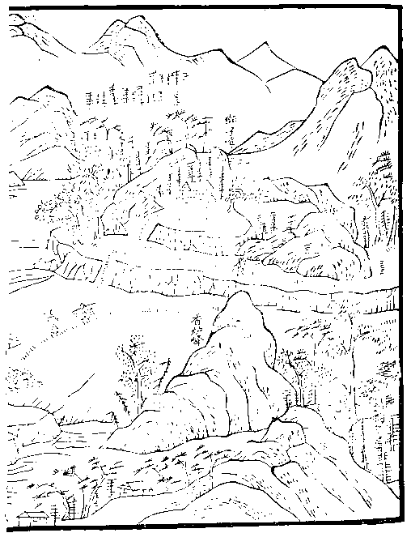
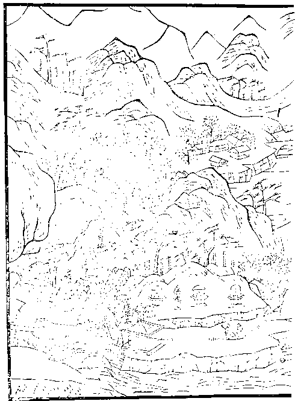
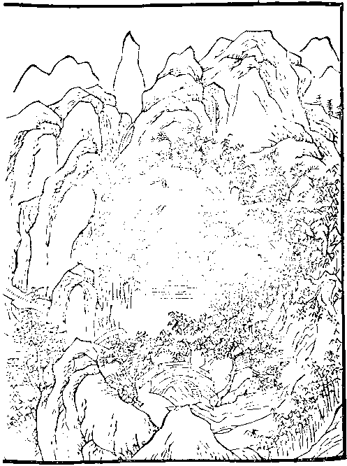
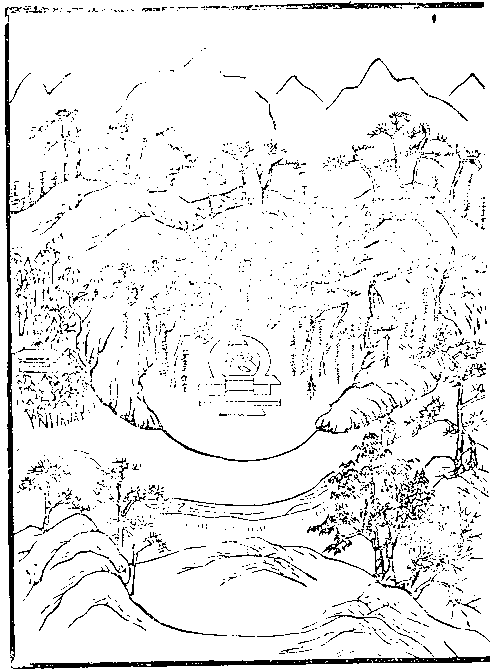
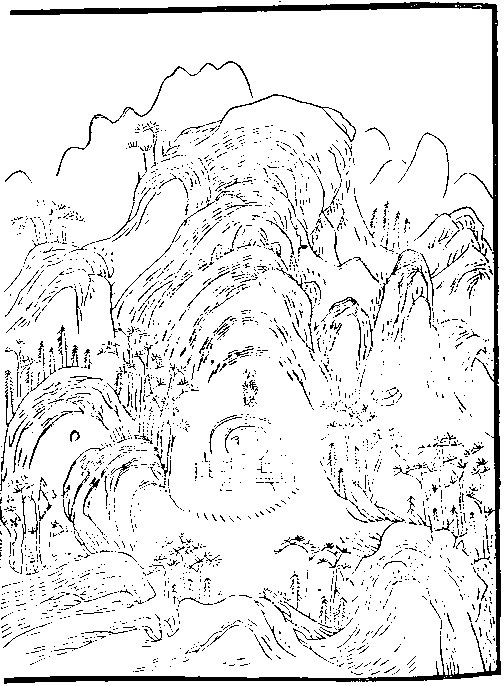
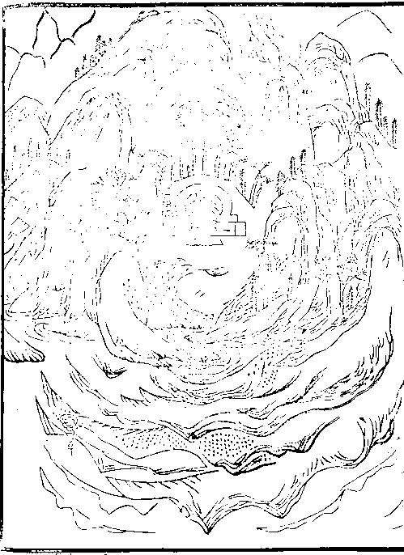
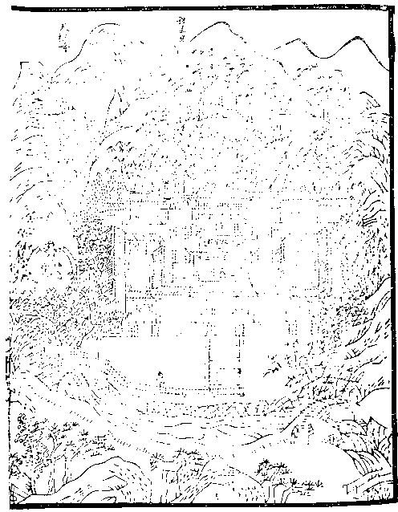
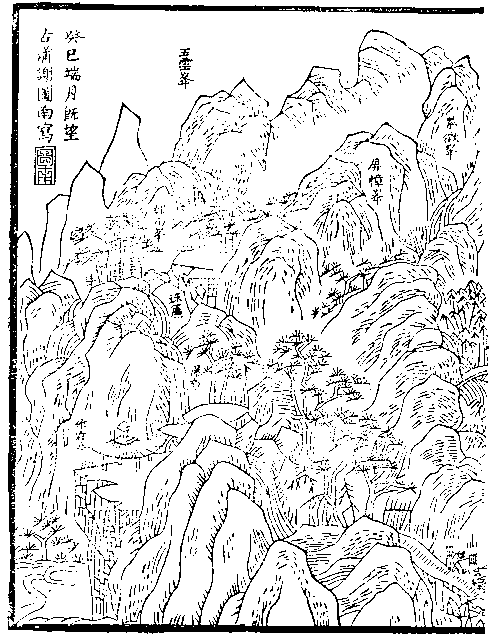

# 黄檗山寺志



> **藏经**：中国佛寺史志汇刊（佛寺志汇刊）　**册次** 第 84 册（GA084）　**编号** GA0086　**部类** 史传部　**卷次** 8 卷　**篇幅** 102,914 字

> **卷／品**：8 卷 · 24 品



---



## 目录



  - [续修黄檗山志序](#续修黄檗山志序)

  - [黄檗重修寺志序](#黄檗重修寺志序)

  - [黄檗山续志序](#黄檗山续志序)

  - [黄檗山寺志序](#黄檗山寺志序)

  - [黄檗寺志序](#黄檗寺志序)

  - [黄檗山寺志序](#黄檗山寺志序-1)

  - [壬辰一阳后黄檗主持隐元隆琦序](#壬辰一阳后黄檗主持隐元隆琦序)

  - [书　启　序](#书启序)

- [黄檗山寺志卷一](#黄檗山寺志卷一)

- [黄檗山寺志卷二](#黄檗山寺志卷二)

- [黄檗山寺志卷三](#黄檗山寺志卷三)

- [黄檗山寺志卷四](#黄檗山寺志卷四)

  - [题白云端禅师语录序](#题白云端禅师语录序)

  - [题虎丘隆禅师语录序](#题虎丘隆禅师语录序)

  - [题禅林宝训序](#题禅林宝训序)

  - [题臣农《即事篇》序](#题臣农即事篇序)

- [黄檗山寺志卷五](#黄檗山寺志卷五)

- [黄檗山寺志卷六](#黄檗山寺志卷六)

  - [重兴黄檗募缘序](#重兴黄檗募缘序)

  - [禅灯世谱序](#禅灯世谱序)

  - [密云禅师语录序](#密云禅师语录序)

  - [费隐禅师语录序](#费隐禅师语录序)

  - [隐元禅师语录序](#隐元禅师语录序)

  - [隐元禅师语录序](#隐元禅师语录序-1)

  - [隐元禅师：云涛集序](#隐元禅师云涛集序)

  - [本山册籍序](#本山册籍序)

  - [黄檗寺缘簿序](#黄檗寺缘簿序)

  - [慧国禅师五秩序](#慧国禅师五秩序)

  - [道暹禅师语录序](#道暹禅师语录序)

  - [一庵暹大师：游戏三昧集序](#一庵暹大师游戏三昧集序)

- [黄檗山寺志卷七](#黄檗山寺志卷七)

- [黄檗山寺志卷八](#黄檗山寺志卷八)



---



### 续修黄檗山志序



黄檗之名，赫於震旦，几与鹿苑、鹫峰争胜。盖其山水实佳，峰峦连沓，一溪横焉；循麓穷溪，峙然殿阁。旷如奥如，二者殆兼。地灵人杰，语不诬矣。旧常有记数卷，畧记山川林麓之胜，与夫寺之废兴，而偈语游篇亦载焉。岁久不修，板字漫漶，数十年来，棒喝之遗、兴咏所及，又与落叶飘风逝焉俱冺。和尚一庵，三住是山。甲申岁，寺久颓废，余既为新之，一庵亦遂裒集散佚，授之梓人，缀於旧志之后。美哉一庵，盖不能忘情者矣。余闻佛法不立语言文字，其视天下废兴成败之迹，汩然无动於中。今一庵拳拳若此，是有意后世之名，於其宗法不免多事焉。虽然，日月运行，寒暑代嬗，饮食男女，负贩种艺，人生旦昼间，一日不死，不能一日无事。其废兴成败之数，虽宣圣挺生，不能不听之於天。而其有生而必有事，有事而必待为之之人，即佛之乞食说法、接引众生，亦所谓不能无事也。然则一庵之续为记，而并以乞序於余者，佞佛、辟佛之说，悉可拈花一笑也。乙酉岁正月，以公事便道又至黄檗，值一庵在会城未来。余见寺之田亩悉归，寮舍廊庑悉整；朝夕梵呪之音，师徒威仪之节，亦悉如曩时之盛。而山木宿经斩伐者，多阙焉未补。乃市松秧三十束，种於寺山前后。计十年之后，崭然可观；又更数十百年，其蔚然苍然，又不知若何为兹山增胜！是役也，一庵闻之，又必谓余亦未免多事，而其不能忘情则一也。



赐进士出身．福清县知县．保定张缙云题



------



### 黄檗重修寺志序



夫赤县神州，精蓝碁布，屡废屡兴，在处有之。玉融黄檗者，唐宣宗观瀑联吟之地、梁江淹至闽游咏之区。裴丞相皈依於远祖断际，朱夫子供养其故人悟公。高僧正干，来自曹溪；法祖希运，嫡传临济。懒庵老禅，剏建大沩，阐化於省垣长庆；月轮尊宿，受记善会，唱道於豫章抚州。斯皆名噪霄壤，特书国乘者矣。迨乎前明，神皇锡藏，贤相布金。吴尚书忠烈，诗记流芳；钱相国希声，忠贞瘗玉。赐紫镜源大士，御座试经；勅封隐元国师，扶桑宏法。象崖古德，创黄檗於蚕丛；南庵阇黎，开白社於建业。是亦西来川岳，咸鍾奈苑之奇；外护王臣，不忘灵山之嘱。俾著绩千秋，垂声万福者也。嗟乎！萧梁迄今几二千载。寺志，隐老人修后百七十餘年，未有嗣续。暹三主本山，重辑《五灯全书》黄檗宗谱。寺志虽经纂修，退院抱疴，未能授梓。迩奈禅宗丛脞，知识凋零，保社倾颓，清规废弛。净土草深一丈，缁流星散十方。幸承玉波张老明府大护法，乘菩萨愿，现宰官身，棨戟遥临，祖庭复振。悯香灯之閴寂，叹钟皷之沉埋。遂即清逋厘产，捐俸募缘，百废俱兴，群生有赖。峰峦十二，俄顷改观；沙界三千，斩新绚彩。琳宫绀殿，金碧重辉；宝藏琅函，玉毫再现。迺延兰翁大和尚，主持启戒，剞劂志书，布之寰宇，冀亦少垂不朽云尔。



道光甲申秋仲，临济正传三十八世一庵达光道暹盥题



------



### 黄檗山续志序



檗山者，玉融之胜概；万福者，临济之禅宗。前有唐宣宗观瀑作之於先，继有叶相国护藏续之於后。其间兴废创因，不可胜数。且旧志已详言之矣，馥亦毋庸再𪢕。越至乾隆年间，栋梁渐被鼪鼯剥落，殿宇旋惊，风雨飘摇。幸有檀越叶相国之后旭溟老先生，仝迳江林镇先生，暨莆阳心鉴周公后裔诸檀那等，承先人志，发老婆心，作为倡首。今馥仝僚执事界阳、心存、继宗、继芳等，遍处劝捐，而寺宇焕然一新矣。时欲延馥主席本山，奈才学褊浅，未敢擅专就于寺中主持。数载后，旭以公车北上，馥以耄耋南旋。不料沧桑易变，阅数十年，而寺宇渐复倾颓，缁流尽皆散处矣。适逢玉波张明府大护法福曜垂临，覩常住之凋零，作中兴之首倡。命衙权丁官皪、徐士魁、李廷芳、郑士忠等培松植柏，序志归田。香霭重其氤氲，瑞照增其朗耀。故事必有倡之者，其成速；有续之者，其成尤速。因与在寺住持、监副执事及侄宏心等，殚心竭力，董造募金。而寺宇於焉复整，缁流由是悉归。此张明府之功居多，而诸住持之力不少也。癸未岁，复蒙张公延为主席，馥以老辞。而合邑诸绅衿，及本山诸禅师荐牍叠临，惟有点头而已。启戒后，与合山法眷议及所以续修《黄檗志》者，而法眷亦有是意。於是共襄其事，重辑纂修，不数日而成功矣。嗟乎！寺志自隐元国师修后，迄今百七十餘年，版图残缺，简牍消亡。倘不从而重订之，将何以继往而开来乎？写林泉之幽胜，集群彦之诗词，作为冠篇，鼎峙兰若。俾万古以长存，厯千秋而不朽矣！是为序。



道光岁在甲申季冬上澣，主席檗山第四十四世兰圃清馥题



------



### 黄檗山寺志序



宋人诗云：「天下两黄檗。」今天下山名「黄檗」者，不止两处，皆以断际师得名。吾乡黄檗，则师家山初出世处。后履历诸方，不忘其初。葢诸方以人名山，斯乃山名人者也。自师门下出一临济，宗风大振。推其所自，故江表岭南所在有「黄檗道塲」矣，则谓山以人名亦可。自五花开后，迦文面目全在震旦，皆由《景德传灯》诸录大行于世。夫能不立文字者，乃能不假文字以传乎！近世《传灯》不修，五家遂隐，临济一宗独不废也。顷密云悟师南来，断际师真堂堂皇皇再见於此。亡何复还吴越，将犹当年带「黄檗」名，遍名诸方者欤？传师灯者，费隐大师。推师而上，以及临济，宗门所自起，列而为图。其以文字显者，自《景德》而上，起「金峰铜石」之句。寺额起自贞元，塔院起自太平兴国，古物起自唐九松。重阁大藏，永镇山门，起自神庙四十二年，相国叶文忠公请于朝也。今并搜而志之，以为兹山不朽。夫网罗旧闻，关情山水，非宗门下事也，傥亦有《景德续灯》之思乎！法宝将兴，必有轮王。自大藏入山以后，龙宫渐出；以至大师南来，断际之灯再传矣。余於黄檗山水旧闻，固不能忘情者。悟师到寺之岁，仅书邮往来，不能亲到九龙潭。其明年，乃相见于吴门。是后师在天童，废放之餘，不获三上九到。兹山近在吾乡，余同年林侍御之里。御藏檀樾相国者，吾师也。侍御又为予千里命驾之友，他日携文通佳句，往坐塔松下，固予屐齿间物耳。因人重山，因山重人，初心不忘，岂独先志有之哉？于是黄檗僧来请，遂敍之。后代儿孙当如悟师，无忘家山，邈得断际师真，举扬临济宗风于此，则山重而志亦重矣。



崇祯戊寅岁下元日，岸先居士王志道书



------



### 黄檗寺志序



黄檗去融邑一舍而遥，深山幽谷，旷非人境。自唐贞元以来，世为丛林，地既清净隐僻，不杂尘俗。缁流非精严戒律者，毋敢入。而又代有禅宗高士以为之主，慈云所罩，远迩向被。邑之评丛林之盛者，莫能外焉。万历中，叶文忠公在政府，为请於神宗皇帝，得锡藏经，焕然再新殿阁。金碧辉煌，相好光明，隆隆之象，一时未有。凡闻风而至者，莫不咨嗟叹息，生皈依心。三十年来，徒众日繁，宗风大畅。於是居士林荩夫、比丘行玑等，裒集过去见在一切见闻而为之志，以待夫未来者。问序於余。余尝同友人入山扣费隐禅师，见师皤然清癯，一语不发，而问者自远。其寺僧率循循缩缩，有精进相，因叹曰：「此黄檗之所以为黄檗也，向所称岂虚哉！」然窃有欲言於费隐者。夫佛之为教，其要在慈悲广济，而禅之为宗，其指又在使人自得、不落声闻。是二者，意本相成，而事则若相戾。彼贸贸而来，如饥人之入太仓，如病夫之入药市，明知可以饱我疗我，而急不得其一赈救，则慈悲广济之道何居？固曰自得；自得耳，又奚赖此破暗之慧灯、度迷之慈筏也？曰：「不然。人之於法，始固无不爱恋而欲一得；至其得也，则实无所得，而并爱恋者且一无所有。譬父母之於子，初固怀抱中物也；及其成立，父母之心得矣，然岂能常在怀抱中哉？故方其爱恋也，在爱恋者以为是，而自了然者视之，则非也。比其得也，即得者亦不自定，而自传心者值之，则有大欢喜者矣。然则人谓禅家之不轻付与也，而岂知其婆心之独切哉？饼家子日以饼遗僧，僧即以一遗之，曰：『吾惠汝。』子曰：『饼为我遗，何反遗我？』僧曰：『是汝持来，复汝何咎？』饼家子因有省。又有狂号於道而覔其首者，指之曰：『首固在也。』其人遂定。彼贸贸而来者，皆有所持来也，然自有而自不知，是求首之类也。禅师又以持来者还人，而觅其首者犹未知所定也，是岂师之不多方指授哉？不自得之故耳！」黄檗代以宗风重，望黄檗而来归者，亦代以宗风重，故志载源流语录为甚详，而余亦举以相问；然是皆筌蹄也，过去现在一切见闻，恐终归於法无涉。倘未来有明眼人，亦惟从自得作采寻耳。虽然，余此言又理障也，并抹杀可也。



崇祯丁丑岁仲春，笔山居士费道用题于三山之碧桃轩



------



### 黄檗山寺志序



志旧修为一册，今订为二册，皆本山和尚手裁。幽以皈依座下，得从编阅，所谓不能赞一词者也。始山者，志所本也。有山而后有寺，有寺而后有僧。相承而志之者，山以寺名，寺以僧重也。法居山寺未有之前，志次乎僧者，道非人不行也。释氏四大非有、五蕴皆空，何有祖塔？志及之者，昭水木之本源，亦像教也。志外护者，法虽自作主宰，行必辅车相依也。次於祖塔者，明非媚生而薄死也，亦以见祖塔之地未尽复，瓶罄为罍之耻也。至文以掞法，纵主法、护法各有其极，而志居后者为落筌蹄，不欲以文章炫人也。逸事可以不志，必附及之者，录实也，亦纪异也。夫八闽胜地，留幽著述不少；独於黄檗，无可下笔。葢　和尚无字之文，𤍎𤍎玄定，悬之国门，只字匪易矣！幽所谓终不能赞一词者也。虽欲不杜笔，权可得哉？如其笔削，以俟君子！



辛卯孟夏浴佛前三日，门弟子性幽薰沐百拜手书



（以上遗漏均系原缺）



补录：叙重修黄檗山寺志



叔世多痴，名山有骨，每与高人韵士共之，是在会心深浅耳！老僧主法席有年，黄檗枝头摇醒三更之月，紫云壑里斩开万树之藤。时听溪声、鸟语，浮峦光而出，未尝作山水观；要何必不作山水观也？感谷陵之迁变，念人物之凋荣，试进游客、骚人而问之：「铜鞮、金谷之瓦，辟疆、兰亭之石，迄今犹有存者乎？」而海内名山独与灵鹫并传不朽！固知地㠯人重，其权不在山川也。是故天变而道不变，古德详哉言之。倘山灵无主，纵逞风云以绚其奇，驰月露以章其秘；所谓「能令臧三耳」等耳，曷足贵乎？如司马有捃摭之史，子厚多纪游之篇；当时川𪨷藉之生色者，盖亦炳人耳目矣。然而大道不闻，君子咲之。可知文以道重；点缀山川，其权又不在笔墨也。旧志虽出巨公之手，体略已具而精微未尽。譬如畫者面目骨格粗成，尚须点睛会神，方有可观。老僧不揣梼昧，继之正古道之源流，胪新规之本末。未知其有权於山川与否也！第不欲㠯世谛之笔墨累人耳！读兹编者望林峦而有淂，佀不劳骋周穆之鞍，顾草木而自非；更何事勤谢公之屐？明心不远，纸上非浮，如徒作山水观，是使山川笔墨有权，麋鹿亦且咲人，郦郭尽称入室矣！非老僧重修兹志意也。但道以触目长存，质以修文弥著。先辈证悟，或多於山水间淂之。兹编之成，离言超谓，未尝作山水观；要何必不作山水观也？老僧以为「在会心深浅」者，盖此耳。



------



### 壬辰一阳后黄檗主持隐元隆琦序



黄檗山凡例(八则)



山河大地是眼中尘；无边刹境是梦里事。五岳四渎，泡影空花，何足道哉？然则一峙一流，一动一静，从甚麼处涌出？苟知出处，可以卓立宇宙间。古今名胜，无有并之者，而后以溪声为长舌亦得，以山色作净身亦得。否则，须弥之胜，十宝之严，不亦陋且顽乎？我檗山巍巍，逈出万峰之表，佛僊神蟒戏奕之塲。岩崖洞壑，灵气鍾焉；潭涧泉石，神物护焉。隐显幽异，难以形言。游之咏之，辟之志之，无可不可。志山第一。



昔人拈茎草，建刹已竟，崇楼杰阁云乎哉？或因缘出现，一时涌出；或因缘离散，倏尔灰烬。可思议邪？不可思议邪？兹寺自唐宋至明，几废几兴，莫非俟乎其人。若夫看破水月道塲、空花佛事，正好扶起茎草，撑天拄地、葢覆将来，曷有已极？志寺第二。



古云：「人能弘道，非道弘人。」诚哉是言也！凡主持家国、决择朝野，惟人为贵；而况担荷佛祖、丕振宗风者乎！兹山劈自正干，炳於希运，声彻九重，道扬四海。山以人重，人以山灵，并传而不磨。其餘弄泥团汉，䖃䖃苴苴，磊磊落落，总被老人笔尖头上放大光明，烁破面门了也。志僧第三。



一法若有，毗卢坠在凡夫；万法若无，普贤失其境界。若也救毗卢而不坠，全普贤而无失，可谓善说法者矣！然则剔脱有无关棙，掀开凡圣名言，尘说、刹说、炽然说，何待西方东土诸老古锥，拈椎竖拂、指东话西、摇唇鼓舌、说青道黄、为祥为瑞、为殃为灾，以为法式者邪？这里还著得毗卢麼？请下个注脚！志法第四。



湘南潭北，绵密不通风；岩下峰前，突出太崚嶒。此便是𮞏代老冻侬末后躲跟之处。只如骤雨怒号，寒烟长锁，猿啼鸟唤，奉献无门；孝子贤孙，追思无地。且道向甚麼处覔得祖翁灵骨？声色堆头，急须着眼，不萌枝上，漫扫春秋。志祖塔第五。



真正衲僧，一法也无，护个什麼？苟能无可护处，兴一言如银山铁壁，为千古屏翰，令人望之俨然。灵山付嘱犹在，是则名为真格外之金汤也。志外护第六。



修世谛文字，胡谓有待千百世之后？而放志山林，栖心法窟者，知代不乏人；况名胜景物，真伪确有可据者哉！然则长篇短句，搜罗见闻，可与卧游山水者道尔。若夫达观之士，亲到黄檗峰头，豁开只眼，洞壑林峦，真文炳著；潭涧木石，觌体成章。这叚灵妙幽真，非楮墨之可传。设若添个元字脚於其间，不亦贻雕文丧德之诮欤？志文第七。



书以传信不传疑。若夫事之逸者，多近乎疑，传之曷故？殊不知，有逸人方有逸事，传逸事愈足以证逸人。夫逸事非奇也，诚善应之兆也。《易》曰：「居其室，出其言善，则千里之外应之。」而况逸事之符乎？所谓善及乎前，必应之於后；善及乎古，必应之於今；善及乎身家，身家必有异常之泰；善及于天下，天下悉皆祯祥之徵。夫复何疑？附志逸事第八。



旧志六章，今列为八，涉猎见闻之殊，扩充人景之藻，世出世间，摄尽无餘，以便遨游者之大观。若夫未点畫以前，著得只眼全彰，格外风光。笑看斯集，逗漏奚辞？



黄檗断际希运禅师一派源流



断际运  

临济玄  

兴化奖  

南院颙  

风穴沼



首山念  

汾阳昭  

石霜圆  

杨岐会  

白云端



五祖演  

昭觉勤  

虎丘隆  

应庵华  

密庵杰



破庵先  

无准范  

雪岩钦  

高峰妙  

中峰本



千岩长  

万峰蔚  

宝藏持  

东明旵  

海舟慈



宝峰瑄  

天奇瑞  

无闻聪  

月心宝  

幻有传



密云悟  

费隐容  

隐元琦



黄檗传法法派



明第一代黄檗开法圆悟密云祖师源流法派



祖道戒定宗　方广正圆通  

行超明实际　了达悟真空



清第四十代住持开法达光道暹禅师续立法派



三昧原无相　一秉妙厥中  

现前机用大　豁露本来衷



黄檗剃度宗派



明第一代黄檗开山赐紫正圆中天祖师剃度宗派



祖法志怀　德行圆融　福慧善果　正觉兴隆



性道元净　衍如真通　宏仁广智　明本绍宗



明第三代重兴主持开法隆琦隐元祖师续派



一心自达　超悟玄中　永彻上乘　大显主翁



清四十代住持宏光道暹禅师又续



闻思直证　理事该充　圣凡俱冺　照用弗同  

支那演范　兜率垂功　绵延奕𥜥　济度群蒙



黄檗山寺志总目



卷第一



山



峰　岩　洞　石　岭　垅　池　潭　溪　井　泉



卷第二



寺



殿　堂　方丈　厨　阁　楼　廊　寮　房　亭　桥　坝　碾　碓　磨　台　庵　院　塘　庄　坞　田　园　山塲



卷第三



僧



唐　后唐　明　清



卷第四



法



上堂　小叅　机缘　偈　启　书　规文



卷第五



塔



鸿休　大休　雪堂　义庵　妙湛　坦翁　藤庵　必翁　员湛　上善(原名适轩，即公妈塔)



中天祖师　费隐法祖　隐元祖师　慧门和尚　虚白和尚　广超和尚　清斯和尚　璧立和尚　良准和尚　濬微和尚　晦谷和尚　朗纯和尚　智泉和尚　若育和尚　雪椿和尚　慧隆和尚　慧国和尚　了情和尚　珩玉和尚　承垠和尚　道暹和尚　继宗和尚　界阳和尚　三塔　海会　报恩



卷第六



外护



------



### 书　启　序



卷第七



文(梁、宋、明、清)



志　记　词　赋　赞　居士诗



卷第八



释诗偈



仙诗(附)



附逸事



古佛示瑞　灵湫显异　巨蟒神踪　五音鳄石　九龙古树　郑渚金声　嵩岩香乳　祥云现瑞　春畦法雨　彩泥示现　白光贯顶　隐祖灵迹　钱相忠莹



































------



## 黄檗山寺志卷一



重兴隆琦隐元祖师原本



门弟子性幽独往等编订续修



监寺(道昱　道升　道本　宗仪　开滋　永悦)副寺(惠秀　舜普　永施)仝静寺(宗堂　宗恺　德科　传图　华忏　常澄　绍仁　本岐　绍修)校刊



山(十二则)



势拔穹窿，屹然永固；形盘大地，觌体全真。是以奇岩幽谷，云水居焉；广穴巨川，龙象宅焉。乃至达观上士，每于山色溪声脱落见闻，与林峦岩壑浑为一体。名实并称，千古而不磨也。故集是编，畧示檗山胜槩，庶后之君子策杖寻源，履践前辙，不迷蹊径云。



黄檗山



距福清县城西二十里为宏路驿。由驿而南，循金印舖，缘大壤而入，为清远里之黎湾。黎湾即狮子、香炉二峰内，本邑叶文忠公有纪游亭於道左。亭西数武为下棋垅，垅之右为桑池园，接寺拱桥。逾桥数武即寺之旧山门也，历内桥为进寺之始。寺山故有黄檗，因以为名。唐贞元间，正干禅师为开山祖，继有断际希运禅师出家其中。厥后阐化江外，所住巨刹皆以「黄檗」称，为酷爱兹山幽邃故也。远溯来源，自金鸡、白鹤逾三溪，越灵石，北向而下，首出大帽峰。高出云表，峭拔无双，本县中龙之祖也。剥下两枝，东为宝峰，西行十里许为陈九郎故居。突起为罗汉峰，迤逶曲折至香城。自高山脱脉而东，宛转向南，磊落而下为绛节峰，乃寺之主山也。东自绛节分岫，由化龙直趋下棋垅为寺左障。西自罗汉、天柱、屏嶂列拥为寺右障。西南自五云、报雨、吉祥诸峰涌腾而下为寺内案。吉祥之餘麓屹然环遶，与下棋垅相搆，为寺内垣。从前案遥引而东，复有香炉峰与狮子峰对峙，为寺外垣。自小帽而东，特起一峰曰佛座，即寺之外朝也。内水则自香城分界，发源自罗汉泉，注石门溪；从内石桥流入放生池，拱桥而出，与外水会。外水则自大帽发源，历九渊而来，遶吉祥而逝，与内水汇，直至迳江。诚禅门法苑、祖裔福基也。自唐迄今千有餘载，正干、断际而下诸师，或扬化他方，或韬光此土，隆替不一，未可悉数。崇祯庚午岁，密云和尚始于兹山开宗播响，重振旧规，远近闻风，咸生渴仰。嗣是费隐大师得面禀亲承之旨，单提向上钳锤，大开炉鞴，钧铸凡圣，以故群贤间出。今隐元禅师以嫡传继踵，赤手全提，具佛祖爪牙，统衲僧巴鼻，宗纲有赖，嗣法得人。丛林维新，万言莫罄；著述之盛，千载希逢。则斯山也，岂但与宇内之胜仅传不朽哉？



峰(十五)



大帽峰



此峰最高，为本山祖。代有黄檗、瑞香生成不辍。顶圆如帽，因以得名。灵石指为留雪幛。



小帽峰



与大帽峰相连，嵸峻圆顶似之。



宝峰



在大帽前。群峦环翠，耸出汉表，莹润如聚宝然。中抽嫩枝，灵气鍾四潭，中天老人塔焉。



屏幛峰



在天柱右畔。上有三台，四时花草菁葱，望若御屏。



紫微峰



在天柱、宝峰之间。众山环绕，苍翠异常，宛似紫微。



狮子峰



在香炉溪北。山势雄崛，形如卧地狮子，即本山之捍门也。



香炉峰



端圆而秀，一麓下垂，如香炉有柄。居前案末，乃寺之华表也。



佛座峰



一峰独挺，高数百仞。有头颅足膝，若大佛宝座。寺以此峰作外案。



罗汉峰



在天柱上。拔出众岑，状若罗汉。次于大帽，乃本山之中峰也。



钵盂峰



在罗汉肩左侧。形如釜，因邻罗汉得名。



天柱峰



乃罗汉右。巍然独耸，势若擎天。



五云峰



自小帽迢下，层峦叠𪩘，屈曲有五，如云乍出。



报雨峰



居五云东。每天将雨，辄先起云，里人以之占雨。



吉祥峰



与报雨峰连，特朝而来，作寺前案。时有祥光现于其上，故名。



绛节峰



即本寺主山。一起一伏，断而复连，如绛节状。



岩(一)



头陀岩



寺之西嵩头陀岩，有乳香出自石罅间。



洞(一)



蟒洞



唐时传有蟒神栖焉，颇知皈依正教，显迹至今。其洞口向石竹，广三丈，深六丈，高亦如之。上有圆窍通天，傍有小泉流涌。内小洞深邃而黑，人不敢入。在大帽峰西北。



石(七)



三台石



在寺右障中。望之森列，俨如台星，故名。



飞来石



在第一潭下。高可数丈，三面虚悬，屹然而立。费邑侯以乙亥夏游此，上篆「振鹭之瀑」四字。



钓台石



在报雨峰下。前有三潭可钓。



屏石



在寺右茶园上。以似屏故名。



鼓石



在四潭前旁。甚险，游潭者抱石鼓而上。



盘陀石



在下棋垅上。



界石



在翠竹庵后仑顶。上以大石界，下以路界，从山脊分水出，俱系寺业。



岭(五)



马鞍岭



寺右臂。天柱峰由此而上。马鞍，葢以形似呼之。



铁灶岭



在寺前右障。大溪沿路而上为报雨峰，俱属寺山。



宫后岭



去寺一里许，佛座峰由此而上。



吉祥岭



在寺前案，上熨斗万松庵之捷径也。



绛节岭



在寺后。逶迤而上，之香城旁通路也。



垅(一)



下棋垅



古传为蟒神与紫云僊博奕处。



池(一)



放生池



崇祯甲戌岁，砌内堂溪为之。



潭(一)



九渊潭



寺西南隅有溪，沿溪三里许，石壁巉嵒，泉色蓝光者为龙潭。自下而上共有九处，惟龙湫、石鼓、玉筯为最。而龙湫即第一潭也。纵广六七丈，底深莫测，上有飞瀑从空泻落，望若珠帘，凡亢旱祷雨多应。宋绍兴癸丑冬，赵公卞观稼至此，祝曰：「名位浅狭，所及者鲜；惟龙以时致雨，尽苏一邑之苍生。」书以勒石，复勒「灵渊」二大字并七言绝句一首於潭上。元符二年，安抚程公迈祈雨有应，为立龙堂。宣和二年，摄邑陈麟再立祠。淳熙间，安抚史公浩复增饬之。石上有汮亭。咸淳丙寅，仓使刘震孙改其额曰「九渊第一」。以「九渊」为总名自此始。而龙堂、汮亭则已毁矣。其侧铭「龙湫」者，郡丞叶嗣昌书，住山释元恭立。赵善密者，不知何许人，亦同住山圆悟来此。熙宁春，崔令同丕绩师亦至，勒字于潭右水际。国朝天启元年，叶文忠公复搆亭于龙堂旧址，莆宗伯林公尧俞书扁曰「作霖」。未几，为山隣所焚，独石碑一方载〈登潭〉诗，有「人日看山雨乍收」之句。悬崖之中题「潜龙」者，迳江侍御林公汝翥笔也。由潭流下为瀑布泉，泉之旁有危石，高可数丈，三面悬虚，屹然而立，曰「飞来石」。崇祯乙亥夏，费邑侯道用篆「振鹭之瀑」於上。其餘岁久字湮，为水所澌，不能尽见。再历而上有石皷，即第三潭也。一石如鼓，鲠于潭旁。四潭悬溜数丈，亦如泻珠，比龙湫稍差。但岩壁极峭，游者不敢履，多从崖头俯瞩而已。玉筯隐于幽谷，是名七潭。泉自高泻，望若玉筯，然去石鼓则远矣。至九渊则隐显非常，变化莫测。或求之弗得，有时自现，为樵者所覩。其餘诸潭各成形胜，皆有可观。



溪(三)



石门溪



去寺西北一里。两石相倚如门，状极奇怪。水从下流出，遶过寺前。棠阴夹岸，覆葢如亭，中有乱石可坐。



大溪



源自九渊龙潭而来，奔流不绝，与拱桥之外石门溪水会，直注迳江。



小溪



在寺右涧，石门之水注焉。阴映如葢，清凉如镜，傍有石壁堪题。外石楯、石桌十餘，禅衲适兴烹茗，传韵于此。故师有〈小溪十咏〉之作，从者和之。冷然有声，闻之热恼烦浊不觉冰消矣。



井(三)



龙井



法堂后石岩壁立，下有石穴方如盘，深不二尺，清而甘，虽亢旱弗涸。辛卯冬，搆龙宫於上，以便祈祷。



古井



阔六尺，围二丈，深二丈餘。在应供堂之右。



金仙井



在寺右臂后水笕坑中。庚寅春，搆翠竹庵，寻源得水，故名其泉曰「般若」。



泉(三)



虎跑泉



在寺右虎薮坑上。昼夜混混不竭，以笕引之，直至香积。



罗汉泉



在罗汉峰间。石隙流涌，去寺五里许，系石门溪之本源，直汇寺前放生池。



般若泉



在水笕坑中，直注坑前而隐。游翠竹庵者，勺而烹，清香甘美，试茗尤嘉。



------



## 黄檗山寺志卷二



重兴隆琦隐元祖师原本



门弟子性幽独往等编订



当山世孙(了馨　清馥　达光　道暹)续修



监寺(道旵　道本　道升　永悦)副寺(崇仪　舜普　开滋　慧秀)校刊



寺



毗耶丈室，一榻风光；舍卫讲堂，四面通达。至于我土，琳官绀殿，表表可望者，皆因人而致之。匪徒搆其虚席，间虽隆替不一，中兴每自有待焉。是以帝德旌崇，民心归仰。宝殿龙楼，一时显焕。祖庭僧舍，八字打开。慕道缁素，莫不由斯门而入也。



万福禅寺



寺之创，自唐正干禅师始，葢贞元五年也，额曰「般若堂」。后八年于其东大辟堂宇，德宗改为「建德禅寺」。盛于宋，微于元，重兴于明。洪武二十三年，莆阳心鉴周公为檀樾，大休禅师主之。规制自本山落脉而下为法堂，次为大雄宝殿。殿之前有放生池，池边石桥。二门，其东为香积厨，西为转轮藏。前有小溪，自天柱、石门来，远五里许。遶寺而东，上有拱桥跨岸而过，更百餘武为天王殿。殿而下为甬道，长可七十餘丈，即三门。门左右有伽蓝、祖师二堂及十方寮舍。一时殿阁伟丽，而田产亦盛。以嘉靖乙卯倭变，灰焚殆尽，僧徒星散，又成榛莽之区。久之，近民生心，田地几为乌有。隆庆初，僧中天圆公诛茅于斯，志图恢复。万历辛丑，毅然赴阙，请赐《龙藏》，崇镇宝林。居八年，未蒙谕旨，以疾卒于都之长荣茶庵。其徒孙兴寿、兴慈，不怠先志，恳请愈坚。越六年，相国叶文忠公代力奏请，改额曰「万福禅寺」。神宗皇帝勅赐全藏，计六百七十八函；勅书一道，命中使王举同僧赍护到山。仍发帑金三百两为赍经费，时万历甲寅年也。是年相国告归，汪邑侯泗论疏，令寿、慈募化重兴，太学林守玄、林伯春董其事。建宝殿于法堂旧址，礨筑月台于殿前廊之下。由台而南，搆藏经阁，珍崇御藏。又搆择木堂于殿之东，今相国像在焉。移旧佛堂于殿之西，为方丈。戊午春，兴慈归寂。丙寅而兴寿亦归。崇祯己巳，玄孙隆宓、隆瑞等复搆二客堂于殿之左右。已而，念祖庭秋晚，正道无闻，必有弘法开堂者，庶不失古今标格。以是谋诸檀樾外护，敦请金粟密云禅师主席。庚午春，飞锡南来，全提向上大机，直指当人本旨。黄檗宗风，于斯始振。未几而还金粟。癸酉冬，宓、瑞复仝外护龚居士等恭请费隐禅师住持，恢张祖道，永为十方禅刹。衲子无远近，望风率至。丙子夏，师应建宁莲峰之请。瑞同檀信等，念黄檗为列祖之席，不可空悬，请隐元禅师以继其位。未期年，衲履盈室，大振临济之风，中兴黄檗之道。师之功於前此殆有加矣。庚辰春，拆月台，重建大殿于旧址。以旧殿仍为法堂，移藏阁于西廊之后，搆斋堂于云厨之前。辛巳，建钟鼓楼、山门、云厨、库房并诸寮舍，一一咸备。凡所作法，遵依祖制，成大禅刹。入斯门者，莫不皈依。甲申孟春，师有天童扫塔之行，寺事请罗山亘禅师主之。是冬，搆左右两廊于殿之前，奉祀伽蓝祖师。丙戌春，亘公仝诸檀信仍接师囘山。时适世界纷纷，僧俗戚戚，幸祖道如故，大教不祧；而亲领大乘、同悟禅宗者，不下数十人。所谓「长安甚閙，我国晏然」，诚不虚矣。



殿



大雄宝殿



计五间。高四丈七尺，纵六丈七尺，广八丈七尺。重簷结角，金碧流辉。外游廊之前，中堦九级。明堂深四丈九尺，广八丈六尺五寸。上梁时，老人升座云：「托出脊梁横法界，大开眼目耀乾坤，都卢一座空王殿，百万四千解脱门。正当与麼时，撑持者撑持，葢覆者葢覆，且道阿那个作得其中主？」良久云：「儿孙卓立如麻粟，没量大人独个尊。」



旧天王殿



在放生池南，今废。



堂



法堂



计五间。高三丈有六，广八丈，深七丈。乙卯岁，僧兴寿等建为殿。庚辰春，复改为法堂。



禅堂



在阁下西廊之后。纵五丈六尺，广六丈二尺。有嘲者云：「和尚不可以经阁混为禅堂。」师云：「这里甚麼所在，许你分经分禅？苟悟一椎两当，则千七百个古锥、三藏烂熳葛藤无地可寄矣！」



学事堂



在钟鼓楼下，计三间。



云水堂



在山门左。



应供堂



在东廊后，计三间。高二丈有八，广六丈有六，深六丈有三。师示众云：「法眼圆明，日费千金非分外；偷心不死，时尝滴水也难消。」



楼阁



藏阁



在殿右，计五间。高三丈有五，广六丈有二，深五丈有六。八闽中藏阁甚多，奉特赐者甚少。惟黄檗僧兴寿、兴慈，成中天老人之志，叩阙坚请。乙卯岁，蒙神宗皇帝特差内监王公赍送至山，有勅书一道云：「勅谕福建福州府福清县黄檗山万福禅寺住持僧人正圆及僧众人等。朕发诚心，造印佛大藏经，颁施在京及天下名山寺院供奉。经首护勅，已谕其由。尔住持及僧众人等，务要虔洁供安，朝夕礼诵，保眇躬康乐，宫壸肃清。忏已往愆尤，祈无疆寿福；民安国泰，天下太平。俾四海八荒咸归仁慈善教，朕成恭己无为之治道焉。今特差御马监太监王举，赍请前去彼处供安，各宜仰体知悉。钦哉！故谕。」戊寅春，诸绅士请师开阅。师上堂开阅竟，复说偈云：「四十九年烂葛藤，看来真个可怜生。大家出手俱翻却，始信共途不共行。」



钟鼓楼



在藏阁右，计三间。高三丈五尺，广四丈八尺，深五丈六尺。内悬铜钟一口，重千斤，庚辰仲冬铸，系监寺能得募。请师说偈，云：「黄檗铸铜钟，虚悬释梵宫，千觔乐信施，万古醒迷蒙。器大奚愁晚？韵高谁与同？婆娑真教体，尽在此声中。」有大鼓一面，系鳌江佩玄林檀越施，以配洪钟。禅林礼乐由斯备焉。



刷印楼



在藏阁上，凡法宝新旧板俱在此楼。递年刷印者住焉则有《黄檗希运禅师心要》一本，《白云端禅师语录》一本，《虎丘隆禅师语录》一本，《三教平心论》一本，《天童老和尚语录》全部，《费隐容和尚语录》二本，《祖庭钳锤录》一本，《心经斵轮解》一本，《禅灯世谱》二本，《禅关策进》一本，本山隐元和尚《语录》全部、《又录》二本、《云涛集》一本，《宝训》一本，《石屋语录》一本，《庞居士语录》一本，《梵本普门品》一本，《梵网经》二本，梵本《药师经》一卷，《四十二章经》一本，《禅林课诵》一本，《毗尼日用》一本，《小法数》一本，《四分戒本》一本。板藏于斯，永为流通。



库司楼



在应供堂傍，计三间。广四丈三尺，深六丈三尺，高二丈六尺。



廊



东廊



从下至上计一十二丈二尺。



西廊



如东。



寮



首座寮



在方丈右。



西堂寮



在首座寮右。



书记寮



在方丈左边。



知客寮



在择木堂右边。



化主寮



在择木堂左。



典座寮



在香积左。



杂务寮



在山门右。



什物寮



在三门右。



行堂寮



在下客堂左。



房



米房



在行堂寮左。



碓房



在米房左。



茶房



在择木堂左。



小菜房



在香积右。



园房



在库司楼左。



田房



在浴堂右。



圊房



在浴堂后。



浴房



在田房左。



直牲房



在牛房右。



牛房



在直牲房左。



三门



在大殿前。高二丈八尺，广五丈四尺，深三丈八尺。门旁有青石阃，联云：「千古吉祥临万福，九重紫气葢三门。」



亭



环翠亭



在外拱桥东首。扁系朱晦翁书。今废。



纪游亭



距外拱桥左半里许。内有石碑，载叶相国诗。



茶亭



在狮子峰前。寺路由此而进。



作霖亭



在龙湫上。今废。



桥



内三树桥



在三门前。右有甘棠三树，郁翠盘葢其上；流泉漱石，清音朗朗于下。前有石凳三面，名曰「三树桥」。檀樾林伯春坐息其间，神情快爽，戏吟三字诗以美之。诗曰：



一桥亭　三树下  

千枝椽　万叶瓦  

明月筛　清风洒  

坐其间　即仙也



中木桥



在碾前二十餘武。有二石人立焉。



外拱桥



在桑池园西，即古山门旁。有勒石碑，载宋时僧妙湛募化。



坝



新坝



在三门东南，与三树桥平列。崇祯甲戌始筑，为内堂水口。高一丈三尺，阔四丈，长六丈餘。山门通道於寺右。



碾



塔前碾



坝东二十餘武。



碓



水碓



在大溪坝上百餘武，今废。臼尚存江家门口。



磨



水磨



在水碓上，今废。



台



化人台



由绛节峰分枝而下，距寺二里许江书院北。现有迹存焉。



庵



狮子庵



在狮子峰间，因峰而得名。自外拱桥东去一里许。旧传金长者之宅，辛卯春赎囘。背负狮子，面对佛座，群峦拱翠，碧水环流，如拖毬状。虽形胜之说，释氏不道；而地灵人杰，得无有返掷狮儿出现于世者乎？故师有「坐对金僊谈主伴，卧闻狮子吼风雷」之句。乾隆间，界泉尊　、道暹和尚、道昱首座重建。



翠竹庵



在寺龙臂后仑中，庚寅春始搆。环围翠茂可观，亦卫寺之嘉气，所谓居不可无竹也。此君虚心待物，永夜达旦，吟风嘲月，冷冷成韵，讵假香岩击节而后有声哉？无价赵居士登此，则云：「天风坐笑语萧萧，玉版山中频见招。忽忆香岩家里事，竿头一击便通霄。」



梅福庵



在四潭塔右仑，去寺四里餘。戊寅冬，修中天祖塔，始创三间一偏。内祀中天祖并诸耆旧牌位；旁立一碑，聊敍祖之始末。游者沿溪鸟道而上，丹崖插汉，峭壁凌空。悬流玲珑，大畅胸襟。偶触其机，词锋顿发。围梅百餘株，每至雪嶂流辉，清香扑鼻，可谓名实不虚。故师咏之曰：「素性天然洁，临霜志愈贞，破颜微冷笑，十里净无尘。」



万松庵



在佛座峰间、必翁塔前，一名熨斗山卧云庵。计三间两偏，东西两坑计田十亩。其山塲环遶一派，东至茶亭下，南至佛座山下头陀庵止，连桐管坑田下为界；北至寺案，西连大小帽。自崇祯丁丑岁，周围栽植松柏数万株，今已成林，改名万松庵。偈曰：



百亩青松信手栽　千秋耳畔吼风雷  

眼青可辨龙蛇影　那许狸奴暗乱猜



白马庵



在狮子峰东，距寺三里餘，旧曰白马庙。始京师以白马名寺，以其䭾经西来，有功法门；故此亦以白马名庙，袭其迹也。寻庙废为民宅，辛卯春赎囘。一围五亩餘，计五间，改庙为庵，以存故事。右角廿餘武，即报恩寺旧址，有石𥕢在焉。



水月庵



去寺一里餘，在吉祥峰之右，其山地乃檀越林结夫所施。辛卯春，始搆为庵，三间一偏。枕佛座，濯清溪，紫微影护，罗汉来朝。钵盂、天柱、屏障、宝峰、狮子、香炉，罗列围绕，增万福之胜槩，畅达者之大观，名曰「水月庵」。后有大士应现，未可知也。(道光间，道本德庸公重建。)



三官庵(即闻香庵)



在水月庵右，香炉峰之后，去寺三里许。古祀三官处，寻废为埔地。戊子春赎囘，受种五亩餘。后山三仑连熨斗，俱为寺业。己丑春，略搆一偏，以存旧迹。



绛节庵



去寺二里餘。自寺西涧溯流而上，过石门而入焉。脉自罗汉峰左肩迢递而下，如绛节状，故以峰得名。庵居峰之右，亦以峰名之。建自壬辰季春，三间一偏。前有报雨、五云，后得绛节飘扬，故有「岳献五云供法眼，天垂七宝葢真人」之句。



紫微庵



在紫微峰下，去寺五里许。沿马鞍而上，至天柱峰腰而下，葢宝峰、天柱之间。壬辰春，僧无尘结茅于此，日以采薇当供，夜则禅静而乐。群峦拱翠，万壑呈祥。紫气迫人，通身锦绣。山花映日，遍体文章。鸟鸣丹壁，水奏清溪。一曲两曲无人会，惟许幽人独自知。



弥勒庵



在狮子峰尾仑，狮庵左畔数十武，前后五间。嘉庆丁卯，道升公首座重搆前隖一偏，背岏巑而迤古道，临畧彴而瞰清流。薜荔烟萝，扶踈遶屋，柟楠露筿，逦𨓦垂垣。不殊兜率陀天，崇祀阿逸多佛。有句云：「放下肚皮笑，笑几家邨落；解开叉口包，包数里谿山。」当来定有补处菩萨，下生应现其间。



崐仑庵



在牛颓洋中，去寺里半之遥。乾隆乙酉，昙会禅宿、瑞英公西堂鼎建。佛座、香炉西耸，象峰、狮岫东环。紫甸朱埢，纵横映带；乌潭碧溆，左右溁洄。陟岑楼，披绣闼，山原广厥遐瞻；临绀宇，启玄扃，川泽盈其胜赏。白云半坞，古德宗风；明月前溪，作家境界。亶其然乎？信足乐也！



塔庵



在下棋垅之麓、公妈塔左侧，离环翠亭一牛㖃地。供普陀大士，旁列诸上善人牌，并熨斗万松庵、报恩塔总套。年节晨昏，香火罔替。门通曲径，室倚层峦。日出而林霏开，人来人去；云归而岩穴暝，樵唱樵歌。野色山围，松送瑶笙雅韵；石头路滑，笋藏玉版禅机。道光癸未，崇暟禅德、思琏师重整。



松隐堂



在荔湾墩北、纪游亭东去半里许。康熙间，良规公开剏，为本师隐元老人舍利齿发塔院，并祀奉真像。春霜秋露，虔申追远之忱；夕梵晨灯，用达酬恩之悃。嘉庆乙丑，继宗和尚、监寺永悦师鼎建西偏数间，以为香积、湢溷、寮舍。狮峤左廻，田畴绮错；象峰后乐，涧壑环萦。列𪩘云开，屏障畫图缭绕；前岗日映，香炉烟篆氤氲。花雨盈庭，山色香凝霞磴；松风隔陇，涛声翠遶云堂。天宝物华，法乳联芳八表；地灵人瑞，宗猷丕振千龄。诚窣堵之名蓝，福唐之胜概也。



院



黄檗塔院



在下棋垅。宋太平兴国元年建。以衰乱故，江氏从而宅。左右现存塔五座，内有古井一口。



报恩塔院



在香炉峰前莫氏宅右。宋建炎间建，今废。现存大井一口，井栏勒石可据。



东岳塔院



在南阳庄左百餘武，今废。现存基一围五亩，丙戌年赎囘。



塘



黄檗海塘



在井得、隆仁二里，东西　百五十丈，南北一百五十丈，陡门三间。洪武十四年本寺筑，灌官民田十五顷。今属民间。



庄



南阳庄



在香炉峰前百餘武，与鳌江林田舍共焉。以中厅为界，寺居右边，两房一偏；外护小屋一列，又北边另一座两偏。左右前后计田一百六十餘亩。



监收僧良聪主之，调众有法，不失农时，虽歉岁亦有收焉。这一叚田地，分付来多少时也，把柄在手，任渠反覆。所谓「栽田博饭寻常事，不是饱叅人不知」。



何洋庄



在狮子峰外，土名何厝洋。今废为民居。



坞



桃花坞



去寺二里许，即往龙潭路溪边是也。今废。



田



界内田



据传十二峰内外田地俱属寺业，以嘉靖倭焚，僧散不还。近民请受租税，久假不归，惜哉！



寺前田



自寺前旧址至樜仔里铁灶，共计三十四亩，隆庆间，僧中天於民间赎囘。又大桥外军民田八亩零，己丑年赎囘。



熨斗田



计十亩，坐佛座峰左右两坑。



梨洋田



计十亩，土名大潭口等处。



南阳田



计一百六十餘亩。



黎湾洋田



计五十六亩。



牛队洋田



计二十亩餘。



东满洋田



计一十三亩。



陈白洋田



计四十五亩。



郑渚田



在苏溪里渔浦南濒地也。唐天宝中尝为田，后废。至宋天禧间，僧履元重堤之。长二百二十丈，址广三丈，高一丈二尺，陡门十四间，望若长坂焉。今稍坏，亦属民间。



园



桑池园



下棋垅西原有池园，今为埔地。现存有祖塔三座，已受塔禁。未丈地五亩，东至下棋垅，西连寺龙臂，南至田，北连水枧坑。前里长陈大绶册据。



熨斗园



计六亩，在报恩塔前。



埢头畬园



计五亩。



铁炉墩园



计四亩。



三官垅园



计五亩。



------



## 黄檗山寺志卷三



重兴隆琦隐元祖师原本



门弟子性幽独往等编订续修



监寺(道昱　道升　道本　宗仪　开滋　永悦)副寺(惠秀　舜普　永施)仝静寺(宗堂　宗恺　德科　传图　华忏　常澄　绍仁　本岐　绍修)校刊



僧



世所谓僧者，圆颅方服已耳。然而圆颅方服之伦，有名足厕於天朝，行堪垂於后世者，何哉？葢慧命法身，任綦重焉；利生筏物，绩綦弘焉。绩弘而任重，释教所以鼎立於中天，亘万古而不昧者也。试观古来知识，显晦出处，各有其时；取予设施，必以其道。谱录之记载良多，曾圆颅方服云乎哉？识者於此，盍三复夫张文定公之言？



唐



开山正干禅师



师姓吴，莆田人。得法於曹溪，后辞归，至福唐黄檗山，乃曰：「吾师受记，遇苦即止，其在是乎？」遂结庵於兹，为黄檗之肇始云。



右嗣法曹溪



断际运禅师



师讳希运，法嗣百丈，闽之福唐人也。幼于本县黄檗出家。额间隆起如珠，音辞朗润，志意冲澹。游天台，逢一僧，与之言笑，如旧相识。熟视之，目光射人，乃偕行。属涧水暴涨，捐笠植杖而止。其僧率师同渡，师曰：「兄要渡自渡。」彼即褰裳摄波，如履平地。囘顾曰：「渡来！渡来！」师咄曰：「者自了汉，吾早知，当斫汝胫！」其僧叹曰：「真大乘法器，我所不及。」言讫不见。后到洛京乞食，因一妪指往南昌见马祖。师至南昌，祖已迁化。闻塔于石门，遂往瞻礼。时百丈庐於塔旁，乃问：「巍巍堂堂，从何方来？」师曰：「巍巍堂堂，从岭南来。」曰：「巍巍堂堂，当为何事？」师曰：「巍巍堂堂，不为别事。」便礼拜，问曰：「从上宗乘，如何指示？」丈良久，师曰：「不可教人断绝去也。」丈曰：「我将谓汝是个人。」乃起，入方丈。师随后入曰：「某甲特来。」丈曰：「若尔，则他后不得辜负吾。」师序远来之意，愿闻平日得力句。丈遂举：「再叅马祖，侍立次，祖目视绳床角拂子，我曰：『即此用，离此用。』祖曰：『子向后开两面皮，将何为人？』我取拂子竖起。祖曰：『即此用，离此用。』我挂拂子於旧处，祖震威一喝，我直得三日耳聋。」师闻举，不觉吐舌。丈曰：「子以后莫承嗣马祖去？」师曰：「不然，今日因师举，得见马祖大机之用，然且不识马祖。若嗣马祖，已后丧我儿孙。」丈曰：「如是！如是！见与师齐，减师半德；见过於师，方堪传授。子甚有超师之见。」丈一日问师：「甚麼处来？」师曰：「大雄山下采菌来。」丈曰：「还见大虫麼？」师便作虎声。丈拈斧作斫势，师即打丈一掴。丈吟吟而笑，便归。上堂曰：「大雄山下有一大虫，汝等诸人也须好看！百丈老汉今日亲遭一口。」师后曾散众洪州开元寺。裴休相公一日入寺，行次见壁间画，乃问寺主云：「画是甚麼？」主云：「是高僧。」裴云：「仪象可观，僧在甚麼处？」主无语。裴云：「此间莫有禅僧麼？」主云：「有一人。」裴遂请师相见，乃举前话问师。师召云：「裴休！」休应：「诺。」师云：「在什麼处？」裴於言下有省，遂复请师开堂。及会昌二年，裴廉鍾陵，自山迎至州，憩龙兴寺，旦夕问道。大中二年，裴又廉宛陵，仍礼迎至所部，安居开元寺。就宛陵建大禅苑，请师开法。以师酷爱兹山，还以「黄檗」名之。今诸方有谓「黄檗」者，皆兹山始也。裴一日以所解呈师，师接置于座，略不披阅。良久云：「会麼？」裴云：「不会。」「若便恁麼会得，犹较些子；若也形於纸墨，何有吾宗？」裴乃赠诗一章曰：「自从大士传心印，额有圆珠七尺身。挂锡十年栖蜀水，浮杯今日渡漳滨。一千龙象随高步，万里香𦰗结胜因。拟欲事师为弟子，不知将法付何人？」师亦无喜色。自尔黄檗宗风盛于江表。师接人机用孤峭，所被皆上根，中下之流莫窥涯涘。唐宣宗大中三年示寂，勅谥「断际禅师」，塔曰「广业」。嗣法弟子六人，曰临济义玄，曰睦州尊宿，曰千顷南，曰乌石观，曰罗汉彻，曰裴休居士。惟义玄禅师为正传，建立黄檗宗旨，一时道播诸方。而临济一宗屹起于此，历七百餘年，代不乏人。儿孙遍天下，皆师源远流长，故能赫奕如是也。师有《宛陵集》及《心要》二卷行于世。



懒庵禅师



师讳大安，号曰懒庵，福唐陈氏子。初受业于黄檗山，习律乘。尝自言：「我虽勤苦，未闻玄极之理。」乃孤锡游方。将往洪州，路出上元，逢一老父谓师曰：「师往南昌，当有所得。」师即造百丈，礼而问曰：「学人欲求识佛，何者即是？」丈曰：「大似骑牛覔牛。」师曰：「识得后如何？」丈曰：「如人骑牛至家。」师曰：「未审始终如何保任？」丈曰：「如牧牛人执杖视之，不至犯人苗稼。」师自兹领旨，更不驰求。有同叅灵祐禅师，创居沩山，师躬耕助道。及祐归寂，众请师接踵住持。后住福州长庆，大化闽城二十年。唐中和三年归黄檗示寂，塔于长庆之楞伽山，勅谥「圆智禅师」。



右南岳下



鸿庥禅师



师姓翁，福唐江阴人。神宇标挺，玄机干运。府宰请师主席黄檗寺，丛萃毳客，示教之外，怡然自乐。恒言：「夙债须偿，偿尽则何忧何惧？物我俱逍遥矣。」人皆不喻其旨。及广明之际，巢寇充斥。众邀师逃难，师曰：「舍生就死，人之所难。我若蹑窜，贼必穷追山林。宁捐我命，以活生灵。」是日，雷雨晦冥，须臾贼至。师出寺外，脱衲衣於九龙树下盘石之上，言曰：「誓不汚清净之地。」乃安常引颈待刃。贼反问以国事，师曰：「汝辈犬豕矣，见龙头必败李树下，逢虎狼遂遭女儿手，奚敢问大事？」贼怒戕师。师神色不易，白乳逆流，逈而复合。贼翻惊异，罗拜忏悔，迎师归山门。弟子景先阇维其尸，收舍利七颗，囊而宝之。有笃信者以菽粒如数易之，追之靡及，遂往筮焉。占之曰：「死生贵贱，罔分吾卦。在靡在之，失宁失矣，孰知其然也？」洎获，寘之于塔，分七粒于琉璃器中，莹然光色。僧清豁著文以纪德焉。



玉闾子曰：「师不以骂贼传，以骂贼传者，浅视师矣。然即此论之，亦足见其晓然于生死也。菩提不动，顺逆同观，人以本来洞彻见奇。区区先见之明，得手后寻常事耳。」



吴鍾峦曰：「禅学宗门了生死，不及名节事。余每谓『朝闻夕可』及『有杀身成仁，无求生害仁』二语，为吾儒了生死处。如鸿庥禅师，临难不苟免，以犬豕骂贼死，岂非仁人志士者乎？山窻阅《黄檗志》，取其有合于名教，故特表而赞之曰：『九龙树下夙因偿，不动巍巍试剑铓。白乳逆流心血赤，人中铁汉法中王。』」



右法系未详



后唐



黄山轮禅师



师讳月轮，福唐许氏子。志学之年，诣本邑黄檗山寺投观禅师禀教。及圆戒品，遂游方。抵淦水，谒三峰，机缘靡契。寻闻夹山盛化，乃往叩之。山问：「汝名甚麼？」师曰：「月轮。」山作一圆相，曰：「何似者个？」师曰：「和尚恁麼语话，诸方大有人不肯在。」山曰：「阇黎作麼生？」师曰：「还见月轮麼？」山曰：「阇黎恁麼道，此间大有人不肯诸方。」师乃服膺叅讯。一日，山抗声问曰：「子是甚麼人？」师曰：「闽中人。」山曰：「还识老僧麼？」师曰：「和尚还识得学人麼？」山曰：「不然，子且还老僧草鞋钱，然后老僧还子庐陵米价。」师曰：「恁麼则不识和尚也，未审庐陵米作麼价？」山曰：「真狮子儿，善能哮吼。」乃入室受印。依附七年，方辞往抚州，卜龙济山隐居，玄徒云集，师遂演唱夹山奥旨，道声显著。后归临川，乐栖黄山，谓诸徒曰：「吾居此山，颇谐素志矣。」仅住十三年，学者无虚往。以后唐同光十二月廿一日示疾，二十六日午时坐化。寿七十二，腊五十三，塔于院之西北。



右青原下



明



重兴大休禅师



师讳大休，莆田人。结茅山中，法从颇众。莆心鉴周公闻其名，遂往访之。先是，师预语行童曰：「行有檀樾来，斯宇其复兴乎！」明日，公果至，与师语大合。公慨栋宇之倾圮，不足以严佛而居僧，悉捐己赀重兴之。所需无巨细，皆自莆航海而来。於是殿阁从新，一时崇盛，旹洪武二十三年也。塔幢幡峰，莆状元林环公为记。此葢据心鉴公〈行略〉录其大槩云。



右法系未详



明第一代黄檗开山请藏赐紫正圆中天祖师



师讳正圆，姓陈，惠安人。礼福州高葢寺大庵为师。后过黄檗，见祖刹凌替，侵属民间，辄卓锡于兹。诛茅抉莽，备历辛勤，坚志恢复。竟还寺业什之二三，乃搆佛堂于大殿之址。既而思业大力微，非帝德法宝，难镇宏基，遂奋然赴阙，奏请龙藏。候命八年，孤苦万殊，不少易其志。卒以疾终于都下，时万历庚戌年五月十六日也。其后徒孙兴慈、兴寿二祖，不替先志，上请益坚。神宗可叶文忠公奏，遂得赐勅。乃持灵骨归。天启改元，葬於大溪山塔。迄今御典辉煌，殿阁巍耸，得非祖之愿深所致哉！



第二代重兴觉田法钦大师



李姓，隆庆间，中天老人为之薙染，恊剏此山。入道童真，驱狐兎，剪荆棘，初无把茅盖顶，不避雨虐风饕。手拮据而口卒瘏，悉力於畚臿之中。结庐岩窦，藉草跏趺。采蕨疗饥，牵云补毳。日於单瓢破笠之下，与鉴、镜二祖论道证心。时多绝粒，禅诵不辍，二十餘载。历尽菀枯誉讪、向背炎凉之态，不畏险，不惮劳。备尝艰辛，百折不囘，殚志经营，必底於成，仅得樜仔里铁灶底寺业十之一二。迺於山邻波旬肆虐蹂躏、瓦砾灰刦之区，建大殿数楹，倏变榛莽荒秽为清净道塲。披星宿雾，踏破芒鞋，亦自忘其缔构之难也，厥功讵可冺乎？宜当昭垂於奕𥜥，俾后代儿孙知创业之艰苦万状耳。寂正月初二日夘刻，葬祔四潭宝峰中天祖塔，坐辛向乙。徒三：鉴源公，宝灯公，镜源公也。



第三代护藏赐紫兴寿鉴源禅师



晋江许氏，法钦田公冡徒。万历辛丑，中天圆祖赴阙请藏，俟命八载，卒于都下之长荣茶庵。祖不替先志，同师弟镜源公，餐风眠雪，备历劳瘁，匍匐数千里，叩请益坚。越六寒暑，蒙神宗皇帝勅赐万福寺匾、御经全藏、紫衣三袭、锡杖、钵盂还山。乙卯鼎建大殿、法堂。何乔远少司空赠诗云：「鉴公一法不离心，特乞藏经镇宝林。欲与僧徒开月慧，大将文字振潮音。衣鞋破绽耐贫久，十五年华守阙深。断际裴休为弟子，今来阁老布黄金。」天启丙寅五年正月初十日辞世，书偈云：「煌煌龙藏，永镇禅林。海天万里，波旬不兴。恶！喝散浮云千嶂净，一轮明月正天心。」阇维，舍利五彩。葬祔宝峰祖塔。



第三代护藏赐紫兴慈镜源禅师



福唐万安所林氏，法钦祖季徒。卯岁脱白。百家文字过目靡遗，偈颂数千言搦管立就。登藏经台有感云：「昔日灵文何处在？荒台惟见鹧鸪飞。」中天祖进京请经，守候多载未旋，有〈怀师祖〉句云：「当年杖锡去悠悠，蓟水闽山万里秋。」又云：「征鸿千里无书至，翘首长空看斗文。」当荒山岑寂、隣魅肆扰，采薇作供、鹿豕为群，苦澹难堪、百计耐守。不匮孝思，诚为千古所钦式也。逮得祖计，昆季不惮艰辛，跋涉京邸。御试楞严，获膺高选。钦赐藏经六百七十八函、帑金三百两、勅书一道、寺额、紫伽黎、钵盂、锡杖，特命御马监王讳举赍护到闽。烜赫天章，照耀岩谷；万里海邦，莫不骇瞩。时万历甲寅岁也。戊午正月念五日入灭。



第一代住持开法密云悟禅师



师讳圆悟，字觉初，密云其别号也，宜兴蒋氏子。依樵为业，年二十有七负担度山曲，触积薪于路，忽有省，日用昭昭然。自是恒自返照，虽穿城市、涉俗缘不少间。越两年弃室。又明年，父送之龙池上禹门禅院，投幻有传公出家。尔时师自觉心境两立，於古人「天地同根、万物一体」有碍。请益公，但云：「汝若到这田地，便乃放身倒卧无别语。」又一日，申前问。公良久，师不领，公云：「可怜！可怜！」师无语作礼而退。嗣是，日周旋左右惟闻叱詈，惭闷交极。遘危疾，流汗二七日乃苏。已而掩关。越三𥜥，传公入都门，以院事属师。一日，过铜棺山顶，豁然大悟。寻北上觐公，公问曰：「汝离我三年，有新会处麼？」师云：「有。」公云：「有什麼新会处？」师云：「一人有庆，兆民乐业。」公曰：「汝又作麼生？」师作礼云：「某甲特来觐和尚。」公曰：「念子远来，放汝三十棒。」师便出。未几，辞公南迈，公嘱以书曰：「但适意处断不可往，不适意处作急走过。恁麼行去，不要记数。待十字路口有个跛足阿师与汝印正，我自来召汝。」师於是归龙池，登九华，泛普陀，陟天台，厯览吴越凡四载。公召之归，问曰：「汝这几年，曾见什麼人？」师以脚打地、手拍膝。公曰：「汝在外几年，一点气息也无？」师云：「和尚疑则别叅。」时年四十有八。一日公集众，升座，付师衣拂，师辞不受。公曰：「汝何意思？」师云：「直待和尚天年，守塔三载，然后可行则行，当止则止。」又一日，公曰：「老僧昨夜起来走一回，把柄都在手里，汝等为我扶持佛法！」师呈偈曰：「若据某甲扶佛法，任他○○○○○，都来总与三十棒，莫道分明为赏罚。」公大笑，师接来付火。万历甲寅春二月十有二日，传公入灭，师伴龛三年。丁巳，诸檀越方请开法，乃继席龙池。辛酉冬，曳杖长往。壬戌乃住天台之通玄峰顶，缚茅以栖衲子。甲子夏四月，盐官文学蔡联璧等迎住金粟广慧禅寺。阅五载，己巳，古瓦颓椽聿为宝坊。是年秋，僧隆宓、隆瑞等，同檀越叶益蕃、外护林伯春、卓冠、林宗汉、龚士龙，修书请师住持黄檗。明年仲春，师飞锡来闽，於三月廿七日入院。甫一期，而盐官缁素赍书迎师归金粟。众恳留不可，遂以八月朔日出山囘金粟。辛未元日，受阿育王请。四月，司理黄公请住天童。然天童，江南第一宝坊，自义兴开山，宋宏智中兴，至此祖风陵夷极矣。师作兴修偈曰：「太白山下天童寺，洪水漂流殿如洗。普告四方诸檀那，大家出手共扶起。」越十春秋，禅林规制全备，共住僧众三万餘指。众益繁，师忌盈满，乃出山，曳杖渡江过绍兴。骥超祁侍御留别业四阅月，问道如市，应酬益繁。壬午春，遂至天台通玄，四方学者日益盛。七月，天台百里之内居民咸见通玄峰四山变白，夜有流光如火，炤燿岩谷。初三日，示微疾。初五日，手书复骥超居士。初六日，嗣法问疾至，师颦𫖹曰：「汝忝为一方化主，奈何以我故，频频往来骚扰诸山哉？」初七日，晨兴，巡阅工作院务如故。日午归方丈，语侍僧：「倦甚。」乃登寝榻卧。少顷，起坐跏趺。未竟，奄然示寂。九月，天童门弟子六十餘众迎龛归天童，全身塔于寺前山幻智庵之右陇。师凡六建法幢，其升堂语要编成二十卷，离为四册。其〈辟妄〉、〈据评〉、〈辩天〉、〈判语〉诸说，编为十卷，离为五册，与〈辟救说〉共刊行以寿於世。剃度弟子三百餘人，嗣法门人一十二位。世寿七十有七，法腊四十有四。弘法三十年间，风行草偃。驰走天下宿衲鸿儒，道满神州，名传紫阁，愚顽慕德，率土钦风。津梁百代，永垂于千秋矣！



第二代住持开法费隐通容禅师



师讳通容，姓何，俗讳懋淛，邑之江阴松岗人也。年十四出家於镇东三宝殿，礼慧山为师。后同山住福州华林祖师殿，时已十九岁，便知有宗门中事，遂发愤行脚。初叅寿昌，提「狗子无佛性」话。一日，昌上堂与僧问荅，师在旁不觉激策，身心如热病相似。看此话头，始觉绵密成片，遽忘寝食。至五鼓，身世俱空，话头脱落目前，虚逼逼地。遂走见昌云：「今日看破和尚家风了。」昌云：「有甚麼见处？」师便喝。於是日用自作主宰。遂往叅博山、云门、古卓、憨山，然在云门最久。后再返寿昌，皆不能了手，乃有偈见志云：「吾年二十五，气海吞佛祖。不过古人关，岂踏今时路？祇觉此一件事，当阳披露不可指目，但不体贴不能休歇。」每趺坐，私谓：「若此，如何了得死生？」忽然坠泪。欲行脚，又思诸方无人。偶僧持《密云公语录》至，师阅便知大有过人处，必能了我大事，然犹惧得失焉。未几，传悟公自江西往天台，过寓吼山。师闻之冐雨往谒，礼拜起便问：「觌面相提事如何？」悟公以手中极大番菩提珠尽力照头一打，师云：「错！」悟公立身又尽力一打，师尽力一喝。悟公祇管打，师祇管喝，至第七打，头颅几乎打裂。所有伎俩知见一切氷释，直下似块钝铁。一宿乃辞去，闭关，日用得力现前。从前知见，如布袋盛椎子，一一败露，无一句可用。及出关，复往天台亲近悟公。一日，公问：「薰风自南来，殿阁生微凉，汝作麼生会？」师云：「水自石边流出冷，风从华里过来香。」悟公云：「离了此，又作麼生？」师云：「放和尚三十棒。」悟公云：「除却棒，又作麼生？」师便喝。悟公云：「喝后𫆏？」师云：「更要重说偈言。」悟公便休去。又一日，师问：「临济上黄檗，不终夏而去。途中却疑此事便回，意旨如何？」悟公便打，师亦打。过日遂辞公囘闽住山，时天启三年癸亥也。有居士何行心、蔡行庄结庵于福州茶洋山，延师住焉。跨三年，复移庵于鼓山别峰。及戊辰秋，悟公以书唤师至金粟，欲立西堂。师遽辞，求进侍者寮。明年春，还闽中。越八月，福清县缁素请悟公住持黄檗，恳师引领。遂同僧隆瑞、居士林杰夫过金粟。是冬悟公又命师执西堂事。庚午春，悟公应黄檗请，仍立师领众。八月，悟公囘金粟，师随送至浦城，公辞免。值蔡居士移居于浦，复就彼觅马峰，留师栖止。衲子云从，渐成法席。癸酉四月，僧隆宓等赍居士林朝龙、薛秉铉、陈治安、林有喜、林正立、夏春晖、吴承启、龚士龙等书，请师主黄檗法席。九月离马峰，於十月五日入院。开堂三载，《语录》八卷刊行。师嗣密云悟公，悟公嗣幻有传公。溯源曹溪，为三十五世孙。



右临济宗



第三代住持佛慈广鉴慧光普照隐元隆琦国师



师讳隆琦，号隐元，本县灵得里东林林氏季子也。父在田，母龚氏。六岁，父客於湘未归，自是家产日耗，难以攻读。至九岁入学，十岁废读，遂渐学耕樵为业。每静夜与二三友坐卧松下，仰观天河运转、星月流辉，谁系谁主，躔度不忒，心甚惑焉。然此道理，非佛仙难明，才有慕佛仙之念。意虽未决，志在尘表，无心於世。十数年来所为颇多颠沛。年三十，礼本寺鉴源师落发，有嘲者云：「东林也有佛邪？」师云：「尝闻佛性遍周法界，岂外东林耶？」嘲者叹妙。师即发愿云：「此处若不精修佛行，以坏法门，生陷泥犂。」辛酉春，领簿往京募化，欲完此道塲。至杭，适时仁师京囘，谈及京中多事，缘事遂止，乃问仁师：「『依经解义，三世佛冤；离经一字，如同魔说』，如何消释？」仁云：「三十年后与汝道。」师即私忿，意为欺人太甚，难道这两句经有甚麼难会，以待三十年耶？便不同囘山。今日思之，仁师此句大得力矣！当时若依经解说一篇，则被摩捋囘山，安有今日之事乎？所谓靠将不如激将，飘然遍厯名刹，第有一德可称者，亦依同住。甲子春，上秦住山积善庵，景西主人问：「路中还见有好人麼？」师云：「试指个不好的出来看看！」西默然。师云：「不见道『仁见为之仁』？」西又问：「七处徵心，毕竟心在甚麼处？」师云：「且坐，将茶来。」西无语。师云：「下文还长，付在来日。」正谈及叅天台之事，忽闻老和尚来应金粟，喜不自胜，私谓：「符我所愿。」买舟同到金粟叅见和尚，问：「学人初入禅门，未知做工夫，求和尚开示？」云云：「我这里无工夫可做，要行便行，要坐便坐，要卧便卧。」师云：「蚊子多，卧不得时如何？」云云：「一巴掌。」师拜退，致疑不决，七昼夜经行坐卧，无有间断。至第七日下午，老和尚在匡祖堂前过，师擡头一见，有省，便拜云：「某甲会得和尚掌中意。」云云：「道看！」师便喝。云云：「再道看！」师又喝。云云：「三喝四喝后如何？」师云：「今岁盐贵如米。」云云：「走开！不得碍人路头。」师礼拜退。日常自作主宰，活泼泼地，亦不请问，亦无疑情。至丙寅冬，五峰为西堂，师竖拳云：「识得这个，天下太平；识得这个，天下争竞。如何决断？」峰云：「这个从甚麼处得来？」师便喝。峰云：「那里学得来？」师又喝，峰便打。师再喝，峰再打。师喝两喝，峰打两打。众谓老隐今日败阙。师云：「非汝境界。」由是坐不得，卧不得，气喷喷地。平目而行，千人之中不见有一人，并不见有己身。行至次早课诵，维那鸣磬一声，忽觉身在此立。课毕仍旧而行。众谓老隐着药了。直至第三日上午，忽牕外一阵风吹入，寒毛卓竖，通身白汗，大彻源底。便知三世诸佛、历代祖师、天下老和尚、情与无情尽在毫头上，了了分明，无二无别，不可举似於人，自证乃知。心中甚喜，逢人即笑。人谓老隐被魔所著。师云：「非汝所知。」但记得经云：「若作圣证，即入群魔。」遂无喜色，寻常如旧。续知师知师所得，谓峰云：「此子彻也。」乃唤进寮，云：「汝有悟处，试道看？」师云：「道即不难，只恐惊群动众。」峰云：「但说何妨！」师即打觔斗而出。峰云：「真狮子儿，善能哮吼。」后即出堂领火头。一日，老和尚与众论「敬鬼神而远之」。众荅已，师亦在门外立，老和尚云：「汝进来说说看？」师进前𥪡火，又云：「离不得这老贼，近不得这老贼。」云打云：「汝作贼会耶？」师即拂，又出云：「贼！贼！」庚午春，本寺耆旧请老和尚至山。同囘寺，领命漳南募化。见东里王居士，云请老和尚到山之意。又到潮州草庵月餘，师衣衫蓝缕，其主人疑非黄檗缘事，不就。占二偈为别：



草鞋踏破已多年　半似风流半似颠  

满地黄金浑不顾　又拈白纸告青天



其二：



试将冷眼向南看　世道纷纷化道难  

三十年来无取舍　相逢尽是铁心肝



即回至漳，闻老和尚有荅东里公书。八月初一日归浙，漳州诸缘不交，空手归来，益见山中凄楚，则云：「檗山苍翠叠层层，难掩孤贫一个僧。堪笑化工又未瞥，春来秋去太忙生。」辛未春，龚夔友、夏象晋同石居士，请住狮子岩。癸酉冬，山中请费和尚主席，命师为西堂，师辞不得，遂就职。和尚上堂，师即问：「打著昔时旧痛处，于今犹恨棒头轻。请师末后一顿！」师打曰：「旧疮瘢上著艾！」进云：「恁麼则彻骨彻髓去也。」师曰：「如何是汝彻底意？」进云：「时清休唱太平歌。」和尚：「只引得一半。」师即礼退。一日，诸禅人颂「百丈再叅，马祖一喝，百丈耳聋，黄檗闻之不觉吐舌」因缘，师目云：「总未妥在。」亦颂云：「一声涂毒闻皆丧，徧野髑髅没处藏。三寸舌伸安国剑，千秋凛凛白如霜。」和尚即圈出，粘在法堂示众。升座云：「吾有一枝拂子，是从上用不尽的。」顾师云：「汝作麼生奉持？」师喝云：「放下着！」和尚云：「再道看！」师喝，便出到方丈。和尚下座，进方丈，师礼拜云：「适来触忤和尚。」和尚举拂云：「汝且将去行持。」师接著便打一拂，和尚云：「将为报恩耶？」师又打一拂，便归寮。甲戌仲夏，辞和尚，回狮岩隐静。一日泉竭，虑无水难以居众，在庵前大石上仰观南畔，壁岩之下悬松翠茂，必有水焉。攀藤删棘而上，果如其言。就壁枧泉砌路，得石岩间稍平处，堪以寓目静坐片时，谓龚居士曰：「此处可结团瓢。」士曰：「和尚曰可，某极力为之。」是秋重阳之日起基，冬毕工，移锡居之。丙子夏，本山同鳌江檀信奉侍御林公书，请继黄檗法席。师虑德薄言微，不宜应世，力却之。众等虔请再四，似不能免，姑许之。岩下有侧石如舟，游者以不平为叹，师云：「时节若至，自然平矣。」一夜，坐石上，持大悲呪三遍，默祝龙天：「此去黄檗，其道大行，为山增色，此石可平为徵。」默坐炷香归室。次早黎明，徒良哉报云：「奇怪！奇怪！石自已平。」师云：「不必说，吾祝已验。」乃名为「自平石」。说铭为记曰：「匪石弗平，我心不诚；心既诚矣，其石自平。既平且诚，吾道大行。以此灵验，刊石为铭。」又一夕，梦一老人长睂皓首，荷甑负囊而入。师云：「老老大大，负累若此，不亦劳乎？」彼即放下，出书幅单条并所负之物，见赠而去。醒为玄生侍者说者云：「斯乃吉兆，必有见徵。」月终，果法通尊使送大衣一领，源流书幅一封，以表法信。丁丑仲冬，至山开堂，拈香以酬法乳之恩。越明年，开龙藏，三阅春秋，以荅赐藏之恩。庚辰正月八日建大殿。越四载，山门寮舍颇僃。甲申春，往金粟省觐和尚。五月，至天童扫塔。孟冬，应崇德福严寺请。乙酉春，通政马公请住长乐龙泉寺。丙戌玉融乡绅并本山耆旧接回黄檗。示众语录十卷，又录二卷，《云涛集》一册，并行於世云。



右临济宗



------



## 黄檗山寺志卷四



法(上堂、小参、机缘、偈、序、启、规文)



摩竭掩室，毘耶杜词，不法法也，而何尝无法？始鹿野苑，终跋提河，法无法也，而何尝有法？所以贵法者，妙悟於謦欬之表，超脱乎色相之外，默焉清净，绝圣弃智，葢其宜尔。虽然，法以言章，固或有繇言而晦；法缘言滞，未始不因言而通。后之学者，其亦知正法有所在乎！庶不致凐没此中也。若犹未也，剑去久矣，奚事刻舟？



断际运禅师(上堂一则、机缘四则)



上堂云：「汝等众人，欲何所求？」遂以拄杖趁之，大众不散。师却复坐曰：「汝等众人，尽是噇酒糟汉，恁麼行脚，取笑于人。但见八百一千人处便去，不可图他热閙也。老汉行脚时，或遇草根下有一个汉，便从顶门上一锥，看他若是痛痒，可以布袋盛米供养他。可中总似汝如此容易，何处更有今日事也？汝等既称行脚，亦须著些精神好。还知道大唐国内无禅师麼？」时有僧问：「诸方尊宿尽聚众开化，为甚麼却道无禅师？」师曰：「不道无禅，只是无师。阇黎不见马大师下有八十四人坐道塲，得马大师正法眼者止两三人，庐山归宗和尚是其一。夫出家人须知有从上来事分始得，且如四祖下牛头横说𥪡说，犹未知向上关棙子。有此眼目，方辨得邪正宗党。且当人事宜不能体会得，但知学者言语，念向皮袋里安著，到处称我会禅，替得汝生死麼？轻忽老宿，入地狱如箭。我才见汝入门来，便识得了也。还知麼？急须努力，莫容易事。持片衣口食，空过一生，明眼人笑汝，久后总被俗汉算将去在。宜自看远近，是阿谁面上事？若会即便会，若不会即散去。珍重！」



师因临济义玄问：「如何是佛法的的意？」声未绝，师便打。如是三度问，三度俱打。济皆不领旨，遂辞师，往诸方行脚去。师指叅大愚。济到大愚，愚曰：「那里来？」济曰：「黄檗来。」愚曰：「黄檗有何言句？」济曰：「亲问佛法的的意，蒙三度赐棒，未审有过无过？」愚曰：「黄檗恁麼老婆为汝彻困，犹覔过在？」济於言下大悟，曰：「原来黄檗佛法无多子。」愚搊住云：「者尿床鬼子，适来问有过无过，如今却道佛法无多子！汝见个什麼道理，速道！速道！」济於大愚肋下筑三拳，愚托开云：「汝师黄檗，非干我事！」济囘黄檗，师曰：「汝囘何速生？」济曰：「祇为老婆心切，便人事了。」侍立，师曰：「大愚有何言句？」济遂举前话。师曰：「大愚老汉饶舌，待来痛与一顿！」济曰：「说甚待来，即今便打。」随后便掌。师曰：「者风颠汉，来者里捋虎须！」济便喝。师曰：「侍者，引这风颠汉叅堂去！」



师礼佛次，时唐宣宗为沙弥，问曰：「不著佛求，不著法求，不著僧求。长老礼拜，当何所求？」师曰：「不著佛求，不著法求，不著僧求，常礼如是事。」弥曰：「用礼何为？」师便掌。弥曰：「太麤生！」师曰：「者里是甚麼所在，说麤说细！」随后又掌。



裴相国一日托尊佛于师前跪曰：「请师安名！」师召曰：「裴休！」休应：「诺。」师曰：「与汝安名竟。」休礼拜。



师一日捏拳曰：「天下老和尚总在这里。我若放一线道，从汝七纵八横；若不放过，不消一捏。」僧问：「放一线道时如何？」师曰：「七纵八横。」曰：「不放过不消一捏时如何？」师曰：「普。」



大安禅师(上堂一则、机缘二则)



上堂云：「汝诸人总来就安，求覔甚麼？若欲作佛，汝自是佛。担佛傍家走，如渴鹿趂阳燄相似，何时得相应去？汝欲作佛，但无许多颠倒、攀缘、妄想、恶觉、垢净、众生之心，便是初心正觉佛，更向何处别讨？所以安在沩山三十年，吃沩山饭，屙沩山屎，不学沩山禅。祇看一头水牯牛，若落路入草，便把鼻孔拽转来；才犯人苗稼，即鞭挞调伏。既久，可怜生受人言语。如今变作个露地白牛，常在面门终日露迥迥地，趂亦不去。汝诸人各自有无价大宝，从眼门放光，照见山河大地；耳朶放光，领采一切善恶音响。如是六门昼夜常放光明，亦名放光三昧。汝自不识取，影在四大身中，内外扶持，不教倾侧。如人负重担从独木桥上过，亦不教失脚。且道是什麼物任持便得如是？且无丝发可见。岂不见志公和尚云：『内外追寻覔总无，境上施为浑大有。』珍重！」



僧问：「大用现前，不存轨则时如何？」师曰：「汝用得便用。」僧乃脱膊遶师三匝。师曰：「向上事何不道取？」僧拟开口，师曰：「者野狐精，出去！」



雪峰因入山采得一枝木，其形似蛇，于背上题曰：「本自天然，不假雕琢。」寄与师。师曰：「本色住山人，且无刀斧痕。」



右南岳下



月轮禅师(上堂一则、机缘四则)



上堂云：「祖师西来，特唱此事。自是诸人不荐，向外驰求，投赤水以寻珠，就荆山而觅玉。所以道，从门入者不是家珍，认影迷头岂非大错？」



僧问：「如何是祖师西来意？」师曰：「梁殿不施功，魏邦绝心迹。」



僧问：「如何得见本来面目？」师曰：「不劳悬石镜，天晓自鸡鸣。」



僧问：「如何是目前意？」师曰：「秋风有韵，片月无方。」



僧问：「如何是衲衣下事？」师曰：「石牛水上卧，东西且自繇。」



右青原下



大休禅师(偈一首)(据莆周轸撰〈心鉴公建寺始末纪〉录出)



不立孤危不背宗　水银坠地镜悬空  

道人看尽西湖景　画艇依然系晚风



右法系未详



第一代开法密云圆悟禅师(入院法语二则、上堂二则)



入院至山门，师以拄杖指云：「昔日远祖断际禅师从此出，今日不肖儿孙从此入。虽然出入不同，要且同为标格。」呈拄杖云：「大众还见麼？」便入。



至方丈，师伫立云：「祗者些儿去处，从上佛祖与人解粘去缚之所，且道忽遇赤条条地来时如何，正好与伊三十拄杖。为甚如此？不见道：『青天也须吃棒！』」



上堂，拈香云：「者瓣香，与天地同根，万物一体。𤑔向炉中，端为祝延，今上皇帝圣躬万岁万岁万万岁，恭愿皇图巩固，帝道遐昌，天下太平，万民乐业。」次拈香云：「者瓣香，收来刦远，举处全真。𤑔向炉中，奉为满朝文武、天下官僚、本山护法请主、并及远近檀那，伏愿同明本地风光，共证元初正体。」复拈香云：「者瓣香，不从他处得来，祇向自信中拈出。」四囘：「𤑔向炉中，供养直隶常州府荆溪龙池山禹门禅院、传曹溪正脉第三十三世幻有先师传和尚，用酬法乳之恩。」敛衣敷坐，上首白椎竟。师云：「只叶扁舟泛海中，乘风来到福城东，洪波浩渺无餘事，只作抛纶掷钓翁。还有冲浪金鳞麼？出众相见。」一僧出，以坐具覆顶云：「和尚还会麼？」师打云：「一钓便上。」僧一喝，归众。僧问：「昨日金粟，今朝黄檗，金粟黄檗即不问，狮子吼句是如何？」师云：「看脚下。」僧呈坐具，师便打。僧喝，师复打。问：「如何是向上事？」师云：「黄檗山顶。」问：「慈云弥布，狮象骈臻，和尚将何垂示？」师便打。进云：「恁麼则无影树下一枝华，香满大千世界。」师云：「切莫眼花。」僧礼拜，师乃云：「口吞佛祖，气葢乾坤，刹海无餘，大方独步。所以道：『法随法行，法幢随处建立。』全机大用，觌面提持，若金翅擘海，直取龙吞，衲僧无凑泊处，众生无回避处，祇要诸人略回光相，著眼自看，便见透脱分晓。」蓦呈拄杖云：「还见麼？」击香几云：「还闻麼？若也闻处精明，见处透彻，则声色翳障全消，闻见之元亦脱，似透网金鳞，通身踊跃。正当凭麼时如何举头天外，看谁是我般人？」复举：「黄檗断际禅师旅寓洪州开元寺，裴相国一日入寺，见壁间画，问寺主云：『画是什麼？』寺主云：『是高僧。』相国云：『形影在者里，高僧在什麼处？』寺主无对。相国云：『是处有禅僧麼？』寺主云：『有一人。』相国遂请黄檗相见。举前话问檗，檗召云：『裴休！』休应：『诺。』檗云：『在什麼处？』相国于言下有省。」师云：「二大老激扬个事，大似焦砖打着连底冻，自他不隔於毫端。虽然如是，简点将来，未免旁观者哂。且道谁是旁观者？」良久，高声召云：「大众还省麼？苟省，则知裴相国落处；不省，则祇知事逐眼前过，不觉老从头上来。」喝一喝，下座。



解制上堂，僧问：「解制、结制总不问，不解不结一句作麼生？」师云：「舌头原在口。」僧拂袖便行。师云：「切莫乱走！」问：「三月安居今已满，归家底事是如何？」师云：「看脚下。」僧顿足。师云：「未在。」问：「如何是中元节届？」师云：「今朝七月十五。」问：「大座当轩，独露本来面目；豁开户牖，放出无位真人。元是屋里底，为甚人不识？」师云：「为汝眼花。」进云：「和尚道什麼？」师云：「道汝耳聋。」僧便出。师乃云：「共来黄檗山，聚首三个月，愧我无法说，白棒当头楔。不图结良缘，却要恨彻骨，今朝各自行，个个都秃橛。」复云：「今朝七月十五，家家追宗荐祖，寺寺供佛供祖；惟是本分衲僧，却尚超佛越祖。为甚如是？丈夫自有冲天志，不向他人行处行。」便下座。



第二代费隐通容禅师(入院法语五则、上堂二则、序二首)



入院，至山门云：「尽大地是个解脱门，且道从何处入？」良久，「从脚跟下入！」便进。



佛殿云：「过去已过去，未来犹未来，现在作麼生？坐断主人公，向何处出气？容上座到者里即得大展三拜。」



伽蓝云：「丛林藩篱，佛法金汤，自受灵山嘱付，直到而今不忘。且道以何为验？看烧这一瓣香。」



祖堂云：「西天四七，东土二三，尽在者里日午打三更。」举香云：「今日不肖儿孙到来，一时捉败便烧。」



方丈云：「释迦在者里掩室，维摩在者里默然，古今天下老和尚在者里横说竖说，容上座在者里作麼生施设？一棒一条痕，一掌一握血。」遂据坐。



当日众请上堂，师至座前，拈山门请启云：「披厯佛祖肝胆，拈掇衲僧性命，尽在个里。山僧不敢囊藏被葢，时向人间拈出，仰烦维那对众宣读。」维那宣疏毕，师指法座云：「宝华王座为众兄弟显本分事了也，既若眼见耳闻，便可休机罢钓。设或未然，容上座锦土铺花去也。」遂升拈香云：「者一瓣香，如天普葢，似地普擎，𦶟向炉中，端为祝延，今上皇帝圣寿万岁万岁万万岁，恭愿皇图绵巩固之休，峻命衍基隆之运。者一瓣香，该罗今古，统御人寰，𤑔向炉中，奉为满朝文武、天下官僚、并及福清县主诸位高官，恭愿福禄同沧海，寿算等乔松。者一瓣香，根苗有据，不涉繁端，𦶟向炉中，奉为现前兄弟、本山护法、远近檀那，恭愿同明向上宗猷，共证本地风光。者一瓣香，最初到处寻觅不得到手，一旦到手，便乃当阳披露，不可指目。末后遇著个没眼睛，老和尚伸手一揑，直得脱白无光。𦶟向炉中，专为现住浙江宁波府鄞县天童寺、传曹溪正脉三十四世本师密云悟和尚用酬法乳之恩。」遂敛衣就座，上首白椎竟，师云：「龙象众目前弥满，第一义理合共知，请出来吐露看。」僧问：「昔从黄檗去，今向黄檗来，请问和尚无去无来作麼生道？」师云：「头顶天，脚踏地。」进云：「去来且止，黄檗消息如何？」师便喝。进云：「砂盆虽破，家风还在。」师云：「与阇黎无干。」问：「坐断白云，佛祖无处潜踪；纵横十字，凡圣不可等阶。意旨如何？」师云：「放汝三十棒。」进云：「恁麼则亘古长明，祖灯增照去也。」师云：「闲言语！」问：「未离马峰，遍界风光腾瑞彩；才跨猊座，眉间剑气烁锋铓。黄檗门庭即不问，祝圣报恩事若何？」师云：「天长地久。」进云：「九天阊阖开宫阙，万国衣冠拜冕旈。」师云：「阿谁不愿？」进云：「一句了然超百亿。」便礼拜，师嘘一嘘。问：「一线阳春曲，繇来和者稀。如何是阳春曲？」师云：「眉毛八尺长。」僧礼拜，师云：「何不再进后语？」僧归位，问：「黄檗祖庭久寂寥，蹉跎虚度几春秋？今日蒙师呈此令，临济家风事若何？」师便打。进云：「恁麼则昔日临济，今朝黄檗去也。」师云：「汝增我不得。」乃云：「全机展演，一道提持，葢古覆今，超声越色，突出报化，佛头拽脱，娘生鼻孔。向此辨明得去，便可施大机、发大用，与铜头铁额敲枷打锁，超宗异目，碎骨取髓；天上人间解粘去缚，佛祖塲中抽钉拔楔。所以道：『纵横无碍，杀活自由。我为法王，於法自在。』正当恁麼时，安家定业一句作麼生道？」拈拄杖按膝云：「横按镆铘全正令，太平寰宇斩痴顽。」复举：「当时世尊初降生，一手指天，一手指地，目顾四方，周行七步云：『天上天下，惟吾独尊。』后来云门文偃禅师云：『我当时若见，一棒打杀与狗子吃，贵图天下太平。』」师云：「世尊衍铁牛机，云门明格外句。虽则各露风规，要且未合本据。且道如何是本据底意？天上有星皆拱北，人间无水不朝东。」卓一卓，下座。



居士陈治安、林有喜、林正立、夏春晖、吴承启、龚士龙等请上堂。僧问：「身居学海，意出云霄，花无恋影之心，境不畱人之迹，正恁麼时，是何境界？」师云：「独步大方。」进云：「如何是黄檗境？」师云：「十二峰高。」「如何是境中人？」师云：「顶天立地。」「如何是人中意？」师云：「自家荐取。」进云：「人境已蒙师指示，人忘境寂事如何？」师云：「顶门劈开。」进云：「如何是学人自己？」师便打，云：「还不知羞！」问：「色身非我，我亦非真，如何是本来面目？」师良久，云：「会麼？」僧嘘一嘘，师云：「鼓粥饭气。」乃云：「眉横锦绣，披一念於古今；目机铢两，融古今於一念。非彼非此，非远非近，即躔离躔，居世出世。游历宗家，举扬佛事。道骨叅天，仁风洽尔。人天赞之有分，缁素诵固无穷。然而更要信得当人自己分上有一叚，描也描不成，画也画不就。如此底奇特之事，佛祖穷之不到，人天赞犹莫及。坐断要津，不通阶级。所以发明奇特事，须是恁麼人；要是恁麼人，方明奇特事。既若发明得去，则与山僧拄杖子同条合命。且拄杖子初无多少奇特，祇是风标独立、斩钉截铁。唤作山僧拄杖子，却是现前众居士；唤作现前众居士，却是山僧拄杖子。无二、无二分，无别、无断故。正当恁麼时，归根复本一句作麼生道？万物尽资和气力，灵苗岂藉四时推？」以拄杖卓一卓，下座。



------



### 题白云端禅师语录序



远祖白云守端禅师，於曹溪正脉，自南岳让始源流，至祖乃第十三世也。示生於宋，及其出世始末事绩，略载《会元》。曩者通容行脚时，阅方册中有浮山远推重其发明临济三顿棒，大有过人处；因是覔祖全录，竟不获一覩为怀。兹赴黄檗请，有兴化若雪禅人，偶於店舖败纸堆中拾得一册，被虫蛀所食，残缺殊甚。虽非全帙，而亦尝脔得鼎。亦有颂古，试比《联珠》，仅存什一。遂命侍者将《联珠》内凡属祖所著者尽书出，合编以备观览。然於录内有字句因蛀𡙇减，再全录时，依其补正。时默宓公同峻初严居士发意受梓，笔为纪云。



------



### 题虎丘隆禅师语录序



曹溪源流第十六世祖虎丘绍隆。师於佛果会下为知藏，一日入室次，果举「见见之时，见非是见；见犹离见，见不能及」，乃举拳问之曰：「还见麼？」祖曰：「见。」果曰：「头上安头！」祖闻，脱然契证。果叱曰：「见个什麼？」祖曰：「竹密不妨流水过。」果肯之。自尔深藏履践，不露圭角。有问果曰：「隆藏主柔易若此，何能为哉？」果曰：「瞌睡虎耳。」过后出世，有语录，当时人集以成篇，不盛帙。观其威弘自若，磊落精徤，「睡虎」之言益显不虚。方外多刻行，独於闽中少有见者；故旧年於此山镂刻，便与缁素请阅。按源流，祖之降生於宋，和州含山人，在高宗绍兴六年丙辰五月八日乙亥示寂也。旹崇祯乙亥仲春甲戌日，第二十代嗣法孙通容拜书于黄檗丈室堂。



第三代隐元隆琦国师(入院法语五则、上堂九则、机缘三则、序二首、书启五篇、规文一则)



入院，至山门云：「从上已来，闲门破户，一时八字打开了也。且道关棙子在甚麼处？」喝一喝，便入。



佛殿云：「巍巍堂堂，坐断十方。正当与麼时，好与三十拄杖。何故？不见道：『斫却月中桂，清光应更多。』」



伽蓝堂云：「城堑三宝即不无，重振宗风如何著力？」举香云：「一番提起一番新。」



祖师堂云：「西天四七，眼横鼻直。东土二三，寐语喃喃。惑乱天下人无了时。今日不肖儿孙活捉将来，一炉烧却。」



方丈云：「掩室杜口，狼藉不少，古今天下老和尚泼天泼地，虾跳不出斗。琦上座到者里又作麼生？」蓦拈拄杖畫一畫云：「破也，破也。」掷下拄杖云：「放出一队老古锥，未证据者看看！」



即日众请上堂，师至座前，拈侍御心弘林公请启云：「只者个烁破重关，彻法源底，逼得山僧无藏隐处。今日不免对众举扬，烦维那宣读。」宣毕，指法座云：「宝华王座流露真宗，我今更踏向上一着，千圣俱立下风。」遂升，告香云：「者一瓣香，𤑔向炉中，端为祝延今上皇帝圣寿万安。伏愿龙图巩固，凤历长春，齐寿考於芥子之城，扇真风於拂石之刧。者一瓣香，奉为满朝文武功勋及郡县尊官，伏愿禄位高迁，德风远播。者一瓣香，奉为本山大檀越并外护诸居士，伏愿同明般若之正因，共证金刚之固体。者一瓣香，大众会麼？昔年在这里落节，今日向这里拔本，𤑔向炉中，专为现住浙江温州府永嘉县法通禅寺、传曹溪正脉三十五世费隐容和尚，用酬法乳之恩。」遂敛衣就座。上首白椎云：「法筵龙象众，当观第一义。」师云：「第一义谛，三世诸佛无著眼处，汝等诸人作麼生观？试出𨁝跳看！」僧礼拜。师云：「勅点飞龙马，跛鳖出头来。」问：「祇园繇来古，法席至于今。请问和尚，还有亘古亘今底麼？」师云：「坐断乾坤。」僧礼拜，师便打。问：「黄檗家风旧，今朝令转新。如何是新令句？」师竖拂子云：「会麼？」僧喝。师云：「再喝看！」僧又喝，师便打。问：「阳春初临，法席三开，和尚即今将甚麼物示众？」师拈拂子，左一拂。进云：「者个便是和尚为人处麼？」师右一拂。僧礼拜云：「谢和尚指示。」师云：「指个甚麼？」僧一喝。师云：「且喜没交涉。」问：「言前荐得，屈辱宗风；句后承当，埋没家宝。正当与麼时，教学人向甚麼处模索？」师云：「铁牛横古路。」进云：「不是特来呈旧面，随流一句事若何？」师掷拂子。进云：「好女不著嫁时衣。」便转身。师便打，乃云：「棒头未点，遍界全彰；鼻孔下垂，通身露布。脱体承当得去，直下顿超佛祖；脱若未能，山僧第二杓恶水泼汝诸人去也。」𥪡拂子云：「向者里拨一线道，不妨辉天鉴地，耀古腾今。这边那边，七通八达，便能运大钳锤、施大机用，搂碎佛祖顶𩕳，掀翻衲僧巴鼻。有时孤峰顶上独立，有时百草头边𨁝跳。在此非此，在彼非彼，一道平怀，冺然无寄。荡荡廓周沙界，历历遍满十虚。正当与麼时，共乐升平，如何话会？野老不知尧舜力，冬冬打鼓祭江神。」复举：「二祖阿难问迦叶云：『世尊传金襕外，复传何物？』迦叶召阿难，阿难应：『诺』。迦叶云：『倒却门前刹竿著。』阿难有省。」师云：「迦叶尽力提携，只倒个门前刹竿。然放倒且易，扶起犹难，还有扶起者麼？如无，山僧自扶去也。」卓拄杖云：「扶起倒刹竿，不用纤毫力。依旧𥪡门前，千古明历历。」卓拄杖，下座。



开藏，檀樾请上堂。师竖拂云：「三藏十二部，一切修多罗总在这里流出。且道这里从甚麼处流出？脱若会去，翻藏已竟，皇恩祖德一时酬毕；若犹未然，山僧向第二门头展演去也。大圣无名，美流万世；大功不宰，勋业湛然。所以大人具大见，大智得大用。一言含万有，一句逗群机。广罗法界以无遗，细入微尘而靡间。生民共沐恩光，草野均沾利乐。浩浩荡荡，民莫名焉。兹逢吉日良辰，庆云缭绕，有大檀那运普利心，命山僧登临此座，开大宝藏敷演真乘。言言见谛，句句朝宗。杲日昭回，山川显焕。中天祖丹心毕露，叶相国洪护俨然。了三十年前未了之公案，翻五千餘卷烂熳之葛藤，以酬祖德，用报皇恩。且道政当此际，如何著力？等闲舒出娘生手，拨转如来正法轮。」下座。



送化士，上堂。师云：「龙楼宝阁半倾欹，摇拽云中能几时？特地掀翻重鼎建，大家出手要撑持。急着力，莫迟疑，事难方表丈夫儿。拈来茎草千金重，不是苦心人不知。」呈拄杖云：「会麼？葢覆乾坤，只这个顶天立地是由谁？」下座。



佛诞，恬生林居士等为县主凌公祝寿，请上堂。问：「昙花自天降，伟人此日生。为瑞为祥即不问，如何是不即不离？」师良久云：「会麼？」进云：「恁麼则当阳普露、遍界全彰去也。」师云：「如何是当阳意？」僧顿足。师打云：「乱发作麼！」问：「九龙方吐水，万象尽闻香；降诞右脇下，求师大阐扬。」师云：「银蟾初出海，何处不分明？」乃云：「性海波澄，光吞群象，桂轮孤朗，影现娑婆。经云：『应以宰官身得度者，即现宰官身而为说法；应以菩萨身得度者，即现菩萨身而为说法。』兹乃文佛降生之日，正是贤侯华诞之晨，且道现甚麼身而为说法？」遂竖拂子云：「会麼？一点水墨，两处成龙。五日一雨，十日一风。德泽溢乎四海，仁寿卓立千峰。若论衲僧向上一着，未离兜率犹较些子，突出娘胎堪作甚麼？那更一手指天，一手指地，口喃喃道个『天上天下惟吾独尊』，败露不少怪道。云门一棒打杀喂狗子吃，贵图天下太平。云门虽握阃外威权，未免浑身泥水，到黄檗门下一点也用不着。且黄檗寻常用个甚麼？只有一双穷相手，未尝低揖等闲人。」下座。



罗山亘和尚至，上堂。师云：「进以礼，退以乐，暖日和风响殿阁。出则弟，入则孝，青山绿水庆云罩。两相扣击破砂盆，千古长空浩浩閙。若将耳听终难会，眼处闻声无不到。汝等诸人各各有眼，必也堪闻。且道罗山、黄檗两口无一舌，撞头磕额，所谈何事？夜半太阳辉宇宙，天明黑漆布乾坤。」下座。



元旦上堂。云：「王言如丝，其出如纶。等闲拈一毫头，家隆国泰；信口道一句子，草偃风行。人间天上共沐恩光，此界他方钧陶至化。是以在天天中之圣，在人人中之尊，在物物中之贵，在法法中之王，且道在衲僧分上成得甚麼？」竖拂子云：「会麼？为瑞为祥弥法界，如云如雨覆三千。」下座。



辞众，上堂。师云：「八载住持受苦艰，呵风骂雨不安闲；今朝带水拖泥去，十二峰头展笑颜。大众且道，笑个甚麼？波里横行波里睡，幸然不没小江间。」下座。



再住黄檗，林檀越请上堂。西堂良也问：「黄檗开期惯用本分钳锤，只如逢着超宗异目底人，如何施设？」师云：「虎头带角出荒草。」进云：「恁麼则牙期本是旧知音，流水高山不用弦。」师云：「隐隐峰头露一班。」进云：「今日林府设斋，不比寻常茶饭，因斋庆赞一句作麼生道？」师打云：「是寻常，不是寻常？」进云：「直下分明。」师云：「秪为分明极。」乃云：「陷兽机关，妙乎毒手；活人眼目，所贵藏锋。锋藏忽然入眼，重重翳障净尽消除；手毒偶触其机，一切生灵俱在坎内。然世间小小技术，亦有神妙不测之功以利天下。何况佛祖钳锤，宗门牙爪，一棒一喝，一锥一拶，一语一默，一动一静之下，转凡成圣者乎？故我临济见僧入门便喝，德山见僧入门便棒。又云：『夫叅学者，不避丧身失命。我在黄檗处，三度问佛法的的大意，三蒙痛棒，如蒿枝拂相似。而今再思一顿，无人下手。』僧云：『某甲下手。』济度棒与僧，僧拟接，济便打。看这老汉机用，如返风囘火奔流，度刃毒中之毒，锋上加锋，杀活自由，亘赫千古。苟承其宗，须明厥旨，岂可呴呴之仁、硁硁之德、詹詹之言、屑屑之行混杂其间，以玷从上纲宗邪？兹乃结夏之期，众等请升此座，欲山僧举扬正法眼藏，於清净大圆觉中，一一点出正知正见，与诸人共知。未审诸人还委悉麼？扫却腥臊千万里，唯餘正脉永流通。」下座。



县主凌公请小叅，师举临济大师云：「有时一喝如金刚王宝剑，有时一喝如踞地狮子，有时一喝如探竿影草，有时一喝不作一喝用。」喝一喝云：「是金刚王宝剑？是踞地狮子？是探竿影草？是一喝不作一喝用？大众试判断看！若判断得，山僧拄杖子当堂分付。拟议寻思，剑去久矣，那更形于问荅、涉于语言？彼此钝置，无有了期。所以山僧寻常向诸人眉睫上轮刀走马，汝等诸人须向山僧脚跟下斩钉截铁，两不相伤，各无妨碍。得到与麼田地，正好孤峰顶上骂月呵风，十字街头拖泥带水。或顺或逆，或抑或扬，激发个事，接引后昆。堪报不报之恩，共助无为之化。且今日山僧与凌公觌面相呈，各出手眼一句作麼生道？玉融风雅千年绍，黄檗山辉一点奇。」复喝云：「逗漏不少！」



大殿上梁，小叅云：「托出脊梁横法界，大开眼目耀乾坤。都卢一座空王殿，八万四千解脱门。正当与麼时，撑持者撑持，盖覆者盖覆，且道阿那个作得其中主？」良久云：「儿孙卓立如麻粟，没量大人独个尊。」喝一喝，转身。



僧问：「如何是夺人不夺境？」师云：「眼底无人一色新。」「如何是夺境不夺人？」师云：「家无四壁不知贫。」「如何是人境两俱夺？」师云：「踏翻世界无踪迹。」「如何是人境俱不夺？」师云：「出门俱是看花人。」进云：「今朝值遇挥斤手，游刃忘牛世所希。」师云：「未知人境在。」



县主凌公问：「与万法为侣政自难，如何得不与万法为侣？」师震声一喝云：「会麼？」进云：「未了。」师云：「还要第二杓恶水麼？」公无语。少顷，问云：「毕竟如何是不与万法为侣？」师云：「百花丛里过，一叶不沾身。」次夜茶次，问：「昨日请教大师，自见惭愧。」师云：「惭愧者谁？」进云：「亲到黄檗来。」师云：「明日向甚麼处去？」公拟议，师云：「来得，去不得。」进云：「话头明明，为甚钩不起？」师云：「放下来。」公应：「诺。」又问：「百丈野狐话，不落是？不昧是？」师云：「山僧不打这两片皮。」进云：「不会。」师云：「江南江北问王老，一狐疑了一狐疑。」进云：「为甚麼又堕野狐身？」师云：「汝即今是什麼身？」公无语。师云：「山僧今夜亦坠异类中去也。」便作虎声，转身归方丈。



有护乩、居士谢雨入山。师云：「尝闻仙人会作诗。」仙书云：「佛何用诗？」师云：「天上无空腹神仙，山僧今日与仙联一首游戏；异日载志，亦是胜事。」仙云：「请和尚先！」师云：「仙翁冐雨入山家。」士嘱仙云：「和尚机速，请荅！」仙停乩罔措，师震声一喝云：「拟议停机，白云万里。本是木作成，灵从何来？圣从何起？莫瞒山僧好！」乃自联云：「仙翁冐雨入山家，何事当机缩爪牙？不独浑身泥水湿，片心搅扰乱如麻。」令侍者度与仙。仙斋后和云：「仙翁冐雨入山家，为吃赵州一碗茶，莫怪无言为拟议，春霖洗落满山花。」师云：「好个春霖洗落满山花，祇是迟了些！」复次韵云：「浮囊击碎了无家，竟日贪杯酒当茶。出卖风云夸好手，争如舌上吐莲花？」



------



### 题禅林宝训序



《宝训》盛行江北，大著吴中，而闽粤师僧，十有八九莫之见闻；欲禅林之振、道法之隆，讵可得乎？余昔行脚金粟时，目之如获至宝，怀之有年。虽不能力行，抑亦不敢须臾忽也。是集始自明教老人，终於懒庵大师，於中三百篇，皆从诸老真心中流出。而其语言光明正大，直截简切，真足为万世师法。会之甚易，而行之诚难也。贵乎剪华取实，急救像季流弊；摧邪辅正，恢复上古真宗。浇漓之风既息，浑朴之道斯全，而口耳流传之弊、悖逆无根之说，曷由兴哉？余每欲刊行与众共之，所愧囊空，弗克其事。今玄生禅人鸠诸仝志，剞劂流通，大有补於闽粤。倘遇血气衲僧，磕着一言半句，将来盖天盖地，奚愁乎禅林之不振、道法之不隆也？非惟予愿足此，亦不辜从上诸老口门放大宝光、照耀天下也夫！



------



### 题臣农《即事篇》序



读臣农《即事篇》，乃知百草头边，泣露吟风，淋漓感慨，撼动天地鬼神，击起赤胆忠心。虽林峦草野，莫不号呼长太息者矣！於戏！有国、有家、有禅林者，苟无这段骨气、者副心肠，而能成立其事也？夫臣农老翁荷儒佛有年，今乃遯于桑梓，日与村农野牧抚掌高歌，拍拍是令。而其语言磊落，逸性颠狂，有时喝马驱牛，有时棒风呵月；言人之所未言，行人之所未行。知他凡耶？圣耶？儒耶？佛耶？耕耶？钓耶？试问高明缁素，着一转语！



请亘信法弟住黄檗启



建立师宗，贵乎莫逆心腹；掀翻祖道，妙在彻骨弟兄。爪牙早已完全，肝胆繇来共赤。家里人成家里事，个中信向个中传。恭惟法弟，德涵海岳，道契尘寰。一脉长悬，隐隐清弹霜夜月；双峦并峙，重重流露洞中春。忝法爱以来迎，仰慈仁而许可。因缘出现，正值斯时；宾主圆融，莫非此际。僧众瞻风已久，士绅渴化良多。更冀速展凤巢，允矣眉端增彩；即登狮座，俨然锦上铺华。某等停候白椎，亲聆哮吼。庆快平生之愿，满足旷刧之心。庶浪子知归，山灵有幸！



复海澄文长曾居士书



玄珠禅人赍居士手教并信物，领谢！领谢！山野虽未面晤，已知居士从正信中来，乃能立志期悟，直至古人田地，不敢一念退屈。比按牛头吃草者，实云泥悬隔矣！又求直截开示，山野祇得口挂壁上。然居士未开口前，合吃三十棒。山野与麼道，早已钝置不少；那更委曲开示，展转牵绊，曷有了期？且道未开口前，过在什麼处，合吃三十棒？所冀着实体究，无间闲忙；忽于不知不觉处磕着山野棒头，敢保生死心七花八裂，本来面目独露堂堂。至於迎宾待客，呼奴唤婢，法法头头，尘尘刹刹，无非本地风光，更于何物而可蒙昧者哉？得到与麼时节，速来通消息。



复鼓思王居士



所尊者道，所重者法。法道之所在，舍身卫之，非过也；法道之所不在，忘名事之，奚益焉？然今正值禅林秋晚之时，破法沙门、谬解宗徒，靡所不至。若非正眼决之，恐被邪师所惑。卫之事之，有何补于法道乎？是以我宗贵在眼正，眼若果正，日常行操则无颠蹶之患，入佛堂奥必也可期矣！古僧问古德：「如何是正法眼？」德云：「破沙盆。」且道是什麼意旨？所冀居士弗舍昼夜，孜孜叅究毕竟是什麼道理。脱若㘞地一声，便知山野棒头落处。而顶王之珠、甚深微妙之法，不待问人，了了自明之矣！嘱！嘱！



与镜汭凌居士书



山堂夜话月初凉，何处飘来一院香？莫是东瓯尘外客，催人落草暗商量？咦！一念妄动，百计无何，造道缁素，可不慎哉？葢为居士昔日一问，不带枝叶，屡屡触人鼻孔，不觉逗漏如此。然山僧当时荅处直截根源，未审居士留心否？彻证否？如彻证也，便能掀翻窠臼，摸捋虎须，则不被天下野狐津沫所瞒也。不妨二六时中，心心独尊，念念独尊，头头独尊，法法独尊，尘尘独尊，刹刹独尊，更有何物可为伴侣哉？然后独踞公堂，应机接物，大用现前，不存轨则。一语一默，一锥一拶，决千古之犹豫，断未了之公案。敲枷打锁，起死囘生，为黎民福，成差别智。正是没量大人境界，非凡小可知也。果到与麼田地，不虚黄檗山中一面。舍此别作生涯，弃本逐末，则直指之道莫辨。何故？吾宗贵在单刀直入，切忌多途杂毒。途多踏草不死，毒杂必也难疗。唯冀高明裁决为快！



复不凋池居士书



来教谓：「末刧众生无明浓厚，即入此门，尽是识神搬弄。求其绝后再苏，千无一二。」诚如所论，婆心虽切，而义未妥。何故？一切众生无明浓厚，障蔽心目，难入此门。尽被识神搬弄，无时休息，故古德呵为门外汉也。苟入此门，如贼入空屋，失却偷心。所谓了了见，无一物，亦无人，亦无佛。大千沙界海中沤，一切圣贤如电拂。此便是入门样子也。又云：「今岁不上公车，非是辞荣高尚，实观世味如嚼蜡。」据山野见处，观世味如嚼蜡，正好上公车、登大任。儒佛并治，家国晏然。不惟人主坐致太平，抑亦灵山付嘱犹在矣。更承妙象，嘉刻并选，禅髓见惠，何以克当？然山野住持事繁，未暇览阅。第目「髓」之一字，似未妙也。葢「髓」字，系初祖将示寂，门人侍侧，祖曰：「时将至矣，汝等盍各言其所得？」诸子各呈所得，祖一一印讫；唯慧可大师即礼三拜，依位而立。祖曰：「汝得吾髓。」今门下不录机语，以古人方便义路为禅髓而谓普被三根者，实未能全被也。上根闻之，未免掉臂而去，终不咬人言句。中根自有生涯，亦不随语生解。下根闻之，若存若亡，不无葛藤所绊。如是则何普被之有哉？殊不知，宗门下贵在觌面提持，抽钉拔楔，解粘去缚；直令个个独露本来面目而后已，曷有实法系缀于人乎？故我临济老人，三度问佛法的的大意，而黄檗三施痛棒。至大愚处点破，乃云「元来佛法无多子」，此便是瞥悟禅髓之样子。不独此老如是，乃至有祖以来，莫不由此为至要。餘者尽是皮毛，何足道哉！偶因门下一片热肠，不觉噶呾如此。谅直夫必受直言，故不敢纡曲以汚直肠。彼此尚直，则直指之道可通。不然，总被识神搬弄，至于驴年无有休歇矣！谨复。



规文



教外别传，肇自迦叶；禅门规制，始於百丈。故我土自唐及宋，以至於明，凡有禅林者，莫不遵而行之。然行之至者，礼义存，名位正，法道尊，付嘱弗妄，而禅林振矣。行之未至，规绳不备，师资混滥；不肖者操其权，贤者退其位。私念一萌，公事尽废，以致中外不睦，禅林繇此削弱也。苟忽而弗行，则无耻之徒分房列户，靡所不为。纵有百千共住，如恶又聚，成外道法，奚益於祖庭乎？葢黄檗系列祖之席，先人不惜身命，叩阙请藏。为重此席故，感得天童、金粟二老人阐扬大法，醒觉群迷，重光祖道。余愧不肖，住持八载，同诸被子，恢复鼎建。艰辛万状，不知有身，不知有名。屡受无根之谤，亦为此法席故也。若夫正见衲僧，须择正言、行正事，不为邪魅所惑，则祖法存焉。祖法存，禅林兴；祖法亡，禅林废。所谓宁可无人，不可无法也。兹者圣制在迩，本山耆旧仝诸执事等，须择吉日起，期定执事，以存圣制，一一依规而行。倘有违者，耆旧与执事公议摈罚。则不愧同住一会，亦不辜先人创制之本怀也。



乙酉年十月十一日，寓龙泉丈室书



第四代行弥亘信禅师(入院法语三则、上堂三则、小叅一则、书一则)



入寺，至山门云：「欲透祖师关，须从这里入。」喝一喝，便进。



佛殿云：「佛身充满於法界，大众切忌踏着。」遂大展坐具三拜。



方丈云：「居祖室，行祖令，任是铜头铁额到来，直教不存性命。」卓拄杖，震威一喝便起。



当日替旧，同大众请升座。师云：「古路同行，祖庭同入，步步相随，心心相印，了无异缘，亦无二念。如空合空，如水投水，直下荐去，多少省力。其或未然，山僧不惜眉毛，为诸人通个消息。」良久云：「囘家尽是儿孙事，祖父从来不出门。」卓拄杖，下座。



开堂，拈户部乾庵陈公请启示众云：「正法眼藏，湼槃妙心，尽在个里。若向文彩未彰时会去，不待形言；苟或未能，不妨重新宣过。」维那宣疏毕，指法座云：「要提无相毘卢印，须向千峰顶上行。」遂升座，拈香云：「这一瓣香，弥纶万有，统御人寰，𤑔向炉中，端为祝延今上皇帝万岁万万岁；伏愿天下太平，万民乐业。这一瓣香，天地同根，万物一体，奉为满朝文武、天下官僚、本山请主护法檀越，伏愿福同沧海，寿等乔松。这一瓣香，数载向外追寻，一朝这里翻身，今日人天众前，次第二囘拈出，专为现住浙江嘉兴府海盐县金粟广慧禅寺、传曹溪正脉三十五世费隐容和尚，用酬法乳之恩。」遂敛衣就座。上首白椎竟，僧问：「大开炉鞴，逼得无位真人没处藏身。请问和尚，如何著脚？」师云：「待案山点头，即向汝道。」进云：「只如龙得水时添意气、虎逢山势长威狞，又作麼生？」师云：「一任𨁝跳。」乃云：「当阳揭露，正体全彰，祖令既行，千差坐断。所谓法随法行，法幢随处建立。以虚空为炉鞴，将须弥作钳锤，情与无情，一火煆出。直得上无攀仰，下绝己躬，如天普葢，似地普擎。拈花要旨从斯揭露，面壁宗风因尔昭明。所以道，神光不昧，万古徽猷。入此门来，莫存知解。知解若绝，不假修持。然虽如是，祇如今日开堂祝圣一句作麼生道？万邦有道归王化，四海无虞乐太平。」卓拄杖，下座。



户部陈檀越入山，请上堂。师云：「相逢便拈出，未举应知有；拨转大法轮，同伸一只手。法轮一转，一切皆转。转烦恼为菩提，转八识成四智，转秽土为净邦，转万物为自己。所谓灵丹一粒，点铁成金；至理一言，转凡成圣。如斯举唱，尚落今时。须知当人分上，离名离相，绝圣绝凡，净躶躶无依，赤洒洒独露。这里见得彻去，不妨随处作主，遇缘即宗。其或未然，万古碧潭空　月，再三捞摝始应知。」下座。



安执事小叅。师云：「法席由来古，今朝令转新。主宾虽互换，元是昔时人。所以建立门庭，弘通祖道，须是其中人，方能彻底荷任。岂不闻懒安佐灵祐，黄檗辅南泉？是以古人於法为重，於身为轻。在我衲子分上，应须磊磊落落、事事无碍始得。作麼生说个事事无碍底意？有水皆含月，无山不带云。」



请隐元禅师囘山书



弥生平疎懒，不堪为人师范。素作支遁计，以养病躯。黄檗祖席非法兄道德光大，莫能振其弘规。此月初，间有书辞，檀那会请法驾囘山，以安常住，慰四众之望自可期。到山方知出游连江。适罗山执事接某囘泉，不及亲迓法驾。候到山恭趋座下，以聆清诲。餘容嗣布，不备。



第五代超沛慧门禅师



派行如沛，泉州同安康氏子。幼奇颕，虽习举业，恒有出尘之志。年十七应郡试，过南安圭峰报亲寺，覩寺额，欣然曰：「世出世法无非报亲，何必世荣乎？」遂就圭峰示铭公披剃。蒙雪峰亘和尚激发个事，颇有入处。二十一岁诣黄檗受具戒，隐元国师问曰：「来自何方？」师曰：「泉州报亲。」国师曰：「欲为何事？」师曰：「欲求佛法。」国师曰：「我这里一法也无。」师曰：「正好着力。」国师默器之，遂入侍丈室。往金粟省觐天童扫塔。逮应请福严、龙泉，皆命师堂中领众。受嘱出山，居温陵志公洞二载。徙玉融狮子岩，值时艰，益自韬晦；或炊烟不继，恬如也。太史叶霞丞迎师到府说法，欲留就第过夏，师不可。国师应扶桑请，举师嗣席，辞让至再。檀护耆旧敦请益坚，始从众命。登堂演法，机圆语峻，如明珠走盘、骏马蓦坡。由其深入道奥，故烂熳天真得大辨才也。春日上堂：「堤边杨柳垂青，岭外野花馥郁，一气转来遍界新，物物头头都漏泄。既漏泄也，一毫头上现全提，万仞崖巅露真智；云林鸟语炽然说，尘说刹说无间歇。虽然恁麼，若向此中明，未具透春眼；不向此中明，且道眼在什麼处？」便下座。叅藩陈乾翁请上堂。举：「操公大夫访资福，福见来，画一圆相，大夫曰：『弟子恁麼来早是不着便，那堪更画一圆相？』福便掩却方丈门。」师曰：「资福与麼展拓，虽则善应机宜，也是韬光露影。今日大夫到来，黄檗八字打开，觌面无遮，相见了也。且道当时是？如今是？於中缁素得出分明，一贯两个五百。其或未然，重为指注：『日暖溪声泳，风和山色彰；不因春到户，怎见百花香？』」时兵荒荐至，师赤身荷法，勉众以为道忘躯，提持向上一着，深锥痛拶。故学者咸思自奋，忘其苦淡。沾法乳者，率多高明之士焉。住十载，凡国师公案未圆者，悉以圆之，洪规丕振。康熙二年秋，退居狮子岩。明年甲辰春，囘主圭峰。九月末示疾，门人延医诊视，师却不受。大众诣榻前求开示，师拍掌一下曰：「是开示，不是开示？」一僧曰：「末后句𫆏？」师索笔疾书曰：「死奚忧？生奚悦？谁是知音？清风明月。」十月初六日，命侍者取汤沐浴、剃发，跏趺而逝。世寿五十，僧腊三十。奉全身塔于黄檗海会塔左畔。



第六代超愿虚白禅师



派行性愿，福清江阴林氏子。十五岁从城山无生师薙染。诣狮岩叅隐元国师，一见器之，携入檗山，遂登具戒。又叅福严于金粟，严问曰：「蚯蚓斩坐两段，佛性在那一头？」师作礼曰：「求和尚开示！」严蓦头一棒，师无对。严以杖擉退曰：「汝不去，还在这里作麼！」连棒赶出。师直得迷闷盈怀，寝食不安，定要打彻此一着子。因看百丈政禅师语录「老宿见日影透窓问话因缘」有省，仍囘黄檗。执侍国师有年，益臻伭奥。后隐松溪白云庵。偶有江西之行，路由汀州宁化，缁素恳留，重兴东山古刹。建东山桥，甲辰秋落成。玉融诸檀护请嗣席黄檗。国师八十华诞，上堂：「法王寿量等虚空，拟比虚空又不同。四相皆空何所祝，扶桑涌出一轮红。山僧出师门墙已有年，所仰颂恩德非一朝夕。兹八旬华诞，岂可付之默然？未免拈炷香望东祷祝，庶几头头不昧、法法圆融。」遂起身举香云：「惟冀吾师寿量与五岳齐高，吾师福履同二仪并厚。普利群机，刹海三千沾法雨；宏提正印，王臣万国仰真风。长为宗门典型，永作人天依怙。山僧祝赞已竟，汝等各表殷勤，又且如何？刧石有尽年无尽，海屋添筹算莫穷。」师重法剔蠧，拣魔辨异。尝有浙僧冐称福严得子，持数十金入山扫塔。师騐其非是而却之。复有楚僧频以怪异惑众，领宰官善信至寺设斋，师嫉其邪，却之而退。时或谓拗执；及后二人皆败露，方服师之卓识。慧门和尚进塔，升座：「善知识者是大慈父，能与人解粘去缚，能与人超生脱死。将黄叶而止啼，为怜赤子；策眉毛而见佛，笑煞傍观。检点将来，总是曲顺机宜，要人亲造此道而后已。是故我法兄慧门和尚，住持十载，其德也厚，其心也普，檀信钦崇，诸方景慕。兹者化缘已毕，撒手归真，舍利晶莹，安藏窣堵。只如者一座，高而无上，广莫可测。且道是天地生成耶？良工铸就耶？要明者个端倪，必须透顶透底。」主席十载，造永祚桥於寺前。康熙癸丑四月末示微疾，命执事制龛，自治书辞檀樾。六月十三日谓诸弟子：「吾灭后，丧事不得从俗。明日午时可扶我进龛，謦欬一声即行矣。」至期，沐浴更衣端坐，神色不异，语众曰：「无常迅速，各自努力！」徐又问曰：「过堂也未？」众曰：「已竟。」遂索笔书偈曰：「四大虽已乖违，个中自有主持。看破去来如幻，方知吾不汝欺。咄！」掷笔微笑脱去。世寿五十八，坐四十三夏。奉全身塔于黄檗梅庵右仑。



第七代超宣广超禅师



派行性宣，莆田人。从隐元国师祝发，执侍久之，后掌记室，迁为西堂。受嘱后，隐于闽县兴林寺。康熙十二年癸丑冬，主席黄檗。冬至上堂：「朕兆未分，无许多事；及至一气已分，便有生住异灭、春夏秋冬。若是本分衲僧，把断要津，不通凡圣，随他阴阳消长，四序变迁。群阴剥尽也未尝减一些子，一阳来复也未尝增一些子。既皆增减不得，何妨运至化於无为，形乾坤於掌握？说什麼能为万象主，不逐四时凋！且道无阴阳，地上如何通信？听取一偈：『乌兎空中似箭飞，百年影子笑相追。山翁兀坐禅床角，使得人间十二时。』」扶桑隐先老人大祥，升座：「住世八十二年，建幢四十餘载。七坐精蓝，开尽英才活眼；单提宝剑，截断邪妄藤窠。名上达於两国，泽下敷乎群生。化缘既毕，示寂夏初。人天暗垂泪，落日减慧光。屈指韶华奄及三载；兰孙桂子，布满华桑。个个兴云致雨，人人赐紫谈伭。不孝忝承法乳，哀慕难忘。今日谨陈薄供，聊表微忱。」遂起身拈香曰：「念师德兮天地长，仰师道兮日月光。水有渊源兮木有本，披肝沥胆兮此瓣香。瓣香已𦶟，普请头首大众同诣东方丈影前，作礼三拜。」岁旦，上堂：「元亨利贞，乾之德也，始乎一气；常乐我净，佛之德也，本乎一心。专一气以致柔，修一心而成道。心也者，冲虚妙瘁，炳焕灵明。化日维新，平治家国，永息干戈，民安物泰。人人乐有道之天，个个享无为之福。而我格外衲僧，檗峰锡寄。三三水涌波澜，六六山添秀气。洋洋大哉，万物资始。且道如何是资始之义？一年三百六十天，今朝万福从头起。」僧问：「德山入门便棒，临济入门便喝。除却棒喝，请师别道！」师曰：「此是学来底，汝生机处问将一句来。」僧便喝。师曰：「此一喝未有主在。」僧又喝曰：「那个男子不丈夫？」师便打，僧礼退。师曰：「元来不丈夫。」问：「工夫既到无心处，争奈无心又隔关。还有不隔关底麼？」师曰：「石女腰边裁兎角。」僧曰：「堪作什麼？」师曰：「铁牛背上刮龟毛。」僧曰：「一任风光满眼。」师打曰：「未许你在。」师住持五载，值耿藩之变，闽中板荡。尝有凶寇持刃入山，覩师道貌，皆罗拜而去。由其慈悲化人故，丛林礼乐赖以如故焉。戊午春，退隐榕城道山，即以是冬十一月十九日入灭於三皇殿。世寿八十，塔於黄檗佛座峰之麓右陇。语录上中下三卷，随大藏流通。



第八代明净清斯禅师



派行真净，号别庵，漳州海澄县林氏。幼习儒，年十七礼仙游县宝幢山龙华寺德瑞公为师。二十二受具戒於泉州招庆亘信和尚处。因阅《五灯》至「舜老夫问古镜未磨因缘」有省。值隐元国师至龙华，师问：「南泉斩猫，意旨如何？」拜未起，国师一踏踏到师。拟开口，国师连踏两踏曰：「我今日为汝困彻。」师直得通身汗下，遂侍国师於黄檗，服勤二载。甲午，国师应扶桑请；师以亲老不敢远行，归幢山，书《华严》以寿双亲。仍登檗山，时慧门和尚主席，一见即问：「清兄何不倒却门前旧刹竿？」师曰：「推倒易，扶起难。」门曰：「你试出手看？」师打筋斗而出。遂嗣之。顺治庚子秋，司理李公其蔚请住同安真寂寺。寺为希运祖师与唐宣宗所居处，浴龙池遗迹尚存，李公请建立宗旨。康熙十六年丁巳，福清邑侯邓公献英请主席黄檗。上堂：「大丈夫须决烈掀翻从前窠臼，直下斩钉截铁，抛下栗棘蓬，拈却乾矢橛。君不见，黄檗老婆心太切，六十棒打得临济腰折。后代儿孙不丈夫，便向大愚处甄别。与麼当作叅禅，敢保老兄驴年未瞥。山僧不惜眉毛，为你抽钉拔楔。」掷下拄杖曰：「拈华微笑，乃清时之奸雄；断臂安心，为肇乱之谗贼。」喝一喝，下座。特造国师齿发墖於松隐堂，并甃肓龙桥。庚申秋退席，复为众请，载住二年。壬申应南林请，癸酉重兴南林。乙酉九月望日示微疾。二十日早，命侍者具觚翰，自述出家至叅访、出世，本末因缘，凡数百言。复自撰塔铭。未刻，令取水净身，跏趺告众而化。寿七十七，腊六十五。塔全龛于黄檗塔庵公妈塔右仑。语录四卷刊行。



第九代明晟天池禅师



派行寂晟，字云崖，莆田县阔口陈氏子。生不啜乳母，以米浆养之。及长，肌体鲜莹。十七求无波师剃度，母告之曰：「出家非细事，当如孀妇守节。」师即佛前发誓：「律身不精严，心地不悟明，应坠泥犂。」崇祯辛巳入檗山领戒，问隐元国师曰：「比丘二百五十戒，如何是正戒？」国师提起数珠曰：「是正，是邪？」师曰：「与麼奉持去也。」国师便打。次谒九座狮林，畅问兜率悦三转语，三问三被打。至第三棒倒地，半晌方苏。林曰：「任你百问咤咤，我只一棒打到底。」师此时便会棒头落处。复谒亘信弥，后再见国师於龙泉。国师垂语曰：「只如无面目真人，三头六臂汉一齐去到，作麼生煆他，向者里道一句看？或答，一槌百杂碎。」师曰：「团团原不费钳锤。」国师为首肯。时慧门和尚分座，师每从咨请。一日，门出《拈古》示师，中有拈「大随覆龟」语云：「直饶覆却，皮骨已露。」师从前疑滞，涣然氷释。侍门隐於泉之志公洞，厯迁檗山。丁酉岁，受门嘱挂瓢敛石。丙辰，移锡福州仙宗寺。壬戌春，清斯净禅师退席黄檗，荐师於当道，请继席。开堂，僧问：「宾主相逢即且置，大振宗风事如何？」师卓拄杖曰：「撑天拄地。」曰：「八字打开无向背，明明露出法王身。如何是和尚出身处？」师一喝，乃曰：「白棒横拈，谁敢当锋？吹毛倒握，乾坤失色。掀翻是非窠臼，截断生死命根。命根既断，则上无攀仰，下绝己躬，赤洒洒、明历历。所以诸佛出世为大事因缘，祖师西来直指见性成佛。敢问诸大德，性作麼生见？佛作麼生成？於此洞明，新黄檗出世已竟；其或未然，不妨更下注脚！」遂卓拄杖，下座。丁卯春，退隐仙宗。甲戌六月初示微疾，二十一日午刻沐浴，二十二日书偈，抛笔而逝。寿七十二，腊五十七，塔於仙宗东冈。语录十卷行世。



第十代明谦惟吉禅师



派行道谦，号易庵，本邑迳江林氏。年十三，礼良冶导师披剃。一日，冶问：「昔僧问古德：『如何是清净法身？』德曰：『山花开似锦，涧水湛如蓝。』汝且道那一句、那一字是明法身边事？」师曰：「总没交涉。」冶曰：「毕竟作麼生？」师曰：「只在舌头边。」冶颔之。甲辰夏，受嘱隐于狮子岩。癸丑，充黄檗第一座。明年，出使日本，奔奠祖丧。至温陵，候舟五阅月，不果，旋居福省台江之白龙庵。康熙二十七年，受请继席黄檗。上堂，以拂子向空中点曰：「者一字，流通古今，该括天地。三世诸佛东说西说，未曾多着一畫；历代祖师横说竖说，未曾少着一畫。既不多不少，毕竟完完全全。磨而不磷，湼而不缁，圆陀陀，净躶躶。抛向空前，打鼓普请，看还有人识得者麼？若也识得，毘卢印由汝东搭西搭；如或未知，要见西天碧眼胡，何只迢迢十万程！」己巳秋退席，囘居白龙庵。师生崇祯甲戌正月二十七日辰时，寂康熙丙戌年九月初一日。寿七十三，夏六十。奉遗蜕藏於黄檗尊宿墖。



第十一代明洽浑古禅师



派行普洽，莆人，心贯律师胞弟也。十岁随兄往鹭峰，从心密师薙落。二十一同登黄檗叅慧门和尚，门问：「汝在家作何工夫？」师曰：「看『万法归一』话。」门曰：「汝即今归一也未？」师曰：「金乌东上，玉兎西沉。」门曰：「这后生，且禅堂里安顿。」明年受具戒，入居侍寮。一日，门问：「赵州道狗子无佛性，汝作麼生会？」师曰：「知音不用频频举，达者须知暗里惊。」门曰：「赵州又道有，汝作麼生会？」师曰：「踏着秤锤硬似铁。」门曰：「汝他日为人，若有人问汝『不作有会，不作无会』，汝如何答他？」师曰：「老老大夫，舌头拖地也不知。」亲依八载。癸卯，门退席，始承付嘱囘莆，卜居仪庵。康熙庚午春，郡守王公原直请继席黄檗。上堂：「黄檗门下真不藏假，虽然生成孤硬，从无之乎也者。任他瑞凤祥麟，难免乱骂乱打。倘非嫡骨儿孙，徒云一期过夏。」以拂子画一圆相曰：「只个圆陀陀、赤洒洒，闯头多、入头寡。分付叅玄上士，到此慎勿苟且！」壬申退席，戊子应莆凤山请开法。晚年，缙绅姚黄甲延居七星龙光寺。康熙五十八年八月十七日，说偈坐化，寿八十餘，塔于仰天岩侧。语录二十卷行世。



第十二代明迳壁立禅师



派行如迳，本邑迳江林氏。父士秉，母郑，祖肇修。乳名信，生崇祯壬午年五月念七日寅时。年十六，从逸然禅德披剃。二十二，往漳南山怡石和尚处受具。康熙丁未冬，莲峰大师开法仙游龙华，命司记室。解制，抵南安雪峰叅如幻瘦松老人。机缘不契，遂出岭，遍谒资福灵机观、灵隐晦山显、檀度南庵依诸大老。后囘闽，见虚白和尚於黄檗。尚问：「千里归来，如何通信？」师竖起拳曰：「只有这个。」尚曰：「还别有麼？」师曰：「犹嫌少在？」尚笑而颔之。癸丑夏，尚将示寂，取衣拂授之。乃入仙溪东山静住，庵居万峰之巅，惟事耕种以资𫗴粥。又居太平古院。癸酉秋，继席檗山。据室云：「这里是运祖法席，当日临济大师吃痛棒之处。山僧今日忝绍家法，合有六十痛棒要人吃在。直下若解承当，堪称出群，须是英灵汉，敌胜还他狮子儿。」以拄杖卓一卓，便起。扶桑国太和山千呆和尚请，上堂：「达磨西来，吾祖东迈，后先渡海振宗风，芬芳挺出孙枝秀，根本犹忻与我同。」呈起书示众云：「诸人还见麼？此乃我千翁法兄和尚，遥向水天万里之外、扶桑国内太和山中，高持祖印，独振伭猷，传持黄檗宗旨，挽囘济水颓波。道重国主，荣赐紫衣。兹承信物，远至祖山，实愧无似，获分宠光。只知欣庆，未能举扬。」甲申夏，退隐惠安县云门寺，重建院宇。相国李文贞公为之书额。戊子春，宁化县东山寺结制，阅二期，归玉融黄檗。戊戌冬，再住本山，道风益播。雍正甲辰四月十二日，说偈诀众而化，塔本寺头亭。寿八十三，腊六十七。语录《千仞山集》十卷行世。



第十三代实任仲祺禅师



派行道任，莆田任氏，法嗣清斯和尚。广严庵主宏用领信女叶太奶请，上堂云：「信女倾心结预修，不辞寒暑入山游。也知为瑞为祥处，惹得天花落未休。诸人会麼？诸佛放光明，共说实相义；希有诸比丘，是中难比议。」蓦拈拄杖云：「还见山僧拄杖子麼？朝往西天，暮归东土，向诸人道，有世界以音声为佛事，有世界以香饭为佛事，有世界以出入息为佛事。」复呈云：「且道者个世界将什麼为佛事？」复卓云：「等闲识得东君面，万紫千红总是春。」送诸祖牌位入祖堂，捧起牌云：「撑天拄地播宗风，千古何人识祖翁？不是儿孙翻一转，争教大地现慈容？故我诸祖老和尚，出则千雷殷地，归则十日沉空。不但描画不得，而且寻覔无踪。兹维九月，令属三秋，依旧诸祖老和尚在任上座手里。既在不肖手里，更冀老和尚是法住法位、世间相常住。为甚如此？列坐堂中修供养，千灯续燄永昌隆。」遂安领众大展三拜。寂八月念八日，墖造莆之双峰寺右边。



第十四代明标良准禅师



派行宗标，观幻道人其别号也。泉州银同人，父乾用林公，母黄氏，九月十九日诞。年十七，开元紫云寺淡源耆德为之薙染。越年，禀承天寺时现和尚戒。甲寅春，檗山谒本师广超老和尚。吃茶次，本师问：「年多少？」答云：「二十有二。」本师云：「貌何老也！」答云：「烦心。」本师云：「心在什麼处？」当时被徵，无言可答。本师拈龙眼云：「请。」又不能酬对，遂求挂塔。虽在禅堂叅请，而终日迷闷，不知心在甚麼处。因入侍寮，朝夕咨叩。乙卯春解制，蒙嘱累归，挂锡清源。戊午，奔本师丧，时住紫云清居。辛酉，造本师墖于万福之佛座峰麓右垅。康熙四十七戊子年，主席黄檗。立两序，上堂：「丛林之兴在乎得人，不在众之多寡。所以烹金琢玉，须资作者钳锤；卫道扶宗，必仗赤心兄弟。交为肘臂，共作主宾，便可以发大机，显大用、布慈云、降甘雨。如龙得水，似虎靠山。不惟扶𥪡禅林，抑且流通正眼，岂不大丈夫庆快平生乎哉？敢问大众，如何是庆快事？运斧逢佳匠，知音遇子期。」未几，即旋旧隐。康熙六十年，开元准提阁讽《华严》祝圣，四方云集求戒，亦方便勉应。雍正二年甲辰，福清邑侯张廷琰、总戎蔡晏复敦请，再住黄檗。九月十一日进院结制，开炉，上堂：「雪花六出，山寮各下煖帘；枫叶高飞，将见坚氷踵至。滴水滴冻，天寒人寒。一向冷氷水，未免冻杀黄檗。用无煤炭，大开火炉，堂内煖气既已相接，门外冷语自然不闻。七尺单前跏趺双足，三条椽下衲被蒙头。如来禅、祖师禅拈放一边；西来意、东来意终无巴鼻。万缘都放下，一事不关怀。虽然自自在在，秪是不许瞌睡。若瞌睡时，一棒打折汝腰，莫言不道。」丙午四年退席，升座云：「去住吾人本自由，何曾恋恋到三周？平生脊骨硬如铁，处世襟怀冷似秋。空谷偶然云出岫，疎林安得鹤常留？旧居楼阁重重现，弹指宏开任意游。大众即今暂别，聊申一言：『须念祖翁艰剏业，莫教田地等荒坵。』」辛亥八旬，复就开元宏戒。甲寅十月十二日，自撰塔铭示寂。坐七十二夏，寿八十三。塔全身于黄檗桑池园三塔右侧。语录八卷，随大藏流通。



第十五代实玉靡瑕禅师



派行净玉，号也山，泉州惠安县庄氏。父麟公，母何，生顺治辛卯。年十一，礼仙游普慧寺隐凡淳翁薙染，乘天池和尚戒，遍叅为霖沛、天笠珍、超果弢颕、金粟石庵、香林石璞、福严巢庵，后于本师清斯老人处打失鼻孔。康熙五十四年十月初五日嗣席黄檗。起七示众：「牢关把定，凡圣不通。生按牛头，缚住驴脚。活埋百丈野狐，裂破那咤亚目。威音王已前，娄至佛已后，直下坐断，不起一见。正令行时，髑髅粉碎。忽有个六根不具、七识不全底，更入红炉煆成个甚麼？」良久云：「七日后看。」寿八十，寂十一月初十日。语录二卷、《吴越草》一卷行世。



第十六代实存碧远禅师



派行普存，号恒山，莆田苏氏季子。父明友，母陈。诞康熙壬戌年八月初十日午时。年十二，礼莆永泉寺慧陀禅德落䰂。嗣浑古和尚心印。雍正丁未闰三月主席黄檗。烱微公等应聘扶桑，请升座云：「银蟾东吐正秋凉，一叶扁舟泛海洋。非是看山兼玩水，为承祖席应扶桑。」挥拂子云：「此乃烱公法侄，暨列位西堂，法相圆明，因缘会遇，受聘单于。」设斋告众：「昔长住而不行，今长行而不住；始透关棙子，已出荆棘林。得佛祖大机，全归掌握；开人天眼目，如意指挥。名驰海外，国王诏请慇懃；品贵中华，龙象侍随左右。祖庭制此寥寥，幸托诸君丕振。宫中府中俱为一体，安邦乐业。鼓腹谣歌德分明，主化道契物情机。且道临岐相送一偈怎麼生道？」竖拂子云：「两地同明月，乾坤秪一坵。从兹挥手去，顾祖在囘头。」乾隆癸酉年三月念七日巳时入灭。塔永泉西边，坐子向午。



第十七代(缺)



第十八代实圣濬微禅师



派行际圣，号哲庵，泉州同安县林氏。丱岁从仙游龙华寺拙岩公祝发。秉仲祺和尚戒，嗣太祖清斯老人法。雍正辛亥主席黄檗。开戒，上堂：「沙弥行满，洁净心身星月朗；比邱戒进，端持律行雪霜清。是以众生受佛戒即入诸佛位，与从上诸佛、诸祖、诸大菩萨同一鼻孔出气，仝修仝证，仝入仝得。到此则人天路绝，物我无殊，心、佛、众生，三无差别。佛是已觉之众生，众生乃未觉之佛。故云：一切有心者，皆应受佛戒。即今诸人不远千里，发殊胜心，登黄檗堂，求上品戒。且上品戒作麼生受？」以拂子击香案云：「不是一番寒彻骨，怎得梅花扑鼻香？」生康熙丙辰年七月念七日，寂乾隆癸亥年八月初四日，寿六十八。塔全身於黄檗大坝底。



第十九代实心传印禅师



派行如心，号镜庵，莆田林氏。礼福清白象庵雪嵩公为师，嗣壁立和尚法。主席黄檗，过灵石，偈云：「苍霞亭入古丛林，俱胝当年住此岑。一指传来风愈远，九峰叠出昼常阴。芒鞋竹杖探名迹，萝迳松门欵素心，最喜清溪春信好，桃花流水得相寻。」退隐象庵，塔在庵后左边山麓。寂七月念六日。



第二十代实昂晦谷禅师



派行真昂，本邑郑氏。依壁立和尚薙染，并承衣拂主席檗山。寂腊月念二日，塔全身纪游亭里大路上。



第二十一代际勤昙慇禅师



派行衍勤，福清王氏。幼从莆田西来寺纯证禅德脱白，嗣仲祺和尚法，主席黄檗。小桃源偈曰：「灵源一悟在桃花，学种桃花兴不赊。若有渔郎来洞口，此间便是武陵家。」寂二月念四日。



第二十二代实晃清亮禅师



派行界晃，号万峰，莆田人，姓颜。礼邑之石泉寺若骥公脱白，秉为霖和尚戒，传壁立老人心印。乾隆辛酉，黄檗开戒：「我有大妄语，对众频频举；佛法陷平人，不许去与取。」𥪡拂子云：「者个是佛耶？是法耶？汝诸人作麼生？去者个，非佛耶？非法耶？汝诸人作麼生？汝若去不得又取不得，汝现前若长若幼，岂不全身在里许，还有跳得出者麼？若也跳得出，过在山僧，诸人无分；若也跳不出，过在诸人，山僧无分。且道总不恁麼底人又作麼生？少间於戒坛之上与诸人道破。」下座。后退居旧隐，寿八十餘。诞十月初三日，寂六月念四日。塔在石泉右边，坐丁向癸兼未丑。



第二十三代际愚朗纯禅师



派行了愚，号厚山，仙游人，姓蔡。丱岁从邑之龙华寺濬微和尚芟染，并承衣拂。乾隆癸亥八年八月初三日嗣席黄檗。冬至升座：「开炉第三日，正是冬至节。一阳复来生，群阴尽消灭。梅蕊放南枝，帘栊绽玉屑。时时示当人，人胡不自瞥？须痛切，真秘诀，殷勤提出为君说。未肯说，笑欲绝，尘说刹说炽然说，直说竖说纵横说。任教说有百千言，总似眼中重着楔。」喝一喝，下座。生康熙癸酉年十月初七日，寂乾隆癸未年十二月念五日卯时，世寿七十有一。塔在黄檗寺前吉祥峰后仑。



第二十四代际传心然禅师



号积翠，莆田白塘李氏。四岁礼志昆公落䰂，传仲祺老人心印。乾隆戊辰年三月十二日嗣席黄檗。中秋上堂：「拈来一片月轮秋，照彻阎浮百万州。满眼清光何所似？娟娟如水遍天流。」复举：「寒山子云：『吾心似秋月，碧潭光皎洁；无物堪比伦，教我如何说？』山僧今夜放出一轮秋月，独耀乾坤，光吞万象，皎洁无尘，岂中秋之月可比？虚明绝待，非照世之珠可伦。但要诸人高着眼睛，向此一轮秋月中𨁝跳得出。如或未然，今夜月明人尽望，不知秋思落谁家？」以拄杖卓一卓，下座。结制上堂云：「从来黄檗出良工，大冶宏开绍古风。猛火一团禁不住，直教烈焰亘天红。山僧今日开炉，有点铁成金之妙手，岂特银孩儿一锤打就，金弹子一火铸成？任是焦头烂额底汉，到这里便能令其见山是山，见水是水。则三藏十二部、千七百则葛藤，无不洞然了彻。且道怎麼生是洞然了彻一句？」遂喝一喝云：「开炉不解甚肝肠，大地山河尽举扬。但爱诸人叅得透，更无佛法可商量。」除夕小叅：「年穷此夜欲如何，却笑北禅事太多。若解山僧分岁意，大家齐唱太平歌。所以道，一年三百六十日，今宵正是结交头。山僧也无奥妙理与汝商量，也无奇特句子与汝解会。秪藉此一盏青灯，数杯苦茗，与诸兄弟谈个守岁事情。虽然如是，且如何是守岁事情？」遂顾示左右云：「明年更有新条在，恼乱春风卒未休。」诞康熙戊辰年四月念四日午时，寂乾隆壬申年三月初四日酉时，世寿六十有五，腊六十一。辛卯年葬嵩山祖塔，坐癸向丁。语录二卷、《幻隐集》一卷行世。



第二十五代际深智泉禅师



派行如深，雪华公徒，法嗣咸照瑞木和尚。乾隆壬申继席黄檗。腊八戒期上堂：「法鼓初鸣，卿云蔼蔼，交集人天，雪山现在。瞿昙覩星，菩萨圆戒，妄想蠲除，不憎不爱。智慧庄严，无罣无碍，信解受持，终身顶戴。等闲踢倒须弥，照顾眉毛脸黛，叅得面目本来，共入毘卢性海。」卓拄杖，下座。后退居本邑福兴院旧隐。乾隆五月初五日示寂，塔在檗山纪游亭里大路墘。



第二十六代达岗传陵禅师



派行如岗，莆田宋氏子。十岁依福清资福寺大照公薙染，秉石龙和尚戒，嗣大机老人衣拂。乾隆间主席黄檗，偈酬陈居士善：「香台迟选胜，佳日记春秋。蜡屐寻前约，吟筒递远愁。神驰三岛鹤，梦醒六窻猴。即景皆成咏，奚须秉烛游？」后退隐旧居。九月念四日入灭。



第二十七代际郁湛青禅师



仙游林氏，传靡瑕和尚心印。乾隆丁丑继席黄檗。开戒上堂：「向上一着，人人本具；匡宗一念，个个不无。所以山僧住高田，木食草衣，自遣居山逸兴。今住黄檗，匡徒领众，少酬出世平怀。若以提持个事，大似行人负重担，将过独木桥，恐教失脚。既得桥已过矣，自有一路坦平，东西南北任人所之。及乎到家之时，便称庆快。汝诸人昨日沙弥戒已受，今朝又进比邱，亦如行道之人从远地归，将隣家舍矣。但山僧尚有一宝未然举似，更待八日明星现时，对人天众前呈似诸人。然知此事且置，只知竿头进步一句作麼生道？他家自有通霄路，不向如来行处行。」



第二十八代际位若育禅师



号莲隐，仙游谢氏。父仁升公，母李。十岁礼本邑大中三会寺肃安耆德剃度，受仲祺律师满分戒，嗣靡瑕和尚衣钵。乾隆庚辰二十五年三月初四日主席檗山。立两序执事，上堂：「一水无以和羹，一木无以搆室，一丝无以成文绣，一音无以谐琴瑟。况丛林大任，尤非一人之力，必藉昆仲同心，股肱辅弻。所以杨岐佐慈明，睦州扶黄檗，名显千秋，功流当日；法苑仪型，宗门矜式。诸大德须委悉，见义勇为，毋固毋必，显焕缁林，匡扶法席。马无千里漫追风，鹤有九臯凭展翼。」寂乾隆十一月二十日，舍利塔造屏嶂峰麓。语录四卷行世。



第二十九代际茂道林禅师



莆田陆霞寺应佐耆德徒，并承心印。乾隆二十六年辛巳腊月嗣席黄檗。金莲寺用来韬翁扫福严费隐法祖墖，请上堂：「巍巍寳藏翠崚嶒，济济儿孙遶墖前；百里到来伸祭扫，心香馥郁遍三千。遍三千，拜福严，祖印递传金莲阁，源流不紊一家禅。是以世尊拈华，迦叶破颜笑；达磨面壁，神光传心印。须遇这个人，方明这个事；要行者个事，还他者个人。秪如羯磨韬翁饮水知源，酬恩有自。不辞跋涉，登山报本一句作麼生道？」竖拂子云：「鸳鸯枕上双痕泪，半是思君半恨君。」



第三十代际萱雪椿禅师



号庄龄，派行衍萱，莆田许氏。少聪悟异常，经偈过目不忘。福清应峰寺纯阳大德见而器之，年十九为之披剃。乾隆辛酉腊，得清亮和尚具足戒，承碧远老人心印。精持《华严》，寒暑弗辍。乾隆癸未主席檗山。启戒上堂：「法昌搬罗汉围炉，人贫智短；灵云见桃花悟道，马瘦毛长。虽然各见一边，未色互相钝置。老僧今日开戒，不用如何若何，只要诸人着些精彩，稍迟疑，灼破头颅粉碎。秪如心不是佛，智不是道，剑去久矣方乃刻舟又作麼生？不妨於三条椽下、七尺单前仔细摸索看。忽然摸着鼻孔，便知道不远人。」喝一喝。后退居应峰旧隐。诞康熙庚午年七月念四日午时，寂乾隆辛卯年十月初五日酉时，世寿八十有一，腊六十二，全身塔黄檗下棋垅塔庵左畔。语录二卷，随大藏流通。



第三十一代达盛慧隆禅师



派行真盛，莆田苏氏，康熙壬辰年五月初一日辰时诞。十岁依福清江阴东岳寺智才公落䰂，从濬微律师完具，得智石老人衣拂。乾隆甲申年主席黄檗。腊八上堂：「昔，周穆王癸未三年腊八是世尊成道之日，今乾隆甲申二十九年腊八是新菩萨圆戒之辰。人去二千餘载，道传百有餘代。世界总无殊异，佛法不分今古。清晨天柱峰头明星灿烂，与正觉山前昔日无异，若能见此了悟，奚必三秪炼性、百刧炼心？兹者人人登具足，个个入圆明。趂斯庆赞之期，与汝等同向大殿礼释尊如来，叅究奇哉奇哉话头可也。」以拄杖子引行。乙未退席于后坪，构西岩寺静住。丙午年八月念五日巳时入灭，世寿七十有五，腊六十五。塔全身黄檗环翠亭侧。



第三十二代了锈极锋禅师



派行空锈，号鲁川，莆田林氏。生康熙戊戌年七月念三日。髫龄礼仙游龙华寺愧立禅德薙发，秉曾师祖朗纯老人戒并承心印。乾隆丙申四十一年三月十八日继席檗山。结制上堂：「黄檗由来炉火烈，纯钢打就无顽铁。逗到于今法式微，规模套数尽虚设。忝住持，难补缺，诸人擂鼓请持纲，及此冬期制要结。伎能检点皆平常，没甚稀奇好秘诀。与君只约法三章，聊以循途而守辙。第一、日中粥二时，囫囵吞下须防咽；二章、夜里长连床，本有光明休扑灭；三者、山门殿里砖，行来行去踏无裂。九旬禁足好安居，二六时中惟结舌。长期短限总无关，秪要人人都打彻。」寂乾隆辛丑年十二月念七日子时，墖在龙华宝幢山麓。



第三十三代了祥慧国禅师



派行真祥，觉五其别字也。仙游县许天常公子，母丁氏。十龄从福清县福庐寺智闲导师落䰂。弱冠，依万福心然和尚毘尼法席，遍探律藏，遂禀具足戒。叅海内宗匠六十餘员，未彻底蕴。一日过赤㠌，停舟三十六㬵湖，值潮涨汹涌如雷从脚下震，大悟本来，遂有「拄杖横挑海一杯」句。克明老人见之，首肯，深为印证焉。乾隆丁酉，郡邑缙绅、本山耆宿敦请开法，却之者再。己亥入院，百废俱举。波旬云扰，镇之以定。疏经内翰孟讳超然请上堂，九禅客俱出问话，师以拄杖横按住。照成师问：「如何是《法华》细绎一乘说？」师云：「穷子三车城外决。」进云：「如何是《般若》尊崇两足称？」师云：「梵王百部法中因。」「如何是法门舒掌《楞伽》语？」师云：「迥绝达摩文字。」举进云：「如何是《方广》惟心法界观？」师云：「秪从兜率内宫看。」奕贤师问：「如何是秘藏湼槃禅海重？」师云：「指南总得三经用。」进云：「如何是大乘《金刚》无所住？」师云：「天龙八部声闻惧。」进云：「如何是净名菩萨道塲宽？」师云：「最上恒教十力翻。」进云：「如何是神通《宝箧》不思议？」师云：「日象三秪妙觉知。」师问宏槃师：「如何是《华严》云『普眼菩萨欲见普贤不可得』？」问希椿师：「如何是《法华经》云『如来如实知见三界之相』？」问幻住师：「如何是《楞严经》云『吾不见时何不见吾不见之处』？」问定觉师：「如何是《圆觉经》云『一切障碍即究竟觉』？」问不愚师云：「如何是《般若经》云『满慈白佛观前义』？」众无对。普青师、惠严师绕法座一匝，振锡三声而退。乃云：「离性离相，非异非同，无垢可磨，无尘可染。三糸净印，楷定疑关；八识真灯，照开暗室。渡迷津以宝筏，邀失路以金绳。空不自空，因性故空；有不自有，因心故有。至於六十二见行径，三十七品愿源，非五色之能盲，岂四维之可量？《法华》一乘之说，《般若》两足之称，《方广》法界之观，《楞伽》法门之语，及以《湼槃》之秘藏，《净名》之道塲，《宝箧》之不思议，《金刚》之无所住，皆是汇百川为一滴，抟百药为一丸，融钗镏为一金，搅酥酪为一器。如坯经锻，似画得胶，从麻出油，从木出火，毋须拟议，宜细叅寻。」庚子仲夏晦前五日，议谢檗山事，谓众曰：「明年此日能於庐峰相见乎？」主事冈测。辛丑春杪，退居十笏轩静隐。五月二十日晨兴，沐浴、礼经、十号。饭毕书偈云：「昨夜问龟哥，报道今朝吉。」复留最后句掩龛云：「五十六年与世呆缠，挨到者里一切了然𫆏。便封。」载问(光)等：「日中未？」(光)答：「正午。」遂瞑目泥洹。时忽风云惨淡，禽鸟哀号，入那伽定，容色怡然，顶心犹温。世寿五十有六，坐四十七夏。塔於黄檗之下旗垅，首癸趾丁。语录四卷入藏。



第三十四代达捷开科禅师



派行继捷，仙游张氏。父宗定公，母刘。九岁依邑之九座寺文兴上人披剃，嗣而煌老人衣钵，从慧隆和尚纳具。乾隆辛丑嗣席黄檗。祈雨，上堂：「陆地龟纹实可悲，万民望切在斯时。苍天急慰苍生意，鞭起青龙甘澍施。柟檀通上阙，圣眼鉴微私。」遂焚香默念真言。复喝一喝云：「摩斯急听真言勅，盆雨淋漓遍四维。上帝临民皆赤子，有求必应岂延迟？」语录四卷行世。



第三十五代际念了情禅师



派行真念，莆田姓刘。幼从福清松隐堂智白大德芟染，传晦谷和尚心印。乾隆辛丑嗣席黄檗，六月念四日示寂。全身葬于纪游亭大路上本师仝墖。



第三十六代际玺珩玉禅师



派行通玺，号琢庵，师福清白象寺明玑大德。乾隆戊午从昙慇和尚圆戒，嗣传至导师衣钵。壬寅腊开法檗山。授戒上堂：「开断际坛塲，授婆离戒律，进步毘卢境界，游神华藏行门。削发披缁，明心见性；亲登般若，直证沙弥。诸人能明如是，即入萨婆若海，便跻阿那律门。祛忍土之迷尘，植秪园之胜果。翻三界为精舍，举十方作会源。斋刹海之圣贤，满恒沙之誓愿，得象王之廻顾，等鹙子之神通。且道因斋庆赞一句作麼生？」举竖拂子云：「解脱根尘无着迹，磨开心镜自分明。」康熙己亥年五月初五日卯时诞，乾隆七月念六日巳时寂。塔舍利于本山马鞍岭。



第三十七代达鉴成瑛禅师



派行慧鉴，仙游吴氏。父元畴公，母黄。十岁从邑之三会寺而煌公得度并传心印。乾隆癸卯嗣席黄檗。上堂：「春风开竹户，夜雨滴花心；一一示西来意旨，明明阐格外玄音。天不言，四时行；地不言，万物生。祖翁留片地，的的得耘耕。除却无明草，灵苗自发荣；心王不妄动，六国罢行兵。」卓拄杖云：「寰中天子垂裳治，不动干戈见太平。」语录四卷，随大藏流通。



第三十八代了心慧长禅师



派行真心，莆田朱氏。年二十七从福唐九龙寺智见大德祝发，秉智泉和尚戒，承珩玉律师心印。乾隆庚戌继席黄檗。启戒上堂：「万法是心光，诸缘惟性智，本无迷悟人，只要今日志。所以千岩和尚道：『叅禅为第一，受戒为第二，福田为第三，梵行为第四。』这四事，什麼解得去也？菩提树下菩提长，般若光中般若根。」卓拄杖，下座。生雍正甲辰年三月十四日子时，寂乾隆五月初九日。寿七十七，腊五十。塔千指庵右侧山麓。



第三十九代达埒承垠禅师



派行广埒，福清林氏。年十三从邑之香城寺有珠禅德脱白，秉智泉律师戒，传智睦公心印。嘉庆丙辰腊月开法黄檗。启戒上堂：「佛祖之道，仰之弥高，欲学心志，贵要坚牢。譬架楼台，先须基实，基若不实，总成百尺也是徒劳。汝等不远千里而来大戒，可谓至诚者矣。古云：『一切有心者，皆得授佛戒。』岂唯毘尼律部十支三聚而得受持，凡世出世间法种种诸因缘，无不可学而得成就。汝等既登宝坛，更须培增精进，积修妙果以报佛恩。」寂嘉庆三月念二日，塔于塔庵右仑。



第四十代达光道暹禅师



派行宏光，一庵其别号也，闽县林姓。父右武公，母吴氏，娠有年餘，梦吞摩尼。诞乾隆乙亥年八月初八日，白衣重胞，襁褓尠言笑。晬辰，适师祖慧满耆德分卫舍间，见如旧识，愉悦不已，遂为摩顶命名。龆龀，界泉导师携就妙音古刹削染。冠，依西岩律师纳具。令看「无」字，昕夕叅究；质疑慧国老人，获臻阃奥，即承印可。五车三乘虽已了了，文龙义虎之称亦俱，不屑譍就，迺徧游燕赵吴楚丛席讲肆，扣击毋倦。辛丑甲辰，迎銮江上，嵇、彭二中堂有「无字尊者」之目，延住越之招庆、豫之延庆。嘉庆丁巳主席万福，甲子开法崇圣。结制上堂：「夫佛知见者，平等圆宗，妙明正觉，无生无灭，不去不来。扶桑国师竖底是两股火，又道山远祖搬底是一堆土块，紫云老人剩底是芦花柳絮麻线竹针。今日黄檗十字街前浑身泥水，擘开乂口等个人来。不管山河日月、草木昆虫、石头瓦砾、木杓笊篱、醢酱凫茈、肴膳衣服、猫头龞鼻、驴脚龟毛，一并收拾，紧扎袋口，极力抛向香水海中，九旬淹杀，免得魔魅人家男女，大功德在。」请首座宏敏公，上堂：「辉今耀古胸襟，探宝珠於骊龙穴底；揭地掀天手段，解金铃於虓虎颔中。标榜人天，纪纲佛祖。倾湫破浪，直垂千尺丝纶；攫雾拏云，陡起一声霹雳。全生全杀，照用历然；有卷有舒，主宾焕尔。扶勷讲席，辅建宗猷。共竖光明幢，齐通正法眼。羽翼功成，藉大鲲之变化；爪牙力扩，昭元豹之文章。欲要得人，须凭知事。」良久，顾大众云：「正与麼时，且道与上来说话相去多少？如若不会，问取堂中第一座。」端午上堂：「节届中天，时当日午。郁垒神荼，门前耳语。驾起蒲龙，招来艾虎。拈须弥槌，击盐官皷。打神山锣，撒极乐土。唱德山歌，起道吾舞，举赵州无，谈云门普。海藏龙宫，天堂地府。摩啰摩啰，苏噜苏噜。」拍禅床云：「赤口白舌悉消除，朱雀黄旛皆伏俯；千妖万怪永潜踪，百毒五氲齐服肚。」喝一喝。辛酉再退本山席，狮庵静住，续修《五灯全书》。省垣绅衿延就雪峰崇圣道塲结制，阅数期，退隐侯官妙音。丁卯又住万福，辑修寺志。造寿墖环翠亭侧。语录《游戏三昧集》十卷行世。



第四十一代了钰继宗禅师



派行智钰，号卓峰，福唐陈氏。九岁礼邑之香城寺承坅导师得度，从道林和尚纳具，得了情律师印可。嘉庆丁巳嗣席檗山。上堂：「心本无心，心即不可说之心，而心不生。法本无法，法即不可说之法，而法不灭。不灭不生，独露常存；明如日月，净若氷霜。荡荡廓周沙界，历历遍满十方。在圣不增一丝毫，在凡不减一丝毫。正是金刚不坏宝戒、佛性本有之根源。大众还会麼？但得一番摩炼净，当台宝镜绝纤尘。」卓拄杖，下座。《戒录》序云：「尝闻之师曰：『经者常也，是为人所常行之法，心印之传皆由於此。其意旨幽元，难以言罄。所望解之者，剀切详明，俾阶前顽石闻之亦能点头，则雪山面目始得其真。』奈余无宿慧，幼年薙发，愚昧不明。如诵笤箒者，每诵笤而遗箒，诵箒而遗笤。但恐迄用无成，是以力持不已。近承阖邑绅衿、本寺耆宿谬推承乏。一经未谙，半偈无闻。仅遵不二法门，体如来之真心，愍众生之妄想。指遗珠於髺上，云珠即在此；引穷子以归路，曰此即尔家。亦何必旁徵远引，歧途之外又遇歧途，丝染之中复遭丝染；至於似是而非，亡羊不返，日见差池。今者三藏之经博而难窥，一字之师约犹可守，唯是自以不知是知，知之若此；亦以无说为说，说也何如？尔等悉意皈依、倾心受具，谛听余言：自兹以后，当求实行，勿务浮华。如此之外更无餘法。善护念、善付嘱，勉之！勉之！无复饶舌。」诞乾隆乙丑年五月念五日，寂嘉庆十一年十一月十五日巳时。墖全身马鞍岭。



第四十二代悟春界阳禅师



派行通春，号初庵，莆田林氏。九岁依福唐黄檗慧实大德芟染，从慧隆和尚纳具，慧恭导师传以衣拂。嘉庆戊午梅月，本山开戒上堂：「灵机奋迅，妙用纵横。栗棘蓬要汝生吞，黑竹篦忽然焕彩。锯鬼角于泥牛顶上，拔龟毛於石虎腰边。最初末后一齐撒向搕𢶍堆头、吉祥峰下。然虽如是，且道今日直进比邱具戒一句作麼生？无边垢尽烦恼除，翻身便作真狮吼。」下座。佛诞升座：「风不凉，日不𤍠，软非绵，硬非铁；呼龙为鱼，证龟作鼈；指天指地称尊，磕底头破脑裂，如麻似粟。狠儿孙一棒打杀，除妖孽。除妖孽，没交涉。」蓦顾大众云：「[母-(、/、)+〡]䭾喃军茶利阿逸多室哩曳佉呬。采菽氏、大龟氏、鹙子、马鸣、荳薮婆诸大如来菩萨，齐向山僧拄杖子头上[宋-木+廣]㝗挻扔，称冤呌屈，吅𠱠昍昍，为汝诸人演说心地戒法去也。」曳拄杖下座。诞乾隆乙丑年五月初七日，嘉庆辛酉年十一月初八日说偈泥洹。塔于下棋垅。



第四十三代了昙自芳禅师



派行如昙，仙游郭氏。生雍正甲寅年八月念七日亥时。十一岁邑之灵山寺璨玉耆德为之芟染，秉吾山石英和尚戒，传恢立大师衣拂。嘉庆辛未嗣席黄檗。佛成道日上堂：「今日世尊成道，天气恁麼温和，大地无霜无雪，幽情惬我禅那，如宝中选其至宝，金内拣厥真金。」呈拂子云：「兹乃如来成道佳晨，正衲子倾心之际，惹得古今天下诸善知识，莫不慌慌忙忙、抖抖擞擞，各立境界，别转家风。」竖起拂子云：「万象渐囘春，梅花迟与早，直证如来禅，心明是至宝。大众仍向殿中伸拜意𫆏，依旧有条只攀条，切莫两相来钝置。」下座，以拄杖引行，登殿拈香。山居偈云：「林泉受用爱斯居，处世漫漫岂独余？李愿频躭盘谷墅，王维深结辋川庐。竹松环绕青苍映，春夏相交冷煖如。一息顿消灰百念，波波挈挈总皆虚。」摘茶偈：「含春紫荚倍鲜妍，一发清香挹晓烟。十指轻沾云外露，拈来活对赵州禅。」



第四十四代了馨清馥禅师



派行通馨，兰圃其别字也，莆田陈氏。乾隆己巳年三月十四日卯时诞。十岁，福清应峰寺慧海耆德为之脱白。弱冠，得慧隆导师满分戒。历证元猷，勤叅讲席。检讨三车秘录，灌慧蕊以恒春；搜罗九部微言，剪智灯而不夜。嗣承玉融慧玑老人法。道光四年腊月启戒本山云：「菩提萨埵悉利莎诃。戒月圆明，炳临刹土；法云缥缈，弥布山河。定水璇流，千寻莹彻；灵山宝墖，一座巍峨。帘卷半林花雨，麈摇万壑松涛。经卷蒲团六时风动，门搥拍扳一曲云和。率性穷源明萨婆若，观心面壁证那由他。宝律坚修阿鞞跋致，金刚不坏波罗密多。祇如归家稳坐一句作麼道？声声舍那，念念弥陀。行也弥陀，住也弥陀，百千三昧乐娑婆。毕生菩萨摩诃萨，天上人间唱哩罗。」喝一喝，下座。五年十二月退隐旧山。丙戌四月念六日酉刻说偈曰：「七十年来有八年，蒲团坐破不知禅。今朝若问归何处，大地虚空自坦然。」遂泥洹而寂。世寿七十有八，腊六十有八。语录二卷。



------



## 黄檗山寺志卷五



重兴隆琦隐元祖师原本



门弟子性幽独往等编订续修



监寺(道昱　道升　道本　宗仪　开滋　永悦)副寺(惠秀　舜普　永施)仝静寺(宗堂　宗恺　德科　传图　华忏　常澄　绍仁　本岐　绍修)校刊



塔(三十七座)



葢佛之示现，咸以三乘正法而利群机；湼槃之后，皆以寳塔而藏舍利。凡一瞻一礼，亟成佛道，故象教之设，讵可少哉？曰佛塔，菩萨塔，罗汉塔，声闻塔，祖师塔，各有层级等差。惟海会耆宿诸塔，垒石而成，则曰卯塔。每见水潦鹤之徒，一时福缘凑合，妄造层级，以混佛祖，未免为识者哂，其僭窃可知矣。本山附近诸塔，皆非祖塔。独鸿休、大休二高僧未详法嗣，而其塔湮没无存。於戏！毁之没之，其罪福又何如也？仅崇祯辛巳岁造本山说法费和尚寿塔一座，系临济正传三十一世，乃兹山祖塔之始。大丈夫足下具眼，或瞻或礼，岂可不辨缁素也哉？



唐



鸿休禅师塔



旧传在天柱峰。昔人有赞云：「日出栽松，日入宴寂。至今山中，郁郁密密。白刃春风，了无尘迹。山云海月两忘形，千古寒潭照虚室。」所载高僧传，今遍览无踪。或年代深远，为土所平，不可知也。师亦赞云：「不爽宿债，端坐青松；头临白刃，如斩春风。咦！七粒莹然挥不破，至今洞壑玲珑。」



明



大休禅师塔



旧传在幢幡峰西。前有塔院，基址颇鉅。石柱数条，石人望柱各二，列于甬道。为国初所赐葬者，今亦无迹。万历间，山邻欲图为坟，寺僧彻夜以石砌之，名为「大休墓」。次日，谋者乃息。师赞之曰：



兴隆家国　妙在休心  

龙云际会　辊芥投针  

茎草不拈兮　建刹已竟  

一叶未落兮　满地黄金



雪堂塔



在桑池园中仑。塔禁五亩，前里长陈大绶册据。



蒙庵达和尚塔



在雪堂塔右。



妙湛塔



在雪堂塔左。



坦翁叅塔



在雪堂塔前。为山邻所废，今仅存三塔一列，俱名双池园。师有感云：「三塔魂消愁砥柱，双池水涸待金汤。」



藤庵晖塔



在下棋垅宅左。



适轩友塔



在藤庵塔左，亦为山隣所废。辛卯春重修，改名曰「上善塔」。



圆湛师塔



在吉祥峰下。



必翁友塔



在熨斗山万松庵之后。甲申冬，玄密禅师附葬于此。其餘诸塔附寺左右，历代住僧瘗焉。天柱峰下、寿塔之上，有塔四座，曰：「正觉」、「慈觉」、「山堂」、「垾海」。癸未岁，乃合为一，勒石以便祭扫。又方丈右塔二座，一荆岩，一失名。又寺左山一带塔三座，曰「纯极」，曰「总庵」，一失名。



明第一代重兴开山赐紫正圆中天祖师墖



在四潭之上。建自天启壬戌仲冬，坐辛向乙。发祖自大帽，踊跃而下，突起寳峰。中抽嫩枝数节，后方结穴。紫薇、屏幛辅于左，五云、报雨弻于右。狮子驯伏其前，寳盖𪸩煌于后。仓库叠叠，朝案重重；灵渊鍾气，狮象临门。赐紫老人任之不亦宜乎？



明第二代住持开法费隐容老法祖舍利塔



在旧轮藏之后。建自崇祯辛巳孟夏。发脉由罗汉峰转天柱，巍峨而下，坐亥向巳。群峦环绕，龙虎重交。前案卓立，后峰插汉。诚天然一座福地也。偈曰：「含冤未雪久成胎，活捉空王特地埋。不是渠侬夸好手，都缘帮恶劈头来。」



明第三代住持开法应请扶桑隐元琦祖师齿发塔



在松隐堂。



清第五代住持开法慧门沛和尚塔



在海会塔左侧。



清第六代住持开法虚白愿和尚塔



在梅福庵右仑。



清第七代住持开法广超宣和尚塔



在熨斗佛座峰右田垅中仑。



清第八代住持开法清斯净和尚塔



在塔庵公妈塔边右仑。



清第十代住持开法易庵谦和尚舍利塔



在三塔中圹。



清第十二代住持开法壁立迳和尚塔



在纪游亭右边路上。



清第十四代住持开法良准标和尚塔



在三塔右仑。



清第十八代住持开法濬微圣和尚塔



在大坝底。



清第二十代住持开法晦谷昂和尚塔



在纪游亭右边大路上。



清第廿三代住持开法朗纯愚和尚塔



在吉祥峰后边左仑。



清第廿五代住持开法智泉深和尚塔



在纪游亭里右边大路墘。



清第廿八代住持开法若育位和尚塔



在屏障峰麓路上。



清第三十代住持开法雪椿萱和尚塔



在塔庵左侧。



清第三十一代住持开法慧隆盛和尚塔



在环翠亭右仑。



清第三十三代住持开法慧国祥和尚塔



在环翠亭左仑。



清第三十五代住持开法了情念和尚塔



在头亭里晦谷和尚同塔。



清第三十六代住持开法珩玉玺和尚塔



在寺前右侧马鞍岭。



清第三十九代住持开法承垠埒和尚塔



在三塔左仑。



清第四十代住持开法道暹光和尚塔



在环翠亭左畔。



清第四十一代住持开法继宗钰和尚塔



在寺前右侧马鞍岭。



清第四十二代住持开法界阳春和尚塔



在三塔右仑。



三塔



在下棋垅桑池园雪堂塔左。原系藤庵晖、蒙庵达、坦翁叅、妙湛诸禅师窣堵，久为山邻废坏。康熙间重修，四舍利合瘗中圹，为历代尊宿塔。左圹为诸方耆德，右圹为本山勤旧，皆垒石成之，总名「三塔」。



海会塔



> 在寺龙臂前仑。丙子冬，僧良聪重修。塔中题「淳熙间禅师归寂」，有「猿鹿悲鸣，群鸟献花」之句。丁亥岁，常熙耆旧捐资，重修局面，严振规模，壮海会之大观，收群峰之嘉气。请师说偈，偈曰：「翠竹林中无缝塔，百千舍利现其中。大悲同体虽非别，殊胜庄严在尔躬。」



报恩塔



在熨斗山万松庵之左。辛巳夏，诸耆旧同本山和尚，共捐衣资三十金，以充常住葬诸佛母，名曰「报恩」。有碑一座。庵中祀牌位，春秋祭扫，用昭报本之道。偈曰：「人生大本重丘山，未报劬劳暗泪潸。忽悟万灵共一体，双亲顿证刹那间。」



------



## 黄檗山寺志卷六



重兴隆琦隐元祖师原本



门弟子性幽独往等编订续修



监寺(道昱　道升　道本　宗仪　开滋　永悦)副寺(惠秀　舜普　永施)仝静寺(宗堂　宗恺　德科　传图　华忏　常澄　绍仁　本岐　绍修)校刊



外护(序、启)



葢闻知贤者难，择贤者不易；而其护贤者，又难於知择也，而况永护教外别传之正法乎！然则能知而不能择，则所知奚益焉？能择而不能护，则所择又奚益焉？若惟能护而不能知择，纵然幻起琳宫绀殿，遍满娑婆，群居劳侣百千万指，成魔外法徒益其劳，曷有补于正法护乎？所谓知、择、护三者缺一不可也。三者全备，则兹山也，灵鹫也，千古俨然一会，与金汤正眼并传永久而无穷者矣。



序(十九则)



------



### 重兴黄檗募缘序



(本邑)叶向高(大学士　谥文忠)



黄檗为宇内名山，梁江淹尝有题咏，如「阳岫飞鸾彩，阴溪喷龙泉。」「鸟鸣丹壁上，猿啸清虚间。」人传诵之。寺宇宏丽，高僧辈出，自唐以来，称大道塲。嘉靖间，毁于野火。僧正圆募缘小院于旧址之后，复重茧走京师请藏，竟无由达。淹留八年，卒死长安中，人莫不哀怜之。其孙兴慈、兴寿等欲成其志，时余在政地，日来祈恳，余亦不能为力也。甲寅秋，皇上以圣母升遐，思慕不置，广为祈福。择名山古刹分置藏经，海内共六处，而黄檗在其中。命中官王举赍送，给内府金钱三百两为路费，赐勅俾住僧守护。余告中贵之掌司礼者：「此荒山梵宇久废，不足以烦中使者，不如使僧自赍之为便。」司礼云：「此圣上孝诚至念，且欲使人观彼中山川形胜，谁敢阻之？」余时已得请归田，遂先行。中贵行至淮，为盗所刧，尽亡其金，困苦不支。赖浙中丞刘公给以邮符，乃克致命卒事而归。夫兹山自开辟至今，不知更几千万年，始得圣天子被之宠灵，不难遣中使、发帑金，跋涉万里而来。煌煌帝命，熀燿于重岩深谷之中。父老儿童莫不奔走聚观，以为旷古盛事。微独山灵之幸，亦吾乡里之光也。而祇林鹿苑鞠为蒿莱，贝叶琅函珍藏无所；委君命于草莽，宁非吾邦人之过欤？或者谓：「佛教荒唐，儒者所辟，不宜崇奉。」不知宇宙间既有此一种道理，自不可废。以高皇帝之神圣，犹存其说。余在留都，见其刹名田徧满畿甸，皆高皇帝所给赐也。黄檗之为道塲已数千年，重以今天子之命，可不恭乎？而正圆以区区一老衲，欲行其志，虽死不悔。其孙卒能成之，亦足见彼教之有人。而天下事苟有必为之志，天亦为动，无终格者。顾寺宇之兴，非独力所能就；余谨书此，以告于四方之善信，知发心乐助者，必多扬宠命而荅山灵。将此举聊尽臣子之道，其福田因果，彼三藏中彰明较著，不待余为赘矣。



------



### 禅灯世谱序



黄端伯



昔世尊以正法眼藏嘱付迦叶、阿难，副贰传化，母令断绝。迨至五家分唱，而宗风徧满十方矣。然黄檗犹有「不道无禅，祇是无师」之叹，何哉？当时临济小厮独得大机之用，惯捋虎须，尽令而行，大地人亡锋结舌。去黄檗，记以「吾宗到汝，大兴于世」。虽因缘之相会，亦作用之迥殊也。厥后英灵迭起，个个如狮子儿；山鬼野狐望风奔遁，遂使正法眼藏绵历至今，识者所以服师传之妙也。曹洞纲宗拣魔辨异，其大旨略与临济同，故法道之行与临济相终始。然自大阳之后，投子继之，则曹洞亦分源于临济矣。昔人谓「合五百年而别，别五百年而合」，倘亦有然者乎？乃自宋季以历我明，代有英杰，而残编断简湮没于荒榛败草之中，后世儿孙欲识名姓而不可得，悲夫！庐岳忞公，乃天童大师高弟也，广搜碑传，叙次成编。其自灵山以至曹溪，则已厯三十三世矣。复自曹溪之下，以至禹门，则又历三十三世矣。前后相承，若合符节。而天童继起于其间，则代兴者政未艾也。天童操一条白棒，勘验诸方，佛来祖来劈脊便棒。纵有神通妙用，无处藏身。临济一宗大兴于世，奇哉！始余承事寿昌，咨决最久，然犹恨离师太早，未尽其长。及再侍大师于天童，观其机用，而后叹临济之尚存也。乃寿昌尝为余言：「老僧五十岁行脚，印法瑞峰，第未详瑞峰之为谁子耳。」余阅《禅灯世谱》，瑞峰原与禹门同师，则寿昌固临济之嫡血骨也。其嗣廪山而嗣曹洞，实与投子之事相符。日月光明，并行不悖，故世尊所嘱副贰传化，毋令断绝于方来哉。



------



### 密云禅师语录序



黄端伯



达磨受西天般若多罗密印，六传而至曹溪。曹溪之后分为二枝，而临济之儿孙独盛。临济之后又分为二枝，而杨岐之儿孙独盛。葢监寺受慈明之遥记，与黄檗之记临济正同，故禅道独为天下冠。今之所传临济派者，则皆系于圆悟勤之子虎丘隆者也。虎丘之子天童华知见高迈，大慧尝作偈特称之。天童华传天童杰，杰传破庵先，先传无准范，范传雪岩钦，钦传高峰妙，妙传中峰本，本传千岩长，长传万峰蔚，蔚传宝藏持，持传东明旵，旵传海舟慈，慈传宝峰瑄，瑄传天奇瑞，瑞传绝学聪，聪传月心寳，寳传禹门传，禹门嫡子是为今天童圆悟大师。大师之望前圆悟勤公凡二十世，其望临济则三十世，而望达磨则四十世也。天童居大海之东，山川环拥，当年之坐道塲说法者八十餘员，大率皆临济之裔也。庚午之春，余在武林僧舍独见大师语录一编，始知临济宗风至今未坠。修书致敬，请师说法太白山中，即天童华禅师故址也。棒喝交驰，学者无开口处；莫不望风而靡，以为临济再来也。大师操履严峻，有古尊宿之风。行解相应，与末世之狂禅迥别。余尝覩其用处，纵夺自由，每吐一言，葢天葢地，其所从来者异矣！应般若多罗之谶，而中兴临济之道于今时。正令全提，坐断十方世界，至矣哉！



又



蔡联璧



达磨西来，直指人心见性，谓之教外别传。翻尽四十九年葛藤，独拈花一则，锯解不破，斧劈不开。曷为密云老人《语录》，缁素尺一奉之、夷夏圭璋拱之？葢古尊宿当阳提令，各擅胜塲，有如龙吟虎啸，有如电闪雷轰，有如千仞凤翔，有如百川鲸吸；有时孤松岳立，有时万派声销。非不旗鼓一代、爼豆千秋，总不如老人嚗嚗论实，单单据本，不铺文彩，不通意解，直下勦绝窠臼，断人命根。或与当头掴拦胸搊，或与蓦面唾劈脊搂。觌体提持，未尝有一法与人。每居恒示璧：「伊问讯时我低头，伊礼拜时我合掌，半斤还八两，二五得一十。彼自无疮，勿伤之耳！」老人出世晚年，多利人广。自禹门至天童，返通玄，踞座六大刹，金粟称最盛。金粟为余舍身命处，余侍金粟凡七阅春秋。迨冬制，有「放出一群猛虎」句，喜可知已！云礽法裔如林如薮，振济宗者，皆出自金粟。即今费隐和尚继席弘扬，不改父道，宗门仰之，金粟其薪传地也。葢老人极慈悲是极恶辣。极恶辣是极慈悲，杖头所指，十方猊象航海梯山；才动齿牙，遐迩兢怖。则谓是老人语录，老人何有哉？费和尚重加攷定，法今垂后。命璧堇较讐，因敍述如此。绝不敢作绮语攒簇，虽然涂汚不少。



岁在乙酉清和既望，弟子明暹蔡联璧九顿撰



------



### 费隐禅师语录序



王谷



昔世尊以正法眼藏付嘱迦叶，祖祖相承，以至五家分唱，大阐宗风。乃后之继起者，既定其宗派，又审其师承，源流本末，毫不紊淆，不啻如世之谱牒也者，非过虑也。葢以心传心之事，非宗派分明、师承亲的，则山鬼伎俩，野狐机锋，于以夺朱乱雅，其害有不可胜言者。然在今日且不免焉！他不具论，即如号称出世者，有一辈徒衒宗门，不明支派，厚颜冐托，谬曰为人；诘其根源，曾无凭据。举世被其诳惑，流祸无穷，是宗派不明之弊也。宗派明矣，而离师太早，陶鍊未纯，犹有不循本分，节外生枝，簧鼓后学，以致本师从新救正。嗟乎！师承之印证未至于亲切之地，讵可卤莽以出世也哉？五家宗旨，惟临济独得大机之用，而后嗣如狮如象，迥出常途。故临济一宗流传今日，不与他宗同其断绝，宗派之独高天下也如此。至天童老人，纯以棒喝接人，临济宗旨又大显于世，岂非佛祖付嘱，为人天之模范乎？费隐大师舍离狂伪，独覔真宗。自天童老人付法之后，服勤有年，龙天推出，惟以实证的切一着子接人。故其语录开大知见、具大作略，全提正令、煆炼人天，临济宗旨重光再振。其于天童老人，葢副贰传化者欤！然则今来真实趋向宗门者，舍临济其又奚适哉？抑今来真实趋向临济者，舍天童老人法嗣如费隐大师，其又奚适哉？



丁丑仲冬，叅学弟子山阴王谷稽首撰



------



### 隐元禅师语录序



唐世济



人有杰，地有灵，交重也，亦交待也。重然后因缘著，待然后时节显。时哉！时哉！跂足引领，日几几于寂灭灰冷之塲，几何岁月而其人乃一旦起乘之，岂偶哉？吾读黄檗隐大师语录，而知人地与时之合之非易也。断际已前，固有黄檗，而名未著。断际著黄檗名，又以其名名所居，于是一黄檗现多黄檗；而开堂说法者，非绛节之麓也。嗣居声实并茂者不乏，厯千餘年，又非断际之传也。今天童老人暨费大师，父子接踵迭兴，断际之道乃始大阐。而隐大师继之，堂构再新，黑白奔凑，缵祖父之绪，于断际有光。葢绛节之麓，山君树神以及万灵八部，县望已久，始有今日殊胜耳。地耶？人耶？时耶？三者缺一，则胜亦不殊。因缘会合在今日，其致之岂自今日始？兹语录具在，大都扫除知解，直示根源，如吹毛之剑，点雪之炉；而又句意俱到，如摩尼珠随现五色。自非牢关稳密、路途坦平，踞佛祖顶𩕳、翻衲僧巴鼻，安有如是辉天鉴地、活捉纵横也哉？呜呼！断际以雄峰为父，以滹沱为子，故能掀揭宇宙，久而益昌。今大师父子祖孙媲美前哲，而又当时阐化，消息互通；更不待重加寻绎，始知胡乱后不曾少盐酱也！此岂独一时一地为希有哉？屈指古今，丁斯盛者，葢不数数。源远流长，吾于斯录见之矣！



崇祯壬午夏仲，弟子唐世济稽首撰



又



王谷



金粟费隐老人，为临济三十一传，起未坠之绪，续方焰之辉。十餘年来说法为人，纯用本分钳锤，不落玄妙窠臼，单传直指之道乃大著于天下。后之接武者，虽未可限量，然而承绍其宗，敷扬开廓，使单传直指之道益显于天下，葢亦难其人矣。隐元禅师首入老人之室，即觌体承当，全身担荷，扫去支离，绝无依倚。室中得人，师为翘楚矣。玄生上人一日持师开堂语录示余，余受而读之，见其机用宏达，语句渊玄，腾踏当机，掀翻义路，总从正脉中发扬展拓。所谓「单传直指之道益显」者，当于师是赖，岂复有殊绝难继之叹哉？玄生上人以余推重于师也，遂嘱余序。余闻称人之善者，必本其父师，德厚之至也；矧余亦出老人之门，忝师之昆季者乎？故取兹义而述之，使世之向斯道者，知师为老人之嫡子，且识予言之非佞也。是为序。



------



### 隐元禅师语录序



(长乐)刘沂春(阁部)



余尝读《费隐老人语录》，宗风远振，上以接临济之绪，下以开末法之光，真传灯正派而慧日亘天者。余服膺久之，始知为天童高足，宜其声实之并茂也。今隐元禅师又为费老人高足，法眼洞明，机锋猛烈，一门而三阐宗旨，树帜禅关，诚古今法寳中希觏者。飞锡囘闽，首登黄檗，开堂说法，普照人天。而善信之皈依谛听者，不啻龙象纷驰，凤麟毕集。余按黄檗，闽山也；祖师，闽产也。昔以黄檗著名，至今犹令人溯源向往，其为闽地增重可知。忆无异大师以父子而卓锡涌泉，今隐元禅师复以父子而贲止黄檗；其思所以阐发宗风、抑扬三昧者，匪一朝夕，其为闽增重益可知也。今读隐元禅师机语，迥脱常情，顿超物表，若以心传心，以水印水。所谓佛光朗鉴、智炬同辉，于兹益信。不特断际之统绪昭明，其单提直指之义，火传薪积，隐师之功又曷可少乎？余乡龙泉禅林，自百丈著名后，寥寥其人。今隐师栖真于斯，宗门丕畅。余亦将隐矣，行亲炙玄光，饱聆宏论，以游于方之外；偕石点头，未既也。谨题数语以皈之。



又



(长乐)林正升



龙泉寺距余家二里许，古大唐中百丈祖师所建。祖，余乡产也。叅江西马大师得法后，隐于洪州百丈山，阐单传直指之宗，制禅席清规之训。师于天下而法于万世，黄檗运大师实嗣承焉。至我朝有四明太白山天童密老人，复阐是宗，传之金粟费和尚。而隐元禅师则金粟入室首座也，接派开堂于闽越吴浙之邦。居恒喜慕百丈家风，欲惠贲龙泉。春初，寺主印虚上人出禅师语录示余，余心异之，遂佥柬往浙迎至。挹其丰仪道范，固有觌面全彰者；及再聆棒喝，则又摽指见月，言下了义，环座观听者无不豁然领略斯旨也。厯夏秋说法之暇，穿洞垣，辟小筑，超超玄胜，游其上者咸刮目道风真趣。既复出《龙泉语录》，余得而读之，觉当机直达，一指万彰。如日丽空，幽暗毕耀；如霆破睡，聋瞆尽惺。俾单传直指之宗愈益著明于世。斯真百丈重兴，黄檗复出，岂独为天童贤孙、金粟肖子而已哉？余友陈君讳永武者，亦读是录而赞之曰：「雪里阳春点石泉，龙归钵隐混元天。相逢谩说封侯梦，且向山中听法禅。」余有感，因并录之为序。



旹乙酉仲冬长至日，玄石居士林正升薰沐拜题



又



陈遂捷



临济一宗，古今烜赫，不惟嗣者难其人，而授者尤不易其人也。非吹毛快刃，不能斩固执之命根；非镕鑛纯金，不能范圣凡之面孔。苟握柄弗圆，徒击涂毒之鼓，以求佛种不断，讵可得乎？万一有似是而非者起而承之，是不断之断也。乌乎！可黄檗自断际以后，几若线矣。厯千餘年始有密云、费隐二老人登其堂、发其藏，提出无孔锤，轰轰烈烈，杀活纵横；起风雷之令，掣电卷之机，庶滹沱正脉流通万古。使无根乱统、野狐精魅无地逃窜矣。幸有隐元禅师继起斯宗，中兴黄檗，拈花微笑，一会俨然。筵无退席之侣，阁有弹指之童；鸟道非玄，空山奚寂？余私心向慕固已久矣。中秋涉胜仙溪，因为顶礼香潭。探其胸怀，尼犍波旬而不拒；阅其语录，镜花水月以同圆。葢惟自悟无言，故能扫人有言；亦惟不袭陈语，故能破人呓语。墨痕皆棒，印水无泥。昔日之风雷，欲借今朝之鳞甲自威。顶髺一珠，三世环弄。无老少之嫌，无似是之间，断臂以来，未有盛于斯也。窃怪后代儿孙不丈夫，承虚接响太狼藉；或狂或狷或糢糊，愈扫愈多愈不息。余读斯语，知老和尚日在塲眉中，久已息于踵矣。请问狂者狷者，试味斯录以为何如？



------



### 隐元禅师：云涛集序



(仙游)唐显悦(侍郎)



诗有近于禅而不可以禅名，禅有寓于诗而不可以诗名也。余读晋惠远诸公诗，爱其诗而不着于禅也；阅古诸名宿偈，爱其禅而不屑于诗也。虽然，此犹分言之也；独不有亦禅亦诗、非禅非诗者乎？黄檗隐元和尚，今之断际也；中秋游我仙邑，从游如云，瞻礼如岳。余惭非裴居士，曷敢谬附唱和？缘阅其《语录》，观之触机纵横、批窽挥洒，已知老和尚胸中磊落，品调不凡也。嗣是门下高足果以《云涛集》示余，展卷微吟，云涛满眼。夫云触于石，大则为雨为霖；涛怒于海，小则为松为茶。云有影而无声，涛有声而无影；大小有无各相变幻，取以名集。又知和尚不自谓诗也，葢云见为云则无声，云不见为云则有声矣；涛闻为涛则无影，涛不闻为涛则有影矣。谓涛非云也可，谓涛亦云也可；谓云非涛也可，谓云亦涛也可。声影皆尘，见闻胥幻。云涛自有诗，诗自有云涛。诸人无以眼耳求之，则云涛之诗甫变幻於方寸，即徧覆于三千大千矣。余且不得以禅名，又安得以诗名？惟顶礼唱叹而为之序。



又



林嵋



夫山之峭壁奇崖，未必高也；水之狂湍奔急，未必深也。非不高深，而高深可测也。大抵至平至浅之中，一涉至人举止，随其可喜可怒、可惊可愕、可杀可活、可经可权，放之神鬼莫测，收之古今无迹；圣勿辨也，凡勿殊也，内勿移也，外勿混也。诗之一道，至今日失统极矣。辞客骋其赋情，缁流耽于虚寂；渊源一错，径路尽差。亦犹宗门丧其指归，入于魔祟虽终日登坛论说直是盲引群盲蹈于火坑所必不免耳隐大师为天人标榜，接曹溪之嫡派，振临济之正宗。沙界三千，莫不知有黄檗老人也，夫奚藉于诗？奚藉于诗传不传？黄檗老人，何待其取材于晋魏乎？其袭貌于宋唐乎？冲口所发，满纸皆珍；应手所指，点头是石。则凡日也月也，山也川也，草也木也，禽也鱼也，花也鸟也，述不尽述，触不胜触；总是绿衣苍狗，寒泉怒瀑，变幻离奇，舒卷无际。和尚自谓是诗也！非诗耶？嵋非诗人也，非禅人也，非知诗知禅也。拜读宗语，示列法座，炎想悉捐，清虚徐来。真觉十二峰葱葱隆隆，包罗万有，而诗特其一班耳。自今愿披发入山，请从沙弥后，捧砚濡墨，供黄檗老人诗囊一抹。



------



### 本山册籍序



刘以修



黄檗净业名区，宗风丕振，法雨洪沾，代有跏趺掩关，时或宣朗提揭。雾卷崖青，云移松秀，结半日僧缘，坐卧惟闻天籁耳。可恠鄙人好争，不第争于人也，直与神争。山水竹木，𢵧然踞之，不大可异哉？夫一声清磬，半夜蒲团，全赖此耸霄插汉者，壮丽观瞻，护培形胜。而维摩不能保其屏嶂，山灵不能守其郁葱，为问本山护法，亦惴惴暴客耶？佛法广大，一任天高鸟飞；密谛因缘，且看水落石出。试正告之曰：「鴈过长空，影落寒水。大地原无实相，普天下黑漆汉。尽登光明觉路可也。」



时崇祯甲申春日，阆苑九一刘以修识



又



凌世韶(镜汭　邑侯)



都会名胜之区，凡古道塲及净业好修者，例得标表，蠲免其租役。良以攘攘世界中，稍存净业片地，风美为多也；况正法眼藏、祖印灯传如黄檗禅林者乎！而闽中寺租，不惟蠲恩特少，且往往受科派，强蚀之苦倍甚，此谁之责？余不免逡巡愧怀矣！维山有灵，不思培成善业，而徒挟私任诈，以越牟为利，岂遂懵于天道并蔑王章乎？其著籍法守焉可也。



又



(莆田)周吉(心鉴公九世孙)



黄檗，名山也。寺，亦天下名寺。创于唐，盛于宋，浸衰于元。其重剏则明初大休禅师也。时吉祖心鉴公与师道企志合，捐资数万，运海而至，复成巨观。基址栋宇，视前较为宏拓。前后百餘亩香灯田，皆吾祖恢图，三岁儿童咸克道之。迄壬戌倭变，则刧为之也。迨后近隣覇吞，产空僧遁，是则人鬼为帝也。夫刧值则废，既过仍兴，此天道往复恒数，无足深恠。独至人鬼为帝，认一时之沤花为万世之基业，既久假而不归。以禅门苦空，欲与豺狼角鬬，反所侵地，能乎？不能乎？甲寅岁，中天禅师不惮跋涉，叩请藏经，制曰：「可」。时主持则有相国叶公，执法呵护则有邑侯汪公，协力董成则有附隣林氏并善信诸君子。适隐元禅师又自金粟归，主席斯山，上宇下殿，渐次恢辟。所云往复恒数，于斯可见矣。吉上京谒选过拜，固窃喜祖绪藉以不朽。因阅册细諮山前后旧址，所复仅三之一，十二峰尚失其二，香灯田被夺尚十有八九，心又甚痛之。嗟乎！予寺以有而克有，尝闻之矣；未闻夺寺之有而永克有者也。夫圣天子赐藏之所，可终乾没乎？诸禅师暨吾祖之英灵，竟遂冥冥乎？窃恐人鬼为帝，亦将与刧同尽，为往复之恒而已。谨志之俟后。



------



### 黄檗寺缘簿序



(北直　玉波)张缙云(邑侯)



福清有名胜二：一为灵石，一为黄檗。两寺相距，循山麓而行约有数十里，而其中实隔一峰。石磴巉岩，草树蒙密，非樵踪弗至焉。余以癸未夏五视事兹土，便道下乡。先诣灵石，次即至黄檗，寺各有田而皆质於人。遣吏诇之，民皆归其田於寺，不取偿一钱。寺俱倾圮，黄檗尤甚。灵石僧以募缘䟽请，余诺而许之。未岁，黄檗僧亦以募缘䟽请。盖寺宇视灵石为多，工用且鉅，僧非得已者。夫二氏之教，儒者弗尚，然地有名胜，相传数百年，一旦视其颓败，不一整理，亦守土者之责。四方君子，谅有同志，相与输金购材成之。俾两山巍焕相望，钟皷相闻，衲衣梵呗之修，与曩时相接。起邑之人登中峰而望之，相与话长吏兴废之心、质家还田之举，与大众布施之盛。其为胜事，亦可附名山於不朽矣。是为䟽。



------



### 慧国禅师五秩序



(闽县)叶观国(毅庵　学士)



玉融，余梓里也，其间名胜道塲，而郭庐为最。余往岁囘籍，尝至其地，见夫幽崖奇谷，别有洞天。古之达官游客勒诗纪胜者，山无虚石。何先正之作曰：「入门奇石各谽谺，公与嘉名种种夸。我看总来无一似，福庐大地出莲花。」曲尽形容，可以见其大概矣。主持山门，代有高僧。近若上人国翁禅师者，了彻玄机，其火候之到如梅子熟。而且酷嗜儒学，与乡之缙绅先生缔莲社交游，余族姪明经时隆君与焉。予闻其事，神为之往。每期宦游之暇，得以再至其地也。兹值孟秋之谷，迺上人五秩诞辰，文人学士与释之善诗者，各拈韵赓歌。族姪问序於予。余虽未与谋面，然囘忆郭庐名胜，先正何公「大地莲花」之句，以及上人业释崇儒，追远公高躅；人以地重，地以人益重，亦奚能无言哉？至支繁派远，则里闬所详悉矣，余不赘。



------



### 道暹禅师语录序



(漳浦)蔡新(葛山　大学士)



恭维暹翁大师，见过桃花，浑身是眼；趯翻本𣔻，觌面逢源。峭履肩笻，任情独往；打包顶笠，发足遐叅。寻常气宇如玉，屏绝胎垣诸怪。斫脚胫，恢张大用；卖心肝，直揭元猷。曲录敻登，星驰电卷；芬陀偶捻，石破天惊。夺皷搀旗，拦腮一掌；张弓架箭，劈面三拳。疋马单枪，纵横真入；词宗武库，错落交辉。分狮象於机前，騐龙蛇於棒下。虽饱叅上士，不敢以正眼规；矧劣解宗徒，何能以凡情测？迺至膛题卍字，法界全提，目瞬𠁼文，精筌密阐。金针暗度，玉线潜穿，离相离名，彻骨彻髓。串过世间佛巴鼻，坐断天下人舌头。超刧外真诠，越声前妙解。顿令须弥倒卓，渤𣿨全枯。畐塞虚空，罩笼今古。万灵莫识，千圣难名。照用齐施，实权互显。赤麐掣断黄金索，宇宙掀翻；白泽牷归碧玉栏，乾坤震动。万丝梵网，结就珠琲百亿山河；一粒灵丹，点开铁围百千世界。倘非历刧薰功，刬断觉知理照，定属多生鍊行，搂穿语默情缘。讵若魔着尿床，鬼争漆桶。戆笼懵袋，罩凤装龙。瞆棒聋枷，悬羊卖狗。菽麦不分，葛藤混扯。未明生死窟，空坐去来关。群盲摸象言殊，正法瞎驴灭却。猗欤！勦除朕兆，究竟如何？一句截流，万机寝削。寅疏短引，用泐洪篇。谨序。



------



### 一庵暹大师：游戏三昧集序



(闽县)陈若霖(望波　尚书)



西方有圣人焉，其号曰佛，转正法轮，演不二门。自白马驮经，汉明感梦，始宣法於震旦。迨初祖达磨西来，以不立文字，明心见性，中土始有正传。其后曹溪演乘，益阐玄风，我佛不二之旨，迺大著於阎浮。夫我佛所谓「惟有慧根者为能得正法眼藏」，若一着定相，便不是当年灵鹫正谛。道一字不立，何以三藏千万亿言不尽？道必立文字，则面壁九年本无文字，一着相便非也。然则其意何归欤？曰：「佛以慈悲为本，见赡部众生日沉苦海，故发雷音为般若慈航也。」初祖西来，欲学者即心即佛。善尚不为，何况为恶？此旨与我佛说法之意原无异，但可与智慧者说法，不可与聋瞆者道耳。惟我一公法师，早究无为之奥，游叅天下者数十年。性清慧定，深以小乘神通为不足言。含含默默，有问者，只付之一笑。偶寄兴於诗，无非证菩提之非树、明镜之非台。文纷披而意实澹宕，禅心不二，此所以难也。然而一公之诗不足以尽一公也。一公弱冠浮洞庭，泛大海，访名山，寻奇书，遇异人。得其太乙壬遁金匮玉函，以及天官家言，不一而足。盖尽天下之方伎、尽天下之书，一公皆无不知之、无不能之。而一公尽付之空，绝口不言。有叩者，但见虚空上乘，拈花微笑。名诗为「游戏三昧」，即此意乎？曰：「一公集中，何处是佛祖西来意？」曰：「以相规如来，即不能见如来。一公集中何尝有佛祖西来意？即说无一字非佛祖西来意。」盘足合手而说偈言：「金轮王，演法轮，本虚空，空所空。若问佛祖西来意，睡正浓时梦未醒。」



启(十则)



请密云禅师住黄檗



叶益蕃



葢闻古佛愿弘，驾慧轮於觉海；老婆心切，掷化土於凡区。是以去住无常，四大皆成梵界；因缘有地，一灯足照昏衢。出世度生，为山作主。恭惟座下，雉云表气，金日垂祥。道行孤高，绍禹门之法眼；机锋暇整，畅临济之宗风。天台山顶行，翻却无明公案；金粟峰头坐，拈来不二法门。擅震旦之名流，信丛林之尊宿；声特垂于闽岭，化已普于吴天。顾兹黄檗遗基，实乃兴贤胜迹。自断际飞锡以来，宗规未冺；洎神皇赐经而后，法席高悬。虽龙蟒杂居，犹劳神足；矧圣凡共证，倍想明珠。千峰明月半溪霞，也道为家何处；三个木毬一枝箭，不妨作戏逢塲。蕃等素仰玄风，遥沾法雨；钦三缘而作礼，偕四众而陈情。所冀猊座遥临，涌慧泉而转法；龙天高拥，现满月以扬音。庶众生各各离尘，身似菩提心似镜，得松下时时问道。云在青天水在瓶，咸启金绳，仝登寳筏。谨启。



又



诸士绅



伏以西竺开塲，愍人天之长寐；东芦特渡，喜震旦之将明。慧月从昔而普临，慈风于今而仰被。恭遇密云大师和尚，初心正觉，特地玄风。磨甎手眼，灵光立现于当前；看箭风声，转机旋拨于指下。诚空门之正印，禅籍之宗工者也。顾兹苦海无槎，念彼爱河曷济？非有秘魔之叉，孰指曹溪之钵？是用启檗山之道塲，特走延金粟之法驾。虽幻沤乱起，水体几荡乎中流；而猛燄欲灰，火性长存于阳燧。矧象踏之处，宁有野狐？想骏鞭之施，皆成良马。自可登筏不恋筏，无复骑牛而覔牛。千点祖灯，重联斯室；一花圣叶，再拂当天。某等惭穷经之蠧，仝钻纸之蜂；有怀折弓，未能置剑。喜觏座中法主，敢云客是陀仙。敬三薰以致缄，偕四众而延伫。伏愿拈花笑指，示再出之白椎；飞锡遥临，现后身之黄檗。庶人人自获乎大寳，念念各覔其神珠。鹿渴可消，儿啼聊止。临启可胜翘企？



请费隐禅师住黄檗寺



缁素佥具



伏以狮王弗吼，祖佛困于稿灰；野干乱鸣，生灵陷于鬼窟。客路犹然悲怆，婆心宁不怔营？恭闻和尚法战诸方，翻却千年骨董；机投密室，赢得一味平常。𣰦毵破袈裟，搭着通身是眼；现成铁楖栗，拈来活泼如龙。何妨带水拖泥，随处撑天拄地？某等翘勤永日，𥩟想终朝。所冀神足云腾，即拥娘生处所；慈容满月，常放本地风光。烁破迷途，咸成正觉。玉融城里，奇峰恠石也生辉；黄檗山中，翠竹名花增锦绣。一会俨然，不胜庆幸之至。



又



(本邑)林朝龙



生朝龙幼不闻道，老未归禅。自分句下之钝根，总属门外之汉子。侧闻老师明心见性，无不舍筏渡津，竖义标宗，辄尔登峰造极。此固望衣钵而自失，且欲聆秘密而末繇者也。惟兹黄檗，即古道塲。自权教不遇夫真人，致宗风几坠于今日。何幸同发宏愿而哀恳贲临，喜福唐之慈云复布；惟祈垂怜众志而特加接引，知黄檗之慧照重光。不尽欢忻，可胜翘企？



又



薛秉铉



宇内名山，必得名人飞锡，而地因人重；矧祖师道塲，为人天瞻仰，其关系不小，非有远公衣钵，岂易任耶？恭惟老师心包太虚，量廓沙界；大乘妙解胸中，法华独叅意表。诚吾邑之真人，佛门之嫡嗣也。不佞昔游黄檗，曾挹清光。兹因本寺大众欲振昔日宗风，非藉有道行兼全、圆觉独露如老师者，六龙必不绕座，百鸟必不啣花，而山灵亦无色矣。故此段机缘，委难孟浪。合县善信佥具虔衷，特请老师住持黄檗，总领道塲。故议不佞敬裁八行，用伸九顿。万祈象驾，惠然至止。庶法雨时洒，万汇之焦枯受荣；慧日长光，众生之永夜蒙晓。其为桑梓之地造福，功德岂能名言哉？临启神驰，可任翘企踊跃之至？



请隐元禅师住黄檗寺



(本邑)林汝翥(御史　谥忠烈)



伏以黄叶纷飞，假东芦而正觉；白椎不示，迷西竺以昏衢。谁为出世之人，以作度生之主？婆心咸切，儿啼共悬。恭惟和尚，竖光明幢，秉金刚剑。禅律并至，播曹溪之宗风；行解互高，绍断际之嫡派。开猛燄之路，设狂澜之桴。顾此檗山，宿称圣窟。前乎此者，天童密云和尚法驾遥临，野狐因而绝迹。谁其嗣之？座元费隐和尚，法棒继振，异兽益以遁形。祖钵相传，佛灯长照。旷千百世之胜会，诚亿万刧之良缘。虽祖祖无一法以示人，而师师实此心以相付。念兹玄风既远，钻窓之痴固多；虞彼正印不绳，恋筏之习不浅。生有怀手眼，素注宗规。是用特使布诚，实以四众共恳。所祈遥施骏鞭之影，枉现圣箭之声。果结于神州，缘开于此土。以一炬燃百千灯，明明无尽；以千灯照一大室，灼灼无边。缁流幸甚，士绅幸甚！谨启。



请隐元禅师囘黄檗



诸士绅



恭惟和尚，慧觉宗工，真如正印。缘结大千法界，具圆明寂炤之根；道开不二法门，超语言文字之障。磨甎手眼，灵光徧现尘寰；看箭机缘，风声特垂闽海。真禅林之尊宿，震旦之名流者也。某等向挹清光，夙钦道范。兹为和尚慈筏游东，遂使断际法筵虚左。在七年棒喝，固知教泽长存；而一脉家传，尚望宗风继振。谨合群心而延伫，先投五体以抒诚。伏愿锡杖遥临，现后身之黄檗；金绳密启，示再出之白椎。嫡派总衍之天童，祖作模而孙作范；法乳均受于金粟，伯吹埙而仲吹箎。千峰明月半溪霞，灯灯相禅；三个木毬一枝箭，筏筏同登。盥手具笺，凝眸候驾。谨启。



又



(本邑)陈从教(叅议)



别久渴欲一晤，瞻拜拟在秋冬。不谓亘和尚之意只在芙蓉罗山，其来黄檗也，亦勉强应一时之请而已。今见法乘囘闽，遂坚意推让，似亦不能强留之者。念龙泉蕞尔，旧虽祖师出身之所，非开堂说法之地。今老禅师道德日高，信从日众，恐此不足以容之。幸即命驾还山，以慰舆望，以广朋从。万勿久淹，令祖山寂寂无色也。面晤在即，未悉愿言。



又



(本邑)夏春晖



师一载阅变两都，亘古以来，祸乱未有若斯之速者也。揆厥所由，皆因人事，岂缘天数？然及今尚未有定。算来有国有家既已长虑，即禅林恐亦不得安也。奈何！奈何！黄檗山仗大师福德，振起扩清。数年以来，神皇之典册倍光，佛祖之法道重朗。不肖以皈依获免世刧，想亦宿根宿缘不至堕落，还望和尚提点。至于山隣鼠辈大贪大痴，不久销耗磨灭，无容介介也。亘和尚有书，催不肖请师归主黄檗，词意殷勤迫切。共事乡绅缁素，咸祈贲来。况大师念念不忘神宗佛祖，梦寐尝在十二峰间。应狥众愿，乞示归期以便趋。



------



## 黄檗山寺志卷七



重兴隆琦隐元祖师原本



门弟子性幽独往等编订续修



监寺(道昱　道升　道本　宗仪　开滋　永悦)副寺(惠秀　舜普　永施)仝静寺(宗堂　宗恺　德科　传图　华忏　常澄　绍仁　本岐　绍修)校刊



志(一则)



福清县志



黄檗山在清远里，以山多产黄檗故名。林峦重复，为邑之胜。梁江淹尝游此，有诗：「阳岫飞鸾彩，阴溪喷龙泉。」「禽鸣丹壁上，猿啸青崖间。」上有珠帘泉，下有瀑布泉，垂数十丈，其势甚健。淙崖石为穴，下濬无底。潭口径八九尺，旧传有龙，祷雨辄应。上绝崄处复有一潭，人迹罕到。龙尝自下潭移上潭，所厯有爪迹。又有佛　峰、香炉峰、寳峰、紫薇峰、屏幛峰、天柱峰、狮子峰、罗汉峰、钵盂峰、五云峰、吉祥峰、报雨峰。宋陈确诗：「峭拔藏苍龙，烟云昼长锁。天际雨将来，山灵已先报。」山有黄檗寺，寺之西有嵩头陀岩，至今犹有乳香出石罅间。



记(一则)



游黄檗山记



明吴鍾峦



> 黄檗山寺，福唐丛林之最著者也。岁丙戌，余避地来。黄檗在耳，以道枳，弗克至也。丁亥，移寓迳江，黄檗在目，以溽暑弗即至也。七月之望　至焉，同林逾陵涉溪，境渐以深。可十餘里，数折至山，　数折　寺。寺在翠微，松竹森蔚，望之已居然胜境矣。入寺，群峰回合，梵宇庄严，为宝殿，为转轮藏，为香积厨，为僧众寮，结搆都备。殿后厯数十级而上，上为法堂，为方丈，为客堂。堂中有叶文忠公像。临高望远，心目敞豁，遂栖宿堂左。二友谈：山有九潭，一潭最胜。余兴勃勃。明日阴雨，雨不止，又弗即至也。雨窓无事，俯仰榱桷，见文忠公〈游绝顶〉诗，叹曰：「公，太平宰相也。公罢相后，珰祸矣；公捐馆后，今日矣。昔之游者，非今日之游者也。」因步韵为诗，以寄感慨。越日，雨稍霁，余曰：「盍行乎？」迄于今，甲子周而事始稍稍竣也。斯不亦毁者易而成者难乎？岂不在人哉？呜呼！匪直寺也，国之所以废兴存亡者亦然。文忠有知，尚三叹于九原矣！於是为之记。二友为：林雷先，名起震；林惠风，名介。王子，字秉肇，名家基。余季子，名裔之，字公及。



复黄檗寺田记



(北直保定)张缙云(玉波　邑侯)



自灵石归，不数日，又适以事遂诣黄檗。盖福清饶佳山水，首推灵石，次即黄檗。而旧刹之存，亦惟两山之寺为最古。灵石之田二百八十亩，质於人；黄檗之田七百八十亩，亦质於人。遣吏谕之，一如灵石，旋黄檗之田亦复。福清，剧邑也，赋税、讼狱、盗贼、邮传甲於他邑。莅事以来无一治绩，而两寺之田乃得之於不旬日之间，岂佛法所谓有缘者耶？抑越人好鬼，其俗使然耶？是亦可喜矣。灵石寺宇不及百间，黄檗则百间不止。灵石惟前殿不支，其餘固皆完好；黄檗佛殿完好，而其餘则几无一椽可覆。远近闻之，欣然应募，醵钱兴工，土木翕集。盖自僧舍荒凉，法侣散去，及是而复归，已厯一纪。而后黄檗之梵唱，始得与灵石之钟皷相闻於两山之间。夫物之成毁有数，古之言天者，每以一星为期。岂一梵舍之兴废，亦关天道耶？而人事实因之，固未必然矣。是说也，姑无深论。寺中有旧碑，亦载雍正年间寺僧已有质田一事。遂踵其事而勒石以记之。



黄檗为融邑名寺，山志乃千古流传。自梁江淹、宋晦翁、唐宣宗、明曹学佺、叶向高，迄大清名人间出，咸于黄檗寺留题志序诗记，其墨迹至今存焉。虽云山以僧名，亦志以人重。戊子暮春，予游福唐。是夜，僧清怀师出《续修黄檗志》与予观之。予百复不厌，竞竞然郑重焉。及阅此篇末行，不觉忽为色沮，试思长班地保何物？郑喜、林树齐何人？厮卒之流，竟以厕名公鉅卿侧也，此志不几卑汚耶？作者昧，梓者亦不通。时即质之清怀师，师亦甚恶，辄笔删之。愤鄙之下，付之一笑。



龙田张成梁爰笔



黄檗种松记



山之有树，如人之有发。然炫服盛粧而头乃童然，岂足为美哉？否则数茎鬅松，亦难为貌矣。灵石之趣，以幽深胜，然非老松数千株虬蟠谷口，亦未为至也。黄檗既修之两月，余以乙酉春始往视其工。殿宇已整，寮舍已完。而环顾囘山，层石巉巉，挺然显露，譬犹人之新经病起，气象虽殊，而顾盻间未能生态，对之者仍不免少兴。福清故产松秧，每一觔为一束，每束计可四百有餘，乃市三十束种於寺之前后。寺之住持曰通馨者，亦已植三万餘株。计十年之后，青青在望矣。计再十年之后，清阴照地，可以覆人矣。吾年今已五十有二，更二十年后，久已解组归田矣。如其时此身尚在，杖策南来，重寻旧迹，则四万餘株之堪为梁栋者，不啻老夫前此在邑之日之稚焉童子，其为乐何如也！想灵石大夫闻之，亦当掀髯而笑。



黄檗寺龙泉记异



黄檗寺后，旧有小潭一，冬夏泓然，相传不盈、不溢而亦不涸，号为龙泉，不知始於何岁月也。壬申岁，寺之田亩入富人，僧以贫散去，泉遂亦以涸闻。迨癸未，余莅兹邑，夏六月以事诣山，遂宿於其寺。颓簷败瓦，星光的皪，逗漏梁间。从枕席上可一一而数，几於不能成寐。而访所谓龙泉者，第见数尺枯池而已。未几，为归其寺产，又为之募工修之费於四方。殿宇既整，缁侣悉还。向之蔓草缘堦、长苔挂壁，又皆为庄严净土、威仪道塲矣。而所谓龙泉者，乃亦浸浸日出。及工甫毕，盈潭泓然，与曩时相传「不盈不溢而亦不涸」者无异。噫！是可以自勉矣。泉岂有知者哉？而其通塞之故，乃与寺之废兴相因！天下固有不相感而适相值者，若此之类，不一其事。而寺僧以为神，里人以为异。在愚夫愚妇，可慰其好善之诚；而有志之人亦可以自励於有成也。如必与佩刀之出、孝妇之涌而自以为功焉，窃恐为山灵所笑尔。



词(一则)



龙潭祈雨词



(浦城)宋真德秀



伏以万民之天所仰，莫如穑事之难；六月之雨不时，深惧田功之失。控诚以祷，从欲是求。睠兹百里之区，实在七闽之首。山崇川驶，粟可去而不可来；民悍俗顽，岁宜丰而不宜俭。昨缘霜陨，有害秋成。一朝而攘夺并兴，殆几挺变；累载之盖藏悉罄，仅足救饥。幸禾麦之继登，与里闾而胥庆。然谷直之腾未减，而民力之困自如。非大有之屡书，岂小康之可冀？乃由季夏，骤苦常旸。多稼垂成，犹日望婴童之长；甘霖弗续，是顿亏乳哺之功。倘拯救之少稽，将危亡之立至。不胜震惧，有甚灼焚。爰率吁于上穹，冀兴怜于下土。勅群龙而并起，扫妖魃于方张。大雨时行，愿弗愆于月令；烝民乃粒，实共戴于天恩。



黄檗赋



明林伯春



美百尺之乔木　结深根于高岑  

枝拳曲而偃蹇　叶茂密而繁阴  

岂榆柳之比性　将贞寿而并林  

时飡霞以吸露　乃黄质而苦心  

类寒松之节操　同婺女之坚贞  

其朽散以自弃　任霜雪之相侵  

彼桂何事而消亡　桐胡为而半死  

槿向秀于春朝　兰徒芳于江沚  

嗟万有之必衰　独一贞之无已  

临皓魄以辉生　动微𩙪而响起



登黄檗山赋



独往子性幽



七闽胜地，十县名峦。枕榕城蔚蔚，启莆水潺潺。源发金支之顶，秀来白鹤之间。肘郭庐而腋大吉，缨石竹而带海山。客从余游者问曰：「此何区也？董壶孙丽，旗鼓让幽。竹葱葱兮露滴，松郁郁兮风流。无弦千溪兮弹伯牙之响，有情万壑兮载宋玉之愁。拥龙田兮云从万里，跨江阴兮水衍千沟。遥望虎岭之巅兮，曾藏将军侠骨；近眺鳌江之下兮，多系渔子扁舟。岂飞来之蓬岛，抑突出之天丘？」余曰：「此黄檗也。考之纪载，古已详矣。出紫云焉，问诸耆老，今其知乎？吾闻巨灵斧劈，章亥步推。彼焉界三千兮固尊五岳，此也峰十二兮亦贵一坏。子不见夫报雨初霖兮，五云绕天公之塔；钵盂孤挺兮，天柱空九郎之罍。突宝峰兮斜插，考吉祥兮旋来。罗汉骑狮子兮，咆哮惊醒玉融之梦；香炉供佛座兮，慈悲熏腾福土之灰。且有紫薇兮缀一方春色，屏幛兮蔽四际尘埃。此则兹山之大较然也。自地占袈裟兮，开衲衣之永紫；流增济水兮，洗法眼以长青。今者竹院风清兮，高耸凌霄之节；草庵月罩兮，渐成插汉之形。看绛节峰头兮，也有黄金筛地角；踏狮岩险嘴兮，不无白棒摘天星。且读梅庵一碑兮，知麋鹿上闻天语；过普同诸塔兮，识枯朽下拥地灵。登斯山也，真令人有蝉脱物表，鸿飞霞端者矣。况有时而龙潭珠垂兮，鹭羽逞撄鳞之势；有时而蟒洞灯遍兮，神光生媚鬼之才；有时而钟楼响高兮，遥应姑苏半夜；有时而经阁香落兮，恰同灵隐成堆；有时而蝉噪小溪兮，和老人之十咏；有时而鹤依方丈兮，献仙子之千枚；有时而水月现观音之容兮，露出通身手眼；有时而卧云飘佛母之驾兮，育成大地胚胎。斯岂非尽福唐胜概，极佛国奇观哉？然犹未也，子不见夫风吹大小帽兮，日月出没其上；云迷木石桥兮，鱼龙变幻其间？多年翁仲半埋荒草之中兮，可歌可泣；几个村家狂跳光天之下兮，如黠如顽。古树陆离兮，感春秋之易度；新蓬荏苒兮，念岁月之维艰。静言思之：妙药难驻红颜兮，徐福之舟不复；金风已催白发兮，鲁阳之日难攀。果登山而有得，应案屐而自潸。」客笑曰：「夫凤凰之异于山鸡者，羽毛之美也；麒麟之殊于走兽者，首足之文也。融邑固多君子，塘水岂辜名家？子乃墨胎之饿骨，岂知圣道之龙蛇？」余曰：「其然乎？岂其然乎？子不见夫真氏来祷兮而九潭增色，江郎有赋兮而满笔生花。常观察之遗教兮不朽，林太丘之理学兮堪夸。稽流民一图兮，郑介公之风流如覩；考历相四主兮，叶丞相之天业未遐。事即此而达彼，道有然而岂徒？子不见夫正干通玄兮，檗味迄今犹苦；鸿庥骂贼兮，树头万古不汚。断际三弄爪牙兮，宣宗之掌痕长在；中天八经寒暑兮，神庙之御典不诬。况云布且密兮，拥单传之宝；道费而隐兮，得直指之珠。今何必远溯文文山之为奇男子，定指李若水之为大丈夫？只此月照山间兮露清霜冽，何处更埋黄巢之剑？雾填谷口兮燕去雁来，相逢尽道白乳之颅。念之哉！龙藏犹存硕果，豹隐方是故吾。数点磬声兮，并不听云中之鸡犬；半生豪气兮，却俱冷山前之鹧鸪。固知文之未丧，或守道以有须。」客于是栗然而恐，悄然而悲。余因进曰：「子休矣！圆顶支天兮，裴休犹为着相；远公既遇兮，菊花亦觉累人。举足皆幻，美景匪真。沧海桑田兮，莫恨山河非旧；花容鸟语兮，别有天地维新。子休矣！吾其自此独往矣。」遂揖去。客抠衣尾之，溯洄于九渊而不能从也。余遥语之曰：「吾道存欤，非山亦非水；吾道亡欤，可水亦可山。子岂复求我于人世间也邪？」客目送之，莫知所之。闽中士大夫有闻者，相与载笔觅焉。閴其无人，但留墨迹数痕石上而已。过而读之，渺不可得。



赞(十六则)



开山正干禅师赞



隐元琦



含曹溪毒　入黄檗林  

浑身是苦　遗累至今  

烟幕幕　雨沉沉　千古何人解此心



希运禅师赞



脱白斯地　缘生福唐  

机投百丈　舌露锋芒  

在在标名黄檗　也是熟处难忘  

杜撰接人六十棒　流传恶辣徧诸方



懒安禅师赞



识得牛儿　蓦劄归栏  

不犯苗稼　真个懒安  

突出闽城二十载　占人田地太无端



月轮禅师赞



踏破草鞋　不识和尚  

狮子嚬呻　猿猴伎俩  

捞摝再三归去来　月轮不在秋月上



中天师祖赞



把茆废址　屡受诃煎  

六十有五　匍匐帝前  

请经镇刹　行业湛然  

龙楼显焕　卓立中天  

全彰祖道　耀后光前



天童密师翁赞



岍眉卓朔　雪𩬆鬔松  

单提楖栗　如虎若龙  

截断诸方要道　掀翻黄檗家风  

殃及儿孙不了　遍寻到处无迹  

近日有人报道　公然坐在天童



本师费和尚赞



舌起浪堆　眉挂钳锤  

结佛祖讐　为生灵灾  

触着丧身失命　拟之怒吼如雷  

当年错礼三拜　至今懊恨未灰



师翁隐元琦老和尚赞



良准标



双瞳烱烱　气宇如王  

主持法道　下视诸方  

令行震旦　名播扶桑  

阖国瞻仰　万里舟航  

拈出两枝黄檗　苦味难尝  

所以吾祖之风　山高水长



本师广超宣老和尚赞



这阿师　没意智  

赚杀人　遍大地  

昔日狭路相逢　灼然无处廻避  

刚刚触礼三拜　至今无处出气  

朝夕聊将一炷香　胡乱熏他半边鼻



本师良准标老和尚赞



纯宽晃



恶辣钳锤　没从囘互  

打折驴腰　胀杀马肚  

法战诸方四会中　秘魔杈擎石巩弩



师翁纯宽晃老和尚赞



慧国祥



高峻门墙　攀跻不易  

恶发人前　躲跟无地  

奴视逸多揖释迦　马郎妇即金沙是



本师克明光老和尚赞



孤硬头颅　面冷生铁  

捋断虎须　雷轰电掣  

煞活垂机　广长掉舌  

说白道黄　证龟成鳖



本师慧国祥老和尚赞



道暹光



怒吼如雷　磕着命丧  

如何若何　拳头一顿  

传个无文　至今悔恨  

说是甚麼　正法眼藏  

咦　银山万仞刹竿悬　汉现胡来三十棒



道暹禅师赞



(苏年)郑光策(鳌峰山长)



我游福清　即耳诗名  

虽未见面　不能忘情  

师游无定　随地拄锡  

垂二十年　鸿爪雪迹  

迩来倦游　复归故山  

如风吹云　忽往忽还  

禅学既深　诗境亦进  

一片光明　自得心印  

问师缘何　师亦茫然  

心知其旨　口不能宣  

譬如寻春　出门无得  

归闻花香　一笑默默  

道不在远　着意反非  

吃饭穿衣　至平至奇  

动极必静　梦觉乃醒  

一个蒲团　妙趣自领  

空山无人　流水无声  

寂坐谛听　无情有情  

谁为此图　现真面目  

证禅证诗　兴象具足



又



(侯官　兰卿)李彦章(中书翰林)



照影恒河忆远游　十年退院又熏修  

自从瓶钵垂垂老　万里归来易白头



其二



檗山高处古名扃　榆𣗋千函有藏经  

劳我龙渊搜篆梦　海天一十二峰青



居士诗(梁、唐、宋、明、清)



游黄檗山



梁江淹(金紫光禄大夫)



长望竟何极　闽云连越边  

南州饶奇怪　赤县多灵仙  

金峰各亏日　铜石共临天  

阳岫飞鸾彩　阴溪喷龙泉  

残杌千代木　𪪞崒万古烟  

鸟鸣丹壁上　猿啸青崖间  

秦王慕隐沦　汉武愿长年  

皆负雄豪威　弃剑为名山  

况我葵藿志　松木横眼前  

所若同远好　临风再悠然



唐宣宗与黄檗希运禅师观瀑布联句



千岩万壑不辞劳　远看方知出处高(希运)  

溪涧岂能留得住　终归大海作波涛(宣宗)



香茶供养黄檗长老悟公故人之塔，并以小诗见意（二首）



宋朱熹(秘阁修撰)



摆手临行一寄声　故应离合未忘情  

炷香瀹茗知何处　十二峰前海月明



一别人间万事空　他年何处却相逢  

不须更话三生石　紫翠叅天十二峰



黄檗览秀阁和韵



(本邑)黄祖舜(枢密　郕国公　谥庄定)



飞阁凌云翠　幽寻一径微  

峰峦长竞秀　烟水莽相围  

景色尘嚣外　诗情领畧归  

标题属大手　价重胜留衣



敍题十二峰



宋王大复



宝峰屏幛紫薇边　狮子香炉佛座前  

罗汉钵盂天柱上　五云报雨吉祥连



咏十二峰



陈确



宝峰



草木分餘润　辉光射斗间  

谁知天下宝　尽聚此名山



屏幛



微雨一番晴　峰峦色转青  

笑他摩诘手　祇会画山屏



紫薇



夹道藤萝古　森森桂木繁  

夜来天上灿　直接紫薇垣



狮子



头气三秋肃　悲风万窍号  

凭栏倾耳听　哮吼一声嚎



香炉



裴公留客一何坚　象设炉峰置目前  

若论本来真面目　混成那似此天然



佛座



气格非凡局　清虚别一家  

绿阴围宝葢　彷佛坐莲花



罗汉



天台远势来　化身前峰上  

日出雾露收　巍巍现金相



钵盂



峰势团团就　山岚滴滴浓  

钵中无一物　只是要降龙



天柱



峭峭连云耸　迢迢远地来  

崚嶒非一状　直是小天台



五云



瑞气浮明空　峰峦自不同  

至今云五朶　犹认是郇公



报雨



峭拔藏苍龙　烟云昼长锁  

天际雨将来　山灵已先报



吉祥



佳气何苍郁　林祥日日开  

几多如意事　总向此山来



题灵渊



赵卞



灵渊无底石㠌空　万丈飞泉落半峰  

寄语鱼虾莫相侮　此中蟠蛰有蛟龙



过黄檗听彬长老谈禅



蔡襄



一圆灵寂本清真　谁向清波更问津  

欲说西来无见处　奈何言句亦前尘



登览秀阁和康侍郎韵



夏之文



重来登览秀　雨歇暑风微  

山色长如画　天光不可围  

岩幽闻夜啸　花落见春归  

莫遣天花坠　沾粘座上衣



次韵



林栗



偶来散居上　寓目见纤微  

岩嶂层层出　杉松匝匝围  

猿攀高树舞　鹤拾枯枝归  

坐落云头起　倏然欲振衣



游黄檗寺



李弥逊



层峦高处昼常阴　此日云开见远岑  

杖底芙蓉峰九叠　崖边石蕊壁千寻  

苔封洞府踪难覔　山压楼台势欲沉  

不是老来偏好事　攀跻已负十年心



同叶太史游黄檗次和



欧阳劲



天风浊酒洒蘼芜　面面芙蓉削处孤  

托乘谁应攀鹤驭　裁诗君独握骊珠  

黄符绛节还高下　琼树瑶花定有无  

著就一家言秘否　青山何处坐跏趺



游黄檗



林尧俞



南宗古德传心印　千载来人尚礼瞻  

再辟琳宫增崒嵂　新颁法藏倍庄严  

群峰拔地环如障　一水从空洒作帘  

阳岫阴溪寻欲遍　慙无彩笔续江淹



登黄檗山



李开藻



黄檗西来自有山　石桥初度野云还  

分明一滴曹溪水　流与龙潭出世间



藏经阁



岧嶤杰阁倚云根　中有瑶函亿万言  

努目扬眉都是也　凭谁解报圣人恩



阅黄檗心要



祖祖相传只一心　心心相印到如今  

当机不遇河东宰　千载何曾闻法音



苦为扪藤行　正坐爱山癖  

振衣云中树　洗耳泉上石  

稍寻优钵林　偶傍瞿昙宅  

溪行走羊肠　山转囘龙脊  

两难伴搘笻　二老共飞锡  

望迷落叶秋　出断蒲团夕  

云归遶窓明　香尽出簷碧  

希声发岩窦　妙观生墙壁  

尘缘苦推攀　胜事成今昔  

离家月垂钩　归路月挂壁  

师今一帆轻　我向百里役  

船子罢持桡　赵州行蓦直



游黄檗寺



翁卷



天下两黄檗　此中山是真  

碑看前代刻　僧值故乡人  

一宿禅房雨　经时客路尘  

将行更瞻礼　十二祖师身



又



刘克庄



犹记垂髫到此山　重游客𩬆已凋残  

寺经水后增轮奂　僧比年时减钵单  

绝壑云兴潭影黑　疎林霜下叶声乾  

平生酷嗜朱翁字　细看荒碑倚石栏



又



林希逸



黄檗山前古梵宫　早年屡宿此山中  

猿啼十二峰头月　鹏送三千里外风  

日者共游因朔老　期而不至有樗翁  

骑鲸人去相如病　更欲攀跻孰与同



读石间字刻感赋



明何御



朝自西山还　遥遥望黄檗  

想像二十年　于今始登陟  

芙蓉照清波　瀑布悬绝壁  

洞底白云兴　谁复采芝入  

山鬼啸林风　野狐怒人迹  

岁深石刻残　读之不尽识  

因叹邑贤心　惘然悲今昔



人日游龙潭



叶向高



人日看山雨乍收　溪光山色向人浮  

晴云不散澄潭影　新水初添曲涧流  

选石移尊同取醉　扪萝覔伴共寻幽  

陵源深处何须问　但见桃花便好游



同欧阳邑侯游黄檗



千盘厯尽俯平芜　万顷烟波入望孤  

竹里布金留慧月　岩前飞瀑放鲛珠  

中天绛节还临否　玉井仙浆可在无  

惟有青山怜傲骨　不妨终日坐跏趺



观龙潭纪游（四首）



黄檗道塲古　乘闲载酒过  

层峦通帝座　县溜落银河  

路转人踪少　林开爽气多  

生平爱幽绝　对此欲如何



其二



灵迹何年著　鲛宫此地开  

湍流争喷雾　激响欲奔雷  

不辨磨崖字　空餘翳石苔  

谁云弱水隔　峰顶即蓬莱



其三



宝地围青嶂　龙湫落翠微  

晴虹低饮涧　寒雨乱侵衣  

溅石惊珠坠　因风作絮飞  

临流欣濯足　心赏莫言归



其四



入谷山如削　蒙茸手自披  

清溪分树出　高岫与云凝  

波动龙初戏　林喧鸟乱窥  

不缘避暑饮　安得此探奇



登绝顶(有引)



黄檗，名山也，而寺久废。余谢事日，适皇上念及海邦，遣中使赍经来赐。余与亲友重兴新刹，为藏经祝圣之所。因同林大默、大范、荩夫、倬夫、辉夫、吴伯孚、郑叔熙来游。是山之高可数千仞，其巅为大小帽二峰，有留雪嶂、蟒洞、九渊潭诸胜；而第一潭最奇，深碧无底，真神龙所居。水帘瀑布，彷佛九鲤。十年前曾与大默约登绝顶，蹉跎久之，兹乃冐暑而行。道甚崄绝，攀木缘磴，颇极艰辛。从者以为病，而余以探奇不暇顾也。爰成四律，用纪壮游。



琳宫新敞古坛塲　贝叶琅函出尚方  

自识禅心超色界　还凭帝力礼空王  

龙潭倒影千岩碧　鸟道斜萦一线长  

此地归依情不染　更於何处觅慈航



其二



第一名山势郁盘　登临方觉海天宽  

丹崖常积千年雪　阴洞还生六月寒  

自制箨冠来野外　共扶竹杖上云端  

茫茫尘世何须问　万仞峰头一笑看



其三



绝𪩘登来路未穷　翛然两腋起天风  

山形大小皆成帽　石势高低尽插空  

瀑水乱侵人面湿　岩花交映客衣红  

胜游喜值升平日　烽火休传大海东



其四



宿禅房



千崖石磬一声孤　双树庭前日影疎  

禅意道心俱寂寞　片云何处更安居



游黄檗寺



何乔远



黄檗名山只见山　我来不得一枝攀  

心醒百丈吟吟笑　经读裴休得得还  

御藏罘罳金碧外　群峰饾饤几筵间  

龙潭老足相欺甚　但许中宵梦里闲



和叶相国〈游黄檗〉韵



金峰与铜石　奇怪千万片  

吾读江淹诗　未知所丽奠  

十二祖师身　不啻沧海变  

公来游其间　似睹西域眩  

既已陟层层　犹欲穷面面  

阳岫及阴崖　谁道不能遍



游黄檗



曹学佺



朝辞石竹路逶迤　暮入禅林境自移  

桥下清渠为草积　门前古树作藤垂  

诸峰翠黛分深浅　一勺寒泉历岁时  

昔日江淹来此地　县崖何处有题诗



登绝顶



高山有奇洞　灵物之所处  

其观多怪谲　大言似夸诩  

我直持一勇　於以胜百阻  

路长到实难　食人有猛虎  

天阴日无光　云雾作细雨  

潭壑乍隐见　乡县悉周溥  

仙人鸡犬鸣　闻声不可覩  

入木成戈矛　叩石如钟吕  

遇物虽骇新　本质实已古  

好游不学道　来此亦何补



步叶相国〈游黄檗寺〉四韵



江朝宾



山中隐隐一道塲　天语迢迢到上方  

不有庐山居慧远　空谭西域梦君王  

龙湫拟接曹溪近　宝箓升封华祝长  

共说南宗多胜派　谁知此地大舟航



其二



纡迤鸟道郁千盘　到处峰头入眼宽  

谷口啣杯为避暑　龙渊喷雾转生寒  

诸君共爱上方趣　此日谁同万仞端  

更有诗篇留在壁　琳瑯应恣客游看



其三



独立孤峰意不穷　萧萧杖屐度天风  

河山点缀微成象　身世鸿蒙总是空  

倦鸟不忘春谷语　归鸦犹带夕阳红  

何时了却尘缘累　习静长随鹿苑东



其四



青山寂寂暮来阴　天际归云傍翠岑  

牧笛已随谿水去　禅钟还向梵林寻  

惊心险径休相问　囘首晴岚已欲沉  

不有空门忘色相　更於何处覔初心



阅龙湫



林大启



久仰灵渊异　今朝眼界舒  

诛茅寻鸟道　拂藓读蝌书  

瀑泻寒威起　云飞暑气除  

奇踪忻乍见　登陟兴何如



万历戊申岁仲秋九日，庆云现于黄檗佛座峰，志喜



黄檗灵鍾十二峰　卿云俄现翠微中  

凝成五彩诸天丽　吐出千章四海红  

葢影轮囷符汉主　唱名辉焯应韩公  

遐方快覩祯祥象　为庆明良此日逢



卜隐黄檗山



欧应昌



黄檗名山峙海邦　标崇列秀吾之乡  

中有九潭龙所藏　峰峦十二披霞光  

珠珠隐隐山色苍　我思结屋苍山阳  

山云随意入我房　山月随时照我床  

足当好客无相妨　经岁勤力锄乃荒  

睠彼黄鹄高飞翔　星辰灿灿夜未央  

山中搔首河汉长



游黄檗山



翁绍扬



寺沉暮霭石沉苔　野竹萧萧一径开  

报雨峰高连绛节　卧云庵敞接花台  

潭深有沫双龙戏　树老无枝独鹤廻  

为说游人贪结果　莫教钟磬乱相催



初至黄檗，见寺荒凉有感



林伯春



祇林开创在何年　几树长松老带烟  

经藏旧基浑草坂　梵宫遗址半秧田  

空留寳铎凌空韵　谁舍黄金布地钱  

佛法西来应未断　莲花五叶再当鲜



观龙潭



灵渊一壑半山头　水色蓝光日夜浮  

百尺珠帘翻涧落　千年瀑布贴溪流  

悬崖峭壁难窥路　古木长籐不记秋  

洗耳挂瓢何处可　吾将此地学巢繇



陪叶相国登绝顶次和



黄檗重开选佛塲　庄严净土即西方  

石床迸处看龙女　花径红时见象王  

双屐登临逢世泰　寸心早晚祝厘长  

东山未许坚云卧　苦海还须一苇航



其二



悬崖峭壁路千盘　到得上头觉地宽  

日影炉峰浮暮紫　云连帽岳起秋寒  

从游最喜来方外　续句无能托笔端  

更欲乘风凌汗漫　四埏八极一时看



其三



诸峰厯尽兴无穷　转觉飘飘若御风  

黄阁暂辞君宠渥　白云新订宦情空  

强跻峻岭瞻天近　笑指祥云捧日红  

海上烽烟传已息　遨游踪迹任西东



其四



树影参差翠色阴　秋云忽起幕西岑  

携觞与客临风引　归路呼僧带月寻  

竹院钟声敲已罢　莲宫漏落夜初沉  

争看秉烛题佳句　始信当年快赏心



黄檗新桥，三树偃葢如亭，因名曰「三树亭」。余尝坐息其下，神情爽快，戏吟三字诗以美之



一桥亭　三柱下  

千枝椽　万叶瓦  

明月筛　清风洒  

坐其间　欲仙也



天柱峰



玉笋成天柱　攀跻欲坠魂  

孤高通帝座　秀特迥山群  

肩背日摩跳　朝昏云吐吞  

千峰看尽小　独尔最称尊



宿黄檗寺



(侯官)徐𤊹(惟起　兴公)



青峰十二削芙蓉　黄檗开山第一宗  

阴洞有灵蟠巨蟒　古潭无际蛰神龙  

门通十亩林间竹　路指千年壑底松  

觅得云房聊借宿　半天残月上方钟



游黄檗寺



郑履和



古殿为灰树郁苍　乱山如黛下斜阳  

竹盘绝磴临溪绿　松带枯藤间叶黄  

远岫云飞龙喷雨　深林风急鸟啼霜  

跏趺共证无生理　也学头陀礼法王



游龙潭



林正立



沿流览胜陟层巅　拾翠云封别一天  

恠得风雷生足下　喜看花雨落岩前  

潭鍾灵气声犹切　山待高人色更鲜  

六十餘年空负也　今朝满地尽皆莲



游黄檗



林茂枝



篮舆拓落屡寻幽　为法何妨竟日游  

宿衲无心能济世　名山有主却忘忧  

千年猿鹤同招隐　万壑烟霞一望收  

浊刧那堪人共语　惟餘赤胆对林丘



檗山阻雨



欧玉铉



补天无计步艰难　何得群峰破怒颜  

泪已莺啼方在柳　人犹燕处不如山  

纵然学道应须静　岂有关心尽人间  

偶尔行藏能作主　任教溪舌日潺潺



春日过黄檗，谒隐大师



陈匡生



十年烽火入门难　此日偏开风雨颜  

高座让公能汉语　向平先我负名山  

春泉水试茶心苦　迷路人羞佛性闲  

梦里疎钟天半远　野桥林外故潺潺



冐雨檗山访友



跚跚屐齿雨餘痕　百里寻君叩寺门  

方丈好贤轻一拜　山中知己重深言  

禅惟苏晋能逃入　社岂陶潜不许存  

满眼干戈荒草路　须眉难与佛争尊



又



林朝见



高僧日与话南宗　踏遍名山十二峰  

钟送月来风扫榻　白云流水冷青松



又



陈天爵



幽栖近与檗山通　五里烟光接竹丛  

草径缘溪频屈曲　泉声得石故玲珑  

相携有客重探胜　借榻从僧细论空  

自是坐来心境寂　梵钟林外送秋风



春日散步黄檗山中



吴侗



春入春山春可怜　芒鞋随处踏春天  

临流瞰石浑疑虎　空谷逢人却是仙  

珠瀑晴飞双嶂雨　石门寒锁一溪烟  

峰头好景须探尽　莫向深林听杜鹃



恭迎密云和尚感赋



卓冠(邑侯)



黄檗宗风第一禅　大师飞锡振龙天  

妙云欲覆湼槃海　法雨先滋热恼田(一春亢旸，师至日即雨。)  

直令化城安疲众　不殊祗树礼金仙  

空餘侠骨成追悔　潦倒狂华四十年



密云和尚开期喜颂



法鼓逢逢夜正中　重看黄檗振宗风  

拈花一会依然在　大地山河月满空



乙亥春日游黄檗山



费道用(邑侯)



几年闻说此山幽　今日方从静侣求  

寻路履坡云影湿　隔溪钟泛树声浮  

峰开十二莲花碧　轮转三千贝栗流  

稽首导师宁用语　安心无法可相谋



其二



雨餘罗列玉浮图　万壑松风带鸟呼  

新水平铺茵正嫩　淡烟微缀翠偏腴  

青鞵布袜招僧侣　白社诗坛摈酒徒  

我倦欲留留不得　囘头恋煞竹蔬厨



侍费老师游黄檗山次韵



林弘祖



十二峰高一径幽　客来曾许静相求  

即看潭水何从定　莫问山云底事浮  

演梵正披新勅赐　逢僧偏得古名流  

不禁此日重囘首　心目悠然已自谋



其二



山水难穷只按图　每逢灵异便惊呼  

何如一策藤根瘦　饱嚼三春笋蕨腴  

棒喝自传黄檗派　诗狂还许白莲徒  

移尊试看龙湫好　却起青烟竹外厨



观龙湫



凌世韶



我礼黄檗山　陟𪩘入萧散  

灵渊数叠垂　中坐石纡坦  

眺听疾送迎　文字剥空窽  

茹妙饮晴香　息念得幽盥  

悬帘卷玉轻　长瀑依苔缓  

溅落万斛珠　时起眠龙懒  

鹤松斮已去　鹿草席犹暖  

更登寻其源　齿齿厯玄馆  

归来问阿师　路穷天未断



游黄檗



刘以修



嶙峋十二削芙蓉　公暇才闻到寺钟  

石乳喷珠香玉液　瀑花飞雪挂苍松  

客寻古洞惊神蟒　僧过澄潭制毒龙  

满眼春光何处望　青青遥送海天峰



次叶文忠公韵



吴鍾峦



敢谓心安即道塲　救时空切乏良方  

不叅句子依禅子　为念君王叩法王  

风度曲江人未远　谋猷磐石计应长  

谁知此日新亭泪　洒向凉𩙪到海航



其二



世路平陂有折盘　佛家田地自来宽  

山空昼永金身静　树合群峰碧影寒  

象教悉皈三藏内　龙章曾锡五云端  

祝厘当代方全盛　丞相风流带笑看



其三



驱车何往泣途穷　安得冷然善御风  

经过好山浑若梦　坐来大地已成空  

苔纹堦下沉沉绿　花蕊庭前细细红  

冐雨欲寻名胜处　水云零乱忽西东



其四



我来访胜值重阴　处处飞流落远岑  

方外黄冠随去住　客中白发苦侵寻  

愁将孤愤呼天问　闷读离骚叹陆沉  

寄语九渊龙子道　开云捧日岂无心



观潭



禅关寄语亦何求　聊以登临暂写忧  

渊静抱珠龙德隐　山深漱石瀑声幽  

来看天上几千尺　出到人间第一流  

已隔恩波尘世外　褰裳此地可淹留



塔庵



自笑身如不系舟　小庵堪憇亦优游  

松间坐石溪云起　竹里烹茶涧水流  

微雨忽收山寺午　凉风初拂海天秋  

僧家受用无多许　一句弥陀万念休



次叶文忠公〈游黄檗〉韵



刘沂春



自惭少壮猎名塲　垂老归休索禁方  

无奈烟氛迷眼界　空留餘齿恝君王  

遭时不遇嗟筹短　击楫同流引恨长  

却羡深山毳衲子　莫惊刁斗度慈航



其二



大块江山托一盘　华夷分畛幅𢄙宽  

西方教演尘心净　南国风闻素胆寒  

日近龙蟠知有主　夜深虎嚎岂无端  

太平伊迩浮常庆　分付丛林辍呗看



其三



生来不厌世途穷　孤帻恒怀虎啸风  

梦里山河浑是旧　眼前光景总成空  

有冤未雪心徒赤　无事看花泪染红  

檗岫森森幽绝处　那知群策跃江东



其四



四望昏霾接地阴　阳光久待焕高岑  

水寒随涧千条泻　关远迷云几度寻  

古寺隐藏钟磬细　野庐荒烬柝声沉  

忽然风起天开霁　万国欢呼捧日心



次曾祖文忠公韵



叶霞丞



翻来覆去事何穷　到底深山有古风  

悟至一身都是赘　判将万法尽归空  

心枯座上岚光翠　睇引天边返照红  

只自闭关成独寐　不教痴梦得西东



又



百年消息任晴阴　且对孤云挂远岑  

锡自卓来宗再振　柯曾烂否路难寻  

灯前孤剑苍天老　竹里疎钟白日沉  

稽首十方诸善信　一齐认取本来心



游黄檗



林邦翰



惊餘残梦每寻幽　拨得闲身结伴游  

梅干凌寒初送馥　溪声话旧故争流  

三千界事谁纷靖　十二峰云任去留  

孤愤世情无处说　山光踏破忽忘愁



寄赠黄檗隐和尚



钱肃乐



法乳垂垂第一宗　深山深处白云封  

慧珠散朗三千界　德泽飞悬十二峰  

天际花光分法相　岩前潭影落疎钟  

生平檗味尝难尽　不及登临谒瑞容



奉侍凌镜汭公祖观龙潭



林国炳



欲得寻幽处　凝望几周回  

扪藤疑接汉　侧耳若轰雷  

帘影喷珠玉　瀑沫润藓苔  

草木长年护　烟霞旦夕开  

此日凌云客　当年入定裴  

独立空潭际　须弥纳勺杯  

宗风旧黄檗　江山暂蒿莱  

蓊翳凭搜剔　草野喜追陪  

逝者如斯尔　酣游兴不灰  

闻师曾一喝　能令百川囘



游黄檗



吴士珊



栖心佛国厌名塲　游息新成却病方  

百丈遗风留马祖　九潭澄影隐龙王  

灯传本赖因缘合　法护应思愿力长  

当日贝函罗御府　谁教万里入车航



其二



十二巍峰日易阴　青青芳草满层岑  

僧闲始觉农非苦　山好当招友共寻  

到处沧洲容啸傲　此时身世付浮沉  

题诗说偈真多事　坐卧能通静者心



题黄檗寺



曾绍烃



宗风在处散天香　祖印惟人只自当  

大道迥然超色相　初心湛尔绝思量  

离披今古呈真界　廓彻乾坤步大方  

直下了知无别事　不随雁影过潇湘



又



张廷范



寻师因觅寺　识路始穷峰  

数叶开莲座　千枝传干宗  

僧叅方歇偈　客到复鸣钟  

报雨前山是　澄潭起跃龙



寓万松庵



(本邑)林子春



芒鞋竹杖最相宜　信步行行随所之  

白发不知明日事　青山还似去年时  

花容未尽春先老　雨色初昏日已迟  

芳草萋萋迷去路　王孙何日是归期



其二



半似聪明半似痴　柴门寂寞也栖迟  

多因适趣便成韵　岂是消愁强赋诗  

密雨乍来花溅泪　乱云骤起石添衣  

青山为我羞知己　终日无言独皱眉



喜隐和尚开堂



林宗泽



插草成宫幻几重　翠微环锁碧芙蓉  

一灯月印三千界　半偈花飘十二峰  

龙象喜开新法眼　风旛长整旧禅宗  

不知棒喝吹毛动　若个能当剑刃锋



游石门



林介



石门梦想久相关　十载旧观笑未还  

今日我来另辟眼　收罗万壑与千山



又



陈特(明经)



石门深处是云关　来路原从去路还  

笑却许多门外汉　乱云堆里拨青山



又



林启棻



芒鞋踏破几重关　亲到龙宫探宝还  

怪得石门扃不固　珠花无数泼春山



又



赵连城



石门无锁不须关　一任闲云自往还  

洗得门前净似水　只留瀑布漂青山



游龙潭



老龙宫里雨花飞　闲卷珠帘坐翠微  

只为年来贪听法　故悬瀑布剪僧衣



其二



酒花石上雨花啾　狂吼骊龙共醉游  

颔下一珠藏不得　倩风高挂玉帘钩



寄呈隐老和尚



(浙江海宁)姚翼明(兴公职方　法名性日)



浙西衲子曰明心　三十年来出虎林  

赤脚陆行几万里　空身浪掷百千金  

久思黄檗山头息　誓向青莲窟里寻  

从此俗情须斩断　云中但听海潮音



游黄檗



何旦



万壑寒松作夜流　僧窓话许正当秋  

月经绝𪩘明犹隐　人在深山梦自幽  

会是心空宜寂寞　忽因云过任沉浮  

一堂禅定鍾声断　四望高峰兴已悠



又



池显方



戴笠随云入竹丛　清香一炷即真空  

试看内典三千法　尽在前峰十二中  

度母江头称大义　生儿天下遍宗风  

猛听黄鸟松梢语　疑是高声唤远公



又



陈尚庚



十年清梦访名山　未识名山鬓已斑  

懒性羞将迟暮遣　浮生浪托岁华闲  

冲寒秉烛逢长至　结侣扶笻上九湾  

踏破檗林峰十二　叩关直谒老瞿颜



寿隐和尚



林嵋



老人住山在黄檗　桃坞桃州开向夕  

落花片片入窗扉　囘首白云又接席  

石桥玄度断人行　惠公杖屦恒自适  

独往之人细万物　手弄元化携金策  

我临海峤一相思　城头霞起城下碧



又



陈虞文



峰开十二紫光浮　慧眼高悬四部洲  

万颗明珠兜率雨　三车演法赤霞秋  

碧潭洗钵龙归藏　翠岫谈经石点头  

古佛由来无量寿　漫传花甲已云周



又



余志秩



不为尊生集众缘　吉祥护拥五云边  

天周花甲逢初度　人得薪传卜大年  

浴水闻香寻菊后　歌嵩声发咏梅先  

自惭寅降同斯日　何事醒迷若判然



又



吴葆



肃穆闻钟磬　祥云护法身  

皈依来鹿鹤　贞固比松筠  

座上须眉古　山中草木新  

开士如师者　何殊金圣人



又



薛道人



古佛行藏别洞天　长生还是不生年  

推翻狮子无边岸　度却人间没底船  

棒吐毫光圆六丈　潭空声色遍三千  

欲知面目向何处　打破关头只一拳



又



林宗圣



寺门罗众峰　一望苍浩浩  

知有寿世人　其身合寿考  

氷云为精神　云霞为文藻  

五岳为真形　造物不能老  

片心化空潭　尘虑净如扫  

独笑神仙愚　忍刧居蓬岛  

何必西池桃　何必羡门枣  

随意馔伊蒲　自然容颜好  

礼足我师前　敬爱交怀抱  

泉明对远公　相知恨不早  

偶入石林来　从人效松祷  

花木难久荣　法躬可长保



梅福庵



环庵不但梅　直以梅为主  

想见种花人　寒香入肺腑



又



吴承启



投杖自跏趺　白云错认客  

不待花之开　空香如可摘



石桥



散坐石梁中　影随流水去  

月痕与树阴　多是澄心处



方丈茶话



施樵



松筠未便隔人间　即景栖寻岂是闲  

一榻对师心自远　个中认得万层山



游黄檗



山兴何曾滞雨声　善游原不碍阴晴  

竹房僧有无穷话　春涧云非一味生  

违俗已能先领悟　隔桥妙在未经行  

且同细酌夜来静　半是疎钟湿又明



又



悬泉高拂竹千寻　万树未花雨有心  

路小又侵苔叶半　桥危偏引胜情深  

穷搜古迹如终卷　痛快斜晖似惜阴  

僧偶开门笻偶倦　茶香欵欵辅幽吟



又



王元升



老树槎枒路郁盘　到来方觉道塲宽  

风前试茗松声壮　竹下敲棋日色寒  

流去世情春水上　带归游兴暮峰端  

瞻依名刹缘非偶　新旧威仪次第看



又



欧永坚



也将书剑问名山　猿鹤无心水自潺  

满地黄花因我老　数茎绿竹为谁删  

疎松密写千枝恨　排石微教一日闲  

屐齿不惊龙卧久　潭头拾得白云还



九日谒隐老和尚



林继焲



古刹出上方　黄檗名已久  

伊昔思负笻　今兹得稽首  

陟历山之巅　到来九月九  

此日啜嘉茗　何事传萸酒  

登跻未及𪩘　眺望立高阜  

悠然爽心目　旷矣离窠臼  

三千界一如　十二峰左右  

丛竹森以矗　寒潭清且浏  

梵宇敞巍峩　贝叶列琼玖  

经函捧上京　展诵瞻我后  

一拂西方来　隐公黄檗寿  

忏礼问大师　洪钟敢小叩  

未定思生慧　锄莲以覔藕  

未能洗胃肠　曷以翻筋斗  

纷纷处尘俗　默默观空有  

火坑已坠身　丹梯望引手  

师言指不二　我心披荆莠  

始知探龙湫　更闻真狮吼  

高足立师门　论心称作友  

禅心与诗思　辟户而启牖  

既以发真谛　大能扫敝帚  

相对喜开颜　独我愧掩口  

未了死生缘　可堪棒喝否



又



林继京



侵晓别崇阿　又思跻古寺  

遥指郁葱葱　万木集秋气  

一舍路盘回　停午行方至  

仰看六六峰　比连绕苍异  

宝刹焕何年　庄严各位置  

贝叶与琅函　悉皆内藏赐  

所以山益灵　代有高僧寄  

今日知者谁　隐公出相继  

临济之真传　正宗三十二  

肩力苦支撑　淡泊坚诚志  

棒喝醒迷途　天人均受庇  

种种救头然　功德难思议  

余家沧海滨　百里来犹易  

况负泉石怀　何由不早  

乃待晚岁间　登高履兹地  

莫非结宿缘　与师有默契  

入堂顶礼时　寸心会真谛



游龙潭



刘履丁



鲛宫遥望插云霞　开士躬耕拟作家  

石上心斋多水色　顶门香雨喷天花  

山公说虎牛头下　羽客谈龙鸟路赊  

此地却难休歇处　扶笻更上莫周遮



登四潭绝顶



林百燕



杖履翛然绝点尘　穷登石磴草痕新  

乱溪水绕难寻路　古径烟深不认人  

山外老僧同鸟隐　云端小筑与天隣  

若能此处投身静　何必桃源可避秦



访隐大师作



林崇孚



巍堂忆自岭南来　极乐庵同般若台  

慧炤早悬头上月　机锋迅喝耳边雷  

溯元政尔推黄檗　偕隐何人访大梅  

老矣竛竮穷子恨　空教素手宝山囘



黄檗夜咏



王奂



寂寥自是此山秋　况复深心见夜幽  

一磬饭僧归鸟急　数峰迷月暗泉流  

沧桑事大人难语　身世情空佛可求  

地满风尘谁得似　行将惟许许支游



游黄檗



石愧园



飞来峰十二　度却界三千  

境寂如无地　僧高别有天  

青松知入定　绿竹也通玄  

无限崎岖意　行行到此平



游一潭



林守穑



灵潭胜处谱名山　共喜搜笻到碧湾  

薜荔披来人影出　云根坐憩水声潺  

珠生绝壁青天唾　月挂长流白练环  

闽粤覇图今已矣　低徊疑是钓龙还



游黄檗



林之玄



霁后千峰净碧蓉　晓云推梦醒玄宗  

春山积雾应潜豹　夜雨空潭想卧龙  

人度潺湲支一竹　鸟分静理寂高松  

离尘数里频过此　不记闲闻几度钟



重游黄檗



施宛驹



濯去衣尘上碧岑　一声清磬廿年心  

啸吟但肯招元亮　名理谁堪接道林  

独为烟霞留器钵　自然山水见高深  

半生细省浮顽在　今日能无托静寻



游黄檗



林启棻



溪声怒溅鸟声寒　尘想遥遥共草删  

傲骨只餘双白眼　旧交惟是一青山  

秋风不瘦江淹笔　明月长留慧远关  

借问九渊谁得似　幽心莫负水潺潺



观龙潭有感



珠花乱掷碧潭春　鸟瞰危涛不怯人  

几字灭明石壁上　青苔欲夺客衣新  

脱屐坐云生远想　冷然丧我不留尘  

自昔西山来一祷　至今流水见精神  

水流不拖人影去　遥遥独见白云亲  

世事既如此　何须别问津  

只此潭头待吐月　伤心莫动老龙嗔  

阮籍空多穷途哭　东施枉效西施颦  

洗心退藏覔个里　但有清流不厌贫  

千仞飞崖侵鹿爪　御风听瀑悟前因



檗山留别隐大师



施宛驹



踪迹思归方外难　千溪未浣厚羞颜  

春过麦秀皆谁地　雨足薇肥独此山  

道在斯时偏用拙　天生我辈岂躭闲  

他年白社招幽客　一杖依依听水潺



游黄檗访隐元和尚



李琚



偶来古檗访南宗　乘兴时登十二峰  

四顾林峦香雾合　几看殿阁紫云封  

禅心水湛消尘虑　慧语茶清醒世容  

今日支公能爱客　拟将书剑寄行踪



游黄檗寺与主僧夜话



(连江　一斋)陈第(季立　都督将军)



乘春遥入上方游　更喜相逢有惠休  

云气昼将山色瞑　竹风夜带雨声秋  

开畬石径迷荒草　说法天花坠小楼  

千载维摩今未见　十年空病海东头



步叶文忠〈游黄檗绝顶〉韵



(本邑)薛敬孟(贡士)



天光围处水何穷　狂啸声生四际风  

白日倒翻河汉落　丹梯遥拂斗星空  

眼前峰岫看儿拜　衣上云霞拥客红  

安得逍遥凭羽翰　崐仑西去又过东



其二



日月双蟠蟒洞阴　欲排阊阖上危岑  

雷轰山半龙疑战　帽落峰头客未寻  

鸟下层霄青嶂夕　𤠔啼归路碧烟沉  

红尘飞满桑田变　唯有青山是夙心



季秋游一潭至四潭，囘厯竹庵诸胜



(本邑)郭祚鸿(文学)



蹑屐冲寒破晓岚　沿溪覔路爱奇探  

画图秋色披青嶂　雷雨晴空落碧潭  

客子笻边花自媚　奚奴囊底笔应酣  

前林斜日忘归晚　买兴还来扣竹庵



游黄檗寺(有序)



(武林)柴望



黄檗为福唐名胜，余神往久矣。丁未春暮，偶过玉融，因虚白大师招同郭莲峰、夏鹫峰两先生相携登陟，得凭览其万一焉。此中洞壑林峦，争奇竞秀者不可殚述，独第一潭为灵渊而名尤著。飞帘卷雪，疋练垂虹，沉碧渟泓，幽深莫觉。忆余生平阅厯，如黄华、白岳、九子、百泉诸名山水，不少概见，然或晴峦珠喷而响寂银河，或阴壑瀑悬而帘空暮雨。若双奇尽美，眩目快心，惟此龙湫迥然独绝矣。时爰读叶文忠公诗，叹为此山写照。敬循原韵，勉步四章，聊展夙怀，不自知其句之拙也。



龙象依然古道塲　游踪何幸到遐方  

函开贝叶颁天府　石涌莲台护法王  

客里不知春事减　静中始觉俗缘长  

廿年宦海茫无岸　愿向慈云济一航



一线清溪曲曲盘　溯流直探水源宽  

危峦磴绝惊身幻　阴磵云深照胆寒  

玉筯纷披声有节　珠玑错落影无端  

龙潜会际需霖雨　莫作泥蟠等眼看



鸟道纡廻迳不穷　巢居真有上皇风  

胸中丘壑毫端见　足下烟岚杖底空  

衣袂映将春树绿　山椒曳得晓霞红  

我来欲结游仙梦　鞚鹤追随弱水东



蒙葺翠滴古籐阴　选胜爰登最上岑  

竹籁松涛心欲寄　水瓢云笠迹难寻  

猿扳树啸高岩彻　龙抱珠眠邃谷沉  

拂藓遍赓题碣句　留连自古有同心



夏夜宿黄檗寺



刘与可(邑侯)



绝𪩘纡囘路欲迷　忽闻仙梵隔林西  

藏经阁静风声细　报雨峰明月影低  

千片白云新接引　数株黄檗古招提  

远公已喜同叅悟　相送何妨过虎溪



游黄檗(有引)



(石城)邓献英(邑侯)



余叨福唐令，以便缘过黄檗山，登临十日。时乏名山主人，从乡缙绅请，迎清斯和尚复来卓锡。余迫於簿书，未暇重往，清斯亦未肯曳𪨗就也。别去又将匝岁，因忆山游诗暨怀清斯之作，录以寄之。



十里烟霞隐上方　到来顿觉醒炎凉  

印心堪对龙渊碧　叅座遥闻花雨香  

竹外钟声惊鹤梦　山头云影下僧床  

乘闲暂着登临屐　何似金门问未央



其二



崔嵬古寺孰堪俦　几见生公石点头  

碍日高峰啣落照　环桥曲水涨囘流  

枰敲竹里僧归院　茗啜花间月上楼  

为问阆仙何处去　空留诗卷冷如秋



夏日游黄檗观瀑布



(西粤)潘德周(种斋　太史)



十二芙蓉起郁谺　东南形拥翠屏遮  

雷声夜走千山雨　雪霰晴飞六月花  

灵异曾经题帝翰　波涛常此护龙洼  

是间即谓银河路　汉使何劳问海槎



黄檗留题



张缙云(邑侯)



两山留古刹　中隔一高峰  

昨访俱胝石　今闻黄檗钟  

规模同广大　蹊境觉从容  

未践秋期约　灵湫看白龙



与一庵暹和尚



鼓山与黄檗　踪迹偶然存  

云水随行脚　篇章见道根  

磬声常在几　塔影自当门  

想识蒲团意　无烦贝叶论



其二



宰官今面目　真我讵能存  

宦味成鸡肋　厨香忆菜根  

六年违子舍　万里望君门  

不有诗僧在　吟怀那得论



与兰圃和尚



梵宇何年建　萧然古德存  

清泉穿屋角　老树啮山根  

共识初来地　谁窥众沙门  

白头持一衲　住世意难论



其二



饱腹聊题句　应嗤世味存  

那知翻舌本　多事是牙根  

得意留禅榻　忘怀在吏门  

一庵老禅子　近又作何论



寄暹禅师，用东坡次参寥子韵



郭龙光(韶溪　学正)



摩尼一照浊水清　出入三昧散五形  

团蒲坐破狮子窟　天花满座飞繁英  

何言佛法有兴废　泡影梦幻皆渺冥  

庵前古木出巨火　头上积雪空峥嵘  

毒龙汹汹跳铁钵　金刚打睡剑不硎  

十二峰头石破裂　秋雨逗落苍天惊  

师时飞锡出山去　孤云飘荡南昌城  

江淹诗字剥苔藓　沦隐种植残空庭  

行径荦确亦何有　僧徒散落稀晨星  

问师不归龙象泣　梦中争遣罗汉迎  

短笻朅来风雨骤　芒屦疾走猿猱轻  

兴衰起废实吾法　彼佛一一如人情  

先除香积笕流水　次筑彴略便人行  

护持松竹比妻子　收恤行脚如孤惸  

琉璃金碧换世界　愿力虽大知易盈  

病躯长夏困炎热　未敢烈日纷长征  

凉秋问法约二妙　准取醍醐为我倾



祝暹法师六秩



(江田)梁运昌(太史)



嘉庆癸酉冬月十有九日，黄檗暹老禅师介陆亭王君识余於榕城。闻其论诗，盖贯休齐己流也。陆亭为余言，明岁八月为师六十之辰，俾余以诗为寿。辄率尔成篇，录呈法鉴，并订后期。



昔我游福唐　香界屡登瞩  

山水非不佳　缁流颇碌碌  

麈尾弗振尘　佛香时断续  

见客少寒暄　逢人说禾谷  

了义休问渠　倘未识语录  

久闻黄檗名　古刹隐乔木  

百丈千载还　何人接芳躅  

客有招我游　眉作渊明蹙  

谅无远公流　枉费寻山足  

那知轻薄怀　及此生悔恧  

暹师宗门秀　行止类野鹄  

凌晨造我庐　问客何不速  

答云欲论诗　令我废朝沐  

及乎应接间　内润外朴素  

高兴蹑烟霞　幽期澹松竹  

妙解看转丸　清言听炙毂  

吾观沙门俦　师韵无适俗  

昔游恨不遂　惮行失老宿  

况闻师工诗　佳句积缣轴  

汤休起我病　索题纸一幅  

相知苦不早　告别太匆促  

问师自何年　卓锡此崖谷  

僧腊今几何　眉寿若可卜  

师言甲戌秋　甲子一回复  

我闻欢喜生　游兴乍枨触  

我有方外交　结茅鼓山麓  

向亦耽苦吟　清韵动哀玉  

王子师所善(同年王陆亭先生　)与我亦颇熟  

来秋三人俱　访师溪山曲  

师能使我留　唱和拟皮陆  

山间月正明　岩下桂当馥  

侑师以清泉　芼师以杞菊  

谷鹿与涧猿　随我为师祝  

更将师诗篇　焚香共细读



又



(喈庭)丁桐(郎中)



宗钵多应付得人　故林归老说禅因  

曾经浙水航慈筏　几向闽山转法轮  

过眼红尘浑是幻　浮天飞絮不知春  

芒鞋锡杖躭行脚　万古瞿昙色相新



寿暹导师七十



(芷汀)叶申万(太史)



林峦影里有真禅　弹指空中七十年  

银钵静涵花雨气　衲衣寒挂雪峰烟  

吟容贾岛称诗匠　醉许刘伶作酒仙  

别后近闻栖海上　白云深处恣情眠



李彦章



宝树种恒春　天花不染尘  

山依般若古　心与妙香亲  

黄檗开初地　青莲悟后身  

法云终古驻　闲其演珠轮



(本邑)林万年(大令)



君本榕城裔　来居檗岫巅  

读儒超俗类　学佛觉人天



暹老师：《游戏三昧集》题辞



(江右　莲士)戴衢亨(殿撰　中堂)



栯堂诗句石门禅　仙露明珠颗颗圆  

拈出波罗花一朶　法中微妙笑中传



竹针麻线作家禅　的的西来大意圆  

抛撒珍珠弥法界　人间天上瓣香传



又



(闽县)陈赓元(瀛仙　大尹)



裁剪文缣信手编　芙蓉初日想天然  

为从古刹叅真佛　不意人间有阆仙  

听雨别寻三竹外　论诗应在六朝前  

羡师咳唾成珠玉　散作飞花下九天



又



(侯官)郑德崇(象峰　大令)



贝叶优昙缀巨编　水光山色趣悠然  

诗如灵运终成佛　才到青莲是谪仙  

午榻闲吟新雨后　小窓对话落花前  

知君得意挥毫处　清磬一声云满天



又



(闽县)林元英(弁瀛　进士)



黄檗庵中旧衲子　打包走遍几千里  

一双法眼如镜光　饱看人间好山水(师精堪舆)  

归来诗草一寸深　自删自改自哦吟  

吐属不留蔬笋气　行藏聊写水云心  

借栖或寓香花地　扫径偶然逢客至  

一夕清谈低刧尘　三生慧业归文字  

淳粹颜容满月同　诗僧苦吟貌加丰  

请看庐岳三峰下　山色年年属远公



------



## 黄檗山寺志卷八



重兴隆琦隐元祖师原本



门弟子性幽独往等编订续修



监寺(道昱　道升　道本　宗仪　开滋　永悦)副寺(惠秀　舜普　永施)仝静寺(宗堂　宗恺　德科　传图　华忏　常澄　绍仁　本岐　绍修)校刊



释诗偈



观叶相国诗扁次韵



密云悟



及第心空选佛塲　个中无地列隅方  

一毫透体豁惺眼　十界通身现法王  

迷去妄分人与我　悟来了却短和长  

囘头直下情无倚　便是高登彼岸航



浩然之气势旋盘　充塞乾坤绝窄宽  

一雨普施滋草润　密云弥布荫人寒  

西来祖令当头指　东土儿传正眼端  

祇为分明人不荐　故令高着眼睛看



贫僧偏爱破家穷　赤体条条露骨风  

历历我人皆实相　明明心境总真空  

月明虚白连天碧　日照云霞映水红  

随色摩尼不堕数　祇因逐物着西东



本心地不属阳阴　迥出乾坤覆众岑  

万法马师都吸尽　一人庞老绝追寻  

全身用去头头现　觌体行时物物沉  

外境内神无觅处　须知凭悟本来心



又



费隐容



就地翻身大觉塲　一毫端上彻殊方  

全身披露乘狮子　十界总如跨象王  

栗棘直拈三寸短　神珠照握意州长  

传提祖令寰中指　起日廻风镇远航



其二



一句当前踞地盘　其风凛凛海天宽  

用时败种心徒热　举着燋芽胆自寒  

杀活谁分凡圣路　纵横熟辨妙玄端  

机如掣电诚何旨　说似禅人子细看



其三



无地卓锥尚未穷　锥无赤手振家风  

全身默示离玄象　觌面提持脱有空  

历历才思形赤白　明明拟契坠青红  

吾门作用由来别　一棒当头杳绝东



其四



本分坛塲不落阴　当轩踞坐出群岑  

毛端刹海犹成迹　大地尘收还涉寻  

遽尔超方忘巨末　迥然物外绝浮沉  

堂堂任运裂情谓　独脱无依达本心



宝峰



乾坤一寳示形山　历刧巍然碧汉间  

揭露当前非色相　光吞万象自悠闲



屏嶂



离披底趣妙通神　廓落楮毫觌面陈  

孰道风光如泼黛　大悲手眼画难真



紫薇



天上人间独个尊　人情称指紫薇仑  

呈真象自弥今古　惟亘寰中作主元



狮子



距爪张牙口半开　惊群曾是戏毬来  

咤沙奋迅威狞恶　跳跃身腾吼似雷



香炉



系鼎单丝久亦如　灵山火种不传虚  

煖灰须是儿孙续　代代联芳总嗣渠



佛座



特尔无依聊指座　蓦然识此皎灵源  

摩挲厯的超空有　据本分明不涉言



罗汉



了悟无复后有身　孤峰独坐现前人  

娑婆界内多方供　不动脚根普应真



钵盂



佛祖传来一口钵　山河大地吸皆空  

人天欲睹如何状　指出危巅见钵容



天柱



天柱峰高高亦尊　大千咸小不须论  

我来独跨峰头上　尽十方中一口吞



五云



五种云从何处来　一时凑合惹人猜  

争如坐断迷云路　脱体无垠正眼开



报雨



峰头一片微云起　报道天宫雨下来  

云既无心能响应　无心消息亦奇侅



吉祥



风光本有瑞腾空　光据根元只此中  

返照穷初者个地　灵明亘溢绝朦胧



宝峰



隐元琦



无价奇珍叠满山　流辉千古济人间  

试拈白棒当头指　大地贫儿尽改颜



屏嶂



屏峦罗列展家风　面面花开间白红  

却有水云多意气　每来点缀翠微中



紫薇



一支秀接紫薇宫　遍体文章积翠绒  

尊贵由来堪作主　千峰朝拱碧云笼



狮子



残云敛尽露全身　气宇昂昂孰敢亲  

独踞威风千里外　未曾哮吼也惊人



香炉



卓立浑成一柄长　千年冷燄岂寻常  

无端落在渠侬手　拨着些儿遍界香



佛座



天为宝葢地为莲　一座巍巍永不迁  

日耀玲珑金相好　灵山黄老尚依然



罗汉



烟收岳面貌崚嶒　兀兀如痴百不能  

木落秋清贫彻骨　陡然富贵彩云凝



钵盂



碧岫云囊半掩浓　俨然寳钵托虚空  

一声霹雳轰天地　钵底掀翻几卧龙



天柱



奇哉一脉露机先　刺破浑沦独峭然  

不为群峦争秀气　生成骨格要撑天



五云



那边欲露真消息　个里分明要举扬  

倏忽峰头悬五彩　林峦涧壑尽生光



报雨



倾湫倒岳事寻常　何独峰愁如梦乡  

一滴未曾沾大地　片云拖出舌头长



吉祥



氤氲瑞气结浮图　一道祥光削处孤  

特地山川俱显焕　看来好事不如无



荅邑侯祷雨之请



抱病寒岩待晚年　贤侯何事蓦勾牵  

头陀非是人间物　移向人间不值钱



柬县主凌公



飒飒江风彻夜呼　扪心靡愧是良图  

寒潭皎月空捞摝　到底分明一物无



其二



护藏僧徒困役迷　龙楼萧索野狐啼  

檀那若负瞿昙嘱　何处青山不可栖



寄外护诸居士



万里迢迢降玉音　每开黄卷细沉吟  

名贤曳曳随情转　千古何人简帝心



其二



江风四起震龙楼　烟锁青山一带愁  

幸遇诸公各出手　皇恩祖德一时酬



重兴大殿



跨海非常木　撑天必大材  

东君如有意　吹入我门来



竖中天师祖墖院



功成喜得念初坚　骨露孤峰独峭然  

忤逆儿孙亲葢覆　一轮杲日正中天



丙戌囘山之作



一别寒岩阅两春　五湖佳景眼中尘  

佛恩奚啻丘山重　世事浑无半点真  

雪鬓难忘亲勅赐　青山岂昧旧时人  

故园松竹依然在　待得余归翠又新



小溪十咏



一枕倦云几片　梦囘鸟噪山堂  

携杖寻流洗耳　溪阴肝胆俱凉



其二



水静须眉可鉴　心空身世皆忘  

坐卧一溪环绕　不知几变沧桑



其三



偶尔寻幽适意　追叅云水茫茫  

猿鸟也知乐趣　啣花各献溪傍



其四



静处争如养德　避名不若韬光  

尽道溪山可隐　谁知天下无藏



其五



去年此际游咏　今日重新举扬  

山色人情仍旧　自然吹水成章



其六



搆着源头一摘　始知正脉流长  

黄檗寻常苦口　舌翻四海汪洋



其七



量大自然纳垢　德全必也包荒  

云倦爱予癖懒　天豪岂责吟狂



其八



送客一溪流水　接人几片闲云  

去住无拘无束　何妨分而不分



其九



若不亲师择友　焉知目击道存  

一种平怀无寄　炎凉何处躲跟



其十



洞口呵云作迹　峰头棒月成痕  

不若横眠一榻　任他地黑天昏



报雨峰



朗真玑



摩霄绝𪩘跨灵渊　神蛰翻腾信得先  

瞥尔微云通一线　千林万壑尽倾溅



罗汉峰



玄密定



谩将大地作蒲团　坐断千峰竟日闲  

满面风光弥宇宙　不曾持钵到人间



香炉



中柱砥



展出精奇本自然　浑沦卓立冷含烟  

分明一段难藏隐　拨着氤氲徧大千



观龙潭



木庵瑫



午后风清澹翠微　溪山何处不幽奇  

嵯峨雨径苔痕滑　崄峻藤崖日影迟  

万丈寒潭藏碧落　一条瀑布散琼枝  

引他无限奇男子　来去纷纷着眼窥



罗汉



即非一



寸丝不挂若痴憨　三界翻为一小庵  

坐久那知天地老　禅心竟日照寒潭



钵盂



谁将一口托虚空　半贮寒烟半贮风  

莫是老僧收拾懒　长年安置白云中



狮子



出窟金毛孰敢俦　长将日月戏为毬  

有时忽震风雷舌　一吼声闻亿万州



小溪咏(有引)



时学𤪋



和尚小溪卧咏，远近传诵。所谓游观皆足见道，东施不能效颦者也。𤪋时从溯流，步韵印可，非敢附骥不朽，亦以自述追随云尔。



老来身世俱休　徘徊已绝驰求  

坐依石屏半幅　渴饮一带潺流  

岂必寝石方休　适趣何用多求  

数点鸠声唤雨　一行鱼影逐流  

记持了知无益　安眠更不图求  

叶落推囘午梦　眼开方觉新秋  

不学雀巢灌顶　寄身翠壁清流  

蓦洒曹溪一滴　普润万国九洲  

倦来盘石可卧　兴至曲涧堪游  

新蕙香浮谷满　枯枝旋拾烹流  

岸花零落谁取　溪云去住何求  

可怜一般水鸟　终日流啭无休  

寻幽不厌深洞　溪小适意便休  

烈日迎风却暑　就凉枕石听流  

自从得那些子　迥然脱洒林丘  

卷之退藏於密　放则度刃奔流



同友人观龙潭



兴慈



策杖寻溪入　迂回灌莽中  

耳清声漱玉　衣湿沫从风  

尽浣峰腰翠　遥拖日脚红  

花飞金粟界　帘下水晶宫  

出峡流还驶　延崖路忽通  

练光山昼夜　人语涧西东  

数里归犹缓　终朝兴未穷  

囘看行坐处　法雨遍晴空



怀中天师祖（四首）



当年杖锡去悠悠　蓟水闽山万里秋  

法雨沾濡千世界　宗风浩荡遍神州  

巢云古洞看谁主　挂壁飞泉只自流  

且向祗园高枕卧　天书有日到林丘



其二



年去年来秋又分　山中作伴只烟云  

谈禅恐破天魔胆　说法曾惊鹿豕群  

月落敲钟林际晓　窓虚流水枕边闻  

征鸿千里无书至　翘首长空看斗文



其三



十二峰头瀑布飞　天风吹下薜萝衣  

九重日月长绳系　众壑烟霞满袖归  

诗咏楼前黄鹤舞　心迟蓟北白云违  

道人不耐京尘苦　好向岗头共采薇



其四



草𪨗遥从入蓟门　白云犹自绕祗园  

几宵远梦惊钟唤　一片幽怀与鹤论  

窓外人稀尘不到　潭中珠映水无痕  

床头长有琹书在　闭户谁知日月奔



游龙潭，分得宫字



峭壁凌层远接空　自然不假五丁工  

鲛珠倒泻帘垂雨　马鬣高骞石啸风  

溜激雷声分鹫岭　树合霜色过琳宫  

留连未觉千峰晚　吟落残阳一点红



登藏经台有感



子规声里叹春归　草色青青落翠微  

昔日灵文何处在　荒台惟见鹧鸪飞



游黄檗



海容



咫尺名山地　无缘到此游  

楼台栖日月　钟鼓隐林丘  

洞鸟窥禅去　岩云度水流  

探奇须悟趣　未得赏心俦



游龙潭



隆瑞



秋仲探灵境　神清爽气新  

碧潭今古照　洞彻本来真



天柱峰



隆璋



一柱孤高孰与齐　亭亭远际绝攀跻  

白云影里全身现　撑住虚空不放低



游石门



石门寂寂锁青山　云冷溪头屋半间  

傍午不知天是暑　多年惟见水长潺  

岩花带雨开犹落　沙鸟亲人去复还  

寄语乘时名利客　浮生万事得如闲



佛座峰



性杲



不藉良工巧塑成　天然一座俨分明  

从来殊相难思议　为度人间强得名



游紫薇庵



广彻



一路巍然透紫薇　秋风扶我锡如飞  

峰峦叠叠窥金相　花雨纷纷湿毳衣  

自是境幽闻见杳　况兼地峻往来稀  

清溪对客频饶舌　囘首啼鸦带日归



游水月庵



性政



草色携来两袖青　落花风定细堪听  

有心蟾影寒相照　无意溪流湍自宁  

松里鹤鸣因我静　门前狮吼为谁醒  

芒鞋却喜和云健　冷看凫鹥戏绿萍



次文忠公韵



道岳



世路崎岖成曲盘　强将笑语买时宽  

囊中久客黄金尽　匣里新硎白剑寒  

㶉𪄠群来烟水上　凤凰飞去紫云端  

逢人但说无生话　万里荒丘不忍看



其二



日落霜飞长夜阴　寒猿啼出远嵚岑  

三年乳德空中断　十载皇恩梦里寻  

衣破自缝愁落落　鸡鸣欲舞病沉沉  

茂弘有晋声还在　敢向同人题夙心



游万松庵



性日



结伴寻幽兴自酣　春风处处散晴岚  

山留石发支高隐　壑积松涛供老昙  

竹径偶携刚是七　虎谿频笑亦仍三  

归来藉有孤笻力　囘首岩西云满龛



游狮子庵



声从磬里寄来真　满眼烟霞入境新  

柏子庵前松作侣　梅花坞上月怀人  

挹将千仞峰头水　浣尽三年衣上尘  

尤喜山家风味朴　长留笋蕨供嘉宾



游龙潭



扪萝攀石越杉松　远叩澄潭老蛰龙  

瀑布疑悬千斛泪　梅花偶写半山容  

繇来傲骨凭芒𪨗　未了闲身伴竹笻  

题咏迹从今日扫　姓名不欲挂群峰



游翠竹庵



万绿深深里　潜开小小居  

有时携蜡屐　随意访蓬庐  

泉石能留偈　烟云每向渠  

春巢寒乳鹊　嘉圃老腴蔬  

虎迹堦前善　钟声林外疎  

台承饲鸟饭　案积乞花书  

坐茗香风远　行吟午梦餘  

以斯为事业　遂可侣樵渔  

尘境已长谢　闲情复自如  

夕阳归路晚　苍翠点衣裾



元日奉诵本师隐和尚《云涛集》敬赋



寸心能铁石　两字别云涛  

记得焚香处　春山片日高



游狮子庵



性幽



风摇狮卧吼云低　满耳松涛溅鸟啼  

万派穿山流上下　群峰挂日势东西  

金家旧种菩根老　鹤锡新开草径迷  

独踞茅椽威自猛　遥看罗汉静相携



游水月庵



奇峰原不倩松青　小搆谈玄惹石听  

月色凌空千嶂动　水流入定一溪宁  

虫敲风句呼人寐　枫醉霞觞为我醒  

谁使幽心负菊叶　鸟声啼处冷浮萍



游翠竹庵



新竹犹然恋故园　一庵招月与高论  

谁将峰舌晴时吐　却把松涛雨后吞  

鸡且有冠迎翰客　鹤能无唳洒云门  

听猿三复黄州记　谈笑应令白日昏



游万松庵



氷心散作满山寒　松嶂呼天却未难  

堦草何曾为露茂　篱花原不怼风残  

凌空有干谁能见　拂地无枝且共看  

逸兴肯随日影逝　翩翩蝶翅扑鸡冠



游龙潭



向日在天今在潭　晶宫饱取不为贪  

莫言长卧羞诸葛　自是深藏学老聃  

玉鹭飞时鳞甲动　珠帘垂处爪牙含  

崎岖鸟道行多露　对此能无叹息三



奉次叶台山相国〈登黄檗绝顶〉



性具(自足)



嵂崒春山百折盘　搘笻极目地天宽  

灵湫石溜三冬冻　古道松号二月寒  

瀑练千寻垂雨脚　帘珠万斛撒云端  

胜游无限怀兴废　峭壁名题剔藓看



陪陈从教叅藩观龙潭



道如(惟来)



风风雨雨难升高　今日寻秋吟兴豪  

追逐龙门破浪客　千仞灵渊探一篙  

迤𨓦樵径斜凌虚　越磴扪萝缘绿芜  

支笻屹𪩛讶欲跌　多少贵游惊下车  

俯视寒潭八百尺　浴日摇金漾空碧  

水光岚气疑雨飞　吹透荷衣艸屦湿  

抱珠神龙千丈眠　团蒲静对长安禅  

未破天风万里浪　毒云腥雨掀三千  

岩头洒落皆珠玑　衬云倒挂青天衢  

明月垂钩彩霞幕　障断红尘半点无  

其下飞流万丈瀑　银潢白漂练成疋  

朝朝卷雪拖苍烟　不雨断虹饮涧壑  

惟公深契智者乐　山水留连侣猿鹤  

千尺吟澜毫端浮　诗成题徧绿苔滑



狮子峰



元吉(实然)



月作飞毬地作茵　松筠毛发四时新  

虽然未卷风雷舌　势逼崆㟅龙象驯



罗汉峰



不渡云杯海面游　制龙降虎踞岩头  

长将三界为精舍　阅尽沧桑老比丘



步夏鹫峰先生〈游一潭〉



净澄(碧潭)



飞流天半落　万古碧云遮  

清献留诗草　文通洒墨花  

珠垂千仞磴　玉碎一泓洼  

料得登临者　滩头驾斗槎



邓石城邑侯、郭莲峰太常邀观瀑布



衍祥(雪瑞)



搘笻躐屐结春游　覔得灵渊第一流  

未雨玉虹垂谷口　非秋银汉落峰头  

孰教怒瀑千层涌　却惹吟澜万丈浮  

翘首九潭云起处　几多神物蛰深湫



屏幛峰



绕座云开十面青　宛然天巧展金屏  

游人尽有王维手　祇绘烟松不勒铭



和饶牧庄邑侯〈重过万福〉



如春(智融)



野寺曾游胜　溪桥再渡同  

花迎兰佩绿　茗煑竹炉红  

落笔千峰动　论文四座空  

此间山水趣　尽入锦囊中



同潘种斋太史登四潭次韵



真凭(慧满)



探奇直蹑乱峰谺　冲破林烟八面遮  

鸟道扶云笻是竹　龙湫卷雪笔生花  

壮怀洒落霞千嶂　妙思浑涵月半洼  

空谷白驹如许咏　何妨再泛斗牛槎



观瀑



溅日漙烟素影寒　采芳人向镜中看  

何来千丈银河水　天际长虹一吸乾



钵盂峰



通源(界泉)



谁向峰椒托寳盂　贮风贮月供云厨  

更看早晚施神力　敛尽烟霞满钵舖



七潭



潭光清可鉴　岚影冷侵衣  

濯出烟霞骨　剖开氷雪心  

路回天欲尽　峰转日常阴  

安得移家住　频年屐齿寻



瀑布



翠壁丹厓锦绮重　飞流倒挂玉芙蓉  

试看万里天风起　一线青山走白云



嘉庆戊午仲春，余在云峰寺，蒙叶林二姓檀梛、合邑缙绅、合山耆德请，就方丈开堂，承林文科先生见惠佳章，恭步原韵



初庵(界阳)



彼此由来意有孚　宜春院里共欢娱  

风清月白新龙像　云绕峰环赞法谟  

好鸟同声依檗岫　名花微笑供瓶盂  

相扶万福吹天籁　肩起通天烈焰炉



答薛从善韵



僻巷深居谬学颜　多怜月色绕林关  

五云广布敷沙界　万福重环整檗山  

绣句曾蒙君见赠　岩花还笑我投闲  

且看一社风流士　不减辋川会稽间



答仁心姪孙韵



乾坤浮水水浮空　相映云山在此中  

何幸德音来惠我　愧将衣钵坐春风  

谈经颇赖无为化　说法偏应不计功  

十二峰头容未老　扶恭日月四时同



答湖南客师韵



薰风翻拂满三千　萧洒襟期志浩然  

胜赏佳游嫌夜短　啸吟逸韵带云绵  

一轮明月千潭印　半岭松风万壑传  

此日共君相别处　休忘爽气袭宾筵



和隐老和尚〈小溪十咏〉



偶尔寻幽溪畔　嫣然目送禅堂  

游从阴阴细想　无风亦觉清凉



长水滔滔有意　应教色相都忘  

满眼春光无尽　岂甘我隐柴桑



万顷轻尘不染　一团香草微茫  

凌空谁知雅趣　清光摇曳花傍



杖指沼流胜景　清泉掩映云光  

数点鸠声断续　一行鱼影行藏



倦到石盘可卧　兴来曲涧堪扬  

翠竹苍松不老　泛通风月平章



静处心身可鉴　悠然诗思偏长  

眼前野花渐吐　竹中溪影微洋



水静不教纳垢　焉知游日遐荒  

翠沾袈衣欲湿　红封蝶意得狂



坐卧溪边漱石　曾将一派长存  

檗味迄今犹苦　舌翻何不躲跟



不觉斜阳返照　源头月印有痕  

无如垂衣一梦　那管四处皆昏



宝峰



品异辟伦叠作峰　流传千古自相逢  

浮云几度当头锁　玉麈试挥应破封



屏幛



屏峦罗列倚空苍　独脱风云达万方  

示出当前真眼界　贯通草木焕文章



紫薇



芒鞋数里破烟霞　为访紫薇弄日华  

最是个中风景异　光含万象自堪夸



狮子



浮云敛尽现通身　巨口若开与我亲  

气宇昂昂毬爰弄　悠然弄出物华新



香炉



宝鸭形成巧样呈　喷烟吐雾任浮生  

旃檀本待儿孙奉　代代流芳岂不荣



佛座



炉峰朝供篆香斜　自是清虚别一家  

日耀玲珑融宝盖　依然隐隐坐莲花



罗汉



独立孤峰意有因　托名罗汉不染尘  

烟收雾敛分明日　现出巍巍金相真



钵盂



日华初上映高峰　势托虚空见钵容  

不想阿香来试手　却教钵底起云龙



天柱



危峦一柱碍虚空　万仞不须造就工  

独夸峰头群莫及　云端自表撑天空



五云



芒鞋竹杖路几番　为爱峰头五彩存  

静即等闲藏萆木　动时顷刻徧乾坤



报雨



阿香谁使唤行雷　转眼风云去复来  

也觉山灵先有报　何曾一滴洒尘埃



吉祥



许也又山粉黛重　祥光瑞气喷空浓  

陵源深处何须问　如意多由托此峰



和方绳祖先生〈秋日造山礼佛〉原韵



了珏(继宗)



睽违高士已多年　何幸今秋礼法筵  

藜火光添琉火灿　歌声朗占磬声先  

岭头步上云非远　笔下花生梦自妍  

[立*予]望他时逢昼锦　长留玉带镇门前



和林镇先生〈暮春造山〉原韵



了珏(继宗)



幽栖山寺脱尘凡　春咏舞雩已届三  

客是东坡临僻地　僧非佛印在深山  

踈才自觉诗情淡　知己漫云酒思酣  

读罢阳春难再和　佳章日诵胜周南



祝希檀师太六十寿



了珏(继宗)



檗峤宗风处处传　寿星高挂斗牛边  

欣看桂子馨香远　笑摘昙花馥郁緜  

扫尽葛藤登六十　阅来世界遍三千  

漫言宝掌堪称祝　色色空空即大年



和陈兆禧先生〈春夜〉原韵



真意(永悦)



忘年知己不期来　此夕高评愧无才  

月色留光添兴雅　灯花吐彩绝尘埃  

焚膏继晷诗情永　煎烛谈心酒思倩  

何幸斯时蒙训诲　风生麈尾快茅开



和伍昌龄先生见访原韵



真意(永悦)



白云峰顶结蜗庐　乍可安心任月诸  

高步不期今日至　庸才殊觉故人踈  

阳春赓就皎然似　草圣挥成智永如  

应叙旧游将午夜　风光喜映案头书



恭颂玉翁张老明府大护法沐恩质田归寺，乙酉春插松秧　大路为荫树，谨依佳作赐赠原韵奉酬



通馨(清馥)



万福襜帷驻　龙泉脉又存(嘉庆十七年，龙井泉涸。道光三年，驾临泉回。)  

莳桃敷雨泽　树柏固云根(乙酉春，沐恩植松秧檗山大路为荫树。)  

重振前三界　宏开不二门  

弦歌黄白徧　镂戴讵能论



前韵



天人敷至治　过化质田存(沐恩质田归寺)  

麦秀双岐颖　莲香九品根  

仁飚扬远道　福曜烱禅门(沐恩捐俸募修)  

遐迩咸尸祝　恩深累洽论



题黄檗珠帘



通馨(清馥)



峰回路转一龙渊　散作珠帘不记年  

阵阵风吹浑欲卷　双双燕过认来穿  

张于天柱千寻寳　透出香炉万缕烟  

残月有时相映处　几疑银蒜玉钩悬



题黄檗瀑布



一脉灵源逝不休　年年瀑布此山陬  

鲛人绡向波中织　洛女梭从水底投  

白练千寻铺石磴　轻罗万丈濯龙湫  

几囘牧子沿溪过　疑是谁家浣未收



题黄檗龙井



灵渊彷佛一江湖　想是虬龙自辘轳  

涧壑泉通疑吐水　藤萝月映认怀珠  

波中宛转金狮戏　井畔盘旋白象俱  

北斗七星光倒影　也堪谱入檗山图



己未在库房除夜偶作



广立(心存)



爆竹声催旧岁除　支持槖钥十年餘  

休随私布山姜惠(从前管库有宝寿禅师，曾有生姜之事，因云。　)每为深藏野菜储  

证果尘消三昧火　迎春香预一筵蔬  

上方钟响沉檀霭　色相俱空悟本虚



其二



白发新添四五茎　风光转瞬一年更  

经翻贝叶禅房寂　座散天花佛法精(维时同堂僧众，或在禅室谈元，或在经堂奉佛。)  

自愧衰残惊岁暮　聊凭洁净证生平  

几囘礼拜香坛上　寒照瓶梅彻骨清(每岁年终则向伽蓝炉前清算账目，以默鉴　一点清洁之心，敢云无愧，亦以表其忱耳。)



癸未岁，张邑侯廵方省俗，驾驻檗山，见寺宇倾颓，命本师通馨和尚募化重修。即于次年，本师进方丈开法。迨丙戌夏，寺方草竣，师已归西矣。现缺主席，因而有感，爰成八韵



智茂(慧秀)



争言召伯憩甘棠　灵雨随车徧远方  

恺泽旁敷开世界　慈恩普济覆禅堂  

三年托钵金狮现　二谛谈经玉麈飏  

恰喜鸣钟施露水　那知飞锡返云乡  

愁看妙偈枯衷结　静对残灯泪眼伤  

嗟尔传心曾付拂　凭谁说法更添香  

藤萝久锁烟霞寂　松菊犹存杖履荒  

潜室终宵萦梦寐　满天风月自苍苍



端午登天柱峰绝顶



本镕(永锦)



峰标玉柱迳囘旋　撑得闽南万仞天  

树色浓凝红照外　岩容秀插碧云边  

高擎危石银河泻　俯视平原陌连绣  

最爱蒲风归路晚　一弯明月映西川



游罗汉峰



本潮(洪淇)



峰峦层叠叠　渡海是前身  

石怪蒲团古　萝鲜毳衲新  

卧云酣未醒　呪月净无尘  

拟待传衣钵　坚凝认性真



观龙井明月(廻文)



本潮(洪淇)



泉流泛月水澄清　静养神龙老眼明  

禅悟得叅微谛妙　天光透彻照初晴



恭步玉波张老明府大人〈过应峰〉原韵



广同(德科)



捧咏名山句　黔黎渥泽存  

非惟怀抚字　亦且植慈根  

德溥双旌地　功恢十笏门  

虚空悬镜处　日月可同论



前题



明素(绶绚)



青天恒爱物　铭刻感长存  

忠性犹明性　灵根护善根  

高才临剧郡　伟绩振禅门  

皎皎清如许　循良有定论



祝宗浩西堂公五十大寿



仁威(宗仪)



雪压梅开景物鲜　恰逢方丈庆华年  

甲花染着昙花现　佛日光同海日圆  

名溢仙岩春不老　衣传云岫法无边  

颜窥庭外孤松翠　色相浑忘本自然



前题



广同(德科)



𨱈性何人不坐禅　寒梅澈骨独真传  

蒲团地括三千界　贝叶经繙半百年  

法海自饶杯渡日　慈云常[栗-木+謢]雪花天  

虎溪纵未聆高啸　亦把冈陵颂一篇



前题



明素(绶绚)



星临檗峤启芳筵　瑞绕岸容待腊天  

人比孤松增日月　数符大衍辟坤乾  

云深古刹长春馆　雪满空山不老年  

也识菩提忘甲子　何妨龟鹤写霞笺



冬日步友人〈游黄檗龙潭珠帘瀑布、梅庵〉原韵



僧达运



黄檗名扬久　乘闲结伴探  

峰峦标六六　潭水泻三三  

万斛珠光溜　千寻剑气涵  

一行浑鹭振　四德定龙函  

寒逼雪花出　阴凝云幛昙  

山深心转悦　路迥兴逾酣  

愿谢幻然境　从游梅是庵  

层岚群玉现　古树碧天参  

洁壮祇园景　清高庾岭南  

幽香萦净土　素色映禅龛  

半点尘难染　十分春占甘  

莫言逋叟爱　即我亦欢谈  

此地皈依好　足堪了俗贪



步友人〈游黄檗怀古〉原韵



僧明河



黄檗最奇幽　禅餘共眺游  

金声无郑渚　显异有灵湫  

法雨春畦足　祥云佛座浮  

嵩岩香乳断　贯顶白光流  

九树龙潜伏　五音鳄不留  

彩泥辉射日　古圣瑞疑眸  

寒潭蛟久卧　阴洞蟒长廋  

纵目蓬瀛上　泛槎银汉陬  

旧事随流水　青山仍故秋  

徘徊怀没限　对此忆何休



游天柱峰



攀跻天柱憇层嵒　极目岚光图画函  

寸碧独擎标嵂嵂　千寻如削耸巉巉  

浑临霄汉超尘世　拟至斗牛脱俗凡  

此际消遥忻未已　归程不觉日西衔



游檗山即景



遨游胜地讵无因　为爱檗山乐趣真  

万壑画图超众俗　千岩景色迈群伦  

云收古洞秋光淡　风转经繙爽气新  

兴尽欲归归不得　漫将俚句自敷陈



素僻优游弗系身　檗山佳景览维新  

饶他奇探峰千叠　输却妙当水一潾  

屏幛钵盂天柱遶　香炉佛座吉祥陈  

偏多静室村偏少　那有风尘与俗尘



咏方丈并蒂葵花



清馥(兰圃)



由来向日弄晴光　欣覩枝头并蒂芳  

莫是花神深有意　将他献瑞礼空王



和永福鉴轩何先生〈过访〉原韵



生平栖隐碧峰巅　井里宁知井外天  

喜我居从松室畔　得君来自夕阳边  

炉烧野竹新烹茗　坐对蒲团共话禅  

僻地相逢多李杜　诗篇投赠亦奇缘



檗山观瀑



峰峦十二绕如屏　祖地而今是鲤庭(时师父在此主席)  

最喜飞流高处落　一痕界破檗山青



山门晚眺



奕浙(光潮)



碎瓦颓垣惹恨长　一经整顿便非常(时师太等募化重修)  

山门晚眺饶诗兴　檗叶青青照夕阳



罗汉峰



常安(明静)



屹立依黄檗　屏围若话禅  

乾坤同万古　翘首即西天



黄檗十二峰



寳峰



广瑞(奕祥)



白石粼粼若宝珍　有时月映认为真  

许多云树山头列　都作琼瑶共杂陈



屏幛峰



层峦罗列一屏风　想是山灵展布功  

花鸟烟霞图画谱　挥毫弹指漫言工



紫微峰



山容彷佛紫微垣　熠燿光分不二门  

四面众星皆拱北　红云一朶捧长存



狮子峰



宜若文殊驭驾然　石形宛转势蹁跹  

一轮月作金球戏　怒吼涛声欲震天



香炉峰



檗峤依然作博山　天工铸就一炉圜  

云烟起处疑香篆　鼎峙珠林佛座间



佛座峰



天地形容九品莲　庄严宝相位千年  

山中是亦迦陵也　座对香炉不断烟



罗汉峰



五百之中一比丘　乾坤雕塑踞山陬  

峰峦屈曲跏趺能　云作袈裟着也不



钵盂峰



碧嶂团圆号宝盂　几疑罗汉手中扶  

莫言难向龙泉涤　个里生莲果有无



天柱峰



一柱擎天万仞梯　白云红日共高低  

谁云立极皆鼇足　除却崐仑孰与齐



五云峰



五云烂熳覆高冈　彩映山门兆吉祥  

极目东来皆紫气　氤氲篆作一炉香



报雨峰



高凌碧汉势巍巍　报雨几同石燕飞  

一片云横消息到　预知顷刻必霏霏



吉祥峰



吉祥山色翠重重　六六峰中一玉蓉  

紫气千年增绚彩　瑞符万福振禅宗



题《黄檗续志》



禅林重葺后　续志可叅论  

笔补山川胜　文修世代源  

行间新耳目　卷里旧乾坤  

继往开来意　千年业永存



雨后仝诸禅友登大溪山绝顶



明正(寿旺)



攀松蹑足上空山　纵目奇岩险峻间  

石迳虽然难独步　屏峰最可乐幽闲  

昙云潋映龙潭碧　藓草新添象迹斑  

最爱烟光凝暮紫　衲衣共带夕阳还



春日游龙潭即景



明正(寿旺)



遨游溪径步烟萝　水有潺湲日有和  

扑鼻花魂香入涧　当头山色翠盈波  

裁春燕剪珠帘舞　掷浪鱼梭瀑布过  

试近潭前声一唱　惊囘龙子也蹉跎



在檗山咏端午有感



潇潇霉雨洒芳尘　时值龙舟破浪晨  

缥缈湘潭多吊客　微茫烟水更伤人  

朱旗赛出山川色　画皷敲残草木神  

笑杀世间拟乐节　梅花曲里度江春



颂张兰渚中丞平海



道暹光



福德无量大皇帝　统御金轮辖四裔  

弥勒天宫六贼逃　螳臂跳梁海之澨  

特简金粟古先生　秉钺拥旄摄总制  

蚤岁巍科跻仙曹　珥笔銮坡四及第  

宰官身原菩萨心　蜎飞蝡动誓愿济  

拯拔九有超三涂　调御丈夫大悲俪  

帷幄运筹授韬铃　六字真诠阿增计  

川岳云雷并効灵　掣电降雹澍雨渒  

霎时黑风吹船舫　黑水洋中么魔毙  

飘坠罗刹鬼国间　缩身藕孔尚侘傺  

杻械刀仗化清风　餘孽啣璧系组跪  

至仁不杀宥之三　一线天恩活蝼蚁  

卖刀买犊纵归农　人其人复子其子  

含哺皷腹遍康衢　万家生佛称不已  

南尚书　谭都督歼　倭拴海逊神速  

积稔巨猾刻期平　波澜不惊龙睡熟  

越裳贡雉重译来　潜织鲛侣安鳀屋  

商人五百采宝归　青雀黄龙舻啣舳  

朝野手额庆功成　应锡麒麟狻猊服  

三千大千称赞多　声声曩谟弥陀佛  

呜呼　三千大千赞叹深　声声弥陀曩谟佛



次答郭韶溪学正见寄



宝网世界珠影清　一花一佛无定形  

斯地六朝肇基始　层厓斵落云英英  

有明重廓大圆镜　照彻真际三涂冥  

幻泡沧桑秪转眴　门外刹竿犹嶒嵘  

狐兎楼泊野豻吼　开山𨱄斧亏霜硎  

草深一丈佛灯閴　崩[山*丹]欹圮游人惊  

幸承元辅大贤裔　力挽颓澜岿干城  

销洗积通集缁属　片云初返松间庭  

伊迩波旬尚肆虐　迷霾迅扫瞻辰星  

下涉泉漳上兴福　盲龟跛鳖相逢迎  

募输不广畧修葺　未还旧观缘愿轻  

留玉必须仗坡老　舌覆三千超有情  

宰官原属再世佛　陀林秪树舖金行  

贫儿得宝穷子归　给孤昔日哀独惸  

即似苍生获霖雨　醍醐甘露沟浍盈(时旱得雨)  

苏枯恤困涤烦暍　袷衣篮笋乘凉征  

阳岫阴溪喷鸾彩　半尊相对珠帘倾



题庆佑之总制〈绘梅园图〉次韵



白玉名园水竹依　金尊檀板自忘机  

天寒翠袖当风立　雪满琼觞醉月飞  

东阁豪吟怀水部　西堂丽藻属元晖  

闲中点染烟云供　写出瑶台夜䜩归



过钱肃乐丞相墓下



乘箕灏气久为云　星散琅琚江上军  

濒海君臣无蕞土　空山父老哭荒坟  

义旗未捷何堪死　宗社中墟讵忍闻  

丞相安危系天下　夕阳凭吊意如焚



次答潘种斋编修〈夏日檗山观瀑，过访不值〉



云峰天半耸谽谺　入谷金骢灌木遮  

双漈新诗归谢草　九潭徤笔吐江花  

芳徽久擅龙门峻　汪度虚涵蜃海洼  

倘使高风联白社　种莲不负藕如槎



其二



墨阵词峰涌屈谺　光飏环堵碧纱遮  

久闻丹篆垂金薤　奚拟青萝驻玉花  

琬琰才倾千雪涧　珠玑唾落五云洼  

何期御李缘相左　星汉空望贯月槎



次张玉波邑侯〈过黄檗〉



霖雨苍生足　来探六六峰  

烟迎花外盖　风度树间钟  

涧壑增灵韵　岩峦换旧容  

高吟珠玉向　惊醒九潭龙



谢张邑主见惠诗箑



昭囘云汉咏　大雅扇头存  

秀抉乾坤秘　精探造化根  

高情贻玉带　小隐住金门  

枳棘羁鸾凤　聊从百里论



其二



高肩初过岭　九上定功存  

片櫂三江表　孤笻五岳根  

仁风扬赠箑　霁月照当门  

安得登龙处　倾聆玉麈论



囘檗山有感



宏旭(道昱)



祖庭一别十经秋　浪掷光阴不自由  

松竹犹存留韵趣　溪山无恙更清幽  

狮峰执手传新偈　龙井寻踪忆旧游  

何处乾坤容我拙　空囊秃笔写闲愁



观瀑布



性仁(寿泉)



万仞峰头泻碧泉　迢迢瀑布蘸灵渊  

飞流直自银河落　砰湃浑如玉练悬  

镇日风云迷大地　长年雷雨作晴天  

恍疑涧底神龙出　吸浪腾空徧大千



过石门



广涤(华忏)



𠨜𡰈层岩两榻悬　千峰倒抹夕阳烟  

寒山囘首牵情极　万点飞花欲雨天



万福感赋



飞花倦鸟不胜春　百代香台境半尘  

宝树阴中荒草满　珠榕影里密萝新  

难逢一觉山前客　未觐三生石畔人  

底日宗猷重缵起　名蓝宁使九渊沦



檗山夜坐



仁烈(崇伟)



品字柴煨折脚铛　莲池漏转月如霜  

泠泠牕纸风吹裂　暗逗梅花一线香



丁巳中秋真狮子吼丈室咏月



绍遇(星景)



平分秋色满长空　映彻河山大地同  

月影侵帘帘动月　风声入榻榻生风  

一团连夜傍天上　千丈霎时落水中  

却被飘飘仙客手　梯云取出广寒宫



谒万福法祖隐元琦国师真像



通显(法机)



两间间气萃斯身　唐宋元明祇一人  

支那扶桑卅万里　二邦供祀悉王臣



黄檗重兴志喜



新经(志常)



几年佛火寂寥中　茎草重拈气象雄  

楼阁仍居初祖地　规模丕阐觉皇宫  

峰容六六连天碧　潭影三三映日红  

难得菩提勤种植　名山千载纪殊功



奉次张邑侯〈留题黄檗〉原韵



明河(常澄)



瑞启真如界　祥鍾缥缈峰  

松香承步辇　竹籁间鸣鍾  

窅壑增新韵　层厓豁丽容  

抠衣聆雅咏　未得学云龙



仙诗(附)



和〈小溪十咏〉



宋陈抟



石意排来溪里　云心懒向禅堂  

闲人不知有我　乱施法雨悠凉



其二



翠点袈衣欲冷　红封蝶意将忙  

笻头偶随诗兴　草根独染花傍



其三



水色无知笑客　花魂不醉风光  

行行且随石磊　勿来问我行藏



其四



老眉不凝尘色　少年何处狂扬  

晚来落日返照　迟归收拾文章



其五



芳叶含凝秋色　野猿啼咲相忘  

众香来吞空谷　懒僧莫探麻桑



其六



淡淡秋光未半　攸攸诗思还长  

屐前野香谩吐　竹外溪影微洋



其七



笔蹇何尝有韵　砚老不醉无荒  

天将催人放晚　客归得意还狂



其八



不种人间喜色　偏寻鹤迹闲云  

水声无腔自调　月痕有意来分



其九



无碍峰头自足　不忘林外相存  

花枝移来座上　石榻虚设无跟



其十



钟声偏来催我　游怀遥适无痕  

鸟啼山童不管　乾坤何处黄昏



别句



茗罢诗成暂别师　杖头月影上迟迟  

空山无迹吾来往　异日相逢在水湄



紫云洞寄隐和尚



何九真



也曾觌面法王前　岩畔飞花二月天  

一吼可聋三日耳　乱山何处石能眠



附逸事



附逸事者，志奇也，备考也。因其备而考之，乌乎奇？即有奇而志之，亦政无容奇也。凡物之可久者，灵则后应；事之可大者，机必先兆，千秋不易之理也。而人多以为奇者，闻见寡耳。然则风雷震虩、草木芽荣，独非闻见之常乎？倘从来无有是事，一旦突起于寰间，宁不骇然共讶之以为奇哉？阅兹编者，当作如是观。



古佛示瑞



共三尊，铜身铁座，高有四尺，铸造不知何年月，系镇东卫庄真南所施。后因诏各处郡邑搜铜铸钱，时里耆报之柳邑，遂令舁进藏于库中，以候解送。未及一年，库中每放光，众惊疑以为火发，近视之则无有焉。邑令愕然曰：「此必古佛示瑞也。」迺启库发出，舁还本寺。今崇于藏经阁之下。



灵湫显异



黄檗在清远里，去县治西南三十五里，石壁峭立，飞泉如瀑布，循崖悬空而下，潴为雨潭，遇旱祷雨辄应。宋元符二年，安抚程迈祷而应，为立龙堂。宣和二年，摄邑陈麟再立祠。淳熙元年，安抚史浩复增饬之，朝奉郎徐师仁为之记奖之，刻诗于石，上有汋亭。咸淳丙寅，仓使刘震孙改名「九渊第一」。《夷坚志》云：「黄檗在福清南三十八里，山顶有龙潭，从石穴间成一穴，直下无底，潭口阔可五丈。寺僧曰：『此福德龙也，常行雨。归多闻天乐，或于云雾中隐隐见盘花对舞。』泉州僧庆元闻而悦之，与徒数十人至潭，焚香默祷，且诵白伞真言，愿睹其状。先取楮镪投水中，即有自下引之者，倏然而没，固已骇之矣。时方白昼，有黑云如扇起，顷之蔽空，对面不相识。徐徐睹一物起潭中，类莲花，茎柄皆赤色。继而双眼如日，耀采射人，突起其上。诸僧惊怪，急奔下山，雷雨已随其后。移时乃止。其龙汋亭及诗记今不复见。」



右载在县志



巨蟒神踪



《晋安逸志》云：「唐僖宗时，山有巨蟒为祟。邑人刘孙礼妹三娘姿色妖艳，蟒摄入洞中为妻。孙礼不胜忿恚，誓必死之。遂弃家远游，得遇异人，授以驱雷秘法，归与蟒鬬。是时其妹已生十一子，孙礼杀其八。妹奔出再拜，为蟒请命，孙礼乃止。后三子为神，曰九使，十使，十一使。闽中往往立庙祀之。」今吉祥峰下亦有九使神宫。



五音鳄石



状似鳄鱼，叩有五音。后值倭变，物不复存焉。



九龙古树



距寺数百武，植于甬道之右，即木桥下溪边也。唐广明间，巢𡨥入山，鸿休师遇害于此。事著前篇。其树约高八九丈，蜿蜒屈曲，势若虬龙。下垂九根于地，突兀苍古，因号为九龙树。今废。



郑渚金声



黄檗郑渚田，详前。嘉靖末，其田复陷为咸卤，尽落民间。厥后乡民辄修辄坏。夜闻坏处，往往有金鼓震击之声，疑是本山迦蓝所司。



嵩岩香乳



佛座有嵩头陀岩，出乳香于石罅间。以手指揑之，香经日不散。



祥云现瑞



万历戊申岁九日，庆云现于黄檗佛座峰，林大启诗有「凝成五彩诸天丽」之句。甲寅秋夜，复现于山之西，烂熳如锦，观者不知何祥。数日后，闻请藏经命下矣。林伯春作〈祥云歌〉志喜，歌曰：



云何祥兮　缦西方兮  

瑞徵龙藏　宠锡将兮  

山寺荒凉　喜生光兮  

佛日辉煌　永刧长兮



又曰：



彩云烂兮横檗山　绚日光兮影尘寰  

明君贤相之所关　太史瞻之动圣颜　魏公勋业满人间



戊子季夏望日，师与客会拱桥，忽然天际流辉。仰而观之，五彩文明。谓客曰：「此卿云也。斯日嘉会，天有瑞气之兆，异时必有祯祥之应。」因作歌志之曰：



阴阳调和兮瑞物生　师资契会兮学业成  

中外一如兮禅林振　主宾唱和兮大道行  

庆云烂缦兮瑞气之所鍾　佛日长悬兮吾皇之德明



春畦法雨



崇祯庚午季春廿七日，农民方以旱魃为虐，田龟水涸，焦逼无奈。适密云和尚飞锡南来，到黎湾，黑云忽起，大雨随至，田得畊插，远近共庆，咸传为法雨云。卓冠诗有「妙云欲覆湼槃海，法雨先滋热恼田」之句。



彩泥示现



壬午仲夏，塑大佛将毕，欲上细泥，徧寻乌有。一日，骤雨狂发，奔流异常。午后雨止，师溯流览胜，至藏角小涧处，祥光映日。细观五彩之泥，莹润可爱，碾如粉末。令佛师取之，上三尊讫，其泥隐矣，大众叹奇。师曰：「佛之福缘不可思议，何奇之有？」嘱侍者记之，以晓将来。



白光贯顶



壬午腊旦，大佛功成。佛师万象先自入闽中，以此功德大获如意，遂受菩萨圆满大戒。朝昏竭诚，如法修忏。至第八早，入毘卢阁中，忽见大殿顶上白毫光圆如盖，逾时乃散。自庆弗胜，入室白师。师曰：「此是诚心所致，感应道交。白业已成，戒法圆满。吾为汝喜，益见佛不汝欺也。」



隐祖灵迹



隐元祖师，顺治甲午十一年，日本国主请行化彼处。番舶启行，风浪大作，祖书「免叅」二字贴船首，此浪遂平。时有巨鳞数万，护舟出洋而散。舟夜抵其国，海外渔人咸见岸上红光亘天，以为失火，各操船来援。及将近，光隐矣，始知祖之瑞光发现也。远州信宦尝奉祖手书观音佛号，偶遭囘禄，舍宅俱尽，独祖笔迹如故，特来礼觐。祖示以偈，有「真名火不烧」之句。雍正初年，日本大疫流行，获祖真迹悬於中堂则无恙。国主绘像於宫中供祀。

