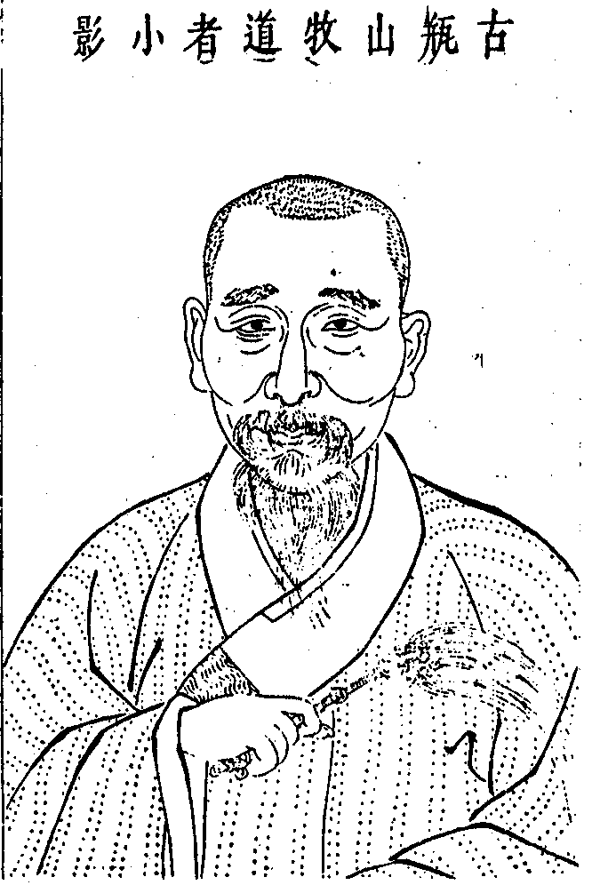
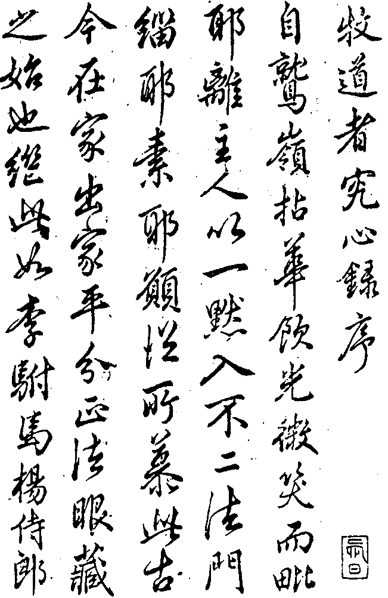
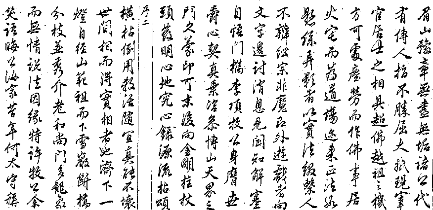
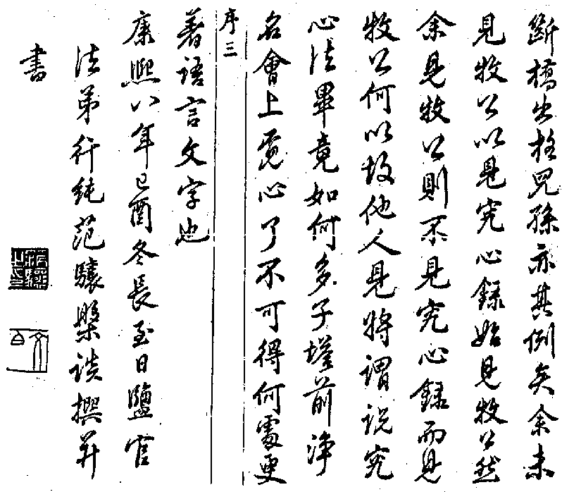

# 古瓶山牧道者究心录



> **藏经**：嘉兴大藏经（新文丰版）（嘉兴藏）　**册次** 第 28 册（J28）　**编号** JB207　**部类** 史传部　**卷次** 3 卷　**篇幅** 36,908 字

> **卷／品**：0 卷 · 6 品



---



## 目录



  - [古瓶山牧道者究心录序](#古瓶山牧道者究心录序)

  - [牧道者究心录序](#牧道者究心录序)

  - [序](#序)

  - [诸经日诵序](#诸经日诵序)

  - [太乙天尊济度血湖拔罪宝忏序](#太乙天尊济度血湖拔罪宝忏序)

  - [梓童帝君本愿经序](#梓童帝君本愿经序)



---



古瓶山牧道者小影







自题



只这觜脸，迥没回互，上无攀仰，一无所慕；下绝己躬，一无所妒。道僧不僧，道俗不俗，有时孤峰顶上独宿，有时十字街头接人，有时游戏金马门，有时蹴踏青狮窟。深深处佛圣难窥，密密处魔外罔测。话未问时当头截，脚未跨时劈面喝。竖起吹毛凛凛，贵图眼中出屑。疑似善慧、甘贽之体裁，却如布袋、普化之作用。传不传之心印，振丕振之纲宗，经行坐卧，道合其中，波澄月现，风虎云龙。(咄)！



------



### 古瓶山牧道者究心录序



当夫十方虚空悉皆消陨之时，谁能发真归元，通体彻悟？倒用魔王印，追大军於藕丝孔中；全提金翅威，取毒龙於生死海底者乎？若夫牧道者之遇介和尚也，啐啄同时，当阳嘱付，如鸿毛御顺风，如巨鱼纵大壑，自车溪一枝佛法，为檇李五叶嫡传者，从此须臾咨决，并担齐挑矣！牧道者之颂古、诗偈，横说竖说也，拈提祖案，拂拭宗风，如枯树垂滋，葳蕤妙叶；如寒禽扇旭，下上琼音，冲口信笔，总在无可思议中，谓之不曾道著一字一句可矣。牧道者之转一筋斗，换一头面也，初当绂冕侍卫，现生华胄簪缨，既当陵谷沧桑，应化黄堂绾绶，究竟就威音王那畔，耸身进十八变竿头，良由向上一著，心到无心，究到无究，安到无安，话到无话。弥天识网，不遮智慧灯；匝地情涛，不汩性命蒂，仍还牧道者本来面目。脱然三界外，纵横手眼於世出世间，是所赞叹也。



康熙壬寅仲夏望日国子司业曹溪憨祖弟子福徵谭贞默槃谈撰



------



### 牧道者究心录序















古瓶山牧道者究心录目次



像赞  

传



------



### 序



示众  

机缘  

拈古  

颂古  

源流颂  

偈颂  

书问  

杂著



自题



只这觜脸，迥没回互，上无攀仰，一无所慕；下绝己躬，一无所妒。道僧不僧，道俗不俗，有时孤峰顶上独宿，有时十字街头接人，有时游戏金马门，有时蹴踏青狮窟。深深处佛圣难窥，密密处魔外罔测。话未问时当头截，脚未夸时劈面喝。竖起吹毛凛凛，贵图眼中出屑。疑似善慧、甘贽之体裁，却如布袋、普化之作用。传不传之心印，振丕振之纲宗。经行坐卧，道合其中，波澄月现，风虎云龙。(咄)！



附松石图卷像赞



牧云门和尚赞



折芦庵里曾相见，此日卷中重对面。分明只是项牧公，胡然顶相看来变。临风捉尘爱谈玄，宦海生涯浑不羡。牧得牛来性已驯，悠然水草溪山遍。交游半在青云端，忆同拜手黄金殿。桃花流水自年年，春风卷幙飞双燕。子规声中呼客归，慇懃又听黄鹂啭。瓶山堂上坐题诗，身世冷观真露电。



梧山牧老人草



觉浪盛和尚赞



飞蚊上铁牛，拍手笑无休。一卷伏羲未畫，一琴黄帝未调。二竖天聋地哑，赢得松石为俦。杖人不合点破，太泄牧公风流。



戊戌佛降诞日，皋亭浪杖人盛题。



本师和尚赞



裴休请黄蘗安名，长髭求南岳点眼，今日牧公乞金明题像。者三个汉，不论是缁是素，好与三十拄杖。何故𠰚？松下石边，桥流水响。



己亥冬季蠡湖进老僧手书。



一初元和尚赞



德超勋贵，行压张王，手拈麈拂，力挽颓纲。传临济正宗兮明同杲日，赓蠡湖曲调兮声彻诸方。牧法姪，勿囊藏，搭起袈裟铁脊梁，从教嫩桂永昌昌。



癸卯夏日，永正元道人题。



此牧公亲翁，迺项襄毅公冢孙，为大金吾兰斋公哲嗣。值沧桑而撄奇难，去世爵而守清漳。全活辑宁，奏最解绶。释瑞鹊之宦署，返端本之



赐厅。夙契宗乘，彻圆智证。得天界金明之入室，衣拂渊源；合儒禅祖印之嫡传，箕裘超迈。说偈迭扬於缁素，赓歌蚤溢於甘棠。



挥麈科头处，翛翛松菊林。勋铭丁令鹤，禅契子牙琴。风月传衣偈，云霞说项吟。缥缃贻玉树，身世越当今。



东皋谭贞默



此老面似生铁之坚硬，心如皓月之圆明。兀坐於片石岩傍，而乐四时景况；放怀於长松树下，而观万物性情。噫！无形之形兮，本不可形；无名之名兮，本不可名。愚又岂肯矢上加尖，而点污吾兄清白之家声？



匡山五乳同门弟笑云旭



谢尘容而处岩谷，逍遥乎方袍头秃。若非道气与高怀，曷为乎三径清风肃肃？



砚民褚廷琯题



渊明境界，摩诘胸中。逃儒归释，信解无穷。法眼视之，知是肉身罗汉；眷属相看，还唤牧公！牧公！



一味道人同门真觉赞



治中别驾淹其才，白石清泉写其趣。游神乎天而天为之纵，驰誉乎世而世为之遇。目炯炯若岩下电，胸英英若泽中澍。襄毅履传，君能右步；公保符悬，君能左顾。啸傲金紫间，萧散瞿昙附。拈花喻风旛之义，梦槐醒冰轮之路。棒喝嘻嘻，丝纶注注。咦！斯牧翁者，乃竺乾之弥云，阀阅之时雨。出则为巨鼎以调羹，止则驭三车而饮乳。



世通家小弟骆云程题



羡君不与世同流，一种清姿品自修。卸脱簪缨偿夙志，提持麈拂竖弘猷。寰中未愿酬人识，物外宁甘任独幽。矫矫生平谁得似，寻来知己许相投。



同门法弟真鉴赞



大哉居士！阅世出世，机眼尽空，反为声势。高坐长松，不谈真谛，目旷神怡，追风良骥。



新安同门弟真璨赞



有大居士，曰维牧翁。现宰官身，示比丘容。七横八竖，游戏虚空。裴公德望，庞老高风。各各长篇短什，虽极力赞叹，而又何足以尽公？



通家教弟施博拜题



怡神天际外，所向不遗踪。金明亲指顾，动静悉从容。



龙渊同门弟圆法题



千载高名羡钓台，拂衣中岁赋归来。溪边早证文忠偈，堂上曾闻清献雷。白麈横拈风卓朔，乌藤倒卓座崔嵬。每怀法道今寥落，全赖渠侬力挽回。



同门法弟真炯赞



个汉！经文纬武，铁骨棱棱，谓是宫保襄毅公七世孙。嗣爵执金吾，临政治民底贤宰官，却被他换却眼睛；谓是传临济正宗三十二世，嗣法金明底大居士。亦被他换却眼睛，即谓世出世间摸他不著，佛祖位中笼他不住。茶烟鹤舞、漏泄家风、水峙桥流、知音有几？总被他换却眼睛。毕竟如何？请向丹青绘不到处，诸大善知识及学士先生赞叹不及处，更须著眼。咄！又是一层。



法弟罗开𬴊拜题



我夫子曰：「绘事后素。」且道未绘以前如何名目？任尒僧繇也难描摹。虽然如是，不妨向笔尖头上示宰官身，现比丘相，如月临水，随缘应赴。即今展卷觌面，握麈尾而燕坐者，又是阿谁？咄！元来是吾檇李法兄项公老牧。



峡汜法弟田彻拜题



百年无为，维君子耻。百年有为，道所戒止。猗欤，牧公！有无为济，克绍厥家，陆沉斯世，曰仕曰隐，绰有餘裕。而貌屼然，足以胜其所负；而怀超然，斯以表其所悟。望如木鸡，龙象攸踞。松石之间，与我税处。翠竹黄花，真照殊契。是诚得乎精进之功，匪徒有於游扬之誉。予试品之，以为托莲社之刘遗民、沉三航之庞安常也耶！



雁湖弟蒋之翘拜题



巍然上品，暂佐黄堂。望隆丹屿，泽被清漳。公餘适性，山水为盟。观松示操，玩石比贞。携琴与鹤，舒卷云烟。快哉牧翁！翩翩若僊。功成名立，归而盘桓。羲皇身际，永矢弗谖。



古勾寅弟王显谟(漳州二府)



意欲买山隐，徵图帝眷赊。庭闲驱五马，麈拂演三车。驾鹤凌霜月，攀虬踞晚霞。任他逢处说，谈笑醉黄花。



辛卯春，古扬寅弟石玮题(漳州司理)



坐览丹霞胜，清光入畫图。风流真别驾，解脱类维摩。官舍芝田鹤，家山果下驹。未须梅尉逸，卷幔即蓬壶。



华亭社弟周茂源(赍诏漳州)



怡神者寿，食气者仙。维余叔氏，湛止秋渊。宦成漳海，拂袖归田。五湖彭泽，心寄霞巅。聿光大吾前人之家乘，振后起者之数十传。



侄景襄拜赞



新增像赞



木陈忞和尚赞



佛真法身，犹若虚空。墙壁匪碍，廓落匪通。五采莫绘，万象普融。无间缁素，尽具此宗。归根得旨，名异实同。嗟哉庞老！孰蹑芳踪？见贤思齐，今兹牧公。



时庚戌暮春之吉，平阳弘觉忞老人题於江都东隐丈室。



玉林琇和尚赞



名臣之后，以躬行闻於乡，复回向空门，珍重法道，此世间全德人也。王臣之嘱，受记灵山久矣！



天目头陀题



闻昔少年时，便访诸禅老。久信人生浮，去官宁不早。所厌非荣华，所恋非枯槁。为尽平生怀，心空事参讨。投机悟既深，无情说偏好。相证在逢人，住山宁草草。山中岁月长，云石盈幽抱。闲坐果何为？谁将是非考？



同里弟王庭题



岂必林泉癖，公餘自委蛇。松涛喧茗具，琴语隔溪花。挥麈标群鹿，科头罢晚衙。石床饶异卉，鹤舞拂云斜。



西陵社弟戴京曾



以世间法为襄毅公象贤之昆，以出世间法为断桥伦灭法眼之孙。锦绣场中掉臂而过，阿梨树下踞坐称尊。笑他护雪鹅儿成底事，会看擘海取龙吞。



盐官法弟行纯范骧拜题



僧非僧兮俗非俗，三眼摩醯看不足。风雷为舌语惊时，雪玉在躬清可掬。有时分虎符，鲸海波平；有时拈麈尾，天魔胆肃。法道垂秋袒肩续，夫是之谓次庵长老、瓶山老牧。



法弟弘散拜题



金粟如来居士身，和光混俗继燃灯。青狮忽现宰官相，四海依然长老称。  

胸襟流出盖乾坤，马驹脚下遍儿孙。但於善财巡礼偈，当年岂例是沙门。



后学道泰拜题



老汉生平作略，太煞过人一头。远继瓶山七世之芳躅，巍巍乎朝埜传宣德政；近绍蠡湖万顷之洪波，洋洋乎一肩横荷宗猷。栗棘金圈，抛来掷去；白笏紫绶，全放全收。更要人识伊面目，倚松坐石，突出双眸。今日撞著不肖儿孙，一时泄漏盖代之风流。



嗣法门人机峻百拜敬题



古缾山牧道者传



盐官同学道弟何园客著



牧道者，名谦，字牧公，嘉兴府秀水人也。先本姬姓，尧之第六子，封於项，子孙以国为氏，世居辽西。汉时名万金者，为司徒，迁洛阳进贤乡，垂称项家巷。后名晋者，仕宋为大理评事。当高宗南渡，扈跸侨居嘉禾之胥山。孙名宏度，号胥山居士，墓在山麓，有八一公碑，是为嘉禾始祖。孙名忠，历秩宫保，谥襄毅，勋著史册，牧道者七世祖也。父俊卿，大金吾左都督，赐一品蟒服。母沈氏，诰封夫人。公生於神宗丁巳，腊月廿一日午时。在妊，母梦星殒怀。及产，腰有紫黑子七，如北斗。襁褓中见僧合掌微笑，坐必跏趺。童时淳实端恪，不妄言笑，遂通书史。年十八，居燕京，专持准提神咒，礼崇国寺洪慈法师。览《心经》及《华严合论》，叹曰：「灼然在圣不增，处凡不减。辄了大意，信知成佛真实不虚。」志慕空宗，首谒博山余集生诸老，命参「生从何来？死从何去」话。是时集生与公伯兄震，缘事逮问在部，每对榻横尘，公必侍立。余抚公背谓震曰：「骨相志气，君家汗血驹也。他日佩毗卢印，据选佛场者，非此子乎？」公再拜而退，喜以自负。从此孜孜兀兀，以向上一著，参究二十餘年，碍膺不释。庚辰岁，遵奉父命，承荫金吾，寅畏小心，冤滥靡不昭雪。未几世乱，甲申人日，公梦山石崩飞，潜身无地，闻空中语曰：「但持吾咒，尔难可免。」闯贼陷京，公率家丁巷战，铦矛刺胸，衣不受损，徒步奔南，屡遇暴不能害。后张公完真、陈公天章相继总制浙闽，公赖佛祖能仁启迪，从幕下克全万万生命，两公交章题授漳州别驾，托以抚循。公以慈力禁暴备荒，申救冤抑，保护甚众。盖公为人襟怀空洞，人莫测其涯涘。望之有岩岩气象，静也渊彻、动也风行，介然而不与易，更确乎不可拔也。岂非壁立万仞，令人见之意消，而下视培𪣻丘垤，似无足当其意者。壬辰岁至福州，见粤东华首空隐禅师，师本分接人之暇，亦赞念佛持咒，蒙授准提忏像，归送《楞严》重梓流通。一日礼忏，口宣「佛身充满於法界，普现一切群生前」，忽然身心脱落，遂述偈曰：「一手拈磬一手鼓，今日捉败无位祖，触处逢渠本现成，恒河沙国佛一母。」后参天界浪和尚，浪曰：「闻你幼年见博山余集生诸公，是否？」公礼曰：「今日特特礼拜和尚。」浪曰：「除却摇唇鼓舌、竖指扬眉处，还我到家语来。」公叉手默然，浪颔之。己亥春，参金明介庵本师，问：「涅槃心易晓，差别智难明，如何是差别智？」庵云：「差别且止，唤甚是涅槃心？」公举拳，庵云：「死了、烧了在甚麼处？」公才开口，庵震威便喝，公从此冰释。又作十二时偈呈庵，庵接过，曰：「这个是纸墨，还别有麼？」公展手视庵，庵乃休。又一日，庵拈香坠，问曰：「无情如何说法？」公曰：「和尚拄杖子𨁝跳去也。」庵复勘问，公拈坠掷地叉手而立，庵拾坠置于几，公曰：「无情说法竟。」庵休去。一日，庵刻蜜蜂颂将竣，庵曰：「病朽！观你蜂颂顿恰意，但要问你，日出扶桑大地红，是何意旨？下一转语可付诸梨枣。」公云：「适问个是什麼？」庵哂之。公即呈偈曰：「聊闻举著便承当，好肉无端已剜疮，著眼机先看端的，顶门谁不带扶桑？」庵印可之。即出源流衣拂，嘱曰：「从上佛佛祖祖以自己所证递相承袭，今以授汝，宜体佛祖之心为心，以续慧命。」付以偈曰：「师子窟中事，善哮吼者得，今得本无得，无得得亦得。」名曰真本，别号次庵。时年四十三矣。嗣法为临济三十二世。公尝示门人曰：「法道不振，由於趋竞时缘。扶竖宗风，贵乎立志固守。不图人众攒簇、因缘辐辏为奇特；当念念以法道为己任、刻刻以后学失据为己忧。古人单丁背米供众，五六人亦不废晚参。如应庵祖著艸鞋住院，懒残和尚寒涕垂膺，四祖道信、汾州无业、芙蓉道楷，诸大老休心息念，断绝攀援，赐紫及号，力陈逊谢，岂非孤洁榜样，名垂千古？何曾热闹？亦何常营心？时缘之得失，所患道德之不充，莫患时缘不就。慎之！勉之！」公之法言作略，概可见矣！以致九州四海传称。次庵长老云：「有法嗣三人，一名机峻，号坦庵，前住普光禅院，后住净心院；二名机旃，号慈林；三名机𠁼，号狮王，住妙喜山中。」



古瓶山牧道者究心录



嗣法门人机峻等编



八月望，小参。「毘耶不二门，百川应倒流，法界不容身，千圣觑不破。截断意根，已成阶级；塞却咽喉，转见周遮。明明丽天，皓月印长空；明明匝地，清风有何极？净裸裸、赤洒洒，全承者个神力，不在别处流转。但凡夫信不及，奚得自轻而退屈？所以有情则动转施为，无情则森罗显焕，纵使去来不以象、动静不以形，犹未究竟。如今瓶山拄杖，指鱼化龙、点铁成金。更若不会，化作无边身菩萨，十方各趣悉皆普现去也。还见麼？众兄弟！见则且置，正当恁麼时一句作麼生？」良久，云：「八月秋，何处热？」拽杖，下座。



示众。「沩岭牧牛，玄沙见虎，无物堪比伦；象骨辊毬，禾山打鼓，两手相分付。行棒行喝，揭示妙净明心；拽石搬土，显露摩醯首眼。从无住本，建一切法；运无功用，办一切事。随所作心，应所知量；透过关者，掉臂而行。未透关者，葛藤窠里埋没。且道不涉形名一句如何通信？一尘才举起，全体现优昙。」卓杖，下座。



示众。举：「黄龙心禅师因黄山谷乞指径截处，龙曰：『秖如仲尼道：「二三子以我为隐乎？吾无隐乎尔。」太史居常如何理论？』公拟对，龙曰：『不是，不是。』公迷闷不已。一日，侍龙山行，时岩桂盛放，龙曰：『闻木樨花香麼？』公曰：『闻。』龙曰：『吾无隐乎尔。』公释然。」师曰：「黄龙与麼道，秖解旁通话迹，绕路指踪，犹未直捷。瓶山今日扫除文字，迥脱根尘，为诸兄弟拈出，具眼者辨取。」以拄杖卓一下，曰：「还见麼？白鹭下田千点雪，黄鹂上树一枝花。」



示众。「我有明珠一颗，久被尘劳关锁，今朝尘尽光生，照破山河万朵。众兄弟！一眼观天，两脚踏地，且道明珠在甚麼处？」良久，云：「春在艸头上，王孙几个知？」



示众。拈起拂子云：「者里荐得，犹是法身边事。直饶皓月行空，涌没自在，也未梦见法身向上事。须知有冰楞上走马，剑刃上翻身。若识此人，行脚事毕。」



诞日示众。「有物无形，先天地生，能为万象主，不逐四时凋。诸兄弟！什麼物恁麼奇特？」举拂子，云：「露。」



付坦庵峻上座衣拂，小参。「鸡足峰前披坐，大庾岭上持来，瓶山今日拈出，事不获已，弗免从头注破。瓶山昔年初参博山得其毛，次於海内，参见三十餘员尊宿得其皮骨，末后在金明上介下庵本师和尚处得其髓，方敢承受此衣，不欲囊藏，和盘托出。但此衣固非形相之可拘，亦非情识所能测，非独伶俐仙陀看即有分，便是诸佛出来也不敢正眼觑著。今日撞著，牙如剑树、口似血盆个无面目汉。汝在诸方参得的，与我抛却。」举拂，云：「向这里道将一句来。」峻礼拜，云：「金香炉下铁昆仑。」师打一拂子，云：「更须珍重。」遂付衣拂源流。师复嘱云：「试看黄梅七百僧，信衣三鼓付卢能，心心相印何缁素？秖贵当人正眼明。」喝一喝，下座。



示众。「炎炎得意事，一过辄生凉。清真寂寞心，愈久偏生味。只贵见地稳实等闲，岂曰平常？」遂举扇曰：「若唤作扇子，入地狱如箭射。参！」



示众。「端本堂与诸人说法了也。阔子松风涛滚滚，与诸人说法了也。柏树子磊磊落落，与诸人说法了也。还委悉麼？如其未委——」拈拄杖掷下，曰：「向者里荐取。」



示众。举：「南阳忠国师，僧问：『如何是本身卢舍那？』国师云：『与我过净瓶来。』僧将净瓶到，国师云：『却安旧处著。』僧复问：『如何是本身卢舍那？』国师云：『古佛过去久矣！』」师曰：「日上晓，山黛青，处处逢渠；鸟音碎，花影浓，头头撞著。冻河发燄，何妨寒灰死火？枯树敷花，岂论春前冬后？南阳罗龙陷虎，惯得其便。这僧作家，好与击破净瓶，使国师懡㦬有分。然据正眼看来，国师只知量边事，不识这僧问头。」遂起身立，云：「国师在这里，本身在甚麼处？大众道道看。」



示众。「有相身中无相身，情与无情共一真。霜月凌空咸圣智，何山松桧不青青？久立，珍重！」



示众。「未离兜率，且喜一半。已降王宫，触途成滞。夜睹明星，脱赚平人。为母说法，犹涉唇吻。灵山拈花，未免色尘；迦叶破颜，全呈管见。瓶山与麼道，还有与世尊出气者麼？」遂喝一喝，云：「出群须是英灵汉，敌胜还他狮子儿。」便下座。



因事小参。「蓦劄相逢，无非正体；擒纵卷舒，不从他得。到这里，独步丹霄，清风明月，不妨打开库藏，运出自己家珍，与佛与祖同德同仁，竺乾、维摩、震旦、华闲，同拈同放。乃至与庞蕴、张无尽、杨大年、何密庵之辈，同一机用，同一境照，更有何事？其或知见不清，行履不正，未免被物所役，直须一一透彻本有风光，不堕凡圣缁素之所滞碍，不随声色语默之所流转。净裸裸、赤洒洒，全体与麼来，全体与麼去，岂不庆快也哉？众兄弟！还委悉麼？相逢尽道休官好，林下何曾见一人？」



示众。举：「临济大师云：『一喝分宾主，照用一时行。』」师拍膝一下，云：「且道是宾耶？主耶？照耶？用耶？还会麼？域中无向背，阃外有威权。」



示众。云：「彩云时复白，锦树晓还青。浩歌声自寂，乾坤一草亭。」举拂子云：「惟有这个不属诸数，还有识得渠者麼？」师良久云：「你诸人在这里觅甚麼碗？」便趁出。



示众。举：「沩山示众云：『老僧百年后，向山下作一头水牯牛，左胁下书五字曰：「沩山僧某甲」。当恁麼时，唤作沩山僧，又是水牯牛；唤作水牯牛，又是沩山僧。毕竟唤作什麼即得？』仰山礼拜而退。」师曰：「沩山何异虾为子曲，仰山大似证龟作鳖，各领三十棒。若问瓶山毕竟唤作什麼？劈手披胸云：『吽！吽！』且道与古人是同？是别？」



示众。「举止承渠力，从缘寻旧蹊；方春荷钝镢，日暮还灌畦。个中无限意，端的有谁知？」时有僧出问云：「应如是住，如是降伏其心。其心降伏不住时如何？」师厉声云：「是谁降伏？」



示众。「瓶山有一则现成公案供养大众，只是领会者少、错会者多。」便下座。



示众。拈起拄杖，云：「若不患盲，一切俱见。」卓杖一下，云：「若不患聋，一切皆闻。若果闻果见，世、出世间打成一片，正偏回互，宾主历然，坐断一切差别，初无动摇，如大日轮举无遗照，纵使德山、临济到来，也须退身有分。众兄弟！还会麼？不是男儿多意气，只因曾踏上头关。」喝一喝，下座。



示众。「钵盂拄杖转大法轮，露柱灯笼立地听。且道露柱灯笼听个什麼？钵盂拄杖说甚麼法？不可以钵盂拄杖昧却露柱灯笼，不可以露柱灯笼不明钵盂拄杖。众兄弟！向这里有个会处，露柱灯笼、钵盂拄杖更无两般。脱或未然，则佛句、祖句、宾主句翳然在目。且道如何得洞彻玄旨𫆏？本来成现事，切忌乱承当。」



示众。「树凋叶落，体露金风，如何说个体露的道理？」拈起拄杖，云：「青山高突兀，白水响潺湲。」



示众。「欲知佛性义，当观时节因缘。时节若至，其理自彰。即今是什麼时节？秋色依依，秋虫唧唧，出门尽寒山，对面无相识。瓶山与麼道，汝等作麼生？」喝一喝。



示众。举：「金陵宝志垂语云：『终日拈香择火，不知身是道场。』玄沙备别云：『终日拈香择火，不知真个道场。』」师云：「金陵已露葛藤，玄沙重下注脚，一对无孔铁锤，可中有个恰好。且道谁是恰好？」举手摆云：「明破即不堪。」



一日，僧问：「圆顶方袍，佛之所制，闻居士戴发而披衣传法，未审出自何典？」师曰：「汝何出言之厉，得无轻诋先圣者欤？余虽识浅无辨，请以卢行者事可凭之，悉载《传灯》所述。唐咸亨二年，五祖开法黄梅，有居士姓卢名惠能，参谒五祖，问曰：『汝自何来？』卢曰：『岭南。』祖曰：『欲须何事？』卢曰：『惟求作佛。』祖曰：『岭南人无佛性，若为得佛？』卢曰：『人有南北，佛性岂然？』遂令服劳杵臼之间。后五祖告众述偈，机语冥符，则衣法皆付。时会下七百餘僧，惟卢得旨。三鼓，祖告曰：『诸佛出世，随机大小而引导之。遂有十地、三乘、顿渐等旨，以为教门。然以无上微玅秘密圆明真实正法眼藏付於大迦叶，展转传授二十八世，至达磨届於此土，得可大师承袭，以至于今。吾今悉付於汝，汝可流布，无令断绝。』卢行者跪受衣法，启曰：『法则既受，衣付何人？』祖曰：『昔达磨初至，人未之信，故传衣以明法。衣乃争端，止於汝身，所谓受衣之人，命如悬丝也。且当远隐，俟时行化。』至仪凤元年丙子正月八日，卢寓法性寺风飏刹幡，闻二僧对论，卢以风幡非动动自心之句，印宗法师窃聆，邀徵风幡之义。印宗执弟子礼，乃告四众曰：『今遇肉身菩萨。』指座下卢居士曰：『即此是也。』因请出所传信衣，悉令瞻礼。至正月十五日，会诸名德，为之剃发。然付衣法在先，圆顶在后，若果有缁素分别，则不应五祖付卢居士衣钵之典制，并嘱『汝可流布，无令断绝』之谆谆也明矣。达磨四世孙华闲居士，付法於昙邃禅师若干世。又何密庵、田素庵居士，迺白云度之子孙，付法於和庵忠禅师若干世。即西京尼道深，乃芙蓉楷之嗣，付法于奉圣才禅师若干世。此出於《少林佛祖世图碑记》，班班可稽。付衣表信，传法印心，实无缁素相貌而继绍也又明矣。又不见世尊佛法付托国王、大臣、居士，此非古今在家、出家同得正法眼藏之标榜，未常独限於圆顶方袍也。昔常不轻菩萨，见人便礼拜曰：『吾不敢轻於汝等，汝等皆当作佛。』况自唐迄今，天下大宗匠咸出於卢行者之苗裔，汝何诋厉如此？更一人有名呼不得，无位可安排，若不识此人，幸勿以居士而忽诸。」僧惭，礼退。



机缘



问：「如何是藏身处没踪迹？」师云：「日落花无影。」「如何是没踪迹处莫藏身？」师云：「风高树有声。」



一日途中遇又寒兄，叙寒温毕，又寒问：「如何是临行一句？」师拱手曰：「请了。」相笑而别。



问：「法身是有相无相？」师喝曰：「是有是无？」



问：「不离当处常湛然，如何？」师云：「卧龙最怖碧潭清。」



问：「如何是涅槃门？」师曰：「此去福城五里。」



一僧谭及法门中事，师曰：「者个什麼所在，说长道短？」适值茶次，僧指卓案上大小钟碗曰：「大小不齐是如何？」师曰：「一窑烧出。」相笑便行。



问：「如何是本来身？」师曰：「风吹日炙。」



问：「如何是佛法的的大意？」师曰：「春来草自青，月上已天明。」



福严费和尚在严𨍏轹处应供，如念兄邀往舟中参谒次，如念曰：「此公在福建漳州府出仕。」费问曰：「几年上？」师曰：「庚寅七年。」费曰：「曾杀人麼？」师曰：「曾杀。」费曰：「杀多少？」师曰：「一切总杀。」费曰：「忽遇同气连枝、交友投分者作麼生？」师曰：「拣择甚麼？」费曰：「怎不自杀？」师曰：「直无下刃处。」费大笑，师便礼退。



问：「如何是祖师西来意？」师指炉曰：「张铜炉似金。」曰：「此意如何？」师曰：「霜风寒彻骨。」



问：「如何是道？」师曰：「步步踏著。」「如何是道中人？」师曰：「闹市里辊。」



一日，坦庵重参，机语相投，师问及参询行实。次晨，呈行由，师阅毕，复索云：「还有麼？」坦云：「甚处犹少？」师即棒云：「不得放过。」



士问：「树凋叶落，体露金风，意旨作麼生？」师曰：「遍界不曾藏。」曰：「毕竟如何值童子邀请？」师曰：「瓶山骑佛殿领供去也。」士礼拜。



问：「那咤太子析肉还母，析骨还父，乃现本身为父母说法。如何是本身？」师曰：「西风吹落叶，万树尽皆秋。」



一日，坦庵上座作●[○@牛]



○相云：「中有一○，能杀能活，能纵能夺，未审是那一○？请大人点出。」专使呈上，师便扯破，即以原封示之。



空诸法兄拈云：「坦公惯捋虎须，一场漏逗，瓶山正令虽行，未免怜儿不觉丑。空诸又不然，待云：『请大人点出。』但向道：『且喜吾徒头角已露。』看他怎生合煞？」并启云：「前在方丈中读尊录，见坦公呈四圆相，请大人点出。忍俊不禁，谨述拈语呈似，伏候赐棒次庵法兄猊座



。」师开缄览毕，唤侍者将灯来。侍者将灯至，师便连封烧却。



问：「万法归一，一归何处？」师曰：「火里铁牛行。」曰：「意旨如何？」师曰：「臂长衫袖短。」



问：「忽来忽去时如何？」师曰：「长江竞渡舟。」曰：「不来不去时如何？」师曰：「奇怪石头狞似虎，火烧松树舞如龙。」



僧问：「洞山好佛，秖是无光，作麼生？」师微笑。曰：「意旨如何？」师曰：「笑中有刀。」僧礼拜，师曰：「有眼如盲。」



古瓶山牧道者究心录



后学　全相　机峻　全元　等仝录



拈古



举：「云门示众云：『世尊初生，一手指天，一手指地，周行七步，目顾四方，云：「天上天下，惟我独尊。」当时若见，一棒打杀与狗子吃，贵图天下太平。』雪窦云：『便与掀倒禅床。』」



拈云：「老胡指天指地，固是平常；惟我独尊，翻成特地。云门大似吹毛求疵，雪窦好若墙倒众人推。虽然，牧道者恁麼批判，众兄弟还知诸大老接物利生底手段麼？」蓦拈拄杖畫一畫，云：「杀人刀，活人剑。」



举：「庞居士问马祖：『不昧本来人，请师高著眼。』祖直下觑，士云：『一种没弦琴，惟师弹得妙。』祖直上觑，士乃作礼，祖归方丈，士随后入，云：『弄巧成拙。』」



拈云：「我不似马祖委曲，待他道：『不昧本来人，请师高著眼。』和声便打，不惟截断葛藤，抑且免伊弄巧成拙。」



举：「百灵问庞居士云：『石头得力句曾举似人否？』士云：『亦曾举似人来。』灵云：『阿谁？』士点胸云：『庞公。』灵云：『直是妙德空生，也赞叹不及。』居士却问百灵：『阿师得力句曾举似人否？』灵云：『亦曾举似人。』士云：『阿谁？』灵戴笠便行。」



拈云：「百灵勘验庞公，却被庞公勘验。虽然，毕竟庞公输他一筹。何故？著贼也不知。具眼者辨取。」



举：「僧问赵州：『万法归一，一归何处？』州云：『我在青州作一领布衫，重七觔。』」



拈云：「隔墙见角便知是牛，隔山见烟便知是火，直饶恁麼地也未在，须是有转身一路始得。忽有问牧道：『者万法归一，一归何处？』只向伊道：『闲收落叶供茶鼎，一曲松风到耳边。』」随一喝，云：「众兄弟！若见得者一喝，与赵州同参；其或未然，各归家去摸取看。」



举：「周金刚自造《金刚经疏钞》，自蜀出峡，行至澧州，路上向一婆子买油糍点心。婆问：『大师！车上是甚麼文字？』周云：『《金刚经疏钞》。』婆云：『经中道：「过去心不可得，现在心不可得，未来心不可得。」大德要点那个心？』周不能答。」



拈云：「当时若婆子问：『我要点那个心？』但向云：『快将油糍来。』待伊将至，即劈面便掌。若能如是，不惟壁立真风，亦令者婆子知我祖师门下别有生涯一路。」



举：「夹山善会禅师因有问：『如何是夹山境？』师云：『猿抱子归青嶂里，鸟衔花落碧岩前。』法眼道：『老僧二十年只作境话会。』」



拈云：「不作境话作麼生会？」拍手云：「妇摇机轧轧，儿弄口㖞㖞。」



举：「洞山解夏上堂云：『秋初夏末，众兄弟东去西去，直须向万里无寸草处去。』石霜云：『何不道出门便是草？』同安云：『直饶不出门，亦是草漫漫地。』」



拈云：「洞山一期逞俊，争知当地草深？堂中若有具眼者，待老汉语未绝，但呵呵大笑云：『少卖弄。』不惟勘破洞山，亦乃坐断石霜、同安二大士舌头。更有一个未欲举破，乃呵呵大笑，归方丈。且道具什麼眼？」



举：「石霜庆诸禅师因拈裴相国笏问云：『在官人手中为笏，在天子手中为圭，在老僧手中唤作什麼？』裴无对，乃为留下。」



拈云：「石霜压良为贱，裴公有理难伸。诸人还知石霜落处麼？若也不知，往往作名相是非得失会去。」牧道者云：「非但裴公不得名，假使尽大地人来，亦不得正眼觑著。何故𠰚？自古上贤犹不识，造次凡流岂可明？」



举：「前宝寿问后宝寿：『父母未生已前，那个是本来面目？』后宝寿罔措。一日，在市见二人相争，有一人相劝云：『你得恁麼无面目？』寿遂大悟。」



拈云：「击竹见花，头头筑著本地风光；洗钵踢瓶，物物全彰神通妙用。还会他道得恁麼无面目处麼？」遂卓拄杖一下。



举：「僧问长庆：『有问有答，宾主历然。无问无答时如何？』庆云：『怕烂却那？』僧问睦州：『有问有答，宾主历然。无问无答时如何？』州云：『相逢尽道休官好，林下何曾见一人？』」



拈云：「若问牧道者：『有问有答，宾主历然。无问无答时如何？』对他道：『藏尽梵天月，犹存汉地星。』」



举：「僧问风穴：『古曲无音韵，如何和得齐？』穴云：『木鸡啼子夜，刍狗吠天明。』」



拈云：「风穴老汉接机快便，只是闭门不落闩，徒劳己力。忽有人问牧道者：『古曲无音韵，如何和得齐？』搊住便掌。且道与古人是同？是别？若道是同，未免吃牧道者棒；若道是别，亦未免吃牧道者棒。何故？不是倚势欺人强与棒，大都缁素要分明。」



举：「僧问智门：『如何是佛？』门云：『踏破草鞋赤脚走。』僧云：『如何是佛向上事？』门云：『拄杖头上挑日月。』雪窦云：『千兵易得，一将难求。』」



拈云：「鸦作鸦鸣，鹊作鹊噪。」



举：「道流在佛前背坐，僧曰：『道士莫背佛。』道流曰：『大德，本教中道：「佛身充满於法界。」向甚麼处坐得？』僧无对。」



拈云：「但向他道：『有佛处不得住，无佛处急走过。』随一喝，云：『识得坐处麼？翻转身来始得。』」



举：「南泉同归宗、麻谷去礼觐忠国师，路次，於地畫一圆相云：『道得即去。』宗便於相中坐，谷便作女人拜。泉云：『与麼则不去也。』宗云：『是什麼心行？』泉於是相唤回。」



拈云：「是则是，南泉只解簸土扬尘，归宗和泥合水，麻谷据款结案。三大士虽则各展家风，要且极则事未梦见在。我当时若见，於地畫一圆相，即震威一喝，云：『者贼！我识得你了也。』拂袖便行。且看他别有什麼伎俩穿者一夥鼻孔？你诸人又作麼生？」掷拄杖，下座。



米胡和尚令僧问仰山：「今时人还假悟否？」山曰：「悟即不无，争奈落在第二头何？」胡深肯之。



拈云：「米胡设此一问，钝置杀人。仰山恁麼道，可谓扶强不扶弱。虽然，亦未免落他陷阱。大众！还知仰山落处麼？不得春风花不开，及至花开又吹落。咄！」



雪窦示众：「客从远方来，遗我径寸璧。中有四个字，字字无人识。」



拈云：「客从远方来，遗我径寸璧，中有四个字，佛眼觑不出。」



婆子供养一庵主，经二十年，常令一女子给侍。一日，令女子抱定，曰：「正当恁麼时如何？」主曰：「枯木倚寒岩，三冬无煖气。」女子归，举似婆，婆曰：「我二十年只供养得俗汉。」遂遣出，烧却庵。



拈云：「泯空凡圣，荡尽纤尘，峭壁寒峰，迥绝攀仰，自非一麟，曷以堪此？但惜庵主有陷卒之机，尤少夺帅之力。当时待女子抱定道：『正当恁麼时如何？』劈面便掌，云：『且立者边著。』管教婆子别有生涯。」



百丈因沩山、五峰、云岩侍立次，乃问沩山：「并却咽喉唇吻作麼生道？」沩曰：「却请和尚道。」丈曰：「不辞与汝道，恐已后丧我儿孙。」又问五峰，峰曰：「和尚也须并却。」丈曰：「无人处斫额望汝。」又问云岩，岩曰：「和尚有也未？」丈曰：「丧我儿孙。」



拈云：「百丈等闲致问，忒杀崄峻，便弄得家翻宅乱，父子不和。今日还有解交者麼？」遂击拂子三下。



杭州净慈断桥妙伦禅师，上堂：「德山低头，夹山点头，俱胝竖起一指头，玄沙筑破脚指头。」拈棒云：「都来不出山僧拄杖头。何以见得？」卓拄杖云：「一叶落，天下秋。」



拈云：「开疆辟土，革故鼎新，固是净慈老汉为人的赤心片片。瓶山今日也要平分风月，贵在诸昆仲共知。」蓦拈如意，云：「德山、玄沙、夹山、俱胝，总在瓶山如意头上，各各显扬无量妙义。还委悉麼？不因夜来雁，怎见海门秋？」



断桥上堂：「荆山有玉，获得者不在荆山。赤水有珠，拾得者不在赤水。衲僧有无位真人，证得者出入不在面门。」蓦拈拄杖曰：「会麼？幽州江口石人蹲。」



拈云：「瓶山即不然。荆山有玉，获得者只在荆山；赤水有珠，拾得者终在赤水；衲僧有无位真人，证得者总在面门出入。瓶山与麼道，在诸方必然别有长处。」便下座。



金陵天界古庭坚禅师别无际和尚次，际问云：「子别在甚处？」庭云：「佛祖行不到处。」际云：「还许人来否？」庭云：「坦然无碍。」际云：「从上古人阿谁有超祖之智？」庭云：「黄檗。」际云：「子见黄檗麼？」庭云：「纵是黄檗，也须见摈。」际云：「敢在我这里说大话？」庭云：「正眼无私。」际云：「观子知见，吾非子之师也。」庭云：「无有过量，岂免贬剥？」际云：「是！是！」庭以两手掩耳而出。



拈云：「看他父子酬酢，大似赤眼撞著火柴头，纵夺可观，互换有准，然检点将来犹欠一著在。当时若问瓶山：『从上古人阿谁有超祖之智？』便与掀倒禅床，拂袖而别，免得递相钝置。」



嘉兴敬畏无趣如空禅师，问讲主：「经前一句逼塞虚空，经后一句充满大地，包括一句函盖乾坤。正恁麼时，法师向什麼处下口？」主无对。师良久曰：「善来法师。」



拈云：「敬畏与麼接引，大似倚势欺人，怎奈傍观者哂？今日有问瓶山：『正恁麼时，向什麼处下口？』但向道：『他家自有通霄路，不向如来行处行。』」



无趣，除夜众集，偶闻爆竹声，师问曰：「是甚麼？」曰：「爆竹声。」师曰：「破了也。」僧乃有省。金明云：「一人有庆，兆民赖之。」



拈云：「犀因玩月纹生角，象被雷惊花入牙。」



径山无幻性冲禅师，僧问：「如何是西来密传心印？」师呵呵大笑，僧罔措。复问：「传个什麼？」师打曰：「开门渔笛近，明月在沧州。」



拈云：「径山老汉觌体全提，婆心太煞，可惜者僧不知落处。若知落处，便好拈却炙脂帽子、脱却鹘臭布衫，岂不洒洒落落？或有问瓶山：『如何是西来密传心印？』但向道：『天厨妙供非珍馔，一味园蔬饱即休。』更问：『传个什麼？』连棒打出。」



无幻烧火次，僧到，问曰：「如何是自性天真佛？」幻曰：「与我搬取一束柴来。」僧搬柴了，又问，幻曰：「这奴子好恶也不知。」便打。



拈云：「扑落非他物，处处逢渠；纵横不是尘，头头撞著。诸昆仲！这僧若是作家，待他云：『与我搬取一束柴。』将柴劈面便摵，必致老汉懡㦬有分，岂不丈夫。自性天真佛在甚麼处？」乃呵呵大笑，便下座。



无幻举：「临济大师拈拄杖示众云：『我这里是活的，一切临时要用便用。』天如以拂子摇曳示众云：『我这里也是活的，一切临时亦是要用便用。』」遂掷下拂子云：「临济止欠这一著在。」幻拈拄杖云：「我这里临时要用便用，不论死活。虽然——」以拄杖畫圆相云：「临济、天如总出这个不得。」



拈云：「者三老汉总是山门相角、厨库相揩，各立生涯，到处露蛇藏虎，有甚奇特？」瓶山则不然，举起如意云：「我这里临时要用便用，说甚麼死活出入？何故？我为法王，於法自在。」遂掷下。



嘉兴兴善南明慧广禅师，示众：「前年年，鼻孔无半边；去年年，两眼不能全；今年年，三十精骨献青天。我禅已说了，汝等作麼生？参！」



拈云：「兴善为众竭尽心力，叵耐负恩者多。且道今日瓶山作麼生参见？」随喝一喝，云：「无人识得渠。」



建宁普明鸳湖妙用禅师，一日暗斋黄廉使升任广东，入山作别，问：「临行一句，乞师指示。」师云：「三千里外，逢人不得错举。」金明别云：「看脚下。」



拈云：「大小普明恁麼为人，总非好手。瓶山则不然，待问临行一句，但向道：『饥餐渴饮浑无事，鸟语山花匝地春。』」



嘉兴金明介庵悟进禅师与方伯王言远茶次，谈及法门事，乃云：「近见得道者易，莫非菩萨否？」师云：「居士！你岂不是菩萨？只恐不自信耳。」士点首。



拈云：「有问瓶山：『近见得道者易，莫非菩萨否？』便向道：『此去龙渊不远。』且道与金明老汉相去多少？众兄弟！若作世谛流布，佛法未梦见在；更作佛法商量，何啻千里万里。毕竟如何？只恐不是玉，是玉也大奇。」



颂古



世尊初生，一手指天，一手指地，周行七步，目顾四方云：「天上天下，唯吾独尊。」后云门云：「我当时若见，一棒打杀与狗子吃，贵图天下太平。」



皇宫才降丑全彰，指步郎当更举扬。可笑云门多意气，却将好肉又成疮。



世尊初於腊月八日明星出时，忽云：「奇哉！一切众生具有如来智慧德相，但以妄想执著，不能证得。」



雪岭隈藏六载深，忽然一睹现明星。元来此道真奇甚，眉底人人眼有睛。



西天初祖摩诃迦叶尊者，见世尊在灵山会上，拈起一枝华，以青莲目普示大众百万圣贤，惟迦叶破颜微笑。世尊乃曰：「吾有正法眼藏，涅槃妙心，实相无相，微妙解脱法门，付嘱於汝。汝当护持流通，无令断绝。」



世尊拈起花，迦叶破颜笑。一种没弦琴，弹尽古曲调。



世尊一日升座，大众才集，文殊白槌云：「谛观法王法，法王法如是。」世尊便下座。



老胡特地指迷踪，却把文殊别调中。无限家私狼藉尽，白云深处显规风。



世尊三唤三应，乃云：「无为真佛，实在我身。」



三唤自三应，明明一个新。谁知席帽下，元是昔愁人。



世尊临入涅槃，文殊请佛再转法轮。世尊咄云：「吾四十九年住世，未尝说一字。汝请吾再转法轮，是吾曾转法轮耶？」



四十九年早二三，法轮请转更何堪。不说一字谁相委，无限清风总指南。



世尊食时，著衣持钵，入舍卫大城乞食。於其城中次第乞已，还至本处。饭食讫，收衣钵，洗足已，敷座而坐。须菩提白佛言：「希有，世尊！」



收衣洗足坐无言，音响如雷彻四筵。善现蓦然赞希有，大千经卷一时宣。



文殊所说般若经，清净行者不入涅槃，破戒比丘不入地狱。



春里花开秋里月，天堂地狱汤浇雪。世祖功成三十六，云台怎似钓台别。



东土初祖菩提达磨大师，即西土二十八祖。初至金陵，见梁武帝。帝问曰：「如何是圣谛第一义？」师曰：「廓然无圣。」曰：「对朕者谁？」师曰：「不识。」帝不领悟，师遂折芦渡江。至魏后，帝举问志公。公曰：「陛下识此人否？」曰：「不识。」志曰：「此是观音大士传佛心印。」曰：「当遣使诏之。」志曰：「莫道陛下诏，盍国人去，它亦不回。」



缺齿胡僧入大梁，却将不识为君扬。翻身狮子无寻处，空使傍人指帝乡。



文殊三处度夏：一月在魔宫，一月在长者家，一月在淫坊。夏毕，却归。世尊会中解制。迦叶欲白槌摈出，才举此念，见会中有无量释迦、无量文殊、无量迦叶、无量楗槌。迦叶既见，世尊云：「汝摈那个文殊？」



平常疏逸无拘检，淫院魔宫自在行。莫把是非横计我，浮生穿凿不相干。



那咤太子析肉还母，析骨还父，然后现本身，运大神力，为父母说法。



骨还父兮肉还母，现身运力逞家丑。直饶还得甚分明，错认簸箕作熨斗。



国师一日唤侍者，者应诺。如是三召，皆应诺。师曰：「将谓吾孤负汝，却是汝孤负吾。」



三呼三应不虚徵，句后方通正眼清。常忆江南三月里，鹧鸪啼处百花明。



南泉曰：「三世诸佛不知有，狸奴白牯却知有。」



用尽自己心，笑破他人口。冬冬野老祭江神，也是虾跳不出斗。



归宗因泥壁次，白舍人来，师便问：「君子儒？小人儒？」白曰：「君子儒。」师乃打泥盘一下，白遂过泥与师，师接得便使。(良久，云：)「莫便是快俊底白侍郎否？」曰：「不敢。」师曰：「秪有过泥分。」



归老机先疾似风，泥盘一击妙难穷。俊哉不费纤毫力，万里家山咫尺通。



归宗因江州刺史李渤问：「尝闻须弥纳芥子，渤则不疑；芥子纳须弥，莫是妄谈否？」师曰：「人传史君读万卷书，是否？」曰：「不敢。」师曰：「身如椰子大，万卷书向甚麼处著？」李俛首而已。



不识自家宝，承言滞外尘。万卷书一句，俛首见天真。



麻谷因良遂来参师，见来闭门，将锄头去削草。遂又来扣门，师曰：「谁？」曰：「某甲。」师曰：「钝根阿师下去。」凡数四如是，遂忽然有省。再去扣门曰：「和尚莫谩良遂，良遂若不来礼拜，洎被十二本经赚过一生。」师乃开门令通悟，由印可之。遂返都城讲肆散席，告诸徒曰：「诸人知处，良遂总知；良遂知处，诸人不知。」



异哉麻谷泄天机，闭户携锄说向伊。良遂知时人不委，谁知左右不曾离。



唐州紫玉山道通祖师，因于𬱖相公问：「佛法至理，乞师一言。」师曰：「但问将来。」曰：「如何是佛？」师召于𬱖，公应诺。师曰：「更莫别求。」



召诺分明无隐乎？几人于此见淆讹，直提更莫别求法，还觉眉毛在也无？



一日，紫玉因于𬱖相公问：「如何是黑风吹其船舫，漂堕罗刹鬼国？」师曰：「于𬱖客作汉，问恁麼事作麼？」于失色。师指曰：「者个便是黑风漂堕罗刹鬼国。」于作礼而谢。



黑风吹堕问如何，觌面提持于𬱖呼。饶汝粉身并碎骨，不知酬得此恩无。



潭州华林善觉禅师，裴相国访师问曰：「师还有侍者否？」师曰：「有，只是不可见客。」曰：「何妨。」师乃唤曰：「大空小空。」二虎自庵后出。裴见之惊悚。师语二虎：「有客且去。」二虎於是哮吼而去。曰：「师作何行业感得如斯。」师提起数珠曰：「会麼？」曰：「不会。」师曰：「老僧常念观世音。」



情缘俱放下，驯兽尽神通。偶尔示裴老，大空与小空。更提数珠起，慈悲转不中。千峰势到岳边止，万派流归海上融。



灵云因见桃花悟道。



触目生涯何处无，佳人见后反模糊。等闲不语含春象，怎奈东风漏泄何。



天衣怀禅师举：「古云：『五蕴山头一段空，同门出入不相逢。无量劫来赁屋住，到头不识主人公。』」老宿云：「既不识，当初问甚麼人赁？恁麼拈太远在。须知死人路上有活人出身处，活人路上有死人无数。且道那是活人路上死人无数？那是死人路上活人出身处？若检点分明，拈却炙脂帽，脱却鹘臭衫。」



秋声飒飒觉清凉，日炙风吹彻体彰。赁房住，忒郎当，生死路上好商量。咄！瞎汉，无限风流只这是，掀翻鹘臭为人扬。



赵州因真定帅王公携诸子入院，坐而问曰：「大王会麼？」王曰：「不会。」师曰：「自小持斋身已老，见人无力下禅床。」王尤加礼重。翼日，令将传语，师下禅床受之。侍者曰：「和尚见大王来，不下禅床；今日将军来，为甚麼却下禅床？」师曰：「非汝所知。第一等人来，禅床上接；中等人来，下禅床接；末等人来，三门外接。」



当行三等接人平，起坐应须著眼清。不向个中争分量，知君错认定盘星。



普化常入临济院吃生菜，济曰：「者汉大似一头驴。」化便作驴鸣。济谓直岁曰：「细抹艸料著。」化曰：「少室人不识，金陵又再来，临济一只眼，到处为人开。」



古音不动时人耳，适遇子期互唱酬。一派长天烟水碧，落霞孤鹜共悠悠。



同安常察禅师因僧问：「新岁方来，残年已去，莫有不受岁者麼？」师曰：「有。」曰：「如何是不受岁者？」师曰：「作麼生？」曰：「恁麼则不受岁也。」师曰：「城上已吹新岁角，窗前犹点隔年灯。」



折角泥牛不受时，茫茫泣路两持疑。化工一夜移牛斗，花绽枝头春不知。



大岭禅师，僧问：「如何是一切处清净？」师曰：「截琼枝寸寸是宝，析栴檀片片皆香。」



一念才生尽属尘，争知不起未为亲。功忘物外赤松子，不事君王宠辱惊。



金峰从志禅师因僧问：「四海晏清时如何？」师曰：「犹是阶下汉。」



海清河晏境弥高，犹列阶前国士朝。变理总归臣相事，舜王端拱乐逍遥。



石门献蕴禅师，僧问：「如何是和尚家风？」师曰：「物外独骑千里象，万年松下击金钟。」



晨钟暮鼓掩柴扉，洪韵腾腾闻者稀。月夜髑髅惊破梦，逐声滞相不知归。



风穴延沼禅师因僧问：「如何是道？」师曰：「五凤楼前。」曰：「如何是道中人？」师曰：「问取皇城使。」



凤阁重闱苔锁深，烛消帘静月沉沉。刻舟剑去三千里，眼里瞳人笑不禁。



石霜因僧在窗外，问：「咫尺之间为什麼不睹师颜？」霜曰：「遍界不曾藏。」僧举问雪峰：「遍界不曾藏意旨如何？」峰曰：「甚麼处不是石霜？」霜闻曰：「者老汉著甚死急？」峰闻曰：「老僧罪过。」



触目烟村度晚风，更无冶艳杂芳丛。佳人笑里投春色，三月桃花树树红。



关南因僧问：「如何是和尚家风？」南下禅床作女人拜曰：「谢子远来，无可祗待。」



借婆帔子拜婆年，礼义殷勤集大全。谁信刺花针穴鼻，鸳鸯绣出浪头眠。



百丈野狐



不落与不昧，脱体无忌讳。一翳著眼中，空华便乱坠。若作佛法商量，金毛撞入野狐队。



蚬子和尚混俗闽川，不蓄道具，不循律仪。冬夏一衲，逐日沿江岸采掇虾蚬充腹，暮即宿东山白马庙纸钱中，居民目为蚬子和尚。华严静禅师闻之，欲决真假，先潜入纸钱中。深夜归，严把住曰：「如何是祖师西来意？」师遽答曰：「神前酒台盘。」严放手曰：「不虚与我同根生。」



当机直指酒台盘，相见相逢万万千。惟有华严同蚬子，放行把住解推迁。



保福与甘长老相看，郑十三娘才坐，师乃问：「承闻十三娘子参见沩山，是否？」曰：「是。」曰：「沩山迁化向甚麼处去？」郑起身偏床而立。甘曰：「闲时说禅，口似悬河，何不道取？」郑曰：「鼓这两片皮，堪作甚麼？」甘曰：「不鼓这两片皮，又作麼生？」郑曰：「合取狗口。」



语见人心苗见地，通身手眼耳如聋。更看截断当机疾，宝印全提继祖风。



地藏玩月曰：「云动有，雨去有。」僧曰：「不是云动，是风动。」师曰：「我道云亦不动，风亦不动。」曰：「和尚适来又道云动。」师曰：「阿谁罪过？」



云动风动，一倒一起。普门大士，何曾是女。



僧问无幻和尚：「如何是提婆宗？」幻云：「一字不著划。」僧云：「某甲不问这个。」幻云：「圆相不著圈。」



一字不著划，圆相不著圈。百千诸佛义，尽在辘轳边。



南明在径山看雪次，因侍僧云：「满山都是雪。」南云：「随声逐色汉。」僧云：「乞师离声色道一句。」南云：「满山都是雪。」



举似满山雪，验贼便追赃。青楖化龙去，痴人戽夜塘。



鸳湖同雪峤上弦夜看月次，雪指月问云：「这半个在那里去了？」鸳良久云：「会麼？」雪云：「也只得半个。」鸳云：「这半个在那里去了？」雪亦良久，鸳云：「也只得半个。」雪相与大笑。



自来彼此正团圆，才向人言见又偏，遍界不藏光灿烂，相将携手过峰巅。



鸳湖访云门澄和尚云：「目前无法，意在目前，如何？」澄云：「闻令师出关耶？」湖云：「不是目前法，非耳目之所到，又作麼生？」澄揖云：「请出，我要止静。」湖拂袖便行。



大鹏搏飙，苍龙出海。动弦别曲，旁观色改。相携相语自纵横，明州有个憨布袋。



鸳湖访密云和尚云：「特来亲觐。」密竖拳云：「见麼？」湖云：「见。」密云：「见个甚麼？」湖云：「大家在这里。」密休去。金明云：「入水见长人。」



是贼识贼精识精，一回相见一回新。大家这里同皇化，莫向江边苦问津。



僧问金明：「如何是虚空髓？」师便打。



虚空百杂碎，棒处血淋淋，鸳鸯亲绣出，逐块觅金针。



古瓶山牧道者究心录



后学　全相　机峻　全元　等仝录



源流颂古



初祖菩提达磨大师，受西天二十七祖般若多罗嘱谶，於梁普通七年来震旦。初至金陵，与武帝机不契，寓止嵩山少林，面壁而坐，人莫之测。二祖慧可躬诣求法，立雪断臂，向祖问：「诸佛法印，可得闻乎？」祖曰：「诸佛法印，匪从人得。」可曰：「我心未安，乞师与安。」祖曰：「将心来，与汝安。」可良久曰：「觅心了不可得。」祖曰：「与汝安心竟。」可悟入。越九年，祖命门人曰：「时将至矣，汝等合言所得。」有道副对曰：「如我所见，不执文字、不离文字，而为道用。」祖曰：「汝得吾皮。」尼总持曰：「我今所解，如庆喜见阿閦佛国，一见更不再见。」祖曰：「汝得吾肉。」道育曰：「四大本空，五阴非有，而我见处，无一法可得。」祖曰：「汝得吾骨。」慧可出，礼三拜，依位而立。祖曰：「汝得吾髓。」乃顾可曰：「昔如来以正法眼付迦叶尊者，展转嘱累，而至於我。我今付汝，汝当护持。并授袈裟，以为法信。」付法偈曰：「吾本来兹土，传法救迷情。一花开五叶，结果自然成。」



颂曰：



> 九年面壁草萋萋，却赚神光腰雪齐。  

> 一自觅心刚得髓，至今千古示全提。



二祖慧可大师，从初祖得法，博求法嗣。时三祖为居士，年逾四十，不言名氏，礼祖问曰：「弟子身缠风恙，请和尚忏罪。」祖曰：「将罪来，与汝忏。」士良久曰：「觅罪了不可得。」祖曰：「与汝忏罪竟，宜依佛法僧住。」士曰：「今见和尚，已知是僧，未审何名佛、法？」祖曰：「是心是佛，是心是法，法佛无二，僧宝亦然。」士曰：「今日始知罪性不在内、不在外、不在中间，如其心然，佛法无二也。」祖深器之，为之剃发，名曰僧璨。付法偈曰：「本来缘有地，因地种花生，本来无有种，花亦不会生。」



> 觅罪空时万仞摧，通身风恙绝疑猜。  

> 司空岭上无形树，不待春光花自开。



三祖僧璨大师，自二祖授法，深自韬晦，居无常处，积十餘载，人无知者。四祖道信，时为沙弥，年始十四，礼祖问曰：「愿和尚慈悲，乞与解脱法门。」祖曰：「谁缚汝？」曰：「无人缚。」祖曰：「何更求解脱乎？」信于言下大悟，服劳九载。付法偈曰：「花种虽因地，从地种花生，若无人下种，花地尽无生。」



> 分明缚脱绝安排，谁识於中隐显该？  

> 言下掀翻无异路，紫泥三诏破云来。



四祖道信大师嗣法三祖，住蕲春破头山，学侣云臻。一日，往黄梅县，路逢一小儿，骨相奇秀，异乎常童。祖问曰：「子何姓？」答曰：「姓即有，不是常姓。」祖曰：「是何姓？」答曰：「是佛性。」祖曰：「汝无姓耶？」答曰：「性空故无。」祖默识是法器，即遣侍者从其母乞出家。后付法偈曰：「花种有生性，因地花生生。大缘与性合，当生生不生。」



> 蓦地相逢借问由，将南酬北播真猷。  

> 大缘若谓呈奇特，误听松风万古秋。



五祖弘忍大师，前身为破头山中栽松道者，转遇四祖，得法嗣化。六祖时为居士，姓卢名慧能，闻读《金刚经》有省，自新州来参祖，祖令随众作务。祖一日令众述偈，意符则授衣法。会下七百餘僧，上座神秀於廊壁书偈曰：「身似菩提树，心如明镜台。时时勤拂拭，莫使惹尘埃。」祖见，知秀所作，迺赞叹曰：「后人依此修行，亦得胜果。」各令念诵。卢在碓坊闻之，至夜，倩人於秀偈侧亦书一偈曰：「菩提本无树，明镜亦非台。本来无一物，何处惹尘埃？」祖见曰：「此是谁作？亦未见性。」众闻祖语，遂不之顾。逮夜，祖潜诣碓坊，问曰：「米白也未？」卢曰：「白也，未有筛。」祖以杖击碓三下而去。卢即三鼓入室，祖密付衣法，嘱善保护，无令断绝。付法偈曰：「有情来下种，因地果还生。无情既无种，无性亦无生。」



> 应无所住已生心，脱体无依解转身，  

> 米白筛来三鼓后，别开要径一肩新。



六祖慧能大师黄梅得法后，住曹溪南岳。让祖来参，祖问：「甚麼处来？」让曰：「嵩山来。」祖曰：「什麼物恁麼来？」让无语。经八载，忽然有省，乃白祖曰：「某甲有个会处。」祖曰：「作麼生？」师曰：「说似一物即不中。」祖曰：「还假修证否？」让曰：「修证则不无，染污即不得。」祖曰：「祗此不污染，诸佛之所护念。汝既如是，吾亦如是。」祖为说法偈曰：「心地含诸种，普雨悉皆生。顿悟花情已，菩提果自成。」



> 什麼物兮恁麼来，龙吟枯木起轰雷。  

> 八年举似无伦比，染净俱忘入祸胎。



曹溪第二世南岳怀让禅师，见马祖常习坐禅，师问曰：「大德坐禅图甚麼？」祖曰：「图作佛。」师乃取一砖於彼庵前石上磨，祖曰：「磨作甚麼？」师曰：「磨作镜。」祖曰：「磨砖岂得成镜耶？」师曰：「磨砖既不成镜，坐禅岂得作佛？」祖曰：「如何即是？」师曰：「如牛驾车，车若不行，打车即是？打牛即是？」祖无对。师又曰：「汝学坐禅，为学坐佛？若学坐禅，禅非坐卧；若学坐佛，佛非定相，于无住法不应取舍。汝若坐佛，即是杀佛；若执坐相，非达其理。」祖闻示诲，如饮醍醐，礼拜问曰：「如何用心即合无相三昧？」师曰：「汝学心地法门如下种子，我说法要譬彼天泽，汝缘合故，当见其道。」又问：「道非色相，云何能见？」师曰：「心地法眼能见乎道，无相三昧亦复然矣！」祖曰：「有成坏否？」师曰：「若以成坏聚散而见道者，非见道也。」乃说偈曰：「心地含诸种，遇泽悉皆萌；三昧花无相，何坏复何成？」祖遂开悟，心意超然，侍奉九秋，日益玄奥。



> 坐禅屈佛砖成镜，说甚打牛又打车。  

> 幸遇甘霖缘会得，不知依旧乱如麻。



曹溪第三世江西马祖道一禅师。百丈为侍者，一日侍祖行次，见一群野鸭飞过，祖曰：「是甚麼？」丈曰：「野鸭子。」祖曰：「甚处去也？」丈曰：「飞过去也。」祖遂把丈鼻扭，负痛失声，祖曰：「又道飞过去也。」丈於言下有省。又后侍立次，祖目视绳床角拂子，丈曰：「即此用，离此用。」祖曰：「汝向后开两片皮，将何为人？」丈取拂子竖起，祖日：「即此用，离此用。」丈挂拂子於旧处，祖振威一喝，丈直得三日耳聋。祖付法偈曰：「心外本无法，有付非心法，既知非法心，如是付心法。」



> 啐啄之机臭味同，鼻头扭破髑髅空。  

> 雷轰地震重提掇，直至而今耳尽聋。



曹溪第四世洪州百丈山怀海禅师。一日，谓众曰：「佛法不是小事，老僧昔被马大师一喝，直得三日耳聋。」时黄檗闻举，不觉吐舌。师曰：「子已后莫承嗣马祖去麼？」檗曰：「不然。今日因和尚举，得见马祖大机大用，然且不识马祖。若嗣马祖，已后丧我儿孙。」师曰：「如是，如是。见与师齐，减师半德；见过於师，方堪传授。子甚有超师之见。」檗便礼拜。师付法偈曰：「本无言语嘱，强以心法传。汝既受持去，心法更何言？」



> 偶尔垂慈举示伊，知音暗里展鎗旗。  

> 舌头堕地云何会？见过於师更不疑。



曹溪第五世洪州黄檗山希运禅师。临济在师会下，行业纯一，首座睦州叹曰：「虽是后生，与众有异。」遂问：「上座在此多少时？」济云：「三年。」座曰：「曾参问也无？」济云：「不曾参问，不知问个什麼？」座云：「汝何不去问堂头和尚：『如何是佛法的的大意？』」济便问，声未绝，师便打。济下来，座云：「问话作麼生？」济云：「某甲问声未绝，和尚便打，某甲不会。」座云：「但更去问。」济又问，师又打。济如是三度问，师三度打。济白首座云：「幸蒙慈悲，令某甲问讯和尚，三度发问，三度被打，自恨障缘，不领深旨，今且辞去。」座云：「汝若去时，须辞和尚去。」济礼拜退。座先到师，白云：「问话底后生甚是如法，若来辞时，方便接他，向后成一株大树，与天下人作荫凉去在。」济辞师，师嘱云：「不得往别处去，汝向高安滩头大愚处去，必为汝说。」济到大愚，愚问：「甚处来？」济云：「黄檗来。」愚曰：「黄檗有何言句？」济云：「某甲三度问佛法的的大意，三度被打，不知某甲有过无过？」愚曰：「黄檗与麼老婆心切，为汝得彻困，更来者里问有过无过？」济於言下大悟，云：「元来黄檗佛法无多子。」愚搊住曰：「者尿床鬼子！适来道有过无过，如今却道黄檗佛法无多子。你见个甚麼道理？速道！速道！」济遂筑大愚胁下三拳，愚拓开曰：「汝师黄檗，非干我事。」济便回，师见便问：「者汉来来去去，有甚了期？」济云：「祗为老婆心切。」人事了，侍立，师又问：「什麼处去来？」济云：「昨奉慈旨，令参大愚去来。」师云：「大愚有何言句？」济遂举前话，师云：「作麼生得者汉来？待痛与一顿。」济云：「说甚麼待来？即今便吃。」随后便掌，师云：「者风颠汉却来者里捋虎须。」济便喝，师云：「侍者！引者风颠汉参堂去。」后付偈曰：「病时心法在，不病心法无，吾所付心法，不在心法途。」



> 三顿乌藤眼搭眵，高安一拨利如锥。  

> 筑拳胁下方伸信，倒跨昆仑铁马嘶。



曹溪第六世镇州临济义玄禅师。兴化为侍者，机缘默契，师以法偈印之。偈曰：「至道无拣择，本心无向背，便如此承当，春风增瞌睡。」化后充三圣首座，次任大觉院主(云云)。开堂日：「此一炷香，本为三圣师兄，三圣於我太孤；本为大觉师兄，大觉於我太赊。不如供养临济先师。」



> 当家才识柴米价，养子方知父母恩。  

> 至道无难嫌拣择，孤赊迥出定乾坤。



临济第二世魏府兴化存奖禅师。南院久依座下，师以法偈付曰：「大道全自心，亦非在心求。付汝自心道，无喜亦无忧。」



> 老屋离披意自寒，不堪忧处事无瞒。  

> 此心付汝何忧喜，无限风光孰与看？



临济第三世汝州南院慧颙禅师。风穴在会作园头，师一日入园，问云：「南方一棒作麼生商量？」穴云：「作奇特商量。」穴却问：「和尚此间一棒作麼商量？」师拈棒云：「棒下无生忍，临机不见师。」穴於言下大彻。依止六年，师付法偈曰：「我今无法说，所说皆非法，今付无法法，不可住於法。」



> 棒下无生彻骨亲，颙翁语鲁指西秦。  

> 知音不在千杯酒，一盏清茶也醉人。



临济第四世汝州风穴延沼禅师。首山充知客时，常密诵《法华》。一日，侍立次，师乃垂涕告曰：「不幸临济之道，至吾将坠於地。」山曰：「观此一众，岂无人耶？」师曰：「聪明者多，见性者少。」山曰：「如某者如何？」师曰：「吾虽望子之久，犹恐耽著此经，不能放下。」山曰：「此亦可事，愿闻其要。」师於是上堂，举：「世尊以青莲目顾视大众，迦叶正当与麼时，且道说个什麼？若道不说而说，又是埋没先圣。且道说个什麼？」山拂袖而退。师掷下拄杖，归方丈。次日，山与真园头同上问讯。师问真曰：「作麼生是世尊不说说？」真曰：「鹁鸠树头鸣。」师曰：「你作许多痴福作麼？何不体究言句？」又问山曰：「你作麼生？」山曰：「动容扬古路，不堕悄然机。」师谓真曰：「你何不看念法华下语？」付首山偈曰：「无说是真法，其说原无说。我今说付时，说说何曾说？」



> 室中忧坠涕心酸，举古明今露影竿。  

> 不堕悄然扬古路，冷光犹是逼人寒。



临济第五世汝州首山省念禅师。一日上堂，汾阳出问：「百丈卷席，意旨如何？」师曰：「龙袖拂开全体现。」阳云：「未审师意如何？」师云：「象王行处绝狐踪。」阳於言下大悟，遂提起坐具，顾视大众云：「万古碧潭空界月，再三捞漉始应知。」礼拜归众。时叶县省和尚作首座，才退便问：「昭兄！你适来见个什麼道理便与麼道？」阳云：「正是我放身舍命处。」省便休。师付汾阳法偈曰：「自古付无说，我今亦无说；只此无说心，诸佛所共说。」



> 问处分明答处亲，轻轻拨著便翻身。  

> 投机一语惊人耳，惹得傍观努目新。



临济第六世汾州太子院善昭禅师。慈明参师，师揣其志，经二年未许入室。明每诣方丈，师见必诟骂，或毁诋诸方。及有所训，皆流俗鄙事。明一夕诉曰：「自至法席已再夏，不蒙指示，但增世俗尘劳。念岁月飘忽，己事未明，有失出家之利。」语未卒，师熟视骂曰：「是恶知识，敢裨贩我！」怒，举杖逐之。明拟伸救，师蓦掩其口。明忽大悟曰：「是知临济道出常情。」服役七年，辞去。付偈曰：「虚空无形象，形象非虚空。我所付心法，空空空不空。」



> 格外全提迥不同，麤言辣语播宗风。  

> 淆讹掣断知端的，掩口分明见热衷。



临济第七世潭州石霜慈明楚圆禅师。自南源徙道吾、石霜，皆杨岐总院事。岐依师虽久，未有省发，每咨参，师曰：「库司事繁，且去。」他日又问，师曰：「监寺异日儿孙遍天下在，何用忙为？」一日，师适出，雨忽作，岐侦师小径，既见，遂搊住曰：「者老汉今日须与我说，不说打你去。」师曰：「监寺知者般事便休。」语未卒，岐大悟，即拜於泥涂，问曰：「狭路相逢时如何？」师曰：「你且躲避，我要去那里去。」岐归来日，具威仪诣方丈礼谢，师呵曰：「未在。」一日，师上堂，岐出问：「幽鸟语喃喃，辞云入乱峰时如何？」师曰：「我行荒草里，汝又入深村。」岐曰：「官不容针，更借一问。」师便喝，岐曰：「好喝！」师又喝，岐亦喝，师连喝两喝，岐礼拜，师曰：「此事是个人方能担荷。」岐拂袖便行。师付法偈曰：「虚空无面目，心相亦如然，即此虚空心，可称天中天。」



> 卒风暴雨侦师踪，饶舌泥途亦不中。  

> 纵夺之机犹未已，红炉点雪孰堪容？



临济第八世袁州杨岐方会禅师。白云端参师，一日忽问：「上人落发师为谁？」端曰：「茶陵郁和尚。」师曰：「吾闻伊过桥遭攧有省，作偈甚奇，能记否？」端即诵曰：「我有明珠一颗，久被尘劳关锁，今朝尘尽光生，照破山河万朵。」师笑而趋起，端愕然，通夕不寐。黎明咨询师，适岁莫，师曰：「汝见昨日打敺傩者麼？」曰：「见。」师曰：「汝一筹不及渠。」端复愕曰：「意旨如何？」师曰：「渠爱人笑，汝怕人笑。」端因大悟於言下。师付法偈曰：「心体如虚空，法亦遍虚空，证得心空理，非法非心空。」



> 兴夺双行验作家，更添一笑撒泥沙。  

> 黎明捉败渠侬处，自不重栽眼里花。



临济第九世舒州白云守端禅师。浮山远闻师颂临济三顿棒有过人处，指五祖演见师，祖请益南泉摩尼珠话，师叱之，祖领悟，献投机偈曰：「山前一片闲田地，又手叮咛问祖翁，几度卖来还自买，为怜松竹引清风。」师印可，令掌磨事。一日，师谓祖曰：「有数禅客自庐山来，皆有悟入处，教伊说亦说得，有来由举因缘问伊亦明得，教伊下语亦下得，秪是未在。」祖於是大疑，私自计曰：「既悟了，说亦说得，明亦明得，如何却未在？」遂参究累日，忽然省悟，从前宝惜一时放下，走见师，师为手舞足蹈，祖亦一笑而已。祖后曰：「吾因兹出一身白汗，便明得下载清风。」师付法偈曰：「道我元无我，道心元无心，惟此无我法，相契无我心。」



> 万机把断指衷由，打草惊蛇展一筹。  

> 白汗淋漓明下载，从前宝惜一时休。



临济第十世蕲州五祖法演禅师。圆悟出蜀，遍参诸宿，最后见祖，尽其机用，祖皆不诺，乃谓祖强移换人，出不逊语，忿然而去。祖曰：「待你著一顿热病打时，方思量我在。」悟到金山，染伤寒困极，以平日见处试之，无得力者，追绎祖言，乃自誓曰：「我病稍间，即归五祖。」病痊寻归，祖一见而喜，令即参堂充侍者，方半月，会部使者解印还蜀，诣祖问道，祖曰：「提刑少年曾读小艳诗否？有两句颇相近：『频呼小玉元无事，秪要檀郎认得声。』」提刑应诺诺，祖曰：「且仔细。」悟适归，侍立次，问曰：「闻和尚举小艳诗，提刑会否？」祖曰：「他秪认得声。」悟曰：「秪要檀那认得声，他既认得声，为甚麼却不是？」祖曰：「如何是祖师西来意？庭前柏树子𫆏。」悟忽有省，遽出，见鸡飞上阑干，鼓翅而鸣，自谓曰：「此岂不是声？」遂袖香入室，通所得，呈偈曰：「金鸭香销锦绣帏，笙歌丛里醉扶归，少年一段风流事，秪许佳人独自知。」祖曰：「佛祖大事，非小根劣器所能造诣，吾助汝喜。」后悟与佛眼、佛鉴侍祖於一亭上夜话，及归，灯已灭，祖於暗中曰：「各人下一转语。」佛鉴曰：「彩凤舞丹霄。」佛眼曰：「铁蛇横古路。」悟曰：「看脚下。」祖曰：「灭吾宗者，乃克勤耳。」祖付法偈曰：「真我本无心，真心亦无我，契此真真心，我我何曾我？」



> 闻声见色非闻见，一段风流显见闻。  

> 诣实供通句味别，暗中点首出重云。



临济第十一世成都府昭觉寺佛果克勤圆悟禅师。虎丘隆入室，师问曰：「见见之时，见非是见，见犹离见，见不能及。」遂举手曰：「还见麼？」隆曰：「见。」师曰：「头上安头。」隆闻，脱然契证。师叱曰：「见个甚麼？」隆曰：「竹密不妨流水过。」师肯之，俾掌藏。有问隆：「藏主柔易若此，何能为哉？」师日：「瞌睡虎耳。」付偈曰：「得道心自在，不得道忧恼，付汝自心道，无喜亦无恼。」



> 见不及处不曾藏，举个拳头抱贼赃。  

> 契见脱然如睡虎，威狞何处不风光。



临济第十二世平江府虎丘绍隆禅师。住宣州彰教时，圆悟归蜀，指应庵华见师，师移虎丘，华侍行未半载，顿明大事。师付法偈曰：「天晴云在天，雨落湿在地，秘密付汝心，心法只者是。」华后住饶之报恩，师忌辰，拈香云：「平生没兴，撞著者无意智老和尚，做尽伎俩，凑泊不得，从此卸却干戈，随分著衣吃饭，二十年来坐曲录木，悬羊头，卖狗肉，知他有甚凭据？虽然，一年一度烧香日，千古令人恨转深。」



> 天晴雨湿独超群，恩大难酬恨转深。  

> 无限干戈都卸尽，悬羊卖狗到如今。



临济第十三世明州天童山应庵昙华禅师。密庵杰初参师於衢之明果，师屡呵斥。一日，问杰：「如何是正法眼？」杰遽答曰：「破沙盆。」师颔之，付偈曰：「佛用眼睹星，我用耳听声，我用与佛用，我明汝亦明。」



> 正法眼答破沙盆，万象森罗触处清。  

> 遍布风光盈耳目，师资肝胆一时倾。



临济第十四世明州天童山密庵咸杰禅师。住乌巨，破庵先参师，命典客。一日，师偶对僧举：「不是风动，不是幡动。」先闻，豁然大悟。次日，师遇先众寮前，问：「你总不得作伎俩，试露个消息看。」先应声曰：「方丈里有客。」师呵呵大笑。先侍师凡五载，尽得旨要。后辞归蜀，师以偈送之曰：「万里南来川藞苴，奔流度刃扣玄关；顶门戳瞎金刚眼，去住还同珠走盘。」付法偈曰：「佛与众生见，元本不隔线；付法付自心，非见非不见。」



> 不是幡兮不是风，当机捉败卖柴翁。  

> 相逢狭路通消息，历劫如何用得穷。



临济第十五世夔州府卧龙破庵祖先禅师，住苏之西华秀峰，有僧入室，师打逐至法堂，时无准范解曰：「禅和家争禅亦常事耳。」师曰：「岂不闻道：『我肚饥，闻板声要吃饭去𫆏？』」准闻，不觉汗流浃背。师居灵隐，准复从。一日，侍游石笋庵，庵有道者请益，曰：「胡孙子捉不住，乞师方便。」师曰：「用捉他作麼？如风吹水，自然成纹。」准在旁大彻，付偈曰：「我若不见时，汝应不见见，见见非自心，自心当显现。」



> 明珠出水璞已琢，眉毛撮结眼八角。  

> 彻得猢狲消息断，乾坤如漆活卓卓。



临济第十六世径山无准师范禅师，赐号佛鉴。断桥伦祖在会下，准以「狗子因何有业识？」令祖下语，凡三十转不契。祖云：「可无方便乎？」准举真净颂曰：「言有业识在，谁云意不深？海枯终见底，人死不知心。」祖竦然良久，忽闻板声，通身汗下，於是脱然。准以从上源流并付法偈曰：「真理直如弦，何默更何言？我今善付嘱，表心本无得。」祖出世祗园，迁天台、瑞岩、国清。准於淳祐己酉三月十五示疾集众遗嘱，其徒众请偈，准乃执笔书偈曰：「来时空索索，去也赤条条；更要问端的，天台有石桥。」



> 倒腹倾肠意转深，了无业识可追寻。  

> 板声击脱汗如雨，鉴地辉天耀古今。



临济第十七世杭州净慈断桥妙伦禅师，台州徐氏子。室中尝举万法归一示徒，日随众务。方山宝侍次，师以苋菜根示之，宝悟入。师付法偈曰：「本无迷悟人，迷悟自家讨。记得少壮时，而今不觉老。」即继师席。



> 苋根拈出无边春，蛊毒谁能当处亲。  

> 满目生涯随分足，任从天下乐欣欣。



临济第十八世天台瑞岩方山宝禅师。初住西庵，无见参师，虽有所契，未臻其极，遂筑室华顶，精苦自励。一日，作务次，涣然有省，平生凝滞当下冰释，遂走瑞岩呈所解，方以偈证曰：「道人得得出山来，尽把襟怀对我开，坦坦平平如镜面，澄澄湛湛绝纤埃。忽然得个转身句，衲卷寒云便归去，万八千丈华顶峰，一笑裂开铁面具。家山到后绝思惟，拗折乌藤拄竹扉，粪火堆中消息好，芋香便是道香时。」并付法偈曰：「此心极广大，虚空比不得，此道只如是，受持休外觅。」



> 盘居华顶气雄豪，苦励深藏道愈高。  

> 彻底呈来亲手付，转身句子利吹毛。



临济第十九世天台无见先睹禅师。一坐华顶四十餘年，足未尝辄越户。至正赐号妙明真觉。白云度深习禅定，后一荣南游，遍叩禅林，无有可其意者。闻师说法天台，欣然就谒。师见器之，充侍者。度问：「西来密意，未审如何？」师云：「待娑罗峰点头，即向汝道。」度以手摇曳拟答，师便喝。度云：「娑罗峰顶，白浪滔天。花开芒种后，叶落立秋前。」师云：「我家无残羹剩饭也。」度云：「此非残羹剩饭而何？」师颔之。付法偈曰：「至大是此心，至圣是此法。灯灯光不差，了此心者达。」



> 遍叩难逢恰对头，手摇热喝遽相酬。  

> 残羹不中饱人吃，潇洒纵横得自由。



临济第二十世处州福林白云智度禅师。初住普慈诸刹，洪武己酉应召，寻隐福林。平昔机语不容人录，古拙俊侍师室中，了明大事，深契牧牛之作，乃付法偈曰：「心中有自心，法中有至法，我今可付嘱，心法无心法。」



> 宗师垂手贵天真，切齿蝌文篆不仁。  

> 直下了明端的旨，犁牛产出玉麒麟。



临济第二十一世太平府繁昌八峰山古拙俊禅师。无际参，师问：「还我照用来。」际云：「若有照用，即成障碍。」师云：「者厮著空，佛也救不得。」际云：「有无俱寂灭，空佛悉皆非。」后示以偈云：「忆昔繁昌一别时，此心能有几人知？无弦曲子真堪续，慧命悬悬付与谁？」付法偈曰：「一道不心光，三际十方明；何於明白中？有明有不明。」



> 蓦将照用验端由，高价随机劈面酬。  

> 掀翻空佛皆非处，月满青天水满洲。



临济第二十二世川东普州道林无际悟禅师。别号蚕骨，蜀中人也。年二十出缠，缚竹为庵，研励无懈，四指大书帖亦不顾，只是拍盲做钝工夫。后得大彻大悟，即呈本师偈曰：「寂照无上下，光明处处通；本来无皂白，无处不含容。」正统九年，应　召说法，　上大悦。师尝以无字公案示徒，月溪澄久依座下，深得奥旨。特书月溪二字法语示之，并付法偈云：「我无法可付，汝无心可受，无付无受心，何人不成就？」



> 才云无字立纲宗，金屑依然著眼中。  

> 蓦地虚空连底脱，大千沙界一时通。



临济第二十三世南京大岗月溪澄禅师。景泰三年，敕赐回大岗，号慈善。一日，室中出祖衣示徒，乃云：「此衣是唐朝宫王所置，今八百餘年矣，祖祖相传至东普先师，普付与老僧。若是克家种子，方堪绍荷，狐假虎威，焉敢希冀？」又云：「如百丈侍马祖，祖侍南岳，岳侍曹溪六祖，皆久久亲炙，磨光剉锐，乃能豁彻重关，羁锁扫尽，微见窠臼，深得大机大用，可为人天眼目耳。」师居尝凡见僧请益，乃云：「佛法不是鲜鱼，怕烂却那？」即趁出。夷峰宁侍傍，忽悟入，师付衣法偈云：「心即能知心，法即可知法；今所付法心，非心亦非法。」



> 递代金襕希世珍，克家堪绍便通津。  

> 鲜鱼一语谁相委，致使傍观笑转新。



临济第二十四世大岗夷峰宁禅师。宝芳住天目，往参，师器之，乃付法偈云：「祖祖无法付，人人本自有；汝受无付法，急著传於后。」



> 大地山河总是真，目中无事可相亲。  

> 人人本具传何物，啼鸟山花别有春。



临济第二十五世天目宝芳进禅师。示众云：「拈花微笑，节外生枝；面壁安心，畫蛇添足。山僧者里无禅可参、无道可学，直教一个个成佛作祖去。汝等还信得及麼？」良久，拍膝，云：「剑号巨阙，玉出昆岗。」付野翁晓法偈云：「真性本无性，真法本无法；了知无法性，何处不通达？」



> 无禅无道意何穷，铁壁银山尽打通。  

> 是处了知无法性，金风瑟瑟到梧桐。



临济第二十六世嘉兴东塔野翁晓禅师。无趣参，每呈见解，师尽与扫辟昔日所负，直使索然。一日，师谓趣云：「我有一言，要与尔说。」趣便问，师但笑而不语。趣又问，师又笑。趣不谙旨，遂礼拜恳求。师不得已，乃云：「达磨西来，直指人心，见性成佛，唯在直下体取。子若信得及，可放下万缘，参个万法归一。」趣领旨后，闻鸡鸣有省，即薙染。师乃付法偈云：「非法非非法，非性非非性，非心非非心，付汝心法竟。」



> 辟尽多方绝较量，笑中争信有刀藏。  

> 鸡鸣掣断黄金锁，直得家声播大邦。



临济第二十七世嘉兴敬畏无趣如空禅师。无幻参，师诲以教外别传之旨，朝夕参究，有所契入，遂薙染结庵。径山集无趣语录往见趣，趣问：「子向在甚麼处？」幻曰：「径山。」趣曰：「做得甚麼事？」幻曰：「某家买得一段田，收得原本契书，请和尚佥押。」即将集本呈上，趣接得展看，曰：「者个是我的，汝的𫆏？」幻曰：「和尚莫抢夺行市。」趣便掷下集本，幻便出，复呈偈，趣曰：「非语言文字也，是汝作底麼？」幻曰：「某甲鼓粥饭气，若谓有所得，辜负和尚不少。」趣乃点首，即付法偈云：「师传拈花宗，示我微笑法，亲手展付汝，持奉遍尘刹。」



> 识得祖翁田地了，契书佥押更呈看。  

> 末稍一句无私语，父子恩情彻底寒。



临济第二十八世径山无幻性冲禅师。初住车溪，后开法径山，示众云：「老汉本拟深藏乡僻，遣过生缘，争奈无趣老人有不了底公案，山僧出来与他了却。」僧问：「如何是无趣老人不了底公案？」师便打。僧云：「某甲有甚过？」师云：「殃及儿孙。」南明掩关兴善，师至关前勘问，南将前工夫举似，师跌足云：「悔我来迟，向后总欲到此，不易得也。」南即启关，往谒於车溪径山，服勤八载。一日，於地上拾片纸，有「观方知彼去，去者不至方」之句，有省，呈无幻，幻乃印可，即命充首座。付法偈曰：「得本无所得，传亦无可传；今付无传法，东西共一天。」塔於径山。



> 扣关勘问觅知音，跌足分明示本真。  

> 八载辛勤缘会熟，途中拾得自家珍。



临济第二十九世兴善南明慧广禅师。径山示众云：「五峰头卓朔，双径尾颠先，喝石嵒一任𨁝跳，明月池覆地倾天。此四句中，有一句有杀人刀、无活人剑，有一句有活人剑、无杀人刀，有一句杀人刀、活人剑俱有，有一句杀人刀、活人剑俱无。伶俐衲僧检点得倜傥分明，许你一生参学事毕。」普明鸳湖，初谒无幻於车溪，开示禅要，后侍南明於径山。一日，阅《思益梵天经》有省，即呈无生偈曰：「铁壁银山谁敢摧？贼身蓦地拶将来，相看元是旧相识，当下惭惶笑脸开。」又曰：「历劫多年穷苦事，风光流得到今朝，笙歌车马门如市，内院依然锁寂寥。」南阅之，痛加呵斥，更不作偈颂。南后掩关皋亭诸处，不离左右一十三载。值南病笃，一日，举香严独脚颂问明，明才开口，南便喝，明复拟开口，南又喝，明方点首，南即付法偈云：「无传无受法，无传无受心，付与无手者，掣断虚空觔。」



> 死灰淋过屈屈屈，末后翻然重漏泄。  

> 突然一喝双耳聋，累及儿孙扬丑拙。



临济第三十世建宁普明玄微妙用禅师。别号鸳湖，初住嘉兴白苎普明寺，及桐月庵、介庵进往参，师即垂诲，便有师资之契。庵因卧疾，忽闻匠斧砍大木声，有省，即呈万如和尚，万颔之。后闻师住建宁普明，及侍万入山，请师升座扣问，师云：「不须更问山中事，观见容颜便得知。」庵便礼拜。未几，辞往曹山，再参师於普明，即命入室，庵方跨门，师云：「是甚麼？」庵拟答，师震威便喝，庵豁然契悟，即掩耳而出。一日，师欠安，庵侍次，师命茶，问云：「汝字觉先，唤甚麼作先？」庵云：「且喜今日得自在。」师云：「如何是觉后？」庵云：「请和尚尊重。」师云：「你还分得先后麼？」庵良久，师便喝，庵云：「某甲只管吃茶。」师云：「如何是吃茶底事？」庵云：「柿枣腐乾都在者里。」师云：「你作麼生？」庵云：「却被某甲一口食尽。」师云：「滋味如何？」庵云：「甜者自甜，咸者自咸。」师云：「未在，更道。」庵云：「某甲谢茶。」便礼拜，师深喜之。又一日，师集众，乃举拂子云：「世尊拈一枝花，老僧举一枝拂，且道是同是别？」庵出，礼三拜，归位，师云：「者瞎驴。」遂掷下，即出从上源流衣拂，并书法偈付云：「沿流一段事，竟无头与尾，付与师子儿，哮吼满大地。」师於崇祯壬午十月十一日说偈而化，嗣法三人。庵出世嘉兴金明寺。



> 方跨门来陷虎才，当机掩耳起风雷。  

> 虽然不犯将军令，争奈洪音遍九垓。  

> 拈花举拂太劳翁，同别尤看大赉功。  

> 三拜祖肩归位立，高提祖令振寰中。



临济第三十一世嘉兴金明介庵悟进禅师。初受请径山万寿寺结制，及住餘杭广福、武康天池、禾之金明诸刹，皆应时也。牧公道者项谦，髫年首谒博山余集生诸老，以向上一著苦究念餘年，碍膺不释。后於顺治庚寅别驾八闽漳州，壬辰岁暮瓜代至福州，见粤东华首空隐禅师飞锡过闽，本分接人之暇，亦赞念佛持咒，蒙授准提忏像，归送楞严，重梓流通。一日礼忏，口宣「佛身充满於法界，普现一切群生前」之句，忽然身心脱落，遂述偈曰：「一手拈磬一手鼓，今日捉败无位祖，触处逢渠本现成，恒河沙国佛一母。」后参天界浪和尚，浪曰：「闻你幼年见博山余集生诸公，是否？」公礼曰：「今日特特礼拜和尚。」浪曰：「除却摇唇鼓舌、竖指扬眉处，还我到家语来。」公叉手默然，浪颔之。己亥春，参金明本师，问：「涅槃心易晓，差别智难明，如何是差别智？」师云：「差别且止，唤甚是涅槃心？」公举拳，师云：「死了、烧了在甚麼处？」公才开口，师震威便喝，公从此冰释。又作十二时偈以自娱，辄呈师，师接过曰：「者个是纸墨，还别有麼？」公展手视师，师乃休。又一日，师拈香坠问曰：「无情如何说法？」公曰：「和尚拄杖子𨁝跳去也。」师复勘问，公拈坠掷地，叉手而立，师拾坠置於几，公曰：「无情说法竟。」师休去。一日，师刻蜜蜂颂将竣，师曰：「病朽观你蜂颂颇恰意，但要问你：『日出扶桑大地红，是何意旨？』下一转语，可付诸梨枣。」公云：「适问个是什麼？」师哂之，公即呈偈曰：「聊闻举著便承当，好肉无端已剜疮，著眼机先看端的，顶门谁不带扶桑？」师印可，即书法偈付云：「维摩之疾好承当，痛处何妨炙艾疮？眼正心光扶祖道，任教乌兔起沧桑。」并授拄杖，名曰真本。



颂曰：



> 坠香拈起贵知音，掷地酬来星斗沉。  

> 莫谓一机全杀活，当场须是芥投针。  

> 重重伸问几人知，日拥扶桑示孰齐。  

> 自古迄今辉宇宙，夜深舞袖入岑西。



偈颂



十二时偈



平旦寅，翻来覆去显无生。遍历山河无觅处，那知只在刹那顷。



日出卯，不涉思惟岂弄巧。蓦然筑破者娘生，恒河沙劫一时了。



食时辰，拈盂举箸是何人？日用寻常承此力，不移寸步现全身。



禺中巳，了然一念浑无事。饥餐渴饮睡来眠，妙用头头靡不是。



日中午，无影树下一片土。一锄翻转作园林，闲时一笑空今古。



日昳未，本来一物无头尾。虽然不履亦不衫，日夕足跟原点地。



晡时申，祖道从来付国臣。横身担荷恁麼去，随处安闲绝比邻。



日入酉，此事如同池底藕。青莲透出自淤泥，涅而不淄渠不朽。



黄昏戌，大道现成何得失。拶破而门休歇渠，何云天地同根实。



人定亥，洞明此道谁隔碍。上拄地兮下拄天，也是贫儿思旧债。



半夜子，生来四十有二齿。自此亲见道人来，左之右之难掩耳。



鸡鸣丑，痴狂见影两头走。须知别有好风光，穿破布衫露出肘。



金明老人移梅掘深土，得断碑半截，额有宋天封佛慈禅师蜜蜂颂五首，赓和原韵。



花林一望发真机，几个英扬得采归。昔日随缘又随队，今朝同路不同飞。



陆有山兮水有涯，几曾历尽拾归衙？扬眉努目承渠力，百草头边显作家。



逼塞虚空薰透时，层层脱落尽掀离。些些家计和盘出，却兴时人甜入脾。



君看投窗昧已光，钻研未透却忙忙。蓦然一转翻身去，遍地清凉直下当。



八面玲珑绝比桐，一丝不挂更神通，回头识得针锋处，日出扶桑大地红。



己亥仲冬赠素颖法兄



八闽候师翁，扶云杖浙东，锡飞千里外，行止妙高峰。手忝同参列，时穷道不穷，堪嗟人世醉，期振启寰中。



子先罗道兄见过并赐佳什和答二首



天地为吾庐，白云自落落。时坐对青松，身心付寥廓。



其二



惠然破苍苔，过赠珠玑语。无物可相呈，吃盏清茶去。



拄杖



脱皮露骨，播扬家丑。验尽龙蛇，过人之首。



瘿瓢



云水途中，随处受用，冷煖自知，为人所重。



𨍏轹严道翁有瞿昙自畫张婆帐上像赞，傍有兰花二本。一日，托婿谭邺侯持一笺索和，赋此塞责。



一种幽兰彻九垓，婆心切处即如来。紫罗帐里真消息，触著当人眼豁开。



庚子自题行乐



趺坐堂堂露碧晴，手拈如意绝相呈，鼻头端的谁能觑？折脚铛边觅俊英。昔日毘耶曾杜口，今朝檇李更生狞，或问几经游化国？齐梁吴楚闽燕京。咦！山是山兮水是水，何尝移易一星星？



衲头



卷起浑然无缝，披时八面生光。寒暑受用不尽，知恩方可承当。



竹篦



触则黄金失色，背则无处潜藏。煆炼凡圣炉鞲，全凭者个举扬。



入园即事



草履相携入故园，行行止止镢头边，烂泥有刺无人见，踏著方知脚底穿。



白拂



掷去收来自有由，当机不荐若为忧？可怜逐块承言者，挂向禅床空白头。



扫地



古佛堂前精洁好，是尘非尘一时扫，拈放总由掌握中，清风明月光皎皎。



庚子孟冬望前一日，金明老人将　无趣祖法嗣骆懒翁饥来吃饭困来眠偈出阅，喜而和之。



饥来吃饭困来眠，少携席帽漫游燕。自从识得曹源路，陆不乘骡水不船。



饥来吃饭困来眠，空手把锄耕劫田。一派清溪车辘辘，石桥不断水潺潺。



饥来吃饭困来眠，痴不痴兮颠不颠，无限烟云风卷尽，一轮杲日照南泉。



饥来吃饭困来眠，日炙风吹不计年，独坐堂堂人不晓，从今懒举向人前。



饥来吃饭困来眠，鼻直眉横啰哩连，解得转身些子意，珠帘高卷月明前。



饥来吃饭困来眠，课子浇花绝世膻，寒则普寒热普热，不须搔首问青天。



饥来吃饭困来眠，才问当胸劈一拳，直下若能亲荐得，屠儿立地证金仙。



饥来吃饭困来眠，那管东西南北天。男儿但得心空第，触处何曾不现前。



和普明禅师牧牛图颂



未牧



青山绿水恣咆哮，四顾三回路转遥。只管贪程为太速，何知日用犯佳苗。



初调



才见牛兮蓦鼻穿，麤浮习气急加鞭，那时倔强横驰走，把定绳头好一牵。



受制



四蹄今已息奔驰，放去收来无不随。且喜鞭绳犹把握，牧童何肯自为疲。



回首



溪山踏遍自回头，熟处生时性渐柔。鼻贯一条成底事，不劳腕力暂相留。



驯伏



左盘右转碧溪边，撇下鞭绳乐自然。几度绿杨归夜月，山童高卧竟忘牵。



无碍



掉尾擎头适自如，纵横脱略有何拘。悠然一曲寒崖上，短笛吹开物外餘。



任运



饥餐渴饮绝边中，倦即和云卧草茸。骤步任教青嶂外，满腔风月兴偏浓。



相忘



人牛共住此山中，动转施为绝异同。我本是渠渠即我，不知南北与西东。



独照



牛无方所牧童闲，懒把虚名落世间。尽大地来无我我，不消弹指透重关。



双泯



人牛两尽没形踪，今古相酬劫亦空。本地风光一段事，岁寒松柏翠丛丛。



甲辰春仲望后一日，至折芦庵晤牧云和尚，适有曹村持庵金年翁念佛偈见惠索和，聊尔率责，不计工拙也。



弥陀无受亦无传，个个眉毛盖眼前，脚下道途真太近，返将掘地别求天。



彼既丈夫我亦然，弥陀谁不是同参。遇缘赴感周沙界，起止何曾有数千。



佛无先后达为前，贵在躬行不在宣。一念翻身皆净土，水银堕地粒孤圆。



书问



复丁司理书



顷读手札，内云：「不觉呵呵大笑。」要知大笑是甚麼？又云：「胸中平旷无物。」又是甚麼？无物者，即物也。百尺竿头，仍须更进一步。古德云：「莫守寒岩异草青，坐著白云宗不妙。」是故吾辈於日用寻常中时，看贪、瞋、痴从何起灭？贪则不止，瞋则不反，痴则不觉，是以无穷之苦，亘劫沦堕，皆三者所致。然此三者，不逾乎瞥然一念，果能念起即觉，觉之不息，虽至愚之人，可以转三毒为三德，犹己指之屈信耳，况智如老年翁者乎？智无二体，用之克己则谓觉，用之利私则谓智。且觉之为言，如大梦忽醒；智之为言，如梦中之盘算也，故觉之与智少异耳。是知年翁历岁持诵《金刚经》，实无得力处，没奈何，只得向公郎饶舌。当如佛昔为歌利王割截身体，节节支解，佛於尔时，实无四相，若有四相，应生瞋恨。是故菩萨应离一切相，如来是真语、实语、如语、不诳语、不异语者。犹此推之，年翁还有辱否？瞋否？病否？应作如是观。



附丁士选来书



前小儿归，具述尊教云：「看了此字，大笑起来。得道之人，事过即无，怎麼如今还有在？」弟闻之，不觉呵呵大笑，觉胸中平旷无物，始信有道之言能提人於污泥之中也。先此致谢。



复仲翁祝表兄书



别后承惠手录诸书，高谊如云，迄今铭感。正想念间，捧读手教，知起居迪吉，欣慰远怀。并闻盐台世谊，聚晤有期，真天假之缘也。又荷表兄垂念客岁小星两爱继亡之变，远蒙劝慰。弟初时未始不动哀，但哀而不伤也。譬如明镜当台，胡来胡现，汉来汉现，妍丑交临，本光常净，事过即无，本无朕迹。犹如月印千江，波波悉见，而月不殊。如春行万国，在在同敷，而春无迹。盖其灵应无穷，不可得而名状。所可喻而言者，喜怒哀乐，春容月影耳。而况娑婆缺陷世界，缺则卒难如意，何往而非苦。陷则卒难出离，何往而非累。故吾人於缺陷之窟，日用常行之中，步步勘验，亲证身非我有，心逐境生，自然死生不排而空，爱憎不遣而化。所谓缺陷之窟，顿成极乐之邦。然达而不勇，则身心二执，未能彻体解脱。是以必先洞明自心，贵在情死。盖情不死，性不活，则於博地凡夫，欲其直下转识成智，心径圆通，无有是处。故善造道者，能於死生爱憎境缘逆顺难克之际，本光迸露之顷，著眼觑破，不被现行所转，始之谓大丈夫。积劫无明，一旦当下冰消，犹兵不血刃，天下太平矣。高明如我表兄以为何如？餘则披晤时，再请教不尽。



杂著



跋梦堂法兄大师南溪小禅山八景



梦堂大师担荷断桥正宗，开法南溪诸刹，鼓破沙盆，震惊宇宙，若涂毒鼓，靡不丧身失命。及读小禅山诗，如青天白云，开遮自在；丽空杲日，烁破大千。正所谓咳唾掉臂，尽是祖师西来意，岂虚语哉？良以自得之妙，暗合孙吴。然玄酒大羹，固非常流所能知味，使见诵警凛之，何特八景发挥？政如十字街头抛碌砖，磕著当自知耳。



------



### 诸经日诵序



是经从译梵以来，汇约群籍，蚤暮受持，缁素宗尚。而此经一一悉从我迦文如来胸中流出，得闻其一句一偈，皆流归八识田中，机感合薰，不可思议，课持之功大矣哉！然信解受持者，应不取於相，无所住而生其心。离其心而课诵，是名众生；即其心而课诵，则非众生。众生而能课诵，是为最上第一希有功德，可浅视者乎？显如禅师深明佛旨，精护毘尼，以普贤之行济度群有；复能空诸所储，广梓教典；兹又刻此《诸经日诵》，请序於余。余曰：「凡斯有情，皆具佛性，惟心影现，不离真如，舍己外求，不啻背父而逃。夫般若，华言智慧也。当知智慧与愚痴俱无定体，悟此心即愚而智，迷此心即智而愚。故已开悟者，虽嘻笑怒骂，皆智慧也；未开悟者，纵日事琅函，亦愚痴也。《首楞严》云：『若能转物，即同如来。』达斯旨者，向未展此卷已前课诵竟矣。」



重建明心庵劝缘疏



佛之慈光，靡所不烛，绀容宫殿，无方不显，小大有殊，应机不二。然其福群黎、启昏瞆，则如随色之摩尼，无往而不利也。甲辰春仲，远近檀护布金，得郡南象贤乡败屋数椽，额曰明心，恭请佛音庵主住持焚修，阐扬宗乘。但越历寒暄，风霜虫剥，摧颓尤甚，若不整修，仍同树下。敢告贤豪檀信，见善乐助，陈红朽贯，堪培历世之良因；间碧涂金，必获多生之胜报。一饭能致天福，七钱尚感轮王。且庵主髫年，因念生死事大，弃恩爱，志披缁，勤求圣道，一衲翛然。自圆具以来，秋霜烈日，薰修不倦，则其为四众所敬羡也。余更敬其识卓见殊，聊缀数语以劝云。



------



### 太乙天尊济度血湖拔罪宝忏序



苦趣茫茫，沦堕劫海，方从欲生，旋从欲死，无欲无生，无生无死，惟超然三界者能之。夫众生业果，种子现行，积劫所薰，一旦尽净，扫除不甚难乎？或曰：「无浸炽也。」或曰：「宁遏制也。」然冬凋之木，至春复檗，几几不滋蔓乎？是以大圣慈悲，立广大方便法门，许人忏悔。盖忏其将来，悔其既往，尤必仗无上至真，显演潜通，为之救度，而实由我心自为救度。《华严论》云：如将宝器，直授凡庸，如夜梦千秋，觉即随灭。道原於心，心外无道，福由祸转，受福还空。自无上至真，以至种种地狱，惟心所现。如鹰化为鸠，昔心顿尽；橘变成枳，前味永消。故知有情无情，各无定性，但随心变，岂逐业生？是转恶为善之机，从凡入圣之路。慨自欲海沉沦，众生莫觉，血湖之罪，女子尤深。所以女年七十，等诸男子一年，而况五漏其躯，生前良苦，死后堪知，是故忏悔尤急。独可叹者，生具须眉，轩然男子，圣贤可亲，经藏可参，师友可范，乃竟悠忽岁华，缠绵情欲，倏焉委命，泉路昏昏，较之女人，更当何如？且人身八万四千毛孔，一孔一血，一血一湖，故即身是血，即血是湖，一血不净，一湖未渡，慈航莫济，何处回头？此显如师▆血湖忏意也。虽然，欲其出死，莫若无生；欲知无生，莫若悟道。执情破而真性显，习气尽而大道成，执则处处疮疣，通则头头妙药，是非上根利智，一闻千悟，顿超尘劫之功，安能获出血湖苦海者哉？为此因缘，不觉漏逗。



重建文昌阁募疏



我禾文昌阁不一，惟南关梓潼汇独著，以其水旱疾疫之灾，祷之辄除，毫忽弗爽，此非特地之灵，实有以阴主之也。且层楼翚飞，岌立於鹤渚林峦紫翠中，若畫图然，凭阑四顾，将脱尘气而与造物者游，亦大观也。此迺先曾伯祖少溪公舍基刱建，以启后人之洗心崇奉者。嗣后三世五登，一郡衣冠之盛，肇迹於文昌，食报亦不浅矣。自兵燹之餘，一旦荡然，有识者过而伤之。今有圆悟上人励志复兴，索余述其缘起，用告十方善信，伏祈见闻欢喜，咸乐为助。其子若孙自邀　文昌默佑，铸顽成仁，陶痴为慧，未始不若前人之功名事业，而永赖旗常呵护也。况因果既验於前，必徵於后，更何待余饶舌为哉？是为序。



------



### 梓童帝君本愿经序



分教为三，非也；合教为一，亦非也。既一矣，复何所合？以为一而必合之，以为合而必一之，著相甚矣！且人生世间，仅有善恶两途，念之正者为善，念之不正者为恶，行乎正而自见为善与为恶同。是故仁人君子，日乾夕惕，孜孜矻矻，垂老而不敢休止者，岂求福报耶？完吾之所为人而已。儒、释、道之论详矣，而世未能尽式於教者，少为之劝耳。夫吾不能自劝，而又不能为人之劝，虚浪一生，造业启殃，究之老死堕落而莫可救药，实堪怜悯。此显如上人以《梓潼帝君本愿真经》刊布流传，广劝一切有情咸臻道化者也。显如一释门衲子，乃作是念，而儒、道家竟茫然不为悔省，视显如宛转婆心，可不惭愧汗下乎？余则曰：「不然。儒、释、道无分也，无合也，并无善也，无恶也。刊布真经者，我之法施也，而非吾之法施；诵持真经者，人之功德也，而非人之功德也。何也？法施无相，功德无相。经不云乎：『一切法应如是知，如是见，如是信解，不生法相。』」



题建州浦城华藏庵募毘卢佛像



闻夫梵钟罔叩，则声响不流；莲炬未燃，则宝光韬耀。故像季起敬，藉有圣容，是犹托一钟以晓千梦，析一灯以破昏衢也。盖由胜相而识诸祖，由诸祖而办道场，由道场而知天地，由天地而测虚空，由虚空以悟自心自佛，可谓寻流而获源矣。矧庸心鄙劣，未充触途成观，若非散影分身，曷以薰移其习，密化其机？故我素颖法兄大和尚，了十法界於一心，得四无碍



以崇善，欲就闽浦成地，居天大愿。牧道者闻而嘉之，遂述此以告众缘。凡我同仁善信，觉路铺金，庄严妙相，庶几缘而显理，缘而显事，事理双彰，事事无碍焉。所谓华藏界中无量功德者，讵不在是耶？

