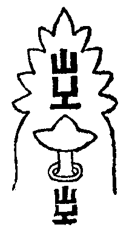
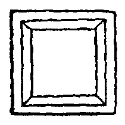
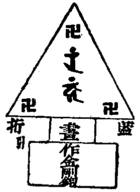

# 火吽轨别录



> **藏经**：大正新修大藏经（大正藏）　**册次** 第 18 册（T18）　**编号** No. 914（T0914）　**部类** 史传部　**卷次** 1 卷　**篇幅** 4,467 字

> **卷／品**：0 卷 · 0 品



---



火吽轨别录



东北方大自在天王明：



「na　maḥ　sa　ma　nta　bu　ddhā　nāṃ　oṃ　ī　śa　nā　ye　svā　hā



东方帝释天王明：



「na　maḥ　sa　ma　nta　bu　ddhā　nāṃ　oṃ　i　ndā　ya　svā　hā



东南方火天王明：



「na　maḥ　sa　ma　nta　bu　ddhā　nāṃ　oṃ　a　gna　ye　svā　hā



南方炎魔罗天王明：



「na　maḥ　sa　ma　nta　bu　ddhā　nāṃ　oṃ　yaṃ　ma　ya　svā　hā



西南方涅哩底(丁以反)天王明：



「na　maḥ　sa　ma　nta　bu　ddhā　nāṃ　oṃ　rā　kṣa　sā　dhi　pta　ye　svā　hā



西方水天王明：



「na　maḥ　sa　ma　nta　bu　ddhā　nāṃ　oṃ　va　ru　ṇa　ye　svā　hā



西北方风天王明：



「na　maḥ　sa　ma　nta　bu　ddhā　nāṃ　oṃ　vā　ya　ve　svā　hā



北方毘沙门天王明：



「na　maḥ　sa　ma　nta　bu　ddhā　nāṃ　oṃ　ya　kṣa　dhi　dya　dha　ri　svā　hā



上方大梵天王明(帝释右)：



「na　maḥ　sa　ma　nta　bu　ddhā　nāṃ　oṃ　pra　ja　pta　ye　svā　hā



下方地居天王明(水天左)：



「na　maḥ　sa　ma　nta　bu　ddhā　nāṃ　oṃ　dhṛ　thi　vye　svā　hā



日天子明(帝释左)：



「na　maḥ　sa　ma　nta　bu　ddhā　nāṃ　oṃ　a　hya　tya　svā　hā



月天子明(水天右)：



「na　maḥ　sa　ma　nta　bu　ddhā　nāṃ　oṃ　ca　ndrā　ya　svā　hā



诸星天子明(同月天位)：



「na　maḥ　sa　ma　nta　bu　ddhā　nāṃ　oṃ　na　kṣa　tra　de　va　ta　ye　svā　hā



诸龙王明(同水天明)：



「na　maḥ　sa　ma　nta　bu　ddhā　nāṃ　oṃ　me　ghā　śa　ni　ye　svā　hā



一切使者及诸鬼神等明(於东北方散施)：



「pi　ci　pi　ci　vi　śa　ca　ṇaṃ　svā　hā　gu　gu　bhū　tā　ṇaṃ　svā　hā



凡持诵不动尊真言，皆须作坛，坛法即后样是。皆以青色、黑色花，烧沈香、安息香，随时果子、饮食、灯火、香水供养。欲供养时，行者澡浴著新衣，先诵本尊真言，结本尊印，以杓取香水洒诸供养物，然后供养，名为净护，即诸魔不能秽恶。兼用虚空库心供养法，最不可思议。布置供养具讫，即诵三昧耶真言，辟除结界。



毘卢遮那三昧耶真言(著座诵真言结印)：



「na　maḥ　sa　ma　nta　bu　ddhā　nāṃ　oṃ　a　sa　me　tri　sa　me　sa　ma　ye　svā　hā



右结三昧耶印(合掌是也)，印额、左右肩、心、喉，各诵前件真言一遍。



即结不动尊印，诵不动尊真言七遍，左旋为辟除；又诵三遍，右旋为结界。结界已，即结钩印(以二手内交竖右头指)，请一切佛菩萨执金刚等，降集道场。钩印真言曰：



「na　maḥ　sa　ma　nta　bu　ddhā　nāṃ　aḥ　sa　rva　trā　pra　ti　ha　ta　ta　thā　ga　tāṃ　kū　śa　bo　dhi　ca　rya　pa　ri　pū　ra　ka　svā　hā



右诵一遍一钩，三钩已即观一切诸佛菩萨无量圣众等悉皆降集，然后坐礼拜、忏悔、发愿、陈说所求。



然后结毘卢遮那心印(以无名小指外交，竖中指屈上节，令头相拄以头指各微屈，以头附中指上节侧，大母指外交之)，诵五字真言，如后。



毘卢遮那降伏四魔解脱六趣满足一切智智真言曰：



「ā　vi　ra　hūṃ　khaṃ



右对尊像结前印，诵此真言七遍，然把数珠诵百遍乃至千遍，多多益善。然后结不动尊印(即剑印是也)，诵不动尊真言，曰：



「na　maḥ　sa　ma　nta　va　jra　ṇaṃ　ca　ṇḍa　ma　hā　ro　ṣa　ṇa　spha　ṭ　ya　hūṃ　tra　ṭ　hāṃ　māṃ



右对尊像结前印，诵此真言七遍，然后把数珠诵百遍乃至千遍，多多益善。



念诵了，还须结本尊印，又诵真言七遍。又殷勤发愿礼拜已，更结前三昧耶印，诵三昧耶真言三遍。更结剑印，左旋一匝解界已，观诸圣众各归所土，然后出道场。行住坐卧心念本尊真言，不令闲断。



不动尊施食真言：



「na　maḥ　sa　ma　nta　va　jra　ṇaṃ　tra　ṭ　a　mo　gha　ca　ṇḍa　ro　ṣa　ro　ṣa　ṇa　spha　ṭ　ya　hūṃ　tra　ma　ya　tra　ma　ya　hūṃ　tra　ṭ　hāṃ　māṃ



右每食常出一分食供养，诵此真言一遍，於一切处常得拥护。



澡浴真言：



「oṃ　cu　svā　hā



右以水一抄诵前真言七遍，加持一抄水洒身，即当洗浴。如前施八方食，取豆、果、饼、饭、胡麻、粳米、涂香屑、诸华等，和水安瓶盆中，以欢喜心四方散之，施诸天鬼神。涂香末香眷属，各以其真言施之。



东北方自在天真言曰：



「oṃ　ī　śa　na　ya　svā　hā



东方帝释天真言曰：



「oṃ　i　ndra　ye　svā　hā



东南方火天真言曰：



「oṃ　a　gna　ye　svā　hā



东方琰魔王真言曰：



「oṃ　yaṃ　ma　ya　svā　hā



西南方罗刹娑真言曰：



「oṃ　ra　kṣa　sa　a　dhi　pta　ye　svā　hā



西方诸龙水神真言曰：



「oṃ　va　ru　ṇa　ya　svā　hā



西北方诸风神真言曰：



「oṃ　va　ya　ve　svā　hā



北方诸夜叉真言曰：



「oṃ　ya　kṣa　vi　dya　pta　ya　svā　hā



上方施诸类鬼神真言曰：



「oṃ　gu　i　gu　ī　maṃ　sa　ni　bhū　ta　nāṃ　svā　hā



下方真言曰：



「oṃ　pi　ci　pi　ci　vi　śa　ca　nāṃ　svā　hā



如上作法施已，当净手漱口还入坛中，礼佛菩萨如常念诵：



> 「汝天亲护者，於诸佛导师，  

> 修行殊胜行，净地波罗蜜。  

> 如破魔军众，释师子救世，  

> 我亦降伏魔，我畫曼荼罗。」



「na　maḥ　sa　ma　nta　bu　ddhā　nāṃ　oṃ　vṛ　thi　vyai　svā　hā



火𤙖仪轨一卷



护摩法



> 「揽」字可观菩提心。



先住



即请火天言：



> 「我今奉请，火天之首，火中之仙，  

> 先行宗敬，降临此座，纳受护摩。」



请火天真言曰：



「na　maḥ　sa　ma　nta　bu　ddhā　nāṃ　oṃ　a　gna　ye　svā　hā



又火天印呪：准根本印，唯改屈二中指如半环势，头勿相著。是一法印，请唤火天而供养之。若献供毕发遣火天，则却伸二中指头。印呪曰：



> 「na　mo　bha　ga　va　ti　u　ṣṇī　ṣa　ya　e　hye　te　ja　mu　li　ne　a　gniye　svā　hā



是一印呪烧火天食。时之三遍，先请火天烧食供养后，乃烧食供养诸佛菩萨金刚及诸神呪等。火天呪言：



「oṃ　a　gna　ye　ha　sya　ha　sya　va　ha　na　ya　svā　hā



事已，可火天发遣，用前火天呪印。



> 火口东或本有此图







> 



火𤙖仪轨音义



的(《韵会》：丁历反。《说文》：明也。徐日光的然也。《增韵》：实也，又端也。又丁激反，远貌明见也。亦的字，明也、晓也)。　脆(清岁反，易折也。言香脆饼食者，是胡脆饼欤)。　著衔蒸作(盖是𩛞𩜶蒸饼等之类欤)。　柈(步干反，盘也)。　奠(大见反，定也，置也，荐也，陈也，调也)。　豆(大候反，量名也。《尔雅》：食器也。今上下合调置也)。　馔(上卷反，饮食也)。　芬(孚云反，香和也)。　葩(普加反，草华之白也。又「皅」字也。今上下合盛也)。　严被(被备也。同音故代用之)。　珤(古「宝」字也)。　餐(千丹、苍千二反，吞也。无功而食禄曰素餐)。　酷(口告反，熟也)。　烈(力折反，威叶也。菓空敷荣谓之为酷烈也)。　低(当稽反也)。　块(口清、口回二反也。堛，善逼反)。　泸(抚屡浮也。滓陀武也)。　精(子清反，好也，明也，善也，灵也，正也)。　抹(叵达、叵结二反，糜也。糜，正皮也，𫗴也。䄞为糜碎，𮂦，止彼反，碎也，穰也，精也。今或「糜」也)。　抄(初教反，掠也，强取)。　糤(苏旱反，饼也，熬稻粻𫗮。又作「馓」)。　菉豆(上音录。王刍也)。　煴(郁文反，烟煴，无气郁烟也)。　勃(蒲没反，健也，盛也。上府刍褒屡，下贺邬缕也)。　爆(博教、普角二反，谓皮散起也)。　咤(都嫁反，喷也。上葩托铭驱，下曩楼)。　畴(真流类也)。　课(告卧反，诫也)。　秉(鄙直反，执也)。　类(力对反，丝节也)。　捏(乃结反，捺搦也)。



火坛有三：一安稳，二富饶，三除怨。初安稳，即於露地撩治一坛，中畫佛坐莲花坐，坛四面畫般若菩萨、声闻、佛慈愍菩萨。畫佛相好。畫一朔，更畫阿钵罗尔多净居天龙王，坛中以香花供养。於坛西南角作火坛，高四指。於中穿火坛，方一肘，取白土涂炉中央。台高四指，从轮一指，於中烧桑木或搆木、柿木，木长一搩手。取树枝头肥者，苏、蜜、酪涂两头，一呪一烧。取大麦、小麦、苏、蜜、酪、乳，一呪烧。满一千八遍。一三时时别□□满七日，或半月一月即息寂静。著鲜白衣，於坛中念诵，即向火坛中作烧火法。用月一日起首，於黄昏作法，当尔之处净居天集会，得成安稳法。面向北坐茅萆席上，结加趺坐，烧火坛，一日三时泥坛香花供养已，香自无针刺用供养，即得除灭一切灾厄，亦得长命，除一切病，有无□变怪，并作此法。



次说富饶火坛法。



若欲作火法者，先须撩治一坛，中畫佛、四面观音、大势及诸大菩萨、梵天王、妙吉祥天、诸大药叉、诸仙、大威德及诃利底母等，於此供养。此法用十五日起首，日欲昏时，面向东坐茅草圆席上，交□坐，著净衣，发欢喜心。此时诸天集，时彼人作法，诸天欢喜，即得成就。於此坛外南边作一大坛，方二肘，安修阔二指，穿土深一肘，中心台阔一搩手，高四指。用赤土坛，於台中从莲花之香供养，烧搆木乳粥苏酪等，或乌麻和饭亦得。一日三时，时别一千八遍。其木磔手，取树枝柯指许麁者，苏蜜乳酪涂两头一呪一烧，满一千八遍或一百八遍，或七日或半月。如是作法，法即得成就。



三说降怨火坛法。



若欲降怨火法者，用黑月八日或十五日，或从夜半，於此时是诸恶鬼药叉罗刹集会时，即作三角坛，□□向南，用黑土扫坛一肘，高三指，□阔二指，中捉三叉，取驴粪、骆驼粪、灰，取三种物泥坛。若有怨家相恼瞋心，即作此法。著赤衣或青衣，或更作大恶法取血染衣裳，胡蹲坐，是足相蹋，西向皱眉努眼咬齿，端身正直心出语坛。亦得取糠和芥子，一日三时泥坛，於其坛上龙臭花取棘针木撚火、苦练木埿□坛。亦得取糠和芥子，取自身血和，一呪一烧满一千八遍。一日三时，时加如是烧，人骨，头发如是等物，发愿瞋之，一呪一烧，称名彼。此是降怨法，令前人长病、钱物散失、身死血出、身之节落，人不喜见。



又说都火坛法。深十六指，阔三十二指，东面著轮，南面三古叉，西面著龙，北面著跋折罗，中央著莲花。余供养准前作之，又须□火星日起首。



次说诸火天印法。



次说诸火神印。次说成就时节。若用五月中作法，决定有雨。若用三月中作法，决定有种种碍现。若用正月作法，决定有种种障碍。若用九月中作法，决之定有欻雷电。如是等月皆须十五日，有是等相现，决定成就。



若作安稳法者，用各月十五日、七日、三日、十三日，如是等日并是鬼星日也。又日月蚀时最为第一，二月、三月、十月、十一月作富饶法，四月五月作降怨法。

