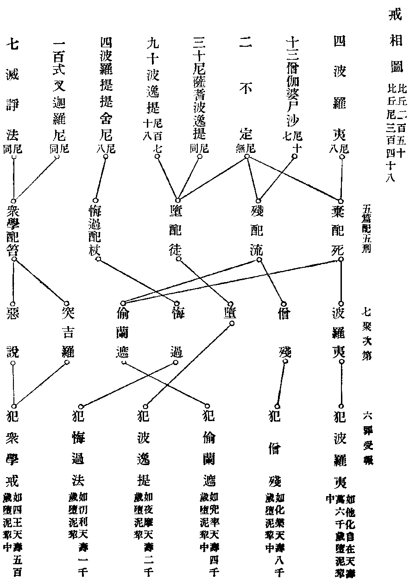
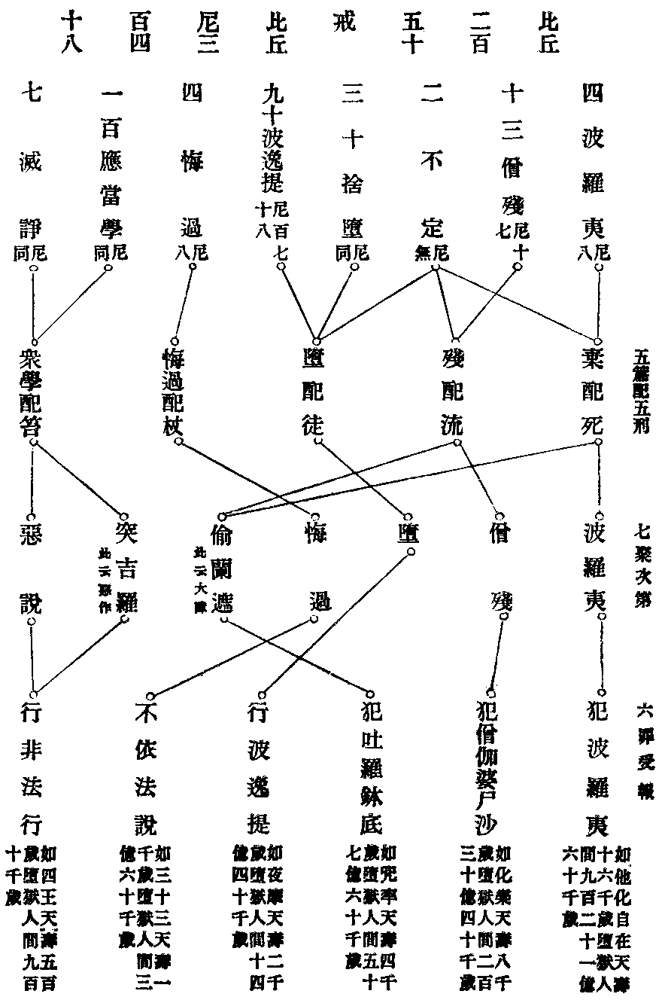

# 毗尼珍敬录



> **藏经**：卍新纂大日本续藏经（新纂卍续藏）　**册次** 第 39 册（X39）　**编号** X0708　**部类** 史传部　**卷次** 2 卷　**篇幅** 66,752 字

> **卷／品**：0 卷 · 2 品



---



## 目录



  - [No. 708-A 毗尼珍敬录序](#no-708-a-毗尼珍敬录序)

  - [卷上序](#卷上序)



---



### No. 708-A 毗尼珍敬录序



木叉之不珍於世也，非独愚不肖人之罪也。葢一蚀於圆解，再蠧於菩萨乘，而逾闲荡检者不与焉。圆解者曰：无非法界，何执为？不知不执云者，谓其事得理融，不谓执理而反碍事也。菩萨乘者曰：见机得开，戒何拘小？不知菩萨比丘乃开小以成大，非谓受大而遂弃小也。若非清净尸罗为三昧本，世禅尚无，谛从何发？倘任爱见罗刹，毁弃浮囊，自尚巨存，利他安在？二十五方便，二健儿为称首天台，旨哉其言之矣！我云栖大师发天台之隐，扶律辅教，为万世规。第亟於梵网而未遑四分，跃冶之流尚藐篇聚为长物。莲居绍公精彻台宗，取四分手自辑录，以就兹篇，真妙补祖阙而善继师志者。公往而其书尘袭已十餘年，近冢嗣新师始托素师订定，而会程居士启六年长讲之愿，将严净毗尼为学士准绳，遂有发心任书任梓者。法运通塞，固自有时。嗟乎！金刚固能溃膓，琉璃方堪盛乳。与其乘急戒缓，虽得道而苦历三途，何如乘戒俱急，以人天身而安然得道？云光负轭，千古长嗟。绍公之成就狮子儿，岂独一说经而已哉！岂独一说经而已哉！



毗尼珍敬录目次



------



### 卷上序



戒相品  

(附)戒相摄颂(智旭述)  

四波罗夷法第一  

十三僧伽婆尸沙法第二  

二不定法第三  

三十尼萨耆波逸提法第四



卷下九十波逸提法第五  

四波罗提提舍尼法第六  

一百式叉迦罗尼法第七(皆记自六群比丘等故制)  

七灭诤法第八(在第三分灭诤犍度中)䟦



毗尼珍敬录目次(终)







戒相摄颂



比丘　智旭　述



按僧祗律结集之时，先出摄颂，后出律文。根本律中亦有摄颂，葢为初机便於记诵也。今四分律既无此颂，设欲傍取他宗，则次序不类；欲仍其旧，又虑初机记诵为难。故辄援例颂之，俾初学先诵乎此，则五篇戒相已提挈其纲领矣。



> 婬欲盗五钱，故断人类命。无知妄言证，  

> 除增上慢人，是四波罗夷，犯者不可救。



> 弄失精触女，麤恶索婬供，媒嫁房过量。  

> 大房不处分，无根谤取片，破僧及伴党。  

> 被𢷤反嫌僧，恶性不受语，前九初便犯。  

> 后四皆三谏，是十三僧残，二十众中悔。  

> 不定法有二，三二随所治，



> 舍堕有三十，长衣离宿衣，待足过一月，  

> 取非亲里尼，及使浣染打，从非亲里乞。  

> 过受自恣请，求益价合作，索衣过六反。  

> 是为初十法。蚕绵作卧具，纯黑不杂色，  

> 不满六年持，坐具不帖故，持羊毛远行。  

> 使尼浣染擘，受金银卖买，贩卖为二十。  

> 长钵更求好，非亲织作衣，许直求好织。  

> 与衣后瞋夺，残药过七日雨衣前求用。  

> 过畜急施衣，后月离六夜，回僧物入己。  

> 是为三十法，物向僧中舍，波逸提说悔。  

> 单提九十事：妄语毁呰语、两舌女同室。  

> 未受戒三宿，共诵向说罪，及说过人法，  

> 与女过说法，掘地是初十。损坏鬼神村，  

> 异恼及嫌骂，露敷僧卧具，并房中不举，  

> 强夺止宿处，牵他出僧房，阁坐脱脚床，  

> 虫水浇泥草，覆房过三节，此是第二十。  

> 自往教授尼，僧差教至暮，讥论教尼人。  

> 衣与非亲里，作衣屏处坐，期行及乘船。  

> 尼赞叹得食，女同行三十，过受一食施。  

> 展转及别众，过三钵受请，不作餘食法。  

> 故使他人犯，非时与残宿，不受索好食，  

> 第四十法竟，自与外道食，诣餘家不嘱。  

> 食家强安坐，及在屏处坐，露地独与女。  

> 使他不得食，过受请与药，观军过三宿，  

> 宿时观军事。是名第五十。歙酒水中戏。  

> 击攊不受谏，怖他过洗浴，露地辄然火，  

> 戏藏他衣物，不问著施衣，新衣不坏色，  

> 第六十法竟。故杀畜生命，饮用有虫水，  

> 恼他覆他罪，授戒不如法，发起已灭诤，  

> 同贼伴共行，恶见谏不舍，供给与同事。  

> 畜被𢷤沙弥，波逸提七十，拒谏轻诃戒。  

> 无知违羯磨，不与欲后悔，屏听语瞋打，  

> 手抟僧残谤，八十波逸提。入王宫捉宝。  

> 非时入聚落，高床兜罗褥，骨牙角针筒，  

> 坐具覆疮衣，雨浴衣过量，及等佛衣量，  

> 九十单提竟，如法悔清净，不悔堕无疑。  

> 受非亲尼食，不止尼代索，学家恐处受。  

> 四名悔过法。众学著衣初，入白衣舍法。  

> 受食大小便，说法恭敬塔，携手行上树。  

> 络杖等应学。



> 现前及忆念，不痴并自言，覔罪多人语，  

> 草覆七灭诤，如是诸篇聚，比丘所应知。  

> 如说修行人，诸佛其称美。



(此戒相颂，藕益老人述于毗尼集要，今从彼添入。)



四种僧颂



> 自恣出罪及受具，四僧上三不应作。  

> 受具出罪五僧除，十僧之中除出罪，  

> 除上三法餘应作，二十僧中皆许作。  

> 况复多僧何不尔，尼及被𢷤诫足数。



相似非法别众羯磨颂



> 应一白三白不作，或作不白或多白，  

> 作多羯磨是非法，不举乱举非毗尼，  

> 不来不与应诃诃(别众)，为彼白此是非法。  

> 背作后白法相似，不来欲与诃不诃。  

> 如白如作是如法，举罪法举如毗尼。



十二人不应诃诵



> 愚谓恶思恶说作，不持三藏是为痴。  

> 不明三藏不善理，犯弃新增旧怨嫌，  

> 外住舍弃言无次，舍仪失性授学人。



应诃三颂



> 住本性者言次第，不舍微仪是可诃。



十重四十八轻戒摄颂



> 杀盗婬妄及酤酒，食肉五辛不教悔，  

> 不供请法懈不听，背大向小不看病。  

> 畜杀生具共成十，国使贩卖及谤毁，  

> 放火焚烧并僻教，为利倒说恃乞求。  

> 无解作师并两舌，不行放救成二十。  

> 报讐憍慢不下问，憍慢僻说不学佛，  

> 不善知众独受利，不受别请别请僧，  

> 念九邪命而自活，不敬好时成三十。  

> 不行救赎害众生，邪业觉观暂念小。  

> 不发愿并不发誓，冐进游行乖尊卑。  

> 不修福慧三十九，择受戒兮利作师。  

> 为恶人而莫说戒，无惭受施不供经。  

> 不化生说法不如，非法制限及破法，  

> 六八轻戒及十重，广摄佛法戒无餘。



No. 708  

毗尼珍敬录卷上



明　菩萨戒武林比丘　广承　辑录



赤城比丘　广镐　嗣法比丘　大真　参订



古吴比丘　智旭　会补



四波罗夷法第一



舍利弗於闲静处作是念：何者等正觉修梵行法久住？何者等正觉修梵行法不久住？往问世尊。佛言：随叶佛、拘那含佛不为诸弟子广说十二部经，不结戒、不说戒故，法不久住。如种种华散置案上，风吹则散。毗婆尸佛、式佛、拘留孙佛、迦叶佛为诸弟子广说经法，亦结戒、亦说戒故，法得久住。如以线贯种种华置案上，虽为风吹而不分散。尔时，舍利弗即请世尊结戒、说戒。佛言：且止！佛自知时。若有比丘犯有漏法，然后结戒。为断彼有漏法故，比丘若得利养，若得名称，为人所识，多闻、多财业，便生有漏法。有漏法生，当为结戒。



若比丘，共比丘同戒，若不还戒，戒羸不自悔，犯不净行，乃至共畜生，是比丘波罗夷，不共住一。



佛在毗舍离。时迦兰陀村须提那子，饶财多宝，持信牢固，出家为道。时世谷贵，乞食难得，须提那子将诸比丘，诣迦兰陀村乞食。母劝舍道还家，再三不允，乃令与妇安子，使种不断。便至园中，三行不净，九月生男，字为种子，后亦出家成道。时须提那行不净来，常怀愁忧，同学问知，白佛。佛集僧诃责，与诸比丘结戒。集十句义：一、摄取於僧。二、令僧欢喜。三、令僧安乐。四、令未信者信。五、已信者令增长。六、难调者令调顺。七、惭悔者得安乐。八、断现在有漏。九、断未来有漏。十、正法得久住。(以下一一戒，皆用此十义故结，不复重出。)结戒已，有䟦阇子比丘，愁忧不乐净行，即还家，共故二婬欲。诸比丘白佛，佛言：比丘不乐净行，听舍戒还家。若复欲出家修净行，应度令出家受大戒。故加不舍戒，戒羸不自悔之言。复有一乞食比丘，依林中住，与雌猕猴共行不净。比丘白佛，故更加乃至共畜生之言。



若比丘者，名字比丘、相似比丘、自称比丘、善来比丘、乞求比丘、著割截衣比丘、破结使比丘、受大戒白四羯磨如法成就得处所比丘。是中比丘若受大戒白四羯磨如法成就得处所，住比丘法中，是比丘义。共比丘者，餘比丘受大戒白四羯磨乃至住比丘法中，是共比丘义。同戒者，我为诸弟子结戒已，宁死不犯。其餘比丘一戒、同戒、等戒，是名同戒。



不舍戒者，颠狂舍戒、心乱舍戒、痛恼舍戒、痖舍戒、聋舍戒、痖聋舍戒、颠狂乃至痖聋人前舍戒、中国人边地人前舍戒、边地人中国人前舍戒、不静静想静不静想舍戒、戏笑舍戒，若天、龙、夜叉、饿鬼、睡眠人、死人、无知人，若自不语、若语前人不解，如是等不名舍戒。云何舍戒？若比丘不乐修梵行欲得还家，厌比丘法常怀惭愧，贪乐在家或优婆塞法沙弥法、外道及外道弟子法、非沙门非释子法，便作是语：舍佛法僧，舍和尚同和尚、阿阇黎同阿阇黎，舍诸梵行戒律学事受居家法，我作净人、优婆塞沙弥、外道外道弟子、非沙门非释子。作是言：我止不须佛，佛于我何益？离于佛所乃至学事。复作餘语毁佛法僧乃至学事，便赞叹家业乃至非沙门释子。以如是语了了说，是名舍戒。



戒羸者，有二，有戒羸不舍戒。若比丘不乐梵行，乃至乐欲作非沙门非释子，作是言：我念父母兄弟姉妹妇儿、村落城邑园林浴池，我欲舍佛法僧乃至学事，欲受持家业乃至非释子法。是谓戒羸不舍戒。若便舍戒，是谓戒羸舍戒。



不净行者，是婬欲法。不至共畜生者，可行婬处者是也。



波罗夷者，如人断头不可复起，比丘亦然，犯此法者不复成比丘。



不共住者，有二共住：同一羯磨、同一说戒。不得於是二事中住，故名不共住。



三种行不净行，波罗夷：人、非人、畜生。复有五种：人妇、童女、二形、黄门、男子。三种妇：人妇、非人妇、畜生妇、三童女、三二形、三不男、三男子。犯人妇三处大小便及口，非人妇、畜生妇、三童女、三二形亦然。人、黄门、二处、非人、畜生、黄门、三男子亦然。



比丘婬心向人妇三处，初入犯、不入不犯，有隔有隔、有隔无隔、无隔有隔、无隔无隔，波罗夷。餘妇女、三童女、三二形，三处亦然。三黄门、三男子，二处亦然。



若比丘婬意向人睡眠，妇女死，形未坏、多未坏，三处初入犯、不入不犯、有隔无隔等，乃至男子亦然。若为怨家将至人妇女所，强持男根令入三处，始入、入已、出时，三时乐，波罗夷；二时乐、一时乐亦然。有隔无隔亦如是，乃至男子亦如是。若为怨家将至人睡眠，妇女死，形未坏、多未坏，觉乐亦如是；有隔无隔亦如是，乃至男子亦如是。若怨家强捉比丘大便，道中行不净，三时、二时、一时乐，波罗夷；乃至有隔无隔亦如上。



从道入道、从道入非道、从非道入道、若限齐入尽入、若语不语、若以婬心乃至入如毛头，波罗夷。方便不入，偷兰遮。方便求欲行不净行，成者波罗夷，不成者偷兰遮。



若比丘教比丘行不净行，彼作，教者，偷兰遮；不作，教者，突吉罗。尼教比丘行不净行，比丘作，尼偷兰遮；不作，尼突吉罗。除比丘及尼，餘众相教，作、不作，尽犯突吉罗。



若死尸半坏、多分坏、一切坏、骨间穿地作孔、抟泥作孔、君持口中道想，若疑，如是一切偷兰遮。若道作道想，若疑，若道非道想，波罗夷。非道道想，若疑，偷兰遮。



比丘尼，波罗夷；式叉摩那、沙弥、沙弥尼，突吉罗，灭𢷤。



不犯者，若睡眠、无所觉知、不受乐、无有婬意、最初未制戒，痴狂、心乱、痛恼所缠。(最初未制戒等以下诸戒皆同，不重出。)



若比丘，若在村落、若闲静处，不与盗心取，随不与取法，若为王、王大臣所捉，若杀、若缚、若驱出国：汝是贼！汝痴！汝无所知。是比丘波罗夷，不共住。(二)



罗阅城有陶师子比丘，字檀尼迦，在静处止一草屋，入村乞食。取薪人破屋持归，乃和泥作全成瓦屋，取柴薪牛屎烧之，屋成色赤如火。佛制不得作赤色全成瓦屋，勅诸比丘打破。檀尼迦乃诳摩竭国守材人，取王要材。大臣白王，王念不应以少材断出家人命，诃责放去。诸臣不平，居士讥嫌故制。村有四种：一、周匝垣墙；二、周匝栅篱；三、篱墙不周；四、周匝屋舍。闲静处者，村外空静地。不与者，他不舍。盗者，盗心取，随不与。取者，若五钱、若直五钱。王者，得自在，不属人。大臣者，种种大臣辅佐王者。



有三种不与取，波罗夷：自手取、看取、遣人取。复有三种取：非己物想取、非暂用取、非同意取。复有三种取：他物他物想取、若举离本处。复有三种取：有主有主想取、若举离本处。复有三种取：他护他护想取、若举离本处。复有四种不与取：自手取、看取、遣人取、若举离本处。复有四种取：非己物想取、不暂用取、不同意取、若举离本处。他物他物想取等有四种，亦如是。复有五种不与取：自手取、看取、遣人取、若重物举离本处。复有五种取：非己物想取、非暂用取、非同意取、若重物举离本处。复有五种取：若他物他物想取、若重物盗心举离本处。有主有主想取等有五种，亦如是。复有六种不与取：自手取、看取、遣人取、若重物盗心举离本处。非己物想取等有六种，亦如是。是为六种不与取，犯波罗夷。



处者，若地处，若地上处，若乘处，若担，若虗空，若树上，若村，若阿兰若处，若田，若处所，若船，若水处，若私度关不输税，若取他寄信物，若取水、杨枝、树、果、草、木、无足、二足、四足、多足，若同财业，若共要，若伺候，若守护，若逻要道，是谓处。地处者，地中伏藏未发七宝生像、金宝、衣被，若复餘地中所须之物。属主者，若以盗心取五钱，若过五钱，若牵挽取，若埋藏，若举离本处，初离处，波罗夷；若方便欲举而不举，偷兰遮。地上处亦如是。乘处者，象乘、马乘、车乘、步乘，若复餘乘，尽名为乘。乘上若有七宝，乃至举离本处，波罗夷；方便不举，偷兰遮。若取乘从道至道，从道至非道，从非道至非道，从坑中至岸上，从岸上至坑中，取离本处，初离处，波罗夷；方便不取，偷兰遮。下皆倣此。担处者，头担、肩担、背担，若抱，若复餘担。空处者，若风吹毳，若劫贝、拘遮罗，若差罗波尼，若刍摩，若麻，若绵，若钵躭岚婆，若头头罗，若鴈鶴、孔雀、鹦鹉、鸜鹆，若复餘物。上处者，若举物在树上，墙、篱、杙、龙牙杙、衣架、绳床、木状、大小褥、枕、地敷，如是等。上村处如上。阿兰若处者，村外有主空地。田处者，稻田、麦田、甘蔗田，若复餘田。处所者，若家处所，若市肆处，若果园、菜园、池、庭前、舍后，若复餘处。船处者，大船、小船、壶船、一木船、舫船、橹船、龟形船、鼈形船、皮船、浮瓠船、果船、悬船、筏船、若复餘船。水处者，若藏七宝等沉著水中、若水獭鱼等、若优钵罗等华及餘水中物。不输税者，比丘无输税法，若白衣应输税物，比丘以盗心为他过，若掷关外、若五钱若过五钱、若埋藏举、若以辩词言说诳惑、若以呪术，过，波罗夷；方便，偷兰遮。取他寄信物者，寄持信物作盗心取，乃至举离本处，初离，波罗夷；方便，偷兰遮。水者，若大小瓮及餘水器、若众香水药水。扬枝者，若一若两若众多、若一把一束一抱一担、若香熏药涂，若盗心取五钱过五钱，波罗夷；方便，偷兰遮。果木者，诸草木丛林华果有主，以盗心取，波罗夷；方便，偷兰遮。无足者，蛇鱼及餘无足众生。二足者，人非人鸟及餘二足众生。四足者，象马牛骡馲驼驴鹿及餘四足众生。多足者，蜂郁周隆伽百足及餘多足众生。有主者，以盗心取，波罗夷；方便，偷兰遮。同财业者，同事业得财物，当共以盗心取，波罗夷；方便，偷兰遮。共要者，共他作要，教言某时去某时来、若穿墙取物、若道路劫取、若烧，从彼得财来，共以盗心取，直五钱过五钱，波罗夷；方便，偷兰遮。伺候者，我当往观村落城邑、船渡处、山谷处、人所居处、市肆处、作坊处，於彼所得，一切当共以盗心取，直五钱过五钱，波罗夷；方便，偷兰遮。看道者，我当看道，若王军来、若贼军来、长者军来，当相告语，若有所得，一切当共，波罗夷；方便，偷兰遮。



方便求过五钱，得过五钱，得五钱，波罗夷；得减五钱，不得，偷兰遮。方便求五钱，得过五钱，得五钱，波罗夷；得减五钱，不得，偷兰遮。方便求减五钱，得过五钱，得五钱，波罗夷；得减五钱，偷兰遮；不得，突吉罗。教人方便求过五钱，得过五钱，得五钱，二俱波罗夷；得减五钱，不得，二俱偷兰遮。方便教人求五钱，得过五钱，得五钱，二俱波罗夷；得减五钱，不得，二俱偷兰遮。方便教人求减五钱，得过五钱，得五钱，取者，波罗夷；教者，偷兰遮；得减五钱，二俱偷兰遮；不得，二俱突吉罗。方便教人求五钱，若过五钱，受教者取异物，或异处取他物，取者，波罗夷；教者，偷兰遮。若方便教人求五钱，若过五钱，受教谓使取物，无盗心而取，得五钱，过五钱，教者，波罗夷；受教者，无犯。若教人取物，受教者谓杀盗取，若取直五钱，过五钱，受教者，波罗夷；教者，无犯。



有主有主想，不与取五钱过五钱，波罗夷。有主疑无主，有主想无主疑，俱偷兰遮。有主有主想，减五钱，偷兰遮。有主疑无主，有主想无主疑，俱突吉罗。



比丘尼波罗夷。餘三众突吉罗灭摈。



不犯者，与想、取己有想、冀扫想、暂取想、亲厚意想。



若比丘，故自手断人命，持刀与人，叹誉死、快劝死：咄！男子！用此恶活为？宁死不生。作如是心，思惟种种方便，叹誉死、快劝死。是比丘波罗夷，不共住。(三)



比丘习不净观，厌患身命求刀欲自杀。时有比丘字勿力伽难提，手执利刀入婆裘园。有一比丘语言：大德！断我命来，我以衣钵与汝。即受顾断其命，诣江洗刀寻生悔恨，天魔立水劝赞悔心即灭，复入园杀诸比丘至六十人，故制。



人者，从初识至后识而断其命。杀者，自杀、教杀、遣使杀、往来使杀、重使杀、展转使杀、求男子杀、教求男子杀、求持刀人杀、教求持刀人杀、若身现相、若口说、若身口俱现相、若遣书、若教遣使书、若坑陷、若倚发、若与药、若安杀具。自杀者，若以手、若瓦石刀仗及餘物而杀，波罗夷；方便，偷兰遮。教杀者，杀时自看，教令前人掷水火中、若山上推著谷底、若使象蹋杀、若使恶兽噉、或使蛇螫，及餘种种教杀，波罗夷；方便，偷兰遮。遣使杀者，比丘遣使断某甲命，随语断命，波罗夷；方便，偷兰遮。往来使者，比丘遣使断某甲命，随语便往欲杀未得而还，即承前教复往杀，波罗夷；方便，偷兰遮。重使者，比丘遣使断某甲命，续复遣使乃至四五，彼使往杀，波罗夷；方便，偷兰遮。展转使者，比丘遣使断某甲命，彼复转遣若百若千往断其命，波罗夷；方便，偷兰遮。求男子者，是中谁知有如是人能用刀，有方便久习学不怖不退能断彼命？即往断命，波罗夷；方便，偷兰遮。教求男子者，教求如上，男子亦如是。求持刀者，自求谁勇徤，能持刀令往？断命，波罗夷；方便，偷兰遮。教求持刀亦如是。身现相者，身作相杀，令堕水火乃至蛇螫。彼因现身相故，自杀，波罗夷；方便，偷兰遮。口说者，或作是说：汝所作恶，无慈怀毒，不修众善，生便受罪，多不如死。若作是语：汝不作恶，有仁慈已，作众善行，生受众苦，死当生天。彼因此言，自杀，波罗夷；方便，偷兰遮。身口俱现相亦如是。遣使者，遣使往言：汝作善恶。广说如上，波罗夷；方便，偷兰遮。遣书杀者，执书言：彼所作善恶。亦如是。坑陷者，审知彼行道必从是来往，当道凿坑，著火、若刀、若毒蛇尖杙，以毒涂刺，若堕中。死者，波罗夷；方便，偷兰遮。倚发者，知彼必当倚发此处，若树、若墙、若栅，於外著火，乃至以毒涂刺，机发而使堕中。死者，波罗夷；方便，偷兰遮。药者，知彼人病，与非药、或以杂毒、或过限与种种药，使死，波罗夷；不死，偷兰遮。安杀具者，先知彼人本来患厌身命，即持刀毒、若绳及餘死具，置之於前。若彼用一一物，自杀，波罗夷；方便，偷兰遮。



若天子、龙子、阿修罗子、乾闼婆子、夜叉、饿鬼、若畜生中，有智解人语者、有能变形者，方便求杀。杀者，偷兰遮；方便，突吉罗。



实人人想杀，波罗夷；人疑、人非人想、非人人想、非人疑，俱偷兰遮。



比丘尼波罗夷。餘三众突吉罗。灭𢷤。



不犯者：若掷刀杖瓦石误著彼身死。若营事作房舍误堕击石材木椽柱杀人。若重病人扶起扶卧，洗浴时服药时，从凉处至热处，从熟处至凉处，入房出房向厕往反，一切无害心而死。



若比丘，实无所知，自称言：我得上人法，我已入圣会胜法。我知是，我见是。彼於异时，若问、若不问，欲自清净故，作是说：我实不知不见，言知言见，虗诳妄语。除增上慢，是比丘波罗夷，不共住。(四)



时世糓贵乞食难得，婆裘河边有诸比丘，向居士自说得上人法等。诸居士信乐供养，不为乞食所苦。安居竟往见世尊，慰问及此，具白上事诃责结戒。时有一增上慢比丘语人言：我得道。彼於异时精进不懈，勤求方便证最上胜法，疑犯此戒，具白世尊。佛言：增上慢者不犯。



不知不见者，实无知见。自称者，自称说有信、戒、施、闻、智慧、辩才。人法者，人阴、人界、人入。上人法者，诸法出要成就。自言念在身、自言正忆念、持戒、有欲、不放逸、精进、得定、得正受、有道、有修、有慧，自言见、自言得、自言果。自言念在身者，有念能令人出离狎习亲附此法，修习增广如调伏乘，守护观察善得平等，已得决定无复艰难而得自在，是为自言得身念处。自言正忆念乃至精进，亦如上说。得定者，有觉有观三昧、无觉有观三昧、无觉无观三昧、空无相无作三昧，餘如上说。得正受者，想正受、无想正受，随法心想，除色想、不除色想，除入一切入，餘如上说。道者，从一支道至十一支道。修者，修戒、定、智、解脱慧、见解脱慧。智者，法比等他心。见者，见苦集尽道。若复作是言：天眼清净观诸众生，生者死者、善色恶色、善趣恶趣、好丑贵贱、众生业报，如实知之。餘如上说。得者，得须陀洹至阿罗汉。果者，须陀洹果至阿罗汉果。餘如上说。



如是虗而不实，不知不见，向人说言：我已得上人法。前人知者，波罗夷；不知，偷兰遮。若遣手印，若遣使，若书，若作知相，前人知者，波罗夷；不知，偷兰遮。静不静想，不静静想，口说得上人法，偷兰遮。



诸天、阿修罗、乾闼婆、夜叉、饿鬼、畜生能变形有智，向说得上人法，知者，偷兰遮；不知，突吉罗。手印、遣使、若书、若作知相，使彼知，偷兰遮；彼不知，突吉罗。畜生不能变形者，向说，突吉罗。若为人说根、力、觉、意、解脱、三昧、正受：我得是法。波罗夷。人作人想，波罗夷。人疑、人非人想、非人人想、非人疑，悉偷兰遮。



比丘尼波罗夷。餘三众突吉罗。灭𢷤。



不犯者，增上慢人自言是业报因缘非修得。若向同意大比丘说上人法。若向人说根力等法。不自称言：我得。若戏笑说。或疾疾说。屏处独说。若梦中说。欲说此错说彼。



十三僧伽婆尸沙法第二



若比丘，故弄阴失精，除梦中，僧伽婆尸沙。(一)



迦留陀夷欲意炽盛，颜色憔悴身体损瘦，异时随念忆想弄失不净，诸根悦豫颜色光泽。亲友比丘问知其故，白佛结戒。时一比丘乱意睡眠，梦中失精，疑犯此戒。佛言：无犯。然乱意眠有五过失：一、恶梦；二、诸天不护；三、心不入法；四、不思惟明相；五、于梦中失精。善意眠五功德，反上可知，故加除梦中之言。



弄者，实心故作失精也。若为乐故、为自试出精故、为福德故、为祠天故、为生天故、为欲施故、为种子故、为自憍恣故、为自试力故、为好颜色故，如是事弄失僧残(僧残藏中皆云僧伽婆尸沙，已后并从简作此二字)。若内色、外色、内外色、水、风、空，内色者受色，外色者不受色，内外色者受不受色。水者，顺水逆水若以水洒。风者，顺风逆风或以口吹。空者，自空动身。若於内色弄失不净，僧残。若为乐故乃至为颜色和悦故亦如是。于外色乃至空亦如是。



忆念弄失不净，僧残；不失，偷兰遮。



若教比丘方便弄，失不净，若失，偷兰遮；不失，突吉罗。



尼教比丘方便弄失不净，若失，偷兰遮；不失，突吉罗。教餘人失不失，一切突吉罗。



比丘尼波逸提。餘三众突吉罗。



不犯者：梦中失。觉已恐污身衣床褥。若以弊物树叶器物盛弃。若手捺弃。若欲想出。若见好色不触而失。若行路时自触两䏶。若触衣触内衣。若大小便时。若冷水煖水洗浴时。若在浴室中用树皮末药泥上浴。若手揩摩。若大啼哭。若用力作时出不净。一切不作出不净意。



若比丘，婬欲意与女人身相触，若捉手、若捉发、若触一一身分者，僧伽婆尸沙。(二)



迦留陀夷因佛制戒，不得弄阴堕精，便伺妇女至房，扪摸呜口，乐者笑其所作，不乐者瞋恚骂詈。语诸比丘，比丘白佛结戒。



婬欲意者，爱染污心也。身者，从发至足也。身相触者，若捉摩、重摩，或牵、或推，逆摩、顺摩，或举、或下，或捉、或捺。捉摩者，摩身前后。牵者，牵前。推者，推却。逆摩者，从下至上。顺摩者，从上至下。举者，举上。下者，若立捉之令坐。捉者，捉前、捉后，捉乳、捉髀。捺者，捺前、捺后，捺乳、捺髀，僧残。



若女作女想，女人扪摸比丘身，身相触，欲意染著，受触乐，僧残。女作女想，女以手扪摸比丘，动身，欲意染著，受触乐，僧残。乃至捉捺亦如是。女疑者，偷兰遮。女作女想，身触彼衣璎珞具，欲心染著，受触乐、不受触乐，偷兰遮。女作女想，女以身衣璎珞具触比丘身，欲心染著，受触乐、不受触乐，偷兰遮。女作女想，以身触女衣璎珞具，欲心染著，动身不受触乐、不动身受触乐，偷兰遮。女作女想，女以身衣璎珞具触比丘身，动身不受触乐、不动身受触乐，偷兰遮。女作女想，身相触，餘如上说。如是捉摩乃至捉捺，一切偷兰遮。若女疑，突吉罗。女作女想，以身衣触身衣璎珞具，欲心染著等，如上说，突吉罗。乃至捉捺，一切突吉罗。是女疑，突吉罗。



若比丘，与女人身相触，一触一僧残；随触多少，一一僧残。



若天女、阿修罗女、龙女、饿鬼女、畜生女，能变形者身相触，偷兰遮；不能变形，突吉罗。与男子身相触，突吉罗。与二形身相触，偷兰遮。若女作礼捉足，觉触乐不动身，突吉罗。若比丘欲心触衣、钵、尼师坛、针筒，乃至自触身，突吉罗。



人女人女想，僧残；人女疑、人女非人女想、非人女人女想、非人女疑，偷兰遮。



比丘尼波罗夷。餘三众突吉罗。



不犯者，若有所取与相触、戏笑相触、若相解时相触。



若比丘，婬欲意与女人麤恶婬欲语，随所说麤恶婬欲语，僧伽婆尸沙。(三)



亦起自前人，故制。



麤恶者，非梵行婬欲。语者，称说二道好恶，若自求、教他求，若问、若答，若解、若说，若教、若骂。自求者言：与我二道作如是如是事。若作餘语。教他求者，若天、若梵、若水神、若摩醯首罗天祐助於我，共汝作如是事。若作餘语。问者，问：汝二状何似？汝云何与夫主共事？云何复与外人共通？若作餘语。答者，汝二道状如是，汝与夫主、外人共通如是。若作餘语。解说亦然。教者，我教汝如是治二道，可令夫主、外人敬爱。若作餘语。骂者，言：汝破坏、腐烂、烧燋、堕落，与驴作如是事。若作餘语。



若比丘与女人一反作麤恶语，一僧残。随语多少，说了了者，一一僧残；不了了者，偷兰遮。若与指印、书信，遣使作相，令彼知者，僧残；不知者，偷兰遮。



除二道，说餘处好恶，偷兰遮。



若天、阿修罗、夜叉、龙女、畜生女能变形者，及黄门二形作麤恶语，令彼知者，偷兰遮；不知者，突吉罗。指印乃至现相，令彼知者，偷兰遮；不知者，突吉罗。向畜生不能变形者麤恶语，及向男子麤恶语，俱突吉罗。



麤恶语麤恶语想，僧残；生疑，非麤恶语麤恶语想，若疑，偷兰遮。人女人女想，僧残；人女疑，人女非人女想，非人女人女想，非人女疑，偷兰遮。



比丘尼偷兰遮。餘三众突吉罗。



不犯者：若为女人说不净观，大妹当知！此身九疮、九孔、九漏、九流。九孔者，二眼、耳、鼻并口及二道。当解说此不净观时，彼之女人谓麤恶语。若说戒时，言次及此，谓麤恶语。若从受经，若二人受，若彼问，若同诵，若戏笑语、独处语、疾疾语、狂梦语、欲说此错说彼。



若比丘，婬欲意，於女人前自叹身言：大妹！我修梵行、持戒、精进、修集善法，可持是婬欲法供养我。如是供养第一最，僧伽婆尸沙(四)。



亦起自前人，故制。



叹身者，叹身端正美好颜色，我是刹利、长者、居士、婆罗门种。梵行者，勤修离秽浊。持戒者，不缺、不穿漏、无染污。善法者，乐闲静处、时到乞食、著粪扫衣、作餘食法不食、一坐食、一抟食、冢间坐、露坐、树下坐、随坐、持三衣、呗匿、多闻、能说法、持毗尼、坐禅，作如是自叹已：供养我来。不说婬欲者，偷兰遮；若说婬欲，僧残。



若人女前一自叹一僧残，随叹多少说了了者，一一僧残；不了了者，偷兰遮。若手印书乃至现相令彼知者，僧残；不知者，偷兰遮。



除二道，索餘处供养，偷兰遮。



天女乃至畜生女能变形者，向叹了了，偷兰遮；不了了，突吉罗。若指印等亦如是。畜生不能变形者，向彼叹，突吉罗；向男子自叹，突吉罗。



人女人女想，僧残；人女疑、人女非人女想、非人女人女想、非人女疑，偷兰遮。



比丘尼偷兰遮。餘三众突吉罗。



不犯者：若比丘语女人言：此处妙尊最上第一，此比丘精进持戒修诸善法，汝应以身业慈、口业慈、意业慈供养。彼女谓比丘为我故自赞身。若为说毗尼时言说相似，而彼谓自赞身。若从受经乃至错说。



若比丘，往来彼此媒嫁，持男意语女、持女意语男，若为成妇事、若为私通，乃至须臾顷，僧伽婆尸沙。(五)



迦罗比丘是王大臣，善知俗法，作如是媒嫁。时诸男女婚娶，适意者供养赞叹，不适意者怨詈讥毁，故制。



往来者，使所应可和合者。是女有二十种：母护、父护、俱护、兄护、姊护、俱护、自护、法护、姓护、宗亲护、自乐为婢、与衣婢、与财婢、同作业婢、水所漂婢、不输税婢、故去婢、客作婢、他护婢、边方得婢。母护者，母所保，乃至兄姊护亦如是。自护者，身得自在。法护者，修行梵行。姓护者，不与卑姓。宗亲护者，宗亲所保。自乐为婢者，乐为他作婢。与衣者，与衣为价。与财者，乃至与一钱为价。同业者，同共作业未成夫妇。水所漂者，水中救得。不输税者，不取输税。故去婢者，若买得、若家生。客作者，雇钱使作，如家使人。他护者，受他华鬘为要。边方得者，抄劫所得。是谓二十种女，男子二十亦然。



母护男、母护女，遣比丘为使，往语彼言：汝为我作妇，若与我私通。若言：须臾间，若一念顷。若比丘自受语，自往语彼，自受彼语还报，若遣使持语还报，僧残。自受语，遣使语彼，自持彼语还报，若遣使持彼语还报，僧残。自受语，自作持书往彼，自持报书还，若遣使持报书还，僧残。自受语，遣使持书往彼，自持报书还，若遣使持报书还，僧残。指印、现相等亦如是。若自受语，往彼还报，僧残；不还报，偷兰遮。若闻语，往彼说，不还报，偷兰遮。若与语，不受，往彼说，还报，偷兰遮。若受语，不往说，不还报，突吉罗。不受语，往说，不还报，突吉罗。若言：己嫁他。若言：至餘处。若言：死。若言：贼将去。若言：无。一切偷兰遮。若言：癞病、痈疽、白癞、乾痟、颠狂、痔漏、道有疮脓。如是还报，僧残。若比丘一反媒嫁人女，僧残。随媒嫁多少，说了了者，一一僧残；不了了，偷兰遮。若指印乃至现相亦如是。



除二道已说，餘处媒嫁，偷兰遮。



天女乃至畜生能变形者，黄门、二根媒嫁，说了了者，偷兰遮；不了了，突吉罗。指印等亦然。畜生不能变形者，媒嫁，突吉罗；媒嫁男，突吉罗。媒嫁、媒嫁想，僧残；媒嫁疑、媒嫁、不媒嫁想、不媒嫁、媒嫁想、不媒嫁疑，偷兰遮。



人女人女想，僧残；人女疑、人女非人女想、非人女人女想、非人女疑，偷兰遮。



若比丘持书往，不看者，突吉罗。若为白衣作餘使，突吉罗。



比丘尼僧残。餘三众突吉罗。



不犯者：若男女先已通而后离别还为和合；若为父母疾患系闭在狱看书持往；若为信心优婆塞病若系在狱看书持往；若为三宝及病比丘看书持往。



若比丘，自求作屋，无主、自为己，当应量作。是中量者，长佛十二磔手，内广七磔手，当将比丘指授处所。彼比丘当指授处所，无难处、无妨处。若比丘有难处、妨处，自求作屋，无主、自为己，不将比丘指授处所，若过量作者，僧伽婆尸沙。(六)



佛听比丘作私房舍，旷野国有比丘即私作大房，功力繁多常行求索，居士畏避。有一比丘欲起房舍自斫树，树神念：打比丘恐违道理。往白世尊，佛赞慰之。时迦叶乞食旷野城，居士遥避。迦叶问知其故，白佛制戒。



自求者，彼处处乞索。屋者，房也。无主者，彼无有人，若一、若两、若众多。自为己者，自求索、自为作。难处者，有虎狼恶兽下至蚁子。比丘若不为此虫兽所恼，因修治平地，若有石树株荆棘，当使人掘出；若有沟坑陂池，当使人填满；若畏水淹渍，当预设隄防；若地为人所认，当共断、当无使有语。妨处者，不通草车回转往来。比丘看无妨难处己，到僧中偏露右跽，作如是白：大德僧听！我某甲比丘自乞作屋，无主自为己，今从众僧乞知无难无妨处。如是再三。尔时众僧当观察比丘为可信否？若可信即听作，若不可信众僧应往看，或遣僧中可信者往看。若有难有妨、无难有妨、有难不妨，不应处分；若无难无妨，应与处分。众中差堪作羯磨者，应作是白：大德僧听！某甲比丘自乞作屋，无主自为己，今从众僧乞处分无难无妨处。若僧时到僧忍听，当与某甲比丘处分无难无妨处。白如是。大德僧听！此某甲比丘自求作屋，无主自为己，从僧乞处分无难无妨处。僧今与某甲比丘处分无难无妨处。谁诸长老忍僧与某甲比丘处分无难无妨处者默然，谁不忍者说。僧已忍与某甲比丘无难无妨处竟。僧忍，默然故，是事如是持。彼作房，应知初安木石、土墼、泥团，乃至最后泥治讫，若不被僧处分过量，有难有妨处，二僧残、二突吉罗。是中以不处分一僧残、过量一僧残、有难一突吉罗、有妨一突吉罗，展转作句可知。作而不成，二偷兰遮、二突吉罗。若使他作，成不成亦然。若为他作屋，成，二偷兰遮、二突吉罗；不成，四突吉罗。若僧不处分不处分想，僧残不处分疑；不处分处分想、处分不处分想处分疑，偷兰遮。过量亦如是。若有难有难想有难疑、有难无难想无难、有难想无难疑，突吉罗。妨处亦如是。



比丘尼偷兰遮。餘三众突吉罗。



不犯者：如量作。减量作。僧处分作。无妨难作。如法拼作。若为僧作。为佛图、讲堂、草庵、叶庵。若作小容身屋、多人住屋。



若比丘，欲作大房，有主为已作，当将餘比丘往看指授处所。彼比丘应指授处所：无难处、无妨处。若比丘，有难处、妨处作大房，有主为已作，不将餘比丘往看指授处所，僧伽婆尸沙。(七)



优填王与尊者阐陀亲善，任作大房。近拘睒弥城有尼拘律神树，往反者多止息其下，阐陀伐之，居士讥嫌，故制。



大者，多用财物。有主者，若一、若二、若多人。为已者，自为己身作难处、妨处，如上说。比丘至僧中求处分，众僧为处分羯磨，如上说。僧不差指授，有难、有妨处，一僧残、二突吉罗；作而不成，一偷兰遮、二突吉罗。教人作亦如是。餘及不犯，皆如上说。



若比丘，瞋恚所覆故，非波罗夷。比丘以无根波罗夷法谤，欲坏彼清净行。彼於异时，若问、若不问，知此事无根说：我瞋恚故作是语。若比丘作是语者，僧伽婆尸沙。(八)



尊者沓婆摩罗子，分僧卧具，差次受请。有慈地比丘来，随次得恶房卧具，便瞋恚。明日差受请檀越，闻是慈地，便於门外，敷弊坐具，施设恶食。慈地倍瞋，乃倩其妹慈比丘尼，诬尊者相犯。佛审问知实，诃责结戒。



根者有三，谓见、闻、疑。见根者，实见犯梵行、见偷五钱过五钱、见断人命，若他见者从彼闻，是谓见根。闻根者，闻犯梵行、闻偷五钱过五钱、闻断人命、闻自叹誉得上人法，若彼说从彼闻，是谓闻根。疑根有二，从见生、从闻生。从见生者，若见与妇女入林出林、无衣裸形、不净污身、捉刀血污恶知识伴，是谓见、疑。从闻生者，若在暗地，闻床声、草褥、转侧身、身动声、共语声、交会声、我犯梵行，声言偷五钱过五钱，声言我杀人、我得上人法，是谓闻、疑。除三根已，更以餘法谤者，是谓无根。



若彼人不清净、不见闻疑彼犯波罗夷，便作是言：我见闻疑彼犯波罗夷，以无根法谤僧残。若彼人不清净、不见闻疑彼犯波罗夷，生见闻疑想，后忘此想，便言：我见闻疑彼犯波罗夷，以无根法谤僧残。若彼人不清净、不见闻疑彼犯波罗夷，彼有疑，后便言：我是中无疑，我见闻疑彼犯波罗夷，以无根法谤僧残。是中无疑，便言：有疑，以无根法谤僧残。是中无疑，后忘无疑，以无根法谤僧残。是中以不见闻与见闻疑相织成句，文繁不录。



若比丘以无根四事谤比丘，说而了了者，僧残；不了了者，偷兰遮。若指印、遣使、作知相等，亦如是。除四波罗夷已，更以餘非比丘法谤言：汝犯边罪、犯比丘尼、贼心受戒、破内外道黄门二根、杀父、杀母、杀阿罗汉、破和合僧、出佛身血、非人畜生。说而了了者，僧残；不了了，偷兰遮。若指印、书使、作知相，亦如是。除比非比丘法已，更以餘无根法谤比丘，随前所犯。



若以八无根波罗夷法谤比丘尼，说而了了，僧残；不了了，偷兰遮。若指印书使作知相亦如是。除此八波罗夷已，更以餘无根非比丘尼法谤，了了，僧残；不了了，偷兰遮。若指印书使作知相亦如是。除非比丘尼法已，更以餘无根法谤比丘尼者，随前所犯除比丘。比丘尼以无根罪谤餘人者，突吉罗。



比丘尼僧残。餘三众突吉罗。



不犯者，见根、闻根、疑根说实，戏笑说、疾疾说、独说、梦说、错说。



若比丘，以瞋恚故，於异分事中取片，非波罗夷比丘以无根波罗夷法谤，欲坏彼清净行。彼於异时，若问、若不问，知是异分事中取片，是比丘自言：我瞋恚故作是语。作是语者，僧伽婆尸沙。(九)



慈地从耆阇崛山下，见大羝羊共母羊行婬，便以羝羊比尊者、母羊比慈比丘尼，即语诸比丘云：亲自眼见。比丘审实，白佛结戒。



异分者，若比丘不犯波罗夷，言见犯波罗夷，以异分无根法谤僧残。若比丘不犯波罗夷，谓犯僧残，以异分无根波罗夷法谤僧残。若比丘不犯波罗夷，彼见犯波逸提、波罗提提舍尼、偷兰遮、突吉罗、恶说，以异分无根波罗夷法谤僧残。若比丘犯僧残，言犯波罗夷，以异分无根波罗夷法谤僧残。若比丘犯僧残，彼谓波逸提乃至恶说，以异分无根波罗夷法谤僧残。不清净、不清净人相似，名同、姓同、相同，以此人事谤彼，以异分无根波罗夷法谤僧残。不清净与清净人相似，清净人与不清净人相似，清净人与清净人相似，亦如是。若见本在家时犯婬，盗五钱、过五钱、断人命，便语人言我见比丘犯婬等，以异分无根波罗夷法谤僧残。若闻，亦如是。若比丘以异分无根波罗夷法谤，说了了者，僧残；不了了，偷兰遮。若指印书使作知相，亦如是。除四重已，以餘异分无根非比丘法谤僧残。乃至指印书使作知相，亦如是。除上事已，更以餘异分无根法谤比丘。随前所犯及餘人等，皆同前说。



若比丘，欲坏和合僧，方便受坏和合僧法，坚持不舍。彼比丘应谏是比丘：大德！莫坏和合僧，莫方便坏和合僧，莫受坏僧法坚持不舍。大德！应与僧和合，与僧和合欢喜不诤，同一师学如水乳合，於佛法中有增益安乐住。是比丘如是谏时，坚持不舍。彼比丘应三谏，舍此事故。乃至三谏，舍者善；不舍者，僧伽婆尸沙。(十)



提婆达既欲害佛，复教阿阇世害父，恶名流布，利养断绝。即通已，五人家家乞食，佛制不得别众食。提婆达即生此念：瞿昙乃断人口食，我宁可破彼僧轮。即以五法教诸比丘：尽形寿乞食，著粪扫衣，露坐，不食苏盐，不食鱼肉，令其信乐，方便破彼僧轮。诸比丘白佛，佛令僧诃谏而结此戒。



和合者，同一羯磨，同一说戒。僧者，四比丘乃至无数。破者，有十八事：法、非法，律、非律，犯、不犯，轻、重，残、无残，麤恶、非麤恶，常所行、非常所行，制、非制，说、非说。住破僧法者，即住此十八事。若比丘方便欲破和合僧，受破僧法，坚持不舍，彼比丘当谏此比丘言：大德！莫方便欲破和合僧，莫受破僧法，坚持不舍。大德！当与僧和合，欢喜不诤，同一水乳，於佛法中有增益安乐住。大德！可舍此事，莫令僧作诃谏而犯重罪。若用语者善，不用语者，复令比丘、比丘尼、优婆塞、优婆夷，若王、大臣、异道、沙门、婆罗门求。若餘方比丘闻，知其人信用言者，应来。若用言者善，不用言者，应作白。作白已，应更求：大德！我已作白竟，餘有羯磨在。汝今可舍此事，莫令僧作羯磨重犯重罪。若用语者善，不用语者应作初羯磨。作已应更求：大德！我已作白初羯磨竟，餘有二羯磨在。可舍此事，莫令僧更作羯磨而犯重罪。若用语者善，不用语者应作第二羯磨。作竟更求：大德！我已作白二羯磨竟，餘有一羯磨在。可舍此事，莫令僧更作羯磨而犯重罪。若能舍者善，不舍与说第三羯磨竟僧残。作白二羯磨竟舍者，三偷兰遮。作白一羯磨竟舍者，二偷兰遮。作白竟舍者，一偷兰遮。初白未竟舍者，突吉罗。若一切未白，方便欲破和合僧、受破僧法不舍，一切突吉罗。若僧为破僧人作羯磨时，有比丘教言：莫舍。偷兰遮。若不诃谏，突吉罗。尼教莫舍亦如是。除比丘及尼，更有餘人教莫舍，尽突吉罗。



比丘尼僧残。餘三众突吉罗。



不犯者：初谏便舍；若非法别众作诃谏，非法和合众作诃谏，法别众、法相似别众、法相似和合众，非法、非律、非佛所教；若一切未作诃谏；若破恶友、恶知识；若破方便欲破僧者，遮令不破；若破方便助破僧者，二、三人羯磨；若欲作非法毗尼羯磨；若为僧、为塔、为和尚、同和尚、阿阇黎、同阿阇黎、为知识作损减、作无住处破者，不犯。



若比丘，伴党若一、若二、若三，乃至无数。彼比丘语是比丘：大德！莫谏此比丘，此比丘是法语比丘、律语比丘。此比丘所说，我等喜乐；此比丘所说，我等忍可。彼比丘言：大德！莫作是说言：此比丘是法语比丘、律语比丘。此比丘所说，我等喜乐；此比丘所说，我等忍可。然此比丘非法语比丘、非律语比丘。大德！莫欲破坏和合僧，汝等当乐欲和合僧。大德！与僧和合，欢喜不诤，同一师学，如水乳合，於佛法中有增益安乐住。是比丘如是谏时，坚持不舍。彼比丘应三谏，舍是事故。乃至三谏，舍者善；不舍者，僧伽婆尸沙。(十一)



提婆达伴党语诸比丘：莫诃谏提婆达。诸比丘白佛，佛令僧诃谏而结此戒。



顺从有二：法顺从、衣食顺从。法顺从者，以法教授，增戒、定、慧，𮘗诵承受。衣食顺从者，给与衣被、饮食、卧具、汤药。伴党者，若四人、若过四人。助伴党语者，若一、二、三、若众多。若比丘作非法群党，彼比丘谏此比丘，若随语者善；若不随语者，当为作白白三羯磨。乃至有犯、无犯，并同前说。



若比丘，依聚落若城邑住，污他家，行恶行，污他家亦见亦闻，行恶行亦见亦闻。诸比丘当语是比丘言：大德！污他家，行恶行，污他家亦见亦闻，行恶行亦见亦闻。大德！汝污他家，行恶行，今可远此聚落去，不须住此。是比丘语彼比丘作是语：大德！诸比丘有爱、有恚、有怖、有痴，有如是同罪比丘，有驱者，有不驱者。诸比丘报言：大德！莫作是语：有爱、有恚、有怖、有痴，有如是同罪比丘，有驱者，有不驱者。而诸比丘不爱、不恚、不怖、不痴：大德！污他家，行恶行，污他家亦见亦闻，行恶行亦见亦闻。是比丘如是谏时，坚持不舍者，彼比丘应再三谏，舍此事故。乃至三谏，舍者善；不舍者，僧伽婆尸沙。(十二)



䩭连有二比丘，一名阿湿婆、二名富那婆娑，作非法行，自种华树、教人种华树，乃至受雇戏笑等。时有众比丘乞食，䩭连齐整庠序低目直前，居士反以为过。比丘知之具以白佛，佛遣舍利弗、目连往作𢷤羯磨。作羯磨时二比丘言：僧有爱等。舍利弗、目连还以白佛，佛令僧诃谏而结此戒。



污他家有四种：一、依家污家。从一家得物与一家，所得物处闻之不喜，所与物处思当报恩，即作是言：若与我者，我当与之，若不与我，我何故与？二、依利养污家。若比丘如法得利，乃至钵中之餘，与一居士，不与一居士，彼得者念：当报其恩，有与我者，我当报之，若不与我，我何故与？三、依亲友污家。若比丘依王若大臣，或为一居士，不为一居士，其所为者即思报恩：为我者，我当供养，不为我者，我不供养。四、依僧伽蓝污家。若比丘取僧华果，与一居士，不与一居士，即作是念：与我者，我当供养，不与我者，我不供养。行恶行者，自种华树，教人种华树，自溉灌，教人溉灌，自摘华，教人摘华，自作华鬘，教人作华鬘，自以线贯若系，教人线贯若系，自持华，教人持华，自持华鬘与人，教人持华鬘与人，与妇人、童女一床坐起，一器饮食，口语戏笑，或自歌舞伎乐，或他作己唱和，或俳说，或弹鼓吹簧及贝，作孔雀音，作众鸟鸣，或佯跛行走，或受顾戏笑，



若比丘，依聚落住，污他家，行恶行，俱有见闻。彼比丘谏此比丘言：大德！污他家，行恶行，俱有见闻，可舍此事，莫为僧所诃，更犯重罪。若随语者善，不随语者应作白。白三羯磨，皆同前说。



不犯者，初语时舍。若与父母、病人、小儿、娠身、妇女、牢狱系人、寺中客作。若为三宝种华树等，教人取华供养三宝。若走避恐难。若跳踯坑渠。若啸唤伴行。



若比丘，恶性不受人语。於戒法中，诸比丘如法谏己，自身不受谏语，言：诸大德！莫向我说若好、若恶，我亦不向诸大德说若好、若恶。诸大德！且止，莫谏我。彼比丘谏是比丘言：大德！莫自身不受谏语。大德！自身当受谏语。大德！如法谏诸比丘，诸比丘亦如法谏大德。如是佛弟子众得增益，展转相谏、展转相教、展转忏悔。是比丘如是谏时，坚持不舍。彼比丘应三谏，舍是事故。乃至三谏，舍者善；不舍者，僧伽婆尸沙。(十三)



阐陀恶性，不受人语，佛令僧诃谏而结此戒。



恶性不受语者，不忍受人教诲。以戒律如法教授者，有七犯聚：波罗夷、僧伽婆尸沙、波逸提、波罗提提舍尼、偷兰遮、突吉罗。恶说如法者，如法、如律、如佛所教。



若比丘恶性不受人语，诸比丘以戒律如法教授自身，作不可共语。彼比丘谏此比丘，若随语者善，不随语者应作白及三羯磨说。第三羯磨竟，僧残。白二羯磨舍者，三偷兰遮。一羯磨舍者，二偷兰遮。白竟舍者，突吉罗。未白前恶性不受人语，突吉罗。作诃谏时，餘比丘及尼教言：莫舍。偷兰遮。未谏时教，突吉罗。餘人教诃未诃，尽突吉罗。



比丘尼僧残。餘三众突吉罗。



不犯者，初语时舍。非法别众乃至非佛所教。未诃谏前，若无智人谏时，当与彼言：汝和尚阿阇黎所行亦如是，汝可更学问诵经。若其事如是。若戏笑语乃至错说。



二不定法第三



若比丘，共女人独在屏覆处、障处、可作婬处坐，说非法语。有住信优婆夷，於三法中一一法说：若波罗夷、若僧伽婆尸沙、若波逸提。是坐比丘自言：我犯是罪。於三法中应一一治：若波罗夷、若僧伽婆尸沙、若波逸提。如住信优婆夷所说，应如法治是比丘。是名不定法(一)。



迦留陀夷与亲友妇斋，优婆夷互相系意，於乞食时，往至其家，共一床坐，说非法语。毗舍佉母闻声窥见，白佛制戒。



独者，一比丘、一女人。屏覆二种：一、见屏覆，若尘、若雾、若黑暗中不相见；二、闻屏覆，乃至常语不闻声处。障覆者，若树、墙、壁、篱、衣及餘物障。可作婬处者，得容行婬处。说非法语者，说婬欲法。住信优婆夷者，归信三宝，受持五戒，善忆持事不错，所说真实而不虗妄。



若比丘自言所趣向处、所到处，若坐、若卧、若作，即应如比丘语治。若自言所趣向处乃至卧，不自言作；若自言所趣向处乃至坐，不自言卧作；若自言所趣向处、所到处，不自言坐卧作；若自言所趣向处，不自言所到处及坐卧作；若一切不自言，皆应如优婆夷所说治。是中无定法，故言不定。



若比丘，共女人在露现处，不可作婬处坐，作麤恶语。有住信优婆夷，於二法中一一法说：若僧伽婆尸沙、若波逸提。是坐比丘自言：我犯是罪。於二法中应一一治：若僧伽婆尸沙、若波逸提。如住信优婆夷所说，应如法治是比丘。是名不定法(一)。



缘起同前。



露处者，无墙壁树篱及餘物障。不可作婬处者，不容行婬处。麤恶语者，说婬欲法二道好恶，餘同前说。



三十尼萨耆波逸提法第四



若比丘，衣已竟，迦𫄨那衣已出，得长衣，经十日不净施，得畜。若过十日，尼萨耆波逸提。(一)



佛听比丘畜三衣，不得长六群。比丘畜长衣，或早起衣、或中时衣、或晡时衣，故制。阿难得一粪扫衣，欲奉大迦叶，迦叶不在。阿难白佛，佛问迦叶：何时当还？报言：却后十日。乃听畜十日。



衣竟者，三衣(迦𫄨那衣，此云功德衣，安居竟受之，於五月中得五事利益，具在迦𫄨那度中)。长衣者，若长佛八指、若广四指是。若比丘一日得衣畜、二日得衣乃至十日得衣畜，至十一日明相出，一切尼萨耆。若比丘一日得衣、二日不得、三日乃至十日得衣，至十一日明相出，九日中所得衣尽尼萨耆(此中九日得衣、一日不得，以不得一日从二日转至十日)。如是二曰不得、八日得、三日不得、七日得、四日不得，六曰得、五日不得、五日得、六日不得、四日得、七日不得、三日得、八日不得、二日得、九日不得、一日得，一一皆以不得展转作句，而句句第一日畜衣不改，如是诸句尽尼萨耆。若比丘一日得衣不净施、二日得衣净施、三日乃至十日不净施，至十一日明相出，九日中所得衣尽尼萨耆。如是展转作句如上。如是若遣与人、若失衣、若故坏、若作非衣、若作亲厚意取、若忘去，以此诸句一一以替净施之句作句如上，尽尼萨耆。



若舍堕衣不舍，持更贸餘衣，一尼萨耆、一突吉罗(尼萨耆波逸提，此云舍堕，以后并从简作舍堕)。此舍堕衣应舍与僧、若众人、若一人，不得别众舍。若舍不成舍，突吉罗。舍时应往僧中，偏袒胡跪，当作是语：大德僧听！我某甲比丘，故畜尔所长衣过十日，犯舍堕，今舍与僧。舍竟当忏悔。受悔人当作白，然后受忏，作如是白：大德僧听！此某甲比丘，故畜尔所长衣，犯舍堕，今舍与僧。若僧时到僧忍听，我受某甲比丘忏悔。白如是。白已受悔，当语彼言：自责汝心。答言：尔。若僧多难集，此比丘若因缘事欲远行，应问言：汝衣与谁？随彼说便与。僧即应还此比丘衣，白二羯磨应如是与。僧中当差堪能羯磨人，作如是白：大德僧听！某甲比丘，故畜尔所长衣，犯舍堕，今舍与僧。若僧时到僧忍听，持此衣与某甲比丘，彼某甲比丘当还此比丘。白如是。大德僧听！此某甲比丘，故畜尔所长衣，犯舍堕，今舍与僧。僧持此衣与彼某甲比丘，彼某甲比丘当还此比丘。谁诸长老忍僧持此衣与彼某甲比丘，彼某甲比丘当还此比丘者默然，谁不忍者说。僧已忍与彼某甲比丘衣竟。僧忍，默然故，是事如是持。是比丘於僧中舍衣竟，不还者，突吉罗。若还时有人言：莫还。者，突吉罗。若作净施、若遣与人、若持作三衣、若作波利迦罗衣、若故坏、若烧、若作非衣、若数数著坏者，尽突吉罗。



比丘尼舍堕。餘三众突吉罗。



不犯者，齐十日内净施，若遣与人，若夺失烧漂等想不净施不遣与人，若夺衣失衣烧衣漂衣取著，若他与著，若他与作彼受付嘱衣者，若命终远出休道贼将去兽害水漂，如此不作净施不遣与人，不犯。



若比丘，衣已竟，迦𫄨那衣已出，三衣中离一一衣异处宿，除僧羯磨，尼萨耆波逸提。(二)



六群往游人间，持衣付嘱亲友比丘，数数在日中晒。诸比丘问知其故，白佛结戒。时一比丘有乾痟病，以事欲游人间粪扫，僧伽梨重不堪持行。同伴为白佛，佛听僧与病比丘结不失衣白二羯磨。



三衣者，僧伽梨、郁多罗僧、安陀罗会。僧者，一说戒、一羯磨。不失衣者，僧伽蓝里有一界。失衣者，僧伽蓝里有若干界。不失衣者，树有一界。失衣者，树有若干界。如是场、车、船、村、舍、堂、库、藏、仓亦如是。僧伽蓝四种如上。树者，与人等足荫覆跏趺坐。场者，於中治五谷处。车者，若车回转处。船者，若船回转处。村者如上。堂者，多敝露。库者，储积藏诸车乘辇舆贩卖之物。仓者，储积米谷。僧伽蓝界者，此僧伽蓝界非彼僧伽蓝界，此僧伽蓝界非彼树界，乃至仓界非彼仓界亦如是。餘作句亦然。僧伽蓝界者，在僧伽蓝边，以中人用石若甎掷所及处，是名为界。乃至仓界亦如是。若比丘置衣在僧伽蓝内，乃在树下宿，明相未出，若舍衣、若手捉衣、若至掷石所及处、若不舍衣等，明相出，随所离衣宿，舍堕。若留衣著僧伽蓝内，往场处乃至库、藏、仓处宿，若留衣树下，往场处乃至僧伽蓝处宿，亦如是。不失衣者，若阿兰若处无界，八树中间一树间七弓，遮摩梨国作弓法，长中肘四肘。若比丘无村阿兰若处，留衣著此八树间，异处宿，明相未出，不舍衣、不手捉衣、若不至掷石所及处，明相出，舍堕。除三衣，离餘衣，突吉罗。舍法如上说。



比丘尼，舍堕。



不犯者：明相未出。手捉衣。若舍衣。若至掷石所及处。若夺失烧漂坏想。若大水涨道路险难。贼盗难。恶兽难。若强力所执。若被系缚。命难。梵行难。



若比丘，衣已竟，迦𫄨那衣已出，若比丘得非时衣，欲须便受，受已疾疾成衣。若足者善；若不足者，得畜一月，为满足故。若过畜，尼萨耆波逸提。(三)



有比丘僧伽梨故烂弊坏，十日中间更不能辨，恐犯前戒。同伴为白佛，因听畜，乃至满足。六群有粪扫衣及餘种衣，同者不足，取中粪扫衣浣染点作净。寄亲友比丘已游行，受寄比丘以其行久不还，便出晒之。诸比丘问知其故，白佛结戒。



时者，无迦𫄨那衣自恣后一月、若有迦𫄨那衣自恣后五月。非时者，若过此限、若十日中同衣足者，应裁割线拼缝作衣、若作净施、若遣与人。若不如此，十一日明相出，随衣多少舍堕。若同衣不足，至十一日同衣足，即应裁割等如上。若不裁割等，至十二日明相出，随衣多少尽舍堕。乃至二十九日亦如是。若同衣不足三十日、若足不足、同衣不同衣，应即日裁割等。不尔，至三十一日明相出舍堕。舍法同上说。



比丘尼舍堕。餘三众突吉罗。



不犯者，若十日内同衣足，裁割线拼缝作衣、若净施、若遣与人。乃至二十九日亦如是。至三十日，若足、若不足，同衣、不同衣，即日应裁割乃至遣与人。餘如上说。



若比丘，从非亲里比丘尼取衣，除贸易，尼萨耆波逸提。(四)



有一比丘著弊衲莲华色，尼见已慈愍，即以所著责价衣易之。后著此弊衣见佛，佛言：不应如是，听汝畜持五衣完坚者，餘衣随意与人。乃集众结戒。是后比丘不敢从亲里尼取衣，佛言：若是亲里筹量，知有无、可取不可取、若好若恶、若新若故，故听从亲里取。又祗洹中二部僧得施衣共分，时比丘误得尼衣，尼误得比丘衣，尼持衣相易。比丘白佛，故听贸易。



亲里者，父母亲里乃至七世有亲。贸易者，以衣贸衣、以衣易非衣、或以非衣贸衣，若针、若筒、若刀、若线、若小段物乃至一丸药，拾法如上说，餘四众突吉罗。



不犯者，为僧为佛图取。



若比丘，使非亲里比丘尼浣故衣，若染、若打，尼萨耆波逸提。(五)



迦留陀夷与偷兰难陀尼露形而坐，欲心相视，失不净污。安陀会尼请浣之，取不净著口中及小便道，后遂有身。诸尼诘知其故，白诸比丘，转白世尊结戒。於是比丘不敢令亲里尼浣、染、打故衣。佛言：听使亲里



故衣者，乃至一经身著。若比丘令非亲里尼浣故衣，若染、若打，三舍堕。语使浣、染、打，彼浣、染、不打，若浣、打、不染，若染、打、不浣，皆二舍堕、一突吉罗。语使浣、染、打，彼竟不为，三突吉罗。使非亲里沙弥尼、式叉摩那浣、染、打故衣，突吉罗。使非亲里尼浣、染、打新衣，突吉罗。餘四众突吉罗。



不犯者：若病。若为僧。为佛图。若借他衣浣染打。



若比丘，从非亲里居士、若居士妇乞衣，除餘时，尼萨耆波逸提。餘时者，若比丘夺衣、失衣、烧衣、漂衣，是谓餘时。(六)



舍卫城有长者，诣园游观，回车诣祗桓，见䟦难陀，礼敬听法。䟦难陀说法开化，劝令欢喜。长者问：何所须？报言：无所须。长者固问，报言：止！止！即使所须不能见与。长者复请，乃言：汝所著者，可与我。时长者身著贵价广长白氎，报言：明日至我家，当相与。䟦难陀固求不止，长者不悦，脱衣与之，乘车著一衣入城。守门者疑被贼劫，长者具说因缘，居士讥嫌故制。於是比丘不敢从亲里索衣，佛言：听。又众比丘道行，为贼所劫，露形立祗桓门外。诸比丘疑为尼犍子报，优波离问知其故，即借衣著见佛。佛慰问，具白因缘，乃制：裸形而行，突吉罗。当以輭草若树叶覆形，应往寺边。若先有长衣，应取著。若无者，知友比丘长衣，若僧中可分衣，若卧具等，以自覆形，出外乞衣。尔时，听从非亲里乞衣。



比丘尼舍堕。餘三众突吉罗。



不犯者：或为他乞。他为己乞。或不求而得。



若比丘，夺衣、失衣、烧衣、漂衣，若非亲里居士、居士妇，自恣请多与衣，是比丘当知足受衣。若过者，尼萨耆波逸提。(七)



有众比丘遇贼失衣，来到祗洹。时有优婆塞多持好衣，随诸比丘意取。比丘自有三衣，报云：不取。六群语言：何不取与我等，若与餘人耶？诸比丘遂取与之。少欲者嫌责，白佛故制。



若失一衣不应取，若失二衣，餘一衣若二重、三重、四重应擿作，若僧伽梨、若郁多罗僧、若安陀会、若三衣都失，应知足受衣。知足有二种：在家人知足者，随白衣所与衣受之；出家人知足者，三衣也。若居士自恣请多与衣，若细、若薄、若不牢，应取作二重、三重、四重，当安缘当肩上，应贴障垢腻处，应安钩钮。若有餘残，语居士言：此餘残衣裁作何等？若檀越言：我不以失衣故与，我曹自与大德耳。彼若欲受者便受。



比丘尼舍堕。餘三众突吉罗。



若比丘，居士、居士妇，为比丘办衣价，买如是衣与某甲比丘。是比丘先不受自恣请，到居士家如是说：善哉居士！为我买如是衣与我，为好故。若得衣者，尼萨耆波逸提。(八)



一比丘入舍卫城乞食，至居士家，闻夫妇共议办䟦难陀衣价，还以报䟦难陀。彼问知其家，明日往语言：若欲与我衣者，当如是广大坚致中我受持。居士讥嫌故制。是后居士自恣请比丘言：大德！须何等衣？比丘意疑不？答：有。居士欲为比丘作贡价衣，彼知足欲须不如者，亦疑不敢随意索，佛乃听先受自恣请者。



衣价者，若钱、若金、真珠、琉璃、贝玉、璎珞、生像金。求有二种：一者求价，乃至增一钱十六分之一；二者求衣，乃至增一线。求得衣，舍堕；不得，突吉罗。



比丘尼舍堕。餘三众突吉罗。



不犯者：或为他求。他为己求。或不求自得。



若比丘，二居士、居士妇，与比丘办衣价，持如是衣价买如是衣，与某甲比丘。是比丘先不受居士自恣请，到二居士家，作如是言：善哉！办如是如是衣价与我，共作一衣，为好故。若得衣者，尼萨耆波逸提。(九)



缘起同前。犯、不犯亦如前说。



若比丘，若王、若大臣、若婆罗门、若居士、居士妇，遣使为比丘送衣价：持如是衣价与某甲比丘。彼使人至比丘所，语比丘言：大德！今为汝故，送是衣价受取。是比丘应语彼使如是言：我不应受此衣价。我若须衣，合时清净当受。彼使语比丘言：大德！有执事人不？须衣比丘应语言：有僧伽蓝民、若优婆塞。此事比丘执事人，常为诸比丘执事。时彼使往至执事人所，与衣价已，还比丘所如是言：大德！所示某甲执事人，我已与衣价。大德！知时往彼当得衣。须衣比丘当往执事人所，若二反、三反作为忆念，应语言：我须衣。若二反、三反为作忆念，若得衣者善。若不得衣，四反、五反、六反在前默然立，若四反、五反、六反在前默然住，得衣者善。若不得衣，过是求得衣者，尼萨耆波逸提。若不得衣，从所得衣价处，若自往、若遣往，使语言：汝今遣使持衣价与某甲比丘，是比丘竟不得衣。汝还取，莫使失。此是时。(十)



罗阅城一大臣，遣使持衣价与䟦难陀。䟦难陀将此使入城，持衣价与亲旧长者掌之。异时，大臣问使人言：䟦难陀！著不？报言：不著。大臣更遣使索还衣价，䟦难陀即疾至长者家索衣。时，城中诸长者集会，先有制：不至者，罚钱五百。长者报言：大德！小待，我赴会还。䟦难陀不允。长者为作衣竟，会坐已罢，输钱五百，即与居士共相讥嫌，故制。



忆念者，若执事人在家、在市及在作处，往至彼处，二反、三反语言：我今须衣，与我作衣。若二、三反得衣者，善。若不得衣，四、五、六反往前默然而立。若执事人问言：汝何缘在此立？报言：汝自知之。若彼言：我不知。若有餘人知者，当言：彼人知之。若比丘作一语破、二反默然，二语破、四反默然，三语破、六反默然，若过三反语索、过六反默索，得衣者，舍堕。



比丘尼舍堕。餘三众突吉罗。



不犯者：往语衣主，彼言：我不须即相布施。是比丘应以时索、輭语索、方便索，不得犯。



若比丘，杂野蚕绵作新卧具，尼萨耆波逸提。(十一)



六群作新杂野蚕绵卧具，至养蚕家索绵，报言：待蚕熟时。六群往待看𭨃茧，蚕蛹作声，居士讥嫌，故制。



杂者，若毳、若劫贝、若拘遮罗、若乳叶草、若刍摩、若麻，若比丘自作，成，舍堕；不成，突吉罗。教他作亦如是。若为他作，成、不成，突吉罗。



是中舍者，应以斧斤细剉，和泥涂壁涂埵。



尼及三众俱突吉罗。



不犯者：若得已成者。若以斧斤剉斩和泥涂壁涂埵。



若比丘，以新纯黑羺羊毛，作新卧具者，尼萨耆波逸提。(十二)



诸梨车子多行邪婬，以纯黑羺羊毛作氎被体，夜行使人不见，六群效而作之。诸梨车语言：我等为婬欲故，汝等作此，何所为耶？比丘白佛，故制。



纯黑者，或生黑、或染黑。自作成，舍堕；不成，突吉罗。教他作亦如是。若为他作，成、不成，突吉罗。



舍法，如长衣中说。



不犯者：若得已成者；若割截坏；若细薄揲作两重；若作褥，作枕，作方小坐具；若作卧氎，作衬钵氎，作剃力囊，作帽，作袜，作镊热巾，作裹革屣巾；



若比丘，作新卧具，应用二分纯黑羊毛、三分白、四分牻。若比丘，不用二分黑、三分白、四分牻，作新卧具者，尼萨耆波逸提。(十三)



六群作纯白卧具，居士讥嫌似王若大臣，故制。



白者，或生白、或染白。牻色者，若头上毛、耳毛、脚毛，若餘牻色毛。若作四十钵罗羊毛卧具者，二十钵罗黑、十钵罗白、十钵罗牻。若作三十钵罗者，十五钵罗黑、十五钵罗半、白半牻。若作二十钵罗，十钵罗黑、五钵罗白、五钵罗牻。犯轻重同上。餘四众突吉罗。



不犯。同上。



若比丘，作新卧具，持至六年、若减六年，不舍故更作新者，除僧羯磨，尼萨耆波逸提。(十四)



六群嫌卧具或重、或轻、或薄，或原不舍故更作新者，藏积众多故制。后一比丘得乾痟病，有因缘欲游人间粪扫，卧具重不堪持行。诸比丘白佛，佛听僧与彼作白二羯磨。



犯轻重同上。餘四众突吉罗。



若比丘，作新坐具，当取故者纵广一搩手帖著新者上，坏色故。若作新坐具，不取故者纵广一搩手帖著新者上，用坏色故，尼萨耆波逸提。(十五)



佛在给孤园时，遣人请食。诸佛常法，诸比丘受请后，徧行诸房，见故坐具处处狼籍，乃令比丘作新坐具，取故者纵广一搩手，帖著新者上，坏色故。六群不依佛诲，故结此戒。



比丘作新坐具时，若故坐具未坏、未有穿孔，当浣染治牵挽令舒，裁取纵广一搩手，帖新者上、若边、若中。为坏色故，犯轻重同上。餘四众突吉罗。



不犯者：自无故者。若他为己作。若得已成者。若纯故者作。



若比丘，道路行得羊毛，若无人持，得自持乃至三由旬；若无人持，自持过三由旬，尼萨耆波逸提。(十六)



䟦难陀道路行，多得羊毛贯杖头，担在道行。居士嫌责，为贩卖羊毛故制。



比丘若在道行、若在住处，得羊毛须者应取。若无人持，自持至三由旬。若有人持，应语彼言：我有此物，当助我持。乃至彼处，比丘於此中间不得助持，若助持突吉罗。若令餘四众持过三由旬，突吉罗。除羊毛，若持餘拘遮罗、若乳叶、草、刍摩、若麻、若厕罗婆尼，持过三由旬者，突吉罗。若复担餘物著杖头行者，亦突吉罗。



舍法如前。餘四众突吉罗。



不犯者：若持至三由旬及减三由旬。若有人与持者语：使持至某处。中间更不助担。若使尼及三众将至三由旬地。若担毳装毳绳。若担头项脚毛。若作帽作袜作镊热巾。若裹革屣。尽无犯。



若比丘，使非亲里比丘尼浣染擘羊毛者，尼萨耆波逸提。(十七)



六群取羊毛作坐具，使大爱道浣染擘染色污手，往见世尊。世尊问知其故，诃责结戒。是后比丘不敢使亲里尼。佛言：听。



若使非亲里尼浣、染、擘，各一舍堕。使浣、不浣等，各一突吉罗。使非亲里沙弥尼、式叉摩那者，突吉罗。餘四众，突吉罗。



不犯者：若为病人。若为众僧。为佛。为塔。



若比丘，自手捉钱、若金银、若教人捉、若置地受者，尼萨耆波逸提。(十八)



䟦难陀於大臣家持钱寄市肆上，居士讥嫌故制。钱者，上有文像。是中舍者，若彼有信乐守园人、若优婆塞，当语言：此是我所不应，汝当知之。若彼人取还与比丘者，比丘当为彼人物故受，勅净人使掌之。若得净衣钵、针筒及尼师坛，应贸易受持之。若优婆塞取已与比丘，净衣钵、尼师坛、针筒应取持之。若彼取已不还者，令餘比丘语言：佛有教，为净故与汝。汝当应还彼比丘物。若餘比丘不语者，当自往语：佛有教，为净故与汝。汝今可与僧、与塔、与和尚、同和尚、阿阇黎、同阿阇黎及诸亲旧知识，若还本主。何以故？不欲使失彼信施故。若不语彼知是看是者，突吉罗。



比丘尼舍堕。餘三众突吉罗。



若比丘，种种卖买宝物者，尼萨耆波逸提。(十九)



䟦难陀往市肆上，以钱易钱持去。居士讥嫌故，制种种卖买者，以成金易成金未成金，成未成金易成银未成银，成未成银易钱，以未成金易成金未成金，乃至易钱，以成未成金易成金，乃至易钱。银钱作句，亦如是说。钱有八种：金钱、银钱、铜钱、铁钱、木钱、白蜡钱、铅钖钱、胡胶钱。



舍法同上。



比丘尼舍堕。餘三众突吉罗。



不犯者，若以钱贸璎珞具为佛法僧，若以璎珞具易钱为佛法僧。



若比丘，种种贩卖，尼萨耆波逸提。(二十)



䟦难陀於无住处村中，持生姜易食而去。舍利弗乞食至其家，彼即索价。又舍卫有外道，得一贵价衣，持至寺贸易，䟦难陀捣治故衣易之。外道还所止园中，有知者语言：汝为他所欺。即持衣至寺，欲相还，䟦难陀不允，外道讥嫌故制。



种种贩卖者，以时易、时易、非时易、七日易、尽形寿易，波利迦罗。餘四相易，亦如是说。卖者，价直一钱，数数上下。增卖者，价直一钱，言直三钱。重增卖者，价直一钱，言直五钱。买亦如是。若种种贩卖，得者，舍堕；不得者，突吉罗。



舍法如前说。



不犯者，与出家五众人贸易，自审定不相高下如市易法，不与餘人贸易，若使净人贸易，若悔者应还，若以苏易油、以油易苏。



若比丘，畜长钵不净施，得齐十日。过者，尼萨耆波逸提。(二十一)



六群畜钵，好者持，不好者置。有居士诣房观看，讥嫌如陶师卖瓦肆，故制。时阿难得苏摩国贵价钵，欲与迦叶，而适不在，恐犯此戒。佛问迦叶：几时当还？报言：十日。乃听畜齐十日。



钵有二种：铁钵、泥钵。大者三斗、小者斗半，如是应持、应净施。若比丘一日得钵乃至十日得钵，畜至十一日明相出，十日中所得钵尽舍堕。若一日得钵、二日不得、三日得钵乃至十日得钵，至十一日明相出，九日中所得钵尽舍堕(如是转降至十日不得钵，作句如上)。如是二日不得、八日得乃至九日不得、一日得亦如是。如是若净施、若遣与人、若失、若故坏、若作非钵、若作亲厚意取、若忘去(作句如上，但以净施等替不得字)，尽舍堕，苦犯尼萨耆。钵不舍更贸餘钵，一舍堕、一突吉罗。舍法如长衣。



比丘尼舍堕。餘三众突吉罗。



不犯者，十日内净施、若遣与人、若夺失破漂等想、若夺钵失钵烧钵漂钵取用、若他与用、若受寄钵比丘已死远行休道被贼兽等不遣与人，不犯。



若比丘，畜钵减五缀不漏，更求新钵，为好故，尼萨耆波逸提。彼比丘应往僧中舍，展转取最下钵与之令持，乃至破应持。此是时。(二十二)



䟦难陀钵破，向诸居士求钵，破一钵得多钵。异时居士於一处集，各自言：得福无量。以市钵与䟦难陀故，即共讥嫌，故制。



五缀者，相去两指间一缀。若比丘钵破，减五缀不漏，更求新钵，舍堕。满五缀不漏，更求新钵，突吉罗。



是中舍者，於此住处僧中舍，应偏袒脱屣向上座礼，胡跪合掌忏悔。受忏人作白，然后受忏。此比丘钵若贵价好者应留置，取最下不如者与之。白二羯磨与竟，彼比丘钵应作白已问僧，作如是白：大德僧听！若僧时到僧忍听，以此钵次第问上座。白如是。作此白已当持与上座。若上座欲取此钵与之，应取上座钵与次座。若与彼比丘，彼比丘应取，不应护众僧故不取，亦不应以此因缘受持最下钵。若受，突吉罗。若第二上座取此钵，应取第二上座钵与第三上座。若与彼比丘，彼比丘应受，不应护众僧故不取，不应以此因缘受持最下钵。若受，突吉罗。如是展转乃至下座，若持此比丘钵还此比丘、若持最下座钵与此比丘，作白二羯磨，作如是白：大德僧听！若僧时到僧忍听，僧今以此最下座钵与某甲比丘受持，乃至破应持。白如是。大德僧听！僧今以此最下座钵与某甲比丘受持，乃至破应持。谁诸长老忍僧与此比丘钵者默然，谁不忍者说。僧已忍与此比丘钵竟。僧忍，默然故，是事如是持。彼比丘守护此钵，不得安著瓦石落处、倚刀杖下及悬物下，不得著道中、石上、若果树下及不平地，不得一手著两钵、除指隔中央，不得一手著两钵开户、除用心，不得安著户阈内、户扉下、绳床下、木床下、绳木床间及床角头、除暂安著，不得立荡钵乃至足令钵破，不应故坏、故失，不应作非钵用。僧中舍钵竟不还、教莫还，俱突吉罗。若作净施遣与人故、失、坏，作非钵用、数数用，尽突吉罗。



比丘尼舍堕。餘三众突吉罗。



不犯者，减五缀漏更求。若为他索，他为己索，不求而得。若施僧钵时当次得。若自有价买畜。



若比丘，自乞缕线，使非亲里织师织作三衣者，尼萨耆波逸提。(二十三)



䟦难陀欲缝大衣，至居士家处处求线，得线多，遂使织师织作衣，自作繀、自看织。居士讥嫌，故制。



自乞者，在在处处自乞。织师非亲里与线者，非亲里犯。织师非亲里与线者，或亲里非亲里，非亲里者犯。织师非亲里与线者，是亲里非亲里者犯。如是相织而成，九句八句皆犯。若比丘自乞线，使织师织作衣者，舍堕。若看织、若自织、若自繀者，尽突吉罗。



比丘尼舍堕。餘三众突吉罗。



不犯者，织师与线二皆亲里，若自织作钵囊、屣囊、针毡、禅带、腰带、帽、袜、镊热巾、裹革屣巾。



若比丘，居士、居士妇，使织师为比丘织作衣。彼比丘先不受自恣请，便往织师所语言：此衣为我作，与我极好织，令广大坚致，我当少多与汝价。是比丘与价，乃至一食直。若得衣，尼萨耆波逸提。(二十四)



舍卫城有一居士，出好线令织师为䟦难陀织衣。织师以语䟦难陀，即遣织广大坚致者，彼言：线少。即至居士家更乞线，复言：价少。即更许与价，居士讥嫌故制。是后比丘疑不敢答，自恣请及索不如者，佛言：听。



得衣，舍堕；不得者，突吉罗。



比丘尼舍堕。餘三众突吉罗。



不犯者：己为他。他为己。或不求而自得。



若比丘，先与比丘衣，后瞋恚，若自夺、若使人夺取：还我衣来，不与汝。若比丘还衣，彼取衣，尼萨耆波逸提。(二十五)



难陀弟子善劝化䟦难陀，语言：与我共行人间，当与汝衣。餘比丘语言：汝以何事共䟦难陀行？彼痴人不知诵戒、说戒、布萨羯磨，后彼比丘即不随行。䟦难陀乃索前衣，比丘不还，即瞋恚强夺，故制。



若夺取藏举者，舍堕；不藏举，突吉罗。若著树墙、篱橛、龙牙杙、衣架、绳床、木床、小褥、大褥、机、地敷等上，若取离处，舍堕；不离处，突吉罗。



比丘尼舍堕。餘三众突吉罗。



不犯者，不瞋恚言：我悔故不与汝衣，还我衣来。彼知其悔即便还之。若餘人语言：此比丘悔，可还他衣。若借他衣著，他著无道理夺取，若恐失坏，若彼破戒、破见、破威仪被举灭摈，若为此事命难、梵行难，如是夺取不藏举。



若比丘，有病残药，酥、油、生酥、蜜、石蜜，齐七日得服。若过七日服者，尼萨耆波逸提。(二十六)



诸比丘秋月风病，形体枯燥又生恶疮，佛听服时非时五种药。时毕陵伽婆蹉在罗阅城，多有所识亦多徒众，大得供养酥、油、生酥、蜜、石蜜。诸弟子积聚藏举，处处流漫房舍臭秽，见者讥嫌故制。



病者，医教服尔所药也。药者，酥、油、生酥、蜜、石蜜。若比丘一日得药畜二日，乃至七日得药畜至八日，明相出七日，所得尽舍堕。若一日得药畜二日，不得三日，乃至七日得药畜至八日，明相出六日，所得尽舍堕(如是转降，以不得字移至第七作句)。如是二日不得五日得，乃至六日不得一日得，作句如上。如是若净施、若遣与人、若失、若故坏、若作非药、若作亲厚意取、若忘去(作句如上，但以净施等替不得字)，尽舍堕。若犯舍堕药不舍，更贸易餘药，一舍堕一突吉罗，舍法如前。



比丘尼舍堕。餘三众突吉罗。



不犯者，若彼过七日药及酥油涂户响，若蜜、石蜜与守园人，若至七日所舍与比丘食之，若未满七日还彼比丘，彼当用涂脚或然灯。



若比丘，春残一月在，当求雨浴衣，半月应用浴。若比丘，过一月前求雨浴衣，过半月前用浴，尼萨耆波逸提。(二十七)



毗舍佉母请佛及僧，时天大雨，佛勅比丘雨中浴。婢来白时到，遥见比丘裸形浴，疑是外道，还白主母：世尊既受其供，母请与比丘雨浴衣。佛听之。六群即一切时常求雨浴衣，不舍雨衣，便持餘用。现有雨衣，犹裸形浴，故制。



雨衣者，比丘用雨中浴，三月十六日应求雨浴衣，四月一日应用。若三月十六前求，四月一日前用者舍堕，餘四众突吉罗。



不犯者，若舍雨衣已乃更作餘用。若著浴衣浴。若无雨衣。若作浴衣。若浣染。若举处染。



若比丘，十日未竟夏三月，诸比丘得急施衣。比丘知是急施衣，当受。受已，乃至衣时应畜。若过畜者，尼萨耆波逸提。(二十八)



佛在毗兰若。夏安居竟，婆罗门设供施衣，佛听比丘受夏衣。六群即一切时常乞衣，安居未竟，亦乞衣，亦受衣。又䟦难陀在一处安居竟，闻异处大得衣，乃处处分得衣分。佛闻诃责。时舍卫有二大臣，往征反叛，自念未知得还与不，欲为僧设食施衣。诸比丘以安居未竟，不敢受衣。佛乃听受，而结此戒。



急施衣者，受便得，不受便失。衣时者，自恣竟，不受迦𫄨那衣一月，受迦𫄨那衣五月。自恣十日在，得急施衣，应受应畜到衣时。若九日在，得急施衣，应受应畜到衣时。更增一目，如是八日增二日，七日增三日，六日增四日，乃至一日增九日，皆如上说。若过前过后，舍堕。



比丘尼舍堕。餘三众突吉罗。



不犯者，若夺衣失衣烧衣漂衣过前。若夺想失想烧想漂想。若路险难不通。若多盗贼恶兽及大水涨。若被王命难梵行难。若受寄比丘已死出行贼劫兽害水漂过后。



若比丘，夏三月竟，后迦提一月满，在阿兰若有疑恐怖处住。比丘在如是处住，三衣中欲留一一衣置舍内，诸比丘有因缘离衣宿，乃至六夜。若过者，尼萨耆波逸提。(二十九)



诸比丘安居竟，后迦提一月在阿兰若处住，多有贼难，皆趣祗桓聚住。佛乃听留一一衣置舍内，六群即留衣置舍内，嘱亲友比丘已出行，受嘱者出衣晒之。诸比丘白佛制戒。



阿兰若处者，去村五百弓。遮摩罗国弓长四肘，用中肘量。有疑处者，疑有贼盗。恐怖者，中有恐怖贼盗。舍内者，村聚也。第七夜明相未出前，不舍三衣、不手捉衣、不至掷石所及处住，明相出，舍堕。除三衣，离餘衣，突吉罗。



不犯者，夺想、失想、烧想、漂想、若船济不通、道路险难、盗贼、恶兽、水涨系闭、命难、梵行难。



若比丘，知是僧物，自求入己者，尼萨耆波逸提。(三十)



舍卫国有一居士，欲饭佛僧兼施好衣。䟦难陀语言：施僧者多，汝今食可施僧、衣可施我。居士听之。次日众僧赴请，居士见威仪具足，发大声悔不施衣。比丘问知其故，白佛结戒。时诸比丘不知是僧物非僧物？为许僧不许僧？后乃知是僧物已许僧，或作舍堕忏、或惭愧。佛言：不知无犯。



僧物者，为僧作、已与僧、已许。僧物者，衣钵、坐具、针筒，下至饮水器。若比丘知是僧物，自求入己者，舍堕。若物许僧转与塔、许塔转与僧、许四方僧转与现在僧、许现在僧转与四方僧、许比丘转与比丘尼、许比丘尼转与比丘、许异处转与异处，尽突吉罗。若已许许想，舍堕。已许疑，若未许许想、未许疑，突吉罗。



比丘尼舍堕。餘三众突吉罗。



不犯者：若不知。若已许作不许想。若许少物劝令与多。若许少人劝与多人。欲许恶劝与好者。或戏笑语。独处语。眠中语。错说语。



毗尼珍敬录卷上



毗尼珍敬录卷下



明　菩萨戒武林比丘　广承　辑录



赤城比丘　广镐　嗣法比丘　大真　参订



古吴比丘　智旭　会补



九十波逸提法第五



若比丘，知而妄语者，波逸提。(一)



象力释子与梵志论议，若不如时便违反前语，若僧中问是语时复违反前语，梵志讥嫌故制。



知而妄语者，不见言见、不闻言闻、不触言触、不知言知、见言不见、闻言不闻、触言不触、知言不知。若不见闻触知，言：我见闻触知。知而妄语，波逸提。若不见闻触知，见闻触知想，便言：我不见闻触知。波逸提。若不见闻触知，意中生疑，彼便言：我无有疑，我见闻触知。波逸提。若不见闻触知，意中有疑，便言：我无有疑，我不见闻触知。波逸提。若不见闻触知，意中无疑，便言：我有疑，我不见闻触知。波逸提。此应广说。



本作是念：我当妄语。一、妄语时自知是妄语。(二)、妄语已知是妄语。(三)、故妄语。波逸提。如是初中知、后不知，初不知、中后知，初后知、中不知，波逸提。所见异、所忍异、所欲异、所触异、所想异、所心异，如此诸事皆是妄语。於大众中知而妄语，了了者，波逸提。不了了者，突吉罗。说戒时乃至三问忆念罪而不说者，突吉罗。



比丘尼波逸提。餘三众突吉罗。



不犯者，意有见想便说。



若比丘，种类毁呰语者，波逸提。(二)



六群断诤事种类骂比丘，比丘惭愧忘失前后不得语，故制。



种类毁呰人者，卑姓家生，行业亦卑、伎术工巧亦卑、汝犯过人、汝多结使人、汝秃盲人、汝秃瞎人。卑者，旃陀罗种、除粪种、竹师种、车师种。卑姓者，拘凑、拘尸婆苏、昼迦叶、阿提黎、夜婆罗堕。若本非卑姓、习卑伎术，即是卑姓。卑业者，贩卖猪羊、杀牛放鹰、猎人网鱼、作贼捕贼、守城知狱。卑伎者，锻作、木作、陶瓦作、皮韦作、剃发作、簸箕作。犯过者，波罗夷乃至恶说。结使者，从瞋恚乃至五百结使。盲瞎者，盲瞎秃躄跛聋痖及餘众患所加。若比丘骂餘比丘言：汝生卑贱家，乃至汝瞎秃。如是等，若面骂、若喻骂、若自比骂。面骂者，言：汝是旃陀罗家生，除粪家生，乃至汝是盲瞎秃躄跛痖聋及众患所加人。喻骂者，汝似旃陀罗种，乃至汝似众患所加人。自比骂者，我非旃陀罗种，乃至我非众患所加人。若比丘如上说种类毁呰语，了了者，波逸提；不了了者，突吉罗。



若以说善法而面骂、喻骂、自比骂。说善法者，阿兰若、乞食、补纳衣乃至坐禅人。面骂者，汝是阿兰若等。喻骂者，汝似阿兰若等。自比骂者，我非阿兰若等。了了、不了了，皆突吉罗。



比丘尼波逸提。餘三众突吉罗。



不犯者，相利故说、为法故说、为律故说、为教授故说、为亲厚故说、或戏笑故说、或因语次失口说、或独说、梦说、错说。



若比丘，两舌语者，波逸提。(三)



六群传彼此语，令僧未有鬬事而生鬬，已有鬬事而不灭，故制。



两舌者，比丘鬬乱，比丘、比丘尼、式叉摩那、沙弥、沙弥尼、优婆塞、优婆夷、国王、大臣、外道、异学、沙门、婆罗门，如是十二众互相鬬乱，成十二句。鬬乱者，某甲说是言：汝是旃陀罗种，除粪种，乃至秃、盲、瞎、跛、躄、聋、痖。说而了了者，波逸提；不了了者，突吉罗。



比丘尼波逸提。餘三众突吉罗。



不犯者：破恶知识。破恶伴党。破方便坏僧者。破助坏僧者。破二三人作羯磨者。破作非法非律羯磨者。破数数语无义无利欲方便作无义利者。



若比丘，与妇女同室宿者，波逸提。(四)



阿那律至无住处村，寄宿婬女家门下，有诸长者亦来投宿，坐相逼近。婬女愍念尊者令入舍内，尊者趺坐系念在前。婬女初夜来求作夫，默然不答亦不观视。后夜婬女复脱衣前捉之，尊者踊身空中，婬女惭愧著衣忏悔。尊者下在本处说微妙法，婬女得法眼净，受皈戒为优婆夷。次日尊者受供说法而去，还寺向众僧说。少欲者讥嫌，白佛结戒。填妇女者，人女有知命根不断。室者，有四周墙壁障上有覆，或前敞而无壁，或有虽覆而不遍，或虽覆遍而有开处。若比丘先宿妇人后至，或妇人先至比丘后到，或二人俱至，若欹侧卧随脇著地，波逸提。随转侧，波逸提。若与天女、龙女、阿修罗女、夜叉女、饿鬼女、畜生女，能变化不能变化同室宿者，突吉罗。若与黄门二根同室宿者，突吉罗。若昼日妇女立比丘卧者，突吉罗。



比丘尼波逸提。餘三众突吉罗。



不犯者：不知有妇女。或室有覆无障。或尽覆半障。或尽覆少障。或尽障不覆。或尽障少覆。或半覆半障。或少覆少障。或不覆不障。或复露地。若此室中行坐。若头眩倒地。若病卧。或为强力所捉。若为人所缚。命难。净行难。



若比丘，与未受大戒人共宿，过二宿至三宿，波逸提。(五)



六群，与诸长者共在讲堂止住。一比丘散心睡眠转侧露形，有比丘以衣覆之，复更转侧露形，如是至三。长者讥嫌，调弄故制。后诸比丘以罗云未受大戒，遣出罗云往厕止宿。世尊知之，诣厕引入自房共止一宿，乃听比丘与未受大戒人共二宿。若至三宿，明相未出时应避去。若至第四宿，若自去、若使彼去。



未受大戒人者，除比丘、比丘尼，餘未受大戒人是。犯不犯同上。比丘尼，波逸提。



若比丘，与未受戒人共诵者，波逸提。(六)



六群与诸长者共在讲堂诵佛经，语声高大如婆罗门诵书声，乱诸坐禅者，故制。



句义非句义、句味非句味、字义非字义。句义者，与人同诵，不前不后，诸恶莫作，众善奉行，自净其意，是诸佛教。非句义者，如一人说诸恶莫作未竟，第二人抄前言：诸恶莫作。句味者，二人共诵，不前不后，眼无常乃至意无常。非句味者，如一人未称眼无常，第二人抄前言：眼无常。字义者，二人共诵，不前不后，阿罗波遮那。非字义者，如一人未称言阿，第二人抄前言：阿法者，佛所说、声闻所说、仙人所说、诸天所说。



若比丘，与未受戒人共诵，一说、二说、三说，若口授了了者，波逸提；不了了，突。



吉罗。天子、阿修罗子、夜叉子、龙子、乾闼婆子、畜生能变化者，一说、二说、三说，了了、不了了，突吉罗。若师不教言：我说竟，汝可说。者，师突吉罗。



比丘尼波逸提。餘三众突吉罗。



不犯者，我说竟汝说、一人诵竟一人书、若二人同业同诵等。



若比丘，知他有麤恶罪，向未受大戒人说，除僧羯磨，波逸提。(七)



有波利婆沙摩那埵比丘在下行坐，六群语诸白衣：此等犯如是事故，罸在下行坐。有过比丘及餘比丘皆惭愧，白佛结戒。时比丘或不知麤恶不麤恶，后方知麤恶，或作波逸提忏，或畏慎。佛言：不知无犯。又舍利弗为僧所差，在王众、人民众中说调达过，生畏慎心。佛言：僧差无犯。



麤恶罪者，波罗夷、僧残。僧者，一羯磨、一说戒。若说了了，波逸提；不了了，突吉罗。除麤罪，更以餘罪向未受六戒人说，突吉罗。自犯麤罪，向未受大戒人说，突吉罗。除比丘、比丘尼，以餘人麤恶罪向未受大戒人说，突吉罗。



麤恶罪，麤恶罪想，波逸提；麤恶罪疑，非麤恶罪，麤恶罪想，非麤恶罪疑，突吉罗。



比丘尼波逸提。餘三众突吉罗。



不犯者：若不知。若众僧差。若麤恶罪非麤恶罪想。若白衣先已闻此麤恶罪。



若比丘，向未受戒人说过人法，言：我见是，我知是。实者，波逸提。(八)



缘起同。第四，大妄语戒。



上人法者，诸法出要，自言得身念善思惟，有戒、有欲、有不放逸、有精进、有定、有正定、有道、有修行、有智慧、有见、有得、有果。若真实有此，向未受大戒人说，了了者，波逸提；不了了者，突吉罗。若手印书、若作知相、若遣人，了了，波逸提；不了了，突吉罗。若向天子、阿修罗子等受大戒，非同意者说，突吉罗。



比丘尼波逸提。餘三众突吉罗。



不犯，如四弃中说。



若比丘，与女人说法，过五、六语，除有知男子，波逸提。(九)



迦留陀夷於长者家，在姑前与儿妇耳语说法，姑见生疑，故制。是后比丘不敢为女人说法，故开听。五语者，色无我，受、想、行、识无我。六语者，眼无常，耳、鼻、舌、身、意无常。有知男子者，解麤恶、不麤恶事，犯轻重如上说。



比丘尼波逸提。餘三众突吉罗。



不犯者，若五六语，有知男子前过说，若无有知男子前授优婆夷五戒及说五戒法，授八关斋法说八关斋法，若说八圣道十不善法，及女人问义应答，若不解得广为说。



若比丘，自手掘地，若教人掘者，波逸提。(十)



六群修佛讲堂，遶堂自掘地，长者讥嫌：断他命根故制。乃更教人言：掘是！置是！长者复讥，佛更结戒。地者，已掘地、未掘地。若已掘地，经四月被雨渍，还如本。若用锄、或镢斵、或椎打、或镰刀、刺刀，乃至指爪掐伤地，打橛入地，地上然火，一切波逸提。地有地想，波逸提。若不教言：看是！知是！突吉罗。



比丘尼波逸提。餘三众突吉罗。



不犯者，若语言：知是。看是。若曳竹木。若篱倒地扶正。若反塼石。取牛屎。取崩岸土。若取鼠壤土。若除经行处土。若除屋内土。若来往经行。若扫地。若杖筑地。若不故掘。



若比丘，坏神鬼村，波逸提。(十一)



有一旷野比丘，修治屋舍故，自斫树故制。



鬼者，非人是。村者，一切草木是，若斫截堕故名坏。村有五种：根种、枝种、节生种、覆罗种、子种。若生生想，自断、教他断，若自炒、教他炒，自煑、教他煑，波逸提。若生疑、生非生想、非生生想非生疑，自断、教他断，自炒、教他炒，自煑、教他煑，突吉罗。若打橛著树上，若以火著生草木上，若断多分生草木，波逸提。断半乾半生草木，突吉罗。若不言：看是！知是！突吉罗。



比丘尼波逸提。餘三众突吉罗。



不犯者，言：看是。知是。若断枯乾草木。若于生草木上曳材曳竹正篱障。若拨砖石。若取牛屎。若生草木覆道以杖披遮令开。若以瓦石拄之而断草木。若除经行地土。若扫经行处地误拨断生草木。若复以杖筑地误拨断生草木。



若比丘，妄作异语恼他者，波逸提。(十二)



阐陀犯罪，诸比比问之，即以餘事报言：汝向谁语？为说何事？为论何理？为语戒？为语谁耶？是谁犯罪？罪由何生？我不见罪，云何言我有罪？时诸比丘讥嫌白佛，佛令僧为作餘语白二羯磨，乃结戒云：若比丘餘语者，波逸提。是后阐陀因不作餘语，便触恼众僧，唤来不来、不唤来便来、应起不起、不应起便起、应语不语、不应语便语。佛闻，更结此戒。



餘语者，僧未作白便作餘语，突吉罗。若作白已，如是语者，尽波逸提。触恼者，若未作白，唤来不来等，尽突吉罗。白已如此，尽波逸提。若上座唤来不来，突吉罗。



比丘尼波逸提。餘三众突吉罗。



不犯者：重听不解。前语有参差故似餘语。若欲为作非法非毗尼无利益羯磨。若一坐食不作餘食法食。若病乃至命难梵行难等故似恼触。



若比丘，嫌骂，波逸提。(十三)



沓婆摩罗子知僧卧具及差僧食，慈地於眼见、耳不闻处，言其有爱、恚、怖、痴，故制。后更于耳闻、眼不见处，言其有爱等，乃更结戒。



若面见讥嫌、若背面骂詈，了了者，波逸提；不了了，突吉罗。若上座教嫌骂、受教嫌骂，突吉罗。



比丘尼波逸提。餘三众突吉罗。



不犯者，其人实有爱恚怖痴，恐后有悔恨，语令如法发露。若戏语乃至错说。



若比丘，取僧绳床、木床，若卧具、坐褥，露地敷、若教人敷，舍去，不自举、不教人举，波逸提。(十四)



有长者饭僧十七群，取僧坐具，露地敷而经行，望食时到。时到已，不收摄，便赴食。僧坐具为风尘土坌、虫鸟啄坏，污秽不净，故制。



绳床者，有五种：旋脚、直脚、曲脚、入陛无脚。木床亦尔。卧具者，或用坐、或用卧。褥者，用坐也。



若比丘以僧绳床、木床、卧具、坐褥在露地敷，若教人敷，去时，若彼有旧住比丘，若摩摩帝，若经营人，当语言：我今付授汝，汝应守护看。若都无人者，当举著屏处而去。若无屏处，自知此处必无破坏，当安隐持麤者覆好者上而去。若即时得还，便应去。若疾雨疾还，不坏坐具者，应往。若中雨中行，及得还者，应往。若少雨少行，及得还者，应往。彼比丘应次第作如是方便去，若不作如是方便而行，初出门，波逸提。若一足在门外，一足在门内，意欲去而不去，还悔，尽突吉罗。若二人共一床坐，下座应收而去，下座意谓上座当收，而上座不收，下座波逸提。复以非威仪故，突吉罗。上座意谓下座当收，而下座不收，上座波逸提。若二人不前不后，俱不收，俱波逸提。若空绳床、木床、踞床，若凡浴床，若地敷，若卧具表里，若取绳索、毳纻放在露地，不收便去，尽突吉罗。若敷僧卧具在露地，不收而入房坐思惟，突吉罗。



比丘尼波逸提。餘三众突吉罗。



不犯者，若势力所缚、命难、梵行难。



若比丘，於僧房中敷僧卧具，若自敷、若教人敷，若坐、若卧，去时不自举、不教人举，波逸提。(十五)



有客比丘语旧住：我在边僧房中敷卧具宿。后不语，旧住便去。僧卧具烂坏，虫囓色变。旧住因不见客比丘，到房看之。见是事已，白佛结戒。



彼比丘僧房中敷僧卧具，若自敷、教人敷，若坐、若卧，去时若有旧住比丘、若经营人，摩摩帝当语彼言：与我掌护牢举。若无人付授，不畏失坏，当移床离壁，高支床脚，持枕、褥、卧具置里，以餘卧具覆上而去。若恐坏败，当取枕、褥、卧具置衣架上，竖床而去。若不如是而去，出界外，波逸提。一足在内、一足在外，悔而不去，若期去、不去，尽突吉罗。若即还不久，二宿在界外，至第三宿明相未出，若自往到房，若遣使往语摩摩帝、若知事人：汝掌护此物作摩摩帝。不如是者，波逸提。



比丘尼波逸提。餘三众突吉罗。



不犯者：若房舍坏崩乃至命难等。若水道留难。盗贼恶兽水涨被系。不得自往。不使人语。



若比丘，知先比丘住处，后来强於中间敷卧具止宿，念言：彼若嫌迮者，自当避我去。作如是因缘，非餘、非威仪，波逸提。(十六)



六群及十七群行至无住处村，十七群语六群：汝是我等上座，应先求住处。六群报言：汝等自去，我不求住处。时十七群即求住处自止宿，六群乃往语言：汝等起，当以大小次第止。十七群不允，即强敷卧具止宿，故制。



不知，无犯，如前说。中间者，若头边、若脚边、脇边。卧具者，草敷、叶敷、下至地敷卧具。若比丘，知他比丘先得住处，后来强於中间敷卧具止宿，随转侧脇著床，波逸提。



比丘尼波逸提。餘三众突吉罗。



不犯者：先不知。若语已住。若先与开门。若宽广不相妨碍。若有亲旧人教言：但於中敷，我自语主。若倒地。若病转侧堕上。若被系命难、梵行难。



若比丘，瞋他比丘不喜，僧房舍中，若自牵出、教他牵出，波逸提。(十七)



亦六群与十七群事，故制。



随所牵人多少，随出户多少，一一波逸提。若持他物出，若持物掷户外，若闭他人在户外，尽突吉罗。



比丘尼波逸提。餘三众突吉罗。



不犯者：无瞋恨心随次第出。若共宿二夜至第三夜遣未受戒人出。若破戒破见破威仪。若为他所举所摈若应摈。以是因缘故，有命难梵行难驱逐无犯。



若比丘，若房、若重阁上，脱脚绳床、木床，若坐、若卧，波逸提。(十八)



有比丘住重阁上，坐脱脚床，坐不安详，床脚下脱打在下，止宿比丘身伤血出，故制。



房者，若僧房、若私房。重阁者，立头不至上者是。脱脚床者，脚入陛。比丘在重阁上，於脱脚床若坐、若卧，随脇著床转侧，波逸提。若在独坐床、一板床、浴床，若坐、若卧，突吉罗。



比丘尼波逸提。餘三众突吉罗。



不犯者，若坐旋脚直脚曲脚无脚绳床。若床支大。若脱脚床安细腰。若彼重阁上有板覆。若刻木作花覆。若重厚覆。若反床坐。若脱床脚坐。



若比丘，知水有虫，若自洗泥、若草、若教人浇者，波逸提。(十九)



阐陀起大屋，以虫水和泥、教人和，长者嫌责故制。若知水有虫，以草、若土掷其中者，波逸提。除水已，若有虫，酪浆、清酪浆、若醋、若渍麦浆，以用浇泥、浇草、若教人者，波逸提。若以土、若草著有虫，清酪中、醋中、渍麦浆中、若教人者，波逸提。若虫水，虫水想，波逸提。虫水疑无虫水，虫水想无虫水疑，突吉罗。



比丘尼波逸提。餘三众突吉罗。



不犯者：不知有虫作无虫想。若虫大以手触水令去。若漉水洒地。若教人洒。



若比丘，作大房舍户扉窻牗及餘庄饰具，指授覆苫齐二三节。若过，波逸提。(二十)



阐陀起大房，覆有餘草，复更重覆，三犹不止，屋便摧破。居士嫌责，故制。



大舍者，多用物及餘庄。饰者，刻镂、采畫。覆有二种：纵覆、横覆。彼比丘指授二节覆已，第三节覆未竟，当去至不见不闻处。若不去第三节竟，波逸提。若舍闻处至见处、舍见处至闻处，突吉罗。



比丘尼波逸提。餘三众突吉罗。



不犯者，若水陆道断、盗贼、恶兽、水涨被系、命难、梵行难、不去至不见不闻处。



若比丘，僧不差教戒比丘尼者，波逸是。(二十一)



大爱道请佛听诸比丘与尼教戒说法，佛勅阿难随次差上座往。时六群自往教戒，不说正法，惟说一切世论等。大爱道白佛，佛制僧中差教授尼人白二羯磨。於是六群即出界外，更互相差。大爱道重白佛，佛制成就十法，然后得教授尼：戒律具足、多闻、诵二部戒利、决断无疑、善能说法、族姓出家、颜貌端正、尼众见便欢喜、堪任与尼众说法劝令欢喜、不为佛出家而被法服、犯重法、若满二十岁若过二十岁，如此等可与尼教戒。遂结此戒。



僧者，一说戒、一羯磨。差者，僧中所差白二羯磨。教授者，八不可违法：一者百腊比丘尼见初夏比丘，当起迎逆问讯礼拜请令坐，此法应尊重恭敬赞叹，尽形寿不应违。二者比丘尼不得骂比丘，不得诽谤言：破戒、破见、破威仪(餘如前说，下皆尔)。三者比丘尼不得举比丘罪言：汝所作尔，汝所作不尔。不得作自言、不得遮他觅罪、不得遮他说戒自恣。尼不得说比丘过失，比丘得说尼过失。四者已学于学式叉摩那，从众僧求受大戒。五者若比丘尼犯重法，应半月在二部僧中行摩那埵。六者比丘尼应于半月当从僧求教授人。七者比丘尼不应在于无比丘处结夏安居。八者比丘尼夏安居讫，当诣众僧求三事：见、闻、疑、自恣。若於说戒时，上座当问：比丘尼遣何人来耶？若有，即起白言：比丘尼僧和合，礼比丘僧足，求索教戒。上座应更问言：谁为教戒比丘尼？者，若有，应差。若教戒者多，应遣使语尼言：此中多有教戒人，汝为请谁耶？若彼尼言：我请某人。若复报言：我随僧处分。者，僧应随常教授尼者，次第差之。比丘僧应剋时到，比丘尼亦尅时迎。若尅时不至，若至时不迎，俱突吉罗。若闻教授师来，比丘尼当出半由旬迎，供给所须，办沐浴具，作诸饮馔。若不作如是供办者，突吉罗。若僧不差，或非教授日，而往与说八不可违法者，突吉罗。若僧不差，而往与说法者，波逸提。若比丘僧病，应遣人礼拜问讯。僧不和合，众不满足，应遣人礼拜问讯。若尼僧病，不和合，不满足，亦应遣人礼拜问讯比丘僧。若不尔者，突吉罗。



若比丘，为僧差，教授比丘尼，乃至日没者，波逸提。(二十二)



难陀好音声，为尼说法，听者乐闻。遂至日暮，尼出祗园入城，城门已闭，即依城壍中宿。晨旦门开，在前入城，诸长者谤为与比丘宿，故制。



除教授，若受经、诵经、问经及以餘事，乃至日暮，突吉罗。除比丘尼，若为餘妇女诵经等，至日暮，突吉罗。若日暮、日暮想，波逸提。日暮疑、日暮不日暮想、不日暮日暮想、不日暮疑，突吉罗。



不犯者，若船济处说法，比丘尼往听。若与贾客行夜间说法。若至尼寺中说法。若说戒日来请教授人，值说法便听。



若比丘，语诸比丘：如是语比丘，为饮食故，教授比丘尼。者，波逸提。(二十三)



尼闻教授师来，半由旬迎，安处房舍，办饮食、床座、浴处。时六群不被差，心生嫉妬，作如是言：故制。



说了了，波逸提；不了了，突吉罗。餘四众突吉罗。



不犯者，其事实尔。若戏语、独语、梦语、错语。



若比丘，与非亲里比丘尼衣，除贸易，波逸提。(二十四)



舍卫城一乞食比丘威仪具足，时有尼见便生善心，数请彼比丘，比丘不受。异时众僧分衣物，此比丘持衣分出祗桓门，见此尼来即以与之，意彼不受，尼辄便受。比丘数数向人嫌责，故制。



贸易者，以衣易衣，以衣易非衣等。



餘四众突吉罗。



不犯者，与塔、与佛、与僧。



若比丘，与非亲里比丘尼作衣者，波逸提。(二十五)



迦留陀夷为一尼作衣，乃作男女行，欲像襞衣与之，语言：不得妄解披看，亦莫示人。若白时到，当著此在尼僧后行。尼如其教，居士见而讥笑，故制。



随刀截多少，波逸提。随一缝一针，波逸提。若披看、牵挽、熨治、以手扪摩、若捉角头、挽方正、安帖、缘索线、续线，尽突吉罗。餘四众突吉罗。



不犯者：与僧作。若为塔。若借著浣染治还主。



若比丘，与比丘尼在屏处坐者，波逸提。(二十六)



迦留陀夷至偷兰难陀所，在门外共一处坐，居士讥嫌，故制。



若盲而不聋、聋而不盲，突吉罗。立住者，突吉罗。餘四众，突吉罗。



不犯者，若比丘有伴。若有智人。若行过卒倒地。若病转倒。或力势所持。若被系闭。命难、梵行难。



若比丘，与比丘尼期同道行，从一村乃至一村，除异时，波逸提。异时者，与估客行、若疑畏怖时，是谓异时。(二十七)



六群与六群尼人间游行，居士嫌之，故制。於是道路卒相遇者，畏慎不敢共行。佛言：不期无犯。又众比丘及尼，从舍卫国至毗舍离，以不得同行，诸尼在后，为贼所劫，故更开异时。



期者，言共去至某村、某城、某国土。道者，村间有分齐行处是。若与尼期行，乃至村间分齐处，随众多少、界多少，一一波逸提。非村、若空处行，乃至十里，波逸提。若减一村、减十里，突吉罗。若多村间同一界行，突吉罗。方便欲去共期庄严，尽突吉罗。餘四众，突吉罗。



不犯者，力势所持、若被系、命难、梵行难。



若比丘，与比丘尼，共期同乘一船，上水下水，除直渡者，波逸提。(二十八)



缘起同前。直渡者，有众比丘及尼欲渡恒水，诸尼在后，暴雨水涨船未还，日已暮为贼所劫，故开。



若期同乘一船，上水下水入船里，波逸提。一脚在船上，方便欲入而不入，共期庄严，一切突吉罗。餘四众突吉罗。



不犯者：不共期。若直渡彼岸入船。船师失济。上水下水。若力势所持被系。命难。梵行难。



若比丘，知比丘尼赞叹教化因缘，得食食，除檀越，先有意者，波逸提。(二十九)



舍卫城有居士，请舍利弗、目连饭食，偷兰难陀谤为下贱人，赞提婆达等为龙中之龙。顷舍利弗、目连至，即言：龙中之龙已至。居士诃之。二人食已，还白世尊，乃诃责提婆达部党结戒。是后比丘不知有劝化无劝化？佛言：不知无犯。又罗阅城有大长者，与梨师达亲善，待其初至供养众僧。后梨师逢至城，有尼往语长者，因即设斋。梨师达恐犯此戒不受食故，更开檀越先有意者。



教化者，阿练若乞食人，著粪扫衣，作餘食法不食，一坐食、一抟食、冢间坐、露地坐、树下坐、常坐、随坐、持三衣、赞偈、多闻法师、持律、坐禅也。食者，从旦至中得食。彼比丘知尼教化得食食，咽咽波逸提。得餘衬体衣、灯油、涂足油，尽突吉罗。教化教化想，波逸提。教化疑不教化，教化想不教化疑，突吉罗。



餘四众突吉罗。



不犯者，若教化无教化想。若尼自作。若檀越令尼经营。若不故教化而乞食与。



若比丘，与妇女共期同一道行，乃至村间，波逸提。(三十)



有毗舍离女，嫁舍卫国人，与姑共诤，还诣本国。时，阿那律从舍卫国至毗舍离，彼妇女欲随行，尊者许之。夫主追至，打尊者几死。尊者下道，静处趺坐，入火光三昧。夫主待其定起，礼拜忏悔，尊者乃为说法而去。还告众僧，白佛结戒。



不期无犯。因缘如前。犯轻重如前。餘四众突吉罗。



若比丘，施一食处，无病比丘应一食。若过受者，波逸提。(三十一)



拘萨罗国有无住处村，居士为比丘作住处，止听一食。六群至彼得美饮食，复住第二宿，乃至于此数数食，居士讥嫌故制。后舍利弗於彼处得病，恐犯戒扶病去，遂增剧故，更增无病之言。



住处者，在中一宿。食者，乃至食时。病者，离彼村增剧者是。若无病过受食，咽咽波逸提。受餘衬身衣、然灯油、涂足油，尽突吉罗。



比丘尼波逸提。餘三众突吉罗。



不犯者，若诸居士请：大德住此，我当与食。我等为沙门释子故，设此宿处供给饮食。若不得沙门释子，亦当与餘人耳。若檀越次第请食，若男女弟妹次第请食，或今日受此人食、明日受彼人食，若水瀑涨乃至梵行难等。



若比丘，展转食，除餘时，波逸提。餘时者，病时、施衣时，是谓餘时。(三十二)



有沙㝹婆罗门，载五百车，饮食随佛，伺空设供，而不得便，佛听作饼粥供僧。时诸居士，闻佛听僧食粥及饼，皆大欢喜。有一少信大臣，见佛僧大得供养，生福田想，办肥美食请僧。僧先食浓粥，不能多食，大臣嫌之。又罗阅城一少信乐师，其事亦尔，佛乃结戒。於是诸病比丘，所请食处，无随病食及药，若有随病食及药，畏慎不敢食，佛听病比丘展转食。又一居士，既请佛僧，复有居士，亦请佛僧施食及衣，比丘畏慎白佛，佛听施衣时展转食。浓粥者，以草畫之，不合不得食。



展转食者，请也。请有二种：若僧次请、别请也。食者，饭、𪎊、乾饼、鱼、肉。病者，不能一坐食好食令足。施衣者，自恣竟，无迦𫄨那衣一月、有迦𫄨那衣五月，若复餘时施食及衣，若一日得多请，应自受一请，餘者当施人，如是施与：长老！我应往彼，今布施汝。若比丘不舍前请受后请食，咽咽波逸提。不舍后请受前请食，咽咽突吉罗。餘四众突吉罗。



不犯者：若请与非食。或食不足。或无请食者。或食已更得。或一处有前食后食。



若比丘，别众食，除餘时，波逸提。餘时者，病时、作衣时、施衣时、道行时、乘船时、大众集时、沙门施食时，此是时。(三十三)



提婆达恶名流布，利养断绝，与五比丘俱家家乞食，故制。



别众食者，若四人、若过四人。病者，下至脚跟躄。作衣时者，自恣竟，无迦𫄨那衣一月、有迦𫄨那衣五月，乃至衣上作马齿一缝。施衣时，如上说。道行者，下至半由旬内，有来者、有去者，乘船亦尔。大众集者，食足四人长一人为患，五人、十人乃至百人长一人为患。沙门施食者，在此沙门释子外，诸出家者及从外道出家者是。若比丘无别众食因缘，即当起白言：我於此别众食中无因缘，欲求佛出。佛言：听出。若餘人无因缘，亦听使出。若二人、三人随竟食，若四人、若过四人，应分作二部更互入食。若有别众食因缘欲入，寻即当起白：随上座次入。若比丘别众食，咽咽波逸提。若有因缘不说者，突吉罗。



比丘尼波逸提。餘三众突吉罗。



若比丘，至白衣家，请比丘与饼𪎊饭。若比丘欲须者，当二三钵受，还至僧伽蓝中，应分与餘比丘食。若比丘无病，过两三钵受持，还至僧伽蓝中，不分与餘比丘食者，波逸提。(三十四)



有已嫁女还父母家施比丘食，其夫呼还，因诸比丘尽取其食方更办具，未还之间其夫已更取妇。又众商贾车伴其止宿，有比丘于一信乐商贾处得食，展转告餘比丘乞令食尽，彼更市粮，诸伴已去不及道路为贼所劫，故制。



白衣家者，有男、有女。若比丘至白衣家，请与饼、𪎊、饭，当问言：为是归妇食？为是商贾道路粮？若言：归妇食、贾客道路粮。者，即应食已出，还僧伽蓝中，白诸比丘：某甲家有归妇食、有贾客道路粮。若欲食者，食已应出。若欲持还，齐二、三钵。若持一钵还，与诸比丘分食之，当语餘比丘言：某甲家有归妇食、贾客道路粮。若至彼家者，即於彼食。若持还，应取两钵：我已持一钵还。若持两钵还，分食之，复与诸比丘言：某甲家有归妇食、贾客道路粮。若至彼家者，即於彼食。若欲持还，应取一钵：我已持两钵还。若尽持三钵还，当语言：可於彼食，勿更持还，我今已持三钵来。若比丘无病，出彼门，波逸提。若一足门内、一足门外，方便欲去而还住者，突吉罗。若不问归妇食、贾客道路粮而取食，若持还不分与餘比丘而独食，若不语餘比丘，尽突吉罗。



比丘尼波逸提。餘三众突吉罗。



不犯者，若彼自送至僧伽蓝，若复自送至比丘尼寺。



若比丘，足食竟，或时受请，不作餘食法而食者，波逸提。(三十五)



世尊赞叹一食法，比丘奉行体色枯悴，佛听一坐食乃至饱足，更听食饭𪎊等五种食令饱足。又听病比丘数数食，因弃餘食众鸟争鸣。又听瞻病人食残食，及听取所受食作餘食法。又听诸比丘从彼处持食还，作餘食法而食之，当作如是餘食法言：大德！我足食已知是看是。此作餘食法，彼应取少许食已，语言：我止！汝取食之。是名餘食法。时有一比丘贪餮，不知足食不足食、不知餘食不餘食，得便食之，故制。



有五种足食：知是饭、知持来、知遮、知威仪、知舍威仪。足食已舍威仪，不作餘食法得而食之，咽咽波逸提。佉阇尼食者，有五种：谓根食、枝食、叶食、华食、果食、油胡蔴黑石蜜磨细末食。若比丘足食已，不作餘食法得而食之，咽咽波逸提。若比丘足食已，为他作餘食法，不成餘食法，突吉罗。若知他足食向之作餘食法，若自手捉食作餘食法，若持食置地作，若令净人持食作，若净人前作，若以不好食覆好食上作，若受他餘食法尽持去，皆不成餘食法，突吉罗。若足食足食想，波逸提。足食疑、不足食足食想、不足食疑，突吉罗。餘四众突吉罗。



不犯者，若食作非食想不受作餘食法，非食不作餘食法，若与他他与己作餘食法，若病若病人残食不作餘食法。



若比丘，知他比丘足食已，若受请，不作餘食法，殷勤请与食：长老取是食。以是因缘，非餘欲使他，犯波逸提。(三十六)



贪餮比丘为他所诃，心怀恚恨，以此故令他犯，故制。



若彼即受食之，咽咽二俱波逸提。若彼不食弃之、或举置、若转与餘人、或作餘食法而食之，与者突吉罗。若与病人食欲令他，犯突吉罗。若作餘食法已与他欲使他，犯突吉罗。若足食足食想，波逸提。足食疑、不足食足食想、不足食疑，突吉罗。



不犯者：若先不知。若足食不足食想。若与令弃而食之。若令举置而食之。若令遣与人取而食之。若与令作餘食法而食，彼自不作。若持病人餘食与，不令他犯。若作餘食法而与，不令他犯。



若比丘，非时受食，食者，波逸提。(三十七)



难陀、䟦难陀瞻看伎乐，众人与之饮食，食毕故看，向暮方还。迦留陀夷日暮乞食，一娠妇持食出，值天雷电，暂见其面，怖称是鬼，即便堕身，恚言：沙门释子宁破腹，不应夜乞食。故制。



时者，明相出乃至日中，按此时为法。四天下食亦尔。非时者，从日中乃至明相未出，若非时受食，咽咽波逸提。若非时过非时、若七日过七日，波逸提。尽形寿药无因缘服者，突吉罗。非时非时想，波逸提。非时疑、非时时想、时非时想、时疑，突吉罗。



比丘尼波逸提。餘三众突吉罗。



不犯者，时有乞食比丘，见他作黑石蜜中有罽尼，不敢非时噉，佛言：听噉无犯，作法应尔。有病比丘服吐下药，比粥热顷日时已过，应煑麦令皮不破，漓汁饮之。



若比丘，残宿食而食者，波逸提。(三十八)



尊者迦罗常坐禅思惟时，乞食易得，乃作是念：何为日日入城乞食疲苦？宁可食先得者，后得食当持还。即如所念。诸比丘於小食大食时，不见迦罗，疑是命终远行等，后见乃问知其故，白佛结戒。



宿食者，今日受已至明日，於一切沙门释子受大戒者皆不清净。若比丘举宿食而食，咽咽波逸提。宿作宿想，波逸提。宿疑非宿、宿想非宿疑，突吉罗。



比丘尼波逸提。餘三众突吉罗。



不犯者，宿受食有餘，与父母、与塔作人、与作房舍人，计价与食直，后从作人边乞食得食，钵有孔罅食入其中，彼摘洗恐穿坏，如法洗已餘不出者无犯。若宿受苏油脂用灌鼻，若缩鼻时苏油随唾出应弃之，餘无犯。



若比丘，不受食，若药著口中，除水及杨枝，波逸提。(三十九)



有一比丘常乞食著粪扫衣，时城中居士为命过父母等，於四衢或庙中作祭祀供养，彼比丘自取食之，居士讥嫌故制。时诸比丘不敢自取杨枝净水，佛言：不犯。



受者，有五种：手与手受、或手与持物受、若持物与手受、若持物与持物受、若遥过物与，与者、受者俱知中间无所触碍，得堕手中。复有五种受：若身与身受、若衣与衣受、若曲肘与曲肘受、若器与器受、若有因缘置地与不与食，自取著口中，咽咽波逸提。若不受不受想，波逸提。不受疑、受不受想、受疑，突吉罗。



比丘尼波逸提。餘三众突吉罗。



不犯者，乞食比丘鸟啣食堕钵中、若风吹堕钵中，欲除去此食，乃至一指爪可除去，餘者不犯。



若得好美饮食，乳、酪、鱼及肉。若比丘！如此美饮食，无病，自为己索者，波逸提。(四十)



䟦难陀诣一商主家索杂食，商主问：有何患？报言：无所患苦，但意欲得杂食耳。商主讥嫌故制。



若无病，为自乞美食，咽咽波逸提。餘四众突吉罗。



不犯者：若有病自乞。若为病人乞，乞得而食。或己为他，他为己乞。或不乞而得。



若比丘，外道男、外道女，自手与食者，波逸提。(四十一)



佛勅阿难，与众僧分饼，分已有餘，乃与乞人。有一裸形外道家女，颜貌端正，阿难付饼，饼黏相著，谓是一饼，与此女人，女与傍人，转问所得，即生疑谤。又一梵志，在此食已，向拘萨罗国，道逢笃信相士，告以从秃头居士得食，相士以白比丘。佛闻结戒，於是外道，皆有怨言，佛乃听置地与，使人与。



外道者，裸形异学之人。若自手与受者，波逸提。若与而不受，突吉罗。若方便欲与而不与，还变悔者，突吉罗。餘四众突吉罗。



不犯者：若与父母。与塔作人。别房作人。计作食价与。若势力强夺。



若比丘，先受请已，前食后食诣餘家，不嘱授餘比丘，除餘时，波逸提。餘时者，病时、作衣时、施衣时，是谓时。(四十二)



有长者与䟦难陀亲善，设食请僧，待䟦难陀至彼小食时，更诣餘家。时垂欲过方来，诸比丘饮食不得满足。又一大臣送甘果至寺，亦待䟦难陀来分彼后食已，方诣餘家。时过乃还，使众僧不得食新果，故制。是后众僧不敢入城受请，佛听相嘱授入城。又以因缘，听病时等不嘱授入城。



前食者，明相出至食时是。后食者，从食时至日中是。家者，有男女所居。餘比丘者，同一界共住。作衣、施衣时如上说。若比丘嘱授欲诣村而中道还，失前嘱授，后若欲去当更嘱授。若嘱授欲诣村而不至所嘱授处，更诣餘家，失前嘱授，欲往应更嘱。若嘱授至白衣家，乃至库藏处及聚落边房，若至尼寺，若即白衣家还出，失前嘱授，欲往应更嘱。若比丘先受请已，前食后食诣餘家，不嘱授比丘入村，波逸提。若一足门内、一足门外方便庄严，欲去不去，突吉罗。



比丘尼波逸提。餘三众突吉罗。



不犯者，若无比丘不嘱授至库藏聚落边房，若至尼寺，至所嘱白衣家，若众多家敷坐具请比丘，或为势力所持，命难、梵行难。



若比丘，在食家中有宝，强安坐者，波逸提。(四十三)



迦留陀夷至斋优婆夷家坐，其夫须问：何等？报言：须食。即使妇出食与之，食已不去。其夫瞋恚而出，语言：随汝所为。佛闻故制。



食者，男以女为食、女以男为食，故名为食。家宝者，金银等七宝。若比丘在食家中有宝，强安坐者，波逸提。盲而不聋、聋而不盲、立而不坐，皆突吉罗。



比丘尼波逸提。餘三众突吉罗。



不犯者，有二比丘有伴。若有识别人。或有客人在一处。或从前过不住。或卒病发倒地。或为力势者所持。或被系闭。或命难、梵行难。



若比丘，食家中有宝，在屏处坐者，波逸提。(四十四)



迦留陀夷更在户扇后坐，与斋优婆夷共语，故制。彼食家中坐，使舒手得及户，令乞食比丘见。餘如前说。



若比丘，独与女人露地坐，波逸提。(四十五)



亦起自前人，故制。



犯、不犯，悉同前说。



若比丘，语餘比丘如是语：大德！共至聚落，当与汝食。彼比丘竟不教与是比丘食，语言：汝去！我与汝一处。若坐、若语不乐，独坐、独语乐，以此因缘，非餘方便遣去，波逸提。(四十六)



䟦难陀与餘比丘共闘，结恨在心。异时，将至无食处，周回徧行。餘有少时，乃语言：汝是大恶人，由汝故，并使我不得食，汝速去。彼比丘出城，到祗园时已过，不得食，乏极。诸比丘嫌责，白佛结戒。



食者，时食也。彼方便遣去舍见处闻处，波逸提。舍见处至闻处、舍闻处至见处，突吉罗。方便自舍见闻处，波逸提。舍见处至闻处、舍闻处至见处，突吉罗。



比丘尼波逸提。餘三众突吉罗。



不犯者：与食遣去。若病。若无威仪人见不喜者，语言：汝去！我当送食至僧伽蓝中。彼若破戒、破见、破威仪、若众中所举、若被摈、若应摈、若见命难、净行难，方便遣去，不以嫌恨故遣去。



若比丘，受四月请与药，无病比丘应受。若过受，除常请、更请、分请、尽形寿请，波逸提。(四十七)



摩诃男供众僧药，恭敬上座，施与好者，求亦与，不求亦与。六群诣其家故，求难得药，报言：有者当相与，无者当诣市求买相给。六群即以有爱及妄语诃之。摩诃男因不复供僧药，故结此戒。



四月者，夏四月。病者，医所教服药也。常请者，其人作如是言：我常与药。更请者，断已后更请。与分请者，持药至僧伽蓝中分与。尽形寿请者，其人言：我当尽形寿。与药请者，有四种：或有请夜有限齐、药无限齐，彼作夜分齐、不作药分齐，我与如许夜药。或有请药有分齐、夜无分齐，彼作药分齐、不作夜分齐，作如是言：我与如是药。或夜有分齐、药有分齐，彼如是言：尔许夜与如是药。或夜无分齐、药无分齐，作如是言：我请汝与药。是中请夜有分齐、药无分齐，夜有分齐、药有分齐，应夏四月受。夜无分齐、药有分齐，夜无分齐、药无分齐，应随施时受。若无病过受，除常请、更请、分请、尽形寿请，咽咽波逸提。



比丘尼波逸提。餘三众突吉罗。



若比丘，往观军阵，除时因缘，波逸提。(四十八)



波斯匿王自领六军征伐反叛，六群往观，王不悦，因寄石蜜问讯世尊，世尊诃责结戒。后有二大臣在军中渴仰欲见比丘，比丘不敢往故，除时因缘。阵者，若戏、若鬬。军者，象军、马军、车军、步军。比丘往观军阵，从道至道、从道至非道、从非道至道、从下至高、从高至下，去而见者，波逸提。不见者，突吉罗。若方便庄严欲观而不去者，突吉罗。若比丘先在道行，军阵后至，应下道避，不避者，突吉罗。



比丘尼波逸提。餘三众突吉罗。



不犯者，或力势者将去。若水陆道断乃至梵行难等不下道避。



若比丘，有因缘，听至军中二宿三宿。过者，波逸提。(四十九)



六群有因缘至军中宿，居士讥嫌，故制。



若至第三宿，明相未出时，应离闻处、见处。若不离闻、见处，至明相出时，波逸提。若离见处至闻处、离闻处至见处，突吉罗。



比丘尼波逸提。餘三众突吉罗。



不犯者，若水陆道断乃至梵行难等。



若比丘，二宿、三宿军中住，或时观军阵鬬战，若观游军象马力势者，波逸提。(五十)



六群看军阵，为箭所射，同以衣里之与还。居士问知讥嫌，故制。



鬬者，若戏鬬，若真实鬬。军者，一种军乃至四种军，或有王军、贼军、居士军。力势者，第一象力、第一马力、第一车力、第一步力。阵者，四方阵、圆阵、半月阵、张甄阵、函相阵。象王、马王、人王，犯、不犯，悉如上说。



若比丘，饮酒者，波逸提。(五十一)



婆伽陀尊者借宿辫发梵志家，降毒火龙。拘睒弥主心生笃信，因而觐礼世尊，复欲供养尊者。六群为索黑酒，尊者醉饱，中路倒吐，众乌乱鸣。佛诃云：如今不能降伏小蛇，况能降伏大龙？凡饮酒者有十过失：一者颜色恶，二者少力，三者眼视不明，四者现瞋恚相，五者坏田业资生法，六者增致疾病，七者益鬬讼，八者无名称恶名流布，九者智慧减少，十者身坏命终堕三恶道。自今已后，以我为师者，乃至不得以草木头内著酒中而入口。



酒者，木酒、粳米酒、餘米酒、大麦酒，若有餘法作酒者是。木酒者，梨汁酒、阎浮果酒、甘蔗酒、舍楼伽果酒、蕤汁酒、蒲桃酒。梨汁酒者，以蜜、石蜜杂作，乃至蒲桃酒亦复如是。杂酒者，酒色、酒香、酒味，或非酒色、酒香、酒味，或非酒色、非酒香、酒味，或非酒色、非酒香、非酒味，俱不应饮。若非酒、酒色、酒香、酒味，或非酒色、酒香、酒味，或非酒色、非酒香、酒味，或非酒色、非酒香、非酒味，俱应饮。若比丘，若酒、酒煑、酒和合，若食、若饮者，波逸提。若饮甜味酒、醋味酒，若食曲、食酒糟，俱突吉罗。若酒作酒想、若酒疑、若酒非酒想，俱波逸提。若非酒、酒想、若非酒疑，俱突吉罗。



比丘尼波逸提。餘三众突吉罗。



不犯者，若有如是病，餘药治不瘥，以酒为药，若以酒涂疮。



若比丘，水中嬉戏者，波逸提。(五十二)



十七群水中嬉戏，波斯匿王与末利夫人在楼上见之，夫人遣人往白世尊，故制。



水中戏者，放意自恣，或从此岸至彼岸、或顺流逆流、或此没彼出、或以手畫水、或互相浇𪷽，乃至以钵盛水戏弄，尽波逸提。除水已，若酪浆、清酪浆、若苦酒、大麦酒汁，于器中弄戏者，突吉罗。



比丘尼波逸提。餘三众突吉罗。



不犯者：若路行渡水。或于水中牵材木。若竹。若篺。若取石。取沙。取失物。或学浮法。



若比丘，以指相击攊者，波逸提。(五十三)



六群中一人击攊十七群中一人，乃令命终，故制。指者，手有十、脚有十。若以手足指相击攊，波逸提。若以杖、户、𨸎、拂、柄及餘物相击攊，突吉罗。



比丘尼波逸提。餘三众突吉罗。



不犯者：若眠。触令觉。若误触。



若比丘，不受谏者，波逸提。(五十四)



阐陀欲犯戒，诸比丘谏而不从，故制。



不受谏者，若他遮言：莫作。是不应尔。然故作，突吉罗。若自知所作非，然故作，波逸提。



比丘尼波逸提。餘三众突吉罗。



不犯者，若无智人来谏，报言：汝可问汝师和尚，学问诵经知谏法。然后可谏。若谏者，当用若戏语、独语、梦语、错语。



若比丘，恐怖他比丘者，波逸提。(五十五)



佛在经行处。经行时，那迦波罗比丘侍佛，初夜请佛归房，世尊默然，中夜后夜亦尔，乃反被拘执，作非人恐怖声。世尊清且集众，诃责结戒。



恐怖者，若以色、声、香、味、触、法恐怖人。色者，或作象形、马形、鬼形、鸟兽形。声者，或贝声、鼓声、波罗声、象马声、啼哭声。香者，根香、萨罗树香、树胶香、皮香、肤香、叶香、华香、果香、若美香、若臭气。味者，若醋、若甜、若苦、若涩、若袈裟味。触者，若冷、若热、若轻、若重、若麤细、若涩滑。法者，语前人言：我见如是相、我梦如是相，汝当死亡、若失衣钵、若当罢道，汝师、和尚、阿阇黎亦当死亡、失衣钵、或罢道，汝父母得重病当命终。若以如是六尘令彼见闻觉知，若怖不怖，波逸提。若前人不见闻觉知，突吉罗；若说而了了，波逸提；说不了了，突吉罗。



比丘尼波逸提。餘三众突吉罗。



不犯者，或暗地坐无灯火，或大小便处遥见谓言：是象若贼恶兽。便恐怖。或闻行声，若触草木声，若謦欬声而恐怖。若以色等视人不作恐怖意。若实有是事，若实见是相，或梦见当死亡罢道失衣钵，及和尚阿阇黎父母有如是事，便语彼言：我见汝如是变相。若戏语独语等。



若比丘，半月洗浴，无病比丘应受，不得过，除餘时，波逸提。餘时者，热时、病时、作时、风时、雨时、道行时，此是时。(五十六)



摩竭国有池水瓶沙，王听诸比丘常在中浴。六群於后夜入浴，王与彩女亦至，闻比丘浴声，静以待之。六群以种种细末药更相洗浴，乃至明相出，王竟不得浴。诸大臣皆共嫌恚，故制。



热时者，春四十五日、夏初一月是。病者，下至身体臭秽。作者，下至扫屋前地。风雨者，下至一旋风、一滴雨著身。行者，下至半由旬路，若来、若往、若除餘时，过一遍浇身、若水浇半身者，波逸提。若方便庄严欲洗不去者，突吉罗。



比丘尼波逸提。餘三众突吉罗。



不犯者，势力强使浴。



若比丘，无病，自为炙身故，若露地然火、若教人然，除时因缘，波逸提。(五十七)



六群以在上座前，不得随意出房外，露地然火向灸。时空树中有毒蛇，火气热逼从树孔出，诸比丘皆惊，取所烧薪散掷，迸火烧佛讲堂，故制。



病者，若须火炙身时。因缘者，为病比丘煑粥羮饭，若在温室、若在厨屋、若在浴室、若熏钵、若染衣、若然灯、若烧香。若比丘无病，为自灸故露地然火，若然草木枝叶、纻麻刍摩、牛屎糠粪扫𪎈，波逸提。若以火置草木枝叶等上然者，波逸提。若烧半燋者，若然炭，突吉罗。若不语前人言：看是！知是！突吉罗。



比丘尼波逸提。餘三众突吉罗。



若比丘，藏比丘衣钵、坐具、针筒，若自藏、教人藏，下至戏笑者，波逸提。(五十八)



十七群持衣钵等著，一面经行，望食时到。六群俟彼背向时，取而藏之，时到寻觅，在前调弄，故制。



比丘尼波逸提。餘三众突吉罗。



不犯者：实知彼人物体悉故取藏举；若物为风雨飘渍故取藏举；若复物主为性慢藏，所有衣钵放散狼藉，为欲戒勅彼故而取藏之；若借衣与彼著，彼不收摄恐失故取藏之；或以此衣钵诸物故，当有命难、梵行难故取藏之。



若比丘，与比丘、比丘尼、式叉摩那、沙弥、沙弥尼衣，后不问主还取著，波逸提。(五十九)



起自六群，故制。



与衣者，净施衣也。净施有二种：一者真实净施，语言：此是我长衣未作净，今为净故与长老作真实净。二者展转净施，语言：此是我长衣未作净，今为净故与长老。彼应如是语：长老听！长老有如是长衣未作净，今与我，为净故我便受。受已当问言：欲与谁耶？答言：某甲。彼应语言：长老！有是长衣未作净，今与我，为净故我便受。受已与某甲比丘，此衣是某甲所有，汝为某甲故护持随意用。是中真实净施者，应问主然后取著。展转净施者，语不语随意。若比丘真实施衣，不语主而取著者，波逸提。



比丘尼波逸提。餘三众突吉罗。



若比丘，得新衣，应三种坏色，一一色中随意坏：若青、若黑、若木兰。若不坏色，著餘新衣，波逸提。(六十)



六群著白色衣行，居士讥嫌，故制。



新者，若新衣、若初得，尽名新衣。坏色者，染作青、黑、木兰也。若得新衣，不染作三种色，更著餘新衣者，波逸提。若有重衣、若轻衣、若非衣，若钵囊、革屣囊、针线囊、禅带、腰带、帽、袜、镊、热巾、革屣巾，不作净而畜者，突吉罗。若以未染衣寄著白衣家，突吉罗。



比丘尼波逸提。餘三众突吉罗。



若比丘，故杀畜生命者，波逸提。(六十)



迦留陀夷不喜见乌，作竹弓射之，杀乌成𧂐故。制畜生者，不能变化者，若自断命、教人断命，方便杀等，一切波逸提。方便欲杀而不杀，突吉罗。



比丘尼波逸提。餘三众突吉罗。



不犯者：若不故杀。若一切断命。无有害心。



若比丘，知水有虫饮用，波逸提。(六十二)



起自六群，居士讥嫌，故制。



若虫水，虫水想，波逸提；虫水疑，无虫水，虫水想，无虫水疑，突吉罗。



比丘尼波逸提。餘三众突吉罗。



不犯者：若先不知。若有虫无虫想。若有麤虫触水使去。若漉水饮。



若比丘，故恼他比丘，令须臾间不乐，波逸提。(六十二)



十七群问六群：云何入初禅乃至四禅？云何入空、无相、无愿？云何得四果？报言：如汝等所说，则已犯波罗夷法。时十七群往问，上座知其为作疑恼，白佛制戒。



疑恼者，若为生、若为年岁、若受戒、若为羯磨、若为犯、若为法也。为生时，疑者问言：汝生来几时耶？答言：尔所时。问言：汝不尔所时生，汝如餘人生，非尔所时生。问年岁时，疑者问言：汝今几岁？答言：我尔所岁。语言：汝非尔所岁，如餘受戒者，汝未尔所岁。间受戒，疑者问言：汝受戒时既年不满二十，又界内别众。问羯磨生，疑者问言：汝受戒时羯磨不成，非法别众。於犯生，疑者语言：汝犯波罗夷乃至突吉罗。於法生，疑者语言：汝等所问法者，则犯波罗夷罪。若比丘故为比丘作疑说而了了者，波逸提；不了了者，突吉罗。



比丘尼波逸提。餘三众突吉罗。



不犯者：其事实尔，不故作恼；彼非尔许时生，恐后有疑悔；无故受他利养，受大比丘礼敬，便语言：汝非如许时生。彼无尔许年岁，恐后有疑悔乃至礼敬，便语言：汝无尔许年岁。若年不满二十，界内别众，欲令彼知，还於本处更受戒故，便语言：汝年不满二十，界内别众。若白不成，羯磨不成，非法别众，欲令彼知，还於本处更受戒故，便语言：汝白不成，羯磨不成，非法别众。若彼实尔，犯波罗夷乃至吉罗，欲令彼知，如法忏悔，是故言：汝犯四重乃至吉罗。若彼为性麤疎，不知言语，便言：如汝所说，自称上人法，犯波罗夷，非比丘行。或戏语、独语、梦语、错语、



若比丘，知他比丘犯麤罪，覆藏者，波逸提。(六十四)



䟦难陀数犯罪，向一亲厚说之，令勿语人。后二人共鬪，彼即向餘比丘说之，餘比丘问知，白佛结戒。麤罪者，四重、十三僧残。彼比丘知他比丘犯麤罪，小食知，食后说，食后知，初夜说，初夜知，中夜说，俱突吉罗。中夜知，后夜欲说未说，明相出，波逸提。覆餘罪，自覆麤罪，覆餘人麤罪，尽突吉罗。若麤罪，麤罪想，波逸提。麤罪疑，非麤罪，麤罪想，非麤罪疑，突吉罗。



比丘尼波逸提。餘三众突吉罗。



不犯者：若先不知。若麤罪非麤罪想。或无人可向说。若发心言当说未说之间明相已出。若因说故。或有命难梵行难不说。



年满二十应受大戒。若比丘，知年不满二十与受大戒，此人不得戒，彼诸比丘可诃，痴故，波逸提。(六十五)



有十七群童子先为亲友，最大者年十七，最小者年十二，共求出家，诸比丘与受大戒。时诸童子不堪一食，夜半患饥，大唤啼哭。佛闻结戒。



若受戒人其年不满二十，和尚知年不满，众僧及受戒人亦知不满，於众中问：汝年满二十未？报言：或满二十，或不满二十。或疑，或不知年数，或默然，或众僧不问，和尚波逸提，众僧突吉罗。若和尚知未满，众僧及受戒人谓满，和尚波逸提，众僧无犯。若和尚知未满，众僧及受戒人疑，和尚波逸提，众僧突吉罗。若和尚知未满，众僧及受戒人不知，和尚波逸提，众僧无犯。若和尚谓年满，众僧及受戒人知未满，和尚无犯，众僧突吉罗。若和尚谓年满，众僧及受戒人亦谓满，悉无犯。若和尚谓年满，众僧及受戒人疑，和尚无犯，众僧突吉罗。若和尚谓年满，众僧及受戒人不知，悉无犯。若和尚疑，众僧及受戒人知未满，和尚波逸提，众僧突吉罗。若和尚疑，众僧及受戒人谓年满，和尚波逸提，众僧无犯。若和尚疑，众僧及受戒人亦疑，和尚波逸提，众僧突吉罗。若和尚疑，众僧及受戒人不知，和尚波逸提，众僧无犯。若和尚不知，众僧及受戒人知未满，和尚无犯，众僧突吉罗。若和尚不知，众僧及受戒人谓年满，悉无犯。若和尚不知，众僧及受戒人疑，和尚无犯，众僧突吉罗。若和尚不知，众僧及受戒人不知，悉无犯。彼比丘知年不满二十，与受大戒，三羯磨竟，和尚波逸提；二羯磨竟，三突吉罗；一羯磨竟，二突吉罗；若白已，一突吉罗；若白未竟，若未作白，为作方便，若为剃发，若欲集众，若众僧集，和尚突吉罗。



比丘尼，波逸提。



不犯者，若先不知，若信受戒人语，若信傍人作证，若信其父母语，若受戒已疑，佛言：听数胎中年月及数闰月，若数一切十四日说戒以为年数。



若比丘，知诤事，如法忏悔已，后更发起者，波逸提。(六十六)



六群鬬诤事如法灭已，后更发起，作是言：汝不善观不成观，不善解不成解，不善灭不成灭。令僧未有诤事而生起，已有诤事而不灭，故制。



如法者，如法、如毗尼、如佛所教。诤有四种：言诤、觅诤、犯诤、事诤。若比丘知诤事如法灭已，后更发起，作如是言：不善观，不成观；不善解，不成解；不成灭，不成灭。说而了了者，波逸提；不了了者，突吉罗。若作餘鬬诤、骂詈，后更发起，若发已鬬诤事，若餘人鬪诤、骂詈，后更发起，尽突吉罗。若观作观想，波逸提；观疑不成观，观想不成观，疑，突吉罗。



比丘尼波逸提。餘三众突吉罗。



不犯者，若先不知、若观不观想、若实不善观不成观、不善解不成解、不善灭不成灭、若戏语梦错语疾疾语。



若比丘，知贼伴结要，共同道行，乃至一村间，波逸提。(六十七)



众比丘与贾客私度关者伴行，为守关人所捉，波斯匿王诃责放去，王众不服。佛闻故制。



贼伴者，若作贼还、若方欲去。结要者，共要至城、若至村间。道者，村间处处道。犯轻重如共妇女行戒中说。



比丘尼波逸提。餘三众突吉罗。



不犯者，若先不知。若不共结伴。若力势所持。若被系缚。若命难、梵行难。



若比丘，作如是说：我知佛所说法，行婬欲非障道法。彼比丘谏此比丘言：大德！莫作是语！莫谤世尊！谤世尊者不善，世尊不作是语。世尊无数方便说犯婬欲是障道法。彼比丘谏此比丘时，坚持不舍。彼比丘乃至三谏，舍此事故。若再三谏，舍者善；不舍者，波逸提。(六十八)



阿梨咤比丘生是恶见，诸比丘谏而不舍，佛令僧为作诃谏羯磨而结此戒。



若比丘作如是言：我知佛所说法，行婬欲非障道法。彼比丘谏，若受语者善，不受语者应为作白已。若随语者善，不随语者作初羯磨乃至二羯磨竟。若随语者善，不随语者作三羯磨竟，波逸提。二羯磨竟舍者，三突吉罗。一羯磨竟舍者，二突吉罗。白已舍者，一突吉罗。白未竟舍者，突吉罗。若未作白而作是语：我知佛所说法，行婬欲事非障道法。突吉罗。彼比丘谏此比丘时，餘比丘遮、若比丘尼遮、若餘人遮：汝莫舍此事。若众僧谏而以不谏遮者，一切突吉罗。



比丘尼波逸提。餘三众突吉罗。



不犯者：若初语时即舍。若非法别众谏。若非法和合谏。若法别众、法相似别众、法相似和合，非法、非毗尼、非佛所教。若无谏者。



若比丘，知如是语人未作法，如是邪见而不舍，供给所需共同羯磨止宿言语者，波逸提。(六十九)



阿梨咤不舍恶见，诸比丘白佛：更作恶见，不舍举时，六群供给所须，共同羯磨等，故制。



如是语者，作如是语：我闻世尊说法，行婬欲非障道法。未作法者，若被举未为解。不舍恶见者，众僧诃谏而不舍。供给所须者，有二种：若法、若财。法者，教修习增上戒、增上意、增上智，学问诵经。财者，供给衣服、饮食、卧具、汤药。同羯磨者，同说戒。止宿者，屋有四壁等，若先后入、若俱入，随脇著地，波逸提。



比丘尼波逸提。餘三众突吉罗。



不犯者，比丘不知便入宿。若比丘先在屋，如是人后入屋，比丘不知。若屋一切覆而无障、或一切覆而半障、或一切覆而少障、或一切障而无覆、或一切障而半覆、或一切障而少覆、或半覆半障、或少覆少障、或不覆不障、或复露地，如是一切不知，无犯。若病倒地乃至梵行难等。



若比丘，知沙弥作如是语：我从佛闻法，若行婬欲非障道法。彼比丘谏此沙弥如是言：妙！莫诽谤世尊，谤世尊者不善。世尊不作是语。沙弥！世尊无数方便说婬欲是障道法。彼比丘谏此沙弥时，坚持不舍。彼比丘应乃再三诃谏，令舍此事故。乃至三谏而舍者善；不舍者，彼比丘应语彼沙弥言：汝自今已去，不得言佛是我世尊，不得随逐餘比丘。如诸沙弥得与餘比丘二、三宿，汝今无是事。汝出去！灭去！不应住此。若比丘，知如是众中被𢷤沙弥，而诱将畜养共止宿者，波逸提。(七十)



䟦难陀！有二沙弥作是恶见，佛勅比丘作诃谏羯磨，三谏不舍乃作灭𢷤羯磨，六群知而诱畜故制。灭𢷤者，僧与作灭𢷤白四羯磨也。畜养者，若自畜、若与人。诱者，若自诱、若教人诱。共宿者，若先后至、或俱至，随脇著地转侧，波逸提。



比丘尼波逸提。餘三众突吉罗。



不犯者，若先不知等，广如上说。



若比丘，餘比丘如法谏时，如是语：我今不学此戒，当难问餘智慧持律比丘。者，波逸提。若为知、为学故，应难问。(七十一)



起自阐陀，故制。



如法者，如法、如律、如佛所教。彼如法谏时，作如是语：说而了了者，波逸提；不了了，突吉罗。



比丘尼波逸提。餘三众突吉罗。



不犯者，若比丘痴不解故，此比丘作如是语：汝还问和尚阿阇梨，汝可更学问诵经。若其事实尔，或戏语、梦语等。



若比丘，说戒时，作是语：大德！何用说是杂碎戒为？说是戒时，令人恼愧怀疑。轻诃戒故，波逸提。(七十二)



众比丘诵正法毗尼，六群恐其通利，数举我罪，语言若欲诵者，当诵四事及十三事，餘不应诵等。餘比丘察知其意欲灭法，白佛结戒。



彼比丘若自说、若他说时、若诵时，作如是语：长老！何用说此杂碎戒为？若欲诵者，当诵四事、十三事。何以故？若诵是戒时，令人怀疑恼愧。说而了了，波逸提；不了了，突吉罗。毁呰毗尼，波逸提；若毁呰阿毗昙及餘契经，突吉罗。



比丘尼波逸提。餘三众突吉罗。



不犯者：语令先诵阿毗昙。先诵契经然后诵律。若有病须差然后诵律。不欲灭法。或戏语独语等。



若比丘，说戒时作如是语：我今始知此法戒经所载，半月半月说戒经来。餘比丘知是比丘若二、若三说戒中坐，何况多！彼比丘无知、无解，若犯罪应如法治，更重增无知罪，语言：长老！汝无利、不善得。汝说戒时，不用心念、不一心摄耳听法。彼无知故，波逸提。(七十三)



六群中有一比丘，自知罪障，恐清净比丘发举，先往语如此言。诸比丘察知其故，白佛结戒。



彼比丘若自说戒时、若他说时、若诵戒时，作如是语：餘比丘知是比丘二、三在布萨中坐，何况多！彼随所犯罪如法治，应重增无知罪；若不与者，突吉罗。



比丘尼波逸提。餘三众突吉罗。



不犯者，未曾闻说戒今始闻、若未曾闻广说今始闻、若戏语独语等。



若比丘，共同羯磨已，后如是言：诸比丘随亲厚，以众僧物与。者，波逸提。(七十四)



沓婆摩罗子知僧事，设会布施，不得往衣服，破坏众僧，白二羯磨以衣与之。时六群亦在众中，后乃更作是语，故制。



亲厚者，同和尚、同阿阇梨坐起言语，亲厚者是。僧物者，如上说。物者，衣、钵、针筒、尼师坛下至饮水器。彼比丘先共众僧中作羯磨已，后悔言：诸比丘逐亲厚，以僧物与之。说而了了，波逸提；不了了，突吉罗。



比丘尼波逸提。餘三众突吉罗。



不犯者：其事实尔。或戏语等。



若比丘，众僧断事未竟，不与欲而起去，波逸提。(七十五)



众比丘集一处论法毗尼，六群疑，为彼作羯磨，从座起去，众僧止而不住，故制。



事者，十八破僧事：法、非法，乃至说、不说。若比丘，僧断事未竟而起去，出户外，波逸提。一足在户外等，尽突吉罗。



比丘尼波逸提。餘三众突吉罗。



不犯者：有僧事。塔事。瞻病事。与欲而去。若口噤不能与欲。若非法。非毗尼羯磨等。



若比丘，与欲已，后悔者，波逸提。(七十六)



六群中有犯事者，恐僧弹举，于一切时六人相随不离，众僧不得与作羯磨。后于作衣时唤之，报言：不得往。僧言：可令一二人持欲来。便令一比丘来，僧即与此比丘作羯磨。此比丘还，六群问知其故，便言：彼作羯磨者，非为羯磨，羯磨不成。我以彼事故与欲，不以此事。诸比丘嫌责，白佛结戒。



若与欲后悔，说而了了，波逸提；不了了，突吉罗。



比丘尼波逸提。餘三众突吉罗。



不犯者：实非羯磨。若戏语等。



若比丘，比丘共鬪诤已，听此语向彼说，波逸提。(七十七)



起自六群尼，故制。



鬪诤者，言诤、觅诤、犯诤、事诤。听者，屏听他语。往而闻者，波逸提；不闻，突吉罗。若方便欲去而不去等，突吉罗。若二人共在暗地语，当弹指、謦欬惊之。若二人隐处语，亦当弹指、謦欬。若在道行，有二人在前共语，亦当弹指、謦欬。不尔，尽突吉罗。



比丘尼波逸提。餘三众突吉罗。



不犯者：若欲作非法、非毗尼羯磨；若为众僧、为塔寺、为和尚乃至知识作损减、无利、无住处羯磨；欲知而听。



若比丘，瞋恚故不喜，打比丘者，波逸提。(七十八)



六群中一比丘瞋打十七群比丘，故制。



打者，若手、若石、若杖，一切波逸提。若餘户𨸎、曲钩、拂子柄、香炉柄挃者，突吉罗。



比丘尼波逸提。餘三众突吉罗。



不犯者：病须推打。噎须椎脊。若共语不闻触令闻。若睡眠时以身委他上。若来往经行。若扫地时误触。



若比丘，瞋恚故不喜，以手抟比丘者，波逸提。(七十九)



亦起自前人，故制。



比丘尼波逸提。餘三众突吉罗。



不犯者，他欲打举手遮。若象来、盗贼来、恶兽来、持刺来举手遮。若举手招唤误触。若挃令闻语等。



若比丘，瞋恚故，以无根僧伽婆尸沙谤者，波逸提。(八十)



亦起自前人，故制。



比丘尼波逸提。餘三众突吉罗。



不犯者：说实令改。若戏语等。



若比丘，刹利水浇头王种，王未出、未藏宝而入，若过宫门阈者，波逸提。(八十一)



末利夫人劝波斯匿王，既得信乐，听诸比丘入出宫合，无有障碍。迦留陀夷入宫，王与夫人昼眠，遥见尊者，即起披衣，拂座令坐。夫人失衣形露，惭愧而蹲。尊者还寺，语诸比丘。比丘嫌责，白佛结戒。



水浇头种者，取四大海水，取白牛右角，收拾一切种子盛满其中，置金辇上，使诸小王与王与第一夫人共坐辇上，大婆罗门以水灌王顶上。若是刹利种水灌顶上，作如是立王故，名刹利王水浇头种。若是婆罗门种以水灌顶，作如是立王，亦处刹利王水浇头种。未出者，王未出，采女未还本名。未藏宝者，金银等一切众宝璎珞而未藏取。若入王宫过门阈，波逸提。若一足在内等，一切突吉罗。若入餘粟散小王豪贵长者家过门阈者，突吉罗。



餘四众突吉罗。



不犯者：若有所奏白。若彼请唤。或为力势所执。若命难。梵行难。



若比丘，若宝及宝庄饰，自捉、若教人捉，除僧伽蓝中及寄宿处，波逸提。若比丘，在僧伽蓝中、若寄宿处，捉宝、若以宝庄饰，自捉、教人捉，当作是意：若有主识者当取。作如是因缘，非餘。(八十二)



有外道居士路行，忘千两金囊，众比丘见而持去，以待识者。居士趋还，即出与之，反以为少，讼于波斯匿王。王鞠知其诈，税其家资，尽没入官。故制毗舍伽母脱璎珞置树下，往见世尊，心存于法，忘取还家。比丘白佛：故僧伽蓝中听取举。又比丘行无住处村，寄宿一巧师舍，巧师以金银置舍内而去。诸比丘为守护故，竟夜不眠。还白世尊：故寄宿处听收举。



宝者，金、银、真珠、琥珀、砗磲、码碯、琉璃、贝玉、生像。金宝庄饰者，铜、铁、铅、钖、白镴，以诸宝庄饰也。若比丘在僧伽蓝内、若舍宅中，若宝及宝庄饰，自捉、教人捉，当识囊器相、识裹相、系相，应解囊器，知几连缀、几未连缀？几方、几圆？几故、几新？若有求索者，应问言：汝物何似？若相应者当还。若不相应，语言：我不见如是物。若有二人俱索，应问言：汝物何似？若相应者当还。若不相应，语言：我不见如是物。若二人语俱相应者，应持物著前，语言：是汝等物，宜各取去。若不识囊相、裹相、系相，若解囊，不看几连缀、几未连缀？几方、几圆？几新、几故？一切突吉罗。



比丘尼波逸提。餘三众突吉罗。



不犯者，若是供养塔寺庄严具，为坚牢故收举。



若比丘，非时入聚落，不嘱比丘者，波逸提。(八十三)



䟦难陀非时入村与居士樗蒱，居士不胜，以悭嫉故便言：比丘晨朝入村为乞食故。非时入村为何事耶？故制：或有僧事、塔事、瞻病事，听嘱餘比丘而去。若独处一房，当嘱授比房。



非时者，从中后至明相未出。比丘者，同住客得嘱及处非时入村，有比丘不嘱授初入村门，波逸提。若一足在门内等，一切突吉罗。



比丘尼波逸提。餘三众突吉罗。



不犯者：若道由村过。若有所启白。若受唤请。或为力势所执。或被系缚将去。或命难、梵行难。



若比丘，作绳床、木床，足应高如来八指，除入陛孔上截竟。若过者，波逸提。(八十四)



迦留陀夷预知佛从此道来，即於道中敷高好床座。佛知其内怀弊恶，诃云：此痴人！但自为己故，制自作、教他作。成者，波逸提；不成，突吉罗。若为他作，成不成，突吉罗。



比丘尼波逸提。餘三众突吉罗。



不犯者：若他施已成者。截而用之。若脱却脚。



若比丘，作兜罗绵，贮绳床、木床、大小褥，成者，波逸提。(八十五)



六群作此，居士嫌其无愧无慈，如王大臣，故制。



兜罗者，白杨树华、杨柳华、蒲台华。大褥者，为坐卧故。小者，为坐故。犯轻重如上说。



比丘尼波逸提。餘三众突吉罗。



不犯者，若鸠罗耶草、文若草、娑婆草、若以毳劫贝碎弊物、若用作支肩物、作与上枕。



若比丘，作骨牙角针筒，刳刮成者，波逸提。(八十六)



有信乐工师，为比丘作骨牙角针筒，废家事业无复衣食，世人言其求福得殃，故制。



犯轻重同上。餘四众突吉罗。



不犯者，若铁、若铜、若铅钖、若白蜡、若竹木、若苇、若舍罗草用作针筒，若作钖杖头镖攥，若作伞葢子及斗头镖，若作曲钩、刮污刀、如意玦㺲，若作匙杓、钩衣、𮢏眼、药篦、刮舌刀，若作摘齿物、挑耳篦、禅镇、熏鼻筒。



若比丘，作尼师坛，当应量作。是中量者，长佛二磔手、广一磔手半，更增广长各半磔手。若过截竟，波逸提。(八十七)



佛因见僧卧具不净所污，听诸比丘为障身、障衣、障卧具故，作尼师坛。六群便多作广大者故制。迦留陀夷体大不能坐，向佛所从来道边，手挽尼师坛，欲令广大。佛问知之，更增广长各半磔手。



尼师坛者，敷下坐。若长中过量、广中不过量、广中过量、长中不过量及俱过量，自作成者，波逸提；不成，突吉罗。教他作亦如是。若为他作，成不成，突吉罗。



餘四众突吉罗。



不犯者：若应量作。或减量作。若从他得已成者，裁割如量。若叠作两重。



若比丘，作覆疮衣，当应量作。是中量者，长佛四磔手、广二磔手。裁竟过者，波逸提。(八十八)



比丘患痈、疮、疥、脓血污身衣、卧具，佛听畜覆疮衣。衣麤多毛著疮，举衣患痛，佛听以细輭衣覆疮上，著涅槃僧。时六群便多作广长者，故制。



覆疮衣者，有种种疮病，持用覆身，犯不犯同上。餘四众突吉罗。



若比丘，作雨浴衣，应量作。是中量者，长佛六磔手，广二磔手半。过者裁竟，波逸提。(八十九)



亦起自六群，故制。



犯不犯。同上。



若比丘，与如来等量作衣，或过量作者，波逸提。是中如来衣量者，长佛十磔手、广六磔手，是谓如来衣量。(九十)



尊者难陀短佛四指，诸比丘遥见，皆谓是佛，即起奉迎，至乃知是难陀，两皆怀愧。佛制难陀著黑衣。时六群与如来等量作衣，或过量作，故制。



犯不犯同前。餘四众突吉罗。



四波罗提提舍尼法第六



若比丘，入村中，从非亲里比丘尼，若无病，自手取食食者，是比丘应向餘比丘悔过言：大德！我犯可诃法，所不应为，我今向大德悔过。是法名悔过法(一)。



时世谷贵乞求难得，莲华色尼乞食所得辄与比丘。后一长者乘车觐王，尼避道堕泥中掩地而卧。长者勅人扶出，问知其由，嫌比丘无义让，故制。



不病而自手受食食，咽咽波罗提提舍尼。餘四众突吉罗。



不犯者：若有病。若置地与。若使人授与。若在寺与。若在村外与。若在尼寺中与。



若比丘至白衣家内食，是中有比丘尼指示：与某甲羮、与某甲饭。比丘应语彼比丘尼如是言：大姊且止！须比丘食竟。若无一比丘语彼比丘尼如是言：大姊且止！须比丘食竟。者，是比丘应悔过言：大德！我犯可诃法，所不应为，我今向诸大德悔过。是法名悔过法(二)。



六群与众比丘在白衣家食时，六群尼为索羮饭，舍中间，越次与，令中间比丘不得食，故制。



餘四众突吉罗。



不犯者，若尼自为檀越。若檀越令尼处分。不故作偏与。



若先作学家羯磨，若比丘於如是学家，先不请无病自手受食食，是比丘应向餘比丘悔过言：我犯可诃法，所不应为，我今向大德悔过。是法名悔过法(三)。



有居士夫妇俱得信乐，於诸比丘无所爱惜，遂至贫乏。比居讥之，佛令僧作学家羯磨而结此戒。



餘四众突吉罗。



不犯者：若先受请。若复有病。若置地与。若从人受取。若彼学家财物还多，从僧乞解学家羯磨，僧与作白二羯磨，解竟而往。



若比丘，在阿兰若逈远有疑恐怖处，若比丘在如是阿兰若处住，先不语檀越，若僧伽蓝外不受食，在僧伽蓝内无病自手受食食者，应向餘比丘悔过言：大德！我犯可诃法，所不应为，我今向大德悔过。是法名悔过法(四)。



诸妇女持饮食诣寺供养，盗贼闻之，於道路娆触。比丘白佛，佛言：自今应语诸妇女莫出，道路有贼恐怖。若已出城，应语：莫至寺中，道路有贼恐怖。乃结此戒。



不犯者，若先语檀越。若有病。若置地与。若教人与。若来受教勅听法时，比丘自有私食，今授与者。



一百式叉迦罗尼法第七(皆起自六群比丘等故制)



当齐整著涅槃僧，应当学。(一)



不齐整者，或时下著、或时高著、或作象鼻、或作多罗树叶、或时细𫌇。下者，系腰脐下。高者，褰之齐膝。象鼻者，垂前一角。多罗树叶者，垂前二角。细𫌇者，绕腰𫌇皱。若故作，犯应忏突吉罗；以故作故，犯非威仪突吉罗；若不故作，突吉罗。下皆倣此。餘四众同。



不犯者，脐中生疮下著、若脚𨄔有疮高著、若僧伽蓝内、若村外、若作时、若在道行。



当齐整著三衣，应当学(二)。



不齐整者，下垂过肘，露脇高著过脚，𨄔上下垂，一角垂前，两角后褰，高细𫌇已，安缘。



不犯者，肩臂有疮下著。餘同上。



不得反抄衣入白衣舍，应当学。(三)



反抄衣者，或左右反抄衣著肩上。



不犯者，脇肋下有疮。若僧伽蓝内。若村外。若在道行。若作时。



不得反抄衣入白衣舍坐，应当学。(四)



不得衣缠颈入白衣舍，应当学。(五)



缠颈者，总捉衣两角，著左右肩上。



不犯者，肩臂有疮。餘如上说。



不得衣缠颈入白衣舍坐，应当学。(六)



不得覆头入白衣舍，应当学。(七)



覆头者，若以树叶、若以碎段物、若衣覆头。



不犯者：或患寒。或头上生疮。若命难。梵行难。



不得覆头入白衣舍坐，应当学。(八)



不得跳行入白衣舍，应当学。(九)



跳行者，双脚跳也。



不犯者：或时有如是病。若为人所打。若有贼盗。若有恶兽。若有荆棘。或渡渠水。或渡沟壍。或渡泥潦。



不得跳行入白衣舍坐，应当学。(十)



不得白衣舍内蹲坐，应当学。(十一)



蹲坐者，若在地，若在床上，尻不至地。



不犯者：或尻边生疮。若有所与。若礼。若忏悔。若受教诫。



不得叉腰行入白衣舍，应当学。(十二)



叉腰者，以手叉腰匡肘。



不犯者，脇下生疮。若寺内等。



不得手叉腰入白衣舍坐，应当学。(十三)



不得摇身行入白衣舍，应当学。(十四)



摇身者，左右戾身趋行。



不犯者：或时有如是病。或时为人所打回戾身避杖。或恶象来。或被贼师子恶兽所触。或逢担棘刺人如是事戾身避。或渡泥水处。或渡沟渠处於中摇身过。或时著衣回身看衣齐整。



不得摇身行入白衣舍坐，应当学。(十五)



不得掉臂行入白衣舍，应当学。(十六)



掉臂者，垂臂前却也。



不犯者：伴行不及。以手招唤。餘同上。



不得掉臂行入白衣舍坐，应当学。(十七)



好覆身入白衣舍，应当学。(十八)



不好覆身者，处处露现。



不犯者，或被缚。若风吹衣离体。



好覆身白衣舍坐，应当学。(十九)



不得左右顾视行入白衣舍，应当学。(二十)



左右顾视者，处处观看。



不犯者：或仰瞻日时节。或命难。梵行难。左右处处伺求方便。道欲逃避。



不得左右顾视白衣舍坐，应当学。(二十一)



静默入白衣舍，应当学。(二十二)



不静默者，高声大唤，若嘱授，若高声施食。



不犯者：若聋。须高声唤。或高声嘱授。或高声施食。若命难。梵行难。高声而走。



静默白衣舍坐，应当学。(二十三)



不得戏笑行入白衣舍，应当学。(二十四)



戏笑者，露齿而笑。



不犯者：或唇痛不覆齿。或念法欢喜而笑。



不得戏笑白衣舍坐，应当学。(二十五)



用意受食，应当学。(二十六)



不用意者，弃羮饭食。



不犯者，或钵小故食时弃饭。或还堕案上。



当平钵受食，应当学。(二十七)



不平钵者，溢满也。餘如上说。



平钵受羮，应当学(二十八)。



羮饭等食应当学(二十九)。



不等者，羮未至，饭已尽；饭未至，羮已尽。



不犯者，或时正须饭不须羮，或时正须羮不须饭，或日时欲过，或命难梵行难，疾疾食。



以次食，应当学。(三十)



不次第者，钵中处处取食食。



不犯者：或患饭热挑取冷处。或日时欲过。命难。梵行难。疾疾食。



不得挑钵中而食，应当学。(三十一)



挑者，置四边，挑中央至钵底，餘如上说。



若比丘不病，不得自为己素羮饭，应当学。(三十二)



不犯者，若病自索。若为他索。他为己索。



不得以饭覆羮，更望得应当学(三十三)。



不得视比座钵中，应当学。(三十四)



视者，视谁多谁少。



不犯者，比座眼暗，为看得食不得食、净未净、受未受。



当系钵想食，应当学。(三十五)



不系钵想者，左右顾视，餘如上说。



不得大抟饭食，应当学。(三十六)



大抟者，口不容受。



不犯者，日时欲过等。



不得大张口待饭食，应当学。(三十七)



张口待者，饭抟未至，先大张口待，餘如上说。



不得含饭语，应当学。(三十八)



含食语者，饭在口中，语不可了，令人不解。



不犯者：噎而索水。或命难。梵行难。作声食。



不得抟饭遥掷口中，应当学。(三十九)



不犯者，被系缚。



不得遗落饭食，应当学。(四十)



遗落者，半入口，半在手。



不犯者，若噉薄饼燋饭、若瓜、甘蔗菜、庵婆罗果、黎阎卜果、蒲桃、药叶心。



不得颊食食，应当学。(四十一)



颊食者，故作大满口，令两颊鼓起，似猕猴状。



不犯者，日时欲过等。



不得嚼饭作声食，应当学。(四十二)



不犯者，若嚼乾饼燋饭等。



不得大噏饭食，应当学。(四十三)



噏饭者张口遥呼噏。



不犯者，若口痛，若食羮酪酪浆等。



不得舌䑛食，应当学。(四十四)



舌䑛者，以舌䑛饭揣食。



不犯者，或被缚、或手有泥垢。



不得振手食，应当学。(四十五)



不犯者：或食中有草有虫。或手有不净，欲振去之。或有未受食，手触而污，手振去之。



不得手把散饭食，应当学。(四十六)



把散饭者，散弃饭，餘如上说。



不得污手捉饮器，应当学。(四十七)



污手者，有腻饭著手。



不犯者，或草上受、叶上受、洗手受。



不得洗钵水弃白衣舍内，应当学。(四十八)



洗钵水者，杂饭水。



不犯者，澡槃、承取水、持弃外。



不得生草菜上大小便、涕、唾，除病，应当学。(四十九)



不犯者，在无草菜处，大小便流堕生草菜上，或为风吹鸟啣而堕生草菜中。



不得水中大小便、涕、唾，除病，应当学。(五十)



不得立大小便，除病，应当学。(五十一)



不犯者，被缚、脚𨄔垢污。



不得与反抄衣、不恭敬人说法，除病，应当学。(五十二)



不犯者：若为王及大臣。



不得为衣缠颈者说法，除病，应当学。(五十三)



不得为覆头者说法，除病，应当学。(五十四)



不得为裹头者说法，除病，应当学。(五十五)



不得为叉腰者说法，除病，应当学。(五十六)



不得为著革屣者说法，除病，应当学。(五十七)



不得为著木屐者说法，除病，应当学。(五十八)



不得为骑乘者说法，除病，应当学。(五十九)



不得在佛塔中止宿，除为守护故，应当学。(六十)



不犯者：或为强者所执。或命难。梵行难。



不得藏财物置佛塔中，除为坚牢，应当学。(六十一)



不得著革屣入佛塔中，应当学。(六十二)



不得手捉革屣入佛塔中，应当学。(六十三)



不得著革屣绕佛塔行，应当学。(六十四)



不得著富罗入佛塔中，应当学。(六十五)



不得捉富罗入佛塔中，应当学。(六十六)



不得塔下坐食留草及食污地，应当学。(六十七)



不犯者，聚著脚边，出时持弃。



不得担死尸从塔下过，应当学。(六十八)



不犯者：或须此道行。或强力所持。



不得塔下埋死尸，应当学。(六十九)



不得在塔下烧死尸，应当学。(七十)



不得向塔下烧死尸，应当学。(七十一)



不得佛塔四边烧死尸，使臭气来入，应当学。(七十二)



不得持死人衣及床从塔下过，除浣、染、香熏，应当学。(七十三)



不得佛塔下大小便，应当学。(七十四)



不得向佛塔大小便，应当学。(七十五)



不得绕佛塔四边大小便，使臭气来入，应当学。(七十六)



不得持佛像至大小便处，应当学。(七十七)



不犯者，道由中过，强力所持。



不得在佛塔下嚼杨枝，应当学。(七十八)



不得向佛塔嚼杨枝，应当学。(七十九)



不得佛塔四边嚼杨枝，应当学。(八十)



不得在佛塔下涕唾，应当学。(八十一)



不得向佛塔涕唾，应当学。(八十二)



不得塔四边涕唾，应当学。(八十三)



不得向塔舒脚坐，应当学。(八十四)



不犯者，中间有隔，强力所持。



不得安佛在下房，己在上房住，应当学。(八十五)



不犯者，命难、梵行难。



人坐己立，不得为说法，除病，应当学。(八十六)



人卧己坐，不得为说法，除病，应当学。(八十七)



人在座、己在非座，不得为说法，除病，应当学。(八十八)



人在高坐，己在下坐，不得为说法，除病，应当学。(八十九)



人在前行、己在后行，不得为说法，除病，应当学。(九十)



人在高经行处，己在下经行处，不应为说法，除病，应当学。(九十一)



人在道、己在非道，不应为说法，除病，应当学。(九十二)



不得擕手在道行，应当学(九十三)。



不犯者，患眼暗须扶接。



不得上树过人，除时因缘，应当学。(九十四)



不得络囊盛钵贯杖头著肩上而行，应当学。(九十五)



不犯者，强力所捉等。



人持杖不恭敬，不应为说法，除病，应当学。(九十六)



不犯者，王及大臣。



人持劒，不应为说法，除病，应当学。(九十七)



人持矛，不应为说法，除病，应当学。(九十八)



人持刀，不应为说法，除病，应当学。(九十九)



人持葢，不应为说法，除病，应当学。(一百)



七灭诤法第八(在第三分灭诤犍度中)



有四种诤：一、言诤者，比丘共比丘诤言，引十八诤事，法非法乃至说不说，若以如是相共诤言语，遂彼此共鬪。二、觅诤者，比丘与比丘觅罪，以三举事，破戒、破见、破威仪见闻疑，作如是相觅罪。三、犯诤者，犯七种罪：一、波罗夷，二、僧残，三、堕，四、悔过，五、偷兰遮，六、突吉罗，七、恶说。四、事诤者，言诤中事作，觅诤中事作，犯诤中事作。是中言诤以二毗尼灭，谓现前多人语，或一毗尼灭，谓现前觅诤。以四毗尼灭，谓或现前忆念，或现前不痴，或现前罪处。所犯诤以三毗尼灭，谓或现前自言治，或现前草覆地。事诤以一切毗尼灭，随所犯



应与现前毗尼，当与现前毗尼。



迦留陀夷与六群往河中浴，迦留陀夷浴竟上岸，著六群衣，谓是己衣，不看而去。六群上岸，不见己衣，秖见迦留陀夷衣，即言：迦留陀夷，偷我衣人不在现前。便作灭摈羯磨。迦留陀夷白佛，佛问：以何心取？答言：谓是我衣，不以贼心。佛言：不犯。不应不看衣而著，不应人不现前而作羯磨、诃责羯磨、摈羯磨、依止羯磨、遮不至白衣家羯磨、举羯磨、灭摈羯磨。若作羯磨不成，得突吉罗。自今已去，为诸比丘结现前毗尼灭诤，应如是说现前毗尼：云何现前法？毗尼、人、僧、界。云何法现前？所持法灭诤者是。云何毗尼现前？所持毗尼灭诤者是。云何人现前？言义往返者是。云何僧现前？同羯磨和合集一处，不来者嘱授在现前，得诃而不诃者是。云何界现前？在界内羯磨作制限者是。若诤事灭，更发起者，波逸提。与欲已，后悔者，波逸提。后六毗尼灭亦如是。



应与忆念毗尼，当与忆念毗尼。



沓婆摩罗子不犯麤罪，诸比丘故问不已，应与忆念毗尼。彼应僧中三乞：大德僧听！我某甲不犯重罪，诸比丘言我犯重罪波罗夷、僧残、偷兰遮，诸比丘问我言：汝忆犯重罪不？我不忆犯重罪。答言：我不忆犯如是重罪。诸长老，不须数数难诘问我。而诸比丘故难诘不止。我今不忆念，从僧乞忆念毗尼。愿僧与我忆念毗尼，慈愍故！僧为白四羯磨：大德僧听！此某甲不犯重罪波罗夷、僧残、偷兰遮，诸比丘皆言犯重罪波罗夷乃至偷兰遮，诸比丘问言：汝忆犯重罪波罗夷乃至偷兰遮不？彼不忆犯重罪，即答言：我不犯重罪。诸长老，不须难诘问我。而诸比丘故难诘不止。彼不忆念罪，今从僧乞忆念毗尼。若僧时到，僧忍听，与彼忆念毗尼。白如是。羯磨准作。云何忆念毗尼？彼比丘此罪更不应举，不应作忆念。



应与不痴毗尼，当与不痴毗尼。



难提比丘癫狂心乱，多犯众罪，后还得心，诸比丘诘问不止，应与不痴毗尼。彼应僧中三乞，僧为白四羯磨，准前应知。云何不痴毗尼？彼比丘此罪更不应举，不应作忆念者是。



应与自言治，当与自言治。



世尊说戒时，有犯罪者近佛而坐，佛默然不说。目连知之捉臂牵出，佛言：不应尔，令彼伏罪然后与罪。云何自言说罪名罪种？忏悔者是。云何治语言？自责汝心生厌离也。



应与觅罪相，当与觅罪相(结罪处所也)。



象力比丘共外道论，得切问时前后言语相违，於僧中问时亦复前后言语相违，在众中故作妄语，外道讥嫌。佛令僧作罪处所白四羯磨。集僧已为作举，作举已为作忆念，作忆念已与罪。如是白：大德僧听！此象力释子好论议，与外道论，得切问时前后言语相违，设於众僧中问亦前后言语相违，众中故作妄语。若僧时到僧忍听，僧今与象力释子作罪处所羯磨。汝象力无利不善得，汝得切问时前后语言相违，设众僧中问时亦复如是，在众中故作妄语。白如是。羯磨准作。云何罪处所？彼比丘此罪与作举、作忆念者是。



应与多人觅罪，当与多人觅罪。



舍卫诸比丘诤，众僧求觅罪。佛言：应用多人知法者语，听行筹。差行筹人白二羯磨。有五法不应差：爱、恚、怖、痴、不知已、行不行。反上五法者应差。有三种行筹：一、显露；二、覆藏；三、耳语。若众中虽非法比丘多，然彼和尚等皆如法，应显露行筹。应作二种筹：一、破；二、完。白言：作如是语者，捉不破筹；作如是语者，捉破筹。行筹已应别处数。若如法者多，彼应作白：作如是语者，诤事灭。若如法者少，应作礼便起去，遣信往比丘住处。僧中白言：彼住处非法比丘多。善哉！长老能往至彼。若如法语比丘多，诤事灭，功德多。此比丘闻应往，若不往如法治。若众中虽如法比丘多，而彼和尚及上座等不如法，若显露行筹，恐诸比丘随和尚等捉筹，应覆藏行筹。若众中虽如法比丘多，而彼和尚等非法说，应耳语行筹。行筹时应稀坐，间容一人身小障翳，彼比丘作耳语，语言：汝和尚等已捉筹。善哉！汝亦当捉筹，慈愍故。若如法比丘多，诤事得灭，得功德多。行筹已在一面数之。



应与如草覆地，当与如草覆地。



舍卫国比丘共诤，诸比丘多犯众戒，非沙门法，亦作亦说，出入无限。后诸比丘自作是念：我曹若还共问此事，或令此诤事转深重，经历年月不得灭除，令僧不得安乐。以是白佛，佛言：应灭此事诤，如草覆地。彼一众中有智慧堪能比丘从座起，胡跪合掌，作如是言：诸长老，我等此诤事多犯众罪，非沙门法，言无限齐，出入行来不顺威仪。若我等寻究此事，恐令罪深重，不得如法、如毗尼、如佛所教诤事灭，令诸比丘住止不安乐。若长老忍者，我今为诸长老作如草覆地忏悔此罪。第二众中亦如是说。彼诸比丘应作白：大德僧听！若僧时到，僧忍听，僧令此诤事作草覆地忏悔。白如是。作是白已，作如草覆地忏悔。有智慧堪能者胡跪合掌，如是白：诸长老，我今此诸诤事已所犯罪，除重罪遮，不至白衣家羯磨。若诸长老听者，为诸长老及已作草覆地忏悔。第二众亦应作如是说：云何草覆地？不称说罪名、罪种忏悔者是。



毗尼珍敬录卷下(终)







按律文於五篇加偷兰遮为六聚，仍列在僧残后。七则律中开吉罗为恶作、恶说，篇则从条受称，聚乃随罪得名。事钞列释篇聚，并无正译，但用义翻耳。



波罗夷



僧祗义当极恶，三意释之：一者退没，由犯此戒道果无分；二者不共住，非但失道而已，亦不得於僧中共住；三者堕落，舍此身已堕在泥犁，如人断头不可复起。



僧伽婆尸沙



十诵律云：是罪属僧，僧中有残，因众僧前悔过得灭，是名僧伽婆尸沙。毗尼母经云：如人为他所斫，残有咽喉，名之为残。若得好医良药，可得除差；若无者，不可差也。犯僧残者，亦复如是，有少可忏悔之理。若得清净大众，为如法说忏悔除罪之法，此罪可除；若无清净大众，不可除灭。



偷兰遮



翻为大障，又翻大罪，亦云麤恶。此有二种：一者从生，谓初二篇方便罪，亦名因兰；二者独头，谓初二篇等流罪，亦名果兰，亦名自性兰。此二种罪，各分三品：因兰三者波罗夷。近方便名上品，如欲行婬，与女身相触，欲盗重物，拣取未离处等，应一切僧中悔过，除罪，波罗夷；次方便及僧残。近方便名中品，如欲行婬，捉有衣女身，欲弄失精，未出中止等，应界外四比丘前悔过，除罪，僧残；次方便名下品，如手捉阴未弄，欲触女身未及等，应一比丘前悔除，果兰三者如破法轮主盗四钱、杀天等，名上品；若破羯磨僧、破法轮伴盗三、二钱等，名中品；若剃毛、裸形、畜人皮、石钵、食生血肉、著外道衣、盗一钱等，名下品。悔法准如因兰。此偷兰一聚，罪通正从，体兼轻重，七聚、六聚并含偷兰，或在上下，折有由也。律中或次僧残后者，由是戒分所摄，罪名重也。



尼萨耆波逸提



尼萨耆，此云舍。波逸提，此云堕，谓堕在烧煑覆障地狱故也。凡有百二十事，其中三十因财事生犯贪慢心，强制舍入僧，故云是物应往僧中舍，波逸提应悔过也。餘九十事名单提者，无有舍法，但有悔过而已。若据罪体，同一品忏，故篇聚中皆合为一也。



波罗提提舍尼



义翻向彼悔。律摄云：谓於住处现有苾𫇴，皆须一一别对陈说，不同餘罪，故受别名。又犯罪已，即须陈说，不得停息，亦异餘罪。



突吉罗



此翻恶作。凡众学法、灭诤法，及随律威仪法，并前二篇远方便，第三、第四篇一切方便，皆归此聚。僧祇名为越毗尼罪，根本名为越法罪。此亦复分二聚：一、恶作，二、恶说。旧谓身名恶作，口名恶说，恐未必然。夫前五聚，总制七支，胡此二名，乃分身、口。然按四分，有应忏吉罗，有责心吉罗。僧祇有越毗尼罪，有越毗尼心悔。葢谓重者须对一人说悔除罪，名为恶作；轻者但当心念口言自惩，名为恶说也。



羯磨



此云作法，亦翻为业、为所作、为事、为办事。凡有三种：一者单白羯磨，谓差屏、教人、说戒、自恣等。二者白二羯磨，谓一白一羯磨，如结界及受日等。三者白四羯磨，谓一白三羯磨，如受具及与学等。三种羯磨总百一事，故名百一羯磨。然诸部开合不等，乃是以类相收，无违妨也。



No. 708-B 珍敬录䟦



先师讲毗尼之暇，手辑僧祇律若干条，厘为上下卷，题曰毗尼珍敬录，葢取世尊遗教所云也。噫！师之意深矣。大乘菩萨十重四十八，一时顿结；小乘声闻二百五十，随事渐制；如来三复可咛，辞繁不杀，结集为五部。四分卷帙浩繁，末世钝根未易简阅，师乃适时之巧，故录其条目，纲领明简，且易以从机也。噫！师之意微矣。末法比丘少持戒律，鸟鼠狮虫相沿既久，鹅珠草系曾未之闻，以古眎今，诚堪流涕，葢欲藉此谆谆扶律，训授门徒，成其五分法身尔。呜呼！此录甫成，师随化去，久尘箧中，未能寿梓，皆因檀波未集，较讐未遑故也。顷新伊真兄与素华旭公稍加参订，募缘以锓，诚可为近世之眼目，万古之良谟也。是役也，不独先师为鹿苑之功臣，而新兄真为莲居之孝子，旭公又吾侪之畏友矣。余愧未尝阅律，又不善为文，然知师辑录之意，不能无感於斯，乃摭其颠末如此，并识岁月云。



时崇祯癸酉佛欢喜日苕上病头陀海眼槃谭书

