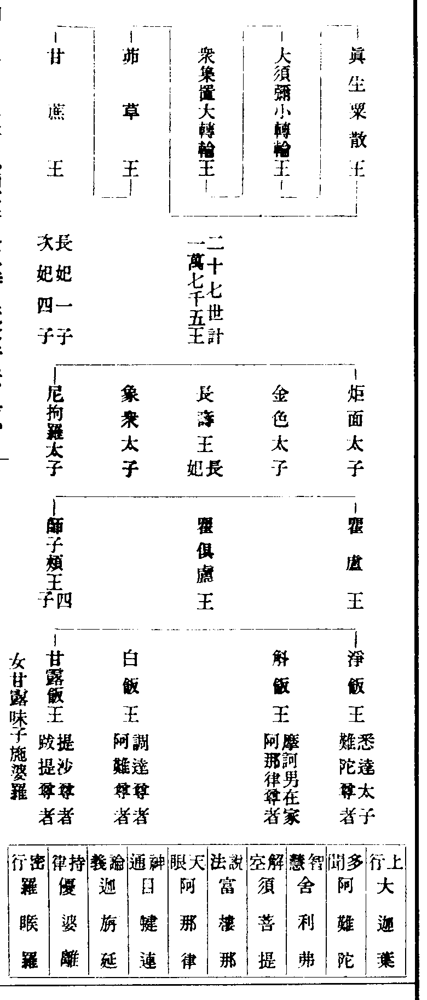
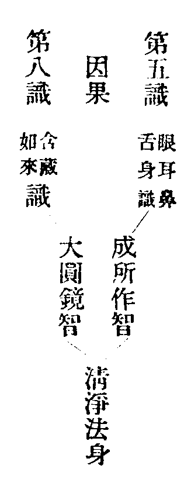

# 历朝释氏资鉴



> **藏经**：卍新纂大日本续藏经（新纂卍续藏）　**册次** 第 76 册（X76）　**编号** No. 1517-A（X1517）　**部类** 史传部　**卷次** 12 卷　**篇幅** 206,670 字

> **作者（译者）**：闽扆峰沙门　熈仲　集

> **卷／品**：12 卷 · 2 品



---



## 目录



  - [卷第一序](#卷第一序)

- [历朝释氏资鉴卷第一](#历朝释氏资鉴卷第一)

- [历朝释氏资鉴卷第二](#历朝释氏资鉴卷第二)

- [历朝释氏资鉴卷第三](#历朝释氏资鉴卷第三)

- [历朝释氏资鉴卷第四](#历朝释氏资鉴卷第四)

- [历朝释氏资鉴卷第五](#历朝释氏资鉴卷第五)

- [历朝释氏资鉴卷第六](#历朝释氏资鉴卷第六)

- [历朝释氏资鉴卷第七](#历朝释氏资鉴卷第七)

  - [宋文忠公欧阳修后序](#宋文忠公欧阳修后序)

- [历朝释氏资鉴卷第八](#历朝释氏资鉴卷第八)

- [历朝释氏资鉴卷第九](#历朝释氏资鉴卷第九)

- [历朝释氏资鉴卷第十](#历朝释氏资鉴卷第十)

- [历朝释氏资鉴卷第十一](#历朝释氏资鉴卷第十一)

- [历朝释氏资鉴卷第十二](#历朝释氏资鉴卷第十二)



---



圣人作於周之世，而先后虽殊，至於化人以大中至正之道，则无异矣。时之变迁，法之献替，　扆峰和尚心栖禅那，神游史籍，摘其实，疏其迹，以资观览，如鉴目前。兴叹慕之志者，有所激励焉。



至元后丙子佛成道日承事郎福州路福宁州判官薛天祐安道拜题



No. 1517-B



切闻沧海浩大，非骊龙无以察其浅深；佛法幽微，非智人无以究其源本。然三才笔立之初，世号鸿荒，人方穴居野处，不辨尊卑，而斯民之耳目犹涂於见闻也。自庖牺昼八卦而文籍始生，神农作耒耜而畊稼始立，黄帝造律本而乐音始著，尧舜垂衣裳而礼制始明，凡数圣人所以开天地之经，立生人之纪，使后之作者有所持循，而百王纲理世变之道由此而出也。至于姬周之世，合三十七君，其间三教圣人先后出兴，曰佛、曰老子、曰夫子，见於史传则昭然耳。自第四君昭王二十四年甲寅四月八日，佛之示现西竺迦维罗卫国降诞，王宫以刹利瞿昙为姓，以悉达太子为名，成道以释迦为氏，号曰牟尼，此译寂默，言三业离於諠杂，金躯一丈六尺，具三十二相、八十种好而号为佛。佛者觉义，谓其弘法自觉觉他，住世七十九年。逮第二十一君定王三年丁巳，越三百四十有五年，而老子方生於楚苦县厉乡曲仁里，姓李，名耳，字伯阳，谥聃。或云身长四尺六寸，厖眉皓首，故谓之老子。子者，男子之通称也。至二十四君灵王二十一年庚戌，则老子年五十四岁。时夫子始生於鲁昌平陬邑，而先人祷於尼丘山而诞，首上圩顶，因名丘，字仲尼，姓孔氏，仪表九尺六寸。夫子者，盖丈夫之称尔。年七十三而卒，乃恭王四十一年壬戌也。老子方书说养性以保长生，周孔图书则训人而修礼乐，释迦之教能施慈悲摄於有情，作众生之福田，为爱河之舟楫。故万物之内，惟人最灵；三界之中，惟佛至尊。法演西乾，教流东震。真身舍利，代代钦崇；玉轴金文，人人讽诵。宏资国化，广利众生。聊纂斯文，厥书于后，明佛祖之垂慈，彰王臣之皈仰，结为历朝释氏资鉴录云。



释氏资鉴目次



------



### 卷第一序



周  

秦  

前汉  

后汉



卷第二三国(魏蜀吴)  

西晋  

东晋



卷第三南北朝(宋魏)



卷第四南北朝(梁)



卷第五南北朝  

南(陈后梁)  

北(齐周)  

隋



卷第六唐(上)



卷第七唐(中)



卷第八唐(下)  

五代



卷第九宋(上)



卷第十宋(中)



卷第十一宋(下)



卷第十二元  

(附)国朝帝师行实  

自跋



释氏资鉴目次(终)



No. 1517



------



## 历朝释氏资鉴卷第一



**译者**：闽扆峰沙门　熈仲　集



帝纪



三皇太昊取牺牲充庖厨，号包牺。后世音谬为伏羲，一号皇雄氏。风姓，木德，王天下，都陈一百一十年。以龙纪官，画八卦，造书契，代结绳。



炎帝神农氏，姜姓，继太昊火德王天下。都鲁立一百四十年，以火纪官，教民耕稼，甞百草。



黄帝有熊氏，公孙姓，名轩辕，继炎帝土德，王天下一百一十年。有云瑞现，以云纪官，邑涿鹿之阿。命大挠迎月，始作甲子，造历筭数，造律吕。命苍颉制字衣裳，作舟车，立栋宇，以利万民，作弧失，以威天下，迁无常处。



五帝少昊金天氏，黄帝子，名挚，继黄帝后，以金德王天下，都曲阜，在位八十四年，以鸟名官。



颛顼高阳氏，黄帝孙，姓姬，继少昊以水德王天下，都帝丘，在位七十八年，以人事名官。



帝喾高辛氏，黄帝曾孙，继颛顼后，以木德王天下，都亳，在位七十五年。



帝尧陶唐氏，帝喾子，姓伊耆，继喾后，以火德王天下，都咸阳，在位七十年。弃子丹朱，举舜传贤，以甲辰即位，从此甲子。



帝舜有虞氏，颛顼六世孙。姬受尧禅土德，王天下，都蒲坂。甲午登庸，摄政二十年。壬午即〔真〕五十年，弃子商均，传位于夏氏。



三代夏自戊戌尽己酉，凡十七主，四百三十年。  

禹姓姒，鲧子，舜授以位，以火德王天下，都韩，在位十五年，至桀汤放之，天下归商。



商自庚戌尽戊寅，凡三十主，六百二十七年。  

成汤姓子名履，契十三代孙，水德，王天下，都亳。在位十三年，放桀，诸侯推为天子。至纣，武王伐之，天下归周。



周自己卯尽乙巳，凡三十七主，八百六十七年。  

文王，姬姓，名昌。周时为西伯，三分天下有其二。至子发武王，伐商放纣，以木德王天下，在位七年，建子为正月。至第十三平王宜臼，迁都洛阳，为东周。至赧王，东、西周归于秦。



历代帝王多出於黄帝，　夏禹出於颛顼，　商汤出於契，　周出於弃，(皆帝喾之子也。)　秦祖伯益，(亦颛顼之子也。)　汉以刘氏承尧运。尧(黄帝玄孙。)　魏曹氏，曹叔振铎之后。自周、晋司马氏，出於重黎，亦颛顼之后。　宋刘氏，汉楚元王交之后，亦尧之裔。　齐、梁萧氏，出於春秋萧。萧，子姓，乃商之后。陈，舜之后。　隋杨氏，出颛顼。　唐李氏，出颛顼之子皐陶。皐陶为大理。(后嗣逃食李得生，故改为李氏。)　梁朱氏，(本春秋邾。邾，姬姓，周之后。)　周郭氏，(出周郭叔，皆帝喾之后。)　宋赵氏，(出於颛顼子伯益。其后〔所〕造父，周穆王时封於〔城〕，子孙因为姓。晋、赵皆其子孙。秦始皇时，子孙分处四方。汉有赵广，至汉者居。)　大元廼刹帝利种。



长阿含经云：贤劫初成，未有日月。是时光音天人下生，皆有身光，飞行自在，无有男女、尊卑、亲疎之别，食自然地味。因食此物，乃身光灭，神通亡，贪心始萠。后生地饼、地肤、地脂之味，食此乃诸恶凑集，男女始形。地生粇米，朝刈暮生，亦无糠糩。时人贪心增长，皆有预取厚藏，米遂不生。乃占田土，学耨种业。自此奸盗滋彰，无决断者。中有一人，容质[王*(十/(罩-卓+衣))]伟，世所钦信。众议立为民主，号摩诃三摩曷罗阇，此云大平等王。各愿输赋供亿，此租之始也。故命是刹帝利，此云田土主。初分田土，各有诤讼，使之主也。



佛本行经云：此贤劫初建立，有大转轮王众集置，亦名大众平章地，亦名刹利王。王有长子名真实，子孙相承二十七世，各有千子，计二万七千，皆转轮王。至大须弥王，子孙相继，至鱼王一十八世，子孙相绍，计一十七万三千二百八十四，皆小转轮王。鱼王有子(名真)，生粟散王，至大茆草王三十一世，计一百丹八，皆粟散王。茆草王亦名奢夷耆耶，亦名瞿昙氏，年老舍位出家，因遭猎人所射灭，乃滴血入地，遂生甘蔗二茎，一茎中化成男子，一茎中化成女子，众所奉养，遂绍王位，称甘蔗王。其王有二妃，生五子，长名长寿，次炬面等。其第四子有大仁德，以长妃侫其父，令出家。时子母眷属人民多众，随往雪山下建国，号迦毗罗王，别称成王，远迩钦伏。不久而成大国土，内外丰稔。父王知忆，叹曰：我子能仁，释迦故有。释迦氏王有子名瞿卢王，一子瞿俱卢，一子师子颊，师子颊四子甘露、白净、斛饭王等，从众集置大转轮王，历经计二万五百丹三王，方至净饭王。



准起世经云：从刹利帝，亦名大平等王，即众集王。经二千王，乃至茆草王。从茆草王，经四十一万二百三十六王，方至瞿昙氏，有子名甘蔗王。经七万二千二十二王，方至净饭王。通计一百二十万七千三百六十一王。两经所译，五印不同。世尊已於无数劫、无数世成佛，或为梵王、帝释、大转轮王、小转轮及粟散王等身。复於无数佛所出家，修菩萨行，修菩萨道。或云遇示诲幢如来，始发菩提心，超弥勒之四十餘劫。或云遇然灯佛，始蒙授记。自然灯佛至迦叶，皆佛授手，皆佛授记，云当来世成佛，号释迦牟尼佛。至护明菩萨，上生兜率，下降迦毗舍，金轮宝位，出家成道，说法治世七十九年。正法、像法至于法尽，度无量众生，法不穷尔。



大梵天王问佛决疑经云：大梵天王至灵山会上，以金色娑罗华献佛，请佛为群生说法。世尊登座，拈华示众，瞬青莲目，人天百万悉皆罔措，独金色头陀破颜微笑。世尊言：吾有正法眼藏、涅槃妙心、实相无相、微妙法门，不立文字，教外别传，分付摩诃大迦叶。拈华事，世皆不知所出，惟王荆公□□□□□直宿翰苑，偶见秘藏此经。(禅林遗训)



依付法藏传云：佛以正法付大迦叶，令其护持，不使天魔龙鬼、邪见王臣所有轻毁。既受嘱已，结集三藏，流布人天。药叉以法嘱累阿难，如是展转，乃至师子，合二十五人，并阎浮洲中六通圣者。大迦叶令在灵鹫西峰岩中坐灭尽定，五六百亿七千万岁。慈氏佛降生，传能仁佛所付大僧伽多梨衣，然后涅槃。



又按诸经律，佛令大阿罗汉宾头卢不得灭度，传於佛法三天下，福利众生令出生死。



福城开元庄严禅寺住持比丘慧，有助缘钞壹伯贯。



天竺种姓有四：　一者刹帝利，谓弃世君王种，即释迦如来之种也。　二者婆罗门，秦言外意，谓行志道，其种别有经书，世世相承，或在家出家苦行，多恃己术，自我慢人。　三者毗舍，或云伏奢，商贾之种。　四者首陀，或云达罗，田农之种也。



佛



释迦如来宗派







调御十身，　无著弘愿。业报住持，涅槃净法。真心三昧，道性如意。



十力(是处非处、知业、三昧、知根、知欲、知性、至道、宿命、天眼、无漏)。



三明(生死宿住知证)。



六通(天眼，天耳，他心，宿命，神境，如意，漏尽)。



十八不共法：　一(身业无失)、二(无卒暴音)、三(无忘失念)、四(无不定心)、五(无种种想)、六(无不知舍)、七(〔忘〕欲无退)、八(精进无退)、九(正念无退)、十(智慧无减)、十一(解脱无减)、十二(知见无减)、十三(一切身业随智慧行)、十四(一切语业随智慧行)、十五(一切意业随智慧行)、十六(知过去世无着无碍)、十七(知现在世无着无碍)、十八(知未来世无着无碍)。



转八识成四智束四智为三身



第六识　意想妙观察智圆满报身







第七识　(传送乐习)识平等性智千百亿化身



六祖禅师颂



> 大圆镜智性清净，平等性智心无病，  

> 妙观察智见非功，成所作智同圆镜。  

> 五八六七果因转，但转其名无实性。  

> 若於转处不留名，繁兴永处那伽定。



如来(无虗妄)、应供(良福田)、正徧知(知法界)、明行足(具三明)、善逝(不来还)、世间解、无上士(无二世间、国土世间、众生世间)、调御丈夫(能调伏众生身心恶)、天人师(能为众生作眼目)、佛(知善法聚、不善法聚、非善法聚、非不善法聚)、世尊(二世之中无二佛)。



十号圆明，　万行具足。　天龙戴仰，　称无上尊。



法



三藏　修多罗(阿难经〔众〕结集为经)、毗奈耶(优婆离结集为律)、阿毗昙(诸大菩萨〔衍〕而为论)。



五时(方等、华严、般若、法华、涅槃)。



鹿苑十二部经(梵语修多罗，祇夜，毗迦兰那，伽佗，尼佗罗，优佗那，伊帝目多伽，阇多伽，波佗，毗佛略，阿浮达磨，优婆提舍。唐言契经，重颂，授记，〔说〕诵，因缘，自说，本事，本性，譬喻，方广，未曾有，论义。)



仪化四教(顿，渐，秘密，不定)。



法化四教(藏，通，别，圆)。



十信(信心，志念，精进，闻慧，正定，不退，护法，回向，持戒，发愿)。



十住(发心治地修行生贵具足正心不退童真王子灌顶)。



十行(欢喜、饶益、无违逆、无掘挠、无痴乱、善现、无着、难得、善法、真实)。



十回向(护生离生相不坏，等一切佛至一切处，无尽功德入一切平等，随顺众生真如相，无着无缚人法界无量)。



十地(欢喜，离垢，发光，燄慧，难胜，现前，远行，不动，善慧，法云)。



十波罗蜜(布施、持戒、忍辱、精进、禅定、般若、方便、大愿、大力、大智)。



四无量：　大慈(广济)、大悲(㧞苦)、大喜(无畏)、大舍(无为)。



四摄法：　布施(利诱)、爱语(智㧞)、利行(克己)、同事(和光)。



四德：　常(寿如如无变身)、乐(常寂静体无为)、我(善观察无罣碍)、净(处世界如莲华)。



四谛：　苦(迷涅槃为生死)、集(迷菩提为烦恼)、灭(转生死即涅槃)、道(转烦恼即菩提)。



一音演说，　普应群机，　究竟清净，　名离欲尊。



僧



三十七道品：　四念处(观身不净、观受是苦、观心无常、观法无我)、四神足(乐、欲、精进、正心、观行如意)、四正勤(已生恶令断、未生恶令不生、未生善令生、已生善令增)、五根(信、进、念、定、慧根)、五力(信、进、念、定、慧力)、七菩提分(念、择法、精进、喜、轻安、定、舍觉支)。八圣道分：正见(不惑)、正思(无邪)、正语(无遇)、正业(无作)、正命(乞食)、正进(无妄)、正念(无二)、正定(不乱)。



三德(法身般若解说)。



三解脱(空、无相、无愿)。



四弘愿誓(度众生，断烦恼，求正法，成佛道)。



四、辨才(达法、胜我、言词、乐说、无碍)。



四三昧(常坐半行，半坐常行，非行非坐)。



四善法(亲近善友，听闻正法，思惟其义，如说修行)。



净命衣：　一(随处得衣蔽形即足)、二(拾粪扫〔枝〕或但衫衣)、三(多寒国土畜百〔劫〕具)。



净命食：　一(常自乞食)、二(僧中净食)、三(檀越送食)。



五观：　一(计功多少量彼来处)，二(忖己德行全缺应供)，三(防心离过贪等为宗)，四(正事良药为疗形枯)，五(为成道业应受此食)。



三德(清洁、柔软、如法)。



六味(咸、淡、辛、酸、甘、苦)。



粥有十利(资色，增力，益寿，安乐，办事，风除，辞清，消宿食，消饥，消渴)。



八大福田(广路义井，建造桥梁，平治险隘，孝顺父母，供养三宝，给事病人，救济贫苦，设无遮会)。



四恩：　佛师(法化教导)、国王(水土外护)、父母(养育劬劳)、信施(四事供养)。



六和(身和同住，口和无诤，意和无违，戒和同遵，见和同解，利和同均)。



三学　戒定慧(三无漏学，成就一切种智，出生八万四千清净妙门)。



三毒：　贪、嗔、痴(佛云：世之毒无过三毒，具足八万四千尘劳烦恼)。



僧预十科。　翻译，解义，习禅，明律，护法，感通，遗身，读诵，兴福。杂科。



僧具六宝：　禅定(顿悟自心，超凡入圣)、讲律(具戒定慧，有大辨才)、高上(行解双运，不入世流)、文章(见闻深实，学古验今)、王事(〔智〕恩识果，慈威并行)、常僧(精进功业，长养圣胎)。



尼遵八敬：　一(百岁尼礼初学僧足)、二(尼不得骂比丘)、三(不得举比丘过)、四(尼犯僧残求僧忏悔)、五(式叉摩那尼从僧具戒)、六(尼至半月听僧教诫)、七(尼近僧处断习修道)、八(尼安居竟依僧自恣)。



脱尘异俗，　圆顶方袍。　入圣超凡，　为众中尊。



三、有　欲界(摄四州、四恶并六欲天)、色界(摄色界十八天并四禅)、无色界(空处、识处〔无有非天〕)。



九次第定(初禅、二禅、三禅、四禅、空处、识处、无所有处、非非想处、灭尽想处)。



二十五有(四州四，恶处八，六欲并梵天七，四禅四，空处八，无想五，那舍二)。



七忏悔法(常念佛恩，生大惭愧，深畏果报，广发善心，观罪性空，厌离欲染，冤亲平等。)



六念：　念佛(慈悲导师，归依正觉)。念法(三世佛母，如教奉行)。念僧(人天福田，宜应供养)。念施(普施众生，成就福慧)。念戒(清净心身，息灭众恶)。念天(长寿安乐，自在精进)。



三聚(利益有情，摄律仪戒，摄善法戒)。



五戒(不杀，盗，淫，妄语，饮酒)。



受戒五利：　一(〔什法〕诸佛愍念守护)。二(命终之日正见欢喜)。三(常行胜处菩萨为友)。四(功德戒聚悉得成就)。五(今世后世福慧满足)。



三界



天上五衰(头上华萎，腋下汗〔气〕，身光不现，衣染尘垢，不乐本位)。



人间四相：生(夭寿不定)成、老(色力衰损)住、病(四大不调)坏、死(识随业□)空。



五蕴：　色(色空)、受(触离)、想(记忘)、行(灭生)、识(湛摇)。



十八界识(眼见色、耳闻声、鼻齅香、舌甞味、身染触、意缘法，　由内六根使中六识缘外六尘，成十八界)。



十二因缘：　无明、行、识、名色、六入、触、受、爱、取、有、生、老死。



三惑(无明、见、思、尘沙)。



三障(烦恼业报)。



十缠(无惭、无愧、嫉妬、疑悔、掉举、怨恨、悭吝、睡眠、昏沈、覆藏)。



十使(身见、边见、戒取、见取、邪见、贪、瞋、痴、慢、疑)使，三界共成八十八使。



六种邪见(断、常、自然、苦行、逐僻、曲因、不由)见(各各出生，共成九十六种外道邪见)。



外道六师：　富兰那(说不生不灭计双非一门)、末迦利(说空自然拨无因果)、删阇夜(说过八万劫道不用修)、阿耆多翅舍(说修苦行㧞发等法)、迦罗鸠陀(说两亦法□乱不定)、尼犍子(说业定执人死复人)。



五刑：　突吉罗(笞、金)。削，　提舍尼(杖、木)。割，　波逸提(徒、水)。劓，　僧残(流、火)。墨，　波罗夷(死、土)。



七情：　喜、怒、忧、惧、爱、憎、欲。



八风：　利(财喜)、衰(忧病)、毁(讪谤)、誉(钦赞)、称(扬德)、讥(刺诮)、苦(迫恼)、乐(放逸)。



八苦(生、老、病、死、爱别离、怨憎会、求不得、五阴盛)苦。



五种邪命：　一(为利养故，诈现奇特)；二(为利养故，自说功德)；三(为利养故，占相吉凶)；四(为利养故，高声现威，令人畏惧)；五(为利养故，彰己有德，感动人心)。



大三灾：　大水(世界漂没至初禅天)、大火(大地洞然至二禅天)、大风(须弥飘击至三禅天)。



小三灾(刀兵、疾疫、饥馑，惟善同劫不同爱)。



十恶：(杀生、偷盗、邪婬、妄语、恶口、两舌、绮语、贪欲、嗔恚、邪见。)○(华严经云：十恶业报，上等地狱因，中等饿鬼因，下等畜生因。诫之即十善道，下品生人天，中品二乘，上品菩萨佛乘。)



八难：　地狱趣(贪欲)、饿鬼趣(嗔恚)、畜生趣(愚痴)、北俱卢洲(顽嚚)、生在佛前(慢嫉)、生在佛后(懒怠)、聋盲瘖痖(谤法)、世智辨聪(阐提)。



四依(依粪扫衣，依残弃药，依乞食，依树下居)。



须陀洹。　斯陀含。　阿那含。　阿罗汉。



究竟。



生老病死忧悲求，不得冤憎会　八苦。



色、受、想、行、识　五蕴。



三十七品助道，四无量心。



贪嗔痴　毕竟断故。



(此四果修行，依此究竟即证果也)。



辟支佛果。十二因缘。菩萨果。六波罗蜜。摩诃萨埵。添方便。愿。力。智。四波罗蜜。



释迦文赋



唐太原王勃奉　诏撰。



原夫佛者觉也，神而化之。修六年而得道，统三界以称师。帝释梵王，尚犹皈敬；老聃宣父，宁不参随。昔如来下兜率天，生中印土。降神而大地摇动，应迹而诸天拥护。九龙吐水，满身而花落纷纷；七宝祥云，举足而莲生步步。盖以玉辇呈瑞，金轮启图。恩沾九有，行洽三无。宝殿之龙颜大悦，春围之凤德何虞。方知灌顶之灵心，兴王后嗣；必为万类之化主，作帝中枢。岂不知海量无边，天情极广。厌六宫珠翠之色，恶千妃丝竹之响。雪山深处，全抛有漏之身心；海月圆时，顿悟无为之法想。莫不魔军振动，法界奔惊。觉阎浮之日出，覩忧钵之华生。十方调御皆来，圆光自在；六趣含灵尽喜，金色分明。暨乎万法归空，双林告灭。演摩诃般若之教，示阿耨多罗之诀。普光殿里，会十地之华严；耆阇山中，授三乘之记莂。是知灵觉无尽，神理莫闻。芥子内三千之国，藕𮈔藏百万之军。目容修广於青莲，寒生定水；毫相分明於皓月，照破迷云。群机而不覩灵踪，万世而空留圣迹。嗟释迦之末法将尽，仰慈氏之何日调伏。我今回向菩提，一心归命圆寂。



正法一千年，前五百年解脱为正宗，禅定为兼修；后五百年禅定为正宗，多闻为兼修。



像法一千年，前五百年，多闻为正宗，福德为兼修；后五百年，福德为正宗，鬪诤为兼修。



末法一万年，鬪诤为正宗，懈怠为兼修，



释迦如来入涅槃，至今大元至元二年岁丙子，历计二千二百八十五载(自此之后，积年递增岁数)。



菩萨戒经云：是日已过，命亦随减，如少水鱼，斯有何乐？众等当勤精进，如救头然，但念无常，慎勿放逸。



夫述身毒国，如来托生，当此真丹姬周时也。年代浸远，人世参差，指而言之，亟迷前后。今编次甲子，纮络古今，续以帝年，纲纪时代，庶禅让覇主，若镜目前，迁革朝市，如鉴掌内。然后考诸君王泽，被抚适时，佛法化流，应机济物，释经孔教，理契冥符，可谓灵降五天，瑞通八表者也。姬昌母梦大人感，因而生昌，龙颜虎眉，身长一丈，胸有四乳，国濵西戎，政被东渐，赤雀降祉，改称周，谥曰文王，都鄷，收葬枯骸，天下归服。故夫子曰：文王之德美哉，不动而化。到其子发，武王伐纣，徙都镐京，路逢暍人，下车而扇，卑轻万乘，子爱兆民。故孙卿子云：武王生则天下歌，死则四海哭。至鲁春秋庄公七年夏四月辛卯夜，恒星不现，夜中星陨如雨。案此则如来诞生旹也。



育王传云：泥越后百六十年，阎浮提王名阿输伽，出东天竺，治华氏城。收舍利，散起八万四千宝塔，匝阎浮提。颇欲周徧天竺，传载可得。略言真丹国城，江汉左右，关陇东西，处处皆有。彼时当此周敬王世二十六年丁未岁也，凡历四处。羸昭襄王立五十二年，灭周称秦，改镐京为咸阳，仍即都之。至第四主始皇帝正二十六年，荡除六国。二十七年，废罢九州，分天下为三十六郡。三十四年，所有典籍，悉皆焚烧。惟医方药术，不在𦶟限。降此悉灰，缘是圣教灵迹。及阿育王造舍利塔，传记堙绝，靡知所承。又始皇时，有诸沙门释利房等十八贤者，賷经来化。始皇弗从，遂焚释利房等。夜有金刚神，身长丈六，来破狱出之。始皇惊怖，稽首谢焉。四主合四十九年，为楚王所诛，而汉灭之。起周武王元年己卯，讫秦二世败岁甲午，其间九百三十三年。四十二主，至周十六王，四百五十三年，佛未出前，名而不录。起自昭王如来诞世，到乎汉始，方纪历年二十六主，四百八十一载。总结为周秦世录，明佛乘应教被东土云耳。



周



文(昌)武(发)成(诵)康(训)昭(瑕)。



昭王二十三年，岁癸丑，七月十五日，摩耶夫人梦白象乘日轮入于腹中，觉而自知身重。



甲寅　二十四年四月八日，有白虹贯日之祥。是日，摩耶夫人游毗蓝园内无忧树下，右脇诞生太子。放大光明，瑞气盈空。九龙吐水，灌沐金身。即乃周行七步，目𮨇四方，指天指地，作狮子吼：天上天下，惟我独尊。昭王获覩日月重轮，色类并现，惊怪非常。乃问大臣：是何灵异，现此祥瑞？时太史苏由卜而奏曰：易得乾卦，金主之位，位在西方。飞龙在天，是君主之位。此大圣人也。王曰：於此国若何？奏曰：此圣人身不来此地。若灭后一千年，必有教法流来此国。王遂令所司，於洛阳南郊坛侧，竖一碑记，明之后代。(周书；异说；法王记)太子年十五岁，纳耶输氏多罗。○年十九，欲出家。夜有天人白太子言：出家时至。於子夜逾城，往檀特山中修行，郁头蓝弗处学非非想。越六年十二月八日夜，明星出时成佛，号天人师。三十於鹿野苑说法，度阿若憍陈如等。住世七十九年，说法四十九年。



穆王名满，在位五十三年，粲粲光明，照於平土。此时佛在西方说法度生，王不知是佛现瑞，惟言国中有难，遂令国师捡点兵马，防於西界。



壬申　穆王五十二年二月十五夜，佛入般涅槃。是时乾坤震动，有白虹十二道贯日，南北通过。王大惊怪，召问群臣：是何灾异？大史扈逸多奏曰：此国无事，乃西方圣人入灭。王大悦，宣告臣僚：西方圣人已灭，朕今无忧也。案西域记云：佛生在伽毗罗国，得道在摩竭提国，说法在波罗奈国，入灭在拘尸罗国。



定王揄元三年九月十四日，老子生於楚国陈苦县濑乡曲仁里李树下。以李为姓，名耳，字伯阳，谥聃。炖煌实录云：周桓王十九年，幸闲豫庭，与群臣对论今古。王曰：老聃父何如人也？天水大守索绥对曰：聃父姓韩，名虔，字元卑，毫之濑乡人，死於槐里。母氏精敏。聃在胎八十一年而生，厖眉皓发，为之老子。



简王夷元四年，为柱下史，后为守藏吏。○敬王王丐元年，八十五岁，与散关令尹喜西入凾关，不返。○旹佛入灭三百四十五年。(年谱)



灵王泄心二十八年庚戌(一云庚子)，孔子生於鲁之邹郡，即襄公二十二年。因先人祷於尼丘山，故名丘，字仲尼。



鲁哀公十四年，获麟绝笔。四十一年壬戌，卒，时年七十三。丘本叔梁纥氏，母颜氏子，后自称为孔子。家语：孔子去周，而老子送之曰：吾闻富贵送人以金，仁者送人以言。吾虽不能富贵，而窃仁者之号，请送子以言。凡当世之聪明深察而近於死者，好议人者也；博辨宏大而危其身者，好发人之恶者也。孔子敬奉之。



按释迦谱三教出兴颂：释迦降诞迦毗卫，周昭甲寅第四帝。穆王壬申五十二，如来七九归真际。佛灭一千二十年，教流永平汉明世。佛生四百二十二，老子方生定王世。佛生四百七十七，孔圣灵王方诞质。为报劳生穉子知，鼎分三足还归一。



周　从文王已下至赧王三十七君，前后已来计八百六十七年，三教圣人先后相继而出兴云。圣人相继出於周，大教兴隆盖有由。佛倚王臣为外护，国凭释老作焚修。宗分三派虽殊别，道本同源亦混流。鼎足坚牢难阙一，天长地久镇齐休。



郑列子仲尼第四商太宰嚭问孔子曰：丘圣者欤？曰：圣则丘何敢，然则丘博学多识者也。太宰曰：三皇圣者欤？曰：三皇善任智勇者，圣则弗知。曰：五帝圣者欤？曰：五帝善任仁义者，圣则弗知。曰：三王圣者欤？曰：三王善任因时者，圣则弗知。太宰曰：孰为圣？曰：西方有大圣人，不治而不乱，不言而自信，不化而自行，荡荡乎无能名焉。



秦



自丙午迄甲午，六主，四十九年。都(咸阳)孝文(柱元)庄襄(梵元)。



昭襄王勒元稷袭世爵，蕃屏周室，废赧王为庶人，迁周九鼎于秦，始皇帝政复姓赵，乙卯即位，始称皇帝，自谓功过三皇，德兼五帝，立三十七年，○二十六年，并吞六国，为天下一统，改正朔，以建亥为岁首，二十七年，分天下为三十六郡，同一文轨，名河为德，民曰黔首。



癸未　岁二十九年，舍卫国沙门室利房，将十八贤者，賷佛经至京。所司具奏，始皇不识佛，以为妖讹，𠡠令囚禁。释利房等，惟作梵声，念佛及摩诃般若波罗蜜经。是时光明照曜，咸阳瑞气，盘旋囹圄。有八神人，从地涌出，身长丈六，头带凤凰，兜鍪光甲，握金刚杵碎狱，杻械俱坏。守狱者惊惶倒地，利房等一时解脱。左右司具奏，帝大惊，俯谢悔过，勅精送室利房等，将经教还归竺国。



戊子　三十四年，李斯奏焚诸典籍，坑儒士。○(三十七年辛卯，驾巡海上而崩。)



二世皇帝胡亥壬辰立三年。○赵高李斯奉立王子婴杀赵高即位四十六日。○沛公至覇上王素车出降天下归汉。



汉



刘邦，字季奴，沛郡丰人。母温，息平大泽，梦与神人交感而生季奴。首龙颜，额隆准，宽仁大度，美须髯，左股体间有七十二黑子。因托暴秦，鼓其潜翼。既吞强楚，遂奋云飞。前后凡经七十二战，天下乃定。黑子之应，其瑞在兹。既远承周，因尔称汉，改咸阳曰长安而都之。自从开辟三皇、五帝、夏、殷、周、秦，迄文、景前，并以帝王标年，无别立号。至武帝世，始制年名，称建元云。元狩二年，霍去病讨匈奴，过居延山，擒休屠王，获其金人，以为大神，列置於宫，烧香祀之，此即佛像。初至三年，凿昆明池於下际，悉是灰黑。武帝以其事问东方朔，朔奏云：非臣所知，可访西域胡道人。其后张骞使大夏，还汉书，始知有身毒国。又平帝世，大夫刘向自称：余覧典籍，往往见有佛经，及删列仙传，云得藏书。缅寻太史创撰列仙图，自六代迄到于今，七百餘人。向检虗实，定得一百四十六人，其七十四人已见佛经。推此，岂非汉时经目及古旧二录，道安所载十二贤者等经例是，所餘止有七十二人为列仙传。此盖博识覩其大伦，将知周时久流释典，情识未洽，归信者稀。秦虽𦶟除，汉兴复出，故令刘向披藏书，见更列仙传云。又哀帝世元寿年中，景宪使於大月支国，受得浮图经。验向所寻，便实录矣。王莽字巨君，元城人，为汉大司马，翼辅平帝。元始五年乙丑，帝崩。莾玄，宣帝玄孙婴，号称孺子。莾为丞相，居摄三年，即真十五年，通数十八年，实止十七载。莾为景帝第七世孙刘玄字圣公所杀，称更始，改元。玄立二年，后为赤眉所杀。刘秀字文叔，高祖九世孙长沙定王后，居乎南阳之白水乡。父济阳令，生秀於县中，有赤光之瑞。是岁嘉谷一茎九穗，因名为秀。隆准日角，口大眉长，面方美髦髯，性善仁爱。起於南阳，除荡赤眉，遂定天下，是为后汉光武焉。徙都洛阳，号年建武。闻昔世语：光武起南阳，南阳无贱士。常谓此虗诞。今见经说：释迦出天竺，天竺多圣人。方验斯其实。至明帝世永平三年，忽感神梦，觉已欢悦，命使西行。因弥宅心，游志福境。甞从容暇，问弟东平：王处家居，何者最乐？东平𪻺伟，腰带十围，即奉对云：为善最乐。帝称之曰：此言甚大，足可以副王之𦝫腹。后使回还，仍诏宣译。源发自此，流注达今，法海无穷，玄河靡竭。前后两汉，通及新王，合二十六君，四百二十五载，记录帝世东西京云。(开皇三宝记)



西汉



高祖自乙未建国，至乙丑十二主，共二百一十年，都长安，火德王天下。



武帝彻，辛丑建元元年(六年)，自此始有年号。丁未改元光(六年)，癸丑改元朔(六年)。



己未。　元狩元二年。武帝故事，卫青、霍去病讨匈奴，匈奴昆邪王降，得其金人之神，置之甘泉宫，其祭惟烧香礼拜，上使从其俗祀之，即佛像也。昌黎送灵师诗注。元狩八年乙丑。改元鼎。



乙丑　改元鼎三年。凿昆明池，极深，惟见灰黑，无复土石。举朝不能解其故，以问东方朔。朔云：非臣所知。后有西域胡道人至中国，可问之。后汉明帝时，天竺国摩腾法兰入洛阳，有忆朔言者，因以问之。法兰曰：天地大劫将尽则劫烧，此灰墨乃劫烧之餘也。



己丑　成帝即位，改建始。辛丑，改鸿嘉。二年，光禄大夫刘向撰神仙传序云：历观百家之中，以相检验，得仙者一百四十六人，其七十四人见於佛经。



开皇历代三宝记云：刘向称：予覧典籍，往往见佛书，将知周时久流释典。秦虽灭除，汉兴复出，则先汉之前，逆至于周，有佛有经，其来也远。范晔胡为以谓明帝时始入中国耶？(昌黎送灵师诗注)



新室　自乙丑称摄，丁卯即真，至庚辰十五年，共十八王莾。



更始　刘圣公即位，改元，即莾地皇四年。壬午：刘秀起兵。



东汉



自乙酉至庚子十二主，共一百九十六年，都阳洛。



世祖光武秀，高祖九世孙。更始三年，改元建武。在位三十一年。



辛亥　建武二十七年。○佛入灭，此至一千年。



戊午　明帝即位，改永平三年。庚申四月八日，帝梦一金人，问诸大臣：谁能原梦？左丞相韩宪奏曰：请陛下说之。朕昨梦一金人，身长丈六，项佩圆光，胸题卍字，顶盘螺髻，额放光明。云是释迦牟尼佛，生在西域迦毗罗国。灭度已来，经今千载。云有大教，嘱朕取之。卿等谁能知委？时有通事舍人傅毅奏曰：臣见周书异记云：周昭王二十四年四月八日，恒星不现，异光徧照。太史苏由卜奏曰：有大圣人，生於西域。是佛出现一千年后，声教流通此土。昭王令於洛阳南郊坛侧[債-貝+(雋-隹)]一碑，为后代记。陛下所梦，殆佛神乎？帝闻奏大悦，遂宣国子监王导、翰林郎秦远、将军蔡愔等二十八人，賷持国信𠡠书等，远历西国，追寻圣典。到南天竺国，寻访迦叶摩腾、竺法兰二僧，将梵夹经并白㲲𦘕释迦真像，以白马驮来。永平十年丁卯十二月三十日，到洛阳奏见。帝大悦，重赏万金。𠡠腾、兰二僧於鸿胪寺安下，翻译四十二章经及释迦真像，安奉大殿。帝持念供养不阙。白马远涉，瘦劳而死。𠡠於洛阳城西埋之。仍造伽蓝一所，𠡠以白马为额。此中国造寺之始也。



法流东土，独楚王英最先好而事之。



奉黄缣白纨诣国相曰：托在蕃辅，过恶累积，欢喜大恩，奉送缣帛，以赎愆罪。国相以闻，诏报曰：楚王诵黄、老之微言，尚浮屠之仁祠，洁斋三月，与神为誓，何嫌何疑，当有悔吝！其还赎，以助伊蒲塞、桑门之盛馔斋僧，此之始也。



辛未　永平十四年。五岳道士褚善信等上表，至中书门下，为之进。帝覧表，令通事舍人宋祥引对：朕远求圣教，西方佛说，其旨微妙，图与养生，长资福利。卿等何意，唤作胡神，令朕除之，心生进退？若据朕意，佛法不除，道教不灭。限正月十五日，於白马寺前，鬪其胜劣，决定强弱。𠡠致三坛：儒书传记二百七十卷，安於中坛；道书方术三百六十卷，安于东坛；佛经并释迦像，安于西坛。帝於十五日，将百僚群臣，来赴寺前。道士先呈法术，呼风吸雨，绝役鬼神。腾兰二僧，跏趺而坐。诏通事舍人宋祥，宣问二僧。二僧进奏曰：我佛教中，以无诤三昧，此之幻术，非我所为。对帝王前，别验真伪。世上无情之物，莫过於火。愿陛下将此三教经书，混堆一处，以火验之，不灰烬为真，烬者为伪。帝闻语，下令取堆中坛，积薪上下，告天便烧。二僧祝告：世尊灭后，佛法付嘱国王大臣，及我弟子，将经远来东土，妄说异端，毁谤真乘。今日火中，别其真伪，愿垂密祐。若全不坏，法兴此土，教化众生，随𦦨成灰。此土众生，不闻佛法。言讫，火𦦨亘天，儒道二书，皆为灰烬。火中现金色莲华台，擎佛经像，俨然放光。是时帝与群臣，见此殊异，愕然可畏。叹曰：狼狐类众，凤少鸟多。二僧取经献帝，乃说偈曰：狐非师子类，灯非日月明。池无巨海浪，丘非山岳嵘。即是佛世界，善种得开萌。显我真如法，处处度众生。帝加崇敬，以释迦像及经，奉安显节陵，及清凉台供养。帝听阳城侯刘峻等出家，又听洛阳妇女阿潘等出家。𠡠腾、兰二僧，为之剃发。令所司造寺十所，七寺安僧，三寺安尼。此中国为僧为尼之始也。(事物记原)



唐太宗题白马寺诗云：门径萧萧长绿苔，一回登此一徘回，青牛谩说凾关去，白马亲从印土来。欲定是非凭烈𦦨，要分真伪筑高台，春风也解嫌狼藉，吹尽当年道教灰。(翻译名义)



汉法本传载，西域十二月三十日，是此方正月望，谓之大神变月。汉明帝令烧灯，表佛法大明也。



丙子　章帝即位，改元建初。甲申，改元和元年。有神雀、凤凰、白鹿、白乌之瑞。徐州刺史王景上金人颂，美光帝致佛之功。(汉书)



丁亥　桓帝即位，改建和。癸巳，改永兴元年。铸金浮屠及老子像，禁中供养，覆以百宝华盖，帝事之尽敬。



戊戌　改延熹九年。裴楷上书曰：今宫中立浮图、黄、老之祠，此道好生恶杀，省欲去奢。今陛下嗜欲不去，杀伐过理，既乖其道，岂获其祚哉？夫浮屠不三宿桑下，不欲久生恩爱，精之至也。天神遗以好女，浮屠曰：此但革囊盛血。遂不盻之。其守一如此，乃能成道。今陛下婬女艶妇，极天下之丽，甘肥饮美，殚天下之味，奈何欲如佛、老乎？书上，奏问状。尚书承旨，奏揩诬上罔事，正揩罪。(以上汉书及通鉴)



戊申　灵帝即位，改元建宁三年。沙门安世高至京，译经九十五部，首出决义一卷，次比丘诸禁律。



辛亥　四年，安世高至庐山，有䢼亭庙甚灵，会三十餘船，奉特请福。神輙降语曰：舟中有沙门，可与请来。客请高至，神复降语曰：吾昔与子俱出家学道，吾好施而多嗔，今为庿神，而寿尽旦夕，后恐堕於地狱。吾有缣千段，并杂室物，可为立法营塔，使生善处。高使出形，神现大蠎，悲泪如雨。高収缣物，辞别而去，至(〔豫章为建大安寺塔，乃江淮寺塔之始也〕)自镜录。俄而神即命过，报云：得生善处。后有人於山西泽中见死蠎，头尾数里，今浔阳县大蠎村是也。



明帝初，闻西域有神，其名为佛，因遣使之天竺求其道，得其书及沙门以来。其书大抵以虗无为宗，贵慈悲不杀。为其人死，精神不灭，随复受形。生时所行善恶，皆有报应，故所贵修炼精神，以至成佛。善为宏阔胜大之言，以劝诱世俗。精於其道者，号曰沙门。自永平以来，中国始传其法，图其像，而至王公贵人皆遵奉之。臣民虽有习其法者，而天子未之好。至桓帝始笃好之，常躬祷祠，由是其法浸盛。故裴楷上书，遂有诬上之罪，何慊夫哉。灵帝建宁问，安世高至出决义律，比丘始有禁制。而䢼亭神知其命将终，堕於恶趣，降语请高奉缣宝虽物，托以营塔解愆，得生善处，佛法何其验耶。



释氏事物纪原



立坛受戒之始



大戒法，本自曹魏黄初三年壬寅已到许昌，以国家多故，寝三十餘年。至废帝，即高贵卿公也，登位改元。正元岁甲戌，天竺律师昙摩迦罗上书，方兴受戒之事。○逆推至佛法初，到后汉永平十年丁卯，经一百七十八年，凡出家者，唯受三归戒。○西天祇园比丘楼至请佛立坛，为比丘受戒。如来於园外院东南置一坛，此为始也。此土宋元嘉七年庚午，天竺僧求那䟦摩(梁云功德铠)至杨州南林寺前竹园中立坛，称方等坛，受戒之始也。　僧史略云：盖以戒坛本出小乘教中，应僧人戒法，一一如律。若片善乖违，则受不得戒，临坛人犯罪，今方等法是也。　按大乘教，即不拘根缺缘差，但发大心𩝗纳，即得戒也。可谓广大平等周遍矣，故称方等。大乘或名甘露者，甘露即喻涅槃也。戒为人涅槃之初门，故从果彰名也。　戒坛图经云：夫欲受戒者，先於有智人所䇿发教，於万境之上起慈护心。故毗婆沙论云：由普於一切有情上起善意乐，无损害心，得戒。若临集僧，当行法事。但云发上品心，得上品戒者，沙弥素未曾闻，不知何者是上品心。此犹空雷发奇峰之天，甘雨绝布金之地尔。上品心者，即是万境上起慈护心也。○优婆塞戒经云：戒果有二：一、天乐，二、菩提乐。智者求菩提乐，不求天乐。　正法念处经云：若持戒念天乐者，斯人污净，或如杂毒水。以天乐无常，寿尽必退，当受大苦。是故当求涅槃乐。　瑜伽论云：一、厌有为心，二、求趣菩提心，三、慈慜有情心。　四分律本偈云：明人能护戒，能得三种乐。名誉及利养，死得生天上。



赐紫师号



僧史略云：唐则天朝，僧法朗等九人，重译大云经毕，并赐号紫衣银龟袋。　大平兴国初，许四方僧入殿庭，乞此试三学，下开封府，差僧证经律论义，十条全通，乃赐紫衣师号，为手表僧，以其面手进表也。寻因功德司奏，今天下一家，不须手表求选，𠡠依。自此每遇皇帝诞晨，亲王、宰辅、节度，下至刺史，得上表荐所知僧紫衣，唯两街僧银所荐得入内。是日，门人牒给紫衣四事，谓之帘前赐紫，此最荣观也。然此衣以国恩故得著，极不容易，皆形相分满方受得。○按东观奏记云：大中年间，大安国寺僧修会，能诗应制，才思清拔。一日，问帝乞赐紫衣，宣宗曰：朕不汝恡，但观汝相有缺，未赐也。及赐著，归寺而卒。近亦屡有此类，可谓人天路上，以福为先矣。　德宗召法师端甫入禁中，与儒道论议，赐紫方袍，令待太子於东朝。顺宗重之若兄弟，宪宗待之如宾友，掌内殿法仪，录两街僧事。文宗开成中，立为左右街僧录，自此始也。　昭宗乾宁中，改首座为副僧录，即觉晖为始也。



圣节建立道场



僧录赞宁僧史略曰：魏太武始光二年，立道场为祝寿。神嘉？四年，郏州悉立，盖生日也。云生日暂建道场法会耳。始光中，是帝自崇福之始也。神䴥中，是臣下奉祀之始也。今代所行，皆是唐代宗时始诵仁王经，盖自元载、王缙始倡之。五代会要：周广明二年，𠡠臣僚遇圣节抵于寺院，起置道场。迄今为故事也。



------



## 历朝释氏资鉴卷第二



**译者**：闽扆峰沙门　熈仲　集



始自三皇，天唯一主；终乎两汉，地无二臣。爰洎魏晋，逮于大隋，其间京邑，将若猬毛。鵄蹲鶴立之都，二十有二国。其吴、三秦、凉、魏、齐、陈等，此八国虽曰各保名器，并皆宣译佛经，能使三宝住持，是则四生蒙赖。所以务善者流庆，故致世录相沿焉。而纪目无闻，乘时覇王者十有四国，既不阐扬圣教，於事莫知祖修。今各依彼诗书，粗略标其年世，庶知强弱，始末发兴。○魏文帝。曹丕，操之子。黄初元年庚子，受汉禅，都洛阳。○蜀先主。刘备辛丑，都益。二主，四十三年，还入魏。○吴孙权壬寅，都建康。四主，五十九年，归晋。魏五主，四十五年，而受禅于。○晋武帝。咸宁五年己亥，宇宙之内，文轨复同。二十三年，到。○晋惠帝。永宁元年辛酉，州土幅岸，𥪰建国都。大安元年壬戌，张轨起凉州，是为前凉七主。六十二年，入前秦。符坚永兴元年甲子，刘渊起平阳，是为前赵四主。二十六年，入后赵。石勒同。永兴元年，李雄起蜀，是为后蜀四主。四十四年，为晋穆所灭。○东晋元帝。大兴三年庚辰，石勒起襄国，后徙都邺，是为后赵四主。通染闵三十五年，入前燕。○东晋穆帝。永和十一年乙卯，慕容皝创黄龙，后徙都邺，是为前燕二主。九年，入前秦。晋孝武。太元十一年丙戌，慕容垂起於中山，还袭燕号，是为后燕，徙都黄龙，五主二十六年入北燕冯䟦。至十二年丁亥，吕光起凉，是为后凉，四主一十六年入后秦姚兴。○晋安帝。隆安元年丁酉，秃发乌孤起於西平，是曰南凉，三主一十八年入西秦乞伏叱槃。至二年戊戌，慕容德起广固，是曰南燕，二主一十三年为晋所灭。至四年庚子，李果起於炖煌，是为西凉，三主二十二年入北魏太武。至六年庚戌，冯跋起灭后燕，都於昌黎，是为北燕，二主二十八年亦入北魏太武。至宋文帝元嘉十六年己卯，是北魏大延五年，太武西征，遂灭北凉，自是诸国相吞略尽，唯北魏存至。○齐明帝。隆昌元年甲戌，是北魏太和十一年，孝文南迁，都于洛邑。○梁武帝。大通六年甲寅，是南魏永熈三年，武帝元修西迁长安，依周太祖宇文黑秦。齐太祖高观别立清河王子元善见为王，北都乎邺，缘是后分为东西魏。梁孝元帝绎承圣四年乙亥，都在江陵，为西魏灭，自是南朔历数北旋，其年即魏之后二年。萧衍孙詧，魏赐立绍梁基，是曰后梁，既为附庸，是影国，周受魏禅，因而跱之，仍都江陵，五主三十三年逊于隋。



隋之驭世扬坚，弘农华阴人。父忠，事周文帝为太傅，封隋国公。坚袭封，事武帝，至静帝为相国，封王，寻受禅，都长安。以周宣椒房之戚，久秉重权，秉性严重，绰有威容，而能推赤心以待旧臣，各展其用，故取江南三百年之国，易於反掌，使天下为一统。开皇、仁寿间，王道清奏车书契来，化被有功，民无德称。岂期炀帝负其富强之资，思逞无厌之欲，俄而群盗猬毛而起，遂有江都之变。唐李渊兵克长安，遂立恭帝，虽欲不禅，庸可得乎？



隋有国，传三主，凡三十九年。自魏庚子至隋戊寅，四十七主纪，历三百九十八年，七代五都世录云耳。



三国



魏(高祖文帝)　曹丕，操之子，受汉禅，都洛阳，庚子即位(改元黄初，五主，四十五年)。



蜀　先主刘备，中山靖王之后，都益(成都)，辛丑即位(改元章武，二主四十三年)。



吴　孙权，武之子，先武昌，后建邺，壬寅即位。(改元黄武，四主，五十九年。)



丁未，　列祖明帝大和元年，代京阉官自愧刑餘，奏乞入山修道，𠡠许之。乃賷华严经，昼夜读诵，礼忏不息。一夏未满六月，髦𩯭生，得丈夫相。以状闻奏，帝覧大惊，重之。於是尊敬华严，深信佛法。(感通录)



戊申　吴黄武五年，陈思王曹植，字子建，精通书艺，不好黄老，唯读佛经，必留连嗟玩，以为至道之宗。甞著辨道论以见意。(弘明集)



辛酉　赤乌四年，康居国沙门僧会初至金陵，营立茅茨，设像行道。国人初见沙门，惊异之。有司以闻，吴主召至问之。会广陈如来之化因迁迹，已逾千载，灵骨舍利，神应无方。阿育王起塔八万四千，此寺塔之兴表化也。权曰：若得舍利，当为造塔。如其无验，国有常刑。会请期七日，乃谓其徒曰：大法废兴，在此一举。当加意恳求，共结净室。以铜缾加几烧香，至期无验。展伸三七日，至五皷，忽闻缾中鎗然有声，视之，果获舍利，五色错发。黎明进之，王臣大悦，惊曰：希有之瑞也。会又曰：舍利威神，无能坏者。吴主使力士槌之，砧槌共碎，而光明自若。於是建塔佛佗里，又立寺，赐额建初。寺即保宁，识其始及此方也。塔即天禧，是晋帝渡江更修，饰以金碧。此中国建塔之由也。(翻译名义)



阚泽仕吴，官太子(太傅)。吴主问泽曰：佛何年入(中国)？何缘未及此方？泽曰：永平年，佛法初至，计今赤乌四年，七百餘载矣。永平十四年，道士褚善信等，乞与西僧角法，善信负妄而死。凡中国既不出家，无人流布，加之罹乱，故岁深方至本国。吴主曰：孔老之教，与佛比对若何？泽曰：孔老二教，法天制用，不敢违天。佛之说教，天法奉行，不敢违佛。以此言之，优劣可见矣。(宗炳明佛论)甲戌，　吴五凤元年，支谦至。是译经八十八部，博覧经籍，时号智囊。吴主高其才，拜为博士，固辞。辅导东宫，甚有裨益。(释教录)



乙亥　天竺三藏昙无德(此云法藏)賷四分律至洛，安息沙门昙谛至，亦善律学，同出戒经一卷。○西域昙摩迦罗(此云法时)嘉平初到许洛，见魏境比丘特剪发而未有律仪，遂与昙谛译四分羯磨及僧祇戒心图。嘉平请昙无德等立羯磨戒法，用十僧代行佛事，即中国大僧受戒之始也。



乙酉　吴甘露元年，孙皓遍毁神祠，波及梵宇。遣使诘僧会，会挫其辞。皓乃召会，问佛之善恶报应。会曰：明主以仁德治天下，则赤乌翔，嘉禾茁。善既有应，恶亦如之。易称积善餘庆，诗美求福不回。皓曰：周、孔既明，何用佛教？会曰：周、孔不欲深言，略亦其迹。佛不止浅言，故示其要，皆为善也。圣人唯恐善之不多，陛下以为嫌，何也？皓无以酬之，遂罢。○异日，宿卫治园，得一金像。皓使[(訊-言)/且]溷所，以为笑乐。俄得肿病，阴处尤痛。卜曰：坐犯大神。皓祷诸庙，不効。宫人有事佛者，乃曰：不请福于佛忏悔耶？皓云：佛神若是怪乎？曰：佛之威灵，诸天卫护。皓方悟曰：吾以慢像致此耳。乃迎像，以香汤沐之，内庭供事。仍请会说法忏悔。会为开示玄要，乃受五戒。少须，疾愈。由是奉会为师，崇饰塔寺。(法苑珠林)三国鼎立四十四年，独吴主仅六十载。时会法师渡江，吴主召问。会广陈如来化迹。遂祷，舍利现于铜瓶。吴主见而惊悦，曰：希奇之事，朕深敬焉。乃为建塔、造寺、度僧。由是佛法盛於江南矣。



西晋



司马炎，文帝昭之子，受魏禅。自丙戌尽丁丑，四主，共五十三年，都洛阳。



世祖武帝乙酉十二月即位，改元泰始。帝龙颜奇伟，盛明革运，大崇佛事，广造伽蓝。方志。



二年，竺摩罗柰(此云法护)，炖煌人，初游西域，大賷梵经，远归东夏，是年至长安。释经教流此土者，法护深有殊功，乃为此土沙门求经之始也。



庚戌　惠帝改元永熈，明年改元康。○六年，天竺耆域初来交广，并有灵异。东游至洛阳，见楼殿曰：忉利天宫，髣髴似此匠。此宫者，从忉利天来，成便还。天上有千五百作具，应在屋脊瓦下。本是天匠，以道力成之，而以生死力作，不亦勤苦乎？后至大安元年壬戌，耆域知洛阳将乱，辞归。有僧乞一言为诚，域令会众集定，乃升座曰：守口摄身意，慎莫犯众恶。修行一切善，如是得度世。言讫即默。於是数百人各请中食，域皆许往。明日，五百家皆有一域，及相酬问，方知分身赴焉。既别，是夕贾客会于流沙。大安二年，沙门李孝龙有机辨，讲放光般若，人皆崇仰。阮瞻、庾凯尤敬之。有嘲其胡服者，龙曰：以道观之，诚不见有容服之异。彼谓我辱，我弃彼荣，则无心之贵愈(〔贵，无心之安愈安矣〕)。晋僧史



愍帝建兴间，李恒者，本寒门之子。遇一僧曰：君福将至，然祸后来。守贫不任者，殃减休至。若带金紫，极於三郡即止者，善矣。恒曰：且富贵，何预后患？乃晋僧宿，夜视满一床。恒惊呼家人看之，又化为鸟，𥩳梁上。天明，复形而去。恒送出，忽不见。因此信佛，亦不用其言。为西畅、江夏、庐江三郡大守。大兴中，钱凤之乱，被诛。(感应录)



甲戌　建兴二年，日陨于地。后有三日，西出而东行。○佛图澄，竺国人，帛氏子。少学道，妙通玄术。永嘉四年，至洛阳，自云百有餘岁。常服气自养，能积日不食。善诵神呪，能役鬼神。腹傍有孔，用絮塞之。夜则拔絮，孔中出光，照于一室。常至流侧，从孔中引出五藏六腑洗之，还内腹中。以油杂臙脂涂掌中，千里外事皆见于掌，如对面焉。或听铃音，知其凶吉，事无不验。欲创梵宇，值刘曜宼斥帝京，志遂不果。乃潜泽草野，以观世变。是年，石勒屯兵葛陂，专事杀戮。澄欲化之。勒有将军郭黑略，素佛法，澄即见之。乃请五戒，崇弟子礼。略随勒战，澄皆预记胜负。勒以略有异见，问之。曰：有师也。勒曰：天赐也。乃召见。勒曰：佛法何灵？澄知勒不达深理，乃请烧香，以钵盛水呪之。须臾，生青莲花，光色曜目。勒由此神敬之。○(四年丙子十二月，刘曜陷长安，帝出降，曜据中原。)



东晋



司马睿，宣帝曾孙。自丁丑至己未十一主，共一百三十三年，都建康。



丁丑，　元帝即位，改元建武。造龙兴、瓦官二寺，集千僧会。(晋书)



丙戌　成帝即位，改元咸和。○二年，苏峻作乱，帝奔石头，宫城悉为煨烬，独大宁殿有明帝手畫佛像于壁，屹然不坏，当时嗟美，以为神异。



戊子　三年。前赵光初十一年。相国刘曜引兵即位于赤壁。○后赵石勒欲往高堠攻曜，犹豫未决，因访佛图澄，澄曰：相轮铃音云：秀支替戾冈，仆谷劬秃当。此羯语也。秀支，军也。替戾冈，出也。仆谷，刘曜胡位也。言军出捉得曜也。澄谓勒曰：大将军若出，必摛刘曜。勒大悦，乃留子石弘共澄以镇襄国，自率军骑直诣洛城，有谏者斩。至灵昌津，两阵才交，曜军大溃，马没水中，石堪生摛之送勒。时澄以油脂涂掌，举示童子，童子曰：马军中一人白晢，以朱丝缚肘。因以告弘，此即刘曜也。时斩首五万餘级，抛尸于金谷园。晋书云：为后赵所灭。



庚寅　咸和五年。勒乃僭称赵天王，行皇帝事，改元建平。勒登位已后，事澄弥笃，举事必咨而后行，号大和尚。澄因而谏曰：夫王德化洽於宇内，则四灵表瑞，政弊道消，彗孛呈妖，常蒙著见，休咎随行，斯乃古今之常徵，天人之明诫。勒甚悦之，凡应被诛餘残，蒙益者十有八九，於是中外皆奉佛焉。○勒后因忿欲害诸沙门，澄乃避至黑略舍，语弟子曰：若将军信至，问吾。报云：不知所之。人至，覔澄不得，使还报勒，勒曰：吾有恶意向圣人，圣人舍我去矣。通夜不寐，思欲见澄。澄知勒意悔，明旦造勒曰：昨夜何行？澄曰：公有怒心，昨故避之。公今改意，是以敢来。勒大笑。



襄国城堑水源在城西五里，忽暴竭，勒请澄致水，澄至源上，久已龟拆，澄烧香呪之，三日水已微流，有小龙随出，有倾水大至，隍堑皆满。鲜卑段波攻勒，其众甚盛，惧问澄，澄曰：昨寺塔铃鸣云：明旦食时，当摛段波。澄城望波军不见，前后失色，军行地倾，波岂可获？更遣忧安问澄，澄曰：已获波矣。城北伏兵出，遇波执之，澄劝勒宥波，遣还本国，从之，卒获其用。○中山王刘岳将兵攻勒，勒遣虎卒步兵拒之，大战洛西，岳保石梁坞，虎竖栅守之，澄与弟子自官寺至中寺，入门叹曰：刘岳可悯。法祚问其故，澄曰：昨夜亥时，岳已被执。果如其言。(以上僧史及晋书)



石葱将叛，其年，澄戒勒曰：今年葱中有虫，食之必害人，可令百姓无食葱也。班告境内，慎无食葱。到八月，石葱果走，勒益尊重也。



石虎有子名斌，勒爱之，忽暴亡，已涉二日，勒曰：朕闻虢太子死，扁鹊能生。大和尚，国中之神人，可急往告，必能致福。澄取杨枝呪之，须臾能起，有顷平复。由是勒诸子多在佛寺养之。每至四月八日，勒躬诣寺，为儿发愿。至建平四年四月，天静无风，而塔一铃独鸣，澄谓众曰：铃音云国有大丧，不出今年矣。是岁七月，勒死，子弘袭位。少时，虎废弘为海阳王，自立，迁都于邺，称元建武，倾心事澄，有重于勒。迺下书曰：和尚，国之大宝，荣爵不加，高禄不受。荣禄非轻，何以旌德？从此已往，宜衣以绫锦，乘以雕辇。朝会之日，和尚升殿，常侍以下悉助举舆，太子诸公扶翼而上。主者唱大和尚，众皆起，以彰其德。又𠡠司空李农：旦夕亲问，太子诸公五日一朝，表朕敬焉。於是国人共语：莫起恶心，和尚知汝。澄之所在，无敢向其方面涕唾便利者矣。



石䆳荒酒，将图为逆，谓内竖曰：和尚神通，倘发吾谋，明日来者，当先除之。澄月望将入觐，虎谓僧慧曰：昨夜天神呼我曰：明日若入，还勿过人。我倘有所过，汝当止我。澄常入必过䆳，䆳知澄入，要候甚苦。澄上南台，僧慧引衣，澄曰：事不得止。坐未安便起，䆳固留不住，所谋遂差。还寺叹曰：太子作乱，其形将成，欲言难言，欲忍难忍。乃因事从容箴虎，虎终不解。俄而事发，方悟澄言。○晋军出淮泗，[阿-可+尨]北瓦城皆被侵逼，三方告急，人情危扰。虎乃瞑曰：吾之奉佛供僧，而更到外宼，佛无神矣。澄明旦入，虎以事问澄，澄因谏曰：王过去世为大商主，治罽宾寺，甞供大会，中有六十罗汉。吾此微身，亦预斯会。时得道人谓吾曰：主人命尽，当更鸡身。后王晋地，今王为王，岂非福耶？壃场军宼，国之常耳，何为怨谤三宝，夜兴妄念乎？虎迺信悟，跪而谢焉。



虎问澄：佛法不杀。朕为天下之主，非杀无以肃清海内。况违戒杀生，讵获福耶？澄曰：帝王事佛，常在体恭心顺，以显三宝。不为暴虐，不害无辜。至於凶愚无赖，非化所迁。有罪不得不杀，不得不刑。但当杀可杀，刑可刑耳。若暴虐杀害非罪，虽复倾财事法，无解殃祸。愿陛下兴慈，广及一切。则佛教永隆，福祚方远。虎虽不能尽从，而为益不少。(以前并本传)



时久旱，自正月至六月，虎遣太子诣临漳西釜口祈雨，久而不降，请澄自行，即有白龙二头降於祠所。是日大雨，方数千里，其年丰稔。戎貊之徒，先不识法，闻澄神验，皆遥敬礼，不言而化焉。虎於临漳修治旧塔，少承露盘，澄曰：临淄城内有古阿育王塔，地中有承露盘及佛像，可掘取之。依言果得。



澄与虎坐中堂，虎每欲伐燕，澄曰：燕国运未终，卒难可尅。屡行败绩，方信澄诫。○时民多奉佛，皆造营寺塔，真伪混修，多生𠎝过。虎下书问中书曰：佛号世尊，国家所奉，里闾小人无爵秩者，为应得事佛不？又沙门皆应高洁精进，然后可为。今沙门甚众，或有奸仇避役，多非其人，可料简详议真伪。中书著作郎王度奏曰：夫王者郊祀天地，祭奉百神，载在祀典，祀有甞飨。佛出西域，外国之神，功不施民，非天子诸华所应事奉。往汉明帝感梦，初传其道，唯听西域人得立寺都邑，以奉其神，汉人皆不得出家。魏承汉制，亦修前轨。今大赵受命，率以旧章，华戎制异，人神流别，外不同内，飨祭殊礼，荒夏服祀，不宜杂错。国家可断赵人悉不听诸寺烧香礼拜，以尊典祀。其百辟卿士，下逮众隶，例皆禁之，有犯者与淫祀同罪。其赵人为沙门者，还从四民之服。伪中书令主波同度所奏。○虎下书曰：度议云：佛是外国之神，非天子诸华所可宜奉。朕生自边壤，忝当期运，君临诸夏，至於飨祀，应兼从本俗。佛是戎神，正所应奉。夫制由上行，永世作则，苟事冗无戏，何拘前代？其夷赵百蛮，有舍於淫祀，乐事佛者，悉听为之。於是慢戒之徒，因之以厉。



魏县有一人，莫识氏族，恒著麻襦，在市乞丐，人呼为麻襦。语言卓越，得米谷，散置大路，云饴天马。赵兴太守籍拔收送诣虎。先是澄谓虎曰：国东二百里，某月日送一非常人至，勿杀之。如期果至。虎共语，了无异言，唯道陛下当一柱殿下。虎不解，令送诣澄，谓昔在光和中会，奄至今日云云。讲语终日，人莫能解。如论数百年事，遣驿送还本县，其行步若飞也。(普晋书及本传)



建武　十二年，太史奏有仙人星现，当有高士入境。十一月，秦州刺史表送单道开至，初止城西法林祠，后徙临漳胎德寺，虎资给甚厚。佛图澄云：此道人观国兴衰，若去，当有大灾。至石虎大宁元年，开与弟子南渡许昌，虎子姪自乱矣。道开，炖煌人，少入道，绝粒饵松栢，后吞小石数枚，不畏寒暑，后入罗浮山，百餘岁卒。澄有弟子道进，学通内外，为虎所重，言及隐士事，虎谓进曰：有扬轲者，朕之民也，徵之十餘年，不恭王命，故省视傲然而卧。朕虽不德，君临万邦，乘舆所问，天沸地涌，虽不能令木石屈膝，何匹夫而长慠耶。昔太公之齐，先诛华王，太公贤哲，岂其谬乎。进退曰：昔舜优蒲衣，禹造伯成，魏饰干木，汉□周党，管宁不应曹氏，皇甫不屈晋世，二圣四君，共加其节，将欲激励贪竞，以峻清风。愿陛下遵舜禹之德，勿敩太公之刑，君举必书，岂可令赵史无隐遁之传乎。虎悦其言，即遣轲还其所止，差十家供给之。进还白澄，澄笑曰：汝言善也，但轲命有所悬矣。后秦州兵乱，弟子以牛负轲西奔，军擒害之。○澄与虎升中堂，忽曰：变变，幽州火灾。取酒洒之，久而笑曰：救已得矣。



建武　十四年七月，石宣、石韬将图相害。宣时到寺，与澄同坐。浮图一铃独鸣，澄谓宣曰：解铃音乎？铃云胡子洛度。宣变色曰：是何言欤？澄谬曰：老胡为道，不能山居无言，重茵美服，岂非洛度乎？



石韬后至，澄熟视良久，韬惧而问，澄曰：怪公血臰，故相视耳。至八月，澄使弟子十人斋于别室，澄暂入东合，虎与后杜氏问讯澄，澄曰：脇下有贼，不出十日，自佛图以西，此殿以东，当有血流，慎勿东行。杜后曰：和尚耄耶，何处有贼？澄易语云：六情所受，皆悉是贼。老自应耄，但使少者不惛。遂便寓言，不复彰的。后二日，宣果遣人害韬於佛寺中，欲因虎临丧，仍行大逆。虎以澄先诫获免。及宣事发被收，澄谏帝曰：既是陛下之子，何为重祸耶？陛下若含怒加慈者，尚有六十餘岁，如必诛之，宣当为彗星下扫邺宫也。虎不从，以鉄鎻穿宣颔，牵上薪，积而焚之。收其官属三万餘人，皆辕裂肢解，投之漳河。○澄乃𠡠弟子罢别室斋。后月餘日，有一妖马，髦尾皆烧状，入中阳门，出显阳门，东首东宫，皆不得入，走向东北，俄尔不见。澄闻而叹曰：灾其及矣。至十一月，虎大飨群臣於大武前殿，澄吟曰：殿乎，棘子成林，将坏人衣。虎令发殿石下视之，有棘生焉。○澄还寺，怅恨不得庄严，独语曰：得三年乎？自答：不得，不得。又曰：得二年、一年、百日、一月乎。亦云。不得。仍无复言。还房。谓弟子法祚曰。戊申岁祸乱渐萌。己酉石氏当灭。吾及其未乱。先从化矣。即遣人与虎辞曰。物理必迁。身命非保。贫道炎幻之躯。化期已及。既荷恩殊重。故以仰闻。虎怆然曰。不闻和尚有疾。乃忽告终。即自出宫寺而慰喻焉。澄谓虎曰。出生入死。道之常也。修短分定。非所能延。夫道重行全。德贵无怠。苟业操无戏。虽亡若存。违而获延。非其所愿。今意尽者。以国家心存佛理。奉法无悋。兴起寺庿。崇显庄丽。称期德也。宜亨休祉。而布政猛烈。淫刑酷滥。显违圣典。幽背法诫。不自惩革。终无福祐。若降心易虑。惠此下民。则国祚延长。道俗庆赖。毕命就尽。后无遗恨。虎悲恸。知其必逝。即为营坟於邺西紫陌。至十二月八日。卒於叶宫寺。士庶哀号。赴国送而窆焉。春秋一百一十七矣。即戊申。晋穆帝永和四年也。○后有沙门。从雍州来。称见澄西入关。季龙开圹。唯见一石而无尸。季龙恶之，曰：石者，朕也。葬我而去，吾将死矣。因而遇疾，俄而梁犊作乱。明年，季龙死，养孙冉闵篡戮大乱。闵小字棘，澄先谓棘子成林是也。○后慕容俊都邺，处石虎宫中，每梦见虎囓其臂，意谓石虎为祟，乃覔虎尸於东明馆，得之，尸僵不毁。俊蹹骂曰：死胡敢怖生天子，汝作宫殿成，为儿所图，况复我耶。投之漳河，尸倚柱不移。秦将王猛收塟之，麻襦一柱，殿之谶也。后符坚征邺，俊子𬀩为坚大将郭神虎所执，实先梦虎之验也。○田融赵记云：澄未亡，自营冢。澄既知冢必开，尸不在中，何容预作，恐融之戮矣。○支遁道林在京师，闻佛图与诸石游，乃曰：澄公其以季龙为海鸥鸟也。○澄身长八尺，风姿详雅，讲解深妙，神验非一。自说生缘去邺九万里，弃家入道一万九年，过中不食，非戒不履，无求无欲，受业常有数百，前后门徒几且一百，所历州郡，兴立佛寺八百九十三所，弘法之盛，莫与先矣。加复慈洽苍生，拯捄危苦，当二石凶强，害害非道，若不与澄同日，孰可言哉。但百姓蒙益，日用而不知耳。○后赵石氏有国六主，共三十三年。



己丑　晋成帝咸和四年七月，丹阳尹高悝获金像于张侯桥浦中。次年三月，临海人张系於海获金铜莲花趺，以安高悝像之足，俨然符合。是夕有光属天，梵奏冷然，再夕而止。晋宋齐梁陈隋唐七朝(〔入内放光瑞现〕统纪)。



庚子　咸康六年，成帝幼冲。中书庾冰辅政，奏沙门尽敬王者。为帝出诏，令沙门致敬。尚书令何充等议奏。充等言：世祖、武帝盛明革命，肃祖、明帝聦圣玄览，岂于时沙门不易屈膝？愿以不变其修善之法，以通天下之志也。愚谓宜遵先帝於义，为天下礼官。愽士等议，承冰旨为駮。充等为此奏。○初诏。夫万方殊俗，神道难辨，有自来矣。达观傍通，诚当无惧(云云)。况此等类，皆晋民也。论其材智，又常人也。而当因所说之难辨，假服饰以凌度，抗殊俗之傲礼，直形骸於万乘，又是吾所弗取也。诸君并国器也，语言则当测幽微，论治则当重国典。苟其不然，吾将何述焉？(尚书令再奏)充等诚虽暗蔽，不通远旨。自汉魏逮晋，不闻异议。尊卑宪章，无或𫏐亏。今沙门慎戒专然，一令其拜，遂坏其法令。修善之俗，必致愁惧。臣心窃所未安。每见烧香祝愿，必先国家。欲福祐之降，情无极已。奉上崇顺，出於自然。何敢以形骸而慢礼敬哉？礼仪之简，盖是专一守法。是以先圣御世，因而弗革也。天网恢恢，踈而不失。臣等屡以为不令致拜，於法无亏。因其所利而惠之，使贤莫敢不用情。则上有天覆地载之施，下有修善守一之人。谨陈患浅，愿蒙省察。○于时庾冰议𥨊，竟不施行。(弘明集)



丙午　穆帝永和二年，尚书令何充，字次道，卢江人。好释典，崇修佛寺，供给沙门以百众，麋费巨万而不靳。时阮裕戏之曰：卿志大宇宙，勇迈终古。充问其故，𥙿曰：我图数千户郡尚未得，卿图作佛，不亦大乎？世世子孙阐明佛法。后赠司空。(晋书)



六年，符坚据长安。是年二月，有金像见于荆州，司马桓温迎之不动。时江陵膝畯舍宅为寺，命昙翼主之。翼率众往迎，飘然轻举，归安奉，灵异非一。



释支遁，字道林。壮岁出家，业精般若。时名贤王羲之、谢安、殷浩、郄超、何充、许询等为方外友。入京讲法，朝野悦服。时郄超书与亲旧曰：遁公神理所通，玄拔独悟。数百年来，绍兴大法，真不绝一人而已。大和元年，表辞还山。有诏资给敦遣，公卿祖饯。收迹剡山，於沃州立寺。晚移石城山，立栖光寺。木食间饮，浪志无生。后出山阴，讲维摩经。许询为都讲，难义数反，听者钦服。(杜诗云：空忝许询辈，难训支遁词。亦有旨哉！)



壬申　孝武帝康宁元年。桓温，字元子，加侍中、大司马、都督中外诸军事、假黄钺。雄武，专窥觎希望之意。末年，事佛甚勤。时有尼自远方来，造之，温敬而不倦。每浴别室，必移晷。温讶而窃窥之，尼倮身以刀自破腹，次断两足。浴竟，出，温问凶吉。尼知温窥之，答曰：公若作天子，亦当如我。时温方谋问鼎，闻此怅然，乃止。尼遂辞去，莫测所之。温后不加九锡而薨。(普书及感通录)释道安，卫氏子，常山扶柳人。早失覆荫，外兄孔氏所养。七岁读书，再覧能诵，乡邻嗟异。十二出家，形貌甚陋。师乃役之田舍三年，勤劳无怨色。后启师求经，朝授暮还，以经更求餘经。师执经覆之，大惊，异而敬之，为授具戒，恣其游学。至邺，遇佛图澄，见而嗟叹，与语终日。众见形貌，不称轻恠。澄曰：此人远识，非尔俦也。因事澄为师。安讲次，疑难锋起，安挫锐解纷，行有餘力。时人语曰：漆道人，惊四隣。久历讲肆，飞辨注射，毋敢仰视者。时武邑大守卢歆闻其风，使沙门要之开讲，道俗欣慕，徒众万数，常宣法化。彭城王嗣立，遣使请入华园，广修供养。后与弟子慧远等四百餘人渡河。征西将军桓朗子镇江陵，要往朱序西镇，复请还襄阳。苻坚送金像绣佛，幢幡珠佩，布置讲筵，见者莫不肃焉。○习凿齿。襄阳奇逸人诣安，既坐，称言四海习凿齿。安曰：弥天释道安。时人以为名答。凿齿与谢安书曰：来此见释道安，故是远胜非常。师徒数百，齐讲不倦，无变化伎术可以惑常人之耳，自无重威大势可以整郡小之参差，而师徒肃肃，自相尊敬，洋洋济济，乃是吾由来所未见。其人理坏简衷，多所愽涉，内外群书，略皆遍覧，阴阳筭数，亦皆能通，佛经妙理，故所游刃。作义乃似法简、法道，恨足下不同日而见，其亦每言思得一叙。○苻坚谓仆射权翼曰：朕以十万之师取襄阳，唯得一人半。翼曰：谁耶？坚曰：安公一人，凿齿半人也。勅学士内外有疑，皆师於安。○初，魏晋沙门依师为姓，安以尊释迦，乃以释命氏。后增一阿含经果称四河入海，无复河名。四姓为沙门，皆称释种。遂为定式。○秦王苻坚以晋太元七年欲取江东，寝不能日。待臣切谏，终不能回。众以安为坚信敬，乃请曰：主上将有事於东南，公何能不为苍生致一言耶？会坚出东苑，命安升辇同载。仆射权翼谏曰：臣闻天子法驾，侍中陪乘。道安毁形，宁可参厕？坚勃然曰：安公道德可尊，朕以天下不易舆辇之荣，未称其德。即𠡠仆射扶安上辇。𮨇谓安曰：朕将与公南游吴越，整六师而巡狩，涉会稽以观沧海，不亦乐乎？安对曰：陛下应天御世，有八州之富，居中土而制四海，宜栖神与尧舜比隆。今欲以百万之师，求厥田下下之土。且东南地卑气厉，昔舜禹游而不返，秦王适而不归，何足上劳大驾也？坚曰：天生烝民，树之以君，使司牧之。朕岂惮劳，使彼一方独不被泽乎？必如公言，是古帝王皆无征伐也。安曰：若銮驾必动，可先幸洛阳，枕威蓄锐，传檄江南，将总六师於后。彼必稽首入臣，不必亲涉也。不听。(通鉴)



晋孝武帝承风钦德，遣使通问。诏曰：安法师气识伦通，风韵标朗，居道训俗，徽绩兼著。岂直规济当今，方可淘津来世。俸给一同王公，物出所在。○秦建元二十一年正月二十七日，有异僧寄宿讲堂，维那夜见之，从窻隙出入白安，请问来生之处。彼以手机天之西北，即见云开，备都兜率妙胜之报。众皆同见。其年二月八日，告众曰：吾当去矣。斋毕而逝。当晋大元十年乙酉岁也。(公左臂有肉，中狩可上下，时谓之手印菩萨。　本传)



辛未　简文帝咸安元年，彗星现，诏竺法旷禳之。奏：陛下当勤修德政，以塞天谴，贫道固当尽情。上乃日与弟子斋忏，须臾灾灭。○许询，字元度，澡心学佛，公卿仰慕。帝高其风，亦召对留宿，不觉前席曰：元度清言妙理，固未易也。次年七月，帝崩。(本传)



癸酉　晋孝武帝即位，改宁康。　秦建元十二年。



高僧涉公，蜀人，豫言事多验。不食五谷，日行五百里，能呪龙降雨。是年至长安，秦每遇旱，召师祈雨。师诵呪，致龙于钵。坚命与群臣观之，乃遣升空而雨。王臣士庶悉敬，秦自是无炎旱之忧。岁庚辰十二月，无疾而化。后七日，坚以其异，开棺视之，唯被存焉。明年大旱，坚曰：涉公若在，岂使朕焦心於云汉也哉？○清水。赵正，字文业，十八岁为秦著作郎，至黄门、武威太守。坚末年宠惑鲜卑，惰於治政。正因歌谏曰：昔闻孟津河，千里作一曲。此水本自清，是谁搅令浊？坚动容曰：是朕也。又歌曰：北园有一枣，布叶垂重荫。外虽饶棘刺，内实有赤心。坚笑曰：将非赵文叶耶？其调笑机捷，皆类此也。后因关中佛法之难，乃愿出家。坚惜其材，未许。坚死后，方遂其志，更名道整。颂曰：佛生何以晚？泥洹一何早？归命释迦文，今来投大道。后遁啇浴山，专精经律。○昙摩难提(此云法喜，兜佉勤人)，远涉流沙，怀宝东入。苻坚礼接，传四含、大部等经，由文业之力也。晋雍州刺史郗恢钦其风尚，逼同游然於洛阳。春秋六十餘矣(前秦六主，共四十四年。　僧传及北史)。



丙戌　晋孝武太元十一年。　后秦姚苌建初元年。　北魏道武帝登国元年。



鸠摩罗什，此云童寿，天竺人，家世国相。父鸠摩罗炎，辞相位出家，东度葱岭。龟兹王闻其弃荣出郊，请为国师。王有妹，年始二十，才悟明敏，体有赤黡，法生智子。诸国聘之，并不行。及见炎，心欲当之，乃逼以妻焉。既而怀什在胎，其母慧解倍常。及什生后，母乐出家，夫未许。后产一男，名弗沙提婆。后出游观，见枯骨纵横，誓不食，除发方食。受戒业禅，学得初果。什年七岁，俱出家，从师受经，其义自通。九岁随母至罽宾，外道论师相难，什乘隙挫之，愧服。王益敬奉之，上供所住寺，差大僧五人、沙弥十人给侍。至二十，母擕还龟兹。又往月氏北山，有罗汉见，异之，谓其母曰：此沙弥年三十五不破戒，大兴佛法，度无数人，与优婆毱多无异。○龟兹王造金师子座，铺以大秦锦褥，升而说法。西域诸国咸服神俊，每至讲说，王皆长跪座侧，令什践而登焉。○时苻坚僭号关中，有外国前部王及龟兹王弟来朝，坚引见。二王说坚云：西域多产珍奇，请兵定以求内附。至坚建元十三年岁丁丑正月，太史奏云：有星现外国分野，当有大德智人入辅中国。坚曰：朕闻西域有鸠摩罗什，襄阳有沙门道安，将非此耶？至十八年九月，坚遣骁骑将军吕光、江陵将军姜飞等率兵七万，西伐诸国。临发，坚饯光於建章宫，谓光曰：夫帝王应天而治，以子爱苍生为本，岂贪其地而伐之，正以怀道之人故也。朕闻西国有鸠摩罗什，深解法相，善闲阴阳，为后学之宗，朕甚思之。贤哲者，国之大宝。若剋龟兹，则驰驿送什。○光军未到，什谓龟兹王纯白曰：国运衰矣，当有勍敌。日下人从东方来，宜恭承之，勿抗其锋。纯不从而战，光遂破其国，立纯弟震为主。光既获什，见其尚少，强妻以龟兹女。什距不受，乃饮以醇酒，同闭密室。什被逼，遂戏其节。光还中路，置军山下。什曰：不可在此，必见狼狈，宜徙军陇上。光不纳。至夜大雨，水深数丈，死者数千，光始异之。什□□：凶亡之地，不宜淹留，东归必有福地可居。光从之。至凉，闻苻坚为姚苌所害，光三军缟素，大临城南。於是窃号，称年大安。○中书监张资，文翰温雅，光甚器之。资病，有外国罗叉云：能疗资病。光喜，给赐甚厚。什告资：叉不能为，可以事试也。乃以五色丝作绳结之，烧为灰末，投水中。灰若成绳，病不可愈。须臾浮出成绳，少顷资亡。光又卒，子绍袭位。数日，纂杀绍自立，称元咸宁二年。有猪生子，一身三头。龙出林厢井中，到殿前蟠卧，比旦失之。纂以瑞为号，大殿为龙翔。俄有黑龙升於当阳九宫门，又改为宠兴门。什奏曰：皆潜龙出游，豕妖表异。龙者阴类，出入有时。今属见则为灾眚，必有下人谋上之变。宜剋己修德，以答天诫。纂不纳，后皆如言。○什公停凉积年，吕光父子既不弘法，故蕰其深解，无所宣化。苻坚深向，竟不得见，惜乎已矣。(普书及本传)后秦姚苌僭有关中，挹其风，虗心要请。诸吕以什智谋多解，恐为姚谋，不许东入。及苌卒，子兴袭位，后遣敦请。秦弘始三年三月，有树连理，枝生于庙庭。逍遥园葱变为茝，以为美瑞，谓智人应入。至五月，兴遣陇西公硕德西代，吕隆表降，迎什入关。十二月二十至长安，兴待以国师之礼，言谈忘勌。自大法东被，经论渐多，而支、竺所出，滞文格义。兴少崇三宝，锐志讲集，请入西明及逍遥园，译出众经。○兴使沙门僧䂮、僧迁、法钦、道流、道恒、道标、僧睿、僧肇等八百餘人，𧫎受什旨，更令出大品。什持梵本，兴执旧经，以相雠校，义皆圆通。众心惬伏，莫不欣赞。兴以佛道冲邃，其行为善，信为出苦之良津，御世之洪则，乃著通三世论，以勗示因果。王公以下，并赞厥风。请於长安大寺讲说新经，续出诸品、禅要、戒本、律、论，凡三百餘卷。并畅显神源，发挥幽致，声震四方，义士必集。盛业久大，于今式仰。龙光释道生，慧解入微，玄搆文外，每恐言舛，入关请决。庐山慧远，学贯群经，疑义莫诀，乃封以咨什。慧叡才识高明，常随什传写，亦为叡论西方辞体，商略同异。天竺国俗重文，制其宫商体韵，以入弦为善。凡觐国王，必有赞德。见佛之仪，以歌叹为贵。经中偈颂，皆其式也。但改梵为秦，失其藻蔚。什雅好大乘，志存敷广，常叹曰：吾若著笔作大乘阿毗昙，非迦旃延子比也。今在秦地，深识者寡，折翮於此，将何所论？唯为姚兴著实相论二卷，并维摩经，兴奉之若神。常讲经於草堂寺，兴及朝臣大德沙门千有餘人，肃容观瞻。什忽下高座曰：有二小儿登吾肩，乃欲障也。兴谓什曰：大师聦明超悟，天下无二，何可使种少嗣？乃召宫女十人，逼令受之，一交而生二男焉。尔后不住僧房，别立廨舍，供给丰盈。每至讲说，常先自说：譬如臭泥中生莲花，但采莲花，勿取泥也。诸僧多欲効之，什乃聚针盈钵，谓之曰：若能见効食此者，乃可畜室耳。因举匕进针，与常食不别，诸僧愧服乃止。○什作颂赠法和云：心山育明德，流薰万由延。哀鸾孤桐上，清音彻九天。○什少觉四大不愈，乃口出三番神呪，令外国弟子诵之，转觉危殆，与众告别曰：因法相遇，殊未尽其初心，方复后世恻怆，尚期可言。自以暗昧，谬充传译，凡所出经论，愿宣流后世，咸共弘通。今於众前发诚实誓，若所传无谬者，当使焚身之后，舌根不坏。以伪秦弘始十一年八月二十日，坐脱于长安。是岁己酉，晋安帝义熈五年也。即於逍遥园，依外国茶毗，唯舌根无损。法师一名鸠摩罗耆婆，外国制名，多以父母为本，母字耆婆，故兼取焉。○法师其为人，神情鉴澈，慠岸出群，应机领会，鲜有其伦。笃性仁厚，泛爱为心，虗己善诱，终日无倦。所历诸国，尊崇尽礼，翻译文藻，声播华夷，龟鉴万古，一人而已。(北史本传)



佛陀耶舍至姑臧，乃少在西域，与什同学。闻在秦弘法，传什受秦宫女，叹曰：什如好锦，其可使人棘棘乎？什闻耶舍来劝，秦主仰之。既至，别创精舍处之，供设如王者。耶舍一无所受，时至，分卫一食而已。善毗婆沙论而髭赤，时号赤髭毗婆沙。○卑摩罗叉(此云无垢眼)至秦，盛阐毗尼，於关左讲什所译戒本律藏，大弘叉之力也。其所制内禁轻重十一卷，行於世。眼青，时号青眼律师。(僧传)



宣律师问韦陀天曰：罗什法师一化所翻之经，至今若斯，受持转盛，何耶？天云：其人聦明，善解大乘。以下诸人，皆后必一代之宝也。绝后空前，仰之所不及。故其所译，以悟达为先，得佛遗寄之意也。又问：俗中常论，以沦陷戒检为言。天云：此不须相评，非悠悠者所议。罗什法师，令位阶三贤之所通化。然其译经，删补繁阙，随而作故。大论一部，十分略九。自餘经论，例此可知。自出经后，至诚读诵，无有替废。冥符感降，历代弥新。以此诠量，深会圣旨。又文殊旨授，令其删定，特异恒伦。岂以别室见讥，顿忘玄教，殊不足沙言耳。(三宝感通录)



秦弘始十一年，主上自什入阙，崇信三宝，盛弘大化。建会设斋，舍俗者十室其半。远近僧尼，会集既多，或有愆漏。兴曰：凡夫学僧，未阶苦忍，安得无过？过而不拯，过遂多矣。宜立僧主，以清大望。因下书曰：今大法东迁，於今为盛。僧尼既多，应须纲领，宣授远规，以济颓绪。僧䂮法师，学优早年，德芳暮齿，可为国内僧主。僧迁法师，禅慧兼修，即为悦众。法叙、慧斌，共掌僧录，给车舆吏力。䂮资侍中，秩传诏年。车迁等各人并厚给。供事纯俭，允惬时宜。五众肃清，六时无怠。僧正之兴，䂮之始也。(北史及本传)



秦主以恒、标二法师神气俊朗，有经国之量，乃勅尚书令姚显，令敦遣道恒、道标罢道，助振王业。又下书曰：卿等皎然之操，实在可嘉。但若临四海，治急须才，令𠡠尚书令显，令夺卿等法服，助异赞时世。苟心存道味，宁系黑白！望体此坏，不以守节为辞也。恒、标等答曰：秦去月二十八日，诏令夺恒、标等法服，承命悲怀，五情失守。恒等才质暗短，染法未深，缁服之下，誓毕身命，并习佛法，不闲世事，徒废非常之业，终无殊异之功。昔光武尚能纵严陵之心，魏文容管宁之操，折至尊之高心，遂匹夫之微志。况陛下以道御物，兼弘三宝，愿覧元元之情，垂旷通物之理也。又致书於什、䂮二法师曰：别以数旬，每有倾想，渐暖，比体泰耳。小虏远举，更无处分，正有愦然耳。顷万事之殷，须才以理之。近诏恒、标二人，令释罗汉之服，寻大士之纵。然道无不在，愿法师等助以喻之。什、䂮等答曰：盖闻太上以道养民，而物自是其须，有德而治天下。是以古之明主，审违性之难御，悟任物之多因。故尧放许由於箕山，陵让放杖於魏国，高祖纵四皓於终南，叔度辞蒲轮於汉岳，盖以适贤之性为得贤也。今恒、标等德非圆达，分在守节，少习玄化，伏膺佛道。至於敷折妙典，研究幽微，足以启悟童穉，助化功德。愿陛下放既往之恩，纵其后志也。阖境捄之，殆而得免。恒乃叹曰：古人有言：益我货者损我神，生我名者杀我身。於是窜影岩壑。晋义熈十三年卒，春秋七十二。恒，蓝田人。九岁戏於路，张忠见之曰：此儿在俗，必有辅政之功，处道光显佛法。(僧传及北史)



秦姚兴既托意佛乘，公卿以下莫不钦附，沙门自远而至者五千餘人，起浮屠於永贵里，立般若台于宫中，禅讲者常有千数，州郡事佛者十室而九矣(三主至弘共三十三年)。



晋孝武帝精心奉法，志念冥符，师子国王钦其怀道，遣沙门昙摩最送玉像，高四尺二寸，以表丹情。



宁康中，檀溪寺建浮图，铸铜像。像起自行，烛天倾□□□□□□□山谷。(感通录)



大元十四年，帝崇尚浮图，穷夺极费，所亲䁥者皆姏娒(上甘下茂)。僧尼左右近习争权弄柄，交通请托，贿赂公行，官赏滥杂，刑狱谬乱。尚书令陆纳望宫阙叹曰：好家居，纤儿欲撞壤之耶！○左卫领营将军许荣上疏曰：臣闻佛者，远方玄虗之神，以五戒为教，绝酒不婬。而今奉者，我慢阿尼，酒色是躭。又曰：僧尼成群，依傍法服。五戒麤法尚不能遵，况精妙乎！而凡流之徒竞争敬事之，又侵渔百姓，取财为惠，亦未合布施之道也。疏奏不省。(晋书及通鉴)



释慧远，贾氏，雁门楼烦人。十三随舅令狐氏游学许、洛，愽综六经，尤善庄、老。二十一，闻沙门道安立寺於太行恒山，往见尽敬，以为真我师也。安讲般若，听而开悟，乃叹曰：儒道九流，皆糠粃耳。便与弟慧持收簪落发，受业入道。常欲总摄纲维，以大法为己任。安公常叹曰：使法流东国，其在远乎！后师南游。伪秦建元九年，秦将苻坚平，宼斥襄阳，安为朱序所拘。远与弟子数十人南逗，欲往罗浮。届浔阳，见庐山青秀，足以息心，遂结茆居焉。而去水尚远，远乃以锡扣地曰：此中可栖，使朽壤抽泉。言毕，清流涌出，后成溪矣。浔阳亢旱，远诣池侧诵龙王经，忽有巨蛇升空，须臾大雨，合境皆悦，因号为龙寺。时慧永居西林，与远同门。远同止，徒属既多，刺史桓伊於山东创立精舍，经论之际，信宿风雷夜作，黎明则有良材罗积。桓伊覩其事，骇其神异，奏立寺，以东林为额。晋大元十一年，寺成，洞尽山美。别置禅林，清泉森树，凡瞻礼者，皆神清而气肃焉。殷仲堪谒远，共临北㵎诵易体，移景不勌。叹曰：识信深明，实难为度。司徒王谥书曰：年始四十，而衰同耳顺。师答云：古人不爱尺璧而重寸阴，檀越既履顺而游性，乘佛理以御心，因此而推，复何羡於遐龄？抑想斯理，久已得之。卢循初据江州，入山访远。远少与循父嘏同为书生，因朝夕音介。僧有谏曰：循为国宼，与之交厚，得不疑乎？远曰：我佛法中情无取舍，岂不为识者所察？此不足惧。及宋武追讨卢循，设帐桑尾。左右曰：远公素王庐山，与循交厚。宋武曰：远公世表之人，必无彼此。乃遣使賷书致敬，并遗钱米。於是远近服其明见。○桓玄征殷仲堪，军经庐山，要远出虎溪。远称疾，玄自入山。左右谓玄曰：普仲堪礼远，愿将军勿敬之。答云：何有此理？仲堪本死人耳。及见远，不觉致敬。玄问远：不敢毁伤，何以剪削？远云：立身行道。玄称善。玄后以震生之威，致书劝令登仕。远辞坚，志逾丹石。玄欲沙汰僧尼，教僚属曰：沙门有能伸述经诰，畅说义理，或禁行修整，足以宜寄大化。其有违此者，悉皆罢遣。唯庐山道德所居，不在𢯱搜简之例。远与玄书云：佛教陵迟，秽杂日久。每一寻至理，慨愤盈怀。常恐运出非意，沦湑将及。窃见清澄诸道人教，实应本心。夫泾以谓分，则清浊殊势；枉以直止，则不仁自远。此命既行，必二理斯得。然后令饰伪者绝假通之路，怀真者无负俗之嫌。道世交兴，三宝复隆矣。因广玄条制，玄从之。(僧传及北史)



昔成帝幼冲，庾冰辅政，令沙门致敬。何充奏不应敬，下礼官，承冰旨为駮同异，竟莫能定。及玄镇姑熟，欲令尽敬，与远书曰：沙门不敬王者，况是所情未了，於理又是所未喻。一代大事，不可令其体不𠃔。近八座书，今以呈君，君可述所不敬意也。此便当行之事，一二令详尽，想必有以释其所疑耳。远答书曰：夫沙门者何耶？谓能发朦俗之幽昏，启化表之玄路。方将以兼忘之道，与天下同往，使希高者挹其遗风，嗽流者味其餘津。若然，虽大业就，观其超步之迹，所悟固已弘矣。又袈裟非朝宗之服，钵盂非廊庙之器，沙门尘外之人，不应致敬王者。玄虽苟执先志，耻即外从，而覩远辞旨，趦趄未决。及玄篡位，即下书曰：佛法宏大，所不能测，推奉主之情，故兴其敬。今事既在己，宜体谦光，诸沙门勿复致礼也。远乃著沙门不敬王者论五篇：一曰在家奉法，二曰出家，三曰求宗不顺，四曰体极不兼应，五曰形尽神不灭。其序云：昔咸康中，庾将军疑诸沙门抗礼万乘。至元兴中，桓大尉亦同此议。于时朝士名贤，答者甚众。虽言未悟时，并互有其美。徒咸尽所坏，而理蕴于情。遂令无上道服，毁於尘俗；亮致之心，屈乎人事。悲夫！斯乃交丧之所由，千载之否运。深惧大法之将沦，感前事之所忘，故著五篇，究叙其意。岂渊壑之待晨露，盖是伸其罔极，亦庶后之君子崇教，或详而覧焉。(五篇文多不录。)



桓玄西奔，晋安帝自江陵旋于京师，辅国何无忌劝远候迎，远称疾。帝遣使劳问，远修书曰：释慧远：阳月和暖，御膳顺宜。贫道先婴重疾，年衰益甚，猥蒙慈诏，曲垂光慰，感惧之深，实百千坏。幸遇庆会，而形不自运，此情此慨，良无以喻。诏答：阳中感怀，知所患未佳，甚情耿。去月发江陵，在道多诸恶，情迟兼常。本冀经遇相见，法师既养素山林，又所患未痊，邈无复因，增上叹恨。(本传及晋史)



秦王姚兴。钦其德风。叹其才思。致书信饷。令姚嵩献以珠像。及龟兹国细缕杂变像。以伸[款-士+止]心。○晋名贤一十八人。从师受道。师谓刘程之、宗炳、雷次宗等曰。诸君弃世遗荣。倘有心净土之游。当於无量寿佛。建斋立誓。同心发愿。期生净土。众令刘遗民著文曰。维岁在摄提。秋七月二十八日。法师慧远。贞感幽奥。霜怀特发。乃延命同志。息心贞信之士。百有二十三人。集于庐山之阴。般若台精舍。阿弥陀像前。率以香华。敬荐而誓焉。惟斯一会之众。○夫缘化之理既明。则三世之传显矣。迁感之数既符。则善恶之报必矣。推交臂之潜沦。悟无常之期切。审三报之相催。知崄处之难㧞。此其同志诸人。所以夕惕霄勤。仰思悠济者也。盖神者可以感涉。而不可以迹求。必感之有物。则幽路咫尺。苟求之无主。则渺茫河津。今幸以不谋。而佥心西境。叩篇则信。亮情天发。乃机象通於寝梦。欣欢百於子来。於是云图表晖。影牟神造。功由理诣。事非人运。兹实天启其诚。冥运来萃者矣。可不剋心重情。叠思以凝其虑哉。然其景绩参差。功德不一。虽晨祈之同。夕归彼隔。即我师友之眷，良可非矣。是以慨焉，胥命整襟法堂，等施一心，亭怀幽极，誓兹同人，俱游绝域。其有惊出绝伦，首登神界，则无独善云峤，忘兼全於幽谷。先进之与后升，勉思彚征之道。然复妙观天仪，启心贞照，识以悟新，形由化革。籍芙蓉於中流，荫琼柯以永言。飘云衣於八极，泛香风以穷年。体忘安而弥穆，以超乐以自怡。临三涂而缅谢，傲天宫而长辞。诏众灵以继轨，指大息以为期。究斯也，岂不弘哉。○谢灵运恃其才高，肮脏傲物，见师肃然心伏，求入社。师以心杂止之。今东西二池，乃谢公所凿。红白莲花，以白莲名社也。○陶潜居柴桑，与庐山相近，谓许饮即来入社。师许之入山，久之攒眉而去。师每送客，以虎溪为戒。一日渊明陆修静入山，相送与语，不觉过溪，相𮨇大笑。迨今人𦘕为庐山三笑图云。远有弟子慧要，解经律，尤长巧思。时群贤毕萃，山中无漏刻，乃於泉水中立十二叶芙蓉，因流波转，以定十二时，晷影无差。故发愿文有籍芙蓉於中流云。○又作木鸢，飞数百步。○师以晋义熈十二年八月六日集众付属，告别长往，春秋八十三，道俗展七日。浔阳阮保於山之西建塔，谢灵运为碑文，铭其遗德。南阳宗炳仍立碑于寺门。(高僧传)



师容仪端整，风鉴朗拔，性度弘伟，德行冰霜。宿儒英达，王公大人，莫不望风屈膝，仰其深致。卜居庐岳三十年，影不出山，迹不入俗。善属文章，辞气清雅，席上吐谈，义精简要。所著论、序、铭、赞、诗、书十卷，五十餘篇，见重於世焉。



安帝元兴十三年，赫连勃勃据夏称大夏，宼长安，掠二秦之地，行五刑之虗。言佛者，已是人中之佛，堪受僧礼。乃𦘕佛像被於背上，令沙门礼像，即为拜我。后为天雷震死，葬后复震，出尸题曰：无道之字。寻为北代所吞，可为天下笑焉。○勃勃尊高己德，昧乎圣人之道，自言：勃者，佛也。吾为人中之佛，堪受僧礼。胡为陈圣像於座后，令沙门朝集致拜？凌惧之心，畏爱兼抱。乙丑之岁，天雷震死，葬后复震，出尸题曰：无道之君。寻为北代所吞，可为天下笑。书云：天作孽，犹可为；自作孽，不可罚。诚有旨哉！(北史)



释昙霍，步行如风，言人生死贵贱甚验。持一锡杖，令人跪曰：此是般若眼，奉之可得道。或藏其杖，乃大哭数声，闭目须臾，起而取之，神异莫侧。(景书)



丙申　魏太祖皇始元年，下诏曰：佛法之兴，其来远矣。济益之功，冥及在没。神踪遗法，信可依凭。敕有司於京城送饰容范，修整寺舍，令信向之徒，有所依止。○诏徵赵郡沙门法果为僧统。(魏书)



释道生，姓魏，鉅鹿人。值竺法汰改，依俗而受业。游长安，从什公译经。晋恭思皇后褚氏造青园寺，请主之。夏月雷震青园佛殿，龙升于天，光影西壁，因改号为龙光。时人叹曰：龙既已去，生必行矣。俄而投迹庐山。初游吴之虎丘山，列石为徒，讲涅槃经。至阐提品有佛性处，曰：如我所说，义契佛心否？於是顽石为之点头。旬日之中，学徒数百。(先说阿阐提人皆得成佛，众未之信。后涅槃大本至京，果称阐提悉有佛性，与前说符契矣。)宋太祖文帝深加敬重。设会之日，帝亲同众御筵下食。众疑日晚，帝曰：始可中耳。生曰：白日丽天，天言始中，何得非中？取筯便食。一众从之，莫不叹服枢机得衷。宋元嘉十一年十一月，於庐山讲席将毕，麈尾忽坠。端坐正容，隐几如入禅定。道俗嗟骇焉。(本传)



释道融，汲郡林虑人，十二出家。五年，闻什公在关，故往咨禀。什见之，谓姚兴曰：昨融公复是奇人，聪明释于。兴引见叹重，𠡠入逍遥园，参正详译。什命融讲新法华自听，乃叹曰：佛法之兴，融其人也。我而师子国婆罗门，聪辨多学，为彼国外道之宗。闻什在关大行佛法，谓其徒曰：宁□使释氏之风独传震旦，而吾等正化不洽东国。遂乘驼负书，来入长安。姚兴见其口眼便僻，颇亦惑之。婆罗门乃启兴曰：至道无方，各遵其事。今请与秦僧捔其辨力，随有优者，即传其化。兴即许焉。众僧相视，莫敢当者。什谓融曰：此外道殊人，捔言必胜。使无上大道，在吾徒而屈，良可悲矣。若使外道得志，则法轮摧轴，岂可然乎？如吾所覩，在君一人。融自𮨇才力不减，而外道经书未尽披读。乃密令人写外道所读经目，一披即诵。后剋日轮义，兴与公卿皆会僧众，四远毕集。融与婆罗门拟相酬抗，锋辨飞玄，彼所不及。外道自知辞理已屈，以广读为夸。融乃到其读书，并秦地经史卷部，三倍多之。什因嘲之：君不闻大秦广学，那忽轻尔远来？婆罗门心愧悔伏，顶礼融足，旬日而去。像运再兴，融之力也。门徒千餘人，寿七十四。诸经义疏行於世(僧传)。



释僧叡，魏郡长乐人。十八投僧贤为弟子，后依什公。精练五门，善入六静。伪司徒公姚嵩深相礼贵。兴问嵩：叡公何如？答：实邺卫之松栢。召见之，观其才器，风韵洼隆，量含彬蔚。兴大赏悦，即𠡠给俸，䘏吏力人舆。兴后谓嵩曰：乃四海之标领，何独邺卫之松栢？於是美声遐布，近远归德，并参正翻译，辞辨天纵。后跏趺合掌，向西而逝，春秋六十。(同前)



释僧肇，京兆人。少出家，学善方等，并通三藏。什公至姑臧，自远从之。什入逍遥，乃参详什公神迁，乃著涅槃无名论。论成，表上姚兴曰：肇闻天得一清以，地得一以宁，君王得一以治天下。伏惟陛下叡哲钦明，道与神会，妙契寰中，理无不统。故能游刃万机，弘通终日，威被苍生，垂文作范。所以域中有四大，王居一焉。涅槃之道，盖是三乘之□所，方等之渊府。渺茫希夷，绝视听之域；幽致虗玄，非情之所测。肇以人微，猥蒙国恩，得闲居学肆，在什公门下十有餘年。虽众经殊趣，胜致非然，涅槃一义，常以听习为先。但肇才识暗短，屡蒙诲谕，犹怀漠漠，为竭愚不已。亦如似有解，然未经高胜先唱，不敢自决。不幸什公去世，諮参无所，以为永恨。而陛下圣德不孤，独与什公神契，目击道存，快其方寸。故能振彼玄风，以启末俗。一日，遇蒙答安成侯嵩问：无为安极，颇涉涅槃之义。今輙作涅槃无名论，有十演九折，愽采众经，托证成谕，以仰述陛下无名之致。岂曰关诣神心，穷究远当？聊以拟议玄门，班谕学徒耳。若少参圣旨，愿𠡠有记。如其有差，伏承旨授。兴答旨慇懃，备如赞述。即令缮写，班示诸姪。其为所重如此。晋义熈十年卒於长安，春秋三十一。(僧传)



罗什法师之弟子生肇、融、叡，谓什门四圣。加以昙影、慧严、慧观、僧䂮、道恒、道标，谓之十哲。其餘三千餘人，皆当名匠俊锐也。学范由罗什至关，而奇才逸士毕集，於是大法勃兴。观其总领庶务有迁、䂮，精义入神有僧肇、道生，以智御侮有道融，以辞饰经有僧叡。至机辨惊群如昙影，抗志不回如道标、道恒，尚多有焉，曷能备举哉！



东西晋合一十五主，共一百五十六年，禅于宋。　元熈二年，岁庚申，六月，刘裕即位。



后汉苍梧太守牟子锐志佛道著理惑三十七篇○其文有问曰佛道至尊至大尧舜周孔曷不修之六经不见其辞子既悦诗书礼乐奚为复好佛道彼岂能逾经传美圣业哉牟子曰书不必孔子之言药不必扁鹊之方合义者从愈病者良君子愽取众善以辅其身子贡曰夫子何常之有乎尧事君畴舜事务成昭旦学吕望丘学老聃亦俱不见於六经也四师虽圣比之於佛犹鸟兽之於麟凤也而尧舜周孔且犹与之况佛之智见穷诸法原奥焉舍而不学乎六经事义或有所阙佛不见记何足怪疑哉又问曰身体发肤受之父母不敢毁伤今沙门剃头异俗岂合圣人孝子之道也子曰昔齐人乘舡渡江其父堕水其子攘臂捽头颠倒使水从口出而父得苏夫捽头颠倒不孝莫大然以全父之身若拱手修孝子之常父命绝於水矣孔子曰可与适道未可与权所谓时宜施也而泰伯断发文身孔子称之至德未甞毁之也由是而观苟有大德不拘於小沙门捐家财弃妻子不听音视色可谓让之至矣何违圣语不合孝乎豫让吞炭漆身聂政皮面自刑伯姬蹈火高行截容君子为勇而死义不闻讥其自毁没也沙门除发进德比之四人不已远乎又问曰不孝莫大无后沙门弃妻子捐财货何违孝之行也？子曰：长左者必短右，大前者必狭后。妻子财物，世之餘也。清躬无为，道之妙也。老子曰：名与身孰亲？身与货孰多？又曰：诵诗书，修礼节，乡人传业，名誉洋溢。此中士所施行，恬淡者所不恤。故巢由栖㵎水，夷齐饿首阳。孔子称其贤曰：求仁而得仁也。不闻讥其无后无货也。沙门修道德以易游世之乐，反淑贤以贷妻子之欢，是不为奇，孰与为奇哉？又问曰：孟子曰：吾闻用夏变夷，未闻用夷变夏。吾子学周孔之道，舍而学夷狄之术，不已惑乎？曰：子但见礼制之华，而暗道德之实；窥炬之明，而未视天庭之日也。孟轲之所疾，专一耳。昔孔子欲居九夷，曰：君子居之，何陋之有？禹出西羗而圣哲，由余产狄而覇秦。况传曰：北辰之星，在天之中，在人之北。以此观之，汉地未必为天下中也。佛经以十方界统皆属佛之化，而其法乃万法之源。是以吾复尊而学之，何为当舍周孔之道？金玉不相伤，隋壁不相妨，谓人为惑，特自惑乎？问曰：佛道无为淡泊，世人多讥毁之。其说廓落难用，虗无难信，何也？曰：未味不合於众口，大音不比於众耳。作咸池，严箫韶，莫之和也。张郑卫之弦，歌时之音，必期而抚手也。韩非以管窥之见而谤尧舜，接舆以毛𨤲之分而刺仲尼，皆躭小而忽大者也。夫闻清商而谓之角，非弹弦之过也，听者不聦矣。见和璧而名之石，非璧之贱也，视者之不明矣。大道无为，非俗所见。不为誉者贵，不为毁者贱也。(餘文见弘明集)



------



## 历朝释氏资鉴卷第三



**译者**：闽扆峰沙门　熈仲　集



南北朝



宋刘裕自庚申尽己未，八主，六十年，都建康



魏明元帝太帝五年，尽有河北。



高祖武帝受晋禅即位，改元永初，岁庚申六月也。○造灵根、法王、东山等寺，迎佛䭾䟦陀罗於道场，译华严经。召昙无竭招二十五人，游西域求经。○敕僧瑾为天下僧主，给法伎一部，亲信二十人，月给钱三万贯，并车舆吏力。凡诸镇皆𠡠与瑾，四方献纳，并问僧正。



释慧义，梁氏，北人。游京师，乃说冀州有法称。临终语弟子普严云：嵩高灵神云：江东刘将军应受天命，吾以三十二璧镇金，以缾为。遂彻宋王。王谓义曰：非常之瑞，若非法师自行，无以获也。义以晋义熈十三年七月往嵩高山烧香，行道七日，梦老人将义往璧处，指云：此石下。明日周行，见庙所炳然如梦，於石坛下得璧三十二枚，黄金一缾。义还京，宋武帝践祚，礼遇弥深(详见宋史)。



释道温，安定皇甫氏。建武初，诏止中兴寺。武帝大明中，𠡠为都邑僧主。路昭皇太后大明四年十月八日，造普贤像於中兴禅房。设斋，凡三百僧，列名同集。人数已定，俄一僧晚来就座，与齐主共语，忽不见。温乃列言曰：皇太后睿鉴冲明，圣符幽洽(云云)。模造普贤盛像，宝倾宙珍，妙尽天饰。所设斋讲讫，今月八日，会定席次，忽覩异僧预座，容止端严，气貌秀发。齐主问名曰慧明，寺曰天安。言对间，忽不见。合席嗟异(云云)。故上王盛士，剋表大明之朝；劝发妙身，躬见龙飞之室。意若因陛下慧烛海隅，明华日月，故以慧明为名，天安为寺。称神基弥远，乃㝢齐悦。表闻，改禅房为天安，以旌厥瑞。赐钱五万贯。



释道猛，西凉人，游京止东安寺。宋大宗为湘东王时，深相崇荐，乃登祚。太始初，创寺于建阳门外，赐钱三十万，以供资待，𠡠猛为纲领。帝曰：夫人能弘道，道藉人弘。今得非直道益苍生，亦有光世望，可目为兴皇寺。开讲日，帝亲临，公卿皆集。有诏曰：猛法师道风多济，朕素宾友，可月给钱三万。令使四人，白簿吏二十人，车及步舆各一乘。元徽三年，卒于东安寺，寿六十五。(僧史)



甲子　宋文帝义隆八月即位，改元嘉。　魏世祖太武焘即位，改元光始。



魏大武亦遵太祖、太宗崇信之业，每引高德沙门与共谈论，舆奉佛像，散华致敬。(魏书)魏来攻宋，文帝遣萧斌御之。先锋王元谟不闲抚驭，士卒畏缩，未战輙遁。斌怒，将斩谟，谟梦人告曰：诵观音经千遍则免。及觉，依诵将就刃，会王庆之谏曰：魏虏威震天下，岂谟能当？未阵而斩副将以自弱，非䇿也。斌悟，即贷其死，谟乃将兵如故。(南史)



宋元嘉初，南豫州刺庐陵王义真，警悟爱文义，而性轻易。谢灵运、颜延之、僧惠琳，情好欵密。甞云：得志之日，灵运、延之为宰相，慧琳为西豫州都督。(通鉴)



是年东宫仑二女，长十一岁，次九岁，二月八日并失，三月归，粗说见佛，九月十五又失，一旬还作外国悟，诵书见西域僧，便相开解。明年十五又失，田者见从风上天，经月乃返，剃头为尼，自说见佛及比丘尼曰：汝宿缘为我弟子。手摩其头，头发便落，法名大日法。彩遣曰：可造精舍，当兴经法。即除鬼座，旦夕礼诵，每五色光，流泛峰头，容止音调，诠正有法，上京风规，无不通也。刺史韦郎孔默，皆迎敬异。(珠林感通传)



(三年)帝以沙门慧琳善谈论，因与议朝廷大事，遂参权要。宾客辐凑，门车常有数十两，座筵甞满。琳着高屐，披貂裘，置通呈书佐。孔𫖮甞诣之，遇宾客填咽，暄凉而已。孔𫖮慨然曰：有黑衣宰相，可谓冠履失所矣。(通鉴)罽宾沙门昙无谶，善呪术，境内灾疫，所向皆验。凉主蒙逊甚重之，称圣人，诸女子妇皆往受术。魏主闻之，使高平公李顺往徵之，逊留不遣。再遣，顺喻凉主䇿加九锡，曰：昙无谶道德广大，朕思一见，可驰驿送至。逊曰：臣事朝廷无所负，此臣师也。有死则已，欲往不可。顺曰：朝廷钦王忠义，故显加殊礼。今乃以一道人亏损大功，不忍一朝之忿，吐所不当言，失朝廷待遇之意，切为大王不取也。逊曰：如公之言诚美，第恐情不副此耳。逊竟不遣谶，於是魏主衘之。(通鉴)



己巳，　凉主蒙逊初於凉州南百里琢石崖，设佛像，或石或塑，千变万化。又为母造丈六石像，在子山寺。是年，因子世兴攻罕而亡，乃谓事佛无灵，毁寺逐僧。时将入寺，礼拜此像，涕泪交流。士惊还说之，逊亲往视像，泪下若泉。即稽首礼谢，敬僧设会，倍更精虔无谶。於癸酉三月，固辞西归。四月逊卒，子牧犍立，国亦寻灭。(感通录)



宋文帝召慧观法师讲法。观初师远公，后师什公，参译思入玄微。时曰：通情则生融上首，精难则观肇第一。至宋武召止道场寺。(僧史)蒲坂城中火灾，民居荡尽，唯寺塔不焚，人家经像亦不烧，一城敬信。(冥符记)



天竺求那䟦摩(此云功德铠)，初逊国出家，属国诸王皆受其归戒。游阇婆国，其王欲出家事之，群臣固请不可。乃令国中曰：若率土奉和尚归戒，即从尔请。於是臣民稽首归命。元嘉初，文帝闻其名，遣使航海往阇婆邀之，听乘驿诣阙。常在定累日不出，或致雨不沾，履泥不湿，灵异无方。八年赴京，正月至金陵引对，帝迓劳殊勤。一日召问曰：寡人常欲持斋不杀，以身应物，弗获所愿，幸教之。摩曰：道在心，不在事；法由己，不由人。且帝王所修，与匹夫异。匹夫倘不克己苦节，何以为用？帝王以四海为家，万民为子。出一嘉言，则士庶咸悦；布一善政，则人臣以和。刑不夭命，役不劳力，则风雨时若，百谷滋繁。以此持斋，斋亦大矣；以此不杀，利亦多矣。安在掇半日之飡，全一禽之命，然后为弘济耶？帝抚几叹曰：俗迷远理，僧滞近教。如师之言，可论天人之际矣。帝尊为师，命居祇园寺，供给隆厚，讲法华经并十地品。帝率公卿日集座下，法席之盛，前所未闻。阇婆国王遣使奉表曰：宋国大主吉祥天子，教化种智，安隐众生。我虽在远，亦沾灵润。(统纪)



神僧杯度，初出冀州，神力卓绝。或扣氷而浴，或着屐上山，或徒行入市。唯荷一芦圌子，十人不能举。或见四小儿者(即四天王)。广陵李家，奉之颇久。忽索袈裟，李办未至。度云：暂出。至夜不归。次日覔之，在北岩下，铺败袈裟於地，卧之而死。头前脚后，皆生莲华。邑人共葬之。后数日，有从北来云：见度负芦圌，行向彭城。乃共开棺，唯见华履焉。彭城黄欣者，深敬佛法。见杯度，拜请还家。其家至贫，但麦饭而已。度甘之，密然止得半载。忽语欣云：可覔芦圌三十六枚。欣办至，列于庭中。度密封之，语欣令开，钱帛皆满。欣受之，皆为功德。一年，度辞东吴，见网者从乞鱼，不与。度投两小石於水中。俄有两牛鬪，其网碎，牛即不见。分身应供，游止无定。○吴郡朱龄石，使往辽东。失道，泛海月餘，达于一岛。粮水俱竭，入岛求泉。乃见一寺，堂宇严丽。僧问所从，具说行事。设食饮水，问以去留。石曰：此乃圣居，非凡可住。僧曰：欲往任怀。石辞。僧曰：去家二十万餘里。石惊曰：何缘得达？僧曰：当送勿忧。又曰：识杯度道人不？曰：识之。便指壁上钵袋曰：此是彼物，有小过，罚在人间。取钵袋与石，并书一封，上写：字不可识，可将书钵与之。令沙弥送石，勿从来道。直路至船所，沙弥以竹枝着船头，语曰：但闭目。石依言，只闻风声。数息间，达扬都大桁。正值杯度骑桁栏口云：马！马！石至，书自飞上。度手惊曰：汝那得蓬莱道人书，唤我归耶？具说由缘。将钵与之曰：我不见此四十餘年。掷上入云，下还接取。其时南州陈氏奉度至䖍，是日出晚不还。度阐化四十餘年，后亦有数，见之如故。(一作灵期感通录)



庐山远法师结社，陶渊明、谢灵运二人不入社。陶好饮，谢心杂。渊明六十三终于宋丁卯，作搜神录，多载佛之灵验。有孟𫖮者，事佛精勤，每为谢所轻，乃谓𫖮曰：生天须在灵运前，成佛必在灵运后。𫖮衘之。后谢降为临川内史，从广州而卒，寿四十九。宋景平十年癸卯，临终有诗云：凄凄霜后栢，纳纳含风菌，邂逅竟既时，修矩非愍恨。恨我君子志，不得岩上泯，送心正觉前，斯痛久已忍。(弘明集)



乙亥　文帝元嘉十二年，丹阳尹萧谟之上表言：佛法被于中国，已历年代，形像塔寺，所在千数。自顷以来，情敬浮未，不以精诚为至，更以奢𥪰为重，材竹铜彩，縻损无极，无关神祇，有累人事，不为之防，流遁未息。请自今欲铸铜像及造塔寺，皆当列言，须报乃得为之。不允。○帝问侍中何尚之、吏部羊元保曰：朕无暇读经，因果之事，昧然未究。以卿辈时彦，率皆信敬，范泰、谢灵运皆言六经法度，本任济世，必求妙道，当以佛为指南。比见颜延之析达性论，宗炳难黑白论，其说大明性理。若使率土之民，皆淳此化，则朕坐致大平矣。昨萧谟之请制，即以相示，委卿增损，必有以戒遏浮淫，无伤弘奖者，乃当著耳。尚之对曰：悠悠之徒，间不敬信，以臣庸陋，实有愚勤，然前代群英，则不负明诏矣。渡江以来，王导、周𫖮、庾亮、王蒙、谢安、郗超、王坦、王恭、谢尚、戴逵、郭文、孙绰等，或宰辅冠冕，或人伦羽仪，或致情天人之际，或坑迹云霞之表，靡不归依。慧远云：释迦之化，无所不可。适道固自教源，济俗亦为要务。切味此言，有契至理。何则？百家之乡，十人持五戒，则十人淳谨；千室之邑，百人修十善，则百人和睦。传此风教，以周寰区。编户亿千，则仁人百万。夫能行一善则去一恶，去一恶则息一刑。一刑息於家，万刑息於国。此明诏所谓坐教大平者是也。故图澄适赵，二石减暴；灵塔放光，符徤损虗。神道助化，照然可观。谟之请制，不谓全非。但伤蠧道俗，本在无[彳*十]僧尼。然而情伪难分，去取未易耳。至土木之工，虽若靡费，且植福报恩，不可顿绝。臣比斟酌，进退未安。今日面奉德音，实用欣抃。元保曰：此谈盖天人之学，非臣愚陋所宜与闻。切恐秦楚论强兵之术，孙吴尽并吞之计，无取於尧舜之道，岂特释教而已哉。帝悦，谓尚之曰：释门之有卿，犹孔门之有季路也。自是帝益重玄化，萧谟之之议遂寝。及颜延之著离识论，𠡠慧严论辨，常曰：卿等不愧支许矣。



元嘉十三年上巳日，驾幸曲水，公卿毕集。帝命赋诗，沙门慧观先成奏。帝大悦，以示百官，皆服其才。初，观与慧严、谢灵运等详定涅槃经，颇增减其辞。梦神人呵曰：敢妄以凡情轻渎圣典！观等惧而止。○帝甞问慧观：顿悟之理孰精？观以生法师弟子道猷对。有旨召入内，盛集名流。猷敷宣有序，法义粲然，闻者开悟。有攻难者，猷必挫而释之。帝称善。(僧史)



十四年，释僧亮欲造丈六金像。闻湘州伍子胥庙多有铜器，亮告刺史张劭，借健夫一百、大舡十只。劭曰：庙既灵验，犯者必死。且有蛮人守护，讵可得耶？亮曰：若果福德，则与檀越共。如其有咎，躬自当之。劭即给人舡，三日至庙。庙前有两镬，容百餘斛。中有巨蛇，长十餘丈，出遮行路。亮乃执锡呪之，蛇即隐。俄见一人秉笏出云：闻师道业非凡，营福事重，今特相随。嘉於是令人辇取庙铜，十取一而舡满，归帆甚利。群蛮相报，追不及矣。还都，铸像既成，唯燄光未备。文帝为造金薄圆光，安彭城寺。大始中，明帝移像湘宫寺。(僧传)



释灵彻，初师远法师，通经论，诗文著名。问远公曰：律禁管弦，戒绝歌舞，一吟一咏，可得为乎？远曰：触物兴想，乱情妨道，弗足为也。由是绝弃笔砚，讲演大法。(僧传)



庚辰　魏大平真君元年。宋景平十七、十九年。西域献火浣布袈裟，文帝时自披之。



甲申　宋二十一年。魏武大平真君五年。第三主世祖武帝焘，元帝长子，灭僧废教之第一武也。　魏主诏：王公已下至庶人，有私养沙门、巫觋於家者，皆遣诣官曹。过二月十五日不出，沙门、巫觋死，主人门诛(觋，胡的反，女巫)。



真君七年，魏主太武与崔浩皆信重宼谦之，奉其道。浩素不喜佛法，亦言於魏主：臣为佛法虗诞，为世费害，宜禁除之。及魏主讨盖吴，至长安，入佛寺，沙门饮从官酒，入其室，大有兵器，出以白帝。帝怒曰：此非沙门所用，必与盖吴通谋为乱耳。命有司按诛合寺沙门，阅其财产，大有酿具，及州郡牧守富人所寄藏物以万计，又为窟室以匿妇女。浩说，命悉诛天下沙门，毁诸经像，帝从之。宼谦之与浩固争，浩不从，先尽诛长安沙门，焚毁经像，并𠡠留台下四方，一用长安法。○诏后汉荒君，信感邪伪，以败天常。自古九州之中，未甞有此夸诞大言，不本人情，叔季之世，莫不眩焉。由是王教不行，礼义大坏，九服之内，鞠为丘墟。朕承天绪，欲除伪定真，复羲农之治，其餘一切荡除，灭其踪迹。自今已后，敢有事胡神及造形像泥人铜人者，门诛。有非常之人，然后能行非常之事，非朕孰能去此历代之伪物？有司宣告征镇诸军刺史，诸有浮图形像及胡经者，击破焚烧，沙门无少长，悉坑之。太子晃素好佛，屡谏不从，乃缓宣诏书，使远近闻之，各得为计，沙门多亡匿获免。收藏经像，虽塔庙在魏境者，无复孑遗。毁佛泥像，中得玉玺二。(魏史及通鉴)



魏灭法之初，宼谦之争，而浩不从。宼曰：卿今促年寿，灭门户矣。至十一年，浩刊所撰国史于郊坛，实书魏先世事。朝野乃言于帝，以为暴扬国恶。帝怒，诏诛崔浩五族，及寮属童史一百三十八人。絷浩槛内，送城南诛之。卫士数十人，仍令溲浩口，以小便行。路人亦溺其尸。初毁弃经像於路，浩见必溺，何报之速矣。(通鉴)



沙门昙始，初师罗什。东晋孝武末，三辅人多宗之。宋武灭秦，留子义真镇长安。夏赫连屈勾追败之，道俗被坑戮，而昙始接刃无伤。屈勾大怒，召始于前，以所佩釰自击之，又不能害。乃惧而谢罪，白始免其酷毒，始之力也。至宋元嘉四年，魏太武平赫连昌，始乃隐山习禅，五十餘年未甞寝卧。至辛卯魏正平元年，至是知大法将亨。值魏朝元会，振锡至宫门。吏白太武，武曰：輙斩之，刃下无伤。又白：临殿陛矣。武怒，抽佩釰自斩之，亦不能伤。釰微有痕如线。时北园养虎于槛，武令以始𫗪之，虎皆怖伏不敢瞬。左右请以道士试之，虎即虓吼。大武大惊，延始上殿，再拜悔谢，许之。复教足白於面，时号白足沙门。(北山录及坡诗注)



壬辰　魏武毁佛后，自正平初遘厉疾两年，遍身发疮，脓血交流，由是佛禁稍弛，民间有私奉佛者。是年，为侍中宗爱所弑。



魏高宗文成帝濬，太子晃之子也。壬辰十月即位，改元兴安。群臣请兴复教。乃下诏曰：夫为帝王，必祇奉明灵，显彰仁道。其能惠著生民，济益群品者，虽在往古，犹序其风烈。是以春秋嘉崇明之礼，祭典载功施之族。况释迦如来，功济大千，惠流尘境。寻生死者，叹其达观；覧文义者，贵其妙门。助王政之禁律，益仁智之善性。排拨群邪，开演正觉。故前代以来，莫不崇尚。亦我国家，常所尊事。世祖太武皇帝，开广边荒，德泽遐被。沙门道士，善行纯诚。如昙始之流，无远不至。风义相感，往往如林。夫山海之深，怪物多有。奸婬之俦，得容假托。讲寺之中，致有凶党。是以先朝，因其瑕亹，戮其有罪。有司失旨，一切禁断。景穆皇帝，亦为慨然。值军国多事，未遑修复。朕承鸿绪，君临万邦。思述先志，以隆斯道。今制诸州县众居之所，各听建佛图一区。其有好乐道法，欲为沙门，性行素笃，乡里所明者，听出家。足以化恶就善，播扬圣教也。於是向所佛图，天下承风，率皆修复。(魏史及通鉴)



释师贤，乃罽宾王种。值罢教，权假医术守道。魏主即亲为贤等五人下发，敕贤为僧统。仍敕有司，於五级大寺，为太祖已下五帝，铸释迦像五尊，各长丈六，用金二十五万斤。(魏史、通鉴)



求那䟦陀罗，谯王义宣请讲华严，未通华言。求观音梦神易其头，遂通，称大乘宗旨。谯王阴谋逆，前陀罗谏不从。及梁山之败，孝武𠡠军中得陀罗者驿驰至。俄得之，送金陵。引见，帝顾问委曲，敕住后堂，供施衣物。一日问曰：尚念谯王乎？对曰：古人不忘一饭，王饭我十年，敢遽忘耶？念当从陛下求为王，长修冥福。帝怆然改容。及中兴寺成，有旨命住持。帝宴东府，公卿毕集。召䟦陀至，应对机辩，帝大悦。(本传)



释宝亮十二岁，礼青州道明为师。后游京师，中书袁粲见而异之，以书抵其师，略曰比见亮师，非常人也。日闻所未闻，不觉岁之将暮。然珠生合浦，魏人取以照乘；玉在邯郸，秦主请以华国。天下之宝，不可自专，当与同之也。自是亮名益重。(本传)



丁酉　孝武改大明。次年，诏昙宗法师忏罪。上因曰：朕何罪而劳卿为忏？宗曰：舜称：予违尔弼。禹曰：万方有罪，在予一人。陛下履道思冲，宁得独异？帝大悦。(统纪)



释僧导，宋高祖西伐长安，素籍导名，要见谓曰：相望久矣，何其流滞殊俗。答曰：明公荡一九有，鸣銮河洛，此时相见，不亦善乎。宋祖东归，留子桂阳公义真镇关中，谓曰：愿师时能顾怀。后为虏追，导曰：刘公以子见托，贫道当死。送之冠，骇其神气，遂回。高祖感之，因令子姪师事之。及至孝武登位，遣使迎导，翻然应诏，止中兴寺。帝躬候迎，感事怀昔，悲不自胜。帝亦哽咽良久，勅於瓦官寺开讲，帝与公卿毕集。导谓帝曰：护法弘教，莫先帝王。陛下若能运四等心，矜危劝善，则沙土瓦砾，便为自在天宫。



壬寅　宋孝武大明六年，九月，右司谏言奏曰：儒法枝派，名墨条分，至於崇亲严上，厥猷靡爽。唯浮图为教，逷自龙埠，反经提传，拘文蔽道，在未弥扇。臣闻佛以谦卑自牧，忠顺为道。不轻比丘，逢人必拜；目连大士，遇长即礼。宁屈膝四辈，而简礼二亲；稽颡耆﨟，而直体万乘者哉？臣等参议，以为沙门接见，皆当尽䖍礼敬之容，则朝徽有序。帝虽信法，而尤自骄从。奏上，诏即可焉。○沙门彦悰曰：孝武传云：帝即位二三年间，方逞其欲。拒谏足以败德，令天下失望。有不世才明，而少以礼度自肃。若思武皇之节俭，追太祖之宽恕，汉之景文，何足云之？从大明六年至景和元年，凡四载，令拜国主，而僧竟不行。岂非理勃天常，固使纶言虗设邪？(僧传)



癸卯　七年，天下大旱，帝请求那䟦陀罗祈雨。罗烧香祈请，不复饮食□，默诵呪。明日晡时，风震云合，连日降雨。𠡠见慰劳，衬施相续，不可胜纪。次年，制沙门复旧，免致敬人主。(本传及通鉴)



初，魏帝於恒安西北三十里武周山北面镌石崖，立灵岩寺龛，大者高二十餘丈，可容三千人及诸圣僧。连三十里东头僧寺，常供千人。太武虽毁败，而此龛不敢毁也。(魏书)



天竺阿那摩低(此名宝意)至京，常转侧数百具子，立知吉凶。善能神呪，以香涂掌。见人往事世祖，施其铜唾壶。忽人弃之，低以席一领空卷之，呪上数遍。经夕，壶在席中，道俗惊异焉。(本传)



释慧亮，讲席有声。颜延之叹曰：安、汰吐珠玉于前，斌、亮振金声於后，清言妙绪，将绝复兴。於是勅亮与斌、𮞏为法王。(僧史)



丁未　大始三年，释智林，宋明帝𠡠下京寺，讲说申明二谛义，有三宗不同。时周颙又作三宗论，与林意符。林乃致书於颙，谓此义无人得者，幸已建明斯义，便宜广宣三宗之旨，传至于今。　周颙，字伯伦，累迁直侍殿省。明帝惨酷，不敢显谏，輙诵经罪福因缘之事，帝为少沮。於钟山西别立精舍，休沐则归之。终年蔬食，虽有妻子，而远居山舍。宰相王俭问曰：卿山中何所食？曰：赤米、白菘、绿葵、紫蓼。萧子显戏问：菜食何味最佳？曰：春初早韮，秋末晚菘。其标致如是。盛时挂冠居山。嘻！金园尸素者，轻肥於口，躰驰骛於缰鎻之场，视此何如哉？(僧传)



大士宝志，往来皖山劒水之下，发垂而徒跣，著锦袍，面方正，莹彻如镜，手足皆鸟爪。昔建康东阳朱氏女取水，闻树上鹰巢中儿啼声，遂得而养之。七岁依钟山僧俭出家，专修禅观。至宋明帝乙巳太始元年，入京显迹。或索酒食，或累日不食，无饥容。尝遇渔者索食，从而分鱼㗖之，遂有轻薄之心，志即吐水中，皆成活鱼。今扬子江有回鱼，病者食之无害。或题诗句，初不可解，后皆有验。常持一锡，挂以剪尺拂子于上，负之而行，乃以谶后有齐梁陈也。



晋运既终，宋兴，武皇即位，殷忧稍移，天步犹阻。二年涂鲠，四战兵劳，百虑畅於𮌎中，万机总於襟内。不倦檀那之业，常持护法之心，手写戒经，口诵梵本。供佛招贤，感嵩神而献璧；大明屈伏，孝武惑於奸臣。烟云暂晦，日月奚伤？翻译讲说，於兹盛矣。



宋　戊午　升明三年，四月，顺帝禅位于齐王萧道成。



南北朝



齐姓萧，名道成，都建康。自己未尽辛巳，七主，二十四年。禅于梁。○魏孝文承明三年。



己未　太祖高帝四月，受宋顺帝禅，即位，改位建元。(六帖)



彭城宋王寺有丈八金像，比境兵起，像輙流汗，是年像忽流汗。冬，魏宼淮时，兖州驱迫沙门助其战守，魏军诬以助乱，须及斩决，像大汗流地。魏徐州刺史梁王奉法，使数人以帛拭，随出不已，主乃拜曰：众僧誓自营护，必不加罪，若幽诚有感，当随拭即止。言讫自拭，应手而燥。又具表闻冯太后，有旨不可，下诏皆见原宥。(通鉴及感通录)



壬戌　四年正月，高帝幸庄严寺，听行远法师讲维摩经。公卿毕集，帝坐稍远，不闻法音。中书张绪劝远迁座近帝，远不从。俄顷，帝自迁座近之。○帝造陟岵、正观二寺，铸金像，写法华，常诵般若。七月十五，普送诸寺盂兰盆供。每曰：使朕治天下十年，当使黄金与土同价。惜乎享年不永，在位四年，寿五十六，是年三月崩。(方志)



世祖武帝维即位，○四月十五日，皇太子集大乘僧於玄圃，安居九旬讲法。至七月十五解讲，乃舍身舆冕，自缨以降，凡九十九物。愿以此力，普被幽明，沦苦海者，随得理悟。(南史)



癸亥　改元永明。二月八日，齐竟陵王置讲席於上邸之法云精舍，广集僧众，演法六宵。(弘明集)○中兴寺僧鍾，善三论，有才辩。魏使李道固来朝，召钟为馆伴。与语，日差中不食。李曰：何以不食？曰：先佛遗训，过中不食。李曰：无乃为声闻耶？钟曰：应以声闻得度者，即现声闻为说法。时为名对。(本传)



甲子　二年，文惠太子、竟陵文宣王子良并精佛理，而子为护军将军兼司徒镇兵。笃好释氏，每招致名僧，讲论佛法，道俗之盛，江右未有。或为众赋食行水，世颇以为失宰相体。范缜盛称无佛，子良曰：君不信因果，何得有富贵贫贱？缜曰：人生如树华同发，随风而散，或拂帘幌坠茵席之上，或关篱墙落粪溷之中。坠茵席者，殿下是也；粪溷者，下官是也。贵贱无殊途，因果竟在何处？子良默而弗答。(通鉴及南史)



是年，晋安正懋母病，请僧行道。以铜罂盛水，献莲华於佛前。子懋拜礼呪曰：愿母病因和胜，愿诸佛令华不萎。经七日，华愈新鲜。乃视之，有根须矣。(齐史)



齐永明三年，𠡠沙门法献、元畅同为僧主，分任南北两岸。后𠡠於三吴沙门僧尼：献律行精纯，德为物范；畅律禁清白，为文惠太子戒师。(僧史)



中兴寺僧钟见帝於乾和殿称贫道，乃问尚书王俭：北地沙门与王共语，何所称？预正殿坐否？俭曰：晋初时，诸国沙门皆称贫道而预坐。中代庾氷、桓玄，欲使僧尼尽敬，朝野纷纭，事皆休寝。自宋至今，多预坐而称贫道。帝曰：献、畅二师，道业如此，尚自称名，况复餘者。挹拜则太甚，称名则无嫌。自是僧称名於帝王，自献、畅始也。



荆州城东天菩萨出锦，士女取用，如人中锦不异，经月乃歇。(并僧史)



丁卯　五年正月，交州献一珠，高二寸，中含佛像几台座，眉目皆具。○六月，东阳献六眸龟。(三宝纪。)



七年帝以宝公大士惑众，収付建康狱。是日人见大士游行市井，检狱仍在，其夕语吏曰：门外有两舆食，金钵盛饭，汝可取之。果文惠太子竟陵王送供至建康，令吕文显以事闻，帝悔谢，迎至禁中。俄帝宴后宫，大士暂出，已而犹见行道于显阳殿，帝惊遣吏问，吏白志公久在省中，帝益敬之。后十一年宝公在华林园，忽重着三顶布帽，七月帝崩，而文惠太子及豫章王相继而殂，方知斯谶。○王仲熊问宝公仕何所至，公不答，解杖头左索与之，熊后果至尚书左丞。○徐陵儿时父擕谒公，公摩顶曰：此天上石麒麟也。后显于世。徐陵字孝穆，母臧氏梦五色云化为凤，集左肩而诞。



竟陵王萧子良，立净住净行法门。净住者，即布萨之翻名，净身口意，如戒而住也。净行法门者，以诸业净，则化行於世，了诸法门，故有性相差别也(文有两卷)。



释昙超，止钱塘灵苑山，一定累日。忽一人来礼曰：弟子居在七里，以富阳人凿林麓山下，侵坏龙室。群龙共忿，誓三百日不雨。今已百日，田池枯涸。欲屈道德前行，必能感致润泽苍生，功有所归。超许之，神乃去。超南行五日，至赤亭山，为龙呪愿。至夜，群龙化作人来拜超。超为说法，因乞三归戒，自称是龙。超请降雨，乃相顾无语。其夜与梦云：本因忿立誓，师既导之以善，不敢违命。明日晡，当降雨。至期沾足，岁以获收。(本传)



甲戌　齐正月，郁林王废帝，改隆昌。七月，遇弑。　海陵王昭文立，改延兴。十月，高宗明帝立。　魏孝文承明十八年，迁都洛阳。二十年，改姓元氏。



明帝即位，改元建武。帝留心圣典，护法弘教，持六斋，修十善，诵法华、般若等经，写诸部，造千金像。惜乎享年不永，在位五年，岁戊寅七月而崩。(卞正)



丁丑　天竺佛陀初至魏北台恒安，孝文别加资供。后随帝南迁，定都伊洛，复设净院处之。而志爱嵩岳，𠡠就少室山为之造寺，即少林寺是也。度弟子慧光，乃僧稠，皆深定业。有一善神，常随影护稠迁化，自畫神像□壁。(本传)



己卯　魏高祖孝文帝在位二十九年，於邺造安养寺，手不释卷，暇则自讲。六宫侍女，皆持六斋。其精进诵经者，放令出家。供施诸僧，每加丰厚。承明二十三年四月崩。(卞正)○是年四月，世宗宣武帝恪即位，下诏曰：缁素既殊，法律亦异。故佛教彰乎显禁，劝诫各有所宜。其僧犯杀人已上罪者，依俗格断。餘犯悉付昭玄，以内律僧制判之。(魏书)



齐东昏侯，岁己卯七月即位，改元永元。次年，於瓦棺寺解玉像，琢钗钏，锡嬖姬，以为盛饰。东昏之毁玉像也，初截其二臂，及其亡也，御刀黄泰平以刀伤其膝，仆地遇害，何其报之速哉！(齐史)



永元二年，东昏召诸王入宫，各怀不安。巴陵王诏胄与弟永新侯昭颕并为沙门，迯江西。○梁王萧衍持节，以萧颕胄为都督，令各献私钱谷，及换借富赀，以助军用。长沙寺僧素富，铸金为龙数千两，埋於土中。颕胄取之，以充军费。(通鉴)



壬午　中兴二年三月，和帝禅位于梁王。



齐太祖受宋禅，即位以来，钦崇三宝，愽济群生，开心以仁，垂化以俭。历朝写经造像，布施持斋，普愿幽明，随得理悟。噫！间世希有矣。(六帖)



------



## 历朝释氏资鉴卷第四



**译者**：闽扆峰沙门　熈仲　集



南北朝



梁姓萧，名衍，都建康。自壬午尽丁丑，四主，五十六年。禅于东魏元氏，至孝武分东西(出宗景明三年)。



壬午　四月，武帝受禅登位，时年三十七，改元天监。帝既登极，思与苍生同契等觉，共会徧知，垂衣临朝，盛敷经教，广延愽古，傍搜遗文，扇以淳风，利於法俗。○天竺国闻帝弘法，献珊瑚佛像，以表崇敬也。(统纪)



敕释慧超为大僧正。超形过八尺，腰带十围，戒德内修，威仪外洁。凡在缁侣，皆遵成训，给传诏、羊车、局足、健步、衣服等供。自声教所被，五部宪章，咸禀则之。甞於讲论之暇，忽大力善神言：当集同缘，共来飡受。及就讲之日，倐然满座，容貌[王*(十/(罩-卓+衣))]异，莫有识者，竟席方散。其感迹徵异若此。(本传)



帝召大士宝志至阙，甚尊宠之，因下诏曰：志公迹拘尘俗，神游冥寂，水火不能焚浸，蛇虎不能侵惧。语其佛理，则声闻以上；谈其隐伦，则遁仙高者。岂得以俗士常情，空相拘制。自今随意行化，勿得复禁。公由是多出入禁内。



癸未　敕法云寺云光法师出入诸殿讲法华经，天为雨华，帝钦礼之，意其证圣。一夜，於含光殿焚疏，请志公、云光二师斋习日，志公独赴而云光不知，帝敬志焉。(僧史)



帝一日召志公于便殿，志忽颦蹙，引颈兴叹。帝怪问之，志曰：仇歒生也。帝罔测。盖是年候景生於鲜卑怀朔镇，即东昏侯后身也。南齐初，帝妃郄氏有三女。帝为雍州刺史而妃薨，其性酷妬。至是化为巨蛇，入于后宫，通梦于帝，求功德拯拔离苦。帝阅大藏，制慈悲忏法，请僧礼佛忏罪。寻化为天人，於空中谢帝功德，已得生天。帝毕世不复议立后。(南史)



甲申　三年四月八日，帝率道俗二万餘人，升重云殿，舍道奉佛，亲制愿文，略曰：弟子梁国皇帝萧衍，稽首和南十方佛法僧宝。伏见经云：发菩提心者，即是佛心。其餘诸善，不得为喻。能出三界之苦门，入无为之胜路。弟子在昔迷荒，躭事老子，历叶相承，染此邪法。今舍旧习，归凭正觉。愿使未来生世，童男出家，广化众生，共取成佛。宁可在正法中，长沦苦道；不乐依老子教，暂得生天。涉大乘因，永离邪见。(卞正)○十一日，降诏𠡠门下：大经中说道有九十六种，唯佛一道，是为正道，餘皆外道。朕舍外道，以事如来。若公卿能入此誓者，各可发菩提心。老子、孔子，虽是如来弟子，而为化只是世间之善，不能革凡成圣。公卿百官，侯王宗族，宜反伪就真，舍邪入正。经论云：若事外道心重，佛法心轻，即是邪见。若心一等，是无记性。事佛心强，老子心弱者，乃是清信。清者表里俱净，信是信正不邪，故言清信。佛弟子其餘诸善，皆是邪见，不得称正信也。门下速施行。○十四日，公卿抗表，尊承诏命。帝手勅答曰：能反迷入正，可谓夙植善根，宜加勇猛也。○次年三月十七日，侍中萧纶启，略曰：臣闻如来降慈悲云，垂甘露雨。属值皇帝菩萨应御物，以法化民，讲道传经，德音盈耳。臣今启迷方，粗知归向。受菩萨大戒，戒节身心。舍老子之邪风，入法流之真教。伏愿天慈，曲垂矜许。自是百官皆舍邪归正矣。(卞正论)○是年，帝於本第立光宅寺，铸金铜丈八像。匠临就冶，疑铜不足，欲上请。忽有使者领铜十五车至，云：奉𠡠送寺。即就镕写，一铸便成。唯觉高大，试量乃二丈二尺。以状奏闻，勅云：初不送铜，斯乃神奇应感也。遂镌於华趺，以为灵志也。(感通录)



乙酉　四年初，帝梦神僧告曰：六道四生受大苦恼，何不为作大斋而救拔之？帝问诸沙门，唯志公劝帝寻经，必有因缘。乃取藏经，躬身据览，创造仪文，三年乃成。於是捧文停香烛白佛：若此文理恊圣凡，情愿拜起，香灯自明；或仪式未详，灯暗如初。言讫投地，一礼初起，香烛尽明。乃召志公问曰：何处堪建此会？公曰：润州泽心寺，江心一峰，水面千里，潭月双映，云天四垂，境通幽显，堪会神灵。勅是年十一月十五日於泽心寺依仪修设。帝亲临地席，诏祐律师宣文，利洽幽明，即金山寺也。(金山寺碑及苇江集)○舒州潜山最奇，而山麓尤胜。志公与白鶴道人皆欲之，因启武帝。帝以二人俱具灵通，俾各以物识其地，得者居之。道人云：某以鶴止处为记。志公云：某以卓锡处为记。已而鶴先飞去，至麓将止，忽闻空中锡飞声，而鶴惊止他处，锡遂卓於山麓，公遂筑室。然道人不怿，以前言不可食也。(事文类集)



丙戌　五年冬，雩祭备至，而雨不降。志公启讲胜鬘经请雨，上即命法云法师於华光殿讲胜鬘。讲竟，夜大雪。志公须一盆水，以刀加上。俄雨大降，高下皆足。(南史)



戊子　七年，诏𦘕工张僧繇写宝公像。公𠢐面门，出十二面观音相，或慈或威，僧繇竟不能写。○他日，与帝临江纵望，有物溯流而上。公以杖引之而至，乃紫栴檀，即雕公像，神彩如生。(感通录)



是年，魏宣武永平元年，治书侍御史杨固上表，以为：当今之务，宜绝谈虗穷彻之论，简桑门无用之费，以救寒饥之苦。(通鉴)



己丑，　魏宣武於乾成殿为诸僧及朝臣讲维摩诘经。时魏主专尚浮屠，不事经籍。○中书侍郎裴延隽上疏，以为：汉光武、魏武帝，虽在戎马，未甞废书；先帝行师，手不释卷；良以学问多益，不可暂掇故也。陛下升法座，亲讲大觉，凡在耹听，尘蔽俱开。然五经治世之楷模，应务之所先，伏愿经书互览，孔、释兼存，则内外俱同，真俗斯畅矣。时佛教盛於洛阳，中国沙门之外，自西域来者三千餘人，别立永明寺千餘间居之，远近承风，无不奉佛。(通鉴)



庚寅　九年，上为太祖文皇帝於钟山竹㵎建大爱敬寺，为太后起大智度寺。　上幸爱敬寺，设无碍会。以满钵水泛，舍利最小者隐不出。帝拜，乃於钵中放光属天，回旋久之。举国嗟未曾有也(感通录)。



辛卯　十年，帝於天监元年，梦檀像入国。乃令郝骞等八十人，往天竺迎请优填王所刻佛像。其王乃摸刻紫栴檀一像，付骞等归。是年四月五日，达于杨都。帝与百僚徒行四十里，迎还太极殿。建斋度人，大赦断杀。自是蔬食断欲。(感通录)



癸巳　魏延昌二年，西域勒那摩提译宝积经论二十四卷，宣武帝请讲华严。忽於高座见天神来云：天帝请讲华严经。与都讲维那等五人，同时於座而逝。见闻者叹未有也。(感通录)



丙申　天监十五年，越州隐岳寺石佛像。初，释僧护拟造十丈，齐建武中仅成，面璞而亡。次有僧淑袭其功而未成。至天监六年，吴郡陆咸梦僧云：建安王感疾未瘳，能治剡县石佛，成就必愈。咸经年稍忘，而僧复梦促之，乃启建安王。王乃舍金委僧祐，专任像事。以十二年就功，是春方毕。座高五丈，而身十丈。像成，王疾乃瘳。(僧史)



是年，魏肃宗熈平元年，世宗作瑶光寺，未就。胡太后作石窟寺，又作永宁寺於宫侧。而永宁工巧尤盛，有真金像，高丈八尺，如中人者十，玉像二。又为九级浮图，高九十餘丈。掘基及黄泉，获金像三十二躯。太后以为嘉瑞，信法之徵也。饰制[王*(十/(罩-卓+衣))]奇，极世华美。上立刹，复高十丈。刹表宝缾容二十五斛，承露盘一十一重，皆金成之。永夜铃铎，声闻十里。殿如太极殿，三门如端门。僧房千楹，珠玉锦绣，骇人心目。佛法之入中国，塔庙之盛华夏，皆曰阎浮未之有也。初成，明帝与太后共登，视宫中事如掌内，遂禁人登之。○杨州刺史李崇上表，以为：高祖迁都垂三十年，明堂未修，大紊荒废，城阙府寺，额以颓坏，非所以追隆堂构，仪刑万国也。今国子虽有学官之名，而无教授之实，何异免丝燕麦，南箕北斗！事不两兴，须有进退。宜罢尚方雕靡之作，省永宁土木之工，减瑶光材瓦之力，分石屈镌琢之劳。及诸事非急者，於三时农隙，修此数条。使国容严显，礼化兴行，不亦休哉。太后虽优令答之，而终不用其言。(通鉴)○魏胡太后好事佛，民多绝户为沙门。○高阳王友李玚上言：三千之罪，莫大於不孝。不孝之大，无过绝嗣。岂得轻纵背礼之情，肆其向法之意。一身亲老，弃家绝养。缺当世之礼，而求将来之益。孔子云：未知生，焉知死。安有弃堂堂之政，而从鬼教乎？又今南服未静，众役仍烦。百姓之情，实多避役。若复听之，恐捐弃孝慈，比屋皆为沙门矣。○都统僧暹等，忿玚谓之鬼教，以为谤佛，泣诉於太后。后责之，玚曰：天神地祇人鬼，传曰：明则有礼乐，幽则有鬼神。然则明者为堂堂，幽者为鬼教。佛本出於人，名之为鬼，愚谓非谤。太后虽知玚言为允，难违暹等之意，罸玚金一两。(通鉴)



丁酉　十六年，凡造寺，𠡠萧子云飞帛大书萧字为扁，时人称寺为萧寺。(国史补)○僧祐律师。自齐初大弘律法，梁武深相礼遇。凡僧事有疑，皆就审决。年衰，𠡠乘舆入内，为六宫受戒。王公贵戚，白黑门徒，一万餘人。师有三藏记、法苑记、世界记、释迦谱、弘明集，并行於世。



己亥　天监十八年，会稽僧皎然著高僧传十四卷，始自汉永平，终于是岁，凡百五十餘载，百五十七人，附见者二百餘人。(大藏)



是年四月八日，帝讲慧约法师於等觉殿受菩萨戒。上屈万乘之尊，伸在三之敬，暂屏衮服，恭受田衣，宣度净仪，曲躬诚肃。复设无遮大会，朝野白黑十餘万众，香华伎乐，盛於斯时。自是约师入见，别施漆榻，上先作礼，然后就座。皇储以下，尽礼敬焉。因而大赦天下。○诏曰：梵网经云：居帝王位者，应先受菩萨戒。故知贵为天子，富有四海，宜修身戒心，以弘治道。朕思若不受菩萨戒，岂能起慈悲心，行平等行？所以受持正法，在予不疑。欲以亿兆苍生，同资福庆。凡天下罪无轻重，咸赦除之。



庚子岁。　梁武帝普通元年。　魏肃宗孝明帝正光元年。



是年九月二十一日。天竺二十八祖菩提达磨大师至南海。广州刺史萧昂表闻。梁王武帝遣使诏迎。十一月一日至金陵。帝问曰。朕自即位以来。造寺写经度僧。不可胜纪。有何功德。师曰。并无功德。帝曰。何以无功德。师曰。此但人天小果。有漏之因。如影随形。虽有非实。帝曰。如何是真功德。师曰。净智妙圆。体自空寂。如是功德。不以世求。帝复问。如何是圣谛第一义。师云。廓然无圣。帝曰。对朕者谁。师曰。不识。帝不领玄旨。师知机不契。十九日去梁。折芦渡江。二十三日北趍魏境。寻至雒邑。止於嵩山少林寺。终日面壁而坐。人莫之测。○师去后。武帝问志公。公曰。陛下还识此人否。帝曰。不识。公曰。此是观音大士传佛心印。帝悔。即遣人追之。志公曰。莫道遣使。合国人去。他亦不回矣。(僧史)



魏孝明帝是年加朝服，大赦，命释老两宗上殿。斋讫，侍中刘滕宣敕，请诸法师与道士论议。时洛都融觉寺沙门昙无最与道士姜斌对论。帝曰：佛与老子同时不？姜斌曰：老子西入，化胡成佛，出老子开天经，明是同时。最曰：老子周何王生？何年西入？斌曰：周定王三年九月十四夜生，简王四年为守藏吏，敬王元年八十五岁，见周德凌迟，与散关令尹喜西入明矣。最曰：佛当周昭王二十四年四月八日生，穆王五十二年二月十五日夜入灭，经三百四十五年始到，定王三年老子方生，至敬王元年凡经四百三十年，乃与尹喜西遁，此乃年载悬殊，无乃谬乎？斌曰：若如来言，出何文纪？最曰：周书异记、汉法本内传并有明文。斌曰：孔子制法，圣人当明，於佛逈无文志，何耶？最曰：孔子三备经，佛之文言出在中备，仁者识同管窥，览不弘远，何能自达？中书令元义宣𠡠：道士姜斌论无宗旨，宜令下席。又议：开天经是谁所说？中书侍郎魏収等就观取经，太傅萧综、李寔等一百七十人读讫，劾奏曰：老子只著五千文，餘无言记，臣等所议姜斌文词乖谬，罪当惑众。帝加斌极刑，菩提流支，奏解配流马邑。(魏史)○法师昙无最者，武安董氏，灵悟洞彻，学优程誉，为三宝之良将，即像法之金汤。对论有旨，声胜魏史，公卿达儒，降阶设敬，佛法中兴，惟其开务矣。



魏主好游骋苑囿，不亲视朝，过崇佛法。郊庿之事，多委有司。张溥惠上疏切谏，以为：植不思之冥业，损巨费於生民。减禄削力，近供无事之僧；崇饰灵殿，远邀未延之报。昧爽之臣，稽首於外；玄寂之众，遨游於内。愆礼忤时，人灵未穆。愚谓：修朝夕之因，求祇劫之福，未若取万国之懽心，以事其亲，使天下和平，灾害不生也。伏愿：淑慎威仪，为万邦作式。恭致郊庿之虔，亲行朔望之礼。释奠成均，竭心千畆。量撤僧寺不急之华，还复百官久折之秩。已造，务令简约速成；未造者，一切不复更为。则孝悌可以通神明，德教可以光四海。节用爱人，法俗俱赖矣。(通鉴)



辛丑　魏胡太后熈平初，遣宋云与比丘慧生往西域求经册，朞年至乾罗国，是冬回还。次年二月达洛阳，得佛经一百七十部。太后令诸路各建五级浮图，诸王贵官各建寺於洛阳，相高壮严。太后数设斋会，施僧财物动以万计，赏赐左右无节，所费不赀。(北史及通鉴)



癸卯　魏景明之初，世宗命宦者白整为高祖、文昭后凿二佛龛於龙门山，皆高百尺。永平中，刘滕复为世祖凿一龛。至是二十四年，凡用一十八万二千餘工，而尚未就，餘何为哉？(通鉴)○司空任城王澄奏。昔高祖迁都，制城内唯听置僧尼寺各一，餘皆置於城外。盖以道俗殊归，静居尘外故也。正始三年，沙门统慧深始违前禁，自卷诏不行，私谒弥众。都城之中，寺逾五百，占夺民居，三分且一，屠沽尘秽，连比杂居。往者代北有法秀之谋，冀州有大乘之变。太和、景明之制，非图使缁素殊途，盖亦以防微杜渐。昔如来阐教，多依山林。今此僧徒，恋着城邑，正以诱於利欲，不能自已。此乃释氏之糟糠，法王之社鼠，内戒所不容，国史所共弃也。臣谓都城内寺未成可徙者，宜悉徙於郭外。僧不满五十者，并小从大。外州亦准此。诏从之，然卒不能行。○魏有天下，至於斯时，佛经流通，大进中国。(通鉴)



何胤初侈於味，周颙遣书劝令菜食，曰：变之大者，莫过生死；生之重者，无逾性命。性命之於彼甚切，滋味之在我可賖。若三世理诬则可尔，若使此理果然，而受形未息，一往一来，生死常事，则伤心之惨，行亦自及。丈人於血味之类，虽不身践，至於辰雁夜鲤，能不取备於屠门？财具之一经盗手，犹为廉士之所弃；性命之一启金刀，宁复慈心之所忍？驺虞虽饥，非自死之草不食，闻其风者，岂不使人多愧？丈人得此有素，聊复片言启发耳。胤由此绝血味，常遇异僧，受以大庄严论，世所未有者。晚入虎丘山，讲维摩经，临终，梦见天女六十餘人，列于堂前，寤犹见之，即沐浴衣冠，少顷而卒。(旧史)



乙巳　普通六年。魏孝昌元年。西域使还，获佛爪发。发青绀色，以物伸之，随物长短；放之，则旋屈为螺。○魏明帝闻达磨道德孤高，缁白之众靡然趍向，声震洛都。帝三屈诏命，师不出山。帝高之，遂赐二磨讷袈裟、金银器物若干。师皆逊去，凡三返，帝终授之。(正宗记)魏孝昌元年。胡太后与魏主各殿居处。太后对帝谓群臣曰：今隔绝我子母，不听往来，复何用我为？我当出家於嵩居寺耳。因欲自下发。帝与群臣叩头泣涕，殷勤苦请，乃止。(通鉴)



丁未　大通元年，武帝於普通元年作同泰寺，历七寒暑，是岁完成。又闻大通门以对之，取其反语相恊，晨夕幸寺，出入是门。(通鉴)



己酉　改中大通。魏孝庄永安二年，胡太后尽召肃宗后宫，皆令出家。太后亦自落发。(通鉴。)



是年九月癸巳，上幸同泰寺，设四部无遮大会。上释御服，持法衣，行清净，行大舍。以便省为房，素床瓦器，乘小车，私人执役甲干。升讲堂法座，为四部大众开涅槃经题。癸卯，群臣以钱一亿万，祈白三宝，奉赎皇帝菩萨。僧众默许。己巳，百辟诣寺东门，奉表请还宫。(通鉴)



岁己酉，达磨大师默坐九年，忽谓其徒曰：吾观东南有大乘气而来此土，传法得人。西返时至，世尊正法眼藏展转授吾，吾今付汝。吾去后二百餘年，衣止不传，法周沙界。潜符密契，千万有餘。汝当阐化，勿轻未悟。一念回机，便同本有。乃往禹门山千圣寺。至十月初五日，端坐而逝。世寿一百五十。门人奉全身葬熊耳山定林寺。○明帝。魏使宋云西域回，遇师于葱岭。手携只履，翩翩独往。云问师何往。曰：西天去。语云曰：汝主已厌世矣，速归。云闻其语而心忙然，急行归朝。孝庄即位，具奏其事。有旨启圹，唯空棺只履。举朝惊叹。奉诏取履於少林寺供养。(传灯载太和十九年卒，讹也。三国魏明帝丁未改太和，止六年。东晋癈帝改太和，自丙寅止庚午，止五年。岂有魏孝明十九年耶？统纪)○梁武帝。闻师显化，亲制碑刻于鍾山。其末云：嗟乎！见之不见，逢之不逢。今之古之，悔之恨之。朕虽一个凡失，感师之於后云。至唐代宗，谥曰圆觉大师。(释通鉴)



梁昭明太子统，五岁通五经，十二於内省决狱。天性好佛，留心内典，躬自讲说。凡释部经论，披览略遍。撰次法事仪注，及立三谛等义。自出宫二十年，不畜声乐，唯法为乐。中大通三年，岁辛亥，四月卒。天下哭之，如丧考妣。(梁史)



癸丑　五年二月二十六日，帝幸同泰寺讲金刚经，设无遮大会，自皇太子王侯已下百官六百九十八人，义学僧等一千人，昼则同心听受，夜则更述制仪，其餘僧尼、道士、女冠、居士五众及外国使人三十一万九千六百四十二人，又武卫宿直复数万人。天监初，志公自持一麈尾扇及銕锡杖奉上，武帝亦未喻其意。至是三十餘年，乃鸣锡升堂，执扇讲说者，抑有冥符。是讲也，东储启请，止许七日，诸僧钻仰，欲罢不能，更延二七而请益之，乃终于三七日。解讲之晨，正殿大像忽放光明，左右菩萨复续放光，帝躬虔礼，大众咸瞩。帝舍施钱银绢物直一千九十六万，皇太子奉宝经凾布施及六宫所舍六百餘万，时朝臣至于民庶并各随喜钱一千一百一十四万。



甲寅　梁中大通六年○西魏孝武修永熈三年(自甲寅尽丙申，三主，三十二年。)○东魏孝静善见(天平元年，迁都于邺。自甲寅至庚午，十七年。)



魏永宁寺浮图，是年灾，观者皆哭，声振城阙。其塔，孝昌二年大风发屋，宝缾随堕，入地十餘丈，命更新。至是二月，为天震焚烬，经餘三月。其年五月，人从东莱郡至，见塔在海中，光明俨然，同观者非一。俄而云起，失其所在。(感通录)○是年，傅大士遣弟子传𥆜诣阙奉书，有诏以闰十二月赴阙。帝闻大士神异，预鎻诸门。大士已知，预作大木槌一双，先扣一门，诸门皆启。直入正言殿，唱拜不从，径登西国所贡宝榻。帝问大士：师事从谁？答曰：从无所从，师无所师，事无所事。设食竟，还鍾山定林寺，诏令资给。后至己未三月，大士再入都，武帝於寿光殿共论真谛。傅曰：息而不灭。帝请讲金刚经，大士挥案一下而起。帝不省，再请讲，大士乃索拍板升座，唱四十九偈，颂终而去。(士三至都；本传)



丁巳　东魏大统三年，定州孙敬德事观音甚虔，为贼横引，遂妄招承。明日将决，夜梦僧教诵救苦观音经千遍免苦。德方诵及半，有司执缚向市，旦行旦诵。临刑斫之，刀折三段，皮肉不伤。凡三换刀，刀折如初。覧刑者问之，以事闻丞相高欢。欢为表请免死。德还家，僧顷上有三刀痕。今谓高王观音经是也。(齐书)



越之上虞县李胤，掘地得佛牙像，方二寸，一边十二躯，一边十五躯，巧刻妙绝，中有真形舍利六焉。奏上，未以为意。至戊午岁，胤衘愆缧绁东冶，舍利降在中署，光明显发，大悲救苦，良有以哉。下诏以真形舍利复现於世，幽显皈心，因时布德，𠃔叶人灵。宜承佛力，弘兹宽大，凡天下罪无轻重，咸赦降之。(弘明集)



辛酉　三月十二日，帝於华林园之重云殿，讲金字般若三慧经。太子王侯、宗室外戚、百辟卿士、外域杂使、义学千僧会众，莫不肃容观听。凡讲二十三日，自开讲迄於解座，设供普施。京师文武侍卫，并加庄赉焉。(梁史)



帝常作净业赋，其序有云：朕不噉鱼肉，不与嫔侍同处四十餘年，既不食众生，无复杀害障；既不御内，无复欲恶障。除此二障，意识稍明，乃作净业赋，其略云：观人生之天性，抱妙气而清静，感外物以动欲，心攀缘而成眚。过常发於外尘，累必由於前境，怀贪心而不厌，纵内意而自骋。耳留连於丝竹，眼转移於五色，香气馞起，触鼻发识，舌之受味，甘口噉食，身之受触，以自安怡。细腰纤手，弱骨丰肌，附身芳洁，触体如脂，狂心迷惑，倒想自欺。如是六尘，同障善道，方紫夺朱，如风靡草，抱感而生，与之偕老，随逐无明，莫非烦恼。由是外清眼境，内净心尘，与德相随，与道为隣。见净业之可爱，以不杀而为因，离欲恶而自修，故无障於精神。患累已除，障碍亦净，如久澄水，如新磨镜，外照多像，内见众病。既除客尘，返还自性，心清若水，志洁如雪，结缚既除，忧畏亦灭，与恩爱而长违，𮨇生死而永别。(具见弘明集)



甲子　梁大同十年，大士宝公显迹四十餘年，名播寰宇，帝尊师之。一日问曰：朕社稷存亡久近？公自指其喉及颈示之，盖谶侯景也。又问：继吾后者谁？公曰：湖里生尘。(陈覇先生於湖州也。)后复询社稷之事，公曰：贫道塔坏，陛下社稷随灭。



丙寅　中大同元年，公将示寂，帝出外，公诣内殿，然一烛，付后合舍人以闻帝。帝归，见公出去，帝曰：师不复留矣，以后事嘱我乎？回山，以十二月六日入灭，寿九十三。奉𠡠造木塔于鍾山独龙岗，王均撰纪德碑。并毕，帝忽思木塔其能久乎？遂撤之，改创石塔，贵图不朽，以应其谶也。折塔才毕，侯景之兵至矣。志公灭后，至宋太宗大平兴国七年，降现城市。太宗降诏，避讳称宝公。真宗大中祥符六年，加谥宝公道林真觉大师(一云天监十三甲午岁示寂，南史及事物纪厚)。杨文公谈苑记沙门宝公铜牌，记谶未来事云：有一真人在冀州，开口张弓在左边，子子孙孙万万年。江南中主名其子曰弘冀，吴越钱谬诸子皆连弘字，期以应之。而宋宣祖之讳，正当是也。



同泰寺浮图灾，上曰：此魔也，宜广为佛事。群臣称善。下诏曰：道高魔盛，行善障生，当穷兹木土，倍增往日。遂起十二层浮图。(通鉴)



己巳　大清三年，四月，逆贼侯景陷台城，惩求无已。帝愤之，染疾，然斋戒不衰，念佛不辍。五月，大渐，进膳不飡，久而索蜜未至，遂崩于净居殿，寿八十六。○太宗简文帝纲即位。



帝虽亿兆务殷，而卷不释手。察好听讼，明若通神。躬务俭约，体安菲素。外绝三驱之礼，内屏十鍾之宴。自非宗广祭祀，及诸法事，不许音乐。所谓道资人弘，理无虗授。事藉躬亲，民信乃至。帝自受戒后，口味备断，日止一食，菜羮粝饭而矣。或遇事繁，日移中则𠻳口以过。后宫侍御，皆无罗绮。膳夫所掌，岁撤万金。掖庭之费，年减巨亿。四千以上，便断房室。内殿寝处，衣衾率素。布被莞席，草履葛中。暗室亦理衣冠，暑月未甞褰袒。便殿所居，略同沙门。傍无侍御，顾无玩具。左右唯经书卷轴，所对唯缾锡香炉。味旦坐朝，日肝乃息。夜寻法宝，明发不寐。所利唯人，所约唯己。诚起居之常事，乃禁中之实录。自古帝王，莫能尔也。由是一人履道，四方化之。国内普持六斋，兆民皆受八戒。每断重罪，终日不择。讲解著辞，财法兼施。宫中佛像，悉放光明。夜必澍雨，朝则晴霁。天地震动，异香满融。举国归敬，咸希席脱。法事之盛，振古未有。灵异万端，具如陆云之序云耳。○隐子论。或谓梁因佛而亡，盖亦未之思耶。请以汉武校之。两汉南北之君，享国年深。唯汉梁二武，恢崇庠序，养育人材，一也。汉学仙，梁学佛，所好亦一也。而汉武在位五十四年，莫尊宠方士，壅旷万机，穷兵黩武，帑廪整然，民有离心，而不败者，何也？汉未甞去兵也。梁末年，渐踈将佐，去甲兵，此其所以先败也。嵩公广原教曰：教不可泥，道不可罔。过与不及，其为患一也。夫事有宜，理有至，从其宜而宜之，所以为圣人之教也。即其至而至之，所以为圣人之道也。梁之武帝，齐之文，宜反其宣而事教，不亦泥乎？魏周二君，泥其至而预道，不亦罔乎？此释子之苟时，君之泥佛也如此。以是验梁之泥教，不为不失，盖学佛自有中道也。梁虽泥道为失，然不由是而致败，其弊在乎弛武踈贤也。要之隆污有定数，不可以苟延之也。自古君臣父子纂弑，狂盗内悔，何可胜纪？今曲言侯景之叛，而诬於佛，何耶？共工之於伏羲，蚩尤之於黄帝，羿促之於夏，楚昭王不反申之於周，弑幽胜广之於秦，贾充成济之於魏，刘石之於晋，尔朱之於元魏，禄山朱泚黄巢之於唐，何代而无侯景也？旦以子之杀父，如景之狂，何惮而不为哉？景虽陷台城，不加弑逆，於武帝何可加訾乎？



庚午　梁简文大宝元年。　西魏文帝大统十六年。　北齐文帝高洋丞受东魏禅，即位晋阳(自庚午尽丁酉，五主，一十八年)。



简文帝委心妙法，遍览玄章，撰法集二百卷，法宝联璧四百餘篇，刺血写般若十部，造资敬、报恩二寺。然天姿高明，而德性柔懦，终为侯景所制，不能自立，亦时数使然也。(卞正)○帝登重云殿，侯景与帝礼佛为誓云：自今君臣两无猜贰，臣固不负陛下，陛下亦不得负臣。



北齐显祖文宣帝高洋，是年五月，受东魏孝静帝禅，即位，改元天保。帝佛慧早修，圣智罕测，既临大祚，兴隆佛教。明年，诏曰：仰惟慈明，缉宁四海，欲报之德，正觉是凭。诸鸷鸟伤生之类，宜放之山林。为太皇太后建立宝塔，废鹰师曹为报德寺。



从开辟以来，此至辛未岁，凡二百八十三代，七十六万二千四百一十五年。○世尊般涅槃至此年一千五百载。



壬申　后梁世祖元帝绎改承圣元年，即湘东王也。三月，大败侯景军，景走，寻为侯瑱杀之。十一月，绎即位于江陵，是为世祖元帝。帝体性多能，入微灵悟，造天居、天宫二寺，每讲法华经，解成宝论。(卞正)



北齐是年，诏僧稠禅师至京，帝躬举大驾，出郊迎之。稠年过七十，神宇清旷。帝扶接入内，为说正理，拜受禅道。自是弥承请诲，笃敬殷重，因受菩萨戒。於是断酒禁肉，放舍鹰鹞，去官畋渔，郁成仁国。又断天下屠杀。於是年三月，大劝民斋戒，官因私菜，荤辛悉除。稠留禁中四十餘日，因辞还山，敕於邺城建云门寺居之。一日，帝驾幸谒稠，稠床坐不迎。有谗於帝，帝将入寺，按其不敬。稠知之，预出二十里外候帝。及至，怪问其故。稠曰：恐身不净，秽污伽蓝，在此候耳。帝愧悔无已，乃躬负稠身往寺，稠不受。帝曰：弟子负师，行遍天下，未足谢𠎝。因问：弟子前身，曾作何等？答曰：曾作罗刹王，是以今犹好杀。即呪盆水，令帝自观，其形果然。帝大惊，自是坐禅行道，尤锐於前。仍𠡠诸州，别置禅肆，令达定慧者，就而教授。国储分为三分：一以供国，一以自用，一供三宝。自是彻情皈向，通古无伦。大起寺塔，僧尼满於诸州。佛法东流，此焉盛矣。(僧史)



甲戌　魏大统中，诏僧实禅师曰：师目丽重瞳，偏同虞舜；背隆伛偻，分似周公。德宇纯懿，轨量难模。可昭玄三藏，言为世宝(云云)。至是，复以师才深德大，请为国三藏。自是陶化京华，久而愈盛(僧史)。



初，梁武帝造金像二躯，作重云殿，礼事五十许年。至是，江左未定，利害相雄。王僧辨乃遣杜龛典卫宫阙。龛性顽㐫，欲毁二像为铤。先令数人上三休阁，令镵佛顶。锤凿始举，二像一时回顾所遣诸人，臂不能举，失瘖如醉。杜龛亦然。仍见金刚𥪰来击之，举体洪烂，穿皮露骨而死。(感通录)



北齐文宣帝大兴佛法。天保中，道士陆修静会梁武帝开运。天监三年，下敕舍道崇佛。静与门徒叛入齐，倾散金玉，赠诸贵游，托以襟期，冀兴道教。帝乃出𠡠，召诸沙门与道士校术。道士呪诸沙门衣钵，或转呪诸方梁，或横或坚。沙门默无一对。士女贵贱，并以静徒为胜。静乃高谈自矜，唱言：神通权设，抑挫强侮。沙门现一，我当现二。今薄示微术，并辞出退，事亦可见。帝命上统令与静捔试。上曰：方术小伎，俗儒之耻，况出世也。然天命相拒，岂得无言？可令最下座僧对之。时释昙显位居末席，酒醉酣盛，扶舆上座，因立而笑，语李宗云：向夸现术，一之与二，深有其致。即於座上翅一足而立，曰：吾已现一，卿当现二。各无言对。显曰：呪诸衣物飞举者，试卿术耳。命取稠禅师衣钵呪之，皆无动摇。帝𠡠十人举之，不动如故。乃以衣置诸梁木，怗然无验。诸道士相𮨇无颜，犹以言辨为胜。乃曰：佛家自号为内则小也，詺道家为外则大也。显应声曰：天子处内，定小庶人矣。静与其徒缄口无言。文宣处座，自验臧否。其徒求哀济度，皆舍邪归正。𠡠令剃染，曰：号神仙者，并上三爵台，令其投身飞游。悉委尸于地，伪妄斯伏。乃下诏曰：法门不二，真宗在一。求之正路，寂泊为本。祭酒道士，世中假妄。俗人未悟，乃有秪崇。曲糵是味，清虗焉在。瞿晡斯甜，慈悲永隔。上异仁祠，下乖祭典。宜皆禁绝，不复遵事。颁𠡠远近，咸使知闻。其道士归依者，并付昭玄大统上法师，度听出家。广如别传。于时齐境一心奉佛，国无两事，迄于隋运。○显公者，上统揣其骨，则千里骥足，异世同驾。以皃取人，失之自古。则徒节玄黄矣，何能抗御之哉。



丙子　天保七年，齐文宣在晋阳，使人骑白馲驼向我寺取经凾去。使问：不知何寺？帝曰：但任驼行，自知寺处。日晚出城，驼行至急，奄然如睡。忽至一山，名曰冥寂，山半有寺，群沙弥曰：高洋驼来也。便引入寺，见一老僧，拜已，问曰：高洋作天子何似？曰：圣明。曰：尔来何为？曰：令取经函。僧曰：洋在寺懒读经，令北行，东□是其房，可取凾与之。即乘驼而反，又如睡梦，奄至晋阳，以凾反命。帝不久行，至谷口水井寺，有舍身痴人不解语，忽语帝曰：我先行，尔后来也。(感通录)



丙子　梁敬帝大平元年。西魏恭帝禅位于宇文觉，是为北周孝闵帝，十二月即位。



丁丑　梁大平二年。九月，敬帝禅位于陈高祖。



论曰，观梁之兴，有以异於魏晋。观梁之治，有以成今於宋齐。史褒以斯文德，有此武功，始自汤武之师，终济唐虞之业，此其实录也。梁岂有惭德哉？武帝受命之后，数十年间，礼乐文物为南朝冠，此梁之治独出於江，在五朝南北八代之右也。宋景文新史曰，梁萧氏兴江左，实有功在民，终无大恶，以寝微而亡餘祉及其后裔。唐兴，得八业，宰相未闻贬梁，以好佛而致之也。文中子知之，故著中说曰，斋戒修而梁国亡，非释迦之罪也。盖疾史臣不知梁何以亡，争以近迹而引咎於佛矣。武帝不求贤才，擢用庸鄙，春秋既高，留神爼豆，泥情佛教，而在廷无诤臣矣。知子莫若父，况三蠧并歼，独全养嗣。正德不即大戮，使阴召逆雏，咫尺玉墀，鞠为茂草。故侯景得以称名犯顺，知梁有名将，弃而勿用，士不知战有可乘之机故也。何谓名将？王神念、羊偘、王僧辨、侯瑱、徐世谱、陆法和数子之才，梁不任之。杜僧明、周文育、侯僧都、麦铁杖等皆有将材，梁不用之，反以资篡臣。湘东无御将之道，侯景未枭，而陈氏问鼎矣。梁室速倾，其患在此。而议者以为仁义礼乐、戒律定慧不幸而亡梁，非也。仁义礼乐，尧、舜、三代皆资而大治，不闻始而大乱也。所以乱者，其后嗣失德而已。戒律定慧，汉明帝求其人与教，传世二百载。唐太宗大兴之，不害其为正观之治，而传世三百年。宋太祖、大宗大兴佛教，其传世三百餘年。以是明之，则佛不为王化之蠧，反以资於治也。夫言佛之亡梁者，殆非正论。(隐子梁室论)



------



## 历朝释氏资鉴卷第五



**译者**：闽扆峰沙门　熈仲　集



南北朝



南陈(陈氏覇，先受梁禅，都建康。自丁丑尽己酉，五主，三十三年。)  

后梁(萧詧，都江陵，三主，三十八年。)



北齐(高氏洋丞受东魏禅，都邺。自庚午尽丁酉，五主，二十八年。)  

周(〔字〕文觉，受西魏禅，都长安。自丙子尽辛丑，五主，二十五年。)



陈高祖武帝受梁禅，九月即位，改元永定。帝膺宝历以君临，起会昌而司牧。身长九尺，须长三尺，垂手过膝，神明高放。戡剪多难，复梁旧政，崇重释氏。金陵旧来七百餘寺，侯景焚荡几尽。帝既登极，悉皆修复，翻经讲道，不替前朝。越六日，出佛牙於杜姆宅，设大会，上出阙前膜拜。次年大会，供僧布施，放生宥罪，弘宣十善，汲引四民，写经度僧，铸像造寺，并皆宏丽，为国庄严，爰逮群灵。五月幸庄严寺舍身，群臣表请还宫。己卯帝崩。(卞正论)



周孝愍帝自丙子十二月受西魏禅，帝明裕研机，疎通弘达，天纵神武，民归狱讼，握金镜以居尊，齐玉衡而建极，大弘像化，广辟慈门，海内名德，咸慕义归仁焉。惜乎天不假其寿矣。丁丑九月崩。



丁丑　九月，世宗孝明帝毓即位。帝上奉三乘，内亲九族，乃至本枝维翰，列辟庶官，五向十行，俱识归依之道，外观内觉，同登解脱之门。岁戊寅，为先皇造卢舍那织成像一躯，并二菩萨，高二丈六尺，等身檀像一十六躯，各二菩萨，及金刚师子等，丽极天成，妙同神制。(卞正)



己卯　陈高祖将欲修葬，造温凉车。文帝欲取梁武帝重云殿中佛帐珠佩，以饰送终。人力既足，忽见云气拥结，大雨洪澍，雷震电烨，烟张殿表，火烈云中。欻见重云殿影，金银二像、八部神王及帐座，一时腾举。烟火挟之，忽然远逝。观者倾国。晴后覆看故所，唯础存焉。是日，人见殿像乘空，飞於海上。(感通录)



庚辰　周高祖武帝邕即位，为文皇帝造释迦像一丈六尺，并菩萨、圣僧、金刚、师子、周回宝塔二百二十躯。仍於京下造宁国、会昌、永宁三寺，以追冥福焉。(卞正)齐文宣帝暇日，甞对稠禅师曰：朕欲覩佛之灵异。稠曰：非沙门之所宜。帝强之，稠乃投袈裟于地。帝使十人举之，不动。稠命沙弥取之，无难焉。因尔笃信，劳赐优渥。帝每年元日，问稠师一岁吉凶。至天保十年，师云：今年不好。帝不悦。复问：何如？师云：贫道亦不久。是夏，师示寂。至冬，帝崩。(本传)



辛巳　周武帝保定元年，凉州御谷山，上年雷雨震岩，挺出石像，高丈八尺，无首。至周初，州城东㵎有光，发视之，乃像首也。奉安像身，宛然符合。计四十年，灵像方足。是年，立为瑞像寺。建德将废教，像首自落。帝令安之，次早如故。遂有废教灭国之谶。周虽灭法，不及此像，灵异非一。(感通)



壬午　齐世祖武成帝笃敬佛乘，创营寺塔，脱珍御服，并人檀财，转大品经，月盈数遍。层台别观，皆建伽蓝，壁玉珠玑，咸充供具。筑坛於内，请上法师授归戒。法师发于地，合践升座。受毕，令八座重臣及后妃戚属，皆受归戒。剏报德寺，移上法师主之。○上法师者，戒山崇峻，慧海幽深，德可轨人，威能肃物。虽当大统，位国师，而衣布褐，未甞乘肩舆，世益以此重之。故魏齐之世，历为统都，僧尼将二百万，而上纲纪将四十年。当文宣时，盛行释典，上统担荷缉谐，内外阐扬，黑白成允。(僧史)



己丑　周天和四年，武帝三月，召名儒僧道百官於正殿。帝升御座，亲量三教优劣。至四月初，𠡠广召僧俗，令极言陈理。又𠡠大夫甄鸾，详佛道二教，定其先后浅深。鸾上笑。道论三卷(出大藏)五月，又集群臣，详鸾之论。九月，法师道安慨之，乃作二教论十二篇。以救形之教，教称为外。济神之教，教称为内。若论内外，则该彼华夷。若局命此方，则可云儒释。以儒道九流同属儒宗为外教，以释之穷理尽性为内教。详阐正义，奏之于朝(全文出大藏)。帝为张宾搆谮，意在排斥佛教。及览安论，其议遂寝。○道安法师，风韵踈通，雅调翔简。仁被朝贵，儒宰知名。善流天下，草偃从之。武帝礼敬，𠡠住大中兴寺(僧史)。



庚寅　周武帝制二教钟铭，有云：五月丙寅，造钟一口。弘宣两教，同归一族。九宫九地，遥彻洞玄。三千大千，远闻边际。延法侣而琼楼应供，侯仙冠而金阙降真云。(弘明集)○是年，陈宣帝重为太妃建灵刹一十五丈，下安佛爪，长二寸，阔一寸，藏诸宝箧。或光五色，焰起一寻，神变不穷，覩者生信。(陈史)



辛卯　陈天建三年。宣帝诏：国内初受戒者，未满五夏，皆参律部，可於都邑大寺，广置听场。仍赐瑗律师，总知监检，明示科举，有司给衣俸。又𠡠瑗为国大僧正。



壬辰　周建德元年，释僧勐以邪正相参，乃著难道论十八章，以三科释之。贤圣既序，凡位皎然。其序略云：勐以老子与尹喜化胡出家，又称鬼谷先生撰，商山四皓注，乃无识异道所作也。然教有内外，用生疑似；人有圣贤，多述本迹。故班固汉书品人九等，以孔丘之徒为上上类，例皆是圣；以李老之俦为中上类，例皆是贤。何晏、王弼云：老子未及於圣。魏文帝𠡠云：老聃贤人，未宜先孔子。此圣贤天分，优劣自显。今依内经外典，区别真假，使一覧便见也。(僧史)



甲午　陈天建六年。○后梁天保十三年。○齐武平五年。○周建德三年。此夷佛灭僧之第二武也。



是年五月，周武帝邕惑於道士张宾等妖言，恶黑衣之谶，乃欲遍废释教。因大集百僚，命沙门道士辨其优劣，且云长留短废。道士张宾预令其徒饰诡辞以挫释子，冀其义负而挤之。於是华野高僧、方岳道士，千里之外有大术者，大集京师，於大极殿陈设高座。帝躬临，𠡠道士先登。道士张宾最为首长，登座唱言曰：原夫大道清虗，淳一无杂，祈恩请福，上通天曹，白日升仙，寿与天地同毕。风教先被中夏，无始无终，含生赖之以得长生，洪恩厚利不可较量。岂如佛法虗幻，言过其实，不容本土客寓中华，百姓无知，信其诡说。今日欲定臧否，可出头来看。襄城公何妥自行如意，座首少林寺行禅师发愤而起，诸僧止曰：师为佛法大海，众咸仰知，可令末座对扬。共推如意付智炫，安详而起，徐升论座。坐定，执如意谓张宾曰：先生向者所陈大道清虗，淳一无杂，又云风教先被中夏，未知风教起自何时？所说之教於何处说？又言不容本土客寓中华，可卞道是何时生？佛是何时出？宾曰：圣人出世有何定时？说法兴行有何定处？道教旧来本有，佛法近自西来。炫曰：若时无时，亦应无出；若无定处，亦应无说。旧来本有，非复清虗，上请天曹，岂得无杂？寿与天地同毕，岂得无始无终？宾曰：道人浪语，为前王无识，留汝等辈，得至于今。今日圣帝，尽须杀却。帝恶其理屈，令舍人唤宾下座。帝自升座，言：佛法中有三种不净：纳耶输陀罗，生罗睺罗，此主不净，一也；经律中许僧食三种净肉，此教不净，二也；僧多造罪过，好行婬妷，佛在世时，徒众不和，递相攻伐，此众不净，三也。主、法、众俱不净，朕意将除之，以息虗幻。道教中无此事，朕将留之，以助国化。𮨇谓炫师曰：能解此三难，真是好人。炫应声曰：阶下所陈，并引经论，诚非谬言。但见道教之中，三种不净，犹甚於此。案天尊处紫微宫，恒侍五百童女，此主不净，犹甚於耶输多罗一人。道士教中，章醮诸福之时，必须麞哺百柈，清酒十斛，此教不净，又甚於三种净肉。道士罪过，代代皆有，千古乱常，姜斌犯法，此尤甚於众僧。僧众自造罪，乃言佛法可除。犹如至尊亨国，严设科条，不妨逆子叛臣，相继而出。岂以臣逆子叛，遂欲空於大宝之位耶？大宝之位，固不以臣子叛逆而空；佛法正真，岂得以众僧犯罪而废？帝愕然良久，谓炫曰：所言天尊侍五百童女，出何经？炫曰：出道教三皇经。帝曰：三皇经何曾有此？炫曰：陛下自不能见，非是经上无文。今欲废佛存道，犹如以庶代嫡。帝动色而下。因入，群臣众僧皆惊，语触天帝，何以自保(周武庶生)？炫曰：主辱臣死，就戮如归，有何可惧？乍可早亡，神游净土，不与无道之君同生於世乎？至十七日诏下，二教俱废。○时朝贵仍相器重，许以婚姻，期以共政。法师雅调抑扬，志操愈励，与同学三人赴齐。时周齐之界，皆被枪布棘。彼有富姓张者，铺毡三十里，令炫得过。至齐，盛为三藏，名振东国。○张宾罔上，蝇飞黄屋。潜进李宗，欲废释教。与前僧卫元嵩唇齿相副。然帝精悟朗鉴，内烈外温。召僧入内，七宵礼忏，欲亲𠎝犯。帝亦七宵同僧不眠，为僧诵呗，并诸佛事。经声七转，莫不清靡。事讫设会，公陈本意。有猛法师躬抗帝旨，言颇激切。帝但述怀，曾无赦退。法师静蔼诣阙上表，谈叙正义，据证显然。所谓报三宝慈恩，酬檀越厚德。帝虽惬其词理，而毁灭之情已决。既不纳谏，又不见遣。蔼又进曰：请索油镬殿庭，身两宗人法俱煑，不害者立可知矣。帝乃引遣。事既不济，乃携门人三十四人，终南山东西造寺二十七所。依岩附崄，使逃逸僧得游游。及法灭之后，帝遂以关东西数百年来公私佛法扫地而已。融刮圣像，焚烧经典。禹贡八州见成寺庿出四十千，并赐王公充第宅。五众释子灭三百万，皆复军民，还归编户。三宝福财，其赀无数。簿录入官，登即赏赐，分散荡尽矣。(僧史)



建德三年五月行虐，至六月十五日罢朝。有金城公民部侍郎任君，於所治府，忽见五六段物，飞腾青霄，大如小斛围。自餘数段，小者其色黄白，舒卷空际；一最小者如幡，坠於重墙。及取视之，乃摩诃般若经第十九卷，取而秘之。后宣帝复教，任乃奏上，盖帝年十九云。(北史)



丁酉　陈大建九年，宣帝闻南岳思大禅师道风之盛，俄有道士生妬害心，密告帝诬。师乃以北僧受齐国券，𣃁断岳心，钉石兴妖。帝遂遣使追师。使至石桥，忽见二虎跑愤，大蛇当路。使惊，乃誓曰：我见思禅师，当如佛想。若起恶心，任汝所伤。蛇虎乃退。使见师再拜，以事白师。师曰：使先去，贫道续来。使未至之前，师见一小蜂来螫其面，即为大蜂咬杀，啣至师前。师入定观之，知是宿冤，欲相挠害矣。师七日后，乃飞锡而往。四门关吏齐奏师入，帝已惊异。及师朝见，帝遂下迎。复问左右：卿等见此僧何如人？对云：常僧。帝曰：朕见其踏宝华乘空而至，迎师入殿供养。其道士罪以欺罔，欲尽诛之。师恳帝曰：此宿冤，愿陛下赦之。乃可其奏，𠡠彼道士以供师役。师奏辞还山，帝饯以殊礼。师还未几，道士诬师者一人暴死，一人为犬所啮而毙，应蜂兆矣。自是陈主每年三信参劳，供填众积，荣盛莫加。而神异难测，遇雨不湿，履泥不污。或现形小大，或寂尔藏身。是年六月二十二日，屏众泯然而逝。小师灵辨号恸，乃开目曰：何惊动吾耶？痴人出去。言讫长往，寿六十四。有著述行五部及偈颂并戒文行於世。师名思慧，避其下字，称思大和尚。(有问：何不下山教化众生？目视云汉作麼？师云：三世诸佛，彼我一口吞尽，有何可化？)



智者大师智𫖮，字德安，荆州陈氏。眼有重瞳，七岁闻诵法华，便能记忆。十八出家，往大苏山，谒思大禅师，即示普贤道场，为说四安乐行，便悟法华三昧。思游南岳，𫖮欲从之。思曰：汝於陈国有缘，往必利益。便诣金陵瓦官寺，创弘禅法。仆射徐陵、尚书毛喜，明时贵望，并禀禅旨。甞梦登高山，见一僧以手招之。门人曰：天台山也。陈宣帝大建七年九月，领徒至天台山。定光出迎曰：忆昨相招否？师惊异而礼之。光曰：此处金地，吾既有之。佛陇北峰，螺溪银地，宜居行道。师开山创庵，光曰：随宜安堵。至国清时，三方总一，当有贵人为立寺矣。陈宣帝以师为国之望，割始丰县调，以充众费。蠲两户，用供薪水。夏讲，空中见宝阶三道，数十梵僧乘阶下，入堂礼拜，围遶而去。永阳王百智，出抚吴兴，请戒习观，愿世世归依。陈主七使，诏师还都，礼迎讲法，百僚尽敬。移居光宅，帝幸寺，修行大施。请讲仁王经，帝殷勤到拜。储后已下，并崇戒范，请为国师。师以施金，买临海四百餘里曲，为放生池。表闻，帝𠡠严禁，不得采捕，仍为立碑。(僧史)



高齐六主二十八年中，翻译六人，所出经论五十二卷，度僧二百餘万，寺院四百餘所。



丁酉　承先元年正月，幼主即位，方八岁。与后主如青州，为周所灭。○是岁，周既灭齐，据邺都，集僧道，宣废教之旨。略曰：世弘三教，其风弥远。考定至理，多愆陶化。六经儒教，文通治道。於世有宜，故须存立。且真佛无像，遥敬表诚而崇节。塔庿无能，恩惠既虗，糜费不足以留。凡是经像，皆从毁灭。父母恩重，僧道不敬，并宜反服，以崇孝养。朕意如此，卿等若别有理，可对无退。有谤言法师惠远出对曰：陛下既统临大域，宪法三教，而明诏曰：真佛无像，诚如纶旨。然耳目苍生，赖经闻佛，藉像表真。若将废之，无以兴善。帝曰：虗空真佛，咸自有之，何假经像？远曰：汉明以前，经像未至，何故不知真佛？帝无答。又曰：若不藉经，三皇以前，未有文字，人何不知五常？帝无答。远又曰：若以泥像无情事之，无益国家。七庿亦是敬顺之道，讵可废耶？又诏旨：遣僧反服，以崇孝养。孔曰：立身行名，以显父母。即是孝行，何必还家？帝以远抗旨，怒见词色。远坦然无惧，复曰：陛下纵势力，毁大教。佛言：幽冥之报，不拣贵贱。贫道切为陛下惜之。帝曰：但令百姓得乐，朕亦不辞地狱之苦。远曰：陛下以邪法化人，现种苦业。当共陛下同趣阿鼻，何处有乐？帝理屈，但云：僧等且还。乃𠡠左右引退，不怿而罢。齐境僧尼，并令反服。(僧史)



戊戌　陈大建十年。○周宣政元年。五月，大举兵北伐。六月，帝疾还，崩于道。太子即位。　周武帝自毁佛法后，疠气内蒸，恶疮外发，业相已显，无悔可消而崩，年三十六。(论衡)○戊戌六月，宣帝赟即位。○卫元嵩毁法之后，身著热风，痿顿而死。



己亥　六月，周高帝传位于太子静帝，高祖自称天元皇帝。



释僧明，初见岸有异光，寻见㵎有大石趺。又远望高岸，卧石如像。掘之，乃佛相，高三丈，纯如銕矿。召人举之，不起。乃誓曰：若佛法重兴，愿现威灵。像忽轻举，径趣趺孔，不假扶持，卓然峙立。因以奏闻，帝为嘉瑞，乃改元为大像焉。自是佛教渐弘，明之力也。寻𠡠明所住为大像寺，遇暗像即放光。(僧史)○大像元年九月，终南紫盖山沙门法藏，削发具僧仪入都。有司以闻，帝忻然曰：朕欲兴复释氏，而僧自紫盖来。召见问曰：朕已处分修陟岵寺，将复释教。而朝议以为先朝所行，未易遽革。师今远来，何以教朕？藏奏对有理。帝大悦，勅令长发菩萨衣冠为陟岵寺主。○法师道琳，先与周武议论二十餘日，酬酢七十番，周武不能屈。甞许复教，会其崩，弗果。至是，道琳伸请尤力，帝从之。○十月，天元幸道会死，大醮，以高祖配。醮初，复佛像及天尊像。天元与二像俱南面坐，大陈杂戏，令长安士民纵观。(北史)



庚子　大像二年二月，诏曰：佛法弘大，前古共崇，讵宜隐沉，舍而不行？自今应王公下逮黎庶，并悉修事，知朕意焉。(北史)○四月，复诏曰：教义幽深，神奇弘大，虽广开化仪，通其修事，而崇奉之徒，勿俱剪发，宜规菩萨仪范，权服冠缨。所司条为仪注，於是琳等妙撰旧沙门名德者百二十人，入陟岵寺，仍旧住持。(同上)○五月，天元帝殂，帝造像四龛，一万餘躯，写般若经三千部，六斋八戒，诵念不替。(卞正论)



静帝幼冲，杨坚辅政，寻封随公，大弘佛教。○六月，释法藏下山，与随公对论三宝。经宿，即蒙剃发，赐法服等还山。　释、道二教，旧沙门、道士精志者，简令入道。○七月，召法藏下山，更详开化。至十五日，令遣藏检校度僧百二十人，并赐法服，各还所止。(并通鉴)



法师智炫，城都徐氏子。少小出家，入京听学，擅名京洛。会周武诏对，辩论超群，言音朗润。后还乡。大隋开运，蜀长史周宣明入朝赴考，隋文帝谓曰：炫法师安和耶？宣明莫知所对。文帝曰：一国名僧，卿遂不识，何成检校？宣明稽首陈谢。及还，先往入寺参礼。师住福胜，后入三学山，自感赋诗曰：秀岭接重烟，嵚岑上半天。绝岩低更举，危峰断复连。侧石倾斜㵎，回流泻曲泉。野红知草冻，春来鸟自传。树锦无机织，猿鸣讵假弦。叶密风难度，枝踈影易穿。抱帙依闲沼，䇿杖戏芳田。游心清汉表，置想白云边。荣名非我愿，息意且萧然。喧杨觉倦，遂归隐焉。怡笑而逝，寿一百二岁。



后周五主二十五年中，初宇文泰及大冢宰宇文护并崇佛法，与西域三藏十餘人译经百餘卷(辛丑改大定元年)。○北朝、元魏、东西魏、北齐、后周五国，凡一百六十八年，禅于隋。



唐虞世南通历有问曰：梁武夷㐫剪暴，克成帝业，南面君临，五十餘载，盖文武之道焉。至於留心释典，桑门此行，以万乘之君，为匹夫之善，熏修不染，危亡已及，岂其梁之非耶？何福谦之无効？先生对曰：夫释教出世之津梁，绝尘之轨躅，运於方寸之间，超於无有之表，尘累既尽，攀缘已息，然后入於解脱之门。至於化俗之法，则有布施、持戒、忍辱、精进、禅定、智慧，是类为六波罗蜜，与夫仁义礼智信，亦何异哉？盖以所修为因，所报为果，人修此六行，皆多不全，有一缺焉，果亦随灭。是以鬷明丑於貌而慧於心，赵台高於才而下於位□，褒富而无文，原宪贫而有道，其不同也。如斯悬绝，兴丧得失，咸必由之。下士庸夫，见比干之剖心，以为忠直不可为也；闻偃王之亡国，以为仁义不足法也。若然者，盗跖高枕於东陵，庄𫏋悬车於西蜀，考终厥命，良足贵乎？又问：周武毁灭二教，是耶非耶？先生曰：非邪。或曰：请问其说。先生曰：释氏之法，则色空无滞，人我兼忘，超出生死，归於寂灭，此象外之谈也。老氏之仪，则谷神不死，玄妙长存，长生久视，腾云驾鶴，此区中之教也。至於止恶尚仁，胜残去杀，并有功益於王化，无乖俗典。今之常僧犯律，道士违经，便谓其教可弃，其言可绝，何异责梼杌而废尧，怨有苗而黜禹。见匏子泛滥，远塞河源，昆岳方阳，遽投金燧。曾不思润下之德，有利已深，变腥之用，其功甚愽。井蛙观井，躅於所见，轮回长夜之迷，自取沉溺之苦，疑误后学，良可痛哉。文中子周公篇云：诗书盛而秦世灭，非仲尼之罪也。玄虗长而晋室乱，非老庄之罪也。斋戒修而梁国亡，非释迦之罪也。或问佛子曰：圣人也，其教何如？曰：西方之教也。又问易篇程元曰：三教何如？子曰：政恶多门久矣。曰：废之何如？曰：非尔所及也。真君建德之事，适足推波助澜，纵风止燎。子读洪范皇极谠议曰：三教於是乎可一矣。嘻，易不云乎，苟非其人，道不虗行。



大隋



扬氏名坚，都长安。自辛丑至戊寅，三主，三十七年。



辛丑　隋开皇元年。　周大定元年。二月，静帝禅位于高祖。○梁世宗天保二十年。○陈宣帝大建十三年。



高祖文帝二月，受周禅即位。帝君临亿兆，庶政更新，薄赋轻刑，省徭减役，含齿戴发，俱喜太平。既清廓两仪，即兴复三宝，由是佛日还曜，法水流通。三月，诏於五岳之下，各置寺一所，崇奉三宝。(三宝纪)



帝以魏大统七年六月十三日，生于同州般若尼寺。时赤光照室，紫气满庭。有神尼曰智仙，谓太祖曰：此儿佛天所祐，身如金刚，不可坏也。遂名帝曰那罗延。又曰：儿来处异伦，俗家秽杂，可就寺养。三岁，大祖乃割宅为寺，以儿委尼。后皇妣来抱，忽化为龙，惊惶堕地。尼曰：何因妄触我儿，遂令晚得天下？及七岁，尼告帝曰：儿后大贵，当自东方来。佛法将灭，赖汝而兴。尼沉静寡言，时言吉凶，莫不符验。帝年十三，方始还家。及周武灭教，尼隐于帝家，未几而逝。至是，帝果自山东入为天子，大兴佛法，皆如尼言。及登位后，每顾群臣，追念阿阇梨，以为口实。又云：朕兴由佛法，而食麻荳。前身以从道人中来，由少时在寺，至今乐闻钟磬之声。后於寺塔立神尼之像，仍命史官为尼作传。(释道论衡)七月，制曰：伏惟太祖武元皇帝，间关三代，造我帝基。追仰神猷，事冥真寂。思广崇宝刹，经始伽蓝，增长福因，微副幽旨。其襄阳、隋郡、江陵、晋阳，并宜立寺一所，建碑颂德。庶使庄严宝刹，比虗空而不坏；导扬茂实，同天地以久长。自是每年至国忌日，废务设斋，造像行道，八关忏法，奉资神灵。○八月，制曰：昔岁周道既衰，群凶鼎沸。朕出车炼卒，荡涤妖丑。节义之徒，轻身忘死；干戈之下，每闻徂落。永念群生，蹈兵刃之苦；有坏至道，兴度脱之业。思建福田，法力冥助。庶死事之臣，菩提增长；悖逆之侣，从暗出明。并究苦空，咸拔生死。鲸鲵之观，化为微妙之台；龙蛇之野，永作玻瓈之境。可於相州战地，建伽蓝一所。又民犯法，处尽之人，率为营斋。(开皇三宝记)



壬寅　六月，隋诏以龙首山宜建都邑，因即域城曰大兴城，殿曰大兴殿，县及门园皆曰大兴善。帝昔龙潜所经四十五州，至是同时起大兴善寺。诏境内之民，任听出家，仍计口出钱，营造经像。於是时俗从风而靡，民间佛书，多於六经数千百倍。(通鉴)



癸卯　三年，下诏曰：朕钦崇圣教，念存神宇。其周朝所废之寺，咸可修复。京兆太守苏感奉𠡠，於京城之内，选形胜之地，安置伽蓝。於是合京城内，无问宽狭，有僧行道处，皆许立寺。○帝又以生同州般若寺，以其故基为太祖武元皇帝、元明太后造大兴国寺。(卞正)○降𠡠云：好生恶杀，王政之本。佛道垂教，善业可凭。禀气含灵，唯命为重。宜劝励天下，同心救护。其京城及诸州官立寺之所，每年正、五、九月，常起八日至十五日，当寺行道。其日远近民庶，凡是有生之类，悉不得杀。(三宝记)



甲辰　四年，关辅旱，帝引民就食洛州。先是律师灵藏，与帝为布衣交，至是命藏陪驾，而趍向藏者极盛。帝闻之，手敕曰：弟子是俗人天子，律师是道人天子，有乐离俗者，任师度之。藏由是度人，前后数万。晚以事闻，帝大悦曰：律师化人为善，弟子禁人为恶，言虽有异，意则无殊。师多处内禁，与帝同伦，坐必同榻，行必同舆，荣莫加矣。(僧史)



乙巳　五年，帝请经法师受菩萨戒。仍下诏曰：朕夙膺多祉，嗣恭宝命。方欲归依正觉，钦崇胜果。今请经法师於大兴善寺受菩萨戒。然菩萨之教，以解脱为先。戒行之本，以慈悲为始。今囹圄幽暗，有働于坏。自流罪以下，悉可原放。计天下轻囚预得放者，二万四千九百餘人。其死罪降等者，三千七百餘人。有生之类，同知迁善。○其年敕云：佛以正法付嘱国王。朕是人尊，受佛付嘱。自今以后，讫朕一世，每月常请二七僧，随番上下转经。经师四人，大德三人，於大兴善殿读一切经。(卞正)



丁未　隋开皇七年。后梁广运二年。梁主琮入朝，文帝命立，封为莒国公。后陈文帝命废其国。梁三主，三十八年。



法师昙迁，以齐入陈，隋兴教法。迁携论渡江，道俗钦承者众。是年诏曰：皇帝敬问徐州昙迁法师：承勤精道教，利益无边。承风餐德，实怀虗想。愿即来仪，以沃劳望。当与师崇建正法，刊定经典。但道法初兴，触途草创。弘奖建立，终藉通人云。迁应诏至京师，大弘法化焉。(僧史)



己酉　开皇九年。陈𬓲明三年，正月，后主降封为长城公。叔宝於𬓲明元年。时江南妖异特异，临湖草久塞忽开，帝恶之，乃自卖身於佛寺为奴压之。至是年，国为隋所灭。　隋开国至此，天下混一。遣使召阇那崛多至，勅於内史省翻古梵书，𠡠专主翻译。(隋史)



薛𤀹字道赜，开皇初擢尚书虞部侍郎，寻转考功侍郎。儿时与宗中诸儿戏于润濵，见一黄蛇有角及足，召群儿共视，了无见者，以为不祥，归大忧悴。母遇问之，𤀹以实对。时有僧诣宅求斋，母以事告之，僧曰：此儿之吉兆，早有名世，然寿不过六七耳。言讫不见。后入朝，崇信佛法，终于四十二岁。四七之言验矣。



庚戌　十年，帝幸晋阳，𠡠迁法师随驾。既达并部，又诏令僧御殿行道。至夜，召迁入内，与御同榻。帝曰：弟子行幸至此，承大有私度之僧，意欲度之。迁曰：昔周武灭法，众僧遁迹。陛下统临大运，更阐法门，无不歌咏有归，来投圣德。虽屡蒙引度，而来有先后，致差际会。且天地覆载，莫非王民。至尊汲引万方，宁止一郭蒙庆？帝沉虑少时，方乃允焉。因下𠡠曰：自十年四月以前，诸有僧尼私度者，并听出家。故率土蒙度数十万人，迁之力也。寻下诏为第四皇子蜀王秀於京置胜光寺，敕请迁之徒众住寺中，受王供养。仆射公卿，朝务之暇，皆执卷承旨。(僧史)



是岁旱，有旨命昙延法师祈雨，雨不降。帝问其故，对曰：陛下君臣虽通治体，然尚愆玄化。欲雨不雨，事由一二也。帝识其意，𠡠有司择日，於正殿设仪，命延受八戒。群臣以次受讫，炎威如焚，而大雨沛然。帝大悦，自是每入朝，必亲奉御膳供之。○是年，诏赞皇山智舜禅师。诏曰：皇帝敬问赵州章洪山智舜禅师：道体清胜，教导苍生，使早成就，朕甚喜焉。朕弘护正法，夙夜无怠。今遣开府卢元寿指宣往意，并送香物如别幅。(僧传)



辛亥　十一年，帝制曰：如来设教，义存平等。菩萨用心，本无差别。故能津梁庶品，济度群生。朕位在人主，绍隆三宝。永言至理，弘阐大乘。诸法豁然，体无彼我。况於福业，乃有公私。自今凡是营建功德，普天之内，混同施造。随其意愿，勿生分别。庶一切法门，同归不二。十方世界，俱至菩提。(开皇三宝纪)○法即昙延，临终上表辞帝，托以外护。帝哀甚。葬日，百僚缟服送。内史𦴫道衡文祭，略曰：往逢道丧，玄纲落纽。栖心幽宕，确乎不拔。高位厚禄，不能回其虑。严威峻法，不足惧其心。圣皇启运，像法再兴。卓尔缁衣，郁为称旨。屈宸极之重，申师资之义。三宝由之弘护，二谛藉以宣扬。信足以追踪澄什，超迈安远矣。(僧史)



癸丑　十二年十二月八日，隋皇帝佛弟子杨坚敬白十方三宝：仰惟如来慈悲弘道，济度含生，断邪恶之源，开仁善之路，自朝及野，咸所依凭。自周代乱常，侮蔑圣迹，寺塔毁废，经像沦亡，致愚者无以导昏迷，智者无以寻灵圣。弟子往藉三宝因缘，今膺昌运，作民父母，思拯黎元，重显尊容，再崇神化。颓基毁迹，更事庄严，废像遗经，悉令雕撰。虽诚心恳到，犹恐未周，故重勤求，今得显出。而沉顿积年，污毁非处，如此之事，事由弟子。今於三宝前，志心忏悔。周室除灭之时，公私上下，毁像残经，慢僧破寺，如此重罪，悉为忏悔。敬施一切毁废经像绢十二万疋，皇后亦施如前数。王公已下，爰及黔黎，又敬施钱百万。愿三宝证明，受弟子忏悔。时台宫主将、省府官僚、州县佐史、诸寺僧尼、京城宿德等，并相劝率，再日设斋，奉庆经像百十万人。



天台智者，重返卢山。晋王再请出城，著净名疏。偶萧妃疾苦，王致书请救。师建斋七日，行光明忏。忽一鸟飞入坛，宛转而死，须臾飞去。师知妃当愈，翌日果瘳，王大喜庆。至丁巳十一月二十二日，於石城寺端坐而逝。作书七纸，与晋王叙别，嘱以大法。释灌顶奉遗书与晋王，王遣司马王弘到山，为设千僧斋，造国清寺。(本传)



丁巳　十七年。翻经学士费长房，成都人。初为僧，周废教返俗。隋兴，乃习白衣，预参译，笔受词义。是年十二月二十三日，奏其所撰历代三宝纪十五卷，备载历代翻译之经与传译僧俗之人名字首末，下勅行之入藏。



戊午　帝与双林寺沙门惠则等书曰：朕受天命，君临天下，抚育黎元，尊崇三宝，重兴教法，四生蒙福，十方含灵，俱登仁寿。汝等普为群生，宣扬圣教，精诚苦行，深慰朕怀。既利益处多，勿辞劳也。(本传)



辛酉　仁寿元年。初，帝潜龙时，遇梵僧，以舍利一裹授之，曰：檀越他日为普天慈父，此大觉遗灵，故留与供养。帝登极后，甞与法师昙迁各置舍利於掌，而数或少或多，竟莫能定。迁曰：诸佛法身，过於数量，非世门取测。帝始作七宝箱贮之，至是海内大定。帝忆其事，於是以岐、雍、泰、华、岳、衡州等三十州，各建舍利塔。○六月，诏曰：仰惟正觉，大慈大悲，救护众生，津梁庶品。朕归依三宝，重兴圣教，思与四海共修福业，永作善因，同登妙果。宜请沙门三十人，请解法相堪宣导者，各将二人，散官一人，薰陆香百二十斤，分道送舍利往三十州建塔。每州僧三百六十人，为朕及内外臣民七日行道，任人布施，限十文而止。所施之钱，以供营塔。别外僧尼，普为舍利设斋，限十月十五日午时同下石凾。总管、刺史以下，自非军机，停常务七日，专检校行道，务尽诚敬。是月十三日，帝亲以七宝箱奉三十舍利，自内而出，置於御案，与诸沙门烧香礼拜：愿弟子常以正法护持三宝，救度众生。乃取金瓶、琉璃瓶各三十，琉璃瓶盛金瓶，置舍利於其内，诸沙门各奉舍利而行。初入城，总管、刺史、诸官夹道步引，四部大众威仪齐肃，共以幡盖、台辇、种种音乐尽来供养，围绕赞呗。沙门对四部众作是唱言：至尊以菩萨大慈，哀愍众生，是故分布舍利起塔，共天下同作善因。乃请忏悔，文曰：菩萨戒弟子大隋皇帝某敬曰：三宝弟子𫎇三宝，力为苍生君父，今故分布舍利起塔，愿为众生忏悔众罪。时大众闻之，舍施财贿衣服，不可胜计，咸发誓言：从今已往，修善断恶，虽屠猎残贼之人，亦躬念善。至舍利将入，凾沙门高奉宝瓶，巡示大众，共覩光明，哀恋号泣，声响震地。凡安置处，悉皆如是。帝於十月十五日午时，在大兴殿西南，执珪而立，延请佛像及沙门三百六十人，幡盖香华，赞呗音乐，自大兴善寺来居殿堂，烧香礼拜，降御东厢，亲率文武百寮，素飡斋戒。及舍利入塔毕，帝曰：佛法重兴，必有感应。其后处处[袁-口]奏，皆瑞有应。(弘明集)○十月内，帝及后每因食次，於齿下得舍利，以金椀水浮其一，出示百官。须臾，忽有两粒，凡得十九粒，多放光明。王公百僚，以舍利应感非一，上表奉贺。复下诏曰：仰惟正觉，普盖众生，朕所以志心回向，思崇胜业，普及率土，共为善因，故分布舍利，营建神塔。而大圣垂慈，频示光相，宫殿之内，舍利降灵，斯实群生多幸，延此嘉福。朕与王公等，及一切民庶，宜更加勉励，兴隆三宝。今真身舍利，犹有五十餘，有司可依前式，分送海内，庶三途六道，俱免盖缠，禀性含灵，同登妙果。○旹高丽、百济、新罗三国使者将还，各请一舍利，於本国起塔供养，诏并许之。(并隋书)○十二月二日，𠡠送舍利於京师大兴善寺起塔，僧俗万亿，仰引至寺，设无碍大会而礼忏焉。(同上)



壬戌　二年正月，帝复分舍利於秦、陕、恒、杭等五十三州，并建灵塔。令总管刺吏以下、县尉以上，停常务七日，请僧施钱，一如前式。期用四月八日午时，同下石凾，每州各有瑞应。○陕州四度放光，内见华树佛菩萨等，非一事。○五月，雍州京城内天雨银华。○六月，诸州送舍利使还宫，慰劳讫。九日，起慈善寺为庆光瑞斋，复雨银花。○胜光寺日日放光，礼者塞路，皆发道心，模影像者亦放光。○七月十五日，京城延兴寺铸丈六金铜像，天雨银花。○元琬法师铸丈六像成，雨华如云母，天乐弥空，次旦乃息。(以上并弘明集)○八月，文献皇后崩，空发音乐。因问阇提斯那，那曰：皇后生弥陀净土，诸天来迎也。散骑常侍王劭上表曰：佛经云：人应生天。及上品上生无量寿佛国之时，天佛放大光明，以香华伎乐来迎之。伏惟大行皇后圣德仁慈，福善祯祥，符诸秘记，皆云妙善菩萨。八月二十二日，仁寿宫中再雨金银之华。次日，大殿后夜有神光。又次日，宫北自然种种音乐，震满虗空。至二十四日五鼓，奄然如寐，便即升遐。与经文所说，事皆符验。升遐之日，苑内夜有钟声二百餘杵，此生天之应显然也。上闻之，且悲且喜。(隋书、通鉴)



甲子　仁寿四年。帝又诏曰：朕祗承肇命，抚育生民，遵奉圣经，重兴善法。而如来大慈，普覆群品，感见舍利，开导含生。造已，分布远近，皆起灵塔，其间诸州犹有未遍。今请大德奉送舍利，各往诸州，依前造塔，当与苍生同斯福业。乃敕法遵律师等送舍利往愽、绛等三十餘州，於四月八日同下塔，皆有瑞应。○七月，帝崩。帝在位二十四年，兴心厝意，皆崇福基，布令吐言，必怀善诱。写经四十六藏，及修故经，造金铜檀像六千万餘躯，修治故像无数，织绣𦘕像、五彩珠幡不可称计，崇建寺塔五千餘所。○详于斯时，四海浪静，九州无尘，番译僧俗二十四人，所出经论垂五百卷。三宝慈化，自是大兴；万国仁风，缘兹重阐。伽蓝郁峙，绮错城隍；幡盖飞腾，庄严国界。法堂佛殿，既等天宫；震旦神州，还同净土。沙门济济，习六度以熏心；信士诜诜，修十善而为行。於是鼓腹黄齿，争买祗陀之园；击壤青衿，竟聚育王之土。浮屠於焉间发，宝刹翕尔星罗，天下混一，古所未有也。呜呼盛哉！是年，太子广即位。



乙丑　炀帝改元大业。帝临朝凝重，发言降诏，辞义可观，而存声色。其在两都及巡游，以僧道自随。为内道场□，造金铜释迦坐像。又於龙山作弥陀坐像，高百三十尺。并造寺七所，设无遮会，为文帝追冥福。十月，克新罗林邑，获梵书五百六十夹，并贝叶昆仑写之，寻付释经馆。(并通鉴)



丙寅　二年，倭国在百济、新罗东南，水陆三千里，於大海中依山岛而居。其王多利思北孤遣使朝贡，使者曰：闻海西菩萨天子重兴佛法，故遣朝拜，兼沙门教十人来就学焉。其国书曰：日出处天子致书曰：日入处天子无恙(云云)。帝覧之甚悦(隋书)。



丁卯　三年正月二十八日，皇帝菩萨戒弟子白三宝：谨於率土之内，建立胜缘。州别请僧，七日行道，仍度一千人出家。以此功德，普为众生清净罪垢，同至菩提。(弘明集)○帝既定鼎东都，复於上林园置翻译馆，延达摩笈多罗译经为文。皇献后於长安造寺塔二所，治故经六百十二藏，别立寺十所。(隋书)



大业三年四月，北巡至恒安，见白骨被野，以问侍臣。侍臣对曰：往者韩洪与虏战处也。帝悯然伤之，收葬骸骨，命五部沙门为设佛供。(隋书)



戊辰　四年，始平令杨宏，率道士名儒，入智藏寺，启会义法筵。命法师慧净，与道士余永通论义。净问道士曰：老子云：有物混成，先天地生。吾不知其名，字之曰道。且道体一故混耶？体异故混耶？若体一故混，则正混之时，已自成一，是则一非道生。若体异故混，且未混之时，已自成二，则二非一起矣。道士茫然，不知所对，无言而罢。(僧史)



己巳　五年，帝大业初，下令僧道有所启请者，并先须致敬，然后陈礼。此令僧竟不行。释彦悰不忍其事，乃著福田论以抗之，总有七条(文在弘明集)。帝后朝，诸沙门并无致敬者。是年南郊，大张文物，两宗朝见。𠡠云：条式久行，因何不拜？道流闻命，连拜不已，僧尼俨然。兴善寺沙门明瞻答帝：僧等据佛戒，不合礼俗。帝曰：宋武之时，僧何致拜？瞻曰：宋武狂㪍，不拜便有严诛。陛下有道，不拜不惧显戮。帝问对，僧名遂散，夷然不述。乃𠡠下於西禅定寺，设京城僧尼斋，人别施钱帛。后帝至西郊，𮨇谓苏威曰：朕谓京师无僧，昨南郊中亦有人焉。拜事因寝(僧史)。



秦孝王俊，字阿祗，文帝第三子也。拜上柱国、河南行台尚书令、雒州刺史。恕慈□爱，崇敬佛道。表请为沙门，帝许之。(隋史)



庚午　六年，帝好食蛤。忽有一蛤劈不开者，异之，寘之几下。乙夜有光，内乃自脱，有一佛二菩萨像。帝悔，自是不食蛤。○蚌蛤事有三。唐文宗、宋徽宗，李啇凝式有诗云：虽因雀变化，不逐月亏盈；纵有天中像，神功讵可成？(诗话)



壬申　八年，法师道积法化大行。先是，沙门宝证於普救寺营弥勒像，百丈万工，才登其一。证逝，众请积继之。梦二师子连吐明珠，有财施不穷之谶。积修建十年，雕庄并毕，道俗欣庆。河东守杨素议以沙门登城守固，敢谏者斩。积乃引法逊历阶谏曰：城之存亡，公之略也；世之否泰，公之运也。岂存三五虗怯而能济乎？汉钦四皓，天下隆平；魏重于本，举国大治。今狗梵徒而运役，反天常以会灵，祇恐不祥之兆耳。𮨇深图之，无空肆一朝，自倾於为后天下笑也。素张目直视曰：异哉！斯人心气若是壮耶？因舍而不问。(本传)○帝幸辽东。王文同，隋之酷吏也，令之巡察河北诸郡。文同见沙门斋戒菜食者，以为妖妄，皆收付狱。此至河间，召诸郡官入，少有迟违者，輙皆覆地而箠杀之。求沙门相聚讲论，及长老共为佛事，会者数百人。文同以为聚结惑众，尽斩之。裸僧尼，验有婬状，非童男童女者数千人，复将杀之。郡中士女号哭於路，诸郡惊骇，各奏其事。帝闻而大怒，遣使达以善意，驰鎻之，斩於河间，以谢百姓。讐人剖其棺，脔其肉而噉之，斯须而尽。(隋书)



甲戌　十年，神僧法喜，语默不常，皆为吉凶之兆。炀帝幸维杨，闻其异，召之。一日，绕宫索羊头，帝恶之，以付廷尉，禁卫严甚。喜曰：丐于市，饮食自若。有司以闻，帝启户视之，唯见袈裟覆黄金鎻骨，遽白帝，诏以香泥其骨塑之。是夕，泥像起行，言笑如故，遂释其禁。及帝幸江都，遇弑，方悟喜索羊头之验。喜一日置篑上下，以炽炭炙身红烂，乃示寂，葬之香山寺。后数岁，有自海上归者，见喜无恚，其人发冢视之，唯空棺焉，计其寿已三百餘岁矣。(僧史)○炀帝在邸时，送法藏禅师灵寿杖，书云：每䇿此杖时，愿相忆。又赐敬脱大扇，入内讲经论。



丙子　十二年突厥国之先，平凉杂胡也。有佗钵可汗，控弦数十万，中国惮之。佗钵益骄，每谓其下曰：我在南两儿常孝顺，何患贫也？齐有沙门惠琳，被掠入突厥。琳谓佗钵曰：齐国富强者，有佛法耳。遂说以因缘果报之事。佗钵闻而信之，建一伽蓝，遣使聘于齐氏，求净名、涅槃、华严等经，并十诵律。佗钵亦用躬行斋戒，绕塔行道，恨不生内地。在位十年而卒。(隋史)



丁丑　十三年，释法进初在益州修水观，家人见水，以石投之。进出，定觉胷中痛。家人云：曾投石放水。进令明日见水，可取石𮌎，即愈。自是八十年不出山。开皇中，蜀王秀临益，妃患心痛，使诸毉治，不损。乃遣使两度请师，不出。王大怒，自入山，将加罪焉。既见进，不觉战汗。王乃殷勤请行。进令王先行两日，进一旦便至，径入妃堂。妃见进，流汗即安。进辞还山，王与妃送出，见进足离地四五寸。是年正月示寂。(本传)○是年，炀帝孙越王侗立。十一月，改元义宁。未几，逊位王世充。世充使人赍药诣侗所，曰：愿王饮此酒。侗知不免，请与母相见，不许。遂布席烧香礼佛，祝曰：从今已去，愿不生帝王尊贵之家也。伪谥恭帝。(隋书)



戊寅　大业十四年。恭帝义宁二年。○帝南巡，以元德太子之子代王侑留守长安。丙子十一月，李渊克长安，立侑为帝，尊帝为太上皇。十四年戊寅，炀帝遇弑，进封渊为唐王。是年五月，恭帝逊位于唐。(李渊。)



宋山谷居士黄庭坚撰吉州慈恩寺仁寿塔记云：隋皇文帝方隐约时，有异人以舍利一掬遗之，曰：以此福苍生。因忽不见。其后周失御，隋文受命，仁寿改元，诏分舍利三十，置浮图於天下高爽之地，皆发祥现瑞。三年，又以所餘舍利五十有三，分置五十三州，皆撰有德行僧调护。至其州，卜吉地为浮屠，吉州发蒙寺其一也。



僧之真伪，唯佛明之。自餘凡小，卒未能辩。良由导俗化方，适缘不一。权道难谋，变现随俗。不可以威仪取，难得以事理求。通道为先，故无常准。经云：示众有三毒，又现邪见相。我弟子如是，方便度众生。所以二十四依，通三乘於季俗；一十六圣，穷六万而弘持。又有九十九亿三达真人、四十七贤、六通明士，冥通佛性，显盖神功。遂使三有大州，释门所统；四轮围内，同禀仁风。能使七众归依，碎四魔於法身；三十八部弘护，证五翳於当时。固得代有浇淳，时逢信毁。淳信之俗，感淳果而高升；浇毁之徒，受浊报而下没。斯并无辜起恶，悯冐精灵。佛於尔无嫌，凡於佛有障。徒为谤讪，终难绝之。故周魏两武，威伏诸侯。轻欺佛法，妄使灭除。自贻伊戚，祸及其身。命穷政改，吁嗟何已。寻复兴复，更显由来。斯兴亡在人，正法无没。良由前列众圣，冥力住持。存废自彼，道无不在。岂得百年短寿，而歫六万之修期乎？岂得以人中之圣睿，而抗天表之正真乎？岂得以生死之形仪，不格金刚之宝质乎？以四据星，殊不可也。彼周魏两，君明后辟。知万岁之焉有，审百年之不期。宝位由於非道，神识抱於愚蔽者。则自救无暇，焉能及人。皆谓常住万邦，鄙三五之称圣；威加四海，蔑尧舜之独夫。遂使诛除佛化，非我谁能？坐受天殃，贤愚同笑。故集僧中，为住持之巨证乎。(感通录)



------



## 历朝释氏资鉴卷第六



**译者**：闽扆峰沙门　熈仲　集



唐上



唐高祖李渊，字叔德，陇西成纪人也。其祖虎，与李弼等八人，佐周伐魏有功，皆为柱国，号八柱国，追封唐公。帝袭唐公，事隋，以功进封唐王。义宁二年，岁戊寅，五月戊午，受隋恭帝禅，即位于大极殿，改元武德，国号唐，都长安，在位九年。盖高祖举晋阳之精兵，席卷长驱，奄有关中，命将出师，扫除乱略，降李密，击建德，擒世充，芟武周，剪黑闼，夷萧铣，六年之中，海内咸服，何成功之速哉！盖以太宗为其子也。太宗以龙凤之姿，天日之表，聪明英武，素有大志，而能结纳豪杰，拯民於水火之中，而措之袵席之上。高祖即位之六月，饭千僧于大极殿。四年，造灵圣寺於旧第。起义兵，则神人应而同力定乱，卫太宗而成大功；救安西，则天王现而鼓角鸣，副明皇虔祷诚意。造寺立圣像，七众沾恩；译经制序文，四生蒙福。僧尼居道上，感武后之隆恩；菩萨现蛤蜊，启文宗之深信。可谓道合君臣，珠回玉转。奈何摧佛之表一进，赖宪宗付嘱之不忘；未几灭僧之命颁行，乃武宗昏迷於邪惑。宣宗即位，佛位中尊，洗光佛日，再扇真风，扬教海而注禅河，扫痴云而清宇宙，文物殷富，朝野歌吟，可谓中国之盛矣。唐有天下二百九十一年，传二十一帝，惜乎末运，权归宦官，此乱亡之兆也。齐家者，治国之本，其本不正，至於天下分裂，则五代相次而起。五代之兴，始於梁朱温受唐禅，以黄巢降将，逞其勇力，遂迁唐祚，称后梁。二主凡十六年而为后唐。唐李克用假平雠之忠义，发迹阴山，以兵威覇业，遂移梁室。四主十五年而为后晋。晋石敬瑭挟震主之威，乘衅而起，藉其兵力以取天下，易於反掌。二主十一年而为后汉。汉刘知远承戎虏蹂践之餘，中国之主，故雍容南面，而天下归之。二主四年而为后周。周郭威负震主之威，挟不赏之功，乘危而发，亦一世之雄也。世宗异姓之亲，入承大统，贤佐有王朴，奇谋妙筭，如指诸掌。畫江之功，三关之役，皆朴之言验也。若朴者，器识学术，岂可以五代之士论哉！惜乎世宗享年不永，而朴之功亦中道而废矣。周之有国，三主九年而归宋。其间同时僭伪覇国者有十：刘守光称北燕，刘隐称广南，王建称西蜀，李昴胄称江南，刘崇称河东，王审知称闽，钱谬称吴越，杨行密称淮南，马殷称湖南，高季兴称荆南。虽各据一方，皆崇佛法，造寺度僧，而闽之犹盛也。观乎僭伪，与五代同时，而起於丁卯，而尽於己未，凡五十三年，是为影国。究其五代之兴废，梁之亡也，父子兄弟自相屠灭，天下从而叛之。若后唐之庄、明宗，晋、汉之高祖，始以功臣夷狄而兴国，终於功臣夷狄而丧邦，得之易而失之易，何足怪哉！周之亡也，适圣人之兴，而天命有归焉。五代通五十三年，一十三主，总结为唐五代纪录云。



唐姓李名渊，　都长安，二十一主，凡二百九十一年，禅于后梁。



高祖在位九年。　隋越王侗(皇泰元年)　魏(李密)　夏(窦建德)　梁(萧铣)　凉(李轨)　秦(薛举)　定扬(刘武冈)　楚(林士弘)



戊寅　五月，高祖神尧太武皇帝即位，改元武德。乃於朱雀南衢之上，普建道场，设无遮大会。(通鉴。)



己卯　武德二年，郑王世充鸩越王侗僭位。御史大夫郑颋不乐仕，固称疾不预事。一日，谓世充曰：臣闻佛有金刚不坏身，陛下真佛也。臣实多幸，得生佛世，愿弃官削发为沙门，服勤精进，以资陛下之神武。世充曰：国之大臣，声望素重，一旦入道，将骇物听。俟兵革休息，当从公志。颋固请，不许。退谓妻子曰：吾束发从官，志慕名节，不幸遭遇乱世，流离至此。侧身猜忌之朝，累足危亡之地，智力浅薄，无以自全。人生会当有死，早晚何殊？姑此从吾所好，死亦无憾。遂削发披僧服。(旧史)



辛巳　四年，世民入城，观隋宫殿，叹曰：逞侈心，穷人欲，无亡得乎！废诸道场，城中僧尼留有德者各三十人，餘皆反初。



六月，太史傅奕，先是黄巾深忌佛法，上废佛法事十有一条云：释经诞妄，言妖事隐，损破国家，未闻益世。请胡佛邪教，退还天竺；凡是沙门，放归桑梓。则还淳返朴，李孔之化行焉。疏奏，帝虽信佛，而无果断。乃下诏问曰：弃父母之须发，去君臣之章服，有何利益？幸请释之。有释法琳即对曰：琳闻至道绝言，岂九流能辨？法身无像，非十翼所诠。但四趣茫茫，漂沦苦海；三界蠢蠢，颠坠邪山。诸子迷以自焚，凡夫溺而不出。大圣为之兴世，至人所以降灵。遂开解脱之门，示以安隐之路。中天王种，辞恩爱以出家；东夏贵游，厌荣华而入道。於是毁形而成其志，故弃须发之容；缁袍以会其道，故去君臣之服。虽形阙奉亲，而内怀其孝；礼乘事主，而心戢其恩。泽被冤亲，以成大愿；祐沾幽显，岂拘小违？上智之人，依佛语故为益；下凡之类，背圣教故为损。此其大略也。傅奕所奏，有司不行。奕乃多写表状，流布远近。琳乃著破邪论二卷，用拟奕词，尽折其谬，朝野咸诵之。琳又上储宫诸王及公卿侯伯等启，故奕之奏，因而遂寝。(释教录)



乙酉　八年二月，帝释奠於国学堂，置三座，拟叙三宗。下诏曰：孔老二教，此土先宗。释教后兴，宜从客礼。五都才学，三教通人，星布义筵，云罗绮席。众推释惠乘为导首。乘登叶座，皇储以下，皆胡跪坾听。逸辩前宣帝德，次述释宗，后以二难，双徵两教。玄梯广布，义网高张，莫不蹑响风驰，应机云涌。既而天子回光，敬美其德。群公拜手，请弘大业。黄巾李仲卿，结舌无报。博士祭酒等，束体辕门。又下诏问乘曰：道士潘诞奏，悉达太子，不能成佛。六年求道，方得成佛。道能生佛，佛由道成。乘曰：震旦与天竺，犹环海比州。聃乃周末始兴，佛是周初前出。相去二十许王，三百餘载。岂有昭王时佛，退求敬王时道乎？诞曰：灵宝经有太上大道，先天地生。郁㪍洞虗之中，炜烨玉清之上，是佛之师也。乘曰：五帝之前，未闻天尊之道。三王之季，始有老聃之名。汉景已还，方兴道学。穷今讨古，道者为谁？按周易，一阴一阳之谓道。此理数之道，何能生佛？岂有头带星冠，身披黄褐，鬓垂素发，手执槐简，别号天尊，居大罗之上，独名大道，治玉京之中？山海之所未详，经史之所不载。大罗既乌有之说，玉京本无是之谈，谬之甚矣。言毕下座。(旧史及僧传)



丙戌　九年，太史傅奕上疏请除佛法曰：佛在西域，言妖路远。汉译胡书，恐其假托。故使不忠不孝，削发而揖君亲；游手游食，易服以迯役赋。演其妖书，述其邪法，伪启三途，谬称六道，恐吓愚天，诈欺庸品。凡百黎庶，通识者稀，不察根源，信其矫诈。乃追既往之罪，虗规将来之福。布施一钱，希万倍之报；持斋一日，冀百年之粮。遂使愚迷，妄求功德，不惮科禁，轻犯宪章。其有造作恶逆，身坠刑网，方乃狱中礼佛，口诵佛经，昼夜忘疲，规免其罪。且生死寿夭，由於自然；刑德威福，关之人主。乃谓贫富贵贱，功业所招，而胡僧矫诈，皆云由佛。窃人主之权，檀造化之力，其为害政，良可悲矣。案书云：惟辟作福，惟辟作威，惟辟玉食。臣之有作福、作威、玉食，其害於而家，凶于而国，人用则之颇僻。降自羲、农，至于汉、魏，皆无佛法，君明臣忠，祚长年久。汉明帝假托梦想，始立胡神，西域沙门自传其法。西晋已上，国有严科，不许中国之人輙行髠发之事。泊于胡石，差胡乱华，主庸臣侫，政虐祚短，皆由佛教致灾也。梁武、齐、兖，足为明镜。昔褒姒一女，妖惑幽王，尚致亡国，况天下僧尼数盈十万，剪刻缯彩，装束泥人，而为压魅，迷惑万姓者乎今之僧尼请令匹配即成十万餘户产育男女十年长养一纪教训自然益国可以足兵四海免蚕食之人百性知威福所在则妖惑之风自革淳朴之化还兴且古今忠谏鲜不及祸窃见齐朝章𬽦子佗上表言僧尼徒众麋损国家寺塔奢侈虗费金帛为诸僧附会宰相对朝谗毁诸尼依托妃主𧮂行谤讟子佗竟被囚絷刑於都市及周武平齐制封其墓臣虽不敏窃效其纵。○道士李仲卿上十异九迷论刘进喜上显正论皆贬量圣教眩惑君心传。奕前后七上疏请除释氏高祖付百官详议皆言佛法兴自累朝弘善遏恶冥助国家理无废弃独太仆卿张道源称奕奏合理宰相萧瑀庭斥奕曰佛圣人也奕为此议非圣人者无法请寘严刑奕曰礼本於事亲忠於奉上此则忠孝之理著臣子之行成而佛逾城出家迯背其父以匹夫而抗天子以继体而悖所亲瑀非出於空桑乃遵无父之教臣闻非孝者无亲瑀之谓也瑀合掌曰地狱所设正为是人也。○帝以奕疏颁示诸僧时释明槩乃作决破傅奕谤佛毁僧事八条释法琳又著十喻九箴破李仲卿十异九迷之谬门下典仪李师政著内德论三篇，皆陈佛化之益。时傅奕云云未决。诸僧著论，合李黄门内德论同进干朝。帝由是悟奕等誉道毁佛，为叶私大臣。不获已，遂兼汰二教之滥者，而见施行焉。○五月辛巳，诏曰：释迦阐教，清净为先。远离尘垢，除去贪欲。所以弘宣胜业，修植善根，开导愚迷，津梁庶品。是以敷演经教，检括学徒，调伏身心，舍诸染著。自大觉迁谢，道法流行。末代陵迟，渐以亏滥。乃有猥贱之侣，规自尊高。游惰之民，苟避徭役。妄为剃落，托号出家。嗜欲无厌，营求不已。事同编户，迹等齐人。进违戒律之文，退无礼典之训。每罹宪网，自蹈重刑。渎玷真如，亏损妙法。譬夫良莠，有秽嘉苗。类若浮泥，混乎清水。又伽蓝之地，本曰净居。近代以来，多立寺舍。不求闲旷之地，唯趍喧杂之方。徒长轻薄之心，有亏崇敬之义。且老氏垂化，本贵冲虗。养志无为，遗情物外。全真守一，是谓玄门。驱驰世务，尤乖宗旨。朕膺期御宇，兴隆教法。志思利益，情在护持。欲使玉石区分，薰莸有辨。长存妙道，永固福田。正本澄源，宜从沙汰。诸僧尼、道士、女冠，有精勤炼行、守戒律者，并令就大寺观居止，供给衣食，不令乏短。其不能精进、无行业、庸猥麤秽者，悉令罢道，各还桑梓。京师留寺三所，诸州各留一所，餘皆罢之。(已上见唐策并通鉴。)



李师政内德论序略曰：若夫十力调御，运法舟於苦海；三乘汲引，坦夷途於火宅。劝善进德之广，六经所不逮；戒恶防患之深，九流莫之比。但穷神知化，其言宏大而可惊；去惑绝尘，厥轨清邈而难蹈。华夷士庶，朝野文儒，名附所安，鲜味斯道。自非研精以考真妄，沉思而察苦空，无以立匪石之信根，去若亡之疑。盖或谓三王无佛而年永，二石有僧而政虐，损化由於奉佛，益国在於废僧。苟朋偏见，未见通理，博考兴亡，足澄浮伪。何则？亡秦者胡亥，时无佛而土崩；兴佛者汉明，世有僧而国治。周除佛寺，而天无之寿未永；隋弘释教，而开皇之令无虞。盛衰由布政，治乱在庶官，归咎佛僧，实非通论。且佛惟弘善，不长恶於臣民；戒本防非，何损治于家国？若人人守善，家家奉戒，刑罚何得而广？祸乱无由而作。骐骥虽骏，不乘无以致远；药石徒丰，未饵焉能愈疾？符坚丧师，非道安之无智；石氏兴虐，岂浮屠之不仁？但为违之而暴乱，未有遵之而凶虐。由是观之，亦足明矣。但信随闻起，疑因解灭，凡百轻毁而弗钦，皆为讨论之未究。若探赜索隐，必皆深信笃敬矣。乃著论三篇。



丙戌　武德九年六月丁巳，太白经天四日。庚申，秦王世民弑皇太子建成、齐王元吉。大赦天下。停前沙汰僧尼，道士并宜依旧。



癸亥，立秦王为太子，　废教两月，至此复兴。○上谓傅奕曰：佛之为教，玄妙可师，卿何独不悟其理。奕对曰：佛乃胡中桀黠，诳辉彼土，中国邪僻之人，取庄老玄谭，节以妖幻之语，用欺愚俗，无益於民，有害於国，臣非不悟，鄙之学也。帝恶其言，终身不齿。○八月，甲子，高祖逊位于太子，称太上皇。



皇建之初，天步犹难，薛举直指於幽、岐，王世充拥甲於河、洛，自餘偏裨，蜂飞猬峙。国家守本，锐志剪除，然於佛教，崇敬弥笃。而傅奕毁黩释氏之疏，当时正议大臣皆鄙其说，独内臣张道源称其合理。琳、槩二法师力决破其邪说，合黄门李公内德论同进于朝，明良始悟奕等毁誉起於恊私。宰相萧瑀庭斥之曰：佛，圣人也。奕为此议，非圣人者无法。至哉言乎！然高祖笃敬佛乘而无果断，末年顺傅奕之请，汰去伪滥，实志在护持始终，推美吾道，亦有亏於大教者耳。令下阅月，及建成之变，而太宗升储位，即停其诏，初何伤焉。噫！天意人事，良有以夫。



丁亥　太宗改元贞观。是春，命京城僧尼并於当寺七日行道，斋供所须，有司准给。散斋之日，总就大兴善寺。(通鉴)



二年三月，帝因追念初平天下时，诛戮幽滞，难以忏櫂。乃下诏曰：自隋末创义，志存拯溺。北征东伐，所向平殄。凡所伤殪，难可胜纪。手所诛剪，将近一千。切以如来圣教，深尚仁慈。禁戒之科，杀害为重。爰命有司，京城诸寺，为建斋行道七日夜，竭诚礼忏。所有衣服，并用擅舍。冀三途之难，因斯解脱。万劫之苦，藉此弘济云。(唐史)



帝从高祖起兵，有神自称毗沙门天王，愿同力定乱，将有猪首象鼻者，故所向成功。及即位，诏天下公府皆祀之。



九月，下诏云：佛道设教，慈惠为先；玄化潜通，亭育滋始。朕躬膺大宝，抚爱黎元；矜悯之心，触类而长。是用旁求冥贶，幽赞明灵；所冀九功惟序，五福斯应。比严霜早降，秋实不登；静言寡薄，无亡惭愓。今百谷资茂，万宝将成；犹恐风雨失时，子养无寄。敢藉聪明，外慈多祉；宜为溥天亿兆，仰所加祐。可於京城及天下诸州寺观僧尼、道士等，七日七夜转经行道。每年正月、七月，例皆准此。(卞正论)



波罗颇迦罗蜜多罗(一曰波颇)，在京二月，帝以诸有非乐。



物我皆空，眷言真要，无过释典。乃下诏所司，搜扬硕德，兼闲三藏，备举十科者一十九人，於大兴善寺创开传译。沙门玄谟等译语，崛多律师证译，法琳、惠明等执笔承旨，惠乘等证义。又𠡠仆射房元龄、给事杜正伦、尚书李孝等参助诠定，光禄大夫太府卿萧璟总知监护。有司供给，四事丰足。(开元释教录)



己丑　三年，法师玄奘每愧已布之典，虽蕴在怀，未足之经，当求具觌。是冬诣阙陈表，有制不许。即私遁，自原州出玉关，至灵岩寺，见庭松一株，以手摩其枝曰：吾今去求佛法，汝可西长，吾归即东向。枝果西指，约长数丈。后十餘年，枝忽东向，弟子出迎，果归。所以东坡诗云：为问庭松尚西指，不知老奘几时归。(诗话)闰十二月癸丑，诏曰：有隋失御，九服沸腾。朕亲总元戎，致兹明罸。其有桀犬，婴此汤罗，衘须义愤，终乎握节。各顺所奉，咸有可嘉。切恐九泉之下，尚沦鼎镬；八难之间，永缠氷炭。愀然疚怀，无忘兴寝。所以树立福田，济其营魄。可於建义以来交兵之处，为义士凶徒殒身戎陈者，各建寺刹，招延胜侣。望法皷所振，变炎火於青莲；清梵所闻，易苦海於甘露。所司量定处所，并立寺宇，具为事条以闻，称朕矜哀之意。(旧史)



癸巳　七年，波颇译般若灯论十五卷。法琳序曰：是论乃佛灭七百年后，分别明菩萨之所作也。以如幻之心，鉴非有之物。了物非物，则物物性空；知心无心，则心心体寂。穷无生理，究实相宗云云。(卞正论)



甲午　八年，释法琳因道士刘李等并作庸文，谤毁正法。琳乃著辨正论十二篇，穷释老之教源，极品藻之名理。东宫学士陈子良注之，并制序云(明字亟)。○十一月，诏曰：三乘统辙，济度为先；八正归依，慈悲为主。流智慧之海，膏泽群生；剪烦恼之林，津梁品物。事符积善，理叶至仁。朕居金轮，恭膺宝命。大圣之规，无幽不察；至德之训，无远不思。欲使人免盖缠，家臻仁寿。比缘丧乱，僧徒减少。华台宝塔，窥户无人；绀发青莲，栉风沐雨。眷言凋毁，良用怃然。其天下诸州有寺之处，宜度僧尼，数以三十为限。其州有大小，当处所度多少，有司详定，务取德业精明。其往因减省还俗，及私度白衣之徒，若行业可称，通在取限云云(旧史)。



法师元琬，致书於皇太子，以要务四条，力劝遵行。初行慈，二减杀，三顺气育生，四奉斋。太子答以所示四科，用深铭佩。至十二月，遗表陈圣帝明主，赏罚三宝不滥。痛悯沙门犯法，不应与民同科。乞付所属，以僧律治之。并上安养论、天德论一卷。帝嘉纳，有诏伤悼。遣太子临吊，公卿致哀。阇虽之际，从者如云，七众弥山。仍於焚所建塔，李伯药制碑。(本传)



己亥　十三年，初，尚书虞世南卒。是年，帝梦世南进𧩡言，有如平生。因下诏曰：故礼部尚书文懿公虞世南，德行纯备，志存忠益，奄从物化，忽移时序。昨因夜梦，倐覩斯人，兼进𧩡言，有若平生之日。追怀遗美，良用悲悼，宜资冥福。由朕思旧之情，可即其家斋僧五百，造像一躯。(旧史)○是冬，黄巾秦世英挟术邀荣於储贰，阴陈僧法琳辨正论，谤讪皇宗，罪当𫍬上。上勃然，追访琳身，据法推勘。琳乃自诣公廷，轻生顺理，下诏问曰：周之宗盟，异姓为后，尊祖重亲，寔由先古。何为追逐其短，首鼠两端，广引形似之言，备陈不逊之喻，犯毁我祖祢，谤讟我先人。如此要名，罪有不恕。琳答曰：文王大圣，周公大贤，追远慎终，昊天摩答。古人党理而不党亲，虽亲有罪必罚，虽踈有功必赏。皇天无亲，惟德是辅。老子道德加於百姓，谦光形于四海。甞云：吾师名佛，佛者觉一切人也。乾竺古皇西升逝矣，讨寻老教始末，可追今刘、李所述，谤灭老子之师。故著辨正论八卷，略对道士六十餘条，并陈史籍，实非毁谤国家。具状闻奏，𠡠云：所著辨正论，信毁交报篇曰：有念观音者，临刃不伤。且赦七日，令尔自念。试及刑决，能无伤否？琳至限满，忽有勇见奉𠡠至，问云：赦期已满，念有灵否？琳援笔答云：隋季失德，四海沸腾。自皇王吊伐，载清海陆。斯即观音之力，咸资势至之因。比德连踪，道齐上圣。救横死於帝庭，免淫刑於都市。琳自七日已来，不念观音，惟念陛下。𠡠治书侍御韦琮问琳：有诏令念观音，何因不念，乃云惟念陛下？琳答：伏承观音圣鉴，垂形六道。上天下地，皆为师范。然大唐光宅四海，九夷奉职，八表刑清。君圣臣贤，不为枉滥。今陛下子育，恒品如经，即是观音。既其灵鉴相符，所以惟念陛下。且琳所著辨正论，爰与书史同伦。一句参差，住从斧钺。陛下若顺正顺忠，琳则不损一毛。若刑滥无辜，琳则有伏尸之痛。具以事闻，遂不加罪。(唐书及僧史)



庚子　十四年，下𠡠曰：佛道形像，事极尊严。伎巧之家，多有造铸。供养之人，竞来买赎。品藻工拙，揣量轻重。买者不计因果，止求贱得。卖者本希利润，唯在价高。罪累特深，福根俱尽。违犯经教，并冥禁约。自今已后，工匠皆不得预造佛像卖鬻。其见成之像，各令分送寺观，从众酬其价直。(旧史)○相国。萧瑀，梁明帝子也。自武帝以来，家世奉佛清修。瑀及其孙勉，精严尤甚。太宗即位，屡入相位。常乞度为僧，寻以不能而止。凡事两朝，五入相位，七十四薨。唐史称之曰：梁萧氏兴江左，实有功在民。厥终无大恶，以寝微而亡，故餘祉及其后裔。自瑀迨遘，八叶宰相，名德相望，与唐盛衰。世家之盛，古未有也。(本录)



辛丑　十五年五月，帝幸宏福寺，召大德道懿等五人赐坐，喻以剏寺为专一，追崇穆太后。言发涕零，逡巡自制疏，施绢二百疋，自称皇帝菩萨戒弟子，令回向。罢，𮨇谓懿等曰：顷以老子是朕先宗，故令名位在前，卿等应恨恨也。懿曰：陛下尊祖宗，降成式。懿等荷蒙国恩，安闲行道。诏旨行下，咸皆懽悦，讵敢有恨？帝曰：佛道大小，朕已久知。释老尊卑，通人自鉴。岂以一时在上，即为胜也？朕以尊祖重民，有生之大本，故先老子，以别亲踈之序，非留心於佛也。自有国以来，未甞剏立道观。凡有功德，并归僧舍。虽往日操戈临阵，亦未始纵威滥杀。今所在战场，皆立佛寺。至於太原旧第，亦以奉佛。朕存心如此，卿等想未谕也。懿等遽起趍谢。帝曰：少坐！此是朕意，不述则人不知。天时向热，寺宇未备。今所施物，可别造堂，令众僧宽展行道(云云)。言多不录(弘明)。



十六年五月，帝为太穆皇后追福，手疏愿文致弘福寺，曰：圣哲之所尚者，孝也；仁人之所爱者，亲也。朕幼荷鞠育之恩，长𫎇族养之训。蓼莪之念，何日云忘？罔极之情，昊天匪报。昔子路叹千钟之无养，虞丘嗟二亲之不待。兴言永慕，但切深哀。欲报靡因，唯凭冥助。敬以绢二百疋，奉慈悲圣。倘至诚有感，冀消过往之愆；为善有因，庶获后缘之庆(仝前)。



天台国清寺丰干禅师，不知何许人。先於大藏后西北隅卓庵，因游松径，见一童子，可年十岁。问之，无家无姓。师引归寺，付库司使令，号拾得。又有一士，从寒岩来，号曰寒山子。三人相会，语笑欢甚，莫测圣凡。因闾丘胤出守台州，中途俄患头风。丰干出游，偶遇之。师持净水噀之，须臾祛殄。因是闾丘加拜敬，问所从来。曰：天台国清。丘曰：彼有贤达否？曰：寒山、文殊、拾得、普贤。见之不识，识之不见。丘至任三日后，亲到寺访丰干遗迹，谒二大士。僧引至厨，丘见便拜。二人起走，笑曰：丰干饶舌，弥陀不识，礼我何为？遽往寒岩。次日，闾丘亲送衣药。二人见至，唱曰：贼！贼！退身入岩穴，云：报汝诸人，各各努力。其穴自合。寒、拾有诗，散题山林、村落、岩石、屋壁间，皆警世之语。闾丘遍采成集，作序、偈、赞，传于世。(弘明)



癸丑　十七年八月四日，源州松昌鸿池谷忽有五石，皆青质白文，成字曰：高皇海，出多子，李元王，八十年，太平天子，李世民，千年太子，李治书，燕山人士，乐大国主，仁迈千古，五六七王，七佛，八菩萨，及上果佛，田天子等，乃至为善。源州奏于朝，群公拟定，粲然明著。十一月辛卯，有事于南郊，诏遣使以玉帛诣其谷祭之。(唐史)



论曰：瑞石文发於自然，昭灵祚之永也。旧史列于本纪，而欧阳文忠删入五行志，以谓则天称慈氏，中宗号佛光王，即佛菩萨之验也。夫唐有天下，传二十世，唯武宗正信微薄，餘皆佛法地位中人。故七佛、八菩萨及上果佛，作世界主，随宜示现，游戏於生死耳，奚止则天、中宗而已哉！(蜀祖琇佛教通论)



甲辰、　十八年太宗文皇帝施行遗教经。敕云：法者，如来灭后，以末法浇浮，付属国王、大臣护持佛法。然僧尼出家，戒行须备，若纵情放逸，触途烦恼，关涉人间，动违经律，既失如来玄妙之旨，又亏国王受付之义。遗教经是佛临涅槃所说，戒勤弟子甚为详要，末俗缁素并不崇奉，大道将隐，微言且绝，永怀圣教，用思弘阐。冥令所司差书手十人，多写经本，务尽施行。所须纸、笔、墨等，有司准给。其京师五品之上及诸州刺史，各付一卷。若僧尼业行与经文不同，宜公司劝勉，必使遵行。(出文馆词林第六百九十三卷)



乙巳　十九年正月，法师玄奘归自西域，往还一十七载，周览百有餘国，賷经像至京。留守房元龄馆于弘福寺，以表闻。壬辰，奘如东都。二月己亥，见于仪鸾殿。帝曰：师去何不相报？奏曰：当去时，表三上，以诚愿微浅，不蒙谅许，无任至道之至，乃輙私行专擅之罪，惟深愧惧。帝曰：师出家与俗殊隔，能委命求法，惠利苍生，朕甚嘉焉，固不烦为愧。但念山川阻远，方俗异心，怪师能达也。帝因问印度之境，玉烛和气，物产风俗，八王故迹，七佛遗踪，并望录之。山海之所不传，班、马不得而载者，奘既亲游其地，记忆无遗，随问而对，皆有条理。帝大悦曰：师所经一百餘国，可尽掇其山川风俗，撰西域记以遗后来，不亦美乎！奘奉诏将罢，帝谓侍臣曰：昔苻坚称道安为神器，举国尊敬。朕观法师词吐温雅，风节贞峻，非徒不愧古人，实过之远甚。司徒长孙无忌曰：诚如明诏。道安虽高行博识，然弘法之功，固不如法师躬趍圣域，讨论众妙，究探玄宗极矣。时车驾将问罪高丽，闻法师之还，期暂引见。及对论，不觉日暮。帝曰：匇匇言不尽怀。欲共法师东行，省方观俗。指挥之暇，别更谈叙，可乎？对曰：玄奘远归，兼有疹疾，不堪陪驾。帝曰：师向能孤游绝域，今此行如跬步耳，尚何辞焉？对曰：陛下东征，六军奉卫。伏乱诛奸，必有牧野之功。昆阳之捷，玄奘亡所裨助，虗负道路之费。且兵刃交战，佛制沙门不得观视。惟陛下矜察。帝嘉纳而止。因奏：西域所获梵本经论六百五十七部，乞就嵩山少林寺，为国宣译。帝曰：朕顷为穆太后剏弘福寺，并为虗静。可就彼翻译，所须并与元龄平章。奘因乞监门官，以防衅隙。帝曰：师可谓保身之计，当为处分。房元龄专知监护，资备所须，一从天府。(唐史)



戊申　二十二年六月，帝在玉华宫，召奘法师於玉华殿。帝以法师德业冲博，欲令罢道，共康庶政。对曰：玄奘伏惟陛下经纬八弦之略，崇阐雍熈之业，天之所授，无假於人一也。崇儒尚德，薄赋轻刑，九州四海，咸遂安逸，此又圣心自他，无假於人二也。深仁远合，四夷贡献，此又天威所感，无假於人三也。猃狁为患，帝王莫制，陛下御图一征，倾巢倒穴，故知有道斯得，无假於人四也。高丽小蕃，炀帝丧军而返，陛下提兵振旅，俘馘数万，故知由主，无假於人五也。交泰祥瑞，皆应德而至，无假於人六也。陛下纵复须才，今亦伊、吕多矣，玄奘庸陋，何足以预之。至於守戒缁门，阐扬遗法，此其诚愿，伏乞天慈，终而不夺。帝曰：师既欲敷扬妙道，亦不固违高志。帝因问：比译何经？曰：瑜珈师地论。帝曰：明何等义？对曰：明弥勒十七地义。取论入宫，凡一百卷。帝阅辞义宏奥，谓侍臣曰：朕观法师新论，犹瞻天瞰海，莫极高深。顾儒道九流，犹汀滢之方溟渤耳。因𠡠有司，拣秘书手写新译经论各九部，令宣赐九道总管，展转流布。冀率土之内，禀未闻之法。司徒长孙无忌、中书令褚遂良奏曰：佛教冲玄，天人莫测。陛下至道昭明，建立三宝。致法师涉崄求经，归国番译。若庵摩罗之始说，犹金口之新开，皆陛下圣德所感。臣等愚瞽，预此见闻。苦海波澜，舟航有寄。况天慈广远，使布之九州。蠢蠢黔黎，俱飡妙法。臣等亿劫忻逢，不胜感幸。(唐史)



帝撰大唐三藏圣教序成，御庆福殿，宣法师玄奘升殿赐坐，𠡠弘文学士上官仪对群臣宣读。辞曰：二仪有像，显覆载以含生；四序无形，潜寒暑以化物。是以窥天鉴地，庸愚皆识其端；明阴洞阳，贤哲罕穷其数。然而天地包乎阴阳而易识者，以其有像也；阴阳处乎天地而难穷者，以其无形也。故知像显可证，虽愚不感；形潜莫覩，在智犹迷。况乎佛道冲虗，乘幽控寂，宏济万品，典御十方，举威灵而无上，抑神力而无下，历万劫而不古，运百福而长今。妙道凝玄，遵之莫知其际；法流湛寂，挹之莫测其源。固知蠢蠢凡愚，区区庸鄙，投其旨趣，能无疑惑者哉？然则大教之兴，基乎西土，腾汉庭而皎梦，照东域以流慈。昔者分形分迹之时，言未驰而成化；当常现常之世，民仰德而知道。及乎晦影归真，迁仪越世，金容掩色，不镜三千之光；丽象开图，空端四八之相。於是微言广被，拯含类於三途；遗训遐宣，导群生於十地。然而真教难仰，莫能一其旨归；曲学易遵，邪正於焉纷乱。所以空有之论，或习俗而是非；大小之乘，乍沿时而隆替。有玄奘法师者，法门之领袖也。幼怀贞敏，早悟三空之心；长契神情，先抱四忍之行。松风水月，未足比其清华；仙露明珠，讵能方其朗润？故以智通无累，神测未形，超六情而逈出，敻千古而无对。凝心内境，悲正法之陵迟；栖虑玄门，慨深文之讹谬。思欲分条析理，广彼前闻；截伪续真，开兹后学。是以翘心净土，往游西域。乘危远迈，杖䇿孤征。积雪晨飞，途间失地；惊沙夕起，空外迷天。万里山川，拨烟雾而进影；百重寒暑，蹑霜雨而前踪。诚重劳轻，求深欲达。周游西宇，十有七年。穷历道邦，訽求正教。双林八水，味道飡风；鹿苑鹫峰，瞻奇仰异。承至言於先圣，受真教於上贤。探赜玄门，精勤奥业。一乘五律之道，驰骤於心田；八藏三箧之文，波涛於口海。爰自所历之国，总将三藏要诠，凡六百五十七部，译布中华，宣扬圣业。引慈云於西极，注法雨於东陲。圣教缺而复全，苍生罪而还福。湿火宅之乾焰，共拔迷途；朗爱水之昏波，同臻彼岸。是知恶因业坠，善以缘升。升坠之端，惟人所托。譬夫桂生高岭，零露方得泫其华；莲出绿波，飞尘不能污其叶。非莲性自洁，而桂质本贞。良由所附者高，则微物不能累；所凭者净，则浊类不能沾。夫以卉木无知，犹资善而成善；况乎人伦有识，不缘庆而成庆。方冀兹经流施，将日月而无穷；斯福遐敷，与乾坤而永大。于是御笔亲书，缀于新经之首。法师奉表致谢，帝手𠡠答曰：朕才谢珪璋，言惭愽达。至於内典，尤所未闲。昨制序文，深惭鄙拙。秽翰墨於金简，标瓦砾於珠林。忽得来书，谬承褒赞。循躬省虑，弥益厚颜。善不足称，虗劳致谢。



诏太子撰菩萨藏经后序，其略曰：盖闻羲皇至赜，精粹止於龟文；轩后幽通，雅奥穷於鸟篆。考丹书而索隐，殊昧实际之源；徵录错以研几，盖非常乐之道。犹且事光图史，振薰风於八埏；德洽生灵，激尧波於万代。伏惟陛下转轮垂拱，而化渐鸡园；胜殿凝旒，而神交鹫岭。总调御於徽号，匪文思之所窥；极般若於纶言，岂象系之能拟？犹是教覃溟表，咸传八解之音；训浃寰中，皆践四禅之轨。遂使三千世界，尽怀生而可封；百亿须弥，入提封而作镇。校美前王，焉可同年而语矣？菩萨藏经者，大觉义宗之要旨也(云云)。法师玄奘番译毕功，余以问安之暇，澄心妙法之宝，奉述天旨，微表赞扬，式命有司，缀于卷末。



八月，赐百金磨衲并宝剃刀。奘奉表谢，略曰：忍辱之服，彩合流霞；智慧之刀，铦逾切玉。谨当衣以降烦恼之魔，佩以断尘劳之网(云云)。



帝自伐辽而还，气力不逮平昔，有忧生之虑。既遇法师，留神大教，稍遂平复。因问：欲植法门有益，何者宜先？奘曰：众生寝惑，非慧莫启。慧芽抽植，法为之资。弘法须人，即度僧为最。帝悦。



九月，诏曰：隋季失御，天下分崩。朕属当戡乱，亲履兵锋，亟犯风露，宿于马上。顷加疾饵，犹未痊除。数日以来，方遂平复。岂以福善之致耶？京城及天下诸州寺院，各度一千人。(已上并释通鉴。)



己酉　贞观二十三年四月，幸翠微宫，法师玄奘陪驾。每谈叙渊奥，帝必攘袂曰：与法师相值恨晚耳！未尽弘法之意。○五月，帝崩，寿五十三。　太子即位。○帝自即位，钦奉慈门，广兴利益。开四等之日，遍烛尧云；揭六度之风，横流舜雨。意欲永空囹圄，长息烽烟。蠢蠢群生，同归仁寿；茫茫率土，共奉真如。帝心既感，圣力冥扶，虽一年旱，二年蝗，三年以往，坐致太平，八表归仁，修文偃武。夫以鹫岭真诠，光腾於此土；鸿池瑞石，文发於自然。彰乎明主而育黎元，昭乎丕祚而的传永久也。



庚戌　正月，高祖改元永徽，法师玄奘辞还大慈恩寺译经，制可。次年，将逮大塔，奉安所获梵本经论，以表闻奏。𠡠中书舍人李义府报曰：所欲营塔，今以处分大内及东宫掖庭等七宫亡人衣物，助师营办。於是法师授以西域制度，未几而成，其高二百尺。



上壬子幸感业寺，忌日行香，见尼武氏。次年，召武氏入宫，即则天也。(通鉴)



甲寅　五年，特旨度沙弥窥基为大僧，入大慈恩寺，参译经正义。基乃尉迟敬德犹子也。初奘公就基父求之出家，基曰：听我茹荤即从。奘爱其俊而许之入寺，以来䟽记，过目成诵，义亦顿解。善大小乘，既参译经，从奘受瑜珈唯识宗旨，著论凡百部，时号百本论师。然性豪侈，每出必治三车，亦号三车法师。(本传)



丙辰　显庆元年正月丙寅，立皇太子弘。是日，於慈恩寺斋僧五千，奘法师因请译经监阅详缉之官及慈恩寺碑，侍郎薛元超奏其语，制可。是月壬申，朝会，中书崔敦礼宣敕曰：大慈恩寺法师玄奘新译经论，文义须精，宜令左仆射于志宁、尚书来济、许敬宗、侍郎薛元超、李义府、杜正伦时为看阅润色。朝罢，遣给事王君德报法师，承须友人助翻经，已为处分。其慈恩寺碑，朕望自作，不知师意如何？奘奉旨，即率众诣阙，抗表陈请。未几，高宗亲制碑文成，遍示公卿，辞略曰：道光尘劫，化洽生灵，福已罪之群生，兴将灭之人代。丝流法雨，清火宅以辞炎；轮升慧日，皎重冥而归昼。朕逖览缃史，详观道义，福永劫者，其唯释教欤！文德皇太后乾精掩月，坤维绝纽，故载怀兴缉，即剏招提。朕之虔心八正，肃志双林，冀延景福，式资冥助，敬刻贞石，式旌真境云。○三月庚申，百僚奉表美扬圣制，别诏礼部尚书许敬宗送碑文示奘法师。甲子，奘率徒诣阙奉表谢，略曰：陛下始悲奁镜，即剏招提，俄树胜幢，乃敷文律。使祇园遗迹，托宝思而弥高；柰苑餘芳，假琼璋而不朽。奘以其文宜得圣笔自写，再奉始许。○四月，奘法师备幡辇梵仪，扣芳林门迎御制碑，𠡠太常九部乐并杂戏及王侯公卿送之。帝御安福门楼观，奘导从以天竺法仪，其徒甚盛，帝望之大悦。



十一月，天后难月命奘法师入宫祈福。及分难，神光满宫，自庭烛天，因号佛光王(即中宗也)。初，帝甞谓奘曰：若生男子，即听出家。至是，奘奉表请许佛光王出家，绍隆三宝。制可(并前通鉴)。



司马乔卿为大理司直，丁母忧，哀甚，刺血写金刚经一卷。才毕，忽庐上生芝草三茎，长一尺八寸，绿茎朱盖，取而复生。(感应传)



戊午　三年四月，上召僧道入内论义。法师会隐立五蕴义，法师神泰立九断知义。道士李荣、黄寿等不知名义，茫然虽事往返，而牢落无归。遂𠡠道士立义，李荣立道生万物义。法师慧立以此道为是有知，为是无知，问之。荣曰：人法地，地法天，天法道。既为天地之法，岂曰无知？立曰：必若有知，则合唯生於善，何故亦生於恶？既善恶升沉，丛杂混生，则是无知矣。据佛穷理尽性之教，则万物是业。众生以业力故，所感不同。吾子不识，妄言道生。道实不生，一何可悯？荣无对，赧然下座。次道士黄寿登座，立老子名义。法师会隐奏曰：寿不知讳忌，岂可对陛下而公谈祖讳？寿亦惭汗而止。於是慧立对帝广宣因缘诸义，帝悦而罢。少选，𠡠内给事王君德语：道士何不学佛经？於是荣等羞缩，为之气塞。(论衡)○六月，上剏西明寺成。十三日，帝出绣像长幡，送往安奉。寻即下𠡠，召僧道七人入内。帝幸百福殿，内官引僧东道西，俱时上殿。帝云：佛道二教，同归一善。然则梵境虗宗，为於无为。玄门深奥，德於不德。师等学照古今，业光空有。可共谈名理，以相启沃。复各赐座。又𠡠曰：法师可一人登座开题。时道士张惠元奏云：周之宗盟，异姓为后。今日立义，道士不得不先。又夷夏不同，主客位别。望请道士於先上座。帝沉默久之。慧立奏曰：我佛德高众圣，道冠人天。为三千大千之独尊，作百亿四洲之慈父。引迷拯溺，唯佛一人。此地未出娑婆，即是释迦之兆域。惠元何得滥言主客，妄定华夷。陛下屈万乘之尊，光临赡部。受佛付嘱，显扬圣化。书云：皇天无亲，惟德是辅。惠元邪说，未可为依。𠡠云：好。可更递上，仍僧为先。时法师会隐升座，立无畏义。道士七人，各陈论难，无足叙之。次道士李荣开六洞义，拟佛六通。慧立升论席曰：夫洞者，岂不於物通达无拥义耶？答云：是。难曰：若使於物无拥，未知老君得洞否？答云：老君上圣，何得非洞。法师云：若老君於物通洞者，何故云天下大患，为吾有身。使吾无身，吾何患也。据此，则老君於身尚碍，何能洞於万物。荣无对。乃云：荣在蜀日，久闻师名。共师俱是出家人，莫苦华非駮。立曰：先生此语，似索姑息。在外则可叙暄凉，此席则须定邪正。所云同是出家，然检形讨事，焉可同耶。先生𩯭发不剪，挥袴未除。手把桃符，腰悬赤袋。巡门猒鬼，历巷摩儿。本不异於淫祀邪巫，岂得同我清虗释子。荣怒云：汝若以剪发为好，何不剔眉，一种是毛也。立曰：一种是毛，剔发亦当剔眉。卿既角发，何不角髭耶？荣无以对。帝大笑。𠡠云：好。各还寺观。所以导达功业，光辉论道，立之力也。帝频告奘云：幽州立法师大好。至七日内，𠡠鸿胪卿韦庆俭补充西明寺都维那。(同前出释道论衡)



己未　四年，抚州刺史祖氏，以亢旱，率官庶香华，步往二十里，於东山迎行像。其情虔笃，三人捧之，飘然应接。返还州寺，雨下沾足。(其石像本在潭州，失之。寻其行路，现二迹，长三尺，相去五百里。珠林)



庚申　五年八月，敕召僧静泰、道士李荣在洛宫中。帝问僧老子化胡经之由。泰奏云：据晋代杂录及裴子野高僧传，皆云道士王浮与沙门帛祖对论每屈。浮遂取汉书西域传，拟为化胡经。又搜神记、幽明录等，亦云王浮造伪之过。复与李荣辨难数番，荣屡辞屈。荣又云：大道老君，皇帝所尚。汝何起自西戎，而乱东华？泰云：如来出现彼处为天中，我皇御宇此间为地正。佛法有嘱，委以皇王。有感必通，何论彼此？后屡徵难，以夜深乃散。明日，帝令给事王君德责李荣之论，义无答。由是失厝，令荣还梓州。道士之望，唯指於荣。既其对论失言，举宗落彩。时泰以才辨见知，复以赋诗称赏。上即𠡠所司，敬爱寺可以泰居之。泰入寺后，频登荣观云。(论衡)



辛酉　龙朔元年，帝於显庆间造西明寺，至是令灵润法师择人主之。○京师普光寺僧明解，性聦敏，琴诗碁𦘕，时无与竞，然𣨼酒荒情。时僚采数人俱来润所，共荐明解，润曰：公等宜求戒定慧学，增长福田，何乃举琴碁酒客𦘕工，以当洪寄？公等愧退，明解致憾。俄而上徵四科，不问道俗，解应诏自举，射策升第，喜不自胜。未几染疾，自见数十人执猛炬迎解，解大怖，言未终而卒，是年八月也。后托梦於僧惠整曰：明解为昔不遵内教，今大受苦，求惠一飡。整觉，乃设食，夜梦解谢之。至二年秋，又托梦於画工：我以躭好外书，今大苦，为我写二三卷经。复赋诗，言别𦘕工，乃为写经，后梦致谢云。(自镜录)



壬戌　二年，制致拜君亲𠡠：君亲之义，在三之训为重；爱敬之道，凡百之行攸先。然释老二门，虽理绝常境，恭孝之躅，事叶儒津。遂於尊极之地，不行跪拜之礼。因循自久，迄乎兹辰。宋朝暂革此风，少撰还尊旧贯。朕禀天经以扬孝，资地义而宣礼。奘以名教，被兹真俗。而濑乡之基，克成天搆；连河之化，付以国王。裁制之由，谅归斯矣。今欲令道士、女冠、僧尼，於君、皇后、太子、其父母所致拜，或恐爽其恒情，宜付有司仪奏闻。大庄严寺僧威秀等上表言：伏奉明诏，令僧拜跪君父，义当依行，理无抗旨。但以儒释明教，咸陈正谏之文；列化恢张，俱进𫇴荛之道。僧等荷国重恩，开以方外之礼；安居率土，得弘出俗之心。所以自古帝王，齐遵其度，敬其变俗之仪，全其抗礼之迹。遂使经教斯广，代代渐多。自汉及隋末，若皇运肇兴，莫不钦斯圣迹，兴树遗踪。因得梵僧来仪，相从不绝。今若返拜君父，乖异群经(云云)。虽曰流言，终缠显议。况乃夏勃𠡠拜，纳上夭之怒；魏焘行诛，肆下疠之责。恐丝纶一发，万国通行。必使寰海望风，言弘失礼之誉。伏惟陛下，中兴三宝，慈摄四生。亲承付属之旨，用励学徒之寄。僧等内遵正教，固绝跪拜之容；外奉明诏，令从儒礼之敬。俯仰惟容，慙惧实深。如不陈情，有乖臣子之喻；或掩佛化，使陷罔君之罪。伏愿天慈，赐垂照览。



太司伯开国侯刘详道等议：



窃以朝廷之叙，肃敬为先。生有之恩，色养为重。释老二教，今悉反之。抗礼於帝王，受敬於父母，而优容自昔，迄乎今代。原其深致，盖以使然。谅由剔发有异於冠冕，袈裟无取於章服。出家之人，敬舍俗仪，岂拘朝廷之礼？至於玄教清虗，道风遐旷，高尚其事，不屈王侯。帝王有所不臣，盖此之谓。国家既存其道，所以不屈其身。望准前章，无违旧贯。谨议。



万年令源诚等议：



切以释老之教，虽曰冲玄，君父之尊，终资严敬。况所行化，不出寰中，义属在三，须遵孔礼。但为发落不可加冠，法服不可加带，无冠无带，拜伏失仪。如愚管见，依旧为允。谨议。



夫议者，盖取其大理，以成畫一之法。三教之法，即国王法，其法既成，终天不易。若不行用，则须除废；若行用之，必须述其教迹。昔闻帝王礼佛，未见佛礼帝王，所以帝王敬法服者，以先圣国王受佛付属，历代遵承佛教故也。父母敬其袈裟，不可屈其佛衣，招父母之过。自古帝王度人出家，去其须发，与其佛衣，不拘常俗，令作导师，敷演法教，而作福田。若令其礼拜，则屈尊服，付属之义安在？今欲改变，恐昧理之流，心有疑惑，因生其过。譬由敬泥龛佛像，以其图写佛容，若不覩相钦承，泥木一何可贵？泥木尚假佛仪，僧还托法服，无假无托，舋代谁代？如愚所见，望请修旧，不拜为定。谨议。



六月八日，宣诏略云：朕商确群议，沉研幽𧷤，然箕颕之风，高尚其事，遐想前代，固亦有之。自今后即不宜跪拜，主者施行。



论曰：玄教兴废，理鍾期运，而盛衰之寄，抑亦人谋。皇上御辩乘时，允符付托，所以　降非常之　诏，励释侣於　明时者也。



春秋传曰：君所谓可而有否哉，臣献其否以成其可。君所谓否而有可焉，臣献其可以去其否。余闻其语矣，今见其人焉。观秀上表，肆力释君，昌言　帝阙，词明志[款-士+止]，勤则勤矣，而宣公之启状，详切该愽，吾无间然。方今以大法为己任，思正其倾危，能负重道远者，此其人也欤。仲尼云：颠而不扶，危而不持，则将焉用彼相矣。若此真可谓至觉元首，良哉股肱。中台周府等议，虽文质有乖，咸得事要，枢纽经典，畴咨故实，理例锋颕，词韵膏腴，则司戒之称鸿笔严藻矣。若标以显义，约以正词，其文辩洁，其事明核，则左骁卫举其纲领矣。将来达鉴，斯焉取斯。



赞曰：



> 正法既隐，像季斯微。不有明喆，慧日谁晖。  

> 献可替否，飞英腾实。详诸昔贤，验乎兹日。  

> 卓卓英秀，是振𬯎纲。蹇蹇宣公，承运斯匡。  

> 众议诜诜，宏谟谔谔。兰菊殊美，丝桐间作。  

> 秦君鸿笔，王生显议。文质舛途，忠贞齐𧰝。  

> 惟兹盛德，谋无不臧。一时风素，千载流芳。



论曰：威卫、司列等状，词则美矣，其如理何？咸不惟故实，昧於大义，苟以屈膝为敬，不悟亡唇之祸。内经称沙门拜俗，损君父功德，及以寿命，而抑令俯伏者，胡言之不忍，轻发枢机哉？虽复各言其志，亦何伤之太甚？而威卫等状，通塞两兼；司列等状，一途永执。或访二仪，优劣两途，以为楚则失矣，齐则未为得也。然两兼则肤腠，永执乃膏肓，故升威卫於乙科，退司列於景第。至若范公质议，则旨赡华；陇西执奏，言约理举。既而人庶斯穆，龟筮叶从，故得天涣下覃，载隆高尚之美；慈育之地，更弘拜伏之仁。法侣名僧，都邑耆耋，佥曰：叶私志矣，违教如何？於是具显经文，广陈表启，匪朝伊夕，连诉阙庭。但天门䆳远，申请靡由，奉诏求宗，难为去取。易曰：羝羊触藩羸其角。方之释侣，岂不然欤？　赞曰：



> 威卫之流，议虽通塞，以人废道，诚未为得。  

> 司列等状，抑释从儒，拜伤君父，讵曰忠谋？  

> 质议遵华，敷陈简要，天人叶允，爰垂玺诰。  

> 恭承明命，式抃且歌。顾瞻玄藉，有累如何。  

> 法俗畴咨，咸申启表。披沥丹[款-士+止]，未行黄道。  

> 进退推毂，投措靡由。抑悕神禹，疏兹法流。



(总论)。



释彦悰曰：夫沙门不拜俗者何？盖出处异流，内外殊分，居宗体极，息虑忘身。不汲汲以求生，不区区以顺化，情投㝢内，迹寄寰中。斯所以抗礼　宸居，背　天序，化物不能迁其化，生生无以累其生。长挹君亲，斯其大旨也。若推之人事，稽诸训诂，则所不应拜，其例十焉。至如望秩山川，郊祀天地，欲其利物，君罄廼诚。今三宝住持，归戒弘益，幽明翊化，可略言焉。斯神祇之流也。(一)为祭之户，必叶昭穆，割牲荐熟，时为不臣。今三宝一体，敬之如佛，备乎内典，无俟繁言。斯祭生之流也。(二)祀宋之君，二王之后，王者所重，敬为国宾。今僧为法王之胤，王者受佛付嘱，劝励四部，进修三行。斯国宾之流也。(三)重道尊师，则弗臣矣，虽诏天子，无北面焉。今沙门传佛至教，导凡诱物，严师敬学，其在兹乎？斯儒行之流也。(四)礼云：介胄者不拜。为其失於容节，故周亚夫长揖汉文也。(五)今沙门身披忍铠，戡剪欲军，掌握慧刀，志摧心惑。斯介胄之流也。(六)蓍代筮宾，尊先冠阼，母兄致拜，以礼成人。今沙门以大法为己任，拯群生於涂炭，敬遵遗躅，相承嫡胤，斯传重之流也。(七)尧称则天，不屈颕阳之高；武尽美矣，终全孤竹之洁。今沙门高尚其事，不事王侯，蝉蜕嚣埃之中，自致寰区之外，斯逸人之流也。(八)犯五刑，关三木，被箠楚，婴金铁者，不责其具礼。今沙门剔毛发，绝胤嗣，毁形貌，易衣服，斯甚形之流也。(九)诏使虽微，承天则贵；沙门纵贱，禀命宜尊。况德重幽明，化沾龙鬼，静人天之苦浪，清庶类之炎氛，功既广大，泽亦弘矣。岂绝尘之伍，拜累君亲；闲放之流，削同名教而已。(十)予幼躭斯务，长颇搜寻，采遗迹於青编，纂前芳於汗简。重以惑沦晖於佛日，罄爝火以兴嗣，庶永将来，传之好事。又今古书论，皆云不敬，据斯一字，愚窃惑焉。何者？敬乃通心，曲礼称无不敬；拜惟身屈，周陈九拜之仪。且君父尊严，心敬无容不可；法律崇重，身拜有爽通经。以拜代敬，用将为允。故其书曰：不拜为文。远公有言曰：渊壑岂待晨露哉？盖自申其罔极也。此书之作犹是焉，远鉴通玄，倘无讥矣。(已上并弘明集)



壬戌　十二月，上於蓬莱宫召灵辩法师开净名经题，因令僧道辩难。至十四日，道士方惠长开老子经题，灵辩难其道生之义，惠长屡无答。辩乃奏曰：灵辩忝预宗门，实怀慈忍，虽逢死雀，不愿重弹。上大笑称善，辩声驰天阙。寻𠡠住大慈恩寺，屡入内论义，上每优奘之。(论衡)



癸亥　三年，天竺三藏那提(此云福生)，永徽六年賷梵夹千五百部至京，𠡠安置慈恩寺。显庆初，𠡠提往昆仑诸国采药。是年还京，拟广宣译所賷梵经，并为玄奘将去，惟译三经而已。寻即为真腊国请还。提乃龙树门人，深达实相，所著大乘义论，将事译之，被遣遂阙。夫抱负之叹，代有斯踪，知人难哉！那提挟道远至，投俾北冥，既无所待，乃三被毒，载充南役，崎呕数万，不遂本志。呜呼惜哉！



甲子　麟德元年二月，玄奘命弟子大乘光录所译经论凡七十五部，一千三百三十五卷，总召门人造像设斋，令左右念弥勒如来。初五中夜，安卧而逝，寿六十五。帝辍朝三日，宰僚悲咽，奉香泥体。四月，𠡠准世尊故事，塔于浐东原。



戊辰　总章元年，召僧道会于百福殿，定夺化胡经真伪。百官临证，议论纷纭。僧法明曰：老子化胡成佛之际，为作华言化之，为作胡语诱之耶？若作华言，则胡人未善；若作胡语，则既传此土，须假番译。未审化胡经译於何代？笔授证义当复为谁？於是举众愕然，无能应者。公卿列辟咸服其切当，忻跃而罢。𠡠搜天下化胡经，焚弃不在道经之数。既而道士桓彦道等奉表乞留，诏曰：三圣重光，玄元统叙，岂忘老教，偏意释宗。朕志[款-士+止]还淳，情存去伪。理乖事舛者，虽至亲亦除；义符名当者，虽有冤而必录。自今道经诸部有记及化胡事者，并皆削除，有司条为罪制。○裴子野高僧传云：晋惠帝时，沙门帛远，字法祖，每与祭酒王浮共争邪正。浮屡屈，瞋不自忍，乃托西域传为化胡经，以证佛法。时人无知者，殃有所归，致患累载。○隐子论曰：初，魏道士姜斌等撰太上开天经，盛言化胡之事。及与昙谟最对辩，斌服其妄。而名臣甄鸾乃著笑道论三十六篇，掊击化胡成佛之谬，今载藏中。太宗僧史会要曰：隋大臣杨公素识度明正，甞游嵩山，见画，指问道士曰：此何像？对曰：老子化胡成佛图。杨公曰：何不化胡成道而成佛耶？道士不能答，传以为名言。



庚午　咸亨元年，明年，西京法海寺英禅师有异人来谒曰：弟子知有水陆斋，可以利益幽明。自梁武殁后，因循不行。今大觉寺吴僧义济藏此仪文，愿师往求。以来月十五日，於山北寺如法修设。苟释[彳*坒]牢，敢不知报。英公寻诣济处，得仪文以归。即以所期日，於山北寺修设。次日曛暮，向者异人与十数辈来谢曰：弟子即秦庄襄王也。又指其徒曰：此范睢、穰侯、白起、王剪、张仪、陈轸，皆秦臣也。咸坐本罪，幽囚阴府。大夜冥冥，无能救护。昔梁武帝於金山寺设此斋时，前代弑纣之臣，皆免所苦。弟子尔时亦暂息苦，然以狱情未决，不得出离。今蒙吾师设斋，弟子与此辈并列国诸侯众等，皆乘善力，将生人间。虑世异国殊，故此来谢。言讫遂灭。自是仪文布行天下，作大利益。(赜师苇江集)



癸未　弘道元年，法师元晖，字道世，撰法苑珠林一百卷。○十二月，高宗崩，　中宗即位。



甲申　则天皇后二月，废中宗为庐陵王，临朝称制，改元光宅。



乙未　天册万岁元年，加号天册金轮大圣皇帝。○天后闻于阗国有梵本华严大经，即遣使往求之，并诸善梵学者一人随来。於是于阗国主以实叉难陀(此云学喜)妙善华严宗旨，遣赴命。则天见之大悦。三月，诏入大遍空寺，番译流志、复礼等同事。后移佛受记寺。则天时幸其寺，亲受笔削施供焉。　诏仁俭禅师。师朝见，乃仰视帝，良久云：会麼？帝曰：不会。　师云：老僧持不语戒。言讫而去。



五月，法师义净还自西域，往来二十五年，所游三十餘国，得经论四部，舍利三百粒。天后亲迎于上东门外，幡乐导引，安置佛授记寺，𠡠令番译。至长安三年，译光明等经二十部，天后制新译圣教序。○义净取经诗云：晋宋齐梁唐代间，高僧求法离长安。去时成百归无十，后者应知前者难。路远碧天惟令结，沙河遮日力疲殚。后贤如未谙斯旨，往往将经容易看。(番译名义)



丙申　万岁通天元年，译华严经成八十一卷，天后亲制序，御大极殿宣示百官。辞曰：盖闻造化权舆之首，天道未分；龟龙系象之初，人文始著。虽万八千岁，同临有截之区；七十二君，讵识无边之义？由是八迷四忍，轮回於六趣之中；十缠五盖，没溺於三途之下。及夫鹫严西峙，象驾东驱，慧日法王超四大而高视，中天调御越十地以居尊，包括銕围，延促沙劫。其为体也，则不生不灭；其为相也，则无去无来。念处正勤，三十七品为其行；慈悲喜舍，四无量法运其心。方便之力难思，圆对之机多绪，混大空而为量，岂筭数之能穷？入纤芥之微区，匪名言之可述，无得而称者，其唯大觉欤？朕曩劫植因，叨承佛记，金山降旨，大云之偈先彰；玉扆披祥，宝雨之文后及。加以积善餘庆，俯及微躬，遂得地平天成，河清海晏。殊贞绝瑞，既日至而月书；贝牒灵文，亦时臻而岁洽。逾海越漠，献𫎩之礼备焉；驾险梯深，重译之词罄矣。大方广佛华严经者，斯乃诸佛之密藏，如来之性海，视之者莫识其指归，挹之者罕测其涯际。有学无学，志绝窥觎；二乘三乘，宁希听受？最胜种智，庄严之迹既隆；普贤文殊，愿行之因斯满。一句之内，包法界之无边；一毫之中，置刹土而靡隘。摩竭陀国，肇兴妙会之缘；普光法堂，爰敷寂灭之理。缅惟奥义，译在晋朝，时逾六代，年将四百。然圆一部之典，才获三万餘言，唯启半珠，未窥全宝。朕闻其梵本，先在于阗国中，遣使奉迎，近方至此。既覩百千之妙颂，乃披十万之正文。以证圣元年，岁次乙未，月旅姑洗，朔维戊申，以其十四日辛酉，於大遍空寺亲受笔削，敬译斯经。遂得甘露流津，预梦庚申之夕；膏雨洒润，后覃壬戌之辰。式开实相之门，还符一味之译。以圣历二年，岁次己亥，十月壬午朔，八日己丑，缮写毕功。添性海之波澜，廓法界之疆地。大乘顿教，普被於无穷；方广真诠，遐该於有识。岂谓后五百岁，忽奉金口之言；婆婆境中，俄启珠凾之秘。所冀阐扬沙界，宣畅尘区，显两曜而长悬，弥十方而永布。一窥宝偈，庆溢心灵；三复幽宗，喜盈身意。虽则无说无示，理符不二之门；然而因言显言，方阐大千之仪。輙申鄙作，爰题序云。○诏沙弥康法藏於太原寺开示新华严宗旨，方绪经题，感白光自口而出，成盖停空，万众叹异。有旨命京城十大德为藏授满分戒，赐号贤首，诏入大遍空寺参译经。至长安元年，诏於东都佛授记寺讲新华严经。至华藏世界品，感大地震动，即日召对长生殿，问帝网十重六相之义，敷宣有绪。又就指殿隅金师子为晓摄□无尽之旨，则天豁然领解。由是集其语，目为金师子章。○初，俨尊者传杜顺华严宗旨，藏侍俨，尽传其教。俨去世，藏以巾帻说法，天后特旨为之落发受具。藏没，清凉国师澄观传其教，学者宗之，目为一念圆融。具德宗为之贤首，教



赐六祖大师诏书曰：师以道契无为，德光先圣，入大乘之顿教，表无相之真宗。既而名振十方，声流四海，万机无恼，八识俱安，功超解脱之门，心证菩提之岸。朕以身居极位，事继烦煎，空披顶戴之诚，伫想醍醐之味，恨不趍陪下位，侧奉聆音，倾求出离之源，高步妙峰之顶。师以宏扬之内，大济群生，横舟楫於苦海之中，救沉溺於爱河之岸。今遣中书舍人吴存颕专持水晶钵一副、摩纳一条、白氎两端、香茶五角、钱三百贯，前件物微伸供养，以表朕之情诚。仍委韶州节加宣问，安恤山门，毋使异徒喧烦梵宇。万岁通天元年　𠡠。(南华石刻)



戊戌　圣历元年。天后欲造大像，用工凡数百万，令天下僧尼每日人出一钱，以助其功。狄仁杰上疏谏曰：臣闻为政必先人事。陛下於群生迷谬，溺丧无归，欲令像教兼行，覩相生善，非为塔庙必欲崇奢，岂令僧尼皆须檀施？得几尚舍，而况其餘？今之伽蓝，制过宫阙，穷奢极侈，绘𦘕尽工，宝庋殚於缀饰，[王*(十/(罩-卓+衣))]琳竭於轮奂。工不使鬼，必在役人，物不天来，须从地出，损於百姓，将何以求？生之有时，用之无度，编户所奉，常若不克，痛切肌肤，不辞箠楚，游僧一说，矫陈祸福，剪须解衣，仍慙其少。亦有离间骨肉，事均路人，身自纳妻，谓无彼我，皆托佛法，诖误生人。里陌动有宝坊，阛阓亦立精舍，化诱所给，切於官徵，法事所须，严於制𠡠。膏腴美业，倍取其多，水碾庄园，数亦非少。迯丁避罪，并集法门，无名之僧，凡有几万，都下检括，已得数千。且一夫不畊，犹受其弊，浮食者众，又劫人财。臣每患，惟实悲痛。往在江表，像法盛兴。梁武简文，舍施无限。及乎三淮沸浪(唐书作二淮，今依通鉴)，五岭腾烟。列刹盈衢，无救危亡之祸。缁衣蔽路，岂有勤王之师。比年以来，风尘屡扰。水旱不节，征役稍繁。家业先空，疮痍未复。此时兴役，力所不堪。伏惟圣朝，功德无量。何必要营大像，而以劳费为名。虽敛僧钱，百未支一。尊容既广，不可露居。覆以百层，尚忧未遍。自餘廊庑，不得全无。又云：不损国财，不伤百姓。以此事主，何谓为忠臣。臣今思惟，兼采众议。咸以为如来设教，以慈悲为主。下济群品，应是本心。岂欲劳人，以存虗饰。当今有事，边境未宁。宜宽征镇之徭，省不急之费。设令雇作，皆以利趍。既失田时，自然弃本。今不树稼，来岁必饥。役在其中，难以取给。况无官助，义无得成。若费官财，又尽人力。一隅有难，将何救之。不纳(唐策及通鉴)。



辛丑　长安元年正月，以成州古佛迹现阪元大足。○四月，太后复说天下僧尼作大像於白马阪，令春宫尚书武攸宁捡校，糜费巨亿。天官侍郎李峤上疏曰：天下编户贫弱者众，造像钱现有一十七万缗，若将散施，人与一千，济得一千七万餘户，拯饥寒之弊，省劳役之勤，顺诸佛慈悲之心，沾圣君亭育之意，人神胥悦，功德无穷，方作过后因缘，岂如现在果报。○监察御史张廷珪上疏曰：臣闻佛者以觉知为义，因心而成，不可以诸妄见也，不可以像饰求也。经云：若以色见我，以音声求我，是人行邪道，不能见如来。此明真如之果不外求也。陛下信心归依，发弘誓愿，庄其塔庙，广其尊容，已遍於天下久矣。盖有住於相而行布施，非最上第一希有之法。何以言之？经云：若人满三千大千世界七宝以用布施，及恒河身命布施，其福甚多。若人於此经中受持，及四句偈等为人演说，其福胜彼。如佛所言，陛下倾四海之财，殚万人之力，穷山之木以为塔寺，极冶之金以为尊像，劳则甚矣，费则多矣，而所获福缘不愈於殚房之迹。且菩萨所作福德不应贪著，盖有为之法不足高也。况此营建事殷土木，或阐发盘礴峻筑阶墀，或填塞川磵通转采斫，辗压虫蚁动盈巨亿，岂佛标坐夏之仪，愍蠢动而不忍杀害其生哉？又役鬼不可唯人是劳，通计工匠率多贫𪧘，朝驱暮役劳筋苦骨，簟食瓢饮晨炊星饭，饥渴所致而贫缺犹多，郡县徵敛星火逼迫，或谋讨靡所，或鬻卖以充，怨声在路和气未洽，岂佛标随喜之义，愍愚蒙而不忍夺其产哉？且边朔未宁军旅日给，天下虗竭海内劳弊，伏惟陛下悛之重恩。菩萨之行为利益一切众生，应如是布施，则其福德若使东西南北四维上下虗空不可思量矣，何必勤於住相，凋众生之业、崇不急之务乎？臣以时政之论，宜先边境、蓄府库、养人力；以释教论之，则宜救苦厄、灭诸相、崇无为。伏愿陛下察臣之愚、行佛之意，务以理为上，不以人废言，幸甚幸甚。



天后召廷珪，赐以金帛而慰喻之。(唐史及通鉴)○天官侍郎李峤复上疏，其略曰：大崇佛寺，功费浩广，恐结怨三灵，蒙谤四海。今道人私度几数十万，国计军防，并仰户口。今丁皆出家，兵悉入道，征行租赋，何以备之？愿访察括取，要奸猾不得而隐。(通鉴)○苏环，字昌容，转福州大都督。时遣十道使括天下户口，环曰：僧尼像滥相半，请并寺著僧常员数，阙则补之。武后善之。(通鉴)



乙巳　正月，大臣等请太后传位，太子徙居上阳宫，帝帅百官上太后尊号则天大圣皇帝。　中宗是月即位，改元神龙。　四月降礼，召曹溪六祖禅师入京，诏曰：朕请安、秀二师宫中供养，万机之暇，每究一乘。二师并推让云：南方能禅师密受忍大师衣法，可就彼问。今遣内侍薛简驰诏仰请，愿师慈念，速赴京师。祖以表辞疾，愿终林麓。薛简曰：京城禅德皆欲得会道，当习禅定，未审师所说法如何？祖曰：道由心悟，岂在坐邪？简曰：弟子回朝，主上必问，愿师指示心要，令得入道。祖曰：道无明暗。简曰：明喻智慧，暗况烦恼，倘不以智慧照破烦恼者。祖曰：此二乘小机。简曰：何谓大乘见解？祖曰：明与无明，其性无二。无二之性，即是实性。实性者，在凡不减，在圣不增，住烦恼而不乱，居禅定而不寂，性相如如，名之曰道。简曰：师说不生灭法，何异外道？祖曰：外道将灭止生，以生显灭，灭犹不灭，生说无生。我说本自不生，今亦无灭，所以不同外道。汝欲知心要，但一切善恶都莫思量，自然得入清净心体，湛然常住，妙用恒沙。简礼辞归阙，表上祖语，帝咨美久之。寻遣使赐袈裟瓶钵等，谕天子向慕之意。○八月，应天下行童试经义，桃通无滞者，度为僧。(唐史)○上在洛阳宫，召法师会隐与道士黄颐论义，頥义堕。又令法师净泰与道士李荣於合璧宫论义，百僚毕集，荣义亦堕。制以清华宫为寺，追崇先帝。(通鉴)



丁未　景龙元年，加僧慧范银青光录大夫、上庸县公，餘僧九人并加五品，堦赐爵郡县公。慧范造大像於长乐坂，造圣善寺於东都，兼中天、西明三寺主。上及韦后皆重之，一时势倾内外，无敢指目者矣。(同前)



戊申　二年七月，吕元泰上疏曰：营造佛寺，月广岁滋，劳人费财，无有穷极。昔尧舜禹汤文武，惟以俭约仁义，立德垂名。晋宋以降，塔广𥪰起，而丧乱祖继。由是好尚失所，奢靡相高，人不堪命故也。伏愿回营造之资，充疆场之费。使烽燧永息，群生富庶。则如来慈悲之於平等之心，孰过於此？疏奏不纳。(通鉴)○辛替否谏造佛寺上疏曰：今大造佛舍，广第宅。伐木空山，不足以充梁栋。运土塞路，不足以充樯壁。夸古耀今，逾章越制。百僚钳口，四海伤心。夫释教者，以清净为本，以慈悲为主。故常体道以济物，不为利欲以损人。故常去己以全莫，不为荣身以善教。三时之月，掘山穿地，损命也。殚府虗帑，损人也。广殿长廊，荣身也。损命不慈悲，损人不济物，荣身不清净，岂大神大圣之心乎？以为非佛意，违人心。自象王西下，佛教东传。青骡不入於同前，白马方行於汉后。风流雨散，千帝百王。饰弥盛而国弥空，保弥重而祸弥大。覆车继轨，曾不改途。晋臣以侫佛取𠷣，梁帝以舍身搆祸。若以造寺必为其理体，养人不足以经邦。则殷周以往皆暗乱，汉魏以降皆圣明。殷周已往为不长，汉魏已降为不短。臣闻夏为天子二十餘代，而殷受之。殷为天子二十餘代，而周受之。周为天子三十餘代，而秦汉受之。自汉之后，历代可知也。何者？有道之长，无道之短。岂因其穷金玉，修塔庙，方得祚之长久？臣闻於经曰：菩萨心住於法，而行布施，如人入暗，则无所见。又曰：一切有为法，如梦幻泡影，如露亦如电。臣以为减雕琢之费，以赈贫人，是有如来之德。息穿凿之苦，以全昆虫，是有唐虞之理。陛下缓其所急，急其所缓，亲未来而疎现在，失真实而冀虗无，重俗人之所为，轻天子之功业，臣切痛之矣。当今纳财依势者，尽度为沙弥。迯役奸讹，(度为〔沙弥〕)沙弥。其所未度，惟贫穷与善人。将何以作范乎？将何以役力乎？以为出家舍尘俗，离朋党，蓄养妻子，非无私度。是致人以毁道，非广道以求人。伏见今之宫观台榭，京师之与洛阳，不增修饰，犹恐奢丽。陛下尚欲填池堑，损苑囿，以赈贫人无产业者。今天下之寺，盖其无数。一寺当陛下一宫，庄严甚之矣，用度过之矣。是十分天下之财，而佛有其七八，陛下何有之矣？百姓何食之矣？虽以阴阳为炭，万物为铜，役不食之夫，使不衣之士，犹尚不给。况资於天生地养，风动雨润，而后得之乎？臣闻国无九年之储，国非其国。伏惟计仓禀，度府库，百僚供给，百事用度，臣恐卒岁不充，况九年之积乎？一朝风尘再挠，宿雹荐臻，沙弥不可擐甲决，寺塔不足攘饥馑，臣切痛之。疏奏不纳。(唐策)



韦嗣立以国所以弊在营造寺观，上疏谏曰：切以营造寺观，其数极多。皆务宏愽，𥪰崇瓌丽。大则费一二十万，小尚用三五万餘。略计都用资财，动至千万已上。转运木石，人牛不停。费人工，害农务。事既非急，人多怨咨。书曰：不作无益害有益，功乃成。不贵异物贱用物，人乃足。诚哉此言，非虗谈也。目玄理微妙，归於空寂。苟非修心定慧，诸法皆涉有为。至如瓦木雕刻等功，惟是殚竭人力。但觉相夸壮丽，岂用降伏身心。且凡所兴工，皆须掘凿。蛰虫种类实多，每月伤杀，动即万计。连年如是，损害可知。圣人慈悲为心，岂有须行此事。不然之理，皎在目前。在俗众僧，未通其旨。不虑府库空竭，不思圣人忧劳。谓广树福田，即足增修法教。倘水旱为灾，人至饥馁。夷秋作梗，兵用资粮。陛下虽有龙象如云，伽蓝盖日，岂能裨万分之一，救元元之苦哉。於道法既以有乖，在生人极以为损。陛下岂不深谋思之。(唐策)



庚戌睿宗改元景云。



泗洲僧伽大士。初自碎叶国游于西凉。复显化洛阳。万岁通天元年。於楚州龙兴寺。隷名议建佛殿。师言。吾助五百贯。乃往江畔。见数船至。招住后船。责云。无心济物。已是愚□。何故劫人。更加伤害。若不舍施。沙必遭刑。舟人遂舍伍伯贯。哀求救护。寻遭杨子县檎捕。乃想江边大士。师忽现云中。慰之曰。知汝专念。不必他忧。叹圆案中。赦流天下。实为寒灰发焰。朽骨生肌矣。○中宗景龙元年。诏师入宫。馆于荐福寺。帝执弟子礼。三台问法。百辟归心。天时大旱。请至内殿祈雨。师曰。无须别物。只要御瓶。师谗倾泻。甘雨霶注。官民欢拜。帝心大悦。为度慧俨。慧岸。木叉三人为侍者。御书所居额曰。普光王寺。



睿宗景云元年庚戌三月三日示疾，神采如生。𠡠就荐福寺香泥建塔，忽秽气满城。帝祝云：许送归□，愿回瑞气。即异香郁然，倾都叹异。奉全身归泗洲建塔焉。帝后问万回：僧伽何如人？回云：观音大士化身耳。○僧伽大士。菩萨应世，或安坐深室，或振锡长途。净瓶掷裴公之房，顿瘳辛氏疢疾；水洒石师子之口，尽疗于母牙之痛。施扇，则风涛无害慈幼；奉菓，则赵母病苦自痊。不施钞锣，则裴氏钞锣而没；不施骏马，则县令坠马而亡。离山阳，则道俗攀依；至淮阴，则舟航稽首。莫不停帆献供，息棹焚香。世寿八十三年，化缘二十七处。初三十年在本国，后五十三年化此方。神迹非一，文繁不备禄焉。(通论)○万回。号国，闽县张氏子。生贞观六年。八九岁时，兄戍安西，其母思之，相去万餘里。师持书，朝往暮返，因号焉。高宗乃度为沙弥。垂拱四年戊子，天后延入宫，赐锦袍，令宫女给侍。中宗神龙二年，赐号法云公。玄宗在藩，甞私谒回，乃抚其背曰：五十年太平天子，可自爱。睿宗为湘王，每将出，回必告市人曰：天子来。少顷，湘王至。其神异多类此。睿宗景云二年十月，诏入宫，馆于集贤院，给美人事之。十二月，忽求阌卿河水，左右莫得。又曰：穴堂前地。即得之。回饮水毕，湛然而逝。赠司徒，号国公，图形集贤院。(见通论)



嵩岳元珪禅师，伊阙人，李氏子。幼岁出家，唐永淳二年受具𨽻闲居寺，习毗尼无懈。后谒安国师，印以真宗，顿悟玄旨，遂卜庐於岳之庞坞。一日，有异人峩冠袴褶，从者数十，轻步舒徐，称谒师。覩其形貌奇伟非常，乃谕之曰：善来仁者，胡为而至？曰：师宁识我耶？师曰：吾观佛与众生等，吾一目之，岂分别邪？曰：我岳神也，能生死於人，师安得一目我哉？师曰：吾本不生，汝焉能死？吾视身与空等，视吾与汝等，汝能坏空与汝乎？苟能坏空及坏汝，吾则不生不灭也。汝尚不能如是，又焉能生死吾邪？神稽首曰：我亦聪明正直於餘神，讵知师有广大之智辩乎？愿受以正戒，令我度世。师曰：汝既乞戒，即归戒也。所以者何？戒外无戒，又何戒哉？神曰：此理也，我闻茫然，只求师戒我身为门弟子。师为张座秉炉，正几曰：付汝五戒，若能受持，即应曰能，不能即曰否。神谨受教。师曰：汝能不淫乎？曰：亦娶也。师曰：非谓此也，谓无罗欲也。曰：能。师曰：汝能不盗乎？曰：何乏我也，焉有盗取哉？师曰：非谓此也，谓飨而福淫，不供而祸善也。曰：能。师曰：汝能不杀乎？曰：实司其柄，焉曰不杀？师曰：非谓此也，谓有滥误疑混也。曰：能。师曰：汝能不妄乎？曰：我正直，焉能有妄乎？师曰：非谓此也，谓先后不合天心也。曰：能。师曰：汝不遭酒败乎？曰：能。师曰：如上是为佛戒也。又言：以有心奉持而无心拘执，以有心为物而无心想身。能如是，则先天地生不为精，后天地死不为老，终日变化而不为动，毕尽寂默而不为休。悟此，则虽娶非妻也，虽飨非取也，虽柄非权也，虽作非故也，虽醉非惛也。若能无心於万物，则罗欲不为婬，福婬祸善不为盗，滥误疑混不为杀，先后违天不为妄，惛荒颠倒不为醉，是谓无心也。无心则无戒，无戒则无心。无佛无众生，无汝及无我，无汝孰为戒哉？神曰：我神通亚佛。师曰：汝神通十句，五能五不能。佛则十句，七能三不能。神悚然避席胡跪曰：可得闻乎？师曰：汝能戾上帝，东天行而西七曜乎？曰：不能。师曰：汝能夺地祇，融五岳而结四海乎？曰：不能。师曰：是为五不能也。佛能空一切相，成万法智，而不能即灭定业。佛能知群生有性，穷历劫事，而不能化导无缘。佛能度无量有情，而不能尽众生界。是为三不能也。定业亦不牢久，无缘亦谓一期。众生界本无增减，且无一人能主有法。有法无主，是谓无法。无法无主，是谓无心。如我解佛，亦无神通也。但能以无心，通达一切法尔。神曰：我诚浅昧，未闻空义。师所授戒，我当奉行。今愿报慈德，效我所能。师曰：吾观身无物，观法无常，块然更何欲哉？神曰：师必命我为世间事，展我小神功。使已发心、初发心、未发心、不信心、必信心五等人，目我神踪。知有佛有神，有能有不能，有自然有非自然者。师曰：无为是，无为是。神曰：佛亦使神护法，师宁隳叛佛耶？愿随意垂诲。师不得已而言曰：东岩寺之障，莾然无树。北岫有之，而背非屏拥。汝能移北树於东岭乎？神曰：已闻命矣。然昏夜间，必有喧动。愿师无骇。於是作礼而去。师门送，且观之。见仪卫透迤，如王者状。岚霭烟霞，纷纶间错。幢幡环佩，凌空隐没焉。其夕，果有暴风吼雷，奔云震电，栋宇摇荡，宿鸟声喧。师谓众曰：无怖无怖，神与我契矣。诘旦和霁，则北岩松树，尽移东岭，森然行植。师谓其徒曰：吾没后，无令外知。若为口实，人将妖我。以开元四年岁丙辰，嘱门人曰：吾始居寺东岭。灭后，汝必寘吾骸于彼。言讫，若委蜕焉。春秋七十三。门人建塔。(僧传)



大参真公西山䟦杨文公大年书遗教经云：乃瞿昙最后教诸弟子语，学者罕诵习之。盖禅家一分，往往以为不阶文字而佛可得，遂脱略经教，乃求其所谓禅者。高则高矣，至有身心颠倒，有不堪点检处，反不若诵经持律之徒，循循规矩中，不至大谬。此经以端心正意为首，深言持戒为智慧之本。论制心如牧牛，如驭马，不使纵逸，去嗔止妄，息欲寡求，由远离以至精进，由禅定以造智慧，具有渐次阶级，非若禅者谓一超直入如来地位。宜学者患其教之迂，不若禅之捷矣。如吾先圣教人，以下学为本，然后可以上达。学佛不由持戒，欲至定慧，犹吾儒舍六经之习，急於大成，去洒扫应对而语天道之妙，何可得哉？文公留情佛典，此经亲写之翰墨，此非以为学佛之实地欤？真公䟦语，深明持戒为万行之端，而岳神非凡也，尚虔诚乞戒於珪禅师曰：我诚浅昧，未闻空义，师授戒法，我当奉行。嘻！岳神自谓神通亚佛，是欲持戒而造智慧欤？况凡夫我慢者哉！儒者有曰：吾辈议论，不及般若心经一卷。诚非谬言。



------



## 历朝释氏资鉴卷第七



**译者**：闽扆峰沙门　熈仲　集



唐中



玄宗(明皇)即位，　岁癸丑，改开元元年，制天下军州各立开元寺祝　圣道场，僧人无行业者罢为民，京城午后不许僧道出街。



甲寅　二年，姚崇字元之，上疏曰：佛不在外求，求之於心。佛图澄最贤，无益於全赵；罗什多艺，不救於亡秦。何充、符融，皆遭败灭；齐襄、梁武，未免灾殃。但发慈悲，行事利益，苍生安乐，即是佛身。何用妄废奸人，令坏正法？上从之。令有司沙汰天下僧尼，以伪妄还俗者一万二千餘人。敕自今所在毋得剏建寺宇。旧寺颓坏应葺者，诣有司陈牒捡视，然后听。(唐史)



帝宣问左街僧录神光法师曰：佛於众生，有何恩德，致舍君亲妻子而师事之？说若有理，朕当建立。说若无理，朕当除削。僧录奏曰：佛於众生，恩过天地，明逾日月，德重父母，义超君臣。帝曰：天地日月，具造化之功。父母君臣，具生成之德。何以言佛并过此乎？光曰：天能盖不能载，地能载不能盖。日则昼明而不照夜，月则夜朗而不明昼。母只能养不能生，父只生不能养。君有道则臣忠，君无道则臣侫。以此而推，德并不全。佛於众生，恩则不尔。言盖则四生普覆，论载则六道俱承。论明则照耀十方，论朗则光辉三界。论慈则提拔苦海，论悲则度脱幽冥。论圣则众圣中王，论神则六道自在。所以存亡普救，贵贱皆携。惟愿陛下，回心敬信。帝大悦曰：佛恩如此，非师莫宣。朕愿回心，生生敬仰。(旧史)



乙卯　三年，帝遣礼部郎中张洽，賷诏诣当阳山，起一行禅师赴阙。有旨安置光泰殿。帝数访问以安国抚民之要。或谓一行优於忆诵。帝一日命出宫籍示之。行阅毕，令内侍执本对。帝复之，不差一字。帝惊异，𮨇谓左右曰：真圣人也。自是频召，咨质佛心之要。行师雍容启沃，圣眷日隆。天下以帝从之问道，呼为天子师。(旧史)



大史上言：麟德历浸疎，日食屡不效。开元九年，诏师更造新历，奉诏推数立术以应之，撰开元大衍历。师於癸亥十月制黄道仪成，帝自为之铭，诏安武成殿以示百官。其仪准圆天之像，具列宿赤道度数，注水激轮，令其自转，一昼夜而天运一周。外络二轮，缀以日月，令得运行。每天东行一周，日西行一度，月行十三度。以木柜为地平，令仪半在地下，晦明朔望有准。立木二於地平，其一前置皷以候刻，至一刻则自击之；其一前置鍾以候辰，至一辰则自撞之。皆略施轮轴，交错相持，称其为神功。邢和璞谓太史令尹愔曰：一行禅师其圣人乎？汉之洛下闳造大初历，记云：后八百年当差一日，必有圣人以纠正之。今年期差满，而行师造大衍以紏数家之谬，则洛下闳之言不诬矣。愔亦为然。有里媪素供养师，而子偶坐罪将刑，媪悲泣请救。师怜之，令弟子捕生物，得鸡豕七。师曰：藏其一於瓮中，作梵呪之。七日，北斗尽没，朝庭震惊。太史奏：将有变，请穰之。帝问师，对曰：此无他，盖妖魔也。凡嗔心坏一切善，慈心降一切魔。若肆赦天下，则妖不能为。帝然之，大赦天下，媪子由是得免。师曰：出一豕则一星现。至七日而斗复如故。其秘术多类此。(唐书)



丁卯　帝召师入内，问：国祚几何？有留难否？师曰：更二十年，銮舆有万里之行，社稷终吉。帝惊问其故，弗答而退，封以小金合，进之曰：至万里即开。帝一日潜发视之，盖当归少许。及禄山乱，驾幸城都，至万里桥，忽悟合之当归也。终吉者，盖昭宗初封吉王，唐国祚至昭宗而灭。是年十一月，师上表辤归，沐浴端坐而逝，春秋四十五。帝哭之哀甚，辍朝三日，停龛三七日，容貌如生。帝亲制碑，书于石，出内库钱五十万，建塔铜人原，谥曰大慧禅师。十六年岁戊辰，诏张说等编次大衍历施用。三月，驾幸温汤，道由师之塔所，帝为驻跸徘徊，令品官诣塔，告以出豫之意，赐帛五十疋，令莳塔前松栢，其为圣眷如此。(唐史)



一行禅师姓张，郯国公公谨之孙也。为僧，隐於嵩山。初究太玄经义，通太衍数。闻天台山有僧，其衍颇异，往求之。至寺前，未敢入，窃於门间窥之。见僧於庭布筭，励声曰：当有弟子来求吾衍。门前水西流，乃教之。一行突入请教，其僧顾视门外，溪水忽回流而西，於是尽其术而教之。(诗武库)○后入嵩山，参普寂禅师，深究宗旨。睿宗景云二年岁辛亥二月，下诏辤疾，遁入荆州当阳山，从律师慧悟学毗尼。凡经籍一览，毕世不忘。至玄宗开元九年四月，再诏而起，乃撰开元大衍历。



己巳　十七年，燕国公张说，为唐宗臣。为文精壮，尤善释典。著般若心经序曰：万行起於心，心者人之主。三乘归於一，一者法之宗。知心无所得是真得，见一无不通是玄通(云云)。又法池院法堂赞曰：是佛虗空相，是法微妙光。定慧不相离，是僧和合义。人空法亦空，二空亦须空。住心三空宝，是名三归处。见若不染色，知若不取识。是名真实见，亦名解脱知。佛观离生灭，诸法等如是(本录)。



十八年，帝御华萼楼，召二教伟匠论义，法师道氤与道士尹谦对辨四十餘返，谦义负有旨，编所论入藏，目曰开元佛道论衡。



己卯　二十七年，沙门法秀，梦异僧劝置袈裟五百，入终南山，施回向寺。僧遂造之，至山遍访，无所谓回向寺。忽逢一僧云：吾导汝入。秀随之入山，至深绝处，唯见云掩岩洞，乃钻燧出火，焚香拜之。忽云开，见崖半有朱门高耸，秀与之而入，见诸僧皆奇伟，出袈裟遍寺施之。其寺僧携秀入一空房，曰：此唐天子旧居也，向在此好声乐，故降为人主，久当复归。乃授玉箫，并袈裟一条，嘱曰：持归献唐天子。秀还诣阙，表上所寄袈裟玉箫。帝览之，因取玉箫调筭，宛如夙御焉。(通论)



三藏不空游西域，愽求师匠，增广其学。於师子国，从普贤阇梨求金刚灌顶及大悲胎藏建坛之法。其王有群象奔逸，不空遽於路坐，象至跪伏，由是举国神敬之。



僧史略曰：唐天宝元年壬午，西蕃五国来𭁵安西。二月十一日，奏请兵解援。发师万里，累月方到。近臣奏：旦诏不空三藏入内持念。玄宗秉炉，不空诵仁王护国陀罗尼。方二七遍，帝忽见神人五百餘员，带甲荷戈在殿前。帝问不空，对曰：此毗沙门天王第二子独徤，副陛下诚心，往救安西也。其年四月，安西奏：二月十一日巳时后，城东北三十里，云雾冥晦，有神可长丈餘，身被金甲，领兵，威武雄盛。至酉时，鼓角大鸣，地震山摇。经二日，蕃𭁵奔溃，卷甲而去。斯须，城楼上有光明天王现形。谨图其像，随表上进。帝览大悦，因𠡠诸道节镇、所在州府，於城西隅及天下军营，各立天王祠，仍建佛寺，俱以天王为额。(唐史)



乙酉　四年，召道士吴筠见於大同殿。帝问道要，而高力士事佛，因短之。筠乃辤还茅山，为文深诋释氏，议者讥其背向。时浙西观察使陈少游恶筠所为，因命法师神邕，著论折之。邕著翻迷论以订其妄，筠论遂废。给事中窦绍见邕论，叹曰：邕可谓尘外摩尼，论中师子矣。(旧史)○诏不空三藏入内结坛，为帝灌顶，赐号智藏国师。时方士罗思远得幸，有旨令与不空验优劣。他日会于便殿，思远持如意向之。言论次，不空就取如意投诸地，命远举之。远饶力不能动，帝拟自取，不空笑曰：三郎，彼如意影耳。即举手中如意示之，思远钦服而罢。不空凡祈祷，必安绣座，手持木神，诵呪掷之。神自立于座，四众环视，必见其神目吻瞬动。所祷，虽造化之功可夺也。朝野奉之如神。(释通鉴)唐会要曰：天宝六年五月，制天下僧尼并令祠部给牒。则僧尼之给牒，自明皇始也。(事物纪源)



戊子　七年，知内侍省事，加骠骑大将军。高力士承恩岁久，中外畏之，於西京作宝寿寺。造鍾成日，力士作斋以庆，举朝毕集。击钟一杵，施钱百缗，有乐施者至二十杵，少者不减十杵。(唐史)



庚寅　九年，洛阳有巨蛇出芒山下，长百餘丈，人触其气即死。有诏不空呪之，不空惊曰：是将洛阳为潴也。呪三日而毙。(旧史五行志)



乙未　天宝十四年。李林甫欲杜边师入相，请悉用胡人，以致禄山之祸。禄山奏请以蕃将三十二人代汉将，韦见素谏，不从。十一月，禄山陷京城。(旧史)○明皇幸蜀，至成都府，过万里桥，问左右桥名，对以万里。(昔诸葛亮送吴使至此地云：万里之行，从此始矣。)上因叹曰：开元末，一行禅师谓朕曰：更二十年，国有难，当远游万里之外。此是也。由是驻跸成都府。(方舆胜览)



十五年正月，禄山僭位，国号燕。禄山六月陷潼阙，至京师。七月，太子即位于灵武，尊帝为太上皇。○明皇幸蜀。时有守臣与禄山偕叛者，曾为阆守，有𦘕像在路次，明皇见之怒，因令左右拔劒斩像首。其人在陕西，首忽堕地。○天宝十五年岁丙申肃宗改至德元年。



肃宗以丙申七月，即位于灵武台。旬日，诸镇兵至，乃以房琯为相，兼元帅。时𭁵难方剧，或言宜凭福祐，帝纳之。引沙门百餘，入行宫，结道场，朝夕诵呗。帝一夕梦沙门，身有金色，诵宝胜如来名号。以问左右，或对贺兰谷有僧，名无漏，常诵此佛，颇有神异。乃召无漏，固辞不赴。寻𠡠郭子义谕旨，无漏乃见于行在。帝悦曰：真梦中所见僧也。而三藏不空，亦见于行宫。帝并留之，托以祈禳。(通论)



丁酉　二年，禄山为子庆绪所弑而自立。九月，皇子广平王淑复京，庆绪奔陕。十月，帝归京。十二月，上皇至自西蜀。



志公谶记未来事，甞𦘕一鹿负鞍走山中，又云：两角女子绿衣裳，背却大行趍君王，一止之月必消亡。后禄山乱。盖两角即鹿，鹿即禄也，女子即安字，太行即山名，一止之月正月也。果正月败亡。(唐策遗史)○是年，澄观得度具戒，以十事自励。初从牛头忠禅师、径山钦禅即，后於诜禅师处授以华严宗旨。(事物纪源)



食货志曰：肃宗至凤翔府。明年，郑叔清议以天下用度不充，诸道得召人纳钱，给空名牒度僧道。则是空名度牒自肃宗始也。(事物纪源)



戊戌　乾元元年，帝於禁中立内道场，讲诵赞呗甚严。张镐谏曰：帝王当修德以弭乱安人，未闻饭僧可致太平。○𠡠五岳各建寺，撰释门耆德居之。仍听白衣能诵经五百纸者为僧，或纳钱一百缗。请牒剃度，亦赐明经出身。纳钱度僧万人，餘进纳自此始。(通鉴)



己亥　二年三月，诏天下诸州各置放生池。十月，升州刺史颜真卿撰有唐天子放生碑铭，其序有云：我皇举天下以为池，罄域中而蒙福，乘陀罗尼加持之力，竭烦恼海生死之津，揆之前古，曾何倣髴(云云)。



庚子　上元元年九月，天成地平节，上於三殿致道场，以宫人为佛菩萨，北门武士为金刚神王，召群臣膜拜围绕。(通鉴。)



辛丑　二年，诏南阳慧忠禅师。诏书略云：朕闻调御上乘，久安中土。大雄付嘱，实在朕躬。思与道安，弘宣秘典。广兴福润，以及大千。传罔象之玄珠，拔沉迷之毒箭。良缘斯在，勿以为劳。杖锡而来，京师非远。斋心已久，速副朕怀。春暄，师得安否？遣此旨不多及。於是赴京。初安置千福寺，帝每召入禁中问道。帝一日致十问於师：一曰：见性后用布施作福否？师对：无相而施合见性。二曰：作何行业合此道？师曰：无功而修合此道。三曰：或有病难，将何修行抵拟？师曰：了业本空，得不动转。四曰：临终时何得自在？师曰：努力自信道。五曰：烦恼起时将何止息？师曰：本心湛然，烦恼回归妙用。六曰：见性后用念佛求生净土否？师曰：性即是佛，生即净土。七曰：舍此阴了，当生何处？师曰：无舍无生自在生。八曰：临终时有华台实座来迎，可赴否？师曰：不取相。九曰：作麼生得神通以佛？师曰：见性如贫得宝，如民得王。十曰：只依此本性修定作佛否？师曰：定得作佛，佛亦无相无得，乃为真得也。此十对有广辞(云云)。帝由是凝心玄旨。(五灯)○帝问：师在曹溪得何法？师云：陛下还见空中一片云麼？帝云：见。师云：钉钉着，悬挂着。



壬寅　宝应元年四月，楚州龙兴寺尼真如恍若有人接之升天，见天帝，授以十三宝，谓真如曰：中国有灾，宜以第二宝镇之。楚州刺史崔侁奉表献于朝，一曰玄广天符，二玉鸡，三糓璧，四王母还，五碧色宝，六如意珠，七红靺鞨，八琅𤣳珠，九玉玦，十玉印，十一桑钩，十二雷斧，十三(失名)。帝览之大悦，名曰定国宝。帝以献自楚州，即太子所封之国，又闻中原宜以第二宝镇之，遂诏太子摄政事，大赦改元。○是年四月，帝不豫，韦后自箴血写经示诚，百僚於诸寺斋僧。五月，太上皇崩，帝哀恸致疾，相距十四日而崩。太子立，是为代宗。(旧史；唐书)



癸卯　代宗改元广德。十一月，吐蕃陷京，驾幸陕。吐蕃立广武王丞宏为帝。郭子仪率兵至，吐蕃退。○十二月，驾还京。帝在华阴，五台文殊菩萨见帝，纳以秘语。帝归京，诏修文殊殿，铸铜为瓦，涂以黄金，所费亿万。(通鉴)



甲辰　二年，诏内道场选三百僧，百人为番，出入乘马，讲仁王般若经。○是年，迎忠国师住光宅寺。(通鉴)○同中书门下平章事张镐，字从周。时引沙门为内道场，镐谏曰：天子之福，要在养人。以一凾经寓羮风化，未闻区区佛法而致太平。愿陛下以无为为心，不以小乘而挠圣虑。帝从之。(唐书)



乙巳　永泰元年九月，仆固怀恩与回纥、吐蕃兵至，上於资圣、西明二寺置百高座，讲仁王经。内出经二舆，以人为菩萨鬼神之状，导以音乐卤簿，百官迎於光顺门外，从至寺。吐蕃至邠州，上命宰相及诸长官於西明寺行香设斋奏乐，吐蕃闻而退，罢百高座讲。十月，敛民资作浮屠供。○元载、杜鸿渐、王缙三人为相，皆好佛，缙尤甚，与鸿渐造寺无穷。上甞问以佛言报应因果为有无，缙等奏曰：国家运祚灵长，非宿福业何以致之？福业已定，虽时有小灾，不能为害。所以禄山、思明(宝应元年十一月，史朝义杀思明自立)毒流方煽，而皆有子祸。仆固怀恩称兵内侮，出门病死。回纥、吐蕃大举深入，不战而退。此皆非人力所及，岂得言无报应也？上由是深信之。由是宫中祝佛、梵呗、斋薰无少懈，中外臣民承流相化而奉佛。○缙，字夏卿，王维弟也，俱以名闻。缙持节河南副元帅，奉佛不茹荤血，晚节尤谨。代宗末年重佛，每从容而问之。○禁中立内道场，常引沙门百餘，馔供珍滋。有寇至，令僧讲仁王经以禳之，寇去则厚加赏赐。胡僧不空，官至卿监，爵为国公，出入禁闼，势倾权贵，京畿良田美利多归僧寺。○造金阁寺於五台山，铸铜为瓦，涂之以金，所费巨亿。诏给中书符牒，令五台僧数十人散之四方，求利以营之。(以上并通鉴)



丙午　大历元年七月望壬午，作盂兰盆会于禁中，缀饰镠珠，设高祖、太宗七圣位，幡节冠盖，名以帝号，识其上。自太庙迎入内道场，铙吹鼓舞，旌幢烛天。是日立仗，百官班光顺门，迎拜导从。自是岁以为帝。癸未，太庙二室生灵芝，帝赋诗美之，百僚皆和。(唐书)



丁未　二年，鱼朝恩奏以赐庄为章敬寺，以资章敬太后冥福，穷壮极丽。尽都市材不足用，奏毁曲江及华清宫馆以给之，所费万亿。○卫州进士高郢上书，其略曰：先太后圣德，不以一寺增辉。国家永图征，宁以百姓为本。舍人就寺，何福之为？又曰：无寺犹可，无人其可矣。又陛下当卑宫室，以夏禹为法；而崇塔庙，踵梁武之风乎？又上书，略曰：古之明王，积善以致福，不费财以求祸；修德以消祸，不劳人以禳祸。今兴造急促，昼夜不息。力不逮者，随以榜笞。愁痛之声，盈於道路。以此望福，臣恐不然。又曰：陛下回正道於内心，求徵於外物。循左右之过计，伤皇王之大猷。臣切为陛下惜之。皆寝不报。(通鉴)○高郢复上书曰：陛下大孝恩，与天同罔极。蒸蒸之思，要无以加。悉力追孝，诚为有益。妨时勦人，不得无损。舍人就寺，何福之为？昔鲁庄丹桓公庙楹而刻其桷，春秋书之为非礼。孝惠、孝景、孝宣令郡国诸侯立高祖、文、武、庿。至元帝与愽士议，即斟酌古礼以罢之。夫庿犹不越礼而立，况非宗祐之所安、神灵之所宅乎？殚万人之力，要一切之报，其为不可亦明。奈何我戎虏未平，侵地未复，金革未戢，疲人未抚，大仓无终岁之储，大农有榷酤之弊，欲以此时兴力役哉？又不报。(唐书)



戊申　大历三年，诏不空三藏於兴善寺立道场，命近侍大臣及诸将帅悉授灌顶。帝亲为不空叙官，特进鸿胪卿。○召忠国师入内，引太白山人见之。帝曰：此人颇有见解，请师验之。忠曰：汝蕴何能？山人曰：恭识山、识地、识字，善筭。师曰：山人所居之山，是雄山？是雌山？山人茫然不能对。师指殿上地问：此是何地？曰：容弟子筭方知。师於地上划一划云：此甚字？曰：一字。师云：土上一划是王字，何谓一字耶？师又云：三七是多少？曰：国师玩弟子三七，岂非二十一？师云：却是山人筭贫道三七是十，何谓二十一？师复问：更有何能？曰：弟子纵有能，亦不敢向国师开曰。师曰：纵汝有能，亦俱未是。师乃谓帝曰：问山不识山，问地不识地，问字不识字，问筭不解筭。陛下何处得此幪汉来？帝谓山人曰：朕有国位，不足为宝，师乃国宝也。山人曰：陛下真识宝者矣。(僧传)



诏。径山道钦禅师诏书曰：朕闻江左有蕴道禅人，德性氷霜，净行林野。朕虗心瞻企，渴仰悬悬，有感必通，国亦大庆。愿和尚远降中天，尽朕归向，不违愿力，应物现形。今遣内侍黄凤宣旨，特到诏迎，速副朕心。春暄，师得安否？遣此不多。及□𠡠□今本州供送，凡到州县，开静院安置。官吏不许谒见，疲师心力。弟子不许多少，听其随侍。师至阙，帝亲加瞻礼，慰问从容。曰：朕闻径山神龙献湫，非师道德，莫能如此。师入对百福殿，留禁中，见帝来起身。帝曰：何以起身？师曰：陛下何得向四威仪中见贫道？奏对罢，赐号国一大觉禅师。○宋僧禄赞宁作钦师传，无虑千言。虽一报晓鸡死，且书之名，乃不及此，何耶？(林间录)○李肇国史补曰：崔赵公问径山钦禅师曰：弟子出家得否？钦曰：出家乃大丈夫事，非将相所能为也。赵公叹赏其言。○师住径山日，独坐北峰石屏之下。有白衣士拜于前曰：弟子乃巾子山人也。长安佛法有难，闻师道行高洁，愿度为沙弥，往救之。师曰：汝有何力？对曰：弟子诵俱胝观音呪，其功无比。师曰：吾坐后石屏，汝能碎之乎？曰：可。有顷咤之，石屏裂为三片，今喝石岩是也。师知其神异，即为下发，给衣钵，易名曰崇惠。(僧传)



庚戌　五年，不空示疾，表辞。帝遣内使劳问，就加开府仪同三司、萧国公。空辞让数四，帝不允。六月癸未吉祥，安卧而寂，帝辍朝三日。茶毗日，诏賷祝文祖祭，睿词深切，礼冠群伦。赠司空，追谥大辨正广智三藏和尚。明年九月，诏不空舍利起塔于旧居寺，御史严郢撰纪德碑。



癸丑　杜鸿渐策肃宗之功，节度京南，复辅政。以疾辞相位，三日而薨。临终沐浴，俨朝服，加僧伽梨，剃须发而逝。遗命依沙门造塔而葬焉。(旧史)



甲寅　大历九年，道士史华以术得幸，因请立刃梯，与沙门觕法。有旨：两街选僧，克日较胜负。沙门崇惠常诵楞严呪，表请挫之。帝率百僚临观，史华履刃梯而上，命惠蹑刃而升，往复无伤。惠乘胜，命聚薪於庭，举烈焰，惠入火聚，呼华入，华惭汗不敢正视。帝大悦，赐崇惠号护国三藏紫衣。(佛道论衡)



乙卯　十年，忠国师入辞代宗。帝曰：师灭度后，弟子将何所记？忠曰：告檀越，造取一所无缝塔。帝曰：请师塔样。忠良久曰：会麼？帝曰：不会。忠曰：吾有侍者应真(后住躭源)，却知此事。至十二月九日，右脇而逝，全身建塔，谥大证禅师。帝寻召应真入内，举前话问之。真良久曰：圣上会麼？帝曰：不会。真答偈曰：湘之南，潭之北，中有黄金充一国。无影树下合同舡，琉璃殿上无知识。(浮山九带云：牛头南，马头北，中有黄金充一国云云。　第五、理事纵横带，载　僧史。)



大历十四年己未　五月，代宗崩。○德宗即位。



庚申　建中元年，制不许诸镇奏置寺观，及度民为僧道，罢宫中盂兰盆会。



泽、潞间有僧溥满，或歌或笑，言事多验。建中初，潞州佛寺题诗云：此水连泾水，双朱血满川，青牛将赤虎，方号太平年。此水，泚字；泾水，自泾川兵乱；双朱，乃朱滔、朱泚也；青牛，兴元二年乙丑，乙木丑牛，是岁改元贞元，丙火寅虎也，当年贼平。○建中四年十月，朱泚兵反，僭国号秦，帝幸奉天。(诗话)



华严疏主澄观，字大休。初，大历三年，诏入内与不空译经，为㵎文大德而辞。入五台山大华严寺，覃思愽覧异学，著华严疏，以信、解、行、证，分华严为四大科。凡历四年，至癸亥而文成。



甲子　兴元元年五月，复京师。七月，帝还京。



南岳明瓒禅师，初居上封。乾元中，李泌入衡岳谒之。瓒诵经，泌曰：将非避隐者，有云霄志乎？瓒唾曰：莫相贼。泌色不为动。瓒久之，见泌立候不懈，乃曰：饭未？泌曰：未也。瓒拨火出芋食之，与语至之，辞去。瓒抚其背曰：好做十年宰相。至是，泌用事，奏其高行。帝遣使诏之。使者即其所言：天子有诏，尊者幸起谢恩。久寒，涕垂頥凝坐，略不介意。使者回奏其事，帝咨美不已。甞作歌曰：吾有一言，绝虑忘缘。巧说不得，只用心传。更有一语，无过直与。细如毫末，大无方所。本自圆成，不劳机杼。世事悠悠，不如山丘。青松蔽日，碧间长流。山云当幕，夜月为钓。卧藤萝下，块石枕头。不朝天子，岂羡王侯。生死无虑，更复何忧。水月无形，我常只宁。万法皆尔，本自无生。兀然无事坐，春来草自青。又东坡诗注云：李泌甞读书于衡岳寺，与明瓒禅师游。察其所为，非凡人也。听其中夜梵唱，响彻山林。泌颇知音，能辨休戚。经梵音声，先凄怆而后喜悦，必谪堕之人也。时将去矣，中夜潜往谒焉。瓒命坐，拨火出芋以㗖之，曰：分半芊与汝福子孙，慎勿多言，领取十年宰相。泌再拜而退。



乙丑　改元贞元元年。



丙寅　二年，诸寺宣讲，复作盂兰盆会。



戊辰　四年，京师地震三十六番。诏迎岐州无忧王寺佛指骨舍利入内庭供养。○明年十月，澄观法师署教授和尚。



辛未　七年六月，帝幸章敬寺观译经，帝赋诗，太祖群臣皆和。



柳子厚制南岳弥陀和尚碑，略曰：代宗时，法照国师言其师南岳长老有异德，天子南面而礼焉。度其道不可徵，乃御札名其居曰般若道场，用尊其位。洎德宗朝，申诏褒之，是为弥陀寺，人从其化以万计。



癸酉　九年四月，圣节，有司具仪辇、释部皷吹，迎教授和尚入内，敷扬华严宗旨。赐号清凉国师。(通鉴)



甲戌　十年九月，上欲修神龙寺，须五十尺松不得，裴延龄曰：近见同州一谷，木数千条，皆可八十尺。上曰：开元、天宝间，求美材於畿甸犹不得，今安得有之？对曰：天生珍材，固得圣君乃出，开元、天宝，何从得之？(同上)



释皎然，有逸才，为颜鲁公、于𬱖诸名公所敬。陆羽至，则清谈终日，士夫服其标致。耻以文章名世，叹曰：使有宣尼之愽识，胥臣之多闻，目前矜道侈义，适足以扰真性，岂若岩松云月，禅定相偶，无言而道合，至静而性同，吾将杼山矣。裒所著文火之。后中丞李洪刺湖州，枉驾访之，请及诗文，曰：贫道投笔砚二十四年，一无所得，冥搜物累，徒起我人，今弃之久矣。洪搜之民间，仅得十卷。然没后，相国于𬱖序之，进于朝，德宗诏藏秘阁。



乙亥　十一年，律师灵彻，字源澄，居越州云门寺。一时公卿负才望，若刘长卿、严维、皇甫曾，皆投刺结交。彻诗与皎然、僧标齐名，著律宗行源二十一卷。初，彻游京师，名闻辇毂。缁流嫉其盛造飞语，浸诬得罪，徒汀州，入会稽，遂终老焉。相国权德舆曾作序饯之，有观其容，鉴其词，知其心，不待境静而静之语。○陆德舆又与玄禅师善。玄归天竺，以序饯之，略曰：桑门患为外见所杂，既得之，患为内见所缚。今玄公翛然二见之间，不外不内，冥夫至妙。且以勾吴山水之绝境，天竺又经行之净界，振锡而往，其心浩然。盖随缘生兴，触物成化，而不为外尘所引也。



丙子　十二年上生日，故事命僧道讲论於麟德殿，至是以儒士参之辨论，上大悦。(通鉴)○帝命法师澄观，同罽宾三藏般若，番译乌茶国所进华严。后分梵夹，帝亲预译场。一日不至，即差僧云：皇帝国事因缘如法，僧事与欲清净。译就进上，群臣大集会。观升座，开示华严宗旨曰：极虗空而可度，体无边涯，大也；竭沧溟而可饮，法门无尽，方也；碎尘刹而可数，用无能测，广也；离觉所觉，朗万方之幽䆳，佛也；芬敷万行，荣开众德，华也；圆万行德，饰彼十身，严也；贯摄玄微，以成真光之彩，经也。总斯七字，为一部之宏纲。将契本性，非行莫揩。故说普贤无边胜行，行起解绝，智证圆明，无碍融通，现前受用。帝大悦，赐紫号教授和尚。



己卯　十五年四月，帝诞晨，𠡠有司仪辇，迎教授和尚澄观入内殿，阐扬华严宗旨。观升座云：大哉真界，万法资始。包有而绝相，入言象而无边。妙有不有，真空不空。我佛得之，妙践真觉，廓净尘习。寂寥於万化之域，动用於一虗之中。融身利以相含，流声光而遐烛。我皇得之，灵鉴虗极，室合大和。圣文掩於百王，淳风扇於万国。敷玄化以觉梦，垂天真以性情。是以华严教旨，恢廓冲䆳，不可得而思仪矣。失其旨也，徒修因於旷劫；得其门也，等诸佛於一朝(云云)。帝𮨇谓群臣曰：朕之师，言雅而简，辞典而当。能以圣法清凉朕心，仍以清凉赐为国师之号。朕思从来执身心我人，及诸法定相，斯为颠倒。群臣再拜稽首，顶奉明命。由是中外台辅重臣，咸以八戒礼而师之。(僧史)○庾承宣作福州无垢净光塔铭，略曰：观察使柳公、监军鱼公相与言：夫报君莫大於崇福，崇福莫大於树善，树善莫大於佛教。佛教之本，其在浮图欤！夫塔者，上参诸天，下镇三界。影之所荫，如日月之照，破昏为明；铃之所响，如金石之奏，闻声生善。如是诸福，尽归人王。谋之既藏，相𮨇踊跃。食王禄者，乐於檀施；荷帝力者，悦而献工。役无告劳，功用斯毕。皇帝嘉焉，御札题额，赐名贞元无垢净光之塔。



唐书载：贾岛字阆仙，初为僧，名无本。游东都时，洛阳令禁午后僧人不得出街，岛为诗自伤，韩愈怜其诗才而教之。去浮图，举进士，历普州司户而卒。



濬上人归淮南，柳宗元作序送之曰：金仙氏之道，盖本於孝敬，而后积以众德，归於空无。其教曰禅、曰法、曰律，以诱掖迷浊，世用寂无。上人穷讨秘义，发明上乘，奉威仪三千，虽造次必备。甞以此道宣於江湖之人，皆悦其风而受赐，攀慈航望彼岸者千百计。天子闻之，徵至阙以问焉，导扬本教，颇甚称旨。京师士众，方且翘然仰大云之泽，以植德本，而上人不胜𮨇复之恩，退怀省侍之礼，恳迫上乞，遂无以夺。由是杖锡东𮨇，振衣晨往。右司员外郎刘公，通达释教，与上人为方外游，始荣其至，今惜其去，於是合郎署之友，诗以贶之。退使孺子执简而序之，因系其辞曰：上人专於律行，恒久弥固，其仪形后学者欤？诲於生灵，触类蒙福，其积众德者欤？觐於高堂，观远如迩，其本孝敬者欤？若然者，是将心归空无，舍篾登地，固何从而识之乎？贞元十年癸未岁



贞元二十一年正月，德宗崩。



乙酉　顺宗即位，改元永贞。帝在东宫时，甞以偈问佛光如满禅师云：佛从何方来？灭向何方去？既言常住世，佛今在何处？答曰：佛从无为来，灭从无为去。法身等虗空，常住无心处。有念归无念，有住归无住。来为众生来，去为众生去。清净真如海，湛然体常住。智者善思惟，更勿生疑虑。帝又问：佛向王宫生，灭向双林灭。住世四十九，又言无法说。山河及大海，天地及日月。时至皆归尽，谁言不生灭？疑情犹若斯，智者善分别。答曰：佛体本无为，迷情妄分别。法身等虗空，未曾有生灭。有缘佛出世，无缘佛入灭。处处化众生，犹如水中月。非常亦非断，非生亦非灭。了见无心处，自然无法说。帝大悦。(僧史)



帝问心要於清凉国师。答云：至道本乎其心，心法本乎无住。无住心体，灵知不昧。性相寂然，包含德用。迷现量则或若纷然，悟真性则心空廓彻。虽即心即佛，唯证者方知。然有证有知，则慧日沉没於有地。若无照无悟，则昏云掩芘於空门。若一念不生，则前后际断。照体独立，物我皆如。直造心源，无智无得。然迷悟相依，真妄相待。若求真去忘，如弃影劳形。若体妄即真，似处阴影灭。若无心妄照，则万虑俱损。若任运寂知，则众行爰启。放旷任其去住，静鉴源流。语默不失玄微，动静未离法界。言止则双忘知寂，论观则双照寂知。语证则不可示人，说理则非证不了。是知悟寂无寂，真知无知。以知寂不二之一心，契空有双忘之中道。(僧史)



中书令韦皐薨。皐初生，厥父饭僧祈福，有异僧应供。斋毕，乳母抱儿求呪愿，僧谓众曰：此儿诸葛武侯也，他日有美政於蜀，宜以武字之。言讫，恍然不见。其后皐游宦，出处名节，大槩与武侯相类。治蜀二十一年，封南康郡王，四川至今祠祀之。雅好释氏法，嘉州石像初成，皐为记，有曰：头围千尺，目广二丈。其餘相好，一一称是。又甞训鸎鹉念佛，鸎鹉毙，以桑门故事，阇维得舍利，皐为记，略曰：元精以五气授万类，虽鳞介羽毛，必有清英纯粹者矣。或炳耀离火，或禀奇苍精，皆察乎人文，以奉若时政。则有革彼禽类，习乎能言，了空相於不念，留真骨於已毙。殆其元圣示现，感於人心，同乎异缘，用一真化(云云)。



丙戌　宪宗元和元年，回鹘入贡，以摩尼僧偕来，於中国置寺处之。其法：日晏乃食，食荤，不食湩酪。回纥信奉之，可汗或与议国事。至十二年，遣摩尼僧等归国。(并前通鉴。)



丁亥　二年，诏信州鵞湖禅师入麟德殿赐坐，与大义法师论义。帝临听，有法师问：何谓四谛？答：圣上一帝，三帝何在？又问：欲界无禅，禅居色界，此土凭何而立？答：法师只知欲界无禅，不知禅界无欲。曰：如何是无欲底禅？湖以手向空中点一点云：会麼？法师罔措。帝曰：法师讲无穷经论，只这一点尚不柰何。湖对：帝有颂云：直下识玄旨，罗纹结角是。不识玄旨人，徒劳随手示。𮭗𮭗鸟，守空池，鱼从脚底过，𮭗𮭗总不知。帝大悦，却以大义号赐师。师却问众师：毕竟以何为道？有对：知者是道。义曰：不可以智知，不可以识识，安得智者是道？有对：无分别是道。义曰：善能分别诸法相，於第一义而不动，安得无分别是道？有对：以四禅八定是道。义曰：佛身无为，不堕诸数，安得四禅八定是道？复有对者，皆乘机剉之。即举顺宗问尸利：佛性可见否？师曰：佛性如水中月，可见不可取。义因谓帝曰：尸利既见水月，何不捉取？帝因问：何者是佛性？答曰：不离陛下所问。帝默契，由是益重禅宗。(僧史)○二月，制法师端甫掌内殿法事仪注，录左右街僧事。僧录自甫而始也。(唐史)



己丑　元和四年五月，𠡠有司别铸金印，加清凉国师澄观号。国师主教门事。(旧史)○明年，帝问国师曰：华严所诠，何谓法界？奏曰：法界者，众生身心之本体也。从本以来，虗明广大，唯一真境而已。无有形貌，而森罗大千；无有边际，而含容方有。昭昭於心目之间，而相不可覩；晃晃於色尘之内，而理不可分。非彻法之慧目，离念之明智，不能见自心如此之灵通也。故世尊初成正觉，叹曰：奇哉！一切众生具有如来智慧德相，但以妄想执著而不证得。於是称法界性，说华严经，全以真空简情，事理融摄，周遍凝寂。帝一听玄谈，廓然自得。



常州刺史孟简，字几道，迁太子宾客。工诗甚精，好佛学，常与刘伯𫇴译次梵言。伯𫇴，宝历中为监察御史。(旧史)



甲午　九年，柳子厚作南岳大明律师碑，略曰：儒以礼立仁义，无之则坏；佛以律持定慧，去之则丧。是以离礼於仁义者，不可与言儒；异律於定慧者，不可与言佛。达是道者，惟大明师。凡浮屠之衰，其徒必少律而去经，大明恐焉。於是究戒律而大法以立，通经教而奥义以修。凡衣服器用，动有师法；言语行止，皆为物轨。



丙申　十一年，邓隐峰之五台，道由淮右。属吴元济阻兵蔡州，与官兵战。师曰：吾当少解其患。乃振锡空中，飞身而过。两军仰观叹异，鬬心顿息。以是官军得成其功焉。(僧传)



居易白侍郎作抚州景云寺律师上弘裨铭，略云：佛灭度后，薝卜香襄，孰反是香？景云大师。景云之生，中兴毗尼，景云之灭，法将畴依？昔景云来，入室者归，今景云去，入室者悲。(碑刻)



归宗智常禅师，目有重瞳，用药按之而目眦俱赤，世号拭眼。江州刺史李渤问曰：承闻芥子纳须弥，莫妄谈否？师云：人传史君读万卷书，是否？曰：然。师曰：摩顶至踵如椰子大，万卷书向甚处著？渤俛首而有省焉。



佛心才禅师颂云：芥纳须弥特地疑，琴书抛下扣禅扉。忽闻万卷难藏处，瞥转禅机只自知。只自知，丹桂和根拔得归。



丁酉　十二年，马郎妇欲化陕右，往其所。人见，以女貌风韵，欲求为眷。曰：我亦欲有归，但一夕诵得普门品者，则事之。至明，诵彻者二十餘辈。妇曰：女子一身，岂配汝等？可诵金刚经。至旦，通者十数。妇更授法华七轴，约三日通。至期，独马氏通。妇令俱礼成姻，马氏备礼迎之。妇曰：适体中不佳，俟少安相见。客散，而妇已死。既而坏烂，遂葬之金沙滩。数日后，有老僧杖锡来诣马氏，问其所由。马氏引至葬所，僧以锡拨，见尸已化，唯金鎻子骨在焉。僧以锡挑骨，谓众曰：此菩萨悯汝等障重，故垂方便化汝。宜思善因，免堕苦海。飞空而去。陕右自此奉佛者众。



戊戌　元和十三年，功德使上言：凤翔法门寺塔有佛指骨，相传三十年一开，开则岁丰人安。来年应开，请迎之。明年正月，上遣中使杜英奇押宫人三十，持香华，率众僧，以法乐迎至京师。上御安福门迎拜，留禁中供养三日，五色光现，百僚皆贺。帝大悦，乃历送诸寺，具释部威仪及太常长安万年音乐，旌旛吹，腾踏盈路。王公士庶，奔走膜拜，瞻奉舍施，唯恐弗及。有然香臂顶供养者，有竭产充施者，憧憧不绝。(旧史)



刑部侍郎韩愈上表切谏曰：佛者，夷狄之一法耳，自后汉流入中国，上古未曾有也。昔黄帝在位百年，年百一十岁；少昊在位八十四年，年百岁；颛顼在位八十四年，年九十八岁；帝喾在位七十年，年一百五岁；帝尧在位九十八年，年一百一十八岁；帝舜及禹，年皆百岁。此时天下太平，百姓安乐，寿考延长，而此时中国未有佛也。其后殷汤亦年百岁，汤孙太戊在位七十五年，武丁在位五十九年，书史不言其年寿所极，盖亦俱年不减百岁。周文王年九十七岁，武王九十三岁，穆王在位百年，此时佛法亦未入中国，非因事佛而致然也。汉明帝时，始有佛法，明帝在位十八年矣，其后乱亡相继，运祚不长。宋、齐、梁、陈、元魏已下，事佛渐谨，年代尤促。唯梁武在位四十八年，前后三度舍身施佛，宗庙之祭，不用牲牢，尽日一食飧菜菓，其后竟为为侯景所逼，饿死台城，国亦寻灭。事佛求福，反更得祸。由此观之，佛不足信，亦可知矣。高祖始受隋禅，首议除之，当时群臣材识不远，不能深知先王之道，古今之宜，推阐明圣，以救斯弊，其事遂止，臣常恨焉。伏惟睿圣文武皇帝陛下，神圣英武，数千百年已来，未有伦比。即位之初，不许度人为僧尼道士，又不许剏立寺观。臣常以为高祖之志，必行於陛下之手，今纵未能即行，岂可使之转令盛也？今闻陛下令群臣迎佛骨於凤翔，御楼以观，舁入大内，又令诸寺𮞏令供养。臣虽至愚，必知陛下不惑於佛，作此崇奉，以所福祥也。直以年丰人乐，顺人之心，为京都士庶设诡异之观，戏玩之具耳。安有圣明若此，而肯信此等事哉？然百姓愚冥，易惑难晓，苟见陛下如此，将谓真心事佛，皆云：天子大圣，犹一心敬信百姓，何人於佛更惜身命？以故焚顶烧指，百十为群，解衣散钱，自朝至暮，转相倣傚，惟恐后时，老少奔波，弃其业法。若不即加禁遏，更历诸寺，必有断臂脔身，以为供养者，伤风败俗，传笑四方，非细事也。夫佛者，本夷狄之人，与中国言语不通，衣服殊制，口不言先王之法言，身不服先王之法服，不知君臣之义，父子之情。假如其身尚在，奉其国命，来朝京师，陛下容而接之，不过宣政一见，礼宾一设，赐衣一袭，卫而出境，不令惑众也。况其身已久亡，枯朽之骨，凶秽之餘，岂可直入宫禁？孔子曰：敬鬼神而远之。古之诸侯行吊於其国，尚令巫祝先以桃茢秡除不祥，然后进吊。今无故取秽朽之物，亲临观之，巫祝不先，桃茢不用，群臣不言其非，御史不举其失，臣实耻之。乞以此骨付之有司，投诸水火，永绝根本，断天下之疑，绝后世之惑，使天下之人知大圣人之所作为出於寻常万万哉！岂不盛哉！岂不快哉！佛如有灵，能作祸福，凡有殃咎，宜加臣身，上天监临，臣不怨悔。无任感激恳悃之至。上得表大怒，出示宰相，将加愈极刑。裴度、崔群为言：愈虽狂，发於忠恩，宜宽容以开言路。乃贬潮州刺史。(通鉴)○愈赴潮，至蓝关遇雪，姪韩湘俄在其前。愈有诗示湘云：一封朝奏九重天，暮贬潮阳路八千。本为圣明除弊事，岂期衰老送残年。云横秦岭家何在？雪拥蓝关马不前。知子远来深有意，好収吾骨瘴江边。○朝公到潮州三书。上大颠和尚愈启：孟夏渐热，惟道体安和。愈弊劣无谓，坐事贬官到此，久闻道德，切思见颜。缘昨到来，未获参谒，倘能暂垂见过，实为多幸。已帖县令具人船奉迎，日久𥩟瞻，不宣。愈白。



愈启：海上穷处，无与话言，侧承道高，思获披接，专輙有此咨屈，倘能惠然降喻，非敢望也。至此一二日，却归高居，亦无不可。渴望不宣。愈白。



愈启：惠匀至，辱答问，珍悚无已。所示广大深逈，非造次可谕。易大传曰：书不尽言，言不尽意。然则圣人之意，其终不可得而见邪？如此而论，读来一百遍，不如亲见颜色，随问而对之易。了此旬来，清明不甚热，倘能乘闲一访，幸甚。旦夕驰望。愈闻道无凝滞，行止系缚，苟非所恋著，则山林闲寂，与城郭无异。大颠师论甚宏愽，而有心守山林，义不至城郭，自激修行，独立空旷无累之地者，非通道也。劳於一来，安於所适，道故如是。不宣。愈顿首。○文公累邀大颠，不赴。忽一日，自往诣之，公曰：三请不来，为甚麼不招自来？师云：三请不来为侍郎，不请自来为佛光。公曰：如何是佛光？师云：看背后氐。



公一日祀神海上，谒大颠，曰：佛法省要处，乞示一言。师良久，公罔措。三平为侍者，乃击禅床三下，师云：作麼？平云：先以定动，后以智拔。公乃礼三平，云：禅师门风高峻，向侍者边得个入处。(僧史)



韩文公别传。



刑部尚书　孟简　集。



韩愈牧潮州，祀神海上，遇释氏大颠焉。大颠曰：子之来宦于南也，闻其所以言之直也。今子之貌郁郁然似有不怿，何也？韩愈曰：愈之困于潮而享福也厚矣，一日以忠言不用而夺史部侍郎，窜於八千里之海上，播越奔走，经涉岭海，丧吾女孥。及至潮阳，飓风鳄鱼，祸患不测，毒雾瘴气，日夕发作。愈少病多，发白齿缺，今复忧煎，黜於无人之地，其生岂可保乎？愈之来也，道出於广陵庙，愈祷之，幸蒙其力，卒以无恚。愈以主上有中兴之功，以奏章道之，使定乐章以告神明，东巡泰山，奏功皇天。倘有其意于此，则庶几召愈述功德，作歌诗，以荐郊庿焉。愈早夜待定而未至，冀万一於速归，愈安能有怿乎？颠曰：子之直言于朝也，忠於君而不𮨇其身耶？抑尚𮨇其身而强言以徇邪？忠於君而不𮨇其身，其言用则为君之荣，言不用而已有放逐。是尔聀也，何介介于𮌎中哉？若尚𮨇其身而强言之，其言用而获忠言之名，享报言之利；不用而逐，亦事之所必至也。苟患乎逐，则盍勿言而已。且吾闻之，为人臣者不择地而安，不量势而行。子今遇逐而不安，趍时而徇名，殆非人臣之善也。且人之生死祸福，其命岂不由诸天乎？子姑自内修而外任命可也，彼广陵安能祸汝耶？主上继天宝之后，奸臣负固而讨之，粮馈云合，杀人盈城，仅能克平，而疮痍未瘳。方此之际，而子又欲封禅告功，以骚动天下，而属意止在乎己之欲忉，子奚忍于是也？且夫以穷自乱，而祭其非鬼，是不知命也；动天下之不愿，而欲使於一己，是不知仁也；强言以于忠，遇困而抑郁，是不知义也；以乱为治，而告皇天，是不知礼也。而子何以为之？且子之遭黜也，其所以言之何事乎？韩愈曰：主上仰佛骨於凤翔，复舁入大内。愈以谓佛者，夷狄之一法耳，自后汉时流入中国，上古未甞有也。昔黄帝、禹、汤、文、武之际，天下无佛，而年寿永久；汉、宋、陈、魏，事佛弥谨，而世莫不夭且乱。恐主上之惑此也，是非不𮨇其身而斥之矣。大颠曰：若是，则之言谬矣。且佛也者，覆人天之器也，其道则妙万物而言，其言则尽幽明性命之理，其教则舍恶而趍善，去伪而归真，其视天下犹父之於子也，而子毁之，是犹子之刃父也。盖吾闻善观人者，观其道之所存，而不较其所居之地。桀、纣之君，跖、𫏋之臣，皆中国人也，而不可法者，以其无道也。舜生於东夷，文王生於西夷，由余出於戎，季札出於蛮，彼二圣二贤者，岂可谓之夷狄而不可法耶？今子不观佛之道，而徒以为夷狄，何言之陋也？子必以上古未有而不可法耶则孔子孟诃於於衰周而蚩尤瞽叟生於上古矣岂可舍衰周之圣贤而法上古之凶顽哉子又以黄帝三代为未有佛而寿长耶则外丙二年仲壬四年何其夭也子以汉陈之间为有佛而主夭则乱后汉明帝为一代之英主而梁武帝寿至八十有三岂必皆夭且乱耶韩愈攘𬒮厉色而言曰尔之所谓佛者口不谈先王之法言妄倡乎轮回生死之说身不践仁义忠信之行而诈造乎报应祸福之所无君臣之义无父子之亲使其徒不蚕而衣不耕而食以残贼先王之道愈安得默而不斥之乎大颠曰甚矣子之不达也有人於此终日数十而不知二五则人人必笑为狂矣子终日言仁义忠信而不知佛之言常乐我净之为无异也得非数十而不知二五乎且子计常诵佛之书矣其疑与先王异着可道之乎韩愈曰愈安得读彼之书哉大颠曰子既未甞读彼之书则安知不谈先王之法言耶且子无乃自谓常读孔子书而疑彼之非是舜犬也闻人以为非而遂非之是妾妇也昔者尧之馆也其馆畜犬且所见者唯舜也一日尧过其馆犬从而吠之非爱舜而恶尧也今子以常见孔子为学，而未甞读佛之书，从而怪之，是舜犬之说也。吾又闻女子之嫁也，母送之曰：往之汝家，必敬必戒，无违夫子。然则从人者，妾妇之事也，安可从人之非而不可以非之乎？夫轮回生死妄造，此天地之至数，幽明之妙理。以物理观之，则凡有形於天地之间者，未甞不往复生死之为，如循环也。犹草木之根荄着於地，因阳气而生，则为枝为叶，为华为实，气之散则萎然而槁矣，及阳之复也，则又生焉。根荄者，人之性识也，枝叶者，人之体也，则其性复也，又何怪焉？孔子曰：原始要终，故知生死之说。夫终则复始，天行也，况於人而不死而复生乎？庄周曰：万物皆出於机而入於机。贾谊曰：化为异物兮，又何足悲。此皆轮回生死之说，不俟佛而明者也，乌得谓之妄乎？且子又以报应祸福为佛之诈造，此尤足以见子之非也。夫积善积恶，随作随应，其主张者，气焰熏蒸，神理自然之应也。易曰：积善之家，必有餘庆；不善之家，必有餘殃。又曰：鬼神害盈而福谦。孟子曰：戒之戒之，出乎尔者，反乎尔者也。此亦报应之说也。唯佛能渺隐乎天下之祸福，是以彰明较著，言其必至之理，使之不自陷乎此尔，岂诈造之哉？又言佛无君臣之义，父子之亲，此固非子之所及也。夫事固有在乎方之内者，有在乎方之外者。方之内者，众人所共守之；方之外者，非天下至神莫能及也。故圣人之为言也，有与圣人共守而言之，有尽天下之至神而言之者也，彼各有所当也。孔子之道，极之则无思无为，寂然不动，感而遂通，非众人所共守之言也。众人不思不为，则天下之理或几乎息矣，此不可不察也。佛云：与人子言，必依於孝；与人臣言，必依於忠。此众人所共守之言也。其言之至，则有至乎无心；非惟无心也，而又至於无我；非惟无我也，而又至於无生；非惟无生也，则阴阳之序不能乱，而天地之形不能役也，其於君臣父子何有哉？此天下之至神所及也。不宜乎神，则君臣父子固有在矣，岂可与卑见浅闻者道哉？子又疑佛之徒不耕不蚕而衣食，然儒者亦不耕不蚕，何也？韩愈曰：儒者之道，用之则安富尊荣其子弟，从之则孝悌忠信，是以不耕不蚕，不为素飡也。大颠曰：然则吾从亦有以益於人故也。今子徒见未世未能如佛也，蚕食於人而福，不思今之不能如孟诃者，亦蚕食於人乎？今吾语汝以佛之理，盖无方者也，无体者也，妙而无妙者也，其比则天也。有人於此，终日誉天而天不加荣，终日诟天而天不加损，然则誉之诟之者，此过也。夫自汉至今，历年如此之久也，天下事物之变如此其多也，君臣士民如此其众也，天地神明如此其不可诬也，而佛之说乃行乎其中，无敢议而去之者。此必有蔽天地而不耻，关贤圣而不惭，妙理存乎其间，然后至于此也。子盍深思之乎？韩愈曰：吾非苟訾佛之立异也。盖吾所谓道者，愽爱之谓仁，行而宜之之谓义，由是由之焉之谓道，足乎己无待於外之谓德。仁与义为定名，道与德为虗位。此孔子之道，而佛皆不同也。大颠曰：子之所以不知佛者，为其若知孔子故也。使子而知孔子，而佛道亦明矣。子之所谓仁义，有道德之定名，皆孔子之弃也。韩愈曰：何谓也？大颠曰：孔子不云乎：志於道，据於德，依於仁，游於艺。盖道也者，百行之首，仁义不足以明之也。周公之语六德，曰：知、仁、圣、义、中、和。盖德也者，仁义之原；仁义也者，德之一偏。岂以道德为虗位哉？子贡愽施为仁，孔子斥之曰：何事於仁？必也圣乎！是仁不足以为圣也。子焉知孔子之谓哉？今吾语汝以学之方。学者必先考乎道之达者焉。道之远，则吾之智有所不能测者矣。智有所不能测，则必睨乎人之贤於我者之所尚而从之。彼之人贤於我而以此为是矣，而我反见其非，则是我必有所不尽知者也。是故深思彼之所是而力求之，则庶几乎有所发也。今子自视通四海异方之学而文章磅礴，孰如姚秦之罗什乎？子之如来藏彺，孰如晋之佛图澄乎？子之尽东家之物不动其心，孰如萧梁之宝志乎？韩愈默然良久，曰：不如也。大颠曰：子之才既不如彼矣，彼之所从事者而子反以为非，然则岂有高才而反不知子之所见者耶？今子之屑屑於形器之内，奔走於利禄声色之间，少不如意，则愤郁悲躁，若将不容其生，何以异於蚊䖟争秽壤於积藁之间？於是韩愈目瞪而不収，气丧而不扬，反求其所答，则忙然若有所自失，逡巡谓大颠曰：言尽於此已乎？大颠曰：吾之所以告子者，盖就子之所能而为之言矣，非至乎至者也。韩愈曰：愈也不肖，欲幸闻之至者可也。大颠曰：去尔欲，诚尔心，宁尔神，尽尔性，穷物之理，极天之命，然后可闻也。尔去，吾不复言矣。韩愈趍而出于州。数日，改刺袁州，又诣大颠，献衣二袭而告别焉，曰：愈将去师矣，幸闻一言，卒以相谕也。大颠曰：吾闻之，易信人者必其守易改，易誉人者必其谤易发。子闻吾之言而易信之矣，庸知子复闻异端而不复以我为非哉？遂不告也。愈知其不可闻，於是乎乃去。



------



### 宋文忠公欧阳修后序



予官琅瑘，有以退之别传相视者，子反复读之，知大颠盖非常僧也。及后复得孟简所答退之之书，则曰：若大颠者，果常僧耳。而别传乃以为孟简所纂，疑二者必有一伪焉。要之，答退之之书，其文俚，而别传则非深达先王之法言者，莫能为也。退之答孟简书，盖在袁州之后，其书尚深訾浮屠，岂易信人者，其守易改之言果验耶？抑实未甞知别传所载，而为大颠所屈耶？虽然，别传之言，予意退之复生，不能自解免，得不谓天下之至言哉？予甞患浮屠之盛，而嘉退之力能诋之，疑柳子厚之徒，又诋退之之学。及观退之所言，果如子厚，不为过矣。噫！浮屠之说，流于今而愈盛者，岂其道诚不可改，而天卒相之耶？吾所不能测也。



庐陵欧阳修题



濂溪周元公题文公真堂云：退之自谓如夫子，原道深排释老非。不识大颠何似者，数书珍重更留衣。



柳子厚送沙门浩初序云：儒者韩退之病予嗜浮图言，訾予与浮屠游，且曰：见送元生序，不斥浮屠。浮屠诚有不可斥者，往往与易、论语合。诚乐之，其与性情𠁗然，不与孔子异道。退之好儒，未能过杨子。杨子之书，於庄、墨、申、韩皆有取焉。浮屠者，反不及庄、墨、申、韩之怪僻俭贼耶？曰：以其夷也。果不信道而斥焉以夷，则将友恶来、盗跖，而贱季札、由余乎？非所谓求实者矣。吾之所取者，与易、论语合，虽圣人复生，不可得而斥也。退之其罪之者，其迹也。曰：髠而缁，无夫妇父子，不为耕农蚕桑而活乎人。若是，虽吾亦不乐也。退之忿其外而违其中，是知石而不知韫玉也。吾之所嗜浮屠之言以此。与其人游者，非必能通其言者。且凡为道者，不爱官，不争能，乐山水而嗜安闲者为多。吾病世之逐逐然唯印绶为务，则舍是其焉从？吾之好与游以此。今活初闲其性，安其情，读其书，通易、论语，唯山水之乐，又父子咸为其道，以养而居，泊焉而无求，则其贤庄、墨、申、韩之言，而逐逐然唯印组为务者，其亦远矣。



柳子厚移书退之曰：不湏力排二教。而退之之集无答子厚书者，岂非得不知其言之谛当而默从之，故不复与之辩论也。宋王逢原作补书，鄙哉！何区区阐提之甚也。退之岂不能作一书而待后人补之？



逸士李士谦，字士约，赵郡平棘人。髫齓父亡，事母以孝闻。母曾呕吐，疑为中毒，因跪而甞之。母死服阕，舍宅为伽蓝，脱身而出。自以少孤，未甞饮食酒肉，口无杀害之言，善谈玄理。甞有一客在坐，不信佛法报应之义，以为外典无闻焉。士谦喻之曰：积善餘庆，积恶餘殃，高门待封，扫墓望丧，岂非休□□应耶？佛经云：轮回五道无复穷。此则贾諠所言千变万化，未始有极，忽然为人之谓也。佛道未东，贤者已知其然矣。至若鮌为黄能，杜宇为𫛸鳺，褒君为龙，牛哀为虎，君子为鹄，小人为猿，彭生为豕，如意为犬，黄母为[元/?]，宣武为鳖，邓文为牛，徐伯为鱼，铃下为乌，书生为蛇，羊祜前身，李氏之子，此非佛变化，皆由人而作，木岂有心乎？客又问三教优劣，士谦曰：佛，日也；道，月也；儒，五星也。客不能难而止。(隋书)



佛法西来，化洽东震。如贫婆瓦点，如大海汪洋。鼓毗岚而灭之者，愈光愈炽；持蠡勺而酌之者，莫测涯涘。噫！虗张意气，徒自疲神矣。



------



## 历朝释氏资鉴卷第八



**译者**：闽扆峰沙门　熈仲　集



唐下



穆宗　岁辛丑，改元长庆。正月，卢龙节度刘总举幽燕二十餘郡归朝。总既杀父，又杀其兄，心常自疑，数见父兄。常於府舍饭僧数百，使昼夜为佛事。每视事退，则处其中。或处它室，则惊悸不能寐。晚年惧甚，奏乞弃官为僧。诏旨赐总名大觉，暑所居第为报恩寺。遣中使以紫僧服及天平节钺侍中诰并赐之，惟其所择。诏未至，总已剃发为僧矣。(通鉴)



白居易初由中书舍人出为杭州刺史，谒鸟窠禅师，见之栖长松上。居易问曰：师住处其险？师曰：大守危险尤甚。曰：弟子位镇山河，何险之有？师曰：薪火交煎，识浪不停，得非险乎？又问佛法大意，师曰：诸恶莫作，众善奉行。曰：三岁孩儿也解恁麼道。师曰：三岁孩儿虽说得，八十老翁行不得。居易钦叹。



甲辰　四年，观察使王智兴以上十二月生日，请於泗州置戒坛，度僧尼以资福。制可。自元和以来，𠡠禁此弊。智兴欲聚货财，首请置坛。於是四方辐凑，江淮尤甚。智兴家赀累鉅万，由是也。又诒言：天子诞月，请筑坛度人以资福。诏可。淛西观察使李德裕劾奏，不纳。智兴为坛泗州，愿募度者，输钱二千，则不勘诰。自淮而右，户三丁男，必一男为僧。规影猺赋，所度无筭。苏、常、齐民，十固八九。不如禁遏，则前至诞月，江淮失丁男六十万，不为细变。有诏徐州禁止。(是年正月，穆宗崩，敬宗即位。通鉴)



乙巳　敬宗宝历元年，尚书李翱字习之，刺朗州，慕药山惟俨禅师之道，谒见山，诵经不𮨇。李曰：见面不如闻名。山呼：太守。李应诺。山云：何得贵耳而贱目？李谢之曰：如何是道？山以手指上复指下云：会麼？曰：不会。山云：云在青天水在瓶。李忻然答以偈：炼得身形似鶴形，一株松下两凾经。我来问通无餘事，云在青天水在瓶。又问：如何是戒定慧？山云：这里无此闲家具。李云：莫测玄旨。师云：欲得保任此事，真湏向高高峰顶立，深深海底行。闽合中物舍不得，便成渗漏。李辞去。一夕，药山登峰顶，见云开月朗，大笑一声，声落丰阳八九十里。翱闻之，寄以偈云：选得幽居惬野情，终年无送示无迎。有时直上孤峰顶，月下披云笑一声。李着复性书三篇，其一篇谓：情昏则性慝，忘情则复，性诚则明，明则尽性命之道。二谓：无思则寂照，致知在格物。三谓：昏而不思，终不明道。○丞相于公𬱖谓紫玉山通禅师：佛法至理，请师一言。师云：佛法至理，须去其情理。公云：便请。师云：问将来。于云：如何是佛？师召云：于𬱖。𬱖应喏。师云：更莫别求。公未省。药山禅师闻之，乃曰：可惜于家汉子，生向紫玉山中埋却。于公闻其语，便躬去见药山。山见乃问：闻相公在紫玉大作佛事，是否？于云：不敢承闻。大师慈悲，有语相救，今日特来。山云：有疑但问。于云：如何是佛？山召：相公。公应喏。山云：是什麼？公乃有省，遂礼谢。



许侍郎到上蓝僧堂内，问：首座年多少？座云：六十八。许云：僧腊多少？曰：四十七。许曰：圣僧几夏？首座云：与虗空同受戒。许乃拍床云：下官吃饭，不佀首座吃盐多。



丙午　二年，越州沙门昙彦与许询、元度同造一塔，塔未就而询亡，彦寿一百二十，犹待询后身为。岳阳王肃察来抚越，入寺见彦，彦曰：许元度，来何暮？昔日浮屠今如故。王忽悟前身造塔之事，如昨日焉，遂毕其塔(今应天塔是也。石刻)。○昙彦住龙兴寺，大殿隳坏，众请修之，彦曰：非老僧缘力也。后三百年，有绯衣功德主来兴此殿，寺众刻石记之。及是，裴公肃守越，施俸修之，彦师悬记，於是乎应。绯衣裴，字萧，乃相国休之父也。



宝历二年岁丙午十二，帝崩。○文宗即位。



丁未　改元太和。



己酉　三年。苏州重玄寺。刊石壁经成。白居易为碑。略云。夫开示悟入。诸佛知见。以了义度无边。以圆教垂无穷。莫尊於法华经。凡六万九千五百五言。证无生忍。造不二门。住不思议解脱。莫极於维摩经。凡二万七千九十二言。摄四生九类。入无餘涅槃。实无得度者。莫先於金刚经。凡五千八十七言。坏罪集福。净一切恶道。莫急於尊胜陀罗尼经。凡三千二十言。应念随愿。生极乐国。莫急於弥陀经。凡一千八百言。用正见。观真相。莫出普贤行法经。凡六千九百九十言。诠自性。认本觉。莫深於实相法密经。凡三千一百五言。空法尘。依佛智。莫过於般若心经。凡二百五十八言。是八种经。具十二部。三乘之要旨。万佛之秘藏。尽矣。(本文集)○乐天以所居为佛寺，画阿弥陀佛像而礼事之，自为记曰：我本师释迦如来说言：西方有世界号极乐，无八苦、四恶道故也；其国号净土，以无三毒、五浊业故也；其佛号阿弥陁，以寿无量、功德相好光明无量故也。弟子白居易当衰暮之岁，中风痺之疾，𦘕西方世界一部，稽首胡跪佛前而赞曰：极乐世界诸净土，无诸恶道及众苦，愿如我老我病者，同生无量寿佛所。(龙舒净土文)○乐天、白居易被遇宪宗，为当路所忌。文宗朝，太子大傅，赠左仆射，遂隐焉。志不得施，乃放意文酒，能顺情自适，托佛生死之说，若忘形骸者，经月不茹荤。后与弟行简、敏中友爱。所居履道里，疏沼种树，架石楼香山，凿八节滩，号醉吟先生。与香山僧如满结香火社，自称香山居士。寿七十五，赠尚书左仆射。



庚戌　大和四年五月，侍御刘轲作福州东山圣泉法华院记，略云：天下精刹，往往称闽州胜绝。有东山法华院，为东南法窟之一。景龙初，有神僧怀道，始卜於爱同之西卓。一泉腾涌喷出，两道分注，一注厨濯，一流为池。乃记谶曰：缩去离乱，涌来太平。隣寺有泉，此泉不灵。继有怀一居之，一之后智常居之。常有天童密侍舍利，潜降山神听经。闽中佛法，实自三大师始焉。是院不宿女子，不入荤血，真绝特也。



辛亥　五年，帝好嗜蛤蜊。一日，御厨有劈不开者。帝异之，焚香默祷。俄而乃开，有一菩萨像。帝惊异，有旨送兴善寺供养。因问侍臣：此何祥瑞？或对：终南山有惟政禅师，深明佛法，请诏问之。常乃召而问之。奏对曰：臣闻物无虗应，此乃启陛下之信心。经云：应以菩萨身得度者，即现菩萨身而为说法。帝曰：菩萨形今见矣，未闻其说法，何也？对曰：覩此以为常耶？非常耶？信耶？不信耶？帝曰：希奇之事，朕深信之。师曰：陛下以闻说法竟。帝大悦，诏天下寺院，并立观音菩萨像供养。(传灯)



乙卯　九年七月，李训奏：僧尼猥多，耗蠧公私。诏所在试僧尼诵经，不中格，皆勒妇俗，禁置寺及私度僧。(通鉴)○十月，郑注欲収僧尼之誉，固请罢沙汰，从之。(仝上)○杜悰，太和之末为凤翔节度，有诏沙汰僧尼。时有五色云现于岐山，山近法门寺，民间皆言佛骨降祥，以僧尼不安之故。监军欲奏之，悰曰：云物变色，阿祥之有？佛若果爱僧尼，当现於京师。未几，获白兔，监军又欲奏，曰：此西方之瑞也。悰曰：野兽未驯，且宜畜之。旬日而毙，监军又悦，以为掩蔽圣应，独𦘕图献之。及郑注代悰镇凤翔，注奏紫云现，又献白雉。是岁八月，有甘露降於紫宸殿前樱桃枝上，帝亲临甞之，百官称贺。○唐书所载：李训，字子垂，文宗朝起於流人，一岁至宰相。甞建言：天下浮屠避徭赋，耗国衣食，清行不如者，令还为民。既莅政，自白罢之，因以市恩。后因诛宦官事泄，训党千餘人悉斩首。训走入终南山，依浮屠宗密，欲剃其发而慝之，其徒不可，乃奔凤翔，为𭞫屋将所执，械而束之。训恐为宦者酷辱，析监者曰：得赏不如持首去。乃斩之。宗密因慝训，为宦者所捕，将杀之，宗密怡然曰：与训游久，浮屠困，则杀死固其分。乃壮而释之。



丙辰　改元开成。



戊午　三年三月，僧统澄观示寂。师生历九朝，为七帝门。师春秋一百有二，僧腊八十有三。身长九尺四寸，垂手过膝。目夜发光，昼示不瞬。才供二笔，声韵如钟。文宗以祖圣崇仰，辍朝三日，奉全身塔于终南山。未几，有梵僧到阙，奏称於葱岭见使者凌虗而过。问之，答曰：北印土文殊堂神也。东取华严菩萨大牙，归国供养。有旨启塔，果失一牙，唯三十九牙存焉。遂阇维，舍利光明莹润，舌似红莲色。塔曰妙觉，裴休撰碑。(本传)



庚申　开成五年正月，文宗崩，武宗即位。僧惟真、齐贤、正简说上以祷祠求福，道士赵归真说以神仙，皆出入宫禁。上信任其言。九月，召道士赵归真等入内，修金箓道场。十月，帝升玄坛，亲受法箓。右拾遗王哲谏云：王业之初，不宜崇信太过。帝不纳。(通鉴)○武宗(名炎)此灭僧之第三武也。



辛酉　改元会昌。六月，以道士刘玄静为光禄大夫。



甲子　四年，以道士赵归真为左右街道门教授先生。时帝锐意求仙，归真乘宠，每对必排释氏，宜尽除去，帝深然之。归真复请与释氏辨论，有旨召僧道於麟德殿谈论。法师知玄登论座，辨捷精壮，道流不能屈。玄因奏：王者本礼乐一献度，吐纳服气盖山林，匹夫独擅之事，愿陛下不足留神。帝色不平，侍臣讽玄赋诗以自释，玄立进五篇，有鶴背倾危龙背滑，君王且住一千年之句。帝知其刺，特放还桑梓。(传灯)



乙丑　五年，上恶僧尼耗蠹天下，欲去之。道士赵归真为谏官，举邓元超与刘玄静愈排释氏，先毁山野招提。五月，𠡠并省天下佛寺。上都两街各留四寺，每寺留僧三十人。天下节度观察使治所及同、华、商、汝州各留一寺，分为三等：上等留僧二十人，中等留十人，下等五人。餘僧及尼并大秦穆护祆僧(祆，兴烟切，胡僧也)，皆勤归俗。寺非所应留，立期令所在毁撤，仍遣御史分道督之。财货田产并没官。寺材以葺公廨驿舍，铜像钟磬以铸钱。(通鉴)○八月，诏谏释教之弊，宣告中外。凡天下所毁寺四千六百餘区，归俗僧尼二十六万五百人，大秦穆护祆僧二千餘人。毁招提、兰若四万餘区。収良田数千万顷，奴婢十五万人。所留僧皆𨽻主客，不𨽻祠部。百官奉表称贺。又诏东都只留僧二十人，诸道留二十者减其半，留十人者减三人，留五人者更不留。五台僧多奔幽州。李德裕召进奏官谓曰：汝趣白本使，五台为将，何必不如幽州将？为卒，必不如幽州卒？何为虗取容纳之名，染於如人口？独不见近日刘从谏招聚无筭闲人，竟有何益？张仲武乃封二刀付居庸关，曰：有游僧入境，则斩之。主客郎中韦愽以为事不宜大过。李德裕恶之，出为灵武节度副使。○是年十月，上受三洞法簶於衡山道士刘玄静。(通鉴)



丙寅　六年三月，武宗不豫，因服金丹，发背遍体恶疮，以至躁闷失常，心生狂乱，旬日不能言而崩。(三十三岁。)○武宗锐然除去浮屠之法，不免受道家之簶，以此见其非明智不惑，特好恶不同耳。(通鉴。)○旧史赞曰：昭肃削浮屠之法，惩桑门之流，志欲矫步丹梯，求珠赤水，徒见萧衍、姚兴之旁学，不悟秦王、汉武之妄求。盖受惑左道之言，故偏斥异方之教。况西来之教，将及千年，蚩蚩之民，习以成俗，畏其教甚於国法，乐其徒不异登仙。一朝隳残金像，燔弃胡书，结怨於膜拜之流，犯怒於匹夫之口。帝称其明断，然听斯蔽矣。



宣宗是年三月即位，五月，宰相李德裕以专权罢。○𠡠道士赵归真、刘玄静、邓元超等十二人蛊惑先朝，排毁释氏，赐朝堂杖杀，餘配岭表，流罗浮山。



𠡠：天下上京两街，先听留两寺外，更各增置八寺。僧尼依前𨽻功德司，不𨽻主客。所度僧尼，仍令祠部给牒。



废教，八月复兴。(通鉴)○三武之君，以循邪恶。下臣之请，说意剪除。既废之后，随而愈兴。犹霜风之肃物也，亦暂时矣。如冬后有春之譬，欲尽歼草木者，使冬后无春则可矣。荀知冬后有春，则何苦自当其恶，而障其为善也？於己何益哉？(护法论)



苏辙论曰，易曰，形而上者谓之道，形而下者谓之器。自五帝三王以形器治天下，导之以礼乐，齐之以政刑，道行於其间，而民莫之知也。老子体道而不婴於物，孔子至以龙比之。东汉以来，佛法始入中国，其道与老子相出入，皆易所谓形而上者，而汉之士大夫不能明也。魏晋之后，略知之矣。好之笃者，则欲施之於世。嫉之深者，则欲绝之於世。二者皆非也。佛老之道，与吾道同，而欲绝之。佛老之教，与吾教异，而欲行之。皆失之矣。秦姚兴区区一隅，招延缁素，译经谈妙，至者数千人。而姚氏之亡，曾不旋踵。梁武江南事佛，前世所未曾见。至於舍身为奴𨽻，父子皆陷於侯景。议者观秦梁之败，为佛法不足赖也。后魏太武深信崔浩，浩不信佛，劝帝斥去僧徒，毁经坏寺。既灭佛法，而浩亦以非罪赤族。武宗求长生，循於道士之私，夷佛灭僧，不期年而丹毒遽崩。议者观魏唐之祸，则以为佛法不可忤矣。二者皆见其一偏耳。佛老之道，非一人私说也，自在天地而有是道矣。古之君子，以之治气养心，其高不可婴，其洁不可溷。天地神人，皆将望而敬之。圣人所以不疾而速，不行而至者，用此道也。道之於物，无所不在，而尚可非乎。诚以形器治天下，导之以礼乐，齐之以政刑，道行於其间，而民不知。万物并育而不相害，道并行而不相悖，泯然不见其际，而天下化。不亦同孔子之遗意也哉。(三苏文)



宣宗　丁卯，改元大中，宪宗第三子，武宗之叔也。微时，武宗嫉其贤，数欲弑之。宦者仇公武潜佑之，事迫，公武为之剃发作比丘，使远游，故天下名山多所登覧。至杭之盐官安禅师处，安乃马大师高弟也。一日，预戒知事曰：当有异人至此。明日，行脚僧数人参礼，安一见异之，待遇特厚，每接谈话，益加贵气。乃曰：寺众患斋不供，就求一供疏。帝即为制，安览惊悚，知供僧持化，所获丰厚，乃语帝曰：时至无滞。泥蟠嘱以佛法后事，所留盐官最久。帝离杭，到百丈山，题诗云：大雄真迹枕危峦，梵字层楼峻万间。日月每从肩上遇，山河长左掌中观。仙花不间三春秀，灵境无时六月寒。更有上方人罕到，朝钟暮罄碧云端。



帝一日与香严间禅师到栖贤上方同看瀑布联句，香严云：穿云透石不辞劳，远处方知出处高。帝续云：溪润岂能留得住，终归大海作波涛。(本山石刻)○帝到黄蘗见运禅师，运一日礼拜，帝问曰：不著佛求，不著法求，不著僧求，用礼何为？蘗云：常礼如是事。帝曰：用礼何为？蘗便掌，帝曰：太麤生。蘗又掌，云：这里说什麼麤细？又掌。后来雪窦显禅师颂云：凛凛威风不自夸，端居寰海定龙蛇。大中天子曾轻触，三度亲遭弄爪牙。帝为僧，名琼俊。(僧传)○帝居藩邸，甞有异梦，如汉明故事。始龙跃之年，朝宰百官迎立即皇帝位，接对群僚，处决庶务，中外翕然，方知其隐德焉。即位之初，思见盐官安公，公已化去久矣。帝追悼以诗云：像季何教祸所鍾，释门光彩丧骊龙。香堦懒踏初生草，抵掌悲看异日容。玉柄永离三教座，金鸣长镇万年踪。知师下界因缘尽，应上诸天第几重？安公真赞。(亡名)已将世界等微尘，空里浮华梦里身。勿谓龙颜便分别，故应天眼识天人。(坡诗住)



武宗信外道，忌叔之贤，沉之宫厕。仇公武知宣宗圣明，密卫为僧，同游天下，留盐官安公会中最久。武宗信外道之惑，尽毁吾教，未几反毒其己。宣宗登位，悉复兴之。虽佛法隆替系於是，然庸讵知其力非安公致之耶？仇公武之德不愧汉邴吉，而新史略之，独班班见於安禅师之传为叹也。(林间录)



大中元年闰月，敕：应会昌五年所废寺，有僧能营葺者，听自居之，有司毋得禁止。是居相反会昌之政，故僧尼之弊皆复旧。(通鉴。)○三月，诏曰：释氏之教，有资为理之源，中国久行其道。前朝𨤲革过当，事体乖谬。其天下灵山胜境，应会昌五年所废寺宇，可仍旧修复住持。(旧史。)



戊辰　二年，观察使裴休守宣城，甞与名缁讲道。门人谓公曰：敢问三界之言未立，人不知修行，不见因果，介景福者不为之少。洎斯教也，行乎中夏，愚人畏罪捐其恶，贤人望福增其善。增之不已，则至今当尽善矣；捐之不已，则至今当无恶矣。何昏迷暴虐无减於秦、汉之前，福慧聦明不增於魏、晋之后？归之者殊途辐凑，立之者万法雪兴，宜使吾人尽升觉路，不宜蚩蚩庶类，由古及今，若斯之迷也。由此之固，庸非溺乎？公笑谓之曰：大明肇启，法不齐备，圣人继出，代天为工，结绳畫卦，文质滋改。一圣立，一法生，天道人事，显若符契。夫燧人氏之未有火也，则天无火星，人无火食，龟无火兆，物无火灾必矣。少昊氏之未理金也，则天无金星，人无金用，龟无金兆，物无金灾必矣。及圣人攻木出火，锻石取金，於是乎精芒主宰，腾变上下，则知世法人事随圣人也。考精神之源，穷性命之表，作大方便，护於群生，群生受之而不知。盖由天运行，物以生茂，皆谓自己，孰知其然也。於是问者廓然，自得佛教味。及诏许立寺，而宣之士民相皷以万，请先立之于宣郛，遂复新兴寺焉。○相国裴公，开元壬戌初刺筠州，入大安寺，问寺主：壁间何画？云：高僧真仪。公云：真仪可观，高僧何在？众无对。公云：此间莫有禅僧麼？云：近有一僧投寺执役，颇似禅僧。即请至，公问：适来问诸禅德，众各各辞，请上座下一转语。师曰：便请问。公举前话，师高声召裴休，公应喏。师云：在什麼处？公当下知归如获髻珠，即希运师也。乃迎至州，憩龙兴寺问道，遂以所解一篇呈师，师接得便坐，却乃云：任麼会犹较些子，形於帋笔，何有吾宗？公少顷复赋诗云：自从大士传心印，额有圆珠七尺躯。挂锡十年栖蜀水，浮杯今日渡漳濵。一千龙象随高躅，万里香花结胜因。拟欲事师为弟子，不知将法付何人？师酬云：心如大海无边际，口吐红莲养病身。惟有一双无事手，不曾祇揖等闲人。公遂造寺延之，师不纳，云：闽黄栢有十二峰，彼欠一峰。公乃筑一峰，师即居焉。公一日捧一尊佛於师前，云：请师安名。师云：裴休。公应喏，师云：与汝安名竟。公礼谢。又一日入寺，见僧看经，乃问：看什麼经？僧云：无言童子经。公云：有几卷？云：两卷。公云：既是无言，为其却有两卷？僧无对。(僧史)○公一日见石霜和尚，霜云：有一问问相公，语不相当，留下笏子。公云：便请。霜乃夺其笏，云：在天子手中为主，在官人手中为笏，在山僧手中唤作什麼？公无对，乃留笏。后与圭峰密禅师究圆觉宗旨。(僧史)○相国，孟州人，字公美。宣宗美其才，大中间执政六年，次历诸镇节度。为人酝藉，操守严正。帝曰：休真儒者。然嗜浮屠法，居常不御酒肉。甞披毳衲於歌姬院持钵乞食，自以为不为俗情所汩，可以说法，为人讲求其说。尤善属文，著述数万言。其圆觉经序、华严法界序、劝发菩提心文、传心偈、圭峰禅师诸诠序，尤为精妙。虽当世嘲薄之，而所好不衰。后世虽有作者，无能过矣。懿宗咸通元年庚寅岁薨，寿七十四。(唐书)



辛未　五年正月，诏京兆弘辩禅师入内。帝问：禅宗何有南北之名？对曰：禅门本无南北。自诸祖至弘忍大师，有二弟子：一慧能，授衣法，居岭南；一神秀，在北扬化。得法虽一，而开导发悟有顿渐之异，故曰南顿北渐，非禅宗有南北之号。帝曰：何名戒、定、慧？对曰：防非止恶名戒；六根涉境，心不随缘名定；心境俱空，照覧无惑名慧。帝曰：何名方便？对曰：权巧之门，彼接中下，曲施诱迪，谓之方便。设为上根言舍方便，但说无上道者，斯方便之谈。乃至祖师玄言，忘功绝谓，亦无出方便之迹。帝曰：何为佛心？对曰：佛者，觉也。谓有智慧觉照为佛心。帝曰：有人念佛如何？对曰：如来出世，随根器而说。为上根者，开最上乘，顿悟至理；中下根者，未能顿晓。是以开观门，令念佛生於极乐。帝曰：有持经呪求佛如何？对曰：如来种种说法，皆为一乘。如百千众流，莫不朝宗於海。如是差别诸缘，皆归萨婆若海。帝曰：祖师既传心印，金刚经云：无所得法。如何？对曰：佛之一化，实无一法与人。但示各各自性，同一法藏。当时燃灯如来，但印释迦本法，而无所得，方契燃灯本意。如经所谓：无我、无人、无众生、无寿者，是法平等。修一切善法，不住於相。帝曰：禅师既会祖意，还礼佛看经否？对曰：沙门礼佛看经，盖是住持常法，有四报焉：依佛戒修身，参寻知识，渐修梵行，履践如来所行之迹。帝曰：何为顿悟？何为渐修？对曰：顿明自性，与佛无二。然有无始染习，故假渐修对治，令顺性起用。如人吃饭，非一口便饱。是日辩对，七刻方罢。帝大悦，赐号圆智禅师。○是日，有诏增修天下祖塔。应未经赐谥者，所在以闻。太常考行颂赐(五灯)。○十月，中书门下奏：今边事已息，而州府诸寺，尚未毕工，望且令成之。其大县远於州府者，听置一寺。其乡村毋得更置佛舍。从之(通鉴)。



壬申　六年十二月，中书门下奏：度僧不精，或法隳坏，造寺无节，损废过多。请自今诸州准元𠡠许置寺外，有胜地灵迹许修复，繁会之县许置一寺。岁禁私度僧尼，有阙则择人补之，仍申祠部给牒。其欲远□寻师考，须有本州公验。从之。(通鉴)



□□□樵上言曰：百姓男耕女织，不自温饱，而群僧安坐华屋，美衣□馔，率以十户不能养一僧。武宗愤其然，发十七万僧，是天下百七十万户始得苏息也。陛下即位以来，修复废寺，天下斧刀之声，至今不绝，度僧几及其旧矣。陛下纵不纳，如武宗除积弊，奈何兴之於已废乎？日者，陛下欲修兴东门，谏官上言，遽为罢役。今所复之寺，岂若东门之急乎？所役之功，岂若东门之劳乎？愿早降明诏，僧尼未复者勿复，寺未修者勿修，庶几百姓独得以息肩也。不纳。(通鉴)



七月，中书门下奏：陛下奉释氏，群下莫不奔走。恐财力有所不逮，因之生事扰人。望委所在长吏，量加撙节。所度僧尼，亦委选择有行业者。若容觕之人，则更非敬道也。乡村佛舍，请罢兴修。从之。(同前)



甲戌　八年，终南山有一僧住庵习定。一日，僧失伽梨，乃遍寻覔，见一猕猴被在岩间宴坐，又见群猴皆习定，间有坐脱者，今有五猴塔。宣宗闻其事，有偈赞云：嗟汝猕猴能入定，心猿不动几千春；罢攀红树二冬菓，休弄碧潭孤月轮。双眼已随青嶂合，两眉犹对百花颦；自从坐脱终南后，悟了浮生多少人。(诗话)



丙子　十年，𠡠於灵感、会善二寺置戒坛，请有道僧尼应填阙者，委长老选择，给公据，赴两坛受戒。两金各选大德十人主其事，有不堪者罢之，堪者贵之。归州不见戒坛公牒者，毋得私容。仍先选旧僧尼，旧僧尼无堪者，乃选外人。(通鉴)



翰林学士皮日休移愽士成均书云：西域氏之教其徒，日以讲习诀择其法为事。吾徒之视，又足为西域之羞矣。



己卯　大中十三年。宣宗崩。帝在位十四年，聪明仁爱恭俭，天下称为小太宗也。



懿宗　庚辰，改元咸通。五月，抚州大守蔡京撰庐山东林经藏记，有曰：后周武帝以三教不同，诏逍遥公定其优劣。对以三教虽殊，同归於善，迹有浅深，理无阶级。京常以东教泥迹者，徒见其异；玄解远识者，必会於同。儒之忠恕，老之柔谦，佛之慈悲，蹈之则福，违之则殃。君子之三教，无溺无毁，探其玄精，以翊真粹，用之为治，理必茂矣。



壬午　三年夏四月，敕两街四寺各置戒坛，度人三七日。上奉佛至笃，於咸泰殿筑坛，为内寺尼受戒，两街僧尼皆入豫焉。又於禁中设讲席，自唱经题，手录梵夹。仍数幸诸寺，施与无度。(通鉴)



司勋员外郎李钦明上言：古语云：一夫不耕，一妇不织，必有饥寒者矣。圣化之内，且约十万僧尼，每日人食二升；十万人，日费二千石。以日系月，其数可知。每僧一岁中，颁绢五疋、绵五两；十万人，许绢五千万疋、绵五千万两。此辈不耕不蚕，实斁大伦。臣谓：聚僧不如聚兵，僧富不如民富。经曰：圣人在上，国无幸民。民之多幸，国之不幸也。(同前)



庚寅　十一年十一月，帝诞晨，召两街僧入内讲道。帝悦，赐昙显等十人紫衣。(统纪)



辛卯　十二年，帝幸安国寺，赐国师知玄沉檀宝座，高二丈餘，珍丽绝甚。玄姓陈，世号陈菩萨，三学洞贯，名盖一时，异迹尤多，见旧唐史。



时宫中日斋万僧，帝自为赞呗。季蔚宗字茂林，拜监察，擢右丞，上言切谏，不听。



吏部侍郎萧倣上疏云：玄祖之道，慈谦为先；素王之风，仁义为首。垂范百代，必不可加。佛者，弃位出家，割爱中之至杂，取灭后之殊胜，非帝王所宜慕也。愿陛下时开延英，接对四辅，力求人瘼，虔奉宗祧。思谬赏与滥刑，其殃必至；知胜残而去杀，得福甚多。罢去讲筵，躬勤政事。上虽加浆，竟不能从。



又唐书载：倣字思道，后拜岭南节度使。懿宗怠政，喜佛道，引桑门入禁中，为祷祠事。数幸佛寺，广施与。倣谏，以为天竺法割爱取灭，非帝王所宜尚慕。今笔梵言、口佛书，不若惩谬赏与滥刑，震殃祈福。况佛者可以悟取，不可以相求。(通鉴)



癸巳　咸通十四年三月，上遣使诣凤翔法门寺迎佛骨。群臣谏者甚众，至有言宪宗迎佛骨晏驾者。上曰：朕生见之，死亦无憾。广造浮屠、宝帐、香辇、幡花、幢盖以迎之，皆饰以金玉、锦绣、珠翠。自京城至寺三百里间，道路车马，昼夜不绝。夏四月壬寅，佛骨至京师，导以禁军兵仗、公私音乐，沸天烛地，绵亘数千里。仪卫之盛，过於郊祀，元和之时，不及远矣。富室夹道为彩褛及无遮会，竞为侈靡。上御安福门，降楼膜拜，流涕沾臆。赐僧及京城耆老甞见元和事者金帛。迎佛骨入禁中，三日出，置安国、崇化二寺。宰相以下，𥪰施金帛，不可胜纪。因下德音，降中外系囚。(唐史)○诏曰：朕以寡德，缵承洪业，十有四年。忧勤在位，爱育生灵，遂崇释教，至重玄门，迎请真身，为百姓祈福。载念陛牢，寝兴在虑，嗟我黎人，陷于刑辟。况渐当暑毒，系于缧絏。京畿及天下诸州见禁囚，𮞏减死一等。○十二月，诏送佛骨还法门寺。都人辞饯，皆呜咽焉。○帝七月崩。(唐史)



僖宗　甲午，改元乾符。　四年，黄巢宼河南、江、浙。五年，陷福建。　六年，陷广南、荆、湖、江、淮。



庚子　广明元年，黄巢陷东都潼关，帝驾出奔。十二月，巢据京师，国号大齐，建元金统。



辛丑　中和元年，僖宗幸蜀，亲王宗室皆逃亡。帝第三子下发为僧，名普闻，逸游，造谒石霜诸禅师。与语，叹异曰：汝乘愿力，来生帝王尊贵之家，来从我教，真火中莲花也。闻夜入室，问祖师别传事。诸曰：待案山点头，即向汝道。因而契悟。乃辞，遍游名山。诸曰：逢乾即止，遇陈便住。至邵武，大乾瞻望，乃掷锡杖，随其所止处即住。有老人曰：彼有一陈嗣者，久隐其中。因悟师言，拨草登山。陈嗣一见，乃分座同住。因乞菜种於陈，求其斗斛。陈与一合，入山垦种。数日，菜已青矣，乃山神猛虎为之役也。陈知师道胜，告别而去。师一日宴坐，有老人来拜曰：弟子非人也，龙也。行雨不聀，得罪上天，敢赖道力救脱。师曰：汝得罪上天，我何能为？虽然，可易形来。有顷，小蛇尺许，缘入袖中。须臾，风雷裌座，天霁蛇去。老人又至，泣谢曰：自非大士，血秽此山矣。无以为报，即穴岩下为泉。他日，众多无水，此泉筵师也。寺之右十五里，有隋义宁间欧阳太守福善王庙食，至是二百七十餘年，祭无虗日。师至祠所，说偈劝曰：悟道然同死，死中生不忘。虎用无心伏，人来与慧降。杀生及祭祀，轮回万劫殃。为报神人道，无遮福最强。欲种当生果，今生是资粮。到处人惊怖，修斋劝大王。昔年地狱里，今日作天堂。复约曰：能素飡不杀，乃可为隣。是夕父老梦神云：我今受禅师戒，不复血食，祭当如比丘法足矣。又云：师与神捔力，庙旁有巨松，稍参天，师拗下拂地三匝，神拂二匝，遂伏之。右丞黄履作诗寄僧云：龙湖曾与祐民谈，手转松枝拂地三。感得茹蔬今尚尔，闻师孤洁可追参。又有僧绍新作诗云：古木寒鸦昼鎻烟，灵风长在劫频迁。忽思圆觉当年事，只与谈因不论禅。审此未必然尔□。谥圆觉禅师。诞晨乃上元日，龙必朝，有瑞气祥云之应。(本传)



壬寅　二年，帝避巢宼，幸成都。遣御史郭遵赉诏知玄国师赴行在。引对，赐紫衣，师号悟达国师，总教门事。(唐史)



癸卯　三年，国师知玄自成都还九陇，忽定中见菩萨摩项而慰之，俄一珠入玄左股，隆起楚甚，上有晁错二字，知夙债，即右脇而逝。世称知玄乃汉袁盎后身，盎与晁错有隙也。又云：玄名僧，德高难近。因受沉香床，错即报之。○是年，李克用败，巢复京师。四年，克用追巢，斩之。



乙巳　光启元年，三月，帝归京师。十二月，兵乱，帝奔凤翔。



温州法空寺僧惠升，结庐北岩，写法华经。至普贤劝发品，天雨舍利两颗。郡以闻，赐额普贤忏院。(永定编年)



戊申　文德元年，二月，帝归京师。三月，帝崩。○王建掠西川。



昭宗即位十六年。



己酉：　改元龙纪。



庚戌　大顺元年。



辛亥，　杨行密据杨州，封吴王。



甲寅　乾宁元年。禅月大师贯休，婺之兰溪人。初见石霜诸禅师，请为第一座，契单传之旨，当世以诗名，公卿士大夫皆望风从游。至是，谒吴越王钱镠，有一劒霜寒十四州之语，镠令改作四十州。休曰：诗不可改也。孤云野鶴，何天不飞？乃入豫章之西山。后入蜀，谒蜀主王大王，陈情上诗云：河北河东处处菑，惟闻全蜀勿织埃。一瓶一钵垂垂老，万水千山得得来。秦苑幽栖多胜景，巴渝陈贡愧非才。自惭林薮龙钟者，亦得亲登郭隗台。王礼待甚厚，赐两街都僧录、御前讲唱大师、禅月大师(详见西岳集)。○侍郎杨无为杰题禅月大师真堂云：童子依师兰水濵，声名真是碧云人。定中传得阿罗汉，十六身中第几身？○张拙秀才往石霜访禅月齐己太布衲，石霜相接，张略相𮨇而已。即与三人终日剧谈，张忽问曰：三人中何不推一人作长老？禅月云：公宜谒堂头，此是肉身菩萨。堂中五百学徒，胜某甲者二百五十人。张遂造方丈参礼，霜问：秀才何姓？云：姓张名拙。霜云：觅巧了不可得，拙自何来？张於言有省，遂述偈云：光明寂照遍河沙，凡圣含灵共我家。一念不生全体现，六根才动被云遮。断除烦恼重增病，趣向真如亦是邪。随顺世缘无罣碍，涅槃生死等空华。○张拙参西堂藏禅师，问云：山河大地，是有是无？三世诸佛，是有是无？师皆言：有。张云：错。师云：先辈参见甚人来？云：曾参百丈。凡有问诘，皆云：无。师云：先辈有甚血属？云：有一山妻，两个痴顽。师曰：百丈有甚血属？云：百丈古佛，和尚莫谤渠好。师云：待先辈得似百丈，一切皆无。张俛首而去。(类鉴)



释齐己，潭之益阳人，胡氏子。幼依大沩祐禅师下发，仰山寂同门友也。寂住豫章观音，己总寺务，撰粥疏云：粥名良药，佛所赞扬。义冠三檀，功标十刹。更所英哲，各遂愿心。既备清晨，永资白业。后居西山，金鼓龙盘乃其庵也。○元祐间，都运马醇题其院壁云：支遁逍遥不我逢，等闲下马憩莲宫。欲询齐己幽栖事，七十山僧两耳聋。



王常侍注信心铭呈似仰山，山接得，掷於地上，侍失色，山云：才有是非，纷然失心，作麼注？侍无语。陆希声相公参仰山，山出三门外接，公乃问：三门俱开，弟子从何门而入？山云：从信门入。公便入，却问：出魔界、入佛界时如何？山以拂抦点三下，公礼拜。又问：和尚持戒否？师云：不持戒。坐禅否？云：不坐禅。公拟议，山云：会麼？公云：不会。山乃云：滔滔不持戒，兀兀不坐禅，酽茶三五椀，意在镢头边。公乃归客位。来日，山去相见，便问：昨日因缘还悟也无？公云：悟之一字亦不消得。山云：悟之一字不为相公。公於此有省。



大尉王彬入一寺，到佛殿，指钵盂问殿主：者个是什麼钵？云：药师钵。王云：只闻有降龙钵。主云：待有龙即降。王云：忽遇拏云㸕雾来时如何？主云：他亦不𮨇。王云：话堕也。○有一官人入镇州天王寺，覩神像，问寺主云：是什麼功德主？主云：护国天王。官云：只护此国，徧护餘国。主云：在秦为秦，在楚为楚。官云：﨟月二十九，打破蔡州城，天王向甚处去？主默然。○有秀才参睦州和尚，州乃问：先辈所习何业？才云：会二十四家书。州以拄杖点一点，云：会麼？才云：不会。州云：又道会二十四家书，永字八法也不识。○又一秀才来参师，师问：治甚经？才云：治易。州云：易中道：百姓日用而不知。知个甚麼？才云：不知其道。州云：作麼生是道？才无语。师云：果然不知。○张百会参南院，院问：莫是张百会麼？张云：不敢。院以手於空畫一畫，云：会麼？张云：不会。师云：一尚不会，甚处得百来？



吕洞宾参黄龙禅师洞宾吕岩，乃神仙人也。一日，从黄龙山下过，逢一老人自南而来，遂揖之曰：甚处皷响？老人曰：黄龙禅师谓众说法，举扬般若。宾曰：何谓般若？老人曰：参得透者，通达了然，顿超十地，永为佛道，不堕轮回。宾曰：如何是参得透者？老人曰：一处透，百处千处透，谓之破黑暗之慧炬，斩群邪之宝劒，渡苦海之舟航，灭三涂之恶趣，六根非有，四大本空，不以谤为嗔，不以赞为喜，善亦不修，恶亦不作，道本无体，因道而名，道本无名，因名而立，观一切法，明灵真觉，此谓之参得透也。宾曰：岂不闻老君玄元神妙，滋养化身，修真炼性，保命全躯，吞日月於山林之前，伏龙虎於翠岩之下，超凡入圣，变阳成阴，长生久视之门，羽化飞升之法。吾自钟离之后，百有餘载，精神养命，寿等天根，青城紫府，本是吾家，桑田变兮我常在，日月去兮我长生，老君之道，岂不妙乎？老人曰：先生之说，各立门风，据老夫之见，未为尽善。且大道之异名，释氏谓般若，凡言谓之大道，然有性而无形，有传而不授，有色而无形，无得而可见。本自无根，永坚永固。天地有成坏之时，真觉无轮回之理。不增不减，无始无终。不被三界之所拘，不著六尘之所染。先生之道如丘墟，般若之道如泰山。天地相缭，远之远矣。先生久视延年之术，吾闻有成必有坏，有始必有终，有乐必有苦。略而喻之，天地自然之理也。先生之法，纵经千万劫，终是落空亡。宾曰：弟子尚如此，何况其师乎？老人曰：愚之所见，玄妙之处，变通未尽。请见黄龙，方决其妙。未审如何？宾笑曰：恐黄龙不识我。老人曰：当为相引。遂同至寺。值师升堂，为众举扬次，师已知宾在座下。提纲云：道无别道，迷人自立宗徒。门无别门，惑者自生彼此。青城紫府，玄元透化之门。蓬鸟洞天，应变随机之处。恐乃悠悠之凡辈，不知大道之本宗。拟将五欲之形躯，诈称九霄之仙术。龙是群队之兽，鶴乃负体之禽。服气吞霞，终是世间之邪法。纳火炼形，皆是入𨞬之妖术。恍兮忽兮，如何是真术？杳兮冥兮，如何是真道？恐乃以道求道，差之一毫，失之万劫。尘寰之里，罕闻调御之音；华表之端，休听令威之说。镇玄机於道表，知妄想於心田。略兹控鶴之时，谛听真空之教。师说至此，洞宾於众中出云：一粒粟中藏世界，半升铛内煑山川。此意如何？师曰：一粒粟中藏世界即且止，如何是半升铛内煑山川？宾退无语。师曰：汝只煑得铛里底，且煑铛外底不得。遂下禅床，把定拳头云：道得也打，道不得也打。宾怒而去。师告众：归堂禅寂，今夜必飞劒来取老僧头。众闻惊讶。师骑坐入定，至三更，果飞劒来，周回寻师。劒至座前，被师一喝，劒即入地。翌日，宾来见师，师把定云：一粒粟中藏世界，半升铛内煑山川。速道，速道。宾当时汗下，遂礼师足，呈颂云：踏破葫芦折却琴，劒锋落地卒难寻。而今一见黄龙后，始觉从前枉用心。又：銕牛畊地种金钱，刻石儿童把贯穿。一粒粟中藏世界，半升铛内煑山川。白须老子眉垂地，碧眼胡僧手指天。欲向个中还会得，玄玄玄处更须玄。师云：好颂即是一字不稳。宾云：未审何字？师云：内字为外字。宾乃作礼而去。



待制王公自汉江舟行，风涛大作，或谓带珍异所致，竭囊所有投于江，风作益甚，遂以平昔所诵金刚经投之。风息至镇江，舟后一物出没无时，令人取之，见无数螺师团作一毬，剖视之，乃所□□也，毫□无损。时此访金山长老真歇了禅师开板印施。师序曰：汉水会九江至南徐，动数千里，乘舟来往，不可鞕计，未闻有持是经自彼而至此者。螺师见而不舍，为名利耶？为财色？即是必假此脱轮回、免生死矣。呜呼！万物之中，惟人最灵，其有毕生不闻是经，闻而不见，见而不信，信而为名利财色，没溺而不能受持者，尚螺师之不如。谓之最灵，孰与洞宾？人中最灵，非螺师之数，得神仙之秘诀，自谓出尘拔俗，无出其右。一闻黄龙举扬般若，初见之有项王之气宇，次见信而屈伏献，莫非□契般若而知所归欤？脱轮回而超生死欤？噫！玄之又玄，矢上加尖矣。虽然，百丈竿头，正好进步。



唐末至五代



丙辰　乾宁三年。马殷据湖南，　钱镠兼镇两浙。　李茂贞焚长安宫殿。



丁巳　四年，闽师王潮薨，　弟王审知据闽称王。



戊午　光化元年二年，华岳玄伟禅师编次贞元以来宗师机缘，为玄门圣胄集。



辛酉　天复元年。



甲子　天福元年，八月，昭宗崩，　哀帝立，在位三年。　朱温封梁王。



丁卯　天福四年，三月，帝逊位于梁王朱温。



五代



僭伪十国，自丁卯迄己未。



后梁



朱氏都汴迁洛，二主共十七年。



丁卯　梁开平元年。太祖本名温，唐僖宗赐名全忠，至是受唐禅即位，更名晃。



戊辰　二年，兴师再破张仁保於鱼荡。方战，舟坏，矟浮之，仅得济。家人为饭僧千员以谢(通鉴)。



闽王王审知，先於唐天复三年，请雪峰义存禅师、玄沙师备禅师入内。王问：佛祖究竟修何因果，乃得成佛？峰云：须是见性，方得成佛。王曰：争得见性？峰曰：悟即刹那间，不悟尘沙劫。此事未可造次指示。山中千百人众，二三十年密用此事，未有一二人承当。况大王为俗人天子，万机繁冗，争构得此真实法门？愿大王且为佛法主宰，於笔头下救护生灵，岂不是好事？王大悦。



开平初，王再请雪峰与玄沙入内，求示心法。峰唤云：大王志心听取，幻化空身是大王法身，知见了总是大王本源自性天真佛。大王心如木石去，如虗空去，观心无心从忘想起，我心自空即悟实相，百千三昧智慧俱在大王心。大王今既知本性，一时放下，不可别生毫发许也。此名无功之功，功不虗弃。此是佛祖玄旨，愿大王发大弘愿，保持取作佛去受轮回，不可容易。王礼师曰：百生庆幸，得逢指示。师向王言：但念念常空寂，日用大果因。但布施广作利益，并为助道之门，不拘有无之见，一切自在，修无功用。王拜谢，奉金二十铤，二师俱不受。王又问玄沙：此一真心本无生灭，今此一身从何而有？沙云：此本源真性遍周沙界，为妄想故有一点识性，从父母妄缘而生，便即传命受千般苦，身有轮回。佛者，觉也。大王既知觉了，不落恶趣。请王频省妄念，归真合道。大王於是作礼，信受奉行。



闽王入万岁寺，见佛像，问晏国师：是什麼佛？师云：请大王鉴。王云：鉴不是佛。师云：是什麼？王无语。



闽王请罗山闲禅师开堂升座，才敛衣，𮨇视云：珍重。便下座。王乃执师手云：灵山一会，何异今日？师云：将谓大王是个俗汉。



闽王请建州梦笔和尚斋，王问：和尚将得笔来也无？师云：不是稽山绣管，惭非月里兔毫。大王既垂𮨇问，山僧敢不通呈？又问：如何是法王？师云：不是梦笔家风。王领旨。



己巳　开平三年，湖南楚王马殷因衡山道正表奏，乞与僧论义。王请云盖志安禅师至，茶罢，师就王借劒一口，乃握劒问道正云：你本教云：恍恍惚惚，其中有物。是什麼物？杳杳冥冥，其中有精。是什麼精？道得即不斩，道不得即斩。道正无语，拜求悔过。安师为王曰：识此人否？王曰：识。安曰：谁？王曰：道正。安曰：不是。其道若正，合对得臣僧，只是个无主孤魂。王大悦，因斯道流不复纷纭。马王常诏钦山文䆳禅师入内问法，时年二十六，住山。一日，与道士论义，道士立义曰：麤言及细语，皆归第一义。师曰：道士是佛家奴。士曰：太麤生！师曰：第一义何在？道士无语，王大悦。



燕、赵二王谒赵州稔禅师，师端坐床上不起身，燕王问：人王尊邪？法王尊邪？州云：若在人，人王中尊；若在法，法王中尊。王唯然而已。良久，云：阿那个是镇州大王？赵王诺，云：弟子。师云：老僧滥在山河，不及趍面。左右请为王说法，师乃为说法要，二王赞叹弥敬。



庚午　四年，南岳惟勤头陀集光化以来宗师机缘，为续宝林传四卷。



壬申　改乾化元年。二年，吴越王钱镠请杭州瑞应幼章禅师於天台山建金光明道场，诸郡黑白大会，逾月方散。



乙亥　贞明元年，石门蕴禅师(僧大奇和尚)住黄岳，迁夹山，道由潭州。时楚王马氏出城延接，便问：如何是祖师西来大道？师曰：好大哥！御驾六龙千古秀，玉街排仗出金门。王大喜，延入天𠕋府供养。



辛巳　龙德元年。蜀主、吴王屡以书劝晋王称帝，乃令有司市玉造法物。黄巢破长安，魏州僧传真大师得传国宝，藏之四十年。至是，传真以为常玉，将鬻之。或曰：传国法也。真诣行台献之，将佐称贺。(通鉴)



后唐



李氏存勗都邺迁洛，四主，十四年。



癸未　春二月，庄宗即位于晋阳，改元同光，即龙德三年。十月，灭梁。



甲申　同光二年。五台山诚慧自言能降伏天龙，命召风雨。帝尊信之，亲师后妃、皇弟、太子拜之。诚慧安座不起，群臣莫敢不拜。天时大旱，帝自邺都迎之至洛阳，祈雨应期，士民朝夕瞻仰焉。



乙酉　三年，帝幸华严寺，问休静禅师：这个是什麼神？师云：护法神。帝云：沙汰时向甚处去？师云：天垂雨露，不为荣枯。帝悦，赐宝智师号。



丙戌　明宗即位，改元天成。四月，庄宗崩，即同光四年。



庚寅　长兴元年。四年十一月，明帝崩，愍帝从厚即位。



甲午　岁四月，潞王从珂，庄宗养子。兵至，愍帝出奔。五月，潞王即位，改元清泰。



乙未　二年，金陵国主迎法眼文益禅师问法，居报恩，赐号净慧禅师。次迁清凉，立法眼宗。○王请师入内庭看壮丹花，索诗，师云：拥𲁄对芳丛，由来逈不同。发从今日白，花是去年红。艶□随朝露，馨香逐晚风。何须待零落，然后始知空。乃顿悟其意。



清泰三年十月，石敬瑭兵至，而帝自焚死。十一月，敬瑭立，唐国灭。



后晋



石氏敬瑭都汴，二主，十一年。



丙申　高祖十一月即位，改元天福。



己亥　上竺僧道端，一夕见山间光明，往视之，得香木。命工刻观音像，白光焕发，夜亡列烛之光，昼掩大阳之景。像成，灵感尤盛。乾祐戊申，有僧从勋见曰：吾游洛，得古佛舍利一颗，宝之久矣。今愿置菩萨毫相中，以助其神翊。师从之，至今舍利现顶冠肉髻间。(萑，音文。)



庚子　五年，闽王曦度民为僧万一千人。次年，於城南西埠建石塔七层。功未半，而光发如盖者三夕。既成，而光耀隆天者又三夕。王慰幸，遂𠡠额曰净光，而於其下建僧宇焉。(长乐集)



辛丑　刘知远微时，为晋阳李氏赘婿。甞牧马，犯僧田，执而笞之。知远至晋阳，首召其僧，命坐慰谕，赠遣特厚，众心大悦。(通鉴)



后汉



刘氏知远都汴，初即位太原，后都大梁，二主共四年。



丁未　三月，高祖即位，更名暠，不忘晋，称元天福十二年。



戊申　十三年正月，汉高祖崩，○隐帝立，改元乾祐。



庚戌　乾祐三年。遣使访河中、凤翔，收瘗战死及饿莩遣骸。时有僧尼聚二万矣。



后周



郭氏都汴，三主共十年。○𠡠圣节寺院建道场(见前纪原)。



周太祖　辛亥正月即位，改元广顺。



吴越钱王命永明道潜禅师入府，授菩萨戒，赐定慧慈化禅师。一日，潜欲请塔下罗汉铜像过新寺供养，王曰：善矣！昨夜梦十六尊者乞随入寺，何昭应之若是？於师号加应真二字，留潜两月还山。



癸丑　三年，韶国师因吴越僧义寂曰：智者之教，年祀𥨊远，必多散矣。唯新罗国有善本，愿藉禅师慈力，使再开东土人天眼目。师以闻王，王乃遣使航海，传写以还。迨今天台俱备者，皆忠懿王与韶国师之力也。而韶适与智者同姓，疑其后身也。(僧史)



甲寅　四年，太祖崩，紫世宗立，改元显德。明年，𠡠天下寺院，非𠡠额者并之，凡三千餘所。僧尼凡欲出家者，必听祖父母、父母、伯叔父之命。惟两京、大名俯、京兆府、青州，听设戒坛。禁僧俗舍身、断手足、炼指、炷香、带钳之类，幻惑流俗。(通鉴)



乙卯　二年，诏郡国岁造僧帐，有死亡归俗，皆随时开落。是岁，寺存者二千七百，废三万三百餘。(通鉴)事物纪原载：明皇开元十七年八月十日，𠡠僧尼宜依十六年旧籍。则僧尼供帐始於此。又僧史略曰：唐文宗太和四年正月，祠部请天下僧尼具名申省，以凭入籍。造帐自太和始也。



丙辰　有僧仁及为节度使周行逢信任，军府事皆预之，亦加检校司空，畜室出入导从如王者。(通鉴)秋七月，帝以县官久不铸钱，而民间多销钱为器皿佛像，钱益少。九月，始立监采铜铸钱，自非州县官法物军器及寺观鍾磬钹铎之类听留外，自餘民间铜器佛像，五十日内悉令输官，给其直。过期隐匿不输，五斤以上者其罪死，不及者论刑有差。○上谓侍臣曰：卿辈勿以毁佛为疑，且佛以身世为妄，而利益人为急。使其真身尚在，苟利於世，尚欲割截布施，况此铜像？若朕身可以济民，亦非可惜也。由是群臣不敢言。○镇州大悲观音像极灵，州之士民愿以钱代之，制不许。方毁其𮌎，群力皆堕腕，而遂停其半。○时沙门法敏苦谏不纳，乃著显验论。(北山录)



己未　六年，世祖北征，疽发于𮌎。夏六月，殂于道，年三十九。时恭帝宗训即位，方七岁。



庚申　显德七年正月，恭帝禅位于点检使赵匡胤，是为宋太祖。



杨文公谈苑：显德三年，悉毁铜像铸钱。世宗谓宰相曰：佛教以头目髓脑利益众生，尚无所惜，复以铜像而爱之乎？宋太祖、太宗目击其事，由是益信佛法。故受命之初，复兴天下佛寺。(欧阳公外传)



颜丙诗云：后汉明皇教始来，永平优钵火中开。霜鍾渐渐通三界，梵刹徐徐遍九垓。三武灭僧僧不灭，一韩摧佛佛非摧。法门若也无灵验，应作中华一聚灰。



刘煦授司空平章事，撰旧唐史，佛祖异迹并载之。至宋欧阳修撰唐书，皆删去。司马光编通鉴，佛祖事迹有助国化者，悉删去之，亦不存。此亦一偏见，而独班然见於典籍，照垂于世，何慊乎哉！(统论)



潭州道林沙门疏言：诣大原府访求藏经，高士李节饯以序曰：业儒之人喜排释氏，其论必曰：禹、汤、文、武、孔子之代，皆无有释氏。释氏兴於衰乱之际，宜革绝之，使不得滋。此论者之言粗矣，抑能知其然，未知其所以然也。吾请言之。昔有一夫，肤腯而色凝，气烈而神清，未甞谒医，未甞祷鬼，恬然保顺，罔有札瘥之患，固善也。即一夫不幸而有寒暑风湿之疴，於是攻熨之术用焉，禳禬之事纷焉。是二夫岂特相返耶？盖病与不病势异耳。嗟呼！三代之前世康矣，禹、汤、文、武德义播之，周公、孔子典教持之，道风虽衰，渐清犹存，诈不胜信，恶知避善。三代之季世病矣，道风大衰，诈以覆信，善以柔退，恶以强用，上下相仇，激为怨俗。释氏之教以清虗为禅定，以柔谦为忍辱，故怨可得而息也；以菲薄勤苦为修行，以穷达寿夭为因果，故贱陋可得安也。故其云必烦恼乃见佛性，则本衰代之风激之也。夫衰代之风，举无乐者也。不有释氏以救之，尚安所寄其心乎？论者不责衰代之俗，而尤释氏之兴，则是抱疾之夫而责其毉祷攻疗者也。徒知释氏因衰代而兴，不知衰代须释氏之救也。何以言之？夫俗既病矣，人既愁矣，不有释氏使安其分，勇者将奋而思鬪，智者将静而思谋，则阡陌之人将纷纷而群起矣。今释氏一缕之分不责於人，故贤智隽朗之士皆□心焉。其不能达此者，愚人也，惟上所役焉。故罹乱之俗可得而安，赖此也。疾其雕锼彩绘之小费，吾故曰：能知然，不知其所以然也。会昌季年，武宗大剪释氏，天下祠宇毁撤如扫。天子建号之初，雪释氏之不可废也，诏徐复之。嘻！释氏之助，世既言之矣。向非吾君洞鉴理源，其何能复立之耶？



山谷居士黄庭坚曰：夫沙门法者，不主资生，行乞取足，日中受供，林不托宿。故赵州以断薪续禅床，宴坐三十年；药山以篾绕腹，一日不作则不食。今也，毁中民百家之产而成一屋，集农夫十口之食而饭一僧，不亦泰乎？不畊者，燕居而玉食，所在常居千百数，是以有会昌之籍没；穷土木之好，龙象虎豹之区化为金碧，是以有广明之除荡，可不忘耶？主僧行瑛曰：然会昌、广明之诏，其说不过人其人、火其书、庐其居。若夫毗卢宫殿楼阁充满十方，於诸境界无所分别，彼又安能庐吾居？有大经卷，量寿三千，大千世界藏於一微尘中，彼又安能火吾书？无我、无人、无佛、无众生，彼又安能人吾人？庭坚曰：此上人者，如来藏中之说客、菩萨位中之游侠耶？(开元修造记)



大唐而由五季烈圣，良辅时英，广运檀心，聿修净业。贝业之文，宣释备圆而结成大藏；拈花之旨，单传密付而建立五宗。棋布讲筵，星罗禅席。岂期会昌之变，遽有魏宋之举。恃赖春回梵苑，殿霭名香，象教郁兴，圣仪编跱。瀚海天山之地，尽入提封；龙庭凤穴之乡，咸沾声教。公卿梵侣，卫教扶宗者，皆奈苑之龙麟，并祇园之梓𣏌。谬随笔而纪之，岂管窥而尽哉？必有英毅挺枝，风格超伦之士，广而述之，以明后代云。



------



## 历朝释氏资鉴卷第九



**译者**：闽扆峰沙门　熈仲　集



宋上



宋太祖姓赵名匡胤，宣祖第二子，后唐明宗天成二年岁丁亥，生於洛阳夹马营中，有神光满室，异香经宿不散。长入洛，至延寿寺大佛殿西南角，枕柱础昼寝，有僧见赤蛇入其鼻中，寤而僧问所向，曰：欲往澶洲，见柴太尉无资。僧曰：某有驴子可乘，又以钱帛为献。遂行，柴公一见奇之。未几，柴太尉为天子，是为周世宗，帝与宣祖俱事之。逮世宗掌禁旅，数立大功，世宗一日於文书中得一未，长三尺餘，题云：点检作天子。时张永德为殿前点检使，世宗遂命太祖代之。太祖从辛文悦学，文悦亦有邀驾之梦，及世祖晏驾之日，少主幼冲，太祖密有推戴之意。周显德七年正月一日，镇定驿告河东刘钧结戎人入宼，恭帝命太祖北征，即日出爱景门，晚至陈桥驿，军中苗训知星，引楚昭辅仰视日色而指之，见日下复有一日，黑光磨荡者久，苗训曰：天命也。是夜五鼓，诸军毕集，曰：我辈蒙犯霜露，为国宣力，而上无长君，功成谁赏，我不如䇿点检为天子。迟明，锋刃交横，渐逼寝所，太宗入白其事，太祖惊起，军校露刃列于庭曰：诸军无主，愿䇿太尉为天子。太祖未及对，俄以黄袍加其身，诸校罗拜，连呼万岁，遂扶上马，拥逼南归，自仁和门入归公署，宰相范质等诣崇元殿，召文武百僚，至晡班定，恭帝自内降制，宣徽使引太祖就龙墀听命讫，宰相扶掖升殿，服御服，行禅代礼，群臣朝贺，诏改周显德七年为建隆元年，国号宋，岁庚申正月五日乙巳也。帝在位十六年，而传於弟太宗，有光前烈，圣圣相承，城池佛法，五灯由是联芳，列刹因兹增重，惜乎七传而至徽庙，乃明哲之至尊，惑左道之邪说，致有靖康丙午之祸，殃及黎元，金人席卷京城，两宫后妃北狩，康王只影渡江，四将潜扶密卫。丁未，改元建炎，都于武林，是为高宗，克复之愿未谐，国脉丝悬未断，虽天步孔艰於军阵之际，王臣驱驰於锋镝之间，犹能注意空宗，讲论酬酢，二浙名蓝而冠冕江湖，九天雨露而沾滋草木，餘波迨今尚未已也。



宋有国，前九主，后七主，合一十六君，共三百一十七年，以为南北纪录云。



艺皇初幸相国寺，至佛殿像前烧香，问僧录赞宁：当拜不拜？僧录奏云：不拜。问其故，云：见在佛不拜过去佛。上微笑颔之。　文忠公欧阳修曰：僧录赞宁颇知书，然适会上意，故以为礼。(归田录)



宋将兴，江南李后主忽见州城上有一神现，头如车轮，额有神珠，手捧金塔，军民皆见，数日而后没。嗣是敕凡郡县并立天王寺。(南史)



江南国微僧例试经业，归宗诠禅师徒众并习禅观，师乃述偈闻于州曰：比拟忘心合太虗，免教和气有亲疎。谁知道德全无用，今日为僧贵识书。时州牧阅之，与僚佐议曰：旃檀林中必无杂木，惟师一院特免试经九带。



戊辰　开宝元年，高丽国上书，闻求明寺延寿禅师名，遣僧问道叙。弟子礼奉金丝伽黎、水晶数珠、金澡瓶等物，仍令彩𦘕中国图。本僧三十员受法，相继归国，各化一方。其国主玉徽，常看华严经，愿生中国。一夜，梦到中华，所历堺界，皆如其图。觉而述偈曰：恶业因缘近契丹，一年朝贡几多般。梦中忽到中华地，可借中宵漏滴残。(编年)



乙亥　太宗即位。



丙子　太平兴国元年，幸开宝寺烧香，见僧看经，帝问：看什麼经？云：仁王护国经。帝曰：既是寡人经，因甚在卿手里？僧无语。雪窦显代云：皇天无亲，惟德是辅。○帝见僧来朝，问：甚处？僧奏云：灵山一别，直至于今。帝云：以何为验？僧默然。雪窦代云：贫道得得而来。○帝因寂大师进三界图，帝问：朕居何界？寂无对。保宁勇代云：陛下何处不称尊？○帝一日擎钵问宰相王随：既是大庾岭头提不起底，为甚在寡人手里？随无语。石霜代云：陛下有力。○帝常梦神人请陛下发菩提心，早朝宣问左右街：菩提心作麼生发？雪窦代云：实谓今古罕闻。



己卯　五年，僧录赞宁撰僧史十卷进呈，有旨入藏。赞宁仍充史馆编修，寿至八十四。时王处讷亦在馆中，通星历，推其命孤薄，三命禽略、六壬遁甲俱无寿贵之处。讷谓宁曰：师生时正天，贵星临门，必有烈士侯王在户否？宁曰：母长。谓生时方卧草。钱文穆王元瓘往临安县拜莹，至门雨作，避於屋簷之下甚久，浣浴襁褓而去。(绵绣万花谷)



钱镠甞奏：释迦真身舍利塔在明州，是阿育王所造，八万四千，而震旦得十九之一也。○太宗命取舍利禁中供养，御制佛牙赞曰：功成积劫印文端，不是南山得恐难。眼覩数重金色润，手擎一片玉光寒。炼时百火精神透，藏处千年莹彩完。定果薰修真秘密，正心莫作等闲看。废开宝寺地，造浮屠十一级以藏之。(杨文公谈苑)



帝甞谓近臣曰：朕曩世甞亲佛座，但未通宿命，不能於此了了见之耳。(同前)○帝一日幸开宝寺塔烧香，见僧问曰：卿是何人？僧云：塔主。上曰：寡人塔为甚卿作主？僧无对。雪窦代云：合国咸知。



辛巳　有梵僧法贤、法天、施护三人自西域来，太宗受佛记，遂建译经院，募童子五十人令习学，得江南李王之子惟净慧悟，尽能通天竺之文。历晋及唐，有梵僧自五天来，及华人善竺音者相译，迄开元，凡经律论集共五千四十八卷。　国朝会要曰：太平兴国七年辛巳六月，造译经院成。秋七月，车驾幸译经院，诏梵学僧笔受缀文，左右街学僧详定。十二月，选梵学沙门一人为笔受，义学沙门十人为证义，其后以惟净为梵学笔受。○隋文帝以沙门彦宗为翻经馆学士，后始命僧以官。唐以不空为开府仪同三司试鸿胪卿，亦加朝散大夫，笔受以朝臣为之。○佛陀多罗译圆觉经，房融为笔受，楞严经亦融为也。宋太宗雍熈四年，法贤加试光禄卿阶朝散大夫，法天累试鸿胪卿加朝散大夫，惟净以故吴主煜弟从鉴之子为梵学笔受，大中祥符间同译经为试光禄卿也。(注：太祖朝，僧元霭亦加朝散大夫也。　事物纪原)



上制金刚经序略曰：叹不修之业溥，伤强执之愚述，非下士之所为，岂浅识之能究？大哉圣人之言，深可信服(云云)。



丞相吕公蒙正，洛阳人。微时生绪牢落，大雪弥月，徧千豪右，少有周急者。作诗曰：十谒朱门九不开，满身风雪又归来。入门懒覩妻儿面，拨尽寒炉一夜灰。途中遇一僧，怜其窘，延归寺，给食与衣，遗遣镪之。才经月罄尽，再谒之，僧曰：此非久计，可移家就寺，房廊随众给食，可为久计。吕如其言，既不为衣食所困，遂锐志兴籍。是年获乡荐，僧备仆费衣装，津遣入都省围中，选殿试唱名为大魁。初任西京通判，与僧相见如平时。十年除执政，凡遇郊祀，俸给并寄阁。上一日问：卿累经郊祀，俸给不请，何耶？对曰：臣有私恩未报。上结之，以实对。上曰：僧中有如此人邪？赐紫师号以旌异之。吕公逐日晨兴礼佛，对天祝曰：不信三宝者，不愿生我家，愿子孙世世食禄於朝。



戊戌　真宗即位，改元咸平。内翰王禹儞疏陈五事：一曰澄汰僧尼，恐惊骇，且罢度人修寺一二十年，容目销铄，亦救弊之一端也。(言行录)



二年，参政陈晋公恕素不信佛，不喜其徒，常谓废译经院，辞甚激切。真宗曰：三教之兴，其来已久，前代之毁者多矣，但存而勿论也。



甲辰　景德元年。东吴僧道源续开平已来宗师机缘，统集宝林、圣胄等传，为传灯录三十卷，诣阙进呈。上覧之嘉赏，命翰林杨亿等刊正，入藏颁行。



二年，太宗陈国公主八月进封吴国，入资圣寺出家，号慈恩正觉大师，赐名清裕，别建崇真院以居之。受具戒日，诏天下寺院各放度一人。(并前事物纪原)



戊申　改大中祥符九年。秋七月，飞蝗蔽天。上诣开宝寺塔祈禳有感，御制赞曰：西方有圣释迦文，接物垂慈世所尊。常愿进修增妙果，庶期饶益在黎元。○上注遗教经序。夫道非远人，教本无类。虽蠢动之形各异，而常乐之性斯同。由爱欲之纷纶，致轮回之增长。是以迦维之圣，出世而流慈；舍卫之区，随机而演法。使含灵而悉度，将顺俗以归真。犹於双树之间，普告大乘之众。示五根之可诫，问四谛之所疑。期法奥之宣扬，俾众心而坚固。大悲之念，斯谓至乎！朕祇嗣庆基，𮨇惭凉德。常遵先训，庶导秘诠。因览此经，每怀钦奉。冀流通而有益，因注解以斯形。虽寡昧以难精，幸覃研而克就。仍俾镂於方板，所期贻厥庶邦。凡在群伦，勉同归向云耳。(以前编年)



上欲立章献为后，未决。召涟水娄道者入禁，令嫔妃出见。师阅之，凡二百许人，皆无语。至章献，忽曰：陛下可善遇此人。帝奇之，意遂定。○章献。明肃刘太后，成都人。少随父下峡，至玉泉寺。有长老善相，谓其父曰：君贵人也。及见后，则大惊曰：君之贵在此耳，盍不进京师乎？赠以白金百两。至京时，上判南京，纳后宫中。及即位，为才人，进宸妃。至正位宫闱，声满天下。仁宗即位，以太后垂帘，昔之玉泉长老已住仪真、长芦，召至京。首言长芦无三门，后乃以本宫服用器物成之。际遇一时，其贵可知也。太后垂帘，赐赉不赀。(绵绣万花谷)



壬戌　乾兴，仁宗即位。



癸亥　改天圣元年。夏初，知宁州杨及因乾元节献绣佛上寿，　上赞法华经云：无边妙义广含藏，六万餘言七轴装。白玉齿间流舍利，红莲舌上放毫光。喉中甘露涓涓润，口内醍醐滴滴凉。造罪假饶山岳重，只消妙法两三行。



天圣元年十二月，京师、定、襄、代、并、忻等州地震。上就大庆殿，集僧道，设斋醮祈祷。右司谏韩琦上疏曰：大庆殿者，国之路寝，朝之法宫。陛下非行大礼，被法服，则未甞临御；臣下非大朝会，则不能一至于庭。岂容僧道凡庸之人，继日累月，喧杂其上？非所谓正法度，尊威严也。又曰：乡者，兴国寺双阁灾，延及开先祖殿，不逾数刻，但有遗烬。陛下宜正襟以求直言，侧身而求庶政，却乃内自禁掖寺观，并兴祭醮。是由却行以求前，扬汤而止沸，无益之验昭昭矣。不纳。○直史馆叶清臣上疏，略曰：今灾变屡兴，陛下泰然不以为异，徒使内侍走四方，治佛事，治道科，非谓消复之实也。(宋编年。)



天圣六年夏六月，有星流于西南，大如斗，声如雷。时辅郡又旱，会祈禳于文德殿。○御史李佐奏曰：文德殿乃天子布政之宫，每遇尖异，命缁黄赞呗於其间，非以严外朝也。(同上)



己巳　七年，都尉李遵勗造天圣广灯录三十卷进呈，上亲制序，𠡠入藏。(同上)



戊寅　宝元元年。二年六月，同修起居注宗祁上疏，略云：今有三冗，有三费。僧道日益多而无定数，而又别筑神祠，争修寺塔，此冗也。帐幄谓之供养，田产谓之常住，道场斋醮，无日不有，此费也。不徭不役，坐享斋名，皆曰不费官帑，自用民财，此诚不逞罔上之尤者。夫民藏於国，国藏於民，财不天来而由地出，役不使鬼而得人作，舍国取民，其伤一焉。(东都事略)



辛巳　庆历元年。二年，蝗潦继作，上责身引咎，祈佛福祐。知制诰田况上疏，其略曰：致灾由役敛重而民愁怨，未闻陛下与两府大臣议所以救之，乃欲以一炉香、数祝牌上塞谴咎，臣所以不得已而言也。○是年秋九月，以章得象监修国史兼译经院润文使，韩琦充译经润文官，自是译经润文降府入衔矣。



甲申　庆历四年六月，开宝寺舍利塔灾。上遣中贵人取舍利，迎入内庭供养，颇有光景灵异。合京王公贵人瞻礼，争施金帛，重修复之。　上制赞曰：三皇掩质皆归土，五帝潜形亦化尘。夫子域中谒是圣，老君世上亦言真。埋躯只见空遗冢，何处将身示后人。惟有吾师金骨在，曾经百炼色长新。○独起居注余靖上疏曰：五行之占，本是灾变，宜诫惧以答天意。而闻有诏取旧瘗舍利入禁中，道路传言，舍利在内庭有光怪，切恐巧侫之人推为灵异，再图营造。臣闻帝王之道，能勤俭厥德，咸得人心，则虽有危难，后必安济。自西陲用兵，国帑虗竭，士民诸蓄，十室九虗。陛下如不恤民病，广事浮费，以奉佛求福，非天下所望也。若以舍利经火不坏，即本在土中，火故不及。若言舍利能出光恠，必有神物凭之，此妄言也。且一塔不能自卫，为火所毁，况藉其福以庇於民哉？昔梁武造长干塔时，舍利亦常有光。及台城之败，何能致福？况胡人军校皆呼舍利入宫，不祥之语，尤可恶也。(以上并编年)



帝以高丽所贡磨衲衣赐云居佛印元禅师，翰林苏轼为赞，其略曰：匣而藏之，见衲而不见师；衣而不匣，见师而不见衲。惟衲与师，非一非两；眇而视之，虮虱龙象。(金山石刻)



己丑　皇祐元年，上闻讷禅师名，诏住净因，讷称疾不敢奉诏。有旨令举自代，遂举怀琏。或曰：圣天子旌崇道德，遣使持书，恩被泉石，师何固辞？师曰：予滥厕僧伦，视听不聦，幸安林下，饭蔬饮水，虽佛祖有所不为，况其他耶？先哲有言：大名之下，难以久居。予平生行知足之计，不以声名自累，若厌于心，何日而足？(正法眼藏)○东坡曰：知安则荣，知足则富，避名全节，善始善终。在讷师得之矣。(师名居讷，字中敏，梓州中江褰氏子。　宝训)



二年二月十九日，怀琏禅师至京，於化成殿斋毕，传宣效南方仪范演法，宣左街僧录慈云大师清满启白。谢恩毕，偈曰：帝苑春回，皇家会启。万乘既临於舜殿，两街获奉於尧眉。爰当和煦之晨，正是阐扬之日。宜谈祖道，上副宸衷。谨白。琏遂登座，问答罢，乃曰：古佛堂前，曾无异说；流通句内，诚有多谈。得之者妙用无亏，失之者触途成滞。所以溪山云月，处处同风；水鸟树林，头头显道。若向迦叶门下，直得尧风荡荡，舜日高明，野老讴歌，渔人皷舞。当此之时，纯乐无为之化，焉知有恁麼事？皇情大悦，𠡠住什方净因禅寺，赐号大觉禅师。



修撰孙公觉华老遗师书曰：三代以降，列圣相承，政通人和，道传统续，不以佛教未来为欠。周姬讫簶，更秦换汉，宪网刑巢，蔽空络野，不以佛教已至而革。四海爪分，异说捷出，由唐至五季为甚。庶务万机，理乱不常，奉佛之教奚益？间有草衣木食，岩栖㵎饮，不过独善其身耳。又有名而异行，假而非真，教化未孚，弊乃生欤？师必有以辩之，伫闻其说。○师答曰：妙道之意，圣人寓之於易。周衰，先王法坏，礼义日亡，然后奇言异术，间出乱俗。迨我释迦，教入中土，纯以第一义示人始末，设为慈悲化物，亦所以趍时也。自生民以来，淳朴未散，三皇之教简而素，春也；情窦日凿，五帝之教详而文，夏也；时与世异，情随日迁，三王之教密而严，秋也。昔商周诰誓，后世学者有所难晓，彼当时之民，听之而不违，则俗与今何如也？及其弊而为秦汉，靡所不至，天下有不忍闻者，我佛一推之以性命之理，教之以慈悲之行，冬也。天有四时，循环以生成万物，圣人之教，迭相扶持，以化行天下。至其极也，皆不能无弊。弊，迹也。道则一耳，要当有圣贤世起而救之也(云云)。自汉至今，千有餘载，风俗靡靡，愈薄圣人之列而鼎立，互相诋訾，不知所从，大道寥寥，莫知返真，良可叹也。



大宋皇祐三年岁辛卯。○释迦如来入般涅槃至此一千年。



四年十二月九日，遣中使降御，问净因琏禅师曰：才去坚拂，人立难当。琏方与众晨粥，遂起谢恩，以颂进呈曰：有节非干竹，三星遶月宫。一人居日下，弗与众人同。皇情大悦。上与琏禅师问答诗颂，书以赐之，凡十七篇。○华严隆公谓：即心是佛颂，乃虗空钉橛。然琏公仰酬御问，应机而然。然同时禁林酬对，秘殿谈禅，而隆公之言，亦有旨哉！(林间录)



琏上书献偈，乞归老山林。上曰：山即如如体也，将安归乎？不许，云：青山般若如如体，御颂収将甚处归？赐以龙脑钵盂。琏对使者焚之，曰：吾法以坏色衣，以瓦钵食，此钵非法。使者归奏，上加叹之。



仁宗与琏禅师为法喜游和宸，辞句甚多，然皆踪迹上语，初不敢出新奇宏妙之言。至观其平日所作，则惊人之句甚夥，世疑其瓦注，非也。昔宋文帝朝，鲍明远为中书舍人，文帝好文章，自谓人莫及，明远识其旨，故为文多鄙言，世谓其才尽实然也。大觉身世两忘，非明远委曲事君，而仁宗生知道妙，涕唾辞章，决非宋文所彷佛。然予知琏之智深，而应世之法不得不尔也。(林间录；　师清𣲗，陈氏子。)



甲午　至和元年，上梦至景德寺门，见龙蟠于地，亟使视之，乃一僧熟睡耳。问其名，归奏。上阅奏名，道隆喜曰：吉徵也。明日，召至便殿，问宗旨，应对如响斯答。上悦，馆于大相国寺。上以偈句相酧，络绎於道。或入对，留宿禁中，礼遇特厚，赐号应制明悟大师。上召隆与琏问话，机锋迅捷，上悦。○隆即奏疏曰：臣本凡庸，混迹市里，夤缘佛法，依近天颜，出入禁庭，恩渥至厚。荐更岁籥，衰病相仍，身未退於山林，坐贪蒙於雨露，因循至此，愧负在颜。恭惟陛下，天纵圣神，生知妙道，染为翰藻，如日昭回，下饰万物。而臣蒙许赓和，侣雾领略，才见一班，人虽不言，臣岂无惟？伏见僧怀琏，比自林薮，召至京师，议论得其渊源，词句特出流辈。禁林侍问，秘殿谈禅，臣所不如，举以自代。伏望圣慈，许臣於庐山一小刹，养疴待尽，不胜大马恋轩之情。疏奏，不允。有旨：於曹门外北，建精舍以居之，赐额曰华严禅寺。师既得谢事，喜见颜色，闲居之特，奇衲名士，日多过从。○隆公夜卧寺阃之外，朝登秘殿之上，揖让人主，谈出世法，有补宗教。盖所谓有异能解，一世奇衲也。殁后，丛林且闻其名，况机缘语句乎？可为太息。(僧宝传)



丙申　嘉祐元年。三年，国嗣未立，上夜焚香默祷。翌日，化城殿具斋，虔请神僧法华大士俯临，母却。清晨，上道衣凝立以待，俄驰奏言：法华自右掖门径趍。侍卫呵止不可，上笑曰：朕请而来也。有顷至，上曰：朕以储嗣未立，大臣咸以为言，法华其一决之。师索笔，帋连书十三数十行，掷笔无他语，皆莫测其意。其后英宗登极，乃濮安懿王第十三子，方验前言也。(僧传)



申国公夷简吕公许问：大士今日祝圣，合谈何事？言曲躬叉手云：万岁，万岁，万万岁。公甞预化疏请，斋毕，公问未来臧否，言索笔大书亳州二字。公后罢相知亳，治行囊间，忽二字在前，方悟前识也。



释契嵩，号潜子，腾州镡津李氏。笃爱於豫章欧公昉。时文忠公著本论，李泰伯著潜书，排佛师，作原教论十万言，明儒释之一贯。注禅宗定相图、传法正宗记，述护教篇，引佛五戒、通儒五常解，其訾云：不杀，仁也；不盗，义也；不邪，礼也；不饮，智也；不妄，信也。释十善云：不杀者，不以非故暴一物，不止不食其肉也；不盗者，不义不取，不止不窃一物也；不邪婬者，不乱其匹偶；不妄语者，不以言语欺人；不饮酒者，不以醉乱其修心；不绮语者，不饰非言惑群听；不两舌者，争语於人无背面；不恶口者，不骂不道不义之事也；不嫉者，无所妬忌萌於念；不恚者，不以忿恨宿於心；不痴者，不昧乎善恶之因也。修前五者，资之可以为人；兼修其十者，报之可以生天。脱天下之人以此各修，人人成善，人人皆善，而世不治，未之有也。或曰：佛只言性，性易则与中庸云之矣，乌用乎佛为？师曰：佛言性，与世书一，是圣人与世同其性矣。人多得其同，则广为道德，同诚其心，同斋戒其身，同推德於人，以福吾亲，资吾君之康天下也。指为中国患，可乎？书成，游京师，知开封府龙图王公素奏上，仁宗覧之加叹，付传法院编次入藏。○丞相韩公琦、参政欧公修阅其文，极口许可，曰：僧中有此郎耶？下诏褒宠，赐紫方袍，号明教大师。○翰林王公素为释契嵩进辅教篇，上仁宗表，略曰：臣於释教，亲曾留心，观其削增注述，故非臆论，论亦精微。陛下万机之暇，深得法乐，原赐圣览，如有可采，乞降中书看详，特与编入大藏云。(并僧宝传)



癸卯　七年九月辛亥，大飨明堂。赦文：天下寺观未有名额者，特赐之。○谏臣司马光上言：窃以佛老之教，无益治世，而聚匿游惰，耗蠧良民。是以国家明著法令，剏寺观一间以上，听人陈告，科遗制之罪，仍令毁拆。臣闻为上者，洗濯其心，一以待民，是以令行禁止，而莫敢不从。今立法禁之于前，而发赦劝之於后，凡国之令，将使民何所从乎？其赦一节，乞更不施行，庶使号令为民所信，而游惰不能为奸也。(宋编年)



甲辰　英宗即位，改元治平。越三年，怀琏禅师上表乞归山林，曰：臣闻大道无为，万物备求其应；圣人在宥，百姓名遂其生。矧当熈洽之晨，得豫便安之理。仰靳俞允，俯集凌兢。臣怀琏伏念爰自顷年，误知先帝忝绍隆於祖席，尤沾被於宸庥。久历岁华，未忘山薮。屡甞引退，未获报音。膺陛下纂服之秋，属海内向风之旦。愿宣佛事，上答尧仁。奈以暮龄益衰，夙疾增剧。昨捐众务，权止寺居。伏蒙陛下遣使华送回寺，仍传圣喻，且驻神京。自惟无用之躯，实出非常之遇。是天地有再生之德，而草莱谢重茂之心。伏望圣慈垂雨露之恩，均日月之照。俯从人欲，下顺愚衷。庶令朽钝之姿，遂得林泉之志。然而微虫得计，诚无易水之情；瘦马增鸣，但起恋轩之思。誓勤焚诵，式报生成。将远宸庭，无任瞻天望圣激切屏营之至。谨奉表辞，并前丐归颂。○千簇云山万壑流，(御注：佛法广行，非止渠壑也。)闲身欲老此峰头。(不〔⊥〕此峰颁〔臾〕，须审子细也。)餘生愿祝无疆寿，(但是令星，皆同天寿。)一炷清香满石楼。(遍法界，自在灰息也。)帝覧注罢，赐劄子曰：大觉禅师怀琏，受先帝圣眷，累赐神章。屡贡钦诚，乞归林下。今从所请，俾遂闲心。凡经过小可庵院，随性住持。或什方禅林，不可抑逼。琏既渡江，少留金山西湖，遂往四明，为九峰虔一疏。出住育王，四明人相与出力建阁，藏所赐诗颂，榜曰宸奎。命翰林学士苏轼为记。时京师建宝文阁，诏取副本藏焉。○庐山圆通讷禅师，一见琏，直以大器期之。或问：何自而知之？曰：斯人中正不倚，动静尊严。加以道学行谊，言简尽理。凡人资禀如此，鲜有不成器者。(僧传)



丁未　四年正月，赐私造寺观额名。诏曰：民间先私造寺观及三十餘间，悉存之，并赐圣寿为额。(编年)



张永德居睢阳时，比隣有书生卧疾，疗之获安，能以水银同药置鼎中，即成金。将别，永德求其术，曰：不可，吾不悋，恐损君寿。永德留之，辞曰：后当见於淮上。周世宗用兵寿春，永德从之，因出射，见一僧，乃昔书生也，谓永德曰：若见二属猪人，善事之，当保五十年富贵。后遇太祖、太宗，皆亥生也。(东都事略)



钱若水自言：某初应举，谒陈抟先生。临出，约后十日却来。至期，敬往迎。入山，斋地炉已，先与一僧拥褐对坐。某挹之，礼以寒暄，亦甚简傲。某年少气壮，颇负不平。僧熟视若水，久之不语，以火箸书灰作做不得三字而不问。次日，复谒陈，且问僧名及言何事。陈曰：麻衣道者也。道行高洁，学通天人。至於知人，尤有神仙之鉴。卿欲留学道，心中不决，遂请道者质疑。他云：足下无神仙骨法，但却得好官，急流中勇退耳。(言行录)○丞相王文正公旦，少时与钱若水同直史馆。有僧善相，谓若水曰：王舍人他日位极人臣，当贵无比。若水曰：王舍人面偏而喉骨高，如何其贵？曰：作相之后，面当自正。喉骨高，主奉身薄耳。为相之日，性充淡寡欲，奉身至薄。天禧元年九月，薨。上临其丧，公寝疾，令人削发披僧服，盖悔前之为人也。(编年)



章惠公王随，河阳人。外若方严，所治常失於宽。性善，慕唐裴休之为人也。为御史中丞，出镇钱塘，往兴教谒小寿禅师，机语契合，为方外友。至相位，为法门城池。临终书偈云：𦘕堂灯已灭，弹指向谁说？去住本寻常，春风扫残雪。寂然长往，盖宽慈定力之灵也。(东都事略)李文靖公沆，有长者之誉，颇通释典，尤厌荣利。为相，所居湫隘，处之裕如。家人劝治居第，答曰：身食厚禄，时有横赐，计亦可治第。但念内典，以此世界为缺陷，安得圆满如意，自求称足耶？人生朝莫，焉能久居？巢林一枝，聊自足耳。公后遇疾，右脇寝逝。时盛暑，停七日，室中并无秽气，人谓履践之验也。(言行录)



欧阳文忠公修素不信释氏之说，如酬净照禅师诗云：佛说吾不学，劳师忽欵关。我方仁义急，君且水云闲。又酧惟吾禅师云：子何独吾慕，自忘夷其身。其可知也。○公昔官洛中，游嵩山，却仆吏，放意而往。至一山寺，入门修竹满轩，霜清鸟鸣，风物鲜明。公休于殿陛傍，有老僧阅经自若，与语不甚𮨇答，公异之曰：住山久如？对曰：甚久也。又问：诵何经？曰：法华。公曰：古之高僧临生死之际，类皆谈笑脱去，何道致之？曰：定慧力耳。又问：今乃寂寥无有，何哉？老僧笑曰：古之人念念在定慧，临终安得散乱？今之人念念在散乱，临终安得定？文忠公大惊，不知膝之屈也。○谢希深常作文记其事，尔后深肯信之。尚好骚雅，僧中名胜皆与之游，称为才智己，岂不心醉？如赠昙颕师云：山林往不返，古亦有吾儒。羡子识所止，双林归结庐。洛僧文莹贽见云：未入欧公彀，人间岂有诗？不图偷格律，且贵识容仪。立事无中外，凭心一险夷。乞居机政地，献替罄论思。公赠别云：飞锡扣书斋，言谈得再陪。孤闲乾竺客，平淡少陵才。究道情何笃，争名念已灰。山林著诗就，应寄日边来。吴僧慧勤谒别云：记言严谨法尼丘，删次唐书笔力周。要措时康流化物，须公起作济川舟。公续韵云：告老归来羡一丘，舜裳无补愧伊周。君今索理归吴棹，无复同乘泛汴舟。○公闻浮山远禅师德风奇逸，造其室，未有以异之。与客奕碁，远坐其傍，公取苟请因碁说法，师乃鸣鼓升座云：若论此事，如两家著棋相似。何谓也？敌手知音，当机不让。若是缀五饶三，又通一路始得。有一般底，只解闲门作活，不会夺角冲关，硬节与虎口齐彰，局破后徒劳逴斡。所以道：肥边易得，瘦[月*止]难求。思行则往往失粘，心麤而时时头撞。休夸国手，谩说神仙。赢局输筹即不问，且道黑白未分时，一著落在甚麼处？良久云：纵横十九路，迷悟几多人。文公加叹。○公既登二府，一日被病凾，忽中夜梦至一所如官舍，见十人冠冕环坐，一人云：参政安得至此？宜速返舍。公如其言，遂出门十数步，复往问之曰：公等莫非释氏所谓十王者乎？曰：然。又问：世人饭僧诵经，作利益事，为亡人追福，果有益乎？曰：安得无益？既寤，病艮愈。自是笃信佛法。公晚景交笃方外，情见乎辞。(并丹阳集)○蜀僧祖秀，字紫芝，著欧阳公外传，苏养直庠为序，略曰：君子以佛之教不见证於尧、舜、禹、汤之世，而孔子、孟轲之后，历代先儒虽当国不少禁，亦听其横流寓内。古今持此论者有之，独秀公以谓尧之丹朱不足以受政而禅舜，舜亦忧商均而禅禹，至汤、武革命，斯教之所始。使孔子行事，亦何以异此？由尧讫武王，佛未诞生，有以也。成、康既没，佛於是显迹，然而未备中华，以竢圣人生於鲁，集大成於古帝王之教也。甚矣！圣人困於鲁、卫、陈、宋，欲居九夷，乘桴浮海。当是时，以外数万里之教加于中国，天子诸候畴听之哉？佛之法不苟传，非显宗感物而求诸远，恐未能速应耳。此皆秀公京师之书，其骇古震今之论溢数万言，特未传於世矣。



杜祈公、张文定公，皆致政居睢阳，里巷相往来。有朱承事者，以医术游二老之间，祁公每笑安道侫佛，朱乘间谓文定曰：杜公天下伟人，惜乎未知此事，公有力，盍不劝发之？文定云：君与此老缘熟，我只能助之耳。朱詟应而去。一日，祁公呼朱切脉甚急，朱谓使者曰：汝先往白公，但云看楞严经未了。使者如所告，祁公默然久之，朱乃至，挹令坐曰：老夫以君疏通解事，不意近亦阘茸，所谓楞严者何等语，乃尔躭著？圣人微言，无出孔孟，舍此而取彼，是大惑也。朱曰：相公未读此经，何以知其不及孔孟？以其观之似过之也。袖中出首卷曰：相公阅之。祁乃取点看，不觉终轴，忽大惊曰：世间何从有此书邪？遣使尽持遍读之，捉朱手曰：君真我知识，安道知而久之，不以我告何哉？即命驾见文定，叙其事，安道曰：譬如人失物，忽已寻得，当喜而得之，不可追悔得之早晚也。仆非不告，以公与朱君缘熟，故遣之耳，虽佛祖化人，亦必藉其同事也。祁公大悦，於是潜心内兴。(林间录)



张文定公知除州，甞游瑯瑘山，周行廊庑不忍去。旋抵藏院，有感流涕，指梁间经凾云：此吾前身事也。令取视之，乃所书楞伽二卷。斋沐续之，与前书无少异。盖前生知藏僧写经未了而化。



从事朱判官炎，因读楞严经，於真心明妙处有省，遂问讲僧义江曰：此身死后，此心何在？江曰：此身未死，此心何在？朱良久遂呈偈曰：四大不须先后觉，六根还向用时空。难将语默呈师也，只在寻常语默中。



文忠公杨亿因唐明嵩驰书至，杨云：对而不相识，千里却同风。明云：某甲奉院门请，往复者五。杨唤客司曰：点茶，元来是家里人。茶罢，复问数语，杨乃大笑，献偈云：槌心灭性透玄关，透得玄关亦自闲。说与傍人应不信，唯师为我笑开颜。师酧云：外边计智在机关，功业虽成总是闲。西掖代言应有暇，与谈祖道悦天颜。公悦朝次，语都尉李公冠：近有一衲见访，真西河狮子。李曰：法拘不得就谒见，奈何？公归，达李公之言。○师凌晨趍谒，李令童子传语：道得即相见。师曰：今日特来相看。李云：碑文刊白字，当道种青松。师云：不因今日接，餘日实难逢。李云：任麼则请相见去也。师云：脚头脚底。李乃相见，才坐便问：我闻西河有金毛师子，是否？明云：甚处得这话头来？李便喝，明云：野干鸣。李又喝，明云：恰是。李有偈云：赫日炎风六月餘，水边林下自凉居。有人来致毗卢问，手拗山花笑与渠。明续韵曰：道在休分智与愚，古今达者任安居。本无万法知何碍，物物头头不是渠。公大悦。



杨侍郎、李都尉与承天嵩禅师问答五段。杨问：弥陀演化於西方，达磨传心於东土。胡来汉现，水到渠成。五岳镇静以峥嵘，百谷朝宗而浩渺。一灵之性托境现形，三有之中凭何立命？师云：仙人无妇，玉女无夫。杨云：尼剃头不复生子。师云：陕府銕牛能哮吼，嘉州大像念摩诃。李云：倒跳上山巅。师云：骑牛不著靴。○杨问：玄沙不出岭，保寿不渡河。善才参知识五十三员，慧远结黑白一十八士。雪峰三度上投子，智者九旬讲法华。这六个汉为复野干鸣？为复师子吼？速道！速道！师云：水急鱼行澁，峰高鸟不栖。杨云：泗洲大圣。师云：土上加泥更一重。李云：舌上覆金钱。师云：半夜歌乐动，谁人得知音？○杨问：风穴提印，南院传衣。昭公演化於西河，嵩师领徒於并垒。南宗之旨，北土大兴。且道二师承谁恩力？师云：不入莲池浴，懒向雪山游。杨云：清凉山里万菩萨。师云：维摩会上诸圣集。李云：背负乾薪遭野火。师云：口是祸门。○杨问：忉利透日月之上，四禅无风火之灾。三交驾銕牛之车，临汝握全提之印。猕猴有一面古镜，狸奴有万里神光。直下承当，是何人也？师云：朝看东南，暮看西北。杨云：狸奴白牯却知有。师云：淹杀冢头蒿。李云：月里煑油铛。师云：石人腰带。○杨问：一切诸佛尽在里许，动则丧身失命，觑著两头俱瞎。拟议之间，千山万水。直下会得，也是炭库里坐地。有不惜眉毛者，通个消息来。师云：百杂碎。杨云：平生不妄语。师云：也要道过。李云：出穴兔遭罥。师云：东西无滞碍，南北得自由。(以上类鉴)



杨文忠公问广慧：南阎浮提众生以财为命，邦国以财聚民，教中有财法二施，何以劝人疎於财宝？师云：刹竿炎上銕龙头。杨云：任麼则海坛马子似驴。大师云：楚鸡不是丹山凤。杨云：佛灭二十年，比丘少惭愧。○大年杨公家世学佛，常参云门谅老安公大师，后依广慧琏禅师，始大䇿发通，为琏嗣云：平昔碍膺之物，嚗然自落；积劫未明之事，廓尔现前(云云)。夫继绍之缘，当嗣广慧。泊寝疾，以偈寄李都尉曰：沤生与沤灭，二法本来齐。欲识真归处，赵州东院西。遂屏居蜕脱，有红光贯脑而升。公建宁人氏。○仁宗曰：杨文忠公亿为国竭忠，有君子之大节，晚年留心释典云。(东都事略)



李公都尉因坚上座取辞，李曰：近离上党，得届中都；方接麈谈，遽回虎锡。指云屏之翠峤，访雪岭之清流。未审此处、彼处的的事作麼生？坚云：利劒拂开天地静，霜刀才举斗牛寒。李云：恰值今日耳聩。坚云：一箭落双雕。李云：上座为什麼著草鞋睡？坚以衣一拂，李低头云：今日可谓降伏。坚云：普化出僧堂。○李都尉见石门聪禅师，问：出家事如何？聪云：昔崔赵公参国一禅师，云：弟子出家得否？师云：出家是大丈夫事，非将相之所能为。李於言下大悟，乃作二句偈寄朱发运正辞。时许公式为淮南漕，朱以李偈寄许，许共和之。李偈云：参禅须是銕汉，著手心头便判。朱曰：雨催樵子还家。许曰：风送渔舟到岸。又请○浮山远禅师，和曰：参禅须是銕汉，着手心头便判；通身虽是眼睛，也待红炉再煅。鉏麑触树迷封，豫让藏身吞炭；鹭鹚影落秋江，风送芦华两岸。诸公见而大敬之。李乃自和云：参禅须是銕汉，著手心头便判；直取无上菩提，一切是非莫管。○李公初受左武卫将军、驸马都尉，历参宿德，机辩诸方。临终，有尼道坚就枕，问曰：都尉！众生见劫尽大火所烧时，切要照顾主人翁。公云：大师与我煎一服药来。尼无语，公云：师姑家药也不会煎。投枕未安而去。○真宗顾待加异，常称其好学。为人酝藉读书，通浮屠性理之学。甞师杨公亿，为参禅伴侣。(东都事略)



许公式守筠日，洞山聪禅师甞自植松，口诵金刚经不辍。其山北号金刚岭，公赠诗曰：语言全不滞，高蹑祖师踪。夜坐连云石，春栽带雨松。鉴分金殿烛，山答月楼鍾。有问西来意，虗堂对远峰。○公一日与上蓝溥、泐潭澄二师话次，澄云：承闻郎中有夜坐连云石，春栽松带雨，答洞山甚麼话？许云：今日放卫早。澄云：闻说答泗洲大圣在杨州出现底话，是否？许云：别点茶来。澄云：名不虗得，元来是作得主。许云：和尚早晚回山？澄云：今日被上蓝觑破。蓝便喝，澄云：须是儞始得。许云：无柰船何打戽斗。



员外安鸿渐问首山念禅师：一物不将来时如何？师云：何得对众谩语？安拟议，师便打。又问：是法住法位，世间相常住。如何是常住底法？师竖打杖云：且道是住是不住？安云：未晓之徒如何领会？师云：依稀侣曲才堪听，又被风吹别调中。又问：弟子不会致问，乞师指示。师云：水急浪开鱼自现，金麟又透碧潭中。公默领而去。



曾学士会守四明，止绝僧道，投刺雪窦显禅师，因领众入城化缘，以偈寄之曰：碧落烟凝雪乍晴，住山情绪寄重城；使君道在未相见，空恋甘棠影里行。曾公答云：劳劳世事逐浮沉，一性澄明亘古今；目击道存无阻隔，何须见面始知心？令人请相见，云：道无阻隔，因甚入来不得？师云：复见别长老，所请举向伊。曾云：举又何妨？师云：山僧罪过。曾云：好！好！师云：喏！喏！(以上类鉴)转运张仅问寿宁义禅师曰：下官如今剃却头，作得长老也无？师以手摩头唤郎中，郎中应诺：于头什麼事？示以偈云：星郎功内取无为，秪此真灵信自谁？尘里认它非是我，境中明得岂言伊？无心暂对求人说，有相权将指崄疑；忆昔远公莲社客，输他陶令返攒眉。张乃数谢而已。(广灯)



忠肃公马亮，性纯孝，自华显，克终甄褒。朝以米千斛、金数百两命赐公，公慨然曰：禄不养亲，比将安用？对亲像前，誓追冥福。即置清凉寺，以添助营缮。守杭日，有梵僧遗公舍利一匊，嘱曰：它日必兴佛事。及麾移淝上，僧怀谨谋建塔於郡永昌，适契前诺，乃辍俸崇成，遂瘗舍利，𠡠以普慈为额。公历探竺典，尤䆳华严。忽一日，告所亲曰：吾大期非远。乃绝荤澡颒，更居士服，泊然而逝。公甞於咸平三年，以虞部员外郎出使江、池、饶、建四州，岁铸钱百三十五万贯，铜𫓪皆有餘羡。真宗即以为江南转运副使，兼都大提点江南、福建路铸钱四监，凡役兵三千八伯餘人。(编年)



右丞范冲谒旻禅师：某甲宿世作何福业，堕在紫金囊中？去此事稍远。师呼内翰，范应诺，师云：何远之有？范跃然曰：乞师再垂指示。师拊膝一下，范拟对，师云：见即便见，拟思即差。范豁如拜谢。



丞相丁公谓杭之西湖僧省，常与朝宰公卿大夫结净行社。公有诗云：已悟何须傍水云，未休终是利名身。今当兰若亲禅客，且向蓬山会史臣。开卷每寻庄子马，援毫宁待仲尼麟。伊余冷笑陶彭泽，却作莲华社外人。○公斋僧疏云：补仲山衮，曲尽巧心；和傅说羮，难调众口(云云)。特形归命，恭发精诚，虔施白金，充修净供。饭苾𫇴之高德，答懒瓒之深慈(云云)。虔罄丹诚，永繄法力。



谏议谢公泌与常师少小之交，入社诗云：识师十五年，时已断尘缘。湖上莲华社，庭前栢树禅。智灯明觉路，法雨溉情田。直到无言处，维摩病始痊。



范文正公守吴日，瑯琊觉禅师谒之，留数日，公於言下知归，与师偈曰：连朝共话释疑团，岂为浮生半日闲？直欲与师闲到老，尽収识性入玄关。师蹑韵云：威竦边城名以立，化行乡郡日多闲。手提千古文章印，印定西来佛祖关。师虽为文正公一出，声振吴中，旬日𮍊利数千缗，阴送诸寺，同日设斋，辞退而去。



察院游公定夫见开福宁禅师，乞指心要。师曰：道不在说与示处，说示者方便耳。须用就己知归，外求有相，佛与汝不相似也。公饮默后致书曰：儒者执父子君臣，夫归兄弟朋友，各尽其分，罔有不合道者。释氏谓世间一切虗幻，要人反常反道，旨殊用异，声可入心可通哉？答云：人溺情尘爱网，昼思夜度，无一息之暂停，须力与之决破，収其心之放者，死生乃可出。若只括其同异，尽分於父子君臣数者之间，我习内薰，爱缘外染，於道何能造合？伊川甞曰：吾所攻者迹也，然迹安所从出哉？能反厥常，心自通道自合，不然难与口舌争也。



状元王十朋谒处之南明雪堂行禅师。问：道书云：先佛说法，观根发言，依言立义，可以科，可以释，凡胶胶生者，皆知诵而习之。禅门乃拨去文字，谓至道不可以理求，真理不可以识解，要人见性成佛。既拨去文字，复刊藏乘流通，何耶？答曰：经是佛语，佛语以心为宗。心若不明，惟认佛语，欲以理求而识解者，说食终不能饱也。要在立志坚确，行之精进，然后得之。若不如此，要做圣贤事业，至圣贤地位，何可得哉？师后住荐福，谢事饶之。郡侯嘉其行业，赞师像云：相忘彼此千峰顶，顺应高低百草头。荐福老僧三跳外，季咸何处见壶丘？噫！弃荣贵，就寂寞，如是高风，可胜景仰。



司马温公光甞作释氏解禅偈曰：文中子以佛为西方圣人，信如文中子之言，则佛之心可知矣。今之言禅者，好为隐语以相迷，大言以相胜，学者伥伥然益入於迷妄，故余广文中子而解之。若其果然，则中国可行矣，何必西方？若其不然，则非余所知。一曰：忿气如烈火，利欲若铦锋，终期长戚戚，是名阿鼻狱。二曰：颜子安陋巷，孟轲养自然，富贵若浮云，是名极乐国。三曰：仁人之安宅，义人之正路，行之诚且久，是名光明藏。四曰：言为百世师，行为天下法，久久不可掩，是名不坏身。五曰：道义修一身，功德被万物，为贤为大圣，是名菩萨佛。



吕公著晚年多读释氏书，益究禅理。司马温公愽学有至行，独不喜佛。公每劝其留意，且曰：佛学者，直贵其心术简要尔，非必事事服习为方外人也。自以儒服衣冠，燕居讲道，未甞为沙门讥警语。独於先佛祖师之言，掇其至要而识之，大率以正心无念为宗。公然之。(并言行录)



提刑杨公畋道过杨岐山下，会禅师出接，杨乃问：和尚法嗣何人？师云：慈明大师。杨云：见个什麼道理便法嗣他？师云：共钵盂吃饭。杨云：与麼则不见也。师捺滕云：甚处是不见？杨大笑，师云：须是提刑始得。复请入院烧香，杨云：却待回来。师乃献茶信，杨云：这个却不消得，有甚乾嚗嚗底禅见示些子？师指茶信云：这筒尚自不要，岂况乾嚗嚗底禅？杨拟议，师有颂云：示作王臣，佛祖罔措。为指迷源，杀人无数。杨云：和尚为甚就身打劫？师云：元来是我家里人。杨大笑，师云：山僧罪过。



孙比部谒杨岐禅师，曰：八万四千法门，门门见谛，因甚触途成滞？师曰：是公自生隔碍。曰：日用急切处，请师举。师曰：不见道：执之失度，必入邪路。放之自然，体无去住。请体此用功。○师一日访公，值判决，乃曰：下官为王事所拘，甚欲免离。师云：此正是比部愿力深广，利济群生处。曰：何以见得？师答以偈：应现宰官身，广弘悲愿深。为人重指处，棒下血淋淋。公因偈有省，云：内外推寻觅总无，蒙师一语六情枯。世问俗谛皆真谛，善恶何曾有两途？(并类鉴)



白云端禅师。郭公甫自当涂绝江参谒，师问：牛淳乎？公曰：淳矣。端叱之，公拱手而立。端曰：淳乎！淳乎！南泉、大沩无异此也。乃赠偈曰：牛来山中，水足草足；牛出山去，东触西触。又曰：上大人，化三千。可知礼也。(宝训)



无为杨次公杰宰黄梅日，谒端禅师，请升座，云：夜来堂上坐，忽闻人呌唤，黄梅杨长官，来到白云畔。久闻窃我宗，未得当面断，一夜灯火前，引过旧公案。所犯一一招，也要众人看，鼻直权骨高，一个没量汉。(云云)。



公以偈呈师云：短世无闲日，虗空有尽时。满前皆俗谛，随在合时宣。风剪篆烟落，日移松影欹。祖师心一片，能有几人知？师云：无为子诗今又古，始明终晦人难覩。岂惟正得国风回，别有一枝通佛祖。○次公入宝林寺，因写七佛殿额，乃问昌禅师：七佛重出世时如何？师云：一回相见一回新。又同游山次，杨拈起大士饭石问：既是饭石，为甚咬不破？师云：只为太硬。杨云：犹涉繁词。师云：未审提州作麼生？杨云：硬。师云：也是第二月。○次公与中际野轩可遵禅师为道交，以偈调师曰：无孔銕槌太重，堕在野轩诗颂。酸豏气息全无，一向扑入虀瓮。遵乃续韵云：无为不甚尊重，到处吟诗作颂。直饶百发百中，未免唤鍾作瓮。无何，有僧往无为军持钵，遵以偈送之，且简次公云：今去无为化有情，野轩无物赠君行。若从杨杰门前过，为我高声喝一声。○次公从天衣怀禅师游，师每引老庞机语令研究。后奉祠泰山，鸡一鸣，覩日如盘涌，大悟，因以有男不婚，有女不嫁之偈别云：男大须婚，女长须嫁。讨甚闲工夫，更说无生话？书以寄师，师大称善。公历礼部侍郎，至太保。



太傅高世则依芙蓉楷禅师求指心要，师令去所重扣己而参。一日忽造微妙，呈偈云：悬崖撒手任纵横，大地虗空自坦平。照壑辉岩不借月，庵头别有一帘明。师印可之。



杜鸿渐参无住禅师，云：弟子撰得起信论章疏，未审称得佛意否？师云：当知一切诸相，从本已来，离言说相，离文字相，离心缘相。既著种种相，何名真如？渐作礼而退。(以上并本传)



豫章程公关闻黄龙南禅师居积翠庵，以诗招住翠岩曰：翠岩泉石冠西山，欲得高人住此间。曾是早年听法者，今生更欲见师颜。南和云：白发满头如雪山，尫羸无力出人间。翻思有负公侯命，旦夕彷徨益厚颜。及程归朝二年，复除江西漕，南以颂寄之曰：洪并分飞早二年，林问任路两相悬。近闻北阙明君诏，又领江西漕使权。列郡望风皆草偃，故人高枕得云眠。马尘未卜趍何日，预把音书作信传。公和曰：七字新吟亿旧年，此时怀抱极悬悬。师今有道居禅首，我本何人掌吏权。明月每思云下座，青山一任日高眠。庵前弟子知多少，来者如灯续续传。程之师豫章，乃治平三年丙午准𠡠勘会未名额寺宇赐之，公之力也。



中书李林宗谒益首座於南岳，问：意欲出尘今未出，请师端的决疑情。益云：作麼生是出尘底意？李罔措，益召云：会麼？李忽省，呈偈云：心镜从来莹，黄河本自深，只因师问后，砂石化为金。益云：正趍地狱。李云：人我无相，胡为地狱？益云：汝今何在？李云：现祇对次。益云：只此是黄金。李云：眼中添屑。益大笑，李便拜。(类要)



钱塘喻弥陀者，少年专𦘕弥陀佛为业。次公杨杰赏识其精妙，以姓呼之为俞弥陀，由是得名。有部使者问以能𦘕弥陀，何不参禅？答以偈曰：平生只解𦘕弥陀，不解参禅可奈何？幸有五湖风月在，太平何用动干戈？寻於七宝山镌石为佛，及百尺，使水陆往来，悉得瞻仰。(侍郎)薛公问曰：彼弥勒佛现在天宫，为诸天说法。於此凿顽石，将奚以为耶？亦以偈对云：咄哉顽石头，全凭巧匠修。只今弥勒佛，莫待下生求。三十五、占僧籍，名思净。乃城北僦舍，日持钵，期饭百万僧。不二十寒暑，及百万。郡移妙行院额於其处，以旌其勤。方﨟之乱，所至无噍类。既犯钱塘，净造其前，愿以一身代一城之命。诚心感动，贼锋为之少戢焉。



餘杭政禅师，钱塘人。少游方问道三十年，归功臣山，常夸一黄犊。侍郎蒋公堂出守杭州，与师为方外友，每至郡庭，笑谈终日而去。公赠诗曰：禅客寻常入旧都，黄牛角上挂瓶炉；有时带雪穿云去，便好和烟尽作图。一日，郡有贵客至，薛公留政曰：明日府有䜩，师固奉律，能为我少留一日。因欵清话，政诺之。公喜，明日使人要之，留一偈曰：昨日相将今日期，出门倚杖又思惟；为僧只合居岩谷，国士筵中大不宜。座客皆仰其高韵□。秦少游见政字𦘕，必収蓄之。



吴兴郡邵宗益者，剖蚌将食，中有一珠现罗汉像，偏袒右肩，矫首左顾，衣纹毕具，僧俗剏见，遂奉归感慈寺。寺临溪流，建炎间，宪使□汉诚与客传玩，不觉越槛跃入水中，祷佛求之，烟波渺茫之中，一索而获。噫！亦异矣。小蕴叶公诗云：应迹不辞从异类，藏身何意恋穷源？曾公衮和云：疑是吴兴清霅水，直通方广古灵源。(诗话)



庐山李商隐，因修造犯土，举家病肿，求医不效。乃扫室宇骨肉，各令斋心焚香，诵炽盛光呪，以禳所忤。未满七日，夜梦白衣老人，骑牛在家，忽地陷，旋旋没去。翌日，大小皆无恙。嘻！志诚所感，速如影响，非佛力能如是乎？(感通录)



衡岳楚云上人，唐末有至行，甞刺血写法华经一部，长七寸、广四寸、厚半之，以栴檀作匣，藏於福严三生藏，於上刻八字曰：若开此经，誓同慈氏。皇祐间，有贵人游山见之，疑其妄，使人钳发之，有血如线出焉。须臾，风雷震山谷，烟云入屋，相捉不相见，弥日不止。贵人大惊，授诚忏悔，迨今血线依然。愿力所持，乃尔异也。○禅月大师赠之诗曰：剔皮刺血诚何苦，为写灵山九会文，十指沥乾终七轴，从来求法更无君。(林间录)



峩眉山记载：成都府无名异僧者，善诵法华经。一日赴西崦人家，一人曰：诵至宝塔品，幸见报。至期，一老人爪甲甚长，乃唐时衣冠，於佛前跪听。诵毕，即入去。后问之左右：姓孙名不敢说，可将手来。遂写思邈二字。僧忽惊曰：孙真人也。回头忽不见，屋亦俱隐。其僧叹息久之。孙真人既已留意方书，而得度世，又甞咨决於唐宣律师。既得咨决於宣律师，又甞听宝塔品於成都无名异僧。此即百丈竿头更进一步也。(感应篇)



庐山栖贤真教杲禅师，南康守。擕客游山，客肆其忽慢，果遂著欺客文曰：凡人之所爱人者，必取其道德之渊奥，言行之粹美。出一言，则千里伏膺而不倦；立一行，则百世景仰而不忘。逃名於盛世，匿耀於灵府，返淳复朴，终日如愚锥。天地至大，不足方其志；日月至明，不足类其达。却崇高莫大之富贵，若一毫之轻；保光辉非常之事业，若千钧之重。厉而修，勤而行，至其所至，闻其所闻。彻众智之源，造绝学之域。允蹈乎六合之外，冥运乎万机之内。酬酢往来，若空谷之答响。此乃吾之深爱之者也。若夫骋虗声，被殊服，私一位之雄，踞百人之上，又乌足为惊骇焉？客庸讵欺我其无能为，而我且不知其所以为者也。欺客若此，其智小哉！○师甞注护教篇，洪驹父为后序。又题其像曰：鶴鸣峰前，声闻于天；瀑布之下，思如涌泉。望之毅然，即之温然；双敛屹玄，香炉生烟。之人也，德也，与兹山而俱传。(纪谈)



欧阳永叔甞著本论，谓佛法为中国患，千载攻之暂破而愈坚，扑之未灭而愈炽，遂至无可奈何。又醴陵登真阁记云：醴陵为佛老之居，二者之说皆见斥於吾儒。又湘潭药师院大殿记曰：潭之李氏闻浮屠法，有能舍己之有以崇饰尊严，我则能阴相之，於是得此寺废殿而新之。噫！观永叔其所为，心趍而为善，可喜也。仲灵述教外别传之旨数万言以进，　仁宗嘉宠，留闵贤寺。公从而论议，方会儒释一贯而无两岐，谓人曰：不意僧中有此郎耶？复与其徒循循翼翼，日接䜩言，若识所止无生乐，则是甞惑釰之似莫耶、玉之似辟卢者，已判然於𮌎中而无疑焉耳。



荆国公王安石问张文定公曰：孔子去世百年而生孟轲，师孔子之孙子思，为之亚圣。后无传焉，何也？文定公曰：岂无人耶？亦有过於孔孟者。公曰：谁？文定曰：江西马大师、坦然禅师、汾阳无业禅师、雪峰岩头、丹霞云门。荆公闻举，意不甚解，乃问曰：何谓也？文定曰：儒门淡泊，収拾不住，皆归释氏焉。荆公欣然叹服。后举似无尽张居士，居士抚几叹赏曰：达人之论也。遂授笔纪之。(武库)



颜氏诫子曰：汝曹若愿存俗计，树立门户，不弃妻子，未能出家者，犹当兼行戒行，留心诵读，以为来世资粮。人身难得，勿虗过也。嘻，博览尚未穷源，局谈岂能尽理，安得以管窥之小心，测扶摇之远运也。达人大观，岂诬语哉。



------



## 历朝释氏资鉴卷第十



**译者**：闽扆峰沙门　熈仲　集



宋中



神宗　岁戊申即位，改元熈宁。秋七月，知谏院钱公辅上言：祠部牒，遇岁饥，可决鬻度牒以济急。乞自裁损圣节恩赐，以限剃度之冗。从之。鬻牒自此始。



庚戌　三年七月，荆公王安石请上元县所居园为佛寺，诏赐报宁禅寺为额。(编年)○熈宁间，公当国，确意行青苗法。其子雱，崇政殿说书，陈三十䇿，阴为父佐务。新法必行，民怨不恤。无何，雱卒，公罢相，燕闲一如梦寐。间见一使领雩，肩銕枷，号泣公前，谓获谴由行青苗法。公问使者，乞解脱。曰：建寺斋僧可免。由是舍宅建寺，为爱子雩荐冥福。(言行录)



八年，复相安石。一日，奏事退，上曰：佛法於中国有补乎？公对曰：不能无补。君子小人皆知畏而从之善，岂小补哉？(编年)



神宗开相国六十有四院为八焉，禅二、律六，以中贵人梁从政董其事，驰驿诏宗本禅师主慧林。达京，遣使问劳三日，诏演法於寺之门，万众拜瞻，法会殊胜，以为弥勒从天而降人间也。翌日，召对延和殿，有司使习仪而后引。既对，山呼罢，登殿赐坐，上问：受业何寺？对曰：承天永安。上喜其真，喻以方兴禅宗，宜善开导之旨。既退，上目送之，谓左右曰：真福慧僧也。上元日，驾幸相国，止禅众毋出迎。师奉承睿奘，阐扬佛事，都邑四方归仰信服。○神宗登遐，召本乎福宁殿说法，左右以本甞为先帝所礼敬，见之呜咽不自胜。○哲宗加号圆照禅师。○皇叔荆王亲赍𠡠授之。至元祐元年，以老告归，朝廷从其请，𠡠云：任便云游，所至不得抑令住持。师欣然升座，辞众曰：本是无家客，那堪任便游？顺风加橹棹，船子下扬州。师既出都城，王公贵人送饯，车从连属矣。师常州无锡管氏子。○王显谟，汉之初，见师登座，以目四顾，乃证本心。予闻马鸣曰：如来在世，众生色心殊胜，圆音一演，随类得解。(僧宝传)



给事吴公芾谓简堂机禅师曰：古人灰心泯志於千岩万壑之间，㵎饮木食，若绝意於功名，而一旦奉紫泥之诏；韬光匿迹於负舂贱役之下，初无意於荣达，而当传灯之列。故得之於无心，则其道大，其德宏；计之於有求，其名卑，其志狭。惟师度量凝远，继踵古人，乃能栖迟於岩谷，遂成丛林良器。今之衲子，内无所守，外逐纷华，少远谋，无大体，故不能扶助宗教，所以不逮古人远矣。(宝训)



上与知吏部审官院召公著极论治道，遂及释老虗无之旨。公著曰：尧舜知此道乎？上曰：尧舜岂不知此？公著曰：尧舜虽知此，然甞以知人安民为难，此所为尧舜也。(东都事略)



高丽僧统义天者，弃王位出家，航海至明州，上疏乞遍历丛林，问道受法。有诏朝奉郎杨杰馆伴，所经吴中诸刹，皆迎饯如王臣礼。至金山，长老了元床坐，纳其大展。次公惊问其故，元曰：义天亦异国僧耳，至丛林规绳如此，不可易也。次公曰：卑之少循时宜，求异诸方，亦觉老之心哉！元曰：不然，屈道随俗，诸方先失一只眼，何以示华夏师法乎？朝廷闻之，以元为知大体。曹王奏其名，神考赐紫师号旌之。(僧宝传)



戊午　元丰元年，天甞久旱，帝禁中斋祷甚力。一夕，梦有僧乘马驰空中，口吐云雾，既觉而雨大作。翌日，遣中贵道梦中所见，物色相国寺三门五百罗汉中，至十三尊略彷佛，即迎入内观之，正帝所梦也。丞相王禹玉作喜雨诗云：良弼为霖辜所望，神僧吐雾应精求。元参厚云：仙骥箫云穿仗下，佛华吹雨匝天流。盖纪一时之事也。(诗话)



净智禅师道臻，字伯祥，福之古田戴氏子。游丹阳，寓舟。舟入京，谒净因大觉琏禅师，命臻首众。及琏还吴，众请臻继嗣焉。开堂日，英庙遣使降香，赐紫方袍徽号。贵人达官，日填门而一目之。○神宗朝，慈圣上仙诏至庆寿宫说法。僧问：慈圣仙游，定归何所？答：水流元在海，月落不离天。上大悦，以为能，加敬焉，赐对甚厚。上悼佛法之微，悯名相之弊，始即相国为慧林、知海二刹，命主僧必臻择之。○高丽使三僧来就学，臻随根开悟，礼辞还国。○臻为人渠渠静退，似不能言。所居都城西隅，不出户三十餘年如一日。奉身至约，无所嗜好。乃能雪方丈壁，请文与可扫墨竹，谓人曰：吾使游人见之，心自清凉。此君盖替我说法耳。○黄鲁直题其像曰：老虎无齿，卧龙不吟。千林月黑，六合云阴。远山作眉红杏腮，嫁与东风不用媒。老婆三五少年日，也解东涂西抹来。(并僧宝殿)



大相国寺本逸禅师，福州彭氏子。初住饶之荐福，神宗诏住智海，赐号正觉。开堂日，遣中使降香，师谢恩毕，乃云：诸菩萨子欲识佛性义，当观时节因缘。何也？和风习习，揭开细柳之眉；春日迟迟，烘啭黄莺之舌。庭花似锦，汀草如茵，蝶舞蜂吟，渔歌樵唱，钟梵与管弦合杂，儒流与释子相参，古今一致，左右逢原。如是，则窥一尘而十方俱现，聆一音而沙界齐闻，谈玄演妙而靡异凡伦，千变万化而不离真际，头头有据，物物无私，不假踌躇，炳然自著。直饶於斯见得倜傥分明，如昼见日，若向衲僧门下，天地悬殊。所以道：不要三乘要祖宗，三乘不要为君通，君今要出三乘学，后夜猿啼在别峰。久立，珍重！



东京法云寺法秀禅师，秦州陇城辛氏子。王公安石请住鍾山。元丰甲子，越国公主、太尉张侯奏请居法云为第一祖。开堂日，神宗遣中使降香并赐磨纳，传旨云：物虽微，表重法故。师谢恩毕，登座拈香罢，提网云云：仰荷圣主贤臣令山僧为法云宗主，且道山僧以何为主？蓦拈主杖，云：还会麼？且道法云主杖有甚长处？击禅床一下，云：即此举扬，上扶帝祚。仰冀聪明元首，芬芳万国之春；忠节股肱，弼辅千年之运。伏惟珍重！赐号圆通禅师。



元丰八年三月，神宗不豫，建储未定。宰相王珪书哲宗名进，上颔之。太后谕珪曰：皇帝服药，太子手写佛经祈福。因出示珪等，所书字极端正，珪等拜贺。是日，立为皇太子，时方七岁。(编年)



丙寅　哲宗改元祐元年，召净因臻、慧林本、法云秀三长老於福宁殿演法，追荐神考上仙。师等於先朝御前说法，皆𫁉旨，各赐紫衣师号，以旌美焉。(林间录)



高丽僧统上表，乞传贤首宗教，归本国流通。奉旨下两街，举可授法者。有司以东京觉严寺有识法师为宜。诚上表辞，举杭州慧因院僧道源自代，实允公议。𠡠差朝奉郎杨杰馆伴，至钱塘受法。僧道源居海濵而道行。元丰末，高丽王子义天来朝，往拜焉。至是，其徒复来朝，因言国母以金塔二祝寿。时苏轼守杭州，不纳，而奏云：若受而不答，则远夷生怨；因而厚赐，则正堕其计矣。(东都事略)



东京慧林禅寺觉海禅师若冲，江宁府鍾氏子。相国韩公绛、太师文公彦愽常加师仰，诏住慧林。开堂日，哲宗遣中使降香，师谢恩毕，乃云：诏令臣僧为国开堂，流通至道，开发人天云云。良久，云：三乘有旨难彰则，一句无私贺太平。此日流通般若，普集妙善，上祝圣躬，伏愿宝图永固，凤历长新，同日月照临，若乾坤覆载，位隆北极，寿等南山，伏惟珍重。



杭州净慈大通禅师善本，颕州薰氏子，诏住法云寺。开堂日，哲宗遣使降香赐磨衲，谢恩毕，僧问：名传清禁，恩降九重，磨衲既披，将何报答？师云：天高不可极。僧曰：帝网重重无间断，交台全布日前机。师云：地厚载无穷。乃云：恭惟国家承平既远，美化方隆，普率群机，大兴三教，所以甚深般若久住於斯，金口诚言，故不诬矣。



佛陀禅师德逊，诏住慧林。哲宗遣使降香，师云：即将此日开堂少善，上祝皇帝陛下：恭愿舜日与佛日高明，尧风共祖风并扇。万方无事，时当熈盛之年；四海晏清，人乐升平之化。久立，珍重。(师三诏入内，升座。)



泉州开元寺真觉大师志添，本州陆氏。游京师，徐国大王闻师道风，召入宫演法。王问：如何是佛法底事？师云：见性即是。王曰：如何得见性去？师云：不离十二时中，行住坐卧皆是古佛道场。王遂悟玄旨，密契宗风，即命四禅入宫，复求印可。饭千僧，阅大藏经为庆，奏赐磨衲。徽宗御宝题金镮云：赐真觉道者，当来同成佛果。



金山佛鉴惟仲禅师。汀州人。事建中靖国元年。四月，皇后遣使降香，为皇太子韩国公生辰，请升座。僧问：天香远降，庆皇子之令辰，中使临筵，愿闻法要。师云：好风来不尽，红日照无涯。举：众忻悦。哲宗五七入内，升座，赐章服、师号，以旌其德。



辛巳　徽宗改元建中靖国。佛国惟白禅师集天圣以来宗师机缘为续灯，录成进呈。帝覧之，亲为制序，颁行入藏。元符三年十六日。



哲宗五七。奉诏福宁殿升座。拈香罢。僧问。大行皇帝上仙。未审即今居何报土。不居兜率陀天上。便在莲华世界中。僧云。任麼则灵然一句超群象。逈出三乘不假修。师云。须是任麼人。方能任麼去。僧云。还许露个消息也无。师云。圣明天子畔。一任展家风。僧曰。九品莲开亲见佛。百千菩萨共遨游。师云。不妨道著。师乃云。臣僧惟白。伏奉𠡠旨。就大行皇帝灵御前。举扬般若。上资仙驾。伏愿皇帝睿性圆明。千光显著。圣身自在。万德庄严。极乐土中。莲华捧足。率陀天上。殊衣绕身。复挺神威。保祐邦国。伏惟珍重。○师三奉诏旨。内庭演法。赐紫衣。师号佛国禅师。



元年二月，太后崩。五七日，诏净因惟岳禅师就慈德殿升座，拈香云：率土之土，莫非王土。且道此辨香产何土宜？若也道得，白石有消日，氤氲无尽年。尽虗空，遍法界，为云为盖，应现无穷。上荐仙游，径生佛国。提纲略(云云)。若约三乘十二分教，偏圆顿渐，半满一音，不免执指为月，入海筭沙。直似澄潭月影，后夜钟声，随扣击以发音，逐波澜而不散，犹是生死岸头事(云云)。故我大宋真宗皇帝颂不云乎：初祖安禅在少林，不传教法只传心。后人不悟真如性，密印由来妙理深。大哉！真如妙理，至幽至深，非大机大器不能领悟。何也？见闻觉知，便乃火聚当岐，銕山在路，自然少室峰前壁立千仞，曹溪路上水泄不通。於其中间，祖风不无凌迟，頺纲亦将委地。虽然如是，法无定相，道假时彰，建大法幢，演大法义，兴此大事因缘，利乐有情，不在他时。所谓大圣人知之，而出现于世，广宣流布，廓周沙界，实千载之一遇哉(云云)。只如舍卫国王欲往灵山见佛，𠡠诸臣僚：山河大地，草木丛林，并须同去见佛。若一草一木不去，吾则不得见佛。大众，只今乾坤之内，宇宙之间，山河大地，草木丛林，去亦不去，来亦不来，湛湛无私，巍巍不动，乃文乃武，乃禅乃律，同在九重天上，慈德殿前，同时见佛。诸仁者，见则不无，且道作麼生见？(良久，云)重瞳日月明无尽，隆准山河秀有餘。臣僧惟岳，伏奉圣旨，令升此座，举扬般若。奉为大行皇太后，此土缘终，地方报胜，届于五七，上荐仙游。恭惟皇太后，净慧本然，至神独运。来示母仪之迹，德赞三朝；去酬法界之因，果圆十地。伏愿兜率天宫，陪摩耶佛母一处逍遥；无垢世界，共娑竭龙女同成正觉。回耀体光，昌明宗社。帝大悦，赐法雨禅师。



壬午　宁崇元年正月，哲宗大祥，诏六院长老入内谭禅。岳升座已，御药侍宣净因长老惟岳，阐扬般若，深振宗风，特赐佛日禅师祠部十道金帛等。宫保李侯端愿荐以章服，荆国大王奏赐慧觉。师号徽庿，亲书法雨二字赐之。师讳惟岳，福之长溪陈氏子。七岁入西林天福禅寺出家，礼彻和尚。下发游方，参圆照本禅师。神宗诏本住惠林，师随侍入京，首众於惠林。圆照还只，师住华严，迁净因。后乞归乡国，从之。坐化于鼓山。阇维，舍利无数，分瘗於西林，建塔焉。



二月，河北运判陈举奏：黄庭坚撰荆南承天院记，其略曰：儒者论一佛寺之费，盖中民百家之产，实生民糓帛之蠧，虽予亦谓之然。然天下之善人少而恶者多，王者之刑赏以治其外，佛者之祸福以治其内，则於世教岂小补哉？而儒者常欲合而轧之，是何理也？庭坚由此涉谤讪，遂有宜州之行。(编年)



三年九月，置崇宁寺观。乃蔡京以圣节甫近，乞令诸州节镇置寺。从之。敕黄载、蔡京𥘿云：今天宁节甫届，率土倾心。仰惟佛乘，化导群品。倘俾隆敢上之法，则必增裕丹愿之庥(云云)。



天宁节，上召诸禅教宿德入禁中，以法衣宝觉师号赐之。东都妙慧寺主尼净智大师慧光，成都范氏子，亦预焉，因命资次说法。光当末升座，问答毕，顾视大众云：若论说禅说道，则诸大禅师已说了也，教山僧到这里说个什麼即得？岂不见先德道：千种言，万般解，只要教君长不昧。既然如是，毕竟如何？遂以法衣覆顶，良久云：衲帔蒙头万事休，此时山僧都不会。便下座。缁素听者万计，靡不叹服。(僧传)



苏州永安寺佛光无碍禅师，赴诏住大相国惠林禅寺。惠恭皇后甞於帘下见，登对罢，乘空而去。自尔以太官所进御膳供养，令取师所食之餘还宫。又以地锦制法衣，自缀禅牌赐之，以表奉法之诚。冬月赐红锦帐，及至服饰器皿之类。光以宫中所赐法衣，回施法云佛照。佛照复寄宝峰湛堂云：地锦法衣，与师弟行先师之道。湛堂示寂，留镇山门。(同上)



太尉陈公良弼请净因诚禅师同法真、圆悟、慈受并大法师斋于府第。时徽宗私幸观其法，会善华严者对众问诸禅师曰：吾佛设教，自小乘至圆顿，扫除空寂，独证真常，然后万法庄严，方名为佛。禅师一喝，转凡成圣，与诸经论似相违背。今一喝若能入五教，是为正说；若不能入，是为邪说。诸禅𮨇诚，诚曰：如法师所问，不足三大禅师之酬，净因小长老可以使法师无惑也。诚乃召善，善应诺。诚曰：法师所谓佛法，小乘教者，有义也；大乘始教者，乃空义也；大乘终教者，乃不有不空义也；大乘顿教者，乃即有即空义也；一乘圆教者，乃不空而不有、不有而不空义也。如我一喝，非唯能入五教，至於百工技艺、诸子百家，悉皆能入。诚乃喝一喝，问善曰：还闻麼？善曰：闻。诚曰：汝既闻，则此一喝是有，能入小乘。教成须臾，又召善曰：还闻麼？曰：不闻。诚曰：汝既不闻，则此一喝是无，能入始教。又顾善曰：我初一喝，汝既道有。喝久声消，汝复道无。道无则无初实有，道有则于今实无。不有不无，能入终教。诚又曰：我有一喝之时，有非是有，因无故有。我无一喝之时，无非是无，因有故无。即有即无，能入顿教。诚又曰：我此一喝，不作一喝用。有无不及，情解俱忘。道有之时，纤尘不立。道无之时，横偏虗空。即此一喝，入百千万亿喝。百千万亿喝，入此一喝，是能入圆教。善不觉起身，再拜於诚之前。诚复为善曰：非唯一喝为然，乃至语默动静，一切时、一切处、一切物、一切事，契理契机，周遍无餘。於是四众欢喜，闻所未闻，龙颜大悦。(僧传)



甲申　崇宁三年重午，有旨取佛牙入内，舍利隔水晶匣落，如雨点上。赞曰：大士释迦文，虗空等一尘。有求皆赴感，无刹不分身。玉莹千轮皎，金刚百炼新。我今恭敬礼，溥愿济群伦。○丞相张公商英云：徽宗知臣好佛，而甞为余亲言其事。



御赞法华经云：诸佛灵文足可夸，莲经七轴玉无瑕；历代王孙曾供养，累朝天子献香华。顶戴尽消穷劫罪，皈依必感福河沙；一句了然超佛性，何须门外说三车(并前太平盛契)。



政和二年夏，右街僧录慈云大师善因诣朝堂陈词曰：伏为教门於四月十六日奉圣旨指挥，为道录董南运诉释教所有毁汉天师等事，下有司取藏经，见行检寻焚毁次。今不避冒渎朝庭，輙有陈述。切缘天下寺院大藏经文，元系太祖、太宗圣旨雕造，印行流通。及都城寺院并后妃之家功德院藏经，又系本朝所赐。其辨正论，甞蒙仁宗皇帝収入崇文总录。若御府之书，遽然焚毁，在君子之心，有所不忍。恭惟国家功成治定，政教兴隆，崇奉祖宗，凡所旧书，未闻毁之。只如杨子槌提仁义，灭绝礼乐之言，世人谓之指斥老氏。庄子作盗跖、渔父之篇，世人谓之毁摈孔子。然而老子之道愈兴，孔子之道益著，此所以孟子有诫尽信书之言也明矣。非毁之者，适所尊之。今道教中有护正除邪等论，毁斥释氏，切害甚多，而教门未甞乞除毁之。伏望钧慈，特赐详察，使释、道二教，不许互相排诋，以专柔无诤为事，各守一道，上助清朝兴化之万一。乞特降朝旨，禁止引用斥道教之言，免检搜藏经，天下幸甚。由是庙堂奏闻。六月十一日，圣旨依奏。



三年，嘉州道傍大树为风所折，捕盗官见其树内有一僧，须发盖体，爪甲绕身，遂奏于朝，有旨令肩舆至阙。时西天总持法师以金磬出其定，乃问：何代僧也？曰：东晋僧慧持。因游峨眉，不记时代，遂问：我远师兄在否？总持曰：远法师已化去七百年矣。遂不复语。问曰：既至此，欲归何方？曰：陈留市。上命𦘕工写师真颁行，并赐颂三首云：七百年来老古锥，定中消息许谁知？争如只履西归去，生死徒劳木作皮。一。藏山於泽亦藏身，天下无藏道可亲；寄语庄周休拟议，树中不是负趍人。二。有情身不是无情，彼此人人定里身；会得菩提本无树，不须辛苦是卢能。(武库)



丁酉　七年夏四月，群臣䇿上为教主道君。皇帝诏道院，略曰：朕乃上帝元子，为太霄帝君。悯中华被金狄之教，遂恳上帝，愿为人主，令天下归於正道。卿等可上表章，䇿朕为教主道君，止用於教门。寻诏翰林学士承旨王黼、宣和殿学士蔡攸、盛章等至宣和殿，观神霄降临。黼作记上之，自后神怪之事不悉书。○林灵素封。金门羽客上表，乞将天下寺观改为神霄宫，从之。灵素在内讲经，上为设幄其侧。灵素使人於下请问，然所言无殊绝之语，杂以滑稽喋语，上下为大开笑，莫有君臣之礼矣。谓之明主，可乎？○𠡠下天下寺院，并改为天宁万寿观，寻又改为神霄玉清万寿宫。(并前编年)



己亥　宣和元年正月，诏改佛号大觉金仙，餘为仙人大士。僧称德士，行称德童，而冠服之。但道冠有徽，德冠无徽。又以寺为宫，院为观，尼为女德士。佛赐天尊服，僧依道流戴冠。禁铜钹塔像。噫！异哉！(同前。)



常德府文殊寺道禅师改僧上堂云：祖意西来事，今朝特地新。昔为比丘相，今作老君形。鶴氅披银褐，头包蕉叶巾。林泉无事客，两度㖟君恩。所以道：欲识佛性义，当观时节因缘。且道即今是什麼时节？毗卢舍那顶戴宝冠，为显真中有俗；文殊老叟身披鶴氅，且要俯顺时宜。一人既尔，众人亦然。大家坚立丛林，喜得群仙聚会。共酌迷仙酎，同唱步虗词。或看灵宝度人经，或说长生不死药。琴弹月下，指端发太古之音；碁布轩前，妙着出神机之外。进一步便到大罗天上，退一步却在九幽城中。只如不进不退又作麼生？直饶羽化三清路，终是轮回一幻身。(本寺石刻)



忠肃公陈瓘了斋奏议曰：儒与释者，迹异而道同。不善用者用其迹，如梁之用斋戒，汉之求神仙是也。善用其心者，如我祖宗是也。用其迹则泥，泥则可得而攻。用其心则通，通则无得而议。汉粱之迹，可得而攻也。祖宗之心，孰得而议焉。用老子之无为，而斯民休息。用释氏之饶益，而天下莫与争。此祖宗已试之效也。老子曰：知者不言。释氏曰：止止勿说。孔子曰：默而识之。此祖宗之所躬行，而非有言之士所能拟议哉。(宋编年)



二年九月，有旨复教天下寺院释氏菩萨僧仍旧称呼。



文殊禅师复教后，上堂云：不挂僧衣着羽衣，老君形相颇相宜。一年半内闲思想，大底兴衰各有时。我佛如来屡谶法之有难，教中明载，无不委知。校量年代，正在兹时。魔得其便，惑乱正宗。僧改俗形，佛更名字。妄生邪解，删削经文。铙钹停音，钵盂添足。多般矫诈，欺罔圣君。赖我皇帝圣德圣明，不忘付嘱，不废其教。特赐宸章，颁行天下。仍许僧尼，重新披削。实谓寒灰再𦦨，枯木重荣。不离俗形而作僧形，不出魔界而入佛界。重鸣法皷，再整颓纲。迷仙酎变为甘露琼浆，步虗词翻作还乡曲子。放下银木简，拈起尼师坛。昨朝稽首擎拳，今日和南不审。只改旧时相，不改旧时人。敢问大众，旧时是一个两个？良久云：秋风也解嫌狼藉，吹尽当年道教灰。(本寺石刻)



甲辰　宣和六年上元节，御楼观灯，帘幕重密，下无由知。众中忽有一人跃出，黑色布衣，以手指帘，谓上曰：汝有何神，而敢破坏吾教？今吾语汝，报将至矣。上怒甚，命中使传旨治之。上大不怡，为罢一夕之欢，付狱尽之，终不得为何人也。(野史)



丙午岁　钦宗即位，改元靖康。正月，金人斡离不、元帅粘罕犯京阙，请上相见。上如青城，二宿而还宫。再请上皇与帝俱往，不复还京。金人立异姓张邦昌为王，续邀朱、郑二后、亲王、帝姬、皇族三千餘人，俱北狩。康王常出使。斡离不军至相州，有诏为大元帅，领兵入卫。有使□自河北窜回，驰上皇手札，康王拜受之，乃即位于南京，改元建炎。京城陷，子女玉帛，金人席卷而去。(通略)○钦宗与上皇后妃北狩。至戊午岁，乃高宗绍兴十二年，上皇崩於五国城，焚于坑上，火其衣及尸，未尽，则放於水中。帝哭止之，不可。国人曰：我此一城人，取此水为油，若尽烧其尸，则不成油。国人无可点照。丧事毕，又移远行。至金城，宿一山寺，僧出迎接，送帝与部从同室而卧。更静，闻邻壁与语曰：有因果否？曰：岂得无之？况他前身是玉堂天子，因不听帝释玉皇说法，故降谪。今在人间，又灭佛法，以有此祸报，尽令葬水火之中矣。又问：今南方康王如何？曰：且教他读了周易六十四卦了，别作施行。又问：少帝此行何如？僧曰：他是天罗王，不久亦归天上。虽然，至此亦未免马足之报。黎明，帝同阿计替排户而入其室，则尘埃覆地，寂无僧耳。乃询居民，谓兵火之餘，无复有也。(帝烬录)



徽宗逾涉间关，顾谓少帝曰：自古帝王之辱，惟晋怀愍石少主与吾父子耳。噫！出斯言则饰前非，信佛法可轻耶？山寺隣僧之耳语，岂虗语哉？天帝之崇奉，人主之凌灭，因果历然，哀哉！



宋之有国，列圣相承，钦崇三宝，明良会遇，广辟福田。七传而至佑陵，敦友爱之情，贯儒、释之理，命禅教而互相举扬，以资冥福，普及含识，可谓明矣。奈何中林灵素之感，毒气深入，改天下寺院为神霄宫，称国内僧尼为德士，夷佛凌僧，将有魏、唐之举。赖是天日昭回，灵素事败，上乃自饰，重责其过，徒义修慝欤？呜呼！靖康之乱，实由林灵素之徒私於快已，黩乱朝网，卒致社稷风尘，銮舆播越，生民堕於涂炭，非远福而求祸也。悲夫！



荆国文公王安石参蒋山元禅师，扣以单传之秘，师曰：公有障道者三，近道者一。公请其说，曰：公怀经济之志，不任天下重，心未平，一也；受气刚大多怒，二也；学问尚理，三也。特视利如脱发，皆淡泊如头陀，此为近道尔。○公一日访师，坐闻谈论品藻古今，师曰：公口气逼人，恐着述搜索劳役，心气不正，何不坐禅体此大事？公从之。一日谓元曰：坐禅实不亏人，余数年要做胡笳十八拍不成，夜间已就。山呵呵大笑。○公元丰间疾笃，自责曰：虽识天下理，定力未纯，若未死，当竭力修为。疾间与元师颂曰：老嫌智巧累形躯，乞受玄机学破除。百岁用痴能几许，敕吾黥劓可无餘。一日访师，默坐有省，呈偈云：图书老矣倦纷披，绝学无为度岁时。离此别求玄与妙，虗空须合下泥犁。师印可之。



佛印了元禅师，饶州林氏子。元丰五年九月，自归宗赴金山之命，维舟秦淮，谒王荆公於定林。公以傅大士像须赞，佛印掇笔书曰：道冠儒履佛袈裟，和会三家作一家。忘却率陀天上路，双林痴坐待龙华。然公虽为佛印所调，而终服其理也。(僧史)



东坡居士适江右，子由同真净文禅师、照觉总禅师同舟接之。二僧夜梦接五祖戒禅师，及见坡，咸理梦事。坡乃笑曰：梦有同者乎？遂问：戒公生何所？曰：陕右。曰：奚若？曰：戒失一目。坡曰：先妣方娠，其时梦一僧至门，瘠而眇。又问：终何所？曰：高安大愚，今五十年矣。坡笑曰：某年四十、五十岁餘时，甞梦是僧往来陕右。公后与真净禅师书云：戒和尚不识人嫌，强颜复出，亦可笑也。既是法契𮨇，深加磨斫，使还旧观。



苏子瞻谪黄州，佛印住归宗，为方外之交，酧酢妙句，与烟云争𪊕。及元住金山，则子瞻释□还吴中，舟次丹阳，书抵元曰：不必出山，当学赵州上等接人。元得书径来，公出迎笑问之，元以偈为献云：赵州尝日少谦光，不出三门见赵王。曾似金山无量相，大千都是一禅床。子瞻抵掌称善。○佛印一日为学徒入室次，东坡直到面前，师云：此间无座榻，不及奉陪居士。公云：敢借和尚四大为座榻。师曰：山僧有一问，居士若道得即请坐，若道不得即输却腰间玉带子。公忻然曰：便请。师曰：居士适来道借山僧四大为座榻，只如山僧四大本空，五蕴非有，居士向什麼处坐？公拟议，师为留下玉带以镇山门，坡大笑而出。印却以云山衲衣赠坡，坡作三偈云：百千灯作一灯光，尽是恒沙法界王。是故东坡不敢惜，惜君四大作禅床。　病骨难禁玉带围，钝根仍落箭锋机。会当乞食歌姬院，夺得云山旧衲衣。　此带阅人如传舍，流传到我亦悠哉。锦袍错落真堪衬，乞与徉狂老万回。佛印与东坡居士纳交特厚，书偈往来非一也。



钱塘僧道潜，号参寥子，以诗见知於苏文忠公。凡唱和形於翰墨，必曰参寥。丞相吕公为奏妙总师号，后与简牍，则曰妙总老师。公离钱塘，以长短句别之曰：有情风、万里卷潮来，无情送潮归。问钱塘江上，西兴浦口，几度斜晖。不用思量今古，俛仰昔人非。谁似东坡老，白首忘机。记取西湖西畔，正暮好山好处，空翠烟霏。筭诗人相得，如我与君稀。约他年、东还海道，谢公雅志莫相违。西湖路，不应回首，为我沾衣。后山陈公师道极口论僧诗工拙，参寥云：此不足论，论释氏当先乎道。公曰：禅非意想，道绝功勋，作麼生论？师曰：欲得现前，莫存顺逆。师东归，公饯以序。妙总师，大觉老之嗣，眉山公之客，少斿公之友，释门之表，士林之秀，诗苑之英也。游公卿大夫间，名于四海者三十年。其议古今张弛，精貌肖否，言之从违，诗之精粗，若水赴壑，阪走丸，倾囊出物，鸷鸟举而风迫之也；若升高视下，𭺗痒而鉴貌也。元符冬，去鲁还吴，道徐而来见余，与之别餘二十年。后见于此，爱其诗，读不舍乎；属其谈，挽不听去。夜坐，语唐诗僧参寥曰：贯休、齐已，世薄其语，然以旷荡逸群之气，高世之志，天下之誉，王侯将相之奉，而为石霜老师之役，终其身不去，此岂用意於诗者？工拙不足病，由是而知余之所贵，乃其弃餘所谓浅为丈夫者。於其行，叙以谢之。○噫！今之小生，於有道宗师，必名呼而示其忽慢，亦安知文忠、后山二公於一诗僧尚尔，况道德崇重者耶？(云卧纪谈)



僧清顺，字怡然，居湖山胜处，以偈陶写闲中趣味，曰：浪宕闲吟下翠微，更无一法可思惟。有人问我出山意，蔾杖头挑破衲衣。丞相石林叶少蕴谓：顺为人清约介静，不妄与人交，无大故不至城市，士大夫多往就见。时有馈之米者，所取不过数斗，以缾贮置几上，日三二合食之，虽蔬茹亦不常有。东坡在岭南时，因人往西湖，有笔语曰：垂云顺阇黎，乃予监郡日往还诗友也。清介贫甚，食仅足而已，几怜不足也，然未甞有忧色。老矣，不知尚健否？嘻！令吾党以清贫为耻、以厚蓄为荣，及溘然，则不致其徒於缧绁者几希。若少慕顺之风，岂至遗臭耶？(纪谈)



东坡居士功名盖世，晚景深究禅观。寿六十六忽病，径山惟琳长老问疾，扣耳云：端明勿忘西方世。雄在傍云：固先生平行履践，至此更须着力。坡应声曰：着力即差。语绝而逝。(言行录)



蜀僧祖秀赞坡翁像曰：汉之司马、王、杨，唐之太白、子昂，是五君子皆生乎蜀郡，未若夫子之有耿光。夫子之诗，抗衡者其唯子美；夫子之文，并轸者其唯子长。赋亦贤於屈、费，字乃健於鍾、王，此夫子粃糠。夫子之道，是为后稷、伊尹，可以致君於尧、汤。时议将加之於鉄钺，而夫子犹讽於典章。海表之迁，如还故乡。信蜀之五杰者，莫窥夫子之垣墙。○靖康初，秀尚留京师，着华阳宫记，极为详备。其东都事略以为朱勔传赞。盖勔治於役，读之者所谓寿山、艮岳，则昭然矣，岂待寄目耶？张丞相德远判福州，致秀长乐光严。后归蜀山，翛然燕处，一话一言，未甞忘卫宗护教。既福不逮慧，为时论所备焉。(僧宝传)



濂溪周元公惇茂叔，先世所居舂陵，有水曰濂。公既乐庐山之幽胜，而筑室以濂名溪，盖不忘本矣。时佛印寓居鸾溪之上，公谒见，相与讲道。问曰：天命之谓性，率性之谓道。禅门何得谓无心是道？师云：疑则别参。公曰：参则不无，必竟以何为道？师曰：满目青山一任看。公心醉，一日忽见窻前草生，意勃然，乃曰：与自家意思一般。以偈呈师云：昔本不迷今不悟，心融境会豁幽潜。草深窻外松当道，尽日令人看不厌。师和云：大道体宽无不在，何拘动植与飞潜。行观坐看了无碍，色见声求心自厌。由是命师作青松社主，追[媲-囟+(色-巴+囚)]白莲故事。○嘉祐中，周元公通守灨上。寻有谮公于部使者，临之甚威。公处之超然，寄师偈云：天开斯道在文明，富贵何如守贱贫。岂有庐山许高绝，不能容得一闲身。师酧云：泉石能寻旧日盟，𮌎藏万卷未为贫；世途侧掌难容足，道德天宽可立身。师乃述庐山移文寄公曰：仕路风波尽可惊，唯君心地坦然平；未谈世利眉先皱，才顾云山眼便明。湖宅近分堤柳色，斋田新占石谿声；青松已约为禅社，莫遣归时白发生。公未归，复趣之曰：常思湖口绸缪别，又忆匡庐烂漫游；两地山川频在目，十年风月澹经秋。仙家丹药谁能致？佛国乾坤自可休；况是天池莲社约，何时携手话峰头？(纪谈)○公甞谓：佛氏一部法华经，抵是儒家周易一个艮卦可了。噫！易以艮为六十四封之旨，艮连山也，为止义。若以经偈止止不须说而比之，夫是之谓持蟸酌海矣。然公虽穷理尽性之学，而推佛印为社主，苟道之不同，岂能相与为谋耶？



佛印住金山，黄门侍郎苏辙子由欲谒见，先以偈献曰：麤沙施佛佛欣受，怪石供僧僧不嫌。空手远来还要否，更无一物可增添。师酧云：空手持来放下难，三贤十圣聚头看。此般供养能歆享，木马泥牛亦喜欢。然苏黄门佛印以斯道为际见之欢，视老杜赞公来往风流则有间矣。○李伯时为佛印写真，师曰：必为我作笑状。写毕，师乃自赞曰：李公天上石麒麟，传得云居道者真。不为拈华明大事，等闲开口笑何人。泥牛谩向风前齅，枯木无端雪里春。对现堂堂俱不识，太平时代自由身。后因听客语，有会其心者，轩渠一笑而化。嘻！其令人尽笑状而赞之，岂苟然也。



子由谪官来南，以道扣谒真净文禅师。师曰：此事学不得，教不得，须是当人自悟始得。悟得也可可地，一切神通变化，皆自具足，不用外求。子由默识之。阅楞严经次，师与偈云：佛法从来付大臣，信门虽启悟门扁。直须着眼语言外，字字无非是正经。



公和云：幸作皇朝责罸臣，空诸幻妄扣禅扃。蒙师示与安心法，都合楞严十卷经。师然之。



栖贤据山之上游，右倚石壁，左俯流泉。石壁之趾，僧堂在焉。长老智迁以六十年瓦败木朽，其徒惠迁力而新之。求道者来，得饮食宴处之药，无外扰，皆二迁寘力而不懈也。夫士居尘垢之中，纷纭之变日遘於前，而中心未始一日忘道，而况深山之崖，野水之垠，有堂以居，有食以饱，是非宠辱不接於心耳，而忽焉不省也，何哉？孔子曰：朝闻道，夕死可矣。今夫驱鹜乎世故而不闻大道，虽劳没齿，吾知其无以死也。苟一日闻道，虽则死，无餘事矣。○真西山读至此，指谓人曰：峦城公此记，胜如张无尽永安僧堂记，峦城公之言紧切耳。○东坡谓李公择曰：子由为栖贤僧作僧堂记，读之凛然，觉崖崩飞渭，逼人寒冽也。



刘宜翁见佛印师，颇自负。真净文禅师来游归宗，至法堂上见刘，刘便问：长老写戏几年？净云：专听乐官来。刘云：我不入这保社。净云：争柰即今在场子里。刘拟议，净拍手云：虾蟆禅只跳一跳。坐次，刘指衲衣云：唤作什麼？净云：禅衣。刘云：如何是禅？净乃抖擞云：抖擞不下。刘默然，净乃打一下：儞伎俩如此，要勘老僧那？刘俛首而已。



太守王文康公曙见慈照禅师，有偈呈达观禅师云：政简绝尘喧，因师开北轩。体微聊示寂，耳重欲忘言。佛祖两重过，山河一口吞。师今是知者，舍此更谁论？师然之。



李端愿问达观颕禅师：人死当何所归？曰：未知生，焉知死？李曰：生则某甲已知。师云：生从何来？李拟议，师扭其𮌎，云：只在这里思量个什麼？李云：会也只知贫程，不觉蹉路。师拓开，云：百年一梦，今朝方醒。



又问：天堂地狱必竟是有是无？师云：诸佛尚无说有，眼见空华；太尉就有覔无，水中搓月。堪笑眼前见牢狱，不能心外覔天堂。殊不知忻怖在心，善恶成境。太尉但了自心，自然无惑。李云：心如何了？答云：善恶都莫思量。复云：心归何所？师云：请太尉归宅。李乃饮默而去。



观察李端懿问达观禅师：西方净土如何得到？师云：即今坐却雕梁𦘕栋，却要生西方净土，是好假不好真？云：佛岂是妄也？师云：佛不妄，自是太尉妄。某甲争得妄？师云：若不妄，何求西方净土？大凡净土者，是清净之性。西方是日落之处，令人作归投处耳。知归投处，即是极乐世界也。李致谢而去。



学士刀景纯问达观：佛教於世间何用？师云：日用少不得。云：作麼用？师云：在眼曰见，在耳曰闻。云：干佛什麼事？师云：若不干佛事，将何为见闻？云：自有眼耳在。师云：雕𦘕一切人，佛皆有耳目，只为无佛，了不能见闻。佛是觉义，为有正觉，号之为佛；若无正见，尽是邪解。不用头戴火𦦨，脚踏莲花，黄卷赤轴，为佛教耳。景纯默然领悟。(以上僧宝传)



端狮子者，吴兴人。始见弄师子，发明心要。住西余山，能诵法华经。湖人争延之，得钱一百，乃开帙目诵数句，持钱而去。好歌渔父辞，丞相章子厚请升座，命俞秀老作疏云：七帙之莲经未诵，一声之渔父先闻。端听至此，以手揶揄曰：止！止！乃坐，引声吟曰：本是潇湘一钓客，自东自西自南北。大众杂然称善。端𮨇笑云：我观法王法，法王法如是。下座。



𥘿少游闻其风，一日端至高邮，𥘿请就广惠寺升座，以手自指：天上无双月，人间只一僧，一堂风冷淡，千古意分明。少游首脂北，熈宁间，富郑公镇亳州，迎致颕川华严颙禅师，请升座。公见其顾[(ㄙ/月)*頁]如象王回旋，公微有得，乃趍方丈，命侍僧为入室。师见即云：相公已入，富弼犹在外。公闻汗流浃背，即大悟心要。及致仕居洛，以颂寄颙得法师圆照禅师云：因见颙师悟入深，夤缘传得老师心，东南谩说江山远，目对灵光与妙音。书曰：弼留心祖道，为日已久，常恨不遇明眼人，开发蒙陋，虽久闻盛德，而无由瞻谒。昨幸出守亳社，与颕川境连，因里人张比部景山请颙师下访，相聚几一月，以慈悲方便之力，令有悟处。会结夏日，逼四月初，遽且归颕。其於揩磨淘汰，则殊未有功，衰病相仍，昏钝难入。昔古灵师所谓不谓不期，临老得闻极则事，见之於弼今日矣。天幸天幸！弼虽得法於颙师，然本源由老和尚而来，宗派甚的，必须亦欲成持，更望垂慈摄受，远赐接引。未至令至，即为南岳下庞蕴，百丈下裴休，何以异哉？(言行录)



司马温公一日薄暮见康节曰：明日僧修颙开堂说法，郑公欲偕行听之。郑公贫，佛已不可劝，郑公果往，於理未便。光后进不散言，先生曷不止之。康节云：恨闻之晚矣。明日郑公果往。后康节见公谓曰：三命公，公不起。一僧开堂，公乃出。郑公惊曰：弼未知思也。(同前)故吏吕大临与叔奏记於公曰：大临开之。古者三公无聀事，惟有德者居之。大道未明，人趍异学，不入於释，则入於庄老。疑圣人为未尽，轻礼义为不足学，是致人伦不明，万物憔悴。此大人老成恻隐存心之时，以道自任，振坏俗，在公之力，宜无难矣。若夫移精变气，务求长生，此山谷避世之士，独善其身之所好，岂世之所望於公者哉。公笑而弗答。



公因张比部隐之以势位凌衲子，乃与之书曰：禅家者流，见事枝蔓不径直者，谓之葛藤，往往鄙诮。遂著葛藤歌，载于集中。弼固曾见其所以，乃试与之商确，不知如何。大抵俗人与僧人，性识纽□□□差别，其事迹甚有不同处。且僧人自小出家，早已看经日久，闻见皆是佛事。及剃发后，结伴行脚，要到处便到。参禅问道之外，群众见闻愽约，又复言说，眼目薰蒸。忽遇一明眼人，才拨着立，便有个见处，却将前后凡所见闻，自行证据，岂不明白畅快者哉。吾辈俗士，自幼少为世事浸渍，及长大，娶妻养子，经营衣食，奔走仕宦，黄卷赤轴，往往未曾入手。虽乘闲阅玩，只是资谈柄而已，何曾彻空其理。且士农工商，各为业以缠缚，那知有丛林法席？假使欲云参问，何由去得？何处有结伴游山，参禅问道，及众愽约乎？一明眼人，偶然因事遭际，且无一味工夫，所问能有多少？所得能有几何？复无所问所见，自作证据，更不广行探讨，深如钻仰，才得一言半句，殊未明了，便乃目视云汉，鼻孔辽天，自谓我已超佛越祖，千圣齐立下风，佛经禅册，都不一顾，以避葛藤之诮，弼之愚见深恐也。然也，弼不学禅则已，若已办身心学之，须是周旋委曲，深钩远索，透顶透底，彻骨彻髓，一切现成，光明洁净，绝尘许凝翳，方敢下濦之之书。此事不是小小，直要脱却无始刧来生死根本，与管生死底阎罗老子作抵敌始得，不可听闲人长语，以当参学，使自随瞒去也。祝祝！(以上言行录并纪谈)



公居相，封韩国文忠公。致仕家居日，深究佛学，甞参悟本与华严颙师，以彻证了悟处，每见於辞气。嘻！贵极人臣，顿明此事，可谓没量大人矣。隐之之书，深切著明，又能讲法义於圆照师，陈叙宗派，援古灵师临老得闻极则事以自谓，岂欺人哉！



丞相张公商英漕江西，谒东林照觉总禅师，诘其所见处，与己符合，乃印之曰：吾得法弟子慈古镜住玉溪，亦可与语。又龚德庄说：兜率悦聦明可人。张因按部过分宁，诸禅出迎，先致敬玉溪慈，次诸山，后问悦。师曰：闻公善文章。悦大笑曰：运使失一只眼了也。从悦，临济九世孙，对运使论文章，正如运使对某论禅也。无尽不然其说，乃强屈指曰：是九世也。先一日，兜率梦日轮升天，被悦以手搏取，乃运转之义。闻运使非久过此，吾当深锥痛劄，若肯回头，吾门之幸事。首座云：今时士大夫受人取奉惯，恐发恶别生事也。悦曰：正使烦恼，只退得我院，别无事也。无尽问：取玉溪几许？曰：十五里。兜率曰：五里。日稍晚，宿兜率。无尽与悦语次，称赏东林，悦未肯其说。无尽乃题拟瀑布轩，略云：不向庐山寻落处，象王鼻孔谩辽天。意讥其不肯东林也。公徐语及宗门事，悦曰：今日与运使人事已困，珍重睡去。至更深，悦起来与无尽论此事，焚香请十方诸佛作证。东林既印可运使，运使於佛祖言教有少疑否？公云：有。悦曰：疑何等语？曰：疑香林独脚颂、德山托钵因缘。悦云：既於此有疑，其餘安得无疑？只如末后句是有耶？是无耶？公曰：有。悦大笑，归方丈闭却门。无尽一夜睡不交睫，至五鼓下床，触翻蹋床，忽省得有颂云：鼓寂钟沉托钵回，岩头一拶语如雷。果然只得三年活，莫是遭它受记来。遂扣方丈门云：某已捉得贼了。悦云：赃物在什麼处？公无语。悦云：都运且去，来日相见。翌日，公举前话，悦乃谓公曰：参禅只是命根不断，依语生解，气𫗪力微，不觉堕在声色区宇。如是之说，公已得悟。然至极微细处，使人不觉不知，须要是非情尽，凡圣皆除，转脚出邪途也。作偈为证：等闲行处，步步皆如。锥居声色，宁滞有无。一心靡异，万法非殊。休分体用，莫择精麤。临机不碍，应物无拘。是非情尽，凡圣皆除。谁得谁失，何亲何踈。拈头作尾，指实为虗。翻身魔界，转脚邪途。了非逆顺，不犯工夫。公曰：一着当头极则，任运东西南北。须知别有洪炉，对面横翻背掷。出没纵横逆顺，不离如今光影。若还唤作老爷，曾柰娘娘不认。公邀师至建昌，途中一一伺察，有十偈叙其事，师亦十偈酧之。元祐八年八月也。○师有三关，公颂之。一曰：拨草参玄，只图见性。只今上人性在什麼处？公曰：阴阴夏木杜䳌鸣，日破浮云宇宙清。莫对曾参问曾晢，情知孝子讳爷名。二曰：识得自性，方脱生死。眼光落时作麼生脱？公曰：人间鬼使符来取，天上华冠色正萎。好筒转身时节子，莫教阎老等闲知。三曰：脱得生死，便知去处。四大一分时向甚麼处去？公曰：鼓合东村李大妻，西风旷野泪沾衣。碧芦红蓼江南岸，却作张三坐钓矶。○师初首众於庐山栖贤，洪帅熊伯通请住兜率五年。一日说偈云：四十有八，圣凡尽杀。不是英雄，龙安路滑。奄然而逝。



无尽与大洪恩禅师以禅教之要相与徵语(云云)。答云：伏蒙剖示清凉、临济公案(云云)。去此二途，如何即是？彼上人者，难为酎对。只应倒走三千里，如别纸故叙，乃罄此情也。恩乃别纸示之。无尽於封来白纸上书偈寄恩曰：不须倒走三千里，何必重科三十藤？尽是河沙真宝藏，夜寒挑尽读书灯。恩疏为四偈答之：不须倒走三千里，浩浩清波平地起。百尺竿头笑不休，临济德山徒侧耳。(一)何必重科三十藤，放行把住此为凭。居士传来应有在，三峰鼎立碧层层。(二)尽是河沙真宝藏，聊为人间作归向。来时无口问卢能，惊恠泥牛吞大像。(三)夜寒挑起读书灯，坏衲蒙头个老僧。惭愧净名多意气，自怜多病百无能。(四)○公一日游翠岩，玑禅师出迎。公一见问曰：如何是翠岩境？玑云：门对洪崖千尺井，石桥分水遶松杉。公执玑手曰：久闻道者之名，何乃尔耳？玑云：偶尔。公即续云：野僧迎客下烟岚，试问如何是翠岩？门对洪崖千尺井，石桥分水遶松杉。欢然归方丈。○公游南岳上封寺，见一老僧危坐，公问曰：年多少？曰：九十六。问：眼明麼？曰：尚可穿针线。问：齿硬麼？曰：犹堪嚼石莲。问：曾行脚麼？曰：早年参祖道。问：见谁来？曰：末后见同安。问：还记得同安句麼？曰：对客不曾谈俗话，水清鱼现不吞钩。问：忽遇拏云攫雾底来时又且如何？曰：离钩三寸君须记，莫学凡流取次看。公即炷香设拜，留偈云：百岁光阴欠四年，危然颓坐老林泉。眼明尚可穿针线，齿硬犹堪嚼石莲。早岁遍参诸祖道，晚年别得一枝禅。不因过后来相访，争得囊中出少编？



文潞公、吕申公为荆南提举，见浩布裩，以书荐浩於州太守。偶大阳虗席，遂致之。未几，无尽致书云：久渴教诲，恨以聀事所拘，不得亲炙。浩见书云：吾非死人也。乃携杖往荆渚见无尽。后公请住玉泉，开堂，众官毕集。浩升座，顾视大众云：君不见？良久，又云：君不见？无尽操蜀音曰：和尚见。浩应声曰：但得相公见便了。下座。



公在江宁府戒坛院阅雪窦拈古，至百丈参马祖因缘云：大冶精金，应无变色。忽投卷曰：审如此言，临济岂有今日也？颂云：马师一喝大雄峰，声入髑髅三日聋；黄蘗闻之惊吐舌，江西从此立宗风。举似平和尚，平后致书与公曰：去夏阅临济宗派，深知居士得大机大用。乃求前颂藁，公再以颂写寄之：吐舌耳聋师已晓，槌胷只得哭苍天；槃山会里翻筋斗，到此方知普化颠。(大观三年)



公著昭化院记云：天华严之为教也，其佛与一乘菩萨之事乎？始终一念也，今昔一时也，因果一佛也，凡圣一性也，十方一刹也，三界一体也，正像末一法也，初中后一际也。以十信为入佛之始，以十地为成佛之终。十住、十行、十回向、十地、十一地，谓之五位。每位具十者，以波罗密为主也。凡五位之因果各五十，加本位之五因五果为一百有十，所以成华严世界之佛刹，善财童子之法门。华严世界一百一十而加一，何也？一者，佛之位，万法之因也。五位者，所标之法也。善财者，问法而行之人也。五十三胜友者，五十则五位也，三则文殊、普贤、弥勒也。此经也，以毗卢遮那为根本智体，文殊为妙慧，普贤为万行。方起其信而入五位也，则慧为体，行为用。及其行圆而入法界也，则行为体，慧为用。体用互参，理事相彻，则无依无修而果成矣，故归之於后佛弥勒。十信以色为因者，未离色尘也。十住以华为因者，理事开敷也。十行以慧为因者，定慧圆明也。十回向以妙为因者，妙用自在也。种种名号者，智体之异名也。大悲广济谓之海，除热清凉谓之月，普雨法雨谓之龙，包含万象谓之藏，因果同时处世不染谓之莲华，摧邪见正而不动谓之幢，性愿普薰谓之香，无为极成者天也，无方而应者神也，无外而大者王也，无垢谓之摩尼，漉沉拯溺谓之网，高显挺特谓之茎干，开敷覆荫谓之花叶，含育利生谓之宫殿，观照六根谓之楼阁，无畏谓之师子，超尘谓之台榭，出俗谓之比丘，入䣑谓之居士长者，同乎外道谓之仙人婆罗门，慈而无染谓之女，以悲生智谓之母，此华严事相表法之大旨也。至於一字含万法而遍一切，其汪洋浩愽，非长者孰能抉其微乎。○居士位至极品，晚年好佛重道，建华严阁，设斋醮会，释子黄冠纷纷趍之，道士教化令诵金刚经，为之结般若缘，故云财法二施。遇僧劝看道德经，使互相知有也，然护教之心真如是耳。



文靖公龟山杨时为东林总禅师友善，每谓师曰：禅学虽高，却於儒学未有所得。师曰：儒学紧要处也记得些，且道君子无入而不自得，得个什麼？公默然。总又与公言十识：第八庵摩罗识，唐言白净无垢；第九阿赖耶识，唐言善恶种子。白净无垢即孟子之言性善，性善则可谓探本，言善恶混乃是於善恶未萠处看。公然之，於是服膺。(本传)太史黄公庭坚访道於黄龙晦堂心禅师，师遂举：以我为隐乎？吾无隐乎尔。公如何会？公拟议，师云：才拟议便成剩法。公笺注至再，师不然其说。时秋香满院，师曰：闻木犀香乎？公曰：闻。师曰：吾无隐乎尔。公领解曰：迷时今日如前日，悟后今年非去年，吃饭着衣谁不会，何须要会祖师禅？师颔之。



观文王公韶参晦堂，谓有趣入。师曰：性与天道不可得而闻也，公如何趣入？公偈答云：昼曾忘食夜忘眠，捧得骊珠欲上天；却向空中平放下，四棱蹋地恰团圆。师首肯之。○朱世英见心禅师问曰：君子不幸小有过差，而见闻指目之不暇；小人终日造恶而不以为然，其故何哉？晦堂曰：君子之德比美玉焉，有瑕生内必见於外，见者称异，不得不指目也。若夫小人者，日用所作无非过恶，人安用言之？(章江集)



王正言为江西漕，久参晦堂不契。一日问曰：得和尚甚深法者何人？师曰：云岩新长老。王谒新问曰：甞闻三缘和合而生，又闻即死即生，何故有夺胎而生者？某实疑之。新曰：如正言作漕，随所至处即居其位，还疑否？曰：不疑。新曰：此既不疑，彼何疑耶？王於言下领解。



观文王公撰临济正宗记曰：敷阳子学圣人之道者，遇今黄龙心禅师，知释氏之道有足尊者焉(云云)。夫仁义道德之原，皆自我出，非有假借傍助，待人而后得也。不知其本，则触途妄发，终亦无所至。古人谓道之大原出乎天，天岂有儒释之别哉？



山谷论临济宗旨，如汉高収韩，附耳语封王，即卧内夺印，伪游云梦，缚以力士诒贺陈[孑*希]，斩之钟室。盖高祖无杀人之劒，而韩信心亦不死。宗师投人多类此。



议曰：或讽晦堂不当以儒书糅佛语，师曰：若不见性，祖佛密语尽成外书；若是见性，魔说孤禅皆为密语。嘻！师乃学通内外，随机启迪，使人各因所习，同归於悟。吾佛与儒同一关钥，论敷阳子之记，如推门入臼，非心通意解者可同年语哉？



伊川程颐明道始以易学为诸儒倡。○侍郎杨子安喜参禅，不肯明道，每攻其徒曰：六经盖药也，无病安所用？适明道自涪陵归，遇襄阳子安，问曰：易从甚处起？明道以扇柄畫地曰：从这里起。子安曰：这一畫从甚处起？明道无语，子安便起。后明道致书问道於灵源清禅师云：天下宗匠历扣殆遍，独以老师未见为不足，不肯歇去耳(云云)。师答其略云：若用拙者之言，一切屏绝，念念深切，直下自看，须见彻底明白，省力现成，乃奇特事也。仍示偈云：佛法从来没世情，是非邪正要分明。口头说得千千尺，心下须教寸寸行。公得此向导，深明其理。○寺丞戴道纯扣灵源，忽有省，偈曰：杳冥源底全机处，一片心华露印纹。知是几生曾供养，时时微笑动香云。题草衣岩云：岩头庵里见全提，岩下归来著草衣。更不下山缘底事，鸟啼花笑自知机。



知县萧公从见灵源，作认贼为子颂：是亦不是俱不是，亦无不是谩劳推。两头截断归家坐，独露乾坤更是谁。又日用堪亲颂：灵鉴高台听说时，是非曲直自然知。更於此外求玄旨，政术还应问祖师。



司谏陈瓘莹中谒灵源禅师，执闻见求解会，师曰：执解为宗，何日得偶谐？离却心意识参，绝却圣凡路学，然后可逾年开悟。一日，寄师偈云：书堂兀坐万机休，日煖风柔草木幽。谁识二千年远事，如今只在眼睛头。答权上人示以不舌超情之说：云何名壁观，壁观欲谁传？少林得髓士，默拜受何言。酧珪楞严则曰：尘尘世间说，刹刹本来人。止止休分别，翛然一病身。○了翁谪官岭外，以偈寄寂音尊者，欲其为负华严经入岭，曰：大士游山兴尽回，自家风月绝纤埃。杖头多少闲田地，挑取华严入岭来。寂音和云：因法相逢一笑开，俯观人世过飞埃。湖湘岭外休分别，圆寂光中共往来。寂音崇宁元年夏於长沙云盖，后坐与公游而获谴。○靖康元年，诣刑部陈词段正，是时朝廷多故，未果举行。明年，寂音委顺於同安，舍人韩子苍为铭，其谓其友贤招怨，真知言矣。



不如贫，贵不如贱，特未知死如。



东坡居士曰：本朝君子，惟范景仁、欧阳永叔、司马君实不好佛，然而聦明之所照了，德行之所成就，真佛法也。诚斋、仲益谰词诋佛为虗诞之说，裕、标二师开以即心趍善之言，稍知脚踏实地，一读法藏碎金，方知归宿之处。刘元城世安曰：古今大儒因著论毁佛法者，盖有说也。且彼尾重则此首轻，今为儒佛弟子，宜各主其教，使无於轻重而已。三教犹鼎足，令一足大可乎？则必覆矣。且所谓佛法者，果何物也？凡可以言者，皆有为法也。谓之有法，则有成有败。然万物之理，盛极必有坏，故佛法太盛，不独为吾儒患，亦为佛法之大祸也。彼世小儒不知此理，见前辈毁佛法，亦从而诋之，以为佛法皆无足禾，𫇴荛之言，圣人择焉。且佛法岂不及𫇴荛之言乎？或问：东坡称先生喜谈禅，何也？公曰：北归时与东坡同途，极欵曲，故暇日多谈禅。其常患士大夫每以此事为戏剧，且此事乃佛究竟，法岂为之资乎？



黄太守与胡少汲书曰：公道学颇得力治病之方，当深求禅悦，照破生死之根，则忧患淫怒无处安脚。疾既无根，枝叶无能为害。投子聦、海会演道行高重，不媿古人，皆可亲近。若从文章之士学妄言绮语，只增无明种子也。诸老犹喜接高明士大夫，开怀议论，便穿得诸儒鼻孔。若於义理得其宗趣，却观旧读诸书，境界廓然，六通四辟，极省心力也。然有道之士须志诚恳切，归向古人，所谓不人不精，不得其真，此非虗语。



------



## 历朝释氏资鉴卷第十一



**译者**：闽扆峰沙门　熈仲　集



宋下



丁未　高宗改元建炎，幸维杨，诏佛果禅师克勤诣行在引对。时军国多故，有司未暇习仪，上遣八辈翊师升殿，赐坐，顾问佛法，词旨明亮。帝云：朕一一记得，昨遇泗洲见普照佛心长老，称是师弟子，朕亦素知师道高妙，可得闻乎？师云：陛下以仁孝治天下，率土生灵咸被光泽，虽草木昆虫各得其所，此佛祖所传之心也。此之心外无别有心，若别有心，非佛祖之心矣。帝大悦，赐号圜悟。次奉旨就杨州雍熈禅寺演法，奏对罢，问：师居金山如何？奏曰：臣老且病，而金山在大江之中，多风寒，恐病寖剧，愿归山林以尽天年。乃救住云居。(宋编年)



上初至镇江府金山禅寺，留题云：崒然天立镇中流，雄跨东南二百州。武士每临须破胆，何劳平地战貔貅。



次南渡，微行至温州，江心数雷，闻行童寅朝唱礼云：两宫北狩，愿早回銮。次祝今上皇帝圣寿万安。上感慨流涕。后建都定，有旨普度为僧。江心元有两塔：东曰禅寂、禅寺，上临幸之地；西曰普济，乃律居，晋太守谢灵运所游之处。



建炎庚戌　有旨命真歇禅师清了并为一寺。於是捧𠡠，正月初四日，合港龙王献地，土沙遂涌，潮落基平，合而为一，赐额龙翔兴庆禅寺。瑞安县置田一庄，以充香灯。拨小船百二十只，以供差使。每岁度行童二员，以酧不忘圣恩。御书清晖浴光四字，揭於寝堂方丈，御墨迨今耀於泉石也。



辛亥　绍兴元年。　三年正月，诏下江州，召子元法师：　朕闻子元专修净业，委有道行，宣示彼处守臣，可赐俾令回禁苑讲演。故兹奖谕，想宜知悉。仍𠡠八字宗师，到处代朕亲行。　赐金襕诏书：　朕常具悉，极乐圣人悲愿深广，誓接群生，信乐归依，常存观想，澄神静虑，无出显扬敷畅者乎？朕甞观九江之奏，一僧名子元，习效白莲之净社，会集庐山之大缘，化七万之缁流，修十六之妙观，久无间断，未有不如所愿而得往生也。即今召赴德寿殿，讲演净业大义，可赐褐蕃罗青界相金襕仙花袈裟一顶、金拔折罗环钩一副，令宗师赴诏披奉，具奏闻。故兹诏示，想宜知悉。春暄，师比安否？遣书，旨不多及。二十一日。



十二年二月，停给度牒，虽特旨亦令执奏。先是，临安府乞度牒修观音殿，上　特给钱伍阡缗。上曰：朕观人主欲消除释、老二教，或毁其徒，皆不适中，往往而炽。今不放度牒，可以渐清，而吾道胜矣。



十三年五月，张九成得朋党之谤。既而右司谏詹大方言：顷者皷唱浮言，九成实为之首，径山主僧宗杲从而和之。九成编置南安军，宗杲流衡州。(又按绍兴正论云：秦桧当国，宗杲不附和议，坐与张九成谤讪还俗，𦀯管衡州，又从梅州。桧死，故还复为僧，住径山。)



二十七年八月，收诸路给餘僧道度牒，用三省请也。上曰：昨推礼部侍郎贺允中上殿，朕问即今僧道之数。允中言：有僧二十万，道士才万人。朕见士夫奉佛，其间议论多有及度牒者。朕谓：自今田业多荒，不畊而食者众，犹有二十一万人。若更给度牒，是驱畊夫为僧。且一夫受田百亩，一夫为僧，百亩之田不畊矣。佛自东汉明帝时流入中国，终不可废。朕亦非有意绝之。然僧徒多，则不畊者众矣。(以上并编年。)



假堂俊禅师，福之宁邑人。因览横渠张正蒙书，中标八说破佛之教为邪。师虑向去芜没正教，著决起信论，诣阙进表曰：良田之内有稂莠，芟夷不早，无以养嘉禾。大林之中有荆棘，剪伐不及，无以育奇材。正蒙破佛之说，真福田之稂莠，道林之荆棘也。芟夷剪伐，其可缓乎？佛教东流震旦千二百年，其显迹明验，载诸典籍，可谓详矣。其为化也，以慈悲变暴恶，以喜舍变悭贪，以平等变冤憎，以忍辱变嗔恚。传此化风，和光四海，实有辅於皇政也。正蒙指为邪，不其谬欤？(云云)。高宗覧罢，志以御宝，晓示朝门，毋得再有异议。



上赞法华经。　要入如来功德林，法华经上好留心。三车喻品慈悲大，七卷言词利益深。曾搅长河为酥酪，能令大地作黄金。斯经斯典难遭遇，万劫千生无处寻。



上赞布袋和尚。　碧汉片云，长空孤月，能栖物外，如是幽绝。惯隐市𫑮，奇哉真杰，随身兮唯拄杖布袋，量机兮何妨酒肉腥血。别，别，玉殿琼楼更加雪。



孝宗在潜，潘和云：　袋贮乾坤，杖挑日月。藞藞苴苴，圣中之绝；憨憨痴痴，僧中之杰。令行兮一棒一条痕，逗机兮杀人须见血。别别，分明一点炉中雪。



保峰真道者和布袋赞：　量包太虗，眼悬日月。住天宫兮，天中之绝；在人间兮，人中之杰。放下布袋兮，坐断四大部洲；拈起柱杖兮，且得大地流血。别别明明，有理难分。雪李公为献二帝，大悦。(三赞丛林盛事)



二十九年，径山宗杲禅师移梅州，得旨自便。次年三月，赐牒再为僧。又次年，住育王。又次年，再住径山(见前)。○孝宗在潜藩，亲书妙喜庵三字赐杲师。及即位，首问道诏师。适师卧疾，赐大慧禅师。



癸未　孝宗改元隆兴。明年，给僧牒一万道付都督府，分下诸路；又给二万道付诸路出鬻。陈良翰上言：昨者住卖度牒二十餘年，人民聚而不为无益。辛巳春，边事既作，费用寝广，乃始放行。令下之初，往往争卖。且唐人有言：十户不能养一僧。今放行者已十餘万，与旧所度者无虑三四十万户不得休息也。不知国之所利者能几何？而今三四十万户不得息肩，又且暗损户口，侵扰齐民，奚止十万？其为害岂浅浅哉！(编年)



乙酉　改元乾道。是时上游下竺寺，见佛国山厨中滤水囊、行道观音三事，问僧皆不能加答。遂召灵隐寺豁堂远禅师问之。上曰：山既从佛国飞来，何不飞去？远曰：动不如静。又曰：水中众生以囊滤之，火里众生将甚麼滤？远曰：他家自有通霄路。又曰：众生有难，念观音救苦。观音手捻数珠，念个甚麼？远曰：求人不如求己。帝大悦。有旨命师革讲肆为禅林。师奏云：教乃明佛语，禅乃悟佛心。因佛语而见佛心，其揆一也。乃寝下竺，奉师像於佛国山前，遇忌晨设齐。自此　圣上神曜得道，虗心应物。屡召豁堂禅师入内，奏对称旨，赐佛眼(师号)。诏育王山德光禅师以二月渡江。上问：闻古有浮笠而渡者。奏云：昔黄栢路逢异僧同行，乃一罗汉。至天台，值江涨不能济，植杖久之。异僧以笠当舟登之，浮江而去。黄栢指而骂曰：这自了汉，我早知汝。捶折其胫。异僧稽首叹曰：道人猛利，非我所及。上曰：可谓神通。奏云：宗门下不贵神通，只贵眼明。上曰：须是如此。赐佛照师号，勅住灵隐。○一日，召对，帝问曰：朕心与佛心是同是别？师云：直下无第二人。上曰：任麼则佛即是心，心即是佛？师曰：成一切相即心，离一切相即佛。上问：自古帝王英雄者多，能信此道者寡。师云：非陛下不委，愿陛下始终其道。上曰：竞竞业业，当如禅师之言。○一日，召师问曰：释迦老子入雪山六年，所成者何事？请明说。奏曰：将谓陛下忘却。皇情大悦。○御札和佛照禅师颂云：欲言心佛难明别，俱是精微无碍通。跳出千重缚不住，天涯海角任西东。又偈曰：床头一拂子，举放悉皆非。百丈仍迟钝，一喝入精微。(并赐佛照禅师刊石于灵隐。)



甲午　改元淳熈七年，上召问佛照禅师十地菩萨修行渐次，师条具以闻。上复赐御札云：禅师所奏十地，乃是菩萨修行渐次。从凡入圣，夫复何疑？方知脚踏实地，十二时中曾无间断，以至圆熟，杂染纯净，俱成障碍，作止任灭。脱此禅病，当如禅师之言，常挥劒刃，卓起脊梁，发心精进，犹恐退惰。每思到此，竞竞业业，未甞敢忽。今俗人乃以禅为虗诞，以语为戏论，其不知道也如此。兹事至大，岂在笔下可穷也？聊叙所得耳。○佛照禅师与上神交道合，频奉诏旨，屡宿观堂。乾淳御札宣问佛祖修行微妙，举扬般若，所谓竞竞业业，未甞敢忽，岂虗语哉？此一时之际遇也。



是年三月，召净慈嗣清禅师入文囿殿，赐对未，上问曰：欲赞卿平生得力处如何？奏云：正表陛下与臣僧相见亲切处。赞曰：百丈竿头平进步，杀人须是猛烈汉。弊衣粝食未为贫，中有明珠价亿万。师云：陛下今日赐斋赐茶，又蒙赐赞，口占一偈，谢陛下之万一。皇帝特赐贫道赞，赞出宝山数无限。衲僧要续祖师灯，直截机前高著眼。上大悦，赐佛慧师号。是时高宗宴佚德寿殿，取赞观览，用玉锦制轴回赐。自此缶麝喷香，囊锥露颕矣。○上幸大圆觉教寺，题诗云：古寺春山青更妍，长松修竹翠含烟。汲泉拟欲增茶兴，暂就僧房借榻眠。(又)坐久方知春昼长，静中心地自清凉。人人圆觉何曾觉？但见尘劳尽日茫。又书归云二字以赐主僧德信。自此屡召净慈水庵一禅师、上竺讲主讷法师入内，俱赐辨才号。○上赞法华经云：妙法莲花七轴经，能令智慧了真明。斩钉截銕除疑惑，卸甲倒戈须志诚。圆觉声闻俱集会，国王帝子尽标名。为人不念如来句，死后将何破銕城？



癸卯　淳熈十年二月乙丑，以御注圆觉经赐径山别峰禅师宝印刊行，具表谢，仍进颂曰：古佛与今佛，同一广长舌，於无途辙中，为物启途辙。拨开千峰云，放出一轮月，普令大地人，言下悉照彻。觉亦无可圆，幻亦无可灭，只此无亦无，红炉一点雪。稽首佛与佛，字字无别说。既经乙夜之览，皇情大悦，已而宣对，御问曰：庄老何如人？印奏云：只作得佛门中小乘声闻人。盖小乘人厌身如桎梏，弃智如杂毒，化火焚身，入无为界，正如庄子所谓形固可使如槁木，心固可使如死灰也。於是称旨，赐号慧辩禅师。○上在重华宫观韩愈原道论，乃作原道辩曰：朕观韩愈原道论，因言佛老之相混，三教之相绌，未有能辩之者。且文繁而理迃，揆圣人之用心，则未昭然矣。何则？释氏专穷性命，弃外形骸，不著名相，而於世事自不相关，又何与礼乐仁义哉？然尚立戒曰：不杀、不盗、不婬、不饮酒、不妄语。夫不杀，仁也；不盗，义也；不婬，礼也；不饮，智也；不妄，信也。如此，於仲尼夫何远乎？夫子从容中道，圣人也。所为孰非礼乐，孰非仁义，又乌得而名焉。譬如天地运行，阴阳循环之无端，岂有春夏秋冬之别哉。此圣人强名之耳。亦犹礼乐仁义之别。圣人所以设教治世，不得不然也。因其强名，揆而求之，则道也。道也者，仁义礼乐之宗也。仁义礼乐，固道之用也。彼杨雄谓老氏槌仁义，灭礼乐。今迹老子之书，其所宝者三，曰慈，曰俭，曰不敢为天下先。孔子曰，温良恭俭让。又曰，唯仁为大。老子之所谓慈，岂非仁之大者耶。曰不敢为天下先，岂非逊之大者耶。至其会道，则互相偏举。所贵者，清净宁一。而於孔圣，果相背驰。其通三教末流，昧者执之，自为异耳。夫佛老绝念无为，修身心而已矣。孔子教以治天下者，特所施不同耳。譬犹耒𮋦而织，机杼而畊。后世徒纷纷而惑，固失其理。或曰，当如之何去惑哉。曰，以佛修心，以老治身，以儒治世，斯可矣。唯圣人为能同之，不可不论也。○上即祚以来，欲极己证修，以明佛法，言拔济群迷也。



庚戌　光宗改元绍熈，在位五载，持盈守成，钦崇圣教，然后李氏悍而妬，亟立子嘉王为储嗣。



乙卯　宁宗改庆元元年。旱，驾幸明庆观音殿，祈祷有感，中外咸悦。



戊辰　嘉定元四年，岁辛未。



大元太祖皇帝，继天立极。



嘉定十三年岁庚辰。



太元太祖皇帝即位



嘉定十四年中秋，宁宗特书孤峰二字，赐福州新东禅寺主僧德秀。禅师上表，举僧问曹山：雪覆千山，因甚孤峰不白？臣著语云：乾坤独露。以此仰报　圣恩万分之一。　又二偈谢　中宫皇后常礼观音。



含元殿里显家风，作略天然逈不同，遍界纤尘俱不立，良哉何处不圆通。



叨蒙雨露异恩沾，銕树开花色转鲜，万蒙森罗齐作舞，咸呼万岁圣人前。(本录)



乙酉　理宗即位，改元宝庆。四年，旱，诏保宁寺主僧慧开禅师入文德殿升座祈雨，获应，赐佛眼师号。



丁酉　嘉熈元年。太后土氏上仙。诏径山主僧师范禅师，上御修政殿引见，赐金襕，仍宣慈明殿升座，赐号佛鉴禅师。　恭圣仁烈皇帝上仙，仍诏升座罢，乞归山林，赐圆照师号。



嘉熈间。朝旨令天下僧道。请买金环紫衣象简。随处住持。灵隐寺僧中元上书。谓佛老之教。为救世计也。其所以与儒道相参於天地之间者。以其能悟性真。不堕邪见。其功未易量也。我朝太祖皇帝曰。释氏之道。有补教化。孝庿亦曰。以佛治心。以老治身。以儒治世。张文定公谓。儒道淡泊。皆归释氏。而关洛诸公。亦必玩味释氏之书。而后能接续洙泗之传。其俾助世教。要非小补。今行服号之命。中间不无利害。以清净自居。而为利欲交征之地。似非国家之福(云云)。书奏遂寝。元字双杉。闽之福清人。密庵三世孙。○上可其奏。即为住行。所赖枢相陈公为表里。乃献偈曰。景纂星枢赞密机。忘身抗疏犯天威。所忧祖道轻於叶。不为朝家惜紫衣。诸老俱惮之。所赖圣上不忘付嘱也。



辛丑　淳祐元年。上梦观音生于竹石间，图形刊石，赞于上曰：神通至妙兮，隐显莫测。功德无边兮，应感奚速。时和岁丰兮，祐我生民。兵寝刑措兮，康此王国。仍书广大灵感四大字於观音圣号之上。又书心经一卷，制感应事迹，皆亲书，赐上竺刊石。○又赞千佛偈云：一佛不二，千佛兮奚别。如处处水，见在在月。无去无来，不生不灭。梅花开后，前村深雪。



庚戌　淳祐十年。金人归附。



大元宪宗皇帝就大金城即位，今大都旧城是也。



宋理宗梦游一山寺。诏天下名山寺院。各图其所。进入上观。即明之雪窦寺。乃大书应梦名山四字以赐。时偃溪广闻禅师主是席。特旨敕黄住持。师先住明之小净慈日。相国郑公清之。拟就寺后营寿穴。师因献偈云。黄蘗山中话裴相。独龙岗畔忆舒王。相公留得溪边寺。千古佳名在郑卿。公即别营。迁师住雪窦。后移育王净慈灵隐径山。五捧𠡠。黄屡承诏旨。三宿观堂。对辩秘殿。赐号佛智禅师。景定间遗奉闻。○上哀悼。赐钱助葬。特书大明二字名其庵。给田以食守者。餘泽及其亲。勅赐佛母林氏之坟于福之水西。师三山人。嗣淛翁。大慧三世孙也。



灵隐痴绝道冲禅师。有敕夺菜地为嬖者造坟，师鸣鼓升堂云：欲去不去被去碍，欲住不住被住碍。本无碍，十洲三岛鶴乾坤，四海五湖龙世界。下座，包腰便行。朝议追请住持，介然莫夺其志也。后资相赵公节斋汝愚於太湖建法华寺，请为第一祖，复捧敕住双径。



庚申岁　宋理宗景定元年。○大元世祖中统元年甲子　大元世祖皇帝至元元年。



乙丑　宋度宗咸淳元年，度宗嘉熈庚子，生於八大王荣邸。三旦后，日夕啼号不止。乳母抱行至一书院间，见往年育王山苦行化缘所粘塔影，哑然而笑。母喜甚，离则复啼。再至，𮨇视而笑。因取致手，遂不复啼。大王喜，问其故。乳母以实对。父王始悟前苦行注疏修舍利塔之因。乃下本寺问其事。主僧具言自府断臂归，血流不止而终焉。计其年月日，即帝诞生之旦也。父王遂指帑新其塔。后理宗立为皇太子。帝在东宫，夜梦神人告曰：玉帝愍汝断臂修舍利塔之功，报为十年大平天子也。(出野史)



乙亥　宋幼主显度宗子即位，改德祐元年。明年丙子正月，大兵至临安，谢太后垂帘，举国归附。



大元封为瀛国公。弟广、益二王入闽。丙子冬，大兵攻福建，广王至𥐻川而崩，益王驻崖山。己卯，大兵攻崖山，陆秀天抱王赴海而死。



宋自庚申开国，至靖康丙午，九主汴京陷，二帝北狩，金人夺其地。江北州郡一百三十二州。



高宗南渡，都杭。自丁未至丙子，亡国七主，通前三百一十七年。



夫宋之艺祖，负震主之威，挟不赏之功，措身无所，乘危而发，履天下而室家矣。岂期中道失於戏笑之间，使金人长擒夺之智。高宗南渡，幸中兴之功，虽据一隅，犹赖殿百餘年之景，国运已终。噫！盖太平之业，天将启



圣人而授之，非人谋之所能及也。



大元肇兴，六合混一，天下大治，伟哉盛欤，未之有也。



香积院永道法师，东颕毛氏，业唯识、百法二论，天宁恩例得宝觉号。宣和二年诏下，改僧为德士，偕律师明悟、华严讲师慧日与道士林灵素抗辩邪正，诉于朝，忤旨流道州。二年六月依赦量移，由长沙见寂音尊者，遗以诗曰：道公胆大过身躯，敢逆龙鳞上谏书。只欲祖肩檐佛法，故甘引颈受诛锄。三年窜逐心无愧，万里归来貌不枯。他日教门纲纪者，近闻靴笏趂朝趍。寻令遂便。七年五月奉旨：前宝觉大师毛求道累经赦宥，特与依旧披剃。自尔屡蒙恩渥。无何，建炎初，京师留守元帅宗公服道德业，令借补宣教郎，充留守司招谕官兼总管使司参谋军事，护佐军旅，俾往淮颕劝慕豪右，得钱数万助国瞻军。累蒙召赴行在都堂议事，於是宰执力勉返初，补受文官兼带武财，分领兵权以佐王室。以偈辞曰：昔年为法致遭黥，天使监防用将兵。禁锢南行经半纪，往还万里计途程。冰霜未易松筠操，炉炭难移銕石情。愿与佛陀为弟子，不谋补佐作公卿。寻淮三省枢密院赏功司创子，奉旨特赐宝觉圆通法济大师尚书礼部公。据云前件师号，据祖宗法系是试鸿胪卿，崇观之后改六字师号，比视资品，又承都省旌其护法，赐名法道。又诏：绍兴三年二月，诣朝廷，与道士刘若谦等，正祈祷道场所斑次。其劄略曰：缘崇宁、大观间，道士王资息、林灵素等，叨冐资品，紊乱朝纲，由是起例，道压僧班。窃见靖康、建炎已来，所有道士官资，已行追毁，无官荫，合遵依祖宗旧例。伏望朝廷明降旨挥，特赐改正，颁行天下，以正风俗。是时未蒙施行。逮绍兴十三年十月，再行整会僧道班次，僧并居东，永为定制。法师十七年七月二十七日化。○道士林灵素，以左道得幸，势倾一时。而道法师与之抗辩，略无挠辞。其扶卫教门，益利有情，真不孤初志耳。(东都事略)佛果勤禅师，建炎初，召对旨下，住云居。后归蜀，住昭觉。紫岩张公浚，问道於师。师云：上智利根，惟务确实研究。当研究时，先机而动，绝物为转。岩头云：却物为上，逐物为下。若能於物上转得疾，一切立在下风。擒纵卷舒，悉归掌握。示以偈云：收光摄彩信天真，事事圆成物物新。内若有心还有物，何能移步出通津。公伏膺投偈云：教外单传佛祖机，本来无悟亦无迷。浮云散尽天元在，日出东方夜落西。师然之曰：公异日辅相，毋忘卫教之心也。



大慧杲禅师出世，住径山。知府请就灵隐开堂，下座。侍郎冯公楫问：和尚甞言不作这虫豸，为什麼败阙？师云：尽大地是杲，上座作麼生摸索？冯拟议，师便掌。时僚众失色，冯大笑曰：某与长老佛法相见也。公先见龙门远禅师，及见杲师造微妙旨，施财印施大藏经一百一十八藏。有偈云：我𧶕躭痴癖，有财贮空虗。不作子孙计，不为车马逋。不为玩用具，不买声色娱。置锥无南亩，片瓦无虗庐。所得月俸给，唯得赎梵书。万里遣玠迎，崎岖涉长途。奉安大刹中，开示诸迷途。庶几披阅者，皆得入无餘。古佛为半偈，尚乃舍全躯。我今以财施，痛楚不侵肤。以我较吾佛，苦乐万倍殊。所以不惜财，非是本性愚。借问惜钱人，终始较锱铢。无常忽到来，宁免生死无？公号不动居士，蜀人。



侍郎张公九成参善权，染旨谒胡文定公，问治心法，胡公曰：但读孟子，将仁义语句类作一处看。一日登厕，因念侧隐之心，仁之端也，忽闻蛙鸣，有省，复举：如何是祖师西来意？庭前栢树子。不觉汗下浃背，述偈云：青天月下一声蛙，撞破乾坤共一家。正与麼时谁会得？岭头脚痛有玄沙。因谒尚禅师，见妙喜真赞云：黑漆麤竹篦，佛来也一棒。乃曰：佛法有人。遂登径山，一见妙喜，言：合询格物之旨，学莫先於致知，能致知然后能格物。师曰：公只知格物，不知有物格。公曰：岂无方便？师曰：小说载唐朝有与禄山谋叛者，曾为阆守，有𦘕像在，明皇幸蜀见之，怒，令侍臣拔劒斩其首，其人在陕西，首忽坠地。公闻此悟曰：子韶格物，昙晦物格，欲识一贯，两个五百。



眉庵王式卿谒云庵庆禅师，语合，献偈云：听说法王法，诸方尽苇麻。独餘钟阜寺，旷劫现昙花。师然之。师年登十四五时，知习禅于松根，忽有所见，云：大地全彰解脱门，十方何处不称尊？今朝喜见天然像，脱体浑无斧凿痕。乃辞亲，习杜多行，登双径，见妙喜。后住蒋山，唱道支倾，恩信孚合，咸谓宝公再来也。



丞相正献公陈俊卿知建康日，大会诸禅衲，勘问有句无句之话。诸山一时向对，未免太涉途程。末上保宁真道者云：张打油，李打油，不打浑身只打头。公大悦，迁师住蒋山。真乃安西人，见妙喜於回雁峰。



遂初侍郎尤公襄，闻释氏有出世法，心向慕之。见归宗赤眼禅师，欲谋隐计。朱文公寄诗有迯禅公勿遽，且毕区中缘之句。出守丹丘日，孝庿临轩亲遣曰：此南台地理图中，有何胜槩？曰：太平洪福，国清万年。上甚悦。上曰：闻石桥应真是五百强汉，时忽出现，卿以何法处之？公竖起拳云：臣有金刚王宝剑在。上喜而书遂初老人四字赐之。公到台，一以慈爱温民。然南台多旱涝，公有诗云：未雨一朝成汗漫，才晴三日便忧乾。人人尽道天难做，天到天台外难



状元王公十明，因游天台山万年寺，主僧光一夜梦神人语之曰：明日严首座到山。次早报接，即王公也。主僧唤云：严首座，汝来也。公於是时犹昧真性，问其故。已而到石桥，读其碑，乃悟前世事。因遂留咏云：石桥未到已先知，入境还同入梦时。僧唤我为严首座，前身曾写石桥碑。○天台山乃佛仙所都之地，昔人用一顷笔力，再世感报，魁於天下。然遂初侍郎早参知识，晚守丹丘，莅民以慈爱，护教以崇敬，易世获报，岂易量哉！所谓有金刚王宝劒在，岂虗云耳！



侍郎韩子苍问道於草堂清禅师，致书云：近阅传灯，言通意料，颇合千心者。但世缘万绪，情习千端，未易消释。须有切要用心处，毋悋指教。答曰：欲究此事，善恶二途皆勿萌於心，能障人智眼。文字亦不必多看，举目悟门(云云)。子苍得此向导，述意云：钟鼎山林无二致，闲中意趣静中身。都将闻见归虗照，养性存心不问也。师得之大喜，乃示众云：鸟啼幽树报中春，有眼如盲耳绝闻。门外桃花开欲尽，不知谁解继灵云。



中书潘公良贵谒虎丘隆禅师，曰：道若为而得达？师曰：道不属知，不属不知。但如此参，自然得达。曰：未晓玄言，乞师再指。师曰：知是妄觉，不知是无记。於此见得，许公具一只眼。示以偈曰：未举先知落二三，可堪说破要人参。老僧已是舌头短，且听虗空作对谈。



侍郎李公椿年开莞山(张禅开基)，延应庵华禅师云：高峰顶上小天台，法席于今为展开，二百年前有禅子，先驰曾向此中来。师和云：此山已是胜天台，峰顶寥寥正眼开，无限水云难凑泊，却容扫地相公来。公再韵云：乞身潇散脱三台，佛祖玄关愿击开，杀活拳头须展出，免人道是赚吾来。



直阁约斋张公镃见密庵杰禅师后，以书告其悟由：某曩造筹室，蒙口垂示，归来应接外，常以此事鞭策。一日静坐，因举狗子话，忽𮌎臆豁然如太虗空，了无障碍，乃祖师言句借人入道之门，守著不放舍为大病也。自此尘缘世念不著排遣，自然净尽。古人公案，昔所茫然，今亦无疑(云云)。师为集众，上堂云：居於贵富中，不为贵富所误。赤手挨开解脱门，四方八面俱独步。咄咄咄，力㘞希，闻见觉知齐合掌，銕牛生得凤凰儿。



丞相钱公象先延此庵元禅师於护国问道。师曰：欲究此事，须得心忘法，法忘心乃可。法执未忘，契理亦非悟也。公曰：才涉唇吻，便落意思。如何得不落意思？师曰：本自无疮，勿伤之也。公曰：呼为心印虗言。师曰：才涉唇吻，便落意思。公涣然有得。师示以偈云：眉毛目睫最相亲，鼻孔唇皮亦近隣。至近因何不相见，都缘一体是全身。



内翰曾公开见佛海远禅师，呈偈曰：咄这瞎驴，丛林妖孽。震地一声，天机漏泄。有人更问道如何，拈起拂子蓦口截。远曰：也得一橛。



相国李公见福严乘禅师，问：如何是祖师西来意？三回问乘，乘三指庭栢对之，欣然契悟。呈偈曰：出没云闲满太虗，元来圆相一尘无。重重请问西来意，唯指庭前栢树株。



通判赵公善期谒韶州乳源禅师，因示僧西来的的意，有省，偈云：西来的的意何如？学唱多怜在半途。钩贼到家还破贼，信知身佩碎兵符。　参政陈公去非见大圆智禅师，相与讲道，忽省，呈偈云：自得安心法，悠然不赋诗。忽逢重九日，无柰菊花枝。



南轩张公拭见万庵颜禅师，曰：道之所在，可以心寓，不可以力求。师谓：如何？师曰：会医少病。公曰：见即便见，拟思即差，又作麼生？师曰：知有还同不知有。公曰：正当知有时如何？师曰：闻声见色只如常。公豁如，留偈云：闻声见色只如常，孰察精麤理自彰。脱似虗空藏碧落，曾无少剩一毫芒。



待制放翁陆公游问灵隐松源岳禅师云：心传之学，可得闻乎？师云：既是心传，岂从闻得？公领解，献偈云：几度驱车入帝城，逢僧一例眼双青。今朝始觉禅家别，说有谈空要眼听。



枢密陈公贵谦问心法於月林观禅师，师云：佛可以悟取，不可以相求。溺名相以求之，是炊沙求馔。公饮，默而去。资深逢原，生死心破。



又西山真公两扣，以书问不传之要。师答云：永下问禅门中事，仰见虗怀乐善，所谓话头合看与否。以某观之，初无实义。若一念不生，全体是佛，何有话头？又来教谓：诵佛之言，行佛之行，久久须有得处。如此行履，故不失为一世之贤者。然禅门一著，须见彻自己本地风光，方为究竟(云云)。



体常居士陈易学佛著。明参雪峰需禅师，呈偈云：密座研穷有细微，到头须是自忘机，应无佛祖能超越，岂有身心更顺违？历历孤明犹认影，巍巍独露尚披衣，翻嗟得会昭灵者，也道寻师乞得归。(又)。个中端的有谁知？知者归来到者稀，即见即闻还错会，离声离色转乖违。青山绿水明玄旨，鶴唳鸎啼显妙机，有意覔渠终不遇，无心到处即逢渠。



侍郎水心叶公适北㵎简禅师，住台之光孝日，公酧师云：简师诗句特惊人，六反掀腾不动身。说与东家好儿女，涂红抹绿未禁春。师迁净慈日，贤士夫趋朝，无一不过门就谒。旴江张诚子题师集曰：读其文，宗密未知其伯仲；诵其诗，合参寥、觉范为一人，莫能当也。虽诗文名立，学佛尤还焉。水心先生退居田里，时淮海肇禅师游东嘉，题江心。公闻有奇逸之句，遣使延之。师就上三律，录其一云：文字滔滔江汉东，早从伊洛定宗风。中兴之后数人物，北斗以南惟我公。闻道治平犹草奏，向来持论不和戎。匪伊再入修门去，只有孤忠与昔同。公饯师游雁荡云：海濶淮深万里通，吟情浩荡逐春风。更寻斗绝龙湫住，裁剪烟云字字工。师后住江心，由育王、净慈、灵隐双径，名振一时。



信斋居士葛公郯谒无庵金禅师，后见佛海月禅师，举所示语，月为颂，发挥别去。一日，举不是心，廓尔顿明。偈曰：非心非佛亦非物，五凤楼前山突兀。斜阳影里倒翻身，野孤跳入金毛窟。



太傅吕公惠卿修法界观三十年，因看李长者华严论，忽契悟如如。颂曰：欲见文殊久，驰心向五台。谁知黄叶上，指出妙光来。



止庵居士钱成公象祖守金陵，举无用全禅师住保宁，就问道，有颂送瑞岩长老出世云：昔年我亦寄鞔峰，空照堂前信息通。不改旧时行履处，何须重唤主人翁。



止信居士季侍郎浩，常阅楞严，谒应庵华祖师，不旬日而跻堂奥。以偈寄同僚康教授曰：门有孙宾铺，家存甘贽妻。夜眠还早起，谁悟复谁迷？



石湫童知县问𣲗。宏智觉禅师以偈寄石窻恭禅师云：机等风云有放收，心同明月镜磨秋。当年亲受天童记，㵎水无波解逆流。恭嗣宏智。



枢密富公直柔与怡山懒庵需禅师为方外友，公话别云：忆昔当年盖屡倾，应机谈辩许精神。师今老矣吾归去，愿把相思结后因。



侍郎曾公吉甫与东山空禅师游，寄以诗云：江西句法空公得，一向逃禅挽不回。深密伽陀妙天下，无人如道派中来。



大资枢相郑公清溪，送孤峰秀禅师赴莆阳项寺丞囊山之招云：顷从西寺遇南山，拟共孤云伴我闲。此去囊山才信宿，孤云来往两山间。(又)孤峰名字动严宸，宁庿奎文墨尚新。更上孤峰最高处，大千沙界著精神。



中书平斋洪公与天目礼禅师乃里之戚，寄师偈云：倒劄枯藤立晚风，山光不与水俱东。苹花落尽芦花老，地濶天高一个鸿。



丞相程公公许直薇省，日与石田薰禅师谈论隐密，多所通解。公甞曰：应世之烦，适足积尘中之累；无为而化，真出世之要道也。偈云：与师同是眉山也，师处山林我市朝；夜暗昼明无二见，何如林下共潇条？师答云：我公事业见民谣，乞保终身直圣朝；但肯存心於此道，不同条处亦同条。又赠师云：两脚惯行天下路，上方借我一宵眠；松窻月堕冷如泼，纸帐梦酣危谪仙。嚼蜡惯应枯世味，钻经又恐落言诠；老师犹有乡情在，乞与当𮌎独一拳。



丹山侍郎翁公合宪广东归，道遇梅关，见覆钵石卓锡泉题五十六字，待南华旻长老归呈六祖，并寄建封长老云：佛去空山六百年，梅关话靶尚依然。无尘可惹来何处？有法难传在汝边。海内两宗分北学，岭头一锡拄西天。若能问祖真心印，看取盘陀石上□。



内翰苏养直，有僧访之，诵三僧诗，首者知其狂，次者许其工。及诵慈航朴禅师偈云：大地山河俱是浪，汩汩滔滔日夜流。自𮨇一身如舴艋，知音独许老岩头。公曰：真禅僧也。咸谓之具缁素眼矣。



水心侍郎业公。适与石岩琏禅师帖云。甞谓佛入中国。始为异教。既而与圣人之道相乱。有志者致精索微。欲以胜之。卒不能有所别异。乃反同之。志不足以两明。而学者失之略欤。近究其书。合其说。诚有合乎性命之言。但所说条项甚多。相反处不少。既曰不可以有心求。又云不可以无心得。孰可孰否。孰违孰从。因来无恪警发。○答曰。蒙喻佛书。条项甚多。相反处不少。敢不摅管见。佛以戒定慧为宗。境摄六根不动。心镜诸缘不惑。日月明照。雨露沾濡。水流花开。鸢飞鱼跃。皆吾性具现量外。要在千差一照。理事混融。日久月深。真空妙智。自印本心矣。侍郎驱驰渊骞。步武由赐。奔走轲雄董贾。岂有合性命者难辨哉。良由惑智未遣。妄情未消。浮想杂缘。混壅心源尔也。古德多方诱诲。非止一途。若能收视返听。心外元无别佛。不必问条项。多言相反也。○公由是知归处。与朱文公书云。某在荆州。无事读佛书。乃知世外瓌奇之说。本不能与治道相乱。所以参杂辩争。读者不深考矣。



朱文公甞与学者言，草堂清禅师甞告初学曰：子不见猫之捕鼠乎？四足踞地，首尾一直，目睛不瞬，心无他心，惟其不动，动则鼠无所逃矣。请用其言，乃有所入。彼之学虽与道异，然其所得者则无彼此之殊矣。



徽州太守吴公文昭，因聦上人携径山本首座偈曰：毒蛇猛虎当路立，銕壁银山在后横。出既无门退无路，如何道得出常情？公和云：毒虵猛虎空相向，銕壁银山谩自横。长笛一声归去好，更於何处覔疑情？



真州六合县释迦院妙应大师伯华者，以风鉴之术游士夫间，决祸福寿夭多奇中。尚书孙仲益与内翰叔诣兄手牍略曰：觌过全州过妙应，师擕被从之通夕语，谓觌去死尚远也。其信从可见於此。而孙公果享寿几及期頥。华虽蕴异能解，笃为杜多之行，如张孙公尤深知遇，题其像曰：坦然心地元无物，潇洒容仪自出尘。日诵观音呪一藏，不妨功行极迷津。润之焦山虗席，延华主之，华力辞曰：愚不曾参禅，何敢妄为许事耶？闻者贤其言。李参政泰发常遗以诗云：要知耳目是真梯，寿骨穹隆贯伏犀。老去不传梅岭信，生平侣与赵州齐。恒沙经论心常转，古佛钳锤手自擕。二广山川踏应遍，打包同过渐东西。嘻，世之挟术盗名滥踞大刹者，𮨇华所为，盍少贬焉。



湖隐济书记。天台李文和，都尉远孙，受灵隐掌记，净慈词翰，为一时歆艶。疎狂有则付酒家，有以形迹涴师，拘送天府。府尹赵公令供㭊，师於状系一辞曰：懒散披缁四十年，多於诗酒有因缘。闲看弥勒光中戏，醉向毗卢顶上眠。撒手便能欺十圣，低头殊不𮨇三贤。茫茫宇宙无人识，只道狂僧扰市𫑮。尹览罢，即放之。又饯天台宰云：年少经纶满壮怀，自当濶步上蓬莱。牛刀小试千家邑，骥足元非百里材。祖帐虽歌催晓发，下车和气夺春回。莫愁前路无推毂，自有知音在外台。死后上谒云：脚绷高打兴无穷，拄杖挑云入乱峰。有问山僧何处去，天台南岳旧家风。时贵屡以名刹招之，不应。



敷禅师，福之玉田人，分座富沙。开元郡守程公珌虗一刹，择人补处，请师相见。见师貌寝事竟，不言辞退。复令衙卒持乘芦达磨请赞，追及水南溪上，师烂笔书云：廓然无圣舌头秃，一苇横波拙计穷。进既无门退无路，沙禽啼断一江风。再命迎师，师乃遁去。



怀王山宣首座，初於筠阳黄栢闻祥和尚夜参，举一叶飘空便见秋，法身须透閙啾啾，有省。寻造径山见大慧，慧日闻禅师受怀玉命，宣与偕行，相与建保社。汪圣锡刺宜春，请宣住南源，宣揶揄曰：我粥饭僧，实不愿出世矣。王舍人洋登山谒之，赠以诗曰：衲被腾腾粥饭师，无人曾见下山时。相逢只道无能解，肯作红楼应制诗。



天台景星岩德贯首座，隐迹三十年，影不出山。龙学耿公为郡，特以瑞岩迎之，辞以偈曰：三十餘年独掩关，使符那得到青山。休将𤨏末人间事，换我一生林下闲。使命再至，坚不就。耿公笑日：今日隐山之流也。



雪峰琼首座。寒暑一衲，四十餘年迹不入俗。丞相赵福、王汝愚帅闽，闻名，屡虗大刹迎之，率不就。寄以偈曰：万仞峰头雪作堆，一株寒木倚岩隈。青青不改岁寒操，任待春风吹不回。时聀幕皆和之。



白云寂照明首座。掩关四十年，福帅赵公希瀞以雪峰聘币三返，辞以偈曰：本是皇朝无事僧，谈玄说道总无能。颓然送日犹嫌赘，敢把虗名涴祖灯。坚壁不就，莫夺厥志。



南昌信无疑，早以诗名，徐师川、洪玉父品第其诗高古。后随大慧过衡阳，栖迟道吾，削木为版庵自牧。于湖居士张公帅潭，闻其风，力致出世。湘西鹿苑赠以诗曰：诗卷随身四十年，忙中参得竹篦禅。而今投老湘西寺，卧看湘西水拍天。(又)句中有眼悟方知，悟处还应痛著锥。一个身心无两用，鸟窠拈起布毛吹。信和云：竹篦子话选当年，直下无私不是禅。既遇状元真眼目，敢拈沉水向人天。



石潭戒首座，淮东漕王公大昌以仪真天宁招之，辞以偈云：一悟心空万境闲，肯将名字落人间。如何独有王夫子，刚把公文勒住山。大参王公伯大延以池阳梅山，侍郎颜公頥仲招以严之天宁，皆不就，遂结茆天目。平斋洪公调师云：两点眼光牛背上，一窝春色落花边。世缘不到山深处，只恐山深起世缘。师云：顿一闲身尘俗外，空双老眼水云边。日高二丈睡犹稳，便与青山有夙缘。



姑苏有尼祖勤，少依或庵咨决大事，久而有省。宦者闻之，伸帋覔偈，勤书云：终日为官不识官，终年多被吏人瞒。喝散吏人官自显，掀翻北斗面南看。官者惊服，多处请出世，坚志不起，遂隐枫桥李氏庵。



昔赵平原欲封鲁仲连，使者三返而仲连去。夫士有奇傥之节，而不诎於富贵，其志似未可量也。吾侪自公选聘举之法坏，而斯道寥寥，南音越吟，楗扃塞窦，岂其才有限而不可以强为之耶？顾靖退小节，未合大议。然前之数公子坚不应世，三请不赴，窃有仲连之铁项不回，故笔而华之，亦可以勉躁进者，曷不泚其颡耳。



山堂洵禅师，福之长溪阮氏子。徧历丛林，末见佛心才禅师，从之登鼓山，充第一座。安抚薛公弼招以闽清宝峰超然居士，令矜致师泉之积善，俱不起。编修郑公樵移书超然，略曰：洵与樵二十年丛林之旧，岂不知其有接物利生之心？其不应超然之招，何也？招贤而不至，恐招贤之礼有所未尽也。春秋青备於贤者，岂不责备於超然乎？绍兴壬申，帅府侍郎张公宗元招师住宁德龟山，遂应命焉。侍郎李公弥逊自小与师为方外契，以偈寄师，并序云：乾元长老慧满年八十七，能言余前身住抚州明水寺，名与今同，渠熟识之。子年十三时，亦梦人持片纸书此名，不书姓，相示云：子登科矣。乃改从今名。此段事良异，投老得远世纷，因作小云堂，昼夜游息其间，贵境熟也。姑以偈纪云：老子何因一念差？肯贪簪绂换袈裟。同参尚有满兄在，异世能将逊老夸。结习未能忘作舞，因缘犹得见拈花。却修净业寻来路，淡泊今如居士家。丙戌秋，帅参王公之望起师住白鹿，以偈五首辞之，录其一云：伊周事业冠簪绅，裴相谁知是后身？鹫岭不忘吾佛嘱，时时収录卧云人。再请从命，后住鼓山终焉，塔于西崦。



木庵永禅师养望云门，大参王公帅闽，起师补乾元席，不时延入府问道。师献偈云：吾道分明无向背，南宗北祖自为雠。烦公整顿乾坤手，妙转神机截众流。



遯庵演禅师，直阁张亦庵招之讲道，师辞云：大地都卢一亦庵，尘毛刹海悉包涵，山僧已在其中矣，更欲招邀即不堪。莹云卧调，师云：自从别后几经年，湖海惟宣道价传，以遯名庵真个遯，捧花无路任诸天。



大川济禅师闲居雪窦，净慈命下，辞以偈曰：灵山付嘱在今时，一道恩光入翠微。有口不吞三世佛，坐盘陀石上看云飞。议者察其语必起，再命果行。



枯禅镜禅师。提刑胡公矩招之住鼓山，师辞以偈曰：我公正眼顶门开，金粟分身与麼来，暂向三山为雨露，即归调鼎作盐梅。(又)老病餘生越者稀，惭无道德警群迷，恩光厚大如山岳，乞与孤云自在飞。○公续韵再请云：石鼓风烟惨未开，住山正徯活如来，可怜万衲倾心久，渴思生尘日望梅。(又)一性圆明世绝稀，分灯何惜照群迷？信缘定旨幡然起，杖锡凌空鶴与飞。乃应命，后住天童终焉。



愚谷智禅师。节斋赵公结为方外友。师住翠峰时，寿公偈曰：楞伽塔上石湖波，写作千秋一曲歌。七十二峰齐点首，月明长满宋山河。



泉守赵大监集诸禅主，首曰：法石坏於暗卦久矣，欲革斯弊，非得江湖衲子不可。师时居灵隐，为第一座。守焚香拈得，喜甚，亟驰书招致，众果悦服。未二年，百废俱举。连帅端明史公以西禅招师，将行，出大监书锓梓，令其书其后。善珍谓：此有关吾教，数十年后当有好事者収入野录，亦一段佳话也。藏臾䟦。



丞相秋壑贾公似道请国清为香火，延断桥伦禅师主之。入寺事定，如扬城参谢。公接见曰：水陆修程，䟦涉劳顿。师曰：自有不劳顿者。曰：如何是不劳顿者？曰：日出为昼，日入为夜。公莞尔，与师偈云：五峰双㵎屋头山，日夕思归水石间。蒙国厚恩归未得，深惭饶舌老丰干。师和云：云林草木与溪山，物物咸归槖籥间。精一微危如造妙，何类同共倚栏干？



龙学耿公命元和尚住处州南明山几二载，厌送迎，示众，举感銕面云：院是大宋国里院，州是大宋国里州，州中有院不容住，何妨一钵五湖游？元曰：是则去住自由，忒露风骨。吾有颂云：休休休，夕阳西去水东流，惟有仰高云势远，搏风九万过南州。下座便行。



侍郎矩山徐公泾孙，闽中郡计不纾，吏献以大实封，迁贸举请，名刹纳贿。帅虽贤，亦未为刻急，且重加检括，以住持五年、六年者自为去就。命下之日，诸山各檛退鼓。有大乘文迪长老上堂云：麻缠纸褁出人前，勉强支撑恰六年，今日自当知去就，白云深处不朝天。帅闻之，为发一笑。



陈了翁曰：古人住持无聀事，选有德者居之。当是任者，必将以斯道觉斯民，终不以势位声利为之变。今学者大道未明，各趍异学，流入名相，为声色所动，贤不肖杂糅，不可别白。正宜老成者恻隐存心之时，以道自任，障回百川，固无难矣。若夫退求静谧，务在安逸，此独善其身者所好，非丛林所以望公者哉。若使饭美啮肥，作贪名之衲子，不若草衣木食，为隐山之野人矣。



文潞公镇北京，华严元禅师来谒别，潞公曰：师老矣，复何往？对曰：入灭去。公笑谓其徒曰：戏语。目送之归，谓子弟曰：道龙深稳，谈笑有味，非常僧也。使人候之，果入灭，大惊叹异。及阇维，亲往，以琉璃瓶置座前，祝曰：佛法果有灵，愿舍利填吾瓶。言卒，烟自空入缻，烟灭，舍利如愿。潞公自是竭诚内典，恨知之晚也。(林间录)



龙牙禅师从密，字世疎，以草圣为世所珍。舒人张怀素，自号落魄野人，以幻术游公卿间。崇宁四年，怀素谋反，事败斩之。检其槖，有密草书洪觉范䟦其后，由是二公连累获谴。后归闽，因有偈曰：长汀有个老头陀，猛省思量恶业多。怕老人中添白发，惊翻浪里走黄河。天涯海角藏身去，劒树刀山眨眼过。今日南归犹活在，从他人笑不禅智。有四大颂云：地风水火本无根，全藉真元作儞尊。六用停时人不见，一机空处我何存？体於燥湿寻宗祖，勿向坚摇认子孙。记得曾郎诸谛当，都卢似个破沙盆。密晚住福之东禅。一日，招郑编修尚明饭，手自瀹茗，乃曰：某大事到来，屈公证明。又云：曾得某草书千字文否？郑云：未蒙见贶。师乃命笔草千字文，大胜平时所作。又索纸书偈云：阅尽人间七十秋，万缘今日一时休。虗空扑碎浑闲事，惊起全身露地牛。投笔而逝。茶毗，烟所至处，皆五色舍利无数。



或庵体禅师见此庵於喝下，投机偈曰：商量极处见题目，途路穷边入试场。拈起毫端风雨疾，这回不作探花郎。住觉报日，侍郎曾公逮问道，师云：道之要，如衡石定物，毋使偏重。或后或前，其偏一也。迁焦山三年，适公来牧是郡，师以端砚侑书叙诀，仆未回逝去。公追悼云：翩翩只履逐西风，一物无来义始隆。遗下淘泓端有愧，老夫无笔判虗空。



橘洲昙禅师，蜀人，名擅天下，一时士夫咸尊师焉。丞相史公一门皆崇事之，凡有质疑，必咨之，延住杖锡。后造竹院居之，观史魏公放鱼云：试问恩波几许深，一湖浑是使君心。巨鳞细口重相见，雷电风云去自今。非但诗文宗说俱通，世莫能及。撰大光明藏，盛行於世。一日，沐浴更衣，请史魏公叙平日行记，笑谈而化。茶毗，舍利无数。



东山源禅师主建之天宁，冬月久雨，民妨穑事，太守就府庭祷晴，师赴升座云：雨暗长空，云迷叠嶂，衲僧皮草，何处晒眼？忽云开日耀，观者諠然，拍膝云：有晒眼，推开自己光明藏。下座，太守执手曰：真天人师也。移虎丘，名满三吴。枢使意一徐公清叟帅闽，延师雪峰，抵富沙天宁而逝，公哀悼云：雪老门风久寂寥，徯师法雨济枯焦，如何遽循波旬请，万事如云过碧霄。



一斋颜公汝霖，参痴绝冲禅师有省，呈偈不与，师示以法语，锄其异解，方深悟入。师迁径山，八十临寂，自铭龛云：平生数处相聚，兄弟不谓无，只是用翳睛法者少。一斋悼偈云：翳睛一法即金尘，至竟何曾用得亲？说与玉山并径坞，死生无地着浑身。(又)若为禅流敲骨髓，一斋皮也不曾分，宜乎习气难煎洗，愁绝江阴写祭文。



编修放翁陆公游，居镜湖时，与涂毒䇿禅师往来寝厚。䇿住双径，受生祭七日毕，跏趺而逝。公哭以诗云：岌岌龙门万仞倾，翩翩只履又西行。尘侵白拂绳床冷，露滴青松卵塔成。遥想再来非四入，尚应相见话三生。放翁火欠修行力，未免人间怆别情。



南劒西岩回禅师，宝婺人。新行经界茶法，回芟去茶科，植松栢。有诉於有司，追之甚峻。回曰：少待，吾行矣。即剃沐升座，辞众云：使命追呼不暂停，争如长往事分明。从前有个无生曲，且喜今朝调已成。瞑目而化，有司遂寝其事。



资相节斋赵汝愚，因先人大帅祷佛而生，遂舍名于天宁䆳僻清禅师座下。师闭关三十年，足不越壶公弟隣。天宁自少壮及官显，凡出入必先拜清，后归拜父兄。清忽一日嘱公曰：异时辅相天子为诸侯师，万以法门为护，老僧没齿之望也。公拜未起，清已溘然逝矣。



左藏张武子，沔人。父母挈之南来，二亲俱丧。宏智觉禅师収育而训之，名登仕版。师没后，拜龛陈偈云：每忆竟陵江水碧，重来南岳白云深。话头举著浑依旧，松竹哀凉自古今。(昔陆羽弃於竟陵江，南岳思大和尚收而育之，长而身达名显。武子类是，故引其事。)



信国文公朱晦庵熹问道于开善谦禅师，致书云：向蒙妙喜开示，应是从前文字记持，心识计较，不得寘丝毫许在𮌎中，但以狗子话时时提撕云云。愿受一语，警所不逮。答曰：某二十年不能到无疑之地，只为迟疑，后忽知非，勇猛直前，便自一刀两段，把这一念提撕狗子，还有佛性也无？州云：无。不要商量，不要穿凿，不要去知见，不要强承当。公服之无斁，有省云：旧喜安心苦覔心，捐书绝学费追寻，困衡此日安无地，始觉从前枉寸阴。○师趍疾，公奠以文曰：我昔从学，读易语孟，究观古人，之所以圣。既不自揆，欲造其风，道绝径塞，卒莫能通。下从长者，问所当务，皆告之言，要须契悟。开悟之说，不出於禅，我於是时，则愿学焉。师出仙洲，我寓潭上，一岭间之，但有瞻仰。丙寅之秋，师来拱辰(岩名)，乃获从容，笑语日亲。一日焚香，请问此事，师则有言，决定不是。始知平生，浪自苦辛，去道日远，无所问津。未及一年，师以谤去，我以行役，不得安住。往还之间，见师者三，见必疑留，朝夕咨参。师亦喜我，为说禅病，我亦感师，恨不速证。别其三月，中秋一书，已非手毕，知疾可虞。前日僧来，为欲往见，我喜作书，曰此良便。书已遣矣，仆夫遄言，同舟之人，告以讣传。我惊使呼，问以何故？呜呼痛哉！何夺之遽？恭惟我师，具正论知，㤢我未悟，一莫能窥。挥金办供，泣於灵位，稽首如空，超诸一切。



直指之宗，单明己躬下一段大事，如槃走珠，不留影迹。为宗匠者，临生死之际，谈笑决别，书偈而去，故使公卿叹慕，吐辞嗟悼，昭垂万古。或曰：今之寂寥无有，何哉？曰：佛法隐显有时，若使总与麼去，胡为奇异哉？具顶眼者，岂以今之寂寥而议耶？



任观察倾心内典，遍参知识，每叹曰：余幸得为人，而形体不全，及不识所生父母，想前世轻贱於人，招此报应。遂发心，遇休沐日，屏绝人事，烧香礼佛，刺血写华严经，每字三拜，愿来生识所生父母。忽一日，有相访，任出迟，客怒曰：人客及门，何故不出？任笑曰：在家写一卷赦书。客问其故，任以实对，遂取经示之曰：此阎罗老子面前吃銕捧底赦书。客竦然回家，亦写一都。(野录)



少林松禅师住净慈日，西山真公德秀入其室，问曰：世人请僧诵经，有据乎？师曰：佛书可以煅心炼性，定慧因之而生。金刚、楞严、圆觉、法华，先德诵之证道，闻见俱获饶益矣。



西山真公问僧：六波罗蜜，菩萨修行之渐，必有理在。僧曰：此六波罗蜜分为前后，由远离以至精进，由禅定以造智慧，俱有渐次阶级，犹圣门教人以下学为本，然后可以上达，亦此理也。公喜之，乃曰：今所谓前之三者，犹充实之谓美，充实光辉之谓大；后之三者，大而化之之谓圣，圣而不可知之谓神。某畴昔喜释典，近与李公晦言之，公晦曰：道莫大乎仁义，公取於异学，奚取焉？吾为公晦发一笑。



古今仁义之说，孰不酝藉醇全？果能於一仁字上体得分明，便见与六波罗蜜洞然一贯。布施、持戒，仁之端也，有能一日用其力於仁矣乎？公举问：此非特欲人先六法之备，而求仁之方尤不可缓於此。今自充实光辉至於圣而不可知之神，此犹菩萨入於初地，次第勤修，乃至充足如来智慧，广大所趣，公晦何能知此？公久游诸老宿门庭，参致多闻之益，如为径山三塔记云：权形虽谢，真体弗移，非章句儒所能道。公晦欲掩其所不知，诚可发公一笑。



开国侍郎杨公圭举大智度论云：如来临般涅槃时，告阿难言：十二部经，汝当流通。告优婆离：一切律戒，汝当受持。优婆离语阿难言：汝是守护法藏者，当问佛未来要事。於是同往问佛四条事。第四问：恶性车匿如何共住？佛云：恶性比丘以梵檀持之。唐言默摈。摈者，敬而远之之意。黄庭坚云：万言万当，不如一默。此处恶性比丘之道也。或问：此等车匿何以处之？曰：当学须菩提。曰：何谓也？须菩提！住虗空也。若有嫌我立者，我当终日端坐不起；嫌我坐者，我当竟日立不移处。一念不生，诸法无诤。此亦梵檀之彷佛也。



丞相履斋吴公潜书。示枫亭接待寺。昔文殊师利告释迦老子曰：我初入不思议三昧，系心一缘。若久习成就，更无他想，当与定俱。此系心一缘，乃成佛作祖之阶梯也。释迦老子住世四十九年，凡几会说法？於言下得度，惟八岁女子与屠儿。似此顿悟，非是容易。虽文殊菩萨尚自系心一缘习熟而成就，况以下根器乎？所谓系心一缘，如日观、月观(反音)、眉间毫相与鼻准白之类，事虽浅近，理实幽微。如赵州云：老僧十二时，惟粥饭是杂用心。此外是系心之一缘之时也。伪山问懒安：汝十二时当作何务？安云：牧牛。沩云：作麼生牧？安云：一回入草去，蓦鼻曳将来。后来纯熟，放去食人苗稼，亦自不知。此系心之一缘之効验也。尔后尊宿又生巧妙方便，令学者看个话头，如狗子、佛性、麻三斤、乾屎橛、青州布衫、镇州萝葡、庭前栢树子之类，都是理路不通处。教人取次看一则，看来看去，疑来疑去，十二时中常不放舍。忽然解拆不到，心神闷绝之际，摸索不着，鼻孔喷地一下，即是当人安身立命处。此皆系心一缘之证据也。此寺僧徒戒行严洁，转读经文，忏礼神佛，通宵四起，志在不令两脇附席。盖夫禅教律刹之所希有，亦谓精进矣。有此镃基，更能趱上一层，系心一缘，习定生慧，则人人是佛是菩萨，自家现成公案，不用借地珍宝，闻张铺席。可惜只就有为法上过了一生，纵然以今世持戒福德，来世不失人身，又重作家计，脱壳入壳，何时休歇？万一有少差跌，永劫扶头不起。所谓此身不向今生度，更向何生度此身？此语最为悲切。履斋老子未能自度，先愿度人，适赴贬所，借宿此寺，又值连雨，寸步不行，未免於浮图三宿桑下，不能无眷眷之情，因书此以効法施云。



吴公之道，末弟时常从有道衲子扣激此事，既而魁相天下，犹未忘夙习。是层台起於累土，寸心系於一缘，故其机语圆熟，如夜明之珠，和光吐出，俾趍正见，碎其鉄关。岂流俗造次得失轩轾而议之，盖亦疎矣。抱道之士览此，当具顶眼，可为龟鉴初学也。



侍郎尤公延之曰：祖师以前无住持事，其后应世行道，迫不得已，然居则蓬华取蔽风雨，食则麤粝取充饥馁，辛苦憔悴有不堪其忧，王公大人至有愿见而不可得者，故其所建立皆磊磊落落，惊天动地。后世不然，高堂广厦，美衣丰食，頥指如意，於是波旬之徒始洋洋然动其心，趦趄权门，摇尾乞怜，甚者巧取豪夺，如正昼攫金，不复知世间有因果事。然妙喜此书岂特为愽山设，其拈尽诸方自来习气，不遗毫发，如饮仓公上池之水，洞见肝腑，若能信受奉行，安用别求佛法。今也祖庭秋晚，间有持操，有利於时而便於物者，有过而无功者，若纵之奢佚则不济矣，实为利害。尸其位者切冀不倦悲愿，使进善之途开明，任众之道益大，庶几后生晚辈不谋近习，各怀远图，岂不为吾道之利济乎。



宋之有国，公卿士夫，参叩宿德，或历三五朝代，机缘位貌，不复编次纪录，以明神交道合，岂悠悠者所议。所谓人能弘道，道藉人弘，人而不为，吾末如之何也已矣。然此录有所不尽，竢秉黄狐笔而续之，为初进䇿发云尔。



------



## 历朝释氏资鉴卷第十二



**译者**：闽扆峰沙门　熈仲　集



大元昌运，国朝肇造区宇，奄有四方。太祖圣武皇帝握乾符而起朔土，以神武而膺帝图。太宗皇帝列圣相承，以成大业，殄灭残金，平定汴、蔡，抚安中原。



世祖圣德神功文武皇帝渡江之后，盖将深入，乃闻国中重以佥军之扰，黎庶惊骇，驲骑驰归，宗盟推戴。以世祖皇帝乃太祖皇帝嫡孙之中，先皇母弟之列，以贤为长，止于一人，虽在征伐之间，亦有仁爱，愽施济众，实可为天下主。岁庚申四月，即皇帝位。五月，建年号为中统元年。建元表岁，示人君万世之传；纪时书王，见天下一家之义。法春秋之正始，体大易之乾元，炳焕皇猷，权舆治道。内立都省以总宏纲，外设总司以平庶政。燕京修营宫室，加号　上都。五年，改为至元。八年，建国号曰大元。盖易经乾元之义，以明资始之功。天戈南指，命帅遣将，戒以不杀，江南州郡望风归附。十三年，岁丙子正月，収宋。南北混一，天成地平，上应天心，下慰民望。大哉乾元，至哉坤元，为民父母，　神武一奋，疆宇泰恢。天地覆载之间，悉归一洪化；日月照临之所，皆彼□容光。盖一念之仁，有以基也。洪惟娑婆世主佛心天子，自刹帝利种以流芳，直至今大元而续焰。金枝而枝枝挺秀，玉叶而叶叶相承。法轮大转於支那，帝日长辉於震旦。光融沙界，凉荫苍生。内立帝师，为舟航於法海；外设僧统，乃抚治於教门。故我仁宗皇帝圣旨，颁行天下各路，建立帝师殿，高文庙五尺，则加号曰：皇天之下，一人之上，开敷宣文辅治大圣至德普觉真智祐国如意大宝法王西天佛子大元帝师，以彰其尊师重法也。天下寺院里祝粮休纳，差彼体当。历朝遣使驰驿降香，遍行天下寺院里，开读大藏经文，布施斋料，有司准给，专为告天祝寿，以表其敬僧弘教也。



圣旨节该：凡有重刑至死者，如府州审问狱成，便行断决。死者不可复生，断者不可复续。案牍繁冗，须臾决判，万一差误人命，悔将何及？　朕实矜怜。今后凡有死刑，审覆无疑，呈省闻奏，待报断决。虽尧仁如天，亦不过是。其崇儒也，立国子监，置大学，免一切差发，天下之士心归焉。其恤民也，置按察司，选择官吏，劝课农桑，问民疾苦。天时灾旱，腹里则减免包银丝绵，江南则减忧税秋粮，天下之民心归焉。其恤军也，远征阵亡，子弟承袭以爵，家口赡以月粮，天下之军心归焉。以至商税三十分取一，深得古人什一之制。孝子节妇之旌赏，游手好闲之惩劝，靡所不周也。



大元肇兴，间世英武，席掩八方，囊括四海，东至日出之旸谷，西至日昧之虞渊，寸地尺天，皆入版图，人心归之，天命归之，九流乐业，万国讴歌，自辟以来，实未之有也。得一混一三千大千世界，而统御金轮，大元至元百亿万亿年华，而延洪宝历，容摭事实，锓梓流通。自尧甲辰即位，至大元元统二年岁甲戌，凡三千六百九十二年，计六十二周甲子。



旧都通玄关北有永安寺，废尽，惟塔存焉。其石刻释迦舍利塔，大辽寿昌二年三月十五日，显密圆通法师道㲀造。内有舍利戒珠二十粒，香泥小塔二千，及陀罗经五部。兵火芜没，净夜屡放光明。奉御秃列奏其祥瑞，有旨开旧塔。石凾中有铁塔，塔内有铜缾，香水盈满，色如玉浆，舍利坚圆，灿若金粟。瓶底获一钱，上铸至元通宝。乃知圣人制法预定，待时呈显。即至元八年三月二十五日也。



帝后王臣阅之，愈加崇重。即迎舍利，重立斯塔，而倍增庄严焉。(文多不尽录，辩伪录。)



No. 1517-1 国朝帝师行实



班弥怛拔思发(相粉白色)帝师，迺土波国人也。生时诸种瑞应，具详家谱。初，土波有国师禅怛罗乞答，具大威神，累叶相传，其国王世师尊之。凡十七代而至萨师加哇，即师之伯父也。廼礼伯父为师，秘密伽陀一二千言，过目成诵。七岁演法，辨愽纵横，然且不自足。复遍咨名宿，勾玄索隐，尽通三藏。癸丑，师年十五岁，　世祖皇帝　龙德渊潜，师始知一真命有归，驰驲径诣　王府。　世祖、　中闱、　东宫皆秉受戒法，特加尊礼。戊午，师年二十岁，时释道二教证正化胡经，　宪宗皇帝诏师剖析是非，特道士不能答，自弃其学，　上大悦。庚申，师年三十二岁，　世祖皇帝登极，建元中统，尊为　国师，授以玉印，任中原法主，统天下教门。辞　帝西归，未朞月召还。庚午，师年三十二岁，时至元七年，诏制　大元国字，师独运摹畫，作成称　旨，即颁行朝省郡县遵用，迄为一代典章，升号一帝师。诏云：　皇天之下，一人之上，开教宣文辅治大圣至德普觉真智祐国如意大宝法王　西天佛子　大元帝师。更赐玉印，统领诸国释教。旋又西归。甲戌，师年三十六岁。时至元十一年，皇上专使召之。岁杪柢　京，王公宰辅士庶，离城一舍，结大香坛，设大净供，香花幢盖，大乐仙音，罗拜迎之。所经衢陌，皆结五彩，翼其两傍，万众瞻礼，若一佛出世。时则　天兵飞渡长江，竟成一统，虽　主圣臣贤所致，亦师阴相之也。为　真金太子说器世界等，彰所知论。寻又力辞西归，　皇上坚留之不可。庚辰，师年四十二岁。时至元十七年十一月二十二日示寂。　上闻之，不胜震悼，追怀旧德，连建大窣堵坡于　京师宝藏，真身舍利，轮鱼金碧，今古无俦矣。



翰林学士　王磐等奉　诏述譔



No. 1517-C



诸佛世尊，以一大事因缘故，出现於世。观根逗教，普应群机。腾兰入汉，达磨来梁。摧佛灭僧，开关延敌。虽黄异端，何左涂哉。予托迹空宗，周游暇日。阅竺典味宣律师三宝感通传云，数感天人。有若曾面告余曰，所著文翰，续高僧传，广弘明集，裨助圣化。幽灵随喜，无不赞悦。於是遂摭儒释群书，自开辟以来，迄于皇元一统，历代　国朝佛法，关系隆替，利害宿德，与王臣机语契合。对辩唱詶，去华取实，笔而萃之。目接心览，旹会俨然。知我辠我，庶几无根之诮。至元后丙子岁﨟月书成，梦感异人。阅其录，屡以资鉴称之。寤而目曰，历朝释氏资鉴。或曰，佛运统记，五灯会要，昭揭於世。犹刻舟记釰，市擐还珠。视此有媿耶，无媿耶。予遂合十而谢之曰，审如是，则此话行矣。



> 寂光曹灭𡨝熈仲　敬识

