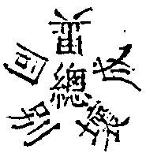

# 大藏一览



> **藏经**：嘉兴大藏经（新文丰版）（嘉兴藏）　**册次** 第 21 册（J21）　**编号** JB109　**部类** 目录部　**卷次** 10 卷　**篇幅** 265,136 字

> **作者（译者）**：宁德优婆塞陈　实谨编、宁德优婆塞陈　实　谨编

> **卷／品**：7 卷 · 3 品



---



## 目录



  - [重刻大藏一览序](#重刻大藏一览序)

- [第二卷三](#第二卷三)

- [第七卷四](#第七卷四)

- [大藏一览卷第五](#大藏一览卷第五)

  - [临终品第三十二(二十九则)](#临终品第三十二二十九则)

- [大藏一览卷第六](#大藏一览卷第六)

- [○(饮食，时、非时，听、不听，已收入第三卷十](#饮食时非时听不听已收入第三卷十)

- [大藏一览卷第九](#大藏一览卷第九)

- [大藏一览卷第十](#大藏一览卷第十)

  - [分派品第五十八(一百四十八则)](#分派品第五十八一百四十八则)



---



### 重刻大藏一览序



佛法自汉入中土，初仅四十二章。魏晋及唐，西使几遣东译无筭。由宋至元，宗门之诠著与儒彦之参观日多，皇明启运，汇为大藏，曰经、曰律、曰论，五千餘卷，卷帙浩繁，穷年莫竟。即耆宿，检阅难周，何况初地？虽名刹，尊藏不易，何论僻所？则一览之编，陈居士实之心良勤矣。



夫亦举要钩玄，上根循之而窥大全；胜果妙因，中人闻之而信心勃起也。凡为卷十，分八门六十品，系以因缘一千一百八十一则，八门次第相承而善恶独多，无非以果报提醒众生之愚浊。品始于〈先王〉，终于〈流通〉，则又以宣扬敷布，使人共得睹闻受持，为报恩第一义。



盖有世界必有众生，有众生乃成世界。而有众生又因坏世界。何也？众生性皆是佛性，众生性不昧即能见佛，故知山河大地皆心所造，天人流转终归有漏，而必求所以安身立命之处。众生性昧即不见佛，上智以毕世为完修，以不朽为后世名，毕竟从名心起念，于真性何涉？济恶不才者遂以恣睢为适性、祸淫为不必然，逞欲任情，苟逃于目前之罪谴，谓凶暴为得计，当世之非笑、万年之骂詈俱不复顾，执此惑见，一夫自用，万夫受其惨毒矣。不有佛法以报应之，祸福千劫、万劫不得消磨者，唤回醉梦何所底止哉？兹编一千餘则因缘，独於此表扬不已，意在斯乎，意在斯乎。



世人高明者少，而卑暗者多；慈祥者固不乏人，而残忍者尤众。欲引之於性命，必先引之於趋向；欲引之于向善而去恶，必先引之于惧祸而求福。因果不爽于穷劫，现在可知、忏悔可消，于无始当下何难？兹编流通世间，俾管窥之下士、寡陋之村巷、凶顽之结习皆得领其梗概，沃其清冷，作大懽喜，开大方便，所诱化林林总总者岂鲜浅哉？



广辩姚居士，余外家尊行也，少负才名，晚耽禅悦，好行其德，于所不知尤加意檀施、留心贝叶，与其子茂才、君复等，共尊三宝、三塔、大士殿，倡众鸠工重刻《楞伽》、《楞严》诸经，而于兹编，念旧刻之漫漶，特捐赀剞劂，亲自校订，自抒妙解作跋，而令不佞为之序。余媿无乐天、子瞻之见地，聊即一览之，条贯论次若此，惟大善知识开其固陋云。



万历甲寅孟冬，翰林院侍读学士秀水陈懿典书于学圃轩。



大藏一览目录



第一卷先王品  

因地品  

示生品  

出家品  

成道品  

度生品  

入灭品  

常住品  

原道品  

教兴品  

优劣品  

究竟品  

释疑品  

证验品  

托胎品  

五蕴品  

烦恼品



------



## 第二卷三



十善品  

布施品



第三卷持戒品  

忍辱品  

精进品  

禅定品  

般若品



第四卷方便品  

造像品  

事亲品  

杂缘品  

十恶品



第五卷忏悔品  

临终品  

报应品



第六卷贤劫品  

诸天品  

四洲品  

有情品  

地狱品  

三灾品  

劫量品  

大千品



------



## 第七卷四



入道品  

声闻品  

缘觉品  

菩萨品  

等觉品



第八卷法身品  

相好品  

神足品  

十号品



第九卷教相品  

持诵品  

唐梵品



第十卷宗眼品  

正传品  

傍出品  

分派品  

散圣品  

流通品



大藏一览目录(毕)



大藏一览第一卷



宁德优婆塞陈　实谨编



秀水居士姚舜渔重缉



第一门



> 首标大觉先容，俯为众生作则。



先王品



> 混沌天地以开端，乃祖始王之统御。



《释迦谱》云：「劫初天地大水弥满，风吹渐减，次第结沫，化为天宫……、乃至山岳，平陆成洲、深堰成海，从上至下，依旧建立。光音天人乃飞下来，各有身光，飞行自在。地味香甘，因食彼故，体重光灭，复飞不起，日月始生，乃分昼夜。因贪食故，地味遂灭，复生婆罗。婆罗灭故，复生粳米，长四寸半，朝割暮生。因食米故，方分男形女相，后贪积聚，割不复生(机心一动则物离其真，尝闻东莱力租而海鱼不出、合浦贪珠而玑蚌远移，以近代方古，粳米不生未足为异)。后相侵盗，无能决者，议立一智者三摩多为平等王，赏善罚恶，众共给之。」(彩字函第一卷)○(混沌，详见〈三灾〉、〈劫量〉二品)



《起世因本经》云：「是平等王子孙相承，三十三世善思王，后乃证转轮圣王之位，王四天下，直至师子颊王，凡一百一万五十六王。师子颊生四子：一、名净饭，二、名白饭，三、名斛饭，四、名甘露饭。净饭王生二子：一、名悉达多，一、名难阤。白饭二子：一、名帝沙，一、名难提迦。斛饭二子：一、名阿尼娄驮，一、名跋提梨迦。甘露饭二子：一、名阿难阤，一、名提婆达多。且悉达多(世尊小名)一子，名罗睺罗。」(映字函第十卷)



《释迦谱》云：「昔王逊位与弟，从学於婆罗门——姓曰瞿昙——而受之言：『当解王衣，如吾所服，受瞿昙姓，谓小瞿昙。』既入深山，形殊服异，无能识者，於甘蔗园以为精舍(净饭远祖舍国修行，受瞿昙姓，故曰瞿昙氏。居甘蔗园，故称甘蔗之苗裔)。因贼由此，以陷其纵，盗法论之，木贯其身，立以为标，血流於地。是大瞿昙天眼见之，神足飞来：『我子何罪，酷乃尔乎？』取土中血，以泥团之，持还精舍，左血著於左器之中，其右亦然，大瞿昙咒愿曰：『是道士若志诚，当使血化为人。』却后十月，左即成男，右即成女，於是姓瞿昙氏。



「又，懿摩王有四太子，因摈雪山，不数年间归德如市，郁为强国，懿摩叹曰：『此真释子。』」(释义齐言能也，因能命氏)○(彩字函第一卷)



因地品



> 远穷三大僧袛因，最后一生居补处。



《毗婆沙论》云：「过去久远，人百寿时，有佛名释迦牟尼，母名摩耶，父名净饭，子名罗怙，侍者名阿难阤。佛告侍者：『吾今背疾，汝往广炽陶师之家求胡麻油，为吾涂洗。』广炽欢喜办油，自往为佛涂洗，释然除愈，软音慰谕，广炽踊跃，即发愿言：『愿我未来当得作佛，名号、眷属、时处、弟子如今世尊等无有异。』当知：彼陶师者即我释迦，由本愿故，今名号等如昔不异。最初逢事释迦牟尼等七万五千佛，是名初劫阿僧企耶满。从此以后乃至逢事然灯如来七万七千佛，是名第二劫阿僧企耶满。复从此后乃至逢事胜观如来，是名第三劫阿僧企耶满。此后复经九十一劫修妙相业，直至逢事迦叶波佛，方得圆满。」(心字函第七卷)



《过现因果经》云：「至普光佛(乃然灯之异名)出兴于世，尔时善慧仙人因与五百外道论议，破其异见，时五百人求为弟子，各以银钱一枚上之。善慧闻佛出兴，令灯照王迎请供养，击鼓唱令：『国内名花皆不得买，悉以轮王。』善慧闻已，心大懊恼，欲访花所，忽遇瞿夷持花七茎，畏王制令，藏著瓶中。善慧至诚，感花踊上，追呼就买。此女答言：『当送内宫，欲以上佛，不可得也。』善慧告言：『五百银钱雇五茎花。』瞿夷问曰：『欲花何用？』善慧答言：『欲以献佛。』瞿夷又问：『献佛何为？』善慧答曰：『为欲成就一切种智度脱众生。』瞿夷念言：『今此男子乃尔志诚，不惜钱宝。』即语之曰：『我今当以此花相与，愿我生生常为君妻。』善慧答言：『我修梵行，求无为道，不得相许生死之缘。』瞿夷即言：『不从我愿，花不可得。』善慧又曰：『汝若决定不与我花，当从汝愿。我好布施，不逆人意，若使有来从我求乞头、目、髓、脑、及与妻子，汝莫生碍，坏吾施心。』瞿夷答言：『敬从来命，今我女弱，不能得前，并寄二花以献於佛，使我生生不失此愿，好丑不离，必置心中，令佛知之。』



「时灯照王领诸官庶，持妙香花、种种供具出城迎佛，王臣礼敬，散献名花，花悉堕地。善慧见诸人众供养毕已，谛观如来相好之容，欲满种智度众生故，即散五花，皆住空中化成花台，后散二茎亦止於空。尔时，王、民、龙天八部见此奇特，叹未曾有，於是普光如来赞曰：『善哉，汝以是行，过僧祗劫当得成佛，号曰释迦牟尼。』既授记已，佛经行处而地浊湿，善慧即脱所著鹿皮之衣以用布地，解发覆之，佛践而度，复记之曰：『汝后得佛，当於五浊恶世，度诸天人不以为难，必如我也。』



「是时善慧投佛出家，白言：『世尊！我昨得此五种奇梦：一者、梦卧大海；二者、梦枕须弥；三者、梦诸众生入我身内；四者、梦手执日；五者、梦手执月。唯愿世尊为我解说。』普光答言：『梦卧海者，汝在生死大海之中。梦枕须弥者，出於生死。梦诸众生入身内者，为彼作归依处。梦执日者，智光普照。梦执月者，清凉度生，令离热恼。此梦因缘，是汝将来成佛之相。』善慧闻已，不胜踊跃。



「后至普光如来入灭，善慧比丘护持正法满二万岁，度生莫计。命终上生为四天王，化诸天众。尽彼天寿，下生人间为转轮王，王四天下，七宝具足——一、金轮宝，二、白象宝，三、绀马宝，四、神珠宝，五、玉女宝，六、主藏臣宝，七、主兵臣宝——千子具足，皆悉勇健，能伏怨敌，十善化民。



「於此寿终，上生忉利，为彼天主。寿终，下生复为轮王，又升梵天，上作天帝、下为圣主，各三十六反，终而复始，其间或为仙人、或为外道六师、或为婆罗门、或为小王……，如是变现，不可称数。」(辞字函)



《释迦谱》云：「善慧菩萨功行满足，位登十地，生兜率天，一生补处，名圣善白，为诸天师随应说法。期运将至，当下作佛，现五种瑞：一者、放大光明，普照三千大千世界；二者、大地十八相动；三者、魔宫隐蔽；四者、日月无光；五者、八部悉皆震动。告诸天子：『当知我於无量劫来，唯此一生正是度脱众生之时，我当应下生阎浮提。』其诸天子咸共议言：『当使菩萨现生何种？』或有说言：『维提种摩竭国，其母虽正，其父不真。拘萨大国，父母宗族皆不真正。和沙国土，受他节度。维耶离国，喜诤不和。䥽树国风，举动虚妄。餘国边地，佛之至尊皆不应生。唯有维罗卫国，乃三千大千世界之中，人民滋茂，植种德本，其净饭王种族第一，性行仁贤，夫人贞良，犹天玉女，护身口意，前五百世为菩萨母，应可降神，受彼胞胎。』」



示生品



> 爰从兜率降来仪，庆诞毗岚示色相。



「菩萨问诸天子：『以何形貌降神母胎？』或言：『儒童形。』或言：『日月王形。』或言：『白象形。所以者何？世有三兽：一、兔，二、马，三、象。兔之渡水，趣自渡耳；马虽差猛，犹故不知水之浅深；白象之渡，尽其源底。声闻、缘觉，其犹兔、马，虽度生死，不达法本；菩萨大乘譬如白象，解畅三界十二缘起，了之本无，一切莫不蒙济。』



「春末夏初，不寒、不暑，适在时宜，菩萨以四月八日化乘白象，冠日之精，因母昼寝，以示其梦，从右胁入。夫人梦寤，自知身重，天献饮食自然而至，不复乐於人间之味。



「菩萨在胎，母无妨碍，晨朝为色界天说法、日中为欲界天说法、晡时为诸鬼神说法，於夜三时亦复如是，成熟利益无量众生。於是兜率天众念言：『菩萨已托净饭王宫，我等亦当下生人间，菩萨成佛，我得闻法。』即便托於诸国王臣、或婆罗门长者、居士等家，凡九十九亿。



「菩萨住胎十月满足，四月八日，夫人将诸彩女游蓝毗尼园，攀无忧树，于时树下忽出莲华，大如车轮，菩萨化从夫人右胁而生，堕彼华上，自行七步，举其右手，作师子吼：『天上天下，唯我独尊。』时四天王即以天缯接太子身，置宝机上，帝释执盖，梵王持拂，左右侍立，九龙空中吐清净水，一温一凉，灌太子身，三十二相、八十种好，放大光明，普照三千大千世界，天龙八部满虚空中，作天伎乐，雨妙香花、璎珞、天衣……，不可称数，所感瑞应(三十有四，繁不能录)，群生普利，地狱停酸。



「同日，八大国王皆生太子，诸释种姓生五百男，国中居士、长者亦悉生男，及八万四千厩马生驹，宫中五百伏藏发现，又诸大商采宝俱还，即名太子为悉达多(汉言『顿吉』)。



「适生七日，其母摩耶夫人命终，以怀天师功福大故，上生忉利，封受自然。太子自知福德威重，无有女人堪受礼者，故因将终，托之而生。尔时姨母摩诃波阇波提乳养太子，如母无异。召诸婆罗门占太子相，叹未曾有：『若当出家，成一切智；若在家者，为转轮王。』王闻此语，心大欢喜。婆罗门又白王言：『有一梵仙名阿私陀，具足五通，在於香山，彼之善相可决王疑。』王才作念，彼便遥知，腾虚而来，既见太子，忽然悲泣。王大忧怖，问仙人言：『子何不祥？』仙人答曰：『太子具足三十二相，在家为转轮王，出家成等正觉，转大法轮。我今年已百二十岁，不久命终，不闻说法，故自悲耳。』



「太子渐长，因王严驾，抱谒於大自在天庙，时诸神象悉能起拜太子之足，父王惊叹：『我子於天神中最尊最胜，宜字天中天。』



「年及七岁，当修学时，遍访国中聪明婆罗门——名曰选友——为太子师。太子问曰：『以何书典而相教乎？』其师答曰：『梵、佉留书。』太子曰：『其异书者，六十有四，今师何言止有二种？』师问：『何名？』答曰：『梵书(婆罗门书)、佉留书(驴唇仙书)、龙鬼书、犍沓和书(香神书)、阿须伦书(阿修罗书……，多不尽录，略举四五)。』书缺二字，太子问师，师不能答，反而问之：『此阿字者，不可坏义，亦是无二正真道义。』尔时选友深生惭愧，而白王言：『太子乃天人师，我安可教耶？』凡诸伎艺、典籍、筭射、天文、地理，太子悉皆自然知之。



「年既长成，王敕太子与难阤、调达、五百童子，又复击鼓唱令万姓有勇力者，定日集於戏场捔射。至期，调达领众先出，有象当门，以手擗倒。次是难阤，见象碍路，即以足指挑著路傍。太子念言：『今正现力之时。』即便执象掷於空中，还以手接，不令伤损，众咸叹服。



「既至园已，摽鼓射之，调达竖四十里鼓，不能得过；难阤竖六十里鼓亦莫越；尔太子竖百里鼓，弓力乏折，乃取祖王镇库之弓——古今无能张者——太子既挽，声震于城，箭中鼓已，没入于地，泉水涌出，复透铁围之山，大千刹土六反震动，大众悚然，怪未曾有。



「太子年及十七，王为娉妃，耶输阤罗端正第一，礼义备举，即是宿命卖花女也。太子虽纳，殊无俗意，久而不接，於静夜中但修禅观。」



出家品



> 四门游观忽警悟，中夜逾城骤出家。



「太子在宫日久，前白王言：『欲出游观。』王敕整治衢道，皆令清净，并诸官属导从太子。出城东门，观者如云，时净居天化作老人，头白背伛，拄杖羸步，太子问从者言：『此何人也？』答曰：『老人。』又问：『何谓老人？』答曰：『昔乃儿童，次第迁变，形枯色衰，餘命无几，故谓为老。』太子又问：『唯此一老？一切皆然？』从者答言：『人人悉尔。』太子闻已，生大苦恼：『我虽富贵，岂免此耶？』还宫不乐，王亦忧恼。



「复游南门，王敕严洁衢陌，百官拥从。时净居天复化病人，肉消骨露，喘息呻吟，不能自持，两人扶腋在於路傍。太子乃问：『此何人也？』从者答曰：『此病人乎。』又问：『何谓为病？』答曰：『病者百节疼痛，气力虚微。』复问：『此人独尔，餘皆然耶？』答曰：『贵贱悉尔。』太子叹曰：『云何世人耽乐不畏？』还宫忧恼。



「王闻转愁，问群臣言：『太子初出东门，逢见老人不乐。今出南门，再敕卿等净治道路，云何病人又令见之？』群臣奏对：『奉王严命，无不检察，不知病人所从来处，非臣之罪。』王闻婆罗门子优阤夷极有智辩，召而语曰：『太子不乐在世，恐其出家，汝可为友，善而诱之。』



「太子复求出游，王不忍拒，敕严道路乃至园林，香华幡盖数倍於前，若有不祥，远驱逐之。尔时太子与优阤夷百僚万众出城西门，净居天子念言：『先现老、病，举众皆见，王责从者，枉及无辜。今化死人，眷属围遶，号哭送之，唯令太子与优阤夷二人独见。』太子问：『此何人？』优阤夷以王严敕，即不敢答，净居天力使不觉言：『称死人也，风刀解形，神识去矣，四体诸根无复所知，诚可哀也。』太子又问优阤夷言：『餘人尔不？』答曰：『世人皆尔，无一免者。今献诚言，愿不见责。古今诸王，爱欲乐已，然后出家，太子云何永绝不顾？无有弃国而学道者，唯愿太子受於五欲，令有子息，不绝王嗣。』太子答言：『诚如所说，但我不言五欲无乐，以畏老病生死之苦，故於五欲不取爱著。汝言古者诸王先经五欲，然后出家。此诸王等今在何许？以爱欲故，或在地狱、或在饿鬼、或在畜生、或在人天，以有如是轮转苦故，我欲离此，汝今云何令我受之？』时优阤夷虽竭言辩勉於太子，终不能回。即便还宫，弥加忧戚。王问其详，优阤夷言：『出城不远，逢见死人，殊不知其自何而来。』问诸吏从皆言不见，王知天力，非臣之咎。



「复游北门，净居天子化作比丘於太子前，太子问曰：『汝何等人？』答曰：『比丘。世间无常，我修圣道，超於彼岸。』作是答已，腾虚而去。太子念言：『先见老、病、死苦，为之所恐。今遇比丘启悟我心，不胜欣悦。』王闻懊恼，太子决定舍家学道，敕输阤罗勿离太子，复增妓女以娱乐之。



「复次，太子前白：『父王！恩爱必离，听我出家。』王泣不许，太子复言：『王能与此四愿，即不出家：一者、不老，二者、无病，三者、不死，四者、不别。』王答：『此愿，世谁得之？』相师奏王：『太子若不出家，七日之后得轮王位，七宝自至。』王生欢喜，即敕群臣日夜严备，城门开闭闻四十里，复敕耶输阤罗倍加防察。王告太子：『国今无嗣，宜生一子，却听出家。』太子即指输阤罗腹，便觉有娠，然后罗睺从天变没化生，不由父母合会而育。



「太子是年十九，出家时至，二月八夜，诸天下来太子之前，头面礼足，白太子言：『无量劫来勤苦修行，令之成熟，出家是宜。』太子答言：『王敕内外官属防卫严密，欲出无从。』诸天白言：『我等方便，使无知者。』太子即敕车匿被犍陟来，四天天王捧马四足并接车匿，帝释执盖，北门自开，不使有声。出城既毕，天忽不现。太子至於跋伽仙林作师子吼：『过去诸佛为求菩提，舍弃饰好，剃除须发，我今亦尔。』便脱宝冠与璎珞等，分付车匿回上父王，即以利剑自剃须发，帝释接发上天建塔。次净居天化作猎师，身披袈裟，太子以七宝衣贸之而著。车匿大哭，犍陟悲鸣，缘路而归。父王、姨母及输阤罗等不见太子，哀号闷绝，举国悲慕。於是净饭王即选国中豪贤多子孙者五人，各遣一子——憍陈如……等——追侍太子。



「太子前诣彼仙住处，见其或以草叶为衣者、或以树皮为服者，或食草木花果，或事水、火、日、月，或倒荆棘之上、或卧水火之前，或一日一食、或二日一食，苦行如此。太子问言：『欲求何果？』仙人答言：『为欲生天。』太子又问：『诸天虽乐，福尽轮回，终为苦聚，云何修诸苦因以求苦报？皆非解脱真正之道。』辞而别往，涉山逾谷。憍陈如等相从既久，不柰其艰，言：『此狂人，行不择路，奚可随之？设委而还，王灭吾家，不如止此精苦修行。』



「太子次第前诣阿罗逻、迦兰仙人所，诘其所断生老病死之法，仙人答言：『众生之始，始於冥初，冥初起於我慢，我慢生於痴心，痴心生於染爱，染爱生於五微尘气，五微尘气生於五大，五大生於贪欲、瞋恚及诸烦恼，於是流转生、老、病、死、忧、悲、苦、恼。』太子复问：『已知所说生死根本，复何方便而能断之？』仙人答言：『若欲断者，修习禅定，离欲恶不善法。有觉有观，得初禅；除觉观定，生入喜心，得第二禅；舍喜心，得正念，具根乐，得第三禅；除苦乐，得净念，入舍根，得第四禅。获无想报，离色想，入空处；灭有对想，入识处；灭无量想，识唯观识，入无所有处；离於种种相，入非想非非想处，斯处名为究竟解脱，是诸学者之彼岸也。』太子思惟：『其所知见非究竟处。』问曰：『非想非非想处，为有我也？为无我也？若言无我，不应言非想非非想；若言有我，我为有知？我为无知？我若无知，则同木石；我若有知，则有攀缘。既有攀缘则有染著，以染著故，则非解脱。汝尽麤结，犹细结在，非度彼岸。若能除我及以我想，一切尽舍，是则名为真解脱也。』太子调伏是二仙已，求胜法故，遂复前进。」



成道品



> 六载雪山修苦行，一朝道树悟明星。



「太子次至苦行林中，尼连河侧，安禅静坐守戒，日食一麻一米、乃至七日食一麻米。设有乞者，亦以施之。苦行六年，瘦若枯木：『我若以此羸身而取道者，彼诸外道当言自饿是涅槃因。我当受食，然后成道。』既作是念，净居天子下来，劝彼林外牧女——难阤波罗——令取乳糜供养太子。受食已竟，身体光悦，堪受菩提。观过去佛以草为座，帝释化作凡人，持草以奉，太子问言：『汝名何等？』答曰：『吉祥。』太子喜曰：『我破不吉，以成吉祥。』坐彼草褥，阎浮树下观树思惟，感天动地，演大光明，覆蔽魔宫。波旬恐怖，令彼四女往诣太子，万端妖婬惑之不动。波旬复将八十亿众故来恼坏，而作是言：『若不起去，掷汝海中。』太子答曰：『汝先动我净瓶，然后可能掷我。』八十亿众尽力不能令瓶少动，乃至种种作威，若抱石者……，不能胜举，设能举者复不能下，飞刀舞剑停於空中，雷电雹雨成五色花，群魔力尽无复能为。



「太子是年(三十)岁，(十二)月八夜，结解漏尽，生死已断，明星出时，霍然大悟，成等正觉，普观三界无有一乐，是诸众生以何因缘而有老、死？即知老、死以生为本，若离於生则无老、死。从因缘生，因於欲有色、有无色、有业生。又观三有业从四取生，取从爱生，爱从受生，受从触生，触从六入生，六入从名色生，名色从识生，识从行生，行从无明生。若灭无明则行灭，行灭则识灭，识灭则名色灭……，乃至老、死、忧、悲、苦、恼灭。如是逆顺观十二因缘，具足三十七助道品、一十八不共法、四无所畏、十神通力。于时大地十八相动，天作伎乐，散花烧香，龙天八部所设供养充塞虚空。



「如来於七日中思惟：『我所得法甚深难解，唯佛与佛乃能知之。一切众生为於贪欲、瞋恚、愚痴、邪见之所覆障，无有智慧，云何能解我所得法？我今若为转法轮者，彼必迷惑，不能信受而生诽谤，当堕恶道。我宁默然，入般涅槃。』尔时，大梵天主礼足围绕，白言：『世尊！久住生死，舍於国城、妻子、头、目、髓、脑，为求法故。今日法海已满、法幢已立，开导正时，云何涅槃？』三请说法。」



度生品



> ○初自鹿苑转法轮，○后止娑罗遗后嘱。



「是时世尊乃受其请，即诣波罗柰国鹿野苑中初转法轮。世尊思惟：『我开甘露法门，谁应在先而得闻者？阿罗逻与伽兰二仙，聪慧易悟。』知其各於昨夜命终，世尊复念：『憍陈如等五人悉皆聪明，又夙有愿，先应度之。观根受道。世有八苦，谓：五盛阴苦、生苦、老苦、病苦、死苦、爱别离苦、怨憎会苦、求不得苦。如是诸苦由我为本，应当知苦、断集、证灭、修道。若人不知四圣谛者，不得解脱，当三转四谛十二行法轮。』



「时有五百商人——二为首者，一、名提谓，一、名波利——经过旷野，天神语之：『有佛兴世，汝宜先供。』即以蜜𪎊上之，则四天王亦各持钵奉以盛食，佛皆受之，累置掌上，按合成一，为应供器。



「时憍陈如等五人投佛出家，世尊唤言：『善来，比丘！』须发自落，袈裟著身，即成沙门。佛问：『汝知色、受、想、行、识，为是常？为无常也？为是苦？为非苦也？为是空？为非空也？为有我？为非我也？』五比丘众闻五阴法，漏尽意解，成阿罗汉果，即便答言：『色、受、想、行、识实是无常、苦、空、无我。』诸天踊跃，展转唱言：『如来今日鹿野苑中转大法轮。』於是世间始有三宝——如来大圣是为佛宝、四谛法轮是为法宝、五阿罗汉是为僧宝，为诸天人第一福田。



「次度耶舍等比丘五十人，佛告诸比丘众：『宜各游方，度诸众生。我今独往摩竭提国，彼国优楼频螺迦叶兄弟学於仙道，王臣归信。』佛至彼住，日暮求宿，迦叶答言：『石室洁净，可得相容。内事火龙，其性暴恶，恐相害尔。』佛言：『但借，龙恶不妨。』迦叶答言：『宜自随意。』佛入室中，结跏趺坐，恶龙吐火，发燄冲天，石室洞镕，世尊即入火光三昧，龙反遭火，藏身无地，辄投佛钵。迦叶师徒以谓佛遭毒龙所害，翌朝往看，佛言：『我内清凉，终不为彼外火之焚。君所事龙，今降钵中。』迦叶叹服：『未曾有也。』复言：『虽则沙门神通，不如我道真。』



「世尊住此，第二夜、四天王众，第三夜、帝释众，第四夜、大梵众，各下听法，身光洞耀，迦叶问佛：『夜夜光现，汝事火耶？』佛言：『不也，诸天每夜下来闻法，是其身光。』迦叶又言：『虽沙门神妙，不如我道真。』迦叶晨朝烧火不然，怪其所以，即往白佛，佛令归去，见火已然。事毕灭之又不能灭，复至白佛，佛令归去，见火已息。次早劈薪，斧莫能举，次斧既举，又莫能下，皆至佛所，乃举乃下。



「迦叶请佛归家供养，佛言：『先去，我随后往。』迦叶既去，佛趣阎浮提洲取果持来，迦叶未至，佛已先到，即便问言：『从何道来？』佛以果示，而语之曰：『过数万逾阇那取此果来，汝可噉之。』然后如是三请，佛亦三往餘三天下，取彼所产之果，皆於先到。此等神变凡十八种，迦叶各各强言：『是大沙门，神则神矣，不如我道真也。』佛语迦叶：『汝非阿罗汉道，何故虚妄，起大我慢？』於是迦叶自知非真，心怖毛竖，见佛种种神变殊胜，即与五百弟子投佛出家，事火之具悉皆捐弃尼连禅河。是故，迦叶二弟——一、名那提迦叶，一、名伽阇迦叶——各有弟子二百五十，居於下流，忽见厥兄所事火器随流而下，必不祥也，同奔兄所，见兄与其眷属，削发披缁，愕然咨兄：『既大罗汉，聪慧过人，名闻十方，莫不宗仰，何舍此道，还从人学？』迦叶答言：『然我所学非究竟法，唯佛所说能尽生死。既遇此等大圣之尊而不师彼则是无眼。』二弟启言：『我等亦愿随兄同学。』并领弟子投佛出家。



「复次，佛念：『瓶沙王於我有约，若成道者愿先见度。』即与迦叶千比丘众往王舍城，住於杖林。时瓶沙王严驾，百官导从，千马万骑，迎佛入国，头面礼足。安坐已定，观其根熟，即为说法：『大王当知：此五阴身以识为本，因於识故而生意根，以意根故而生於色，而此色法生灭不住。如是观者，则能於身善知无常。如此观身，不取身相，即能离我及於我所。若能观色离我、我所，即知色生便是苦生，若知色灭便是苦灭。如此观者，名为解脱；不作斯观，是名为缚。法本无我及以我所，以倒想故，横计有我及以我所，无有实法，若能断此倒惑想者即是解脱。』王即思惟：『若谓众生言有我者而名为缚，一切众生皆悉无我，既无有我，谁受果报？』佛知彼念，即语之曰：『一切众生所为善恶及受果报皆非我造，亦非我受，而今见有造作善恶、受果报者，当为王说：但以情、尘、识合，於境生染，累想滋繁，以是缘故，驰流生死，备受苦报。若是於境无染，息其累想，即得解脱，以情、尘、识三事因缘，共起善恶及受果报，更无别我。譬如钻火，因手转燧得有火生，然彼火性不从手生及以燧出，亦复不离手及燧钻，彼情、尘、识亦复如是。』王又思惟：『若以情、尘、识和合故而有善恶、受果报者便为常合，不应离绝，若不常合，是即为断。』佛知王念，即便答言：『此情、尘、识，不常、不断。何以故？合故不断，离故不常。譬如缘於地水，因彼种子而生芽叶，种子既谢，不得名常；生芽叶故，不得名断。离於断、常，故名中道，三事因缘亦复如是。』王闻法已，心开意解，与八万那由他婆罗门大臣、九十六万那由他诸天各远尘离垢，得法眼净。



「有长者迦陵，见佛入国，君民敬奉，未有精舍，即舍竹园，王起堂殿，种种严丽，请佛安居。领比丘众、无量天人前后围绕，入王舍城。佛蹈门阃，城中乐器不鼓自鸣，门狭更广，门下更高，一切丘墟悉皆平坦，臭秽尘垢自然香净，聋者得听、哑者能言、盲者得视、狂者得正、病者皆愈，枯木发花，腐草荣秀，涸池增澜，香风清靡，凤鸟翔集，出和雅音，种种祥瑞。



「彼城中有二婆罗门，根利聪明——一、名舍利弗，一、名目犍连——二为亲友，各百弟子，国人宗仰。因阿舍婆耆比丘持钵入村，舍利弗忽逢於路，见其威仪庠序，问：『师於谁？演说何法？』婆耆答言：『我大师者，天人之尊，智慧神通无能与等。我既年幼，学道日浅，岂解宣说如来妙法？但以所知。』即说偈言：



「『一切诸法本，从缘悉本无，若能反本源，乃名曰沙门。』



「舍利弗闻说此偈即见道迹，心大踊跃，以所闻偈归告目犍连，亦於言下开悟，於是二人共将二百弟子前诣竹园伽蓝，以求出家。佛告大众：『今此二人，於我法中为上弟子。舍利弗者，智慧第一。目犍连者，神通无上。』



「如上凡千二百五十人，各於出家时，世尊呼云：『善来，比丘！』须发自堕，袈裟著身，成沙门相。佛皆为说四谛之法，远尘离垢，得法眼净，证阿罗汉。



「佛告诸比丘言：『然灯如来出兴世时，善慧仙人岂异人乎？即我身是。缘路所遇五百外道所共论议及随喜者，今此会中迦叶兄弟及其眷属千比丘是。卖花女者，今耶输是。善慧发布地时，傍有二人扫佛前地，及二百人随喜助者，今舍利弗、大目犍连并二百弟子是。发布地时，虚空诸天而赞叹者，我初得道鹿野苑中始转法轮，八万天子及频婆娑罗王(一名瓶沙)所将眷属八万那由他人及九十六万亿那由他天是。汝等当知：过去所种因缘，经无量劫终不磨灭。我於往昔勤修一切善业及发大愿，心不退转，故於今日而已成就一切种智，汝等宜应勤修无怠。』」(彩辞二函参用)



《涅槃经》云：「世尊四十九年在世，说法三百餘会，度脱四生六道，其数无量无边。涅槃时至，告大众言：『我初成道於尼连禅河边，魔王波旬请般涅槃，我告「未有弟子，是故不得入涅槃」者，吾自初度五比丘众，渐渐诱进，最后乃至须跋阤罗皆入道竟，所作已办、能事已毕，今当入灭。汝等勤教众生，勿得放逸，未脱三界，早求出离，一失人身，难可追复。』大众闻佛嘱付，咸生哀恋，有优婆塞名曰纯陀，设最后供，具足檀度。



「於是阿难深切迷闷，犹如死人。阿泥楼逗(一名阿那律)安慰阿难：『何为愁苦？如来今日虽有，明旦则无。汝依我语，諮是四问：佛涅槃后，六群比丘云何共住而得示教？如来在世，以佛为师，既入灭后，以何为师？如来在世依之而住，既入灭后依何而住？如来灭后，结集法藏，一切经初安何等语？』



「阿难依陈上问，佛告阿难：『如汝所问「我涅槃后，六群比丘云何共住」者，依我正法，教示六群，得证上果。一切众生皆因无明起诸爱结，役使身心，不得自在。若能谛观十二因缘究竟无我，深入本净，即能远离三界大火。此是最后付嘱，汝当修行。问「佛去后以何为师」者，尸波罗戒是汝大师。问「佛灭后依何住」者，依四念住。问「佛灭后一切经初安何语」者，当安「如是我闻：一时佛住某处而说是经」。』



「阿难复次白佛茶毗法则。佛答：『当依转轮圣王，后收舍利，建七宝塔，一切世间所共瞻仰。』



「于时帝释从佛敬请半身舍利，深心供养。佛告天帝：『如来等视众生如罗睺罗，平等利祐，我今与汝右边上颔一牙舍利，可於天上起塔。』於是天人悲哀不已，世尊普告：『汝莫愁叹。何以故？虽佛涅槃，而有舍利，复有法宝常住於世，能令众生深心归依。供养舍利即是佛宝，见佛即见法身，见法即见圣贤，见圣贤故即见四谛，见四谛故即见涅槃。当知：三宝常住，无有变易，能为世间作归依故。』



「尔时世尊於师子座却僧伽梨，显紫金身，放大光明，告大众言：『当知：如来为汝等故，累劫勤苦修行，成就菩提，得此金刚不坏之身，具足三十二相，如优昙花难可值遇，缘毕涅槃。汝等诚心看我金身，当修净业，於未来世得此果报。』如是三告，上升虚空，高七多罗树，复从空下，凡二十四反，告诸大众：『是为最后见於如来，自此见已无复再睹。我今时至，举身疼痛。』即入初禅，从初禅出入第二禅，次第至非非想处，从非非想处出入灭尽定，从灭尽定出还入非非想，次第还入，直至初禅，复入超禅。如是逆顺展转二十七反，告大众言：『我以佛眼遍观三界，一切诸法性本解脱，於十方求了不能得。根本无故，所因枝叶皆悉解脱；无明解脱故，乃至老、死皆得解脱。』」



入灭品



> 能事既毕入泥洹，舍利以留为佛事。



「世尊是年七十有九，於二月十五夜示诲众已，右胁而卧，背东面西，头北足南，有娑罗树八根合为二株，惨然变白，垂覆如来，十方震动，演出苦空哀叹之声，大海涌沸，川流枯涸，日月无光，黑风鼓扇，草木摧折，诸天哀号，雨天香花，奏天音乐，唱言：『苦哉，苦哉！如何一旦慧日灭没，一切众生丧真慈父，失所敬天？』或有随佛灭者、或有丧失心者、或大叫搥胸者、或闷绝躄地者。



「于时依轮王法用以棺椁，拘尸城人佥议力士四人，请举佛棺，入城供养，尽其神力竟不能胜，复八力士至十六士舁无少动。楼逗告言：『纵倾城人亦莫能举。世尊平等，令诸人天得福无异。』棺乃自举，升虚空中，高一多罗树，从拘尸城西门而入，东门而出，复南门入，从北门出，遶城七匝。菩萨、声闻、帝释诸天即持宝台花盖空中随覆，幢幡、音乐、种种供养，地上、空中充塞弥满，悲泣哀恸。



「一七日已，大众即扶如来紫磨金身安庠出棺，置于宝床，持妙香水，灌洗既已，内以兜罗绵褁，外以妙㲲千张如法缠之，仍旧入棺，满注香油，诸天及人各持无价旃檀沉水，结大香楼，棺置其上，持炬茶毗，火悉殄灭。大众号恸，不知如来何缘未毕。帝释答言：『必待迦叶。』迦叶既至，棺自然开，即现二足千辐轮相出于棺外，迦叶见已，恸哭作礼，足还收入。於是力士烛炬𦶟之，终竟不然。迦叶告言：『大圣宝棺，三界之火所不能焚，何况汝力而能烧耶？』如来胸中三昧之火随声而发，迸出棺外，渐渐茶毗，经于七日，香楼乃尽。



「时四天王与江河神急欲舍利归去供养，见火未灭即以水沃，厥燄转炽，楼逗语之：『一居天上、一住海中，汝收舍利各还本处，地居之人如何得往而供养耶？』二众负惭乃退。偶帝释天持七宝瓶及供具至，其火顿息，视棺俨存，及其千㲲缠佛身者，里外各一张，宛然如本。帝释白众：『请佛所许右牙舍利。』已竟，是时八大国王竞争舍利。帝释化一梵志，名曰屯屈，前谏诸王：『为民主者，宜无有诤。舍利均分，令诸国土皆有塔庙，开发盲俗，贵知有佛，使普得景福欤。』佥曰：『善哉。』共命屯屈均为八分，各与一甖。诸王得之，悲喜交集，香华、幢幡迎还本国建塔，尚餘灰炭莫不收什，亦谓之灰塔炭塔，以永供养而为佛事。」(宾澄二函参用)



《泥洹经》云：「佛涅槃至庆历六年丙戌岁，一千九百九十四年。」(澄字函第一卷)



「自庆历丙戌复至绍兴二十七年，岁次丁丑，通前凡二千一百卅五年。」



常住品



> ○幻来生亦何尝生？幻去灭亦何尝灭？



《宗门统要》云：「洛京佛光如满禅师因唐顺宗问：『佛从何方来？灭向何方去？既言常住世，佛今在何处？』师曰：『佛从无为来，灭向无为去，法身等虚空，常在无心处。有念归无念，有住归无住，来为众生来，去为众生去。清净真如海，湛然体常住，智者善思惟，更勿生疑虑。』帝又问曰：『佛向王宫生，灭向双林灭，住世四十九，又言无法说。山河及大海、天地及日月，时至皆归尽，谁知不生灭？疑情犹若斯，智者善分别。』师曰：『佛体本无为，迷情妄分别，法身等虚空，未曾有生灭。有缘佛出世，无缘佛入灭，处处化众生，犹如水中月。非常亦非断，非生亦非灭，生亦未曾生，灭亦未曾灭。了见无心处，自然无法说。』」



第二门



> ○次辩教门究竟，庶使学者知归。



原道品



> 道无彼此元来一，教有权渐方设三。



《金刚经》云：「佛告须菩提：『是法平等，无有高下，是名阿耨多罗三藐三菩提。』」



又，《华严经》云：「如来普观法界一切众生具有如来智慧德相，愚痴迷惑，不知不见，我当教以圣道，令其永离妄想执著，自於身中得见如来，广大智慧与佛无异。」(黎字函第五卷)



《辩正论》云：「太昊本应声大士，仲尼即儒童菩萨，先游兹土，权行渐化，愍济五浊，宣布五常。」(明字函第一卷)



《破邪论》云：「佛遣三弟子震旦教化：儒童菩萨，彼称孔丘；光净菩萨，彼称颜回；摩诃迦叶，彼称老子。」(既字函上卷)



> 三归宛尔同三畏，五戒何曾异五常？



《破邪论》云：「修道阶次，心行非一，皆缘浅以至深，藉微以为著。其始修心则依佛、法、僧受三归也，三归如君子之三畏，而又五戒——断杀、盗、婬、妄语、饮酒——与仁、义、礼、智、信同。」(既字函上卷)



《弘明集》云：「仁者，不杀之戒也；义者，不盗之戒也；礼者，不邪之戒也；智者，不醉之戒也；信者，不妄之戒也。」(典字函第三卷)



教兴品



> 吾佛下生光及处，此方千载教来时。



《破邪论》云：「周昭王即位二十四年，四月八日，江河泉池忽然泛涨，大地震动，夜五色光入贯太微，遍于西方，作青红色。昭王问太史苏由曰：『是何祥也？』由对曰：『有大圣人生於西方，故现此瑞。』昭王曰：『於天下何如？』由曰：『即时无他，一千年外声教被及此土。』此时佛初生也。至穆王即位五十二年，二月十五日，暴风忽起，林木伤折，大地震动，西方有白虹十二道，南北通过，连夜不灭，穆王问太史扈多曰：『是何徵也？』对曰：『西方有大圣人灭度，衰相现耳。』此时佛涅槃也。」



> 金容入梦教西传，舍利呈祥法东振。



《破邪论》云：「后汉孝明帝永平三年，偶梦金人巍巍丈六，飞至殿庭，光明炳燿。顾问群臣，通事舍人傅毅对曰：『臣闻西域有得道者，其名曰佛。陛下所见，得无是乎？』帝遣博士王遵等十八人同往西域，求迎佛法。至月支国遇迦叶摩腾、竺法兰二梵僧，带白㲲，畫释迦像，《四十二章经》白马驮之，邀至洛阳，乃永平十年，此土有三宝之始也。明帝问摩腾曰：『法王出世，何以化不及此？』摩腾对曰：『迦毗罗卫国者乃三千大千世界之中心，三世诸佛皆於彼生，凡有愿行者悉生於彼，受佛正化，咸得悟道。餘处众生无缘感佛，佛不往也。佛虽不往，光明及处，或五百年、或一千年、或千年外，皆有圣人传佛声教而教化之。』」(并既字函)



《三宝录》云：「沙门康僧会，初达吴地，营立茅茨，设像行道。吴人初见，谓其妖异，有司奏闻，吴主问曰：『佛有何验？』僧会答曰：『佛晦灵迹出餘千载，遗身舍利应现无方。』吴主曰：『若得舍利，当为起塔；如其虚妄，国有常刑。』请期七日，会乃谓其属曰：『法之兴废在斯一举，今不至诚，后将何及？』精持斋戒，铜瓶盛水，烧香礼请，七日寂然求申，二七亦复无应。权曰欺诳，将欲加罪。更请三七，权又听之，会谓伴曰：『宣尼有言：「文王既没，文不在兹乎。」法灵应降而吾等无感，何待王宪？当誓死为期。』三七日暮犹无所睹，莫不震惧。既入五更，忽闻瓶中锵然有声，会即往视，果获舍利。明旦呈权，举朝集观，五色光燄，照瓶之上。权自执瓶，写铜盘中，舍利所冲，盘即破损，权大惊曰：『希有瑞也。』会复奏言：『舍利威神岂止如此？直得劫烧之火不能焚，金刚之杵不能碎。』权命试之，置於铁砧之上，使有力者用槌一击，砧杵俱陷，舍利无损，权甚嗟服，即为建塔，大法复兴。」(设字函第五卷)



优劣品



> 释梵咸称三界父，仲尼曾指大圣人。



《普曜经》云：「佛成道已，还本生国维卫大城，诸天皆来侍送，雨花献香，悬幢立盖，作诸伎乐，四王诸天引导其前，比丘大众拥从其后，帝释侍左，梵王侍右，而说偈曰：



「『○太子舍国位，成道谓何名？号曰天中天，三界尊第一。』」



(彩字函第五卷)



又，《智度》偈：



「唯佛一人独第一，三界父母一切智，於一切智无与等，稽首世尊希有此。」



(圣字函第五卷)



《破邪论》云：「太宰嚭问孔子曰：『夫子圣人欤？』对曰：『丘博识强记，非圣人也。』又问：『三王圣人欤？』对曰：『三王善用智勇，圣非丘所知。』又问：『五帝圣人欤？』对曰：『五帝善用仁信，圣非丘所知。』又问：『三皇圣人欤？』对曰：『三皇善用时，圣亦非丘所知。』太宰大骇曰：『然则孰为圣人乎？』夫子动容，有间曰：『丘闻西方有大圣人者焉，不治而不乱，不言而自信，不化而自行，荡荡乎人无能名焉。』」(既字函上卷)



> 孔老比佛安可对？贤僚辩法为宣明。



《破邪论》云：「吴主曰：『孔丘、老子，得与佛比对以否？』阚泽曰：『远则远矣。所以然者，孔老设教，法天制用，不敢违天；诸佛设教，天法奉行，不敢违佛。以此言之，实非对明矣。』」《成道记》注云：「唐律师道宣居终南山，戒行至高，北方毗沙门王常遣二天人冥佐之。宣尝经行失脚，将堕阶下，天人承足，方现其身，问：『何人耶？』曰：『天神也。』宣复问曰：『如周之苏由、汉之傅毅、吴之阚泽，皆素未识佛法而能知圣人生灭，声教将来，辩佛法为上，彼何人耶？』答曰：『彼皆天人也，为欲佛法流行此土，天遣降神佐国，宣明佛法故也。』」



> 教分优劣人何信？经𦶟存亡事可知。



《破邪论》云：「汉永平中，道士陈乞与僧以较真伪，奉敕于白马寺置坛，合集诸家经典，沉檀为炬已悉成煨烬，唯有佛经俨然无损，佛法自此兴焉。」(既字函上卷)



究竟品



> 唯佛究竟一成功，譬金岂复重为矿？



《圆觉经》云：「金刚藏菩萨白佛言：『十方异生本成佛道，后起无明，一切如来何时复生一切烦恼？』佛答：『如销金矿，金非销有，既已成金，不重为矿，经无穷时，金性不坏，不应说言本非成就，如来圆觉亦复如是。』」(可字函)



> ○诸天虽乐非解脱，○十仙报尽复轮回。



《佛因果经》云：「太子因入雪山，遍扣诸仙：『欲求何果？』仙人答言：『为欲生天。』太子又问：『诸天虽乐，福尽轮回，终为苦聚，云何修诸苦因以求苦报？皆非解脱正真之道。』」(辞字函第四卷)



《楞严经》云：「不依正觉修三摩地，别修妄念，存想固形。有十种仙：坚固服饵而不休息，食道圆成，名地行仙；坚固草木而不休息，药道圆成，名飞行仙；坚固金石而不休息，化道圆成，名游行仙；坚固动止而不休息，精气圆成，名空行仙；坚固津液而不休息，润德圆成，名天行仙；坚固精色而不休息，吸粹圆成，名通行仙；坚固禁咒而不休息，术法圆成，名道行仙；坚固思念而不休息，思忆圆成，名照行仙；坚固交遘而不休息，感应圆成，名精行仙；坚固变化而不休息，觉悟圆成，名绝行仙(前四行平声，后六行去声)。是等皆於人中鍊心，不修正觉，别得生理，寿千万岁，妄想流转，不修三昧，报尽还来，散入诸趣。」(染字函第八卷)



《金刚经》颂云：



「如星翳灯幻，皆为喻无常，漏识修因果，谁言得久长？危脆同泡露，如云影电光，饶经八万劫，终是落空亡。」



> 冤家尚作父母想，教法肯生人我心。



《圆觉经》云：「观彼冤家如己父母。」



《华严经》云：「菩萨等观世间众生犹如一子，欲令皆得最上安乐。」(章字函第六卷)



永嘉云：「圆顿教，勿人情，有疑不决直须争，不是山僧逞人我，修行恐落断常坑。」



> 直入三涂代苦来，总教一切成佛去。



《华严经》云：「菩萨见诸众生作恶受苦，以是障故不见三宝，我代彼苦，令其解脱。菩萨如是受苦毒时，转更精勤，不舍不怯。何以故？决愿荷负一切众生，至於地狱、畜生、险难之处，以身为质，赎彼解脱。」(章字函第三卷)



《金刚经》云：「佛告须菩提：『所有一切众生之类，若卵生、若胎生、若湿生、若化生，若有色、若无色，若有想、若无想、若非有想、若非无想，我皆令入无餘涅槃而灭度之。』」



释疑品



> 但知恶吉而善凶，讵识因随而果应。



《传灯》云：「二十祖阇夜多问十九祖曰：『我父母素信三宝，而常萦疾瘵，凡所营作皆不如意。而我邻舍久为栴陀罗行，而身常勇健，所作和合。彼何幸而我何辜？』尊者曰：『何足疑乎？且善恶之报有三时焉，凡人但见仁夭暴寿、逆吉义凶，便谓亡因果、虚罪福，殊不知影响相随，毫厘靡忒，纵经百千万劫亦不磨灭。』时阇夜多闻是语已，顿释所疑。」(振字函第一卷)



> 莫怪瞿昙之恶子，争柰神尧亦有朱？



《弘明集》：「问曰：『佛道无为，乐施与持戒，兢兢如临深渊者；今沙门耽好酒浆、或畜妻子、取贱卖贵，此乃世之伪，而佛道谓之无为。』牟子曰：『工输能与人斤斧绳墨而不能使人巧，圣人能授人道而不能使人履而行之也。皋陶能罪盗人，不能使贫夫为夷、齐；五刑能诛无状，不能使恶人为曾、闵。尧不能化丹朱、周公不能训管蔡，岂唐教之不著、周道之不备哉？然无如恶人何也。当患人之不能行，岂可谓佛道有恶乎？』」(集字函第一卷)



证验品



> 有天福尽投驴腹，非佛谁能脱彼殃？



《譬喻经》云：「有帝释天五德离身，自知福尽，甚大忧愁，念三界中济人苦厄唯有佛耳，往到佛所。时佛坐禅，入普济三昧，天帝作礼，伏地志心，三归佛法圣众。未起之间，其命忽出，便至陶家，驴母腹中作子。时驴自解，走瓦坏间，践坏坏器，其主打之，寻时伤胎，其神复反，还为天帝。佛三昧觉，赞言：『善哉，能於殒命之际归命三尊，罪对已毕，更不勤苦。』佛为说法，得须阤洹道。」(兽字函第一卷)



> 沙门诵经超天界，○庾信谤法报龟形。



《法苑珠林》云：「《冥报记》唐遂州人赵文信，贞观元年暴死，三日后还苏，云：『至阎王所，见有一僧，王先唤问：「一生以来修何功德？」师云：「唯诵《金刚般若》。」王忽惊起，合掌赞言：「善哉，既诵《般若》，当得升天，何错来此？」王言未讫，忽有天衣下来，引师上天。次唤文信，前问：「汝修是何功德？」答言：「一生以来不修佛经，唯好庾信文章集录。」王言：「其庾信者，大罪人也，现此受苦，颇曾识不？」覆云：「虽读渠文章，不识其人。」王即遣人引出庾信，乃见一龟多头。龟去少时，现一人来道：「我便是庾信，为在生时好作文章，妄引佛经，以杂俗书，诽谤佛法，谓言不及孔老之教，今受龟身苦也。」』」(稿字函第八卷)



第三门



> ○果於此道可入，岂离自己本来？



托胎品



> 由三因缘感后有，亦三事合入其胎。



《本事经》云：「佛告苾刍：『当知三因三缘能感后有。云何为三？所谓无明未断故、爱未弃故、业未息故，由是因缘能感后有。所以者何？业为良田，识为种子，爱为溉灌，无明、无智、无了、无见之所覆蔽，识便安住欲有、色有、无色有处。欲最为下，色为其中，无色为妙。由欲界业感异熟果，正现在前，故可施设，此为欲有。当於尔时，业为良田，识为种子，爱为溉灌，识便安住，下欲有处。若色界、无色界，感异熟果亦复如是。』」(甚字函第六卷)



《毗婆论》：「父母并中有(死有之后、生有之前)，三事和合者，谓父及母俱起婬贪而共合会。母身调适无病——是时者，所谓起贪；身心悦豫，故名调适；母腹清净，无风热痰互增逼切，故名无病。母因秽恶，日月恒有血水流出，过多稀湿不得成胎，太少乾稠亦不成胎，若此血水不少、不多，不乾、不湿，方得成胎，故名是时。於是中有入胎之时，母最后血餘有一滴，父最后精餘有一滴，和合成就，由其中有，於父、於母，爱、恚二心展转现起。若男中有於母起爱、於父起恚，作如是念：『若彼丈夫离此处者，我当与此女人交会。』作是念已，颠倒想生，见彼丈夫远离此处，寻自见与女人和合。父母交会，精血出时便谓父精是自所有，见已生喜而便迷闷。以迷闷故，中有麤重，既麤重已，便入母胎，自见己身在母右胁，向脊蹲坐(若女中有於父起爱、於母起恚亦复如是，在母左胁向腹蹲坐)。诸有情类多起如是颠倒想已而入母胎，唯除菩萨，将入胎时於父父想、於母母想，虽能正知，而於其母起亲附爱，乘斯爱力便入母胎。



「问曰：『中有何处入胎？』答曰：『中有无碍，随所乐处而便，入胎必从生门，是所爱故。』问：『菩萨中有何处入胎？』荅：『从右胁而入。』问：『轮王、独觉中有何处入胎？』答：『轮王、独觉虽有福慧，非极增上，将入胎时虽无倒想，亦起淫爱，故入胎位必从生门。』」(义字函第十卷)



《法苑珠林》云：「女人将欲受胎，月华水出者(月华，血名)，於儿胞处生一血聚，七日自破，从此而出。若血出不断者，男精不住，即共流出；若血尽已，男精得住，即便有胎。



「复有七事受胎：一、相触，二、取衣，三、下精，四、手摩，五、见色，六、闻声，七、嗅香。何谓相触受胎？女人月水生时喜乐男子，若男子以身触其身分，内生贪著而便怀胎。何谓取衣受胎？如优阤夷共妇出家，爱欲不止，各相发问，欲精污衣，尼取舐之，复取内根，即便怀胎。何谓下精受胎？如鹿母嗅道士精，欲心而饮遂便怀胎。何谓手摩受胎？如睒菩萨，父母俱盲，出家为道，不合阴阳，手摩脐下，即便怀胎。何谓见色受胎？有一女人，月华水成，不得男子，合欲情盛，唯视男子——如宫女人亦复如是——即便怀胎。何谓闻声受胎？如白鹭鸟，悉雌无雄，春阳时节，雷鸣初发，一心闻声，即便怀胎。何谓嗅香受胎？如秦母牛，但嗅犊气，即便怀胎。」(壁字函第九卷)



《大毗婆沙论》：「问曰：『若受中有，彼此和合，缘会结生；如有父在弥罗国、母在支那国，如是生缘难可和合，如何中有速往结生？』答：『应知有情作父母业，有定、不定，故於父母有可转义、不可转义。若於父母俱可转者，即往餘父母和合处结生；若於父可转、於母不可转者，即彼女人性虽贞洁，受持五戒，而必与餘男子和合，令中有者速往结生；若於母可转、於父不可转者，即彼男子性虽贞良，受持五戒，而必与餘女人和合，令中有者速往结生；若於父母俱不可转者，即彼有情未命终位，由业力故，令其父母虽有住缘而不顾恋，必起相趣和合之心。彼相趣时，於所经处，毒不能害、刃不能伤，及餘种种夭横因缘皆不能碍，必得和合，令彼有情既命终已，适受中有，即往结生。』



「『若有欲心不常增者，如何中有随往结生？如马，春时欲心增盛，餘时不尔；牛於夏时、狗於秋时、熊於冬时亦复如是。如何有情适受中有，令彼和合而往结生？』答曰：『由彼有情住中有位，业增上力令其父母非时欲心亦得增盛，相趣和合，彼得结生。有餘师说：相似类中亦得结生，故无有失，谓马春时欲心增盛，餘时不尔，驴一切时欲心增盛，应生马中者以非时故转生驴中，虽彼形相与餘相似，而众同分如本不转，以诸中有不可转故。如是中有住经少时必往结生，速求生故。』



「尊者设摩达多曰：『中有极多，住七七四十九日，定结生故。』尊者世友曰：『中有极多，住经七日，不久住故。』问曰：『若七日内生缘和合，彼可结生；若尔所时生缘未合，彼岂断坏？』答曰：『彼不断坏，谓彼中有乃至生缘未和合位，数死数生，无断坏故。』大德说曰：『此无定限，谓彼生缘速和合者，此中有身即少时住。若彼生缘多时未合，此中有身即多时住。』



「问：『中有形量，大小云何？』答：『欲界中有，如五六岁小儿形量；色界中有，如本时形量。』问：『欲界中小儿形量，云何於父母起颠倒想，生爱恚耶？』答：『形量虽小，而诸根猛利，如本有时能作诸事，如壁等上畫老人形，其量虽小，而有老相。』问：『菩萨中有，其量云何？』答：『如住本有，盛年时量，三十二相，八十随好。』问：『一切中有，形状云何？』答：『如当本有，谓彼当生地狱趣者，所有形状即如地狱……，乃至当生天趣中者，所有形状即如彼天中有，本有一业引故。』



「问：『诸趣中有，行相云何？』答：『地狱中有，头下足上而趣地狱；诸天中有，足下头上，如人以箭仰射虚空，上升而行，往於天趣；餘趣中有，皆悉傍行，如鸟飞空，往所生处。此依人中命终者说。若地狱死，还生地狱，不必头下足上而行；若天中死，还生天趣，不必足下头上而行。若地狱死，生於人趣，应首上升；若天中死，生於人趣，应头归下。鬼及傍生二趣中有，应当可知，有福中有，歆飨清净、华果食等，轻妙香气以自存活；若无福者，歆飨粪秽、臭烂食等，轻细香气以自存活，又彼所食，香气极少，中有虽多，而得周济。』」(义字函第十卷)



> 既舍此身受彼身，当持善业与恶业。



《毗婆沙论》：「问曰：『若无中阴者，为阎浮提命终已，生郁单越，彼於此断，於彼无有而有，若无有而有者，是无有法而有。』答曰：『彼终不舍死时阴，要当受生时阴，得生时阴已，然后舍死时阴。如蚇蠖虫，安前足已，方举后足。』」(浮字函第四卷)



《宗镜录》云：「大药菩萨白佛：『云何识离於身便速受身？识舍故身，新身未受，当尔之时，识作何相？』佛言：『如有丈夫著坚甲胄，马疾如风，乘以入阵，干戈既交，心乱坠马，武艺劲捷，还即跳上；识弃於身，速即受身，弃一受一，亦复如是。又复譬如人影现於水中，无质可取，手足、面目、及诸形状与人不异，体质事业影中皆无，无冷、无热及与诸触，亦无肉段及与言音；识弃故身，未受新身，相亦如是。』」



又云：「贤护童真问佛：『识舍此身，随善恶业，迁受餘报，其事云何？』佛答：『譬如风大，出深山谷，入占卜林，其风便香；经於粪秽，其风便臭。若风香臭俱至，则风香臭并兼，盛者先显。风大无形，香臭无质，然风持香臭，迁之於远；此识舍身，持善恶业，迁受餘报亦复如是。』」(策字函第五卷)



《宝积经》云：「彼识欲移，犹如睡人梦见诸事，然此识不从咽喉及诸孔出；其识亦复如是，不求诸孔。复问：『诸卵不破，其识云何移徙？』佛言：『譬如以瞻婆花薰麻善熟然后压油，而言此是瞻婆花油，然彼花香不从麻边求孔而入，因彼花、麻二和合，故其香移徙；此识移卵亦复如是。』复问：『此识移徙善、不善业，其事云何？』佛言：『犹如种子，掷置地内，生芽、茎、叶、乃至花、果，或色赤白、或性刚柔，皆业力成熟故。』」(丈字函第九卷)



《毗婆沙论》云：「若彼父母福业增上、子福业劣，若彼父母福业劣薄、子福业胜，不得入胎。要父、母、子三福业等方得入胎。问：『若富贵男与贫贱女合、或富贵女与贫贱男合，如何中有亦得入胎？』荅：『富贵男与贫贱女合时，必於自身起下劣想，於彼女人起尊胜想；若富贵女与贫贱男合时，必於自身生下劣想，於彼男子起尊胜想。子於父母将入胎位应知亦然，故入胎时皆有等义。』」(义字函第十卷)



《宗镜录》云：「问：『六趣升沉皆唯是识，初生善恶之趣其相云何？』荅：『随福所资，果报不等。胜福资识，其境则大；劣福资识，其相乃微。』」《显识经》云：「大药白佛：『众生舍身，云何生诸天中及至地狱？』佛言：『众生临终之时，福业资者弃之本视，得天妙视，见天宫……等，如睡不睡，安隐舍寿。将舍寿时，天父、天母同止一座，天母手中自然华出，摇弄之时命便终尽，无相之识弃舍诸根，持诸境业迁变果报，犹如乘马，弃一乘一，速托花内，现天母手。』大药白佛：『无形之识云何假因缘力而生有形？云何有形止因缘内？』佛告大药：『如木和合，相触生火。此火，木中初不可得，若除於木亦不得火，缘合而生；因缘不具，火即不生。木等之中寻火色相了不可见，然咸见火从木而出。如是，大药！识假父母因缘和合生有形身，有形身中求识不得，离有形身亦无有识。大药！如火未出，火相不现，煖、触皆无；若未有身，识、受、想、行皆悉不现。大药！行恶业者，命终之时甚大忧苦，见诸地狱，应合入者，足竖向上，颠倒向下，又见一处地纯是血，缘味著心，便生地狱，腐败臭秽，识托其中。譬如粪秽，诸臭虫生其中；入地狱者，托臭物生亦复如是。』」(策字函第五卷)



《瑜珈论》云：「若薄福者，当生下贱之家，彼於死时及入胎时，便闻种种纷乱之声，及自妄见入於丛林、竹苇、险恶之处。若福多者，当生尊贵之家，见寂静境，或闻美妙可意之声，及自妄见升宫殿等可意相现。」(习字函第一卷)



《宝积经》云：「此识从众生身内移於彼处，有取、有受而住，或受福、或受罪，从於此世移至彼世，犹如蜜蜂取诸花味而舍其花，更移别花，或舍恶花移至好花，坐花上已，乐著彼花，取彼香味。然此神识以多善根或受天身，受天身已，以恶果故，复受地狱、畜生、饿鬼，轮回不已。」(文字函第九卷)



> 三十八个七日变，二十九种诸风吹。



《瑜珈论》云：「尔时父母贪爱俱极，最后各出一滴浓厚精血，和合住母胎中，犹如熟乳凝结，依阿赖耶识，即此名为羯罗蓝位。」(习字函第一卷)



《宝积经》云：「是诸众生托胎在母腹中，三十八个七日，有二十九种业风所吹，次第成就。第一七日，状如酪浆；第二七日，状如凝酪；第三七日，状如药杵；第四七日，状如鞋楥；第五七日，分头臂髀；第六七日，肘膝相见；第七七日，手足掌现；第八七日，二十指现；第九七日，九孔方现；第十七日，声音具足；第十一七日，九孔开通；第十二七日，生肠节孔；第十三七日，生饥渴想；第十四七日，生九万觔；第十五七日，生八万脉；第十六七日，通出入息；第十七七日，食道渐宽；第十八、第十九七日，六根具足；第二十七日，遍生骨节；第二十一、二十二、二十三七日，生血肉皮；第二十四、二十五七日，长血肉皮；第二十六七日，生发毛爪；第二十七七日，分善恶相；第二十八七日，妄生八想；第二十九、三十七日，黑白随业。第三十一至三十六七日，身相具足；第三十七七日，念欲出生；第三十八七日，满十个月，向母产门倒卓而生。」(宫字函第五卷)



《法苑珠林》云：「三十八七日在母腹中，随其本行自然风起。宿行善者便有香风，可其身意，骨节端正，莫不爱敬；本行恶者则起臭风，不可心意，吹其骨节偏邪瘘曲，使不端正，人所不喜。」又云：「胎中经三十八七日，肢分悉皆具足，从此以后复经四日方乃出生。此说极满足者，或经九月、或复过此；若唯经八月，此名圆满；若经七月、六月，不名圆满，或复缺减故。」(壁字函第九卷)



> 骂僧暗昧胎淹久，怀儿智慧母聪明。



《百缘经》云：「昔长者妇孕满十月，子不肯出，寻重有身，复产一子。先怀妊者，在母右胁。如是次第怀妊九子，各满十月而产，唯先一子故在胎中，不得出外。其母患极，疗治无损，嘱及眷属：『我腹中子犹活不死，我若命终，开腹取子。』言讫气绝，送尸冢间，请医耆婆破腹看之，果得一儿，头发皓白，语诸亲言：『我由先身恶口骂僧，今处母胎经六十年，受是苦恼。』世尊遥知此儿善根已熟，往到尸所，告小儿言：『汝是长老比丘不？』荅言：『实是。』众白佛言：『今此老儿，宿造何业，久处胎中？』佛言：『迦叶佛时，有诸比丘夏坐安居，差一比丘为僧维那，共立制限，於此夏坐，要得道者，听共自恣；若未得者，不听自恣。唯是维那独不得道，众皆不听，心怀懊恼：「我为汝辈营理僧事，令得安稳行道，反不听我自恣布萨。」便骂僧众，即被牵闭室中，作是唱言：「使汝等辈常处暗冥，不见光明，如我今者处此暗室。」作是语已，自戮命终，久堕地狱，今始得脱，故在胎中受是苦恼。』然后随佛出家，精勤修习，得阿罗汉果。时诸比丘复白佛言：『老儿比丘，宿植何福，出家证果？』佛言：『缘作维那，营理众事，值我得道。』



「又云：『昔有梵志，名曰蛭𫘝，有其二子，男名长爪、女字舍利，姊弟聪明，俱善论议。长爪每胜於姊，姊既妊身，弟又不如。时长爪云：「我姊论胜，必是所怀智子之力。若子出世，论必胜我，当宜游方广学。」其姊月满，产一男儿，名舍利弗，果达诸论，难可酬对。时诸梵志击鼓招集国人，十八亿众会于论场。时舍利弗辄升高座，耆旧梵志无不惊怪：「我诸论士对彼小儿得胜，不足为荣；其若不胜，大可耻愧。」即遣下座小婆罗门共舍利弗粗相荅问。其婆罗门词穷理屈，渐次相推，遂至上座，尽皆不如。舍利弗论议既胜，名闻远著，独出无侣，后求出家，得阿罗汉果。』」(泾字函第十卷)



五蕴品



> 五蕴色受想行识，四大地水并火风。



《大乘五蕴论》云：「五蕴者，谓色、受、想、行、识。色蕴，四大所成也；受蕴，领纳苦、乐、不苦不乐三也；想蕴，取种种境也；行蕴，诸心所法，贪不息也；识蕴，於所缘境了别为性，亦名心意，采集所摄也。」(则字函)



《般若经》云：「佛告善现：『若菩萨摩诃萨修行般若波罗蜜多时，如实知色、受、想、行、识，是为能学五蕴。』善现白佛：『其义云何？』佛荅：『若菩萨修行般若波罗蜜多时，如实知色相、如实知色生、如实知色灭、如实知色真如，是为如实知色。善现！如实知色犹如聚沫，性不坚固，是名如实知色相。善现！如实知色，来无所从、去无所趣，虽无来无去而生法相应，是名如实知色生。善现！如实知色，来无所从、去无所趣，虽无来无去而灭法相应，是名如实知色灭。善现！如实知色，无生、无灭，无来、无去，无染、无净，无增、无减，常如其性，不虚妄、不变易，是名如实知色真如(乃至知受如水泡、知想如阳燄、知行如芭蕉、知识如众幻，皆虚妄想，无去、无来，生灭相应。如实知义，▆色可明)。』复次，佛告善现：『若菩萨摩诃萨修行般若波罗蜜多时，如实知色、色自性空……，乃至如实知识，识自性空，是为菩萨摩诃萨修行般若波罗蜜多时能学五蕴。』」(为字函第四卷)



《宗镜》云：「五阴者，谓色、受、想、行、识。历历分明，即是识阴；领纳在心，即是受阴；心缘此理，即是想阴；行用此理，即是行阴；污秽真性，即是色阴。此五阴者，举体即是一念；一念者，举体全是五阴。此一念中无有主宰，即人空慧；见如幻化，即法空慧。」(轻字函第九卷)



《圆觉经》云：「我今此身四大和合，所谓发、毛、爪、齿、皮、肉、筋、骨、髓、脑、垢、色皆归於地；唾、涕、脓、血、津液、涎沫、痰、泪、精气、大小便利皆归於水；暖气归火；动转归风。四大各离，今者妄身当在何处？即知此身毕竟无体，和合为相，实同幻化。四缘假合，妄有六根。六根、四大，中外合成，妄有缘气，於中积聚似有缘相，假名为心。善男子！此虚妄心若无六尘则不能有，四大分解，无尘可得，於中缘尘各归散灭，毕竟无有缘心可见。善男子！彼之众生，幻身灭故，幻心亦灭；幻心灭故，幻尘亦灭；幻尘灭故，幻灭亦灭；幻灭灭故，非幻不灭。譬如磨镜，垢尽明现。」(可字函)



《大毗婆沙论》：「问：『四大种於一切时不相离耶？』荅曰：『如是。云何知然？如《入胎经》说：「佛告庆喜：『初羯逻蓝，若有地界、无水界者，便应乾散，今不散者，水所摄故；若有水界、无地界者，便应流洽，今之不流者，地所持故；若有地、水，无火界者，便应臭烂，今不烂者，火所熟故；若有三界、无风界者，应不增长，今增长者，风所动故。』」』」(亏字函第七卷)



> 六根六识合六尘，十有二处十八界。



《般若经》云：「六根者，谓眼、耳、鼻、舌、身、意根(亦云六入)。六尘者，谓色、声、香、味、触、法也。眼见为色尘、耳闻为声尘、鼻嗅为香尘、舌尝为味尘、身染为触尘、意著为法尘，合为十二处也。复次，六识者，本自一心，遍由六根门头而成六识，谓从见为眼识、从闻为耳识、从嗅为鼻识、从尝为舌识、从染为身识、从分别为意识。如是根、尘、识三事和合为十八界。若如实知自性皆空，是为能学六根、六尘、六识。」(为字函第四卷)



《宗镜》云：「有八种识：眼、耳、鼻、舌、身、意六识，七、末那识，八、阿赖耶识。问：『此八种识行相如何？』荅：『此八识具三能变：一、异熟，即第八识，多异熟性故，二、思量，即第七识，恒审思量故，三、了境，即前六识，麤了境故。』」《解深密经》颂云：



「阿阤那识(此云执持)甚深细，一切种子如瀑流，我於凡愚不开演，恐彼分别执为我。」



「此第八识能发起前六转识故，第八识谓前世中以善、不善业为因，招感今生第八异熟心是果。问：『此识周遍，凡圣境通，为当离此别有真性？为复即是？』荅：『非一、非异，得此识名，不合而合，成其藏义。此阿赖耶识即是真心，不守自性，随染净缘，不合而合，能含藏一切真俗境界，故名藏识。如明镜不与影像合而含影像，此约有和合义边；若不和合义者，即体常不变，故号真如。因合、不合，分其二义，本一真心，湛然不动。若有不信阿赖耶识即是如来藏，别求真如理者，如离像觅镜，即是恶慧，以未了不变随缘、随缘不变之义而生二执。』」



《起信论》云：「以四种法熏习义：一、净，谓真如，二、染，谓无明，三、妄心，谓业识，四、妄尘，为六尘。」(驾字函第七卷)



《毗婆沙论》：「问曰：『心意识有何差别？』荅曰：『无有差别，心即是意、意即是识，皆同一义。如火，名火、亦名燄、亦名炽。』」(仁字函第六卷)。



《成唯识论》伽他曰：「藏识说名心，思量性名意，能了诸境相，是说名为识。」(则字函第五卷)



《摄大乘论》云：「阿赖耶识以为心体，由此为种子，意及识转，何因缘故亦说名心？由种种法熏习种子所积集故。复次，何故声闻乘中不说此心名阿赖耶识、名阿陀那识？由此深细境所摄故。所以者何？由诸声闻不於一切境智处转，是故於彼虽离此说，然智得成解脱成就，故不为说。若诸菩萨定於一切境智处转，是故为说。若离此智，不易证得一切智智。」颂曰：



「由摄藏诸法，一切种子识，故名阿赖耶，胜者我开示。」



(严字函第三卷)



《大毗婆沙论》云：「问：『一身中有十二处，云何建立十二处耶？』荅曰：『以彼自性作用别故，谓十二处。虽在一身，而十二种自性作用有差别故，非互相杂。如一室内有十二人，伎艺各别，虽同一室，而有十二自性作用。』」(廉字函第三卷)



> 利根即说五有蕴，钝者广谈十八界。



《大毗婆沙论》：「问：『佛为何等所化有情说蕴处界广略三法？』荅：『为钝根者说十八界，为中根者说十二处，为利根者说五蕴。』」(廉字函第一卷)



> 众生菩萨皆心作，地狱天堂亦彼招。



《宗镜》云：「心能作佛、心作众生、心作天堂、心作地狱，心异则千差竞起、心平则法界坦然，心凡则三毒萦缠、心圣则六通自在，心空则一道清净、心有则万境纵横。善因终值善缘，恶行难逃恶境。蹈云霞而饮甘露，非他所授；卧烟焰而噉脓血，皆自能为。非天之所生、非地之所出，只在最初一念。」(策字函第五卷)



> 三际求心不可得，随缘应物岂非无？



《宗镜》举《金刚经》云：「过去心不可得、未来心不可得、现在心不可得。以因现在立过去、因过去立未来；现在既不住，过去亦无生，互检互无，彻底空寂，但有微毫起处皆从识生。今推既无，分别自灭；分别既灭，境界无依。如依水生波、依镜现像，无水则波不起、无镜则像不生，故知非关法有、法无，但是识生、识灭。如《金刚三昧经》偈云：



「法从分别生，还从分别灭，灭是诸分别，是法非生灭。如是洞达根境，豁然自觉既明，又能利他普照。」



「故经偈云：



「究竟离虚妄，无染如虚空，清净妙法身，湛然应一切。」



(轻字函第六卷)



> 略起有心而作解，还同在梦似非真。



《宗镜》：「问：『无心者，为当离心是无心？即心得无心？』荅：『即心得无心。』问：『即心是有心，云何得无心？』荅：『不坏心相而无分别。』问：『岂不辩知也？』荅：『即辩知无能所，是无心也，岂浑无用始是无心？譬如明镜照物，岂有心耶？当知一切众生恒自无心，心体本来常寂，寂而常用、用而常寂，随境鉴辩，皆是实性自尔，非是有心方始用也。只谓众生不了自心常寂，妄计有心，心便成境。以即心无心故，心恒是理；即理无理故，理恒是心。理恒是心故，不动心相；心恒是理故，不得心相。不得心相故，即是众生不生；不动心相故，即是佛亦不生。以生、佛俱不生故，即凡圣常自平等。法界性也，纯一道清净，更无异法。当知：但有心分别作解之处俱是虚妄，犹如梦中，若未全觉，所见纤毫亦犹是梦中事。但得无心即同觉，后绝诸境界，但有一微尘可作修证，不思议解处俱不离三界梦中所见。』经云：『无有少法可得，佛即授记。』」(驾字函第五卷)



烦恼品



> 贪、瞋、愚痴三不善，报、业、烦恼三障因。



《般若经》云：「恶不善者，谓贪、瞋、痴。贪复有三，谓上、中、下。上品贪者，闻欲境名，举心踊跃，深心欢喜，不观欲过，非理追求，心心相续，曾无暂舍，唯见妙好，不知过患，此类命终当堕恶趣；中品贪者，离欲境时，欲心不起；下品贪者，但共笑言，欲情便歇。瞋亦有三：上品瞋者，愤恚若发，心惛目乱，或造无间、或谤正法、或复造餘诸重罪业；中品瞋者，以瞋恚故，虽造诸恶，寻即生悔；下品瞋者，心无嫌恨，但口诃毁即便追悔。痴亦三品，如理应知。虽作是观，而知诸法皆如幻梦，虚妄不实，颠倒故见。灭外境界，内心寂静，不见能行及所行法，无二无别，自性离故。」(果字函第六卷)



《阿毗昙心论》云：「有三种障，所谓：业障、烦恼障、报障。障碍圣道及圣道方便，故名为障。业障者，五无间业，所谓：杀母、杀父、杀阿罗汉、破僧、恶心出佛身血。作此业已，必定次生无间地狱。杀母、杀父，弃背恩义故；其餘三种，坏福田故。烦恼障者，谓勤烦恼及利烦恼。勤烦恼者，数行烦恼；利烦恼者，增上烦恼、现行烦恼，名之为障。报障者，随所住报，非圣道器，报过恶故。」(都字函第二卷)



> 三毒三漏至七漏，五盖五欲并七慢。



《毗婆沙论》云：「三毒者，三不善根，起十恶业，堕十恶处。荅曰：『杀生有三种，或从贪生、或从瞋生、或从痴生，乃至邪见亦复如是。』」(箴字函第六卷)



《阿毗达磨论》云：「三漏者，欲漏、有漏、无明漏。令心连注，流散不绝，故名为漏。」(宝字函第七卷)



《涅槃经》云：「欲漏者，一切内恶觉观因於外缘，名之为欲，是名欲漏；有漏者，色、无色界，内诸恶法、外诸因缘，是名有漏；无明漏者，不能了知我及我所，不别内外，名无明漏。」(率字函第七卷)



《华严论》：「七漏者，谓一、见，二、诸根，三、忘，四、恶，五、亲近，六、爱，七、念。」(六十卷)



《杂阿含经》云：「五盖者，谓贪欲盖、瞋恚盖、睡眠盖、掉悔盖、疑盖。」(盛字函第八卷)



《中阿含经》云：「五欲者，谓眼知色、耳知声、鼻知香、舌知味、身知触。」(兴字函第五卷)



《华严论》云：「七慢者，谓憍慢、慢慢、过慢、卑慢、我慢、增上慢、邪慢。」(五十七卷)



> 三结五结仍九结，十使十缠并五见。



《显扬圣教论》云：「三结者，谓萨迦耶见、戒禁取及疑。」(壁字函第六卷)



《杂阿含经》云：「五下分结者，谓身见、禁取、疑、贪欲、瞋恚。」(盛字函第八卷)



《长阿含经》云：「五上分结者，谓色爱、无色爱、无明、掉、慢。」(深字函第二卷)



《毗婆沙论》云：「九结者，爱结、恚结、慢结、无明结、见结、取结、疑结、嫉结、悭结。」(规字函第四卷)



《华严论》中云：「十使者，一、贪，二、瞋，三、痴，四、慢，五、疑，六、身见，七、边见，八、见取，九、戒禁取，十、邪见。」(六十一卷)



《楞严经》注云：「萨迦耶见者，此云有身见，执身有我故；边见者，执我断常，堕二边故；戒禁取者，执持狗、牛等戒，为生天因故；见取者，执前诸见为胜为能，或执一切有漏等法，妄谓乐净即是涅槃故；执见者，即取名为见取故；邪见者，拨无因果，断灭善种，名为邪见故。」(第八卷)



《毗婆沙论》云：「十缠者，忿缠、覆缠、睡缠、掉缠、眠缠、悔缠、嫉缠、悭缠、无惭缠、无愧缠。」(箴字函第六卷)



《毗婆沙论》云：「六十二见者，五蕴中各起四见，四五二十，三世各二十，通为六十，通身即是神、身异神二见，总为六十二见。且於色蕴中，即色是我、离色非我、我中有色、色中有我，五蕴中具有此四。」经云：「无身亦无见。」



> 烦恼障与所知障，增上缘并次第缘。



《成唯识论》云：「随眠者，谓能取所取性故，二取习气，名彼随眠，随逐有情，眠伏藏识，即是所知、烦恼障种。烦恼障者，谓执遍计所执实我，萨迦耶见而为上首，百二十根本烦恼及彼等流诸随烦恼皆扰恼有情身心，能障涅槃，名烦恼障；所知障者，谓执遍计所执实法，萨迦耶见而为上首，见、疑、无明、爱、恚、慢等，覆所知境，无颠倒性，能障菩提，名所知障。」(则字函第九卷)



《摄大乘论》云：「几缘能生六识？有三缘，谓增上缘、缘缘、次第缘。」释曰：「从根生故，是增上缘；缘尘故，是缘缘；前识灭、后识生故，是次第缘。前识能与后识生时间中无隔，故名次第。」(言字函第五卷)。



《瑜珈论》云：「烦恼差别者多种，谓结、缚、随眠、随烦恼、缠、暴流、扼、取、系、盖、株杌、垢、常害、箭、所有、根、恶行、漏、匮、烧、恼、有诤、火、炽然、稠林、拘碍。当知此中能和合苦，故名为结；令於善行不随所欲，故名为缚；一切世间增上种子之所随逐，故名随眠；倒染心故，名随烦恼；数起现行，故名为缠；深难渡故顺流漂，故名暴流；邪行方便，故名为扼；能取自身，相续不绝，故名为取；难可解脱，故名为系；覆真实义，故名为盖；坏善稼田，故名株杌；自性染污，故名为垢；常能为害，故名为常害；不静相故，远所随，故名为箭；能摄依事，故名所有；不善所依，故名为根；邪行自性，故名恶行；流动其心，故名为漏；能令受用，无有厌足，故名为匮；能令所欲常有匮乏，故名为烧；能引衰损，故名为恼；能为斗讼诤竞之因，故名有诤；烧所积集诸善根薪，故名为火；如大热病，故名炽然；种种自身大树聚集，故名稠林；能令众生乐著种种妙欲尘故，能障证得出世法故，名为拘碍。」(习字函第八卷)



复次，论云：「随烦恼者，谓贪、瞋、痴不善根。若瞋恚缠，面貌奋裂，故名为忿；内怀怨结，故名为恨；隐藏众恶，故名为覆；染污惊惶，故名热恼；不喜他荣，故名为嫉；於资生具，深怀鄙吝，故名为悭；为欺罔彼，内怀异谋，外现别相，故名为诳；心不正直，解行邪曲，故名为谄；於所作罪望己不羞，故名为惭；於所作罪望他不耻，故名为愧；於他下劣谓己为胜，令心高举，故名为慢；未得谓得，名增上慢；实无其德，谓己有德，故名邪慢；心怀染污，随恃荣誉，形相疏诞，故名为憍；於诸善品不乐勤修，於诸恶法心无防护，故名放逸；於诸尊重及以福田心不谦敬，故名为傲；心怀染污，为显己德假现威仪，故名为矫。」(善字函第一卷)



《宝积经》云：「三事俱得微薄：若施财时心无贪著，是名贪薄；於乞者所生於慈心，是名瞋薄；若布施已回向无上正真之道，是名痴薄。」(始字函第二卷)



> 无明法性非一异，生死真如岂两般？



《宗镜》：「问：『万境无明与一心法性，为是一？为是二？若是一，不分染、净二名。若是二，云何教中说无明即法性？』荅：『体一是真，名二是假。名因情立，真以智明，情智自分，真原不动。不可定同，不坏世谛故；不可定异，不失真谛故。』」



《涅槃经》云：「明与无明，愚人为二，智者了达其性无二，无二之性即是真性，古德约十法界。」释云：「愚人者，九界之愚也。愚人取相见一切法，法性随其取相心悉无明也，如寒谷千年坚冰未曾作水也。智者，佛界之智也。圆观行人开佛眼者，见同古佛也，圆眼所见无明根本元是清净法性，如太阳常照海水，未曾作冰也。冰、水性一，随缘成二，一不守性，恒自随缘。虽复随缘，不坏自性，况法性无明，亦何定一？亦何定异？则不随事而失体，非共非分；不守性而任缘，亦同亦别。」(策字函第七卷)



> 若断身见业不起，既知无我欲何贪？



《大庄严经》云：「『若如汝言，生死受身相续不断，设有身见，有何过咎？』荅曰：『以身见故，造作诸业，受诸苦恼。若断身见，不起诸业；业不起故，则不受身；不受身故，众患永息，则得涅槃。』



「又，亲友婆罗门语憍尸迦言：『佛说一切法中悉无有我。』时憍尸迦荅言：『我见佛法，生死无际，一切无我故。若人计我，终不能得解脱之道。若知无我，则无贪欲，便得解脱。』于时亲友语憍尸迦：『有缚则有解，汝说无我则无有缚，若无有缚，谁得解脱？』憍尸迦言：『虽无有我，而有解缚。何以故？烦恼覆故则为所缚，若断烦恼则得解脱。』诸婆罗门复作是言：『若无我者，谁至后世？』憍尸迦语诸人言：『从於过去烦恼诸业得现在身，从今现在复造诸业得未来身。譬如谷子，众缘和合故得生芽，然此种子实是生芽，种子灭故，芽便增长，子灭故不常，芽生故不断。佛说受身亦复如是，虽复无我，业报不失。』诸婆罗门言：『我闻汝说无我之法，洗我心垢，犹有少疑。若无我者，先所作事云何故忆而不忘失？』荅曰：『以有念觉与心相应，便能忆念三世之事而不忘失。』又问：『若无我者，过去已灭，见在心生，生灭既异，云何而得忆念不忘？』荅曰：『一切受生，识为种子，入母胎田，爱水润渍，身树得生。如胡桃子随类而生，此阴造业能感后阴，然此前阴不生后阴，以业因缘故便受后阴，生灭虽异，相续不断。如婴儿病，与乳母药，儿患得愈，母虽非儿，药之力势能及其儿。阴亦如是，以有业力便受后阴，忆念不忘。』憍尸迦即说无明缘行、行缘识……、乃至生缘老、死、忧、悲、苦、恼，无明灭则行灭……，乃至老、死灭故，忧、悲、苦、恼灭，以从众缘无有主宰，便於其中悟解无我。」(君字函第一卷)



> 无人无我何生死？空死空生非我人。



《宗镜》：「问曰：『既无我、人，云何有生有死？』荅曰：『但生是空生，死是空死，毕竟无有我、人可得。』」



大藏一览一卷(终)



大藏一览第二卷



宁德优婆塞陈　实谨编



秀水居士姚舜渔重缉



第四门



姚用中校



> 良由善恶二途，故使升沉六道。



三归品



> 先自归依佛法僧，由是修持身口意。



《羯磨经》云：「归依佛者，归於法身，谓一切智，无学功德，五分所成；归依法者，归於自他尽处，谓断欲无欲，灭谛涅槃；归依僧者，归於第一义僧，谓良祐福田，声闻学无学功德也。」(入字函第一卷)



《大方便经》云：「三归是三业性，身、口、意业也。」又云：「三宝为所归，所归以救护为义。譬人有罪於王，投向异国以求救护，异国王言：『汝来无畏，莫出我境，莫违我教，必相救护。』众生亦尔，系属於魔，有生死罪，归向三宝以求救护。若诚心三宝，更无异向，不违佛教，魔王邪恶无如之何。」(器字函第六卷)



《华严经》云：「自归於佛，当愿众生体解大道，绍隆佛种；自归於法，当愿众生深入经藏，智慧如海；自归於僧，当愿众生统理大众，一切无碍。」(平字函第四卷)



《宗镜》云：「教中道自归依佛等，终不云归依於他，故云自性不归，无所归处。夫归者，是还源义，众生六根从一心起，既背自原，驰散六尘，令举命根，总摄六尘，还归其本一心之原，故曰归命一心即具三宝。」又云：「一体三宝者，只是一心，心性自能觉照，即佛宝；心体本自性离，名法宝；心体无二即僧宝。」又云：「璨大师问可大师曰：『但见和尚即知是僧，未审何者是佛？云何为法？』荅曰：『是心是佛，是心是法，法、佛无二，汝知之乎？』」(侈字函第六卷)



> 天福垂尽将猪报，佛授三归证道因。



《折伏罗汉经》云：「昔忉利天子寿命垂尽，五衰相现，观寿终后堕猪胎中，愁闷不乐。有天语之：『佛能脱卿之罪耳。』即到佛所，作礼未问，佛告天子：『一切万物皆归无常，汝素所知，何为忧愁？』天具白佛，佛言：『欲离豚身，当诵三归。』即从佛教，晨夜自归，七日寿尽，下生维耶离国，作长者子，在母胞胎日三自归，始生堕地亦跪自归，举家深怪，谓之荧惑，意欲杀之，惟父有识曰：『此儿者，非凡流，世人百岁尚不晓自归三尊，况初堕地而能称南无佛？好视养之。』儿年七岁，路逢舍利弗等，小而能礼，众咸惊怪，儿言：『道人不复见识，我在天上应生恶道，佛授自归，故得为人。愿以我言因请世尊、诸菩萨僧及仁等也。』受请而去，儿还以告父母：『愿办供食。』父母异其年幼开发大心，喜而营之，佛及众僧各作神足来应儿供，以为说法，儿及父母、内外亲属皆得阿惟越致。」(灵字函第二卷)



十善品



> 闻见如来得清净，修种善根悉不虚。



《华严经》云：「一切众生若有得见如来色身，眼得清净；若有得闻如来名号，耳得清净；若有得嗅如来戒香，鼻得清净；若有得尝如来法味，舌得清净，具广长舌，解语言法；若有得触如来光者，身得清净，究竟获得无上法身；若於如来生忆念者，则得念佛三昧清净；若有供养如来所经土地及塔庙者亦具善根，灭除一切诸烦恼患，得贤圣乐；设有众生见闻於佛，业障缠覆不生信乐，亦种善根，无空过者，乃至究竟入於涅槃。复次，应知：於如来所见闻亲近，所种善根皆悉不虚，出生无尽觉慧故、离於一切障难故、决定至於究竟故。譬如丈夫食少金刚，终竟不销，要穿身出。何以故？金刚不与肉身杂秽而同止故。种少善根亦复如是，穿烦恼身，过究竟处。何以故？善根不与烦恼共故。」(黎字函第二卷)



> 修一善能破百恶，投星火可𦶟聚薪。



《大涅槃经》云：「富有二种：一者、象、马……、种种畜生，二者、金、银……、种种珍宝。象马虽多，不敌一珠。众生亦尔，一者、恶富，二者、善富。多作诸恶不如一善，修一善心破百种恶，如少金刚能坏须弥，亦如少火能烧一切。」(遐字函第九卷)



《华严经》云：「假使乾草𧂐同须弥，投芥子火，必皆烧尽。何以故？火能烧故。种少善根亦复如是，必能烧尽一切烦恼，究竟涅槃。何以故？此少善根性究竟故。」(黎字函第二卷)



> 礼佛顿获五种福，持患能消百八愆。



《珠林》举《增一阿含经》云：「礼佛有五功德：一者、端正，以见相好，生尊上故，二、得好声，以歌咏佛等正觉故，三、多饶财，以具香华为供养故，四、生处高贵，以膝著地，长跪礼故，五、生天上，以念佛功，法应尔故。」(稿字函第十卷)



《木患经》云：「波琉璃王白佛：『我国中灾患使我忧劳，不得修行，愿赐易修要法。』佛告王言：『若欲灭烦恼障、报障者，当贯木患子一百一八以常自随，行、住、坐、卧，恒当志心，无分散意称佛陀、达磨、僧伽名，乃过一木患子。如是，渐次度木患子，若十、若二十、若百、若千……、乃至百千万。若能满二十万遍，身心不乱，无诸谄曲，舍命得生第三炎天；满百万遍，当得断除百八结业，始名背生死流，趣向泥洹，断烦恼根，获无上果。』大王礼谢，即办木患以为千具，六亲国戚皆与一具，王常诵念，虽亲军旅亦不废置，又作是念：『世尊大慈普应一切，若我此善得免长沦苦海，佛当现身为我说法。』愿乐迫心，三日不食，佛即应形，至其宫内而告王曰：『莎斗比丘诵三宝名，经历十岁得成斯陀含果，渐次习行，今在普香世界作辟支佛。』王闻是已，倍复修行。佛告阿难：『何况能诵三宝名经历万数？但能闻此人名，生一念随喜者，未来生处常闻十善，众喜奉行。』」(学字函第四卷)



> 临难一称南无佛，随声大救满船人。



(除灭狱火)



《智度论》云：「念佛三昧有大福德，能度众生。如昔日有五百估客，入海采宝，值摩伽罗鱼王开口，海水入中，船去𫘝疾，船师问楼上人：『汝见何等？』荅言：『见三日出，白山罗列，水流奔趣，如入大坑。』船师言：『是摩伽罗鱼王开口，一是实日，两是鱼眼，白山是鱼齿，水流奔趣是入其口，我曹了矣。』各各求诸天神以自救济，是时诸人复求所事都无感应，中有五戒优婆塞语众人言：『佛能救厄，当共同声称南无佛。』此鱼先世是佛破戒弟子，闻称佛声得宿命智，心自悔悟，即便合口，船人得脱。以念佛故，俱免死厄。」(圣字函第七卷)



《珠林》举《譬喻经》云：「昔有国王，煞父自立，有阿罗汉知此国王不久命终，计其餘命不过七日，若命终后，必堕阿鼻地狱，一劫受苦。此阿罗汉寻往化之，劝教至心称南无佛，七日莫绝。王便一心称念，昼夜不废，至于七日便即命终，魂神趣向阿鼻地狱。乘前念佛，至地狱门即便大声称南无佛，罪人咸闻，一时同声称南无佛，地狱猛火即时化灭，一切罪人皆得解脱。」(稿字函第三卷)



《法华》偈云：



「若人散乱心，入於塔庙中，一称南无佛，皆已成佛道。」



(树字函第一卷)



> 四方山合王何计？一念檀修自可超。



《涅槃经》云：「佛告波斯匿王：『有亲信人从四方来，各作是言：「有四大山从四方来，欲害人民。」当设何计？』王言：『世尊！设有此来，无逃避处，唯当专心持戒、布施。』我即赞言：『善哉。大王！我说四山即是众生生、老、病、死，常来切人，云何不修戒、施？』王言：『世尊！持戒、布施得何等果？』佛告大王：『於人天中多受快乐。』」(体字函第九卷)



> 受佛付嘱宾头卢，为世福田檀越供。



《珠林》云：「宾头卢尊者受佛教敕，为末法人作大福田。有一长者凡三次如法施设大会，至心敬请，於氍氀下遍敷好花验之。大众食讫，发视氍氀之下花悉萎黄，懊恼自责，不知过所从来。复请百餘法师求请所失，忏谢罪过。有一上座告之：『三会请我皆来，以我年老，衣服弊坏，汝自使奴门中见遮，我遂强入，被打头破，右额疮是。第二会来复打，额中疮是。第三会来复打，左额疮是。汝自为之，何所懊惋？』言已不见，长者乃知是宾头卢。自尔以来，诸人设福皆不遮门，精诚感彻无不至也，或在上坐、或中、下坐，人求其异终不可得，坐花不萎乃知之矣。今见斋家多不依法，但逐人情安置凡俗，全不爱佛及於圣僧。如经所说，施主阖家虔诚，预前七日扫洒佛堂及安置圣僧坐处，洗浴洁身，烧上名香，悬缯幡盖，散众杂花，手执香炉，尽诚敬仰，奉请三宝及以圣僧，十方法界一切圣凡受弟子请，降屈圣仪。若是贫家无好香花，复无安置之处，临时斟酌，僧未坐前，先上好处安置佛座，次圣僧座，敷设新净软物，布绵在上。若施主心重有感，似人坐处，即知报身来赴；若无相现，但化身来；若是轻慢，报、化俱不至。其坐不得彩畫、锦绮绫罗、金银杂饰、及散花置上，虽是罗汉，然共凡僧同受二百五十别解脱戒，所以不受杂彩金银等物；若是诸佛菩萨、大乘之人、非局出家相者，所以得受种种供养。安圣僧座及以献食高处安置，尺六已下不得作塑形。圣僧在座安置，傥报身自来，岂可推却塑像而坐？若有圣僧，钱还入圣僧用，然灯烧香，冬夏四时，随宜供养，岂得互用？若已用者，并须倍还，不还得罪。」



《四分律》云：「许此处不得，异处得罪。若是随家常食，每旦及午供养三宝，心常不绝，功德无量。」(漆字函第二卷)



> 食有四种时非时，果及一切听不听。



《珠林》：「问：『何名食时？何名过时？』荅曰：『依《四分律》云：谓明相出时，始得食粥(明相未出即是非时)，乃至日中，按此午时为法，即是食时(《僧衹律》云：「过此午时，影一发一瞬草叶等即是非时也」)。』」



《毗罗三昧经》：「佛说食有四种：旦天食时、午法食时、暮畜生食时、夜鬼神食时。佛断六趣，因令同三世佛，故日午时是法食时也。过此已后，同於下趣，非上食时，故曰非时也。」



《处处经》云：「佛言：『中后不食，其有五福：一者、少婬，二者、少卧，三者、得一心，四者、无有下风，五者、身得安隐，亦不作病。』」



《优婆塞戒经》云：「凡所食者，要先施於沙门、梵志，然后自食。当作是念：『初下一匙饭时，愿断一切恶尽；下第二匙时，愿修一切善满；下第三匙时，愿所修善根，回施众生，普共成佛。』」



《四分律》云：「一切苦、辛、咸、甘等不任为食者，听非时尽形作药服。」



《善见论》云：「一切树木及果、根、茎、枝、叶等不任为食者，并得作尽形药服。」(黎字函第二卷)



> 虽献一香一佛所，能遍无量无边方。



《三昧海经》：「佛告阿难：『若礼一佛，当作是念：「诸佛心智无有限碍，我今礼一佛即礼一切佛。」若思惟一佛即见一切佛，见一一佛前有一行者，接足作礼皆是己身；若以一华供养佛时，即当作想身诸毛孔，令一毛孔出无数华云，运想拟意，供一切佛，一一佛上化成华台，诸佛受之，於十方界施作佛事。供养香……等亦复如是，当发是愿：「愿此华香满十方界，供养一切佛、化佛并菩萨，无数声闻众受此香华云，以为光明台，广於无边界，无量作佛事。」礼佛若坐禅，起是供养心，常当发是愿。缯盖幢幡、音乐偈颂，亦作是愿：「我今设此少分供具，愿此供具遍供十方一切诸佛。」诸佛受之，於幢幡中化光明云，於伎乐中、偈颂之中演好法音。』」(覆字函第十卷)



> 五事不懈渐加功，十善圆成无上果。



《四十二章经》云：「众生以十事为善、十事为恶，身三、口四、意三。身三者：杀、盗、婬。口四者：两舌、恶骂、妄言、绮语。意三者：嫉恚痴、不信三尊、以邪为真。优婆塞行五事不懈退，至十事必得道也。」(辞字函第七卷)



《华严经》云：「十善业道是人、天……、乃至有顶处受生因，又此上品十善业道修入声闻、缘觉、菩萨乘，又上上品十善业道成就菩提。」(爱字函第五卷)



> 佛尚贯针贪少福，人何厌善不勤修？



《增一阿含经》云：「阿那律尊者以凡常之法而缝衣裳，便作是念：『得道阿罗汉，谁与我贯针？』世尊至而告曰：『汝持针来，吾为汝贯。』阿那律曰：『向所称说者，谓世间欲求福者与我贯针。』世尊告曰：『世间求福之人，无有厌足无复过我。』」(如字函第一卷)



> 滴善寄佛祝藏之，经劫还渠终不失。



《泥洹经》云：「佛告阿难：『若有众生於诸佛所一发信心，如是善根终不败亡，何况复作诸餘善根？譬如有人毛端沾一滴水，持至我所，而作是言：「我以此水寄付瞿昙，莫令风日飘暴乾竭，不令鸟兽饮之令尽，勿使异水而有和杂。」如来即受彼寄，置恒河中随流而去，使不入洄，复无遮碍，诸鸟兽等不能饮尽。如是水滴共大水聚渐入大海，毗岚风起、坏世界时而来我所言：「所寄水今有无耶？」如来知我水滴住处，不杂餘水，不增不减，平等如故，持还彼人。如是，如来、应、正遍知大智多能，於受寄人中最尊最胜，经於久远而不亏损。此义应知：毛端者，喻心意识；恒河者，喻生死流；一滴水者，喻一发微少善根；大海者，喻佛如来；所寄人者，喻彼长者、居士等；久远不亏者，喻善根不失。』」(归字函第三卷)



> 畜生念佛皆成道，蛤儿闻法也生天。



《般泥洹经》云：「若复有人但心念佛，一生敬信，我说是人当得涅槃果。尽涅槃际且置，人中念佛功德，若有畜生於佛世尊能生念者，我亦说其善根福报，当得涅槃。」(归字函第二卷)



《经律异相》云：「迦罗池中有一蛤儿，闻佛说法，即从池出，入草根下。是时一牧牛人，见众围绕听佛说法，前诣佛所，欲闻法故，以杖刺地，误著蛤头，蛤即命终，生忉利天，寻即思惟：『我先为畜，何因缘故生此天宫？』观见因於听法得此果报。时蛤天人即乘宫殿往至佛所礼谢，佛为说法，得须阤洹果。」(启字函第八卷)



布施品



> 给孤谋略才营寺，天界宫成先待渠。



《经律异相》云：「佛大檀越须达多长者居舍卫国，常施孤独，故曰给孤独。因往王舍城护弥长者家为男求聘，因见其家请佛说法，须达本事外道，忽闻佛法，生欢喜心，接足作礼，而白佛言：『我舍卫国人多信邪，弟子欲营精舍，请佛往化，愿垂听许。』佛默受请，即遣舍利弗指授规则，遍处求踏，唯有衹阤太子一园，广八十顷，林木郁茂，幽静可居。既得胜地，往白太子，太子戏曰：『满以金布，便当相与。』须达喜曰：『此园已属我矣。』太子对曰：『我戏语乎。』两成兴诤，时首阤天下为评议：『以太子法不应妄语，价既已决，不宜中悔。』须达出金布八十顷，须臾欲满，尚缺少地，祗陀即语须达：『园地属卿，树林属我，共以上佛。』捉绳定基之际，舍利弗忽笑，须达问其故，荅曰：『汝始於此经营，而六欲天宫殿已成，汝果报也。』即借须达道眼，果见。问舍利弗：『是六欲天，何处最乐？』舍利弗言：『第四欲天，补处菩萨常彼说法。』须达言：『我愿生此。』出言既竟，餘宫悉灭。精舍告成，凡千二百处，白王遣使，请佛安居。」(灵字函第三卷)



> 阿育曩生因施土，厥功后世报为王。



《阿育王经》云：「佛在世时，入王舍城乞食，见二小儿——一、名德胜，二、名无胜——弄土而戏，拥以作城、舍宅、仓库，以土为𪎊，著於仓中。见佛相好，德胜欢喜，掬仓中土——名为𪎊者——奉上世尊，而发愿言：『使我将来盖於天地广设供养。』缘是善根发愿功德，佛般涅槃一百年后作转轮王，王阎浮提。」(府字函第一卷)



又，《杂阿含经》云：「阿育王问诸比丘言：『谁於佛法中行大布施？』诸比丘言：『给孤独长者舍百亿千金，乃大檀越。』王亦欲施百亿千金，时造八万四千宝瓶及诸幡盖，付诸夜叉，於阎浮提一切国土乃至大海起塔，諮耶舍尊者云：『欲於一日一念之中起八万四千宝塔，一时俱成，於彼一一塔中复施百千金，复作五岁大会，会有三百千比丘用三百亿金供养，如是计用九十六亿千金。』王后得病，以未满愿，即办珍宝送鸡雀寺中，诸臣白太子：『库藏已竭，令典藏者勿复出与大王用之。』时王既知索物不得，所食金器尽送寺中，太子令断金器，敕以银器，王复送寺，(铜器亦与)至用瓦器。时大王只有半个阿摩勒果在手，悲泪呼傍臣言：『此阎浮提是我所有，今於财宝不得自在，惟此半果我得自由，令送寺中，研磨为浆，和石榴羹，供养众僧，庶得周遍。此是最后檀波罗蜜，哀悯我故，受纳此施。』时王复问群臣：『谁是阎浮提王？』臣奏：『大王是也。』王曰：『我今以此阎浮提施与三宝，随意用之。』而说偈曰：



> 「『今此阎浮提，多有珍宝饰，施与良福田，  

> 果报自然得。以此施功德，不求天帝释、  

> 梵王及人主、世界诸妙乐，如是等果报，  

> 我悉不用受。以是施功德，疾得成佛道，  

> 为世所遵仰，成得一切智，世间作善友，  

> 导师最第一。』」



(川字函第五卷)



> 举家皆福随人感，往世同餐施佛来。



《五分律》云：「昔跋提城有长者名文茶，举家儿妇以至奴婢皆大福德。长者入仓，空中雨谷，出而后止。妇取饭器分布内外，随取随满。儿捉金囊，泻出真金，注而不竭。儿妇出米一斛，供家一月，而亦不尽。其奴耕时辄成七垄，其婢磨香半两，涂家内外，亦不减尽。四方人闻莫不来观，及瓶沙王与天眷至，果见如是，叹服不已。长者白佛：『我儿妇等皆云己福，竟是谁力？唯愿说之。』佛荅：『汝等共有此福，昔王舍城一织师家，因辟支佛持钵乞食，织师令以己饭施之，妇让夫食，持我分与儿，至奴婢递相让施。辟支佛言：「汝等皆已舍分与我，善心为毕，可共减与。汝食不少，我亦得足。」人减一匙，平满彼钵，辟支受施，神变而去。彼等命终生六欲天，展转七反，餘福生此。织师眷属，今汝等是。』」(和字函第一卷)



> 儿妇行檀宫殿乐，公姑障施渴饥羸。



《譬喻经》云：「舍卫城东有一婆罗门大富，其子娶得事佛家女，奉五戒，持六斋，常好布施，劝夫行檀，夫即开解，白其父母，父母大恚，谓：『破吾家。』妇持钱帛与夫，夫持与守阁婢，婢持与守门奴，奴送佛寺布施，夫妇誓言：『施若有福者，当使天下人皆共见之。』然后，国俗三月三日举国人民皆至水上作乐，忽东南角有一天人骑一白马乘空而过，众人仰问：『是何神灵？』荅曰：『问后来者。』须臾复见七宝宫殿，有一玉女独坐其上，四大天神接殿飞行，众人又问：『君何功德？』玉女亦令问后来者。俄而复见大七宝殿，一夫一女共坐其中，前后妓乐，十二天神共接其殿，众人又问：『有何功德？』亦荅：『问后来者。』须臾复见二薜荔鬼(乃饿鬼之异名)，身长三丈，黑瘐丑陋，饥渴苦痛，身中燋然，各捉大棒更相挝打，众人又问，荅曰：『诸君还闻舍卫城东大富婆罗门否？骑白马者是守门奴，小殿玉女者是守合婢；大殿二人，我儿与妇；二鬼是婆罗门夫妇，前世愚痴，不信正法，今当厄祸，可复柰何？』」(启字函第一卷)



> 婢施一金公主贵，贫舍两钱正后荣。



《法苑珠林》云：「阿育王宫有一婢使，见王作福，自剋责言：『王先身时布施如来一掬土故，得此富贵；今日复作，将来转胜。我先身罪，今日厮下，又复贫穷，无可修福，将来转贱，何有出期？』思已啼哭，偶因扫地得一铜钱，即施众僧，心生欢喜。不久病终，托阿育王夫人腹中为女出世，端正殊妙，右手常卷。年满五岁，王抱膝上，摩手取开，有一金钱，随取随生而无穷尽，须臾之间，金钱满藏。王怪所以，往问夜奢罗汉，荅言：『此女先是王婢，扫粪壤中得一铜钱，布施众僧，生为王女，报应如此。』」又云：「耆阇崛山多有僧住，送供者众。有一乞女作是思惟：『彼诸人等，先世修福，此生富贵；今复重作，未来转胜。我先不修，此生贫苦；今若不作，未来转剧。』伤心啼哭：『先於粪中拾得两钱，恒常保惜，乞不得时当用买食。我今舍於不得食意，即施众僧。』时维那僧前欲为咒，上座不听，自为咒愿，复留食与，诸人既见上座与食皆减与之，女大欢喜，便得果报。出到树下，食竟而卧，施福所感，黄云覆之。时值国王丧大夫人，遣使访有福德者，至彼树下，见此贫女，相师占之，堪为夫人，沐浴更衣，千乘万骑迎至王所。王喜甚重，后念：『我今得是福报，缘以两钱施僧。』即白王言：『听往报恩。』便以车载珍宝饮食诣山布施。上座即令维那咒愿，夫人念言：『前施两钱，上座为咒。今载珍宝，何不为咒？』年少比丘亦嫌此事，上座尔时与夫人言：『我佛法中，唯贵善心，不贵珍宝。夫人先施两钱之时善心极胜，今施珍宝吾我贡高，是以我今不为咒愿。』年少比丘闻已惭愧。时为说法，夫人、众僧皆证初果。」(启字函第一卷)



> 三钱布施五里欢，后生伏藏如斯广。



《杂宝藏经》云：「昔恶生王游观林苑，见一金猫入西南角，遣人发掘，得一铜盆，盆受三斛，满中金钱。渐渐深掘，复获一盆，次第而得三重之盆。复从傍掘，展转不已，满五里中尽得铜盆，满盛金钱，如初不异。时王奇怪，即诣尊者迦旃延所，具论得钱因缘、欲用得无灾患否？尊者荅言：『此王福报，但用无苦。毗婆佛时有诸比丘於四衢道施大高座，置钵在上，而作是言：「世人能於坚牢藏中，若举钱财入此藏者，水不能漂、火不能烧、王不能夺、贼不能劫。」有卖薪人得三文钱，闻此语已，生欢喜心，舍著钵中，诚心发愿。去舍五里，当还家时，步步欢喜，既到其门，向劝化处至心复愿，然后入舍。尔卖薪人，今王是也，缘施三钱，世世尊贵，常得如是三重盆钱。缘五里欢，常满五里，有此钱藏。』王闻宿缘，欢喜而去。」(惊字函第七卷)



> 施一果多劫无病，施一食七反为天。



《付法藏经》云：「毗婆尸佛时，有一比丘头痛之患，薄拘罗尊者夙为贫人，因持一阿梨勒果施之病愈。缘施果故，九十一劫天上人中享福快乐，未尝有病，最后生婆罗门家。其母早亡，父娉后妻，拘罗年幼，见母作饼从而索之，后母憎嫉，即捉拘罗，掷置鏊上，鏊虽燋热，不能烧害。母后煮肉，拘罗复索，母益瞋恚，寻掷釜中亦不能煮。母后向河，拘罗逐去，寻掷水中，大鱼吞之，遭捕入市，遇父买归，将剖鱼腹，拘罗尚活，告父安庠，无至伤儿。父既见子，喜抱而出，长大出家，得罗汉果，鏊热不燋、釜煮不烂、水溺不漂、鱼吞不死、刀割不伤，年百六十无疾，由施病僧一果。」(漆字函第二卷)



《达磨显宗论》云：「无灭尊者昔於殊胜福田因一施食异熟，从兹七反生三十三天，七生人中为转轮圣帝，最后生在大释。」(自字函第三卷)



> 施一缕成就菩提，施一灯亦得作佛。



《宝积经》云：「旁耆罗私佛在世时，有纺绩者名绩，常纺微线奉施如来，因白佛言：『愿愍我故，受此缕线为摄受处。』以此善根，於未来世得成如来，能摄一切。如是，日施一缕，满千五百，由此福故，十五拘胝不堕恶趣，千拘胝反为转轮王，千拘胝反作天帝释，奉觐千拘胝佛，又以香华衣服之属供养如来，从是以后经一阿企耶劫出现於世，证大菩提，号善摄受如来，由施微缕发心大故，次第展转成满佛法。当知由心，不由於缕。」而说颂曰：



「『○行施不求妙色财，亦不愿感天人趣，为求无上胜菩提，施微而获求大果。』」



(鸟字函第一卷)



《阿阇世王受决经》云：「王饭佛已，还於祗洹。王多然灯，具百斛油，从宫直至精舍。时有贫母常欲供佛而无资财，见王作此功德，弥切伤感，乞得两钱，至麻油家就买食膏，当於佛前然之，心计此膏不足半夕，乃自誓言：『若我后世得道如佛，膏当通夕光明不消。』作礼而去。王所然灯或灭或尽，虽有人干，常不周匝。贫母一灯迥然独耀，通霄不灭，膏又不尽，及至明朝。佛告目连：『可灭诸灯。』目连乃灭，唯有贫母一灯三灭不灭，便举袈裟，扇之益明，乃以神通引毗岚风，吹之转炽，上照梵天，傍照三千大千世界。佛告目连：『止，止。此当来佛之光明功德，非汝威神所灭。此母宿曾供养百八十亿佛已，从前佛受决，务以经法开化人民，未暇修檀，故今贫穷，无有财宝。后三十劫功满作佛，号曰须弥灯光如来。』」(伤字函第七卷)



> 花奉慈尊蒙记莂，草盖如来证辟支。



《采花违王上佛经》云：「王敕园监晨采好花皆送入宫，中路遇佛，闻法欢喜，以所持花悉散佛上。佛授决曰：『汝已供养九十亿佛，却后百四十劫汝当作佛，号曰妙华如来。』」(伤字函第七卷)



《菩萨本行经》云：「佛在郁单罗延国，领千二百众行村落间，时天盛热，路无荫凉，一牧羊人念言：『三界之师，冒涉盛暑。』编草作盖，用覆佛上，捉随佛行，去羊大远，放盖掷地，还趣羊边。佛告阿难：『此人敬心草盖覆佛，十三劫中天上世间生尊贵处，常有自然七宝之盖而在其上，竟十三劫出家为道，成辟支佛，名阿耨婆达。』」(器字函第▆卷)



> 采花上佛方途半，偶亡乘善达天中。



《譬喻经》云：「昔有牧羊小儿，因见池生五色莲花，采以上佛，未及於寺遭牛触杀，生忉利天。」(启字函第四卷)



> 施寺未住雨为坏，蒙佛曾临福必然。



《毗柰耶经》云：「昔六众阐阤化一长者，舍造一寺，下无水窦，上无泄渠，寺方成已，明日庆赞。佛知此寺夜后崩𬯎，施主大恼而取命终，敕诸苾刍：『有定力者，於初夜分往诣阐阤所造寺中各修善品。』世尊於后夜分亦往彼寺，起世俗心。诸佛常法，起世俗心者，帝释诸天皆悉知意，而来云集，佛为宣说诸法无常。时诸苾刍与佛俱去，至后夜时，风雷大雨，水无出处，寺便崩倒。天明施主诣寺庆赞，作如是念：『舍无量财，未曾受用。』遂见崩𬯎，闷绝于地，少顷苏醒。佛令难阤告长者曰：『多有施主奉为如来造立房舍，然佛世尊竟不受用，於彼施主福亦随生，何况汝寺於初夜时有耆宿德、苾刍皆入受用，世尊亦往，诸天来集，宣说妙法！福利无边。』长者闻已，深生欢喜。」(而字函第十卷)



又云：「房始成时，一新受戒年少比丘戒德清净，入此房中，已毕檀越信施之德。若起亿数种种房合，种种庄严，下至金刚地际，高广严饰犹如须弥，设若有一净戒比丘暂时受用，已毕施恩。何以故？佛於无量劫中修菩萨行，今得成佛，始体解波罗提木叉以授众生，非世间法，是背离世俗向泥洹门。凡房舍卧具、饮食汤药是世间法，非是离世间难得之法。」(子字函第七卷)



> 人厌佛乞太频频，佛告汝福亦数数。



《杂阿含经》云：「佛於晨朝入舍卫城乞食，到突逻阇婆罗门家，盛满美饭以奉世尊。於第二日及第三日复诣乞食，彼婆罗门作念数来。佛知所念，即说偈言：



「『○天雨数数降，五谷数数熟，道人数数乞，檀越数数与，数数生天上，数数受果报。妇女数怀妊，数数生子息；数数𣪬牛乳，数数得酥酪。数数受於生，数数消灭尽；数数至於死，数数悲苦恼；亦复数数娆，数数埋冢墓。得断后有道，则止不数数，若不数数生，亦不数数死，得不数数忧，亦不数号哭。』



「时婆罗门施食奉上，世尊不受。『当以与谁？』佛言：『我不见沙门、婆罗门、若魔、若梵，若食此食有能如法得消化者。』佛复言：『此食宜应置於无虫水中、无虫草中。』时婆罗门承佛教敕，寻置水中，即时炽然，烟燄俱出，滑滑振声，婆罗门叹言希有，投佛出家。」(息字函第四卷)



> 因兄劝施必获报，开库望来何太忙？



《布施望即报经》云：「目连有弟巨富，兄告之曰：『闻卿悭吝，不好惠施。佛常显说：「惠施之者，获报无数。」』弟既闻之，开藏布施，更新立库，欲受其报。未经旬日，财宝竭尽，故藏悉空，新藏无报，向兄曰：『何误乎？』目连曰：『止，止。无使邪见之士闻此麤言，吾今权且示汝微报。』以神足力接其弟至第六天上，彼有宫殿七宝合成，库藏盈满，玉女、营从数千万众，纯女无男。弟问目连：『是何宫殿？巍巍乃尔。』目连告弟：『汝自往问。』天女报曰：『目连有弟，大富布施，命终之后，当来生此，作我等夫。』其人闻喜，诣兄忏悔，还於世间，广施不倦。」(丙字函第四卷)



> ○病僧须肉买俱无，○斯那割股诚可切。



《贤愚因缘经》云：「昔优婆夷摩诃斯那常以四事供养佛僧。见病比丘问欲何食，答言：『欲热肉汁。』市禁屠杀，即使人以金钱等重寻买俱无，斯那思惟：『往昔菩萨以一鸽故犹自割肉，不惜身命，况佛弟子而不济彼？』作是念已，即割股肉，合诸药草，煮以为臛，送病比丘，食已顿愈。」(盘字函第三卷)



> 若饭凡夫百有众，不如持戒一善人。



《四十二章经》云：「饭百凡人，不如饭一善人；饭千善人，不如饭持五戒者一人；饭持五戒者万人，不如饭一须阤洹；饭须阤洹百万，不如饭一斯阤含；饭斯阤含千万，不如饭一阿那含；饭阿那含一亿，不如饭一阿罗汉；饭阿罗汉十亿，不如饭一辟支佛；饭百亿辟支佛，不如以三尊之教度其一世二亲；教亲千亿，不如饭一佛。」(辞字函第七卷)



> 供养无量百千佛，不如无心一道人。



(施有三法)。



《指要录》云：「佛为须达说布施果报，谓多施少报、少施多报，供养百千白衣不如供养一净行……、乃至供养百千诸佛不如供养一无心道人。」(溪字函第四卷)



《法苑》云：「施有三法：一、送食至寺名上，就舍供养名中，造舍乞施，发心供养名下。」(漆字函第二卷)



> 施食获五无量福，供僧亦七无尽功。



《食施获五福报经》云：「佛言：『食施有五功德：一、曰施命，二、曰施色，三、曰施力，四、曰施安，五、曰施辩。何谓施命？人不得食，七日寿终，智者能施，则为施命。其施命者，世世长寿，财富无量。何谓施色？人不得食，颜色憔悴，智者能施，则为施色。其施色者，世世端正，人见欢喜。何谓施力？人不得食，身羸意弱，智者能施，则为施力。其施力者，世世多力，终无耗减。何谓施安？人不得食，心愁身危，智者能施，则为施安。其施安者，世世安隐，不遇灾患。何谓施辩？人不能食，困不能言，智者能施，则为施辩。其施辩者，世世通达，人采法言。是为五福，食之报也。』」(漆字函第二卷)



《尊那经》云：「尊那尊者白佛：『无尽功德还可得否？』佛答：『无尽功德甚深微妙，若人归心，获大果报，乃有七种：若善男子信心布施园林池沼，充四方僧经行游止，此是第一无尽功德；复於彼中建立精舍，众僧安止，此是第二无尽功德；彼精舍内布施坐卧之具，所谓床、椅、毡褥、衣被……、种种受用之物，此是第三无尽功德；复施财谷供养众僧，此是第四无尽功德；复於往来众僧常施所须之物，此是第五无尽功德；复於病苦者能行布施，及看病者亦行布施，此是第六无尽功德；乃至雨雪寒冷能修种种饮食汤药、衣被鞋履之属，供给众僧得大安乐，此是第七无尽功德。若人具足此法，获大果报。』」(辇字函)



> 广施七种梵天福，敬施五人大果功。



《佛说福田经》云：「广施有七：一者、兴立佛图、僧房、堂合；二者、园果浴池，树木清凉；三者、常施医药疗救众病；四者、作坚牢船，济渡人民；五者、安设桥梁，过度羸弱；六者、近道作井，渴乏得饮；七者、造作圊厕，施便利处。是为七，得梵天福。」(漆字函第三卷)



《杂毗昙心论》云：「施五种人得大果。何以故？父母长育，生身恩故，施得大果；病者无依，增悲心故，施得大果；善说法者，示善恶故，施得大果；近佛地者，积集功德，摄众生故，施得大果。」(华字函第八卷)



又，《杂阿含经》云：「波斯匿王白佛：『应施何处当得大果？』佛言：『我今问汝，随意答我。譬如战斗集诸战士，而有婆罗门子从东方来、刹利童子从南方来、鞞舍童子从西方来、首阤罗童子从北方来，不善兵法，畏惮前敌，如此士夫，王当赏不？』王白佛言：『不赏。』佛告大王：『临战斗时，有婆罗门等童子善学武艺，能破巨敌，如此战士加重赏不？』王白佛言：『重赏。』佛告大王：『如是，沙门婆罗门远离五支，成就五支，建立福田，施此田者，得大福利、得大果报。何等为舍离五支？谓断贪欲盖、瞋恚、睡眠、掉悔、疑盖。何等为成就五支？谓成就无学戒身、定身、慧身、解脱身、解脱知见身。』」(不字函第二卷)



> 施潘咒福哂其虚，示舌覆面言何妄？



《普曜经》云：「诸婆罗门因共立制，若与佛食、共佛语者，罚金钱五百。时佛入城乞食，人皆闭门，空钵而出。有一使女以破瓦器盛臭潘淀(二音翻殿)出门弃之，见佛空钵，信心清净，欲兴供养，无由如愿，云：『此弊食，须者可取。』佛知彼意，即受其施，而说：『女人施食，十五劫中天上人间受福快乐，不堕恶道，后得男身，出家学道，成辟支佛。』婆罗门云：『佛为食故，妄语如此，不堪臭食，果报尔重。』佛即出舌覆面上至发际，语婆罗门：『汝见经书，颇有此舌作妄语不？』婆罗门言：『如此舌者必不妄言。』礼佛悔过，佛为说法，得初道果，即大声告众曰：『甘露门开，如何不出？』诸婆罗门迎佛供养，皆得净信。」(启字函第一卷)



《寿命童子经》偈曰：



「日月星辰可坠地，山石从地可飞空，海水渊深可令枯，佛语决定无虚妄。」



(营字函第二卷)



> 施少福多谁肯信？种小树大我何诬？



《杂譬喻经》云：「舍卫城外有清信女，佛至分卫，饭著钵中，作礼，佛为咒愿：『种一生十、种十生百、种百生千……、乃至生万生亿，得见道谛。』其夫不信，问佛：『何过甚哉？施一钵饭得尔多福，复见道谛。』佛言：『卿见尼拘类树高几许？』答：『高四十里，岁下数万斛实。』佛言：『汝语何过甚乎？种如纤芥，高四十里，下万斛子。』答曰：『实尔。』佛言：『地者无知，其报力尔，何况欢喜持一钵饭上佛？其福不可称量。』夫妇心意开解，得须阤洹道。」(图字函)



> 鼠雀有侵依我活，慈悲无害施功深。



《优婆塞戒经》中云：「若复田仓，多有鼠雀犯暴谷米，但作是念：『如是鼠雀因我得活。』念已欢喜，无触恼想，当知是人得无量福。」(剋字函第五卷)



> 富贫因乞俱生恼，苦乐良由一念差。



《法苑》云：「有二种人：一则大富、一则贫穷。有乞者来，如是二人俱怀苦恼。有财物者，惧其乞索；无财物者，『我当云何得少财物与之？』如是二人，忧苦虽同，果报各异。贫悲念者，生人天中，受无量乐；富悭贪者，生饿鬼中，受无量苦。」(府字函第一卷)



> 贫施富悭由夙习，既富无荣悔施愆。



《弥勒所问经》云：「『富人悭惜，贫者能舍，其义云何？』答曰：『彼人过去虽久习悭，忽遇清净福田，少行布施，是故愿得今身富乐，以习成性，悭犹不舍。贫能施者，彼人过去於非福田无信心故、不至心故，为名称故、为求事故、求尊重故，彼人能施，以是义故，不得富报，习施来故，今犹能舍。』」(传字函第三卷)



《杂阿含经》云：「舍卫城长者名摩诃南，无有子胤，遇患命终，家财入官，金银珍宝数千亿万不可称计。以悭贪故，惜不食噉，所可食者极为麤涩，若食羹时煮姜一把，煮已还取，卖为财用，所可著者唯衣麤布，乘朽故车，连缀树叶以为伞盖，未曾见其修少布施沙门、婆罗门、贫穷乞儿，又复不能供养父母、妻子、奴婢。佛言：『愚人，非善丈夫。此摩诃南曩施辟支一饭，不至心施、不自手施，撩掷而与，后复生悔。由先施食得生富家，有悔心故，自然不喜享用，而又往世为钱财故杀异母弟，经地狱苦，后报人中钱财七反，常没於官。摩诃南施辟支食，受福已尽，入于地狱。』」(息字函第三卷)



> ○食不出生非佛子，○施非随分岂智人？



《大涅槃经》云：「佛游聚落，树下一神名曰旷野，纯食肉血，日食一人。我为说法，然彼愚痴不受教道，我即化身为大力鬼动其宫殿，令不安所，彼鬼迷闷，我以慈悯手摩其身，即还坐起，生善信心。我复本相为说法要，受不杀戒。彼鬼白言：『我及眷属唯仰血肉以自存活，今以戒故，当云何活？』我即答曰：『今敕弟子随有修行佛法之处令施汝食，不能施者，非吾弟子。』」(一字函第七卷)



施食偈云：



「汝等鬼神众，我今施汝供，七粒遍十方，一切鬼神共。」



《优婆塞戒经》云：「若多财宝，有良福田，内无信心，不能奉施，亦名贫穷。是故智者，随有多少，任力施与。」(剋字函第四卷)



> 爱心择舍福不广，弃亲著施果尤亏。



《法苑》云：「佛之姨母摩诃波阇波提，佛已出家，手自纺绩，预作一端金色之㲲，积心系想奉上如来。佛令持施众僧，波提重白佛言：『自佛出家，心每思念，故手自作，唯愿垂愍，为我受之。』佛告之曰：『知母心专，欲用施我。然恩爱心，福不弘广；若施众僧，获报弥多。我知此事，是故相劝。』」(府字函第一卷)



《优婆塞戒经》云：「若恼眷属得物以施，是人未来虽得大报，身当病苦。若先不能供养父母，恼其妻子、困苦奴婢而布施者，是假名施，不名义施，名无怜愍，不知报恩，是人未来虽得财宝，常失不集，不能出用，身多病苦。」(剋字函第五卷)



> 施有五种为如法，复於五事所不应。



《法苑论》云：「财施有五种：一、至心施，二、信心施，三、随时施，四、自手施，五、如法施。」又云：「所不应施复有五事：一、非理求财不以施人，物不净故；二、酒及毒药不以施人，乱众生故；三、罝罗机网不以施人，恼众生故；四、刀杖弓箭不以施人，害众生故；五、音乐女色不以施人，坏净心故。」(府字函第七卷)



> ○莫谓非理施无益，○也从恶趣得优游。



《大智度论》云：「若人鞭打、拷掠、闭系，非理得财而布施者，生象、马、牛中，虽受畜形，负重鞭策，羇绊乘骑，而得好屋好食，为人所重，以人供给。又如恶人多怀瞋恚，心曲不端而行布施，当堕龙中，七宝宫殿妙色好食。又如憍人多慢瞋心布施，堕金翅鸟中，有如意珠以为璎珞，变化万端，种种所须无不如意。又如宰官之人枉滥得财以用布施，堕鬼神中，作鸠槃茶鬼，种种变化，五尘自娱。又如多瞋狼戾、好嗜酒肉之人而行布施，堕地夜叉鬼中，常得种种音乐饮食。又如有人刚暴强梁而能布施，车马代步，堕虚空夜叉中，而有大力，所至如风。又如有人妒心好诤，能以房舍、卧具、衣服、饮食布施，生宫观飞行夜叉中，种种娱乐，有便身物。若恼前人，强求其物而营福者，反招其罪，不如净治内心，得利转胜。」(德字函第二卷)



> 既我无施宜缄口，遮彼行檀自取殃。



《百缘经》云：「目连入王舍城乞食，见五百饿鬼白言：『尊者！愿垂哀愍，语我家中，言我等辈为长者子，在自放逸，不好布施、不信三宝，见诸沙门入城乞食，既不自施，逆遮他人，言：「此道人不自生活，但仰百姓，今若与者，后日复来，终无厌足。」以是业缘堕饿鬼中。唯愿尊者语诸亲里，共设大会，请佛及僧，使脱此身。』目连告曰：『汝等至会所不？』饿鬼答曰：『身如燋柱，腹如太山，咽如细针，发如锥刀，肢节洞然，驰走求食了不能得。设见甘膳，变成脓血，云何能诣会所？』目连如言语其眷属，为设会时，入定遍观彼诸饿鬼不见，怪其所以，寻往白佛，佛告目连：『彼诸饿鬼业风吹去，非汝声闻所能知见。蒙汝设会，罪垢得除，吾自能令来至会所。』佛为说法，其夜命终，生忉利天。」(经字函第五卷)



> 贫者虽穷应可施，阿谁无线并[麩-麥+夌]尘？



《优婆塞戒经》云：「无财之人自说无财，是义不然。何以故？一切水草，人无不有，虽是国主，不必能施；虽是贫穷，非不能施。何以故？贫穷之人亦有食分，食已洗器，弃荡涤汁，施应食者，亦得福德。若以尘[赻-走+夌]施於蚁子，亦得无量福德果报。天下极贫，谁无尘许麸耶？谁有三日食三揣[赻-走+夌]，命不全者？是故诸人应以食半施於乞者。善男子！极贫之人，谁有赤裸无衣服者？若有衣服，岂无一线施人？天下之人，谁贫无身？如其有身，见他作福，身应往助，亦名施主，亦得福德。」(剋字函第四卷)



> 天下至难惟有五，困中能施以推先。



《四十二章经》云：「天下有五难：贫穷布施难、豪贵学道难、判命不死难、得睹佛经难、生值佛世难。」



> 不知足虽富而贫，若知足虽贫而富。



《四十二章经》云：「佛告比丘：『若欲脱诸苦恼，当观知足，知足之法即是富乐安隐之处。知足之人，虽卧地上犹为安乐；不知足者，虽处天堂亦不称意。不知足者，虽富而贫；知足之人，虽贫而富。不知足者，常为五欲所牵，为知足者之所怜愍。』」(辞字函)



> 财属五家非我物，悭不散施后生贫。



《宝积经》云：「善安大梵天王太子语父母曰：『金银琉璃、水精砗磲、码瑙明珠，宁可藏乎？欲济贫乏。况一切财业非是真宝，水、火、盗贼、县官、恶子，五家有分耳。』父母言：『善，如子所志。』便取广施。」(师字函第四卷)



《优婆塞戒经》云：「若人得财，贪惜不施，当知即是未来世中贫穷种子。」(剋字函第五卷)



> 亲与非亲应等惠，舍并不舍岂常存？



《宝积经》云：「在家菩萨於自子所不应极爱，若於子所生於极爱，非他人所则为自毁，应以三法而自诃责。何等为三？菩提道是平等之心，非不平等心；菩提道是正行所得，非邪行得；菩提道是无异行得，非离行得。复次，应诃己心於自子所生怨家想、恶知识想、非善知识想，违逆佛智平等之慈，害我善根。彼应随处自调於心，如爱其子，一切亦然；如爱自身，一切亦然。应修是观：我异处来，子异处来。何以故？一切众生曾为我子，我亦是彼诸众生子，终不生念我子彼非。何以故？去至六趣而复为怨、或复为子，我其当作等亲、非亲，我以何故於其所亲倍生爱与、於非亲所一切不与？若我生於爱、不爱心，不能趣法。何以故？不等之行至不等处，行平等行至於等处。我不应行是不等行，我学等心，与诸众生至一切智。」



又云：「在家菩萨乞者来求，随所施财应至心念：『我所施财及不施财但当散灭，不满所愿，必当归死。我不舍财，财当舍我。我今当舍，令作坚财，然后乃死。』舍此财已，死时无恨。」(始字函第二卷)



> 独输牧女最先供，复羡纯陀末后餐。



《释迦谱》云：「佛成道时，林外有一牧牛女人难阤波罗，时净居天来下劝言：『太子今者在於林中，汝可供养。』女人闻已，心大欢喜，于时地中自然而生千叶莲华，华上有乳。女人见此，生奇特心，即取乳糜至太子所，头面礼足而以奉上。太子即便受彼女施而咒愿之：『今所施食欲令食者得充气力，能使施家安乐无病，终保年寿智慧具足。』太子复言：『为我成熟一切众生，故受此食。』即受食之，身体光悦，堪受菩提。」(彩字函第三卷)



《经律异相》云：「佛临入灭，有拘尸城工巧之子名曰纯陀，泣告世尊：『我等从今无主无救，贫穷孤困，欲从如来求将来食，唯愿哀受我等微供，然后涅槃。』佛言：『我今为汝断除贫穷，以无上法雨雨汝身田，令生法芽，令汝具足檀波罗蜜。』纯陀号哭，复白大众：『同共礼劝佛莫涅槃。』佛告纯陀：『诸佛法尔，有为亦然。速办所施，不宜久停。』是时天人皆来奉供，佛悉不受，大众唱言：『善哉，纯陀！成就大福，我等供具则为唐捐。』世尊欲满众望，一一毛孔化无量佛，一一诸佛各有无量诸比丘僧悉皆受供。释迦如来自受纯陀所奉设者，食满八斛，以佛神力皆悉充足一切大众。」(灵字函第四卷)



> 萨埵投身忧虎饿，达王割肉贸鹰饥。



《金光明经》云：「曩世有王摩诃罗阤，生三太子——长子名曰摩诃波那罗、次子名曰摩诃提婆、小子名曰摩诃萨埵——出游林野，见有一虎适产七日，而有七子周匝围绕，饥饿欲绝。第一王子怪其饥逼，必还噉子。第三王子问言：『此虎所食何物？』第一王子报言：『此虎食新肉血。』第三子言：『君等谁能与此虎食？』第二子言：『此虎饥困，餘命无几，不容餘处为其求食。设餘求者，命必不济，谁能为此不惜身命？』第三王子作是念言：『我从昔来多弃是身，都无利益，复观是身如水上沫，多诸虫户，不净可恶。我今舍离，以求寂灭无上法身。』虑兄遮难，同还中路，萨埵潜身，复至虎所，作是誓言：『我今为利一切众生求於菩提，舍难舍故。』卧饿虎前，虎无能为，求刀不及，即以乾竹刺颈出血，於高山上投身虎前。于时大地六种震动，是虎即舐王子身血，噉食其肉，唯留餘骨。二兄见地大动，疑弟舍身，共复虎前，果见如此。佛言：『尔时萨埵，今我身是；大王罗阤，今头檀是；王妃夫人，今摩耶是；第一王子，今弥勒是；第二王子，今调达是；虎，瞿夷是；虎七子者，今五比丘及舍利弗、目揵连是。』」



《度无极经》云：「昔萨婆达王普施众生，恣其所索，天恐夺位，往而试之。帝释即现，命边王曰：『萨婆达王慈润滂沛，福德巍巍，惧夺吾位。』即化为鹰，边王作鸽，趣王足下，恐怖告曰：『哀哉，大王！吾命穷矣。』王曰：『莫恐，吾今活汝。』鹰寻后至，云：『鸽此来，鸽是吾食，愿王见还。』王曰：『鸽来逃命，终始无违；苟欲得肉，即当相与。』鹰曰：『唯愿得鸽，不用餘肉。』王曰：『以何等物令汝置鸽欢喜而去？』鹰曰：『若王慈惠、悯众生者，割王肥肉而以易鸽，吾当欣受。』王乃大喜，自割髀肉，对鸽称之，令与鸽等，鸽之愈重，割身肉尽，故未能敌，疮痛无量，王以慈忍，又命近臣曰：『杀我称髓，令与鸽等。吾奉佛戒，济众危厄，虽有众恼，由如微风，焉能动太山耶？』鹰复本身，稽首问曰：『大王何志苦恼若兹？』曰：『吾不志天帝释及飞行皇帝，吾观众生没于盲冥，誓愿求佛，救度彼众。』帝释惊曰：『我谓大王欲夺吾位，是以相试。』王曰：『使我身疮瘳复如旧，志常布施。』天药傅之，疮痍顿愈，稽首绕王三匝，欢喜而去。」(灵字函第十卷)



> 竭析全躯书一偈，求闻半偈舍全躯。



《智度论》云：「释迦文佛为菩萨时名曰乐法，时世无佛，不闻法语，四方勤求，了不能得。尔时，有魔变作婆罗门语：『我有佛所说一偈，汝能以皮为纸、以骨为笔、以血为墨，书写此偈，当以与汝。』乐法念言：『丧身无数，不得是利。』即自剥皮，曝之令乾，欲书其偈，魔便灭身。佛知至心，即从下方涌出，为说深法，得无生忍。」(立字函第九卷)



《涅槃经》云：「过去佛日未出，我於尔时作婆罗门，修菩萨行，遍求经典，不闻名字。雪山坐禅，精修苦行。释提桓因变作罗刹，形甚可畏，唱过去佛所说半偈：



「『诸行无常，是生灭法。』



「说已便住，是苦行者闻此半偈心生欢喜，四顾无人，唯见罗刹，而作是语：『适所闻偈，启悟我心，罗刹说耶？或非说耶？』他答我言：『我不食来已经多日，饥渴所迫，心乱谬语，非我本心之所知也。』我复语之：『汝所说者，义犹未备，若能为我说是偈竟，我当终身为汝弟子。』罗刹答曰：『汝但念法，不念我饥，实不能说。』我即问言：『所食何物？』答：『所食者唯人暖肉，及所饮者唯人热血。』我语：『但为全举是偈，当以身施。』罗刹答言：『谁当信汝？为八字故，弃所爱身。』我即答言：『舍不坚身，得金刚身，诸佛菩萨能证是事。』罗刹即说：『生灭灭已，寂灭为乐。』语：『汝已闻具足偈义，当施我身。』时我踊跃，若石、若树，处处写已，即上高木自投而下，罗刹复还帝释之身接我置地。以是因缘超十二劫，在弥勒前成就菩提。」(一字函第四卷)



> 施虽多而获福少，施虽少而获福多。



《菩萨本行经．上》云：「贤者须达居家贫穷，至信道德，往佛听法。佛问：『在家之士当行布施？不布施也？』须达白佛：『当行布施。』『多施耶？少施耶？以好意施耶？不好意施耶？』佛言：『所施虽多而获报少，所施虽少而获报多。何谓施多而获报少？虽多布施而无至心、无恭敬心，不大欢喜，贡高自大，所施之人信邪倒见，非是正见，不得快士，所施虽多而获报少。犹如耕田，薄地之中，下种虽多，收实甚少。何谓施少而获大福？所施虽少，欢喜心与、清净心与、恭敬心与、不望报与，所施之人复得快士，佛及辟支、沙门四道、应正见者，所施虽少，获报弘大。犹如良田，所种虽少，收实甚多。』」(器字函)



又，《般若经》云：「何多行布施摄受少福，少行布施摄受多福？若诸菩萨虽经殑伽沙劫恒舍无量珍财施诸有情，亦不回向无上菩提、愿与有情皆同证得一切智智，如是菩萨多行布施摄受少福。若诸菩萨虽经少时施有情类少分财物，而能回向无上菩提，如是菩萨行少布施摄受多福。」(珍字函第九卷)



> 论其先苦而后乐，复有先乐而后苦。



《增一阿含经》云：「比丘问佛：『以何因缘先苦后乐、先乐后苦、先苦后苦、先乐后乐？』佛答：『若人百岁之中作诸功德、或百岁中造诸恶业，彼於异时或冬受乐、或夏受苦；如少时作福、长时作罪，后生之时，少时受福、长时受罪；若少时作罪、长时作福，后生之时，少时受苦、长时受乐；若复少、长常作功德，分檀布施，彼於后生先后皆乐。』」又云：「若有人生卑贱之家，然无邪见，以知昔日施德之报感得富贵，不作施德，恒值贫贱，能改所作，后生饶富，是谓先苦后乐；或有人生豪族之家，然彼邪见与边见相应，后生地狱，若得为人在贫贱家，是谓先乐后苦；或人先生贫贱之家，然怀邪见与边见，后生地狱，若贫贱家，是谓先苦后苦；或人先生富贵之家，敬重三尊，恒行惠施，后生人天，恒受富贵，是谓先乐后乐。」(馨字函第一卷)



> 或有身乐心不乐，或复心乐身不乐。



《增一阿含经》云：「或有人身乐心不乐、或有人心乐身不乐、或身心俱乐、或身心俱不乐。若作福凡夫，於四事中衣服饮食、卧具医药无所乏短，但不免三恶道苦，是谓身乐心不乐；若阿罗汉，不作功德，於四事供养之中不能自办，但免三恶道苦，是谓心乐身不乐；若凡夫人不作功德、不得四事供养，复不免三恶道苦，是谓身心俱不乐；若作功德阿罗汉，四事供养无所短乏，复免三恶道苦，是谓身心俱乐。」(馨字函第一卷)



> 或施有果而无用，或施有用而无果。



《弥勒所问论》云：「布施果有四种：一、有果无用；二、有用无果；三、有果有用；四、无果无用。初有果无用者，谓不至心施、不自手施，轻心布施，彼如是施，虽得果报不能受用，如舍卫天主虽得种种珍宝，不能受用。二、有用无果者，谓自不施，见他行施起随喜心，以是义故，虽得受用而自无果，如天子物，一切沙门婆罗门等虽得受用，而自无果；又如转轮圣王四兵，虽得衣食而不得果。三、有果有用者，谓至心施，不轻心施，如树提伽诸长者等。四、无果无用者，谓布施已因即灭尽，或为出世圣道障故，犹如远离烦恼圣人。」(传字函第四卷)



> ○未离欲施生人天，○能起悲心成佛道。



《智度论》云：「未离欲布施，生人中富贵及六欲天中；若离欲心布施，生梵世天上、乃至广果天；若离色心布施，生无色天中；离三界布施，为涅槃故，得声闻道；布施时，恶厌愦闹，好乐闲静，喜深智慧，得辟支佛；布施之时起大悲心，欲度一切，得成佛道。」(名字函第三卷)



> 受者因物以为恶，施人推悯有何愆？



《文殊所问经．下》云：「佛告文殊：『如有一人日日施食，有人来乞，因得食故，劫盗他财，是谁得罪？』文殊白佛：『非施主得罪，施主唯有施意，不令作盗。』佛答：『如是，如是。』」(墨字函)



> 但知不等为平等，那识将儿付与儿？



《文殊所问经．下》云：「文殊白佛：『菩萨能以妻子布施，如丑婆罗门闻须达拏太子好施，不逆人意，就求二子以为仆使，欢喜施之，子拒不随，被婆罗门鞭缚将去，何无平等慈心？』佛告文殊：『如人有两儿，以其小儿施於大儿，此父母是平等心否？大儿打拍，小儿遂死，谁当得罪？』文殊白佛言：『世尊！父母等心，无有罪过，大儿自得此罪。』『我於众生常平等心，如罗睺罗可爱可念、提婆达多亦可爱可念，是故菩萨无有罪过。』」(墨字函)



> 供养在心不在事，○施先论心后论田。



《智度论》：「问曰：『菩萨若以一食供养一佛及僧，尚是难事，何况十方诸佛及僧？』答曰：『供养在心，不在事也。若菩萨以一食，大心供养十方佛僧，不以远近为碍，是故诸佛皆见、皆受。』问曰：『诸佛有一切智，故皆见、皆受。僧无一切智，云何得见、得受？』答曰：『僧虽不见、不知，而其供养施者获福。譬如有人遣使供养彼人，彼虽不得，而此人已获施福。如慈心三昧，於众生虽无所施，而行者功福无量。』」(名字函第二卷)



又：「问曰：『菩萨遇得便以供养，何以随意求索？』答曰：『福德从心，於所爱重持用供养，得福增多。如阿育王因地小儿时以所重土持用奉佛，得阎浮提王。若大人，虽以多土施佛而无所得，非所重故。有人偏贵重华，以其所贵持供养佛，得福增多，乃至随宜寒衣、热扇亦复如是。』」(建字函第十卷)



《宗镜》云：「如舍利弗以一钵饭上佛，佛即回施狗，而问舍利弗：『汝以饭施我，我以饭施狗，谁得福多？』舍利弗言：『如我解佛法义，佛施狗得福多。舍利弗者，於一切人中智慧最上，而佛福田最为第一，不如佛施狗恶田得福极多。以是故知，大福从心生，不在田也，如舍利弗千万亿倍不及佛心。』问曰：『如汝说，福田妙故得福多，而舍利弗施佛不得大福。』答曰：『良田虽复得福多而不如心。所以者何？心为内主，田是外事。』



「《菩萨本缘经》偈云：『若行惠施时，福田虽不净，能生广大心，果报无有量。』故知福从心生，不因田出，别请五百阿罗汉，不如依次一凡僧。何者？以平等心福胜，取舍心福微，则胜劣由心，岂在田乎？施法既尔，六度万行亦然。」(车字函第四卷)



> 施虽悲田胜敬田，君但心等其福等。



《诸经要集》：「问：『若施圣人得福多者，云何经说「智人行施不简福田」？』答：『今释此意：义有多途，明能施之人有愚、智之别，所施之境有悲、敬之殊。悲是贫苦、敬是三宝，悲是田劣而心胜、敬是田胜而心劣，若取心胜施佛，则不如施贫。故有诸众生见他聚集作诸福业，但求名闻，倾家财物以用布施，及见贫穷孤独呵骂驱出，不济一毫，如此众生名为颠倒作善，痴狂祸福，甚可怜悯，用财甚多，获福甚少。善男子！我於一时告诸大众：「若人舍阿僧祗身供养十方诸佛、菩萨、声闻，不如有人施畜生一口饮食，其福胜彼百千万亿，乃至施与蚁等悲田最胜。如舍利弗一饭上佛，佛回施狗，若据敬法重人，敬田即胜故。」』



「又，经云：『若施畜生得百倍报，乃至须阤洹得无量报。』罗汉、辟支尚不如佛，况餘类也？若据平等而行施者，无问悲、敬等心而施，得福弘广。故《维摩经》云：『分作二分：一分施佛难胜如来、一分与城中最下乞人，福田无二也。』」(对字函第十卷)



> 施藏无尽分十门，此义相对复五种。



《华严经》云：「十无尽藏中，第六施藏而有十种：谓分减施、竭尽施、内施、外施、内外施、一切施、过去施、未来施、现在施、究竟施。



「分减施者，谓菩萨好行惠施，若得美食，不专自受，要与众生，然后方食；凡所受物悉亦如是。若自食时，念我身中有八万户虫，我身充乐，彼亦充乐；我身饥苦，彼亦饥苦。我受此食，愿令众生普得充饱，为施彼故而自食之。



「竭尽施者，谓菩萨资生之具，有人来言：『悉当与我。』菩萨念：『自无始以饥饿故，丧身无数，未尝毫许饶益众生而获善利。我今当同往昔舍命，随其所有一切皆施，饶益於彼，尽命无吝。』



「内施者，谓菩萨受轮王位，有人白言：『重病将死，若得王身、手、足、头、目，我必存活。』菩萨念言：『身后必死，无一利益。』念已施之。



「外施者，谓菩萨受轮王位，有人言：『贫，愿求其位。』菩萨念言：『荣盛必衰，至於衰时不能饶益，我今随彼，充满其意。』



「内外施，谓菩萨处轮王位，有人白言：『王处已久，愿舍与我，及王为我臣仆。』菩萨念言：『身及王位悉是无常，当以不坚而求坚法。』即便施之，乃至以身恭勤作役。



「一切施，谓菩萨处轮王位时，有贫人而乞国土、或髓、脑、或妻、子，菩萨念言：『一切恩爱会当离别，以此皆施。』



「过去施，谓菩萨闻过去诸佛菩萨所有功德，闻已不著，了达非有，但为教化取著众生成熟佛法而为演说。复观过去诸法，十方推求都不可得，毕竟皆舍。



「未来施，谓闻未来佛之所修行，了达非有，不取於相，不别乐生诸佛国土、亦不生厌，不以善根回向於彼、亦不於彼而退善根，但欲因彼境界摄取众生，成熟佛法。然此法者，非有处所、非无处所，非内、非外，非近、非远。复作是念：『若法非有，不可不舍。』



「现在施，谓菩萨闻诸天王、乃至二乘具足功德，闻已，心不迷没，但观诸行如梦不实，无有贪著，为令众生舍离恶趣、修菩萨道、成就佛法而为开演。



「究竟施，谓菩萨假有众生诸根残缺，告言：『方便舍己所有，令我具足。』菩萨观身臭秽不净，云何恋著？应以舍彼。经僧祗劫诸根不具亦不悔惜。复念：『此身危脆不坚，我今云何而生恋著？应以施彼，充满其愿。』」(章字函第一卷)



《诸经要集》云：「布施五种相对：谓田财对、轻重对、空有对、多少对、染净对，对复有四。



「第一、田财相对：一、田胜财劣，如童子施土与佛；二、财胜田劣，如将珍宝施贫人等；三、田财俱胜，如将宝施佛；四、田财俱劣，如将草施畜等。



「第二、轻重相对：一、心重(财轻)，如贫女将一毡施大众，得福弘多；二、财重心轻，如王夫人心慢，多将宝物施众僧，得福尟少(三、四类前可知)。



「第三、空有相对：一、心空不空境，如虽学空观照，惜财不施，还得贫报；二、空境不空心，知其财施，得富弘多，乐舍得福(三、四类前可知)。



「第四、多少相对，《法句喻经》云：『施有四事：一、施多得福少者，如愚痴之人祭祀费用无有福慧，是为施多得福少；二、施少得福多者，如以慈心供道德人，精进学诵，此施虽少，其福弥大，是为施少得福多；三、施少得福少者，悭贪恶意、施邪见人俱两愚痴，是谓施少得福亦少；四、施多得福多者，若有觉世无常，建立塔寺，供养三尊，福如大河流入于海，世世不断，是为施多其报亦多。』



「第五、染净相对：一、施者清净，受者不净；二、施者不净，受者清净；三、施受俱净，四、施受俱不净。且解一句，餘三可知。何等？三俱清净者，如宝积佛寄华奉上释迦文佛。」(对字函第十卷)



> 大施三轮清净空，一檀具六波罗蜜。



《般若经》云：「舍利子问善现言：『云何修檀波罗蜜多？』答：『有二种：一者、世间；二、出世间。』善现答言：『若菩萨为大施主，能施沙门、婆罗门、孤露乞者，随其所须悉皆施与。若复有求妻、子、王位、头、目、髓、脑、内外之家并皆施与，虽作是施而有所依，谓作是念：「我施彼受，以有所得而为方便，与诸有情同共回向阿耨菩提。」复作是念：「我持此福施诸有情，令得此世、他世安乐、乃至证得无餘涅槃。」彼著三轮而行布施：一者、自想，二者、他想，三者、施想。由著此三轮而行施故，名世间布施波罗蜜多。何缘此施名为世间？以与世间同共行故。』舍利子言：『云何出世间布施波罗蜜多？』善现答言：『若菩萨行布施时三轮清净：一者、不执我为施者；二者、不执彼为受者；三者、不著施及施果，是为菩萨行布施时三轮清净。舍利子！若菩萨以大悲为首，所修施福普施有情，於诸有情都无所得，虽与有情同共回向阿耨菩提，而於其中不见少相，由都无所执而行施，故名出世间布施波罗蜜多。何缘此施名出世间？不与世间同共行故，能超越出世间法故。乃至持戒、安忍、精进、静虑、般若五波罗蜜中，唯出世间三轮清净：一者、不执我能修；二者、不执所为有情；三者、不著其果。』餘义与施皆同。」(恭字函第五卷)



又，《金刚般若》云：「『菩萨於法应无所住行於布施，所谓不住色布施，不住声、香、味、触、法布施，菩萨应如是布施，不住於相。何以故？若菩萨不住相布施，其福德不可思量。须菩提！於意云何？东方虚空可思量不？』『不也。世尊！』『须菩提！南、西、北方、四维、上、下虚空可思量不？』『不也。世尊！』『须菩提！菩萨无住相布施福德亦复如是，不可思量。须菩提！菩萨但应如所教住。』」



颂曰：



「若论无相施，功德极难量，行悲济贫乏，果报不须望。凡夫情行劣，初且略称扬，欲知檀状貌，如空遍十方。」



《智度论》云：「一念中能行六波罗蜜多，谓布施时如法舍财，是檀波罗蜜；安住大善道中布施，不向二乘，是尸波罗蜜；悭等烦恼及魔等来不能动心，是羼提波罗蜜；布施不息，是精进波罗蜜；摄心不散，无疑无悔，是禅波罗蜜；与者、受者乃至财物俱不可得，是般若波罗蜜。」(正字函第一卷)



> ○先赞彼施使破悭，○后毁此檀令勿著。



《大乘论》曰：「譬如如来，先为一人赞叹布施，后还毁呰。」释曰：「有众生，如来先为赞叹布施功德，后时或毁此施。何以故？若人於财物有悭吝心，为除此心，故先为赞叹布施。若人已乐行施，施是下品善根，如来复毁此施，令彼渴仰其餘胜行。若不由此意，赞而又毁则成相违；由有此意，故一施中虽是赞毁，违而不违。」(与字函第六卷)



> ○财施轮回非解脱，○法檀出世永逍遥。



《未曾有经》云：「帝释问野干曰：『施食、施法，有何功德？』答曰：『布施饮食，济一日之命；施珍宝财物，济一世之乏。增益系缚，说法教化名为法施，能令众生出世间道。』」(奄字函)



《大丈夫论》云：「财施者，人道中有；法施者，大悲中有。财施者，除众生身苦；法施者，除众生心苦。财施者，为其作无尽钱财；法施者，为能无尽智。财施者，为得身乐；法施者，为得心乐。财施者，为众生所爱；法施者，以为世间所敬。财施者，为愚人所爱；法施者，为智者所爱。财施者，能与现乐；法施者，能与涅槃之乐。」(尽字函第九卷)



《法苑》云：「比丘、比丘尼、优婆塞、优婆夷，能教化人具足施、戒、多闻、智慧，若以纸墨令人书写、若自书写如来正典，然后施人，令得读诵，是名法施。如是施者，未来天上得好上色。何以故？众生闻法，断除瞋心，以是因缘，未来世中得成上色；众生闻法，慈心不杀，以是因缘，未来世中得寿命长；众生闻法，不盗他财，以是因缘，未来世中多饶财宝；众生闻法，开心乐施，以是因缘，未来世中身得大力；众生闻法，离诸放逸，以是因缘，未来世中身得安乐；众生闻法，除愚痴心，以是因缘，未来世中得无碍辩；众生闻法，信心无疑，以是因缘，未来世中信心明了。故知法施殊胜过於财施。」(经字函第十卷)



又，偈云：



「百千世界中，满中真金施，不如一法施，随顺令修行。」



(隶字函第七卷)



又，《金刚经》偈云：



「宝满三千界，赍持作福田，唯成有漏业，终不离人天。持经取四句，与圣作良缘，欲入无为海，须乘般若船。」



> 行世间檀心颠倒，出世间施圣称扬。



《智度论》云：「出世间檀清净，不杂诸垢，智慧和合，是圣人所称誉；世间檀不清净，杂诸结使，颠倒心著，是圣人所不称誉。问曰：『云何名檀？』答曰：『布施心相应善思，是名为檀。』又云：『有信、有福田、有财物，三事和合时，心生舍法，能破悭贪，是名为檀。檀有种种利益：檀为宝藏，常随逐人；檀为破苦，能与人乐；檀为善御，开示天道；檀为善府，摄诸善人；檀为安隐，临终不怖；檀为集乐，能破苦贼；檀为大将，能伏悭敌；檀为妙果，人天所爱；檀为净道，圣贤所由，富贵安乐之林薮，得道涅槃之津梁。』」(德字函第一卷)



又云：「檀有三种：一者、财施，二者、法施，三者、无畏施。持戒自检，不侵一切众生财物，是行财施；能种种说法，令其开悟，名为法施；众生畏死，持戒不害，名无畏施。」(德字函第四卷)



> 声闻虽施终此岸，菩萨行檀始那边。



《智度论》：「问曰：『阿罗汉、辟支佛亦能到彼岸，何以不名波罗蜜？』答曰：『罗汉、辟支度彼岸，与佛度彼岸，名同而实异。彼以生死为此岸，涅槃为彼岸，而不能度檀之彼岸。所以者何？不能以一切物、一切时、一切种布施。设能布施，亦无大心，或以无记心、或有漏善心、或无漏心施，无大悲心，不能为一切众生施。菩萨施者，知布施不生、不灭，无漏、无为，如涅槃相，为一切众生故，是名檀波罗蜜。』」(德字函第二卷)



《法苑》云：「『云何布施得到彼岸、不得彼岸？』答曰：『如舍利弗六十劫中行菩萨道欲度彼岸，时有人来，就乞其眼，舍利弗言：「眼无所任，何以索之？若须我身及财物者，当以相与。」答言：「不须，唯欲得眼。」尒时舍利弗出一眼与之。乞者得眼，於舍利弗前嗅之嫌臭，唾而弃地，又以脚踏。舍利弗思惟：「眼实无用而强索之，如此人辈不可度也，不如自调，早度生死。」於菩萨道退回小乘，是名不到彼岸。』」(府字函第一卷)



> 迷心利己堕声闻，达法利他超菩萨。



《智度论》云：「不为众生，亦不为知诸法实相故施，但求脱生老病死，是为声闻檀；为一切众生故施，亦为知诸法实相故，是为诸佛菩萨檀。於诸功德不能具足，但欲少许分，是为声闻檀；一切功德欲具满足，是为诸佛菩萨檀。畏老、病、死故施，是为声闻檀；为助佛道、为化众生，不畏老、病、死，是为诸佛菩萨檀。」(德字函第二卷)



> 不惟布施能生福，元来悭吝也招殃。



《正法念处经》云：「不施资财、不以法施、不施无畏、常怀悭嫉，以是因缘，生饿鬼中。」(初字函第六卷)



> 施法虽是善因缘，为财翻招恶果报。



(法施分三品)



《诸经要集》云：「为财物故与人说法，不以悲心利益众生而取财物，或用饮酒、或与女人共饮共食，如伎儿法自卖求财，如是法施其果甚少，生於天上作智慧鸟，能说偈颂，是名下品法施；为名闻故、为胜餘法师故为人说法，得报亦少，生於天中，受中异报，或生人中，是名中品法施；以清净心，为欲增长众生智慧及邪见者令住正法，不为财利，如是法施自利利人，无上最胜，乃至涅槃，其福不尽，是名上品法施。」又云：「若悭吝法障他慧明，由是常生边地无佛法处，此则不如卖法他人，反胜过此。」(怅字函第二卷)



> 修慧无福乾慧贫，修福无慧痴福浊。



《经律异相》云：「迦叶佛时，兄弟二人共为沙门。兄持戒坐禅，一心求道而不布施。弟乃修福，而常破戒。后报生中，兄虽为人，从释迦出家，得阿罗汉，衣常不充、食常不饱。弟生象中，能却怨敌，国王所爱，金、银、珍宝、璎珞其身，封数百户邑以供给之。时兄比丘值世大歉，游行七日，乞食不得，末后得少麤食，知象是前世弟，而语之曰：『我昔与汝俱有罪也。』象识宿命，忧愁不食。王问：『有人犯此象不？』答曰：『唯一沙门，来至象边便去。』王觅沙门问之，对以前因，王意乃悟。」(丙字函第七卷)



> 财法二施始成功，福慧两全方作佛。



《法苑》云：「前五度譬同盲人，第六般若事同有目，若不得般若开道，前五便堕恶道，不成出世。若闻法施过於财施，愚人不解，即便秘财，唯乐读经，若行此法，不如有人解心布施一钱，胜如迷心读经百千万卷，是故如来设教意存解行(解即慧，行即福)。唯解无行，解即便虚；唯行无解，行即便孤；要具解行，方到彼岸。复次，唯解无行，如人有目无足，不能远涉；唯行无解，如人有足无目，不能见道。是故，要须解行双行方成佛果。」(经字函第十卷)



大藏一览第三卷



宁德优婆塞陈　实谨编



秀水居士姚舜渔重缉



第四善恶门之餘



姚中启校



持戒品



> 菩萨大乘三聚品，梵网十重四八轻。



受菩萨三聚威仪



第一、开导



原夫戒者，梵语波罗提木叉，为一切之师。过去诸佛因之成道，现在菩萨以之度生，未来行人由之解脱。经云：「戒如平地，万善从生；戒如良医，能疗众疾；戒如明珠，能破昏暗；戒如船筏，能渡苦海；戒如璎珞，庄严法身。有罪者当忏悔，不忏者罪益深。一失人身，万劫不复。今日虽安，明朝难保，宜持戒法，速度死生，求佛为师，殷勤三请。」



第二、请师



「弟子(某甲)等一心奉请　释迦如来为作和尚，我依和尚故，得受菩萨戒，慈愍故。」(三请)



「弟子(某甲)等一心奉请　文殊师为羯磨阿阇梨，　弥勒菩萨为教授师，　一切如来为作尊证，　一切菩萨摩诃萨为同学等侣。」(并三请，词句同前)



戒师自言：「仰启十方一切佛及诸菩萨僧，此诸佛子求比丘，(某甲)欲从诸佛菩萨乞受菩萨三聚戒，此诸佛子能生深信，惟愿三宝慈愍故，施与菩萨三聚戒。」(三说)



第三、归依三宝



「弟子(某甲)等愿从今日尽未来际归依佛，两足尊；归依法，离欲尊；归依僧，众中尊。」(三说)「弟子(某甲)等愿从今身尽未来际，归依佛竟、归依法竟、归依僧竟。」(三说)「从今已往，称佛为师，更不归餘邪魔外道，惟愿三宝慈悲摄受哀愍故。」(三说)



○第四、发十大愿



「诸佛子归三宝竟，次当发十大愿。我今问汝，如实而答。」(皆答言：「能。」)



「○佛子！汝从今已去，能常念佛，亲善知识否？」



「○佛子！汝从今已去，能舍一切恶知识否？」



「○佛子！汝从今已去，乃至失命因缘，不犯戒否？」



「○佛子！汝从今已去，能读诵大乘经典，问甚深义否？」



「佛子！汝从今已去，能於无上菩提生信心否？」



「佛子！汝从今已去，若见众生受苦恼时能救护否？」



「佛子！汝从今已去，能随力供养三宝否？」



「佛子！汝从今已去，能孝顺父母，敬事善知识否？」



「佛子！汝从今已去，能舍诸懈怠，勤求佛道否？」



「佛子！汝从今已去，於五尘上见烦恼生时，能制伏心否？」



第五、问七遮



「上来发十大愿竟，次当问汝无七遮罪，方得受戒。七遮者，五逆重罪。我今问汝，如实而答。」(皆答言：「无」)



「佛子！汝不出佛身血否？汝不杀父否？汝不杀母否？汝不杀和尚否？汝不杀阿阇梨否？○汝不破羯磨僧伦否？汝不杀圣人否？若也总无，堪受净戒。」



第六、请十方三宝证戒



「一心奉请十方三世尽虚空界、遍法界中一切诸佛，十二部经真如海藏，诸大菩萨、缘觉、声闻，并愿普降道场，证明受戒。一心奉请十方法界二十八天释、梵王等护法护戒，八部龙神并愿承三宝力普降道场，结净护戒，证明功德。一心奉请十方法界六道四生、阎罗天子、泰山府君、天曹地府、虚空水陆、一切圣众、爰并受戒弟子、累生父母、内外家先、未解脱者(添位随意)，并愿承三宝力尽至道场，同沾戒善。」



第七、忏悔



「弟子(某甲)等志心忏悔，从无始来至于今日，未识佛时、未闻法时、未遇僧时，未知善恶，造无间罪，身三不善：杀、盗、邪非；口四不善：妄言、绮语、恶口、两舌；意三不善：贪、瞋、邪见；杀害父母、杀阿罗汉、破和合僧、出佛身血、坏僧伽蓝、焚烧经像、毁谤正法、作一阐提，一切罪恶无量无边，今对十方佛前发露求哀，愿乞消灭。」



第八、四弘愿



「众生无边誓愿度，烦恼无尽誓愿断，法门无量誓愿学，佛道无上誓愿成。」(三说)



第九、羯磨



「诸佛子！今当三番羯磨之时，翘心倾仰，莫餘思想，一心谛听。第一羯磨时，十方法界妙善戒法并欲注於汝等身心。第二羯磨时，此妙戒法遍虚空中，集於汝等佛子顶上。第三羯磨时，此妙戒法入汝佛子，身心清净犹如琉璃，内外明洁，堪受戒法。汝诸佛子各各合掌，谛听，谛听。」



第十、受戒



「于日则有萨诃世界(云云)出家、在家二众，今於我所求受菩萨三聚净戒。三聚者：摄律仪戒，谓十波罗夷，即止恶也；摄善法戒，谓八万四千法门，即行善也；摄众生戒，谓慈悲喜舍，利乐有情。此戒乃诸佛菩萨修行之径路，过去诸佛已说、未来诸佛当说、现在诸佛今说，过去一切菩萨已受、已学、已解、已行、已成，未来一切菩萨当受、当学、当解、当行、当成，现在一切菩萨今受、今学、今解、今行、当来成佛。



「佛子！汝从今身尽未来际，於其中间不得杀生，若有犯，非菩萨行。不得犯，能持否？」(自此已下皆答言：「能。」)



「佛子！汝从今身尽未来际，不得偷盗、○邪婬、○妄语、○沽酒、○说在家出家菩萨罪过、○自赞毁他、○悭贪、○瞋恚、○诽谤三宝。」(皆如上说)



第十一、赞戒



「且菩萨戒者，坐受立破，得无量福。设有毁犯，堕六趣中，为六趣王。受而有犯者胜不受而无犯者，有犯名菩萨，无犯名外道。受声闻戒，犹如萤火；受菩萨戒，喻如日光。又如鹏鸟一举万里，此菩萨戒趣道疾，故《法华经》云：『乘此宝乘，直至道场。』」



第十二、回向



「上来戒品所生功德、无限良缘，回向真如实际，庄严无上佛果菩提，四恩广报，三有均资，法界冤亲同登觉道。」(更欲入辞，随意增减，云云)



《梵网经》云：「释迦牟尼佛始成正觉，普为大众宣说卢舍那佛十无尽藏戒品。一切众生本源自性清净，初结菩萨十重波罗提木叉至道之法，一切菩萨应当受持。」而说颂言：



> 「我今卢舍那，方坐莲华台，周匝千华上，  

> 复现千释迦。一华百亿国，一国一释迦，  

> 各坐菩提树，一时成佛道。如是千百亿，  

> 卢舍那本身，千百亿释迦，各接微尘众，  

> 俱来至我所，听我诵佛戒，甘露门则开。  

> 是时千百亿，还至本道场，各坐菩提树，  

> 诵我本师戒。十重四十八，戒如明日月，  

> 亦如璎珞珠，微尘菩萨众，由是成正觉。  

> 是卢舍那诵，我亦如是诵，汝新学菩萨，  

> 顶戴受持戒。受持是戒已，转授诸众生，  

> 谛听我正诵，佛法中戒藏，波罗提木叉，  

> 大众心谛信。汝是当成佛，我是已成佛，  

> 常作如是信，戒品已具足，一切有心者，  

> 皆应摄佛戒。众生受佛戒，即入诸佛位，  

> 位同大觉已，真是诸佛子。大众皆恭敬，  

> 至心听我诵。」



佛告：「佛子若自杀、教人杀、方便赞叹杀、见作随喜……，乃至咒杀、杀业、杀法、杀因、杀缘……，乃至一切有命者不得故杀，菩萨应起慈悲心救护，而恣意杀者是波罗夷罪。



「○若佛子自盗、教人盗、方便盗、盗业、盗法、盗因、盗缘、咒盗……，乃至鬼神有主物、劫贼物、一针一草不得故盗，而菩萨慈悲心常助一切人生福生乐，而反盗人物，波罗夷罪。



「○若佛子自婬、教人婬、婬因、婬业、婬法、婬缘……，乃至畜生女、诸天鬼神女，及非道行婬，而菩萨应净法与人而反起一切人婬，波罗夷罪。



「○若佛子自妄语、教人妄语、方便妄语、妄语因、妄语业、妄语法、妄语缘，菩萨常生正语而反起一切人邪语，波罗夷罪。



「○若佛子自酤酒、教人酤酒、酤酒因、酤酒业、酤酒法、酤酒缘，酒是起罪因缘，菩萨应生一切众生明达之慧而反生众人颠倒心，波罗夷罪。



「○若佛子自说在家出家菩萨罪过、教人说罪过、罪过因、罪过业、罪过法、罪过缘，菩萨闻外道恶人及二乘恶人，说佛法中非法非律，菩萨常生慈悲心，教化是恶人辈，令生大乘善信，而反自说佛法中罪过，波罗夷罪。



「○若佛子自赞毁他、亦教人自赞毁他、毁他因、毁他业、毁他法、毁他缘，而菩萨代一切众生受加毁辱，恶事自向己，好事与他人，若自扬己德，隐他人好事，令他人受毁者，波罗夷罪。



「○若佛子自悭、教人悭、悭因悭业、悭法悭缘，而菩萨见一切贫穷人来乞者一切给与，而菩萨恶心、瞋心乃至不施一钱、一针、一草，有求法者不为说一句一偈，反更骂辱，波罗夷罪。



「○若佛子自瞋、教人瞋、瞋因、瞋业、瞋法、瞋缘，而菩萨应生一切众生善根无诤之事，常生悲心，而反骂辱，加以手足刀仗，意犹不息，前人求忏犹瞋不解，波罗夷罪。



「○若佛子自谤三宝、教人谤三宝、谤因、谤业、谤法、谤缘，菩萨见人谤佛如𫓴刺心，况口自谤、反助人谤？波罗夷罪。」



「○佛说如上十重波罗提木叉竟，复说四十八轻：谓国王、轮王、百官受位之时，应先受菩萨戒，鬼神救护、诸佛欢喜，见和尚阿阇梨等不起承迎、礼拜供养，犯轻垢罪。



「○复次，饮酒者，过失无量。若过酒器与人饮者，五百世中无手，何况自饮及教人饮？犯轻垢罪。



「○复次，食肉者，断慈悲性，犯轻垢罪。



「○复次，持戒佛子作是愿言：『宁以此身投火坑刀山，终不犯佛经律及与女人作不净行；宁以热铁缠身，终不以破戒之身受檀信衣；宁吞铁圆，终不以破戒之口食檀信食；宁卧猛火，终不以破戒之身受檀信床座；宁受𫓴刺，终不以破戒之身受檀信医药；宁投热镬，终不以破戒之身受施屋宅；宁椎碎身，终不以破戒之身受人礼拜；宁挑两目，终不以破戒心视他好色；宁锥搀耳，终不以破戒心听好音声；宁割去鼻，终不以破戒心贪嗅诸香；宁断其舌，终不以破戒心食人百味；宁斧斫身，终不以破戒心贪著好触。』复作是愿：『愿诸众生成佛。』菩萨不发是愿，犯轻垢罪。」(繁不尽录，略举三四，《梵网》具明)○(剋字函)



> 优婆塞夷五八戒，比丘僧尼一十条。



受五戒文



(白衣受戒，先礼三宝，胡跪合掌，忏悔三业，然后受之)



「我(某甲)从今尽寿，归依佛，两足尊；归依法，离欲尊；归依僧，众中尊。」(三说)



「我(某甲)归依佛竟、归依法竟、归依僧竟，於释迦牟尼佛法中乐受五戒，为优婆塞，当证知。」(三说)



「汝(某甲)听是释迦牟尼佛为优婆塞说五戒，凡优婆塞当尽寿护持。何等为五？尽寿离杀生，是优婆塞戒，能持不？」(荅：「能。」)



「尽寿离不与取、○离邪婬、○离妄语、○离饮酒。」(问荅如上)



受八戒文



「我(某甲)已受三归竟，从无始生死以来至于今日身业不善：杀、盗、婬；口业不善：妄言、绮语、恶口、两舌；意业不善：贪欲、瞋恚、愚痴、邪见。如此众罪，今向十方诸佛、诸尊菩萨、得道贤圣、现在师僧前求哀忏悔。



「我(某甲)忏悔已竟，身业清净、口业清净、意业清净，是名清净住。从今至明旦习学诸佛，不杀、不盗、不婬、不妄语、不饮酒、不坐卧高广大床、不著香华璎珞、香油涂身、不作唱伎乐，故往观听，过中不食。」(三说)



「我(某甲)已受八戒竟，以此功德不求转轮圣王、释、梵诸王、人天之乐，愿尽诸烦恼，明知一切法，得成佛道。」(优婆夷并通用)



受十戒文



「我(某甲)求大德为沙弥。和尚！愿大德为我(某甲)作十戒和尚，我(某甲)依大德和尚故出家受十戒。」(如是三说，戒师应教)「我(某甲)归依佛、归依法、归依僧出家，是佛婆伽婆释迦牟尼出家，我亦随佛出家，和尚某甲。」(三说)「我(某甲)归依佛、法、僧竟，是佛婆伽婆释迦牟尼出家，我亦随佛出家竟，和尚某甲。」(戒师应言)「汝某甲听是佛婆伽婆释迦牟尼为沙弥说十戒：



「尽寿离杀生，是沙弥戒，汝能持不？」(答：「能。」)○「尽寿离不与取。○离非梵行。○离妄语。○离饮酒。○离坐卧高广大床。○离著香华、璎珞、香油涂身。○离作唱伎乐、故往观听。○离受畜、金、银、钱宝。○离非时食。」(问答如上)



「○如是沙弥十戒，尽寿不应犯，当供养三宝，当供养和尚、阿阇梨，一切如法教，不得违逆，勤求方便学问，坐禅诵经，於佛法中当得须陀洹果、斯陀含果、阿那含果、阿罗汉果、辟支佛道、至大菩提。」(训字函第二卷)



> 戒虽品类有等差，心或优劣无定限。



《智度论》云：「破戒者，堕三恶道。若下持戒，生人间；中持戒，生六欲天。持戒又行四禅、四空定，生色、无色界。上持戒有三种：下清净持戒得阿罗汉、中清净持戒得辟支佛、上清净持戒得佛道。」(德字函第三卷)



《佛报恩经》云：「戒有上、中、下，五戒是下品、十戒是中品、具戒是上品。五戒中又分三：如若微品心受戒，得微品戒；若中品心受戒，得中品戒；若上品心受戒，得上品戒。十戒、具戒亦各三品，如五戒说，上品心得五戒，是上品戒；中品心得十戒，是中品戒；下品心得具戒，是下品戒。以是义故，随心有上、中、下，得戒不同，无定限也。」(器字函第六卷)



> 立制作为所不应，互检持犯之有异。



《报恩经》云：「五戒优婆塞有五不应作：一者、不得贩卖畜生；二者、不得贩卖弓箭刀仗；三者、不得沽酒；四者、不得压油，以天竺麻有虫故，若无虫处，压油无过；五者、不得作五大色染业，外国染法多杀诸虫，秦地染青亦多杀虫，堕五大染数。」(器字函第六卷)



《优婆塞戒经》云：「五不应为：不为罗网、不卖毒药、不为酿皮、不为樗蒲碁博、不为种种伎乐。又，五不应游：屠儿、婬女、酒肆、国王、旃陀罗舍。」(剋字函第三卷)



《摄大乘论》云：「戒中，或声闻是处有罪，菩萨於中无罪；或菩萨是处有罪，声闻於中无罪。」释曰：「如来制戒有立二意：一、为声闻自度，故制戒；二、为菩萨自度度他，故制戒。声闻、菩萨立意受戒亦复如是，故此二人持戒有异。如声闻安居中，行则犯戒，不行则不犯；如菩萨游行而於众生则有利益，不行则犯，行则不犯。」(与字函第一卷)



> 律章轻重有明文，劫数攸长诚可惧。



《僧羯磨》云：「犯波罗夷者，如断首已不可复起，不可共住。」(入字函第一卷)



《毗尼母》云：「波罗夷者，弃诸善法，永无忏悔。名僧残者，有少可忏之理，若欲清净，大众为忏，此罪可除，残有少在，名为僧残。偷兰遮者，於麤恶罪边生故，欲起大事不成。波逸提者，非断善根，乃枝条罪。波罗提提舍尼者，误作非故。突吉罗者，犯身、口律仪。」(犹字函第七卷)



《戒律轻重经》云：「比丘轻慢佛法，犯众学戒，如四天王寿五百岁堕泥犁中，於人间数九百千岁；犯波罗提提舍尼，如三十三天寿千岁堕泥犁中，於人间数三亿六十千岁；犯波夜提，如夜摩天寿二千岁堕泥犁中，於人间数二十亿千岁；犯偷兰遮，如兜率天寿四千岁堕泥犁中，於人间数五十亿六十千岁；犯僧伽婆尸沙，如不憍乐天寿八千岁堕泥犁中，於人间数二百三十亿四十千岁；犯波罗夷，如他化天寿十六千岁堕泥犁中，於人间数九百二十一亿六十千岁。」(奉字函第十卷)



> 一月有六持斋日，四天王众察人寰。



《堕舍迦经》云：「一月六日斋，月八日、十四日、十五日、二十三日、二十九日、三十日，奉持八戒一日一夜，福不可计。若贤善人急欲得阿罗汉道者、若佛道者、若生天者，端其心，一其意，一月十五日、或二十日斋亦善。」(若字函第四卷)



《四天王经》云：「月六斋日，使者、太子及四天王自下观察众生，布施、持戒、孝顺父母少者，便上忉利以启帝释，帝释、诸天心皆不悦，说言：『修罗种多，诸天种少。』若布施、持戒、孝顺多者，诸天欢喜，说言：『天众增益，修罗减损。』」(德字函第三卷)



> 莫轻半日微斋力，可储六十万年粮。



《杂譬喻经》云：「昔大檀越请佛僧饭，有一卖酪客至，因留其饭，劝持斋戒，听法暮归。妇言：『我朝未饭，延待至今，强令相伴，败坏其斋。』半斋之福，七生天上，七生人间。一日持斋，有六十万岁粮，复有五福：一、曰少病，二、曰身安，三、曰少婬，四、曰少睡，五、曰生天识宿命也。」(图字函)



> 五根无犯一心制，一饮能令五戒亏。



《涅槃教诫经》云：「佛告比丘：『已能住戒，当制五根，勿令放入於五欲中。譬牧牛人，执杖视之，无令纵逸，犯人苗稼。若纵五根，非唯五欲将无崖畔不可制也，亦如恶马无辔、狂象无钩、猿猴得树，腾跃踔踯难可禁制。此五根者，心为其主，无令放逸。纵此心者，丧人善事，制之一处，无事不办。』」(羊字函第五卷)



《毗婆沙论》云：「有一邬波索迦，禀性仁贤，受持五戒，专精不犯。后於一时为渴所逼，见一器中有酒如水，遂取饮之，尔时便犯饮酒戒。时有邻鸡来入其舍，盗杀而噉，复犯杀与盗戒。邻女寻鸡，来入其室，强逼交通，复犯邪行戒。邻家告官，讯问拒讳，复犯诳语戒。如是五戒皆由酒犯，佛告诸比丘：『汝等若称佛为师者，自今已往，下至茅端所沾酒滴亦不得饮。』」(亏字函第三卷)



> 戒瓶全则物随生，戒瓶破则物随失。



《杂譬喻经》云：「持戒之人无事不得，破戒之人一切皆失。譬如有人常供养天，其人贫穷，四方求乞，经十二年，奉天不舍，祝愿富贵。人心既至，天即愍之，现身问曰：『汝求何等？』『我求富贵。』天与一器，名曰德瓶，凡所愿者悉从瓶出。客问：『汝贫，今何骤富？』答言：『我得天瓶出种种物，故如是富。』客借瓶视，其人骄逸，执之不固，失手瓶破，一切诸物俱时灭去。持戒之人种种妙好，无愿不得；若毁戒者，骄逸自恣，瓶破物失亦复如是。」(写字函第三卷)



> 持戒远佛乃常亲，破戒亲佛而反远。



《诸经要》云：「波罗脂国有二比丘，来舍卫国问讯世尊。中路渴乏，前到一井，一比丘汲水便饮，一比丘看水见虫不饮。饮水比丘问伴比丘言：『汝何不饮？』答曰：『世尊制戒，不得饮於虫水。』饮水比丘劝言：『汝但饮水，勿令渴死，不得见佛。』答言：『我宁丧身，不毁佛戒。』遂即渴死。饮水比丘往到佛所，佛知故问：『汝自何来？』答言：『我从波罗脂国而来。』复问：『汝有伴不？』答曰：『二人为伴，道中渴乏，井水有虫，我即饮之，因水气力得见世尊；彼坚守戒，不饮渴死。』佛言：『痴人，汝不见我谓得见我，彼死比丘已先见我。若有比丘放逸懈怠，不摄诸根，虽共我住，彼离我远，彼虽见我，我不见彼。若有比丘，在海彼岸，能不放逸，精进不懈，敛摄诸根，虽去我远，我常见彼，彼常近我。』」(帐字函第三卷)



> 比丘远嗅花餘香，池神刚责渠为盗。



《杂阿含经》云：「时有比丘患眼，师教应嗅钵昙摩华。比丘遂至彼华池侧迎风而坐嗅之，池神语比丘：『为盗香贼。』比丘说偈：



「『不坏亦不夺，远住随嗅香。汝今何故言，我是盗香贼？』



「天神复答偈言：



「『不求而自取，世间名为贼。汝今人不与，而自一向取，是则名世间，真实盗香贼。』



「时有一士夫取彼藕根，重负而去，比丘为彼天神说偈：



「『如今彼士夫，断截芬阤利，拔根重负去，便是奸狡人，汝何故不遮，而言我盗香？』



「天神答偈：



「『狂乱奸狡人，犹如乳母衣，何足加其言？且堪与汝语。袈裟污不现，黑衣墨不污，奸狡凶恶人，世间不与语。蝇脚污素帛，明者小过现，如墨点珂贝，虽小悉皆现。常从彼求净，无结离烦恼，如毛发之恶，人见如泰山。』



「比丘复说偈言：



「『善哉善哉说，以义安慰我，汝与常为我，数数说斯偈。』



「天神答偈：



「『○我非汝买奴，亦非人与汝，何为常随汝，数数相告语？汝今自当知，彼彼饶益事。』



「比丘闻已，专精静坐，断诸烦恼，得阿罗汉。」(不字函第十卷)



> 酒实难持辞五戒，饮之无恶有何愆？



《未曾有经》云：「祗陀太子白佛言：『向受五戒，酒戒难持，畏脱得罪，今欲舍戒，受十善法。』佛言：『汝饮酒时有何恶耶？』荅曰：『国中豪族虽时时相率赍持酒食共相娱乐，自餘无恶，得酒念戒，不行恶也。』佛言：『若如汝者，终身饮酒有何恶哉？』」



> 假酒方便饮非犯，发言有益妄无妨。



又云：「昔波斯匿王游猎饥甚，敕斩厨官——名修迦罗——唯此一人称王意者。末利夫人闻之，即具酒馔往至王所，共饮相乐，王瞋乃歇，辄妄传命，莫杀厨官。王至明日，颜色憔悴，夫人问：『何患耶？』王言：『昨日饥火所逼，怒杀厨官，悔恨愁耳。』夫人笑曰：『其人犹在。』王大欢喜，王即白佛：『末利夫人持佛五戒，犯此饮酒、妄语二戒，其事云何？』世尊答曰：『似此犯戒，得大功德，无有罪也。』」(莫字函)



> 无心行欲何为犯？有戒虽亏天亦扶。



《净诸业障经》云：「无垢光比丘持钵，遇婬女咒术，因共行欲。归以自责，投佛，佛问：『汝有心耶？』曰：『我无心也。』佛云：『汝既无心，云何言犯？』」(维字函)



《戒消灾经》云：「印土一家奉佛戒，一儿出外，父母嘱曰：『坚持五戒，不得亏犯。』至于外国，因遇亲友苦劝遂饮，然后归家。父母闻之，以谓违教，非孝子也，遂即赶出。复至他邦，宿噉人鬼妇家，虽破一戒，尚四戒在，天神护之，鬼不能食，即与鬼妇、父母说佛戒法，领同见佛，佛云：『戒法除一切灾。』」(入字函)



> 涓滴油落罪其死，声色面前谁敢看？



《杂阿含经》云：「佛告比丘：『世间美色在於一处，作种种歌舞、伎乐戏笑，大众云集，若有士夫不愚不痴，乐乐皆苦，贪生畏死，有人语言：「士夫！汝当持满钵油於彼中过，使一能杀人者拔刀随后，若失一滴油者即断其命。」而彼士夫能不念油钵及杀人者，观彼伎女与大众不？』比丘答言：『不也。』『所以者何？士夫自见其后有拔刀者，常作是念：「我若落油一滴，当截我头。」唯一心系念油钵，於世间美色众中徐步而过，不敢顾盻。若有沙门一其心念，不顾声色，是吾弟子，随顺教者。』」(川字函第四卷)



> 他妻不犯功终易，自室能持行乃圆。



《毗婆沙论》：「问：『何故於非梵行中惟依离犯他妻建立学处，而不依离犯自妻耶？』胁尊者曰：『法王律仪，有法能为障碍遮止、有法不为障碍遮止。』有作是说：『於他妻等远离则易，非於自妻，谓处居家，妻子围绕，昼夜习近，恩爱缠心，不能受持，是故不说。』复有说者：『此是诸佛善权方便，若佛为其制自妻者，则诸国王、宰官、长者不能弃舍自妻室故，便白佛言：「我不能受如来禁戒。」复求请除离自妻室：「我等由斯得有继嗣。」故佛惟立离犯他妻。』



「○又餘师言：『於自妻室喜足能不犯者，名为纯一圆满清净梵行。』」(亏字函第三卷)



> 夫妇一床分寝寐，始终全戒没亏违。



《佛本行经》云：「毕钵罗耶童子与跋阤罗女为夫妇，同修梵行，不相染触。若毕钵罗耶著於睡眠，跋阤罗女即起经行；若跋阤罗女著於睡眠，毕钵罗耶即复经行。如是更互周历年载，终不同寝。此女既睡，一手垂地，忽有一蛇，而夫畏彼蛇螫其手，即衣裹手擎於妇臂，安放床上。尔时妇觉，责其夫曰：『仁与我誓，同修梵行，今乃何故起如是心？』夫以实情告之。经十二年，同在一室，各不相触，后同投佛出家，少欲知足，行於头阤，乃长老摩诃迦叶是也。」(基字函第六卷)



> 见鹅吞珠告恐杀，乍死不言诚护伊。



《法苑》云：「昔日有一比丘，次第乞食，至珠师门。时彼珠师为王穿大摩尼之珠，放珠入去，取食以施。有鹅见珠映比丘衣而作赤色，其状似肉，即便吞之。珠师持食出来，觅珠不知所在。此珠价贵，珠师惊骇，语比丘言：『得我珠耶？』比丘恐彼杀鹅取珠，不敢以告。珠师言：『若不见还，终无相放。』即加棒打。尔时比丘告诉无所，而说偈言：



「『假欲自拥护，会归於当灭，不如坚持戒，为他护身命，舍此危脆身，以取解脱命。我著粪扫衣，乞食以为业，住止於树下，以何因缘故，乃当作偷贼？汝宜善观察。』



「珠师责比丘言：『何用多语？』加以绞缚，耳、眼、口、鼻尽皆血出。是时彼鹅来趣食血，珠师瞋忿，打鹅即死。比丘见鹅既死，涕泣不乐，向鹅说偈：



「『○我受诸苦恼，望使此鹅活，今我命未绝，鹅在我前死。』



「○珠师问比丘言：『鹅汝何亲？愁恼乃尔。』比丘答言：『不满我愿。』以偈再答：



「『○菩萨往昔时，舍身以救鸽，我亦作是意，舍身以代鹅。由汝杀鹅故，心愿不满足。』



「○比丘具说上因，珠师即剖鹅腹，既得珠已，举声号哭，语比丘言：『汝护鹅命，不惜於身，使我造此非法之事。』即说偈言：



「『○南无坚持戒，为鹅身受苦，不作毁缺行，此事实难有。』忏悔既已竟，比丘还所住。」



(府字函第三卷)



> 遭贼剥掠系草头，守死不忍断物命。



又云：「有诸比丘，旷野中行，为贼劫掠，剥脱衣裳，贼惧比丘往告聚落，尽欲杀之。贼中一人先曾出家，语同伴曰：『比丘之法，不得伤草，以草系之，彼畏伤故，终不能往。』即以草缚，舍之而去。诸比丘等身无衣服，为日所炙，蚊、虻、蝇、蚤之所唼娆，从旦至夜，禽兽交横，不敢动转，恐伤草命，唯当护戒，至死不犯。时彼国王田猎见之，以偈问曰：『身体极方壮，无病似有力，以何因缘故，草系不动摇？为咒所迷惑？为是苦行耶？为自厌患身？愿速说其意。』



「○比丘偈答：



「『守诸禁戒故，不敢挽顿绝，佛说诸草木，悉是鬼神村，我等不敢违，是以不能绝。我戒为良田，能生诸功德，生天之梯橙，名称之种子，得圣之桥津，诸利之首目。谁有智慧者，欲坏戒德瓶？』



「○王闻偈已，即为比丘解草系缚，复说偈言：



「『○善哉能坚持，释师子所说，宁舍己身命，护物不毁犯。如是显大法，牟尼解脱尊，坚持禁戒者，我今亦归命。』」



(府字函第一卷)



> 至死坚心持佛制，溺流得板让腊高。



又云：「昔有比丘渡海，船坏，时一年少比丘捉得片板，上座比丘不得板故，将没水中。于时上座语年少言：『汝宁不忆佛所制戒当敬上座？汝所得板应以与我。』年少比丘即便思惟：『我今舍身，用济上座，正是其时。』而说偈言：



「『○我今授佛戒，至死必坚持，为顺佛语故，奉板遗身命。若不为难事，终不获难果，我今没水死，虽死犹名胜。若舍佛所教，失於无上乐。』



「○于时海神感其精诚，即接年少比丘置於岸上，海神合掌说偈报曰：



「『○汝是大胜人，能除众患难，我今当云何，而不加拥护？舍己所爱命，护持佛教戒，难为而能为，此最为希有。』」



(府字函第一卷)



> 父授箕裘传杀业，儿临此境自甘终。



《智度论》云：「如一须阤洹人，生屠杀家，年向成人，应当修其活业而不肯杀。父母与刀并羊一口，闭著屋中，而语之言：『若不杀羊，不令汝出得见日月。』儿自思惟：『我若杀此一羊，便当终为是业，岂以身故为此大罪？』即便以刀自殒。父母开户，见羊犹活，儿命已绝。当自杀时即生天上，是为不惜寿命，全护净戒。」(德字函第三卷)



> 一戒有亏禽所罚，一杀能持鱼不伤。



《百缘经》云：「贤劫中，波罗柰国有一长者，受持五戒，犯一戒故，生鹦鹉中，餘四完具，今值我出家得道。」(漆字函第三卷)



《法苑》云：「舍卫国有大长者，无子，祷祀神祗，感生一男。后因临河，儿偶堕水，遭鱼所吞，儿福力故，虽在鱼腹，犹复不死。於是下流有一富家亦无继嗣，种种祈求，困不能得。此鱼偶遇其奴所捕，剖之得儿，举家欢喜，良由有祷，上天与之。父母闻往，实状告之，愿以见还。时富家曰：『屡祷天地报应一儿，君儿落水，有何干涉？』纷纭不了，诣王求断，二家共养，各为娶妇，二处异居，此妇生子，即属此家，彼妇生儿，即属彼家。儿后长成，俱为娶妇，供给所须无有乏短。其儿白二父母，听其出家，字曰重姓，证阿罗汉。阿难白佛：『重姓比丘夙何善根，鱼吞不死？』世尊答言：『毗婆尸佛会上说法，时有长者受三自归，持不杀戒，复以一钱施佛，彼之长者今重姓比丘是也。由施一钱，九十一劫恒富钱财，至於今世二家供给；受不杀戒，鱼吞不死；受三自归，今值於我得阿罗汉。』」(书字函第二卷)



> 王听谮言弓射后，后持佛戒箭归王。



《经律异相》云：「有优填王，正后师佛，禀受归戒，得须陀洹道。王因听谮，挽弓射后至于百箭，后见不惧，都不恚怒，一心念佛，愍心向王。比箭既至，绕后三匝，还住王前，箭箭皆尔。王大恐惧，严驾诣佛，以陈其过。『白衣弟子慈力尚尔，岂况如来乎？唯愿弘慈，原赦我罪。』」(舍字函第九卷)



> 深幸人伦善可作，反伤天乐戒难持。



《法苑》云：「目连尊者，以弟子病，上忉利天，问於耆婆，正值诸天入欢喜园。尔时目连路侧立待，诸天直过，殊无顾者，唯耆婆后至，顾见目连，向举一手，乘车直过。目连自念：『此本人间是我弟子，今受天福，以著天乐，都失本心。』即以神力制车令住。耆婆下车，礼目连足，目连种种因缘呵责，耆婆答曰：『我为大德弟子，是故举手问讯。颇见诸天有尒者不？』於是目连复诫帝释：『佛世难值，何不数数相近，諮受正法？』帝释欲解目连意故，遣使敕一天子令来，反覆三唤然后方至。帝释白目连曰：『此天子唯有一天女、一妓乐，染欲情深，虽复命重，不能自割，故不肯来，况作天主？种种宫观、无数天女、百千妓乐，视东忘西，虽知佛世难遇、正法难闻，而以染乐缠缚，不得自在；虽知三涂苦报，无缘得戒。』人中唯三天下得戒，北郁单越以福报障并愚痴故不得戒法。」(书字函第四卷)



> 戒不可得安可著？人既无犯亦无持。



《智度论》云：「戒、持戒、破戒，三事不可得，是名智慧。人有三种：下人破戒、中人著戒、上人不著戒。是菩萨思惟：『若憎戒及破戒者、爱戒及持戒者而生爱恚，则还受罪业因缘，譬如象浴已，还以土坌，是故不应生憎爱。复次，一切法皆属因缘，无自在者，诸善法皆因恶生。若因恶生，云何可著？恶是善因，云何可憎？』如是思惟，直入诸法实相观，持戒、破戒皆从因缘生，从因缘生故无自性，无自性故毕竟空，毕竟空故不著，是名般若波罗蜜。」



> 既无生死之可免，安有佛戒之可持？



《传灯》云：「药师问高沙弥：『什麼处去？』云：『江陵府受戒法。』药云：『受戒图个什麼？』师云：『免生死。』药云：『有一人不受戒，亦无生死可免，汝还知不？』师云：『与麼则佛戒何用也？』药咄云：『这饶舌沙弥，犹挂唇齿在。』师因契本心，更不受戒。」(缨字函第四卷)



忍辱品



> 歌利无端挥尺剑，仙人修忍自忘瞋。



《法苑》云：「『贤劫中，有王名歌利，与内宫眷林间娱乐。王倦少憩，诸女因寻花果，遥见忍辱仙人在彼林中端然静坐，便驰趣之，皆集其所顶礼，而仙人即为说欲之过：「所谓诸欲皆是不净臭秽之法，是可厌患。谁有智者当习近之？诸姊皆应厌离。」王从睡觉，不见诸女，仗剑求觅，见彼围遶仙人而坐，王大瞋怒，问之：「谁耶？何诱诸女？」答曰：「我是仙人，修忍辱道。」王念：「此人见我瞋故，便言修於忍辱，我今试之。汝得非非想处定耶？」答言：「不得。」次第责问：「汝得初静虑耶？」答言：「不得。」王语：「汝是未离欲人，何观诸女，复言我是修忍辱人？」王令可伸一臂，试能忍不。仙人便伸，以剑斩之。再问：「何人？」答言：「我是修忍辱人。」复令更伸一臂斩之，王如前问，仙如前答。如是，斩两足及两耳、鼻。王心既止，仙人告言：「王今何故自生疲厌？假使断我一切身分，犹如芥子，我亦不生一念瞋忿。所言忍辱，终无有二。」复发是愿：「如汝今日，我实无辜。我未来世得菩提时，不待汝请，最初度脱。」当知：忍辱仙人者，即今释迦是；歌利王者，即今憍陈那是。』憍陈那闻已，极怀耻愧。」(府字函第二卷)



> 顿使难陀折贡高，直感大地为摇动。



《普曜经》云：「佛弟难陀白佛言：『世尊！人身难得，佛法难遇，诸尊贵者皆弃世荣，我何所贪？惟佛慈悲，愿见救度，许为沙门。』佛言：『善来，比丘！』须发自落，法衣著身，便为沙门，在比丘中次第作礼，到优波离止而不礼：『是我家仆，不当设拜。』世尊告难陀言：『佛法如海，容纳百川，四流归之，皆同一味。据戒前后，不在贵贱。四大合故，假名为身，於中空寂，本无吾我。当思圣法，勿生憍慢。』尔时难陀去自贡高，礼优波离，大地为之震动。」(鸣字函第二卷)



> 修罗被缚尚不礼，帝释但笑其愚痴。



《杂阿含经》云：「有阿修罗与帝释战，修罗不如，遭五系缚，将还天宫，辄瞋骂詈。时御者说偈白帝释曰：



「『○释今为畏彼？为力不足耶？能忍阿修罗，面前而骂辱。』



「释答曰：



「『○不以畏故忍，亦非力不足，何有黠慧人，而与愚夫对？』



「御者复曰：



「『若但行忍者，於事则有阙，愚痴者当言，畏怖故行忍，是故当苦治，以智制愚痴。』



「释答曰：



「『我常观察彼，制彼愚夫者，见愚者瞋盛，智以静默伏。非力而为力，是彼愚痴力，愚痴违远法，於道则无有。若使有大力，能忍於劣者，是则为上忍。无力有何忍？於他极骂辱，大力者能忍。』」



(流字函第十卷)



> 众恶人头既不售，我礼福田何必遮？



《阿育王经》云：「亦曰阿恕伽，王见福田僧，不问大小，悉皆礼拜。耶奢大臣怪其所作：『王王阎浮，应当自重，何轻作礼？』王因闻之，乃集群臣，不听杀生，各仰人人得一种头，若牛、若马之类，唯敕耶奢使得自死人头。既皆得已，使货於市，牛马诸头皆悉卖尽，唯有人头独不得售。奏王，乃问：『一切物中，何者为贵？』答曰：『唯人最贵。』王言：『人贵应得多价，何以不售？』诸臣答言：『人生虽贵，死乃最贱，头尚可恶，况有买乎？』王问：『一切人头皆贱？唯此头贱？』答言：『皆尔。』王言：『若一切人头俱贱，今我头亦贱耶？』尔时耶奢惧不敢对，王令耶奢：『真实告我。』耶奢答曰：『实如王言。』王言：『我头与此不异者，汝何遮我不使礼拜？汝若是我真善知识者，应当劝我礼拜；何故我自作礼，汝尚嗤笑？我今头有所直，应当敬礼，使我将来得诸天身、贤圣胜头；后无所直，云何可用？』」(禽字函第二卷)



> 为何打骂不生瞋？知如影响非实体。



《法集经》云：「何者是菩萨忍辱力？为他所骂而不加报，以得如响平等智力故；为他所打而不加报，以得镜像平等智力故；为他所恼而不加报，以得如幻平等智力故；为他所瞋而不加报，以得内清净平等智力故；世间八法所不能染，以得世法清净平等智力故；一切烦恼不能染、不能胜，以得集因缘平等智力故。是菩萨见一切染法门皆是清净门。」(欲字函第三卷)



《庄严经论》云：「尸利鞠多因设火坑并毒食害佛不得，悔过号泣，世尊告言：『汝勿忧怖。』即说偈言：



「『起我我无瞋，久舍冤亲心，右以旃檀涂，左以利刀割，於此二人中，其心等无异。』」



(白字函第三卷)



《中阿含》云：「时诸比丘数共斗诤，於是世尊说偈曰：



「『若以诤止诤，至竟不见止，唯忍能止诤，是法可尊贵。』」



(夙字函第七卷)



> 安受苦忍非加报，观察法忍以皆空。



(附无生忍)



《般若经》云：「菩萨修二种忍，圆满无相忍波罗蜜多，谓安受忍、观察忍。安受忍者，谓诸菩萨从初发心乃至菩提，於其中间，假使一切有情之类竞来呵毁凌辱、复以刀仗加害，是时菩萨为满安忍波罗蜜多，不生一念忿恨，亦复不起加报之心，但作是念：『彼诸有情深可哀悯，增心烦恼扰动其心，不得自在，於我发起如是恶业。但应自责，不应瞋彼。』观察忍者，思惟诸行如幻不实，不得自在，亦如虚空，无我有情，命者、生者、养者、士夫、补特伽罗、意生、儒童、作者、受者、知者、见者皆不可得，唯是虚妄分别而起。谁呵毁我？谁凌辱我？谁加害我？谁复受彼凌辱加害？皆是自心虚妄分别，我今不应横起执著。如是名观察忍。」(昆字函第七卷)



「又，无生法忍谓令烦恼毕竟不生，及观诸法毕竟不起，微妙智慧常无间断。」(结字函第六卷)



> 达我幻身本非有，任他挥剑忍何来？



《传灯》云：「师子尊者因罽宾国王秉剑於前云：『师得蕴空不？』曰：『已得蕴空。』曰：『既得蕴空，离生死不？』曰：『已离生死。』曰：『既离生死，就师乞头得不？』云：『身非我有，岂况於头？』王便斩之，白乳涌高数尺，王臂自堕。」(振字函第二卷)



精进品



> 浪随生死骨堆山，要脱轮回力学佛。



《修行道地经》：「佛云：『自见宿命从无量劫往反生死，没积身骨过须弥山、其髓涂地可遍天下三千世界、其血流堕多於古今天下普雨。但欲免斯生死之患，昼夜精进，求於无为。』」(要字函第八卷)



> 称赞出家求正觉，良由精进可办成。



《菩萨本行经》云：「佛在给孤独园，见诸比丘身心懈怠，告阿难言：『夫懈怠者，众行之累。居家懈怠则衣食不供、产业不举，出家懈怠则不能离生死之苦。一切众事皆由精进而兴，在家精进，衣食丰饶，居业益广；出家精进，道行皆成，直至成佛，皆由精进而得成办。』」(器字函下卷)



> 弥勒先修四十劫，释迦后进一期超。



《弥勒所问经》：「佛语阿难：『弥勒发意先我之前四十二劫，我於其后乃发道意，於此贤劫以大精进超越九劫，得於无上正真之道。一者所有无所爱惜，二者珍宝，三者国土，四者妻妾，五者子息，六者血、肉，七者手、足，八者头、目，九者髓、脑，十者身命，以此十事疾得佛道。』」(传字函第一卷)



> 积功因地历三祗，翘赞底沙超九劫。



《阿毗达磨论》云：「世尊因地为菩萨时，初无数劫，首逢释迦牟尼佛，我为陶师，於彼佛所初发净心，涂以香油，浴以香水，设供养已，发弘誓愿：『愿当作佛，一如世尊。』故今如来一一同彼。第一劫满，逢事宝髻等七万五千佛；第二劫满，逢事燃灯等七万六千佛；第三劫，逢事胜观等七万七千佛。菩萨精进，於底沙佛时，合十指掌，翘於一脚，以一伽陀七日七夜称叹彼佛，便超九劫。」(自字函第四卷)



此伽陀曰：「天上天下无如佛，十方世界亦无比，世间所有我尽见，一切无有如佛者。」(帐字函第四卷)



> 海抒令枯取失珠，神惊勇锐持还彼。



《佛本行集经》云：「佛告诸比丘：『昔有商主入海采宝，得一贵重摩尼之珠，复堕海中。时彼商主即持一杓，发勇猛心抒大海水，欲令乾竭，取所失珠。



「『海神念言：「此人愚痴。」即说一偈：



「『「○世间多有众生辈，为贪财利种种为，我今见汝为愚痴，更无有人过汝者。八万四千由旬海，今欲以杓抒令乾，困乏徒自丧一生，所抒未多命便尽。所抒之水如毛滴，此海广大而甚深，汝今无智不思惟，耳珰欲取须弥作。」』」「



『○尔时商主复向海神而说偈言：



「○天神此为不善言，乃欲遮我乾竭海，神但定意正观我，不久抒海当令空。我无价宝堕此中，是故要枯大海水，水若尽底还获宝，得已当回归向家。」「



『时彼海神心生恐怖：「此人如是精进勇猛抒此海水，必当竭尽。」即还宝珠而说偈言：



「○凡人须作勇猛心，负檐若疲莫辞倦，我见如是精进力，失宝还得归向家。」』



「○尔时世尊而说偈言：



「『○精进处处得称心，懒堕恒常见大苦，是故勤发勇猛意，智人以此成菩提。』「



『彼商主者，即我身是，无价宝珠既得复失，以勇猛心求之还得。今日亦然，以精进故得大菩提。』」(所字函第一卷)



古德颂云：



「学道如钻火，逢烟切莫休，直待金星现，归家始到头。」



> 哂他言佛树下得，譬子云珠箧里生。



《杂譬喻经》云：「阿难白佛：『佛生王家，坐於树下念道六年得佛，如是易耳？』佛告阿难：『昔有长者大富，众宝备具，惟无赤色真珠，以为不足，即便将人深入大海，经历险阻乃到宝所，刺身出血，油囊裹之，悬著海底，珠蛤闻香，唼而食之，乃得出蚌，剖蚌出珠，待采三年方得一珮，还到海边。同伴谋心，因行取水，推著井中，覆之而去。后寻孔出，还到本土，呼其伴曰：「卿得吾之一珮，殊无人知，可密归还，吾终不言也。」其人怖惧，送以归之。然后两儿著珠共戏，而相问曰：「此珠产於何处？」一儿曰：「生我囊中。」一儿曰：「生室瓮中。」父闻笑之，妇曰：「何笑？」答曰：「吾取此珠，勤苦乃尔，小儿依而得之，不识本末，谓生囊瓮之中。」』佛告阿难：『汝但见我成佛，不知我从无数劫之勤苦，至今乃得，谓之为易，如彼婴儿谓珠生囊瓮矣。』」(写字函第四卷)



> 耳亿苦勤何忒伤？琴弦太急终无调。



《阿含经》云：「有尊者名二十耳亿，昼夜修行，精勤不舍，於欲漏心不能解脱，而白佛言：『沙门甚难，今欲舍服，还作白衣，持物广施。』佛问：『在家善弹琴不？』对曰：『能。』佛告：『若弦太急，响不齐等，音可听不？』对曰：『不也。』又问：『若弦稍缓，可采听不？』又对：『不也。』复问：『不急不缓，可采听不？』对曰：『可听。』世尊告曰：『此亦如是。极精进者，犹如调戏；若懈怠者，此堕邪见；若在中者，此则上行，如是不久成无漏人。』尔时二十耳亿思惟佛教，在闲静处修行其法，如实知之，证阿罗汉。」(斯字函第二卷)



禅定品



> 坐禅仪式要须知，净观摄心亦当习。



《坐禅仪》云：「学般若菩萨当起大悲心，发弘誓愿，精修三昧，广度众生，不为一身独求解脱，尔乃放舍诸缘，休息万事，身心一如，动静无间。量其饮食，不多、不少；调其睡眠，不节、不恣。结跏趺坐，先以左足安右髀上，右足安左髀上；或半跏趺，或以左足压右足皆可。次以左掌安右掌上，以两大拇指面相拄，徐徐举身，良久复左右摇振，乃正身端坐，不得左倾右侧、前躬后仰，令腰脊、头项骨节相拄，状如浮图，令耳与肩对、鼻与脐对，舌拄上腭，唇齿相著，目须微开，免致昏睡。



「身相既定，气息既调，宽放脐腹，一切善恶都莫思量，念起即觉，觉之即无，久久忘缘，自成一片。若得此意，自然四大轻爽，所谓安乐法门也。若已发明者，如龙得水。未发明者，但办肯心，必不相赚。



「出定之时，徐徐动身，安详而起，一切时中护持定力，如护婴儿，即定力易成矣。所以探珠宜浪静，动水取应难，定水澄清，心珠自现。故《圆觉经》云：『无碍清净慧，皆因禅定生。』是知超凡越圣必假静缘，坐脱立亡须凭定力，最为急务也。」



《禅法要解．上》云：「净观有三品：或初习行、或已习行、或久习行。若初习行，当观白骨，系意在观，不令外意，外念诸缘摄之令还。若已习行，具观头骨，不令外念，外念诸缘摄之令还。若久习行，系意心处，不令外念，外念诸缘摄之令还。当复观心，若心疲极，舍诸外想，注念在缘。譬如猕猴被系在柱，终日驰走，锁常摄还，极乃休息。所缘在柱，念则如锁，心喻猕猴。行者观心亦复如是，渐渐制心，令住缘处，若心久住，是应禅法。」(图字函)



> 一心禅定能深造，五百车声绝不闻。



《泥洹经》云：「大臣福罽遥见世尊诸根寂默，欢喜前礼，毕住一面，佛问福罽：『得何法喜？』对曰：『比丘力蓝坐於树下，时有五百乘车而过，继次人至，下车问曰：「见前群车过不？」答曰：「不见。」又曰：「还闻车声？」答曰：「不闻。」曰：「时卧耶？」言：「我不卧，犹在道耳。」其人叹言：「车声㕳㕳，觉而不闻，用心何专？难有乃尔。」深嘉其志，遂得法喜。』佛问福罽：『汝知雷霆霹雳可比五百车声。』对曰：『正使千车疾驰同响犹不能暨。』佛言：『曩昔吾游阿沉，暴雷霹雳，连煞四牛，耕者二人同时怖死。世尊独不闻乎，定觉经行。一人作礼，随我而步，吾问：「何匆匆耳？」其人答言：「向者霹煞四牛二人，世尊独不闻乎？」吾言：「不闻。」曰：「时卧耶？」答曰：「不卧，自三昧耳。」其人亦叹：「希闻得定如佛者也。」亦得法喜。』」(澄字函第四卷)



> 定中兀坐真枯木，顶上容巢待产雏。



《智度论》云：「释迦昔为螺髻仙人，名尚阇梨，常行第四禅，出入息断，在一树下兀坐不动，鸟以谓木，即於髻中生卵。是菩萨从禅觉，知顶有鸟卵，即自思惟：『若我起动，鸟不复来，卵必尽坏。』即还入定，至鸟生子飞去乃起。」(德字函第七卷)



有偈云：



「若人静坐一须臾，胜造河沙七宝塔，宝塔毕竟化为尘，一念静心成正觉。」



> 人若一动彼静虑，罪招五百劫非安。



《佛说处处经》云：「有一比丘坐得定意，复有一优婆塞见其坐处不平，牵起，示彼安处，优婆塞后五百劫不得安稳。何以故？断道念故。佛告诸弟子：『有说经典，慎莫中断，断经罪重不可计。』」(无字函第四卷)



> 戏言欺罔传他法，静坐承当证厥功。



《杂宝藏经》云：「昔有比丘年老昏塞，见少比丘说四果法，心生羡尚，语少比丘：『愿以四果见受於我。』诸少比丘嗤而语之：『我有四果，须得好食，然后相与。』时老比丘欢喜，即办肴膳待之。既已，诸少比丘弄老比丘，语曰：『大德！汝在此舍一角头坐，当与汝果。』时老比丘欢喜如语，诸少比丘即以皮鞠打其头上，而语之言：『此是须陀洹果。』老比丘闻已，系念不散，即获初果。诸少比丘复弄之言：『汝今虽得须陀洹果，然其故有七生七死，更移一角。』诸少比丘复以鞠打，而语之言：『与汝斯阤含果。』时老比丘益加专念，即证二果。诸少比丘复弄之言：『汝今已得斯阤含果，犹有往来生死之难，汝更移坐。』诸少比丘复以鞠打，而语之言：『与汝阿那含果。』时老比丘倍加至心，复证第三果。诸少比丘复弄之言：『汝今已得不还果故，於色无色界受有漏身，无常迁变，念念是苦，汝更移坐。』诸少比丘复以鞠打，而语之言：『与汝阿罗汉果。』时老比丘证四果已，心大欢喜，设诸肴膳、种种香华请少比丘，报其恩德，与少比丘共论道品，诸少比丘发言滞塞，时老比丘方语之言：『我已证得阿罗汉果。』诸少比丘咸皆忏悔戏弄之罪。是故，行人若至心者，求无不获。」



又云：「昔有女人深信三宝，请一比丘供养既讫，女人至心闭目静坐，求请说法，比丘不解，潜身归寺。然此女人念有为法无常苦空，不得自在，深心观察，获须阤洹果。既得果已，向寺求觅，以报其恩。比丘惭耻，一向藏避，苦求方出。此女具谢道果因缘，比丘甚愧。」(帐字函第二卷)



> 众生为何不见佛？古镜埋尘曷睹容。



《起信论》：「问曰：『诸佛无边方便，能於十方利益众生，何故众生常不见佛、或睹神变、或闻说法？』答曰：『如来实有如是方便，但要众生其心清净乃为现身。如镜有垢，色像不现，垢除则现。众生亦尔，心未离垢，法身不现，垢离则现。』」(命字函第二卷)



> 既心清净如来现，譬水虚明日月彰。



《入印法门经》云：「佛告文殊：『譬日月轮，於阎浮提一切器水清净不浊，离於障碍，皆悉现见，而日月轮本处不动，如来应正遍知十方世界无障无碍如是。如是，可化众生自心清净皆见如来，而诸如来兜率阤天如本不动，如是十方一切世界一切众生发起心中皆悉现前。』」(伏字函第四卷)



> 习坐安可得成佛？驾车欲进在驱牛。



《传灯》云：「南岳让禅师见马祖坐禅次，师欲接之，故将片砖於祖庵前石上，磨之复磨，祖曰：『作什麼？』师曰：『磨砖作镜。』祖曰：『磨砖岂得成镜？』师曰：『磨砖既不成镜，坐禅岂得成佛？』祖曰：『如何即是？』师曰：『如牛驾车，车若不行，打牛即是？打车即是？』祖无对，师又问：『汝学坐禅？为学坐佛？若学坐禅，禅非坐卧；若学坐佛，佛非定相，於无住法不应取舍。汝若坐佛，即是杀佛；若执坐相，非达其理。』」



《永嘉》云：「行亦禅，坐亦禅，语默动静体安然，纵遇锋刀常坦坦，假饶毒药也闲闲。」(证道歌)



般若品



> 明明照见五蕴空，了了能度一切苦。



《般若波罗蜜多心经》：「观自在菩萨行深般若波罗蜜多时，照见五蕴皆空，度一切苦厄。舍利子！色不异空、空不异色，色即是空、空即是色；受、想、行、识亦复如是。舍利子！是诸法空相不生、不灭，不垢、不净，不增、不减。是故空中无色，无受、想、行、识；无眼、耳、鼻、舌、身、意，无色、声、香、味、触、法，无眼界乃至无意识界；无无明亦无无明尽，乃至无老死亦无老死尽；无苦、集、灭、道；无智亦无得。以无所得故，菩提萨埵依般若波罗蜜多故，心无罣碍；无罣碍故，无有恐怖，远离颠倒梦想，究竟涅槃。三世诸佛依般若波罗蜜多故，得阿耨多罗三藐三菩提。故知般若波罗蜜多是大神咒、是大明咒、是无上咒、是无等等咒，能除一切苦，真实不虚。故说般若波罗蜜多咒，即说咒曰：揭谛揭谛　波罗揭谛　波罗僧揭谛　菩提萨婆诃。」(荆字函仁王经末)



> 我佛亲从般若生，阿谁道是摩耶子？



《道神足经》云：「佛告月天子：『般若波罗蜜是诸佛之母，当学般若波罗蜜，便得三十二相、十力、四无畏等皆来归之，故不从摩耶生乎。』」(被字函第二卷)



> 何谓法身无德用？应如金宝尚泥封。



《大乘法界论》云：「众生法身既与功德相应，何故无有如来德用？应知此如莲华未开，诸恶见叶共包裹故，亦如金山被瞋恚泥所封著故，亦如虚空被愚痴云之所蔽故。」总为颂曰：



「○如莲金等未开显，佛体客尘翳亦然，是时功德不自益，反此则能为大利。」



(临字函第八卷)



> 心有恶尘善可净，水由象浊珠乃清。



《智度论》云：「若唯有心而无心法者，不应有垢、有净。譬如清净池水，狂象入中令其混浊，若清水珠入水即净，不得言水外无象、无珠。心亦如是，烦恼入故，能令心浊，诸慈悲等善法入心，令心清净，以是故，不得言烦恼、慈悲等法即是心。」(名字函第六卷)



> 灯光既照暗冥没，智慧才生烦恼无。



《正法经》云：「佛告迦叶：『譬如空舍，无其户牖，经百千年无其人物，是室冥暗。忽有天人於彼舍中然其灯明。迦叶！於意云何？如是黑暗：「我经百千年住此，我今不去。」有此事不？』迦叶答言：『不也。世尊！彼黑暗无力，灯光若生，决定须去。』佛言：『迦叶！彼业烦恼亦复如是，经百千劫住彼识中，或彼行人於一昼夜正观相应，生彼慧灯。迦叶！如是圣者，慧根若生，此业烦恼定无所有。』」(卿字函第三卷)



> 我断生兮死自灭，师逐人兮块自息。



《般若经》云：「最胜天王白佛：『云何菩萨於无生法而见有生？』佛告天王：『当知诸法无灭，是故无生。何以故？性不变故。但由世俗见有生灭，皆是虚妄，非真实有。若诸菩萨行深般若，即如实知无明因缘故生诸行，依行生识，广说乃至由有故生，生即有老，老故有死，愁叹苦恼。是故，修行为断无明，无明若断，餘十有支展转随灭。如身若断，命则随灭。天王当知：邪见外道为求解脱，但欲断死，不知断生。若法不生，即无有灭。譬如有人块掷师子，师子逐人而块自息；菩萨亦尔，但断其生而死自灭。犬唯逐块，不知逐人，块终不息；外道亦尔，不知断生，终不离死。菩萨行深般若，善知因缘、诸法生灭。』」(果字函第九卷)



> 即这般若岂可求？非如金宝力而得。



《智度论》云：「但了波罗蜜相是为行深般若波罗蜜，不从十方求，亦无与者，亦非如金、银、宝物力求而得。」(立字函第一卷)



> 般若无相虽求难，方便之力应可证。



《般若经》云：「佛告舍利子：『所求菩提，方便善巧乃能证得。菩萨修般若时，若见有法自性可得则应可取；不见有法自性可得，当何所取？所谓：不取此是色、此是受……等，乃至此是声闻、此是菩萨、此是如来。舍利子！菩萨修行般若，如实了知一切法性……，乃至如来皆不可取，如是不可取波罗蜜多即是无障波罗蜜多，如是无障波罗蜜多即是般若波罗蜜多，诸菩萨应於中学。於中学时尚不得学，况得菩提？何以故？无少法有自性，於如是无性为自性法中，何等是异生法？乃至何等是如来法？如是诸法既不可得，依何等法可施设有补特伽罗？补特伽罗既不可得，云何可说此是异生……，乃至如来？』舍利子白佛：『若一切法皆无自性、都非实有，依何等事而可了知此是异生法……，乃至如来法？』佛告舍利子：『於意云何？为实有色受时，如诸愚夫异生执不？』舍利子言：『不也。但由颠倒，愚夫有如是执。』佛告舍利子：『诸菩萨修行般若，方便善巧，虽观诸法皆无自性、都非实有，而依世俗发趣菩提，为诸有情种种宣说，令得正解，远离颠倒。』」(霜字函第一卷)



「复次，善现白佛：『何等名为菩萨菩提资粮？要具如是资粮乃能证得菩提。』佛答：『一切善法皆是菩提资粮，修令圆满乃能证得一切智智。』」(第五卷)



> 因筏至岸宜亡筏，於法尚离况非法？



《阿含经》云：「『譬如有人缚筏求渡，已从此岸得至彼岸，由於此筏济我厄难，苟从有恐之地得至无为之处，我今不舍此筏，持用自随乎？为不能耶？』佛告比丘：『善法尚犹可舍，何况非法？』」(如字函第八卷)



> 愚智自性本来无，彼此皆空何得舍？



《正法经》云：「佛告迦叶：『譬如灯光能破一切黑暗，而彼黑暗从何而去？非东方去……，乃至北方去，去亦非去，来亦非来。迦叶！复次，灯光又亦非我能破黑暗，若非黑暗，何显灯光？迦叶！灯光、黑暗，本无自性，此二皆空，无得、无舍。迦叶！是故，智慧亦复如是，有智若生，无智即舍，而彼无智归於何去？非从东方至……、北方去，去既非去，来亦非来。迦叶！复次，有智若生，无智即舍，非彼有智，能坏无智，无智本无，有智何显？迦叶！有智、无智，俱无自性，此二皆空，无得、无舍。』」(卿字函第三卷)



> 闻空便乃著空无，犹盐太过伤盐美。



《智度论》云：「观其空人，先有无量布施、持戒、禅定，其心柔软，诸结使薄，然后得真空。邪见之人应无此事，但以忆想分别，邪心取空。譬田舍人初不识盐，见人以盐著种种肉菜之中而食，问言：『何以故尔？』与语：『此盐能美物味。』他便抄盐，满口食之，咸苦伤口，遂而问曰：『汝何以言盐能作美？』彼责：『痴人！此当筹量，得中令美，云何纯食？』然无智人闻空解脱门，不修功德但欲得空，是为邪见，断诸善根。若人入阿毗昙等三门，则知佛法不相违背，能知是事即是般若波罗蜜力，於一切法无所罣碍。若不得般若波罗蜜法，入阿毗昙门则堕有中、若入空门则堕无中、若入昆勒门则堕有无中。复次，菩萨行般若波罗蜜，虽知诸法一相，亦能知一切法种种相；虽知诸法种种，亦能知一切法一相，名为般若波罗蜜。」(德字函第八卷)



> 非无人故名曰空，但法自空非色灭。



《宝云经》云：「『善男子！非无人故，名之曰空，但空自空，前际、后际、中际亦空，但法自空，非色灭空，当依於空，莫依於人。若以得空而依於空，佛说是人则为退堕。善男子！宁起我见积如须弥，莫以空见起增上慢。所以者何？一切诸见以空得脱，若起空见则不可治。譬如有人怖畏虚空，悲号搥胸，作如是言：「却此虚空。」於意云何？如是虚空，可除却不？』『不也。世尊！』『如是。若畏空法，我说是人狂乱失心。所以者何？常行空中而畏於空。』」(木字函第七卷)



> 佛性非色不离色，盲人说象终归象。



《涅槃经》云：「一切众生不退佛性，名之为有，决定得故。譬如王者告一大臣：『汝牵一象以示盲者。』时彼众盲各以手触，王问之曰：『象为何类？』其触牙者，即言象形如芦菔根；其触耳者，言象如箕；其触头者，言象如石；其触鼻者，言象如杵；其触脚者，言象如臼；其触脊者，言象如床；其触腹者，言象如瓮；其触尾者，言象如绳。善男子！如彼众盲，不说象体，亦非不说。若是，众相悉非象者，离是之外更无别象。善男子！王喻如来正遍知也，臣喻此经，象喻佛性，盲喻一切无明众生。是诸众生闻佛说已，或作是言：『色是佛性。何以故？是色虽灭，次第相续。是故获得如来三十二相。如来色常，如来色者常不断故，乃至受、想、行、识亦复如是。』善男子！如彼盲人各各说象，虽不得实，非不说象。说佛性者亦复如是，非即六法，不离六法。是故，我说众生佛性非色、不离色，乃至非我、不离我。众生我者，即是五阴，离阴之外，更无别我。譬如墙壁草木合之为舍，离是之外，更无别舍。」(率字函第二卷)



> 有我无我各一边，离有离无名中道。



《智度论》云：「佛为众生欲堕断灭见者，说言有我受后世罪福；若人欲堕常见者，说言无我、无作者、受者，离是五众假名，更无一法自在者。问曰：『若尔者，何等为实？』答言：『无我是实，一切法无常，一切法无我，寂灭是安稳涅槃，名为诸法实相。若人善根未熟，佛不为说是深无我法，若是为说即堕断灭。』问曰：『如迦叶问中，佛说：「我是一边，无我是一边，离此二边名为中道。」今云何言无我是实，有我为方便说？』答曰：『说无我有二种：一者、取无我相著无我，二者、破我，不取无我，亦不著无我，自然舍离。



「『○复次，佛说有我、无我，有二因缘：一、用世俗说，故有我；二、用第一实相说，故无我。如是等说有我、无我无咎，佛处处说诸法有、处处说诸法无。』」(建字函第六卷)



> 通达诸法毕竟空，是行般若波罗蜜。



《智度》云：「须菩提白佛：『观一切空不牢固，是空相为行般若不？』佛言：『不也。何以故？若空无有法，云何行般若？』『离是空更有法行般若不？』佛言：『不也。何以故？若一切法空，无相、无作，云何离空而更有法？须菩提！闻空非行般若、离空非行般若，一切法皆摄在般若中。今但问般若行般若不？法不自行，应以异法行。』复问：『离般若更有法行般若不？』佛言：『不也。何以故？一切法摄在般若中，更无法行般若。』复问：『若不行，云何得无上道？』佛反问：『汝以慧眼见，定有一法行般若不？』答言：『世尊！不见有行般若者。』复问：『汝见是般若行处不？』须菩提言：『不见。何以故？般若中一切诸观灭，若常、若无常，若生、灭等，无一法定相是般若，云何当说是般若？』复问：『若汝以智慧眼不见法，是不见法为有？为无？』答言：『无。何以故？佛说慧眼观不见，故言无。』复问：『若法无不可得，是法有生不？』答言：『不生，是法本自无，毕竟空。』佛语须菩提：『若菩萨於生是法中通达无碍，信力、智慧力故，能住是法中，是名无生忍，是行般若波罗蜜。』」(表字函第七卷)



> 色等无二无二分，清净无别无断故。



《般若经》云：「佛告善现：『色清净即般若波罗蜜多清净，般若波罗蜜多清净即色清净。何以故？是色清净与般若波罗蜜多清净无二、无二分，无别、无断故。受、想、行、识清净即般若波罗蜜多清净，般若波罗蜜多清净即受、想、行、识清净。何以故？是受、想、行、识清净与般若波罗蜜多清净无二、无二分，无别、无断故，乃至诸佛无上正等菩提清净即般若波罗蜜多清净、般若波罗蜜多清净即诸佛无上正等菩提清净。何以故？是诸佛无上正等菩提清净与般若波罗蜜多清净无二、无二分，无别、无断故。』」(暑字函第三卷起，律字函第四卷止)



(自色受至菩提，其间名相总八十餘科，今具下文，可参此义次第一一推之，从始至末则般若一部圆融之意备矣)



> 集出经中之名相，直於言下以分疏。



《指要录》注出般若名相八十餘科，庶发披阅者智智尔。



○五蕴：色蕴(积聚虚假)、受蕴(领纳资贪)、想蕴(取像奔驰)、行蕴(微细迁流)、识蕴(炽然了别)。



○六根：眼根(喜怒视相)、耳根(听审相续)、鼻根(爱憎香臭)、舌根(尝味甘苦)、身根(贪嫌涩滑)、意根(恒审思量)。



○六尘：色尘(形显质碍)、声尘(反闻成迷)、香尘(薰莸惑知)、味尘(咸淡迁怒)、触尘(冷暖劳苦)、法尘(万像纷纭)。



○六识：眼识(玄黄不真)、耳识(苦乐音异)、鼻识(观气旋光)、舌识(辩说邪正)、身识(随机现仪)、意识(缘虑循空)。



○六触：眼触(离则明见)、耳触(远近全闻)、鼻触(闻香即知)、舌触(味合即觉)、身触(不合不觉)、意触(冥契诸相)。



○六缘所生：眼缘所生受(光非照境)、耳缘所生受(顺音分辨)、鼻缘所生受(薰修顿圆)、舌缘所生受(辛酸何依)、身缘所生受(故逸无逸)、意缘所生受(想念不忘)。



○四缘：因缘(诸法和合)、次第缘(心心数法)、所缘缘(法无所依)、增上缘(法无可得)。



○六大：地大(坚凝质碍)、水大(润下滋爱)、火大(炎上生瞋)、风大(鼓籥操动)、空大(不见边表)、识大(万法本源)。



○十二因缘：无明(昏翳真智)、行(流注不息)、识(妄生爱染)、名色(观形定实)、六入(根尘睹对)、触(渐生染著)、受(纳而不执)、爱(习力成染)、取(执之不舍)、有(业因成就)、生(爱欲流转)、老(渐觉变异)、病(众苦缠聚)、死(舍堕识飞)、忧(烦闷沉戚)、悲(郁快哀悲)、苦(恶缘烦现)、恼(怨害相遇)、我者(起我、我所)、生者(如父有子)、寿者(命根成就)、命者(能举事故)、有情者(蕴和合生)、养育者(因缘故长)、众数者(诸法有数)、作者(手足能所)、使作者(力能役他)、起者(作后世业)、使起者(亦令他作)、受者(苦乐果现)、使受者(厌苦厌乐)、见者(目观色像)、知者(五识知名)。



○六度：布施(舍己惠他)、净戒(三业无染)、安忍(毁誉风清)、精进(勇猛无怯)、静虑(妙绝诸缘)、般若(智慧圆彻)。



○二十空：内空(六根无体)、外空(六尘无相)、内外空(六识无有)、空空(病去药除)、大空(小乘法无)、小空(四果相无)、胜义空(功用投现)、有为空(生灭相无)、无为空(无相亦无)、毕竟空(诸法相尽)、无际空(不见终始)、散空(和合相离)、无变异空(如如智寂)、本性空(法本常无)、自相空(不待彼无)、共相空(自他相尽)、一切法空(皆不可得)、不可得空(可亦不可)、无性空(假缘即无)、自性空(体本元虚)、无性自性空(俱无亦无)。



○四谛：苦圣谛(世间果相)、集圣谛(世间因相)、灭圣谛(出世果相)、道圣谛(出世因相)、真如(不变随缘)、法界(理事圆融)、法性(常自寂灭)、不虚妄性(本来真实)、不变异性(今古常然)、平等性(凡圣一致)、离生性(寂尔无形)、法定(诸境常如)、法住(各安自位)、实际(不立一尘)、虚空界(无有边量)、不思议界(心言路绝)。



○四静虑：初禅(有寻有伺)、二禅(无寻唯伺)、三禅(无寻无伺)、四禅(舍念清净)。



○四无量：慈无量(慈定广大)、悲无量(悲定含空)、喜无量(喜定周遍)、舍无量(舍定廓彻)。



○四无色：空无边处(空定现空)、识无边处(识定现识)、无所有处(无定是定)、非非想处(无想想定)。



○八解脱：观内有色外亦观色解脱(见内见外)、观内无色外亦观色解脱(见外见内)、内外诸色解脱(有无俱净)、空无边处解脱(缘色同空)、识无边处解脱(三世识空)、无所有处解脱(无色缘无)、非非想处解脱(绝相成妙)、灭受想定解脱(心数法尽)。



○八胜处：一胜处(净相超胜)、二胜处(色境超胜)、三胜处(内外超胜)、四胜处(真空超胜)、五胜处(妙识超胜)、六胜处(空无超胜)、七胜处(非想超胜)、八胜处(想定超胜)。



○九次第定：一次第定(初禅喜乐)、二次第定(二禅妙生)、三次第定(三禅妙乐)、四次第定(四禅浮尽)、五次第定(空能普入)、六次第定(识能明了)、七次第定(无有即有)、八次第定(无想即想)、九次第定(心灭无灭)。



○十遍处：一遍处(地大周匝)、二遍处(水大周匝)、三遍处(火大周匝)、四遍处(风大周匝)、五遍处(空大周匝)、六遍处(青色满空)、七遍处(黄色满空)、八遍处(赤色满空)、九遍处(白色满空)、十遍处(黑色满空)。



○四念处：观身不净(染缘有故)、观受是苦(执取增缚)、观心无常(念念迁灭)、观法无我(无有定相)。



○四正勤：精进根(灵苗滋茂)、精进觉(心心警策)、精进力(毫厘不屈)、正精进(不堕邪习)。



○四神足：定根(深固幽远)、定觉(寂而常照)、定力(魔不能动)、正定(入佛三昧)。



○五根：信根(能入法海)、念根(住持不忘)、精进根(念兹在兹)、定根(湛寂虚通)、慧根(明辨实谛)。



○五力：信力(一念万年)、念力(全清绝点)、精进力(尘劫无怠)、慧力(摧邪显正)、定力(须弥高固)。



○七觉支：念觉(灵心不昧)、择法觉(微细明了)、精进觉(已觉求觉)、喜觉(法乐禅悦)、猗觉(所觉无觉)、定觉(明明了了)、舍觉(离觉所觉)。



○八圣道支：正语(心口相应)、正业(无非佛事)、正命(结使已除)、正思惟(断妄想故)、正方便(不堕无为)、正念(心无异缘)、正定(超诸神足)、正见(信业报故)。



○三解脱门：空解脱门(空不见空)、无相解脱门(相不见相)、无愿解脱门(愿即无愿)。



○菩萨十地：欢喜地(证圣位故)、离垢地(身心清净)、发光地(智已生明)、燄慧地(妙解廓照)、现前地(通达真俗)、难胜地(功行超越)、远行地(随方应化)、不动地(忍智自如)、善慧地(通力自在)、法云地(大智圆明)。



○五眼：肉眼(见内暗外)、天眼(内外俱明)、慧眼(照了诸相)、法眼(观机设教)、佛眼(普观法界)。



○六通：天眼通(彻视大千)、天耳通(洞听十方)、他心通(悉知种类)、宿命通(达三世事)、神境通(形无质碍)、如意通(任运自在)。



○十力：一、是处非处如实力(善行恶行)，二、知三世报业力(报果分明)，三、知诸禅解脱三昧力(明了正定)，四、知众生诸根上下力(了知界性)，五、知众生种种欲力(知根所乐)，六、知世间种种性力(定不定性)，七、知一切道至力(诸禅定境)，八、得夙命智力(古即是今)，九、得天眼能观一切力(不见一法)，十、得漏尽智力(薪尽火灭)。



○四无畏：法无所畏(作师子吼)、漏尽无所畏(何所屈挠)、说障道无所畏(能破邪惑)、说道无所畏(决定如是)。



○四无碍解：词无碍(口海波涛)、辩无碍(应作是说)、法无碍(义无不了)、义无碍(法无不通)。



○四摄法：大慈(广摄物故)、大悲(广拔苦故)、大喜(广与乐故)、大舍(广施惠故)。



○十八不共法：一、身无失(行无不规)，二、口无失(言无不法)，三、意无失(念无不正)，四、无异想(正信调直)，五、无不定心(动而常静)，六、无不知已舍(善恶诸法)，七、欲无减(不厌小善)，八、精进无减(动静平常)，九、念无减(等心澄湛)，十、慧无减(平实明了)，十一、解脱无减(缚脱无二)，十二、知见无减(遍知普见)，十三、身业(随智慧行)，十四、口业(随智慧行)，十五、意业(随智慧行)，十六、过去无不了(所修所行)，十七、未来无不知(所记所报)，十八、现在无不见(现受现果)，无忘失法(证无漏性)、恒住舍性(虚凝湛寂)、一切智(无所不了)、道相智(了无所了)、一切相智(了了无了)、一切阤罗尼门(总持妙性)、一切三摩地门(正心正受)。



○四果：预流果(须阤洹也)、一来果(斯阤含也)、不来果(阿那含也)、无生果(阿罗汉也)，独觉菩提(自悟本智)、一切菩萨摩诃萨行(自觉觉他)、诸佛无上正等菩提(因圆果满)。○(溪字函第二卷)



> 坏色无常相似说，达色本空如实言。



《出生三法藏般若经》云：「佛说未来世中当有人说相似般若波罗蜜多。帝释问其云何，佛告帝释：『未来世中有诸苾刍作如是说：「色是无常，若身、若心，及戒、定、慧悉无所有，离诸所观。」作是说者，当知是说相似般若波罗蜜多。何以故？彼作是说，坏色故，观色无常；坏受、想、行、识故，观受、想、行、识无常。若如是求为行般若波罗蜜多，当知此说皆得名为相似般若波罗蜜多。帝释！汝今当知：不坏色故，观色无常；不坏受、想、行、识故，观受、想、行、识无常。作是说者，是为如实宣说般若波罗蜜多。若能为人说此义者，得福甚多。』」(宅字函第五卷)



《智度论》云：「何为求佛道者不说相似般若？善男子！汝修行般若波罗蜜莫观色无常。何以故？色，色性空。是色性非法，若非法即名为般若波罗蜜。般若波罗蜜中，色非常、非无常。何以故？是中色尚不可得，何况常、无常？如是说者，是名不说相似般若；受、想、行、识亦复如是。复次，说相似般若者，名字语言同而心义异，如以著心取相，说五众等无常乃至无生、无灭，是相似般若。若以不著心、不取相说五众无常，但为破常颠倒故，不著无常，是真实般若波罗蜜多。」(形字函第十卷)



> 苟舍般若趣餘经，犹弃根本寻枝叶。



《般若经》云：「佛告善现：『弃舍般若经典，求学餘经，当知是为菩萨魔事。何以故？弃舍一切智智根本甚深般若而攀枝叶诸餘经典，终不得佛菩提。』善现白佛：『何等餘经？』佛荅：『若说二乘相应之法，谓四念住，乃至八圣道支、三解脱门、四谛智等，於中修学但得预流、一来、不还、阿罗汉果、独觉菩提，不得无上正等菩提，是名餘经，犹如枝叶不能引发一切智智。甚深般若能引智智，有大势用，犹如树根。』」(巨字函第九卷)



> 无一般若力为护，则五波罗魔所侵。



《般若经》云：「如有女人端正巨富，若无强夫所守护者，易为恶人之所凌辱。布施等五波罗蜜多亦复如是，若无般若力所摄护，易为魔坏。」(出字函第十卷)



> 施等如盲前莫达，般若为目以导之。



《般若经》云：「譬如百千盲众，无净目者导之，犹尚不能近趣正道，况能远达丰乐大城？施等盲众若无般若净目者导，尚不能趣菩萨正道，况能得入一切智城？皆由般若方到彼岸。」(来字函第二卷)



> 修般若何惰何勤？由因地或进或退。



「复次，善现白佛：『菩萨闻说般若，深生信解，书写、受持、思惟、修习，是菩萨从何处没，来生此间？』佛言：『若菩萨闻此般若，不怯、不惑，受、持、读、诵，究竟通利，当知是菩萨先世乐听般若，闻已受持，精勤修习，由此善根，从人趣没，还生人中。』善现复白佛言：『颇有菩萨成就如是殊胜功德，供养承事他方诸佛，没彼生此，闻是般若，复能读习，无懈倦不？』佛言：『此菩萨无有懈倦。所以者何？先从他方佛所闻是般若，彼乘如是善根力故。复有菩萨虽於先世得闻般若，亦曾请问深义，而不能经一日、三、四、五日随顺修行，今生人中闻说般若，设经一日、乃至五日，其心坚固，无能坏者，若离所闻，寻便退失。何以故？由於先世虽闻复问而不修行，故於今生或时坚固、或时退失。复有菩萨虽於先世得闻六波罗蜜，而不请问深义，今生人中闻说是深般若，其心迷闷，犹豫怯弱，或生异解。』」(阳字函第一卷)



> 持之者获报殊胜，谤之者堕罪弥深。



《智度》云：「若闻是深般若波罗蜜，受持、读诵、忆念不离萨婆若心、若以毒药、若以火坑、若以深水、若欲刀杀，如是众恶皆不能伤，般若力故，有此殊胜。问曰：『现有受持读诵入於军阵，刀兵所伤，其义云何？』答曰：『有二种业因缘：一者、必应受报，二者、不必受报。必应受报者，譬如大逆重罪应死之人，虽有强力财宝不可得免。不必受报者，如人罪虽入死，理尚可救，用力势财物便得济命，不救则死。善男子！亦如是，若无必受报罪，虽有死事来至，读诵般若则得济度，若不读诵则不免死，是故不得言般若无有力势。』问曰：『如上所说，是事可信。今此中不能读诵，但书写供养，云何得是功德？』答曰：『是人所得功德亦同於上。何以故？是人先已闻师说般若义，深入爱乐，然不识文字、违离师故，不能读诵，而不惜财宝雇人书写，尽心种种供养，与诵者同，亦得功德。』」(形字函第七卷)



《般若经》云：「若人书写般若经典，种种庄严，置清净处恭敬供养，十方天龙常来拥护，不为人非人等之所恼害，唯除宿世定恶业因现在应熟，或转重恶，现世轻受。」(巨字函第二卷)



《金刚经》云：「受持此经，若为人轻贱，是人先世罪业应堕恶道，以今世人轻贱故，先世罪业则为消灭，当得阿耨多罗三藐三菩提。」



《般若经》云：「『若人先世闻说般若，已曾舍去，今世闻说，由宿习力还复舍去，身语及心皆不和合，由斯造作愚痴、恶慧增长，匮正法业，堕大地狱，经历百千俱胝那庾多岁受诸大苦。三灾起时，彼匮法业犹未毕故，死已转生他方世界，遍历十方，经无量劫，彼业稍微，从地狱中出，次第受傍生饿鬼，一一趣中各经百千俱胝那庾多岁至於三灾，转生他方，备受诸苦，餘势将尽，方生人中恶律仪家，六根不具。』舍利子白佛：『常说罪重者五无间，此匮法业为相似耶？』佛言：『坏正法业麤重不可以比，谓自谤般若，亦教人谤般若，自饮毒药，亦令他饮。』」(水字函第五卷)



> 总六度而通福慧，摄三学以利自他。



《解脱了义经》云：「佛告观世音菩萨：『学有六事，所谓六波罗蜜：施、戒、忍是增上戒学，禅是增上心学，般若是增上慧学，精进通一切。』观世音菩萨白佛：『此六事，几是福德众具？几是智慧众具？』佛言：『增上戒学是福德众具，增上慧学是智慧众具，禅及精进通一切。』观世音菩萨复白佛言：『何故此谓学事六种施设？』佛答言：『有二事：一者、三学摄取众生，二者、三学对治烦恼。於是菩萨布施众具、持戒不害、忍辱饶益，以此三学，摄取众生。复次，菩萨进修善业、禅伏烦恼、慧断诸使，以此三学对治烦恼。』」(身字函)



> 一持此经六度具，一修道场六度圆。



《不退转法轮经》云：「受持此经、为他人说，当知具足六波罗蜜。有能信解此经典者，具足檀波罗蜜；於此经典不生疑惑，具足尸波罗蜜；於此法中不动，具足羼提波罗蜜；能於此经心不退没，具足毗离耶波罗蜜；信乐此经，心不散乱，具足禅波罗蜜；谛了此经，无分别想，具足般若波罗蜜。」(赖字函第四卷)



《庄严王菩萨经》：「佛言：『行六波罗蜜时，修立道场，香华供养，名檀波罗蜜；修供养时，身、口、意业不恼众生，名尸波罗蜜；若有虫螘来入道场，安忍不害，名羼提波罗蜜；善心相续，名毗梨耶波罗蜜；心不散乱，名禅波罗蜜；方坛圆场，无有偏斜，名般若波罗蜜。如是一法，随心变现。』」(景字函)



> 不修六度道难成，虽行六度相不取。



《般若经》云：「菩萨行六波罗蜜时，常作是念：『我若不行布施，当生贫贱之家，尚无势力，何由成熟有情，严净佛土？况得一切智智？我若不护净戒，当生恶趣，尚不能得下贱人身，何由成熟有情，严净佛土？况得一切智智？我若不修安忍，当生容貌丑陋，不具菩萨圆满色相，则不能成熟有情，严净佛土，况得一切智智？我不精进，尚不能获菩萨胜道，何由成熟有情，严净佛土，得一切智？我若心乱，不入静虑，尚不能起菩萨胜定，何由成熟有情，严净佛土，得一切智？我若无智，不学般若，尚不能得诸巧便慧，超二乘地，何由成熟有情，严净佛土，得一切智？』」(盈字函第二卷)



《思益梵天经》：「佛云：『我见燃灯佛即得无生法忍，授我记言：「汝於来世当得作佛，号释迦牟尼。」我於尔时具足六波罗蜜。所以者何？虽布施，不求果报；虽持戒，无所贪著；虽忍辱，知内外空；虽精进，知无起相；虽禅定，无所依止；虽行慧，无所取相。』」(万字函第二卷)。



> ○至此般若六已终，○加后方便四为伴。



(总十波罗蜜多)



《解脱了义经》云：「观世音菩萨白佛言：『何故六波罗蜜作如是次第说？』答曰：『彼上上招引依故。菩萨弃舍身财，受持净戒，护戒故忍，忍已精进，进已能禅，禅具足已，得出世慧。』复问：『何故施设餘四波罗蜜？』佛言：『此等是六波罗蜜伴，於彼方便波罗蜜，又是三波罗蜜之伴。』复告观世音菩萨：『现法多行烦恼，不能堪任，常修习忍，受行少福，愿未来世烦恼微薄能勤精进，是愿波罗蜜为精进波罗蜜伴；亲善知识，听闻善法，希望胜力，是力波罗蜜为禅波罗蜜伴；於菩萨藏闻缘修禅，堪能开引出世间慧，是智波罗蜜为般若波罗蜜伴。』」(身字函)



姚敏学校正



大藏一览第四卷



宁德优婆塞陈　实谨编



秀水居士姚舜渔重缉



第四善恶门之餘



姚中启校



方便品



> 如来方便老婆心，杨叶暂止婴儿哭。



《涅槃经》云：「何为婴儿行？如彼婴儿啼哭之时，父母即以杨树黄叶而语之言：『莫啼，莫啼，我与汝金。』婴儿见已，生真金想，便止不啼，然此杨叶实非金也。若有众生欲造众恶，如来为说三十三天，常、乐、我、净，受五欲乐，众生闻是乐故，心生贪乐，止不为恶，勤作三十三天善业。实是生死无常、无乐、无我、无净，方便说言常、乐、我、净。若有众生厌生死时，如来为说二乘。然本无有二乘之实，以二乘故，知生死过，见涅槃乐。以是见故，则知有断、不断，有真、不真，有修、不修，有得、不得。」



> 未闻莲舌虚言者，但应机缘为说之。



又云：「如来虽作是说，终无虚妄。何以故？虚妄之语即是罪过，如来悉断一切罪过，云何当有虚妄语耶？如来虽无虚妄之言，若知众生因虚妄说得法利者，随宜方便，则为说之。」(一字函第十卷)



> 虽然在欲不染欲，俯为利生恶趣生。



《般若经》云：「菩萨修行六波罗蜜及餘善法，时彼世界善男子、善女人欢喜思惟：『我等当为如是菩萨作父母、兄弟、妻子、眷属、知识、朋友。』时彼诸天悦豫，作是思惟：『我等当设种种方便，令是菩萨离婬欲法，从初发心至证菩提常修梵行，於顺结法不生贪染。所以者何？行非梵行，生於梵天尚能为碍，况证菩提？是故，菩萨断欲出家，修行梵行者能得菩提。』舍利子白佛：『诸菩萨为要当有父母妻子耶？』佛言：『或有菩萨具有妻子眷属而修菩萨行；或有菩萨无有妻子，从初发心乃至成佛，常行梵行，不坏童真；或有菩萨方便善巧，先现受用五妙欲境，后方厌舍，勤修梵行乃得菩提。舍利子！如工幻师，化作种种五欲，其中受乐，於意云何？彼幻所作为有实不？』舍利子言：『不也。』佛告舍利子：『菩萨亦复如是，方便善巧，为欲成熟诸有情故，示受五欲而无实染。所以者何？诸菩萨於五欲中深生厌患，不为彼过之所涂染。』」(岗字函第十卷)



「复次，善现白佛：『住正性定聚菩萨堕恶趣不？』佛告善现：『此菩萨决定不堕诸恶趣中。』复告善现：『预流、一来、不还、阿罗汉、独觉堕恶趣不？』善现对曰：『不也。』佛告善现：『诸菩萨亦复如是，从初发心修诸佛法、断诸恶法，由此因缘堕诸恶趣、或生难地、或生邪见之家，无有是处，谓彼善法不得现前，多起恶见，拨无妙行恶行及果。』善现复白佛言：『若菩萨从初发心成就善根，不生恶处。何故如来每为众说自本生事亦生恶趣？尔时善根何在？』佛告善现：『诸菩萨不由秽业受恶趣身，但为饶益诸有情类愿受彼身，是故不应引彼为难。当知菩萨方便善巧饶益有情，虽受种种傍生之身而不为傍生过失所染，虽作傍生身时非实傍生，不受彼苦。』」(冈字函第七卷)



> 慈悲行欲超多劫，方便杀人越万生。



《宝积经》云：「佛告阿难：『过去劫有梵志名曰树提，於四十二亿岁，在空林中常行梵行。因入极乐城，有一女人见此梵志仪容端正，即起欲心，执梵志足，即时擗地，梵志告曰：「姊何所求？」女曰：「我求梵志。」梵志言：「姊！我不行欲。」女曰：「若不从我，我今当死。」尔时梵志如是思惟：「此非我法，我於四十二亿岁净修梵行，云何於今而当毁坏？」彼时梵志强自顿抴，离七步已生哀愍心：「我虽犯戒堕於恶道，我能堪忍地狱之苦；我今不忍见是女人受此苦恼，以我致死。」梵志复还唤言：「姊起，恣汝所欲。」以此十二年共为家室，后复出家，具四无量心，命终生梵天中。善男子！汝勿有疑，尔时梵志即我身是；彼女人者，今瞿夷是。我於尔时为彼女欲暂起悲心，超越十百千劫生死之苦。善男子！汝如是观，若餘众生由爱欲故，堕於地狱，行方便菩萨由生梵天，是名菩萨行於方便。』」(文字函第六卷)



「『复次，然灯佛时有五百贾人入海采宝，内一恶人善知兵法，恒为寇盗，欲杀诸人，谋取其宝，还阎浮提。尔时有人名曰大悲，众中导师，夜梦神报：「此有恶人，起不善心，杀五百众，取其财宝。此五百人皆不退转菩萨，恶人杀者堕在地狱。汝为导师，可作方便，令彼恶人不堕地狱，彼五百菩萨亦复可得全其身命。」尔时大悲如是思惟：「更无方便，惟有除此一恶人者乃可令此五百人得全身命。我若说时，此五百人当生恶心，杀此恶人，彼诸人等皆堕恶道。」大悲思惟：「我今当自杀之，虽百千劫堕恶道中受地狱苦，我能忍之。」尔时大悲生哀愍心，作是方便：「吾护五百人故，害此恶人。」即以𥎞矛刺杀，令诸商人安隐得还。善男子！导师则我是，五百贾人则贤劫中五百菩萨，当此劫中得证菩提。我行方便故，即得超越百千劫生死之难。』」(文字函第八卷)



> 断命虽重能除恶，如医加苦病方宁。



《摄大乘论释》曰：「有人必应作无间等恶业，菩萨了知其心，无别方便，令离此恶，唯有断命，为善方便能使不作此恶；若不舍命，决行此业，堕极难处，长时受苦。菩萨念言：『若我行此杀业，必堕地狱，愿我为彼受此苦报，当令彼人於现在世受少轻苦，於未来世久受大乐。』譬如良医治有病者，先加轻苦，后除重疾。菩萨所行亦复如是，因此生长无量福德，疾证菩提。」(与字函第四卷)



《毗婆沙》云：「王子白佛言：『佛有所说能令他瞋不？』佛答：『是事不定。佛或怜悯心故，令他人瞋，得种善缘，如乳母以曲指钩出小儿口中恶物，虽伤无患。』」(资字函第十卷)



> ○化盗听者断命根，○警毁法者令自出。



《涅槃经》云：「佛告迦叶：『我於众生实作子想，如罗㬋罗。』迦叶复白佛言：『世尊！昔十五日，僧布萨时，曾於受具清净众中，有一童子不善修习身、口、意业，在屏𢉝处盗听说戒，密迹力士承佛神力以金刚杵碎之如尘。世尊！是金刚神极成暴恶，乃能断是童子命根，云何如来视诸众生同於子想？』佛告迦叶：『是童子者即是化人，非真实也，为欲驱遣破戒毁法，令出众故，金刚亦化耳。』」(迩字函第三卷)



> 化端正女以忽死，令贪染者而厌离。



《宝云经》：「云何菩萨回转毒尘？菩萨见诸众生深著贪欲，方便化作女色，形容端正，众生见已而生贪著，於所眠息爱乐之时忽然而死，一念之顷即成臭烂，见即怖畏，大生厌离。如是菩萨善解回转毒尘方便。」(木字函第二卷)



> ○入彼外道与同流，○化他邪见令归正。



《宝云经》：「降伏一切障碍菩萨白佛：『云何菩萨善解回转外道方便？』『菩萨於外道中化作道士、梵志、尼楗，就学经法，精进勇猛，细密威仪胜彼外道，反作他师，可尊可重，知其信已，方贬其道，示其过失：「仁者！汝所学道非为清净、非为离欲，不能灭障。」从其邪道而回转已，以佛正法而安立之。如是菩萨善解回转外道方便。』」(木字函第二卷)



> 随顺一切世间缘，而行一切出世法。



《华严经》云：「此菩萨得三昧智力，以大方便，虽示生死而恒住涅槃；虽眷属围遶而常乐远离；虽以愿力三界受生，而不为世法所染；虽常寂灭，以方便力而还炽然，虽然不烧；虽随顺佛智，而示入声闻、辟支佛地；虽得佛境界藏而示住魔境界；虽超魔道而现行魔法；虽示同外道行，而不舍佛法；虽随顺世间，而常行出世间法。」(爱字函第七卷)



> ○谛观吾佛示报业，○俯作儿孙方便因。



《宝积经》云：「昔舍卫城有二十人，皆是最后边身，更有怨家二十人思惟：『我当作为亲友，而至其舍，夺其命根。』尔时如来为调伏是四十人故，於大众中告目连言：『今此地中出佉违罗刺，欲刺吾足。』此刺即长一肘，目连白佛：『我取此刺掷他方界。』佛告目连：『非汝所能。』目连即以神力拔之，大千世界皆大震动，随刺而举。尔时如来上四王天，彼刺亦随佛去；复上三十三天……、乃至梵天，亦复如是；如来还阎浮提本所坐处，刺亦逐还竖向如来。如来即捉此刺，右脚踏之，天地震动。阿难白佛：『昔作何业得如是报？』佛言：『我过去世入大海中，持𥎞刺人，断其命根，今招此报。』彼时二十怨贼欲害二十人者作是思惟：『如来法王，尚不免报，况我等辈？』即从坐起，向佛悔过。时佛为说作业因缘，即得正解。是故，如来金刚之身无能坏者，示佉违罗刺，是名方便力也。」



「如来入城乞食，空钵而出。善男子！如来无有业障，尔时矜愍当来比丘无福德者乞食不得，当作是念：『佛大福德，持钵尚空，何况我等善根微薄？不应以乞食不得而生忧恼。』善男子！恶魔等不能障如来食也。」



「何因缘故？旃遮婆罗门女以木杅系腹，诽谤如来而作是言：『由沙门瞿昙令我妊身，应当与我饮食。』善男子！如来於此事中都无业障，若有业障，我能掷此女置恒河沙世界之外。如来以方便力故现此业障。何以故？当来之世有诸比丘於我法中出家学道，尒时或为他人所谤，心生惭愧，舍戒还俗。彼诸比丘若被谤已，当念：『如来尚被诽谤，而况我等？』则除惭愧修习梵行。」(文字函第八卷)



《大乘十法经》云：「净无垢妙净宝月王光菩萨白佛：『云何告阿难言：「吾患背痛。」』佛答：『吾愍后世众生，故说此言。佛金刚身尚患背痛，况其餘者？』『云何目连往耆婆医王所取药？』『亦为后世故。见法者尚妄，何况凡夫？』



「『云何如来共诸外道诤其伎者？』『亦为后世，如来尚有怨家，况於我等？然彼愚痴众生实说如来有怨家等。转轮圣王微善根故尚无诸怨，况如来成就诸功德藏？』



「『云何取提婆达多是善知识，复是如来久远亲近是怨家者？』『善男子！若无提婆达多善知识者，不显如来诸佛功德。若提婆达多承王教已，於大众中放象堪害如来，而如来力善令降伏，无量人众见象伏已，生希有心，即归依三宝，是名提婆达多善知识之相。』」(服字函)



> 虽施不置於善处，非为方便之法门。



《深密经》云：「何等名为非方便行？若诸菩萨以波罗密饶益众生时，但以财施便为喜足，而不令其出不善处、安置善处，如是名为非方便行。何以故？一切有为行苦摄取众生不可为乐；若置众生在於第一上善法中究竟乐处，名为摄处，与大利益。」(此字函第四卷)



> 普贤愿海难思议，救脱誓心曷测量？



(愿)



《华严．行愿品》云：「普贤告诸菩萨及善财言：『如来功德，假使十方诸佛经不可说佛刹微尘数劫相续演说不可穷尽。若欲成就此功德门，应修十种广大行愿。



「『○一、愿常修礼敬者，尽法界虚空界十方三世一切诸佛，我以普贤行愿力故，深心信解，如对目前，悉以清净身、语、意业现不可说身，一一身遍礼不可说佛。



「『○二、愿常修称赞者，尽法界虚空界十方三世一切诸佛，我以胜解现前知见各以出过辩才天女微妙舌根，一一舌根出无量音声海，一一音声出一切言辞海称赞诸佛诸功德海，穷未来际，相续不断。



「『○三、愿广修供养者，尽法界虚空界十方三世一切诸佛，我以信解现前知见悉以香云、华云、鬘云、衣云、幢幡云、音乐云……、种种上妙诸供养云，一一量如须弥山王，燃种种灯油如大海水，诸供养中，法供养最，如说修行供养、利益众生供养、不舍菩萨业供养、不离菩提心供养……、如前供养，比法供养筭数譬喻所不能及。何以故？如是修行是真供养故。



「『○四、愿忏除业障者，念自无始劫中由贪、瞋、痴发身、口、意作诸恶业，无量无边，若此恶业有体相者，尽虚空界不能容受，我今悉以清净三业遍於法界极微尘刹一切诸佛菩萨众前诚心忏悔，后不复造，恒住净戒。



「『○五、愿随喜功德者，尽虚空遍法界三世诸佛从初发心所修福聚、圆满菩提、至般涅槃、分布舍利所有善根，乃至一切菩萨、一切二乘、有学、无学所有功德、及十方界六趣四生所有功德……，乃至一尘，我皆随喜。



「『○六、愿请转法轮者，尽虚空遍法界十方三世一切刹中佛成正觉，我悉慇勤请转法轮。



「『○七、愿请佛住世者，尽虚空遍法界诸佛菩萨、大善知识、二乘圣人将欲入灭，我悉劝请莫般涅槃。



「『○八、愿常随佛学者，如此娑婆毗卢遮那如来从初发心种种修行至成菩提，或处菩萨声闻、或处天龙八部种种众会，以圆满音成熟众生，至般涅槃，我皆随学，尽法界、虚空界一切如来，我亦如是念念随学。



「『○九、愿恒顺众生者，尽法界、虚空界、十方刹海四生六道，我皆於彼随顺而转，於失道者示其正路、在冥暗者为作光明、於贫穷者令得伏藏，种种承事供养，如敬父母师长。若众生欢喜，则诸佛欢喜。何以故？佛以悲心为体，因於众生而起大悲，因於大悲生菩提心，因菩提心成等正觉。是故，菩提属於众生，若无众生，一切菩萨终不成道。应如是解，於诸众生心平等故。



「『○十、愿普皆回向者，从初礼拜乃至随顺皆悉回向尽法界、虚空界一切众生，愿令安乐，恶业不成，善根成就。若因积恶所感苦果，我皆代受，令彼解脱，究竟菩提。



「『如是所修十愿，虚空界尽、众生界尽、众生业尽、众生烦恼尽，我此十愿无有穷尽，念念相续，无有间断，身、语、意业无有疲厌。若诸菩萨於此十愿随顺趣入，则能成熟一切众生，则能随顺阿耨菩提，则能成满普贤愿海。



「『复次，持诵者灭五无间业，福聚无边，善神守护。临命终时，亲属财宝、一切威势无复相随，唯此愿王不相舍离，引导其前，往生极乐。如是功德，除佛世尊，餘无知者，莫生疑念，应当谛受。』」(臣字函)



《七佛神咒经》云：「救脱菩萨发四弘誓，不与声闻辟支佛共：一者、愿使我心犹如大地，一切草木、聚林萌芽因之增长，地无憎爱；二者、愿使我心犹如桥船，运度众生无有疲厌；三者、愿使我心犹如大海，容受一切，百川众流，投之不溢；四者、愿使我心犹如虚空，包容万物，犹如法性。」(羔字函第四卷)



> 深信力坚莫能摧，真实智明无不瞩。



(力度智度)



《华严经》云：「具深心力，无有杂染故；具深信力，无能摧伏故；具大悲力，不生疲厌故；具大慈力，所行平等故；具总持力，能以方便持一切义故；具辩才力，令一切众生欢喜满足故；具波罗蜜力，庄严大乘故；具大愿力，永不断绝故；具神通力，出生无量故；具加持力，令信解领受故，是则能尽力波罗蜜。



「○复次，知贪欲行者、知瞋恚行者、知愚痴行者、知等分行者、知修学地行者，一念中知无边众生行、知无边众生心、知一切法真实、知一切如来力，普悟法界门，是则能净智波罗蜜。」(平字函第八卷)



> ○复论四度之施设，○对治十地以熏修。



《摄大乘论．下》云：「十地中别修十种波罗蜜，於前六地所修六者，如先已说，后四地中所修四者：一、方便波罗蜜，谓以前六波罗蜜所集善根共诸有情，回求无上正等菩提故；二、愿波罗蜜，谓发种种大愿引摄当来波罗蜜，殊胜众缘故；三、力波罗蜜，谓由思择、修习二力令前六波罗蜜无间现行故；四、智波罗蜜，谓由前六波罗蜜成立妙智，受用法乐，成熟有情故。」(严字函)



> 休随十度生差异，但於一念打圆成。



《华严经》云：「菩萨为求佛智施与众生，是名檀波罗蜜；灭诸烦恼，是名尸罗波罗蜜；慈悲为首，不损众生，是名羼提波罗蜜；求胜善法无有厌足，是名毗梨耶波罗蜜；一切智道常现在前，未尝散乱，是名禅波罗蜜；能忍诸法无生、无灭，是名般若波罗蜜；能出生无量智，是名方便波罗蜜；能求上上胜智，是名愿波罗蜜；一切异论及诸魔众无能沮坏，是名力波罗蜜；如实了知一切法，是名智波罗蜜。此十波罗蜜，菩萨於念念中皆得具足。」(爱字函第七卷)



> 随喜善根功最胜，回向菩提果更深。



《诸经要集》偈云：



「若有贫穷人，无财可布施，见他修施时，而生随喜心，随喜之福报，与施等无异。」



(对字函第十一卷)



《智度论》云：「有人行施，菩萨但以随喜心过於求二乘人上，何况自行？问曰：『菩萨云何以随喜心过二乘人以财施上？』答曰：『二乘行是布施，菩萨见之一心随喜，赞言善哉，以此随喜福德回向菩提，为度一切众生故、得无量佛法故，以二种功德过求二乘人所行布施上。



「『复次，二乘勤作功德疲劳，菩萨默然随喜，以智福力过於其上。譬如工匠，但以智心指授而去，执斤斧者疲苦终日，计工受赏，匠者三倍。又如征伐，斗者致死，主将受功。』问曰：『若随喜心胜於布施、持戒者，何以但说菩萨随喜胜？』答曰：『凡夫人烦恼覆心，吾我未断，著世间乐，云何能胜二乘？』」(建字函第八卷)



《般若经》云：「弥勒问善现言：『菩萨若念诸佛及弟子众所有功德，并人天等所种善根，如是合集，现前发起随喜之心，比餘善根为最为胜。复以如是随喜善根与诸有情同共回向菩提，是菩萨不堕想颠倒、心颠倒、见颠倒。』善现答言：『若菩萨於所念佛及弟子众所有功德不起佛及弟子功德之想、於人天等所种善根不起人天等想、於所发起随喜回向菩提之心亦复不起回向之想，是菩萨所起随喜无想……等颠倒。若以如是随喜心，念一切佛等功德，正知此心尽灭离变，非能随喜，正知彼法其性亦然，非所随喜，又正了达能回向心；法性亦尔，非能回向及正了达所回向法，其性亦尔，非所回向。若有能依如是随喜回向，是正非邪。何以故？一切法自性皆空，空中都无能所随喜、回向法故。复次，若於其中起有所得、取相分别、随喜回向，譬如美食而杂毒药，虽初适意而后受苦。应作是念：如诸如来以无上智达诸功德，如是体、如是相、如是法而可随喜，我亦如是随喜回向，不杂众毒，终至甘露菩提。』」(寒字函第十卷)



> 罄将我己一毫利，普及冤亲一切人。



《华严经》云：「菩萨行六波罗蜜时，愿普饶益一切众生，皆使清净，至於究竟永离苦趣，如是回向於非亲友与亲友等。何以故？菩萨入一切法平等性故。设有众生於菩萨所起怨害心，慈眼视之，终无恚怒。譬如大海，一切众毒不能变坏。菩萨不但为一众生、一佛、一法故起愿回向，普为救护一切众生、供养一切诸佛、解了一切佛法故，发起大愿，修诸善根，回向菩提。」(章字函第三卷)



> 虽则善根元一体，良由回向有千差。



《譬喻王经．上》：「佛告舍利弗：『譬如劫波娑缕，同一树生，於中一人善作细衣，价直百千，一人欲作仆使麤衣，织师报言：「劫波娑缕价直百千，何作麤衣？」彼人不纳织师善语，但作仆衣。舍利弗！虽同一善，或有攀缘声闻、或有回向菩提，亦复如是。』」(发字函)



造像品



> 佛升忉利安居久，王慕尊颜刻像初。



《造像功德经．上》：「帝释请佛升忉利天度夏三月，为母摩耶说法，不言而去。尔时，优填王常怀渴仰而不得见，敕彼国内巧匠之人造佛形像，礼拜供养。毗首羯磨天化为匠者，即白王言：『但我工巧，世中为上。』王即选择香木，肩自荷负，持与天匠，操斧斫木，其声上彻三十三天至佛会所，以佛神力，声所及处，众生闻者罪垢烦恼皆得消除。尔时，如来种种叹王功德，遥授菩提之记。帝释白佛：『今在人间，有人曾曩生作佛像不？』佛言：『诸有曾经作佛像者，皆於过去已得解脱，在天众中尚复无有，况於餘处？』」(悲字函)



《入法华》偈云：



> 「或以七宝成，鋀鉐赤白铜、白镴及𫓪锡、  

> 铁木及与泥，或胶漆严饰，彩畫作佛像，  

> 自作若使人，皆已成佛道。乃至童子戏，  

> 若草木及笔，或以指爪甲，而畫作佛像，  

> 如是诸人等，渐渐积功德，具足大悲心，  

> 皆已成佛道。」



(竹字函第一卷)



《观佛三昧经》云：「佛升忉利天上既久，时优填王不胜恋慕，铸金为像。闻佛当下，以象载之，仰候世尊犹如生佛。乃遥见佛，足步虚空，蹈双莲华，放大光明。佛语像言：『汝於来世大作佛事，吾灭度后，我诸弟子付嘱於汝。若有众生造立形像，种种供养，是人后世必得念佛清净三昧。』佛告阿难：『持我语遍告弟子，我灭度后，造佛形像及畫佛迹，令人见之心生欢喜，能灭恒河沙劫生死之罪。』」(灵字函第七卷)



> 若造若修之妙利，乃天乃佛之良因。



《造像功德经．上》：「有人能於我法未灭尽来造佛像者，於弥勒初会皆得解脱，当知此为三十二相之因，能令成佛。」(悲字函)



《优填王经》云：「王白佛言：『作佛形像当得何福？』佛告王言：『此人世世生生不堕恶道，天上人中受福快乐，身体金色，面貌端正，人所爱敬。若生人中，常生帝王、大臣、长者、贤善家子，豪尊富贵；若作帝王，王中特尊；若作天主，天中最胜。过无数劫，当得成佛。』」(对字函第八卷)



《华严经》云：「普救众生妙德夜神於因地时为妙眼女普贤劝修故坏佛像，而复彩畫，以宝庄严，发菩提心。由普贤善知识故，从是以来不堕恶趣，常生天人王种族中，众相圆满，常见诸佛，亲近普贤，开悟成熟。」(首字函第十卷)



《造像功德经．上》云：「憍梵波提昔为牛身，追求水草，右遶精舍，因见尊容发欢喜心，乘兹福故，今得解脱。」(悲字函)



> 相不端严应有罪，盗将供养且无愆。



《诸经要集》云：「若像师造像不具相者，五百万世中诸根不具，第一用心为上妙果。」(对字函第八卷)



又云：「盗佛像者，并为净心供养，自念云：『彼亦弟子，我亦弟子。』如是之人，虽不语取供养皆不犯。」(此谓施主情通者不犯，局者犯重也)○(▆字函)



> 匠者不应逆取直，佛檀安可互他为？



《佛在金棺敬福经》云：「『像主莫论道，雇经像之匠，莫云客作，造佛布施，二人获福不可度量，受吾约敕，是佛真子。』问：『工匠之法作经像得物，合取直不？』佛言：『不得取价，直如卖父母。取财者，逆过三千，真是天魔，急离吾佛法，非我眷属。饮酒、食五辛之徒不依圣教，虽造经像数如尘沙，其福甚少，劫烧之时不入龙宫，劳而少功。不敬之罪，死入地狱，主匠无益，诸天不祐，不如不造。直心礼拜，得福无量。』」



又，《罪福决疑经》云：「僧尼、白衣或自舍财及劝化物，拟佛受用经营。人将此物造作鸟兽，安形像前、安佛槃上者，计损满五钱，直犯逆罪，究竟不还，一劫堕阿鼻地狱。赎香油灯供养者无犯，佛不求利，无人堪消。」(对字函第八卷)



> 曾有造像心既诚，立报使人目所击。



《法苑》云：「魏天平中，定州孙敬德造观音像，常加礼事。后为劫贼所加，不胜考掠，遂妄承罪，将断死刑。梦一沙门，令诵救生观世音经千遍得脱。有司执缚向市，且行且诵，临刑满千，刀斫自折，以为三段，皮肉不损，凡经三换，刀折如初。官吏惊异，具奏免死。敬德放还，见像项上有三刀痕，通感如此。」(稿字函第七卷)



「又隋时凝观寺僧法庆，开皇三年造释迦立像一躯，高一丈六尺，工犹未毕，庆身遂卒。其日有僧大智，死经三日而稣，云：『阎王前见法庆，少间像至，王遽下阶作礼，像谓王曰：「法庆造我未毕，柰何令死？」左右答曰：「法庆命未合终，而食料已尽。」王曰：「可给荷叶，令终其福业也。」』须臾，法庆还活，所说亦同，常食荷叶以为佳味，餘食不下。像成之后，数年乃卒。」(稿字函第四卷)



> 拟盗像珠身渐耸，退求佛愍首还低。



《西域记》云：「僧伽罗国精舍有金像，而肉髻以贵宝饰焉，后有盗者遂欲取宝，像渐高远，盗既不果，退而叹曰：『如来昔修菩萨行，起广大心，发弘誓愿，上自身命、下至国城，悲悯众生，周给一切。今者如何遗像吝宝，不明昔行？』像乃俯首而授宝焉。盗者败露，擒以白王，问所从得，盗者曰：『佛自与我，我非盗也。』王以为不诚，命使观验，像犹俯首。王念圣灵，不罪其人，再赎珠宝置於像顶，俯首至今。」(疑字函第一卷)



> 真仪在壁人何许？黄蘖呼名渠便知。



《传灯》云：「裴相国名休，入寺烧香，因观壁畫，乃问：『真仪可观，高僧何在？』僧皆无对，裴曰：『此间有禅人不？』曰：『有一运师。』后住黄蘗，请相见曰：『休有一问，请下一语。』师曰：『请相公问。』裴举前话，师震声曰：『裴休！』裴应诺，师曰：『在甚麼处？』裴当下知旨。」(振字函第二卷)



> 因烧木佛遭诃责，既无舍利又何妨？



又云：「丹霞禅师宿慧林寺，大寒，乃取木佛焚之。院主诃责，师曰：『我烧取舍利。』主曰：『木头何有？』师曰：『既无舍利，再烧两尊。』后院主眉须堕落。」



> 未审魔徒何识见？也云色像不堪崇。



《楞严经》云：「有一种阴魔，起我慢者，不礼塔庙，摧毁经像，谓檀越言：『此是金铜、或是土木，经是树叶、或是叠花，肉身真常，不自恭敬，却崇土木，实为颠倒，疑误众生。』从其毁碎，入无间狱。」(染字函第九卷)



> 有无活语千机变，莫把死蛇一样看。



《统要》云：「智藏禅师因张拙秀才问：『山河大地，是有？是无？三世诸佛，是有？是无？』师皆曰：『有。』张云：『错。』师云：『先辈参见什麼人来？』张云：『曾参百丈，凡有问诘皆云无。』师云：『先辈有甚血属？』曰：『有一山妻，两个痴顽。』又问：『百丈有甚血属？』云：『百丈古佛，和尚莫谤渠好。』师云：『待先辈得似百丈时，一切皆无。』张俛首而已。」(第三卷)



○(丹霞烧佛、阴魔斥像，其事虽同，所见甚异。须是人人丹霞方许烧佛，个个百丈方许道无；其或未然，入地狱如箭)



> 沐浴如来功德相，普愿众生清净身。



《浴像经》云：「问：『於浴像云何？』佛言：『应以牛头旃檀、紫檀、多摩罗香、松芎䓖、白檀郁金、龙脑、沉香、麝香、丁香，随所得者以为汤水，置净器中，先作方坛，敷妙床座，於上置佛。香水次第浴已，复以净水淋洗。其浴像者，各取少许浴像之水置自头上，烧香供养像。初下水之时，应诵以偈：



「『我今灌沐诸如来，净智庄严功德聚，五浊众生令离垢，愿证如来净法身。』」



「烧香之时，当诵斯偈：



「『戒定慧解知见香，遍十方刹常芬馥，愿此香云亦如是，无量无边作佛事。亦愿三涂苦轮息，悉令除热得清凉，皆发无上菩提心，永出爱河登彼岸。』」



(女字函第八卷)



> 这个任从与麼浴，那个还能可浴麼？



《统要》云：「遵布衲浴佛次，药山问：『汝祗浴得这个，还浴得那个麼？』遵云：『把将那个来。』药休去。」(第七卷)



> 育王作塔功非浅，众生奉此福无涯。



《阿育王经》云：「八国共分舍利，阿阇世王得八万四千，以金函盛，作百岁灯，藏恒河中。后阿育王得其国土，因於妒嫉杀八万四千宫人。阿育王后於城外造立地狱，治诸罪人，於是消散。比丘化王，王即信悟，问比丘言：『杀八万四千宫人，罪可得赎不？』道人言：『各为人起一塔，下著舍利，当得脱罪耳。』王即寻觅舍利，见灯尚明，舍利既出，灯亦尽灭。王怪而问，莲华比丘云：『阿阇世王裁量灯油，至取舍利乃灭。』又问道人：『何处起塔？』道人曰：『即以神力，左手掩日光，作八万四千道散照阎浮提，所照之处皆可起塔。』作八万四千金银琉璃颇梨箧盛佛舍利，又作八万四千宝瓶复盛此箧，又作无量百千幡幢繖盖供养之具，敕诸鬼神於阎浮提城邑聚落满一亿家者立塔一座。时有上座名曰耶舍，王诣白言：『我欲一日之中立八万四千塔，遍阎浮提。』上座答言：『善哉。』剋十五日食时一时起毕。」



《十二因缘经》云：「有八人得起塔：一、如来，二、菩萨，三、缘觉，四、罗汉，五、阿那含，六、斯阤含，七、须阤洹，八、轮王。若轮王以下起塔，安一露盘即不得礼，非圣塔故。初果二露盘……，至如来八露盘，已上并是佛塔。安塔有其三意：一、表人胜，二、令他信，三、为报恩。若是凡夫比丘，有德望者亦得起塔，餘者不合。」(隶字函第七卷)



《浴像经》云：「清净慧菩萨白佛：『若佛在世亲近供养，及灭度后供养舍利，此二种人功德等不？』世尊答曰：『佛清净身，能以香华、幡盖、香水沐浴，饮食、鼓乐歌咏如来，以此功德回向一切种智，所得功德无量无边，乃至成就菩提。灭度之后造佛形像如大麦等，造塔如庵罗果，表刹如针，盖如浮萍，持佛舍利如芥子大安置其中，所得功德如我在世等无差别。得十五种功德：一、得清净念心；二、得顺法心；三、得惭愧心；四、得见如来；五、发净信心；六、能持正法；七、如说修行；八、得亲诸佛；九、诸佛国土随喜受用；十、生大姓家，人所敬重；十一、才生人中得念佛心；十二、魔不能乱；十三、能护正法；十四、诸佛覆护；十五、成就法身。』」(女字函第八卷)



> 造塔复坏大鱼报，故塔还修天子荣。



《譬喻经》云：「昔有沙门，其家大富，造作塔寺，以旃檀为柱，七宝为刹，未成之顷，有五百沙门从远方来，而国内有五百贤者各各舍与袈裟被服。寺主沙门言：『我之功德积若须弥，而国人不助，但贱近贵远。』便以火烧寺塔。后入地狱、畜生各九十劫，复作大鱼，身长四十万里，眼如日月，牙长二万里，白似雪山，舌广四万里，赤似火山，目广五万里。时有五百人入海采宝，正是先身给五百沙门衣者，因缘宿对，其鱼张口饮水，舫即从流甚疾，皆大恐怖，称『南无佛』。鱼闻其音，合口而听，水住不流，鱼乃泪出：『不闻此音，其来甚久。』不食命终，浮尸著岸，神生法家，堕地能语，便识夙命。年满八岁得罗汉道，还诣海边，见其故身积骨如山。坐烧塔寺，百八十劫在恶道中。」



《出曜经》云：「迦叶佛泥洹阇维之后，以佛舍利起七宝塔，经历数世后自凋坏，无补治者。瓶沙因地为上首，告众人曰：『佛世难遇，人身难得，虽得为人，或堕边地、生邪见家，我等叨幸，何贪俗乐？』率九万三千人共治故塔，乃同发愿：『不堕三涂及八难处，共生人天，见释迦文初会说法，皆得度脱。』命终生天，经历数世，释迦出兴，九万三千人生摩竭国，瓶沙作王，果符前愿。」(已上虚字函第六卷)



> 因窃塔花疮遽作，复偿牛首体还安。



《百缘经》云：「拘楼孙佛时，有长者子好色，见一婬女，心生耽著，无财可与，遂至塔中盗花与之，乃共夜宿，晓见身体遽发恶疮，痛不可言，唤医疗治，云：『须牛头旃檀，用涂疮上，可得除愈。』时长者子即卖家宅，计得金钱满六十万，买香六两，拟用涂疮，心自思惟，即语医言：『我今所患乃是心病。』即持所买牛头旃檀捣以为末，入其塔中，发誓愿言：『如来往昔修诸苦行，誓度众生，随其厄难，唯愿慈悲，除我此患。』作是誓已，用香涂塔，以偿花价，求哀忏悔，疮寻得瘥，毛孔香气。缘此功德，不堕恶道，生天人中，随其行处莲华承足，身诸毛孔常有香气，后悟无常，成辟支佛。」(隶字函第八卷)



> 无缝塔样分明举，不透玄关蹉过来。



《传灯》云：「南阳忠国师化缘将毕，乃辞代宗，宗曰：『师灭度后，弟子将何所记？』师曰：『告檀越造取一无缝塔。』曰：『就师请样。』师良久，曰：『会麼？』曰：『不会。』师曰：『贫道去后，有侍者应真却知此事。』后诏应真入内，举问前语，真良久，曰：『圣上会麼？』曰：『不会。』真述偈曰：



「『湘之南，潭之北，中有黄金充一国，无影树下合同船，琉璃殿上无知识。』」



(振字函第五卷)



事亲品



> 荷檐父母难酬德，敬事天龙曷若亲？



《父母恩难报经》云：「父母於子有大增益，乳哺长养，随时将育，四大得成(〈记胎品〉见其详)，设若右肩负父，左肩负母，经历千年，正使便利背上，未足报父母恩。」(学字函第六卷)



《四十二章经》云：「凡人事天地鬼神，不如孝其亲，二亲最神也。」(辞字函第七卷)



弥勒劝孝偈(六言)：



堂上有佛二尊，懊恼世人不识，不用金彩粧成，非是檀香雕刻，只看现世爷娘，便是释迦弥勒，若能供养得他，何用别作功德？不因父母所生，且道你身何得？母娘十月怀担，多少辛勤劳役，及其坐草之时，性命悬丝危厄。须臾子母相见，惭愧冤家解释，不论是女是男，明月宝珠怜惜。何期长大成人，全无孝义礼节？问著瞋眼努睛，应对如同抵敌，父母弹指嗟呼，惆怅双双泪滴。君还如此为人，休问前程消息。我见不孝之人，虚空雷公霹雳，折罚现世贫穷，伶俜不度朝夕。劝君省定晨昏，竭力和颜悦色，若要凤髓龙肝，也著为他求觅。有无款曲披陈，不可言前阻逆，在生甘旨无亏，死后不须追忆。君能如是用心，天地龙神佑翼，若不富有起家，定须高官显职。



> 奉养甘旨未为孝，能勉修心乃报恩。



《孝子经》云：「佛言：『子之养亲，甘露百味以恣其口，天乐众音以娱其耳，名衣上服光耀其体，两肩荷负，周流四海，唯孝之大，莫尚于兹。』世尊曰：『未为孝矣。若亲顽暗、不奉三尊、凶虐残戾、滥窃非物、情染外色、伪词非道、耽醉荒乱、违背正真，凶孽若此，子当极谏，以启悟之，心崇正道，奉佛五戒，仁惧不杀、清让不盗、真洁不婬、守信不欺、孝顺不醉，於是二亲处世常安，寿终生天，诸佛共会，得闻法言，长与苦别，唯此为孝耳。』」(无字函第十卷)



> 供母两钱宝城乐，绝他茎发火轮殃。



《杂宝藏经》云：「佛言：『若人於父母所作少供养，获福无量；作少不顺，罪亦无量。我於过去波罗柰国为长者子，字慈童女，父丧母存，家贫卖薪，日得二钱奉养於母，获利转胜，日得四钱、或得八钱、至十六钱，加奉於母。后因结伴入海采宝，辞母不听，儿便掣出，绝母数发。入海得宝，还至中途，失伴错路，到一山上见琉璃城，有四玉女擎四如意珠、伎乐来迎，住四万岁受大快乐。次到颇梨城，八女八珠，住八万岁。次到银城、金城，前前渐倍，享无量乐。后到铁城，见有一人头戴火轮，舍著童女头上而去。时童女问：「我戴此轮，何时可脱？」狱卒答言：「有人作罪福业，历诸城已，当来代之。若无代者，终不堕地。」复问：「我何罪福乃尔？」狱卒答言：「汝昔两钱供养母故，得琉璃城、四女、四珠、四万岁乐(餘城已上见文)。以绝母发，今入铁城火轮之报。」复问狱卒：「今此狱中颇有受罪如我不？」答言：「不可称计。」童女即作是念：「我今不免，愿使诸受苦者尽集我身。」铁轮忽堕，命终生兜率天。』佛言：『慈童女者，今我身是。』」(漆字函第九卷)



> ○目连哀请援慈母，世尊特为设兰盆。



《报恩奉盆经》云：「大目犍连始得六通，欲度父母，报乳哺恩，即以道眼观见亡母生饿鬼中。目连悲哀，持饭往饷，化成火炭。目连白佛，佛言：『汝母罪根深结，非汝一人之所柰何，当须十方众僧威神之力乃得解脱。』佛告目连：『七月十五日，当为七世父母在厄难中具饭百味、五果汲灌，尽世甘美以著盆中，香油、铤烛、床卧众具供养十方诸佛、大德众僧。当此之日，一切圣众——或山间禅定、或得四道果、或树下经行、或得六神通、声闻、缘觉、菩萨大人、权示比丘——在大众中皆同一心，受钵和罗。具清净戒圣众之道，其德汪洋，有能供养此等自恣僧者，七世父母、六种亲属得出三涂，应时解脱，现在父母寿命百年。』佛敕众僧：『当为施主七世父母行禅定意，后受供养。』」(女字函第八卷)



> 生奉甘美得亲尝，死别杯盘徒尚享。



《杂譬喻经》云：「昔有贤者奉法精进，亡乃生天。妻子追慕，烹杀肴馔，上冢哀号。天眼遥见，愍其愚痴，化作小儿，於边牧牛。牛便卒死，儿乃嗥哭，刈草著前，呼起令食。众人怪笑，问：『谁家子？牛既已死，当归语家，嗥哭何益？牛死岂知乎？』儿曰：『我不愚也。牛死尚在，犹可有望。汝父早死，设百种食，共向嗥哭，焦骨何知？』众闻忽解，儿曰：『吾本汝父，蒙佛生天，故来释卿。』还复天身：『欲如我者，宜修道业。』已忽不现，妻子眷属自此省悟，奉佛布施，皆得道迹，同时生天。」(图字函)



> 鹤因救子天称叹，鹦尚瞻亲人负惭。



《六度集经》云：「过去鹤鸟生子有三，时国大旱，无以食之，自裂腋肉以济其命。三子疑曰：『斯之气味得无吾母以肉饲乎？宁殒吾命，无损母体也。』闭口不食。天神叹曰：『母慈子孝，诚希有耶。』佛言：『鹤母者，吾是；三子者，舍利弗、目连、阿难是。』」



○《杂宝藏经》云：「『昔雪山中有一鹦鹉，父母都盲，常取好果以奉盲亲。时有田主初种谷时愿与众生而共噉食，鹦鹉子以彼田主先有施心，常取其谷以供父母。田主后见虫鸟作践，瞋恚，便设罗网捕得鹦鹉。鹦鹉语之：「见施心故，乃敢来取，何又见捕？」田主问言：「取谷为谁？」鹦鹉答言：「有盲父母，时以奉之。」田主咨嗟：「禽兽尚尔孝养父母，岂况於人？自今以后，常於此取，勿疑。」』佛告比丘：『鹦鹉者，今我身是；田主者，舍利弗是；盲父母者，净饭、摩耶是。由昔孝养，今得成佛。』」(以上漆字函第九卷)



> 责母一言如鹿畜，罚身多世历渠胎。



《报恩经》云：「佛告阿难：『鹿女夫人以其一食净华覆上施辟支佛，五百世中尊荣豪贵，莲华承足；当时以不知恩，出一恶言毁骂其母喻如獐鹿，於五百世生鹿腹中。』佛言：『父母、众僧宜应赞叹。众僧，出三界之福田；父母，三界内之胜福田。』」(器字函第三卷)



> 母令儿杀罪吾当，儿痛母言非我代。



《释教录》云：「罽宾国沙门求跋摩，仁爱泛博，崇德务善，其母尝须野肉，令跋摩办之，跋摩启曰：『有命之类莫不贪生，夭彼之命，非仁人矣。』母怒曰：『设令有罪，吾当代汝。』跋摩他日煮油，误浇其指，因谓母曰：『代儿忍痛。』母曰：『痛在汝身，吾何能代？』跋摩曰：『眼前之苦尚不能代，况三涂耶？』母乃悔悟，终身断杀。」(笙字函第五卷)



> 子虽修善父不善，父假餘庥子怎庥。



《优婆塞戒经》云：「佛言：『子修善法，父作不善，因子修善，令父不堕三恶道者，是义不然。何以故？身、口、意业各别异故。若父丧已，堕饿鬼中，子为追福，当知即得。』」(剋字函第五卷)



> 女虽福报非干父，谷由雨长岂无恩？



《杂宝藏经》云：「波斯匿王女名善光，聪明端正，举宫爱敬。父语女言：『汝因我力。』女答父曰：『我自业力。』王闻怒之，即遣左右觅一穷人，以女付之言：『不假我，从今可验。』女犹复答：『我有业力。』即共穷人相将出去。妇问夫言：『有父母不？』答曰：『我是舍卫城中长者之子，父母死尽，无依穷乞。』妇复问言：『汝知故宅处不？』答曰：『只有基地尚存。』夫妇同往，周历按行，伏藏自出，即以珍宝造宅，盈月悉成，宫人妓使不可称计。王忽宣问，左右奏言：『善光女郎宫室钱财不减於王。』王往而见，叹未曾有，即诣问佛：『此女先世作何福业？』佛告：『昔一妇人发心营办，供养佛僧，而夫遮断，妇即劝谕，事幸成办，夫还复听。尒时妇者，今善光是；尒时夫者，今日夫是。由昔遮妇，恒常贫贱；以还听故，要因其妇得大富贵，无妇复贫。善恶随报，未曾违失。』」(对字函第一卷)



《智度论》云：「知恩报恩者，有人言：『我当宿世福德因缘应得。』或言：『我自然尊贵，汝有何恩？』堕是邪见，此人虽有宿世乐因，今世事不和合，则无由得乐。譬如种谷在地，无雨则不生，不可以地能生谷故言雨无恩。虽所受之物是宿世所种，父母、妻子、供奉之人岂非恩分？」(立字函第九卷)



> 玉耶不循於妇节，如来一诫乃心归。



《玉耶经》云：「给孤长者子妇玉耶端正姝好，而生憍慢，不事翁姑夫婿。给孤念言：『佛能化於一切。』即诣具陈，欲屈一饭而为玉耶说法，化令改过。佛既到家，大小皆来礼佛，惟玉耶不出。佛即变化其舍墙壁皆如琉璃，内外相见，玉耶惊出，礼佛忏悔。佛告玉耶：『女人不当自恃端正，轻慢其婿。何者端正？除去邪态八十四垢，定意一心，是为端正，不以颜色为端正也。女人身中有十恶事：一者、初生父母不喜；二者、举养视无滋味；三者、心常畏人；四者、父母忧嫁；五者、父母生离；六者、畏夫喜怒；七者、怀产甚难；八者、小为父母检录；九者、中为夫婿禁制；十者、老为儿孙所诃，从生至终不得自在。』玉耶白佛：『禀受下贱，不知礼仪，愿训为妇之法。』佛言：『妇有五善三恶。何等五善？一者、夜卧早起，心常恭顺，执事先启，所尊甘美不得先食；二者、夫骂无恨；三者、不得邪非；四者、愿夫长寿；五者、夫出整家。何等三恶？一者、不事翁姑夫婿，美食先噉，早卧晚起，夫诃应拒；二者、心不向夫，念他男子；三者、欲其夫死别嫁。』佛又告玉耶：『世间复有七辈妇：如母妇者，爱夫如父；二、如妹妇者，敬夫如兄；三、如善知识妇者，诃夫之过，教夫之善；四、妇妇者，竭诚事夫，唯和为贵；五、婢妇者，务循妇节，不妒声色，如事大家；六、怨家妇者，见夫不欢，常如寄客；七、夺命妇者，毒心相向，毒药害之。』佛言：『为五善妇者，常有显名，后得生天；为二恶妇者，常得恶名，后入三涂。』玉耶流涕，白佛言：『我愚痴，自今以后改往修来，当如婢妇，奉事翁姑夫婿，尽寿不慢，受戒为优婆夷。』佛言：『善哉，人谁无过？过能改者，善莫大焉。』」(言字函第八卷)



> 以蚓诳姑头变狗，顺妻杀母自伤躯。



《冥报记》：「隋大业中，河南有妇不孝，姑盲两目，妇以蚯蚓为羹以食之。姑怪其味，窃藏一脔留以示儿，待欲送官，忽然雷雨，其妇乃失。少顷从空而落，身衣如故，易为狗头，语言不异，因问其故，答云：『以不孝姑，天神所罚，恶报如此。』」



○《杂宝藏经》云：「昔有一妇禀性很戾，每所云为常与姑反，后作方计教夫杀母。夫用妇言，便将其母至旷野中，结缚手足，将欲加害，感彻上天，风雷霹雳，霹杀其儿。母即还家，其妇开门，谓是夫主，问言：『杀未？』姑答：『已杀。』此报尤轻，地狱可惧。」(以上漆字函第九卷)



> ○莫谓家财皆有分，○若背夫儿自取殃。



《法苑》云：「唐李信为隆政府卫士，显庆年中赴蕃，乘草马一匹并将草驹，是时风雪，马遂不进，信以蕃期所迫，挞之数鞭，马作人语：『我是汝母，为生平避汝父，将硕餘米乞女，故获此报。此驹即是汝妹也。偿债向了，何苦敦逼？』信闻之，惊愕流涕，乃拜谢之，谓曰：『若是信娘，当自行归家。』马遂前行，信负鞍辔，随之至家，养饲有同事母，屈僧营斋，乡闾咸叹异之。」(书字函第二卷)



「隋大业中，洛阳有人父丧母寡，一男一女，女嫁后而母亡，二年矣，寒食祭墓，乘驴而往，驴不渡水，鞭其头面血出。既至墓所，放驴而祭。是时妹在兄家，忽见亡母入来，头面血流，号哭告女：『我避汝兄，送米五升与汝，报受驴身，偿汝兄五年矣。今日水深畏过，汝兄鞭我，头破面裂，偿债垂毕，何太非理也？』言讫不见，其兄既还，女先观驴头面血流如适见母，女抱大哭，以告於兄，言由相符，兄妹恸哭，驴亦垂泪不食水草，兄妹跪请：『果是母者，愿为食草。』驴即为食，后死葬焉。」(书字函第十卷)



> 多见冤从亲处起，不生亲想冤自无。



《忏法》云：「一切眷属皆是我等三世怨根，一切怨对皆从亲起，若无有亲亦无有怨，若能离亲即是离怨。何以故尒？若居异处，远隔他乡，如是二人终不得起怨恨之心。得起怨恨皆由亲近，以三毒根相触恼故，或父母责望於子、或子责望父母，兄弟姊妹一切皆然，小不适意便生瞋怒。」(第三卷)



> 一切众生皆父母，坦平心地绝疏亲。



《忏法》云：「发菩提心满十方界，见东方众生尽是其父、西方众生尽是其母、南方众生悉是其兄、北方众生悉是其弟、下方众生悉是其姊妹、上方众生悉是其师长、其餘四维悉是沙门婆罗门等，若受苦时，誓拔其苦，见其受乐，如己无异。恒作度脱众生心，不得佛者，不先成佛。」(第二卷)



> 父母非亲心最亲，诸佛非道行合道。



《传灯》云：「第八祖佛陀难提尊者年已五十，口未曾言，足未曾履，见婆须蜜尊者遽起礼拜，而说偈言：



「『父母非我亲，谁是最亲者？诸佛非我道，谁为最道者？』



「尊者以偈答曰：



「『汝言与心亲，父母非可比，汝行与道合，诸佛心即是。外求有相佛，与汝不相似，欲识汝本心，非合亦非离。』」



(振字函第一卷)



> 善哉慧母方便父，乐矣法妻真谛儿。



《无垢称经》云：「室中有一天女，舍利子言：『天止此室，经今几何？』天女答言：『我止此室，如舍利子所住解脱。』天谓舍利子曰：『为诸增上慢者，说离一切贪、瞋、痴等以为解脱。若为远离增上慢者，即说一切贪、瞋、痴等本性解脱。』即说偈曰：



> 「『慧度菩萨母，善方便为父，妙法乐为妻，  

> 大慈悲为女，真实谛法男，烦恼为贱隶，  

> 仆使随意转，觉分成亲友，六度为眷属，  

> 四摄为妓女，结集正法言，以为妙音乐。  

> 或现作婬女，引诸好色者，先以欲相招，  

> 后令修佛智。总持作园苑，大法成林树，  

> 觉品华庄严，解脱智慧果。八解之妙池，  

> 定水湛然满，神通为象马，大乘持作车，  

> 游八道支路，调御菩提心。』」



(白字函第二卷)



杂缘品



> 语贫可卖婆非信，授道能修事果然。



《贤愚经》云；「迦旃延尊者在阿槃提国，时一老婢少有愆过，大家鞭打，昼夜走使，衣不盖形，食不充口，年老辛苦，欲死无门。诣河取水，举声大哭，尊者乃问其由，即语之言：『汝若贫者，何不卖之？』老婢答言：『贫云何卖？』尊者向言：『一随我语，教汝以施。』婢曰：『我今贫穷，当以何施？』尊者即持钵与，教取水施，授为咒愿，次与受戒，教念佛竟，问言：『汝止何处？』婢曰：『若舂、若磨，即随其处，或在粪堆，无有定止。』尊者语言：『汝好勤心，恭谨走使，伺其大家卧竟，入於户内敷草而坐，思惟观佛。』婢受教既已，夜坐命终，生忉利天。大家晓见，以草系脚，弃寒林中。此婢天眼观见故身，遂将五百天子赍持香花至於寒林供养死尸，放大光明，照於村林。大家见怪，普告远近，诣林观看，以问其故，天子报言：『此吾故身。』即为其说生天因缘。后皆回诣迦旃延所，礼拜供养，因而说法，五百天子皆获须阤洹果。」(怅字函第六卷)



> 佛见伏藏言毒蛇，农闻采归遭害己。



《大庄严经论》云：「佛与阿难行舍卫国，旷野之中见有伏藏，佛告阿难：『是大毒蛇。』阿难白佛：『是恶毒蛇。』尒时田中有一耕人，闻佛、阿难说有毒蛇，即往视之，见真金聚，取归骤富。王知纠举，系於狱中，先所得金既已用尽犹不得免，将加刑责，其人唱言：『恶毒蛇阿难，大毒蛇世尊。』王闻唤问：『何言毒蛇？』其人白王：『我於往日在田耕种，闻佛、阿难说言「毒蛇」，往视得金，今实毒蛇。』而说偈言：



> 「『诸佛语无二，说为大毒蛇，恶毒蛇势力，  

> 我今始证知。於佛世尊所，倍增信敬心，  

> 我今临危难，是故称佛语。毒蛇之所螫，  

> 止及於一身，财宝毒蛇螫，尽及家眷属，  

> 我谓得大利，而反获衰恼。』



「王闻偈已，深知是人信解佛语，即说偈言：



> 「『汝今能信敬，悲愍之大仙，所说语真实，  

> 未曾有二言。先所伏藏财，尽以用还汝，  

> 更复以财宝，而以供养汝。』」



(君字函第六卷)



> 亲於恶友穿鱼茅，择以良朋裹香纸。



《佛本行集经》云：「佛知难陀学彼六群比丘，恐畏损其功行，即领难陀入毗罗城，至一鱼店，令於此取一把臭恶茅草，经一时顷还放於地，复令嗅手，唯有不净腥臭气也。佛告难陀：『若人亲近诸恶知识，共为朋友，相染习故，恶声远至。』因斯事故而说偈曰：



「『犹如在於鱼铺下，以手执取一把茅，其人手即同鱼臭，亲近恶友亦如是。』



「世尊又共难阤至於一卖香邸，令取香褁，还放地上，嗅於手看，香气微妙。佛告难陀：『若人亲善知识，随顺染习，得大名闻。』而说偈言：



「『若有手执沉水香，及以藿香麝香等，须臾执持香自染，亲附善友亦复然。』」



(籍字函第六第七卷)



《庄严论》偈：



「无病第一利，知足第一富，善友第一亲，涅槃第一乐。」



(书字函第一卷)



> 象因善恶心随转，人从染习理亦然。



《付法藏经》云：「佛言：『一切众生志性无定，随所染习，近善则善、近恶则恶。若近恶友便造恶业，流转生死；若近善友，信心听法，受最胜乐。华氏国王有一白象能灭怨敌，若人犯罪，令象踏杀。后时象厩为火所烧，移象近寺，象闻说法，心便慈悲。后付罪人，但以鼻嗅舌舐而去，都不肯杀。王怪问之，智臣奏曰：「此象近寺闻法故尔，今可移近屠肆系之。」王用其言，象见屠杀，恶心转炽。畜生尚尔，岂况於人不因染习？』」(帐字函第二卷)



> 梦有四种真不真，食有九品世出世。



《善见律》云：「佛告诸比丘：『梦有四种：一、四大不和梦者，於睡眠时谓梦见山崩、或飞腾虚空、或见虎、狼、师子、贼逐，此虚不实。二、先见梦者，谓昼日见，或白、或黑，或男、或女等，此亦不实。三、天人梦者，谓有善知识，天人为现善梦，令人得善；有恶知识，天人为现恶梦，令人得恶，此即真实。四、想梦者，谓此人前身或有福德即现善梦、或有罪业即现恶梦，如菩萨母梦菩萨初入胎时，梦见白象从天而下，入其右胁，此是想梦也，若梦礼佛、诵经、持戒、布施、种种功德，此亦想梦也。』问：『梦为善？不善？无记耶？』答：『亦善、不善、无记。若梦见礼佛，听法说法，此是善功德；若梦见杀、盗、婬，此是不善梦；若梦见青、黄、赤、白色等，此是无记梦也。』问曰：『若尒者，应受果报。』答曰：『不受果报。何以故？以心业羸弱，故不感报。』」律云：「梦中不犯。」(隶字函第二卷)



《增一经》云：「佛告阿那律曰：『一切诸法由食而存，眼以色为食、耳以声为食、鼻以香为食、舌以味为食、身以细滑为食、意以法为食、涅槃以不放逸为食。夫饮食有九：人间四食：一、段食，二、更乐食，三、念食，四、识食。出世间五食：一、禅食，二、愿食，三、念食，四、八解脱食，五、喜食。』」



○《摄大乘论》云：「食有四种：一、段食，二、触食，三、思食，四、识食。段食者，变成为相，若变异，能作身利益事；触食者，依尘为相，缘色等尘，作身利益；思食者，望得为相，此望得意作身利益，如人饥渴，至饮食处望得饮食，令身不死；识食者，执持为相，由此识故，持身不坏，若无识执持则同死人，身即烂坏。触食属於六识；思食属意望得；段食属色，不关於心；识食属阿梨耶。」(言字函第八卷)



十恶品



> 三不善根为种子，十恶因缘由彼生。



《毘婆沙论》：「『云何三不善根起十恶业？』答曰：『杀有三种：或从贪生、或从恚生、或从痴生；盗、婬、乃至邪见亦复如是。』」(岁字函第六卷)



《忏法》云：「有身则苦生，无身则苦灭，而此身者，众苦之本，三涂剧报皆由身得，未见他作我受、我作他受，自作其因，自受其果。若一业成，罪无边际，何况终身所起恶业？从贪、瞋、痴造十恶行，或为财业更相杀害、或杀众生噉食其肉、或决湖池恼害水性、或烧山野、设网张罗、或欺斗秤、或破城邑、或盗他财、或著色欲惑乱身心，随其流转不得自在。复次，三业之中口业实重，或以妄言，见言不见、不闻言闻、作言不作、自利伤他；或以绮语，谄曲华词、浮虚假饰、斗合是非；或以恶口，出言麤犷、发语无稽，恼乱父母及诸众生；或以两舌，向彼说此、向此说彼，谗乱君臣，纷扰一切。复次，当知灭身事由心造，身、口业麤易遣，意地微细难除。如来大圣、一切智人於其意地始得不护，况乎愚凡而不守慎？防意如城，岂得不护？或因贪业，自物、他物，起贪作业；或因瞋业，小不适意便生大怒；或因痴业，随逐无明，无恶不造；或因邪见，不信三宝，行於邪法。如是等罪，无量无边，身坏命终，堕三恶道。」(第六卷)



> 五逆杀亲无间狱，非法坏僧亦此愆。



《正法念处经》云：「最大地狱名曰阿鼻，何业生彼？若人杀母、杀父、出佛身血、破和合僧、杀阿罗汉，彼人堕此。若五逆人，於此地狱其身长大，五百由旬；若四逆人，四百由旬；若三逆人，三百由旬；若二逆人，二百由旬；若一逆人，一百由旬。」(初字函第三卷)



《地藏十轮经》云：「佛告地藏菩萨言：『於未来世此佛土中，有诸众生烦恼炽盛，难可导化，谓刹帝利旃荼罗、宰官旃荼罗、居士旃荼罗、沙门婆罗门旃荼罗。如是等人，善根微少，无有信心，谄曲愚痴，怀聪明慢，离善知识，言无真实，於诸正法犹豫倒见，不见、不畏后世苦果，好行杀生，乃至邪见，欺诳世间，自他俱损，生受病苦，死入无间，时彼国中，天、龙、神等皆不拥护，兵军竞起，疾疫饥馑。



「『善男子！设有破戒、恶行苾刍，虽作越法重罪，而依我法剃除须发，被服袈裟，进止威仪，同诸贤圣，我尚不许国王大臣、诸在家者依俗正法以鞭杖等捶拷其身，或闭牢狱、或复诃骂，退令还俗，或断其命，况依非法？国王大臣、诸在家者若作此事，定生无间地狱。何以故？断灭善根，焚烧相续，一切智者之所远离。於诸破戒苾刍犹尚不应如是谪罚，何况持戒真善行者？是人究竟自损损他，一切诸佛所不能救。



「『譬如有人压油为业，一一麻粒皆有虫生，以轮压之，油便流出，如是相续满一千年，杀几生命？所获罪业不可称计。又，善男子！假使有人为财利故置十婬坊，一一坊中置千婬女、种种诳惑，如是相续至满千年，如前十轮压油人罪等一婬坊罪业。又，善男子！假使有人为财利故置十酒坊，一一坊中招千酒人欢饮无废，如是相续至满千年，如前十婬坊罪等一酒坊所获罪业。又，善男子！假使有人为财利故置十屠坊，一一坊中於一日夜杀害千生，相续千年，如前十酒坊罪等一屠坊所获罪业。如是所说十坊罪等刹帝利、旃荼罗王……，乃至沙门、婆罗门等旃荼罗人於前十恶一日一夜所获罪业。』



「尒时世尊而说颂曰：



> 「『十压油轮罪，等彼一婬坊；置彼十婬坊，  

> 等一酒坊罪；置十酒坊罪，等彼一屠坊；  

> 置彼十屠坊，罪等王等一。』」



(唐字函第四卷)



> 始自贪瞋分三品，广及尘劳八万门。



《度无极经》云：「恶不善者，瞋恚、愚痴、贪欲。三品，谓上、中、下。其上品者，若闻欲名，遍身战动，心踊欢悦，不观欲过，厌离不生，无惭无愧。何谓无惭？经游独行，恒思欲境，心心相续，唯见妙好，不知过患。若其父母及餘尊长呵彼所欲，於所尊前不觉起诤，是名无惭，此人命终当生恶趣。中品欲者，若离境界不恒生心。下品欲者，但共言笑，欲情即歇。瞋亦三品：上品瞋者，愤恚若发，心惛目乱，或造五逆、若谤正法、及大重罪；中品瞋者，以瞋恚故而造诸恶，即生悔心；下品瞋者，心无嫌恨，但口呵毁随生悔过。痴亦如是。虽作是观，知一切法如幻梦响、乾闼婆城，虚妄不实，颠倒故见，灭外境界，内生寂静，不见我能行及所行法，无二、无别，自性离故，是名学般若波罗蜜、通禅波罗蜜。」(羽字函第一卷)



《忏法》云：「一切众生无始以来至于今日，依於六根、行於六识、取於六尘，眼著色、耳著声、鼻著香、舌著味、身著细滑、意著法尘，起种种业，乃至开八万四千尘劳门。」(第一卷)



《涅槃经》云：「杀罪有三，谓下、中、上。下者，蚁子……，乃至一切畜生，是名下杀，堕於地狱、饿鬼、畜生，具受下苦。何以故？是诸畜生有微善根，是故杀者具受罪报。中杀者，从凡夫至阿那含是名为中，堕三恶道，具受中苦。上杀者，父母……，乃至阿罗汉、辟支佛，是名为上，堕於阿鼻大地狱中，具受上苦。若有能杀一阐提者，不堕此三种杀中，譬如掘地割草，斩截死尸，无有罪报。何以故？诸婆罗门……，乃至无有信等五法，是故虽杀不堕地狱。」(一字函第七卷)



> 避於自杀求无罪，若是令人讵免殃。



《阿难分别经》云：「阿难白佛言：『人不自手杀者，为无罪耶？』佛答：『教人杀人，重於自杀也。何以故？或是奴婢、愚下小人不知罪福，或为县官所见促逼，不自出意，虽获其罪，事意不同，轻重有差。教人杀人者，知而故犯，其罪莫大。』」(言字函第七卷)



> 虽他所制杀难免，若彼乐从罪乃同。



《毗婆沙论》云：「问：『若为王等逼令行杀，得杀罪不？』有说：『不得。所以者何？他力所制，非彼意乐故。』如是说者，亦得杀罪。除自要心，宁舍己命，终不害他，如是则无罪。」(匪字函第八卷)



> 不屠但买应同恶，无心令杀误何忧？



《楞伽经》云：「大慧菩萨问佛食肉之过，佛言：『食肉之人断大慈种。我观众生轮回六道，迭为父母、六亲眷属，更相噉肉，无非亲者，常生害心，增长苦业，流转生死，不得出离。不食肉者，即是无量功德之聚。若一切人不食肉者，亦无有人杀害众生。由人食肉，若无可食，处处求买，为财利者为买者杀，是故买者与杀无异。』偈曰：



「『为利杀众生，以财网诸肉，二业俱不善，死堕叫唤狱。』」



(发字函第八卷)



《善见律》云：「阿育王太子帝须出家，佛法兴隆。时有一臣僻取王意，杀诸比丘，帝须遮护。臣即置刀，往白王言：『我受王敕，令诸比丘和合说戒，而不顺从，我已依罪次第斩杀，未尽，帝须遮护。』王闻是语，闷绝擗地，良久乃苏，即语臣言：『我遣汝入寺，令众僧和合说戒，何以辄杀？』王往寺中，白於众僧：『不审此事谁获罪耶？』有一比丘即问王言：『有杀心不？』王曰：『我本以功德意遣，无杀心也。』『若王如此，王自无罪，杀者得罪。』」(伯字函第二卷)



《达磨显宗论》云：「若有多人集为军众，欲杀怨敌、或猎兽等，於中随有一杀生时，何人得成杀生业道？」颂曰：



「军等若同事，皆成如作者。」



论曰：「於军等中若随有一作杀生事，如自作者，一切皆成杀生业道，由彼同许为一事故。如为一事，展转相教，故杀一生餘皆得罪。若有他力逼入此中，因即同心，亦成杀罪。惟除若有立誓，要期救自命缘，亦不行杀，无杀心故不得杀罪。」(自字函第二卷)



> 杀生祀祠终无福，贪膻诡祭自招愆。



《优婆塞戒经》云：「若有祀祠山林神等亦得福德。何以故？令彼受者生喜心故，是祀福德能护身财。若说杀生祀祠得福，是义不然。何以故？不见世人种伊兰子生旃檀树，断众生命而得福德。」(剋字函第五卷)



《杂宝藏经》云：「昔有富公，思得肉食，诡作方便，指田头树神语诸子言：『今我巨富，由此树神恩福故尔，今日汝等宜可群中取羊以用祭祀。』因此杀羊祷赛，即於树下立天祠舍。父后寿尽，业追为羊，子祀树神，以遇厥父，将欲杀之，羊笑言曰：『而此树者何有神灵？我於往时为思肉故，妄使汝祀，皆共汝食。今偿殃罪，独先当之。』时有罗汉偶到乞食，见其亡父受於羊身，即借主人道眼令自观之，乃见是父，即坏树神，悔过修福，不复杀生。」(惊字函第七卷)



> 㲲覆乳儿多压死，眼初不顾罪何加？



《十诵律》云：「迦留阤夷比丘往一居士舍，是家有未断乳儿，持著床上，以㲲覆之，比丘不看便坐，此儿遂死。还寺白佛，佛问：『汝以何心作？』答言：『我先不看床上便坐。』佛言：『无犯。』」(职字函第二卷)



> 文殊佛会上杀人，盘山肉按头悟道。



《宝积经》云：「会中有五百菩萨，宿命通故，自见往昔所行恶业，或杀父母、杀阿罗汉、毁寺塔僧，见是餘业，深生忧悔，常不离心，於甚深法不能证入，我心分别彼罪未亡，是故不能获深法忍。尒时，世尊为欲除彼五百菩萨分别心故，即以威神觉悟文殊。文殊承佛神力从座而起，手执利剑直趣世尊，欲行逆害。时佛遽告文殊：『汝住，不应造逆，勿得害我，我必被害，为善被害。何以故？文殊！从本以来，无我、无人，但是内心见有我、人，内心起时，彼已害我，即名为害。』时诸菩萨闻佛说已，咸作是念：『一切诸法悉如幻化，是中若有一法和合集聚，决定成就，得名为佛、名法、名僧、名父、名母、名阿罗汉，定可取者则不应尽。然而诸法无体、无实，非有、非真，虚妄颠倒，空如幻化，是故於中无人得罪、无罪可得，谁为杀者而得受殃？』彼诸菩萨如是观察，明了知已，即时获得无生法忍。」(文字函第五卷)



《统要》云：「盘山宝积禅师因行市肆，见一客人买猪肉，语屠家曰：『精底割一斤来。』屠家放下刀，叉手云：『长史！那个是不精底？』师於言下有省。」



> 既知生命自反射，无下手处业齐消。



又云：「石巩慧藏禅师昔为猎人，趁鹿，从马祖庵前过，问祖：『见鹿过不？』曰：『汝是何人？』云：『射猎人。』祖曰：『汝一箭射几个？』曰：『一箭射一个。』祖曰：『汝不善射。』曰：『和尚善射不？』曰：『吾一箭射一群。』曰：『彼此是生命，何射他一群？』祖云：『既知如是，何不自射？』曰：『若教某甲自射，即无下手处。』祖曰：『这汉旷劫无明烦恼，今日顿息。』师当掷弓箭，投祖出家。」(已上第三卷)



> 盗者但贪目前利，阿谁肯顾后来殃？



《千佛名经忏悔》云：「若物属他，他所守护，一草、一叶，不与、不取，何况盗窃？众生唯见现在利故，种种不道而取，堕於地狱、饿鬼受苦；若在畜生则受牛、马等形，身力血肉偿他宿债；若生人中，为他奴婢，或强以夺、或逼迫取、或恃公威、或假势力吞纳奸货，身罹宪网，侵公益私、侵私益公，损彼利此、损此利彼，如是等罪无量无边。」(张字函)



> 须知婬境大慌迷，能丧众生一切智。



《智度论》云：「若受五欲，障生梵天，何况阿耨菩提？世间中五欲第一，无不爱乐。於五欲中触为第一，能系人心，如人堕在深泥，难以拯济。若受餘欲犹不失智慧，婬欲会时，身心慌迷，深著自没。」(名字函第五卷)



> 可怜少女所爱缠，直缚诸天之恶道。



《诸经要集》、《优填王经》偈云：



「女人最为恶，难与为因缘，恩爱一缚著，牵人入罪门。」



《正法念处经》偈云：



「天中大系缚，无过於女色，女人缚诸天，将至三恶道。」



《智度论》偈云：



「含笑作姿，以惑於人，婬罗弥网，人皆投身。坐卧行立，回面巧媚，薄智愚人，为之心醉。执剑向敌，是犹可胜，女贼害人，是不可禁。毒蛇含毒，犹可手捉，女情惑人，是不可触。」



(楹字函第十四卷)



《智度论》：「问曰：『人守人瞋，法守破法，应名邪婬，人自有妻，何以为邪？』答曰：『既听受一日戒，堕於道中，本虽是妇，今不自在，过受戒时则非法守，有身妇人以其身重强以非理，故名邪婬。复次，若彼侵我妻，我则忿毒；若我侵彼，彼亦何异？恕己自制，故应不作。如佛说：「邪婬之人后堕剑树地狱，得出为人，家道不穆，常值婬妇。」』」(德字函第三卷)



> 群仙因之神足失，独角忘於骑颈羞。



《毗婆沙论》云：「昔优阤延王将诸宫人诣郁毒波阤山林，除却男子，纯与女人五乐自娱，或有裸形而起舞者。尒时，五百仙人以神足力飞腾虚空，经过彼处，时诸仙人眼见色、耳闻声、鼻嗅香，便失神足，犹无翼鸟，堕彼林中。时王见之，问言：『汝得非非想处定耶？』答言：『不得。』乃至问言：『汝得初禅耶？』答言：『曾得，而今已失。』时王瞋恚：『有欲之人，见我宫人，非其所以。』便拔利剑断五百仙人手足，彼诸仙人或有住眼识退者、或有住耳识退者、或有住鼻识退者。」(规字函第七卷)



《诸经要集》云：「『昔波罗柰国有一仙人，小便堕精，麈鹿饮之，有身生子，如人头，有一角，其足似鹿。仙人收养，教其学问，通十八种大经，又学坐禅、四无量心，得五神通。偶因大雨，泥滑躄地，便生瞋恚，咒十二年不雨。仙人福德，诸龙、鬼、神皆为不雨，五谷不生，人民饥馁。大臣集议，奏王上事，出敕招募：「其有能令此仙失五神通者，当分国半治。」时有婬女名曰扇佗，来应王募：「我能坏之，当骑彼项而来。」婬女即求五百乘车，载五百美女、五百鹿车，载欢喜圆，草药和之，畫如杂果，及具美酒，色味如水，近仙人处，作草庵住。仙人游行，诸女皆出迎，送好华、妙音供养，仙人大喜，诸女引入房中，与酒以为净水、与欢喜圆以为果蓏，次第亲近，遂成婬事，即失神通。大雨七日，酒食俱罄，继以山水木果，其味不美，仙人更索前者，女答：「已尽，去此不远有可得处。」仙人随往，相将入城，女便卧路，言不能行，仙人即令骑於颈上。女先遣信奏王，严驾出观，问言：「何由得尒？」女陈上事。』佛告诸比丘：『其一角仙，即我是也；其婬女者，今耶输是。尒时我未断结，为之所惑，故知欲法能动仙人，况愚夫也？』」(对字函第十二卷)



> 两女虽夸端正好，六根不善又何堪？



《杂譬喻经》云：「昔婆罗门两女端正，乃悬金团，期十日内募索，有能诃女丑者便输与金，竟无应募者。将至佛所，佛便诃言：『此女皆丑，无有一好。』阿难白佛：『此女有何不好？』佛言：『人眼不视色，是为好眼；耳、鼻、及口亦尔；身不著细滑，是为好身；手不盗他财，是为好手。身喜细滑、手喜盗财……，如此等者皆不好也。』」(启字函第一卷)



《七女经》云：「长者有其七女，端正无比，国人无敢说其不好。将至佛所，佛云：『不好。所言好者，不贪世间色、声、香、味为好。此女何好也？迦叶佛时，国王七女不著欢娱，入尸阤林观见死尸，各各说其所以。帝释赞言：「诸女若有所愿，我当与之。」女曰：「一、要无根树子一株，二、要无阴阳地一片，三、要无音响山一座。」帝释曰：「诸物皆有，若此三愿我即无之。」迦叶佛以天眼观见，摄来会中，为天帝言：「诸大声闻尚不晓此。」』佛言：『国王女如此，汝女何者好也？』」(词字函)



> 持世拒他将女施，维摩云我在家宜。



(维摩乃无垢称)



《无垢称经》云：「持世菩萨因恶魔怨将天女等——状如帝释——鼓乐弦歌，来至我所，谓真帝释语：『将此女以施供侍。』持世答言：『女乃非法之物，此非我宜。』时无垢称知是恶魔而语之曰：『可以此女回施於我，是我在家白衣所宜。』恶魔惊怖欲隐而去，遭无垢称神力所持，欲隐不能，空中告曰：『汝恶魔怨应以天女施此居士乃可得还。』恶魔怖畏，俛仰而与。时无垢称语诸女言：『汝已施我，当发正等觉心，有法苑乐可以自娱，不应复乐五欲乐也。』诸天女言：『云何名法苑乐？』无垢称曰：『於惠施中离悭贪乐、於净戒中无慢缓乐、於忍辱中堪调顺乐、於精进中习善根乐、於静虑中知无乱乐、於般若中离惑明乐、於菩提中广大妙乐、於众魔怨能摧伏乐，诸大菩萨常住其中。汝等当乐，勿乐欲乐。』时恶魔怨告天女曰：『今欲与汝俱还天宫。』诸女答言：『我等今者乐法苑乐，不乐欲乐，汝恶魔怨宜可独还。』时恶魔怨白无垢称：『唯大居士可舍此女，心不耽著而惠施者，是为菩萨摩诃萨也。』无垢称言：『吾已舍矣，汝可将去。』诸女礼无垢称而问之言：『今还魔宫，云何修行？』答言：『诸姊当知：有妙法门名无尽灯，譬如一灯然百千灯，冥者皆明，明终不尽，汝等当学。虽住魔宫，当劝无量天子天女发菩提心。』」(自字函第二卷)



> 见女态如母如子，在色欲何害何妨？



《经律异相》云：「世尊曰：『虽睹女人，长者如母，中者如姊，少者如妹、如子、如女。当内观身，念皆恶露，无可爱者，外如畫瓶，中满不净，观此四大因缘假合，本无所有。』」(丙字函第九卷)



> 因念婬女梦从事，乃悟诸缘法本空。



《智度论》云：「如佛在时，三人为伯仲，闻毗耶离国婬女名庵罗婆利、舍卫国婬女名须蔓那、王舍城婬女名优钵罗槃那，各各扬赞此三女者端正无比，昼夜专念，心著不舍，便於睡中梦与从事，觉已心念：『彼女不来，我亦不往，而婬事得办。』因是而悟一切法空。」(圣字函第七卷)



> 饮多过失三十六，命尽波咤亿万年。



《善恶所起经》云：「饮酒三十六过：一、资财散失，二、现多疾病，三、因兴斗诤，四、增长杀害，五、增长瞋恚，六、多不遂意，七、智慧渐寡，八、福德不增，九、福德转减，十、显露秘密，十一、事业不成，十二、多增忧苦，十三、诸根暗昧，十四、毁辱父母，十五、不敬沙门，十六、不信婆罗门，十七、不尊敬佛，十八、不敬僧、法，十九、亲近恶友，二十、舍离善友，二十一、弃舍饮食，二十二、形不隐密，二十三、婬欲炽盛，二十四、众人不悦，二十五、多增语笑，二十六、父母不喜，二十七、眷属嫌弃，二十八、受持非法，二十九、远离正法，三十、不敬贤善，三十一、违犯过非，三十二、远离圆寂，三十三、颠狂转增，三十四、身心散乱，三十五、作恶放逸，三十六、身谢命终，堕大地狱，受苦无穷。」(无字函)



> ○既醉虾蟆犹没柰，且道恶龙岂可降？



《诸经要集》云：「长老莎伽陀能降恶龙，偶因施主持酒与饮，醉倒在地，无所觉知。佛与阿难行到是处，见之，知而故问：『是谁耶？』阿难答言：『降龙长老莎伽陀。』佛言：『虾蟆今尚不能降，争柰龙耶？』佛叹曰：『圣人饮酒尚有此失，何况凡夫耳？』」(楹字函第十七卷)



> 初由浅劣通杯脔，殆将成熟绝纤毫。



又云：「如《未曾有经》开饮酒、《文殊问经》开食肉等，计此乃佛初成道时，量众生机，不可顿断顿制，所以渐开渐制；后知众生根熟，便乃永断永制，纤毫不许。」(对字函)



> 祸生於口犹烈火，舌乃凿身之斧斤。



《大方便经》云：「佛告阿难：『人生世间，祸从口生，当护於口，甚於猛火。猛火炽然能烧一世，恶口炽然烧无数世；猛火炽然烧世间财，恶口炽然烧圣七财。口中之舌，凿身之斧，灭身之祸。』」(器字函第三卷)



> 骂佛不纳反归身，坌佛逆吹翻污己。



《四十二章经》云：「佛道守大仁慈，以恶来以善往，故来骂佛，默然不答，愍之痴冥狂愚使然。骂止，问曰：『子以礼从人，其人不纳，宝礼如之乎？』曰：『持归。』『今子骂我，我亦不纳，子自持归，祸子身矣。』犹响应声、影之追形，终无免离，慎为恶也。」



○又云：「恶人害贤者，犹仰天而唾，唾不污天，还污己身。贤者不毁，祸必灭己。」(辞字函第七卷)



《杂阿含经》云：「健骂婆罗门遥见世尊，作麤恶语瞋骂诃责，把土坌佛。时有逆风，还吹其土，反自坌身。世尊说偈：



「『○若人无瞋恨，骂辱以加者，清净无结垢，彼恶还归己，犹如土坌彼，逆风还自污。』



「时婆罗门忏过而去。」(不字函第二卷)



《观音经》偈：



「咒诅诸毒药，所欲害身者，念彼观音力，还著於本人。」



○《圆通》解文：「毒药交兼相咒诅，恶心仍更祷神祗，彼来於我起侵伤，还著本人招横害。岂是等慈成过失？自然黑业果相随，观音如此不思议，是故我今归命礼。」(第三卷)



> 猎人访猎访踪由，见言不见不为犯。



《五分律》云：「比丘见野猪被箭走来，共相语言：『当莫道见。』猎师寻至，问比丘言：『见我所射猪不？』答言：『无猪。』生疑，问佛，佛言：『不犯。若有如是因缘，能作餘语、破其所问，皆无罪。』」(和字函第八卷)



> 有语随生便随灭，无主谁骂复谁瞋？



《智度》云：「如有骂声，闻便直过，若不分别，谁当瞋者？凡人心著吾我，分别是非而生恚恨。若人能知语言随生随灭、前后不俱则无瞋恚，亦知诸法内无有主，谁骂？谁瞋？」(圣字函第五卷)



《要集》云：「菩萨观彼众生，虽百千劫骂詈不生瞋心，若百千劫称赞亦不欢喜，了知音声生灭，如梦如响。」(对字函第十二卷)



> 何谓漂船罗刹国？正是呼名失色时。



《统要》云：「唐州紫玉山道通祖师，因于𬱖丞相问：『如何是「黑风吹其船舫，漂堕罗刹鬼国」？』师云：『于𬱖这汉，问汝麼事作麼？』于当时失色，师云：『秪这个便是漂堕罗刹鬼国也。』于闻已信受。」(第三卷)



> 岂有杀婬无罪过？作斯邪见陷阿鼻。



《毗昙论》云：「何谓邪见？言无善恶业报、无今世后世，法说非法、非法说法。」(面字函第八卷)



如《楞严经》云：「宝莲香比丘尼持菩萨戒，私行婬欲，妄言：『行婬，非杀、非偷，无有业报。』忽於女根生大猛火。及琉璃王为诛瞿(昙族)姓，善星比丘妄说一切法空。如是二人，生身陷入阿鼻地狱。」(染字函第八卷)



> 波离为说增伊病，无垢除疑了性空。



《无垢称经》云：「优波离言：『有二比丘犯所受戒，愿解忧悔，得免斯咎，我即为其如法解说，令除忧悔。』无垢称言：『优波离无重增此二比丘罪。所以者何？彼罪性不在内、不在外、不在两间。如佛所说：心杂染故，有情杂染；心清净故，有情清净。如是心者，亦不住内、亦不出外、不在两间。如其心然，罪垢亦然；如罪垢然，诸法亦然。一切法性生灭不住，如幻如化，如是知者，亦善持律。』」(白字函第二卷)



《永嘉》云：「有二比丘犯婬杀，波离萤光增罪结，维摩大士顿除疑，犹如赫日消霜雪。」



> 增上慢人断怒痴，离上慢者何限碍？



《宗镜》云：「佛为增上慢人说断婬、怒、痴以为解脱，离增上慢者说婬、怒、痴本性解脱，六根六尘而无限碍。」(功字函第八卷)



如《金刚》颂云：



「在欲而无欲，居尘不染尘。」



○又，张拙秀才悟道颂云：



「光明寂照遍河沙，凡圣含灵共我家，一念不生全体现，六根才动被云遮。去除烦恼重增病，趣向真如亦是邪，随顺众缘无罣碍，涅槃生死是空华。」



○《宗镜》：「问：『何法不变？何法随缘？』答云：『心也，不变是性，随缘是相。当知性相皆是一心上义。良由不识真心，将谓只是八识，不知八识但真心上随缘之义，由不变故始能随缘，由随缘故方能不变。若变自体，将何随缘？如无其水，岂能成波？故知一心不动，义遍恒沙，虽遍恒沙，皆一心之义。』」(功字函第一卷)



------



## 大藏一览卷第五



**译者**：宁德优婆塞陈　实谨编



秀水居士姚舜渔重缉



第四善恶门之餘



姚昌远校



忏悔品



> 所犯贪瞋痴业障，惟凭佛法僧忏摩。



《宝积经》云：「佛告舍利弗：『因贪犯者，为过微细，难可舍离；因瞋犯者，为过麤重，易可舍离；因痴犯者，为过深重，复难舍离。所以者何？贪结能为诸有种子，生死蔓延，连持不绝，以是义故，微细难断；因瞋犯者，堕於恶趣，可速除断；因痴犯者，当堕八种大地狱中，难可解脱。复次，舍利弗！若有菩萨犯波罗夷罪，应对清净十比丘前以质直心殷重忏悔；犯僧残者，对五净僧殷重忏悔；若为女人染心所触，及因相顾而生爱著，应对一、二清净僧前忏悔。若五无间罪、犯波罗夷、或犯僧残戒、犯塔、犯僧、及犯餘罪，应当於三十五佛前昼夜独处，殷重忏悔，应自称云：「我某甲皈依佛、皈依法、皈依僧。



南无释迦牟尼佛  

南无金刚不坏佛  

南无宝光佛  

南无龙尊王佛  

南无精进军佛  

南无精进喜佛  

南无宝火佛  

南无宝月光佛  

南无现无愚佛  

南无宝月佛  

南无无垢佛  

南无离垢佛  

南无勇施佛  

南无清净佛  

南无清净施佛  

南无娑留那佛  

南无水天佛  

南无坚德佛  

南无旃檀功德佛  

南无无量掬光佛  

南无光德佛  

南无无忧德佛  

南无那罗延佛  

南无功德华佛  

南无莲华光游戏神通佛  

南无财功德佛  

南无德念佛  

南无善名称功德佛  

南无红燄帝幢王佛  

南无善游步功德佛  

南无斗战胜佛  

南无善游步佛  

南无周匝庄严功德佛  

南无宝华游步佛  

南无宝莲华善住娑罗树王佛



如是等一切世界诸佛世尊常住在世，是诸世尊当慈念我。若我此生、若我前生，从无始生死以来所作众罪，若自作、若教他作，见作随喜；若塔、若僧、若四方僧物，若自取、若教他取，见取随喜；五无间罪，若自作、若教他作，见作随喜；十不善道，若自作、若教他作，见作随喜；所作罪障，或有覆藏、或不覆藏，应堕地狱、饿鬼、畜生、诸餘恶趣、边地下贱、及蔑戾车如是等处，所犯罪障今皆忏悔，诸佛世尊当证知我。」



「『复作是言：「若我此生、若於餘生，曾行布施、或守净戒、乃至施与畜生一抟之食，或修净行所有善根、成就众生所有善根、修行菩提所有善根、及无上智所有善根，一切合集校计筹量，皆悉回向阿耨多罗三藐三菩提。如过、现、未来一切诸佛所作回向，我亦如是回向。」』



「而说偈言：



「『众罪皆忏悔，诸佛尽随喜，及请佛功德，愿成无上智。去来现在佛，於众生最胜，无量功德海，我今皈命礼。』」



(始字函第十卷)



长庆然禅师忏悔文



「归命十方调御师，演扬清净微妙法，三乘四果解脱僧，愿赐慈悲哀摄受。(某甲)自违真性，枉入迷流，随生死以漂沉，逐色身而贪染，十缠十使积成有漏之因，六根六尘妄作无边之罪，弥沦苦海，深溺邪途，著我耽人，举枉措直，累生业障一切愆，尤仰三宝以慈悲历一心而忏悔。所愿能仁拯拔、善友提携，出烦恼之深源，到菩提之彼岸。此世福基命位，各愿昌隆，来生智种灵苗，同希增秀，生逢中国，长遇明师，正信出家，童真入道，六根通利，三业淳和，不染世缘，常修梵行，执持禁戒，尘业不侵，严护威仪，蜎飞无损，不逢八难，不阙四缘，般若智以现前，菩提心而不退，修习正法，了悟大乘，开六度之行门，越三祇之劫海，建法幢於处处，破疑网於重重，降伏众魔，绍隆三宝，承事十方诸佛无有疲劳，修学一切法门悉能通达，广作福慧，普利尘沙，得六种之神通，圆一生之佛果。然后不舍法界，遍入尘劳，等观音之慈心，行普贤之愿海，他方此界逐类随形，对现色身演扬妙法，泥犁苦处、饿鬼趣中，或放大光明、或现诸神变，其有见我相乃至闻我名皆发菩提心，永出轮回趣，火镬冰河之地变作香林，饮铜食铁之徒化生净土，披毛戴角、负债含冤，尽罢辛酸，咸沾利乐，疾疫世而现为药草普疗沉疴，饥馑时而化作稻梁济诸贫馁，但有利益无不兴崇。次祈累世冤亲、现存眷属出四生之汩没，舍万劫之爱缠，等与含生齐成佛道。」



> 事忏有依吾佛力，理忏无过我自心。



《大乘起信论》云：「初学菩萨虽修行信心，以先世来多有重罪恶业障故，或为魔邪所恼、或为世务所缠、或为种种病缘之所逼迫，为难非一，令其行人废修善品，宜应勇猛精进，昼夜六时礼拜诸佛，供养、赞叹、忏悔、劝请，随喜回向菩提，常发大愿，恶障消灭，善根增长。」(命字函第二卷)



《法苑》云：「忏悔有二：一、是迷心，依事忏悔，谓佛像前行道礼敬，发愿要期断除事恶；二、是智心，依理忏悔，谓观身、心，断除结使。但所造业有轻、有重，若论轻业，事忏亦灭；若论重业，有转者亦能转重令轻，谓三途业人中轻受故。」(府字函第六卷)



> 若不造罪奚须忏，作已能禳即灭除。



《涅槃经》云：「耆婆医师告阿阇世王：『臣闻佛说智者有二：一者、不造诸恶，二者、作已忏悔，更不敢作。犹如浊水，置之明珠，以珠威力，水即为清；如烟云除，月则清明。作恶能悔亦复如是，王若忏悔，罪则除灭，清净如本。』」(一字函第九卷)



> 既猎烧香复何福？以水搀汤可探金。



《杂譬喻经》云：「昔有国王，出则饮酒射猎，还便然灯烧香，投槃作礼。边侍人言：『王饮酒射猎，复又烧香，当有何福？』王闻之，便使人然大镬汤使沸，内一饼金，即呼边人探取其金，人言：『汤热，手不可近。』王语：『汝作方便取之。』人言：『作何方便？』王云：『汝去下火，以水添汤。』即如王言，便探得金。王语：『我饮射时，自如汤沸。我作礼时，自如去火，以水添汤，何故不得福也？』」(舍字函第九卷)



> 故作诸愆复求忏，那堪一失又如何？



《宝积经》云：「佛告弥勒菩萨：『譬如二人，善解医方、善解咒术、善别毒药、善识甘露。尔时，一人於大众中即取毒药而自食之，现希有相，食已受苦，身不安隐，复求甘露咒术，望除毒气。尔时彼人求不能得，毒气炽盛，遂便命终。时第二人作如是言：「我今不能除於毒药、不食毒药、不须甘露、不欲处众作希有想，令身苦恼。」弥勒！当来末世后五百岁，有诸在家出家菩萨亦复如是，作如是言：「如我说法能除诸罪。」如是语已，转集恶业，复作是言：「我还忏悔。」复有菩萨，其心清净，作如是言：「我不作罪，不须忏悔，我当忏悔过去、未来一切诸罪，现在不作。」亦如彼人不食毒药，不须甘露。所言毒者，是犯戒律，莫作食毒之人。』」(始字函第八卷)



> ○缘何为善故难成？○良由夙障应须忏。



《圆觉经》云：「若后末世钝根众生，心欲求道，不得成就，由昔业障，当勤忏悔，常起希望，先断憎爱、嫉妒、谄曲、求胜上心。」偈云：



「钝根未成者，常当勤心忏，诸障若消灭，佛境便现前。」



(可字函)



> 焚躯转见长无明，悟性本空安有咎？



《经律异相》云：「裴扇阇国有女人提韦，婆罗门种，其家大富，丧婿无儿。婆罗门法，若不如意，便自烧身，愿生那罗延天。国内有沙门钵底婆，梁言辨才，智慧精进，教化天下改邪就正：『原夫先身罪业随逐精神，不与身合，徒自焚烧，安能灭罪？祸随心生，心念善法，受报亦善；心念恶法，受报亦恶。云何於苦恼中求於灭罪，望善报也？於理不通。如困病人为苦所逼，复遭恶人打骂，时此病人宁有善心，无忿恼不？』提韦曰：『但生忿恼。』辨才曰：『汝今烧身，身体燋烂，神识未离，故受苦毒，烦闷心恼，从是命终，生地狱中，苦恼尤剧。又如牛车，厌患於车，欲使车坏，前车若坏，后车复抱，罪业未尽。假令烧坏百千万身，罪业因缘相续不绝，犹如阿鼻，一日之中，八万过死、八万过生，罪尽方毕。况汝一过烧身，欲求灭罪？』问曰：『愿闻灭罪方法。』辨才答曰：『前身作恶，如云覆月；后心起善，如炬消暗。起罪之源，由身三、口四、意地业行，今当一心单诚忏悔，改邪就正，舍身受身，至成佛道。』辩才即受提韦十善，欢喜奉行。」(傍字函第七卷)



《未曾有经》云：「妙吉祥菩萨因见一人悲泣，发如是言：『我造杀业，决堕地狱，如何救度？』菩萨观其缘熟堪化，即化一人，亦复啼泣，谓曰：『我造杀业，决堕地狱。』前人闻已，言：『我亦然。』化人告之：『唯佛能救。』相随共诣。化人白佛：『我造杀业，怖堕地狱，愿佛救度。』佛即告言：『如汝所说造杀业者，汝从何心而起罪相？为过去耶？未来耶？现在耶？若起过去心者，过去已灭，心不可得；若起未来心者，未来未至，心不可得；若起现在心者，现在不住，心亦不可得。三世俱不可得故，即无起作；无起作故，於其罪相何所见耶？善男子！心无所住，不在内、外、中间；心无色相，非青、黄、赤、白。心无造作，无作者故；心非幻化，本真实故；心无边际，非限量故；心无取舍，非善恶故；心无动转，非生灭故；心等虚空，无障碍故；心非染净，离一切数故。善男子！诸有智者应如是观。作是观者，即於一切法中求心不可得。何以故？心之自性即诸法性，诸法性空即真实性，由是义故，汝今不应妄生怖畏。』是时化人闻佛宣说真实之法，心大欢喜，即白佛言：『希有，世尊！善说法界自性清净。我今得悟罪业性空，不生怖畏。我今乐欲於佛法中出家修道，持於梵行，愿佛摄受。』佛言：『善哉。』是时化人於刹那间须发自落，袈裟被身，即白佛言：『我今涅槃。』承佛威力，踊身虚空，化火自焚。尔时实造业者见是化身与我同罪，出家闻法，彼先解脱，『我今亦宜求佛化度。』前白佛言：『如上因缘，愿垂救度。』佛言：『善哉，汝所造业於何起心？罪业之相其复云何？』是时此人以善根成熟故，闻佛说已，身诸毛孔出大火燄，佛出金手於其顶上，此人即时身火得灭，离其苦恼，得大快乐，起净信心而白佛言：『我先闻佛广说清净法界离相之法，我今得悟罪业性空而不复生怖畏之想。』投佛出家，复闻四谛之法，远尘离垢，证阿罗汉。」(奄字函第五卷)



> 罪性空兮心所生，我心无故罪何有？



《法苑》云：「观罪性空，罪从心生，心若可得，罪不可无，我心自空，空云何有？善心亦然。罪福无主，非内非外，亦无中间，不常自有，但有名字，名之为心；但有名字，名为罪福。名字即空，还源返本，毕竟清净，是为观罪性空，翻破无明颠倒执著心也。若无明灭故行灭，诸行灭故生死灭。」(府字函第六卷)



忏罪偈云：



「罪无自性从心起，心若灭时罪亦亡，罪亡心灭两俱空，此即是名真忏悔。」



> 投祖慇懃求忏悔，觅罪俱无顿已消。



《传灯》云：「二祖可大师因三祖璨大师设礼而问：『弟子身缠风恙，请师忏罪。』师曰：『将罪来，与汝忏。』璨良久云：『觅罪不可得。』师曰：『我与汝忏罪竟。』」(卷三)



------



### 临终品第三十二(二十九则)



> 卧病可观佛相好，终时随念彼方生。



《无常经》云：「人将命终，身心苦痛，应起慈心，拔济饶益。教使香汤澡浴，著新净衣，安详而坐，正念思惟。若病无力，餘人扶坐，又不能坐，右胁而卧，合掌至心，面向西方，当病者前取一净处，唯用牛粪香泥涂地，随心大小，方角为坛，以花布地，烧众名香，四角燃灯。於其坛内悬一彩像，令彼病人心心相续观其相好，使发菩提之心。复为广说三界难居、三涂苦难非所生处，唯佛菩提是真归依。以归依故，必生诸佛刹土，受微妙乐。问病者言：『汝今乐生何佛土也？』病者答言：『我意乐生某佛世界。』时说法人当随病者心之所欲而为宣说佛土因缘十六观等，犹如西方无量寿国，一一具说，令病者心乐生佛土。为说法已，复教谛观随何方国，佛身相好。观相好已，复教请佛及诸菩萨而作是言：『稽首如来应正等觉并诸菩萨，愿哀愍我，拔济饶益。我今奉请，为灭众罪，复将弟子随佛菩萨生佛国土。』如是三说。既教请已，复令病人称彼佛名，十念成就，与受三归，及忏悔毕，受菩萨戒。若病人困不能言者，餘人代受及忏悔等。既受戒已，扶彼病人，首北面西，开目、闭目谛想於佛三十二相、八十种好，又为说起四谛因果、十二因缘、无明、老、死、苦空等观。若临命终，看病餘人但为称佛，声声莫绝，随病者心称其名号。彼见化佛及菩萨众香花来迎，便生欢喜，身不苦痛，心不散乱，正见心生，如入禅定，寻即命终，必不退堕三涂之苦，即生佛前。若在家人，於命终后当取亡者受用衣物，可分三分，为施三宝，由斯亡者业消福生，不应与其死尸著好衣物。何以故？无利益故。若出家人，所有衣物如诸律教。若送亡人至其殡所，可安下风，置令侧卧右胁著地，面向日光，於其上风当敷高座，种种庄严，请一苾刍读《无常经》，孝子止哀，餘皆志心烧香散花，供养高座、经典及散苾刍，然后安坐，合掌恭敬，一心听经，各观己身无常，不久磨灭，令离世间，入三摩地。又请苾刍随诵何咒，咒无虫水，满三七遍，洒亡者上。复咒黄土，亦三七遍，散亡者身。然后随意，或安窣堵波中、或以火焚、或尸阤林，乃至土下，以此功德，令彼亡人百千万亿俱胝那庾多劫十恶四重、五无间业一时消灭，见佛闻法，毕证菩提。」(学字函第七卷)



又，《随愿往生经》云：「佛告普广菩萨：『众生临终愿生佛刹者，当浴身体，著鲜洁衣，烧香悬幡，歌咏三宝，读诵尊经，广为病者说诸因缘譬喻言辞——苦空非身，四大假合，形如芭蕉，中无有实，又如电光，不得久停，故云色不久鲜，当归败坏，精诚行道，可得度苦，随心所愿，无不获果。』」(恭字函第十一卷)



> 何谓鬼邪之所恼？盖无神物以匡持。



《阿含经》云：「若人初生皆有鬼神随逐拥护，若人欲死，鬼收精气。行十恶人，若百、若千，共一神护；行十善者，犹如国王，以百千人而侍卫之。」(壁字函第二卷)



> 鬼且不能为杀活，人衰乘隙作灾祥。



《譬喻经》云：「有人沽酒，鬼现来饮，告主人曰：『明日当有一人持华，身有金银，於湖中浴，卒死不出，汝可往取金银，保后无忧。』明日主人伺候，果见一人入水洗浴，上岸著衣，躄地而死，酒师前诣取得金银。后日鬼来，主人问言：『我见此人著衣欲去乃死，何不水中杀之？』鬼答：『我只知人寿命罪福当至、未至，不能活人、不能杀人，不能使人富贵贫贱，但欲使人作恶犯杀，因人衰耗而往乱之，语其祸福，令人向之，设祠祀耳。』」(启字函第六卷)



> 寿量尽即二种死，不平等故九因缘。



《瑜伽论》云：「云何死？谓由寿量极故。此有三种：谓寿尽故、福尽故、不避不平等故。云何不避不平等故死？如世尊说九因九缘未尽寿量而死。何等为九？谓食无度量、食於不宜、不消复食、生而不吐、熟而持之、不近医药、不知於己、若损若益、非时非量、行非梵行，此名非时死。」(习字函第一卷)



《智度》云：「横死者，谓无罪而死、或寿未尽错投药故、或不顺药法、或无看病人、或饥渴寒热等夭命，是名横死。」(形字函第六卷)



《宝积经》云：「有二种死：一者、分段死，谓相续有情；二者、变易死，谓阿罗汉及辟支佛。



「○大力菩萨意生身，乃至究竟菩提。」(字字函第九卷)



> 生平多恶何无罪？垂终一念大为功。



《毗婆沙论》云：「不定法者，诸法未生，未可分别。如《佛分别业经》中说：『佛告阿难：「有人身、口、意善，命终堕狱；有人身、口、意恶，命终生天。」阿难白佛：「何故如是？」佛言：「是人先世罪福因缘已熟，今世罪福因缘未熟，或临命终，正见、邪见，善、恶心起，垂终之心，其力大故。」』」(对字函第三卷)



《诸经要集》云：「弥兰王问那先罗汉：『人在世间作恶百岁，临终念佛，死后生天，我实不信。』复言：『杀一生命，死入泥犁，我亦不信。』那先问王：『如人持一小石置在水上，浮耶？没耶？』王言：『其石没也。』那先复言：『如人持百枚大石置在船上，其船没不？』王言：『不没。』那先言：『船中百枚大石，因船故不没。人虽有恶，一时念佛，乘般若舟，不入泥犁，便生善处，何不信耶？其小石没者，如人作恶，不知佛经，无舟之力便入泥犁，何不信耶？』王言：『善哉。』那先复言：『愚人作恶得殃乃大，智人作恶得殃乃小。譬如烧铁在地，一人知烧、一人不知，两人俱取，然不知者，其手大烂，知者少伤。作恶亦尔，愚者不能自悔，其殃乃大；智者知不当，为能自悔过，其殃小耳。』」(楹字函第十七卷)



> 在时为善必天上，临终因恚堕蛇中。



《杂譬喻经》云：「昔有沙门，行草间见大蛇，言：『和尚！闻阿耆达王否？』答曰：『闻。』蛇曰：『我是也。』沙门言：『阿耆达王立佛塔寺，功德巍巍，当生天上，何缘乃尔？』蛇言：『我临终时，边人持扇堕我面上，令我瞋恚，受是蛇身。』沙门即为说经，一心乐听，不食七日，命过生天。却后数月，持花散佛，众人怪之，在虚空曰：『我阿耆达王，蒙沙门恩，闻法生天，今来谢耳。』临终侍人，不可不护病者心也。」(写字函第三卷)



《经律异相》云：「有清信士持戒精进，因疾困甚，妇大悲苦：『我何所依？子何所怙？』夫闻爱恋，大命将至，魂神即还，在妇鼻中化作一虫。妇哭不止，时因道人往见其妇，虫从鼻出，妇才脚踏，道人告曰：『莫杀，是卿夫婿化作此虫。』妇曰：『我夫奉经持戒，何缘作此？』道人曰：『过起爱恋，今生为虫。』道人为虫说法：『卿既持戒，福应生天，但坐恩爱，堕此虫中。』虫闻意解，命终生天。」(傍字函第七卷)



> 断命一称那谟佛，由斯纯善往生天。



《正法经》云：「昔有人受人所鬻，断命祭天，既被持缚，无所能避，唯念诸佛，一称是言：『那谟没驮耶。』言已命终，生三十三天，六十劫中受胜妙乐。药王军菩萨白佛言：『此人何缘生彼？』佛言：『临终纯善相应，发净信心，归依如来，一称那谟没驮耶故，是人即为深种善根，又复於八十劫中得宿命智，在在所生离诸烦恼，息一切苦。』」(丁字函第四卷)



> 末后定力既现前，直使中阴而可转。



《大毗婆沙论》云：「室罗筏国，昔有二人，一人修善，未尝作恶；一人作恶，未尝修善。修善行者，临命终时，顺后次受恶业力故，欻有地狱中有现前，便作是念：『我一身中恒修善行，未尝作恶，应生天趣，何缘有此中有现前？』遂起念言：『我定应有顺后次受恶业今熟，此是地狱中有现前。』即自忆念一身以来所修善业，深生欢喜，由胜善思，地狱中有即便隐没，天趣中有欻尔现前，从此命终生於天上。作恶行者，临命终时，顺后次受善业力故，欻有天趣中有现前，便作是念：『我一身中常作恶行，未尝修善，应生地狱，何缘有此中有现前？』遂起邪见，拨无善恶及异熟果：『若有善恶、异熟果者，我不应然。』由谤因果、邪见力故，天趣中有寻即隐没，地狱中有欻尔现前，从此命终生於地狱。如是，中有於趣亦可转耶。」(义字函第九卷)



> 恶徒闻死便生惊，善者见亡何有畏？



《毗婆沙》云：「若人不修福德，则畏於死，自恐后世堕恶道故。多集福德，死便生於胜处，是故不应畏死。」颂曰：



「待死如爱客，去如至大会，多集福德故，舍命时无畏。」



(资字函第一卷)



> 下冷上兮乃善终，上冷下兮必恶趣。



《诸经要集》云：「造善之人，从下冷触至脐已上，煖气后尽，即生人中；若至头面热气后尽，即生天道。若造恶者，与此相违，从上至腰，热气后尽，生於鬼趣；从腰至膝，热气后尽，生於畜生；从膝以下乃至脚尽，生地狱中。无学之人、入涅槃者，或在心煖、或在顶也。」(对字函)



> 临终心识趣后身，不可说一与言异。



《十二因缘论》云：「如人临命终时，心识为因，是故得生后身心识，而彼心识，不可说一、不可说异，亦不离彼、亦不即彼。如是，从灯生灯、从印生印、从镜有像、从声有响、从日从珠出生其火、从子生芽，如是等法不名异彼。」(临字函第三卷)



> 佛示促寿令追慕，人命无常在吸呼。



《金光明最胜王经》云：「妙幢菩萨问四化佛：『说释迦牟尼寿量无限，云何示现短促？』时化佛言：『释迦於五浊世出现之时，为欲利益众生，令生信解。若见如来不般涅槃，不生难遭之想，所说经典亦不受持。所以者何？以常见佛，不尊重故。譬如有人见其父母多有财宝，便於财物不生希有难遭之想。所以者何？於父母财物生常想故。善男子！彼诸众生亦复如是，若见如来不入涅槃，不生希有难遭之想。所以者何？由常见故。彼佛世尊不久住世，善巧方便成就众生。』」(场字函第一卷)



《四十二章经》云：「佛问诸沙门：『人命在几间？』对曰：『在数日间。』佛言：『子未能为道。』复问一沙门：『人命在几间？』对曰：『在饭食间。』佛言：『子未能为道。』复问一沙门：『人命在几间？』对曰：『呼吸之间。』佛言：『善哉，子可谓为道矣。』」(辞字函第七卷)



《罪业报应经》偈：



「水流不常满，火盛不久热，日出须臾没，月满已复缺。尊荣豪贵者，亦复过於是，人身既易失，不须生贪著。」



《摩耶经》偈：



「譬如旃陀罗，驱牛就屠所，步步近死地，人命复过是。」



(已上楹字函第十七卷)



古德颂：



「一盏孤灯照夜台，上床别了袜和鞋，三魂七魄梦中去，天晓知他来不来。」



> 死生既至终难免，天地虽宽岂可逃？



《四不可得经》云：「有兄弟四人远家弃业，山处闲居，得五神通，皆号仙人。宿对来至，自知寿尽，各各思议：『吾等神足飞腾自恣，所至无碍，今当方便，以免斯难。』於是一踊空中而自藏形：『无常之对安知吾处？』一入市中人闹之处，在中避命：『无常之对趣得一人，何必求吾？』一入大海，三百三十六万里，下不至底，上於其中间：『无常之对何所求耶？』一擘开山，入藏其中：『无常之对安知吾处？』於时四人各各避命，竟不得脱。藏空中者，便自堕地，犹果熟落；在山中者，於彼丧已，禽兽所噉；在海中者，尔时天命，鱼鳖所食；入闹市者，死於众中。佛既观知，谓：『此四人暗昧不达，欲舍宿对，三毒未除，安脱此患？』佛说颂曰：



「『虽欲藏在空，善处大海中，假使入诸山，而欲自翳形，以求不死地，未曾可获定，是故精进学，无身乃为宁。』」



(对字函第三卷)



《出曜经》偈：



「大地及日月，时至皆归尽，未曾有一事，不被无常吞。」



(殿字函第六卷)



> 无常杀鬼多冤滥，罪福阴司有秤平。



《法苑》云：「宋武当寺沙门僧规，因赴白衣家请，无疴忽死。二日而苏，云：『那夜五更闻门巷间哓哓有声，须臾五人秉炬火，执信幡，迳来入屋，叱咀僧规。规遽怳然，五人便以赤绳缚将去。行至一山，都无草木，土色坚黑有类石铁。俄至一城，外有立木，长十丈餘，上有铁梁，左右有匮贮土，自有品数，约十餘斛，形如五升。有一人衣帻并赤，语规曰：「汝在世时有何罪福？」规惶怖未答，赤衣人如局吏云：「可开簿检其罪福也。」有顷吏至长木下，提一匮土，悬铁梁上秤之，如觉低昂，吏谓规曰：「此量罪福之秤也，汝福少罪多，应先受罚。」俄有一人衣冠长者，谓规曰：「汝沙门也，何不念佛？我闻悔过可度八难。」规於是一心称佛，衣冠人谓吏曰：「可更为此人秤之，既佛弟子，幸可度脱。」吏复上匮秤之，秤乃正平，将规至监官前辩之，监官执笔观簿，疑迟久之。又有一人朱衣玄冠，佩印绶，执玉版，来曰：「簿上未有此人名也。」监官愕然，命左右收录云。须臾见反缚向五人来，监官曰：「杀鬼何以滥将人来？」乃鞭之。少顷有使者称天帝唤道人来，既至帝前曰：「汝是沙门，何不勤业，而为小鬼横收捕也？汝命未尽，今放还生，勿屡游白衣家，杀鬼取人亦多冤滥。」规曰：「横滥之厄，以何能免？」帝曰：「作福为善。」』」(府字函第三卷)



> 儿亡父就阎王索，父至儿诃此老愚。



《法句喻经》云：「昔有梵志，少年出家，学至六十，不能得道，归家娶妇，生一男儿，聪辩可爱，七岁偶死。梵志痛切：『我哭无益，不如往阎王所乞索儿命。』於是斋戒、斋持香华，发舍而去，迤逦前问：『阎王何许？』行数千里至深山中，见诸得道婆罗门，复前如问，婆罗门愍其愚，曰：『阎王所治之处非是生人所可到也，当示卿方：西去大川，其中有城，阎王常以四月四日按行，必过此城，可往见之。』梵志奉教而进，果见阎王，启言：『晚生一男，欲以备老，七岁命终，愿王布施，还我儿命。』王言：『卿儿今在东园，自往将去。』梵志即往见儿，前抱哭曰：『昼夜念汝，汝宁不念於我？』儿呵之曰：『痴𫘤老公，不达道理，寄住须臾，名人为子，勿妄多言，不如早去，今我此间自有父母。』须臾之顷，唐自空手，梵志泣恨而归，我闻世尊知人魂神变化之道，复往白佛，具陈儿语：『反以责我，无父子情，何缘乃尔？』佛告梵志：『汝实愚痴，人死神去，便更受形。然而父子因缘合居，譬如寄客，起则离散。愚迷缚著，计为己有，沈溺生死；唯有慧者，不贪恩爱，勤修经戒，灭除识想，生死得尽。』梵志闻已，豁然意解，得罗汉道。」(书字函第二卷)



> 追亡功德七获一，著力修营三七中。



《灌顶随愿往生经》云：「普广菩萨白佛：『父母亲族命终，或堕三涂八难之中受诸苦恼，为其修福，得福以不？』佛告普广：『为此人修福者，七分之中为获一也。何故尔乎？缘其前世不信道德，故使七分获一。若以亡者严身之具、堂宇室宅、园林浴池以施三宝，此福最多，功德力强，可得拔彼地狱之殃，往生佛土。复次，命终之人在中阴中身如小儿，竟三七日，罪福未定，应为修福，代为忏罪，如饷远人。譬如世间犯罪之人望诸亲属救其危厄，以福德力，缘是解脱。』普广又白佛言：『若人在世不归三宝，不行法戒，若其命终，应堕三涂，其人临终，方生是善，得解脱不？』佛告普广：『人临终时，得生此心，无不解脱。所以者何？如人负债，依附王者，债主更畏，不从求财。此譬亦然，天帝放赦，阎罗除遣，及诸五官伺候之神反更恭敬，缘此福故，不堕恶道，解脱厄难，随愿往生。』」(恭字函第二卷)



> 冢塔精魂在彼否？升沈苦乐岂其中？



《灌顶经》云：「阿难问佛：『若人造立坟塔，是人精魂在中以否？』佛言：『亦在，亦不在。』阿难又问：『(云何)亦在亦不在？』佛言：『其魂在者，若人生时不种善根、不识三宝，而不为恶，无善受福、无恶受殃，无善知识为其修福，是以精魂在冢塔中，未有去处，是故言在。云不在者，或其前生在世之时大修福德，精勤行道，或生天上人间受福，及不信真正，杀盗造罪，堕在畜生、饿鬼之中，备受众苦，经历地狱，故言不在冢塔中也。』」(恭字函第六卷)



> 秖是个儿来受去，误教五母喜还悲。



《五母子经》云：「沙弥年七岁，出家得道，自识夙命，而笑曰：『故我一身，五母悲恼。为第一母子时，邻家亦生，然我短命，母见邻子即悲恼也。为第二母子时，天命早夭，母若见人乳儿即悲恼也。为第三母子时，十岁即亡，母见我类儿食即悲恼也。为第四母子时，少年先死，母见同辈娶妇即悲恼也。为第五母子时，七岁出家，我母忆念即悲恼也。五母聚会，各说其子，咸增哀苦。我念生死轮回如此，当勤精进求道。』」(言字函)



> 子孙弘善饿鬼歌，儿女为恶好人哭。



《譬喻经》云：「佛与阿难到河边行，见五百饿鬼歌吟而行，复见数百好人啼哭而过。阿难问佛：『鬼何以歌舞？人何以啼哭？』佛答：『饿鬼家儿孙为其作福行，得解脱，是以歌舞。好人家儿孙唯为杀害，无有与作福之者，后大火逼之，是以啼哭。』」(对字函)



> 一子遭蛇螫以死，五亲不顾达无常。



《五无反复经》云：「梵志因见田夫之儿遭蛇螫死，父殊不顾；往报其母，亦不伤悲；说向其姊，亦说譬喻；言与其妇，喻如宿鸟；至报其奴，喻如犊子。如是五人俱了生死。梵志问佛，亦说生死本空。」(甚字函)



> 虽具神通那免死？若能放下始无生。



《梵志黑氏经》云：「佛说：『梵志得四禅定，具五神通，善能说法，阎王来听，不觉啼泣。梵志云：「仁者何悲？」王曰：「师善说法，争奈七日后舍命，来生我界。」志曰：「我得四禅定。」王曰：「亦不免恶业。」志曰：「如何可免？」王曰：「可问佛。」志即两手持梧桐花上佛，佛云：「放下著。」乃放下一手花。佛复云：「放下著。」又放一手中花。佛复云：「放下著。」志曰：「我两手花俱已放下，更放下什麼？」佛云：「放下中间底。」志顿悟无生法忍，免业。』」(甚字函)



○报应品



> 善享天人之快乐，恶投鬼畜以非堪。



《正法念处经》云：「若持不杀戒，生四王天；不杀、不盗，生三十三天；不杀、盗、不邪淫，生夜摩天；不杀、盗、婬，不妄言、绮语、恶口、两舌，生兜率天；受世间戒，信奉佛戒，不杀、盗、婬……，乃至两舌，生化乐他化自在天。」(杜字函第二卷)



《三界差别经》云：「十善能令众生得欲界天报，复有十业能令众生得色界天报，为修有漏十善与定相应，此则色界定善业也。复有四业能令众生得无色界天报：一、谓过色想，入空处；二、谓过空处定，入识处定；三、谓过识处定，入无所有处定；四、谓过无所有处定，入非非想定。此界何故不言十善业者？谓此界是无色报，离色而修。」(同上卷)



《中阿含经》云：「都提子白佛：『何因何缘，彼众生者俱受人身而有高下？所以者何？我见有短寿、有长寿者，见有多病、有少病者，见不端正、有端正者，见无威德、有威德者，见有卑贱族、尊贵族者，见无财物、有财物者，见有恶智、有善智者。』世尊答言：『若人杀生，乃至昆虫，无有慈心，身坏命终必至恶处，生地狱中，来生人间寿命短促，当知此业有如是报。若人断杀，有惭有愧，有慈悲心，饶益一切，乃至昆虫，身坏命终必升善处，生於天中，来生人间，寿命极长。所以者何？谓断杀故，当知此业有如是报。



「『若人或以手拳、或以刀杖触娆众生，身坏命终必至恶处，来生人间多有疾病；若不触娆众生，死升善处，来生人间无有疾病。若人急性多恼，有少所闻便大瞋恚，死至恶处，来生人间形不端正；若性不急及无瞋恚，死升善处，来生人间形体端正。若人见它有物便生嫉妒，死至恶处，来生人间无有威德；若人不怀嫉妒，死升善处，来生人间有大威德。若人骄傲大慢，彼可敬不敬、可重不重、可贵不贵、可供养不供养、可与道不与道、可向叉手礼拜问讯不向叉手礼拜问讯，死至恶处，来生人间，生卑贱族；若不憍慢……，乃至问讯，死升善处，来生人间生尊贵族。



「『若人不行布施、不施沙门梵志、贫穷孤独、远来乞者饮食、衣被、华鬘、涂香、屋舍、床榻、明灯、给使，死至恶处，来生人间无有财物；若行布施……，乃至给使，死升善处，来生人间多有财物。



「『若人不数数往诣名德、沙门、梵志，随时问义，何者为善、何者不善，何者为罪、何者非罪，何者为妙、何者不妙，何者为白、何者为黑，白、黑从何生，何义现世报、何义后世报，设问不行，死至恶处，来生人间有恶智慧；若人数数往诣彼问，问已能行，死升善处，来生人间有善智慧。当知：作短寿相应业必得短寿、作长寿相应业必得长寿，乃至作恶智相应业必得恶智、作善智相应业必得善智。』」(清字函第四卷)



> 但推今果立前因，复以前因明后果。



《忏法》云：「为人豪贵、国王、长者，从礼事三宝中来；为人大富，从布施中来；为人长寿，从持戒中来；为人端正，从忍辱中来；为人勤修，无有懈怠，从精进中来；为人才明远达，从智慧中来；为人音声清彻，从歌咏三宝中来；为人洁净无病，从慈心中来。为人不净，从猪中来；悭贪不恕己者，从狗中来；狼戾自用，从羊中来；为人轻躁，不能忍事，从猕猴中来；身体腥臭，从鱼鳖中来；为人含毒，从蛇中来；无慈悲心，从虎、狼中来。为人短小，轻懱人故；为人丑陋，喜瞋恚故；生无所知，不学问故；为人颛愚，不教他故；为人瘖哑，谤毁人故；为人下使，负债不偿故；为人丑黑，遮佛光明故。生獐鹿中，惊怖人故；生堕龙中，喜调戏故；身生恶疮，鞭鞑众生故；人见欢喜，见人欢喜故；喜遭县官，笼系众生故。



「闻说法语，於中两舌，乱人听受，后堕耽耳狗中；闻说法语，心不餐采，后生长耳驴中；悭贪独食，堕饿鬼中，出生为人贫穷饥饿；恶食饲人，后堕猪豚蜣蜋之中；劫夺人物，后堕羊中；人生剥皮，食噉其肉，喜偷盗人，后生牛马，为人下使；喜作妄语，传人恶者，死入地狱，烊铜灌口，拔出其舌，以牛耕之；喜饮酒醉，堕沸屎泥犁之中，罪毕得出生猩猩中，后得为人，顽无所知；夫处富贵为人上者，鞭杖於下，无所告诉，死入地狱受诸苦报，从地狱出堕水牛中，贯穿鼻口，挽船牵车，大杖打扑，偿往宿殃。」(第三卷)



《华严经》云：「众生所造十不善业乃是地狱、畜生、饿鬼受生因，於中杀生之罪能令众生堕於地狱、畜生、饿鬼。若生人中，得二种报：一者、短命，二者、多病。偷盗之罪亦令众生堕三恶道，若生人中得二种报：一者、贫穷，二者、共财不得自在。邪婬之罪亦令众生堕三恶道，若生人中得二种报：一者、妻不贞良，二者、不得随意眷属。



「妄语之罪亦令众生堕三恶道，若生人中得二种报：一者、多被诽谤，二者、为他所诳。两舌之罪亦令众生堕三恶道，若生人中得二种报：一者、眷属乖离，二者、亲族弊恶。恶口之罪亦令众生堕三恶道，若生人中得二种报：一者、常闻恶声，二者、言多诤讼。绮语之罪亦令众生堕三恶道，若生人中得二种报：一者、言无人受，二者、语不明了。



「贪欲之罪亦令众生堕三恶道，若生人中得二种报：一者、心不知足，二者、多欲无厌。瞋恚之罪亦令众生堕三恶道，若生人中得二种报：一者、常被他人求其长短，二者、常被於他之所恼害。邪见之罪亦令众生堕三恶道，若生人中得二种报：一者、生邪见家，二者、其心谄曲。」(爱字函第五卷)



《毗柰耶》偈云：



「假令经百劫，所作业不亡，因缘会遇时，果报还自受。」



(棠字函第六卷)



又，偈云：



「欲知前世事，今生受者是，要知未来因，今生作者是。」



> 业分罪福不动因，报有现生并后受。



《正法念处经》云：「业行有三：谓福业行，是人天因；罪业行，地狱等因；不动行，是色界因。」(终字函第五卷)



《优婆塞戒经》云：「众生造业有四种：一者、现报(今身作极善恶业，即身受之，是名现报)；二者、生报(今身造业，次后身受，是名生报)；三者、后报(今身造业，次后未受，更第二、第三生已去受者，是名后报)，四者、无报(犹无记等业，是如《婆沙论》：『问曰：「何故不善、善有漏法生报，无漏、无记法不生报耶？」答曰：「如种子坚实，溉灌以时，然后生芽；如种子其性腐坏，溉灌不时不能生芽也。」』)



「复有四种：一、时定报不定(三世决定不改，由业有可转，故报不定)；二、报定时不定(由业力定报不可改，然时有可转，故时不定也)；三、时报俱定(由业定故感时亦定)；四、时报俱不定(由业不定故时报亦不定)。若果报定，应后受者，是业可转，现在受之。何以故？善心智慧因缘力故。恶果定者亦可转轻。何(以故)名果报定，常作无悔，专心作故、立誓愿故、作已喜故，得果报定，餘皆不定。



「众生业有轻重远近，随其因缘先后受之，谓如修身、修戒、修心、修慧，定知善恶当有果报，是人能转重业为轻，轻者不受。若遭福田、遇善知识，修道修善，是人能转后世重罪现世轻受。若人具有欲界诸业，得阿那含果能转后业，现在受之；阿罗汉果亦复如是。」(剋字函第七卷)



如《贤愚经》云：「时有女人名檀腻伽，极贫，夫妇二人共有一㲲，若夫出行则被而往，妇便裸体，坐於草蓐。若妇披㲲出外，夫则裸坐。比丘至门，见是女人，因教化之，女人语夫：『我等先不布施，到此贫穷，后世何资？』夫答：『家穷，当以何施？』妇曰：『我欲以此㲲施。』夫言：『相共一㲲，出入求活，今若用施，欲作何计？』妇曰：『宁施而死，后世有望；不施而死，后生转苦。』夫喜而从。妇出白比丘言：『可上屋上，我当布施。』比丘答言：『汝当面施，为汝咒愿。』女言：『唯此被㲲，内於无衣，不宜此解。』入去乃脱，授与比丘，比丘咒愿，持至佛所，众嫌垢污。『我观此会清净大施无过是㲲。』大众竦然，王与夫人各脱宝衣送与夫妇，召至会下听法。」(此是现报)。(盘字函第四卷)



《经律异相》云：「波罗柰国日难长者大富，为人悭嫉，常敕门监乞者勿通。子名旃檀，亦习父风。日难既死，托於盲妇腹中，出世两目亦盲，乞食养之。年至七岁，乞於其子旃檀之家，才入中庭，门监打出，头伤臂折，门神谓之言曰：『汝得是痛尚为小小，其大在后。前世有财不施，故得此报。』佛因行化到此，视彼盲儿，手摩其头，目便开明，折伤即愈，因识夙命。佛问：『汝是前世日难长者不？』对曰：『是也。』佛告阿难：『一世父子不相识矣。』」(此是生报)。(傍字函第六卷)



《婆沙论》云：「有一屠儿，七生以来常屠，不落三涂，然生人天往来，此由七生以前曾施辟支一食福力故，令七生不堕恶道。然此人七生以来所作屠罪之业，过七生已次第受之，无有得脱，善恶俱尔。」(此是后报)。(对字函第三卷)



> 讳愆因发头头誓，业熟如言一一偿。



《贤愚经》云：「有微妙比丘尼得阿罗汉果，与诸尼众自说往昔业报：『曩一长者其家巨富，唯无子息，更娶小妇，夫甚爱念，后生一男，夫妇爱惜。大妇怀妒，私自念言：「此儿若大，当摄家业，我唐勤苦，不如杀之。」即取铁针刺儿囟上，后遂命终。小妇疑是大妇杀之，大妇咒誓：「若杀汝子，使我世世夫为蛇螫，所生儿子水漂狼噉，自食子肉，身现生埋，父母家舍失火而死。」作是誓已，后时命终，缘杀儿故，堕地狱苦。后生人中为梵志妻，先生一子，再产月满，夫妇相将归父母舍，前所咒誓今悉受之——时有毒蛇螫杀其夫，妇见夫死闷绝复苏，涕泣前进，渡一大河，即留大儿著於此岸，先抱小者渡著彼岸，还迎大儿，儿见母来，入水趣母，水即漂亡，救之不得；复趣小儿，已遭狼噉。母哭前进，逢人问及：「我家安否？」答言：「父母眷属近日失火，一时死尽。」后复适人，因以就产，夫醉暮归，开门不逮，瞋而打之，杀儿煮熟，逼妇令食。后因逃走到波罗柰国，适第三夫，数日亦死，时彼国法，夫妇相爱，夫死之时，妇合生埋，自剋责言：「宿有何罪？连遭此祸。」即往佛所，求哀出家，由过去施辟支一食发愿力故，值佛出家，证阿罗汉，观知前世杀儿之业，所作咒誓一一受报，微妙自说。昔大妇者，今我身是也。』」(对字函第九卷)



> 杀命祭天天岂祐？业缘化狗狗还餐。



《杂宝藏经》云：「目连至恒河边见一鬼，言：『常为大狗来噉我肉，唯有骨在，风吹复生，狗又复噉，此苦何因？』目连答言：『汝前世时作天祠主，常教众生杀羊，以血祠天，汝自食肉，今肉偿之。』」(启字函第六卷)



> 相师诳妄求财利，为鬼饥羸渴水浆。



又云：「五百饿鬼群来趣水，有守水鬼铁杖驱逐，令不得近。诣目连所，各问其因。目连答曰：『汝先世时为作相师，相人吉凶，多虚少实，毁誉动人，迷惑众生，以求财利，故获斯报。』」(同上卷)



> 射者托儿多夭命，赞人为父俱因哀。



《诸经要集》云：「有一长者财富无数，止有一子，娶方七日，夫妇游园，有一奈树高大好花，妇欲此花，夫便登树，枝折堕死。父母嗥哭，绝而复苏。佛愍其愚，往问讯之：『万法无常，生则有死，罪福相随，此儿三处，为其哭泣。』长者白佛：『此儿何罪而於中夭？』佛告长者：『昔有一儿持弓射雀，边有三人语之：「若能中雀，世间健儿。」儿即美引弓射之，雀中而死，三人助笑，欢喜而去。经历生死，相会受罪，如是三人，一人有福，今在天上，一人为龙，一人今长者是。儿者前生为天之子，堕树而终。次为龙子，金翅鸟王取而食之，今日三处涕泣，以其射雀，助彼喜故，受此痛报。』」(楹字函第九卷)



> 赞杀共餐欣喜者，生子皆亡痛报之。



《鬼问目连经》云：「『我生男女皆端正而死，何罪所致？』答曰：『汝为人时，见人杀生，助其欢喜，共噉其肉，杀故短命，喜故痛毒，今受华报，果在地狱。』」(言字函第九卷)



> 以酒施人愚痴报，不孝生儿反噉来。



又云：「我受此身，常痴无知，何罪所致？」答言：「汝为人时，以酒施人，今受华报，果在地狱。」(同上卷)



《正法念处经》云：「若人以酒与会僧众，若与戒人、若寂静人、寂灭心人、禅定乐者，浊乱彼人，堕叫唤狱。」(笃字函第七卷)



《鬼问目连经》云：「『我所生子皆反噉我，何罪所致？』答言：『汝为人时不修孝养，今受华报，果在地狱。』」(言字函第六卷)



○近世有人儿子不孝，见儿生儿，诗以讥之：



「○闻你生个丈夫儿，你生还似我生儿，你今饿我浑闲事，秪恐你儿饿我儿。」



> 有母罔言营供设，非儿道力曷除殃？



《百缘经》云：「昔优多罗父亡，白母出家，母言：『何必出家？若欲请诸沙门、婆罗门，随汝供养。』儿闻是语，数数营供，母生厌患，背后骂沙门等，儿既不在，诈以饮食弃地，儿归，谓其斋设，不胜其喜。母后命终堕饿鬼中，儿次出家，证罗汉果，禅定间见一饿鬼称是其母，比丘怪言：『我母在时布施，何受斯报？』饿鬼答言：『我以悭贪，不曾供沙门等，故堕饿鬼，二十年中未尝得食及以浆水。设我向河，河竭；向果，果枯。为请佛僧及为忏悔，当脱此身。』时儿比丘如言修营，生忉利天。」(泾字函第五卷)



> 弟用兄财尚有报，我诬彼物岂无偿？



《应验录》云：「长乐乡人有婢名春，一日有粥，未吃，置於灶前，为猪窃食。春以火杖打之，猪窜於山，至夜不归，大家不知。夜梦亡弟，后山岩间诉曰：『我欠兄钱五百，作猪偿兄。饥食春粥，治我太甚，愿兄作主。』大家明早访岩石间得猪而归，问春果尔。越二日猪死，卖钱止於五百。评曰：『虽能感梦於其终，曷若戒贪於其始？弟用兄财，债业尚尔，何况餘亲异姓财帛交往？不可不明也。』」



> 坐欠一千成夙债，曾经三反作牛还。



《譬喻经》云：「昔迦罗越出钱为业，有二人举钱一万，至时还之。后日二人复相谓言：『我曹各更就举十万，脱之不还。』有牛系在篱里，语二人言：『我先世时坐欠主人一千，三反作牛，犹故不了，况君取於十万？』二人惊怪说牛之语，主人放著群中不用，即咒愿言：『若有餘钱，悉以布施，自今以后，莫受畜生。』牛后命过，得生人中。」(启字函第七卷)



> 初语代还终爽约，多生成债每来徵。



《百缘经》云：「佛将比丘入城乞食，逢一婆罗门以指畫地：『与我五百金钱，尔乃听过。』佛住不进。上闻国王、释种等各赍珍宝与婆罗门，皆不肯受。时须达长者即与金钱五百，乃听佛过。比丘白佛：『何因缘故，如是见遮？』佛言：『过去善生太子将诸亲友出游，路逢一人，共辅相子摴蒲博戏。时辅相子负彼戏人金钱五百，太子语之：「若彼不与，我当代偿。」后辅相子自恃势力，终竟不还，於是以来无量世中从我索债。』佛告诸比丘：『彼太子者，我是；辅相子者，须达是；戏人者，婆罗门是。凡负债者，不可不偿，乃至成佛，不脱此难。』」(泾字函第四卷)



> 毁佛丑故翻招丑，罔圣偷来被谤偷。



《百缘经》云：「波斯匿王末利夫人生一女儿，面貌极丑，身体麤涩犹如蛇皮，头发麤强犹如马尾。王心不喜，便敕内官勤加守护，勿令外见。此女渐长，当以嫁娶，王忧无计，便敕一臣推求豪族今贫之子，引至王所，密与语之：『我女极丑，当以妻卿。』贫人白王：『当奉教敕。』王云：『常闭幽关，勿令外见。』即拜女夫，授为大臣，因与豪族共为邑会，月月更作，夫妇偕来同会，唯彼大臣独不将妇。众人疑怪，今当设计，劝酒令醉，解取开钩，辄开其门，共观彼妇。此女自责：『何罪幽闭，不睹日月？今佛在世，众生有厄即往度之，志心遥礼，唯愿哀悯，来到我前。』佛知其意，从地涌出，绀发相现。其女既见，头发自然细软，亦绀青色。佛渐现面现身，金色晃昱，此女恶相随见化灭，体貌端严，犹如天女。佛为说法，证须陀洹。尔时五人开门，见其端正，怪妇不来乃至若是，回以户钩系於元处。会罢归家，大臣见妇端严，欣然问言：『汝是何人？』妇答夫言：『我是汝妇。』具以上事，同往白王。王见欢喜，即敕严驾，共诣白佛：『不审此女宿植何福，生於王家？复造何业，受彼丑形？』佛言：『昔有长者常恒供养一辟支佛，身体麤恶。小女见之，轻慢呵骂：「面丑皮麤。」佛后涅槃，现大神变，其女悔过。毁辟支故，常受丑形；向其忏悔，今得端正，并生豪贵。』」(泾字函第八卷)



《杂宝藏经》云：「昔罽宾国有阿罗汉，名曰离越。山中坐禅，一人失牛，逐后至离越所。时因离越煮草染衣，忽然变作牛皮，染草变成牛肉，染汁变成牛血，所持钵盂变成牛头。牛主见已，即缚诣王付狱，经十二年，常与狱监饭马除粪。离越弟子得阿罗汉者有五百人，观觅其师，不知所在。业缘欲尽，有一弟子观见师在罽宾狱中，即来告王：『我师在狱，愿乞理断。』王即遣使检校，有僧悉放。离越闻已，踊身虚空，作十八变。王即忏礼白言：『何业在狱受苦？』离越答言：『我曩亦曾失牛，诬辟支佛，一日一夜，后堕三涂，受无量苦，餘殃未尽，今得罗汉，犹被诬谤，是诸众生慎谤人故。』」(书字函第七卷)



> ○口曾轻谤师和尚，○罪毕还为贱婢儿。



《三昧海经》云：「须达长者有一老母，谨勤家业，一切委之。长者行施，老母生障，恶声流布。末利夫人云：『须达如好莲华，人所乐见，云何复有毒蛇护之？』夫人因呼老母入宫责之。时佛亦至，老母不喜见佛，以扇覆面，扇如明镜，无所障碍，回头东视，东方有佛，南、西、北方、上、下、俯、仰亦复如是，以手覆面，时手十指皆化为佛，老母闭目，心眼即开，见虚空中一切化佛。老母见佛，邪见不信，犹能除却八十万亿生死之罪，况复善意恭敬礼拜？夫人白佛：『愿化邪女。』佛言：『此女罪重，於佛无缘，於罗睺罗有缘。』即令罗睺罗化作转轮圣王，仪从往长者家，告言：『老母宿福，欲为女宝。』老母欢喜，敬礼圣王，以如意珠照之，现玉女相。圣王劝行十善，老母悔过。既调伏已，罗睺罗还复本身，为受三归五戒，证须阤洹，投佛出家。夫人白佛：『老母何罪卑贱？何福遇佛？』佛言：『过去有快见王子出家，和尚为说大空之义。王子谤言：「我大和尚空无智慧，但能赞叹虚无空事，愿我后生不乐见也。我阿阇梨智慧辩才，愿於生生为善知识。」王子比丘法说非法、非法说法，死堕阿鼻八十亿劫，罪毕为人，五百身中聋痴无目，千二百身为婢。尒时和尚者，今我是；阿阇梨者，今罗睺罗是；王子比丘者，此老母是。』」(覆字函第六卷)



> 背义杀熊双臂断，忘恩斫树自身伤。



《智度论》云：「不知恩人，甚於畜生。有人入山伐木，迷失道路，时值暴雨，日暮饥寒，恶虫毒兽欲来侵害。是人入一石窟，窟中有一大熊，见之恐怖而出，熊语之言：『汝勿生怖，此舍温煖，可於中宿。』时连雨七日，常以甘果美水供给此人。七日雨止，熊将此人示其道径，熊语人言：『我是罪身，多有冤家，若有问者，莫言见我。』人荅言：『尒。』此人前行，遇猎者问：『汝从何来？见有兽不？』荅言：『我见一熊，於我有恩，不可相示。』猎者言：『汝是人，当以人类相亲，何以惜熊？今一失过，何时复来？汝示我者，与汝多分。』此人心变，即将猎者示熊之处。猎者杀熊，即以多分与之，此人展手取肉，二肘俱堕。」(立字函第九卷)



《旃檀树经》云：「『维耶离国有五百人，入海采宝，卖船步还，经历深山，日暮止宿，预严早发。四百九十九人皆引已去，一人卧熟失伴，遇雪迷路，啼哭呼天，有大檀香树树神谓穷人言：「可止留此，相给衣食，到春可去。」穷人便留，至于三月，启树神言：「受(恩得)全身命，未有微报，念亲思还。」树神言善，以金一饼赐之。穷人临去问言：「此树愿知其名。」神言：「不须问也。」穷人复言：「依此三月，情归不忍，若到本国，当扬树恩。」神言：「树名栴檀，根叶治人百病，其香远闻，世之奇异，人所贪求，不须道也。」穷人还到故国，时王得病，惟栴檀香可以愈之，宣令募求：「得此香者，拜封为侯，妻以小女。」穷人闻赏禄重，便诣白王：「我知栴檀香处。」王令近臣即将穷人往伐。使者见树洪直茂盛，不忍伐之，树神空中告言：「但伐之，伐已以人血涂、肝肠覆上，树生如故。」使者闻言乃令人伐。彼时树枝摽杀穷人，众议如神所告，便将穷人肝血以祠，树生仍旧。车载所伐以还国中，治王顿愈。』阿难白佛：『是穷人何无返复，背树神恩？』佛言：『维卫佛时，父子三人，父奉五戒，大儿烧香献佛，小弟愚痴，辄以衣覆香上。兄言：「何以犯之？」弟起恶意，誓言断兄两足。兄复起念：「当拍杀弟。」父言：「汝二子诤，使我头痛。」大儿报言：「愿破我身为药，令父平损。」弟兴恶意，欲断兄足，后果将人断树。兄欲拍杀弟，今作树神，果以树为体，拍杀其弟。国王头痛者，其父也，奉斋精进故得尊贵，果亦头痛。』佛言：『罪福报应，如影随形。』」(学字函第四卷)



> ○畜尚知恩能厚报，○人何负德取深殃？



《六度集经》云：「『昔菩萨为大理家，积财巨亿，慈向众生。见市卖鳖，心悼之焉，问价贵贱。鳖主曰：「百万。」菩萨荅云：「大善。」将鳖归家，临水放之。鳖至后夜来啮其门，语菩萨曰：「无以荅恩，知水盈(虚，洪水为)害，愿速严舟，临时相迎。」菩萨启王，信用其语，迁下处高。鳖至水来即急下载，随鳖所之，有蛇趣船，菩萨曰：「取。」鳖云：「大善。」狐来亦取，鳖云：「亦善。」又睹人漂，呼天乞救，菩萨曰：「取。」鳖曰：「慎勿取也。」菩萨曰：「虫类尚济，人岂不救？」於是取之。后鳖辞曰：「恩毕请退。」狐、蛇继去，狐以穴居，获伏藏黄金百斤以报菩萨之恩。漂人曰：「分吾半矣。」菩萨以十斤惠，漂人曰：「掘冢劫金，何不平分？」菩萨荅云：「贫困者，我以等施，汝欲专之，不亦偏乎？」漂人遂告有司，菩萨见拘，无所告诉。蛇遂衔药，入狱付菩萨曰：「吾将𫜬於太子，其毒莫治，菩萨以药闻王，傅即瘳矣。」蛇如所云，太子命危，王令曰：「能济者封之相国。」菩萨上闻，一傅果瘳。王喜问之，陈其本末，王自咎曰：「吾暗甚哉。」封为相国，即诛漂人。』佛言：『理家者，吾是；国王者，弥勒是；鳖，阿难是；狐，秋露子是；蛇，目连是；漂人，调达是。』」(漆字函第十卷)



> ○杖倚佛图天贵隐，○蚁活阴功促寿延。



《目连问戒律经》云：「问佛：『墙得持物倚不？』荅：『(不得犯，昔)一比丘入寺礼佛，有波罗门善相，相此比丘有天子贵，语女适之，比丘荅言：「容礼佛。」还因入寺中辄以锡杖倚佛图墙。既出，便问婆罗门言：「与我女不？」荅曰：「向见贵相，故与；今无此相，故不与也。」於是佛墙及塔庙壁不可倚物，消其福德。』」(奉字函第十卷)



《经律异相》云：「昔有比丘得六神通，一小沙弥，师知其命餘止七日，语令归家，八日却来。沙弥辞去，遇雨滂沛，地有蚁穴，流水将入，沙弥念曰：『我佛弟子，一者、慈心，二者、活生。』决水退去。沙弥归家，无有他变，八日乃还。师遥见之，怪其所以，即入三昧见其救蚁，现世延寿。师言：『汝曾作功德不？』沙弥言：『七日在家，无他功德。』师言：『汝命应尽，以救蚁故，寿增八十。』沙弥信善有报，勤修不懈，得罗汉果。」(含字函第二卷)



> 阴德既施名可取，持心不二鬼须惊。



《应验录》云：「近世有人，夙丧父母，及冠，唯叔父存焉。叔有七子，一日叔谓姪：『吾当与汝析籍。』姪曰：『如何处其产业？』叔曰：『分之为二。』姪曰：『诚不忍，诸兄弟共一分，可为八分。』叔固辞，姪曰：『不可。』遂作八分分之。才十七岁，预荐入京，时同馆者二十餘辈，有术士遍视之曰：『南宫高第，独此少年。』诸贡士咸斥术者曰：『汝何谬耶？吾等皆大手笔，久历场屋，岂不如一乳臭儿？』术者曰：『文章非我所知，但此年少满面阴德之气，必积善之所致。』及放牓，果独成名，餘皆下第。」



○又云：「林述中博士尝言：『有一郡鼓角楼，才三更时即有鬼掩其鼓，击之不鸣。兵级屡以失更，见治甚苦，乃往见一禅师，求以禳之之术。师曰：「汝候其来，则遽执之。」级曰：「执恐不获。」师曰：「但禁气勿言。」级如所谕，夜果得鬼，天欲将晓，鬼乃哀告兵级告於太守：「暨诸寮属并无所畏，其所畏者独二人：一、某寺禅师，一、某处黄二叔。汝可赦吾，不复来矣。」某寺禅师，即兵级所访者，素有道价，人皆钦仰。黄二叔者，未知何等人。明日闻於太守，召而语之，乃一老圃，鬻菜为业，凡三十年，菜之老嫩、束之大小，持心不二。然老圃於物不欺，有所寸长，故使鬼神钦畏如此，而况世之君子有大过人者乎？』」



> 贪污天削公侯籍，驱役人冤业畜偿。



又云：「法海佳禅师云：『一尉巡历经由寺宇，例皆狼籍。到一院，见屏除洁净，索浴，随声应云：「汤办矣。」逾月再到，洁净如前，复索汤浴，亦随声应云：「汤办矣。」尉嗟赏之。后日复来乃见狼籍，索汤，移时莫得，尉瞋曰：「向来其谨如彼，今来其慢如此。」叱主院僧，僧曰：「昔尉之来，某预得梦，白衣神人报曰：『明日相公至，扫洒所在，与办汤水。』今日尉来，某不得梦，所以狼籍，非敢怠也。」尉察其神衣著，乃本厅土地，即取僧词，归廨具章奏上帝曰：「以某果有相位则神，第三回何不亦报？某若果无，则神不合，诬我惑人。」章未焚，尚就寝，且梦其神曰：「窃窥上界录籍，知尉有相公分也，故按籍以报治下。尉近领枉法，赃杀平人，损阴德，而司禄籍者禀天命已，削去相位，幸宜见察，勿徒罪我而事章奏。」且世人既处富贵之地便谓分定，不循义理，殊不知祸福随时变异，以此可见，不可不慎。』」



《法苑》云：「隋扬州卞士瑜者，父以平陈，官授仪同，雇人筑宅，不还其价，作人求钱，瑜父鞭之，无所告诉，皆怒之曰：『死当与我作牛。』瑜父后亡，果有牛产一犊，腰间黑文，横络周围，如人腰带，右跨亦有白文，斜贯正如插笏，牛主呼曰：『卞公！何为负我？』犊即屈膝，以头著地。瑜以十万赎之，牛主不许。后死，瑜乃收葬，以父之礼。」(书字函第七卷)



> 韩中书禄之预定，孔参军罪以无差。



《宗镜》云：「昔韩公滉之在中书也，尝召一吏，不时而至，怒将罪之，吏曰：『某别有所属，不得遽至。』公曰：『宰相之吏，更属何人？』吏曰：『某不幸，兼属阴官。』公谓不诚，怒曰：『既属阴司，有何所主？』吏曰：『某主三品以上食料。』公曰：『若然，我明日当以何食？』吏曰：『此虽细事，不可显言。』乞疏於纸，过后为验。乃如之，而系其吏。明日遽有诏命，既对适遇，进食糕麋一器，上以其半赐公，公食之美又以赐之，既退腹胀，归於私第，召医视曰：『食物所壅，宜服少橘皮汤，至夜可饮浆水，明旦疾愈。』思前吏言，召之，视其书云：『明晨相公只食一饤半糕、麋橘皮汤一盏、浆水一瓯。』皆如其言。公复问：『人间之食皆有籍耶？』荅曰：『三品以上日支，五品以上有权(位者)旬支、无则月支，凡六品至一命皆季支，其不食禄者年支。』故知饮啄有分，丰俭无差，所谓玉食锦袍、鹑衣藜藿、席门金屋、千驷一瓢，皆因最初一念而造，心迹才现，果报难逃。以过去善恶为因，现今苦乐为果，必然之理也。」(策字函第一卷)



《法苑》云：「唐武德中，遂州总管府记室参军孔恪暴死，一日而苏，说至官所，问：『何故杀牛两头？』恪云：『不杀。』官曰：『弟证汝杀。』弟死数年矣，因呼弟至，枷械甚艰，弟曰：『兄前奉使招慰獠贼，使某杀牛会之。实奉兄命，非自杀也。』恪曰：『使弟杀牛是实，然国事也，恪何有罪焉？』官曰：『汝杀会獠以招慰为功，用求官赏，以为己利，何云国事也？』又问恪：『何杀两鸭？』恪曰：『前任县令杀鸭供官客耳，岂恪罪耶？』官曰：『官客自有料无鸭，汝以鸭供之，将以美誉，非罪如何？』又问：『何故复杀鸡卵六枚？』曰：『平生不食鸡卵，惟忆小年九岁时，寒食日，母与六卵，因煮食之。』官曰：『然欲推罪母也？』恪曰：『不敢，但说其因耳，此恪自杀也。』官曰：『汝杀他命，当自受之。』言讫，忽数十人执恪将出，恪大呼曰：『官府亦大枉滥。』官闻之，呼还曰：『何枉滥？』恪曰：『生来有罪皆不遣，生来有福皆不见记者，岂非滥耶？』官问主司：『恪有何福？何不为录？』主司对曰：『量其罪福多少，若福多罪少，先令受福；若罪多福少，先令受罪。然恪福少罪多，故未论其福。』官怒曰：『虽先受罪，何不唱福示之？』命鞭主司一百儵鞭，血流溅地，后乃唱恪生来所修之福，亦无遗者。官谓恪曰：『汝应先受罪，我更令汝归七日，可勤追福。』遣人送出，乃苏。恪大集僧尼，行道忏悔，遂说其事，七日命终。」(经字函第一卷)



> 但爱吞他成己业，宁知托子坏其家。



《应验录》云：「有僧积财至五百缗，乡亲厚者告之：『汝出其财，吾出其力，岸海为田，田成均分。』僧从之。逾二年田成，乡人意欲全得，即以所用钱还，且曰：『汝僧何用田为？』僧虽不平，然而於法不许营置，无所伸诉，阴祝愿生其家为无赖子，尽鬻其田以偿吾志。未几僧死，乡人妻感梦有娠，果得男儿。年未及冠，旋以非理破坏产业，其父嗟怨致死。」



> 天神反敬前身骨，恶鬼翻鞭旧日尸。



《育王譬喻经》云：「昔日行人见彼路傍有一死人，天神下来散花尸上，以手摩之。行人问言：『观君似天，何敬是尸？』荅曰：『是我故身。前生之日孝顺父母，忠信事君，奉敬三尊，受师父教。令我生天，良由其恩，故来报耳。』前行复见又一死人，恶鬼鞭之，遂问：『已死，鞭之何谓？』鬼言：『是我故身。在生之日，不忠不孝，种种非为令我恶报，故来鞭耳。』」(写字函第五卷)



> 彼此业如终共处，夫妻修异岂同天？



《杂宝藏经》云：「昔舍卫国有一长者造塔寺，后命终生天。其妇追忆，常扫夫之所造塔寺。夫下语之：『我是汝夫，以作塔寺功德生天。见汝忆我，故来相见，奈人身臭秽，不复可近。汝欲复为吾妻者，勤供佛僧，修扫塔寺，愿生我天。』妇用夫言，命终生天，还为夫妇。相将见佛，佛为说法，得须阤洹果。」(怅字函第三卷)



《分别功德论》云：「昔舍卫国夫妇二人敬信三宝，其妇先亡，生忉利天以为天女。观见本夫今已出家，寻下夫前告曰：『君宜精进，若得生天，愿同一处，还为我夫。』时夫比丘积功转胜，应生第四兜率天上，天女复来语：『君福胜，应生兜率，我今不复得君为夫。』比丘闻已倍更精进，得阿罗汉果。」(帐字函第三卷)



> 人观秽恶畜为净，业力差殊见不同。



《摄大乘论释》云：「颂(曰：小)鬼、傍生、人、天，各随其所应，等事心异故，许义非真实。」释曰：「鬼、傍生、人、天各随其所应者，谓於傍生见有水处，餘鬼见是陆地高原；於人所见有粪秽处，猪等傍生见为净妙可居室宅；於人所见净妙饮食，诸天见为臭秽不净。如是，众生於等事中心见异故。」(孝字函第九卷)



> 愚者小愆终大报，智人重业却轻偿。



《涅槃经》云：「师子吼菩萨白佛：『云何现世轻报，地狱重受？地狱重报，现世轻受？』佛言：『一切众生凡有二种：一者、有智，二者、愚痴。若能修习身、戒、心、慧，是名智者；若不能修身、戒、心、慧，是名愚痴。云何不修身者？不能深观是身无常、无住、危脆、念念灭坏、是魔境界。不修戒者不能具足尸波罗蜜，不修心者不能具足禅波罗蜜，不修慧者不能具足般若波罗蜜。善男子！若有不修身、戒、心、慧之人，於小恶业得大果报。譬如仓蝇为唾所粘，不能得出；是人亦尔，於小罪中不能自出，心初无悔，不能修善，覆藏瑕玼，虽有过去一切善业，悉为是罪之所垢污。又如小器之水置盐一升，其味咸苦，难可得饮。又如贫人，负他一钱，不能偿故，身被系缚，多受众苦。是人罪业亦复如是，是故能令现世轻报，地狱重受。若有修习身、戒、心、慧，能观诸法同如虚空，不见智慧、不见智者，不见愚痴、不见愚者，不见修习及修习者，是名智者，能令地狱果报现世轻受。是人设作极重恶业，思惟观察能令轻微。如恒河中投一升盐，水无咸味，饮者不觉。如巨富者，虽多负人千万宝物，无能系缚，令其受苦，是故能令地狱重报现世轻受。』」(率字函第二卷)



> 虽救五千藏天际，更没一个活盂中。



《譬喻经》云：「昔琉璃王与舍夷国有冤，引兵伐之。目连悯而白佛：『以四方便救免：一者、举舍夷国著虚空，二者、举著海中，三者、举著銕围山间，四者、举著他方，令琉璃王不知其处。』佛告目连：『众生有七不可避：一、生，二、老，三、病，四、死，五、罪，六、祸，七、因缘，欲免莫能。如卿威神可得，此宿对业不可得离。』於是目连私取舍夷国四五千人，盛著钵中，举放虚空星宿之际。琉璃王伐舍夷国三亿人已引军还国，目连往佛作礼，自贡高曰：『流璃王伐舍夷国，弟子救四五千人，今在虚空，尽皆得脱。』佛告目连：『卿曾往看钵中人否？』曰：『未视之。』目连即以道力下钵，果见其中人皆死尽，信知宿对不可逃也。」(兽字函第二卷)



> 佛既已登无上觉，身尚难逃夙昔愆。



《菩萨处胎经》云：「造行菩萨白佛：『且置过去、未来，欲闻世尊现身行业果报。』佛告造行菩萨：『过去、未来行业果报亦是现在作，现在所作行业果报亦是过去、未来受对因缘，今当与汝说之。昔我或修净行、或不修净行，初求佛道，诸漏已尽，神通变化，霍然大悟：三界都苦，唯我为乐。於尼连水边六年苦行，日食一麻一米。斯由曩者向一缘觉犯四口过，断绝一施，今受轻报。我既成佛，为五百摩纳子恶声诽谤，在诸街坊称言佛道非真，时国人民有信、不信，信者信地法地，不信者外道凡夫。今虽成佛，行本不朽，业报难离。佛身如是，何况罗汉、辟支能免行报？』而说颂曰：



> 「『我成最正觉，三界无等伦，故受九报对，  

> 宿行牵连缚。我有三昧力，金刚不可沮，  

> 不能避报业，舍而不受对。罗汉辟支佛，  

> 偿对复甚我，行业所追逐，何处可得免？  

> 智惠舍利弗，常行佛功德，下肠取灭度，  

> 此是明白证。神足目健连，步步登须弥，  

> 执杖梵志打，骨碎如芥子。沙竭阿罗汉，  

> 降伏难陀龙，临取灭度时，眼睛堕无数。  

> 金华比丘尼，神德难可量，化作转轮王，  

> 统领四天下，舍寿入无为，支节刀剑解。  

> 辟支名光相，无佛法出世，隋世尽其寿，  

> 镬汤取灭度。菩萨摩诃萨，精进不懈怠，  

> 常急离业报。不与彼共俱。』」



(难字函第五卷)



> 业缘若定不能坏，圣道如何修习成？



《涅槃经》云：「若一切业定得果者，则不应求修习圣道，若不修道则无解脱。一切圣人所以修道，为坏定业得轻报故、不定之业无果报故。若人远离修习圣道得解脱者，无有是处；不得解脱，得涅槃者，亦无是处。若一切业定得果者，一世所作纯善之业应当永已，常受安乐；一世所作慇重恶业亦应永已，受大苦恼。业果若尔，则无修道解脱涅槃。人作人受、婆罗门作婆罗门受。若如是者，则不应有下姓、下人，人应常人、婆罗门常应婆罗门；小时作业应小时受，不应中年及老时受；老时作恶，生地狱中(地狱初身)，不应便受，应待老时然后乃受；若老时不杀，不应壮年得寿。若无壮寿，云何至老？业无失故。业若无失，云何而有修道涅槃？



「善男子！业有二种：定与不定。定业有二：一者、报定，二者、时定。或有报定而时不定，缘合则受；或三时定，所谓现受、生受、后受。善男子！若定心作善恶业，作已深生信心欢喜，若发誓愿供养三宝，是名定业。善男子！智者善根深固，是故能令重业为轻；愚痴之人不善深厚，能令轻业而作重报。以是义故，一切诸业不名决定。」(率字函第一卷)



《造像经》云：「如来伤足、患背、乞乳皆是方便，欲示众生业报不失，令生怖畏，断恶修善。诸佛如来无有虚妄，大悲善巧。」(悲字函上卷)



> 任从有业逐缘生，了然无我报自息。



《宗镜》：「问云：『若准六根无我，谁造？谁受耶？』荅：『佛说作善生天、为恶受苦者，此但因缘法尔，非是我能为受也。若言是我非因缘者，作恶何不生天乃堕地狱耶？我岂爱彼地狱故受苦耶？我既作恶而不受乐者，故知善恶感报唯因缘，非是我也。』又问：『若言造业受报，但是因缘非由我者，何故有证无我者，虽有已造恶业因缘而不感受报耶？既得无我，即不受报者，故知我造恶业受报，非是业因缘也。』荅曰：『由得无我已，即断恶业因缘，无彼因缘，故不受报。』」(轻字函第六卷)



------



## 大藏一览卷第六



**译者**：宁德优婆塞陈　实谨编



明秀水居士姚舜渔重缉



第五门



姚昌谟校



> 天堂延以少欢，地狱待其剧苦。



贤劫品



> ○过去庄严已曾坏，○迨今贤劫复将成。



《起世经》云：「云何世间坏已复成？谓过去世界磨灭之后，经无量时起大重云遍覆梵天，注大洪雨，滴如车轴，经历百千万年，彼雨水聚渐渐增长，乃至梵天雨止之后，水还自退。无量万亿由旬有大风起，名阿那毗罗，吹彼水聚，波涛沸涌，生大沫聚，吹置空中，从上至下依旧建立，造化天地自此始也。」(映字函第八卷)(过去庄严劫、现在贤劫、未来星宿劫谓之三世，世世相续，循环无尽成坏之，详见三灾品)



诸天品



> ○下自空轮至顶天，○中央须弥及日月。



一、二十八天



(下增四天，旁出四天)



《因本经》云：「此大地厚四十八万由旬，地住水上、水住风上、风依虚空。水聚厚六十万由旬，水上别有风大吹转此水，於上成金，如熟乳上生膏，是名金轮，厚三洛沙二万由旬，水下风聚厚三十六万由旬，各广无量。



「是大海中最甚深处，须弥山王入海中，出水上，各八万四千由旬，其底平正，下根连住大金轮上，下狭上阔，渐渐宽大，端直不曲，最胜可观，四宝合成——所谓：金、银、琉璃、颇梨——生种种树郁茂香远，多诸贤圣之所住止。须弥山顶四面有峰挺出，曲临海上，各高七百由旬，七宝合成——所谓：金、银、琉璃、颇梨、真珠、车璩、玛瑙之所庄校。



「须弥山下复有三级：其最下级高一万由旬，坚首天住；中级高二万由旬，持鬘天住；上级高三万由旬，常憍天住。须弥东、西、南、北各去一万由旬大海之下，阿修罗住，海水在上，四风所持，悬处虚空，终不堕落，犹如浮云。



「须弥山半四万二千由旬，有四天王所居宫殿。须弥山上有三十三天宫殿，帝释所居；三十三天已上一倍，夜摩天宫殿；夜摩上又一倍，兜率阤天宫殿；向上重重皆倍，化乐天、他化自在天、梵众天、梵辅天、大梵天、少光天、无量光天、光音天、少净天、无量净天、遍净天、福生天、福受天、广果天、无想天、无烦天、无热天、善见天、善现天、色究竟天、无边空处天、无边识处天、无所有处天、非想非非想处天……，如是世界中诸众生辈有生、老、死，堕在如是生道中住，至此不过。是故说言娑婆世界，无畏刹土，自餘一切诸世界中亦复如是。」(映字函第一卷)



《婆沙论》云：「天有三十二种，除二十八种上文已明，自四天王已下有日月星宿天、常憍天、持鬘天、坚首天……，通三十二种。」(杜字函第二卷)



《增一阿含经》云：「须弥山半有四种天在彼居止：银城中细脚天、金城中尸利沙天、水晶城中欢悦天、琉璃城中力盛天。金、银城中间，毗沙门天王将诸阅叉；金城、水晶城中间，毗留波叉天王将诸鬼神；水晶城、琉璃城中间，毗留勒天王将诸魇鬼；琉璃城、银城中间，提头赖咤天(王将)乾呇和等。」(和字函第四卷)



二、自然化生



(托胎品中亦明)



《起世经》云：「诸有一种，以身、口、意善行如是作已，身坏命终，生於天上，此处识灭，彼天上识初相续生。彼识生时，即共名色一时俱生；有名色故，即生六入。若是天男，即於天女坐膝边生；若是天女，即天王女髀股内生。如是生已，彼天即称是我儿女。」(取字函第七卷)



《阿含经》云：「四天王天初生，自然化现在天膝上，自然宝器盛天百味，食已长大，与餘天等入池浴讫，诣香树下，香树曲躬，取香涂身。复诣吉贝衣树，取种种衣著。复诣庄严树、鬘树、器树、果树、乐树，随意受用，视东忘西、视西忘东，无量快乐。」(履字函▆八卷)



《杂宝藏经》云：「生天之法故有三念：一、念本所从来，二、念定生何处，三、念先作何业，得来生天。」(惊字函第七卷)



《智度论》云：「昔婆罗门，名摩伽，姓憍尸迦，与知友三十三人共修福德，命终皆生须弥山顶第二天上，摩伽婆罗门为天主，三十二人为辅臣，以此名三十三天，一名释提桓因，释是字，(提桓)因是天主。」(形字函第六卷)



三、正依二报



(身分好丑谓之正报，享用丰约谓之依报)



《阿含经》云：「四天王天身长半由旬，衣重半两，寿五百岁，以人间五十岁为一日，身身相近成阴阳。忉利天，身长一由旬，衣重六铢，寿千岁，以人间百岁为一日，相抱成阴阳。阿修罗身、衣等与忉利天同。燄摩天身长二由旬，衣重三铢，寿二千岁，以人间二百岁为一日，相近成阴阳。兜率天身长四由旬，衣重二铢，寿四千岁，以人间四百岁为一日，执手成阴阳。化乐天身长八由旬，衣重一铢，寿八千岁，以人间八百岁为一日，熟视成阴阳。他化自在天身长十六由旬，衣重半铢，寿一万六千岁，以人间一千六百岁为一日，暂视成阴阳。魔身天寿三万二千岁，身、衣不载，以下皆有嫁娶之法如人间，唯北郁人，无我、我所，树枝若垂，男女便合，无有婚嫁。梵、迦、夷三天寿一劫，以上诸天身、衣随意，无复男女婬欲，以禅定法喜为食。光音三天寿二劫，火灾至此为际。遍净三天寿三劫，水灾至此为际。果实三天寿四劫，风灾至此为际。无想天寿五百劫、无造天寿千劫、无热天寿二千劫、善见天寿三千劫、大善天寿四千劫、色究竟天寿五千劫、空处天寿一万劫、识处天寿二万一千劫、不用处天寿四万二千劫、有想无想天寿八万四千劫，齐此为众生，生、老、病、死，往来所趣界阴入聚也。」(履字函十八至二十二卷)



《因本经》云：「三十三天，其城纵广六万由旬，七重城壁，七重栏楯，七重铃网。外有七重多罗行树周匝围遶，杂色可观，亦以七宝所成。城高四百由旬，厚五十由旬。城之四面亦各相去五百由旬，於其中间便开一门，诸门亦高三十由旬，阔十由旬。一一诸门亦有楼橹却敌，台榭庭阁、水沼花林，种种奇妙，众鸟和鸣，天乐时奏，念衣衣来、欲食食至，重重向上，麤业渐轻，福业转胜。」(映字函第八卷)



四、花辨昼夜



《毗婆沙论》：「问：『人中四洲由日月轮以辨昼夜，欲天昼夜云何得知？』荅：『钵特摩花合，殟钵罗花开，多乐睡眠，尔时为夜；若殟钵罗花合，钵特摩花开，少欲睡眠，尔时为昼。』」(性字函第五卷)



《智度》云：「欲界天以灯烛明珠等施，及布施、持戒、禅定等清净故，身常光明，不须日月。色界天行禅离欲，修习火三昧故，身常妙光，胜於日月及欲界光。然佛常光面各一丈，诸天光大虽无量由旬，於佛光边蔽而不现。憍尸迦作是念言：『佛妙光明蔽诸天光，智慧之明破我愚暗。』」(形字函第四卷)



五、无色应有



《毗婆沙论》：「问：『依何教理说无色界全无色耶？』荅：『依契经说，色界出离欲，无色界出离色，寂灭涅槃出离有为。既说无色界出离色故，无色界定无诸色。



「『○复次，经说「无色界出离色」者，出离麤色，非无细色。



「『○如无色界出离诸色，无色界中应许有色，彼不应说无色界，出离色故，应定无色。』」(退字函第三卷)



六、凡圣共居



《婆沙论》：「问：『三十三天几凡几圣？』荅曰：『二唯凡住，五唯圣住，自餘二十五天凡、圣共居。所言二唯凡住者：一是初禅，大梵天王不达业因，唯说我能造化天地，恃此高慢，轻蔑一切，所以圣人故不与居。又，无想天中唯是外道，修无想定以生其中，受五百劫无心之报。外道不达，谓为涅槃，受报毕已必起邪见，来生地狱，圣人亦不生其中也。广果以上无烦、无热……等五净居天，唯是那含罗汉之所住也，凡生彼天者，要是进向那含，身得四禅，发於无漏，起熏禅业，或起一品……，乃至九品方乃得生，凡夫无此熏禅业故，不得生也。若言那含生彼，理则无疑。』问曰：『阿罗汉既是无生，何故亦云生彼天者？』荅曰：『此应言欲界那含生彼而得罗汉，非谓先是罗汉而生彼也。』」(杜字函第二卷)



七、天鼓警觉



《华严经》云：「兜率天中有鼓发音告诸天子言：『毗卢遮那菩萨入离垢三昧，汝当敬礼。』时诸天子闻其劝诲，念言：『奇哉，何因发此微妙之音？』天鼓告言：『我所发声，诸善根力之所成就。如我说我而不著我及著我所；一切诸佛亦复如是，自说是佛，不著於我、不著我所。诸天子！如我音声不从东方来，不从南、西、北方、四维、上、下来，业报所成；佛亦如是，非十方来。诸天子！譬如汝等昔在地狱，地狱及身非十方来，但由於汝颠倒恶业、愚痴缠缚生地狱身，此无根本，无有来处。诸天子！汝当往诣彼菩萨所亲近供养，勿复贪著五欲乐具，著五欲乐，障诸善根。诸天子！譬如劫火烧须弥山悉令除尽，无餘可得；贪欲缠心亦复如是，终不能生念佛之意。诸天子！汝等应当知恩报恩，其有不知报恩多遭横死，生於地狱。诸天子！汝等昔地狱中蒙佛光明，舍彼生此，汝等今者宜疾回向，增长善根。诸天子！如我天鼓说业、说报、说诸三昧，诸佛菩萨亦复如是，说我、说我所、说众生，说贪、恚、痴种种诸业，而实无我、无有我所，诸所行业、六趣果报十方推求悉不可得。诸天子！如我天鼓所出音声於无量劫不可穷尽，无有间断，若来、若去皆不可得。诸天子！若有去、来，则有断、常，一切诸佛终不演说有断、常法，除为方便成熟众生。诸天子！譬如我声，於无量世界随众生心皆使得闻，一切诸佛亦复如是，随众生心悉令得见。诸天子！如玻璃镜名为能照，清净鉴彻，与十方界其量正等，无量无边，诸国土中一切山川、一切众生……，乃至地狱、畜生、饿鬼，所有影像皆於中现。诸天子！於汝意云何？彼诸影像可得说言来入镜中，从镜去不？』荅言：『不也。』『诸天子！一切诸业亦复如是，虽能出生诸善果报，无来去处。诸天子！譬如幻师幻惑人眼，当知诸业亦复如是。若如是知，是真忏悔，一切罪恶悉得清净。』说此法时，诸天子得无生法忍。」(育字函第八卷)



八、五衰相现



《因果经》云：「天人身净，不受尘垢，有大光明，心常欢悦，无不适意之事，犹为欲火所煎。福尽之时，五衰相现：一者、头上华萎，二者、眼瞬，三者、身上光灭，四者、腋下汗出，五者、自然离於本座。」



○又云：「此诸天子本修少善，得受天乐，果报将尽，生大苦恼，堕三恶道。本造善行为求乐报，今得少乐，后复多苦。譬如饥人噉杂毒食，初虽为美，终成大患，云何智者贪乐此也？色、无色界诸天见寿命长便谓常乐，既见变坏，生大苦恼，即起邪见，谤无因果，以此事故，轮回三涂，备受诸苦，三界之中无有一乐。」(嗣字函五六卷)



九、诸天退失



《正法念处经》云：「迦那迦牟尼佛塔壁中如镜，见於往世先退帝释有三十二，初帝释者名庵舒摩，作三十三天，以福尽故，作摩伽罗大身之鱼。本在人中作猎鱼师，虽多杀鱼，亦常礼佛，以礼佛故生三十三天，为帝释主；以杀鱼故，海中作鱼；以餘业故，生畜生中。次第於壁中见第二、三、四、五帝释，皆有退堕饿鬼、畜生、地狱之中。第六帝释名憍尸迦，而彼恶道见其七返而无第八，尔时有佛释迦出世，为其说法，得须阤洹果，闭塞恶道，当不退失。



「○复观夜摩天王，见彼过去世以清净心舍己财物施病比丘，身坏命终作彼天王，善业既尽，为於前世作土地主放逸而行，心生憍慢，有道行人甚渴流汗，彼王见已与甘蔗酒，彼饮酒故，失其本信，即便犯戒，失自利益。如是与酒不善业故，身坏命终堕叫(唤狱)。」(慎字函第七卷)



《智度论》云：「郁阤罗伽仙人得五神通，飞到王宫，王夫人接足而礼，夫人手触即失神通，从王求车乘驾而出，还其本处，更求五通，一心专至，而树上鸟鸣以乱其意。次诣水边求定，复闻鱼斗，即生瞋恚：『我当尽杀鱼鸟。』此人久后得定生非非想天，於彼寿尽下生，报为飞狸，杀诸鱼鸟，作无量，罪堕三恶道。」(圣字函第七卷)



又，论云：「菩萨得神通力，见无色界天乐定心著，不觉命尽，堕欲界中受禽兽形；色界诸天亦复如是，从清净处堕，还受婬欲，在不净中；欲界六天乐著五欲，还堕地狱。」(德字函第六卷)



「复次，佛问比丘：『甲头土多？地上土多？』诸比丘言：『地土甚多。』佛言：『天上命终生人中者，如甲头土；堕地狱者，如地上土。』」(名字函第八卷)



十、日月因缘



《因本经》云：「日天宫殿遶须弥半，常行不息，南阎浮提日正中时，东弗婆提日则始没，西瞿阤尼日将初出，北郁单越正当夜半。六月北行，於一日中渐移北向六俱卢奢；六月南行，亦一日中渐移南向六俱卢奢(一俱卢奢六里)。在阎浮提最极南垂地形狭近，日过速疾，於冬分时昼短夜长，六月过已渐向北行，每一日中移六俱卢奢。在阎浮提洲处中而行，地宽行久，所以昼长夜分短促。



「○云何热恼因缘？须弥山外有佉提罗伽等山，日天宫殿六月之中向北道行，照触彼山，令生热故。



「○云何寒冷因缘？须弥山、佉提罗伽山，二山之间有须弥留海，阔八万四千由旬，日天宫殿六月之中向南行时照触彼海，令寒冷故。



「○日天以天金及颇梨合成宫殿，正方如宅，遥看似圆，风吹依空而行。日天子身光照阎浮檀辇，辇光照宫殿，光明相接而有一千光明，五百傍照，五百下照。



「○月天以天银及琉璃合成宫殿，何故渐渐而现？有三因缘：一者、背相转出；二者、青衣诸天常半月中隐蔽其宫；三者、日光障夺，渐渐而现。」(映字函第十卷)。



《立世论》云：「若日随月后行，日光翳月渐渐掩覆，至十五日覆月都尽，是名黑半；若日在月前行，日日开净亦复如是，至十五日，具足圆满，是名白半。」



○又云：「日行与月或合、或离，一一日中行四万八千八十由旬，合离皆尔。若稍合时，日日覆月三由旬又一由旬三分之一，以是方便故，十五日一切被覆月光不现。若稍离时，日日日行四万八千八十由旬，是日离月三由旬又一由旬三分之一，以是方便故，十五日月大圆满。」(京字函五六卷)



《阿含经》云：「日天子城郭纵广五十一由旬，月天子城郭纵广五十由旬，最大星纵广一由旬，最小星纵广二百步。」(如字函第四卷)



《因本经》云：「以何因缘月宫有影？此大洲中阎浮提树高大，影现月轮，以此有影。」(映字函第十卷)



《莲华经》云：「此树而有鸡王以栖其上，彼鸣则天下鸡皆鸣(世谓日中鸟也)。」



《法苑》云：「婆罗痆斯国有三兽塔，是如来修菩萨行时烧身之处。劫初有狐、兔、猿，异类相悦。时天帝释欲验修菩萨行者，化一老夫，谓三兽曰：『二三子安隐乎？』曰：『涉丰草，游茂林，异类同欢，既安且乐。』老夫曰：『闻二三子情厚意密，忘其老弊，故此远寻。今正饥乏，何以馈食？』曰：『幸少留此，容躬驰访。』於是同心求觅，狐沿水滨，衔一鲜鲤，猿於林树，采果俱来，唯兔空还。老夫谓曰：『猿狐同志，各能役心，独兔空返，殊无相馈，以此而言，诚可知也。』兔闻讥议，谓猿、狐曰：『多聚樵苏，方有所作。』猿、狐竞驰，衔草曳木，既已蕴崇，猛燄将炽，兔曰：『仁者！我身卑劣，所求难遂，敢此微躬，愿充一餐。』辞毕入火，寻即致死。是时老夫复帝释身，餘烬收骸，伤叹良久，谓狐、猿曰：『吾感其心，不泯其迹，寄之月轮。』传乎后世，咸言月中之兔，自斯而有。」(璧字函第四卷)



四洲品



> ○内七宝山诸树林，○外大海水四天下。



一、七种宝山



《因本经》云：「须弥山下，其次有佉提罗迦山，高四万二千由旬；次伊沙阤罗山，高二万一千由旬；次游揵阤罗山，高一万二千由旬；次善见山，高六千由旬；次马半头山，高三千由旬；次尼民阤罗山，高一千二百由旬；次毗那耶迦山，高六百由旬。以上上广如高，七宝所成。其须弥山、佉提罗迦山二山之间阔八万四千由旬，周匝无量，有优钵罗花、钵头摩花、拘牟阤花、奔茶利迦花……等遍覆水上(自此以外直至第七毗那耶迦山，重重两山之间有香水海，阔量如高，花覆水上，一一例前)。此外复有斫迦罗山，高三百由旬，其间不远亦有空地，青草遍布。即是大海北有大树名曰阎浮身，周围有七由旬，高百由旬，垂覆五十由旬，边有空地，青草遍布。」



二、三十重林



「次有庵婆罗树林、阎浮树林、多罗树林、那多树林，间有空地，生诸青艸。次有男名树林、女名树林、删阤那树林、真阤那林，边有空地。次呵梨勒果林、鞞醯勒果林、阿摩勒果林、庵婆罗多迦果林，边有空地。次可殊罗树林、毗罗果林、婆那婆果林、石榴果林，边有空地。次乌勃树林、奈树林、甘蔗林、细竹林、大竹林，边有空地。次有荻林、苇林、割罗林、大割罗林、迦奢文阤林，边有空地。次有阿提目多迦华林、瞻波花林、波咤罗花林、蔷薇花林，边有空地。复有诸池，出优钵……等花。复有诸池，毒蛇充满，间有空地。以上池林空地重重，各阔五十由旬。



「次有海名乌禅那迦，阔十二由旬，七宝间错，七重行树，有无量花。海中有转轮圣王所行之道，亦阔十二由旬。阎浮提中，转轮圣王出现世时，此中海道自然涌现，与水齐平。



「次有乌禅迦罗山、次有金胁山、次有雪山，高五百由旬，四宝所成，四面金峰挺出山外，高二十由旬。复有高峰，众宝间杂，迥然秀出，高百由旬。



「於彼山顶有阿耨达池，池东有恒伽河，从象口出，共五百河流入东海；南有辛头河，从牛口出，共五百河，流入南海；西有博叉河，从马口出，共五百河，流入西海；北有斯阤河，从师子口出，共五百河，流入北海。」(映字函第一卷)



三、海具八德



《楼炭经》云：「乱风大起，吹掘地大，深三百三十六万里，天下诸水皆流归之正满，因成大海。何故咸味？有三因缘：一者、海中大鱼身长二万八千里，不净其中；二者、世界始成，自阿迦尼咤天放大雨洗荡，尘垢入之；三者、曾因仙人咒之故尔。」(容字函第五卷)



《华严经》云：「海有尽无餘宝，能缩所注，故无增减。及娑竭龙宫水涌出有时，是故潮不失时。」(黎字函第二卷)



《五分律》云：「佛告阿难：『海有八未曾有：大海渐深、潮不过限、不宿死尸、百川来会无复异称、万流悉归而无增减、出真珠等宝、大身众生皆住其中、同一咸味，是为八。我此正法亦复如是，渐渐制、渐渐教、渐渐学，我诸弟子於所制戒终不敢越，有犯必黜，不宿容之，杂类出家皆舍本姓，称释子沙门，诸善男子出家多得无餘涅槃而无增减，有种种法宝——所谓四念处……，乃至八圣道分——有诸大人、四果等众住正法中，若有入者，同一解脱味。』」(和字函第八卷)



四、世界成立



《阿含经》云：「世界初成，光音天人下来，各有身光，飞行自在，见有地肥极为香美，取食多者即失神足，体重无光。日月始生，因贪食故，地肥灭没，复生婆罗，婆罗灭没，复生粳米，长四寸许，朝割暮生。食彼米故，方分男形、女相，行不净行，彼便作家，於中懒堕众生便作是念：『多取粳米为一日食。』乃至积聚，渐至七日。米随所割，暮不复生，因此造作田种，立以标榜。



「於是有一众生而入他田，窃取他稻，便相拳斗。众生举一智者三摩多为守田主，若可诃者当令彼诃：『我曹所得稻谷当以输送。』是田主谓之刹利种。其有舍家入山求道，远离恶法，谓婆罗门种；习业自营，谓之居士种；习诸伎艺以为生活，谓之首阤罗种。是四种中，有人思惟：『世间恩爱污秽不净，何足贪著？』所以舍家，剃除须发，法服求道，我是沙门。」(履字函第十卷、映字函第七卷)



《楞严经》云：「佛告富楼那：『如汝所言：「清净本然，云何忽生山河大地(云云)？」觉非所明，因明立所，所既妄立，生汝妄能，无同异中，炽然成异，异彼所异，因异立同。如是扰乱，相待生劳，劳久发尘，自相浑浊，由是引起尘劳烦恼，起为世界，静成虚空，虚空为同、世界为异，彼无同异。真有为法觉明空昧，相待成摇，故有风轮执持世界，因空生摇，坚明立碍。彼金宝者，明觉立坚，故有金轮保持国土。坚觉宝成，摇明风出，风金相摩，故有火光，为变化性。宝明生润，火光上蒸，故有水轮含十方界。火腾水降，交发立坚，湿为巨海，乾为洲潬。以是义故，彼大海中火光常起、彼洲潬中江河常注。水势劣火，结为高山，是故山石击则成燄、融则成水。土势劣水抽为草木，是故林薮遇烧成土、因绞成水，交妄发生，递相为种。以是因缘，世界相续。』」(长庆注云：「此一段经大意，皆由不了一心，致有山河大地。是业识之所招感若此，恶道又为福报也」)



「复次，佛言：『有漏世界十二类生，本觉妙明，觉圆心体，与十方佛无二无别。由汝妄想，迷理为咎，痴爱发生，生发遍迷，故有空性。化迷不息，有世界生，则此微尘国土非无漏者，皆是迷顽妄想安立。当知虚空生汝心内，犹如片云点太清里，况诸世界在虚空耶？汝等一人发真归元，此十方空皆悉销殒，云何空中所有国土而不振裂？』」(长庆注云：「『虚空生汝心内，犹如云点太清』者，此说由汝妄想，有世界生也。『况诸世界在虚空』者，况则喻也，此说虚空生汝心内，喻如世界在於虚空也。『一人归元，十方销殒，云何国土而不振裂』者，有人悟道时，诸魔外宫殿崩坏，如《正法念处经》云：『一子出家，尚感诸天欢喜相贺。』一人悟道，空中振裂，焉敢不信也？」)○(出第九卷)



庄椿云：「四种人所观不同：一、凡夫人见三界为乐，《法华》云：『欢喜游戏，不觉不知，於诸欲染贪著深固。』二、二乘人见三界为苦，《法华》云：『三界无安，犹如火宅，众苦充满。』三、菩萨人观三界唯空，《楞严》云：『见与见缘并所想相犹如空华，本无所有。』四、诸佛人观三界唯心，《楞严》云：『一切世间诸所有物皆即菩提妙明元心。』」



五、四洲风物



「须弥山东有天下，名东弗於逮，其土正圆，纵广九千由旬，人面亦圆，身长三肘半，三百岁(少出多减)，以谷、帛、珠玑市易自活。



「○须弥山西有天下，名西瞿耶尼，其土形如半月，纵广八千由旬，人面亦尔，身长三肘半，二百岁(少出多减)，以牛、羊、珠宝市易自活。



「○须弥山南有天下，名南阎浮提，其土南狭北广，状如车箱，纵广七千由旬，人面亦尔，身长三肘半，百岁(少出多减)，以金、银、珍宝、谷帛市活。



「○须弥山北有天下，名北郁单曰，其土正方，纵广一万由旬，人面亦方，像彼地形，身长七肘，衣重二两，寿千岁，无增减，食自然粳米，天味具足以为揣食，无有市易，持生自活，无我、我所，起欲心时则熟视女人，舍之而去，彼女随后往诣园林。若彼女人是彼男子父母中表之亲，不应行欲者，树不曲荫，各自散去。若非亲应行欲者，树则曲荫其身，随意娱乐。彼人怀妊，七八日便产，随生男女，置於路头，舍之而去。诸有行人出指令嗽，指出指乳，过七日已，其儿成长，与彼人等，男向男众、女向女众。彼人命终，置四衢道，有忧慰禅伽鸟接彼死尸置於他方。」(履字函第十卷、映字函第七卷)



《正法念处经》云：「郁单越人於山障外彻见无碍，耳之所闻，若远、若近，若大、若小，而皆得闻。弗婆提人(亦名弗於逮)於黑暗中亦见众色，耳识所缘，尽一箭道。瞿阤尼人(亦名瞿耶尼)，眼识所缘，山壁无碍，眼识闻声，如阎浮提蚖蛇之类眼中闻声，瞿阤尼人亦复如是，如隔障碍闻众音声、见众色像，亦复如是。」(宜字函第四卷)



《因本经》云：「阎浮提洲有五种胜三天下，上至他化自在天：一者、勇健，二者、正念，三者、佛出世处，四者、是修业地，五者、行梵行处。诸天及三天下各有三种胜阎浮提：一者、长寿，二者、色胜，三者、地胜。」(映字函第八卷)



《分别功德论．下》云：「婆拘罗尊者长寿第一，於百寿中而加六十。阿难问曰：『尊者长寿，何以不生三方？』荅曰：『诸佛不生三方，以其土人难化故。此土众生利根捷疾，极恶勇猛，取道不难，是故往古诸佛皆生此中。』」(渭字函)



有情品



> ○四生湿化卵胎中，○六道天人鬼狱等。



一、始托四生(卵胎湿化)



《鞞婆沙论》云：「问曰：『未知卵生云何？』答曰：『所谓众生入於卵中，卵所缠、卵所褁，啄破而生，如雁、鸳、鸯、孔雀、鹦鹉、鸲鹆千秋、或金翅鸟、或龙、或人。』问曰：『胎生云何？』荅谓：『众生入胎网中，胎裂而生，如象、马、猪、羊、骡、驴、骆驼、水牛、野鹿、或金翅鸟、或龙、或人。』问曰：『湿生云何？』荅谓：『众生因竹苇孔、腐树孔，臭肉秽食、圊厕泥粪热气蒸郁，相近、相逼、相因而生，如蛣、蜣、蚊、虻、蛾、蜀、虫、蚁、或金翅鸟、或龙、或人。』问曰：『化生云何？』荅谓：『众生成就一切根，具足身肢节，一时而生，如一切地狱、一切饿鬼、一切中阴、一切天金翅鸟、或龙、或人。』



「问曰：『四生界有几生？』荅曰：『欲界，一切四生可得；色无色界，唯一切化生。』问曰：『此四生趣有几生？』荅曰：『地狱、饿鬼、天唯一化生，且饿鬼亦胎生，畜生及人一切四生可得。』问曰：『云何知人中有卵生？』荅曰：『阎浮利地多有商人，入海采宝，得二鹄鸟，形仪极妙，随意所化，一失一在，在者共卧一室，彼会合时遂生二卵，产二童子，后大出家，证阿罗汉，一、名耆尸披罗尊者，二、名复钵尸披罗尊者。』问曰：『云何知人中有湿生？』荅曰：『顶生王尊者、遮罗尊者。』问曰：『云何知人中有化生？』荅曰：『劫初人也。』」(浮字函第四卷)



二、终归六道(天　人　修罗　饿鬼　畜生　地狱)



○天道(前诸天品已见)。



○人道。如《阿含经》云：「波斯匿王白佛：『为婆罗门死，还生自姓婆罗门家？为复刹利、鞞舍、首阤罗家耶？』佛言：『大王何得如是？当知有四种人：有一种人从冥入冥、有一种人从冥入明、有一种人从明入冥、有一种人从明入明。



「『云何从冥入冥？谓有人生卑姓家，若生旃阤罗家、鱼猎家，及餘种种下贱工巧业家，贫穷憔悴，复作卑贱之业，乃至为人作使，是名冥处。於此冥中复行身、口、意恶，身坏命终当生恶处，舍恶受恶，故名从冥入冥。



「『○云何从冥入明？谓有世人生卑姓家，乃至为人作诸鄙业，是名为冥。於此冥中身、口、意善，命终生天，故名从冥入明。



「『○云何从明入冥？谓生富乐之家，聪明黠慧，是名为明。於此明中身、口、意恶，命终恶趣，故名从明入冥。



「『○云何从明入明？谓生富乐之家，是名为明。於此明中身、口、意善，命终善趣，受天化生，是名从明入明。』」(不字函第二卷)○(人道优劣之详，前报应品已见)



修罗道。如《杂阿含经》云：「昔一贫人渡河，为水所漂殆死，得出时有辟支佛诣舍乞食，欢喜施竟腾空飞去，贫人发愿：『愿我后身长大，一切深水无过膝者。』以是因缘，为阿修罗，得极大身，四大海水不能过膝，立於海中，身过须弥。」(杜字函第五卷)



《正法念处经》：「昔婆罗门以四十乘车载众饮食，於路欲施，见一佛塔，恶人所烧舍之而去。婆罗门思惟：『宁可住施救如来塔，我苟不救，王若知之，必加重罚。』非实信心、非尊重心，以车载水，灭此火已，含笑而言：『我救此塔，为有福德？无福德耶？若有福德，愿我后得大身，欲界无等。』虽作此愿，而犹无信，不正思惟，常好斗战，不信正业，福田力故，生光明城，作阿修罗王。」(初字函第八卷)



《楞严经》云：「阿修罗有四种类：若於鬼道以护法力成通入空，此阿修罗从卵而生，鬼趣所摄；若於天中降德贬坠，其所卜居邻於日月，此阿修罗从胎而出，人趣所摄；有修罗王执持世界，力洞无畏，能与释、梵、四天争权，此阿修罗因变化有，天趣所摄；下劣修罗生大海心，旦游虚空，暮归水宿，此阿修罗因湿气有，畜生趣摄。」(染字函第九卷)



《正法念处经》云：「天之怨敌名阿修罗王，住大海底须弥山侧。於欲界中化身大小随意能作，所住之城名曰光明，纵广八十由旬，寿五千岁，一日一夜比人间五百岁。」(初字函第八卷)



《阿含经》云：「罗睺罗阿修罗王手鄣於月，时月天子惊怖投佛，佛说偈言：



「『月处虚空中，能灭一切暗，有大光明照，清白悉明了，月是世明灯，罗睺应速放。』



「罗睺闻偈已，心中怀战栗，流汗如沐浴，即速放彼月。」(息字函第九卷)



《智度论》云：「欲界众生有三种，以善根有上、中、下故：上者、六欲天，中者、人中富贵，下者、人中卑贱。」又云：「上分因缘天道果报，中分因缘人道果报，下分因缘修罗果报。修罗结使覆心，得道甚难；诸天虽随结使，直心信道。修罗心多邪曲，不时近道，以是故，修罗虽则与天相似，以其近道难故，故在人下。」(建字函第十卷)



饿鬼道。如《正法念处经》云：「饿鬼险恶之业，由心贪嫉，欺诳於人，贪惜积聚，欲望长富，广积众恶，不行布施沙门、婆罗门，及诸病瘦、盲冥、贫穷有来乞求，心生悭嫉，不肯施与，不作功德、不持禁戒，以是因缘，堕饿鬼中。



「复次，若有众生受他寄物，抵拒不还，生於彼处，一者、人中住，若人夜行则有见者；二者、住阎浮提下五百由旬，有住海中、有住海渚。恶道眷属其数无量，略言有三十六种，且举七八：一者、炬口(口生猛火，肢节烟生)；二者、针咽(项颈如针，形状枯瘦)；三者、嗅口(口气嗅恶，嗅不可闻)；四者、大瘿(颈生瘿瘤，噉彼脓血)；五者、针毛(出毛如针，转刺身体)；六者、嗅毛(身毛嗅秽而不堪闻)；七者、得弃(食人所弃，以充饥饿)；八者、得失(物失不堪，方得就吃)。一日一夜比人间十年，如是五百岁名为一生(少出多减)。」○(初字函第六卷)



《智度论》云：「众生不善亦有三品：上者、地狱，中者、畜生，下者、饿鬼。」(建字函第十卷)



《救拔焰口饿鬼经》云：「阿难独居静处，中夜忽见一饿鬼，名曰焰口，口中火然，咽如针锋，白阿难言：『汝三日后死我趣中。』阿难惶怖，问何方便。饿鬼荅言：『汝於明日若能布施百千那由他恒河沙数饿鬼、并百千婆罗门仙等，以摩伽陀国所用之斛各施一斛饮食，并及为我供养三宝，汝得增寿，令我离於饿鬼之苦，得生天上。』阿难白佛，佛告阿难：『勿怖，我能方便，有陀罗尼名曰无量威德自在，光明胜妙力即能充足俱胝那由他百千恒河沙数饿鬼及婆罗门仙等上妙饮食，一一皆得摩伽陀国所用之斛，七七斛食能食彼众解脱苦身，得生天上。阿难！汝今受持，福德寿命。皆得增长。』说陀罗尼曰：



「『○曩谟萨缚怛佗孽跢𭌯路枳帝唵三跋罗三跋罗吽』



「○佛告阿难：『若人欲求长寿，福德增荣，满足檀波罗蜜，每於晨朝及一切时悉无障碍，取一净器盛以净水，置少饮𪎊及饼饭等，右手按器，诵前陀罗尼七遍，后称四如来号：



「『○南谟多宝如来。



「『曩谟婆誐𭌯帝钵啰部哆啰　怛曩野怛陀孽跢野



「『由称多宝如来名号加持故，能破诸鬼多生悭业，得福圆满。



「『○南谟妙色身如来。



「『曩谟婆誐𭌯帝素噜播迦野　怛他誐跢野



「『由称妙色身如来名号加持故，能破诸鬼丑恶，得相具足。



「『○南谟广博身如来。



「『曩谟婆誐缚帝尾补罗誐怛罗野　怛陀孽跢野



「『由称广博身如来名号加持故，能令诸鬼咽喉宽大，受食充饱。



「『南谟离怖畏如来。』



「『曩谟婆誐嚩帝阿婆孕迦啰野怛陀孽哆野



「『由称离怖畏如来名号加持故，能令诸鬼除灭恐怖，离饿鬼趣。



「『於是称四如来加持已，弹指七遍，取於食器，泻之净处，作此施已，如是鬼前一一各有摩伽佗国七七斛食，悉皆饱满，舍饿鬼身，生於天上。



「『阿难！若比丘、比丘尼、优婆塞、优婆夷常诵此真言及四如来名号加持食施，则同供养百千俱胝如来功德，等无差别，寿命延长，增益色力。』」(感字函第三卷)



施食文



(每日授日，用三净盂，一盛饭、一盛水，夜静散施)



「奉佛弟子某甲，运悲喜心，起平等行，以我本愿力及佛加持力，以此净食普施法界婆罗门仙、诸饿鬼、众旷野鬼神、孤魂滞魄，咸赴我请，无一遗者，愿汝一一各得摩伽陀国七七斛食，第恐凡语难通，当求三宝加被。」



「南无佛阤耶。南无达摩耶。南无僧伽耶。」(三称)以右手用拇指与中指相捻微曲按器，诵甘露真言：



「曩谟苏噜婆曳达多萨多耶　怛你他唵苏噜苏噜婆耶　苏噜婆耶苏噜萨诃」(三遍)



次诵变食真言：



「曩谟萨𭌯怛佗孽跢嚩路枳帝唵三跋罗三跋啰吽」(七遍)



「南无多宝如来。南无妙色身如来。南无广博身如来。南无离怖畏如来」(三称，弹指七遍)。即将净水倾於食上，散施云：「汝等鬼神众，我今施汝供，七粒遍十方，一切鬼神共。」



「汝佛子等！受我此法食，何异阿难餐？常归佛法僧，顿舍贪痴恚，饥肠咸饱满，业火顿清凉，念念菩提心，处处安乐国。」(为如上缘，念圣号云)(出感字函第三卷)



按《大藏》云：「阿难中夜忽见焰口饿鬼现前，谓言：『汝三日后死我趣中。』阿难惶怖，具陈白佛，佛授以施食之法，乃脱此厄。



「佛言：『若比丘、比丘尼、优婆塞、优婆夷能是施者，则同供养百千俱胝如来，非惟延祥益筭，抑亦成佛之因，厥功不浅。』」



《婆沙论》：「问：『鬼住何处？』荅：『赡部洲下五百逾缮那有琰摩王界，是一切鬼本所住处，从彼流转，亦在餘处。有二种鬼：一、有威德，二、无威德。有威德者，或住花林果林、种种树上、好山林中、亦有宫殿、在空中者……，乃至餘清净处，受诸福乐。无威德者，或在厕溷粪壤、水窦坑堑之中……，乃至种种不净之处。』」(心字函第二卷)



○畜生道(以本因造罪，上下交感，报应受生，夹势相贯，人鬼互参其中耳)。如《楞严经》云：「是诸众生若於本因，贪物为罪(非理贪求，盗取他物)，是人罪毕，遇物成形，名为怪鬼(附草木等而为形体)，物销报尽，生於世间，多为枭类(附块成形，反食父母)，酬足为人，参合顽类(虽具人身，顽石何异)。



「贪色为罪(贪色动心)，遇风成形，名为魃鬼(诗云『涤涤山川，旱魃作矣』)，风销报尽，生於世间，多为咎徵(畜生中灾咎徵应者)，酬足为人，参合异类(异怪之徒)。



「贪惑为罪(以性好惑)，遇畜成形，名为魅鬼(托畜成形，还见美质)，畜死报尽，生於世间，多为狐类(即狐狸也)，酬足为人，参合庸类(庸贱之徒)。



「贪恨为罪(心怨於人，常欲加报)，遇虫成形，名蛊毒鬼(托虫害人)，蛊灭报尽，生於世间多为毒类(蛇蝎之属)，酬足为人，参合狠类(狠戾之徒)。



「贪忆为罪(追忆旧恶)，遇衰成形，名为疠鬼(托彼衰运，疫疠伤人)，衰穷报尽，生於世间，多为蛔类(上出为蛲，下出为蛔，人腹中虫也)，酬足为人，参合微类(卑微之夫)。



「贪傲为罪(空腹心高，负气傲物)，遇气成形，名为饿鬼(受气猛火，常受饥渴)，气销报尽，生於世间，多为食类(可食之畜，即猪、羊等)，酬足为人，参合柔类(为人柔弱，性怯无刚)。



「贪罔为罪(心怀异谋，诬罔他人)，遇幽为形，名为魇鬼(还遇幽暗，迷惑人睡)，幽销报尽，生於世间，多为服类(蚕茧之类为人取用)，酬足为人，参合劳类(劳役之流)。



「贪明为罪(外道异见谓其明悟)，遇精为形，名魍魉鬼(以性好察是非，故托水石精微变怪而为魍魉)，和销报尽，生於世间，多为应类(应时而来、应时而鸣，即鷰鸿司晨也)，酬足为人，参合文类(文章之流)。



「贪成为罪(驱於人力，以成其事)，遇明为形，名役使鬼(担砂负石，塞海填河)，明灭报尽，生於世间，多为休徵(箫韶九成，凤凰来仪)，酬足为人，参合明类(其性聪敏)。



「贪党为罪(相党为非)，遇人为形，名传送鬼(附人之鬼)，人亡报尽，生於世间，多为循类(为人所畜循顺之类，谓猫、犬之属)，酬足为人，参合达类(通达之者)。」○(染字函第八卷)



《毗尼》云：「古有畜生所以能语者，谓劫初时先有人天，未有三恶。初有三恶，尽从人天中来，以宿习近故，是以能语。今时畜生，久历三恶，故不能语。」(子字函第六卷)



《甘露味论．上》云：「畜生中寿有弹指顷、半日、一日、一月、一岁、十岁、百千万亿岁……，乃至一劫。」(华字函)



《要集》云：「凡俗之人或有(不如)畜生、畜生或胜於人。所以者何？人作罪不止，死入地狱，地狱罪毕，始为饿鬼，饿鬼罪毕，转为畜生，畜生罪毕，乃还为人。以畜生中毕罪便得为人，是故当勤作善，奉三尊教，离三恶道，受人天福，后得解脱。」(楹字函十七卷)



地狱道(见后本品)。



地狱品(因缘有九)



> ○大小铁围山周匝，○无量捺落迦满中。



一、八大地狱



《因本经》云：「佛告诸比丘：『於四大洲、八万小洲，诸餘大山、须弥山王之外，别有一山，名曰铁围，高六百八十万由旬，纵广亦尔，弥密牢固，金刚所成，难可破坏。此铁围外复有一重大铁围山，高广正等。



「『两山之间极大黑暗，无有光明日月，其有八大地狱——谓活大地狱、黑大地狱、合大地狱、叫唤大地狱、大叫唤大地狱、热恼大地狱、大热恼大地狱、阿毗至大地狱。



「『此八大地狱各各复有十六小地狱，周匝围绕而为眷属，皆纵广五百由旬——谓黑云沙地狱、粪屎泥地狱、五叉地狱、饥饿地狱、燋渴地狱、脓血地狱、一铜釜地狱、多铜釜地狱、铁硙地狱、函量地狱、鸡地狱、灰河地狱、斫截地狱、剑叶地狱、狐狼地狱、寒冰地狱。』



「『○活大地狱，谓手变铁爪，自裂其身，求死不得。苦报尽已，复入黑云沙小地狱中，飞沙炽然，身烧洞彻。复入热粪屎泥小地狱中，粪屎热沸，身体燋然，铁虫钻匝。复入五叉小地狱，狱卒执取罪人，高举扑之热铁地上，以热钉从两手足及脐轮中钉，以五叉叉之。复入饥饿小地狱，狱卒问：「何所欲？」言：「我饥饿。」取热铁丸掷置口中，迤逦烧咽，从下部出。复入燋渴小地狱，如前所问，即取镕赤铜汁灌口，彻下而出。复入脓血地狱，深至咽喉，热沸烧煮。复入一铜釜地狱，猛焰煎迫犹如煮荳。复入多铜釜地狱，从一釜出，复诣餘釜。复入铁铠地狱，卧於铁砧之上，大石压之，压已研之，研成膏末。复入函量地狱，付以铁函，令其量火，光焰炽然，烧手烧脚，遍及身分。复入鸡地狱，满中有鸡，身焰炽然，罪人足蹈热焰烧诸支节，一时洞然。复入灰河地狱，灰河腾涌随流出没，河边、河底皆有锋刀，遍割身体，无处不破。复入斩截地狱，卧热铁上，以炽然铁举身皆斫。复入剑叶地狱，风吹铁叶，犹如利剑从空而堕，割截身分。复入狐狼地狱，满中狐狼，严炽猛恶，脚踏口掣，脔脔食之。复入寒冰地狱，冷风严毒，皮裂骨破(诸大地狱皆有如是十六小地狱围遶为一眷属)。



「『黑绳大地狱，炽然猛热堕罪人身上，烧其身分，推令仰卧，以热铁绳拼度，以热铁𫓧交横而斫，又以锯破之，如世间匠取诸材木。



「『合大地狱，有两大山，名白羊口，炽然猛热，驱彼入内，两山遂合，更互相磨，惟碎骨在，复入磨之。



「『叫唤大地狱，掷置铁城之中，炽然大热，罪人受苦不可忍耐，即便叫唤。



「『热恼大地狱，罪人倒掷釜中，随沸上下受极热恼。



「『大叫唤、大热恼，二大地狱其苦益倍於前。



「『阿毗至大地狱，东、西、南、北、四维、上、下各大火聚，罪人掷中，大严苦切，活等七狱，各寿千岁，阿毗狱王寿二万岁。』」(映字函)



《较量寿命经》云：「人中寿命五十岁，四天王天成一昼夜，以彼长年寿命五百为等活地狱中有情一昼夜，比较人间筭数一万六千二百俱胝年。人间百年，彼忉利天成一昼夜，寿一千岁当彼黑绳地狱成一昼夜，即当人间三万二千四百俱胝。人间二百年，彼夜摩天为一昼夜，寿二千岁为合地狱一昼夜，即当人间六万四千八百俱胝。人间四百年，彼睹史天成一昼夜，寿四千岁为叫唤地狱一昼夜，即当人间一十二万九千六百俱胝。人间八百年为化乐天一昼夜，寿八千岁比大叫唤地狱一昼夜，即当人间二十五万九千二百俱胝。人间一千六百年为他化自在天一昼夜，寿一千六百岁比焰热地狱一昼夜，即当人间五十一万八千四百俱胝。」(路字函)



庄椿录云：「八大地狱各各十六眷属，共成一百三十六座，治第一根本极重之罪——谓杀父母、杀阿罗汉、破和合众、逼奸净尼、出佛身血，无有忏悔五逆之罪。」《法苑珠林》括偈曰：



「二万由旬此直下，无间地狱列巍峨，斩活黑绳并石磕，叫唤大叫并焰热，及大焰热阿鼻王，初七各阔五百旬，后一三十二万里，纵广正等铜铁就。有情上品恶所生，初以四天王天人，一生寿为一昼夜，次配忉利夜摩等，乃至第八阿鼻王，人间六十小劫终，狱中方当一昼夜。各各眷属有十六，寒(寒冰)热(汤火)破(刀剑)具(枷锁)苦同前，教行逆恶感游增(自行十恶五逆感八大地狱，教他行逆恶感十六眷属游增狱)，共成一百三十六。」



二、十次地狱



复次，有十地狱：第一、遏浮阤地狱(此云肉段，罪人遭炼，身成肉段)，寿一婆诃麻(《智度论》云：「二十斛油麻觜量名一婆诃，人间过一百年除一粒麻，候二十斛麻尽方得出此地狱。」)；第二、泥罗浮阤地狱(此云疱，冻得肉绽成疱)，寿二婆诃麻(四十斛麻如前，一百年除一粒，除尽乃出)；第三、阿呼呼地狱(忍寒之声)，寿四婆诃麻(八十斛亦如前)；第四、呼呼婆地狱(忍寒长声)，寿八婆诃麻(一百六十斛麻)；第五、阿咤咤地狱(忍寒之声)，寿十六婆诃麻(三百二十斛麻)；第六、搔乾提迦地狱(火焰如搔乾提迦花色，此一连五座地狱俱是焰热)，寿三十二婆诃麻(六百四十斛麻)；第七、优钵罗地狱(火焰如优钵罗花色)，寿六十四婆诃麻(一千二百八十斛麻)；第八、拘牟阤地狱(火焰如拘牟阤花色)，寿一百二十八婆诃麻(二千五百六十斛麻)；第九、奔茶里加地狱(火焰如奔茶里迦花色)，寿二百五十六婆诃麻(五千一百二十斛麻)；第十、婆头摩地狱(火焰如婆头摩花色)，寿五百一十二婆诃麻(一万二百四十斛麻)。



已上十狱，各各铜铁所成，一一纵广一百由旬，前五寒冰、后五热焰，前前寿限转短於后，后后苦恼倍胜於前，各有十亿小狱而为眷属(总有百亿小狱)，所摄上、中品恶业众生来生其中(亦即不离前来十恶，但用心渐轻耳)。偈曰：



「大小两座铁围中，日月星光不照处，中有十大寒热狱，各各寿筭婆诃麻。第一遏浮阤地狱，二十斛麻觜不概，人间百年除一粒，候兹麻尽出泥犁。第二泥罗浮阤狱，四十斛麻觜不概，人间百年除一粒，候兹麻尽出泥犁。三、四、五、六、七、八、九，乃至第十婆头摩。前五一一是寒冰，后五一一是焰热，各以婆诃麻为寿，后后麻数倍倍增。末后地狱婆头摩，一万二百零四十，一一斛麻觜不概，人间百年除一粒，候兹麻尽出泥犁，所摄中品恶众生，各各眷属有十亿。」



三、孤独地狱



孤独地狱在阎浮提诸处，或旷野山间、或海畔庙中，有八万四千座，苦报转轻寿亦不定，所摄有情上、下品十恶来生其中。偈曰：



「阎浮地阔七千旬，处处皆有孤独狱，或在山林旷野中、或在大海江河畔、或在城隍社庙间。所摄上品下恶罪，汤火刀兵虽各具，时日年月减前科，随因感果苦多端，眷属八万如经说。」



上来根本地狱如州司牢狱，边处地狱如县道牢狱，孤独地狱如场镇锁杻之属。(庄椿集出)



四、十习六交



《楞严经》云：「一切众生自业所感，造十习因，受六交报。云何十因？一者、婬习交接，发於相磨，故有猛火、铁床、铜柱诸事；二者、贪习交计，发於相吸，故有寒冰、咤咤、波波诸事；三者、慢习交陵，发於相恃，驰流不息，故有血河、灰河、铜灌诸事；四者、瞋习交冲，发於相忤，忤结不息，心热发火，铸气为金，故有刀山、剑树、斧钺诸事；五者、诈习交诱，发於相调，引起不住，故有绳木、绞校、杻械诸事；六者、诳习交欺，发於相罔，诬罔不止，飞心造奸，故有尘秽、没溺诸事；七者、怨习交嫌，发於衔恨，故有擒捉、击射诸事；八者、见习交明，萨迦耶见、邪悟诸业，故有王吏推鞫诸事；九者、枉习交加，发於诬谤，故有合山耕磨诸事；十者、讼习交諠，发於藏覆，故有业镜对验诸事。



「云何六报？一切众生六识造业，所招恶报从六根出。一者、见报招引恶果。此见业交，则临终时先见猛火满十方界，亡者神识飞坠，乘烟入无间狱，发明二相——一者、明见，见种种恶，生无量畏；二者、暗见，寂然不见，生无量恐——如是见火，烧听能为镬汤洋铜，烧息能为黑烟紫焰，烧味能为燋圆铁糜，烧触能为热灰炉炭，烧心能生星火迸洒。



「二者、闻报，此闻业交，终时先见波没天地，神识乘流入无间狱，发明二相——一者、开听，种种闹乱；二者、闭听，寂无所闻——如是闻波，注闻则能为责、为诘，注见则能为雷、为毒，注息则能为雨、为虫，注味则能为脓、为秽，注触则能为畜、为鬼，注意则能为电、为雹，摧碎心魄。



「三者、嗅报，此嗅业交，终时先见毒气充塞，神识从地踊出，入无间狱，发明二相——一者、通闻，恶气薰心；二者、塞闻，不通闷绝——如是嗅气，冲息则能为质、为履，冲见则能为火、为炬，冲听则能为没、为溺，冲味则能为馁、为爽，冲触则能为绽、为烂，冲思则能为灰、为瘴。



「四者、味报，此味业交，终时先见铁网周覆，神识下透，挂网倒悬，入无间狱，发明二相——一者、吸气，结冰冻裂；二者、吐气，为火燋烂——如是尝味，历尝则能为承为忍，历见则能为然金石，历听则能为利兵刃，历息则能为笼弥覆，历触则能为弓、为箭，历思则能为热铁雨。



「五者、触报，此触业交，终时先见四山来合，无复出路，神识被驱，入无间狱，发明二相——一者、合触，合山逼体；二者、离触，身心屠裂——如是合触，历触则能为厅、为案，历见则能为烧、为𦶟，历听则能为撞、为击，历息则能为考、为缚，历尝则能为耕、为钳，历思则能为煎、为炙。



「六者、思报，此思业交，终时先见恶风飘坏，神识被吹，上空旋落堕无间狱，发明二相——一者，不觉，迷极荒走；二者、不迷，觉知则苦——如是邪思，结思则能为方、为所，结见则能为鉴、为证，结听则能为冰、为霜，结息则能为火车、火槛，结尝则能为叫唤，结触则能为大、为小。



「为一日中万生万死，是名地狱十因六果，皆是众生迷妄所造。若诸众生恶业圆造，入阿鼻狱，受无量苦，经无量劫，六根各造及彼所作兼境、兼根，是人则入八无间狱；身、口、意三作杀、盗、婬，是人则入十八地狱；三业不兼，中间或为一杀、一盗，是人则入三十六地狱；见见一根单犯一业，是人则入一百八地狱。由是，众生别作别造，於世界中入同分地，妄想发生，非本来有。」(染字函第八卷)



《忏法》云：「何名阿鼻地狱？『阿』者言无，『鼻』者言遮，又『鼻』言救，合言无遮无救。又，『阿』言极热，『鼻』言极恼。」(第四卷)



《诸经要集》：「问曰：『云何名地狱？』荅曰：『《毗昙论》云：「梵名泥犁，以无喜乐故。」《婆沙论》云：「名不自在，谓狱卒之所拘制。或名『捺落迦』，『捺落』名『人』，『迦』名为『恶』，恶人生彼故。」』『何故名无间？』『谓彼恒苦，无喜乐间故。』」(对字函十一卷)



《四分律》云：「目连告诸比丘：『而此水经过小地狱来涌出王舍城，是故热沸而垢浊。』」(随字函第六卷)



五、阎王业报



《诸经要集》云：「阎浮洲南，二铁围山外，有阎罗王宫殿，纵广六十由旬，七重墙壁，七重栏楯，七重铃网，其外七重多罗行树，台殿园苑种种可观。王以恶业，自然而有赤融铜汁在前，宫殿即变成铁，五欲功德皆没。王见此已，怖畏不安，即走入内。时守狱者取阎罗王高举扑之，以融铜汁泻置口中，次第燋然，从下而出。王作是念：『往昔作恶，今受此苦，愿舍是身，於佛法中出家入道。』既发善念，所在宫殿还复如旧，便得快乐。」(楹字函第十八卷)



六、地狱妄成



《要集》云：「阎摩罗人非是众生，罪人见之谓是众生，手中执持焰然铁钳，彼地狱人恶业既尽，命终之后不复见於阎罗狱卒，如阎浮提日光既现则无冥暗，恶业尽时，阎罗狱卒亦复如是。」以此文证，众生恶业应受苦者，自然无中妄见见狱。



问曰：「见地狱者，所见狱卒及虎狼等可使妄见，彼地狱处，阎罗在中判诸罪人，则有此境，云何言无？」荅曰：「彼见狱主亦是妄见，直是罪人恶业熏心，令心变异无中妄见，实无地狱、阎罗在中。故《唯识论》云：『如地狱中无地狱主，而地狱众生依自然业见地狱主与种种苦而起心见，此是地狱处、此是夜时、此是昼时，或以恶业故见狗、见乌、或见山压。』」以此文证，善恶熏心令心异见，实无地狱。是故，心外虽无地狱，恶业成时，强自妄见。(对字函十一卷)



《金刚上味经》云：「佛告文殊师利言：『彼地狱门从何所起？』文殊师利言：『一切法是自念起相，自妄念故，一切凡夫而自系缚。以系缚故，则是地狱虽非是有，而令受者受彼苦故。』文殊师利言：『譬如有人於睡梦中而见自身堕於地狱，见百千万火所烧、见捉其身掷镬汤中，彼人梦里吼言极苦，诸亲问言：「汝何所痛？」彼人荅言：「我受地狱镬汤之苦。」诸亲报言：「汝今勿怖，汝以睡眠，实不从此至彼，亦不从彼至此。」彼人闻已，方知我是睡梦，虚妄不实，如是知见，身心得安。世尊！如彼非有而说言有，而自说言：「我堕地狱。」一切诸法皆是虚妄，虚妄生故。』佛赞文殊：『善哉，善哉！一切地狱应如是见。若如是见，无有地狱。』九万二千菩萨闻此皆得无生法忍。」(过字函第三卷)



七、二十五有(附十二不律仪)



庄椿录云：「三界之中二十五有者：一、欲界下至金刚水际，上至他化自在天，中间四洲六天(此约摄属只有六天——四王、忉利、夜摩、兜率、化乐、他化)，五趣杂居，一切有情未离贪欲，故名欲界(欲有五种：一、财，二、色，三、食，四、名，五、睡)。二、色界者，梵众以上至色究竟，中间四禅十八天(梵众、梵辅、梵王、少光、无量光、光音、少净、遍净、无量净、福受、福生、广果、无想、无烦、无热、善见、善现、色究竟)，正报身相如银白色，依报宫殿真金赤色，二色互照故名色界。三、无色界者，空无边以上至非非想中间四座空天(空无边、识无边、无所有、非非想四天)，人同碧落界，唯虚空四蕴成身(天人只是受、想、行、识四蕴成身)，无色蕴故，故名无色界。其中总分二十五有者，偈曰：



「四洲(东、西、南、北部洲)四恶趣(狱、鬼、畜、修罗)，六欲(六座欲天)四禅天(初、二、三、四禅)，四空(无色界四空天，以上二十二类摄三界足，次下三类，就初禅并第四禅别指)及梵王(梵王执言：『一切众生是我所生。』不了别业故堕有数)，无想(第十九天，无想外道沈空)净居圣(第二十四天主，专专执言：『即我是圣。』迷无凡圣真理，故堕有数)，皆名为有者。」



谓因属有漏，果系有为，有生有死故。



《瑜伽论》云：「十二不律仪(人伦所摄)：一、屠羊，二、贩鸡，三、贩猪，四、捕鸟，五、罝兔，六、盗贼，七、魁脍，八、守狱，九、谗刺，十、断狱，十一、缚象，十二、咒龙。」(习字函第九卷)



八、十二类生



《楞严经》云：「世界颠倒，分段妄生，因此界立，和合相涉，变化众生成十二类，是故世界因动有声、因声有色、因色有香、因香有触、因触有味、因味知法，六乱妄想成业性故，十二区分由此轮转。是故世间声、香、味、触穷十二变为一旋复，乘此轮转颠倒相故，是有世界卵生、胎生、湿生、化生，有色、无色，有想、无想，若非有色、若非无色，若非有想、若非无想。」(此一一类和合各成八万四千种性，详见本经)○(染字函第七卷)



九、当断轮回



《圆觉经》云：「一切众生从无始际由有种种恩爱贪欲故有轮回，若诸世界一切种性——卵生、胎生、湿生、化生——皆因婬欲而正性命，当知轮回爱为根本，由有诸欲助发爱性，是故能令生死相续。欲因爱生，命因欲有，众生爱命，还依欲本，爱欲为因，爱命为果。由於欲境起诸违顺，境背爱心而生憎嫉，造种种业，是故复生地狱、饿鬼；知欲可猒，爱猒业道，舍恶乐善，复现天人。又知诸爱可猒恶故，弃爱乐舍，还滋爱本，便现有为增上善果，皆轮回故，不成圣道。末世众生能舍诸欲及除憎爱，永断轮回，勤求如来圆觉境界，於清净心便得开悟(修进次第见后三乘品中)。」《楞严》注云：「悟道之人，一生众里与道相应，不作三业，所以不受三界死生。又一乘人常入生死度生，实由道力所资，不染三界根本烦恼，来往自由。」《华严》云：「虽复现身於世中生，而於世法心无所著，不同凡夫永没三界，又不同二乘求出三界，方知学佛人能免生死，义在於斯，乃无生死可免、无三界可出。」(长庆注第四卷)



三灾品(因缘有四)



> ○小灾俭病与刀兵，○大变毗岚并水火。



一、小三灾劫



《瑜伽论》云：「三种小灾出现，谓俭、病、刀。俭灾者，人寿三十岁时方始建立，当尔之时，精妙饮食不可复得，唯煎朽骨，共为䜩会，若遇一粒稻、麦、粟、稗等子，重若末尼，藏置箱箧而守护之，由此饥俭，有情之类亡没殆尽。此之俭灾，经七年七月七日方乃得过。彼诸有情起下猒离，由此因缘，寿不退减，俭灾遂息。至於人寿二十岁时，本起猒患今乃退舍，尔时多有疫气相续而生，彼诸有情悉多殒没。如是病灾经七月七日方乃得过。彼诸有情起中猒离，由此因缘寿量无减，病灾乃息。又至人寿十岁时，本起猒患今还退舍，尔时有情展转相见，各起猛利杀害之心，由此因缘，随执草木及以瓦石皆成刀剑，更相残害，经一七日，方乃得过。



「复有三种最极衰损，谓寿量衰损、依止衰损、资具衰损。且寿量衰损者，谓寿极至十岁；依止衰损者，谓其身量极至一磔、或复一握；资具衰损者，唯以粟稗为食中第一、以发褐为衣中第一、以铁为庄严中第一，五种上味悉皆隐没——谓苏、蜜、甘蔗、油、盐咸变其味。尔时有情展转聚集起上猒离，不复退减，又能弃舍损减寿量恶不善法，受行增长寿量善法，由此因缘，寿量色力富乐自在，皆渐增长至八万岁。



「如是，二十减、二十增，合四十增减(为四十中劫)便出住劫，是时诸趣有情次第尽没。」(下文续之)○(习字函第二卷)



《显宗论》云：「言坏劫者，谓从地狱有情不复生，至外器界尽。坏有二种(一、趣坏，二、界坏)：趣坏者，谓此世间过於二十中劫已，从此复有等住二十坏劫，坏劫将起，住此洲人寿量八万，是时地狱有情命终无复新生，为坏劫始，乃至地狱无一有情，尔时名为地狱已坏。诸有地狱定受业者，业力引置他方狱中，由此准知傍生鬼趣。时人身内无有诸虫，与佛身同。傍生坏故有二说：於人益者，坏与人俱，餘者先坏。是时人趣，此洲一人无师法然得初静虑，唱如是言：『离生喜乐，甚乐甚静。』餘人闻已皆入静虑，命终并生梵世，乃至此洲有情都尽，是名赡部洲人已坏；东、西二洲例此。北洲命尽生欲界天，由彼钝根、无离欲故，生欲天已，静虑现前，转得胜依，方能离欲。乃至人趣无一有情，名为人趣已坏。是时欲界随一有情无师法然得初静虑并生梵世，乃至欲界无一有情，名为欲界已坏。是时梵世随一有情无师法然得二静虑，唱如是言：『定生喜乐，甚乐甚静。』餘天闻已皆入彼静虑，命终并生极光静天、乃至梵世，有情都尽(上至坏到三禅，准此可知)，唯器世间，空旷而住，大灾将起，方始界坏。」(爵字函第七卷)



○二、大三灾劫



《因本经》云：「大三灾时有大黑风，吹使海水两披，取日宫殿置须弥山半，安日道中，缘此世间有二日出，河渠流竭。其后久久，大风复取第三日出，大恒河竭。四日出，阿耨池竭。五日出，大海乾枯。六日出，天下烟起。至七日出，天下洞然，直至梵天。火灾之后布大黑云，周遍降雨滴如车轮，无数千岁，其水渐长，至光音天。此水复减，有大风起，鼓动波涛，起沫积聚，自然坚固，变成天宫，七宝校饰，由此有梵天宫。其水转减，依前聚沫，次第成就他化天宫，直至成四天下，依前建立。水灾之后，其次久久，大僧伽风至果实天，其风四布，吹诸天宫，使诸宫宫相拍碎若粉尘，直至天下诸大山王相拍亦然。地下水尽，水下风尽，其后还复而降大雨至果实天，风鼓波涛，起沫积聚，如前水灾，仍旧建立。」(映字函第九卷)



○三、内感外灾



《显宗论》云：「下三禅天定遭水、火、风灾——初静虑，寻伺为内灾，能烧恼心，外火灾故；第二静虑，喜受为内灾，轻安润泽，外水灾故；第三静虑，动息为内灾，外风灾故。初静虑内具三灾，外亦遭於三灾所坏；第二静虑内有二灾，外亦二灾所坏；第三静虑内惟一灾，外亦一灾所坏；第四静虑无有外灾，以彼定中，内无灾患故。」(爵字函第七卷)



四、戒施可免



《毗婆沙论》云：「若人一日一夜持不杀戒，於未来世决定不逢刀兵灾起；若以一诃梨勒果起殷净心奉施病僧，於当来世决定不逢疾疫灾起；若一抟之食起殷净心奉施僧众，於当来世决定不逢饥馑灾起。」(性字函第四卷)



劫量品(因缘有四)



> 草木作筹为大劫，○诃麻表数乃中称。



一、大小劫量



(《婆沙论》云：)「有一苾刍白佛：『劫为何量？』佛言：『劫量长远，非百千等岁数可知。』苾刍复言：『有譬喻不？』佛荅言：『有。如全段石山，纵广高量各逾缮那，迦尸细缕百年一拂，山已磨灭，此劫未终。汝等当知：经此劫数无量百千，在於恶趣及人天中生死轮转，受诸剧苦，何得安然不求解脱？』」(性字函第五卷)



《法数》偈云：



「大千草木寸为筹(尽大千世界草木皆寸斩为筹)，一由旬砂细如面(河广四十里，满中砂细如面)，芥子纵横堆百里(城四方并高各一百里，满堆芥子)，化身佛刹碎为尘(一化身佛化一三千大千世界碎为微尘)，人间百年旋除纤(世上过一百年，筹砂芥尘各除一拆)，每事罄空为一劫，兜率铢衣拂青石，四十里尽劫同然(石广一由旬，厚半由旬，兜率天人一百年以六铢衣一拂，至石销尽以为一劫)。如上五种极时长，经论较量称大劫(已上名大劫)，婆诃油麻中可见(十大地狱皆以婆诃麻为筹，第十狱用一万二百零四十斛麻，人间百年除一粒麻，麻尽出狱，此名中劫)，三灾(一十三万四千四百万年为一火灾等)四相(三万三千六百万年为一成相劫等)小堪知(辘轳增减乃是小中之小)。」



○庄椿引教云：「庄严劫坏，交贤劫初，阎浮人寿八万四千岁，身长八丈，凡过百年，命减一年、身减一寸，过千年，命减十年、身减一尺，如是减至十岁、身长一尺，则减劫之极也。过尔之后复入增劫，凡过百年，命增一年、身增一寸，增至千年，命增十年、身增一尺，如是增至八万四千岁、身增八丈，则增劫之极也。如是一减一增，共计一千六百八十万年，名一辘轳劫(即双桶并车，一边下、一边上，喻劫一增、一减)。据二十个辘轳劫，共计三万三千六百万年为一成劫。



「且娑婆世界自从成劫之后交入住劫，已经八减八增，涉八个辘轳劫，今当第九减劫，有四佛出世：初减人年六万岁时，俱留孙佛出世；次减人年四万岁时，俱那含牟尼佛出世；次减人年二万岁时，迦叶波佛出世；次减人年一百岁时，释迦文佛出世。从住劫至释迦文已，得一万四千二百七十九万三千年也。」故《法数》偈云：



「娑婆住劫岁流迁，九减仍闻八度添，一万四千零二百，七十九万三千年。」



「又，自释迦文灭至圣宋绍兴已二千一百年，人又减二十一年，身减二尺一寸，今人只可六尺，寿八十也(经称劫末身减渐迟)。此去更过七千年，人寿十岁，身长一尺，至此减劫之极也(劫末遇小三灾，上文已明)。



「过尔之后，复入第九增劫，如前过一百年，人命增一年，身增一寸，渐增至二万岁时，铁轮王出；四万岁时，铜轮王出；六万岁时，银轮王出；八万四千岁时，金轮王出。至此，增劫之极也(凡增劫中皆有四轮王次第而出，并同此)。



「过尔之后，复入第十减劫，减至八万岁时弥勒下生。从绍兴去取弥勒，更八百八十万七千年也。是时百亿阎浮真金为地，地平如掌，粳稻自生，思衣衣来、想食食至，无量快乐，男女五百岁乃方婚嫁。弥勒初会度人九十六亿，第二会度人九十四亿，第三会度人九十二亿，尔后度人无数。」



《贤愚经》：「佛云：『弥勒三会度人，悉我遗法种福众生，然后乃化同缘之徒。弥勒灭后，尚有九百九十五佛相继出，后十一辘轳劫中，如是千尊出尽。二十辘轳已满，则坏劫到来(遇大三灾，上文已明)。大灾之后，复入成劫，如前劫风鼓扬劫水，水生厚沫，化作三禅天等，迤逦下至人间大地，依前造化星宿劫天地(亦如贤劫)，亦有千佛出世。』故三千佛括偈云：



「庄严华光毗舍浮(过去庄严劫千佛，第一华光佛，末后毗舍浮佛)，贤劫俱留娄至佛(见在贤劫千佛，第一俱留孙佛，末后娄至佛)，星宿日光须弥相(未来星宿劫千佛，第一日光佛，末后须弥相佛)，如是诸佛度众生。」



「○凡十方三世所有一切世界，皆悉具此四种相劫，谓成、住、坏、空，成而即住，住而续坏，坏而复空，空而又成，连环无尽。譬如浮桥用二十年方造得成，又二十年跨水度人，又二十年方坏得尽，又二十年无桥唯水(空劫唯水，遍十方界)。都将成、住、坏、空八十辘轳，结筭总计，一十三万四千四百万年，为始终之极数。所有旷大劫来，世界成坏不可穷尽也。观夫世界成坏无穷，有二因缘：一、由众生同业所感，谓同一迷心，三毒惑业，感现依报，惑业未尽，依报何穷？若无所依，何名受报？故令世界成坏连续。二、由诸佛愿力所感，谓佛有弘愿度尽众生，众生既无穷，佛愿亦无尽，由是所感，依报连续尔。」(庄椿集出)



《圆觉》云：「恒河沙数诸佛世界犹如空华，乱起乱灭。」



《法华》云：「众生见劫尽，大火所烧时，我此土安隐，人天常充满。」



二、时分延促



《仁王经》云：「九百生灭为一刹那，九十刹那为一念。」



○《俱舍》等论：「时之最少名一刹那，一百二十刹那名一怛刹那，六十怛刹那名一罗婆，三十罗婆名一牟呼栗多(亦号须臾)，三十牟呼栗多为一昼夜。」(弁字函四卷下)



《婆沙论》云：「一岁有十二月，昼夜增减略为二时，由减及增各六月故，昼夜增减各一腊缚，月则各一牟呼栗多，三十牟呼栗多成一昼夜。增位极长，不过十八；减位极短，惟有十二。昼夜停位各有十五，谓羯栗底迦月白半第八日，昼夜各十五牟呼栗多，从此以后昼减夜增各一腊缚。至末伽始罗月白半第八日，夜有十六牟呼栗多、昼十四。至报沙月白半第八日，夜有十七、昼十三。至磨伽月白半第八日，夜有十八、昼十二，从此以后夜减昼增各一腊缚。至颇勤𪧘那月白半第八日，夜有十七、昼十三。至制怛罗月白半第八日，夜有十六、昼十四。至吠舍佉月白半第八日，昼夜各十五，从此以后夜减昼增各一腊缚。至誓瑟抵月白半第八日，夜有十四、昼十六。至阿沙荼月白半第八日，夜有十三、昼十七。至室罗筏拏月白半第八日，夜有十二、昼十八，从此以后，昼减夜增各一腊缚。至婆达罗钵阤月白半第八日，夜有十三、昼十七，至阿湿缚庾暗月白半第八日，夜有十四、昼十六。如是复至羯栗底迦月白半第八日，昼夜停等，是名略说时之分齐。」(性字函第六卷)



(以月分昼夜长短推之，则羯栗底迦月乃此方二月也，末伽始罗月乃此方三月也，自此次第直至末后阿湿缚庾暗月乃此方次年正月也。如神字函第一卷云：「佛於栗底迦月涅槃，正是二月，参此可知也。」)。



○(又，论：「一岁有十二月，六增六减，凡遇昼长夜短之月，昼则增一腊缚，夜则减一腊缚，进退有渐。月积三十腊缚为牟呼栗多，六月乃止，复遇昼短夜长之月，夜则将长，昼又将短，增减亦然，周而复始。」如上文云：「三十罗婆为一牟呼栗多，今考罗婆乃腊缚之异名也，但惟时分延促，无毫厘差。」)



《华严经》云：「菩萨入一切劫即一念。」(黎字函第三卷)



三、地里远近



《经音》云：「分析诸色，始自极微，七极微为一微量，积微至七为一金尘量，积七金尘为一水尘量，积七水尘为一兔毛尘量，积七兔毛尘为一羊毛尘量，积七羊毛尘为一牛毛尘量，积七牛毛尘为一隙游尘量，积七隙尘为一虮，七虮为一虱，七虱为穬麦，七麦为指节，三节为一指，二十四指横布为肘(又云：二尺为一肘)，八寸曰咫，三尺曰武，五尺曰墨，六尺曰步，七尺曰仞，八尺曰寻，十尺曰丈，丈六曰常。复次，四肘成一弓，五弓成一杖，二十杖名一息，八十息名一俱卢舍，八俱卢舍成一由旬(或云逾缮那、或云由延，即四十里)。一牛鸣地，其声五里。」



四、僧祗筭法



又云：「按此方黄帝筭法总有二十三数，谓一、二、三、四、五、六、七、八、九、十、百、千、万、亿、兆、京、垓、秭、壤、沟、涧、正、载，从万已去有三等数法，其下者十十变之、中者百百变之、上者倍倍变之。今《华严经．阿僧祗品》用中上数法，初数便云一百洛叉(洛叉此云万)为一俱胝(此云亿)，俱胝俱胝为一阿庾多(此云兆)，阿庾多阿庾多为一那由他(此云京)，直至不可说总一百二十大数，则非世间之筭数也。」(弁字函第四卷下)



《智度》云：「阿僧祗：『阿』者，秦言『无』；『僧祗』者，秦言『数』。故谓之无数。」(形字函第一卷)。



大千品(因缘有七)



> 三千摄为一佛刹，上下复有异乾坤。



一、三千一刹



《阿含经》云：「一日月周行四天下，光明所照是为一世界。如是千世界中有千日月、千须弥山王、四千天下、四千大海、四千恶道、千阎罗王、千四天王、千忉利天、至千梵天，是为小千世界。尔所小千千世界是为中千世界，尔所中千千世界是为三千大千世界。如是世界周匝成坏，众生所居，名一佛刹。」(履字函第八卷)。



《俱舍》偈曰：



「四大洲日月，须弥六欲天，梵世各一千，此名小千界。此小千千倍，名为一中千，此中千千倍，名为一大千(展成百亿之数)。」



二、上下天地



《毗婆沙论》云：「如说下方世界无边，上方世界无边，此中有说上下重累，谓从此界风轮之下，虚空悬远，有下方色究竟天，彼下展转乃至风轮；次下复有色究竟天，展转向下，乃至风轮；如是展转，下方世界乃至无边。又从此色究竟上，虚空悬远，有上方风轮，彼上展转，乃至色究竟天；次下复有风轮，展转向上，乃至色究竟天，如是展转上方世界，乃至无边。」(神字函第三卷)



三、华藏刹海(指出娑婆)



《华严经》云：「不可说佛刹微尘数香水海在华藏世界海中，如天帝网分布而住，此最中央无边妙华光香水海出一切香，摩尼王庄严大莲华安住，普照十方炽然宝光明世界种，其最下方最胜光遍照世界，净眼离垢灯佛；此上第二重，种种香莲华妙庄严世界，师子光胜照佛；此上第三重，一切宝庄严普照光世界、净光智胜幢佛……；乃至第十三重娑婆世界，毗卢遮那佛；最上第二十重，妙宝焰世界，福德相光明佛。



「○次有离垢燄藏等十香水海，十世界种亦各上下二十重(重重刹佛并例前举)。



「○复次，变化微妙身等，一百香水海、一百世界种，文分十段，段段先举九海九刹，不云重数，至第十海刹，各各四重，并至轮围山(经意举此刹海各随方面望直而出，若段段次第拈来，团团合而为一，以轮山为界，则十重翕然周匝围绕，有图可观之)。」○(拱字函第八十九卷)



《长者合论》：「华藏世界乃毗卢如来因地修行果报之境，云世界种者，同流所居名之曰种。种者，类也(三千大千世界数至恒河沙为一世界海，海至恒河沙为一世界性，性至恒河沙为一世界种)。此中心十一世界种，明十一地行门，进修摄化境界，上下二十重。重重增广者，明十一地行门，一地有两重因果，为地地进修中，皆一正果、一向果。其二十重中所有佛号皆是胜进中因果佛也，所有世界皆是随位中所化境界也。一百世界种者，十一地摄化十波罗蜜，十中具百，所摄尘刹满也，近轮围山。十世界种上下四重者，十一地中，四摄法遍也，共有一百一十一世界种，配十住、十行、十回向、十地、十一地、五位法。五位中各有佛，因果都有一百。本五位之中自有两重因果，即是十，都一百一十。更一世界种为明佛位，是一遍一切中作一故，若无此一位，诸位不成，故为一，不自一，为万法作一故，乃成缘起。如俗法，一为阳、二为阴，阳动阴随，不可自用，阴若自用，即天地两乖，云不兴、雨不施，皆主伴阴阳动静相顺方成缘生。」



「问：『华藏世界因何得隐现自在者？』荅：『为从一切法空之理随智现故，如善财入弥勒楼阁，以三昧力具见众庄严，从三昧起，忽然不见，一相都无。善财白言：「此庄严何处去？」弥勒荅言：「从来处去。」曰：「从何处来？」曰：「从菩萨智慧神通来。」依菩萨智慧神力而住，无有去处、亦无住处，非集、非常，远离一切。又如幻师作诸幻事，无所从来、无所至去，虽无来去，以幻力故，分明可见；彼庄严事亦复如是。此华藏世界以如来大愿，若随法性，万相都无，随愿智力众相齐现，隐现随缘，都无作者，但以理智法尔。』」(第二十一卷)又，〈华严品〉偈云：



> 「譬如林中叶，有生亦有落，如是刹种中，  

> 世界有成坏。譬如依树林，种种果差别，  

> 如是依刹种，种种众生住。譬如种子别，  

> 生果各殊异，业力差别故，众生刹不同。  

> 或有用铁成、或以赤铜作，山石险可畏，  

> 罪恶者充满。有刹金刚成，杂染大忧怖，  

> 苦多而乐少，薄福之所处。汝应观世间，  

> 其中人与天，净业果成就，随时受快乐。  

> 或有诸刹土，七宝所合成，种种诸宫殿，  

> 斯由净业得。」



(拱字函第十卷)



《文殊所问经》：「云何五浊恶世？谓劫浊、众生浊、命浊、烦恼浊、见浊。云何劫浊？三灾起时，更相杀害，饥馑疾病。云何众生浊？恶众生、善众生、胜劣众生。云何命浊？十岁众生、二十、三十……，乃至千岁，有长短故。云何烦恼浊？多贪、多瞋、多痴。云何见浊？邪见、戒取见、取常见、断见、有无见、我见、众生见。如是五浊，如来悉无。」(墨字函)



四、娑婆可修



《宝积经》云：「娑罗起王佛国，有相庄严星宿聚王菩萨，遇佛光明，白彼佛言：『何有此瑞？』彼佛荅言：『娑婆世界释迦牟尼佛而现此瑞。』彼菩萨言：『何故名为娑婆世界？』佛言：『彼界堪忍贪、恚、愚痴及诸苦恼，故名娑婆。』彼菩萨言：『娑婆众生皆能忍受恶骂、捶打、诸恼乱耶？』佛言：『彼界众生少能成就若斯功德，而多随顺贪、恚、愚痴，怨恨缠缚。』彼菩萨言：『若如是者，彼界不应名娑婆也。』佛言：『彼界亦有行菩萨乘诸善男子、善女人，已曾供养无量诸佛，成就忍辱，将护众生，善自调伏。若有众生以诸苦恼而来加害，悉能含忍，终不放逸贪、恚、愚痴。善男子！由有如此诸善丈夫，是故彼界名曰娑婆。又彼界中亦有众生具足众恶，少能悔过，其心麤猛而无愧耻，不敬佛、不重法、不爱僧，当堕地狱、畜生、饿鬼。彼释迦如来於此下劣众生之中悉能忍受骂辱诽谤，心如大地，不可动摇，若得供养及以不得，心无高下，亦无憎爱，是故彼界名曰娑婆。』尔时相庄严星宿聚王菩萨白佛言：『世尊！我等今者得大善利，不生彼弊恶下劣众生之中。』佛言：『莫作是说。何以故？东北方有世界名妙庄严忍，彼现有佛号大自在王，其土众生悉皆具足，一向安乐，譬如比丘入於灭定，彼之安乐亦复如是。若有众生於彼国土亿百千岁修诸梵行，不如於此娑婆世界一弹指顷於诸众生起慈悲心，所获功德尚多於彼，何况能於一日一夜住清净心？』」(官字函第八卷)



五、地动因缘



《阿含经》云：「佛言：『地动因缘有八：地在水上，水止於风，风止於空，空中风大有时自起则大水扰，大水扰则普地动，是为一也。有时得道比丘、比丘尼及大神尊天观水性多、地性少，欲自试力，则普地动，是为二也。若始菩萨从兜率天降神母胎，专念不乱，地为大动，是为三也。菩萨始出母胎，从右胁生，专念不乱，地为大动，是为四也。菩萨初成无上正觉，地大震动，是为五也。佛初成道，转无上法轮，魔若魔天、沙门、婆罗门、诸天世人所不能转，则普地动，是为六也。佛教将毕，专念不乱，欲舍性命，则普地动，是为七也。如来於无餘涅槃界而般涅槃时，大地震动，是为八也。』」(深字函第二卷)



六、业障不雨(附请雨)



《起世经》云：「有时空中起云，作伽茶声，出大电光，诸天文人记必雨。然众生中多有不如法行，耽乐诸欲，悭贪嫉妒，邪见所缠，彼诸人等以恶行故、习非法故，天则不雨，是名雨障因缘。」(映字函第八卷)



《大云轮请雨经．下》云：「娑婆世界主——无边庄严海云威德轮盖龙王——请佛宣说阤罗尼句，令於未来饥馑疾疫、妖星变怪、亢旱之灾悉令消灭。佛以真实力故，敕诸龙等於阎浮提所祈请处降注大雨，除灭五种雨障。」而说咒曰：



「多绖他　娑逻娑逻　四唎四唎　素漏素漏　那伽喃　阇婆阇婆　侍毗侍毗　树附树附」



○二说咒曰：



「遮罗遮罗　至利至利　朱漏朱漏」



○三说咒曰：



「婆逻婆逻　避利避利　复漏复漏」



(以上请雨秘语乃至设坛仪则出五字函)



《金色王经》云：「佛说：『过去有王，名曰金色，一切能舍，天下民商不赋不税，如法治国，财宝富乐。彼时人寿八万四千，忽恶星现，术师占之，十二年中天不降雨，王乃悲泣：「苦，我阎浮提人云何存活？」即集阎浮一切谷食归聚一处，敕善筭者量其口数，从王为首，均等省食。如是至十一年，谷食悉尽，唯王一饭。时辟支佛起怜愍心，直至教化，王即思惟：「我今不取少活，尽将末后一餐欢喜施之而去，感彼辟支普放凉风，净阎浮地，雨种种佉陀尼食——所谓饭、𪎊、饼、荳、稻米之属——如是，七日雨苏、七日雨油、七日雨钱、七日雨㲲，复於七日唯雨七宝——谓金、银等。」时王语诸官庶：「我施一食，得如是报。」』佛告比丘：『彼金色王因不雨故，施食因缘普济阎浮一切饥穷之苦，彼王者岂异人乎？则我身是。』」(必字函第九卷)



妖星作怪，一纪无雨，天下绝食，将就死地。上荷有道之君不吝命根一食，能舍难舍，由此天雨五谷七珍，弥满世间。然而祸福惟人所召，岂定法耶？噫！一人有庆，兆民赖之，诚哉言也。



大藏一览第七卷



宁德优婆塞陈　实谨编



秀水居士姚舜渔重缉



第六门



> 欲超三界轮回，是假三乘修证。



四众品



(在家二众：优婆塞、优婆夷。出家二众：比丘僧、比丘尼)



(附八部并外道五十八则)



> 尘劳迫迮犹牢狱，法门宽廓若虚空。



《要集》举《涅槃》云：「在家迫迮，犹如牢狱，一切烦恼因之而生；出家宽廓，犹如虚空，一切善法因之增长。」(帐字函第四卷)



《法苑》举《婆沙》云：「於此家中父母、兄弟、妻子、眷属、车、马等物唯增贪求，无有猒足。家是难满，如海吞流；家是无足，如火焚薪；家是无息，觉观相续；家是苦性，如冤诈亲；家是障碍，能妨圣道；家是斗乱，共相违诤；家是多瞋，呵责好丑；家是无常，虽久失坏；家是众苦，驰求守护；家是颠倒，贪著假名；家是伎人，种种妄饰；家是变异，贪必离散；家是假借，无有实事；家如眼梦，富贵则失；家如朝露，须臾变灭；家如蜜滴，其味甚少；家如棘藂，欲刺伤人……，如是等患不可具载。是故，在家菩萨当如是观：知其家过，妻子眷属、一切财物不能作救作归，非我善友，宜当舍之。」(书字函第二卷)



> 一朝暂挂福田衣，多劫不经诸苦趣。



《要集》举《大缘经》云：「以一日夜出家故，二十劫不堕三恶道。」出家偈曰：



「流转三界中，恩爱不能脱，弃恩入无为，真实报恩者。」



(帐字函第四卷)



《四十二章经》云：「佛言：『除发为沙门，受道法，去世资财，乞求取足，日中一食，树下一宿。』」(辞字函第七卷)



《要览》举《五德福田经》云：「一者、发心出家，怀佩道故；二、毁其形好，应法服故；三、委弃身命，遵崇道故；四、永割亲爱，无适莫故；五、志求大乘，为度人故。」《三千威仪经》云：「出家人所作务业：一者、坐禅，二者、诵经，三者、劝化众事。若具足作三业者，是应出家人法；若不行者，徒生徒死，唯有受罪之因。」(楹字函十七卷)



> 若乃为僧若受戒，不事神天不拜亲。



《要览》举《梵网经》云：「出家人法，不合礼拜国王、父母、六亲，亦不敬事鬼神。」



又，《顺正理论》云：「诸天神众不敢希求受五戒者礼，如国君至尊亦不求比丘礼拜，惧损福德及寿命故。」(帐字函第二卷)



《要览》云：「父母返拜者，以其出世而为礼。抑又拜其法服、戒体故也。」《本起经》云：「父王净饭礼佛足」者。又，《摩耶经》云：「(摩耶佛母)长跪佛前，五体投地，而说偈言：『稽首头面礼，无上大法王。



> 「『能受出家并劝首，超於造塔与餘功。』」



《出家功德经》云：「佛说：『自出家、受人出家、劝人出家，所得功德胜布施等一切功德，以诸功德中此功德为上。』又云：『若放男女、奴婢、人民出家，功德无量。又如起七宝塔高至三十三天，不如出家功德。』」(甚字函)



> 爱道出家初不听，阿难再请乃方容。



「大爱道白佛：『我闻女人精进可得沙门四道，愿得受佛法律。』佛言：『且止，无乐(去声)以女人入我法中、服我法衣者，当尽寿命，清净洁己，究畅梵行，无邪念心，空寂为乐。』时大爱道即复哀求，愿佛见度，如是至三，佛不听之。退於门外，泪出如雨，自悔恶态，有八十四迷乱丈夫使失道德，天下男子无不为女人所惑者，佛知深谛，故不度尔。阿难即为白佛：『我从佛闻：「女人精进，可得沙门四道。」今大爱道居家有信，晓知无常，自审欲态，深知己谛，今欲出家，愿佛许之。』佛言：『止，止。所以者何？必危清高之士故。譬如族姓之家生子多女少男者，当知其家欲微不盛。今使女人入我法律，必令佛法清净梵行不得久住。』佛言：『阿难！是大爱道多有善意，於我有大恩，我生七日母亡，育我，我今成佛，念彼恩重。假使女人作沙门者，有八敬法当尽形持：一者、比丘持大戒，母人比丘尼当从受正法，不得轻慢调戏故。二者、比丘持大戒半月以上，比丘尼当礼事之，无乱新学之意。三者、比丘、比丘尼不得并居同止。四者、自相检校，若有邪语，受而不报、闻若不闻、见若不见。五者、自省过恶，不得高声大语，现其欲态。六者、得问比丘经律之事，不得共说世间不急之事。七者、若犯法律，当於半月请众忏悔。八者、比丘尼虽百岁持大戒，当处新受大戒比丘下坐，谦敬作礼。是八敬法尽寿行之，听为沙门。』」



> 吾佛正法千年久，尼母为徒减半长。



又云：「佛之正法当住千岁，兴盛流布，广度一切。今以女人为沙门故，减五百岁，法稍衰微。所以者何？女人有五处不得作沙门。何等五处？不得作佛、不得作转轮王、不得作梵天王、不得作天帝释、不得作魔天王，如是五处，丈夫得作。复次，女人譬若毒蛇，人虽杀之，是蛇已死，复有人见，心中惊怖。如此，女人虽作沙门，恶露故存，一切男子为之回转，令不得道。」(奉字函第一卷)



《毗尼母经》云：「女人不出家者，佛之正法应住千年，今减五百年，一百年中得坚固解脱、一百年中得坚固定、一百年中得坚固持戒、一百年中得坚固多闻、一百年中得坚固布施(初百岁中有解脱坚固法)。」○(犹字函第三卷)



> 女虽五碍知本空，佛记多生成正觉。



《超日明经．下》云：「有慧施等五百女白佛：『我今女身，愿发无上道意，欲转女像，疾成正觉，度脱十方。』时上度比丘谓慧施曰：『不可以女身得成佛道。所以者何？女有三事隔、五事碍。何谓三？少制父母、出嫁制夫不得自由、长大难子，是为三。何谓五碍？一曰、女人不得作天帝释，所以者何？勇猛少欲乃得为男，杂恶多态故为女人，不得作天帝释。二曰、不得作梵天，所以者何？奉清净行、无有垢污、修四等心、若遵四禅乃升梵天，婬恣无节故为女人，不得作梵天。三曰、不得作魔天，所以者何？十善具足、尊敬三宝、孝奉二亲乃得魔天，轻慢不顺、毁失正教故为女人，不得作魔天。四曰、不得作转轮王，所以者何？行菩萨道、慈愍群萌乃得作轮王，无有净行故为女人，不得作圣帝。五曰、不得作佛，所以者何？行菩萨心愍念一切、解无我人乃得成佛，而著色欲、身、口、意业故为女人，不得作佛。』时慧施女报上度曰：『各植诸本，用获果实，本有男女及报应耶？本有五处，释、梵、轮王，小道、大道乎？』上度答曰：『无也，尚无造者，何所成立？』『以是之故，吾取佛者，有何难乎？取无所取、成无所成、觉无所觉，无取、无舍，乃号为佛，亦无名号，假有字耳。』佛言：『善哉，诚如所云。一切无处随行而成，不合、不散，不兴、不衰，无见、无闻，无念、无知，无言、无说，乃成正觉。』於时慧施及五百女当如所愿，转成男身，佛授彼决，却后十劫作佛，名慧见如来，世界曰除冥，劫曰光明。」(罔字函)



> ○本无女相如何转？○岂是女流当是观？



《维摩诘经》云：「室中有一天女说法，舍利弗言：『汝何不转女身？』天曰：『我从十二年来求女人相了不可得，当何所转？譬如幻师化作幻女，若有人问：「何以不转女身？」是人为正问不？』舍利弗言：『不也。幻无定相，当何所转？』天曰：『一切诸法亦复如是，无有定相，云何乃问不转女身？』」(竹字函)



《宝积经》云：「阿阇世王女名无畏德，与诸大声闻辩论，皆不能及。尔时舍利弗白佛：『此女奇哉。』佛言：『此女已於过去九十亿佛发菩提心。』舍利弗言：『能转女身不耶？』佛言：『汝见彼女岂是女耶？汝今不应作如是见。何以故？以是菩萨发愿力故，示现女身，为度众生。』於是无畏德作是誓言：『若一切法非男、非女，令我今者现丈夫身。』说此语已，即灭女身，现丈夫身。佛为授记：『复过七千阿僧祗得成正觉，号曰离垢如垢如来，世界名曰光明。』」(制字函第九卷)



> ○不知佛性男成女，○识得家珍女即男。



《涅槃经》云：「善男子、善女人等听是《大涅槃经》，常应诃责女人之相，求於男子。何以故？是大乘经典有丈夫相——所谓佛性。若人不知是佛性者，则无男相。所以者何？以是男子不能自知有佛性故，我说是等名为女人。若有女人能知自身定有佛性，我说是等即为男子。」(迩字函第九卷)



> 沙门故以道为号，长老良由德乃称。



《要览》举《宝积》云：「沙门者，寂灭故、调伏故、受教故、身净故、如实义故、得解脱故、离世八法故、坚心不动如地故、护彼我意故，於诸形相无染著。如空中动手，无所碍故，成就多法，故名沙门。」



又，婆耆尊者偈曰：



「若能反本源，乃名曰沙门。」



梵语比丘，秦言乞士，谓上於诸佛乞法，资益慧命；下於施主乞食，资益色身。《涅槃》云：「能破烦恼，故名比丘。梵语苾刍，乃西天之草名，能具五德：一、体性柔软，喻出家人能折伏身语麤犷故；二、引蔓旁布，喻出家人传法度人连延不绝故；三、馨香远闻，喻出家人戒德芬馥故；四、能疗疼痛，喻出家人断烦恼毒故；五、不背日光，喻出家人常向佛日故。梵语具云僧伽，唐言众，今略称僧，以和合故，有其六义：一、戒和同修，二、见和同解，三、身和同住，四、利和同均，五、口和无诤，六、意和同悦，以和为上，亦云和上。梵语阇梨，唐言轨范。」



《大庄严经》云：「长老者，不在发白面皱，所贵能修福德，灭去众恶，净修梵行，是名长老。」(君字函第一卷)



> 念他粒饭非容易，忖己无功作麼当？



《要览》引教云：「佛弟子受食时，先存五观(去声)，端想自警，然后方食。一、计工多少，量彼来处(《智度》云：『此食垦植、收获、舂磨、淘汰、炊煮及成，用工甚多，一钵之饭作夫流汗，食少汗多。』《僧祗律》云：『施主减其妻子之分，求福故施。』)。二、忖己德行，全缺应供(《毗尼母》云：『若不坐禅诵经、营三宝事、及不持戒，受人信施，为施所堕，缺则不宜，全则可也。』)。三、防心离过，贪等为宗(《明了论疏》云：『出家先须防心三过：谓於上味食起贪、下味食起瞋、中味食起痴，以此不知惭愧，堕三恶道。』)。四、正事良药为疗形枯(形枯者，即饥渴为主病，四百四病为客病故，须以食为医，药用扶持之，若食粥，可云不正良药)。五、为成道业应受此食(不食成病，道业何从？《增一》偈云：「『多食致苦患，少食气力衰，处中而食者，如秤无高下。』」



)



------



## ○(饮食，时、非时，听、不听，已收入第三卷十



> 有德万金何足道？不求四事自然随。



《永嘉》云：「不思议，解脱力，妙用恒沙也无极，四事供养敢辞劳，万两黄金亦消得，粉骨碎身未足酬，一句了然超百亿。」



○《宗镜》云：「若学大乘佛法者，受施主抟食如须弥山，受施主衣可敷大地；如不学者，若未堕僧数，十方无唾地处。」(驾字函第四卷)



> ○苟若度人身未度，○不独沉他和我沉。



《智度》云：「行者先求自度然后度人，若未能自度而欲度人者，如不知浮人欲救於溺，相与俱没。」



> ○休求师者长中短，○但取泥龙假上真。



又云：「汝於法师莫念其短，常生敬畏，法师好恶非是我事，我所求者，唯欲闻法，以自利益。如泥像、木像，无实功德，(因发)佛想故，得无量福德。」(立字函第九卷)



古德云：「供养泥龙，必有真龙降雨；供养凡僧，必有真僧降福。」



> ○比丘听与二亲供，○分卫宜知五处遮。



《五分律》云：「陵伽婆蹉比丘父母贫穷，欲以衣物供养而不敢也，以是白佛，佛告诸比丘：『若人百年之中，右肩担父、左肩担母，於上大小便利、极世珍奇、衣服供养，犹不能报须臾之恩。从今听诸比丘尽心尽寿供养父母，若不供养得重罪。』」(上字函第十卷)



《要览》举《善见律》云：「分卫，此云乞食。」



○《僧祗》云：「乞食分施僧尼，卫护令修道业，故云分卫。」



○《根本毗柰耶》云：「佛说比丘乞食但遮五处：一、唱令家，二、婬女家，三、酤酒家，四、旃茶罗家，五、王家。」



> ○多事苦求无厌足，○诸禽因以亦相离。



《僧祗律》云：「佛告营事比丘：『汝莫复为房舍恼乱世人，钱财难得，布施亦难。过去世时有跋处比丘止住林中，时有释军多鸟亦集此林，晨夕鸣乱，恼彼比丘不得入定。佛告比丘：「欲令此鸟不来耶？」荅言：「愿尔。」佛告比丘：「汝於日暮众鸟归时各乞一毛，晨朝去时亦如是乞。」比丘依教，早晚就乞，各惠一毛。尔时众鸟作是念言：「今此沙门常乞，恐我等不久毛衣都尽，不能复飞，当如之何？」即别求栖。』佛告比丘：『鸟兽尚恶多求，况复世人？汝等比丘莫为劳事多欲多求，令彼信心居士苦舍财物。』」(优字函第六卷)



> ○僧痴俗吝俱无识，○生恼成冤自取殃。



《法苑》举《大集》云：「有盲龙女而白佛言：『我於因地曾作农夫，有一比丘来从我乞求五十钱，我时报言：「听待谷熟，当与汝食。」比丘复言：「愿乞十文。」我於尔时瞋彼比丘，乃至十文亦不相与。时彼比丘心生懊恼，然我后时因往寺林，盗取十庵罗果食之。彼业因缘，地狱受苦，恶业未尽，作饿龙身，常为诸虫食噉脓血苦恼。又彼比丘以瞋忿心，恶业缘故，作小毒龙生我腋下，𠲿於我血，不可堪忍，投佛解脱。』佛为说法，小龙即出，同白佛言：『久近脱此？』佛告龙言：『此业大重，次五无间。何以故？若四方常住僧物或现前僧物，笃信施物，或华果树园、饮食汤药、床蓐敷具、一切所须，私自费用，持乞亲知，此罪重於阿鼻果报。』」(漆字函第六卷)



> ○无欲分上恚瞋风，○清冷云中霹雳火。



《遗教经》云：「白衣受欲，非行道人，无法自制，瞋犹可恕；出家行道，无欲之人而怀瞋恚，甚不可也。譬如清冷云中而霹雳起火，非所应也。」(堂字函)



> ○持戒辛菜尤成厌，○在道邪偷岂可为？



(附不拾遗等)



《楞严经》云：「是诸众生求三摩提当断五辛(谓葱、韭、蒜、薤)，熟食发婬、生啖增恚。是食辛人，纵能宣说十二部经，十方天仙嫌其臭秽，咸皆远离，福德日销，魔为眷属。



「○复告阿难：『汝修三昧，本出尘劳，婬心不除，尘不可出，纵有禅智，必落魔道，上品魔王、中品魔民、下品魔女，此是先佛第一决定明诲。若不断婬修禅定者，如蒸砂石，欲其成饭，经百千劫终不能得。



「『复次，杀心不除，尘不可出，纵有禅智，必落神道，上品为大力鬼、中品飞行夜叉、下品地行罗刹，是佛第二决定明诲。若不断杀修禅定者，譬如有人自塞其耳，高声大叫，求人不闻。



「『复次，偷心不除，尘不可出，纵有禅智，必落邪道，上品精灵、中品妖魅、下品邪人，是佛第三决定明诲。若不断偷修禅定者，譬如有人水灌漏卮，欲求其满，终无平复。



「『阿难！如是众生虽则身心无杀、盗、婬，三行已圆，若大妄语，未得谓得、未证谓证，言我已得声闻、菩萨，求彼礼忏，贪其供养，佛记是人永殒善根沉三苦海。我灭度后，敕菩萨等应身末世度诸轮转，或作沙门、白衣居士、人王、宰官、婬女、寡妇、奸偷、屠贩，与其同事，称赞佛乘，令其身心入三摩地，终不自言：「我真菩萨，真阿罗汉。」泄佛密因。唯除命终，阴有遗付，是佛第四决定明诲。若不断大妄语者，如刻人粪为栴檀形，欲求香气，无有是处。』」(染字函第六卷)



如《金刚经》云：「如来是真语者、实语者、如语者、不诳语者、不异语者。」



如《楞严经》云：「比丘不蹋生草，况以手拔？云何大悲取诸众生血肉充食？」



如《正法念处经》云：「若见道边遗落之物，唱是谁者，若有人言：『此是我物。』问其相实乃还。若无人认，七日持行唱之又无主认，悬高显处，令人见之。若言他物，问何处失，相应者与。终无识者，停至三月，若塔园中得，即作塔用；僧园中得，四方僧用。」(楹字函第十四卷)



如《戒品经》云：「菩萨当净法与人，况起人婬？」(后四则对治前之妄、杀、盗、婬也)



> ○眠狂入定遭行染，○初中后乐罪何逃？



《摩诃僧祗律》云：「若比丘尼共三种婬——人与非人、畜生。复有三种：若觉、若眠、若死，皆波罗夷罪。比丘尼若眠、若心狂、若入定，有人就上行婬，比丘尼觉，若初、中、后受乐者，波罗夷罪；若眠、狂、定被婬，觉已，初不受乐，中、后乐者，若初、中不乐，於后乐者，皆波罗夷；若初、中、后俱不受乐，无罪。云何受乐、不受乐者？譬如人饥，得种种美食，彼以食为乐，受欲乐者亦复如是。不受乐者，譬如好净之人以种种尸系其颈上，不受乐者亦复如是。」(摄字函第六卷)



> 狂病行欲那为犯？散乱无心亦复然。



《五分律》云：「有一比丘狂病行婬，狂差生疑，问佛，佛言：『狂者不犯，若散乱心、病坏心亦如是。』」(和字函第八卷)



> 常住护持犹眼目，衷私辄取失人身。



《要集》：「问云：『何故盗用僧物罪偏重耶？』答曰：『施主本舍一毫一粒，拟供十方，鼓钟一响，遐迩同闻，圣凡受用，俱成道业，冥资施主得益无边。招善既多，获罪宁少？今见愚痴众生苟贪福物，将用资身，或食噉僧食、或受用花果、或以僧畜乘骑、或将僧奴随逐、或私借贷僧物不还、或以官势伺求僧过……，如是等损具列难尽，静思此咎，岂不痛心？今护不与者，非是悭惜不惠，盖愍白衣虑受来苦；若将与者，非直损俗，亦及知事，未来生处同受其殃。』」



又举《宝印经》云：「佛法二物不得互用，由无与佛法物作主，复无可諮白，不同僧物常住招提，互有所諮。若用僧物修治佛塔者，依法取僧和合得用；不和合者，劝俗人修。若佛塔有物，乃至一钱已上，以施主重心故舍，诸天及人於此物中应生佛想塔想，乃至风吹烂坏，不得贸宝供养，以如来塔物无人作价也。」



《罪福决疑经》云：「或施主本拟作释迦改作弥陀、本作《大品》改充《涅槃》、本作僧房改供僧食、本施二众改入一众、本拟十方回入现前，皆违反施主，计钱多少，满五成重，减五得兰。」故《四分律》云：「许此处乃与彼处皆犯罪也，准此文检校，佛像有餘彩色不得作菩萨、圣僧等形，以师徒位别故不得互用，乃可作餘庄严具还将供养佛，不犯。若施主情通，一铺佛像任意庄严，通作无罪。」



《五百问事律》云：「用佛彩色作鸟兽形得罪，除在佛前供养不犯。问曰：『今时斋上有佛钱，未审此钱入何等用？』答曰：『若施主本心造像，只得造像，不得别用。』」(楹字函十四卷)



庄椿云：「盗常住一文钱，一日一夜长三分七厘利，第二日夜利上又长利(同前三分七厘筭之)，来世作牛马偿之(牛日还八文，马日还七文)。所以云：『作一生之容易，为万劫之艰难。』若舍一文钱入常住，一日一夜长福亦尔。」(第九篇)



> ○莫谓僧财欺可取，○须知阎老不相饶。



《法苑》举《十诵律》云：「官吏、工匠、恶贼於僧有损益者，佛开知事，出僧物看待，并得无犯，此非俗人合消，但开知事不看待者，於佛僧有损。」(壁字函第二卷)



《僧祗律》云：「若比丘知僧物，有应与不应与。云何应与？若损者、若益者。云何损者？有贼来寺索种种食，若不与之则起烧劫，虽不应与，畏作损事，随多少与。云何益者？若治众僧房等泥木畫工应与前食、后食、非时浆等，若势力者应与饮食，是名益者应与。」(优字函第三卷)○(此二段节略，本经备详)



> ○僧离能合生天乐，○僧合令离陷狱忧。



《五分律》云：「调达作是念言：『我既不能害佛，唯当破其和合僧耳。』佛语调达：『若僧已破，能和合者，其人生天一劫受乐；若僧和合而破之者，堕地狱中，一劫受苦。』」(卑字函第三卷)



> ○护僧不许加刑谴，○治者从而获罪殃。



《要集》举《十轮经》云：「佛言：『若诸比丘依佛法出家，一切天、人、阿修罗……等皆应供养。若护持戒，不应谪罚闭系、刖其手足……，乃至夺命。若有破戒比丘，为诸烦恼结使所坏，犹能开示天、龙、人非人等，无量功德，珍宝伏藏。是以依我出家，若持戒、若破戒，我悉不听轮王大臣谪罚系闭、加诸鞭杖……，乃至断命，况复餘轻犯小威仪？破戒比丘虽犯禁戒，其戒势力犹能利益无量天人。譬如烧香，香体虽坏，熏他令香。破戒比丘亦复如是，自堕恶道，能令众生增长善根，以是因缘，一切白衣皆当守护、尊重供养，不应轻蔑谪罚夺命。』佛说偈言：



「『薝卜华虽萎，胜於诸餘华，破戒诸比丘，犹胜诸外道。』」



又举《萨遮尼犍经》云：「若破塔寺、若取佛物，若有沙门——持戒、破戒——或系闭打、或令还俗、或断其命，若犯如是根本重罪，决堕地狱，受无间苦。以王国土行此不善，诸仙圣人出国而去，大力诸神不护其国，大臣诤竞，水旱不调，劫贼纵横，人民饥饿，疫疠疾病，死亡无数，不知自作而怨诸天。」(帐字函第二卷)



> ○为僧虽听二亲许，○作母曾违累世贫。



《五分律》云：「净饭王闻佛已度罗睺罗出家便大懊恼，白佛言：『佛昔出家，尚有难阤，不能令我如今懊恼。难陀已复出家，餘情所寄唯在此子，今复出家，家国大计永为断绝，情何可忍？』王又推己而白佛言：『子孙之爱彻过骨髓，何诸比丘诱以为道？愿佛从今敕诸比丘：父母不听，不得出家。』佛为王说种种妙法，示教喜利，仍戒比丘：『从今父母不听，不得度。』」(上字函第七卷)



《老女人经》云：「时有贫穷老女人问佛生老病死因缘，闻之开解。阿难白佛：『是老女人何以智慧乃尔？』佛答：『是我前世发意学道时母也。』阿难问：『是母何贫乃尔？』佛言：『拘留秦佛时，我欲作沙门，是母慈爱，不听我去，我愁一日不食，由是五百世贫。今者寿尽，当生弥陀佛国，后六十八亿劫当作佛，号波犍，国名化华。』」(毁字函)



> ○舍后为尼由证果，○障爷在俗罚为乌。



举《杂宝藏经》云：「昔优阤羡王有一夫人，名曰有相，王甚爱敬。国法，王者不自弹琴。尒时夫人恃於王宠，遣王弹琴，自起为舞。王素善相，观其夫人死相已现，不过七日，王即抚琴长叹。夫人求问，王不肯答，殷勤不已，王以实告。夫人忧惧，即白王言：『我闻石室比丘尼说：「若能信心出家一日，必得生天。」愿王听许。』王爱情重，言：『至六日，当听汝去。』至六日已，语夫人曰：『若得生天。必来见我，我乃听去。』作是誓已，便得出家，受八戒斋。其日命终，乘是善缘，得生天上。故来见王，王问：『何天？』答云：『王妇。』王命就坐，天答：『观王臭秽叵近，但以先誓，故来一见。』王即叹言：『彼本我妇，出家一日便得生天，神志高远而见鄙贱，我今何故而不出家？我曾闻说天一爪甲直阎浮地，我此一国何足可贪？』舍位与子，出家修道，得罗汉果。」(帐字函第四卷)



《付法藏经》云：「阇夜多尊者将诸弟子诣德叉尸罗城，惨然不悦，次见一乌欣然微笑。弟子问之，尊者答之曰：『我初至城，见一鬼子，称：「母入城为我求食，经五百岁尚自未出，饥虚不济。若见我母，愿语早来。」果见彼母，直说子意，母言：「入城七反成坏，未尝得人一唾。今遇少唾，欲得出城，共子分食。城门多有大力鬼神，畏不敢出。」我即将他同出，见子先食，我闻鬼言受苦长远，是以惨然。时彼乌者，过去劫中，我欲出家，父母不听，强为娉妻。得子已年六岁，我复欲去，父母教儿抱住我脚，啼哭而言：「父若舍我，依谁养活？先当杀儿，然后可去。」由彼儿故，不得出家。从是九十一劫流转五道，未曾得见。今以道眼观见，彼乌乃是前子，愍其愚痴，久处生死，是以微笑。若复障人出家，罪报恶道，后生人中，生盲无目。是故，智者见人出家，方便成就，勿作留难。』」(帐字函第四卷)



> 儿孙反谤吾家法，此辈无惭真阐提。



《涅槃经》云：「纯陀问佛：『一阐提者，其义云何？』佛言：『比丘、比丘尼、优婆塞、优婆夷发麤恶言，诽谤正法，心无惭愧，如是等人名为趣向一阐提道。』」(迩字函第十卷)



> 出家虽胜在家者，在家修胜出家儿。



《优婆塞戒经》云：「在家之人发菩提心，胜於一切辟支佛果；出家之人发菩提心，此不为难。何以故？在家之人多恶因缘所缠绕，故发菩提心，诸天皆大惊喜，作如是言：『我今已得人天之师。』」(剋字函第一卷)



> 身披缁服心犹俗，头带乌巾念乃僧。



《法蕴足论》云：「一、有一类补特伽罗正信出家，身参法侣，心犹顾恋所爱诸欲，是名身出家心不出家。二、有一类补特伽罗虽畜妻子，受用上妙衣食珍宝，而於诸欲不生耽染，是名身在家而心出家。三、有一类补特伽罗正信出家，身参法侣，於诸欲境心无顾恋，是名身心俱能出家。四、有一类补特伽罗畜养妻子，上妙受用，深生耽染，是名身心俱不出家。」(白字函第六卷)



> 白佛出家何得果？今渠断结自成功。



《杂阿含经》云：「释摩男白佛：『如佛所说优婆塞义，在家白衣，具丈夫志，归命三宝，自言「我是优婆塞」者，云何而得须陀洹果……，乃至阿那含耶？』佛言：『断除身见、戒盗、及疑网等三结已成须陀洹，更不复受三涂之身，於无上道生决定信，人天七返，尽诸苦际，入於涅槃。』又问：『云何而得斯陀含果？』佛言：『断三结已，薄婬、怒、痴，名斯陀含。』又问：『云何而得阿那含果？』佛言：『若断三结及五下分，成阿那含。』时释摩男等五百人闻斯法已而白佛言：『诸在家者获此胜利，一切咸应作优婆塞。』」(渊字函第六卷)



> ○但发修行正果心，○便是出家苾刍性。



《无垢称经》云：「诸童子言：『我闻佛说：「父母不听，不得出家。」』无垢称言：『汝等童子但发无上正等觉心，勤修正行，是即出家、是即受具，成苾刍性。』」(白字函第二卷)



> ○菩提苟易红尘证，○如来应不雪山修。



长庆注《楞严》云：「在家菩萨又不得错会经旨，将谓不劳诸佛戒法，但悟无功用道也。且看如来为太子时，须往雪山修行，身心寂静，方得悟道。若是在家作得佛者，如来终不雪山去也，所以如来为汝众生起个样子。今人若摠似无垢称庞居士，则不劳出家；其或未然，也须转身始得。」(第四卷)



> ○由作二因善不善，○乃为八部人非人。



《舍利弗问经》云：「『八部鬼神以何因缘生於恶道而常闻正法？』佛言：『以二种业：一、以恶故生於恶道，二、以善故受於快乐。』又问：『善、恶二异，可得同耶？』佛言：『亦可得耳。



「『○天神者，先以车轝、舍宅、饮食供养三宝、父母、贤圣之人，犹怀悭嫉故。



「『○虚空龙神者，修德行檀，不依正念，急性好瞋故。



「『○夜叉神者，好大布施，或先损害，后加饶益，随功胜负故，在天上、空中、地下。



「『○乾闼婆者，好施有瞋，献伎乐故。



「『○阿修罗神者，志强，喜施，不随善友所作净福，好逐幻伪，作诸邪福故。



「『○迦娄罗神者，先修大舍，高心凌物故。



「『○紧那罗神者，昔好劝人发菩提心，未正其志，逐诸邪行故。



「『○摩睺罗伽神者，布施护法，性好瞋恚故。



「『如是，皆由依附邪师，以邪乱正，俱谓是道，以自建立。』」(受函八卷)



> ○外道妄立从兹始，○调达仇酬自尒端。



《央掘魔罗经》云：「佛告文殊：『世间建立外道因缘，往劫有佛，名拘孙陀跋陀罗，出世，无外道名，唯一大乘。法欲灭时，有一比丘名曰佛慧，时有善人施无价衣，猎师见之生劫盗心，夜将比丘至深山中，坏身裸形，悬手系树。有采花婆罗门见彼比丘先著袈裟而今裸形，必知袈裟非解脱因，自悬苦行是真学道。彼人即舍衣拔发，作裸形沙门，从是而起。



「『尔时比丘自得解缚，即取树皮，赤石涂染，以自鄣蔽，结草作拂，用拂蚊虫。又有婆罗门见已念言：「是比丘舍先好衣，著如是衣、捉如是拂，当知是解脱道。」即学彼法，出家婆罗门从是而起。



「『时彼比丘暮入水浴，因洗头疮，即取水衣以覆疮上，取牧牛人所弃弊衣以覆其身。时有樵者见已念言：「是比丘先著袈裟，而今悉舍，必知袈裟非解脱因。被发弊衣，日夜三浴，修习苦行，当知是解脱道。」即学彼法，苦行婆罗门从是而起。



「『比丘浴已，身体多疮，蝇蜂唼食，即以白灰处处涂疮，水衣覆身。时有见者谓言是道，即学彼法，灰涂婆罗门从是而起。



「『时彼比丘然火炙疮，疮转苦痛，不能堪忍，投岩自害。时有见者作是念言：「是比丘先著好衣，今乃如是，当知然火投岩是解脱道。」投崖事火从是而起。



「『如是九十六种皆因是比丘种种形类起诸妄想，各自生见，犹如鹿渴，於炎水想，追逐乏死，正法灭时，因彼比丘非法法想亦复如是。』」(量字函第四卷)



《宗镜》云：「外道派出枝流，至佛出时有六大师，谓：富兰那，迦叶姓也，计不生不灭；末伽梨拘赊梨子，计众生苦乐无有因缘，自然而尔；删阇夜毗罗胝子，计众生时熟得道，八万劫苦尽自解脱；阿耆多翅舍钦婆罗，麤衣也，计罪报之苦，以投崖拔发代之；迦罗鸠驮迦旃延，计亦有亦无；犍阤若提子，计业所作定不可改；犊子，计色是我、离色有我、色中有我、我中有色，合二十身见。」(驾字函第六卷)



「○华严会上，第二十一位知识遍行外道告善财言：『阎浮提内九十六众各起异见而生执著，我悉於中方便调伏，令其舍离所有诸见，乃至普及十(方世)界悉亦如是。』」(首字函第七卷)



《经律异相》云：「诸比丘启佛：『调达有何重嫌，怀结乃尔？』佛云：『不但今生，世世如是。往世有梵志女，端正姝妙。诸梵志法，凡欲处女与明经者，请诸同学五百之众供养三月，察其所知。时五百中一人博达而年朽耄，面丑眼青，父母忧愁，女亦怀恼。於时远方有一梵志，少俊姝好，闻彼欲处於女，寻往难问，五百梵志皆穷无词，父母与女喜纳为婿。年尊梵志曰：「伤我年高，勿夺其妇，但我所得施遗之物悉回与卿。」年少答曰：「不可越法以从人情，我应纳之。」其年老者心怀毒恶，即相毁辱，世世所在与卿作冤。』佛告诸比丘：『尔时老梵志，今调达是；少梵志，我是；女，瞿夷是。』」



○又云：「昔有比丘调达，聪明广学，十二年中坐禅入定，复意转退，渐生恶念，著世利养，至世尊所礼足白言：『愿说神足之道。』佛告：『神足且置，何不学四非常义？』调达次往舍利弗及目连所求神足道，亦皆语曰：『止，止。始行之人先学四非常，复修四禅，乃得神足道耳。』调达怒不见教，问弟阿难，乃与说之。调达闻已，专心一意，以麤入微，复从微起，还至於麤，以心举身、以身举心，身心俱合，渐渐离地，初如胡麻，转如胡桃，渐离地际，从地至床、从床至屋、从屋至空，在虚空中作十八变，涌没自由，化作婴儿在阿阇世太子膝上，作诸变化，日给五百釜食。时诸比丘以此白佛，佛答：『汝等勿贪调达供养，调达自陷，亦陷他人，二俱堕罪。如芭蕉树，愚人求实，不能剋获。』」(舍字函第一卷)



> ○调达害佛而反伤，○暴志加佛而自败。



举《法句经》云：「调达与阿阇世王共议毁佛，即敕国人不得奉佛，调达白王：『明日请佛入城，饮五百象醉，令蹋杀之。吾当作佛，教化世间。』王往请佛，佛知其谋，答言：『大善。』明日食时，佛领众入城，是时醉象搪揬墙壁，折败树木，一城战栗。象齐趣佛，佛举五指为五师子，同声俱吼，震动天地，醉象伏地垂泪悔过，王及臣民莫不惊肃。王白佛言：『禀性不明，信彼谗言，兴逆造恶，愿垂大慈。』佛告王民：『世有八事兴长诽谤，皆由名誉，以致大罪。何等为八？利、衰、毁、誉、讥、称、苦、乐，自古及今，尟不为惑。』」(同上卷)



举《出生经》云：「佛游舍卫国，波斯匿王请佛及僧，有比丘尼名曰暴志，木魁系腹，犹似怀妊，乃牵佛衣：『汝为我夫，从得有娠，不给衣食。』天人四众莫不惊惶，三界之尊降伏诸邪，明超日月，不可污染。时天帝释化作一鼠，啮彼魁绳堕地，众会睹之，瞋喜交集，怪其所以。王瞋此尼谤於大圣，掘地倒埋。佛喻：『勿尔，是吾宿罪。过去世时，有客卖珠，大而且明。一女就买欲成，有一男子倍价争之，女复从求，毕竟不与，心怀瞋恨：「愿我在在所生当报汝冤。」时男子则我是，女者暴志是，此自往缘，非特今也。』」(同上函第三卷)



> ○调达虽逆陷泥犁，○如来复赞为知识。



《智度论》云：「提婆达多(调达异名)种种变态，动王子心，立大精舍，得大供养，而徒众尟少。提婆达多自念：『我有三十相，减佛未几，直以弟子未集，若大众围遶，与佛何异？』如是思惟，生心破僧，得五百弟子，后舍利弗说法教化，僧还和合。提婆达多便生恶心，推山压佛，金刚力士以杵遥掷，碎石迸来伤佛足指，华色比丘尼呵之，复拳於尼，尼即眼出而死，作三逆罪。复与邪师富兰那外道等为亲厚，断诸善根。复以恶毒著指抓中，欲因礼拜以中伤佛，往而未到，於王舍城地自然裂，火车来迎，生入地狱。」(德字函第四卷)



《大乘十法经》云：「净无垢妙净宝月王光菩萨白佛言：『云何可取提婆达多是善知识、复是如来久远亲近、是怨家者？』佛告：『善男子！若无提婆达多善知识者，不显如来诸佛功德。』」(服字函)



> ○波旬几处作威来，○伎俩尽时归向去。



《因果经》云：「菩萨将成道时，魔王恐诸众生皆归空我境界，持箭以射，菩萨不动，箭化成花。复令三女供给以乱定意，菩萨不纳，三女忽然咸变陋形，不能自复。魔王前白菩萨：『汝若不乐人间受乐，我舍天位及五欲具，悉持与汝。』菩萨答言：『汝於先世修少施因，今故得为自在天王，此福有期，要还下生，沈溺三涂，非我所须。我昔曾以头、目、髓、脑、国城、妻子而用布施，不可称计，求无上道，汝今不应恼乱於我。』魔王惭怖还宫。」(辞字函第三卷)



《月藏经》云：「佛在大集会上说法，魔王波旬亦作神变，复无能为，即说偈曰：



「『我今归依佛世尊，从是终不起恶心，瞿昙心定容恕我，我当守护佛正法。』」



(陶字函第二卷)



《婆沙论》：「问：『何故名魔？』答曰：『断慧命，故名魔。复次，常行放逸，害自身故名魔(魔秦言杀)。』『何故名波旬？』答曰：『常有恶意，成就恶法，故名波旬(波旬，秦言恶也)。』」○(规字函第二卷)



入道品



> ○分别善根三等异，○良由种子尔多差。



《婆沙论》云：「善根有三种：一、福分善根，二、解脱分善根，三、达分善根。福分者，能作人天种子，若在人中，生豪贵家、作轮王等，若在天中，作帝释、魔王、梵王等；解脱分者，能作解脱种子，决定不退，因必至涅槃；达分者，谓煖法至世第一法。」(分字函第五卷)



> ○创能一植解脱因，○极速三生方入道。



《顺正理论》云：「诸有创植顺解脱分，极速三生方得解脱，谓初生植顺解脱分，次生成熟，第三生起顺决择分，即入圣道。」(雅字函第一卷)



> ○随信行人从闻入，○随法行人乃慧修。



《毗婆沙论》云：「若信他言入圣道者，名坚信；若自思惟入圣道者，名坚法。以定入圣道者，名坚信；以慧入圣道者，名坚法。」(规字函第二卷)



《毗昙心论》云：「随信行非利，是信他法得行义也；随法行利根，是智慧不信於他义也。未离欲界，欲趣向於初果，名向须陀洹果。」(都字函第三卷)



《婆沙论》云：「随信、随法行人，超越异生地，未得预流果。问：『何故名异生地？』答：『一切圣者皆名同生，此异於彼，故名异生。』」(离字函第五卷)



> ○少善为何能解脱？○一心回向证菩提。



《婆沙》云：「有人以一抟食施能种解脱分善根，至有能作般遮於瑟(此云五年一大会也)而不能种解脱分善根；或有持一日斋能种解脱分善根，至有终身持戒而不能种解脱分善根；或有诵持一偈能种解脱分善根，至有善通三藏文义而不能种解脱分善根。何以故？若以此事回向解脱涅槃，永离生死，有如是勇猛心者，是则能种解脱善根；若不如是回向，虽多布施、终身持戒、广学多闻，而不能种解脱善根。有近、有远，近者，前身中种，此身成熟，来身解脱；远者，曾种，经那由他世受身而不能生达分善根。声闻所得解脱分善根可回向趣辟支佛，辟支佛所得解脱分善根亦可回向趣佛。」(分字函第五卷)



> ○戒定慧初离缚结，○闻思修后观门开。



《解脱道论》云：「戒、定、慧，谓解脱道。戒者，威仪义；定者，不乱义；慧者，知觉义；解脱者，离缚义。复次，戒除恶业垢，定除缠垢，慧除使垢。又以三种善伏道：谓初、中、后善，以戒为初，以定为中，以慧为后。云何戒为初善者？有精进人成就不退，以不退故喜，以喜故踊跃，以踊跃故身猗，以身猗故乐，以乐故心定，此谓初善。定为中善者，以定如实知见。慧为后善者，已如实知见猒患，以猒患故离欲，以离欲故解脱。又，以戒除恶趣，以定除欲界，以慧除一切有。」(背字函第一卷)



《发菩提心论》云：「修习禅观由三法生，谓闻、思、修慧。云何闻慧？如所闻法，心常爱乐，无有猒足。云何思慧？思念观察一切有为法如实相，谓无常、苦、空、无我、不净，念念生灭，不久败坏，即生猒离，趣佛智慧。云何修慧？谓离欲不善法，渐次修入。」(命字函)



> ○一贯显宗之全章，○备见历修之有序。



(自此入修不净、息念二观，渐起煖、顶、忍、世第一法，四种加行之功也)



《显宗论》云：「已先安住清净尸罗及闻、思、修，将趣见谛，由何门入？於是即说颂曰：



> 「『入修要二门，  

> 不净观息念，贪寻增上者，如次第应修。』」



论曰：「修行多种，依二门入：一、不净观，二、持息念。且不净观治贪，息念治寻。先辩不净观相。」颂曰：



> 「为通治四贪，且辩观骨锁，广至海复略，  

> 名初习业位。除足至头半，名为已熟修。  

> 系心在眉间，名超作意位。」



论曰：「修不净观正为治贪，略有四种：一、显色贪，二、形色贪，三、妙触贪，四、供奉贪。对治四贪依二思择：一、观内尸，二、观外尸。利根者，先於内身皮为边际，足上顶下，周遍观察，令心厌患。若钝根者，烦恼猛利难可摧伏，藉外缘力方能制治，故先明了观察外尸，渐令自心烦恼摧伏，谓彼初观外尸时先起慈心，往施身处观外尸相以况内身，彼相既然，此应亦尔。



「应修八想伏治四贪：为治显色贪故，修青瘀想及黑赤想；为治形色贪故，修被食想及分离想；为治妙触贪故，修破坏想及骸骨想；为治供奉贪故，修胖胀想及脓烂想，惟缘骨锁修不净观，通能伏治如是四贪。



「约所修行说有三位：一、初习业，二、已熟修，三、超作意。且修不净观时应先系心於自身分，或於足指、或於眉间、或鼻额中，随所乐处专注不移最初系心，假想自身足、指等处，下至能见锁裹白骨，由胜解力渐广渐增，乃至具见全身骨锁。观行未成但由想力，观行成已便由慧力，此位未成故由想转。



「见全身已，复方便入缘外白骨不净观门，谓为渐令胜解增故，观外骨锁在己身边，渐遍一床、一房、一寺、一园、一里、一邑、一国，乃至遍地，以海为边，於其中间骨锁充满，於所广事渐略而观，乃至惟观自身骨锁，齐此渐略，不净观成，名初习业位。



「为令略观胜解渐增，於自骨中复除足骨，渐次上至除头半骨，思惟半骨，系心而住，齐此转略，不净观成，名已熟修位。



「为令略观胜解自在，除半头骨，系心眉间，专注一缘，湛然而住，齐此极略，不净观成，名超作意位。



「应知：至此不净观成，以无贪为性，诸所应为皆究竟故。次辩持息念者。」



颂曰：



> 「息念慧五地，  

> 缘风依欲身，二得实外无，有六谓数等。」



论曰：「阿那者，谓持息入，是引外风令入身义；阿波那者，谓持息出，是引内风令出身义。又说：阿那者，能持来；阿波那者，能持去。出、入息念能持身风，谓胎卵位，先於脐处业生风起，穿身成穴，如藕根茎。最初有风来入身内，乘兹口鼻，餘风续入，此初及后名入息风，内续风出名出息风。



「如锻金师开橐囊口，自然风入，入已按之，其风还出，风性法尔，实无入出，如是因显风义。正明二息，持息念故，定、慧得成。此念所依，惟通五地，谓依欲界静虑、中间、及初、二、三静虑，近分由此，但与舍根相应，为对治寻修此念具有其六：一、数，二、随，三、止，四、观，五、还，六、净。



「且数谓系心数，入出息从一至十，不减不增，恐心於境，极聚散故。中有三失：一、数减失，二、数增失，三、杂乱失。复有三失：一、太缓失，二、太急失，三、散乱失。若十中间心散乱者，复应从一次第数之，终而复始乃至得定。凡数息时应先数入，以初生位入息在先，乃至死时出息最后。如是觉察死生位故，於非常想渐能修习。



「随谓系心，随入出息、念入出息，为短、为长，为远至何，复还旋返，随彼息入行至喉、心、脐、髋、髀、膝、胫、腂、足、指，念恒随逐。



「止谓系念，惟在鼻端，或在眉间，乃至足、指，随所乐处安止其心，观息住身，如珠中缕。



「观谓观察此息风已兼观息，俱大种造色及依色住心及心所，具观五蕴以为境界。



「转谓移转，缘息风觉，安置后后胜善根中，谓念住为初，至世第一法。



「净谓升进八见道等，为后名转尽智等，方名净息相。」(自字函第九卷)



「○修入二门，心得定已，复何所修？」颂曰：



> 「依已修成止，为观修念住，以自相共相，  

> 观身受心法。」



论曰：「已修成止以为所依，为观速成。修四念住，以自相、共相观身、受、心、法，谓修观者专心一趣，分别此法与所餘法有差别义，名观自相；分别此法与所餘法无差别义，名观共相。



「复次，观自相者，谓观察身诸处别相；观共相者，谓观诸处同是身相。如是，观身不净，治於不净，谓净颠倒；观受是苦，能治於苦，谓乐颠倒；观心非常，能治非常，谓常颠倒；观法非我，能治非我，谓我颠倒。



「如人已观粪体不净，亦不欣乐从粪所生，是故已观身体不净，於五取蕴皆不欣乐，便能摠伏后三念住，如是能顺决择。」思所成摄善根说已，即修所成生何善根？而说颂曰：



> 「从此生煖法，  

> 具观四圣谛，修十六行相，顶第一亦然。」



论曰：「从修所成顺决择分，初善根起名为煖法，是摠缘共相法，念住差别，如是所修能烧烦恼薪、圣道火。前相如钻火位，初煖相生能具观察四圣谛境，由此具修十六行相。



「观苦圣谛修四行相：一、非常(若有还无，故谓非常)，二、苦(随逐相恼，故谓之苦)，三、空(观察本无，故谓之空)，四、非我(不自在故，谓之非我)。



「观集圣谛修四行相：一、因(生相似果，故谓之因)，二、集(能生流转，故谓之集)，三、生(能牵生死，故谓之生)，四、缘(能相和合，故谓之缘)。



「观灭圣谛修四行相：一、灭(生死相违，故谓之灭)，二、静(除烦恼火，故谓之静)，三、妙(胜一切法，故谓之妙)，四、离(能舍生死，故谓之离)。



「观道圣谛修四行相：一、道(能至非品，故谓之道)，二、如(不颠不倒，故谓之如)，三、行(圣足所履，故谓之行)，四、出(永超生死，故谓之出)。」



(○注文参用《毗昙心论》)。



「是故，行者修此煖已，次起顶法。犹如山顶，人不久住，若无诸难，必过此山，至於彼山。若遇诸难，即便退还；若无诸难，必到於忍。既入忍位，於四谛境极堪忍故。次起世第一法，世中胜故。如是观四谛境，摠修十六行相，渐近见谛，缘欲苦谛，修一行相，惟一刹那，谓无间入离生位，决定无相续理。从斯后边复生何道？」即说颂曰：



> 「世第一无间，即缘欲界苦，生无漏法忍，  

> 忍次生法智。次缘餘界苦，生类忍类智，  

> 缘集灭道谛，各生四亦然。如是十六心，  

> 名圣谛现观。」



论曰：「从世第一，善根无间即缘欲界苦圣谛境而生无漏法忍，生此忍故，名为法智(谓所苦法，无始时来身见所迷，执我、我所，今创见彼忍可现前，名苦法忍，此能引后苦法智生)。如缘欲界苦圣谛境有苦法忍、苦法智生。如是复於法智无间，总缘餘界。



「苦圣谛境有类忍生，名为类忍，此忍无间即缘此境。有类智生名为类智(最初证知诸法真理故名法智，此后境智与前相似故得类名，是后随前而证境义)，如缘苦谛，欲界及餘生法类忍。



「法类智四，缘餘三谛各四亦然，即缘一一有四心义，如是次第有十六心，总说名为圣谛现观，以於三界四圣谛境次第现前，如(实观)故是名现观。」(同字函第十卷)



声闻品



> ○自利修持心狭劣，○由他开悟声闻乘。



《华严经》：「上品十善以智慧修习，心狭劣故、怖三界故、阙大悲故，从他闻声而解了，故声闻乘。」



> ○四向四果解脱僧，○有学无学贤圣辈。



《达磨论．下》云：「四果中间所有诸道及前见道名为四向，随在彼果前即名彼果向，如是有八补特伽罗(补特伽罗，此云数取趣，谓数数往来生死也)，谓行四向及住四果。」(东字函)



《般若经》云：「断三结，名预流果(三结者，一、身见，谓执有我故；二、戒禁取，谓执持狗、牛等戒，为生天因；三、疑，谓不了谛)。薄贪、瞋、痴，名一来果(於施无著是名贪薄，於乞者生慈是名瞋薄，施已回向菩提是名痴薄)。断顺下分五结永尽，名不还果(五结者，一、身见，二、戒禁取，三、疑，四、贪欲，五、瞋恚)。断顺上分五结永尽，名阿罗汉果(上五结者，一、色爱，谓色界爱；二、无色爱，谓无色界爱；三、无明，谓心不了；四、掉，谓心躁动；五、慢，谓心自高)。令所有集法皆成灭法，名独觉菩提。永断一切习气相续，名无上菩提。」(为字函第三卷)



《婆沙论》云：「学人者，须陀洹、斯陀含、阿那含；无学人者，阿罗汉、辟支佛。」(仁字函第八卷)



《显宗论》云：「何名有学？谓学意未满故学。何名无学？谓阿罗汉，诸自利行修学已成，惟应作他利益事故。



「○复次，尽智未生，前七圣者皆名有学；尽智已生便成无学阿罗汉。」(縻字函第二卷)



> ○初二三结虽难解，○九十八使尚应除。



《婆沙论》云：「顺下分结，下有二种：谓界下、有情下。由初二结过患重故不超欲界，由后三结过患重故不越异生，乃立此五为下分结。初之二结犹如狱卒，后之三结如防逻者。如有罪人禁在牢狱，有二狱卒恒守御之，不令辄出，复有三人常为防逻，彼人设以亲友财力伤害狱卒走出，三防逻者还执将来闭置牢狱。牢狱即喻欲界，罪人即喻异生，二狱卒者喻初二结，三防逻人喻后三结。若有异生以不净观伤害贪欲，复以慈观害於瞋恚，离欲乃至无所有处，生初静虑乃至有顶，彼有身见、戒禁取、疑，还执将来置欲界。



「复次，预流、一来，所起诸结顺生下故犹复现起，似异生业，谓著杂彩、涂饰、香花，受畜金、银、珍玩、宝物，亦与男女同处一床，行非梵行，名为似异生业。



「复次，五顺上分结，谓色贪、无色贪、掉举、慢、无明，惟不还者所起诸结顺上分故。」(离字函第九卷)



《法数》云：「十使：一、贪，二、瞋，三、痴，四、慢，五、疑，六、身见，七、边见，八、见取，九、禁戒取，十、邪见。如是十使能遍三界之中，分於四谛之下，变成九十八使，摄入见谛、思惟二门。



「○见谛惑八十八使(欲界苦谛下具有十使；集谛下、灭谛下各有七使，并除身见、边见、戒取；道谛下有八使，除身见、边见，共三十二使。○色界苦谛下有九使，除瞋；集谛、灭下各有六使，除瞋，及身见、边见、戒取；道谛下有七使，除瞋及身见、边见，共二十八使。○无色界四谛下皆如色界除，亦共二十八使，都计有八十八使)。



「思惟惑十使(欲界四使，谓贪、瞋、痴、慢，此使从斯陀含向入修道断，乃至阿那含果九品方尽。○色界三使：贪、瞋、痴，此三使并是阿罗汉向用修道智断。○无色界三使：贪、痴、慢。此思惟三界合有十使，并见谛合为九十八使，但此使亦是罗汉向断，至果方尽)。」



> 六欲且非定修地，八智可除烦恼根。



《婆沙论》云：「欲界是不定界，非修地、非离欲地。色无色界，是定地、修地、离欲地，不可以缘不定界智断定界结。」



「○又，问：『云何八智？谓法智、比智、他心智、等智、苦智、集智、灭智、道智。复次，法智猛利，不多用功，能断不善无记烦恼。譬如利刀能断於铁，何况草木？彼亦如是，比智非利，多用功力，乃能断无记烦恼。何能断不善烦恼？譬如钝刀，虽多用功，能断草木，何能断铁耶？』」(隐字函第十卷)



《大婆沙》：「问：『云何为智？』答：『五识相应慧有三种：一、善，二、染，三、无覆无记。善者谓惟生得善；染污者谓惟修所断，贪、瞋、痴相应；无覆无记者谓异熟生，意识相应。



「『善有二种：一、有漏，二、无漏。有漏有三种：一、加行得，二、离染得，三、生得。加行得者，谓闻、思、修。闻所成慧，谓於文义如理决择；思所成慧，谓不净观、持息念及念住等；修所成慧，谓煖顶忍，世第一法，现观边世俗智(以世俗智为自性故)、无量解脱胜处等。离染得者，谓净虑无量、无色解脱胜处等。生得者，谓生彼地，法尔所得善。无漏有二种：一、学，二、无学。学谓学八智，无学谓尽智(诸烦恼尽，故名尽智)、无生智(我已知苦，不应更知，乃至我已修道，不应更修，是名无生智)。』」○(颠字函第五卷)



> 初果七生方罗汉，复劫八万入菩提。



《婆沙论》云：「须陀洹初入圣流，故名为预流(惟受七有七生天上人中得尽苦际)。须陀含名为一来(虽断欲界修惑六品，有餘三品未断，尚更一度来生欲界中)。阿那含名为不还(虽断欲界九品惑尽，从此上生色界，更不还来受生欲界)。阿罗汉(有四义：一者、应供，二者、杀贼，三者、远恶，四者、不生，谓三界惑尽，更不生也)。」○(正文箴函六卷，注文弁函三卷)



《毗昙心论》：「二乘圣人所断烦恼分别九种：下品三种，下下、下中、下上；中品三种，中下、中中、中上；上品三种，上下、上中、上上。」(都字函第三卷)



《涅槃经》云：「须陀洹果经八万劫得阿耨菩提心，须陀含果经六万劫、阿那含果经四万劫、阿罗汉果经二万劫、辟支佛道经十千劫得阿耨菩提心。」(体字函第二卷)



> 良为众生根器异，所以如来广略谈。



《毗婆沙论》中问：「如阿毗昙说，断八十八使名须陀洹。以何等故说若断三结名须陀洹？」答曰：「为受化者智有深浅说对治法。譬如医师观病投药，亦不少投，其病不愈；若多投者，唐捐其功。佛亦如是，为利根者说断三结、为钝根者说断八十八使名须陀洹。如跋耆子於佛法中出家，制二百五十戒，生忧虑心而白佛言：『我今不堪守护诸戒。』佛言：『汝能善学三戒耶？谓戒、心、慧。』彼人欢喜，答言：『我能学此三戒。』次第能学一切诸戒。若如来说断见道所断八十八使名须陀洹，则受化者心生忧虑：『何能拔此八十八烦恼之树、度八十八烦恼大河、竭八十八烦恼大海、摧八十八烦恼之山、修此八十八对治之道？』若说断三结名须陀洹，此受化者喜以为易。若断三结则断见道一切诸使。所以者何？此三结谓身见、戒取、疑。身见是六十二见诸烦恼之根本，戒取是种种邪苦之行，疑(是犹豫不)了。」(箴字函第六卷)



> ○四静虑并四无量，○八解脱并八胜处。



《大乘相论．下》云：「四静虑者，离生喜乐名初静虑，定生喜乐名第二静虑，离喜妙乐名第三静虑，舍念清净名第四静虑。如是等四皆寂止相，欲界等贪心不流动，是名静虑。」(孰字函)



《禅法要解经》云：「佛法微妙，未得修定智慧，云何筹量诸法实相？是以离欲恶不善法，除舍五盖，集诸善法，深入一心，有觉有观，离生喜乐，入初禅。



「问曰：『得初禅相云何？』答曰：『先以正念呵止五欲，得未到地，身心快乐，证初禅相，转复增胜，身轻心定，瞋处不瞋、喜处不喜，世间八法所不能动，至於衣服、饮食等心不贪著，但以诸善功德为贵，得初禅已，进求二禅。



「『若有漏道，於二禅地边猒患觉观，如欲界五欲、五盖令心散乱，初禅觉观恼乱定心亦复如是。若无漏道，离初禅欲即用无漏初禅呵责觉观。』(问曰：『如初禅结使亦能乱心，何故但说觉观？』荅曰：『觉观灭，结使亦灭。复次，本末曾得觉观)大喜，以大喜故坏破定心，以破定故应当除舍，内得清净，无觉、无观，定生喜乐，入於二禅。』



「问曰：『云何是二禅相？』答曰：『经中说言：「灭诸觉观——若善、若无记——以无觉观动故内心清净，如水澄清，无有风波，星月诸像悉皆照见，定生喜乐，妙胜初禅。初禅喜乐从离欲生，此中喜乐从初禅定生。」如是，二禅定有烦恼覆心，所谓爱、慢、邪见、疑等，坏破定心，当求断灭以进三禅。』



「问曰：『若尔者，佛何以说离喜行舍得入三禅？』答曰：『得二禅大喜，一心过差，心变著喜，生诸结使，以是喜故，为烦恼本。』问曰：『五欲不净则应当舍，是喜净妙众生所乐，云何言舍？』答曰：『先已曾答，生著因缘则是罪门。喜为麤乐，今欲舍麤而求细乐，故言离喜，更入深定以求妙乐。』



「『○云何第三禅乐？世间最乐无有过者。此三禅中有其三过：一者、心转细没，二者、心大发动，三者、心生迷闷，常应一心念此三过。若心没时，以精进智慧力还令心起；若大发动，则应摄心；若心迷闷，应念佛法微妙，还令心喜。常当守护，治此三心，是名巧念慧行乐，入第三禅。麤者为喜根，细者为乐根。譬如极热，得清冷水，持洗手面，是名为喜；入清凉池，举身沐浴，是名受乐。既得三禅之乐，一心守护，常恐退失，则为是恼，是故乐复为患，当求离乐。譬如人求富贵之乐，求时既苦，得之无猒则复为苦，得已守护亦复为苦。行者患乐亦复如是，求初禅乐，以觉观恼乱故舍；二禅大喜动，故舍；三禅知乐无常难守，故舍。以是故，当舍此乐，求於四禅安隐之地。』



「问曰：『依禅定乐舍於欲乐，今依何等而舍禅乐？若舍禅乐得何利益？』答曰：『依涅槃乐能舍禅乐而得三利，所谓：罗汉、辟支佛、佛道。是故，舍三禅定行於四禅，安隐快乐，以三乘道随意而入清净涅槃。』



「○问曰：『云何第四禅相？』答曰：『如佛说四禅相，若断乐、断苦，无忧、无喜，不苦、不乐，护念清净，入第四禅。以灭忧、苦、喜、乐四事，故念清净。』



「问曰：『上三禅中不说清净，此何独说？』答曰：『初禅觉观未定，二禅喜大发动，三禅乐心多乱并皆念不清净。复次，下地虽有定心，出入息故令心难摄；四禅念清净故无出入息，故心则易摄。复次，第四禅名为真禅；餘三禅者，方便阶梯。是四禅相，譬如善御良马，随意所至，欲行四无量心、四无色定等随意皆得，欲得六通求之亦易。』」(图字函)



《显宗论》：「九地，谓四净虑、未至、中间，及三无色。」(摩字函第二卷)



《婆沙论》：「净虑地未至及净虑中间，此二俱名未至地。问曰：『此地何故名未至耶？』答：『未入根本，能现在前，断诸烦恼，故名未至。』」(节字函第十卷)



《智度论》云：「入初禅，是名有觉有观；初禅、二禅中间，是名无觉有观；从二禅……，乃至非有想非无想定，是名无觉无观。」(立字函第八卷)



「问曰：『觉观有何差别？』答曰：『麤心相名觉，细心相名观。初缘心中发相名觉，后分别筹量好丑名观。』」(建字函第三卷)



《婆沙论》云：「惟欲界及初净虑未至定中，有寻有伺；净虑中间，无寻唯伺；第二净虑……，乃至有顶，无寻无伺。」(退字函第十卷)



《法蕴足论》云：「寻，谓寻求离欲、恶、不善法。伺，谓伺察离欲、恶、不善法。问：『寻与伺有何差别？』答曰：『心麤是寻，心细是伺。此复如何？如打鍾时，麤声喻寻，细声喻伺。』」(弟字函第七卷)。



○(寻伺与觉观、禅定与净虑，皆名异而义同)



《般若经》云：「四无量者，依诸净虑，复能引发慈、悲、喜、舍四种无量。」(岗字函第六卷)



《大集法门经．上》云：「佛说：『若有苾刍发起慈心，遍於十方一切世界一切种类，广大行慈而无边际，名慈无量；悲、喜、舍三亦复如是。』」(旦字函)



《智度论》云：「大慈，与一切众生乐；大悲，拔一切众生苦。问曰：『如何是小慈、小悲？』答曰：『四无量，心中慈悲，名为小；十八不共法，次第说大慈悲，名为大。复次，诸佛心中慈悲为大，餘人心中为小。』问曰：『菩萨何言大慈大悲？』答曰：『菩萨大慈於佛为小，於二乘为大，此是假名为大。复次，小慈但心念与众生乐，实无乐事，心悯其苦。』」(建字函第七卷)



《般若经》云：「八解脱者，谓有色观诸色是第一解脱；内无色想观外诸色是第二解脱；净胜解身作证是第三解脱；超一切色想，灭有对想，不思惟种种想，入无边空处定，具足住，是第四解脱；超一切空无边处，入无边识处定，具足住，是第五解脱；超一切识无边处，入无少所有处定，具足住，是第六解脱；超一切无所有处，入非想非非想处定，具足住，是第七解脱；超一切非想非非想处，入灭想受定，具足住，是第八解脱。」(出字函第九卷)



《婆沙论》云：「『解脱是何义？』答曰：『背弃义。』问曰：『若背弃是解脱义者，何处解脱？背何处心？』答曰：『初解脱、第二解脱，背弃色爱心；第三解脱，背弃不净心；空处解脱，背弃下地法；乃至非想非非想处解脱，非背弃下地法；灭受想解脱，背弃一切有缘心。』」(慈字函第六卷)



《法集经》云：「八胜处者，有色见色，知彼色中得自在见，是名初胜处；内身有色相，见外色好丑，知彼色中得自在见，是名第二胜处；内身有色相，见外色无量——若好、若丑——知彼色中得自在见，是名第三胜处；内身有色相，见外色少——若好、若丑——知彼色中得自在见，是名第四胜处；内身有色相，见外色青——譬如优摩歌华青色青光——知彼色中得自在见，是名第五胜处；内身有色相，见外色黄——譬如伽尼歌罗华黄色黄光——知彼色中得自在见，是名第六胜处；内身有色相，见外色赤——譬如胜头视婆华赤色赤光——知彼色中得自在见，是名第七胜处；内身有色相，见外色白——譬如优沙私多罗华白色白光——知彼色中得自在见，是名第八胜处。」(欲字函第二卷)



> ○第九次第非想定，○灭尽及从无想修。



《般若》云：「九次第定，谓四静虑、四无色定、灭想受定。」(出字函第九卷)



《宗镜》：「问：『住灭定者，於八识中灭何等识？』答：『灭六识，以第八识持身。契经说住灭定者，身、语、心行无不皆灭，而寿不灭，亦不离煖，根无变坏，识不离身。若全无识，应如瓦砾，岂得说为住灭定者？』」(驾字函第十卷)



《大毗婆沙论》云：「无记心者，其性羸劣，腐败萎歇，要住强势坚胜之心方能修故。在无想定、灭尽定者，谓彼无心，要有心者方能修故。生无想者，有说生彼於一切时善心不起、有说虽起而非修所依，以不能修未来法故。」(动字函第九卷)



> ○为甚一禅分四种？○由生异见许多般。



《宗镜》云：「禅有四种：一、作异计，忻上猒下而修者，是外道禅；二、信正因果，亦以忻猒而修者，是凡夫禅；三、了生空理，证偏真道而修者，是小乘禅；四、达人、法二空而修者，是大乘禅。」(富字函第九卷)



> ○坐禅念起魔乘隙，○斫柱看来体自伤。



《宗镜》云：「心灵万变，或坐禅、或在定，魔境千差，茫然不识。昔有禅师在山间坐，见一孝子擎一死尸来，向师前哭云：『何故杀我阿母？』师知是魔境，便於柱上取斧一斫，孝子走去，后觉股上湿，乃看见血，不期自斫。



「○又有禅师，坐时，见一猪来，即把猪鼻一拽，叫把火来，乃是把自鼻孔，斯乃正坐禅时心中起见，遂感外魔来入。但修正定，何有魔事？」(富字函第九卷)



> ○罗汉无生犹有退，○醯迦七返自残伤。



《婆沙论》云：「阿罗汉有六种：一、退法，二、忆法，三、护法，四、等住，五、能进，六、不动。然退法者退；忆法者，心生猒忆，持刀而欲自害；护法者，於己解脱，心生爱乐，善能守护；等住者，不退不进；能进者，进至不动；不动者，住本根不动故。」(规字函第七卷)



「『云何阿罗汉有九种？』答曰：『退法阿罗汉成就二种根——下下、下中，忆法成就下上根、护法成就中下根、等住成就中中根、能进成就中上根、不动成就上下根、辟支成就上中根、佛成就上上根。』复次，佛说：『瞿醯迦阿罗汉六返退耶？猒患退故，以刀自害而死。』」(第八卷)



> ○凡夫致罪刑犹重，○圣种同愆责且轻。



《婆沙》云：「如二人犯王法，一是凡庶，便致重刑；一是王子，但遭诃责。如是，异生及预流者俱作恶业，而诸异生非圣种故，所造恶业招恶趣苦；一切预流是圣种故，恶业但招人天轻苦。」(鸟字函第五卷)



> ○止观明於生灭相，○三摩元是等持心。



《起信论》：「止观二门：止者，谓止一切境界相，随顺奢摩他观(心一境性)；观者，谓分别因缘生灭相，随顺毗婆舍那观(如实观察诸法自性)。」○(尽字函第九卷)



《宗镜》：「问：『如何行於止观，得契真修？』『但了能观之心、所观之境各各性离，即妄心自息，此名为止。常作此观，不失其照，故名为观。斯则即止即观、即观即止，无能所观，是名止观。如先德云：「法性寂然，名止；寂而常照，名观。」非能所观有其二事。』」(侈字函第十卷)



《般若音释》云：「三摩地门亦云三昧，此云等持，谓等正持心也，亦云正定。」(收字函)



> ○入圣已离五恐怖，○修心能伏四魔怨。



《婆沙》云：「四果圣人已离五恐怖：一、不活怖(尚不爱身，何况资财)，二、恶名怖(不於他所希求供养，唯专给施一切众生)，三、大众怖(一切世间无等者，何况有)，四、死怖(远离我见，无有我想)，五、恶道怖(自知死已，决定不离诸佛菩萨)。」○(正文仁字函第八卷，注出《华严》三十四卷)



《净印法门经》云：「以无所为心即能降诸魔，当知有四：一者、蕴魔，二者、烦恼魔，三者、死魔，四者、天魔。(若或)伺察无生无起之法，能降死魔；俱时依止一切意法，趣向灭道，能降天魔。复次，知苦能降蕴魔、断集能降烦恼之魔、证灭降死魔、修道能降天魔。」(密字函第五卷)



> ○傥知入流无所入，○便荐一来无所来。



《金刚经》：「佛告须菩提：『於意云何？须陀洹能作是念：「我得须陀洹果。」不？』须菩提言：『不也。世尊！何以故？须陀洹名为入流而无所入，不入色、声、香、味、触、法，是名须陀洹。』『须菩提！於意云何？斯陀含能作是念：「我得斯陀含果。」不？』须菩提言：『不也。世尊！何以故？斯陀含名一往来而实无往来，是名斯陀含。』『须菩提！於意云何？阿那含能作是念：「我得阿那含果。」不？』须菩提(言：『不)也。世尊！何以故？阿那含名为不来而实无不来，是故名阿那含。』『须菩提！於意云何？阿罗汉能作是念：「我得阿罗汉道。」不？』须菩提言：『不也。世尊！何以故？实无有法名阿罗汉。世尊！若阿罗汉作是念：「我得阿罗汉道。」即为著我、人、众生、寿者。』」



缘觉品



> ○直能自悟甚深法，○不从他教独觉乘。



《华严经》云：「上品十善，修治清净，不从他教，自觉悟故、大悲方便不具足故、解了甚深因缘法故，成独觉乘。」(爱字函第五卷)



《婆沙论》：「问曰：『辟支佛复云何？』答曰：『辟支佛独出世者，当知如佛，如渴伽兽独生一角，彼亦如是。』」(分字函第五卷)



○(辟支佛即独觉之异名)○(无明生故诸缘生，无明灭故诸缘灭)



《般若经》云：「十二缘起：无明缘行、行缘识、识缘名色、名色缘六入、六入缘触、触缘受、受缘爱、爱缘取、取缘有、有缘生、生缘老死。复以无所得为方便思惟，无明灭故行灭、行灭故识灭、识灭故名色灭、名色灭故六入灭、六入灭故触灭、触灭故受灭、受灭故爱灭、爱灭故取灭、取灭故有灭、有灭故生灭、生灭故死灭。」(为字函第四卷)



《婆沙论》云：「时分缘起谓十二位，立十二支，一一支中各具五蕴，於可爱境由无知故起贪著时，此中无知即是无明，有贪著者是行，了别境者是识，识俱诸蕴是名色，名色所依诸根是六处，六处和合是触，能领触者是受，欣所受者爱，爱增广是取，引后有业是有，诸蕴起是生，诸蕴熟变是老、诸蕴灭坏是死、内热是愁、哀泣是悲、五识相应不平等受是苦、意识相应不平等受是忧、心憔是恼。」(火字函第三卷)



> 观彼草木荣还枯，悟自形骸亦复尔。



《婆沙论》：「问曰：『有生灭观，彼以何为方便耶？』答曰：『彼行者见春时草木青色如绀琉璃，见河驶流浮沫著岸，作是思惟：「此诸外法今已复生。」若入聚落，见诸男女歌舞戏笑，问之何尔，答曰：「此中生男生女。」复思：「内法今已复生。」后於秋时又见草木风霜凋零，河水枯涸，彼复思惟：「如此外法今已复灭。」若入聚落，见诸男女死亡啼哭，内法亦灭。行者见如此相，自观己身，壮老无常，谁能免者？』」(分字函第五卷)



菩萨品



> 自他兼利悲心重，福慧齐修菩萨乘。



《华严经》云：「上品十善修治清净，心广无量故、具足悲愍故、方便所摄故、发生大愿故、不舍众生故、希求诸佛大智故、净治菩萨诸地故、净修一切诸度故，成菩萨广大行。」(爱字函第五卷)



> 菩提一体成三种，菩萨初心胜二乘。



《破诸魔经．上》云：「佛告迦叶婆罗门：『菩提有三种：谓声闻菩提、缘觉菩提、无上菩提。若人虽发菩提心，但乐自利以求解脱，故名声闻菩提；又复有人虽发菩提心，於大乘法不乐修习，但起心念观诸缘法，随所观察而行，故名缘觉菩提；又复有人，发生阿耨多罗三藐三菩提心已，复劝他人发如是心，於轮回身不生厌倦，乐欲利乐一切众生皆令解脱，以己善利普施一切，故名为无上菩提。』」(微字函)



《智度论》：「问曰：『罗汉、辟支是离欲人，或有凡夫尚未离欲但发心者，云何得胜？』答曰：『发心菩萨有其二种：一者、行诸波罗蜜，二者、但密发心行菩萨道，虽事未成，能胜二乘。何以故？譬如太子，虽未即位，胜诸大臣、有位、富贵者。如一六通罗汉将一沙弥令负衣钵，沙弥念言：「当以佛乘於入涅槃。」师知其念，即取衣钵自担，逊彼前行。沙弥后复思惟：「佛道甚难，久住生死，受无量苦，且以小乘早入涅槃。」师复以钵囊还沙弥担，令在后行。沙弥白师：「师年老耄，如小儿戏。」师即答曰：「汝初发心作佛，是心贵重，位是我师，是故推汝前行。汝心还悔，欲取小乘，去我悬远，故令在后。」沙弥惊悟，住大乘法。』」(表字函第八卷)



> ○大小乘分五种异，○广狭道中有速迟。



《大乘庄严论释》云：「声闻乘与大乘有五种相违：一、发心异，二、教授异，三、方便异，四、住持异，五、时节异。声闻乘，若发心、若教授、若勤方便皆为自得涅槃故，住持亦少、福智聚小、时节亦少，乃至三生得解脱故。大乘不尔，发心、教授、方便皆为利他故，住持亦多、福智聚大、时节亦多，经三祗劫故。如是相违，不应以小乘行得大乘果。」(事字函第一卷)



《婆沙》云：「依狭小道而得解脱名时解脱，若极速，第一生种善根、第二生令成熟、第三生得解脱。依广大道而得解脱名不时解脱，若极迟，声闻乘经六十劫而得解脱。如舍利子，独觉乘经百劫而得解脱，佛乘经三祗劫而得解脱。」(沛字函第一卷)



> ○菩萨辨成如日耀，○声闻所作类萤光。



《般若经》云：「满慈子白佛：『观何义故，赞诸菩萨所有功德，不赞声闻？』佛告满慈子：『日轮与赡部洲人作光明事，萤能作不？』满慈子曰：『不也。』佛言：『如汝所说，菩萨成办如日轮光，普照赡部诸有情类；声闻所作如萤之光，唯照自身。於是菩萨调伏自身烦恼亦度有情，令离烦恼，证入菩提；声闻乘人，唯调自身，不能调伏诸有情故。』」(柰字函第二卷)



> ○佛乘究竟唯秪一，○如来方便说为三。



《法华经》偈云：



「十方佛土中，唯有一乘法，无二亦无三，除佛方便说。但以假名字，引导於众生，说佛智慧故。诸佛出於世，唯此一事实，餘二即非真。」



(竹字函第一卷)



> ○庄严佛土有多方，○譬入大城非一路。



《圆觉经》云：「譬如大城外有四门，随方来者，非止一路，菩萨庄严佛国及成菩提非一方便。」



> ○同流同事与相亲，○入水入泥而启悟。



又云：「菩萨变化示现世间，非爱为本，但以慈悲令彼舍爱，假诸贪欲而入生死。复次，菩萨唯以大悲方便入诸世间，开发未悟，乃至示现种种形相、逆顺境界，与其同事，化令成佛。」



> 四念住处四正断，四如意足五种根。



《诸法无行经》：「云何观四念处？观身不净是身念处，观乐皆苦是受念处，观心生灭是心念处，观坏和合相，但得法相，是法念处。」(常字函)



《般若经》云：「四正勤(亦云正断)，以无所得而为方便，於诸未生恶不善法为不生故、於已生恶不善法为永断故、未生善法为令生故、已生善法令安住故。」(生字函第四卷)



《般若经》云：「四如意足者，谓：欲三摩地、勤三摩地、心三摩地、观三摩地。一一地中断行成就，修习神足(欲三摩地者即欲定也，断行成就者即断身见等行及断色受等行，得成就故)、依止厌(对治不取恶法)、依止离(性无著故)、依止灭(灭诸恶法)、回向於舍(至无依处)。」○(正文岗字函第六卷，注文合论五十九卷)



《无尽意经》云：「四如意分，慈悲喜舍而为根本，心调柔故得入初禅……，乃至四禅，身得轻软，成就如是身轻心柔，入如意分。入如意已即生神通，心得自在，随意所往，如风行空，无所罣碍。」(周字函第一卷)



《般若经》云：「五根者，谓信根、精进根、念根、定根、慧根。」(岗字函第六卷)



《无尽意经》：「云何信根？行世正见，信於业报，消除疑网故。云何进根？摄修是法故。云何念根？所修不忘故。云何定根？修心不乱故。云何慧根？以慧照了故。」(周字函第一卷)



> ○五力七觉八道支，○总三十七菩提分。



(从四念处至此)



《般若经》云：「五力者，信力、精进力、念力、定力、慧力。」(岗字函第六卷)



《无尽意经》：「云何信力？如是信向，魔不能坏故。进力，精进坚固，天人不能坏故。念力，住诸善法，烦恼不能坏故。定力，远离愦闹，虽有所说，不碍诸禅，不舍於定亦不随定，而能自在。慧力，知世间法、出世间法，无有一法能坏是智。世间外道、苦行难行，是菩萨为教化故亦悉现受，同其所行，是出世法能过世者。」(周字函第一卷)



《婆沙论》云：「问曰：『何缘此五名根、名力？』答：『能生善法，故名根；能破恶法，故名力。有说：不可倾动，名根；能摧服他，名力。』」(静字函第一卷)



《般若经》云：「七觉支者，谓念觉支、择法觉支、精进觉支、喜觉支、轻安觉支、定觉支、舍觉支，依离、依无染、依灭回向舍。」(岗字函第六卷)



《无尽意经》云：「念觉分，观一切法自性皆空；择法觉分，能分别了义、不了义；进觉分，勤修不退；喜觉分，所修法喜故；除觉分，除诸烦恼故；定觉分，如所入定，觉了诸法；舍觉分，不为世法所牵，无著无碍故。」(周字函第一卷)



《般若经》云：「八圣道支者，谓正见、正思惟、正语、正业、正命、正精进、正念、正定。」(岗字函第六卷)



《无尽意经》云：「正见，不起断常见。正思惟：若思起於贪……等，是名不正思惟；若思戒、定、智慧、解脱、解脱知见，是正思惟。正语，凡所演说不令烦恼故。正业，修顺理业故。正命，威仪不动，无诸奸谄故。正进，入正谛圣道故。正念，进向涅槃，系心不忘故。正定，决定不乱故。」(周字函第一卷)



《婆沙论》：「问：『何故此七名觉支耶？』答：『觉为究竟觉，即尽无生智；或如实觉，即无漏慧。七为彼分，故名为支。择法，亦觉、亦支；餘六是支，非觉。』



「『○何故此八名为道支？』答：『所履通达，故名为道。八是彼分，故名为支。正见，亦道、亦支；餘七是支，非道。』」(静字函第一卷)



> ○次第五位以圆修，○由历三祗之数劫。



《楞严》云：「善男子！欲爱乾枯，根境不偶，纯是智慧。乾有其慧，名乾慧地。欲习初乾，未与如来法流水接，即以此心流入圆妙，妄想灭尽，中道纯真，名信心住。



「○(十信)一、信心，真信明了；二、念心，夙念无忘；三、精进心，精明进趣；四、慧心，智慧现前；五、定心，寂妙常凝；六、不退心，明性深入；七、护法心，保持不失；八、回向心，回光向佛；九、戒心，安住无为；十、愿心，所往随愿。



「○(十住)一、发心住，心精发辉；二、治地住，履心如地；三、修行住，游履无碍；四、生贵住，入如来种；五、方便具足住，觉胤不缺；六、正心住，心相如佛；七、不退住，身心增长；八、童真住，灵相具足；九、法王子住，出为佛子；十、灌顶住，灌顶受职。



「○(十行)一、欢喜行，具佛妙德；二、饶益行，利益众生；三、无瞋恨行，利物无拒；四、无尽行，通达十方；五、离痴乱行，得无差误；六、善现行，异中现同；七、无著行，尘刹不碍；八、尊重行，皆第一义；九、善法行，圆佛轨则；十、真实行，一真无伪。



「○(十回向)一、救护一切众生，离众生相回向，度无所度；二、不坏回向，坏其可坏；三、等一切佛回向，觉齐佛觉；四、至一切处回向，发明如地；五、无尽功德藏回向，身土涉入；六、平等善根回向，同於佛因；七、等观一切众生回向，性同众生；八、真如相回向，不即不离；九、无缚解脱回向，十方无碍；十、等法界无量回向，性得圆成。如是四十一心，次加四种妙行——谓煖地、顶地、忍地、世第一地。



「○(十地)一、欢喜地，达佛境界；二、离垢地，同异性灭；三、发光地，净极明生；四、燄慧地，明极觉满；五、难胜地，同异不至；六、现前地，性净明露；七、远行地，尽真如际；八、不动地，一真如心；九、善慧地，发真如用；十、法云地，慈阴妙云覆涅槃海。如来逆流，如是菩萨顺行而至，觉际交入，名为等觉。从乾慧心至等觉已是觉始，获金刚心中初乾慧地，如是重重单复十二方尽妙觉，成无上道。」(染字函第八卷)



(长庆注：「复训重也，五位中各具十。又，等妙二觉为二，或单举一位亦名十二、或举大数乃名重重，此表无尽也。」)



《唯识论》：「五位者：一、资粮位，谓修大乘顺解脱分；二、加行位，谓修大乘顺决择分；三、通达位，谓诸菩萨所住见道；四、修习位，谓诸菩萨所住修道；五、究竟位，谓住无上菩提。」(则字函第九卷)



《大乘释论》：「三阿僧秪者，於中信行人初僧祗满，已净心地，通达真如，六地已还，证有相行，七地无相，有功用行得；第二僧祗满，若入八地，得无功用行，然未成就彼无功用行；九地、十地，满无功用行，是第三僧祗劫。」(敬字函第六卷)



> ○餘乘至佛定三祗，○圆教初心成正觉。



《长者论》：「如三乘中十住菩萨学生空观，对治阐提不信障；十行菩萨作法空观，修自利利他行，对治声闻自利障；十回向菩萨作法空观，成起悲愿力，垂形六道，教化众生，对治独觉自度障。此三十心，菩萨谓之三贤，名资粮加行位，对治地前三种障，但除正使，未除习气，十地菩萨断其餘习。初地菩萨见自身真如佛性，名见道位；从二地至七地是修道位，犹有功用而修其行；从八地至十地名究竟位。」(三十二卷)



「十一地，等觉住中，普贤行方终，十二地是妙觉佛果。」(四十卷)



「如是权教，先行菩萨行，学假真如等观，地前伏忍。十地以来犹有十真如障，故为观。当位真如成障，所行之行并是有为，所发菩提心并未离生灭，所有能断分别无明由观折伏，十地之位方能见性，经三祗劫方始成佛。」(第二卷)



举《胜鬘经》云：「菩萨成佛定满三祗也。」(三十五卷)



「如圆教，十住初首便即见性成正等觉，行诸行相，教化众生，即为觉行圆满之佛。一位即一切位、一切位即一位，故十信满心即摄六位，成正等觉。依普贤法界帝网重重，主伴具足，故名圆教。」(第三卷)举《法华经》龙女刹那成佛。又，《华严经》云：「善财一生取果，初从文殊发菩提心，次第见德云五十三知识，一一皆云：『我已先发阿耨菩提心，云何教我学菩萨道、行菩萨行？』」(第二卷)



> 虽则初心成正觉，宛然似佛始相应。



又论：「阿罗汉、辟支佛，及净土菩萨、空观菩萨，但忻出世，行六波罗蜜，总是折伏现行无明，使令不起不得，名为永断烦恼，得成佛道，一乘佛果。初发心时便达根本无明是根本智，成差别智，大用法门，初心之上圆满诸佛共所乘门。若智悲愿行毫厘不似佛、信心亦不成，何况住佛所住，为佛真子？若智不异，愿行平等；大悲不异，境界不异。过去、未来劫与一念不异，定慧照之可见，是名依佛菩萨正善知识、依根本智发心。」(三十四卷)



○等觉品



> 十定超於十地上，等觉邻於妙觉中。



《华严经》云：「佛告普贤：『为普眼等说十三昧(三者，正也；昧者，定也)，令得善入满普贤行。』



「『○一、普光明三昧，此菩萨以三千大千世界为一莲花，坐此花上，身中复现三千大千世界，其中有百亿四天下，一一四天下现百亿身，一一身入百亿百亿三千大千世界，现尒许菩萨修行乃至根性圆满，然所现身非一、非多，入定、出定，无所错乱(长者论：「此明身土重重相入，遍周广大，无尽限故。」)。



「『○二、妙光明三昧，此菩萨能入三千大千世界微尘数三千大千世界，於一一世界中复现三千大千世界微尘数身，乃至调伏三千大千世界微尘数众生，种种秽净不同，菩萨悉知、悉入，是诸世界亦悉来入菩萨之身，无有杂乱，亦不坏灭(此明自他境界，身心无碍)。



「『○三、次第遍往诸佛国土神通三昧，此菩萨过於东方无数世界，复过尒所世界微尘数世界，於彼世界中入此三昧，或刹那入、或一日入……，乃至不可说劫入，从三昧起，於一切法不忘不失，至於究竟(此明以如幻智应物动寂，依根本智恒无来往，复此延促十餘三昧，至文自明，更不释)。



「『四、清净深心行三昧，此菩萨过阿僧祗世界诸如来所，一一以种种上妙香华、诸庄严具而作供养，勤求妙法，然於诸佛出世、涅槃终不分别。



「『○五、知过去庄严藏三昧，此菩萨知过去诸佛出现劫刹次第，乃至调伏众生寿命次第。



「『○六、智光明藏三昧，此菩萨能知未来一切劫中所有诸佛已、未说法皆悉能知。



「『○七、了知一切世界佛庄严三昧，此菩萨能遍十方世界见一切佛，以至教化庄严悉皆尽见。



「『○八、一切众生差别身三昧，此菩萨人身入夜叉身起、夜叉身入龙身起……，乃至自身入佛身起、刹那入三世起。



「『○九、法界自在三昧，此菩萨於自身一一毛孔中入此三昧，自然能知诸世间及诸世间法而作佛事，得法界自在故。



「『○十、无碍轮三昧，此菩萨住无碍身语意业，住无碍佛国土，得无碍成就众生智，转无碍清净法轮，作佛所作，绍诸佛种。』」(爱字函四十卷至育字函四十三卷)



> 何觅普贤身不见？良由普眼位差殊。



《华严经》云：「普眼菩萨白佛：『普贤菩萨今何所在？』佛言：『普贤今现在此。』是时普眼求觅不见，佛言：『普贤今此众会亲近我住，初无移动，如是普贤，若有得见、若得闻名、思惟忆念，皆获利益。』尔时普眼与菩萨众殷勤三请，於是普贤即为应身，令菩萨众皆见普贤近如来座，众皆欢喜，莫不顶礼。」(爱字函第十卷)



《长者论》：「何故普眼不见普贤者，为明普眼、十地菩萨皆是出世智慈，普贤是十一地行门，常在世间，出世心亡，寂用自在，以出世三昧不相应故，以是不见。佛云『现此众会亲近我住，初无移动』者，为明总别同异，普光明智与十方佛大用体同，名为众会故，以差别智不移根本智体，名为亲近我住，初无移动故。『普眼殷勤三请，普贤如应现身』者，为明智体无所住故，若有想念即现应身，犹如谷响，但有应物之音，若求处所，了不可得。」(合论六十七卷)



> 犹迷相数二般愚，未尽无明一分障。



《长者论》：「一、佛相随好无尽，二、僧祗数量广大，佛乃自说，菩萨智所不及，谓之二愚。」(七十六卷)



《宗镜》云：「等觉未尽一分无明，犹如微烟，或云如隔罗縠。」(二十三卷)



> ○前虽微障尚为碍，○此有金刚可破除。



《庄严论》偈云：



「修位二僧祗，最后得受职，入彼金刚定，破诸分别尽。」



释曰：「『修位二僧祗，最后得受职』者，二僧祗谓第二，第三僧祗最后谓究竟，於此修位方得受职。问：『受职已，更何所作？』答：『入彼金刚定，破诸分别尽。』问：『因何义故名金刚(定？』答)：『分别随眠，此能破故，以金刚喻。』」(事字函第七卷)



> ○普贤何故不名佛？○老婆安得便休心？



《华严》云：「普眼白普贤言：『此摩诃萨得如是法，同诸如来，何故不名佛？不名十力？不名一切智？乃至何故修普贤行犹未休息？』普贤答言：『此摩诃萨已能修习去、来、今世一切菩萨种种行愿，入智境界，则名为佛；於如来所修菩萨行无有休息，说名菩萨。如来诸力皆悉已入，则名十力；虽成十力，行普贤行而无休息，说名菩萨。知一切法而能演说，名一切智；虽能演说一切诸法，於一一法善巧思惟未尝止息，说名菩萨。乃至此等分别皆悉永息，是则说名休息愿者；广大修习，圆满未退，则名未息普贤愿者。』」(育字函第三卷)



《智度论》云：「何故名摩诃萨？於必定众中为上首，故名摩诃萨。何等为必定众者？性地人八人，须陀洹、斯陀含、阿那含、阿罗汉、辟支佛、初发心菩萨，乃至阿鞞跋致地菩萨，是为必定众。又，摩诃萨，秦言大。」(立字函第五卷)



「又，萨埵，秦言众生。是众生为无上道故发心修行，名为大心。以求菩提未得，故名为菩提萨埵。」(形字函第三卷)○(此方好略即名菩萨)



> ○稽首文殊七佛师，○为我众生不取道。



《普超三昧经》云：「佛言：『我今得佛，皆文殊之恩，本是我师，过去无央数佛皆其弟子，当来者亦是恩力所致，文殊乃佛道中父母也。』尒时众念：『文殊既在佛前，何不成佛耶？』佛言：『文殊深入善权，广化众生，故未取道。』」(惟字函第四卷)



《宝积》云：「『文殊愿我成佛之时，以恒沙诸佛世界为一佛刹，名为普见。』诸菩萨言：『文殊所得佛刹与弥陀佛刹等不？』世尊告言：『譬如有人析一毛为百分，以一分於大海中取一滴水，喻弥陀佛刹庄严，彼大海水喻普见佛刹庄严，复过於是。』」(官字函第十卷)



《菩萨受记经》云：「德藏菩萨白佛言：『观世音、得大势二大士，於何国土成等正觉？』佛答：『阿弥陀佛正法灭后，观世音成等正觉，号普光功德山王如来，彼佛国土号曰众宝善集庄严；般涅槃后，得大势即於其国成等正觉，号善住功德宝王如来。』」(改字函第十卷)



大藏一览第八卷



宁德优婆塞陈　实谨编



明秀水居士姚舜渔校缉



第七门



> ○功成果登正觉，相好妙用神通。



(凡四品)



○法身品



> ○三身四智了然明，○五眼六通无不具。



三身。《金光明最胜王经》云：「一切如来有三种身：化身、应身、法身，如是三身具足，摄受阿耨菩提。



「云何化身？如来昔在修行地中为诸众生修种种法，得自在力，随众生意、随众生界现种种身，是名化身。



「云何应身？谓诸如来为诸菩萨说於真谛，令其解了生死涅槃是一味故，为除身见，众生怖畏欢喜故、为无边佛法而作本故，如实相应如如、如如智，本愿力故，具三十二相、八十种好，项背圆光，是名应身。



「云何法身？为除烦恼等障、为具诸善法故，唯有如如、如如智，是名法身。



「前二种身是假名有，后第三身是真实有，为前二身而作根本。何以故？离法如如、离无分别智，一切诸佛无有别法。



「复次，诸佛利益自他，自利益者是法如如、利益他者是如如智。复次，法身三昧智慧过一切相，不著於相，不可分别，非断、非常，是名中道。虽有分别，体无分别；虽有三数，而无三体。不增、不减，犹如梦幻，亦无所执、亦无能执，法体如如。譬如有人愿欲得金，既得矿已，销鍊成金，随意回转，作诸镮钏，虽有诸用，金性不改。」(场字函第二卷)



又，《璎珞经》云：「五分法身以识性别，戒香摄身、定香摄意、慧香摄乱、解慧摄倒见、度知摄无明，是五分香璎珞其身。」(忘字函第二卷)



四智。《唯识论》云：「一、大圆镜智，如大圆镜，现众色像；二、平等性智，观一切法悉皆平等；三、妙观察智，善观诸法无碍而转；四、成所作智，成本愿力所应作事，说转八识而成四智。」(则字函第十卷)



《秘藏诠》注云：「佛转八识而成四智者，用八为大圆照智、七为平等性智、六为妙观察智，前五为成所作智，识唯分别，智能决断。」(佐字函第九卷)



《大乘庄严论》序云：「转八识以成四智，束四智以具三身。」(事字函第三卷)



五眼。《度世品经》云：「佛言：『随时开化，入於五道而净五眼：一、肉眼，处於世间，现四大身，因此开化度脱众生；二、天眼，诸天在上及在世间，未识至道，示以三乘；三、慧眼，其不能解智度无极皆开化之，使入大慧；四、法眼，其在褊局，不能恢泰，悉开化之，解法身一，无去来今，平等三世；五、佛眼，其迷惑者不识正真，阴盖所覆譬如睡眠，示以四等四恩之行，布施、持戒、忍辱、精进、一心、智慧，善权方便，进退随宜，不失一切，令发正真道意。』」(遐字函第六卷)



《金刚经》偈：



「天眼通非碍，肉眼碍非通，法眼唯观俗，慧眼直缘空，佛眼如千日，照异体还同，圆明法界内，无处不鉴容。」



《楞严经》云：「阿那律见阎浮提如观掌中庵摩罗果，诸菩萨等见百千界，十方如来穷尽微尘清净国土无所不瞩，众生洞视不过分寸。」(染字函第二卷)



《智度》云：「菩萨初发心时以肉眼见苦众生，心生慈愍，学诸禅定，修得五通，以天眼遍见六道受种种身，益加哀怜，故求慧眼以救济之，得见众生心相种种不同，云何令彼得是实法？故求法眼引导，令入法中，后求佛眼得一切智，成就佛法。」(名字函第十卷)



六通。《般若经》云：「一、神境通，能起种种神变，震动十方，变一为多、变多为一，或隐、或显，迅速无碍，山崖墙壁直过如空，凌虚往来犹如飞鸟，地中出没如出没水，身出烟燄如燎高原，体注众流如销雪岭，日月神德威势难当，以手抆摩，光明隐蔽，转身自在。



「二、天耳通，过人天耳，能如实闻十方各如殑伽沙界情、非情类种种音声，大小悉闻，无障无碍。



「三、他心通，能如实知十方沙界他有情类心心所法，谓遍知他贪、瞋、痴等心，离贪、瞋、痴等心……，乃至聚心、散心，小心、大心，寂静、不寂静心，解脱、不解脱心，皆如实知。



「四、宿住随念通，能如实念十方沙界一切有情一心、十心……，乃至多百千心，若一日、若二日……，至多百千年劫，如是时处、如是名姓、死此生彼，若广、若略，若自、若它，诸宿住事皆能随念。



「五、天眼通，能如实见十方沙界情、非情类种种色像，死时、生时，妙色、麤色，善趣、恶趣，若胜、若劣，复知随业受生差别，或成就身语意恶行、诽毁贤圣、邪见因缘，身坏命终当堕恶趣，或成就身语意妙行、赞美贤圣、正见因缘，身坏命终当生善趣。



「六、漏尽通，能如实知十方有情，若自、若他，漏尽、不尽，此通依止金刚喻定，断诸障习方得圆满，得不退转菩萨地时，於一切漏不现前故，亦名为尽。菩萨得漏尽通不堕声闻独觉之地，唯趣无上菩提。」(金字函第四卷)



> ○十八不共三智明，○十力四辩四无畏。



十八不共法。○《般若经》云：「一、无有误失；二、无卒暴音；三、无忘失念；四、无不定心；五、无种种想；六、无不择舍；七、志欲无退；八、精进无退；九、忆念无退；十、般若无退；十一、解脱无退；十二、智见无退；十三、若智若见，於过去世无著无碍；十四、若智、若见，於现在世无著无碍；十五、若智、若见，於未来世无著无碍；十六、一切身业智为前导，随智而转；十七、一切语业智为前导，随智而转；十八、一切意业智为前导，随智而转。」(此十八法唯佛独，不与二乘共)○(为字函第一卷)



三明。○《法集经》云：「一、天眼智明者，谓声闻、辟支、菩萨、诸佛於天胜妙得彼天眼，是名天眼智明；二、宿命智明者，佛於三世境界无有不知，不同二乘，是名宿命智明；三、漏尽智明者，证见道时远离四漏及烦恼习气——所谓欲漏、有漏、见漏、无明漏——不同二乘所证，是名漏尽智明。」(欲字函第二卷)



十力。○《般若》云：「如来应正等觉於是处、非处皆如实知，是第一力；於诸有情三世异熟皆如实知，是第二力；於诸世界种种差别皆如实知，是第三力；世间种种胜解差别皆如实知，是第四力；於诸有情诸根胜劣皆如实知，是第五力；於遍趣行皆如实知，是第六力；於诸静虑乃至染静，安立差别皆如实知，是第七力；见诸有情生死善恶皆如实知，是第八力；於诸有情无量劫中诸宿住事皆如实知，是第九力；於诸漏尽证真解脱，所作已办，不受后有，是第十力。」(昆字函第九卷)



四无碍辩。○《宝积经》云：「一、义无碍者，於诸色义无罣碍故。云何色义？谓第一义。云何第一义？谓色不可得故。成就如是第一义智，名义无碍。二、法无碍者，於诸色法如实观察、如实了知。三、词无碍者，谓於诸色以无碍智善巧言词种种分别。四、说无碍者，谓於诸色随众生机开示演说，而於法界不作二相，香、味、触、法亦复如是。」(始字函第四卷)



四无所畏。○《般若经》云：「一、一切智无畏，二、漏尽无畏，三、说障道无畏，四、说苦尽道无畏，如是四种，天人外道无能难其过失。」(为字函第一卷)



> ○复徵成佛以何心？○举似阿难为牓样。



《宗镜》：「问：『以心为宗，理须究竟，约有情界，真妄似分，不可雷同，有滥圆觉，未审以何心为宗？』答：『三乘慕道，见有差殊，错指妄心以为真实。二祖求此妄心不得，初祖於是传衣。阿难执此妄心，如来所以诃斥。如佛举金臂语阿难言：「汝今见不？」阿难言：「见。」佛言：「汝何所见？」阿难言：「我见如来举光明拳耀我心目。」佛言：「汝将谁见？」阿难言：「我将眼见。」佛告阿难：「汝今答我，我光明拳耀汝心目，汝目可见，以何为心当我拳耀？」阿难言：「如来现今徵心所在，而我以心推穷寻逐，即能推者，我将为心。」佛咄阿难：「此非汝心。」阿难矍然避座，起白佛言：「此非我心，当名何等？」佛告阿难：「此是前尘虚妄想相惑汝真性，由无始来认贼为子，失汝元常，故受轮转。」阿难白佛：「故我出家、承事诸佛、行诸难事皆用此心，或退善根亦因此心，若此发明不是心者，我乃无心，同诸土木，离此觉知更无所有，我实惊怖。」佛告阿难：「如来常说：『诸法所生，唯心所现。』一切因果、世界微尘因心成体，乃至草叶咸有体性，何况妙明心性而自无体？若汝执於所了知性必为心者，此心即应离诸一切色、香、味、触诸尘事业，别有全性。如汝今听我法，因声而有分别，纵灭见闻觉知，内守幽闲，犹为法尘分别影事。我非敕汝执为非心，但汝於心微细揣摩，若离前尘有分别性，即真汝心；若分别性离尘无体，斯则前尘分别影事。尘非常住，若变灭时，此心则同龟毛兔角，则汝法身同於断灭，其谁修证无生法忍？」』」



古释云：「能推者即是妄心，皆有缘虑之用，亦得名心，然不是真心，旦妄心是真心上之影像，故云汝身、汝心皆是妙明心中所现之物。若执此影像为真，影像灭时，此心即断，故云若执尘缘即同断灭。以妄心揽尘成体，如镜中之像、水上之波。迷水执波，波宁心灭；迷镜执像，像灭心亡。心若灭时，即成断见。若知湿性不坏，镜体常明，则波浪本空，影像元寂。故知诸佛境智遍界遍空，凡夫身心如影如像，若执末为本、以妄为真，生死现时方验不实。」古圣云：「见矿不识金，入炉始知错。」



「问：『真、妄二心，各以何义名心？以何为体？以何为相？』答：『真心，以灵知寂照为心，不空无住为体，实相为相；妄心，以六尘缘影为心，无性为体，攀缘思虑为相。此缘虑觉了，能知之妄心而无自体，但是前尘随境有无，境来即生、境去即灭，因境而起，全境是心，又因心照境，全心是境，各无自性，唯是因缘。故《法句经》云：「燄光无水，但阳气耳；阴中无色，但缘气耳；以热时炎气远看似水，但从想生，唯阳气耳，此虚妄色心亦复如是，以自业为因，父母外尘为缘和合，似现色心，唯缘影为自心相。故知此能推之心，若无因缘即不生起，但从缘生，缘生之法皆是无常。如镜里之形，无体而全因外境；似水中之月，不实而虚现空轮。认此为真，愚之甚矣。阿难因如来推破妄心，乃於五阴、六入、十二处、十八界一一微细穷诘，彻底唯空，皆无自性，既非因缘自他和合而有，又非自然无因而生，悉是意言识想分别，因兹豁悟妙明真心，广大含容，遍一切处，见十方空如观手中所持叶物，一切世间诸所有物皆即菩提妙明元心，心精遍圆，含裹十方，反观父母所生之身犹彼十方虚空之中吹一微尘，如存若亡，如湛巨海流一浮沤，起灭无从，了然自知，获本妙心，常住不灭。而说偈言：



「『「○妙湛总持不动尊，首楞严王世希有，消我亿劫颠倒想，不历僧祗获法身。」』」



(禄字函第三卷)



> ○会融真妄本来同，○研究悟迷何得失？



问：「若真心成佛，妄觉堕凡，则妄念违宗、真心顺觉，斯乃真、妄有二，体、用分离，如何会通圆融一旨？」答：「真、妄无性，常契一原，岂有二心而互相？即以性净无染，妄不可得，如幻刀不能斫石、苦雾不能染空，为不了一心之人所以说即如台教。」问云：「无明即法性，无复无明，与谁相即？」答：「如为不识冰人，指水是冰、指冰是水，但有名字，宁复有二物相即耶？是知时节有异，融结随缘，湿性常在，未尝变动，乃至即凡即圣亦复如是，凡圣但名，一体无异。若凡夫执著此心，造轮回业，将菩提智转成烦恼，如大富盲儿坐宝藏中，举动罣碍，为宝所伤。又，二乘人厌弃此心，求灰断果，将如来四德秘藏为无常、五阴谓是贼虎，怕怖驰走，缚脱虽殊，取舍俱失。若谛了者，不起、不灭，无得、无生，了此妄心，念念无体，从何起执？念念自离，不须断灭，尚不得一，何况二乎？」(侈字函第六卷，后卷并同此函)



问：「悟既现前，迷何处去？」答：「三界无别法，但是一心作，一切境皆因动念，念若不生，境本无体，返穷动念，念亦空寂，即知迷时无失、悟亦无得，以无住真心不增减故。譬如演若达多以镜照面，爱镜中头，嗔责己头不见，自怖狂走，忽然狂歇，头非外来，纵未歇狂，亦何遗失？」(第七卷)



> ○业如胶漆何成道？○我达真空可顿消。



问：「众生业果种子现行，积劫所熏，犹如胶漆，云何但了一心，顿断成佛？」答：「若执心境是实、人法不空，徒经万劫修行，终不证於道果。若顿了无我，深达物虚，则能所俱消，有何不证？犹如微尘扬於猛吹、轻舸随於迅流，只恐不信一心，自生艰阻。且如勇施菩萨因犯婬欲尚悟无生、性比丘尼无心修行亦证道果，何况信解佛法、谛了自心而无剋证？或有疑云：『岂不断烦恼耶？』解曰：『但谛观杀、盗、婬、妄从一心上起，当处便寂，何须更断？』是以但了一心，自然万境如幻。何者？以一切法皆从心生，心既无形，法何有相？高城和尚歌云：『说教本穷无相理，广读元来不识心，识取心，了取境，识心了境禅河净。若能了境便识心，万法都如闼婆影。』」(第八卷)



> ○悉具法身何隐显？○间有盲聋不见闻。



问：「诸佛法身普遍众生心，既同一心，云何有现、不现？」答云：「常现无不现时，或於一尘顿现，无不具足；或於诸尘普现，无不周遍。一处顿现者，如来眼睫、文殊宝冠、弥勒阁中、普贤毛孔、净名室里、摩耶腹中、芥子针锋、近尘远刹悉能普现，其唯一毗卢清净法身之应用耳。此法身者即是心也，所以言：『若能谛观心不二，方见毗卢清净身。』一念起恶心，法身亦随现；一念善心生，法身亦随现。乃至色处现、空处现，自在无碍，更莫远推诸佛，唯自一念空心是。《摩诃衍论》云：『如来法身平等，自然遍一切处，但依众生心现。』众生心者，犹如於镜，镜若有垢，色像不现；众生心垢，法身不现。其犹日月丽天，盲者不睹；雷霆震地，聋者不闻。道契则邻，不在身近，故福人出世则琳琅现矣、薄福者出则荆棘生焉，皆由自心有现、不现。若了心性之人，悉皆平等显现。」(第八卷)



> ○速证菩提唯一念，○远求佛道在三祗。



问：「成佛之理，或云一念、或云三祗，未审定取何文以印后学？」答：「成佛之旨非在时劫，迟速之教属在权宜，故《起信论》明为勇猛众生成佛在於一念、为懈怠者得果须满三祗，但形教迹之言，尽成方便。如《楞严经》云：『如幻三摩提，弹指超无学。』《圆觉经》云：『知幻即离，不作方便，离幻即觉，亦无渐次。』《涅槃经》云：『屠儿广额日杀千羊，后发心已，佛言：「於贤劫中成佛。」诸大菩萨及阿罗汉疑云：「我等成佛於远劫，广额何故成佛在先？」佛言：「欲早成者即早，欲远成者即远。」』若顿见性即一念成，故知利钝不同，迟速在我。」(第七卷)



○又问：「即心是佛，则诸佛何假三祗积德方成？」答：「为复学一乘实法、为复趣五性权机，此论自证法门，非述化仪方便。且《楞伽经》说有四佛(一、化佛，随机赴感；二、报生佛，酬其往因；三、智慧佛，本觉显照；四、如如佛，理体无二)，《华严经》十佛(一、正觉佛，无著见；二、愿佛，出生见；三、业报佛，深信见；四、住持佛，随顺见；五、涅槃佛，深入见；六、法界佛，普至见；七、心佛，安住见；八、三昧佛，无量无依见；九、本性佛，明了见；十、随乐佛，普授见)。若依五教，随教不定：一、小乘教有二身佛(一、生身，二、法身)，二、大乘初教有三身佛(一、法身，二、应身，三、化身)，三、终教有四身佛(一、理性身，二、法身，三、报身，四、应化身)，四、顿教唯一身佛(实性佛)，圆教有十身佛(一、众生身，二、国土身，三、业报身，四、声闻身，五、缘觉身，六、菩萨身，七、如来身，八、智身，九、法身，十、虚空身)。



「又，约心成佛，小乘(以善心修，所得为佛)、初教(以心性为佛)、终教(以心性相泯为佛)、顿教(以心本不生为佛)、圆教(以心无碍无尽为佛)。若以如如佛、心佛、本性佛，谁人不具？若以国土身、虚空身，何法不圆？则处处皆是宝坊，丘陵谁立？念念咸成正觉，妄想何分？如盲者不睹光明，非朝阳夕魄之过咎，似小果不闻圆顿，岂佛心妙旨之亲疏？但以法弱由於根微，道广在乎量大。如圆教华严，成佛不离一念，则毗目仙人执善财手，善财见身往十方刹无量佛所，经微尘劫乃至放手，善财见身还在本处，岂非本位不动，远近之刹历然，一念靡移，延促之时宛尔？」(第六卷)



> ○三乘见佛何差别？○异业逢渠字不同。



问：「无性理同，一时成佛，云何三乘见佛差别？」答：「随心感现，影像不同，自业差殊，非佛有异。观一水而俄分四等，皆自见差；共宝器而饭色不同，非他业变。如《涅槃经》云：『十二因缘，下智观，故得声闻菩提；中智观，故得缘觉菩提；上智观，故得菩萨菩提；上上智观，故得佛菩提。』又，《华严经》云：『譬如海水，潜流地中，有穿凿者无不得水，而彼大海不作分别：「我出於水。」佛智海水亦复如是，流入一切众生心中，若诸众生修习法门，所得智慧与如来智平等无二，无有分别，但随众生心行异故，所得智慧各各不同。』」又，偈云：



「譬如水一味，因器有差别，佛福田亦然，众生心故异。」



(第六卷)



> ○因有发明称见道，○不无唯证乃方知。



问：「三宝如虚空相，非见闻之所及，教中云何说见道，又称见佛？」答：「约本智发明，假称名见，非眼所睹，唯证乃知。若离断、常二边，即见自身清净；见身清净，即是见佛清净，乃至见一切法悉皆清净，无非是佛、无非是法，以自心性无生，顺物遍一切处故。若一微尘不是佛者，则成翳障，不入普眼之门，唯堕能所之见。」又，《假名论》偈云：



「如来法为身，但应观法性，法性非所见，然亦不能知。」



「法性者，所谓空性、无生性，此即诸佛第一义身，若见於此，名为见佛。」(第七卷)



> ○直了一心成道去，○奚须八相示修来。



问：「直了此心是佛，更用八相成佛不？」答：「若了此心即是天真佛，不说成与不成。若说成佛，是助语、亦是增语。」《圆觉》云：「一切如来妙圆觉心，本无菩提及与涅槃，亦无成佛及不成佛，无妄轮回及非轮回。」释曰：「本无菩提及涅槃者，此是转号之语。转烦恼故，立菩提之号；转生死故，得涅槃之名。烦恼性空，生死本寂，既无所转之相，亦无能转之名。无不成佛者，无妄轮回；亦无成佛者，无非轮回。唯妙圆觉心，更无所有。」庞居士颂云：



「十方同聚会，个个学无为，此是选佛场，心空及第归。」



「如是则自然应念登科，随处及第，何须受记而待扬名者乎？」又，古德歌云：「不坐禅，不持律，妙觉心珠白如日，当体虚玄一物无，阿谁承受燃灯佛？」(第八卷)《涅槃经》云：「若言释迦从兜率天降神母胎，乃至八相成道，此是声闻曲见，故为劣解众生母胎出现。」(第六卷)



> ○圆觉妙心虽没体，○须知应物以成躯。



问：「妙圆觉心既无所有，云何教中说佛成正觉、出现世间等事？」答：「一、是机熟众生自心感现，二、是菩萨因地本愿。然诸佛境界广大无边，非情识所知，唯见性能了，故知凡圣无际，心境一原，真无性而即相发明，相无体而因真建立，故云：法身无像，遇感成形；妙应无方，随念垂迹；体无生灭，不碍生灭。如非色约体、非不色约用，则法报一际，体用无差，故云：若以色声取，是人行邪道；若离色声求，未免断灭见。」《华严》偈云：



「色身非是佛，音声亦复然，亦不离色声，见佛神通力。」



「若论色声，亦是自心，横竖一切不出心性故。」(第八卷)



> ○菩提虽不身心得，○身心若断菩提离。



问：「菩提即自身心者，云何教中说菩提不可以身心得？」答：「菩提之道即心者，乃是自性清净心湛然不动，盖是正觉无相之真智，其道虚玄，妙绝常境，聪者无以容其听、智者无以运其知、辩者无以措其言、像者无以状其仪，以迷人不了，执色阴为自身，认能知为自心。故经云：『身如草木，无所觉知；心如幻化，虚妄不实。』所以除其执取之心，故云菩提者不可身、心得也。菩提非是触尘，不可以身得；菩提非是法尘，不可以心得。若就了人，即达阴身本空、妄心无相。以本空故，法身常现；以无相故，真心不亏。如此发明，五阴即菩提，离是无菩提，不可以菩提而求菩提、不可以菩提而得菩提。文殊云：『我不求菩提，何以故？菩提即我，我即菩提。』故《维摩经》云：『菩提非所观之境，则无能缘之心，所观境空即实相菩提，能缘心寂即自性菩提。』」



○又问：「佛言：『学我法者，唯证乃知。』今言菩提者，不可以身、心得，无修、无证，则初发菩提心人如何趣向？」答：「若能信悟菩提，无相不可取、无性不可修，如是明达即是真证。」(富字函第二卷)



> ○他身不离於自身，○彼化宛然从我化。



问：「即自心成佛者，还立他佛否？若决定不立，则无诸佛威神护念，便成断见。」答：「以自心性遍一切处故，若见他佛即是自佛，不坏自他之境，唯是一心。如天帝释不修天业，宫殿何以随身？轮王不作王因，七宝无由聚集，唯凭自善、外感胜缘。或有人念佛佛现，但彼佛非佛、非非佛，而现於佛。何以故？以彼妄心希望现故，是故彼佛非相(本无定相)、非非相(缘起诸相)，非有、非无，不可量度也，但彼凡夫随心而有，即生现佛想，或一向谓彼心外有佛，不知自心和合而有，或一向谓心外无佛，即为谤正法也。」释曰：「何谓非相本无定相者？以因心所现，外相无体，缘尽即灭，何相之有？何谓非非相？缘起诸相者，既称无定，但随缘现，幻相不无。若能不生分别、不执自他，内不执有而取诸蕴、外不执无而谤正法，则开眼、合眼，举足、下足，非见、非非见，为真见佛矣。」(侈字函第七卷)



> ○影化爰从心感现，○原夫岂是彼来迎？



问：「既心外无佛，见佛是心，云何教中有说化佛来迎，生诸净刹？」答：「法身如来本无生灭，从真起化，引接迷根，以化即真，真应一际，即不来、不去，随应物心。又，化体即真，说无来去，从真流化，现有往还，即不来相而来、不见相而见也。不来而来，似水月之顿呈；不见而见，犹行云之忽现。」



问：「如上所说，真体则湛然不动，化相则不来而来，正是心外有他佛来迎，云何证自心是佛？」答：「乃是如来本愿功德力故，令彼有缘众生修集功德，则自心感现佛身来迎，不是诸佛实遣化身而来接引，但是有缘众生时机正合，能令自心见佛来迎，则佛心湛然常寂，无有去来。众生识心托佛本愿、功德胜力，自心变化，有来、有去，如面镜像、似梦施为，镜里之形非内、非外，梦中之质不有、不无，但是自心，非关佛化。是知净业纯熟，目睹佛身；恶果将成，心现地狱。如福德之者执砾成金、业贫之人变金成砾，砾非金而金现、金非砾而砾生，金生但是心生、砾现惟从心现，转变是我，金砾何从？抱疑之徒，可晓斯旨。」(侈字函第七卷)



> ○休迷名位生分别，○但明凡圣体交参。



问：「成佛本理但是一心，云何更立文殊、普贤行位之因，释迦、弥勒名号之果，乃至十方诸佛国土神通变现种种法门？」答：「此是无名位之名位、无因果之因果，是心作因、是心成果、是心摽名、是心立位，初后皆心，因果同证，只为根机莫等，所见不同。若以一法逗机，终不齐成解脱，须各各示现，引物归心，虽开种种之名，皆是一心之义，若违自心，取外佛相胜妙之境则是颠倒。所以《华严经》颂云：



「『若以威德色种族，而见人中调御师，是为病眼颠倒见，彼不能知最胜法。』



「云何不见佛？一、为不识自心，二、为不明隐显。何者？众生之因隐於本觉，诸佛之果显於法身。是故，因隐之本觉乃果显之法身，果能成因，则佛之众生；果显之法身乃因隐之本觉，因能办果，则众生之佛，故云凡圣交彻，理事相含矣。



「所云释迦牟尼者，释迦，此云能仁；牟尼，此云寂默。能仁者，即心性无边，含容一切；寂默者，即心体本，寂动静不干故。弥勒者，此云慈氏，即是一心真实之慈，以心不守自性，任物卷舒，应现无方故。弥陀者，此云无量寿，即如理为命，以一心真如，性无尽故。阿閦者，此云不动，即一心妙性湛然不动，妙觉位不能增、无明地不能减，故称不动。



「如三藏勒那云：『遍入法界礼者，良由行者想观自己身心等法，从本以来不在法界诸佛身外、亦不在诸佛身内，亦不在我外、亦不在我内，自性平等，本无增减，今礼一佛，遍通诸佛。如一室中悬百千镜，有人观镜，镜皆像现。佛身清净，明逾彼镜，递相涉入，镜无不照，影无不现，此则摄他为摠，入他为别。一身既尔，乃至一切法界圣凡之身亦复如是。如称一阿弥陀佛名，礼召一切诸佛，无不周备。』」



○《华严》云：「一切处文殊者，文殊虽东来，而即一切处，是以法界之身、不动之智触境斯了，六根三业尽是文殊，实相体周，万象森罗，无非般若，何有一处非文殊哉？」(富字函第四卷)



○相好品



> ○堂堂三十二妙相，○赫赫八十种随形。



三十二相。○《般若经》云：「如来足下有平满相，犹如奁底，地虽高下，随足所蹈，坦然等触，是为第一。如来足下千辐轮文，辋毂众相无不圆满，是为第二。如来手足并皆柔软，如睹罗绵，是为第三。如来两足，一一指间犹如雁王，鞔网交络，文同绮畫，是为第四。如来手足诸指圆满，纤长可爱，是为第五。如来足跟广长圆满，与趺相称，是为第六。如来足趺修高光满，与跟相称，是为第七。如来双腨渐次纤圆，如鹿王腨，是为第八。如来双臂平立摩膝，如象王鼻，是为第九。如来阴相势峰藏密，其犹龙马，是为第十。如来毛孔各一毛生，绀青宛转，是为第十一。如来发毛端皆上靡，右旋宛转，是为第十二。如来身皮细薄润滑，垢水不住，是为第十三。如来身皮金色晃耀，诸宝庄严，是为第十四。如来两足、两掌、中颈、双肩七处充满，是为第十五。如来肩项圆满殊妙，是(第十)六。如来膊腋悉皆充实，是(第十)七。如来容仪洪满端直，是第十八。如来身相修广端严，是第十九。如来体相量等圆满，如诺瞿陀，是第二十。如来额臆并身上半威容广大，如师子王，是二十一。如来常光，面各一寻，是二十二。如来齿相四十齐平，净密根深，白逾珂雪，是二十三。如来四牙鲜白锋利，是二十四。如来常得味中上味，是二十五。如来舌相薄净广长，能覆面轮至耳发际，是二十六。如来梵音词韵和雅，随众多少无不等闻，是二十七。如来眼睫犹若牛王，绀青齐整，是二十八。如来眼睛绀青鲜白，红环间饰，皎洁分明，是二十九。如来面轮其犹满月，眉相皎净如天帝弓，是第三十。如来眉间有白毫相，柔软如绵，白逾珂雪，是三十一。如来顶上乌瑟腻沙，高显周圆，犹如天盖，是三十二。」(昆字函第九卷)



八十随好。



又云：「如来指爪薄润光净，如花赤铜，是为第一。如来手足指圆纤长，节骨不现，是为第二。如来手足各等无差，指间充密，是为第三。如来手足圆满如意，色净莲花，是为第四。如来筋脉盘结坚固，深隐不现，是为第五。如来两踝俱隐不现，是为第六。如来行步直进庠审，如龙象王，是为第七。如来行步威容齐肃，如师子王，是为第八。如来行步安平庠序，不过、不减，犹如牛王，是为第九。如来行步进止仪雅，其犹鹅王，是为第十。如来回顾必皆右旋，如龙象王举身随转，是第十一。如来支节渐次佣圆，妙善安布，是第十二。如来骨节交结无隙，犹若龙盘，是第十三。如来膝轮妙善安布，坚固圆满，是第十四。如来隐处其文妙好，圆满清净，是第十五。如来身支润滑光柔，尘垢不著，是第十六。如来身容敦肃无畏，常不怯弱，是第十七。如来身支坚固稠密，善相属著，是第十八。如来身支安定敦重，曾不掉动，是第十九。如来身相犹若仙王，端严离翳，是第二十。如来身有周匝圆光，恒自照耀，是二十一。如来腹形方正不现，众相庄严，是二十二。如来脐深，圆妙光泽，是二十三。如来脐厚，不洼、不凸，是二十四。如来皮肤远离疥癣、黡点、疣赘，是二十五。如来手掌充满柔软，足下安平，是二十六。如来手文深长明直，润泽不断，是二十七。如来唇色如频婆果，上下相称，是二十八。如来面门不长、不短，不大、不小，如量端严，是二十九。如来舌相软薄广长，如赤铜色，是第三十。如来发声威震深远，明朗清彻，是三十一。如来音韵美妙具足，如深谷响，是三十二。如来鼻高，修而且直，其孔不现，是三十三。如来诸齿方整齐白，是三十四。如来诸牙圆白光洁，渐次锋利，是三十五。如来眼净，青白分明，是三十六。如来眼相修广，犹如青莲花叶，是三十七。如来眼睫上下齐整，稠密不白，是三十八。如来双眉长而不白，致而细软，是三十九。如来双眉绮靡顺次，绀琉璃色，是第四十。如来双眉高显光润，形如初月，是四十一。如来耳厚，广大修长，轮埵成就，是四十二。如来两耳绮丽齐平，是四十三。如来容仪能令见者无损、无染，皆生爱敬，是四十四。如来额广，圆满平正，形相殊妙，是四十五。如来身分上下圆满，如师子王，威严无对，是四十六。如来头发修长绀青，稠密不白，是四十七。如来头发香洁细软，润泽旋转，是四十八。如来头发齐整无乱，是四十九。如来头发坚固不断，是第五十。如来头发光滑殊妙，尘垢不著，是五十一。如来身分坚固充实，逾那罗延，是五十二。如来身体长大端直，是五十三。如来诸窍清净圆好，是五十四。如来身支势力殊胜，无与等者，是五十五。如来身相众所乐观，常无厌足，是五十六。如来面轮修广得所，皎洁光净，如秋满月，是五十七。如来颜貌舒泰光显，含笑先言，唯向不背，是五十八。如来面貌光泽熙怡，远离嚬蹙，是五十九。如来身支清净无垢，常无臭秽，是第六十。如来毛孔常出如意微妙之香，是六十一。如来面门常出最上殊胜之香，是六十二。如来头相周圆妙好，如末达那，亦犹天盖，是六十三。如来身毛绀青光净，如孔雀项，是六十四。如来法音随众大小不增、不减，应理无著，是六十五。如来顶相无能见者，是六十六。如来手足指约分明，如赤铜色，是六十七。如来行时，其足去地如四指量而现印文，是六十八。如来自持，不待他卫，身无倾动，亦不逶迤，是六十九。如来威德远震一切，恶心见喜，恐怖见安，是第七十。如来音声不高、不下，随众生意和悦与言，是七十一。如来能随诸有情类言音意乐而为说法，是七十二。如来一音演说正法，随类得解，是七十三。如来说法咸依次第，必有因缘，言无不善，是七十四。如来等观诸有情类，赞善毁恶而无爱憎，是七十五。如来所为，先观后作，轨范具足，是七十六。如来相好，无能观尽，是七十七。如来顶骨坚实圆满，是七十八。如来颜容常少不老，是七十九。如来手足及胸臆前吉祥德相，是第八十。」(昆字函第十卷)



《华严圆教》云：「毗卢遮那如来相海举及九十七种，乃至十华藏世界海微尘数大人相，一一身分众宝妙相以为庄严。」(文繁不录，出育字函第八卷)



> ○佛佛庄严诸相好，○头头皆对夙因招。



《宝女经》：「问：『如来所得三十二相，何业成就？』佛答：『如来持净戒故，得足下平满相；修施业故，得千辐轮相；不欺诸众生故，得足跟佣相；护正法故，得指纤长相；不坏他众故，得网缦相；妙服奉施故，得手足软相；净饮食施故，得七处满相；喜闻佛法故，得鹿王腨相；覆藏他过故，得阴藏相；修善法故，得上身如师子王相；善法化众生故，得缺骨平满相；救护怖畏故，得臂肘佣相；见他事业乐佐助故，得手摩膝相；常修十善故，得清净身相；常施病药故，所食之物至喉悉现相；常发庄严、修善法故，得师子颊相；於诸众生心平等故，得四十齿相；和合诤讼故，得齿密相；珍宝施故，得齿齐相；身、口、意净故，得二牙白相；护口四过故，得广长舌相；成就无量功德故，得味中上味相；於众生中常软语故，得梵音相；修习慈心故，得绀色目相；至心求菩提故，得牛王睫相；赞他功德故，得白毫相；恭敬父母、师长、和尚故，得肉髻相；乐说深法故，得身柔软相；施敷具故，得金光相；远离聚说世间事故，得一一孔一毛生相；爱受善友、师长教敕故，得身毛上靡相；不以恶事加众生故，得发色金精相；常观众生修三昧故，得身圆满如尼拘陀相；生生之处作佛像故，得那罗延力相。』」(位字函第六卷)



> ○足轮履处虫皆化，○身影遮时鸽离惊。



《要集》云：「佛金刚身若行之时，其足离地四寸，千辐轮相纹迹现於地面，足下诸虫七日安隐，命终生天。」(怅字函第三卷)



《婆沙论》云：「佛与舍利子经行，时有一鸟为鹰所逐，惊怖便趣舍利子影，怖犹不止，举身战栗，复趣佛影，身心坦然。时舍利子白佛：『如何鸟至我影犹有恐惧，才入佛影身心无怖？』世尊告曰：『汝六十劫修不害意，我於三大无数劫中修不害意。汝有害习，我已永断。』」(退字函第三卷)



> ○妙音妙相诚难遇，○才睹才闻益不轻。



《华严经》云：「如来一切饶益众生，若有得见如来色身，眼得清净；若有得闻如来名号，耳得清净；若有得嗅如来戒香，鼻得清净；若有得尝如来法味，舌得清净，具广长舌，解语言法；若有得触如来光者，身得清净，究竟获得无上法身；若於如来生忆念者，则得念佛三昧清净；若有供养如来所经土地及塔庙者亦具善根，灭诸烦恼，得贤圣乐。设有众生见闻於佛，业障缠覆，不生信乐，亦种善根，无空过者，乃至究竟入於涅槃。」(黎字函第二卷)



真机如实谈无相，俗谛权宜举色身。



○《金刚》偈云：



「如来举身相，为顺世间情，恐人生断见，权且立虚名。假言三十二，八十也空声，有身非觉体，无相乃真形。」



《智度论》：「问曰：『诸佛皆无相相，今何以故说三十二相？』答曰：『佛法二谛：一者、世谛，故说三十二相；二者、第一义谛，故说无相。又，二种道：一者、令众生修福道，故说三十二相；二者、慧道，故说无相。为生身故，说三十二相；为法身故，说无相。佛身以三十二相庄严，法身以十力、四无畏、四无碍、十八不共诸功德庄严。又有二种众生：一者、知诸法假名众生，为说三十二相；二者、著名字众生，为说无相。』」(建字函第九卷)



> ○吾佛元从心上证，○时人切忌相边求。



《宗镜》云：「昔释迦在於僧中演无上道，与僧不异；维摩在俗，说解脱果与俗不殊；胜鬘女人说大乘法，女相不改；善星比丘行阐提行，僧相不移。此乃正据其心内解与不解以为差隔，何关色身男女相貌、衣服好丑？若言形随证改，貌逐悟迁是圣者，则瞿昙形改方成释迦、维摩相迁乃为金粟，即知证是心证，非是形迁，悟是智变，非关相异。如世间有官之人，官虽改迁，貌岂有别？故知万事无不由心，但证自心，言下成圣，若不识道，具相奚为？故《金刚经》云：『若以三十二相见如来者，转轮圣王则是如来。』古人云：『若不达此理，纵然步步脚踏莲花，亦同魔作。』」(侈字函第五卷)



神足品



> ○神力无碍十般通，○妙用纵横十八变。



《华严经》云：「十种神力无碍用。何等为十？所谓：以不可说世界置一尘中无碍用；於一尘中现等法界一切佛刹无碍用；以一切大海水置一毛孔，周旋往返十方世界，而於众生无所触娆无碍用；以不可说世界内自身中，示现一切神通，所作无碍用；以一毛系不可数金刚围山，持以游行一切世界，不令众生生恐怖心无碍用；以不可说劫作一劫、一劫作不可说劫，於中示现成坏差别，不令众生心有恐怖无碍用；一切世界现水、火、风灾种种变坏，而不恼众生无碍用；一切世界三灾坏时悉能护持一切众生、资生之具，不令损缺无碍用；以一手持不思议世界掷不可说世界之外，不令众生有惊怖想无碍用；说一切刹同於虚空，令诸众生悉得悟解无碍用。」(黎字函第六卷)



《瑜伽》云：「十八变：一者、震动，谓能普动一切世界；二者、炽然，谓从身上发燄、身下注水；三者、流布，谓流光遍照；四者、示现，谓随所欲，示彼佛土恶趣；五者、转变，谓於其地起水胜解，即令成水，火、风胜解亦复如是；六者、往来，谓随所乐，於山石中往来无碍；七者、卷，八者、舒，谓能舒、卷雪山王……等；九者、众像入身，谓能以现前大众、一切大地内己身中；十者、同类往趣，谓能往彼同其色类；十一者、隐，十二者、显，十三、所作自在，谓能往来去住皆无所碍；十四、制他神通，谓他现通悉能制伏；十五、能施辩才，谓能与诸有情辩才；十六、能施忆念，谓诸有情於法失念能与忆念；十七、能施安乐，谓说法时令彼听者身心安乐；十八、放光，谓身放光明，作诸佛事。」(因字函第七卷)



> ○威棱但化下中机，○实相应投向上者。



《宗镜》：「问：『若不具神变，将何摄化？』答：『若纯取事相神通，有违真趣。如《辅行记》云：「修三昧者，忽发神通须急弃之，有漏之法，虚妄故也。」故《止观》云：「能障般若。何者？种智般若自具诸法、能泯诸相，未具以来，但安於理，何须事通？若专於通，是则障理；又不唯障理，反受其殃，如郁头胜意之徒即斯类矣。」夫真神变者，无非演一乘门，谈无生理，一言契道，当生死而证涅槃，目击明宗，即尘劳而成正觉，刹那而革凡为圣、须臾而变有归空，以此作用，岂非神变耶？



「『《维摩经》云：「以神通慧化愚痴众生，若上上根人，只令观身实相，观佛亦然。」如彭城王问诸大德：「与我左腋出水、右腋出火，飞腾虚空，放光动地，我即礼汝为师。」牛头融大师答云：「今若责我如此证果者，恐与道乖。」审如是成佛者，幻师亦得作佛；不唯幻师作佛，天魔外道、妖狐精魅、鬼神龙蜃皆成佛道。』」(侈字函第五卷)



> ○秖知变化谓神通，○那识作为皆妙用？



又，问：「博地凡夫位齐诸佛者，云何不具诸佛神通作用？」答：「非是不具，但众生不知。故《华严宗》云：『佛证众生之体，用众生之用。』所以志公歌云：『任纵横，绝忌讳，长在人间不居世，运用不离声色中，历劫何曾暂抛弃？』又，学人问大安和尚：『如何是诸佛神通？』师云：『汝从何处来？』对曰：『江西来。』师云：『莫是谩语不？』对云：『终不谬言。』学人再问：『如何是神通？』师云：『果然妄语。』斯皆可验，并是现前日用不知，岂可更论具、不具耶？庞居士偈云：



「『世人多重金，我爱刹那静，金多乱人心，静见真如性。心通法亦通，十八断行踪，但自心无碍，何愁神不通？』



「如是解者，自然成办一切佛事。」(同上卷)



○十号品



> ○仰惟独尊十号足，○何异一金千器分？



《菩萨善戒经》云：「如来具足十种名号，所谓：如来、应供、正遍知、明行足、善逝、世间解、无上士、调御丈夫、天人师、佛、世尊。无虚妄，故为如来；良福田，故名为应供；知法界，故名正遍知；具三明，故名明行足；不来还，故名为善逝；知二世间故(一者、国土世间，二者、众生世间)，是名世间解；能调伏众生身心恶，故名调御丈夫；能为众生作眼目，故为天人师；知善法聚、不善法聚，非善、非不善法聚，是名为佛；一土之中无二佛，故名为世尊。」(贤字函第三卷)○(涅槃经亦说)



《宗镜》云：「因心立法，随法得名，处圣称真，居凡号俗。似金作器，随器得名，在指曰镮、饰臂名钏，则一心不动，执别号而万法成差；真金匪移，认异名而千器不等。若知法法全心作器，器尽金成，名相不能干，是非焉能惑？」(侈字函第二卷)



> ○佛本无形安可号？○兔宁有角可当名。



《永嘉》云：「体非名而不辨，名非体而不施，言体必假其名，语名必藉其体。今之体外施名者，此但名，其无体耳，岂有体当其名耶？譬兔无角而施名，此则名其无角耳，岂有角当其名耶？」(侈字函第二卷)



------



## 大藏一览卷第九



**译者**：宁德优婆塞陈　实　谨编



秀水居士姚舜渔校正重刊



第八门



> 四十九年苦口，末后一笑收功。



教相品



> 世尊七日作思惟，大梵三勤而请说。



《释迦谱》云：「如来菩提树下成等正觉，於七日中思惟：『我所得法甚深微妙，唯佛与佛乃能知之；一切众生愚痴邪见，无有智慧，云何能解我所得法？我今若为转法轮者，彼必迷惑，不能信受，而生诽谤，当堕恶道，我宁默然入般涅槃。』尔时大梵天主礼足，围绕白言：『世尊！久住生死，舍於国城、妻、子、头、目、髓、脑，为求法故。今日法海已满、法幢已立，开导正时，云何涅槃？』三请说法。」(彩字函)



> 总十二部修多罗，别分三藏经律论。



《涅槃》云：「佛说十二部经，谓：修多罗、祗夜、受记、伽陀、优陀那、尼陀那、阿波陀那、伊帝目多伽、阇陀伽、毘佛略、阿浮陀达磨、优波提舍。何等名修多罗经？从『如是我闻』至『欢喜奉行』。何等名祗夜经？如佛为众说契经竟，复有众生后至，佛因本经以偈颂曰。何等名受记经？如来说时，为诸天人受佛记莂。何等名伽陀经？除修多罗及诸戒律，其餘有说四句之偈，谓：



「『诸恶莫作，众善奉行，自净其意，是诸佛教。』



「何等名优陀那经？佛从定起，无问自说。何等名尼陀那经？知其本末因缘而说偈言。何等名阿波陀那经？如戒律中所说譬喻。何等名伊帝目多伽经？如佛所说，名曰戒经。何等名阇陀伽经？说佛因地修诸苦行。何等名毘佛略经？大乘方等，其义广大。何等名未曾有经？说佛初生能行七步，至入天庙令像起礼。何等名优波提舍经？分别广说，辩其相貌。」(一字函第三卷)



《阿毘昙论》：「问：『修多罗、毘尼、阿毘昙三藏，有何差别？』答曰：『或有说者，无有差别。所以者何？皆从一智海说故。复有说者，亦有差别，为分别心名修多罗、为分别戒名为毘尼、为分别慧名阿毘昙。复次，为初入法名修多罗、已入法中为受持戒名曰毘尼、已受戒者为令正解名阿毘昙。』



「○问曰：『迦旃延尊者，以何因缘造作此经？』答曰：『饶益他故。若是受持、通利、忆念，所有烦恼及诸恶作不现在前，以此勤修能入法相。譬如有人欲饶益他，於黑暗中然大灯明，为有目者见种种色，尊者亦尔，佛亦如是，为饶益他，说十二部经。所以者何？若是众生虽有内因、无外缘者，终不能修胜进之行，若遇外缘则能修行。譬如暗室有种种物，若无灯照终不可见，有灯则见。众生亦然，虽有内因，若无外缘，终不能修胜进之行；若遇外缘，则能修习。』佛即说偈曰：



> 「『譬如暗室中，虽有种种物，若无灯明照，  

> 有目不能见。若人虽有智，不从他闻法，  

> 是人终不能，分别善恶义。』」



(京字函第一卷)



> ○藏师初判作五乘，○长者复分为十教。



《合论》云：「唐藏法师立五乘教：一、小乘教，声闻、缘觉之学；二、大乘始教；三、终教，始、终二教，并随地位渐次修成，俱为渐教；四、顿教，但一念不生即名为佛，不从地位渐次而说；五、圆教，真俗互融，具足圆满，一即一切、一切即一，无碍法门。



「○长者立十教：



「○第一时说小乘有教者，为诸凡夫系著世法以为实有，随於色尘，作诸不善，以不善故堕於恶趣，还将有法辔勒彼心，以戒防护，制诸不善，故名有教。



「○第二时说《般若》，破有明空教者，既说小乘实有，戒其身、口、意业，令住善法，方说法空，破彼系著，渐向法身。



「○第三时说《解深密经》，为和会空有教者，令彼空有不滞一边，为不空、不有，教以二乘人，灭识证寂，住寂无知，为回彼故，寄说阿阤那识为第九纯净识，如五、六、七、八等识，常依九识以为依止，凡愚不了，妄执为我，如水瀑流不离水体，诸波浪等以水为依，五、六、七、八识常以净识为依，何故安立九识为净识者？为二乘人久在生死业种，六、七、八识有怖畏故，恐彼难信，方便於生死种外别立净识，使令悲智渐渐得生，达识成智。



「○第四时说《楞伽经》，明假即真教者，直为大乘根堪之者，顿说第八业种之识，名为如来藏识，明与无明其性不二，此教虽说无明业种成智，犹希出俗，未现同廛也。



「○第五时说《维摩经》，即俗恒真教者，破前四种教中声闻菩萨染净未融，常忻出俗，即以净名俗士，明即俗常真，使三乘众净相心亡，出俗入廛，平等无碍，方明实德也。



「○第六时说《法华经》，引权归实教者，为罗汉随空会寂、缘觉会十二缘生，法皆无体性，如是二人皆心识灭、三界业灭，智慈不生，又有析法明空，以空破惑，乐生净土及留惑润生，菩萨并不了一切众生无明诸惑皆从一切如来根本智性之所生，所以见有净土、秽土，自佛、他佛，若忻、若厌，不称真理，引此三根，令归本智故。



「○第七说《涅槃经》时，令诸三乘舍权向实教者，以前三乘慢不信故，不得成佛，此明一切有情皆有佛性，与佛无异，舍权就实相，尽见性之门。



「○第八说《华严经》时，於刹那际通摄三世圆融教者，性智本无时故、法界体无碍故，如圆珠无方、如明镜顿照，该括始终，一际圆满，无成、无坏，无出、无没，常转法轮。



「○第九共不共教者，说《大乘经》，人天三乘虽是同闻，得益各别，如声闻在华严会上若盲、若聋，是名共不共教。



「○第十不共共教者，《华严经》中十方云集诸来菩萨，方来虽异，共会说法，是名不共共教。



「○如是辨明教相差殊，使始学之流知其权实也。」(第三卷)



> 但原观色之一法，随机立教有多般。



《宗镜》云：「故知立教皆为对机，机宜不同，教分多种，且如观色一法，五教证入不同。



「○初小乘见是实色，不说性空。



「○初教见此色法从缘所成，必无自性，即空无所有，如波归水。



「○终教见色空无碍，以真空不守自性，随缘成色，即是幻色，虚相无体，是故色即空而常泯、空即色而常存，要由自尽之色方是空色，成色之空乃是真空，举体互融，无有障碍，如水入波。



「○顿教，一色法无非真理所收，是故此色即真理一味，更无别法而可显说，水、波双绝。



「○圆教，起即全收，一多互摄，同时成立，一块圆明，随举即色、随举即空，义味自在，随智取用。何以故？随举一门，无不显现。古德云：『皆本一心而贯诸法。』」(车字函第七卷)



> 医王用药分三品，如来逗教亦复然。



又云：「譬如上医以非药为药，中医以药为药，下医药成非药。且非药为药者，如云无有一物不是乎药，揽草皆成，如行非道而通佛道，即烦恼而成菩提；以药为药者，即应病与药，随手痊愈，附子治风、橘皮消气之类，如观根授法，思觉多者修数息观、婬欲多者修不净观之类；药为非药者，不识病源又增其疾，如说法者不逗其机，则醍醐上味为世珍奇，遇斯等人翻成毒药。」(富字函第三卷)



> 因其中道以辞遥，遂设化城令暂息。



《法华经》云：「佛告比丘：『当知如来方便深入众生之性，知其志乐小法，深著五欲，为是等故说於涅槃，是人若闻则便信受。譬如五百由旬险恶之处，有一导师善知险道通塞之相，将导众人欲过此难，至珍宝处，所将人众中道懈退，白导师言：「我等疲极，前路犹远，今欲退还。」导师愍彼，舍大珍宝，以方便力於险道中化作一城，告众人言：「汝莫退还，今此大城可於中止。」是时疲极之众心大欢喜，前入化城，生安隐想。尔时导师知此人众既得止息，无复疲倦，而灭化城，语众人言：「宝所在近，向者大城我所化作，为止息耳。」如来导师亦复如是，知诸生死恶道悬远，若诸众生闻一乘者便作是念：「佛道长远，久受勤苦乃可得成。」佛知怯劣，以方便力而於中道为止息故说二涅槃。若众生住於二地，如来即便为说：「汝等所作未办，汝所住地近於佛慧，应当筹量所得涅槃未真实也。」但是如来方便之力，於一佛乘方便说三。』」(竹字函第三卷)



《要集》云：「昔一聚落去王城五由旬，彼有美水，王敕日日送水，村人疲苦，悉欲逃移。村主语之：『汝等莫去，我当为汝白王，改五由旬作三由旬，使汝得近，往来不疲。』即往白王，王为改之作三由旬，众人闻已便大欢喜。世间之人修行正法，度於五道向涅槃城，心生疲倦便欲舍离。如来法王有大方便，於一乘法分别说三，小乘之人闻之欢喜，以为易行，进德求度，如彼村人亦复如是。」(帐字函第二卷)



> 说诸法相分三种，依他遍计与圆成。



《瑜伽论》云：「如来说诸法相略有三种：一者、遍计所执相，谓一切法名假安立，自性差别，乃至为令随起言说；二者、依他起相，谓一切法缘生自性，则此有故彼有、此生故彼生，谓无明缘行……，乃至招集纯大苦蕴；三者、诸法圆成相，谓一切法平等真如，渐渐修集，乃至菩提方证圆满。如眩翳人，眼有翳病，遍计执相当知亦尔；如眩翳人，青、黄等相差别现前，依他起相当知亦尔；如净眼人离眩翳患，本性所行无乱境界，圆成实相当知亦尔。」(缘字函第六卷)



> 语默视瞬皆为说，见闻知觉岂非听？



《宗镜》云：「语默动静无非佛事，如云台宝网尽演妙音，毛孔光明皆能说法，香积世界餐香饭而三昧显、极乐国土听风柯而正念成，丝竹可以传心，目击以之存道。既语默视瞬皆说，则闻见觉知尽听，苟能得法契神，何必要因言说？如琴中传意於秦王，脱荆轲之手，相如调文君之女，终获随车，帝释有法乐之臣、马鸣有和罗之技，皆丝竹传心也。目击道存者，《庄子》云：『夫子欲见温伯雪子，久而不见，及见，寂无一言，及出，子路怪而问曰：「夫子欲见温伯雪子久矣，何以寂无一言？」子曰：「若斯人者，目击而道存，亦不可以容声者矣。」』若云台、若宝网、若毛孔、若光明皆能说法者，《华严经》中可见。」(富字函第四卷)



> 善哉若有闻法人，由斯无一不成佛。



《宗镜》举《法华经》偈云：



「若有闻法者，无一不成佛。」



昔泥蛤闻法而生天(故事见十善品)，厩象听经而悛恶(故事见杂缘品)，比丘信受而获果，女人思惟而悟空(故事见禅定品)。○(富字函第六卷)



> 或因恶境接众生，譬若莲华开烈日。



大乘论云：「有时菩萨正居王位，或现种种逼恼众生，是以安立於戒律中。」



○释曰：「众生有二种：或宜欢喜教化，譬如拘物头花因凉月开敷；或宜逼恼教化，譬如莲花因烈日开敷。菩萨亦尔，如那罗王及善财童子，或现可爱事、或现可畏事，安立众生於善处。」(与字函第四卷)



> 然佛从来平等法，接物何尝贵贱分？



《大庄严论》云：「佛难波斯匿王分别出家贵贱：『我不以为贵选择王贤等，亦度下贱优波离等；我不齐为大富长者须达多等，亦度贫贱须赖多等；我不齐为大智舍利弗，亦为钝根周离槃特等；我不齐为少欲知足摩诃迦叶，亦为多欲婆难阤等；我不齐为耆旧宿德优楼频螺迦叶，亦为幼稚须阤耶等；我不齐为憍慢婆迦赖等，亦为极恶鸯掘摩罗；我不齐为多智男子而为说法，亦为浅智女人而为说法。』佛告波斯匿王：『若娶妇嫁女应择种姓，此佛法中唯观宿世善恶因缘，不择种姓；唯观信施，不观珍宝；索戒清净，不索家门清净。』」偈曰：



> 「佛法无偏党，平等示正道，为一切众生，  

> 作安隐正路。譬如大市中，示买一切物，  

> 我法市亦尔，不择其种姓。」



(君字函第七卷)



> 岂是文殊不知者？俯为众生故问之。



《涅槃经》云：「佛答文殊：『譬如轮宝上下回转，如来说法亦复如是，能令下趣诸恶众生上生人天、乃至佛道，是故汝今不应赞言：「如来於此更转法轮。」』文殊白佛：『我於此义非为不知，所以问者，为欲利益诸众生故。』」(一字函第三卷)



> 若受如来所说法，甘投火聚愿求闻。



《华严经》云：「菩萨勤求佛法，所有珍财皆无吝惜，不见有物难得可重，但於能说佛法之人生难遭想。是故，菩萨於内外财为求佛法悉能舍施，无有恭敬而不能行、无有憍慢而不能舍、无有承事而不能作、无有勤苦而不能受。若闻一句未曾闻法，生大欢喜，胜得转轮王位；若得一偈未曾闻法，能净菩萨行，胜得帝释、梵王位，住无量劫。若有人言：『我有一句佛所说法，能净菩萨行，汝今若能入大火坑，受极大苦，当以相与。』菩萨尒时作如是念：『我以一句佛所说法净菩萨行故，假使三千大千世界大火满中，尚欲从於梵天之上投身而下，况小火坑而不能入？然我今者为求佛法应受一切地狱众苦，何况人中诸小苦恼？』菩萨如是求於佛法，如其所闻观察修行，非但口言而可清净。」(爱字函第五卷)



> 听法之人不宗敬，如斯之辈莫与谈。



《菩萨戒经》：「人在高处，己身处下不应说法，除为病患；心不信者不应为说、不厌生死者不应为说；人在己前、人覆头者、求过失者不应为说。何以故？诸佛菩萨恭敬法故。若说法者尊重於法，听法之人亦生宗敬，至心听受，不生轻慢，是名清净说。」(贤字函第三卷)



> 按教明心指标月，由文见义色因灯。



《圆觉经》云：「修多罗教如标月指，若复见月，了知所标毕竟非月，一切如来种种言说开示菩萨亦复如是。」



《楞伽经》云：「佛告大慧：『善於语义，知语与义不一、不异，义之与语亦复如是。若义异语，则不应因语而显於义、而因语见义，如灯照色。大慧！譬如有人持灯照物，知物如是在如是处。菩萨亦尔，因语言灯入离言说，自证境界。』」(四字函第四卷)



> 灯虽显色见由眼，眼非见性乃由心。



《楞严经》云：「佛告阿难：『诸盲无眼唯观黑暗，与有眼人处於暗室，二黑有别？为无有别？』『如是，世尊！此暗中人与彼群盲，二黑校量曾无有异。』『阿难！若无眼人全见前黑，忽得眼光，还於前尘见种种色，名眼见者。彼暗中人全见前黑，忽获灯光，亦於前尘见种种色，应名灯见。若灯见者，灯能有见。又则灯观，何关汝事？是故当知：灯能显色，如是见者是眼非灯；眼能显色，如是见性，是心非眼。』」(染字函第一卷)



> 依趣於义不依文，依趣於智不依识。



《宝积经》云：「菩萨修行般若波罗蜜多故，於四依趣善能具足，所谓：依趣於义，不依趣文；依趣於智，不依趣识；依趣於了义经，不依趣不了义经；依趣於法，不依趣数取趣者。



「云何名为依趣於义不依文？所言文者，谓世间法传习文词。所言义者，谓通达出世间法……，乃至如来所演八万四千法藏声教皆名为文，诸离一切言音文字，理不可说，是名为义。



「云何依趣於智，不依趣识？谓善巧了知诸有言教数取趣义，是名为识。此不应依诸有言教，如法性义即是於智，此应依趣。



「云何不依趣不了义经，依趣了义经？若诸经中说世俗谛，名不了义；说胜义谛，名为了义。乃至经中所说厌背生死、欣乐涅槃，名不了义；若有宣说生死、涅槃二无差别，是名了义。



「云何依趣於法，不依趣数取者？若有依止数取之见诸所缘法，如是之相名数取者，如来依世俗谛为众生说。若有众生於此言教起於执著，如是等类不应依趣。何以故？如来欲令於彼正依趣故说如是法，汝等依趣诸法实性，无宜依趣彼数取者。何等是为诸法实性？谓无有变异、无有增益，无作、无不作，不住无根本，如是之相是名法性。」(官字函第二卷)



> 摄心归一魔无便，如龟藏六狗难伤。



《宗镜》举《禅门》中云：「『不怕念起，唯虑觉迟。』又云：『瞥起是病，不续是药，是以初心摄念为先，是入道之阶渐。』昔佛在世，有一道人在河边树下学道，十二年中贪想不除，目色、耳声、身静、意游曾无宁息，十二年中不能得道。佛知可度，化作沙门，往至其所，树下共宿。须臾月明，有龟从河中出，来至树下。复有水狗饥行求食，与龟相逢，便欲噉龟，龟缩头尾及其四脚藏於甲中，不能得噉。水狗少远，复出头足，行步如故，不能奈何，遂乃得脱。於是道人问化沙门：『此龟有护命之铠，水狗不能得其便。』化沙门答言：『吾念世人不如此龟，不知无常，放恣六情，外魔得便。』即说偈言：



「『藏六如龟，防意如城，慧与魔战，胜则无患。』」



(车字函第八卷)



> 四相人我寿众生，四病作止并任灭。



(附理事障)



《金刚经》云：「若菩萨有我相、人相、众生相、寿者相，即非菩萨。」《助深记》注云：「我相，谓於自身不计为我故。人相，不计我转趣，餘趣为人故。众生相，不计我盛衰苦乐，为众生故。寿者相，不计我一报命根不断，为寿者故。今菩萨既亡四相，已达身空，即除我执。」又有注云：「无我者，则无色、受、想、行、识之见也。无人者，了四大不实，终归地、水、火、风也。无众生者，则无生灭心也。无寿者者，则我身本空，宁有寿者？四相既空，法眼明矣。」



《圆觉经》云：「彼善知识所证妙法应离四病：一者、作病，有作是言：『我於本心作种种行欲求圆觉。』彼圆觉性非作得，故说名为病。二者、任病，有作是言：『我等今者不断生死，不求涅槃。』涅槃、生死无起灭念，任彼一切随诸法性，欲求圆觉，彼圆觉性非任有，故说名为病。三者、止病，有作是言：『我今自心永息诸念，得一切性寂然平等，欲求圆觉。』彼圆觉性非止合，故说名为病。四者、灭病，有作是言：『我令永断一切烦恼，身心毕竟空无所有，何况根尘虚妄境界？一切永寂，欲求圆觉。』彼圆觉性非寂相，故说名为病，悉当离之。」



○又云：「理事二障：一者、理障，碍正知见；二者、事障，续诸生死。若舍贪欲，先除事障，未断理障，但能悟入声闻、缘觉，未能显住菩萨境界。欲泛如来大圆觉海，先当发愿勤断二障，二障已伏，即能悟入菩萨境界。若二障已永断灭，即入如来微妙圆觉。」



> 有为无为善巧修，有餘无餘涅槃界。



《般若经》云：「菩萨於一切法遍摄有为、无为，应修善巧。云何名有为？谓妙善身、语、意行，是名有为。云何无为？即以如是妙善身、语、意行回向於萨伐若(此云一切智)，是名无为。



「○又复有为即是积集五到彼岸，谓布施、持戒、忍辱、精进、静虑，是名有为。若由般若波罗蜜多无为智故，则五到彼岸，如此妙智及以回向一切智智，是名无为善巧。」(官字函第三卷)



《增一阿含经》云：「佛告比丘：『有二涅槃：有餘涅槃界、无餘涅槃界。於是灭五下分结，不还此世，是谓有餘涅槃界；尽有漏，成无漏，意解脱、智慧解脱，而自游戏，生死已尽、梵行已立、所作已办，不复受有，如实知之，是谓无餘涅槃界。』」(阑字函第七卷)



《宗镜》举《思益经》云：「诸佛出世，不为令众生出生死、入涅槃，但是度生死、涅槃之二见。」(富字函第六卷)



> 善财能发菩提心，弥勒称扬佛种子。



《华严经》云：「弥勒菩萨指善财童子，告大众言：『此长者子曩於福城受文殊教，展转经由诸善知识已然后来至我所，发心救护一切众生，为四流漂汩者造大法船、为被见泥没溺者立大法桥、为被痴暗昏迷者然大智灯、为行生死旷野者开示圣道、为婴烦恼重病者调和法药、为遭生老死苦者饮以甘露、为入贪恚痴火者沃以定水、近恶友者示其善友、乐凡法者诲以圣法、著生死者令趣智城。此长者子恒以此行救护众生，发菩提心，未尝休息。善男子！餘诸菩萨经无量劫乃能满足菩萨愿行，乃能亲近诸佛菩提，此长者子於一生内具足成就。



「『善男子！菩提心者，犹如种子，能生一切诸佛法故；菩提心者，犹如良田，能长众生白净法故；菩提心者，犹如大地，能持一切诸世间故；菩提心者，犹如净水，能洗一切烦恼垢故；菩提心者，犹如大风，普於世间无所碍故；菩提心者，犹如盛火，能烧一切诸见薪故；菩提心者，犹如帝王，一切愿中得自在故；菩提心者，犹如虚空，诸妙功德广无边故；菩提心者，犹如莲华，不染一切世间法故；菩提心者，如如意珠，周给诸贫乏故；菩提心者，如功德缾，满足一切众生心故；菩提心者，如那罗延，能摧一切我见敌故；菩提心者，如勇将幢，能伏一切诸魔军故；菩提心者，犹如涌泉，生智慧水无穷尽故；菩提心者则为所归，不拒一切来者故；菩提心者则为义利，能除一切衰恼事故；菩提心者则为妙宝，能令一切心欢喜故；菩提心者如大施会，充满一切众生心故；菩提心者，如佛支提，一切世间应供养故。善男子！菩提心者成就如是无量功德，举要言之，三世如来从菩提心而出生故。



「『善男子！如人学射，先安其足，后习其法；菩萨摩诃萨亦复如是，先当安住菩提之心，然后修行一切佛法。善男子！如人护身先护命根，菩萨摩诃萨护持佛法亦当先护菩提之心。善男子！譬如有人命根若断，不能利益父母宗亲；菩萨摩诃萨舍菩提心，不能利益一切众生，不能成就诸佛功德。



「『善男子！譬如王子，虽於臣佐之中未得自在，已具王相，不与一切诸臣佐等，以生处尊胜故；菩萨摩诃萨虽於一切业烦恼中未得自在，然已具足菩提之相，不与一切二乘齐等，以种性第一故。



「『善男子！譬如金刚，虽破不全，一切众宝犹不能及；菩提心金刚虽复志劣，少有亏损，犹胜一切二乘功德。善男子！譬如金刚非凡人之所得，菩提心金刚非劣意众生之所能得。善男子！譬如金刚，不识宝人不知其能、不得其用；菩提心金刚，不知法人不了其能、不得其用。善男子！譬如金刚，餘不能持，唯金刚之所能持；菩提之心，声闻、缘觉皆不能持，唯趣萨婆若者。善男子！若有众生发阿耨多罗三藐三菩提心者则获如是胜功德法。』」(臣字函第八卷)



「又，善财参弥伽大士，白言：『我已先发菩提心，而未知云何学菩萨行。』弥伽遽即下座，於善财前散花作礼，赞言：『善哉！能发菩提心者，则为不断一切佛种、则为成熟一切众生……，乃至则为一切天、龙礼敬。』如是赞已，还升本座，为善财说法。」(首字函第三卷)



> 法界观通大千卷，六相义圆无量门。



《法界观》云：「华严大教浩博难明，杜顺和尚文殊应身，以自智见华严一真法界，总该万有即是一心，其中诸佛众生——若国土、若庄严——义境无量，於无量境集其义类，总举色空理事为例，束为三重观门：一、曰真空法界，二、曰理事无碍，三、曰周遍含容。若达此三门，则法界重重纵横达矣。



「第一、真空观(理，法界也，原其实体，但是本心。今简非虚妄念虑，故云真也；简非形碍色相，故云空也)。复开四句：○一、会色归空(以色等本是真如一心与生灭和会，名阿赖耶识等，变起根身器界，今推之都无其体，归於真心之空，非断灭空)，二、明空即色(凡是真空必不异色，真空既不异色，亦不易一切法，以上二观复开八门，毕竟不出此理，冗不尽录，详见本文)，三、空色无碍(谓色举体全是尽色之空，则色尽而空现，空举体不异全尽空之色，则空即色，而空不隐也。若色是实色即碍於空，空是断空即碍於色。今既色是幻色，故不碍空；空是真空，故不碍色)，四、泯绝无寄(所观真空不可言即色不即色、亦不可言即空不即空，一切法皆不可，不可亦不可，迥绝无寄，非言所及)。



「第二、理事无碍(所观)观(能观)，○(前虽说色，是简情计以成真空，空色无碍，泯绝无寄，唯是真空观门方为真如之理，至此理事无碍观门始显真如之用)。一、理遍於事门(谓能遍之理性无分限，所遍之事分位差别，一一事中理皆全遍)，二、事遍於理门(谓能遍之事是有分限，所遍之理要无分限，此有分之事於无分之理全同，非分同，如全一大海在一波中，而海非小，如一小波匝於大海，而波非大，同时全遍於诸波而海非异，俱时各匝於大海而波非一)，三、依理成事门(谓事无别体，要因真理而得成立，如波要因於水能成立故)，四、事能显理门(由事揽理，则事虚而理实，以事虚故，全事中之理挺然露现，如波相虚，水体露现)，五、以理夺事门(事既揽理，遂令事相皆尽，唯一真理平等显现，如水夺波，波无不尽)，六、事能隐理门(真理随缘，成诸事法，遂令事显理不显也，如水成波，动显静隐)，七、真理即事门(谓此真理举体皆事，如水即波，静而非动)，八、事法即理门(缘起事法必无自性，无自性故，举体即真，如波即水，动而非静)，九、真理非事门(即事之理而非是事，以真妄异故，如即波之水非波，以动湿异故)，十、事法非理门(全理之事，事恒非理，相性异故，如全水之波非水，以动义非湿故)。



「第三、周遍含容观(事如理融，遍摄无碍，交参自在)，一、理如事门(事法既虚，相无不尽，理性真实，体无不现)，二、事如理门(谓诸事法与理非异，如一微尘溥遍法界，此一微尘亦如理性，全在一切法中)，三、事含理门(谓诸事法与理非一，存本一事而能广容，如一微尘其相不大而能含摄无边法界)，四、通局无碍门(谓诸事法与理非一即非异故，令此事法不离一处即全遍十方，一切尘内由非异即非一故，全遍十方而不动一位，即远即近、即遍即往，无障无碍)，五、广陜无碍门(谓事与理非一即非异故，不坏一尘而能广容十方刹海)，六、遍容无碍门(谓此一尘望於一切，由溥遍义即是广容，以镜灯喻，如四方、四维、上下各安一镜，中安一灯，即十镜互交，如一镜遍九镜时即容九在一内也)，七、摄入无碍门(谓彼一切望於一法，以入他故，即是摄他一切全入一中之时，即令彼一还复在自一切之内，同时无碍，如九镜入彼一镜中时即摄彼一镜，还在能入九镜之内，同时交互，故云无碍)，八、交涉无碍门(谓一法望一切，有摄有入，通有四句)，一摄一切、一入一切(一如东镜为能摄，一切如九镜为所摄)，一切摄一、一切入一(文势一一反上释之)，一摄一、一入一(如东镜摄彼西镜，入我东镜中来即我东镜便入彼西镜中去)，一切摄一切、一切入一切(但以言不顿彰故假前三句，用此句圆满也)，九、相在无碍门(谓一切望一，亦有入有摄，此与前句不同，前但此彼同时摄入，今则欲入彼时必别摄餘法带之，将入彼中，发起重重无尽之势也，亦有四句)，摄一入一(如东镜能摄南镜，带之将入西镜之中，即东镜为能摄能入，南镜为所摄、西镜为所入，此即释迦摄文殊入普贤中也)，摄一切入一(如东镜摄餘八镜，带之将入西镜中时，即东镜为能摄能入，八镜为所摄，西镜为所入也，则一佛摄一切佛，一切众生带之同入一众生中)，摄一入一切(如东镜摄南镜，将入八镜中也)，摄一切入一切(此明诸法互相摄入，一时圆满重重无尽也，但入一灯当中之时，即镜镜中一时各有多多之灯，无先后也，即诸佛菩萨、六道众生不有即已有，则一刹那中便彻过、现、未来十方一切凡圣中也)，十、溥融无碍门(谓一切及一溥皆同时，更互相望，一一具前两重四句，圆明显现称行境界，无障无碍，深思之)。」



《长者合论》欢喜地中六相义。







「此一字中有六相，一切字、一切法皆有此六相。若善见者，得智无碍总持门，於诸法不滞有、无、断、常等障，可以离情，照之可见。此六字义，阙一即理智不圆，是初欢喜地中观通世间一切法门。故此六字有三对法：一、总别一对，二、同异一对，三、成坏一对。总不相离，不可废一留一，亦不可双立双舍，总是断、常、生、灭，今以人类之，餘可准知。



「○谓如一切众生名为总相，愚智区分名为别相，皆同佛智名为同相，随报业异名为异相，作业受报名为成相，心无所依名为坏相。



「○又如人身具足名为总相，手、足、眼、耳名为别相，一空无体名为同相，应用有殊名为异相，共成一身名为成相，无体无相名为坏相。」(五十七卷)



又，《宗镜》云：「譬如一舍是总相，椽等是别相，椽等诸缘和同作舍故名同相，椽等相望一一不同故名异相，椽等相成故名成相，椽等自法本不作故故名坏相。」(驾字函第六卷)



> 但了人空与法空，便达此岸为彼岸。



《金刚经》颂：



「人法俱名执，了即二无为，菩萨能齐证，声闻离一非。所知烦恼尽，空中无所依，常能作此观，得圣定无疑。」



《宗镜》云：「祖佛大意唯说二空，证会一心，如世尊言：『一切法无我。』云何一切法？所谓心法。云何二无我？所谓人无我、法无我。若一切众生但得人、法俱空，知一切法即心自性，复更有何异法而敷演乎？」(驾字函第五卷)



《阿含经》：「云何此岸？云何彼岸？谓此岸者，身邪是；彼岸者，身邪灭是。」(斯字函第六卷)



又云：「佛告婆罗门：『邪见者非彼岸，正见者是彼岸。』」(川字函第八卷)



> 当知实性非空有，未偶斯文堕断常。



《宗镜》云：「真实之性非一、非异，非有、非空，此宗镜奥旨自在圆融，谓欲一则一、欲异则异，欲存即存、欲泯便泯，异不碍一、泯不碍存，方为自在；常一、常异，常存、常泯，名为圆融。又如弄珠铃之者，其珠不住空中、不落地上、不在手里，既不在三处，亦不住一处。然不住空中即喻不住空观，不落地上即喻不住假观，不在手里即喻不住中观。既不住三，亦不成一，则非一、非三，而三、而一，斯为妙矣。未偶斯旨，所有见闻皆堕断常。」(车字函第八卷)



> 若是真心无滞碍，宛同水性善炎凉。



《宗镜》云：「皆同一性，所谓无性，良以心境同一性故，是以真心不守自性，举体随缘，成诸万法。性即体也，以诸法唯心所现，各无自体，虚假相依，无决定性，以无性故，能随异缘成立一切。若有定性，犹如金石各有坚性，不可令易。今此无性犹如於水，遇冷成冰、逢火便煖。故《中论》偈云：



「『集若有定性，先来所不断，於今云何断？道若有定性，先来所不修，於今云何修？』



「故知：若有定性，一切诸法皆悉不成；若无定性，一切皆成。若众生各各有性，自体不移，则永作众生，无因成佛。」(侈字函第四卷)



> 性空无而且不无，缘会有而终非有。



又云：「万法从缘，无自体耳。体而无自，故名性空。性之既空，虽缘会而非有；缘之既会，虽性空而不无。是以缘会之有，有而非有；性空之无，无而不无。何者？会则性空，故言非有；空则缘会，故曰非无。今言不有、不无者，非是离有，别有一无也；亦非离无，别有一有也。如是，则明法非有无故，以非有非无名耳，不是非有非无。既非有无，又非非有，非非无也，如是则何独言语道断？亦乃心行处灭也。如是则名体既空，言思自绝，可谓万机泯迹，独朗真心矣。真谛性空之理空而不空，俗谛幻有之事有而不有，不有之有，有不碍空，不空之空，空不绝有，彼此无寄，递互相成。若心内定一法是有即堕常，若心外执一法是无即沉断，俱成见网，不入圆宗。」(侈字函第二卷)



> 心灭诸法以皆灭，心生万境以从生。



又云：「问：『若心灭者，云何相续？若相续者，云何言灭？』答：『实然。今言灭者，但心相灭，非心体灭。如水因风而有动相，以风灭故，动相即灭，非水体灭，既水体不灭，所以动相相续。』」



释曰：「种种心境皆由无明薰习力起，然依因依缘——因是不觉，缘是妄境者——只谓不觉自心，妄生外境，故知境无自性，从心而生，和合而起，故云『心生即法生，因灭则缘灭』矣。以水体不灭，动相相续者，此况真心自体，非动、非止，因无明风起，生死动摇，若妄风息时，心之动相即灭，非心体灭，以心体是所依、万法是能依，若无所依能依非有，故知一心之体为群有之依，犹如太虚作万象之体。」(车字函第三卷)



又举：「昔东国元晓、义相二法师同来唐国寻师，遇夜宿荒，止於冢内，元晓法师因渴思浆，见一泓水，掬饮甚美。及至天明，观是死尸之汁，心恶吐之，豁然大悟，乃曰：『我闻佛言：「三界唯心，万法唯识。」故知美恶在我，实非水乎。』」(侈字函第一卷)



> 凡一切法皆佛法，总万行门一心门。



问：「如何是一切法皆是佛法？」答：「一切法唯心，心即是佛、心即是法。如学人问忠国师：『经云：「一切法皆是佛法。」杀害还是佛法不？』答：『一切施为皆是佛智之用。』如人用火，香臭不嫌，亦如其水，净秽非污，以表佛智也。是知火无分别，兰艾俱焚；水同上德，方圆任器。所以文殊执剑於瞿昙、鸯掘持刀於释氏，岂非佛事乎？若心外见法而生分别，直饶广作胜妙之事亦非究竟。」(侈字函第三卷)



夫一心者，万事之总也。分而为戒、定、慧，开而为六度，散而为万行，万行未尝非一心、一心未尝违万行。(车字函第七卷)



问：「法门无量，何故偏赞一心？」答：「此是起惑之初、发真之始，故经云：『心作天堂、心作地狱，但了一心，万法皆寂。』如解脱长者告善财言：『我若欲见安乐世界阿弥陀如来，随意即见；我若欲见栴檀世界金刚光明如来……，乃至十方如来悉皆即见。然彼如来不来至此，我身亦不往诣於彼，知一切佛及与我心悉皆如梦，知一切佛犹如影像、自心如水，知一切佛所有色相及以自心悉皆如幻，知一切佛及以己心悉皆如响，我如是知、如是忆念，所见诸佛皆由自心。善男子！当知菩萨修诸佛法乃至成佛悉由自心。』」(驾字函第二卷)



> 了知法法皆平等，自然物物非短长。



又云：「以齐而齐不齐者，未齐矣；以齐而齐於齐者，未齐焉。余闻善齐天下者，以不齐而齐天下者也，何须夷岳实渊，然后方平；续凫截鹤，於焉始等？故知但了法法皆如，自然平等，则青松绿蕙不见短长、鹏翥蜎飞自忘大小。如《肇论》举经云：『诸法不异者，岂曰续凫、截鹤、夷岳、盈壑然后无异哉？诚以不异於异，故虽异而不异耳。』乃至经云：『般若与诸法亦不一相，亦不异相。』信矣。



「庄子《南华经》云：『长者不为有餘，短者不为不足。故凫胫虽短，续之则忧；鹤胫虽长，断之则悲。故性长非所断、性短非所续，以明境智虽异而同，不待同而后同也。』若能如上了达同、异二门，或诸佛出世、不出世，众生可度、不可度，乃至有无高下，皆绝疑矣。」(富字函第三卷)



> 无量劫时弹指顷，十方世界一毛中。



问：「悟此心宗修行之人得圆满普贤行不？」答：「一切理智、无边行愿皆不出普贤一毛孔，若实入华严境界，乃至凡圣之身一一毛孔皆能圆满普贤之行。如海幢比丘入于三昧，从其身分出十法界身云；又如善见比丘一念之中，一切世界皆悉现前；又如喜目观察众生、夜神，一一毛孔出无量种变化身云；又如普贤一一身分、一一毛孔悉有三千大千世界风轮、地、水、火轮、江海山林、村落城邑、地狱鬼畜、色欲等界、昼夜年劫、诸佛出世、菩萨众会……，如是等事悉皆明见。如见此界，十方世界悉如是见；如见现见十方世界，前际、后际十方世界亦如是见，各各差别，不相杂乱。如说海幢身分之上、善见一念之中、普贤毛孔之内，尽十方法界虚空界、所有一切凡圣境界、净秽国土靡所不现、无法不含，如卷大海之波澜收归一滴、撮十方之刹土指在一尘。」(车字函第十卷)



又云：「须弥纳芥子而无增减，亦不迫迮，此义难解。有师言：『神力能尔。』有师言：『小无小相、大无大相，故得入也。』今谓小是小、大是大，是自性大小，不得相入也。如《华严》云：『一微尘中大千经卷，今观众生一念无明心即是如来心，若见此心，则能以须弥入芥子无相妨也。』」



> 玄珠有意定难求，罔象无心而乃得。



又云：「法无动念，不可以有念求；又非无念，不可以无心得，应可玄会耳。如赤水求於玄珠，罔象而得之，故云：『藏於身，不藏於川；在於心，不在乎水。』故《庄子》云：『黄帝游於赤水之北，登昆仑之丘，南望还归，遗其玄珠，使智索之而不得、使离娄索之而不得，乃因罔象得之。夫真不可以定求，故无心以得之。』如弄珠吟云：『罔象无心却得珠，能见能闻是虚伪，然虽不落於见闻，又且非无觉与知。』」(车字函第七卷)



又问：「无心者，为当离心是无心？即心得无心？」答：「即心得无心。」问：「即心是有心，云何得无心？」答：「不坏心相而无分别。」问：「岂不辨知也？」答：「即辨知无能所，是无心也，岂浑无用始是无心？譬如明镜照物，岂有心耶？当知一切众生恒自无心，心体本来常寂，寂而常用、用而常寂，随境鉴辨皆是实性自尔，非是有心方始用也。」(驾字函第五卷)



又举《宝藏论》云：「离者无身，微者无心，无身故大身、无心故大心。大心故，则智周万物；大身故，则应备无穷。是以执身为身者则失其大应、执心为心者则失其大智，故千经万论莫不说离身、心，破彼执著乃入真实，譬如金师销矿取金方为器用。若执有身者则有身碍，有身碍故，则法身隐於形㲉之中；若有心者则有心碍，有心碍故，则真智隐於念虑之中。故大道不通，妙理沉隐，六神内乱，六境外缘，昼夜惶惶，无有止息矣。」(同上卷)



> 求佛不可无念成，证道安可以功得？



又举：「《永嘉》云：『谁无念？谁无生？若实无生无不生，唤取机关木人问，求佛施功早晚成。』若以息念归无念，如同寒木死灰，与木人何别？岂有成佛之期？然无念者，即念而无念，以念无自性，缘起即空。又，缘起者皆是真性中缘起，岂属有无？乃至即生无生、即灭无灭亦复如是，故《宝藏论》云：『若言其生，无状无形；若言其灭，今古常灵。』又云：『是以斩首灰形，其无以损生；金丹玉液，其无以养生。』故真生不灭、真灭不生，可谓常灭、可谓常生。其有爱生恶灭者，斯不悟常灭；爱灭恶生者，斯不悟常生。《华严疏》云：『生之无生，真性湛然；无生之生，业果宛然。』是知若即念存有念即是常见，离生求无生即是断见，皆不达实相无生无灭之理。若正了无生，则无生、无不生，岂定执有生、无生二见乎？」



○又云：「玄道者，不可以设功得；圣智者，不可以有心知；真谛者，不可以存我会；至功者，不可以营事为。忘言者可以道合，虚怀者可以理通，冥心者可以真一，遗智者可以圣同。虽云道合，无心於合，合者合焉；虽云圣同，不求於同，同者同焉。无心於合，则无合、无散；不求於同，则无异、无同。超非於百非之外，非所不能非焉；忘是於万是之前，是所不能是焉。是所不能是，则无是矣；非所不能非，则无非矣。无异、无同，则怨、亲不二；无非、无是，则毁赞常一。是以忘言者，舍筌蹄也；虚怀者，离取著也；冥心者，不己见也；遗智者，泯能证也。若运心合道则背道，若起念求同则失同。若为是所是则没是，若为非所非则沉非。但得直下无心，则同、异俱空，是、非咸泯，斯泯亦泯，兹空亦空。此犹寄言，因迹对待，若得绝待，顿悟一心，唯契相应，不俟更说。」(车字函第七卷)



> 虽然迷悟之本同，争柰时节之有异？



又云：「究之於心，尘劳为菩提之妙用；失之於旨，常乐作生灭之苦轮。故知染净非他，得丧在我，似手反覆，如人醉醒。何者？反亦是手、覆亦是手，要且反时非覆时、覆时非反时，然俱不离手；醉亦是人、醒亦是人，要且醉时非醒时、醒时非醉时，然不离醉有醒，亦不即醉是醒。如迷亦是心、悟亦是心，要且迷时非悟时、悟时非迷时，然迷悟非别，即时节有异，唯在般若转变临时，一体匪移，千差自别。迷之，枉遭沉没，念念成凡；悟之，本自圆明，心心证圣。」(肥字函第五卷)



> 先修后悟功生灭，已悟方修用不虚。



又云：「学人问本净和尚云：『师还修行也无？』对云：『我修行与汝别，汝先修而后悟，我先悟而后修。』是以若先修而后悟，斯则有功之功，功归生灭；若先悟而后修，此乃无功之功，功不虚弃。若具智眼之人，岂得妄生叨滥？况似明目之者，终不堕於沟坑。古人云：『一生可办。』岂虚言哉？」(侈字函第三卷)



持诵品



> 为何言教戒休看？秪恐牛皮遭觑破。



《宗镜》：「问：『若欲明宗，只合纯提祖意，何用兼引诸佛菩萨言教以为指南？故宗门中云：「借虾为眼，无自己分，只成文字。」圣人不入祖位。』答：『从上非是一向不许看教，恐虑不详佛语，随文生解，失於佛意，以护初心。或若因诠得旨，不作心境对治，直了佛心，又有何过？只如药山和尚一生看《涅槃经》，手不释卷，时有学人问：「和尚寻常不许学人看教，和尚为什麼自看？」师云：「只为遮眼。」问：「学人还看得不？」师云：「汝若看，牛皮也须穿。」且如西天第一祖师是释迦牟尼佛，首传摩诃迦叶为初祖，次第相传，迄至此土六祖，皆是佛弟子。今引本师之语训示弟子，令因言荐道、见法知宗，不外驰求，亲明佛意。得旨即入祖位，谁论顿渐之门？见性现证圆通，岂标前后之位？若如是者，何有相违？且如西天二十八祖、此土六祖，乃至马大师、忠国师等，并博通经论，圆悟自心，所有示徒皆引诚证，终不出自胸臆、妄有指陈，是以绵历岁华，真风不坠，以圣言为定量，邪伪难移，用至教为指南，依凭有据。故《圭峰》云：「诸宗始祖即是释迦，经是佛语，禅是佛意，诸佛心口必不相违。」达磨过来以《楞伽经》印众生心，《楞伽》云：「佛语心为宗，无门为法门。」心为宗者，即心即佛。无门为法门者，达本性空，性无有相，亦无有门。』



「时有禅客问曰：『阿那个是佛心？』师曰：『墙壁瓦砾、无情之物并是佛心。』禅客曰：『与经大相违也，经云：「离墙壁瓦砾、无情之物名为佛性。」今云一切无情之物皆是佛心，未审心之与性为别？不别？』师曰：『迷人即别，悟人不别。』禅客曰：『又与经相违也。经云：「善男子！心非佛性。佛性是常，心是无常。」今云不别，未审此意如何？』师曰：『汝自依语不依义。譬如寒月结水为冰，及至煖时释冰成水，众生迷时结性成心，悟时释心成性，汝定执无情之物非心者，经不应言「三界唯心」。故《华严经》云：「应观法界性，一切唯心造。」今且问汝：无情之物，为在三界内？为在三界外？为复是心？不是心？若非心者，经不应言「三界唯心」。若是心者，又不应言「无情无佛性」。汝自违经，我不违也。』



「○若欲研究佛乘、披寻宝藏，一一须消归自己，言言使冥合真心，但莫执义上之文，随语生见，直须探诠下之旨，契会本宗，则无师之智现前，天真之道不昧。如《华严经》云：『知一切法，即心自性，成就慧身，不由他悟。』故知教有助道之力，初心安可暂忘，细详法利无边，是乃搜扬纂集。」(禄字函第一卷)



详夫看教，应验甚多，山笔海墨，书亦不尽，今且略引《金刚》、《华严》二典数则，庶使未闻者闻。



> 虚空写处堪逃雨，屋宇俱焚不坏经。



益州新繁县王李村，隋时有书生荀氏，善工书而不显迹，尝於村东空中书《金刚般若经》，乃曰：「此经拟诸天读诵。」人初不觉，后经雷雨，书经之地殊无点湿，可有丈许，村人怪之。每雨，樵夫牧儿皆逃其中，武德中异僧谓乡人曰：「此地空中有《金刚经》，诸天於上设宝盖覆之，不可轻犯。」自尔周回栏楯，以防人畜履践。每至斋日，四远皆来，就设佛供，常闻天乐耳。



○唐吴郡陆怀素，贞观二十年失火，屋宇并灭，经函乃至标轴亦尽，唯《金刚经》字如故，见闻者莫不加额，其异若此。



> ○无常大鬼难亲近，○力士金刚密护持。



唐王陀因病断荤血，发心念《金刚经》，日日五遍。后染瘴疾，见群鬼来，陀即急念，鬼闻皆退，遥曰：「王令追汝，且止念经。」陀即为歇，鬼得向前，陀乃昏迷欲绝。又见一鬼来报：「念经人。」王令权放。既醒，日夜持诵不息，乃闻空中曰：「汝以持经功德，寿九十矣。」竟如其言。



○梁鍾山开善寺沙门智藏，有野姥工相人，为记吉凶百不失一，谓藏曰：「命可三十一矣。」时年二十有九，闻斯促报，竭诚修行，探得《金刚般若》，毕生受持。至所厄暮年，香汤沐浴，净室诵经，以待死至。空中告曰：「汝往年三十一者是报至之期，由般若力得延倍寿。」藏后出山遇前相者，乃大惊曰：「沙门诚不可相。」后寿六十有五，於是江左道俗普诵此经。



○唐魏恂为监门卫大将军，精持《金刚》，时京师有蔡策者暴亡复苏，云：「初至冥司，怪以追人不得，将挞其使者，使云：『将军魏恂持《金刚经》，善神拥护，追之不得。』即别遣使再追，须臾还报并同，冥官曰：『且罢追。』」恂闻尤加精进。



> 非特救夫淹巨浪，也能援子脱深蕃。



宋衎，江淮人，为盐铁院书手，月雇两千，适有押纲者且不识字，请衎同去，通管簿书，月给八千。衎谓妻曰：「我数月不得八千，苟一月而致，极为利也。」妻杨氏甚贤，劝不令往，曰：「舟路险恶，身或惊危，利亦何救？」衎不纳而去，殆至其所，果遇暴风，群船尽没，唯衎入水扪得粟稿一束，泛之达岸，抱稿谢曰：「吾之微命，尔所赐也，存殁不舍。」负带而归，行数里，宿一孤姥鬻茶之店，明旦解稿略晒，於中得一竹筒，开之，《金刚经》也，姥曰：「汝妻自汝来后诚写是经，蓬头礼念，故能救汝。」衎感泣达家，见妻媿谢，惊问何知，详告始末，杨氏怪之，衎曰：「经为何记？」曰：「写时，执笔者误罗汉数字，请禅和尚添入，以老目昏，点划过浓，此十来日失不知所。」开验如说，衎呜咽拜妻，转加精勤礼诵，遂遣人致谢河滨之母，询问此处，何尝有人与店？乃神化也。数岁，相国郑公𬘡为东都留守，召衎并妻，问於始末，与其男武职事，月给五千，因求其经，至今为郑氏所尊奉敬。



○唐永泰初，丰州烽子因陷西蕃，自此有功，转近牙帐。赞普子爱其了事，遂令执纛。因与酪肉，悲泣不食，赞普问之，云：「有老母，频夜梦见。」赞普颇仁，闻之怅然，召帐中语曰：「蕃法严，无放还例，我与汝马力者二匹，於某道纵汝归，无言我也。」烽子得马，极骋，俱乏死，遂昼潜夜走，为刺伤足，倒於碛中，忽风吹物，窣窣过其前，辄收裹足，觉不复痛，试走如故，到家见母尚存，悲且喜曰：「自汝一失我，唯念《金刚经》以祈相见，今果其誓。」因以取经，见断数幅，不晓其由，子言：「碛中伤足。」母令解看，厥疮已愈，所裹疮纸正母所失之经，殊圣乃尔。



> 灭於佛法愆深重，存乎功德福非轻。



隋开皇中太府寺丞赵文昌死而复活，云有人引至阎罗王所，王问：「一生以来作何福业？」答云：「家贫，无力可营功德，唯持《金刚般若》。」王闻，合掌赞言：「善哉，功德甚大。」即放还生，使人引至南门首，见周武帝在门侧房中，三重钳锁，唤昌云：「卿既还家，为吾向隋皇帝说：『吾诸罪并欲辩了，唯灭佛法罪重，未可得竟，为营功德，得出地狱。』」及出门外，见大粪坑，有人头发上出，问引人云：「此是秦将白起，罪犹未了。」昌归得活，遂奏其事，敕天下为周武帝转《金刚经》，设大供，仍入隋史。



○唐开元中，敕天下佛堂，小者除拆，功德移入大寺，不信之徒望风除毁。有豫州新息令李虚，贪酒好杀，行事违戾，当时非惜佛屋，偶以醉中限严而怒，故令界内存之，虽存亦不为意。岁餘病死复生，云阎王未坐，先见阶前判官，乃新息吏也，吏曰：「长官平生唯以杀害为心，不知罪福，今当受报，将如之何？」虚大惧，请救之，吏曰：「去岁拆佛堂，长官界内独存，此功弥天。」少顷，引虚见王，王索李明府善恶簿，读曰：「虚曾杀羊割肉。」王曰：「何割他肉？」虚答：「有敕拆佛堂、毁佛像，独虚界内存之，可折罪不？」王曰：「是不？」吏覆：「福簿在天堂。」检至读之，果有「合折一生中罪，延年三十，仍生善道」，言毕，罪簿出火，烧之殆尽，令人送还，遂苏。(以上九则，《金刚感应传》)



> 既诵华严凡冠圣，因遗盥掌蚁生天。



永徽年中，太白山有两僧，名道祥、慧悟，祥持《涅槃》、悟授《华严》。忽有居士作礼，请一僧斋，僧云：「二人不知请谁？」居士云：「请华严师。」悟乃赴请。於是居士置悟於衣上坐，令其冥目，只闻耳飕飕风声，少顷放地，开目不知到处，唯见屋宇严丽，延悟入堂，礼佛才毕，忽五百僧翔空而至，悟遂下坐，居士语曰：「此日斋意在师一人，虽五百罗汉，临时请耳，师持华严是佛境界，何得於小圣下坐？」引悟坐於圣众之上，斋罢，居士令一童子送还。童子请悟开口，飞入口中，悟即腾身空中，谓祥曰：「神仙请斋，遂获神通，今欲𫏐之金阙，升空而去。」



○昔有三藏梵僧至京，时藏公犹为童子，顶礼三藏，请受菩萨戒，众谓三藏曰：「此童子诵得《华严》，兼解其义。」三藏惊叹曰：「华严一乘是诸秘藏，尚难遭逢，况通其义？若有人诵得净行一品，已得菩萨净戒俱足，不复更受。西域传记：有人转《华严经》，以洗手水滴一蚁子，命终生天，而况人能受持通义？此子后必广大，饶益众生。」



> ○积功可救眉须厄，○一偈能停地狱酸。



天授二年，曾州牧宰迎请藏公讲释《华严》，因论邪正。时有小道士在侧，归观云：「讲师诽毁道尊。」观主甚怒，领众来至讲所，面兴愠色，口发恶言，谓藏公曰：「但自讲经，何故论道门事？」藏曰：「贫道自讲《华严》，无他论毁。」观主问曰：「一切诸法悉皆平等耶？」藏曰：「诸法亦平等，亦不平等。」观主又问：「何法平等？何法不平等？」答曰：「一切法不出二种：一者、真谛，二者、俗谛。若约真谛，无此、无彼，无自、无他，非净、非秽，一切皆离，故平等也。若约俗谛，有善、有恶，有尊、有卑，有邪、有正，岂得平等？」道士词穷无对，犹瞋不解，於如来所生毒害言。归去经宿，明朝洗面，眉发俱落，通身疮疱，方生悔心，归敬三宝，求哀藏公，誓愿受持《华严经》一百遍，犹有十遍未毕，忽感眉发重生，身疮顿愈。



○昔京师郭神亮死去七日复还，云使者追至平等王所，问罪福已，送入地狱，见一僧云：「我今救汝地狱之苦。」教诵一偈：



「○若人欲了知，三世一切佛，应当如是观，心造诸如来。」



○神亮志心，乃诵此偈数遍，神亮及同受罪者数十万人皆得离苦，不入地狱，当知此偈能破地狱。是时藏法师云：「出在《华严经》十行品。」尘律师叹曰：「才闻一偈，脱千万人苦，况受持全部，讲通深义耶？」



> ○威灵可以降天敌，○俗眼那能辨圣凡？



圣历中有沙弥名弥伽，虽未受具，身意清净，专诵《华严》。一日帝释遣使迎请，伽曰：「未审天帝何缘见命？」使曰：「帝与修罗时战，欲求法力加被，纵有罗汉，未办斯事，唯见法师专持《华严》，可为人天福田，所以见迎耳。」於是受请，闭目俄顷便至天宫，延请入殿，诵《华严经》，坐于宝台，乘空而行，向其敌所，修罗军众睹此威灵，怖窜藕孔之中。帝喜，迎师还宫供养，施以七珍异宝，又白师言：「若须长生之药，当以奉上。」师曰：「割爱出家，求无上道，世间珍异及长生事非所志焉。」帝释礼谢，曰：「成菩提时，愿相救度。」遣使送还。



○上元中洛州敬爱寺有律僧归觐，及郑州界，迫暮投店。次有僧至，不知其名，并房安泊。其后来僧谓主人曰：「贫道疲馁，酒酤三升，肉买一斤。」饮噉迨尽，律师怒而诃之：「身披法服，恣噉酒肉，不知惭愧。」其僧默而不答，少顷索水嗽口，端身趺坐，缓发梵音，诵《大方广佛华严经》，入「如是我闻」至「寂灭道场」，其僧口角两边俱发光明，透射房舍。洎至三更犹闻诵经，声声不绝，光明转炽。诵至六帙即歇收光，其僧乃卧。天明，律师涕泣忏过：「轻谤圣贤，愿罪消灭。」(以上六则出《华严感应传》)



> ○诵持无验为如何？○种植有亏安可得？



《妙臂所问经》云：「行人持诵不获成就者，譬如种子，因地、因时，风雨不愆、溉润无失乃可生芽，以至成熟。或种子不以其时、不植於地，使彼芽茎无由得生，何况枝叶及果实耶？持诵行人若不依法、又不清净，於诸供养曾无虔洁，於其所诵真言文字或有阙剩，至於呼吸讹略不正，是以悉地而不现前、不获成就，亦复如是。」(八字函第二卷)



> ○因甚言教益非益？○良为众生勤不勤。



《华严经》云：「文殊师利问勤首菩萨言：『佛教是一，众生得见，云何不即悉断诸烦恼缚而得出离，或有利益、或无利益？』勤首以偈答曰：



「『○若欲求除灭，无量诸过恶，当於佛法中，勇猛常精进。如钻燧求火，未出而数息，火势随止灭，懈怠者亦然。』



「○复问法首菩萨言：『如佛所说：「若有众生受持正法，能断烦恼。」何故受持而不断者？』法首颂答：



「『○如人水所漂，惧溺而渴死，於法不修行，多闻亦如是。如人数他宝，自无半钱分，於法不修行，多闻亦如是。』」



(平字函第三卷)



> ○佛法岂非无果证？○善根成熟在他生。



《智度论》：「问：『若佛法得今世果，何故诸佛弟子有无得者？』答曰：『行者能如佛所说次第修行，无不得报。如疾病人随良医教，将和治法，病无不差。若不随佛教、不次第行，破戒乱心，故无所得，非法不良也。复次，诸未得道今世虽不得涅槃，后世得受福乐，若速、若迟，当得涅槃，终不虚也。』」(建字函第二卷)



> ○法不受人忘记报，○业消诵篲顿明心。



《佛说处处经》云：「朱利槃特学道，经二十四年得五言解。何以故？宿见五百佛，悉通众典，闭藏经道，不肯教人。后病二十四日，临死乃悔，呼人教之。有是一福，故知五言，何况具足教人？得福不可计。」(无字函第四卷)



又，《阿含经》云：「佛弟子朱利槃特，世尊使执扫篲：『汝诵此字。』是时槃特若诵得扫便忘於篲、若诵得篲复忘於扫。诵经数日，以此扫篲复名除垢，槃特作念：『何者是除？何者是垢？垢者，灰土瓦石也。除者，清净也。世尊以此教我，我今思惟此义，我身亦有尘垢，我自作喻，缚结是垢、智慧是除，我今可以智慧之篲扫此结缚，得解脱智，生死已尽，梵行已立，证阿罗汉。』」(斯字函第一卷)



> ○惭愧螺蚌尚知经，○可悯最灵蹉过佛。



真歇禅师跋《金刚经验》云：「昔王待制，船自汉江为风浪击作，危急之甚，遂将平昔所诵《金刚经》投於水中而风息浪静。后至镇江，见舟尾百步外似有一物，出入无时，使渔者取之，即无数螺蛳团成一毬。剖之，外湿而内乾，视中，迺昨所投《金刚经》，毫发无所损，叹曰：『且汉水会于九江，至南徐动数千里，穷古逮今，舟船往来不可数计，然未闻有持是经自彼而至此者。螺蛳一见而不舍，其为名耶？利耶？财耶？色耶？将必求於脱轮回生死也。呜呼！万物之中唯人最灵，其有毕生不闻是经，有闻而不见、见而不信，信而为名利财色荡没，不能受持者，尚螺蛳之不如，谓之最灵者，孰与之哉？』」



《懈怠耕者经》云：「有一耕人见佛行过，心中虽喜，不去礼佛，乃云：『田耕未竟，种又未下，若要见佛，须待闲暇。』佛难值遇，懈怠如此，已过六佛，不得度者，此即非今世也。」(自释迦至弥勒方见二佛，蹉过六佛，不知几多劫？甚字函)



> ○当知经书即赦书，○可免铁围并铁棒。



《佛日禅师普说》云：「有任观察，倾心释氏，遍参知识，每叹曰：『余幸得为人，其形体不全及不识所生父母，想前世轻薄於人，招此报应。』誓遇休日，归私家，绝人事，炷香礼佛，刺血写《华严经》一部，每一字礼三拜，愿来生识所生父母。忽一日有客相访，任出迟，客怒曰：『人来相访，何懈怠如此？』任笑曰：『在家中写一卷赦书。』客询其故，乃露诚出经示之，曰：『此阎老子面前吞铁丸、吃铁棒底赦书。』客闻其语，扣头回舍，亦如任写经。」



> ○迷诵千章何所益？○洞明一句乃成功。



《出曜经》偈云：



「虽诵千章，不义何益？宁解一句，闻可得道。」



(殿字函第五卷)



问曰：「作如是说，有看经而不晓理者，徒劳何益？」答曰：「看经岂是无益？第恐随行数墨，只贪遍数为功，不穷其义，义既不穷，安得成道？」问曰：「吾佛谈玄说妙，众生根有利钝，终竟不能穷其义者又作麼生？」答曰：「义虽未明，其诚若至，足可扶危益筭，亦为入道之初。如今生根钝、不明理趣者，盖於前世生中教典未尝入手，夙既不览，今曷强明？但且随分看去，下个最初种子，乃为后世苗裔，次第结果，成佛有分。岂不见？善财、龙女、古今知识才出头来，一闻千悟，盖已致力於多生，岂此一旦顿能成办尔？」



> ○宝暗无灯曷得知？○佛法虽慧莫能了。



《华严经》偈云：



「譬如暗中宝，无灯不可见，佛法无人说，虽慧莫能了。」



(平字函第六卷)



> ○古者为法丧形躯，○今人何幸现公案？



《宗镜》云：「仰思旷古，求法之人释迦文等，投身大火、翘足深林、析骨剜身、剥皮刺血……，乃至常啼东请、善财南求、药王烧手、普明刎头，皆是知恩报德之人、为法亡躯之士。今劝后学生殷重心，勿得自轻，虚掷光景。」(车字函第四卷)



又云：「圆宗罕遇，若芥子投於针锋；正法难闻，犹盲龟值於木孔。若非夙熏乘种、久积善根，焉偶斯文亲得传受？所以古人重教轻财，则输金若市；或亡身为法，则立雪幽庭。且金是身外之浮财，岂齐至教？命是一期之业报，曷等真诠？」(富字函第六卷)



> ○利之至险尚可求，○道既在心何难得？



又举《管子》云：「利之所在，虽在千仞之山，无所不上；深源之下，无所不入。商人通贾，倍道兼行，夜以续日，千里不远，利在前也。渔人入海，海水百仞，冲波迸流，宿夜不出，利在水也。此乃世间勤苦求利之志耳。如或坚求志道，晓夕忘疲，不向外求，虚襟澄虑，密室静坐，端拱凝神，利在心也。如利之所在，求无不获，况道之在心？信无不得矣。故知训格之言不得暂舍，可以镂於骨、书於绅、染於神、熏於识，所以楚庄轻千乘之国而重申叔一言、范献贱万亩之田以贵舟人片说，此乃成家立国尚轻珍重言，况《宗镜》中言下契无生，闻之成大道，宁容轻慢乎？」(同上)



> ○虽然流出大藏教，○争奈元无一字谈？



《楞伽经》云：「大慧白佛：『如世尊说：「我於某夜成最正觉，乃至某夜当入涅槃，於其中间不说一字，亦不已说、亦不当说，不说是佛说。」世尊！依何密意作如是语？』佛言：『大慧！依二密法故作如是说。云何二法？谓自证法及本住法。云何自证法？谓诸佛所证我亦同证，不增、不减，证智所行，离言说相、离分别相、离名字相。云何本住法？谓法本性如金在矿，若佛出世、若不出世，法住法位，法界法性皆悉常住。大慧！譬如有人行旷野中，见向古城平坦旧道即便随入，止息游戏，大慧！於汝意云何？彼作是道及以城中种种物耶？』白言：『不也。』佛言：『大慧！我及诸佛所证真如常住法性亦复如是，是故说言：「始从成佛乃至涅槃，於其中间不说一字。」』重说颂言：



「『某夜成正觉，某夜般涅槃，於此二中间，我都无所说。自证本住法，故作是密语，我及诸如来，无有少差别。』」



(四字函第四卷)



唐梵品



> ○南无佛陀并菩萨，○乃至声闻八部天。



南无(此云归命，信顺故。约法以南为离，离中虚，虚无即明也，表心达虚无之理，即心智明故。出《合论》)。佛(此云觉。出《合论》)。婆伽婆(亦名薄伽梵，此云成就众德，皆佛之异称，出阶字音)。释迦牟尼(释迦，此云能也。牟尼，此云寂默。即心体本寂，弁字音)。弥勒(此云慈氏，即真慈应物)。阿弥阤(此云无量寿，即真如性无尽故)。(已上二出富字函)菩提萨埵(萨埵，秦言众生，以求菩提未得故名为菩提萨埵，此方好略即名菩萨。形字函)。摩诃萨(摩诃此云大，即大菩萨也。立字函)。须陀洹(此云预流，预圣之流，更七生天上人中，得尽苦际)。斯陀含(此云一来，谓一往天上、一来人间，便取寂灭)。阿那含(此云不还，只此灭度，不复更还)。阿罗汉(有四义：一者、杀贼，二者、远恶，三者、应供，四者、不生，总言杀烦恼贼，远离诸恶，堪应供养，更不受三界生也)。健达缚(亦云乾闼婆，此云音乐神也)。阿素洛(亦云阿须伦，此云阿修罗)。揭路荼(亦云迦楼罗，此云金翅鸟)。紧捺洛(亦云紧那罗，乃歌神，头作马头，亦言是人非人)。牟呼洛(亦云摩睺罗伽，此云腹行蟒神)。药叉(又云阅叉，此云夜叉)。(以上十弁字音)。苾刍(香草具五德，比出家人，日字音)。僧伽(此云众，今略称僧，以和合故。出《要览》)。优婆塞(亦云邬波索迦，此云近事男。优婆夷，亦云乌波斯迦，此云近事女。谓在俗亲近三宝，尽寿持五戒也，日字音)。补特伽罗(此云数取趣，谓数数往来生死，虞字音)。摩纳婆(此云年少净行，翔字音)。达絮(此云微信佛法人)。篾隶车(此云全不信人)。(以上二，巨字音)。阐提(此云无善心，火字音)。旃荼罗(此云执恶屠杀之者，丽字音)。补羯娑(担粪、弃死尸之贱类，水字音)。刹利种(此云守田主，此方国王之称)。婆罗门种(亦云梵志，远离恶法，入山求道)。居士种(在家修业)。首阤罗种(伎艺生活)。(以上四种，混沌初时总分四姓。履字函)



> ○经具因缘十二分，○修证菩提多种门。



修多罗(亦云素怛缆，此云契经)。祗夜(此云重颂)。弊迦兰那(此云受记)。伽陀(此云不重颂)。优陀那(此云无问自说)。尼陀那(此云因缘)。阿波陀那(此云譬喻)。伊帝目多伽(此云本事)。阇陀伽(此云本生)。毗佛略(此云方广大乘)。阿浮陀达磨(此云胜法)。优波提舍(此云分别广说)。(以上十二，参殷一两函)阿毗昙(此云无比法，仙字音)。摩诃衍(摩诃，此云大也。衍，此云乘也。弁字函)。檀波罗蜜多(此云施也，有信、有财、有福，三事和合，破悭能舍，是名檀也。波罗蜜，此云彼岸也。多，此云到也。总言：施能到彼岸故)。尸罗(此云清净戒，亦云毗尼，此云调伏，谓调三业不造恶，故亦名波罗提木叉，此云解脱生死)。羼提(羼初眼反，此云安忍)。毗梨耶(此云精进)。禅那(此云静虑)。般若(此云慧)。(以上六出弁字音)阤罗尼门(此云总持门，冬字音)。楞严(此云健行定，孝字音)。三昧(或云三摩提、或云三摩地，此云正定，谓任缘一境，离诸邪乱也，亦云等持。等者，正也。正，持心也。持，谓持诸功德也。阶字函)奢摩他(亦云寂静，此云止息)。三摩跋提(此云在定)。毗婆舍那(此云种种观察)。(以上三，羽字音)三摩钵提(此云从幻起行，出圆觉)。瑜伽(此云相应，谓一切乘境行果皆与心相应，一李字音)。阿兰那行(此云无诤，翔字音)。杜多(此云修治，谓修心、治行、弃贪，夜字音)。那罗延(此云坚固，弁字音)。阿鞞跋致(此云不退地，羽字音)。萨婆若(若汝者反，此云一切智，夜字音)。阿耨多罗三藐三菩提(耨，奴沃反。藐，弥略反。阿，此云无也。耨多罗，此云上也。三藐，正也。三，遍也、等也。菩提，觉也。总言：无上正等觉故，弁字音)。



> ○涅槃建塔附杂缘，○地里时分诸数量。



般涅槃(具云般利涅槃那，谓：般，利普也、究竟也。涅，出离也。槃那，烦恼也。合言：普究竟出离诸烦恼故，弁字音。又云：涅而不生，槃而不灭故)。茶毗(亦云阇维，此云焚烧，宾字音)。设利罗(此云舍利，暑字音)。宰堵波(上苏没反，亦云聚相，此云塔，临字音)。支提(此云可供养处，亦云灵庙，制底塔庙皆其一也，翔字音)。制多(此云可供养，巨字音)。僧伽蓝(此云众园，纳字音)。精舍(息心所栖之处，仙字音)。娑婆(此云堪忍)。震旦国(或云支那、或云真丹，此翻为思惟，以其国人多所思虑、多所计作，即今汉国是也)。因阤罗(此云帝)。(以上三，弁字音)琰魔(或云阎罗，此云双也，谓苦乐并受，导字函)。捺洛迦(捺洛，此云人。迦，此云恶。恶人生彼故，亦云泥犁，此云无喜乐故，皆地狱之异名。对字函)。薜荔(此云饿鬼。服字函)。阿赖耶(此云根本意识。孝字函)。羯逻蓝(此云和合，谓和合精血受胎七日，亦名歌罗逻、亦名頞浮阤，参有草二音)。萨迦耶见(此云身见，谓於五取蕴随执为我、或为我所故。尽字函)。波罗夷罪(上云弃诸善法，永无忏悔，其餘轻重罪名突吉罗等义，并见本集持戒品)。忏悔(忏谓忏摩，此云请忍，谓请前人忍受我悔罪也，弁字音)。布萨(此云我对说，谓相向说罪也，陛字音)。羯磨(此云作法办事，纳字音)。曼阤罗花(此云杂色花)。瞻卜花(此云黄色花)。优钵罗花(此云黛色花)。波头摩花(此云赤莲花)。芬陀利花(此云白莲花)。苏末那花(此云黄白色花)。拘物头花(此云地喜花)。(以上七，弁字音)摩尼宝(此云离垢宝。《合论》)。钵和罗饭(此云自恣食，纳字音)。药石(古人以石为针，今人以铁，皆谓疗病也，陛字音)。吽(合口鼻中出声呼，万字音)。歌罗分(此云柝一毛为百分中之一分也，或云十六分中之一分也，弁字音)。一肘(二尺，果字音)。一仞(高七尺，师字音)。逾缮那(亦云由旬，此方四十里，云字音)。牟呼栗多(此云须臾顷，三十牟呼栗多为一昼夜)。洛叉(此云万)。俱胝(下珍迟反，此云亿)。那庾多(此云兆)。那由他(此云京)。(以上五，弁字音)垓劫(十亿曰兆，十兆曰京，十京曰垓，乃大数也，阶字音)。无鞅(无尽之数，河字音)。阿僧祗(阿，此云无。僧祗，此云数。合言无数，形字函，亦云僧企耶，翔字音)。



------



## 大藏一览卷第十



**译者**：宁德优婆塞陈　实　谨编



秀水居士姚舜渔重刊



第八宗说门之餘



姚登用校正



宗眼品



> 稽首释迦大慈悲，不立文字直指示。



《统要》云：「世尊才下生，乃一手指天，一手指地，周行七步，目顾四方，云：『天上天下，唯我独尊。』云门云：『我当时若见，一棒打杀与狗子吃，贵要天下太平。』瑯琊觉云：『云门可谓将此身心奉尘刹，是则名为报佛恩。』



「○又因外道问：『不问有言、不问无言。』世尊据坐，外道赞叹云：『世尊大慈大悲，开我迷云，令我得入。』乃作礼而去。阿难白佛：『外道得何道理称赞而去？』世尊云：『如世良马见鞭影而行。』



「○又一日升座，文殊白椎云：『谛观法王法，法王法如是。』世尊便下座。



「○又一日示随色摩尼珠，问：『五方天王！此珠作何色？』时五天王互说异色，世尊藏珠入袖，却抬手云：『此珠何色？』王答：『手中无珠，何处有色？』世尊叹云：『汝何迷倒之甚？吾将世珠示之，便说青、黄、赤、白；吾将真珠示之，便总不知。』时五天王言下悟道。」(已上出第一卷)



正传品



> ○爰自西天四七祖，○直至唐土二三师。



《传灯》云：「初祖迦叶尊者於灵山会上百万众前，因世尊拈花，独迦叶破颜微笑，世尊云：『吾正法眼藏涅槃妙心分付於汝，汝可流布，无令断绝。』仍授金缕僧伽梨衣，入鸡足山，俟当来佛慈氏下生传付也。



「○二祖阿难尊者问迦叶师兄：『世尊传金襕袈裟外，别传个什麼？』迦叶召云：『阿难！』阿难应诺，迦叶云：『倒却门前刹竿著。』



「○三祖商那和修尊者得优波鞠多为给侍，因问鞠多：『汝年几耶？』曰：『我年十七。』师曰：『汝身十七？性十七耶？』答曰：『师发已白，为发白耶？心白耶？』师曰：『我但发白，非心白耳。』鞠多曰：『我身十七，非性十七也。』



「○四祖优波鞠多尊者化度甚众，波旬恐怖，将害正法。尊者入定，波旬密持缨络縻之于颈，及尊者出定，乃取人、狗、蛇三尸化为花鬘，软言慰谕：『吾有花鬘奉酬。』波旬引颈受之，即变三种臭尸，波旬厌恶，尽己神力不能得脱，升释、梵天求其解免，彼各告言：『十力弟子神变，我辈凡陋，何能去之？』梵王说偈：



「『若因地倒，还因地起，离地求起，终无此理。』



「波旬受教，投礼尊者，哀露忏悔，鞠多令其归三宝竟，尸鬘顿脱，礼谢而去。尊者每度一人，以一筹置於石室，其室纵十八肘，广十二肘，充满其中。尊者入灭，以筹焚之，舍利建塔。



「○五祖提多迦尊者因求出家，鞠多问曰：『汝身出家？心出家？』答曰：『我来出家非为身、心。』鞠多曰：『不为身心，复谁出家？』答曰：『夫出家者，无我我故，即心不生灭，心不生灭即是常道，诸佛亦常，心无形相，其体亦然。』



「○六祖弥遮迦尊者领八千大僊为徒，闻提多迦入国，率众迎奉，谓提多迦曰：『昔与师同生梵天，我遇阿私陀仙授我仙法，师逢十力弟子修习禅那，自此报分殊途，已经六劫。』尊者曰：『支离累劫，诚哉不虚。』弥遮迦乃舍邪归正，以嗣祖位。



「○七祖婆须蜜尊者常服净衣，执酒器行，或吟、或啸，人谓之狂，遇弥遮迦，问曰：『师何方来？欲往何所？』弥遮迦曰：『从自心来，欲往无处。』师曰：『识我手中物否？』弥遮迦曰：『此是触器而负净者。』师曰：『还识我否？』弥遮迦曰：『我即不识，识即非我。』又问名氏，师答：『名婆须密。』弥遮迦曰：『我师提多迦说：「佛说：『阿难！吾灭后三百年，有一圣人名婆须密，而於禅祖当获第七。』」』乃投出家，度脱成道。



「○八祖佛陀难提尊者遇婆须密，即前白言：『与师论义。』婆须密曰：『论即不义，义即不论，若拟论义，终非义论。』师知义胜，求度为嗣。



「○九祖伏驮密多尊者，昔曾值佛，悲愿广大，虑父母情爱难舍，故年已五十，口未尝言、足未尝履。佛陀行化，至家，见有光腾，谓其徒曰：『此家当有圣人，口无言说，真大乘器，不行四衢，知触秽耳。』父出致礼，问：『何所须？』佛陀答言：『我求侍者。』曰：『我子伏驮，年已五十，不言不行。』才见佛陀，遽礼说偈：



「『父母非我亲，谁是最亲者？诸佛非我道，谁为最道者？』



「佛陀答偈：



「『汝言与心亲，父母非可比，汝行与道合，诸佛心即是。外求有相佛，与汝不相似，欲识汝本心，非合亦非离。』



「伏驮闻偈便行七步，父舍出家入道。



「十祖胁尊者将诞，父梦一白象，背有宝座，座上安一明珠，从门而入，既觉乃生。后为佛陀执侍，未尝眠睡，胁不至席，遂号胁尊者。



「十一祖富那夜奢尊者，谒胁尊者，问：『汝从何来？』师曰：『我心非往。』胁曰：『汝何处住？』师曰：『我心非止。』胁曰：『汝不定耶？』师曰：『诸佛亦然。』胁曰：『汝非诸佛。』师曰：『诸佛亦非。』胁印可度之。



「十二祖马鸣大士，见富那，问曰：『我欲识佛，何者即是？』富曰：『汝欲识佛，不识者是。』马曰：『佛既不识，焉知是乎？』富曰：『既不识佛，焉知不是？』马曰：『此是锯义。』富曰：『彼是木义。』富复问曰：『锯义者何？』马曰：『与师平出。』马又问曰：『木义者何？』富曰：『汝被我解。』马乃豁悟。



「十三祖迦毗摩罗尊者，得法於马鸣，领徒入山，逢一大蟒盘绕师身，与受三归而去。继有一老问讯，师问所止，答曰：『昔为比丘，乐静，时有初学数来请益，烦於应答，起瞋恚想，命终为蟒，今已千载，适遇尊者，获闻戒法，故来谢耳。』



「十四祖龙树尊者，遇迦毘得法，乃於座上现自在身，如满月轮，大众唯闻法音，不睹师相，而说偈言：



「『身现圆月相，以表诸佛体，说法无其形，用辨非声色。』」



(以上振字函第一卷)



「十五祖迦那提婆尊者，因谒龙树，知是智人，令侍者以满钵水置於座前，提婆睹之，乃以针投，契於龙树，即为法嗣。



「十六祖罗睺罗多尊者，曾蒙佛记，第二五百年为大教主，遇於提婆盖符夙因，得度之后，因求法嗣，见僧伽难提入定，经三七日方从定起，问曰：『汝身定耶？心定耶？』曰：『身心俱定。』罗多曰：『身心俱定，何有出入？』僧伽曰：『虽有出入，不失定相。』



「十七祖僧伽难提尊者，庄严王之子，生而能言，常赞佛事，厌於世乐，七岁能偈，告其父母：『稽首大慈父，和南骨肉母，我今欲出家，幸愿哀愍故。』父母固止之，遂终日不食，乃许在家出家，号僧伽难提，次谒罗多入道。



「十八祖伽邪舍多尊者，因风吹殿角铃声，难提试问：『铃鸣耶？风鸣耶？』舍多答曰：『非风非铃，我心鸣耳。』难提曰：『心复谁乎？』舍多曰：『俱寂静故。』难提曰：『善哉，继吾道者，非子而谁？』



「十九祖鸠摩罗多尊者，因伽邪行化至，扣其门，鸠摩曰：『此舍无人。』伽邪曰：『答无者谁？』鸠摩闻语，知是异人，开关延接，以续祖灯。



「二十祖阇夜多尊者，遇鸠摩入国，问曰：『我家父母素信三宝，而尝萦疾瘵，凡所营作皆不如意。而我邻家久为旃陀罗行，而身常勇健，所作和合。彼何幸而我何辜？』鸠摩曰：『善恶之报有三时焉，凡人但见仁夭暴寿、逆吉义凶，便谓亡因果、虚罪福，殊不知影响相随，纵经万劫亦不磨灭。』时阇夜多顿释所疑，鸠摩曰：『汝虽已信三业，而未明业从惑生，惑因识有，识依不觉，不觉依心。心本清净，无生灭、无造作、无报应、无胜负，寂寂然、灵灵然，汝若入此门，可与诸佛同矣，一切善、恶，有为、无为皆如梦幻。』阇夜多夙慧顿发。



「二十一祖婆修盘头尊者，父名光盖，母名严一。尊者在母胎日，有一罗汉名贤众至其家，光盖设礼，贤众端坐受之。严一出拜，贤众避席，云：『回礼法身大士。』光盖莫测其由，问曰：『我是丈夫，致礼不顾，我妻何德，师却避之？』贤众曰：『汝妇怀於圣子，当为世灯，吾故避之，非重女人也。』及盘头出世，智慧渊冲，唯尚辩论，为众之首，一食不卧，六时礼佛，清净无欲，为众所归。阇夜多将欲度之，先问彼众曰：『此盘头能修梵行，可得佛道乎？』众曰：『我师精勤，何故不可？』阇夜多曰：『汝师与道远矣，设苦行历於尘劫，皆虚妄之本也。』众曰：『尊者蕴何德行而讥我师？』阇夜多曰：『我不求道亦不颠倒，我不礼佛亦不轻慢，我不长坐亦不懈怠，我不一食亦不杂食，我不知足亦不贪欲，心无所希，名之曰道。』盘头乃师之。



「二十二祖摩挐罗尊者，曩授佛记，第二五百年出家继圣。后於那提国常自在王家托生，果遇盘头得度。



「二十三祖鹤勒那尊者，七岁游行聚落，睹民淫祀，乃入庙叱之曰：『汝妄兴祸福，幻惑於人，岁费牲牢，伤害斯甚。』言讫，庙貌忽坏。由是乡党谓之圣子，出家成道。



「○二十四祖师子尊者，见鹤勒那而问曰：『我欲求道，当何用心？』曰：『无所用心。』曰：『既无用心，谁作佛事？』曰：『汝若有用，即非功德；汝若无作，即是佛事。经云：「我所作功德而无我所故。」』勒那预有谶曰：『吾灭五十年后，当有难起，婴在汝身。』至时罽宾国王果灭佛法，至尊者前，问曰：『师得蕴空否？』尊者曰：『已得蕴空。』曰：『离生死否？』尊者曰：『已离生死。』曰：『既离生死，可施我头。』尊者曰：『身非我有，何吝於头？』王即挥刃，断尊者首，白乳涌高数尺，王臂亦堕，七日而终。



「二十五祖婆舍斯多尊者，生时便拳左手，终未能舒，父领投於师子尊者，问其宿因。尊者以手接曰：『可还我珠。』童子遽开手奉珠，尊者曰：『吾曩为僧，赴西海斋，衬珠以付童子婆舍，今还吾珠，理固然矣。』即求出家，密受心印。后隐南天，王问：『所传何宗？』祖曰：『我从师子尊者而得。』王曰：『予闻师子不能免於刑戮，何能传法后人？』祖曰：『我师难未起时密授信衣，以显师承。』王曰：『其衣何在？』祖即於囊中出衣示王，王命焚之，五色相鲜，薪尽如故，王悔致礼。



「○二十六祖不如密多尊者，往东印度，时外道梵志既知尊者入境，即鸠诸徒曰：『谁能挫之？』弟子曰：『我等各有咒术，可以动天地、入水火，何患哉？』尊者直诣王所，梵志怒之，即以幻法化大山於尊者之顶，尊者一指其山，忽移彼众头上，梵志归投。尊者愍其愚，再指之，化山随灭，梵众咸趣真乘。



「○二十七祖般若多罗尊者，乃大势至菩萨之后身，幼失父母，游行闾里，丐求度日，人问：『汝行何急？』答曰：『汝行何慢？』或问：『何姓？』乃云：『与汝同姓。』莫知其故。(以上振字函第二卷)



「二十八祖菩提达磨，乃南天竺国香至王第三子，因般若多罗尊者受父王供施无价珠，乃问诸王子：『此珠圆明，有能及此否？』第一子月净多罗、第二子功德多罗皆曰：『此珠七宝中尊，固无逾也。』第三子菩提多罗曰：『此是世宝，未足为上，於诸宝中，法宝为上；此是世光，未足为上，於诸光中，智光为上；此是世明，未足为上，於诸明中，心明为上。此珠光明不能自照，要假智光，光辨於此，既辨此已，即知是珠；既知是珠，即明其宝。若明其宝，宝不自宝；若辨其珠，珠不自珠。珠不自珠者，要假智珠而辨世珠；宝不自宝者，要假智宝以明法宝。然则师有其道，其宝即现；众生有道，心宝亦然。』般若多罗叹其辩慧，复问：『於诸物中何物无相？』曰：『於诸物中不起无相。』又问：『於诸物中何物最高？』曰：『於诸物中人我最高。』又问：『於诸物中何物最大？』曰：『於诸物中法性最大。』而般若多罗谓曰：『汝於诸法已得通量，宜名菩提达磨。』师乃告曰：『我既得法，当往何国而作佛事？』般若多罗答曰：『待吾灭后，当往震旦，直接上根，不可胜数。』



「时有一师名佛大胜，分为六宗：一、有相宗，二、无相宗，三、定慧宗，四、戒行宗，五、无德宗，六、寂静宗，徒众甚盛。磨乃叹曰：『彼之一师已陷牛迹，况复支离而分六宗？我若不除，永缠邪见。』遍往论议，六众咸归，由是声驰五印，六十餘载度无量众。



「后值异见王轻毁三宝，师遣无相宗中首领波罗提谏之，王怒问曰：『何者是佛？』答曰：『见性是佛。』王曰：『师见性不？』答曰：『我见佛性。』王曰：『性在何处？』答曰：『性在作用。』王曰：『是何作用？我今不见。』答曰：『今见作用，王自不见。』王曰：『於我有否？』答曰：『王若作用，无有不是；王若不用，体亦难见。』王曰：『若当用时，几处出现？』答曰：『若出现时，当有其八。』即说偈曰：



「『在胎为身，处世名人，在眼曰见，在耳曰闻，在鼻辨香，在口谈论，在手执捉，在足运奔。遍现俱该沙界，收摄在一微尘，识者知是佛性，不识唤作精魂。』



「王闻偈已，心即开悟，悔谢前非，咨询法要。王问波罗提曰：『仁者智辩，当师何人？』答曰：『即大王叔，达磨是也。』遽诏磨至，王闻规诫，涕泣而谢。王后疾作，医治弗瘳，复诏叔磨为王忏悔，厥疾有间。磨念震旦缘熟，具舟，凡三寒暑达於南海，实梁普通八年，丁未岁也。



「广州表闻，武帝诏至金陵，帝问曰：『朕造寺、写经、度僧不可胜纪，有何功德？』师曰：『并无功德。』帝曰：『何无功德？』师曰：『此但人天小果，有漏之因，如影随形，虽有非实。』帝曰：『如何是真功德？』答曰：『净智妙圆，体自空寂，如是功德不以世求。』帝又问：『如何是圣谛第一义？』师曰：『廓然无圣。』帝曰：『对朕者谁？』师曰：『不识。』帝不领悟，师知机不契，渡江寓于少林寺，终日面壁而坐。



「有僧神光晨夕参承，莫闻诲励，光自惟：『昔人求道尚丧命亡躯，我又何人？』立雪过膝，师悯而问：『久立雪中，当求何事？』光悲泪曰：『惟愿和尚慈悲，开甘露门。』师曰：『诸佛妙道旷劫精勤，难行能行、非忍而忍，岂以小德、小智，轻心、慢心欲冀真乘？』光即取刀断臂。师知法器，乃曰：『诸佛最初求道为法忘形，汝今断臂吾前，求亦可在，易名慧可。』可曰：『诸佛法印可得闻乎？』师曰：『法印匪从人得。』可曰：『我心未宁，乞师与安。』师曰：『将心来，与汝安。』可曰：『觅心了不可得。』师曰：『我与汝安心竟。』



「自尔缁白信向，迄九年已欲返天竺，乃命门人：『盍各言所得乎。』时道副对曰：『不执文字，不离文字，而为道用。』师曰：『汝得吾皮。』尼总持曰：『如庆喜见阿閦佛国，一见更不再见。』师曰：『汝得吾肉。』道育曰：『四大本空，五阴非有，无一法可得。』师曰：『汝得吾骨。』最后慧可礼拜，依位而立，师曰：『汝得吾髓。』而告可曰：『昔如来以正法眼付迦叶大士，展转嘱累而至於我。我今付汝，并授袈裟以为法信。吾灭后二百年，衣止不传，法周沙界。听吾偈曰：



「吾本来兹土，传法救迷情，一花开五叶，结果自然成。」』



「端坐而逝，葬熊耳山。后三岁，宋云奉使西域回，遇师于葱岭，手携只履，翩翩独逝，云：『西天去。』云至具奏，帝令启圹，只见空棺，只履存焉。



「○二十九祖慧可大师，因览佛书，超然自得，终日宴坐。神人告曰：『将欲受果，何滞此耶？』翊日头痛，空中告曰：『此乃换骨，非常痛也。』视其顶骨，如五峰秀出。后造少室。(得法传衣见达磨章)



「三十祖僧璨大师，初以白衣谒可，问曰：『弟子身缠风恙，请和尚忏罪。』可曰：『将罪来，与汝忏。』居士良久，云：『觅罪不可得。』可曰：『我与汝忏罪竟，宜依佛、法、僧住。』曰：『已知和尚是僧，未审何名佛、法？』可曰：『是心是佛、是心是法，法、佛无二，僧宝亦然。』居士曰：『今日始知罪性不在内、不在外、不在中间，如其心然，佛、法无二也。』可深器之，即为剃发，云：『是吾宝，宜名僧璨。』



「○三十一祖道信大师，见璨问曰：『愿和尚乞与解脱法门。』璨曰：『谁缚汝？』曰：『无人缚。』璨曰：『何更求解脱乎？』师言下大悟。



「○三十二祖弘忍大师，为童时，信问：『子何姓？』答曰：『姓即有，不是常姓。』信曰：『是何姓？』答曰：『是佛性。』信曰：『汝无性耶？』答曰：『性空故。』信器之。(以上振字函第三卷)



「三十三祖慧能大师，仕宦之后，家贫卖薪，闻客读《金刚经》，悚然问曰：『得於何人？』客曰：『得於黄梅。』师抵韶州，复闻尼无尽藏读《涅槃经》，乃为解说其义，尼遂执卷问字，师曰：『字即不识，义即请问。』尼曰：『字尚不识，曷能会义？』师曰：『诸佛妙理非关文字。』人皆异之。



「谒祖，问曰：『汝自何来？』曰：『岭南。』祖曰：『欲须何事？』曰：『唯求作佛。』祖曰：『岭南人无佛性。』曰：『人有南北，佛性岂然？』祖知异人，乃诃曰：『著槽厂去。』遂入碓坊。因祖一日告众曰：『各述一偈，语意相符则付衣法。』会下七百餘僧，上座神秀者众所宗仰，於壁书一偈云：



「『身是菩提树，心如明镜台，时时勤拂拭，莫使有尘埃。』



「众皆诵念，师闻此偈，谓同学曰：『美则美矣，了则未了，有偈和之。』同学皆笑。夜深，师密倩一童子於秀偈之侧写云：



「『菩提本非树，心镜亦非台，本来无一物，何假拂尘埃？』



「祖见此偈，乃潜召师，告曰：『诸佛出世为一大事故，随机小大，遂有三乘顿渐以为教门。后以正法眼藏付于迦叶，传授二十八世，至达磨届於此土，迨及於吾，今以法宝及所传衣用付於汝。』师曰：『法则既授，衣付何人？』祖曰：『达磨初至，人未知信，所以传衣，以明得法。今信心已熟，衣乃争端，止於汝身，不复传也。』



「师即南迈，众知共逐，至大庾岭，惠明先到，师掷衣钵於磐石上，曰：『此衣表信，任君将去。』明遂举之，如山不动，乃曰：『我来求法，非为衣也，愿行者开示。』师曰：『不思善、不思恶，正恁麼时，阿那个是明上座本来面目？』明当大悟。



「师过南海，寓广州法性寺，因风飏刹旛，二僧对论，一云旛动、一云风动，师曰：『风旛非动，动自心耳。』二僧闻语，竦然异之。



「后中宗遣使薛简驰诏，不赴，因问心要，曰：『明喻智慧，暗况烦恼，傥不以智慧照破烦恼，无始生死凭何出离？』师曰：『若以智慧照烦恼者，此是二乘小儿羊鹿等机，上智不尔。』简曰：『如何是大乘见解？』师曰：『明与无明，其性无二，处凡不减、在圣不增，住烦恼而不乱、居禅定而不寂，不断、不常，不来、不去，不在中间及其内外，不生、不灭，性相如如，常住不迁，名之曰道。』简曰：『师说不生、不灭，何异外道？』师曰：『外道说不生不灭者，将灭止生，以生显灭，灭犹不灭，生说无生。我说不生不灭者，本自无生，今亦无灭，所以不同外道。汝若欲知心要，但一切善恶都莫思量，自然得入清净心体，湛然常寂，妙用恒沙。』简言下悟，礼谢，还阙。」(振字函第五卷)



旁出品



> (僧那　向居士　牛头融　牛头岩　鹤林　天柱　鸟窠　云居智　北秀　蒙山明　嵩岳安　破灶　嵩岳珪　无住匾担了　洪州达　寿州通　信州常　广州道　永嘉　司空净　婺州策　忠国师　荷泽)



> ○不惟直下秪单传，○争奈旁人皆有分？



僧那禅师(见二祖)，谓门人慧满曰：「祖师心印非专苦行，但助道耳。若契本心，发随意真光之用，则苦行如握土成金；若唯务苦行而不明本心，为憎爱所缚，则苦行如黑月夜履于险道。汝欲明本心者，当审谛推察，遇色遇声未起觉观时，心何所之？是无耶？是有耶？既不堕有无处所，则心珠独朗，常照世间，而无一尘许间隔，未尝有一刹那顷断续之相。」



向居士(见二祖)，致书云：「影由形起，响逐声来，弄影劳形，不识形为影本；扬声止响，不知声是响根。除烦恼而趣菩提，喻去形而觅影；离众生而求佛果，喻默声而寻响。故知迷、悟一途，愚、智非别，无名作名，因其名则是非生矣；无理作理，因其理则争论起矣。幻化非真，谁是？谁非？虚妄无实，何空？何有？将知得无所得、失无所失，聊申此意，伏望答之。」



○二祖答偈：



「备观来意皆如实，真幽之理竟不殊，本迷摩尼谓瓦砾，豁然自觉是真珠。无明、智慧等无异，当知万法即皆如，愍此二见之徒辈，申词措笔作斯书。观身与佛不差别，何须更觅彼无餘？」



居士披捧遥礼，密承印记。(振字函第三卷)



金陵牛头山法融禅师(见四祖)，博通经史，寻阅般若，晓达真空，叹曰：「儒道世典，非究竟法；般若正观，出世舟航。」投师落发，隐牛头山，有百鸟衔花之异，号曰懒融，见人不起，亦不合掌。四祖访之，端坐不顾，祖问曰：「在此作什麼？」师曰：「观心。」祖曰：「观是何人？心是何物？」师无对，便起作礼，问曰：「大德高栖何所？」祖曰：「贫道不决所止。」师曰：「还识信禅师否？」祖曰：「贫道是也。」因引祖至庵，唯见虎狼之类，祖作怖势，师曰：「犹有这个在。」祖曰：「适来见什麼？」师无语。少选祖却於师宴，坐石上书一「佛」字，师睹之竦然，祖曰：「犹有这个在。」师未晓，乃稽首请说真要，祖曰：「夫百千法门同归方寸，河沙妙德总在心源，戒定慧门、神通变化悉自具足，不离汝心，一切业障本来空寂、一切因果皆如梦幻，无三界可出、无菩提可求，人与非人性相平等，大道空旷，绝思绝虑。如是之法汝今已得，更无阙少，与佛何殊？更无别法，但任心自在，莫作观行、亦莫澄心，莫起贪瞋、莫怀愁虑，荡荡无碍，任意纵横，不作诸善、不作诸恶，行、住、坐、卧，触目遇缘，总是佛之妙用，快乐无忧，故名为佛。」师曰：「既不许作观行，於境起时，心如何对治？」祖曰：「境缘无好丑，好丑起於心，心若不强名，妄情从何起？妄情既不起，真心任遍知。」



牛头山智岩禅师(见四祖)，少为郎将，累战有功，弃官出家，隐舒州皖公山。有同从军者二人寻访，谓师曰：「郎将狂耶？何为住此？」答曰：「我狂欲醒，君狂正发。夫嗜色淫声、贪荣冒宠，流转生死，何由得出？」二人感悟，叹息而去。师后谒融，发明大事。



润州鹤林玄素禅师(见四祖下牛头威禅师)，有僧扣门，师问：「什麼人？」曰：「是僧。」师曰：「非但是僧，佛来亦不著。」曰：「佛来为什麼不著？」师曰：「无汝止泊处。」



舒州天柱崇慧禅师(见四祖下威禅师)，僧问：「如何是大通智胜佛？」师曰：「旷大劫来未曾拥滞，不是智胜佛是什麼？」曰：「为什麼佛法不现前？」师曰：「只为汝不会，所以成不现前。汝若会去，亦无佛道可成。」



杭州鸟窠道林禅师(见四祖下威禅师)，侍者会通忽一日辞去，师问：「何往？」对曰：「诸方学佛法去。」师曰：「佛法吾此间亦有少许。」曰：「如何是和尚佛法？」师於身上拈起布毛吹之，通乃领悟。



天台云居智禅师(见四祖下忠禅师)，僧问：「见性成佛，其义云何？」师曰：「清净之性本来湛然，无有动摇，不属有、无，净、秽，长、短，取、舍，体自翛然，如是明见乃名见性。性即佛，佛即性，故云见性成佛。」曰：「性既清净，不属有无，因何有见？」师曰：「见无所见。」曰：「无所见，因何更有见？」师曰：「见处亦无。」曰：「如是见时，是谁之见？」师曰：「无有能见者。」曰：「究竟其理云何？」师曰：「汝知否？妄计为有，即有能所，乃得名迷，随见生解便堕生死。明见之人即不然，终日见未尝见，求见处体相不可得，能所俱绝，名为见性。」曰：「此性遍一切处否？」师曰：「无处不遍。」曰：「凡夫具否？」师曰：「上言无处不遍，岂凡夫而不具乎？」曰：「因何诸佛菩萨不被生死所拘，而凡夫独萦此苦？何曾得遍？」师曰：「凡夫於清净性中计有能所，即堕生死；诸佛大士善知清净性中不属有无，即能所不立。」曰：「若如是说，即有了不了人。」师曰：「了尚不可得，岂有能了人乎？」



北宗神秀禅师(见五祖)，祖以坐禅为务，师叹曰：「真吾师也。」誓心苦节以求其道，祖默识之。师有偈云：



「一切佛法，自心本有，将心外求，舍父逃走。」



袁州蒙山道明禅师(见五祖)，参问初无解悟，及闻五祖密付衣法与卢行者，率数十人追逐至大庾岭，师最先见，卢即掷衣钵於磐石上曰：「此衣表信，可力争耶？任君将去。」师遂举之，如山不动，乃曰：「我来求法，非为衣也，愿乞开示。」卢曰：「不思善、不思恶，正恁麼时，阿那个是明上座本来面目？」师当下大悟，礼拜问曰：「上来密语密意外，还更别有意旨否？」卢曰：「我今与汝说者即非密也，汝若返照自己面目，密却在汝边。」师曰：「某甲蒙指入处，如人饮水，冷暖自知，祖即我师。」卢曰：「吾与汝同师黄梅也。」



嵩岳慧安国师(见五祖)，有坦然、怀让二人参问：「如何是祖师西来意？」师曰：「何不问自己意？」曰：「如何是自己意？」师曰：「当观密作用。」曰：「如何密作用？」师以目开合示之，然言下知归。



嵩岳破灶堕和尚(见五祖下安国师)，嵩岳有庙甚灵，殿中唯安一灶，远近祭祀。师见，以杖敲灶三下，云：「咄！此灶只是泥瓦合成，圣从何来？灵从何起？恁麼烹宰物命。」又打三下，灶乃破堕。须臾有一人青衣峨冠，设拜，曰：「我本此灶神，久受业报，蒙师说无生法，脱此生天，特来致谢。」师曰：「汝是本有之性，非吾彊言。」神再拜而没。



嵩岳元珪禅师(见安国师)，一日有异人峨冠而至，从者极多，称谒大师，师曰：「善来，仁者！胡为而至。」彼曰：「师宁识我耶？」师曰：「吾观佛与众生等，吾一目之，岂分别耶？」曰：「我此岳神也，能生死於人，师安得一目我哉？」师曰：「吾本不生，汝焉能死？吾视身与空等，视吾与汝等，汝能坏空与汝乎？苟能坏空及汝，吾则不生不灭也。汝尚不能如是，又焉能生死吾耶？」神稽首曰：「我亦聪明正直於餘神，讵知师有广大之智辨乎。愿授以正戒，令我度世。」师曰：「汝既乞戒，即既戒也。所以者何？戒外无戒，又何戒哉？」神曰：「此理也，我闻茫昧，只求师戒。」师於是为授五戒也(五戒之详，本经可见)。



益州保唐寺无住禅师(见五祖下无相禅师)，一日鸦鸣，公相杜鸿渐问师：「闻否？」曰：「闻。」鸦去，又问师：「闻否？」曰：「闻。」公曰：「鸦去无声，云何言闻？」师曰：「闻无有闻，非关闻性，本来不生，何曾有灭？有声之时是声尘自生，无声之时是声尘自灭，而此闻性不随声生、不随声灭。悟此闻性则免声尘之所转，当知闻无生灭、闻无去来。」又问：「云何不生？云何不灭？如何得解脱？」师曰：「见境心不起名不生，不生即不灭，既无生灭，即不被前尘所缚，当处解脱。不生名无念，无念即无灭，无念即无缚，无念即无脱。举要而言：识心即离念，见性即解脱，离识心见性外，更有法门证无上菩提者，无有是处。」公曰：「何名识心见性？」师曰：「学道人随念流浪，盖为不识真心。真心者，念生亦不顺生，念灭亦不依寂，不来、不去，不定、不乱，不取、不舍，不沉、不浮，无为、无相，活鱍鱍，平常自在，此心体毕竟不可得，无可知觉，触目皆如，无非见性。」公礼而退。(以上振字函第四卷)



匾檐山晓了禅师(见六祖)，塔铭盛行于世，云：「师得无心之心，了无相之相。无相者，森罗眩目；无心者，分别炽然。绝一言一响，响莫可传，传之行矣；言莫可穷，穷之非矣。师自得无无之无，不无於无也。吾今以有有之有，不有於有也。不有之有，去来非增；不无之无，涅槃非境。呜呼！师住世兮曹谿明，师寂灭兮法舟倾，师谭无说兮寰宇盈，师示迷徒兮了义乘。匾檐山色垂兹色，空谷犹留晓了名。」(忽雷澄撰)



洪州法达禅师念《法华经》已及三千部(后见六祖)，祖向道：「汝但执念谓为功课者，何异牦牛爱尾也？」师曰：「若然者，但得解义，不劳诵经耶？」祖曰：「经有何过？岂障汝念？只为迷悟在人，损益由汝。听吾偈曰：



「『心迷法华转，心悟转法华，诵久不明己，与义作雠家。无念念即正，有念念成邪，有无俱不计，长御白牛车。』



「而况经文明向汝道：『无二亦无三。』汝何不省？三车是假，为昔时故；一乘是实，为今时故。只教汝去假归实，归实之后实亦无名，应知有所珍财尽属於汝，由汝受用，更不作父想、亦不作子想，是名持《法华经》，从劫至劫手不释卷、从昼至夜无不念时也。」



师蒙启发，以偈赞曰：



「经诵三千部，曹谿一句亡，未明出世旨，宁歇累生狂？羊鹿牛权设，初中后善扬，谁知火宅内，元是法中王？」



祖曰：「汝今后方名为念经僧也。」



寿州智通禅师(见六祖)看《楞伽经》，不会三身四智，祖谓曰：「三身者：清净法身，汝之性也；圆满报身，汝之智也；千百亿化身，汝之行也。若离本性，别说三身，即名有身无智。若悟三身无有自性，即名四智菩提。听吾偈曰：



「『自性具三身，发明成四智，不离见闻缘，超然登佛地。吾今为汝说，谛信永无迷，莫学驰求者，终日说菩提。』」



师曰：「四智之义可得闻乎？」祖曰：「既会三身，便明四智。若离三身，别谭四智，此名有智无身也，即此有智还成无智。」复说偈曰：



「大圆镜智性清净，平等性智心无病，妙观察智见非功，成所作智同圆镜。五八六七果因转，但用名言无实性，若於转处不留情，繁兴永处那伽定。」(转前五识为成所作智，转第六识为妙观察智，转第七识为平等性智，转第八识为大圆镜智。虽六、七因中转五、八果上，转，但转其名而不转其体也)



师礼谢，以偈赞曰：



「三身无我体，四智本心明，身智融无碍，应物任随形。起修皆妄动，守住匪真精，妙旨因师晓，终亡染污名。」



信州智常禅师(见六祖)，问云：「蒙大通和尚示见性成佛之义，未决狐疑，愿垂摄受。」祖曰：「彼有何言句？」师举：「大通问曰：『汝见虚空否？』对曰：『见。』彼曰：『汝见虚空有相貌否？』对曰：『虚空无形，有何相貌？』彼曰：『汝之本性犹如虚空，返观自性，了无一物可见，是名正见。无一物可知，是名真知。无有青黄长短，但见本源清净，觉体圆明，即名见性成佛，亦名极乐世界，亦名如来知见。』学人虽闻此说，犹未决了，乞和尚诲示。」祖曰：「彼说犹存见知，令汝未了。吾今示汝一偈：



「『不见一法存无见，大似浮云遮日面；不知一法守空知，还似太虚生闪电。此之知见瞥然兴，错认何曾解方便？汝当一念自知非，自己灵光常显现。』」



师闻偈已豁然，答偈：



「无端起知解，著相求菩提，情存一念悟，宁越昔时迷。自性觉源体，随照枉迁流，不入祖师室，茫然趣两头。」



广州志道禅师(见六祖)，问曰：「《涅槃经》云：『诸行无常，是生灭法，生灭灭已，寂灭为乐。』且一切众生皆有二身，谓色身、法身也，不审何身寂灭？何身受乐？若色身灭时，四大分散，全是苦空。若法身寂灭，即同木石，谁当受乐？如是，则一切法被涅槃之所禁伏，尚不得生，何乐之有？」祖曰：「汝是释子，何习外道断常邪见而议最上乘法？据汝所见，即色身外别有法身，离生灭，求於寂灭，又推涅槃常乐。言有身受者，斯乃执吝生死，耽著世乐。汝今当知：佛为一切迷人认五蕴和合为自体相，分别一切法为外尘相，好生恶死，念念迁流，不知梦幻虚假，枉受轮回，以常乐涅槃翻为苦相，终日驰求。佛愍此故，乃示涅槃真乐，刹那无有生相、刹那无有灭相，更无生、灭可灭，是则寂灭现前。当现前之时，亦无现前之量乃谓常乐，此乐无有受者、亦无不受者，岂有涅槃禁伏诸法，令永不生？斯乃谤佛毁法。」



温州永嘉玄觉禅师(见六祖)，初谒振锡携瓶，绕祖三匝，祖曰：「夫沙门者具三千威仪、八万细行，大德自何方而来，生大我慢？」师曰：「生死事大，无常迅速。」祖曰：「何不体取无生，了无速乎？」曰：「体即无生，了本无速。」祖曰：「如是，如是。」于时大众无不愕然，师方具威仪参礼。须臾告辞，祖曰：「返太速乎？」师曰：「本自非动，岂有速耶？」祖曰：「谁知非动？」曰：「仁者自生分别。」祖曰：「汝甚得无生之意。」曰：「无生岂有意耶？」祖曰：「无意谁当分别？」曰：「分别亦非意。」祖叹曰：「善哉，善哉(云云)。」有《永嘉集》十篇行于世：○慕道志仪第一、戒憍奢意第二、净修三业第三、奢摩他颂第四、毘婆舍那颂第五、优毕叉颂第六、三乘渐次第七、理事不二第八、劝友人书第九、发愿文第十(教行始末备在本集，文广不录，姑以第三净业一篇具载于兹，用资后学推检己过，令不生故)。



○净修三业第三：贪、瞋、邪见，意业；妄言、绮语、两舌、恶口，口业；杀、盗、婬，身业。夫欲志求大道者，先须净修三业，然后於四威仪中渐次入道，乃至六根所对随缘了达，境智难寂，冥乎妙旨。



○云何净修身业？深自思惟，行、住、坐、卧四威仪中检摄三愆，令无漏失。慈悲抚育，不伤物命，水陆空行、一切含识，命无大小，等心爱护，蠢动蜎飞无令毁损。危难之流殷勤拔济、方便救度，皆令解脱。於他财物不与不取，乃至鬼、神随有主物，一针、一草终无故犯。贫穷乞丐，随己所有敬心施与，令彼安隐，不求恩报，作是思惟：「过去诸佛经无量劫行檀布施，象、马、七珍、头、目、髓、脑……，乃至身命舍而无吝，我今亦尔。」随有施与欢喜供养，心无吝惜。



於诸女色心无染著，凡夫颠倒为欲所醉，耽荒迷乱，不知其过。如捉花茎不悟毒蛇，智人观之，毒蛇之口、熊豹之手，猛火热铁不以为喻，铜柱铁床、焦背烂肠，血肉糜溃、痛彻心髓，作如是观，唯苦无乐。革囊成粪，脓血之聚，外假香涂，内唯臭秽，不净流溢，虫蛆住处，鲍肆厕孔亦所不及。智者观之，但见毛、发、爪、齿、薄皮、厚皮、肉、血、汗、泪、涕、唾、脓、脂、筋脉、脑膜、黄痰、白痰、肝、胆、骨、髓、肺、脾、肾、胃、心、膏、膀胱、大肠、小肠、生藏、熟藏、屎、尿、臭处……如是等物，一一非人，识风鼓击，妄生语言，诈为亲善，其实怨妒，败德障道，为过至重，应当远离，如避怨贼。是故智人观之如毒蛇想，宁近毒蛇，不亲女色。何以故？毒蛇杀人，一死一生，女色系缚，百千万劫种种楚毒苦痛无穷，谛察深思，难可附近。



是以智者切检三愆，改往修来，背恶从善，不杀、不盗，放生布施，不行淫秽，常修梵行，日夜精勤，行道礼拜，归凭三宝，志求解脱，於身、命、财修三坚法。



知身虚幻，无有自性，色即是空，谁是我者？一切诸法但有假名，无一定实是我身者，四大五阴，一一非我，和合亦无。内外推求，如水聚沫、浮泡阳燄、芭蕉幻化、镜像水月，毕竟无人。无明不了，妄执为我，於非实中横生贪著，杀生、偷盗、婬秽、荒迷，竟夜终朝矻矻造业，虽非真实，善恶报应如影随形。作是观时，不以恶求而养身命，应自观身如毒蛇想。为治病故受於四事：身著衣服，如裹痈疮；口餐滋味，如病服药；节身俭口，不生奢泰；闻说少欲，乐修行故。经云：「少欲头陀善知止足，是人能入贤圣之道。」何以故？恶道众生经无量劫缺衣乏食，叫唤号毒，饥寒切楚，皮骨相连，我今暂缺，未足为苦。是故智者贵法贱身，勤求至道，不顾形命，是名净修身业。



○云何净修口业？深自思惟：口之四过，生死根本，增长众恶，倾覆万行，递相是非。是故智者欲拔其源，断除虚妄，修四实语，正直、柔软、和合、如实。此之四语智者所行。何以故？正直语者，能除绮语；柔软语者，能除恶口；和合语者，能除两舌；如实语者，能除妄语。正直语者有二：一、称法说，令诸闻者信解明了；二、称理说，令诸闻者除疑遣惑。柔软语者亦二：一者、安慰语，令诸闻者欢喜亲近；二者、宫商清雅，令诸闻者爱乐受习。和合语者亦二：一、事和合者，见斗诤人，谏劝令舍，不自称誉，卑逊敬物；二、理和合者，见退菩提心人殷勤劝进，善能分别菩提、烦恼，平等一相。如实语者亦二：一、事实者，有则言有、无则言无，是则言是、非则言非；二、理实者，一切众生皆有佛性，如来、涅槃常住不变。



是以智者行四实语，观彼众生旷劫以来为彼四过之所颠倒，沉沦生死，难可得出。我今欲拔其源，观彼口业，唇、舌、牙齿、咽喉、脐响，识风鼓击，音出其中，由心因缘，虚、实两别，实则利益、虚则损减，实则起善之根、虚为生恶之本。善恶根本由口言诠，诠善之言名为四正、诠恶之语名为四邪，邪则就苦、正则归乐，善是助道之缘、恶是败道之本。是故智者要心扶正，实语自立，诵经念佛，观语实相，言无所存，语默平等，是名净修口业。



○云何净修意业？深自思惟：善恶之源皆从心起，邪念因缘能生万恶、正观因缘能生万善。故经云：「三界无别法，唯是一心作。」当知心是万法之根本也。云何邪念？无明不了，妄执为我，我见坚固，贪瞋、邪见，横计所有，生诸染著。故经云：「因有我故，便有我所；因我所故，起於断常。」六十二见，见思相续，九十八使、三界生死轮回不息。当知：邪念众恶之本，是故智者制而不随。云何正观？彼、我无差，色、心不二。菩提、烦恼，本性非殊；生死、涅槃，平等一照。故经云：「离我、我所，观於平等。」我及涅槃，此二皆空，当知诸法但有名字，故经云：「乃至涅槃亦但有名字。」又云：「文字性离，名字亦空。」何以故？法不自名，假名诠法。法既非法，名亦非名，名不当法、法不当名，名、法无当，一切空寂。故经云：「法无名字，言语断故。」是以妙相绝名，真名非字。何以故？无为寂灭，至极微妙，绝相离名，心言路绝，当知正观还源之要也。是故智者正观因缘，万惑斯遣，境智双忘，心源净矣，是名净修意业。



○此应四仪，六根所对，随缘了达入道次第云尔。



绛州本净禅师，幼岁披缁于曹溪之室，受记隶司空山无相寺。天宝中，玄宗遣中使杨光庭入山采藤，因造丈室，礼问曰：「弟子慕道斯久，愿和尚慈悲略垂开示。」师曰：「天下禅宗硕学咸会京师，天使归朝，足可咨决。贫道隈山傍水，无所用心。」光庭泣拜，师曰：「休礼贫道，天使为求佛耶？问道耶？」曰：「弟子智识昏昧，未审佛之与道其义云何？」师曰：「若欲求佛，即心是佛；若欲会道，无心是道。」曰：「云何即心是佛？」师曰：「佛因心悟，心以佛彰，若悟无心，佛亦不有。」曰：「云何无心是道？」师曰：「道本无心，无心名道，若了无心，无心即道。」光庭再拜而退。



回奏，诏师入内，召集诸禅与师阐扬佛理。有远禅师出问：「如师所见，以何为道？」师曰：「无心是道。」远曰：「道因心有，何得言无心是道？」师曰：「道本无名，因心名道，心名若有，道不虚然？穷心既无，道凭何立？二俱虚妄，总是假名。」远曰：「师现有身心，是道已否？」师曰：「山僧身心本来是道。」曰：「适言无心是道，今又言身心本来是道，岂不相违？」师曰：「无心是道，心泯道无，心道一如，故言无心是道。身心本来是道，道亦本是身心，身心本既是空，道亦穷源无有。」曰：「观禅师形质甚小，却会此理。」师曰：「大德只见山僧相，不见山僧无相。经云：『凡所有相皆是虚妄。』若见诸相非相，即悟其道；若以相为实，穷劫不能悟道。」曰：「今诸禅师於相上说於无相。」师曰：「《净名经》云：『四大无主，身亦无我。』无我所见与道相应。大德若以四大有主是我，若有我见，穷劫不可会道也。」远公闻语失色。



师有偈曰：



「四大无主复如水，遇曲逢直无彼此，净秽两处不生心，壅决何曾有二意？触境但似水无心，在世纵横有何事？」



复云：「一大如是，四大亦然。若明四大无主，即悟无心；若了无心，自然契道。」



○又有志明禅师问曰：「若言无心是道，瓦砾无心，亦应是道。又云身心本来是道，四生十类皆有身心，亦应是道。」师曰：「若作见闻觉知之解，与道悬殊，即是求见闻觉知之者，非求道之人。经云：『无眼、耳、鼻、舌、身、意。』六根尚无，见闻觉知凭何而立？穷本不有，何处存心？焉得不同草木瓦砾？」志明杜口而退，师又偈曰：



「见闻觉知无障碍，声香味触常三昧，如鸟空中只麼飞，无取无舍无憎爱。若会应处本无心，方得名为观自在。」



○又，真禅师问曰：「道既无心，佛有心否？佛之与道，是一？是二？」师曰：「不一，不异。」曰：「佛度众生，为有心故；道不度人，为无心故。一度、一不度，何得无二？」师曰：「若言佛度众生、道无度者，此是大德妄生二见。如山僧即不然，佛是虚名，道亦妄立，二俱不实，总是假名。一假之中何分二？」问曰：「佛之与道，从是假名，当立名时，是谁为立？若有立者，何得言无？」师曰：「佛之与道，因心而立，推穷立心，心亦是无。心既是无，即悟二俱不实，知如梦幻即悟本空。彊立佛、道二名，此是二乘人见解。」师乃说无修、无作，偈曰：



「见道方修道，不见复何修？道性如虚空，虚空何所修？遍观修道者，拨火觅浮沤，但看弄傀儡，线断一时休。」



○又，法空禅师问曰：「佛之与道俱是假名，十二分教亦应不实，何以从前尊宿皆言修道？」师曰：「大德错会经意：道本无修，大德彊修；道本无作，大德彊作；道本无事，彊生多事；道本无知，於中彊知。如此见解与道相违，从前尊宿不应如是，自是大德不会，请思之。」师又偈曰：



「道体本无修，不修自合道，若起修道心，此人不会道。弃却一真性，却入闹浩浩，忽逢修道人，第一莫向道。」



○又，安禅师问曰：「道既假名，佛亦妄立，十二分教亦是接物度生，一切是妄，以何为真？」师曰：「为有妄故，将真对妄，推穷妄性本空，真亦何曾有故，故知真妄总是假名，二事对治都无实体，穷其根本，一切皆空。」曰：「既言一切是妄，妄亦同真，真妄无殊，复是何物？」师曰：「若言何物，何物亦妄。经云：『无相似，无比况。』言语道断，如鸟飞空。」安公惭伏，师又偈曰：



「推真真无相，穷妄妄无形，返观推穷心，知心亦假名，会道亦如此，到头亦只宁。」



○又，达性禅师问曰：「禅师至妙至微，真、妄双泯，佛、道两亡，修行性空，名相不实，世界如幻，一切假名作此解时，不可断绝众生善、恶二根。」师曰：「善、恶二根皆因心有，穷心若有，根亦非虚，推心既无，根因何立？经云：『善、不善法从心化生，善恶业缘本无有实。』」师又偈曰：



「善既从心生，恶岂离心有？善恶是外缘，於心实不有。舍恶送何处？取善令谁守？伤嗟二见人，攀缘两头走。若悟本无心，始悔从前咎。」



○又有近臣问曰：「此身从何而来？百年之后复归何处？」师曰：「如人，梦时从何而来？觉时从何而去？」曰：「梦时不可言无，既觉不可言有，虽有有、无，来往无所。」师曰：「贫道此身亦如其梦。」师又偈曰：



「视生如在梦，梦里实是闹，忽觉万事休，还同睡时悟。智者会悟梦，迷人信梦闹，会梦如两般，一悟无别悟。富贵与贫贱，更亦无别路。」



婺州玄策禅师(见六祖)，有智隍禅师曾谒五祖，庵居二十年，自谓正受。师知隍所得未真，往问曰：「汝坐此作麼？」隍曰：「入定。」师曰：「入定有心耶？无心耶？若有心者，一切蠢动之类皆应得定；若无心者，一切草木之流亦合得定。」曰：「我正入定时则不见有有、无之心。」师曰：「既不见有有、无之心，即是常定，何有出入？若有出入，则非大定。」隍无语，良久，问：「师嗣谁？」师曰：「我师六祖。」曰：「六祖以何为禅定？」师曰：「我师云：『夫妙湛圆寂，体用如如，五阴本空，六尘非有，不出、不入，不定、不乱。禅性无住，离住禅寂；禅性无生，离生禅想。心如虚空，亦无虚空之量。』」隍闻此语未息疑情，遂造曹溪请决，而祖意与师冥符，隍始开悟。



西京光宅寺慧忠国师(见六祖)，肃宗待以师礼，有西天大耳三藏到京，云：「得他心慧眼。」敕令与师试验。师问曰：「汝得他心通耶？」对曰：「不敢。」师曰：「汝道：老僧即今在什麼处？」曰：「和尚是一国之师，何得却去西川看竞渡？」师再问：「汝道：老僧即今在什麼处？」曰：「和尚是一国之师，何得却在天津桥上看弄猢狲？」师第三问，语亦同前，三藏良久，罔知去处，师叱曰：「这野狐精，他心通在什麼处？」(僧问仰山：「长耳三藏第三度为什麼不见国师？」山曰：「前两度是涉境心，后入自受用三昧，所以不见。」又问僧举前语问玄沙，沙曰：「汝道前二度还见麼？」玄觉云：「前两度若见，后来为什麼不见？且道利害在什麼处？」僧问赵州曰：「三藏第三度不见国师，未审国师在什麼处？」赵州云：「在三藏鼻孔里。」僧问玄沙：「既在鼻孔里，为什麼不见？」沙云：「只为太近。」)



师一日唤侍者，者应诺，师曰：「将谓吾辜负汝，却是汝辜负吾。」(僧问玄沙：「国师唤侍者，意作麼生？」沙云：「却是侍者会。」云居锡云：「且道：侍者会？不会？若道会，国师又道辜负吾；若道不会，玄沙又道却是侍者会。且作麼生商量？」玄觉徵问僧：「什麼是侍者会处？」僧云：「若不会，争解恁麼应？」玄觉云：「汝少会在。」又云：「若於这里商量得去，便见玄沙。」)



肃宗问：「如何是无诤三昧？」师曰：「檀越踏毗卢顶上行。」曰：「此意如何？」师曰：「莫认自己作清净法身。」又问师，师都不视之，曰：「朕是大唐天子，师何以殊不顾视？」师曰：「还见虚空麼？」曰：「见。」师曰：「他还眨目视陛下否？」



○师问紫璘供奉：「佛是什麼义？」曰：「是觉义。」师曰：「佛曾迷否？」曰：「不曾迷。」师曰：「用觉作麼？」无对。又问：「如何是实相？」师曰：「把将虚底来。」曰：「虚底不可得。」师曰：「虚底尚不可得，问实相作麼？」



○师化缘将毕，乃辞代宗，宗曰：「师灭度后，弟子将何所记？」师告檀越：「造取一所无缝塔。」曰：「就师请样。」师良久，曰：「会麼？」曰：「不会。」师曰：「贫道去后，有侍者应真却知此事。」后诏真入内，举问前语，真良久，曰：「圣上会麼？」曰：「不会。」真述偈曰：



「湘之南，潭之北，中有黄金充一国，无影树下合同船，琉璃殿上无知识。」真后住耽源山。



西京荷泽神会禅师(见六祖)，祖上堂，告众：「吾有一物，无头、无尾，无名、无字，无背、无面，诸人还识否？」师乃出曰：「是诸佛之本源，神会之佛性。」祖曰：「向汝道无名无字，汝便唤作本源佛性。」



------



### 分派品第五十八(一百四十八则)



(六祖法嗣唯南岳、清原二人，儿孙绵远。○南岳接马祖，直下分临济、沩仰二枝，沩仰至五代无传。○清原接石头，直下分曹洞、云门、法眼三派，法眼至三代流入高丽也)



> ○南岳一枝临济茂，○清原两派洞云长。



南岳派



(让禅师)



南岳怀让禅师(见六祖)，祖问：「什麼处来？」曰：「嵩山来。」祖曰：「是什麼物，恁麼来？」曰：「说似一物即不中。」祖曰：「还可修证否？」曰：「修证即不无，污染即不得。」祖曰：「只此不污染乃诸佛之所护念，汝既如是，吾亦如是，善自护持。」



○又，僧问：「如镜铸像，像成后镜明向什麼处去？」师曰：「如大德为童子时，相貌何在？」曰：「像成后为什麼不鉴照？」师曰：「虽不鉴照，瞒他一点不得。」(以上振字函第五卷)



南岳第一世



(马祖)



江西马祖道一大师(见南岳)，僧问：「为甚说即心即佛？」师云：「止小儿啼。」僧云：「啼止时如何？」师云：「非心非佛。」僧云：「除此二种，人来如何指示？」师云：「向伊道不是物。」「忽遇其中人来时如何？」师云：「且教伊体会大道。」



○师匡徒日，让师遣一僧去，「俟升堂时，乃出问作麼生，看他道甚言句。」僧如所教，回曰：「马大师道：『自从胡乱后，三十年不曾缺盐醋。』」让然之。(振字函第六卷)



南岳第二世



(大梅　南泉　大珠　百丈　盘山　盐官　五泄　兴善　东寺　归宗　无业　亮座主　打地　水老　庞居士)



明州大梅法常禅师(见马祖)，问：「如何是佛？」祖云：「即心是佛。」师言下契，直入大梅山，住二十年。祖令一僧去问：「和尚见马祖，得个什麼便住此山？」师云：「马祖向我道：『即心是佛。』」僧云：「马祖近日佛法又别。」师云：「作麼生别？」僧云：「近日又道：『非心非佛。』」师云：「这老汉惑乱人去，任他非佛非心，我秪即佛即心。」僧回举似祖，祖曰：「梅子熟也。」



○庞居士问：「师久向大梅，未审梅子熟也未？」师云：「你向甚处下口？」士云：「百杂碎。」师云：「还我核子来。」(振字函第七卷)



池州南泉普愿禅师(见马祖)，示众云：「马祖说『即心即佛』，王老师不恁麼道，不是心、不是佛、不是物，恁麼道还有过麼？」赵州礼拜而出。时有一僧问州云：「上座礼拜了便出，意作麼生？」州云：「汝却问取和尚。」僧遂问师：「适来谂上座意作麼生？」师云：「他却领得老僧意。」



○师拟游庄，其夜土地先报庄主预备。师到，问庄主：「争知老僧来，排办如此？」主云：「土地夜来报知。」师云：「王老师修行无力，被鬼神觑见。」有僧问：「和尚既是善知识，为什麼被鬼神觑见？」师云：「土地前更下一分饭。」(云居云：「是赏伊？罚伊？」)



越州大珠慧海禅师(见马祖)，有律师法明，谓师曰：「禅师家多落空。」师曰：「却是座主家落空。」明惊曰：「何得落空？」师曰：「经论是纸墨文字，於声上建立名句等法，无非是空。座主执滞教体，岂不落空？」明曰：「禅师落空否？」师曰：「不落空，况文字皆从智慧而生，大用现前，那得落空？」



○又有三藏问：「真如有变易否？」师曰：「有变易。」三藏曰：「禅师错也。」师却问三藏：「有真如否？」曰：「有。」师曰：「若无变易，决定是凡僧也。岂不闻？善知识者，能回三毒为三聚净戒、回六识为六神通。真如若无变易，三藏真是自然外道也。」三藏曰：「若尔者，真如即有变易。」师曰：「若执真如有变易，亦是外道。」曰：「禅师适来说真如有变易，如今又道不变易，如何即是？」师曰：「若见性者，如摩尼珠现色，说变亦得、说不变亦得。若不见性人，闻说真如变便作变解、闻说不变便作不变解。」三藏曰：「南宗实不可测。」



○又，源律师问：「和尚修道，还用功否？」师曰：「用功。」曰：「如何用功？」师曰：「饥来吃饭，困来即眠。」曰：「一切人总如是，同师用功否？」师曰：「不同。」曰：「何故不同？」师曰：「他吃饭时不肯吃，百种须索；睡时不肯睡，千般计较，所以不同。」律师杜口。(振字函第六卷)



又，志座主问：「何故不许青青翠竹尽是法身，郁郁黄华无非般若？」师曰：「法身无像，应翠竹以成形；般若无知，对黄华而显相。非彼黄华翠竹而有般若法身，故经云：『佛真法身犹若虚空，应物现形，如水中月。』黄华若是般若，般若即同无情；翠竹若是法身，翠竹还能应用。座主会麼？」曰：「不了此意。」师曰：「若见性人，道是亦得、道不是亦得，随用而说，不滞是非。若不见性人，说翠竹，著翠竹；说黄华，著黄华；说法身，滞法身；说般若，不识般若，所以皆成争论。」又问：「何故不许诵经？」师曰：「如鹦鹉只学人言，不得人意。经传佛意，不得佛意而但诵是学语人，所以不许。」曰：「不可离文字别有意耶？」师曰：「经有明文，我所说者，义语非文；众生说者，文语非义。得意者，越浮言；悟理者，超文字。」(世字函第八卷)



洪州百丈怀海禅师(参马祖)，大众云集次，祖才升座，师乃卷却面前礼拜席，祖便下座。师再参，祖见师来，取禅床角头拂子竖起，师云：「即此用，离此用。」祖挂拂子於旧处，师良久，祖云：「你已后开两片皮，将何为人？」师遂取拂竖起，祖云：「即此用，离此用。」师挂拂旧处，祖便喝，师直得三日耳聋。



师侍祖行，忽见一群野鸭飞过，祖问：「是什麼？」师云：「野鸭子。」祖云：「甚处去也？」云：「飞过去。」祖遂把师鼻搊，师负痛，叫阿爷，祖云：「又道飞过去，元来只在这里。」师因有省。



师凡参次，有一老人常随众听法。忽一日既散，老人不退而白云：「某甲曾住此山，因学人问：『大修行底人还落因果也无？』某甲对云：『不落因果。』五百生堕野狐身。今请和尚代一转语，贵脱狐身。」遂问：「大修行底人还落因果也无？」师云：「不昧因果。」老人言下省悟，作礼云：「某甲已脱狐身，住在山后，乞依亡僧例。」师次领众云：「送亡僧。」众皆罔测，直诣后岩，以杖挑出一枚死狐，依法火葬。至晚上堂，举前因缘，黄蘗便问：「古人错对一转语，堕野狐身；转转不错，合作个什麼？」师云：「近前来与你道。」蘗遂近前，与师一掌，师笑云：「将为胡须赤，更有赤须胡。」(振字函第六卷)



幽州盘山宝积禅师(见马祖)，因於市肆见一客人买猪肉，语屠家曰：「精底割一斤来。」屠家放下刀，叉手云：「长史！那个是不精底？」师言下有省。又见人舁丧，歌郎振铃云：「红轮决定沉西去，未委魂灵往那方？」幕下孝子哭云：「哀，哀。」师忽身心踊跃，归举似马祖，祖印可。



杭州盐官齐安禅师(见马祖)，唤侍者云：「将犀牛扇子来。」者云：「破也。」师云：「扇子既破，还我犀牛儿来。」者无对。(投子代云：「不辞将出，恐头角不全。」)



婺州五泄灵默禅师(见马祖)，到石头，问曰：「一言相契即住，不契即去。」头据坐，师便行。头随后，召云：「阇梨！」师回首，头云：「从生至死，秪是这个，回头转脑作什麼？」师有省，乃拗折拄杖。



○僧问：「何物大於天地？」师云：「无人识得伊。」僧云：「还可雕琢也无？」师云：「汝试下手看。」僧云：「此个门中始终事如何？」师云：「汝道：目前底事，成来得多少时也？」僧云：「不会。」师云：「我此间无汝问底。」僧云：「和尚岂无接人处？」师云：「待汝求接即接。」僧云：「便请接。」师云：「汝欠个什麼？」



京兆兴善寺惟宽禅师(见马祖)，白居易问：「既曰禅师，何以说法？」师曰：「无上菩提者，被於身为律、说於口为法、行於心为禅，应用者三，其致一也。譬如江湖在处立名，名虽不一，水性无二，律即是法，法不离禅，云何於中妄起分别？」又问：「既无分别，何以修心？」师云：「心本无损伤，云何要修？理无论垢与净，一切勿念起。」问曰：「垢即不可念，净无念可乎？」师曰：「如人眼睛上，一物不可住，金屑虽珍宝，在眼亦为病。」问：「无修、无念，何异凡夫也？」师曰：「凡夫无明，二乘执著，离此二病，是曰真修。真修者，不得勤、不得忘，勤即近执著、忘即落无明，此心要尔。」



湖南东寺如会禅师(见马祖)，崔相公入寺，见鸟雀於佛头上放粪，乃问师曰：「鸟雀还有佛性也无？」师云：「有。」公云：「为什麼向佛头上放粪？」师云：「伊为什麼不向鹞子头上放？」又问：「师以何得？」师曰：「见性得。」师方病眼，公讥曰：「既云见性，其柰眼何？」师曰：「见性非眼，眼病何害？」公稽首谢之。



庐山归宗寺智常禅师(见马祖)，刺史李渤问曰：「教中道须弥纳芥子，渤即不疑；芥子纳须弥，莫是妄谈否？」师曰：「使君读万卷书，是否？」李曰：「然。」师曰：「摩顶至踵如椰子大，万卷书向何处著？」李俛首而已。李又问：「大藏教明得个什麼边事？」师举拳示之，云：「还会麼？」李云：「不会。」师云：「这个措大拳头也不识。」李云：「请师指示。」师云：「遇人即途中授与，不识即世谛流布。」(以上振字函第七卷)



汾州无业禅师(见马祖)，状貌瑰伟，祖曰：「巍巍佛堂，其中无佛。」师礼问曰：「即心是佛，实未明了。」祖曰：「只未了底心即是，更无别物。」又问：「如何是祖师密传心印？」祖曰：「大德正闹在，且去别时来。」师才出，祖召曰：「大德！」师回首，祖云：「是什麼？」师便领悟，礼谢云：「某甲讲得诸部经论，将谓无人能过，若不遇师，虚度一生尔。」凡学人问，多荅莫妄想。



洪州西山亮座主(见马祖)，祖乃问曰：「座主大讲得经论，是否？」亮云：「不敢。」祖云：「将什麼讲？」亮曰：「将心讲。」祖曰：「心如工技儿、意如和技者，争解讲得经？」亮抗声云：「心既讲不得，虚空莫讲得麼？」祖云：「却是虚空讲得。」亮不肯，便出。祖召云：「座主！」亮回首，祖云：「是什麼？」亮豁大悟，归告听众：「某甲所讲经论谓无人及，今被马师一问，平生工夫冰释。」



忻州打地和尚(见马祖)，凡学者致问，惟以棒打地而示之。一日被僧藏却棒，然后问，但张其口。



洪州水老和尚(见马祖)，问：「如何是西来的的意？」祖云：「礼拜著。」师才礼拜，祖便与一踏，师大悟，起来抚掌，呵呵大笑，云：「也大奇，也大奇，百千三昧、无量妙义，只向一毛头上便识得根源去。」



襄州居士庞蕴，字道玄(见马祖)，世儒为业，少悟尘劳，家珍数万沉弃洞庭。有女灵照常随，制竹漉篱，令鬻之以供朝夕。谒马祖，问曰：「不与万法为侣者是什麼人？」祖云：「待汝一口吸尽西江水，即向汝道。」居士言下顿领玄要，曾有偈曰：



「有男不婚，有女不嫁，大家团栾头，共说无生话。」



一日因丹霞相访，见女灵照，问曰：「居士在否？」灵照放下篮子，敛手而立，霞又云：「居士在否？」灵照便提篮而去。



居士将入灭，令灵照出视日午否，照曰：「日中矣，而有蚀也。」居士出看，照登父坐，合掌而亡。居士笑曰：「我女锋捷矣。」於是更延七日。州牧于公𬱖问疾，居士谓曰：「但愿空诸所有，慎勿实诸所无，好住世间，皆如影响。」枕公膝而化。(以上振字函第八卷)



南岳第三世



(沩山　黄蘗　石霜　大安　古灵　赵州　长沙　子湖　甘贽　秘魔　祇林　普化　五台通)



潭州沩山灵祐禅师(见百丈)，侍次，丈云：「汝拨罏中有火否？」师拨云：「无。」丈自深拨，忽得少火，举以示云：「此不是火？」师忽省悟，丈云：「欲见佛性，当观时节因缘，时节既至，方省己物不从他得。」



○师睡起，与仰山说：「我适来得一梦，汝试原看。」仰山取一盆水与师洗面。少顷，香岩亦来问讯，师云：「我适一梦，寂子原了，汝更与我原看。」香岩乃点一碗茶来，师云：「二子见解过於鹙子。」



洪州黄蘗希运禅师(见百丈)，丈问曰：「甚处来？」曰：「大雄山下采菌子来。」丈曰：「还见大虫麼？」师便作虎声，丈拈斧作砟势，师即打丈一掴，丈吟吟大笑，便上堂，谓众曰：「大雄山下有一大虫，诸人也须好看，百丈老汉今日亲遭一口。」



○裴相以所解一篇示师，师接置於坐，略不披阅，良久，云：「会麼？」公云：「未测。」师云：「若便恁麼会得，犹较些子。若形於纸墨，何有吾宗？」



潭州石霜山性空禅师(见百丈)，僧问：「如何是西来意？」师曰：「若人在千尺井中，不假寸绳，你若出得此人，即答汝西来意。」仰山后问耽源：「如何出得井中人？」耽源曰：「痴汉！谁在井中？」仰山再问沩山：「如何出得井中人？」沩山乃呼慧寂，寂应诺，沩山曰：「出也。」仰山曰：「我在耽源处得名，沩山处得地。」



福州大安禅师(见百丈)，问曰：「学人欲识佛，何者即是？」丈曰：「大似骑牛觅牛。」师曰：「识后如何？」丈曰：「如人骑牛至家。」师曰：「始终如何保任？」丈曰：「如牧牛人，执杖视之，不令犯人苗稼。」师自兹领旨，更不驰求。



○上堂，云：「大安在沩山三十来年，吃沩山饭、屙沩山屎，不学沩山禅，只看一头水牯牛，若落路入草便牵出，若犯人苗稼即鞭挞，调伏既久，可怜生，如今变作个露地白牛，常在面前，终日露迥迥地，赶亦不去也。」



○又云：「有句无句，如藤倚树。」疏山闻，遂径往彼请问，值师泥壁次，便问：「『有句无句，如藤倚树』岂不是和尚道？」师云：「是。」疏云：「忽遇树倒藤枯时如何？」师放下泥盘，呵呵大笑，归方丈，疏随后云：「某甲四千里卖却布单，特为此因缘来，和尚何得相弄？」师云：「侍者！讨钱还伊去。」嘱云：「后有独眼龙，为汝点破在。」疏后到明招，举前话，招云：「大沩可谓头正尾正，秪是不遇知音。」疏却问：「树倒藤枯时如何？」招云：「更使沩山笑转新。」疏忽有省，乃云：「沩山元来笑中有刀。」遂遥礼悔过。(《统要》五卷)



福州古灵神赞禅师(见百丈)，师本州大中受业，行脚事毕，却回省觐，受业师问曰：「汝离吾去，得何事业？」曰：「并无事业。」一日因浴，命师去垢，师乃拊背曰：「好所佛殿，而佛不圣。」其师回首视之，师曰：「佛虽不圣，且能放光。」其师又一日在窗下看经，蜂子投窗纸求出，师睹之曰：「世界如许广阔不肯出，钻他故纸，驴年出得？」其师置经，问曰：「汝行脚遇何人？每每发言异常。」师曰：「某甲蒙百丈指个歇处。」其师致斋，请师说法，乃曰：「灵光独耀，迥脱根尘，体露真常，不拘文字。心性无染，本自圆成，但离妄缘，即如如佛。」其师言下感悟，曰：「何期垂老得闻极则事？」(以上振字函第九卷)



赵州从谂禅师(见南泉)，问：「如何是道？」泉云：「平常心是道。」师云：「可趣向否？」云：「趣向即乖。」师云：「不拟又争知是道？」泉云：「道不属知、不知，知是妄觉、不知是无记，若直达不疑之道，犹如太虚，廓然虚豁，岂可强是非耶？」师顿悟玄旨。



○师寻常见僧来，问云：「曾到此间麼？」云：「曾到。」师云：「吃茶去。」或云：「不曾到。」师亦云：「吃茶去。」僧问：「如何是祖师西来意？」师云：「庭前柏树子。」僧云：「和尚莫将境示人。」云：「我不将境示人。」云：「如何是祖师西来意？」云：「庭前柏树子。」



○僧问：「万法归一，一归何处？」师云：「老僧在青州，作得一领布衫，重七斤。」



○僧问：「学人乍入丛林，乞师指示。」师云：「吃粥了未？」云：「吃粥了。」师云：「洗钵盂去。」其僧契悟。



○师因侍者报：「大王来也。」师云：「万福，大王！」者云：「未到。」师云：「又道来也。」(黄龙南云：「头头漏泄，罕遇仙陀，侍者只解报客，不知身在帝乡。赵州入草求人，不觉浑身泥水。」)



○又云：「如珠在掌，胡来胡现、汉来汉现，老僧把一枝草为丈六金身用、把丈六金身为一枝草用，佛是烦恼、烦恼是佛。」有僧问：「未审佛是谁家烦恼？」师云：「与一切人烦恼。」僧云：「如何免得？」师云：「用免作麼？」



○有婆令人送钱物至，请转藏经，师受施利，便下禅床转一匝，乃云：「传语婆：『婆！转藏经已竟。』」回举似婆，婆云：「请转全藏，如何秪为转半藏？」(或出大随语，《统要》六卷)



湖南长沙景岑禅师(见南泉)，上堂，云：「我若一向举扬宗教，法堂草深一丈。事不获已，所以向诸人道：尽十方世界是沙门眼，尽十方世界是自己光明；尽十方世界在自己光明里，尽十方世界无一人不是自己。光未发时，尚无佛、无众生消息，何处得山河国土来？」



○师遣一僧问同参会和尚：「见南泉后如何？」会默然。「未见南泉前作麼生？」会云：「不可更别有。」僧回举似，师示一偈：



「百丈竿头不动人，虽然得入未为真，百丈竿头须进步，十方世界是全身。」



僧问：「百丈竿头如何进步？」师云：「朗州山，澧州水。」僧云：「请师道。」师云：「四海五湖皇化里。」



师召尚书，书应诺，师曰：「不是尚书本命。」对曰：「不可离却即今祗对别有第二主人。」师曰：「唤尚书作至尊得麼？」书曰：「恁麼总不祗对时，莫是弟子主人否？」师曰：「非但祗对与不祗对时，无始劫来是个生死根本。」有偈曰：



「学道之人不识真，只为从前认识神，无始劫来生死本，痴人唤作本来身。」



衢州子湖岩利踪禅师(见南泉)，上堂，云：「子湖有一只狗，上取人头，中取人心，下取人足，拟议即丧身失命。」临济下二僧到参，方揭帘，师曰：「看狗。」二僧回顾。师归方丈，师中夜於僧堂前叫：「贼，贼。」大众皆惊，有一僧从僧堂内出，被师把住，云：「捉得，捉得。」僧云：「不是某甲。」师云：「是即是，只是不肯承当。」



池州甘贽行者(见南泉)，因化主至，问：「是甚处？」主云：「药山。」者云：「还将得药来麼？」主云：「未审有什麼病？」者取银百两施之，复云：「山中有人，此物乃回。」主寻归山纳疏，药山问：「何归遽速？」主叙前话，药山云：「遭贼了也，急送还他。」主及送还，者云：「山中有人，更添百两施之。」(内此《统要》第四卷)



五台山秘魔岩和尚(见永泰湍)，常持一木叉，每见僧来礼拜即叉却颈，云：「那个魔魅教汝出家？那个魔魅教汝行脚？道得，也叉下死；道不得，也叉下死。速道。」鲜有对者。(法眼代云：「乞命。」法灯代云：「但引颈示之。」玄觉代云：「老儿家放却叉子得也。」)



湖南祗林和尚(见永泰湍)，每叱文殊、普贤皆为精魅，手持木剑，自谓降魔，才有僧参，便云：「魔来。」以剑乱挥，潜入方丈。如是十二年，后置剑，无言。僧问：「十二年前为什麼降魔？」师曰：「贼不打贫儿家。」曰：「十二年后为什麼不降魔？」师曰：「贼不打贫儿家。」



镇州普化和尚(见盘山)佯狂无度，或城市、或冢间，振一铎云：「明头来也打，暗头来也打。」一日临济令僧捉住，云：「不明不暗时如何？」答曰：「来日大悲院里有斋。」凡见人，无高下，皆振铎一声，时号普化和尚。或将铎就人耳边振之、或拊其背，有回顾者，即展手云：「乞我一钱。」



临济与河阳木塔长老同坐，因说：「普化风颠，知他是凡？是圣？」偶师到来，济便问：「汝是凡？是圣？」师云：「汝且道：我是凡？是圣？」济便喝，师指云：「河阳新妇子，木塔老婆禅，临济小厮儿，却具一只眼。」济云：「这贼。」师云：「贼，贼。」便出去。



○师将示灭，谓人曰：「乞个直裰。」或与披袄、或与布裘皆不受。时临济令人送与一棺，师笑曰：「临济厮儿饶舌。」便受之，告众曰：「明日去东门迁化。」郡人皆送，厉声曰：「今日葬不合青乌。」第二日南门迁化，人亦随之，又曰：「明日西门方吉。」人出渐稀，第四日自擎棺出北门外，振铎入棺而逝，人揭视之不见，唯闻铎声渐远。



盘山将顺世，告众曰：「有人邈得吾真否？」或将顶相呈似，皆不契。师曰：「某甲邈得。」山云：「何不呈似老僧？」师打觔斗而出，山云：「这汉向后如风，狂接人去在。」(以上振字函第十卷)



五台山智通禅师(见归宗)忽一夜叫云：「我大悟也。」明日，归宗问：「昨夜大悟底僧出来。」师出，宗云：「汝见什麼道理？说似看。」师云：「师姑天然是女人作。」宗异之。(振字函第十卷)



南岳第四世



(仰山　香严　灵云　王常侍　俱胝　道吾　末山　临济)



袁州仰山慧寂禅师(见沩山)，问曰：「汝是有主沙弥？无主沙弥？」师曰：「有主。」沩曰：「在什麼处？」师从西过东立，沩异之。



一日，沩问：「甚处去来？」师曰：「田中来。」沩曰：「田中多少人？」师插锹而立，沩曰：「今日南山大有人刈茅在。」师举锹而去。(玄沙云：「我若见，即蹋倒锹子。」僧问镜清：「玄沙蹋锹其意如何？」清云：「勿奈船何，打破戽斗。」)



○忽有异僧从空而至，师问：「近离甚处？」曰：「早离西天。」师曰：「何太迟生？」曰：「游山玩水。」师曰：「神通妙用，不无阇梨，佛法须还老僧。」曰：「特来礼文殊，却遇小释迦。」(此出《统要》五卷)



邓州香岩智闲禅师(见沩山)，沩问：「本分事，试道一句来。」师进数语，沩皆不许。师请为说，沩曰：「吾说是吾之见解，於汝何益？」师遍检诸方语句，无一言可对，乃自叹曰：「畫饼不可充饥。」於是尽焚之，泣辞沩去，抵南阳忠国师遗迹止焉。一日除草，因以瓦砾击竹作声，廓然省悟，焚香遥礼沩山云：「当时若为我说却，何有今日事也？」乃述偈云：



「一击忘所知，更不假修治，处处无踪迹，色色外威仪，诸方达道者，咸言上上机。」



沩见向仰山道：「香岩击竹会处有投机颂。」仰云：「恐宿搆来，待某甲问过。」见岩便云：「师兄颂未在，更道。」师云：「去年贫，未是贫。今年贫，始是贫。去年无卓锥之地，今年锥也无。」仰云：「如来禅还师兄会，祖师禅未梦在。」师又呈一颂：



「吾有一机，瞬目示伊，若也不会，别唤沙弥。」



仰云：「且喜师兄会得祖师禅。」



福州灵云志勤禅师(见沩山)，因桃花悟道，有偈：



「三十年来寻剑客，几逢叶落几抽枝，自从一见桃华后，直至如今更不疑。」



沩印可，从缘悟达，永无退失。(玄沙云：「谛当甚谛当，敢保老兄犹未彻。」众疑此语，玄沙问地藏：「我恁麼道，汝作麼生会？」藏云：「不是桂琛即走杀天下人。」)



襄州王敬初常侍(见沩山)视事次，米和尚至，王乃举笔，米曰：「还判得虚空否？」公掷笔，入宅更不出，米致疑。明日凭鼓山主往探其意，米随潜听，主乃问：「昨日米和尚有甚言句，不得相见？」王曰：「师子咬人，韩卢逐块。」米闻乃省，遽出笑曰：「我会也。」



婺州金华俱胝和尚(见天龙)，有尼到庵稍晚，师乃留宿，尼曰：「道得即宿。」师无对。尼去后，师叹曰：「我虽丈夫而无丈夫之气，拟往诸方参寻去。」其夜山神告曰：「不须离此，将有大菩萨来为和尚说法也。」果旬日天龙和尚到庵，师具陈前事，天龙竖一指示之，师乃大悟。凡参学到，师唯举一指，别无提唱。临终曰：「吾得一指禅，平生用不尽。」



襄州关南道吾和尚(见关南常)，因闻巫者乐神云：「识神也无。」师忽省悟，凡上堂，披绯执简，作舞云：「打动关南鼓，唱起德山歌。」僧问：「如何是和尚家风？」师下禅床，作女人拜云：「谢子远来，无可祗待。」



筠州末山尼了然(见大愚)，因灌溪闲和尚到山，问：「如何是末山？」师云：「不露顶。」又问：「如何是末山主？」师云：「非男女相。」闲乃喝云：「何不变去？」师云：「不是神、不是鬼，变个什麼？」(以上缨字函第一卷)



镇州临济义玄禅师(见黄蘗)，在蘗会中，第一座勉令问话，师乃问：「如何是祖师西来的的意？」蘗遂与二十棒，如是三问，三回遭打，乃告辞第一座云：「累蒙和尚赐棒，所恨愚鲁，且行脚去。」第一座遂白蘗云：「玄上座虽是后生，却甚奇特，辞和尚时愿垂提诲。」师明日乃辞，蘗指往大愚，愚问：「什麼处来？」云：「黄蘗来。」「蘗有何言句？」师举前话，「三问三回被打，不知过在甚处？」愚云：「黄蘗恁麼老婆，为汝得彻困，犹觅过在。」师言下悟，乃云：「元来黄蘗佛法无多子。」愚搊住云：「尿床鬼子，适来又道不会，而今却道佛法无多子。你见什麼道理？速道，速道。」师乃於愚肋下连筑三拳，愚托开云：「汝师黄蘗，非干我事。」师返黄蘗，遂举此话，蘗云：「这大愚汉，待见痛与一顿。」师云：「说甚待见？即今便打。」蘗遭一掌，蘗云：「风颠汉，敢来这里捋虎须。」师便喝，蘗云：「侍者！引这风颠汉参堂去。」



○上堂，云：「汝等诸人！赤肉团上有一无位真人，常向面门出入，未证据者看。」时有僧问：「如何是无位真人？」师下禅床，把住云：「道，道。」僧拟议，师托开云：「无位真人是什麼乾屎橛？」



南岳第五世



(宝寿　兴化　郑十三娘)



镇州宝寿沼和尚(见临济)，问胡钉铰云：「汝还钉得虚空否？」胡云：「请和尚打破来。」师便打，胡云：「莫错打某甲。」师曰：「向后有多口阿师与汝点破在。」胡后到赵州，举前话问：「不知某甲过在甚处？」州云：「秪这一缝，尚不奈何。」胡於此有省。(缨字函第二卷)



魏府兴化存奖禅师(见临济)，因同光帝云：「朕收中原，得一颗明珠，未有人酬价。」师曰：「请陛下珠看。」帝以手展襆，头脚示之，师曰：「君王之宝，谁敢酬价？」帝大悦。(缨字函第二卷)



郑十三娘(见沩山)，十二岁时随师姑到沩山，才礼拜起，沩问：「这师姑什麼处住？」姑云：「南台。」沩便喝出，又问：「背后老婆甚处住？」三娘近前叉手立，沩再问，三娘云：「早个呈似了也。」沩云：「去。」下到法堂，姑云：「三娘道我会禅，口如剑利，今日被问，总无一语。」三娘云：「苦哉，作这个眼目，也道我行脚。」三娘后又举似罗山云：「秪如三娘见沩山，恁麼秪对，平稳也无？」罗云：「也不得无过。」云：「过在甚处？」罗叱之，三娘云：「锦上更添花。」(《统要》第六卷)



南岳第七世



(南岳涌　兴阳净)



南塔光涌禅师(见仰山)，仰问：「我何似一头驴？」师曰：「见和尚，佛亦不似。」仰曰：「若不似佛，似个什麼？」师曰：「若有所似，与驴何别？」仰甚肯之。(《僧宝传．上》)



郢州兴阳归净禅师(见西院明)，问曰：「拟问不问时如何？」院便打，师良久，院云：「若唤作棒，眉须堕落。」师言下悟。(《统要》第六卷)



南岳第十二世



(黄龙南)



洪州黄龙慧南禅师(见慈明)，问闲上座：「人人尽有生缘，上座生缘在什麼处？」闲云：「早辰吃白粥，而今肚又饥。」师云：「我手何似佛手？」闲云：「月下弄琵琶。」师云：「我脚何似驴脚？」闲云：「鹭鸶立雪非同色。」时谓之黄龙三关。(《统要》第六卷)



南岳第十三世



(黄龙心)



黄龙祖心禅师(见黄龙南)，因阅《传灯》，至「僧问多福禅师：『如何是多福一丛竹？』福曰：『一茎两茎斜。』僧曰：『不会。』福曰：『三茎四茎曲。』」言下顿悟，后问南曰：「大事本来如是，和尚何用教人看话下语，百计搜寻？」南曰：「若不令汝如此究寻到无心处，自见自肯，即埋没汝也。」师时时往决云门语句，南曰：「知是般事便休，用许多工夫作麼？」心曰：「但纤疑在，不到无学，安能七纵八横，天回地转？」南肯之。(《僧宝传．下》)



清原派



(思禅师)



吉州清原山行思禅师问六祖曰：「当何所务即不落阶级？」祖曰：「汝曾作什麼？」师曰：「圣谛亦不为。」祖曰：「落何阶级？」曰：「圣谛尚不为，何阶级之有？」祖深器之。



○师问石头：「什麼处来？」曰：「曹谿来。」师拈拂子云：「曹谿还有这个麼？」曰：「非但曹谿，西天亦无。」师曰：「子莫曾到西天不？」曰：「若到即有也。」师云：「未在。」更道曰：「和尚也须道取一半，莫全靠希迁。」师云：「不辞向汝道，恐以后无人承当。」



师令石头驰书与南岳，回日：「有个𨱄斧，与子住山去。」头到便问：「不慕诸圣、不重己灵时如何？」岳曰：「子问太高生，何不向下问？」头云：「乍可永劫受沉沦，不从诸圣求解脱。」便归。师问：「子返何速？书信达否？」头云：「书亦不通，信亦不达。」乃举前话，复云：「去日和尚许个𨱄斧，而今便请。」师垂一足，头便礼。



清原第一世



(石头)



南岳石头希迁大师(见清原)，原问：「子何方来？」师曰：「曹谿来。」原曰：「将得什麼来？」师曰：「未到曹谿亦不失。」原曰：「恁麼用去曹谿作什麼？」师曰：「若不到曹谿，争知不失？」师问：「曹谿大师还识和尚否？」原曰：「汝今识吾否？」师曰：「识又争能识得？」原曰：「众角虽多，一麟足矣。」(以上振字函第五卷)



清原第二世



(丹霞　药山　大巅　长髭)



邓州丹霞天然禅师(见石头)，因入长安取第，偶禅客问：「何往？」曰：「选官去。」禅曰：「选官何如选佛？」师抵南岳，一日石头告众：「来日铲殿前草。」大众各备锹镢铲草，独师以盆盛水净头，於和尚前胡跪，头笑而剃，又为说戒，师乃掩耳而出，便往江西谒马大师，未参，径入僧堂，骑圣僧颈而坐，大众惊愕报。马师至，视之曰：「我子天然。」师下，礼拜曰：「谢赐法号。」因名天然。



澧州药山惟俨禅师(见石头)，师坐次，石头睹之，问曰：「汝在这里作麼？」曰：「一切不为。」头曰：「恁麼即闲坐。」曰：「若闲坐即为。」头曰：「且不为个什麼？」曰：「千圣亦不识。」头以偈赞曰：



「从来共住不知名，任运相将只麼行，自古上贤犹不识，造次凡流岂敢明？」



潮州大颠和尚(见石头)，头问曰：「那个是汝心？」师曰：「语言者是。」被头喝出。经旬日，师却问曰：「前者既不是，除此外，何者是心？」头曰：「除却扬眉动目，将心来。」师曰：「无心可将来。」头曰：「元来有心，何言无心？无心尽同谤。」师言下大悟。



潭州长髭旷禅师(见石头)，头问：「甚处来？」曰：「岭南来。」头曰：「岭头一尊功德成就也未？」师曰：「成就久矣，只欠点眼在。」头曰：「莫要点眼麼？」师曰：「便请。」头乃翘一足，师便礼拜，头曰：「汝见什麼道理便礼？」师曰：「据某甲所见，如洪炉上一点雪。」



清原第三世



(龙潭　云岩　船子　李翱　三平　韩愈)



澧州龙潭崇信禅师(见天皇)，问：「某自到来，不蒙指示心要。」皇曰：「汝擎茶来，吾为汝接；汝行食来，吾为汝受；汝和南时，吾便低首。何处不指心要？」师低头，良久，皇曰：「见则直下便见，拟思即差。」师忽开解，复问：「如何保任？」皇曰：「任性逍遥，随缘放旷，但尽凡心，别无圣解。」



潭州云岩昙晟禅师(见药山)，师煎茶次，道吾问：「煎与阿谁？」师曰：「有一人要。」吾曰：「何不教伊自煎？」师曰：「幸有某甲在。」



○吾问：「大悲千手眼，那个是正眼？」师曰：「如无灯时摸得枕子。」吾曰：「我会也。」师曰：「作麼生会？」吾云：「遍身是手眼。」师云：「只道得八九成。」吾云：「师见作麼生？」师云：「通身是手眼。」



○师扫地次，沩山云：「太区区生。」师云：「须知有不区区者。」沩云：「恁麼即有第二月也。」师竖起扫帚，云：「这个是第几月？」沩休去。



○师不安，吾谓曰：「离此壳漏子向什麼处相见？」师云：「不生不灭处相见。」吾云：「何不道非不生不灭处亦不求相见？」



华亭船子德诚禅师(见药山)，谓同参道吾曰：「遇有灵利座主，指一个来。」吾乃指夹山会向船子处去，船才见便问：「座主住什麼寺？」夹云：「寺即不住。」师云：「不似，又不似个什麼？」夹曰：「目前无相似。」师曰：「何处学得来？」夹曰：「非耳目之所到。」师云：「一句合头语，万劫系驴橛。」师又问：「垂丝千尺，意在深潭，离钩三寸，子何不道？」夹拟开口，师便以篙打落水中，夹省点头，师云：「钓尽江波，金鳞始遇。」夹乃掩耳，师云：「如是，如是。」



朗州刺史李翱(见药山)，慕山道风，屡请不赴，乃躬入山谒之，山执经不顾，翱曰：「见面不如闻名。」拂袖便行，山召云：「太守！何得贵耳贱目？」翱遂回问曰：「如何是道？」山以手指上下，曰：「会麼？」翱曰：「不会。」山曰：「云在天，水在瓶。」翱欣惬作礼而述一偈：



○「练得身形似鹤形，千株松下两函经，我来问道无餘说，云在青天水在瓶。」



(玄觉云：「且道：李太守是赞他语？明他语？须是行脚眼始得。」)。



○翱又问：「如何是戒定慧？」山曰：「这里无此闲家具。」翱莫测玄旨，山曰：「太守！保任此事，直向高高山顶坐、深深海底行，闺合中物舍不得，便为渗漏。」



漳州三平山义忠禅师(见大巅)，初参石巩，巩每以弓箭接人，师才至，巩喝：「看箭。」师披襟当之，乃曰：「此是杀人箭？活人箭？又作麼生？」巩扣弓弦三下，师便作礼，巩云：「三十年架一张弓，只射得半个圣人。」(以上缨字函第四卷)



韩愈文公(见大巅)，问曰：「弟子军州事多，省要处乞师一句。」巅良久，公罔措。三平为侍者，乃敲禅床三下，巅云：「作麼？」平曰：「先以定动，然后智拔。」公礼谢於三平，云：「和尚门风高峻，弟子於侍者边得个入处。」(《统要》第七卷)



清原第四世



(德山　清平　投子　石霜　渐原　洞山　夹山)



朗州德山宣鉴禅师(见龙潭)，一夕室外默坐，潭问：「何不归来？」师对曰：「黑。」潭乃点纸烛度与师，拟接，潭便吹灭，师乃作礼，潭云：「子见什麼？」师云：「某甲从今向去，不疑天下老和尚舌头也。」



明日潭上堂，云：「可中有个汉，牙如剑树，口似血盆，一棒打不回头，他时向孤峰顶上立吾道在。」师遂取疏钞，於法堂前秉起炬，云：「穷诸玄辩，若一毫致於太虚；竭世枢机，似一滴投於巨壑。」疏钞便烧，於是礼辞。



○师抵沩山，挟复子直上法堂，从西过东，从东过西，顾视方丈，偶沩山坐次，殊不顾盻，师云：「无，无。」便出，至门首，却云：「也不得草草。」重具威仪，再入相见，跨门便提起坐具，云：「和尚！」沩拟取拂子，师便喝，拂袖出。



沩至晚问首座：「今日新到在甚处坐？」云：「当时背却法堂，著草鞋出去。」沩云：「还识此人麼？」云：「不识。」沩云：「此个阿师。已后向孤峰顶上盘结草庵，诃佛骂祖去在。」



○师凡遇僧参，多以拄杖打，僧云：「某甲方始礼拜，为甚便打？」师云：「你是甚处人？」云：「新罗人。」师云：「汝上船舷时。便好与三十柱杖。」又有僧出，师又打，僧曰：「某甲话尚未问，为甚便打？」师曰：「待汝开口，堪作什麼？」



○师垂示云：「我这里无佛、无祖，达磨是老狐臊、释迦老子是乾屎橛，文殊、普贤是担屎汉，等觉、妙觉是破执凡夫，菩提、涅槃是系驴橛，十二分教是鬼神簿、是拭疮疣纸，四果、三贤、初心、十地是守古冢鬼，自救不了。」(云门云：「赞佛赞祖，须是德山老人始得。」琅邪云：「诸方若汝麼会，入地狱如箭。只如云门汝麼道，也是入地狱如箭。」)○(《统要》第七卷)



鄂州清平山令遵禅师(见翠微)，问：「如何是西来的的意？」微曰：「待无人即向汝说。」师良久，曰：「无人，请和尚说。」微下禅床，引师入园，师又曰：「无人，请和尚说。」微指竹曰：「这竿得恁麼长，那竿得恁麼短。」师领微言。



后开堂曰：「出家人须会佛意始得，若会佛意，不在僧、俗，男、女，贵、贱，但随家丰俭。诸人莫空气高，一生空度。若不会佛意，直饶头上出水、足下出火，烧身炼臂，聪慧多辩，聚徒一千、二千，讲得天华乱坠，只成个邪说，争竞是非，去佛法大远在。」



僧问：「如何是大乘？」师曰：「麻索。」问：「如何是小乘？」师曰：「钱贯。」问：「如何是清平家风？」师曰：「一斗面作三个蒸饼。」问：「如何是有漏？」师曰：「笊篱。」问：「如何是无漏？」师曰：「木杓。」问：「觌面相呈时如何？」师曰：「分付与典座。」师凡问答，方便逗机，语超格量。



舒州投子山大同禅师(见翠微)，初阅《华严》，发明性海。次谒翠微，问：「西来密旨，和尚如何示人？」微驻步少时，又曰：「乞师垂示。」微曰：「更要第二杓恶水作麼？」师礼谢而退，微曰：「莫挅却。」师曰：「时至，根苗自生。」



○师偶出，虽赵州闻师之名而未尝识，一日相访，见师携一缾油自外而归，赵曰：「久向投子，到来只见卖油翁。」师曰：「汝只见卖油翁，且不识投子。」赵曰：「如何是投子？」师曰：「油，油。」



潭州石霜山庆诸禅师(见道吾)，在沩山作米头，筛米次，沩云：「施主物，莫抛撒。」师曰：「不抛撒。」沩於地上拾得一粒，云：「这个什麼处得来？莫欺这一粒子，百千粒从这一粒生。」师曰：「未审这一粒从什麼处生？」沩呵呵笑。晚上堂，云：「大众！米里有虫。」



○师后参道吾，吾曰：「我心中有物，久而为患，谁可除之？」师曰：「心物俱非，除之益患。」吾曰：「贤哉。」



○师居方丈，有僧在窗外，问：「咫尺之间，为甚不睹师颜？」师曰：「我道遍界不曾藏。」僧举问雪峰，峰曰：「什麼处不是石霜？」僧回举雪峰语呈师，师曰：「老大汉，有什麼死急？」



潭州渐源仲兴禅师(见道吾)，同吾去檀越家吊丧，师以手拊棺曰：「生耶？死耶？」吾曰：「生也不道，死也不道。」师曰：「为什麼不道？」吾曰：「不道，不道。」吊毕，同回途次，师曰：「和尚须与某道，傥若不道，打和尚去。」吾曰：「打即任打，生也不道，死也不道。」师便打。吾归院，令师且去。少间，主事得知，不便师辞，乃往石霜，举似前语，请和尚道。霜曰：「汝不见道吾道『生也不道，死也不道。』」师忽有省，设斋忏悔。



后持锹子，於法堂上从东过西、从西过东，霜曰：「作麼？」师曰：「觅先师灵骨。」霜曰：「洪波浩渺，白浪滔天，觅什麼灵骨？」师曰：「正好著力。」霜曰：「这里针劄不入，著什麼力？」



筠州洞山良价(见云岩)，师问岩：「百年后忽有人问：『还貌得师真？』如何祗对？」岩云：「但向伊道：『即这个是。』」师良久，岩云：「承当这事，大须审细。」心犹涉疑，后因过水睹影大悟，偈曰：



「切忌从他觅，迢迢与我疏，我今独自往，处处得逢渠。渠今正是我，我今不是渠，应须恁麼会，方得契如如。」



澧州夹山善会禅师(见船子)，因道吾至，见师上堂，僧问：「如何是法身？」师曰：「法身无相。」问：「如何是法眼？」师曰：「法眼无瑕。」吾乃失笑。夹疑，下座问吾，吾曰：「和尚出世，未有师在，可往华亭参船子去。」师乃直造，师资相契。(语见船子章)



僧问：「从上立祖意、教意，此间为什麼言无？」师曰：「三年不食饭，目前无饥人。」僧曰：「既无饥人，某甲为什麼不悟？」师曰：「只为悟迷却阇梨。」颂曰：



「明明无悟法，悟法却迷人，长舒两脚睡，无伪亦无真。」



僧问：「如何是夹山境？」师曰：「猿抱子归青障里，鸟衔花落碧岩前。」



(法眼云：「老僧二十年作境话会。」浮山云：「直饶不作境话会，亦未会在。何故？犀因玩月通於角，象被雷惊花入牙。」)○(以上其字函第五卷，注出《统要》第七卷)



清原第五世



(岩头　雪峰　高亭　九峰　云居　曹山　龙牙　蚬子　钦山)



鄂州岩头全豁禅师(见德山)，与雪峰、钦山为友。师参德山，才跨门，便问：「是凡？是圣？」德山喝，师便礼。洞山闻举，乃云：「若不是豁公，大难承当。」



○师因与雪峰同访钦山，至鼇山镇阻雪，师每日秪是打睡，峰一向坐禅，因唤师起，师乃喝云：「噇睡去，每日床上坐，恰似三家村里土地，他时后日，魔昧人家男女去在。」峰云：「某甲这里未稳在。」师云：「我将谓你他后向孤峰顶上播扬大教，犹作这个语话。据你见处一一通来，是处与你证明，不是处与你铲却。」峰云：「某甲初到盐官，见举色空义，得个入处。」师云：「此去三十年，切忌举著。」又因洞山偈云：



「切忌随他觅，迢迢与我疏(云云)。」



师云：「若恁麼，自救不彻。」峰又云：「后问德山：『从上宗乘，学人还有分也无？』山打一棒，云：『道什麼？』我当时豁然如桶底脱。」师喝云：「你不闻道？从门入者不是家珍，一一须从自己胸襟流出，将来盖天盖地去。」峰言下大悟，云：「今日始是鼇山成道。」(此出《统要》八卷)



福州雪峰义存禅师(见德山)，九上洞山，三上投子，因缘不契。后参德山，问：「从上诸圣以何法嘱受於人？」山云：「我宗无语句，亦无一法与人。」



○僧问：「学人乍入丛林，乞师指示。」师云：「宁碎身如微尘，终不瞎却师僧眼。」示众，云：「我若东道西说，汝即寻言逐句。我若羚羊挂角，你向什麼处摸𢱢？」



襄州高亭简禅师(见德山)，隔江见山，遥合掌，云：「不审。」山以扇子招之，师忽开悟，乃横趋而去。(以上缨字函第六卷)



筠州九峰道虔禅师(见石霜)，师在石霜为侍者，因普会迁化，众举首座住持，师云：「明得先师意始可住。」遂问：「先师道：『如古庙里香罏去，冷湫湫去；如一条白练去，口边生醭去。』首座作麼生会？」座云：「明一色边事。」师云：「未会先师意在。」座云：「装香来，我若不会先师意，香烟起时，脱去不得。」香烟才起，座遂脱去，师抚背云：「坐脱立亡即不无首座，先师意未梦见在。」(此出《统要》八卷)。



洪州云居道膺禅师(见洞山)，问：「甚处来？」师曰：「踏山来。」洞曰：「那个山堪住？」师曰：「那个山不堪住？」洞曰：「恁麼即国内总被阇梨占却。」师曰：「不然。」洞曰：「恁麼即子得个入路。」师曰：「无路。」洞曰：「若无路，争得与老僧相见？」师曰：「若有路，即与和尚隔生去也。」洞曰：「此子已后，千人万人把不住。」



○成尚书送供至，问曰：「世尊有密语，迦叶不覆藏，如何是世尊密语？」召曰：「尚书！」书应诺，师曰：「会麼？」曰：「不会。」师曰：「汝若不会，世尊有密语；汝若会，迦叶不覆藏。」



○师云：「地狱未苦，向袈裟下不明大事最苦。汝等在这行流，十分去九，不较多也，更著些子气力，不负平生行脚。汝若大事未办，且须履践玄途。」(大隐云：「人人具足，不肯承当，流浪死生，何时了日？非惟袈裟下不明最苦，但巾钗下不明亦苦，若打大事未彻，且般若中下个种子，当生必果。」)



抚州曹山本寂禅师(见洞山)，因辞洞山，问：「什麼处去？」师曰：「不变异处去。」洞云：「不变异岂有去耶？」师曰：「去亦不变异。」(以上缨字函第七卷)



师受洞山宝镜三昧，五位显诀(正中偏、偏中正、正中来、偏中至、兼中到)。



○释曰：「正位即空界，本来无物；偏位即色界，有万形象；偏中至者，舍事入理；正中来者，背理就事；兼带者，冥应众缘，不随诸有；非正、非偏，此位最妙。」又曰：「君是正位，臣是偏位，臣向君是偏中正，君视臣是正中偏，君臣道合是兼带语。又有三种渗漏：一、见渗漏，谓机不离位，堕在毒海；二、情渗漏，谓智常向背，见处偏枯；三、语渗漏，谓体妙失宗，机昧终始。」(《僧宝传．上》)。



湖南龙牙山居遁禅师(见洞山)，师问翠微：「如何是祖师意？」微曰：「与我过禅板来。」师过禅板，微接便打，师曰：「打即任打，且无祖师意。」又问临济：「如何是祖师意？」济曰：「与我过蒲团来。」师过蒲团，济接便打，师曰：「打即任打，且无祖师意。」师后问洞山：「如何是祖师意？」山曰：「待洞水逆流即向汝道。」师顿明旨。



○示众，云：「祖教佛教，似生冤家，始有学分，若透祖佛不得，即被祖佛谩去。」时有僧问：「祖佛还有谩人之心也无？」师曰：「汝道江湖还有碍人之心也无？」师又曰：「江湖虽无碍人之心，为时人过不得，江湖成碍人去，不得道江湖不碍人；然祖佛虽无谩人之心，为时人透不得，祖佛成谩人去。若透得祖师过，始是体得祖佛意，方与向上古人同；如未透得，但学佛学祖，则万劫无有得期，无非须是自悟去也。」



京兆蚬子和尚(见洞山)，不畜道具，不循律仪，常采虾蚬以充口腹，夜卧白马庙纸钱中。华严静师试勘真假，先窜纸钱之间。深夜师归，静把住，问曰：「如何是西来意？」师曰：「神前酒台盘。」静奇之。



澧州钦山文邃禅师(见洞山)，僧问：「一切诸佛法皆从此经出，如何是此经？」师曰：「常转。」曰：「未审经中说什麼？」师曰：「有疑请问。」问：「如何是和尚家风？」师曰：「锦帐银香囊，风吹满路香。」(以上缨字函第七卷)



清原第六世



(玄沙　长庆　鼓山　云门　太原　佛日　永光)



福州玄沙宗一大师(见雪峰)，初出飞猿岭头，触破脚指，顿悟，云：「达磨不来唐土，二祖不往西天。」更不出岭。



○示众，云：「诸人只因前尘色、声、香、味等法而有分别，便认此昭昭灵灵是汝真实，这个唤作认贼为子，正是生死根本。若无前尘，汝此昭昭灵灵同於龟毛兔角。仁者！真实在什麼处？汝今欲得出他五蕴身田主宰，但识取汝秘密金刚体，圆成正遍，遍周沙界。譬如日轮，世间种种兴营、种种心行作业，莫非承他日光成立。只如日体，还有多般及心行麼？还有不周遍处麼？此金刚体亦如是，只如今山河大地、色空明暗及汝身心，莫非尽承汝圆成威光所现。既有如是奇特，当阳出身处，何不发明取便，随他向五蕴身田中、鬼趣里作活计？」



○又云：「诸方尽道接物利生，忽遇三种病人，作麼生接？盲者，拈椎竖拂他又不见；聋者，语言三昧他又不闻；哑者，教伊说又说不得。作麼生接？若接不得，佛法无灵。」(有僧请益云门，门云：「汝礼拜著。」僧拜起，门以柱杖桎之，僧乃退，门云：「汝不是患盲。」复唤近前，僧既近前，门云：「汝不是患聋。」乃云：「还会麼？」僧云：「不会。」门云：「汝不是患哑。」其僧於是有省。雪窦举了便喝，云：「这盲聋哑汉，若不是云门，驴年去。」)



福州长庆慧棱禅师(见雪峰)，因卷帘顿悟，有颂：



「也大差，也大差，卷起帘来见天下，有人问我解何宗，拈得拂子蓦口打。」



(出《悟宗集》)。僧问：「高丽有僧，造观音像，明州上船，众舁不起，请入开元寺供养。」问师：「既无刹不现身，为什麼不肯去高丽？」师曰：「现身虽普，睹相生偏。」(法眼别云：「汝识得观音未？」)



福州鼓山神晏禅师(见雪峰)，才入门，峰搊住云：「是什麼？」师释然契悟，举手摇曳，峰云：「子作道理耶？」师曰：「何道理之有？」峰印之。



○上堂，云：「直下犹难会，寻言转更赊，若论佛与祖，特地隔天涯。」(以上缨字函第八卷)



韶州云门文偃禅师(见雪峰)，上堂，云：「此事若在言语上，三乘十二分教岂是无言语？因什麼更道教外别传？若从学解、机智得，只如十地圣人，说法如云如雨，犹被呵责，见性如隔罗縠。以此故知：一切有心，天地悬殊。若是得底人，道火不可烧口。终日说事，不曾道著一字；终日著衣吃饭，未尝触著一粒米、挂著一缕线。几个到此境界？」



○又云：「作麼生是闻声悟道，见色明心？」乃云：「观音菩萨将钱来买糊饼，放下手云元来只是馒头。」



○又云：「此事阿谁无分？有什麼不足处，若大用现前，不费一毫气力便与祖佛无别。自是诸人恶业浓厚、信根浅薄，突然起许多事，担囊负钵，游州猎县，观山玩水，这里经冬、那边过夏，受人欺谩，取人处分，才见老和尚动口，便进步向前寻言逐句，求觅解会，只是赢得一场口滑，去道转远，何时得休歇去？然他老和尚不得已，一期方便，一言半句通汝入路。有一般掠虚汉，念得满肚葛藤，到处驰骋驴唇马觜，夸我解问，十转百转都无实地，虚受信施，作麼消得？一旦眼光落地，前头将甚抵拟？汝等既是抛却师长父母，行脚一等是踏破草鞋，直须剔起眉毛，拗折柱杖，一二十年彻头办取，今世纵然未得，来生亦乃省力。虽然如是，直饶汝等参得，早是撒屎著汝头上，也是剜肉作疮。汝且看：他德山和尚见僧入门便打，睦州和尚见僧便云：『现成公案，放汝三十棒。』(参)。」颂曰：



「举不顾，即差互，拟思量，何劫悟？」



太原孚上座(见雪峰)，鼓山问：「父母未生时，鼻孔在什麼处？」师曰：「老兄先道。」山曰：「如今生也，汝道在什麼处？」师不肯，山却问：「作麼生？」师曰：「将手中扇子来。」山与扇子，再徵之，师默置，山罔测，乃欧之一拳。



○师在库前，僧问：「如何是触目菩提？」师踢狗子作声走，僧无对，师曰：「小狗不消一踢。」(以上缨字函第九卷)



杭州佛日和尚(见云居膺)，初到夹山，夹问：「阇梨与什麼人同行？」师曰：「木上座。」夹曰：「他何不来相看？」师云：「和尚看他有分。」夹同师到堂中，师遂取出柱杖，掷于面前，夹云：「莫从天台得否？」师曰：「非五岳之所生。」夹云：「莫从须弥得否？」师曰：「月宫亦不逢。」夹曰：「莫从他人得也？」师曰：「自己尚如冤家，从人得堪作什麼？」夹云：「冷灰里有一粒豆子爆。」



苏州永光真禅师(见云居膺)云：「言锋若差，乡关万里，直须悬崖撒手，自肯承当，绝后再苏，欺君不得。」



京兆永安院善静禅师(见药普)，典园头，有僧辞，普曰：「四面是山，汝向什麼处去？」僧无对，普曰：「下得语中即从汝去。」其僧请师代云：「竹密岂妨流水过？山高那阻野云飞？」普曰：「非汝语。」僧实告之。(以上缨字函第七卷)



清原第七世



(罗汉　静上座　洞山初　荐福古)



漳州罗汉桂琛禅师(亦曰地藏，见玄沙)，师插田次，僧到，问，曰：「南州来。」师曰：「彼中近日佛法如何？」云：「商量浩浩地。」师曰：「争如我这里栽田博饭吃？」僧云：「争奈三界何？」师曰：「唤什麼作三界？」



○悟空大师在会下，经年不契，直得成病，入涅槃堂。师一夜问：「病安乐麼？」空云：「某甲与和尚缘背。」师指灯笼，云：「见麼？」空云：「见。」师云：「秪这个也不背。」空忽有省。(出《统要》第十卷)。



国清寺师静上座(见玄沙)，有人问曰：「弟子夜坐，心念纷飞，愿垂示诲。」师曰：「如或闲坐，心念纷飞，却将纷飞之心以究纷飞之处，究之无处，则纷飞之念何存？返究究心，则能究之心安在？又能照之智本空，所缘之境亦寂。寂而非寂者，盖无能寂之人也；照而非照者，盖无所照之境也。境智俱寂，心虑安然，外不寻枝，内不住定，二途俱泯，一性怡然，此乃还源之要道也。」



○师因睹教中幻义而述一偈：



「若道法皆如幻有，造诸过恶应无咎，云何所作业不亡，而藉佛慈与接诱？」



(世字函第一卷)



襄州洞山守初禅师(见云门)，门问：「近离什麼处？」师曰：「楂渡。」门曰：「夏在什麼处？」师曰：「湖南报慈。」门曰：「甚时离彼？」师曰：「去年八月。」门曰：「放汝三顿棒。」师次日上问：「昨日蒙放三顿棒，不知过在什麼处？」门曰：「饭袋子，江西湖南便汝麼去。」师顿悟。(世字函第二卷)



荐福承古禅师(见云门)，示众：「一句语中，须具三玄，是佛知见，诸佛以此法门度脱众生，皆令成佛。」汾州偈云：



「三玄三要事难分(总颂三玄)，得意忘言道易亲(意中玄)，一句明明该万像(体中玄)，重阳九日菊花新(句中玄)。」



○(《僧宝传．中》)



清原第八世



(法眼)



升州清凉院文益禅师(见罗▆)，上堂次，子方上座自长庆来，师举先长庆偈问曰：「作麼生是万象之中独露身？」子方举拂子，师曰：「恁麼会又争得？」曰：「和尚尊意如何？」师曰：「唤什麼作万象？」曰：「古人不拨万象。」师曰：「万象之中独露身，说什麼拨不拨？」子方豁悟。(师谥号法眼)○(世字函第四卷)



清原第九世



(高丽炬　明安)



高丽国道峰山慧炬国师(见法眼)，高丽遣使，诏回故国，迎入王府。师上堂，指威凤楼示众云：「威凤楼为诸上座举扬了，还会麼？傥若会，且作麼生会？若道不会，威凤楼作麼生不会？珍重。」(世字函第五卷)



郢州大阳明安禅师(见梁山)，问：「如何是无相道场？」梁指观音云：「此是吴处士畫。」师拟进语，梁急索云：「这个是有相底，那个是无相底。」师言下悟，作礼却依本位立，梁云：「何不道取一句来？」师云：「道即不辞，恐难上纸墨。」梁印可。(此出《统要》第十卷)



清原第十世



(投子青　北禅贤)



舒州投子义青禅师(嗣明安)，抵浮山圆鉴法席，看外道问佛因缘，忽闻板声，豁然开悟，鉴可之，乃曰：「吾昔受明安禅师真像并直掇皮履，令求法器，以继其宗。」乃示忏偈，题其首曰「代吾续大阳宗风」，偈云：



「羊广山头草，凭君待价纯，灵苗蕃茂处，深密固灵根。」



(磻字函第六卷)



衡州北禅智贤禅师(见福严)，上堂，云：「年穷腊尽，无可与大众分岁，老僧烹一头露地白牛，炊土田米饭，煮野菜羹，烧榾柮火，大众围罏唱村田乐。何以如此？免见倚他门户傍他墙，致使时人唤作郎。珍重。」



清原第十一世



(天衣怀　天宁楷)



越州天衣义怀禅师(见雪窦)，上堂，云：「林间翠竹，陌上黄花，主伴交参，共谈斯事，不用南询诸友、东见文殊，一时向目前参取，行脚事毕。」



○又云：「鴈过长空，影沉寒水，水无沉影之心，鴈无遗踪之意，若能如是，方能向异类中行。」(刻字函第五卷)



东京天宁道楷禅师(见投子青)，问：「佛祖言句如家常茶饭，离此之外别有为人言句也无？」青曰：「汝道寰中天子敕还假禹汤尧舜也无？」师拟酬之，青以拂子撼其口，曰：「汝发意来，早有二十棒。」楷悟玄旨，再拜即去，青呼且来，师亦不顾，青曰：「汝曾到不疑之地。」师以手掩耳。(《僧宝传．中》)



散圣品



(维摩　布袋　寒山　拾得　无著　傅大士)



> 散圣慈悲来世上，语言流落满人间。



维摩会上，三十二菩萨各谈不二法门，文殊云：「我於一切法无言无说。」文殊乃问维摩，维摩默然，文殊赞言：「善哉，真入不二。」(出《统要》一卷)



明州布袋和尚常在通衢而立，僧问：「和尚在这里作什麼？」师云：「等个人来。」曰：「来也。」师遂於怀中取一橘子度与，僧拟接，师缩手云：「汝不是这个人。」



○又，僧问：「如何是西来意？」师放布袋，叉手而立，僧云：「只此别更有在？」师拈布袋，上肩而去。



寒山子因众僧炙茄次，山将茄串向僧背上打一下，僧回首，山呈起茄串云：「是什麼？」僧云：「这风颠汉。」山向傍僧云：「你道这僧费多少盐酱？」



拾得扫地次，寺主问：「汝因丰干拾得汝归也，汝拾得，汝毕竟姓名什麼？」拾得放扫帚，叉手而立，再问，拾得拈起扫帚，扫地而去。



无著和尚往台山，文殊迎问：「大德何方而来？」云：「南方。」云：「南方佛法如何住持？」云：「末法比丘少奉戒律。」云：「多少众？」云：「或三百、或五百。」无著却问：「和尚此间如何住持？」云：「凡圣同居，龙蛇混杂。」云：「多少众？」文殊云：「前三三，后三三。」无著辞退，均提童子送出，著云：「适来和尚道『前三三，后三三』，是多少？」子召云：「大德！」著回首，子云：「是多少？」(洞山云：「欲观其父，先观其子。」)



婺州傅大士，因梁武帝请讲经。士才升座，以尺拊案一下便下座，帝愕然，志公乃问：「陛下会麼？」云：「不会。」公曰：「大士讲经竟。」(以上出《统要》第二卷)



流通品



> 若不传法度众生，毕竟无能报恩者。



《宗镜》举颂云：



「假使顶戴尘沙劫，身为床座遍三千，若不传法度众生，决定无能报恩者。」



(富字函第九卷)



又举《成实论》云：「佛说内外中间之言遂即入定。时有五百罗汉各释此言，佛出定后同问：『世尊！谁当佛意？』佛言：『并非我意。』又白佛言：『既不当佛意，将得无罪？』佛言：『虽非我意，各顺正理，堪为圣教。』」(禄字函第二卷)

