# 洛阳伽蓝记校注



> **藏经**：大藏经补编（大藏经补编）　**册次** 第 12 册（B12）　**编号** B0078　**部类** 史传部　**卷次** 5 卷　**篇幅** 84,447 字

> **作者（译者）**：魏抚军府司马杨衒之撰、魏抚军司马杨衒之撰

> **卷／品**：5 卷 · 3 品



---



## 目录



  - [序](#序)

  - [序](#序-1)

  - [原序](#原序)

- [洛阳伽蓝记校注卷第一](#洛阳伽蓝记校注卷第一)

- [洛阳伽蓝记校注卷第二](#洛阳伽蓝记校注卷第二)

- [洛阳伽蓝记校注卷第三](#洛阳伽蓝记校注卷第三)

- [洛阳伽蓝记校注卷第四](#洛阳伽蓝记校注卷第四)

- [洛阳伽蓝记校注卷第五](#洛阳伽蓝记校注卷第五)



---



洛阳伽蓝记校注



范祥雍



------



### 序



一　洛阳伽蓝记与北魏佛教



我国南北朝时代，在经济上和文化上都较落后的北魏拓跋王朝，百六十年间留下的著作不多，贾思勰的齐民要术、郦道元的水经注、杨衒之的洛阳伽蓝记，可称北魏的三部杰作。齐民要术是我国最早的一部完整的而有科学价值的农书。水经注是一部具有很高的文学价值的地理书。洛阳伽蓝记以记北魏京城洛阳佛寺的兴废为题，实际记述了当时的政治、人物、风俗、地理以及掌故传闻，具有很高的文学价值和历史价值。这三部书因钞刻舛误，错字脱文太多，都很难读。水经注一书，清代的学者，从全祖望、戴震到王先谦、杨守敬，都还下过不少的工夫，而其他两书，校订注释的工作，不是绝少人做，即是有人做了，也还不够。这就是洛阳伽蓝记校注一书的来由罢。



我们知道，南北朝时代是承魏晋以来五胡十六国长期大动乱的时代，也就是黄河流域南北两岸人民大遭苦难的时代；同时它是我国中古时期宗教狂热的时代，也就是佛教臻于极盛的时代。历史告诉我们，当人民受到阶级压迫或民族压迫还反抗无力之时，往往会产生对美好的来世生活的憧憬。宗教就利用其对美好的来世生活这一幻想来安慰他们，麻醉他们，使他们能够忍受在现实中遭遇到的一切痛苦。而在剥削阶级或压迫民族的统治者中就利用宗教驯服人民的这一精神武器，作为缓和阶级矛盾或民族矛盾以巩固其统治权力的一种有效工具。又在宗教本身也必须依靠统治者的力量来达到它推行教义和牟取僧侣特权的目的，正如晋释道安说的：「不依国主，则法事难举。」我想这就是南北朝时代何以成为我国历史上宗教狂热时代的一个大原因。王昶在金石萃编总论北朝造像诸碑时早已接触到了这一点。



南朝梁释僧祐弘明集，唐释道宣广弘明集，反映到这一时代关於宗教的发展及其在教理上和政治上的冲突。魏收魏书特撰释老志，记载了这一时代北魏王朝的宗教史实。云岗、龙门、敦煌等石窟都留下了这一时代北朝方面的佛教艺术，最可珍视的是造像和壁畫。洛阳伽蓝记也特写了这一时代北魏王朝迁都洛阳以后的佛教寺塔。



二　北魏建都平城时期的佛教



北魏王朝迁都洛阳以前对於佛教是怎样的情形呢？



北魏崛起於极北鲜卑游牧民族，到太祖道武帝拓跋珪天兴元年，（东晋安帝司马德隆安二年，公元三九八年）定国号为魏，迁都平城，开始营宫室，建宗庙，立社稷，才算具有国家规模，初步完成了向汉族社会转化的过程，同时也开始了修建佛寺。释老志载著拓跋珪的诏书说：



夫佛法之兴，其来远矣。济益之功，冥及存殁。神踪遗轨，信可依凭。其敕有司於京城建饰容范，修整官舍，令信向之徒，有所居止。



广弘明集还载拓跋珪的与朗法师书，遣使者送太山朗和尚「素二十端，白氊五十领，银钵二枚」。表示敬意。可以想见他对佛教的态度了。



经过太宗明元帝拓跋嗣到世祖太武帝拓跋焘太平真君七年，（宋文帝刘义隆元嘉二十三年，公元四四六年）三月，下灭佛法诏说：



昔后汉荒君，信惑邪伪，妄假睡梦，事胡妖鬼，以乱天常，自古九州之中无此也。夸诞大言，不本人情。叔季之世，暗君乱主，莫不眩焉。由是政教不行，礼义大坏，鬼道炽盛，视王者之法蔑如也。自此已来，代经乱祸，天罚亟行，生民死尽。五服之内，鞠为丘墟。千里萧条，不见人迹，皆由於此。朕承天绪，属当穷运之敝，欲除伪定真，复羲农之治。其一切荡除胡神，灭其踪迹，庶无谢于风氏矣。自今以后，敢有事胡神，及造形象泥人铜人者，门诛。虽言胡神，问今胡人，共云无有。皆是前世汉人无赖子弟刘元真、吕伯彊之徒，乞胡之诞言，用老庄之虚假，附而益之，皆非真实。至使王法废而不行，盖大奸之魁也。有非常之人，然后能行非常之事，非朕孰能去此历代之伪物？有司宣告征镇诸军刺史：诸有佛图形像及胡经，尽皆击破焚烧；沙门无少长悉坑之。



这是在太平真君五年正月下了禁容匿沙门师巫诏之后，又下的一道严诏。「诏诸州坑沙门，毁诸佛像。」这是中国宗教史上的一件大事。这和后来北周武帝、唐武宗的灭佛法相类似，佛家称为「三武之厄。」先是拓跋焘太延四年（公元四三八年）三月，诏「罢沙门年五十已下」。通鉴采用了这条史实，胡三省注：「以其彊壮，罢使为民，以从征役。」明年改元为太平真君。又二年而「亲至道坛，受符箓。备法驾，旗帜尽青」。这当是由於他笃信道教天师寇谦之的缘故。释老志说：



世祖即位，富於春秋，既而锐志武功，每以平定祸乱为先。虽归宗佛法敬重沙门，而未存览经教，深求缘报之意。及得寇谦之道，帝以清净无为，有仙化之证，遂信行其术。时司徒崔浩博学多闻，帝每访以大事。浩奉谦之道，尤不信佛，与帝言，数加非毁。常谓虚诞为世费害，帝以其辩博，颇信之。会盖吴反杏城，关中搔动，帝乃西伐至於长安。先是长安沙门种麦寺内，御驺牧马於麦中。帝入观马，沙门饮从官酒。从官入其便室，见藏有弓矢矛楯，出以奏闻。帝怒曰：「此非沙门所用，当与盖吴通谋，规害人耳」。命有司案诛一寺。阅其财产，大得酿酒具，及州郡牧守富人所寄藏物，盖以万计。又为屈（窟）室，与贵室女私行淫乱。帝既忿沙门非法，浩时从行，因进其说。诏诛长安沙门，焚破佛像。𠡠留台下四方，令一依长安行事。



这是记拓跋焘下灭佛法诏之前的事，促成了他下诏的动机和决心。由此可见这一历史事件的复杂，不仅是由於道教佛教间的冲突。同时也由於当时佞佛招致了政治经济和军事上的许多不利。比如说，僧徒不事生产，不从「征役」，「虚诞为世费害」。佛寺暗藏兵器，有阴谋反抗嫌疑。并有收寄赃贿，败坏风化，以及「妄生妖孽」种种「非法」行为，「至使王法废而不行」。拓跋焘毁灭佛法，想要「除伪定真，复羲农之治」，俨然「具有张中华王道正统之义」。我们懂得了当时在宗教上或说在佛教上这件大事的现实根据、历史意义，才会了解到这也有了可能影响到杨衒之写作洛阳伽蓝记的动机和态度。



拓跋焘死，其孙濬立，是为高宗文成帝，兴安元年，（宋文帝刘义隆元嘉二十九年，公元四五二年）即下修复佛法诏说：



夫为帝王者，必祇奉明灵，显彰仁道。其能惠著生民，济益群品者，虽在古昔，犹序其风烈。是以春秋嘉崇明之礼，祭典载功施之族。况释迦如来功济大千，惠流尘境。等生死者叹其达观，览文义者贵其妙明。助王政之禁律，益仁智之善性，排斥群邪，开演正觉。故前代已来，莫不崇尚，亦我国家常所尊事也。世祖太武皇帝开广边荒，德泽遐及。沙门道士，善行纯诚。惠始之伦，无远不至。风义相感，往往如林。夫山海之深，恠物多有。奸淫之徒，得容假托。讲寺之中，致有凶党。是以先朝因其瑕衅，戮其有罪。有司失旨，一切禁断。景穆皇帝，（拓跋晃，文成帝父）每为慨然，值军国多事，未遑修复。朕承洪绪，君临万邦，思述先志，以隆斯道。今制诸州郡县，於众居之所，各听建佛图一区，任其财用，不制会限。其好乐道法，欲为沙门，不问长幼，出於良家，性行素笃，无诸嫌秽，乡里所明者，听其出家。率大州五十，小州四十人，其郡遥远台者十人，各当局分，皆足以化恶就善，播扬道教也。



拓跋焘毁灭佛法，只看到了佛教「至使王法废而不行」，对国家有害的一面。拓跋濬修复佛教，只看到了佛教「助王政之禁律，益仁智之善性」，於人民起了安慰作用，对统治有利的一面。和平初（公元四六〇年），沙门统「昙曜，白帝於京城西武州塞，凿山石壁，开窟五所，镌建佛像各一，高者七十尺，次六十尺，雕饰奇伟，冠於一世。」这就是世界闻名的大同云岗石窟造像的开始了。



拓跋濬既於「兴光元年（公元四五四年）秋，敕有司於五缎（级）大寺内为太祖已下五帝铸释迦立像五，各长一丈六尺，都用赤金二万五千斤」。其子弘，即献文帝，又於天安元年，（宋明帝刘彧泰始二年，公元四六六年）「起永宁寺，构七级佛图，高三百餘尺，基架博敞，为天下第一。又於天宫寺造释迦立像，高四十三尺，用赤金十万斤，黄金六百斤。皇兴中，又构三级石佛图，榱栋楣楹，上下重结，大小皆石，高十丈，镇固巧密，为京华壮观。」这可以想见当初北魏都平城时，建筑寺塔，铸造佛像，规模已经很大了，耗费已经很多了。



拓跋弘死，其子宏立，是为高祖孝文帝。太和元年，（宋顺帝刘准升明元年，公元四七七年）「京城内寺，新旧且百所，僧尼二千餘人。四方诸寺，六千四百七十八，僧尼七万七千二百五十八人。」这可以想见北魏王朝建都平城百年间（公元三九八～四九五）佛教骤兴的盛况。



三　北魏迁都洛阳时期的佛教



北魏高祖孝文帝拓跋宏，太和十七年，（齐武帝萧赜永明十一年，公元四九三年）「定迁都之计。冬十月戊寅朔，幸金墉城。诏徵司空穆亮与尚书李冲，将作大匠董爵，经始洛京。」「十九年，九月庚午，六宫及文武尽迁洛阳。」二十年，「诏改姓为元氏。」这时向中原迁移的北魏鲜卑民族算已完成了全盘接受汉化的过程，而以中国正统自居了。从高祖孝文帝迁洛，经过世宗宣武帝元恪、肃宗孝明帝元诩、敬宗孝庄帝元子攸、前废帝广陵王元恭、后废帝安定王元朗、出帝平阳王元修，到孝静帝元善见立，天平元年（梁武帝萧衍中大通六年，公元五三四年）京师迁邺，是为东魏。从此东西魏分立，以迄不久都归灭亡。总计北魏都洛凡四十年（公元四九五～五三四）。



拓跋宏既「善谈老庄，尤精释义。」「每与名德沙门，谈论往复。」「迁京之始，宫阙未就，高祖住在金墉城，城西有王南寺，高祖数诣沙门论义。」其子世宗宣武帝元恪又「笃好佛理，每年常从禁中亲讲经论，广集名僧，标明义旨，沙门条录为内起居焉。上既崇之，下弥企尚。至延昌中（公元五一二～五一五），天下州郡僧尼等（寺）积有一万三千七百二十七所，徒侣逾众。」但不知当时京城洛阳有多少寺塔，若干僧尼。「景明初（公元五〇〇），世宗诏大长秋卿白整准代京灵岩寺石窟，於洛南伊阙山为高祖文昭皇太后营石窟二所。初建之始，窟顶去地三百一十尺。至正始二年（公元五〇五）中始出斩山二十三丈。至大长秋卿王质谓斩山太高，费功难就，奏求下移就平，去地一百尺，南北一百四十尺。永平中（公元五〇八～五一二），中尹刘腾奏为世宗复造石窟一，凡为三所。从景明元年至正光四年（公元五〇〇～五二三）六月已前，用功八十万二千三百六十六。」这可以想见最初洛阳龙门三所石窟从景明初到正光四年开凿了二十多年，是在大同云岗石窟之后的又一个伟大艰巨的工程。



元恪死，元诩立，是为肃宗孝明帝，而实际政权掌握在母后灵太后胡氏的手里。她因略通佛义，崇奉佛教，侈靡更甚。「肃宗熙平中（公元五一六～五一七），於城内太社西起永宁寺，灵太后亲率百寮，表基立刹。佛图九层高四十餘丈，其诸费用不可胜计，景明寺佛图亦其亚也。至於官私寺塔其数甚众。」虽说当时对於出家，对於造寺，也有诏令限制，实际并未奉行。反而洛阳寺塔大大兴建起来，神龟元年（公元五一八）总计至五百所。其中永宁寺的工程最为伟大，耗费之多不可胜计。这可以想见它给国计民生带来了多大的损害！



北魏群臣单从儒家观点，或由儒释华夷之辩，而反对佛教的，先是裴延俊有上宣武帝疏谏专心释典不事坟籍，这时李玚有上言宜禁绝户为沙门。李玚斥佛教为「鬼教」，激怒了沙门统僧暹等，泣诉於灵太后，罚玚金一两。李崇有减佛寺功材以修学校表。说是「宜罢尚方雕靡之作，颇省永宁土木之工，并减瑶光瓦材之力，兼分石窟镌琢之劳，及诸事役非急者。使辟雍之礼，蔚尔而复兴；讽诵之音，焕然而更作。」这些迂阔空谈可置而不论。我们要特别提出来说的，是从国计民生，从人民利益着想来反对佛教的几个人。先是阳固因宣武帝广访时政得失，有上谠言表里面说：



绝谈虚穷微之论，简桑门无用之费，以存元元之民，以救饥寒之苦！这时崔光有谏灵太后登永宁寺九层佛图表和谏灵太后幸嵩高表。前表谏人主不可轻动，后表谏不可扰民。后表里说：



往返累宿，銮游近旬，存省民物，诚足为善。虽渐农隙，所获栖亩，饥贫之家，指为珠玉，遗秉滞穟，莫不宝惜。步骑万餘，来去经践，驾辇杂遝，竞骛交驰。纵加禁护，犹有侵耗。士女老幼，微足伤心。厮役困于负担，爪牙窘于赁乘。供顿候迎，公私扰费。厨兵幕士，衣履败穿。畫暄夜凄，罔所覆藉。监帅驱捶，泣呼相望。霜旱为灾，所在不稔，饥馑荐臻，方成俭敝。自近及远，交兴怨嗟。伏愿罢劳形之游，息伤财之驾。



张普惠上疏谏崇佛法不亲郊庙里说：



殖不思之冥业，损巨费於生民。减禄削力，近供无事之僧；崇饰云殿，远邀未然之报。昧爽之臣稽首于外，玄寂之众遨游于内。愆礼忤时，人灵未穆。愚谓从朝夕之因，求祇刼之果，未若先万国之忻心以事其亲，使天下和平，灾害不生者也。伏愿量撤僧寺不急之华，还复百官久折之秩。已兴之构，务从简成；将来之造，权令停息。仍旧亦可，何必改作？庶节用爱人，法俗俱赖？



更其重要的，是神龟元年（公元五一八）司空公、尚书令、任城王澄，奏禁私造僧寺里说：



仰惟高祖，定鼎嵩瀍，卜世悠远。虑括终始，制洽天人。造物开符，传之万叶。故都城制云：「城内唯拟一永宁寺地，郭内唯拟尼寺一所，餘悉城郭之外。」欲令永遵此制，无敢逾矩。逮景明之初，微有犯禁。故世宗仰修先志，爰发明旨，城内不造立浮图，僧尼寺舍，亦欲绝其希觊。文武二帝岂不爱尚佛法？盖以道俗殊归，理无相乱故也。但俗眩虚声，僧贪厚润，虽有显禁，犹自冒营。至正始三年（公元五〇六），沙门统惠深有违景明之禁，便云：「营就之寺不忍移毁，求自今已后更不听立。」先旨含宽，抑典从请。前班之诏，仍卷不行。后来私竭，弥以奔竞。永平二年（公元五〇九），深等复主条制，启云：「自今已后，欲造寺者，限僧五十已上，闻彻听造。若有辄营置者，依俗违敕之罪。其寺僧众，摈出外州。」尔来十年，私营转盛。罪摈之事，寂尔无闻。岂非朝格虽明，恃福共毁，僧制徒立，顾利莫从者也？比日私造，动盈百数。或乘请公地，辄树私福。或启得造寺，限外广制。如此欺罔，非可稍计。臣以才劣，诚忝工务，奉遵成规，栽量是总。辄遗府司马陆昶、属崔孝芬，都城之中，及郭邑之内，检括寺舍，数乘五百。空地表刹，未立塔宇，不在其数。自迁都已来，年逾二纪，寺夺民居，三分且一！高祖立制，非徒欲缁素殊途，抑亦防微深虑。世宗述之，亦不锢禁营福，当在杜塞未萌。今之僧寺，无处不有。或比满城邑之中，或连溢屠沽之肆，或三五少僧共为一寺。梵唱屠音，连簷接响。下司因习而莫非，僧曹对制而不问。昔如来阐教，多依山林，今此僧徒恋著城邑。岂湫隘是经行所宜，浮諠必栖禅之宅？当由利引其心，莫能自止。非但京邑如此，天下州镇，僧寺亦然。侵夺细民，广占田宅，有伤慈矜，用长嗟苦！今宜加以严科，特设重禁，纠其来违，惩其往失。脱不峻检，方垂容借，恐今旨虽明，复如往日。



全文太长，这里只能节录它一部分。案魏书张普惠传说：「任城王澄为司空，表议书记多出普惠。」这篇文章也可能是出自张普惠手笔。任城王澄奏上，史称「奏可」。但是「未几，天下丧乱，加以河阴之酷，朝士死者，其家多舍居宅以施僧尼，京邑第舍略为寺矣。前日禁令不复行焉。」释老志总结北魏时佛法的流行，说：「自魏有天下，至於禅让，佛经流通，大集中国，凡有四百一十五部，合一千九百一十九卷。正光（公元五二〇）已后，天下多虞，王役尤甚。於是所在编民相与入道，假慕沙门，实避调役，猥滥之极，自中国之有佛法，未之有也！」



以上根据魏书纪传和释老志所载，简要地叙述了北魏王朝迁都洛阳四十年间的佛教情形。我们倘要进一步研究，就得细读记载这一时期这一史迹的一部专书洛阳伽蓝记了。



四　杨衒之与洛阳伽蓝记



洛阳伽蓝记一书的作者杨衒之，魏书不曾为他立传，杨或作阳，或作羊，家世爵里生卒都不甚可考。书首所署作者官衔姓名是「魏抚军府司马杨衒之撰」。书中自述「永安中（公元五二八～五二九）衒之时为奉朝请」，「武定五年（公元五四七），余因行役，重览洛阳」，如是而已。或说他做过「期城郡太守」，或说他做了「秘书监」，都不知道确否。据他在书首序文和书尾结语所说，洛阳兴建佛教寺塔，从后汉明帝（永平十一年，公元六八年）时开始有白马寺。到晋怀帝永嘉（公元三〇七～三一二）年间，才有佛寺四十二所。直到北魏迁都洛阳，陡然大量增加起来。他说：



逮皇魏受图，光宅嵩洛，笃信弥繁，法教愈盛。王侯贵臣弃象马如脱屣，庶士豪家舍资财若遗迹。於是昭提栉比，宝塔骈罗，争写天上之姿，竞摸山中之影，金刹与灵台比高，广殿共阿房等壮。岂直木衣绨绣，土被朱紫而已哉！



最盛时佛宇多到「一千三百六十七所」。后来到了孝静帝天平元年（公元五三四）迁都邺城，洛阳残破之后，还「餘寺四百二十一所」。他说：



暨永熙（公元五三二～五三四）多难，皇舆迁邺，诸寺僧尼亦与时徙。至武定五年（见前），岁在丁卯，余因行役，重览洛阳。城郭崩毁，宫室倾覆，寺观灰烬，庙塔丘墟，墙被蒿艾，巷罗荆棘。野兽穴於荒阶，山鸟巢於庭树。游儿牧竖，踯躅於九逵；农夫耕稼（老），艺黍於双𨵗。麦秀之感，非独殷墟；黍离之悲，信哉周室！京城表里，凡有一千餘寺。今日寮廓，鍾声罕闻。恐后世无传，故撰斯记。



他把洛阳一地的状况前后对照，两两相形写来，抚今思昔，怵目惊心！前时佛寺是那样的多而且那样豪华壮丽，今日佛寺是这样的少而且这样残破凄凉；前时洛阳是王侯贵臣庶士豪家骄奢淫佚的一大都会，今日洛阳是农夫耕老游儿牧竖种地息足的一片废墟。这部书字面上是记洛阳城佛寺的盛衰兴废，文心里实系作者对国家成败得失的感慨。虽说佞佛并不一定亡国，而北魏亡国未尝全於佞佛无关。作者本来不是佞佛之徒，藉此寄托排佛之意，这就是作者特撰这部书的动机和企图罢？



广弘明集卷第六叙列代王臣滞惑解，首叙唐太史傅奕，引古来王臣讪谤佛法者二十五人为高识传，一帙十卷，有杨衒之名。卷末说：



杨衒之，北平人，元魏末为秘书监。见寺宇壮丽，损费金碧，王公相竞，侵渔百姓，乃撰洛阳伽蓝记，言不恤众庶也。后上书述释教虚诞，有为徒费，无执戈以卫国，有饥寒於色养，逃役之流，仆隶之类，避苦就乐，非修道者。又佛言有为虚妄，皆是妄想。道人深知佛理，故违虚其罪。启又广引财事乞贷，贪积无厌。又云，读佛经者，尊同帝王，写佛畫师，全无恭敬。请沙门等同孔老拜俗，班之国史。行多浮险者，乞立严勤（当作勒）。知其真伪，然后佛法可遵，师徒无滥。则逃兵之徒，还归本役。国富兵多，天下幸甚！



我们读此，知道唐初已有学者认识到杨衒之写作洛阳伽蓝记的基本动机，和他排佛的思想见识。原来杨衒之这部书的特点就在揭露北魏王公争先恐后地修建了成百成千豪华壮丽的寺塔，乃是「侵渔百姓」，「不恤众庶」，使当时百姓流了不少血汗才能成功的。「不读华严经，焉知佛富贵？」不读伽蓝记，不知佛浪费。他是北魏反对佛教最激烈的一个人。他以为佛法无灵，徒然浪费。僧侣假借特权，损人利己。剥削为活，贪积无厌。逃役逃税，不爱国家。出家修道，不孝父母。尊同帝王，不拜君主。虽然他的思想同属於北朝儒家体系，却不同於裴延俊、李崇、李玚之流，反对佛教主要是为儒家卫道着想；而同於阳固、崔光、张普惠、任城王澄诸人，反对佛教侧重在为国计民生着想，为人民利益着想。而且他不止在当时上书排佛，为北魏君主效忠，还怕「后世无传，故撰斯记」，以警告后世一切人。他的见识确是高人一等，不愧称为「高识」！



他写这部书既有一定的目的，因而精心结撰，成为一部体系完整的著作，虽然他还自谦「才非著述」。他说：



寺数最多，不可遍写。今之所录，上大伽蓝。其中小者，取其详世谛事，因而出之。先以城内为始，次及城外，表列门名，以远近为五篇。余才非著述，多有遗漏。后之君子，详其阙焉。



我们根据他这部书可以很正确地绘出一张北魏京城洛阳图，还可以在这张地图上按照城门方向，城内外里坊远近，填出书里所记许多伽蓝以及宫殿官署名胜古迹的地点，都很正确。要不是文字记载有条理，有系统，有很大的正确性，这是可能做到的吗？伽蓝那麼多，他只记录上大的伽蓝，中小的伽蓝就要因为涉及年代和事实的才一起记出，可见其记载时对於主次详略都有一定的原则。再据刘知几史通卷五补注篇，称许这部书的体例完善，既有正文，又有子注。（原注：注列文中，如子从母。）就是说，既能「除烦」，又能「毕载」；既近「伦叙」，又算「该博」。可惜现在这部书的通行本子，文和注不分，久已失却原来面目。后人想要还原也就感到不容易见功了。陈寅恪先生读洛阳伽蓝记书后说：



衒之习染佛法，其书体裁乃摹拟魏晋南北朝僧徒合本子注之体，刘子玄盖特指其书第五卷慧生宋云道荣等西行求法一节以立说举例。后世章句儒生，虽精世典，而罕读佛书，不知南北朝僧徒著作之中实有此体，故於洛阳伽蓝记之制裁义例，懵然未解，固无足异。寅恪昔年尝作支愍学说考载於中央研究院历史语言研究所蔡元培先生六十五岁纪念论文集中，详考佛书合本子注之体。兹仅引梵夹数事，以比类杨书，证成鄙说，其餘不复备论。



杨衒之写这部书是否摹拟当时僧徒合本子注的体例，尚待考证；但他曾读佛书，根据书的内容和后来僧传的记载可以相信。



五　洛阳伽蓝记的评价（上）



前人对於洛阳伽蓝记的评价实在不多，而且都很简略。除了刘知几史通提及这部书仅从某类史书体例上着眼以外，其他都是兼从历史和文艺两方面来说的。毛晋绿君亭本洛阳伽蓝记跋说：



魏自显祖好浮屠之学，至胡太后而滥觞焉。此伽蓝记之所繇作也。铺扬佛宇，而因及人文。著撰园林歌舞鬼神奇怪兴亡之异，以寓其褒讥，又非徒以记伽蓝已也。妙笔葩芬，奇思清峙，虽卫叔宝之风神，王夷甫之姿态，未足以方之矣。



四库全书总目提要（卷七十，地理类，古迹之属）里说：



魏自太和十七年作都洛阳，一时笃崇佛法，刹庙甲於天下。及永熙之乱，城郭邱墟。武定五年，衒之行役洛阳，感念废兴，因捃拾旧闻，追叙故迹，以成是书。其文秾丽秀逸，烦而不厌，可与郦道元水经注肩随。其兼叙尔朱荣等变乱之事，委曲详尽，多足与史传参证。其他古迹艺文，及外国土风道里，采摭繁富，亦足以广异闻。刘知几史通云：「秦人不死，验苻生之厚诬；蜀老犹存，知葛亮之多枉」。蜀老事见魏书毛修之传，秦人事即用此书赵逸一条。知几引据最不苟，知其说非凿空也。他如解魏文之苗茨碑，纠戴延之之西征记，考据亦皆精审。惟以高阳王雍之楼为即古诗所谓「西北有高楼，上与浮云齐」者，则未免固於说诗，为是书之瑕颣耳。



吴若准洛阳伽蓝记集证序说：



杨衒之慨念故都，伤心禾黍，假佛寺之名，志帝京之事。凡夫朝家变乱之端，宗藩废立之由，艺文古迹之所关，苑囿桥梁之所在，以及民间怪异，外夷风土，莫不鉅细毕陈，本末可观，足以补魏收所未备，为拓跋之别史，不特遗闻逸事可资学士文人之考核已也。



现在我们就从这部书的内容来试论它的历史价值和文学价值。卷二，明悬尼寺条，说：



阳渠石桥，桥有四柱，在道南，铭云：「汉阳嘉四年将作大匠马宪造。」逮我孝昌三年，大雨颓桥，柱始埋没，道北二柱，至今犹存。衒之按刘澄之山川古今记、戴延之西征记，并云：「晋太康元年造。」则失之远矣。按澄之等并生在江表，未游中土，假因征役，暂来经过，至於旧事，多非亲览，闻诸道路，便为穿凿，误我后学，日月已甚！



杨衒之难道不知造桥年代原是小事，他也以为不应该穿凿误载，诒误后学，可以见他要求记载正确的严肃态度。同卷建阳里东有绥民里条，说：



时有隐士赵逸，云是晋武时人，晋朝旧事，多所记录。又云：「自永嘉已来，二百餘年，建国称王者十有六君，皆游其都邑，目见其事。国灭之后，观其史书皆非实录，莫不推过於人，引善自向。符生虽好勇嗜酒，亦仁而不煞（杀），观其治典未为凶暴。及详其史，天下之恶皆归焉。符坚自是贤主，贼君取位，妄书生恶。凡诸史官，皆是类也。人皆贵远贱近，以为信然。当今之人，亦生愚死智，惑已甚矣！」人问其故？逸曰：「生时中庸之人耳，及其死也，碑文墓志莫不穷天地之大德，尽生民之能事。为君共尧舜连衡，为臣与伊臯等迹。牧民之官，浮虎慕其清尘；执法之吏，埋轮谢其梗直。所谓生为盗跖，死为夷齐。妄言伤正，华辞损实。」当时构文之士慙逸此言。



他借赵逸的话骂尽永嘉以来二百多年史官，史书「皆非实录」；当今文人所写墓碑墓志，「妄言伤正，华辞损实。」要是他也在被骂之列，「慙逸此言」，我想他不会备记赵逸的故事和言论。要不是当时确有赵逸其人，他不会「凿空」；刘知几论史那样严刻，也会引据他说的赵逸一事，四库提要说的不错。史书要做到「实录」，谈何容易！班固汉书评司马迁说：「自刘向扬雄博极群书，皆称迁有良史之材，服其善序事理，辨而不华，质而不理，其文直，其事核，不虚美，不隐恶，故谓之实录。」司马迁早就为历史家树立了光辉的模范。我们对於历史家，首先就要求他记载正确，态度谨严。我们在上文已经说过伽蓝记记载正确的话，正是这部书有历史价值的一点。



其次，这部书的主要目的在记北魏京师洛阳四十年间佛教寺塔的兴废，作者却不孤立地专记这一兴废。好比一发牵动全身，全身系於一发。这一兴废当然和洛阳都市的盛衰，北魏王朝的兴亡有关。而洛阳的盛衰，北魏的兴亡，又恰巧单从当时佛教寺塔的兴废一件事上就差不多可以全盘地反映出来。总之，这部书主要地反映了这四十年间洛阳佛教寺塔的情况，同时也反映到了当时洛阳这个都市在经济上文化上和人民生活上的情况，由繁荣到衰败的情况；又同时反映到了北魏王朝在这四十年政治上军事上的许多大事，如高祖迁洛，太后临朝，宦官用事，外藩举兵，诸王争立，乃至与南朝关系，四夷关系，都有涉及，尤其是颇为翔实地记载了当时中印间的交通；反映到了一个王朝盛极而衰，祸乱迭起，迄无宁日，至於灭亡。总之，这部书本身就是一部反映一个时期，一种宗教，同时又是反映一个京师，一个王朝的历史文学。这是它的最大价值。其中不少史料可补魏书的缺失，通鉴就曾采用了一些。还有应该特别指出的，即是关於宋云惠生等西行求法一事，这在法显之后，玄奘之前，也是中国佛教史上和中外交通史上的一件大事，宋云家记、惠生行记、道荣传都已失传，就靠这部书保存了这份珍贵史料的一个大概。要不是作者具有良史之材，做过秘书监一类的官，熟习政府档案，留心当代艺文，又曾有深入社会的生活实践，了解现实，而又重视民间口碑，重视历史遗迹，我想他对於史料的搜集未必这样丰富，对於史料的组织未必这样完密。就提供史料来说，他提供了丰富而翔实的关於北魏迁都洛阳四十年间的佛教史料，以及其他方面不可多得的史料，这也是他这部书有历史价值的一点。



六　洛阳伽蓝记的评价（下）



再，单就这部书的文学价值来说，我们已说过这部书的本身就是一种历史文学，可算第一流的文学作品，现在不妨把它作为游记小说来读，作为特写或报告文学来读。作者在北魏末年重游乱后残破的洛阳，首先引起他回忆和注意的是先前壮丽繁多的佛教寺塔。他历游城内、城东、城西、城南、城北，五方都到，采摭见闻，写成五卷。写时既以佛教寺塔为中心，重点突出，又多用注释和追溯的手法，故使人不觉他是写游记。当他寻访佛教寺塔，十不存一，凭吊遗迹，枨触万端。佛法无灵，自身不保，其他帝王宫殿，公侯第宅，以及繁华大市，大都成为废墟，更不必说了。作者胸中有无限的感慨，笔下有极大的魄力！



固然这一部书可以作为整个的一篇游记小说来读，同时我们必须知道在这一大篇小说之中还含有无数杂事短书的小说。因为每记一寺都有它的历史或故事，有的寺还有和它相关的神话或异闻，这一部分大都可以一则一则独立的来看，作为魏晋以来搜神、志怪、世说新语一类小说来读，它是继承了这一类小说发展而来的产物。宋代修纂的小说类书太平广记迻录了不少则，这且不必引来作例。最重要的是在它继承了这一类小说发展到唐宋传奇小说的中间一段时期，它完成了这一时期的历史任务。即是说，由这一类小说的初级发展到高级，它完成了经过中级发展的一段任务。我们如果不读伽蓝记，很难了解中国小说史何以会由魏晋搜神、志怪、世说新语一类的小说忽然跃进到唐宋传奇一类的小说？好像动物或生物由幼稚忽到成熟而不经过成长期是很难理解的一样。现在这里就从伽蓝记摘录几则这样的小说作例，来证明我的说法。本书卷二崇真寺条，有惠凝还活（题系本文作者所加，下同。）一则：



崇真寺比丘惠凝死，一七日还活，经阎罗王检阅，以错名放免。



惠凝具说过去之时，有五比丘同阅。有一比丘云是宝明寺智圣，坐禅苦行，得升天堂。有一比丘云是般若寺道品，以诵四涅槃亦升天堂。有一比丘云是融觉寺昙谟最，讲涅槃华严，领众千人。阎罗王云：「讲经者心怀彼我，以骄凌物，比丘中第一麄行，今唯试坐禅诵经，不问讲经。」其昙谟最曰，「贫道立身以来，唯好讲经，实不暗诵。」阎罗𠡠付司。即有青衣十人送昙谟最向西北门，屋舍皆黑，似非好处。有一比丘云是禅林寺道弘，自云：「教化四辈檀越，造一切经，人中象十躯。」阎罗王曰：「沙门之体，必须摄心守道，志在禅诵，不干世事，不作有为。虽造作经象，正欲得人财物。既得它物，贪心即起。既怀贪心，便是三毒不除，具足烦恼。」亦付司。仍与昙谟最同一黑门。有一比丘，云是灵觉寺宝明，自云：「出家之前，尝作陇西太守，造灵觉寺成，即弃官入道。虽不禅诵，礼拜不缺。」阎罗王曰：「卿作太守之日，曲理枉法，劫夺民财，假作此寺，非卿之力，何劳说此？」亦付司。青衣送入黑门。太后闻之，遣黄门侍郎徐纥依惠凝所说，即访宝明寺。城东有宝明寺，城内有般若寺，城西有融觉寺、禅林、灵觉等三寺。问智圣、道品、昙谟最、道弘、宝明等，皆实有之。议曰：「人死有罪福，即请坐禅僧一百人常在殿内供养之。」诏：「不听持经象沿路乞索。若私有财物造经象者任意。」



凝亦入白鹿山，居隐修道。



自此以后，京邑比丘悉皆禅诵，不复以讲经为意。



这是关於佛教神话的一则小说，它的主题思想反映了北朝佛教重禅诵苦行，不像南朝佛教好讲经说理。北朝虽许作经像佛寺，却不许沿路乞索，得人财物。本书卷三大统寺条，有洛水之神一则：



孝昌初，妖贼四侵，州郡失据。朝廷设募征格於堂之北，从戎者拜旷掖将军、偏将军、裨将军，当时甲胄之士号明堂队。



时虎贲骆子渊者，自云洛阳人，昔孝昌年戍在彭城。其同营人樊元宝得假还京，子渊附书一封，令达其家，云：「宅在灵台南，近洛河。卿但是至彼，家人自出相看。」



元宝如其言至灵台南，了无人家可问。徙倚欲去。忽见一老翁来问：「从何而来，徬徨於此？」元宝具向道之。老翁云：「是吾儿也。」取书引元宝入。遂见馆阁崇宽，屋宇佳丽。坐，命婢取酒。须臾，见婢抱一死小儿而过。元宝初甚怪之。俄而酒至，色甚红，香美异常。兼设珍羞，海陆具备。饮讫辞还，老翁送元宝出，云：「后会难期！」以为凄恨，别甚殷勤。



老翁还入，元宝不复见其门巷，但见高岸对水，绿波东倾。唯见一童子，可年十五，新溺死，鼻中出血，方知所饮酒是其血也。乃还彭城，子渊已失矣。元宝与子渊同戍三年，不知是洛水之神也。



这也是一则属於神话性质的小说。这个洛水之神原是嗜饮人血的鬼物，难怪他也参加北魏统治阶级镇压人民起义的血腥屠杀。又菩提寺条魏崔涵一则菩提寺西域胡人所立也，在慕义里。沙门达多发冢取甎，得一人以进。时太后与明帝在华林都堂，以为妖异。谓黄门侍郎徐纥曰：「上古以来，颇有此事否？」纥曰；「昔魏时发冢，得霍光女婿范明友家奴，说汉朝废立，与史书相符。此不足为异也。」



后令纥问其姓名，死来几年，何所饮食？死者曰：「臣姓崔，名涵，字子洪，博陵安平人也。父名畅，母姓魏，家在城西阜财里。死时年十五，今满二十七，在地十有二年，常似醉卧，无所食也。时复游行，或遇饭食，如似梦中，不甚辨了。」



后即遣门下录事张秀携诣准（阜）财里访涵父母，果得崔畅，其妻魏氏。携问畅曰：「卿有儿死否？」畅曰：「有息子涵，年十五而死。」秀携曰：「为人所发，今日苏活，在华林园中。主人故遣我来相问。」畅闻惊怖，曰：「实无此儿，向者谬言。」秀携还，具以实陈闻。



后遣携送涵回家。畅闻涵至，门前起火。手持刀，魏氏把桃枝，谓曰：「汝不须来！吾非汝父，汝非吾子。急手速去，可得无殃！」



涵遂舍去，游於京师，常宿寺门下。汝南王赐黄衣一具。涵性畏日，不敢仰视。又畏水火及刀兵之属。常走於逵路，遇疲则止，不徐行也。时人犹谓是鬼。



洛阳太（大）市北奉终里，里内之人多卖送死人之具，及诸棺椁。涵谓曰：「作柏木棺，勿以桑木为欀。」人问其故。涵曰；「吾在地下，见人发鬼兵，有一鬼诉称是柏棺，应免。主兵吏曰：『尔虽柏棺，桑木为欀。』遂不免。」京师闻此，柏木踊贵。人疑卖棺者货涵发此等之言也。



以上三例都是属於搜神志怪一类性质的小说。作者写来，有凭有据，好像实有其事。近人周氏中国小说史略里说得好：「中国本信巫，秦汉以来，神仙之说盛行，汉末又大畅巫风，而鬼道愈炽；会小乘佛教亦入中土，渐见流传。凡此皆张皇鬼神，称道灵异，故自晋迄隋，特多鬼神志怪之书。其书有出於文人者，有出於教徒者。文人之作虽非如释道二家，意在自神其教，然亦非有意为小说。盖当时以为幽明虽殊涂，而人鬼乃皆实有，故其叙述异事，与记载人间常事，自视固无诚妄之别矣。」以下再举两例。本书卷三，报德寺条有王肃一则：



劝学里东有延贤里，里内有正觉寺，尚书令王肃所立也。肃字公懿，琅琊人也。伪齐雍州刺史奂之子也。赡学多通，才辞美茂，为齐秘书丞。太和十八年，背逆归顺。时高祖新营洛邑，多所造制论。肃博识旧事，大有裨益，高祖甚重之，常呼王生。延贤之名，因肃立之。



肃在江南之日，聘谢氏女为妻。及至京师，复尚公主。谢作五言诗以赠之。其诗曰：「本为箔上蚕，今作机上丝，得路逐胜去，颇忆缠绵时？」公主代肃答谢云：「针是贯线物，目中恒任丝。得帛缝新去，何能衲故时！」肃甚愧谢之色，遂造正觉寺以憩之。



肃忆父非理受祸，常有子胥报楚之意。卑身素服，不听乐。时人以此称之。



肃初入国，不食羊肉及酪浆等物，常饭鲫鱼羹，渴饮茗汁。京师士子道肃一饮一斗，号为漏巵。



经数年已后，肃与高祖殿会，食羊肉酪粥甚多。高祖怪之，谓肃曰：「卿中国之味也，羊肉何如鱼羹？茗饮何如酪浆？」肃对曰：「羊者是陆产之最，鱼者乃水族之长，所好不同，并各称珍，以味言之，甚是优劣。羊比齐鲁大邦，鱼比邾莒小国，唯茗不中，与酪作奴。」高祖大笑，因举酒曰：「三三横，两两纵，谁能辨之赐金鍾。」御史中丞李彪曰：「沽酒老妪瓮注𤬪(瓨)，屠儿割肉与秤同。」尚书右丞甄琛曰：「吴人浮水自云工，妓儿掷绝（绳）在虚空。」彭城王勰曰：「臣始解此字是习字。」高祖即以金鍾赐彪。朝廷服彪聪明有智，甄琛和之亦速。



彭城王谓肃曰：「卿不重齐鲁大邦，而爱邾莒小国？」肃对曰：「乡曲所美，不得不好。」彭城王重谓曰：「卿明日顾我，为卿设邾莒之食，亦有酪奴。」因此复号茗饮为酪奴。



时给事中刘缟慕肃之风，专习茗饮。彭城王谓缟曰：「卿不慕王侯八珍，好苍头水厄。海上有逐臭之夫，里内有效颦之妇，以卿言之，即是也。」其彭城王家有吴奴，以此言戏之。自是朝贵䜩会虽设茗饮，皆耻不复食，唯江表残民远来降者好之。



后萧衍子西丰侯萧正德归降，时元义欲为之设茗，先问：「卿於水厄多少？」正德不晓义意，答曰，「下官生於水乡，而立身以来，未遭阳侯之难。」元义与举坐之客皆笑焉。



当时中国南北分立，南人称北人为胡为索虏，北人称南人为夷为岛夷。从上引一则故事里就已反映了当时人的这种畛域偏见，种族偏见。只有醉心汉化的孝文帝以为这是由於习惯使然，他特设了一个习字的谜，作为酒令，使群臣自猜，暗示他们不要再反对汉化，也不把汉化的责任推在王肃头上。同样，本书卷二景宁寺条，记陈庆之与杨元慎争论南朝北朝谁是正统，是一场激烈有趣的论争，并且显示北魏自迁都洛阳之后，鲜卑民族和汉族的迅速融化。这也应当作小说读。文章太长，就不引用了。再本书卷四法云寺条，有王子坊一则：



自退酤（里）以西，张方沟以东，南临洛水，北达芒山，其间东西二里，南北十五里，并名为寿丘里。皇宗所居也，民间号为王子坊。当时四海晏清，八荒率职。缥囊纪庆，玉烛调辰。百姓殷阜，年登俗乐。鳏寡不闻犬豕之食，焭独不见牛马之衣。於是帝族王侯，外戚公主，擅山海之富，居川林之饶，争修园宅，互相夸竞。崇门丰室，洞户连房，飞馆生风，重楼起雾。高台芳树，家家而筑，花林曲池，园园而有。莫不桃李夏绿，竹柏冬青。



而河间王琛最为豪首。常与高阳（王雍）争衡，造文柏堂，形如徽音殿，置玉井金罐，以金五色绩为绳。妓女三百人，尽皆国色。有婢朝云，善吹箎，能为团扇歌，垄上声。琛为秦州刺史，诸羌外叛，屡讨之，不降。琛令朝云假为贫妪，次箎而乞。诸羌闻之，悉皆流涕，迭相谓曰：「何为弃坟井在山谷为寇也？」即相率归降。秦民语曰：「快马健儿，不如老妇吹箎！」



琛在秦州，多无政绩。遣使向西域求名马，远至波斯国，得千里马，号曰追风赤骥。次有七百里者十餘匹，皆有名字。以银为槽，金为锁环。诸王服其豪富。



琛语人云：「晋室石崇，乃是庶姓，犹能雉头狐掖，畫卯（卵）雕薪。况我大魏天王，不为华侈？」造迎风馆於后园，牕户之上，列钱金琐，玉凤衔铃，金龙吐佩。素奈朱李，枝条入簷，伎女楼上，坐而摘食。



琛常会宗室，陈诸宝器，金瓶银瓮百餘口，瓯檠盘盒称是。自餘酒器有水晶钵、玛瑙琉璃碗、赤玉巵数十枚。作工奇妙，中土所无，皆从西域而来。又陈女乐，及诸名马。复引诸王按行府库，锦罽珠玑，冰罗雾縠，充积其内。绣缬、䌷绫、丝彩、越葛、钱绢等，不可数计。琛忽谓章武王融曰：「不恨我不见石崇，恨石崇不见我！」融立性贪暴，志欲无限，见之惋叹，不觉生疾。还家，卧三日不起。江阳王继来省疾，谓曰：「卿之财产应得抗衡，何为叹羡以至於此？」融曰：「常闻高阳一人宝货多融，谁知河间，瞻之在前？」继笑曰：「卿欲作袁术之在淮南，不知世间复有刘备也！」融乃蹶起，置酒作乐。



于时国家殷富，库藏盈溢，钱绢露积於廊者，不可较数。及太后赐百官负绢，任意自取，朝臣莫不称力而去。唯融与陈留侯李崇负绢过性，蹶倒伤踝。侍中崔光止取两疋，太后问；「侍中何少？」对曰：「臣有两手，唯堪两疋，所获多矣！」朝贵服其清廉。



经河阴之役，诸元歼尽，王侯第宅多题为寺，寿丘里闾，列刹相望，祗洹郁起，宝塔高凌。四月初八日，京师士女多至河间寺，观其廊庑绮丽，无不叹息，以为蓬莱仙室亦不是过。入其后园，见沟渎蹇产，石磴礁峣，朱荷出池，绿萍浮水，飞梁跨阁，高树出云，咸皆唧唧，虽梁王兔苑，想之不如也。



这部书凡写北魏王朝王公贵族尽管是实录，作者不加褒贬，却往往好像有意暴露他们的丑恶，而又斐然成章，引人入胜，具有小说风格。即如这里写诸王贪暴荒淫的生活，只借王子坊一个最典型的环境，勾勒出一两个最典型的形象，又斩截，又概括，都是很高的手法。这在唐宋传奇写帝后遗事之前，是值得注意的。书中写人间实事，如写隐士赵逸(卷二)，写吹笳手田僧超(卷四)，此例甚多。这当是沿着世说新语记社会风尚和人间言动那条道路前进而来的。上引毛晋的本书跋语，已经把世说新语里的人物卫玠王衍之流来比拟作者的人格及其文章的风格了。



总之，我们读这部书好像读小说，比读魏晋以来搜神志怪一类杂事短书，粗陈梗概的小说；比读世说新语一类辑录历史人物轶事的小说，都觉更加快意。我想这是由於书有体系，有史有文；不仅谈神说怪，猎奇拾遗，而且叙述宛转有致，文辞秾丽秀逸，富於小说趣味的缘故。到了唐人传奇，大都自觉地创作小说，「作意好奇」，「尽幻设语」，叙述就更加曲折，文辞就更加恣肆了。我们从这里可以看出中国小说从魏晋，经过南北朝，直到唐宋，它的历史演变的过程。最后，我们以为必须指出洛阳伽蓝记一书单在中国小说史上就应该有它的一个重要的地位。至於这部书里记录了许多神话，异闻，以及谣谚，大都是当时当地随事随人而伴有现实意义的民间口头创作，它还涉及了流行民间的百戏和音乐。作者杨衒之是一个深入社会生活，留心民间文艺，汲取创作源泉的文学家，这很值得我们学习，也还应该引起民间文艺研究者的注意了。



关於校注体例和编次的方法，具详在例言之内，这里不再谈了，附此说明。



例言



一、本书分校与注两部分：校文附於正文下，校文上加【校】字符号，以醒面目；注文别附於正文每章后面，用数目符号标明之。



二、本书传世刻本，我所见到的有下列各种：



（一）如隐堂本(诵芬室与四部丛刊三编即据之影印)



（二）吴琯古今逸史本



（三）绿君亭本(津逮秘书本即用此版并印，故与之实为一本)



（四）汉魏丛书本(王谟刻本)



（五）徐毓卿本(不题刻书年月观其字体及欵式大概在清朝初期)



（六）璜川吴氏真意堂活字本



（七）照旷阁学津讨源本



（八）吴若准集证本



（九）洛阳西华禅院重刊集证本



（一〇）李葆恂重刊集证本



（一一）唐晏钩沈本



（一二）日本大正藏经本



（一三）四部备要重印集证本



（一四）张宗祥合校本(一九三〇年商务印书馆石印本)



这些本子，各有长短。据内容分析，汉魏丛书本、徐毓卿本源出於吴琯本，学津讨源本源出於绿君亭本，西华禅院本、李葆恂本、四部备要本源出於吴若准本。吴若准本虽出於如隐堂本，实际他据的是钞本，因此与如隐堂刊本有些不同。真意堂本则出於曹炎志校旧钞本。归纳起来，可以合为五类：一为一类，二、四、五为一类，三、七为一类，六为一类，八、九、十、十三为一类。历来公认如隐堂本为最古最善，所以决定用它作为底本，而以吴琯本、汉魏丛书本（汉魏本实出於吴琯本，因为各校本多引以为据，就不嫌重复，列在吴琯本后）、绿君亭本、真意堂本、吴若准集证本作为主要校本。其他本子如有重要异文，亦为标出。



至於唐晏钩沈本、大正藏经本、张宗祥合校本皆不专主一本，从各本中择长而定。唐本有时以意定之，张本、大正藏则注异文於下，并非别有佳本可据。因之这里仅引异文异说，其他从略。



三、校文除依据各本互勘外，其他类书或古籍中引用及与本书有关系的，亦搜辑异文，以资校助。本书因向未见宋、元旧刻，引他书异文校勘断到元代为止。



四、正文虽有讹夺，仍旧不稍改动。其须补、须删、须正之字，除於校文内说明外，还用下列各种符号分别标明之，以便省览。



（一）校字无论校误或校异，均於所校文旁志以黑点（．）；若原文有误，灼然无疑的，则迳将正字列於误字之下，加以括弧（）识之。



（二）原文疑衍而须删的，则於须删部分的起讫处加用双线三角括弧（《》）。



（三）原本空格，据他本或他书校补的，则於所校补的文旁志以黑三角记号（▲）。



（四）原文虽不空格，但有缺文，据他本或他书校增的，则於所校增的起讫处加用单线三角括弧（〈〉）。



五、本书行欵分章，主要依照如隐堂本原式，但为顾到文意首尾清楚、便於阅读起见，随文略分段落（决无将文字前后移动）。读者如要知道原式如何，祇要将文字迳接上文，即可恢复。



六、依据刘知几史通所说，杨衒之著本书时曾自为子注。不知何时子注与本文混在一起，遂难从区别。清代顾广圻要仿全祖望整理水经注例分出子注，没有做成。吴若准与唐晏根据此说，先后试行分析，都有缺点，有人论之已详。张宗祥列举本书子注不易分的理由，其说颇允。（上举各说，均详见於本书附编，此从略。）今天没有找到更古的本子或文与注不同定例的确论时，还是以依照原样不强行分别为宜。所以本书不敢袭取吴、唐二家的成规。



七、本书注本向来极少，现见的仅有周延年先生洛阳伽蓝记注一种。屠敬山（寄）先生曾有注及校勘记各五卷，惜稿本於旅游的途中被盗劫去。（据敬山先生诗稿鸳鸯泺遇盗诗自注，稿为其令孙伯范先生所示。）恐已不在人间。周注简略，取资不多。兹将本注要点，略述如次：



（一）本注除解释文字外，尤注重於北魏政治、宗教、社会史事的补充及考订。



（二）解释已详於校文者，注从略。



（三）通常习用语，随文自明者，注从略。



（四）引用旧说旧注及近人著作者，必标明所出，不敢掠美。



八、本书第五卷闻义里条下惠生、宋云西域求法一文，旧有丁谦、张星烺及法国人沙畹（冯承钧译）等注笺。这里注文就采用集注体例，与他注稍有不同。例别详本注中，此略。



九、援引他书，所用标点符号，为求全书统一起见，均依照本书例标点之，故间有与原书不相同的。



十、凡与本书有关的著录及题识等，辑录为附编，列於书后。别辑佚文考与杨衒之传亦列在附编内。



十一、考证史事，首重时地。按图稽年，有助披览，因别制洛阳城图与年表列於附编，体例别详本文。



十二、魏书原有阙佚，今本多经后人以北史等书补足。本书校注所援，如为北史的补篇，理应直接引证，但为了前后统一，免致瞀乱起见，仍概用「魏书」篇名，不为别出。



洛阳伽蓝记序【校】(汉魏丛书本题作「伽蓝记序例」。唐晏钩沈本作「原序」。)



魏抚军府司马杨衒之撰【校】(吴琯本、汉魏本、真意堂本魏上有后字。吴若准集证本撰作譔，同。)



三坟五典之说，九流百代（氏）【校】(各本皆作代。历代三宝记九、大唐内典录四、续高僧传一引作氏。按上句「三坟五典」为一义，此句当亦相似。百代与九流义不相侔，必误。盖北朝及唐人书氏字常作氏，形与代极似，遂以致误。本书卷一景林寺下「学极六经，说通百氏」，与此句法相同。可证。百氏犹百家。梅鼎祚释文纪以为三宝记字误，傎矣。今据以正。)之言，并理在人区，【校】(吴集证本人作寰。按人区句系据后汉书西域传，见注，集证本疑非。)而义兼【校】(三宝记兼作无。内典录、续僧传作非。)天外。【校】(吴集证本外作下，非。)至於一乘二谛之原，三明六通【校】(三宝记、内典录、续僧传皆作「六通三达」。三达与三明义相同。)之旨，西域备详，东土靡记。自顶（项）日【校】(各本皆作顶。内典录、续僧传作项。按本书四白马寺下记此事作「项背日月光」，详见注。杨氏一人所言，不应彼此歧异。水经谷水注亦作「项佩白光」，则此句当以作项为是，今正。三宝记作顷，亦项字之譌。)感梦，满月流光，阳门饰豪【校】(吴琯本、汉魏本作毫，三宝记、内典录、续僧传同。按豪毫古通。)眉之像，夜台图绀发之形。尔【校】(吴琯本、汉魏本、真意堂本尔作迩，同。)来奔竞，其风遂广。至晋永嘉唯有寺四十二所。逮皇魏受图，光宅嵩洛，笃信弥繁，法教逾盛。王侯贵臣，弃象马如脱屣，【校】(汉魏本屣作履。)庶士豪家，舍资财若遗迹。於是昭提【校】(各本昭作招。按昭与招音同，说见注。)栉比。【校】(内典录比作批，非。)宝塔骈罗，争写天上之姿，竞摸【校】(吴琯本、汉魏本、吴集证本作模。三宝记作摹。)山中之影。金刹与灵台【校】(三宝记作云台。按云台谓陵云台，见本书一瑶光寺下，亦通。)比高，广殿共阿房等壮。岂直木衣绨绣，土被朱紫而已哉！暨永熙多难，皇舆迁邺，诸寺僧尼，亦与时徙。至武定五年，岁在丁卯，【校】(各本皆同。三宝记作武定元年中，无岁在丁卯四字。按陈垣中国佛教史籍概论历代三宝记篇云：「杨衒之自序见三宝记九，与今本异同数十字，皆比今本为长。其最关史实者，为今本武定五年，岁在丁卯，余因行役，重览洛阳句。三宝记作武定元年中，无岁在丁卯四字，诸家皆未校出。据藏本，则此四字当为后人所加。」陈先生虽未明言五年与元年为孰是，揆其意似以三宝记为然。攷杨氏写此记，即因行役洛阳而感作。写成时期当距此极近。今按本书三报德寺下记武定四年，高欢迁石经於邺，本书四永明寺下记武定五年，孟仲晖为洛州开府长史。若依三宝记作元年，则作记之时，相距似觉过远。且武定元年，高欢与宇文泰战于邙山，洛州复入于东魏。以事理论之，此际兵马仓卒，恐亦非衒之重游洛阳之时。故仍以从今本作五年为是。)余因行役，重览洛阳。城郭崩毁，宫室倾覆，寺观灰烬，庙塔丘墟，【校】(真意堂本、照旷阁本丘作邱，汉魏本作坵，同。)墙被蒿艾，巷罗荆棘。【校】(自城郭崩毁句下至此，三宝记作「墙宇倾毁，荆棘成林」。与今本不同。)野兽穴於荒阶，山鸟巢於庭树。游儿牧竖，踯躅於九逵；农夫耕稼（老），【校】(各本皆作稼。三宝记作老。按农夫耕老正与上句「游儿牧竖」为对文。若作耕稼，与下句艺黍义嫌重复，故作老为是。)艺黍於双𨵗（阙）。【校】(吴琯本、汉魏本、真意堂本、吴集证本作阙。按字书无𨵗字。盖阙字或书作𨷂，因以致误。当据正。)麦秀之感，非独殷墟，黍离之悲，信哉周室。京城表里【校】(三宝记作内外。)凡有一千餘寺，今日寮【校】(吴琯本、汉魏本、真意堂本、吴集证本作寥。三宝记亦作寥。按寮与寥同，广雅释诂：「寮，空也。」)廓，鍾【校】(吴琯本、汉魏本、真意堂本、吴集证本皆作钟。按鍾与钟古字通。)声罕闻。恐后世无传，故撰斯记。然寺数最【校】(三宝记作众。)多，不可遍写，今之所录，上【校】(吴琯本、汉魏本、真意堂本、吴集证本上作止。三宝记亦作止。)大伽蓝。其中小者，取其详世谛事【校】(三宝记作「详异世，谛俗事」。吴琯本、汉魏本、真意堂本详下有异字。)因而出之。先以城内为始，次及城外，表列门名，以远近为五篇。余才非著【校】(三宝记著作注。)述，多有遗漏。后之君子，详其阙焉。大和十七年，《后魏》【校】(按后魏之号，乃后人称拓跋氏魏以别於三国之魏。衒之魏臣，断无自称后魏之理。此殆后人旁注误入正文。二字当衍。)高祖迁都洛阳，诏司空公穆亮营造宫室。洛阳城门，依魏、晋旧名。【校】(吴琯本、汉魏本、真意堂本旧下有门字。)



东面有三门。北头第一门【校】(吴琯本、汉魏本无门字。)曰「建春门」，汉曰「上东门」。阮籍诗曰：「步出上东门」是也。魏、晋曰「建春门」，高祖因而不改。次南曰「东阳门」，汉曰「东中（中东）门」，【校】(吴集证云：「水经注曰：东阳门，故中东门也。此二字倒。御览作中东门是也。」按元河南志亦作中东门，当是。详见注，今正。)魏、晋曰「东阳门」，高祖因而不改。次南曰「青阳门」，【校】(吴集证云：「按水经注：阳渠水於城东隅枝分，北迳清阳门，故清明门也。则凡青阳、青明之青字，皆当作清字。各本俱脱书水旁。惟何氏本（按即汉魏丛书本）於城内修梵寺作清阳门，不误。」按水经谷水注朱谋玮本作清阳门，吴氏当即据之。但赵一清与戴震校本皆改作青阳门。攷青阳门在东面，自取尔雅释天「春为青阳」之义，则作青者实不误。吴说殆非。又清明门，如隐堂本、绿君亭本、真意堂本皆作清，与谷水经注同，吴说亦误。)汉曰「望京门」，【校】(元河南志作望门，见注。)魏、晋曰「清【校】(吴集证本清作青。)明门」，高祖改为「青【校】(汉魏本、张合校本作清。)阳门」。



南面有三（四）【校】(吴琯本、汉魏本作四。张合校本亦作四。按四字为是，说详下文。)门。东头第一〈门〉【校】(吴集证本一下有门字。按以东西两面门文例之，此当有门字。今据补。)曰「开阳门」。初，汉光武迁都洛阳，作此门始成，而未有名。忽夜中有柱自来在楼上。后瑯琊郡开阳县言南门一柱飞去，使来视之，则是也。遂【校】(吴琯本、汉魏本遂作因。)以「开阳」【校】(吴琯本、汉魏本、真意堂本阳下有县字。按以文义言之，不当有县字。)为名。自魏及晋，因而不改，高祖亦然。次西曰「平昌门」，汉曰「平门」，魏晋曰「平昌门」，高祖因而不改。次西曰「宣阳门」，汉曰「津门」，【校】(绿君亭本注云：「一本多一阳字。」吴琯本、汉魏本、真意堂本津下有阳字。按此文多有脱误，说详下。)魏、晋曰「津【校】(绿君亭本注云：「一作宣。」吴琯本、汉魏本、真意堂本作宣。)阳门」，高祖因而不改。【校】(唐晏钩沈云：「水经注：谷水又南东屈，迳津阳门南。又东迳宣阳门南。又东迳平昌门南。又东迳开阳门南。是魏时洛阳南面有四门。而考之晋书地理志，亦云有四门。但西头作建阳门，疑为津字之误。然为四门则无异词。此云三门，当存疑。」张合校云：「案水经谷水注谷水云云（按与唐氏引相同，今略）。是魏时南面四门，了无疑义。又案晋书地理志亦云南有四门。又案太平寰宇记南面凡三门。开阳门在巳上。次西，汉有小苑门，在午上，晋改曰宣阳门。引述征记曰：謻门即宣阳门也。引华延隽洛阳记曰：即汉之宫门。次西，汉曰津门，在未上。是宣阳门汉名小苑门，不名津阳。而津门汉又另是一门，非即宣阳门也。依此文则南面三门，平昌居中，东为开阳，西为宣阳。然宣阳实在午上，为中门。则洛阳南面巳上一门，巳午之间一门，午上一门。未上无门，亦不可通。是知此条中有阙文。宣阳、津阳本系两门，一在午上，一在未上，因中有夺误，遂连为一。各本见下文三门，因而据改首句四字为三字。汉魏仍为四字，虽非善本，亦可贵矣。」按元魏迁都洛阳，除西北隅新辟承明一门外，餘门悉仍其旧。汉、晋洛阳城为十二门，后魏时则为十三门。元河南志：「后魏京城，门十二。」其下列举各门仍为十三，是二字当为三字之误。又河南志及汉晋四朝洛阳宫城图（缪荃孙附印在元河南志首），南面有四门。东首开阳门，汉同。次西平昌门，汉为平城门。次西宣阳门，汉同。次西津阳门，汉同。志、图所记后魏城阙，都本伽蓝记。据此观之，则当时所见本，南面自有四门，而宣阳、津阳别为二门，与谷水注相同，可以无疑。又按本文「魏、晋曰津阳门，高祖因而不改」。即谓仍津阳旧名。显与上文宣阳门不相涉，下有脱文，其误犹可揣知。汉魏本改津阳为宣阳，遂使原迹泯没，益滋迷惑。吴氏集证反谓作宣为是，不知宣阳、津阳同见於本书卷三城南各条下，津阳字固不误，吴氏亦失之毫睫。细审此文，「次西曰宣阳门」句下，当脱「汉曰宣阳门魏晋因而不改，高祖亦然，次西曰津阳门」，二十一字。)



西面有四门。南头第一门曰「西明门」，汉曰「广阳门」。魏、晋因而不改，高祖改为「西明门」。【校】(张合校云：「太平寰宇记作晋改曰西明门。」)次北曰「西阳门」，汉曰「雍门」。魏晋曰「西明门」，高祖改为「西阳门」。次北曰「阊阖门」，汉曰「上西门」，〈上〉【校】(吴琯本、汉魏本、真意堂本有上字。按元河南志亦有上字，见注，此当有。)有铜璇玑玉衡，以齐七政。魏、晋曰「阊阖门」，高祖因而不改。次北曰「承明门」。承明者，高祖所立，当【校】(吴琯本、汉魏本无当字。)金墉城前东西大道。迁京之始，宫阙未就，高祖住在金墉城。城西有王南寺，高祖数诣寺【校】(吴集证本无寺字。)沙门论议，【校】(吴琯本、汉魏本作义。)故通此门，而未有名，世人谓之新门。时王公卿士常【校】(吴琯本、汉魏本、真意堂本作当。)迎驾於新门。高祖谓御史中尉李彪曰：「曹植诗云：谒帝承明庐。此门宜以承明为称。」遂名之。



北面【校】(吴琯本、汉魏本无面字。)有二门。西头曰「大夏门」，汉曰「夏门」，魏、晋曰「大夏门」。尝【校】(吴琯本、汉魏本作帝。真意堂本尝上有帝字。)造三层楼，去地二【校】(吴琯本、汉魏本、真意堂本无二字。)十丈。【校】(吴琯本、汉魏本、真意堂本此下又有「高祖世宗造三层楼去地二十丈」十三字。吴集证云：「李善文选注引陆机洛阳记曰：大夏门，魏明帝所造，有三层，高百尺。又水经注：谷水又东历大夏门下，故夏门也。陆机与弟书云：门有三层，高百尺，魏明帝造。据此，则尝字当从何本作帝，其上脱去魏明二字。二字当从何本衍。」唐钩沈本即据此作「魏明帝造三层楼，去地十丈。高祖、世宗造三层楼，去地二十丈」。按元河南志三大夏门下云：「宣武造三层楼，去地二十丈。洛阳城门楼皆两重，去地百尺，唯大夏门甍栋峻丽。」此文即本伽蓝记。则杨氏所称大夏门楼，为后魏宣武帝新造，非指魏明帝所造言也。吴氏说不可从。尝字上疑脱世宗（即宣武帝之庙号）二字。吴琯、汉魏等本文嫌重复，疑原是别本异文之注，误并入正文。)洛阳城门楼皆两重，去地百尺，惟大夏门甍栋干云。东头曰「广莫门」，汉曰「谷门」，魏、晋曰「广莫门」，高祖因而不改。〈自〉【校】(吴琯本、汉魏本、真意堂本有自字，义长，今据补。)广莫门以西，至於大夏门，宫观相连，被诸城上也。一【校】(张合校云：「照旷无一字。」按照旷阁本此句亦别起行，门字在第二字，第一字空格，津逮秘书本与之同，但绿君亭初印本（津逮即用绿君亭板）一字尚有，则当因版坏所致，非原本缺也。)门有三道，所谓九轨。【校】(绿君亭本注云：「一作九逵。」吴琯本、汉魏本、真意堂本作九逵。)



目录(各本皆无目，惟汉魏丛书本有之（附见后），而与如隐堂本不合，且亦有误。今重订此目，并以各条内附见诸寺分注於下，以便查考。)



------



### 序



> 一



> 例言  

> 一



------



### 原序



> 一



> 卷一　城内  

> 一



> 永宁寺(芒山冯王寺)  

> 一



> 建中寺  

> 　三八



> 长秋寺  

> 　四三



> 瑶光寺  

> 　四六



> 景乐寺  

> 　五二



> 昭仪尼寺(愿会寺　光明寺)  

> 　五四



> 胡统寺  

> 　五九



> 修梵寺(嵩明寺)  

> 　六〇



> 景林寺  

> 　六二



> 建春门  

> 　六五



卷二　城东  

　七三



> 明悬尼寺  

> 　七三



> 龙华寺  

> 　七五



> 璎珞寺(慈善寺　晖和寺　通觉寺　晖玄寺　宗圣寺（见后）　魏昌寺（见后）　熙平寺　崇真寺（见后）　因果寺)  

> 　七八



> 宗圣寺  

> 　七九



> 崇真寺(宝明寺　城内般若寺　城西融觉寺（见后）　禅林寺　灵觉寺)  

> 　七九



> 魏昌尼寺  

> 　八七



> 石桥南景兴尼寺  

> 　八八



> 建阳里(灵应寺)  

> 　八八



> 庄严寺  

> 　九三



> 秦太上君寺  

> 　九四



> 正始寺  

> 　九九



> 平等寺  

> 一〇四



> 景宁寺(建中寺　宝明寺　归觉寺)  

> 一一六



卷三　城南  

一三二



> 景明寺  

> 一三二



> 大统寺(招福寺　秦太上公二寺)  

> 一三九



> 报德寺(文觉寺　三宝寺　宁远寺　承光寺　正觉寺)  

> 一四五



> 龙华寺(追圣寺)  

> 一五八



> 宣阳门(归正寺)  

> 一五九



> 菩提寺  

> 一七三



> 高阳王寺  

> 一七六



> 崇虚寺  

> 一八三



卷四　城西  

一八五



> 冲觉寺  

> 一八五



> 宣忠寺  

> 一九一



> 王典御寺  

> 一九五



> 白马寺  

> 一九六



> 宝光寺  

> 一九九



> 法云寺(灵僊寺　开善寺　河间寺)  

> 二〇一



> 追光寺  

> 二二四



> 融觉寺  

> 二三〇



> 大觉寺  

> 二三四



> 永明寺  

> 二三五



卷五　城北  

二四七



> 禅虚寺  

> 二四七



> 凝圆寺  

> 二四八



> 闻义里(宋云家纪)  

> 二五一



> 又(冯王寺　齐献王寺　元领军寺　刘长秋寺　闲居寺　栖禅寺　嵩阳寺　道场寺　中顶寺　升道寺　石窟寺　灵岩寺　白马寺　照乐寺)  

> 三四九



　附编一(佚文　杨衒之传略)  

三五五



　附编二(历代著录及序跋题识)  

三五八



　附编三(北魏洛阳京城图及图说)  

三八一



　附编四(年表)  

三八六



汉魏丛书本目录



卷一　城内永宁寺  

建中寺  

长秋寺  

瑶光寺  

景乐寺  

昭仪尼寺  

胡统寺  

修梵寺  

景林寺  

建春门司农寺(按此司农寺非伽蓝，不当列入。)



卷二　城东明悬尼寺  

龙华寺  

璎珞寺  

宗圣寺  

崇真寺  

魏昌尼寺  

石桥南景兴寺  

建阳里太康寺(按太康寺乃晋朝旧寺，此时改为灵应寺，且在崇义里，不当列。)  

庄严寺  

秦太上君寺  

正始寺  

平等寺  

景宁寺



卷三　城南景明寺  

大统寺　太上公二寺  

报德寺  

劝学里正觉寺(按正觉寺在延贤里，不当列。)  

龙华寺  

菩提寺  

高阳王寺  

崇虚寺



卷四　城西冲觉寺  

宣忠寺  

王典御寺  

白马寺  

光宝寺  

法云寺  

准财里开善寺  

追光寺  

融觉寺  

大觉寺  

永明寺



卷五　城北禅虚寺  

疑𢆯寺



------



## 洛阳伽蓝记校注卷第一



**译者**：魏抚军府司马杨衒之撰



范祥雍校注



城内【校】(如隐堂本原在标题「洛阳」下。吴琯本、汉魏本、绿君亭本、真意堂本、吴集证本皆另行，似觉醒目，今从之。以下各卷皆然，不具论。)



永宁寺，熙平元年，灵太后胡氏所立也。在宫前阊阖门南一里御道西。【校】(续高僧传一、开元释教录六西作东。)其寺东有太尉府，西对永康里，南界昭玄曹，北邻御史台。



阊阖门前【校】(吴集证本无前字。)御道东，有左卫府。府南有司徒府。司徒府【校】(吴琯本、汉魏本司徒府三字不重。)南有国子学堂，内有孔丘像，颜渊问仁、子路问政在侧。国子南有宗正寺，寺南有太庙，庙南有护军府，府南有衣冠里。御道西有右卫府，府南有太尉府，【校】(元河南志三作太府寺。按水经谷水注亦谓「太尉、司徒两坊间」，（见注〔六〕）则河南志误也。)府南有将作曹，曹南有九级府，【校】(元河南志三将作曹南为太社，无九级府。)府南有太社，社南有凌阴里，即四朝时藏冰处也。【校】(吴琯本、汉魏本、真意堂本此下有注云：「凌，里孕切，又如字。」疑是后人所加之音释。)



中有九层浮图【校】(张合校本图作屠，音同相通。)一所，架木为之，举高九十丈。【校】(各本皆同。历代三宝记九、大唐内典录四亦作九十丈。续僧传、释教录作九十餘丈。水经谷水注云：「自金露盘下至地四十九丈。」魏书释老志云：「永宁寺佛图九层高四十餘丈。」郦、魏、杨三人同为魏臣，皆及见永宁浮图，而所说不同如此。衒之尝亲自登临（见后文），按理其说当可信。但考后魏尺度，前尺为今市尺〇．八三四三尺；中尺为〇．八三七〇尺；后尺为〇．八八五三尺（见中国度量衡史）。即以最小比例合之，九百尺亦须今市尺七百尺以上；再以浮图九层合之，每层须八十餘尺。如此建筑物，今日尚艰为之，况於一千四百年前之后魏乎？故杨氏所言，不过文辞夸美，固非事实，要以水经注与魏书之说为可信。至后来释书所言，则皆据衒之此记，不足论矣。)有刹【校】(三宝记、内典录作「上有宝刹」。续僧传、释教录作「上有金刹」。资治通鉴一百四十八云：「上刹复高十丈。」)复高十丈，合去地一千尺。去京师【校】(三宝记、内典录作「离京」。续僧传、释教录作「去台」。)百里，已【校】(内典录已作即。)遥【校】(吴琯本、汉魏本已遥作「遥已」。)见之。初掘基至黄泉下，得金像三千（十）【校】(绿君亭本作十，注云：「一作千。」吴琯本、汉魏本、真意堂本亦作十。太平御览六百五十八引作「三十」，当是，今正。又三宝记、内典录、续僧传、释教录皆作「三十二」。)躯。太后以为信法之徵，是以营建过度也。刹上【校】(续僧传、释教录上作表。)有金宝瓶，容二十五石。【校】(续僧传、释教录、北山录五石作斛。三宝记、内典录作石。)宝瓶下有承露金盘三十重，【校】(三宝记、内典录、续僧传、释教录、北山录皆作「一十一重」。)周匝皆垂金铎，复有铁鏁四道，引刹向浮图。【校】(三宝记、内典录图下有角字。)四角鏁上亦有金铎，铎【校】(三宝记、内典录铎字不重。)大小如一石瓮子。【校】(三宝记、内典录、续僧传、释教录皆无子字。)浮图有【校】(内典录无有字。)九级，角角【校】(三宝记无角角二字。)皆悬金铎，【校】(金铎，三宝记、内典录作「金铜铃铎」。)合上下有一百二【校】(三宝记、内典录、续僧传、释教录作三。)十铎。浮图有【校】(内典录无有字。)四面，面【校】(三宝记、内典录面下有别各二字。)有三【校】(如隐堂影印本作二，但细审其字，二划相距较宽，与其他二字不同，当系版坏所致，非字误也。今仍作三。)户六牕，【校】(三户六牕，三宝记、内典录作「三门六窗」。续僧传、释教录作「四面九间六窗三户」。)户【校】(内典录户作并。)皆朱漆。扉【校】(三宝记、内典录作扇。续僧传、释教录作扉扇。)上有五行金钉，【校】(吴琯本、汉魏本作铃。三宝记、内典录、续僧传、释教录皆作铃。)〈其十二门二十四扇〉，【校】(三宝记、内典录有此句，意义较足，今据补。)合有五千四百枚。【校】(三宝记、内典录、枚下有铃字。)复有金镮铺首，【校】(三宝记、内典录此句作「铃下复镂金镮铺首。」续僧传、释教录有字作施，镮字作铎。按北山录云：「朱扉镂镮，绣柱金铺」，则有字似以作镂为是。)《布》【校】(吴集证云：「各本皆无布字，此疑衍。」案三宝记、内典录、续僧传等亦无此字，吴说是也。今衍。)殚土木之功，穷造形之巧。【校】(吴琯本、汉魏本巧作力。三宝记、内典录此二句作「穷造制之巧，极土木之工」。)佛事精妙，不可思议。【校】(三宝记、内典录佛事句上有「庶民子来匪日而作」八字。按此二语正与佛事句相偶，有之亦是。)绣柱金铺，骇人心目。至於高风永夜，【校】(三宝记、内典录此句作「至於秋月永夜高风」。)宝【校】(续僧传作铃。)铎和鸣，【校】(三宝记此下有「声响谐韵，中霄晃朗，昱爚耀空」十二字。案北山录云：「秋风朗夜，熠爚耀空，铿锵之响，闻十餘里。」即本此文。十二字似当有。)铿锵之声【校】(吴琯本、汉魏本声作音。三宝记、续僧传亦作音。)闻及【校】(三宝记、续僧传无及字。)十餘里。



浮图北有佛【校】(续僧传、释教录作正。)殿一所，形如太极殿。【校】(三宝记、内典录、续僧传、释教录无殿字。绿君亭本、真意堂本、照旷阁本殿下重殿字。)中有丈八金像一躯、【校】(吴集证云：「八字当是六字之讹。」案三宝记、内典录亦作丈八。佛书言佛身丈六、丈八皆有。资治通鉴一百四十八亦云：「有金像高丈八者一。」吴说非。)中长【校】(三宝记、内典录中长二字作「等身」。通鉴云：「如中人者十。」)金像十躯、绣珠【校】(三宝记、内典录绣珠二字作「编真珠」三字。)像三躯、〈金〉织成〈像〉【校】(各本皆无金与像二字，三宝记、内典录有。按依上文例，当有，今据补。)五躯、〈玉像二躯〉，【校】(三宝记、内典录有此四字，各本皆无。按续僧传云：「中诸像设金玉绣作。」通鉴亦云：「玉像二。」则当有玉像，今本盖脱，今据补。)作功奇巧，冠於当世。僧房楼观一千餘间，雕梁粉壁，青缫（璅）【校】(吴琯本、汉魏本、绿君亭本、真意堂本皆作璅。吴集证本作琐，三宝记、内典录亦作琐。案缫字音义皆非，盖璅字之形误。琐字与璅字相同。今正。)绮疏，难得而言。栝柏松椿，【校】(吴琯本、汉魏本、真意堂本此句作「栝椿松柏」。三宝记、内典录松椿二字倒。续僧传、释教录松椿作「桢松」。)扶疎《拂》簷〈霤〉；【校】(此句各本皆同。三宝记、内典录作「扶蔬簷霤」，正与下文「布护堦墀」句相对，是也。今据补。拂字当衍。蔬与疎同。)藂【校】(吴琯本、汉魏本作翠。)竹香草，布护【校】(吴琯本、汉魏本作濩，三宝记亦作濩。护濩二字声同相通。)堦墀。【校】(三宝记、内典录作庭。)是以常景【校】(三宝记、内典录景下有制字。)碑云：「须弥宝殿，兜率净宫，莫尚於斯【校】(三宝记、内典录、释教录斯下有是字。)也。」



外国所献经像【校】(三宝记、内典录经像上有「神异」二字。)皆在此寺。寺院墙【校】(三宝记、内典录院墙二字倒。)皆施短【校】(三宝记短作梠。)椽，以瓦覆之，若今宫墙也。【校】(三宝记、内典录此句作「状若宫墙」。释教录寺院墙下三句作「院墙周匝，皆施椓瓦」。)四面各开一门。【校】(三宝记、内典录四面上有「寺之」二字。)南门楼三重，【校】(三宝记、内典录此句作「其正南门有三重楼」。)通三道，【校】(三宝记、内典录三下有阁字。此二句续僧传作「正南三门，楼开三道三重。」释教录作「正楼三门，门楼开三道三重」。)去地二十丈，形制似今端门。图以云气，畫彩仙灵。绮【校】(三宝记、内典录作列。)□〈钱〉【校】(各本空格作钱，三宝记、内典录亦作钱，今据补。)青鏁，【校】(吴琯本、汉魏本、真意堂本鏁作璅，同。)□〈辉〉赫丽华。【校】(吴琯本、汉魏本脱□。绿君亭本□作辉。今据补。三宝记、内典录、续僧传、释教录此句作「赫奕华丽」。)拱【校】(吴琯本、汉魏本、真意堂本拱下有夹字。三宝记拱作侠。续僧传作挟。内典录、释教录作夹。案侠、挟、夹三字相通。吴琯本与汉魏本之夹字，疑是傍注异文，误并入正文。)门有四力士、四狮子，饰以金银，加之珠玉，装【校】(三宝记、内典录、续僧传、释教录作庄，同。)严焕炳，【校】(续僧传、释教录炳作烂。)世所未闻。东西两门亦皆【校】(吴琯本、汉魏本亦皆作「皆亦」。三宝记、内典录作「悉亦」。续僧传作「例皆」。)如之。所可异者，唯楼二【校】(吴琯本、汉魏本、真意堂本二作两。三宝记、内典录、续僧传亦作两。)重。北门一道【校】(三宝记、内典录道下有上字。)不施屋，【校】(续僧传此句作「北门通道，但露而置」。)似乌头门。四门外，【校】(三宝记、内典录、续僧传四上有其字。)树以【校】(内典录树以作「皆树」。)青槐，亘以绿【校】(三宝记、内典录、续僧传、释教录作渌。)水，京邑行人，多庇其下。路断飞尘，【校】(三宝记、内典录飞尘作「车盖」。)不【校】(内典录不作非。)由奔（弇）【校】(三宝记、内典录作淹。续僧传、释教录作渰。案淹、渰相同，渰云本诗小雅大田，见注。释文：「渰本又作弇。」此文当本作弇云，因传写形似譌为奔。今正。)云之润；清风送凉，岂籍【校】(吴琯本、汉魏本、真意堂本、吴集证本皆作藉。三宝记、内典录、续僧传、释教录亦作藉，古通。)合欢之发。



诏中书舍人常景为【校】(续僧传作制。)寺碑文。景字【校】(吴琯本、汉魏本、真意堂本脱字字。)永昌，河内人也，敏学博通，知名海内。大和十九年，为高祖所器，拔为律学博士。【校】(吴集证云：「魏书官氏志有律博士。景本传亦言：公孙良举为律博士，高祖亲得其名。此学字疑衍。」案续僧传作「修律博士」。)刑法疑狱，多访於景。正始初，诏刊律令，永作通式。【校】(续僧传此二句作「有诏令刊定律格，永成通式」。)勅景共治书侍御史高僧裕、【校】(吴集证云：「按魏书袁翻传作高绰，此举其字也。」)羽林监王元龟、【校】(各书皆作龟，唐钩沈本作规，不知何据。)尚书郎祖莹、员外散骑侍郎李琰之等撰集其事。【校】(吴集证本作议，云：「何作事，误。」案如隐堂本、吴琯本、绿君亭本、真意堂本皆作事，固不独汉魏本为然，吴说非。)又诏太师彭城王勰、青州刺史刘芳入预其议。景讨正科条，商搉古今，【校】(续僧传此二句作「景乃商确古今，条贯科猷」。)甚有伦序，见行於世，今律二十篇是也。又共芳造洛阳宫殿门阁之名，经途里邑之号。出除长安令，时人比之潘岳。其后历位中书舍人、黄门侍郎、秘书监、幽州刺史、仪同三司，学徒以为荣焉。景入参近侍，出为侯牧，居室贫俭，事等【校】(续僧传作若。)农家，唯有经史，盈车满架。所【校】(吴琯本、汉魏本、真意堂本所上有景字。)著文集数百餘篇，给事【校】(续僧传事下有中字。)封𬀩伯作序行於世。



装饰毕功，明帝与太后共登之。视宫内【校】(续僧传作中。)如掌中，【校】(续僧传作内。)临京师若家庭。以其目见宫中，禁人不听升。衒之尝与河南尹胡孝世【校】(各本皆同，惟吴集证本作胡世孝。)共登之，下临云雨，信哉不虚。时有西域沙门菩提达摩者，波斯国胡人也。起自荒裔，来游中土，见金盘炫日，【校】(绿君亭本注云：「一作目。」)光照云表；宝铎含风，响出天外。歌咏赞【校】(吴琯本、汉魏本赞作赞，同。)叹，实【校】(释教录实作疑。)是神功。自云：「年一百五十岁，历涉诸国，靡不周遍。而此寺精丽，【校】(释教录丽作庐，误。)阎浮所无也。【校】(吴琯本、汉魏本、真意堂本阎上有遍字。)极【校】(释教录作讫。)物（佛）【校】(各本作佛，吴集证本作物。按释教录作佛，说郛四引此亦作佛。物字盖因声近而误，今正。)境界，亦未有此。」口唱南无，【校】(吴琯本、汉魏本、真意堂本此下有或字。)合掌连日。至孝昌二年中，【校】(吴琯本、汉魏本、真意堂本无中字，续僧传亦无中字。)大风发屋拔树。刹上宝瓶随风而落，【校】(续僧传落作堕。)入地丈餘。复命工匠，更铸【校】(吴琯本、汉魏本、真意堂本作著。吴集证云：「非是。」按续僧传此句作「复命工人更安新者」。安与著义近，则著字亦可。)新瓶。



建义元年，太原王尔朱荣总士马於此寺。荣字天宝，北地秀容人也。世为第一领民【校】(各本皆作民，唐钩沈本作氐。按尔朱荣传亦作领民酋长，与此同，钩沈本误。)酋长、博陵郡公。部落八千餘家，有马【校】(吴琯本、汉魏本有马作马有。)数万匹，富等天府。武泰元年二月中，帝崩，无子，立临洮王世子钊以绍大业，年三岁。太后贪秉朝政，故以立之。荣谓并州刺史元天穆曰：「皇帝晏驾，春秋十九。海内士庶，犹曰幼君。况今奉未言之儿以临天下，而望升平，其可得乎？吾世荷国恩，不能坐看成败。今欲以铁马【校】(各本皆作马。吴集证本作骑。按通鉴一百五十二作骑。)五【校】(吴琯本、汉魏本、真意堂本作三。)千，赴哀山陵，兼问侍臣帝崩之由。君竟谓如何？」穆曰：「明公世跨并、肆，【校】(吴琯本、汉魏本此句作「明公世夸英武志」。真意堂本作「明公世夸并英武志。」绿君亭本此下有「英武志略」四字。)雄才杰出。部落之民，控弦一万。若能行废立之事，伊、霍复见【校】(吴琯本、汉魏本、真意堂本见下有於字。)今日。」荣即【校】(吴集证本即下有日字。)共穆结异姓兄弟，穆年大，荣兄事之；荣为盟主，穆亦拜荣。於是密议长君诸王之中，不知谁应当璧。遂於晋阳，人各【校】(吴琯本、汉魏本人各作「令别」。真意堂本人作令。)铸像不成，唯长乐王子攸像，光相具足，端严特妙。是以荣意在长乐，遣苍头王丰【校】(吴集证云：「魏书尔朱荣传作相。」)入洛询【校】(各本作约。吴集证本作询。)以为主。长乐即许之，共剋期契。荣三军皓素，扬旌南出。太后闻荣举兵，召王公议之。时胡氏专宠，皇宗怨望，《假》八（入）【校】(吴琯本、汉魏本、真意堂本无假字。今据衍。吴集证云：「八，各本作入，皆误。」按通鉴一百五十二云：「悉召王公等入议，宗室大臣皆疾太后所为，莫肯致言。」即据此记，则入字为是。且周礼小司寇八议文，与此义亦不合。如谓八座议，则八下当有座字，然各本皆无。吴说不可从。)议者莫肯致言。唯黄门侍郎【校】(吴琯本、汉魏本、真意堂本无侍字。)徐统（纥）【校】(吴琯本、汉魏本、真意堂本作纥。绿君亭本亦作纥，注云：「旧作统。」张合校云：「徐纥见魏书恩幸传。不当作统。」案通鉴记此语亦作徐纥。纥又见本书二璎珞寺条及四菩提寺条。今正。)曰：「尔朱荣马邑小胡，人才凡鄙，不度德量力，长【校】(吴琯本、汉魏本、真意堂本作张。)戟指阙，所谓穷辙拒轮，积薪候燎。今宿卫文武，足得一战。但守河桥，观其意趣。荣悬军千里，兵老师弊。【校】(吴琯本弊作敝，同。)以逸待劳，破之必矣。」后然统（纥）【校】(各本作纥，说见前。)言，即遣都督李神轨、郑季明【校】(吴琯本、汉魏本无明字，下同。)等领众五千镇河桥。四月十一日，荣过河内至高头驿。【校】(高头驿，魏书尔朱荣传作高渚。)长乐王从雷陂【校】(吴琯本、汉魏本作陵。通鉴考异七引作霤波。按霤波与雷陂，古读音相近。亦作㵽波（见后），同。作陵者误。)北渡赴荣军所，神轨、季明等见长乐王往，遂开门降。十二日，荣军於芒山之北，河阴之野。十三日，召百官赴驾，至者尽诛之。王公卿士及诸朝臣死者三【校】(吴琯本、汉魏本、真意堂本作二。吴集证云：「魏书孝庄本纪云：公卿以下二千餘人。则此三字当从何本作二也。」按尔朱荣传作一千三百餘人。通鉴从魏纪亦作二千餘人。说各不同，不如各存其异。)千餘人。十四日，车驾入城，大赦天下，改号为建义元年，是为庄帝。于时新经大兵，人物歼尽，流迸之徒惊骇未出。庄帝【校】(自于时至此二十字，吴琯本、汉魏本皆无之。)肇升太极，解网垂仁，唯散骑常侍山伟一人拜恩南阙。加荣使持节中外诸军事大将军、开府北道大行台、都督十州诸军事大将军、领左右、太原王。其天穆为侍中、太尉公、世袭并州刺史、上党王。起家为公卿牧守者，不可胜数。二十日，洛中草草，犹自不安，死生相怨，人怀异虑。贵室豪家，并【校】(吴集证云：「各本并作弃，此殆因弃而譌。」按通鉴一百五十二云：「富者弃宅，贫者襁负。」盖即本此，吴说是也。弃即弃字，与并形似而误。)宅竞窜。贫夫贱士，襁负争逃。於是出诏，滥死者普加褒赠。三品以上赠三公，五品以上赠令仆，七品以上赠州牧，白民赠郡镇。於是稍安。帝纳荣女为皇后。进荣为柱国大将军录尚书事，餘官如故；【校】(吴集证本无此四字。)进天穆为大将军，餘官皆如故。



永安二年五月，北海王元颢复入洛，在此寺聚兵。颢，庄帝从兄也，孝昌末，镇汲郡，闻尔朱荣入洛阳，遂南奔萧衍。是年入洛，庄帝北巡。颢登皇帝位，改年曰建武元年。颢与庄帝书曰：「大道既隐，天下匪公；祸福不追，与能义绝。朕犹庶几五帝，无取六军。正【校】(吴琯本、汉魏本作故。真意堂本作政。)以糠粃万乘，锱铢大宝，非贪皇帝之尊，岂图六合之富。直以尔朱荣往岁入洛，顺而勤王，终为魏贼。逆刃加於君亲，锋镝肆於卿宰，元氏少长，殆欲无遗。已有陈恒【校】(吴集证本恒误作桓。)盗齐之心，非无六卿分晋之计。但以四海横流，欲篡未可，暂树君臣，假相拜置。害卿兄弟，独夫介立，遵养待时，臣节讵久。朕覩此心寒，远投江表，泣请梁朝，誓在复耻。风行建业，电赴三川。正欲问罪於尔朱，出卿【校】(吴琯本、汉魏本出卿作「脱公卿」。真意堂本出作脱。按通鉴一百五十三亦作「出卿」，公字不当有。)於桎梏，恤深怨於骨肉，解苍生於倒悬。谓卿明眸击节，躬【校】(吴琯本、汉魏本作供。)来见我，共叙哀辛，【校】(吴琯本、汉魏本、真意堂本辛作悴。)同讨凶羯。不意驾入城【校】(吴集证本作成。)臯，便尔北渡。虽迫於凶手，势不自由，或□〈贰〉【校】(绿君亭本、真意堂本作贰。吴琯本作诉。汉魏本作䜣。案贰谓二心，与下句猜字相应，当是，今从之。)生素怀，弃【校】(弃疑索字之误，说见注。)剑猜我。闻之永叹，抚衿而失。何者？朕之於卿，兄弟非远，连枝分叶，兴灭相依。假有内闚（䦧），【校】(各本皆作䦧，是，今正。)外犹御侮，况我与卿，睦厚偏笃，其於急难，凡今莫如。弃亲即雠，义将焉据也。且尔朱荣不臣之迹，暴於旁午，谋魏【校】(吴集证本魏作危。)社稷，愚智同见。卿乃明白，疑於必然，托命豺狼，委身虎口。弃亲助贼，兄弟寻戈。假获民地，本是荣物，若克城邑，绝【校】(通鉴作固。)非卿有，徒危宗国，以广寇仇。快贼莽之心，假卞庄之利，有识之士咸为慙之。今家国【校】(吴琯本、汉魏本、真意堂本、吴集证本家国作「国家」。)隆替，在卿与我，若天道助顺，誓兹义举，则皇魏宗社与运无穷。傥【校】(吴琯本、汉魏本、真意堂本作脱。通鉴此句作「脱或不然」，下三句省去。)天不厌乱，胡羯未殄，鸱鸣狼噬，荐食河北，在【校】(吴琯本、汉魏本在作朱。按在荣与下句於卿为对，二本非是。通鉴亦作在。)荣为福，於卿为祸。岂伊异人？尺书道意，卿宜三复。【校】(吴琯本、汉魏本作覆。)兼【校】(各本作义。绿君亭本注云：「一作兼。」)利是图，富贵可保，狥人非虑。终不食言，自相鱼肉。善择元吉，勿贻后悔。」此黄门【校】(吴琯本、汉魏本此误作北。唐钩沈本门下有侍字。)郎祖荣（莹）【校】(各本荣作莹。吴集证云：「当从各本作莹。」张合校云：「案魏书亦莹。」今正。)之词也。时帝在长子城，太原王、上党王来赴急。【校】(吴琯本、汉魏本、真意堂本急下有难字。)六月，帝围河内，太守元桃汤、【校】(张合校云：「魏书尔朱荣传作元袭，此举其字。」)车骑将军宗正珍孙等为颢守，攻之弗克。时暑炎赫，将士疲劳。太原王欲使帝幸晋阳，至秋更举大义。未决，召刘助【校】(魏书尔朱荣传作刘灵助，事又见魏书艺术列传灵助本传。但梁书陈庆之传亦作刘助，与此同。疑灵助是助之字。)筮之。助曰：「必克。」於是至明尽力攻之，如其言。桃汤、珍孙并斩首以殉三军。颢闻河内不守，亲率百僚出镇河桥，特迁侍中安丰王延明往守硖石。七月，帝至河阳，与颢隔河相望。太原王命车骑将军尔朱兆潜师渡河，破延明於硖石。颢闻延明败，亦散走。所将江淮子弟五千人，(绿君亭本、真意堂本、吴集证本人下重人字。)莫不解甲相泣，握手成列。(吴琯本、汉魏本、真意堂本、绿君亭本列作别。)颢与数千（十）【校】(各本千作十。吴集证云：「当从各本作十。」今从正。按通鉴云：「颢失据，帅麾下数百骑南走。」)骑欲奔萧衍，至长社，为社【校】(吴琯本、汉魏本、真意堂本社作村。)民斩其首，传送京师。二十日，帝还洛阳，进太原王天柱大将军，餘官亦如故；进上党王太宰，餘官亦如故。



永安三年，逆贼尔朱兆囚庄帝於寺。时太原王位极心骄，功高意侈，与【校】(绿君亭本、真意堂本作予。)夺臧否肆意。帝恐【校】(各本恐作怒。吴集证云：「当从各本作怒。」按恐字义亦可通。)谓左右曰：「朕宁作高贵卿（乡）【校】(各本卿作乡。吴集证云：「当从各本作乡。」)公死，不作汉献帝生。」九月二十五日，诈言产太子，荣、穆并入朝，庄帝手刃荣於光明（明光）【校】(各本皆作光明。案魏书孝庄纪作明光殿。元河南志三：「明光殿，庄帝诛尔朱荣之所。」近出土元天穆墓志亦云：「永安三年九月二十五日，运巨横流，奄离祸酷，春秋四十二，暴薨於明光殿。」此最可信，今据以正。)殿，穆为伏兵鲁暹【校】(张合校云：「魏书作鲁安。」)所煞，【校】(各本皆作杀，下同。)荣世子部落大人亦死焉。荣【校】(各本荣字下皆有部字。吴集证本无。)下车骑将军尔朱阳都等二十人随入东（朱）【校】(吴琯本、汉魏本东作朱。按汉晋四朝洛阳宫城图后魏京城朱华门在云龙门内，则作朱是也，今从之。)华门，亦为伏兵所煞。唯右仆射尔朱世隆素在家，闻荣死，总荣部曲，烧西阳门，奔河桥。至十月一日，隆与〈荣〉【校】(绿君亭本、真意堂本有荣字，是。)妻〈北〉【校】(绿君亭本、真意堂本妻下有北字。吴集证云：「按魏书孝庄纪：上仆射尔朱世隆、荣妻乡郡长公主率部曲焚西阳门，出屯河阴。则毛本有荣字是也。又荣本传：荣妻北乡郡长公主。则毛本有北字是也。」今补。)乡郡长公主至芒山冯王寺为荣追福〈荐〉【校】(各本有荐字，吴集证本无。按有之义足。今补。)斋，即遣尔朱侯讨伐。尔朱那（弗）【校】(吴琯本、汉魏本、真意堂本那作弗。通鉴考异七引作拂。弗与那形相近而譌，今正。)律归等领胡骑一千皆白服，来至郭下，索太原王尸丧。帝升大夏门望之，遣主书牛法尚谓归等曰：「太原王立功不终，阴图衅逆，王法无亲，已依正刑。罪止荣身，餘皆不问。卿等何为不降？官爵如故。」归曰：「臣从太原王来朝陛下，何忽今日枉致无理，臣欲还晋阳，不忍空去，愿得太原王尸丧，生死无恨。」发言雨泪，哀不自胜。群胡恸哭，声振京师。帝闻之，亦为伤怀。遣【校】(吴琯本、汉魏本无遣字。)待（侍）【校】(各本作侍，是。)中朱元龙赍铁券与世隆，待之不死，官位如故。世隆谓元龙曰：「太原王功格天地，造【校】(各本作道。吴集证本作造。)济生民，赤心奉国，神明所知。长乐不顾信誓，枉害忠良。今日两行铁字，何足可信？吾为太原王报仇，终不归降。」元龙见世隆呼帝为长乐，知其不欵，且以言帝。帝即出库物，置城西门外，募敢死之士以讨世隆。一日即得万【校】(绿君亭本万下有餘字。)人，与归等战於郭外，凶势不摧。归等屡涉戎场，便【校】(吴琯本、汉魏本、绿君亭本、真意堂本便下有利字。)击刺。京师士众，未习军旅，虽皆义勇，力不从心。三日频战，而游魂不息。帝更募人断河桥。有汉中人李荀（苗）【校】(吴集证云：「按孝庄纪：通直散骑常侍假平西将军都督李苗以火船焚河桥。此荀字或是苗字之误，或另一人，无以辨之。又按苗本传梓潼人，则与此言蜀人合也。」按李苗传所记与此相合，（见注）则荀自是苗误，唐钩沈本从之作苗，当是。)为水军，从上流放火烧桥。世隆见桥被焚，遂大剽生民，北上太行。帝遣侍中源【校】(吴琯本、汉魏本作原。按魏书作源。)子恭、黄门郎杨宽领步骑三万镇河内。世隆【校】(吴琯本、汉魏本无世字，非。)至高都，立太原太守【校】(吴琯本、汉魏本、真意堂本守作子，误。)长广王晔【校】(吴琯本、汉魏本晔下有「等瓮子」三字。)为主，【校】(吴琯本、汉魏本主作王。)改号曰建□〈明〉【校】(各本空格作元。吴集证云：「□各本作元。又按孝庄纪：世隆推太原太守行并州刺史长广王晔为主，大赦所部，号年建明。则□当是明字，各本作元，非也。」按晔本传亦作建明，吴说是也。各本元字当是涉下元字而衍。)元年。尔朱氏自封王者八人。长广王□〈都〉【校】(各本空格作都。)晋阳，遣颍川王【校】(吴琯本、汉魏本、真意堂本无王字，非。)尔朱兆举兵向京师。子恭军失利，兆自雷波【校】(吴琯本、汉魏本、绿君亭本、真意堂本作陂。通鉴考异七引作雷波。案魏书尔朱兆传所言之灅波，当即同地。灅与雷，波与陂，声同相通。)涉渡，擒庄帝於式乾殿。帝初以黄河奔急，未谓兆得济，【校】(各本皆作「谓兆未得猝济」。吴集证本与此同。)不意兆不由舟楫，凭流而渡。是日水浅，不没【校】(吴琯本、汉魏本、真意堂本作及。绿君亭本注云：「一作及。」通鉴作「水不没马腹」。)马腹，故及此难。书契所记，未之有也。衒之曰：「昔光武受命，冰桥宜（凝）【校】(各本宜作凝。吴集证云：「当从各本作凝。」今正。)於滹水；昭烈中起，的卢踊於泥沟。皆理合於天，神祗所福，【校】(吴琯本、汉魏本福作将。)故能功济宇宙，大庇生民。若兆者蜂目豺声，行穷枭獍，阻兵安忍，贼害君亲。皇灵有知，鉴其凶德。反使孟津由膝，赞其逆心。易称大（天）【校】(各本作天，是。)道祸淫，【校】(吴琯本、汉魏本、真意堂本淫作盈。)鬼神福谦，以此验之，信为虚说。」时兆营军尚书省，建天子金鼓，庭设漏刻，嫔御妃主皆拥之於幕。鏁帝於寺门楼上。时十二月，帝患寒，随兆乞头巾，兆不与。遂囚帝还【校】(吴琯本、汉魏本、真意堂本还作送。)晋阳，缢於三级寺。【校】(魏书孝庄纪作三级寺，与此同。尔朱兆传作五级寺。)帝临崩礼佛，愿不为国王。又作五言曰：「权去生道促，忧来死路长。怀恨出国门，含悲入鬼乡！隧门一时闭，幽庭岂复光？思鸟吟青松，哀风吹白杨。昔来闻死苦，何言身自当！」至太昌元年冬，始迎梓宫赴京师，葬帝靖陵，【校】(魏书孝庄纪作静陵，同。)所作五言诗即为挽歌词。朝野闻之，莫不悲恸。百姓【校】(吴琯本、汉魏本下有闻者二字。)观者，悉皆掩涕而已！



永熙三年二月，浮图为火所烧，【校】(续僧传一、释教录六作「为天所震」。)帝登凌【校】(吴琯本、汉魏本、真意堂本作临，误。)云台望火，遣南阳王宝炬、录尚书长孙椎（稚）【校】(各本椎作稚。吴集证云：「当从各本及魏书作稚。」今正。案续僧传作稚。释教录误作雅。)将羽林一千捄【校】(吴琯本、汉魏本、真意堂本捄作救，同。)赴火所。莫不悲惜，垂泪而去。【校】(案此二句与上文意不相属，疑有脱误。)火初从第八级中，平旦大【校】(吴琯本、汉魏本、真意堂本作火。)发。当时雷雨晦冥，杂下霰雪。百姓道俗，咸来观火，悲哀之声，振动京邑。时有三比丘【校】(续僧传、释教录三比丘作二道人。)赴火而死。火经三月不灭，有火入地寻柱，【校】(吴琯本、汉魏本此句作「有入地柱火寻柱」，说郛四引同。真意堂本作「有火入地柱寻柱」。续僧传、释教录作「入地刹柱」。)周年犹有【校】(说郛作存。)烟气。其年五月中，有人从象（东莱）郡【校】(太平御览六百五十八引作东莱郡。续僧传、释教录皆作东莱郡。北齐书二神武纪亦作东莱。张合校云：「案隋、唐有象县，唐、宋有象州，从来未有象郡。」按秦有象郡，汉武帝改为日南郡，见汉书地理志。又通典一百八十四：「隋平陈，置象州，因象山为名，炀帝废入始安郡。大唐复置象州，或为象郡。」注云：「秦之象郡今合浦郡是也。非今象郡。」是秦与唐时皆有象郡，不可谓从来未有，张氏失考。但考唐之象郡，建置在衒之书后，又其地在今广西省象县，离海甚远，与此不符，可以勿论。若秦之象郡，在今广西省南境与越南北部。地虽近海，然按之史实，殊多不合。南北朝时无仍称其地作象郡者，一也。其地僻处南朝之极南隅，与魏又国禁所限，商旅往来，虽有亦极稀，二也。秦郡地去洛阳辽远，况又国境隔阂，以古代交通言之，非经年累月不达。今浮图焚在二月，而五月中有人自其地来言，计时不过三月，若信是秦郡地，决无如是之速，三也。由此可知象字必误。再考东莱郡在后魏时属光州，见魏书地形志，即今山东省胶州半岛之掖县。其地濒海，古航海出入之要道，距洛阳非遥。核以此文所言，毫无不合，则续僧传等书作东莱，是也。又按道宣释迦方志通局篇言永宁浮图后为天震「有人东海，亦见其相」。不云南海，而言东海，象郡为东莱之误，更得一证。今从之。餘详注。)来，云：「见浮图於海中，光明照耀，俨然如【校】(太平御览引作若。)新，海上之民咸皆见之。俄然雾起，浮图遂隐。」至七月中，平阳王为侍中斛斯椿所使，【校】(照旷阁本作逼。续僧传、释教录作挟。)奔於长安。十月而京师迁邺。



建中寺，普泰元年，尚书令乐平王尔朱世隆所立也。本是阉官司空刘腾宅。屋宇奢侈，梁栋逾制，一里之间，廊庑充溢，堂比宣光殿，门匹乾明门，博敞弘丽，诸王莫及也。在西阳门内御道北，所【校】(吴琯本、汉魏本无所字。)谓延年里刘腾宅。东有太仆寺，寺东有乘黄署，署东有武库署，即魏相国司马文王府，库【校】(吴琯本、汉魏本、真意堂本库上有武字。)东至阊阖宫【校】(吴琯本、汉魏本、真意堂本无宫字。案元河南志三：「武库署在乘黄署东，东至宫门。」则此当有宫字。)门是也。



西阳门内御道□〈南〉【校】(绿君亭本、真意堂本空格作南。吴琯本、汉魏本不空格。按元河南志三：「永康里在西阳门御道南。」则南字是，今据补。)有永康里。里内复有领军将军元义【校】(照旷阁本、吴集证本、张合校本作义，元河南志三亦作乂。吴琯本、汉魏本、真意堂本作义，下同。说详注。)宅。掘【校】(元河南志三掘作穿。)故井得石铭，云是汉太尉荀彧宅。正光年中，元义专权，太后幽隔永巷，腾为谋主。义是江阳王继之子，太后妹壻。熙平初，明帝幼冲，诸王权【校】(吴琯本、汉魏本、真意堂本权作劝。)上。太后拜义为侍中领军左右，令总禁兵，委以腹心，反得幽隔永巷六年。太后哭曰：「养虎自啮，长虺成蛇。」至孝昌二【校】(吴琯本、汉魏本、真意堂本无二字。吴集证云：「按纲目太后反政在元年，此作二，疑缺误也。」按此当是记元义被诛之年，连叙及太后反政事，说见注。)年，太后反政，遂诛义等，没腾田宅。元义诛日，腾已物故，太后追思腾罪，发墓残尸，使其神灵无所归趣。【校】(吴琯本、汉魏本、真意堂本作聚。)以宅赐高阳【校】(吴琯本、汉魏本、真意堂本无高阳二字，非。)王雍。〈雍薨，太原王尔朱荣停憩其上，荣被诛〉。【校】(各本皆无。说郛四有此十五字。按下文云：「尔朱世隆为荣追福。」与此义正相应。有之当是，今据以补。)建义（明）【校】(吴集证云：「义当作明。」按建义是庄帝第一年号，时尔朱荣尚未死，决非。建明为东海王晔年号，考下文相合，吴说是也。今从之。)元年，尚书令乐平王尔朱世隆为荣追福，题以为寺，朱门黄阁，所谓僊居也。以前厅为佛殿，后堂为讲室，【校】(吴琯本、汉魏本室作堂。)金花宝盖，遍满其中。有一凉风堂，本腾避暑之处，凄凉常冷，经夏无蝇，有万年千岁之树也。



长秋寺，刘腾所立也。腾初为长秋【校】(吴琯本作春，误。)《令》【校】(说郛四无令字。按魏书腾传「为大长秋卿」。官氏志第三品有大长秋卿。长秋令卿未见他书，令字当从说郛衍。)卿，因以为名。在西阳门【校】(汉魏本西作南。按各本皆作西，西阳门见於衒之序后所叙各门中。汉魏本误。)内御道北一里，亦在延年里，即是晋中朝时金市处。



寺北有蒙泛池，夏则有水，冬则竭矣。中有三层浮图一所，金盘灵刹，曜诸城内。作六牙白象负释【校】(吴琯本、汉魏本、真意堂本释作什。)迦在虚空【校】(吴琯本、汉魏本无空字。)中。庄严佛事，悉用金玉。工作【校】(吴琯本、汉魏本工作作「作工」。)之异，难可具陈。四月四日，此像常出，辟邪师子导引其前。吞刀吐火，腾骧一面；彩幢上索，诡谲不常。奇伎异服，冠於都市。像停之处，观者如堵，迭相践跃，常有死人。



瑶光寺，世宗宣武皇帝所立，在阊阖城【校】(吴琯本、汉魏本、真意堂本无城字。吴集证云：「按此言城门，所以别宫前之阊阖门也。各本俱脱去城字，误也。」)门御道北，东去千秋门二里。



千秋门内道北有西游园，园【校】(吴琯本、汉魏本、真意堂本园字不重。)中有凌云台，即是魏文帝所筑者。台上有八角井，高祖於井北造凉风观，登之远望，【校】(吴琯本、汉魏本远望作「望远」。)目极洛川；台下有碧海曲池；台东有【校】(吴琯本汉魏本无有字。)宣慈观，去地十【校】(吴琯本、汉魏本、真意堂本十上有一字。)丈。观东有灵芝钓台，累木为之，出於海中，去地二十丈。风生户牖，云起梁栋，丹楹刻桷，图写列僊。刻石为鲸鱼，背负钓【校】(吴琯本、汉魏本钓作钧，误。)台，既如从地踊出，又似空中飞下。钓台南有宣光殿，北有嘉福殿，西有九龙殿，殿前九【校】(吴琯本、汉魏本、真意堂本九作有。)龙吐水成一海。凡四殿，皆有飞阁向灵芝【校】(吴琯本、汉魏本、真意堂本芝下有台字。)往来。三伏之月，皇帝在灵芝台以避暑。



有五层浮图一所，去地五十丈。僊掌凌虚，铎垂云表，作工之妙，埒美永宁讲殿。【校】(吴琯本、汉魏本、真意堂本殿作堂。)尼房五百餘间，绮疏连亘，户牖相通，珍木香草，不可胜言。牛筋狗骨之木，鸡头鸭脚之草亦悉备焉。椒房嫔御，学道之所，掖庭美人，并在其中。亦有名族处女，性爱道场，落发辞亲，来仪【校】(各本仪作依。吴集证本作仪。说郛四亦作仪。)此寺，屏珍丽之饰，服修道之衣，投心入（八）【校】(吴琯本，绿君亭本、真意堂本作八。吴集证云：「按大品经说八正，曰正见、正思维、正语、正业、正命、正精进、正念、正定，则此入字当作八。」按八正与下一乘句为对文，吴说是，今据正。)正，归诚一乘。永安三年中，尔朱兆入洛阳，纵兵大掠，时有秀容胡骑数十【校】(吴琯本、汉魏本十下有人字。)入瑶光【校】(吴琯本、汉魏本、真意堂本无瑶光二字。)寺婬秽。自此后颇获讥讪。【校】(吴琯本、汉魏本、真意堂本讪作诮。)京师语曰：「洛阳男【校】(吴琯本、汉魏本、真意堂本男作女。)儿急作髻，瑶光寺尼夺作【校】(吴琯本、汉魏本、真意堂本作作女。)壻。」



瑶光寺北有承明门，有金墉城，即魏氏所筑。〈晋永康中，惠帝幽于金墉城。东有洛阳小城，永嘉中所筑。〉【校】(此二十二字，各本皆有，吴集证本无，与此同。今据各本补。唐钩沈本「晋永康中惠帝幽於金墉城」十一字补在「有金墉城」句下，「东有洛阳小城永嘉中所筑」十一字补在文末「有如云也」句下。)城东北角有魏文帝百尺楼，年虽【校】(吴琯本、汉魏本、吴集证本虽作岁。)久远，形制如初。【校】(吴琯本、汉魏本、真意堂本制作制，同。)高祖在城内作光极殿，因名金墉城门为光极门。又作重楼飞阁，遍城。上下，从地望之，有如云也。



景乐寺，太傅清河文献王怿所立也。怿是孝文皇帝之子，宣武皇帝之弟。阊阖南御道〈东〉，西【校】(吴集证云：「按此处疑有脱误，子注言望永宁寺正相当，则阊阖宫前之门也。子注言西有司徒府，则御道西当作御道东也（吴本以望永宁寺正相当寺西有司徒府等语为子注，故所说云然）。」按阊阖门前御道东有左卫府，府南有司徒府（见永宁寺下）。此寺西有司徒府，则寺当御道东，吴说是也。唐钩沈本在西上补东字，西字属下读。今从之。)望永宁寺正相当。寺西有司徒府，东有大将军高肇宅，北连义井里。



〈义〉井【校】(吴集证本与此同。各本井上有义字。按义井二字为里名，似不当省，今补。)里北门外有桑【校】(吴琯本、汉魏本、真意堂本桑作丛。元河南志三亦作丛。)树数【校】(缘君亭本、真意堂本数下有十字。)株，枝条繁茂，下有甘井一所，石槽铁罐，供给行人，饮水庇阴，【校】(吴琯本、汉魏本、吴集证本作荫。)多有憩者。



有佛殿一所，像辇在焉，雕刻巧妙，冠绝一时。堂庑周环，曲房连接，轻条拂户，花蘂被庭。至於大【校】(吴琯本、汉魏本、真意堂本大作六，说郛四亦作六。吴集证云：「大，何本作六，误。」又本书四王典御寺下「至於六斋，常击鼓歌舞也」，吴集证本亦改六为大。按道宣释迦方志教相篇云：「魏高祖孝文皇帝……六宫侍女皆持年三月六斋。」则六斋为魏时所习行，不能谓误，吴说未允，不如各存其旧。六斋注见卷三大统寺条。)斋，常设女乐。歌声绕梁，舞袖徐转，丝管寥亮，谐妙入神。以是尼寺，丈夫不得入。得往观者，以为至天堂。及文献王薨，寺禁稍宽，百姓出入，无复限碍。后汝南王悦复修之。悦是文献之弟。召【校】(吴琯本，汉魏本、真意堂本召作诏。)诸音乐，逞伎寺内。奇禽怪兽，舞抃殿庭，【校】(吴琯本、汉魏本庭作亭。)飞空幻惑，世所未覩。异端奇术，总萃其中。剥驴投【校】(吴琯本投作拔，汉魏本作扳。)井，植枣种瓜，须臾之间皆得食。【校】(吴琯本、汉魏本食上有赐字。绿君亭本、真意堂本食下有之字。)士女观者，目乱睛【校】(吴琯本、汉魏本、真意堂本睛作精。)迷。自建义【校】(吴琯本、汉魏本义字空格。)已后，京师频有大兵，此戏遂隐也。



昭仪尼寺，阉官等所立也。在东阳门内一里御道南。东阳门内【校】(吴集证云：「内字下疑脱去御字。」按元河南志三亦无御字，与此同。)道北太《北》【校】(吴琯本、汉魏本、真意堂本无北字。元河南志三亦作太仓署。此北字当是涉上文北字而误衍。)仓、导官二署。东南【校】(元河南志三云：「治粟里，导官署南。」无东字。)治粟里，仓司官属住其内。



太后临朝，阍寺专宠，宦者之家，积金满堂。【校】(说郛四作「金玉满堂」。)是以萧忻云：「高轩斗升【校】(按斗升二字无义，疑有误。)者，〈尽是〉【校】(绿君亭本、真意堂本有「尽是」二字。按文例当有之，今据补。)阉官之【校】(吴琯本、汉魏本、真意堂本无之字，误脱。)厘【校】(各本厘作嫠。吴集证云：「厘当从各本作嫠。」说郛四亦作嫠。按厘与嫠同，见注。)妇；胡马鸣珂者，莫不【校】(吴琯本、汉魏本、真意堂本、吴集证本作非。说郛四亦作非。)黄【校】(吴琯本、汉魏本作英，误。)门之养息也。」忻，阳平人也。爱尚文籍，少有名誉，见阍【校】(吴琯本、汉魏本作阉。)寺宠盛，遂发此言，因即知名，为治书侍御史。



寺有一佛二菩萨，塑工精绝，京师所无也。四月七日，常出诣景明，景明三像恒出迎之，伎乐之盛，与刘腾相比。堂前有酒树面木。



昭仪寺有池，京师学徒谓之翟泉也。衒之按杜预注春秋云：「翟泉在晋太仓西南。」按晋太仓在建春门内，今太仓在东阳门内，此地今在【校】(今在二字疑倒。)太仓西南，明非翟泉也。后隐士赵逸云：「此地是晋侍中石崇家池，池南有绿珠楼。」於是学徒始寤，经过者想见绿珠之容也。



池西南有愿会寺，中书舍人（侍郎）【校】(按各本皆如此。太平御览九百七十三、太平广记四百七、元河南志三、说郛四皆作中书侍郎。按魏书翊本传言历中书侍郎，王翊墓志亦谓「特除中书侍郎」，则舍人当是侍郎之误，今据正。)王翊【校】(吴集证本翊误作翃。)舍宅所立也。佛堂前生【校】(吴琯本、汉魏本、真意堂本生作有。御览、广记皆作生，与此同。)桑树一株，直上五尺，枝条横遶，柯叶傍布，形如羽盖。复【校】(吴琯本、汉魏本、真意堂本作覆。)高五尺，又然。凡为五重，每【校】(御览、广记每下有一字。)重叶【校】(吴琯本、汉魏本、真意堂本叶下有生字。)椹各异，京师道俗谓之神桑。观者成市，施【校】(吴琯本、汉魏本、真意堂本施上有布字。御览亦有布字，广记无。)者甚众。帝闻而恶之，以为惑众，命给事中【校】(御览、广记皆无中字。)黄门侍郎元纪伐杀【校】(绿君亭本无杀字。)之。其日云雾晦冥，下斧之处，血流【校】(御览、广记血流作「流血」。)至地，见者莫不悲泣。



寺南有宜寿里，内有苞信县令叚（段）【校】(绿君亭本、吴集证本作段，是。今正。)晖宅，地下常闻【校】(御览六百五十八引闻下有有字。)鍾【校】(说郛四鍾下有磬字。各本鍾，作钟。)声。时见五色光明，照於堂宇。晖其（甚）【校】(各本作甚，惟吴集证本作其，与此同。按御览六百五十八、广记九十九引亦作甚，今正。)异之，遂掘光所，得金像一躯，可高三尺。〈并〉有【校】(御览有作并。广记有上有并字。按依文义当有并字。今补。)二菩萨，趺【校】(吴琯本、汉魏本、真意堂本趺下有坐字。)上铭云：【校】(绿君亭本、吴集证本云作曰。御览作曰，广记作云。)「晋太【校】(御览、广记作泰。)始二年五月十五日侍中中书监【校】(吴琯本、汉魏本、真意堂本监作令。御览、广记、元河南志皆作监，与此同。)荀勗造。」晖遂舍宅为光明寺。时人咸云：「此荀勗旧宅。」【校】(御览作「此地是荀勗宅」。广记作「此是荀勗故宅」。)其后，盗者欲窃此像，像【校】(吴琯本、汉魏本、真意堂本像字不重，误。广记亦重。)与菩萨合声喝贼，盗者惊怖，应即【校】(广记应即作「即时」。)殒倒。众僧闻像叫声，遂来捉得贼。【校】(广记此句作「遂擒之」。)



胡统寺，太后从姑所立也，入道为尼，遂【校】(说郛四作自。)居此寺。在永宁南一里许。宝塔五重，金刹高耸。洞房周匝，对户交疎，【校】(吴琯本、汉魏本疎作窻。)朱柱素壁，甚为佳丽。其寺诸尼，帝城名德，善於开导，工谈义理，常入宫与太后说法。其资养缁流，徒（从）【校】(各本徒作从。吴集证云：「当从各本作从。」今正。)无比也。



修梵寺，在【校】(吴琯本、汉魏本无在字。)清阳门内御道北。蒿（嵩）(各本蒿作嵩。吴集证本作蒿，与此同。按说郛四亦作嵩。今从之。)明寺复在修梵寺西，并雕【校】(吴琯本、汉魏本雕作墁。)墙峻宇，比屋连甍，亦是名寺也。



修梵寺有金刚，鸠鸽【校】(太平御览六百五十八引鸽作鸰。)不入，鸟雀不栖。菩提达磨【校】(吴琯本、汉魏本、真意堂本、照旷阁本磨作摩，音同相通。)云：「得【校】(御览得上有「元精」二字。)其真相也。」



寺北有永和里，汉太师董卓之宅也。里南北皆有池，卓之所造，今犹有水，冬夏不竭。里中太傅录尚书长孙稚、尚书右仆射郭【校】(吴集证本作李云：「李当从各本作郭，魏书有郭祚无李祚也。」按如隐堂及各本皆作郭，可证吴氏所见非如隐原本。)祚、吏部尚书邢鸾、【校】(吴集证云：「魏书、纲目并作峦。」唐钩沈本从之改作峦。按各本及太平广记三百二十七、元河南志三皆作鸾，当各存其旧。太平寰宇记三洛阳县下作蛮，乃峦或鸾字之误。)廷尉卿元洪超、卫尉卿许伯桃、梁（凉）【校】(吴琯本、汉魏本、真意堂本、吴集证本梁作凉。广记、河南志亦作凉。张合校云：「案魏书尉成兴名聿，亦作凉州刺史。」今据各书改正。)州刺史尉成兴等六宅，皆高门华屋，斋馆敞丽，楸槐荫途，桐杨夹植，当世名为贵里。掘此地者，【校】(广记无者字。)輙得金玉宝玩之物。【校】(吴集证本物作属。)邢【校】(广记邢字上有时字。)鸾家常掘〈得〉【校】(广记及寰宇记、元河南志掘下皆有得字。按依文义有之为是。今补。)丹砂【校】(寰宇记作「金沙」。)及钱数十万，铭云：「董太师之物。」后〈梦〉【校】(寰宇记及元河南志后下皆有梦字。按依文义当有，今据补。广记亦无，与今本同。)卓夜中随鸾索此物，鸾不与之，经年【校】(广记年下有而字。)鸾遂【校】(广记无遂字。)卒矣。【校】(广记无矣字。寰宇记作「无病而卒」。)



景林寺，在开阳门内御道东。讲殿叠起，房庑连属，丹槛炫日，绣桷迎风，实为胜地。



寺西有园，多饶奇果。春鸟秋蝉，鸣声相续。中有禅房一所，内置祇洹精舍，形制虽小，巧构难〈比〉。加□〈以〉【校】(各本加上有比字（汉魏本作此，乃比之伪），句；空格作以字，与加字连属下读。吴集证本与此同。今从各本补。)禅阁虚静，隐室凝邃，嘉树夹牗（牖），【校】(吴琯本、汉魏本、吴集证本作牖。按字书无牖字，当误，今正。)芳杜匝阶，虽云朝市，想同岩谷。静行之僧，绳坐其内，飧【校】(吴琯本、汉魏本、真意堂本作餐。绿君亭本作飡。)风服道，结跏数息。



有石铭一所，国子博士卢白头为其文。白头一【校】(吴琯本、汉魏本、真意堂本无一字。)字景裕，【校】(吴集证云：「按景裕一字白头，见魏书本传，此句疑有倒误。」按魏书儒林列传作「庐景裕字仲孺，小字白头」。则白头本有二字，两书所记有异，不能强为之合。)范阳人也。性爱恬静，丘园放敖，【校】(吴琯本、汉魏本、真意堂本敖作傲。)学极六经，说【校】(吴琯本、汉魏本、真意堂本说作疏。绿君亭本注云：「一作疏。」)通百氏。普泰初，起家为国子博士。虽在朱门，以注述为事，注周易行之於世也。



建春门内御道南，【校】(吴集证本此条虽提行，但仍低一格，与下文均作为景林寺之子注。)有勾盾、【校】(吴琯本、汉魏本、吴集证本勾作句，同。)典农、籍田三署。籍田南有司农寺。御道北有空地，拟作东宫，晋中朝时太仓处也。太仓南【校】(太平寰宇记三、元河南志三皆作「西南」。)有翟泉，周回三里，即春秋所谓王子虎、晋狐偃盟於翟泉也。氷犹澄清，洞底明静，【校】(绿君亭本静作净。)鳞甲潜藏，【校】(吴琯本、汉魏本、真意堂本藏作泳。绿君亭本注云：「一作泳。」)辨其鱼鼈。【校】(吴琯本、汉魏本、鼈作鳖，同。)高祖於泉北置河南尹，中朝【校】(吴琯本、汉魏本、真意堂本中上有晋字。)时【校】(吴集证本无时字。)步广里也。



泉西有华林园，高祖以泉在园东，因名【校】(元河南志三名下有为字。)苍龙海。华林园中有大海，即汉（魏）【校】(各本皆作汉。按天渊池为三国魏所凿，见注。汉东京无天渊池，此汉字不合，疑是魏字之误。)天渊池，池中犹有文帝【校】(吴集证云：「文字上疑脱去魏字。」按上汉字乃魏字之误，故此迳云文帝，并无脱字，吴说未允。)九华台。高祖於台上造清凉殿。世宗在海内作蓬莱山，山上有僊人馆。上【校】(吴琯本、汉魏本上作山。)有钓台殿，并作虹蜺阁，乘虚来往。至於三月禊日，季秋巳【校】(吴琯本、汉魏本巳作良。绿君亭本、真意堂本作九。吴集证云：「按古人春秋修禊，皆用上巳，各本误也。」按秋禊用上巳，各书未见，吴说不知何据。)辰，皇帝驾龙舟鹢首，游於其上。【校】(吴琯本、汉魏本上作山。)海西有藏冰室，六月出冰以给百官。海西南有景山【校】(玉海一百六十历代殿名后魏有景阳殿，似即此殿。若然，山字疑当作阳。)殿。山【校】(吴琯本、汉魏本、真意堂本无山字。按据下「山西有姮娥峰」句例，当有山字。)东有羲和岭，岭上有温风室；山西有姮娥峰，峰上有露寒【校】(吴琯本、汉魏本露寒作寒露。按羲和岭与姮娥峰相对，温风室与寒露馆亦相对，此文似以作寒露为是。)馆，并飞阁相通，凌山跨谷。山北有玄武池，山南有清暑殿。殿东有临涧亭，殿西有临危台。



景阳【校】(吴琯本、汉魏本、真意堂本阳下有观字。)山南有百果园，果列作林，【校】(太平御览九百六十五引此句作「果别作一林」。)林各有【校】(御览有下有一字。)堂。有僊人枣，长五寸，把之两头俱出，核细如针。【校】(御览针作针，同。)霜降乃熟，食之甚美。俗传云出昆仑山，一曰西王母枣。又有僊人桃，其色赤，表里照彻，得霜即熟。【校】(吴琯本、汉魏本、绿君亭本、真意堂本作「得严霜乃熟」。太平御览九百六十七作「得霜乃熟」。)亦出昆仑山，一曰【校】(御览曰下有西字。)王母桃也。



柰林【校】(唐钩沈本柰改作果。)南有【校】(曾慥类说六有作百，误。)石碑一所，魏明帝【校】(魏明帝之明字疑当作文，说见下「为其羽翼」注。)所立也，题云「苗【校】(水经谷水注作茅，下同。类说作苗，与此同。)茨之碑。」高祖於碑北作苗茨堂。永安中年，庄帝习马射於华林园，百官皆来读碑，疑苗字误。国子博士李同轨曰：「魏明英才，世称三公（祖），祖（公）【校】(各本公祖皆作祖公，此盖倒误，今正。)干、〈仲〉【校】(各本皆有仲字，此脱去，今补。)宣，□〈为〉【校】(吴集证本亦空格，各本皆作为，今补。)其羽翼，但未知本意如何，不得言误也。」衒之时为奉朝请，因即释曰：「以蒿覆之，【校】(类说作「以蒿芝」，误。)故言苗茨，何误之有？」众咸称善，以为得其旨归。



柰林【校】(唐钩沈本柰改作果。)西有都堂，有流觞池，堂东有扶桑海。凡此诸海，皆有石窦流於地下，西通谷水，东连阳渠，亦与翟泉相连。若旱魃为害，【校】(吴集证本害作虐，云：「各本作害，误。」)谷水注之不竭；离毕滂润，阳谷【校】(吴集证云：「谷当作渠。」)泄之不盈。至於鳞甲异品，羽毛殊类，濯波浮浪，如似自然也。



------



## 洛阳伽蓝记校注卷第二



**译者**：魏抚军司马杨衒之撰



范祥雍校注



城东



明悬尼寺，彭城武宣王勰所立也。在建春门外石楼（桥）【校】(吴集证云：「楼当作桥，各本俱误。」按水经注谷水「迳建春门石桥下」。据此，吴说当是。今从之。)南，谷水周围，【校】(吴琯本、汉魏本、真意堂本围作回。案元河南志三作围。)遶城至建春门外，东入阳渠石桥。【校】(河南志三无石字。吴琯本、汉魏本桥作槛。)桥【校】(吴琯本、汉魏本无桥字。案河南志亦无桥字。)有四柱，【校】(河南志四柱作「四石柱」。)在道南，铭云：「汉阳嘉四年将作大匠马宪造。」逮我孝昌三年，大雨颓桥，【校】(吴琯本、汉魏本无桥字。)柱始埋没。【校】(河南志作「大雨道南柱埋没」。)道北二柱，至今犹存。衒之案刘澄之山川古今记、戴延之西征记并云：「晋太康元年造。」此则失之远矣。按澄之等并生在江表，未【校】(吴琯本、汉魏本未作来。)游中土，假【校】(吴琯本、汉魏本假作暇。)因征【校】(吴集证本作行，云：「行，各本作征，非是。」)役，暂来经过；至於旧事，多非亲览，闻诸道路，便为穿凿，误我后学，日月已甚！



有三层塔一所，未加庄严。



寺东有中朝时常满仓，高祖令为租场，天下贡赋所聚蓄【校】(吴集证本无蓄字，云：「聚字下各本有一蓄字。」)也。



龙华寺，宿卫羽林虎贲等【校】(吴琯本、汉魏本、真意堂本无等字。)所立也。在建春门外阳渠南。寺南有租场。【校】(吴集证本场下有里字，云：「各本无里字。」案租场即上文「中朝时常满仓，高祖令为租场」者。元河南志亦无租场里之名，吴本里字非也。)



阳渠北有建阳里，里【校】(河南志里下有内字。)有土台，高三丈，上作二精舍。赵逸云：「此台是中朝旗亭也。」上有二层楼，悬鼓击之以罢市。有鍾【校】(各本鍾作钟，古相通，下同。)一口，撞之闻五十里。太后以鍾声远闻，遂移在宫内，置凝【校】(吴琯本、汉魏本凝作疑。)闲堂前，讲内典，【校】(吴琯本、汉魏本讲内典三字作「所与内讲」四字。)沙门打为时节。初，【校】(吴琯本、汉魏本、真意堂本初上有孝昌二字。张合校本亦有，云：「综以孝昌元年降魏。」)萧衍子豫章王综【校】(吴琯本、汉魏本、真意堂本综上有萧字。按说郛四亦有。)来降，闻此鍾声，以为奇异，造听〈钟〉【校】(各本听下有钟字。吴集证云：「听字下当从各本补一钟字。」按说郛亦有钟字。梁书及南史作听钟鸣。今据各本补。)歌【校】(吴琯本、汉魏本歌下有词字。)三首行【校】(吴琯本、汉魏本、真意堂本无行字。)传於世。



综字世□，【校】(吴琯本、绿君亭本、真意堂本空格作赞。汉魏本作务。张合校云：「案魏书萧赞传：字德文，本名综。」按据下文此字当作务。梁书及南史作世谦，说郛作缵。)伪齐昏主宝卷遗腹子也。宝卷临政淫乱，吴人苦之。雍州刺史萧衍立南康王宝融为主，举兵向秣陵，事既克捷，遂杀宝融而自立。宝卷有美人吴景晖，时孕综经月，衍因幸【校】(吴琯本、汉魏本作纳。)景晖，及综生，认为己子，小名缘觉，封豫章王。综形貌举止，甚似昏主，其母告之，令自方便。综遂归我圣阙，更改名曰赞，【校】(吴集证云：「魏书作赞。」按说郛赞作缵，与梁书及南史合。)字世务，始为宝卷追服三年丧。明帝拜综太尉公，封丹阳王。永安年中，尚庄帝姊【校】(汉魏本姊作妹。吴集证云：「姊，何本作妹，按魏书赞本传作姊为是。」)寿阳公主，【校】(说郛公主作「长公主」。)字莒犂。公主容色美丽，综甚敬之，与公主语，常自称下官。授【校】(吴琯本、汉魏本、真意堂本作后。下有除字。按说郛亦作后除。)徐（齐）【校】(吴琯本、汉魏本、真意堂本徐作齐。吴集证云：「据赞本传，徐疑齐字之譌。」案魏书孝庄纪亦作齐州刺史。考庄帝时徐州刺史为元孚与尔朱仲远，见吴廷燮后魏方镇年表，则此文作齐为是，今据正。)州刺史，加开府。及京师倾覆，综弃州北走。时尔朱世隆专权，遣【校】(说郛遣作追。)取公主【校】(说郛下重主字。)至洛阳，世隆逼之。公主骂曰：「胡狗，敢辱天王女乎？〈我宁受剑而死，不为逆胡所污。〉」【校】(绿君亭本有此十二字，张合校本从之。按说郛亦有，污下并有也字，共十三字。今从毛本补。)世隆怒之，遂缢杀之。【校】(吴琯本、汉魏本、真意堂本之下有矣字。)



璎珞寺在建春门外御道北，所谓建阳里也，即中朝时白社【校】(吴琯本社误作杜。汉魏本白社误作曰杜。)池（地），【校】(吴琯本、汉魏本池作地。吴集证云：「当从何本作地。」按说郛四亦作地，今正。)董威辈（辇）(吴琯本、汉魏本、吴集证本辈作辇。按水经注、晋书、寰宇记、元河南志皆作辇，今正。)所居处。里内有璎珞、慈善、晖和、通觉、晖玄、宗圣、魏昌、熙平、崇真、因果等十寺。里内士庶二千餘户，信崇三宝，众僧刹【校】(吴琯本、汉魏本、真意堂本刹作利。)养，百姓所供也。



宗圣寺【校】(吴集证本自此条至建阳里东有绥民里条皆各低一格，附隶於璎珞寺条下。)有像一躯，举【校】(吴琯本、汉魏本、真意堂本无举字。案说郛四亦无。)高三丈八尺，端严殊特，相好毕备，士庶瞻仰，目不暂瞬。此像一出，市井皆空，炎光腾【校】(吴琯本、汉魏本、真意堂本无腾字。)辉，赫赫【校】(吴琯本、汉魏本、真意堂本赫字不重。)独绝世表。妙伎杂乐，亚於刘腾，城东士女多来此寺观看也。



崇真寺【校】(太平广记九九引下有有字。)比丘惠凝【校】(法苑珠林一百十一利害篇引作慧嶷，下同。)死一【校】(珠林一作经，广记及说郛四无一字。)七日还活。经【校】(广记经作云。)阎罗王检阅，【校】(珠林此句作「时与五比丘次第於阎罗王所阅过」。)以错名放免，【校】(珠林作「嶷以错召放令还活」。)惠凝具说：「过去之时，有五比丘同阅。【校】(珠林作「具说王前事，意如生官无异。五比丘亦是京邑道人，与嶷同簿而过」。)一比丘云是【校】(广记无是字。)宝明寺【校】(珠林寺下有僧字。)智圣，【校】(珠林圣作聪。广记圣下有以字，属下读。)坐【校】(珠林坐上有「自云生来」四字。)禅苦行，【校】(珠林行下有「为业」二字。)得升天堂。有一比丘【校】(珠林作「复有比丘」。)是【校】(珠林及广记是字上有一云字。)般若寺【校】(珠林寺下有僧字。)道品，以诵四〈十卷〉【校】(各本四下有「十卷」二字。吴集证云：「各本作以诵四十卷涅槃。法苑珠林作自云诵涅槃经四十卷，广记作以诵涅槃四十卷，此系脱落。」按说郛亦作四十卷涅槃，今据各本补。)涅槃，亦升天堂。有一比丘【校】(珠林作「复有比丘」。)云是【校】(吴琯本、汉魏本无是字。)融觉寺【校】(珠林寺下有僧字。)昙谟最，讲涅槃、华严，【校】(珠林作「状注云讲涅槃、华严」。)领【校】(珠林领上有恒常二字。)众千人。【校】(珠林此句下有「解释义理」四字。)阎罗王云：【校】(珠林作「王言」。)『讲经者【校】(珠林者作「众僧」，句下又有「我慢贡高」四字。)心怀彼我，以骄凌物，【校】(珠林作「憍己𪌒物」，𪌒当是凌之譌。)比丘中【校】(珠林中字上有之字。)第一【校】(吴琯本、汉魏本、真意堂本无一字。)麄行。今唯试坐禅诵经，不问讲经。』【校】(珠林无今唯试下至此十一字。)其【校】(说郛无其字。)昙谟最曰：『贫道立身【校】(广记作「贫身立道」，倒误。)已来，唯好讲经，实不暗【校】(吴琯本、汉魏本、真意堂本暗作谙。广记亦作谙，同。)诵。』【校】(珠林此节作「最报王言，立身已来，实不憍慢，惟好讲经。」)阎罗王𠡠【校】(吴琯本、汉魏本𠡠作曰。说郛亦作曰，广记作令。)付司，【校】(珠林此句作「王言付司」。)即有青衣十人，【校】(自「即有」句起至下若「私有财物造经像者」止，如隐堂本原缺此页，别据钞补，自毛扆时所见本已然。)送昙谟最向西北门，【校】(珠林作「送最向於西北入门」。)屋舍皆黑，【校】(吴琯本、汉魏本、吴集证本黑作异。说郛亦作异。)似非好处。有【校】(珠林有作复。)一比邱云【校】(说郛无云字。)是禅林寺【校】(珠林寺下有僧字。)道弘，自云：『教化四辈檀越，造一切经，人中【校】(珠林中下有金字。)象十躯。』阎罗王曰：【校】(珠林作「王言」。)『沙门之体，必须摄心守道，【校】(珠林守道作「道场」。)志在【校】(珠林在作念。)禅诵，不干世事，【校】(珠林干作预。此句下又有「勤心念戒」四字。)不作有为。虽造作经象，正欲得它人财物；既得它物，【校】(珠林无「虽造作经象」下至此十六字，作「教化求财」四字。)贪心即【校】(广记即作既。)起，既怀贪心，【校】(珠林及广记皆无此四字。)便是三毒不除，【校】(广记除作出。)具足烦恼。』【校】(珠林无便是下十字，作「三毒未除」四字。)亦付司，【校】(珠林作「付司依式」。)仍与昙谟最同入黑门。【校】(珠林作「还有青衣执送与最同入一处」。)有一比邱【校】(珠林作「又有比丘」。)云是灵觉寺【校】(珠林寺下有僧字。)宝明，【校】(珠林明作真。)自云：『出【校】(珠林出上有未字。)家之前，尝【校】(珠林尝作曾。)作陇西太守，【校】(珠林此句下有「自知苦空，归依三宝，割舍家资」十二字。)造灵觉寺【校】(珠林下重寺字。)成，即弃【校】(珠林无即字，弃作舍。)官入道。虽不禅诵，礼拜不缺。』阎罗【校】(珠林无阎罗二字。)王曰：『卿作太守之日，曲理【校】(珠林理作情。)枉法，劫夺民【校】(珠林民作人，盖避唐讳。)财，【校】(珠林此句下有「以充己物」四字。)假作此寺，非卿之力，何劳说此。』亦付司，【校】(珠林作「亦复付司准式」。广记无司字。)青衣送入黑门。」【校】(珠林此句下有「似非好处。慧嶷为以错召免问，放令还活，具说王前过时事意，时人闻已，奏胡太后」三十二字。)太后闻之，【校】(珠林作「太后以为灵异」。广记作「时魏太后闻之」。魏字当系后加。)遣黄门侍郎徐纥依惠凝所说，【校】(珠林作「即遣黄门侍郎依嶷所陈」。)即访宝明【校】(广记明下有等字。)寺。【校】(吴集证云：「法苑珠林作访问聪等五寺。此句疑有差讹」。)城东有宝明寺，城内【校】(广记内作中。)有般若寺，城西有融觉《寺》、【校】(吴集证本、唐钩沈本、张合校本无寺字。按广记引无寺字，今据衍。)禅林、灵觉等三寺问【校】(广记问上有并字。)智圣、道品、昙谟最、道弘、宝明等，皆实有之。【校】(按自「城东有宝明寺」至此四十二字，珠林作「并云有此，死来七日，生时业行，如嶷所论不差」。)议曰：「人死有罪福。【校】(广记无「议曰」下七字。说郛死字下有定字。)即请坐禅僧一百人，常在殿内【校】(广记内作中。)供养之。」诏「不听持经象沿路【校】(广记沿路作「巷路」。)乞索，若私有【校】(广记有作用。)财物造经象者任意。」凝【校】(广记及说郛作「惠凝」。)亦入白鹿山居【校】(吴琯本、汉魏本、真意堂本，居作小。说郛亦作小。广记作居，与此同。)隐修道。自此以后，京邑【校】(吴琯本、汉魏本邑作师。广记邑下有之字。)比丘，悉皆【校】(广记悉皆作「皆事」。)禅诵，不复以讲经为意。



出建春《南》【校】(吴琯本、汉魏本、真意堂本无南字。吴集证云：「当从何本衍。」按元河南志及说郛皆无南字，吴说当是。今衍。)门外一里餘至东石桥南【校】(绿君亭本、真意堂本、吴集证本南作西。)北而行，晋太康元年造。桥南有魏朝时马市，【校】(吴琯本、汉魏本有魏朝时马市作「即中朝牛马市」。绿君亭本作「有中朝时牛马市」。真意堂本作「即中朝牛马市」。吴集证云：「案此石桥即水经注所谓马市石桥也。言东所以别建春门外马宪所造之桥也。毛斧季谓世传如隐堂刊本此卷内脱三纸，好事者传写补入。晋太康元年至刑嵇康之所也二十三字，以下文较之，当是重文复出也。」张合校云：「案水经注作马市。寰宇记：三市。洛阳记云：大市名金市，在大城西南。羊市在大城南，马市在大城东。旧置丞。马（按下当脱上字）皆无牛字。」按元河南志作「有晋时牛马市」。说郛马市作「牛马市」。则旧本作「中朝时牛马市」者相传已久，於义亦通，存异可也，不必以洛阳记议之为非。如隐堂本此文不在钞补页内，可证吴氏未见原书，臆度之讹也。)刑嵇康【校】(真意堂本嵇作稽。)之所也。



桥北大道西有建阳里，大道东有绥民里，里内有河间刘宣明宅。神龟年中，以直谏忤旨，【校】(说郛旨作时。)斩於都市讫，【校】(说郛讫上有斩字。)目不瞑，尸行百步，时人谈以枉死。宣明少有名誉，精通经史，危行及於诛死。【校】(吴琯本、汉魏本、真意堂本死作也。)



魏昌尼寺，阉官瀛州刺史李次寿所立也。在里东南角，即中朝牛马市处也，刑嵇康【校】(真意堂本嵇作稽。)之所。东临石桥，【校】(吴琯本、汉魏本作「临东石桥」。案前条云：「出建春南门外一里餘至东石桥，南北而行。」则此文似以作临东石桥为是。但东临石桥，於义亦通。)此【校】(吴琯本、汉魏本、真意堂本此作北，北上空一格。)桥南北行，晋太康元年中朝时市南桥也。澄之等盖见北【校】(绿君亭本、吴集证本北作此。)桥铭，因而以桥为太康初造也。



石桥南道有景兴尼寺，亦阉官等所共立也。有金像辇，去地三尺，施宝盖，四面垂金铃七宝珠，飞天伎乐，望之云表。作工甚精，难可扬推（搉）。【校】(吴琯本、汉魏本、推作确。绿君亭本、真意堂本作搉。今从之。)像出之日，常诏羽林一百人举此像。丝竹杂伎，皆由旨给。



建阳里东【校】(建阳里字，各本皆顶格，惟吴集证本低一格，与前各条同系於璎珞寺条下。)有绥民里，里内有洛阳县，临渠水。县门外有洛阳令杨机清德碑。



绥民里东崇【校】(说郛四崇误作宗。)义里，里内有京兆人杜子休宅。地形显敞，门临御道。【校】(按太平广记八十一道作路。)时有隐士赵逸，【校】(广记逸下有者字。)云是晋武时人，晋朝旧事，多所记录。正光初，来至京师，见子休宅，叹息曰：「此宅【校】(太平御览六百五十八及广记引皆无宅字。)中【校】(广记中作晋。)朝时太康寺也。」时【校】(说郛无时字。)人未【校】(御览、广记及说郛未下皆有之字。)信，遂问寺之由绪。【校】(御览无绪字。广记此句作「问其由」。)逸云：【校】(广记作「答曰」。)「龙骧将军王濬平吴之【校】(广记无之字。)后，始【校】(广记无始字。)立此【校】(吴琯本、汉魏本无此字。)寺。本有三层浮图，用塼为之。」指子休园中【校】(广记无中字。)曰：「此是故处。」子休掘而验之，果得塼数十【校】(御览及广记无十字。)万，兼【校】(御览、广记及说郛兼作并。)有石铭云：「晋太康六年，岁次乙巳，九月甲戌朔，八日辛巳，仪同三司襄阳侯王濬敬造。」时园中果菜丰蔚，林木扶疎，乃服逸言，号为圣人。子休遂舍宅【校】(吴琯本、汉魏本、真意堂本无宅字。)为灵应寺，所得之塼，还为【校】(按广记还为二字作造字。)三层浮图。好事者寻逐之，【校】(吴琯本、汉魏本、真意堂本寻逐之三字作「遂寻」二字。按广记无寻逐之三字，说郛作「遂寻逸」。)问：「晋朝京师，【校】(吴琯本、汉魏本、真意堂本师作民。)何如今日？」逸曰：「晋时【校】(广记时作朝。)民少於今日。王侯第宅【校】(吴琯本、汉魏本无宅字。)与今日相似。」又云：「自永嘉以来，二【校】(曾慥类说六引作三，误。)百餘年，建国称王者十有六君，皆【校】(说郛皆上有吾字。)游其都邑，【校】(广记邑作鄙。)目见【校】(类说见作覩。)其事。国灭【校】(类说灭作亡。)之后，观其史书，皆非实录。莫不推过於人，引善自向。符（苻）【校】(案说郛符作苻。考晋书载记十二云：「（蒲）洪亦以谶文有草付应王，又其孙坚背有艸付字，遂改姓苻氏。」元和姓纂二略同。符氏别有姓。据此，符字当误，今依说郛正。)生虽好勇嗜酒，亦仁而不煞。【校】(各本煞作杀。)观其治典，未为凶暴，及详其史，天下之恶皆归焉。符（苻）【校】(说郛作苻，今据正，说详前。)坚自是贤主，贼君取位，妄书生【校】(吴琯本、汉魏本、真意堂本生作君。说郛亦作君。)恶。凡诸史官，皆是【校】(吴琯本、汉魏本、真意堂本作此。广记亦作此。)类也。人皆贵远贱近，以为信然。当今之人，亦生愚死智，惑已甚矣！」人【校】(吴琯本、汉魏本无人字。说郛亦无。)问其故。逸曰：「生时中庸之人耳。【校】(吴琯本、汉魏本耳作尔。)及其【校】(吴琯本、汉魏本无其字。说郛亦无。)死也，碑文墓志，【校】(各本志作志，同。广记、说郛亦作志。)莫不【校】(吴琯本、汉魏本、真意堂本莫不二字作必。)穷天地之大德，尽【校】(广记无尽字。)生民之能事，为君共尧舜连衡，为臣与伊皐【校】(广记皐作尹。说郛作周。)等迹。牧民之官，【校】(吴琯本、汉魏本官作臣，按说郛亦作臣。)浮虎慕其清尘；执法之吏，埋轮谢其梗【校】(绿君亭本误作楩。)直。所谓生为盗跖，死【校】(类说死作没。)为夷齐，妄【校】(按类说妄作佞。)言伤正，华辞损实。」当时构【校】(广记构作作。说郛作搆。)文之士，惭逸此言。步兵校尉李澄【校】(广记澄作登。)问曰：「太尉府前塼浮图，形制甚古，犹未崩毁，【校】(广记无此句。)未知早晚造？」【校】(广记作「未知何年所造」。)逸云：【校】(吴琯本、汉魏本云作曰。)「晋义熙十二年，刘裕伐姚泓；军人所作。」汝南王闻【校】(吴琯本、汉魏本闻下有之字。)而异之，拜为义父。【校】(广记无「拜为义父」四字。)因而【校】(广记无而字。)问：「何所服饵，以致长【校】(广记长作延。)年？」逸云：「吾不闲【校】(吴琯本、汉魏本、绿君亭本、真意堂本闲作闲，同。)养生，自然长寿。郭璞尝为吾筮云，寿年五百岁。今始餘【校】(绿君亭本餘作逾。说郛亦作逾。)半。」帝【校】(吴琯本、汉魏本、真意堂本作常。说郛亦作常。广记作帝。)给步挽车一乘，游於市里。所经之处，多记【校】(广记记作说。)旧迹。三年以后遁去，莫知所在。



崇仪（义）【校】(吴集证本仪作义，云：「各本作仪，误。」照旷阁本作义。案上文作崇义里，元河南志亦作崇义里，吴说是也。今正。)里东有七里桥，以石为之，中朝杜预之荆州出顿之所也。七里桥东一里，郭门开三道，时人【校】(吴琯本、汉魏本、真意堂本无时人二字。案元南河志有。)号为三门。离别者多云：「相送三门外。」京师士子，送去迎归，常在此处。【校】(吴琯本、汉魏本、真意堂本处下有也字。)



庄严寺在东阳门外一里御道北，所谓东安里也。北为租场。里内有驸马都尉司马恍、【校】(吴琯本、汉魏本恍作洗。吴集证云：「案魏书有司马悦，悦之子朏尚世宗妹华阳公主，拜驸马都尉。」张合校云：「魏书有司马悦，不尚主。司马氏尚主者无洗名。不知名误抑官误。」唐钩沈本径改恍作悦。案元河南志三作司马悦。)济州刺史分【校】(吴琯本、汉魏本、绿君亭本、真意堂本分作介。案元河南志三作刁。分姓各姓氏书未见，必误。为介为刁，无旁证可稽，不敢臆断。)宣、幽州刺史李真奴、【校】(吴集证云：「案魏书真奴，李䜣小名，范阳人，终官徐州刺史。此作幽，疑传刻之误。」按李䜣父李崇尝为幽州刺史，或因之而误。元河南志三误作李直奴。)豫州刺史公孙骧【校】(按元河南志骧作让。)等【校】(吴琯本、汉魏本无等字。)四宅。



秦太上君寺，胡太后【校】(说郛四后下有之字。)所立也。在东阳门〈外〉【校】(吴集证本门下有外字。按元河南志三亦有外字，今据补。)二里【校】(吴琯本、汉魏本无此二字。)御道北，所谓晖文里。里内有太保崔光、太傅李延实、冀州刺史李诏（韶）、【校】(吴琯本、汉魏本诏字空格。绿君亭本、真意堂本作韶。吴集证云：「以魏书考之，当从各本作韶。」案下文作韶，今据正。元河南志三亦作韶。)秘书监【校】(吴琯本、汉魏本、真意堂本脱监字。)郑道昭等四宅。并丰堂崛起，高门洞开。赵逸云：「晖文里是晋马道里。【校】(吴琯本、汉魏本、真意堂本「晖文里」句在下文「亦有千数」句下。)延实宅是蜀主刘禅宅。延实宅东有修和宅，是吴王【校】(照旷阁本王作主。按元河南志三亦作主。)孙皓宅。李韶【校】(吴琯本、汉魏本韶字空格。)宅是晋司空张华宅。」



当时太后正号崇训，【校】(吴集证本自「当时太后」至「因以名焉」三十二字移在上文「胡太后所立也」句下，云：「各本俱在下文司空张华宅句下，今移於此作子注。」唐钩沈本自「当时太后」至「亦有千数」九十一字移在上文「所谓晖文里」句下作子注。按说郛四自「太后正号崇训」至「因以名焉」句在「胡太后之所立也」句下（说郛无在东阳门二里御道北句），下文接寺在晖文里之内句。说郛引文虽有省略，但於此犹可考见此节文字原次当属於上，吴氏说近之。唐氏移动过多，似觉不妥。)母〈仪〉【校】(绿君亭本、真意堂本母下有仪字。按说郛亦有仪字，今补。)天下，号父为秦太上公，【校】(说郛公作君。)母为秦太上君。【校】(说郛君作后。)为母追福，因以名焉。



中有五层浮图一所，修【校】(吴琯本、汉魏本、修字空格。)刹入云，高门向街。佛事庄饰，等於永宁。诵室禅堂，周流重叠，花林芳草，【校】(如隐堂本「芳草」下至「好驰虚誉阿」止，系阙叶抄补。)徧满阶墀。常有大德名僧，讲一切经。受业沙门，亦有千数。【校】(吴琯本、汉魏本此下有「赵逸云：晖文里是晋马道里。李□宅是晋司空张华宅。」真意堂本下有「晖文里是晋马道里」。)



太傅李延实者，庄帝舅也。永安年中，除青州刺史。临去【校】(太平广记四百九十三临去作「将行」。说郛作「辞去」。)奉辞，【校】(说郛无奉辞二字。)帝谓实曰：「怀甎(原注云：「音专。下同。」绿君亭本、吴集证本无。)之俗，世号难治。舅宜好用心，【校】(曾慥类说六心下有腹字。)副朝廷所委。」实答曰：「臣年迫桑榆，气同朝露，人间稍远，日近松邱，臣已久乞闲退。陛下渭阳兴念，宠及老臣，使夜行罪【校】(按广记罪作非。)人，裁锦万里，敬奉明敕，不敢失坠。」【校】(广记坠作堕。)时黄门侍郎杨宽在帝侧，不晓怀甎之义，私问舍人温子升。〈子升〉【校】(绿君亭本、真意堂本重子升二字。按广记、说郛皆重，今据补。)曰：「闻【校】(广记闻上有吾字。)至【校】(真意堂本至譌作子。)尊兄彭城王【校】(吴琯本、汉魏本脱尊兄彭城王五字。)作青州刺史，问【校】(广记问作闻。)其〈俗〉，(类说作问其俗。於义当是，今据补。)宾客从至青州〈者〉(广记州下有者字。有之义足，今据补。)云：「齐土之民，风俗浅薄，虚论高谈，专在荣利。太守初欲入境，皆【校】(广记皆上有百姓二字。)怀甎叩首【校】(说郛首作头。)以美其意。【校】(吴集证云：「意字，李壁王荆公诗注引广记作来，字义似长。」案李璧引见王荆公诗注二十七公辟枉道见过诗注。)及其代下还家，以甎击之。」言其向背速於反掌。是以京师谣语云：「狱中无系囚，舍内【校】(类说内作边。)无青州，假令家道恶，【校】(吴琯本、汉魏本恶字空格。)腹【校】(广记、类说、说郛腹皆作肠。)中不怀愁。」怀甎之义起在於此也。」



颍川荀济，风流名士，高鉴妙识，独出当世。清河崔叔【校】(广记叔作淑。)仁称齐士大夫。曰：【校】(曰上疑脱济字，说见注。)「齐人外矫仁义，【校】(广记仁义作「庶几」。)内怀鄙吝，轻同羽毛，利等锥刀。好驰虚誉，阿附【校】(吴琯本、汉魏本附字空格。)成名。威势所在，侧肩竞入，【校】(广记自「侧肩竞入」至「慕势最甚」十八字作「促共归之。苟无所资，随即舍去，言嚣薄之甚也」。)求其荣利，甜然浓【校】(吴琯本、汉魏本、真意堂本浓下有泗臂二字。)於四方，慕势最甚。」号齐士子为慕势诸郎。临淄官徒有【校】(吴琯本、汉魏本、真意堂本有作布。)在京邑，闻怀甎慕势，咸【校】(吴琯本、汉魏本咸作或。)共耻之。唯崔孝忠一人不以为意。问其故，孝忠曰：「营丘风俗，太公餘化；稷下儒【校】(吴琯本、汉魏本儒作孔。)林，礼义所出。今虽凌迟，足为天下模楷。荀济人非许、郭，不识东家，虽复莠言【校】(吴琯本、汉魏本莠言作「苗莠」。)自口，未宜荣辱也。」



正始寺，百官等所立也。正始中立，因以为名。在东阳门外御道西，【校】(吴琯本、汉魏本、真意堂本西作南。绿君亭本注云：「一作南。」按元河南志三作西。)所谓敬义里也。里内有典虞曹。【校】(吴琯本、汉魏本无曹字。按元河南志有。)簷宇精【校】(各本精作清。吴集证本作精，与此同。)净，美於丛（景）林。【校】(吴琯本、汉魏本丛作景。按景林寺见本书卷一。此言寺清净胜过景林，似以作景为是，今从之。)众僧房前，高林对牗（牖），【校】(吴琯本、汉魏本、吴集证本作牖，今据正。)青松绿【校】(吴琯本、汉魏本绿作青。)柽，连枝交映。多有枳树而不中食。有石碑一枚，背上【校】(吴琯本、汉魏本无上字。)有侍中崔光施钱四【校】(绿君亭本注云：「一作七。」)十万，陈留侯【校】(吴集证本无侯字，云：「毛本崇（按当是留误）下有一侯字。按魏书崇袭爵陈留公。侯或是公字讹。据高阳王寺子注则当作陈留侯李崇也。」)李崇施钱二十万，自餘百官各有差，少者不减五千已下，后人刊之。



敬义里南有昭【校】(吴琯本、汉魏本昭作招。)德里。里内有尚书仆射游肇、御史尉李彪、〈七〉兵《部》尚书崔林（休）、【校】(吴琯本、汉魏本兵部尚书四字作七兵书。吴集证云：「案魏书百官志（案魏书无百官志，当作官氏志，吴偶失察）无兵部尚书官名；列传中亦无崔林其人。惟列传第五十七有崔休，肃宗朝进号抚军将军七兵尚书。据此当作七兵尚书。崔休，各本误休作林，何本又脱尚字也。」按吴说是也，元河南志三正作「七兵尚书崔休」可证。今据正。)幽州刺史常景、司农张伦等五宅。彪景出自儒生，居室俭素。惟伦最为豪侈，斋宇光丽，【校】(吴琯本、汉魏本丽字空格。)服玩精奇，车马出入，逾於邦君。园林山池之美，诸王莫及。伦造景阳山，有若自然。其中重岩复岭，嵚崟相属；深蹊洞壑，逦递【校】(吴琯本、汉魏本、真意堂本递作逶。)连接。高林巨树，足使日月蔽亏；悬葛垂萝，能令风烟出入。崎岖石路，似壅而通；峥嵘涧道，盘纡复直。是以山情野兴之士，游以忘归。天水人姜质，志性疎诞，麻衣葛巾，有逸民之操，见偏爱之，如不能已，遂造亭【校】(元河南志亭作庭。)山赋行传於世。其辞曰：「今【校】(严可均全后魏文今作夫。按全后魏文与孙星衍续古文苑（疑亦是严氏所校）所据为旧写本伽蓝记，并加校订，间与各本不同，故今校正采之。)偏重【校】(吴琯本、汉魏本二字作「千童」。)者爱【校】(吴琯本、汉魏本无爱字。唐钩沈云：「按此有缺字。」)昔先民之重【校】(全后魏文无重字。续古文苑谓重是衍文。)由朴由纯。然则纯朴之体，与造化而〈梁〉津《勉》。【校】(各本勉作梁。吴集证云：「勉字当从各本作梁。按津梁当作梁津，协韵。」按全后魏文、续文苑作「梁津」。今从之。)濠上之客，□【校】(吴集证云：「□各本无。」)柱下之吏，【校】(各本吏作史。吴集证本作吏与此同。)卧（悟）【校】(各本卧作悟。吴集证云：「当从各本作悟。」全后魏文、续文苑亦作悟。今据正。)无为以明心，托自然以图志，【校】(吴琯本、汉魏本志作治。)辄以山水为富，不以章甫为贵。任性浮沈，若淡兮无味。今司农张氏，实鍾【校】(吴琯本、汉魏本、绿君亭本、真意堂本鍾作踵。全后魏文亦作踵。)其人。巨量接【校】(各本接作焕。吴集证本作接，与此同。全后魏文、续文苑亦作焕。)於物表，夭矫洞达其真。青松未胜其洁，白玉不比其珍。【校】(吴琯本、汉魏本、真意堂本珍作称。)心托空而拪（栖）【校】(各本作栖，今据正。)有，情入古以如新。【校】(吴琯本、汉魏本、真意堂本新作心。)既不专流荡，【校】(吴琯本、汉魏本、真意堂本荡作宕。同。)又不偏华上，【校】(各本上作尚。吴集证本作上。案上与尚古字通。)卜居动静之间，不以山水为忘。庭起半丘半壑，听以目达心想。进不入声【校】(吴琯本、汉魏本、真意堂本入声作「为身」。)荣，退不为隐放。尔乃决石通泉，拔岭岩【校】(吴琯本、汉魏本岩作簷。)前。斜【校】(吴琯本、汉魏本斜字空格。)与危云等曲，【校】(吴琯本、汉魏本、绿君亭本、真意堂本曲作并。全后魏文亦作并。)危与曲栋相连。下天津之高雾，纳沧海之远烟。纤列之状一如（如一）【校】(吴琯本、汉魏本、吴集证本一如作如一。全后魏文、续文苑亦作如一。按一古与下千年为对文，当是，今据正。唐钩沈本作「如上」。)古，崩剥之势似千年。若乃绝岭悬坡，【校】(吴琯本、汉魏本坡譌作波。真意堂本作陂。)蹭蹬蹉跎。〈泉〉水【校】(吴琯本、汉魏本、绿君亭本、真意堂本水上有泉字。全后魏文、续文苑亦有。吴集证云：「水字上疑脱一字。」今据各本补。)纾（纡）【校】(吴琯本、汉魏本、真意堂本纾作未。吴集证本、张合校本作纡。全后魏文亦作纡，今据正。)徐如浪峭，山□〈石〉【校】(各本空格作石，今据补。吴集证本空格与此同。)高下【校】(吴琯本、汉魏本、真意堂本高下作「不高」。)复危多。五寻百拔，【校】(吴琯本、汉魏本拔作援。)十步千过，则知巫山弗及，□□〈未审〉(各本二空格作「未审」。吴集证本空二格与此同。全后魏文、续文苑亦作「未审」。今补。)蓬莱如何。其中烟花露【校】(吴琯本、汉魏本露作雾。)草，或倾或倒。【校】(各本倒作颓。吴集证云：「倒各本作颓，误。此与上草字协韵。」全后魏文、续文苑作颓。)霜干风枝，半耸半垂。玉叶【校】(吴琯本、汉魏本、真意堂本叶作蕋。)金茎，散满阶墀。【校】(全后魏文、续文苑墀作坪。按墀与上垂字协韵，不必作坪。)燃目之绮，【校】(吴琯本、汉魏本此句作「然绮目之色」。真意堂本作「然目之色」。)裂【校】(吴琯本、汉魏本作列。古字相通。)鼻之馨，既共阳【校】(吴琯本、汉魏本阳作绿。)春等茂，复与白雪齐清。或言神明之骨，阴阳之精，天地未觉【校】(唐钩沈本觉作解。)生此，异人【校】(吴琯本、汉魏本异人作「人鬼」。)焉识【校】(吴琯本、汉魏本识作职。)其中（名）。【校】(全后魏文、续文苑中作名，於韵协，今据正。唐钩沈本亦作名。)羽徒纷【校】(吴琯本、汉魏本纷作分。)泊，色杂苍黄。绿头紫颊，好翠连芳。白𪈝（鹤）(吴琯本、𪈝作鹞，误。汉魏本、吴集证本作鹤。全后魏文亦作鹤。按白𪈝不合说见注，今从汉魏等本正。)生於异县，丹足出自【校】(吴琯本、汉魏本自作於。真意堂本作于。)他乡。皆远来以臻此，藉水木以翱翔。不忆【校】(吴琯本、汉魏本忆作意。)春於沙漠，遂忘秋於高阳。非斯人之感至，伺候鸟之迷方。岂下(吴琯本、汉魏本下作不。)俗之所务，入【校】(吴琯本、汉魏本入下有有字。)神怪之异□〈趣〉。【校】(绿君亭本空格作趋。吴琯本、汉魏本、真意堂本作趣。全后魏文作趣。今从之。)能造者其必诗，敢往者无不赋。或就饶风【校】(吴琯本、汉魏本、真意堂本饶风作「尧封」，误。)之地，或入多云【校】(绿君亭本多云作「云多」。)之处。气【校】(吴琯本、汉魏本、真意堂本气字空格。续古文苑校云：「气字乃菊之讹。上当脱一字，今无以补之。」全后魏文径作菊，唐钩沈本从之，菊上并空一格。)岭与梅岑，随春【校】(续古文苑校云：「春下当脱一秋字。」)之所悟。【校】(吴琯本、汉魏本、真意堂本悟字空格。)远为神僊所赏，近为朝士所知。求解脱於服佩，预【校】(吴琯本、汉魏本、真意堂本预作务。全后魏文、续文苑作须)参次於山垂。【校】(吴琯本、汉魏本、真意堂本垂作陲。)子英游鱼於玉质，王乔系鹄於松枝。方丈不足以妙咏歌【校】(吴琯本、汉魏本、真意堂本歌字在方丈上。按此与下文疑有脱譌。)此处态【校】(吴琯本、汉魏本态譌作熊。)多奇。嗣宗闻之动魄，叔夜听此惊魂。恨不能钻地一出，【校】(吴琯本、汉魏本、真意堂本一出作「出一」，一属下读。)醉此山门。别有王孙公子，逊遁容仪；思山念水，命驾相随。逢【校】(吴琯本、汉魏本逢作峰，误。)岑爱曲，值石陵欹。□〈庭〉(各本□作庭。吴集证本空格与此同。全后魏文、续文苑作迺。今从各本补。)为仁智之田，故能种此石山。森罗【校】(吴琯本、汉魏本、真意堂本罗作列。)兮草木，长育兮风烟。孤松既能却老，半石亦可留年。若不坐卧兮於其侧，春夏兮其【校】(全后魏文、续文苑其作共。)游陟。白骨兮徒自朽，方寸心兮【校】(吴琯本、汉魏本无心兮二字。真意堂本无心字。)何所忆？」



平等寺，广平武穆王怀【校】(吴琯本、汉魏本无王怀二字。)舍宅所立也。【校】(吴琯本、汉魏本、真意堂本无也字。)在青阳门外二里御道北，所谓孝敬里也。堂宇宏美，林木萧森，平台复道，独显当世。



寺门外【校】(吴集证本外下有有字。按法苑珠林五十二伽蓝篇亦有有字。)金像一躯，高二丈八尺，相好端严，常有神验。国之吉凶，先炳祥异。孝昌三年十二月中，【校】(吴集证本无中字。按珠林无中字。)此像面有悲容，两目【校】(珠林无两目二字。)垂泪，遍体皆湿，时人号曰佛汗。京师士女空市里往【校】(珠林无里往二字。)而【校】(说郛四无而字。)观之。有【校】(珠林有下有一字。)比丘以净绵拭其泪，须臾之间，绵湿都尽，更换【校】(说郛无换字。)以它绵，【校】(吴琯本、汉魏本此句作「更以他绵换」。珠林作「更以他緜换拭」。)俄然复湿，如此三日乃止。【校】(珠林下有至字，属下句。)明年四月，尔朱荣入洛阳，诛戮百官，死亡涂地。【校】(珠林下有至字，属下句。)永安二年三月，此像复汗，士庶复往观之。【校】(珠林作「京邑士庶复往观视」。)五月，北海王【校】(珠林无王字。)入洛，庄帝北巡。七月，北海大败，所将【校】(吴琯本、汉魏本将误作陁。)江、淮子弟五千【校】(珠林千下有「餘人」二字。)尽被俘虏，无一得还。永安三年七月，此像悲泣如初。【校】(珠林初下有汗字。)每经神验，朝夕（野）【校】(珠林夕作野，义似长，今从之。)惶惧，禁人不听观之。【校】(珠林之作视。)至十二月，尔朱兆入洛阳【校】(珠林无阳字。)擒庄帝，【校】(珠林、说郛帝下重帝字。)崩【校】(吴琯本、汉魏本、真意堂本脱崩字。)於晋阳。在京【校】(珠林无在京二字。)宫殿空虚，百日无主。唯尚书令司州牧乐平王尔朱世隆镇京师，商旅四通，盗贼不作。建明二年，长广王从晋阳赴京师，至郭外。世隆以长广本枝疎【校】(吴琯本、汉魏本无疎字。)远，政【校】(吴琯本、汉魏本无政字。)行无闻。【校】(吴琯本、汉魏本闻作问。)逼禅与【校】(吴琯本、汉魏本、真意堂本与作位。)广陵王恭。〈恭〉【校】(吴琯本、汉魏本、绿君亭本、真意堂本重恭字，是。今据补。)是庄帝从父兄也。正光中，为黄门侍郎，见元义【校】(吴琯本、汉魏本、真意堂本义作义。照旷阁本、吴集证本作乂。)秉权，政【校】(吴琯本、汉魏本政下有多字。)归近习，遂佯哑不语，【校】(吴琯本、汉魏本无不语二字。)不预世事。永安中，遁於上洛山中，【校】(吴琯本、汉魏本无山中二字。)州刺史泉企执而送之。庄帝疑恭奸诈，夜遣人盗掠衣物，复【校】(吴琯本、汉魏本、真意堂本无复字。按通鉴考异引亦无复字。)拔刀剑欲煞【校】(各本作杀，同。)之，恭张口以手指【校】(通鉴考异引指作拈。)舌，竟乃【校】(吴琯本、汉魏本、真意堂本无乃字。按通鉴考异有乃字。)不言。庄帝信其真患，放令归第。恭常住【校】(吴琯本、汉魏本、真意堂本常住二字作往。)龙华寺，至时【校】(吴琯本、汉魏本、真意堂本无时字。照旷阁本时作是。)世隆等废长广而立焉。禅文曰：「皇帝咨广陵王恭。自我皇魏之有天下也，累圣开辅，重基衍业；奄有万邦，光宅四海。故道溢百王，德渐无外。而孝明晏驾，人神□〈乏〉王（主）。【校】(吴琯本、汉魏本、真意堂本□王作乏主，今据补。吴集证本作□主。)故柱国大将军、大丞相、太原王荣地实封陕，任惟外相，乃心王室，大惧崩沦，故推立长乐王子攸以续绝业。庶九鼎之命日隆，七百之祚惟永。然群飞未宁，横流且及，皆狼顾鸱张，岳立基趾。【校】(吴琯本、汉魏本、真意堂本趾作址。吴集证云：「基址二字疑是棋峙之误。魏书李骞释情赋中亦有既云扰而海沸，亦岳立而棋峙之语。」)丞相一麾，【校】(吴集证本作挥。)大定海内。而子攸不顾宗社，雠忌勋德，招聚【校】(吴集证本聚作散，云：「当从各本作聚。」)轻侠，左右壬【校】(案壬字原本漫漶作士，今据绿君亭本、真意堂本、吴集证本作壬。吴琯本、汉魏本作王，亦壬之譌字。)人。【校】(吴琯本、汉魏本无人字。)遂虐甚剖【校】(吴琯本、汉魏本剖作割。)心，痛齐钳齿，【校】(吴琯本、汉魏本、真意堂本钳齿作「齿剑」。)岂直金板【校】(吴琯本、汉魏本、真意堂本、吴集证本板作版，同。)告怨大鸟感德而已！於是天下之望，俄然已移。窃以宸极不可以【校】(各本以作久。吴集证本作以，与此同。)旷，神器岂容无主，故权从众议，暂驭兆民。今六军南迈，已次河浦，瞻望帝京，赧然兴愧。自惟薄寡，【校】(吴琯本、汉魏本、真意堂本薄寡作「寡薄」。)本枝疎远，岂宜仰异【校】(吴琯本、汉魏本、真意堂本、吴集证本异作冀。)天情，俯乖民望。惟王德表生民，声高万古。往以运属殷忧，时〈遭〉多□难，【校】(各本此句作「时遭多难」。吴集证本与此同。今从各本补，空格当删。)卷怀积载，括囊有年。今天眷明德，民怀奥主，历数允集，歌讼【校】(吴琯本、汉魏本讼作词。)同臻。乃徐发枢机，副兹𥩟属，便敬奉玺绶，归於别邸。王其寅践成业，允执其【校】(吴琯本、汉魏本、真意堂本其作厥。)中，虽休勿休，日慎一日，敬之哉！」【校】(吴琯本、汉魏本、绿君亭本、真意堂本下重「敬之哉」三字。)恭让曰：「天命至重，历数匪轻，自非德协三才，功济【校】(吴琯本、汉魏本济作齐。)四海，无以入选帝图，允当师锡。臣既寡昧，识无光【校】(各本光作先。吴集证本作光，与此同。)远，景命虽降，不敢仰承。【校】(吴琯本、汉魏本承作忝。)乞收成旨，以允愚衷。」又曰：「王既德膺图箓，佥属攸归；便可允执其中，入光大麓。不劳挥逊，致爽人神。」【校】(吴琯本、汉魏本、真意堂本、吴集证本人神作「神人」。)凡恭【校】(吴琯本、汉魏本、绿君亭本、真意堂本凡恭作「恭凡」。)让者二（三），【校】(各本二作三，今据正。)於是即皇帝位，改号曰普泰。黄门侍郎邢子才为赦文，叙述庄帝枉煞太原王之状。广陵王曰：「永安手翦强臣，非为失德。直以天未厌乱，逢【校】(各本逢上有故字，吴集证本无，与此同。)成济之祸。」谓左右「将诏【校】(吴琯本、汉魏本、真意堂本诏作笔。吴集证云：「何本作笔，非。」按资治通鉴一百五十五作「因顾左右取笔」，则笔字自可。)来，朕自作之」，直言：「门下，朕以寡德，运属乐推，思与亿兆，同兹大庆。肆【校】(绿君亭本肆作赐。案通鉴作肆。)眚之科，一依恒式。」广陵杜口八载，至是始言，海内庶士，咸称圣君。於是封长广为东海王，世隆加仪同三司尚书令乐平王，餘官如故；赠太原王相国晋王，加九锡，立庙於芒岭首阳上。旧有周公庙，世隆欲以太原王功比周公，故立此庙。庙成，为火所灾。有一柱焚之不尽，后三日，雷雨，震电霹雳，击为数叚（段）。【校】(绿君亭本、真意堂本、吴集证本作段，是，今正。)柱下石及庙瓦皆碎於山下。复命百官议【校】(吴琯本、汉魏本议作设，非。通鉴亦作议。)太原王配飨。司直刘季明议云：「不合。」世隆问其故。季明曰：「若配世宗，於宣武无功；若配孝明，亲害其母；若配庄帝，为臣不终，【校】(吴琯本、汉魏本、真意堂本终作忠。按通鉴作终，与此同。)为庄帝所戮。以此论之，无所配也。」世隆怒曰：「卿亦合死。」季明曰：「下官既为议臣，依礼而言。不合圣心，俘翦【校】(通鉴俘翦作「翦戮」。)惟命。」议者咸叹季明不避强御，莫不叹伏焉。世隆既有忿言，【校】(自季明不避强御至此十七字，吴琯本、汉魏本无。绿君亭本注云：「一本无季明不避强御十七字。」)季明终得无患。初，世隆北叛，庄帝遣安东将军史仵【校】(绿君亭本仵作五，注云：「一作忤，下同。」张合校云：「案魏书尔朱兆传作下都督史仵龙，官异。」按通鉴作安东将军史仵龙，与此同，当即据之。)龙、平北将军杨【校】(绿君亭本注云：「一作羊。」吴集证云：「案魏书仵作五，杨作羊，毛本殆据书以校此也。又源子恭传作史仵龙。」按通鉴杨作阳。)文义，各领兵三千守太行领，【校】(各本领作岭，古通用。)侍中源子恭【校】(吴琯本、汉魏本源作原。)镇河内。及尔朱兆马首南向，仵龙、文义等率众先降。子恭见仵龙、文义等降，亦望风溃散。兆遂乘胜逐北，直入京师，兵及阙下，矢流王室。【校】(室字各本同。张合校本作屋，疑误。)至是论功，仵龙、文义各封一千户。广陵王曰：「仵龙、文义，於王有勋，於国无功。」竟不许。时人称帝刚直。彭城王尔朱仲远，世隆之兄也，镇滑台，表用其下都督□瑗【校】(绿君亭本瑗上无空格。吴集证云：「按魏书列传有窦瑗裴瑗二人，未知孰是，未敢臆补。」按通鉴迳作「表用其下都督为西兖州刺史」，不著姓名，是此上缺文，北宋时已然。)为西兖州刺史，先用后表。广陵答曰：「已能近补，何劳远闻？」世隆侍宴，〈帝〉【校】(吴琯本、汉魏本、吴集证本有帝字，是。今据补。)每言「太原王贪天之功，以为己力，罪有【校】(吴琯本、汉魏本、绿君亭本、真意堂本有作亦。)合死。」世隆等愕然。自是已后，不敢复【校】(吴琯本、汉魏本无复字。)入朝。輙专擅国权，凶慝滋甚。坐持【校】(吴琯本、汉魏本持作符。按通鉴亦作「坐符台省」。)台省，【校】(吴琯本、汉魏本、真意堂本省下有掾字。)家总万机。事无大小，先至隆第，然后施行。天子拱己南面，无所干预。



永熙元年，平阳王入纂大业，始造五层塔一所。平阳王，武穆王少子。诏中书侍郎魏收等为寺碑文。至二（三）【校】(各本皆作二。按孝武帝奔长安，在永熙三年七月，十月京师迁邺，见本书卷一永宁寺条及魏书出帝纪。此文下亦言奔长安及迁邺事，则二字必为三字之误，今正。)年二月五日，土木毕工，【校】(吴琯本、汉魏本、绿君亭本、真意堂本工作功，同。)帝率百僚作万僧【校】(说郛四僧作人。)会。其日，寺门外有石象【校】(各本象作像。吴集证本作象。同。)无故自动，低头复举，竟日乃止。帝躬来礼拜，怪其诡异。中书舍人卢景宣【校】(吴琯本、汉魏本卢景宣譌作灵景。)曰：「石立社移，上古有此，陛下何怪也？」帝乃还宫。七月中，帝为侍中斛斯椿所使，【校】(照旷阁本使作逼。)奔於【校】(吴集证本无於字。)长安。至十月终，而京师迁邺焉。



景宁寺，太保司徒公杨【校】(说郛四杨作阳。)椿所立也。在青【校】(吴琯本、汉魏本、吴集证本青作清。下同。)阳门外三里御道南，所谓景宁里也。高祖迁都洛邑，椿创居【校】(说郛居作屋，误。)此里，遂分宅为寺，因以名之。制饰甚美，绮柱朱【校】(各本朱作珠。)帘。椿弟慎，【校】(按魏书本传及通鉴一百五十五慎作顺。下同。)冀州刺史；慎弟津，司空；并立性宽雅，贵义轻财。四世同居，一门三从，朝贵义居，未之有也。普泰中，为尔朱世隆所诛。后舍宅为建中寺。出青阳门外三里御道北，有孝义里。里西北角有苏秦冢。冢旁有宝明寺。众僧常见秦出入此冢，车马羽仪，若今宰相也。【校】(如隐堂本自上平等寺「（无所）干预」至此「（若今）宰相」止，系阙叶补钞。)



孝义里东即是洛阳小寺（市）【校】(吴琯本、汉魏本寺作市。按元河南志三正作「洛阳小市」，今据正。)北有车骑将军张景仁宅。景仁，会稽山阴人也。正光（景明）【校】(正光当是「景明」之误，说见注，今正。)年初，从萧宝夤【校】(绿君亭本、真意堂本夤作寅。)归化，拜羽林监，赐宅城南归正里，民间号为吴人坊，南来投化者多居其内。近伊洛二水，任其习御。里三千【校】(按元河南志三千作十。)餘家，自立巷《寺》【校】(吴琯本、汉魏本、真意堂本无寺字。绿君亭本注云：「一作市。」吴集证云：「寺字当从何本衍。」按吴说是。元河南志作自立巷市，无寺字。)市，所卖口味，多是水族，时人谓为鱼鳖寺（市）【校】(吴琯本、汉魏本、真意堂本作市。按元河南志三亦作市，今据正。)也。景仁住此以为耻，遂徙居孝义里【校】(吴琯本、汉魏本无里字。)焉。时朝廷方欲招怀荒服，待吴儿【校】(吴琯本、汉魏本、真意堂本儿作人。)甚厚，蹇（褰）【校】(各本作褰，今正。)裳【校】(吴琯本、汉魏本、真意堂本裳作衣。)渡於江者，皆居不次之位。景仁无汗马之劳，高官通显。永安二年，萧衍遣主书陈庆之送北海入洛阳，僭帝位。庆之为侍中。景仁在南之日，与庆之有旧，遂设酒引邀庆之过宅，司农卿萧彪、尚书右丞张嵩并在其坐。彪亦是南人，唯有中大夫杨元慎、【校】(酉阳杂俎八梦篇记杨元慎解梦事，慎作稹。)给事中大夫王㫬是中原士族。庆之因醉谓萧、张等曰：「魏朝甚盛，犹曰五胡。正朔相承，【校】(吴琯本、汉魏本、真意堂本相作之。)当在江左，秦皇玉玺，今在梁朝。」元慎正色曰：「江左假息，僻居一隅。地多湿蛰，【校】(照旷阁本蛰作热。)攒育虫蚁，壃土瘴疠，蛙黾【校】(吴琯本、汉魏本黾作龟。)共穴，人鸟同群。短发之君，无杼【校】(吴琯本、汉魏本杼作抒。)首之貌；文身之民，禀丛（蕞）(当作蕞，以形近似而譌。蕞陋语本魏都赋，详见本注。各本皆误。)陋之质。浮於三江，棹於五湖。礼乐所不沽（沾），【校】(吴琯本、汉魏本、绿君亭本、真意堂本作沾，今据正。吴集证本作治。)宪章弗能革。虽复秦餘汉罪，杂以华音，【校】(吴琯本、汉魏本音作言。)复闽、楚难言，不可改变。【校】(吴琯本、汉魏本、真意堂本改变作「变改」。)虽立君臣，上慢下暴。是以刘劭杀父於前，休【校】(吴琯本、汉魏本休字空格。)龙淫母於后，见【校】(绿君亭本见作悖。吴集证本作背。)逆人伦，禽兽不异。加以山阴请壻卖夫，朋淫於家，不顾讥笑。卿沐其遗风，未【校】(吴琯本、汉魏本未作来。)沽（沾）【校】(各本作沾，今正。)礼化，所谓阳翟之民，不知瘿之为丑。我魏膺箓受图，定鼎嵩洛，五山为镇，四海为家。移风易俗之典，与五常（帝）【校】(绿君亭本、真意堂本常作帝，今据正。)而并迹；礼乐宪章之盛，凌【校】(吴琯本、汉魏本、真意堂本作陵。)百王而独高。岂（宜）【校】(吴琯本、汉魏本岂作宜。义长，今从之。)卿鱼鳖之徒，慕义来朝，饮我池水，啄我稻粱；何为不逊，以《以》【校】(各本以字不重，当衍。)至於此？」庆之等见元慎清词雅句，纵横奔发，杜口流汗，合【校】(各本合作含。)声不言。於后数日，庆之遇病，心上急痛，访人解治。元慎自云「能解」，【校】(吴琯本、汉魏本无庆之遇病至此十八字。)庆之遂凭元慎。【校】(吴琯本、汉魏本凭下空四格，无元慎二字。)元慎即口含水噀庆之曰：「吴人之鬼，住居建康，小作冠帽，短制衣裳。自呼阿侬，语则阿傍。菰稗为飰，茗饮作浆，呷啜莼【校】(吴琯本、汉魏本、真意堂本莼作鳟。)羹，唼嗍蠏黄，手把荳蔻，口嚼梹【校】(吴琯本、汉魏本、真意堂本作槟，同。)榔。乍至中土，思忆本乡。急手【校】(吴琯本、汉魏本、真意堂本急手作「急急」。绿君亭本注云：「一作急急，后同。」)速去，还尔丹阳。若其寒门之鬼，□头【校】(吴琯本、汉魏本、真意堂本头字空格。)犹修，网鱼漉【校】(吴琯本、汉魏本漉作洒。)鼈，在河之洲。咀嚼菱藕，捃拾鸡头，蛙羹蚌臛，以为膳羞。布袍芒履，倒骑水牛，洗（沅）、【校】(各本作沅，是，今据正。)湘、江、汉，鼓棹遨游。随波溯浪，𪡋喁沈浮，白苎【校】(吴琯本、汉魏本、真意堂本苎作纻。)起舞，扬波发讴。急手【校】(吴琯本、汉魏本、真意堂本急手作「急急」。)速去，还尔扬州。」庆之伏枕曰：「杨君见辱深矣。」自此后，吴儿更不敢解语。【校】(吴琯本、汉魏本解语二字空格。)北海寻伏诛。其庆之还奔萧衍，【校】(吴琯本、汉魏本、绿君亭本、真意堂本下重衍字，属下句。)用【校】(吴琯本、汉魏本、真意堂本用下有其字。)为司州刺史，钦重北人，特异於常。朱异【校】(吴琯本、汉魏本异作忌。案资治通鉴一百五十三作朱异，与此同。)怪复【校】(绿君亭本、真意堂本复作而。按通鉴亦作而。)问之。曰：「自晋、宋以来，号洛阳为荒土，【校】(吴琯本、汉魏本土作中。)此中【校】(吴琯本、汉魏本无中字。)谓长江以北，尽是夷狄。昨至洛阳，始知衣冠士族，并在中原。礼仪富盛，人物殷阜，目所不识，【校】(吴琯本、汉魏本此句作「耳目所识」。真意堂本作「耳目所不识」。)口不能传。所谓帝京翼翼，四方之则。始（如）【校】(吴琯本、汉魏本、绿君亭本、真意堂本皆作如，今据正。)登泰山者卑培𪣻，涉江海者小湘、沅。北人安可不重？」庆之因此羽仪服式，悉如魏法。江表士庶，竞相模楷，襃衣博带，被及秣陵。



元慎，弘农人，晋冀州刺史峤六世孙。曾祖泰，从宋武入关，为上洛太守。七年背伪【校】(吴琯本、汉魏本、真意堂本伪作魏，非。)来朝，明【校】(吴琯本、汉魏本无明字。)帝赐爵临晋侯，广武郡陈郡太守，赠凉州刺史，谥烈【校】(吴琯本、汉魏本烈字空格。)侯。祖抚，明经，为中博士。父辞，【校】(吴琯本、汉魏本辞作甜。)自得丘壑，不事王侯。叔父许，河南令、蜀郡太守。世以学行著闻，名高州里。元慎情【校】(吴琯本、汉魏本、真意堂本、吴集证本情作清。)尚卓逸，少有高操，仁（任）【校】(吴琯本、汉魏本、绿君亭本、真意堂本皆作任，今据正。)心自放，不为时羁。乐水爱山，好游林泽。博识文渊，清言入神，造次应对，莫有称者。读老、庄，善言玄理。性嗜酒，饮至一石，神不乱。常慷慨叹不得与阮籍【校】(吴琯本、汉魏本籍作藉。)同时生。不愿仕宦，为中散，常辞疾退闲。未常【校】(各本作尝。)修敬诸贵，亦不庆吊亲知，【校】(绿君亭本知作诸。吴琯本、汉魏本、真意堂本知下有诸字)贵为交友，故时人弗识也。或有人慕其高义，【校】(吴琯本、汉魏本义作仪。)投刺在门，元慎称疾高卧。加以意思深长，善於解梦。孝昌【校】(绿君亭本、真意堂本昌下有元字。)年，广陵（阳）(按魏书、北史纪传皆作广阳王，元湛墓志同。则陵字譌，唐钩沈本改作阳，是也。太平御览九百五十四亦皆作「广陵」，与此同。则沿误已久矣。酉阳杂俎八梦篇作「广阳」，尚不误，今正。)王元渊【校】(吴琯本、汉魏本王元二字空格。)初除仪同三司，总众十万(御览十万二字作「北」。)讨葛荣，夜梦著衮衣【校】(吴琯本、汉魏本衣下空一格。)倚槐树而【校】(御览无而字。)立，以为吉徵，问於元慎。【校】(御览下重元慎二字，属下读。)曰：「三公之祥。」渊甚悦之。元慎退还，告人曰：「广陵（阳）死矣！槐字是木傍鬼，死后当得三公。」广陵（阳）果为葛荣【校】(酉阳杂俎作尔朱荣，误。)所煞，【校】(各本煞作杀，同。)追赠司空（徒）公，【校】(司空公当作司徒公，说见注。御览及酉阳杂俎皆作司徒，今正。)终如其言。建义〈初〉，【校】(各本义下有初字。吴集证云：「义字下当从各本有一初字。」今补。)阳城太守薛令伯，闻太原王诛百官，立庄帝，弃郡东走。忽梦射得雁，以问元慎。元慎曰：「卿执羔，大夫执雁，君当得大夫之职。」俄然令伯除为谏议大夫。京兆许超【校】(绿君亭本超作兆。)梦盗羊入狱，问於元慎。元慎曰：「君当得阳城令。」【校】(酉阳杂俎阳城作「城阳」。)其后，有功封城阳侯。【校】(各本皆作「阳城侯」。酉阳杂俎作「城阳侯」，与此同。)元慎解梦，义出方途，【校】(各本方作万。吴集证云：「方当从各本作万，此因万而误也。」按方途谓方术之途，义亦可通。)随意会情，皆有神验。虽令与后小乖，按令今百里，即是古诸侯。以此论之，亦为妙著，时人譬之周宣。及尔朱兆入洛阳，即弃官与华阴隐士王腾周游上洛山。



孝义里东市北殖【校】(吴琯本、汉魏本殖作植。太平广记四百三十九亦作植。)货里，里【校】(广记里字不重。)有太常民刘胡，兄弟四人，以屠为业。永安年中，胡煞【校】(各本作杀，同。)猪，猪忽唱乞命，声及四邻。邻【校】(吴琯本、汉魏本邻字不重。)人谓胡兄弟相殴【校】(吴琯本，汉魏本无殴字。广记亦无。)鬬而【校】(广记无而字。)来观之，乃猪也。【校】(广记猪下有胡字，属下句。)即舍宅为归觉寺，合家人【校】(按广记无人字。)入道焉。普泰元年，此寺金像生毛，眉【校】(太平广记一百三十九眉下有鬓字。)发悉皆具足。尚书左丞魏季景谓人曰：「张天锡有此事，其国遂灭，此亦不祥之徵。」至明年而广陵被废死。



------



## 洛阳伽蓝记校注卷第三



**译者**：魏抚军府司马杨衒之撰



范祥雍校注



城南



景明寺，宣武皇帝所立也。【校】(吴琯本、汉魏本无也字。说郛四亦无也字。)景明年中立，因以为名。在宣阳门外一里御道东。其寺东西南北，方五百步。前望嵩山、少室，却负帝城，青林垂影，绿水为文。形胜之地，爽垲独美。山悬堂《光》观，〈光〉盛一千餘间。【校】(各本堂作台，光观二字倒（吴琯本间字空格）。今光观二字从乙。吴集证本与此同，云：「按此十字疑有脱误。」)〈复殿重房〉，【校】(各本皆有此四字。吴集证本无，与此同。按此与下句「交疏对霤」为对文，有之为是，今据补。)交疏对霤，青台紫阁，浮道相通，虽外有四时，而内无寒暑。房簷之外，皆是山池，竹松【校】(吴琯本、汉魏本竹松作「松竹」。)兰芷，垂列堦墀，含风团露，流香吐馥。至正光【校】(吴琯本、汉魏本光作元。按魏无正元年号，譌。)年中，太后始造七层浮图一所，去地百仞。是以邢子才碑文云：「俯闻【校】(吴琯本闻字空格。汉魏本闻作仰。)激电，旁【校】(吴琯本旁作傍，通。)属奔星。」【校】(吴琯本星字空格。)是也。庄饰华丽，侔於永宁。金盘宝铎，焕烂霞表。



寺有三池，萑蒲菱藕，水物生焉。或黄甲紫鳞，出没於繁【校】(吴琯本、汉魏本、吴集证本繁作蘩。古相通用。)藻，〈或〉【校】(吴琯本、汉魏本、绿君亭本、真意堂本皆有或字。按此与上或字相应，依文势当有，今补。)青凫白雁，浮沈【校】(吴琯本、汉魏本、真意堂本浮沈作「沈浮」。)於绿水。𪿵【校】(𪿵疑是𥗂之譌，说见注。)硙舂簸，皆用水功。



伽蓝之妙，最得【校】(吴琯本、汉魏本得作为。按说郛亦作为。)称首。时世好崇福，四月七日，京师诸像皆来此寺。尚书祠【校】(吴琯本、汉魏本、真意堂本、吴集证本祠下有部字。按说郛亦有部字。)曹录像凡【校】(吴琯本、汉魏本凡作名，说郛亦作名。真意堂本凡上有名字。)有一千餘躯。至八月（日）《节》，【校】(各本月节二字作日字。吴集证云：「以上句四月七日校之，当从各本为长。」按吴说是也。说郛亦作日字。今从各本正。)以次入宣阳门，向阊阖宫前受皇帝散花。于时金花映日，宝盖浮云，旛幢若林，香烟似雾。梵乐法音，聒动天地。百戏腾骧，所在骈比。名僧德众，负锡为群；信徒法侣，持花成薮。车骑填咽，繁衍相倾。时有西域胡沙门见此，唱言佛国。至永熙年中，始诏国子祭酒邢子才为寺碑文。



子才河间人也。志性通敏，风情雅润，【校】(汉魏本此句作「风雅润朗」。吴琯本作「风雅润」，润下空格。)下帷覃思，温故知新，文宗学府，䠮【校】(吴琯本、汉魏本、真意堂本䠮作跨。)班、马而孤上；英规胜范，凌【校】(吴琯本、汉魏本、真意堂本凌作陵，同。)许、郭而独高。是以衣冠之士，辐凑其【校】(吴琯本、汉魏本其作在。)门；怀道之宾，去来满室。升【校】(吴琯本、汉魏本、真意堂本升作升，相通。)其堂者，若登孔氏之门；沾其赏者，犹听【校】(吴琯本、汉魏本、真意堂本听作得。)东吴之句。籍甚当时，声驰遐迩。正光中，【校】(吴琯本、汉魏本、真意堂本中作末。)解褐为世宗挽郎、奉朝请，寻进中书侍郎黄门。子才洽闻博见，无所不通，军国制度，罔不访及。自王室不靖，虎门业废，后【校】(吴琯本、汉魏本、真意堂本后作复。)迁国子祭酒，谟训上庠。子才罚惰赏勤，专心劝诱，青领之生，竟【校】(各本竟作竞。吴集证云：「当从各本作竞。」按竟字疑因竞坏半字而譌。)怀雅术。洙、泗之风，兹焉复盛。永熙年末，以母老辞，帝不许之。子才恪请恳至，【校】(吴琯本、汉魏本、恪请作「辞请」，绿君亭本、真意堂本作「辞情」。)辞【校】(吴琯本、汉魏本、绿君亭本、真意堂本辞作涕。)泪俱下，帝乃许之，诏以光禄大夫归养私庭，所生（在）【校】(吴琯本、汉魏本、绿君亭本、真意堂本生作在。吴集证云：「按所生谓母也。各本作所在，误矣。」按北齐书邵传云：「诏所在特给兵力五人」，与此文正相同，则在字为是，吴说非是。今从各本正。)之处，给事力五人，岁一朝以备顾问。王侯祖道，若汉朝之送二疏。暨皇居徙邺，民讼殷繁，前格后诏，【校】(吴琯本、汉魏本、真意堂本此句作「前革后沿」。绿君亭本格下注云，「一作革」；诏下注云：「一作沿」吴集证云：「各本作前革后沿，误。」)自相与【校】(绿君亭本、真意堂本与作予。)夺，法吏疑狱，簿领成山。乃𠡠子才与散骑常侍温子升撰麟趾新制十五篇，省府以之决疑，州郡用为治本。武定中，除骠骑大将军西兖州刺吏，为政清静，吏民安之。后【校】(吴琯本、汉魏本、真意堂本后作复。)徵为中书令。时戎马在郊，朝廷多事，国礼朝仪，咸【校】(吴琯本、汉魏本、真意堂本咸作或。绿君亭本注云：「一作或。」)自子才出。所制诗赋诏策章表碑颂赞【校】(吴琯本、汉魏本、真意堂本赞作赞，同。)记五百篇，皆传於世。邻国钦其模楷，朝野以为美谈也。



大统寺在景明寺西，即【校】(吴琯本、汉魏本无即字。)所谓利民里。【校】(太平寰宇记三洛阳县下引郡国志作利仁里。)寺南有三公令史高显略（洛）宅。【校】(张合校云：「案寰宇记作尚书高显棠。」按太平广记三百九十一作高显洛，据下文则作洛为是，今从之。西阳杂俎十物异篇作洛阳令史高显。)每【校】(真意堂本每下有于字。广记每上有洛字，下有於字。)夜见赤光行於【校】(说郛四无於字。)堂前，如此者非一。向光明所掘地丈餘得黄金百斤，铭云：「苏秦家金，得者为吾造功德。」显略（洛）【校】(广记显略二字作洛。)遂造招福寺。【校】(吴琯本、汉魏本此下有「以世」二字。真意堂本下有「以此」二字。唐钩沈本作「以是」。)人【校】(说郛作世。广二记作「世又」二字。)谓此地是苏秦旧宅，【校】(广记旧下有时字。)当时元义【校】(吴琯本、汉魏本、真意堂本义作义。照旷阁本、吴集证本作乂。广记作义。)秉政，闻其得金，就洛【校】(绿君亭本洛作落。照旷阁本、唐钩沈本作略。广记作洛，与此同。)索之，【校】(吴琯本、汉魏本无之字。)以二十斤【校】(吴琯本、汉魏本二十作「十二」。)与之。衒之按：苏秦时未有佛法，功德者不必是【校】(广记是作起。)寺，应【校】(广记应作或。)是碑铭之类，颂其声迹也。【校】(广记此句作「颂声绩也」。)东有秦太师（上）公【校】(各本师作上，吴集证云：「按纲目：神龟元年，司徒胡国珍卒，追号太上秦公，葬以殊礼。迎太后母皇甫氏之柩合葬，谓之太上秦孝穆君，则师字当从各本作上。」案本书卷二秦太上君寺亦作上，此师字当误，今正。)二寺，【校】(吴琯本、汉魏本此文顶格别起行，张合校本从之。按说郛引此亦别为一则。)在景明南一里。西寺，太后所立；东寺，皇【校】(吴琯本、汉魏本、真意堂本皇譌作黄。)姨所建，【校】(吴琯本、汉魏本建作造。说郛亦作造。)并为父追福，因以名之。时人号为双女寺。并门【校】(吴琯本、汉魏本门下有俱字。)隣洛水，林木扶疎，布叶垂阴。各有五层浮图一所，高五十丈，素彩布【校】(吴琯本、汉魏本、真意堂本布作畫。)工，比於景明。至於六斋，常有中黄门一人，监护僧舍，衬施供具，诸寺莫及焉。



寺东有灵台一所，基址虽颓，犹高五丈餘，即是汉〈光〉武帝【校】(吴琯本、汉魏本汉武帝作「汉光武」。案武帝都长安，不应立灵台於洛阳，疑非。元河南志三亦作「汉光武」，与水经注合，当是。今从正。)所立者。灵台东辟雍，是魏武所立【校】(吴琯本、汉魏本立下有作字。)者。至我【校】(吴琯本、汉魏本无我字。)正光中，造明堂於辟雍之西南，上圆下方，八牕四闼。汝南王复造砖浮图於灵台之上。孝昌初，妖贼四侵，州郡失据。朝廷设募征格於堂之北，从戎者拜旷掖【校】(吴琯本、汉魏本掖作夜。吴集证云：「按魏书百官志第九品有旷野将军。从第九品有偏将军、裨将军。此旷掖二字疑是旷野之譌也。」)将军、偏将军、裨将军。当时甲胄之士，号明堂队。【校】(吴琯本、汉魏本无队字。)时【校】(法苑珠林一百十三酒肉篇之餘篇、太平广记二百九十二引时下有有字。)虎贲骆【校】(珠林、广记骆作洛。太平寰宇记三引郡国志亦作洛。)子渊者，自云洛阳人。昔孝昌年，【校】(吴集证本无昔字。珠林、广记皆无昔字，年作中。按本书纪年例，昔字当衍。)戍在【校】(珠林、广记在作於。)彭城。其同营人樊元宝得假还京，【校】(吴琯本、汉魏本京下有师字。珠林、广记亦有师字。)子渊附书一封，令达其家，【校】(广记无令达其家四字。珠林作「令至」二字。)云：「宅在灵台南，近洛河，【校】(吴琯本、汉魏本河作水。珠林、广记亦作水。)卿【校】(吴琯本、汉魏本、真意堂本作乡。广记亦作乡。珠林作卿。乡疑卿之形譌。)但是【校】(吴琯本、汉魏本、真意堂本但是作「即是」。珠林、广记无是字。)至彼，家人自出相看。」元宝如其言，至灵【校】(珠林无灵字。)台南，了【校】(珠林了作可，广记作见。)无人家可问，【校】(珠林、广记皆无可问二字。)徙【校】(珠林徙譌作从。)倚欲去。忽见一老翁【校】(吴琯本、汉魏本翁作公。绿君亭本注云：「一作公。下同。」珠林亦作公，下同。)来问：【校】(珠林、广记来问作「问云」。)「从何【校】(吴集证本从何作「何从」。)而来，徬【校】(吴琯本、汉魏本徬作傍。珠林作彷。同。)徨於此？」元宝具向道之。老翁云：「是【校】(珠林无是字。)吾儿也。」取书，引元宝入。遂见馆阁崇宽，屋宇佳丽。坐，【校】(珠林、广记坐上有既字。)命婢取酒。须臾，见【校】(珠林无见字。)婢抱一死小儿而过，元宝初【校】(珠林初作遇。广记无初字。)甚怪之。俄而酒至，色【校】(珠林、广记色上有酒字。)甚红，香美异常。兼设珍羞，海陆具备。【校】(吴琯本、汉魏本、真意堂本具备作「备具」。珠林、广记具备作「备有」。)饮讫辞还，【校】(珠林、广记辞还作「告退」。)老翁送元宝出，云：「后会难期。」以为凄恨，别甚殷勤。【校】(珠林殷勤作「慇懃」，同。)老翁还入，元宝不复见其门巷。但见高崖对水，渌波东倾。【校】(吴琯本、汉魏本、真意堂本东倾作「涟漪」。珠林无东倾二字。)唯见【校】(珠林唯上有「顷时」二字。广记无唯见二字。)一童子可年十五，【校】(广记五上有四字。)新溺死，鼻中出血。【校】(珠林、广记出血作「血出」。)方知所饮酒，是其【校】(珠林是其作「乃是」。)血也。及还彭城，子渊已失矣。元宝与子渊同戍三年，不知是洛水之神也。



报德寺，高祖孝文皇帝所立也，为冯太后追福，在开阳门外三里。



开阳门【校】(吴琯本、汉魏本、真意堂本阳作道。说郛四作阳，与此同。)御道东有汉国子学堂。堂前有三种字石经二十五碑，表里刻之。写春秋、尚书二部，作篆、科斗、隶三种字，汉右中郎将【校】(吴琯本、汉魏本、真意堂本无将字。)蔡邕笔之遗迹也。【校】(此句疑在「写周易、尚书、公羊、礼记四部」句下，误倒於前，说见注。)犹有十八碑，餘皆残毁。复有石碑四十八枚，亦表里隶书，写周易、尚书、公羊礼记四部。又读书（赞学）碑【校】(吴琯本、汉魏本、真意堂本读书作「赞学」。按元河南志三、说郛皆作「赞学」，是，今据正。)一所，并在堂前。魏文帝作典论云（六）【校】(吴琯本、汉魏本云作六。真意堂本云下有六字。吴集证云：「按魏志：明帝太和四年二月戊子，以文帝典论刻石立於庙门之外。水经注：魏明帝又刊典论六碑附於其次。则此云字乃六字之误也。」按元河南志、说郛皆作六碑，是也，今正。)碑，至太和十七年，犹有四□〈存〉，【校】(绿君亭本、真意堂本空格作存，今从补。吴琯本、汉魏本无空格。说郛亦无空格。元河南志三作「犹有四碑」。)高祖题为劝学里。里【校】(绿君亭本里下有内字，说郛亦有内字。)有文觉、【校】(各本文作大，说郛亦作大。吴集证本作文，与此同。)三宝、宁远三寺。【校】(吴集证云：「按此十字（里有文觉、三宝、宁远三寺）疑在武定四年大将军迁石经於颖十二字下，刊本误倒也。」)武定四年，大将军迁石经於㯋（邺）。【校】(各本颕作邺。吴集证云「按魏孝静帝纪：武定四年八月，迁洛阳汉、魏石经於邺。隋书经籍志：后魏之末，齐神武执政，自洛阳迁於邺都。此颕字当从各本作邺。」按元河南志、说郛亦皆作邺，今从正。)周回有园，珍果出焉。有【校】(绿君亭本注云：「一作如。」真意堂本无有字。)大谷【校】(各本无大谷二字。吴集证本有，与此同。)〈含消〉【校】(绿君亭本、真意堂本有含消二字。按太平御览九百六十九及说郛皆作「含消梨」，今据补。)棃，〈重十斤，从树着地，尽化为水〉。【校】(绿君亭本、真意堂本有此十一字。说郛亦有，今据补。御览作「重六斤，禁苑所无也。从树投地，尽散为水焉」。酉阳杂俎十物异篇云：「洛阳报德寺棃重六斤。」)〈世人云〉：「〈报德之棃〉，【校】(各本皆无此七字。御览有，於义为是，今据补。)承光之柰。」【校】(吴琯本、汉魏本无此四字，作如字。真意堂本承上有如字。绿君亭本承上有有字，注云：「一作如。」吴集证云：「疑此当作有大谷棃，如承光之柰。」按此文各本纷歧，皆因脱去上文七字，遂致文晦难读。校刊者又以意损益，更滋疑惑。御览所引原文不误，可以补正。)承光寺亦多果木，柰味甚美，冠於京师。



劝学里东有延贤里，【校】(吴琯本、汉魏本自劝学里下别为一则，另起行，顶格。)里内有正觉寺，(说郛作「王觉寺」，疑误。)尚书令王肃所立也。肃字公懿，【校】(吴琯本、汉魏本、真意堂本公作恭。太平广记四百九十三及魏书本传亦作恭。)琅琊人也。【校】(绿君亭本无也字。)伪齐雍州刺史奂之子也。赡学多通，才辞美茂，为齐秘书丞。太和十八年，背逆归顺。时高祖新营洛邑，多【校】(按广记多作凡。元河南志亦作凡。)所造制《论》，【校】(吴琯本、汉魏本、绿君亭本、真意堂本皆无论字。绿君亭本、真意堂本制作制。吴集证本无造字。按广记、元河南志亦无论字。此论字当衍。)肃博识旧事，大有裨益。高祖甚重之，常呼【校】(广记呼下有曰字。)王生。延贤之名，因【校】(吴琯本、汉魏本、真意堂本无因字。)肃立之。肃在江南之日，聘谢氏女为妻。及至京师，复尚公主。〈其后谢氏入道为尼，亦来奔肃。见肃尚主〉，【校】(各本皆无。广记有此十六字，与下文相应，有之当是，今据补。)谢作五言诗以赠之。其诗曰：「本为箔【校】(吴琯本、汉魏本、真意堂本箔作簿。)上蚕，今【校】(绿君亭本注云：「一作无。」)作机上丝。得路逐胜去，颇忆【校】(广记忆作意。)缠绵【校】(绿君亭本注云：「一作丝。」)时。」公主代肃答谢云：「针【校】(吴琯本、汉魏本、吴集证本作针，同。)是贯线【校】(吴琯本、汉魏本线作绵。吴集证本作锦。)物，目【校】(吴集证本作自。)中恒任丝。得帛缝新去，何能衲【校】(吴琯本、汉魏本、真意堂本衲作纳。广记亦作纳。)故时。」肃甚〈有〉【校】(吴琯本、汉魏本、真意堂本、吴集证本甚下有有字。绿君亭本注云：「一本多有字。」今补。)愧谢之色，【校】(绿君亭本无色字，注云：「一本多色字。」按广记此句作「肃甚怅怅。」)遂造正觉寺以憩之。肃忆父非理受祸，常有子胥报楚之意。卑【校】(各本卑作毕。吴集证本作卑，与此同。)身素服，不听乐，【校】(吴琯本、汉魏本、绿君亭本、真意堂本乐上有音字。)时人以此称之。肃初入国，不食羊肉及酪浆【校】(太平御览九百三十七引无浆字。)等物，【校】(吴琯本、汉魏本无物字。御览亦无物字。)常饭鲫鱼羹，渴饮茗汁。京师士子，道【校】(各本道作见。吴集证本作道，与此同。)肃一饮一斗，号为「漏巵」。经数年已后，肃与高祖殿会，食羊肉酪粥甚多。高祖怪之，谓肃曰：「卿【校】(吴琯本、汉魏本、真意堂本卿作即。)中国之味也。羊肉何如鱼羹？茗饮何如酪浆？」【校】(吴琯本、汉魏本此二句作「羊肉何如，鱼羹何如，茗饮酪浆何如？」按曾慥类说六作「羊肉何如鱼羹，茗饮何如酪浆？」与此相同。)肃对曰：「羊者是陆产之最，鱼者乃【校】(吴琯本、汉魏本乃作是。)水族【校】(绿君亭本族譌作旌。按类说亦作族。)之长。所好不同，并各称珍。以味言之，甚是【校】(吴琯本、汉魏本甚是作是有。真意堂本是作有。)优劣。羊比齐、鲁大邦，鱼比邾、莒小国。唯茗不中，与酪作奴。」【校】(类说作「酪不中，与茗作奴」。酪茗二字互譌。)高祖大笑，因举酒【校】(按类说作举巵。太平广记一百七十四作「因举巵，属群臣及亲王等酒」)曰：「三三横，两两纵，【校】(类说纵作从。)谁能辨之赐金鍾。」御史中丞（尉）【校】(广记、类说丞作尉。按魏书彪传作御史中尉。御史中丞后魏时为御史中尉见通典二十四；秩为从三品，见魏书官氏志，则此文作尉为是，今正。)李彪曰：「沽酒老妪瓮【校】(吴琯本、汉魏本、真意堂本瓮作瓮。广记亦作瓮。)注𤬪（瓨），【校】(吴集证云：「𤬪当是瓨字之误。说文：瓨，罂长颈，受十升。读若洪，从瓦，工声。此与上下句韵协也。」按类说作[工*几]，当亦是瓨字，左傍工字尚未误，吴说是也，今据正。)屠儿割肉与秤【校】(广记作称。)同。」尚书右【校】(按广记右作左。类说尚书右丞作左右。)丞甄琛曰：「吴人浮水自云工，妓【校】(广记妓作技。)儿掷绝（绳）【校】(各本绝作绳。吴集证云：「绝当从各本作绳。」按类说亦作绳，今从之。广记作袖。)在虚空。」彭城王勰曰：「臣始【校】(广记始作思。)解此字【校】(吴琯本、汉魏本无字字。)是习字。」高祖即以金鍾赐彪。朝廷服彪聪明有智，【校】(吴琯本、汉魏本智作知。广记亦作知，同。)甄琛和之亦速。彭城王谓肃曰：「卿不重齐鲁大邦，而爱邾莒小国。」【校】(案锦绣万花谷三十五引爱作好，小作少。)肃对曰：「乡曲所美，不得不好。」彭城王重谓曰：【校】(太平御览八百六十七此句作「勰复谓曰。」)「卿明日顾我，为卿设邾莒之食，【校】(御览、万花谷食作飧。)亦有酪奴。」【校】(万花谷酪作茗。)因此复号茗饮为酪奴。【校】(万花谷酪作茗。)时给事中刘缟【校】(吴琯本、汉魏本、真意堂本缟作镐。下同。案御览引作缟，与此同。)慕肃之风，专习茗饮，彭城王谓缟曰：「卿不慕王侯八珍，好苍头水厄。海上有逐臭【校】(吴琯本、汉魏本臭作臰。御览亦作臰。臰是臭之俗字。)之夫，里内有学颦之妇，以卿言之，即是也。」【校】(御览无即字。)其彭城王家有吴奴，以此言戏之。自是朝贵䜩【校】(吴琯本、汉魏本䜩作燕，同。)会，虽设茗饮，皆耻不复食，唯【校】(御览唯作虽。)江表残民远来降者好之。【校】(吴琯本、汉魏本、真意堂本好之作「饮焉」。御览引作「好之」，与此同。)后萧衍子西丰侯萧正德归降时，【校】(御览时字作「侍中」二字。)元义【校】(吴琯本、汉魏本、真意堂本义作义。照旷阁本、吴集证本作乂。按御览作义。与此同。下同。)欲为之【校】(吴琯本、汉魏本、真意堂本无之字。)设茗，先问：「卿於水厄多少？」正德不晓义意，答曰：【校】(御览无曰字。)「下官【校】(吴琯本、汉魏本官下有虽字。御览亦有虽字。)生於【校】(御览无於字。)水乡，而【校】(御览无而字。)立身以来，未遭阳侯之难。」元义与举坐之客皆【校】(吴琯本、汉魏本、真意堂本皆作大。)笑焉。【校】(御览此句作「举坐笑焉」。)



龙华寺，广陵王所立也；追圣寺，北海王所立也。并在报恩（德）寺【校】(各本恩字皆作德。按此承上报德寺而言，德字是，今据正。)之东。法事僧房，比秦太上公。京师寺皆种杂果，而此三【校】(绿君亭本三作二。按三寺谓龙华、追圣、报德。)寺，园林茂盛，莫之与【校】(吴琯本、汉魏本之与作「与之」。)争。宣阳门外四里【校】(吴琯本、汉魏本、真意堂本此条连属上文，不别起。)至洛水上作浮桥，所谓永桥也。神龟中，常景为汭颂。【校】(吴琯本、汉魏本汭颂作「勒铭」。真意堂本汭作勒。案元河南志三云：「常景为铭。」严可均全后魏文三十二载此文，题为洛桥铭，则所据本当亦作勒铭。)其辞曰：「浩浩大川，决决（泱泱）【校】(绿君亭本决决作决决。吴集证本作泱泱。按全后魏文作泱泱。泱泱本诗小雅，见注。决字义不合，吴集证本是也，今从正。)清洛，导源熊耳，控流巨壑。纳谷吐伊，贯周淹亳，近达河宗，远朝海若。兆维洛食，【校】(吴琯本、汉魏本兆作非。)实同（曰）【校】(吴琯本、汉魏本同作曰。吴集证云：「当从何本作曰。」案全后魏文亦作曰。今正。)土中。上应【校】(吴琯本、汉魏本、真意堂本应作映。)张、柳，下据河、嵩，寒暑攸叶，日月载融。帝世光宅，□函〈夏〉下（同）风。【校】(吴琯本、汉魏本、真意堂本此句作「函夏□风」。吴集证本作「□夏下风」。唐钩沈本、张合校本作「函夏同风」。按全后魏文作「函夏同风」。当是，说见注，今从之。)前临少室，却负太行，制岩东邑，峭【校】(按峭字义不合，疑是崤之误，说见注。)峘西疆。四险【校】(吴琯本、汉魏本险譌作验。全后魏文作崄。)之地，六达之庄，恃德则固，失道则亡。详观古列（昔），【校】(吴琯本、汉魏本古譌作右，下空一格。案全后魏文列作昔。古列无义，今据正。吴集证据续古文苑引作古昔，唐钩沈本与张合校本作古昔。当即据之。)考【校】(吴琯本、汉魏本考作列。全后魏文亦作列。)见邱、坟，乃禅乃革，或质或文。周餘九列，【校】(吴琯本、汉魏本、真意堂本列作裂。全后魏文亦作裂。列与裂声同相通。)汉季三分，魏风衰晚，晋景雕曛。天地发挥，【校】(吴琯本、汉魏本、真意堂本挥作辉。全后魏文亦作辉。)图书受命，皇建有极，神功无竞。魏箓仰天，玄符握镜，玺运会昌，龙图受命。乃睠书轨，永怀宝定。【校】(吴琯本、汉魏本、真意堂本、吴集证本宝作保。全后魏文亦作保。宝保古相通。)敷兹景迹，流美洪谟。【校】(吴琯本、汉魏本、真意堂本、吴集证本谟作模。全后魏文亦作模。模谟古通。)袭我冠冕，正我神枢。水陆兼会，周、郑交衢。爰勒洛汭，敢告中区。」南北两岸有华表，举高二十丈。华表上作凤凰，似欲冲天势。



永桥以南，圜【校】(吴琯本、汉魏本圜作圆。元河南志三作员。圜、圆、员三字相通。)丘以北，伊、洛之间，夹御道有四夷馆。道东有四馆。〈一名金陵，二名燕然，三名扶桑，四名崦嵫。道西有四馆（里）〉：【校】(吴琯本、汉魏本、绿君亭本、真意堂本皆有此二十一字。吴集证云：「案归正等皆里名也，不得言馆。按纲目：魏於洛水桥南御道东作金陵、燕然、扶桑、崦嵫四馆；道西立归正、归德、慕化、慕义四里，以处四方降者。则此当从各本作『道东有四馆：一名金陵、二名燕然、三名扶桑、四名崦嵫。道西有四馆：一曰归正，二曰归德、三曰慕化，四曰慕义。』道西有四馆之馆当作里。」按元河南志三亦作「夹道东有四夷馆：一曰金陵、二曰燕然、三曰扶桑、四曰崦嵫。西有四夷里：一曰归正、二曰归德、三曰慕化、四曰慕义。」则四馆下，当有此二十一字，吴说是也，今据各本补。道西有四馆之馆字，吴谓当作里，河南志正作里，今据改正。)一曰归正，二曰归德，三曰慕化，四曰慕义。吴人投国者处金陵馆，三年已后，赐宅归正里。景明初，伪齐建安王【校】(吴琯本、汉魏本脱王字。)萧宝寅【校】(吴琯本、汉魏本寅作夤。下同。)来降，封会稽公，为筑宅於归正里。后进爵为齐王，尚南阳长公主。宝寅耻与夷人同□〈列〉【校】(吴琯本、汉魏本、绿君亭本、真意堂本空格作列。元河南志亦作列，今据补。)令公主启世宗，求入城内。世宗从之，赐宅於永安里。正光四年中，萧衍子西丰侯萧正德来降，处金陵馆，为筑宅归正里，正德舍宅为归正寺。北夷来附者处燕然馆，三年已后，赐宅归德里。正光元年，【校】(吴琯本脱光字。汉魏本、真意堂本无元字。按元河南志作「正光中」。)□□〈蠕蠕〉至（主）都（郁）久闾阿郍[肱-月+舟]【校】(吴琯本、汉魏本上空格作芮字，芮下亦空一格。至都作主郁，郍作那，[肱-月+舟]作肱。绿君亭本、真意堂本二空格作蠕蠕，至都作主郁。注云：「史作环，下同。」吴集证云：「案蠕蠕，国名也。郁久闾三字，姓也。阿那肱三字，名也。当作蠕蠕主郁久闾阿那肱来朝。案魏书肃宗纪阿那肱作阿那瓖。」案元河南志亦作北夷郁久闾阿郍肱，魏书蠕蠕传云：「姓郁久闾氏」，吴说是也，今补正。郍[肱-月+舟]即那肱。)来朝，执事者莫知所处。中书舍人常景议云：「咸宁中，单于来朝，晋世处之王公特进之【校】(吴琯本、汉魏本无之字。)下，可班郍[肱-月+舟]蕃王、仪同之间。」朝廷从其议，又处之燕然馆，赐宅归德里。北夷酋长【校】(类说六作「北酋夷长」，误。)遣子入侍者，常秋来春去，避中国之热，时人谓之鴈臣。【校】(类说作「号曰鴈臣」。)东夷来附者处扶桑馆，赐宅慕化里。西夷来附者处【校】(吴琯本、汉魏本、真意堂本处下有之字。)崦嵫馆，赐宅慕义里。自葱岭已西，至於大秦，百国千城，莫不欢【校】(吴琯本、汉魏本、真意堂本欢作欵。)附，商胡贩客，日奔塞下，所谓【校】(吴琯本、汉魏本无谓字。)尽天地之区已。【校】(吴琯本、汉魏本已作矣。)乐中国土风，因而宅者，不可胜数。是以附化之民，万有餘家。门巷修整，阊阖填列，青槐荫陌，绿树【校】(吴琯本、汉魏本、绿君亭本、真意堂本树作柳。)垂庭，天下难得之货，咸悉在焉。别立市於乐（洛）水南，【校】(各本乐作洛。吴集证云：「当从各本作洛。」案元河南志亦作洛，今正。)号曰四通市，民间谓【校】(吴琯本、汉魏本谓作为。)永桥市。【校】(吴琯本、汉魏本市譌作寺。)伊、洛之鱼，多於此卖，士庶须脍，皆诣取之。鱼味甚美，京师语曰：「洛鲤伊鲂，【校】(吴琯本、汉魏本、真意堂本此句作「伊洛鲤鲂」。太平御览九百三十六与元河南志亦作「伊洛鲤鲂」。)贵於牛【校】(御览牛作元，当误。)羊。」



永桥南道东有白象、狮子二坊。白象者，永平二年，乾罗国【校】(太平广记四百四十一、元河南志三乾下有陁字。按本书五宋云行纪亦作「乾陀罗国」。)胡王【校】(广记、元河南志皆无此二字。)所献，皆（背）施【校】(按广记及元河南志三皆施作「背设」。此指乾罗国所献之白象言，不当云皆。皆乃背之形譌，广记等书是也，今据以正。)五彩【校】(吴琯本、汉魏本、真意堂本彩作彩。广记及元河南志作采。三字相通。)屏风，七宝坐床，容数【校】(广记数下有十字。)人，真是异物。常养象於乘黄曹；【校】(广记此句作「常养千乘黄」。千当是于之误。元河南志常作诏。)象常坏屋败墙，【校】(广记常下有曾字，败作毁。元河南志败亦作毁。)走出於外，逢树即拔，遇墙亦【校】(绿君亭本、真意堂本亦作则。)倒。百姓惊怖，奔走交驰。太后遂徙象於此坊。狮子者，波斯国胡王【校】(元河南志三作「嚈哒国献师子。」太平广记四百四十一作波斯国。考通鉴一百五十二云：「波斯国献师子於魏，丑奴留之。」即指此事。河南志似据魏书。)所献也，为逆贼万侯（俟）丑奴【校】(各本侯作俟，是。今据正。)所获，留於㓂中。永安末，丑奴破，【校】(吴琯本、汉魏本、真意堂本破下有灭字。)始达京师。庄帝谓侍中李或【校】(吴集证本或作彧。按元河南志作彧，广记作或。)曰：「朕闻虎见狮子必伏，可觅诚（试）【校】(各本诚作试。吴集证云：「诚当从各本及广记作试。」案元河南志亦作试。今正。)之。」於是诏近山郡县捕虎以送。巩县、山阳并送二虎一豹，帝在华林园观之，於是虎豹【校】(广记无「帝在」下十一字。)见狮子，悉皆瞑目，不敢仰视。园中素有【校】(吴琯本、汉魏本有作育。)一盲熊，【校】(吴琯本、汉魏本无盲字，熊作罴。按元河南志熊亦作罴。)性甚驯，【校】(广记作「惟甚驯善」。)帝令取试之。虞人牵盲熊【校】(吴琯本、汉魏本盲熊作「育罴」。)至，闻狮子气，惊怖跳踉，曳鎻【校】(吴琯本、汉魏本鎻作鏁，同。)而走，帝大笑。普泰元年，广陵王即位，诏曰：「禽兽囚之，则违其性，宜放还山林。」狮子亦令送归本国。送狮子胡【校】(吴琯本、汉魏本、绿君亭本、真意堂本胡作者。)以波斯道远，不可送【校】(吴琯本、汉魏本、真意堂本无送字。)达，遂在路杀狮子而返。【校】(吴琯本、汉魏本杀作却。)有司𫄙劾，罪以违旨论，广陵王曰：「岂以狮子而罪人也？」遂赦之。



菩提寺，西域胡人所立也，【校】(法苑珠林一百十六送终篇、太平广记三百七十五引塔寺（按当即伽蓝记）皆无胡字。)在慕义里。【校】(广记无里字。)



沙门达多【校】(酉阳杂俎十三尸穸篇作僧多。注云：「一曰达多。」)发冢取甎，得一人以进。【校】(珠林、广记进作送。)时太后与明帝在华林都堂，【校】(广记无都字。)以为妖异，谓黄门侍郎徐纥曰：「上古以来，颇有此事否？」【校】(珠林、广记否作不，同。)纥曰：「昔魏时发冢，得霍光女婿范明犮家奴，说汉朝废立，与史书相符。此【校】(珠林无此字。)不足为异也。」后【校】(吴琯本、汉魏本、真意堂本后下有即字。)令纥问其姓名，死来几年，何所饮食？死者曰：【校】(珠林作「死者答曰」。广记作「答曰」。)「臣姓崔名涵，字子洪，【校】(吴琯本、汉魏本、真意堂本涵作洪，子洪作子涵，张合校本据之。按广记及珠林皆作涵，作子洪，与此相同，则吴琯等本不足从。)博陵安平人也。【校】(吴琯本、汉魏本陵作令。珠林、广记无也字。)父名畅，母姓魏，家在城西阜（准）财里。【校】(吴琯本、汉魏本、绿君亭本、真意堂本阜皆作准。按珠林作埠，广记作阜。考本书四有准财里，虽不能确为一地，但本文下亦作准财里，则准字是也。今据正。)死时年十五，今满【校】(珠林、广记满作乃。)二十七，在地〈下〉【校】(吴琯本、汉魏本、真意堂本有下字。按珠林、广记亦皆有下字，今据补。)十有二年，【校】(吴琯本、汉魏本十有作「有十」。珠林、广记皆无有字。)常似醉卧，无所食也。时复游行，或遇饭食，如似【校】(广记无似字。)梦中，不甚辨了。」【校】(珠林辨作辩。)后即遣门下录事张秀携(珠林无秀字，携作俊，广记亦无秀字，携作隽。下同。)诣准财里，【校】(珠林准作埠，广记作阜。)访涵父母，果得【校】(珠林、广记得作有。)崔畅，其妻魏氏。【校】(广记无氏字。珠林作「其妻姓魏」。)秀携问畅曰：「卿有儿死否？」畅曰：「有【校】(吴琯本、汉魏本、真意堂本有下有一字。)息子【校】(吴琯本、汉魏本息下有字字。)涵，【校】(珠林涵作洪。)年十五而死。」【校】(珠林、广记死作亡。)秀携曰：「为人所发，今日苏活，在华林园中，【校】(珠林无中字。)主人（上）故遣我来相问。」【校】(珠林作「主上遣我来相问」。广记作「主上在华林园，遣我来问」。文稍有出入，人字显是上字之误，今据正。)畅闻惊怖曰：「实无此儿，向者谬言。」秀携还，【校】(广记无还字。)具以实陈闻，【校】(珠林闻下有「启后」二字。)后遣携【校】(广记无携字。)送涵回【校】(吴琯本、汉魏本回作向。珠林亦作向。)家。畅闻涵【校】(吴琯本、汉魏本无涵字。)至，门前起火，手持刀，魏氏把桃枝，谓曰：【校】(珠林谓曰作「拒之」，广记作「拒之曰」三字。)「汝不须来！吾非汝父，汝非吾子，急手【校】(吴琯本、汉魏本、真意堂本手作急。广记无手字。珠林同作手。)速去，可得无殃！」涵遂舍去，游於京师，【校】(吴琯本、汉魏本师作巷。)常宿寺门下，汝南王赐黄衣一具。【校】(珠林、广记具作通。)涵【校】(珠林、广记无涵字。)性畏日，不敢仰视，【校】(珠林、广记作「不仰视天」。)又畏水火及刀兵【校】(吴琯本、汉魏本、真意堂本、吴集证本刀兵作「兵刃」。珠林、广记亦作「兵刃」。)之属。常走於逵【校】(珠林、广记无逵字。)路，遇【校】(吴琯本、汉魏本、真意堂本无遇字。珠林、广记亦无遇字。)疲则止，不徐行也，时人犹谓是鬼。洛阳太（大）市【校】(吴琯本、汉魏本、真意堂本、吴集证本太作大。珠林、广记亦作大，今从之。)北【校】(珠林、广记北下有有字。)奉终里，【校】(酉阳杂俎作「奉洛里」。)里内之人多【校】(吴琯本、汉魏本、真意堂本无多字。)卖送死人【校】(珠林、广记无人字。)之具及诸棺椁，涵谓曰：「作【校】(珠林、广记无作字。)柏木棺，勿以桑木为欀。」【校】(珠林、广记欀作榱。酉阳杂俎作欀，与此同。)人问其故，涵曰：「吾在地下，见人发鬼兵，有一鬼诉【校】(珠林、广记无诉字。)称是柏棺，应免。主兵吏【校】(珠林主兵作「兵主」，兵属上读。广记无主字。)曰：『尔虽柏棺，桑木为欀。』【校】(珠林尔作你，欀作榱。广记欀作榱。)遂不免。」【校】(吴琯本、汉魏本免下有兵字。)京师闻此，【校】(珠林师下有仰字。)柏木踊【校】(珠林踊作勇，广记作涌，同。)贵。人疑【校】(珠林疑譌作拟。)卖棺【校】(吴琯本、汉魏本无棺字。)者货涵【校】(广记货误作化。)发此等之言也。【校】(吴琯本、汉魏本、真意堂本作「发此言也」。珠林、广记作「故发此言」。)



高阳王寺，高阳王雍之宅也，在津阳门【校】(太平广记二百三十六津作清，误。元河南志三作「津阳门」。)外三里御道西。【校】(吴琯本、汉魏本、真意堂本西下有傍字。广记亦有旁字，三里作「数里」。)雍为尔朱荣所害也，舍宅以为寺。



正光中，雍为丞相，给舆、【校】(吴琯本、汉魏本、真意堂本无舆字。绿君亭本亦无，注云：「一本多一舆字。」广记亦无舆字。)羽葆鼓吹、虎贲班剑百人。贵极人臣，富兼山海，居止第宅，【校】(广记无止字宅字。)匹於帝宫。白殿【校】(广记殿作壁。)丹槛，【校】(吴琯本、汉魏本、吴集证本槛作楹。)窈窕连亘；飞簷反【校】(吴琯本、汉魏本、真意堂本反作峻。绿君亭本作仄，注云：「一作峻」。广记作华。按此语本西京赋，见注，反字是也。)宇，𫐖轕周【校】(吴琯本、汉魏本、真意堂本周作周。广记亦作周，通。)通。僮仆六千，妓女五百，隋珠【校】(吴琯本、汉魏本隋作随，同。)照日，罗衣【校】(广记衣作绮。)从风，自汉、晋以来，诸王豪侈未之【校】(吴琯本、汉魏本无之字。)有也。出则鸣驺御道，【校】(吴集证本御作夹。)文物成行，铙吹响发，【校】(吴琯本、汉魏本响发作「发响」。广记作「竞向」。)笳声哀转；【校】(广记转作啭，同。)入则歌姬舞女，击筑【校】(吴琯本、汉魏本、真意堂本击筑作「繁竹」。)吹笙，【校】(广记下有而字。)丝管迭奏，连宵【校】(吴琯本、汉魏本宵作霄，误。)尽日。其【校】(广记无其字。)竹林鱼池，侔於禁苑，芳草如积，珍木连阴。雍嗜口味，厚自奉养，一日（食）(吴琯本、汉魏本、吴集证本日作食。太平广记一百六十五、类说六亦作食，今据正。)必以数万钱为限，海陆珍羞，方丈於前。陈留侯李崇谓人曰：「高阳一日（食），【校】(吴琯本、汉魏本、真意堂本、吴集证本日作食。广记作食。通鉴一百四十九亦作食。类说作饭，当是食之譌。今据正。)敌我千日。」崇为尚书令仪同三司，亦富倾天下，僮仆千人。而性多俭恡，【校】(广记恡作吝，同。类说作啬。)恶衣麄食，亦常无肉，【校】(各本皆作「常无肉味」。吴集证本与此同。太平御览九百七十六及广记、类说皆作「食常无肉」。)止有〈韭茹〉韭菹。【校】(按御览、广记、类记皆有「韭茹」二字。考下文云：「二九一十八。」二九者即二韭也（韭九谐音），则此当有韭茹二字，各本皆脱去，今据御览等书补。吴琯本、汉魏本菹作薤。类说亦作薤。御览、广记作葅。)崇客李元佑【校】(吴琯本、汉魏本、真意堂本佑作祐。广记作祐。下同。御览作「崇家客」。下文作「元祐」。)语人云：「李令公一食十八种。」人问其故，元佑曰：「二九一十八。」闻者大笑，世人即以为【校】(吴琯本、汉魏本、真意堂本无为字。)讥骂。【校】(御览作「世以此为讥」。)雍薨后，诸妓【校】(太平广记二百三十五妓下有女字。)悉令入道，或有嫁者。【校】(广记嫁作「出家」二字。)美人徐月华善弹【校】(广记无弹字。酉阳杂俎六乐篇下有卧字。)箜篌，能为明妃出塞之曲歌，【校】(吴琯本、汉魏本、真意堂本无曲字。广记亦无。)闻者莫不动容。永安中，与卫将军【校】(广记卫作衙。)原士康【校】(绿君亭本、真意堂本原作源。)为侧室。宅近青阳门，【校】(广记作「士康宅亦近清阳外」。)徐鼓箜篌而歌，哀声入云，行路听者，俄而成市。徐常语士康曰：【校】(吴琯本、汉魏本、真意堂本、吴集证本曰作云。广记亦作云。)「王有二美【校】(吴琯本、汉魏本、真意堂本无美字。)姬，一名修容，二【校】(广记二作一。)名艳姿，并蛾眉皓齿，洁貌倾城。修容亦【校】(广记无亦字。)能为绿水歌，艳姿善【校】(绿君亭本善作「尤善作」三字。真意堂本善上有尤字。广记善下有为字。)火凤舞，【校】(吴琯本、汉魏本、绿君亭本、真意堂本火作么。按广记作逐。)并爱倾后室，【校】(吴集证云：「室疑宫字之误。」)宠冠诸姬。」士原（康）【校】(各本原作康。广记亦作康。今正。)闻此，遂【校】(广记无遂字。)常令徐歌绿水火凤【校】(吴琯本、汉魏本、绿君亭本、真意堂本火作么。广记作文。)之曲焉。



高阳宅北有中甘里。里内〈颍川〉荀《颖》子文【校】(吴琯本、汉魏本、绿君亭本、真意堂本荀颖子文作「颍川荀子文」。以下文「汝颖之士利如锥」语考之，此当作颍川荀子文为是。今从之。)年十三，幼而聪辨，神情卓异，虽黄琬【校】(吴琯本、汉魏本琬作婉。按后汉书作黄琬。婉字误。)文举，无以加之。正光初，广宗，【校】(绿君亭本注云：「一作文。」按作文者误，说见注。)潘崇和讲服氏春秋於城东昭义里，子文摄齐北面，就和受道。时赵郡李才【校】(吴琯本、汉魏本李才作予李。下文才字作予，则此予李当是李予之倒。)问子文曰：「荀生住在【校】(吴琯本、汉魏本无在字。)何处？」子文对曰：「仆住在中甘里。」才【校】(吴琯本作予。吴集证本才上有问字。)曰：「何往？」曰：「往城南。」【校】(吴琯本、汉魏本、真意堂本何往曰往城南六字作「何为住城南」。绿君亭本同，注云：「一作才曰何往，曰往城南。」)城南【校】(吴琯本、汉魏本、真意堂本无南字。)有四夷馆，【校】(吴琯本、汉魏本夷下有里字。)才(吴琯本作予。)以此讥之。子文对曰：「国阳胜地卿何怪也？若言川涧，伊、洛峥嵘。语其旧事，灵台石经。招提之美，报德、景明。当世富贵，高阳、广平。四方风俗，万国千城。若论人物，有我无卿。」才【校】(吴琯本作予。)无以对之。崇和曰：「汝、颖【校】(各本颖作颍。)之士利如锥，【校】(真意堂本锥譌作稚。)燕、赵之士钝如锤，【校】(真意堂本钝作锥。譌。)信非虚言(吴琯本、汉魏本、真意堂本无言字。)也。」举学皆笑焉。



崇虚寺在城西，【校】(此条疑是城内篇文，错倒於此，说见注。)即汉之跃（濯）龙阁（园）【校】(吴琯本、汉魏本、绿君亭本、真意堂本阁皆作园。说郛四亦作园，今正。按张衡东京赋、后汉书桓帝纪及明德马皇后纪、元河南志二皆作濯龙园，则跃当作濯，各本皆误，今据正。)也。延熹九年，桓帝祠老子於跃（濯）龙园，室（设）【校】(吴琯本、汉魏本、绿君亭本、真意堂本室作设，当是，今正。)华盖之座，【校】(吴琯本、汉魏本、真意堂本座作坐，同。)用郊天之乐，此其地也。高祖迁京之始，以地给民。憩者多见妖怪，是以人皆去之，遂立寺焉。



------



## 洛阳伽蓝记校注卷第四



**译者**：魏抚军司马杨衒之撰



范祥雍校注



城西



冲觉寺，太傅清河王怿舍宅所立也，在西明门外一里御道北。



怿亲王之中最有名行，世宗爱之，特隆诸弟。延昌四年，世宗崩，怿与高阳王雍、广平王怀并受遗诏，辅翼孝明。时帝始年六岁，太后代摠万几，以怿明德茂亲，体道居正，事无大小，多諮询之。是以熙平、神龟之际，势倾人主，第宅丰大，逾於高阳。西北有楼，出凌云台，俯临朝市，目极京师，古诗所谓：「西北有高楼，上与浮云齐」者也。楼下有儒林馆、退（延）宾堂，【校】(按元河南志三退作延。考下文云：「怿爱宾客，重文藻，海内才了，莫不辐辏。」则延字义长，河南志当是。各本皆误，今据正。)形制并如清暑殿，土山钓台，【校】(吴琯本、汉魏本、真意堂本台作池。元河南志亦作池。)冠於当世。斜峰入牖，曲沼环堂。树响飞嘤，堦丛花药。怿爱宾客，重文藻，海内才子，莫不辐辏。府僚臣佐，并选隽俊。【校】(吴琯本、汉魏本、真意堂本俊作民。)至於清晨明【校】(吴琯本、汉魏本明作美。真意堂本明下有美字。)景，骋望南【校】(吴琯本、汉魏本南作祖。)台，珍羞具设，【校】(吴琯本、汉魏本、真意堂本羞作奇。)琴笙并奏，芳醴盈罍，佳【校】(吴琯本、汉魏本、真意堂本、吴集证本佳作嘉。)宾满席，使梁王愧兔园(吴琯本、汉魏本、真意堂本园作苑。)之游，陈思慙雀台之燕。【校】(吴琯本、汉魏本燕作䜩，同。)正光初，元乂【校】(吴琯本、汉魏本、真意堂本乂作义，绿君亭本作义。按如隐本他处亦作义。)秉权，闭太后於后宫，薨怿於下省。孝昌元年，太子（后）【校】(各本子作后。吴集证云：「子当从各本作后。」今正。)还摠万机，追赠怿太子太师太（大）【校】(各本皆作大，今据正。)将军都督中外诸军事，假黄钺、给九旒、鸾辂、黄屋左纛、辒辌车、前后部羽葆鼓吹、虎贲班剑百人、挽歌二部，葬礼依晋安平王孚故事，谥曰文献。图怿像於建始殿。拔清河国【校】(吴琯本、汉魏本、真意堂本国下有郎中二字。吴集证云：「案魏书百官志有侯伯国郎中令，何本殆据之以增此也。」)令韩子熙为黄门侍郎。从（徙）【校】(各本从作徙。吴集证云：「从当从各本作徙。」今正。)王国三【校】(吴琯本、汉魏本无三字。)卿为执戟者，近代所无也。为文献追福，建五层浮图一所，工作与瑶光寺相似也。



宣忠寺，侍中司州牧城阳王【校】(吴琯本、汉魏本、绿君亭本、真意堂本王下有徽字。说郛四亦有。)所立也，在西阳门外一里御道南。永康（安）【校】(吴琯本、汉魏本、真意堂本康作安。元河南志三亦作安。后魏无永康年号，显误，下文亦作永安，今正。)中，北海入洛，庄帝北巡，自餘诸王，各怀二望，惟徽独从庄帝至长子城。大兵阻河，雌雄【校】(吴琯本、汉魏本、真意堂本雌雄作「雄雌」。)未决，徽愿入洛阳舍宅为寺。及北海败散，国道重晖，遂舍宅焉。



永安末，庄帝谋煞【校】(各本煞作杀，同。)尔朱荣，恐事不果，请【校】(吴琯本、汉魏本、真意堂本请作谋。)计於徽，徽曰：「以生太子为辞，荣必入朝，因以毙之。」庄帝曰：「后怀孕於（未）【校】(吴琯本、真意堂本於字空格。汉魏本、唐钩沈本、张合校本作未，今从之。)十月，今始九月，可尔已【校】(吴琯本、汉魏本、真意堂本已作以，同。)不？」徽曰：「妇生产子，【校】(吴琯本、汉魏本作「妇人生产」。绿君亭本、真意堂本作「妇人产子」。)有延月者，有少月者，不足为怪。」帝纳其谋，遂唱生太子，遣徽特（驰诏）【校】(吴琯本、汉魏本、真意堂本特作「驰诏」二字。绿君亭本注云：「一本作持诏。」按通鉴一百五十四云：「遣徽驰骑至荣第告之。」则作驰为是。驰以声近譌为持，又以形近譌为特。今从吴琯本正。)至太原王第，告云：「皇储诞育。」值荣与上党王天穆博戏，徽脱荣帽，懽舞盘旋。徽素大度量，喜怒不形【校】(吴琯本、汉魏本形作盈。)於色。遶（兼）【校】(吴琯本、汉魏本、真意堂本遶作兼。按通鉴作「兼殿内文武，传声趣之」。似以作兼为是，今从吴琯本正。)殿内外懽叫，荣遂信之，与穆并入朝。庄帝闻荣来，不觉失色。中书舍人温子升【校】(各本升作升。)曰：「陛下色变。」帝连【校】(吴琯本、汉魏本、真意堂本无连字。)索酒饮之，然后行事。荣、穆既诛，拜徽太师司马，餘官如故，典统禁兵，偏被委任。及尔朱兆擒庄帝，徽投前洛阳令寇祖仁。祖仁【校】(吴琯本、汉魏本祖仁二字不重。按通鉴一百五十四重祖仁二字。)一门刺史，【校】(通鉴作「一门三刺史」。法苑珠林八十四怨苦篇引冤魂志作「祖仁父叔兄弟三人为刺史」。据此，疑门字下脱一三字。)皆是徽之将〈校〉，【校】(吴琯本、汉魏本、绿君亭本将下有校字，此脱，今补。)少【校】(吴琯本、汉魏本、绿君亭本、真意堂本少作以。)有旧恩，故往投之，【校】(吴琯本、汉魏本、真意堂本无故字。)祖仁谓子弟等曰：「时【校】(吴琯本、汉魏本时作始。按通鉴时作如。)闻尔朱兆募城阳王甚重，擒获者千户侯。今日富贵至矣！」遂斩送之。徽初投祖仁家，賷【校】(各本賷作赍，同。)金一百斤、马五十疋，祖仁利其财货，故行此事。所得金马，缌亲之内均分之，所谓「匹夫无罪，怀璧其罪。」信矣！【校】(吴琯本、汉魏本、真意堂本矣下有哉字。)兆得徽首，亦不勋赏祖仁。兆忽梦徽云：「我有黄【校】(吴琯本、汉魏本、真意堂本无黄字。通鉴亦无黄字。)金二百斤、马一百疋，在祖仁家，卿可取之。」兆悟觉，即自思量「城阳禄位【校】(吴琯本、汉魏本、真意堂本禄位作「位望」。)隆重，未闻清贫，常自入其家采掠，【校】(吴琯本、汉魏本、真意堂本掠作迹。)本无金银，此梦或真。」至晓，掩祖仁，徵其金马。祖仁谓人密告，望风款服，云：「实得金一百斤，马五十疋。」兆疑其藏隐，依梦徵之。祖仁诸房素有金三十斤，马五（三）十疋，【校】(吴琯本、汉魏本、真意堂本五作三。按通鉴亦作三。珠林引冤魂志作「祖仁私敛戚属，得金三十斤，马三十疋。」则作三是也。今据正。)尽送致兆，【校】(吴琯本、汉魏本、真意堂本无致字。)犹不充【校】(吴琯本、汉魏本、真意堂本、吴集证本充作满。)数。兆乃发怒，捉祖仁，悬首高树，大石坠足，鞭捶之，以及於死。时人以为交报。杨衒之云：【校】(张合校本云作曰，当是写误。)「崇善之家，必有餘庆，积祸【校】(绿君亭本、真意堂本祸作恶。)之门，殃所毕集。(吴琯本、汉魏本、真意堂本作「餘殃所集」。)祖仁负恩反噬，贪货杀徽，徽即托梦增【校】(吴琯本、汉魏本增下有徽字。绿君亭本、真意堂本增下有徵字，徵即徽之误。)金马，假手於兆，还以毙之。使祖仁备经楚挞，穷其涂炭，虽魏侯【校】(吴琯本、汉魏本、真意堂本魏下有其字。)之笞田蚡，秦主之刺姚苌，以此论之，不能加也。」



宣忠寺东王典御寺，阉官《杨》王桃汤【校】(吴琯本、汉魏本、绿君亭本、真意堂本皆无杨字。吴集证本云：「按魏书阉官传：王温字桃汤。杨字当从各本衍。」按说郛四亦无杨字，今据衍。)所立也。时阉官伽蓝皆为尼寺，唯桃汤所建【校】(吴琯本、汉魏本所建作独造。说郛亦作独造。)僧寺，世人称□〈之〉(吴琯本、汉魏本、绿君亭本、真意堂本空格皆作之。说郛亦作之，今补。)英雄。门有三层浮屠【校】(各本屠作图，下同。)一所，工逾昭义。【校】(本书卷一作「昭仪」。)宦者招提，最为入室。【校】(吴琯本、汉魏本入室作「人宝」。)至於六斋，常击鼓歌舞也。



白马寺，汉明帝所立也，佛【校】(太平御览六百五十八引佛下有教字。)入中国之始。寺在西阳门外三里御道南。【校】(御览无三里二字。)帝梦金神【校】(吴琯本、汉魏本、真意堂本神作人。御览亦作人。)长丈六，项背【校】(吴琯本、汉魏本背作皆，当是形近而譌。御览背作佩。)日月光明，金神（胡人）【校】(吴琯本、汉魏本、真意堂本金作胡。御览金神作「胡人」，今从正。)号曰佛。遣使向西域求之，乃得经【校】(御览经作金。)像焉。时【校】(御览时下有以字。)白马负〈经〉【校】(吴琯本、汉魏本、真意堂本负下有经字。御览、说郛四亦有经字。今据补。)而来，因以为名。明帝崩，起祗洹於陵上。自此从（以）【校】(吴琯本、汉魏本、绿君亭本、真意堂本从作以。此当是以与从形近，因而致误，又写作从，今正。)后，百姓冢上，或作浮图焉。寺上经函至今【校】(御览无至今二字。)犹存。【校】(御览犹作常。)常烧香供养之，经函【校】(御览无此八字。)时放光明，耀【校】(御览耀作曜，同。)於堂宇，是以道俗礼敬之，如仰真容。浮屠【校】(各本屠作图，同。)前，柰林蒲萄【校】(太平御览九百七十二萄作桃，通。)异於餘处，枝叶繁衍，子实甚大。柰林实重七斤，【校】(唐钩沈云：「柰无重至七斤之理，下云白马甜榴，此疑当作榴。」按榴为柰属，故榴亦可称作柰。唐说似拘。)蒲萄实伟於枣，味并殊美，冠於中京。帝至熟时，常诣取之，或复赐宫人。宫人【校】(御览宫人二字不重。)得之，转饷亲戚，以为奇味，【校】(御览味作异。)得者不敢辄食，乃历数家。京师语曰：「白马甜榴，一实直牛。」



有沙门宝公者，不知何处【校】(太平御览六百五十五处作许。)人也。形貌丑【校】(御览丑作寝。太平广记九十一作寖。)陋，心机【校】(各本机作识。按御览、广记亦作识。)通达，过去未来，预覩三世。发言似【校】(吴琯本、汉魏本、无似字，空二格。)谶，不可【校】(御览、广记可下有得字。)解，事过之后，始验其实。胡太后闻之，【校】(御览、广记无闻之二字。)问以世事。宝公曰：【校】(广记无曰字。)「把粟与鸡呼【校】(御览、广记呼作唤。)朱朱。」时人莫之能【校】(广记无之能二字。)解。建义元年，后为尔朱荣所害，始验其言。时亦【校】(吴琯本、汉魏本、真意堂本无亦字。广记亦无。)有洛阳【校】(吴琯本、汉魏本、真意堂本无阳字。)人赵法和请占「早晚当有爵否？」【校】(吴琯本、汉魏本爵否作官爵。真意堂本爵上有官字。广记无否字。)宝公曰：「大竹箭，不须羽。东厢屋，急手作。」时【校】(广记时下有人字。)不晓其意。经十餘日，【校】(吴琯本、汉魏本、真意堂本十餘日三字作「月餘」二字。广记亦作「月餘」。)法和父丧。【校】(广记丧作亡。)大竹〈箭〉者【校】(广记竹下有箭字，今据补。)〈苴〉杖；【校】(广纪杖上有苴字，今据补。)东厢屋者，倚庐。【校】(吴琯本、汉魏本、真意堂本下有初字。按广记亦有。)造十二辰歌，终其言也。【校】(唐钩沈云：「此段与前后文不属，未知当在何条下。」)



宝光寺，【校】(吴琯本、汉魏本、吴集证本宝光作「光宝」。说郛四亦作「光宝」。下同。)在西阳门外御道北。有三层浮图一所，以石为基，形制甚古，畫工雕刻。隐士赵逸见而叹曰：「晋朝石塔寺，今为宝光寺【校】(真意堂本上作「宝光寺」，此作「光宝寺」。)也！」人问其故，逸曰：「晋朝三（四）十二寺【校】(按本书序云：「至晋永嘉惟有寺四十二所。」魏书释老志云：「晋世洛中佛图有四十二所矣。」皆作四十二，此三字当是四字之譌。今据正。)尽皆湮灭，唯【校】(吴琯本、汉魏本、真意堂本唯下有有字。)此寺独存。」指园中一处曰：「此是浴室，【校】(吴琯本、汉魏本、真意堂本室作堂。)前五步，应有一井。」众僧掘之，果得屋及井焉。井虽填塞，砖口如初，浴堂下犹有石数十枚。当时园池（地）【校】(吴琯本、汉魏本池作地，是，今正。)平衍，果菜葱青，莫不叹息焉。园中有一海，号「咸池」。葭菼【校】(吴琯本、汉魏本菼作芙)被岸，菱荷覆水，青松翠竹，罗生其旁。【校】(吴琯本、汉魏本旁作傍，同。)京邑士子，至於良辰美日，休沐告归，徵友命朋，来游此寺。雷【校】(吴琯本、汉魏本、真意堂本雷作云。)车接轸，羽盖成阴。或置酒林泉，题诗花圃，折藕浮瓜，以为兴适。



普泰末，雍西（州）【校】(各本西作州，今正。)刺史陇西王尔朱天光揔士马於此寺。寺门无何都崩，天光见而恶之。其年，天光战败，斩於东市也。



法云寺，西域乌场国【校】(吴琯本、汉魏本、真意堂本场作阳。说郛四亦作阳。太平御览六百五十五作长。)胡沙门僧（昙）摩罗【校】(吴琯本、汉魏本、真意堂本僧作昙。御览、说郛亦作昙。按昙摩为梵名，此云法。西域僧徒多用昙摩或昙无命名者。此当作昙，今正。)所立也。在宝光【校】(吴琯本、汉魏本、真意堂本、吴集证本宝光作「光宝」。)寺西，隔墙并门。摩罗聪慧利根，学穷释氏，至中国，即晓魏言隶书，凡【校】(吴琯本、汉魏本、绿君亭本、真意堂本凡下有所字。御览亦有所字。)闻见，无不通解，是以道俗贵贱，同归仰之，作祗洹《寺》【校】(吴琯本、汉魏本、真意堂本无寺字，依文义当无，今据衍。)一所，工制【校】(照旷阁本制作制。)甚精。佛殿僧房，皆为胡饰，丹素【校】(绿君亭本素作青。)炫【校】(吴琯本、汉魏本、真意堂本、吴集证本炫作发。)彩，金玉【校】(吴琯本、汉魏本、真意堂本吴集证本玉作碧。)垂辉。摹写真容，似丈六之见鹿苑；神光壮丽，若金刚之在双林。伽蓝之内，花【校】(吴琯本、汉魏本、真意堂本花作珍。)果蔚茂，芳草蔓合，嘉木【校】(绿君亭本木作树。)被庭。京师【校】(御览师作都。)沙门好胡法者，皆就摩罗受【校】(御览受作授。)持之，戒行真苦，难可揄扬。秘呪神验，阎浮所无。【校】(吴琯本、汉魏本、真意堂本无下有也字。)呪枯树能生枝叶，呪人变为驴马，见之莫不忻【校】(御览忻作惊。)怖。西域所賷【校】(吴琯本、汉魏本、賷作卖。)舍利骨及佛牙经像皆在此寺。



寺北有侍中尚书令【校】(吴琯本、汉魏本无令字。)临淮王或宅。彧博通典籍，辨慧清恬，【校】(吴琯本、汉魏本、绿君亭本、真意堂本恬作悟。)风仪详审，容止可观。至三元肇庆，万国齐珍，【校】(吴琯本、汉魏本、真意堂本珍作臻。绿君亭本注云：「一作臻」。)金蝉【校】(吴琯本、汉魏本、真意堂本金蝉作「貂蝉」。)曜【校】(吴琯本、汉魏本、真意堂本曜作耀，同。)首，宝玉鸣腰，负荷执笏，逶迤复道。观者忘疲，莫不叹服。或性爱林泉，【校】(吴琯本、汉魏本、真意堂本林泉作「山林」。)又重宾客。至於春风扇扬，【校】(吴琯本、汉魏本扬作柳，非。)花树如锦，晨食南馆，夜游后园。僚采成群，俊民满席，丝桐发响，【校】(吴琯本、汉魏本、真意堂本吴集证本响作响，同。)羽觞流行，诗赋并陈，清言乍起。莫不饮【校】(吴琯本、汉魏本、真意堂本饮作领。)其玄奥，忘其褊郄【校】(吴琯本、汉魏本、绿君亭本、真意堂本郄作恡。)焉。是以入彧室者谓登僊也。荆州秀才张裴裳【校】(吴琯本、汉魏本裳下有常字。按元河南志三张裴裳作张裴，裳字疑为常字之误。吴琯本之常字本为裳字傍之校文，乃误并入正文。)为五言，有清拔之句云：「异秋（林）【校】(吴琯本、汉魏本、真意堂本秋作林。绿君亭本亦作林，注云：「一作秋」。按元河南志亦作林，当是，今正。)花共色，别树鸟同声。」或以蛟龙锦赐之，亦【校】(元河南志亦作次。)有得绯䌷绯绫【校】(元河南志绯绫作「紫绫」。)者。唯河东裴子明为诗不工，罚酒一石。子明八日（斗）【校】(吴琯本、汉魏本、真意堂本日作斗。绿君亭本作斗，注云：「一作日」。按元河南志亦作斗，据下文「譬之山涛」语考之，亦当作八斗。今正。)而醉眠，时人譬之山涛。及尔朱兆入京师，或为乱兵所害，朝野痛惜焉。



出西阳门外四里，御道南有洛阳大市，周回八里。市【校】(吴琯本、汉魏本、真意堂本市下有东字。绿君亭本注云：「一多一东字。」)南有皇女台，汉大将军梁冀所造，【校】(此文疑有讹误，说见上注。)犹高五丈【校】(吴琯本、汉魏本丈作尺。)餘。景明中，比丘道恒立灵僊寺【校】(吴琯本、汉魏本、真意堂本无寺字。)於其上。台西有河阳县台。中（东）【校】(按元河南志云：「侍中侯刚宅在河阳县台东。」据此，则中当是东字之误。今从之。)有侍中侯钊（刚）【校】(吴琯本、汉魏本、真意堂本钊作刚。吴集证云：「考魏书当从各本作刚。」按元河南志亦作刚，今正。)宅。市西北有土山鱼池，亦冀之所造，即汉书所谓：「采土筑山，十里九坂，以象二崤」者。



市东【校】(唐钩沈本东下有南字，不知所据，疑是误衍。)有通商、达货【校】(吴琯本、汉魏本达作逵。按元河南志作达，与此同，逵字当误。)二里。里内之人，尽皆工巧，屠贩为生，资财巨万。有刘宝者，最为富室。州郡都会之处，皆立一宅，【校】(元河南志宅下重宅字。)各养马一【校】(元河南志一作十，似是。)疋，至於盐粟贵贱，市价【校】(吴集证本价作贾。)高下，所在一例。舟车所通，足【校】(吴琯本、汉魏本、真意堂本足作人。)迹所履，莫不商贩焉。是以海内之货，咸萃其庭，产匹铜山，家藏金穴。宅宇逾制，楼观出云，车马服饰，拟於王者。



市南有调音、乐律【校】(吴琯本、汉魏本律作肆。元河南志亦作肆。)二里。里内之人，丝竹讴歌，天下妙伎【校】(元河南志伎作妓，同。)出焉。有田僧超者，善吹笳，能为壮士歌、项羽吟。征西将军崔延伯甚爱之。正光末，高平失据，虐【校】(吴琯本、汉魏本、真意堂本虐作虎。绿君亭本亦作虎，注云：「一作虐。」)吏充斥。贼帅万侯（俟）【校】(吴琯本、汉魏本、吴集证本侯作俟，是，今正。)丑奴寇暴泾、岐之间，朝廷为【校】(吴琯本、汉魏本、绿君亭本、真意堂本为下有之字。)旰食，延伯总步骑五万讨之。延伯出师於洛阳城西张方桥，即汉之夕阳亭也。时公卿祖道，车骑成列。延伯危冠长剑，耀武於前，僧超吹壮士笛曲【校】(吴琯本、汉魏本、绿君亭本、真意堂本笛下有歌字。元河南志作「壮士曲」。)於后，闻之【校】(张合校本无之字，当脱。)者懦夫成勇，剑客思奋。延伯胆略不群，威名早【校】(吴琯本、汉魏本、真意堂本早作卓。)著，为国展力，二【校】(吴琯本、汉魏本、真意堂本二作三。)十餘年，攻无全【校】(吴琯本、汉魏本、真意堂本全作牢。)城，战无横陈，是以朝廷倾心送之。延伯每临场（阵）(吴琯本、汉魏本、绿君亭本、真意堂本场作阵。元河南志亦作阵，今从之。)令【校】(吴琯本、汉魏本令上有常字。元河南志亦有。)僧超为壮士声，甲胄之士踊跃。【校】(元河南志踊跃上有「莫不」二字，疑当脱此二字，各本皆误。)〈延伯〉单马入阵【校】(吴琯本、汉魏本、绿君亭本、真意堂本皆有延伯二字。按此叙延伯之勇，据下文可知。如无延伯二字，意义即含混不明，吴琯等本是也，今据补。)旁【校】(吴琯本、汉魏本旁作傍。)若无人，勇冠三军，威镇【校】(吴琯本、汉魏本、真意堂本镇作振。)戎竖，二年之间，献捷相继。丑奴募善射者射【校】(吴琯本、汉魏本、真意堂本射作中。)僧超，亡，延伯悲惜哀恸，左右谓「伯牙之失钟【校】(各本钟作鍾，通。)子期，【校】(吴琯本、汉魏本无子字。)不能过也。」后延伯为流矢所中，卒於军中。於是五万之师，一时溃散。



市西有退酤、【校】(元河南志三退作延。)治觞二里。里内之人多酝【校】(张合校本酝作酿，疑是因下酿字而误。)酒为业。河东人刘白堕【校】(太平广记二百三十三堕下有者字。)善能【校】(广记能作於。)酿酒。季夏六月，【校】(广记此句作「六月中」。)时暑赫晞，【校】(吴琯本、汉魏本、真意堂本晞作义。广记晞作刘，属下句读。)以甖贮酒，暴【校】(吴琯本、汉魏本、真意堂本暴作曝，同。广记亦作曝。)於日中，经一旬，其酒【校】(广记其酒作「酒味」。元河南志亦作「酒味」。)不动，饮之香美而醉，【校】(吴琯本、汉魏本、绿君亭本、真意堂本而醉作「醉而」。广记及元河南志皆作「醉而」。)经月不醒。【校】(广记无经月二字。不下有易字。曾慥类说六作「饮者醉而不能醒」。元河南志亦无经月二字。)京师朝贵多出郡登藩，【校】(元河南志无多字。广记此句作「京师朝贵出郡者」。)远相饷馈，逾于千里，以其远至，【校】(广记此句作「以其可至远」。)号曰「鹤觞」。亦名【校】(吴集证本名作曰。)「骑驴酒」。永熙年【校】(广记、类说及元河南志无年字。)中，南青州【校】(广记、类说无南字。按北史鸿宾传作南青州，元河南志亦有南字，广记等误。)刺史毛鸿宾赍【校】(广记赍作带。)酒之蕃，【校】(吴琯本、汉魏本蕃作番。唐钩沈本作藩，同。广记作任。元河南志作「赍酒赴州」。)逢路贼，【校】(吴琯本、汉魏本作「路逢劫贼」。真意堂本作「逢路刼贼」。广记作「路中夜逢劫盗」。类说作「逢盗劫酒」。)盗饮之即醉，【校】(广记即作皆。类说作「饮之皆醉」。)皆被【校】(广记皆被作「遂备」。)擒获，因【校】(吴琯本、汉魏本、真意堂本因下有此字。广记亦有。)复命【校】(吴琯本、汉魏本、真意堂本命作为。唐钩沈本命下补为字。广记、类说及元河南志作名。)「擒奸酒。」【校】(元河南志擒作获。)游侠语曰：「不畏张弓拔刀，唯畏白堕春醪。」



市北慈孝、奉终二里。【校】(元河南志慈孝作「孝慈」；奉终作「奉忠」。)里内之【校】(吴琯本、汉魏本、真意堂本无之字。)人以卖棺椁为业，赁輀【校】(吴琯本、汉魏本、輀作轜。元河南志亦作轜。)车为事。有挽歌【校】(太平广记四百四十七歌下有者字。)孙岩，娶【校】(广记娶作取，同。)妻三年，【校】(广记下有妻字。)不脱衣而卧。岩因【校】(广记因作私。)怪之，伺其睡，阴解其衣，有毛【校】(吴琯本、汉魏本毛上有三字。广记毛作尾。)长三尺，似野【校】(广记无野字。)狐尾。岩惧而出之。妻临去，【校】(广记临上有甫字。)将刀截岩发而走。隣人逐之，【校】(吴琯本、汉魏本逐作追。)变成【校】(广记成一作为。)狐，追之不得。其后，京邑被截发者一百三十餘【校】(广记无餘字。)人。初变【校】(广记变下有为字。)妇人，衣服靓妆，【校】(广记靓妆作「净粧」。)行路【校】(吴琯本、汉魏本、真意堂本行路作「行於道路」四字。广记亦作「行於道路」。)人见而悦近之，【校】(吴琯本、汉魏本无近字。真意堂本之下有者字。广记亦无。)皆被截发【校】(吴琯本、汉魏本作「近者被截发」。广记亦同。)当时有【校】(广记无有字。)妇人着彩衣者，人皆【校】(广记无皆字。)指为【校】(吴琯本、汉魏本为作其。)狐魅。熙平二年四月有此，至秋【校】(吴琯本、汉魏本此字在秋字上。)乃止。



别有准财、金肆二里，富人在焉。凡此十里，多诸工商货殖之民，千金比屋，层楼□□〈对出〉，【校】(吴琯本、汉魏本、绿君亭本、真意堂本空格作「对出」，今据补。)重门启扇，阁道交通，迭相临望。金银锦绣，奴婢缇衣，【校】(吴琯本、汉魏本、真意堂本锦作缇。吴琯本、真意堂本缇字空格。汉魏本缇作裳。)五味八珍，仆隶毕口【校】(唐钩沈本口字作方格□。)神龟年中，以工商上僭，〈议〉【校】(吴琯本、汉魏本、绿君亭本、真意堂本有议字，义长，今据补。)不听【校】(吴琯本、汉魏本、真意堂本听下有衣字。)金银锦【校】(吴琯本、汉魏本、真意堂本锦作缇。)绣。虽立此制，竟不施行。



准财里内【校】(吴琯本、汉魏本此条别顶格起行。太平广记三百七十一准作阜。)有开善寺，京兆人韦英宅也。英早卒，其妻梁氏【校】(广记无氏字。)不治丧而嫁，更约【校】(吴琯本、汉魏本、真意堂本、吴集证本约作纳。法苑珠林四十三变化篇及广记亦作纳。)河内人【校】(珠林及广记无人字。)向子集为夫。虽云改嫁，仍居英宅。英闻梁氏【校】(珠林及广记无氏字。)嫁，白【校】(吴琯本、汉魏本白作向。)日来归，乘马将数人至於庭前，呼曰：「阿梁，卿忘我也？」【校】(珠林及酉阳杂俎十三也作耶。按也与耶古同。)子集惊怖，【校】(珠林怖作怪。)张弓射之，应弦【校】(吴琯本、汉魏本弦作箭。珠林、广记、说郛四亦作箭。)而倒，即变为桃人，所骑之马亦变【校】(吴琯本、汉魏本变作化。珠林，广记亦作化。)为【校】(珠林作成。)茅【校】(吴琯本、汉魏本、真意堂本茅作茆，同。)马，从者数人尽化【校】(珠林及广记无化字。)为蒲人。梁氏惶惧，舍宅【校】(珠林舍宅作「遂舍」。)为寺。南阳人侯庆有铜像一躯，可高丈餘。【校】(法苑珠林七十一债负篇、太平广记九十九（引珠林）丈作尺。)庆有牛一头，拟〈货〉【校】(珠林及广记拟下有货字，今据补。)为金色，遇【校】(按珠林、广记遇下有有字。)急事，遂以牛【校】(珠林、广记牛下有与字。)他用之。经二年，庆妻马氏忽梦此像谓之曰：「卿夫妇负我金色，久而不偿，今取卿儿丑多【校】(吴琯本、汉魏本、真意堂本丑作丑，下同。)以偿【校】(珠林及广记偿作充。)金【校】(吴琯本、汉魏本、真意堂本无金字。)色焉。」【校】(绿君亭本焉字作马氏二字，属下句。珠林、广记亦同。)悟觉，【校】(吴琯本、汉魏本、真意堂本悟觉作「觉悟」。珠林、广记悟作寤。)心不遑安。【校】(珠林及广记作「而心不安」。)至晓，丑多得病而亡。庆年五十，【校】(珠林年下有餘字。广记十下有餘字。)唯有一子，悲哀之声，感於行路。丑多亡日，像自然【校】(吴琯本、汉魏本、真意堂本然作有。珠林、广记像下有忽字。然作有。)金色，光照四隣。一里之内，【校】(珠林、广记一作隣。)咸闻香气，僧【校】(吴琯本、汉魏本、真意堂本僧作道。珠林、广记亦作道。)俗长幼，皆来观覩。【校】(珠林覩作瞩。广记作「瞩焉」二字。)尚书右【校】(元河南志右作左。)仆射元稹【校】(绿君亭本、真意堂本稹作慎。珠林亦作慎。张合校云：「案魏书作瑱」。按元河南志又作顺。考元瑱与元顺皆曾为尚书右仆射，未知孰是。)闻里内频有怪异，遂改准财【校】(吴琯本、汉魏本、真意堂本、吴集证本财下有里字。珠林准作埠。)为齐谐里也。



自退酤【校】(元河南志退作延。)以西，张方沟以【校】(吴琯本、汉魏本、真意堂本以作水。)东，南临洛水，北达芒山，其间东西二里，南北十五里，并名为寿丘里，皇宗所居也，【校】(吴琯本、汉魏本、真意堂本居作立。)民间号为王子坊。当时四海晏清，八荒率职，缥【校】(吴琯本、汉魏本、真意堂本缥作珠。)囊纪庆，玉烛调辰，百姓殷阜，年登俗乐。鳏寡不闻犬豕之食，𠙦独不见牛马【校】(吴琯本、汉魏本、真意堂本马作羊。)之衣。於是帝族王侯、外戚公主，擅【校】(按太平广记二百三十六擅作阻。)山海之富，居川林之饶，争修园宅，互相夸竞。崇门丰室，洞【校】(广记洞作阿。)户连房，飞馆生风，重楼起雾，高台芳树（榭），【校】(绿君亭本树作榭。据下句「家家而筑」观之，则作榭是也，今据正。广记作树，与此同。)家家而筑；花林曲池，园园而有。莫不【校】(吴琯本、汉魏本、真意堂本无莫不二字。)桃李夏绿，竹柏冬青。而河间王琛最为豪首，常与高阳争衡，【校】(吴琯本、汉魏本衡作行。)造文柏堂，形如徽音殿。【校】(广记无形字。)置玉井金罐，以金五色绩【校】(吴琯本、汉魏本绩作续。绿君亭本、真意堂本作「以五色丝续」。按广记作「以五色丝」。元河南志作「以五色缋」。)为绳。妓女三百人，尽皆国色。有婢朝云，善吹箎，能为团扇歌、垄（陇）上声。【校】(吴集证本垄作陇。太平御览五百八十、广记、元河南志三皆作陇，今据正。)琛为秦州刺史，诸羌外叛，【校】(御览作「羌叛」。)屡讨之【校】(照旷阁本无之字。)不降，【校】(御览作「屡讨不胜」。)琛令朝云假为贫【校】(曾慥类说六贫作老。)妪【校】(御览作女。)吹箎而乞。诸羌【校】(御览无诸字。)闻之，悉【校】(御览无悉字。)皆流涕，迭【校】(御览无迭字。)相谓曰：「何为弃【校】(御览为弃作「故舍」。)坟井，在山谷为寇也？」【校】(御览、广记也作耶，同。)即相率归降。【校】(御览归作而。广记无即字。)秦民语曰：「快马健儿，不如老妪吹箎。」琛在秦州【校】(广记州作中。)多无政绩，遣使向西域求名马，远至波斯国，得千里马，号曰「追风赤骥」。【校】(吴琯本、汉魏本骥作其，属下句。广记及元河南志无骥字。)次【校】(吴集证本次上有其字。)有七百里者【校】(吴琯本、汉魏本、真意堂本者作马。)十餘匹，【校】(广记无匹字。)皆有名字。以银为槽，金为锁【校】(吴琯本、汉魏本锁作鏁，同。)环，【校】(绿君亭本、真意堂本环作镮，同。广记锁环作「环锁」，元河南志作「镮鏁」。)诸王服其豪富。琛〈常〉【校】(吴琯本、汉魏本琛下有常字。广记琛下亦有尝字，元河南志有常字。今补。)语人云：「晋室【校】(吴琯本、汉魏本、真意堂本无晋室二字。)石崇乃是庶姓，犹能雉头狐掖，【校】(照旷阁本、吴集证本掖作腋。广记、元河南志亦作腋。掖与腋通。)畫卯（卵）【校】(吴琯本、汉魏本、真意堂本卯作茆。照旷阁本作卵。吴集证云：「按杜台卿玉烛宝典：寒食，城市多斗鸡卵之戏，出古之豪家食称畫卵。今代犹染蓝茜，加雕镂，递相饷遗。此卯字当从广记作卵。」按曾慥类说、元河南志卯亦作卵，吴说是也，今据正。)雕薪；况我大魏天王，【校】(照旷阁本王作潢。广记、元河南志引皆作王，与此同。)不为华侈？」【校】(元河南志无此四字；上句王下有耶字。)造迎风馆於后园，牕户之上，列钱青琐，玉凤衔铃，金龙吐佩，【校】(广记、类说佩作旆。通鉴一百四十九作旆。)素柰朱李，枝条入簷，伎女【校】(广记伎作妓，同。)楼上，坐而摘食。琛常会宗室，陈诸宝器，金瓶银瓮【校】(广记、元河南志瓮作瓮，同。)百餘口，瓯檠盘盒称是。自【校】(广记自作其。)餘酒器，【校】(吴琯本、汉魏本、真意堂本自金瓶至自餘十五字在「皆从西域而来」句下，又无酒器二字。)有水晶钵、【校】(通鉴作「水精锋」。胡三省注云：「一本锋作鍾。」)玛瑙〈杯〉、【校】(绿君亭本下有杯字，今从补。)琉璃【校】(吴琯本、汉魏本无琉字，璃作▆，非。)碗、赤玉巵数十枚，作工奇妙，中土所无，皆从【校】(吴琯本、汉魏本、真意堂本从作是。)西域而来。【校】(广记无域而二字。)又陈女乐及诸名马，复引诸王按行府库，【校】(广记府库作「库藏」。)锦𦋺（罽）【校】(各本作罽，此是譌字，今正。)珠玑，冰罗雾縠，充积其内。绣、缬、【校】(吴琯本、汉魏本、真意堂本缬作缇。)油（䌷）、【校】(吴琯本、汉魏本油作䌷。依文义当是，今从之。)绫、丝、彩、越、葛、钱、绢等不可数计【校】(吴琯本、汉魏本、真意堂本越葛作葛越，绢下有布字，数计作胜数。广记无绣缬下至此十五字。)琛忽【校】(广记无忽字。)谓章武王融曰；「不恨我不见石崇，恨石崇不见我！」融立性贪暴，志欲无限，【校】(广记限作厌。)见之惋叹，不觉生【校】(广记生作成。)疾，还家卧三日不起。【校】(广记不下有能字。)江阳王【校】(吴琯本、汉魏本、真意堂本无王字。)继来省疾，谓【校】(广记谓作「谕之」二字。)曰：「卿之财产，应得抗衡，何为叹羡，【校】(广记叹羡作「羡叹」。)以至於此？」融曰：「常谓高阳一人宝货多〈於〉【校】(吴琯本、汉魏本多下有於字。真意堂本下有于字。广记亦有于字。今补。)融，谁知河间，瞻之在前。」继咲【校】(广记无咲字。)曰：「卿欲作袁术之在淮南，不知世间复有刘备也？」融乃蹶起，置酒作乐。于时国家殷富，库藏盈溢，钱绢露积【校】(吴琯本、汉魏本无积字。)於廊者，【校】(太平广记一百六十五者作「庑间」二字。)不可较【校】(吴琯本、汉魏本较作校，广记亦作校，同。)数。及太后【校】(广记无及字。)赐百官负绢，【校】(吴琯本、汉魏本、真意堂本无负字。)任意自取，【校】(广记取作量。)朝臣【校】(吴琯本、汉魏本臣作廷。)莫不称力而去。唯融与陈留侯李崇负绢过性（任），【校】(吴琯本、汉魏本性字空格。广记作任，义长，今从正。通鉴作「负绢过重」。)蹶倒伤踝。〈太后即不与之，令其空出，时人笑焉〉。【校】(广记有此十四字，各本皆无。按通鉴云：「太后夺其绢使空出，时人笑之。」通鉴此文亦本伽蓝记，则此十四字当有，今本脱去耳。今据广记补。)侍中崔光止取两匹，【校】(吴琯本、汉魏本、真意堂本脱侍中下八字。)太后问：【校】(广记问下有曰字。)「侍中何少？」对曰：「臣有两手，唯堪两疋，所获多矣。」朝贵服其清廉。经河阴之役，【校】(吴琯本、汉魏本役譌作投。)诸元歼尽，王侯第宅，多题为寺。【校】(广记二百三十六寺下有宇字。)寿丘里闾，【校】(吴琯本、汉魏本、吴集证本闾作间。元河南志亦作间。广记作闾，与此同。)列刹相望，祗洹郁起，宝塔高凌。【校】(吴琯本、汉魏本、真意堂本凌作临。广记凌作壮。)四月初【校】(吴琯本、汉魏本无初字。广记及元河南志亦无初字。)八日，京师【校】(广记、元河南志师作都。)士女，多至河间寺。观其廊【校】(吴琯本、汉魏本廊作殿。广记、元河南志作堂。)庑绮丽，无不叹息，以为蓬莱仙室，亦不是【校】(吴琯本、汉魏本是作足。)过。【校】(广记过下有也字。)入其后园，见沟渎蹇产，石磴【校】(吴琯本石作口。)礁峣，【校】(吴琯本、汉魏本、吴集证本礁作嶕，同。)朱荷出也（池），【校】(绿君亭本、吴集证本也作池，今从正。吴琯本、汉魏本、真意堂本作地。)绿萍浮水，飞梁跨阁，【校】(吴琯本、汉魏本阁作树。)□〈高〉树【校】(绿君亭本、真意堂本空格作高字，今据补。吴琯本树字亦空格。汉魏本此二字作「层阁」。)出云，咸皆唧唧（啧啧），【校】(照旷阁本唧唧作啧啧。义长，今从之。)虽梁王兔苑想之不如也。



追光寺，【校】(元河南志三、说郛四光皆作先。)侍中尚书令东平王略之宅也。略生而岐嶷，幼则【校】(张合校本则作而。)老成，博洽群书，好道不倦。神龟中，为黄门侍郎。元义【校】(吴琯本、汉魏本、真意堂本义作义。照旷阁本、吴集证本作乂。)专政，虐加宰辅。略密与其兄相州刺史中山王熙欲【校】(吴琯本、汉魏本欲作故。)起义兵，问罪君侧，雄规不就，衅起同【校】(吴琯本、汉魏本同作周。)谋。略兄弟【校】(吴琯本、汉魏本兄弟作「弟兄」。)四人，并罹涂炭。唯略一身逃命江右。【校】(吴琯本、汉魏本、绿君亭本真意堂本右作左。)萧衍素闻略名，见其器度宽雅，文学优瞻（赡），【校】(各本皆作赡，是，今据正。)甚敬重之，谓曰：「洛中如王者几人？」略对曰：「臣在【校】(吴琯本、汉魏本无在字。)本朝之日，承乏摄官。至於宗庙之美，百官之富，鸳鸾【校】(吴琯本、汉魏本、真意堂本鸾作鸯。)接翼，𣏌梓成阴，如臣之比，赵咨所云：车载斗量，不可数尽。」衍大笑，乃封略为中山王，食邑千户，仪比王子；又除宣城太守，给鼓吹一部，剑卒千人。略为政清肃，甚有治声。江东朝贵，侈於矜尚，见略入朝，莫不惮其进止。寻迁信武将军、衡州刺史。孝昌元年，明帝宥吴人江革，请略归国。江革者，萧衍之大将也。萧衍谓曰：「朕宁失江革，不得无王。」略【校】(吴琯本、汉魏本、真意堂本重略字。)曰：「臣遭家祸难，白骨未收。乞还本朝，叙【校】(吴琯本、汉魏本、真意堂本叙作收。)录存没。」因即悲泣，衍哀而遣之。乃赐钱五百万、金二百斤、银五百斤、锦绣【校】(吴琯本、汉魏本锦绣作「绣锦」。)宝玩之物不可称数。亲帅百官送於江上，作五言诗赠者百餘人。凡见礼敬【校】(吴琯本、汉魏本、吴集证本礼敬作「敬礼。」)如亲【校】(吴琯本、汉魏本、绿君亭本、真意堂本亲作此。)比。略始济淮，明帝拜略侍中，义阳王，食邑千户。略至阙，诏曰：「昔刘苍好善，利建东平，曹植能文，大启陈国，是用声彪盘【校】(吴琯本、汉魏本、真意堂本、吴集证本盘作磐，同。)石，义郁维城。侍中义阳王略体自藩华，门勋夙著，内润外朗，兄弟伟如。既见义忘家，捐生殉【校】(吴琯本、汉魏本殉作狥。)国，永言忠烈，何日忘之！往虽弛担为梁，【校】(按为字疑当作伪。)今便言旋阙下，【校】(吴琯本、汉魏本阙下作「诣阙」。)有志有节，能始能终，方传美丹青，悬诸日月。略前未至之日，即心立称，故封义阳。【校】(吴琯本、汉魏本、真意堂本阳下有王字。)然国既【校】(吴琯本、汉魏本无既字。)边地，寓食他邑，求之二三，未为尽善，宜比德均封，追芳曩烈，可改封东平王，户数如前。」寻进尚书令、仪同三司，领国子祭酒，侍中如故。略从容闲雅，本自天资，出南入北，转复高迈，言论动止，朝野师模。建义元年，薨於河阴，赠太保，谥曰「文贞」。嗣王景式舍宅为此寺。



融觉寺，清河文献王怿所立也，在阊阖门外御道南。有五层浮图一所，与冲觉寺齐等。佛殿僧房，充溢一【校】(吴琯本、汉魏本无一字。按续僧传三十云：「廊宇充溢，周於三里。」则又作三字。)里。比丘昙谟最【校】(太平御览六百五十五最作㝡，下同。)善於禅【校】(吴琯本、汉魏本、真意堂本禅作义。御览作释。)学，讲涅槃、花严，【校】(吴琯本、汉魏本、真意堂本、吴集证本花作华。)僧徙（徒）【校】(各本作徒，今正。)千人。天竺国胡沙门菩提流支见而【校】(御览而下有徒字。)礼之，号为菩萨。流支解佛义，知名西土【校】(御览下重西土二字，属下句。)诸夷号为罗汉。晓魏言及隶书，翻十地，楞伽及诸经论二十三部，虽石室之写金言，草堂之传真教，不能过也。流支读昙谟最大乘义章，【校】(吴琯本、汉魏本、真意堂本义在大字上，譌。)每弹指赞【校】(吴琯本、汉魏本、真意堂本赞作赞，同。御览亦作赞。)叹，唱言微妙，即为胡书写之，传之【校】(绿君亭本、真意堂本无之字，御览亦无之字。)於西域。〈西域〉【校】(吴琯本、汉魏本、绿君亭本、真意堂本下重「西域」二字，属下句。按御览亦重西域二字。依文义当重，今补。)沙门常东向遥礼之，号昙谟最为【校】(御览无昙谟最为四字。)东方圣人。



大觉寺，广平王怀【校】(吴琯本、汉魏本、真意堂本怀作环。)舍宅也，【校】(吴琯本、汉魏本无也字。)在融觉寺西一里许。北瞻芒岭，南眺洛汭，东望宫阙，西顾旗亭，禅（神）【校】(吴琯本、汉魏本、真意堂本禅作神，义长，今从正。)皐显敞，实为胜地。是以温子升【校】(各本升作升，下同。)碑云：「面水背山，左朝右市」是也。环【校】(吴琯本环譌作坏。吴集证本作怀。按环作环遶解，义亦通。不必从吴集证本改作怀。)所居之堂，上置七佛。林池飞阁，比之景明。至於春风动树，则兰开紫叶，秋霜降草，则菊吐黄花；【校】(吴琯本、汉魏本花作华，同。)名德大僧，寂以遣烦。永熙年中，平阳王即位，造砖浮图一所，是土石之工，穷精极丽。诏中书舍人温子升以为文也。



永明寺，宣武皇帝所立也，在大觉寺东。时佛法经像，盛於洛阳，异国沙门，咸来辐辏，负锡持经，适兹药（乐）【校】(绿君亭本、真意堂本药作乐，义长，今从正。吴琯本、汉魏本作洛。)土，世宗【校】(吴琯本、汉魏本、真意堂本世宗作「宣武」。)故立此寺【校】(吴琯本、汉魏本、真意堂本寺下有俾字。)以憩之。房庑连亘，一千餘间。庭列修竹，簷拂高松，【校】(吴琯本、汉魏本松作樬。)奇花异草，骈阗堦砌。百国沙门三千餘人，西域远者，乃至大秦国，尽天地之西垂，【校】(吴琯本、汉魏本、真意堂本垂作陲。)□〈耕耘〉【校】(各本无空格。照旷阁本下有「耕耘」二字，今从补。)绩纺，百姓野居，【校】(吴琯本、汉魏本居作店。)邑屋相望，【校】(吴琯本、汉魏本屋作房。唐钩沈云：「绩纺百姓野店邑房相望十字，绝不可解。疑当作纺续徧野，店屋相望。」按唐说增删太多，不足从。)衣服车马，拟仪中国。南中有歌营国，去京师甚远，风土【校】(吴琯本、汉魏本风土作「土风」。)隔绝，世不与中国交通；虽二汉及魏亦未曾至也。今始有沙门《焉子》【校】(绿君亭本、真意堂本无焉子二字。按焉子盖为下文「至焉」而倒譌，今据衍。)善（菩）【校】(吴琯本、汉魏本、绿君亭本、真意堂本善作菩，今从正。)提拔陀〈至焉〉，【校】(绿君亭本、真意堂本下有「至焉」二字。今据补。)自云：「北行一月日，【校】(吴琯本、汉魏本、真意堂本无日字。)至勾稚国。北行十一【校】(吴琯本、汉魏本、真意堂本一作二。)日，至孙典（典孙）国。【校】(按孙典乃典孙之倒误，说见注，今正。下同。)从孙典（典孙）国北行三十日，至扶南国，方五千里，南夷之国，最为强【校】(吴琯本、汉魏本无强字。)大。民户殷【校】(吴琯本、汉魏本殷下有富字。)多，出明珠金玉及水精珍异，饶梹榔。【校】(吴琯本、汉魏本、真意堂本、吴集证本梹作槟，同。)从扶南国北行一月，至林邑国。出林邑，入萧衍国。」拔陀至杨州，【校】(吴琯本、汉魏本杨作阳。吴集证本作扬。)岁餘，随杨州【校】(吴琯本、汉魏本、吴集证本杨作扬。)比丘法融来至京师。【校】(吴琯本、汉魏本、绿君亭本、真意堂本下重「京师」二字。)沙门问其南方风俗，拔陀云：「古有（有古）奴调国，(苏继庼先生云：「按菩提拔陀之奴调国一名，与万震之奴调州名同，然其於奴调国所叙，则又与万震之姑奴港同，故其奴调国是否即万震之奴调洲，遂不无可疑（按苏先生所举万震之姑奴港与奴调洲为载於南洲异物志者，具详於本书附注）。窃意今本伽蓝记於菩提拔陀所云，殆字有倒植，其文似本作有古奴调国，乘四轮马为车。古奴调可还原为梵文 Kurnadvipa，调字为梵文 dvipa 之省译，义为洲，亦可训国或大陆。惟古奴调国一名，既揭有国字，仍存调字者，此亦如康泰之伽那调洲（按见水经注一引扶南传）一名也。菩提拔陀为印度之宗教家，并非历史家，何至举古代西亚国名与中国人相告语，故今本伽蓝记所载古有奴调国，当为有古奴调国之譌误。」（枝扈黎大江与迦那调洲考）按苏先生此论极碻。拔陀所云诸国风土，皆为当时实情，以答覆沙门询问风俗语，若是引举古国，反觉答非所问，渺不相涉。且奴调国乘四轮马为车、又与南洲异物志姑调国相同，见注，则此古有二字必为有古之倒误无疑，今从正。)乘四轮马为车。斯调国出火浣布，以树皮为之。其树入火不燃。凡南方诸国，皆因城廓（郭）【校】(吴琯本、汉魏本、吴集证本廓作郭。今从正。)而居，多饶珍丽。民俗淳善，质直好义，亦与西国【校】(吴琯本、汉魏本、绿君亭本，真意堂本国作域。)大秦、安息、身毒诸国交通往来，或三方四方，浮浪【校】(吴琯本、汉魏本浪作海。)乘风，百日便至。率奉佛教，好生恶煞。」【校】(各本煞作杀，同。)



寺西有宜牛（年）里。【校】(元河南志三牛作年。汉晋洛阳宫城图后魏京城亦作宜年里。疑各本皆误，今从作年。)里内有陈留王景皓、侍中安定公胡元吉等二宅。景皓者，河内（州）【校】(按河内，郡名，属司州，不置刺史，当从北史作河州，见注，今正。)刺史陈留庄王祚之子，立【校】(吴琯本、汉魏本自等二宅至立十七字脱去。)性虚豁，少有大度，爱人好事，【校】(吴琯本、汉魏本、真意堂本事作士。按事士通。)待物无遗。夙【校】(吴琯本、汉魏本、真意堂本夙作尤。)善玄言道家之业，遂舍半宅，安置佛【校】(吴琯本、汉魏本、真意堂本佛作僧。)徒，演唱大乘数部，并进京师大德超、光、𣆴、荣【校】(吴琯本、汉魏本、真意堂本荣作药。)四法师，三藏胡沙门菩【校】(吴集证本菩作善，譌。)提流支等咸预其席。诸方伎【校】(吴琯本、汉魏本、真意堂本伎作技，同。)术之士，莫不归赴。时有【校】(吴琯本、汉魏本时有作「有时」。)奉朝请孟仲晖者，武城【校】(太平御览六百五十四武城作「武威」。)人也。父宾，【校】(按御览无宾字。)金城太守。晖志性聪明，学兼释氏，四谛之义，穷其旨归。【校】(御览旨作指。)恒【校】(吴琯本恒譌作怕。汉魏本作前。)来造第，【校】(御览无来造第三字。)与沙门论议，时号为玄宗先生。晖遂造人中夹贮（纻）【校】(吴琯本、汉魏本夹贮作侠纻。吴集证云：「贮当是纻之讹。」按法苑珠林二十二敬佛篇有隋凝观寺僧法度造夹纻释迦像一躯，则此贮字当误，吴说是也。今从吴琯等本改正。人中像亦见本书二崇真寺条。)像一躯，相好端严，希世所有，置皓前厅，须臾弥宝坐。【校】(吴琯本、汉魏本、真意堂本坐作座，下同。)永安二年中，此像每夜行遶其坐，四面脚迹，隐地成文。於是士庶异之，咸来观瞩，由是发心者，亦复无量。永熙三年秋，忽然自去，莫知所之。其年冬，而【校】(吴琯本、汉魏本、真意堂本无而字。)京师迁邺。武定五年，晖为洛州开府长史，重加采访，寥无影迹。



出阊阖门城外七里【校】(元河南志里下有有字。)长分桥。中朝时以谷水浚急，注於城下，多坏民家，【校】(元河南志家作舍。)立石桥以限之，长则分流入洛，故名曰长分桥。或云：「晋河间王在长安，遣张方【校】(吴琯本、汉魏本、真意堂本方作芳。)征长沙王，营军於此，因【校】(元河南志因下有名字)为张方桥也。」未知孰是。今民间讹语【校】(吴琯本、汉魏本讹语作「语讹」。真意堂本无语字。元河南志亦作语讹。)号为张夫人桥。朝士送迎，多在此处。



长分桥西有千金堰，计其水利，日益千金，因以为名。昔都水使者陈𢣢【校】(吴集证本𢣢作勰。按水经注作协，同。)所造，令备夫一千，岁恒修之。



------



## 洛阳伽蓝记校注卷第五



**译者**：魏抚军府司马杨衒之撰



范祥雍校注



城北



禅虚【校】(说郛四作灵。)寺在大夏门御道西。寺前有阅武场，岁终农隙，甲士习战，千乘万骑，常在於此。有羽林马僧相善觝角戏，掷戟与百尺树齐等；虎贲张车〈渠〉【校】(各本车下皆有渠字。吴集证本无，云：「按魏书灵后补传：太后从子都统僧敬与备身左右张车渠等数十人谋杀乂，复奉太后临朝。则此当从何本补一渠字也。」今从各本补。)掷刀出楼一丈。帝亦观戏在楼，恒令二人对为角戏。



中朝时宣武场〈在〉【校】(吴琯本、汉魏本、真意堂本场下有在字。按太平御览九百九十六引此亦有在字，义较足，今据补。)大夏门东北，今为光风园，【校】(汉晋四朝洛阳宫殿图后魏京城作「光风殿」。按太平御览引亦作「光风园」，与今本同。如作殿，与下苜蓿生焉义不相符，则殿字当误。)苜蓿生【校】(吴琯本、汉魏本作在，非。御览引作出。)焉。



凝圆【校】(吴琯本、汉魏本、真意堂本作「疑玄」。说郛四圆作玄。)寺，阉官济州刺史贾璨，【校】(吴琯本、汉魏本璨作灿。魏书阉官列传作粲。说郛四作璨，与此同。)所立也，在广莫【校】(吴琯本、汉魏本脱莫字。)门外一里御道东，所谓永平里也。注：【校】(张合校云：「案史通补注篇云：遂乃定彼榛楛，列为子注，若萧大圜淮海乱离志、羊衒之洛阳伽蓝记是也。则衒之此记，本自有注，不知何时并入正文，遂至不能分别。此注字之幸存者。自此至下文不可胜数句，当是凝圆寺注文。钩沈本以此下一句为正文。」又於附录钩沈本伽蓝记正文「注即汉太上王广处」句下注云：「宗祥案此处注字幸存。即汉太上王广处六字明系注文，不得误入正文。」陈寅恪读洛阳伽蓝记书后（历史语言研究所集刊第八本第二分）云：「张君……於杨书第五卷举出幸存之注字，尤足见读书之精审。……然窃有所疑者，吴、唐二氏分析之正文与子注虽不与杨书原本符会，而杨书原本子注亦必甚多，自无疑义。若凡属子注，必冠以注字，则正文之与注文分别瞭然。后人传写杨书，转应因此不易淆误。今之注文混入正文者，正坐杨书原本其子注大抵不冠以注字，故后人传写牵连，不可分别，遂成今日之本。张氏所举之例，疑是杨书原本偶用注字冠首也。」案陈先生说可以补张氏之不及，惟此注字疑为校者判别注文混入正文所加之附识，后复同并为正文，非杨书原本用注字冠首。至於正文与子注之判，说各不同，别见附编，此不具论。又张氏以自此至下文不可胜数句，同属注文。按下文云：「值母亡，舍以为寺」，与上文「贾璨所立也」句相应（母当是贾璨之母），当并为正文。自此下至「创居此里」句，皆释正文永平里，则为子注，张说疑尚未允。)即汉太上王广【校】(吴集证云：「此处疑有脱误。」唐钩沈云：「太上王广疑当作汉太上皇庙。又水经注：阳渠水又东径汉广野君郦食其庙南。庙在北山上，此记所言，或指此庙，未可知也。」按汉太上皇为高祖（刘邦）之父，其庙不当设在洛阳。后汉各书亦无有言祠太上皇庙者。唐氏自知其说无据，故又疑为郦食其庙，前后互异，不足信。汉太上王疑与秦太上公（胡太后父胡国珍谥号，见魏书外戚传及本书卷三）相似，惟其人不可考知。)处。迁京之初，创居此里，值【校】(吴琯本、汉魏本作直。)母亡，舍以为寺。地形高显，下临城阙。房庑精丽，【校】(吴琯本、汉魏本、真意堂本精丽作「丽精」。)竹柏成林，实是净行息心之所也。王公卿士【校】(吴琯本、汉魏本无士字。)来游观为五言者，不可胜数。



洛阳城东北有上高景（商里），【校】(各本景作里。吴集证本作景，云：「此误也」。按下文作里字，与止、子、耻为韵，则此景字显误。又按汉魏四朝洛阳宫城图后魏京城东北广莫门外作上商里。考后汉书二十九鲍永传云：「赐永洛阳商里宅。」李贤注：「东观记曰：赐洛阳上商里宅。陆机洛阳记曰：上商里在洛阳东北，本殷顽人所居。故曰上商里宅也。」元河南志二亦作上商里。则此高字盖以与商字形相似而误，各本皆然，下同，今并正。)殷之顽民所居处也，高祖名闻义里。迁京之始，朝士住其中，迭相几【校】(绿君亭本、汉魏本、真意堂本、吴集证本作讥。)刺，竟皆去之。惟有造瓦者止其内，京师瓦器出焉。世人歌曰：「洛《阳》【校】(吴琯本、汉魏本、照旷阁本无阳字。吴集证云：「阳字当从各本衍。」按歌系七言，阳字当衍，否则衍城字。今从吴琯等本。)城【校】(真意堂本衍城字。)东北上高（商）【校】(说见上。)里，殷之顽民昔所止。今日百姓造瓮【校】(吴琯本、汉魏本、真意堂本瓮作瓮。)子，人皆弃去住者耻。」唯冠军将军郭文远游憩其中，堂宇园林，匹於邦君。时陇西李元谦乐【校】(吴琯本、汉魏本、真意堂本乐作能。绿君亭本注云：「一作能。」)双声语，常经文远宅前过，见其门阀【校】(吴琯本、汉魏本门阀作「阙合」。)华美，乃曰：「是谁第宅过佳？」【校】(吴琯本、汉魏本过佳作「遇值」。绿君亭本、真意堂本过字作遇。按遇值或遇佳，声义皆不合，俱误。)婢春风出曰：「郭冠军家。」元谦曰：「凡【校】(吴琯本、汉魏本、真意堂本作此。绿君亭本作此，注云：「一作凡。」按此与婢声不同类，当误。施国祁礼耕堂丛说云：「此字自当作彼，与婢声同，系俗本刊误。」所说虽似可通，但乏佐证，难从。)婢双声。」春风曰：「儜奴慢骂。」元谦服婢之能，於是京邑翕然传之。



闻义里有炖煌人宋云【校】(太平广记四百八十二作云。)宅，云【校】(吴琯本、汉魏本无云字。)与惠生俱使西域也。神龟元【校】(太平御览六百五十七作九。按神龟无九年，御览误。)年十一月冬，【校】(御览无冬字。)太后遣崇立【校】(御览立作灵。)寺比丘惠生【校】(自俱使西域至此二十三字，吴琯本、汉魏本、真意堂本脱去。)向西域取经，凡得一百七十部，皆是大乘妙典。



初发京师，西行四十日，【校】(资治通鉴一百四十九作「自洛阳西行四千里，至赤岭。」)至赤岭，即国之西疆也，皇魏关防【校】(吴琯本、汉魏本关防作「闻访。」)正在於此。赤岭者不生草木，因以为名。其山有鸟鼠同穴，异种共类，【校】(吴琯本、汉魏本类作数。)鸟雄鼠雌，共为阴阳，即所谓鸟鼠同穴。



发赤岭西行二十三日，渡流沙，至土【校】(各本作吐，下同。吴集证本作土。)谷浑国。路中甚寒，多饶风雪，飞沙走砾，举目皆满，唯土谷浑城左右煖於餘处。其国有文字，况同魏。【校】(沙畹云：「按此处应为句断，犹言文字与魏同也。」冯承钧云：「此处疑有脱误。」按本文义自足，不必疑脱。)风俗政治，【校】(吴琯本、汉魏本、真意堂本政治作「治政」。)多为夷法。



从土谷浑西行三千五百里，至【校】(吴琯本、汉魏本无至字。)鄯善城。其城自【校】(吴琯本、汉魏本无自字。)立王为土谷浑所吞。【校】(吴琯本、汉魏本作居。)今城〈内主〉【校】(各本城下有「内主」二字。吴集证本无，与此同。按依文义有之为是，今据各本补。)是土谷浑第二息宁西将军总部落三千以御西胡。



从鄯善西行一千六百四十里，至左末城。城中居民可有百家，土地无雨，决水种麦，不知用牛，耒耜而田。□〈城〉【校】(各本空格作城。吴集证本空格与此同。今从各本补。)中国（图）【校】(各本国作图。吴集证本作国与此同。今从各本正。)佛与菩萨，乃无胡貌。访古老，云是吕光伐胡所作。



从左末城西行一千二百七十五里至末城。城【校】(吴琯本、汉魏本、真意堂本城上有末字。)傍花果似洛阳，惟土屋平头为异也。



从末城西行二十二里至捍𡡉【校】(汉魏本作麼。按太平御览六百五十七作𡡉，与此同。)城。南十五里有一大寺，三百餘众【校】(御览无众字。)僧。有金【校】(御览无金字。)像一躯，举高丈六，(御览此句作「其身高丈」。)仪容超绝，相好炳然，【校】(御览无此八字，当是省略。)面恒【校】(御览恒作常。)东立，不肯西顾。父老【校】(御览老下有相字。)传云：「此像本从南方腾空而来，于阗【校】(御览阗作寘。)国王亲见礼拜，载像【校】(吴琯本、汉魏本载像作「像载」。)归。【校】(御览作「亲来敬礼，请像载归。」)中路夜宿，忽然不见。遣人寻之，还来本处。即起塔，【校】(御览即上有王字。)封四百户，供【校】(御览供上有以字。)洒扫户。【校】(吴琯本、汉魏本户作人。御览引无户字。按户字疑涉上文而衍，御览无之，当是。)人【校】(吴琯本、汉魏本作户。)有患，【校】(御览患下有者字。)以金箔【校】(御览箔作薄。)贴【校】(御览作帖。)像所患处，即【校】(吴琯本、汉魏本、真意堂本无即字。御览有。)得阴【校】(御览阴作除。)愈。后人於【校】(吴琯本、汉魏本、真意堂本於下有此字。御览亦有此字。)像边造丈六像者【校】(御览无者字。)及诸宫【校】(吴琯本、汉魏本、真意堂本作像。绿君亭本注云：「一作像。」按御览亦作像。)塔乃至数千，悬彩【校】(御览作彩。)幡盖亦有万计，魏国之幡过半矣。」【校】(御览无矣字。)幅【校】(各本作幡，吴集证本作幅。按御览亦作幡。下同。)上隶书云【校】(各本云字上有多字。吴集证本无，与此同。按御览引亦有多字。)太和十九年、景明二年、延昌二年。【校】(御览引无十九年、二年、二年等七字，当系省文。)唯【校】(御览唯作仅。)有一幅，观其年号，是姚秦【校】(吴琯本、汉魏本、真意堂本秦作兴。御览亦作兴。)时幡。



从捍𡡉城【校】(汉魏本𡡉作麼。)西行八百七十八里，至【校】(吴琯本、汉魏本无至字。)于阗国。【校】(太平广记四百八十二国下重国字。)王头著金冠似鸡帻，【校】(广记帻误作𢃢。)头后【校】(广记无后字。)垂二尺生绢，广五寸以为饰。威仪有鼓角金钲，弓箭一具，【校】(广记具作门。)戟二枝，【校】(广记枝作枚。)槊、五张。左右带刀不过百人。其俗妇人袴衫束带，乘马驰走，与丈夫无异。死者以火焚烧，收骨葬之，上起浮图。居丧者翦发劈【校】(照旷阁本劈作剺。吴集证云：「劈当是剺字之讹。」)面(各本面下有以字。)为哀戚。发【校】(广记无「劈面为哀戚发」六字。)长四【校】(吴琯本、汉魏本、真意堂本四作五。绿君亭本注云：「一作五。」广记作四，与此同。)寸，即就平常。唯王死不烧，置之棺中，远葬於野，立庙祭祀，以时思之。【校】(沙畹云：「按以时思之，似应作以时祀之。」按思为追思，其义自通，不烦改字。沙说无据。)



于阗王不信佛法，有商【校】(吴琯本、汉魏本、真意堂本商下有胡字。按太平御览九百六十八引亦有胡字。)将一比丘石（名）【校】(真意堂本石作名。绿君亭本作石，注云：「一作名。」吴集证云：「当从各本作名。」按御览引无石字。大唐西域记十二此比丘作毗卢折那，（详见注）。则石是名之误，无疑。今据正。)毗卢旃，【校】(吴琯本、汉魏本毗作昆，旃作[方*每]，下同。按御览亦作毗作旃。餘辨见沙畹笺。)在城南杏树下，向【校】(御览作白。)王伏罪云：「今【校】(御览无云字。今字作令。)輙将吴（异）【校】(各本吴作异。吴集证本作吴，与此同。按御览引亦作异，今正。)国沙门来在城南杏树下。」王闻忽【校】(吴琯本闻忽作「忽闻」。御览引忽字作忿。)怒，即往看毗卢旃。旃【校】(御览旃字不重。)语王曰：【校】(御览曰作言。)「如来遣我来，令王造覆盆浮图一躯，使王祚永隆。」王言【校】(绿君亭本作曰。)「令【校】(吴琯本、汉魏本、真意堂本作使。御览亦作使。)我见佛，当即从命。」【校】(御览此句作「我当从命。」)毗卢旃鸣鍾【校】(各本作钟。古字相同。御览作鍾，与此同。吴琯本、汉魏本、真意堂本钟下有声字。)告佛，【校】(御览佛下重佛字。)即遣罗睺【校】(吴琯本、汉魏本、吴集证本作㬋，下同。按御览作㬋，字通。)罗变形为佛，【校】(御览作「变为佛形」。)从空而现【校】(吴琯本、汉魏本现作见，御览亦作见，古通。)真容。王五体投地，即於杏树下置立寺舍，畫作罗睺罗像，忽然自灭。于阗王更作精舍笼之，令覆瓮之影【校】(吴琯本、汉魏本作「今之覆瓦之影」。)恒出屋外。见之者无不回向。其中有辟支佛靴，於今不烂，非皮非〈缯〉【校】(吴琯本、汉魏本此句作非皮彩。吴集证本非下有□。绿君亭本、真意堂本非下有缯字，张合校本从之。唐钩沈本作非皮非彩。按非皮非三字文义不足，下必有脱字。今从绿君亭等本补缯字。酉阳杂俎十物异篇作非皮非彩。)莫能审之。



案于阗【校】(吴琯本、汉魏本、绿君亭本、真意堂本下有国字。)境东西不过三千餘里。



神龟二年七月二十九日入朱驹波国。人民山居，五谷【校】(吴琯本、汉魏本、真意堂本谷作果。)甚丰。食则面麦，【校】(吴琯本、汉魏本、真意堂本面麦作「麦麸」。绿君亭本作「曲麦」。)不立屠煞。【校】(各本作杀，同。)食肉者以自死肉。风俗言音与于阗相似；文字与波【校】(吴琯本汉魏本作婆。)罗门同。其国疆界可五日行遍。



八月初入汉【校】(吴集证云：「汉，李延寿北史西域传作渴。」按汉、渴声近相通。)盘陀国界。西行六月（日），【校】(绿君亭本、真意堂本、吴集证本月作日。沙畹笺注本亦作「六日」，云：「汉魏本误作六月。」按下文即云登葱岭，以道里及日程计算，不须久远，故知月字必误。今据毛本正。)登葱岭山。复西行三日，至钵盂城，【校】(吴琯本、汉魏本盂作猛。沙畹云：「可以证明津逮本（按津逮秘书本亦作盂）钵盂为钵孟之误。」吴集证云：「按北史西域传钵盂作钵和；下波斯国作波知国，乌场国作乌苌国，乾陀罗无罗字，又上朱驹国作朱居国，殆梵音无定字也。」按北史之钵和国，本书下文亦有，非钵盂国、吴偶失检。)三日至不可依山，其处甚寒，冬夏积雪。山中有池，毒龙居之。昔有(太平御览九百三十有作「五百」二字。)商人止宿池侧，值龙忿怒，呪煞【校】(各本煞作杀，同。御览呪煞作「泛杀」。)商人。盘陀王闻之，舍位与【校】(吴琯本、汉魏本、真意堂本脱「位与」二字。)子，向乌场【校】(吴琯本、汉魏本、真意堂本场作苌。)国学婆罗门呪。四年之中，尽【校】(吴琯本、汉魏本作善。御览亦作善。)得其术。还复王位，复呪池龙。【校】(吴琯本、汉魏本、真意堂本此句作「就池呪龙」，御览引亦同。)龙变为人，悔过向王。【校】(吴琯本、汉魏本、绿君亭本、真意堂本王字重。按御览引亦重。)即【校】(吴琯本、汉魏本、真意堂本即下有位字。)徙之【校】(御览作「王乃舍之」。)葱岭山，去此池二千【校】(吴琯本、汉魏本、真意堂本千作十。)餘里。今日国王十三世祖。自此以西，山路欹侧，长【校】(吴琯本、汉魏本，真意堂本作危。绿君亭本注云：「一作危。」)坂千里，悬崖万仞，极天之阻，实在於斯。太行、孟门，匹兹非【校】(吴琯本、汉魏本、真意堂本作匪，同。)险；崤关、垅【校】(吴琯本、汉魏本作陇。)坂，方【校】(吴琯本、汉魏本方作对。)此则夷。【校】(吴琯本无夷字，空格。)



自发葱岭，步步渐高。如此四日，乃得至岭；依约中下，【校】(吴琯本、汉魏本下作夏。)实半天矣！



汉盘陀【校】(太平广记四百八十二盘陀作「槃陁」，同。)国正在山顶。【校】(广记山顶作「须山」。)自葱岭已西，水皆西流。【校】(吴琯本、汉魏本、真意堂本下有「入西海」三字。绿君亭本注云：「一本多入海二字。」按广记此下空三字。)世人云是天地之中。人【校】(广记人上有其土二字。)民决水以【校】(吴琯本、汉魏本、真意堂本以作而。)种，闻中国田【校】(吴琯本、汉魏本田作阙。案阙字义不可通，此疑是原有阙字，旁注标识，后遂误入正文。广记引无田字，可证。)待雨而种，笑曰：「天何由可共【校】(广记无共字。)期也？」



城东有孟津河，东北流向沙勒。



葱岭高峻，不生草木。是时八月，天气已冷，【校】(吴琯本、汉魏本、真意堂本冷作寒。)北风驱雁，飞雪千里。



九月中旬入钵和国。高山深谷，崄道如常。国王所住，因山为城。人民服饰，惟有毡【校】(吴琯本、汉魏本毡作𪵚。)衣。地土甚寒，窟穴而居。风雪劲切，人畜相依。国之南界，有大雪山，朝融夕结，望若玉峰。



十月之初，【校】(吴琯本、汉魏本、真意堂本之初作「初旬」。)至【校】(吴琯本、汉魏本、真意堂本至作入。)𠿒【校】(吴琯本、汉魏本、照旷阁本作嚈，下同。吴集证云：「当从何本及魏书作嚈。」)哒国。土田庶衍，山泽弥望。居无城郭，游军而治。以毡为屋，【校】(吴琯本、汉魏本、真意堂本屋作衣。)随逐水草，夏则随凉，冬则就温。乡土不识文字，礼教俱阙。阴阳运转，莫知其度。年无盈闰，月无大小，用十二月为【校】(吴琯本、汉魏本、无为字。)一岁。【校】(吴琯本、汉魏本岁误作藏。)受诸国贡献，南至牒罗，北尽【校】(绿君亭本误作书。)𠡠懃【校】(吴琯本、汉魏本𠡠懃作敕勤。真意堂本、照旷阁本、吴集证本懃作勒。案𠡠敕同字，懃为勒之别体字。)东被于阗，西及波斯，四十餘国皆来朝贺。【校】(吴琯本、汉魏本、真意堂本贺作贡。)王张【校】(吴琯本、汉魏本、真意堂本张作居。)大毡帐，方四十步，周回以氍毹【校】(吴琯本、汉魏本氍毹作「毡数。」)为壁。王著锦衣，坐金床，以四【校】(吴琯本、汉魏本、真意堂本无四字。)金凤凰为床脚。见大魏使人，再拜跪受诏书。至於设会，一人唱，则客前；后唱则罢会。惟有此法，不见音乐。𠿒哒国王妃亦著锦衣，垂地三尺，使人擎之。头带【校】(各本带作戴。吴集证本作带，与此同。)一角，长八尺，奇长三尺，以玫瑰五色装饰其上。王妃出则与（舆）【校】(各本皆作舆，今正。)之，入坐金床，以六牙白象四狮子为床。自餘大臣妻皆随伞，头亦似有角，团圆垂下，【校】(各本垂下作「下垂」。吴集证本作垂下，与此同。)状似宝盖。【校】(吴琯本、汉魏本、真意堂本盖下重盖字。)观其贵贱，亦有服章。四夷之中，最为强大。不信佛法，多事外神，煞【校】(各本作杀，同。)生血食，器用七宝。诸国奉献，甚饶珍异。按𠿒哒国去京师二万餘里。



十一月初入波斯国。境土【校】(吴琯本、汉魏本、真意堂本无土字。)甚狭，七日行过。人民山居，资业穷煎。风俗凶慢，见王无礼。国王出入，从者数人。其国有水，昔日甚浅，后山崩截【校】(吴琯本、汉魏本、真意堂本作绝。)流，变为二池。【校】(冯承钧云：「应作三池，始与北史之记载相符。」)毒龙居之，多有灾异。夏喜暴雨，冬则积雪，行人由之多致难艰。【校】(各本难艰作「艰难」。吴集证云：「当从各本作艰难。」)雪有白光，照耀人眼，令人闭目，茫然无见。祭祀龙王，然后平复。



十一月中旬，入赊弥国。此国【校】(吴琯本、汉魏本无此国二字。)渐出葱岭，土田峣崅，民多贫困。峻路危道，人马仅通。一直一道，从钵卢勒国向乌场国，【校】(吴琯本、汉魏本无国字。)铁锁为桥，县【校】(吴琯本、汉魏本、吴集证本作悬，同。)虚为渡，下不见底，旁无挽捉，倏忽之间，投躯万仞；是以行者望风谢路耳！【校】(吴琯本、汉魏本、真意堂本无耳字。)



十二月初，入乌场国。北接葱岭，南连天竺，土气和暖，地方数千。【校】(吴集证本千下有里字。)民物殷阜，疋【校】(吴琯本、汉魏本、真意堂本、吴集证本作匹，同。)临淄之神州；【校】(吴琯本、汉魏本州作洲。)原田膴膴，等咸阳之上土。【校】(吴琯本、汉魏本、真意堂本土作下。照旷阁本作上。)鞞罗施儿之所，萨埵投身之地，旧俗虽远，土风犹存。【校】(吴琯本、汉魏本此句作「大风犹从」。)国王精食（进），【校】(各本食作进。吴集证本作食，与此同。按精进为佛教常语，与下「菜食长斋，晨夜礼佛」语合。此盖涉下食字而譌，今从各本正。)菜食长斋，晨夜礼佛。击鼓吹贝，琵琶箜篌，笙箫备有。日中已后，始治国事。假有死罪，不立煞(各本作杀，同。)刑，唯从（徙）【校】(各本从作徙。吴集证云：「当从各本作徙。」按太平广记四百八十二引亦作徙，今正。)空山，任其饮啄。事涉疑似，以药服之，清浊则验；随事轻重，【校】(广记重下有则字。)当时即决。土地【校】(吴琯本、汉魏本地作田。)肥美，人物丰饶，百谷尽登，五果繁熟，夜闻鍾【校】(各本作钟。)声，遍满世界。土饶异花，冬夏相接，道俗采之，上佛供养。国王见宋云，云大魏使来，【校】(吴琯本、汉魏本、真意堂本作「国王见大魏使宋云来。」)膜【校】(吴琯本、汉魏本、真意堂本无膜字。)拜受诏书。闻太后崇奉佛法，即面东合掌，遥心顶礼。遣解魏【校】(吴琯本、汉魏本、自闻太后以下至此十九字无。)语人问宋云曰：「卿是日出【校】(照旷阁本出下有处字。)人也？」宋云答曰：「我国东界有大海水，日出其中，实如来旨。」王又问曰：「彼国出圣人否？」宋云具说周、孔、庄、老之德，次序蓬莱山上银阙金堂，神仙圣人并在其上；说管辂善卜，华陀治病，左慈方术，如此之事，分别说之。王曰：「若如卿言，即是佛国。我当命终，愿生彼国。」



宋云於是与惠生出城外，寻如来教迹。水东有佛晒衣处。初，如来在乌场国行化，龙王瞋怒，【校】(吴琯本、汉魏本、真意堂本怒作恚。)兴大风雨，佛僧迦【校】(吴琯本、汉魏本作伽，同。)梨表里通湿。雨止，佛在石下，东面而坐，晒袈裟。年岁虽久，彪炳若新，非直条缝【校】(吴琯本、汉魏本缝作纵。案直读如特。)明见，至於细缕亦新（彰）。(各本新作彰。吴集证云：「当从各本作彰。」)乍往观之，如似未彻；假令刮削，其文转明。佛坐处及晒衣所，并有塔记。水西有池，龙王居之。池边有一寺，五十餘僧。龙王每作神变，国王祈【校】(吴琯本、汉魏本作初。按太平御览九百三十引作祈，与此同。)请，以金玉珍宝投之池中；在后涌出，令僧取之。此寺衣食，待【校】(太平御览作恃。)龙而济，世人名曰龙王寺。



王城北八十里，【校】(吴琯本、汉魏本、真意堂本作「十八里」。)有如来履石之迹，起塔笼之。履石之处，若水【校】(吴琯本、汉魏本、真意堂本水作以。沙畹本水作木，譌。)践泥，量之不定，或长或短。今立寺，可七十餘僧。塔南二十步有泉石。佛本清净，嚼杨枝植地即生；【校】(吴琯本、汉魏本即生倒作「生即」。即属下句读。)今成大树，胡名曰婆楼。



城北有陀罗寺，佛事最多。浮图高大，僧房逼侧，周匝金像六千【校】(吴琯本、汉魏本、真意堂本千作十。绿君亭本注云：「一作十。」)躯。王年常大会，皆在【校】(吴琯本无在字。汉魏本皆在二字作于。)此寺，国内沙门，咸来云集。宋云、惠生见彼比丘戒行精苦，观其风范，特加恭敬，遂舍奴婢二人，以供洒扫。



去王城东南，山行八日，如来苦行投身饿【校】(绿君亭本作喂。)虎之处。高山笼（巃）【校】(各本作巃，今据正。)嵸，危岫入云；嘉木灵芝，丛生其上。林泉婉丽，花彩曜目。宋云与惠生割舍行资，於山顶造浮图一所，【校】(吴琯本、汉魏本、真意堂本所作躯。)刻石隶书，铭魏功德。山有收骨寺，三百餘僧。



王城南一百餘里，有如来昔作【校】(冯承钧云：「按昔作似为昔在之讹。」)摩休【校】(绿君亭本休作休。)国，剥皮为纸、拆【校】(吴琯本、汉魏本、真意堂本拆作折，下同。按大唐西域记作析骨。)骨为笔处，阿育王起塔笼之，举高十丈。拆骨之处，髓流着石，观其脂色，肥腻若新。



王城西南五百里有善持山。甘泉美果，见於经记。山谷和暖，草【校】(吴琯本、汉魏本草作山。)木冬青。当时太簇御辰，温炽【校】(吴琯本、汉魏本、绿君亭本、真意堂本炽作风。)已扇，鸟鸣春树，蝶舞【校】(吴琯本、汉魏本舞作飞。)花丛。宋云远在绝域，因瞩【校】(吴琯本、汉魏本瞩作属。)此芳景，归怀之思，独轸中肠，遂动旧疹，缠绵经月，得婆罗门呪，然后平善。山项【校】(吴琯本、汉魏本、吴集证本项作顶。)东南有太子石室，一口两房。太子室前十步有大方石，云太子常坐其上，阿育王起塔记之。塔南一里，太子草庵处。去塔一里，东北下山五十步，有太子男女遶树不去，婆罗门以杖鞭之，流血洒地处。其树犹存，洒血之处，今为泉水。室西三里，天帝释【校】(吴琯本、汉魏本、真意堂本作什，释之俗字。)化为师子，当路蹲坐，遮嫚𡛠【校】(吴琯本、汉魏本、真意堂本𡛠作妘。)之处。石上毛尾爪迹，今悉炳然。阿周陀窟及门子供养盲【校】(吴琯本、汉魏本盲作育。绿君亭本正文亦作盲，注云：「一作盲。」二盲字必有一作育字。照旷阁本系据毛本二字又同作育字。皆有一误。)父母处，皆有塔记。山中有昔五百【校】(真意堂本百作日、疑譌。)罗汉床，南北两行，相向坐处，其次第相对。【校】(吴琯本、汉魏本无对字。)有大寺，僧徒二百人。太子所食【校】(绿君亭本注云：「一作养」。)泉水北有寺，恒以驴数头运粮上山，无人驱逐，自然往还；寅发午至，每及中飡。【校】(吴琯本、汉魏本、飡作餐。)此是护塔神渥婆僊使之然。此寺昔日有沙弥常除灰，目（因）【校】(各本目作因。吴集证云：「当从各本作因。」今正。)入神定，维那挽之，不觉皮连骨离，渥婆僊代沙弥除灰处。国王与渥婆僊立庙，图其形像，以金傅之。【校】(吴琯本、汉魏本、真意堂本作「以金箔贴之」。)隔山【校】(吴琯本、汉魏本、真意堂本、吴集证本山作小。)岭有婆姧寺，夜叉所造，僧徒八十人。云罗汉夜叉常来供养，洒扫取薪；凡俗比丘不得在寺。大魏沙门道荣至此礼拜而去，不敢留停。



至正光元年四月中旬入乾陀罗国，土地亦与乌场国相似，本名业波罗国，为𠿒【校】(吴琯本、汉魏本、作嚈。)哒所灭，遂立𠡠懃【校】(吴琯本、汉魏本懃作[勒/心]。吴集证本亦作[勒/心]，云：「当从各本作勒。」照嚝阁本、张合校本作勒。按懃与勤同，𠡠懃犹特勤，说见注。此与上文𠡠勒有别，懃字不误，吴说非。)为王，治国以来，已经二世。立性凶暴，【校】(吴琯本、汉魏本、真意堂本凶暴作「暴凶」。)多行煞【校】(各本作杀，同。)戮；不信佛法，好祀【校】(吴琯本、汉魏本、真意堂本祀作事。)鬼神。国中人民悉是婆罗门种，崇奉佛教，好读经典，忽得此王，深非情愿。自恃勇力，与㓹（罽）【校】(吴琯本、汉魏本、吴集证本皆作罽。案字书无㓹字，今据正。)宾争境，连兵战鬬，已历三年。王有鬬象七百头，一负十人，手持【校】(吴琯本、汉魏本、真意堂本作捉。)刀楂；【校】(吴琯本、汉魏本作揸。冯承钧云：「揸字疑误。」按刀楂当是兵器名。)象鼻缚刀，与敌相击。王常停境上，终日不归；师老民劳，百姓嗟怨。宋云诣军，通诏书。王凶慢无礼，坐受诏书。宋云见其远夷不可制，任其倨傲，莫【校】(吴琯本、汉魏本、真意堂本作未。)能责之。王遣传事谓宋云曰：「卿涉诸国，经过险【校】(吴琯本、汉魏本、真意堂本作崄。)路，得无劳苦也？」宋云答【校】(吴琯本、汉魏本无答字。)曰：「我皇帝深味大乘，远求经典，【校】(吴琯本、汉魏本典作论。)道路虽险，【校】(吴琯本、汉魏本、真意堂本险作崄。)未敢言【校】(吴琯本、汉魏本作告。)疲。大王亲总三军，远临边境，寒暑骤移，不无顿弊？」【校】(吴琯本、汉魏本、真意堂本顿弊作「损敝」。)王答曰：「不能降服小国，愧卿此问。」宋云初谓【校】(吴琯本、汉魏本、真意堂本作见。)王是夷人，【校】(吴琯本、汉魏本、真意堂本下有谓字。)不可以礼责，任其坐受诏书；及亲往复，乃有人情。遂责之曰：「山有高下，冰（水）【校】(各本冰作水。吴集证云：「当从各本作水。」今据正。)有大小，人处世间，亦有尊卑。𠿒【校】(吴琯本、汉魏本、照旷阁本作[口*猒]。)哒、乌场王并拜受诏书，大王何独不拜？」王答曰：「我【校】(吴琯本、汉魏本、真意堂本我下有亲字。)见魏主则拜，得书坐读，有何可怪？世人得父母书，犹自坐读。大魏如我父母，我一【校】(各本一作亦。吴集证本作一，与此同。)坐读书，於理无失。」云无以屈之。遂将云至一寺，供给甚薄。时跋《跋》【校】(吴琯本、汉魏本、真意堂本跋字不重。案跋字当不重，说见注，今衍一跋字。)提国送狮子儿两头与乾陀罗【校】(吴琯本、汉魏本、真意堂本无罗字。)王，云等见之，观其意气雄猛，中国所【校】(吴琯本、汉魏本、真意堂本作案。)畫，莫参其仪。



於是西行五日，至如来舍头施人处。亦有塔寺，二十餘僧。复西行三月（日），【校】(吴琯本、汉魏本、真意堂本作日，绿君亭本注云：「一作日。」按以地里计之，当作三日，今据正。)至辛【校】(吴琯本、汉魏本、真意堂本误作卒。)头大【校】(吴集证本无大字。)河，河西岸有如来作摩竭大鱼，从河而出。十二年□〈中〉(吴琯本、汉魏本、绿君亭本、真意堂本空格作中。今补。)以肉济人处，起塔为记，石上犹有鱼鳞纹。复西行十【校】(吴琯本、汉魏本无十字，沙畹以为是。)三日，至佛沙伏城。【校】(丁谦改作佛伏沙城，云：「原作佛沙伏倒误。」按丁氏误以佛沙伏当富楼沙，说详注。)川原沃壤，城郭端直，民户殷多，林泉茂盛。土饶珍宝，风俗淳善。其城内外，凡有古寺，名僧德众，道行高奇。城北一里有白象宫。寺内佛事皆是石像，装严极丽，头数甚多，通身金箔，眩耀人目。寺前系白象树，此寺之兴，实由兹焉。花叶似枣，季冬始熟。父老传云：「此树灭，佛法亦灭。」寺内图太子夫妻以男女【校】(吴琯本、汉魏本、真意堂本作「儿女」。)乞婆罗门像，胡人见之，莫不悲泣。



复西行一日，至如来挑眼施人处。亦有塔寺，【校】(吴琯本、汉魏本寺下有石字。)寺石【校】(真意堂本无石字。)上有伽叶佛迹。复西行一日，乘船渡一深水，三百餘步。复西南行六十里，至乾陀罗城。东南七里有雀离浮图。道荣传【校】(吴琯本、汉魏本作「道药传」，下同。按上文「大魏沙门道荣」，两本皆作道荣，与此不同。)云：「城东四里。」推其本源，【校】(法苑珠林五十一敬塔篇源作缘。)乃是如来在世【校】(吴琯本、汉魏本作此。珠林作世。)之时，与弟【校】(珠林弟字上有一诸字。)子游化此土，指城东曰：「我入涅槃后三【校】(珠林作二。按西域记作「四百年」。)百年，有国王名伽尼【校】(吴琯本、汉魏本尼下有迦字，疑衍。)色伽，此【校】(法苑珠林此字上有一在字。)处起浮图。」佛入涅槃后二【校】(绿君亭本、真意堂本作三。按珠林作二。)百年来，果【校】(珠林无来果二字。)有国王字伽尼色伽，出游城东，见四童子累【校】(珠林累作垒。)牛粪为塔，可高三尺，俄然即失。【校】(珠林失下有矣字。)道荣传云：「童子在虚空中向王说偈。」王怪此童子，【校】(吴琯本、汉魏本此下有「即此童子」四字，真意堂本有「即比童子」四字。当衍。)即作塔笼之。粪塔渐高，挺出於外，去地四百尺然后止。【校】(吴琯本、汉魏本、真意堂本无止字。珠林作「然后始定」。)王始【校】(珠林无始字。)更广塔基三百餘步。道荣传云：「三百九十步。」从此【校】(珠林此作地。)构木，始得齐等。道荣传云：「其高三丈。悉用文木（石）【校】(吴琯本、汉魏本、真意堂本、吴集证本木作石。按石字为是。)为陛，阶砌栌【校】(吴琯本、汉魏本、真意堂本作楹。)栱，上构众木，凡十三级。」上有铁柱，【校】(吴琯本、汉魏本、真意堂本柱作枨。按珠林亦作枨。)高三〈百〉尺，【校】(珠林作「高三百尺」是，说见注，今据正。)金槃【校】(吴琯本、汉魏本、真意堂本作盘，同。)十三重，合去地七百尺。道荣传云：「铁柱八十八尺，八十围，金盘十五重，去地六十三丈二尺。」施功既讫，粪塔【校】(吴琯本、汉魏本、塔作垢。按珠林作塔。)如初。在大塔南三步。【校】(珠林三步作「三百步」。)婆【校】(珠林婆字上有「时有」二字。)罗门不信是粪，以手探看，【校】(珠林看作之。)遂作一孔。年岁虽久，粪犹不烂，以香泥填孔，不可充满，今〈有〉【校】(珠林今下有有字，当是，今据补。)天宫笼盖之。雀离浮图自作以来，三经【校】(珠林经作为。)天火所烧，(珠林烧作灾。)国王修之，还复如故。【校】(珠林故作本。)父老云：「此浮图天火所（七）【校】(吴集证云：「所当从法苑珠林作七。」按西域记亦言七烧七立，见注。吴说是，今据正。)烧，佛法当灭。」道荣传云：「王修浮图，木工既讫，犹有铁柱，无有【校】(吴琯本、汉魏本、真意堂本作由。)能上者。【校】(吴琯本、汉魏本、真意堂本无者字。)王於四角起大高楼，多置金银及诸宝物，王与夫人及诸王子悉在【校】(吴琯本、汉魏本、真意堂本在下有楼字。)上烧香散花，至心精神，【校】(唐钩沈本神字空格。沙畹云：「按精神似为请神之讹。」)然后辘轳绞索，一举便到，故胡人皆云四天王助之。若其不尔，实非人力所能举。」塔内物（佛）【校】(吴琯本、汉魏本、真意堂本作佛。按珠林亦作佛。佛事又见上文，当是，今据正。)事，悉是金玉，千变万化，难得而称。旭日始开，【校】(吴琯本、汉魏本、真意堂本作升。按珠林作开。)则金盘晃朗；微风渐【校】(珠林渐作暂。)发，则宝铎和鸣，西域浮图，最为第一。此塔初成，用真【校】(吴琯本、汉魏本、真意堂本作珍。)珠为罗网，覆於【校】(吴琯本、汉魏本无於字。按太平御览六百五十八引亦无於字。)其上。【校】(吴琯本、汉魏本此下有於字。御览下亦有於字。)后数年，王乃思量，此珠【校】(御览珠下有罗字。)网价值万金，我崩之后，恐人侵夺；复虑大塔破坏，无人修补，即【校】(吴琯本、汉魏本、真意堂本作一。御览作因。)解珠网，以铜镬盛之。在塔西北一【校】(御览无一字。)百步，掘地埋之，上种树，树【校】(御览树字不重。)名菩提，枝条四布，密叶蔽天。树下四面坐像，各高丈五，恒有四龙典掌此珠。若兴心欲取，则【校】(吴琯本、汉魏本、真意堂本作即。御览亦作即。)有祸变。刻石为铭，嘱语将来，若此塔坏，劳烦后贤，出珠修治。



雀离浮图南五十步有一石塔，其形正圆，【校】(珠林圆作直。)高【校】(珠林高字上有举字。)二丈，甚有神变，能与世人表【校】(吴琯本、汉魏本、真意堂本表作报。珠林表下有作字。)吉凶，【校】(珠林凶字下有「之徵」二字。)触【校】(珠林触字上有「以指」二字。)之，若吉者，金铃鸣应；若凶者，假令人摇撼，【校】(珠林无撼字。)亦不肯鸣。惠生既在远国，恐不吉反，遂礼神塔，乞求一验，於是以指触之，铃即鸣应。得此验，用慰私心，【校】(沙笺本私心二字作愁，疑是二字合文而譌。)后果得吉反。



惠生初发京师之日，皇太后勅付五色百尺幡千口、锦香袋【校】(吴琯本、汉魏本、真意堂本作囊。)五百枚、王公卿士【校】(吴集证本无士字。)幡二千口。惠生从于阗至乾陀，所有佛事〈处〉，【校】(吴琯本、汉魏本、绿君亭本、真意堂本事下皆有处字，今据补。)悉皆流布，至此顿尽，惟留太后百尺幡一口，拟奉尸毘【校】(吴琯本、汉魏本作昆，譌。)王塔。宋云以奴婢二人奉雀离浮图，永充洒扫。惠生遂减割行资，妙简良匠，以铜【校】(吴琯本、汉魏本、真意堂本作𨱎。沙畹云：「𨱎者，铜一斤连同亚铅三分之一，铅六分之一混合而成。」按印度常以𨱎制佛像，𨱎字当是，惟铜字亦通。)摹写雀离浮图仪一躯及释迦四塔变。



於是西北行【校】(沙畹云：「按当作东北行。」)七日，渡一大水，至如来为尸昆（毘）【校】(绿君亭本、真意堂本、吴集证本作毘。按当从上文尸毘王塔作毘，下同，今正。)王救鸽之处，亦起塔寺。昔尸昆（毘）【校】(同上。太平御览八百三十九引作毘。酉阳杂俎十物异篇亦作尸毘。)王仓库为火所烧，其中粳米燋然，【校】(御览然作燃，同。)至【校】(御览作于。)今犹在。若服一粒，永无疟患。彼国人民须禁【校】(吴琯本、汉魏本、真意堂本作药。)日取之。【校】(御览此句作「彼国人民须以为药。」)道荣传云：「至那伽罗阿【校】(吴琯本、汉魏本、真意堂本阿作诃。)国，有佛顶骨，方圆四寸，黄白色；下有孔，受人手指，闪然似仰蜂窝。至耆贺滥寺，有佛袈装（裟）【校】(各本作裟，此误，今正。)十三条，以尺量之，或短或长。复有佛锡杖，长丈七，以水筩盛之，金箔【校】(照旷阁本箔下有贴字。)其上。此杖轻重不定，值有重〈时〉，【校】(各本重下有时字，今据补。吴集证本重譌作动，下无时字，云「各本并作重时。」)百人不举；值有轻时，二【校】(吴琯本、汉魏本、绿君亭本、真意堂本二作一。)人胜之。那竭城中有佛牙佛发，并作宝函盛之，朝夕供养。至瞿罗罗鹿见佛影，入山窟【校】(吴琯本、汉魏本窟在影字下。)十五步，四面【校】(吴琯本、汉魏本无面字。)向户，遥望则众相炳然，近看瞑然不见。【校】(吴琯本、汉魏本、真意堂本无不见二字。)以手摩之，唯有石壁，渐渐却行，始见其相。【校】(绿君亭本无其相二字。)容颜挺特，世所希有。窟前有【校】(吴琯本、汉魏本、真意堂本无有字。)方石，石上有佛迹。窟西南百步，有佛浣衣处。窟北一里有目连窟。窟北有山，山下有六【校】(各本六作大。吴集证本作六，与此同。沙畹云：「海国图志卷二十九所引宋云行纪之文作七佛，其义较长。」按所见伽蓝记各本无作七佛者，魏源当是依下文七塔以校改，非有别本作据也，沙畹信之，恐非。六疑是大误。)佛手作浮图，高十丈，云此浮图䧟（陷）【校】(䧟字形譌，汉魏本、真意堂本、照旷阁作陷，是，今正。)入地，佛法当灭。并为七【校】(真意堂本七作大。)塔，七【校】(吴琯本、汉魏本、真意堂本、吴集证本无七字。)塔南石铭，云如来手书。胡字分明，於今可识焉。」



惠生在乌场国二年，西胡风俗，大同小异，不能具录。至正元（光）【校】(吴琯本、汉魏本、真意堂本，吴集证本作光，是，今据正。)二（三）年【校】(吴集证云：「按魏书释老志：惠生於正光三年冬还京师。」沙笺本二年作三年，括弧注五二二。按各本皆作二年，三年当是沙畹所改。通鉴记此事在梁武帝普通三年，即魏孝明帝正光三年，云：「魏宋云与惠生……至乾罗国而还，二月，到达洛阳。」通鉴记宋云求经事据伽蓝记，则所见本原是作「三年」。考宋云等到乌场国为神龟二年（五一九）十二月初，在乌场国二年，则其回洛阳时亦当在正光三年方合。沙畹改本虽未说明理由，依年推算及通鉴证之当是。今从改正。)二月，始还天阙。衒之按惠生行纪事多不尽录，今依道荣传、宋云家纪，故并载之，以备缺文。



京师东西二十里，【校】(吴琯本、汉魏本、真意堂本此节迳连上文。)南北十五里，户十万九【校】(吴琯本、汉魏本、真意堂本作六。)千餘。庙社宫室府曹以外，方三百步为一里，里开四门；门置里正二人，吏四人，门士八人，合有二【校】(二疑是三之误，说见注。)百二十里。寺有一千三百六十七所。天平元年，迁都邺城，洛阳餘寺四百二十一所。北芒山上有冯王寺、齐献武王寺；京东石关有元领军寺、刘长秋〈寺〉；【校】(吴集证本秋下空格。绿君亭本有寺字，是也；今据补。)嵩高中有阙（闲）【校】(吴琯本、汉魏本、绿君亭本、真意堂本皆作闲。按魏书逸士传作闲居寺，详见本注。闲与闲同，则作闲当是，今据正。)居寺、𥙘（栖）【校】(吴琯本、汉魏本、真意堂本、照旷阁本、吴集证本作栖，今据正。)禅寺、嵩阳寺、道场寺，上有中顶寺，东有升【校】(吴琯本、汉魏本、真意堂本作升。)道寺；【校】(吴琯本、汉魏本、真意堂本下又有「栖禅寺」三字。)京南关口有石窟寺、灵岩寺；京西瀍涧有白马寺、照乐寺。如此之寺，既郭外，不在数限，亦详载之。



附编一



佚文



僧肇法师制四论合为一卷，曾呈庐山远大师，大师叹仰不已。又呈刘遗民，叹曰：「不意方袍，复有平叔！」方袍之语出遗民也。(太平御览六百五十五)



佛耶舍比名觉明，日诵三万言，洞明三藏，与罗什法师情好，其出毗婆娑论及四分律。为人髭赤，时号为「赤髭三藏。」(太平御览六百五十五)(按以上二条，御览原列於伽蓝记融觉寺昙谟最条后，题为「又曰」。考本书记述僧俗故事，皆属当时（后魏）人物，此则记东晋时人事，与他例不合，疑或有误。此文亦见高僧传卷二佛陀耶舍传及卷七释僧肇传，但稍有不同。)



王蒙好茶，人至輙饮之。士大夫甚以为苦，每欲候蒙，必曰：「今日有水厄。」(曾慥类说六)(按王蒙亦为东晋时人，与本书记述例不合，太平御览八百六十七引作世说，疑类说误也。)



平昌门直南大道，东是明堂大道，西是灵台也。(后汉书二十八桓谭传注引)



杨衒之传略



杨衒之，(按各书皆作杨衒之，唯史通补注篇、晁氏郡斋读书志杨作羊，新唐书（影宋本）艺文志、元河南志三则作阳。羊疑是误，四库提要已言之。周延年杨衒之事实考云：「详考北史及魏书杨氏达者无北平籍，而魏书阳固传固字敬安，北平无终人。有三子，长休之，次诠，三未详。北史固传称有五子，长子休之传云：弟𬘭之，次俊之，与衒之名字排行颇为相近。休之且长文学，为史官，有声当时，则北平之阳氏以文章传家，已可概见。衒之若果为阳姓，其为休之之弟及族昆弟，必无疑矣。」近黄公渚洛阳伽蓝记的现实意义（文史哲一九五六年十一期）一文中亦从之作阳衒之。周氏之说固自有理，但各书多作杨，新唐书及元河南志之阳疑亦是杨字之譌（周氏所引广弘明集作阳，但查嘉兴藏本广弘明集亦作杨）。即或不误，孤证只字，究难碻信。因仍旧作杨，录周说以存考。严可均全北齐文杨衒之小传作「一姓羊」。)北平人。(广弘明集六叙列代王臣滞惑解。)后魏永安中，为奉朝请。庄帝马射於华林园，百官皆来苗茨堂读碑——碑为魏明帝所立，题云苗茨之碑，疑苗字误。国子博士李同轨曰：「魏明英才，世称三祖，公干、仲宣，为其羽翼，但未知本意如何，不得言误也。」衒之因即释曰：「以蒿覆之，故言苗茨，何误之有？」众咸称善，以为得其旨归。(本书卷一建春门内条。)尝与河南尹胡世孝共登永宁寺浮图。时有西域沙门菩提达摩者，波斯国胡人也，起自荒裔，来游中土。见金盘炫日，光照云表；宝铎含风，响出天外，歌咏赞叹，实是神功！自云：「年一百五十岁，历涉诸国，靡不周遍，而此寺精丽，阎浮所无也。极佛境界，亦未有此！」口唱南无，合掌连日。(本书卷一永宁寺条。按景德传灯录卷三菩提达磨传云：「与徒众往禹门千圣寺止三日。有期城太守杨衒之早慕佛乘，门（当是问误）师曰：西天五印，师承为祖，其道如何？师曰：明佛心宗，行解相应，名之曰祖，又问：此外如何？师曰：须明他心，知其今古，不厌有无，於法无取。不贤不愚，无迷无悟。若能是解，故称为祖。又曰：弟子归心三宝，亦有年矣，而智慧昏蒙，尚迷真理。适听师言，罔知攸措。愿师慈悲，开示宗旨！师知恳到，即说偈曰：亦不覩恶而生嫌，亦不观善而勤措，亦不舍智而近愚，亦不抛迷而就悟。达大道兮过量，通佛心兮出度。不与凡圣同躔，超然名之曰祖。衒之闻偈，悲喜并交，并曰：愿师父住世间，化导群有！师曰：吾即逝矣，不可久留。根性万差，多逢患难。衒之曰：未审何人弟子为师除得？师曰：吾以传佛秘密，利益迷途，害彼自安，必无此理。衒之曰：师若不言，何表通变观照之力？师不获已，乃为谶曰：江槎分玉浪，管炬开金锁。五口相共行，九十无彼我。衒之闻语，莫究其端，默纪于怀，礼辞而去。师之所谶，虽当时不测，而后皆符验。」李葆恂曾录於重刊吴若准本跋中。考传灯录所记菩提达摩事经后人增益，多不可信。即如此文问答语气，大似后来禅宗语录，北朝人断无如此语。又预记谶语，以求符验，益可见为好事者所杜撰。且杨衒之不信佛法，见於道宣广弘明集、神清北山录，此言「早慕佛乘」，更相迳庭。然於此可证衒之与达摩相稔，故后人传会以成说。因附辨於此，并以说明不取之理由。)为期城郡太守。(历代三宝记九、大唐内典录四、法苑珠林一百十九。续高僧传一作斯城郡守，斯是期之譌。珠林作元魏邺都期城郡守。按期城郡元魏时属襄州，与邺都不涉，珠林误。又按东魏孝静帝元象元年（五三八），西魏是云宝袭洛阳，赵刚袭广州，拔之。於是自襄、广以西城镇，复入西魏。期城郡东魏即於此时失去，见资治通鉴一百五十八及东晋南北朝舆地表八。魏书地形志襄州下无期城郡，即以其时（地形志录武定之世以为志）已属於西魏也。据此则衒之为期城郡守当在元象元年（五三八）以前，亦即在写伽蓝记之前无疑。三宝记等书著录此书而称期城郡太守者，盖举其曾任官衔言之，不必是写记时或以后所官。严可均全北齐文之小传以「出为期城太守」，列於最后，则以其官位隆卑叙之，实则历官陟黜，固非一定。小传下又云「齐天保中卒于官。」似谓衒之卒于期城太守任，此句甚谬，盖由未考期城郡当时沿革而误。)为抚军府司马。(本书首署衔。)武定五年（五四七），因行役，重览洛阳。见城郭崩毁，宫室倾覆，寺观灰烬，庙塔丘墟，故撰洛阳伽蓝记。(本书自序。)盖见元魏末寺宇壮丽，损费金碧；王公相竞，侵渔百姓。乃撰此记，言不恤众庶也。(广弘明集六。)为秘书监。(广弘明集六。)后上书述：(按全北齐文此文题作上东魏主书，释文纪作上魏主述释书。)「释教虚诞，有为徒费。无执戈以卫国，有饥寒於色养。逃役之流，仆隶之类，避苦就乐，非修道者。又佛言有为虚妄，皆是妄想。道人深知佛理，故违虚其罪。」启又广引财事乞贷贪积无厌。又云：(按释文纪与全北齐文自启又下至又云十四字作双行夹注，盖以为非本文，今标点据之。)「读佛经者，尊同帝王。写佛畫师，全无恭敬。请沙门等同孔、老拜俗，班之国史。行多浮险者，乞立严勤，(按全北齐文勤作勒，是。)知其真伪。然后佛法可遵，师徒无滥。则逃兵之徒，还归本役，国富兵多，天下幸甚。」虽上书，终委而不施行。(广弘明集六。全北齐文杨衒之小传云：「齐天保中卒于官。」按严氏此语，不知何据。其卒官之说已辨之於上。天保卒年疑亦是揣测之词，今不取。)



附编二



历代著录及序跋题识(夹注按语，为编者所附加。)



【隋费长房历代三宝记九】雒阳地伽蓝记五卷。或为一大卷。右一部五卷，期城郡太守杨衒之撰。其序述云云。(按本文已分别引校於本书序内，今略。)



【隋书经籍志三十三史部地理书】洛阳伽蓝记五卷。后魏杨衒之撰。



【唐释道宣大唐内典录四】雒阳地伽蓝记五卷。或为七卷。右期城郡守杨衒之撰。其序云云。(按本文已分别引校於本书序内，今略。)



【同书十】魏期城太守杨衒之撰洛阳伽蓝记五卷。



【唐释道宣广弘明集六叙列代王臣滞惑解】杨衒之，北平人，元魏末为秘书监，见寺宇壮丽，损费金碧，王公相竞，侵渔百姓，乃撰洛阳伽蓝记，言不恤众庶也。



【唐释道世法苑珠林一百十九传记篇】洛阳地伽蓝记一部五卷。右元魏邺都期城郡守杨衒之撰。



【唐刘知几史通五补注篇】亦有躬为史臣，手有刊补。虽志存该博，而才阙伦叙。除烦则意有所恡，毕载则言有所妨。遂乃定彼榛楛，列为子注。（自注：注列行中，如子从母。）若萧大圜淮海乱离志、羊衒之洛阳伽蓝记（中略）之类是也。



【同书三书志篇】案帝王建国，本无恒所；作者记事，亦在相时。……於南则有宋南徐州记、晋宫阙名，於北则有洛阳伽蓝记、邺都故事。盖都邑之事，尽在是矣。



【旧唐书四十六经籍志乙部史录地理类】洛阳伽蓝记五卷。杨衒之撰。



【新唐书五十九艺文志丙部子录道家类】阳衒之洛阳伽蓝记五卷。(按史录地理类有后魏洛阳记五卷，不题撰人名氏，隋志与旧书志皆未见，疑即与此为一书。)



【宋黄伯思东观餘论下跋洛阳伽蓝记后】大观二年三月二日，缘檄行河阴县城隄，於北禅寺初校一过。四月七日，於东斋再校竟。政和六年二月十二日丙戌，於扬州南门舟中读一过。戊子岁写此书时题字，俯仰八载矣！长睿父书。



【宋郑樵通志六十七艺文略释家类】洛阳伽蓝记五卷。后魏杨衒之撰。(按地理类有后魏洛阳记五卷，不题撰人名氏，盖承袭新唐书志文，说见上。)



【宋尤袤遂初堂书目地理类】洛阳伽蓝记。



【宋晁公武郡斋读书志二下(按衢州刻本在卷八)地理类】洛阳伽蓝记。(按衢州刻本下有三卷二字。)右元魏羊衒之撰。后魏迁都洛阳，一时王公大夫多造佛寺，或舍其私第为之。故僧舍之多，为天下最。衒之载其本末及事迹甚备。



【宋陈振孙直斋书录解题八地理类】洛阳伽蓝记五卷。后魏抚军司马杨衒之撰。专记洛阳城内外寺院。尔朱之乱，城郭邱墟，追述斯记。



【宋史二百四艺文志史类地理类】杨衒之洛阳伽蓝记三卷。



【元马端临文献通考二百四经籍考史部地理类】洛阳伽蓝记三卷。(下引晁氏与陈氏语，已见前，今略。)



【明杨士奇文渊阁书目十八古今志】洛阳伽蓝记一册。



【明叶盛菉竹堂书目六古今通志】洛阳伽蓝记。



【明焦竑国史经籍志四释家寺观类】洛阳伽蓝记五卷，魏杨衒之撰。



【明高儒百川书志五史部地理类】洛阳伽蓝记一卷。元魏羊衒之撰。其时王公大人，崇尚佛教，多造佛寺，有舍第为之，故甲天下。凡四十八寺，载其本末事迹甚备。



【明陈第世善堂书目上史部方州各志类】洛阳伽蓝记三卷。羊衒之。



【明毛晋跋】(绿君亭本)魏自显祖好浮屠之学，至胡太后而滥觞焉，此伽蓝记之所繇作也。舖扬佛宇，而因及人文。著撰园林、歌舞、鬼神、奇怪、兴亡之异，以寓其褒讥，又非徒以记伽蓝已也。妙笔葩芬，奇思清峙。虽卫叔宝之风神，王夷甫之姿态，未足以方之矣。顾高宗以北地质鲁，迁都洛阳，立国子太学、四门小学。如李冲、李彪、高闾、王肃、郭祚、宋弁、刘芳、崔光辈，皆以文雅见亲，制礼作乐，蔚然可观。有魏一百四十九年间，最为希有，又未可以永平以后，专尚释氏而少之也。湖南毛晋识。



【清钱曾读书敏求记二地理舆图】杨衒之洛阳伽蓝记五卷。清常道人跋云：「岁己亥，览吴琯刻古今逸史中洛阳伽蓝记，读未数字，輙龃龉不可句。因购得陈锡玄、秦酉岩、顾宁宇、孙兰公四家钞本，改其譌者四百八十八字，增其脱者三百廿字。丙午，又得旧刻本，校于燕山龙骧邸中，复改正五十餘字。凡历八载，始为完书。」清常言校讐之难如此。予尝论牧翁绛云楼，读书者之藏书也。赵清常脉望馆，藏书者之藏书也。(赵清常下十三字，据阮刻本补。)清常殁，武康山中，白昼鬼哭。嗜书之精灵若是。伊予腹笥单疎，囊无任敬子之异本，又何敢厕于墨庄艺圃之列？然绛云一烬之后，凡清常手校秘钞书，都未为六丁取去，牧翁悉作蔡邕之赠。天殆以佽助予之诗注耶？何其幸哉！又何其幸哉！



【清毛扆跋】(李葆恂重刊吴本)洛阳伽蓝记，世传如隐堂本，内多缺字。第二卷中脱三纸，好事者传写补入，人各不同。余昔年於厂肆，购得抄本，取而校之，知从如隐板影写者。行间字面，为朱笔改窜，大都参以御览、广记诸书。其书无可考之，以意为之。空白处妄自填补，大失面目矣。后又得何慈公抄本，则又从改本录出。真伪杂投，竟无从辨。三本之中，此为最劣。大抵古人著书，各成一家言。所见异辞，所闻异辞，所传闻异辞，故爵里姓氏，互有不同。鲁鱼后先，焉知孰是？士生千百世后，而读古人流传转写之书，苟非有善本可据，亦且依样胡卢，须在心领神会，不可擅加涂乙也。顾寡薄自用，致误非浅；恃才妄作，贻害更深。恶似而非者，盖以此也。家刻原稿，更从慈公所来似是处亦宜增入，注一作者，即肊改字也。惜乎付梓之时，未见点窜笔迹，遂致泾、渭不分，深痛此书之不幸。而今日者，又仍入余手，得以从流溯源，考其致误之由。则不幸之中，又有深幸焉！校毕，漫识於此，并戒后之读我书者。柔兆执徐之岁如月十日镫下，毛扆识。



【清王谟跋】(汉魏丛书本)右杨衒之洛阳伽蓝记五卷，文献通考作二卷。陈氏云：「衒之以尔朱之乱，城郭邱墟，追述斯记。」晁氏亦云：「后魏迁都洛阳，一时王公大夫多造佛寺，或舍其私第为之，故僧舍多为天下最。衒之载其本末及事迹甚备。」石林燕语乃谓东汉以来，九卿官府皆名曰寺，与台省并称，鸿胪其一也。本以待四夷宾客，故摩腾、竺法兰自西域以佛经至，舍于鸿胪。今洛中白马寺，或云即汉鸿胪旧地。摩腾初来，以白马负经，既死，尸不坏，因留寺中，后遂以为浮屠之居，因名白马。今僧居概称寺，本此。摩腾真身，至今不枯朽。漆棺石室，扃锁甚固，藏其钥于府廨。有欲观者，请钥秉烛，乃可详视。然杨衒之洛阳伽蓝记载当时经函放光事而不及摩腾，不可解。予又考高僧传载汉明帝于城门外立精舍以处摩腾，即白马寺是也。名白马者，相传天竺国有伽蓝名招提，其处大富。有恶国王利于财，将毁之。有一白马绕塔悲鸣，即停毁。自后改招提白马，诸处多取此名焉。其说白马名寺又不同，故并录之，以补斯记之阙。汝上王谟识。



【四库全书总目提要七十地理类古迹之属】洛阳伽蓝记五卷。后魏杨衒之撰。刘知几史通作羊衒之，晁公武读书志亦同。然隋志亦作杨，与今本合，疑史通误也。其里贯未详。据书中所称，知尝官抚军司马耳。魏自太和十七年作都洛阳，一时笃崇佛法，刹庙甲於天下。及永熙之乱，城郭邱墟。武定五年，衒之行役洛阳，感念废兴，因捃拾旧闻，追叙古迹，以成是书。以城内及四门之外，分叙五篇。叙次之后先，以东面三门、南面三门、北面三门，各署其新旧之名，以提纲领，体例绝为明晰。其文秾丽秀逸，烦而不厌，可与郦道元水经注肩随。其兼叙尔朱荣等变乱之事，委曲详尽，多足与史传参证。其他古迹艺文，及外国土风道里，采摭繁富，亦足以广异闻。刘知几史通云：「秦人不死，验符生之厚诬；蜀老犹存，知葛亮之多枉。」蜀老事见魏书毛修之传。秦人事即用此书赵逸一条。知几引据最不苟，知其说非凿空也。他如解魏文之苗茨碑，纠戴延之之西征记，考据亦皆精审。惟以高阳王雍之楼为即古诗所谓「西北有高楼，上与浮云齐」者，则未免固於说诗，为是书之瑕颣耳。据史通补注篇称「除烦则意有所恡，毕载则言有所妨。遂乃定彼榛楛，列为子注，若萧大圜淮海乱离志、羊衒之洛阳伽蓝记是也。」则衒之此记，实有自注。世所行本皆无之，不知何时佚脱。然自宋以来，未闻有引用其注者，则其刊落已久，今不可复考矣。(张宗祥云：「按四库提要，予所见者文渊、文津、文澜三阁，各有异同。以坊刻本校之，亦多不合。不知坊刻当时据何阁，疑是文宗也。此篇据刻本录出。北面三门当系西面三门北面二门之譌脱。又引古诗西北有高楼者，乃清河王怿之楼，在冲觉寺条下，非高阳王雍也。」按提要举「西北有高楼」之误，其说亦非，辨见本书注内。)



【四库全书简明目录七】洛阳伽蓝记五卷，后魏杨衒之撰。(原注：按杨或作羊，未详孰是。)魏自太和以后，洛阳佛刹甲天下。永熙乱后，衒之行役故都，感怀兴废，因捃拾旧闻，追叙故迹，录成是书。以城内及四门之列，分叙五篇。文词秀逸，且多附轶事，足资考证。



【清曹炎志跋】(真意堂刊本)乙巳旧钞本校一过。曹炎志。



【清施国祁礼耕堂丛说伽蓝记字说】友人为余言：「比读杨衒之洛阳伽蓝记有双声句云是谁第宅，郭冠军家，此婢双声，狞奴慢骂四语，殊不谐叶，何也？」余谓：「君所疑者，殆宅狞等字耶！是有古音与俗音不同者在。案宅古音铎。书宅西曰昧谷，古作度。释文：古文㡯。(周学濂案书释文无此文，惟说文宀部㡯字下云：亦古文宅。此释字当作说。)与相似也。又五流有宅，三危既宅，古并作度。(自注：史记同。)毛诗鸿雁其究安宅，与泽韵；皇矣此惟与宅，与度廓韵。(自注：揭雄曰：爰清爰静，游神之庭。惟寂惟寞，守德之宅。)缘北朝多宗郑学，尚读古音者也。狞，广韵乃庚切，而吴下俗音，读同迎声，且与银吟等音混，大谬。此字自当作彼，与婢声同，系俗本刊误。依声读之，无不谐叶。」记钱遵王言赵清常于此记取陈锡元、秦西岩、顾宁宇、孙兰公四本，及龙骧邸刻补正为完书，而今本复有譌字。使清常有灵，想武康山中，尤当白昼鬼哭者也！书以赠之。



【清顾广圻思适斋集十四洛阳伽蓝记跋】予尝读史通补注云：「亦有躬为史臣，手自刊补。虽志存该博，而才阙伦叙。除烦则意有所恡，毕载则言有所妨。遂乃定彼榛楛，列为子注。若羊衒之洛阳伽蓝记」云云。(按张合校本引顾氏此跋文有不同，未言所据何本，疑是从校本手迹或过临者录入。今列举其异文於下。张本「若羊衒之洛阳伽蓝记云云」作「若某书云云，羊衒之洛阳伽蓝记即所举之一也。」)知此书(张本此书作「衒之」。)原用大小字(张本字下有为字。)分别书之。(张本无书之二字。)今一概连写，是混注入正文也。(张本也作矣。)意欲如全谢山治水经注之例，改定一本。旋因袁寿皆取手校者去，未得施功。此临毛斧季校，续得(按得下疑脱诸字。)书贾。斧季多见旧刻名钞，亦懵然不知有大小字之说，盖(张本盖作「可见」二字。)其误(张本误下有已字。)久矣。(张本无矣字。)惜(张本惜下有予字。)牵率乏暇，汗青无日；爰标识於最后。(张本下有愿字。)世之通才，倘(张本无倘字。)依此例(张本此作斯，例下有以字。)求之，於读是书，思过半矣。(张本无「於读是书思过半矣」八字，作「嘉庆十三年正月思适居士顾广圻记。」)



【袁廷梼跋二则】(李葆洵重刻吴本)嘉庆丁卯新正，雨窗无聊，借士礼居所藏毛斧季手校本雠勘之，始能句读，并录毛跋於后。又借顾千里阅本覆校一过。二十有三日袁廷梼记。



顾千里云：「案史通补注篇曰：亦有躬为史臣，手自刊补，虽志存赅博，而才阙伦叙。除烦则意有所恡，毕载则言有所妨。遂乃定彼榛楛，列为子注。若萧大圜淮海乱离志、杨(案当作羊。)衒之洛阳伽蓝记云云。依此是在唐时有正文，有子注，今本全为正文，绝非其旧矣。」(按此则与顾跋文稍异，故仍录之。)



【清张绍仁跋】(艺风堂藏书续记三附录)嘉庆己卯季冬，依如隐堂刻本(自注：席玉照旧藏。)校正，复从毛斧季手校家刻(自注：旧为何小山、薛一瓢递藏。)覆勘，并录斧季跋语于右。二本皆借自黄荛翁家，卷中虽譌字亦记之行间者，服膺於毛氏之言也。张绍仁记。



【张金吾爱日精庐藏书续志二地理类】洛阳伽蓝记五卷，明如隐堂刊本。魏抚军府司马杨衒之撰。版心有如隐堂三字。洛阳伽蓝记以如隐堂本为最善。



【清俞正燮癸巳存稿十二洛阳伽蓝记】（全文已具引于本书卷二崇真寺条注，此略。）



【清瞿镛铁琴铜剑楼藏书目十一史部古迹类】洛阳伽蓝记五卷。明刊本。题魏抚军司马杨衒之撰，有自序。此如隐堂刻本，较绿君亭本为佳，旧为吴顼儒丈藏书。内第一卷第二卷并有缺叶，以顾涧薲校本钞补。卷首有「吴卓信印」、「顼儒」二朱记。



【清吴若准序】(集证本)元魏崛起朔漠，奄有中原。高祖贤明，卜宅洛土，声明文物，用夏变夷，洵乎轶符秦(按符当作苻。)而跨江左。世宗忘其国恤，崇尚释氏，太和政教，为之一衰。洎乎母后临朝，阉人用事，外藩首祸，变故迭兴。始则尒朱氏张卓、莽之凶焰，继则贺六浑效曹、马之故智。至永熙迁邺，而魏祚移矣。抚军府司马杨衒之慨念故都，伤心禾黍，假佛寺之名，志帝京之事。凡夫朝家变乱之端，宗藩废立之由，艺文古迹之所关，苑囿桥梁之所在，以及民间怪异、外夷风土、莫不鉅细毕陈，本末可观，足以补魏收所未备，为拓跋之别史。不特遗闻逸事，可资学士文人之考核已也。其叙录伽蓝，始于阊阖宫前，西则永宁、胡统，逶而西则为建中、长秋、瑶光也；东则景乐，逶而东则为昭仪、修梵、嵩明也，其南则景林也；其中小寺则愿会、光明、司农也。由是而及城外建春门，则明悬、龙华、璎珞也；而宗圣、崇真、魏昌、景兴、太康以次记焉。东阳门则庄严、秦太上君、正始也。青阳门则平等、景宁也；而归觉附记焉。由东而南，开阳门则报德也；龙华、追圣在其东，而文觉、三宝、宁远、正觉以次记焉。宣阳门则东有景明、大统，而西有高阳王寺也；而招福、双女、永桥之归正、菩提、城西之崇虚、以次记焉。由南而西，西明门则冲觉也；西阳门则宣忠、白马、光宝、法云也；而王典御、开善以次记焉。寿邱里中则又有追光寺也。阊阖门则永明也，大觉在其西而融觉在其东也。由西而北，则大夏门有禅虚也，广莫门有凝圆也。此其次第也。昔刘知几言衒之此记，定彼榛枯，(按枯当作楛。)列为子注。后人合并，不可复辨。暇日流览，意存复古，忘其浅陋，重为分析。古本既无由见，未必一如旧观，而纲目麤具，读是书者，或有取乎？图一篇、集证一卷，附於简端卷末。世之君子，纠其谬焉！道光十三年十二月既望钱塘吴若准自序。



【清朱紫贵跋】(集证本)曩者顾丈涧萍尝病今世通行本伽蓝记纲目混淆，子注羼杂，谓紫贵曰：「子多暇日，能重为分晰，一如刘氏知几之所云乎？」从事经年，悉心推究，中间辍业，未有所成。吴甥次平，乞假南旋，娱亲之暇，兼治此书。岁籥一周，定本遂出。大略所据者如隐堂本，所参考者何氏、毛氏本，复旁及于御览、广记、法苑珠林所引。只字片言，咸为比校，疑文讹句，论断独伸，遂迺条举件系，成集证一卷，复绘图一篇，列诸简端。余既自悼无成，又惜顾丈病废不出，无由商榷义例，而甚喜次平好学深思，有功於古人匪浅也。爰识数语，以为缘起云。道光甲午三月朔日长兴朱紫贵书于吴门枫江草堂。



【清李宗昉闻妙香室文集八洛阳伽蓝记集证题辞】吴子次平洛阳伽蓝记集证所采凡十餘种，讨源振叶，赅博精详。其有此本误而他本是，他本误而此本可从者，亦必斟酌疑义，两说并存。至於标明子目，条系图列，体例所在，瞭如秩如。实杨衒之之功臣，而刘知几之畏友也。夫此书撰著，意备遗逸，非阐象教。昔洛阳当魏太和中，刹庙甲天下。暨乎城郭坵墟，抚军行役，感念兴废；用是拾旧闻，叙故迹，成书五篇，文足与郦道元水经注肩随。述尔朱之乱，足与史传参证。采古迹艺文及外国土风道里，又可广博见闻，非祇词藻秾丽，援据精审而已。惜后人合并子注，不可分辨。遂有疑为司马原书，实有别注，诸本佚脱已久者。今经厘定，纲目既具，可释群疑。次平虽少年，然其嗜古弗辍，学业勤敏兼人。乞假娱亲，著成兹册。昔王简栖作头陀寺碑文，谓求宗九畴，研几六位。足使焠掌占毕者，悟言筌蹄；蒿目世教者，获其龟鉴。则是编之刻，洵非徒然。若以秦人殷里，竞诧宏通；苗茨西征，矜夸辩博。是使缀文之士，争尚瑰奇；考异之篇，祇供攟摭。掩黍离麦秀之幽怀，说班荆荫松之盛迹，榛楛弗翦，孱杂仍滋。则不独引古诗「西北有高楼，上与浮云齐」，证高阳王雍楼为固哉言诗，逾滋驳诘也，亦非吴子校勘是书初意矣。(按此篇，集证本未载。)



【刘毓楠序】(光绪二年洛阳西华禅院重刻吴若准本)古圣王所以教天下者，圣道而已。自汉明帝时，西佛始入中国。延至有唐，其风益炽。盖佛教之倡久矣。元魏时，高祖犹崇尚文明，世宗则专遵释道。金刹星罗，璇台云集，而善政善教，寂焉无闻，以致不数传而寖微。当时之金碧辉煌，琉璃莹彻，巍巍然上凌霄汉者，鞠为茂草，嘻，可惧哉！杨衒之作伽蓝记，录为拓跋别史。浙江吴子莱前辈，胪列胜迹，以纪于编，犹是麦秀黍离之遗意也。余读是编，觉今古之间，废兴之际，不无有感於心焉！自同治辛未迄光绪丙子，居洛六年，因将伽蓝记原本付智水禅友重梓以广其传。爰缀数语於卷末，俾后世有所考云。花朝日大梁刘毓楠拜序。



【李葆恂跋三则】(光绪癸卯说剑斋重刻吴若准本)洛阳伽蓝记无好本，惟道光甲午吴氏若准校刻本为最善。乱后板佚，印本罕传。光绪初，余客大梁，得一本於周穉珪中丞家，欲刻未果。适若准族弟抱仙刺史若烺署洛阳令，方据汉魏丛书本重刻是书。工既拙劣，校者复以意窜改，讹夺殆不可读。余以吴本寄之，仍与书曰：「君家自有佳刻，曷不覆之，而刻何镗本耶？」刺史得书喜甚，乃因循未付梓人。未几受代去，竟不果刻。余索还原本，则曰：「吾终当重刻，以竟吾兄之志。书暂留，不遗失也。」又数年，刺史卒，此书遂不可复得。壬寅冬，遇缪筱珊太史於武昌，语次偶及此书。太史藏有二册，遂以一册贻余。乃亟刻之，以饷学者。抚军陶斋尚书藏有袁绶阶手校古今逸史本及汪梅坪校璜川吴氏本，并假归对校一过。汪本谬不足据。袁氏以士礼居所藏毛校如隐堂本雠勘，与吴本同出一原。虽小有异同，不敢輙改，惧失真也。仍录袁氏所录毛跋於后，以备参考。刻既成，识其缘起於右，独惜刺史之不及见也！光绪二十九年癸卯六月既望义州李葆恂跋。(按文后录袁廷梼及毛扆跋，已见前，此略。)



「杨衒之结衔称抚军府司马。吴氏此本集证引法苑珠林作邺都期城郡守，足广闻见。以余考之，则衒之终秘书监，北平人也，见广弘明集第六卷。史通作羊衒之，当是传写之误，通考又误袭之耳。光绪十二年十二月十九日，从筱珊编修假阅，偶识於卷端。」右顺德李约庵侍郎所题。余读传灯录云：「达摩住禹门千圣寺止三日，有期城太守杨衒之早慕佛乘，问祖西天五印，师承为祖，其道如何？祖曰：明佛心宗，行解相应，名之曰祖。又问：此外如何？祖曰：须明他心，知其今古。不厌有无，於法无取。不贤不愚，无迷无悟。若能是解，故称为祖。又曰：弟子归心三宝，亦有年矣。而智慧昏蒙，尚迷真理。适听师言，罔知攸措。愿师慈悲，开示宗旨！祖悉恳到，即说偈曰：亦不覩恶而生嫌，亦不观善而勤措，亦不舍智而近愚，亦不抛迷而就悟。达大道兮过量，通佛心兮出度。不与凡圣同躔，超然名之曰祖。衒之闻偈，悲喜交并，曰：愿师久住世间，化导群有！祖曰：吾即逝矣，不可久留。根性万差，多逢愚难。衒之曰：未审何人弟子为师除得否？祖曰：吾以传佛秘密，利益迷涂。害彼自安，必无此理。衒之曰：师若不言，何表通变观照之力？祖不获已，乃为谶曰：江槎分玉浪，管炬开金锁。五口相共行，九十无彼我。衒之莫测，礼辞而去。」衒之言行不概见，录之以资谈助。又御览引逸文二条，并录於后，俟后有治此书者采焉。癸卯七月十三日葆恂记。(按附录逸文二条，已别见佚文辑，此略。)



国朝诸儒，鉴明季轻改古书之𡚁，所刻书，凡字句各异，介在疑似者，别为札记，不改本书，盖其慎也。吴氏集证与札记同。余刻是书，凡集证已出如范明友作友明，高贵乡公作高贵卿公，祖莹作祖荣，虽灼知其谬，俱仍之以存其旧。集证不出，庸是梓人之误，则元乂径改元义。集证高贵乡公误作贵高卿公，则贵高误乙，而卿字仍之。其他类此者多有，为举其例如此。八月十二日猛堪校集证毕又记。



【缪荃孙艺风堂藏书续记三】洛阳伽蓝记五卷。吴真意堂活字本，长洲张讱盦以如隐堂本校之，又从毛斧季手校家刻覆勘。书眉并记「如隐堂刻本每叶十八行，行十八字。」首有「读异斋从校正」白文方印、「长洲张氏执经堂藏」白文长印。末叶有「读异斋」白文长方印、「张学安」「讱盦」朱白文小方联珠印，又有「苏台逸叟」起边白文大方印。(附录毛扆、张绍仁跋各一则，已见前，今略。)



【唐晏序】(钩沈本)昔刘知几谓洛阳伽蓝记「定彼榛楛，列为子注。」斯言已逾千岁，而世行本皆刊於明代，子注已杂入正文，无复分别，亦竟无人为料理出之，此书遂不可读矣。近者之江吴氏创始为之，畫分段落，正文与注，甫得眉目。然究嫌其限域未清，混淆不免，虽少胜於旧编，犹未尽夫尘障。鄙人索居海上，偶展此书，觉有会於心。乃信手钩乙数则，以后迎刃而解，都已尽卷。未敢谓足揆原编，然较各本，则有间矣。录而存之，以备一家之说云尔。嗟乎！衒之良史也。彼盖身丁元魏之季，见夫胡后贪权，废长立少，诸王酣豢，纵欲养骄，大臣无元良之佐，宦寺逞城社之威，文士优柔，武夫跋扈，遂以酿成河阴之祸。故此书於尔朱之乱，三致意焉。逮夫鸾辂西行，邦圻迁邺，元氏之局告终，渤海之基方肇，而衒之又所目覩。黍离之悲，无可寄慨，乃於洛阳伽蓝记托其怀旧之思焉，岂真为彼教之助乎？宜其寥寥一篇，孤行殆将千二百年，而莫之能废也。杀青既竟，更为条例，叙之左方：



古人著书，必有一定体裁。北魏人著述在者，惟此暨水经注耳。故今刊定此书，全用水经注体裁。



书记伽蓝，自应以寺为主，而时事辅之。故凡涉及寺事，例高一格书，而餘文附之。



名称洛阳，则凡市里亦概入正文，高一格书之。官寺亦然。



凡涉及时人第宅，亦高一格。然必由里及居，不复特出。



此外附注概为低一格书。若附注之外，有杨氏案语，则作夹行书，所谓注中有注也。



此书误字极多，有可考订，则再三斟酌，而从其一。若竟无可从，而灼见其为某字，间有以意定之者，然必以△别之。



此书各本互有不同，吴氏别为考异。今仿阮氏刻经疏例，凡遇考订之字，旁以圈别之。



杨氏此书意在借伽蓝而存时事，故於元氏诸王及公卿，多述其行事，而河阴一役，言之尤详。今搜采魏书及北史，凡书中人物，皆略注其大概，而它有足以引证此书者，亦附焉。



吴氏书有图一纸，而小有未合。今改订而仍以冠於其首焉。乙卯春二月漯川居士唐晏叙於海上飞尘小住。



【张元济跋】(四部丛刊影印如隐堂本)洛阳伽蓝记，隋、唐以下著录均五卷，惟宋史艺文志、郡斋读书志作三卷，连江陈氏世善堂书目亦同。或原有别本，今已失传。近世存者，以如隐堂本为最古。其刊版当在明代嘉、隆之际。是本卷二阙第四、第九、第十八等叶，均写补。毛季斧获见是刻，即已言之。世间存本，无不皆然，盖残佚久矣。古今逸史、汉魏丛书中均载是书，各家所补三叶，大抵从之传录，文字前后悉相衔接，必同出一源也。史通补注篇谓书旧有注，顾千里疑原用大小字为别，后世连写，遂混注入正文。钱唐吴若准重为编次，厘定纲目，搜据诸刻，校其异同，成集证一卷，世称善本。然仍有人议其不免混淆，未尽尘障。朱紫贵序举其所据校者，以如隐堂本为首。余取以对勘，与是本互异者凡百数十字，吴氏均未指出，疑所见或亦为传录之本。因札录附后，其足以纠正是本者亦不少云。中华民国二十五年春三月海盐张元济。



【周延年跋】(洛阳伽蓝记注本)北魏人著述，传世极希。其流传至今者，为郦道元水经注、贾思勰齐民要术及此书三种。近世学者推重六朝文学，每以此书及水经注、颜氏家训并称。词华之美，固有定评。颜氏家训已有赵注，水经注亦经沈(钦韩)、赵(一清)、王(先谦)、杨(守敬)诸家校正，篇章大明。而此书独无人诠解，窃引为憾焉！兹就平日搜辑所得，成此注释。非敢妄作，但求便于浏览而已。自知学殖谫陋，舛误必多，尚望大雅宏达，有以正之。至於此书板本，咸推明如隐堂本为最古，外此明代丛书若津逮秘书、古今逸史、秘册类函、汉魏丛书、广百川学海、说郛等亦多有之。然明人刊书，往往任意删改，校雠不精，未可据为定本。要以清代钱唐吴若准所刊，章段分明，有荜路蓝缕之功。而近代唐元素晏著洛阳伽蓝记钩沈五卷，刻入龙溪精舍丛书者，条分缕晰，尤为详审，故今之次第，一依此本也。上述诸本，字句颇有出入，本书以注释为主，不复措意校雠。订正诸家，容俟异日。延年自成童以后，即好此书，逐年随笔札记，时作时辍。去夏逭暑嘉业书楼，乃得假阅秘籍，用资参考，始克蒇事。中间更有友朋商榷，若闽县黄公渚、德清姚祝萱、吴县王欣夫、海门施韵秋诸君。他山之助，惠我实多，附识於此，不敢有忘也。民国二十六年四月吴兴周延年子美书於海上万洁斋。



【张宗祥序】(合校本)此书以如隐本为最古，然尚有吴琯、绿君。照旷从如隐出，汉魏从吴琯本出。汉魏缺字较少，则亦似据吴本校补付梓者。故明刻二种，各有渊源，以今校之，正譌互见。清代诸刻，皆据如隐传钞，於是大字存而小字亡矣。如隐本第二卷崇真寺条下自「即有青衣十人」至「若有私财物造经像者」为第四页，秦太上君寺条下自「花林芳草」之芳字起，至「阿附成名」之阿字止，为第九页，平等寺条下自「无所干预」之干字起，至「若今宰相也」之今字为第十八页，三页皆缺。余所见本，系据真意堂本钞补，即毛氏所谓第二卷中缺三纸者也。此本既不敢据一本认为定本，亦不敢据他书妄改本书。今合校诸书，择其长者，傥有异义，下注某刊作某，存而不论。但使学者不愿妄断，故名之曰合校本。庚午正月立春后五日海宁张宗祥记。



【又跋】昔顾涧苹先生欲仿全氏治水经注之例，分别此书注文而未果。吴氏闻斯言於其舅朱氏，集证本遂起而分之。然极简略，恐非杨氏之旧。如杨氏旧文果如吴氏所述，则记文寥寥，注文繁重，作注而非作记矣。杨氏具史才，当不如此。唐氏复因吴氏之简，钩沈本又起而正之。然第五卷原本注文，且误入正文，则亦未为尽合也。盖此书子注之难分，实非水经注之比。水经注出自两人，文笔绝异；此书则自撰自注，文笔相同，一也。全氏所见水经注自大典本出，故经注混淆。其实宋刊本分经注，明刊亦然，明初且有单刊经文无注本。此书则如隐以前，未见他刊。如隐而后，注尽不分，但凭想像，一无取证，二也。故苟无如隐以前之古本可以勘正，实不必泥顾氏之说，强为分析，致蹈明人窜改古籍之覆辙也。第吴、唐二家，用心甚勤，且仅提写本文，并未颠倒原书，故亦录其所定为本文者，以备参考。庚午元宵记。



【陈寅恪读洛阳伽蓝记书后】(中央研究院历史语言研究所集刊第八本第二分)刘知几史通补注篇云：



「亦有躬为史臣，手自刊补。（中略）(按陈氏原引全文，因已见於前列条内，故此从省略，下同。)遂乃定彼榛楛，列为子注。若萧大圜淮海乱离志、羊衒之洛阳伽蓝记（中略）之类是也。」



顾广圻思适斋集十四洛阳伽蓝记跋略云：



「予尝读史通补注云：（中略）知此书原用大小字分别书之。今一概连写，是混注入正文也。意欲如全谢山治水经注之例，改定一本。（中略）世之通才，倘依此例求之，於读是书，思过半矣。」



於是吴若准洛阳伽蓝记集证即依顾氏之说，分析正文子注，群推为善本。吴氏自序其书云：



「古本既无由见，未必一如旧观。而纲目粗具，读是书者，或有取乎？」



然吴本正文太简，子注过繁，其所分析与杨书旧观，相去甚远。唐晏因是有洛阳伽蓝记钩沈之作。其洛阳伽蓝记钩沈自序云：



「昔刘知几谓洛阳伽蓝记定彼榛楛，列为子注。（中略）乃信手钩乙数则，以后迎刃而解，都已尽卷。未敢谓足揆原编，然较各本，则有间矣。」



故唐本正文较之吴本溢出三倍，似可少纠吴氏之失。但唐氏之分别正文子注，其标准多由主观，是否符合杨书之旧，仍甚可疑。近人张宗祥君之洛阳伽蓝记合校本附录吴本及唐本所分正文，并记其后，略云：



「昔顾涧苹先生欲仿全氏治水经注之例，分别此书注文而未果。（中略）故苟无如隐以前之古本可以勘正，实不必泥顾氏之说，强为分析，致蹈明人窜改古籍之覆辙也。」



张君於唐氏所定第一卷城内永宁寺条正文「东西两门皆如之」一节下附案语云：



「东西两门皆亦如之者，言与南门图以云气云云种种相同也。今图以云气四十一字作注文，则皆亦如之一语无归宿矣。」



於第五卷城北凝圆寺条「所谓永平里也注」之注字下附案语云：



「衒之此记本自有注，不知何时并入正文，遂至不能分别。此注字之幸存者。自此至下文不可胜数句，当是凝圆寺注文，钩沈本以此下一句为正文。」



於其附录之钩沈本正文城北禅虚寺条「注即太上王广处」向下附以案语，重申其说云：



「此处注字幸存，即汉太上王广处六字明系注文，不得误入正文。」



寅恪案，张君之合校本最晚出，其言「不必泥顾氏之说，强为分析，致蹈明人窜改古籍之覆辙」，可谓矜慎；於杨书第五卷举出幸存之「注」字，尤足见读书之精审，不仅可以纠唐氏之违失已也。然窃有所不解者，吴唐二氏所分析之正文与子注虽不与杨书原本符合，而杨书原本子注亦必甚多，自无疑义。若凡属子注，悉冠以注字，则正文之与注文分别瞭然，后人写杨书，转应因此不易淆误。今之注文混入正文者，正坐杨书原本其子注大抵不冠以「注」字，故后人传写牵连，不可分别，遂成今日之本。张君所举之例，疑是杨书原本偶用「注」字冠首也。鄙意衒之习染佛法，其书制裁乃摹拟魏、晋、南北朝僧徒合本子注之体，刘子玄盖特指其书第五卷慧生、宋云、道荣等西行求法一节以立说举例。后代章句儒生虽精世典，而罕读佛书，不知南北朝僧徒著作之中实有此体，故於洛阳伽蓝记一书之制裁义例，懵然未解，固无足异。寅恪昔年尝作支愍学说考载於中央研究院历史语言研究所蔡元培先生六十五岁纪念论文集中，详考佛书合本子注之体。兹仅引梵夹数事，以比类杨书，证成鄙说，其餘不复备论。



梁僧祐出三藏记集七支敏度合首楞严经记，八支道林大小品对比要钞序、支敏度合维摩诘经序，一一竺昙无兰大比丘二百六十戒三部合异序等俱论合本子注之体裁，兹节录一二，以见其例如下：支敏度合维摩诘经序云：



「然斯经梵本出自维耶离，在昔汉兴，始流兹土，于时有优婆塞支恭明。逮及于晋，有法护、叔兰，先后译传，别为三经。同本人殊出异，或辞句出入，先后不同；或有无离合，先后各异。若其偏执一经，则失兼通之巧；广披其三，则文烦难究。余是以合两令相附，以明所出为本，以兰所出为子，分章断句，使事类相从，令寻之者瞻上视下，案彼读此，足以释乖迂之劳。」



竺昙无兰大比丘二百六十戒三部合异序云：



「余因闲暇为之三部合异，粗断起尽，以二百六十戒为本，二百五十者为子，以前出常行戒全句系之於事末。而亦有永乖不相似者，有以一为二者，有以三为一者，余复分合，令事相从。说戒者乃曰：僧和集会，未受大戒者出！僧何等作为？(众僧相聚会，悉受无戒，於僧有何事？答：说戒。僧答言：布萨。)不来者嘱受清净说。(诸人者当说当来，之净。答言：说净。)」



据上所引，魏、晋、南北朝僧徒合本子注之体例可以推知。洛阳伽蓝记五凝圆寺条记述惠生、宋云等使西域事既竟，杨氏结以数语云：



衒之按，惠生行纪事多不尽录，今依道荣传、宋云家记，故并载之，以备阙文。



观今本洛阳伽蓝记杨氏记惠生使西域一节，輙以宋云言语行事及道荣传所述参错成文，其间颇嫌重复。实则杨氏之记此事，乃合惠生行纪、道荣传、及宋云家传三书为一本，即从僧徒合本之体，支敏度所谓「合令相附」及「使事类相从」者也。杨氏此节之文如：



「至乾陀罗城，东南七里有雀离浮图。道荣传云：城东四里。」



即竺昙无兰大比丘二百六十戒三部合异序后所附子注之例。其「道荣传云：城东四里」，乃是正文「东南七里有雀离浮图」之子注也。又杨书此节之



「（迦尼色迦）王更广塔基三百餘步。道荣传云：三百九十步。」



其「道荣传云三百九十步」，乃是正文「三百餘步」之子注也。其餘类此者不胜枚举。兹仅揭一二例，亦顾氏之意，欲世之通才依此求之，写成定本，以复杨书之旧观耳。夫史通所论，实指惠生等西行求法一节，而吴、唐二氏俱以此节悉为子注，张君无所纠正，其意殆同目此文全段皆是子注也。故自杨氏此书正文与子注混淆之后，顾氏虽据史通之语，知其书之有注，而未能厘定其文。吴、唐、张三家治此书极勤，亦未能发此久蔽之覆。因举魏、晋、南北朝僧徒合本子注之例，证成鄙说，为读是书者进一解，并以求教於通知今古文章体制学术流变之君子。



【王文焘椿荫宧初稿一明刊绿君亭本洛阳伽蓝记跋】(稿本)是书为东魏抚军府司马杨衒之所作。衒之初仕元魏，适当鼎盛之朝；比及丧乱，复经残餘之地。追忆当日盛事，以矞皇典丽之笔，纪奇异庄严之事。所述永宁浮图，高逾百寻，分为九层，朱户琼栏，丹楹刻桷。上又有刹，高亦十丈，合计千尺，矗触霄汉。合眸凝想，诚宇内之壮观。以今日龙门伊阙所餘残缺九万佛象例之，斯记所载，或非虚搆。往岁因梁陈庆之造象，为考详之。以为庆之送元颢北归，濡染颓风，仓卒逃归，易佛服免，身受其荫，报德之思耳。今读此篇，载庆之在北，与魏中大夫杨元慎等言正朔统系，庆之失辞，不能反唇，因之心折。又复震厥外观壮伟，不觉潜移默化，其后南归，遂重北人。乃知萧梁之崇释，亦庆之有以召之。(按此说不然。梁武帝崇佛，早在陈庆之南归前。且南朝信佛，自有源流，不必与北朝牵合为一。)其纪尔朱荣、元天穆跋扈不臣各节，足与正史互证。又有隐士赵逸，长寿多识，言自晋迄魏二百餘年，目睹身经，与当时记载，多不符合；因举苻生仁慈，反受恶名等语。知几史通曾引及之。又云有宋云、惠生二人，求经西域，周历各国，欧、亚之交，波斯、印度，皆有车辙。所经王国，宣示诏书，令其拜受。有乌场国者，位天竺之北，葱岭之南，当即今印度北部。云等曾割舍行资，造浮图一所於如来投身喂虎之山，刻石隶书，铭魏功德。是二人者，虽云佛徒，实能宣扬国威。世但知释玄奘之取经，不知乃步二人后尘。综观所记，虽以伽蓝为名，实多国故。文辞华缛，事迹俶诡。禾黍铜驼之悲，今日读之，颇多类似。环诵一过，百感交并矣！此本为毛子晋绿君亭本，家君曾以潢川吴氏真意堂本及新刊说剑台(按台当是斋之误。说剑斋即李葆恂覆刊吴若准集证本。)本互校，以朱记注於侧，余曾为季父度临之。



【涵芬楼烬餘书录二】洛阳伽蓝记五卷，明刊本，二册。题魏抚军府司马杨衒之撰。前有杨氏自序。版心有「如隐堂」三字。爱日精庐藏书续志谓是书以如隐堂本为最善。察其版刻，当在明嘉、隆之际。原阙卷二、第四、第九、第十八等叶，均钞补。昔毛斧季获见是刻，即已言之。世间藏本，无不皆然，盖残佚久矣。



【黄公渚洛阳伽蓝记的现实意义】（载于文史哲月刊一九五六年第十一期，此不转录。）



附编三



图说



一、吴若准集证本、唐晏钩沈本、张宗祥合校本各附有洛阳城图一幅，颇便省览。吴图草创多阙，唐、张二图稍加补苴，但仍有错误。



二、其他关于北魏洛阳京城的专图，现存最早的要算汉晋四朝京城图的后魏京城洛阳宫室图和金墉城图，大概是宋人绘制。后人继作的，有杨守敬水经注图的洛阳城图，乃据郦道元水经注而绘的；有劳干北魏洛阳城图的复原的附图（中央研究院历史语言研究所集刊第二十本上册），乃据 C. White 牧师实测的洛阳图（Tomb Tile Picture of Ancient China, 1939）和伽蓝记、水经注等书而绘的。



三、综观各图，互有出入，以杨图和劳图为较核，本图绘制主要据之，并参考伽蓝记与水经注原文。



四、城厢部分以劳图为据，但有数点与之不同，加以修改，列举并说明如次：



甲、本书卷五末云：「京师东西二十里，南北十五里。户十万九千餘。庙社宫室府曹以外，方三百步为一里。里开四门，门置里正二人、吏四人、门士七人，合有二百二十里」。汉晋四朝京城图和吴若准与唐晏二图皆据此记将洛阳城绘成东西宽而南北短，（张宗祥图为东西狭而南北长，惟没有说出理由，不知何据。）但 White 牧师实测图却显然相反。劳氏据续汉书郡国志刘昭注证明洛阳城原是东西狭而南北长，这是对的。不过他又解释「东西二十里，南北十五里」的里字与下文「方百步为一里」是一回事，说：「只有认为闾里之里，才能解释得通。」这话是可以商讨的。1.古书中记地区四址的里字，皆作方里解，从未见有作闾里解的，劳氏此解也没有举证。2.劳氏於下文「方三百步为一里」，没有明解，依据他的图则将里畫成长方格子，核与文义，不能符合。按魏书广阳王嘉传说：「京四面筑坊三百二十，各周一千二百步。」可以与此文互证。此言「方三百步为一里」，盖指里的一方言之；魏书言「一千二百步」，则自四方的总和言之，故云「周」。因此，坊里当仍为正方形，而於东西宽南北短的地形并无影响。所以劳氏的解释不能圆满。然则杨衒之的话有错误，或者 White 实测图的地形不足信吗？要解决此问题，先得把「东西二十里，南北十五里」二语弄清。元河南志说是「阳衒之增广而言者，兼城之外也。」我以为此语颇值得重视。考本书卷四法云寺条下说：「自退酤（里）以西，张方沟以东，南临洛水，北达芒山，其间东西二里，南北十五里，并名为寿邱里。」与此「南北十五里」语正相脗合，因之可证南北是自洛水至芒山的距离，确为指兼城外而言，非谓城厢本身。以此类推，东西二方亦当如是。那末洛阳城厢大小究竟如何呢？若详考本书，亦可得出概略。城东建春门至七里桥，无实数里程，但从「七里」的名义看来，大约是离城七里，姑作假定。城西西阳门外四里有洛阳大市；市西有退酤、治觞二里，自退酤里至张方沟，东西二里；累算共约六里。东西城外两共合算约十三里。城南宣阳门外四里至洛水永桥。城北里坊记载最少，有确实里程的，仅广莫门外一里的凝圆寺。想来这里居民较稀，又背临芒山，市集亦不会再远。南北城外两共合算约五里。再据本书所言「东西二十里，南北十五里」，除去城外东西十三里，南北五里，则洛阳城厢约为东西七里，南北十里，与续汉书郡国志注所引帝王世纪「城东西六里十一步，南北九里一百步」，及晋元康地道记「城内九里七十步，东西六里十步」都相似，而与 White 牧师实测图城东西最长处为六．八市里，南北最长处为九．二五市里（据劳氏合算），亦颇接近（后魏尺度约为今市尺的九折）。由此可见杨衒之的记载翔实，而元河南志的解释可信，更可证劳氏的闾里说不能成立，特在此辨明之。



乙、劳氏将城内划为许多长方格，东西二十格，南北十五格。依照他的图，除去宫苑等地外，尚有二百二十五长方格。这样畫法是有问题的。1.他要调和「东西二十里，南北十五里」，与 White 实测图的矛盾，曲解里作闾里，并将城内划为东西二十格，南北十五格以相配合。此错误已辨见上文。2.他将里畫作长方形，核与本书卷五「方三百步为一里」语不相符合（说亦见上文）。劳氏於此没有解释，大概他以里的面积总为三百步，而地形则为长方。果如此假定，则就以永宁寺为例，劳图列入一方格内。考本书卷一永宁寺条下说：「僧房楼观一千餘间。」试问一千餘间房屋，岂总方三百步的里所能容纳？3.劳图的长方格有二百二十五个。依照本书卷五说「庙社宫室府曹以外，方三百步为一里」，这些长方格内应除去「左卫府」、「右卫府」等庙社府曹二十处，尚有二百零五长方格，与记所说「二百二十里」，也不相符。况且依据魏书世宗纪及广阳王嘉传，二百二十可能是三百二十之误呢？（说见本书卷五末校注）因之，本图对于劳图所畫的长方格，不加采用。



丙、劳图内北宫、华林园、芳林园等畫为三处，核与本书及水经注等所记，不能相合（华林园与芳林园为一地异名，劳氏析为二处，不详所据）。本图今以杨守敬图为据。



丁、劳图东面东阳门外和西面阊阖门外都有横贯的水道，依据他的另一图洛阳郊外形势图以此为古河道，并未说明时代。按河道代有变迁，若要考知北魏时实情，仍以凭当时人的记载为可信。郦道元与杨衒之并时，水经注记水道最详，所记东西两门外皆没有提及，疑北魏时无此河道。本图还是以杨守敬图为据。（按东阳门外的河道疑即是杨、郦二氏所言建春门外的阳渠水道。）



戊、城北的大夏与广莫二门，劳氏说：「怀氏（White）的实测图，北面的城门，只有一个，而东城墙的北头却有一个旧门道的痕迹。这一点对於旧日记载并不附合，可能在北墙的东面尚有一个城门，东墙的北面并非旧的城门，而是洛阳故城荒废以后，才为人踏出来的道路。」他引水经注：「广莫门汉之谷门也。北对芒阜，连岭修亘。苞总众山，始自洛口，西逾平阴，悉芒垄也。」及伽蓝记：「魏、晋曰广莫门，高祖因而不改。广莫门以西，至於大夏门，宫观相连，被诸城上也。」因说：「所以广莫门是对著北邙，和大夏门相并著的，因此决不能依照怀氏（White）的图中道路痕迹，定广莫门为城东面北头的城门。」他就将大夏、广莫二门畫在城西北与东北相等的位置上。按从劳氏所引的水经注与伽蓝记两段文字看来，只是说城的北面有二门，并未确指二门位置是相并的。因之，劳图北面二门的位置是「想当然耳」，并无若何根据。元河南志二引洛阳图经说：「华林园在城内东北隅。」考谷水历大夏门下，又东枝分南入华林园（水经谷水注）。若如劳图广莫门在东北与大夏门相并，则华林园却在城的北面（劳图位华林园在近西北隅大夏门旁），与图经所说不合。否则华林须划分为二园，但从未闻有此说。所以劳图二门的位置颇觉不妥。本图将广莫门移近东北隅，与南面的开阳门遥相对。如此，华林园在城内东北隅，可以说通；White 实测图城东墙的北头旧门道痕迹，位置亦相近，而与伽蓝记、水经注所记并不相悖。



己、铜驼街两旁，据水经注应有渠水夹行，劳图失畫，本图据补。



五、城内外水道主要以杨守敬图为据。



六、图内所记的各地名，悉以伽蓝记本书为主，有些以水经注及元河南志补充之，皆用括弧（）标明，以示区别。



七、各寺名都用方框围之，省「寺」字，以便查览。



附编四



表例



（１）「洛阳伽蓝记」原书乃是一部记述北魏拓跋氏王朝迁都洛阳后政治与社会的写实史籍，有很多材料可以补充正史。但因体例所限，读此书者有时感到记事分散，对于历史发展的连续性关系不易全面瞭解。本表的编制即为适应这一要求，及便利省览之用。所辑材料全以原书为限。



（２）本表综合原书内有年月记明或虽不记明而可考知的各文编成之。其他无法可考的，只好付缺。



（３）本表材料的编次，略定如后：



（甲）有明确年月记载者，依所记年月排次之。



（乙）无绝对年月记明，只称某年「初」、「中」或「末」者，可以考知的，则排次于考知之年月下；不可考知的，则次於相当的年数下。此类各条皆以一小圈○冠首标识之。



（丙）年月不记明，而有他事或他书可资参考者，则就他事或他书所记年月排次之。此类各条皆低一格，并以一小圈○冠首标识之。



（丁）原记年次有误，经考订证明者，则依照考订年月排次之，而注明其说於附考栏内。此类各条皆低一格，亦以一小圈○冠首标识之。



（４）本表记事遵从原书体例以北魏为主，魏分东西后，又以东魏为主。纪年亦如之，并记南朝及西魏年次，以供参考。



（５）本表年次起讫，断自拓跋宏迁洛之年（太和十七年）至杨衒之重览洛阳撰记之时（武定五年）。



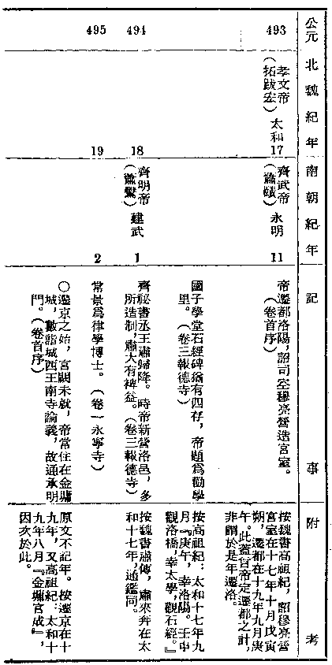



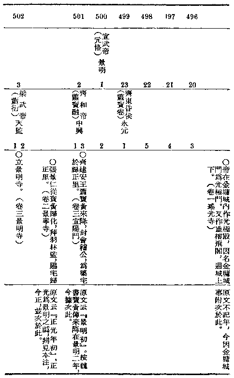



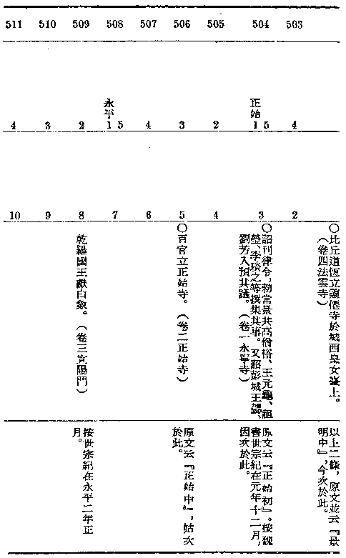



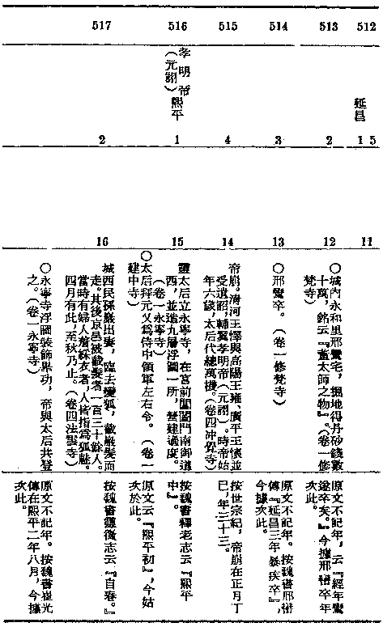



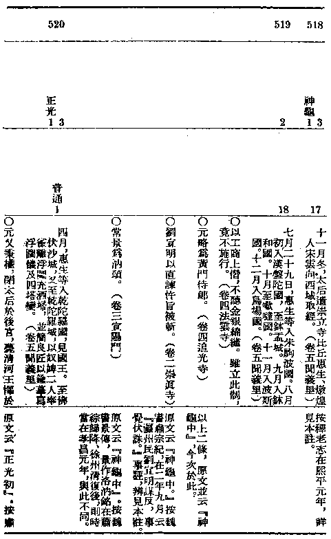



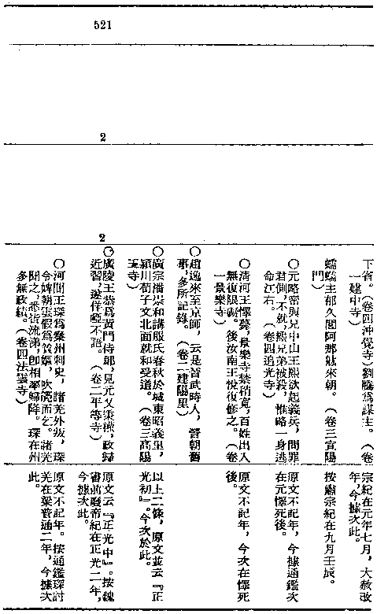



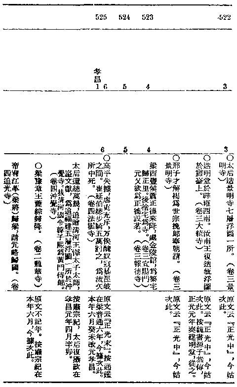



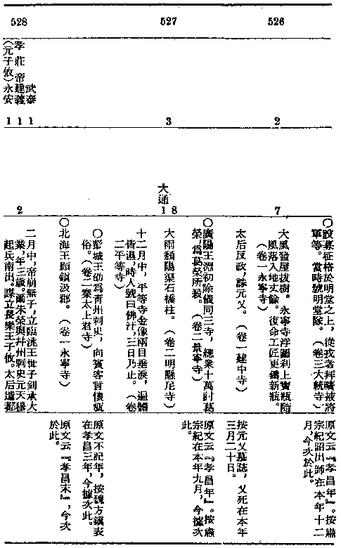



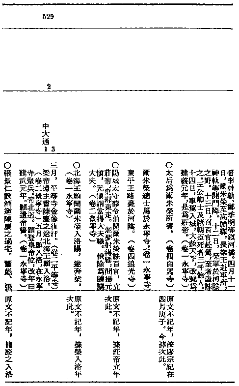



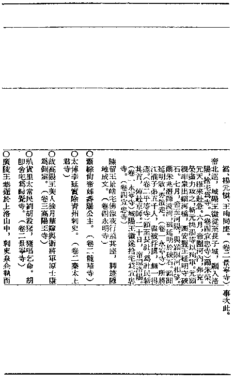



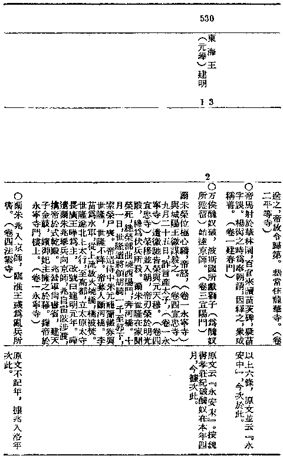



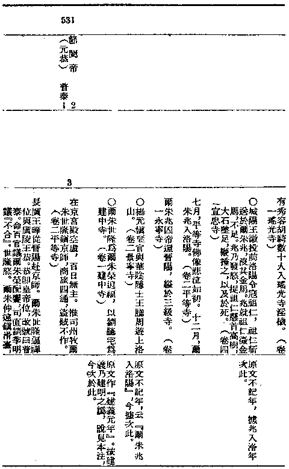



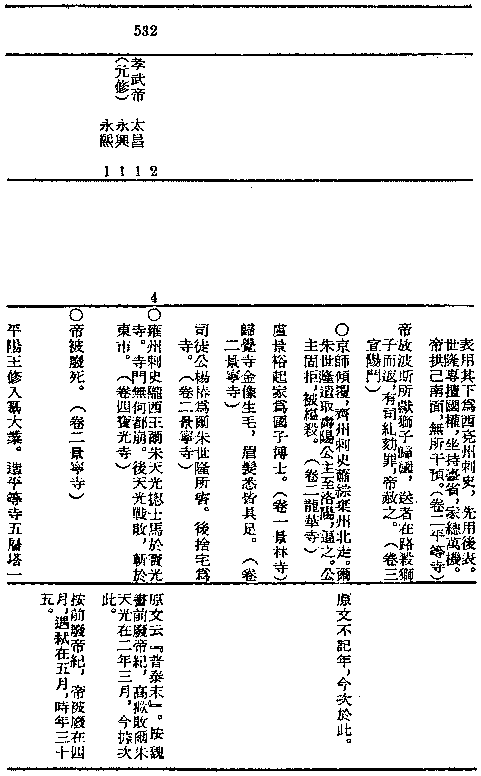



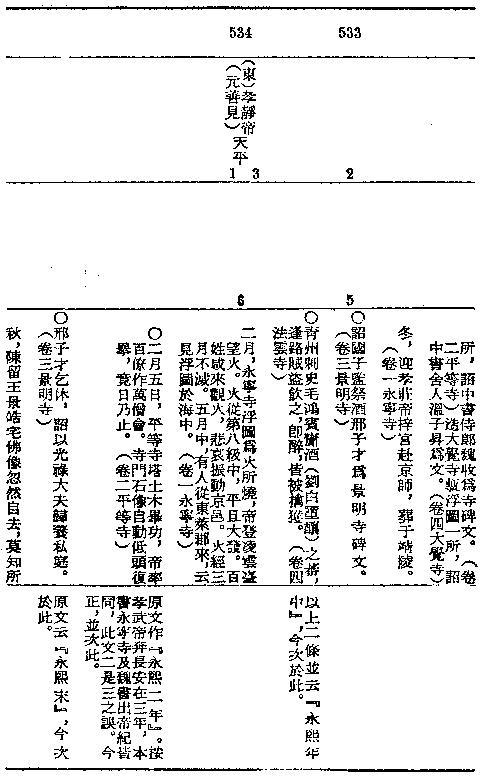



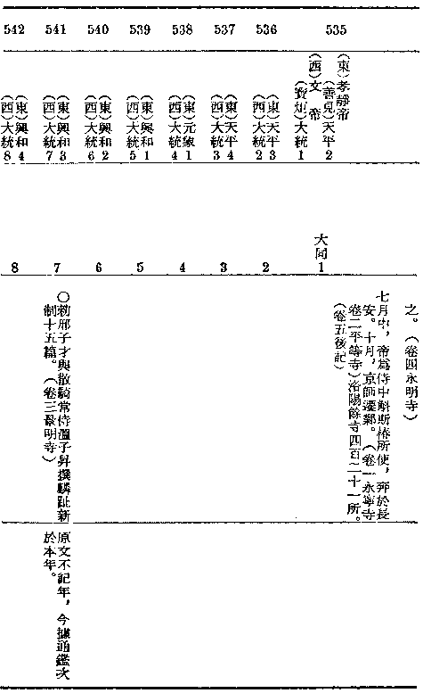



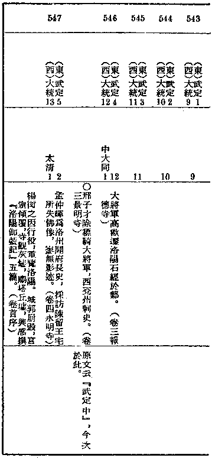

