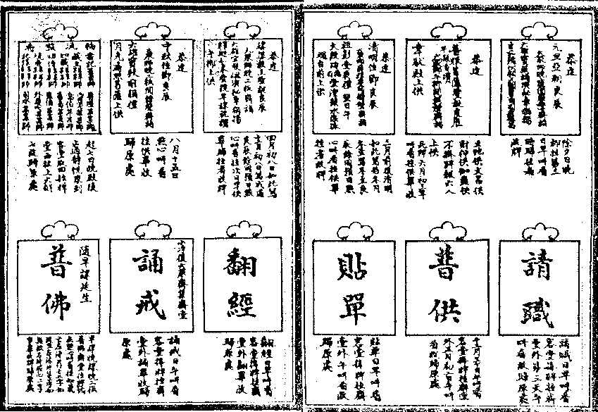
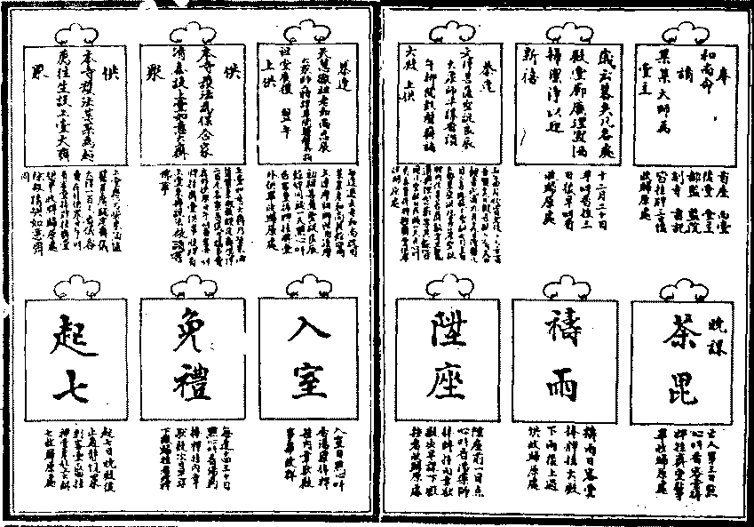
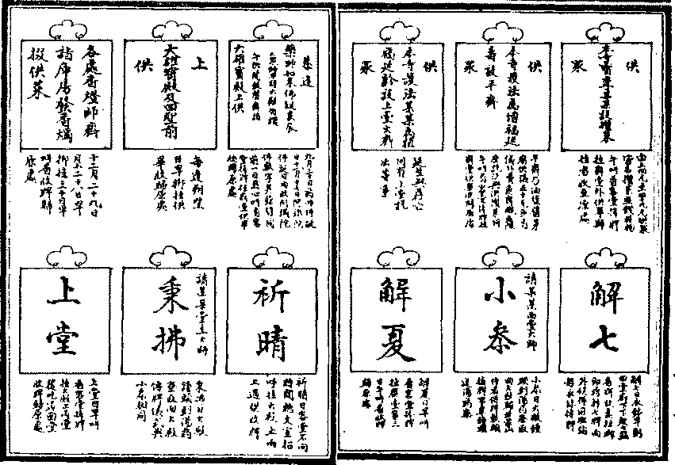
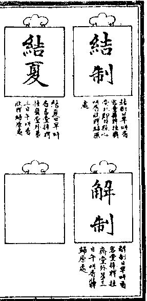
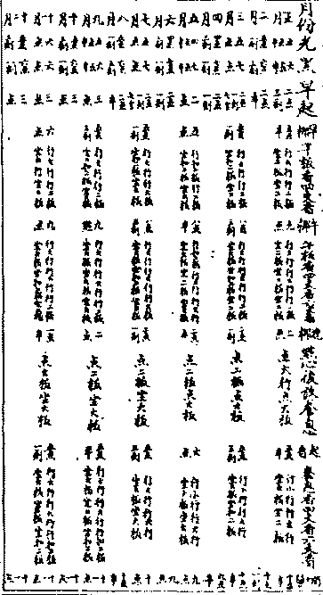

# 高旻寺规约



> **藏经**：大藏经补编（大藏经补编）　**册次** 第 18 册（B18）　**编号** B0098　**部类** 诸宗部　**卷次** 3 卷　**篇幅** 239,249 字

> **卷／品**：0 卷 · 0 品



---



客堂规约目录



满期七月初十十一日客堂圆各行单职规则  

(页)



客堂到七月期头外来讨单进堂规则  

(第二页)



每年八月十六日大请职规则  

(第十页)



客堂当职知客挂单送单法  

(第十六页)



客堂每日轮流当值规则  

(第十七页)



客堂招待徃来各界士官护法规则  

(第十八页)



客堂值日知客领客拈香过堂拜斋坐香𠫭堂规则  

(第十九页)



客堂遇有军政各界及僧界来宾陪客𠫭观法则  

(第二十一页)



客堂陪僧界诸山长老尊宿及本寺和尚之前辈或诸山方丈来寺规则  

(第二十二页)



客堂调理内外清众行单规则  

(第二十三页)



客堂送客到丈室徃丈室陪客规则  

(第二十四页)



客堂不得私出外听经打七应酧经忏及私招徒众私自化缘等规则  

(第二十五页)



客堂不得互相争执及非理责人又中途溜单事则  

(第二十五页)



客堂遇有班首各执到客堂必殷勤招待不得私造饮食共食规则  

(第二十六页)



客堂每逢解制结制收挂各牌式及报供菜领人上供规则  

(第二十七页)



客堂末值老值知客上殿过堂坐香出坡位次规则  

(第二十八页)



僧值接值交签过堂事则  

(第二十八页)



僧值每日上早晚殿规则  

(第二十九页)



僧值送徃生监坡监浴巡签巡夜升座乘拂小𠫭等事则  

(第三十一页)



满期七月期头发单银规则  

(第三十五页)



常住各寮不用小价规则  

(第三十六页)



内外普坡规则  

(第三十六页)



客堂招待诸山首领清众送单报饭规则  

(第三十七页)



衣钵寮日行事则  

(第三十七页)



汤药寮日行事则  

(第三十八页)



客堂照客日行事则  

(第三十九页)



库房库头日行事则  

(第四十页)



饭头日行事则  

(第四十一页)



菜头日行事则  

(第四十二页)



茶头日行事则  

(第四十四页)



大寮大火日行事则  

(第四十四页)



丈室侍者日行规则  

(第四十五页)



上客堂寮元日行事则  

(第四十六页)



云水堂规约牌式  

(第四十七页)



各寮香灯日行事则  

(第四十七页)



斋堂行堂日行事则  

(第四十八页)



夜巡日行事则  

(第四十九页)



打扫日行事则  

(第四十九页)



圊头日行事则  

(第五十页)



大殿钟头鼓头日行事则  

(第五十一页)



大小门头日行事则  

(第五十三页)



常住腐作寮日行事则  

(第五十四页)



常住内外首众上殿规则  

(第五十五页)



常住内外大众过堂规则  

(第五十六页)



外寮坐香典吃放𠫭规则  

(第五十八页)



常住永不应酧经忏佛事规则  

(第五十九页)



本寺圆寂僧众荐亡佛事规则  

(第六十一页)



常住内外首众犯迁单溜单扩假规则  

(第六十二页)



客堂日行规则本寮牌式  

(第六十三页)



僧值日行规则本寮牌式  

(第六十七页)



常住永不应赴大小经忏及各佛事  

(第六十九页)



大殿朔望日或普佛时不用铛鋡用铃鼓代又牌位前不站班规则  

(第七十页)



常住除正当粥饭外不得非时食不得同时另食  

(第七十页)



寺内僧俗人不准徃揭子桥三叉河各村镇  

(第七十一页)



常住阅藏新规  

(第七十一页)



上常斋佛事及如意斋佛事各规则  

(第一百零七)



各种牌式冩法及收挂时间规则  

(第一百零九)



外来送常住礼物与散斋衬各事则  

(第一百十四页)



各寮首领行单公务规则  

(第一百十五页)



满期七月初十十一客堂圆各行单职规则



满期七月初八日。晚课下殿。首执行单齐退执。有告过香的。不退执不圆执。告香就是发过愿的人。初九圆首领职毕。听和尚招呼客堂。圆行单执。知客用纸笔各一件放桌上。不用茶盒。只用清茶。先圆执后请执。圆执时先令照客。请衣钵圆执。如衣钵发心再当衣钵。圆执书在纸上。再请汤药侍者。库头照客圆执者。上名字。不圆执者不上名字。再寮元饭头菜头。大火茶头行堂。圊头打扫腐作。夜巡钟头鼓头。大小门头园头。各处香灯发心再当者名圆执。或这寮不当。在那寮发心名换执。知客必和颜悦色。轻言细语。讲行行功德利益。又比某菩萨之行为。真不当者。或不在本执发心可顺他的意思。看他想到那寮发心随他。千万不肯发心。亦不勉强。圆执后照清单看好。圆了多少。尚少多少。先自报人。来客堂劝当某执。若真无人发心。可请维那师付在堂中。知得一点甚麼人能做甚麼事。请维那招呼报人。各行单请好。开一清单呈丈室查阅。唯衣钵汤药待者。系丈室合用。如请不到。归丈室另着人再找。请职仪式。在内客堂。知客在上位坐。来师在左边坐。如人多。可分两班圆行单执。请行单执。行单师来内客堂。即招呼问讯请坐下。照客随送茶一杯就是。原过请执不当者。或不圆执者请回。问讯就是。知客不得发重言。或哩哪他。宁他粗言。知客要细语。会做事的人。就在这个地方下手。能一请就当。方称妙手。总在客堂平时。为人公正。不委屈。不偏袒。和平作事的成绩做来的。



客堂到七月期头外来讨单进堂规则



七月十三日。早粥回堂。和尚斋堂表过堂后。客堂派照客。到上客堂向寮元师讲。招呼有讨单的师付们。大小架房赶快。听招呼到客堂讨单。照客先打听。有多少讨单人。即找一橙三人之小长橙。约七八条。如人数多坐不下。再加橙排好。讲规矩的知客。派照客到上客堂。领讨单人进客堂。排一字班。班排好。知客招呼一齐问讯。此时知客喉咙要大。言词要清。胆子要壮。心量要细。讨单人听招呼。问讯坐下不盘腿。知客招呼。讨单人坐平坐。手捧弥陀印。头靠衣领。腰干挺直。不得翻眼斜视。不得掉头换脑。知客把讨单人。坐法整齐毕。即高声云。师付们发心。到这边常住住禅堂。足见你们是为道而来的。当知此地禅堂。非比诸方。专门守规矩。一心学用土。其常住大小事。不劳你们一点。你们在来进堂以前。先把各人衣单行李。收拾检点齐备。当修的要修。当补的要补。既到此地。先要发三年行愿。少一天不可的。禅堂能住三年更善。真不能住下。要到次年七月半。准到外寮当行单。能当行单三五年更善。真不能当行单。再进禅堂住。不满三年不能出高旻。但是住下来。务要立志。任苦死了不溜单。要知溜单。是最下等人做的事。每有初住未满期者溜出。走到天下无人看得起。一生的痕迹。用尽海水。也洗不清。古人云。宁可守道而死。不可离道而生。教道过以后。各人要努力精进。要成就一生人格要紧。各人回去。由今天到十六日午。方便你们。不上殿不过堂。听招呼穿袍子。到客堂吃饭。吃饭仪式。照客领到客堂。一字班排好。照客请知客师付出。知客云一齐问讯。各人照位坐好。知客回寮。诸师吃饭粥。天天如是。如知客有要事。无闲空照客可代之。吃毕复排一字班。知客云途中徃返。定要一位跟一位。不得抢前脱后。不得路上哂笑讲话。回上客堂。又排一字班同问讯。脱袍子休养。交代过了。各人留心记好。一齐问讯请回。



到十五日。讨单人到客堂。吃过午饭。排一字班站定。照客请知客出。即云师付们回堂。大小架房赶快。把各人戒牒。取出放好。听招呼穿袍子。捧戒牒到客堂挂号。



十六日早粥后。讨单人吃毕排一字班。知客出云。各人回堂上大小架房赶快。听招呼到客堂交规矩。



十六日午饭吃毕。排一字班。知客出云。师付们回堂。把衣单收拾好。草鞋放包袱面上。担子挑好。照客来一挑就走的样子。不是这一件那一件。拖拖拉拉的。各人记好请回。



七日十五日。午饭回堂。知客派照客。到上客堂。及各客单。招呼讨单人。一齐到客堂挂号。各人把戒牒取出。听招呼捧到客堂。照客急忙找橙排好。知客看橙位排好。即令照客到上客堂客单各处。请讨单人穿袍子捧戒牒。一齐领进客堂。一字班排好。一齐向上一举。各人把戒牒放佛龛上记好。戒牒存那处。免临时乱找。戒牒放好。一齐排班问讯站定。知客即大声云。东西单有销假的师付。一齐站出来。若停不肯站。即吼声曰。你们到这边常住。一举一动。要听招呼。不听招呼要吃苦头的。嘱过当时即站出来。把销假的人。东单销假人放东单前。西单销假人放西单前。再约人数。东西单各半。人年轻清秀的放东单。人年老累呆的放西单。再讨单人初来寺。传言某人在那里当过班首的。或某人在那里当过维那的。当知客的人。眼睛要灵。一见有当过执事的样子。就放在单前。或平时听说过的。某人很好。就把某人看清问好。知客有心在无意中。借题问曰。你在那些地方住过的。听说你在那里。当过维那皮气不好。或说调众狠好。这样一诈。他必直言告上。到了那时。知客当然有数挪班。东西单人数平半。东单人是青年伶俐。西单人累呆老诚。总之年满二十以上者可住东单。年满三十以上者可住西单。知客把班拉好。再详细审看一周。即招呼西单头。坐西前位一排。排排坐好。不得前后𠫭错。东单头坐东前位。次第排坐。不得前后紊乱。讲规矩知客。在外客堂门左边。坐方橙上。盘腿坐好。即招呼讨单人。一齐盘齐腿子坐好。右脚在下。左脚在上。左手在下。右手在上。捧弥陀印。头靠衣领。鼻梁对胸次。腰不湾不直。此时僧值知客。两单巡察讨单人。或哂笑或掉头。或翻腿一一照应如法。讲规矩知客云。即时同你们挂号。招呼那一位。即先出鞋子。复放腿子。走至中间主中问讯合掌。向北走方圈子。向上主中问讯。找戒牒捧好。平胸转面。向西主中。向上一举。即听招呼到那一位前。把戒牒放桌上。合掌站定。听招呼顶礼知客师付。知客云问讯。就问讯。合掌靠桌边站。知客问到答到。不得乱答。交代过了你们留心记好。即云东西单前头。两位师付下位。取戒牒。把挂号钱四百文。交与知客挂号。讲规矩知客。看前二人号。将要挂了。即又招呼东西单。第二位师付下位。主中问讯向上。取戒牒人问讯去。收戒牒人问讯来。方可不耽悮时间。



又双挂号处。用方桌两张。放在客堂靠祖堂两边。摆两条方橙。一条放上边。一条放傍边。要讲规矩知客看得到。持笔知客坐上位。看戒牒知客坐傍位。有挂号人来桌前。傍坐知客即云。顶礼知客师付。正知客云问讯。傍坐知客云掌合好。挂号知客连写带问。挂号规矩。照老号簿仪式。不得增减只字。傍坐知客见号挂好。即云顶礼知客师付。正知客云问讯。傍知客云。戒牒拿过去折好。另摆一张折戒牒方桌。放外客堂外廊下。派一知客照应帮折戒牒。



挂号时。无戒牒不准讨单。假戒牒更不能准讨单。销假人无戒牒不销假。此时有皮气暴恶。性情㐫顽。亦不准讨单。又打听某人在诸方。出过大事的。或此地犯上迁过单的。概不准讨单销假。挂号毕。讲规矩知客即云。各人把各人戒牒捧好。一齐排一字班。向上站听话。回去把戒牒放好。衣服缝补好。未补好赶急补好。各人好好休养。不要充壳子。交代过了。留心记好请回。



又到吃点心后。知客出云。讨单的师付们。到晚课下殿。一齐穿袍子。到斋堂听宣规约。各人记好请回。



十六日早粥后。讨单人吃毕排一字班。知客出云。回堂大小架房赶快。各人听招呼穿袍子到客堂。留心记好请回。知客即派照客。点祖堂腊烛装香。领新请班首各执事。及送寮房首领。请搭衣礼祖三拜。起具问讯。将出外客堂。又一知客派照客。持名单徃禅堂或各处。请各行单。一齐到外客堂礼祖。领班首各首领的知客。一到客堂礼祖时。即派照客到法堂。招呼点腊烛。知客领到法堂。先低声云。新请众领首师付问讯展具。顶礼法座三拜。起具问讯毕。知客即向衣钵师合掌。衣钵师还掌。即弹指掀帘子。和尚出站法座东。知客站法座西下。云。新请众首领师付。问讯展具。和尚云不展具。又云顶礼和尚三拜。尚云一拜。起具问讯毕。和尚领新请执事走前。知客走尾后。到禅堂东。大止静门外。如有请副寺。此时派知客送副寺寮房送毕。即来大止静门外。等候和尚送客堂。和尚到禅堂门口。打小板三下。堂内卷帘子。和尚领新班首或新维那送毕。随送寮房。送法另有规约。禅堂送毕。即到客堂。送僧值知客位。老知客送新僧值新知客寮房。客堂候首领行单送毕。即派照客。搬春橙。每橙坐三人。多少人搬多少橙。知客看橙排好。即令照客到上客堂各处。招呼讨单人。即领进客堂排一字班。一齐问讯。听招呼依次第坐下。讲规矩的知客。亦盘腿坐好。即高声云。今天是你们进堂时期。师付们必先。要立定高上决志。才能够住下来。或有在外当过执事的。到此地更加要紧慎。外面有当过头首的。有当过法师的。有做过大官长来的。有当过军人来的。一进禅堂。性命交与龙天。色身交与常住。连眉毛一动。都要依规矩。若眉毛一妄动。皆犯大规矩。执事招呼草鞋倒过头来穿。赶快就要倒过头来。若心稍疑。即香板如雷吼声。如爆竹声。打死了送化身窑烧。堂中一切事。命行则行命止则止。执事讲皂角是泥里长的。你们不能回口说是树上结的。若一回口。香板打来。手膀子就不能动了。执事讲生姜是树上结的。你万不能说是泥里长的。若一开口。香板就堆下来了。禅堂一举一动。各人照顾自己。油瓶倒了不要你扶。你若用一点皮气。那就是化身窑内要办柴火了。各人留心慎重。今天把大进堂。一天的规矩。同你们讲一遍。各人听好。少刻回堂。把各衣单收拾停当。或包袱或高肩担子。收得玲玲清清。把草鞋放在包袱上面。候午梆开过。一齐到客堂吃午饭毕回堂大小架房赶快。听招呼到客堂。排一字班。交你们行十方礼。交毕请搭衣礼祖三拜。后领你们到法堂拜和尚。和尚讲警䇿规矩一遍。知客云礼谢和尚。又领你们到禅堂门外。东西单一齐抽衣搭竹杆上。各人穿袍子持具。排一字班。东西对面站好。知客打𠫭堂小板三下。堂内监值卷帘子。知客接西单头具。进禅堂行十方礼毕。知客向维那合掌。向东转面出禅堂。交具与西单头。维那师付即云。双班进堂。东西单头。齐走进堂一字班站定。听维那师付招呼。一齐向上问讯。向西问讯。主中问讯。向东问讯。主中问讯。又云为首者出位行礼。西单头即双手持具。向西单二一举手。又向东单头一举手。转面向东向北。又向西平佛前香炉。对班首问讯。转面向南。又向东主中问讯毕。维那接东单头具。班首接西单头具。二具接好。维那高呼云。打催板。老住的师付们走内圈子。广单人一齐上去接衣物过细。西单班首云。新进堂师送位一齐问讯。维那接云。新进堂师送位一齐问讯。新进堂师送过位。赶快脱袍子出外。先把草鞋拿在手中。再挑各人衣单。从西进走西单。东单亦走西单。绕佛龛后到东单交衣单。随急站立换草鞋。万不能坐换。坐则就要挨香板。草鞋穿好。跟人跑香。监值看衣单进堂。即放帘子。到打抽解。维那云新进堂师听话。出外小圊回堂。把各人晾在廊下。东西竹杆上本衣。双手捧好进堂。搭在各人本位后。盘腿坐香。各人记好。午板香开静。听招呼穿袍子。到内韦䭾殿挂号。维那问一答一。不得乱答。挂过号替你们安单安位。上晚殿听招呼带具上殿。下殿大众礼佛三拜后不问讯不打问讯二磬。僧值云新进堂师出位行礼。这一句归僧值招呼。后行礼归维那招呼。维那听僧值招呼过。即云一齐向上问讯。行十方礼兴大进堂同。下殿回堂。维那招呼新进堂师。一齐站在门外。派熟些悦众低声云。新进堂师。向维那师付告假巡寮。先领到和尚处巡寮。又到客堂库房。禅堂到内韦䭾殿。众班首及维那共一处巡寮。四寮巡毕。悦众领到禅堂门口外。排一字班。悦众低声云。新进堂师。跟维那师付销假。顶礼维那师付。那云问讯。那即低声云。赶快进堂。抽衣脱袍子换草鞋。小圊上单养息。晚二板吃茶毕。维那表堂云。新进堂师听话。少刻打过抽解。各人小圊回堂。穿袍子搭衣。连草鞋盘腿子坐。具放膝头上。听招呼出位行礼。听招呼七个问讯。后又招呼问讯展具。礼佛三拜起具问讯。一齐向西单师付一拜。西单师付低头还礼。一齐向东单师付一拜。东单师付低头还礼。悦众师下位子。跟悦众师走。到和尚前一齐站好。维那招呼新进堂师。问讯展具。和尚云不展具。又云顶礼和尚三拜。尚云一齐问讯。和尚云拜班首师付去。悦众领到班首前站好。维那云新进堂师一齐拜班首师付。稍停向东走班首即云。拜维那师付。维那云一齐问讯。那即又云。向悦众师香灯司水师合掌。赶快归位。抽衣脱袍子坐香赶快。此是晚二板𠫭堂事则。到开大静后。堂中礼佛三拜毕。前一位班首云。老住的师付。跟新进堂师看单。闻二磬声普礼三拜毕。大进堂事方完。讲规矩的知客。把进堂后。一直到开大静的规矩讲完。即招呼师付们留心记好。一齐站起来。排一字班问讯回堂。



午梆开过。讨单人听招呼来客堂。一字班站好。照客报知。知客出云问讯。照位坐下。吃毕复排一字班。知客出云。各人回堂不上架房的不脱袍子。把各衣单挑到上客堂廊下。归寮元香灯照应。听招呼到客堂交礼云请回。照客急忙吃饭。把春灯一齐搬出。棹子小橙放外处。知客招呼照客。到上客堂招呼讨单人。一齐领进客堂。一字班排好。知客出教行十方礼。七个问讯。先知客自己教一遍。再教西单头。教七个问讯法。一齐向上问讯。向西问讯。主中问讯。向东问讯。主中问讯。为首者出位行礼。西单头双手持具。先向西单二一举手。再向东单头一举手毕。即右脚先开步。转面向东向北。向西平佛前香炉。对前一位班首一齐问讯。转面向南。向东主中向上。一齐问讯。十方礼教毕。即令照客。祖堂点香烛。复招呼照客。到法堂招呼点香烛。祖堂香烛点好。又派照客到禅堂。招呼维那师付挂二板。知客即招呼。新进堂师。一齐问讯展具。顶礼祖堂三拜。起具问讯。领到法堂一字班向上站定。知客云新进堂师。一齐问讯展具。顶礼法座三拜。起具问讯。知客向衣钵师合掌。衣钵还掌。即弹指掀帘子。和尚出。在佛前东站。知客站西平新进堂人。梢上一行即云。新进堂师问讯展具一句。侯和尚云不展具。又云顶礼和尚三拜。尚云一拜。起具问讯合掌。和尚开导毕。知客复云礼谢和尚三拜大众起具问讯。知客向和尚合掌。领大众到禅堂门外。招呼东西单人。抽衣搭竹杆上。一字班站好。知客打𠫭堂板三下。监值卷帘子。知客接西单头具进堂。行十方礼。向班首圆礼下问讯后。向维那师付合掌出。交具与西单头。回客堂休歇。以后大进堂皆同前。



又大进堂者。有十人以上。可大进堂。如不满十人。作小进堂。凡小进堂。皆当天挂号。当天送堂。午饭回堂。派照客到上客堂。招呼讨单人穿袍子。领进客堂。问讯坐下。先挂号与大进堂同。挂过号随即讲进堂规则云。讨单的师付们。挂过号回堂。把自己衣单收拾好。草鞋放包袱上。等吃过点心。派照客送衣单到禅堂廊下。东西单放好。讨单人回堂。大小架房赶快。穿袍子听招呼到客堂。照客即点香烛。又派照客到法堂请点香烛。知客即令讨单人。问讯展具。顶礼祖堂三拜。起具问讯。领到法堂。先礼法座三拜。知客向衣钵师合掌。衣钵还掌。弹指掀帘子。和尚出知客即云。新进堂师问讯展具。和尚云不展具。又云顶礼和尚三拜。尚云一拜。起具问讯合掌。和尚开导毕。知客复云礼谢和尚三拜。知客又领到禅堂门外。知客弹三指。维那即站堂门内。知客站。堂门外云。新进堂师顶礼维那师付三拜。那低云问讯。知客向维那对面合掌。知客回客堂。维那低声云一齐进堂。到佛前礼佛三拜。维那云。向西单一拜问讯。东单一拜问讯。东西单人不还礼。维那即问那一年住过的。销甚麼执事假。或送东单或送西单。如有五人小进堂。晚二板后表堂小𠫭堂。不行十方礼。礼佛三拜。东西单一拜毕。拜和尚拜班首维那。与开大静看单。均与大进堂同。规矩讲举。招呼放腿子。问讯回堂。



吃过点心粥知客送堂。照讲过规矩做去。如一二三人小进堂。送堂拜佛。东西单一拜与前同。唯晚二板不𠫭堂。等到有五六人再一齐𠫭堂。如人少不𠫭堂。到开大静不看单。凡晚二板𠫭过堂。开大静定要看单。又不问大进堂小进堂。未进堂以前。知客先打维那招呼。要紧要紧。



每年八月十六日大请职规则



每年八月初一二日。客堂把新进堂名单。与老住师付名单。遂一照号簿查点清楚。谁前谁后。必照请职号簿详细查点。开一清单。送丈室查阅。审定或加或减看过带回。候请职时。亲交和尚议职。到八月十四日。住持派汤药师穿袍子。请客库禅三处首领。洗澡后急到大厅议执。衣钵取笔墨砚池放大厅。小价打茶。职事来厅到茶。首领围座。如有初当执事可坐两边。禅堂西单请藏主八人。知藏十一二人。东单只请烧香四人。祖侍一人。记录八九人。万不能多请。请多一二年就到前头。一点规矩不懂反为有碍。衣钵要请烧香。大悦众要请烧香。或有青年在诸方当过大执事的。请东车头。或单二或悦众。或有年稍老在诸方当过班首首领。可请西单头。或请班首。或西单三四单亦可。请执归和尚查考。各执举扬。谁人能请西单某执。谁人能请东单某执。皆归和尚指定。安执议执请执毕。各首领执事排一字班。齐向和尚问讯各回寮。执议好。知客即回客堂。照议执单。誊清新老执单两张。上晚殿拉班用。又誊新请执单一张。是请执报名用。又单誊新请禅堂清众名单一张。是维那在禅堂报名用。又誊禅堂新老执班牌单一张。是禅堂安位用。一共五张誊好。



到十五晚课下殿。知客派照客。持请执单。徃被请执之寮。招呼十六日早课下殿。各人捧衣具。到外客堂坐。候堂师出堂。跟堂师一同到大殿月台上。各处招呼毕回。



十六日早课不观文。下殿回堂。维那招呼大小架房赶快。悦众点手照放香盘东角上。随即催人及如意寮人。一齐进堂。维那看人数到齐。挂腿子坐。即招呼。大众听报到。各人的名字。即咳一声𠻳。随捧衣具出禅堂。报到西单到西廊下站。报到东单到东廊下站。报毕维那即出堂查点一周。即云师付们捧衣具。一位跟一位。不得抢前脱后。跟班出进。各人记好。师付们请。西单头前行。一齐到大殿月台。东西对面站。禅堂班首维那清众。穿袍子静坐。大殿内二知客。一知客讲规矩。一知客宣名字。大殿外两知客。一知客照应东单。一知客照应西单。僧值照应大众。及招呼夜巡打板事。大殿知客报名字。外诸师答。南无本师释迦牟尼佛。报一位答过佛号。即进大殿。报东单站东边。报西单站西边。东西单对面站定。知客报毕。讲规矩的知客。讲请执规矩与𠫭学的话。即大声云。请执这堂佛事。自佛出世。始至迄今。最为重要。无次第即乖尊卑。无前后即乱法众。在大众中。入林不动草。入水不动波。皆规矩次第。如法修行所致。常住量材请执。计事宜人。不容疏忽。恐有在诸方出过头的。或当过首领的。或当过法师的。既然为道而来。必听常住行止。请在前的。不能生欢喜。请在后的。不能生烦恼。或有不当请。请者。人有转凡成圣之功。前念是凡夫。后念是圣人。再有当请不请者。正是常住。另眼淘溶。望成大器。大凡东西前后。常住早有一定规章。不容恶前喜后。抢东求西。皆不能妄动毫厘。师付们只知做佛事。不知有你我。方为出人头地之知识也。𠫭学讲过。现说当行事则。少刻听招呼搭衣持具。僧值招呼夜巡师持板。站大殿东角。见执事到大殿煞头阵。人来一半煞二阵。首领清众齐到大殿煞三阵板。知客将请执名单宣毕。讲规矩的知客。即云老执事师。恭喜新请众执事师。普礼三拜。起具新执分开班来。老执事师前走。直到法堂站上头。知客领新职。后到法堂对面站。知客向衣钵师合掌。衣钵还掌。即弹指掀帘子。和尚出站佛前东。知客即云。新请众执事师。一齐向上排班。问讯展具。顶礼和尚三拜。尚云一拜。起立问讯。知客云分开班来。老执事师前一位班首云。恭喜和尚。顶礼三拜。尚云一拜。知客云新执不动。老执出班回禅堂。新执走老执后。进大止静门。搭衣持具一字班站好。知客取小板椎。先打一下。即高声呼云。新请众执事师𠫭堂。师字上一椎小板。堂字上一椎小板。堂中监值捧帘子。知客取西单头具。进堂行十方礼毕。向维那师合掌。出交具与西单头。维那即招呼双班进堂。佛前站定。维那即云。一齐向上问讯。行十方礼。与大进堂同。礼毕班首接西单头具。维那椄东单头具。班首领徃东走。维那领徃西走。到东西单头。班首云。新请众执事师送位。一齐问讯。维那接呼新请众执事师送位。一齐问讯。各人小圆上架房赶快回堂。维那招呼外寮师付请回。堂中稍等即止静。



早粥打过呌香。禅堂当值打一下小[木*魚]子开静。维那即招呼新请执事人。一齐捧衣具站堂门外。东归东站。西归西站。前后不能紊乱。维那看人到齐即云。师付们一齐到客堂门外。听知客师付招呼。西单头前行。一位跟一位。不得前后错乱。请执原为定的前后。若前后一乱。执是白请的。嘱付过了。师付们记好。即云请。知客老早点廊灯预备好。一见内外新执。各捧衣具到客堂门外。早上在大殿请执几位知客出来。一位报名。一位讲规矩。候名报过。知客即将一天到晚所行的事。讲得高声清亮。师付们听好。少刻闻梆声。搭衣后。二知客双班领到斋堂门外。一字班站好。听招呼云。新请众执事师。问讯展具。和尚云不展具。又云顶礼和尚三拜。尚云一齐问讯。二知客领双班进斋堂。讲规矩的知客。领西单人到斋堂。西二席即云。一齐把具放橙上。知客用手拿西单头筷子。举高齐眉大声云。书记师藏主师。知藏师叅头师送位。一齐问讯。筷放两盌当中架起。知客随问讯。即出斋堂。报名的知客。领东单人到斋堂站前席。把维那悦众二人位子空下来。站第三位。再招呼各人靠盌站定。各人把具放橙上。知客用手拿东单头筷子。举齐眉即大声云。祖侍师烧香师。记录师侍者师送位。一齐问讯。筷子放两盌当中架起。知客随问讯。即出斋堂。这是斋堂送位的规矩。



早粥回堂。维那替你们安位子安单。悦众还坐悦众位不动。出堂可跟新请执序班次。三天后照旧。到晚课上殿。不观文。二知客先站大殿门外。见新值进殿。一知客取西单头具。一知客取东单头具。送位除举筷与斋堂同。至下殿时。归讲规矩知客。带二磬在手。领新执到法堂巡寮。一字班站定。巡寮同前。法堂巡过寮后。知客取二磬在手。到汤药寮即用二磬。先打一下。后一押。呼新请众执事师巡寮问讯。讯字上一下二磬。后某某师师字上一下二磬。其餘各处巡寮。与结制巡寮同。唯改新请众执事师一句。后到禅堂巡寮毕。进堂抽衣。有大小架房赶快。人齐听维那招呼。即到客堂。不搭衣。穿袍子到外客堂站北边。僧值见新执到齐。即派夜巡打板。夜巡见老执穿袍子。到客堂煞头阵。见人来一半煞二阵。人到齐煞三阵。知客听夜巡板煞过。即云新执站西即北边。老执站东即南边。对面站定。即高声云。老执事师替新请众执事师看单。普礼三拜。起问讯各回寮。



晚起养息香。听打过呌香。知客即派照客。招呼外寮新请各执。一齐带衣袍具到禅堂门外。搭东西单竹杆上。等候叅堂。禅堂挂过二板吃茶毕。维那将叅堂规矩。行十方礼。三拜佛东西单一拜。到后拜和尚。前拜班首维那。向悦众香灯司水合掌后。堂中新执抽衣。搭位后竹杆上。外寮新执到堂外抽衣。搭东西单竹杆上进堂。内外首众老执穿袍子。维那云听二磬声。老执事师。替新请众执事师看单。普佛三拜。各人脱袍子盘腿坐香。讲过了各人留心记好。维那即卓杯子。收杯子打催板。跑香打抽解。维那即云。新请执的师付。要穿袍子搭衣。连草鞋盘腿子坐。内外寮老执事师。指班首维那知客。都监监院副寺书记。清众行单一齐穿袍子。脱草鞋坐香。散香回堂维那归位云。新请众执事师出位行礼。首一位班首维那穿袍子。站佛前两边。如人多佛龛两边可站站定。维那即云一齐向上问讯。行十方礼与大进堂同。到拜东单起具问讯。维那即招呼一齐向北走。稍停维那云。新请众执事师问讯展具。和尚云不展具。又云顶礼和尚三拜。尚云一齐问讯。维那又云一齐转脸向南走二三脚。维那云一齐拜班首师付。前一位班首云。拜维那师付。此时和尚出堂。候大众看过单后。再进堂。维那即招呼。外寮新执。在堂外抽衣堂中新执在堂里抽衣。赶快进堂东西站好。维那看老执新执一齐站定。即云老执事师。替新请众执事师看单。闻磬声普礼三拜毕。维那云。外寮师付。到堂外脱袍子。堂里师付脱袍子赶快坐香。巡香师。走过草鞋圈子。息佛前腊烛。末悦众放蚊烟瓦维那高声催云。赶快。不要慢慢模索。即招呼当值三板一钟止静。开大静后不看单。请职后。客堂到大殿拉班共六次。二知客各带请执单笼袖内。将到绕佛时。二知客正西副东。站在供桌二头。面向外。手持请执单先看单次。再看跟班人。前后错乱。如有一人不依次第。即拉来站跟前。找到班次再送他归班。任是班次再走得好。常住规矩。要当个认真办法。三天六次。到绕佛归位。听一下大磬一响。二知客一齐出大殿。出入大殿要雄猛威烈。当一件大事办。万不能早晚上殿。又无错乱。可以迟点到大殿。或可以少来回把。此皆是破坏恒规。如要请执拉班。皆是行的规矩仪式。丛林之大化。众人之𠫭学。除此而外。无一实法与人。僧值在请执这一天吃点心。到斋堂招呼一次云。请执后三天。内外寮各首领行单清众。定要照请执次序。跟班上殿过堂。三天后再依旧班出入。



客堂当值知客挂单送单法



每见云水上士。有杯海浮来者。有一肩行李者。有抝蒲团者。有持锡杖者。有无衣钵而欲挂单者。有有衣钵而来过午者。来自无方。见机作事。如有僧人挑高肩担子来客堂。将担子放门口北柱。进门有问讯者。有礼拜者。此礼拜恐系北方初来。先派照客到外客堂。向挂单人合掌请问曰。你老菩萨。到常住有甚麼事。彼答曰。打扰常住挂一单。或曰会某某师付。或曰特来发心住禅堂的。或当行单的。问毕即报知客。值日知客穿袍子。抄手出外客堂。先到门外看彼衣单有无。或多少。或有衣单无戒牒者。或有戒牒无衣单者。看毕进客堂门内。挂单人起身作拜势云。顶礼知客师付。知客云问讯。音声要响喨。喉咙要宽大。不能在鼻子内陇。音声大增高旻之雄壮。音声小改高旻为小庙。即问你师付从那里来的。彼答云某处。又问徃那里去的。到常住有甚麼事。此时问答不宜客气。亦不宜过恶辣正。声厉色以应之。问毕云送单。挂单人问讯而出。挑衣单走知客后。知客领到上客堂门外。先弹格子内应方进。低声招呼挂单人。将衣单族丹墀。或廊下云。进堂礼佛三拜。后拜寮元师付。香灯师付。又东单一拜。西单一拜。知客寮元同合掌而退。挂单后不得高声讲话。



出尘上士。飞锡高僧。来寺挂单行逆者。或现疯癫。或现痴呆。或仰天唾骂等。知客莫疑是疯子。或呆子。看他落草谈何方。知接待方向。又或形顺者。挑蒲团带挑经像。四仪整设。目不瞬人。请不开言。骂无愧色。凝神变态。又疑非人。莫中一是。知客必随出入顺他行为。至饥时。至睡时。定有狐狸尾子现出。后再可招致周到。果真法门异僧上士。潜行高人者。即报知方丈。请斋作尊客待。又有方便铲。抝蒲团来寺挂单者。知客出外。见有蒲团放两边柱脚。方便铲靠两边柱摆者。定是销假。若押蒲团。铲向内放。定是挂单。铲向外放。定是赶斋。或蒲团方便铲。直对客堂。定是会客。知客留心。必先请问挂单人。挂单人先不开口。因恐禁语故也。照客先不问。知客直问云。老修行何方行脚来。彼或不答。即云送单。彼当随知客后走。送法同前。彼若答云脚跟未动。来自何方。请知客师付道一句。此时知客留心。万不能乱开口。即报知方丈。自有圆满招待。如有持锡杖。来寺挂单者。彼至客堂。先振锡杖摇铃三响。知客即出礼锡三拜。即双手捧锡杖至丈室。请方丈出。接谈经过。办大斋送尊客单。其他。每有谬立之各说皆非。执事者慎之。



客堂每日轮流当值规则



受职客堂。为人师表。威仪型典。范越常人。客堂或四五人。或三二人。常住必以事熟字深为重任。次则职依清众序职为前后论。或头单或二单。或三单或四单。头单当值。必穿袍子一天。招待来宾挂单接众。皆值日知客负责。再如有口音难董之客来寺。若那位知客能董话。住持必请该知客陪之。或向与某知客相熟。及同过事者。即请某知客陪之。或前是某知客陪过。再来还请某人陪奉。取其如法。此外皆归值日负责办理。或大进堂或请职。常住重要公事。概归头单知客办理。如前人不会。听住持看那位事熟。令出办之。不分前后。除招呼办理事毕外。定要轮流当值。值日知客在客堂一天。副知客不穿袍子帮办之。末知客老知客皆要上殿过堂。出坡各不悮事。



客堂招待徃来各界士官护法规则



客堂。每有政界各机关人。来寺𠫭观。必看来宾之行次与坐次。正行时。副官卫士拥於两傍者。中必是主客。又或在前行亦许是主客。如客堂客厅。看之一席二席及上下者。或可见到主客。再或问傍之当差。请彼指定某主客是谁。或有片持片傍问。无片面问当差。每有将进山门。未查确实。把书记副官。当主客待。而主客在傍冷而观望。致令藉事动怒。万万要紧。凡招呼来宾。在人众之中。先将主客之人名。形相衣冠。口语住址。所来何事。查点实在。果若是真无疑惑。急报方丈。或有名片。即送名片交方丈。或方丈亲出迎接。或请到大厅先欵茶点。如耽延时间稍多。再供以香斋。或陪𠫭观。或谈佛法。又军界或大小军官。穿军装来寺者。又是一种招待。不问姓名。不问何事。不问方丈。急请到大厅。或客厅招待。如彼有信佛法语句。或想会会和尚。瞻仰瞻仰者。即答和尚不知在堂坐香。亦或是出外未回。我先探问看。若来势涌急。似匆忙之凶壮客气者。客堂一直作主招呼。免生事外。再或有地方机关。如县长公安局长。及分局长区长。再机关以下之长官。或当差来寺。均要先领到大厅招待。再报和尚。和尚定要亲出招待。当知地方官。乃是父母官。又或诸山长辈。及老和尚或护法居士。及当地董事。客堂直领到大厅。不问来去。不问姓名。即问跟班者便知。如俗客来见来过者。必先查问。以免与常住交际。人情深厚庶好招待。再游兵散勇。饥民流氓。或穿军装者。或便衣者。或穿西装极濶者。定言住持早出有事。知客用以和平语句。清苦言词。或哀求别徃。或敬而远避。或告以苦言。总以善出山门为妙。如饥民有真正公文。又有饥民之多人。即是真饥民。向饥民告以苦言。不去者准他。言我们主人不在家。我去替你斗斗看。收得一千至八百文不为多。若收三五百文你不能嫌少。用钱板收之。散钱满板上。递出送走。每有假饥民。拾得无用之假公文。来寺诈言。多少饥民在瓜洲。或云在扬州。知客即将公文一看。或存过期无用者。或本县本区未盖印者。或假造不符者。稍见形迹可疑。即云我先到你的饥民处。查看一下。再替你想法云。我主人不在家。纵有也不过三五百文。候我看过再讲。若是假的。他定要溜跑。带劝带吓带讲。以无破分文而去。知客为会办事也。



客堂值日知客领客拈香过堂拜斋坐香𠫭堂规则



如有护法居士来寺。及僧客来者。不住宿不做功德。不做佛事。不上殿过堂坐香。当日来会人。或暂时𠫭观。不欲会和尚。当日在客堂吃饭。当日即走者。可不报知住持。若来寺歇宿。或上殿过堂。坐香者。定要先会和尚。后许上殿过堂坐香。何以故。住持称僧房主者。为一寺之主。说法主者。宏扬佛法主。坐禅主者。禅堂之堂头主人。行来主者。即宾中之主也。治生主者。粥饭主人也。若未见和尚。先作佛事者。知客违背规矩。若来宾自云只做佛事。不愿见和尚者。即请往别处做佛事。常住清规不顺人情。岂有大多数之来宾。在殿上拥拥挤挤。和尚尚不知其人为谁。岂有此理。不是慢主。实是慢宾。知客领客上殿。或打早晚普佛。知客即招呼小老。如早殿普佛。即令小老听大殿煞大鼓。急来报知。知客令客小圊架房时。知客避出片刻。即领至大殿。如早可先到客堂。稍等一刻再上殿。若晚有普佛。招呼小老听夜巡板一响急报知客。知客即令客事毕。领到大殿。若上殿领到东单靠钟前站一排。绕佛。知客走前领客。客走在后。若打普佛。听唱戒定真香。戒字出口。知客领普佛斋主。主中问讯。若是女客。不用手扯拉。即近前细声与讲。问讯毕。领从西转面。向上在佛龛向东主中先问讯。再令跪下。双手拈香一举。如是三拈三举。三播毕起问讯。知客复领从东下。归原位主中问讯。礼佛三拜后。向西单一拜。又向东单一拜。问讯领从东上。走佛龛前。到前一位班首一拜。又领东向维那一拜。领从东下向和尚一拜毕。领从西单前。到后拜牌位。复到东单拜僧值毕。领归原位站好。如有老年人可令坐橙。到唱大赞。又领到下蒲团问讯。领上拈香下来。礼佛三拜归位。绕佛时领客走上客堂后。知客在前。客在后走和尚前。绕佛归位。看和尚将起具转面。知客领客拜和尚云。普佛斋主。礼谢和尚三拜。尚云一拜。和尚赞一二句好话。复归位站。至维那宣疏文。与维那同礼佛。同跪同拜佛。又归位。大众下殿。知客看三拜起。未打问讯二磬前。即云普佛斋主。礼谢班首师付。维那师付。僧值师付。诸位师付。顶礼三拜。斋主三拜起。领回本寮。急招呼小老。打茶水手巾各休养。



进堂坐香。不问那一支香。先招呼小老。听开静或听起香。小老一听起香[木*魚]子二下。急报知客。知客即领客。至内韦䭾殿坐。候散香将煞二阵。即领客至维那处。云斋主拜维那师付。拜毕即领进堂走西边先拜班首。后拜和尚。领后位坐。到开静听开门。即领客出到本寮。小老茶水预备齐全。若夜间。小老打灯笼接送。候开静提灯。照客回寮。听客坐香几支。



拜斋堂者。如供斋堂众。小老听打呌香。即报知客。知客即令客在房休息片刻。呌客小解之语意。即领到斋堂。如早可在外客堂稍等候大众到齐。领客听念供养咒出口。进斋堂主中三拜。西单一拜。东单一拜毕。如男客领到东边桌上过堂。如女客领到西单过堂。若客不愿过堂。拜过斋就领回寮吃午饭。如客过堂谅吃不饱。回寮再开饭吃。每有客到方丈。知客不能离客一步。领出领进。全是知客事。如有私犒钱者。归客堂公分。公犒钱者。概归公桶。四寮有香仪。客堂当收之。若任意不遵常住规矩者。定是为钱来的。岂不可惜。后之执事者。宜助常住。莫贪利养。否则名深不喜。又各行单加减更换。听住持选择。令客堂行之。



客堂遇有军政各界及僧界来宾陪客𠫭观法则



知客陪客。大关常住兴衰。何以。每有上级官长。服平民衣冠。暗地探询寺内情状。知客者宜少讲话。一问可以一答。若多一句。当下平地风波。前常住有一知客陪客。遇一反探。何为反探。类如清河县县长来寺。你问他。他即言。我是宝应乡下。教书的先生知客以为当真的。二人相平谈话。似极熟热。就无拘束了。谈到浓厚处。即言清河县的事。若遇一个好人。地方人民少受多少痛苦。这位知客就满口答到。这个县长。怎样怎样。不堪设想等语。比时交书先生。把脸一红即喊跟班的上来。把这个和尚带到衙门去。我闻即出。忙问云。如何如何。对不起对不起。急忙道歉问讯。我再迟一脚出来。已有大兵押送矣。思之大人先生前讲话。僧人不多答。他不怪。答得不对他要怪。领导客至禅堂时。自己言词低少。隐隐的说话。彼客就知道不能高声了。彼指肉身菩萨是甚麼。答这位老首座和尚。了不起的。再问高旻寺有多少田地。即答我们初来。并不深知。又问住多少人。可以直答或三百。或二百几十。人又问一年要多少开销。答不大清楚。问贴的念佛是谁干煞。这句话竟管多答。恐其看有僧人谈笑时。或护法处或吃斋处。或有不净处。如丈室或花园。六角亭。有关系打扰之处。可少领去。或上殿。大殿斋堂。过堂时。多领去。又问你们寺院。还有甚麼古迹吗。答前有。由咸丰年兵燹后。片瓦无存。如有军人来寺。或地方机关。拟找房间。必指出这是饭头的寮房。这是大众上殿做功课的地方。这是大众吃饭的地方。必存心慢慢引导。万不能来住的目的地。或引言三汊河扬子桥。那里能住多少。这边乃是天下第一。极关佛法重要的一家。恳请先生慈悲。成全道场。先生之功德与日俱升也。尽讲哀求好话。万不能逞自己皮气。高言大语。乱充一顿。把人铳得心火烧天。本可不住不来搔扰。似这无礼行为。偏要来住。还要你知客让房间。这样做下去。不是护高旻。实是坏高旻。病在不依常住规矩。依自己皮气。若依常住规矩。坏事成好事。若依自己皮气好事成坏事。陪客答话。声声赞叹常住。句句不离好字。老实做事。本分为人。方许无过。



客堂陪僧界诸山长老尊宿及本寺和尚之前辈或诸山方丈来寺规则



僧客至。彼有道人先投片。或通知云。我们是全山方丈。或是天宁寺的老和尚。知客闻知。即忙派照客通知和尚。自己即到大门外。或外客堂迎接。陪同徃方丈。一路问答同前。到方丈办斋设席。安单送单。悉住持指使。候吃茶。住持招呼知客。嘱合众班首。来丈室。齐拜请山长老。又招呼客堂众执。来拜诸山长老。库房都监。监院副寺。齐到丈室。拜诸山长老。又衣汤寮。衣钵汤药侍者。齐来丈室。拜诸山长老。凡外僧客送礼。酌量感情收之。如谢常住者。只收腐仪不收香仪。套礼收一件或二件。如诸山来寺请客者。香仪与礼。概不收。如准於所请。可收腐仪或套礼三四件。凡有人送礼来寺。务要开发敬使或力钱。酌给至多一元。礼盘送客堂。带和尚名片放盘内。住持送客。尊客与长老。均送出山门。若首执及次等护法。送至客堂。再长会面之客。送出丈室门外。即对面合掌。回首即归。再查所给。犒钱与供众欵毕。回丈室。凡送来任何礼物。概作钱数若干。派二八分犒使力。如送礼洋四元。犒敬力八角。如送礼物值洋六元。应犒力洋一元二角实因常住。处乡僻之间。比他处稍多一点。办事人当知之。



客堂调理内外清众行单规则



行行一事。实是菩萨事。单有菩萨心。还要菩萨行。每每发心则易行事则难者。皆无菩萨行也。如何是菩萨行。以舍己从人。至於连自身穿的裤子。都舍得人不顾自羞。又如我真未犯规矩。忽被人言我犯某规矩。挨打脾骂。至於脸都打肿了。反言你老人家慈悲。我的业障重。请你多打几下。打过还要磕头谢谢。劳他打我。去我重障。如此身心俱真。毫无装做或勉强者。此是真菩萨行。何也。能受无根据之屈曲。真屈曲不作屈曲会。反为正受此人实僧中宝也。若稍次者。僧值闻有某人动无明。必和颜悦色。正声劝诫。降而服之。斯可了事者。执事会做事。若一见行单。高声斗骂。或动手者。知客先不察其所以。不问其所由。不分曲直。走上前不是恶辣。就是几个大耳巴子一打。彼时任何也不顾。即乱吵起来了。此时并不怪他。何以。实是初发心的人。或是恶障重的人。更要面子。只好当下。把一点面子与他。到反易了。若持我是知客之势力者。这一耳巴子就艰难了。不是令行单犯上。就是迁单。弄得内外不安。请教做事。还是先把面子待人好。还是自己要面子好。若自己要面子。已经弄得内外不安。连自己将达到。不得下台时间。所以古人云。有德者能容事。又能容人。一面把常住规矩顾好。一面调解行单紏纷。至於还不了事者。或可与行单说好话。就在私处向难完行单。合掌劝解他也。不算倒架子。常住知道。要特别感谢你。言你能办事。又能了事。何不快乎。此排解紏纷者。外寮。达到极点之犯处可暂用。禅堂不得私用一次。



客堂送客到丈室徃丈室陪客规则



每逢丈室有客。皆是知客正事。每有知客陪客到丈室。即溜而跑之。或云送到丈室。即是和尚的客。我们客堂。可不多过问。如此岂不是。和尚要做知客了末。此皆是少𠫭学的人做的。凡有客在丈室。更加要殷勤招待。生怕客在丈室。受冷淡受不安。必提心吊胆。安慰客心。勤呼小价。茶水手巾多到。桌上地下。椅子房间。一日二次。拭扫窓门灰迹。洒扫清明光亮。客之出进。与房间什物。勤呼小价照应门户关锁。不得懈怠。恐有游人。或散兵撞入。致生意外。如。某知客陪客。令客发生事故。该知客受完全责任。深为重要。每早客欲上殿。头天招呼小价留心。钳椎万不能悮事。次早小价到客堂。一请即起。赶到客厅。照应客之茶水。领客上殿回。回寮修息。复来客厅陪吃早粥。凡吃粥饭必陪同吃。出入殿堂坐香。陪同徃返。客至三五天。或十天八天。陪此客的知客。不当值不他往。把客送出山门回。呼小价收拾打扫客厅。方为了事。



客堂不得私出外听经打七应酧经忏及私招徒众私自化缘等规则



僧人之资格。以不犯规矩。严守清规。亦令人谨守清规。为僧人资格。住丛林不守清规。自犯规矩。责之不服者。人格扫地也。既任常住事。必以事为身。以身为常住。此是上等资格。若藉事出外听经打七。及私应酧斋主经忏者。不但不顾资格。连现住丛林也不顾。因果的目的。就是把最高无上的大法门庭。改变一个经忏位子。虽因果如是。报应之速。不得而知由一错而自有百非。重叠演出。或私招徒众者。或私自化缘者。丛林本十方办道之场。收徒弟化私缘。大与清规违逆。林下旧有恒规。凡有人皈依三宝者。有欲出家者。只有住持一人。当然化度。其四寮各执。不得在寺私收男女皈依弟子。及私收徒弟。查出当以清规论之。纵有出家。必过二十岁以上者。住持收之尚在寺外落发。因避免十方门庭故也。又化缘。定要和尚亲自请过。方领常住捐册。化一文钱要交常住。若借化缘之名。肥身入己者。即是拉债买地狱下。务宜慎之。常住查出不共住。



客堂不得互相争执及非理责人又中途溜单事则



现在正是住的斗争坚固的世界。过的斗争坚固的时劫。吃的斗争坚固的茶饭。穿的斗争坚固的衣裳。任是神仙下凡恐难免这一件事。我说天下事总好做。要得免争斗这件事不好办。何以非斗莫吃。非斗莫穿。通身通世界是一个争斗做的。若要摆脱举世难能。唯有不要面子。不求衣食。不问得失的。苦苦𢙉𢙉的出家人。稍有相应。如客堂共事人。做何事说何话。先把自己向来要面子的。一点恶习丢开。任是话中刮苦我也好。任是话中盖了我的面子也好。任是他人说我不好也不采他。再或这一点有面子的事。派我做的。他抢去做。这一点得罪人的事。或遭踏人的事。不派我做的。反劝我做。或逼我做。举世之人能在这里。得到无我无人之心地消息。可以瓦解前非。为个好人。不打支扎。否则万难矣。再者行单。共事人不和。必先审实两方情见。不徧不中排解。若非理责人有过也。又办事时。思之身体又弱。色力又单。暗病又多。茶饭又苦。先已发愿要住二十年。直到业识一翻。现前就把前愿。通身遮盖了。听业乱翻。这妄想打起不顾声名。不顾怕丑。不顾自己。不顾常住。不顾大众。因果报应。任是地狱火坑赶急要跳。人能在这种苦状。会回过头来。即言那一处有高旻好。那一生再来高旻。那一人从这里能转过头来。如是此人。不但不被恶世转。及不被恶业转。恐佛出世也转不去。幸也何如。否则溜吧。那里不好吃饭。云云苦苦苦好苦。何日是你回头日。痛心痛心。



客堂遇有班首各执到客堂必殷勤招待不得私造饮食共食规则



客堂为四寮集会处。或班首各执来客堂。值日知客当以尊客招待。送茶牵[柩-久+亢]。请上位坐。对班首执弟子礼。对各执作手足亲。谈心讲话。必谦让一点。不能满口[打-丁+(亥-人+(乳-孚))]人。令人面红失色。如有伤心伤情伤理的话不宜讲。最要紧。不能在各人寮房讲话。一到寮房。两方都犯规矩。又不能以茶敬供养。故意弄点乾食烧烧。或弄点面下下。或弄点点心吃吃者。又犯私造饮食清规。不得无故用洋油炉或洋铁火炉。放在床底下。或放在桌底下。或放在暗无人知处。正是犯不共住规矩。住丛林原为恶习太重。骄傲太深。故来吃苦除之。不但不除。反回复原状可耳。告知有人心者万莫出此。此乃堕落人道之行为也。要紧要紧。



客堂每逢解制结制收挂各牌式及报供菜领人上供规则



客堂遇有朔望。或诵戒结制解制。解夏结夏。菩萨诞辰。祖师忌辰。各种牌式。到时。即挂万不能悮事。每逢解制结制。解夏结夏牌。挂三天。又大请职牌挂三天。又请职二字牌亦挂三天。令各寮到库房取过年香烛物件牌。及扫尘牌。普供牌。均挂三天。又请班首执事牌挂三天。又祷雨祈晴牌。挂大殿外柱上。其餘午饭以前的佛事牌。早粥听打过呌香。挂点心以前的佛事牌。午饭听打过呌香挂。又早课普佛牌。在头天点心打呌香挂。晚课普佛牌。在本天点心前打过呌香挂。又挂三天的牌。是早粥打过呌香挂。请班首的牌。是午饭打过呌香挂。晚二板佛事牌。是本天点心打过呌香挂。每逢双供单供牌。早粥打过呌香挂。到午饭打过三下火点。照客记好。将牌收回客堂。挂原处。其餘翻经牌。诵戒牌。皆事毕方收。凡斋堂挂上供牌。必要招呼照客。报供菜取铛铪。各处供上毕。供菜派香灯送斋堂。如朔望供。末知客定要上午供。大殿供毕。领东单人。到大寮伽蓝殿。供毕回客堂。照应钳椎礼拜。与僧值同。



客堂末值老值知客上殿过堂坐香出坡位次规则



知客临班。当过正副当值外。必须轮流上殿过堂。坐香出坡等事。大凡来高旻𠫭学。首先为道而来。不但执事不愿当。至而吃饭也阅打义。等到静久思动时间到来。常住请到定不违背。常住慈命。既送客堂。首则循行公事。似有英雄超绝气象。由禅堂严厉习惯纯熟。一到客堂。通身一放懈怠行为。难於目覩。至尔送单穿袍子。似竟有点嫌麻烦。再讲到我是为道而来高旻寺的。这一句话。再不肯讲了。派上殿之知客。到殿上在班首。上层蒲团站。绕佛跟前后次第走。徃返回寮。亦次第走。过堂稍早。在禅堂大众前进斋堂。坐西班后第二席。斋堂是通位。无零位。可先来坐前。后来坐后。过堂回堂。走班首维那后。次第走坐香到打抽解进堂。或进堂行香打抽解坐西单第二位。如前有人。坐第三位。或维摩龛后。靠班首坐。或东单前靠悦众坐。或东单后亦好坐。开静如有要事。听开过门出堂。或小圊茶。规矩茶壶走过三个圈子可出堂。加香时。每隔一天监香一次打七每天二次。



僧值接值交签过堂事则



新请僧值。和尚送过位。知客送过寮房。到过午堂。听打过三下火点。客堂派照客将僧值灯笼点好。同签一同送到斋堂。灯笼送在斋堂门外东挂好。签放斋堂供位前。对东台灯竖靠好。即回头单知客。领新僧值走维那后进斋堂。悦众师不打问讯二磬。头单知客。即令新僧值主中一问讯。云新请僧值师付问讯展具。顶礼和尚三拜。尚云问讯。随转面向东。站离开中位。知客即主中问讯合掌。向西走方圈子。向上主中问讯。即双手捧签向上一举。转身向东下来。又主中一举。即转面向僧值。僧值即问讯。知客交签与僧值。僧值横持。知客一问讯即出。僧值即横持签。主中一举云二磬。即转面向西。从班首位前头。绕到西二席当中。向北从和尚后过。走东二席中过。即出走西廊。到客堂签放原处。灯笼息好。挂客堂祖堂前。具不放。持具到斋堂。先在东格畧站。即向西走。见有饭盌出者。或盌筷未摆好即招呼。到了三天以后。殿堂有不如法。随有随讲。不得私徇情面。候东西前维那班首。两序吃毕即徃进门。五块砖一站。抄手捧弥陀印到饭食已讫。当愿众生。所作皆办。所字一出口。即转身向外慢慢走。念到具诸佛法。具字出口。向上站定。候斋堂班首。维那书记走出。西单头将要出门口。即走上向外。站供桌前。稍向东偏一点。候大众出堂。坐维那位吃二堂粥饭毕。即招呼行堂洗盌筷赶快。事毕进堂坐香。又早午饭。听打呌香。急进斋堂。若见和尚进斋堂。即招呼站起来。见东西单。假如有一个人坐者。即呼云站起来。见和尚坐下来。即云坐下来。僧值从西席中间。复至东席中间。详细查看。桌橙盌筷。如桌子未摆正者。或橙少一条者。或盌未铺齐者。或筷少一只者。必须检点如法。免动大众念头。至大众过堂同前。



僧值每日上早晚殿规则



早四板未响。要留心或查看。恐夜巡睡着。错过时间。一睡到天亮。僧值咎何能免。何以。几百人的早修。被这一点大意。送了几百人到黑暗处。其罪之大。可想而知。又留心早课大钟未接鼓。又留心鼓以煞过堂中来挂板各钳椎必响喨清彻。否则概是僧值的事。一听大殿鼓响即自点灯笼。到大殿挂在大门东外进大殿从西绕东。照应钳椎香烛。班次蒲团。如铃鼓的椎子不见了。或大[木*魚]柄活动了。又小[木*魚]子拿出去未送来。又看大腊烛灯花太大。恐边子烧坏油泻下了。又看香歪倒进大殿先看和尚大蒲团。如歪即摆正。候西单进殿。夏天中间东西两排。每排站出六位。冬天每排。站出八位。十四三十日与平时大忏悔文。名跟班站。每日早晚上殿站班。名排班站。如有拜佛。前后不齐者即吼声如雷。每逢七月期头。一个多月一见稍有不如法。即是耳巴子。大殿若三天。不听耳吧子响。大众就打地舖睡告。一天不听僧值吼声则大众又放逸了规矩越紧。住人越多规矩越松越无人住。当执事的人第一深明大义。大殿先站东格前听三下大[木*魚]子打过。即到中蒲团问讯展具。三阵大[木*魚]子。礼佛三拜起具要快。三阵大[木*魚]子后。四椎问讯。即走转面向西。看西单班次站好。未好随挪。和尚听维那开口磬一押。即主中问讯。礼佛九拜。僧值绕到东。看东单班次站好。未好就挪毕。站在大[木*魚]子南。留心打钳椎。念到佛号后。即到前东柱西站。听放掌大磬将打过二下。僧值主中问讯。向东转面。出大殿提灯笼。礼祖堂。见龛上香歪者扶正。门开者关之。礼祖毕。到大寮礼监齐。见茶炉盖厂者盖之。见灶内火未熄者熄之。见水龙头水大滴者扭紧。见有行单未上殿者催之。礼毕又到伽蓝殿礼圣。见各寮有人未熄灯催熄灯。催人上殿。礼毕又到内韦䭾殿礼圣。见有三人告殿假。此处无一人盘坐者。即到架房。如意寮各处。定要查出坐归原处。下次殿催销殿假。四圣礼毕。即自提灯熄好。提进大殿。挂东格上。从西后拜海岛。绕东看行单到齐否。到东前归本位问讯。具放东柱西本位上。随到大[木*魚]子下站好。如敲铛子。即站铛子跟前。照应钳椎。一听赞佛偈子。随到西单。慢慢走少站一刻。至绕佛。即到中蒲团前。靠西一块砖站。如上客堂挡团子即推开。走上客堂后。转到西后。看那里鞋子作声者。或咳嗽不掩口者。或前空一脚者。即到犯规矩处。跟班绕佛。一听小[木*魚]子转板僧值随即走书记后。到东铃鼓傍站。打大[木*魚]子人靠僧值站。敲小[木*魚]子人靠敲大[木*魚]子人站。僧值见班首到海岛。僧值及敲大小[木*魚]三人即。转面向北。打大[木*魚]子人。见班首到大[木*魚]子处即转归大[木*魚]子处。拿[木*魚]椎子举齐头顶。僧值候人走过。走和尚前。合掌跟团子归位。不必扯站班人。向东站。让和尚走过。即向北。此例可免。即候和尚走过清众不动。跪观十者。念到极乐世界极字出口。即起身向西走。跑人空宕里。听到那里拖腔。就举罚。看到那个合掌未合好。要举罚。打耳巴子。东单宜多打。西单宜少打。慢慢走从西而至东归位。跪下又听二者称赞如来。二字出口又走。慢慢听到带看。绕一转归位跪下。后不查班。直到唱韦䭾赞一句后。僧值礼佛三拜毕。靠东格站。大众唱赞毕。礼佛三拜后。对面站依次下殿。候书记走出。僧值走上。面向外靠供桌。东台灯站。如有不如法。这时就要讲。出殿毕。招呼大殿收拾好回寮休养。



僧值送徃生监坡监浴巡签巡夜升座秉拂小𠫭等事则



人将身灭。气未断前。僧值即进病室审查细看一周。随嘱看病人曰。亡人一切物件。任何人不得私取。私取犯盗戒。人未死时。物归自有。气断识尽。概归常住。若私取一物者。即是盗十方僧物。应堕阿鼻。随报四人。念南无本师释迦牟尼佛。停七小时。看病人替亡者沐浴。穿半旧衣服。小褂裤一套。中褂一件。袍子一件。不搭衣。具放下坐。其餘棉夹衣服。不能加穿。有防火不通烧之过。所有亡者银钱衣物。知客开单。僧值点数。大小各件一概开清。若僧值知客私取者。及私送人情者。查出即犯大清规。外有看病人。及洗澡二三人。只准鞋袜一双。与看病人。草鞋一双与帮忙人。手巾二三条与洗澡人。下餘各件。派看病人或帮忙人。同僧值领送丈室。侍者照单点数。若有相熟人或执事。私留存款。或钱不交出。留买锡箔与亡人者。查出迁单。亾人遗资。常住先提柴火说法入塔各费六元。下餘多少。听常住指定用途。遗有衣单存丈室。留与内外无衣单人补助。念佛昼夜三永日。是日点心打过呌香。照客将茶毘牌挂斋堂外。随报供菜一桌。归照客照应。香烛蒲团封条。及举火把一一办好。灯笼送龛处挂好。堂中香到打报钟。打板上殿。大众到大殿打普皈依后。僧值领班到亡龛处。维那举清凉地三称后。举南无十方三世佛菩萨三称。念大忏悔文。徃年大忏悔文。在化身窑念。现改在寺内龛前念。何故。每有送到化身窑前。夏天太阳又大。或猛风或暴雨。或雪路难行。或冷风彻骨。故化身窑不念大忏悔文。后念变食真言。僧值听念。到曳曳那头一曳字出口。即取封条放手中。看班首主中站定。二磬煞过。即递封条与班首。班首说法毕。云封。僧值把封条接过不贴。放龛上扎好。僧值打灯笼走亡龛前。到即挂供桌边。照客听到云起。赶快搬供菜桌子各件。送化身窑前摆好。大众到齐。维那举清凉地三称。后举般若会上佛菩萨三称。后心经变食真言。僧值听头一个曳曳那。曳字出口。即点火把。候煞过二磬。交与班首。班首说法毕。复接过来放化身窑洞口内。维那举三宝大赞后。唱愿以此功德。回向真法界。上报四重恩。下济三途苦。我等与众生。三世诸业障。惟愿尽消除。同行无上道。念毕僧值云。师付们一齐问讯。各人抽衣折好捧正。次第跟班回堂。外寮回寮各养息。



又出坡共有四种坡事。一内外寮一齐出坡。和尚押班。二外寮坡事。外寮闲班首闲书记。知客副寺。都监监院。各行单上客堂。僧值监坡。三行单坡。无知客当家副寺。各首领执事。尽是行单及上客堂。亦僧值监坡。四上客堂出坡。僧值不监坡。大概外寮坡居多数。僧值领众勤劳。要加倍鼓励大众。出力辛苦。众无厌倦。名会调众。每遇坡事。定是和尚先令库房。到客堂报坡。又有侍者。直到客堂报坡者。一声报过坡事。万不能不去。又不能去迟。又不能藉事明天。或藉词委却者。僧值当受大检点。如事体重大。需时又长。每天听住持。约定时间收坡。如临时者事毕收坡。或半夜或吃饭或静中。一报即到。否则破坏常住。断大众福种。两害大也。后执事者留心。



又监浴者。除过年之二十九日洗年澡。不开梆不监浴外。其餘平时。每逢初八。十四。二十三。二十九四次。僧值与众首领。同洗过就位坐好。不出澡堂。见有讲话者。哂笑者。挠水者。如犯各种规矩立即主罚。候三梆开毕。上客堂洗过。僧值招呼圆头锁门。每年正月初三日。四月初七日。五月初五日。七期十月二十一日。十一月初七日。十一月二十一日。十二月初七日。又正月初七日。洗澡起七。皆是洗澡日期。又夏天除例规洗澡外。如天热听住持招呼。每月多洗几次澡。即令僧值招呼圆头。午饭后烧澡堂。是日过点心堂。僧值主中站表白云。今日是洗澡日期。班首各执在绕佛归位。回寮抽衣洗澡。晚课下殿。禅堂诸师分二三四班洗。外寮上客堂先后洗澡。洗好锁门。表堂毕圆头不请洗澡。大众不闻梆声。凡晚殿后洗澡。不开梆。僧值监禅堂人浴。外寮可随洗不监浴。



又僧值行签者。每年每月。由十四三十。初一十五四日行签。年底三十晚课。正月初一早晚课。初二早晚课。初三早课。巡三天六次。又四月初七日晚课。初八日早课。十二月初七晚课。初八早课。皆是巡签日期。七月十六日大期头。巡签三天。又僧值新接执。巡签三日。巡签仪式。每到巡签时。僧值搭衣持具。到外客堂。主中问讯。合掌西上。持签横向上一举。转身向外。又主中向上一举。向南转面。签放右肩。右手心向上持签。名肩上餘一尺。手下餘一尺持好。左手提灯笼。出到大殿。放门外东边。字向外。下脚离格一尺放好。礼四圣放法亦同。至下殿。仍持签回外客堂。放原处回寮。



又每月升座佛事。有礼祖升座。有不礼祖升座。如四月初八不礼祖。十二月初八不礼祖。出位时僧值云。双班走。领到法堂。僧值站门东边。看上客堂人到。云齐。此齐字声气要高。每逢升座如此。又大殿拜年。见人迎过喜神回。尽云齐。又贴单到法堂。见人到齐。云齐。又每逢礼祖。看人到齐。云齐。又诵戒看人到齐。云齐。凡升座秉拂小𠫭。僧值领二悦众。路上四椎二磬。迎请皆同。



又每天禅堂。有三次。多则四次坐香。早板香。午板香。养息香。唯养息香进堂。候打过抽解。从东绕西。慢慢走到。看到看有那一位行单。未进堂坐香。共有几次未进堂。看过归僧值位坐香。其餘早板香。午板香。午四支香晚六支香。及七期那一支香。皆直到位坐香。不走圈子。



又每天开过大静。煞过夜巡板。僧值自点灯笼。一手提灯笼。一手持木棍。各寮门外各佛灯处。及大小寮。查有火灯未息者令息。人未养息者令养息。大小寮灶门外。柴火未扫清者扫之。听有人闯寮即斥而去之。看有三五成群。集背处谈心。驱而罚之。总之开大静后。若见寮房有一灯。若见途中有一二人讲话。此犯最大清规。



满期七月期头发单银规则



客堂前数日。将内外寮。除清众及各人名字。开一纸单。某人是饭头有一年。某人是大火有几个月。或某人公务有二十天云云。开毕。即将各人单银几月几天。派多少钱。详细一算。后扎一总数。送和尚𠫭阅。新例班首维那。僧值知客。都监监院。副寺书记。凢当值领众者。每人每月一元。每年十二元。若延寿堂班首首领。及闲寮房班首首领。每人每月五角。每年六元。饭头菜头。大火茶头。腐作剃头。架船水头。每人每月一元。每年十二元。衣钵汤药侍者。念佛堂行堂。圆头打扫。各香灯钟头鼓头。寮元大小门头。圆头牛头。库头。照客夜巡阅藏。每人每月六角六分六厘。每年八元。禅堂香灯司水悦众。每人每月五角。每年六元。唯班首各首领。才来寺三天或一天者。当照几月几天发给单银。如班首各首领。至发单银头一天要走。或藉事他去。要单银者。一文不发。诸方亦然。又行单代有别执。或代二执三执者。只发单银一分。又各行单照天数发单银。譬喻做十天发十天单银。三十五天只发三十五天单银。又有当行单。当到八九个月不当者。有当十一二月。不满三年不当者。或在寺住。或由外回寺。欲取单银者。概不能发。三年一千零八十天。少一天不发单银。如一行单有二人。或三人。不公务到期头已公务八九十个月之久。不公务者。归后来公务期满之人。准发单银。发单银皆尽后不尽先。客堂至十五日点心后。听和尚派那一知客。来丈室取单银钱。发单银先派照客。到大寮招呼。饭头菜头。大火茶头。来客堂取单银回。再招呼行堂来。约一次。招呼五六行单来客堂。做事人才不心慌。若一齐招呼来者。众口哨哨。做事人难办也。慎之。



常住各寮不用小价



檀信脂膏。行人血汗。施来供养修行。幸我高旻。常住内外。悉属僧人。任是打茶打水。掇饭掇菜。宜自动手。不假别人。末世之人。最薄者是福。若有福不称末世。增福之道。贵在力行。乃自身勤苦耐劳出力也。当知拈一草之功。尚报法身之福。穿一针之德。竟抢他人之先。如库头照客。只做常住公事。若客堂库房换下衣服。皆自洗浣。寮房自扫。溺壶自倒。若藉势妄劳他人。自己不顾舍福。常住知之。难於重视。其人格当知。彼此皆是佛子。所做皆是佛事。应当互相培福。不得忘形不修德行。一则犯常住共住规约。一则特来常住。[身*卑]一身重己轻人。瞒因昧众之大债。是真可怜也。小价是乱丛林坏道德。告诸天下后世。各寮不得用小价。其庶乎幸焉。



内外普坡规则



如外寮有坡者。归和尚令客堂。招呼照客。至禅堂门外。弹格子三下。内出问清白。至某处出坡。任何要紧大事。禅堂概不放香。堂中或经行时。或开静后。维那令悦众。至各班首寮。与各班首师付报坡。堂中留二十几位。同班首。与当值悦众。香灯司水。在堂坐香。此一支香。千万不能间断一刻。如不慎重长香者。因果俨然。候人一齐进堂时。皆挂腿坐。维那招呼。请班首师付前行。西单东单维那走后尘班。至坡埸皆勇猛上前。不得僻懒偷安。路途之中不得交头接耳。必须同去同回。不得私自溜走。听僧值招呼一齐请回。至丹墀洗手。小圊回堂。或经行或坐香。不得借事私撞如意寮。及一切处。若查出。立即重罚。



客堂招待诸山首领清众送单报饭规则



每有诸山。或小庙来人。欲会某班首。或某清众行单者。有穿袍子。而空手来者。有便衣。而带多包裹物件者。如诸山首领来寺。有直到内客堂者。有在外客堂边桌坐者。照客出问回报到。是某处首座和尚。或某处知客师付。当值知客。穿袍子即出迎进内客堂坐。用茶点报饭。如有某处清众行单。或小庙僧人来寺。有事来者。照客出问。回报值日知客。穿袍子即出。招呼坐外客堂盘问。在外客堂开粥饭。如当天走。不上殿过堂坐香。可不报知和尚。若歇宿定要报知丈室。来客报饭三天。若多即令过堂。或催单。如特殊要事。先言明住若干夫。亦可许住。报饭早粥稀饭四牒小菜。人多可用六碟。点心亦同。又晚饭。与客堂一同吃乾稀饭。午饭若一二人。客堂旧有二盌。小锅菜。再加一盌辣椒菜。若三四人。加二盌菜。若七八人。连旧有菜。共报四样六开菜。客堂报菜。无四样头六样头。无六盌六碟。无口麼不报面斋。堂添二盌菜。再加辣椒菜。可有一大桌子。如客歇宿。照客先取几筹来汤药寮。汤药师见筹发被。不得私发。首领不得借衣汤寮被。如需被。派在禅堂。或丈室借用。首领病假。晚同知客吃稀饭。



衣钵寮日行事则



衣钵乃四事之一。四事者衣服饮食。卧具汤药。皆衣钵一执撮之。有银钱衣钵。庄严衣钵。银钱衣钵者。会计常住。大众往来银钱物件。及登记账目。发给纸张。代各寮买物购货。丈室客至。归衣钵照料。茶点。收拾床账。如有客来去。报知丈室。散发斋衬。普佛封衬。穿袍子请首领。来拂小𠫭。举火入塔。冩法语牌。法堂升座拈香。代收发各寮信件。兼照料小厨房食物遗漏。照应门户。查检火烛。防止匪人。闯入内寮。大关重要。有班首首领冩信。请到衣钵寮内。如有清众行单笃信。在外明间方桌上冩信。衣钵寮乃银信徃来之处。任何人不能私闯一次。每月三十日。午饭回堂。穿袍子请客库禅堂三寮执事。洗澡后齐到大厅算账。衣钵师头一天把账扎好。算账时先取笔墨砚池。带四寸宽一尺长白纸条。齐放桌上。派一小价照应茶水。算账时。首领坐位衣钵站立和尚左手傍。衣钵寮账算过。捧账回寮。细看一周。钱与账对否。庄严衣钵。管理佛前庄严法器。取出用必登账。收回销账。无事上殿过堂坐香出坡。不得少到一次。又轮流查夜。不得迟悮。衣钵寮常住与和尚图章。及名片。概不得私与僧俗人。任何人。不得在衣钵寮私借钱钞。衣钵师无公事上殿过堂出坡。坐香不悮。



汤药寮日行规则



库房为外库。汤药寮为内库。大凡常住大众食物。待客乾菜。及客处应用之件。概储汤药寮。各寮发物。先看牌式。常住定例。客堂发一分五茶叶。库房发一分茶叶。茶头发一分。船上发一分茶叶。小工在茶头处发。禅堂见悦众穿袍子。拿二板茶叶金。发一分茶叶。见悦众拿小圆茶叶盒。发一分五厘茶叶。内外寮要蔴酱油各食物。必报和尚准发则发。不准不能私发。又执事要被条到禅堂发。或丈室发。汤药寮概不能发。如有顽刁执事。强令汤药师发。急到丈室通知和尚。听和尚招呼。汤药师不负恼人责任。汤药师若私做人情。或自私取蔴酱油。瓜子果饼各食物。查出先罚后赔。每逢朔望十四三十两日。点心粥打呌香。送免礼牌挂内韦䭾殿西柱上。遇有升座佛事。同时挂升座牌。到次日早课下殿。汤药师亲下取回。不能悮事一次。每天要看祖师忌辰牌。早粥后一次。点心后一次。看过明日是某老和尚忌辰。即时到丈室报知和尚。请和尚明日能拈香否。尚云请别人拈香吧。大凡发各物件。必先看牌再发。如牌上无发。即不能私发。汤药寮或二人或三人。最要紧者。当值汤药师。坐维摩龛。每天早粥到法堂东门坎。打呌香一次。及看守汤药寮门户。任何俗人不许进到法堂。除寺内小价出家人外。其餘小工匠人。及皈依三宝之人。概不准进。如有俗人到汤药寮要会住持者。万不准进。汤药师必先来丈室通知后。准进可令进。不准进有甚麼话。汤药师代讲就是。副当值汤药。上殿过堂出坡坐香。查点小厨房照应客厅。到丈室传话等事。末汤药。帮同正当值汤药做事。或四五人。皆双班做事不悮。每有拈香事。早四板起。即生传炉。如侍者报钟响后未来者。即自己到禅堂报来。到午时上供开梆后。侍者未上来。即到堂中报侍者。或同时报班首拈香。又三节亲送。各寮节礼。大厅有斋。请各首领吃斋等事。又轮流查夜不得迟悮。



客堂照客日行事则



照客。在南方丛林少之当知此执。为彻底清净禅林之重执。近人深怱之者。皆不明因果之所自。檀施粒米。供养道人。道人之苦行超绝。声动檀越。故感供而施之。衣食诸端。出自行人血汗。檀信捐资。其执事者。用小价做事。既无暂时之苦况。而又享受招致之适从。不但与道大违。直若呼来吼去。稍有惭愧者。力当自动。戒之除之。故高旻早鉴及此。甚深流弊。尽力蠲除。特安照客一执。辅助知客。从事客堂。为知客之左胜。作办事之唇舌。一喊即来。一呼即去。专办常住应有之公事。如知客之衣服。僧值之床帐。概行自理。不得令照客。倒夜壶洗衣服。舖床舖购私物。常住查出。即受重大指责任是照客。要替你做。亦不能许他做。清规要紧。扫地焚香。打水磨墨可做。其餘概行自办。一则免折福寿。一则辜负学者𠫭学。一则令人不生敬信。有此多种关系。故宜戒之深刻也。又轮流查夜不得迟悮。



库房库头日行事则



库头之执大矣。古有杨岐方会禅师。受库头执。尽力常住。日无瑕晷。以常住为身。以物件为命。数年苦心如一日。忽有师唁至。即思之我虽出家。多蒙师德。拟诵经酧报。每黑夜诵经。有人咲曰。何不在库房。取点油点佛灯。杨岐。即将自己住宅之灯底油脚。取来点佛灯。有人问曰。大师何苦之甚。杨岐云。我虽诵经这一时已离寺执。尚负过不了。再要取用常住物。不但我错因果。连我师亦难出离黑暗。真是用灯底油脚。取来诵经。已属过分。迄今有杨岐灯盏。明千古之宏范在马。既任库头。乃库房各苦行。大小事宜。如掇菜添饭。打水到茶。焚香扫地。收检用具。监院呼来。副寺喊去。必要耐苦勤劳。不生嗔怒。当知楼高万丈。先从地起。库头行为。首是皮气。次是高慢。有此二。者。不称法器。作事在万人之下。福因在万人之上。任你做得再好。一个小皮气一发。彻底销灭。劳而无功。虽是打水倒茶。添菜拿饭。事虽在做。心常重我轻他。实有难放下之念时侵。故有茶杯放桌上就要响。橙子放地下就要碰。水洒地而溅衣。面见人而重咳。皆是心中我慢难除。由此大事无成。恶缘易就。如此空负僧伦。枉来常住。切宜至戒。如人多派当监值。无事上殿过堂。坐香出坡。不能半刻稍懈。与小工小价。不能争吵打骂。否则犯不共住规矩。又轮流查夜不得迟悮。



饭头日行事则



一饭三粥。活得众人性命。三年五载。培成自己福因。事虽苦寒。殊功最大。当效雪峰之旧范。堪为五派之宗门。祖师门下。从行苦而入者。从行苦而出者。皆不离丛林发心。供养大众。故饭头一执。尤关重要者。水放多而饭烂。火用少而米生。欲得老幼咸宜。大飧中饱。必须硬澜折中。水火调匀。每早四板响。先开锅盖。查看周到。或小虫落锅底。或小虫睡盖内。锅盖一动。命送残生。倒水下锅。再看一遍。招呼烧火。不等水开就要倒米。若水开再倒。米水溅面上。就要破皮。再有米内藏虫。见开水即死。水烧大热。就倒米下锅。冷自於他。两无伤害。米下锅。用锅铲勤翻大抄。候水开未伸腰后。稍闷。米即浮起方息火。或浆粥先倒浆后下米。候米浮起方盖锅盖。用浆煮米吃则养人。用米合浆吃则肚泻。因米发开而浆含米质。不能彻透故也。午饭必用量水尺。一担米约二担水。用米若干。放水多少。方有把握。每有硬澜不匀。做无把握者。皆水米无量。致遭硬无办法。乱绉眉毛。到又打退堂鼓了。末法行人。修福之难可知也。必须要深心思讨。研究追穷。每一行单办不好。皆不用心之过也。煮点心打放𠫭。洗锅及盖倒水涝脚。皆以粒米为眼珠。寸物为性命。打过呌香。先打斋堂饭。库房客堂念佛堂。船上小工次第打好。急开梆回。拭盖整锅蓄锅𩠀。如有人来取更善。若无人来取。即亲自照牌送去。万不能私取一回。或私取一点。只能借常住香花。培自己福慧。不能借常住锅𩠀。培自己盗因。每天上晚殿。夏天晚殿普佛殿及出坡。无事不得私出山门。及园田闯寮等。查出立即重罚。最贵在。和大众。悦同寮。任人委屈我。我终不恼他。人打我我弯腰。人骂我我只笑。如此能行去。方称僧中宝也。又到库房挑米。每次报数。挑回放自己寮内。出进寮房门要锁好。大寮不能放米。小工小价。如真不好。可禀知执事。不能动手打小工小价。及骂小工小价者。犯不共住规矩。又轮流查夜。不得迟悮。又粥饭梆。每次共有三阵。头阵为引梆。从重至轻。约五六下。二阵为正梆。从缓至急。从重至轻。约十一二下。三阵为煞梆。饭梆煞六下。前四下重而慢。后二下连而快。点心梆煞四下。前二阵一样。后第三阵。前少二下餘皆同。平时每天三次开梆。七期每天四次。每年十二月二十三。吃糯米饭开梆一次。每月四次洗澡。每次开梆一次。归圊头开梆。又有上供则先开梆后打呌香。此数约二十四下。先慢后快。前重后轻。至煞尾重煞一椎。唯有财神土地。文昌伽蓝。报人上供。不先开梆。与平时先打呌香后开梆同。其餘冬夏每天三次。晚一次归悦众打呌香七期外寮上供与财神供同



菜头日行事则



沩山典座。典座即是菜头。当知沩山为人处。始要当菜头。别执效之尤远。十八年菜头之执。当下来换得一个沩山二字。流到今时。足见当行单之人。实有菩萨示现。祖师重来。亦未可预料知之也。每早刨瓠子。刮冬瓜。虽罗汉褂。穿之还嫌热。长衣者宜乎规矩。短衣者则犯苗稼也。铜锅煮菜。若真爱惜。菜油放在小铁锅烧好。再放大铜锅。因铜锅炸油豆腐。烧热油皆大伤铜质。定例每年炒花生。煮面筋炒十香菜。炸豆腐果子。概不准菜饭铜锅用。能每天将油放小锅烧热。再放大铜锅煮菜。其铜锅万无损坏。免后懊悔。赔之无力。报定难忘。信之慎之。每早打火点。见堂中搭衣过堂。菜头当要搭衣打火点。若大众到夏天。免衣过堂。菜头可穿袍子打火点。万不能大众搭衣。菜头穿袍子。规矩紊乱。懈堕日深。三年而后。即成穿袍子打火点规矩。打菜时先打斋堂。次打库客老堂。念佛堂船上小工。次第打毕。锅不洗赶急穿袍子搭衣。站火点处。接二磬打火点。不缓不急。缓则耽悮时间。急则变成小庙。加之切菜洗菜。先要留心。小虫切死。自则有过。煮熟和菜。他见作呕。古有菜头悮煮虾蟆。行堂报知。和尚在法座。即斥菜头。菜头一到斋堂。将熟虾蟆一口吞下云。是行堂师看错了。是一个大菜都子。不是虾蟆。众人闻之。不但不呕。反生喜悦。此菜头有如是之智慧。有如是爱众之心。后和尚另眼看待。不久当主法席。后皆大振也。每日上早晚殿。夏天普佛殿过堂出坡坐香。无事不得闯寮。不得在山门外。或园田放荡。油塩发来。放菜头寮。出进门要锁好。油之多少。菜之好歹。菜之老嫩。菜头不得稍有拣择。常住有甚麼。菜头做甚麼。如有内外僧俗人。放油放菜到菜锅。必报知库房。常住知之。当感谢人情。再者不但出家人。不得共相打骂。就是小工小价。再不好。真是坏。只准告知丈室。不得打他骂他。僧与俗共住一寺。共守清规。如有犯者。僧俗同一犯规。同一迁单。轮流查夜不得迟悮。又每天早课。接禅堂报钟。三下火点。随打三阵。每阵打三押四。打一阵从缓至急约十三下。三阵后听大殿交鼓。一火点一鼓一二磬。一火点一鼓一二磬。一火点一鼓一二磬。早梆开过。约停半分钟。匀匀打三下火点。候大众进斋堂。听悦众打问讯二磬二下。接打三阵火点。后煞三下。再交二磬三下。午梆开过。听禅堂扬板后。三报钟交三下火点。后三阵与早同。点心梆开过。候大众到斋堂坐下。听僧值云。火点。菜头即打二下。此是老规矩。现因火点离斋堂太远。菜头审定。维那将归位。即打二下火点。僧值云。请每天共四次。每次打法不同。当此执者留心。



茶头日行事则



茶头之难当。如黄连之难吃无二也。水开不足者。不如人意。要开水只有热水。又不如人意。要热水不烫者。又不如人意。要水多不准多打。又不如人意。如意之事。只有我佛一人。方可能如人意。其餘皆缺一点。现今水不用挑。柴不用买。只要当茶头人发菩萨心。满人心愿。令人如意。似乎不难。有人要热水。急许他打热水。有人要打开水。还要帮他打开水。不但帮他打。反呌他多打。何以。未成佛道。先结人缘。结缘之道。顺人之心。称人之意。其人缘已结深也。上早晚殿不过堂。夏天普佛殿。出坡各事。除正公事外。一概要到。如遇有诸师。及小工小价各匠人。来茶炉打水者。要生欢喜心。生供养心。才与道相应。方不犯常住规矩。若逞性胡为。打骂小工小价及匠人者。立即迁单。每日茶炉上。打扫乾净。人若一见生欢喜心。如有挑水者。用水管归茶头接管。水满者。归茶头通知水头止挑。如饭头急用热水。或开水若干。不但准他打。还要帮他打。恐饭有生熟关系故也。烧茶。要用茶水以前即烧。不用时不烧。每天何时开火。何时息火。拿定时刻。不得错乱也。又轮流查夜。不得迟悮。



大寮大火日行事则



何为大火。小厨房烧火。灶小柴小火小。名小火。大寮名大厨房。人多锅大。柴多火大。名大火者。由是张名大火。一执功德之大。折福之多。良有以也。会烧火之人。柴少火大。饭易熟。而火易息。不会烧火之人。塞一大灶柴。火头不高。饭头跳脚。甚至饭夹生。而柴未着。火从烟出。胡气冲人。大凡当得行单各执。虽近人日为粗事。实要细中细的人。方可做得好。否则。不但火难烧好。稍一贪睡。好懒之徒。柴火不分清。灶门不扫净。真是大火冲天。不是饱受虚惊。就是一块焦土。此时在大火里覔大火。了不可得。一肩云水。法外逍遥。这个大火。送了这一片高房大厦。埋在黄焦土中。不妨终是火坑里。埋却大火也。监斋菩萨前。早晚装香上供水。勤洒扫多洗拭。开灯息灯。不稍悮事。遇有朔望上供日期。拨供菜上供饭。点息香烛。将供菜饭碗。送小厨房。大寮各地。每天打扫数次。及大寮巷一路。皆要打扫乾净。除每日应有公事外。上殿过堂出坡坐香。及夏天普佛殿皆要到。和悦同寮。对於小价小工各匠人。必慈爱谦和。纵有小工小价稍犯事情。不得用手打拍及骂詈。常住查到。僧俗同一主罚。务要留心。又轮流查夜。不得迟悮。



丈室侍者日行规则



侍者一执。在佛佛出世皆有之。高旻侍者。斋堂不用出食。大殿不放蒙山。专侍丈室。各种重要庄严。及照料住持。出入起止。问话传言。扶侍巾瓶。首自阿难迦叶。继则百丈慈明。皆侍者出身处。授记作佛。宏法范僧。其侍者之责任与人才。大非他比。跟随和尚左右。徃返动止行为。规矩要严。道心要切。工夫要紧。人格要上。遇事。大能说小。有即言无。不令住持生气。免人受责难安。住持有忧患心。必安慰以良言。住持有嗔怒意。必借事以遮却。住持之大法。宏扬而周徧。侍者之辅助。代化以无虞。无事上殿过堂。坐香出坡。轮流作事。各守寺规。第一不能闯寮。第二不能口角。第三勤谨慎行。有此三者。侍者之道行矣。又轮流查夜。不得迟悮。



上客堂寮元日行事则



寮元一执。最关重大。断善根修佛种。出自寮元手中。冷冰冰处。閙哄哄处。亦出自寮元手中也。何以故。叅方衲子。访道寻师。饱一飧饿一顿。卧雪眠云。土席风被。为道之苦。任何苦所不能及。既到常住。一肩云水。满面风霜。通身啣却。靠住寮元。其寮元者。未叅方而少行脚。见真有道之苦行僧人。如少他二百大钱。未还的样子。抱气不愤的行为。可怜这苦行高僧。一见这粗莽无情之执事。待我以虐处。真惨伤复加悲痛也。斯是断天下人善根。又是直使常住冷冰冰处。果有道气之寮元。一见挂单人来。如三年不见我的父母兄弟一样。慈爱之情。招待之急。恨不能替他吃饭也。看真有道之人。殿堂可以休养一天或半天。或有青年。知识稍浅之人。必好言安慰。劝而诫之。来一挂单之人。如亲近一尊佛样。不但言语不重。提热水把草纸。尚要亲递手中。如斯是真供养挂单人。尊重挂单人也。如挂单人有不规行动者。初则好言善劝。次则正声厉色劝之。继则令行则行诫之。如此是令人修佛种。常住得人。能住的人故是愿住。不愿住的人。亦难舍住。正使常住做得閙哄哄处。明眼人前举似看。殿堂坐香日有常课。早殿早堂归寮元领班。香灯看门。早粥回堂与午饭回堂。晚起养息香。每日三支长香。归寮元。打三下大[木*魚]子止静后。归寮元开静。如有病者。或远来辛苦者。坐香可不认真。只有四大规矩。挂单人要守。一动静中不得讲话。二同单人不得打架吵閙。三不得私出山门或闯别寮。四不得违抝寮元。必听寮元令行则行。令止则止。如不守此四则。称为不善比丘。当不共住。如挂单人犯大规矩者。通知客堂。犯小规矩。寮元以腕言劝慰不得举手香板。出言恶骂。乃大伤常住道气与声望也。又轮流查夜。不得迟悮。任何外寮行单。不得私到上客堂会人。上客堂挂单人。不得私到各寮。亦不得出山门。或到三汊河杨子桥。查出立即催单。



云水堂规约牌式



高旻禅宗。乃不立语言文字为旨趣。云水堂寮元香灯。日行一切事。不得高声讲话。知客送单至。亦不能在上客堂高声讲话。如挂单人。或白天或夜天。若高声讲话一句者。立即催单。天童寺上客堂内。不高声讲话。屏处可私唧咕。此地查出避处。三二人私相低声讲话者。立即催单。挂单人不得出山门外。不得私到三汊河扬子桥各处。不得徃寺内各处私闯寮房。不得往园田游荡。查出重罚催单。殿堂坡事。不得有悮一次。如违立即起单。



民国二十五年古九月十五日。住持奉众亲订。



各寮香灯日行事则



上客堂香灯。凡有挂单人来。即打热水倒开茶。递人手中。来师要甚麼。要替他办到。万不能忽略人。又不能看不起人。挂单人一呼即到。要把挂单人。当自己父母师长。供养恭敬。午堂晚殿。归香灯师领班。出入徃返。走在挂单人前。茶水一天到晚不能脱一刻。挂单人洗衣服盆桶晒竿。都要办好。如有病人。当生我上人照应。不生一毫烦厌。诸师上殿过堂。各人衣单必须照料。如有挂单人。少一物件。皆香灯负责要紧。又功德堂香灯。功行堂香灯。伽蓝殿香灯。财神殿香灯。各处佛前。早晚香灯供水必勤劳周到。遇有上供时。供菜铛鋡。香烛各件。预早办好。不得临时有悮。现有电灯当用则开。不用则关。无事房间坐香自修。不得私闯寮房。上殿过堂。出坡坐香。一次不脱。若查出藉事不到。立即重罚。又轮流查夜。不得迟悮



斋堂行堂日行事则



斋堂行堂。照应法座香灯。添和尚饭菜。名行堂头。每日早课下殿。先将桌子拭好。恐有灰或虫。再整长灯。随舖盌筷。不宜响声。舖毕即把担子饭桶摆好。稍坐候打呌香。挑桶到大寮挑粥饭。添粥饭。要有一定时间。由八月初间。早粥与点心。听打过呌香后。挑到斋堂。听开梆后就添。午饭菜听开过梆先添菜。候班首进堂再添饭。至十月初。早粥与点心。打过呌香挑到斋堂。候班首进堂添午饭。看班首进堂先添菜。听念供养咒再添饭。三月初早粥与点心粥。听打过呌香挑到斋堂。听开梆就添。午饭听开梆先添菜。班首进堂再添饭。到五月半后。早粥与点心。先添好后打呌香。午饭听打呌香。挑菜饭到斋堂。就添菜。班首进堂再添饭。最要紧早粥小菜。点心小菜。皆放油炒。早粥供养咒念到大智文殊。大字上。行堂一齐提桶添小菜。夏冬午饭亦在大字上添辣椒菜。点心在开梆后添小菜。总之饭要烫。菜稍凉。小菜与辣椒菜要滚热。人食之有益。否则食之有害。勿论冬夏办辣椒菜。在下晚课。或吃过午饭后可办。每逢早晚定要上殿。万不能做别事。添菜添饭定要称人之意。要汤就是汤。要半盌就是半盌。万不能随自己皮气要紧。又拭盌桌布。天天要洗。拭筷子布。另外用净水洗。每有粗心行者。用拭桌子布。就手拭筷子。他本恭敬心。把筷子一双。拭成一只。油质一上。钉起来了。盌桶盌篮。每天要洗。洗物布亦更要洗。当知外清内必净。自清他必净要紧。同事不得打支扎。閙皮气。又轮流查夜不得迟悮



夜巡日行事则



一寺人睡告。不知醒者。除夜巡外。别无他法。故夜巡之功大矣。每天在要打四板以前半点钟。点一支香送茶头处。回寮稍候。看开水烧好。即回取板。在内韦䭾殿打四板。系四下一阵。先二单板。后二双板。四阵共十六下。堂门外打过。到衣汤寮法堂。到库房大寮斋堂。上客堂大殿。西楼下伽蓝殿。如有办公处。可将板棰。在门上敲三下即走。复到大寮等司水。监值开水打好。一同回丹墀。司水一倒水。夜巡煞四板。见收手照煞五板。五五二十五煞三阵后。三椎交报钟。回寮能有精神。可以上早殿。又晚殿吃过点心。约在寮房坐半支香。即到内韦䭾殿等候。三下报钟打过。接夜巡板一下。走十步一敲。绕圈子与早四板同。回到内韦䭾殿。连打二下煞板。可上晚殿。到开大静。一听鼓响。即到大殿前。听煞钟接板。从大殿廊绕东一转。三步一下。共十八下。回寮养息。每遇升座早课普佛。提早一点钟起板。遇有朔望及菩萨圣诞。大殿拈香。即提早半点钟。每年元旦初一日。要提早一个半钟头。凡大殿有事。皆提早打回板。无事上殿过堂。出坡查夜。万不能退后。一生不要与人打支扎。开口舌。无事稍闲即坐香。



打扫日行事则



内外清净。必打扫勤除。无他方法也。寺院之尊严。房廊之清洁。道路之平坦。居众之安和。先看地下。若净寂无瑕。清冷夺目。严格自若。必有高人主事。否则寺院东倒西歪。砖石。瓦砾。塞满途中。不是臭气薰人。就是粪屎徧地。此之作略。大有泰去否来之像。故打扫一执。大有兴衰之责任。每日早粥后。持条箒。两廊四路大殿前海岛后。大寮左右一转。房廊有砖石瓦块。即挑而除之。牛屎驴粪。急洗而净之。虽然扫地。斯即佛地。初扫佛地。久之心地自净也。每天除公事外。上殿过堂坐香。出坡查夜。每次要到。不得与人打支扎。不得私闯寮房。



圊头日行事则



平时每月。四次洗澡。到五月后。每月八次洗澡。再热。天天洗澡。冬天在打四板时烧澡堂。烧到早课下殿停烧。再到早粥回堂再烧。约一点鍾。到澡塘用手试冷热。若多时不摸一下。把水烧开。即罪过不了。多烧几担柴火。到二三四月。早课下殿烧澡塘。五六七月。午饭后烧澡塘。八九十月。早课下殿烧澡塘。冬腊正月。打四板烧澡塘。每逢烧过澡堂。听打呌香即洗面。先吃饭毕。穿袍子到外客堂。请祖堂前僧值香板。横持手内。到斋堂门外。面向南靠格边站。候结斋二磬一响。即在斋堂门外。主中向内站。香板横放手湾。双手合掌。见和尚班首各执。出斋堂皆合掌。一见西单头出斋堂。即双手横举香板。候人走尽。送香板到澡塘平放。候清众来洗澡。即把香板䜿放。过年三十不请香板。夏天每天洗澡不请香板。夏天每天洗澡。由点心粥。僧值在斋堂讲明。由今天向后。或天天洗澡。或隔几天洗。归僧值招呼。圊头不请。过年洗澡圊头请一次。到晚放水随放随洗。每次要把墙边秽质。刮洗乾净。再洗一到汕一到方清。把窓门内外。澡塘门一齐打开。凉池洗净。外洗手巾盆。亦洗清靠好。地板块块。要侧起来晾乾。随即把外澡塘。春橙洗拭乾净。澡堂门内外一齐开。外澡塘门锁好。又三梆开过即锁门。任何僧俗人来洗不开。除丈室或大厅有客。必来招呼外。其餘或山门外。乡下游人。万不能许进澡塘一次。若查出有山门外人。乡镇之人来洗。或强迫要洗者。即到客堂报知知客。严行禁阻。否则漫无忌惮也。查夜要紧。又每巡洗澡。有四次开梆头一次。听禅堂挂一板一钟。二椎[木*魚]子打过。接打梆三下名澡梆。二次僧值见首领将要洗了。招呼开头梆。前二阵与平时同。后一阵煞一下名头梆。僧值见禅堂将洗了。令开二梆。此后一阵。打二下名二梆。僧值见外寮将要洗了。令开三梆。此后一阵。打三下名三梆。凡到洗澡日。有四次开梆。名澡梆头梆二梆三梆是也。



大殿钟头鼓头日行事则



每日听四板一响。钟鼓头二人即起。钟头到大寮。打开水热水回。二人洗脸毕。钟头上各处佛前供水。计大佛前。海岛后。大钟下。即地藏前共三处。鼓头即整各处瑠璃灯。钟头到外听禅堂挂二板。接大钟先快十八下。后慢十八下。鼓头装各处香。点大小腊烛毕。听大钟了接大鼓。钟头点佛前檀香炉。点路灯挂大殿外东南角。坡台下廊柱。二人事毕。站在近钟鼓处上殿。候禅堂东西单进殿毕。钟头出外取路灯息好。进大殿放帘子。僧值礼四圣回大殿内。将灯笼挂东格上。钟头取归桂好。楞严咒毕。念上来现前清净众。上字出口。钟头即出位合掌。走方团子。到佛前跪拈香三辫。起问讯走西下。走西前向东归位。至绕佛到西。候人走过。鼓头摆蒲团归原处。绕佛至东。候人走过。钟头摆蒲团归原处。钟头候十者观毕。听普皆回向。普字出口。即点灯笼。掇供盘到大寮。添供稀饭二杯取回。灯笼不息。顺挂在大殿东。坡台下廊柱上。回大殿放小桌上。钟头听打三皈依毕。即捧供盘等到念善天女咒。南无佛陀。维那一下大磬。钟头捧供。饭盘主中向上一举。上供后即点僧值灯笼。挂大殿外东柱上。及外寮各首领。行单灯笼。一齐点齐。挂大殿外。下殿后。鼓头息各处大小腊烛灯火。早粥回堂。送早供饭到大寮。如打扫。钟头扫佛前供桌。及大钟下东罗汉台。扫地东边蒲团。归钟头洗拭晒收。鼓头扫海岛后西罗汉台。扫地西边蒲团。归鼓头洗拭晒收。无事每人轮流一人坐香。出坡查夜。二人同过堂。到早四支香。禅堂送香到大寮。鼓头捧供饭盘。到大寮饭锅内。随打午供饭回大殿。上各处供饭。钟头敲大磬三下。礼佛三拜。每天开早梆后。钟头打三下大磬。午饭开梆后。钟头打三下大磬。又钟头锁门。二人同过堂。钟头送供饭到大寮。供杯洗好取回。到晚课听夜巡板响钟头即生佛前檀香炉。鼓头点佛前腊烛焚香。二人站上殿原位。鼓头听念到同法食。即取经咒元花。横持向上一举。向东转面。由东帘出。放孤魂台边烧毕。进殿绕佛。钟鼓头将归位。摆蒲团归原处。下殿钟头息檀香炉。鼓头息大小腊烛。恐有晚二板普佛殿。钟鼓头二人。一听禅堂挂二板。即打大钟三下。夜巡接板。即钟头生檀香炉。鼓头点各处香烛。下殿归鼓头息香烛。除早晚课外。其餘朔望上供。延生荐亡普佛。总归钟头到小厨房掇供菜回。生檀香炉。鼓头点香烛。亦归钟头送供菜。鼓头息香烛。如有秉拂小𠫭。亦归钟头到汤药寮。发秉拂小𠫭牌。椅披椅垫发回大殿。到传牌时。钟头递牌与侍者。牌到班首前。侍者一举后。归鼓头接去。放佛前字向外。到课诵唱伽蓝赞时。鼓头摆法座。腊烛香花法位摆好。如小𠫭单摆法位。在蒲团当中。收归鼓头。送归钟头还原处。到晚开大静时。鼓头接鼓。钟头接钟。事毕养息。唯每派一人坐香。出坡查夜。二人过堂。上客堂不得私到一次。查出立即迁单。任何人不准私到大殿谈心。传话。要𦂳要𦂳。



大小门头日行规则



兴衰得失。全在门头一双眼睛。若不识好歹良莠。派进来的人。亡起命来不许进。不派进来的人。迎接而送进。伊定笑曰。我明是歹人。你把我当好人。似有不良之心。到难下手。这扒儿手铁算盘。冒充公事。假作军人者。直出大进。反当好人。那破衣小缏之俗汉。实是送功德还缘簿之真好人。到捞不到进来。足见门头之利害。大非浅鲜。每日早粥后。开山门。任何人许其出进。唯门头防其军界中人。问之。来其所以。去其所由。或饥民闯进。必尽心跟其往返。察其形迹可疑。即通报客堂招待。今后留心出家人。任何人不准过摆渡。查出随统衣单出寺。到开点心梆后关门。勿论甚麼人。不得出进。外人欲进者。先查明彼之来由。若机关上。或学界上。或当地董事。或政府人员。一呼即开。不稍停滞要𦂳。除重要人来。随即开门外。其餘乡镇闲游人来。概不准进。关门前先看定有甚麼人进来多少时至关门即到园田寻找。定要把他找到。送出山门才算了事。大小门头。上早殿不上晚殿。不坐养息香。到晚课下殿。打小工晚饭吃。不打放𠫭。过堂出坡。查夜不得稍懈。若私自闯寮或私到本镇。及与俗人谈心徃来者。查出重罚。



常住腐作寮日行事则



常住每天斋堂。午饭菜有豆腐。约豆子夏天八升。冬天一斗。另派人在寺。泡豆磨豆。做豆腐。禅堂隔一天吃一次豆腐。与斋堂豆子数目同。斋堂四月半止七月半起。初一十五二次浆粥。每次黄豆八升。每年正月十五。四月十五。七月十五。十月十五。斋堂吃普茶宣规约茶乾。每人半块。又七期中除每日斋堂豆腐外。及供众时外加黄豆数升听库房招呼。过年三天各大小厨房豆腐百页。皆归腐作人做好。不能悮事一次。腐作人泡豆子。到库房量豆子。随即向账房报数。小牲口必勤换磨。不能那个磨得好。仅他磨。把苦与牲口吃。执事有因果。或充浆或对浆。必要不老不嫩。豆渣留喂牲口。如有人私买。万不能卖。生浆熟浆。任何人不得私取。私与一次。若查出立即重罚迁单。及自己亦不能私吃一点。果真有首领或行单强取生熟浆汤。或吃或用。腐作人不准把他。急跑到丈室报知和尚。若与他私取者。查出腐作人当受指责。如供众事多。做通夜做半夜。皆一人做。牲口还要照料好。豆渣若牲口吃不了。可送库房。石膏油脚务要收到各人房内。每一作。皆要揭皮子三张五张。候吹乾送汤药寮。稍闲即放牲口。牵到有草处放牧。无事将电灯息好。及灶前柴火。必得时刻打扫乾净。不能半点大意。查夜不悮。不得与人打支扎。



常住内外首领大众上殿规则



四板一响。各人即起穿衣服。折被条穿袜子。打水洗脸。上供水装香。穿袍子搭衣。礼佛静坐。外寮人听鼓煞过。即到大殿。照旧例次序。先礼佛三拜站定。如外寮有人发心敲铃鼓。或大[木*魚]子者。一进大殿。站在钳椎处。如有东单后尾欲敲。即到钳椎处。向先来者合掌。先来者还掌。让之归位。禅堂东西单亦然。念诵必高声清朗。礼拜必至诚恳切。站定如松。合掌十指靠紧。竖直顶天立地。拜佛合掌下。湾腰举手齐眉。拜下后。腰平低。不能把屁股窍得蛮高的。仪形肃静。敬态雍和。排班站肩靠肩。跟班站脚对脚。头靠衣领。绕佛一位跟一位。鞋子不得拖地作声。前途不能空一步。咳𠻳宜用衣袖掩口。吐痰宜用草纸包藏。殿上不得私出小圊架房。任是告假。小圊架房。亦不准。除禅堂当值。香灯司水。三皈依后。三人回堂外。其餘任何人不得私出大殿。早殿计禅堂首众诸师。库房除账房及管小工副寺。或收租副寺外。其餘副寺库头。皆要上殿。客堂除当监值知客外。其餘未老知客。及照客皆要上殿。菜头水头。行堂打扫。圊头大门头。夜巡各香灯。汤药侍者。如衣钵一人。可隔一天上早殿。上客堂寮无。云水诸师。皆要上早殿。平时禅堂病人。看藏经人。延寿堂人。皆不上早殿。晚殿大小门头。库房库头。客堂照客。有公事不上晚殿。其餘皆要上晚殿。在殿上任何人不得说话。班首维那客库各首领。在殿上亦不能。大声讲话。只有和尚。及僧值二人讲话。或有知客公务者可讲话。首领既不能讲话。清众行单岂能放逸。如夏天有拖拉之人由海岛后进大殿者。有听[木*魚]鼓响进大殿者。有从边门进大殿者。有不依规矩。就先回寮者。种种拖拉行为。常住一经查出。初则善诫。继则重言。再任意傲慢。不准共住。僧值在大殿。不得表班首各执事话一句。务要留心。早殿每年三百六十天。天天要上殿。任何大事。不得放殿一次。晚殿除教唱念四天。分单拉单草。上单草。夏天起普佛殿。真热一时不上晚殿。其餘概无放晚殿规矩。内外首众。到大殿。知客副寺书记。依序执站西单北。班首前一排。上客堂寮无。在西单南。东柱西站。班首前二位站前排。第三西单头。一排站了。又从前站。衣钵汤药侍者。站东单北。维那前一排。悦众东单头。站维那一排。一排从前至后站了。站第二排。放蒙山侍者。在南头西柱东站。绕佛时班首维那。前后书记。依序执次第为前后。西单尾接东单悦众。衣钵汤药侍者。东单头至单尾。当值香灯司水。后各行单各香灯。俗人在上客堂后。下殿出班回堂。班首维那书记西单尾。悦众东单尾衣钵汤药侍者。外寮走禅堂后。上客堂。走外寮后。僧值。押班出大殿。



常住内外大众过堂规则



每天早粥。饭头打呌香。约四处适中地点。在悬空石上敲二十五下。从重至轻。由缓至急。煞下后一下止。打粥毕开梆。先一短阵煞下再一长阵。从重至轻。从缓至急。至十一二下煞下。再[句-口+(刁-(幻-ㄠ))][句-口+(刁-(幻-ㄠ))]四下。后连二下毕。堂中一齐放腿子。约半分钟时间。菜头接打三下火点。悦众打起身二磬一下。问讯三下。共四下。外寮听开过梆。齐到斋堂。知客副寺书记。依进斋堂前后序。坐西单第二席尽上坐。衣钵汤药侍者。坐东单第二席尽上坐。钟鼓头各行单。各香灯徃东单边靠墙坐。上客堂诸师。往西单边靠墙坐。出食侍者坐东单前席。尽下一位。其餘东西单人。进斋堂归东西单照盌筷。看一盌筷站一人。站下就问讯坐下。前后就不拥挤。若不照盌筷。随便一站。望前有空。向前一跑。后又脱空。此是犯规矩。一席坐满坐二席。二席坐满不得空一盌筷。不得席不坐满。坐下两脚光平袍子边。衣撩徃橙后。合掌念诵。停腔落板。不得你前我后。听二磬合掌当胸。听二磬放掌。双手先取筷子者。双手二指平抵筷右手持起。饭在左手。菜在右手。右手持筷子。左手取饭盌。掇起放右手。复掇菜盌放左手。再用左手取饭盌吃饭。勿论饭面。吃时不得碰盌筷作声。不得口吃作响。饭菜不得拖撒在地。不得看行堂不来。敲盌作声。不得向隣位人。或行堂谈心讲话。哂笑疏散。吃毕饭盌放右边。右手持筷先出菜盌放右边。后出饭盌放左边。用筷去扶送。盌筷摆三七分。在碗外三分。碗内七分。筷放中间。亦三七分摆好。如桌上或怀内饭米。及菜根拈放口吃。如撒地下。亦低头下拈自吃。如夏天热。此时可用扇子。听结斋二磬一响。即收扇子。一齐合掌。念过问讯毕出堂。班首维那书记。依序执定前后。首领走过。西单头接走西单走了。悦众东单二磬走。东单尾后再衣钵汤药侍者。各寮行单上客堂回堂。早板香开静。香灯送香到大寮插好。随打小板三下。饭头看香到。打呌香开梆。过午堂毕悦众打起身二磬。面向西站。候僧值走上面向外站。打二磬的悦众。再转面向外站僧值后。徧东一点。首众到斋堂。无告假事。任是小圊上架房。宁屙在裤子里。不准告假。不准来迟。不得不过堂。又到结斋时。只有当监值。香灯司水四人。夏天三人。一听二磬响。即起身问讯。出斋堂回禅堂。其餘任何人不得此时出斋堂。一定要候大众。一路出斋堂。早午过堂同一规矩。点心粥。香灯送午后六支香。到大寮插好。打小板二下。饭头看香到。打呌香。打斋堂各处稀饭毕。急快开梆。前敲一样。后煞尾二下。匀匀后连二下。早午梆煞尾六下。点心梆与七期蔴油饭梆。煞尾只四下。菜头候禅堂扬板毕。齐到斋堂。审㝎维那归位。打火点两下。内外首众过点心堂。僧值云请。后要多走圈子。走到大众吃过方回客堂。又病人过二堂。必穿袍子到斋堂。自取盌筷。自添饭菜。不劳动行堂。坐向南头。后二三席上。端正身体。脚齐袍边。不得连吃带讲话。不得手扒桌上吃。不得脚敲起吃。吃毕直回如意寮。不得往各寮私𨴼。查出重罚。立即勒令销假。



外寮坐香与吃放叅规则



班首居外寮闲寮房。或延寿堂。当要念生死在眉睫。寿命在旦夕。精勤为道。急不容缓。进堂坐香。不讲开示。不喊起字。不领众上殿过堂。专门坐静香用工。甚至於堂内外事。概不闻问。闲寮房班首。同一规矩。如仗自有道念。妄在堂中讲话。或多事者。立即停止进堂。又如知客书记僧值。或闲寮房书记拟进堂。徃返途中。静来静去。不得三五成群。或外廊下。或内韦䭾殿坐谈讲话者。皆犯清规。库房都监监院副寺。各首领进堂坐香。亦静去静来。途中不得有言语声。有哂笑声。都监监院。靠维摩龛西尾上坐。都监靠龛。监院靠都监。副寺坐维摩龛东尾上。头单副寺靠龛。二单副寺靠头单。僧值坐西前一位。头单知客坐西前二位。二单三单依次第坐。头单书记。坐东单靠当值悦众坐。二单书记。依次第坐。有进堂行香到打抽解者。有打抽解进堂坐香者。皆要听抽解[木*魚]子一打。急到位就坐。若小圊或迟到者。要堂师让位。令人动念。自己舍福。开静定要候起过香。同大众一路出堂。首领可回寮房。万不能一开静就出外。不但人谤无道心。即自觉得太不好看。如堂中巡香或监香。定要知道外寮首领。进堂坐香冲盹再很不打香板。有大打呼者推之。万不能下香板。因常住事多辛苦故也。客库各寮。晚不打放叅。四碟吃稀饭。



行单进堂。或堂中正行香时。或讲开示时。或起香时。或打抽解时。皆可进堂。止静后概不准进堂。如晚养息香开静后。吃过放叅。必要听过开示。或坐过香再回休息。万不能吃过放叅就回。又不得不坐养息香。混进堂吃放叅。又不得私到监值寮吃放叅。又不得拿盌私到禅堂门口或监值寮打放叅。又不得私取盌到大寮。向香灯师索放叅菜。皆犯清规。旧例只有茶头一人。打放叅菜。其餘饭头菜头。大火行堂。圊头打扫。裁缝水头。其他各行单。概不准打放叅。行单进堂坐香。皆依禅堂规矩。如有稍犯堂规。禅堂执事。当要依禅堂规矩主罚。不服者下次不准进堂。行单进堂坐香。不得闯如意寮或监值寮。及堂中班首维那各寮。概不准闯。查出立即重罚。又不得勾通堂师。到外寮谈心讲话。又外寮人除坐香外。不准到禅堂西上架房。外寮各行单各首领。或夏天冬天。借衣服。被条棉件。皆在维那寮借用。到时要还。不得私到衣汤寮借被条。唯无帐子席子。可在衣汤寮借。又外寮首众各执。一进大小止静门内。不得高声讲话。低声谈心。尚犯堂规。各宜慎重。



常住永不应酧经忏佛事规则



最大法门。非高旻寺为之大法门。乃禅宗一法。尽人有之。而不能得其门而入者。必学悟入之法。以入其门。故名大法门也。此法最宜寂静。绝諠閙冺尘嚣。忘人我灭对待。方与此法相应。否则以最大法门。作热閙事。大锣鼓。小铛铪。张小姐李太太。见之如财神。喜之如至戚。招待之周。敷衍之善。令人没齿还欲思来之感觉。呜呼大法东来灭矣。己灵辜负深矣。何患人而不谤乎。何止人而不欺乎。高旻名实虽符。食用大缺。历蒙各界。热心佛教诸君。念其生活无补。有发心劝我打水陆者。并云他人出资五千。对於高旻可以加倍。余拒而谢之。又有人替我成立般若会。以此基金。为长年补助。有人劝我放万台𦦨口。每一牌位十元。大有补助。又有人代我。邀诸同人成立永久基金委员会等等。余严词拒绝。婉言谢却。不但不允诺。反言非真好心成就也。何为真好心。能有人资出无名。或购田地或助重金。不劳大众动念。不关大众耳目。一做即了。一办就成。慷慨奋烈。以道为人。以道为心。敝寺方堪采纳。否则虽图功德之多。不思将来受害之大。直使前人虽去。后人虽来之慨。是此光明正大之道场。为之昙花一现。稍有知识者。不忍为之。为之者何。现虽无大利培补。守而久之。渐得永久真利。此利能利天下后世。此我抱愚守拙之苦衷。万望后之来者。莫移我志。莫改我章。任是穷无著锥之地。我嫌锥也是多之把握。方得为高旻为法门。为天下人之善利也。又莫谓你老人家是有福报的。是有道德的。是有人缘的。是会办事的。而我人格又苦恼。田获又少收。外缘又少进。居人又稍多。实有支持不下之难。似此主事人。若从心贪利。道早销亡。龙天不感应反以生嗔。诸佛不护念反以舍却。一举百非。斯是自遭无力维持之报。再或高旻今天做佛事。非我本意。或是某官长强迫为之。或是某护法热心助之。此皆外遮面具。内饱贪囊之毒计。如此行去。阿鼻长徃也。悲乎大法不得大人。渐成淹没。直使黑夜昏昏。迷途杳杳。痛何如之。高旻禅寺。为永久叅禅学道之丛林。任何大经忏小佛事。概不接受。永不应酧。宁可开水过堂。饿腹坐香。自愿守道而死。不可违道而生。如是可以喜诸佛。可以感龙天。其道大兴。其德大振。光明世界。静镇尘区。诸佛从此而生。众生从此而了。何幸如也。随早晚课普佛。不劳诸师。不异起止。功德之大。无逾此也。



本寺圆寂僧众荐亡佛事规则



每见病人况重时。看病之人。以纯言清语。对病人耳朵而嘱曰。放下身心。提起正念。急将念佛是谁。成佛度生之语。转过生来正信出家。童真入道之言。多多灌入耳根。至将断气时。切切万声俱息。稍一有声。则动亡人之念。即触声境生心。八苦俱至矣。落气后。随报四人。对亡人或龛前。先念清凉地菩萨三称。接念般若会上佛菩萨三遍。接念心经毕。念天上天下无如佛四句。齐念南无本师释迦牟尼佛。小[木*魚]换念三日夜。每欲吃饭时。或休歇时。及煞尾歇声时。用二磬慢观十者。即普贤十大愿王。后念愿以此功德。回向真法界。上报四重恩。下济三途苦。我等与众生。三世诸业障。惟愿尽销除。同行无上道。大殿回向时。念清凉地三称。般若会上三称。心经后接变食真言。不用徃生咒。真言毕唱断疑生信赞。至三日后。接愿以此功德同前。三天后。回向普佛。拜释迦文殊。普贤观音地藏弥勒。十方菩萨愿。除本寺亾僧佛事外。其餘长年普佛。及来賔普佛。悉照先例。至送徃生。大众到龛前。首唱清凉地。接十方三世佛菩萨。念大忏悔文。后变食真言毕。煞二磬封龛说法。起龛举南无本师释迦牟尼佛。一路念至化身窑前。复举清凉地。般若会上佛菩萨三称。念心经变食真言。煞二磬。班首说举火法语毕。举三宝大赞。接念愿以此功德八句毕。问讯各回。入塔亦同前。唯班首说法。直令开示悟入之语。不宜生他方之词。用契禅机。冥发妙悟。功归实际也。



常住内外首众犯迁单溜单扩假规则



高挂钵囊。以悟为期者。上等知识人也。循规蹈矩。严克身心。有始必终者。中等人也。混入寺来。身心浮澡。如下地狱。设法出离。斯即下等人也。三等人虽根器不一。所犯规矩罚欵皆同。既来最高最上。最尊最贵之门庭。定要常把心向这个好门庭。从心内刻骨认识。持久不变。任此处能变。我信高旻的心不动。除想到今生死此处以外。任死不住他处。何以重道之流。当要寻思探讨。我用工之心。乃无始动到今天。因动心太多。故工夫不易做上。今正遇着。最与道相应之极清极静之所。已恨来迟三十年。否则在寂静中。不能办道了生死。难道在极閙中。还能办道了生死。由是烦恼心妄想心。溜单的心。皆是小鬼的一根鉄练子。看你溜单念头一动。就将铁鍊子一匡上颈。可怜那大本事的一个英雄汉。被他一拖就跑出了山门。终日忙忙。尽办地狱事。思之小鬼何其恶。不然。我念不动。任佛祖也难下手。如前金璧峰爱钵美观。一时寿终。阎王派人来捉。因他在世行猎。伤生太多。当感三途之报。小鬼奉命徧查不见。无法销差。急得不得了。去请当坊土地帮忙。小鬼一见土地。土地告曰。你将他最所爱的一钵。取来徃地下一贯。小鬼依之。璧峰一见钵破。瞋心一动。小鬼见之。走上前就是一铁鍊子。锁上了他的颈。亡命直拖。小鬼恨云。你再不去。连我的命也靠不住了。即拖到阎王案前。碧峰曰。我不来小鬼不能销差。我今虽来。请阎王许我回去。用工七天。再来还报。阎王允之。即令碧峰回阳。一入那伽大定。七天又到。小鬼又来。不但小鬼找不到。菩萨也找不到。任佛祖也无动脚处。小鬼吓而叹曰。无法追寻。只好回衙销差。碧峰说偈云。若人捉我金碧峰。尤如铁鍊锁虗空。铁鍊锁得虗空住。方可能拿金碧峰。如此汝等思揣看。若动一小小妄念。就被小鬼捉去。如念不动。任是佛祖也难寻得。试问动了瞋心的。或动了溜单心的念头。即是小鬼一根铁鍊子。可想而知也。若任意不顾自己因地。不怕转生受报。犯过迁单者。不问首领清众。迁单后出外满三年。方许来寺。能自愿改过前非。誓不再犯。可准依法销假。又溜单出外后。满半年欲回寺销假者。亦准依法销假。有告假扩假。出外满一年回寺。可准依法销假。最要𦂳者。首众犯犯上规矩。迁单不能销假。如迁过二次单不销假。溜单者。若私带常住衣物出山门。不还者回不销假。若溜过三次单者。回不销假扩假者若私自化缘。及私带寺僧出外者。回不销假。扩假三次者。回不销假。当知规矩。首众犯事迁单出。至死不能销假。观今后办道人之根性。大非昔比。不能不曲垂方便一点。一则拥护正法久住门庭。一则不断末世行人佛种。两得之功。人当鉴及也。



客堂日行规则本寮牌式(共四块)



知客一职。大关常住。兴衰得失。必须见人招待。遇事变通。不失威仪。不轻言笑。出言和逊。动止清纯。无高声言。有大人气。特列条规於后。



遇有来寺挂单者。照客报知当值知客。当值者。必先出门外。见衣钵行李有无。再进归位坐下。彼云顶礼知客师付三拜。知客云问讯。知客先问云。你师付那里来的。彼答某处来的。又问那里去的。彼答徃某处去的。到常住有甚麼事。彼云打扰常住挂一单。又问此地到过没有。彼云初到常住。既讲初到。即将挂单规矩畧说一遍云送单。来师一问讯。跟知客后走。知客到上客堂门外。先弹指内应。一到上客堂。知客低声云。衣单放丹墀。进门先礼佛三拜。东单一拜。西单一拜。再拜寮元师付。香灯师付。寮元云。拜知客师付。知客云问讯。知客寮元。一同合掌回寮。  

或彼答云。到常住赶赶斋。知客不多问答。云问讯。将衣单挑到大寮。请照客送你去。照客即领到大寮。先将衣单放在食处。招呼礼佛三拜。拜饭头师付。照客回。彼吃过自走无事。  

如彼或答。到常住讨单。知客云。此地常住非比诸方。每年正月二十一日。准方便进堂。七月十六日。准正式进堂。即将常住极严厉规矩讲一遍。又云山门外。或本镇不准到。上殿过堂。及上客堂规矩要守好。听招呼到客堂讨单。云送单问讯。彼即先尽上客堂住。住不下再送别处。  

彼或答。到常住销假。知客云此地犯过规矩没有。又云你在常住请的甚麼职。彼答过又云。此地规矩今年不比往年。格外要留心守好。知客即进内客堂看号簿。如有迁单或溜单的事。即出向彼云。你那年迁过单的。或溜单的。诸方迁过单的。不能复住。我向和尚讲讲看。和尚若准则住。不准不能销假。请先到上客堂住下。再听招呼云云。若看过号簿。没有迁单无溜单事。出来即云听候送堂。或送寮口云。送单。彼即问讯。如到上客堂。礼节与挂单同。  

知客对来寺挂单讨单之人。言词恶辣。必正声厉色。大声高讲。不得低言小语。门庭要𦂳。如对销假或赶斋之人讲话。可平和讲说。  

遇有军政首领等人。及地方团体。各机关来寺。或先认识的。或有名片的。或有差使的。或有女士老少的。或实在无疑的。常住定要招待。如内有请法之人。欲见和尚者。准见。纵和尚不见。常住定要办斋。殷勤招待。如遇有行迹可疑。各界人士者。必变通招待。先通知和尚。不要出外。恐认识难却。设法敬而远之。  

如客堂有四五人。一人当值。一天不脱袍子。招待挂单接众。迎宾送客等事。殿堂坐香不到。监值亦帮同办理。亦不上殿过堂坐香。末当值老当值。上殿过堂。坐香出坡。不得悮事。如知客三四人。当值招待来宾。殿堂坐香不到。副当值帮之。殿堂香亦不到。末当值管上殿过堂。坐香出坡。如一二人。即一人当值。不上殿过堂。一人监值。上殿过堂。坐香出坡要到。  

每有大进堂。大请职归前人办理。恐前人不谙。必听住持招呼那位就是。如来宾有与监值认识者。归监值陪之。如客与末当值熟者。末当值陪之。如来宾之声高望重者。听和尚派人招待。但陪客之人。不轮流当监值。客送出山门后。再轮流当值。或监值。  

清众行单。犯大规矩欲迁单者。必候和尚审查实在。听和尚招呼迁单。客堂不得私自迁单。如行单犯事。到客堂知客量事轻重赏罚。无委曲无私情。秉公正直做事。当打就打。当喝就喝。不得敷衍了事。  

常住匠人。小工小价。各有管束。客堂不得任意打骂。遇有工匠小价犯事者。或触怒职事者。即报各管理人。告诫或开除。  

客堂见有尊客。即送客厅。如次等客来寺。二三人报三样四开。四五人报四样六开。七八人报四样六开。带汤菜一盌。客堂不报面。不用蔴酱油。及口麼香芄。不用四样头六样头。口麼斋概无之。  

扬子桥三岔河。不问有事无事。概不能到。山门外除有公事外。亦不能到。有公事必穿袍子。手抄平胸横放胸前。更不得𡸁袍袖子摆手。大失高旻态度。  

客堂不得私收徒众。及私收皈依弟子。拜乾亲寄名等各事。此等事只有住持。或退居。其餘概不得在寺收之。亦不得互闯寮房。高声谈笑。除外来师友。准到各本寮会面谈心外。其餘清众行单。别寮首领。概不得到本寮谈心。只准在明间会话。任何人不得在自单上。暂睡休息。  

各寮不得私用。火炉洋炉。气炉灯炉。不得吃鼻烟纸烟。亦不得私造小食。或补品。与同寮共食。更不得私自造食。亦不得穿袍子穿草鞋。出入徃返。又不得穿袜子穿草鞋。出寮房门一步。各寮衣破鞋袜。自用物件。一概自理。不得令照客洗衣被。倒溺壶。舖床被等等。亦不得私穿白色小褂裤。及内衣骨牌扣扭。白色袜子紫色护领。及白裤带。亦不得穿丝绫绸缎及皮货。冬夏身上不得私用花露水。雪花膏。香粉香肥皂。牙刷牙粉等。一切俗人用物。即塩亦不能用。更不得向常住借钱钞。  

粥稀厚。饭硬澜。油多少。塩咸淡。菜老嫩。水开冷。板早迟。僧众多少。工匠若干。皆常住事。知客各执各事。不得事外问事。受职后以三年为满期。或以愿行行之。不得中途退失。如进堂亦可。  

来宾送四寮香仪。或单送客堂香仪者。客堂当收入公桶。至时僧值知客公分。因知客勤劳。照应周到。私送犒金者。概归客堂公分。如知客因常住公事外出者照分。有私事暂假未回者不分。若常住独请。或寺内寺外。另有特殊公事。因办事得益。常住犒劳。或来宾奉送者。不入公桶。不提公分。概自收入。凡外来宾客。送钱若干。当即通报文室。不得私隐一文。用感彼此隆情。若稍匿收一次。通信查出。人格何在要𦂳。  

送知客香仪。及酧劳钱。照客无分。有来宾到客堂。吃饭过宿。犒赏照客者。归照客同寮公分。知客无分。唯犒钱若干。报知和尚。不辜来宾感情。如大厅各处方丈各厅。有犒赏者。照客无分。若方丈各厅。招待来宾。犒钱交客堂者。仍归方丈小价收分。若因分欵不公。明争暗斗。不依寺规者。查出以扰乱清规论之。常住清规。凡属客堂僧值。知客书记。一律同守。不得稍有违逆。谨之诚之。诚能如是。自则培福。他则为学。庶乎尽焉。



僧值日行规则本寮牌式(壹块)



僧值一职。为外寮清规纲领。上殿过堂。出坡坐香。规定时间。每日早四板后。闻大鼓将响。自点马灯。到大殿。见有香烛蒲团。歪者整之。少者加之。至出外礼四圣回。马灯自提进大殿。放东格摆好。有敲大[木*魚]子。站大[木*魚]子边。有敲铛子。站铛子边。绕佛至大众合掌后。僧值走和尚前。合掌归位。见有疏散者打脑都子。东单宜多打。不打脸及耳朵。大殿不得表内外首领堂。



过堂时。听呌香响到斋堂。由西向东走一转。碗筷桌凳。见有少者加之。歪者理之。帮添菜饭。有犯规矩。只宜吼唱。不用钳椎。至表堂时。不得提名字表堂。不得挖苦人。不得却薄人。不得骂混账放屁。王八蛋糊涂蛋。下流鄙不得表内外首领堂。只宜称扬赞叹。西单有犯宜少恶辣。东单初住者宜多检点。  

早堂午堂。在斋堂坐维那位。吃二堂粥饭毕。威仪回寮。点心粥听打过火点二下云。请即东西走三四转。真有道心可在斋堂过二堂更善。否则走过回客堂吃点心粥。  

吃过点心粥。静坐候夜巡板响。小圊穿袍搭衣。即到大殿查检同前。早晚殿一进大殿。在大殿内绕一转。即站在大门东格。面向内。看进殿人脚步。下殿时站佛龛东边。面向外站。看脚步放逸。在上客堂后。回寮养息。  

候起养息香。呌香打过。预备进堂坐香。早板香午板香。养息香除真公事外。每日坐三支香。如有道心。坐晚四支香更善。到开大静。留心大殿接大钟大鼓。夜巡煞板后。僧值提马灯。拿木棍查夜。每天不悮。无人同伴。  

报坡时。僧值领众出坡。或依香或依事。或依时悉听和尚定准。或库房定准。僧值不得自定长短。一到坡场先嘱咐大众。不得高声讲话。不得私出坡外。不得私回本寮。不得交口吵骂及相打。至时收坡。听僧值招呼。出入徃返。威仪整齐云请回。  

僧值无公事。在本寮经行坐立。不得藉事向同寮交谈。不得令行单或清众。或别首领。到本内寮谈心。只准外来相会之师友。在内寮茶话。二堂女客。不准到内寮。来宾亦不得暂睡休息。任何人不准在本寮单上休息。若来宾师友。亦不得在内寮高声谈笑。  

平时。不得私办乾食茶点。或面或点心或补品。与同寮共食。亦不得安洋炉火炉气炉灯炉等。私造饮食。扬子桥三叉河。不问有事无事概不能到。山门外除公事外。亦不能到。  

各行单。有口角争吵或打骂。只宜善言劝导。不得打骂。及小工匠人小价。亦不能打骂。各有管束。如工匠小价有犯事者。或触怒职事者。即报各管理人。告诫或开除。  

见有行单。徃山门外。或园田者阻之。有三五成群。在路旁或集处谈心者。劝令归寮。见有穿袍子。不穿鞋袜穿草鞋者。即令换之。冬天见有戴风帏子。戴小帽头。戴平顶冠。又穿草鞋穿袜子。在外徃返者。阻令换之。夏天见有外寮人。行路时。扇小扇者阻之。见穿短衣。出众者令换之。见大巴蕉扇子在明间者令藏之。严整清规。内外肃静。僧值无事。不得闲到各行单寮。各首领寮谈心讲话。又粥稀厚。饭硬澜。板早迟。油多少。塩咸淡。菜好歹。悉归常住规定。僧值不得过问。亦不得私收徒弟及皈依弟子  

衣被鞋袜。应自洗晒收检。不得令照客到溺壶。洗衣被舖床褥等等。又不得穿白小褂裤。白袜子紫护领。白裤带。亦不得穿丝绫绸缎及皮货。冬夏身上。不得私用花露水。雪花膏香肥皂。香粉牙刷牙粉。一切俗人用物。即塩亦不能用。又不得向常住借钱钞。受职后定以三年为满期。如欲进禅堂住亦可。如有愿者必依愿行之。不得中途退歇。以上日行事则。谨依而行。万不得稍有违逆。后之来者。切宜慎重。



常住永不应赴大小经忏及各佛事



真人无位。静处无声。无位之位。大而且广。无声之声。远而且宽。尝得禅堂趣味。呌你成佛亦不为快。故堂中止静用工。始能达到用工地位。噫何不止动用工呢。要知动即静根。静为动本。止静则本除。止动则静在。由是无以达双忘之道。发洞彻之机。凡有佛事门中。所有祈福修荐之经典。置於高阁。对於斋主家。护法处。毫不应酧。高旻以不应赴经忏。为精修禅窟。僧众以无经忏骚扰。为乐处修心。大凡海内外人。赞声载道。碑口传闻。不但为现世之宏规。足作将来之大范。诸佛之法身。众生之慧命。直系於禅宗。近来之兰若。各处之同[月*(色-巴+巳)]。莫迷於经忏。悲手自他何利。福慧兼伤。勉诫斯言。直期罪我痛哉。



大殿朔望日或普佛时不用铛铪用铃鼓代又牌位前不站班规则



实际理地不染一尘。佛事门中不舍一法。唱诵表乎赞德。钳椎限定腔声。故凡唱赞诵经。必用铛铪[木*魚]鼓。古今皆然。非一家一处有也。高旻之难於周及者。因来寺之办道人。在外面放燄口拜大忏。教唱念打水陆。有称水陆法师者。有称燄口法师者。至而我亲见到有之。一住禅堂。两眼一闭装呆子。若僧值散铛子到他。即回。我才出家。苦恼的很。不会敲钳椎。逼敲则与道有违。放过明知会敲。甚至於僧值。捧一包钳椎。无处弯腰放下。故常住向后。大殿内不用铛铪。殿外有别供。则用铛铪。普佛或荐亡或延生。必供有牌位。绕佛直归本位。不到牌位前站班。后当谨守斯规。不得稍生别动也。



常住除正当粥饭外不得非时食不得同时另食



每有僧俗人讥议云。在家人两顿尚不饱。出家人吃四顿。似太奢华。其实不然。早上鸡呌头遍。大众一齐起来上殿坐香。至早粥吃稀汤稀饭一顿。规定则一吹三阵浪。一喝两条沟之汤水。碗中难捞数夥米。行坐跑香。至午饭吃一顿乾饭。任是肚子饿得做虾蟆呌。定要眼睁的念供养咒。饭不能到口。到口之时。还要听招呼。饭吃不好。还要挨打。食过又如是行坐到下午二点钟。吃中稀饭者。十人九不吃。饭内现有饭陀子。菜是陈的。可怜一见就饱。又不吃了。一直上晚殿。回养息用工。身不能翻。口不能开。挨到开静。又坐二点多钟香。吃点稀饭。尽世人之辛苦。只言日中苦。我高旻日夜俱苦。常住恒规。除正当粥饭外。其餘十四三十禅堂吃锅𩠀。内韦䭾殿请客茶。及大厅每月四次执事行单犒劳斋。早已一免乾净。惟恐后人不明。成全静香意旨。复踏故辍者。莫办阿鼻地狱事也。后之来者。留心此叚。



寺内僧俗人。不准往扬子桥。三叉河各村镇



僧居兰若。逈绝世缘。虽在尘世乡村。与住深山不异。眼耳不关声色。身心远避尘嚣。实为出世高流。正作末轮规范。寺内任有重要事件。派定一人每日上街。库房副寺。客堂知客。僧值各首领及僧人小价小工。万不能私徃各镇。查出即将去镇之人衣单。随时绕出山门。虽已私出。不能私进。实因浊世浇漓。人心险恶。一见僧人。即想出最新鲜之开心话。或极丑恶之乱污事。加诸僧人。可怜我僧人。闻彼耻我。心如刀割。见彼辱我。身似箭穿。若妄发恶言。又乖僧人戒行。於自加增烦恼。於他立种恶因。今立严章。令其两无损害。常住道风加以远播。自己荣誉自此修明。直令他。不种谤因。正与我严守寺律。自他俱利足矣。常住阅藏新规



大法来华开人眼目。藏而宝者久成具文。诸师欲看藏经者。当知藏经乃常住犒劳性质。如当维那僧值各执。辛苦十年八载。名誉优秀。道行孤高。可犒劳看藏经。或当行单的人。做事勤劳。爱护常住。性情和悦。举止威仪。至劳苦七八年。至少有五年者。可犒劳看藏经。清众安居禅堂。秋毫无犯。威仪戒律。进止愠和。兼文字精通。在堂住十年八载。至少连住六年者。可犒劳看藏经。班首有高上资格。道德超群。在堂连住七八年之久。可送看藏经。阅藏以四年为期。在此期中不上殿不出坡。不出山门只过堂。每逢进堂坐香。夏天上普佛殿。两季帮常住收租。有普佛者要上殿。每年单银八元。满期不得续看。



常住内外首领大众改三年为一期



有志於道者。高挂钵囊以悟为期。任是三十年不悟道。不是我的期头。今有泛泛庸流以丛林为游食之场。将自身作造业之具。不知出家为何事。不知受戒作何人。竟入禅堂。随众胡混。实深怜愍也。世之百工技艺。至於学个木匠。尚要三年。挨捶挨打挨骂。始可出师。资格愚钝者。难有人找他。做木匠生活。有相有为之现成法。还要苦三年。稍有头绪。我等学无相者。岂可同日语也。观人心至愚且钝。勉以耐久居之。罪业自可销除。慧因不难培植。如人久在香处熏淘。其身渐渐皆香。故改三年为一期者。诚然而然也。每年七月十六日大进堂。七月二十八日大进堂。共两次讨单之人。能在禅堂静住三年更善。恐无力住者。禅堂内住一年。定要到次年七月满一年。方许出外寮住一年。如能在外寮。发心三五年更好。若不能吃苦。再进堂住一年。三年满期。或出外或续住。悉听自便。在三年期中。不去信徃还。不许会僧俗。纵有要事。住一年后。至次年八月请职后。十八九日。可准暂假。多则一月。少则二十天。过期则罚。期满出堂。则私自潜行之日。准在七月十六日早粥后。不能许人看见。见则拖回。过此日以后。概不准出。



每年正月初七永起静七二个规则



万物更新。萌芽又动。人到正月。意想殊生。诚古今不变之风规。看僧人有道之与否。一冬既过。苦又大身又疲。急动出离之想。百年光景。生已去。死未来。难逃怕鬼之心。要想不种田吃饭。不织布穿衣。既非天上飞来。亦非菩萨送我。纵送我衣食之施者。必以道德还之。若虚度光阴。空销信施。於道不学。於德不立。将何以报施者。又何以还衣食。思之惨痛无地。果能直到变牛马还饭债的地位。何堪设想。故我早鉴。今后道念之薄。人心之恶。戒律之荒。人格之下。任有神变亦难挽留。由是常住任劳任怨不惜奔驰。额定每年正月初七日。晚养息香起七。至本月二十一日早粥后解七。两七期内。各小食及包子俱免。既不破费常住。又免多劳大众。制定恒规。成为远例。直令专心死去。彻底活来。始见高旻用心之深。否则呜呼。又成敷衍了事也。万望同心。勉之为之。



住持派客库各首领到诸山应酧规则



常住乃专门静香门庭。住持领众同修。事关最大。守规矩人一闻住持出门。众人心喜。规矩一松。道念全无。类如教书先生在学堂。学生位位攻书冩字。看不出一毫𤷄态。闻说先生出门。小学生搭台。大学生唱大花脸。甚至於大声高调。一闻先生回家。潜形隐迹。先生明知是学生唱过戏的。假问道这桌子是甚麼人搬来的。学生吓得同鬼一样。虽然先生当要整饬。果能不出门就可不演此戏。住持事亦然。尤不出门者。即此理也。诸山应酧畧分四事。一丧事。一寿事。一交替事。一讲经落成各贺庆事。如某老和尚死。开吊传供。名丧事。死的人是常住的前辈。知客代祖衣挂珠。跟一小价。先送礼四色。祭帐供仪烛箔。由小价交账房。凡有事必设账房。贴有账房二字纸条。于账房门外。小价找到账房。即将各礼交清。取谢帖又名收条。如是前辈。即搭衣下蒲团问讯。上拈香下拜三拜。起具未问讯时。傍有人喊孝子叩谢一句。即对孝子对面一拜问讯。彼知宾。领到客厅吃茶吃面。如有传供。听招呼搭衣。传供法与众同。如不是常住和尚前辈。可不搭衣。穿袍子拜同前。又寿事拜同。送礼一同。或六色礼。或四色礼。丈室有礼单。诸山往来。礼来礼去。皆登礼单。礼之多少。皆感情深浅而定。六色礼者。寿帐烛爆对联寿仪寿面。若四色礼。少对联寿面。如八色礼。加套礼式件。又住持交替。拜法亦同前。少个回拜。送礼畧不同。香仪腐仪。烛爆袍料。黄鞋再套礼二件或茶叶两瓶。或饼乾两盒如六色礼。免套礼二件。讲经落成等等。与交替仪式同。凡送礼不犒他小价。他要犒我小价。又犒有船资回敬回礼。皆归常住。犒有敬力敬使力钱。皆归小价。有船与船同分。有小车与小车同分。毫不谬悮也。



教唱念规则



高旻唱念。非比他方。不做佛事。不放燄口。不打水陆。不拜皇忏。所有应酧斋主。一切佛事。概不准做。惟有早晚殿堂。朔望上供。随课普佛。及夏天晚二板普佛殿。日行功课。应有佛事。若不演习。必成你腔我板。他拖我拉。要得停腔落板。唱念纯熟。非集合内外大众。详细教习。不能专门一致。故每年限定。五月二十四。在暂存斋堂演习。月大教五天。月小教四天。前数日住持。派侍者请唱念熟习之班首。或书记。是日午板香少坐二寸。吃茶毕。悦众到方丈请功课。或各人自己功课。禅堂悦众。捧茶几於禅堂东。靠外廊内。班首清众每人发一本。外寮归僧值舖散桌上。众人坐下。查看每人一本。头天维那本人。请教唱念执事。到维那寮。三人稍候内外大众。齐到斋堂。即出维那寮。悦众锁门。三人到斋堂。维那即呼云。师付们拜某执事师付。某师云不敢当。请坐下。禅堂出堂。副当值提茶壶。正散香提杯篮子。放三个花杯子在篮内。每天二次。当值悦众看首领坐齐。即倒茶三杯。双手送首领维那僧值。教师云大众师要吃茶。各人自己取茶杯。不听招呼。凡教唱念时。教师自己先唱一遍。后点人单唱。唱得不好。即指责重唱。维那教香灯司水当值尽去。唯当值师。带四支香与六支香。到斋堂看香到送大寮。打报板二下。即向维那报香。三首领教到。报香过二寸即同回。维那即招呼。师付们站起来。教师云。不劳动。各回寮。大众候听打过呌香。一齐回堂。维那在扬板前。即招呼师付们。吃点心粥。大小架房赶快回堂。马上又去学唱念。说毕打二磬点心后。候人齐到斋堂。维那令悦众。请教师僧值。到维那寮。候内外人到齐。三人同到斋堂。行礼同前。第一天教六句头。第二天教八大赞。第三天教赞礼西方。第四天教唱念钳椎。四天功课本不带回。归僧值收存。到第四天或第五天。教毕各将功课带回。常住功课。僧值交丈室。除教唱念处学唱念外。其餘一切处。概不准私唱。亦不准私教。教师除六八句头。及普佛殿外。其他四祝延各腔调。概不准教。概不准学。门庭要𦂳。如有小圊上架房。要跟僧值告假销假。禅堂东西单外寮。除延寿堂外。其餘一切行单。及上客堂。概要学唱念。不准藉事不来。不准一来就回。定与大众同来去。教唱念时。不上晚殿。不出坡事。每天二次教唱念。行礼二次。



每年打七十月十五日贴单升座起七解七规则



每年九月半前后。上单草下单板。糊好放避处。客堂即将一寺人之名单开清。送和尚查阅加减。衣钵寮。此时预备一年用的各色纸件。计毛边纸五刀。洋杭连二刀。本杭连三刀。关山纸六刀。本黄纸二刀。本红纸四刀。双皮纸五刀。表芯纸八刀。银皮纸三刀。金丹纸四十张。五色纸各二十张。请会冩字的知客。用本红纸冩单条。用金丹纸冩各处纸条。冩单条仪式。不问首领清众。每条四个字。要冩粗壮均匀。职序在上。自己名在下。首领。如首座普修。清众。如叅头妙净。若人数少不够贴满单板。首领可冩双名字。又每有不知礼节。妄用某某大师。或某某首座和尚。当知职事是和尚请的。和尚岂有称某某大师。某某和尚之理。单条冩好。号头编清。前后不得紊乱。派照客将单条送丈室存。



维那到十月十三日。收拾护七寮。坐钟一架。方桌一张。各处打扫清净。午板香开静。报堂内当监值二人。内护七二人。外护七二人。看香一人请好。开一纸条。连香灯司水名字开清。令悦众送客堂冩护七牌。堂中此日。维那招呼堂师。急将各人缝补衣服事。赶𦂳办好。起七后无闲缝补。



十四日早粥后。住持派汤药。到堂中请侍者八人。烧香一人。带衣具到法堂。和尚即将八侍者事。一一告好。侍者双班走大众后。烧香捧炉走和尚前。维那令悦众到汤药寮。发椅披桌帏。供花烛台。取回放堂内佛龛。又取方桌一张。椅子一张。茶机八张。预备摆单板用。令悦众到客堂请僧值师付。拈呼外寮行单。除公事外。一齐捧衣具到内韦䭾殿。维那看内外寮到齐。即高声云。今天师付们。不戴合掌尖帽子。即招呼挂二板。夜巡报大殿钟头。打大钟三下。接夜巡板。维那令四悦众。执二磬双班出堂。班前二把二磬。班后二把二磬。听招呼末后先行。东西单尾。双班前行。维那表堂毕。招呼熬夜巡板三板一钟。止静开静。客堂副末二。知客。穿袍子先坐内韦䭾殿等候。听出堂二磬一响。即到禅堂门外。东西站好。候双班出堂。领双班排走到法堂。班前二悦众。一路共四下二磬。到法堂打四下二磬。班首维那同问讯。班后二个悦众在后到法堂。不打二磬。候人到齐。僧值呼齐。维那即呼展具。和尚云不展具。复呼顶礼和尚。尚云不为礼。又呼末后先行。二知客领双班前行。东西单尾走前。班首维那走后。双班二磬。八侍者。烧香。和尚。前后次第双班行。僧值急跑。派照客飞跑到大殿。招呼钟鼓齐鸣。双班进堂。知客领到堂门外就止。二知客向外廊站。听说法回客堂。僧值看和尚一进禅堂。急招呼照客。飞跑到大殿。招呼煞钟鼓。持拄杖侍者在西边。靠和尚站。持拂子侍者。将拂子放桌上。等候接香。捧二盌面糊侍者。将面糊盌连盘放佛龛上。捧二单条侍者。将东西单条放在一处。摆和尚前桌子边。盘放佛龛上。捧香二侍者。将香放法座两边。盘放佛龛上。八侍者靠法座站。事前和尚一一交好。维那看和尚将上法座。即举炉香乍热香赞。打一大磬。即出位到法座前。拈香三拜归位。接班首磬椎。维那在挂过二板时。就请那位。能敲大磬班首先请好。维那礼佛毕。接磬椎唱赞毕。维那即呼展具。和尚云不展具。又呼顶礼和尚。尚云不为礼。和尚说法毕。即持西单单条。到西边单板排单条。排到后一位书记。即令前一位班首站前头。和尚站后头。二人向单板同问讯毕。和尚复到本位持东单单条。经法位前过。到东边单板排东单单条。排到后一位首领。即令维那站前头。和尚站后头。二人向单板同问讯毕。复归法位座下。维那即招呼展具。和尚云不展具。又呼礼谢和尚。和尚即到中间向上云。师付们一齐向上展具云。某某恭喜班首师付。首领师付。书记师付。诸位师付。普礼三拜。维那见和尚起具将问讯。即呼同寮师打二磬。送和尚回丈室。和尚云不销送。师付们贴单去吧。和尚转身向外。八侍者各将持束盘碟各物。取在手中。走和尚前。回丈室木磁盘。送汤药寮。柱杖拂子还丈室。九人排班谢法礼谢和尚。代和尚告假回堂。帮贴单条。禅堂贴各处红纸条。外寮各处同时一齐贴好毕。过午堂。首领洗头堂澡。大众洗头梆澡。晚课下殿。或秉拂或小叅。看秉拂小叅规约。



十五日早课下殿升座。下座大众走巡各寮。另看巡寮规约。午板香开静。维那表警策堂毕。招呼大小架房。回堂上单放养息。七期当值。取被条睡当值位上。司水收大众洗澡手巾。放护七寮。晾好。未打呌香前。司水挑热水一担。用手巾盖好。维那听呌香打过。令当值打一下大[木*魚]子开静。招呼先小圊后洗脸。回堂听开梆穿袍子。挂腿子坐。吃点心回坐香。至下殿到祖堂。向过去老和尚告生死假。大众即礼祖三拜毕。复单班到法堂班齐。前一位班首云。师付们一齐向上。问讯展具。向和尚告生死假。顶礼和尚三拜。尚云一拜。单班回堂。不挂一板一钟。不打一下[木*魚]子。小圊赶快进堂。听大殿打鼓三下。即出堂到斋堂。问讯坐下。维那后进堂宣规约毕。大众听打起身二磬。一齐问讯回堂。维那即招呼师付们。小圊赶快回堂。将各人衣袍具。打一小包放广单架上。各人养息。维那令悦众。止过静后。将堂中散香巡香侍者牌。当监值牌巡散香牌。放维那寮。书明解七后。接执人名字贴牌上。当值打大[木*魚]子三下止静后。外护七装杯篮二个。放监值寮。静中维那低声招呼悦众。把衣袍鞋袜送护七寮。二磬挂东廊竹竿上。到客堂取起七牌。护七牌取来就挂禅堂门外。起七牌挂东柱。护七牌挂西柱。复将椅子椅披放禅堂中。外廊外西柱东。椅子向南放好。直指𥪡直。下平石边。上靠椅子中。如一人站在椅子前式。外寮监香进堂各带香板。护七把茶打回。当值到护七寮。看香将到请维那打一呌香。当值一下板。二下呌香。当值一下钟。三下呌香。当值一下大[木*魚]子。外护七在未开静前。将杯篮子放在禅堂廊下。西柱摆好。大众一齐小圊回堂。挂腿子坐。内护七东单人。提东单篮散东边茶杯。西单人。提起西单篮散西边茶杯。提进堂。西从首座位散起。东从监值位散起。散交头。再散棕荐毕。篮放佛前。外护七提两茶壶进堂。香灯司水换到茶及帮收杯子。西从首座位到起。东从监值位到起。起七头一天。茶壶走三圈。茶杯走过二圈子落地不收。三圈走过。茶壶提出。送护七寮。回堂坐监值位。维那表打七。监香叅堂行十方礼的话。如少监香。此时添监香送香板同前。警策堂表过。看杯子收杯子。杯篮子出堂。有添监香此时送香板。不添维那即招呼。监香师出位行礼。维那与前一位班首。横持香板站佛前两边。维那即招呼监香行十方礼七个问讯后。维那班首归位。招呼礼佛三拜。后问讯一齐向西单一拜。西单师付还礼。一齐向东单一拜。东单师付还礼。问讯后。维那与前一位班首。站佛前两边。监香排八字班。香灯。取椅子直指。进堂放佛前。二悦众穿袍子。在堂外持二磬等候。维那看法位摆好。悦众袍子穿好。二磬持在手中。即招呼当值挂二板。后即平呼同寮师打二磬。迎请和尚。四下二磬问讯。路上四下二磬。排班到内韦䭾殿。对和尚面问讯。打四下二磬转身。悦众走前和尚走后。悦众站堂门外对面站。和尚进堂。用香板向法位一指。香灯赶快出来。搬法位连直指。一同搬起靠佛龛。走维那后转出。维那云大众师一齐顶礼和尚。尚云不为礼。悦众煞三阵二磬一押。和尚说法毕。香板向地一点。即扬起云。起。维那令当值打催板二下。大众齐跑香。堂中班首位位要喊起字。维那听后一位班首喊过。维那即喊。当值打抽解。和尚班首。各监香香板。一齐落地。和尚此时。嘱咐监香。凡七期每逢打抽解。监香一齐。持合掌香板出堂。到大架房去敲一阵。回敲一阵。若查到那一位监香。不出堂或一支香不敲者。即受指责。维那香板一卓。监值挂帘子。监香出外敲呌香。与散香同。到进堂时。维那从西进。监香从东进。维那听到和尚。讲起七头一天。副监香候下半支香即下位。双班监香。走过三圈即归位。向后养息香不用副监香。或班首讲话。即走慢些。候话讲毕。再卓香板。一齐卓下。又一下随跳毕。当值三板一钟止静。维那归位。监香即面向佛。偏西一块砖站定。当值打过三板一钟。椎子挂好。平持二磬合掌。自打二磬。自拜佛三拜下问讯。二磬放位傍香桌。坐香。监香听监值关过门。即持合掌香板。走草鞋圈子。如有打呼可抄手香板。直去直来。付。监香未下位。不能一人走圈子。至下半支香。副监香下位。到堂门内靠位边。换公用香板。副监香看香到过头即归位。



看香师。在十月十三日。发心受执。即帮同香灯司水。打扫护七寮。到丈室取坐钟一个。放护七寮。马灯。切梨子菜刀办好。放避净处。又大板二板。大行小行。四种香二香同。一齐捡点清楚。至十五日午板香开静后。即捧被条各用具。到护七寮养息。堂外呌香开梆。及打茶水开关灯。报时送香。悉看香师正事。不得有悮公事一次。每晚打过抽解。送香至大寮。随招呼饭头菜头二人。嘱彼香到不悮。每天每支香。听到禅堂止静。护七寮随即用小[木*魚]子止静。办事人不得高声讲话。务必留心时间。到时办事。外面钳稚及茶水。有悮时间。概归看香师负责。养息香开静。堂内吃乾饭时。看香师进堂过头堂。内外护七进堂。帮到茶水。及收碗筷。切宜轻轻。不得粗重。凡收杯之人。不得在人手中接收杯子决定候他吃了放杯子落地。再湾腰去收。一堂杯子收了。监值拿条箒扫佛前水。维那见杯篮子出堂。打下位呌香三下。监香如在东边。即持合掌香板转佛龛西。站白石上著香板。如在西。转佛龛东卓。卓毕当值打二下大[木*魚]子。起晚三支香。监香即赶前。走出外敲呌香。缓缓三阵。自己上架房或小圊。看架房人有五六位。即煞四阵呌香。监值听四阵呌香煞过。即放帘子。监香进堂跑香。维那看帘子放下。即招呼行起来。放帘子后约在外圈子。喊呌吵吼二个圈子。再进圈子催三个圈子。催长香约打八个香板。催短香约打三四个香板。催毕出圈子。即轻打通知香板二个。香板一举喊起字。晚第三支香。维那头一个。和尚第二个。头。班首第三个。二班首第四个。三班首第五个。维那又喊一个共六个起字。当职打站板。和尚班首各监香香板。一齐落地要恰当。当值接香毕。在本位站。维那持香板。拨人离位子。让开五尺。和尚在堂。拨离佛龛五尺。和尚打愍策香板。每人二下打毕。即讲打七告生死假警策话的开示毕。用香板一举。云。𠫭。当值打催板二下。众香板一齐落地。跑香到打抽解。和尚归位垂手站维摩龛前。维那听和尚香板。放下一响。即出位走圈子一转。到维那位一卓。监值挂帘子。晚第三支香。堂内单香板一位监香。出外敲呌香。与散香同。当值带一支香。到护七寮告香。小圊带香回堂插牌上。监香一齐出堂。小圊催香来去二阵。不小圊亦要到架房催香。此是最大公事。大众小圊回堂。监香煞回阵呌香。走维那后。西东进堂。到佛前。对面卓香板。当值打三下大[木*魚]子止静。监香向佛偏西向上站。候监值关过门及走草鞋圈子。监值即在佛前。舖棕荐打开二尺许。如有人立叅者跪𠫭者。欲下位子。均候正副监香。站在佛前。方许上位下位。唯被单香板之人。不上位。跪到开静。



回支香护七寮。亦同时止静。外护七。浪茶壶茶杯装好。止静后放堂门口西边。堂中香倒过头。当值看副监香归位。即打一下大[木*魚]子开静。当值扬板后一钟。维那打一椎下位呌香。二钟又打一椎呌香。三钟又打一椎呌香。当值随打小板二下。香板一齐落地。大众跑香。有小圊上架房赶快。外护七在未开静以前。打茶回寮煨好。大殿钟鼓开大静。接夜巡板煞。毕进堂。监香看架房人不多。即煞四阵呌香。香到打站板。吃桂圆汤或清茶。每人可取两杯子吃毕。监香看杯篮出堂。即出位卓香板。卓过不出堂。大众跑香。到打抽解与前同。当值带香到护七寮告香。小圊带香回堂。外护七。浪茶壶放篮内。装杯子放护七寮。禅堂止静后。监值舖棕荐。打开二尺许。副监香稍坐半寸香。即下位监香。维那留心。看监香走过三圈子。维那即打呌香三下。计头一下大众一齐取草鞋。二下一齐下位子。三下一齐站好。若有人迟未站好。执事即持香板。向他下香板。催令快站起。维那打过呌香。稍停即持香板。由东至西。拨人归次第。复从西走佛龛后。转东归位。如和尚打警策。听维那放香板作声。即下位持垂手香板。向西向南又向东。到四角走方圈子。稍停片刻。即到堂门口面向东。先打监香二下。如首领监香免打。内外寮清众行单监香。和尚班首皆要打警策。皆面向东。先打佛前监香二人。从东前位上一转。复西前或棕荐。总之扣定。打到自己位前。一位清众。慢慢二下。随即放香板归位。维那听和尚班首。放香板作响声。即着一下香板。又着一下随跳。各人归位坐香。有跪参立𠫵听人发心。



看香师。早与夜巡告。定时间。计早课香二点半送香。三点钟起四板。六点钟开早梆。九点钟开午梆。下午二点钟开点心梆。下午四点钟放养息。五点半钟起养息香。十一点钟开大静。夜晚一点半钟。十支香开静放养息。又养息香开静。在堂吃乾饭。晚六支香在堂吃蔴油稀饭。早午点心。到斋堂过堂。看香师时至。候禅堂止过静。即到大寮催饭头开梆。当值下位。打一下大[木*魚]子开静。监值开门收棕荐监香可随出堂门。或小圊或站各人本处。维那听开过门。即打三下。下位呌香。大众一齐下位挂腿坐。当值打二下催板。监香香板一齐落地。大众跑香。当监值跟维那后走。维那看监香尽出堂。即到香棹着一下。又一下随跳。当监值走前。大众次第一直到斋堂。派一班首站堂门西。如有私向西走。或由小止静门溜回。急打香板复去。斋堂果真不吃。一齐到斋堂照位坐下。看后一班首到斋堂坐下。不吃的可起身回堂。直进禅堂行香。最要紧者。每逢早晚过堂。接起香一位监香。快吃饭粥。赶先回堂。站敲呌香处。一听堂中。二下大[木*魚]子打过。监香香板一齐落地。急接敲呌香。缓缓三阵。若堂中打过起香[木*魚]子。无监香接打呌香。冷冰冰的。查出立即将此时。接敲呌香之人主罚。务要留心。凡过堂接起香打呌香。概归禅堂。不劳外寮。大众过堂。若有一人在路上讲话。或哂笑或私到护七寮一次者。查出一进堂就催香。监香候大小架房人不多。即煞四阵呌香。监值放帘子。跑香打站板讲开示。打催板跑香。到打抽解止静均与前同。



护七寮。外护七提杯篮子。到堂门口西柱放好。护七寮看香师。同时打小[木*魚]三下止静。香到一半。外护七到大寮打青菓麦冬茶。或参汤挑回上𥾫子。听一下大[木*魚]子打过开门。香灯司水提茶壶进堂。如外护七到大寮打茶。归香灯司水提茶壶进堂。若香灯司水到大寮打茶。归外护七提茶壶进堂。茶水等事。四人均办不能任何人退后。每人可散二三个杯子。吃毕随收。当监值吃头堂茶。帮收杯换倒茶。监值扫佛前水。七七一样。至打抽解止静均与前同。



八支香开静吃茶毕。维那打三下。下位呌香。监香出位着香板。出外敲呌香三阵。和尚班首各监香。均放香板。空手出外小圊。回堂放手跑香。此时跑满天星香。维那夯香板。正监香夯香板。走维那后。喊起字打站板。讲开示打催板。跑香打抽解。均与加香后。晚六支香同。



十支香开静。下位不打呌香。一齐上单养息。十支香静中舖棕荐。打开二尺许。开静要收归原处。其餘均同。



次早回板。打过下单呌香。大众先小圊后洗脸。进堂归各人本位坐。听维那招呼当值。收手照不放帘子。内外护七散杯子。到滚荡开水。大众吃毕随收。监香看杯篮齐出堂。即出位卓香板。出外敲三阵呌香稍快。稍停即煞四阵监值放帘子当值可出堂外。听钟将煞即进堂挂二板一钟。大众此时跑香不宜过快。快则受伤。维那听挂二板后。见大众跑了五六圈子。即喊起字。当值打站板。维那用香板。到佛前拨人站两边。当值即打三板一钟止静即开静。悦众在堂外用二磬椎。敲格子二下。当值用板椎一抵。悦众师即打二磬。当值扬板到后。煞板三下。报钟打过。随急就手打二下催板。板椎挂好。[木*魚]椎拖出。跑香打抽解同前。当值止静后。监值不舖棕荐。副监香不下位子。早课下殿。悦众到堂门外。重重打回堂二磬三下。不敲格子。悦众留心。监香绕圈归位。有昏沉可打香板。监值即下位。开门掩好息海灯。大众候海灯息过。监值归过位。大众如有小圊上架房。可轻轻下位出堂。事毕进堂。不得一毫打自己义。查出不得了。香板[身*卑]不起。若无小圊架房事。即静坐香。此时静中。班首维那可下位。见有扒位子睡。或打大呼。或钩头睡。即下香板二下或三下。多则绕一圈子或二圈子。听外打呌香。大小架房人。赶快进堂。悦众即穿袍子。到堂门外候开梆后。外一下火点。悦众一下二磬。维那一下呌香。外二下火点。悦众二下二磬。维那二下呌香。外三下火点。悦众三下二磬。维那三下呌香。当值随打催板二下。众监香香板一齐落地。跑香维那卓香板过堂。吃稀饭均同前。



内外护七。香灯司水六人。候大众过早堂。扫禅堂内外地。扫毕条箒各件送原处。六人一路过二堂。和尚到斋堂。香板平后位放。班首维那。监香香板竖放柄朝下。不得放桌上。不得放桌当内。不得放身上。不得倒下作声。过堂回。斋堂宜早一点结斋。因人吃粥饭回堂过早。跑香时间过长。若结斋迟。堂中人跑长恐受伤办事人大要慎重。早粥回堂。挂二板班首讲开示。早回支香归前一位班首。走三圈子即打催板。打抽解止静。开静均同前。扬板后三下钟。随打二下催板。监香香板一齐落地。午板香与早点出堂同。午板香开静吃棃子茶。午后四支香与早板香同。班首讲开示。午后六支香与早四支香同。六支香开静。大众不搬蒲团。扬板过点心堂。各人吃稀饭。回堂坐香至香到。维那令当值打一下大[木*魚]子开静。大众出堂大小架房。回堂跑香。悦众二人穿袍子搭衣。到禅堂门外等候。维那招呼打报钟三下。夜巡接板打一转。比平时稍快。到内韦䭾殿煞板。悦众用二磬一押格子。当值用板椎一抵。悦众敲二磬。当值打报钟。三阵要快。煞钟先单一下。后连二下。维那喊一起字。当值一报钟。正打监香答起字尾上。班首喊二起字。当值又一报钟。正打监香答起字尾上。再班首喊三起字。又一报钟。打在监香答起字尾子上。再维那喊第四起字。当值一小板。正打在监香答起字尾子上。三下报钟一椎小板。喊四个起字。打在四个监香尾上。班首讲开示。打催板打抽解。皆与前同。止静后副监香不下位子。监值不舖棕荐。下殿。悦众先到护七寮看钟。如钟未到。稍坐一刻。见钟将到。即到堂门口。先敲格子二下。当值即下位。用板椎一抵。悦众一下二磬。当值一板。一二磬一钟。一二磬一下大[木*魚]子开静。监值开门挂帘子。维那不打下位呌香招呼。上单养息。起养息香。一下大[木*魚]子开静。闭门挂帘子。维那打二下大[木*魚]子。众监香香板。一齐落地。各人下单。小圊回堂。跑香挂二板同前。



又七期班首。轮流讲开示时间。每天早粥回堂。早二板讲开示。午四支香打站板讲开示。晚课打报钟后讲开示。养息香开静吃乾饭后。归和尚先打警策。后讲开示。如和尚不在堂。归前一位班首代讲开示。不打警策。晚六支香开静后。吃蔴油饭跑香打站板讲开示。每日五次轮流。其餘早四支香。午后六支香。此两支香。归前班首绕圈子三个。不讲开示。三圈绕毕。当值打催板。及晚十支香归前班首走讲一圈子话。即令打催板。不走多圈子。每逢前班首讲开示。后班首不得藉事私溜出堂。及各监香更不能私溜出堂。如查出清众或行单。听开示谁好谁歹。妄生取舍。甚至於讲的平实话。不愿意听。咳𠻳扒头。摇动斜眼瞋看。或藉事私溜出堂。再或知是某人讲话。先不进堂。躲监值寮。藏架房屙假尿者。执事急催进堂。重重催香。不怪自己业障重。反怪人讲得不好。要知讲话。任是佛祖也难如人的意。你听说不好。他听说真好。须知根有千差万别。话无一致故也。



今将一天二十五支香。大小规则详细清楚。一天如是。天天如是。今年如是。年年如是。每逢一七一解。名单解七者。解七这一天。午板香内外护七。香灯司水。下竹子放盆桶摆好。打抽解维那走过圈子归位。即招呼堂师。一齐上广单。取小褂裤下来。放各人位后。再出外小圊。静中听招呼出外洗澡。午四支香。分班洗衣服。一班洗衣服。一班坐香。午板香静中。大众洗澡。班首监香带香板到澡塘。首领竖放。清众平放。出澡堂途中依法持好。一直回堂。每逢十月二十一日。十一月初七日二十一日。十二月初七日。系静中洗澡。十四三十。系放香静中洗澡。单解七日。晚养息。香开静。不开大静。即吃乾饭。回堂跑香打站板。和尚讲一七。工夫未熟的悲词言语。打催板行香。打抽解止静均同前。止静后副监香不下位子。监值不舖棕荐。约坐二寸多香。和尚下位打警策毕。归位讲空过这一七哀词话毕。即招呼当值。早点开静。打点茶与师付们吃。早点放养息云。当值开静。



和尚出堂。大众吃茶毕。出外小圊回堂。各人上单养息。悦众装酱生姜两大盌。放香桌内。次早打四板。当监值悦众二人上殿。香灯司水听大殿绕佛归位。挑担热水回。放丹墀用手巾盖好。又当值打报钟照应钳椎。大众养息到下殿。悦众堂门外。打二磬三下。堂内维那。接打下单呌香三下。即招呼先小圊后洗脸。各人回堂照本位坐。悦众散生姜。到开水吃毕。当值打三下大[木*魚]子止静。听开梆后。三下火点。一火点。一二磬。一呌香。二火点。二二磬。二呌香。三火点。三二磬。三呌香。当值打二下小板。监香香板一齐落地起七。维那卓香板均同前。



双解七者。到解七这一天。早粥回堂。和尚进堂跑香。挂二板维那拨圈子归位。和尚打警策后。讲七期内。忙了多少人不用工。要还大债的话。即考工打二下重香板。吼问曰。佛是甚麼人念的速道。恐防大众乱道。先交代云。考工问到你。你一定要道出来。是与非以何为铁证呢。道得是的。天要摇地要动。若道出来不是的。怎样能晓得。当知天不摇地不动。即重香板打死你。送化身窑去烧。教道在先。到考工时。他自会不敢乱道。如道不出。又打二香板。再看有平时疏散放逸。爱充壳子。找到考工。打二下到不出。又打二下。考过三四人即云。再加一把火。和尚即喊起。堂中班首一一喊起。维那后喊起与起七同。站板一下。维那不走圈子。和尚复考工。打过一二人。即云我事很多。请班首师付认真考。班首位位考工。总要打香板。至少要打一二个人。若考工不打香板。破坏规矩。班首考毕。落后班首考工。打过一二个人。即云师付们很辛苦的。请维那师付招呼当值。早点打抽解。维那即呼。那位监香走出。站在堂门口。维那卓香板。监值挂帘子。监香出外敲呌香。大众出外小圈。回堂坐香。和尚在静中。先打警策后讲开示毕。即招呼开静后。即打二下大[木*魚]子起香。维那招呼外寮回寮。堂师一齐上单换衣服。赶快换过。拿下来折好。送西丹墀放缸内。小圈回堂跑香。打站板班首走三圈子打催板。跑香打抽觧止静。均与前同。



早板香开静。内外护七下竹子。放盆桶打水泡好。随招呼小工挑热水泡衣服。午梆开过。当值扬板后。三下报钟。当值打小板二下。班首维那各监香。香板一齐落地。即放位后。维那候卓过香板再放。大众行香过堂。监香不带香板。路上不站班。维那即卓香板。当监值走前。大众随后。维那班首走最后。过堂回堂跑香。悦众回堂打二磬。当值挂钟板。监香香板落地。外监香敲呌香。缓缓三阵。候人回堂煞四阵。双解七后。香板不到澡塘。不到斋堂。不到架房。其餘各事皆同。午板香开静。不吃梨子茶吃清茶。维那招呼西单洗衣服。东单行坐香。东单洗衣服。西单行坐香。七期内不剃头。不擦盌筷。不缝补。至十四日。午饭回堂行坐香。听招呼洗澡。到十五日开早粥梆。一火点一二磬一呌香。共三火点。三二磬三呌香。香板一齐落地起七。



七期上早殿。除延寿堂。饭头茶头大火。客堂值日正副知客。库房账房收租副寺。管小工副寺外。其餘堂中二悦众。衣钵汤药侍者。库头照客圊头。打扫行堂菜头。夜巡大门头各香灯。看藏经人。闲书记。闲寮房。上客堂除公事外。定要上早殿。若查出一人不上殿。即受指责。殿上钳椎。各人发心敲好。不观文比平时稍快。课毕下殿。上晚殿外寮各首领各行单。除茶头大门头外。其餘概要上晚殿。放蒙山归大殿钟头放。如真不会。归钟头请人替放。



过堂。堂内监香站班。约三丈远一人。大悦众。站斋堂门西边。西单头。站禅堂东大止静门外。一内一外斜对面。每日每次皆站原处。到斋堂西单头走维那前。大悦众走东单头前。大悦众先进斋堂。如西单坐不下。可坐东单。监香吃饭粥出斋堂。催香一巡。香板要敲匀当。万不能连敲连跑。大众由禅堂出堂。东西前后一路。不分次第。一到斋堂门外。东单人进斋堂到东单仅前坐头席。头席坐了坐二席。二席坐了坐三席。不得头席空一个坐二席。或东单人坐西单。派在前躲在后。西单人进斋堂。到西单仅前第二席。二席坐满。坐三席。不得坐二席人。躲在三席坐。或西单坐在东单来。若查出东西前后。有一毫紊乱。立即打耳巴子。外寮首领。闲班首闲书记。各行单。过堂皆穿袍子。早午定要过堂。如点心粥外寮首众云水穿袍子过头堂。外寮早午堂。坐东西前。东单留维那悦众二位不坐。西单留班首位不坐。归大殿鼓头到斋堂出食。如真不会。归鼓头请人。或请外寮。或请上客堂人替出食。



外寮进堂监香。香板持合掌式。不得垂手。不得在内韦䭾殿或避处三五成群讲话。香板不得夯肩上。又外寮各行单。除公事外。支支香仅可进堂坐香。养息香。除茶头大小门头。上客堂外。其餘概要进堂坐香。若不愿进堂坐香者。到晚无乾饭吃。不得借有公事不进堂。又不得因辛苦不进堂。若不进堂坐香。不得在大寮私索饭菜。不得自取碗。到堂外私取饭菜。又不得与办公事人吃二堂。当知一支慧命香。若不同行同生。而私自取饭菜热食者。均犯大规矩。



诵戒法则



古规每逢结夏。四月十五日。午板香开静司水至大寮。挑洗脸水回。放丹墀当中。吃茶毕收过杯子。维那云师付们换鞋袜。大小架房赶快。回丹墀洗脸。当值洗过脸。打二椎[木*魚]子。即时卷帘子。穿袍搭衣挂腿坐。二椎[木*魚]子打过。大殿打钟三下。夜巡接板一转。至韦䭾殿门口煞时。副悦众取梵网经。捧在手内。候诸师出堂。每人发一本。双手捧正平持。不得随便。凡诵戒一事。堂中一齐出堂。当值候人出尽。锁堂门同香灯司水。至斋堂乘序坐。听诵戒毕。后举香赞。当值司水香灯。一同回堂开门。候大众回堂。稍等小圈。即打三椎大[木*魚]子止静。凡诵戒日期。是日照客。听打午饭呌香。取诵戒牌桂斋堂门外。僧值师付过二堂毕。招呼行堂。至衣汤寮。请佛像供花一对。供烛一对。棹帏一条。长桌帏两条。发回收好。听僧值招呼。一一摆好。知客预先招呼照客。至衣汤寮拿炉一面。经盖经架抚尺。盖盌茶叶。随发拿回。内客堂放好。如和尚诵戒。二侍者上方丈。引磬至方丈。迎请和尚。如和尚不去。令衣钵请某班首代之。如班首诵戒。午板香开静。穿袍子代本衣具至客堂。知客招呼照客。至禅堂报侍者二位。来客堂看禅堂。人出堂时。替班首搭衣暂坐。听引磬至外客堂。急起身看僧值将至。对面问讯。二侍者在班首前走。至斋堂经送至法位。炉放棹上。复站在班首左右。班首拈香。礼佛三拜上法位。二侍者。随上撩衣毕。各归侍者位。班首诵毕。举香赞时。侍者出位。或和尚下位至中站。候囬向礼佛三拜时。二侍者捧炉请经。至门口对面站好。候班首转身向外。侍者前行。至客堂替班首抽衣。折好放棹上。告假回堂。派维那事必熟记之。



客堂规约



担囊负钵。本为𠫭寻。拨草瞻风。曾无别事。既垂见访。宜禁喧嚣。诸事安排。百凡随众。动静凛手人表。闲忙卓手众先。有法可严。有仪可范。如此法器。可谓高流。所有规约。幸於共鉴。



客至。查点被单。一一调停。若不识面。即请问名号住处。不得疏慢失悮者罚。  

值日知客。不拘有事无事。必须客堂静候。悮事者罚。  

早晚上殿。若僧值公出。即知客照应殿堂各事。不可叅差。如不到者罚。  

遇班首秉拂。或八节犒劳。或两序公干出寺等。须知客自请一次。后使照客请。悮事者罚。  

官员来帖到。即差照客白住持。知客先为奉茶。乃至跟住持候送。悮者罚。  

内外诸师。有事白客堂。值日知客。不得置之不理。违者罚。若同寮口角相争。及外寮因事争口。请知客公议处罚。倘再不遵。即出院。若狥私情。断事不公者。一并议罚。  

游人在寺閙事者。知客当婉言调解。如坐视不理者罚。  

知客。无事上殿过堂出坡。除公事不到者罚。  

诸师出入。不到客堂告假销假。及在外闲游放逸。职事知而不举者同罚。  

客堂一应事务。或有专权自任。或同寮互相嫉妬者。及私情偏众者。白众议罚。  

知客虽非值日。亦不得在外闲游。违者罚。  

禅客至。不得一例。诸方耆德。安上客房。旧职回来。素有功於常住。亦安客单。五日作客。次安闲寮。远来禅衲。及久住者。三日作客。初叅晚学。一日作客。即随众行。至於江湖混杂之辈。不可留单。混悮者罚。  

别刹长老至。请到里面奉茶。随报住持。然后领见。乃至斋毕。送客单安侍者一位。餘安客房。彼若叅堂巡寮。大众不礼。唯两序看单。伊亦看两序。  

施主设斋散衬。副寺与知客公议如式。  

斋供小食。除客堂待賔客。内外一例。单衬双衬照规。  

客众及道德友至者。俱在客堂暂住。然后斟酌送单。如混杂不清者罚。  

凡来求住者。先令看共住规约。亦察伊之真实。然后至期送堂。如知有邪知邪见者。不许入堂。若狥情不清者罚。  

客房床帐被物等。俱宜检点洁净。不得私借一切外寮。及诸闲住。或以旧换新者。照一赔二。不可容情。不能赔者。责过迁单。  

有佛事。命照客挂牌。失悮者罚。  

本寮争鬬。勿论是非。或势强徧见。障碍同寮。不能和气。有犯常住大纲者。罚已出院。  

凡起单必须细查物件。万一带常住物去。失检点者罚。  

施主来往银钱。都从客堂经手。善恶因果。[月*(色-巴+巳)]彰不爽慎之。



翻经法则



和尚前数日。令僧值将藏经楼。洒扫洗拭。将条桌各摆三条。每条约条桌三张。西摆三条长橙。与条桌同长。又靠经柜。摆二条长棹。下经上经放经处。天晴稳。听和尚招呼。客堂挂翻经牌。僧值即到库房。发四两烛一对。汤药寮发桌帏一幅。在藏经楼中。设法位一座。早粥回堂。挂过二板。随止静开静。班首领班。到藏经楼依次第坐下。僧值即派识字。七八人开柜下经。天字放在中和尚位。其餘随放。放法一桌三函。函直摆。函头边字对翻经人。经翻过。即理清楚横放桌边。收经人见有横放者收之。无函者放之。下经未翻不能横放。下经之人。放经不能横放。要紧如小圊者。向僧值告假。翻经人不得偷看。不得互相谈心哂笑。不得带经回寮。不得抄冩经句。不得坐睡冲盹。所犯种种规矩。查出重罚。古之翻经。和尚拈香唱香赞。凡正翻经者。不得细看。不得紊乱经函。不得冲盹。闲谈杂话慎之。凡翻经最要紧者。定要候霉天过去。或中伏天最好。若在霉天翻经。不翻还好。亦翻亦坏。何以故。霉天之乾燥中。藏带潮湿不少。如晒一衣服。晚时收回。乾如锅𩠀碎。到次早抹之。还有潮湿沾手。伏天晒物。能管一年不回潮不霉烂。故中伏天最好翻经。后人留心。法宝要紧。



上月台供事则



晚课下殿。客堂派照客。到小厨房。报供菜一席。僧值到大殿。在月台上摆月光菩萨。供桌五张。东后两张加双。西前三张平摆。上放椅子一张。挂红椅披四条。桌围供花两对。水果乾䂺共十二样。供菜供饭。大小香炉铃鼓。中[木*魚]子大众蒲团。一齐搬出。如天雨在大殿内摆。与在外同。堂中起香行香。打站板著香板。吃菜毕。司水一听开静。即到大寮挑洗脸水。回放丹墀。维那着杯子收杯子。招呼师付们。一齐放腿子换鞋袜。出外先小圊。后洗脸。随即令当值挂二板。夜巡急到大殿。报知钟头。打大钟三下。接夜巡板敲一转。主内韦䭾殿。听招呼煞板。堂中止静开静。维那表堂云。今天到月台上拜月。有点规矩告诉师付们。少刻一齐到大殿月台。东单站南边。西单站北边。悦众散钳椎。二磬当大磬。把人发心敲铃鼓。班次站好。打问讯二磬接大鼓。与大殿内同。先唱戒定真香香赞。后念南无月光遍照菩萨三称。接念药师灌顶真言。二十一遍。接念变食真言毕。维那招呼展具。煞铃鼓拜愿。南无本师释迦牟尼佛三拜。南无消灾延寿药师佛三拜。南无日光遍照菩萨三拜。南无月光遍照菩萨十二拜。南无光明会上佛菩萨三拜。皈依后。唱月光赞。大众礼佛三拜回堂。小价撤供果供菜。小工搬蒲团棹椅。各件归原处。各人留心记好。悦众打起身二磬。



又大厅吃普茶。另看吃普茶规约。



临班查夜规则



古人云。日日防火。夜夜防贼。非今人之事耶。当知高旻是人人的高旻。如有非虞之事。必人人负防范责任。每夜查夜逡巡徃返。不得坐睡。不得高声讲话。亦不得闯寮。见有电光。或人影相。更留心细看。听有门声瓦响。即细听实在。急报客堂。库房召集各行单。工人小价。闻锣声一齐拥到方丈。如匪阻拦。或开鎗示威。更要奋勇前进。将主救出。如匪害主。或搜劫物件。众人即封匪身。围住失物。齐声呼喊。吓匪溜逃而已。最要紧者。不得打匪捉匪。伤匪。如匪迫有开鎗伤人。寺人不得。见死人倒地。流血成河。而私逃不顾者。当知死人之多。更加奋勇前进。以救出主人。为无事。若被哃吓。即奔藏躲。正中匪人之计。而已死之人。必为枉死。而主人落於匪人之手。将何以对自己。大好高旻。从兹日下也。是为警告焉。谨将各查夜。名单例后。



初一十六日。　库房查夜。  

初二十七日。　客堂查夜。  

初三十八日。　照库云水。  

初四十九日。　衣钵汤药。  

初五二十日。　饭菜大腐。  

初六二十一日。　剃头查夜。  

初七二十二日。　行堂夜巡。  

初八二十三日。　功(德行)伽财香灯。  

初九二十四日。　大殿门头。  

初十二十五日。　(圊头　打扫　阅藏　闲寮)或延香。  

十一二十六日。　厨房小价。  

十二二十七日。　大小价查夜。  

十三二十八日。　小工查夜。  

十四二十九日。　小工查夜。  

十五三十日。　小工查夜。



每夜四人分上下班。如缺班当归本班人。在上客堂找人补数。或邻单人亦可。小工归库房派班。从吃过晚饭后。二人至开大静后为上班。从开大静二人至打四板为下班。每人每月。查夜二次。前次二人查上夜。到后次二人查下夜。如月小。小工少一班。常住内外稍平定。围墙内外徧巡数周。勿分冬夏。每班查夜。至晚吃晚饭。不得进堂吃放叅。恐悮大事。头天十六日查过。至初一日又接班。派一人打马灯。将下班人喊起。同来接班交班。二人方可回寮养息。交接时万不能脱班。每晚不得悮事。如临某班之人有公事或病假。归本班人找人补班。查至五大工程完毕为止。此布。



民国二十二年。二月初七日。住持来果手订。



外来饥民或重病人抵寺门外不走或他处死尸私藏寺外事则



常住为专门办道丛林。谅无外虞侵畧。恐有过境游食之饥民。见闻高旻寺之浩大。欲乞食一饱者有之。或乞几文川资者有之。但饥民人众。不准进寺。为首者准进客堂。善言开导。口口说苦。声声呌穷。和尚与当家。在外化缘未回。我客堂不能做主。彼虿之再四。可用钱板舖满二百文一路。一百文一路。三百文一路。路子舖满。搬到外客堂。交与为首者云。此乃我们散凑之几文。实无办法。带讲好话。令彼出门了事。又重病人。卧寺外不走者。内中有真有假。另着人傍查细情。果真有病。或粥饭或川资。作为私给。常住若晓得。我就不得了。你赶快走吧。如是假病人者。即云赶快到某处宿店。此处不久。就有巡警查夜等语。此乃輭吓。走则了事。如輭吓不走。即云请你快走。若迟不走。马上喊地保领去。那你吃苦不小。再马上水巡就要到了。赶快走罢等语。如见有死尸。在山门外者。不能查问路人。不能私藏他处。不能私自埋地。此皆令人有疑。赶急鸣知地保。急请地保到场。将尸领去。或地保设法掩埋。或放众人知处。任人领去。此等之方法。可无他虑。办大事者。切切留心。否则钉锤响矣。一钉不是吃官司。就是花铜钱。慎之慎之。



各田有事或寺有事令地保打报告式



> 地保为报告事。情因高旻寺。收租师上田收租。慈悲宽待。  

> 　竟有佃人率领佃人。蜂拥前来。行凶如何如何。  

> 　等语。小的亲目所覩。实不忍闻。分属乡丁。不能坐视。㨿情报告  

> 　是实仰乞。  

> 县长鉴核。地保



禅堂添坐点心后香一支



古德云。若能静坐一须臾。胜造恒河七宝塔。宝塔终是化为尘。一念清净成正觉。诸佛诚言。人敢不信。一须臾时间之静坐。而有若是之功德。何况多时乎。当念人之妄念。如长江流水。无一刹那间断。能在川流不息之中。偶然顿歇一刹那顷。终无其事。要知停流之难。停念更难。能有一须臾之时。坐断妄念。由此一念之清净。即成佛之种子已深植也。高旻加点心后一支香。最为道人之感激。亦合禅堂之事宜。以每天长行。传持慧命。以一时静坐。共悟法身。故名法身香也。此法身香者。诸佛共证。菩萨共明。众生共有。此香之重要举世莫过此也。



高旻寺为世界最上专门禅宗



举世之学。非情深识广。不能进优等地位。唯叅禅之学。迥非他比。先知佛祖之心。人人本具。用何方法。明之见之。尽世之任何法门。皆是用泥洗土。其土未去。泥以早污。考心之尘。可以离尘心现。熟知心尘不二。竟归离即是尘。再徵离尘之法。亦属茫然者也。高旻禅宗大且不然。不问铁额铜头。棒下一声脑裂。不问亲疏彼此。喝声空外掀翻。至尔棒喝交驰。不容眨眼。或情或识。彻底消除。方见诸佛之心。等同悟者之性。法门高上。大范精严。为末劫之慧灯。息则尽暗。作将隐之残熖。挑则重明。大矣重之。



今后过年三天普供改为大殿同供及四圣供规则



虔诚一心。是真供养。奔驰放荡。反凟神聪。㨿事则有神必供。㨿理则无处不神。孔子言。斋戒沐浴。而能思上帝。上帝之处何居。又云祭如在祭神如神在。神在之处何所。一年神前未供。何若众圣同飧。其他水陆大斋之设。十方法界同席胜会斋场。每年一供。於理於事。无碍圆融。一免轻戏之弊。一免大众之劳。高旻今后。至每年十二月三十日。上午普供。住持亲到大殿。默运观相。敬请佛神。同飧共饮。欢聚一堂。大众齐集大殿。首唱戒定真香赞毕。后念南无常住十方佛。大供后变食真言。接虔诚献香花赞毕。大众礼佛出殿。分两班上供与朔望同。



过年初一初二两天晚二板普佛下殿内外大众闻梆声齐到斋堂吃面规则



俗有望年饱。僧有过年恼之句。诚㢤斯言也。丛林规矩。范及古今。年尾年头。是真辛苦。把一冬的道心工夫。忽被喜神偷去。满腔欢喜。妄造虚乐。至於忘质於僧形。兴高与彩烈。杂食兼於冷暖。正饭忘於渴饥。皆被年风吹倒。那有不动工夫。高旻早鉴如斯。痛革猥弊。粥饭调匀。不饥不渴。至时不悮。得适得宜。每於晚普佛下殿。听梆声内外大众。齐到斋堂吃面。不搭衣不念咒。不出食不结斋。食毕听二磬。一齐问讯回堂。二天如是。万年亦然。至嘱来者。切宜效之。



常住请各首领挂牌送位巡寮看单等规则



凡请班首维那。都监监院。副寺知客。书记僧值各首领。皆有一定恒规。若请知客副寺。僧值书记冩法者。丈室不办斋。和尚不送寮房。知客僧值大殿。斋堂不送位僧值知客。书记副寺。禅堂不送位。新请班首。都监监院。副寺书记。斋堂挂牌。斋堂大殿送位。唯副寺知客。僧值书记。归知客送寮。其餘班首维那。都监监院。禅堂送位。概归和尚送寮房。如班首升执。斋堂挂牌不送位。不办斋不看单。只在晚课下殿巡寮。无他规则。请新首领送单前。丈室吃客饭三日。少则一日。如他首领换职。可不吃客饭。至送单时。知客令照客。招呼客单新职。早吃早粥。捧衣具到客堂。祖堂龛上。放下拢好。知客听斋堂结斋二磬一响。即招呼新职搭衣。照客点香烛毕。新职听招呼顶礼祖堂三拜。起具问讯。知客领到法堂。唯事前派照客。招呼丈室香灯点香烛。到时看香烛点好。知客云。新请众首领师付。问讯展具。顶礼法座三拜。首领礼法座。不讲规矩。送行单到法堂。拜和尚知客令行单合掌。和尚向行单讲规矩一遍。清众亦要讲规矩。后礼谢和尚三拜。起具问讯。知客向衣钵师合掌。衣钵即还掌。弹指和尚出至法堂。知客云。新请众职事师问讯展具。尚云不展具。又云顶礼和尚三拜。尚云一拜。新执起具问讯毕。和尚先看谁前谁后。跟班次走。如送班首位。领班首或维那。一齐站在禅堂外。外寮新职。站在东止静门外。和尚亲打三椎小板。候帘子卷好。先送班首位。和尚领新班首到后班首位次。新职站前。和尚站后。和尚接新班首具。横放位上。和尚与新职向位一同问讯毕。和尚双手执香板。横举胸前。新班首向香板问讯。和尚交香板。与新班首横持胸前。和尚对香板一问讯毕。后送维那位与送班首同。送毕新班首新维那。各持具一齐送和尚至堂门外。和尚站在堂门外。新职站在堂门内。对面一合掌。各归新送位坐下。头班首师付云。师付们一齐站起来。恭喜新请班首师付维那师付。普礼一拜。若内中请有新维那师付者。必听维那表堂毕。再招呼一齐站起来。恭喜云云。新班首维那一拜毕。带具出禅堂。和尚逐一送寮房毕。又送僧值知客位。内明间。前东位是僧值位。西位是大知客位。又东后位。是二知客位。西位三知客位。和尚送知客位。接新知客具。放在位上。对位一问讯。对面合掌毕。再送第二知客位同前。客堂送毕。知客随送新知客寮房。又派领新职之知客。领新副寺到库房送寮房。随即嘱付新职。带具过堂。听开梆斋堂送位的新职。一齐带具到斋堂外。东廊靠墙站好。跟维那师付后进斋堂。僧值见新职进堂。即云一齐站起来。和尚即下位。先送班首位。送位仪式。新职站上首。和尚站下首。接新职具。顺橙放好。对橙一同问讯后。将筷子举起向新职一举毕。对面合掌。又送第二职位。新班首送老班首后。都监送老班首后。监院送都监后。书记送二序头一位。副寺送东单靠维那位。当值悦众靠新请副寺后坐。大殿送位。都监送和尚后中间位。监院送左边平东柱西位。副寺送右边平西柱东位。书记送班首前一排头一位。新请班首送老班首后。维那送东靠大磬位。绕佛时。新班首跟老班首后走。副寺走上客堂人后。监院走副寺后。都监走监院后。绕佛归位。归新送的位。晚课下殿。知客领新职事。先到法堂巡寮。知客见新职站好。即向衣钵师合掌。衣钵还掌。弹指掀帘子。和尚出站在法座东。知客云。新请众执事师巡寮。问讯展具。和尚云不展具。又云顶礼和尚三拜。尚云一拜。即起具到内韦䭾殿。维那约各班首。在维那寮等候新值到。老职在内韦䭾殿。排一字班。知客云巡寮同前。又到库房客堂。新班首巡过法堂寮。和尚即派衣钵。到客堂稍等。候老执向新执看过单。看单仪式者。新职站在北边即西边。老职站在东边即南边。头单知客云。老执事师。与新请众执事师看单。普礼一拜。将起问讯时。衣钵即站在中蒲团合掌云。奉和尚命替断请众首领师付看单。顶礼一拜。起问讯。又合掌复云。奉和尚命请众位首领师付。到方丈吃斋请毕。各首领随即同到方丈吃六盌六碟斋。各老执事是日点心后。知客派照客。徃各寮通知请到少一人不到方丈吃斋。即归客堂查催。吃斋毕。各人排一字班。为首者云。顶礼和尚。尚云一斋问讯。各回寮至开大静后。礼佛三拜。起问讯时。为首者去大众师。替新请众执事师看单。普礼一拜。问讯出吃开水养息。



如在本寺请过首领。再请别职事。挂牌时。用大师二字。若请清众行单。当首领者。少一大字。类如请知客大师为堂主。又清众类如请显如师为堂主。今特注明免不识者。致生悮会耳。



四月初八日佛庆寿文疏



> 伏以  

> 麦秀两岐。　正炎帝乘离之日。　蓂敷八荚。　喜释迦风震  

> 之辰。九龙吐水於当年。众僧庆祝於此日。  

> 一四天下。　南赡部洲。  

> 　中华民国江苏扬州高旻禅寺。秉  

> 如来遗教。奉行法事吉祥沙门。　今值  

> 佛历二千九百五十九年。圣诞良辰之际。献供祝寿。祈福迎祥。启  

> 建香花胜会道场。  

> 弟子暨领阁寺僧众。信善人等。  

> 是日沐手焚香。一心皈叩。  

> 娑婆教主。释迦文佛。十方海会诸大菩萨。各宝金莲座下(弟子众等)。  

> 　身逢像季。𠫭厕僧伦。终朝迷真逐妄。逐日背觉合尘。何幸我  

> 佛出世我沉沦何愆我生之时佛灭度滋魂生死之未了。深虑  

> 　业障之萦缠。谨将一缕良因。充作万年福本。兹逢四月八日迺。  

> 三界导师。右脇降生之旦。四生慈父。左手指天之辰。吾(等)虔备鲜  

> 　洁菜品。午献酥酡妙供。(弟子众等)齐集  

> 大雄宝殿。异口同音。称扬  

> 释迦如来圣号。万德洪名加持。二时功课。一切神咒。志心祝万年  

> 　之圣寿。  

> 　叩首吐一楮之凡情。切念  

> 世尊青莲座下。性常寂灭。智运光明。现身於刹利之宫。悟意於净  

> 　居之牖。说三百五十  

> 　会之妙法。竖四千八万座之浮屠。茂彰西域之灵。普度南阎之  

> 　众。更祈  

> 　风调雨顺。国泰民安。干戈永息。世道清平。  

> 　三灾消殒。八难不侵。二六时中。悉皆恒祥。  

> 　众等虔诚。谨祷此疏。　时维  

> 年月日  

> 主修沙门具疏



祷雨文疏



> 伏以  

> 日炽朱光而彻地久兆龟文。露陈丹悃以告天冀赡鸿泽。爰有  

> 一四天下。南赡部洲  

> 中华民国。江都县。  

> 　敕赐高旻禅寺。设坛奉  

> 佛诵经。祈求雨泽。普济生灵。宋法沙门(来果)暨领合寺诸师维日  

> 五体投诚。一心皈命。焚香宝木。烛灿银红。欲有希求。当先告  

> 白。伏念(众等)衡茅久活。稼穑如银。欣然毕力於春耕。忽尔惊  

> 心於夏旱。鱼池执热。如居鼎沸之中。蜗舍薰蒸。若在甑炊之  

> 内。秋田有种。全家生命攸关。放水无求。立见魂飞四野。田裂  

> 如沟壑之深。虾蟆䧟宫。日光如红炉之熖。水草难生。农民恸  

> 哭以绝声。惨覩秋收而无望。想  

> 龙王海外逍遥。不念烟生满地。恳我  

> 佛垂慈愍念。勿容重劫横行。念众生旱苦将临。祈求挽救。岂复窥  

> 　蝗蝻徧处。拥挤鲸吞。直使萎草无根。树难挂叶。早蝗骚扰。民岂  

> 　聊生。秉好生之德予上天。何降凶灾於下地。可胜狼狈之忧。徒  

> 　切鹳鸣之望。未知攸止。莫敢或遑。乃陈清供之仪。诵经持咒。既  

> 沐  

> 洪庥之赐。霈雨和风。伏愿  

> 　传宣风伯。告命雨师。沛然下降。急望甘霖。扑灭红炉。之热𦦨。  

> 挽回绿野之禾苗。　五谷丰登万民康泰。仗延十方禅德  

> 云集  

> 祷雨外坛。异口同音。称扬  

> 诸佛如来圣号。顶礼  

> 龙王会上诸大菩萨。　惟祈  

> 南无常住佛天三宝。  

> 玉皇上帝。五方雷师。四海龙王。法界万灵。满空真宰。河汉高真。水  

> 　国龙宫。急为降格。迅展霹雳之威。速降滂沱之点。田畴水溢如  

> 　流。人心欣然若畅。至诚感谢。敬表微衷。　恭干  

> 三宝证盟祷雨。功德文疏。　时维  

> 中华民国十八年。五月。初八日。  

> 主修沙门来果具䟽。



祈晴文疏



> 　大圆满觉。　应迹西乾。　心包太虚。　量周沙界。  

> 　爰有一四天下。南赡部洲。　中华民国。江苏江都县。  

> 敕赐高旻禅寺。主修求晴法事。沙门(某某)谨领合寺大德比丘。清  

> 　净僧众。是日沐手焚香。一心跪。叩仰禀  

> 南无本师释迦牟尼佛。　南无武林示迹定光古佛。　南无大悲  

> 　观世音菩萨。　南无金光明会上诸大菩萨。各宝金莲座下。  

> 　切念涂炭苍生。覩天霖而何止。哀号徧野。望洪雨以休驰。滂沱  

> 　之水。点点滴农人愁额。阴霾之气。阵阵伤稼穑青苗。极目望当空  

> 　之杲日。深心盻灿烂之星珠。上清殿内奏天书。急止雨师再进。  

> 　海藏龙宫颁玉旨。迅停风伯施行。庶免泽国农村。汪泽大地寰  

> 　恳上天。本好生之至德。愍念下愚。积罪戾之深渊。赤子苍生罔  

> 　识违天之过销灾降吉全叨上圣之恩。虽感同业之因翘锡再  

> 　生之造。伏愿五风十雨。人人乐丰盛之年。此地他乡。处处歌升  

> 　平之曲。仰乞　宏慈。俯垂鉴纳。　圆明光中。谅遂情悃。时维  

> 年　月日。主修沙门(某某)。谨诚具疏上呈



延生文疏



> 伏以  

> 　法眼遥观。瞻宝山而倾鄙悃。　慈容可接。仰猊座以迓洪麻  

> 爰有  

> 　一四天下。南赡部洲。  

> 　中华民国。江苏省江都县。敕建高旻禅寺。　秉  

> 释迦如来遗教奉行。主修法事。沙门(来果)今据某省某县地方。诣  

> 　寺奉  

> 佛修案。启建树福消灾。普佛道场。  

> 　植福延龄(弟子)  

> 　暨领善眷人等。维日沐手焚香。一心皈叩。  

> 中天调御释迦文佛。  

> 消灾延寿药师如来。十方海会诸大菩萨。各宝金莲座下。具情  

> 伏为。  

> 　(自身)　运行庚。岁。生於年　月日　时庆生。切  

> 　念　夙植善根。幸生盛世。　赖四恩之化育。　荷  

> 三宝以恲蒙。报德未遑。感恩无际。由是发心於　月日。恭诣  

> 梵刹。仗延十方禅德。云集  

> 大雄宝殿。异口同音。称扬  

> 药师如来圣号。万德洪名普佛一堂。加持消灾神咒。所集功勋。耑  

> 　为上达  

> 　洪麻。下申五福。伏为(自身)善根不退。业垢消除。　仗  

> 三宝之慈光。令现前而延寿。(更祈)家庭衍庆。兰室生香。开春凝祥。  

> 　诸缘畅遂。　颂祝三多。永载尧天而共乐。　福邀五锡。遐斯周  

> 　历以同绵。　恭干  

> 三宝证盟。普佛功德文疏。  

> 时维  

> 　中华民国。年月日。植福延生弟子。  

> 主修沙门来果。  

> 荐亡文疏。  

> 伏以  

> 身为苦本。　难免夙障萦缠。　佛号医王。　能令愆尤解脱。  

> 爰有  

> 一四天下。　南赡部洲。  

> 　中华民国。江苏省。江都县。　敕建高旻禅寺。　秉  

> 释迦如来。依教奉行。法事沙门(来果)。今㨿某省某县。地方居住。诣  

> 　寺奉  

> 佛修建。普佛度亡生方。香花普利道场。  

> 　修斋  

> 　暨领善眷人等。维日沐手焚香。肃恭皈叩。  

> 娑婆教主释迦文佛。  

> 西方接引。弥陀如来。十方海会。诸大菩萨。各宝金莲座下。具情伏  

> 为超荐  

> 　当斋



> 切念  

> 九泉路远。　难追已徃之魂。　三宝功深。　可荐不还之魄  

> 仰祈  

> 佛力导引莲邦。由是於　月日。恭就本寺。仗延十方禅德。登  

> 临  

> 大雄宝殿。异口同音。称扬  

> 西方接引。弥陀如来圣号。万德洪名普佛一堂。　翘礼  

> 莲池海会诸大菩萨惟冀咸生慈悲度脱生方。　所集功勋专为  

> 超荐  

> 　当斋之灵。冥中承斯善利。超生  

> 极乐。庄严净界。伏愿我佛灵光湛寂。开一乘慈济於三途。世尊妙  

> 　体圆明。演六度普援於九品。更祈  

> 三宝证盟。普佛功德文疏。  

> 时维  

> 中华民国年月日修斋  

> 主修沙门。来果具疏上达



上堂斋佛事及如意斋佛事各规则



有护法来山。请僧上堂。说法饭僧者。事前客堂。通知和尚。某斋主请上堂。和尚即问是植福是超荐。预备办法语。随定某日。早四支香开静。升座上堂。知客即复报知斋主某日请上堂。屈时早呌香。客堂捧上堂牌挂大殿。丈室报侍者四人。烧香一人。小价八人。二价提大圆灯。二价提方灯。四价提炉。屈时齐到法堂。和尚搭红祖衣。挂大珠站法堂。法位东侧。知客领斋主执香一支。到法堂迎请和尚。至上香下三拜起立。二位知客。二悦众执。引磬。走首领大众前。如有四幢旛四宝盖。再加八人。走方灯前。知客领斋主走大众后。二方灯走幢旛宝盖后。四提炉排班走方灯后。二圆灯走提炉后。烧香传灯走圆灯后。和尚走烧香后。二侍者走和尚后。法堂动身。僧值令大殿钟鼓齐鸣。至和尚将升座为止。和尚近法座问讯升座。四侍者站和尚两边。烧香站座东边。侍候拈香。六小价分两边站。二小价提元灯站。大殿外两边斋主主中站。和尚升座。维那举炉香乍热。赞斋主上香下三拜赞毕。维那呼展具。尚云不展具。又云顶礼和尚。尚云不为礼。烧香出位拈香。下展大具三拜。后四侍者齐出展具三拜毕。维那押大磬。呼法延龙象众。当观第一义。押大磬和尚说法毕维那复呼谛观法王法。法王法如是。维那复呼展具。尚云不展具。又呼礼谢和尚。尚云不为礼。那又呼同寮师打二磬。送和尚回丈室。尚云不销送。各人回堂应供𫬘。首领大众回堂。烧香侍者八小价。各执原物跟原班走和尚前。同回法堂。烧香侍者展礼告假回堂。小价收拾各物。



> 如意大斋佛事。皆与上堂斋同。多一头天。晚课下殿。外寮诸师。同斋主到法堂启请。知客领斋主执香。到法座前。和尚先到位坐下。斋主拈香三办。长跪合掌。知客代白。启请词云。仰白和尚大德慈悲。兹有某省某县。(植福延龄荐亡超拔)信等。恭诣法延。皈命启请。哀恳垂怜。驾𦲷狮座。广宣法要。普供清斋。仗斯胜益。谨为(消灾增福超升净域)不胜惶切。专诚盼祷。伏愿和尚。默然俯允。知客令斋主至诚三拜。和尚回丈室。诸师回寮。知客领斋主回客厅休养。



各种牌式写法及收挂时间规则



每年七月十二日。十二月二十六日。常住大众发心。普佛牌位式。



本寺中兴初祖。及过去历代老和尚觉灵位。  

本寺前亡后化。圆寂各首领禅人。及四众英灵等位。  

本寺各人坛上。得戒十师。及剃度恩师位。  

本寺各人三代宗亲。及过去父母往生莲位。  

法界之内。九有十类。无祀孤魂滞魄。男女等众。



每年十二月三十日。正月初一日。大殿普供牌位式。



南无清净法身。毘卢遮那佛位。  

南无本师释迦牟尼文佛位。  

南无极乐世界。阿弥陀佛位。  

南无当来下生。弥勒尊佛位。  

南无外殿护法韦䭾。尊天菩萨位。  

南无四大天王。统领八部神祇位。  

南无了凡首座。月身大士位。  

南无檀那往生。一切英灵位。  

南无法界水陆。一切孤魂等众位。  

南无娑伽罗龙王。及四海龙王等众位。  

南无五路财神。福德尊神位。  

南无当坊土地。后土紫英夫人位。  

南无碾坊司谷。一切神祇位。  

南无救苦救难观世音菩萨位。



八月十五日。赏月。月台供牌位式。



南无光明会上。月光遍照菩萨位。



祈雨牌位式。　南无娑伽罗龙王及四海龙王。一切圣众。



求晴牌位式。　南无武林示迹。定光古佛。及金光明会上。佛菩萨位。



亡龛清众封条式(用生老病死苦五字。从生字轮念。生老病死苦。生老病死苦。生字煞尾。方为召福)。



　(生老病死苦生老病死苦生老病死苦生)  

　高旻禅寺圆寂藏主某某禅人觉灵之龛。



亡龛首领封条式。及灵骨袋。灵骨龛或坛皆依两张封条。冩法或龛或袋随改。



　(生老病死苦生老病死苦生老病死苦生)  

　高旻禅寺圆寂悟如首座和尚觉灵之龛  

　(生老病死苦生老病死苦生老病死苦生)  

　大中华民国二十五年七月初三日谨封



















供普佛牌位式



> 　延生　佛光注照普佛延生某某宫长生禄位  

> 植福弟子某某叩  

> 　荐亡　普佛超荐某某堂上某某老和尚徃生莲位  

> 阳上某某荐  

> 　斋主荐　普佛超度(某某府君大某门某氏夫人)徃生莲位  

> 阳上某某叩荐  

> 　僧解结。　普佛延生。过去宗亲。及循还债主。远近冤魂解结延生。长生禄位。  

> 　圆寂位。　普佛超度。本寺圆寂。藏主。某某大师。之灵位。



外来送常住礼物与散斋衬各事则



僧人[身*卑]父母的血肉。住国家的地土。吃信施的茶饭。穿檀那的衣裳。衣食住行。尽是国王与檀护的。正是不耕而食。不织而衣。住金门之下。行宝殿之中。单手受供。我人若不苦心为道。四思何报。众德何酧。果真无道不能酧报者。悲乎看牛马栏内之牛马。尽是还饭债之当人。直达啣铁吞草。负鞭而后已。伤心痛心。何不转念为人耶。能有惭愧心。粥饭尚不敢多吃。多吃必多还故也。思之正当粥饭。有惭愧人尚不敢多吃。何敢妄吃他物乎。每有檀信护法。及受道同胞。或归依三宝之人。送来礼物珍品。大一堆小一坛。余见之深为害怕。哎呀来生又得一个牛还债。退之则却人情。与常住有关。收之则苦无道。岂奈来世何。问有无知之僧人。受职丛林。见人送常住礼物。而生嫉妬者。见人送常住不送他。而藉端轻慢来宾者。见人送礼物。而将所受私取。入己者。甚至於见人送多礼物。即自云分半供养大众者。或假借云。某信人嘱供养某处多少者。此皆轻佛法慢主人。断施者福种。错受者感情。恶害之大。无逾此也。又外来打斋供众。兼有斋衬。或手巾包洋钱。或手巾包针线。或裤子一条。或袜子一双。或洋钱几块。或铜板几文。施者各各不同。受者人人一样。大凡普敬各物。尽是僧人受供。若散俗人。必听施主招呼。或僧俗平散。或僧一分。俗人半分。或僧有俗无。悉听来宾指导。散者不得妄加一言。错散一分。若来宾未吩咐者。只散僧人为止。散衬概归衣钵汤药。办好散过。或多或少。悉送丈室交数。留补在外未归者。除衣钵汤药散衬外。勿论知客照客。或来者本人。任何人不得散衬。斯乃古规。又衣汤寮人。不得私留一分一文。查出重罚迁单。



各寮首领行单公务规则



班首公务和尚。如拈大殿香者。汤药请过。跟班至大殿。在殿内中间东柱西站。具持手内。听维那举香赞出口即至下中蒲团问讯。上拈香下在和尚后小蒲团。展四折具。礼佛三拜毕。即归班首本位。如上供。拈香礼佛毕。在靠东柱站。后三拜出殿。走香盘后回寮。又早课在祖堂拈香者。汤药请遇。侍者传炉。直到祖堂。受请班首。候杯篮出堂。或冬天挂二板后。搭衣持具。到祖堂中蒲团问讯。上拈香。下展四折具三拜毕。在外客堂稍等。跟班上殿。祖堂上。供仪式。拈香后在中蒲团站。与和尚上供同。凡请拈香上供。不到丈室告假销假。直去直回。又公务和尚升座。及起七解七贴单者。升座仪式。与和尚同。唯下座不回谢。首领大众。随到丈室叩谢和尚。行礼如仪。其餘各佛事。不到丈室叩谢。班首公务维那者。维那本人请者。或着悦众代请者。受请班首。即到维那位。查点班牌。查点人数。如遇行香夯香板时。即夯香板催香送位。概与维那同。喊悦众称悦众师。不喊同寮师。若清众犯事。用维那香板举罚。如讲开示。不在班首本位讲。可在维那位讲开示。若加香后。走圈子讲开示者。必持班首香板讲。不得持维那香板讲开示。至销假时。班首维那。对面合掌就是。又上殿磬法。与维那同。唯在斯有何乐后。举众等二字。乎持磬椎。椎顶与指头平。绕佛跟班首次第。走。上殿过堂出堂。公务班首人走大众后。回堂走本班次回。若在堂睡时。公务班首睡维那位。如在大厅吃斋时。亦坐维那位。若班首请当维那。和尚送过香板。上殿过堂。出入往返。概与维那同。班首书记副寺。公务僧值。概与知客公务僧值同。班首公务知客。短时公务。衣单不动。白天在客堂吃饭做事。晚到本寮养息。如长时公务。或请知客。衣单转在客堂。上殿过堂坐香。归班首班次。如客堂事不深熟习。作事令在后知客领做。或听和尚招呼。那位领事。班首公务副寺。白天在库房吃饭做事。晚可回寮养息。上殿过堂走班首班次。如时间稍长。衣单可转库房。又知客公务僧值。上殿不带具。至大殿从西至东一转。站前格闻二磬声。同大众礼佛三拜。后站大殿东前格。面向上三阵大[木*魚]子不礼佛。候[木*魚]子煞过。走佛前向西。转到东靠大[木*魚]子侧。至要放掌前。到明间东柱西站。听大磬靠柱向上问讯。向西转面。出外礼四圣回。从西转东。至前东柱西问讯毕。复站大[木*魚]子侧。其餘行站绕佛各事。概与僧值同。公务僧值过堂。斋堂不搭衣。其餘坐维那位。吃二堂及帮添饭菜。照应盌筷。与僧值同。书记副寺公务知客。白天在客堂吃饭做事。上殿过堂。归书记班次。书记知客公务副寺。白天在库房吃饭做事。晚可回寮养息。凡公务时间稍长。可转衣单到公务处。免往返不便。如书记请僧值。知客请副寺。概照受执规则。各执其事。上殿过堂。依书记次序行之。堂内清众公务行单者。任是公务一年半载。不到发单银之时。概无单银。公务外寮。只许带被条衣袍。鞋袜草鞋。洗脸洗澡手巾。其餘不准带出外寮。公务时告假销假。与告香假销香假同。上殿过堂。走行单班次。又行单公务行单者。上殿过堂出坡。概与受职行单同。公务到发单银时。只有一份单银。如少单银人。公务多单银者。当照多单银天数。计算发给之。



偈　曰



大法不法　是以法法　小法法法　是以不法  

本来面目　空明廓彻　非心意识　迷悟两错  

竖穷横遍　虚寂无着　法界心性　方便权说  

真如涅槃　妄念生灭　心佛众生　三无差别



库房规约目录



每年夏秋两季上田收租规则  

(第一页)



库房夏秋佃户请看各田菁苗规则  

(第四页)



库房管各田夏秋租簿规则  

(第五页)



库房管账执事规则  

(第六页)



每年库房办仪徵春修及发各处春修欵规则  

(第七页)



库房管小工规则  

(第八页)



库房监各匠人做工规则  

(第九页)



库房管碾坊收晒粮食规则  

(第十页)



库房管园田与菜腌菜法分柴火规则  

(第十一页)



库房照应牲畜及收放水草调治牛羊规则  

(第十二页)



库房不得将寺物私借寺外及轮流巡查规则  

(第十三页)



库房买卖各物件及收检各用具规则  

(第十五页)



库房管账人招待来宾各佃及报饭规则  

(第十六页)



禅堂七期吃(乾稀)饭规则  

(第十六页　第十七页)



库房监收规则  

(第十八页)



本寺瓦木篾雕漆篐各匠工作恒规牌式  

(第十八页)



库房日行规则本寮牌式(十块)  

(第二十页)



仪徵牛车各料尺码规则  

(第二十三页)



柴洲规则  

(第二十四页)



临班查夜规则  

(第二十五页)



江都佃领式  

(第二十六页)



江都暂种式  

(第二十七页)



江都吐暹式  

(第二十七页)



仪徵承揽式  

(第二十八页)



仪徵县暂领式  

(第二十九页)



仪徵吐退式  

(第二十九页)



宝应吐退式  

(第三十页)



普通推粮式  

(第三十页)



普通足备清价式  

(第三十一页)



宝应承揽式  

(第三十一页)



宝应暂领式  

(第三十二页)



武进县奔牛承种纸式  

(第三十三页)



佃人欠租笔㨿式其一  

(第三十三页)



佃人欠租笔㨿式其二  

(第三十三页)



佃人欠租笔㨿式其三  

(第三十四页)



佃人改过式其一  

(第三十四页)



佃人改过式其二  

(第三十四页)



普通谕知单式  

(第三十五页)



革佃出仓式  

(第三十五页)



革佃出庄式  

(第三十五页)



革地保式  

(第三十六页)



钉田𭣣田牌式  

(第三十六页)



封佃大门式  

(第三十六页)



办春修规则  

(第三十七页)



外来饥民或重病人抵寺门外不走或他处死尸私藏寺外事则  

(第三十九页)



各田有事或寺有事令地保打报告式  

(第三十九页)



常住内外每日食油盐数量事则  

(第四十页)



夯柴挑水出粪油盆桶各规则  

(第四十一页)



常住永不应赴大小经忏及各佛事  

(第四十二页)



过年初一初二两天晚二板普佛下殿内外大众闻梆声齐到斋堂吃面规则  

(第四十二页)



遇有歹人白天来寺规则  

(第四十三页)



遇有夜间歹人进寺事则  

(第四十三页)



高旻下院慧云庵仓房规约  

(第四十四页)



高旻寺下院慈云庵庄房规约  

(第四十六页)



禅堂冬夏永远放𠫭规则  

(第四十七页)



小工规约  

(第四十八页)



计开冬天供众旧例一　二　三元不供腐菜只供浆粥  

(第五十页)



计开夏天供众旧例一　二元不供腐菜只供浆粥  

(第五十一页)



堂中挑水规则  

(第五十三页)



住持请董事议租仪式  

(第五十四页)



常住永不应酧经忏佛事规则  

(第五十四页)



外寮坐香与吃放𠫭规则  

(第五十五页)



常住内外大众过堂规约  

(第五十七页)



常住内外首众犯迁单溜单扩假规则  

(第五十九页)



常住内外首领大众上殿规则  

(第六十页)



库房库头日行事则  

(第六十二页)



常住腐作寮日行事则  

(第六十三页)



寺内僧俗人不准到扬子桥三叉河各村镇  

(第六十三页)



常住各寮不用小价事则  

(第六十四页)



常住内外首领大众改三年为一期  

(第六十五页)



每年正月初七日永起静七二个规则  

(第六十五页)



每年十月十五日至次年正月初七日起七后七期中不吃小食规则  

(第六十六页)



内外诸师书信往返必由住持检阅后方许送交规则  

(第六十七页)



库房不得私出外听经打七应酧经忏及私招徒众私自化缘等规则  

(第六十八页)



库房规约  

(第六十九页)



早晚殿常年恒规  

(第六十九页)



承包春修笔帖(监生庄)  

(第七十页)



承包春修笔帖(孙家集)  

(第七十一页)



承包春修笔帖(丰庄)  

(第七十一页)



承包春修笔帖(汪庄)  

(第七十二页)



承包春修笔帖(七仙塘)  

(第七十三页)



承包春修笔帖(蒜里庄)  

(第七十三页)



承包春修笔帖(岳家荡)  

(第七十四页)



毕家庄春修每亩额包洋壹角  

(第七十五页)



春修笔帖章程  

(第七十五页)



三义河河北租簿(七仙塘　监生庄　张家庄　蒜里庄　马家圩)  

(第七十五页)



各田收租仓规  

(第七十五页)



三叉河(东西)南北租簿(汪家庄　岳家荡　倪后庄　孙家集　毕家庄　赵家庄)



各田收租仓规  

(第七十七页)



朴树湾丰庄租簿　各田收租仓规  

(第七十八页)



宝应租簿　各田收租仓规  

(第八十页)



高旻下院慈云庵水田车轴章程  

(第八十二页)



各佃领车轴及脚车存根据式  

(第八十页)



仪徵租簿　各田收租仓规  

(第八十四页)



立禁条事　又禁  

(第八十六页)



仓例规则(附抄庄头包饭原据)  

(第八十七页)



车规  

(第八十八页)



带子沟租簿　各田收租仓规  

(第八十九页)



奔𡕒租簿　各田收租清规  

(第九十一页)



上方县龙潭东阳镇　龙潭江乘乡田佃总誊  

(第九十四页)



句容县下蜀街下蜀镇高旻塔院南寺田山誊录  

(第九十四页)



南寺东厢后面永杜后累碑文  

(第九十四页)



镇江三茅宫万家庄　七里甸  

(第九十五页)



江都县三岔河寺基  

(第九十六页)



仪徵永定洲芦柴田  

(第九十六页)



重建维扬三岔河高旻禅寺天祖塔院碑记  

(第九十二页)



各寮首领行单公务规则  

(第九十六页)



每年夏秋两季上田收租规则



收麦租时。前半个月。把筛麦的大筛。收拾好。管租簿的人。把租簿誊清。如收寺之河南北麦租。前一天。派熟田上佃户的人去打招呼云。明日来收租。是日住持派定三位副寺。一副寺管租簿。一副寺管大筛。一副寺管斛荡发筹盖印。随派一青年小工。提账篮代当小价。又派四五人推车子。或挑箩担子。不派烧饭人。往年有弄出许多不美的事。常住受大影向。故向后不用人烧饭。唯仪徵有仓房。可派人烧饭。再派小船一只。派库头看船。船上用人连库头共三人。头天把账篮一个。租簿四五本。笔墨纸砚。红完字章。及印盒算盘各一套。茶杯三个。茶壶一把。手巾三条。茶叶不发。就佃户用。白石灰印盒。斛发斛子大筛。秋天风车一齐办好。不能少一样。一到当年庄头家里去。先坐下。吃茶点毕。即大声招呼云。庄头留心听好。赶急把晒场扫得宽宽大大的。把大筛架子搭好。急出去招呼各佃送租。各佃人不得徃别处去。女人不准送租。要送好租。潮则即晒。还要赶早。若迟到下午四点钟后。收租人即回寺。纵送租亦不收等语。嘱咐清清楚楚。是日庄头要办口麼斋一顿。若无口麼。就要扣辛苦费等语。如有人送租。先看好。若泥土太多。或发水太潮。即吼佃户。令他挑出晒得薄薄的。晒乾再筛。如秋天再风车。恐来送清。急催快送。筛过即斛。斛过多少。即归照应管斛荡之人报数。喉咙要高云。刘玉田来租三担四斗五升。管租人一算一除即云。刘玉田收了三担四斗五升。下欠七斗六升。管斛荡人。即出向刘佃通知。你还少七斗六升。赶快回家去多拿一点来。免跑空路。如租多。即令寺之小工挑租上船。或上箩或上蔴布袋。又管租簿人之棹上围满佃户。争多争少。一概不听。诈说这多佃户。实是庄头招呼来的。或租送丑。又是庄头呌他送丑些。或租不清。又是庄头朋抗。几事辣手总把包子待庄头吃。当庄头的人。才好排觧。收租的人。如能镇静得住更好。因庄头能做好人。又能做歹人。须是假诈他照常是做得出故也。若尾租不清。或少三斗五升。红黑完字万不能打。若被恶佃诱骗打了。后来他一定不还的。何以。请你看租簿。已打过完字了。就是黑完字亦不能打。如有陈欠定要加催。



又到仪徵蒋家圩收租。不论夏秋。听当年庄头来寺先请。请过管租簿的人。即当时招呼庄头。赶急把场打好。扫得宽宽大大的。仓房厨灶。洗拭乾净。准定某日来仓收租。嘱各佃人万不能藉事别去。嘱毕令庄头回家。到收租前一日。即将所用各物。加寓折数条。稻箩两担。仪徵茶饭。早已包在庄头包办。仓房锅灶。上下之用物。概不带。只带一人烧饭。一人当小价。一人打大筛。或风车。船上连库头约三人。一到仓房。若少各物。即招呼庄头急办。就可以检点庄头。佃户送租。催令早送。送来即到在场上。归执事舖开晒好。如早送来。晒到下午三点钟收堆。候筛或风车。送来早晒早收。送来迟晒迟收。若到无太阳天晚不能晒。就不收。租归佃管。走失等情。归佃负责。大筛要重两教头子。若佃顽刁不服者。即不收仓规要紧。晒到河东租时。带板印打满晒场印。何以你才招呼晒好。他候你走过。他即挑几担水一泼。亦晒亦湿。板印一打。他无办法。此亦是旧例陈规。还有河东之刁佃。晒租交租。他总要挨到晚上。何以。一到晚上众人齐来。你也送租。他也送租。把才上田的副寺。弄得莫明其妙。一则齐来教你筛不及。一则黑夜送租。竟直挑到他家里去。如副寺识破此弊。方好设法防止。一到佃户挑租上船。即派数人。若无出家人。就是弄饭的。招呼多去几个人。从河边一路。把人排好。佃户家门口。多派巡查人。佃户知得我们防止。他佃要胆小点。就是太子沟亦同此病。收租稍闲。即着春修油车件。即将所换春修。书在账上。免佃蒙弊。所包茶饭。辛苦扫仓各费。每年夏小麦十六担秋天稻租三十三担。收租时间。不论十天。二十天。或三五十天。仓费不得稍有增灭。若有增减。庄头定是欢喜多天。多一天有加仓费之好处。如此做去紏纷不了。庄头若见收租人。不肯多给仓费之好处。庄头自必赶紧死催。早一天好一天。多一天他要多吃亏的。恒规所以不能方便也。所欠陈租。每季要力催。若不力催。一欠就了。到关仓时。油好车件。收归仓房。最要紧者。带去名物。及在仓之粮食。切防走失。千万要紧。结尾租少三升五升。不许代他打红完字。若果包不少。尾租又清。可与他打红完字。果包每包要一斤足。少不收。收租人不能吃。取回四寮散礼。老规矩。太子沟租收法同前。唯租挑来看过。不湿不坏。可就风车。或大筛。若挑来租不好。急倒下要晒。其餘皆同。收仪徵租。带收太子沟租。及河南北租。带收朴树湾租。



又宝应汜水收租。所用之物均同大筛风车一样。如有刁佃不完清者。或抗租者。可派小工到稍远的街上。喊青皮脚子二三人。上欠租佃户家里去。一天不送租。脚子一天不回。三天不送租。脚子三天不回。脚子去欠租佃户家以前。先开米条。如欠十担租。开二斗米条。租上未清米条上的米。一夥也不能少。欠佃若不把米。脚子可以下佃的大门或棹子。能有稍好点佃户。讲点人道的佃户。可设别法。此法对无奈无办法之人办也。何以正租无力完清。大门被青皮下了去。执事之德行。佃户之面子。两方之感情。大有损伤。恐有真无办法者。可用也。如租潮湿不净。即令挑回。送好租完租。或见不好。亦可晒。大筛风车租再好。是要用的。仓规要紧。收汜水租。随收界首高邮租。租虽不多。收法一样。会收租者。在收租中。工夫加倍得力。威仪戒律。更复鲜明。似此一收还想再收。一则真成就道人性命。一则拥护万古高旻。一则在俗事中。淘汱自己工夫。一则俗人见我仪形。令种无边善种。足为上等菩萨行。大乘菩萨心。多方利乐。全是大因。一世无虚。终成实果。知因誐果者。鉴镜也



库房夏秋佃户请看各田著苗规则



看青一事出自主佃真诚。若请看成风。反生枝节。何以。田内真有白莠或虫蚀或萎黄或未实先枯等症。佃人请主人。当要登田踏看。随将歉收之田。暗暗落下数目。不能明冩。何以。众佃纷纷你冩田几亩。他冩田几亩。岂不无租可收。▆▆人脚快手快。青看毕大吼佃户一顿云。你这田长的好得很。请我们来看甚麼。稻子睡在田内。肥肥胖胖。如黄金样。如不骂过一顿。彼即要我们拆让若干。如再支吾。即吼他这样定要你完全租。凡讲的话总要拿住佃户一点。不许他放逸胡閙。看青时。一请就去看。若看过。即大发一顿劳骚。佃户思之。稍能得过。可以不要去请吧。请来又要挨骂。若不如是这样办法。不问田内好歹。以看青为历年必有之成规。我有天问佃户。今年各处丰收。你来做甚麼。佃户即答。年年请惯了。不请恐怕把看青的规矩失掉了。思之佃户之𡚁。何法可除。当然田苗歹。定要来寺请看。若田苗好。可以不要来寺请看。才说是主佃真诚用事。主虽真而佃太假。来请看青。不得已要去看。看过到收租时。才有把握。若请不去者。到收租时。定要争吵胡閙。何以。佃户说无。主人说有。相持不下。从此妄动风云。若去看青。两下清白。佃户鬼话说不出。若不去看。佃户鸟鬼。收租时多生口角。此即重要事也。



库房管各佃夏秋租簿规则



租簿之大。超乎天地。等乎日月。何以。天地虽大。生天地之人更大。日月虽明。租簿之明同明。然日月暗在一时。租簿暗无底止。故租簿之关系大而明。非他可比拟也。无租簿不得收租。不收租乃大众性命何有。租簿之存。乃生大众之性命。租簿之明。因清果彻。利佃利寺。毫无偏袒。由是管租簿的人。必尽心努力。将租簿当自己性命。还要加倍宝贵。每年夏天。照老租簿详细抄膳。前援清楚。凡各租簿旧有田规一一抄全。不得逞己私意。𡚶加涂改一字一句。如田规上。字句朦糊。必请示住持。能否合用。悉听住持主张。当知错一字必错一事。一字错不足轻重。一事错麻烦无底。誊过租簿。必请人校对一二遍。方可彻底办妥。又租簿春修账。欠租账。时常验阅。至收租前数日。即将各田租斗。公议本季租分。每佃详细算清。到田上收租时。方有头绪。否则众佃纷至踏来。你多我少。莫中一是。不是错出去。就是错进来。大非办事手续也。



库房管账执事规则



账房一执。为一寺之枢机。作大众之命府。稍一大意。常住立见衰徵。诚实维持。合寺渐臻佳境。全盘用度。操诸账房。零趸出入。急恃丈室。故凢有来欵。不拘多少钱。随即送丈室收存。库房不留餘欵。需用丈室亲支。米麦豆谷糠细杂粮。油塩菜酱。香纸铁件。木器概宜登账。不稍懈怠。石铁木瓦。篾雕漆铜捻篐各匠。每日点心齐来。持折上折登账。万不能悮事。亦不能图省事。或字撩草。凡月字日字及工数务要楷冩。算钱。即宜算两告。至而不错。还要算两告。又碾坊晒稻碾稻出米出糠。须登正账。每年收租稻麦。必总登账。又库房内外用具。时常亲到查点。湿则晒之。锈则擦之。破则修之。坏则补之。少则添之。多则藏之。如库头有空。请代帮之。大凡事物。任何寺外之人来寺。借物概不准借。凡至开梆时。令库头取饭打茶。挑水掇菜。至时万不能悮。又有人客至。或他寮执事到。先招呼库头打茶敬茶。庄头佃人不敬。每逢月之十四日。发各寮香纸洋火。必照牌发给。不得私做人情。不得任他横要。如有不懂常住规矩之人。不当要要者。必令他先见和尚。和尚派人招呼。你方能把。账房任何人不能撞进一步。发油塩香纸。宜亲自动手。方不悮事。又晒场晒有粮食。必留心派人翻掉。又外来买回。贷物。当时过秤。事事当心记取。殿堂坐香可以少到。



每年库房办仪徵春修及发各处春修欵规则



春修即田上用的。车木农具桥梁。大小涵洞。各田各例。仪徵田春修。在秋租时看好。随时落账。整个车蓬。每蓬当换木料。计有藏心一条。过梁一根。顺水四根。二经四根。大经四根。羊角四根。吊铃八根。大网八十八眼。水𨌔一个。旱𨌔一个。车桶一个。川方八根。车轴一条。坎椿二根。水椿二根。绞关一条。旱椿六根。肩担四个。此名大料。归常住办。又三经四经。长短铃垂。水旱榻枕。大小造齿。全套柫㭘。乌单子走水桥。车蓬草。车蓬帽子。机心帽子。过桥板。车牛子二个。此名小料。盖蓬工食。及木匠工食等等。一概归佃自备。与主无涉。要知那是大料。那是小料。一一清楚。到看春修。佃户才把我们不当呆子。否则听他乱要。常住吃亏不少。能够用得一年二年。就不许换。刁佃之𡚁要晓得。由每年新车取去。旧车㤀记取回。到看春修。又拿已派取回之旧车。指我查看。我们不知者。看此车破澜。又要我落春修账。到取新车时。又可以将发来新车出卖。不知买车之人。早已定好了。发回去就有人要了。想想我们。只记得换新车与佃户取去。还不记得旧车丢在仓房不顾。佃户到看春修又指看。总之一个旧车。要换三四个新车。车件车𨌔及车网车轴。同一弄𡚁。故要记好。每年秋租看春修。随船就把旧车带回常住免佃错因果要紧。又近寺之河南北的春修。於早年议定立据。寺与佃各一张。每部牛车费洋五元。脚车一元五角。不得增减。否则每亩涨稻一斗。麦四升。欵至本年正月底。或二月初。持折来寺取欵。库房付洋。上折盖章不悮。所有桥梁涵洞。一概在五元之内。自包之后。任何佃户。不准送车来寺。未包以前。天王殿。大殿两廊。举目皆车。实不成道场气象。自包之后。常住清净多也。



又汜水春修。佃户车及轴两件。其他小件。概归佃备。每十三年。换一次。如到换车时。照常住所立根簿。赶办新车新轴。送到下院。佃户持根条来下院取车件。若无根条不发。必照根条发车件。若未到期欲换者。不准私换。亦不得任意横要。若听佃要即私发车件。则紏纷不了。亦不许佃户寄车放下院。界首春修同样办理。高邮春修佃户自备。奔牛车具。佃房各件。归佃自备。



库房管小工规则



名是小工。实比大工还大。何以。非小工碾米无饭吃。非小工挑水无茶吃。人能不吃米饭。大工的事为谁。故管小工一执。最关重要。起止时间。不用看钟。晚可望太阳。每早粥听打呌香。各匠人小工。一齐起来。听开梆齐到饭堂用飧。吃毕直到工场。或上大小架房。或拿粪箕扁担。一拿就去。不准私回卧处。不得三五谈心。不准吃香黄名烟。不准到山门外一步。一到就做。听开午梆。一齐回饭堂吃饭。如有供事。必听打过呌香方回。吃过午饭就去。管小工副寺。先吃早午饭。赶去查点。看有人徃卧处。即大吼止去。一到就做。从五月十五日起。做到十二点钟。休歇二十分钟。到七月十五日止。到时不歇。从早一直做到晚。副寺看太阳落土后。听招呼收工。不得有人私自溜回。做到半天。不得私到各出家人寮房去。不得到卧处。除上大小架房外。概不准私到别处。免歇后。如要吃茶只准站吃。不准坐吃。小工买物。派有专门上街之人公买。任何小工。不准到三义河扬子桥一次。去则即开除。小工亲朋男女。不准留食宿夜。不准出山门会人。如要暂假回家。所带物件。送到库房请账房一一检查后。直出山门。又请门头复查。若查过再回小工寮。实有私樊。执事再或私到山门外。圈门避静处私看。一见私取寺物。即令站住。人物一同进寺。重则送官。轻则处罚。小工做事。不准高声大呌。吵骂争斗。执事一天到晚。不离小工一步。看到小工做事。二十人要抵三十人。离开小工。三十人不抵二十人。其利害之大。何可言喻也。



库房监各匠人做工规则



管匠人做工执事。宜早吃饭。听打呌香即去查。如有一人未起床者。或起而未出房者。必吼以赶快。再听开过梆。到饭堂查看。查出那一个匠人。即将他姓名问清。直到二次查出。通知账房。算账开除。匠人吃过。上过大小架房。即到工场就做。不准偷吃香烟黄烟。及到卧处。查出一次。即大声讲工作规矩。做到开过午梆。齐到饭堂吃饭。如有上供之事。执事先查清。免匠人跑回吃饭。稍坐一刻。执事做事不尽心。匠人午饭吃毕。起身就到工场。如吃茶。不准一齐坐下齐吃。必站吃茶。吃过茶就走。本寺匠人不得会人客。不得与熟人谈心。或留食宿。不得私出山门。或徃本镇买物不准。从五月十五日起。直做到十二点钟。听招呼休歇二十分钟。或十分钟。做到七月十五日。不休歇只吃茶。不坐歇。除石工外。其餘概依匠人规约。做到点心开梆。齐到饭堂。吃毕就走。一直做到太阳落土。听招呼收工。如告假所带物件。库房门头必查两次。管匠人副寺随报停工。来人即报账房起工。第一要紧。防匠人私带常住。一针一草。出山门。必每日早晚留心。若晚收工。近寺匠人。吃过晚饭回家。执事先到山门外。或西园墙私查细看。如带寺物。即令停止。人物一同回寺。依寺规办理。如匠人早起来寺。进山门早梆开过者。如做工只算半工。不愿意做者。可令回去。客匠不得在寺剃头扒耳。不得私做寺外物件。查出没收。匠人𡚁处甚多。执事时刻留心。因果不错。福慧双修也。



库房管碾坊收晒粮食规则



管碾坊一执。正有常住大众。兴衰关系。米之白而熟。大众乐而居。米之细而糙。常住薄且损。全在管碾坊人。尽心与否。尽心之人。碾头开碾。先将晒稻之乾潮调匀。过乾则碾细。过湿则不白。调理均匀上碾。时时刻刻不离碾坊。何以牲口走幔。装斗口大。出米则糙。牲口走快。装斗口小。出米则细。糙与细之病。虽在乾湿亦牲口之快慢。装斗之大小。所产生也。若不用心无从查出。糙与细之病。加之风斗打快。则糙细多。风斗打慢。则熟细多。能不快不幔则米净而糙皮细米随净也。筛之有会筛。不会筛之比较。会筛三下。则壮稻趸米立见崇高。不会筛再多出力。壮稻趸未则散於四边。甚至於落下筛底。再则还漏下去。筛之关系最大。俗云能筛大筛。则可做碾坊。大筛不会。其餘皆会。万不能准到碾坊办事。晒稻多少。必定记数。碾稻多少。亦要记数。出米多少。更要记数。类如每次若干稻一碾。看出米四担几斗。或熟细二斗。糙细四斗。粗糠二担。细糠五斗。皮糠三斗。再碾二十担稻。再看出米出糠若干。如上次出米在多。得法为何。如此次出米出糠在少。不得法为何。必与碾头共同商讨。能多碾米二斗。或二三斗者。代价有三元。此三元大洋。皆自碾坊执事尽心。就是送三元来寺做功德。若这次出米少。一二斗者。这少一二斗之三元。皆管碾坊执事人[身*卑]债。何日还之不待言也。因果之利害。尽心之与否。深当畏之。每逢库房出晒杂粮。或黄豆绿豆。及各豆类。又大小麦。及屯稻仓稻。大凡出晒。归管碾坊执事照应。派碾头翻掉。每天约五次。收时同管小工副寺商同。派四五小工帮收。如少归碾坊人收。商量时。在吃饭同一棹上商办。如未乾二天仍晒者。必用芦菲盖好。夜到场上看雨漏二三次。每逢下大小雨。管碾坊人。及碾米人。留心看各处漏雨。照常大雨不漏。小雨漏。东风不漏。西风漏。一听下雨。不吃饭不睡告。要忙看漏。



库房管园田与菜腌菜法夯柴火规则



大众菜疏。冬天东瓜箩卜白菜。夏天瓠子苋菜黄瓜。其餘茄子。辣椒齿豆兼带兴菜必先留种。而后有菜。一到三四月。即将装各种之盆桶缸罐。打扫乾净。一免潮湿。一免杂种。洗拭后。随将某桶装某菜种。用纸条贴好。挂透风处。若挂污浊处。易生虫蚀霉串。种下不生。若下种时。先将当太阳处。耕一小块。约六尺宽。三丈长。或二丈长亦可。下黄粪数担。候晒三五天再耕。候晒乾再下灰粪一层。随即耕耙。候粪润透。将土碾细拍平。一段下黄瓜。一段下东瓜。下毕用稻草盖好。到七八天。有太阳。再翻开晒地一二次。盖后不动。如有雀子用小蔴线网上一层。再将菜地多耕多耙多上粪。最要紧黄粪泼上要晒乾。要先上。迟则烧菜根。每上粪先上黄粪。后上灰粪。灰粪者即驴马猪牛粪。栽黄瓜离开一尺五寸一颗。每行离开二尺。长出三寸搭竹架。方不碍事。东瓜约六尺宽一箱。约栽二路。一颗。离开三尺远。辣椒茄子与栽黄瓜。同。白菜打箱子栽。每小箱六寸宽。菜秧离开四寸远一颗。芥菜雪里红。要离八寸远一颗。其餘洒菜子。宜不稀不密。大凢栽下。万不能离水。地不能离潮气。又不能太潮。太潮则黄。太乾则生虫。菜栽后。候十多天。或八九天。上稀粪一次。万不能厚。厚则烧死。不上稀粪。则菜难长。纵长亦慢。有草则耨之。有虫则撮之。兴菜如兴花可也。



每年到十月左右。必腌菜数十缸。先即剁下根。带拣带舖。把黄叶摘净。晒半天挑到腌菜处。约二尺高一排。过高闷则发烧。菜要变味。一面派人挑塩。每大沙缸一满缸。约塩三十斤。十缸三百斤。塩挑来不离执事。塩防遗漏。每大缸派二小工踩菜。草蒲鞋归寺给。一层菜一层塩。每层要踩出水。再加菜加塩。踩平缸口。用乾荷叶盖好。用石块压正。若歪久之滚下来。打了缸口。做事留心。腌菜毕塩送库房。打扫乾净锁门。



又大寮无柴火。管。柴火副寺即领小工。约十二人。到柴火处。先一人上堆。如过高。定要搭横子。免失手滚下来。有性命之忧。柴火堆。堆柴火时。底脚万不要用石头做根脚。石头做脚。人一滚下来。纵不迭死。头一定要迭破。定要新来的芦柴。直放二尺一条。约九条做脚子。纵人滚下。不会迭破头。后人留心。一人扒柴滚下。如散即碾绞子捆好。大的用二人抬。稍小一人夯。到大寮上柴房。柴堆上不用铁钩子。何以。小工心粗。不觉柴下有人。攘起用铁钩。一挖。不是挖到头。就是挖到脸。当下送命。堆柴火人。用手堆。手拿手捧。免悮大事。外柴堆上。下好。即将柴火根子向上。稍子向下。舖好一层。免下雨打潮。将地下脚子。用芦柴舖好。将细末摆上。两边橾包。两头捆紧。夯乾净。副寺不离柴火处。随将柴根碾扁芦柴。收检屏处。招呼做别事。柴钩送库房



库房照应牲畜及收放水草调治牛羊规则



蠢动含灵。皆有佛性。人畜虽异。心与人同。以爱畜牲如爱我体。慢畜生即慢我身。故佛经云。喂鼠常留饭。怜蛾不点灯。自从青草出。脚不下堦行。实物我同伦。他生即我生。他死即我死。他痛即我痛。他乐即我乐。人有此心。对於马牛羊。鸡犬猪之畜命。倍加敬爱。管畜牲副寺。每日早如冬天。见有风大。无太阳。可吃过午饭。牵出晒太阳。加水草。日夜食糟内。不能脱粮食水草。冬天每日。要喝三巡水。夏天每日。要喝六巡水。不能听牲畜喊呌一声。若喊呌不是少水。就是少草。黄牛不能在太阳地多晒。骡子不怕太阳。任何牲畜怕下雨。一见下雨。赶急将牲畜牵进房内。又鸡鹅鸭处。多多查看。万不能怕污槽。怕味道。当知到一脚尚难做到。他们终日住在那里。思之作何感想。要知我们太无慈悲心故也。每每有人悮会。云。常住似觉看不起我。我有这样资格。令我做只个污浊事。照应牛马。其心朝暮不乐。可怜菩萨行道以度苦众生为怀。释迦世尊。亦变畜牲。亦救度畜牲。何以。此事是大菩萨做的事。凡夫何能。行到菩萨的行。我们照应畜牲。正是薰习度苦众生之因。若能向道上会。照应畜牲。即度畜牲。之苦众生也。若不向道上会。必悮会分岐。置身於不安之地。大小各畜牲处。屎尿潮湿。务要派人打扫乾净。如有火灰不能洒尿地。牛睡下。腹内易生火病。即黄病鼓胀诸症。凡牛马骡做过生活。将歇下。候过五分钟。再牵去吃水草。免生急病。又大猪圈内。到十冬月。务要多放稻草。方有热气。如少即添。何以猪之习惯。见草含草嚼细。久之会少。若少勤添。执此事若大意。放生功德之畜命。断送你的手中。还问自心有过否。



库房不得将寺物私借寺外及轮流巡查规则



招提物重。伽蓝地施。正僧人之法器。库房之铁磁木瓦。绳索各用俱。当知伽蓝看管。护法神登记。一草一木不能借出山门。何以。若借出一次。彼既能借。我亦徃借。岂不每日有川流不息的人来借物。不但能借物。久之或可借钱借米。是非之窝巢。烦恼之根蒂。日忙不了。要知弊可兴而难除。情可断而易了。僧人之物无闲物。他若借去。自即无用。碍事之难。当如何应付。故无论任何重要人物。直是大人先生。不能狥情借去。若面情难却。仅可转告住持。库房万不能私借出寺要紧。否则无限波咤。无时解决。慎之。库房无论任何粮食物件。及一切用俱。执事不得私自卖用。本寺僧俗。或买或借概无此例。违则不共住。



又库房各执。每日早粥后。派一人出山门。包围墙一转。看有船绳扣我树上。即令解之。他若不愿解。自亲徃解。见有牛马拴我树上。即呼拴人移别处。见有弄渔船靠近寺门。即吼他令徃别处。见有人扒枯树枝子。即斥令停止搬弄。见有人私取墙砖。即将砖件夺回。见有人在树林或割草者。即驱出境外。见有无业游民。倒睡山门外者。即和言设法。令徃他处。午饭后。派一副寺。出山门。如前一转。点心后。又派一人。巡查一转。候匠人吃过晚饭。将出寺时。副寺在前出山门。查看匠人。带有寺物。立即扭进山门。每天日中巡查。不得一次有悮。又每夜从起养息香起。二人一班出外巡查。一手提马灯。一手执木棍。在天王殿。大殿西廊至西楼。内韦䭾殿廊外。到斋堂大寮。圊头寮库房。小厨房衣汤寮。下至延寿堂。出外包放生河一转。在外多转几圈。到开大静。将马灯木棍。交与下班二人。下班二人接执。如前巡查各处不得坐谈闲心。不得私找睡处睡告。不得大声呌喊。遇有歹人不得打骂。扭住送库房。遇有放鎗放炮。及手电远照。定有歹人进寺。即先报知僧值。次报住持。客堂得信。商同库房。查检虚实。即鸣锣集众。首到丈室守护。通报堂头得知。早为预备。最要紧不得与歹人起冲突。见面者好言哀告。哭诉苦衷。万莫恃多人之势。妄生暴动。而致伤害。查到四板一响。即将马灯木棍。转交第二天上班人不悮。



库房买卖各物件及收检各用具规则



常住添用物件。及油塩米面。必由管秤副寺。亲自过秤。如少秤即令找足。若多秤。当即退还。或报知彼处。照物加钱。不得丝毫隐瞒。否则因果自[身*卑]。常住得知。定要指责。杨子桥本镇。除副寺买木料外。其餘油塩米麦。出家人或副寺。概不准上街。因高旻为天下之模范丛林。遐迩皆敬。远近皈从。若出家人。久在街头巷尾。徃返来去。易招人谤。凡有买卖事。可派浴人。招呼某行某店。经理来寺商酌。如秤稻草。必用三根木头搭高架。用一根秤木悬秤。免俗人用脚踩草。或用扁担侧秤。称草先提三四梱。试试轻重。每有夹一大石藏之。或将湿草藏内。俗人之𡚁。不一而足。常住各用具。皆库房经手收检。他寮不得过问。每见有梯子横放露地者。又有跳板平泥久侵者。又有粪箕东一只西一只者。又有锹锄丢粪堆上者。有在路傍者。有置避处。久无洗擦而上锈者。又有大绳小索。沿路皆有者。又竹木柴火。堆集路傍者。或散於地边。树边河边各处者。或有宽砖窄石。大瓦小旺。破碎不堪。宁可蹋脚。库房不加闻问者。或有粪草污秽。散於路傍寮侧。见而怕臭。单身湾路。避而远过者。或有米麦豆稻撒地。俗人见之吐舌。而库房置若罔闻者。种种急当收藏检点。急关重要之事。库房各执。大须慎重。不问任何副寺。见即收检。若你挨我。我推你。敷衍了事者。正是将好好一个身体。用泥粪浇上。后直下找地狱堕。诚哀哉痛哉。



库房管账人招待来宾各佃及报饭规则



凡有各商店厂坊。经理同事。来库房讨论生意事项。或来会人者。归账房人。令库头先打茶水。到茶打手巾把毕。随即问吃过饭否。如未吃饭。库头即先到汤药寮。报知汤药师。后到小厨房报饭。若一二人报三样四开菜。若四五七八人报四样六开菜。库房报菜。二样头。三样四开。四样六开准报。不报面。不报六盌六碟。不用口麼香芃。凡报饭。库头先到汤药寮要紧。如晚在寺歇宿。即令库头持篾筹到汤药寮发被条。回库头舖好。再发草纸三张。客一走即送。庄头佃户如远路来寺歇宿。库头先报汤药师。有某某人来小厨房吃饭。庄头地保到库房。库头不到茶。不打手巾把。可自取杯吃茶。库房不得容庄头地保。多坐明间。各寮亦不得到。账房向庄头地保讲话。必用上行下的派头。他方知不能狂。若把他当客恭敬。他就高声大呌。不但行腔。还要压迫执事。所以识事做事方成好事。若不识事的人。不当恭敬的。你恭敬他更坏。又库房副寺。到田上看青。或田上有事。早晚回寺。不令报饭。若正吃粥饭回。就吃粥饭。不要另外报饭。高旻是真实门庭。做真实事。若遇吃粥饭时。再另外报乾饭。此乃库房不问因果。劳动多人。何以。今天早上有一副寺。到瓜洲回来要报饭。午上又有人。到扬子桥回来又报饭。晚课又到扬州回来。又要报饭。不但天天报饭。恐怕顿顿要报饭。有道的人想想是不是。虽报饭无多浪费。於规矩大有违犯处。於自身太不顾常住。何以。非特食之戒律。私造饮食之规矩。大有关系。况吃饭真不算一件事。争争论论。人格太难为情。今后各执从真实二字下手。如真肚子饿了。可以泡一点锅𩠀吃吃。免动小厨柴火。多费油米。库房各执皆大众菜饭。不得私造小菜。不得添蔴酱油。不得弄菜。到小厨房私造小菜。如有病准病假。或藉辛苦弄小菜。於自己因果上私吃常住一粒米。尚要披毛带角还。思之不能不害怕也。



禅堂七期养息香开静在堂吃乾饭规则



七期内每天点心后。外护七。装四个碗筷篮放护七寮桌上。每篮装碗六十餘个。内放筷子三十双。晚二板后。堂内不吃臭豆腐。菜头办菜。饭头洗米。到止静后。菜米先后下锅煮熟。看大板香賸三寸。即打禅堂饭菜。归五行堂。取菜饭桶打好。随挑到禅堂西廊内。靠格摆好。担子送丹墀西边放。饭头再打客库老堂。方丈衣汤寮。及云水堂各处菜饭。其於裁缝匠人。小工小价。照旧吃晚稀饭。不得私打菜饭。每天晚锅粑送库房。饭头不开梆。菜头不打火点。大众不到斋堂。监香不站班。堂内吃乾饭。禅堂至寸半香开静后。二内护七。出外同二外护七。提大碗筷篮。进堂就散。西内护七。从班首至后散。东内护七。从监值至后散。二外护七散棕荐。二行堂先提菜桶。跟内护七进堂。亦从东西位上添汤菜。二行堂后提饭桶进堂。亦东西添位上饭。位上菜饭添好。添棕荐。又一行堂。见菜了添菜。饭了添饭。香灯司水。提二开水壶进堂放佛前。盌筷篮四个一排。放开水壶下。五饭桶放盌篮下。五菜桶放饭桶下。当监值看番三人。吃头堂饭。行堂内外护七。香灯司水。添菜饭倒开水。收盌筷毕。齐到大寮过二堂。盌筷归行堂洗好。提回护七寮。賸下菜饭。留次日下锅。菜疏油腐。悉听常住发给。禅堂首众吃毕。维那看开水壶出堂。打下位呌香三下。监香出位著香板。当值打二下大[木*魚]子。起晚四支香。



禅堂七期晚六支香开静在堂吃稀饭规则



晚六支香未止静以前。饭头夯米数斗。菜头切洗菁菜。随办小菜箩卜。装二小桶内。蔴油饭豆蔴各油。亦归菜头。到汤药寮发给。六支香将止静。菜头即用菜锅。先下油菁菜炒熟。取放桶内盖好。饭头就菜锅。再煮米约二斗餘。饭熟将菜和炒熟透。装饭桶内盖好。看香人听禅堂静中。打过三下下位呌香后。随即著香灯司水外护七。共四人到大寮。二人挑蔴油稀饭。二人挑开水壶。回到禅堂西廊内。靠格放好。听开静开门。二内护七。与当监值。出外提大盌筷篮进堂。二内护七散位上碗筷。当监值散棕荐碗筷。香灯司水添萝卜小菜。外护七添蔴油稀饭四人轮流换做。当监值过头堂。大众吃毕。内外护七香灯司水。到开水收碗筷。提饭桶领茶壶。齐到护七寮。连看香共七人。同吃二堂稀饭。香灯司水回稀饭桶。内外护七洗碗筷。事毕进堂行香。其餘香到打茶上绊子。悉照旧例。



库房监收规则



监收一执。最为要紧。每日晨早。急把内外锹铲锄钯。擦拭乾净收藏好。库内蔴绳铁索。盆桶瓢杓。洗涤光净。各路途中。见有砖石瓦砾去之。见有牛粪秽物除之。见有扁担箩篮收高挂之。能置一文之物。必尽心收藏不得一次移弃抛露。又到园田各处。收检柴草。每见工匠收工。或回吃饭时。监收人。必尽心到场照料。如有男女人等。来寺参观或游玩。及私取寺物与食物者。必婉言劝走。万不得与其口角。又到山门外。见有船绳拴树者令解之。见牛在树林牧放者驱之。见有私取墙砖及瓦者。扭送寺内。见有弄树枝者阻之。唯不得到三汊河扬子桥。不得私与女人谈笑讲话。违则主罚。



本寺瓦木篾雕漆篐各匠工作规则



大凡建造。不假良匠。无以成千古之芳规。逐日兴工。必须寺例。可以全众人之安静。虽然工立於一时。至尔名垂於百世。勤劳则培养身家。省料则福归后裔。共艺经营。相和等於兄弟。同场作事。互爱胜若同胞。虽成佛法之家实荫自身之德。海众规模大具。勿容稍犯纤毫。谨列条章。开载於后。



外来瓦木篾雕。漆篐各匠。每日上工。不在开早梆前来寺。同众用稀饭者。立即回转。不得藉词免强工作。粥饭好歹。皆随大众饮食。不得稍争吃喝。违则停工另招良匠。  

每天吃早粥后。随即到场。工作。时间不得坐歇。至开过午梆后。一齐到饭堂。至吃饭时。不得大声高吵。不得私留亲友吃饭。吃毕即到场工作。除五月半。至七月半。上午十二句钟。听招呼休歇二十分钟外。其餘每月每天。一天到晚。只可吃茶不能坐歇。唯篾雕漆篐各匠。无重力事。伏天不歇。  

各处匠人。至点心梆开后。一齐到饭堂吃稀饭。随即到工场工作。一直作到太阳落土后。听招呼收工。工作中间。吃茶不坐。如洗澡时。早十分钟收工。或恐来迟者。可歇宿寺内。  

每来各匠。只准五师一徒。若徒多者。只算半工。在寺黄烟香烟。不能私吸。工作时间。不得私与寺外亲友会话谈心。亦不得私徃外去。去必告假止工。从早做至点心欲去者。只准记半工。或早起工作至午饭者。不能记工。只可工饭两抵。每年五月五日。八月中秋。做到上午十二句钟。放半工休歇。常住照记一工。其餘三月清明。以及冬月冬至。匠人老袓会期。概不放工。如强放工者。只记半工。  

各匠工作。不得私取寺料。私做自己用具。查出於料於工。加倍赔补。不得私带一草一木回家。如门头或执事查出。照一罚十。寺内工价。向与城内九折扣算。但瓦木各匠。不能与石铁各匠相比例。各匠各规。乃常住制定。不得自相矛盾。於茶饭於时间。於工作於严规。概是各匠自愿。毫不勉强。愿做者住之。不愿做者去之。此乃佛寺之功德工作。非他工程工作可比拟。大须注意。瓦木两匠。做大屋上梁有喜封外。其餘开工安门各事。双封喜封概无此例。  

凡来寺各匠。先将此规条一一记取。以免初则精勤。久之生懈。致遭照章开除之后虑。务望一体努力同心遵守。主顾感情益臻深厚。是为盼切焉。



库房日行规则本寮牌式(十块)



法轮未转。食轮先行者。库房职事也。都监监院。副寺一职。为大众性命之咽喉。为常住栋梁之中柱。咽喉塞则命不存。中柱断则屋必倒。是职利害之大。因果之险。为各职冠。今有规条列后。



常住内外各事。派定各人负责办理。各执各事。互相研讨。互相扶助。不得看他错我喜。我错不喜人查问。或逞己能。自图能干。於同寮不相融洽。於因果亦不注重者。常住知道。必令改辙。  

领工领账领租。必将全力做去。不顾自己性命。只顾常住兴隆。不顾烦恼难做。只顾不错因果。任事埋头苦干。吃大苦出大力。受大气。为大难。人既不知。不愿人知。要我不错就是。  

做事。定是难做者俱多数。要立志。尽世间人。无人做到之难事。我坦然做之。尽世间人。见难生畏。我见难欢喜。尽世间人。见过难之事。不愿再做。我见难上加难之事。发心永做。真是世间无难事。但怕有心人。诚不虚也。  

首先要明。未成佛道。先结人缘。未成佛道。先修福慧。欲超浊世。先修大福。当知大福从大难大苦中得来。培得一分福。灭得一分罪。吃得一分苦。培得一分福。尽世间人。任做何事。不得耐久恒长。我认定再苦。一生不变。如是行去。是真结缘。真修福慧也。  

做事不得。互相争吵。大声讲话尚是粗人。刚丧打架即称俗汉。出入往返必严规肃矩。在工场处可出声讲话。冬可戴风帏。穿鞋袜。夏可穿短褂。带小扇。一进寺内。风帏收归颈后。小扇挂在衣带。不得将道场作工场。若不遵行。返为有过。  

各寮不得。存洋炉火炉气炉灯炉。私造小食。或补品。不得下面。或弄新鲜菜。或买小菜送小厨房私造饮食。同寮共食。不得私用常住油酱米面。不得向常住或账房。私借钱钞。不得私收徒众。及私收皈依弟子。拜乾亲打同𠫭寄名等事。三义河扬子桥。不问有事无事。概不能到山门外有公事可到。不得私徃在家人家一次。在近男女老幼。不得向彼谈笑。  

匠人小工小价。做事不精。或私取寺物。或触怒执事。或犯寺规者。不得打骂。可向各管理人申明。或重罚。或开除。归管理人处分。又洗衣服倒尿壶。舖床被。概归自理。不得唤他人做。内衣不得穿白色小褂裤。白袜子骨牌扣。牙刷牙粉。及带香水。花露水。不得吃鼻烟纸烟。查出立即申斥。  

常住粥稀厚。饭硬烂。菜老嫩。水开冷。板早迟。香长短。油多少。塩咸淡。悉归住持调理。执事人各执各事。不得私用寺欵。及私取寺物。坐香上殿过堂。除公事外要到。一当职事定满三年。或发愿几年。必愿满为止。满期欲住禅堂亦可。唯在西单尾住。无事时本寮静坐。不得闲闯寮房。向同寮有公事讲话。必在明间。除外来师友。在内寮会面外。其餘同寮。清众行单。别寮首领。及小工匠人小价概不得。到内寮讲话。及自单上。任何人不得私自暂睡休息一刻。任何女客。不得进内寮。  

穿袍子必穿鞋袜。不得穿袜子穿草鞋。又打赤脚。不得穿鞋子。丝绫绸缎浴衣服。及皮货不能穿。平顶冠小帽头。概不能戴。又风帏子。在工场或山门外。本寮内可戴。其餘各处概不能戴。又伽蓝褂外。不得结带。短衣不得出入路途。有公事出外过宿。不得下旅馆。回寺几人报几人菜饭。凡人出外。公事回报饭。未出外者。不得同食。若当出当回。不报菜饭。遇粥吃粥。遇饭吃饭。不得另行报饭。  

都监监院副寺。有来宾送四寮香仪。或单送库房香仪者。当收入公桶。归库房首领公分。库头无分。若买田地。补领费中用费。又灰土费。库头当作半分。灰土费者。向例三分。下院售粮食。下院当家一分。下院道人一分。库房一分。常住售粮食。库房首领一分。库头半分。卖粮食向买户。或行家。争得四分五分灰土者。留三分归库房公分。餘归常住。若多争灰土。库职公分者。即挖常住肉。肥自己身。务守清规要紧。  

常住各田。大租小租。一并清收归寺。小租尚有麦稻钱文。寺收恒例。库职不得擅取一文。及一升一合。常住古规。单银押岁。中用补领。灰土香仪各费。规定自收。若常住独请库职出外。或寺内另有特殊公事。或常住。或外护。犒有酧金者。概自收入。不提公分。若有不明因果。不顾人格。分欵争执不依寺规者。查出以紊乱清规论之。内有河北小租钱。归库职均分。总约数千文。



大凡所做各事。各寮皆有规约。依而行之。如有不知者。即便衣到丈室请问。不得妄作妄为。错因果悮常住。坏因地。接踵而至。畏之。



仪徵牛车各料尺码规则



大井四根(长一丈八尺木身一尺二寸)。  

二井四根(长一丈二尺木身九寸)。  

顺水四支(长一丈三尺木身一尺一寸)。  

过梁壹支(长一丈三尺木身一尺四寸三分)。  

吊水椿二支(长一丈三尺木身一尺外)。  

坎桩二支(长一丈木身八寸五分)。  

旱桩六支(长柒尺木身捌寸)。  

吊令捌支(长七尺木身八寸一破二支)。  

川方捌支(长四尺八寸宽一寸一分厚二寸)。  

大匾担四支(长四尺木身九寸)。  

绞关壹支(长三尺五寸竖要九寸)。  

柃棰(长九寸三分一寸见方)。  

大网八十八眼(网宽五寸厚三寸五分▆▆外二寸五分内二寸二分▆▆▆▆▆一丈五寸▆▆▆九尺七寸周围二丈九尺一寸)。  

掌心壹支(长九尺木身一尺五寸)。  

洋角四支(长二尺八寸桑树宽二寸五分厚八分)。  

车轴壹支(长一丈四尺六寸木身一尺六七寸两头方中间圆旱方头四尺九寸外方头五尺八寸两头▆▆▆▆▆一尺)。  

通棰(长一尺三寸壹寸见方)。  

塔枕二个(长二尺佃备)。  

车桶(每▆九寸)。  

水脱壹个(经过九寸或八寸五分周围齿拾个头至齿空岩四寸五分)。  

旱脱壹个(经过壹尺〇五分或一尺周围齿十六个齿头至齿空岩二寸四分)。  

小甲(长一尺四寸宽一寸五分厚一寸由底至横杠▆▆八寸五分)。  

大甲(长一尺七寸五分宽二寸五分厚一寸五分)。  

小横杠(宽八分厚一寸长与底宽五分如▆八寸加二▆▆六分一寸▆分)。  

底板(宽八寸二分下头水口▆▆▆▆▆宽五分厚一寸二分)。  

大车杠随长车(宽五寸厚一寸五分)。  

墙板(宽五寸厚七分)。  

搭吞(壹尺四寸)。



每逢扎车如二十六夹用一尺九寸半木码壹支破四开中间为底两边为墙



仪徵脚车料



每札(八寸二分)。  

底板(厚一寸宽六寸至下头水口三甲起九寸五分宽)。  

墙板(厚五分宽七寸)。  

小杠(与底宽五分与牛车同)  

小甲(长一尺六寸至横杠▆▆厚七分宽一寸)。  

大甲(长一尺九寸二分宽二寸厚一寸二分)。  

五端(齿六尓齿至齿头当)。  

大车杠(宽二寸五分厚一寸五分)。



实应脚车料



每扎壹尺。至未尾二甲六(因上五端故)。  

小甲(长一尺三寸五分厚一寸由底▆▆杠眼八寸)。  

底板(厚一寸二分宽一尺〇五分下至水口三甲▆宽一寸五分)。  

横杠(▆▆▆宽五分▆底板一尺〇五分加墙▆七分一寸四分横杠头一尺三寸一分长)。  

搭舌(长一尺六寸)。  

小纲(宽三寸厚一寸中方眼看轴大小)。  

周围齿有三种（一）十二个齿经过(一尺六寸周围四尺八寸齿至齿▆空岩六寸五分宽齿▆▆▆)。  

（二）十一个齿(经过一尺五寸周围四尺五寸齿至齿头空岩六寸四分齿长四寸二分)。  

（三）十个齿(经过一尺四寸周围四尺二寸齿头至齿空岩六寸齿长四寸一分)。



三人轴(长九尺五寸木身一尺四寸五分)。  

四人轴(长一丈〇五寸木身一尺五寸)。  

六人轴(长一丈三尺木身一尺六寸)。  

车闩(一尺三寸)。  

车拐(四寸佃备)。



柴洲规则(另有畫图)



十二圩第三块柴洲。名永定官洲。南抵大江。北抵太平河。东抵四块。西低二块。东到西柒拾壹丈。南到北壹百四十丈。由十二圩向东。约六里。由瓜洲向西。约三十里。民国二十年。买何堦平红白契串俱全。柴洲四址内。清明至端午节。看青。归丁恒春。不凖砍青草取芦芽。牧牛。每年额洋二元。午节至砍柴时。看枯。不准放火焚烧。偷取柴火。归瓜洲边某俗称边三爷。每年额包四元。渡船一元。此洋至洲时探明。如摆则给费。不摆则不给。洲头吴有才五元。四址防碍。洲头负责。出夜李传有。由柴火开刀。直至开船。洲上一切风火偷盗。强取剪芦花等事。昼夜提防。出夜一事。事关重大。否则到手柴火则去矣。辛苦费古规八元。因近年地皮给伊。只给大洋一二元。去年给三元五角。另用。再则如李傅有不合用。在头年言明云。李某高就。云云又出夜吃饭归寺。刀头吃饭人情亦可吃寺。何以刀头与出夜概与寺内小夥之意。概有商议事项之意。刀头之事。亦在头年定凖。何以。因伊带刀夫来洲。多少的关系。我们上洲。洲上一切。概与刀头讲话。万不能与刀夫多言。何以刀夫奤性。一家一主。如水沟牵籐。一概打尽。如打尽时。由洲南头望至北头。一根芦柴皆无。如有一根与刀头讲话。但此规矩。要在未开刀先。与刀头讲明。免末后支吾。何以。他洲不能如此。只有我洲如是。砍倒晒六八日起捆。此时照应洲人。不能离开一步。刀头不得他徃。如刀头不在洲则不捆。何以。我一人何以抵得。刀夫奤性多人。捆柴火。有火柴中柴对柴。名目即是觔重。我们向例中对柴。归乾净柴。百二三十斤。名曰一二三。倘有不足。与刀头讲话。如捆柴时。一见柴火畧小。即云撩起来。如再不然。或有三个五个小捆者。看洲执事人。即将链刀砍断腰篐。与刀头大发皮气。刀夫不敢条皮。何以。如刀夫一个柴少捆二十斤。一洲柴多捆六百个。即大洋二十四元刀夫何以不条皮呢。挑柴至江边柴上船。砍柴捆柴。刀夫自吃饭。一切在内。额归每个大洋四分。听柴洲大市。如兴俗节。刀夫酒肉。本洲皆无。他棚皆有。不听刀夫闲言。棚草可以捆个算价。亦可估价。大篷四十外。小篷三十外。刀头辛苦费六元。柴火上船。双方计数。到寺算账。



临班查夜规则



古人云。日日防火。夜夜防贼。非今人之事耶。当知高旻。是人人的高旻。如有非虞之事。必人人负防范责任。每夜查夜。逡巡徃返。不得坐睡。不得高声讲话。亦不得闯寮。见有电光。或人影相。更留心细看。听有门声瓦响。即细听实在。急报客堂。库房召集各行单。工人小价。闻锣声一齐拥到方丈。如匪阻拦。或开鎗示威。更要奋勇前进。将主救出。如匪害主。或搜劫物件。众人即封匪身。围住失物。齐声呼喊。吓匪溜逃而已。最要紧者。不得打匪捉匪伤匪。如匪迫以开鎗伤人。寺人不得。见死人倒地。流血成河。而私逃不顾者。当知死人之多。更加奋勇前进。以救出主人为无事。若稍被哃吓。即私奔藏躲。正中匪人之计。而已死之人。必为枉死。而主人落於匪人之手。将何以对自己。大好高旻。从兹日下也。是为警告焉。谨将各人查夜。名单例后。



初一十六日。　库房查夜。  

初二十七日。　客堂查夜。  

初三十八日。　照客库头。  

初四十九日。　衣钵汤药。  

初五二十日。　饭菜火腐。  

初六二十一日。　剃头圊扫。  

初七二十二日。　行堂夜巡。  

初八二十三日。　功德行伽财香灯。  

初九二十四日。　大殿门头。  

初十二十五日。　阅藏闲寮或延香。  

十一二十六日。　厨房小价。  

十二二十七日。　大小价查夜。  

十三二十八日。　小工查夜。  

十四二十九日。　小工查夜。  

十五三十日。小工查夜。



每夜四人分上下班。如缺班当归本班人。在上客堂找人补数。或邻单人亦可。小工归库房派班。从吃过晚饭后。二人至开大静后为上班。从开大静。二人至打四板为下班。每人每月。查夜二次。前次二人查上夜。到后次二人查下夜。如月小。小工少一班。常住内外稍平定。围墙内外徧巡数周。勿分冬夏。每班查夜。至晚吃晚饭。不得进堂吃放𠫭。恐悮大事。头天十六日查过。至初一日又接班。派一人打马灯。将下班人喊起。同来接班交班。二人方可回寮养息。交接时万不能脱班。每晚不得悮事。如临某班之人。有公事。或病假。归本班人找人补班。查至五大工程完毕为止。此布



民国二十二年二月初七日。住持速果手订



江都佃领式



> 　立领种完租田佃人。今凭保中领到。  

> 高旻寺名下。(水高)田坵。坐落江都县。　区　乡　保　甲地方。  

> 　计(水高)田　亩。　分　厘。其田脚斗。夏小麦每亩　斗。　升秋  

> 　籼稻每亩　担。　斗二季成熟。请主登田收租。所完租籽。俱系  

> 　佃人挑送上仓交租。小麦伏晒乾圆净过大筛。秋租籼稻晒乾  

> 　洁净。清过风车。或(使仓)斛如数交纳。不得短少。随田佃房　间  

> 　厢(牛脚)车　部。或(公独)用。石滚　条。或(公独)用。场基　面或(公独)用。厕所  

> 间。猪捆菜园。竹林树木神祠。照旧不动。水路通行无阻。青苗  

> 　在田。老种在佃。自备牛犂粪种。情愿领种交租。自领之后。动力  

> 　耕种。如有抛荒失悮。依照邻田赔补。恐有水涝旱荒。请主登田  

> 　踏看。倘有刁顽拖欠不清。保中负责代完。或在押租扣除。如无  

> 　力耕种。即将原田车具各件。退交高旻寺主人点收。不得私倒  

> 　私受。私取渔利。查出原田收回归寺。招佃耕种。再则租不完清。  

> 　遇事凶难。立即吐退。听主收田另招妥佃。吐退无辞。恐后无凭  

> 　立。完租田佃领存照。  

> 　民国　年　月　日。立完租田佃人  

> 佃领存寺收执。　凭庄头  

> 保　中。



江都暂种式



> 　立暂种完租田佃人。　凭保中暂种到。  

> 高旻寺主人名下。(水高)田　坵。坐落江都县。区　乡地方。计(水高)田  

> 亩　分　厘其田脚斗。夏小麦每亩　斗　升。秋稻每亩一  

> 　担　斗。二季成熟。请主登田收租。所完租籽。俱系佃人挑送上  

> 　仓。夏租小麦。伏晒乾圆。净过大筛。秋租籼稻。晒乾洁净。清过风  

> 　车。　斛交纳。不得短少。佃房场基车滚。与佃公用。限期五年或  

> 　三年。自暂种年起。或五年十收。或三年六收。期满原田各具。退  

> 　交主人点收。倘有拖欠租斗。或抛荒失悮。保中代垫无辞。恐后  

> 　无凭。立此暂种完租。笔帖存照  

> 　民国　年。　月　日。立暂完租田佃人。  

> 凭(庄头保中)



江都吐退式



> 　立吐退完租田佃人。　今凭保中。吐退到  

> 高旻寺。主人名下。水田　坵。坐落江都县　区　乡地方。计水田  

> 亩　分　厘。随田佃房。场斟车碾。一概俱全。毫无缺少。实因  

> 　无力耕种。抛荒失悮。田租无出。央请原有保中。特向主人请求。  

> 　将自所领水田。　亩　分。及住房场基。车件石滚各件。检查清  

> 　楚。凭保退交高旻寺。主人点收。或限期出庄。仰乞另招妥佃耕  

> 　种。旧欠租斗。押庄扣除。或限期交还。或保中代垫。决无躭悮如  

> 　有交件不清。欠租不还。愿凭送公究办无辞。恐后无凭。立吐退  

> 　完租田。佃。笔据存照。  

> 　民国　年　月　日。立吐退完租田佃人。  

> 高旻寺收执。凭保人



仪徵承揽式



> 　立承揽呆包完租田佃人。　今揽到  

> 高旻寺主人名下。(水高)田　亩　分　厘。坐落仪徵县。来门外。　区  

> 乡地方计田。　亩　分　厘。其田脚斗。夏租小麦。每亩呆包。  

> 斗　升　合。秋租籼稻。每亩呆包。一担　斗　升。二季成熟。  

> 　请主登田收租。所完租籽。俱系佃人挑送到仓。夏小麦先晒半  

> 　天。后过大筛。秋稻先晒半天。后过风车。凢晒头租。先晒八成。乾  

> 　圆洁净。仓斛交纳。不得短少。随田佃房　间。　厕所猪梱。菜园  

> 　俱全。(牛脚)车石碾神祠水路。公用通行无阻。青苗在田。老种在佃。  

> 　自备牛犂粪种。愿领耕种。照亩完租。其田押庄若干元。不许倒  

> 　田。受田。不许以佃过佃。若真无力耕种。将揽原田。及农具车件  

> 　各物。一并查清。点交高旻寺主人。如数点收。其田俱系呆包。丰  

> 　年不增。歇年不减。倘有抛荒失悮。拖欠租斗。依照邻田赔补。如  

> 　刁蛮凶恶。朋抗租斗等情事。查出立即听主收田。另招妥佃。所  

> 　欠租籽。保中代还无辞。恐后无凭。立承揽呆包完租田。文据存  

> 　照。  

> 　民国　年。　月　日。立承呆包。完租田佃人。  

> 高旻寺收执。　凭　庄　头  

> 保中



仪徵县暂领式



> 　立暂种完租田佃人。今暂种到  

> 高旻寺主人名下。　田几坵。坐落仪徵县　区　乡地方。计　田  

> 亩　分　厘。其田脚斗。每亩夏包小麦。　斗　升　合。每亩  

> 　秋籼稻。一担　斗　升　合　勺。二季成熟。请主登仓收租。所  

> 　完租籽俱。系佃人挑送到仓。夏租小麦。先晒半天。后过大筛。秋  

> 　租籼稻。先晒半天。后过风车。凢晒头租。先晒八成。乾圆洁净。仓  

> 　斛交纳。不得短少。随田佃房。场基车碾。神祠水路。公管公用。通  

> 　行无阻。自备牛犂粪种。情愿代种。照亩完租。限期三年或五年。  

> 　或云五年十收。或云三年六收。期满即将原田。及车木农具。一  

> 　切物件。一并检查清楚。点交高旻寺主人查收。倘有欠租若干。  

> 　归并保中负责代垫。或限期交还无辞。恐后无凭。立此暂种完  

> 　租文㨿。存照  

> 　民国年月。日立暂种完租田佃人  

> 高旻寺收执。凭庄头  

> 保中



仪徵吐退式



> 　立吐退完租田佃人。今吐退到  

> 高旻寺主人名下。(水高)田　坵。坐落仪徵县　区　乡　保　甲地  

> 　方。计(水高)田　亩　分　厘。随田佃房场基。牛车　部。脚车　部。  

> 　石碾　条。厕所猪𣙢。神祠一应俱全。毫无缺少。实人力不充。难  

> 　以耕种。央请原中特向主人申明。情愿将自己领种。　田　亩  

> 分　厘及车木农具。如全退。即云佃房场基车碾各件。一并  

> 　查清。点交高旻寺主人查收。限期出庄。若单退某处田。还有寺  

> 　田可不提佃房各件。仰请主人另招妥佃耕种。倘有欠租若干。  

> 　或保中代垫。或限期清还无辞。恐后无凭。立吐退[宋-木+乙]租田佃文  

> 　㨿。存照  

> 　民国　年　月。　日立吐退完租田佃人。  

> 高旻寺收执　凭　庄　头  

> 保　中



宝应吐退式



> 　立吐退田佃人。今吐退到。  

> 扬州高旻寺主人名下麦秧田　坵。坐落宝应南乡　区　乡地  

> 　方。计方田　亩　分　厘。随田草佃房　间　厢场基　面。石  

> 　碾　条脚车　部车轴　条。实因无力耕种。致有抛荒失悮。更  

> 　难如数交租央请保中特向主人申明。将自领种之田。及草佃  

> 　房场基车碾各件。一并交出。即冩吐退笔㨿。请主接收。田房农  

> 　具各件。另招良佃耕种。倘有欠租。当在押庄扣除。或保中代垫。  

> 　或限期还清。自退之后。即日出庄。(若未全退可不用此句)。无辞  

> 　恐后无凭。立吐退笔帖。存照  

> 　民国　年　月　日。立吐退田佃人  

> 高旻寺收执　凭　保　人



普通推粮式



> 　立推粮丈约人　今推粮到。  

> 名下。推得　县。第　区。　乡第　号。田单拟与受  

> 　业人。自行更名完纳。依照新田例。　等　则田　亩。照亩推粮  

> 　是实。  

> 　民国　年　月　日立推粮丈约人。  

> 保人



普通足备清价式



> 　立足备清价。　今收到  

> 名下。收得　县。　区　乡。　田　亩　分。当日凭中。将  

> 　该田价全数一并收清。两讫此照  

> 　民国　年　月　日。立足备清债人。  

> 高旻寺收执。凭　保　中



宝应承揽式



> 　立包租承揽田佃人。　今凭保中。　揽到。  

> 扬州高旻寺主人名下。麦秧田　坵。坐落宝应县。南乡　区　乡。  

> 　地方。计方田　亩　分　厘其田脚斗。夏租小麦。畿亩米包二  

> 　斗。秋租籼稻。每亩呆包。一担　斗　升　合。夏季小麦。伏晒乾  

> 　圆。净过大筛。秋季籼稻。晒乾洁净。清过风车。随田草佃房　间  

> 　厢房　间。场基　面。石碾　条。脚车　夹。车　部。　人轴　条  

> 　每年修油倍加爱惜。用满十三年。凭佃存根条。见条更换新车。  

> 　若无根条不换。情愿自备牛犂粪种。承揽耕种。主佃言明。每年  

> 　夏完额包。伏晒净黄小麦。共　担　斗　升　合。秋完额包上  

> 　白籼稻。共　拾　担　斗　升　合。二季成熟。俱系佃人。挑送  

> 　到仓。大筛筛清。风车风净。本廒汜斛交纳。升合不得缺少。倘有  

> 　抛荒失悮。依照邻田赔补。如有租籽不清。保中负责代完。恐后  

> 　无力耕种。即将所揽方田　亩。车木农具。一并检查清楚。同保  

> 　来廒。向主立冩吐退。田车农具一切物件。尽行交出。请主收田。  

> 　另招妥佃。万不得私倒私受。索费等𡚁。如违查出。听凭驱逐出  

> 　庄不得滞留无辞。恐后无凭。立包租承揽笔帖存照  

> 　民国　年　月　日。立包租承揽田佃人。  

> 凭　保　人  

> 高旻寺收执。



宝应暂领式



> 　立暂种包租田佃人。今凭保中。暂种到。  

> 扬州高旻寺。主人名下。麦秧方田　坵坐落宝应南乡　区　乡  

> 　地方。计方田　亩　分　厘。其田脚斗。夏租小麦。每亩额包二  

> 　斗。秋租籼稻每亩额包。一担　斗　升　合。夏麦过大筛。秋稻  

> 　过风车。定要乾圆洁净。随田草佃房　间。场基石滚。水路公用  

> 　脚车十　夹车　部。　人轴　条。自备牛犂粪种。代耕代种。主  

> 　佃言明。暂种　年为限。每年额包夏小麦。共　担　斗　升。额  

> 　包秋租稻　拾　担　斗　升。二季成熟。俱系佃人挑送到仓。  

> 　请主登看。过大筛过风车。本廒汜斛交纳。升合不得缺少。倘有  

> 　抛荒失悮。拖欠租籽。保中负责代垫无辞。　年　收至满期时。  

> 　所种原田。及车木农具。各件如数点交高旻。田主收田。另招妥  

> 　佃不得延迟时日。或抗不肯交。或私行倒别他人。一经查出。立  

> 　即鸣报。乡约地保封门收田。限期驱逐出庄倘有欠租不清。或  

> 　限期交还。或保中代完无辞。恐后无凭。立暂种笔怗存照  

> 　民国年　月　日。立暂种包租田佃人。  

> 高旻寺收执。凭　保　中



武进县奔牛田承种纸式



> 　立承种人。今因田窄工宽。请中作保。承种到  

> 高旻寺主人名下。　字号。　田　亩　分　厘　毫。当日凭中  

> 　保言明。夏麦每亩　斗　升。秋稻每亩。一担　斗　升　合。计  

> 　夏共完小麦　担　斗　升　合。秋稻共完　担　斗　升  

> 　合。依时如数送还。不得拖欠。并无荒熟。照额全还。三年为限。满  

> 　期之日。听凭业主。另招别佃耕种。佃房场基车木农具。石碾各  

> 　件。概归自备。凭中当付押庄洋。　元至满期时。如数退还。若  

> 　租斗不清。押庄扣除。倘若拖欠租斗。情愿随时撤田。如有强种  

> 　覇租等事。听凭呈官究办。决无异说。欲后有凭。立此承种纸存  

> 　照  

> 　民国　年　月　日。立承种田佃人  

> 保中  

> 高旻寺收执。



佃人欠租笔㨿式其一



> 　立欠(小麦籼稻)租佃人。今欠到  

> 高旻寺。主人名下欠得夏季小麦租。　担　斗。乞宽待　月。或下  

> 　季如数交还。再不敢悮。若再拖延。任凭收田。恐后无凭。立欠租  

> 　笔㨿存照。  

> 年月日。立欠租佃人  

> 凭保人



佃人欠租笔㨿式其二



> 　凭票欠  

> 高旻寺。主人名下。二十五年。秋季租稻。　担　斗　升。恳请准於  

> 　民国二十五年。冬月底。如数送寺归还。决不再悮。恐后无凭。立  

> 　欠租约存照。  

> 年月日。立欠租佃人  

> 保人



佃人欠租笔㨿式其三



> 　立票欠二十五年。夏小麦　担　斗。言明每担折洋　元　角。  

> 　共折净洋　拾　元　角。恳请  

> 高旻寺主人。准於民国二十六年。正月底。如数还清不悮。若任意  

> 　拖延。情愿凭㨿究办无辞。恐后无凭。立欠租㨿存照  

> 年　月　日。立欠租佃人  

> 保中人



佃人改过式其一



> 　立改过切结佃人。今愿改过到。  

> 高旻寺主人名下。情因乡愚无知。世事国情毫未认识。对於田主  

> 　上田收租。理合恭敬欵待。不容稍犯礼仪今纵情毁坏。　物  

> 　件。或暴动推拔师付。自愿改过前非。永不再犯。央请保人  

> 一同求情哀恳。　师付慈悲。宽免佃人过失。如向后  

> 　再有此事发生。任凭师付或打或罚。或送官重办。决无异  

> 　言。恐后无凭。立改过约存照  

> 年　月　日。立改过切结佃人  

> 凭　保　人



佃人改过式其二



> 　立改过佃人。今因一时无知。冒犯  

> 高旻寺收租师付。於主佃情节大为不合。高旻力主送官惩  

> 　办。佃人已知情短理虚。特请保人前来。一同哀恳求情。  

> 　仰乞慈悲。怜愍佃人。家寒身苦。一经重办。租事更难顾全。伏乞  

> 　再宽一次。若向后任意发生。上项情事。佃人情愿送官重惩。决  

> 　无异言。恐后无凭。立此改过约存照  

> 年月日。立改过约佃人  

> 保人



普通谕知单式



> 高旻寺。为或(庄头地保)或(洲头店主)或(工人地主)为谕知事。譬如塔主看塔有年  

> 　塔前香火。房屋园田。山林树木。及各地界址。严密苦守。向无越  

> 　逾及懈怠。近闻有人。云汝私卖山田一块。得洋多少。某日成交  

> 　等情事。今给谕知到汝。得悉后。超急向对方撤销证㨿。作为无  

> 　效。免生事端。不思祖塔。一茎青草。都要保全。俗人云。㧞了坟山  

> 　一根草。对头官司打不了。汝胆敢犯此清规。真为不善。抑或私  

> 　人。捏造离间。亦未可知。汝即明白答覆为盼。是谕  

> (各事意义与此式相同)



革佃出仓式



> 出革恶佃。一向顽抗租斗。屡次野蛮不法。再四劝导无效。  

> 　或私将佃田倒人私种。或犯何种规条。宽容至再。该佃任意不  

> 　改。实有邻田傚尤攸关。今特将革出仓房。恶佃。永不准  

> 　到仓。或不准到仓。完租等情事。特立革条是实  

> 年月日。高旻寺主人具。



革佃出庄式



> 立革出恶佃。出庄事。因在田耕种。屡有抗租不完。勾通坏  

> 　人。为非作歹。异常刁抗。凶横不已。不但不认真种田。实无法向  

> 　彼收租。今凭庄头地保。勒令将所有水田　亩　分。佃房　间  

> 　车滚场基各件。一并退出。另招妥佃。限定　月　日出庄。不  

> 　得藉词踮虿。如到期不出庄外者。立即送官究办无辞。今具革  

> 　条是实  

> 年月日。高旻寺主人具。



革地保式



> 本仓房革除地保事。实因该地保。对於田上。车木农具。佃  

> 　房用器。不能负防范及赔偿责任。地保之规定乃风火盗贼。之  

> 　正当职责。毫不闻问。加之在田暗通鄙佃。恶秽多端。朋串抗租。  

> 　私取田利。本田大害不除。难安席枕。果能遵革停止。本仓职务。  

> 　则敝田佃人。倍加感戴。及本仓亦颂智人。若藉词凶涌。丑态百  

> 　出。立即呈送官厅。依律诉办不贷。特此革条是实  

> 年月日。高旻寺库房谨具。



钉田收田牌式



> 恶佃抗租不完。侮辱职事。实属野蛮达於极点。似此情形。  

> 　既不能收租。定要收田。今凭庄头地保。应负完全责任。如租未  

> 　清。事未理。该佃私到田一步者。即以庄头地保是问。钉牌是实  

> 年月日。高旻寺钉。



封佃大门式



> 恶佃抗租不完。屡催不到。收租无法。直令登门催收。不料  

> 　全家老少。逃避一空。既敢逃租。立令庄头。协同地保。先将佃房  

> 　大门封固。限期收田。勒令出庄谨封  

> 年月日。高旻寺封。



遇有恶佃男女蜂拥来寺揽扰事则



如有佃人出於闯事之际。办此田租之职事。不能出面。必请和尚或都监监院。出为调解。善言劝慰。先令女眷回家。有话向男佃说明。此时办事人。观机达变。遇事生巧。此时不得用恶辣言语骂他咒他收拾他。务要讲因果讲利害。讲仁义讲和平。令众佃心生欢喜为妙。他佃来时是火。见面再加一把火。那就连田上泥土都烧枯了。多把人讲好话。讲难过话。讲劝他话。推而喜之。催而走之。以不现佃人之恶迹为主旨。亦令恶佃。劝出门外为无事。自出门外后。办此田上之执事。於心理上。大加修改。於佃之感情上。大加接近。於佃之凶恶上。大加隐忍。向后可继续融洽。主佃依旧欢天喜地。要知尽世人。只要一个面子。有面子则和顺。无面子则忤逆。情所必然也。



办春修规则



宝应农木车具。早已包归佃人自备。每换新车。及车轴用整十三年。佃人持存根来院。取新车换存根。给佃。主人当换之脚车桶。及车轴二件。其餘车拐。车牛子。踏枕扶子。拂拾。一概归佃自备。若未到期。欲求换者。一概不准。



江都车木农具。牛车脚车。及桥梁涵洞。车桶车轴。车篷大小各料。百包在内。每年正月底。库房见佃人手折。发春修洋。牛车。五元一部。脚车一元五角一部。永久不改。若日久年深。佃人藉口不够或求加价。加料者。即每亩涨小麦四升。秋稻八升。作为涨费。主佃同立骑缝。凭㨿各执一纸



仪徵春修。向在收秋租。看春修油。车桶。车轴二件。凡已准换之旧桶。切记随收秋租船带回寺。若车锐车网车桶准换。不带回。到第二年。或忘记。有旧车件在仓。或换别人上田收租。都不知有此大獘在内者。恶佃依旧指去年换过。未带回寺之旧车。要我换新车。至使一部旧车。未带回寺。落得令佃指换过之旧车。又换新车。足知一部旧车。要换数部新车。办事人令佃错因果。下地狱无疑也。车达上。三井四井。车帽子盖草。各小料。及车桶上拂拾。踏枕。车牛子水旱锐。上瓜齿。车网上长短铃锤。及牛走过板桥。一概均归佃备。收秋稻时。副寺看庄头催佃洗车。及轴。洗晒乾净。寺租船带来红桐油。约四十斤。每部牛车。约用油二斤。脚车及轴。约一斤油毕。晒乾租收毕。一齐抬到仓房。摆正垫好。到第二年。发春修时。皆照头年。看春修。底账为根账。正看春修时。水桩可以改坎桩。大井可以改二井。老辋可以改子辋。即将不用之料。与能用之料。支配齐全。再上账方妥。每年二月初几。副寺早将仪徵车料。一齐下好。用白桐油合红土。各人料书各人姓名。至发时不得错乱。一一书毕。至三月初几。仪徵佃约来十数人。副寺时时刻刻严防。刁佃私藏车料。往年每有几人。在围墙外接料。几人在围墙内送料。几人查看把常住各材料私取若干。此獘不得再有之。换料恒规。见旧料换新料。若无旧料。不换新料。被偷去不换。或佃将好料。换作别用不换。真被火烧还有残料。必请主登看。准换木料。但口说被火烧。又无火烧残料送寺。不换。纵换候库师看过。见料能用不换。真烧烂者可换。总之见料换料。不得听佃信口支吾。随佃摆弄。办事人能有深心。防佃弄獘者。可不被佃当攘子。方称会做事



外来饿民或重病人抵寺门外不走或他处死尸私藏寺外事则



常住为专门办道丛林。谅无外虞侵畧。恐有过境游食之饿民。见闻高旻寺之浩大。欲乞食一饱者有之。或乞几文川资者有之。但饥民人众不准进寺。为首者准进客堂。善言开导。口口说苦。声声叫穷。和尚与当家在外。化缘未回。我客堂不能作王。彼虿之再四。可用钱板。舖满二百文一路。一百文一路。三百文一路。路子舖满。掇到外客堂。交彼为首者云。此乃我们散凑之几文。实无办法。带讲好话。令彼出门了事。又重病人。卧寺外不走者。内中有真有假。另著人傍查细问。果真有病。或粥饭或川资。作为私给。常住若晓得我就不得了。你赶快走吧。如是假病人者。即云赶快到某处宿店。此处不久。就有巡警查夜等语。此乃輭吓。走则了事。如輭吓不走。即云请你快走。若迟不走。马上喊地保领去。那你吃苦不小。再马上水巡就要到了。赶快走罢等语。如见有死尸。在山门外者。不能查问路人。不能私藏他处。不能私自埋地。此皆令人有疑。赶急鸣知地保。急请地保到场。将尸领去。或地保设法掩埋。或放众人知处。任人领取。此等之方法。可无他虑。办大事者。切切留心。否则钉锤响矣。一钉不是吃官司。就是花铜钱。慎之慎之。



各田有事或寺有事令地保打报告式



> 　地保为报告事。情因高旻寺。收租师。上田收租。慈悲宽待。  

> 　竟有佃人。率领佃人。蜂拥前来行凶。如何如何。  

> 　等语。小的亲目所覩。实不忍闻。分属乡丁。不能坐视。㨿情报告  

> 　是实。仰乞  

> 　县长鉴核。地保



常住内外每日食油盐数量事则



人之有身。虽云四大合成。但有四大。而无父母精血。终不能合而为体。体之荣枯壮膄。又在油盐茶饭调否。油盐茶饭。即成立人身。四大根本之要素。有则存之。无则亡之。虽各因缘而成其身。不假缘助。复伤其身。茶饭以饱为止。油盐以均为止。茶饭固不足论。唯每日食油。古有定规。斋堂寺居大众菜。每人平均。约半两。不多不少。除云水堂及土匠小价等。禅堂住众。食油每人平均约一两。除外寮各人等。大概不丰不歉。此后如常住外缘稍旺。助功德油若干。亦可徐徐添加。再无他缘助入。此古规定数。万不可再减。其餘老堂之油。念佛堂之油。概行自备。食盐不咸不淡。只宜斋堂之大小菜。归菜头。辣椒归行堂。禅堂放𠫭菜。归禅堂香灯。又小厨房归小灶。食盐除菜头行堂。禅香小厨四人。准到库房取盐外。其餘禅堂腌菜。小厨房腌菜。延寿堂腌菜。各行单腌菜。外寮各首领腌菜。小工腌菜。普同塔腌菜。欲到库房取盐腌菜者。万不准发。如欲腌菜。各人自备。常住查出私给。库房照一罚十。常住大众。若无米任是一粒米。大众同飧。任是一茎菜。大众同味。又名粒米同飧。又云有盐同咸。无盐同淡。如是行去。可以立清规。可以兴丛林。可以感龙天。可以服大众。否则尽成游食之场。这家饭硬。那家菜淡。悲乎马祖之丛林。百丈之清规。一落千丈。无恢复之餘地。自此废丛林这一班人。不过贪图一点小小口味。违犯一点小小规矩。在生为天下人。吐涕唾而弃之。死后安身於火轮上。五无间之苦而受之。一时无复再来人世也。思之宁自忍饥而死。堕於牛马中。不敢在丛林下。贪口味。争吃喝。嫌油少。怕饭硬。不但我不敢沾著一字。亦力劝一切人守清规。对於吃渴不加闻问。菜来吃菜。草来吃草。饭来吃饭。糠来吃糠。茶来吃茶。水来吃水。能如是行处。不但一丛林兴。汝到那一处。那一处必兴。诚来世之大范。为现行之芳规。你若去小圊恐怕溜单。即把人看守你。如此人才。真僧中实。何能暂舍片刻耶。



夯柴挑水出粪油盆桶各规则



小工之役。专为兴菜收晒粮食。夯柴弄米等事。遇有大寮。或小厨房。缺柴管柴火副寺。即派小工。上柴堆时。留心扒高。恐防滚下。致伤身命。千万要紧。人多派二人上堆。人少一人上堆。用柴钩拖下。翻下来松则紧之。散则捆之。一人夯一个。柴房一人上堆。堆好大寮上满。再小厨房上满。再派小工扫柴脚捆好。扫路途各处。柴钩送原处。做别事。禅堂架房出粪。要在放香时出。冬天每月一次。夏天二月一次。皆有执事照应。其餘云水堂。老堂。关房。外架房。见将要满挑出。或将下雨挑出。或无客到挑出。或在关山门后挑出。凡泼地上粪时。当时要浇清水。洒去粪味。挑过各处架房。必打水冲洗上下。免人闻之沾之见之。皆执事未尽心照应之过也。至要。出粪时。职事先留心不忘要紧。又禅堂大众到放香时。洗衣服。大寮大火师切记。烧洗衣服热水。不宜烧开。万不得大意。悮事一次。烧好。管小工副寺。派小工挑禅堂水。挑水时。沿途不得打号子。不得唱歌。不得滴水在地。不得碰缸作声。不得私取堂师物件。够堂师用。方不挑。挑过即挑几担水。在大小锅内。免锅受伤。再做别事。又油盆桶者。每年六月初伏天。副事派数小工。将各处太平桶。水桶粪桶盆桶。各大小木器。先洗刷乾净晒乾。派会油小工。油红桐油。多则二告。少则一告。禅堂盆桶。分两次油。若一齐油。油未乾。至时无用。凡小工做事。副事一步不离。离则不但尽偷顽。即照常损失物件。其害大矣。管办小工事者。大要发心。不稍退后也。



常住永不应赴大小经忏及各佛事



真人无位。静处无声。无位之位。大而且广。无声之声。远而且宽。尝得禅堂趣味。呌你成佛。亦不为快。故堂中止静用工。始能达到用工地位。噫。何不止动用工呢。要知动即静根。静为动本。止静则本除。止动则静在。由是无以达双忘之道。发洞彻之机。凡有佛事门中。所有祈福修荐之经典。置於高阁。对於斋主家。护法处。毫不应酧。高旻以不应赴经忏。为精修禅窟。僧众以无经忏骚扰为乐处修心。大凡海内外人。赞声载道。碑口传闻。不但为现世之宏规。足作将来之大范。诸佛之法身。众生之慧命。直系於禅宗。近来之兰若。各处之同胞。莫迷於经忏。悲乎自他何利。福慧兼伤。勉诫斯言。直期罪我痛哉。



过年初一初二两天晚二板普佛下殿内外大众闻梆声齐到斋堂吃面规则



俗有望年饱。僧有过年恼之句。诚哉。斯言也。丛林规矩。范及古今。年尾年头。是真辛苦。把一冬的道心工夫。忽被喜神偷去。满腔欢喜。妄造虚乐。至於㤀质於僧形。兴高於彩烈。杂食兼於冷暖。正饭㤀於渴饥。皆被年风吹倒。那有不动工夫。高旻早鉴如斯。痛革猥𡚁。粥饭调匀。不饥不渴。至时不悮。得适得宜。每於晚普佛下殿。听梆声。内外大众。齐到斋堂吃面。不搭衣。不念咒。不出食。不结斋。食毕。听二磬一齐问讯回堂。二天如是。万年亦然。至嘱来者。切宜效之。



遇有歹人白天来寺规则



大门头。每日留心。时常在山门外。远远高望。一见形似军人之数人。或见壳勇恶势之多人。闯进寺内。即开言暴恶。动止凶横者。门头急跑进内客堂。通报知客。再飞报和尚。赶快隐藏。其来人有围寺外不令人动脚者。有到客堂。迫令交出主事人者。有一进山门。分班搜查翻箱到笼者。有进内客堂。或到丈室。先文而后武者。有擒住主事人。呼啸而去者。来之举动。不一而足。总之内有三大条规。为应付办法。一者任死不能指出和尚在某处。纵有用鎗示威。令你觅和尚者。或用绳捆你。同你到处寻找者。你只可向外引之。或向大众住处引之。二者被取任何钱物等件。不得向彼恶言阻住。及扯拉等。当知兵心如火。稍一逆意。即有杀人念动。可用柔爱好言。令彼服而悦之。或可不取也。一勿论来者人多人少。万不得伸手打他。或集众捉他。或搜他鎗弹各物件。或言词吓诈他。其他寻物不着。捉人不住。而心已有大怒。只得装正式查物。或奉公事。及各种委卸言词。云云脱逃而去。此三种办法。能到有事时。拈来便用。不慌张。不心跳。不脚战不身悚。心平气和。出言清雅。动止安详。无畏惧心。无怕他念。无他逃意。无躲避话。任是八苦交煎。到来。一若无事。若不依三种办法。或打他或捉他。他即开鎗送命。或再来报复寻仇。悲乎无大人知识之过也。



遇有夜间歹人进寺事则



每夜派班巡查。原为盗贼风火。有查夜人。或大小门头。或出上架房等人。闻有鎗弹声。见有手电光时。必静心查看及清听。恐外会期放双响炮。或寺内人。私放手电间有之。若一见鎗声或电光。即鸣锣呼喊者。令人饱受虚惊。动人道念。大为审慎。真有此举动。开鎗示威。令人畏而韱之。或放电光徧照。寻墙门而入。然夜来者。亦有回畏。一怕灯光。一怕人多。一怕上屋。一怕鸣锣。如有灯光者。怕人认识。随可报官。怕人多者。拥身抱住。所有离身。成一呆子。怕上屋者。忽逼迫无出路。或上屋到某处。上既可以下无出路。四怕鸣锣者。锣声一响。彼之偷心歇而畏心生。跑而逼之。可以请人求救。来者技俩如是。常住亦有三种应付办法。一各处人。集归一大灯光下。坐静香。或睡集一处。一闻有匪声。内外人拼命。齐拥到丈室内。守护。任是开鎗。死人流血。亦不顾。当知他在暗处。我在明处。他在生处。我在熟处。一万不得见他面。莫与他言谈。莫见他一溜。莫藏黑暗处。亦莫捉他捆他。及投他物件。千万要紧。见他吓而走出。或求出无门。我等可以开门放贼。来者钱文未得。饱受逃命之虞。此一夜之生活。大减声望也。



高旻下院慈云庵仓房规约



盖夫马祖建立丛林。百丈继以清规。为法门整肃之关楗。作禅者摄心之阶级。由是丛林兴。规矩立。天下衲子。未出此范围一步者。其有用心焉。原高旻乃玉琳国师后裔。倡道之场。中外咸归。十方众会。各界仁人尽尔知之。既有上院之宏规。安居海众。必有下院之建设。养饍期存。当知此处之田。收租出息。为常住数百人性命。生存之关系。大凡收租各事。万不能随顺私情。或私借米麦与人。或私借钱钞与人。皆为常住大恶罪人。不明因果。不审利害。寺贶一年日用。全赖此田租息。全租之年。尚不敷用。歉租之岁。何可喻言。不思常住。历年借债活命。此处每每放债狥情。抹心自问。岂容此理也。事关常住大众。得失兴衰。故特重立清规。以儆将来。开例於左。



有犯根本大戒者。及交拳相打破口相骂者迁单。  

私走俗姓家。及在家。或出外应酧经忏。或徃戏场观听。烟酒不戒者查出迁单。  

米麦稻谷银钱。不得私借他人。违者查出立即迁单。  

所定各佃车。及车轴。未到限期。私与人购办者。查出迁单。  

佃田更换。必先通知常住。万不能使佃私相授受。查出倒者受者。一概收田。听常住选择良佃。下院不得私自找佃。只可选择美佃数人。陈白常住。常住选之。或信令汝招佃。或派人收租时。招之。万不能私招鄙佃。违者作专权论过。  

派来招佃时。只可在本田本庄招佃。领种时。先将讨田费交齐。及押庄好田每亩三元。次田每亩二元。若数目不交尽者。万不能补承揽。若私做人情者。即作败坏仓规论过。  

恐有邻近妇女。老少人等。来下院或烧香拜佛。或叅观院境。必恭顺谦逊。礼仪周到。言词和悦。迎送无缺。亦不得与老少妇人同坐。或与人谈笑国事。亦或有人暂借用物等。嘱其即借即还。有者许之。无者婉言𨚫之。违者作轻慢护法。及不避嫌疑论过。  

下院除正租售出外。其餘尾租追出。或稻麦多餘数担。除下院正用外。一概送交常住。不得令常住借钱度日。下院另有餘存。违者作破坏常住论过。  

凡遇有异外不测之事。轻则设法自了。重则来信常住。候回信定夺。亦或外来各捐杂费同上。又或有人借本仓房。作特别事件。万不能自主承认。当知仓房。一则聚稻敷口。一则聚佃送租仓房。一则僧众念佛修行处所。既有三种正用。何能作别借用。如有者。必善巧方便。和颜悦色。劝令别处觅之。  

新车及轴。取去必用十三年一换。旧车可不送下院。若新车做成。车必先油好。必先互换存根。取去后。或偷去。或烂或坏。或烧缺少另件。常住概不承认。  

如刁顽佃户。欠租时。必先好言劝送。三次或四次。若再不肯送者。可开字条喊脚子催送。米条不得过一斗。  

下院仓房食用。概照常住恒规。不但任意食用。惟功课随人发心。不能强勉。再完粮还账各事。归寺主办之。  

仓房门户锁钥火烛。切宜时刻小心检察。万不能稍有大意。日夜提防。千万要紧要紧。  

下院当家。每年正月期头。随带银钱账目。回寺清算一年大账一次。所有平时事件。随嘱行之。如办事切当。可圆执复当。否则退职另选。不容稍疏。



以上规约。开载分明。一续大众之命脉。一清自心之因果。遇事细心。平和研究。万勿忽畧。则常住有厚望焉。



> 民国十三年。正月吉日。住持来果谨具。



高旻寺下院慈云庵庄房规约



夫庄房虽是行行之地。亦宜不忘熏修。庶不负出家之心。莫谓职事之外。更无所营。须知运水搬柴。无非佛事。碾米作饭。正好叅求。古来行单之中。知识高人甚多。即禀性愚钝。念佛各各皆能。宜加努力。莫负初心。既为出家佛子。即应恪守箴规互相体悉。无替家风。但此庄房。因年久迭变。岁月蹉跎。今会大众。重整租规。约计数条。开列於后。



共住规约。与常住同一例遵守。如违者罚。  

无事不准。妇女入庄房。闲谈杂话。  

不得赌钱。饮酒食荤等事。  

不得私卖。米稻竹木等物。  

不得挑唆人我。斗争是非。等情事。  

不得将常住物件。私做人情。查出重罚。  

下院道人。只用二人。工钱归常住发给。不得私用多人。私加工价。查出照赔。  

庄房无事不准出外闲游。及私情宴客。过宿者罚。如有公事。方可。



以上条规必须遵守。如有违犯。无劳共住。



中华民国八年。十二月吉日。常住立。



禅堂冬夏永远放叅规则



夫系身於世。非假衣食不能生活。亦非油盐不能强健。当知饮食为屋之有梁。油盐为屋之有柱。其餘皆小补焉。常住古例。以僧人安单居众为正数。每人每天。食油五钱。其餘人数不计。禅堂由民国二十二年冬。直至向后。每年不分冬夏。每人每天。食油一两。以堂内班首。维那清众。悦众香灯。司水为正数。其餘外寮僧俗人数不计。



每年冬夏堂师。暂约九十六人。每天发荳油六斤。辣椒油一斤半。人多照加。人少照减。  

每月隔一天。吃豆腐一次。初二初四。初六初八。初十十二。十四十六。十八二十。二十一。二十三。二十五。二十七。二十九。如月大三十日。烧菜时。香灯到豆腐寮。发回大寮煮之。青腌各菜。悉听常住发给。不得私自办之。  

放叅归常住备办。永为远例。凡有人送放叅钱。或送小菜钱。概归丈室查收。以补油腐菜蔬。维那不报名。不另烧放叅菜。  

维那寮。除收大众锅𩠀外。不得私存一切食物。纵七期食物。皆存放七寮。永远不得私收放叅钱。及诸师存欵。或公欵等。  

维那寮。除维那一人外。其餘任何人。不得私徃该寮。坐卧暂立之。纵有发给衣被各物件。及登账等事。皆低声语言。急急办妥出寮。不得藉事留连。  

禅堂香灯。司水悦众。概不准出山门。及徃杨子桥。三叉河各镇。私买各物。如有病人。需用什物。必到衣汤寮。请彼办之。  

或首职如堂师。及外来诸人。欲供放叅者。请拒绝之。若定要供者。请说明不供众理由。如真决要供者。请将供欵送丈室。万莫狥一时之私情。而允供之。



嗟夫放叅一𡚁。出在何时。不遑详考。唯出家之沙弥十戒。尚过午不食。何能每晚狂飧大嚼。勿怪动饿鬼之瞋。遭人间之谤。增爱恶之本。润取舍之根。将何以了生死。复何以培福慧。前既铸此大错。而今而后。望千万世。勿与饿鬼为仇敌。莫与谤者造恶因。切思道念坚强。置身心於世外。戒根清净。秉佛制而无遗。无漏三学。从斯俱备。诚诫之勉以哉。



民国二十三年。七月觧夏日。住持米果手订。



小工规约



小工小价。形虽俗质。身处丛林。异姓同居。规模一致。当知三宝净地。为世福田。理宜尽心恊力。深植徃因。作事行乎努力。处众忘其身疲。行藏用其仁义。动止取其谦和。担在肩而佛声不断。身着蹋而不断佛声。一句弥陀。消万劫之穷苦。十声佛号。增百世之财源。有此嘉祥。唯防紊懈。谨立条章。开列於左。



小工小价。来寺讨单。先到丈室。住持准单可否。后挂号送寮。随众招呼各事。依而行之。违者罚。  

长年小工。议定工价若干。候一年圆满。工钱齐付。每月付钱时。照数付一半。万不能餘付。执事者记清。如犯大规矩。迁单时工价付一半。自不愿做者付一半。常住不用此人者。工价付清勾账起单。  

长年小工。凡有病时。在寺请医服药。均皆自备。若告病假。只歇三天。过期或回家调养。如私事他徃。或病假延期。皆照眈悮日期。多少扣算工钱。又仪徵江都高宝各处小工准假回家时。随即上账。停工结账时有一工算一工若少一天照扣工钱  

小工做事。一概听早呌香响时。一齐起床。开梆同到饭堂吃饭毕。如招呼各事。赶急声呌声应。听管小工库师招呼。不得任意违者罚。  

小工寮。不得接待私客粥饭。不得留客过宿。不得有女人藉事徃来。违者重罚。  

小工小价。凡晚念佛时。齐到。如一次二次不到。罚跪香一支。若四五次不到。算账付工钱一半迁单。如到时先礼佛三拜。异口同声。念毕。随礼佛三拜回寮。恐有作事不和。交拳相打。破口相骂。或冒渎执事。或查出私取钱物者。付工钱一半。重罚迁单。批号簿。永不销假。  

小工小价。无公事不得出山门游玩。不得赌博吸烟。不得荤酒入寺。纵买针线布疋各件。皆着公事人办之。不得私自徃外。如有急事。一时半刻。不在外歇宿者。告假准许。方可。即时回寺销假。违者罚。  

小工小价。工毕回家。或暂假回家。定将自己所有。衣被箱包行李。一一送库房。请执事手检查看。如查出私带。一针一草。照一罚十。以上条件。各宜慎重。



癸亥正月。住持笔具。



计开冬天供众旧例(一二三)元不供腐菜只供浆粥



四元供腐菜。白豆腐一百五十块。加豆油一斤。如有人发心出欵。另买青菜者。价洋不在供众数目内。  

五六元供攒菜。白豆腐一百块。炸豆腐六十块。金针一斤半。干粉三斤。加豆油一斤半。  

七八元供攒菜。白豆腐一百二十块。炸豆腐八十块。金针二斤。干粉三斤。加豆油二斤。  

九元至十元供攒菜。白豆腐一百二十块。炸豆腐一百块。金针二斤。干粉四斤。加豆油二斤半。蔴油二斤。  

十五元供攒菜。白豆腐一百三十块。炸豆腐一百块。金针三斤。干粉四斤。加豆油三斤。蔴油二斤。  

二十元供攒菜。白豆腐一百五十块。炸豆腐一百二十块。金针三斤。干粉四斤。加豆油三斤。蔴油二斤半。香芃一斤。  

二十五元至三十元。供攒菜。白豆腐一百五十块。炸豆腐一百五十块。金针三斤半。干粉四斤半。加豆油三斤半。蔴油三斤。香芃一斤半。  

三十元。至四十元供攒菜。白豆腐一百六十块。炸豆腐一百五十块。金针四斤。干粉五斤。加豆油四斤。蔴油三斤半。香芃二斤。  

四十五元至五十元为平斋。白豆腐一百八十块。炸豆腐一百五十块。金针五斤。干粉五斤半。加豆油四斤半。加蔴油四斤。香芃二斤。口麼一斤。  

六十元各物与平斋同。　外加香芃一斤。　口麼半斤。  

七十元各物。与平斋同。　外加香芃一斤半。　口麼一斤。  

八十元各物。与平斋同。　外加香芃二斤。　口麼一斤半。  

九十元各物。与平斋同。　外加香芃二斤。　口麼弍斤。  

壹百元为上堂斋。各物与平斋同。　外加香芃三斤。　口麼二斤。每人斋衬壹百文归常住给。  

二百元为如意大斋。各物与平斋同。　外加香芃三斤。　口麼二斤半。每人斋衬二百文。　斋主衬洋在外。二百文归常住给。  

冬天一元不供浆粥。　二元礳黄豆八升。  

三四元礳黄豆八升。　加豆油一斤半。　炒小菜。  

五六元礳黄豆八升。加豆油二斤。白糖十斤。  

七八元外加白糖五斤。



冬天供面斋。洋三十元。少一元不供。万不能准。可以改攒菜。如价到者。随买洋面三四袋香芃二斤。金针四斤。豆油四斤。蔴油四斤。炸豆腐二百块。外加豆油一斤半。炒小菜。



计开夏天供众旧例(一二)元不供腐菜只供浆粥



三四元供腐菜。白豆腐一百二十块。加豆油半斤。  

五六元供攒菜。白豆腐一百块。炸豆腐五十块。金针一斤半。干粉三斤。加豆油一斤。  

七八元供攒菜。白豆腐一百二十块。炸豆腐五十块。金针一斤半。干粉三斤。加豆油一斤半。  

九元至十元供攒菜。白豆腐一百二十块。炸豆腐八十块。金针二斤。干粉三斤。加豆油二斤。蔴油二斤。  

十五元供攒菜。白豆腐一百二十块。炸豆腐八十块。金针二斤半。干粉三斤。加豆油二斤半。蔴油二斤。  

二十元供攒菜。白豆腐一百二十块。炸豆腐一百块。金针二斤半。干粉三斤半。加豆油三斤。蔴油二斤半。香芃一斤。  

二十五元至三十元。供攒菜。白豆腐一百四十块。炸豆腐一百二十块。金针三斤。干粉四斤。加豆油三斤半。蔴油三斤。香芃一斤半。  

三十五元。至四十元。供攒菜。白豆腐一百五十块。炸豆腐一百二十块。金针三斤。干粉四斤。加豆油三斤半。蔴油三斤。香芃二斤。  

四十五元。至五十元。为平斋。白豆腐一百五十块。炸豆腐一百五十块。金针四斤。干粉五斤。加豆油四斤。蔴油四斤。香芃二斤。口麼一斤。  

六十元各物。与平斋同。　外加香芃一斤。　口麼半斤。  

七十元各物。与平斋同。　外加香芃一斤半。　口麼一斤。  

八十元各物。与平斋同。　外加香芃二斤。　口麼一斤半。  

九十元各物。与平斋同。　外加香芃二斤。　口麼一斤半。  

一百元为上堂斋。各物与平斋同。外加香芃三斤。口麼二斤。每人斋衬一百文归常住给。  

二百元为如意大斋。各物与平斋同。外加香芃三斤。口麼三斤。每人斋衬二百文。归常住给。



夏天供浆粥一元。礳黄豆七升。二元礳黄豆七升。加豆油一斤。炒小菜用。三元礳黄豆七升。加豆油一斤。



四五元外加白糖十斤。六七元加白糖十五斤豆油二斤。炒小菜



夏天供面斋洋。三十元少一元万不能准可以改攒菜。如价到者。随买洋面三四袋。香芃一斤。金针三斤。豆油三斤。炸豆腐二百块。外加豆油一斤。炒小菜。蔴油三斤。



每逢发乾菜各物。库房派库头持条。徃汤药寮取回库房。菜头来库房取去。如外来及家内有人买各种食物。放在大锅供众。斋堂不挂牌。常住不招待。若散斋覩。概归汤药寮散发。每逢有人供众。名单牌式。送客堂冩牌不悮。凡发货者。库房照牌。汤药寮。照库房来条发清。不得增减。办事人留心。因果切切。



库房所买之酱。只准斋堂炒辣椒。取一小碗。斋堂有供众。大锅用一平碗。禅堂炒辣椒用一平碗。禅堂有供众。用一平碗。斋堂禅堂。若无供众。概不准发酱。其各寮概不得私发。



民国十八。年桂月吉日丈室具。



堂中挑水规则



初八十三。二十三日二十九日。洗衣服日期。至午板香静中。大寮大火师。催水头上大锅水。随烧大热。库房切记。派照应摇水小工挑热水。到禅堂西丹墀。到在衣服大缸内。挑满。挑水人路上不得打号子。不得高声讲话。不得与堂中人充壳子。维那招呼东单传盆。将盆舖出。口仰排好。层层摆正。打水泡盆。又招呼西单。将晒衣竹竿传下。一一摆好。禅堂用热水。归库房管小工副寺。派小工挑热水。如不够用。再归挑禅堂水小工挑之。冷水用机器水管龙头水。如无机器水。亦请库房管小工副寺。派小工挑冷水。向后不报堂师挑水。司水不烧热水。香灯不点路灯。每年冬夏皆同。不得久后改变留心。



住持请董事议租仪式



外面书请单二字。



> 　谨择於　月　日。公议夏租分数。敬请  

> 　陈先生。  

> 　刘先生。  

> 　蔡先生。  

> 　张先生。  

> 　王先生。  

> 台驾光临。　小雨不更。  

> 农业公启



常住永不应酧经忏佛事规则



最大法门。非高旻寺为之大法门。乃禅宗一法。尽人有之。而不能得其门而入者。必学悟入之法。以入其门。故名大法门也。此法最宜寂静。绝諠閙冺尘嚣。忘人我灭对待。方与此法相应。否则以最大法门作热閙事。大锣鼓小铛铪。张小姐李太太。见之如财神。喜之如至戚。招待之周。敷衍之善。令人没齿。还欲思来之感觉。呜呼大法东来灭矣。己灵辜负深矣。何患人而不谤乎。何止人而不欺手。高旻名实虽符。食用大缺。历蒙各界热心。佛教诸君。念其生活无补。有发心劝我打水陆者。并云他人出资五千。对於高旻。可以加倍。余拒而谢之。又有人替我成立般若会。以此基金。为常年补助。有人劝我放万台𦦨口。每一牌位十元。大有补助。有人代我邀诸同人。成立永久基金委员会等等。余严词拒绝。婉言谢却。不但不允诺。反言非真好心成就也。何为真好心。能有人资出无名。或购田地。或助重金。不劳大众动念。不关大众耳目。一做即了。一办就成。慷慨奋烈。以道为人。以道为心。敝寺方堪采纳。否则虽图功德之多。不思将来受害之大。直使前人虽去。后人难来之慨。是此光明正大之道场。为此昙花一现。稍有知识者。不忍为之。为之者何。现虽无大利培补守而久之。断得永久真利。此利能利天下后世。此我抱愚守拙之苦衷。万望后之来者。莫移我志。莫改我章。任是穷无著锥之地。我嫌锥也是多之把握。方得为高旻为法门。为天下人之善利也。又莫谓你老人家。是有福报的。是有道德的。是有人缘的。是会办事的。而我人格又苦恼。田获又少收。外缘又少进。居人又稍多。实有支持不下之难。似此主事人。若从心贪利。道早销亡。龙天不感应反以生嗔。诸佛不护念反以舍却。一举百非。斯是自遭。无力维持之报。再或高旻今天做佛事。非我本意。或是某官长强迫为之。或是某护法热心助之。此皆外遮面具。内饱贪囊之毒计。如此行去。阿鼻长徃也。悲乎大法不得大人。渐成淹没。直使黑夜昏昏。迷途杳杳。痛何如之。高旻禅寺。为永久𠫭禅学道之丛林。任何大经忏小佛事。概不接受。永不应酧。宁可开水过堂。饿腹坐香。自愿守道而死。不愿违道而生。如是可以喜诸佛。可以感龙天。其道大兴。其德大振。光明世界。静镇尘区。诸佛从此而生。众生从此而了何幸如也。如早晚课普佛。不劳诸师。不异起止。功德之大。无逾此也。



外寮坐香与吃放𠫭规则



班首居外寮。闲寮房或延寿堂。当要念生死在眉睫。寿命在旦夕。精勤於道。急不容缓。进堂坐香。不请开示。不喊起字。不领众上殿过堂。专门坐静香用工。甚至於堂内外事。概不闻问。闲寮房班首。同一规矩。如仗自有道念。妄在堂中讲话。或多事者。立即停止进堂。又如知客书记。僧值或闲寮房书记。拟进堂。徃返途中。静来静去。不得三五成群。或外廊下。或内韦䭾殿。坐谈讲话者皆犯清规。库房都监。监院副寺。各首领进堂坐香。亦静去静来。途中不得有言语声。有洒笑声。都监监院。靠维摩龛西尾上坐。都监靠龛。监院靠都监。副寺坐维摩龛东尾上。头单副寺靠龛。二单副寺靠头单。僧值坐西前一位。头单知客坐西前二位。二单三单依次第坐。头单书记。坐东单靠当值悦众坐。二单书记。依次第坐。有进堂行香到打抽解者。有打抽解进堂坐香者。皆要听抽解[木*魚]子一打。急到位就坐。若小圊或迟到者。要堂师让位。令人动念。自己舍福。开静定要候起过香。同大众一路出堂。首领可回寮房。万不能一开静就出外。不但人谤无道心。即自觉得太不好看。如堂中巡香或监香。定要知道外寮首领。进堂坐香冲旽再很。不打香板。有打大呼者推之。万不能下香板。因常住事多辛苦故也。客库各寮。晚不打放𠫭。四碟吃稀饭。



行单进堂。或堂中正行香时。或讲开示时。或起香时。或打抽解时。皆可进堂。止静后概不准进堂。如晚养息香。开静后。吃过放𠫭。必要听过开示。或坐过香。再回休息。万不能吃过放𠫭就回。又不得不坐养息香。混进堂吃放𠫭。又不得私到监值寮吃放𠫭。又不得拿碗私到禅堂门口。或监值寮打放叅。又不得私取盌到大寮。向香灯师索放𠫭菜。皆犯清规。旧例则有茶头一人。打放𠫭菜。其餘饭头菜头。大火行堂。圊头打扫。裁缝水头。其他各行单。概不准打放𠫭。行单进堂坐香。皆依禅堂规矩。如有稍犯堂规。禅堂执事。当要依禅堂规矩主罚。不服者下次不准进堂。行单进堂坐香。不得闯如意寮或监值寮。及堂中班首维那各寮。概不准闯。查出立即重罚。又不得勾通堂师。到外寮谈心讲话。又外寮人除坐香外。不准到禅堂西上架房。外寮各行单各首领或夏天冬天。借衣服被条棉件。皆在维那寮借用。到时要还。不得私到衣汤寮借被条。唯无帐子席子。可在衣汤寮借。又外寮首众各执。一进大小止静门内。不得高声讲话。低声谈心。尚犯堂规。各宜慎重。



常住内外大众过堂规则



每天早粥。饭头打呌香。约四处适中地点。在悬空石上。敲二十五下。从重至轻。由缓至急。煞下后一下止。打粥毕开梆。先一短阵。煞下再一长阵。从重至轻。从缓至急。至十一二下煞下。再匀匀四下。后连二下毕。堂中一齐放腿子。约半分钟时间。菜头接打三下火点。悦众打起身二磬一下。问讯三下。共四下。外寮听开过梆。齐到斋堂。知客副寺书记。依进斋堂前后序。坐西单第二席尽上坐。衣钵汤药侍者。坐东单第二席尽上坐。钟鼓头各行单各香灯徃来单边靠墙坐。上客堂诸师。往西单边靠墙坐。出食侍者。坐东单前席尽下一位。其餘东西单人。进斋堂归东西单照盌筷。看一盌筷站。一人。站下就问讯坐下。前后就不拥挤。若不照盌筷。随便一站。望前有空。向前一跑。后一脱空。此是犯规矩。一席坐满坐二席。二席坐满不得空一盌筷。不得席不坐满。坐下两脚央平袍子边。衣撩徃橙后。合掌念诵。停腔落板。不得你前我后。听二磬合掌当胸。听二磬放掌。双手先取筷子者。双手二指平抵筷右手持起。饭在左手。菜在右手。右手持筷子。左手取饭盌。掇起放右手。复掇菜盌放左手。再用左手取饭盌吃饭。勿论吃面。吃时不得碰盌筷作声。不得口吃作响。饭菜不得拖撒在地。不得看行堂不来。敲盌作声。不得向邻位人。或行堂。谈心讲话。哂笑疏散。吃毕饭盌放右边。右手持筷。先出菜盌放右边。后出饭盌。放左边。用筷夫扶送盌筷。摆三七分。在碗外三分。碗内七分。筷放中间。亦三七分摆好。如桌上或杯内饭米。及菜根拈放口吃。如撒地下。亦低头下拈自吃。如夏天热。此时可用扇子。听结斋二磬一响。即收扇子。一齐合掌。念遇问讯毕出堂。班首维那书记。依序执定前后。首领走过。西单头接走。西单走了。悦众东单头接走。后衣钵汤药侍者。走二磬后。各寮行单上客堂回堂。早板香开静。香灯送香到大寮插好。随打小板三下。饭头看香到。打呌香开梆。过堂毕悦众打起身二磬。面向西站。候僧值走上面向外站。打二磬的悦众。再转面向外站僧值后徧东一点。首众到斋堂。无告假事。任是小圊上架房。宁屙在裤子里。不准告假。不准来迟。不得不过堂。又到结斋时。只有当监值。香灯司水四人。夏天三人。一听二磬响。即起身问讯。出斋堂回禅堂。其餘任何人。不得此时出斋堂。一定要候大众。一路出斋堂。早午过堂同一规矩。点心粥。香灯送午后六支香。到大寮插好。打小板二下。饭头看香到。打呌香。打斋堂各处稀饭毕。急快开梆。前敲一样。后煞尾二下。匀匀后连二下。早午梆煞尾六下。点心梆与七期蔴油饭梆。煞尾只四下。菜头候禅堂扬板毕。齐到斋堂。审定维那归位。打火点二下。内外首众过点心堂。僧值云请。后要多走圈子。走到大众吃过方回客堂。又病人过二堂。必穿袍子到斋堂。自取盌筷。自添饭菜。不劳动行堂。坐向南头。后二三席上。端正身体。脚齐袍边。不得连吃带讲话。不得手扒桌上吃。不得脚敲起吃。吃毕直回如意寮。不徃各寮私闯。查出重罚。立即勅令销假。



常住内外首众犯迁单溜单扩假规则



高挂钵囊。以悟为期者。上等知识人也。循规蹈矩。严克身心。有始必终者。中等人也。混入寺来。身心浮澡。如下地狱。设法出离。斯即下等人也。三等人虽根器不一。所犯规矩罚欵皆同。既来最高最上最尊最贵之门庭。定要常把心。向这个好门庭。从心内刻骨认识。持久不变。任此处能变。我信高旻的心不动。除想到今生死此处以外。任死不住他处。何以。重道之流。当要寻思探讨。我用工之心。乃无始动。到今天。因动心太多。故工夫不易做上。今正遇着最与道相应。之极清极净之所。已恨来迟三十年。否则在寂静中。不能办道了生死。难道在极閙中还能办道了生死。由是烦恼心。妄想心。溜单的心。皆是小鬼的一根铁练子。看你溜单念头一动。就将铁练子一匡上颈。可怜那大本事的一个英雄汉。被他一拖就跑出了山门。终日忙忙。尽办地狱事。思之小鬼何其恶。不然。我念不动。任佛祖也难下手。如前金壁峰。爱钵美观。一时寿终。阎王派差来捉。因他在世行擸。伤生太多。当感三途之报。小鬼奉命徧查不见。无法销差。急得不得了。去请当坊土地帮忙。小鬼一见土地。土地告曰。你将他最所爱的一钵取来。徃地下一贯。小鬼依之。璧峰一见钵破。瞋心一动。小鬼见之。走上前就是一铁鍊子。锁上了他的颈。亡命直拖。小鬼恨云。你再不去。连我的性命也靠不住了。即拖到𨶒王案前。璧峰曰。我不来小鬼不能销差。我今虽来。请阎王许我回去。用工七天。再来还报。阎王允之。即令璧峰回阳。一入那伽大定。七天又到。小鬼又来。不但小鬼找不到。菩萨也找不到。任佛祖也无动脚处。小鬼吓而叹曰。无法追寻。只好回衙销差。璧峰说偈云。若人捉我金璧峰。尤如铁鍊锁虗空。铁鍊锁得虗空住。方可能拿金璧峰。如此汝等思揣看。若动一小小𡚶念。就被小鬼捉去。如念不动。任是佛祖也难寻得。试问动了瞋心的。或动了溜单心的念头。即是小鬼一根铁练子。可想而知也。若任意不顾自己因地。不怕转生受报。犯过迁单者。不问首领清众。迁单后出外满三年。方许来寺。能自愿改过前非。誓不再犯。可准依法销假。又溜单出外后。满半年欲回寺销假者。亦准依法销假。有告假扩假。出外满一年回寺。可准依法销假。最要紧者。首众犯犯上规矩。迁单不能销假。如迁过二次单不销假。溜单者。若私带常住衣物出山门。不还者回不销假。若溜过三次单者。回不销假。扩假者。若私自化缘及私带寺僧出外者。回不销假。扩假三次者。回不销假。当知规矩。首众犯事迁单出。至死不能销假。观今后办道人之根性。大非昔比。不能不曲垂方便一点。一则拥护正法久住门庭。一则不断末世行人佛种。两得之功。人当鉴及也。



常住内外首领大众上殿规则



四板一响。各人即起穿衣服。折被条。穿袜子。打水洗脸。上供水装香。穿袍子搭衣。礼佛静坐。外寮人听鼓煞过。即到大殿。照旧例次序。先礼佛三拜站定。如外寮有人发心敲铃鼓。或大[木*魚]子者。一进大殿。站在钳椎处。如有束单后尾欲敲。即到钳椎处。向先来者合掌。先来者还掌。让之归位。禅堂东西单亦然。念诵必高声清朗。礼拜必至诚恳切。站定如松。合掌十指靠紧。竖直顶天立地。拜佛合掌下湾腰举手齐眉拜下后。腰平底。不能把屁古窍得蛮高的。仪形肃静。敬态雍和。排班站肩靠肩。跟班站脚对脚。头靠衣领。绕佛一位跟一位。鞋子不得拖地作声。前途不能空一步咳𠻳宜用衣袖掩口。吐痰宜用草纸包藏。殿上不得私出小圆架房。任是告假小圆架房亦不准。除禅堂当值。香灯司水。三皈依后。三人回堂外。其餘任何人。不得私出大殿。早殿计禅堂首众诸师。库房除账房及管小工副寺。或收租副寺外。其餘副寺库头。皆要上殿。客堂除当监值知客外。其餘未老知客。及照客皆要上殿。菜头水头。行堂打扫。圆头大门头。夜巡各香灯。汤药侍者。如衣钵一人。可隔一天上早殿。上客堂寮元。云水诸师。皆要上早殿。平时禅堂病人。看藏经人。延寿堂人。皆不上早殿。晚殿大小门头。库房库头。客堂照客。有公事不上晚殿。其餘皆要上晚殿。在殿上任何人不得说话。班首维那客库各首领。在殿上亦不能大声讲话。只有和尚及僧值二人讲话或有知客公务者。可讲话。首领既不能讲话。清众行单岂能放逸。如夏天有拖拉执事。由海岛后进大殿者。有听钳椎响进大殿者。有从边门进大殿者。有不依规矩就先回寮者。种种拖拉行为。常住一经查出。初则善诫。继则重言。再任意傲慢。不准共住。僧值在大殿上。不得表班首各执事话一句。务要留心。早殿每年三百六十天。天天要上殿。任何大事。不得放殿一次。晚殿除教唱念四天。分单拉单草。上单草。夏天起普佛殿。真热一时不上晚殿。其餘概无放晚殿规矩。内外首众到大殿。知客副寺书记。依序执站西单北。班首前一排。上客堂寮元。在西单南东柱西站。班首前二位站前排。第三西单头一排。站了又从前站。衣钵汤药侍者。站东单北。维那前一排。悦众东单头。站维那一排。一排从前至后站了。站第二排。放蒙山侍者。在南头西柱东站。绕佛时。班首维那。前后书记。依序执次第为前后。西单尾接东单悦众。衣钵汤药侍者。东单头至单尾当值香灯司水。后各行单各香灯。俗人在上客堂后。下殿出班回堂。班首维那书记西单尾。悦众东单尾。衣钵汤药侍者。外寮走禅堂后。上客堂走外寮后。僧值押班出大殿。



库房库头日行事则



库头之执大矣。古有杨岐。方会禅师。受库头执。尽力常住。日无暇晷。以常住为身。以物件为命。数年苦心如一日。忽有师唁至。即思之我虽出家。多蒙师德。拟诵经酧报。每黑夜诵经。有人叹曰。何不在库房。取点油点佛灯。杨岐即将自己住宅之墱底油脚。取来点佛灯。有人问曰。大师何苦之甚。杨岐云。我虽诵经。这一时已离寺执。尚负过不了。再要取用常住物。不但我错因果。连我师亦难出离黑暗。直是用灯底油脚。取来诵经。已属过分。迄今有杨岐灯盏明千古之宏范在焉。既任库头。乃库房各苦行。大小事宜。如掇菜添饭。打水到茶。焚香扫地。收检用具。监院呼来副寺喊去。必要耐苦勤劳。不生瞋怒。当知楼高万丈。先从地起。库头行为。首是皮气。次是高慢。有此二者。不称法器。作事在万人之下。福因在万人之上。任你做得再好。一个小皮气一发。彻底销灭。劳而无功。虽是打水倒茶。添菜拿饭。事虽在做。心常重我轻他。实有难放下之念时侵。故有茶杯放桌上。就要响。橙子放地下。就要碰。水洒地而溅衣。面见人而重咳。皆是心中我慢难除。由此大事无成。恶缘易就。如此空负僧伦。枉来常住。切宜至戒。如人多派当监值。无事上殿过堂。坐香出坡。不能半刻稍懈。与小工小价。不能争吵打骂。否则犯不共住规矩。又轮流查夜。不得迟悮。



常住腐作寮日行事则



常住每天斋堂。午饭菜有豆腐。约豆子夏天八升。冬天一斗。另派人在寺。泡豆磨豆做豆腐。禅堂隔一天吃一次。豆腐与斋堂。豆子数目同。斋堂四月半止。七月半起。初一十五二次吃浆粥。每次黄豆八升。每年正月十五四月十五七月十五十月十五斋堂吃普茶。宣规约茶乾每人半块。又七期中除每日斋堂豆腐外。及供众时。外加黄豆数升。听库房招呼。过年三天。各大小厨房。豆腐百页。皆归腐作人做好不能悮事一次。腐作人泡豆子。到库房量豆子。即时向账房报数。小牲口必勤换磨。不能那个磨得好。仅他磨。把苦与牲口吃。执事有因果。或充浆或对浆。必要不老不嫩。豆渣留喂牲口。如有人私买。万不能卖。生浆熟浆。任何人不得私取。私与一次。若查出立即重罚迁单。及自己亦不能私吃一点。果真有首领或行单强取生熟浆汤。或吃或用。腐作人不准把他。急跑到丈室报知和尚。若任他私取者。查出腐作人当受指责。如供众事多。做通夜做半夜。皆一人做。牲口还要照料好。豆渣若牲口吃不了。可送库房。石膏油脚。务要收到各人房内。每一作皆要揭皮子三五张。候吹乾送汤药寮。稍闲即放牲口。牵到有草处放牧。无事将电灯息好。及灶前柴火。必时刻打扫乾净。不能半点大意。查夜不悮。不得与人打支扎。



寺内僧俗人不准到扬子桥三义河各村镇



僧居兰若。逈绝世缘。虽在尘世乡村。与住深山不异。眼耳不关声色。身心远避尘嚣。实为出世高流。正作末轮规范。寺内任有重要事件。派定一人。每日上街。库房副寺。客堂知客。僧值各首领。及僧人小价小工。万不能私徃各镇。查出即将去镇之人衣单。随时统出山门。虽已私出。不能私进。实因浊世浇漓。人心险恶。一见僧人。即想出最新鲜之开心话。或极丑恶之乱污事。加诸僧人。可怜我僧人。闻彼耻我。心如刀割。见彼辱我。身似箭穿。若安发慈言。又乘僧人戒行。於自加增烦恼。於他立种恶因。今立严章。令其两无利害。常住道风加以远播。自己荣誉自此修明。直令他。不种谤因。正与我严守寺律。自他俱利足矣。



常住各寮不用小价事则



檀信脂膏。行人血汗。施来供养修行。幸我高旻。常住内外。悉属僧人。任是打茶打水。掇饭掇菜。宜自动手。不假别人。末世之人最薄者是福。若有福。不称末世。增福之道。贵在力行。乃自身勤苦耐劳出力也。当知拈一草之功。尚报法身之福。穿一针之德。竟抢他人之先。如库头照客。只做常住公事。若客堂库房。换下衣服皆自洗浣。寮房自扫。溺壶自到。若藉势妄劳他人。自己不顾舍福。常住知之。难於重视其人格。当知彼此皆是佛子。所做皆是佛事。应当互相培福。不得忘形不修德行。一则犯常住共住规约。一则特来常住。[身*卑]一身重己轻人。瞒因昧果之大债。是真可怜也。小价是乱丛林。坏道德。告诸天下后世。各寮不得用小价。其庶乎幸焉。



常住内外首领大众改三年为一期



有志於道者。高挂钵囊。以悟为期。任是三十年不悟道。不是我的期头。今有泛泛庸流。以丛林为游食之场。将自身作造业之具。不知出家为何事。不知受戒作何人。竟入禅堂。随众胡混。实深怜愍也。世之百工技艺。至於学个木匠。尚要三年。挨捶挨打挨骂。始可出师。资格愚钝者。难有人找他做。木匠生活。有相有为之现成法还要苦三年稍有头绪。我等学无相者岂可同日语也。观人心至愚且钝。勉以耐久居之。罪业自可销除。慧因不难培植。如人久居香处熏淘。其身渐渐皆香。故改三年为一期者。诚然而然也。每年七月十六日大进堂。七月二十八日大进堂。共两次讨单之人。能在禅堂静住三年更善。恐无力住者。禅堂内住一年。定要到次年七月满一年。方许出外寮住一年。如能在外寮发心三五年更好。若不能吃苦。再进堂住一年。三年满期。或出外或续住。悉听自便。在三年期中。不去信徃还。不许会僧俗。纵有要事。住一年后。至次年八月请职后。十八九日。可准暂假。多则一月。少则二十天。过期则罸满期出堂。则私自潜行之日。准在七月十六日早粥后。不能许人看见。见则拖回。过此日以后概不准出。



每年正月初七日永起静七二个规则



万物更新。萌芽又动。人到正月。意想殊生。诚古今不变之风规。看僧人有道之与否。一冬既过苦。又大身又疲。急动出离之想。百年光景。生已去。死未来。难逃怕鬼之心。要想不种田吃饭。不织布穿衣。既非天上飞来。亦非菩萨送我。纵送我衣食之施者。必以道德还之。若虚度光阴。空销信施。於道不学。於德不立。将何以报施者。又何以还衣食。思之惨痛无地。果能真到。变牛马还饭债的地位。何堪设想。故我早鉴。今后道念之薄。人心之恶。戒律之荒。人格之下。任有神变亦难挽留。由是常住任劳任怨。不惜奔驰。额定每年。正月初七日。晚养息香起七。至本月二十一日早粥后解七。两七期内。各小食及包子俱免。既不破费常住。又免多劳大众。制定恒规。成为远例。直令专心死去。彻底活来。始见高旻用心之深。否则呜呼。又成敷衍了事也。万望同心勉之。为之



每年十月十五日至次年正月初七日起七后七期中不吃小食规则



用心人无剪瓜工夫。稍与道相应。若粉饰门庭唐塞护法。专图热閙。不贵真修者不能同语也。高旻向事专禅。毫无他扰。夏天虽未打七。禅有不二工夫。直使一年所行之事。蠲己蠲人。空心空物。虽在人间同住。不与世界为隣。痛念生死。无一稍闲。果高旻如是行持。人能做而行者。高旻静而世界亦静。推之十方世界悉皆等静。嗔爱之心何关。增减之劫。何有。无嗔爱则生死亡。无增减则国土善。何患人而不道乎。故念打七因缘。实深难得。直令行者。忘其寝。废其飧。行不知时。坐不知日。能达到无心道人地位。正好叅禅。特将旧有食物。概免乾净。早粥天天吃稀饭。早板香开静起香。早四支香开静。过午堂吃乾饭。午板香开静。吃棃子茶。午四支香开静起香。午六支香开静。到斋堂吃点心稀饭。晚课香开静放养息。养息香开静。在堂吃乾饭。行堂挑饭菜来堂添。晚四支香开静起香。打站板吃清茶。晚六支香开静。吃蔴油饭。八支香开静。吃青菓麦冬茶。晚十支香开静放养息。次日早四板吃酱姜开水。又每七吃参汤一次。桂元汤二次。杏仁汤二次。春七俱无。学道人正在七期。逃出死路。一毫懈怠。则被阎王老子拖去。又如扒上高山。稍手一松。仍滚山下。如我等打七。贪嗜口味。岂不徒劳一冬。不但劳而无功。反要还饭债。思之可不畏欤。



内外诸师书信往返必由住持检阅后方许送交规则



坐断十方不通凡圣稍涉世谛即落人间高旻居众早绝攀缘。已离尘网。只身学道。孤诣薰席。为道之坚。断缘之切。世甚希有。既住禅林。不得想有师恩未报者。有事未圆毕者。有人事未酧者。有嘱寄什物者。不一而足。当知现住地方。可以暂止音信。否则再细思之。至而饭吃不下。连告也睡不着。非冩信不可。缓至明日尚属不能。不是找笔墨。就是借信纸。偷写信而未成。遇职事而查见。信纸藏袖。两眼冷翻。纵然递出望眼欲穿。回信一天不来。身心一天烦燥。十天不来。十天焦急。根基浅者。即被摇动。逃身故藉。依旧葫芦。根稍深者。等信不来。暂能放下。谁料去信来信。先受住持检查。出信者。不与道违可许传递。来信者。有妨收信人之行止。及关常住之事宜。直取没收。如有诸师托寄来去。银钱衣物等件。不但钱物不看。信件随即交彼。嘱彼来信阅过信即交还丈室急令回信。免彼悬念送信地址不论内外僧俗工匠人等。如有信送出。即先送衣钵寮。由丈室跑信人。特来住持亲阅。方可限日准送。凡有不祥之信。悉归丈室收存。或没收又首领各执事。不能拦途中。勒令小价交信。或私取看。凡有信万不能私送扬子桥。三又河六浅。或瓜洲。皆犯常住大规矩。如查出一次。立即迁单。俗则开除。又有嘱来信。不寄高旻。嘱寄扬州。或俗人家者。不问银钱信件。查出一律没收。要知常住。设有信箱与扬州邮政局。因扬子桥。吞寄欵太多。故不与各小镇徃来也。后之来者。大为慎重。



库房不得私出外听经打七应酧经忏及私招徒众私自化缘等规则



僧人之资格。以不犯规矩。严守清规。亦令人谨守清规。为僧人资格。住丛林不守清规。自犯规矩。责之不服者。人格扫地也。既任常住事。必以事为身。以身为常住。此是上等资格。若藉事出外听经。打七。及私应酧斋主经忏者。不但不顾资格。连现住丛林也不顾。因果的目的。就是把最高无上的大法门庭。改变一个经忏位子虽因果如是报应之速。不得而知。由一错而自有百非重叠演出。或私招徒众者。或私自化缘者。丛林本十方办道之场收徒弟化私缘。大与清规违逆。林下旧有恒规。凡有人皈依三宝者。有欲出家者。只有住持一人。当然化度。其四寮各执不得在寺私收男女皈依弟子。及私收徒弟。查出当以清规论之。纵有出家。必过二十岁以上者。住持收之。尚在寺外落发。因避免十方门庭故也。又化缘定要和尚亲自请过。方领常住捐册。化一文钱要交常住。若借化缘之名。肥身入己者。即是拉债买地狱下。务宜慎之。常住查出不共住。



库房规约



爱惜常住物。如护眼中珠。典例莫若除𡚁。尽公自尔无私。信施脂膏。沾染便成业海。伽蓝因果。明察即是福基。铭曰物属招提。丝毫难犯。守在尔躬。必敬必惮。清彻澄潭。正如直干。无曲无私。何忧何患。一有叅差。龙天较勘。



监院为大众所倚。须发好心。扶持丛林。獘端要革。利益要兴。不可糊涂度日。只图虚名。所为悖理。众劝不从。罚已出院。  

众职皆要请示监院。管何事须统理一切。时时觉察。处处巡视各职有事。俱白监院议断。亦不得自专。凡事必与两序共议。若自称能。办事不妥。小则含之。大则罚已出院。  

副寺出纳常住财物等。登记明白。失记者罚。糊混不明者罚。  

库司管田务各事。交付器物。必须明白。不得损坏。如有失落者令赔。赔银仍买原物。违者罚。  

库头管各色物件。出入当与而不与者罚。私与者赔罚。  

发给香烛。米油果菜等。须照例而与。如狥私加减者罚。  

米麦等至。查明登记。此系大众慧命所关。不许出𨕱舖店债账及耀。如有违者公摈。  

一切财物。若以公济私。及私情挪借。入支不明者罚赔。  

饮食背众及恣意多费常住物者罚。  

饮食不时拣点。若以馊烂与众食。不当心承管者重罚。  

亾僧物。不得悮用。病人需物。必与多少。从公违者罚。  

各处应用之物。如香烛等类。预时置备。用时不济者罚。  

监修工人。所用一切物件。出入须随时登记。失记者。罚如偷安不查工匠。及错工账不清白者罚。  

每月三十日。集两序算账。和尚报账。管账人账目不清者罚。及每年粮税串票。呈方丈收。私藏者罚。  

库房职事。凡交职须一一点明。当监院交付新职。违者罚。交不出者罚赔。



早晚殿常年恒规



早课与晚课一样。早课三阵大[木*魚]子毕。维那押大磬。举楞严会上佛菩萨三称。后接念楞严咒。心经回向偈后。接天上天下无如佛四句。后接念南无娑婆教主本师释迦牟尼佛。绕佛。晚课举莲池海会佛菩萨。念弥陀经后。念蒙山毕。念心经徃生咒三遍。接念四生登於宝地四句。又接念佛面犹如净满月四句。后念南无娑婆教主本师释迦牟尼佛。冬天绕佛三匝。夏天绕佛四匝。归位接大[木*魚]。跪念南无本师释迦牟尼佛。南无消灾延寿药师佛。南无极乐世界阿弥陀佛。南无文殊师利菩萨。南无大行普贤菩萨。南无观世音菩萨。南无地藏王菩萨。南无弥勒尊菩萨。南无十方三世佛菩萨。各三称念毕。接观十者后。早念四生九有四句。晚念是日以过八句。后接打三皈依。早念善天女咒三遍唱。韦䭾赞。晚念大悲咒唱伽蓝赞毕。三拜下殿。又初一十五。大殿上供。在极乐世界阿弥陀佛后。添念大智文殊师利菩萨。大行普贤菩萨。大悲观世音菩萨。大愿地藏王菩萨。后皆照旧。



承包春修笔帖(监生庄)



> 　立承包春修佃人李(长泰广恒)今包到。  

> 高旻寺名下。监生庄牛车一部。大小车料。涵洞等件。当凭众庄头  

> 　议定。每部车篷涵洞等。每年呆贴大洋五元整。不得增减。永为  

> 　远例。每年正月底付欵。不得早付。亦不得餘付。惟年久日深。恐  

> 　有刁佃。或重与换料。或藉端加费。不遵此㨿者。即依照当日原  

> 　议。夏季每亩涨小麦五升。秋季每亩涨籼稻壹斗。作为罚例。自  

> 　承包之后。其车篷等。或敞晒。或雨漏。或朽滥。或零落。或被盗去。  

> 　概与高旻无涉。唯恐失慎之虞。必请主登车篷踏看。实焚大料  

> 　若干。当议价若干。只帮助大料价一半。又只帮价欵不帮木料。  

> 　其大小木料各件。概归佃自备。其田因有国课攸关。不得任其  

> 　刁忽。恐日久玩生。藉端紏葛者。即持此㨿呈官。究治不得狥情。  

> 　恐口无凭。立此承包笔帖存照。  

> 　中华民国十五年二月日。立承包春修佃人李(长泰广恒)。十十



承包春修笔贴(孙家集)



> 　立承包春修佃人(孙万富周在明李柱廷)今包到。  

> 高旻寺名下。孙家集。牛车篷共两部。大小车料涵洞等件。当凭众  

> 　庄头议定。每部车篷涵洞等。每年呆贴大洋五元。不得增减。永  

> 　为远例。每年正月底付欵。不得早付。亦不得餘付。又牛车篷大  

> 　半部。代佃呆贴。大洋三元五角整。惟年久日深。恐有刁佃。或重  

> 　兴换料。或藉端加费。不遵此㨿者。立即依照当日原议。夏季每  

> 　亩涨小麦五升。秋季每亩涨籼稻壹斗。作为罚列。自包之后。其  

> 　车篷等。或敞晒或雨漏。或朽滥或零落。或被偷去。概与高旻无  

> 　涉。唯恐失慎之虞。必请主登车篷踏看。实焚大料若干。当议价  

> 　若干。只帮助大料价一半。又只帮价欵不帮木料其大小木料。  

> 　各件。概归佃自备。其田因国课攸关。不得任其刁忽。恐日久玩  

> 　生。藉端紏葛者。即持此据。呈官究治。不得狥情。恐后无凭。立此  

> 　承包笔贴存照。  

> 中华民国十五年。二月日立承包春修佃人(孙万富押周在明十李柱廷十)。



> 凭　庄　头孙万(富贵)



承包春修笔帖(丰庄)



> 　立承包春修人庄头。徐登(海流朝)登仓。今包到。  

> 高旻寺名下。丰庄田。脚车六部。每部呆包大洋一元五角涵洞三  

> 　条。每条一元。五角春工每年洋三元五角。每季租仔包上船。卒  

> 　苦洋一元正田内涵洞土圩埂坎。塌坏等事。一应包讫。沿河边  

> 　大圩。大涵洞坝塌坏。众业主公议。所包之欵。不得增减。永为远  

> 　例。每年正月底付欵。不得早付。亦不得餘付。当日言明。若年久  

> 　日深。恐有刁顽。或重加车。或藉端加费。不遵此㨿者。立依前议  

> 　照田每亩夏季涨小麦五升。秋季涨籼稻一斗。作为罚列。自包  

> 　之后。其朽滥被偷。与常住无涉。其田因有国课攸关。不得狥情。  

> 　恐后无凭。立此承包笔帖存照。  

> 中华民国十六年二月上旬。立承包春修人。徐登(海十江十朝十仓十)



承包春修笔帖(汪庄)



> 　立承包春修佃人(段金松。吴学元。吴国金。唐永望)郭(朝流汝良)胡天和。今包到。  

> 高旻寺名下。汪庄牛车篷一部。大小车料涵洞等件。当凭众庄头  

> 　议定。每部车篷涵洞。每年呆贴大洋五元整。脚车一部。呆贴大  

> 　洋一元五角。不得增减。永为远例。每年正月底付欵。不得早付。  

> 　亦不得餘付。惟年深日久。恐有刁佃或重兴换料。或藉端加费。  

> 　不遵此㨿者。立即依照当日原议。夏季每亩涨小麦五升。秋季  

> 　涨籼稻一斗。作为罚列。自包之后。其车篷等。或敞晒或雨漏。或  

> 　朽滥或零落或被偷去。概与高旻无涉。唯恐失慎之虞。必请主  

> 　登车篷踏看。实焚大料若干。或当议价若干。只帮助大料价一  

> 　半。又只帮价欵。不帮木料。其大小木料各件。概归佃自备。其田  

> 　因有国课攸关。不得任其刁忽。日久玩生。藉端纠葛者。即持此  

> 　㨿呈官究治。不得狥情。恐口无凭。立此承包笔贴存照  

> 中华民国十五年。二月日。立承包春修佃人(段金松十吴国金十吴学元十唐永堃十郭朝流十郭汝良十胡天和十)



> 凭　庄　头(段金松十郭朝流十郭汝良十)



承包春修笔贴(七仙塘)



> 　立承包春修佃人(胡长高郭正宝李长庚胡长海梁长山姚锦富杨忠福)今包到。  

> 高旻寺名下。七仙塘牛车篷共七部。大小车料涵洞等件。当凭众  

> 　庄头议定。每部车篷涵洞等。每年呆贴大洋五元整。不得增减  

> 　永为远例。每年正月底付欵。不得早付。亦不得餘付。恐年久日  

> 　深。恐有刁佃。或重兴换料。或藉端加费。不遵此㨿者。立即依照  

> 　当日原请。夏季每亩涨小麦五升。秋季涨籼稻每亩一斗。作为  

> 　罚例。自包之后。其车篷等。或敞晒或雨漏。或朽滥或零落。或被  

> 　偷去。概与高旻寺无涉。惟恐失慎之虞。必请主登车篷踏看。实  

> 　焚大料若干。当议价若干。只帮助大料价一半。又只帮价欵。不  

> 　帮木料。其大小木料各件。概归佃自备。其田因有国课攸关。不  

> 　得任其刁忽。恐日久玩生。藉端纠葛者。即持此㨿。呈官究治。不  

> 　得狥情。恐后无凭立此承包笔帖存照。  

> 中华民国十五年二月日立包春修佃人(李长庚十梁长山十郭正宝十胡长高十胡长海十姚锦富十杨忠福十)



> 凭　庄　头胡长(高十海十)



承包春修笔帖(蒜里庄)



> 　立承包春修佃人(段居山朱金宝徐文富)。今包到。  

> 高旻寺名下。蒜里庄牛车篷三部大小车料涵洞等件。当凭众庄  

> 　头议定。每部车篷涵洞等。每年呆贴大洋五元整。不得增减。永  

> 　为远例。每年正月底付欵。不得早付。亦不得餘付。惟年久日深  

> 　恐有刁佃。或重兴换料。或藉端加费。不遵此㨿者。立即依照当  

> 　日原议。夏季每亩涨小麦五升。秋季涨籼稻一斗。作为罚例。自  

> 　包之后。其车篷等或敞晒或雨漏或朽滥。或零落。或被偷去。概  

> 　与高旻寺无涉。唯恐失慎之虞。必请主登车篷踏看。实焚大料  

> 　若干。当议价若干。只帮助大料价一半。又只帮助价欵。不帮木  

> 　料。其大小木料各件。概归佃自备。其田因有国课攸关。不得任  

> 　其刁忽。恐日久生玩。藉端紏葛。即持此㨿。呈官究治。不得狥情  

> 　恐后无凭。立此承包笔贴存照。  

> 中华民国十五年。二月　日。立承包春修佃人(段居山十朱金宝十徐文富十)。  

> 凭　庄　头(徐文富十)。



承包春修笔帖(岳家阳)



　立承包春修佃人。薛有(贵高)。刘松林。孟学(荣保)。今包到。  

高旻寺名下。岳家荡牛车篷一部。脚车一部。大小车料涵洞等件。  

　当凭众庄头议定。牛车篷涵洞等。每年呆贴大洋五元。脚车一  

　部。大洋壹元五角。房料等一应在内不得增减。永为远例。每年  

　正月底付欵。不得早付。亦不得餘付。若年深日久。恐有刁佃。或  

　重兴房屋换车料。或藉端加费。不遵此㨿者。立即依照当日原  

　议。夏季每亩涨小麦五升。秋季每亩涨籼稻一斗。作为罚例。自  

　包之后。其车篷等。或敞晒或雨漏。或朽滥或零落。或被偷去。概  

　与常住无涉。唯恐失慎之虞。必请主登佃房车篷踏看。实焚大  

　料若干。当议原价若干。只帮助大料价一半。又只帮价欵。不帮  

　木料。其大小木料各件。概归佃自备。其田因有国课攸关不得  

　任其刁忽。恐日久玩生。藉端紏葛者。即持此㨿。呈官究治。不得  

　狥情。恐后无凭。立此承包笔帖存照。  

中民国十五年二月十九日立承包佃人(薛有（贵高）。（十十）　刘松林。十　孟学（荣保）。（保押）)



毕家庄春修每亩额包洋壹角



此小租抵火食极足。若收三四天租。万不能再加火食。亦不能藉口。向收租人要求加大食。旧例二分抵大食。一分归常住。有老账。菁苗会每年给小麦一斛。每年地保钱二百文。大凡收租。先将小租。与正租一同算每亩照此数收租。若将小租㤀失收入。再重收小租。与佃致生口角。收租师留心。要紧要紧切切。



春修笔帖章程



春修车木农具。大修小造。桥梁涵洞。百包在内。每亩呆贴大洋壹角。共计五元三角。有存折。每年至清明时付清。如有刁佃。私将车送寺。立即招呼佃人。随将原车抬回去。办春。作师留心。切切每年过簿。



三叉河河北租簿(（七仙塘蓝生庄张家庄苏家庄）马家圩)　各田收租仓规



收租时一人管账。收租登簿。算清冩楚算到佃租数日。必审确实。方可报数。若稍大意算错。佃若知之。自觉难堪。当众算账。不听他人闲话。专门办账。若答你讲他。不但账不能算。音声也听不清。务要算二三遍。审实不错为止。坐上位名第一席。如有都监监院在田收租。管账人让位坐二席。一人管风斗大筛。见租可好。即令风筛。见租不好。即令佃将租到场舖晒。晒乾再风筛。坐左边名第二席。一人管斛荡插筹。打石灰印。报租数。催尾租。坐右边名第三席。一人管小工。推车弄船。上租收筹。沿途照料。恐人舞弊。坐下位名第四席。若无四人四人事。归管风斗代理。不得有悮租事。每年过簿。切切誊在租簿前面。大关重要。



每年佃户。至正月有人来寺。取春修欵者。务要管车佃人。持手折来寺。账房执事。先看折上洋数多少。随时照数上折盖戳。即登账。后付春修欵。方不致悮。付欵时。不是管车人不付。无真手折不付。未先上折不付。手折有疑不付。账房付欵人再三留心。免刁佃揑造假折。来寺朦领。前有此獘。向后谨防办事人预先严防。不致悮事也。



又收租时。今天此庄收完。随派小工招呼某庄。明日来某庄收租。一免延长收租日期。一免众佃藉词散漫。又各田租收完。开一租数清单。送和尚查考阅看。又将欠租各佃。开一追租日期单及佃完租情形事。一并呈和尚查阅要紧。收租时告假。至收毕可销假。又租簿藏好。不许人私查看。



未收租前数日。庄头到寺。请副寺某日上田收租。副寺典和尚商定日期。即向庄头云。某日来田收租。赶急将晒场。打扫宽大。又招呼各佃。侍候完租。任何事不能他往。云请回。



副寺时至上田。到当年庄头家。即大声云。赶快将草杠拿来吊大筛。寺小工见有场。不宽不净。即拿竹条箒。再打扫几遍。又招呼见有湿麦稻。即到场舖晒。对於佃家男女老幼。不用理睬。见无知佃人讲话。亦不用听。见小工小价到俗人家阻之。同事人和气作事。忍辱耐烦。当众莫现不和面目。令佃轻慢要紧。每年过账要紧。



大凡收租师管账。正租收清。至找尾租时。令他急将小租钱带来。若少一文。不打完字。又如佃户欠租。力催不完只限十天。或二十天。万不能待至下季。如收多少。下欠多少。万不能打红完字。及黑完字。务至收清时。方打红黑完字。切切留心。



三叉河(东西)南北租簿(汪家庄岳家荡沈后庄陈家集毕家庄赵家庄)　各田收租仓规



收租时一人管账。收租登簿。算清冩楚。算到佃租数目。必审确实。方可报数。若稍大意算错。佃若知之。自觉难堪。当众算账。不听他人闲话。专门办账。若答你讲他。不但账不能算。音声也听不清。务要算二三遍。审实不错为止。坐上席名第一席。一人管风筛。见租可好。即令风筛。见租不好。即令佃将租到场舖晒。晒乾再风筛。坐左边名第二席。一人管斛荡插筹。打石灰印。报租数。催尾租。坐右边名第三席。一人管小工。推车弄船。上租收筹。沿途照料。恐人舞弊。坐下位名第四席。若无四人四人事。归管风斗代理不得有悮租事。每年过簿。切切誊在租簿前面。大关重要。又如有都监监院。在田收租。管账人让位坐二席。



每年佃户至正月有人来寺。取春修欵者。务要管车佃人。持手折来寺账房执事先看折上洋数多少随时照数上折盖戳即登账后。付春修欵。方不致悮。付欵时。不是管车人不付。无真手折不付。未先上折不付。手折有疑不付。账房付欵人再三留心免刁佃揑造假折来寺朦领。前有此獘。向后谨防。办事人预先严防。不致悮事也。



又收租时。今天此庄收完。随派小工招呼某庄。明日来某庄收租。一免延长收租日期。一免众佃藉词散漫。又各田租收完。开一租数清单。送和尚查考阅看。又将欠租各佃。开一追租日期单。及佃完租情形事。一并呈和尚查阅要紧。收租时告假。至收毕可销假。又租簿藏好。不许人私查看。



未收租前数日。庄头到寺。请副寺某日上田收租。副寺与和尚商定日期。即向庄头云。某日来田收租。赶急将晒场。打扫宽大。又



副寺上田收租。到当年庄头家。即大声云。赶快将草杠拿来。吊大筛。寺小工见有场不宽不净。即拿竹条箒。再打扫几遍。又招呼见有湿麦稻。即到场舖晒。又云。收到下午四点钟不收。各租挑回家等语。恐各佃男女老少。讲闲话或说气人话。或带辱詈语。一概不听。亦不理睬。如有小工小价。私到俗人家阻之。同事人和气。商议办事。令佃人生恭敬心。切切每年定要将各条仓规过簿。



朴树湾丰庄租簿　各田收租仓规



收租时一人管账。收租登簿。算清冩楚。算到佃租数目。必审确实。方可报数。若稍大意算错。佃若知之。自觉难堪。当众算账。不听他人闲话。专门办账。若答你讲他。不但账不能算。音声也听不清。务要算二三遍。审实不错为止。坐上位名第一席。如有都监监院在田收租。管账人让位坐二席。一人管风斗大筛。见租可好。即令风筛。见租不好。即令佃将租到场舖晒。晒乾再风筛。坐左边名第二席。一人管斛荡插筹。打石灰印。报租数。催尾租。坐右边名第三席。一人管小工。推车弄船。上租收筹。沿途照料。恐人舞弊。坐下位名第四席。若无四人。四人事归管风斗代理。不得有悮租事。



每年春间。如有佃人。至正月底来寺。取春修欵者。务要当年庄头。或管车人。持手折来寺。账房执事。先看折上。洋数多少。照数先上折。盖戳。即登账后。再付欵。方不致悮。付欵时。不是管车人不付。无真手折不付。未先上折不付。手折有疑不付。账房付欵人再三留心。免佃私造假折。来寺朦领。前有此弊。后当谨防。办事人预密防之不致悮事也。



又收租时。今天此庄收完。随派小工招呼某庄明日来某庄收租。一免延长收租日期。一免众佃藉词散漫。又各田租收完。开一租数清单。送和尚查考阅看。又将欠租各佃开一追租日期单。及佃完租情形事。一并呈和尚查阅要紧。收租时告假。至收单可销假。又租簿藏好。不许人私查看。



未收租前数日。庄头到寺。请副寺某日上田收租。副寺与和尚商定日期即向庄头云。某日来田收租。赶急将晒场。打扫宽大。又招呼各佃。侍候完租。任何事不能他往。云请回。



副寺上田收租到当年庄头家。即大声云。赶快将草杠拿来吊大筛。寺小工见有场不宽不净。即拿竹条箒。再打扫几遍。又招呼见有湿麦稻。即到场舖晒。如有无知佃人野蛮不知理法。主租副寺。事前至嘱各收租人一遍。任佃再四凶横争吵。甚至詈骂及行凶。收租各人。定要平心静气。好言相劝。以租收到家为本事。若同恶佃一样行为。撞祸则易。受报难挨。常住破费与官动众。其过皆归一人承当。千万要紧。已有前辙。后当谨防。必先招呼麦潮送来要晒。到下午四句钟不收。先一到仓房。最先招呼庄头。通知各佃得知。对於潮麦要晒。过晚不收。众佃不得藉口争吵。凡一切招呼在先。纵有佃人。闲话气话。毁辱话。把他当未来诸佛敬重。遇事可和平也。切切要紧。



高宝租簿　各田收租仓规



收租时一人管账。收租登簿。算清冩椘。算到佃租数目。必当确实。方可报数。若稍大意算错。佃若知之。自觉难堪。当众算账。不听他人闲话。专门办账。若答你讲他。不但账不能算。音声也听不清。务要算二三遍。审实不错为止。坐上位名第一席。如有都监监院。在田收租。管账人让位坐二席。一人管风斗大筛。见租可好。即令风筛。见租不好。即令佃将租到场舖晒。晒乾再风筛。坐左边名第二席。一人管斛荡插筹。打石灰印。报租数。催尾租。坐右边名第三席。一人管小工。推车弄船。上租收筹。沿途照料。恐人舞𡚁。坐下位名第四席。若无四人。四人事归管风斗人代理。不悮租事。此前数条仓规。每年过簿。大关重要。



各佃领车轴及脚车存根㨿式



> 佃人於民国十五年。岁次丙寅三月。凭根条。领得十四尖  

> 　脚车一部。限期足满十三年整。至民国二十八年。岁次乙卯。凭  

> 　佃存根条。年代不错。准换新车。若骑缝花不对。或假造存根。或  

> 　无存根。概不准更换新车。每年修油自备。收藏爱惜。到期旧车  

> 　存佃。持根条来下院。凭条换取新车。恐后无凭。立骑缝签押根  

> 　条存照。  

> 　民国年月日立领车根条佃人。  

> 　(又车轴根条亦同此根。所后几人轴字样。又▆▆车牛子。车拐踹枕。扶手各小科。归佃自备)



凡收租人到下院。住下稍阅。清查各佃欠租账。及欠欵限期。或押庄限期。到期下。力追取。免遗后患。又将各佃脚车几夹。车轴几人轴。那年换过。派那年再换。又查各佃草佃房几间。石滚类条。场基几人共用。又那年讨田。收押庄多少。下欠多少洋。限那日交清。一一注在各佃租簿名字下面。因此田离寺太远。田上各种事发生关系。田佃各事。欲查佃领上前注各件。一时又不能应急。加之佃领。又无带到田上向例。除经官究治。须子各件。亦是抄录出寺。一年未查清。作二年查清。以查清为止。后来田上各事发生。租簿完全相同。免悮事机。免越向例。又㨿田租与脚斗。各与各处不同。及各佃与各佃不同。何以故。如一方田。有高田。有水田。二田脚斗不同。又如一田有头子田。有尾子田。二田租斗又不同。又此处是闸河水。彼处是涵子河水。二水不同。前定之田。租又不同。又如水田能淹之水田。与不能淹之水田。脚斗又不同。又能种麦之高田。有不能种麦之高田。二高田之脚斗又不同。大凡前掣定之脚斗。收租人看清。於脚斗於田亩。不得擅改毫发。不能疑有讹错。本法收租。主佃交租收租。向未争执。及疑难。均照租簿数目收租。免生意外烦扰。又自疑田亩与租不符。不得向各佃扬言讹谬令人生疑。此即不会办事。又麦稻二季收租时。有佃刁顽抗租等等。立即来信到寺。又收时或存或卖。悉听常住招呼。凡收稻租毕。上下忙钱粮。及下院道人工钱。油塩各账。又留过年之零用。均在折租洋交清。如不够者。候卖稻再来开销。又有学堂费。教育捐。及异外杂捐。概不承认。可来信到寺。如有退田讨田。押庄钱。归常住不得擅自支用。



民国十四年春间。水田每亩涨籼稻一斗。高田每亩涨小麦二斗。若送大麦。全光好大麦。每亩四斗。次大麦五斗。如佃无水田。每亩麦季。除秧池一分无租。凡小麦来廒。要乾元洁净。无论好歹。一律过筛。凡稻来廒。亦要乾净。勿论好歹。概过风车。不能狥情。廒规要紧。凡水田之有头田者。其租账既已涨小麦二斗。而秋不涨稻一斗。已经扣除核准。并无丝毫讹错。每届收租之时。全照呆包租斗。不得短少升合。及拖欠颗粒。收租师。切切留心要紧。



凡稻麦出售。参分灰土洋。归卖主出。下院当家师付得一分。众道人得一分。库房众职事得一分。其餘小租概归常住朱家庄庄头。停止职务。辛苦费向后不付。



河费如不挑无费。　蔡家庄三百文。归河头苗兰清收。



朱家庄四百捌拾文。归夏长林手收。蔡家浜壹百文。归河头赵三爷手收。后三沟二百文。归姜长林手收塌。沟口陆百文。归蔡玉书手收。赵家庄一千文。归赵大如手收。惟赵家庄河费。归该庄众佃摊钱。



高旻下院慈云庵水田车轴章程



各佃脚车及车轴。限定十三年一换。自民国十四年乙丑春。常住齐备。照车料新旧规定。年数多少。常住立有车及车轴凭条一纸。亲交受车各佃。必要到期预将当换之件。持换件之条。亲送来廒。照条换件。若未到期时。万不能私徇人情。与佃换大小件。或不到期。与凭条存根。号码年数不相符合。此庄主万不能允。与佃私换车。及车轴。若佃将条遗失。无条来廒。应对号码年数。概不与换。如各佃将车及车轴。修油加工。盖车之处。严密宝藏。若至期能用。可将原车及车轴。再用三年后。可将车件留存佃户。不必送寺。如期不满十三年强要送旧车旧轴来下院不换新车。如车及轴。包佃夹新车者。车夹每夹大洋陆角。每人轴壹元。新油壹元。如木料价值。工钱饭食。随时斟酌可也。



本廒庄主。专为侍奉佛前香火。照料更换车木农具。收检佃存根条。收晒粮食。严守仓房物件。凢各佃田上。菁苗麦稻。旧例呆包。向无看方之说。纵有普通大患。皆由常住库房。着人秘查。至收租时。由常住派人。主任租事。其田务等事。概与庄主无涉。



各佃旧住房屋若干。照承揽计数管业。如本廒旧佃房。倒塌歪斜等情。皆各佃自行备办修理。若新添田土。未有旧佃房在本廒田上。新起佃房。派定领种十餘亩。归佃房一间领种二十餘亩。归佃房二间。领种三十餘亩。归房三间。每间贴钱拾千文。大料小料梁栋等件。一并在内。若代种无领种承揽不贴。不是本廒佃房不贴。若欲领种五六七八亩。无旧佃房不与种。亦不与起佃房。只可代种。若领数十亩田。承揽上无佃房。其房不归本廒管业。若不种本廒田时。凡所领物件。一并退出也。



本廒田产。各佃领种。必须勤力耕耘。若有抛荒失悮。拖欠强横凶野。抗租不完。立即当冩吐退。另招妥佃。



本廒佃户。所领之田。自当竭力勤苦。恐有牛犂粪本不足。无力耕种。即亲来廒请主招佃。不得私自倒与他人。私索倒费。及当与别人。私取当费一经查出。即鸣乡约。邀同庄头。限日开除。随即封房。立即逐出。



各佃送租时。将租晒乾飏净。夏麦过筛打。秋稻过风车。筛风向系本仓老例。若论私情。稍好稻麦。不用风筛者。久之此例。恐遭湮没。因果难当。若佃人到仓。除送租外。概不应酧饭食。若送租至。封仓时。定将本廒窝折。粗斛斛荡。罗筐灰印。收租时。应用各件。一律收检深藏。以免来年应用碍手。



各佃租事交清。不得拖欠短少。一升半合。如实难送清。准请丰富保中。担负准限三日。至多五天。极多一月。如过期不交。即勒定保中负责代垫。万不得冩欠条冩借约。此风一开。万难收到全租。如有刁顽恶佃。准开米条催租。米条者。即当地流氓青皮。如佃欠租。催过多次不完。约欠二担租者。开米条六升。均约三升未一担稻。遇开多了。佃人更难完租。此是汜水风气。



本廒清净佛地。闲杂男女等人。不得入内游玩。僧俗混杂。致伤风化。恐有暂借应用物件。只准男人到庵。女人借物不准。若借油塩柴米。杂粮食物。及钱钞等等。概不准借。若借一次。查出立即迁单。又借用物件。随时登账。过时不送。派道人催还。当家人。无重要公事。不得私到任何庄隣一步。以上规约。恪宜遵守。自利胜若住山。利他则护大道心人之道场。何幸如之。



民国二十一年。九月初四日。住持来果立。



高旻寺下院。慈云庵附近之寺田。在宝应县东南。汜水镇。直东。离宝应县四十里。离汜水镇十二里。离高旻寺二百四十里。书信式。宝应汜水芦村镇。交慈云庵。　当家大师收。又坐落汜水。芦村七甲。蔡家庄地方。



仪徵租簿　各田收租仓规



收租时一人管账。收租登簿。算清冩楚。算到佃租数目。必审确实。方可报数。若稍大意算错。佃若知之。自觉难堪。当众算账。不听他人闲话。专门办账。若答你讲他。不但账不能算。音声也听不清。务要算二三遍。审实不错为止。坐上位名第一席。如有都监监院在田收租。管账人让位坐二席。一人管风斗大筛。古规各佃农早挑租米仓。先晒半天。寺执翻场下午收。晒乾再风筛。坐左边名第二席。一人管斛荡插筹。打石灰印。报租数。催尾租。坐右边名第三席。一人管小工。推车弄船。上租收筹。沿途照料。恐人舞弊。坐下位名第四席。若无四人四人事。归管风斗代理。不得有悮租事。每年过簿。切切誊在租簿前面。大关重要。



每年换春修时。到收秋季租稻。副寺头天上田。次日可同庄头看各处春修。随时登草账。能用一年者。令用一年不换。稍闲着佃各人。洗各人车及轴晒乾。常住取铜油四十餘斤。着寺工油好。稍有破坏。请木匠修整。需用小木料。随租船带去。修好油好。候租收毕。一齐归仓。至收租毕。佃人各车换下旧车桶车轴。坏网各件。随租船带回。若忘记不带回。刁佃至次年。复将原有换过之旧桶各件。指出来换。至使一部坏车。能换几部新车。稍一不慎。因果何当。



又收租时。今天此庄收完。随派小工。招呼某庄。明日来某庄收租。一则免延长收租日期。一则免众佃藉词散慢。又各佃收完。开一张租数总清单。送和尚详阅。又将陈欠租各佃。开一追租日期清单。备为至时追租。又将所有各佃完租。情形事。一并呈和尚查阅。又先告假收租。至收租毕。可同销假。又租簿不能离人一步。如有他事。先将租簿收藏好。不得令外人偷看及私查。再四要紧。



来收租前数日。庄头到寺。请副寺上田收租。副寺即与和尚商订日期。即向庄头云。某日上田收租。赶快将晒场打扫乾净宽大。又招呼各佃侍候完租。任何事不得他徃。云请回。



副寺上田收租时。先令庄头到仓房。打扫仓房。收拾床舖。棹凳用具悉办齐备。又招呼庄头取草杠吊大筛。又令寺来小工取条箒。将晒场重扫宽大。佃人送租到场。再乾再好。总要舖晒。仓规要紧。至筛麦时。要重两告头子。仓规不能狥私情。收河东亦然。佃人挑租送船。四路派人查看。免往佃家挑去。前有过此獘。船上收筹要记数。对筹。千万要紧。收租各师。和气商议令佃生恭敬。切切每年仓规过簿。



此田两季租仔。古例一律颔包。无分数无折头。天乾不让。天淹不减。丰年不增。歉年不减。每年两季。必追完清。不得拖欠租斗。若佃真无力交租者。只限十天或二十天。万不得限到下季。若冩欠条。必先向佃说明。欠租欲冩欠条者。佃之田折上。要冩欠租多少。后再冩欠条。本季只冩收租若干。不但红完字不能打。黑完字更不能打。若完字一打。虽凭县追租。佃理深长。寺反背理。前已舞过此獘。所以凡有佃欠租。必先说佃折上。要冩欠租若干。红完字不能打。他若不冩欠条。红黑完字更不能打。若不打完字者。佃人有点注意。佃折最怕冩欠租。



每年两季过簿。收租师留心此段。此仪徵田麦秋租事。实系呆包。凡所收租。一律籼稻。不能收些杂粮。此乃常住大众。一年口食。如有刁佃。或送大麦小麦。红荳黑荳。及一切杂粮者。决不承认。惟花生少许。至多不过拾箩。切切要紧。



立禁条事



> 本仓通知老少妇女。不许进出。纵有租事等情。必令公夫子姪交付。即仓斛抝租处。亦不许出进。严整仓规。以清风化。每逢收租开仓。预先关谕庄头地保。通知各户。不许妇女来仓。倘有不遵。仍踏前辙。有犯仓规者。随令庄头。恊仝地保。指明重责。决不姑宽。所禁是贤。高旻寺常住库房具。



又禁



> 本仓内。禁止架磄拴牛。及污秽物件。一概不准擅入。倘有不遵。惟该当年庄头是问。此布。高旻寺库房具。



凡各佃恐有租斗不清。概不能冩欠条。及借约。只准上欠簿。限日催还。



陶尹庄晒租。打印子租上。送租时。多派人四路看清。以免有刁佃送租。暗挑徃自家里去。要紧。



仪徵仓规。稻麦必早挑来场上。扒开晒乾。至下午两点钟时。动收必须先晒先收。后晒后收。筛麦重两告方到。稻过风车。口稻不风两告。每家送租。约九分晒八分。夏秋此例切切。



庄头。潘芝(凤武)。　潘(芝鸿宗琪)。



仓例规则(附抄庄头包饭原㨿)



　立承包饭食人。潘芝(凤武)。潘芝(金鸿)。潘宗琪。今包到。  

高旻寺主人名下。自愿承办粥饭。菜蔬茶水。完全无缺。每年看春  

　修。油车具。做涵洞。看菁苗。两季收租。概归当年庄头。自备饭食。  

　每天两粥两饭。两粥。四小碟菜。两饭。五样四菜一汤。茶水应呼。  

　不得稍减。夏季额包饭食费。小麦十六担。菁苗会。扫仓费。辛苦  

　费。一概在内。秋季额包租稻。三十三担。以上大小各费。一概在  

　内。两季地保。寺理。如遇好天。减少时间。不得减费。若遇阴雨多  

　天。不得加费。惟修大圩时。寺派督工人若干。到仓每天每人。贴  

　未一升。不得增减。恐遇水旱荒年。田租脱收者。照田扣费。高田  

　每亩扣费二升。水田每亩扣费四升。再遇全田无收者。则不给  

　费。此后永为定例。如有庄头藉口加费。或不愿永包者。立即退  

　租田。退庄头。另招良佃。庄头若顽抗把持。不退田。不交庄头者。  

　听高旻寺主人。依凭此㨿。送官究治。不得徇情。恐后无凭。立此  

　永包饭食。约㨿存照。  

　民国二十一年。古二月十六日。立承包饭食㨿五张。



古例扫仓费(小麦五斗籼稻一担)。辛苦费(小麦四担籼稻八担)。此费以包入饭食费内。切勿另给。恐初上田收租副寺不知仓规先看库房规约要紧。



地保看车篷费(夏小麦一担秋籼稻弍担)。正归寺给青苗会费小麦五斗。



该会向例。未取麦先。由经手人送切面十斤。皮子若干。干子卜页各样。以上四色食品。必年年送至仓房后。始给麦费。此批。此麦已在包饭费内。切勿另给又批。



收租师到仓房。必须检查永存物件。　架子床四张。　水缸一口。条桌一张。　洗脸盆架一个。　账桌一张。　小工用大广床一张。　八仙桌一张。　桌下脚踏子一张。　大靠椅一张。　床边脚踏子四个。　方椅子三张。　大板橙四条。以上各物。永存仓房。倘有遗失。归值年庄头赔偿。



车规



河东牛车六部。每部贴小料费捌百文。  

陶庄(脚车二部。牛车四部)。每部贴小料费(三百六拾文。七百二拾文)。  

尹庄(脚车二部。牛车四部)。照河西大圩。扣算。  

河西大圩。牛车九部。每部贴小料费。一千零二十文。



凡各佃於车篷。或车上。有换旧料。欲除租子者。必先招呼庄头。令彼佃将所换之旧料。先送至仓房。看清某料。价值若干。后方可扣除租子。以杜虚报之患。慎之慎之。



收租时。凡来仓房之时。须同庄头亲至各佃。车篷前细看一番。所发之新料。若已换过。须令即将旧料。送至仓房。如尚未换。即将新料存账。或赶急催佃换之。所有旧料。随船带回。勿悮。至若车篷渗漏等情。即令庄头通知该佃。随即盖好。以免侵损木料。切切不可忽畧。慎之慎之。是为至嘱。　高旻常住具。



仪徵田。夏秋两季收租。向用寺存旧斛抝租。如有刁佃私造斛斗。概不准用。亦不准擅入仓房。有妨仓例。要紧。每年收租诸师。切加检查。不得徇情。仓规与因果。岂容疏忽。要紧主人亲手批。



带子沟租簿　各田收租仓规



收租时一人管账。收租登簿。算清冩楚。算到佃租数目。必审确实。方可报数。若稍大意算错。佃若知之。自觉难堪。当众算账。不听他人闲话。专门办账若。答你讲他。不但账不能算。音声也听不清。务要算二三遍。审实不错为止。坐上位名第一席。如有都监监院在田收租。管账人让位坐二席。一人管风斗大筛。见租可好。即令风筛。见租不好。即令佃将租到场舖晒。晒乾再风筛。坐左边名第二席。一人管斛荡插筹。打石灰印。报租数。催尾租。坐右边名第三席。一人管小工。推车弄船。上租收筹。沿途照料。恐人舞弊。坐下位名第四席。若无四人四人事。归管风斗代理。不得有悮租事。每年过簿。切切誊在租簿前面。大关重要。



又收租时。今天此庄收完。随派小工招呼某庄。明日来某庄收租。一免延长收租日期。一免众佃藉词散漫。又各田租收完。开一租数清单。送和尚查考阅看。又将欠租各佃。开一追租日期单。及佃完租情形事。一并呈和尚查阅要紧。收租时告假。至收毕可销假。又租簿藏好。不许人私查看。



副寺时至上田。到当年庄头家。即大声云。赶快将草杠拿来吊大筛。寺小工见有场。不宽不净。即拿竹条箒。再打扫几遍。又招呼见有湿麦稻。即到场舖晒。对於佃家男女老幼。不用理睬。见无知佃人讲话。亦不用听。见小工小价到俗人家阻之。同事人和气作事。忍辱耐烦。当众莫现不和面目。令佃轻慢要紧。每年过账要紧。



凡佃完租。不论何人。均要在家晒乾飏净。如叅泥合水。有皮脚麦。即当场翻晒。如稻挑来不好。即晒乾再上风车。



大凡到当年庄头家。收租时。必急令小工。将收租场。扫宽扫大扫净。夏天随找草杠挂大筛。秋时风车抬上场摆好。必具足收租模样。风车派人审看。不得任人摇动。内板要紧。送租时。多着人四路看清。上船稍一大意。立即挑徃自家内去。早有此獘。切切留心。



春作大造小修。桥梁涵洞。一切色净。每亩呆贴籼稻壹斗。如有刁佃。再要春修。桥梁涵洞各件。急加收稻租。每亩一斗。另贴春修可也。只有大河涵洞两进。寺及众业户。共同修理。其餘概无。收租人留心。莫轻受刁佃朦獘要紧。



民国九年。契买带子沟。



计贯水田。一百拾弍亩八分七厘五毫。(折买净收租田)壹百零九亩六分。另外尚有水田弍亩五分。



又契。买高田。拾三亩四分二厘五毫。(折实净收租田)拾三亩零五厘。



(夏秋)两季参等脚斗。(二等田二十九亩零五厘夏秋季小麦籼稻脚斗四斗一担八斗。　头等田四十一亩六分五厘夏秋季小麦籼稻脚斗四斗五升弍担。　三等田三十八亩九分夏秋季小麦籼稻脚斗四斗一担斗。)



外水田弍亩五分。(夏秋)季呆包(小麦五斗籼稻一担)正。外高田。呆包(小麦一担零五升籼稻三担二升。)



额算(夏秋)季共脚斗(小麦四拾六担四斗二升二合五勺籼稻壹百九十八担捌斗参升)



小租每亩(夏秋)季(小麦二升籼稻四升)。扣给庄头以抵火食。



切记大小租合算若干。照每亩共收若干。以免重收小租。



水田每亩扣除秧池小麦弍升



带子沟庄头。全长(连安久)金聚万。



庄头辛苦。(夏秋)季犒偿(小麦弍斗五升籼稻五斗。)



地保每季。给洋壹元。小伙另给钱弍百文。在收租毕付。



上田(夏。秋)季过(大筛。风斗)用本廒老租斛完纳。听土桥分数。



太子沟田。在仪徵县东门外二十里舖。天安庄地方。离仪徵县二十里。离高旻寺二十五里。属高旻寺西。在塩运河南。完仪徵县粮。



奔牛租簿　奔牛田务清规



本仓房恒规。田租一律。呆包。天乾不减。十热不加。租秤概用曹零五交纳。每亩押租。在承种纸注明。凡麦稻租仔。乾圆洁净。挑送上仓。用本仓租斛交抝。此田凢承种之人。佃房用具。车木农具。涵洞牛犂粪种。自行备办。恐欠租之人。限定十天半月。过此期限照本立㨿生息。不得徇情。如拖欠下季不还。立即收田。另招妥佃。此田勿论佃户好歹。以三年为满期。如真不欠租。及人格良善。可准具保更换承种纸。复种亦准三年。凢收租之人。若着麦有泥土。稻有潮湿。急令彼佃挑回家去。另送好租。方可收讫。如收租之人。私情苟且。含糊了事。则断大众之口粮。即断大众之性命。灭大众血肉。亦是破坏仓规。其过现则受常住赉摈。未来受报无穷。因果不容疎忽。务宜慎重。慎重。　高旻寺常住具。奔牛田。属江南常州武进县。西南鸣凤乡。十六都六圚。地方。坐落奔牛。扁担河东。董墅镇南。离武进县三十七里。离奔牛镇八里。离董墅镇半里。离高旻寺二百二十里。完武进县粮。



通信式　常州奔牛董墅镇　高旻寺天祖塔院交



> 　某某当家大师　收启  

> 　共计水田壹百参拾壹亩正  

> 　一水田拾捌亩陆分　每亩呆包　(小麦三斗籼稻壹百四十斤)稻草壹担正  

> 　一水田参拾捌亩玖分　每亩呆包　(小麦三斗籼稻壹百四十斤)  

> 　一水田五拾五亩捌分五厘　每亩呆包　(小麦三斗籼稻壹百五十斤)  

> 　一水田参亩正　每亩呆包　(小麦三斗籼稻壹百三十斤)　稻草五拾斤  

> 　一水田参亩正　每亩呆包　(小麦三斗籼稻壹百三十斤)  

> 　一水田玖亩玖分五厘　每亩呆包　(现洋五元正)  

> 　一水田壹亩弍分　每亩呆包　(小麦弍斗籼稻壹担正)  

> 　一水田　五分　每亩呆包　(黄豆四斗)  

> 　共计呆包(小麦参拾玖担壹斗三升籼稻壹百柒拾参担弍斗七升五分现洋肆拾九元一角五分)　(稻草二十担零拾斤黄豆计四斗)



重建维扬三岔河高旻禅寺天祖塔院碑记



盖夫宗门心印。最上法轮。肇自世尊。拈花。迦叶。悟道。递代相传。至我玉琳国师。门下第五世。天慧彻祖。启悟於圆明园内。赐紫於雍正宫中。帘前论道。对御诀玄。针锋相扣。函盖相投。诏住高旻为开山第一代。初祖。天人共仰。缁素钦崇。住持有年。法幢大振。预知时至。无疾而终。深荷高宗。𠡠葬。塔院。钦工。迄今虽祖塔幸存其院宇年久失修。风雨摧残。尽行倒毁。(来米)目击心酸。不忍坐视。由是禀请县长。给示兴工。重庆旧观。工程告竣。复蒙县长。给示勒石。永远严禁保护。各在案。现添修六角亭一所。塔居其中。照旧墙脚。重建五间两进。两厢六间内包厢四合头。大小共拾六间。外添柴房一所。田产塔院。基地亩数。载明印契。其塔亭房屋。所需经费。皆常住一律自备。不藉募化以重祖庭。唯塔院执事香灯之人。务宜严守。高旻常住。共住恒规。谨择条章。开例於左。



有犯根本大戒。及荤酒香烟。私招徒众。私自化缘。私蓄归囊。者查出迁单出院。  

每年回寺。首将红串承种纸各件。亲交住持。及银钱账目。交丈室。同住持监院。各执账同算明。清理手续。随即照依常住恒规退职。凡塔院各事。理料精益。仅可图执复充。若查实戒律有虞。账日交代不清。与前后各规条。大相违犯者。不准图职。另选妥人接充。  

塔亭房屋围墙切宜谨守。添漏者修之。倒塌者补之。田租二季。必严重实收。不得徇情私让。佃户不得拖欠租斗。如有佃户刁顽。急来信。常住随即派人来田帮理。塔院。界内。不准外人堆积灰粪。牧放牛羊。网捕鱼虾。挖挑田土蹧踏塔亭。房屋围墙。禾苗菜蔬。树木各件。理宜尽心日夜看守。如有藐法犯禁者。即指明快信来寺。常住当照。勒石禁示。案情办理。违者罚。  

不得往听歌唱。不得应酧经忏。不得拭牌下碁。赌钱。不得私借债欵。不得留过路男女。老少等人饭食歇宿。塔院地不准俗人搭房借住。不得将空房借俗人用。如不遵行。照例责摈。



以上条约。皆具常住恒规。为立身修德行道之前途。作将来永远振兴之龟镜。乃常住之所厚望焉。谨志勒石。永垂不朽云尔。



扬州。三岔河。𠡠建高旻禅寺。住持来众。监院因富。督修普济。监工明心。暨阁院首领大众。恭同敬立。



中华民国十二年。岁次癸亥。嘉平月佛成道日勒石。



上方县龙潭东阳镇龙潭江乘乡田佃总誊



龙潭之西北五里。东阳镇又五里燕子桥。过桥至土名南闸。古有水月庵一寺。现在地基仍存。有水田二拾四亩。四分共计十七坵。塔基高田陆亩三坵。水月庵基高田。弍亩二分一坵。共计二十壹坵。庄头潘宗褔。居江乘乡。业大裁缝。及农佃户姓名列左。该田本当水田。定水田租。奈因目下。南北两闸。皆损不能用闸水。故此水田亦是高田租。候闸修好。仍定水田租。



目下每亩呆包。(夏小麦弍斗秋黄豆二升五升。)



句容县下蜀街下蜀镇高旻塔院南寺田山誊录



下蜀镇。南街圈门外。高旻塔院。俗称古南寺。有祖塔四座。水田叁拾弍亩玖分。计拾弍坵。高田弍亩壹坵。山田拾壹亩叁分。计陆坵。寺基一坵。共计弍拾坵。惟土名西凹山之山田。数拾亩。其界址未得准实。大概凹山之东半边。由南至北。其中有周姓坟山两座。其餘概归本寺。上至山顶。下至大路。另有永杜后累石碑一块。安在东厢房墙后。面向东。即是。今原碑文附后。



南寺东厢房后面永杜后累碑文



立永杜后累。毋欺佛门。笔㨿人骆阶平。切下蜀镇。古南寺传说。系河口。骆氏远祖。曾有功德。寺后古墓数冢。亦传言有身骆氏之茔。然又无碑记。自昔及今。却无实迹。但南寺身骆氏远祖。虽有功德。既。而河口沧沧变易。祖业萧条。无能久助寺内功德。遂而朱氏。亦无能久助寺内香火。以致寺内圣像风磨。金容雨洗。歇梵音於早夜。颓院宇作坵墟。是故合镇人等。目击情伤。公议恭请。维扬高旻寺。昭月老和尚。道德慈祥。住持南寺。永奉香火。请书列名。乃朱姓。居首。而蜀镇之名列次。身父名列於四显系身骆氏不当作主。幸而高旻和尚。方能重建。殿宇巍巍。佛天安堵。正为一镇之威严。风化之秀美。奈身乃骆氏苗裔。身事寥寥。於重建南寺之时。自昭公和尚。至如公方公三代以来。身寻畔寺僧。屡屡不一。蒙阁镇诸隣调摄。念身先人善助佛门。给身钱文。均有字㨿。今因岁歉。身又欲到寺后荫树。仍藉古冢为由。寺僧即拜阁镇施主。向身理处。身无词解。只以荒岁支吾。又蒙阁镇诸邻。痛责身於无理。仍助身钱弍千文。以济涸辙。自此立杜累笔㨿之后。永不藉南寺半字生枝。然南寺若果骆庵。何得篱径之内。又有外姓坟茔。明显易见。非骆氏之承当。而今而后。凡南寺界内。一切草木与身骆氏。毫无干涉。再不滋扰。倘身等无辜寻畔。任从合镇施主。执此鸣公理治。无以辞咎。恐后无凭。立此杜累笔㨿。永远为证。



> 嘉庆十三年。二月日立永杜后累笔㨿人。骆阶平。　押



镇江县三茅宫万家庄



镇江东南之三茅宫后山有高旻祖塔。普同塔。离镇江四里。三茅宫。后土名万家庄。有山一座。祖塔四座。此山即在镇句路左边万家庄。东边界址。上至山顶。土硬为界。西北由祖塔面之界石。对准东南之山凹。至山脚水路为界。东北由登仕郎坟左边。之山凹。亦对东南至山界小路为界。该山约田壹百餘亩



看山陈道(新喜)。照应祖塔山上柴火



镇江县七里甸



七里甸东北。离镇江五里镇。句路右边。土名社地。土音蛇地。亦名呌香村。祖塔五座。水田三坵约数亩。塔地一方。庄头收种。



看塔庄头。李大(金银)职业米粉坊。亦农(照应祖塔及扫时茶饭田不起租佃自完粮)



江都县三岔河寺基



寺基共玖拾壹亩捌分



仪徵永定洲芦柴田



芦柴田。计壹百捌拾叁亩



各寮首领行单公务规则



班首公务和尚。如拈大殿香者。汤药请过。跟班至大殿。在殿内中间东柱西站。具持手内。听维那举香赞出口。即至下中蒲团问讯。上拈香下在和尚后小蒲团。展四折具。礼佛三拜毕。即归班首本位。如上供。拈香礼佛毕。在靠东柱站后三拜出殿。走香盘后回寮。又早课在祖堂拈香者。汤药请过。侍者传炉。直到祖堂受请班首。候杯篮出堂。或冬天挂二板后。搭衣持具。到祖堂中蒲团问讯。上拈香。下展四折具。三拜毕。在外客堂稍等。跟班上殿。祖堂上供仪式。拈香后在中蒲团站。与和尚上供同。凡请拈香上供不到丈室告假销假。直去直回。又公务和尚升座。及起七解七贴单者。升座仪式。与和尚同。唯下座不回谢。首领大众。随到丈室叩谢和尚。行礼如仪。其餘各佛事。不到丈室叩谢。班首公务维那者。维那本人请者。或着悦众代请者。受请班首。即到维那位。查点班牌。查点人数。如遇行香夯香板时。即夯香板催香送位。概与维那同。喊悦众称悦众师。不喊同寮师。若清众犯事。用维那香板举罚。如讲开示。不在班首本位讲。可在维那位讲开示。若加香后。走团子讲开示者。必持班首香板讲。不得持维那香板讲开示。至销假时。班首维那。对面合掌就是。又上殿磬法。与维那同。唯在斯有何乐后。举众等二字。手持磬椎。椎顶与指头平。绕佛跟班首次第走。上殿过堂出堂。公务班首人走大众后。回堂走本班次回。若在堂睡时公务班首睡维那位。如在大厅吃斋时。亦坐维那位。若班首请当维那。和尚送过香板。上殿过堂。出入往返。概与维那同。班首书记副寺。公务僧值概与知客公务僧值同。班首公务知客。短时公务。衣单不动白天在客堂吃饭做事。晚到本寮养息。如长时公务。或请知客衣单转在客堂。上殿过堂坐香。归班首班次。如客堂事不深熟习作事令在后知客领做或听和尚招呼。那位领事。班首公务到寺。白天在库房吃饭做事。晚可回寮养息。上殿过堂走班首班次。如时间稍长。衣单可转库房。又知客公务僧值。上殿不带具至大殿从西至东一转。站前格闻二磬声同大众礼佛三拜。后站大殿东前格。面向上三阵大[木*魚]子不礼佛。候[木*魚]子煞过。走佛前向西。转到东靠大[木*魚]子侧。至要放掌前到明间东柱西站。听大磬靠柱向上问讯。向西转面出外礼回圣回从西转东至前东柱西问讯毕。复站大[木*魚]子侧。其餘行站绕佛各事。概与僧值同公务僧值过堂。斋堂不搭衣。其餘坐维那位。吃二堂及帮添饭菜。照应盌筷。与僧值同书记副寺公务知客白天在客堂吃饭做事。上殿过堂。归书记班次。书记知客公务副寺。白天在库房吃饭做事。晚可回寮养息。凡公务时间稍长。可转衣单到公务处。免往返不便如书记请僧值。知客请副寺。概照受执规则各执其事。上殿过堂依书记次序行之。堂内清众公务行单者任是公务一年半载。不到发单银之时。概无单银。公务外寮。只许带被条衣袍。鞋袜草鞋。洗脸洗澡手巾。其餘不准带出外寮公务时告假销假。典告香假销香假同。上殿过堂走行单班次又行单公务行单者。上殿过堂出坡。概典受职行单同。公务到发单银时。只有一份单银。如少单银人。公务多单银者。当照多单银天数。计算发给之。



禅堂规约目录



禅堂众班首日行规则  

(第一页)



班首寮日行规则本寮牌式  

(共六块　第二页)



维那日行规则  

(第三页)



维那日行事则  

(第四页)



维那日行规则本寮牌式  

(只一块　第九页)



禅堂期头大进堂规则  

(第十一页)



每年禅堂九月十四日洗澡后演监香规则  

(第十六页)



每年九月十五日午板香开静演起字规则  

(第二十一页)



早晚殿常年恒规  

(第二十五页)



禅堂交规矩法则  

(第二十六页)



古传宗旨  

(第四十页)



禅堂添坐点心后香一支  

(第四十页)



维那寮不得私收僧俗人放叅钱及置衣服被欵项与小食钱等规则  

(第四十一页)



大殿朔望或普佛时不用铛铪用铃鼓代又牌位前不站班规则  

(第四十一页)



禅堂如意寮尽夜不息灯火  

(第四十二页)



每年十二月三十晚普佛下殿到禅堂吃普茶一次  

(第四十二页)



每年元旦日早粥回堂禅堂大众上广单止静放养息  

(第四十二页)



送灶规则  

(第四十三页)



坐香法器规则  

(第四十四页)



班首轮流公事  

(第四十四页)



调香法则  

(第四十五页)



禅堂衣被放叅小食概归常住供给规则  

(第四十六页)



四季定香式  

(第四十七页)



恒规法则  

(第四十七页)



秉拂举火入塔及小叅法则  

(第四十八页)



棒喝门庭规则  

(第四十九页)



禅堂冬夏永远放叅规则  

(第五十页)



禅堂七打毕大解七规则  

(第五十一页)



禅堂双班双行正当值日行事则  

(第五十三页)



禅堂双班双行副当值及未当值日行事则附监值寮过二堂位次规则  

(第六十页)



禅堂双班双行正监值日行事则  

(第六十一页)



禅堂双班双行副监值及末监值日行事则  

(第六十六页)



禅堂双班双行正巡香日行事则  

(第六十七页)



禅堂双班双行副巡香及末巡香日行事则  

(第七十二页)



禅堂双班双行正散香日行事则  

(第七十三页)



禅堂双班双行副散香及末散香日行事则  

(第七十七页)



夏天单班单行正当值日行事则  

(第七十八页)



夏天单班单行副当值及末当值日行事则  

(第八十七页)



夏天单班单行正散香日行事则  

(第八十八页)



夏天单班单行副散香及末散香日行事则  

(第九十六页)



夏天单班单行正悦众日行事则  

(第九十八页)



夏天单班单行副悦众及末悦众日行事则  

(第百零二页)



禅堂正副侍者日行事则  

(第一百零四页)



夏天单班单行香灯日行事则  

(第一百零五页)



夏天单班单行司水日行事则  

(第一百零八页)



从六月初四日起堂外吃放叅上普佛殿事则六月初一初二初三三天上普佛殿与平时普佛殿同  

(第一百十页)



堂中大小架房告假销假规则  

(第一百十六页)



堂中剃头规则  

(第一百十八页)



堂中洗澡规则  

(第一百十八页)



堂中挑水规则  

(第一百十九页)



堂中位子上下规则  

(第一百十九页)



禅堂每日早粥回堂嚼杨枝一次规则  

(第一百二十页)



堂中入室规则  

(第一百二十页)



禅堂加香规则  

(第一百二十二页)



严坐静香法则  

(第一百二十三页)



禅堂经行假规则  

(第一百二十四页)



居止法则  

(第一百二十四页)



坐香法则  

(第一百二十四页)



殿假规则  

(第一百二十五页)



请开示法则  

(第一百二十五页)



堂中圆礼法则  

(第一百二十六页)



拿楗椎法则  

(第一百二十六页)



堂中称呼与礼节规则  

(第一百二十七页)



上月台供规则  

(第一百二十七页)



坡假规则  

(第一百二十八页)



缝补假规则  

(第一百二十九页)



堂中出入徃返规则  

(第一百二十九页)



内外普坡规则  

(第一百二十九页)



起香收拾过年用具事则  

(第一百三十页)



报坡规则  

(第一百三十一页)



发衣单被条规则  

(第一百三十一页)



单假规则  

(第一百三十一页)



广单上下规则  

(第一百三十二页)



坐香时穿脱衣服规则  

(第一百三十三页)



冬夏洗澡规则  

(第一百三十四页)



每年十月十五日至次年正月初七日起七后七期中不吃小食规则  

(第一百三十四页)



堂中洗衣服规则  

(第一百三十五页)



如意寮规则  

(第一百三十六页)



禅堂香假规则  

(第一百三十六页)



病假规则  

(第一百三十七页)



卧寝法则  

(第一百三十八页)



行香法则  

(第一百三十八页)



夏天换季各规则  

(第一百三十九页)



冬天换季规则  

(第一百四十页)



禅堂分单规则  

(第一百四十一页)



堂中扯放帘子规则  

(第一百四十二页)



禅堂拿心板规则  

(第一百四十三页)



堂中扇小扇子规则  

(第一百四十三页)



堂中打扇子规则  

(第一百四十四页)



禅堂做蚊烟规则  

(第一百四十五页)



禅堂点蚊烟规则  

(第一百四十五页)



晒草鞋规则  

(第一百四十五页)



堂中穿脱衣袍鞋袜规则  

(第一百四十六页)



去各寮假规则  

(第一百四十六页)



每年过年到三十日晚事毕养息不得到大殿及各处燃香规则  

(第一百四十七页)



堂中依序请益规则  

(第一百四十七页)



各寮首领行单公务规则  

(第一百四十八页)



禅堂众班首日行规则



大法东来。非人莫到。宏法之人。守法之众。皆可以称菩萨行也。高旻班首一执。非等闲可比。道行卓绝。行持孤竣。戒如氷雪。心若神珠。为禅者之父母。作衲子之芳规。律己律人。全功全德。出一言而钉抽楔援。讲一句而鬼战神惊。感神明动天地。为班首是赖马。每日领众薰修。上殿过堂。行香坐香。出坡等事。领头做去。懈态毫无。从此生从此死。不他缘无异动。自愿守静香而生。守静香而死。和大众结法缘。护常住续慧命。班首为之全责也。最关重要者。化仪不足。不能感人真信。化仪具。不但深信。再加实行也。故行为之道。出自当先。所以班首寮。最宜空洞清净。人若见之静气逼人。敬畏兼俱。床上一被一枕。如龙含珠。规约常放桌面。桌橙各一。香板置桌上。足被尘灰理没。故古人有唤作香板则触。不唤作香板则滞。究竟唤个甚麼。有人答曰。尘土盖却古佛。房间除床桌折席。香板衣单外。直使寸丝不挂。一尘不染。是大善知识。是真导师。是真法身父母。再或有首领或清。众行单。来寮者。即闭门作打呼声。或关门作出外势。寮房空。许你夺境。绝人来。许你夺人。自离寮房。许你人境俱夺。将禅堂作性命。许你人境俱不夺。能有少会。方算一个有心於道的好班首。否则寮房多一物。常住当要派人收出。若人来一次。来人受摈。执事受责。共事宜和。调众宜切。专守念佛是谁。尽力规矩法则。以静香为身。以禅堂为足。以大众为手。以长远为头。班首之道通矣。



班首寮日行规则本寮牌式(共六块)



班首四职。为和尚分座说法。为大众㧞楔抽钉。能自行严规肃矩感他守寂静威仪。诚禅子之法身父母。海众之出世导师。自他俱利。福慧共修。谨具规条。同载於后。



同事人。於禅堂内外。不得互相口角。及争吵。见同人必和言悦色。见清众必恶面厉言。不得於清众。在禅堂内外。或如意寮。各处谈笑疏散。不得提名字表人堂。及挖苦人。  

禅堂内外。如清众违犯堂规举罚者。以三轻香板为限。不得在堂内打耳巴子。不得用香板倒过头打。或双手打。及侧打重坎。喝责者。尽云糊图得很。或初叅。或骂呢喃腔。或骂业障鬼。万不得骂下流鄙。大魔王。王八蛋。地狱种子。糊涂蛋。放狗屁。混账东西。种。种流俗粗言。失人叅学不浅。  

堂中行香坐香。相依大众。出入徃返。检查大众习气。防止初叅过端。不得前人讲开示。后人私出堂。又不得后人讲开示。前人不出堂。正行香时。不得藉事私出。正坐香时。不得静中出进。上殿既到绕佛。必跟随和尚后。或跟随上客堂人后。万不得脱离。一步。到合掌时。不得拍掌作声。不得中途私自下殿。过堂临前人走斋堂。中间北桌头归位。前一人不得走南桌头归位。后头人不得走中间。北桌头归位。大殿斋堂。任何班首。不得大声讲话。或讲规矩。或整清众。皆乱清规  

班首有病。归香灯司水照应。煨药打茶拿饭。如香灯司水忙时。副悦众可帮同照料。万不能报堂师及行单。到班首寮看病。如真有病。非人照应不可。即向和尚客堂告病假。即统外寮房间养病。病愈即进禅堂。禅堂。乃天下人叅学之所。不容清众内外出入混乱。  

清众行单。除穿袍搭衣持具。请开示外。其餘任何时间。不得到班首寮一次。如有初学人。不董规矩。忽到者。立即推出门外。喝责或恶打。令回本处。若查出清众行单。私到班首寮谈心。或做事者。即迁清众单。班首。住外寮。无论身心再闷俸。不得私到团田。或山门外。闲游一步。又剃头时。不得令剃头人。搥背扒耳。  

班首寮。不得供佛像。贴对联。摆供桌。点佛灯。床上只有一条被。龙含珠。口向外。桌上只有一香板。下香板。上班牌。高肩担。背架子。束之一团。放之一处。其餘笔墨砚池纸。灯盏油壶。经书茶杯茶壶手巾。诸触目分心之杂物。悉除乾净。要知心空房必先空。外既有物。内何能空。古云见其外知其内也。宗门行法之人。首明绝相超宗大意。须知宏法利生。皆由心得。於常住於自己。於天下大众。无不兴利除弊。何法门不兴也。



维那日行事则



规矩之纲。推之维那大是也。何以故。规矩二字。请维那讲讲看。名相既不能晓了。实行其事。恐加倍难负其责。又有不然者其谁欤。梵语维那。此云悦众。亦可以上悦班首。下和大众。又可以悦众人之身。和众人之念。总之要把自己心中。一点。隔幕能拿了。方称纲领。否则因果未错。地狱早成。这一点隔幕是甚麼。当知自是个。认色身的人。怎能成就人的法身事。色身以情识为身。法身以离情识为身。情识二字即是隔幕。故日行中。不是憎就是爱。不是你表我的堂。就是我看不起你。不是这个道心好。就是那个挨呆王。一天到晚。识心分别。只知有我。不知有人。开口不知轻重。举手不知赏罚。不是刮苦人。就是却簿话。出言太细行止太粗。班首言行。稍不称意。急忙逞性胡为。尽自己业力做去。若能知道因果二字。万不出此。因不知因果是何物。那里知道错不错。故说因果未错。地狱早成。此话望深讨也。果能在自心上。稍有一点法身味道。那只能顾全人的法身事业。再不能成就人的色身习气。这才是七尺棒头开正眼。一声喝下息狂心。诚自他俱利。福慧等修。实不谬也



维那日行事则



每年恒规分单以前。定在堂中本位睡。如分单后。可在寮房睡。至七月十五日。仍在堂中睡。头对广单脚对香桌。名吉祥卧。亦面向外。好照应事。听四板一响。即大声招呼。各人赶快起来。被条折好云。维那自己被条折好。自送广单边。本位盘腿子坐。听外煞四板时。打过二阵四椎板。维那打一椎呌香煞四板共打三椎呌香。候人将出。维那在本位。即招呼先小圊后。洗脸。人出堂尽。跟尾上走出。如夯香板时。此时定要。持半平半仄香板出堂。万不得随便带出。靠禅堂西。风格内柱边。字向外。自己小圊回。将香板横持手内。在禅堂坡台中层站。候人洗毕。即自己洗脸。招呼收杯子。即拿半平半仄香板进堂。香板归原处。便衣就坐。看做事时。有不如法者随说。不狥情。师付们𠫭学要紧。堂中规矩。万不能含糊。招呼师付们礼佛赶快。看人礼佛毕。即云香灯师收手照。维那师付留心照应。做事之人。不得一丝毫叅差。开水壶走三圊毕。悦众提开水壶出。即招呼监值师将帘推高。看人归位著杯子。候杯篮出堂。如加香时。头天晚坐过六支香。今早课即招呼巡香。师。下位请香板。如朔望日期。又招呼师付们。上大小。架房不告假。如有升座等事。招呼香灯师。将班首寮维那寮灯笼拿出。将腊烛办好。挂在堂门外风格上。如传炉拈香。报钟一响。即招呼侍者。到衣汤寮。不用人来报。招呼毕下位子。穿袍子搭衣持具。在棕荐蒲团东边。礼佛三拜。向东转面。从东边出至韦䭾殿。中蒲团礼佛毕。从东边进堂。徃西三块砖走。如有冲盹。即招呼头抬起来。或云冲呵。归位放具盘坐。如有巡香鞋收进。不巡香可不用收。此时不宜多讲话。挂二板时。凡有做事人。有丝毫差错。定要讲。开静至起身。归维那招呼悦众。打起身二磬。出堂时云。上殿柑椎师付们要敲好。又招呼香灯师。当值师。将大烛息好。上殿同常。下殿回堂云。有告殿假的师付们。要跟班进堂。夏天分单后。招呼概在堂内抽衣。有大小架房赶快。回堂上单养息。帐子内不能响动。冬天堂外抽衣。招呼小圊。赶快。进堂静坐。不得靠板璧睡告。又招呼收手照。如冬天静中。戴风帏子。倏息过小灯许戴。外面人候堂中息小灯。掩过门准进维那候止过静出外抽衣。大小架房回。静中从西绕东。如有打呼。即推醒。有头扒位边睡即扶起。归位静坐。维那未分单以前。至收枨子以后。概在位上静坐。每逢堂中起身二磬。皆听维那。招呼。何以恐班首后进堂。所穿衣袍鞋袜赶不及者。必须等候。二磬必须押一刻。看班首穿毕。可打起身二磬。早梆出堂时。招呼方丈。当值师告假。早粥回堂。如有坡事。招呼师付们坐一刻。坡事人报好。一齐小圊吧。如坐长香。维那招呼师付们。上架房不嚼杨枝。小圊赶快香要到招呼放帘子。又看和尚班首将到位。招呼挂二板。如有赶不上钳椎者。招呼进堂检点几句。下回赶不上钳椎。在堂内跪倒打催板。留点心起来。若无班首讲话。皆维那招呼倒香。夏天或二板一挂。站板一打。即招呼尽前坐。以备好听话。恐讲规矩。以免错悮。如冬天加香后打七时。或挂二板或打站板。维那持香板走圈。从东绕西。若人挡路。香板拨之。路。约五尺宽。讲开示好走。如讲毕打催板。头首将到位。招呼送位。抽解亦然。夏天维那面向上站。候人出尽。如香板未放时。即带香板出堂。至站处横持手内。若有在路途放逸。即言眼睛收好。或云疏散得很呵。若冬天维那加香以后。打抽解持香板。从东绕西。如散香在东。一齐到位。如散香在西。对位转靣。走监值后。散香在东。看监值在西。同走一齐到中。维那在西。即走散香前。散香加香以前著散香。至九月十五日止。加香以后着香板。至正月解七日止。维那不论那时。定走门帘子东边出进。众人叅学要紧。进堂招呼。接散香人咳𠻳。或七期监香徃东至西。维那徃西至东。对面未著以前。即云打起精神来。着过香板归位。除七期内。每支香皆要招呼。三板一鍾打好。又云师付们打点精神起来。静中如有人疏散。即下位举罚。如冬天有下签不下位。皆要去举罚。香将到。取香燃香放桌上。如二磬止静。用指弹即开静。若大[木*魚]子止静。弹桌子即开静。早板香开静。招呼有上架房的。定要告假。早四支香。至阅静扬板。及午饭回堂。或下过雨后。皆招呼师付们。草鞋鞋子。一齐拿到西丹墀晒好。晒过之后。万不能抹索。若看到进堂就催香。没得客气头。或吃汤菜或腌菜。此时好招呼香灯师。如有告病假者。或镇江或扬州。概不能准去看病。若私做人情者。维那受重责之。若病人去药房请看病者。皆副悦众领之。二板时告假。或有告暂假者。必住过一年。至次年八月。十八日后准暂假。多则一月。少则二十天。过期回定要主罚。此事万不得随便准假。若一随便。即成经忏门庭。数千年常住。从汝手推倒。审之慎之。午板香静中。香至大半。将茶叶包放桌头畧响。候茶打回开静。如七期内。午板香静中。晚六支香静中。先打三椎呌香。众下位一齐站起。维那持香板。从东绕西。将人班次整齐。后从佛龛后归位。放香板垂手站。候和尚及班首。打过警策香板后。听放香板响声。即持香板一着。又一看随跳。若七期前时。午板香开静后。五圈走过着杯子。如晒草鞋。又招呼正副悦众翻草鞋。夏冬每逢初八二十三十。十四三十日。表堂日期。表单着杯子。招呼悦众。堂外舖两条棕荐。有缝的缝补。不得高声讲话。没得缝补。位上静坐。如每月十三二十九。午饭回堂。招呼东西单。一齐上单换衣服。初八二十三。午板香打抽解。一齐上单拿衣服。放位后归小工挑水。将衣服泡好。午板香开静吃茶毕。一齐洗衣服。衣服晒乾。到下殿大众。一齐听招呼折衣服。一齐捧在手内。如错就说。不错捧回。又招呼师付们小圊赶快。外边不能摸索。有上架房决定要告假。赶快回堂。候人回尽。即招呼认真养息。车上不要响动。招呼当值止静。候香到当值报维那。那招呼香灯点大灯。维那打一大[木*魚]子开静。当值开门挂帘子。维那打呌香三椎。后又打起香[木*魚]子二椎。即招呼被单折好。赶快下单。垫子摆好。小圊赶快。止静同前。闻静听开过门云。做事人下位子。如和尚在堂招呼悦众拭和尚。放叅板子。看放叅桶进堂。即招呼散筷子。看放叅送交头。招呼当值师吃放叅。如散香忘散辣椒。招呼巡散香散辣椒。先散香棹上。后散和尚。从西下散班首。如冬天正巡香散西边。正散香散东边。看人将要吃毕。即招呼夏天副当值。冬天正副监值回放叅。冬天可到在桶内。空碗拿出。夏天可不用到。如吃汤菜。招呼到开水。吃腌菜招呼。收腌菜。如众盌筷都下地时。即下位子。从东后至西一转。有不如法随讲。至维摩龛当中处。招呼收。后归位。候起过香。招呼小圊上架房赶快。头上有汗抹一把。随出堂如有放叅菜不如法者。至监值寮与香灯好好讲。何以当行单之人。心大最重。假若在堂当众一讲。令他放不下。不但放不下。照常可以不发心。务宜体恤也。即催监值寮。办事人赶快。不许高声讲话。维那进堂。冬天此时。如吃腌菜。招呼司水师泡豆子。豆子连壳子吃。不准剥豆米子。躭悮坐香工夫。维那每逢进堂。必须将师付们性命。放在心上。如在外有事。即自己请班首公务。但行香维那宜早进堂。不呌众人吃哑吧苦。否则因果大矣。加香后。至晚四支香打抽解。如白天有重驶事者。即云班首师付慈悲。今天师付们辛苦了。放两支香。与师付们早点养息。监值师。把棕荐打开。扬板礼佛后。如十三二十九日。午饭回堂后。即招呼师付们。一齐上单换衣服。西单搭架。东单传盆桶。加香后。晚四支香。棕荐打开。定不坐六支香。及早课香。晚四支香。扬板出堂时。招呼先吃开水。后小圊。赶快回堂养息。如有上架房。定要告假。维那亦出堂吃开水。有办事不如法者随说。回堂盘坐。候人回畫。招呼当值点手照。放香板头上。放帘子掩门息小灯维那下位右手拿香板。左手拿手照。从东佛龛后。至西前照单看鞋子。有不如法者不能顺情。复从东后至东前。



单毕。即出至东大止静门。东小止静门。着门户及煎药处。监值寮如意寮。看火烛。此一件事尽心於常住。有益於众人。福归於自己。万不能图其省事。若省事必悮事。悮事必有事。古云丛林以无事为兴盛。耳十四三。十早粥回堂。不嚼杨枝。东西单听招。呼廊下缝补。午后令各人。草鞋鞋子拿出晒好。自己洗头梆澡回。听一梆招呼单前洗澡。候众洗毕。即招呼一齐进堂吃茶。表堂毕。一切事天天皆同。维那重任大概如此。再三略略叙之。凡遇事细心斟酌。为要。万不能忽略於事。及委屈於人。堂中不能喜此恶彼。现面情爱。看不起苦恼人。及徧众饮食。因果要紧。若有不慎重调众者。恶名远播於诸方。冤讐深结於后世。岂不畏哉。



维那日行规则本寮牌式(只一块)



梵语维那。此云悦众。谓维那即大悦众。称众悦众为同寮者。皆此义也。当知维那为规矩之纲领。诸佛法身指陈於规矩。大众慧命。全系於维那。规矩严则习气易断。规矩松则恶业尤加。维那一执。因果之大。利害之深。致有绝大攸关。特列条规。开载於后。一平时十五支香加香后十七支香打七二十五支香行香之快慢坐香之长矩皆有恒规不得稍有大意否则香盘内。云大众慧命。在汝一人。汝若不顾。罪归汝身。日行一切恒规。皆前人制定。不得私自擅改一毫。大规矩小法则。必依而行之。不得图便利图省事。上殿过堂。行香坐香。出坡放香。不离禅堂一步。斯为当职尽职要紧。



清众。有犯规矩主罚时。禅堂大小止静门内。内韦䭾殿。吃茶处。西丹墀。大小架房。监值寮如意寮。及徃返途中。皆在维那规矩范围内。见有犯者。随即主罚。听有犯者。随即去罚。持香板时。内外可用香板主罚。放香板时。堂内用香板。堂外用手打。打脑后。不得打脸及耳门。有伤终身。禅堂内香板主罚者。小犯三香板。中犯六香板。大犯十二香板。打时指掌空手持松。只响不疼。不得香板倒过头坎。不得侧坎。不得用双手打。不得死打。不得嗔打报警香板。小犯者。即哂笑弹指等。中犯者即窜单乱位。禅堂内外高声讲话等。大犯者。即犯上或搅群乱众等。  

清众。有犯规矩喝责时。只骂初叅。▆呆王。糊涂。业障鬼。呢喃腔。此数句准喝。其餘下流鄙。王八蛋。糊涂蛋。放狗屁。混账东西。地狱种子。活畜生。此种种粗恶言语。与俗人无异。故禁之。对於清众。见年老人。做事吗糊。不董规矩。必生忍辱心。慈和心。善为调伏。见年轻人。相貌端正。形仪可爱。必生道德心。成就心。令学佛法。不得欣好厌歹。爱者。犯规矩不下钳椎。恶者。守规矩乱委屈人。务要一视同仁。一律清规。无分彼此。  

表堂时。或讲话时。切宜讲当下所犯规矩。整现前所有法则。多则讲二寸香。少则寸餘香。过多则大众缝补不及。不得讲工夫话。不得讲游戏语。挖苦语。条皮话。却簿话。不得讲自己过去历史。及自己能为事。不得表和尚堂。班首堂。外寮各首领堂。不得讲国家事。及世界军政各事。大凡自己事。山门外事。概不准讲。不得讲别家丛林及小庙。是非好歹。又不得提清众名字表堂。跑香时。打抽解时。不得多讲话。不得细声讲话。不得拖拉牵长讲话。如嚼细木式。最动人念。有犯者。开口震动报钟响。一言两句就是。最怕娑婆行为。女人腔调。要紧。  

跑香时。支支香在堂。照应钳椎。二板后或站板后。维那随坐本位。听和尚班首讲规矩及开示。万不得藉事出堂。坐香静中。不得私出堂外。与人谈心。或到维那寮。上殿除期头。让大磬数次。开腔磬声回堂外。其餘任何时。不得中途下殿。过堂除有病告病假外。每日三堂要到。途中不得徃客堂各处。充闲壳子。每日点心后。及每月放长香二天。放四六支香四次。维那不离禅堂一步。如清众有病。不得自手给补品。或衣服与清众。不得私借钱与清众溜单。或做衣物与清众。此皆断棒喝声。遭天下谤。  

如清众性情执抝。难依清规者。只好设法调度。观机设教。若孟浪委屈。致令不服。反犯上者。当即随时借事遮盖而了。此名会做事。又名能了事。若见清众不服。即哎哟。清众犯这大的规矩。和尚或班首。知道。言我不会做事。即向犯规矩清众讲好话。赔小心。敷衍他。甚至於向犯事清众磕响头。只求太平了事就罢。如此行为。不顾断天下人慧命。灭诸佛法身。挖禅堂柱脚。拆高旻房子。其罪当堕无间也。如主罚清众不服者。首先细审此人。性情暴恶。与否。真打听在某处出过事的。查点实在。小事可容忍二三次。何以故。令他在大法门中。熏修一时一刻之善根。大恶足可渐除。终身可为好人。至真不守清规。先禀知和尚。暴悲情形。和尚细审真不共住者。即令客堂迁单。



以上规约。乃维那日行其事。不得离规约一字。於自己。於常住。於大众。三方有利。若稍逞意胡为。不顾清规者。遭恶果於来世。受众谤於今生。嘱之来者。万莫大意焉。



禅堂期头大进堂规则



每年七月十六日。为大进堂期。前两日维那派悦众。裁小红纸条。约二百张。挂号用。计长二寸宽六分。用纸包好。烧面糊两盌。到十六日。维那预知讨单人数多少。派香灯到库房。发草纸若干分。放叅招呼饭头多下米。放叅桶换大的。盌筷茶杯不够。可到汤药寮发来。杯篮放叅板各。件。前数日预备办好。有期满三年欲出堂。者。皆十六日。早粥前。私出。衣单在大众晒衣单时。班首维那。将满三年人之衣单后晒。比时此日。该班首维那。在班首寮。即共同将期满之人。逐一问过。如有不走者。即将不走之衣单取进堂。问过后。有满期欲走的人。将衣单送维那寮。或班首寮。暂存。即把各人。要走的人名字开好。到时方知那个是要走的。那个未满期的。做事的人。才有头绪。至十六日。早粥前。满期要走的人。各挑各人衣单私走。不告假不送假。无出堂斋。私走不与讨单人。知道及看见。总之进堂人。与出堂人。两不见面。



到十六日。午饭回堂。大众行香。当值不挂二板。维那卓香板。散香着散香吃茶。茶壶走过三个圈子。监值送茶壶出外。候监值回。维那即表堂。云。班首师付慈悲。今天少刻收过杯子后。西单照牌报名。某某师付。某某师付。东单某某师付某某师付。听招呼。各人先把自己草鞋。拿在手中。一齐上广单。草鞋放广单边。随把席子折放里边。又将各人衣钵。徃前一统。事毕下单。归位静坐。听打过催板。一齐上单接担子。要轻轻放下。不要碰破人家衣钵包等物。各人留心。衣单接了。各人先穿草鞋。后下广单。随众跑香。散香师收过杯子后。不着散香。持散香坐靠维摩龛后。散香持好。候二下催板再敲。讲过了各人留心记好。



维那着杯子收杯子。提出堂大众静坐。监值先放帘子。再出办茶壶担子。各事做好进堂静坐。客堂讨单人礼祖。知客派照客。招呼禅堂挂二板。维那令当值挂二板。稍等听堂外小板三下。监值捧帘子。知客进堂。行十方礼后。向维那合掌。维那即招呼。双班进堂。维那招呼行十方礼毕。班首接西单头具。维那接东单头具。班首领向东走。维那领向西走。即云当值师打催板。圈子跟好。班首先云。新进堂师送位。一齐问讯。维那接云。新进堂师送位。一齐问讯。新进堂师。赶快脱袍子。出外草鞋取在手内。挑衣单放广单。随即换草鞋跑香。到打抽觧维那即云。散香师停一少。云新进堂师听话。少刻出堂小圊回来。把廊下各人。本衣捧进堂坐香。各人听好。卓散香大众有小圊的出堂。新进堂的师付。小圊回堂。即找各人自己的本衣。双手捧进禅堂。挂各人位后。坐香。班首即云。新进堂的师付们。盘腿子右脚在下。左脚在上。手抄弥陀印。头靠衣领。磕膝头年位边。腰干平平。过挺则伤气。过湾则易昏。一支香坐下来。摆摇不动。若把腿子稍动一点。我即下位。拿香板一顿重捶。云云。午板香少坐二寸多开静。悦众到韦䭾殿。把桌橙摆好。纸条笔砚单牌取出。不请香板。维那候杯篮进堂。即云师付们。茶吃得多捧板子。看茶壶走了三圈子。杯子落地。即招呼外寮师付不吃茶请回。五个圈子走了。监值提茶壶出回堂。维那表堂云。新进堂师听话。少刻收过杯子。不请散香。一齐出外小圊。上架房赶快。新进堂的师付们。回堂穿鞋袜袍子。挂腿子坐。听悦众招呼。即一齐到韦䭾殿挂号。各人留心记好。着杯子收过。此时维那三个悦众。穿袍子。到韦䭾殿。维那面向东。三悦众对面坐。冩号条。维那令悦众招呼。新进堂师。到韦䭾殿。先排一字班。向上一齐问讯。分开班。对面站。维那即招呼。西单前一位过来。前一位到棹边悦众云。顶礼维那师付三拜。那云问讯。随即云合起掌来。此地住过麼。那些地方住过的。出家几年。每人只问这三句话。方知初叅老叅资格。棹上即放一粉牌。令各人冩名字。即招呼他冩自己名字。冩毕云。拜维那师付。那云问讯。三个悦众。照他才冩的名字。每人冩一张。共三张。冩好交他。令他归原位。维那又呼。西单第二位过来。如是各人挂号毕。维那向中站定云。你们回堂把各人被条洗澡脸手巾。草鞋针线包。换洗小褂裤。取下来做一枕头包。下餘打一大包袱包好。贴字条一张。衣钵包上贴一张。扁担上贴一张。一齐贴好。放佛龛后。有网篮籐包考篮皮箱。雨伞洋伞。经书一概不准进堂。只有大包袱。高肩担。棕蒲团。僧笠子。可进堂。听招呼安单。各人留心记好。一齐问讯请回。



维那候新进堂师回过堂。即将各人名字。东西单老住师付。与新进堂的人。前后安插妥当。约藏主烧香单位。知藏记录双位。或叅头侍者三人共一位。在牌上就把共位人数圈好。如二人一位。在名字上畫二连。或三人共一位。名字上畫三连。到安位子时。就一直安去。免得安一个。看一个。派一个。时间又延长。众人又久站。乃不会做事也。维那穿袍子。右手持香板。左手持班牌。进堂。先到西单前。招呼西单师付们。一齐上单。把各人被条捧起。维那即一面报名。一面用香板指睡告的位子。西单头在尽南边头向外。西单二尽南边头向内。一内一外。不得稍有讹错。东单亦然。有病的人。要留广单位。或出堂公务。亦留广单位。西单安过。维那下单。令西单人把衣捧好。西前留三位。西单头安第四位。从前至后位安毕。到东单维那即云。东单师付。一齐上单。安法同前。安单毕。复安位同前。维那云。你们红缘花的被条。及白紫小褂裤。骨牌扣子。卫生单[夫-二+三]棉衣。赶快收好。打在包袱内。不准拿出来。一见到受重罚。说毕到维那寮。把各人名字誊清改正。悦众随急。到佛龛后。收诸师扁担。或网篮方便铲各件。送维那寮楼上收存。衣单各件收毕。大众静坐。听打呌香。大众一齐出外。小圊回堂。穿袍子挂腿子坐。开梆扬板吃点心。至上晚殿。维那招呼。新进堂师。带具上殿。下殿大众。三拜起不问讯。僧值招呼。新进堂师出位行礼。后归维那招呼。行十方礼。如小进堂。大殿不行十方礼。大殿行十方礼者。大请职。大进堂。皆要行十方礼。其餘概无大殿行礼事。行礼毕回堂。挂过钟板后。维那招呼新进堂师不抽衣。出堂外告假巡寮。新进堂师。一齐到堂外。排一字班站好。值日悦众。先要学会。领众巡寮仪式。即低声云。新进堂师告假巡寮。一齐顶礼维那师付。维那招呼一齐问讯。随进堂招呼当值止静。悦众先领到法堂。一字班排好站定。悦众向衣钵师合掌。衣钵还掌。即弹指掀帘子。和尚出悦众云。新进堂师巡寮。一齐问讯展具。尚云不展具。顶礼和尚三拜。尚云一拜。悦众向和尚合掌。又领到库房客堂。内韦䭾殿。班首维那先集一寮。见新进堂师来。即一齐出。站韦䭾前面向北站。悦众即云。新进堂师问讯展具。前一位班首云。不展具。顶礼班首维那。师付三拜。前班首云一拜。起具问讯。一齐到禅堂门外。排一字班站好。维那站堂内。悦众即云。新进堂师。跟维那师付。销假。顶礼三拜。那低声云。一齐问讯。赶快进堂。抽衣脱袍子换草鞋。小圊回堂。上单养息。



晚二板挂过。吃过二板茶后。维那候监值。送茶壶出外回堂。即表堂云。新进堂师听话。少刻打过抽解。各人小圊回堂。穿袍子搭衣。连草鞋盘腿坐。一字具放膝头上。听招呼出位行礼。行礼有七个问讯。那七个呢。招呼一齐向上问讯。向西问讯。主中问讯。向东问讯。主中问讯。为首者出位行礼。西单头。即双手平持具头。向西单二一举手。转面向东单头一举手。转面向东。向北。向西。主中对香炉。向前一位班首。一齐问讯。又转面向南。向东。主中问讯。一齐问讯。班首维那归位。维那云。一齐问讯展具。礼佛三拜。起具问讯。一齐向西单师付一拜。西单师付低头还礼。问讯。一齐向东单师付一拜。东单师付低头还礼。问讯。悦众师下位子。跟悦众师后走。领到和尚前。排一字班。维那看班站好。即云新进堂师问讯展具。和尚云不展具。又云顶礼和尚三拜。尚云一齐问讯。悦众领到站班首位前。维那即云。一齐拜班首师付。前一位班首云。问讯。稍停云拜维那师付。维那云一齐问讯。向悦众师。香灯司水师合掌。一齐归位。赶快抽衣脱袍子坐香。不要摸索。悦众摆蚊烟瓦。巡香师走过草鞋圈子。佛前息腊烛。交代过。各人留心记好。当值三板一钟。打得响响亮亮的止静。开静。至四支香开大静。礼佛三拜起。不问讯。前一位班首云。老住的师付。跟新进堂师看单。闻二磬普礼三拜问讯毕。维那云。各人先吃开水后。小圊。回堂养息赶快。维那招呼当值掩门。维那照单依旧。禅堂大进堂。规矩完毕。



每年禅堂九月十四日洗澡后演监香规则



午饭回堂。住持派人打扫法堂。搬桌椅洒水。法座不动。后坐位要搬。多洒水免灰扬起。又派人招呼僧值。今天演监香。派照客请外寮各首领。及藏主烧香。洗澡后。一齐到法堂演监香。维那即到丈室。请问和尚。演监香。或请班首演监香。和尚即云。你亲到某班首寮。请他演监香请毕。大众洗过澡。吃小圊茶后。维那即令堂中监香悦众。十五日当监值巡散香。晚养息香。前后散香。十五十六前后当值。一齐到法堂同演监香。维那令副悦众。取小板散香。班首维那各监香香板。一齐拿到法堂。如和尚演者。候人到齐。四面围站。和尚对佛前。靠门向北站。先教持香板仪式。和尚香板垂手持。首座香板。股肱垂直。香板平持。杪低一尺。然股肱者。上节为股。下节为肱。西堂香板。股肱直。手掌湾。香板抄与柄平持。后堂香板。股直肱湾。香板树直。抄低一尺。堂主香板。树直抄低五寸。维那香板。树直抄低五寸。半平半灰。监香香板。树直杪低五寸单仄。名合掌香板。站立时两手横持。香板当中。手离手二寸。八指在外。二大指在内。名前八后二。香板平胸。不得仄不仄。平不平。不上规矩。站下来两脚。前八外二。不得站丁字步。不得靠位站。不得敲脚站。不得把脚敲后站。否则皆无好僧人资格。首领出入徃返持法。皆依规矩。不得讹错半寸。监香听喊起字。同大众湾腰一样。香板湾腰持。行外团子答起字。班首听维那打过二下香板。即站四角。香板树起。手平耳朵树正。不得稍有歪斜。持香板仪式交毕。演行香十七支香规矩。支支香要演。先从早板香演起。云演早板香四个起字。当值打催板。大众行香一二个圈子。维那轻打连二香板。即喊起字。监香答起字毕。当值打站板。一齐站下来。和尚云。凡加香后。所有大小规矩。在演起字中。每演一支香。站下来。讲加香后规矩。即云早板香监香。四个起字。维那前后各一个。共二个。和尚一个班首一个。共四个。班首喊起字。正接住监香尾字。尾音断后再喊。是冷落勇气。是歇人精神要紧。监香位位要高声答。若有一个人不答。即犯堂规。云云现演早四支香。监香三个起字。当值打催板。又行香如前。站下来和尚云。和尚班首。维那外寮。各首领进堂坐香。不论冲旽打呼。概不能下香板。任是某班首呌监香下香板。万不能下。班首再云。呌你下我香板。你不下。违抝规矩。再不下。我就要下你的香板。云监香更不能下。任是打监香。骂监香。逼监香下香板者。不能下。何以。和尚班首维那。内外各首领。为我当叅学人的善知识。只有善知识。警策我。岂有我警策善知识之理。禅堂规矩。是互相助道。只准清众与清众。互相助道。那有执事挨打。为互相助道之理。悮会之时间。当不在少。故今说明。免后再踏他辙。云演午板香。监香六个起字。当值打催板。大众行香。二三圈子。打站板。站下来。和尚云。散香当值轮流换敲。监香有八种香板。轻昏点头。弹指㧓养。静中讲话。哂笑放逸。冲盹打呼。前冲后仰。东歪西斜。靠壁扒位。此八种香板。皆监香应行事则。后四种乃巡香应行事则。监香准打连二香板。反手香板。回头香板。抢前香板。唯不得隔圈子打香板。云云现演午后四支香。监香四个起字。当值打催板。大众行香如前。站板站下来。和尚又讲。内外寮监香。必尽心周到。既受监香之职。必行监香之事。加香时。外寮每天共监一支香。客库二寮。每天共监一支香。打七时。外寮每天监二支香。客库二寮。每天各监一支香。但外寮进堂。在途中持香板。归监香持法。不得香板笼袖内。不得垂手拿香板。不得香板夯肩上。不得香板横背后。不得用香板戏弄打人。及打牲畜。此皆大失人格。轻法犯仪。当知香板。乃了生脱死之大法器。古有香板头上。出祖师故也。在途中不得三五一堆。谈心哂笑。不得到内韦䭾殿暂坐。及高声讲话。云云现演午后六支香。监香三个起字。当值打催板。大众行二三圈子。打站板站定。和尚又云。监香下香板。手要拿松。掌心要空。下到肩膀上。手柄要低三寸。见有头歪者拨之。见有身扒者挑之。见有手不上规矩者整之。唯不能隔圈子拨人。有人跪叅立叅。不得下香板。如有人昏沉真重。到后一圈子。可着香板。他未下位。即将他草鞋取出。着式。着一下尽跳。不着二下。云现演养息香监香。四个起字。当值打催板。行香二三圈子。打站板站定。和尚云早板香静中。一寸香下位。走四个圈子。香倒过头归位。早四支香。不下位。午板香静中。坐二寸香下位。走六个圈子至打茶回堂归位。午后四支香静中。一寸香下位。走四个圈子。香倒过头归位。午后六支香不下位。点心后香不下位。养息香加香头一天。下半支香下位。走三个圈子。香倒过头归位。晚四支香静中。半寸香下位。走四个圈子。香倒过头归位。晚六支只夯香板行香。静中不监香。次早课香不下位。云现演晚四支香。监香六个起字。当值打催板。行香走二三圈子。站板站定。和尚云。悦众接当值小钳椎。数悦众换打小板。当值散香演过二支香。就要换演。又云监香一执。大非他比。加香无监香。不名加香。因人之习气虽重。畏打心不无。凡临到监香。必作供养会。作助道会。作令他了生死会。监香人的精神。才奋勇。能发得起心来。每每叅学未俱的人。怕监香。怕住西单。前此皆未明佛法。未了修因。古云未成佛道。先结人缘。当知结人缘之修持何为。我先诚心供养人。他向道德上会。我也结了他的人缘。他向人我上会。我也结了他的人缘。总之赞我骂我。人缘已结也。监香有半个警策。何为半个。虽不能警觉至言。而有鞭策进行之权限。於能策而不能警。故名半个也。下香板时。下得好他生欢喜。下得不好他生烦恼。故此下过就走。手上有数。这次下得不好。下次再来用心。云云现演晚六支香。监香平呼三个起字。当值打催板。行香走二三圈子。打站板站定。和尚云。打抽解香板落地。打站板香板落地。早二板。午二板。晚二板。香板皆落地。每支香皆同。又每支香静中下位子。即持自己香板。到堂门口。西单来。先在西门边换香板。东单来。先在东门边换香板。与巡香平站。走圈子归监香作主。七期双班监香。归静中下位子人作主。不得你等我。我挨你。如穿毛袜就在监值位边穿脱。不要到佛龛后穿脱。凡上次监香。此次可放过半支香。头天与今天当值。及悦众当值。早上敲大[木*魚]子人。香灯司水。早板香放过上半支香。又外寮各行单。每进堂坐香。每支香放过上半支香。堂师普下香板。又晚六支香。临到此一支香。监香即夯香板走维那后。维那看帘子放下人齐。即从香桌起平喊起字。监香平答。监香到维摩龛西。监香先喊。维那后答。维那即招呼当值上前。维那看当值。小板椎持好。即平喊起字。监香平答。当值一小站板。和尚班首走一圈子开示。到西前。即招呼催板。维那动脚平喊起字。监香平答。不行香。不敲散香。打抽解大众坐香。不小圊。散香敲三障。跟维那回堂。交散香止静同前。监香演过各人留心记好。各人请回。悦众将各件送归原处。维那云。大众师一齐礼谢和尚。尚云一拜。班首交规矩一同。七期二板站板。抽解起香催板内外监香。香板皆落地。



早板香。讲加香后。喊起字数目等法。  

早四支香。讲监香不打内外首领香板等法。  

午板香。讲监香八种香板及打香板等法。  

午四支香。讲内外监香数目与时问等法。  

午六支香。讲监香打香板。及拨人下昏沉香板等法。  

养息香。讲静中上下位子时间等法。  

晚四支香。讲监香因果利害。及内外往返。规定举香板等法。  

晚六支香。过加香后香板落地。与七期香板落地法。及放过行单打香板法。及六支香监行香。不监坐香等法。



此八种教法讲演时。必将各条法则。详细加入用符周到。若单照本宣科。几句就讲了。於时间。於事实。不能完全尽善。教师留心。



每年九月十五日午板香开静演起字规则



午板香少坐三寸开静。维那看杯篮进堂。招呼师付们。吃得多插板子。即派副悦众到客堂。请僧值师付。招呼外寮各行单。一齐到禅堂演起字。招呼毕回堂。大众吃茶毕。维那招呼师付们。有小圊上架房赶快。回堂挂腿子坐。维那亲到丈室。请和尚演起字。和尚即到禅堂。维摩龛坐。维那即云。大众师站起来。一齐顶礼和尚三拜。尚云一拜。仍挂腿子坐。和尚先讲演起字规矩。云演起字这一堂佛事。诚教外别传。微妙法门之旨趣。皆超佛超祖。直指心体之深奥妙门。今天跟你们演习。各人眼睛要看好。耳朵要听好。和尚到佛前主中站定。东西两单人。站离佛龛五尺。和尚先自演一遍。云两手抱两大腿。头上与身低一尺。脚走不宜响。交三圈子。再将他们不上规矩样子。做一巡与他们看。他们就知好丑。演毕可以另选一初发心人。学跑起字一周。再演散香。和尚把散香请下。树直右手平胸持正。散香柄子凟右脚。草鞋尖上。演起字散香人。腰湾下右手持散香。散香稍在后。散香柄在地。喊起字敲散香。正敲在和尚班首维那起字尾上。不前不后。方合规矩。监香后不能敲。演一告交一告。再把散香。交过过冬的人敲。和尚即招呼。班首首领监香。一齐夯香板。演起字讲规矩仪式。与演监香同。所讲规矩各异。云云。



现在演早板香。四个起字。当值打催板。大众跑香。行过二三个圈子。维那轻打连二香板。喊起字。跑香人离开佛龛五尺。赶空子跑。谁不挡谁。班首站四角。监香走外圈子答起字。打站板站定和尚面向佛前站定。每演一支香。站板站下来。讲规矩。云散香树直。散香柄凟脚尖。手平胸持好。维那持香板。从东至西。用香板拨人离位五尺归位。前班首讲开示。后班首不得私出堂外。开示毕后。高声云叅。当值听一叅字落尾。即打催板二下。大众跑香。散香行过三圈子敲三下。至打抽解。维那听和尚摆香板作声。即出位从东转西。如散香在东。即同维那一齐到佛前。超圈子。散香不着。维那着香板。如散香在西单。看维那走过。即走维那后归位。监值如在东直去。如在西走散香前。走维那后。如监值散香一齐在东。候维那到西。散香走前。监值走后。维那看监值向西站好。散香向东站好。维那即着香板。云云每天八次行香。打抽解皆同。



现演。早四支香三个起字。当值打催板。大众跑香二三圈子。即打站板站定。和尚云。早板香开静。维那听开门声。即打下位呌香三下。早板香。早四支香。午板香。午四支香。午六支香。养息吃放叅后起香。晚四支香。晚六支香。次早课开静后。凡放腿子。皆要打下位呌香三下。只有点心后香。听三下报钟下位。早板香静中。走过草鞋圈子。监值舖棕荐。打开二尺许。午板香。午四支香。晚四支香。皆要舖棕荐。晚六支香。舖棕荐打开。舖蒲团。只有早四支香。午后六支香。养息香。不舖棕荐。云云。



现演。午板香六个起字。当值打催板。大众行香。二三圈子。即打站板站定。和尚云。散香每天挂二板不着。打抽解不着。每支香交散香要着。午二板打催板要着。晚二板打催板要着。午板香开静起。香要着。放叅后起香皆要着。晚六支香。行香。不敲散香。云。云



现演。午后四支香。四个起字。当值打催板。大众行香。走二三圈子。即打站板站定。和尚云。维那。午二板吃茶着香板。晚二板吃茶着香板。每支香打抽解皆着香板。又巡香人打过抽解。小圊回堂。搬垫子。坐佛龛后。听关门出香盘。东单人巡香。起身搬垫子。放佛龛东。西单人巡香。起身搬垫子。放佛龛西。出到佛前。站进门三块砖缝。问讯请香板。走草鞋圈子毕。站定。如西单监香下位巡香。向东统上一砖。如东单监香下位巡香。向西统上一砖。走圈子归监香作主。是方圈子。听开静后即夯香板。先挑牌着香板。交执后问讯。交香板开门挂帘子。每支香皆同。唯不能打连二香板。回头香板。反手香板。又不能用香板拨人。或用香板推人。如有重昏到后一圈子。着香板一二个。如彼不下位。可取他草鞋出位云云。



现演午后六支香。三个起字。当值打催板。行香二三圈子。打站板站定。和尚云。有人发心跪叅或立叅。必先看监香巡香未动脚。站在佛前。可下位。如跪立二圈子或一圈子。必候监香巡香归位。可上位。又穿脱衣服。亦候监巡香归佛前位。方准上位下位。巡香不得下跪叅立叅香板。如被着下跪者。候开静[木*魚]声方起归位。监香巡香。到佛龛后超圈子。从东到西靠维摩龛走。从西到东。靠佛龛走必主中对超。巡香看监香未下位。不能一人走圈子。监香上过位。亦不能一人走圈子。如有打呼或扒位靠壁。可手横持香板。直去直来。云云。



现演养息香。四个起字。当直打催板。行香二三圈子。即打站板站定。和尚云。禅堂坐香。客库衣汤各寮。不得派人。来堂门外弹指。如有要事。可等开静后方准。丈室有要事。侍者或小价。到堂外弹指四下。监巡香派一人报知住持。静中。可出入。除和尚一人能出进外。其餘任何人。静中不得出入。又上次监香巡香。放过半支香。不得下香板。头天当监值。早上敲大[木*魚]子。头天悦众香灯司水。与今天当监值早板香上半支香。不打香板。云云。



现演放叅后。四支香六个起子。当值打催板。大众行香。二三圈子打站板站定。和尚云。当值凡起香时。跟维那后走。见维那进圈子。即在外圈子行香。听维那打连二香板喊起字。当值跑起字香。在外圈子跑。每喊四起字。当值跑二个圈子。三个起字。当值跑一个半圈子。六个起字。当值跑三个圈子。到后一个起字。当值头低。脚慢慢行。只动不前的样子。见维那用香板一招。当值飞跑。到香桌急拿钳椎。听监香起字尾上。举棰就打。棰子放原处。接过香面向北。手横持小板椎。站定候开示毕。打催板。每天支支香同。云云。



现演晚六支香。三个起字。晚四支香开静。扬板头一阵请散香。扬二阵下问讯。扬三阵散香。站佛龛后。三二磬拜下。一二磬起来。又问讯二磬二下。头一下二磬。一下[木*魚]子。又一下二磬。一下[木*魚]子。起香散香西敲三下。东敲三下。大众跑满天星。不跟圈子。如出外小圈。如西单跟圈子出。不得从西直出。散香人持好。跑外圈子不敲。听打站板。散香凟脚尖。打催板亦不敲。打抽解。大众坐香不小圈。散香即站堂门口。候维那着香板即出。廊下敲三下。吃茶处敲三阵。不小圈跟维那进堂。交散香问讯归位。止静后出过香盘。巡香出位请香板。走草鞋圈子归位。约一寸香。香板平胸斜持。杪在左肩下。柄在右脇下。巡香见有轻昏点。头即着。着下仅跳。不着二下。每一圈站半寸香。巡半寸香。着一二人下位。三圈子共坐三寸香。共着七八人就是。三圈子走过归位。听开静交香板闻磬声三拜上单养息有小圈架房。候照过单。再轻轻下位子出堂。次早课。候杯篮出堂巡香。下位请香板。不走草鞋圈子。归大殿三阵快钟。三阵慢钟。巡香走圈子。向西单打香板。不打衣肩打空肩。慢钟走圈子。快鍾站下来。三圈皆同。闻二板一钟打过。先交香板。下来问讯归位。早粥回堂。帮浪杯子。晒篮子。大小架房毕。进堂行香无事。



先交跑起子。次交跑散香等法。  

早板香交散香。敲起子。与凟脚尖打抽解超圈子等法。  

早四支香。交打呌香与舖棕荐等法。  

午板香。交着散香时间等法。  

午四支香。交巡香与监香巡香等法。  

午六支香。交见重昏着香板。与监香超圈等法。  

养息香。交门外不弹持。及放过行单人香板等法。  

晚四支香。交当值跑起子与打钳棰等法。  

晚六支香。交扬板请散香。大众跑满天星香。及巡次早谏香等法。



共九种教法。演起子时。必将各条再加详细法则於时间於事实。可以周到。否则照本宣科。几句讲了。与



𠫭学人失望。与恒规上有伤。教师留心。



早晚殿常年恒规



早课与晚课一样。早课三阵大[木*魚]子毕。维那押大磬。举楞严会上佛菩萨三称。后接念楞严咒。心经。回向偈后。接天上天下无如佛四句。后接念南无娑婆教主本师释迦牟尼佛。绕佛。晚课举莲池海会佛菩萨。念弥陀经后。念蒙山毕。念心经往生咒三遍。接念四生登於宝地四句。又接念佛面犹如净满月四句后。念南无娑婆教主本师释迦牟尼佛。冬天绕佛三匝。夏天绕佛四匝。归位接大[木*魚]。跪念南无本师释迦牟尼佛。南无消灾延寿药师佛。南无极乐世界阿弥陀佛。南无文殊师利菩萨。南无大行普贤菩萨。南无观世音菩萨。南无地藏王菩萨。南无弥勒尊菩萨。南无十方三世佛菩萨。各三称念毕。接观十者后。早念四生九有四句。晚念是日已过八句。后接打三皈依。早念善天女咒三遍。唱韦䭾赞。晚念大悲咒。唱伽蓝赞毕。三拜下殿。又初一十五。大殿上供。在极乐世界阿弥陀佛后。添念大智文殊师利菩萨。大行普贤菩萨。大悲观世音菩萨。大愿地藏王菩萨。后皆照旧。又早晚殿。除大请职外。不论冬夏。出坡早迟。概要观文。



禅堂交规矩法则



每年七月期头。新进堂人稍多。进堂后或三日或五日。听和尚招呼教规矩者。先通知维那。午板香坐一半。再招呼僧值。令外寮各行单。一齐到内韦䭾殿。等候进堂演规矩。午板香开静。吃小圊茶毕。维那招呼师付们。小圊架房。赶快回堂挂腿子坐。招呼当值巡散香。将大盌筷蓝杯篮茶壶菜桶。一齐放堂门口。西边摆好。维那到丈室请示和尚。或。请班首教。如请班首。维那亲到某班首寮躬请。或和尚教规矩者。维那请毕进堂。见和尚进堂。即高声云。两序首领师付。大众师付。一齐站起来。顶礼和尚三拜。尚云一拜。和尚招呼一齐坐下来。此时和尚见有内外班首首领行单。未进堂者。即令悦众催之。如班首交规矩。此时先发套言。和尚则无之。即云。今天演习禅堂。日行规矩。此一堂佛事。大非等闲。何以。开万圣之圆乘。阐佛祖之慧命。宏宗门之大范。造学者之佛因。然老𠫭师付。或诸方住过丛林的人。虽大同小异初发心的人。加倍要留心。眼睛要看好。耳朵要听好。老住的人可在位上坐。新进堂的人。一齐站到佛前来。和尚讲过话。即站到佛前教规矩云。堂中当监值事。几个月临到一回。平时看看问问就可以会做了。唯巡散香。乃三五天要轮一次。故先教散香。然散香这一法器。为从凡入圣之指南针。为打破虚空之无情棒。为斩佛魔之宝王剑。为了生死之活人刀。其大利之广。望众畧为知之。昨天晚最后一支香。接过散香的人。必留心明日早粥回堂。是我请散香。若西单可跟班请散香。如东单后者。在廊下抢到东单头进堂。请散香。站在班首下一砖问讯。如搭衣双手捧弥陀印。向西转面。走西白石边。至佛前右手取散香。第二指树直。不能响。取下度平。上六下四。名四六分。右手持散香。左手抄平胸。转面向东下。到原处问讯。散香上六分。向左手倒。双手持散香。两头一样长。两手在中。手离手八寸。问讯下齐脐。起身散香。举齐眉。右手持杪。左手平胸。走班首后。从西绕至佛龛后。离龛一块砖。散香树直站定。听二下大[木*魚]子打过。先西敲三下。后东敲三下。散香持四六分。到监值位。上齐格子边。下平位子垂靠好。如西单人。从东绕佛龛后归位。免犯穿堂直过堂规。东单人直去。抽衣脱袍。换草鞋出外小圊。上架房不嚼杨枝。赶快回堂。到禅堂廊下。听散香有声。进堂直走位边慢行。合掌接过不敲。如未听散香声。进堂到监值位。取散香到手。即敲三下。散香树直。上对鼻梁。下对胸口。左手摆七分。右手敲散香。手不能动。佛前佛后。和尚班首后。不能敲。如三圈至欲敲。必枪和尚班首前可敲。钟板处不能敲。可敲之处。西南角。正西方。西北角。东北角。正东方。五方好敲。敲散香人靠位走。比别人要行得快。每到三圈敲三下。一听二板一钟响。即将散香四六分持。手平胸着一下提起。手齐眉又着一下随跳。凡着散香皆倣此。先将散香四六分持好照位挂腿坐。复将散香双手持。散香头直持手中篾青向上。听打催板。连敲连跑圈子。约东三下。西三下。靠位经行。听打抽解大[木*魚]子一响。即四六分持好。如东单直出。若在西单。向位转靣。到堂门口。与监值对靣着散香毕。右手持出。在西廊下。匀匀敲三下。到敲散香处。见人出尽煞头阵。见人回一半煞二阵。见人回尽煞三阵毕。将散香扶靠柱上。两钉当中。下杪齐砖缝。跟维那后走。去小圊回。亦跟维那后走。此时外面任有何事。维那不得耽搁要紧。回来双手持散香站原处敲一阵。不要过快。煞尾一下。四六分持好。跟维那后走。至禅堂门东。将散香靠柱西边。下齐砖缝。关东边大止静门。纵两闩闩好。亦要将闩击一响声。回持散香四六分。右脚在门坎内。左脚在门坎外。用左手二指头。向外一推。帘子轻轻放下。跟维那后走。维那招呼接散香人。扬𠻳一声。交散香人见之。将散香头挑牌子畧低。后杪畧高。放身外边免响。统下一人挂两衣当中。有棕荐脚离两块砖。无棕荐脚。离三块砖。齐线缝。对接散香人一着。再着随挑。持四六分问讯。接散香人低头。身不动。跟维那后走。如维那照应各事。散香人跟后不动。看维那用袖一招。或用香板一招。即到佛前。平位边问讯交散香。右手持杪。二指树直。篾青向外。轻轻插上。不能碰响。两手垂直。向东转面。下归原位。问讯归位坐香。



早板香开静开门。放过腿子。接散香人出位。到佛前平位边问讯。向西转面。向北向东。右手持散香。二指树直取下。四六分持好。下归原处问讯。听打过起香[木*魚]子后。西敲三下。东敲三下。如不小圊不出堂。经行敲散香。若小圊回接散香。与早板香同。站板催板抽解。交散香概与前同。



午板香请散香同前。至挂二板看散香毕。四六分持好。放佛前上齐狮子头下齐砖缝。向东转面。挂帘子。卷袖子。提杯篮子进堂。将左手杯篮。脚站丁字步。面向东放东白石上。柄子向北直放。随散香桌杯子。散维那一个。当监值二个。巡散香二个。共五个杯子。离桌边一寸。齐桌线散毕。右手提篮子。左手取一杯子动脚。向西散班首。脚站丁字步。班首接过。随取一杯在手再动脚。散至西单尾。如后有棕荐。可与巡香同散毕。齐走东西归放佛前。各人取杯子吃茶。散香到二巡茶。散香面向东。脚站丁字步。右手提茶壶。到香桌后。走三块砖。到班首至西后。与巡香交圈。至东归原处。面向西放茶壶。到佛龛后。离一块砖站。听着杯子收西单尾杯子。放篮内随放袖子。见杯子收毕。副散香提杯篮。散香人持散香。副散香向东转。散香人亦向东转面。绕佛龛东。站东白石上边着散香。不蹲下取散香杪。着过用左手一度。右手持好。听打催板二下。抢到西敲三下。东敲三下。打抽解交散香同前。又午板香开静。散香散东单茶杯。与巡香交头。同放杯篮。吃茶接散二交杯子。若是插板子。不散二巡杯子。到第二巡茶归原处。在佛龛后东站。听着杯子。收东单尾杯子。提东边杯篮出堂。放东边盆洗杯子。放杯子晒篮子。无事进堂。



午后吃过小圊茶。见杯篮出堂。请散香人出位。平位问讯。向上请散香。下问讯转面向西。绕佛龛后。到东白石上边着散香。用左手一度。听打过二下大[木*魚]子。抢到西敲三下。东敲三下。打站板催板。抽解交散香同前。午后四支香开静。起六支香请散香。交散香。与早四支香同。唯开静扬板。同众穿鞋袜。不穿袍子。站佛龛后。候大众出堂尽。扫东单后地。至佛前同巡香扫灰。又将茶叶到东廊下。扫东廊下地。送条箒归原处。回堂穿袍子。同当监值巡香。一同过二堂。



晚养息香。至挂二板与午二板同。提杯篮子。进堂散杯子。香桌上维那一个。当监值二个。巡散香二个。正副悦众二个。和尚在堂一个。共八个。到第二圈茶打手照。皆先右手提茶壶。左手在香桌拿手照。走第三块砖。手照。平位上人磕膝头。与巡香交圈子。同到香桌。先放手照。后放茶壶。在佛龛后站。听着杯子。收西单尾杯子。请散香打抽解。交散香与午二板同。



养息香开静。听开门散香人出堂。到监值寮。提东边小盌篮进堂。放佛前东边。辣椒盌。放佛龛东香筒前。站佛龛东边。见香桌小盌散过。即提小盌篮。散东单当值悦众位。从东前至东后。棕荐散毕。放佛前原处。散东单辣椒。交头带一盌放叅经行。听到开水或听收腌菜。放叅送监值寮。回堂换副监值。到东单棕荐开水。站佛龛后。听招呼收东单后。筷子小盌毕。将辣椒盌。放小盌篮内。提小盌篮走巡香后。到监值寮。靠末悦众坐。吃二堂放叅。洗二堂盌筷。拭桌息灯。到吃茶处。舖茶杯毕。进堂随众。放叅后请散香人。见大盌篮出堂。到佛前请散香。打站板打抽解。交散香与午板香开静。起四支香同。



加香后。早板香早二板。早四支香站板。午四支香站板。午六支香站板。晚四支香站板。晚六支香站板。一概不着散香。右手持散香。平胸。杪凟右脚尖上。又午二板。晚二板不着散香。维那着香板。坐下吃茶。又午二板吃茶后。午板香开静吃茶后。晚二板吃茶后。养息香开静吃放叅后。皆转在东边。白石上边着散香。又每支香挑牌。交散香要着散香。又每支香喊起字。散香夹右脇。散香头落地。敲在和尚班首维那喊。起字尾上。唯晚四支香。开静扬板。请散香人。听扬板头阵。到佛前主中问讯。板煞第二阵。请散香下。又问讯。板煞三阵。散香到佛龛后钟板扬遏。听打二下大[木*魚]子。西敲三下。东敲三下。放监值位同前。至喊起字时。散香杪在后。散香头在前不敲。至打抽解廊下敲三下。到敲散香处敲三阵。不息路灯。跟维那回。各事同前。散香事毕。



散香交过。现交巡香。早课交过巡香板以后。接过巡香的人。留心到是日。早粥后打过抽解。有小圊出堂。赶快回堂。如东单人巡香。到佛龛东取垫子。西单人巡香。到佛龛西取垫子。放佛龛后。正对维摩龛当中。连草鞋盘腿子坐。听止过静。香盘拖出有响。即起身搬垫子。东单人。放佛龛东由东出。西单人放佛龛西由西出。衣领整齐。垂手到佛前。平班首位边问讯。转面向西。走方圈子向北。到佛前。右手取香板横持。柄对口。香板香字对耳傍。离耳一寸持好。再动脚转面向东。下归原处问讯。双手持香板。当中手离手二寸。八指在外。二大指在内。字向外。问讯下平脐。起身香板举齐眉。左手轻轻垂下。右手持好转面向东。先用右脚一步。步到第三块砖。走草鞋圈子。皆圆圈子。见有草鞋进者出之。不正者正之。一出一进者整之。到整草鞋处。先将香板交左手。香板尖向上。柄向下手在外。香板在内持好。再用左脚先横好。右脚直好。站丁字步。湾腰用右手摆草鞋毕。起身先用右脚一步。夸到第三块砖上。再用右手接香板持好。从东靠位。走到西前。如有棕荐。走棕荐草鞋圈子。无棕荐。从西前归位站定。看东西单昏沉。审定那边昏沉重。即将香板持好。走那边。见有冲盹者即下香板。下法不论东西单。及棕荐人。皆右脚向前。巡香人磕膝头。正对冲盹人磕膝头。见他冲下将要抬头。就下香板到肩时香板尖要高三寸。柄要低三寸。受打者方不动念。正下在挑担子处。何以。人站直扁担平。人站湾扁担斜树。人扒下扁担直树。此名在挑担子处也。打过就走。如二人昏沉。拣重昏沉下香板。三人昏沉打中一人。四人昏沉亦打重的。五六人昏沉两头打。打时不得打反手香板。不得打回头香板。不得打连二香板。不得打报仇香板。不得打背后香板。不得用香板拨人头面及手脚。不得打隔位香板。不冲盹不打香板。又和尚班首维那。知客僧值。副寺书记。概不得下香板。外寮行单。及头天当监值。早上敲大[木*魚]子。正副悦众。本天当监值。香灯司水。每日早板香。放过上半支香。不打香板。下半支香照常。外寮闲人。皆同禅堂下香板。又早板香。走四个圈子。四支香三个圈子。午板香六个圈子。午后四支香。四个圈子。午后六支香。三个圈子。养息香。三个圈子。晚四支香。四个圈子。如才走过圈子。又听有呼声者。即横持香板。直到打呼处下香板。回头归位。不得过维摩龛下香板。如和尚班首维那。内外寮首领。打大呼者。即到首领前。生恭敬心。香板交左手树持。用右手轻轻一押。一押不醒再押。万不得重推。重推是轻慢意。又走圈子时。不得等人冲盹。不得抢打。不得用手推人。打过不得对面偷望。听开静大[木*魚]子一下。即夯香板。到后一人交香板。脚站丁。字步如坐马势一着提起再着随跳。脚离三块砖。如有棕荐。齐二砖线问讯。东西单向位转脸。归位问讯交香板。下再问讯。向东转面。开门挂帘子。出外小圊。回堂行香。



每巡早四支香。走过草鞋圈子后。先看斋堂有上供牌。草鞋圈子走过归位。即将香板树放监值位边。垂手到佛前。取东边香筒二板香三支在定香火头上点好。插炉内。三支香共一寸远。均匀端正。插毕就位问讯。向东下持香板归位。有昏况走一二个圈子。若无供。听外呌香煞毕。放香板佛前装香。问讯下。持香板归原处。听开静交香板问讯开门开东大止静门穿袍搭衣听二磬一响。即站佛龛东磬边。磬椎横持手内。听一报钟一二磬一小磬。如是三交三打。磬椎放小磬内。随众一拜归位出堂。午板香打抽解后。请香板走圈子同前。静中听香桌茶叶包一响。即绕上一块砖站。候悦众当值出归位。又听小止静门一响。即右手斜持香板。出外左手掀西帘子板头。候悦众当值进门。即进堂归位。听开静二磬一响。交香板问讯。开门挂帘子。卷袖子提二杯篮子进堂。放左手篮子。摆佛前东。白石上一块砖。随散香桌杯子。计维那一个。当监值二个。正巡散香二个。副巡散香二个。和尚二个。悦众一个。共十个。和尚不在堂。散七个。若听维那招呼插板子。则一齐散手上。未招呼。即香桌散过。随取一杯在手。平胸持好动脚。走第三块砖。从西班首。放香板头上。除班首外。维那散香桌边。内外首领。若放香散手上。坐香散地下。散到首领清众。巡香湾腰下。杯篮提起。不能落地。取杯子先散前一个。后散后一个。散平二人膝头。杯离杯四寸。散交头提归原处。坐监值位吃茶。若插板子不散二交。不插板子要散二交。即同散香一齐。提杯篮散二交交头。到三巡茶。巡香站西。面向东脚站丁字步。右手提茶壶。向东转面。到香桌茶。从西到班首。至西后。有棕荐到维摩龛。同分到棕荐毕。归位放茶壶站佛龛后。偏西一点。听着杯子收西单尾杯子。放西篮内。提西边杯篮出堂。到丹墀洗杯子。覆盆桶。杯子放桌架下。晾杯篮。小圊回堂经行。



午四支香巡香。除敲磬装香外。均与早板香同。午六支香。打抽解至交香板。均与早四支香同。到问讯开门。向东出开大止静门。取条箒粪箕。到佛龛后归位。穿鞋袜袍子。挂腿子坐。听起身二磬一响。站小磬边敲磬同前。候众出堂尽。扫西单后地。至佛前同散香卓灰。又将茶叶倒西廊下。扫西边廊下地。送灰到灰堆上。回堂穿袍子。同当监值。巡散香过二堂。



养息香打抽解。至开静开门均同前。挂过帘子。即到监值寮。提小盌篮进堂。放佛前西。靠大盌篮放好。站佛前西南角。卷袖子看香桌散过筷子。即提小盌篮。散香桌小盌。和尚不在堂散四个。在堂散五个。随取一盌在手。到西散班首位。至西后交头。散棕荐散好。归原处放好。散辣椒先散香桌维那。和尚在堂次散和尚。不在堂。从香禅直到西。散班首。皆双手单散。至僧值知客尽记副寺。清众皆只手。二人共散。散交头散棕荐毕放原处。送放𠫭带一盌放𠫭巡着。如热可带大扇子。扇吃放𠫭人。吃过的可不扇。听维那招呼收腌菜。或招呼到开水。即将放𠫭送监值寮回堂。到佛龛后。换监值到棕荐开水毕。下绊子桂香桌边。壶放句石上边。站佛龛后。听招呼收。即收西单尾筷子。大小盌收毕。辣椒盌放小盌篮内。提走当监值后。到监值寮。靠香灯第二位。吃二堂放𠫭。洗二堂盌筷。送水脚至大寮回。小桶放原处。舖吃茶桌杯子。小圊回堂。经行听开示。



晚四支香。打抽解后。至后四圈子走过。维那拈香头放香盘内。即放香板靠监值位。到佛前取东香筒二板香。到定香上点好。装三支香问讯。持香板归位。至开静交香板皆同。开门挂帘子。回堂站佛龛东小磬边。磬椎横持手内。三磬礼佛三拜毕。出堂换监值到开水。收西篮杯子。提放丹墀西洗脸盆内。小圊回堂。取手巾上单养息。



如加香后。走过草鞋圈子。站住不动。见监香从西来。巡香向东绕上一砖站。若见监香从东来。巡香向西绕上一砖站。同监香走方圈子。巡香归监香作主。监香未下位前。与已上位后。概不能走圈子。交香板与交散香同。每支香至后一圈子。见有人已挨好多香板。不醒可着香板一下随跳。如不下位。即将他草鞋拖出。放他面前即走。不要等他下位。至晚六支香打抽解后。止过静请香板。走草鞋圈子站定。见有昏沉即用右手。斜持香板。香板杪向左肩。香板柄向右脇。三圈约三寸香。每圈着二三人下跪。至开静交香板。闻磐声礼佛三拜。上单养息。



次早课听招呼收杯子。提进堂走棕荐西头。放佛前西。听报钟打过七下。提杯篮香桌散八个。到二巡开水。收西单后杯子。提出放吃茶处。



早吃开水后。杯篮出堂。即下位请香板。走草鞋圈子后站定聴慢钟走圈子。三圈子皆向西走。见有昏沉下右肩香板。听挂过二板一钟。交香板问讯归位。早粥回堂。到丹墀洗杯子。放杯架上。晾杯篮毕。回堂经行无事。



巡香散杯子总数者。早四板开水杯。香桌上计维那一个。香灯一个。当监值二个。巡散香二个。二悦众二个。共八个。午二板香桌杯子五个。计维那一个。当监值二个。巡散香二个。归散香人散。午板香开静香桌。和尚不在堂七个。在堂十个。计维那一个。当监值二个。正巡散香二个。副巡散香二个。和尚二个。悦众一个。共十个。晚二板香桌。归散香散。和尚不在堂七个。在堂八个。计维那一个。悦众二个。当监值二个。巡散香二个。和尚一个。共八个。晚放𠫭香桌。和尚不在堂四个。在堂五个。维那一个。当值一个。副当值一个。悦众一个。和尚一个。共五个。每天早四支香。装香一次敲磬。午六支香。装香一次敲磬。晚四支香。装香一次敲磬。又午二板。散东单杯子。晚二板散东单杯子。小圊茶散西单杯子。放𠫭散西单小盌。早四板开水。散西单杯子。



佛前舖棕荐有二时。一午后六支香。开静扫地后。监值舖棕荐放蒲团。先在监值位后。双手捧棕荐。放佛龛东平直线。南平横砖线。到西把头押平。再双手捧蒲团。放佛前当中。耳子向上。蒲团下边平棕荐边。至打报钟。维那礼佛出。即先收蒲团挂原处。再到西棕荐头[打-丁+(券-刀+(令-(合-口)+、))]紧。捧归原处。二晚四支香巡香。走过草鞋圈子。监值舖棕荐放蒲团。至次早二板挂过。监值先用两手。捧蒲团统放棕荐上。次由西[打-丁+(券-刀+(令-(合-口)+、))]棕荐放原处。复将蒲团移下放原处。候当值止静后。监值收蒲团。



又加香后。早板香午板香。午后四支香。晚四支香。候巡香走过草鞋圈子。监值下位舖棕荐。打开二尺许。至开静。先收棕荐后开门。又晚六支香草鞋圈子走过。监值舖棕荐。放蒲团不收。



交包腿子者。人到位边。如穿伽蓝褂。右手。先取右大巾放内。左手取左大巾押外。腰湾坐下。两手伸两膝内。堂后两大巾。右脚先盘上。再用两手两大指。放后押位上。小垫子角。徃上一坐。再用两手伸两膝上。将左脚盘起。约一尺四寸宽。再用左手。掀起右衣大角撩高。右手撩起底下大衣角。徃上一包。左手大衣角徃下一包。放膝头下押住。左边亦然。腿子盘好包好。再用右手二指与三指。提起草鞋前耳子。悬空向位子内。放平位边腰伸直头靠衣领。手捧弥陀印。端身坐正。膝头平椿橙边。听开静后门一响。或听呌香一响。即先放右脚。后放左脚。挂腿子坐半坐。手抄弥陀印。



交穿袍子者。一[打-丁+(券-刀+(令-(合-口)+、))]袍子取在手中。右手先提袍领。持袍领及两边包领头。向后一递。左手接住。左边领包头。先穿右手。后穿左手。两手平顶两边扯正。复用右手。取内右边小带。与左边小带。共打活结。再左手提前大巾扣子。在右手两手帮扣上。两手把袖。内衣扯平袖口即是。如脱先用左手。到右手脇下。两手帮觧扣子。右手觧内小带子。又左手掀左大巾。右手掀右小巾。两手向后掀脱。袍领到背后。右手带住左手袖角。左手脱下。右手交两袖角与左手。左手提两袖角。右手提袍领。左手把袖子靠怀。又左手向外。提袍脇下一抖。将大巾向内一包。此系直茶。放位上一[打-丁+(券-刀+(令-(合-口)+、))]。约一尺二寸长。圆筒放位后具上。



搭衣者。先合掌。两手取衣下来。左手领住当中。右手二三四指向外。大小二指在内提衣。左手领环钩一幅。右手放左肩上。向后推半把。四指夹钩衣角。三指夹左衣角。二指夹右衣角。左手将右衣角与环绳带。齐将左手取衣角交右手。右手持角向下串动。右手膀撑开。随将袍袖取放衣外。又将衣环。用大二三指向左手衣钩挂好。随将衣钩向肩上摆正。左手伸直三指。在衣边内夹住。右手取衣角向内招平左手。左手带住衣角。右手持双角向外。贴在衣上。双手提上一抖。放在左手。上衣边放左手内垂下。长则八寸。如脱衣。先将右手衣角交左手。放左手衣角下。或先把袍袖取在衣内。再下环。左手衣角。交与右手。两角持平。左手持钩。双手一抖。向外一折。再交右手。随持总角。向外一转。左手理清衣边。当中持紧。右手持角。复向外一转。腰中半折。再加半把。衣环向外。或挂竿上。或再一转。环向外持手中即是。具放靠位边底下。袍子放具上。痰手巾放袍子右手。如有合掌㡌子。放袍子内靠广单边。如有心板。放袍子前。靠小垫子。小扇子放心板内。位子底下。平口一双鞋。草鞋放内。平口一双草鞋。鞋子放内。针线包各零星杂物。一切都在内边。不得令人见到。见到犯规矩。



广单放养息。头向东者面向北。舖被条不得抖有冷风。不得站人家位上舖。开被条下舖二尺宽。上留三尺多盖。摆枕头在二人当中放。睡下面向北。上被从南徃北一招。上下前后包好。如冬瓜形。必盘膝卧。右手枕头。左手搭膝。搬摇不动。听板一响。一古楼翻起。假装精神抖抖的样子。一起。左手随带被条上角。人站在本位折被。如折具式。折好放本位。枕头放被内。如龙含珠。坐下不得靠被条。靠则歪斜。有不美观。大失威仪。后下单摆垫子。睡在内者。衣单放内架上。睡在外者。衣单放外架上。广单上下交好。招呼出外交洗脸。出堂推放。帘子随交。从西出。左手推帘子木板头。用二指推住。出进皆同。



交洗脸规矩者。各人取自己手巾出外。先小圊后洗脸。一到脸盆边。左手取杯子。含水一口。右手将手巾。放盆内押过。放盆边一押。双手捧回别处。先洗脸。不得蹲下洗脸。不得洗口。不得擦牙齿。不得口水吐盆内。不得盆内搓手巾。两把头。一把洗脸。一把洗手。带搓洗手巾。洗好东西单手巾。挂原处进堂。



嚼杨枝者。左手取清水一杯。右手取杨枝一根。韦䭾殿中间是和尚站。柱西是班首站。柱东是维那站。柱两边站好不够站。站丹墀东西北三方。一排一排肩靠肩。脚摆齐。不得言谈细说。不得哂笑唧咕。不得一前一后。不得三五一堆。不得口水溅人身上。左手大二三指持茶杯。右手取杨枝。大二指持杨枝根。杨枝杪夹四五指当内。夹好擦好。用杯内水。向杨枝头一冲洗。万不得用杨枝根洗茶杯。人见作呕。嚼好。杯子五个一堆。杨枝一顺摆。后小圊回堂经行。交毕招呼回堂。教师归本位。略发套言。维那即招呼。师付们一齐站起来。礼谢和尚三拜。尚云一拜。和尚云。今天不上晚殿。与师付们学学。维那又云外寮师付请回。堂内师付们有小圊赶快。回堂静坐。听打呌香过点心堂。



交大小架房规矩者。在交散香至外敲三阵后。散香跟维那到架房。小圊时顺便带交。若人小圊。脚先离池边一尺许。再湾腰用双手挈取前大巾。觧小衣后。用两脚平池边。身畧靠竹扶栏杆。觧小圊毕。先煞裤腰。后放前大巾。再用双手整衣毕。方可动脚。转身到净水盆。用右手中指向水中一指。提起靠左手心一擦。再用净手布微微一揩。就走。万不能用双手齐放水盆大洗。或用布大揩。执事查出。就手钳椎主罚。　抽大觧人。先到位边。即将盖子轻轻掀起。慢靠板壁。不得靠有响声。再用右手向洞口弹指三下。免粪糊饿鬼头面。致遭恶报。要𦂳。指弹毕。背对位用双手先觧裤腰脱出。至坐时再掀后大巾。向背上搭住。坐正用两边衣角围好两大腿。坐抽觧时。不得左右顾视。不得交头接耳。不得喜笑颜开。不得靠板壁。不得扒位下。觧抽毕。起身时。右手领裤腰。左手领盖子。轻轻盖好。不得稍有响声。徐徐站起。即转面对位。背对墙。穿裤整衣毕。再动脚出架房。在净手盆用水同前。万不得盖子𠵔统一响。或是连走连煞裤子。与俗人不二。要𦂳。交过架房事。再讲散香跟维那回原处。敲一阵等云。



教规矩总数。第一散香。请散香着散香。交散香。散香大小规矩。第二散香。散茶杯到茶。收杯子打手照。第三散香。吃放𠫭事。第四加香后。散香事。第五巡香。请香板下香板巡香大小规矩。散杯子数目。到茶散杯子。收杯子打手照。着香板交香板。第六交吃茶放𠫭事。第七加香后。同监香巡香及装香事。又巡香四种香板。冲盹打呼前冲后仰。东倒西歪靠墙扒位。四种。第八舖[打-丁+(券-刀+(令-(合-口)+、))]棕荐蒲团。第九演习衣袍具。第十演盘腿方法。十一位子上下。十二广单上下。十三交推放帘子。十四交洗脸。十五嚼杨枝。十六交架房规矩。此十六条大规矩。教师不得忽略。



古传宗旨



宗旨者。世出世法皆有宗旨。各各不同。然高旻旧制。从上诸祖。所传宗旨。名念佛是谁。寰区闻名。中外共晓。正契乎达摩宏范。不立言语文字。教外别传。直指人心见性。立地成佛。不二矣。而吾等。既发心扶賛宗乘。皆同心协力。宏扬提倡。示之者异口同宗。不致你非我是。而惑乱学者之道径也。既高旻立此一宗。我等示此一宗。学者学此一宗。行者悟此一宗。岂不始终一贯。今古相符。切忌这家门庭。那家话柄。不合本务。悲夫宗风扫地矣。



禅堂添坐点心后香一支



古德云。若能静坐一须㬰。胜造恒河七宝塔。宝塔终是化为尘。一念清净成正觉。诸佛诚言。人敢不信。一须㬰时间之静坐。而有若是之功德。何况多时乎。当知人之妄念。如长江流水。无一刹那间断。能在川流不息之中。偶然顿歇。一刹那顷。终无其事。要知停流之难。停念更难。能有一须㬰之时。坐断妄念。由此一念之清净。即成佛之种子已深植也。高旻加点心后一支香。最为道人之感激。亦合禅堂之事宜。以每天长行。传持慧命。以一时静坐。共悟法身。故名法身香也。此法身香者。诸佛共证。菩萨共明。众生共有。此香之重要。举世莫过此也。



维那寮不得私收僧俗人放叅钱及置衣服被欵项与小食钱等规则



道之不行。而能行非道。实在人行不在道行也。所以古人云。人能宏道。非道宏人故也。维那一职。殊为切要。既作大众模型。又复堪当重责。凡有大众衣食诸端。不当闻问。恐有寺外男女来宾。及寺内僧俗人等。供以放叅欵项。给以被衣小食。诸细巨之助欵。悉送丈室收存。於寮房不储一金。於自身不违少法。庶可为天下箴。亦足作将来范。佛天共喜。海众乐从。庆也何如。



大殿朔望或普佛时不用铛铪用铃鼓代又牌位前不站班规则



实际理地不染一尘。佛事门中不舍一法。唱诵表乎赞徳。钳椎限定腔声。故凡唱赞诵经。必用铛铪[木*魚]鼓。古今皆然。非一家一处有也。高旻之难於周及者。因来寺之办道人。在外面放𦦨口拜大忏。教唱念打水陆。有称水陆法师者。有称焰口法师者。至而我亲见到有之一住禅堂。两眼一闭装呆子。若僧值散铛子到他。即回我才出家。苦恼得很。不会敲钳椎。逼敲则与道有违。放过。明知会敲。甚至於僧值捧一包钳椎。无处湾腰放下。故常住向后。大殿内不用铛铪。殿外有别供。则用铛铪。普佛或荐亡或延生。必供有牌位。绕佛直归本位。不到牌位前站班。后当谨守斯规。不得稍生别动也。



禅堂如意寮尽夜不熄灯火



肉眼凡夫。覩世皆明。具眼衲僧。举目尽暗。当知明无凡圣。暗有升沉。黑暗之因。全该六道。净明之果。直属一乘。故禅堂。晚开大静。放养息。下单幔。取黑暗。置大众身心於不顾。任疏散。横放逸。令大众发怒以生瞋。一天之道念难成。片刻之业因已就。龙天由是降不祥之事。诸佛自此伤无限之心。司执之人。敷衍而过。难知之弊。移臭弗闻。大好选佛道场。将演栖凉故址。高旻彻见周知。不落他方窠臼。不息海灯。明而加畏。不放单幔。暗可立除。从明入冥则易。从暗入明则难。告后学者。勉而行之。如意寮同一规矩。慎之。



每年十二月三十日晚普佛下殿到禅堂吃普茶一次



普茶之设。原为衲子家风。非时之食。反令饥灵跳脚。晚之食饭。古为药石。蔽吃饭之名。免饿鬼之怒。丛林普茶。始自赵州。年即菓饼。创自云门。迄今饮赵州之茶。未识茶中之质。吃云门之饼。何尝饼中之甘。高旻徃年。亲到禅堂。三返吃茶。未见一人。直而吞下。故今后减作一次。一则避免大众之劳。一则有妨庄严之供。仅在维摩龛前。设一方棹两橙。四执围而陪之。香花灯茶菓品。藉献以年欢。畧叙禅悦为食。法喜充满。即退出回寮。置身修养。



每年元旦日早粥回堂禅堂大众上广单止静放养息事则



未到年时事骚扰。已到年时身骚扰。年已过时心骚扰。年之为害大也。年之为利亦大也。有道之流。置岁月於度外。将年节等寻云。见到梅开香岭。爆响空中。动无限之愁思。痛有情之未度。如刀割体。似箭穿心。己事未圆。他何可办。又见年来年去。岁月消磨。此人称为智人上士也。效之不及者。故到过年。更加严励其身。策发其志。由早止静放养息。至打呌香开静下单。又到上午小食回堂。亦可静养。三日如斯。免空度日。错过光阴。然过年时。放养息。能在睡中用工者。或有能打呼者。甚至睡之不互相讲话者。恐举世甚为希有也。悲夫。



送灶规则



晚养息香开梆开静。堂内扬板。大殿。大钟大鼓开大静。堂中开静后。大众小圊回堂。穿鞋袜袍子。大寮晚课下殿。照客徃汤药寮发水菓四件。干菓四件。小厨房报拾大碗菜。口麼香芃十碗不同。养息香静中。将供棹方棹三张。椅子椅披椅垫各一件。放监斋前。再前摆供棹。必庄严恭敬好看。茶一杯。糯米饭一碗。放三千头炮竹。时至内外大众。齐至大寮上供。唱戒定真香赞毕。复举南无大圣。𦂳罗那王菩萨三称。后念凖提咒二十一遍。变食真言后。唱天厨妙供毕。大众顶礼三拜。回堂小圊稍歇。行堂在唱后赞时。将糯米饭打好。随即添饭菜。供桌水菓各件。归照客送汤药寮。预点路灯。内外大众到斋堂。问讯坐下。听僧值云请。便吃。吃毕僧值主中一站。悦众打起身二磬回堂。饭头大火。取锅粑归僧值照应。不能破一点。轻轻送丈室。僧值不出面。归饭头大火。恭喜和尚一拜。和尚犒洋弍元。饭头大火每人一元。回寮僧值照应。将十碗菜。复到大寮小锅一热。装一长棹罗汉菜。僧值招呼。大火请行堂五人。大寮饭头菜头。茶头大火。共十人围吃。僧值坐主席。饭头对僧值坐。餘皆围坐。斋堂吃过糯米饭。回堂跑香。站板开示。餘皆照常。



坐香法器规则



香板长一尺九寸七分。头厚二分。宽一寸三分。柄厚九分。宽二寸六分。揑手柄长三寸四分。上圆二寸六分。下经二寸二分。字前二寸三分。字离字六分。字大一寸四分。字冩巡香。监香。维那。香板长一分。三块字冩。清规。堂规。维那。和尚。班首。长(二三)分。字前二寸。字离字一寸五分。字大一寸五分。字冩警策。直指。



散香长五尺三寸。上宽六分。下宽六分。呌香长一尺八寸。厚六分。宽一寸四分。香盘见方七寸五分。高一寸二分。慧命牌高八寸六分。宽一寸六分。字冩大众慧命。在汝一人。汝若不顾。罪归汝身。当监值巡散香有分。止静牌。高四寸二分。宽三寸。两角上锯一寸。叅堂板同。



钟板长一尺八寸。高九寸九分。厚一寸五分。两角上锯三寸。催板长七寸八分。厚六分。高四寸八分。上锯两角。香桌长二尺四寸。宽一尺六寸。海灯高六尺五寸。搭衣竿高六尺六寸。放叅桶外钉两铁环。大小看人多少。放叅板长一尺四寸。宽三寸。外厚四分。内厚二分。添放叅小橙。长八寸。宽五寸。高九寸。杠子一条。中系绳索。两头均扣铁钩。以便抬放叅桶。壶绊长三尺五寸。宽一寸五分。两头约五寸长。圈满纳带绊。



维摩龛。高五尺八寸。见方二尺四寸五分。座高一尺五寸。班首宝座。见方二尺二寸。高一尺三寸。三面靠板。高二寸四分。长连橙。宽二尺五寸。高一尺一寸。橙后架板宽。五寸五分。高四寸。小布垫。长一尺二寸。宽八寸二分。大布垫见方一尺八寸。圆蒲团穿心一尺九寸。



班首轮流公事



何为公事。在众言之为公论。同众行之为公事。禅堂中清众者如桶。执事如箍。策励如锤。锤不加则箍不𦂳。箍不𦂳则桶板自散开矣。板若散。则不成物器。然锤须加必相当。箍太𦂳必破断。箍一断桶板仍散。器何成焉。虽则博约折中。以适其宜。自成大用。然桶若离箍。则不能盛物。箍不离桶。诸物皆备矣。兹我等执事亦然。凡出坡中。坐香中。行香中。作事中。殿堂中。卧寝中。一切处。一切时。执事不离清众。如箍不离桶。其伊之叅学备矣。执事之心尽矣。自他俱利。岂不振兴兰若。扶树宗乘。我等假若遇放香日期。执事。全在堂中陪堂更美。如有别事。必须轮流在堂警觉。庶使清众猥弊可除。道念可增。真报佛恩也。



调香法则



凡代监院维那各职。非当等闲。丛林之中千人万众。总以禅堂为主体。当职事。尽依佛制规模。法定序位。四圣八贤。四十八职。无一执事不是为法为人。无一规矩不是助道因缘。禅堂执事调理慧命。库房执事调理身命。所以道。法轮未转。食轮先行。衣食为助道根本。圣贤从静香悟来。欲调慧命必先调香。调香之法不可不知。早课下殿念诵辛苦。静坐二板香大半支香。不可太长。长则久坐疲倦。不可太短。短则心神不宁。早粥宜清。清则虽饱而易消。早粥后行香畧长。长则小圊易消。坐香不宜太长。恐小圊迫急。令人动念。四支香腹中空虗。行香不可紧长。紧长则伤气。宜行缓短。坐畧长。午饭后。饭气难消。昏沉最重。宜行坐俱长。茶喜浓厚。午四支香。不饥不饱。宜行坐均平。午六支香。腹内无食。长急亏体。宜行缓短。坐畧长。点心后香。须坐二板香一支。约一点钟。晚课回堂。养息一支足大板香。方为恰当。太长则翻来覆去。醒过无益。太短则养息不足。依旧昏沉。晚养息香者。养息足足一阵静气。行香不可太长。长则动久神散。言不宜多。事不可繁。多繁心意散动。坐香宜长。由七月十六日。足大板香扣二寸。至八月初六日入室扣寸半。请执后扣一寸。到加香后不扣。其餘香。约定天时加减。夏天与七月期头同。若是工夫相应。云坐六十小劫如弹指顷。是寸香能消斗金之时。古人明工夫得见地。多在养息香中。各须仔细。虽香长而有不长之理也放叅后香。与午饭后同。饭气难消。须行坐俱长。香灯司水悦众。及办公事人。办事毕赶快进堂。若不经行坐香。饭食不消。日后恐其成病伤体。皆为香短之害也。故宜行坐俱长。晚六支香。行到打抽解。坐三寸香。开静养息。行香之法。按时不同。凡经行要透。行得好坐得好。夏天日长。粥饭后。用二板香经行。长久宜缓不宜𦂳。𦂳则令人难跑。二板站板。畧宜多坐。冬天日短行香不宜长。必须催香𦂳歩。行透而坐。自然如法。设或人众太多。排跻不开。行不得力。於粥饭放叅后。宜权巧方便。另分一班。宽处经行。则两处俱得。经行䟽畅。行坐恰当。调者善变通耳。



禅堂衣被放叅小食概归常住供给规则



禅堂四饭三茶。两巡开水。不为身之逾乐。亦无身之过苦。量懈勤而调行坐。审饥渴以定饮飧。行不越时。食有定例。有坡事不劳大众。若操作执责行人。故香灯司水二人。专办香火用水。及放叅之日行事则。一油𥂁一菜蔬。取自常住。烧大菜炒辣椒。不犯恒规。不得替人私徃本镇。不得购物潜出山门。否则犯迁单之章。作庸流之辈。务宜恪守寺规。不得稍有任意慎之。



四季定香式



看香一职。贵在调度。必须凝静运动。行坐恰当。须按冬夏。昼夜长短得宜。定之以香。凖之以钟。更之天有阴晴。料有轻重。要司职者。灵心运用耳。若是胶柱鼓瑟。难免伤锋犯手。铭曰大众慧命。在汝一人。汝若不顾。罪归汝身。







恒规法则



夫恒规者。乃学中之绳墨。入道之楷梯。自古自今。毫无遗易。故名恒规。凡堂中所为一切事。皆名恒规法则。且规则恒持。该乎性理。法则不遵。则智用无度。然规则并行。体用不二。或有人言。规矩是定。定则不易。法则是活。活则暂设。未知何为规矩。何为法则。何不见百丈建清规。岂有不立法则乎。则规矩恒定无移。而法则垂垂叠变。规矩与法则。岂不打成两撅也。每有人言。法则乃善权方便。非一定法。又不审去年如此善权。今年如此方便。既过去如此善权方便。现在又如此善权方便。未来亦如是善权方便。岂不是恒规定法而何。最怕今年如此。明年如彼。斯为暂设也。能明瞭恒规深趣。四土圣贤。未出恒规一歩。诫之来者大须仔细。



秉拂举火入塔及小叅法则



凡新请班首。必先秉拂而后小叅。入塔放生一切法事。秉拂者。每逢佛成道日。及佛诞良辰。或结制解制事。假有佛诞良辰将至。前三日和尚。命衣钵师至新请班首寮外。弹指内应方进门。问讯合掌云。某某师付慈悲。和尚命我请你老人家。某日秉拂。衣钵复问讯回。某班首即将秉拂法语稿誊正。尾题敬请和尚慈悲。谅垂摽削。某某顶礼。冩毕送至和尚阅之。即同寮。亦可叅阅。乃谦和而共欢之。凡班首秉拂或小叅。上殿站在后者。看侍者将要传牌时。此班首。即站前班首位。好受侍者礼。候侍者执牌到供桌香炉中。向班首一举。班首不动。候鼓头接牌。放在佛前右边。鼓头走过。侍者恭对说法班首。一同问讯。随即走下。班首归原位。至绕佛归位。维那打过观文磬子一下。大众跪下。此说法班首不跪。即礼佛三拜回客堂抽衣。坐内客堂。[柩-久+亢]上西座。知客送茶。若秉拂有二侍者。小叅只一侍者。随说法班首进客堂。知客招呼。二侍者。顶礼班首师付三拜。班首云问讯。班首即令侍者坐下。照客听大殿。打大钟或打皈依后。即招呼侍者。与班首搭衣毕。随走到外客堂。站在门内。侍者站在班首两边。候僧值领二悦众。打引磬到客堂。站在门外。对班首问讯。班首向僧值悦众。对面问一讯。僧值走前。悦众排班走第二。执拂侍者走第三。说法班首走第四。执杖侍者走第五。如小叅无拂子侍者。一路至大殿。双班进大殿门。班首主中问讯。悦众正面副东。站东西柱前。执杖侍者站西边。执拂侍者站东边。班首即行十方礼。主中一问讯。再向西问讯。又主中一问讯。再向东一问讯。又主中一问讯。即转面向东。走方圈子。到香炉中。向前一位班首问讯。转面向南。主中一问讯。再向班首维那。东西一举手毕。上法座。如有秉拂。即起身拈香三瓣。坐下手执拂子。双手捧好。大众唱到悉遥闻。闻字挥拂子一下。又听头一遍香云葢。香字又挥拂子一下。又听唱到海会云来集。海字上又挥拂子一下。唱到摩诃萨。萨字上放拂子。维那即呼。顶礼某某班首师付。某答不敢当。听悦众煞二磬一阵。即手执拂子。或柱杖亦可。说法毕。维那即呼。礼谢某某师付。某答不敢当。即起身向下。那又呼。同寮师打二磬。送某某师付回寮。某答不敢当。即转身回客堂。换本衣。到和尚班首处求忏悔。但举火入塔。不求忏悔。又前后班首。每逢小叅。不求忏悔。又僧值留心。每逢小叅或秉拂。至晚课上殿。到唱伽蓝赞时。如秉拂。即令鼓头摆法座。将方棹。放在殿中蒲团上。座上设供花一对。四两烛风灯一对。桌帏一条。椅子椅披椅垫一位摆好。如无秉拂事。小叅即无法座。无香赞。至唱伽蓝赞时。即令鼓头。摆椅子椅帔。放殿中。蒲团前。班首初当头一次说法名秉拂。二次多次说法名小叅。



棒喝门庭规则



凡堂师安住者。性命交与龙天。色身交与常住。执事招呼草鞋倒过头来穿。即不敢顺穿。言生姜树上结的。不能答是泥里长的。岂然唯防性情顽烈。怪习多端。若不尔者。有扰群乱众之虞。故须恶口哨哨。楗棰𦂳密。外现罗刹面。内怀菩萨心者。表其慈悲为本怀。口恶而心善也。罗刹者。表其势恶为众畏心。慈而口恶也。缘为海众模范。职司宏纲。岂可忽畧於事哉。而处众言者。必须高声朗说。勿带笑容。言出事随。处众行者。必叅合班首。所讲某言某事。依其言而遵行之。遇事不得自专。与同事不和。必出言不逊。正有耻笑於清众。倾丧於门庭。大法从此陵夷。规矩从此涣散。所发心何谓也。何故。班首年长事熟不叅差。维那任执凡有堂中规则不熟者。须至某班首寮。协商问妥。异口同行。不致你行我止。亦累清众难为。事调顺则众心安。心安则道自隆矣。岂不名誉播於诸方。利益昌於后进。岂小补哉



禅堂冬夏永远放叅规则牌式



夫系身於世。非假衣食不能生活。亦非油𥂁不能强健。当知饮食为屋之有梁。油塩为屋之有柱。其餘皆小补焉。常住古例。以僧人安单居众为正数。每人每天食油五钱。其餘人数不计。禅堂由民国二十二年冬。直至向后。每年不分冬夏。每人每天。食油一两。以堂内班首维那。清众悦众。香灯司水为正数。其餘外寮僧俗人数不计。



每年冬夏堂师暂约九十六人。每天发豆油六斤。辣椒油一斤半。人多照加。人少照减。  

每月隔一天吃豆腐一次。初二初四。初六初八。初十十二。十四十六。十八二十。二十一。二十三。二十五。二十七。二十九。如月大三十日。烧菜时。香灯到豆腐寮。发回大寮煮之。青腌各菜。悉听常住发给。不得私自办之。  

放叅归常住备办。永为远例。凡有人送放叅钱。或送小菜钱。概归丈室查收。以补油腐菜蔬维那不报名。不另烧放叅菜。  

维那寮。除收大众锅吧外。不得私存一切食物。纵七期食物。皆存护七寮。永远不得私收放叅钱。及诸师存欵或公欵等。  

维那寮。除维那一人外。其餘任何人。不得私徃该寮。坐卧暂立之。纵有发给衣被等物。及登账等事。皆低声语言。急急办妥。出寮。不得藉事留连。  

禅堂香灯司水。悦众概不准出山门。及徃洋子桥。三叉河各镇。私买各物。如有病人需用什物。必到衣汤寮。请彼办之。  

或首职如堂师。及外来诸人。欲供放叅者。请拒绝之。若定要供者。请说明不供众理由。如真决要供者。请将供欵送丈室。万莫狥一时之私情。而允供之。



嗟夫放叅一𡚁。出在何时。不遑详考。唯出家之沙弥十戒。尚过午不食。何能每晚狂叅大嚼。勿怪动饿鬼之瞋。遭人间之谤。增爱恶之本。润取舍之根。将何以了生死。复何以培福慧。前既铸此大错。而今而后。望千万世。勿与饿鬼为仇敌。莫於谤者造恶因。切思道念坚强。置身心於世外。戒根清净。秉佛制而无遗。无漏三学。从斯俱备。诚戒之勉之以哉。



民国二十二年。七月解夏日。住持来果手订。



禅堂七打毕大解七规则



早粥开梆。衣钵带具。将具放在衣袖内。过堂回。直到禅堂东廊内。先将起七牌。与监香牌放下。靠本柱脚。唯起七二字在里。解七二字在外。衣钵稍站一刻。听挂过二板。看维那。把佛前人拨开。对面站好。衣钵捧牌。将解七二字向外。捧进堂。站在请巡香板处。向上一举。向西一举。又向上一举。向东一举。又向上一举。随向西转面。向北走。转面向东对香炉。向维那一举。香灯师。接放佛龛上。解七二字向外。衣钵交过牌。向维那问讯。转面向南。主中向上问讯。再行十方礼。与大进堂同。衣钵行礼毕出堂。维那把人拨归原处。和尚进堂打警策考工。必赞堂内。班首维那之辛苦。及外寮库房客堂各职及当监值监香。内外护七悦众。香灯司水看香之辛苦。功将考过三四人。即云再加一把火。云打催板。复跑香。和尚班首一齐喊起字。与起七仪式同。维那喊过打站板。维那不走圈子。和尚复考工毕。请班首师付一一细考。和尚班首。各人考工皆要考打香板。或二三人。若不打香板。犯考工规矩。各班首留心到后一位班首考工。打一二个人。云师付们很辛苦的。请维那师付早点打抽解。维那随声招呼。当值打一椎[木*魚]子。随招呼监香师付。是那一位出位。维那着香板。大众小圊。回堂止静。监值不舖棕荐。监香不下位子。和尚留心。坐香一寸半。复下位打警策毕。归位。静中开示。解七后策励。讲到末后。有四大规矩。一。解七后无论病重病轻概不准病假。因七中人人辛苦。一准病假。如意寮睡不下故也。二。维那寮班首寮。如意寮。监值寮。韦䭾殿。西丹墀。及各外寮概不准到。查到立即就手钳椎。进堂催香。三。禅堂内外。架房广单。出入徃返。不得讲话。哂笑放逸。四。不得因辛苦。或有病。想溜单。或告暂假。常住无此规矩。讲毕招呼开静。维那云。外寮师付请回。堂里师付。小圊回堂挂腿坐。堂内诸职事。即穿袍子。穿草鞋进堂。外寮职事穿袍子。鞋袜。一齐进堂。设法座请和尚解七。二悦众。二把二磬。站堂外。香灯师。将椅子。椅帔。椅垫。直指。搬进堂摆佛前。离开佛龛一块砖摆好。给那呼同寮师打二磬。迎请和尚。和尚在韦䭾殿等候。一路四椎二磬。到韦䭾殿门外。打问讯二磬四椎。和尚后走进堂。路中四椎二磬。至进堂。二悦众站堂门内。看和尚问讯。又打四椎二磬毕。维那呼大众师。顶礼和尚。尚云不为礼。礼字下接打三阵二磬。后四椎一押。和尚说法毕。维那云。大众师礼谢和尚。尚云不为礼。维那又云。同寮师打二磬。送和尚回丈室。和尚云不销送。师付们洗脚去罢。维那即云同寮师打二磬。礼谢内外寮班首。首领监香。内外护七诸师。顶礼三拜。各人上单。取鞋袜衣袍。到西丹墀洗脚。内外各职。随到方丈室谢法。后到大厅圆礼。以免各寮互相劳歩。圆礼毕各人回寮。僧值派照客。招呼外寮。各人搭衣过堂。到晚课下殿。到祖堂销生死假。又到丈室销生死假。



禅堂双班双行正当值日行事则



正当值早四板响起来。将被条折好。先下单出外小圊。回堂连草鞋盘腿位上坐。候煞四板。听维那打下单呌香。即下位开堂门。由西出挂帘子。到丹墀洗脸毕。晾手巾回堂。将二供水杯。拿至香桌。齐桌头横线缝放好。到供水二杯。奉佛前供水一杯。随点香七支。佛前敬三支。再一炷插香牌上。三炷一供水。奉韦䭾殿。回堂挂腿坐。候报钟响。拿壶绊二根。一根交监值。一根自拿上东边壶。上好候监值。香桌斟过。即左手提壶。斟东边前开水。与监值斟交头。一齐回原处。又斟第三巡。左手提壶。右手打手照。由东至西回东边。将手照息好。放佛龛东。回原处下壶绊子。下好接监值壶绊。一齐挂桌傍钉上。听维那着杯子。拿手巾抹香桌水。收东前杯子。收好拿条箒。拭佛前水。由西至东拭好。将条箒放监值位底。穿袍搭衣。礼佛三拜。如初一十五。带具拜过。出拜韦䭾。回堂连草鞋盘腿子坐。板棰横持在手。候大钟煞尾。听司水咳𠻳一声。即下位子挂二板一钟。板棰挂好。香下炉。小[木*魚]拿下。放桌头上。齐线缝。[木*魚]口对香盘。[木*魚]椎放[木*魚]底下。若西单由佛龛后。过去交值。先将当值牌统下。挂在接值人本位上。无棕荐站离三块砖。有棕荐站二块砖。对面合掌。亦从原处回。若交东单直去直来。归本位。连草鞋盘腿子坐。具在下。板椎横持放具上。候鼓煞尾。听司水咳𠻳一声。下位挂三板一钟。板椎挂好。持具合手掌。对位转面。到中间进门三块砖。脚齐砖缝。主中向上问讯。转面向西。向上至中蒲团。问讯展四折具。礼佛三拜。听悦众引磬。一下一拜。第四下。带起具来。折好问讯。转面向东。往下至中。向上问讯。悦众一下二磬开静。向东转面。开堂门即归本位。具放位后。挂腿坐。拿大板椎。横持手内。候引磬一下起身。第四下接下板。板听引磬。头阵板。打六押七又一下。慢慢接打。看西单走毕煞头阵。第二阵。打三押四又一下。慢慢接打。由慢至快。引磬出堂煞二阵。第三阵。亦打三押四又一下。慢慢接打。随敲随煞毕。单打一板。又连二板。接打报钟一下。接火点一下。三交三接。打火点皆打三押四。看维那过火点煞二阵。审维那归位煞三阵。交火点接鼓。三交三接。菜头上殿。禅堂扬过板。当值板。椎挂好。拿锁钥锁堂门。由小止静门出。随手带好。同香灯司水三人上殿。当值。提大止静门外路灯。提至殿。外息好。提进大殿。挂东边格上。上殿照常。绕佛跟堂内。东单尾后走。候三皈依毕。礼佛三拜。将灯提回。止静门外挂好。开堂门进堂将佛前小灯点起。点二板香一支。插香板上。将单鞋具送回本位。候班首进止静门。将小[木*魚]子拿好平胸。面向西站当值位。候新当值回堂。老值徃前走一步。新值靠香桌。老值站监值位。二人一齐对位问讯。对面站。老值将小[木*魚]一举。新值合掌小[木*魚]掉面。新值接去一举。老值合掌归位。西单从佛龛后过去。东单直去。新值每逢初一十五。接过将小[木*魚]放棹上。候引磬回堂。对靣展具。恭喜三拜毕。带起具来。当值快折具。折好放位后。急将小[木*魚]拿在手。候敲三下引磬。对面问讯毕。接打小[木*魚]一下。必要响喨。敲过放桌头上。放法同前。随将草鞋具拿来。盘腿子位上坐。听招呼放帘子。打小[木*魚]三下。止静掩门息小灯。止过静即下位。出外小圆上架房。与平常同。大小架房毕。穿袍子搭衣。回堂盘腿位上坐。鞋子不收。听外敲呌香煞过。香下炉。听开梆至二阵。不放腿子。将小[木*魚]拿在手。梆煞尾六椎毕。接敲小[木*魚]一下挂。好放腿子挂腿坐。引磬一下起身。至佛龛后站。候人出堂尽收小灯锁堂门。当值监值。香灯司水。四人过堂。如每月十四三十日。香灯司水早粥亦过头堂。过头堂时。听结齐引磬一响。起身问讯。早粥回堂开大止静门。开堂门进堂。点早粥后大行香一支。插香牌上。天气炎热。将格子开几扇。拿板椎在手持好。面向西站。看引磬进堂。向位转面。一引磬一板。一引磬一钟。一引磬二椎大[木*魚]子。将板椎放在桌边。齐边内一寸。站外三块砖。齐砖缝抽衣。脱袍子换草鞋。出外嚼杨枝小圊。如上架房不嚼杨枝。赶急回堂跟维那后跑香。看维那用手一招。急赶向前打钳椎。或送和尚。位或送班首位。要恰当。挂二板一钟将板椎挂好。小板椎拿下。横放香盘内放好。挂腿坐接香插炉内。如加香复。本位站立。接香插炉内。再将小板椎。横持在手。听和尚或班首开示语毕。打催板二下。小板椎挂好。到香拖[木*魚]椎。齐桌边内一寸。未加香以前跟维那后走。如加香后。打过催板。不跟维那在外圈跑香。听起字尾打钳椎打过抽觧。[木*魚]椎推进。靣向上两手垂直。有小圊出去不小圊穿袍子搭衣。持具连草鞋盘腿子坐。板椎放在具上。听招呼下位止静同上。向位转面。至中向上问讯。向西转面向上但止静拜佛。皆走方圈子。主中向上问讯。展具礼佛三拜。起具问讯转面向东。直至堂门口。由东出外。翻止静牌。由西进堂至中问讯。不到后圎礼。如期头进堂。问讯合平掌到和尚前圎礼。和尚招呼问讯就问讯。持具平胸归位放具。若免礼。翻牌回问讯。直至本位。将具放位后至。香棹对面站定。听门关好出香盘。站外五块砖齐线缝。抽衣脱袍子。坐香照常。香坐长短听维那作主。香剩寸半接香。插炉内火头向上。香到一寸。即香头向下插好。候维那招呼。引磬开静。即收香盘听开门放腿子。如加香听呌香放腿子。看散香请好向下。当值即起身站香棹前。拿[木*魚]椎在手。散香向上问讯。即敲大[木*魚]子二下。起早四支香。[木*魚]椎推进。拿小板椎。横放香盘内。出外小圆要快。回堂跟维那后行。听招呼放帘子。打抽解同前。听招呼下位。站香桌前打三下大[木*魚]子止静。候帘子[打-丁+(券-刀+(令-(合-口)+、))]好门关好。出香盘。归位坐香听外打呌香煞过香下炉。听开梆至二阵下位。站香桌前。[木*魚]椎拿好。煞尾六下。即敲大[木*魚]子一下开静。[木*魚]椎放好。归位穿鞋袜。穿袍子。搭衣。板椎拿好。坐下横持。听引磬起身。脚站丁字步。面向东对板。引磬第四下敲板。头阵打六押七。由慢至快。第二三阵。打三押四。由慢至快。多不过十一下。后单一下。连打二下。又敲钟三下。板椎挂好。如初一十五。或佛祖圣诞。听开梆下位开静。扬板同前。四圣供单供不去。在家看堂。听火点锁堂门。关大小止静门过堂。当值监值。香灯司水。四人当值前走。监值走第二。香灯走第三。司水走第四。听结斋引磬一响。起身问讯。午饭回堂开大止静门。进堂点大行香一炷插牌上。板椎拿好。站本位面向西。候引磬进堂。向位转面。一引磬一板。一引磬一钟。一引磬二下大[木*魚]起香。板椎放桌上。齐边内一寸。抽衣脱袍。换草鞋出外。小圊上架房。不嚼杨枝。赶快回堂跟维那后走。听招呼放帘子。挂二板一钟板椎挂好。接大板香播炉内。火头向上。拿壶绊二条。交一条与监值。一条自上东边壶绊子。候香棹茶到过。当值提茶壶斟东单茶。三巡同前。听维那着杯子。先倒香后抹棹子。拿小板椎。横放香盘内。收东边杯子。收好随拿条箒。扫佛前水。归位拿小板椎。听散香着过。打催板二下。小板椎挂好。拖[木*魚]椎同上。放帘子扫水。由西至东。扫过条箒放监值位底。跟圈行香。听招呼打抽解。当值由西出外代。挂帘子挂钩向外。进堂摆蒲团放好。穿袍搭衣。止静拜佛。出外翻牌同前坐香。听引磬开静。收香盘。开门放腿子。人少两把茶壶。拿绊二根。上绊子同前。头巡茶斟毕。回原处下绊子𠫭茶。当值拿竹筷一双搅茶。先站东边。面向西脚站丁字步。西边𠫭好。二人对面转面。至西边面向东。脚站好搅茶。筷子徃下搅。要轻搅。重则壶底受伤。东西搅好。筷子挂原处。坐本位接大行香。插炉内火头向上吃茶。第四个圈子。又归当值到好。坐本位。如不吃茶。即将茶杯放香盘头。副巡散香。到第五巡。到过当值接副散香壶绊。挂桌边原处。听着杯子先倒香后抹桌子。收东边杯子。候杯篮出堂。扫佛前水归位。候卓散香。敲起午后四支香。[木*魚]子二下。拿小板椎。横放香盘内。拿条箒由西单。扫至东。扫好将条箒放监值位底。出外大小架房赶快。回堂跟维那后走。听招呼放帘子。少刻打站板照常。接二板香。小板椎拿好。听开示毕。打催板二下。小板椎挂好。倒香拖[木*魚]椎子同前。行香听招呼打抽解。亦同前小圊回堂。连草鞋盘腿子坐。听招呼止静同前。坐香香剩寸半。接二板香插炉内。着香到一寸即倒香。听招呼打一棰[木*魚]子开静。看散香问讯。打起六支香火[木*魚]二下。小圊回堂。放帘子打站板。打抽解止静坐香。均同前。听外打呌香煞过。香下炉听开梆二阵下位。煞尾四下。打一椎[木*魚]子开静。穿袍子不搭衣。扬板与前同。出外翻牌进来。同大众一齐问讯。站四块砖齐线缝。合掌至佛前。取供水杯放左手上。右手二指押杯口。向上一举。徃下四块砖。齐线缝一举。向东转面。捧外丹墀倒一条线。到韦䭾殿供水。亦捧外倒。二杯拿进堂。站四块砖。齐线缝。向上一举。放佛前东边。散香脚下二边。佛前杯放在内。韦䭾杯放在外。候监值到过茶叶。扫东边地毕。同监值一齐取鸡毛箒。从佛龛后扫到东前。及扫香桌。东边衣竿上扫好。同监值鸡毛箒一齐插佛龛后。听外二下火点。当值敲大[木*魚]三下。止静点二板香一炷。插香牌上。请先回来师代看堂。同办公事人。一路过二堂。当值吃毕回堂。大小架房赶快。回廊下。将洗脸手巾折好进堂。对代看堂人合掌。搭衣礼佛三拜。或初一十五。带具礼佛。礼韦䭾。礼遇回堂在位上坐。听招呼下位。点香六炷。佛前三支。韦䭾三支。回堂维那开静。当值拿钟椎在手。维那拜三拜。当值敲三下报钟皆当值先敲钟。维那后拜。敲过钟椎。横持坐下。听夜巡煞板。头引磬起身二磬三下。敲钟三下。后二下一押。头阵慢慢打。引磬出堂煞头阵。维那到中途煞二阵。维那进大殿。听二磬声煞三阵。煞下后单一下钟。连二下钟。再一下钟一二磬。共三下名交二磬钟。煞毕锁堂门。同香灯同水三人上晚殿。除无路灯外。其餘同前下殿回堂。点大板香一支。插牌上。将板椎拿好。候引磬进堂。一二磬一板。一二磬一钟。一二磬一椎。大[木*魚]子当值留心。抽衣脱袍子。换草鞋位上坐。听招呼放帘子。维那止静。当值掩门。位上静坐。如有大小架房。赶快进堂看堂。养息静中看香。剩寸半拿两把壶就壶内茶叶打茶。打回来上单草放香棹下。上过单草放监值位上。先点小灯。后报香灯。点佛前琉璃灯。又点二边海灯。当值看海灯。点过。点小行香一支插牌上。香到当值向维那合掌云。香到了报过归位。维那开静。当值开门由西出外挂帘子。进堂请散香。维那敲大[木*魚]二下。当值敲散香。西三下东三下。由东前将散。香放监值位。大板椎拿下放好。小圊赶快回堂。跟维那后走。听招呼放帘子。挂二板一钟。接大板香插炉内。拿绊子二根同上。斟东单茶。头巡斟过。一路回原处第三圈左手提壶。右手拿手照至后交头。换手斟棕荐。斟过回来单原处。下壶绊。接监值绊子挂桌边。维那著杯子。当值倒香抹桌子。拿小板椎横放香盘内。收东边杯子。杯篮出堂。扫佛前水条箒放下。小板椎拿好。听散香着过。打催板二下。小板椎挂好。拖[木*魚]椎放帘子。扫水打抽解。至止静。不出外翻牌。餘皆同。抽衣脱袍坐香。香剩寸半接大行香。一寸倒香香到维那招呼悦众。打二磬一下开静。当值收香盘。下位出堂。至监值寮提筷篮二个。进堂放佛前。听招呼散筷子。右手提篮左手散。先散维那筷子。摆香板头上。如和尚在堂放四双。不在堂散三双。横放香盘上。由西散班首筷子。皆散香板头上。以下书记清众。皆散怀内。一齐散毕。筷篮放佛前送头堂放叅。送交头。听招呼归位吃放叅。拿二碗放叅。放桌上盘腿子坐。先送副当值放叅。自吃放𠫭毕。小碗在前。大碗在后。筷子东西横放大碗上。先拿自己筷子。后接副当值碗筷。一齐放好。看维那吃毕。即下位先拿维那筷子。后拿自己筷子。将自己盌拿至香桌头。齐线缝放好。后两手拿维那小碗。放自小碗上。又拿大碗放自大盌上。筷子横放大盌中毕。至佛前把大盌篮。移至二白石当中。面向西站用二手先拿西小盌篮后。拿东小盌篮。靠大盌篮放。筷篮靠小盌篮。连草鞋盘腿。坐当值悦众位。听招呼收东边筷子。收好放大碗篮当中。复收碗毕。听招呼提筷篮。回监值寮洗头堂碗筷。大小架房。回堂对悦众合掌。近东单前坐听开示。候悦众。打催板当值跟维那后跑香。听招呼打抽解。止静坐香五寸。开静同前。来加香以前。香到开静。如加香以后。香到寸半。接大行香。一寸香倒香。开静扬板同前。加香后当值不拜佛。即持大[木*魚]椎子。听拜佛后。问讯二磬。二下扣大[木*魚]子二下。起晚六支香。小板椎横放香盘内。出堂先吃开水。后小圊。回堂听招呼放帘子。跟维那后走。听喊起字二个。当值即赶到香桌前。急将小板椎拿好。听监香起字尾。打小板一下。即先拖大[木*魚]椎。和尚或班首开示。或绕一圈或二圈。听招呼打催板二下。板椎挂好。[木*魚]椎拖出。跟维那后。又听第二起字赶上前。大[木*魚]椎子。拿好。照前打过。连草鞋位上坐。听招呼止静坐香。静中听招呼开静。听二磬礼佛三拜。连草鞋。盘腿子位上坐。听招呼放帘子。点手照。放维那香板柄上。掩门息佛前小灯。出外大小止静门关好。架房路灯息好。大小架房回堂养息。



禅堂双班双行副当值及末当值日行事则附监值寮过二堂位次规则



副当值。晚养息香开静。下位子到监值寮。抬大盌篮。进堂放佛前。站佛龛东。候香棹筷子散好。拿筷篮左手提篮。右手散筷子。书记清众。皆散怀内。至后维摩龛两边。皆有班首。看草鞋真竖。定是班首。筷子随放香板头上。一齐散毕。筷篮送佛前摆好随送放叅。送交头听招呼归位。先拿筷子一双。位上坐好。正当值送递放叅。接过放叅吃毕。碗筷交正当值。下位站佛龛东边。平柱站好。脚齐砖缝。听招呼收东边盌。收毕听招呼抬大盌篮。回监值寮。帮洗头堂盌筷毕。进堂听开示照常。



末当值晚养息香开静。下位至监值寮。将辣椒桶提进堂。放东边平柱放好。送放叅。听招呼到开水。将辣椒桶。提回监值寮。回堂站佛龛东。靠副当值站。听招呼收盌筷。收毕空手先回监值寮。坐靠西边外。靠司水坐。过二堂吃毕。回堂听开示。坐香照常。



监值寮。桌子东西摆。橙子两条南北摆。副悦众。坐南橙东一。末悦众坐南橙东二。正散香坐南橙东三。副散香坐南橙东四。末散香坐南橙东五。末当值坐南橙西六。司水坐南橙西七。香灯坐北橙东一。正巡香坐北橙东二。副巡香坐北橙东三。末巡香坐北橙东四。末监值坐北橙西五。副监值坐北橙西六。正监值坐北橙西七。



禅堂双班双行正监值日行事则



正监值。平四板响起来。将被条折好。先下单至吃茶处。点灯笼一个。将茶壶担挑至大寮。打开水二壶。挑回吃茶处放下。先将灯笼息好挂原处。二开水壶提进堂。放香桌下。出外小圊洗脸。回堂挂腿子本位坐。候打过三下报钟。将棕荐撩起二尺许。提开水壶放香桌前。圆圈两边。线缝当中放好。站西靣向东。脚站丁字步。接当值绊子上西边开水壶。候香桌杯子散好。将壶只手提起。斟香桌开水。由西前斟至西后。交头由东单回原处。挂腿坐吃开水毕。杯放桌上。斟第三巡开水。右手提壶。左手拿手照。由西至东。先将手照息好。放佛龛东边。再回原处。下绊子交与当值。复至门口推帘子。看悦众出外。回听维那着杯子。先两手拿维那杯子。放办事人杯子上。一齐拿放西边杯篮内。站西面向东放下。由西前位上。收至西后。收位上班首杯不撩衣。收地下杯。皆向右撩衣。一齐收好。放西边杯篮内。至东提开水壶出外。至吃茶处。如悦众壶提来。一齐围好回堂。穿袍搭衣。礼佛三拜。或初一十五。带具礼佛。礼韦䭾回堂。连草鞋盘腿子坐。听挂二板一钟下位。先将蒲团绕上一块砖。由西[打-丁+(券-刀+(令-(合-口)+、))]棕荐[打-丁+(券-刀+(令-(合-口)+、))]好。放监值位后。再将蒲团。移下摆原处。向东转面。出外[打-丁+(券-刀+(令-(合-口)+、))]帘子关门。直去交值。先将牌绕下。挂新值位上。有棕荐站二块砖。无棕荐站四块砖。对新值人合掌。由佛龛后回原处。若东单直来归位。连草鞋盘腿坐。候当值。止静礼过佛。至下中间问讯。悦众一引磬开静。即下位。收蒲团挂原处。出外开大止静门。回堂站佛龛后。候西单出堂尽。息西边海灯。东单出堂尽。息东边海灯。当值上殿监值拿廊下手照。至韦䭾殿抽衣。拿手照。到架房。息路灯。回韦䭾殿。不搭衣盘腿坐。若未盘腿坐。僧值来要站起合掌。走过方坐。听大殿打皈依。点架房路灯回搭衣。当值回堂。将手照拿至廊下。东边放好。进堂点手照。放佛龛后。归位将草鞋。送归自己本位。看新值进堂。新值靠当值。老值在西。二人一齐对位问讯。对面合掌。老值回本位。西单由佛龛后去。东单直去。新值候引磬进堂。放帘子挂上。钩头向外。关大止静门。提廊下灯笼。息送吃茶处挂好。回堂将草鞋拿来。听招呼。收佛龛后手照息好。放佛龛东。放帘子。候三椎小[木*魚]打过掩门。将佛前小灯。送佛龛后摆好。出外抽衣。将廊下手照。拿至架房看架房。有人。招呼复来师息灯。若无人自将灯息好。手照拿廊下息好搭衣。手照拿进堂。放佛龛东。归位盘腿坐。听外开梆下位。听小[木*魚]一下。开堂门[打-丁+(券-刀+(令-(合-口)+、))]帘子。开大止静门。到丹墀摆杨枝盆。拿杨枝罐二个放盆内。杨枝罐向南放。杨枝头向北放。至吃茶处。拿杯篮二个。提至丹墀二盆内。每盆均放三四十个。每堆五个一码。杯子放好。同当值。香灯司水。四人过堂。监值走第二。吃毕。听结斋引磬一响。起身问讯早粥回堂若天气炎热开几扇格子。进堂站本位。候引磬进堂。放帘子挂好关大止静门。进堂站本位抽衣。脱袍子换草鞋。出外至吃茶处。茶壶浪好。拿二把壶。放廊下西边。靠廊格放两砖缝中间。如夏天拿一把壶进堂。放香桌下。将吃茶桌上。杯子收好。收丹墀杨枝罐。放原处毕。小圊回堂。跟圈行香照常。候抽解在西面对位转脸。在东直到堂门口。站东边对散香。著过由西出外挂帘子。候人出尽。将二茶壶。提进堂放香桌底下。摆蒲团出外。小圊回来。至东关大小止静门。回堂连草鞋盘腿坐。候当值止静。翻牌进堂问讯。即下位收蒲团。挂原处。关门坐香。如加香后。候巡香走草鞋圈子。即下位舖棕荐。打开二尺许。归位坐香照常。至开静。未加香前。同众一齐放腿子。如加香后。开静即下位。收棕荐放原处。起过四支香。出外装杯篮二个。放花杯一个装好。摆吃茶桌上。小圊回堂行香。至打抽解同前。小圊回来将二杯篮。提至廊下。靠西格柱摆好。关大小止静门。进堂在位盘腿坐。候止过静。下位搭帘子。关门坐香照常。至开静同大众一齐放腿子。换鞋袜穿袍搭衣。坐下。听起身引磬一下。即至佛龛后站。西单出堂尽。关西边格子。过午堂同前。回堂将桌下壶盖。拿二个放桌头上齐线缝。二盖并放。天气炎热开格子。归位面向西站。引磬进堂。放帘子挂好。关大止静门。回堂抽衣。脱袍子换草鞋。候悦众茶叶放好。提二把茶壶。至吃茶处。放担子内。挑至大寮打茶。看人多少打茶若干。打好挑回。至吃茶处放下。茶壶提进堂。未上单草放桌下。单草上过放监值位上。出外大小架房赶快。回堂行香。听挂二板一钟。归位将茶壶。提放桌前。圆圈两边。接当值绊子。上西边壶上。候香棹杯子散过。即斟香桌茶。由西前至西后斟交头。由东回原处。坐吃茶毕。斟第三巡毕。回原处下绊子。交与当值。将二茶壶。提出放吃茶桌上。赶快回堂。听看杯子。先收香桌杯子。放西边杯篮内。再由西前至西后收毕。至香桌下。拿二把壶至吃茶处。共四把壶。装二个担子装好。打抽觧如来不及进堂。当值代挂帘子。候人回堂尽。将二壶担。挑至禅堂西廊下。靠格子放好。关大小止静门。回堂连草鞋盘腿坐。候止过静。当值翻牌进堂。主中问讯。即下位收蒲团挂好。掩门坐香。如加香后。止过静舖棕荐同前。静中听茶叶包响。下位同悦众。至大寮打茶。出进。皆要关小止静门。打茶回挑至吃茶处。担子送还原。茶壶提进堂。放桌前同上。候开静。若加香时收棕荐。接当值壶绊子上好。看香棹杯子散过。斟香棹茶。由西前至西后交头。再斟棕荐茶。由维摩龛徃两边分斟。由佛龛后回原处。下绊子𠫭开水。先𠫭西壶。人面向东。脚站丁字步。左手提壶。右手拿绊子𠫭开水。西边𠫭好。𠫭东边。面向西脚站丁字步。右手提壶。左手拿绊𠫭过。壶放棹下。绊子挂原处。坐吃茶毕。斟第四巡茶。回原处五巡斟毕。听卓杯子。收香棹及西边杯子毕。提茶壶出堂。至吃茶处。候悦众壶来。二壶并一壶。放桶内围好。大小架房赶快。回堂跑香。至打抽解止静。均同前。开静起六支香。出外拿粪箕。条箒五把。茶叶装好。放西止静门外南角。回堂行香。至打抽解与前同。候人回堂尽。将条箒粪箕。拿至廊下西边。靠格子放好。进堂连草鞋盘腿坐。止过静[打-丁+(券-刀+(令-(合-口)+、))]帘子。关门坐香照常。候开静。同大众一齐下位。穿鞋袜不穿袍子。候敲起身引磬。即站至佛龛后。候西单出堂。散茶叶。由西后散至东后。散过茶叶。扫西单地毕。与当值同拿鸡毛箒。同扫佛龛。次扫西单衣竿。从首座位。扫至维摩龛止。扫毕将鸡毛箒。同当值一齐插佛龛后。候三椎大[木*魚]止静。放帘子掩堂门。出外关东大止静门。回堂佛前舖棕荐。蒲团摆好。同办事人。一路过二堂。回堂大小架房毕。将廊下手巾折好。拿进堂搭衣礼佛。若十四三十。带具礼佛。礼韦䭾回堂坐香。候开静。开门[打-丁+(券-刀+(令-(合-口)+、))]帘子。关东大止静门。回堂位上坐。候维那礼佛三拜毕。收蒲团挂好。搭棕荐放监值位后。挂腿坐。候一椎起身二磬敲过。站至佛龛后。西单出堂。关西前格子。人走尽。出堂至韦䭾殿。看堂。候僧值礼过韦䭾。至吃茶处装杯篮二个。放花杯一个装好。放吃茶桌上。仍回韦䭾殿。坐看门户。候当值回堂。即进堂站本位。面向西看引磬进堂。放帘子挂好。关东大止静门。回堂抽衣。脱袍换草鞋。出外将二杯篮。放廊下放法同前。小圊回堂上单养息。至养息开静起香。下单出外小圊回堂行香。听挂二板一钟归位。将茶壶提出。放香桌前上绊子。斟头巡茶同前。坐吃茶。斟第三巡茶。右手提壶。左手拿手照。由西至东斟毕。先将手照息好放佛龛。回原处下。壶绊子。交与当值。即提二茶壶出堂。放吃茶桌上。赶急回堂。听著杯子收杯同前。收毕出外。浪茶壶二把。装担内放吃茶处。靠格子放好。打抽解不进堂。当值代办。候人走过进堂。连草鞋盘腿坐。止静后当值礼佛后。下问讯归位。即下位。收蒲团放好。归位坐香。候引磬开静。开门即出堂点灯笼一个。挑茶壶担。至大寮打开水二壶。挑回至吃茶处。将灯笼息好挂原处。提开水壶进堂。放东边白石上。两线缝当中。绊子上好。送放𠫭听招呼。回放𠫭将放𠫭。送监值寮回堂。站开水处。听招呼到开水。先斟维那。次斟正副当值。由西前至西后斟交头。将壶放维摩龛前。西边线缝上。至西前平柱站。离佛龛半块砖。齐线缝站好。听招呼收西前筷子。收毕至东边。开水壶旁站。听招呼提一开水壶前走。回监值寮。坐靠墙西边头上。将开水壶放桌上。吃二堂放𠫭。斟二堂开水毕。复至大寮。打两壶开水。回圊桶内。大小架房毕。进堂听开示。打抽解止静均同前。候巡香走过草鞋圈子。下位舖棕荐。摆蒲团。若加香时。不摆蒲团。舖棕荐打开二尺许。坐香同前。至开静放腿子先开门收棕荐听招呼出外到开水。先点小灯。次到班首维那开水。吃毕装壶两把。放担内。放靠北墙摆好。小圊回堂。上单养息。如加香后。止过静巡香。走过草鞋圈。监值下位舖棕荐。摆蒲团。归位坐香。一切均同前。至开静听打呌香下位。听引磬。礼佛三拜毕。上单养息。



禅堂双班双行副监值及末监值日行事则



副监值。晚养息香打抽解。出外茶水桶二个。扁担一条。放吃茶处。靠格子摆好。回堂坐香。候养息香开静。开门下位。出外挑水桶担子。同正监值。一同到大寮。打热水二桶。挑回监值寮。桶盖盖好。回堂送放𠫭。听维那招呼回放𠫭。即将放𠫭。赶快送回监值寮。回堂听招呼。斟东边开水。先斟当值悦众。由东前至东后。斟至维摩龛交头。将壶放维摩龛前。东边线缝上。至西单靠正监值站。脚齐线缝。听招呼收西前碗毕。提开水壶。走正监值后。出堂回监值寮。过二堂。坐靠正监值吃毕。大小架房。回堂听开示。坐香照常。



未监值。晚养息香开静。开门下位。站佛龛西边。帮送放𠫭。听招呼到开水。将手上放𠫭。送回监值寮。回堂站西边。靠副监值站好。听招呼有棕荐。收棕荐筷子。接末巡香筷子。放大碗篮中间。再收大小盌收毕。前回监值寮。过二堂。坐靠副监值吃毕。大小架房。回堂听开示。坐香照常。



禅堂双班双行正巡香日行事则



正巡香。早板香打抽解。有小圊出外小圊。不小圊拿蒲团。至佛龛后中间。连草鞋盘腿坐。听止静后出过香盘。即起身捧蒲团。放好。西单至西出。东单至东出。至佛前。站进门三块砖齐线缝。向上主中问讯。左脚先开步。自西上至佛前。右手请香板。手心要空。香板柄平口。香字对耳。离开耳朵一寸远。夯好向东转下。至下三块砖齐线缝。香板持平胸。手离手二寸。字向上手拿香板。二大指在里。八指在外。问讯下平胸。香板不动。起来香板举齐眉夯好。从东走草鞋圈子。右脚先开步。走第三块砖。看单鞋有未摆好者。即将香板交左手。右脚向前脚站丁字步。将单鞋理好。即先收脚步后夯香板。由东后至西前。如有棕荐。转回走棕荐。如无棕荐。由西直至佛前。主中站定。不问讯。香板横持手内持好。看香走圈子。但巡香。走圈子走圆圈如加香后。有监香走圈子。皆听监香作主。走方圈子。早板香四个圈子。先看那边昏沉重。先走那边。无论圈子多少。皆是赶昏沉重一边。先去下香板不能下连二香板。回头香板。反手香板。报仇香板。概不能下。但反手香板。四角准下。下香板右脚向前。脚站丁字步。磕膝对磕膝。香板头高三寸。手要拿空。正打挑担处。必须留心。四圈走毕。候香到开静。不问讯夯香板。直去至接巡香人前。先用香板。将巡香牌挑起。向下统一位。有棕荐站第二块砖。无棕荐离第三块砖。右脚上前。脚站丁字步。对面卓香板。先卓一下。又卓一下。随跳毕。香板持平胸。对接巡香人问讯。香板举齐眉。接值人低。头还礼。夯香板对位转面。直下至佛前。主中向上问讯。香板夯好。左脚先开步。自西上至佛前。交香板放原处。自东下来。至中问讯。向东转面。开门由西出外。挂帘子大小架房。回堂行香。



早四支香打抽解。正巡香搬蒲团。至后坐与早板香同。止静后香盘出过。起身至佛前。请香板走草鞋圈子同前。或初一十五。及佛祖圣诞。上供日期。走过草鞋圈子。将香板靠监值位边。柄朝下放好。自西上至佛前。拿二板香三支。点好插炉内。退半步向上问讯。向东转面下来。仍将香板。拿在手横持站定。如无上供。听外呌香煞毕。装香同前。开梆开静。交香板亦同前。佛前交过下来。问讯开门。开大止静门。回堂换鞋袜。穿袍搭衣。挂腿坐。听起身引磬一下。即至佛龛东。对磬站齐。一块砖齐砖缝。将磬椎横持在手。听扬板煞尾。一钟一引一磬。如是三下毕。磬椎放磬内。听引磬礼佛。一拜问讯。西单由佛龛后过去。东单直去。跟班过堂。午饭回堂。挂过二板一钟。即站佛龛东。平柱离开半块砖。齐线缝站好。看香桌杯子散过。即至佛前。面向西。脚站丁字步。左手提杯篮。由东前至东后。散交头。杯篮放原处。坐吃茶毕。斟二巡茶。由东至西回原处。放下至佛龛后。候三圈走过。站后东边。听著杯子。收东后杯子收毕。提东边杯篮。至丹墀浪好。提至吃茶处。装杯子二篮。放花杯二个。候人走毕。提至廊下西边。靠格子放好。进堂坐香照常。



午板香打抽解。正巡香人。搬蒲团至佛龛后坐。候止静出过香盘。至佛前请香板。走草鞋圈子行香。走圈子下香板皆同前。见悦众下位。统上一砖站。又听外打茶回。即左手斜持香板。右手出外推帘子。候茶壶进堂。帘子放下。听开静交香板均同前。开门挂帘子。[打-丁+(券-刀+(令-(合-口)+、))]袖子提二杯篮进堂。至佛前脚站丁字步。将左手杯篮。放佛前东边。白石上一块砖放好。提右手杯篮。散香桌上杯子。齐放棹头线缝。和尚在堂散十个。和尚不在堂散七个。散过徃西散班首。若招呼插板子。杯子散手上。若未招呼插板子。杯子散香板头上。其餘书记清众。皆散地下。齐半块砖缝。散在二人膝头当中。杯离杯四寸。至后看有班首。散香板头上。一齐散毕。杯篮放原处。挂腿坐吃茶。候茶壶归位。若插板子。不散二告。若未插板子。散二告先散香桌。次由西前至西后散毕。杯篮提放原处。归位坐吃茶。到第三巡茶。到毕茶壶放下。至佛龛后。候五圈走过。站佛龛西边站好。听卓杯子收西后杯子毕。提西边杯篮。至丹墀西盆内浪好。提至吃茶处。将杯子放架上。篮子晾好。大小架房毕。回堂行坐照常。



午四支香。打抽解一切事。均与早板香同。午六支香。打抽解与早四支香不上供同。开静开门。出外开大止静门。回廊下西边。将条箒粪箕。拿进堂放佛龛后。归位穿鞋袜。穿袍子本位挂腿坐。听起身。引磬。即站佛龛东。磬前敲磬同前。礼佛毕归位。脱袍子扫西单地。堂内扫好。出外取茶叶。到西廊扫西廊下地。扫好送灰到堆上。粪箕放原处。回堂穿袍子。同办事人。一齐过二堂。



晚起养息香。挂过二板一钟。即站佛龛东。平柱站好。候香桌杯子散好。提杯篮散东单杯子。散毕放原处。坐吃茶毕。斟二巡茶。左手提壶。右手拿手照。由东至西斟毕。先将子照放香盘上。再将茶壶提放原处。至佛龛后站。候三圈走过。站东边。离佛龛块半砖站好。听卓杯子。收东后杯子。收毕将二杯篮。提出放吃茶桌上。回堂跑香。



养息香打抽解。搬蒲团坐佛龛后。听出香盘请香板。走草鞋圈子均同前。但养息香。乃慧命香。上半支香不走圈子。若有重昏打呼。抄手香板。直去直来。抄手香板。不得过维摩龛。至下半支香。走三个圈子。至开静交香板同前。开门挂帘子。至监值寮。提西单小盌篮。走当值后进堂。放西边靠筷篮放好。将辣椒盌。拿放佛龛上。对西边香筒摆好。候香桌散过筷子。提小盌篮。散香桌小盌。和尚在堂散五个。不在堂散四个。由西前至西后。散交头二人散棕荐。看人多少。由中间分散。一齐散毕。提回放原处。拿辣椒盌。散辣椒。先双手棒散维那。如和尚在堂。维那散毕。散和尚。和尚不在堂。维那散毕。即徃西散班首。皆用双手散。其餘书记清众。皆站二人当中。用只手散。散交头。散棕荐毕。巡香散当值悦众毕。拿辣椒一盌。放𠫭一盌。带散二告辣椒。听班首招呼到开水。辣椒不散。盌放佛。龛上原处。拿盌送放𠫭。未上单草。盌不扣。单草舖过。放𠫭盌一齐扣好。听维那招呼到开水。将放𠫭盌送回监值寮。赶快回堂。接监值开水壶。斟棕荐上开水。由中间分徃两边斟。必由佛龛后。回原处下绊子。二条壶绊子。一齐送香棹原处桂好。至佛龛后西站好。听招呼收西后筷子。收毕交正监值。复收大小盌及。辣椒盌提小盌篮走当值后吃二堂放𠫭。靠香灯坐。吃毕洗二堂盌筷毕。送水脚至大寮。回堂大小架房毕。进堂行坐照常。



旽四支香。打抽解。搬蒲团。止静请香板。走草鞋圈子。巡香均同前。候香到维那插香下炉。装香亦同前。开静交香板。开门挂帘子。进堂敲磬均同前。出外吃开水毕。将西单杯篮装好。送丹墀放西边盆内。小圊回堂放养息。



如加香。晚六支香。打抽解。止静请香板。走草鞋圈子均同前。但六支香三个圈子。行坐共三寸香。巡香不下香板。香板斜持胸前。持法同前。看稍有轻昏点头。即著一下随跳。不著二下。受著人即下位。至佛前跪𠫭。如死睡不醒。即将他草鞋拖出。三圈皆如是。至开静交香板。开门挂帘子进堂。听引磬礼佛三拜毕。上单养息。



早四板响起来。将被条折好。下单拿洗脸手巾。不告假出外小圊。回丹墀。候煞四板。司水到水在盆内。拿杯篮浪好。放四五杯子。浮水面上。杯篮提至坡台下。西边靠好。拿手巾洗脸洗毕。手巾晾廊下。听维那招呼。收盆内杯子。杯篮提进堂。走棕荐西头。放离棕荐一块砖。站西平柱站好。听七下报钟敲过。提杯篮由棕荐西头过。至香棹散杯子。和尚在堂散十个。不在堂散八个。散毕由西前至西后散毕。提回放原处。挂腿坐吃开水。斟第二巡开水。右手提壶。左手拿手照。由西至东斟毕。先将手照。放香盘内。后将开水壶放原处。至佛龛后站好。听卓杯子。收西后杯子毕。提杯篮出。放吃茶处。进堂穿袍子。搭衣礼佛三拜。若初一十五。带具礼佛。礼韦䭾回堂。盘腿静坐照常。



早课吃开水毕。收过杯子。杯篮出堂。下位请香板。不走草鞋圈子。三个圈子巡法不同。皆一顺从西至东。左肩搭衣。香板下右肩。皆下顺手香板。走圈子。耳朵要听大殿大钟。快钟站佛前。慢钟走圈子。扣好钟毕。听挂二板一钟。交香板同前。归位静坐。至早粥回堂。抽衣脱袍子。换草鞋出外嚼杨枝。一齐嚼毕。洗杯子毕。将盆子架子。拿放韦䭾殿门外。柱前放好。杯篮提至吃茶处。杯子放架上。篮子晒好。大小架房毕。回堂听开示。行坐照常。



禅堂双班双行副巡香及末巡香日行事则



副巡香。午二板挂过。坐吃茶。候三圈走过。出位站佛龛后。东边站好。听卓杯子。收东单杯子毕。出外至丹墀浪杯子。帮装杯篮子毕。进堂行坐照常。午板香开静。开门下位子。若三个杯篮子。出外提杯篮进堂。面向东脚站丁字步。放佛前中间。候香桌杯子散好。提杯篮。散东边棕荐杯子。右手提篮左手散。若招呼插板子。杯子散手上。不散二告。若未招呼插板子。杯子散地下。散法同前。归位吃茶。斟第二巡茶。又斟第四巡茶毕。至佛龛后。候五个圈子走过。站佛龛后西边。听卓杯子。收棕荐杯子。无棕荐收西后杯子毕。提杯篮至丹墀浪好。提至吃茶处。杯子摆架上。杯篮晒好。若午板香开静。人少用二个杯篮子。开静下位。至香棹挂腿吃茶。斟第二巡茶。又斟第五巡茶毕。下壶绊子。交与副散香。至佛龛后。听招呼收杯子均同前。收毕提开水壶至吃茶处。放桌上至丹墀。帮浪杯子。大小架房毕。回堂行坐照常。午六支香开静。下位子穿鞋袜。不穿袍子。至佛龛后站。候大众出堂。扫西单地毕。出堂扫西廊下地。扫毕同办事人。一齐过二堂。回堂行坐照常。



晚养息香。挂二板收杯子。与午二板同。收过杯子不出外。行坐照常。至养息香开静。开门下位。至监值寮。抬大盌篮进堂。放佛前拿小板橙二个。摆放叅桶两边。人蹲下。靠大盌篮东边。面向西递大碗。与香灯悦众。递毕送放叅。听维那招呼。收西后碗筷。收毕抬大盌篮回监值寮。吃二堂放叅。坐靠正巡香。吃毕至吃茶棹上舖杯子。将盆内水到乾净。大小架房毕。进堂听开示。行坐照常。晚四支香开静开门。听招呼出外帮到开水帮装杯篮子。拿手巾。抹桌子。息小灯。大小架房毕。回堂养息。



末巡香。养息香开静。开门下位。站佛龛西边。候送放叅。听维那招呼到开水。将放叅碗送回监值寮。回堂站佛龛后西边。听招呼收棕荐碗筷。收毕回监值寮。吃二堂放叅。坐靠副巡香。吃毕大小架房。赶快回堂。听开示照常。



禅堂双班双行正散香日行事则



正散香。早粥回堂。若东单尾人。赶上前进堂门。五块砖齐砖缝。向上问讯。左脚先开步。手抄平胸。自西上至佛前。右手请散香。第二指竖起。请下四六分拿好。至下五块砖。散香向西倒。平胸主中向上问讯。散香举齐眉。左手不动。右手拿杪。手平胸散香竖直。自西至佛龛后。离开半块砖。主中站定。听二下起香[木*魚]子敲过。即西敲三下。东敲三下。敲毕四六分拿好。自东下放监值位上。上齐格边。下齐位边。西单人。由佛龛后归本位。东单人直回本位。抽衣脱袍子。换草鞋出外嚼杨枝。小圊回堂。先看监值位散香。如有人代敲。即向彼合掌接过。如无人代敲。即拿起走过佛前敲三下。敲散香时。佛前佛后不敲。和尚班首后不敲。钟板下不敲。其餘四角两旁皆好敲。走三圈敲三下。听挂二板一钟。卓散香。挂腿坐。散香直放。篾青向上。双手捧杪。听开示毕。打过二下催板。约东敲三下。西敲三下。至打抽解。散香若在西边。对位转面至门口。若东单直去。候监值一同到齐。对面卓散香。若加香后。二板站板抽解不卓散香。听卓香板。监值挂帘子。出外至西廊下。[句-口+(刁-(幻-ㄠ))][句-口+(刁-(幻-ㄠ))]敲三下。至吃茶处。人出尽煞头阵。人回一半煞二阵。人回将尽煞三阵。将散香靠好。跟维那后小圊回来。后回原处。将散香拿起敲一阵。煞尾一下。四六分拿好。跟维那后走。至禅堂门外。靠东柱。上靠柱边。下齐砖线。将散香靠好。关东大止静门。回原处。仍将散香持好。至堂门口。左手推帘子。轻轻放下。进堂持散香对鼻梁。跟维那后走。至接散香人前。先用散香挑牌子。统下一位挂好。若有棕荐站二块砖。无棕荐离三块砖。齐线缝对接值人。卓散香毕。散香向左倒。双手持平胸。对面问讯举齐眉。复跟维那后走。至香桌看维那用香板一招。即至佛前。站进门三块砖齐线缝。向上问讯举齐眉。左手不动。右手拿杪。散香竖起。左脚先开步。自西上至佛前。篾青向上。二指竖起。插原处插好。自东下至中。向上问讯归位坐香照常。



早板香开静。听开门下位。若加香后。听下位呌香下位。至门口进门三块砖齐线缝。向上问讯。两手垂直。由西上请散香。自东下向上问讯。听打过二椎。起四支香大[木*魚]子。约西敲三下。东敲三下。散香放监值位。出外小圊。回堂敲散香同前。凡起香催板皆约东三下。西三下。至打抽解。止静交散香。均与前同。



午饭回堂。请散香。与早粥回堂。请散香同。至挂二板。加香以前卓散香。将散香放佛前。西边上齐狮子头。下齐砖缝。篾青向外。脚站丁字步。面向东靠好。出外挂帘子。[打-丁+(券-刀+(令-(合-口)+、))]袖子。提杯篮二个进堂。将左手杯篮。放东边白石上。一块砖摆好。提右手杯篮子。到香桌散杯子。和尚在堂散七个。不在堂散五个。徃西前至西后。散毕。杯篮放原处。坐吃茶。斟第二巡茶。由西至东回原处。茶壶放下。至佛龛后。若龛后无人。站西离佛龛块半砖。听卓杯子。收西后杯子。杯篮出堂。请散香向东转面。向西。从佛龛后。绕至东单白石边。脚齐线缝。着散香毕。听打过二椎小板。即西敲三下。东敲三下。至打抽解。止静交散香。一切事皆与前同。至午板香开静。开门下位子。站佛龛东。平柱子站好。看到香桌杯子散过。即提杯篮。散东单杯子。由东前至东后散毕。杯篮提回放原处。若插板子不散二告。坐吃茶斟第三巡茶。自东前至东后斟毕。至佛龛后站。候五个圈子走过。站佛龛后东边前站好。听卓杯子收东后杯子毕。提东边杯篮。至丹墀浪杯子浪好。提杯篮至吃茶处。杯子放架上。杯篮晒好。大小架房毕。回堂行坐照常。



午板香开静吃茶毕。杯篮出堂。放腿子。请散香人。至佛前请散香。至东白石上。卓散香皆与早板香同。午六支香。与早四支香同。开静开门下位。若加香后。听呌香下位子。穿鞋袜不穿袍子。至佛龛后站。大众出堂扫东单地扫好。取茶叶散东廊下。扫堂外东廊下地。扫毕将条箒送还原处。回堂穿袍子。同办事人。一齐过二堂。回堂照常。



晚课下殿。养息开静。被条折好。下单出外。小圊回堂。听挂二板一钟。与午二板同。散杯子和尚在堂。香桌散九个。不在堂。散七个。由西前至西后散毕。坐吃茶。斟第二巡茶。右手提壶。左手拿手照斟毕。先将手照放香盘上。再放茶壶归原处。至佛龛后。候三圈走过。站佛龛后西边站好。听著杯子。收西后杯子毕。杯篮出堂。请散香转东白石上。卓散香。至打抽解止静。交散香一切事。皆与前同。至养息香开静。开门放腿子。至监值寮。提东单小碗篮进堂。放佛前东边。靠筷篮放好。将辣椒碗拿放佛龛上。对东边香桶放好。看香棹小碗散过。即左手提东边小盌篮。自东前至东后。一齐散毕。提放原处。拿辣椒碗散辣椒。候香桌散过。由东前至东后散交头。复散棕荐散毕。散二告。带一碗放叅。听班首招呼。到开水即不散。将辣椒盌。送放佛龛上。拿两碗送放叅。听维那招呼到开水。即将放叅送至监值寮。回堂换副监值。到棕荐开水。到毕下壶绊子交正巡香。站佛龛后东边站好。听招呼。收东后位筷子。交正当值。复收大小碗及辣椒碗提小碗篮。至监值寮。吃二堂放叅。坐靠末悦众。吃毕洗二堂碗筷。抹棹子息灯。出外大小架房毕。回堂照常。



吃过放叅。盌筷出堂。请散香人。同众一齐放腿子。出位请散香。与午四支香同。至四支香开静开门。听招呼出外。帮到开水。装东单杯篮子装好。提至丹墀东盆架上。用盆盖好。小圊回堂。上单养息。



若加香。晚四支香开静。扬头阵板。至佛前请散香。煞二阵板。散香请下问讯。煞三阵板到佛龛后听二椎[木*魚]子。西敲三下。东敲三下。出外小圊回。散香不敲。靠位边行香。至喊起子。手拿敲式。湾腰不敲。打站板打抽解均不敲。出外西廊下敲三下。至吃茶处敲三阵要快。不小圊。跟维那后进堂。放帘子。交散香均同前。



次早回板响起来。被条折好。带洗脸手巾下单。出外小圊回。至丹墀。将东边脸盆摆好。杯篮放盆内。候煞回板。司水到洗脸水。将杯篮浪好。放四五杯子浮盆内。将杯篮。提靠东边坡台下。拿手巾洗脸。洗毕手巾晾廊下。听维那招呼。收盆内杯子。跟维那后提杯篮进堂。左手推帘子。轻轻放下。由佛前棕荐东前。绕至佛前放东边。离棕荐上一块砖。杯篮离杯篮一块砖。站佛龛东。平柱站好。候香棹杯子散过。提杯篮。从东前至东后散毕。放原处坐吃开水。斟第二巡开水毕。先将手照放香盘上。壶放地下。至佛龛后站东边。听卓杯子。收东后杯子。收毕杯篮提出堂。放吃茶桌上。回堂搭衣。礼佛三拜。归位静坐照常。



早粥回堂。抽衣脱袍换草鞋。出外嚼杨枝。嚼毕浪杯子。盆架放归原处。盆子扣好。杯篮提吃茶处。杯子摆架上。杯篮晾好。小圊回堂照常。



禅堂双班双行副散香及末散香日行事则



副散香。午二板吃茶毕。看三圈走过。出位站佛龛后。西边站好。听卓杯子。收西边杯子毕。提西边杯篮。至丹墀浪好。提至吃茶处。装篮二个。放花杯二个。候打抽解人走毕。提至西廊下。靠格子摆好。进堂坐香。至午板香开静。开门下位子。若三壶茶。上中间壶绊。候香桌斟过。提壶至东边斟棕荐茶。由东至西斟毕。从佛龛后绕回。下绊子候叅过开水。若副巡香来不及。代上绊子代斟三巡茶。斟毕吃茶。第五巡斟过。下绊子交正散香。至佛龛东边站。听卓杯子。收棕荐上杯子。收毕不出外。又若人少二把壶者。开静开门下位。至香桌挂腿吃茶。候一巡茶壶归位。叅开水毕。上绊子斟第二巡茶。由东至西回原处。坐吃茶。复斟第五巡茶毕。下绊子站佛龛后。收杯子同前。候起过四支香。同大众一齐出外。大小架房毕。进堂行香照常。



午六支香开静。开门下位子。穿鞋袜不穿袍子。至佛龛后站。候大众出堂。帮扫东单地。出堂帮扫东廊下地。扫毕进堂穿袍子。同办事人一齐过二堂。回堂坐香照常。



晚养息香挂二板。斟茶收杯子均同前。不出堂同众跑香。至养息香开静。开门出外。至监值寮。提菜桶进堂。放东单平柱。桶靠位子边放好。候香桌菜添过。即提菜桶。由东前至东后添交头。提回放原处。候司水添头堂菜毕。同添二次。由东至西走圈子。若腌菜放原处。听招呼收腌菜毕。提回监值寮。若汤菜仅添听招呼提回监值寮。回堂站佛龛后东边。听招呼收东单。大小碗收毕。回监值寮过二堂。坐靠正散香。吃毕至吃茶处。舖杯子。小圊进堂听开示照常。晚四支香。开静开门。扬板礼佛。同大众出外。吃开水毕。小圊回堂。上单养息。



末散香。养息香开静。开门下位子。至监值寮。提菜桶进堂。放东单平柱。在二菜桶中间放好。候香桌菜添好。即提菜桶。添棕荐菜。不用挂钩。若用挂钩。恐怕悮事。悔之不及。由东至西添毕。提回放原处。候司水添头堂菜毕。一齐提起添棕荐照前。听招呼提回监值寮。回堂站佛龛东边。听招呼收棕荐盌筷。收毕回监值寮。过二堂。坐靠副散香。吃毕大小架房赶快。进堂听开示照常夏天单班单行。正当值日行事则。



早课下殿。接值人如在后抢上前。跟班进堂。至香桌西边。与交值人对位问讯。交值人将小[木*魚]一举。接值人合掌。接值人将小[木*魚]接至手内一举。交值人合掌。交值人即时站定。候二磬进堂放帘子挂好。关东边大止静门。将草鞋具拿归本位。无事静坐。接值人亦拿草鞋具。放在当值位下。盘腿坐。听维那招呼。收佛龛后手照子。放帘子持小[木*魚]向上。打三椎止静。将小[木*魚]轻轻放在桌上。[木*魚]口对香盘。[木*魚]椎尘在[木*魚]底下。掩门向西转脸。息小灯。即时出外抽衣。搭东竿上。若上架房脱袍子。若不上架房穿袍子。拿手照至大架房。招呼后来师息灯。即时将手照代回。插堂门口搭衣。息手照进堂。放佛龛。东边脱鞋盘腿子静坐。万不能冲盹。听外呌香煞毕香下炉。又听梆煞头阵放腿子。持小[木*魚]在手。听梆煞毕。打一椎小[木*魚]开静。急将小[木*魚]子挂好。开门[打-丁+(券-刀+(令-(合-口)+、))]帘子。开大止静门。坐长香定舖杨枝盆。如放长香不铺。舖毕在西暂站一刻。候维那出堂。即进堂拿锁钥。将堂门锁好。韦䭾殿东小止静门拴好。复将大止静门关好。当值走前。香灯二司水三过头堂。候结斋二磬一响。即起身问讯回堂。开门点大行香。将板椎持手内。面向西站定。候二磬进堂转面。挂一板一钟二椎[木*魚]子。将板椎直放桌上。椎对[木*魚]子。即放帘子挂好。关东大止静门。回堂抽衣。脱袍子换草鞋。将二把茶壶浪好。一把放堂外西廊。柱一把放香桌庭。收杨枝盆杨枝罐。送放原地。嚼过杨枝。放在刀橙边。把盆覆好。赶急回堂。跟维那后走。听招呼放帘子。维那送和尚班首位。当值挂二板一钟。将板椎挂好。当值连草鞋盘腿子坐。看人数多少。如多挂腿子坐。少则盘腿子坐。草鞋齐砖线。当值接二板香。接好插在炉中。火头向上。小板椎拿在手。如持心板势。听班首开示毕。打催板二下。倒香拖出[木*魚]椎子。离桌子边一寸。跟维那后走。听招呼送位。打抽解[木*魚]一下。[木*魚]椎双手扶推本处。面向上垂手站。候散香至门口。对靣立定。散香一卓。当值从西出挂帘子。钩向外挂。即时提一把茶壶。从东进摆香桌底。舖蒲团出外小圊。回头关韦䭾殿东边。大小止静门。进堂穿袍子搭衣。持具连草鞋盘腿子坐。具摆膝头上。板椎尘具上。听维那招呼止静。三板一钟敲过。板椎挂好。向位转脸。持具合手掌。平位子上一块砖边。向上问讯。向西转上。至蒲团主中问讯展具礼佛三拜。问讯出外翻牌。从东出自西进。问讯合掌。从西上至和尚前。顶礼和尚。尚云问讯。如和尚前行过六七天。招呼免礼。向后不可徃后去。原过礼即持具平胸。归本位摆具。抽衣脱袍子。邻位有人。宜站五块砖抽衣。邻位无人。即站本位边抽衣。候散香师关门。音声毕出香盘。香至寸半。接二板香一支。火头向上。至一寸倒香。香到维那鸣指二下。悦众打一椎二磬开静。当值收香盘。候开门一齐放腿子。向后凡放腿子。皆不打呌香。当值候散香师。持散香下问讯。当值打二下[木*魚]子起香。当值将[木*魚]椎挂好。拿小板椎放香盘内。出外装杯篮子一个。放在吃开水桌上。小圊回堂。跟维那后走。听招呼放帘子。听招呼打站板。香倒听招呼打催板。跟维那后走。听招呼打抽解[木*魚]子一下。[木*魚]椎还本处。面向上站。候散香至堂门口。对靣站定。散香一卓。当值从西出。挂帘子小圊。候人都回堂。提杯篮子。放在堂门口。西边内廊柱东。一块砖摆好。关韦䭾殿。东大小止静门。回堂连草鞋盘腿子坐。候散香至佛前问讯。当值放腿子。散香师将散香插毕。当值转面向香棹。散香师至下问讯。当值打三椎[木*魚]子止静。候关门毕。出香盘盘腿子坐。听外呌香煞尾一椎。香下炉。听梆至二阵。轻轻下位子。对香桌将[木*魚]椎。拿在手持平胸。六椎梆煞尾二椎毕。接打一椎[木*魚]子开静。收香盘穿鞋袜袍子。搭衣持板椎。挂腿子坐。听一下二磬。起身扬板。打多至十一。少至七下。皆从重至轻。从缓至急。必须响喨。扬毕将板椎挂好。向位转面。出外翻止静牌。进堂主中问讯。候人出尽时即。拿锁钥锁堂门。过堂同前。回堂开止静门。开禅堂门。点大行香。拿一把茶壶盖。放香桌边。面向西站。将板椎持在手。候二磬进堂。接挂一板一钟。二椎[木*魚]子起香。将板椎直放香桌上。如放长香。板椎放原处。即时放帘子挂好。关大止静门。回堂靠位子边。抽衣脱袍子换草鞋。拿茶壶打茶。提回放监值位围好。回堂直至挂二板一钟。与早板香同。挂毕将板椎挂好。接过香出茶壶。上壶绊子。候散香师散过杯子。当值提茶壶。面向东将右手提起。倒茶从香桌徃西倒班首。从西绕后。至东到毕。面向西双手放原处。头巡当值。二巡散香。三巡当值。到毕归原处。下壶绊子。送壶出堂。摆在开水桌上。回头进堂归位。听维那单杯子。当值倒香拭桌子。手巾放好。把小板椎放香盘横摆好。将衣服向位子撩膝上。收东边前杯子毕。拿条箒扫佛前水。归位听散香卓毕。打二椎小板。将小板椎挂好。把大[木*魚]椎拖出。离香桌一寸。拿条箒放帘子。从西至东刷水毕。将条箒放监值位底下。跟维那后走。听招呼打抽解。拿手速打。不能摸索。[木*魚]椎摆好。面向上垂手站。候散香至门口。对面立定。散香一卓。当值从西出。挂帘子从东进堂。舖蒲团出堂小圊。至韦䭾殿东。大小止静门关好。回堂与早板香同止。静坐香。至寸半接香。插炉内火头向上。维那即将茶叶包放香桌。一拍作响声。当值悦众下位。出外打茶。悦众将茶叶包拿好。过当值位。当值随即下位。跟悦众后走。从西出挑茶壶担。至大寮茶炉上打茶。挑回至吃开水处。将担放好。悦众提开水壶进堂。摆香桌底下。堂值提茶壶摆香桌前。两圈当中。归位连草鞋盘腿子坐。维那鸣指二下。悦众打一椎二磬开静。当值收香盘。下位子如人多两把壶。上壶绊子。暂坐候香桌茶杯子散好。到香桌茶。至班首位。从西单前至西单后。直至东单前到毕放原处。吃茶。第一巡及第四巡。皆归当值倒。倒毕挂腿子坐。候维那卓茶杯。当值倒香拭桌子。收东边前杯子毕。拿条箒刷佛前水。归位暂挂腿坐。候散香至东面外。当值起身面向香桌。候散香卓过。即打起四支香[木*魚]子二下。将[木*魚]椎放原处。拿小板椎横放香盘内。当值拿条箒刷位边水毕。将条箒放在监值位底下。出外小圊。或上架房。赶快回堂。跟维那后走。听招呼放帘子。行香到听招呼。送和尚或班首位。打站板一下。接二板香插炉内。火头向上。当值连草鞋盘腿子坐。如有班首讲开示。将小板椎拿在手内。横放膝上。俟开示毕。先打摧板后倒香。如无班首讲话。将板椎放盘内。听招呼先倒香。后打推板。打过板椎挂好。拖[木*魚]椎子。跟维那后走。听招呼送位。打抽解[木*魚]椎摆好。脸向上站。候散香到门口。对面站定。散香一卓。当值从西出外挂帘子。小圊回。关韦䭾殿东。大小止静门。回堂连草鞋盘腿子坐。候散香主中问讯。当值放腿子。散香向上插好向外。当值向香桌。散香至下主中问讯。当值打三椎[木*魚]子止静。散香向东转脸关门。当值出香盘静坐。候香至寸半接香。至一寸倒香。听维那招呼鸣桌二下。当值轻轻下位子。打一椎[木*魚]子开静。挂腿子坐。候散香师请散香下。主中问讯。当值打起六支香[木*魚]子二下。[木*魚]椎子放好。小板椎拿在香盘横摆好。当值出外办扫地物件。将茶叶放在粪箕内。摆在西止静门外廊沟边。小圊回堂。与早四支香同。直至打抽解小圊回。拿条箒茶叶粪箕。至堂门口。放杯篮处摆好。进堂后亦与早四支香同。至开静扬板后。翻牌回堂问讯。出供水。将供水杯持手向上一举。向东转面。供水洒於丹墀。随出韦䭾殿。供水毕。将二供水杯。放在佛前原处。脱袍子扫东边地。至佛前扫箒放在门外。在佛龛后。拿难毛箒。从佛龛东后。至东前与副当值交头。又正当值。从监值位。扫衣竿及位子上灰。从东至维摩龛。与副当值。同插鸡毛箒。副当值舖棕荐摆蒲团。正当值拭香桌。及香盘灰。整理香炉。香盘内从朝至暮。不能有一点杂物灰土。事毕与副当值。正副散香。穿袍子同过二堂。吃点心回来。收洗脸手巾。进堂搭衣礼佛。本位静坐。班首维那大众坐香。维那一看香到。即将香插炉内。当值装香共六支。佛前三支。韦䭾殿三支。装好回堂。连鞋子盘腿坐。候维那打一椎大[木*魚]子关静。当值放腿子开门。[打-丁+(券-刀+(令-(合-口)+、))]帘子取钟槌。横摆膝上。候维那搭衣持具。至佛前展具三拜。当值起身敲报钟三下。三拜毕钟椎挂好。[打-丁+(券-刀+(令-(合-口)+、))]棕荐放靠监值位后。收蒲团挂好。开东边大止静门。回堂再将钟椎如持心板势。听起身二磬一下。再一二磬一钟。二二磬二钟。三二磬三钟。四钟五钟。押钟为半钟。名押六打七。看人多少。人多打慢。人少打快。候维那出堂煞头阵。维那至中途煞二阵。听二磬至大殿。打问讯二磬煞三阵。后慢一椎。快二椎。再打三椎。接大殿连环二磬鼓。敲过拿锁钥。即时锁门。关大小止静门。香灯司水无炒腌菜时。一齐上殿。当值走前。香灯第二。司水第三。次第徃返。三人上殿。候三皈依毕。一同礼佛。三拜回堂。当值开门。香灯司水随进堂。归本位抽衣换草鞋。当值回堂。点大板香一支。插香牌上。如夏天五六月。开两边格子。将板椎持在手。横平胸次。面向西站。候二磬进堂。向位转面。一二磬一板。一二磬一钟。一二磬一椎[木*魚]子。将板椎持好。即时放帘子。挂好关东边大止静门。进堂靠位子边。抽衣脱袍子换草鞋。小圊回堂。关佛龛后二小窓门。归位连草鞋盘腿子坐。听招呼放帘子。维那敲三椎大[木*魚]子止静。当值掩门。在位静坐。看过半支香后。即时出堂。将茶壶浪好。放在桶内。看大板香至寸餘。又看天气早晚。明暗若何。时至将二板茶叶。略添一点放壶内。至大寮茶炉打茶。提进堂放监值位。用棉垫围好。如夏天不围。放香桌底下。至维那前报香。用二指将维那推醒。弹指三下。报言维那师付慈悲。香到了。即时至东单尾。将香灯推醒。香灯下单。听维那招呼。点小灯连点海灯毕。当值点小行香。插香牌上。听维那打一椎[木*魚]子开静。当值开门挂帘子。进堂问讯请散香。听维那打二椎[木*魚]子起香。在西敲三下。从西后至东敲三下。靠监值位边。将大板椎直放桌上。出外小圊回堂。跟维那后走。听招呼放帘子。又听招呼挂二板。板椎挂好。接大板香。上壶绊子。倒香桌茶。至西到班首。从西至东到毕。归原处。归位吃茶。若吃二杯。将杯放桌边。不吃将大指并中指持起。第二指在杯内。放在香盘头边。先提茶壶。后拿手照。倒过三巡毕。将手照息放佛龛东边。壶放原处。下绊子递散香手。送茶壶出外。放在吃开水桌上。赶急回堂。听单杯子。倒香拭桌子。小板椎拿放香盘上。收东边前杯子。放篮内。拿条箒扫佛前水。归位暂坐。看散香绕至东。起身向小板。候散香卓毕。打二椎小板。板椎挂好。拖[木*魚]椎子。拿条箒放帘子。刷位边水。将条箒放监值位底下。跟维那后走。听招呼打抽解。向上垂手站。候散香至门口。对面立定。散香一卓。当值从西出挂帘子。从东进舖蒲团。出外小圊回。关东边大小止静门。回堂与午板香同。止静后盘腿静坐。看香至寸半接香。一寸倒香。一椎二磬开静收香盘。听开门放腿子。至监值寮。与副散香抬大盌篮。后走进堂。放佛前摆好。在佛龛东柱边站定。万不能靠。袖子[打-丁+(券-刀+(令-(合-口)+、))]好。听招呼散筷子。将筷篮套在左手肱上。随拿数双在手。头一双散在维那香板上顺放好。复取筷子二双横放香盘上。随至西散班首筷子。亦放香板上。除班首维那外。一概散在怀内。从西前散至西后维摩龛。复从东前至东后到维摩龛。小碗亦然。散毕送放叅。东西交头。听招呼归位吃头堂放叅。吃毕大小碗筷。摆在香桌边。如摆放叅板上一样。候吃开水毕。下位子。将自己碗筷放在下。维那碗筷放在上。如摆地下一样。即时将大盌篮。移下一块砖当中。两耳东西对。小碗篮在大盌篮上。柄直。筷篮在小盌篮上。摆毕连草鞋盘腿。坐当值悦众位。听招呼收东单前筷子。徃后收。接副散香筷子。一齐放在大碗篮当中。收盌筷毕。正散香将辣椒碗。放小盌篮内。当值与付散香。抬大盌篮在小盌篮后走。至监值寮。当值与未当值。将洗盌盆摆正。桶水倒好。大小碗筷放在盆内。先洗筷子。后洗大盌。未洗小碗。洗毕将碗筷放好。洗手小圊回堂。当值脚齐第四块砖。齐砖缝向悦众师合掌。找空位坐。听开示。听催板一响。起身跟维那后走。听招呼打抽解。[木*魚]椎仍放原处。向上垂手站。候散香至门口。对面立定。听散香一卓。从西出挂帘子。小圊回。关东大小止静门。回堂连草鞋。盘腿坐。候散香至中间问讯。当值放腿子。散香师复问讯。当值打三椎[木*魚]子止静。候巡香走过草鞋圈子。当值舖棕荐摆蒲团归位静坐。香到听招呼轻轻下位。打一椎[木*魚]子开静。即时挂腿坐。将板椎横持手内。听起身二磬。杨板毕。将板椎挂好。随众礼佛。候人出尽。坐本位看堂。候维那进堂。听招呼放帘子。点手照。摆维那香板头上。掩门息小灯出堂吃开水。小圊关大小止静门。回堂换鞋子。拿手巾袜子。上单养息。听早四板一响。赶急折被单。穿袜子下单。将手巾。带在当值位后摆好。小圊回堂。连鞋子盘腿坐。听维那打三椎下单呌香。即时开门挂帘子。出外洗脸洗毕。手巾浪好。回堂先拿二供水杯。装供水。将小杯放在香棹上。将大杯供佛前。点七支二板香。佛前三支插好。再拿韦䭾殿共四支。插一支香牌上。带三支香及小供水杯。至韦䭾殿上好。回堂在监值位挂腿子坐。候三椎报钟打过。出开水壶上绊子。候杯子散好。先到维那香桌开水毕。至西到班首。自西至东一转。到毕放在原处。在监值位。挂腿坐吃开水。到第三巡。将手点放在佛龛东上不息。后将开水壶放原处。下绊子挂香桌边。听招呼收杯子。当值拭桌子。收东边前杯子毕。拿条箒刷佛前水。及位边水。从西至东走一转。条箒放监值位底下。出堂小圊。或架房急忙回堂。穿袍子搭衣。礼佛三拜。连鞋子盘腿坐。将板椎横拿在手。听大殿钟接鼓声。钩二板一钟。板推挂好。香下炉。小[木*魚]子放在香桌上。[木*魚]口对香盘。[木*魚]椎摆在[木*魚]子底下横放。将蒲团统上近佛龛。棕荐从西头[打-丁+(券-刀+(令-(合-口)+、))]好。放监值位后。又将蒲团移下摆原位。向东转靣。[打-丁+(券-刀+(令-(合-口)+、))]帘子关门。交东单值直去。交西单值亦直去。先统当值牌。站四块砖齐线缝。对面合掌。如西单。从佛龛后绕归位。连鞋子盘腿坐。具摆在𣍿上。板椎放具上。听大殿煞鼓四椎一板。又四椎一板。再四推一板。又打一钟。名三板一钟。板椎挂好。向位转面。向西主中问讯。至蒲团礼佛三拜。又向东转面下。主中问讯。代具开门。向西转面。带具收蒲团。将具摆好。大板椎横持手内。听起身二磬。扬板。西单尾出堂煞头阵。东单二磬出堂煞二阵。二磬至客堂煞三阵。三椎钟接三椎火点毕。将板椎挂好。当值息小灯。锁门关大止静门。当值香灯司水。次第一齐上殿。至打皈依毕。礼佛三拜回堂。开门点小灯。及佛龛后灯。点二板香。拿小[木*魚]在手内。靣向西站。候接值人进堂。靠香桌。当值与接值人。对位问讯。当值将小[木*魚]子一举。接值人合掌。接值人将小[木*魚]子接在手一举。当值合掌。当值拿草鞋具归位。放好静坐。当值事毕。接值人将草鞋具拿到当值位。就坐位听招呼。凡钟板者。四止四开。共计三十六下。万不得叅差。乃龙天耳目。大众慧命。必须珍重。



夏天单班单行副当值及末当值日行事则



副当值。至午二板吃茶毕。打过催板。跟圈子出外浪茶壶。将二把茶壶放担内。摆在吃开水处。候人回堂毕。再挑茶壶担子。放堂门口西廊帘边。小圊回堂坐看。至六支香开静换鞋袜。站佛龛后。候人出堂毕倒茶叶。从西靠位边。至东到毕。将粪箕放堂门口。扫西位子边地。扫至佛前。将条箒放堂门外。在佛龛后拿鸡毛箒。从西后至西前。与正当值交头。又从首座位。至西后。将衣竿位子。俱都扫好。与正当值。在维摩龛交头。二人将鸡毛箒。一齐插原处。即穿袍子。与当值正副散香。同过二堂。至晚二板。候打过催板。跟圈子出堂。浪茶壶放担内。再将水桶放担内。放吃茶处。靠南墙边摆好。将灯笼腊烛插好。挂在扁担上。小圊回堂坐香。养息香开静。听开门放腿子。出外点灯笼。至大寮打开水。及洗盌水。挑回放南墙边。将水桶提至监值寮。把盖子盖好。即提开水壶进堂。上绊子放在圈子上一块砖。平柱子。帮送放叅。听维那招呼副当值回放叅。即将放叅到桶内。盌送监值寮。急回堂站在佛龛东前柱。面向东。吃汤菜招呼到开水。吃腌菜招呼收腌菜。即到维那开水。及悦众开水。向西到当值开水。从西前至西后。西单斟毕。将壶放维摩龛当中。离三块砖摆好。万不能在手交接。即至佛龛西前柱。面向西站定。听招呼收。即从班首位收筷子。至西后接正巡香筷子。放大盌篮当中。又收西前大小盌毕。提开水壶前走。至监值寮。靠墙西边坐。壶放桌西头。吃二堂放叅。斟二堂开水。吃毕将剩开水。到在小脸盆。以备二堂人洗手。提开水壶打灯笼。至大寮打开水。必要滚开方打。提回围在桶内。或大小架房毕。回堂行坐随众。至四支香开静。下位子出堂。斟开水。吃开水人。西单站南方。靠墙面对北。东单站北路灯边。面向南。吃毕将开水围好。小圊上单养息。次早上殿时。在堂留心看堂。候人出尽。息堂内海灯。拿堂门口手照。放韦䭾殿看守门户。万不能动离一脚。至下殿时。将手照点起。点架房及路灯。手照插堂门口无事。



末当值。养息香开静。开门放腿子。站佛龛后。帮送头堂放叅毕。吃头堂放叅。收西边盌。跟正散香后收。收毕走开水壶前。帮洗头堂盌筷毕。无事进堂。若人少可不用末当值。



夏天单班单行正散香日行事则



正散香。早粥回堂。站齐进堂五块砖线缝。问讯手捧弥陀印。左脚先𡘧。至佛前将散香拿下。上六下四拿好。左手亦平胸次。至原处问讯。右手拿杪上。从班首下边。至佛龛后。离龛一块砖。主中站定。听二椎起香[木*魚]子敲过。即将散香西敲三下。再东敲三下。四六分拿好。放在监值位上。若东单直归位。若西单从东绕至西归位。脱袍子换草鞋。或小圊。或架房。赶紧回堂。看监值位散香。如有人替敲即向替敲人合掌。将散香接过手。走三圈子敲三下。散香拿时。正对鼻梁。右手持散香平胸。左手摆七分。靠位子边走。敲散香时。散香动手靠胸不动。佛前佛后不敲。钟板下不敲。和尚班首后不敲。所敲者四角可敲。凡未敲散香时。先徃面前一看。若有职事在前。即赶上职事前敲。方不受检点。听二板一钟毕。即将散香拿四六分。卓一下后卓一下随跳毕。先将散香放位边。后连草鞋盘腿坐。如人多可挂腿坐。将散香头拿手内主中。篾青向上。听二椎小板一响。连敲连放腿子。约西敲三下东敲三下毕。复三圈一次敲三下。听打抽解[木*魚]子一下。即将散香四六分拿。若站在西向位转脸。若在东一直至堂门口。西边与当值对面。卓散香毕。手拿中间出堂。廊簷下[句-口+(刁-(幻-ㄠ))][句-口+(刁-(幻-ㄠ))]敲三下。至吃茶处敲。人出尽煞头阵。人回一半煞二阵。人回尽煞三阵毕。将散香靠柱。散香底齐白石边。跟维那后走。小圊回亦跟维那后走。手拿散香敲一阵。煞尾一下。四六分拿好。跟维那后走。将散香靠在东边。大柱西底齐砖缝。关大止静门双手拿散香四六分。从东边进。将二指向外抵帘子。轻轻放下。跟维那走将牌用散香头挑好。挂在接散香人衣边。在两衣当中。方不碍事。脚齐三块砖缝单散香。散香上头向左手倒。问讯毕跟维那后走。看维那用手一招。即至佛前主中问讯。交散香拿杪。篾青向外。对佛龛左脚先开步。从西上。篾青对门口插好。向东徃下。主中问讯。坐监值位。候当值归位。散香师收蒲团。向东转面关门。又向西转面主中问讯。左脚先动。向上请香板夯好。香板尖香字对耳。离耳一寸。香板柄齐口。拿则指松掌空。向东下主中问讯。右脚先开步。走第三块落地砖。周圆皆圆圈。如有草鞋。或出进不整齐者。即将香板放左手。靠左胯柄垂下。右手整头草鞋毕。复归原手夯好。从东绕西。主中站定。名走草鞋圈子。夏天天长。早板香走过草鞋圈子。约站二寸香。看两单昏沉鞋重。若西重即向西。左脚先动步。如有昏沉下香板。不论东西两单。皆右脚上前。膝头对膝头。正下在挑担处。不得打在衣领上。又不得点在背心。不得打连二香板。不得打回头香板。又不得打到肩边骨头。亦不得伤耳。必须恰当。打过就走。不得对面相望。打香板不得故意报仇。不得打反手香板。不得用香板挑搏。夏天打在巡字上。挨香板人不得翻眼睛。不得有意咳𠻳。不得现瞋相。不得现笑相。不得打过不抬头。东边约三个。西边约四个。如有二人昏沉重。则打一重者。如三人昏沉。即打中间。如四人昏沉。亦打重者。五人昏沉即打中间。如六人连单有昏沉。两头打之。头天正悦众。头天正当值。早殿敲大[木*魚]子人。及香灯司水。外寮行单。早板香上半支香。皆放过不下香板。如有打呼照常。唯有客堂僧值知客。库房都监监院。副寺书记。及内外班首首领。概不下香板若打呼用二指在膝上。轻轻推▆。早板香约四个圈子。主中站定。香板横持胸次。两手离开二寸。不可太下。下则懈怠。不可太上。上则遇卒。取其中道一致。巡香候寸餘香走圈子。不可久站。不可太急。[句-口+(刁-(幻-ㄠ))][句-口+(刁-(幻-ㄠ))]香了。四个圈子将先。听一椎二磬开静。问讯交香板。向东下主中问讯。向东转面。开门桂帘子。小圊回堂。随众经行。



早板香开静。开门放腿子。接散香人。至中问讯请散香。四六分拿好。向东徃下主中问讯。听二椎起香[木*魚]子打过。接西边敲三下。东边敲三下。直至打抽解。同早板香一样。至进堂交散香。主中问讯。交散香插好。向东转面。主中问讯。听打三椎大[木*魚]子止静。[打-丁+(券-刀+(令-(合-口)+、))]帘子关门。向西转面。请香板同前。若有上供。走过草鞋圈子。佛前敬香三支。香板持在手内站定。如有昏沉。约走三个圈子。如无昏沉者。宜少不宜多。听一椎[木*魚]子开静。问讯交香板。向下主中问讯。向东转面开门。开大止静门。回堂归位穿鞋袜袍子。搭衣挂腿坐。听起身二磬一响。即站至磬边。面向佛龛对磬。脚齐砖缝。将磬椎横持胸次。一钟一引一磬。如是者三敲毕。将椎放好。即礼佛一拜。跟班出堂。



午饭回堂。请散香与早板香同。真至挂二板一钟。将散香四六分拿好。卓过后靠在佛前。上对狮子头。下齐一块砖缝。桂帘子[打-丁+(券-刀+(令-(合-口)+、))]袖子。提杯篮子。进堂就散。香桌上散三个。从西散班首。皆散手内。从西而后。至东前散毕。脸向西站。右脚直。左脚横。名站丁字步放。右手拿柄。左手扶绊摆好。拿茶杯坐监值位。挂腿坐吃茶。斟二巡茶。提茶壶面向东。丁字步只手提起。脚走第三块砖。壶嘴向前。如有人伸杯子。脚站丁字步。头靠衣领。右手提壶。左手提绊。壶嘴畧向外方好。两手垂走。不得摇摆。恐浪起茶叶浮上。斟在杯内。人皆动念。斟毕面向西。茶壶双手放原处。大众人数多。皆挂腿子坐。若人数少。则盘腿子坐。听卓杯子。散香师将维那茶杯。先拿在手。放别杯上。两手捧好。放在杯篮内。与未吃过的杯子反摆。皆底对底。接收班首位。将向位子衣服撩在膝上。收西前至西后。放在篮内。将袖子轻轻放下。见他提篮。即右手拿散香。向东靠佛龛。转面向西。绕至东前。齐白石头站好卓散香。抢过佛前。东西共敲六下。直至打抽解煞散香。进堂交散香。均与早板香同。唯走过草鞋圈子后。约站二寸香走圈子。看昏沉轻重。约走六个圈子。看悦众下位拿茶叶。即统上一块砖站。免碍走路。自打茶时皆香快到。不可走多圈子。如有打呼。香板横胸次。直去直来站定。听打茶人进小止静门。轻轻出外。将帘子推开。候二人进堂。即轻轻将帘子放下。还站立原处。听引磬一椎开静。问讯交香板。复下主中问讯。向东转面。开门挂帘子。[打-丁+(券-刀+(令-(合-口)+、))]袖子。提杯篮子。散杯子提进就散。香桌上。如和尚在堂散七个。不在堂散四个。何以和尚二个大杯。正悦众送和尚茶回。拿香桌茶。归位盘腿吃。散班首位。皆放在香板头上摆好。除香桌班首外。餘皆放地下。平位子边。二人当中。先放前一个。后放后一个。约离开五寸远。散毕放佛前吃茶。如放香均散手上。靠当值挂腿子坐。看头巡茶壶落地。即散二巡杯子。皆脚走三块砖。散毕归原位。添开水。皆正当值拿开水壶。副巡香拿筷子。到毕搅好。如正散香茶吃毕。皆正散香上壶绊子。如不及副散香帮上好。正散香到第三巡毕。放原处。挂腿子坐监值位。当值接到第四巡。副散香到第五巡毕听著杯子。正散香收香桌杯子放篮内。复收西单前至西后。收回放篮内。候收尽提杯篮出。浪杯子浪好。复将杯子放架上。篮子拿丹墀挂晒。大小架房毕。回堂经行随众。



午后起四支香。香杯篮子出堂。请散香人放腿子。至佛前主中问讯。请散香四六分拿。向下主中问讯。绕佛龛东。站白石边卓散香。二椎起香[木*魚]子打过。及西三下东三下。其餘行香坐香。一概与早板香同。午后六支香。与早四支香同。惟至六支香开静。问讯交香板。复主中问讯。向东转面。开门开大止静门。拿条箒粪箕进堂。放佛龛后。换鞋袜穿袍子。坐各人本位。听起身二磬一响。即站至磬边。候扬板毕。打钟三下。接敲磬三椎。礼佛一拜。站在佛龛后。脱袍子扫西边地。至佛前卓灰。放堂外。即到西廊簷下茶叶。从西大止静门边。扫至堂门口卓灰毕。送灰倒堆上。粪箕放原处。面堂办事毕。穿袍子与做事人。一同过二堂。



起养息香时。楼散香人。赶急小圊回堂。在监值位。拿散香敲三下。敲法同前。至二板一钟。卓散香毕。将散香四六分拿。放靠佛龛。出外做事。与午二板同。惟添打手照。打手照者。先提茶壶后拿手照。脚走第三块砖。打手照第一要平。不得斜拿。恐油滴出。平人膝头。不高不倭。到毕先放手照。后放茶壶。拿茶杯坐吃茶。凡打手照。头巡归悦众打。二巡三巡皆谁到谁打。听维那卓杯子。散香师将维那茶杯放上。收香桌杯。放篮内反摆。又收班首杯。从西前至西后。收毕放篮内。见副散香提篮。正散香拿散香。皆一齐四六分拿好。向东转脸。从西绕东。至白石头站齐线缝一卓。卓散香。与起午后四支香同。惟外三阵毕。跟维那后走。小圊息架房灯。敲一阵煞尾一下。四六分拿好。随息路灯。关大止静门。交散香及请香板皆同前。走过草鞋圈子。主中站定。候香至大半。见有人冲盹打呼即开步。如无人冲盹打呼者。即站定不动。因养息香乃慧命香。免打用工人义。至开静交香板。主中问讯。向东转面。开门挂帘子。至监值寮。提小盌篮进堂。放佛前辣椒碗放佛龛上。站佛龛东不能靠。听招呼散筷子。即提小盌篮。散香桌上。和尚在堂散四个。不在堂散三个。向西散班首放手内。从西前至西后。到维摩龛止。复从东前至东后。散毕放原处。头巡放𠫭将送交头。即散辣椒。先散香桌。次散和尚。复从西前散班首。至西后。从东后至东前。皆一顺散毕。帮送放𠫭。持两盌平胸。四指托底。盌离盌四寸。盌离胸三寸。到放𠫭。将盌口对人面。不可反到。到时亦站丁字步。走在三块砖。不得在佛龛后偷站。缓缓游行。听维那招呼到开水。或收腌菜。即将放𠫭倒在桶内。拿两盌。至监值寮摆好。赶急回堂。从西至佛龛后。离一块砖站定。候开水壶放在地下。接到开水。从东后到东前到毕。双手放原处。站在佛龛西后柱。离一块砖垂手而立。听维那招呼收。即收西单尾筷。交副当值复收大盌辣椒盌毕。提小盌篮在开水壶后走。至监值寮。将小盌篮放盆边。吃二堂放𠫭毕。洗二堂盌筷。将盆内水用手抹之。恐有筷子。小盌洗盌布。若不然到在阴沟。阻滞水路。即将盆水上清可逼去。剩水脚到在小桶。打灯笼提至大寮。到在大水脚桶。小桶提回。灯笼息过挂好。水桶送原处。或洗手大小架房。赶快回堂经行。万不能在外摸索。



晚四支香。盌篮出堂。一齐放腿子。请散香人出位。至佛前主中问讯。请散香。皆与午板香同。至打抽解小圊毕。息架房灯。煞一阵毕。息路灯。跟维那后走。至东关大止静门。进堂放帘子。交散香请香板。走过草鞋圈子。主中站定。约站半寸香走圈子。共走四个圈子。香灯司水进堂坐香。不打呼一支香到底。不下香板。看维那将香插盘内。稍作响声。即将香板。放监值位傍竖起。柄朝下摆好。从西上至佛前。敬二板香三支。就地退半步问讯。向东转下。仍将香板持好。主中站定。香到听敲一椎[木*魚]子开静。问讯交香板。复下主中问讯。向东转面。开门挂帘子。赶急回堂。至佛龛东磬边站定。将磬椎横持胸次。接敲三磬毕。礼佛三拜。出堂帮到开水毕。收杯子装篮内。皆装西边势。即放丹墀中脸盆内。小圊回堂。换鞋子。袜子手巾。带上单养息。



早四板一响。正散香赶急起身。先折被条。次穿袜子。轻轻下单。带手巾小圊至洗脸盆边。候司水到水。双手拿杯篮。在面盆内转二三旋。随拿五六杯子。放在盆内浮水上。即将杯篮子装好。即时洗脸听招呼。将盆内杯子放篮内。在煞头处反摆。以免污秽致生病恙。跟维那后走。进堂在东棕荐头走。放佛前当中。[打-丁+(券-刀+(令-(合-口)+、))]袖子坐监值位。听七椎报钟打过。提杯篮子。走东棕荐头过。香桌上散五个。从西班首至西后。接东后至东前。散毕放原处。吃开水。斟二巡开水。打手照斟开水毕。壶放原处。听卓杯子。收香桌上杯子放篮内。此可从棕荐。过收班首杯子。从西收毕。提篮子走西棕荐头出。放杯架上。或大小架房。进堂穿袍子搭衣。礼佛三拜。归位静坐。夏天不收鞋子。早粥回堂。换草鞋。或大小架房回。至丹墀盆架。浪杯子装篮内。将杯子放在架上。篮子挂丹墀晒好。无事进堂。经行随众。



如放香日期。正巡香者。何为正巡香。譬喻行过午板香后。放四六支香。巡午板香人。至扫地时。亦名正巡香。直至扬板敲磬。亦名正巡香。若晚不坐养息香。吃放𠫭时。亦名正巡香。譬喻晚四支香巡过。名正巡香。至次日放长香。早粥回堂。及午饭回堂。请散香者。不名正巡香。又如午饭扬板。点心扬板。敲磬。皆归头天巡四支香人敲磬。故头天巡过四支香人。名正巡香。凡是交过散香牌者。做事名正巡香。若接过散香牌。未做事未交者。不名正巡香。正巡香不在堂。即副名正。末名副。若副巡香不在堂。末名副。若末巡香不在堂。老名末。夏天单班单行者。正当值副当值。末当值老当值。正散香副散香。末散香老散香。凡招呼人做事。副散香不得喊副巡香。末当值不得喊末监值。此是夏天单班单行规矩。如夏天人多。可用单班双行。只添单班人数。不得喊监值及巡香。虽单班双行。还用单班名义。如冬天双班双行者。正监值副监值。末监值老监值。正巡香副巡香。末巡香老巡香。及正副当值散香等。此为冬天双班双行规矩。如冬天人不多。只用双班单行。只减少人数。如副监值。不得喊副当值。正巡香不得喊正散香。总之双班单行。亦用双班名义。如夏天有三十人吃放𠫭。准用单班单行。有六十人吃放𠫭。用单班双行。冬天六十人吃放𠫭。用双班单行。若七十至百餘人吃放𠫭。用双班双行。虽用人有加减。冬夏名义。不得𠫭差。又如大铜壶。吃开水时。呌开水壶。吃茶时呌茶壶。皆名付其实。又当值代监值。只名当值。又散香代巡香。只名散香。皆不违冬夏各值名义故也。



夏天单班单行副散香及末散香日行事则



副散香者。正散香时。名正散香。散过以后。名副散香。在副散香后。名末散香。散早四支香人。做午板香事。名副散香。兹从午二板吃茶毕。看当值提茶壶出。将进堂时。早四支香人下位子。站佛龛后。听著杯子。从东中徃后收。至西单与正散香接交。或从西单中徃后。至东与当值接交。总归收东西两单尾杯子。放篮内提出。至杨枝盆。将杯放盆内。连杨枝杯一齐浪好。看人数多少。装杯宜多。放在吃茶处。将杨枝盆覆好。小圊回进堂经行。至打抽解。出外小圊回。提杯篮到堂门口。西柱东摆正。进堂坐香。午板香开静。听开门。副散香放腿子。若西单从佛龛后。至香桌拿茶。坐监值位挂腿子吃。若人多。看正散香。散过香桌杯子。即提东边杯篮。散东边杯子。斟二巡茶时。如双班到茶。面向西右脚直。左脚横。只手提起。向香棹转面。斟悦众茶。走第三块砖。壶嘴向前。两手不能摆。如有人伸杯。即站丁字步。右手提壶。左手提绊放好。如茶不多添开水。正当值提开水壶。皆丁字步到。副散香拿筷子。到毕搅好。正散香上绊子。副散香吃茶。若不吃茶。将茶杯大中两指卡口放香盘头。第三巡第五巡。皆归付散香到五巡到毕。站佛龛后。听著杯子。收东西两单尾杯子。提开水出。帮浪杯子。小圊回堂经行。午后六支香开静。副散香同众。一齐放腿子。换鞋袜。在佛龛后站。候人出尽。扫东边地。至佛前与正散香卓灰。将茶叶到廊簷东。从东止静门边。扫至堂门口。卓灰条箒送原处。办公事人穿袍子。与同事人过二堂。晚二板吃茶毕。看当值送茶壶出。将进堂时。即下位子。将袖子捧好。听著杯子。收两单尾杯子毕。提出放吃茶桌上。赶急进堂。经行随众。养息香开静。听开门放腿子。至监值寮与正当值。抬大盌篮进堂放好。拿小板橙一个。靠西放好。添放𠫭时。面向西蹲下。递大盌。与香灯师。必须接交实在可放手。晚时大小盌。万不能作响声。令饿鬼生瞋。动他心念。罪莫大焉。递毕帮送放𠫭。送放𠫭仪式。与正散香同。听维那招呼。到开水。或收腌菜。即将放𠫭盌放低。轻轻到下。将两空盌送监值寮。赶急回堂。从东徃后。站佛龛后东柱边。离一块砖。听招呼收。即将衣服撩与膝上。收东单后筷子。徃前收。交正当值手。又至后收小盌毕。抬大盌篮。在小盌篮后走。吃二堂放𠫭。帮洗二堂盌筷毕。拭桌子息灯。舖开水杯子。小圊赶急进堂。经行随众无事。



末散香。养息香开静。听开门放腿子。出外小圊回堂。站佛龛后。添放𠫭时。帮送放𠫭。听招呼到开水。将放𠫭到桶内。持二空盌。至监值寮放好。即回堂站佛龛后。听招呼跟副散香后收小盌毕。先出堂在开水壶前走。吃二堂放𠫭。小圊回堂经行。随众无事。如单班单行。末散香到养息香开静。出外提菜桶进堂。添东单菜。吃二堂放𠫭。进堂无事。



夏天单班单行正悦众日行事则



正悦众。早课下殿。站当值悦众位。面向西候交引磬人。打过三椎问讯引磬。归当值悦众位。面向东引磬横持。与接值人对面一举。接值合掌。即交引磬。接值人接引磬横持。复对面一举。交值人合掌。接值人即将二磬。放位侧靠右手。磬口向里摆好。交值人。拿草鞋具归位。接值人。亦拿草鞋具。归当值悦众位。有小圊出堂抽衣。回搭衣进堂静坐。听梆声毕。即拿引磬在手横持。听外一椎火点。将引磬竖起。三火点毕。一椎引磬起身。三椎引磬问讯。引磬上齐口。必须竖正。双手捧持。不得徧斜。在维那前走。至斋堂。斜看维那到位。打问讯引磬。撩衣就位。引磬不放手。候煞火点。交引磬三椎毕。复押一椎。又打一椎。维那举腔。在养字下引磬。咒毕若和尚在堂。侍者持食向下。主中向上咒毕后。一椎引磬。侍者一举。候进斋堂又问讯引磬二椎。如在班首位出食。至究竟常乐。乐字上二椎引磬。午饭至满字上。二椎引磬毕。放靠维那边。受食毕结斋。押一椎又打一椎。维那举腔。喃字下引结斋毕。又一引磬起身。随打问讯二磬二下。持二磬面向北。候僧值主中向外。持引磬人亦向外。在堂中人后走进堂。与下位班首对面站定。恐散香赶之不及。必稍候一刻。至散香请下主中。可打问讯引磬三椎。候维那走后即归位。将引磬。摆在位靠右手。引磬口向内。柄在外。与维那对面抽衣。皆离三块砖。换过草鞋。万不能做别事。皆正西副东。正悦众从首座位理垫子。至西南角。折衣服毕脱草鞋。草鞋放位底。上单理西单前。外边被条。至西后。复理里边被单。皆稀密均匀。枕头包在被内。至西前下位。从僧值位。理垫子至西后。折司水角衣服。复至维摩龛毕。可出堂小圊。架房如意寮万不能到。维那寮除取衣服。即去即来。无事不得私去。即进堂经行随众。至打抽解。恐香灯有公事不在堂。皆正悦众敬香。小圊回堂静坐。候堂值止静。打过三板一钟。悦众持二磬在手。当值展具。悦众打礼佛引磬共四椎。轻轻放下。开静时。维那鸣指二下。悦众即拿引磬。响响一椎开静。若香灯不在堂。悦众便衣。可送香至大寮插好。打三椎小板。回堂随众。至四支香开静。换鞋袜穿袍搭衣就坐。引磬横持。听招呼打起身引磬。一椎又一椎。又连二椎后下板。皆押四打五扬板后。一钟一引一磬。三交三接毕。三引拜下。一椎起身。二椎问讯。面向西站。走维那前。过堂同前。回堂同讯引磬毕。走维那后放引。抽衣搭好。即拿茶叶。放香桌茶壶盖上。后脱袍子换草鞋。如无茶叶。即到衣汤寮。发回放原处随即出堂。上大小架房。回堂随众。至挂二板。若和尚在堂。送茶与和尚回拿香桌茶。盘腿坐吃。至打抽解。恐香灯不在堂。归正悦众敬香。包茶叶。放香桌香板头下。小圊回堂静坐。礼佛引磬如常。至午板香开静时。若四五六七八月。开西边窓。或扯帘子。夏天凡止静前开静后。概归正副悦众。扯放帘子归位。若和尚在堂。拿鸡毛箒箪板上灰。将板摆好。到二杯茶。宜浅浅双手捧至和尚。吃毕。板子皆和尚自己放上。五囹到毕。即提茶壶送班首。如意寮送毕。将茶壶围好。即回堂静坐。如有维那招呼。所晒衣服草鞋。鞋子等件。候起四支香。出外一一翻好。万不能悮事。候四支香开静如香灯不在堂。皆悦众送香。至大寮插好。打二椎板回堂。候六支香开静。扬板与前同。点心粥回堂。或生姜或塩碗。皆此时整理好。不得悮事。事毕坐香。看香将到。如维那有公事不在堂。即向外找寻。即报云香到了。维那招呼当值敬香。候维那礼佛后。进堂归位。即将引磬横持手内。听夜巡板煞毕。打起身二磬一椎。问讯三椎。共四椎皆勾报钟。如有带具。先押半椎。维那呼带具。具字一椎。如带具四椎半。上殿走维那前。皆站悦众位。斜看维那到位。打问讯引磬。即转面向西。凡敲引磬。椎数匀当。音声响喨。拿起放下。皆不得作声。若维那让磬。必须皆副悦众补班。对面合掌。正悦众站维那位。拿磬椎。左手出椎头半指。敲磬如常。惟至煞。磬绕佛时。对班首师付合掌。班首一举。绕佛时。着班首至海岛后。即在敲小[木*魚]处。向北合掌。见班首至东北角。悦众至维那位。面向西。候班首将到位。一椎大磬。打过面向上。又见和尚及单尾人。至东北角。又敲一椎大磬。后四椎半。每天观文煞佛声。前句释迦年尼佛。佛字一椎大磬。后句本师。本字上一椎大磬。迦字上一押。尼字后转湾处。一大磬。佛字后一大磬。至是日以过八句。到斯有何乐后。举诸师二字。不举大众二字。师字上一椎大磬。后皆与维那磬法同。惟课毕下殿时。交接引磬与堂内接值同。下殿东西出班。对班首合掌。凡敲引磬。在先将柄拿好。不得轻一下。重一下。快一下。慢一下。必均匀敲好。下殿时将引磬持好。面向西站。候僧值面向外。持引磬人亦面向外。走在堂中人后。进堂与下位班首。对面站好。打问讯二磬。候维那走过。即归位放引磬。磬口向里。离第三块砖。抽衣脱袍子换草鞋。小圊回堂养息。至开静。不拿被条上单。高旻乃平等法门。无此规例。被条归维那自己。取放广单边里。亦不放东单头被上。西单班首亦同。开静即拿呌香椎。至东大止静门敲一阵。又至客堂门南敲三阵。回堂放呌香椎。顺圈子走。必须赶快。至挂二板。点手照。放香盘东角上。候香棹茶到过。即在前走。皆左手拿手照。若和尚在堂。先送和尚茶。后打手照毕。拿香棹茶。盘腿坐悦众位吃毕。至打抽解。若香灯不在堂。即敬香息佛前小灯。小圊回堂坐香。至开静听开门。下位子若香灯不在堂。即点佛前小灯。若和尚在堂。先拿放𠫭板。后拿毛箒刷过摆好。可挂腿坐。见筷篮进堂。先送和尚筷子。皆双手。候司水添香桌菜。即右手拿饭盌。左手拿菜盌。送和尚处摆板上。后帮送头堂放𠫭。拿两盌平胸。盌离盌四寸。离胸三寸。头一盌。只手递。第二盌。双手递。万不能随便。送毕吃头堂放𠫭。自己在香盘内取筷子。坐吃放𠫭。候至吃过开水。将盌筷放在地下。即下位。在当值位盘腿坐。听招呼收即将香桌盌筷收清。放大盌篮内。拭桌子点香。随息小灯。香插牌上。挂腿坐。候大盌篮出堂。赶急刷佛前水归位。将条箒放好。挂腿坐。看散香在东向外。即起身拿[木*魚]椎。横持胸次。听著过打二椎[木*魚]子起香。拿条箒扫位边水。从西前至西后。从东后至东前。条扫放好。出外。小圊。或上架房。回堂跟维那后走。听招呼放帘子。听招呼打站板。盘腿坐。或挂腿坐。接二板香。听开示毕。打二椎小板。刨香出[木*魚]椎子。随众经行。四支香开静。扬板同前。惟礼佛三拜毕。引磬放桌腿内。小圊回堂。如朔望日。点心后到汤药寮。装洋糖一盌。放香棹内。拿手巾上单养息。次早四板响下单。若维那不在堂睡。候煞四板。正悦众。替打下单呌香三椎。不可悮事。后出外洗脸。晾手巾进堂。穿袍搭衣连鞋坐。听招呼收手照。即点小手照。放香盘上。拿塩盌。或生姜盌。放在香盘头前。看散香师。将香桌杯子散好。悦众即散塩。候到开水毕。右手拿塩。左手拿手照。头圈到毕。将塩盌放原处。拿香桌杯盘腿吃开水。候三圈毕。下位。提壶拿手照。看那位班首不在堂。出外至某班首寮送开水。又送如意寮开水。送毕围桶内。小圊回。将手照。息过。进堂静坐。鞋不用收。候三板一钟挂过。即拿引磬在手。当值开具礼佛三拜。共四椎引磬。看当值。向下主中问讯。响响一椎引磬开静。候当值放具毕。打起身引磬。惟有带具。先押打具字上。扬板同前。上殿下殿。交值接值。皆同前。凡出坡等事。即报数人出堂。唯正当值悦众。及当值二人。在堂坐香。万不能动脚。诚恐遗失等事。皆二人承当。责任非小。思之慎之。如香快到请当值打热水。将手巾围好。正悦众穿袍子至坡场。向僧值合掌报言。僧值师付慈悲。香到了。即回堂静坐。



夏天单班单行副悦众及末悦众日行事则



副悦众早粥回堂。抽衣脱袍子换草鞋。不作别事。顺圈子走。至东单尾。从维摩龛理垫子。至香灯角折衣服。上单将单鞋放位底。先上广单。从东后理外边被条。至东前。复从东前理里边被条。稀密均匀。枕头包放被里摆好。一切如法。从东单尾下单。穿草鞋。就从香灯角理垫子。至东前折悦众角衣服。复至监值位毕。凡理单上位上物件。皆归顺行。从西绕东。不得碰撞。否则与道相违。副悦众小圊架房回。至如意寮。看病人好否。若有重病。或到先生本寮看。或换药单。或用生姜红糖。或要衣服被条。或要酱醋蔴油。皆一一聊可令他如意。事毕。赶急进堂随众。午饭回堂。抽衣不脱袍子。禀维那云。如意寮有事。那应诺即至如意寮。有换药单者有找药方者。有人告假看病者。随将药单药篓。带至看病处。凡去客堂者。皆听挂过二板。领病人至堂门口。弹格子三下。听招呼去。方至客堂告假。在外万不能高声谈话。切具威仪。否则外寮人见诽谤。罪莫大焉。看毕即回客堂销假。回堂候香到开静。至堂门口如前销假。即拿袍子横持手内。袜子放在袖内。进堂随众。若维那招呼。晒草鞋鞋子。午板香茶毕。起过香出堂。一一翻好。午板香开静时。如四五六七八月。夏天每支香。止静前开静后。概归正副悦众。扯放帘子。直至四支香开静出堂。与香灯至大寮。抬放𠫭桶围好。至上殿时。万不能敲钳椎。何以恐维那让磬。皆替正悦众引磬。下殿时。交值与接值同。直至养息香开静。听开门放腿子。至监值寮。与香灯二人。抬放𠫭桶进堂。切须轻轻放下。不令撞门响。钩欵响。必须仔细。帮送头堂放𠫭毕。即看某班首不在堂。便至某班首寮。请问吃放𠫭否。如吃即打一碗稀饭。一碗放𠫭菜。亲送某班首寮。回堂后再去取碗筷。又帮送放𠫭。若和尚在堂。看和尚吃放𠫭毕否。如毕即将大盌取来。到开水双手捧送。复至桌边拿拭布。放单尾位边。将碗筷放西单尾。位下摆好。拿放𠫭板。站东傍拭好放架上。将拭布归原处。复送放𠫭。看班首师付。一齐吃毕。亦到开水。即西单前书记位。绕后至东单前。书记位到毕。即放原处。餘者概不能到。亦送放𠫭。此时万不能偷安。何以办事人少。必须殷勤。听招呼副当值回放𠫭。副悦众将两盌。送至监值寮。如天凉到桶内。空盌送监值寮。回堂门口。将抬放𠫭桶竹杠拿好。听收腌菜。或听到开水。即拿杠进堂。与香灯二人。抬放𠫭桶回监值寮。与香灯对坐。添二堂放𠫭吃毕。与香灯回放𠫭桶至大寮。候洗毕一路回堂。



末悦众者。夏天点蚊烟。大殿敲钳椎。晚人多送放𠫭。帮同副悦众做事。如副悦众不在堂中。所做事。皆末为副替办。及维那寮衣被各事。亦当同办。若有多事。不及办者。亦末悦众帮办之。



禅堂正副侍者日行事则



侍者早课下殿。开早梆毕。交值人即下位。统方丈当值牌。与接值人。竿上挂好。恐接值人昏沉未醒。即将二指膝上一推。即脚齐三块砖缝。对面合掌。交值人归位。候跟班出堂。接侍者值人。即出班时。向维那对面合掌。抢归原位。行至斋堂问讯坐下。听外火点一响。即起身。将食匙双手横捧不合掌。直至和尚。位。斜对桌角站定。听养字出口。将食匙横持合掌。听大愿地藏王菩萨。大字出口。即放匙取食。必将左手拿匙。右手持杖放匙底。举齐眉平桌子边站定。候粥有十利。利字出口。左脚先开步。究竟常乐。究字转身向西。乐字后一引磬。向上一举。即向东转面。左脚先夺门坎。至食台前。放食持匙问讯。左脚先𡘧。进门三块砖。主中问讯。归位匙放桌头。受食结斋。同大众一齐回堂。抽衣脱袍换草鞋。出外小圊。回堂随众。如早粥过堂。至斋堂问讯。坐下看和尚不过堂。火点响不起身。如早粥。在地藏王地字上。起身合掌。持食匙到班首处。放匙取食。平桌向外站。至乐字一举。左脚先开步。主中向上一举。后二二磬大众收食。午饭直至三德六味。三字出口。起身合掌。持食匙走高位前。经至班首位取食。平桌向外站。至满字后一引磬。向上一举。左脚先开步。主中向上一举。悦众打二下二磬后两序大众收碗筷受食侍者。向东转面。左脚先动步。出食毕回堂。主中问讯归位。匙放桌头。受食结斋回。跟班进堂。晚课上殿放蒙山。下殿同大众回堂。即向维那合掌销假。



若早课拈香报侍者。维那招呼出去。必须告假。若单供。早课下殿销假。若双供。上供毕回堂销假。凡传炉者双手捧炉。左右二指在上。走拈香人前。至大殿门外。听大磬一押。𡘧进门。头一椎磬。主中向上一举。二椎磬。至佛龛一举。三椎磬。下归侍者位。三拜问讯。跟班站。见和尚下殿三拜下。侍者即本位三拜问讯。至西走上。捧香炉向上一举。向东转面。一直出外。上别处供毕。炉送汤药寮。小厅放好。本天侍者传炉。不告假。如有双班传炉。至大殿正东副西。一齐进殿。向上一举。即至佛龛一齐转湾。向上一齐举。将正侍者炉放当中。和尚后一拜。各在本位三拜问讯。齐合掌齐到佛前。一齐捧炉。正侍者向东转面。副侍者向西转面。二人一直出殿。或至各处上供毕。炉送至衣汤寮小厅放好。各回堂随众。



夏天单班单行香灯日行事则



香灯自打四板起。被单折好。穿袜子下单。点小灯点手照。上佛龛点大灯。如有朔望日期。点佛前腊烛。及燃檀香炉。出堂门口点廊簷下灯。及韦䭾廊下二大灯。及韦䭾龛腊烛点毕。上早殿时。有挑水人至大寮路灯。皆香灯挂好点毕。将手照插堂门口。洗脸赶急回堂。穿袍子搭衣。坐当值位。听招呼收手照。即出堂拿手照。息好。放帘子。手照放佛龛东边。面向东坐当值位。听夜巡煞板。交钟三椎。押六打七。必须音声将绝再打。从缓到急。从重至轻。看头行茶壶落地煞头阵。见二行茶壶落地煞二阵。听着杯子。放腿子。见杯篮将出堂。煞三阵。煞法一阵滚下。钟钟板钟。煞毕礼佛三拜。归位静坐。如有升坐上堂贺节事。即出外将各班首维那。悦众灯笼拿出。挂堂门口。将腊烛添好。候皈依毕。将廊灯一齐点齐。小灯笼挂在大止静门。东廊房路边挂好。如无升座事。即听二板。带手照出堂。点上殿路灯三个。东止静门外一个。方丈门东边一个。客堂南小圎门一个。送毕回在韦䭾殿暂坐。候人出尽。如有廊灯皆息尽。如无与当值司水三人。一同上殿。候皈依毕回。随至大寮拿供饭。回韦䭾殿。上供饭毕。敬三支香。随众进堂静坐。万不能倒睡。听早梆阅毕。息琉璃灯。如冬天候人出堂可息毕。每逢朔望息大琉璃灯。点小琉璃。先收佛前小灯。次收风照及手照。各种零细物件。收放佛龛内。息韦䭾殿琉璃灯扯高。同当值司水过早堂。听结斋二磬一响。起身问讯回堂。在堂内抽衣。脱袍换草鞋毕。候大众回堂。同众出堂。何以恐维那有吩咐香灯之事。若早出堂。定有悮之。出堂即将堂门口东。灯笼拿至。老挂灯笼处放好。或大小架房毕。送韦䭾殿供饭。至大寮将饭到毕。供饭杯放原处。回堂随众。打过抽觧。香灯在佛前。敬二板香三支。出堂小圈回。坐早板香。开静到香桌前。拿香送至大寮插好。打报香小板三下。顺带供饭。回韦䭾殿上好。敬香三支。亦照应韦䭾殿定香。万不能令其断绝。无事可进堂坐四支香。过午堂回堂。下大灯提出。同大众出堂。送韦䭾殿供饭至大寮。若吃汤菜。即时请饭头师。放叅略少打。说毕回至库房报菜毕。回堂随众打抽解。佛前敬大板香三支。出外小圊。回堂坐香。至开静吃小圊茶。候起香或茶杯落地。即下位向维那合掌。即问云。维那师付慈悲。我到大寮办汤菜。维那招呼毕。出外办放叅菜事。或拿锅𩠀日期。即至大寮取回。万不能悮。或摘菜切菜烧菜。皆归香灯为主。若小青菜。茎叶根草。细乱费工难捡者。务归香灯司水二人发心。免劳堂师。令他多坐香。功德无量。真菩萨心肠也。实是菜数甚多。他事又忙。难以办妥。不得已而报一二人帮忙而已。还要下不为例。若菜好摘。总归香灯司水二人正事。若吃腌菜。午板香关静。起四支香出堂。同司水至库房。香灯取腌菜。司水挑腌菜。香灯司水同切腌菜。香灯洗腌菜。切毕。或擦灯。或告路灯油。



四支香开静。香灯与副悦众。至大寮抬放叅桶。至监值寮切切围好。或洋油用完。即至汤药寮取回。预备一切事办毕。可随身衣服过二堂。回搭衣礼佛三拜。堂内抽衣。将佛龛大灯上好。后拿佛龛内。小灯手照所用之物件。一齐仔细拿出。摆佛龛上。每日如是不可改动。如有新进堂师进堂。即时教草纸。将放叅菜油到库房打出。放韦䭾殿佛龛内与当值司水同上晚殿。如吃腌菜。三皈依毕。下殿烧腌菜。取回煨好。如吃汤菜。下殿回堂随众养息。听当值推醒。即下单如正二三四月。点灯起香。即点韦䭾殿灯。又路灯架房灯。若五六月到打抽解点。因天还亮。或止静后将黑可点。韦䭾殿总归起香时。或打抽解点。如六月起普佛殿。吃过放叅点。决不可迟。如烧汤菜。至打抽解。香灯师提油塩汤[句-口+(刁-(幻-ㄠ))]各用具。至大寮。带大板香一支。至大寮烧菜毕。挑回堂。如菜多。香灯可帮代回。即点路灯架房灯。至监值寮。点灯搅放叅。听堂中开静。与副悦众抬放叅桶进堂。面向东坐添放叅。添放叅不宜遇满手脚要快。听维那云。收腌菜。或到开水。即起身将小板橙。放首座位底。抬放叅桶回监值寮放好。坐东桌头靠墙。与副悦众对面吃放叅。及添二堂放叅。吃毕与副悦众。抬放叅桶。至大寮刮洗乾净。将桶放大寮原处。即回洗手。或大小架房。进堂随众。候晚四支香开静。下位子点小灯。及点手照。出堂点路灯。及架房灯点毕。随吃开水。将手照。在堂门外息好。拿进堂点佛前大琉璃。息小琉璃灯毕。换鞋上单养息。



每逢十四三十日。早粥回堂下佛龛上大小灯。及大小琉璃灯。及韦䭾殿琉璃灯。及各班首寮。维那寮小灯。及各处路灯。一概皆放在如意寮。丹墀摆好。又看风照。破即补之。手照油即刮之。佛龛柜内刷净。及路灯琉璃擦净。午饭过二堂回。送韦䭾殿供饭。及嘱饭头。今晚吃汤菜。少下未。至库房报菜回。散各班首寮洋大一匣。草纸一折毕。又散堂内擦放叅板纸。每位二张。又散广单草纸。每位三十张。放在各人被条上。不可失误。出堂告各处灯油。送归各处后。捡摘青菜。如不及。可报一二人帮摘。及切豆付。与司水同收拾。监值寮。如意寮。送供饭顺至小寮掇供菜。如单上韦䭾殿供。即取铛铪回韦䭾殿。闻梆声暂停一刻。点韦䭾殿香烛。候供毕息香烛。候二磬进堂。打过问讯二磬。息佛前小琉璃。及韦䭾殿大琉璃。即送供饭菜至斋堂。送钳椎至大殿。午饭回堂。听头梆开毕。与司水洗头梆澡。后皆与平常同。



夏天单班单行司水日行事则



司水听回板响。即折被单穿袜子。赶急下单。出堂点灯笼。挑水桶担子。至大寮打水。跟夜巡一同回。到水盆内。提开水壶进堂。放香桌底。又将扁担挑子送归原处。如冬天不带开水。用两桶挑洗面水。到之留小半。至架房两瓦盆。装满盖好。回头洗脸进堂。穿袍搭衣。礼佛三拜归位。吃开水听大钟至二阵。下位出堂。候二板一钟将打。即到盆水。名水声合钟声。不令众人听。音声无二响。安静道人心。到毕将盆归原处。在韦驮殿暂坐。听大殿钟鼓煞毕扬咳。通报同上殿中门进。不得由偏门溜入。皆东边站绕佛当值跟东单尾走。香灯司水随后。三皈依毕。各带灯笼。路边挂好回堂。赶急抽衣脱袍子。挑架房二大坛。急至大寮装火。万不能迟。挑回放水盆底。令净手水热之。扣定下殿人应用。不致冷水惊心耳。若四五六月不用火坛。事毕进堂。同当值香灯过早堂。如正二三月。随带杨枝桶。至斋堂门外束放好。听结斋二磬一响。即出堂。至大寮打温水回。放杨枝盆内。进堂抽衣脱袍子。随大众一路出堂。如净手布。有潮湿即换。冷天即用温水洗盥晒乾。如吃腌菜泡蚕豆。如监值寮草窝子。棉卧被一概拿出晒乾。冬天小圆池。约七八天一冲。夏天约三天一冲。禅堂外丹墀恐有污秽。即时打扫洁净。堂师日用洗脸手巾。一月约洗六巡。晒原处。及西丹墀随有杂物。随时检点。及如意寮各处。收拾检点。同当值香灯过堂。若夏天四五六七八九月。天气渐热。可不用温水。不带杨枝桶至斋堂回堂同前。出堂小圆。坐香随众。至午板香开静。若汤菜同香灯摘菜。若腌菜至库房挑菜。回帮切菜及洗菜。如吃腌菜。皆归香灯洗之。至四支香开静。煮蚕豆拿回围好。装大盌篮。小盌篮筷篮。一一装好。夏天小盌篮。必须东西装。取其好散。大椒盌放小盌篮中。筷篮放大盌篮中。添稀饭瓢子。及菜瓢子。皆放大盌篮当中。小盌篮放桌头。大盌篮放小盌篮后。提之皆一顺。每日早粥后。一巡嚼过杨枝。皆司水剁杨枝。杨枝将用完。即至园田打杨枝。整好拿回。用盆水养好。如吃腌菜。晚课三皈依后。下殿烧腌菜。挑回围好。如吃汤菜。起养息香打抽解。挑菜至大寮。烧火煮好。挑回放在吃开水处。将菜桶。轻轻拿至堂门口。靠西边风格摆好。即拿二围腰。将腰围好。即递一个与末散香。候开静开门挂帘子。将菜桶拿进堂。在东边靠白石上。东两块砖。柄向上。人站佛龛东边。万不能靠。候小菜盌散毕。即添香桌菜。如和尚在堂。接添和尚菜。如不在堂。至西添班首菜。从西前至西后。复从东前至东后。添毕放原处。又菜碗手拿稳菜汤不得撒碗口外。如菜再少。总尽堂中够吃。汤菜可接添。不拘回数。若腌菜无末散香。司水一人添菜。皆二巡不能多添。听某班首招呼收菜。即至班首书记。复至东单。恐有书记仔细看之。如汤菜听维那招呼。副当值回放叅。将菜桶走一转。拿出及带盖子。若腌菜听招呼收腌菜。收毕回监值寮。坐棹子西头。靠副悦众一边。对监值坐。添二堂菜。吃二堂放叅毕。如賸菜归司水收好。次早下殿即送斋堂。必须将菜槎洗净拿回。监值寮覆好。小圊回堂。随众坐晚四支香。开静随众出堂。将水桶茶壶担子。灯笼办好。放在吃茶处南墙边。即将洗脸盆。双手捧起。摆在丹墀当中。如人多用二盆两单摆。进堂拿手巾换鞋。上单养息。每逢十四三十。初八二十三。每月四巡。皆司水打扫各班首寮地。如放长香。开过早梆。候人出堂尽。即到大寮挑热水一担。回监值寮。又收禅堂放𠫭板子。同香灯付当监值。正巡散香。数人洗擦放𠫭碗筷。各件毕。候过午堂。



从六月初四日起堂外吃放𠫭上普佛殿事则六月初一初二初三三天上普佛殿与平时普佛殿同



晚课下殿。堂门口不摆杯篮。止静后。当值拿条箒。在外廊簷下。用条箒扫净。将棕荐东西舖好。人多丹墀好舖。舖毕正当值。进堂静坐。候香到开静请散香。敲过即时交上去。出外小圊回。抬大盌篮至丹墀。在香灯北蹲下。面向东接放叅碗。放地下摆成行路。听招呼散筷子。正悦众散和尚筷子。当值从东头。先散维那。当值悦众。及当值三人。再到西散班首。接散丹墀棕荐。至西尾复从东头。散至东尾。接散丹墀棕荐。散毕凡散筷子。皆散怀内。帮送放𠫭。听招呼吃头堂放𠫭。吃毕天热帮打扇。收盌筷洗盌筷。皆随人发心。不依次序。先吃好之人。发心先换香灯吃放𠫭。次换司水。再换监值巡香吃放𠫭。当值进堂。点小灯及小琉璃。换鞋袜拿四把扇子。放丹墀西边。坡上摆好。随取自己草垫子。放靠维那东位。中隔一香盘。若天气太热。在丹墀暂坐。听维那招呼。挂二板毕。[打-丁+(券-刀+(令-(合-口)+、))]帘子敬香。穿袍搭衣。听夜巡板至斋堂处。将门关好。板椎持在手内。听外煞板。接三板一钟。止静同前。二磬开静。转身开门。收蒲团。具放位后。候人出堂尽。当值锁门。上殿同常。在月台绕佛。听二磬转板。当值回堂开门。点二板香。点小灯照。手照插佛龛后。向西站定。候二磬进堂。夹打二下起香[木*魚]子候大众。出外尽。息佛龛后手照。放帘子。出外吃茶小圊。至丹墀跟维那师付后走。维那师付将手一招。即回堂将小板椎拿好。听维那咳嗽一声。急打站板一下。万不能迟钝少一停思。送位不当。皆受检点。又将小板椎拿手内。听班首师付话毕。随打催板二下。将板椎挂好。出外跟维那后走。又看维那师付将手一招。即进堂。将[木*魚]椎拿在手内。必须听维那咳嗽一声。即打抽解一下。诸师此时不小圊。一齐回堂。拿各人草垫心板。至丹墀依次序坐香。当值候散香一人。进堂交散香毕。打三椎[木*魚]子止静。出香盘。舖棕荐。摆蒲团。双手掇香盘。从东出。靠维那东坐。看维那将香插炉内。即下位将香盘拿好。走和尚东边进堂。将香盘摆好。佛前敬香三支。候悦众点过佛龛后。手照。即打一椎[木*魚]子。开静收香盘。杨板同常。就位礼佛三拜毕。各人将垫子送归本位。看天气如何。天若好将春橙倒。侧若天气不好。将春橙抬至廊簷下。吃开水小圊。回堂养息。次早大众在外吃开水。皆当值到开水。各事与前同。副当值晚课下殿时。在吃茶处到温茶。煨茶壶帮收杯子。至养息后出外。将水桶茶壶摆在篮内。扁担备好。至开静到大寮。打开水洗碗水。挑回将开水放在丹墀。靠盌篮下。嘴子向北。绊子上好。又将洗碗水。提到洗盌处。又将扁担篮子。送归原处。即回丹墀帮送放𠫭。候众人吃毕。斟开水下绊子。挂廊簷柱上。吃放𠫭。帮洗盌筷。抬春橙。公事做毕。自取草竹垫子。在丹墀乘凉一息。即将开水壶。茶壶浪好。放在篮内装好。灯笼挂好。候众人出尽。必须尽心看堂。见堂值回堂。即挑担子至大寮。打开水一满壶。开茶半壶。挑回围在桶内。候人将回堂时。斟茶候吃毕。将茶壶围桶内。小圊至丹墀经行。坐香至开静。即下位。到吃茶处到开水。众吃毕。将壶围桶内。复至丹墀。搬自己草竹垫子进堂。复搬春橙。小圊养息。



正散香晚课下殿。养息开静。提小盌篮至丹墀。在大盌篮东排好。在司水南蹲下。面向西。递小盌於司水。递毕。散辣椒散交头。送放𠫭。如有人换。即自己吃放𠫭毕。帮洗盌筷。送水脚至大寮。回堂同做公事毕。取自己草竹垫子。至丹墀暂坐。听挂二板。进堂换鞋袜。穿袍子搭衣。同众上殿。下殿同众回堂。



副散香。晚课下殿。养息开静。拿两小板橙出堂。到丹墀放好。与正当值抬大盌篮。至丹墀。与小盌篮排好。在香灯南蹲下。面向东。递大盌与香灯。递毕帮送放𠫭。吃二堂放𠫭毕。公事同做。后取自己草竹垫子。出乘凉。同众无事。



正悦众。晚课下殿。放养息后。出堂摆和尚草蒲团竹垫子。皆主当中摆好摆。班首维那卓竹垫子毕。回堂养息。至开静拿呌香椎。在东大止静门外。敲一阵呌香。客堂南三阵呌香。回堂将呌香椎放好。至丹墀在司水北蹲下。面向西。接司水小菜盌。摆在地下。从北至南摆好。舖成行路。如和尚在坐吃放𠫭。听招呼先散和尚筷子。左手拿菜碗。右手拿放𠫭。递时将菜放地下。双手递放𠫭与和尚。帮送班首众人。头巡放𠫭毕。听招呼吃放𠫭。皆吃头堂放𠫭。吃毕收和尚坐位。帮众做事。候春橙摆好。拿班首维那草蒲团。约五六个。维那摆东边春橙头。班首摆西边春橙。候挂二板。进堂穿袍子搭衣。坐悦众位。止静二磬同常。唯有开静二磬一椎。出堂至大殿。打二椎问讯引磬。后二磬交鼓。头一拜押六打七。起身二磬后一椎鼓。第二拜引磬一椎。拜下不交鼓。起身引磬后一椎鼓。第三拜连二椎引磬。拜下不交鼓。至起身二磬后一椎鼓。两椎引磬问讯后一椎鼓。西单尾出殿门煞头阵。东单与上客堂出殿门煞二阵。和尚出殿归位煞三阵。若下雨在殿内上殿。除多数圈子。其餘皆同常。悦众站在维那下。押二磬维那举香赞。即念弥陀经徃生咒毕。轮流八大赞。接赞佛偈。念天上天下无如佛四句。皆绕南无本师释迦牟尼佛。本字上双引磬。牟字上双引磬。至转板时。本师二字连二引磬。释字上一单二磬。迦字上一单二磬。牟字上一单二磬。尼佛各一单二磬。第二句在本字上一二磬。释字上一下。牟字一下佛字上一下。又第三句在南字上一下。下均同。总之未转板前用双板。转板后用单板。绕佛约六个圈子。合掌圈子在外。至班首合掌。小橹转板。后绕一圈子。至大殿接铃鼓。小[木*魚]二磬一齐收音。不跳板。煞佛声后。打三皈依。三拜毕回堂。打问讯第二椎二磬。夹一[木*魚]子。第三椎二磬。又一橹子毕。抽衣脱袍子。换草鞋吃茶小圊。至丹墀经行。直到打抽解。正悦众拿和尚方橙。草蒲圆竹垫子。心板摆在丹墀。靠坡边当中。若和尚不在堂。不拿坐位。此时不小圊。回堂拿竹垫蒲圈。坐东边靠当值坐。听招呼下位。在当值后进堂。点手照放佛龛后。听一椎橹子开静。巡香交香板开门后。悦众打起身引磬。扬板同常诸师在丹墀礼佛三拜毕。帮搬春橙。吃开水小圊养息。次早同前。



副悦众。养息开静。与香灯抬放𠫭桶到丹墀。若人数多。可帮送放𠫭。如人数少吃头堂放𠫭毕或打扇。或换做事人吃放𠫭。同办公事。即取自己草竹垫子。到丹墀静坐。候挂二板进堂。穿袍搭衣。拿引磬出堂。在丹墀坐。引磬放袖内上殿。出大殿在维那后。第二排站。在大橹子下的人。即在大橹子架内取钳椎。先拿铛子。次散手鼓。末散铪子。自敲铛子。收钳椎时。先用铛子仰过来。次收铪子。末收手鼓。散收皆用单合掌。收好放大[木*魚]子架底下。至赞佛偈。皆双班引磬。正悦众上引。副悦众下引绕佛亦双班引磬。副悦众至二椎小[木*魚]转板。同至大殿。三皈依三拜毕。引磬笼袖内回堂。抽衣脱袍。换草鞋吃茶。僧值听小[木*魚]转板。即站大殿外廊簷。面向南。走上客堂后。回大殿。小[木*魚]子走二磬后。外廊不站。绕敲进殿。听大[木*魚]子声。即歇不跳。跟班出殿回小圊。至丹墀经行。听开静下位。收和尚座位。及收维那班首。草竹垫子归原处。开大静随众。



香灯。六支香抬放𠫭桶。至韦䭾殿靠龛东。天热可不用围。若吃汤菜。皆四六支香预备好。至晚课下殿养息时。至大寮烧。汤菜。挑回亦放韦䭾殿。如腌菜。晚课下殿烧好围桶内。及至未开静前。将放𠫭搅好。开静以后。将放𠫭桶。抬至丹墀当中。至添放𠫭坐西向东。接副巡香大碗。添放叅递当值手。添毕吃二堂放𠫭毕。与副悦众。抬放𠫭桶至大寮。刮洗好放原处。回头转身。将灯笼办好放原处。丹墀静坐。听挂二板。点韦䭾殿灯。穿袍搭衣。同当值司水上殿。听引磬转板。同回堂点吃茶处小灯。及丹墀大灯。如天气黑暗点路灯。送出挂好。必须见事行事。经行坐香同众。至四支香开静。礼佛三拜后。回堂佛前点大琉璃。息小琉璃养息。次早听招呼。收手照放帘子。打报钟不依圈子。不宜快。餘皆同。



司水。若吃腌菜。午后四支香开静。即至大寮煮蚕豆必须熟透煮好。提回放僻处。若吃汤菜。皆午后四六支香预备好。晚课下殿时。同香灯至大寮烧好。放𠫭菜归司水挑回。放韦䭾殿靠放𠫭桶边。至开静坐东向西。接正巡香小盌。添菜递与正悦众。添毕吃二堂放𠫭毕。回菜桶洗好。至西丹墀展身。禅堂丹墀静坐同香灯上殿。同下殿与众皆同。开静后办洗脸水桶。



晚四支香。正散香。普佛殿回堂。若在后抢前。佛前问讯请散香。听二椎起香[木*魚]子打过。即西边三下。东边三下。放监值位后。若西单从东至西。抽衣脱袍子。换草鞋。吃茶小圊回堂。拿散香到丹墀敲同常。直至打抽解。四六分拿好。在韦䭾殿廊下边。面向东一著。在维那寮廊下敲三下。至敲散香处。敲三阵。不敲四阵。徃返不息路灯。跟维那后走。从韦䭾殿下丹墀。从西位边。至东交散香。接散香人咳𠻳。对面一著问讯。绕东至中。齐维那班首椿橙边问讯。手拿杪。从和尚座位西边。进堂插好。转下问讯。听打过止静[木*魚]子。掩门向西转面。问讯请香板。堂内不问讯。一直出堂外。从和尚位东。下丹墀至前主中问讯。走草鞋圈子。若天热蚊虫厚。拿扇子赶蚊虫。带打扇皆有巧法。右手执扇。扇头略低。柄头略高。扇子上角齐口下。下角齐膝头上。正胸取凉。方不受病。若扇子不如法者。一扇子送人至如意寮。罪莫大焉。要紧要紧。若天凉不宜打扇。主中站定。恐有昏况下香板。切要当心。如香到听一椎[木*魚]子开静。问讯交香板。从西进堂。放佛前转下。堂门内问讯。开门挂帘子。进堂敲磬。三椎三拜毕。出堂收杯子装篮内。放洗脸盆中。回堂换鞋子。上单养息。次早四板响。即穿袜子。赶急下单小圊。候到水浪杯子同常。在西廊房棹上。舖杯子吃毕。收杯子放原处。小圊回堂。凡上普佛殿时。头三天在堂内。先上普佛殿。后吃放𠫭。三天以后。堂外吃放𠫭。万不能在堂吃放𠫭与坐香。次早堂外先吃开水。后礼佛毕。堂外乘凉。候上殿。如早梆未开。齐至丹墀静坐。候过堂。如天阴下雨。搬春橙至廊簷下。摆一条线。乘凉坐香。每逢开大静后。万不能在丹墀乘凉。倒睡。早课下殿亦然。芭蕉扇不能下广单。查出重罚。



堂中大小架房告假销假规则



早回板以前。下单不告假。至四板响后。进堂要销假。此名不告假销假。如四板打过。要小圊上架房。者即将被条折好穿袜子。轻轻下单。至香桌合掌。赶急回堂销假。上单静坐。听下单呌香同众下单。大众先小圊。后洗脸至吃开水毕。杯篮出堂。如小圊架房。可下位子至香桌告假。出堂赶回销假挂二板。逢朔望日。杯篮出堂。大小架房不告假。不销假。早课下殿。大小架房不告假。此名不告假不销假。必须赶快。一齐回堂止静。静中不告假。万不能借大小架房之名。而私去如意寮睡告。查出必须重罚。早粥回堂。小圊上架房不告假。至经行不得出堂大小架房。至打抽解出堂小圊。不得上架房。恐有肚腹不调。即在维那站处。合掌告假。此名告假不销假。赶急回堂止静。静中内有逼迫。实挨不过。即轻轻下位。至香桌前。维那罚六个撞静香板。开门出堂。候开静回堂不销假。早板香开静小圊。不上架房。若肚腹不好。起香时至香桌前告假。出堂回不销假。打抽解不上架房。早四支香静中。万不能开门。开静扬板时有小圊时。穿袍子将衣横持手内。至香桌前告假出堂将衣搭竿上。小圊回搭衣。在廊下不进堂。候人出堂跟班过堂。午板香与早板香同。惟开静有大小架房。听开门放腿子。至香桌前告假。出外大小架房回。进堂先销假。后自取茶杯归位吃茶。茶壶走过三圈子。杯子落地有大小架房。下位拿草纸。至香桌纸夹手内。将纸角现出。向维那合掌。出堂大小架房。如时太长。候起四支香进堂不销假。午板香开静。茶毕起香出堂。大小架房不告假。午后四支香与早板香同。六支香开静扬板。与早四支香开静扬板同。点心回大小架房不告假。晚课下殿小圆。不上架房。若上架房。定要到香桌告假。不得糊混。如挨得过。候止过静后。轻轻下单。可上架房。起养息香不上架房。至打抽解亦不上架房。实有逼迫可告假。赶急回堂不销假养息香静中万万不能开门。养息香开静。如挨不过。听开门放腿子。至香桌前告假。出外赶急进堂销假。归本位吃放𠫭。放𠫭后起四支香。出外大小架房不告假。至打抽解小圊。不上架房。晚四支香开静扬板毕。出堂小圊。不上架房。若上架房。即在佛前。向维那合掌告假。先吃开水后上架房。若加香时。晚六支香打抽解。定不能大小架房。开静小圆不告假。上架房要告假。若起七时乾饭后。四支香开静上大小架房。晚六支香与午板香同。晚八支香开静准小圆。不上架房。晚十支香与加香晚六支香同。餘皆同常。



堂中剃头规则



每年每月。剃头两次。不分冬夏。唯起七后。七期中不剃头。至解七后可剃。每月上半月。十二日剃外寮头。至十三日午板香开静。剃禅堂头。至十四日晚课下殿。唯放养息不剃。下半月月小。二十七。月大二十八。先剃外寮。至二十九日午板香开静。剃禅堂头。至三十日晚课下殿。放养息不剃头。班首维那悦众。香灯司水。及东西单头。及明天当值皆先剃。冬天添监香当监值。内外护七。亦皆先剃。放香日期剃头。人多双班剃。从前至后不得𠫭次。如静中剃头。乃掩门静中出外剃毕。即回堂与下位。脚离三块砖。对面合掌即下位出去。轮转如是。万不能在外换索。剃过就回堂。剃头先拿自己手巾。不得捶背。不得𢦤剃。不得扒耳。不得私加钱钞。不得呌他剃好些。此皆增长习气。与道全乖。非道人也。查出重罚。剃头人不得在堂外呌喊。万不得在剃头处春橙上倒睡。不得歌唱偈赞。不得大声讲话。如违者。执事查出重罚。



堂中洗澡规则



每月四巡。初八二十三。十四三十洗澡。又佛诞辰佛成道日。皆初七日洗澡。新年初三日洗澡。五月初五日洗澡。如夏热难当。一日一洗澡者。此每月四日不开梆。僧值监堂师浴。不请香板。与每日洗澡同。但洗澡一法。人多分为两班三班。四班五班。至初八二十三日。静中洗澡日期。午板香打抽解时。维那招呼师付们上单。拿洗澡手巾小褂裤放位后。如当值巡香皆放当监值位后。静中头梆开过。维那下位拿香板。从佛后绕至西单。点至知藏位。至东前从当值悦众至后点复点。当值巡香出堂。巡香听梆开毕。即将帘子角挂起。以备出入。候人出堂尽方放。当值带茶壶篮。悦众拿茶叶包。至大寮洗澡毕。打茶回堂。摆香桌前两图当中。诸师洗澡。若迟到开静后回堂。即要主罚打香板六下。如十四三十日。放长香洗澡。听头梆开毕。听维那招呼三班四班。人多五班皆依次第一位跟一位。不得交头接耳。若七期洗澡。司水将手巾放丹墀东西盆内。静中出堂拿手巾。拿起就走。万不得检择。至澡堂不得用洋肥皂。石碱皂荚。花露水雪花膏。不得洗大小便。不得擦口洗口。洗牙齿。不得坐水池洗不得互换洗。不得洗过复洗。不得擦背。捶背不得睡水池洗。不得把膏药贴澡堂内。不得交水游戏。疏散放逸。查出种种。就手钳椎重罚。



堂中挑水规则



初八十三。二十三日二十九日。洗衣服日期。至午板香静中。大寮大大师。催水头上大锅水。随烧大热。库房切记。派照应摇水小工。挑热水到禅堂西丹墀。到在衣服大缸内挑满。挑水人。路上不得打号子。不得高声讲话。不得与堂中人充壳子。维那招呼东单传盆。将盆舖出。口仰排好。层层摆正。打水泡盆。又招呼西单将晒衣竹竿传下。一一摆好。禅堂用热水。归库房管小工副寺。派小工挑热水。如不够用。再归挑禅堂水小工挑之。冷水用机器水管龙头水。如无机器水。亦请库房管小工副寺。派小工挑冷水。向后不报堂师挑水。司水不烧热水。香灯不点路灯。每年冬夏皆同。不得久后改变留心。



堂中位子上下规则



看人资格叅学。先看位子上下。清白者贤而且范。紊乱者愚而且戒自己坐位垫子平橙边。小垫摆正。位后具放底。袍子放上。痰手巾折正。放右手靠具头。如冬天有合掌与帽子。摆在袍子后。靠广单墙。如夏天有心板。摆在袍子前。靠垫子。扇子放心板底。金刚带放袍子底。竿上衣对位子当中。位子下口边。穿草鞋时。口边放一双鞋。穿鞋口边。放一双草鞋。不得乱乱擦擦。放在口边。针线包。及多餘鞋子。零细物件。皆放在里边板上。位上位下实堪清。可算堂中行道人。一日了明心下事。不辜百丈老婆心。



禅堂每日早粥回堂嚼杨枝一次规则



涤身净口。原为内外修明。刻俭节时。成就工夫无间。旧例每天早粥回堂一次。午饭回堂。及点心回堂。二次共三次。今改每早一次者。因见有道念稍浓者。一次杨枝不嚼。全无道心者。一次亦不嚼再有贪身逸而无道行者。以嚼杨枝为佛事。以净身口为行持。见之心痛。闻之欲呕。为何要嚼杨枝。由苦心办道的禅人昼夜不懈。如铁之久炼成钢。如人之久熬有火。心火之重。无法治除。须知杨枝体性属凉。每早回堂。大嚼一次。借凉质而心清。踢煴炎而身快。身心无碍。道在直行。稍有隔幕。顿时被阻。又不可一次不嚼。亦不可任意多嚼。在俗人爱身如宝。卫生若勤。尚只早嚼一次。况僧家孜孜为道之工夫。何茫然不顾也。



堂中入室规则



午饭回堂。住持派侍者。向维那云。今天点心后入室。随即到汤药寮。请汤药师把入室牌取下。放明间。听打点心呌香。即忙送入室牌挂内韦䭾殿。西柱前。字向禅堂挂。吃过点心。侍者到法堂生炉。衣钵师。穿袍子到法堂坐候。维那令悦众到客堂。请僧值招呼外寮新来各行单。捧衣具到韦䭾殿。维那看内外人数齐全。即云新进堂的师付们。搭衣持具。维那领头云。新进堂师跟到我走。维那在前走出堂。如有老住的师付们要来。亦许他来。外寮各行单插班走。维那领到法堂。低声招呼。对面站定。维那向衣钵师合掌。衣钵还掌。即弹指掀帘子。和尚出维那云。大众师一齐向上排班。云入室诸师。一齐问讯展具。和尚云不展具。又云顶礼和尚三拜。尚云一拜。起具问讯。维那云分开班来。维那穿袍子在下。问讯合掌转上。拈香三拜。长跪合掌云。诸师进堂已久。规矩纯熟。因诸根昏塞。障深慧浅。久仰德化。特乞和尚。慈悲开导。就身一拜。起问讯傍立。呼大众师一齐向上排班。问讯展具。和尚云不展具。顶礼和尚三拜。尚云一拜。那云问讯。长跪合掌。尚云不销。那云合起掌来。和尚开导云。师付们远道而来。吃卒受苦。缘为心地不明。生死不了。既来当要请法修行。这边常住。佛祖遗留念佛是谁一法。为各人终身信而行之。当知此一法。为出身诸佛之母。为十界万法之师。悟之者头头不二。迷之者脚脚皆非。今你们有好大因缘。得到诸佛无上心法。诚千生罕遇。万刼难逢之微妙法门。此一大事因缘。甚难遭遇。咐嘱后。各人精诚坚守。善自护持。留心记取。维那云问讯展具。和尚云不展具。那云礼谢和尚三拜。尚云一拜。维那向和尚合掌。领到内韦䭾殿。大众排一字班。那云问讯展具。顶礼班首师付三拜。前一位班首云一拜问讯。那云。分开班来。维那不拈香。站立合掌。白词同丈室。那复云排起班来。拜班首师付。起具问讯云。长跪合掌。班首云站住。班首一一开导云。候后位开导过。大众礼谢毕。班首方可回寮。请法毕。维那领到门口。维那站堂内。西单头一位云。跟维那师付销假。顶礼维那师付三拜。那云一齐问讯。回堂抽衣小圊。上晚殿。次日点心后。请开示。另看请开示规约。



禅堂加香规则



九月初八九日。维那派副悦众。到库房请副寺大师。著木匠做香板数十块。又请客堂知客。将内外首领。及藏主烧香。名单开清。著副悦众。取回禅堂。放香桌腿内。到十五日。起养息香。挂过二板。吃茶毕。候监值提茶壶出回堂。维那表堂云。班首师付慈悲恭喜师付们。常住上替你们加香了。但加香一堂佛事。专为你们加工进步。平时动静闲忙。总有一点疏散。加香后请各监看发心。成就你们的道念。你们当要向道上会。任是香板把你耳躲打吊了。不能用手抹一下的。稍有动念。即执事见到。就要下你的肩膀。监香共有八种香版。那八种呢。轻昏点头。弹指挀环。静中讲话。哂笑放荡。冲盹打呼。东倒西歪。前冲后仰。靠壁扒位。如有犯此八事。监香尽可下香板。稍刻收过杯子。各监香听报过名字。就位站定。正副悦众。捧香板跟维那后走交监香。交到过了。各人留心记好。维那表堂毕。著杯子候杯篮出堂。正悦众点手照。放香桌。香盘东角上。维那取退内纸单。即报云奉和尚命。请内外寮各监香。师付听清爽。请▆华书记。静斋书记。教彻书记云云。又请广常藏主雪峰藏主。仲学祖侍。玉泉烧香。凡报名照这样报。方合规矩。何以。既奉和尚命。和尚不得称某某大师。或某某师。此皆常住。请首众监香礼节仪式。名报过众监香。一齐就位站起。维那便衣。从东绕佛龛西前。悦众捧监香香板随后。维那横持监香香板。对监香。监香对维那持的香板问讯。维那后将香板掉头交监香。监香横持。维那对监香香板问讯。从西前至西后。从东后至东前。交时新报名的监香。就位站起立定。不动脚不转脸。监香接过香板。随将香板横放位后。就位坐下。维那交过香板后。归位坐下后。表警策堂云。监香师付。既受常住执。必当执尽执。不得有悮公事。轮到监香时。答起子时。必奋勇向前。不能一日退后。香板头上出祖师。到下香板时必审定仔细。如下到那一位的香板。他有争香板之处。立即告诉我。虽是助道。定要耐烦。交代过了。各人留心记好。当值打催板。大众跑香四五圈子。维那在外圈。打过连二香板。即喊头一个起子。候二班首喊过。再喊后一个起子打抽解。又加香后。多加每次维那打下位呌香三下。每逢讲开示的二板站板站下来。维那举香板。拨人离位五尺宽。从东至西归位。又加晚六支香。喊答起子。其餘抽解超圈子。著香板。吃茶看香板。加香与打七皆同。



严坐静香法则



坐静香之人。必不喜乎动。动则工夫不坚。难免打失。故高旻历祖。老和尚。婆心切切。观尔行者。专心办道。打义之事。所不能及。立此静香。不致外缘攀扰。纵有坡事等情。皆放殿不放香。如有放香日期。皆有定数。每逢每月初八二十三。十三二十九。放四六支香。十四三十放长香。皆三椎大[木*魚]子止静。每年七月十六日。大期头亦止静。唯年边放香三天不止静。又夏天扯单草。冬天舖单草。甚至於烧锅钯。下面吃。各小食都免乾净。免打闲义。长香尚不能放。只放四六支香。以下扫尘。起七解七时。皆不放香。及外寮抬稻麦。夯柴火。随报随去。事毕回堂坐香。全在班首维那。调理把持坚守。若执事不信坐长香。今日放一支。明天放二支。久之则成虗设。痛哉诸佛心灯。由此灭矣。后学慧命。从此绝矣。感天龙发怒。神鬼生瞋。至尔阿鼻难免。可不慎欤。



禅堂经行假规则



堂师。每有脚。上不如法。或有小恙。只坐不能行者。可告经行假。在起香时。穿草鞋到香桌前。告经行假。那准已。至韦䭾殿静坐。万不能乱动一步。候打抽解。小圊进堂坐香。至开静起香时。仍至韦䭾殿静坐。俟病稍好。即进堂随众经行。至挂二板。或打站板时。至香桌合掌。销经行假。



居止法则



居如松。如松之挺直。无有徧斜。不得以两手抄后。不得义手而立。不得将脚跷高处。亦不得眼睛斜视。更不得倚墙靠壁。及左右掉望。必须双手垂直。站立脚跟对齐。前八后二站定。如穿袍子。皆捧手。端正无偏。则心地公直。公直非佛道几希。



坐香法则



坐如钟。如钟之安稳。不稍动摇。凡坐香皆跏趺坐。右脚在下。先盘右脚。两手蹲后徃上一坐。两手将大服拿起。左脚盘右脚上。将底下两大服角。徃上一包。上服徃下一包。膝头平位边。头靠衣领。手捧弥陀印。每有盘膝。不依规矩之人。将两脚板。踏棉垫子。或草垫子。徃上一踭。若此一则不俱威仪。一则棉垫子。与草垫子。易於损坏。祈自谅之。坐香必端身正坐。身端则心正。心正则因真。因真则果自不纡曲矣。古云因地不真。果招纡曲此也。端身正坐者。不但坐香。即一切处。人前背后亦然也。若不如此。形不端方。则心不正。心不正。则因不真。因不真。更何果之可真耶。审斯慎之。



殿假规则



或有肚腹滞泻。或脚肿烂。诸多小恙。至大殿想告殿假者。候礼佛三拜毕。如西单人告殿假。走海岛绕至东边。东单人告殿假。则直出即至僧值前合掌告假。如不准。仍归本位。若准即回至韦䭾殿。搭衣静坐。如有和尚礼圣僧值礼四圣。至韦䭾殿。如盘腿坐可不下位。若挂腿坐定要起身站立。候走出仍坐。万不得至如意寮。西丹墀等处。查出重重催香。又不得倒在位上睡觉。不得疏散放逸。下殿跟班进堂。不得𠫭差。至多准二个殿假。销殿假时。进大殿门口。即向僧值合掌。即跟班上殿随众。



请开示法则



凡入室后。每日点心粥回堂。至堂内各寮班首。去请开示。但请开示一法。是一件大佛事。古人为法忘躯。请法不倦。故为要事或至某老和尚寮。及和尚或班首寮请开示。必在堂中。持具礼佛三拜。如西单请开示礼佛毕。持具绕佛龛后一转。东单直出位。至香桌向维那合掌。维那不在堂。向悦众合掌。悦众不在堂向当值合掌。至某寮房门口。先去者。则近寮房门边端立。断不能倚靠门墙。进门时先三弹指。内应。即向后来人合掌。进寮不得向彼开示的人对面立。可傍站立云。问讯展具。顶礼某老和尚或和尚。首座和尚。西堂师付。后堂师付。堂主师付三拜。起具问讯。持具作跪势云。长跪合掌。某云站起来。即持具合平掌。站定。某云工夫如何。答之不得妄说。亦不得乱绕机锋。讲话中不得胃凟前人。必须一问一答。话毕云问讯展具。礼谢某某师付。或和尚三拜。某云一拜。起具问讯。合掌转身。轻轻出门。又向后来人合掌。回堂销假。归位坐香用工。



堂中圆礼法则



圆礼者何。乃和尚主席。为行法主。为说法主。而禅堂中每逢止静。皆圆礼以报法乳之恩。共仰古风之范。但凡圆礼。正月十五日。早板香止过静。出外翻牌。进堂问讯。持具合平掌。从西上至和尚前。齐三块砖缝问讯。顶礼和尚。和尚云问讯。双手持具不合掌。向东转身归位。放具抽衣。脱袍坐香。午板香止静圆礼亦然。唯养息香不翻牌。圆礼同前。从正月十五日早。圆礼约七八天。和尚表堂。可不必行礼后即止。至七月十五日圆礼同前。



拿钳椎法则



楗椎者乃龙天耳目。大众号令。为唱诵之规绳。作腔板之模范。故唱之必得嘹喨。诵之必得清雅。皆楗椎之胜进也。如拿引磬。名对口二磬。磬须对口。端正无偏双手捧持。大木[木*魚]敲时。椎不得放[木*魚]上。必须举齐头顶。当敲则敲。不敲则举。小[木*魚]子。名捧龙珠。敲时则左手持[木*魚]。[木*魚]口向上。大指与二指持好。右手持椎。不敲将[木*魚]口向外。椎在柄底。双手捧好。铛子名照靣铛子。敲时则遮面。不敲则铛子上边平嘴唇。椎在铛外与柄同。手鼓名天人怀月。敲时则左手四指。持具捧鼓。右手持椎。椎势向怀打。不敲则双手捧鼓。倚胸椎横鼓外。皆两手二指扶持。铪子名平胸铪子。敲时左手托下铪。右手提上铪。往下敲。必须音声响喨。不要卜呲卜呲。不敲只两铪相合。双手捧持。两手二指与中指夹之。皆平胸次。出入路途中。引磬前。小[木*魚]子二。铛子三。铪子四。手鼓五。站班时。引磬东单在上。铛子第二。手鼓第三。小[木*魚]子在西单上第一。铪子第二。皆不得𠫭差。如不次第。即时检点。切切留心。



堂中称呼与礼节规则



具叅学事。必须礼节谦恭。仁慈和逊。然性理中。本无高下。而禅堂内。聊许先后。凡同事人相称。如西堂呌首座。必称首座和尚。后堂呌堂主。必称堂主师付。及维那皆名同事。执事呌悦众。清众皆称为悦众师。某某师。不能称悦众师付。某某师付。若带付字。皆不合礼。如清众与清众。皆称为某师付。某师付。清众称职事。首座和尚。西堂师付。后堂师付。堂主师付。维那师付。知客师付。副寺师付。僧值师付。书记师付。当家师付。衣钵师付。凡一切职事。皆称某某师付。在纲领执事前。不得称你我。必须称你老人家。学人某某事。请问必须合掌。执事若站。我立在傍。不得倚坐。不得将眼睛。望执事面上讲话。畧叙如此。乃不乖尊卑次第之仪范也。



又礼节者。和尚法座位。主位。丈室位。任何人概不能坐。如首座到西堂寮。能坐西堂主位。西堂到首座寮。不能坐主位。只坐客位。各执位次。以此类推。班首首领到和尚处。只问讯不礼拜。清众行单到和尚处。要礼拜。前执事到后执事处。只合掌不问讯。后执事到前执事处要问讯。唯维那知客。副寺僧值书记。到班首寮。不招呼定要拜。班首到执事寮。只合掌。清众行单到班首执事寮。均礼拜。又班首执事路遇和尚。只让路要合掌。清众行单路遇和尚。即站一傍合掌。请教云和尚。候和尚走过去方能走。并有六处不行礼。澡塘。架房。禅堂内外。和尚正会客时不行礼。和尚正养息时不行礼。寺外遇见和尚时。不行礼。切要。



上月台供事则



晚课下殿。客堂派照客。到小厨房。报供菜一席。僧值到大殿。在月台上。摆月光菩萨供桌五张。东复两张加双。西前三张平摆。上放椅子一只。挂红椅披四条。桌围供花两对。水菓乾碟共十二样。供菜供饭。大小香炉铃鼓。中[木*魚]子大众蒲团。一齐搬出。如天雨在大殿内摆。与在外同。堂中起香行香。打站板著香板。吃茶毕。司水一听关静。即到大寮挑洗脸水回放丹墀。维那著杯子收杯子。招呼师付们。一齐放腿子换鞋袜。出外先小圊。后洗脸。随即令当值挂二板。夜巡急到大殿。报知钟头。打大钟三下。接夜巡板敲一转。至内韦䭾殿。听招呼煞板。堂中止静开静。维那表堂云。今天到月台上拜月。有点规矩告诉师付们。少刻一齐到大殿月台。东单站南边。西单站北边。悦众散钳椎。二磬当大磬。把人发心敲铃钟。班次站好。打问讯二磬接大鼓。与大殿内同。先唱戒定真香香赞。后念南无月光遍照菩萨三称。接念药师灌顶真言。二十一遍。接念变食真言毕。维那招呼展具。煞铃钟拜愿。南无本师释迦牟尼佛三拜。南无消灾延寿药师佛三拜。南无日光遍照菩萨三拜。南无月光遍照普萨十二拜。南无光明会上佛菩萨三拜。皈依后。唱月光赞。大众礼佛三拜回堂。小价撤供果供菜。小工搬蒲团棹椅。各件归原处。各人留心记好。悦众打起身二磬



又大厅吃普茶。另看吃普茶规约。



坡假规则



色力有强弱。疾病有轻重。如外寮出坡之事。挑抬夯[身*卑]之重务。不能负重者。只得随众不随力。真有身体残弱。实在不能随众者。可告坡假。堂中跟班出堂。至坡场。向僧值前合掌告假。如不准即随众出坡。若准。即回韦䭾殿静坐。如外寮再有坡事。可能随众者。即至坡场。向僧值师付合掌销假。随众作务。坡假者。上次告坡假。下次定要销坡假。不连告二次坡假。此地无连天出坡故也。



缝补假规则



纳子家风。破而补之。坏而修之。古云。补衲层层破。清闲格外多。一超三界外。佛莫奈如何。有告缝补假者。亦穿草鞋至香桌前。向维那合掌。告假缝补。维那准已。至韦䭾殿。东单在东边。靠班首寮。西单在西边。靠维那寮。盘腿坐。不得高声讲话。不得二人谈心。缝补时不得做新草鞋。不得做衣服。不得补衲袄。不得替他人做。只宜补旧缝破。查出做新的即重罚。凡进堂出堂。皆穿草鞋。告缝补假。至多一天。至晚坐养息香。进堂销假。销假。与销香假同。



堂中出入徃返规则



上殿过堂。全在威仪严谨。我僧界中。有三千威仪。八万细行。不过行居坐卧。四威仪中。全在一双眼睛收得好。眼睛不收。则威仪不具。所住禅堂。皆住的一双眼睛。若威仪整肃。名无言教。不言而自信。不教而自成。正是自他俱利。实菩萨事也。路途中不得沿路吐痰。须带草纸放袖笼内。不得东张西望。左右顾视。不得交头接耳。不得抢前脱后。如有父母亲戚。师长同𠫭等。不得途中会话。徃返一如。不得人前规矩。背后就放逸。若能遵行无犯便是法门大器。



内外普坡规则



古之普坡。皆有坡板。今则不行。不可不知。出坡时。上至和尚。下至各寮行单。除公事外。一概皆到坡场。次第而行。或摘菜诸师皆坐南北两边。和尚坐东头。僧值坐西头。两头对坐。大众不得私自游看。不得偷安。不得与相识人会话。不得高声大呌。站时不得倚靠壁墙。不得一人独坐。不得悬望外境。必须将所𠫭念佛是谁提足。万不能打失为要。报坡有四。以上名普坡。有外寮坡者。知客副寺。各行单上客堂。僧值监坡。有行单坡者。无首领亦有僧值监坡。有云水堂坡者。单报上客堂坡。无僧值监坡。



起香收拾过年用具事则



早粥打呌香时。维那招呼东西单前。老住的师付各六人。收拾禅堂韦䭾殿供具。桌橙。打扫乾净。寸丝不留。不现过年痕迹。各物送归各处。收毕过二堂。大众回堂。维那急催。抽衣脱袍子赶快。先嚼杨枝后小圊。候人数齐。班首维那催香。与大进堂同。香板声如放炮竹样。唯宜多宜响。不宜重。起香必大小楗椎清彻。不得稍有拖拉。堂中监香。维那打下位呌香。与加香同。午饭回堂。班首维那。听开过澡梆三下。可到澡塘洗澡。开梆与初八二十三同。监浴与平时同。澡堂圊头不泡茶。不打手巾。无喜封与平时同。先听开梆上四圣供。普供牌位包好。收存大殿。丈室随派四五小价。收拾各处庄严。一齐收清。放归原处。不得任何人私留供花或铜件。查出与者取者。作偷取论罪。



初三日。先开午梆上四圣供。大众至大殿供毕。分两班西一班。到祖堂内韦䭾殿。东一班到大寮伽蓝殿。上毕一齐回堂等候过堂。



又外寮匠人小工一齐开工。一天做到晚。无暂歇。无匠人开工封子。



如各佃户。初二不来寺拜年。至初三或初四五。来寺拜年者。亦优待各佃。共事总以好言相答问。不可恃强依势。主宾和悦。事之易成。否则反生反响。於事无济。终成恶感。后患难堪。收租人慎之。



报坡规则



如外寮有坡者。归和尚令客堂。招呼照客。至禅堂门外。弹格子三下。内出问清白。至某处出坡。任何要紧大事。禅堂概不放香。堂中或经行时。或开静后。维那令悦众至各班首寮。与各班首师付报坡。堂中留二十几位。同班首。与当值悦众。香灯司水。在堂坐香。此一支香。千万不能间断一刻。如不慎重长香者。因果俨然。候人一齐进堂时。皆桂腿坐。维那招呼。请班首师付前行。西单东单维那走后压班。至坡场皆勇猛上前。不得辟懒偷安。路途之中不得交头接耳。必须同去同回。不得私自溜走。听僧值招呼。一齐请回。至丹墀洗手。小圊回堂。或经行或坐香。不得借事私撞如意寮。及一切处。若查出立即重罚。



发衣单被条规则



炎火交加。热时太甚。可更换夏衣。如自己有。皆尽自己穿。实是自己全无。方借维那寮穿之。悦众照名登记。不得叅差。直至换夏衣时。洗毕送维那寮。悦众如数收清。仲冬严寒。有发被条棉袄。套裤等件。皆悦众师登名立账。不得错悮。如常住不动。可不交之。若有期头摇动之者。必须一一更换。交维那寮悦众勾账。若有私将常住衣服等件。取出外者。报在变牛遂之。闻之真害怕耳。



单假规则



坐长香时。除养息外。概不能上单。或经行时。恐有要事在急。向维那合掌禀明。方可上单。如维那不在堂。向班首师付告假亦可。但正坐香时。万不能告假上单。晚殿回堂上单者。即至香棹前。向维那合掌。告假上单。告假毕如冬天。将棉垫子拿起放傍处。鞋子摆齐砖缝。上单所取包袱物件。万不能在广单上觧包袱。必须拿下单。在佛龛后收拾好。仍将草鞋摆正。上单将包袱等件归原处。下单仍将垫子摆好。至香桌前销假。若放四六支香上单。定要告假销假。点心后乃法身香。万不能有单假。响动尚不能。告假上单更不许。纵告假上单。万不能准。这一支香千万要紧。执事人留心。



广单上下规则



凡养息时。开被单摆枕头。概不宜作声。睡在外者。不得在里睡。睡在后者不得在前睡。西单头睡单前。头朝外。第一个。西单二。睡里头。头朝里。第一个。以次单三在外。单四在里。以此类推。东单是大悦众在外。二悦众在里。与西单同。司水师睡西单末后。香灯师睡东单末后。必须以次第而安之。若不尔者。名为▆单。大犯堂规。单上不得看文书。不得缝补。不得解包袱。不得交头接耳。不得唧咕讲话。不得有丝毫响动。不得盘腿单上坐。如开大静后。有发心坐香拜佛。必须轻轻下单。无丝毫响动声下单后除坐香礼拜外。不得在灯下看文书。及作针线。更不得三五成群。至屏处唧咕谈心。执事查出。立即重罚。次早催香。若下单后。被条折好。摆齐一条线。其餘任何零物。乃至一草。皆要收好。万不能露外。单上衣架。睡在外者。放外架上。睡在里者放里架上。前归前后归后。不得叅差。架上不能摆蔑箱。皮箱洋伞。提箱木箱。籐包方便铲。匾担等物。单上不能盖花被条。红绿被条。亦不能摆洋枕头。棕拂子。查出重罚。



坐香时穿脱衣服规则



寒暑不和。冷暖不拘其时。全在行者留心调适。不致用心有间也。平时静中穿脱衣服。不得轻意下位。早板香。午板香。午四支香。放叅后四支香。静中候香板归位。皆可下位。如七期内。晚六支香。八支香若下位时。必须先看监香香板。将动脚走圈子时。万不能下位。如正走圈子时。亦不能下位。看香板主中站时。可下位。餘早课香。早四支香。午后六支香。晚课香。养息香。晚十支香。一概不能下位。



冬夏洗澡规则



大众洗澡。共四巡澡梆。午饭回堂。圊头持梆棰。站在梆前。听挂一板一钟。二下[木*魚]子。接打梆三下。名澡梆。寺之太老和尚。老和尚。退居和尚。住持及诸山长老。常住内外首领职事洗澡。僧值同洗。僧值看澡堂。将要洗好。剩人不多。即令圊头开头梆。头梆仪式。先用梆棰轻敲数下。从重至轻敲毕。再重敲一阵。皆从重至轻。从缓至急煞下。复再敲一下名头梆。头梆开过。维那持香板。从佛龛后绕至西前。用香板头点磕膝头。被点者即下位。至多三十人一班。头班回堂六七人。维那再下位如前。二班三班。四班五班将洗了。僧值看后一班将洗完。即令圊头开二梆。外寮诸师闻二梆声。勿论任何重要之事。悉丢下来。定要赶到澡塘洗二梆澡。僧值留心。若有一人未到。或三梆开过来洗者。万不能许他进澡塘。还要举罚。三梆开过。乃云水堂诸师洗澡。僧值监浴到此。三阵澡梆开过。内外大众都洗好了。即令圊头。送香板到外客堂。放置原处。随即锁澡塘门。内外大众首领。闻梆声即到。不得喜前恶后。若二梆人到三梆洗澡。或头梆人到二梆洗澡者。皆犯错乱梆规。诸师一进澡塘。先将帽子挂在中横椿上。次解金刚带放位后。坐下复弓腰脚踏地。解脚带子。两根结在一处。放位后。先解上衣披在肩上。次脱裤子。用手一转。放在本位后。随将洗澡手巾把下身围好。再脱上身衣服放位后。进澡堂轻轻开门。到池边轻轻下脚。坐在白石边半坐。急忙三把二把。洗时大小便不洗。唇齿不洗。不漱口。不用石碱。不用肥皂。及皂荚。花香水等。澡塘不言语。不哂笑。不放逸。洗毕出在凉池。擦乾即出。不洗二告。不摆手巾。轻轻到澡塘。先将上身衣服披在身上。再穿裤子套裤。脚踏地记脚带子。后穿上身衣服。扣金刚带戴帽子。手巾拿在澡塘外。热水盆洗好。放袖内垂手而行。不到各寮。徃返不得东张西望。交头接耳。不得抢前脱后。依序而行。回堂即将洗澡手巾。晒好进禅堂。



每年十月十五日至次年正月初七日起七后七期中不吃小食规则



用心人无剪瓜工夫。稍与道相应。若粉饰门庭。唐塞护法。专图热闹。不贵真修者。不能同语也。高旻向事专禅。毫无他扰。夏天虽未打七。禅有不二工夫。直使一年所行之事。[並*蜀]己[並*蜀]人。空心空物。虽在人间同住。不与世界为隣。痛念生死。无一稍闲。果高旻如是行持。人能倣而行者。高旻静而世界亦静。推之十方世界。悉皆等静。嗔爱之心何关。增减之劫何有。无嗔爱则生死亡。无增减则国土善。何患人而不道手。故念打七因缘。实深难得。直令行者。㤀其寝。废其飧。行不知时。坐不知日。能达到无心道人地位。正好叅禅。特将旧有食物。概免乾净。早粥天天吃稀饭。早板香开静起香。早四支香开静。过午堂吃乾饭。午板香开静。吃棃子茶。午四支香开静起香。午六支香开静。到斋堂吃点心稀饭。晚课香开静放养息。养息香开静。在堂吃乾饭行堂挑饭菜来堂添。晚四支香开静起香。打站板吃清茶。晚六支香开静。吃蔴油饭。八支香开静。吃青菜麦冬茶。晚十支香开静放养息。次日早四板吃酱姜开水。又每七吃参汤一次。桂元汤二次。杏仁汤二次。春七俱无。学道人正在七期。逃出死路。一毫懈怠。则被阎王老子拖去。又如扒上高山。稍手一松。仍滚山下。如我等打七。贪嗜口味。岂不徒劳一冬。不但劳而无功。反要还饭债。思之可不畏欤。



堂中洗衣服规则



每月四次日期。初八二十三日。及与十三二十九日。午饭回堂。各人即听维那招呼。一齐上广单换衣服。袍子大褂子。可以准换。各人上单换毕。丢在地上。仍将裤子在底下。将上裤脚绾一只。又将小褂子各衣服放在裤上。从口转至裤脚。将底下裤脚翻过。将褂裤一包。如冬瓜势。出外小圊上架房。顺带出放西丹墀。东西水缸内。小工挑水。大火烧火。行香至午板香开静吃茶毕。维那表过堂后。东西单听招呼。一齐到西丹墀洗衣服。必须一位跟一位。西单头前走次第而行。至西丹墀万不能高声讲话。各寻衣服。洗时东一排面向西。西一排亦面向西。皆一顺向。不得一里一外。排齐不能用洋肥皂。石碱皂荚刷子。概不能用。若有违犯者。查出重罚。各人洗毕晒好。盆桶归各人收归原处。竹子归东西单头八人收原处。每次不得悮事。凡洗衣服日期。皆依古规。不得不到时候洗。不得二板时洗衣服。不得打抽解洗衣服。换衣服洗衣服。冬夏一天洗毕。万不能作两天洗。皆依古规。如初八二十三换衣服。在午板香打抽解。一齐上单取衣服放各人位后。一齐出外小圊回堂坐香。至静中听维那招呼出外洗澡。各人带乾净衣服到澡堂。洗澡换衣服。午板香开静吃过茶。东西单可一齐到西丹墀洗晒衣服。东单洗衣服在西边。西单在东边。上身衣服晒在南头。领朝南。下身衣服晒在北头。腰亦向南。狗套头金刚圈。手巾鞋袜一概北头晒。如四五月。每月多洗两回。六七月天热。发过夏衣后。不传盆桶。不挑热水。不下竹子。不上单换衣服。穿夏衣汗重者一天一洗。夏衣万不能晒。若期头期尾年边起七时。可早一两天洗。看定天气作事。不当洗时概不能洗。如有私自打水。及到茶壶水洗衣服者。查出重罚。



如意寮规则



夫病入沉疴。岂能如意。但此寮内。实可如然绝諠闹。迥世情。其心无恙。处静室。效良医。身可怡哉。凡有病至此寮者。亦有规则。有重病人。必请医看病。不能食者不与食。坐卧起止。看病者。皆尽心照应。经云八福田中。看病福田。是第一福田。单上地下。时时洒扫洁净。不致污秽。以添病者之病。共病者不得高声大叫。如轻病者。执事看病。必须起坐合掌。如意寮不得看文书。不得冩字。皆要尽心养病。古云行道人。第一不求身无病。身无病。则贪欲昜生。良有以也



禅堂香假规则



凡有伤风咳嗽。心气不和。各种小恙。饮食未有减少者。可告香假暂歇。何为香假。上殿过堂出坡皆到。惟有行香坐香不到。故名香假。告时每逢早粥回堂。午饭回堂。抽衣脱袍子换草鞋。定是穿草鞋告香假。或起香时可至香桌向维那合掌。那问即答云维那师付慈悲。我告几支香假。那准。即到韦䭾殿静坐。如冬天有重恙。可围风帏子。万不能出韦䭾殿门。不能乱动一脚。如意寮。监值寮。西丹墀。维那寮。及一切处。万不能到。至晚养息香。打抽解。定要进堂销假。开静吃放𠫭。告香假人。不得过二堂。至多五六支香。香假不得再多。不论那一支香。每逢散香进堂。销假人要连草鞋在位暂坐。候维那将到位。销假人即到香桌前。合掌销假。向位转面。归位坐香。但告香假人。不看病不吃药



病假规则



四百四病。皆由失调而致。必须三日不饮食。可准病假。凡告病假不拘时候。几时有病几时可告。然不得告假病假。如告病假者早午点心过堂回。及晚课下殿。穿袍子至香桌前。向维那师付合掌。云维那师付慈悲。学人有某病。欲告病假。调养调养。维那若准。即招呼。穿袍子到客堂。问讯坐下。候知客师付出。即起立云。顶礼知客师付。知客云问讯毕。合掌向知客师付云。学人有某病。欲告病假调养调养。若准即回堂。拿被条枕头包。鞋袜草鞋。如冬天可带风帏子。餘物概不准。拿若查出。立即重罚。以防溜单之意。至如意寮。所要什物件。请香灯或副悦众取来。不得自至维那寮。衣汤寮。及外寮等处。心若闷时。候堂内止静后。可到西丹墀散步走走。万不能至韦䭾殿。班首寮。如有招呼可去。有病人切不宜多睡。当善调养。又不得在如意寮高声大呌。不得学唱念。不得私至园田弄菜。亦不得看经冩字缝补。如意寮乃养病之所。不得作一切事务。如有病吃药。副悦众领到韦䭾殿。候挂过二板。领到禅堂门口。副悦众弹指三下。维那下位出站堂门内云。在外身体照应好。云去。副悦众领到客堂坐下。知客出问讯坐下云。知客师付慈悲。学人看病。知客不准去即回如意寮若准。即听招呼问讯。到药房请先生看病。开过单子出药房。再到客堂销看病假。回到内韦䭾殿。等午板香开静。副悦众领到堂门口。弹指三下。维那下位站堂门内。副悦众云。看病人销假。顶礼维那师付。那云请回。即回如意寮。每次看病。定要依此古规。违即受罚。病稍好即销假。候午饭后六支香以前。将被物包一[打-丁+(券-刀+(令-(合-口)+、))]放好。听打过呌香。穿袍子。到客堂销假回堂。到韦䭾殿。等扬过板。候人出完。即将自己被物。拿进堂放单上。及本位上。再同当监值过二堂。吃点心回堂。礼佛三拜。归位静坐。至开静打过三椎报钟。候维那从西绕圈至东。将归位。即至香桌前离三块砖。齐线缝合。掌如带具。即带具合掌销假归位。随众上殿。告病假人。不能进堂吃放𠫭。如无十分重病有执事。到如意寮看病时。须起身盘坐。合掌请教



卧寝法则



卧如弓。弓之湾曲者似不直。坐香则盘腿。卧时则收腿。乃与办道正适其宜。故佛制四大威仪。卧时皆右手枕头。左手搭膝。两腿相盘。不得掉举。万不得仰睡。仰睡名修罗睡。不得左手枕头。右手搭膝睡。此睡名畜生睡。不得覆睡。覆睡名饿鬼睡。不得伸两脚睡。伸脚名死人睡。此皆不名吉祥卧。此吉祥卧者。十方诸佛同卧。历代祖师同卧。不依吉祥卧者乃蠢动含灵。六道四生同卧。所以天堂地狱。凡圣两途。只在卧时一念。可不勉欤



行香法则



行如风。如风之行止无迹。不得回互。如穿袍子皆手抄弥陀印。万不能摆袖子。穿中褂长褂。亦不能抄手。徐徐行步。轻轻摆手。不得东张西望。不得低头昂脑。不得掉头顾视。不得交头接耳。必须头靠衣领。端严整肃。行走近人之前。一阵静气。惊人令人毛骨悚然。生奇特想。尔之威仪具矣



夏天换季各规则



出单草在四月底五月初。听和尚招呼。午饭回堂。维那前数日。将做事人数。开一清单。分别派好。计东西单头。到韦䭾殿看守。大众衣单。副悦众一人。再派四人。出维那班首寮单草。香灯司水再派二人。帮出如意寮单草。派八人。出广单棕荐随扫晒。派八人下两边广单格子。其餘一齐出广单单草。此日任是有人买面。或煮锅耙。概不准吃。亦不准吃小食点心粥。一齐过罗汉堂派二人晒单草。派四人洗佛龛。二人洗韦䭾龛。东西单各八人上两单大帐子。副悦众领六人挂帘子。再派二人洗放𠫭板。二人打扫一路单草。及洒扫廊下。各处事未毕可不上晚殿至晚捆单草。办蚊烟及蚊烟瓦取大芭蕉扇子。佛龛两边一边三把前数日。将竹垫子取到西丹墀。冷水泡好。大帐子可洗洗。晒乾再挂。收棉垫子。必晒乾透。送监值楼堆好。不碍往返事。大帐子挂后。早课下殿。大众上单养息。先上者出大帐子。若有那一位挨到止静后进堂。即受大检点。大众自然会快了。此时不准上架房。如上要告假。维那候回一半方止静又开大静后万不得拜佛后。即派人上单先出大帐子。后再出外吃开水小圆。此乃大错。早课下殿。维那等到止静后在堂坐一刻方出养息。万不能图自己要睡告。赶快止静巴。大众上单先出大帐子。随放养息。凡四板响呌香响。先收帐子。后折被条。晚课下殿不出大帐子。冬夏广单不用单慢子。昼夜海灯不息。如意寮亦同。如散夏衣。先尽内外寮首领散好。新旧各半。再散各行单。后散禅堂大众。必警策云。各人自己有穿自己的。免还施主来生债。云云广单大芭蕉扇子。人少每人一把。人多每一帐内放五把。大帐子一到七月半。一齐下好。洗净收归维那寮。蚊虫再多不能顾。只可设别法。若查到大帐子多挂一天。维那受罚要紧。维那班首睡禅堂。又堂中免过衣后。跑香。可准穿罗汉褂行香。若穿短夹衣者。不准行香。坐香拜佛大小架房。准穿夏布小褂。如到外寮及各首领寮。定要穿中褂或穿袍子。芭蕉扇子夜在广单用。不取下广单一次。维那班首芭蕉扇子亦不得出寮房一步。又一到天天洗澡时。圊头到午饭后烧澡堂。初八。十四。二十三。三十日四日。可不开澡梆。圊头不请香板。僧值监堂师浴。太老和尚老和尚。退居和尚。和尚。午板香开静洗澡。如放晚殿。外寮首领点心后洗澡。禅堂首领听报钟一响洗澡。堂师候打皈依后洗澡。行单在堂。师后洗澡。不放晚殿。堂内外首领。绕佛归位洗澡堂师下晚殿洗澡。行单在堂师后洗。俗人工人在上客堂后洗万不得移动时间。否则受罚。天热人多荡汗可在内韦䭾殿廊柱上系竹杆子数根。预备殿堂回晾袍子用。其餘衣具杂件。概不准𠫭杂其中。虽方便严整清规。不能大意。方便不离恒规。万不能借方便二字。禅堂内外。甚麼也不顾。大非也



冬天换季规



秋凉时至。和尚斋堂表过堂。换季各事。自此日起。搭衣过堂。小扇子方可便带。至大凉时收。合掌尖帽子可带。金刚带大棉袄可穿。维那令悦众。催收内外寮夏衣。洗净新归新的一捆。半新归半新一捆。旧的归旧的一捆。至来年发时。顺手散出。免乱抄查找。竹垫子心板即收藏。禅堂上单草糊格子。换帘子换小棉垫子。派人做事与夏天换季同。班首维那如意寮单草。一齐上好两单单条板子。此时可下蔽处。夏天晾袍子竹杆撤下。每月四次挑热水洗衣服按照恒规日期。洗澡洗衣服。再冷和尚班首可穿袜子穿草鞋。其餘维那僧值。知客副寺。书记清众行单概不能穿。任在各寮内亦不能穿袜子。穿草鞋。查出以紊乱清规问罪。床上准戴风帏子或小帽子。下单即收藏。常住一笔清规准带合掌尖帽子。其餘平顶冠。一把抓韦䭾矢。观音斗。风帏子。小帽头概不准戴。又金刚带不得纪伽篮褂外。袜子不得穿在套裤内。如有内外寮。清众行单借维那寮衣服。必留心。愿意借破衣裳穿。若借好衣服要还施主来生债。人有此念方称道人若喜好恶丑。久之与流俗无异也。凡借常住大小棉袄。穿时外面加自己大褂子一件。免棉布衣服弄赃难洗。如还衣服时。悦众随即对账勾账。若有不知因果人。及无知识人。私穿出寺外者。恐一条牛难还此债。悲乎痛之



禅堂分单规则



蚊虫出世吃人肉。而欢来喜去。深远低飞唱清曲。而一众同知。喧热惊心。故有分单之举。但四月底可分单。如天太热可宜早几天。午饭回堂。维那将做事人派好。照单报名。甚麼人做甚麼事招呼师付们。暂坐一刻先。招呼悦众。韦䭾殿舖棕荐当值不放帘子。各人上单下自己衣单。至韦䭾殿及衣袍具位子上下物件收清。广单下格子。捧席子。棕荐出外。西丹墀东西晒好。及佛龛物件一齐收清放韦䭾殿。悦众收香桌物件。及班首维那位子上下物件东西。单头到韦䭾殿看衣单。若有人到摆衣单处取物。切须向单头告假。看清销假。大众出单草。从广单头丢出万不能从堂门经过。出至西丹墀晒好。后打扫广单。及架上单底广单床板及长春橙。缝已糊好万不能动。又派几人扫棕荐方丈当值一人洗放𠫭板。招呼两悦众。报几人帮出班首寮。维那寮单草。及打扫寮房。堂中点烟把放佛龛后两头点。当值香到送香。维那令悦众至客堂。招呼今天分单。师付们过罗汉堂悦众侍者穿袍子过堂。东西单头过二堂。候人回堂换可去。回吃茶暂歇一刻。几人挂内外帘子。几人扫堂中地。几人翻单草几人出如意寮单草。几人抬帐竹竿至丹墀刷洗。悦众领几人捧帐子进堂上帐子毕。舖大棕荐凉篾垫及草席洗佛龛及禅堂候乾。听招呼。各人搬衣单上单。维那切记安单安位。一一如法放好。香灯摆佛前物件。及一切灯。悦众摆班首维那。位子上下物件。当值拿香桌物件。一一摆好。东西单头。至韦䭾殿[打-丁+(券-刀+(令-(合-口)+、))]棕荐。悦众收拾零头物件。如无受主者。暂放维那寮。点心粥。穿袍子过堂暂坐。收单草须捆好。送至某处摆好。即将各处。路途草灰。一概扫净。不留污秽。分单后。早课下殿。在堂中抽衣脱袍子。当值切切。留心。万不能冲旽。听外呌香煞毕。一椎小[木*魚]子开静。当值悦众。万不得睡。可在单上静坐。赶急下单。打三椎呌香。万不能悮事。未分单以前。芭蕉扇子备好。大帐子凉篾席草席。预先洗好。捆帐小绳。前日多搓数十根。预办好了。以免临时应用仓卒。



堂中扯放帘子规则



扬板后。当值候人出尽。扯东西后小帘子。如香灯司水。或副当值可帮扯放。若无多人。概归当值一人负责。因有门户关系故也。锁过门。扯东单西单大帘子。结齐回堂。开东西单格子。上晚课时。候人出堂尽。扯东西单大帘子回堂开。东西单中间格子。小圊回堂。关东西单后小窓。及大窓格。后。止静掩门。早板香打抽解时。正副悦众放东西。单帘子。皆正西副东。至开静。亦正副悦众扯东西两单帘子。每支香如是。不得差次。每逢上殿过堂。扯放帘子。归正副当值。止静开静。扯放帘子。归正副悦众。



禅堂拿心板规则



心板者。只图其用。未徵其体。良有以也。因其天时炎热。用心人。难免外热内烦。心火交加。岂不内外皆火。要知凉从何生。心何能用。否则但有畏热之心。熟识热心之境。故古人取法。可适当宜论体也。竹本心空。境何能住。心空境寂。烦火何居。心既不存。境从何有。运四时而不逐。亘古今而常随。其庶乎。绿竹君子之用。大也。论用也。凉生竹上。心生凉上。心凉则身自净。身热则心自动。心动则烦生。烦生则功莫能用也。要知心板之功德。足能成就胜妙实行也。开静收心板。皆一齐收。万不能将布擦之。亦不能撞作响声。世人每多别其名。曰醒板。实为凉心之心板也。



堂中扇小扇子规则



一扇子。扇到火熖山里翻筋斗。而莫热之太甚。虽然亦不得易其古制。只得作拿棉花打火用也。凡用小扇子。早板香挂二板时。天凉不可用。四支香扬板后。各将扇子系在右脇袍子带上。至斋堂候吃毕。取扇子平桌边。扇子不得举高。不得作声。听引磬一响一齐收。回堂时先放扇子归原处。后脱袍子。如袍子汗湿。起过香。各人拿至西边。竹竿上晾好。如洗夏衣褂裤。总在晚课下殿。或午饭回堂。如堂外吃放𠫭。放𠫭后至西丹墀。展身换洗。万不得随便洗。午二板吃茶时。可。用小扇子。不得悬高。不得作响声。手放胯上。扇子当胸。不得用扇。赶蚊虫。扇茶杯。听杯子一著。一齐收放原处。午板香开静亦然。惟有挂二板。打站板。要用扇子。定要听执事招呼。不招呼。万不能用。晚吃过放𠫭可扇。至维那招呼收。皆一齐收。碗筷扇子皆共一个收字。不得前后拖拉。正吃时不用扇子。次早吃过开水。可用小扇子。至止静头一板响一齐收。若差次皆名撞静。切记。



堂中打大扇子规则



大扇子者。非同小可。致有色力单。身带病。一扇子。可以送至如意寮服药。何以冷热不投故也。静中打扇子。或三人或五人。若三人者和尚前一位。西南角一位。东南角一位。皆一顺旋转。脚齐三块砖。三人共一扇子。如有蚊虫。四各及人空位子底下。各三四扇子。若扇人胸前。扇子上角。平人口下。下角半人膝上。须微微慢扇。扇柄高。扇头低。如有怕扇风者。即合单掌。打扇人看之。切切离开。再转留心。若不觉而复扇者。大病从你生矣。三人匀匀。不稀不密。如早板香打扇。香倒过头。即将扇子轻轻。放佛龛归位静坐。打扇时。多至三圈子。位上人下位。发心接换。如无接换。看某人昏沉最重者。将扇子头放地。柄在上。靠位边。用二指膝上一按。即向他合掌。他还掌即下位换扇。万不能不下位子。午板香静中打扇同前。至当值出外打茶去。一齐收。扇子。四六支香与早板香同。养息香。看香倒过头收。晚四支香。静中打扇。看香下炉收。皆一齐不得前后。餘打大扇子。须听招呼方可。不招呼不得任意。持香板。打扇者。见有昏沉收扇夹左脇。右手下香板毕。后依不稀不密打扇。万不可大意。大意则因果随至也。慎之。又吃放𠫭。头巡放𠫭送过。天热可一手拿碗。一手打大扇子。吃过人不扇。在吃放𠫭人处多扇。此扇稍重。听收腌菜。或听到开水。大扇子一齐收。



禅堂做蚊烟规则



前数日。将蚊烟药。蚊烟末名锯雪。又将银皮纸。一张。裁八个。蚊烟壳备好。至四月下旬。约报六人。至韦䭾殿。将锯末到地。约五尺长。如堤埂势。将药放匀。用手密密翻过。约三次毕。取盆桶六个。装好排齐。用筷子一只。餘概不能用。必须用纸壳装锯末。用筷子筑𦂳。煞头扭紧。松则一支板香不够点。做好拿至丹墀。晒乾装好。摆在维那寮。若有外寮私借者。万不得与之。



禅堂点蚊烟规则



伤生救命。近世皆然。而我界中。救生非世间之生。非异世间生也。何以故。被蚊咬者。瞋心生而道念绝矣。实乃物我同生。须除生则真护生也。起养息香时。末悦众将蚊烟拿出。摆在吃茶处。和尚在堂点五根。不在堂点四根。听二板挂过。末悦众取东前。蚊烟瓦出外。用芦柴破细。用草缠紧。约五尺许。点好。将蚊烟瓦托进堂。从西前至西后。复东后至东前。将手中瓦。放在东前放毕。出外小圆。回堂坐香。开静听开门。正当值悦众。从东至西。收放原处。晚四支香点蚊烟。打催板时点。蚊烟拿进堂同前。收蚊烟亦同前。瓦放离位。三块砖。收放位子底下。



晒草鞋规则



细雨连绵。潮湿弥加。岂言大雨乎。但下雨后。办事人留心。而行道者。忧道不忧贫。鞋子草鞋事。虽不大。然费力不小。古人无剪爪之工。更何关心於外务耶。故维那师付。每逢下雨后。午饭回堂。必招呼师付们。晒草鞋鞋子。然草鞋皆覆晒。自晒后概不许人到此抹索。维那午板香开静吃茶。候杯子落地。即招呼正副悦众。出去翻草鞋。一齐翻好。小圆回堂。大众至六支香。打过抽解。维那招呼师付们。各人自将草鞋鞋子。收回拿进堂。散香师候煞过三阵后。即将自己草鞋。拿回堂放位子下。再出堂。煞第四阵散香毕。跟维那后走。收草鞋时。不得拍打作声。亦不得私晒。若晒维那寮。大众衣服被条。各种物件。亦皆正副悦众。听维那招呼。一一翻晒。万不能失悮公事。



堂中穿脱衣袍鞋袜规则



每逢有殿堂搭衣时。东西单头站本位。单二单四。次第站离三块砖齐线缝。搭衣抽衣皆然。穿脱袍子。亦离三块砖缝。出鞋子万不得作声。收草鞋皆用只手提起。放位子边齐线缝。穿袜子将腰湾下。袜子口离地二寸。若高一寸。犯大规矩。穿毕穿鞋。用脚踏地。用手㧞鞋。不得将脚敲高。堂中鞋子底。不得钉钉。勿论小褂裤袜子。护领概不宜白色或黄色。一切衣服皆使灰色为最上色。若不尔者。受大检点慎之。



去各寮假规则



若有人在止静以后。到堂门外弹格子。概不理会。止静后除和尚外。任何人不准到禅堂门外弹格子。未止静时。有弹格子者。当值出看问明。或某寮。或请某人至某处公务有事。当值即报知维那师付。维那云。某某师到某寮有公务事体。某师听到。即将草鞋脱下。赤脚穿布鞋。袜子放袖笼内。袍子双手横持手内。平胸至香桌前。向维那合掌。万不能举袍子。出堂至韦䭾殿。将袍子袜子穿好。照客领至某处事毕。回韦䭾殿脱袍子袜子。赤脚穿布鞋子。袍[打-丁+(券-刀+(令-(合-口)+、))]横持袜笼袖内进堂。如堂中行香。暂坐一刻。候打抽解进堂。袍子放原处换草鞋候维那师付归位。至香桌前合掌销假。如事毕回。万不能至如意寮。监值寮。及一切处。一经查出。立即重罚。



新请班首讲开示。新请僧值表堂。时间。僧值在第三日早粥后。班首在第三日早二板后。



每年过年到三十日晚事毕养息不得到大殿及各处燃香规则



燃香一事。实是销业障。除罪愆。种善根坚行愿。之一大佛事。故梵网经云。若不烧身烧臂烧指。供养诸佛菩萨。非出家人非佛弟子。舍那亲宣。言何能谬。高旻不然。古有知识。见学人尽夜拜佛。即斥曰向外驰求作麼。止不准拜。彼即云拜佛是好事。善知识言。好事不如无。要之禅堂之深。任佛祖有口亦难动舌也。高旻今后。每年过三十晚。普茶各事毕。维那派悦众。各处催查。一齐上单养息。如有一人违背常住恒规。即下楗椎。不服者立即迁单近日辛苦非常。到此时更深夜静。各人安眠静睡。至次日精神奋勇。三业纯和。於自身於常住。两得其利。否则黑夜东驰西奔。这里唧咕。那里讲话。诚丛林之衰相。急宜戒也慎之。



堂中依序请益规则



夫善知识有三。训导善知识。外护善知识。同学善知识。然同学者。众中不一。有见地高超者。有工夫未熟者。有规矩熟读者。有法则罕知者。亲近善知识。贵在同学而同𠫭。问之则谦恭礼节。答之则言简理当。凡问话者。东单头可至西单头。亦能至西单尾。不能至东单尾。东单尾。能至西单头。亦可至西单尾。亦可至东单头。西单尾。能至西单头。不能至东单尾。复不能至东单头。不然皆名乱位。大犯堂规。诲诸同学。慎之勉之。



各寮首领行单公务规则



班首公务和尚。如拈大殿香者。汤药请过。跟班至大殿。在殿内中间东柱西站。具持手内。听维那举香赞出口。即至下中蒲团问讯。上拈香下在和尚后小蒲团。展四折具。礼佛三拜毕。即归班首本位。如上供。拈香礼佛毕。在靠东柱站后三拜出殿。走香盘后回寮。又早课在祖堂拈香者。汤药请过。侍者传炉。直到祖堂。受请班首。候杯篮出堂。或冬天挂二板后。搭衣持具。到祖堂中蒲团问讯。上拈香。下展四折具三拜毕。在外客堂稍等。跟班上殿。祖堂上供仪式。拈香后在中蒲团站。与和尚上供同。凡请拈香上供。不到丈室告假销假。直去直回。又公务和尚升座。及起七解七贴单者。升座仪式。与和尚同。唯下座不回谢。首领大众。随到丈室叩谢和尚。行礼如仪。其餘各佛事。不到丈室叩谢。班首公务维那者。维那本人请者。或着悦众代请者。受请班首。即到维那位。查点班牌。查点人数。如遇行香夯香板时。即夯香板催香送位。概与维那同。喊悦众称悦众师。不喊同寮师。若清众犯事。用维那香板举罚。如讲开示。不在班首本位讲。可在维那位讲开示。若加香后。走圈子讲开示者。必持班首香板讲。不得持维那香板讲开示。至销假时。班首维那。对面合掌就是。又上殿磬法。与维那同。唯在斯有何乐后。举众等二字。手持磬椎。椎顶与指头平。绕佛跟班首次第走。上殿过堂出堂。公务班首人走大众后。回堂走本班次回。若在堂睡时。公务班首睡维那位。如在大厅吃斋时。亦坐维那位。若班首请当维那。和尚送过香板。上殿过堂。出入往返。概与维那同。班首书记副寺。公务僧值。概与知客公务僧值同。班首公务知客。短时公务。衣单不动。白天在客堂吃饭做事。晚至本寮养息。如长时公务。或请知客。衣单转在客堂。上殿过堂坐香。归班首班次。如客堂事不深熟习。作事令在后知客领做。或听和尚招呼。那位领事。班首公务副寺。白天在库房吃饭做事。晚可回寮义息。上殿过堂走班首班次。如时间稍长。衣单可转库房。又知客公务僧值。上殿不带具。至大殿从西至东一转。站前格闻二磬声。同大众礼佛三拜。后站大殿东前格。面向上三阵大[木*魚]子不礼佛。候[木*魚]子煞过。走佛前向西。转到东靠大[木*魚]子侧。至要放掌前。到明间东柱西站。听大磬靠柱向上问讯。向西转面。出外礼四圣回。从西转东。至前东柱西问讯毕。后站大[木*魚]子侧。其餘行站绕佛各事。概与僧值同。公务僧值过堂。齐堂不搭衣。其餘坐维那位。吃二堂及帮添饭菜。照应盌筷。与僧值同。书记副寺公务知客。白天在客堂吃饭做事。上殿过堂。归书记班次。书记知客公务副寺。白天在库房吃饭做事。晚可回寮养息。凡公务时间稍长。可转衣单到公务处。免往返不便。如书记请僧值。知客请副寺概照受执规则。各执其事。上殿过堂。依书记次序行之。堂内清众公务行单者。任是公务一年半载。不到发单银之时。概无单银。公务外寮。只许带被条衣袍。鞋袜草鞋。洗脸洗澡手巾。其餘不准带出外寮。公务时告假销假。与告香假销香假同。上殿过堂。走行单班次。又行单公务行单者。上殿过堂出坡。概与受职行单同。公务到发单银时。只有一份单银。如少单银人。公务多单银者。当照多单银天数。计算发给之。

