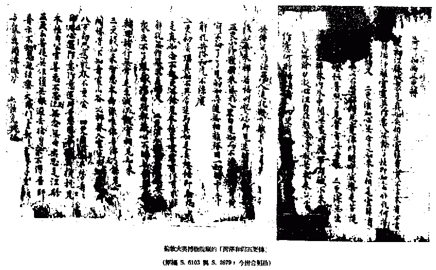
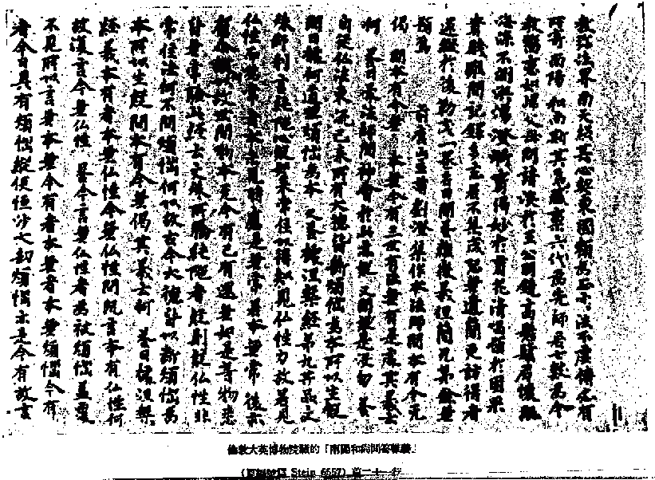

# 神会和尚语录的第三个敦煌写本：南阳和尚问答杂徵义（刘澄集）



> **藏经**：大藏经补编（大藏经补编）　**册次** 第 25 册（B25）　**编号** B0143　**卷次** 1 卷　**篇幅** 19,427 字

> **卷／品**：0 卷 · 0 品



---



目次



一、神会语录的三个本子的比勘



二、南阳和尚问答杂徵义：刘澄集



三、神会和尚的五更转曲子



（一）荷泽寺神会和尚五更转两首



（二）五更转一首



（三）五更转两本



（四）大乘五更转



（五）南宗定邪正五更转



（六）北平图书馆的两个敦煌本



（七）校写「五更转」后记



【注】



附伦敦大英博物院藏的「荷泽和尚五更转」及「南阳和尚问答杂义」敦煌写本照片



一、神会语录的三个本子的比勘



我在历史语言研究所集刊廿九本(页八七六)曾指出神会的「语录」现已出现的有两本，都是敦煌出来的：



（甲）胡适校写巴黎国家图书馆藏的敦煌写本，原编号 Pelliot 3047，收在「神会和尚遗集」卷一，民国十九年（一九三〇）出版。原无题目，胡适拟题「神会语录」。



（乙）（A）日本石井光雄影印他购藏的敦煌写本，昭和七年（民国廿一年，一九三二）影印二百部。原无题目，卷前有题字一行云：「此文字欠头。后有博览道人寻本续之矣。」影印本题「炖煌出土神会录」。附有「炖煌出土神会录解说」一小册，铃木贞太郎撰。



（B）铃木贞太郎公田连太郎校订石井光雄本，昭和九年（民国廿三年，一九三四）排印出版，题作「炖煌出土荷泽神会禅师语录。」



那个胡适校写本，以下省称胡本。那个石井光雄影印本，以下省称石井本。铃木公田校订本，以下省称铃木校石井本。



那两个本子都「欠头」，都没有题目，所以我和铃木先生都只题作「神会语录」。去年（民国四十八年，一九五九）四月，日本京都大学人文科学研究所的入矢义高先生写信给我，报告他在前两年（一九五七）发见了这个神会语录第三本，并且发见了神会语录原题作「南阳和尚问答杂徵义」，原编集的人是刘澄。



入矢义高先生的原信，我摘钞一段：



近日读到先生发表在集刊廿九本的大作「新校定的敦煌写本神会和尚两种」，校定精审，整理醒目，真是不胜佩服。敝研究所在一九五六年由大英博物馆购到该馆所藏敦煌写本的全部 Microfilm。我们就组织了共同调查的一个研究班，一直到现在，将那全部写本翻覆审核，前后已有三次了。一九五七年，我检到 S. 6557 的时候，就发现了这也是一部神会语录。遽取石井本比对一过，知其内容和文章颇近石井本，惜尾部断残，只有石井本的三分之一。



不过，最宝贵的是载在卷首的编者刘澄的一篇序。据这篇序，我们知道这一部语录的原名是「问答杂徵义」。今按日本僧圆仁「入唐新求圣教目录」，有「南阳和尚问答杂义一卷，刘澄集」的记录，与此序合。今迻录此序，用供先生的参考。……



那时我因外科手术住在台湾大学医学院的医院里。我收到了入矢先生的信，十分高兴，就回了一封信，说：



……S. 6557 卷子的发现，不但给神会语录添了一个可以资校勘的第三本，并且确定了这部语录的编辑人与原来的标题。这是一举而三得的贡献。我们研究神会的人，对先生都应该表示敬佩与感谢。



大英博物馆所藏敦煌写本的全部 Microtilm，前承贵研究所的厚意，敝院历史语言研究所也购得了全部副本。我出医院后，当即检查 S. 6557 一校。……



 S. 6557 即是原编的 Stein 6557 号。Sir Aurel Stein（斯坦因，一八六二～一九四三）一九〇七年在敦煌千佛洞取去中古写本大小八千多件(其中有二十件是最古的雕刻印本)，全存贮在伦敦大英博物馆。这些文件都用 Stein 编号，正如巴黎国家图书馆藏的敦煌文件都用 Pelliot（伯希和）编号。大英博物馆的翟理斯先生(Dr. Lionel Giles)费了二十多年的精力，才把这大大小小八千多件敦煌文卷整理完毕，编了一部「大英博物馆藏的敦煌出来的中国写本分类记注目录」(Descriptive Catalogue of the Chinese Manuscripts from Tunhuang in the British Museum)，一九五七年出版。这本目录分五大类：第一，佛教典籍；第二，道教典籍；第三，摩尼教典籍；第四，俗家文件；第五，雕印文件。第一类最多，共编六千七百九十四号，故又分十四子目，其中第一子目为大藏经(翟氏用南条文雄的英文译本「明藏」目录作根据)所收的经典，已占四千多号了。因为这部目录偏重於大藏里的经典，用经，律，论三大部的次序，故原编的 stein 号码须全部重编过了。S. 6557 在目录里就改编作 6065 了。翟理斯先生虽然得到了我的「神会和尚遗集」和石井影印的「炖煌出土神会录」(两书均列在目录尾页的参考书目里)，但他并没有认出这个残卷子是神会的语录。故 6065 号（S. 6557）的记录只说：「佛家教义的问答。不完。好写本。」



我很佩服京都大学的学人的「共同调查的研究班」的合作精神。他们肯费大工夫，「将全部写本翻覆审核，前后已有三次」，所以入矢义高先生能在三年前（一九五七）发见这个第三本神会语录。这种有组织的，同力合作的研究方法最值得我们中国学人效法。



去年四月底我出医院后，就从历史语言研究所借出 S. 6557 影印本和入矢先生在几次通信里提到的有关神会的其他各卷子的影印本，作一番初步的校勘。七月初，我出国了，没有能够写定这个「不欠头」的第三本神会语录。



在今年二月里，我用胡本和石井本比勘这个 S. 6557 卷子，又参校了我从前校写的「菩提达摩南宗定是非论」(胡适「神会和尚遗集」一五九～一六七页；又一七五～一八六页；又史语所集刊廿九本，八三八～八五七页：以下省称「定是非论」)，才知道这个伦敦卷子，除了首十六行又五个字之外，完全与石井本相同；而与胡本也有大部分相同，包括石井所无的第一章的前一段。其中胡本所无的小部分(第九章与第十四章)都见於「定是非论」。



这样校勘之后，我决定把这个伦敦 S. 6557 卷子校写作「神会和尚语录的第三个敦煌写本」，分写作十四章，连卷首残存的刘澄序，共成十五大段。



胡适本的目录是分章的，共分五十章。其中第六至第四十九章，大致等於石井本的第一至第四十四章。第四十多章，两本有小出入(如石井本第九章，第十四章，第三十四章，第四十章，胡本皆无)，故只能说大致相等。胡本前面有五章，包括「荷泽和尚与拓拔开府书」，后面有康圆智问的很长一章，是石井本所无。康圆智问章之末，有一行云：



「因汝所问，一切修道者同悟」。



这显然是全部语录的结尾了。胡本的底本（巴黎 P.3047）在这下面紧接「菩提达摩南宗定是非论，并序，独孤沛撰」，可见胡本语录虽然「欠头」，并不缺尾，原是到康圆智问一章(页一四八～一五二)就结束了。这是神会语录第一本的原本形态。



石井本虽说是「欠头」，但这个写本是一个完整的长卷，总共五百零七行，首尾都有空白的纸，是一个首尾完整无缺的精美唐写本。此本后幅有题记两行，墨色很淡，是秃笔写的：



「唐贞元八年岁在未(贞元七年辛未，七九一；八年壬申，岁不在未)，沙门宝珍共判官赵秀琳(秀字，铃木校写作看字)於北庭奉张大夫处分，命勘讫。其年冬十月廿二日记」。



石井本钞写在贞元七八年（七九一～七九二）校勘之前，其时去神会之死(宝应元年，七六二)不过三十年，他的语录已传到天山之北的北庭都护府(在今新疆孚远县)了；此本到如今已一千一百六十九年了，还保存原来首尾完整的状态。前面空幅有题记一行：



「此文字欠头。后有博览道人，寻本续之矣」。



所谓「欠头」，只是说「此文字」没有标题，可能前面还有缺失的部分。但我们现在看见伦敦的第三本，可以知道石井本的第一章正是伦敦本的第一章，差不多紧接在刘澄的序文之后。这就可见这个石井本原来并不「欠头」，可能只是原来有意删去了刘澄的原序，又有意删去了刘澄原拟的「南阳和尚问答杂徵义」的标题，所以就好像「欠头」了。这是神会语录第二本(即石井本)的原来形态。



为什麼这本子删去了刘澄的原序呢？因为这本子后面(铃木校石井本的第四十九章以下)有了新加的「六代大德是谁，并叙传授所由」的两千五百多字，又有了新加的「大乘顿教颂并序」，——这篇「大乘顿教序」是一篇「我荷泽和上」的小传，里面已说他「付心契於一人，传法灯於六祖；……慈悲心广，汲引情深；……明示醉人之珠，顿开贫女之藏；堕疑网者，断之以慧剑；溺迷津者，济之以智舟：……於是省阁簪裾，里闬耆耋，得无所得，闻所未闻；疑达摩之再生，谓优昙之一现！……」，有了这样一篇新传序，所以用不着保存刘澄那篇笨拙的旧序了。



为什麼要删去「南阳和尚问答杂徵义」的旧题呢？天宝四年（七四五）以后，神会奉召到东京荷泽寺(荷字读去声，是负荷的荷。长安的荷恩寺，洛阳的荷泽寺，是同时立的)，「南阳和尚」已成了「荷泽和尚」了。「问答杂徵义」的标题也不是一个很醒目的题名，故也有改题的必要。日本入唐求法的圆仁的开成三年（八三八）目录里，还题「南阳和尚问答杂徵义」的原名。稍后入唐的圆珍的大中八年（八五四）十一年（八五七）目录及大中十二年（八五八）的总目录里，就都改题作「南宗荷泽禅师问答杂徵」了。圆珍此三录里又都记有「荷泽和尚禅要一卷」。我相信「荷泽和尚禅要」可能就是这部神会语录新改的标题，其内容可能是和这个石井本完全一样的。我这个假设，将来也许有得到证实或否证的一天。



我现在可以依据这三个神会语录的写本的内容同异，假定这三本结集的先后次序大致如下：



（A）最早结集本〇原题「南阳和尚问答杂徵义」，有前唐山主簿刘澄序。其前面的十五段大概近於伦敦藏的写本。其后半部直到结尾可能大概近於胡适本的后半部。这个本子的结集是在开元二十年（七三二）神会在滑台大云寺「为天下学道者辨其是非，为天下学道者定其宗旨」之后，故此本里采取了「南宗定是非论」的一小部份材料。



（B）神会晚年的修订本〇这个本子大致近于胡适本，其标题可能已改为「南宗荷泽禅师问答杂徵」了。胡本前面新加的材料之中，有「荷泽和尚与拓拔开府书」，是一件重要的文字，此书称「荷泽和尚」，故知修订已在神会晚年。此本最末是康圆智问的一章，用「因汝所问，一切修道者同悟」一句作结尾，显然没有残缺。其下紧接「定是非论」的首幅，更可知语录虽有增修，还没有加上「六代大德」的略传，也还没有换上那位不知名作者的「大乘顿教颂并序」。因为后幅没有这篇「颂并序」，故我推想此本前面可能还保存了刘澄的原序。此本前面有新加的材料，但中间也有删去的材料，如伦敦本与石井同有的第九与第十四章(都是从「定是非论」钞入的)都被删去了。胡本残存的第一章，显然也是从「定是非论」钞来的，那可能又是修订之后增添的了。据「定是非论」的独孤沛序，「定是非论」有开元十八、十九、二十年几种「不定」的本子，「后有『师资血脉传』，亦在世流行」。语录的修订本好像是要把这三部书分的清楚，使他们不互相重复。



（C）神会死后的增订本〇这个本子的全部大概近于石井本的全部：前面没有刘澄序，而后面有「六代大德」的略传，又有「大乘顿教颂并序」。中间也有增入的材料，如石井本的第三十四章，三十九章，四十五章，四十六章，都是胡本没有的。又第四十七章，四十八章，是从「定是非论」钞出的。第四十九章以下叙「六代大德」的两千五六百字，可能是从神会的「师资血脉传」钞来的。「师资血脉传」原是单行的，这个增订本好像把他钞作语录的一部分了。胡本把「定是非论」的几章剔出来，而此本把那几章并进去，这是一不同。胡本显然没有采用「师资血脉传」，而此本充分收入「六代大德」的师资传授，这是二不同。胡本没有后序，而此本最后有「大乘顿教颂序」，其实是骈文的神会小传，这是三不同。细看此传中说神会「在幼稚科，游方访道，所遇诸山大德，问以湼槃本寂之义，皆久而不对，心甚异之；诣岭南，复遇漕溪尊者，作礼未讫，已悟师言。……」这就接近后来传说「有一童子名神会，年十三，自玉泉来参礼能大师」(通行本六祖坛经八)的话了。神会请王维作能大师碑文，其中明说「弟子曰神会，遇师於晚景，闻道於中年」。(唐文粹六十三)宋高僧传的神会传也说他「从师传授五经，克通幽赜；次寻庄老，灵府廓然；由是於释教留神，乃无仕进之意，辞亲，於本府(襄阳府)国昌寺颢元法师下出家；其讽诵群经，易如反掌；全大律仪，匪贪讲贯。」这都不是一个「在幼稚科」的童子的行径。所以我说这个增订本(石井本)的语录是神会死后有人增订的。石井本首尾都有空白，但首尾都无标题。可能是这个增订本的底本还没有决定新题名的时候，就传钞流行了。(石井本不是底本，其末尾「大乘顿教颂序」把「荷泽和上」的泽字钞作择字，可证这是一个传钞本。)也可能这就是日本圆珍和尚目录里题作「荷泽和尚禅要一卷」的。



这是我假定的这三个本子编集的先后次序。我们最后校写的伦敦本可能是最早结集本。巴黎的本子，即胡本，可能是单独自成一个系统的神会晚年修订本。石井藏的敦煌卷子可能是神会死后的增订本，前面四十六章可能是用那流传最广的早年结集本作底本的，其后面「六代大德」以下显然是后加的。



神会和尚姓高，是襄州襄阳人。他是读了五经和老子庄子之后才出家的。他最初在襄阳国昌寺出家。开元八年（七二〇），他奉敕配住南阳龙兴寺。那时韶州的慧能和尚刚死了七年。神会「遇师於晚景，闻道於中年」；他到韶州参谒能大师，慧能已老了，他自己也过了四十岁。慧能死在先天二年(七一三；十二月改开元元年)，神会已是四十四岁了。这个中年和尚大概受了慧能的简单教义的感动，故他北归后就出力宣扬他所谓「菩提达摩南宗」的教义。



南阳与襄阳相去不远，都属于山南东道。神会住南阳大概很长久；他在南阳时期，名誉传播很远，人称他做「南阳和尚」。刘澄编集的这部语录就题作「南阳和尚问答杂徵义。」另有几件敦煌写本题作「南阳和尚顿教解脱禅门直了性坛语。」(史语所集刊二十九本，八二七～八三六)



在语录里，我们可以看见神会在南阳的活动。宗密说神会「因南阳答王赵公三车义，名渐闻於名贤」。王琚问三车，大概在他任邓州刺史时。邓州即汉南阳郡，天宝元年改邓州为南阳郡。语录里又有南阳太守王弼问话，又有内乡县令张万顷问话，内乡是邓州属县。语录又有「於南阳郡见侍御史王维在临湍驿中屈〔神会〕和上及同寺慧澄禅师语经数日。」神会在南阳有长期的活动，是无可疑的。



神会配住南阳是在开元八年（七二〇）；他被兵部侍郎宋鼎请入东都荷泽寺，是在天宝四年（七四五）。在这二十五年之间，他曾向北迁移。开元二十年（七三二）正月十五日，他在河南道滑州滑台的大云寺设无遮大会，宣传「菩提达摩南宗」的教义，「为天下学道者辨其是非，定其宗旨」。他又曾住过河北道邢州鉅鹿郡的开元寺；因为欧阳修赵明诚都著录邢州有神会在天宝七载二月立的宋鼎撰，史惟则八分书的唐曹溪能大师碑。然而没有人叫他做「滑台和尚」或「邢州和尚」。人们还继续叫他「南阳和尚」。直到天宝四年（七四五）他到东京荷泽寺之后，人们才渐渐改称他「荷泽和上」，——那时候，他已是七十六岁了。他在荷泽寺不过八年（七四五～七五三），就被人劾奏「聚众，疑萌不利」，就被贬谪到饶州戈阳了。他在贬谪中的第三年(天宝十四年，七五五)十一月，安禄山造反了，次年洛阳长安都失陷了，两京的「寺宇宫观，鞠为灰烬」了。



在一千二百年之后，神会当年的演说，答问，谈话，一件一件的从沙州敦煌的石洞里出来，其中还有几件保存著「南阳和尚」的主名。



这个「南阳和尚」是一个了不起的人。在三十年前，我曾这样介绍他：「南宗的急先锋，北宗的毁灭者，新禅学的建立者，坛经的作者，——这是我们的神会。」在三十年后，我认识神会比较更清楚了，我还承认他是一个了不起的人：「中国佛教史上最成功的革命者，印度禅的毁灭者，中国禅的建立者，袈裟传法的伪史的制造者，西天二十八祖伪史的最早制造者，六祖坛经的最早原料的作者，用假造历史来做革命武器而有最大成功者，——这是我们的神会」。



我很热诚的把这个「南阳和尚」的一点遗著整理好了，很高兴的奉献给我的老朋友南阳董作宾先生，祝他的六十五岁生日，祝他至少活到同这个「南阳和尚」一样的九十三岁！



民国四十九年三月十日夜，胡适



二、南阳和尚问答杂徵义



刘澄集



〔南阳和尚问答杂徵义序〕（残存后幅）



……教弥法界。南天绍其心契，东国赖为正宗。法不虚传必有所寄。南阳和尚，斯其盛焉。禀六代为先师，居七数为今教。向恋如归父母，问请淡(此字疑有误？)於王公。明镜高悬，须眉怀丑。海深不测，洪涌澄漪。宝偈妙於贯花，清唱顿於圆果。贵贱虽问，记录多忘。若不集成，恐无遗简。更访得者，遂缀於后。勒成一卷，名曰「问答杂徵义」。但简兄弟，餘无预焉。



前唐山主簿刘澄集



（南阳和尚问答杂徵义）



〔1a〕作本法师问本有今无偈



问：「本有今无，本无今有。三世有法，无有是处。」(此即「本有今无偈」)其义云何？



答曰：蒙法师问，神会於此亦疑。



又问：疑是没勿？(是没勿＝是勿＝是物＝是没＝甚麼？　看下文〔8〕张燕公问一章有「问，唤作是没勿？」石井本同。胡本作「问，唤作是物？」)



答：自从佛法东流已来，所有大德皆断烦恼为「本」，所以生疑。



问：据何道理，〔疑〕烦恼为「本」？(胡本作「据何道理，断烦恼非本？」其底本似亦是「烦恼为本」四字，已经一位通人改过了。我以为不如增「疑」字。)



又答：据涅槃经第九菩萨品，文殊师利言：「纯陁心疑如来常住，以得知见佛性力故。若见佛性而为常者，本未见时，应是无常。若本无常，后亦应尔。何以故？世间物本无今有，已有还无，如是等物悉皆无常。」验此经文，文殊所腾纯陁疑者，即疑佛性非常住法，不问烦恼。何故古今大德皆断烦恼为「本」，所以生疑。



〔1b〕问：「本有今无偈」，其义云何？



答曰：据涅槃经义，本有者，本有佛性。今无者，今无佛性。(原作「本有者，本无佛性，今无佛性」。石井本同。用胡本校改。)



问：既言本有佛性，何故复言今无佛性？



答：言「今无佛性」者(言今二字，此本与胡本与石井本皆互倒，今改正)，为被烦恼盖覆不见，所以言无。「本无今有」者，本无者，本无烦恼；今有者，今日具有。纵使恒沙大刼，烦恼亦是今有。(此下，石井本与此本有「故言」二字，依胡本删。)「三世有法，无有是处」者，所谓佛性不继於三世。(三世是过去，未来，现在)



问：何故佛性不继三世？



答：佛性体常，故非是生灭法。



问：是勿是生灭法？



答：三世是生灭法。



问：佛性与烦恼俱不俱？



答：俱。虽俱，生灭有来去，佛性无来去，以佛性常故，犹(原作由)如虚空。明暗有来去，虚空无来去。以是无来去故，三世无有不生灭法。(此句三本相同，其实不可通。「无来去故」之「无」字当是误衍，或当作「有」字。)



问：佛性与烦恼既俱，何故独断烦恼非本？



答：譬如金之与鑛俱时而生，得遇金师，𬬻冶烹鍊，金之与鑛当各自别。金则百鍊百精。鑛若再鍊，变成灰土。涅槃经云，金者喻於法性(胡本与石井本皆作「佛性」)，鑛者喻於烦恼。诸大乘经论具明烦恼为客尘，所以不得称之为本。若以烦恼为本，烦恼为是暗，如何得明？涅槃经云，只言以明破暗，不言以暗得明。若暗破〔明〕，即应经论自共传，经论既无，此法从何而立？若以烦恼为本，若将烦恼为本(胡本无此六字。石井本有)，不应断烦恼而求涅槃。



问：何故经云「不断烦恼而入涅槃」？



〔答〕：计烦恼性本自无断。(石井本此八字属於问话，此下始有「答」字，而无「若」字。伦敦此本此八字也连属问话，此下有墨涂去的一个字，似「若」，也似艸头的「答」字。胡本此八字作「若烦恼本自无断」七字，而下文明有「若」字，故胡适校改上「若」字为「答」字。今参校三本，我决定校增「答」字，而以此八字属答话。)若指烦恼性即是涅槃，不应劝众生具修六波罗蜜，断一切恶，修一切善。以烦恼为本，即是〔弃〕本逐末。(原无「弃」字，作「涅」字，又点去。石井本也脱一字，铃木校补「弃」字。胡本此句作「若以烦恼为本，不应弃本逐末」，此是通人臆改的了。)涅槃经云：「一切众生本来涅槃，无漏智性本自具足。譬如木性火性俱时而生，值燧人钻摇，火之与木当时各自」。经云木者，喻若烦恼；火者，喻如佛性。涅槃经云，〔以智火烧烦恼薪。经云智慧即佛性。〕(原脱此十四字。石井本亦脱。依胡本校补。火上似应有慧字。)具有此文，明知烦恼非本。



问曰：何故涅槃经云，——第十五梵行品说，——「本有者，本有烦恼。今无者，今无大般涅槃。本无者，本无摩诃般若。今有者，今有烦恼」？



答：为对五荫色身故，所以说烦恼为本。又经云：「佛言，善男子，为化度众生故而作是说，亦为声闻辟支佛而作是说。」又第卅六憍陈如品，梵志问佛：身与烦恼何者於先？佛言：身在先亦不可，烦恼在先亦不可。要於烦恼然始有身。验此经文，故知烦恼与身为本，非谓对佛性也。又经云：「有佛性故，得称为常。以常故，得称为本。」非是本无今有。第十五卷云：「佛性者，无得无生。何以故？非色非不色，不长不短，不高不下，不生不灭故。以不生灭故，得称为常。以常故，得称为本」。第十九卷云：「如暗室中有七宝，人亦知有(此本与石井本此四字作『人亦不知所』，依经文改正)，为暗故不见。有智之人然大明灯，持往照燎，悉得见之。是人见此七宝，终〔不〕言今有。(此本与石井本皆无『不』字，胡本有。)法性亦非今始有，以烦恼暗故不见，谓言本无今有。亦如盲人不见日月，得值良医疗之即便得见，谓言日月本无今有！以盲故不见，日月本自有之。」第廿五卷云：「一切众生未来之世定得阿耨〔多罗三藐三〕菩提，是名佛性。一切众生现在具有烦恼诸结，是故不见，谓言本无。」又第十九卷云：「有佛无佛，性相常住。以诸众生烦恼覆故，不见涅槃，便谓为无。当知涅槃是常住法，非本无今有。」佛性者，非荫界入，非本无今有，非已有还无。从众善缘，众生得见佛性。以得见佛性故，当知本自有之。



问：既言本自有之，何不自见，要藉因缘？



答：犹如地下有水，若不施功掘凿，终不能得。亦如摩尼之宝，若不磨治，终不明净。以不明净故，谓言非宝。涅槃经云，一切众生不因诸佛菩萨善知识指授，终不能得。若自见者，无有是处。以不见故，谓言本无佛性。佛性者，非本无今有也。



2.真法师问：云何是常义？



答：无常是常义。



问：今问常义，何故答无常是常义？



答：因有无常，而始说常。若无无常，亦无常义。以是义故，得称为常。譬如长因短生，短因长立。若其无长，短亦不立。事既〔同〕故，义亦何殊？(此本与石井本皆作「事既故」，胡本作「事相因故」，今校增「同」字，似胜於「因」字。)又法性体不可得，是常义。又虚空亦是常义。



〔问：何故虚空是常义？〕(此本与石井本均脱此八字，依胡本补。)



答：虚空无大小，亦无中边，是故称为常义。(虚空下，此本与石井本皆有「以」字，胡本无。)谓法性体不可得，是〔不〕有。能见不可得体，湛然常寂，〔是不无〕，是为常义。若准有无而论，则如是。若约法性体中，〔於无〕亦不无，於有〔亦不有〕，恒沙功德本自其足：此是常义。(以上所补的脱文，皆依胡本补。石井本脱文与此本同。)又不大不小是常义，谓虚空无大，不可言其大；虚空无小，不可言其小。今言大者，小家之大；今言其小者，乃是大家之小。此於未了人，则以常无常而论。若约法性理(三本皆作理，似当作体)，亦无常，亦无无常。以无无常故，得称为常。



3.户部尚书王赵公以偈问三车义：



宅中无三车。露地唯得一。  

不知何所用，而说此三车？



答曰：



三车在门外，说即在宅中。  

诸子闻说时，已得三车讫。



又问：



今者在门外，先是乘车出。  

宅中既得车，出外何须索？



答：



诸子虽得讫，不知车是车。  

既不自证知，所以门外索。



问：何处有人得道果，岂不自知乎？



答：下文自证，所得功德仍不自觉知。



问：



诸子不自知，容可门外索。  

父应知子得，何须更与车？



答：



诸子不自知，所以门外索。  

长者今与车，还是先与者。



问：



三车本无实，所说乃权宜。  

与者是旧车，那应得假物？



答：



长者意在一，方便权说三。  

前者说三车，三车本是一。



问：



一车能作三，三车能作一。  

何不元说一，辛苦说三车？



答：



若为迷人说，三便作三车。  

若约悟人解，即三便是一。



4.崔齐公问：禅师坐禅，一定以后，得几时出定？



答曰：神无方所，有何定乎？



又问：既言无定，何名用心？



答曰：我今定尚不立，谁道用心？



问：心定俱无，若为得道？(若为＝那麼？柳宗元诗：「若为化得身千亿，散上峰头望故乡？」)



答曰：道只没道，亦无若为道？(只没＝这麼)



问：既无「若为道」，何处得「只没道」？



答：今言「只没道」，为有「若为道」。若言无「若为」，「只没」亦不存。



5.庐山〔简〕法师问：何者是中道义？(石井本也脱「简」字，依胡本补。)



答曰：边义即是。



问：今问中道义，何故答边义是？



答曰：今言中道者，要因边义立。若其不立边，中道亦不立。



6.礼部侍郎苏晋问：何者是大乘？何者是最上乘？



答：菩萨即大乘。佛即最上乘。



问曰：大乘最上乘有何差别？



答曰：言大乘者，如菩萨行「檀波罗密」，观三事体空，乃至六波罗蜜亦复如是(六，胡本作五，石井本作六)，故名大乘。最上乘者，但见本自性空寂，即知三事本来自性空，更不复起观。乃至六度亦然。(六度即六波罗蜜，此本与石井本作亦度，胡本作六尘。)是名最上乘。



又问：假缘起否？



答曰：此中不立缘起。



问：若无缘起，云何得知？



答：本空寂体上自有般若智能知，不假缘起。若立缘起，即有次第。



〔问：然则更不假修一切行耶？〕



〔答：若得如此见者，万行俱备。〕(胡本有此问答。此本与石井本俱脱。)



又问：见此性人，若起无明，成业结否？



答：虽有无明，不成业结。



问：何得不成？



答：但见本性体不可得，即业结本自不生。



7.润州刺史李峻(胡本无此六字，故此章误连上章为一章。此本与石井本有六字)　曰：见有一山僧礼拜嵩山安禅师，师言「趁粥道人！」又一授记寺僧礼拜安禅师，师言「惜粥道人！」(此本与石井本皆作「措粥道人」，今从胡本。)问：此二若为？



答：此二俱遣。



问：作没生遣？



答：但离即遣。



问：作没生离？



答：我今只没离，无作没生离。



问：为复心离？为是眼离？



答：今只没离，亦无心眼离。



问：心眼俱不见，应是盲人？



答：自是盲者唱盲。他家见者自不盲。经云，是盲者过，非日月过。



8.张燕公问：禅师日常说无念法，劝人修学，未审无念法有无？



答曰：无念法不言有，不言无。



问：何故无念不言有无？



答：若言其有者，即不同世有。若言其无者，即不同世无。是以无念不同有无。(石井本同。胡本作「言其有者，即同世有；言其无者，即同世无。是以无念不同有无。」此可见胡本的底本是曾经一位通人改削过的本子，改「不同」为「同」，意义似胜。)



问：唤作是没勿？(胡本作「唤作是物？」)



答：不唤作〔是〕勿。(胡本作「不唤作是物」。)



问：作勿生是？(此本与石井本作「异没时作物生？」今用胡本。)



答：亦不作勿生。(此本与石井本作「亦不作一物」。今用胡本。作勿生＝怎麼生？)是以无念不可说。今言说者，为对问故。若不对问，终无言说。譬如明镜，若不对像，镜中终不现像。今言现像者，为对物故，所以现像。



问：若不对像，照不照？(此七字，胡本作「不对像照」四字，疑原作「不对像照不？」。)



答：今言照者，不言对与不对，俱常照。



问：既无形像，复无言说，一切有无皆不可立，今言照者，复是何照？



答：今言照者，以镜明故，有自性照；以众生心净故，自然有大智慧光照无餘世界。(「有自性照」，胡本作「有此性」。「以众生心净故」，此本与石井本皆作「以若以众生心净」，胡本不误。今参酌三本，校正可读。)



问：既如此，作没生时得？



答：但见无。



问：既无，见是物？(是物＝甚麼？)



答：虽见，不唤作是物？



问：既不唤作是物，何名为见？



答：见无物即是真见常见。



9.和上(即神会和尚)问远法师(即「菩提达摩南宗定是非论」里面唱配角的崇远法师)言：「曾讲大般涅槃经不？」



远法师言：讲大般涅槃经数十遍。



和上又言：一切大小乘经论说，众生不解脱者，为缘有生灭二心。涅槃经云：



诸行无常，是生灭法。  

生灭灭已，寂灭为乐。



未审生之与灭可灭不可灭？为是将生灭灭？为是将灭灭生？为是生能自灭生？为是灭能自灭灭？请法师一一具答。(此节文字，此本与石井本相同，皆错误不可读。用巴黎 P. 2045 号卷子校正。)



远法师言：亦见诸经论作如此说：(见字上，此本衍「不」字，石井本与 P. 2045 皆无。)至於此义，实不能了。禅师若了此义，请为众说。



和上言：不辞为说，恐无解者。



法师言：道俗有一万餘人，可无一人能解？



和上言：看见不见。



法师言：见是没？



和上言：果然不见。



法师既得此语，结舌无对。非论一己屈词，抑亦诸徒失志。胜负既分，道俗嗟散。



10.上和问澄禅师修何法而得见性？



澄禅师答曰：先须学坐修定。得定已后，因定发慧，〔以智慧〕故，即得见性。(用石井本及胡本补三字)



问曰：修定之时，岂不要须作意不？



答言：是。



〔问：〕既是作意，即是识定，若为得见性？



答：今言见性者，要须修定。若不修定，若为见性？



问曰：今修定者，元是妄心。〔妄〕心修定，如何得定？



答曰：今修定得定者自有内外照。以内外照故，得见净。以心净故，即是见性。



问曰：今言见性者，性无内外。若言因内外照故，元是妄心，苦为见性？



经云：



若学诸三昧，是动非坐禅。(三昧 samādhi，即禅定。)  

心随境界流，云何名为定？



若指此定为是者，维摩诘即不应诃舍利弗宴坐也。



11.和上问诸学道者：今言用心者，为是作意，不作意？若不作意，即是聋俗无别。若言作意，即是有所得。有所得者，即是系缚，何由可得解脱？声闻修空住空，即被空缚。修定住定，即被定缚。修静住静，即被静缚。修寂住寂，即被寂缚。是故般若经云：若取法相，即著我，人，众生，寿者。维摩经云：调伏心者，是声闻法。不调伏心者，是愚人法。仁者用心是调伏，何名解脱？须陁洹亦调伏，斯陁含亦调伏，阿那含，阿罗汉亦调伏。非想定及非非想定亦调伏。四禅亦调伏。四圣三贤并皆调伏。若为鉴别？若如此定者，并未是真解脱法。



12.神足师问：真如之体，以是本心，复无青黄之相，如何可识？



答：我心本空寂，不觉妄念起。若觉妄念者，觉妄自俱灭。此即识心者也。(三个「妄」字此本与石井本皆作「忘」，胡本作「妄」。胡本无「也」字。)



问：虽有觉照，还同生灭。今说何法，得不生灭？



答：只由心起故，遂有生灭。若也起心既灭，即生灭自除，无相可得，假说觉照。觉照既灭，生灭自无，即不生灭。



13.崇远法师问：云何为空？若道有空，还同质碍。若说无空，即何所归依？



答曰：只为未见性，是以说空。若见本性，空亦不有。如此见者，是名归依。



14.和上告诸知识：若欲得了达甚深法界，直入一行三昧者，先须诵诗金刚般若波罗蜜经，修学般若波罗蜜。金刚般若波罗蜜经云：〔须菩提，若人以满无量阿僧祇世界七宝，持用布施，〕若有善男子，善女人，发菩萨心者，诵持此经，为人演说，其福胜彼。云何为人演说？不取於相。〔云何不取於相？所谓如如。云何如如？所谓无念。云何无念？所谓不念有无，不念善恶，不念有边际无边际，不念有限量无限量。不念菩提，不以菩提为念。不念湼槃，不以湼槃的念。是为无念。是无念者，即是般若波罗蜜。般若波罗蜜者，即是一行三昧。〕



三、神会和尚的五更转曲子



巴黎国家图书馆藏的 P. 2045 长卷上有四个文件：第一是「菩提达摩南宗定是非论」，第二是「南阳和上顿教解脱禅门直了性坛语」，第三是「南宗定邪正五更转」曲子，第四是一首五言律诗。前年我写定「南阳和上坛语」(史语所集刊二十九本，八二七～八三六页)的时候，曾把那两件韵文收作「附录」，我还说，五更转的主旨，如第三更讥笑「处山谷，住禅林，入空定，便凝心，一坐还同八万刼，只为担麻不重金」等等，都是「坛语」里的主要思想，所以我倾向于承认那两篇韵文也是神会的作品。(集刊二十九本，八三六～八三八页)



我校写那个卷子的时候，我还在纽约，没有机会检查 DrḶionel Giles 的「分类记注目录」里记出大英博物馆藏的几个「五更转」的本子。去年入矢义高先生写信给我，也提到伦敦的几本五更转，他特别提到：



「另有题『荷泽和尚五更转』者（S. 6103 的后幅），祇存一更至三更，共三章，其文全异，但是句格则与此（P. 2045）全同。窃意此亦可备神会和尚遗著之一罢？原题『荷泽和尚五更转』，其『泽』字与『和』字之间，用朱笔旁写着『寺』字，又『五更』两字之右旁，朱笔写着『神会』两字，可算作一证。」



我很高兴的报告入矢先生：伦敦的 S. 6103 残纸和 S. 2679 残纸原来是一张纸撕断了的，这两块残纸上写的两首五更转，是同一个钞手的笔迹，内容也正相衔接。两块残纸合成了一块，我们就有了两首「荷泽寺神会和尚五更转」了！前一首确是「其文全异」，但后一首即是我前年校写的一首。这两块烂纸的并合，不但证实了我前年校写的五更转确是神会作的，并且给我们确定了这两首曲子都应该收在「神会和尚遗著」里。



我们的南阳董彦老向来留心搜集民间的歌唱；他早年编的「看见她」专刊，是指示一个新方法的中国民歌集。我把一千二百年前这位南阳和尚编唱的两只俗曲也献给我们的「南阳老道」。这两支曲子的词都不算美，但这个五更调唱起来必是很哀婉动人的。请彦老想想，您在南阳做孩子的时候，曾听见过这样调子的民歌吗？



一九六〇、三、十六（彦老生日的前三天）



胡适记，在南港。



（一）荷泽寺神会和尚五更转两首



伦敦大英博物馆 S. 6103 残卷，只剩一张不满十英寸宽，十六英寸长的破纸了；前半张只剩小半块，钞的是一些有韵的格言，如「莫嬾堕(惰)，勤自课」之类。后半张还剩九行，字体秀挺，首行题「荷泽和尚五更转」七字，墨色深黑；右旁有朱笔加的「寺神会」三字，这题目就成了「荷泽寺神会和尚五更转」十个字了。这首五更转只剩了前三更，到「四更兰」，底下就撕掉了。但我看到同馆里 S. 2679 残卷，其前面十八行的字体与 S. 6103 后半的九行的字体相同，分明是一个人写的。最巧的是 S. 2679 残卷十八行写的也是五更转：先是小半首五更转，接着是一首全的五更转。那小半首只剩第四更的第三句以下，正接上 S. 6103 卷的「四更兰」的残曲。我把这两个残卷合并校写，就得到了两首「荷泽寺神会和尚五更转。」两首之中，第二首就是我前年承认「也是神会和尚的作品」，写作「南阳和尚……坛语」的附录的。此残卷明题作「荷泽和尚五更转」，我前年的假设可算是得到证实了。但第一首是不是神会的作品呢？第一首有「莫作意，勿凝心」，「何劳端坐作功夫」的话，颇像神会的思想。但这一首的文字实在太坏，思想也不清楚，如「涅槃城里见真如」，成什麼话！「了见馨香无去来」，成什麼话！「黑白见知而不染，遮莫青黄寂不论」，成什麼话！故我的第一个感想是不愿意承认这首五更转是神会作的。但我后来平心想想：我们不可把神会看的太高了；那两首五更转都不过是两件宣传文字，宣传的不过是「念不起，更无餘」；「莫作意，勿凝心」；「何劳端坐作功夫」……不过这几个很简单的革命口号而已。把这几个简单思想装进一只流行的俗曲调子里去，那是不容易的工作，结果就不得不加上许多佛教烂调来做凑调凑韵的字句了。第一首里确然有很不通的凑句，然而第二首里又何尝没有！试看「迷则真如是妄想，悟则妄想是真如」，成什麼话！「如来智慧本幽深，唯佛与佛乃能见，声闻缘觉不知音」，这还不是凑韵的凑句吗？所以我的结论是：这两首五更转都是神会和尚宣传革命的曲子，虽然没有文学的价值，在当时大概颇有宣传的作用。其中第二首流行更广，现存的大约有八九件敦煌写本。第一首的文字技术太差了，好像就被淘汰了，只剩这一本偶然保存下来，使我们知道「荷泽和尚五更转」原是两首。



五更转第二首有「一坐还同八万刼，只为担麻不重金」的话。巴黎 P. 2045 卷子此首五更转之后，有五言诗一首(集刊二十九本，八三八页)，也有「为报担麻者，如何不重金」之句。担麻不重金的故事见於长阿含经卷七「蔽宿经」。



一九六〇、三、十四夜，胡适。



〔第一首〕



一更初。涅槃城里见真如。妄想是空非有实，不言未有不言无。非垢净，离空虚。莫作意，入无餘。了性即知当解脱，何劳端坐作功夫？  

二更催。知心无念是如来。妄相是空非有实，□□山上不劳梯。顿见竟，佛门开。寂灭乐，是菩提。□□□灯恒普照，了见馨香无去来。  

三更深。无生□□坐禅林。内外中间无处所，魔军自灭不来侵。莫作意，勿凝心。住自在，离思寻。般若本来无处所，作意何时悟法音？  

四更兰。□□□□□□□。□□(以上校写 S. 6103 残卷。以下校写 S. 2679 残卷。)共传无作法，愚人造化数□般。寻不见，难□难。□□□，本来禅。若悟刹那应即见，迷时累劫暗中看。  

五更分。净体犹(由)来无我人。黑白见知而不染，遮莫青黄寂不论。了了见，的知真。随无相，离缘因。一切时中常解脱，共俗和光不染尘。



〔第二首〕



一更初。妄想真如不异居。迷即真如是妄想，悟即妄想是真如。念不起，更无餘。见本性，等空虚。有作有求非解脱，无作无求是功夫。  

二更催。大圆宝镜镇安台。众生不了攀缘病，由斯鄣蔽心不开。□□□，□□□。(此处脱了六字，依别本应是「本自净，没尘埃。」)无系著，绝轮回。诸行无常是生灭，但观实相见如来。  

三更侵。如来智惠本幽深。唯佛与佛乃能见，声闻缘觉不知音。处山谷，□禅林，入空定，便凝心。一坐还同八万劫，只为担麻不重金。  

四更兰。法身体性不劳看。看即住心还作意，作意还同妄想团。放四体，莫攒抏见本性，自公官。善恶不思则无念，无思无念是涅槃。  

五更分。菩提无住复无根。过去舍身求不得，吾师普示不忘(原作知，涂去，改「望」字，即忘字)恩。施法药，大张门。去鄣□，豁浮云。顿与众生开佛眼，皆□□性免沉沦。



（二）五更转一首



伦敦大英博物馆 S. 6083 残纸。题「五更转一首。」此纸虽残，但残存的字句最接近巴黎的 P. 2045 卷子的五更转，可供校勘。



一九六〇、三、十一，胡适



□□□。□□□□□异居。迷则真如是妄相，悟则妄相是真□，□□□，□□□。见本性，等空虚。有作有求非解脱，无（下阙）  

二更催。大圆宝镜镇安台。众生不了□□□，□□□□心不开。本自净，没尘埃。无染着，绝轮回。诸□□□□□□，□观实相见如来。  

三更侵。如来智惠本幽□。□□□□□□□，声闻缘角（觉）不知音。处山谷，住禅林。入□□，□□□。□□□□八万劫，只为担麻不重金。  

四更兰。□□□□□□□。看则住心□□意，作意还同妄相团。放



（下阙）



（三）五更转两本



伦敦大英博物馆 S. 6923 卷子正面写的是法华经的第一第二两品；反面钞的是八件有韵无韵的杂文，其中两件是同一个钞手写的两本五更转。我合校两本，钞作一本，而校注其异文。



一九六〇、三、十二夜。胡适



一更初。妄想真如不异居。迷则真如是妄想，悟则妄想是真如。念不起，更无□。见本性，等空虚。有作有求虚解脱，无作无求是空虚。(两本同作「虚解脱」，同作「是空虚」，皆与他本不同。)  

二更催。大圆宝镜镇安台。众生不要(两本同作要)攀缘境(一作镜)，由斯障闭心不开。本自净，没尘埃。无染著，绝轮回。诸行无常是生灭，从观实相见如来。  

三更深。如来智惠本由心。(两本皆作「深」，皆作「由心」，与他本不同。)以佛为法(一作「以佛以法」)乃能见，声闻缘觉不知音。(此三字，两本皆作「则知因」，不可通；故从他本。)住山窟，坐禅林，入空定，便凝心。一坐还同八万劫，只为担麻不重金。  

四更兰。法身体性不劳看。看作住心便作意，作意还同妄想团。妄想团，莫巑岏。认(两本皆作忍)本性，自观看。善恶无思亦无念，无念无思是涅槃。  

五更分。菩提普树复无根。过去舍身求不得，吾师普遂不忘恩。施法欲(两本皆作「法欲」，似当依他本作「法药」)，大章门，去障闭，奯(两本皆如此，即「豁」字)浮云。顿与众生开佛眼，皆令过去免沉沦。



（四）大乘五更转



伦敦大英博物馆 S. 4634 卷子正面写的是无量寿宗要经，反面钞有「大乘五更转」一首。此本颇多误字，但可以代表一个有小修改的本子。



一九六〇、三、十二夜半。胡适



一更初。妄想真如不异居。迷(误作悉)即真如是妄想，悟即妄想是真如。念不起(误作岂)，更无餘。见本性，等空虚。有作有求非解脱，无作无求是功(误作公)夫。  

二更催。大圆宝镜镇安台。众生不了攀〔缘〕病，由(误作无)斯鄣闭心不开。本自净(原作静)，没尘埃，无染著，绝轮廻。诸行无常是生灭，得观实相见如来。  

三更深。如来智慧本由心。以佛为佛乃能见，声闻缘觉不知音。入山谷，坐禅林，入空定，便凝心。□□还同八万劫，只为担麻不重金。(重金，误作赠禁)  

四更兰。法身体性不劳看。看即住(原作柱)心便作意，作意还同妄〔想〕团。放四体，莫攒抏。认本性，自观看。善恶不思由(犹？)不念，无思无念是涅槃。  

五更分。菩提无柱(住？)本无根。过去舍身求不得，吾师□遂不妄(忘？)恩。施法药，大张门。去倞(禁？)障，拨浮(原作扶)云。本与众生开佛眼，皆令见性免沉沦。



（五）南宗定邪正五更转



这是巴黎国家图书馆的 P. 2045 长卷的一部分，我已校写在史语所集刊廿九本八三七页了的。因为这个巴黎本最完全，所以我重钞在这里，以备读者比勘。



一更初。妄想真如不异居。迷则真如是妄想，悟则妄想是真如。念不起，更无餘。见本性，等空虚。有作有求非解脱，无作无求是功夫。  

二更催。大圆宝镜镇安台。众生不了攀缘病，由斯障闭不心开。本自净，没尘埃。无染著，绝轮廻。诸行无常是生灭，但观实相见如来。  

三更侵。如来智慧本幽深。唯佛与佛乃能见，声闻缘觉不知音。处山谷，住禅林，入空定，便凝心。一坐(原作一生，胡适校改)还同八万刼，只为担麻不重金。  

四更兰。法身体性不劳看。看则住心便作意，作意还同妄想团。放四体，莫攒抏。任本性，自公官。善恶不思即无念。无念无思是涅槃。  

五更分。菩提无住复无根。过去舍身求不得，吾师普示不忘(原作望)恩。施法药，大张门，去障膜，豁浮云，顿与众生开佛眼，皆令见性免沉沦。



民国四九年（一九六〇）三月十六日写成



（六）北平图书馆的两个敦煌本



北平图书馆——原来的京师图书馆——收藏的敦煌写本，是斯坦因，伯希和剩留下来的，但数量也很可观：原编八千六百七十九号；后来胡鸣盛先生收拾残叶，共编为九千八百七十一号。湖南许国霖先生是胡鸣盛先生的助手，他在民国廿五年编成「敦煌石室写经题记」一卷「敦煌杂录」两卷。敦煌杂录里钞有五更转两首，都是神会的第二首，其中一首〔咸字十八号〕题着「南宗定邪正更转」，和巴黎的 P. 2045 相同，但末尾没有附录的五言律诗；另一首〔露字六号〕仅题「五更转」，而末尾附有那首五言诗。北平的敦煌原本现在无从校勘，我把许国霖先生钞的两本五更调合校成一本，也附在这里。



南宗定邪五更转



一更初。妄想真如不异居(异居一本作思君)。迷则真如是妄想，悟则妄想是真如。念不起，更无餘(餘，一本作疑)。见本性，等空虚。有作有求非解脱，无作无求是功夫(非，一本作虚。功夫，一本作空虚)。  

二更催(一作崔，一作摧)。大圆宝镜镇安台。众生不了攀缘镜(了，一作要。一本攀下脱二字)，由斯障闭(一作暗)心不开。本自净，没尘埃。无染著，绝轮廻。诸行无常是生灭，但观实相见如来。  

三更侵(一作深)。如来智慧本幽深(一作本由心)，此佛此佛(一作「为佛与佛」)乃能见。声闻缘觉不知音。住山窟，坐禅林，入空定，便凝心(住，一作处；坐禅林，一作住僧林)。一坐还同八万刼，只为担麻不重金(坐，一作生；担，一作躭)。  

四更兰。法身体性不劳看。看则住心便作意(心，一作山)，作意还同妄想团(团，一作围，一作搏)。放四体，莫攒抏(一本脱「放四体」三字)。任本性，自观看。(任，一作忍。「自观看」，一作「自公禅」。任字似胜各本之见字，认字。但「自观看」一句，似是凑韵，与上句「看则住心便作意」正相反了。「自公禅」，巴黎本与上引 S. 2679 本皆作「自公官」。「自公官」似有自己作主，不受外面管束之意。)善恶无思亦无念，无思无念是涅槃。  

五更分。菩提无住复无根。过去舍身求不得，君师普示不忘恩。施法药，大张门，去障膜，豁浮云。顿与众生开佛眼，皆令见性免沉沦。



附录　五言诗(许君钞本太不可读，故我钞巴黎本对勘)



> 〔许国霖钞本〕〔巴黎本〕



> 真素是□□真乘实罕遇，  

> 施者进白心至理信幽深。  

> 欲立非非相欲离相非相，  

> 将佛却照□还将心照心。  

> 智者来未得髻中珠未得，  

> 於检再难寻衣里宝难寻。  

> 运保躭麻者为报担麻者，  

> 如我不重金如何不重金！



民国四十九年四月五日补写。



（七）校写「五更转」后记



许国霖敦煌杂录里还有一首「五更调」(周字七十号)，显然也是「五更转」的调子，其文字和刘复敦煌掇琐三八(巴黎 P. 2963)题作「南宗赞一本」的相同，可以互相校勘。(伦敦也有一块残纸，编 S. 5529，只存七行，也是这一首「五更转」的一更二更。)我现在合校这两本，把这第三首「五更转」写定如下：



五更调（刘复本题「南宗赞」）



一更长。如来智慧心(刘作化)中藏。不知自身本是佛，无明障蔽(许作闭)自荒忙。了五(许作王)蕴，躰(许作听)皆亡。灭六识，不相当。行住坐(许脱坐字)卧常作(刘作住)意，则知四大是佛堂。  

二更长。有为功德(刘脱为功二字)尽无常。世间造作应不久(刘作及)，无为法会躰(刘作听)皆亡。入圣位(刘作使)，坐金刚。诸(刘作诣)佛国，遍(许作变)十方。但知十方元是一(刘作「但诸世界愿贯一」)，决定得入诸(刘作於)佛行。  

三更严。坐禅执定甚能甜。不信(刘作宣)诸天甘露蜜，魔(作摩，刘作愿)君眷属(许作卷屡)出来看。诸佛教，实(许作是)福田。持斋戒，得生天。生天终(刘作中)归还堕落，努力回心趣涅槃(刘脱力字；趣，许作取)。  

四更兰(许作难)。法身体性本来禅。凡夫不念生分别，轮回六趣(许作住)心不安。求佛性，向里看。有佛衣(刘作「了佛意」)，不觉寒。广大刼来常不悟(许脱不字)，今生作意断悭贪。  

五更延(刘脱延字)。菩提种子坐红(许作苎)莲。烦恼泥(许作宁)中常不染，恒将净土共金颜(许作连)。佛在世，八十年(许作连)。般若意，不在言。夜夜朝朝(刘作「花花朝朝」，许作「夜了照了」)恒念经，当初求觅一连全(刘作「一年川」，更不可通。)



刘复先生钞的巴黎本虽然题作「南宗赞」，我看这支曲子决不是神会作的，第一更曲有「行住坐卧常作意」一句，正和神会「莫作意」的思想相反，就是一个反证。这曲子里的思想很平凡，文字也很俗气，很可能是后来的和尚套神会的「南宗定邪正五更转」做的曲子，居然也在敦煌石室里留下了两三个钞本。



我们看敦煌出来的三只「五更转」的曲调是完全相同的，都是从七字句变化出来的长短句：第一句，第五，六，七，八句都是三字句；第二，三，四，九，十句都是七字句。三首共十五章，用韵的方式也完全相同。



我在这里要指出：这三首「五更转」就是「填词」的最好的历史例证。神会的年代是可考的，他生在唐高宗咸亨元年(六七〇)，死在唐肃宗废除年号的「元年」，即是宝应元年(七六二)，他的活动时期正当玄宗的开元天宝时代(七一三～七五五)，正是所谓「盛唐」的时代。我们可以说：现在有敦煌出来的「荷泽寺神会和尚五更转」两首做实物的证据，我们可以推知开元天宝时代确然已有依现成的曲拍作曲词的风气了，确然已有后人所谓「填词」的风气了。



在民国十四年(一九二五)，我写了一篇「词的起原」，我的结论是：「长短句的词调起於中唐。……白居易作忆江南的长短句，刘禹锡依此曲拍，作『春去也』词，题云：『和乐天春词，依忆江南曲拍为句。』这是填词的先例。」白居易的忆江南是这样的：



江南好！  

风景旧曾谙。  

日出江花红胜火，  

春来江水绿如蓝。  

能不忆江南？



刘禹锡的春词是这样的：



春去也！  

多谢洛城人。  

弱柳从风疑举袂，  

丛兰挹露似沾巾，——  

独坐亦含颦。



这确是「依忆江南曲拍为句」，所以我说这是填词的先例。



当时我曾指出尊前集收的李白词十二首，全唐诗收的李白词十四首，其中多有很晚出的作品；其中长短句如忆秦娥，菩萨蛮，清平乐，都是后起的曲调。我的看法是：「向来只是诗人做诗，而乐工谱曲；中唐以后，始有教坊作曲，而诗人填词」。例如王维的「西出阳关无故人」，本是一首整齐的七言绝句，经过乐工谱曲，就成了当时最感人的送别曲子了。到了白居易刘禹锡的「依忆江南曲拍为句」，那才是教坊作曲而诗人填词了，那才是长短句的词的起原。



当时我曾把「词的起原」初稿送给王国维先生，请他指教。王先生答书说：



尊说……谓长短句不起於盛唐，以词人方面言之，弟无异议。若就乐工方面言之，则教坊实早有此种曲调（菩萨蛮之属），崔令钦教坊记可证也。



我当时因为教坊记的三百多曲调之中，有天仙子，倾杯乐，菩萨蛮，望江南等曲，都是中唐才有的曲调，见於各种记载，所以我颇疑心那张曲名表可能有后人随时添入的新调，不可用来考证盛唐开元天宝时代有无某种曲调。(参看胡适词选附录的「词的起原」)



那是三十五年前的讨论。那位可敬爱的王国维先生已死了三十三年了。现在我们看敦煌写本里钞出的各种佛曲，特别看那流传最广的神会和尚的五更转曲子，我们不但可以相信开元天宝时代已有依照当时最流行的曲拍作佛曲的风气，我们并且可以相信那样填词作曲的风气可能比开元天宝还更早，可能是人们歌唱的普通作风，并不限於教坊的乐工，也不限於歌妓舞女，也不限於佛教的和尚尼姑。凡是好听的曲子，凡是许多人爱听爱唱的调子，总有人依照那曲调编造新曲，那就是填词了。



敦煌出来的「五更转」曲子有简单的四句调，有繁复的十句调。神会的五更转是那繁复的十句调，其形式似是「双调」，即是「叠调」，可以写成这个样子：



一更初。妄想真如不异居。迷则真如是妄想，悟则妄想是真如。



念不起，更无餘。见本性，等空虚。有作有求非解脱，无作无求是功夫。



刘复的敦煌掇琐二七钞了巴黎的敦煌写本 P.2647 的「五更调」艶曲，我们可钞一更曲作例：



一更初夜坐调琴，欲奏相思伤妾心。每恨狂夫薄行迹，一过抛人年月深。



君自去来餘几春！不传书信绝知闻。愿妾变作天边鴈，万里悲鸣寻访君。



从这种整齐的七字句变到长短不齐的三字句和七字句，是曲调的演变。从单调的小令变到双调，也是曲调的演变。从歌唱男女爱情或「闺怨」的情歌变到宣传佛教故事或佛教信仰的佛曲，那就是改换内容的填词作曲了。



神会的「南宗定邪正五更转」使我们知道盛唐时代已有人用双调的「五更转」来做宣传南宗新教义的曲子了。敦煌出来的一些单调的「五更转」佛曲，或俗典，可能比神会的双调曲子更早，但我们不能考定他们的年代了。



我们看见的敦煌本单调「五更转」有这许多件：



伦敦的「维摩五更转」S. 2454。



伦敦的「无相五更转」S. 6077。



巴黎的「太子五更转」（P. 2483；刘复敦煌掇琐三六）。



罗振玉钞的「叹五更」(敦煌零拾五)。



此中的「太子五更转」是用这曲调来唱太子出家的故事，其二更曲是：



二更深。五百个力士睡昏沉。遮取黄羊及车匿，朱鬃白马同一心。



「维摩」「无相」两首五更转都是宣传教义的，可引「无相五更转」的二更曲作例：



二更深。菩提妙理誓探寻。旷彻清虚无去住，证得如如平等心。



罗振玉钞的「叹五更」是劝人读书的曲子，我们也引二更曲作例：



二更深。孝经一卷不曾寻。之乎者也都不识，如今嗟叹始悲吟。



这都是用人人能哼能唱的调子来填词作曲，目的是用曲子作宣传。



我们看了敦煌出来的许多佛曲，我们不能不承认这些宣传佛教的曲子实在没有文学技术，也没有高明的思想内容，所以都没有文学的价值。他们的宣传作用似乎是音乐成分比文学成分占的多，他们全靠那些人人能唱的曲调来引动许多男女听众。文字的不通，内容的浅薄，都是不关重要的。



填词作曲的风气可以早到盛唐，或早到盛唐以前，那是我写「词的起原」时没有想到的。填词作曲来做宗教的宣传，这也是我当年没有想到的。我当年曾说：



我疑心，依曲拍作长短句的歌词，这个风气是起於民间，起於乐工歌妓。……刘禹锡，白居易，温庭筠一班人：……嫌倡家的歌词不雅，……於是也依样改作长短句的新词。欧阳炯序花间集云：「自南朝之宫体扇北里之倡风，何止言之不文，所谓秀而不实。」这是文人不满意於倡家的歌词的明白表示。……所以我们可以说，唐五代的文人填词，大概是不满意於倡家已有的长短句歌词，依其曲拍，仿长短句的体裁，作为新词。到了后来，文人能填词的渐渐多了，教坊倡家每得新调，也就迳请文人填词。例如……「柳永……善为歌辞，教坊乐工每得新腔，必求永为辞，始行於世。」



这个结论，大致还是可以成立的。从盛唐以下，尽管有一些和尚用最流行的民歌曲调来制作佛曲，但因为那些作宗教宣传的佛曲实在没有文学价值，——正如那许多倡家歌妓唱的歌曲，虽然「音律不差」，而「下语用字，全不可读」(此用沈义父乐府指迷的话)，也没有文学价值，——所以「词的时代」不能起于盛唐，只能起于白居易刘禹锡之后，必须到了温庭筠韦庄李后主冯延巳的时期，方才有文学的词，方才有词的文学。



四九、四、十二夜，在南港。



(转载自中央研究院历史语言研究所集刊外编第四本)









