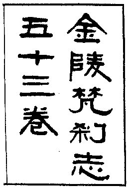
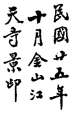
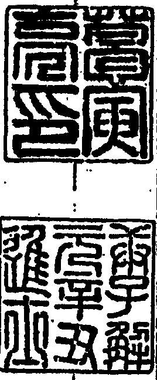

# 金陵梵刹志



> **藏经**：大藏经补编（大藏经补编）　**册次** 第 29 册（B29）　**编号** B0160　**部类** 史传部　**卷次** 53 卷　**篇幅** 318,551 字

> **作者（译者）**：御制集、钦录集、西土圣贤撰集、大乘修行菩萨行门诸经要集、张尾半三张)陀罗尼襍集、张尾半二张)【县】(六卷一百六十九张尾半三张)【家】(六卷一百五十五张)诸经要集、张尾半三张)诸经要集、张尾半五张)大唐西域记、张尾半三张)大唐西域记、张尾半五张)【驾】(十卷一百六十九张尾半六张)弘明集、张尾半二张)密咒圆因往生集、张尾半四张)续传镫录、张尾半五张)圆悟佛果禅师语录、张尾半四张)传法正宗记、张尾半二张)【惠】(十一卷二百一十九张)宗门统要续集、观音玄义记、张尾半一张)菩萨戒义疏、金光明经文句记、仁王护国般若波罗蜜经疏、六张尾半四张)仁王护国般若波罗蜜经疏神实记、张尾半六张)请观音经疏、天台传佛心印记、张尾半五张)国清百录、张尾半四张)【百】(十卷一百九十四张尾半五张)出三藏记集、张尾半三张)众经目录、七张尾半三张)武周刊定众经目录、张)【岳】(九卷二百零七张尾半一张)大唐内典录、张尾半三张)历代三宝记、张尾半五张)历代三宝记、张尾半四张)至元法宝勘同总录

> **卷／品**：296 卷 · 21 品



---



## 目录



  - [金陵梵刹志序](#金陵梵刹志序)

- [第十二卷三](#第十二卷三)

- [金陵梵刹志卷一](#金陵梵刹志卷一)

  - [序](#序)

  - [习唐太宗圣教序](#习唐太宗圣教序)

  - [心经序](#心经序)

- [金陵梵刹志卷二](#金陵梵刹志卷二)

- [金陵梵刹志卷三](#金陵梵刹志卷三)

- [金陵梵刹志卷四](#金陵梵刹志卷四)

  - [摄山多宝塔铭有序](#摄山多宝塔铭有序)

- [金陵梵刹志卷五](#金陵梵刹志卷五)

- [金陵梵刹志卷六](#金陵梵刹志卷六)

- [金陵梵刹志卷七](#金陵梵刹志卷七)

- [金陵梵刹志卷八](#金陵梵刹志卷八)

- [金陵梵刹志卷九](#金陵梵刹志卷九)

- [金陵梵刹志卷十](#金陵梵刹志卷十)

- [金陵梵刹志卷十一](#金陵梵刹志卷十一)

- [金陵梵刹志卷十二](#金陵梵刹志卷十二)

- [金陵梵刹志卷十三](#金陵梵刹志卷十三)

- [金陵梵刹志卷十四](#金陵梵刹志卷十四)

- [金陵梵刹志卷十五](#金陵梵刹志卷十五)

- [金陵梵刹志卷十六](#金陵梵刹志卷十六)

- [金陵梵刹志卷十七](#金陵梵刹志卷十七)

- [金陵梵刹志卷十八](#金陵梵刹志卷十八)

  - [静海寺重修䟽序](#静海寺重修䟽序)

- [金陵梵刹志卷十九](#金陵梵刹志卷十九)

- [金陵梵刹志卷二十](#金陵梵刹志卷二十)

- [金陵梵刹志卷二十一](#金陵梵刹志卷二十一)

- [金陵梵刹志卷二十二](#金陵梵刹志卷二十二)

- [金陵梵刹志卷二十三](#金陵梵刹志卷二十三)

- [金陵梵刹志卷二十四](#金陵梵刹志卷二十四)

- [金陵梵刹志卷二十五](#金陵梵刹志卷二十五)

- [金陵梵刹志卷二十六](#金陵梵刹志卷二十六)

- [金陵梵刹志卷二十七](#金陵梵刹志卷二十七)

- [金陵梵刹志卷二十八](#金陵梵刹志卷二十八)

- [金陵梵刹志卷二十九](#金陵梵刹志卷二十九)

- [金陵梵刹志卷三十](#金陵梵刹志卷三十)

- [金陵梵刹志卷三十一](#金陵梵刹志卷三十一)

  - [濠上亭镌壁并序](#濠上亭镌壁并序)

- [金陵梵刹志卷三十二](#金陵梵刹志卷三十二)

- [金陵梵刹志卷三十三](#金陵梵刹志卷三十三)

- [金陵梵刹志卷三十四](#金陵梵刹志卷三十四)

- [金陵梵刹志卷三十五](#金陵梵刹志卷三十五)

- [金陵梵刹志卷三十六](#金陵梵刹志卷三十六)

- [金陵梵刹志卷三十七](#金陵梵刹志卷三十七)

- [金陵梵刹志卷三十八](#金陵梵刹志卷三十八)

- [金陵梵刹志卷三十九](#金陵梵刹志卷三十九)

- [金陵梵刹志卷四十](#金陵梵刹志卷四十)

  - [观音颂并序](#观音颂并序)

- [金陵梵刹志卷四十一](#金陵梵刹志卷四十一)

- [金陵梵刹志卷四十二](#金陵梵刹志卷四十二)

- [金陵梵刹志卷四十三](#金陵梵刹志卷四十三)

  - [献花𪨷序](#献花𪨷序)

- [金陵梵刹志卷四十四](#金陵梵刹志卷四十四)

- [金陵梵刹志卷四十五](#金陵梵刹志卷四十五)

- [金陵梵刹志卷四十六](#金陵梵刹志卷四十六)

- [金陵梵刹志卷四十七](#金陵梵刹志卷四十七)

- [金陵梵刹志卷四十八](#金陵梵刹志卷四十八)

  - [保宁寺旧序](#保宁寺旧序)

  - [法王寺旧序](#法王寺旧序)

  - [龙光寺旧序](#龙光寺旧序)

  - [铁塔寺旧序](#铁塔寺旧序)

  - [湘宫寺旧序](#湘宫寺旧序)

  - [宋兴寺旧序](#宋兴寺旧序)

  - [净妙寺旧序](#净妙寺旧序)

  - [同泰寺旧序](#同泰寺旧序)

  - [证圣寺旧序](#证圣寺旧序)

- [金陵梵刹志卷四十九](#金陵梵刹志卷四十九)

- [【姜】(十卷一百九十四](#姜十卷一百九十四)

- [【河】(十卷一百六十三](#河十卷一百六十三)

- [【淡】(十卷一百五十一](#淡十卷一百五十一)

- [【潜】(十一卷一百六十三](#潜十一卷一百六十三)

- [【羽】(十卷一百四十九](#羽十卷一百四十九)

- [【翔】(十卷一百三十四](#翔十卷一百三十四)

- [【乃】(九卷一百八十二](#乃九卷一百八十二)

- [【服】(九卷一百二十七](#服九卷一百二十七)

- [【衣】(八卷一百三十三](#衣八卷一百三十三)

- [【裳】(十卷一百五十六](#裳十卷一百五十六)

- [【推】(十卷一百三十八](#推十卷一百三十八)

- [【位】(十卷一百八十七](#位十卷一百八十七)

- [【虞】(十卷二百](#虞十卷二百)

- [【陶】(十卷一百五十](#陶十卷一百五十)

- [【唐】(十卷一百三十五](#唐十卷一百三十五)

- [【吊】(十卷一百五十九](#吊十卷一百五十九)

- [【伐】(九卷一百三十二](#伐九卷一百三十二)

- [【周】(一卷一百四十二](#周一卷一百四十二)

- [【发】(十卷一百六十三](#发十卷一百六十三)

- [【殷】(八卷一百二十](#殷八卷一百二十)

- [【遐】(八卷一百三十五](#遐八卷一百三十五)

- [【迩】(十卷一百九十九](#迩十卷一百九十九)

- [【壹】(十二卷二百零](#壹十二卷二百零)

- [【体】(十一卷一百七十八](#体十一卷一百七十八)

- [【白】(八卷一百六十六](#白八卷一百六十六)

- [【驹】(九卷一百六十四](#驹九卷一百六十四)

- [【食】(十二卷一百七十三](#食十二卷一百七十三)

- [【塲】(十三卷一百九十六](#塲十三卷一百九十六)

- [【化】(十卷一百六十七](#化十卷一百六十七)

- [【草】(九卷一百七十五](#草九卷一百七十五)

- [【木】(十卷一百七十八](#木十卷一百七十八)

- [【赖】(十卷一百七十四](#赖十卷一百七十四)

- [【及】(十卷一百七十九](#及十卷一百七十九)

- [【万】(十卷一百七十四](#万十卷一百七十四)

- [【方】(十二卷一百八十八](#方十二卷一百八十八)

- [【盖】(十二卷一百九十五](#盖十二卷一百九十五)

- [【此】(十一卷一百五十九](#此十一卷一百五十九)

- [【身】(十三卷一百六十一](#身十三卷一百六十一)

- [【发】(十卷一百八十一](#发十卷一百八十一)

- [【四】(十一卷一百六十四](#四十一卷一百六十四)

- [【大】(十二卷一百九十一](#大十二卷一百九十一)

- [【五】(十卷一百九十](#五十卷一百九十)

- [【常】(十二卷一百六十](#常十二卷一百六十)

- [【恭】(十六卷一百七十四](#恭十六卷一百七十四)

- [【惟】(十卷一百八十七](#惟十卷一百八十七)

- [【鞠】(十卷一百七十三](#鞠十卷一百七十三)

- [【养】(十卷一百七十二](#养十卷一百七十二)

- [【岂】(十一卷一百六十六](#岂十一卷一百六十六)

- [【敢】(八卷一百三十八](#敢八卷一百三十八)

- [【毁】(十卷一百七十二](#毁十卷一百七十二)

- [【伤】(十二卷一百七十](#伤十二卷一百七十)

- [【女】(十一卷一百九十一](#女十一卷一百九十一)

- [【慕】(十一卷一百六十一](#慕十一卷一百六十一)

- [【贞】(十卷一百五十三](#贞十卷一百五十三)

- [【洁】(十卷一百三十六](#洁十卷一百三十六)

- [【効】(十卷一百三十二](#効十卷一百三十二)

- [【才】(十一卷一百四十四](#才十一卷一百四十四)

- [【必】(十一卷一百八十六](#必十一卷一百八十六)

- [【得】(十卷一百九十七](#得十卷一百九十七)

- [【能】(八卷二百零](#能八卷二百零)

- [【莫】(十二卷一百六十一](#莫十二卷一百六十一)

- [【忘】(十二卷一百八十一](#忘十二卷一百八十一)

- [【罔】(十二卷二百零](#罔十二卷二百零)

- [【彼】(十卷一百九十](#彼十卷一百九十)

- [【短】(七卷二百零](#短七卷二百零)

- [【靡】(九卷一百七十四](#靡九卷一百七十四)

- [【恃】(十一卷一百七十八](#恃十一卷一百七十八)

- [【己】(十卷一百八十四](#己十卷一百八十四)

- [【长】(十卷一百六十一](#长十卷一百六十一)

- [【信】(十二卷一百六十四](#信十二卷一百六十四)

- [【使】(十二卷一百五十五](#使十二卷一百五十五)

- [【可】(十二卷一百五十四](#可十二卷一百五十四)

- [【器】(十二卷一百四十六](#器十二卷一百四十六)

- [【难】(十卷一百九十四](#难十卷一百九十四)

- [【墨】(十卷一百五十九](#墨十卷一百五十九)

- [【悲】(九卷一百九十一](#悲九卷一百九十一)

- [【丝】(十二卷一百七十三](#丝十二卷一百七十三)

- [【染】(十一卷一百七十七](#染十一卷一百七十七)

- [【诗】(十一卷一百七十八](#诗十一卷一百七十八)

- [【赞】(十卷一百七十一](#赞十卷一百七十一)

- [【羔】(十三卷二百五十七](#羔十三卷二百五十七)

- [【羊】(八卷一百七十九](#羊八卷一百七十九)

- [【景】(九卷一百七十六](#景九卷一百七十六)

- [【行】(十卷一百七十一](#行十卷一百七十一)

- [【维】(十一卷一百七十三](#维十一卷一百七十三)

- [【贤】(十一卷一百五十三](#贤十一卷一百五十三)

- [【尅】(十一卷二百九十三](#尅十一卷二百九十三)

- [【习】(十卷一百七十一](#习十卷一百七十一)

- [【祸】(十一卷一百九十二](#祸十一卷一百九十二)

- [【因】(十卷一百五十五](#因十卷一百五十五)

- [【积】(十卷一百五十六](#积十卷一百五十六)

- [【福】(十一卷一百四十四](#福十一卷一百四十四)

- [【缘】(十卷一百六十](#缘十卷一百六十)

- [【善】(十一卷一百五十九](#善十一卷一百五十九)

- [【庆】(九卷一百五十六](#庆九卷一百五十六)

- [【尺】(八卷一百五十四](#尺八卷一百五十四)

- [【𤩹】(八卷一百五十六](#𤩹八卷一百五十六)

- [【与】(十卷一百三十七](#与十卷一百三十七)

- [【敬】(九卷一百二十](#敬九卷一百二十)

- [【孝】(十卷一百一十七](#孝十卷一百一十七)

- [【当】(十卷一百零](#当十卷一百零)

- [【竭】(十二卷一百五十](#竭十二卷一百五十)

- [【力】(十卷一百四十四](#力十卷一百四十四)

- [【忠】(九卷一百三十九](#忠九卷一百三十九)

- [【则】(八卷一百五十六](#则八卷一百五十六)

- [【命】(十卷一百四十四](#命十卷一百四十四)

- [【临】(十二卷一百三十五](#临十二卷一百三十五)

- [【深】(十三卷一百八十一](#深十三卷一百八十一)

- [【履】(十卷一百四十一](#履十卷一百四十一)

- [【薄】(十二卷一百三十五](#薄十二卷一百三十五)

- [【夙】(十卷一百五十](#夙十卷一百五十)

- [【兴】(十一卷一百五十五](#兴十一卷一百五十五)

- [【温】(十卷一百五十六](#温十卷一百五十六)

- [【凊】(九卷一百四十九](#凊九卷一百四十九)

- [【似】(十四卷一百四十三](#似十四卷一百四十三)

- [【斯】(十二卷一百四十八](#斯十二卷一百四十八)

- [【馨】(十卷一百四十九](#馨十卷一百四十九)

- [【如】(十卷一百六十三](#如十卷一百六十三)

- [【之】(十一卷一百五十六](#之十一卷一百五十六)

- [【川】(九卷一百六十八](#川九卷一百六十八)

- [【流】(十卷一百六十一](#流十卷一百六十一)

- [【不】(十卷一百五十六](#不十卷一百五十六)

  - [文殊问经字母品第十四](#文殊问经字母品第十四)

- [【息】(十一卷一百五十一](#息十一卷一百五十一)

- [【渊】(十二卷一百七十七](#渊十二卷一百七十七)

- [【澄】(十一卷一百六十五](#澄十一卷一百六十五)

- [【取】(十一卷一百四十七](#取十一卷一百四十七)

- [【止】(十一卷一百五十三](#止十一卷一百五十三)

- [【若】(十一卷一百五十七](#若十一卷一百五十七)

- [【思】(十一卷一百八十二](#思十一卷一百八十二)

- [【言】(十卷一百五十七](#言十卷一百五十七)

- [【辞】(十卷一百四十二](#辞十卷一百四十二)

- [【定】(八卷一百九十二](#定八卷一百九十二)

- [【诚】(九卷一百七十八](#诚九卷一百七十八)

- [【慎】(十一卷一百五十二](#慎十一卷一百五十二)

- [【终】(十卷一百五十九](#终十卷一百五十九)

- [【宜】(九卷一百七十八](#宜九卷一百七十八)

- [【令】(十卷一百七十](#令十卷一百七十)

- [【荣】(十卷一百六十二](#荣十卷一百六十二)

- [【业】(十一卷一百八十五](#业十一卷一百八十五)

- [【所】(十一卷一百七十六](#所十一卷一百七十六)

- [【基】(十一卷二百零](#基十一卷二百零)

- [【甚】(十一卷二百零](#甚十一卷二百零)

- [【无】(十一卷一百七十二](#无十一卷一百七十二)

- [【竟】(十三卷一百八十七](#竟十三卷一百八十七)

- [【学】(十二卷一百九十一](#学十二卷一百九十一)

- [【优】(十二卷一百八十二](#优十二卷一百八十二)

- [【登】(八卷一百六十八](#登八卷一百六十八)

- [【摄】(十卷一百六十七](#摄十卷一百六十七)

- [【职】(十卷一百六十二](#职十卷一百六十二)

- [【从】(十一卷一百三十八](#从十一卷一百三十八)

  - [十诵毘尼序](#十诵毘尼序)

- [【上】(十卷一百六十六](#上十卷一百六十六)

- [【妇】(十一卷一百三十六](#妇十一卷一百三十六)

- [【叔】(八卷一百八十二](#叔八卷一百八十二)

- [【犹】(六卷一百八十九](#犹六卷一百八十九)

- [【子】(七卷一百七十六](#子七卷一百七十六)

- [【比】(八卷一百四十八](#比八卷一百四十八)

- [【儿】(八卷一百三十九](#儿八卷一百三十九)

- [【怀】(十卷一百七十三](#怀十卷一百七十三)

- [【弟】(十卷一百八十九](#弟十卷一百八十九)

- [【气】(九卷一百七十五](#气九卷一百七十五)

- [【交】(十卷一百七十四](#交十卷一百七十四)

- [【造】(十卷一百七十九](#造十卷一百七十九)

- [【次】(十卷一百八十二](#次十卷一百八十二)

- [【弗】(十二卷一百七十六](#弗十二卷一百七十六)

- [【离】(十一卷一百八十五](#离十一卷一百八十五)

- [【情】(十卷一百四十六](#情十卷一百四十六)

- [【心】(十卷一百二十九](#心十卷一百二十九)

- [【动】(十卷一百三十九](#动十卷一百三十九)

- [【疲】(十卷一百五十一](#疲十卷一百五十一)

- [【真】(十卷一百七十九](#真十卷一百七十九)

- [【志】(十卷一百七十二](#志十卷一百七十二)

- [【逐】(十卷一百三十八](#逐十卷一百三十八)

- [【意】(十卷一百五十六](#意十卷一百五十六)

- [【爵】(十一卷一百七十一](#爵十一卷一百七十一)

- [【自】(十一卷一百六十五](#自十一卷一百六十五)

- [【都】(九卷一百六十三](#都九卷一百六十三)

- [【邑】(九卷一百四十六](#邑九卷一百四十六)

- [【华】(十卷一百三十四](#华十卷一百三十四)

- [【背】(十二卷一百七十一](#背十二卷一百七十一)

- [【洛】(十卷一百四十七](#洛十卷一百四十七)

- [【渭】(十卷一百二十三](#渭十卷一百二十三)

- [【鼓】(八卷一百八十](#鼓八卷一百八十)

- [【笙】(十卷一百五十](#笙十卷一百五十)

- [【承】(十卷一百七十一](#承十卷一百七十一)

- [【明】(七卷一百七十七](#明七卷一百七十七)

- [【集】(七卷一百五十九](#集七卷一百五十九)

- [【典】(十卷二百零](#典十卷二百零)

- [【群】(八卷二百零](#群八卷二百零)

- [【藁】(十二卷一百七十七](#藁十二卷一百七十七)

- [【锤】(八卷一百七十五](#锤八卷一百七十五)

- [【书】(十卷一百五十八](#书十卷一百五十八)

- [【壁】(十卷一百五十四](#壁十卷一百五十四)

- [【府】(十一卷一百九十五](#府十一卷一百九十五)

- [【罗】(八卷一百四十七](#罗八卷一百四十七)

- [【相】(六卷一百八十三](#相六卷一百八十三)

- [【封】(十卷一百六十七](#封十卷一百六十七)

- [【八】(六卷一百五十四](#八六卷一百五十四)

- [【给】(七卷一百六十](#给七卷一百六十)

- [【千】(十卷一百七十三](#千十卷一百七十三)

- [【兵】(八卷一百九十](#兵八卷一百九十)

- [【高】(十卷一百六十](#高十卷一百六十)

- [【冠】(十卷一百五十七](#冠十卷一百五十七)

- [【陪】(八卷一百八十一](#陪八卷一百八十一)

- [【辇】(九卷一百五十二](#辇九卷一百五十二)

- [【车】(十卷一百九十一](#车十卷一百九十一)

- [【肥】(九卷二百二十八](#肥九卷二百二十八)

- [【功】(十一卷一百八十四](#功十一卷一百八十四)

- [【实】(十卷一百六十六](#实十卷一百六十六)

- [【营】(九卷一百八十八](#营九卷一百八十八)

- [【桓】(十卷一百九十三](#桓十卷一百九十三)

- [【合】(十一卷一百八十九](#合十一卷一百八十九)

- [【扶】(十一卷一百七十九](#扶十一卷一百七十九)

- [【倾】(十一卷一百六十七](#倾十一卷一百六十七)

- [【绮】(十卷一百六十八](#绮十卷一百六十八)

- [【回】(十一卷一百八十](#回十一卷一百八十)

- [【汉】(九卷一百八十五](#汉九卷一百八十五)

- [【丁】(十卷一百五十四](#丁十卷一百五十四)

- [【晋】(十卷二百一十一](#晋十卷二百一十一)

- [【赵】(十卷二百九十一](#赵十卷二百九十一)

- [【困】(十卷一百六十八](#困十卷一百六十八)

- [【践】(十卷一百八十三](#践十卷一百八十三)

- [【土】(十卷一百八十八](#土十卷一百八十八)

- [【何】(十二卷二百三十九](#何十二卷二百三十九)

- [【遵】(十卷一百八十二](#遵十卷一百八十二)

- [【约】(十卷一百七十八](#约十卷一百七十八)

- [【韩】(十一卷二百零](#韩十一卷二百零)

- [【弊】(十卷二百零](#弊十卷二百零)

- [【烦】(十二卷二百五十五](#烦十二卷二百五十五)

- [【刑】(十一卷二百二十五](#刑十一卷二百二十五)

- [【起】(十二卷三百六十一](#起十二卷三百六十一)

- [【翦】(十二卷二百二十五](#翦十二卷二百二十五)

- [【[疏-(梳-木)+亦]】(十卷二百一十二](#疏-梳-木亦十卷二百一十二)

- [【郡】(十卷一百九十](#郡十卷一百九十)

- [【秦】(十一卷二百零](#秦十一卷二百零)

- [【并】(七卷二百一十二](#并七卷二百一十二)

- [【主】(十卷一百八十九](#主十卷一百八十九)

- [【云】(十卷二百一十二](#云十卷二百一十二)

- [【门】(十卷一百九十六](#门十卷一百九十六)

- [【紫】(十卷一百五十九](#紫十卷一百五十九)

- [【塞】(八卷一百七十一](#塞八卷一百七十一)

- [【鸡】(七卷一百九十八](#鸡七卷一百九十八)

- [【石】(十一卷二百零](#石十一卷二百零)

- [金陵梵刹志卷五十](#金陵梵刹志卷五十)

- [金陵梵刹志卷五十一](#金陵梵刹志卷五十一)

- [金陵梵刹志卷五十二](#金陵梵刹志卷五十二)

- [金陵梵刹志卷五十三](#金陵梵刹志卷五十三)

  - [金陵梵刹志后序](#金陵梵刹志后序)



---











------



### 金陵梵刹志序



金陵为王者都会名胜甲㝢内而梵宫最盛盖始自吴赤乌间迄於六朝梁陈所称四百八十寺者此矣我高皇帝宅中定鼎兵𧱾之餘随为剏复名蓝森列灿然重辉其　宸翰之昭宣规畫之颁布凡以振法乘而护学人者犁然具举也予承乏祠曹讨求故实而矻矻於去籍之艰乃广稽博攷　御制之𢌿僧与法者散於全录恭绎而辑之　钦录集则各大寺藏本在焉更搜之荒碑故牒中得其梗槩为厘𩛙僧规清复　赐租修葺禅宇而复虑载籍无存无以徵信将来乃为作梵刹志奉　御制　钦录二集弁之简前遵王章也其次以三大寺为纲而大中丽於最大小丽於中棋布星罗联络不涣诸寺之内若殿楹若赡产若山川若古迹人物若名贤韵士之撰记题咏悉捃摭而胪列之至大藏之𫔔副墨贮於报恩琅函布於寰宇标举其目见端知委是藏目不可无入也而一二寺规之条列则附之简末为卷共五十有三焉予惟高皇帝开天神圣经制敻只千古乃於瞿昙之教每云阴翊王度云暗理王纲崇奖有加莫之废堕是岂漫无所见而然哉前代之崇释者多矣或未免趋於小果孰有如圣祖之事理双圆冥契圣谛见於阐法谕僧云者后之载笔者莫能仰窥万一天禄石渠之简閴其无徵致问礼之家褎如充耳斯志之作聊以备　国乘之外史王制之别传俾夫三教同源綂一圣真之大经制不致湮沦无攷焉尔予辑志甫成适请告去阅二十年复以尚玺至乃作序弁首因缘良不偶也玄观亦为作志板存朝天宫并附及之



天启柒年孟夏日南京尚宝司卿前福建提学叅议湖广提学副使南京礼部祠祭司郎中钱塘葛寅亮撰



金陵梵刹志凡十九则



志昉杨衒之洛阳寺记而体裁不同盖昔止述雄观今兼𩛙祠政撰志之意业有殊者若资博考镜亦窃附云  

六朝佛寺多至四百八十名沉迹灭靡得而传无志故也　国朝定都招提重建或沿故基易其名或仍旧额更其处加以修复增置共得大寺三次大寺五中寺三十二小寺一百二十其最小不入志者百餘京城内外星散绮错有道里迢递有山林辽僻人迹或未涉方域或未辨郡邑史又所忽略灵谷栖霞牛首花岩寺各一乘原非备观故辑斯志  

三大寺俱僧录分摄如灵谷寺统中寺若干中寺领小寺若干故篇首总冠以灵谷其中分条析理绝无溷淆先以大寺总为一卷次以次大寺为一卷中寺无论繁多即篇目寥寂亦寺各为一卷以便稽览餘二大寺倣此  

畿内外俱以五城畫疆而治故寺坐落即注某城某门去所统某寺若干里惟城内止书某城及所统何地何刹  

世有代兴寺随时徙沿革何常穪名无定今考元金陵新志及应天上元江宁三志地与寺合年与代符不相枘凿者方始入志精求徵信以备古今兴废之林  

崇复闲丽必数名蓝荒简卑狭自居小刹故殿堂基址规摹具见增损盈缺亦复可稽因首列之  

大寺次大寺田地洲塲皆出　钦赐中小寺则有常住有施舍总名公产括寺实徵籍其总数于公产之下僧不得售人不得市庶有常食云其大寺租额公费另详别帙  

三大寺五次大寺禅堂增新饰旧俱如重剏大寺惟灵谷租饶得兼设律堂能仁独缺亦不一例中小寺大率缺䧟　赐租既无檀施多匮即有一团蕉地何以飰众规制宏隘未可同日  

金陵佳丽半属江山如鍾阜栖霞清凉雨花鸡鸣凤台燕矶牛首而外何可胪列是惟花宫兰若标奇占胜因志山水其间峰岩泉石即昔著今湮者亦或谢屐郗骖曾驻其下故复不遗  

阿阁浮图当时[托-匕+巿]汉荒基遗像此日眠云如是之属古迹斯在又若开善之閟园陵空存载籍定林之仍扁额已换林泉胜实无归名缘附寄亦不欲掩千古灵奇托之遐览云尔  

江左玄风相扇清言争爽付钵开宗间堪大德登坛竖义非乏名僧故列人物其有当时位望屈席抡锋到处叅游停车挥麈名士芳躅因附栖讲之下  

寺碑僧志遗自先朝已为一脔搜其断简实类寸金至於当代撰著自匪名家难称完璧缃袠有限未便兼𠬧披简以还亦为残馥剜缀之诮总无恤焉  

名人纪游诸篇品题江山点缀台殿想其履处可当卧游因取增藻志林标奇撰杖惟涉汗漫稍置剪裁  

前代帝王卿相名流高士与法师往复尺一无虑累楮间摘数篇附之传后其与寺无关敷词少采悉不泛载  

高僧传神僧传传灯录五灯会元所识名僧代不数人人不数传今所裒采如宝志诸传事有徵奇文多摭实业录其全至于叅讲涉历寺无定居居无定年又如伏虎驯蛇术同魇噀谭冥记梦事类虞初未得尽述乃汰浮华用存精朴书为传略若祗取单只另入人物以表其名宁讥裂锦无惭碎金矣  

诸寺前朝题咏搜括群书网罗百氏已蔑遗矣如南唐李公建勋宋王公安石久住金陵篇什最富惟录其著记名迹者已自盈楮若夫　明兴建都列署三百年于兹卿尹大夫之干旄隐士骚人之芒𫏋聚宝以南栖霞以北几无虚日其诸藻裁想当绮叠是编采拾止于郡邑志所载诸未经目不暇骈罗  

序次先　宸墨尊昭代也其下文自为类先寺中修建碑记次游记次僧传志铭俱干各类中分朝代先后即前帝王制作亦与名公类编惟诗槩序朝代不分诸体不叙爵里示简雅云  

归并旧寺惟灵谷报恩二寺而灵谷为多先鍾山有寺七十所宋王丞相归并小寺于太平兴国寺　国朝以兴国寺为　孝陵另建灵谷寺则兴国即在灵谷且以一灵谷槩鍾山矣故诸寺仍并入焉报恩即长干寺建初寺与长干相望其地皆名佛陀里建初废掌故自宜入长干以徵江南塔寺之始餘无可并者另入废寺  

吴赤乌十四年为康僧会建寺迄于六朝梁陈之际栉比金碧烂熳极矣唐宋元兵燹圮毁之餘原野寥廓钟声罕闻爰检前牒间睹遗篇载徵往志㣲存旧额乃另列废寺即一传一诗亦考年别代编为一寺以垂徵据俾后世不泯云若夫殿堂诸款靡寻影响任其阙然



金陵梵刹志目录



第一卷御制集(【勅谕】)(授了达德瑄溥洽僧录司勅)  

(授仲羲阐教勅)  

(授玘太朴左讲经勅)  

(授清濬左觉义勅)  

(建昌僧官勅)  

(谕鍾山僧)  

(谕僧纯一)  

(谕天界寺僧)  

(谕天界寺不律僧戒泐复)  

(谕善世禅师板的达勅)  

(云南僧游方勅)  

(谕僧)  

(赦工役囚人)  

(谕翰林待诏沈士荣)



(【诏诰】)(授善世禅师诏)  

(护持朵甘乌思藏诏)  

(赐西番国师诏)



(【论】)(三教论)  

(释道论)  

(诵经论)  

(㧞儒僧人仕论)  

(宦释论)  

(鬼神有无论)  

(明施论)  

(修教论)



(【说】)(赐宗泐免官说)  

(佛教利济说)  

(僧道衡说)  

(鍾山僧妙云说)  

(僧道竺隐说)  

(僧玘太朴说)  

(天界寺花架说)  

(僧犯宪说)



(【序】)(习唐太宗圣教序)  

(心经序)



(【杂著】)(戒僧陶冶)  

(问佛仙一)  

(问佛仙二)  

(还经示僧)  

(㧞儒僧文)  

(空实喻)  

(游寺记)  

(祭宝志法师文)  

(祭道林真觉普济禅师文)  

(祭左讲经如玘文)



(【赞】)(毘沙门天正赞)  

(莲花菩萨赞)  

(佛母赞)  

(维摩居士赞)  

(华藏世界赞二)  

(瑞光塔赞)  

(禅海罗汉赞)  

(十六罗汉赞)  

(板的达顶相赞二首)  

(王亨十六罗汉图赞)  

(吴道子降圣图赞)  

(天王图赞)  

(吴道子释迦出山像赞)  

(五十三叅赞)



(【诗】)(天竺僧)  

(赓僧韵)  

(善世禅师游方归朝)  

(宝光废塔)  

(赓僧锡杖歌)  

(御制山居律诗十二首赐灵谷寺左觉义清濬)  

(雪山寺)  

(僧目空山)  

(命板的达稳禅)  

(思游寺)  

(老禅纸帐)  

(寺俺山深二首)  

(云山僧寺)  

(鍾山僧寺赓单仲右韵三首)  

(天界寺春雀)  

(赓玘太朴韵)  

(示僧谦牧)  

(不惹庵示僧)



(【附解】)(还经示僧)  

(谕僧)  

(三教论)



第二卷钦录集



第三卷鍾山灵谷寺(大刹)(【文】)(御制蒋山寺广荐佛会文　洪武四年十一月二十一日)  

(御制大灵谷寺记　洪武十五年九月日)  

(御制灵谷寺塔影记　永乐五年四月二十六日)  

(藏经护勅　正统十年二月十五日)  

(本寺护勅　成化九年正月二十四日)  

(开善寺碑铭　梁王筠)  

(答广信侯开善寺听讲书　梁简文帝)  

(修志公堂石柱记　唐李顾行)  

(致斋宝志公青词　宋太宗)  

(勅建谢雨道塲文　宋孝宗)  

(蒋山大佛殿记　宋侍郎刘岑)  

(八功德水记　宋守大理寺丞梅挚)  

(八功德水记　宋赵师缙)  

(鍾山太平兴国寺碑记　元翰林学士虞集)  

(蒋山钟铭　元中书右丞赵世延)  

(奉　勅撰灵谷寺碑　明杭州府学教授徐一夔)  

(蒋山寺广荐佛会记　明翰林学士宋濂)  

(重修宝公塔记　明右觉义可浩)  

(游鍾山寺记略　宋陆游)  

(游鍾山记　元胡炳文)  

(游鍾山记　明翰林学士宋濂)  

(游灵谷记　明大学士吕柟)



(【传】)(志法师墓志铭　梁陆倕)  

(宝志公行实　寺志)  

(宝公赞　唐李白)  

(宝公赞　唐僧皎然)  

(释智藏传略　高僧传)  

(与智藏法师书　梁元帝)  

(佛慧泉禅师传略　旧志)  

(佛眼远禅师传略　旧志)  

(云峰高禅师传略　旧志)  

(圆辨顺禅师志略　明翰林学士宋濂)  

(妙辨同大师志略　明翰林学士宋濂)  

(普济日大师志略　明翰林学士宋濂)  

(慧辨琦禅师志略　明翰林学士宋濂)  

(朴隐瀞禅师志略　明翰林学上宋濂)



(【诗】)(开善寺法会　梁昭明太子统)  

(鍾山讲解　梁昭明太子统)  

(和昭明讲解　梁萧子显)  

(和昭明讲解　梁刘孝绰)  

(和昭明讲解　梁刘孝仪)  

(和昭明讲解　梁陆倕)  

(登鍾山下峰望　梁虞骞)  

(游鍾山应教五章　梁沈约)  

(奉和法筵应诏　北周庾信)  

(游鍾山开善寺　陈徐伯阳)  

(开善寺　陈阴铿)  

(游鍾山之开善定林　陈释洪偃)  

(蒋山开善寺　唐崔峒)  

(同群公宿开善寺　唐高适)  

(赠鍾山韦处士　唐白居易)  

(送韦少府归鍾山　唐李嘉祐)  

(和友封题开善寺　唐元稹)  

(蒋山开善寺　南唐李建勋)  

(同王胜之游蒋山　宋苏轼)  

(和子瞻同王胜之游蒋山　宋王安石)  

(游鍾山　宋王安石)  

(登鍾山谒宝公塔　宋李纲)  

(宝公塔　宋曾极)  

(八功德水　宋曾极)  

(蒋山法会应制　明王称)  

(春日蒋山应制诗　明林鸿)  

(灵谷寺法会应制　明释守仁)  

(灵谷寺法会应制　明释清濬)  

(诏於龙湾普放水灯　明释夷简)  

(法会赋迎驾　明释夷简)  

(游灵谷寺　明蔡汝楠)  

(游灵谷寺　明皇甫汸)  

(访月泉禅师　明徐元春)  

(上巳日集灵谷寺　明王世懋)  

(灵谷寺梅花坞六首　明焦竑)  

(灵谷寺　明焦竑)



灵谷并括旧寺遗迹(附)(【文】)(鍾山飞流寺碑铭　梁元帝)  

(谢半山寺额表　宋丞相王安石)  

(崇禧万寿寺碑记略　元四川行省平章赵世延)



(【传】)(延贤寺杯度传　高僧传)  

(延贤寺释智顺传略　高僧传)  

(灵味寺释宝亮传略　高僧传)  

(尚禅师碑铭　陈江总)  

(兴皇寺释法朗传略　高僧传)  

(竹林寺释昙璀传略　高僧传)  

(鍾山隐士与子姪书　宋雷次宗)  

(与鍾山隐士周颙书　齐释智林)



(【诗】)(鍾山曲水　南宋谢灵运)  

(游鍾山大爱敬寺　梁武帝)  

(和武帝游大爱敬寺　梁昭明太子统)  

(登鍾山望西静坛　梁吴均)  

(和从驾登云居寺塔　北周庾信)  

(游鍾山明庆寺怀古　北周姚察)  

(明庆寺石壁　陈王褒)  

(云居寺高顶　陈王褒)  

(鍾山明庆寺　陈江总)  

(同庾肩吾游明庆寺　陈沈烱)  

(题道林寺　唐杜荀鶴)  

(游云居寺赠地主　唐白居易)  

(留题爱敬寺　南唐李建勋)  

(鍾山道林寺　南唐李建勋)  

(题道林　南唐李中)  

(鍾山秀峰院　宋梅挚)  

(鍾山讲经台　宋释至慧)  

(宿雪峰庵　宋释大䜣)  

(道光泉　宋王安石)  

(玉涧　宋王安石)  

(过故居　宋王安石)  

(定林院昭文斋　宋王安石)  

(悟真院　宋王安石)  

(半山春晚即事　宋王安石)  

(暮春登鍾山望牛首　宋苏颂)  

(饮鍾山一人泉　宋释觉范)  

(初夏访定岩禅寺　明姚广孝)



第四卷摄山栖霞寺(次大利)(【文】)(摄山栖霞寺碑铭　梁元帝)  

(摄山栖霞寺碑铭　陈侍中尚书令江总持)  

(立舍利塔诏　隋文帝)  

(舍利感应记　隋著作郎王劭)  

(蒋州栖霞寺请疏　隋释保恭)  

(摄山栖霞寺新路记　南唐兵部员外郎徐鈜)  

(重修栖霞寺碑铭　明南大理卿沔阳陈文烛)  

(重修栖霞天王殿记　明吏部尚书平胡陆光祖)  

(栖霞寺般若堂记　明兵师侍郎新都汪道昆)  

(摄山多宝塔铭　明兵部侍郎新都汪道昆)  

(栖霞寺阿罗汉畫记　明史官秣陵焦竑)  

(栖霞寺阿罗汉画记　明史官云间董其昌)  

(绘施阿罗汉梦端记　明翰林编修颜起元)  

(修栖霞寺法堂短引　明南吏科拾事豫章祝世禄)  

(摄山圆通精舍记　明兵部侍郎新都汪道昆)  

(圆通精舍灵应殿记　明南刑部尚书吴郡王世贞)  

(圆通精舍募田碑记　明兵部主事袁黄)  

(摄山栖霞寺清叹堂记　明南祠部郎葛寅亮)  

(纪形胜剏立建置　旧志)  

(游摄山栖霞寺记　明南刑部尚书吴郡王世贞)  

(游摄山栖霞寺记略　明礼部尚书丹阳姜宝)  

(游摄山栖霞寺记略　明按察副使吴郡冯时可)  

(再游摄山记略　明按察副使吴郡冯时可)



(【传】)(法度禅师传略　高僧传)  

(智者禅师传略　集诸传)  

(法响禅师传略　佛祖綂纪)  

(释慧偘传略　高僧传)  

(释保恭传略　高僧传)  

(释元崇传略　高僧传)  

(释智聪传略　高僧传)  

(大德玭律师碑略　唐刘轲)  

(御制摄山明徽君碑　唐高宗)  

(明僧绍传略　旧志)



(【诗】)(和令君游虎穴寺　梁王冏)  

(奉和江令　梁陆罩)  

(奉和江令　梁孔焘)  

(奉和江令　梁王台卿)  

(从驾虎穴寺　梁鲍至)  

(游栖霞寺　陈江总)  

(静卧栖霞寺房　陈江总)  

(游虎穴寺　陈江总)  

(营涅槃忏　陈江总)  

(入摄山栖霞寺　陈江总)  

(栖霞寺山房夜坐　陈江总)  

(仰同令君山房夜坐　陈徐孝克)  

(仰和江令君　陈徐孝克)  

(送陆鸿渐栖霞采茶　唐皇甫冉)  

(送陆鸿渐采茶相遇　唐皇甫冉)  

(摄山　唐顾况)  

(栖霞寺　唐顾况)  

(登栖霞寺峰怀望　唐李绪)  

(送族弟至郭南廻栖霞山　唐李白)  

(题栖霞寺　唐綦母潜)  

(栖霞寺寻明徽君故居　唐刘长卿)  

(登栖霞寺　唐常衮)  

(摄山　唐权德舆)  

(与沈拾遗宿僧舍　唐权德舆)  

(栖霞寺山房　唐李频)  

(登栖霞寺　唐皮日休)  

(栖霞寺夜坐　唐僧灵一)  

(登栖霞寺　唐蒋涣)  

(游栖霞寺　唐张晕)  

(游栖霞寺　南唐李建勋)  

(栖霞寺赠月公　南唐周繇)  

(题栖霞山房　宋王随)  

(天开岩　宋王随)  

(题摄山舍利塔　明王世贞)  

(千佛岩　明王世贞)  

(登摄山绝顶　明叶向高)  

(游栖霞三首　明董应举)  

(栖霞寺二首　明普学佺)  

(再集摄山方丈　明郭第)



衡阳下院(小刹)



第五卷铜井院(中刹)  

十方律院(小刹)  

吉祥庵(小刹)  

廻龙庵(小刹)  

龙华庵(小刹)  

双桥门圆通庵(小刹)  

慈悯庵(小刹)



第六卷兴善寺(中刹)  

观音庵(小刹)



第七卷观音阁(中刹)(【文】)(重修观音阁记略　明南兵部尚书太原乔宇)



苜蓿庵(小刹)



第八卷佛国寺(中刹)(【文】)(佛国寺记略　明礼部尚书毘陵胡濙)



(【诗】)(佛国寺　明王韦)



普济庵(小刹)  

清果寺(小刹)  

梵惠院(小刹)  

茶亭庵(小刹)  

地藏庵(小刹)



第九卷东山翼善寺(中刹)(【文】)(翼善寺碑记略　明礼部侍郎陈琏)



(【诗】)(谢公墅歌　唐温庭筠)  

(土山　唐李白)  

(游谢氏山亭　唐李白)  

(土山　明黄姬水)  

(东山　明焦竑)



广惠寺(小刹)  

祈泽寺(小刹)(【诗】)(游祈泽寺　宋王安石)  

(堕云峰　明盛时泰)  

(仙人岩　明盛时泰)  

(𮋒经平　明盛时泰)



天宁寺(小刹)(【文】)(天宁寺游记略　明按察副使顾𰢕)



(【诗】)(游天宁寺　明王韦)



云居寺(小刹)  

庄严寺(小刹)(【文】)(大庄严寺碑铭　隋开府仪同三司江总)  

(庄严寺重兴记略　明释印庵)



(【传】)(庄严寺僧旻法师碑　梁元帝)  

(僧旻法师传略　高僧传)



第十卷方山定林寺(中刹)(【文】)(方山上定林寺记　宋免解进士建康府校正书籍朱舜庸)  

(方山重修上定林寺记　元翰林学士虞集)  

(重建方山定林寺记略　明府太常少卿翟瑛)  

(定林寺沙门表请断杀议　广弘明集)  

(集程伯淳语　法喜志)



(【传】)(释法愿传略　高僧传)  

(释僧远传略　高僧传)  

(傅大士传　神僧传)  

(刘慧地传　梁书)



(【诗】)(邻里相送至方山　南宋谢灵运)  

(与诸兄弟方山别诗　晋王彪之之)  

(侍游方山应诏　齐王融)  

(侍游方山应诏　梁沈约)  

(下方山　梁何逊)  

(定林　宋王安石)  

(自读书台上定林　宋王安石)  

(登方山绝顶　明许[榖-一])



东霞寺(小刹)  

外永福寺(小刹)



第十一卷光相寺(中刹)  

天隆寺(小刹)  

积善庵(小刹)



------



## 第十二卷三



安平寺(小刹)  

登台寺(小刹)  

慈光寺(小刹)  

无垢寺(小刹)  

紫草寺(小刹)  

华严庵(小刹)



第十三卷广惠院(中刹)  

崇善寺(小刹)(【文】)(崇善禅寺碑铭略　明南尚宝少卿夏瑄)



宝善寺(小刹)  

龙泉庵(小刹)  

隐静寺(小刹)  

本业寺(小刹)(【文】)(本业寺记　唐僧契抚)  

(游阳山本业寺记　明翰林学士胡广)



(【诗】)(本业寺　明类源)



普济庵(小刹)  

普济寺(小刹)  

山海院(小刹)



第十四卷法清院(中刹)  

香林寺(小刹)  

吴读庵(小刹)  

许村庵(小刹)  

多福寺(小刹)(【文】)(多福寺重兴记　明翰林学士钱塘倪谦)



桂阳寺(小刹)



第十五卷草堂寺(中刹)(【文】)(草堂寺千僧会愿文　梁尚书令沈约)  

(草堂寺缘起记略　明惠州知府海陵俞经)



(【传】)(智者约法师碑　梁王筠)  

(与草堂寺约法师书　梁尚书令沈约)



(【诗】)(草堂寺寻无名法师　梁刘孝先)  

(秋夜草堂寺禅房月下　梁刘孝先)  

(草堂寺四首　宋王安石)  

(草堂寺　明王韦)



慈仁寺(小刹)



第十六卷凤山天界寺(大刹)(藏经护勅　正统十年二月十五日)  

(【文】)(龙翔集庆寺碑　元翰林学士虞集)  

(天界寺毘卢阁碑　明太子少师吴郡姚广孝)  

(重修天界寺记略　明南吏部尚书三山林翰)  

(天界寺佛牙碑略　明大名知府秣陵姚汝循)  

(半峰亭记启　明南大理卿沔阳陈文蜀)  

(八大寺定租碑记　明南吏部侍郎福唐叶句高)  

(重修南京僧录司碑记　明南祠部郎姚江陈治本)  

(八大寺定租碑记　明南祠部郎钱塘葛寅亮)  

(八大寺瞻僧碑记　明南祠部郎钱塘葛寅亮)  

(八大寺重修禅律堂及赡田碑记　明南祠部郎钱塘葛寅亮)  

(八大寺重设公鉴记　明南祠部郎钱塘葛寅亮)



(【传】)(释宗泐传略　集各志)  

(孚中信禅师志略　明翰林学士宋濂)  

(觉原昙禅师志略　明翰林学士宋濂)  

(白庵金禅师志略　明翰林学士宋濂)  

(广慧及禅师志略　明翰林学士宋濂)  

(清远渭禅师志略　明翰林学士宋濂)  

(介庵良大师志略　明翰林学士宋濂)  

(雪轩成禅师志略　明南兵部侍郎李震)



(【诗】)(登天界寺　明高棨)  

(游天界寺　明传若金)  

(游牛首山归宿天界　明王问)  

(春日家兄至宿天界寺　明王世懋)



第十七卷鸡笼山鸡鸣寺(次大刹)(藏经护勅　正统十年十月十五日)  

(【文】)(重修鸡鸣寺记略　明南吏部尚书晋陵王与)  

(鸡鸣寺施食台记　明释道果)  

(凭虚阁记略　明南刑部郎晋陵吕律)  

(过后湖记　明南户部主事计弘道)



(【诗】)(鸡鸣棣曲　唐温庭筠)  

(宿鸡鸣寺　明王履吉)  

(登鸡呜寺塔望后湖　明王履吉)  

(鸡笼山　明吴宽)  

(雨中集凭虚阁饯客　明钱琦)  

(会集凭虚阁抱病不赴　明钱琦)  

(宿鸡鸣寺　明陈沂)  

(鸡鸣寺凭虚阁　明陈沂)  

(凭虚阁雨中秋望　明焦竑)



第十八卷卢龙山静海寺(次大刹)(藏经护勅　正统十年二月十五日)  

(【文】)(静海寺重修记略　明南礼部侍郎杨廉)  

(玩咸亭记略　明南贵州道御史方克)  

(三宿岩记略　明南大理卿沔阳陈文烛)  

(静海寺重修䟽序　明进士吴郡俞彦)  

(游卢龙山记　明礼部侍郎吕柟)



(【诗】)(登卢龙山　明金大车)  

(游静海寺　明蔡羽)



一真庵(小刹)  

金川门积善庵(小刹)



第十九卷石头山清凉寺(中刹)(【文】)(清凉寺阿弥陀佛賛　宋学士苏轼)  

(重建清凉寺碑略　明南吏部尚书云间钱溥)  

(游清凉广慧寺记　宋陆游)  

(游清凉山记略　明南兵部尚书乔宇)



(【传】)(文益禅师传略　五灯会元)  

(文益禅师　传灯录)  

(悟空禅师传　传灯录)  

(法灯禅师传　传灯录)  

(文遂禅师传　传灯录)



(【诗】)(石头山　唐李白)  

(游清凉寺　唐温庭筠)  

(游清凉寺　唐张祐)  

(清凉翠微亭　宋林连)  

(赠清凉和长老　宋苏轼)  

(次旧韵赠清凉长老　宋苏轼)  

(清凉竹赋　宋王𧍞)  

(清凉白云庵　宋王安石)  

(游清凉寺　明黄省曾)  

(登清凉寺后台　明李东阳)  

(游清凉寺二首　明王守仁)  

(送陈扬州暮登清凉山　明王世懋)



伽蓝庵(小刹)



第二十卷永庆寺(中刹)(【文】)(永庆寺缘起略　明住持宗海)



(【诗】)(登治城谢安潡　唐李白)  

(谢安墩　宋王安石)  

(谢安墩　宋王安石)  

(示永庆院秀老　宋王安石)  

(游永庆寺　明顾璘)  

(九日登谢公墩　明焦竑)



狮子窟(小刹)  

定林庵(小刹)(【文】)(定林庵记　明温陵李贽)



净乐庵(小刹)  

虎贵左卫正觉庵(小刹)  

净土庵(小刹)



第二十一卷凤凰台上下瓦官寺(中刹)(藏经护勅　万历十四年九月)  

(【文】)(瓦官寺维摩诗畫像碑　唐元黄之)  

(升元寺略　宋方舆胜览)  

(凤凰台上瓦官寺记　明南祠部郎钱塘葛寅亮)  

(官寺碑（下寺）　明兵部侍郎新都汪道昆)  

(瓦官寺祝厘记下寺　明南刑部侍郎瑯琊王世贞)  

(瓦官寺青莲阁记（下寺）　明南刑部侍郎瑯琊王世贞)  

(古佛记　明翰林修撰秣陵焦竑)  

(游瓦官寺记　宋陆游)



(【传】)(释智𫖮传略　高僧传)  

(勅智𫖮禅师　陈宣帝)  

(勅迎智𫖮　陈少主)  

(又勅　陈少主)  

(请智𫖮讲法华䟽　陈沈君理)  

(与智𫖮书　陈毛喜)  

(竺道一传略　高僧传)  

(竺法太传略　高僧传)  

(竺僧教传略　高僧传)  

(支道林　世说)  

(释支道林传略　高僧传)  

(与高丽道人论竺法深书　晋释支遁)  

(释僧导传略　高僧传)  

(求那摩跋传略　高僧传)  

(释宝意传略　高僧传)



(【诗】)(游瓦官寺　唐李白)  

(横江词　唐李白)  

(凤凰台　唐李白)  

(凤凰台　唐李白)  

(送许拾遗归江宁觐省于　许生处乞瓦官寺维)  

(摩图样　唐杜甫)  

(登瓦官寺阁　唐罗隐)  

(登升元阁　南唐李建勋)  

(凤凰台　南唐宋齐丘)  

(咏升阁铎　宋曾极)  

(凤凰台　宋周邦彦)  

(凤凰台晚眺　宋刘克庄)  

(凤凰台　宋郭功父)  

(游瓦官（下寺）　明余孟麟)  

(重建瓦官寺阁（下寺）　明王世贞)



华光庵(小刹)  

一苇庵(小刹)  

五云庵(小刹)  

骁骑卫千佛庵(小刹)  

普利寺(小刹)  

封崇寺(小刹)  

留守正定庵(小刹)



第二十二卷青溪鹫峰寺(中刹)(【文】)(奉诏立放生池碑　唐升州刺史颜真卿)  

(乞御书天下放生池碑额表　唐升州刺史颜真卿)  

(青溪阁记　宋朝奉郎张椿)  

(放生池记　宋景定建康志)  

(鹫峰寺碑记略　明礼部尚书杭郡邹干)  

(复顾鲁公放生碑谓并建祠小记　明南祠部郎钱唐葛寅亮)  

(过青溪王昌龄宅　唐常建)  

(青溪草堂闲与　南唐李建勋)  

(青溪　宋马大祖)  

(青溪阁　徐照)  

(晚步青溪上　明宋廉)  

(青溪　明焦竑)



廻光寺(小刹)(【文】)(鹿苑寺记略　宋元绛)  

(重修廻光寺碑略　明太常少卿浚仪邢一凤)



千佛庵(小刹)  

大中正定庵(小刹)



第二十三卷承恩寺(中刹)(藏经护勅　景泰三年六月十五日)  

(【文】)(承恩寺记略　明南翰林学士晋陵王㒜)



亭子巷观音庵(小刹)  

佑国庵(小刹)(【文】)(建立潮音阁䟽引　明南国子博士藏懋循)



伞巷观音庵(小刹)



第二十四卷普缘寺(中刹)(【传】)(耆阇寺安廪传略　高僧传)



(【诗】)(陪衡阳王游耆阇寺　陈张正见)  

(与张折冲游耆阇寺　唐孟浩然)



唱经楼(小刹)  

普贤庵(小刹)



第二十五卷吉祥寺(中刹)(【文】)(重修吉祥寺碑　明修撰秣陵焦竑)



第二十六卷金陵寺(中刹)



第二十七卷苍云崖嘉善寺(中刹)(【文】)(重修嘉善寺记略　明南吏部考功郎郑宣化)  

(重修嘉善寺募缘䟽　明修撰秣陵焦竑)  

(苍云崖修葺䟽　明修撰秣陵焦竑)



(【诗】)(游嘉善寺　明顾潾)  

(嘉善寺石壁　明焦竑)



崇化寺(小刹)(【文】)(崇化寺碑记略　明吏部尚书萧山魏骥)



(【诗】)(梅花水　明焦竑)



幕府寺(小刹)(【文】)(幕府寺修造记　明修撰秣陵焦竑)  

(游幕府寺记　明兵部尚书乔宇)



(【传】)(达磨祖师传　神僧传)



(【诗】)(登幕府山绝顶　明顾璨)  

(夹萝峰　明顾源)  

(游幕府寺　明王韦)  

(达磨洞　明焦竑)



吉祥庵(小刹)  

妙泰寺(小刹)  

三塔寺(小刹)(【文】)(三塔寺新修记　明焦竑)



(【诗】)(三塔寺寒光亭诗　宋张孝祥)



第二十八卷普惠寺(中刹)



第二十九卷燕子矶弘济寺(中刹)(【文】)(弘济寺碑记略　明礼部侍郎吕柟)  

(游弘济寺记略　明礼部侍郎吕柟)



(【诗】)(登观音山　明宗臣)  

(登观音阁　明柴竒)  

(登观音阁　明陈凤)  

(游观音阁三首　明张时微)  

(游燕子矶　明张鏊)  

(燕子矶　明陈芹)  

(九日泛舟燕子矶　明杨文卿)  

(燕子矶　明顾璘)  

(登燕子矶次浚川韵二首　明王维桢)



观音寺(小刹)(【文】)(重建观音寺碑畧　明南尚宝卿许谷)



清真寺(小刹)  

梵惠寺(小刹)



第三十卷接待寺(中刹)  

江东门积善庵(小刹)  

中和庵(小刹)  

报国庵(小刹)



> 第三十一卷聚宝山报恩寺(大刹)(御制黄侍郎立恭完塔记　洪武戊辰十二月日)  

> (报恩寺修官斋勅　永乐五年十月十五日)  

> (重修报恩寺勅　永乐十一年)  

> (御制大报恩寺左碑　永乐二十二年二月)  

> (御制大报恩寺右碑　宣德三年三月十五日)  

> (藏经护勅　正綂十年二月十五日)  

> (本寺护勅　成化八年十二月初一日)  

> (续人藏经护勅　万历十四年九月日)  

> (御制圣母印施佛藏经序　万历年　月　日)  

> (【文】)(长干诗无碍法喜食诏　广弘明集)  

> (长干寺众食碑　陈徐陵)  

> (天禧寺新建法堂记　宋李之仪)  

> (琉璃塔记　明行太仆卿鄞陈沂)  

> (游报恩寺塔记畧　明南刑部尚书吴郡王世贞)  

> (报恩寺藏经殿记　明进士吴郡俞彦)  

> (报恩寺九号藏经并藏殿碑记　明南祠部郎钱塘葛寅亮)  

> (濠上亭记　明南祠部郎钱塘葛寅亮)



(【传】)(康僧会传畧　高僧传)  

(竺慧远传畧　高僧传)  

(竺法旷传畧　高僧传)  

(建初寺琼法师碑　陈尚书令江总)  

(释明彻传畧　高僧传)  

(释僧佑传畧　高僧传)  

(南洲洽法师志畧　明大学士扬士竒)  

(永隆禅师志畧　明太子少师吴郡姚广孝)



(【诗】)(游长干寺　宋王安石)  

(长干释普济坐化　宋王安石)  

(咏天禧寺竹　宋蘓颂)  

(三藏塔　宋蘓颂)  

(游报恩寺　明李东阳)  

(报恩寺塔歌　明王世贞)



第三十二卷天竺山能仁寺(次大刹)(【文】)(能仁寺缘起录　元金陵志)



(【传】)(西天无隐大国师志畧　元大学士杨荣)



华严寺(小刹)(【文】)(华严寺碑畧　明礼部尚书毘陵胡荣)



外鹫峰寺(小刹)  

圆通庵(小刹)



> 第三十三卷牛首山弘觉寺(次大刹)(御制僧智辉牛首山庵记　洪武十年四月)  

> (藏经护𠡠　正綂十年二月十五日)  

> (【文】)(牛首山辟支佛塔记畧　宋僧普庄)  

> (佛窟寺佛殿记畧　明太子少师吴郡姚广孝)  

> (佛窟寺兴造记畧　明右觉义道遐)  

> (重修辟支佛方塔记畧　明秣陵盛时泰)  

> (牛首山禅堂华严阁碑　明翰林修撰秣陵焦竑)  

> (牛首山禅堂弥勒阁碑　明翰林编修顾起元)  

> (弘觉寺禅堂义田记　明翰林修撰朱之蕃)  

> (冬游记节文　明翰林修撰罗洪先)  

> (游献花岩牛岭记　明南刑部尚书顾璘)  

> (游牛首山记)  

> (明都穆)  

> (游牛首诸山记畧　明南刑部尚书王世贞)



(【传】)(牛头山融大师新塔记　唐刘禹锡)  

(牛头山法融传　高僧传)  

(智岩禅师传畧　传灯录)  

(慧方禅师传　传灯录)  

(法持禅师传　传灯录)  

(智威禅师传　传灯录)  

(慧忠禅师传畧　传灯录)  

(润洲玄素大师碑铭　唐李华)



(【诗】)(游牛首山　唐韦庄)  

(从游诗　明胡广)  

(和胡学士　失名)  

(游牛首山　明钱琦)  

(宿牛淆寺　明陈铎)  

(八日牛首山　明冀克梅)  

(清明日登牛首山　明余孟麟)  

(经牛头山寺　明陈沂)  

(登牛首山　明柴惟道)  

(夏日登牛首山　明皇甫汸)  

(秋日思牛首　明皇甫汸)  

(游牛头寺　明刘世扬)  

(牛首山　明顾大典)  

(牛首山阅楞严夜坐　明殷迈)  

(陟牛首山有述　明王世贞)  

(将至祖堂返望牛首　明王世贞)  

(游牛首山听友吹箫　明安绍芳)



外承恩寺(小刹)  

通善寺(小刹)(【文】)(通善寺碑　明大学士杨溥)



广缘寺(小刹)  

三山寺(小刹)(【文】)(三山寺实录　明住持昙昕)



(【诗】)(三山　宋鲍照)  

(三山　宋范云)  

(晚登三山望京邑　宋谢琥)  

(三山　唐李白)  

(三山　明金大舆)



圆通寺(小刹)  

佑圣庵(小刹)  

资福寺(小刹)  

静明寺(小刹)(【诗】)(游静明寺　明沈越)



第三十四卷雨花台高座寺(中刹)(【文】)(高座寺记畧　宋徽猷阁直学士刘岑)  

(高座寺雨花台记　宋沿江制置大使马光祖)  

(重修高座寺记畧　明南鸿胪卿陈寿)  

(帛尸梨密传　高僧传)  

(新公志畧　宋释法永)  

(西域僧传畧　旧志)  

(占谿澄禅师志畧　明南安知府金润)



(【诗】)(登梅冈赠高座寺中孚　唐李白)  

(荅中孚赠仙人掌茶　唐李白)  

(游高座寺　唐温庭筠)  

(游高座寺　宋杨无为)  

(雨花台　明宗游)  

(雨花台　明龚秉德)  

(雨花台　明孟洋)  

(登台遇雪　明陈沂)  

(雨花台　明顾璘)  

(雨花台　明乔宇)  

(雨花台　明欧大任)  

(雨花台二首　明王世贞)



安隐寺(小刹)(【文】)(重修安隐寺碑记畧　明南兵部尚书乔宇)



(【诗】)(游安隐寺　明皇甫汸)



宝光寺(小刹)(藏经护勅　正綂十年二月十五日)  

(【文】)(重修宝光寺记略　明南刑部郎中何思登)



(【诗】)(游宝光寺　明皇甫汸)



均庆院(小刹)  

月印庵(小刹)(【文】)(重修月印庵记畧　明工部主事建业黄谦)



第三十五卷梅冈永宁寺(中刹)(【文】)(重开山碑记畧　明工部主事建业黄谦)



[二/水]宁院(小刹)  

宝林庵(小刹)  

瑞相院(小刹)



第三十六卷永兴寺(中刹)  

普照寺(小刹)(【文】)(普照寺重修前殿记畧　明南刑部郎平定白鉴)



惠应寺(小刹)  

安隐院(小刹)



第三十七卷西天寺(中刹)(【记】)(西天班的荅禅师志畧　明西天佛子国师智光)



德恩寺(小刹)(藏经护𠡠　正綂十年二月十五日)



大慧庵(小刹)  

到彼庵(小刹)



第三十八卷普德寺(中刹)(【诗】)(游普德寺　明皇甫汸)



第三十九卷碧峰寺(中刹)(【文】)(碧峰寺起止记畧)



(【传】)(碧峰禅师碑畧　明太子賛善宋濂)  

(非幻大禅师志畧　明长史三衢金寔)



永福寺(小刹)



第四十卷新亭崇因寺(中刹)(【文】)(旷野寺碑　梁元帝)  

(观音颂并序　宋翰林学士苏轼)  

(集庆路崇因寺记　元豫章沙门大䜣)  

(新亭渚别范零陵云　宋谢朓)  

(和徐都曹出新亭渚　宋谢朓)  

(昧旦出新亭渚　宋徐勉)  

(过崇回寺简古昙上人　明陈沂)  

(游崇因寺　明许谷)  

(游崇因寺　明姚汝循)



英台寺(小刹)  

慈善寺(小刹)  

兴福寺(小刹)  

凤岭寺(小刹)



第四十一卷外永宁寺(中刹)  

德胜寺(小刹)  

广兴寺(小刹)  

智安寺(小刹)  

德寿寺(小刹)  

永泰寺(小刹)



第四十二卷祝禧寺(中刹)  

天隆极乐寺(小刹)



第四十三卷献花岩花岩寺(中刹)(【文】)(献花岩序　明翰林编修鄞陈沂)  

(游献花岩记　明南兵部尚书太原乔宇)



(【诗】)(献花岩　明钱琦)  

(登芙蓉阁　明陈沂)  

(宿达公房　明陈沂)  

(宿花岩寺　明陈沂)  

(澄江台　明王韦)  

(芙蓉阁　明王韦)  

(游献花岩　明鲁铎)  

(秋日游花岩　明蔡羽)  

(归云亭　明蔡羽)  

(登献花岩芙蓉阁　明汤显祖)



慧光寺(小刹)(【文】)(光宅寺刹下铭　梁尚书令沈约)  

(上钱随喜光宅寺启　梁尚书令沈约)  

(重建慧光寺记畧　明南太常少卿四明郑雍言)



(【传】)(光宅寺僧正法师碑铭　梁元帝)  

(释法悦传畧　高僧传)  

(释昙瑗传畧　高僧传)  

(与梁朝士书　梁释昙瑗)



(【诗】)(游光宅寺应令　梁简文帝)  

(游光宅寺　宋王安石)



第四十四卷幽栖山祖堂寺(中刹)(【传】)(法融禅师传　传灯录)



(【诗】)(游幽栖寺　明王韦)  

(祖堂山　明朱应登)  

(祖堂山　明顾源)  

(祖堂山　明盛时叅)  

(祖堂山　明王世贞)  

(上巳后二日游幽栖寺　明汤显祖)



吉山寺(小刹)  

永泰讲寺(小刹)  

宁海寺(小刹)  

静居寺(小刹)



第四十五卷清福寺(中刹)  

栖隐寺(小刹)  

葛塘寺(小刹)  

真如寺(小刹)  

妙明寺(小刹)



第四十六卷天竺山福兴寺(中刹)(【文】)(润州福兴寺碑　唐尚书颕川许某)



后阳寺(小刹)  

清修院(小刹)  

后黎寺(小刹)



第四十七卷建昌寺(中刹)  

西林寺(小刹)  

般若寺(小刹)(【文】)(般若禅院记畧　明左春坊右庶子邹济)



明性寺(小刹)  

衲头庵(小刹)  

高台寺(小刹)



第四十八卷废寺保宁寺(【文】)(保宁寺旧序　金陵新志)  

(保宁寺轮藏记　宋叶梦得)



(【传】)(奉先寺净照禅师　传灯录)



法王寺(【文】)(法王寺旧序　县志)  

(法王寺碑铭　梁沈约)



龙光寺(【文】)(龙光寺旧序　金陵新志)



(【传】)(青园寺竺道生传　高僧传)



(【诗】)(覆舟山　宋孝武帝)  

(覆舟山　齐王融)  

(覆舟山临望　明顾源)



枳园寺(【传】)(枳园寺释智严传　高僧传)



祗洹寺(【文】)(和范光禄祗洹寺像赞三首　宋侍中谢灵运)



(【传】)(释昙迁传　高僧传)



铁塔寺(【文】)(铁塔寺旧序　金陵新志)



(【诗】)(金陵阻风登延祚阁　唐许浑)  

(题正觉院箨龙轩二首　宋王安石)



湘宫寺(【文】)(湘宫寺旧序　金陵新志)  

(湘宫寺碑铭　梁简文帝)



(【传】)(湘宫寺智蒨法师志铭　梁简文帝)



宋兴寺(【文】)(宋兴寺旧志　金陵新志)



(【诗】)(游宋兴东岩　南唐李建勋)



安乐寺(【传】)(安乐寺智称法师碑　唐裴子野)



净妙寺(【文】)(净妙寺旧序　金陵新志)



(【诗】)(齐安寺　宋王安石)



同泰寺(【文】)(同泰寺旧序　金陵新志)  

(奉请上开讲启　梁萧纲)  

(答请开讲启勅　梁武帝)  

(重谢上降为开讲启　梁萧纲)  

(上为开讲日参承启　梁萧纲)  

(答勅　梁武帝)  

(答同泰寺立刹启　梁武帝)  

(请同泰寺御讲启　梁萧纲)  

(谢勅为建涅槃忏启　梁简文帝)  

(梁同泰寺刹下铭　陈虞荔)  

(同泰寺正智寂师志铭　梁简文帝)



(【诗】)(望同泰寺浮图　梁简文帝)  

(望同泰寺浮图　梁𢈔肩吾)  

(望同泰寺浮图　梁王训)  

(望同泰寺浮图　梁𢈔信)  

(台城寺侧独行　宋王安石)



善觉寺(【文】)(善觉寺碑铭　梁简文帝)  

(善觉寺碑　梁元帝)  

(善觉寺露盘启　梁昭明太子)  

(谢勅使监善觉寺起刹启　梁昭明太子)



证圣寺(【文】)(证圣寺旧序　金陵新志)  

(木平和尚传　县志)



报恩院(【传】)(金陵报恩院清护禅师传　传灯录)  

(金陵报恩院匡逸禅师传　传灯录)



报慈道场(【传】)(金陵报慈道场玄觉导师传　传灯录)



第四十九卷南藏目录(附请经条例)



第五十卷各寺租额条例



第五十一卷各寺公费条例



第五十二卷各寺僧规条例



第五十三卷各寺公产条例



南京礼部祠祭司郎中钱塘葛寅亮编辑



> 万历参拾伍年正月日发南京僧录司刊



(板贮僧录司印行每部太史纸两裁计玖百柒拾柒张连刷印银壹钱伍分伍厘栗壳面太史双副叶综钉陆本连绢套银伍分管板僧银贰分共银贰钱贰分伍厘)



------



## 金陵梵刹志卷一



**译者**：御制集



勅谕



授了达德瑄溥洽僧录司



西说东来妙演无量或云不二法门斯道也本苦空甘寂寞从斯道者果若是宜其然哉迩来僧录司首僧阙员召见任者命询问其人各首僧承命而还不数日来告曰臣弘道等若干人前奉𠡠询高僧於诸山即会丛林大众众皆曰惟淛右上天竺僧溥洽京师鸡鸣寺僧德瑄能仁寺僧了达东鲁之书颇通西来之意博备若以斯人备员僧录司实为允当呜呼昔人有云世不绝圣国不绝贤近者僧录司阙贠朕将以为无人矣及其询问乃有人焉今朕域之内慕清净而欲出三界者有其名而无其实其泛泛者不下五七万尔今三人不屈五七万之下伸于五七万之上可谓志矣可谓道矣然昔如来道备於雪岭归演五天妙音无量灵通上下天人会听若斯之演听四十九秋自是之后五百餘年流传东土虽九夷八蛮一闻斯道无不钦崇顶礼何况中国文物礼乐之邦人心慈善易为教化若僧善达祖风者演大乘以觉听谈因缘以化愚启𦖟愚为善于反掌之间虽有国法何制乎缧絏刑具亦何以施岂不合乎柳生之言阴翊王度岂小小哉今尔僧了达德瑄溥洽达祖风遵朕命则法轮常转佛日增辉名僧于吾世足矣往钦哉毋怠



授仲义阐教



入定于大千界里谈经于不二门中解脱为空清虚成性久留心于佛教独潜[疏-(梳-木)+亦]於禅林去就一之是非不染尔仲羲居山禅伯对月诗宗抱不堕之慈悲乐无穷之清净乃命阐教之职用副僧录之司尚宜深究佛书详穷禅教条分本末缕柝始终俾诸僧皆悟静中之禅而无教外之失今特授尔僧录司右阐教往钦于训宜懋尔功



授玘太朴左讲经



经中知人我之相教外㤀大小之乘非古刹之沙门寔东林之德士学高诸侣名动一时尔玘大朴养性得宜讲经不倦持身谨戒临事慎为是用軄尔僧官以副朝典徃化释子无怠讲经尚宜以佛之觉觉人以师之业业己俾释子有达宪章庶不负朕设官之初意也今特授尔僧录司左讲经汝其勉之



授清濬左觉义



夫僧者立身於物表以化人初不可烦以官守也然而聚庐以居合众而食钱谷有出纳簿籍有勾稽不有所司何以能治故僧官之设历代不废今命尔僧清濬为僧录司左觉义尔其徃慎乃职勿怠以私使彼学道之徒安居饱食而不懈於进修以称朕兴隆尔教之意钦哉



建昌僧官



天下大道惟善无上其善无上者释迦是也固大慈忍志立大悲愿心行无所不至化无所不被论性原情谈心玅理洁六尘之无垢净六根之无翳去诸魔而清法界制外道以乐人天斯行斯修而历劫无量乃降兜率至於梵宫既舍金轮而犹苦行於雪岭时道成午夜明星相符朕观如来以己之大觉而欲尽觉诸法界众生其为慈也大其为悲也深可为无上者欤世人宿有善根者皆慕佛力寰中之修者甚广今建昌僧某博修佛道善驭僧民其方士民仰僧善道感化人淳既内附之诚理宜授以建昌府僧纲司某官尔吏曹如敕毋怠



谕鍾山僧敕



且佛之为教也善其大也溥被生死仲尼有云西方有大圣人不言而化不治而不乱可谓能人矣云何大觉金仙又赞之以能仁以其不绳顽而顽化美善而善光其行苦而不苦其心素而弗素虽俦雪岭之孤灯侣白昼之单影目星见性超出尘沦复有人天之说四十九秋其演也妙备载大藏未尝有诉逋逃於廷致愆於水火者耶况昔禅祗树千二百五十人从逋逃者未闻仲尼有云道千乘之国敬事而信节用而爱人今僧佃逃未审节用而致然耶抑爱人而有此耶若非此而有此则府谓僧云当自善来若论以如律恐伤佛性如[朿*力]奉行



谕僧纯一



昔释迦之为道孤处雪岭於世俗无干及其道成也善被两间灵通上下使鬼神护卫而听从故世人良者愈多顽恶者渐少所以治世人主每减刑法而天下治斯非君减刑法而由佛化博被之然也所以柳子厚有云阴翊王度是也尔沙门纯一既弃父母以为僧当深入危山结庐以静性使神游三界下察幽冥令生者慕而死者怀景张佛教岂不修者之宜世人因是而互相倣傚虽不独处穷居人皆在家为善安得不世之清泰因尔僧之所及也尔不能如是上下朝堂欲气力以扶持意在鼎新佛寺集多财以肥己孰不知财宝既集淫欲并生况释迦非大厦而居六载大悟心通方今梵像巍巍楼阁峥嵘金碧荧煌华夷处处有之此释迦之所感若是欤集财而建造欤尔僧无知不能修内而修外故不答特役之今脱尔行命有司资路费往寻名山悟善己道以善人他日道光必烛寰宇可不比佛之为道哉



谕天界寺僧



谕天界寺善世诸行人吾闻释迦之教务靖不喧时洗心而涤虑去五欲之魔清六根之本虽不至六通圆觉之果其报也必在将来所以修行者磨厉也行者行也功者造积也凡云修行者先置验不速又将不期然而然欤今之修者期验欲疾茫然久之心不耐己虑不隔尘世之有者念无不在由是而失道迷宗愆重嵬山信之乎迩来左善世右善世左觉义欲不绝而事生旷致伽蓝之有鉴使犯宪章斯非他人讦告亦岂朕之不理然自作为定业将欲以难去实艰於解分是何行哉皆不务靖而好喧生事自取者也行人悟焉且二善世一觉义奏溧水一庄收粮五百有零除纳官粮外餘四百二十二石九斗六升尽为役夫之用不足又四百贯钞益之犹以谓不足今来需者甚溧阳庄如之朕准其奏而欲收司者稽之及至寺取人而乃将司者半隐而半出亦云庄所并无司者至於再三物色难以抵讳尚且东支西吾行止不顾岂有奏僧粮有碍朕将理之反匿其司者此果实欤不顾行止而诳欤於戏欲世之不可绝而绝之嗣祀之道不可无而忘矣何为苦心志而劳用婪机设妄语於无端斯智禅乎



谕天界寺不律僧戒泐复



志所以崇声名立节义去浮沈凡丈夫举此必欲出类㧞萃而异仄陋也又智用之而知无不知以之而觉觉无不先也岂有过去𣴭然而不追者乎斯二志智在天地间生而知之者善用教而知之者善守若生而不知教而不成类乎禽兽者也又何屑屑询其所以然乎尔戒泐复者所至之地渐佛之塲所修者出世之道及今之所以甚於处俗妬忌之恶忿於蚖虵𧃳於觐佛不另禽兽所以舁而上殿周旋佛前斯果顶礼乎当此之际志智全㤀生死无知死生亦无知前勅住持诚若是乎曾间生死也死生也云何葢生非死死非生豁然还有觉乎今𣴭然无知其所以然且今之罪报也人神共怒为集金帛搆是非要虗名不立实效甚蛱蝶之寻芳游𧊵之捕蕋若蚍蜉之慕腥膻於车渠马足之间不顾网罗轮蹄之厄尔本清蝉翅霄汉丽天风饮高露而乃故低飞而掠残花啖膻味甚於蜂蚁蝶乎今之罪也在奏愆匿愆观喜怒乘颜色及盗众僧用特愚朕以饰己非斯身亾有日矣然死虽有日终未施行於法司且役於厨下以足众僧饍设粥饭有亏不备味於汤调致使众僧饥虗口澹则法司施行矣故兹勅谕



谕善世禅师板的逹



禅师自西而来朝夕慕道务在济人利物朕观禅师之立志也努力甚坚其岁月之行也甚深故得诸方施供善者顶礼恶者欢心前者东逹沧海而礼补陀旋锡钱塘而𫏐禅天目西游庐岳中国之名山遂禅师之意已逹复来京师驻锡鍾山之阳日禅岩穴禅师之所以玄中仰观俯察志在神游八极惟神天昭鉴迩者朕建陵山前闻禅师欲徙禅他徃被无知者所惑乃曰非旨不前是致踌蹰朕今[朿*力]禅师凡欲所向毋自猜疑当飞锡而进锡止而禅乐自然之天地快清净之神魂岂不道成也哉



云南僧游方



金仙之教甘心寂寞成在苦空故修道者多栖岩屋树落魄林泉玩霄壤之明月吟清风於松下置身物外沦世事如太虗若是者廼修之宣之尔云南僧修者不辞万里之遥欲觉因缘十二若止京师而师云南又何知天台之景两浙之美高僧之渊薮特[朿*力]徃游阅诸名山廓尔方寸睿尔神灵异时一归演华言於金马论风景於碧鸡时乃道冠点苍神游八极快矣哉



谕僧



佛始汉至教言玄寂机秘理幽以其有传也抵期而无教以其无教而有印心之旨愚不知旨故乃求旨切无乃颠慌恍惚茫昧於未判之先役累刼之丹衷何见一微尘之旨云何以旨问旨故指空谈空谓空无际而无依忽焉无倚愚不知踟蹰不已特以色求色以音求音孰不以谓利便而可也欤斯愚问而求旨之切故聪者孰谓可欤既聪者不以为可将焉求诸所以然乎而或云佛本昭示善道大张法门岂有昧而又昧玄之而又玄盖昧在昧出玄在玄生故远求之虽在天外遍历八荒亦何有知之见耶朕尝闻知有好寝者通宵烈风迅雷而寝者恬然无觉此果心已矣乎神已奚乎果心已乎则以心问心果神已乎则以神问神亦不亦易乎然此若是之易难使佛见前安不为诸徒之所辩而知所措其法焉法本无门而有由道由何而止焉焉知知止而无识焉所以我空非空我相非相要见觌体无知之态似奔星廓落电影驰云或为虚妄而妄则妄起无端所以今之修者弃本宗而逐末犹不知陷身於水火将焚而灰溺而腐尚以乐而不逼以为快哉斯愚不知旨故特以为然或聪者自以为利根虽搜空万刼之虚灵亦何见旨之有耶且以大藏教中诸佛泛言今之修者以为经之泛耶旨之异耶若以经泛旨异则古智人夜孤灯於岭外畫侣影於林泉趣不我知我不趣知愚岂不谓嗤嗤然而以为讥乎审者以谓不然动静动静以为天下乐是则以为智人便信则以为天下安化则以为天下幸行则以为天下福朕罔知所以举大一藏教云诸佛之故𫔔磨钝根而为说法朕不知法故特以儒书之所云子钓而不纲设使纲而绝流众目既张了必归於何处假使诚有归处则一大藏经添一陪不为多减一陪不为少孰尽去之而愿受谤周无文而备有法还契不立文字者互相𡚶诞如斯之说特勅智禅而云乎



赦工役囚人



尔故违宪章官吏人民曩者命礼曹布令于天下朕倣古制以礼导人后以律至诸司是绳不循轨度者斯乃行刑也且刑圣人不得已而用者为良善弗宁故也今朕一寰宇而兆民众如尔等官贪吏弊民纵奸顽诈良侮愚若不律以条章将必倣效者多则世将何治尔诸人所犯若论以如律人各尽本犯而后已柰何工已久矣构成楼阁以居大觉金仙塔就而志公之神妥其下因是将尔等罪无轻重一槩宥之於戏君子非善何以永世志人非功何以名书释迦志公已逝数千百年犹能生尔等众其善正之道志者可无觉乎故兹制谕



谕翰林待诏沈士荣



古智人有为身而修身吾不知修者谁也或曰身为神而修或云神为身而修因是之辩惑之而更惑果身修神欤抑神修身欤吾不知二修之道但见古人遗迹欲求身易而不艰於生身后不亾其名亦未知果为身耶神耶或曰终神也夫神天命也命也者气也气之所以含情抱性枢於意焉所以修者为神而修身若全首领於终世则神灵矣未有残肌肤异身首而为神之善者迩来闽中有士习安神之道云东驰西奔询及儒释道三宗必欲达之以玅己之虗灵审当求之时若病笃而寻名方可见求之切欤朕与之论惟儒术之学或可或不可因朕不识儒之奥故云如是引谈空之语皆诸方旧云怀抱甚愽然迷於是而己不变矣再引道之清虗与校之未免肤不及肌耳呜呼善哉君子虽未至三宗之奇有心若是岂不谓学之足矣聃云居善地心善渊今之人顽肯近斯三宗者岂不全首领而玅虗灵者乎此即智人也



诏诰



授善世禅师诏



佛教肇兴西土流传徧被华夷善世㐫顽佐王纲而理道今古崇瞻由慈心而愿重是故出三界而脱沈沦永彰而不灭尔具生吉祥本西域之民生而慈敏举契善符怀如来之大法舍父母之邦冲阴埃而突瘴雾越流沙东行数万餘程达吾斯地朕观尔劳心愿重特加善世禅师以神善道更加朵儿只怯列失思巴藏卜为都纲副禅师统制天下诸山绳顽御恶相为表里以施行於戏佐王纲而不善理道幽微矌刼不生千古不灭愿力宏深体斯之行无徃不复戒哉戒哉



护持朵甘思乌思藏诏



大矣哉大觉金仙行矣哉出无量历阿僧下兜率生梵宫异哉雪岭之修世人过者乎天上人间经刼既广忍辱愈多方成佛道善被人世法张寰宇人有从斯道者天鉴神扶身后同游於佛境若违斯道而慢佛者则天鉴神知覊困地狱与鬼同处直候拂石刼𥁞而方生其斯忧乎苦乎一念同佛则百祸烟消化为诸福今朵甘思乌思藏两卫地方诸院上师踵如来之大教僃五印之多经代谓阐扬化凶顽以从善启人心以涤愆朕谓佛为众生若是今多院诸师亦为佛若是而为暗理王纲与民多福　有不尊佛教而慢诸上师者就本处都指挥司如律施行毋怠



赐西番国师诏



佛教兴於西土善因愽被华夷虽无律以绳顽惟仁心而是则大矣哉妙觉难穷昔从斯道者顿悟三空脱尘轮而出苦趣永离幽㝠使生者怀而死者慕岂不圣人者欤迩来西番入贡有僧公哥监藏己藏卜乃昔元八思巴帝师之后人云踵师之道深通奥典独志尤坚化愚顽以从善起仁心以涤愆虽是遥闻特加尔圆智妙觉弘教大国师统治僧民名当时之善人永为教中之称首於戏寂寞山房俦青灯而读诵观皓月以吟风叠膝盘陀之上草衣木食方契善符



论



三教论



夫三教之说自汉历宋至今人皆称之故儒以仲尼佛祖释迦道宗老聃於斯三事误陷老子已有年矣孰不知老子之道非金丹黄冠之术乃有国有家者日用常行有不可阙者是也古今以老子为虗无实为谬哉其老子之道密三皇五帝之仁法天正已动以时而举合宜又非升霞禅定之机实与仲尼之志齐言简而意深时人不识故弗用为前好仙佛者假之若果必欲称三教者儒以仲尼佛以释迦仙以赤松子軰则可以为教之名称无瑕疵况于三者之道幽而灵张而固世人无不益其事而行于世者此天道也古今人志有不同贪生怕死而非聪明求长生不死者故有为帝兴之为民富者尚之慕之有等愚昧罔知所以将谓佛仙有所悮国扇民特勅令以灭之是以兴灭无常此盖二教遇小𦖟明而大愚者故如是昔梁武好佛遇神僧宝公者其武帝终不遇佛证果汉武帝魏武帝唐明皇皆好神仙足世而不霞举以斯之所求以斯之所不騐则仙佛无矣致愚者不信若左慈之幻操栾巴之噀酒起贪生者慕若韩退之匡君表以躁不以缓绝鬼神无毫厘惟王纲属焉则鬼神知韩愈如是则又家出仙人此天地之大机以为训世若崇尚者从而有之则世人皆虗无非时王之治若绝弃之而杳然则世无鬼神人无畏天王纲力用焉於斯三教除仲尼之道祖尧舜率三王删诗制典万世永赖其佛仙之幽灵暗助王纲益世无穷惟常是吉尝闻天下无二道圣人无两心三教之立虽持身荣俭之不同其所济给之理一然于斯世之愚人於斯三教有不可缺者



释道论



夫释道者玄也自太古至於三皇不闻其说后梁武帝时有胡僧其状颇异自西来中国栖江左於是乎面壁九年号曰达磨乃西天佛子相绍二十八祖传来东土作初祖彼说有佛武帝钦之且道者何也因周柱下史李氏纪国家之兴废有冲太虚察九泉之机遂隐入山名老聃凢事有先知之觉务生而不杀故称曰道此有而真传其说可为信也时人妄立名色以空界号上玉二清与聃共三曰三清说大罗兜率天界使人慕而隐其机与僧悟禅如是僧言地狱镬汤道言洞里乾坤壶中日月皆非实象此二说俱空岂足信乎然此佛虽空道虽玄於内奇天机而人未识何也假如三教惟儒者凡有国家不可无夫子生於周立纲常而治礼乐助国宏休文庙祀焉祀而有期除儒官叩仰愚民未知所从夫子之奇至於如此释迦与老子虽玄奇过万世时人未知其的每所化处宫室殿阁与国相齐人民焚香叩祷无时不至二教初显化时所求必应飞悟有之於是乎感动化外蛮夷及中国假处山薮之愚民未知国法先知虑生死之罪以至於善者多而恶者少暗理王纲於国有补无亏谁能知识凡国家常则吉泥则误国甚焉本非实相妄求其真祸生有日矣惟常至吉近代以来凡释道者不闻谈精进般若虗无实相之论每有欢妻抚子暗地思欲散居尘世汗甚於民反累宗门不如俗者时刻精至也



诵经论



暇游天界人寺闻鍾且经声嘹亮正行间遥见长老持𬬻而来少时诣前礼毕朕问和尚彼中揰钟击鼓香烟缭绕经声琅然必好善者送供以饭诸僧乎长老对曰近日并无饭僧者朕又问长老既无饭僧者诸人止可寂寥面壁以观想为然何故周施精舍众口喃喃长老曰僧之所以讽经者恐有过失诵之不过释愆耳朕既听斯言忽然嗟叹噫愚哉岂不听解之差矣所以僧多愚而不善民广顽而不良以其悟机错矣且佛之有经者犹国著令佛有戒如国有律此皆导人以未犯之先化人不萌其恶所以古云天下无二道圣人无两心名虽异理则一然以朕观之佛所以教人讽经者有二若谈经说法化愚者必琅然其声使观听者解其意而善其心所以不虑其意止讽诵之若自欲识西来之意必幽居净室使目诵心解岁久而机通诸恶不作百善从心所至於斯之道佛经岂不大矣哉利益甚矣岂有诵经不解其意止顾口熟心怀恶毒岁月以来集业深重自知非礼却乃诵经以欲释之可乎譬犹国之律令所以禁暴止邪皆出之於未犯之先乃救狂恶而生善良者上自三皇以至于唐宋元列圣相传观斯之道岂不天地者欤或曰民有善诵律令者如流朕将为识其意不堕刑宪又知𨚫乃真愚夫愚妇徒然诵熟罔识其意忽一日有奏朕曰民有犯法者捶父凌母考之於律诸犯者重莫过於此臣将施行其犯人亲属印律成千诵声琅然有此知律善讽者以此为赎罪臣不敢施行特来上闻幸望宥之朕谓奏臣曰古者帝王立法令所以申明之律所以戒责之一定不易之法民有知而不善者法当尤重安有赎焉经云五刑之属三千而罪莫大於不孝虽古圣人亦恶其恶朕薄德之见安敢易古人之法欤佛犹人人亦佛性也既有违背经戒之徒在佛必律之以深重祸愆安肯释宥者於戏愚至於酩酊之酣撼之而不醒浊至於大河之流澄之而不清愚哉愚哉可不修悟之



拔儒僧入仕论



丈夫之於世有志者事竟成昔释迦为道不言而化不治而不乱仲尼亦云西方有大圣人然释迦本同于人而乃善道若是斯非人世之人此天地变化训世之道故能善世如此且诸罗汉住世应真幻化不一亦此道也或居天上人间以朕观之若此者不可多释迦安可再生方今虽有僧闲能昂然而坐去者不过幻化而已即目修行之人皆积后世之事或登天上及人间好处以此观之遐迩之道时人不分假如方今天堂地狱昭昭于目前时人自不知耳且今之天堂若民有贤良方正之士不干宪章富有家赀儿女妻妾奴仆满前若仕以道佐人主身名于世禄及其家贵为一人之下居众庶之上高堂大厦妻妾朝送暮迎此非天堂者何若民有顽恶不悛及官贪而吏弊上欺君而下虐善一旦人神见怒法所难容当此之际抱三木而坐幽室欲亲友之见杳然或时法具临身苦楚不禁其号呼动天地亦不能免必将殒身命而后已斯非地狱者何其天堂地狱有不难见也尔晐严辈等堂堂仪表已入清虗之境若志坚而心永则乐清风于翠㣲深处吟皓月于长更岁覩山岳之青黄目百川之消长虽咫尺红尘而乃一尘不染障碍全亾非独将来有率陀之登一方今寂寞之趣比俗者之无知舍可行之道而竟超火赴渊其天堂地狱岂不两皆迩耶若僧之不谷兼通漏未具宿本无缘加之累恶积愆岂异俗者趋火赴渊之愚者矣尔必欲异此道而杰为须知利害之两端然后从之所利者居官食禄名播寰中若欲高名食禄同君不朽必持心以义练志以忠佐君以仁夙夜在公无虐下而罔上乃得利贞斯利也若视禄之少见赃之重如渊底之鱼闻饵而浮吞钩于腹此其所以害也朕今以天堂地狱之由示之於尔尔当深思熟虑剖决是非然后来朝则当授之以官未审悦乎若果悦而仕则虗名泯而实名彰其丈夫之志岂不竟成哉



宦释论



古今通天下居民上者圣贤也其所得圣贤之名称者云何盖谓善守一定不易之道而又能身行而化天不愚顽者也故得称名之其所以不易之道云何三纲五常是也是道也中国驭世之圣贤能相继而行之终世而不异此道者方为圣贤未尝有舍此道而安天下圣贤之称未之有也所以世人于世善获生全者托以𢑱伦攸序乃为古今之常经於戏於斯之道圣贤偹而守行之不亦善乎斯道自中古以下愚顽者出不循教者广故天地异生圣人於西方备神通而博变化谈虗无之道动以果报因缘是道流行西土其愚顽闻之如流之超下渐入中国阴翊王度已有年矣斯道非异圣人之道而同焉其非圣贤之人见浅而识薄必然以为异所以可以云异者在别阴阳虗实之道耳所以佛之道云阴者何举以鬼神云以宿世以及将来其应莫知所以幽远不测所以阴之谓也虗之谓也其圣贤之道为阳教以目前之事亦及将来其应甚速稽之有不旋踵而騐所以阳之谓也实之谓也斯二说名之则也异行之则也异若守之於始行之以终则利济万物理亦然也所以天下无二道圣人无两心其佛道之初立也穷居独处特忘其乐之乐去其忧之忧无求豪贵无藐寒㣲及其成也至神至灵游乎天外察乎黄泉利生脱苦善便无穷所以当时之愚顽耳闻目击而效之今世之愚顽慕而自化之呜呼不亦善乎吁艰哉今时修行者反是道而行之何以见反是道而行之方今为僧者不务佛之本行污市俗居市㕓以堂堂之貌七尺之躯或逢人於道或居庵受人以谒其所谒者贤愚贵贱皆有之必先屈节以礼之然后可然修者以此为忍辱之一端耳若以堂堂之貌七尺之躯忍辱于人将后果了此道何枉辱也哉若将后不能了此道其受辱屈节果何益乎况生不能养父母於家死无后嗣立姓同人于天地间当此之时如草之值秋遇严霜而尽槁比木之有丛凌风寒而永岁月使飞者巢颠走者窝下惜哉惜哉不亦悲乎今之时若有大至智者入博修之道律身保命受君恩而食禄居民上而官称若辅君政使冤者离狱罪者入囚农乐于陇畆商交于市㕓致天下之雍熙岂不善哉博修之道乎阴隲之后益乎今之官吏者不然徃徃倒持仁义酷害良民使民视之如蛇蝎之附体蚊蚋之吮身无启敬之前有畏避之却安得不恶声四出艰于后乎若欲圣贤之名称僧之行立不亦难乎



鬼神有无论



有来奏者野有暮持火者数百候之倐然而灭闻井有汲者騐之无迹俄而呻吟於风雨间日悲号于星月有时似人白昼诚有应人而投石忽现忽隐现之则一体如人隐之则寂然杳然或祟人以祸或佑人以福斯数状昭昭然皆云鬼神而已臣不敢匿谨拜手以奏时傍人乃曰是妄诞耳朕谓傍曰尔何知其然哉对曰人禀天地之气而生故人形于世少而壮壮而老老而衰衰而死当死之际魂升于天魄降于地夫魂也者气也既达高穹逐清风而四散且魄骨肉毫发者也既仆于地化土而成泥观斯魂魄何鬼之有哉所以仲尼不言者为此也曰尔所言者将及性理而未为是乃知肤耳其鬼神之事未尝无甚显而甚寂所以古之哲王立祀典者以其有之而如是其於显寂之道必有为而为夫何故葢为有不得其死者有得其死者有得其时者有不得其时者不得其死者何为壮而夭屈而灭斯二者乃不得其死也盖因人事而未尽故显且得其死者以其人事而尽矣故寂此云略耳且前所奏者其状若干皆有为而作何以知之但知之者不难矣且上古尧舜之时让位而君天下法不更令民不移居生有家而死有墓野无鏖战世无游魂祀则当其祭官则当其人是以风雨时五谷登灾害不萌乖沴不现此之谓也自秦汉以来兵戈相侵君臣矛盾日争月夺杀人蔽野鳏寡孤独於世致有生者死者各无所依生无所依者惟仰君而已死无所依者惟冤是恨以至于今死者既多故有隐而有现若有时而隐以其无为也若有时而现以其有为也然而君子小人各有所当以其鬼神不谬卿云无鬼神将无畏于天地不血食于祖宗是何人哉今鬼忽显忽寂所在其人见之非福即祸将不远矣其于千态万状呻吟悲号可不信有之哉



明施论



朕尝观世俗善良者慕佛敬僧於心甚切徃徃大舍布施倾心向道意在积功累行欲目前之福臻身死不堕地狱亦欲延及子孙者也观斯之善岂不良哉柰何认僧差矣为何盖为闻僧善者及住持名寺加衣钵整齐者徃徃广与布施若善者果有㣲觉则将所得之物转与贫难者於前好善者颇相增福若不知觉集之无穷则祸增而福减若住持名寺者广得布施贫难不济与同党类私相盗用非理百端寺颓而无补于前好善亦加祸焉于斯之道好善之心固笃布施之心甚差若善人欲功德延及子孙者当舍物于力修之僧然后方有功德足慕道之心所以力修之僧者谁隆冬之时衣服颓靡叠膝禅房慕如来六年之苦行意欲了心性以化世人皆同善道虽严寒肌肤为之冻裂虽酷暑蚊虫为之吮血亦不相告若出禅房游市井使俗人见之则衣颓而形槁故所以世俗耳目无所惊眩不得布施耳嗟夫以此僧之状以好善者求佛虽真佛临世化为力修僧人亦不为凡夫所识朕所以言者令好善者济贫而不济富无名者爱之有名者敬之其福将源源焉



修教论



佛之教上古未闻惟始自周之时方闻异人生於西域其人也净饭国王之子既生既长观世人之祸福覩日月之升沈见人之造非也如酩酊之醉未醒如中睡酣而未觉以致罪重危山愆深矌海愈堕弥漫无由自释佛因是而起大悲愿心立忍辱苦行之法门意在消愆而息祸利济群生时乃登雪岭而静居观心省性六载道成及其归演大乘虽有二千五百人俱人皆未解幽微佛见愚多而贤少改演小乘之法使昬愚者听之如醉而复醒睡而还觉人各识祸而知愆惟修善而可弭呜呼佛之心为世人乃有若是之举吾中国圣人有云天命之谓性率性之谓道修道之谓教今闻佛有二乘之说岂不修道之谓教乎今之人罔知所以修道教人之何如乃有废道积愆之举更不知存心何如迩闻天界寺住持者每晨昬则仪有向诸佛之礼所以礼向者则当徒步周旋顶礼方为启敬之道而为修道之行也今是僧懒于周旋不敢越向佛之仪故废修以行之特以轿令人升之周旋于诸佛之前于礼未宜于勤苦不当若以今后人法之斯乃率性者欤修道者欤若以此观之必失修道之谓教矣可谓废道积愆矣俄而有来告者昨晨天界住持向佛瞻礼坠轿以折足数日不闻鍾鼓之声虗堂废法因是而致吾有叹呜呼昔禅之谬仪积之今日方应可谓定业难迯矣果报昭然矣今后若欲同佛之修则当苦行勿华勿劳人以自逸乃称斯道不然愆重危山祸深弥海于斯效騐可不警戒之哉



说



赐宗泐免官说



世人灾害有三徃徃皆不自知故其灾害周流方寸间日夜无息古今未尝有能尽去者所以释迦成道教化众生指述破昏乃云灾害之三者曰贪嗔痴斯三者孰能不备孰备而不殃所以古今不备者圣人是也虽备而不殃者贤人是也洪武九年春遐游天界见住持僧宗泐博通古今儒术深明询问僧之苦行本面家风果何幽静傍曰是僧动止异常因识儒书大知礼义又非林泉之士於是朕命育须发以官之当时本僧姑且奉命而不辞待至发长数寸将召而官之其僧再辞而求免愿终世於释门吁难哉世人之於世谁不欲富贵妻子名彰於世者欤今是僧却富贵弗美妻妾可谓三害之中善却一者欤人将谓是僧生性淡薄有是欤抑玄悟之有知而若是欤不然其僧生性淡薄玄悟不可以言貌而见盖丈夫之气初志不夺斯僧是其人也特听而免官放老山林其世之三害僧不为一害所迷妙哉



佛教利济说



释迦之为道也惟心善世其三皇五帝教治於民不亦善乎何又释迦而为之盖世乖俗薄人从实者少尚华者众故瞿昙氏之子异其修异其教故天假其灵神之是说空比假示有无之训以导顽恶斯成道也今二千餘年虽有慕道者众踵斯道者鲜矣然而间有空五蕴寂憎爱度世之苦厄者有之此所以佛之妙或张或敛斯神也巨则灵通上下微则潜匿毫端是故聪者欲得杳然愚者无心或有善之其故何也所以天机之妙人莫能与知设使与知则人与肩也奚上之而奚下之耶且佛之教务因缘专果报度人之速甚於飘风骤雨急极之而无已人莫佛知今之人愚乃曰佛善超生度死朕尝笑之所以超生度死朕尝分析愚谁我知妙哉佛之灵人能生肯为善则死亦升矣设使生弗为善死亦弗升岂不定业者欤夫何时人不知修持之道顽者弃而为者旷获宗旨者少纵得之者甚𢕄若时人知修持之道以道佐人主利济群生其得也广若量后世子孙其福甚博所以者何盖济众则众报之其修身者否济众一身而已云何巨福之有哉



僧道衡说



公私利涉古今不异之谓道辨轻重分毫厘国行民用市无争者今谓衡其道衡二字凡达人智者不可不深究其理焉且道即路也昔圣人允执之性无所名特以旷大永长之事配而言之故以道称夫衡以权合之法布天下虽至巧者无所施其奸至愚者凭此而不惑所以衡称昨逢越中沙门自号道衡於斯二字甚相符契於戏心常履道而不迂性常如衡而不曲道哉衡哉不亦美乎



鍾山僧妙云说



善出无心之谓云善归无迹之谓妙此果云乎妙乎吾闻鍾山有僧以妙云为字良哉斯僧非知理之必然安善称耶僧本侣影空山俦灯松底吟清风玩皓月扪已探渊有时观浩气於层霄之外是果拘四大而修耶忘形而鍊耶是论是议为众僧之所以又非着象於妙云者也且云之妙倐然而霭恍然而静须臾神乘龙驾雷电山蒸海涌见如是之态云之体也鸿蒙寰宇霶𩃱下注山川槁醒无形而形有形而化功成而寂杳然莫知其所以人以为奇吾尝以为妙者乃为云所生耶云为妙所出耶是谓空者言虗实者云妙其妙云之说无乃僧若是乎



僧道竺隐说



僧之殊俗者去姓是也务立字为名尔以道竺隐称自以为奇孰不知色界之道无尽法界之道无穷斯道幽乎显乎有相无相曲如羊肠一纵一横诚如十字又若弦在雕弓其世之君子小人故有驰之异同今尔擅道名可谓志矣且竺者西域之国名也我中土智僧此立为佛刹尔云於此而隐其道承如来之教乎说者如来成道时放眉间白毫相光照大千界指迷破暗利济群生岂不彰之显之尔乃以隐自任何也且隐者匿也吾所不取至智人明其道幽其德名彰不朽果隐其道则不许然尝闻圣人有云德不在彰道不在显终日乾乾汝若是乎若此后必了然哉



僧玘太朴说



僧多舍俗惟立字为名何也以其法殊人主之教故也迩来有僧用三字为名曰玘曰太曰朴且玘玉之至精者也太无上之巨也朴实而不虗混而未凿斯三字之用果如是乎若是则仁者体之又何为而不可哉今僧用斯三字理道深长机根浅露者莫可探其趣若遇良工必由雕琢而方见其形也昔如来朴太虗混厚坤故发问於未判之先孰雕琢而使澄清列无量之象於穹壤七曜运行其间布海岳於鸿庞百川东注此由太朴而至穹窿果理之使然气质之变焉吾闻智者云混沌静久而乃此今僧舍俗认朴必释教之然哉



天界寺花架说



暇游入寺长老同行见绮砌为槛中植蔷薇而又竹木架之工以编之屈蟠龙蛇之状令不得矌蔓枝茎因之有感呜呼甚哉违大化恩不及草木必有积焉朕尝目种花之徒务以奇为妙故屈蟠其枝茎以招买花者也然其人智巧多端身不满三尺朕谓花者曰尔生计若此家传否曰然尔身若此亦家传否曰三世矣吁愚哉人云世有阴隲然后获昌所以阴隲者利济群生是也不但不杀而为阴隲但能惠及草木亦阴隲焉若使草木不得自然而乘大化之兴尤为损德必成将来之患矣其佛会之中虽有持花献果者正所以不花而花方为圣人之妙若植其根节其茎蔓使疎条巨蕋朝夕乐观不惟损德必有愆於身后因询种花之徒有感特述寺修花之说



僧犯宪说



佛之立教也惟慈以及众身先忍辱所修者诸恶不作百善奉行斯佛出世始此因由於西域五天竺国贤愚敬之无有慢心五百年然后流传中国贤信愚化又二千年其间智人亦因是而通神者有之有流此而无终者有之然凡居是者必㤀憎爱去贪嗔𨚫妄想虽不前知亦也效佛之宜洪武十一年秋八月天界有僧诉於中书其辞曰为主僧者非理辱甚中书下刑部究其源其间观形状识缘由自妬忌而起信谗而乱以致福消祸增累及平人若干比问分明人各受刑矣於戏祸福无门惟人召而速至僧不务修造愆而犯宪法司论如律宜哉



------



### 序



### 习唐太宗圣教序



乾旋坤宁覆载物以无穷其常经以四时鉴见荣枯虽目前之易省化机之运上古之哲能奚备知其的然荣枯隐显阴阳见之易解及其大造者乾为阳而坤为阴所以难穷其至微以其不知其本源也设若有实之可稽纵是痴愚者亦所不疑所以至微形隐人莫测窥其哲能不得无惑况如来之教指实言虗因空谈有化及万类善被诸方现千百亿态罔有上下鸿蒙其灵寰宇是塞敛之则毫厘潜踪示生死之俱无几风霜而不腐其敛其张臻洪休於斯时觉道而幽灵效之者奚知其垠玄传寂寞稽莫知其本根致使德小而量薄者窥探旨趣能无他论者哉然洪法之肇根於西域显金身而会汉帝於梦中获演流於东土曩因化形迹之时不言而化示不生不灭民不教而治及双林之有故金色是藏敛光不镜时又畫像而舒形金容示现妙音博被㧞苦趣於幽冥遗教遐荒济万类於三途故真妙之难瞻不易能於一旨傍谋他术杂正法以纷纭致使色空之比假不无有谤三车之覆驰沙门玄奘者释氏之领袖也生而慈敏弃亲以明心状而举动皆契善符坚持忍辱碧潭印月暑夜松风难同其清洁玉露野田未比其肤润方寸将及无碍诸漏彷佛其尽久必蹑昂霄而凌烟霞单万岁而无双敛成静观伤大教之倾颓叹文繁之差谬欲定真析伪以滋学者之诚故延颈西土孤笻广漠履险只征朝飞凝雪以迷空生迳难分夕风浩瀚走黄沙以幕川孤进前踪冐冰霜而侣影几杨柳之青黄皆途中之数覩求深愿重至劳犹精遍五印之宝刹越恒河之渡立双林之阴洗钵入水登鸡足之峦禅鹫峰之大会受直指於心归演洪音如瀚海之波澜经分六百译布中华阐扬奥典宥罪释愆臻善良於百福其玄如日中之捕影水底之扪月洁若青莲出污泥之不染犹桂芳秋蘃香浮室野之馨慈航业海倐渡沧溟体天之造日月之明大哉之无为奚可论乎



------



### 心经序



二仪久判万物备周子民者君君育民者法其法也三纲五常以示天下亦以五刑辅弼之有等㐫顽不循教者徃徃有趋火赴渊之为终不自省是㐫顽者非特中国有之尽天下莫不亦然俄西域生佛号曰释迦其为佛也行深愿重始终不二於是出世间脱苦趣其为教也仁慈忍辱务明心以立命执此道而为之意在人皆若此利济群生今时之人罔知佛之所以每云法空虗而不实何以导君子训小人以朕言之则不然佛之教实而不虗正欲去愚迷之虚立本性之实特挺身苦行外其教而异其名脱苦有情昔佛在时侍从听从者皆聪明之士演说者乃三纲五常之性理也既闻之后人各获福自佛入灭之后其法流入中国间有聪明者动演人天小果犹能化㐫顽为善何况聪明者知大乘而识宗旨者乎如心经每言空不言实所言之空乃相空耳除空之外所存者本性也所以相空有六谓口空说相眼空色相耳空听相鼻空嗅相舌空味相身空乐相其六空之相又非真相之空乃妄想之相为之空相是空相愚及世人祸及古今往往愈堕弥深不知其几斯空相前代帝王被所惑而几丧天下者周之穆王汉之武帝唐之玄宗萧梁武帝元魏主焘李后主宋徽宗此数帝废国怠政惟萧梁武帝宋之徽宗以及杀身皆由妄想飞升及入佛天之地其佛天之地未尝渺茫此等快乐世尝有之为人性贪而不觉而又取其乐人世有之者何且佛天之地如为国君及王侯者若不作非为善能保守此境非佛天者何如不能保守而伪为用妄想之心即入空虗之境故有如是斯空相富者被缠则婬欲并生丧富矣贫者被缠则诸诈并作殒身矣其将贤未贤之人被缠则非仁人君子也其僧道被缠则不能立本性而见宗旨者也所以本经题云心经者正欲去心之邪念以归正道岂佛教之妄耶朕特述此使聪明者观二仪之覆载日月之循环虗实之孰取保命者何如若取有道保有方岂不佛法之良哉色空之妙乎



杂著



戒僧陶冶



道起无心谁寂灭行生积行岂无端迩闻陶冶空山内致使空山空不空着相有谁知是佛以僧实相相山间飞云出岫来今古岩壑幽然乌夜啼试问献花真趣处曾将心地量泥犂缚庵以定山藤葛稳坐蒲团乐几枚要识西来真实处张眸极觑巨星驰



问佛仙



佛仙有无诚如黑白惟释迦与叱羊者能之噫道矣哉灵如是然昔人见今之闻之相传数千年一体如斯者未覩散圣有之尚未得其传方今凶顽是化良善契从仙乃务思凌烟霞而蹑昂霄会王母於天京释乃敛神一志静观玄关意在出无量刼而升兜率志斯二事者道盈庵而僧满寺以百人为数九十九人失道述宗或曰陆沈其一傍曰鬼神不泄机仙有尸解佛有千百亿态孰知升沈迷失者耶为此有慕而不绝者有毁而不灭者此岂佛仙有无之騐哉洪武八年见二教中英俊群然博才者众特以二勅谕之勅以舍彼而从事杰乎舍事而从彼志乎聪愚者必皆两图谕由已而勅不专信乎谕尔僧道备以陈之



又



朕观如来修行虽苦之至但六载而道成其玅觉之灵则有千百亿化效之者莫知至微或得之者亦不知自何而至道祖老子神仙继之或幻而或真神通盛效之者亦莫知源何夫子之立教𢑱伦攸叙效之者可以探其趣诚如夫子者鲜矣於斯三者可以兴灭乎



还经示僧



昔诚之说如金经千万刼而不泯若或见之则沃聪者之槁心开愚昧之方寸呜呼道哉觉哉孰能体之而无上守之而无为斯二字之所以然而然者其於漏𥁞者乎斯诚之说如浮云之驰空若沤花之泛水电影之逐风睡酣之幽梦斯果虗之谓欤实之谓欤然必先觉觉之后觉然之又将愚昧而疑之呜呼清风摇水蟾影沈渊孰能机其所以然耶且曩之妙也赤日升昆仑神龙浴沧海是又体之而非体相之而非相是皆着相而能耶无相而智耶又必我相人相而较之岂不廓落奔星静渊临月是说是问必九年之传善我明不然风翻月影倒挂须弥问石为舟千艘浮水巨木连枋作大海底是皆性理者耶



㧞儒僧文



朕闻三皇五帝夏商文武之治天下分民以四业曰士曰农曰工曰商凡四者偹天下国家用无阙焉列圣相传至汉之明帝又加民业以二曰释曰道六艺虽各途惟释道同玄儒虽专文学而理道统其农工商三者皆出于斯教至如立纲陈纪辅君以仁功莫大焉论辞章记诵儒者得其至精苟非其类而同其门未必得获至微且农勤于畆者岁成工乃时习而巧精商能不盗诈而利本俱长今之释道者求本来之面目务玄晤之独关至妙者只履西归飞锡长空笑谈定徃化𠒋顽为善默佑世邦其功浩瀚非苦空寂寞㤀嗜欲绝尘事者莫探其至玄未闻农工商释道者精于儒正默论间俄而侍讲学士宋濂言及有僧名传者儒释俱长迩来以文求臣改益臣试开展过目篇篇有意文奇句壮奚啻于专门之学臣故不益而不改以全僧之善学者也臣昧死敢烦圣听诵之再三可知其人矣朕是许之不时之间学士以诵再三听文思意果如濂言然僧所以求改益者非也其文深意旷非久览岂得其本源朕知僧之意有所精学卒无扬名之处故特求名儒以改益之由此而扬名欲出为我用濓曰恐无此乎朕谓濂曰云何如是观人古贤人君子托身隐居非止一端如寗戚扣角百里奚饭牛望钓於磻溪徵隐于黄冠此数贤能者未必执于本业而不为君用朕观此僧之文文华灿烂若有光之照耀无玄虗弄假之讹语句真诚贴体孔门之学安得不为用哉



空实喻



目世浮沉皆是幻幻生幻灭患相从幻出无端患长着患逼无知无有错理幻幻身身患患若将无有更何之师空法外无方住再覔端倪孰拟知好向道中闲自在肯将铁索易羇縻只因魔甚云心地未必师知必我知不识有人还是觉蓦然一笑脱泥犂



游寺记



朕因忧虑既多特入寺中与禅者盘桓暂释几冗之一时入寺既行凡所到处无不有佛及至方丈平视两壁皆悬水墨高僧凡四轴六人一轴三禅海水一轴了经松下一轴抚鹿溪边一轴乐水於岩前呜呼住持者志哉所以设此意在感动心怀坚立寂寞之机甚得其宜也何以见之如三禅海水者其海泼天飞浪烟海四际其高僧凝然举尘而挥鼎足而坐可谓奇矣动修者一也又了经于松下对月于昊穷可谓清之极矣复有一僧前抚鹿于溪后山神以密护可谓行至矣又坦然而无虑乐然而无忧乐水于山根可谓寂寞而已斯四轴六人足可坚修者之心朕为斯而乐至暮而归餘月复至寺由东庑而入见畫像啚形皆男女夹杂浓梳艶裹者纷然将谓动小乘而坚大乘也徐至苑中见有数架修上蔷薇朕亦谓非宜也少时憇方丈顾左右壁亡其前日所有高人四轴不觉兴叹矣何哉所以叹者不惟畫於蔷薇不合有而有四轴高僧当悬除去皆非所宜故兴叹息焉



灵谷寺记(文见本寺)



游新庵记(文见灵谷寺)



工部侍郎黄立恭完塔记　(恩寺)



僧智辉牛首山庵记(文见本寺)



祭保志法师文



昔者师能出世异人性僃六通景张佛教使𠒋顽从化善者愈良及其终也择地于鍾山之阳阴其宅而居之经今八百六十七年今朕建宫在迩其为师焚修者俯而视之因勅中书下工部造浮图於山之左今将完成徙师於是於戏漏尽毋生人我刼终勿堕尘埃惟师神通尚飨



祭道林真觉普济禅师文



惟师慧悟见机变化神妙道德高迈振扬宗风鍾阜龙蟠炳然灵迹季春届序爰遇诞辰明荐奉陈洋洋如在



祭左讲经如玘文



呜呼业海茫茫济彼岸者鲜矣尔如玘驾般若舟举楞严棹建觉圆樯假华严风扬火集帆昨朝柁宽帆饱倐焉彼岸噫果操舟之善耶尔如玘冐风涛而有此耶今业海尔济舟楫犹存孰僃善尔舟傲风於业海如斯济岸孰不曰乘尔某之舟有此之济非独如是其拯溺者既多朕观营般若之舟施普度之道岂徒然哉今也期当空相绝迹去来所有素羞尔其享焉



赞



毗沙门天王赞



北天有门卫护何雄被坚若是托塔几重兜鍪䧏发示见帝戎外张威武内实禅翁



莲花菩萨赞



菩萨大慈悲辛澄展法威足蹑无垢轮炽熖长辉辉四相具不具儵忽如云飞



佛母赞



非宿有缘非千万刼前德无瑕垢尊妃饭天王子至空白象周旋惟佛母圣化及大千



维摩居士赞



狮子座中花蘃遍厨间香积味新鲜谁人问病踌躇去铁马嘶风牛䇿鞭



华藏世界赞



室芥子眠匿粟是恬惚恍其上周游诸天宜乎其降化被三千



又



华藏世界全市中买物食且甜有谁期我相周旋朝抵暮归非牛非马非船



瑞光塔赞



大智力人性定心方稳首陵穹脊骨纯钢瞑目而逝餘灰塔藏信有之乎灵明常存午夜放光



禅海罗汉赞



尔怪且玄海气如烟拂尘荡垢鼎足而禅薄天飞浪何处宿缘宜哉尊者处危自然



十六罗汉赞



第一



尔惟务道道亦何知仰天俯地榻下一枚



第二



寂寞空山扶策藤床篆烟终日神机密藏



第三



极目太虗气吐而𭊌了知天外锡杖龙舒



第四



大哉痴呆日近蚖蛇蜿蜒儵忽浓云被遮



第五



脱舄跣足不爱茅屋露坐观天法外撑船



第六



道高气豪西旅献獒对月了经如海泛涛



第七



情爱清风心玩明月终夜露立何时了歇



第八



谓尔心导天人诣前群魔逐退道孰可传



第九



海气盈虗尔步且徐隔岸招来犹爱吾珠



第十



倚松目猿问宿有缘闲中日月钵内水天



第十一



童子戏禽道者休禅忘观想地鶴舞青天



第十二



已授已接对偶而悦是法平等亦复何说



第十三



松下闲禅已几年顿忘幽寂意喧喧出尘不用论今古树底清风爽不眠



第十四



异哉乐天庞首皓然倚树而定观空几年



第十五



心善而权旌旗烈天护神从后抚虎而前



第十六



宿修万行寒岩默用知几千刼人何曾动清磬一声幻出如梦



板的达顶相赞(二首)



噫设意精专驾般若船碧浪千堆海气如烟樯倾舵转问尔宿缘噫危乎艰哉蓦然际岸红日当天



又



噫张目神枢电绕太虗瞑目神潜匿毫无餘噫快哉叠膝任尔为愚



王亨十六罗汉图赞



一



噫意若相应心渊已澄南阎浮提以书以徵



二



侣杖空山阅浩穹顽篆烟终日方寸幽闲



三



跏趺叠膝侍以戎客仰目遥苍倚锡而息



四



计珠诵经灵蛇诣听恍然有觉化龙而腾



五



目瓶内花大般若佳去来无迹孰为幻化



六



静修已佳不已而夸动人兽智狮子献花



七



常云无心何不弥深耳闻目击行藏若寻



八



理道深心座下群阴意操岳浪声太古琴



九



怪哉尊者瓶水海泻神龙玩珠取舍般若



十



倚松目猿足下獐眠人物忘机互悦而前



十一



调鶴空山倚锡而闲形劳神静就里无烦



十二



顾偶而言滁徐以鲜本无尘垢志脱霞烟



十三



童子烹茶火内莲花云何是说数旷河沙



十四



麋鹿有知尊者如痴志在丛木必待以时



十五



风生草偃虎非豢犬意何大哉术出恁典



十六



身定神行境入太清鍾磬一声忽然而醒



吴道子降圣图赞



历无量涉阿僧神色界凡世界听不巧拙最不痴相以致漏尽无碍大觉宏施皆雪岭之苦行幻出幻生幻灭幻起百亿之态不为之广寂一毫而不为之简善矣哉化矣哉大觉金仙为吴生之图相不出三界问谁识此圣凡者欤又博变者欤孰是孰非云何水月风摇隔窓审的奚由然耶有相无相而为定者乎



天王图赞



披坚戴胃神驱电眸风生足下卫护天游



吴道子释迦出山像赞



一流水行慨然如鍾坦然无威荡然无为神通三界脱苦㤀危



赞五十三参



幻色幻空空幻色幻情幻欲幻无端始幻幻从何幻起幻生幻灭亦何知尔幻幻时皆是幻幻终幻始总何为幻住幻流真幻軰幻前幻后更依谁此幻非真他幻寂才云寂幻幻方生人生始世皆从幻幻了无为在幻中幻去复来幻是梦无言幻梦幻悠悠智人识幻方知幻知幻由来心不儇



诗



天竺僧



比丘乾竺来情思脱祸胎去乡十万里飞锡不尘埋宵昼观孰大无时不常怀志立无上等必欲精神谐忽然观身影影乃与身偕若欲离尘垢将影与身排再观世万物有形必影该寻思欲觧分似乎与理乖空寂如是说咸将贝叶开论影始太古至今尚犹猜日午难廻避临水见眉腮月下偏分晓愚云似恠哉智人果解分祸胎两忘灾或说身裁影亦曰影身裁颠倒论常世倒颠日日俳观倦身意马劳心猿似豺到了难分去从伊子细差闭门终不见出户倚身牌有时定玄机俯仰何根荄祖佛何如定影子在尘埃尔升从尔上尔降从尔阶踌躇从踯躅穿履亦穿鞋反复诚难避簪花犹插钗虗实谁参透天厨一供斋八万四千户闾阎迩谢台鸡犬声无异庄周化骨骸漆园曾作吏槐国已知槐幻中生幻梦幻影与身哀影幻身亦幻何时有壮衰若欲常寂静百骸与之齐智虑浑忘却天然似婴孩



𢋫僧韵



天台五百尊方寸皆明月月影弥千江何曾有暂歇为斯妙用通今古长不灭昔当悬挂时诚非凡可越住世及应真几度阿僧刼假锡作梯航泛海涛如雪一旦杳无踪暂与沙门别儵忽群禅中孰能为机泄禅心旷无迹如海亦何竭僧本具他心宗门常合辙



善世禅师游方归朝



前年拜辞去今春二月归未闻湖海濶但见禅眸辉踏雪来朝觐家风祖佛规默坐各无语方寸究徘徊樱花才脸笑柳眼正舒眉独翁任清净愚俗多险危奸猾不善死到处冡累累尔心鉴此患弃家永不回年年尝作客如蓬被风吹哀悯自天佑仁深久必为切记无住相与佛莫相违



宝光废塔



宝塔摩青苍招提岁久荒秋高栖俊隼夜深月影长寂寂星摇荡飞霞人栋梁守僧都去尽萤火作灯光鬼哭思禅度遗经风日张独有来巢燕呢喃似宣扬停骖伤古意云合草头黄闻说当年盛钟鱼彻上方



𢋫僧锡杖歌



由来震旦始乾竺扶老应须栖此杖铃铃琅琅妙且奇撼振一声空谷响或时化作飞龙威长空如水何相持有时比翼论端的方觉玄关显现时志悟未通心委曲鸿蒙恽沌同尘俗蓦然一悟凌烟霞觉此觉他方意足神眸昭昭众生顾隐隐微微如法故每担日月猢狲藤箪食由来饱祗树



御制山居律诗十二首赐灵谷寺左觉义清濬



一



㕓中禅起诣山房灵谷山高志可当四壁远民尘俗杳山川近水世机忘崇朝榻外香烟袅终夜堂前灯熖煌从此尔僧公案悟邯郸何必问黄粱



二



市起高僧屋翠㣲一灵派寂入重嵬松森蓊郁阴浓道涧曲潺湲声绕扉有客上门罗织叩无端举杖作成威此时解得黄龙法自在岩前碧眼机



三



谁谓山僧运化工山居真个得从容调猿树底观玄鶴玩月渊中悦白龙香熟地炉茶一盏嫩肥铜鼎笋三鍾叩禅若解岩前趣皓首庞眉振祖风



四



出㕓大隐寓崇巅去尽人喧听鸟便云去云来山寂寂岚生岚没采鲜鲜洞门鬼哭求哀忏湫底龙吟乞化全如是住来经几刼因风炽火力何先



五



僧屋云山事事便蕨薇轻取胜农田黄精雨长堪僧奠紫芊云埋供佛筵茶灶频煨风聚叶饭堂勤集道催禅玄猿夜啸峰头月清兴忘机傲岁年



六



蒙茸隐道女萝悬太古岩前一老禅玩月就溪临碧水调猿环树仰青天双亲鞠育归何日五祖窥觇已有年欲识住山人自在除非宿▆并无愆



七



侣影山间兴趣幽竹鸡声断悟禅由山房夜月明心镜水国宵灯照衲头崖柿熟甜须九月溪芹味美必三秋忘尘思入重嵬逈道备咸称释氏流



八



孤寂山根近钓矶神魂凄怆命难依都言避厄深幽隐本为离㐫出险机晨㸑必蒸山蕨嫩午炊须熟水芹肥天然不待劳筋力方识稽源道甚微



九



谷居幽趣景偏多明月山房夜半过白日岭边岩鹿呌黄昏水际野猿歌精魂𢡖淡无从侣神思踌躇柰若何性定拟看华藏景欲生飜作万般魔



十



至性从来隐碧萝林泉深处任蹉跎鸟啼春树笙簧语渔放秋江橹棹歌落魄有情知就里从容无事见娑婆岩前苔合初由径门外风堆槲叶多



十一



潜踪匿迹但优游世事从来岂究头整日懒除堦下草将灯倦点壁间油烟封谷口听樵语云鎻柴扉聆鸟啾甲子未闻忘岁月岩前坠叶始知秋



十二



蹑云深入万重山回首烟村远世间初夜不闻三弄引五更惟觉四时寒天香馥郁盈禅悟月色精英照影间比似市㕓车马集此心无事与相关



雪山寺



极目遥岑起晓烟深埋凝雪梵王禅水枝老树弥千壑衲被苍僧布法筵为羡浮生贪着处好将空寂化述迁六年岭际今犹见行致天花覆八埏



僧目空山



孤寂凄凄一径微处心应与世尘违朝观松鶴摩天去暮见岩猿挽树归瓶水一炉香满座锡镮丈室气盈衣空山僧对知何日化作苍龙挟雨飞



命板的达稳禅



居山本是出尘埃何为游人役己骸晨坐岩前观日上暮禅松底听风来从教市巷笙歌美莫羡闾阎酒肆谐十二时中香袅篆迎来送徃更母开



思游寺



雨落黄梅麦已秋日思精舍梦还游晨昬几度经鍾听岩壑云生出野楼



老禅纸帐



楼阁峥嵘半倚天老禅纸帐畫酣眠精魂惟识黄龙劒定省还知叩玉泉



寺掩山深(二首)



绝迹高人隐翠岑山连叠嶂白云深欲经无覔通人处时忽林风送磬音



又



见说山中了道僧不闻鍾鼓不闻经朝观树顶香烟袅暮识禅机一镜明



云山僧寺



云笼紫翠槩鸿蒙洞口风生度梵鍾我欲叩禅闲问道老僧心地与天通



鍾山僧寺𢋫单仲右韵(三首)



游山必是叩僧禅闻说神僧透宿缘山果玄猿摇绿树方知入定是金仙



又



精蓝幽谷寺嵳峨风过松声韵碧波寂寞出尘天外景骅骝杂还意如何



又



山势崚嶒谷隐僧六通具足势层层鹊巢冠顶忘机处午夜明星识己能



天界寺春雀



春风夜雨沐花妍晓霁簷前雀噪喧孰谓可知机里事飘然翕翮舞长天



𢋫玘太朴韵



花逢夜雨晓看妍实蕋凋时堦不喧试问老禅幽得处谓言物外有青天



示僧谦牧



寄与山中一老牛何须苦苦恋东洲南蛮有片荒草地棒打绳牵不转头



不惹庵示僧



杀尽江南百万兵腰间宝劒血犹腥山僧不识英雄汉只恁哓哓问姓名



附注解三篇



南京礼部右侍郎臣杨起元注



还经示僧



> 还反也经常也示开示也僧净众也常乐我净佛之四德净而能常犹贞而复元也时至胡元彛伦大泯民污夷风高皇起而肇修人纪反经常之道於斯世借名净众以开示之亦以见民性本净非夷风所能污染也



昔诚之说如金经千万刼而不泯



昔古昔也昔诚之说谓古昔立诚字之名之义也金者至坚之物也楞严经坚明立碍是有金轮金之经千万刼而不泯者形也诚之经千万刼而不泯者道也然则民生之常道其惟诚乎是为反经之大旨



若或见之则沃聪者之槁心开愚昧之方寸



见者神与之会也沃润也槁枯也方寸心地之名也聪者贤智之士能竭心思故常枯槁其心见诚则无事於思而槁心可沃愚昧者本不能思方寸常闭然遇大知亦能开之所谓提耳而诲可使不识一字之凡夫立造神妙者也



呜呼道哉觉哉孰能体之而无上守之而无为斯二字之所以然而然者其於漏尽者乎



道承不泯觉承见之哉叹词体之守之指道而言也无上无为指觉而言也正觉则无上大觉则无为二字即道字觉字也之所以然而然言其精深奥妙未易窥测也漏尽者渗漏绝尽言无漏也即固聪明圣智达天德之意



斯诚之说如浮云之驰空若沤花之泛水电影之逐风睡酣之幽梦斯果虗之谓欤实之谓欤



> 诚虽以不泯得名然非指有相之物便谓之诚宇宙之间未有有相而不怀者也然则可离相以求之乎离相又别无诚矣至圣於此盖难言之特设此四种譬喻以开示人之悟入浮云驰空谓无云乎则驰者其何物也谓有云乎则既驰矣云又何存也沤花之泛水电影之逐风睡酣之幽梦亦复如是谓之虗不可谓之实亦不可此中真是无实无虗故诚之说当如是观之此一节申言不泯之意明道之所以然也



然必先觉觉之后觉然之又将愚昧而疑之呜呼清风摇水蟾影沉渊孰能机其所以然耶



先觉具正知见自能救度迷情后觉頼之不堕邪见自能契受正理愚昧者不能不疑所谓下士闻道大笑也然必二字承上贯下至疑之止犹云此无实无虗之道无凭考证必於一觉一然一疑处参騐乃信其然盖　至圣大觉之后而见其必然如此因又叹息言此道至妙无迹可寻一落思惟便生障碍如水风之相感蟾渊之相涵不可思拟如此而觉乃为正觉此一节申言若或见之之意明觉之所以然也



且曩之妙也赤日升昆仑神龙浴沧海是又体之而非体相之而非相是皆著相而能也无相而智耶



曩之妙指上文虗实之义言赤日神龙皆有体相而非体相日聚阳之精自无而有龙纯阳之德自有而无能从有相生智从无相出日能升而龙能浴谓之无相不可也日智升而龙智浴谓之有相不可也



又必我相人相而较之岂不廓落奔星静渊临月



较犹勘也谓以我相人相与日与龙一较勘之则有体相而非体相者岂独日与龙为然哉我相人相亦非相也惟其非相所以独智藏焉而为正觉之所自出也奔星於廓落见无碍也临月於静渊见不摇也勘破人我之相者其胸次如此



是说是问必九年之传善我明不然风飜月影倒挂须弥问石为舟千艘浮水巨木连枋作大海底是皆性理者耶



> 是说指上文诚之说如金等是问指上文虗之谓欤等九年者达磨少林面壁九年今宗门之学皆九年之传也善能也至圣自言如上所说所问非浅俗可到必达磨所传之人乃能明之风翻月影矫乱之见也倒挂须弥颠倒之见也石舟浮水妄见也巨木底海痴见也言此道苟不得正传必作此数等见其持之有故其言之成理岂皆可以为性理者耶嗟夫琴有妙音必弹於妙指苟不至德安凝夫至道哉洪惟我高皇辟乾坤於刼运揭日月以重新躬资上圣全体大极总彰政教兼作君师乃於万几之暇阐发道真一至於此尧舜之间仅闻一中之训羲皇而上肇开一畫之遗道固同符而我高皇乃文之至矣臣敢颂为自玄黄剖判以来第一圣人也正管蠡及此矣孔子告哀公曰诚者天之道也诚之者人之道也诚者不勉而中不思而得从容中道圣人也诚之者择善而固执之者也博学之审问之慎思之明辩之笃行之人一能之已百之人十能之已千之果能此道矣虽愚必明虽柔必强高皇此篇开示实即孔子之说后学惑於训计而失圣人之意久矣自今扬厉圣谟而深思有得则诚为天为圣诚之为明为强乃见真实然后知我高皇不独开万世之太平尤继徃圣之绝学也已



谕僧



此篇全彰性教破妄归真大回混沌之初直指无名之始以故教标无旨性揭无知诚孔老之真诠大慈之正谛也非天下之至圣其孰能与於斯



佛始汉至教言玄寂机秘理幽以其有传也抵期而无教以其无教而有印心之旨



以佛始汉至发语可见此法是后世添捏出来便有扫除手叚以后叚叚逐破虽释迦不能置一喙玄寂幽秘皆因有相传之法而然柰何佛将涅槃诸弟子请佛再转法轮佛曰吾从来未曾说一字今云再转法轮是吾曾转法轮耶是抵期而无教也夫既无教矣柰何又有印心之旨耶



愚不知旨故乃求旨切无乃颠慌恍惚茫昧於未判之先役累刼之丹衷何见一微尘之旨



智者合下识心便知原来无旨愚者惟闻有旨乃切切以求之则颠慌也恍惚也茫昧也皆愈求愈迷之状也遂欲求诸天地未分之前役心累刼何尝见有一微尘之旨乎



云何以旨问旨故



问何故求之如是其切而竟不得微尘因自荅言以旨问旨之故也以旨问旨犹云骑驴覔驴也



指空谈空谓空无际而无依忽焉无倚愚不知踟蹰不已特以色求色以音求音孰不以谓利便而可也欤



此节具愚人两种见解一者着空二者着相其着空者认空无一物四无依倚为性而不免踟蹰之患其着相者认止心定息一切有为为性而不胜利便之喜可也欤问法之词



斯愚问而求旨之切故聪者孰谓可欤既聪者不以为可将焉求诸所以然乎



愚者於上二见或疑或可在聪者皆不谓可聪者犹言善知识也道之员悟由耳根入者为多故号为聪者



而或云佛本昭示善道大张法门岂有昧而又昧玄之又玄盖昧在昧出玄在玄生故远求之虽在天外遍历八荒亦何有知之见耶



愚人因无处可求复作是见云佛本以善道昭示於人法门大开岂有昧昧玄玄使人无可求之理岂知此理本昧本玄本无可求处本无知见处只在夫人善自识取耳如求旨之徒现在迷闷若有善巧方便者就在迷闷中出头正昧也便从昧而出正玄也便从玄而生此所谓败中取胜死中求活也孔子能近取譬之意亦与此同舍此别求则远矣虽出天外历八荒以求知见其可得耶此一团无知见处先德谓之黑漆桶永嘉云寂灭性中莫问覔是也下文详言之



朕尝闻知有好寝者通霄烈风迅雷而𥨊者恬然无觉此果心已矣乎神已矣乎果心已乎则以心问心果神已乎则以神问神不亦易乎然此若是之易难



尝问知者曾闻於人而知表本无知也人类以有觉者为心能有觉者为神今通霄烈风迅雷人多觉焉此人特以好寝而不觉即此观之果心而止乎神而止乎若果此理惟心神而止则向之问旨者亦心神也以心问心以神问神亦易易者何至若是之难哉惟其非心非神即心即神亦非即亦非非而必待天下之大智也



使佛见前安不为诸徒之所辨而知所措其法焉法本无门而有由道由何而止焉焉知知止而无识焉



佛何法之有皆因诸徒妄求知见欲辨而知不得已与之剖析故法由措也人遂谓其大张法门殊不知法何门之有本无门但有由耳为诸徒求知而说是其法之由也引起话头何从止息知止者止之於无识而已



所以我空非空我相非相要见觌体无知之态似奔星廓落电影驰云或为虗妄而妄则妄起无端



我空非空空即是相也我相非相即是空也此本觌体无知而云要见者亦权说也实无所见当此圆明之中似有星奔电驰虗妄之相然其起无端则无虗妄矣永嘉所谓无明实性即佛性幻化空身是法身也叅到此处然后绝学无为而知止矣



所以今之修者弃本宗而逐末犹不知䧟身於水火将焚而灰溺而腐尚以乐而不逼以为快哉斯愚不知旨故特以为然或聪者自以为利根虽搜空万刼之虗灵亦何见旨之有耶



䧟身於水火至於灰且腐尚以为乐略无逼切回头之意可为怜悯顾此尚为其愚而不知旨也又或有聪而不愚者却不合自以为利根自以为见旨宁知从此堕落又是千生万刼耶



且以大藏教中诸佛泛言今之修者以为经之泛耶旨之异耶若以经泛旨异则古智人夜孤灯于岭外昼侣影於林泉趣不我知我不趣知愚岂不谓𠷣𠷣然而以为讥乎



佛尝言吾所说法如人食蜜中边皆甜本无泛言亦无异旨也只为世人执诸言诠故以为泛且异而不知古之智人相妄於无言孤灯侣影情境俱㤀而一部大藏俱了矣彼以经有泛异者安得不谓智人为𠷣𠷣乎



审者以谓不然动静静动以为天下乐是则以为智人便信则以为天下安化则以为天下幸行则以为天下福



审者知之明者也名之曰审者以别上文聪者也言审者则不如此作见以为智人之所为何心之有或动或静惟适之安耳适者天下之乐也故智人便之而非𠷣也由是天下信佛则与天下安之天下化佛则与天下幸之天下行佛则与天下福之盖由其疑情已破真实独存天下注其耳目而审者皆孩之耳



朕罔知所以举一大藏教云诸佛之故𫔔磨钝根而为说法朕不知法故特以儒书之所云子钓而不纲设使纲而绝流众目既张了必归于何处假使诚有归处则一大藏经添一倍不为多减一倍不为少孰尽去之而愿受谤周无文而备有法还契不立文字者互相妄诞如斯之说特勅智禅而云乎



𫔔磨钝根而为说法即上文言法无门而有由者也归于何处即上文知止于无识者也孰尽去之而愿受谤者言谁能到此识止归宗之地将一大藏尽行除去而甘受谤经毁佛之罪者乎佛始汉世当周时无大藏之文而法未尝不备达磨西来不立文字再传之后竟为其宗徒互相妄诞世人还契悟否唐杜甫所谓祸首燧人氏厉阶董狐笔也若我是说特勅智禅而云小智闻之何异说梦哉昔有禅师举周行七步公案曰何不当时一棒打杀贵图天下太平即此意也此篇文义深奥微妙极难解亦不容解也只宜䥴之金石与穹壤不　缘志存阐扬故强为诠释顾犹管之窥天蠡之测海仅得其万一而已善读者当自得之



三教论



夫三教之说自汉历宋至今人皆称之故儒以仲尼佛祖释迦道宗老聃於斯三事悮䧟老子已有年矣孰知老子之道非金丹黄冠之术乃有国有家者日用常行有不可阙者是也古今以老子为虗无实谬哉



> 老子生於周末至我明然后有至圣知之非圣人之於天道亦有命耶非金𮯱黄冠之术乃国家日用常行不可阙者确哉圣训考三王而不谬俟后圣而不惑矣



其老子之道密三皇五帝之仁法天正已动以时而举合宜又非升霞禅定之机实与仲尼之志齐言简而意深时人不识故弗用



> 密微密也其仁则同符三五其举动则取法天时仲尼之祖述宪章上律下袭亦若是而已岂仙家之升霞佛家之禅定者哉言简而意深所谓密也按家语孔子问礼於老聃老聃送之以言曰聪明深察而近於死者好讥议人者也博辨宏达而危其身者好发人之恶者也为人子者无以有己为人臣者无以有己孔子退而称曰吾见老子其犹龙乎味斯言斯賛则高皇以密字言之可谓当矣以老子之道齐於仲尼亦有㨿而无疑矣柰何学者至今尚惑于韩愈原道之说视为异端弃孔子之所尊倍高皇之明训可胜罪哉



为好仙佛者假之若果必欲称三教者儒以仲尼佛以释迦仙以赤松子辈则可以为教之名称无瑕疵况於三者之道幽而灵张而固世人无不益其事而行於世者此天道也



> 老子非仙当与儒为一家仙自有仙之宗若赤松子辈是也儒佛仙三教皆不可阙佛仙之教幽而灵儒之教张而固皆益於人而行於世者实天道也天之爱人甚矣故张三者之教以收摄人之聪明相恊人之居止岂偶然哉以上皆明老子之非仙而仙教别自有宗当与儒佛并行高皇统一圣真可槩见矣



古今人志有不同贪生怕死而非聪明求长生不死者故有为帝兴之为民富者尚之慕之有等愚昧罔知所以将谓佛仙有所误国扇民特勅令以灭之是以兴灭无常此盖二教遇小聪明而大愚者故如是



以贪生怕死而兴之者妄也忧其误国扇民而灭之者亦妄也小聪明以灭之者言大愚以兴之者言



昔梁武好佛遇神僧宝公者其武帝终不遇佛证果汉武帝魏武帝唐明皇皆好神仙足世而不遐举以斯之所求以斯之所不验则仙佛无矣致愚者不信



数君皆用妄求妄其不验固宜而仙佛未尝无也遂生不信之心不亦愚乎



若左慈之幻操栾巴之噀酒起贪生者慕



左慈栾巴二人皆得幻术者非真仙佛也而贪生者慕之妄矣



若韩退之匡君表以躁不以缓绝鬼神无毫厘惟王纲属焉则鬼神知韩愈如是则又家出仙人



> 韩愈字退之唐宪宗朝表谏迎佛骨有奉佛弥谨年代弥促及其身既死其鬼不灵佛如有灵能作祸祟凡有殃咎宜加臣身等语是以躁不以缓绝鬼神无毫厘也王纲治天下之纲常也属与也明有法度幽有鬼神二者表里以扶世教今绝鬼神而独与王纲是谓边见家出仙人韩湘是也湘退之犹子得仙术解造逡巡酒能开顷刻花花中涌出金字一联云云横秦岭家何在雪拥蓝关马不前及退之贬潮阳乃验其句退之所知者可见可闻之道而所昧者不可见不可闻之道鬼神特出仙於其家以破执导述非无意也高皇心通造化所言真实不虗臣尝以二事验之昔有一人作无鬼论鬼乃现一书生谒之雄谭逸发极论至於鬼神之际其人出论示之书生曰止我便是鬼公安得言无语讫不见其人乃悟而焚其草此一事也然犹故记所传也臣岁丁亥与友人尚宝丞孟秋坐於安福敝止正论鬼神有无孟秋执无良久其家童芒芒然来云今者宅上见一鬼家人握刀斩之鬼避入墙庑之下又追逐之乃跃之邻舍矣岂非所谓鬼神知而故现者哉



此天地之大机以为训世若崇高者从而有之则世人皆虗无非时王之治若绝弃之而杳然则世无鬼神人无畏天王纲力用焉



> 好仙佛不得仙佛绝鬼神反见鬼神盖因此道非有非无一落边见不惟丧道亦兼丧世故天地恒因人之偏而矫之此训世之大机也天地岂有意哉亦道固然耳君子之学亦犹是也欲於实处用功者偏无一事之实欲於虗处用功者偏无一念之虗何也实生於虗说实即不实虗亦生於实说虚即不虗也王纲力用言治之劳也谕僧纯一勅云昔释迦之道孤处雪岭於世俗无干及其道成也善被两间灵通上下使鬼神护卫而听从故世人良善者渐多顽恶者渐少所以治世人主每减刑法而天下治非君减刑法田佛化博被之然也



於斯三教除仲尼之道祖尧舜率三王删书制典万世永頼其佛仙之幽灵暗助王纲益世无穷惟常是吉



仲尼之道显明共覩共闻阳德也故为世教之主佛仙之道幽灵不可覩闻阴德也故为世教之助天道之大者在阴阳二气不可阙一故曰皆天道也然阳常居大夏以生育长养为事阴常居大冬而积於空虗不用之处得其常则吉失其常则㐫近世士夫谈禅失宗毁形变服惟净土之事者谓之不失常吾不信也



尝闻天下无二道圣人无两心三教之立虽持身荣俭之不同其所济给之理一斯世之愚人於斯三教有不可缺者



> 无二道者有常道也无两心者有常心也仲尼之道明故其持身荣仙佛之道幽故其持身俭儒者任国家之事则可以受朝廷之禄爵佛仙不预世事则草衣木食乞化为生所以劝人无贪著也济给之理岂不一乎世人皆愚恒頼三教以化之一有智者必为三教摄授为将来教主自三教立而生人之命脉有所系矣然非我高皇聪明之大安能洞见其然而处之各得其宜哉皇极之敷言曰无偏无诐无作好无作恶上下万亿年求其尽之者高皇而已愚臣何幸躬逢其盛



------



## 金陵梵刹志卷二



**译者**：钦录集



洪武五年壬子



春即蒋山寺建广荐法会　命四方名德沙门先点校藏经命宗泐撰献佛乐章既成进呈　御署曲名曰善世曰昭信曰延慈曰法喜曰禅悦曰偏应曰妙济曰善成凡八章勅太常谐恊謌舞之节用之著为定制



七月十六日中书省钦奉　圣旨蒋山系是大禅刹处所如今你省家出给执照与住持长老行容收执把那天禧寺能仁寺两处应有旧日常住田土并寺家物件都入蒋山砧基簿内作数永远为业收的钱粮等项听从蒋山寺支用其天禧寺能仁寺僧人都收入蒋山坐禅钦此



七月十六日中书省钦奉　圣旨天禧寺能仁寺两处僧人多𥚃恁省家出个文书与蒋山寺住持长老行容收执将这天禧能仁两寺应有的僧人用心於四方搜集听从长老行容分豁堪坐禅者坐禅不作歹良善可以管庄的教他管庄若是作歹不良善的分豁出来开剃为民钦此



洪武六年癸丑



普给天下僧度牒前代多计僧鬻牒名曰免丁钱　诏特蠲之



洪武九年丙辰



试经给沙门度牒



洪武十年丁巳



诏天下沙门讲心经金刚楞伽三经　命宗泐如玘等注释颁行　御制演佛寺住持玘太朴字说



三月十三日礼部尚书张等　奉天门奏准奉　圣旨就批本着落礼部知道一切南北僧道不论头陀人等有道善人但有愿归三宝或受五戒或受十戒持斋戒酒习学经典明心见性僧俗善人许令赍持戒牒随身执照不论山林城郭乡落村中恁他结坛上座拘集僧俗人等日则讲经说教化度一方夜则取静修心钦此



洪武十一年戊午



礼部郎中袁子文建言度僧　诏许之



> 五月二十四日　御制左讲经玘太朴诰命



洪武十四年辛酉



蒋山寺住持仲义　奏迁蒋山寺及宝公塔于东冈改



赐寺额曰灵谷寺榜外门曰第一禅林　命度僧一千名悉给与度牒赡僧田贰百伍拾顷有奇　勅杭州府儒学教授徐一夔撰寺碑文



六月二十四日礼部为　钦依开设僧道衙门事照得释道二教流传已久历代以来皆设官以领之天下寺观僧道数多未有总属爰稽宗制设置僧道衙门以掌其事务在恪守戒律以明教法所有事宜开列于后



在京设置僧录司道录司掌管天下僧道选精通经典戒行端洁者铨之其在外布政府州县各设僧纲僧正僧会道纪等司衙门分掌其事



僧录司掌天下僧教事



善世二贠正六品　左善世　右善世



阐教二贠从六品　左阐教　右阐教



讲经二贠正八品　左讲经　右讲经



觉义二员从八品　左觉义　右觉义



道录司掌天下道教事



正乙二员正六品　左正乙　右正乙



演法二员从六品　左演法　右演法



至灵二员正八品　左至灵　右至灵



玄义二员从八品　左玄义　右玄义



各府僧纲司掌本府僧教事



都纲一员从九品　副都纲一员



各府道纪司掌本府道教事



都纪一员从九品　副都纪一员



> 各州僧正司掌本州僧教事僧正一员



道正司掌本州道教事　道正一员



各县僧会司掌本县僧教事　僧会一员



道会司掌本县道教事　道会一员



各府州县寺观僧道并从僧录司道录司取勘置文册须要开写某僧某道姓名年甲某布政司某府某州某县籍某年於某寺观出家受业某师先为行童几载至某年某施主披剃簮戴某年给受度牒逐一开报



供报各处有额寺观须要明白开写本寺本观始於何朝何僧何道启建或何善人施舍



僧道录司衙门全依宋制官不支俸吏与皂隶合用人数并以僧道及佃仆人等为之



僧道录司官体綂与钦天监相同出入许依合用本品伞盖遇官高者即敛之



各处寺观住持从本处僧道衙门举保有戒行老成谙通经典者申送本管衙门转申僧录司道录司考试中式具申礼部奏　闻



各府州县未有度牒僧道许本管僧道衙门具名申解僧纲司道纪司转申僧录司道录司考试能通经典者具申礼部类　奏出给



在京在外僧道衙门专一检束僧道务要恪守戒律阐扬教法如有违犯清规不守戒律及自相争讼者听从究治有司不许干预若犯奸盗非为但与军民相涉在京申礼部酌审情重者送问在外即听有司断理



洪武十五年



二月十三日掌礼部事大理寺右少卿谢仓部试郎中庞照试员外郎孟宗敬试主事卜亨辛泰同给事中张杰等官於　奉天门晚朝题　奏前日一件　钦拨天界寺田粮叁千石并蒋山寺田粮肆千石合无如何免他奉　圣旨天界寺免他岁收叁千石内该纳粮数蒋山寺免他岁收肆千石内该纳粮数餘有的田粮并差役俱都免他钦此



三月初六日曹国公钦奉　圣旨天下僧道的田土法不许买僧穷寺穷常住田土法不许卖如有似此之人籍没家产钦此



四月二十二日准吏部咨除授各僧道录司咨本部知会



僧录司



左善世戒资　右善世宗泐　左阐教智辉　右阐教仲义　左讲经玘太朴　右讲经仁一初　左觉义来复　右觉义宗鬯



道录司



左正乙徐希道　右正乙薛明道　左演法范浩然



四月二十五日礼部为　钦依开设僧道衙门事今将定列本司官员职掌事理开坐前去仰照验遵依施行



戒资掌印　宗泐封印　凡有施行诸山须要众僧官圆坐署押眼同用印但有一员不到不许辄用差故者不在此限



戒资　提督众僧坐禅叅悟公案管领教门之事



智辉　仲羲　亦督修者坐禅



如玘　守仁　接纳各方施主发明经教



来复　宗鬯　检束诸山僧行不入清规者以法绳之并掌天界寺一应钱粮产业及各方布施财物置立文簿明白稽考其各僧官职掌之事宗鬯皆须兼理



考试天下僧人能否公同圆议具实奏　闻



命鞍辔局大使黄立恭修天禧寺塔



五月二十一日礼部照得佛寺之设历化分为三等曰禅曰讲曰教其禅不立文字必见性者方是本宗讲者务明诸经旨义教者演佛利济之法消一切见造之业涤死者宿作之愆以训世人本月二十日本部官钦奉　圣旨见除僧行果为左阐教如锦为右觉义前去能仁开设应供道塲凡京城内外大小应付寺院僧许入能仁寺会住看经作一切佛事若不由此另起名色私作佛事者就仰能仁寺官问罪若远方云游看经抄化及百姓自愿用者不拘是限钦此出榜晓谕应付寺院僧人钦遵施行



六月十七日本部官于　奉天门钦奉　圣旨各处府分止设僧纲司道纪司就管附郭县僧道附郭县不必再设僧会司道会司钦此本部钦遵施行



九月二十五日户部尚书孙英同本部官于　武英殿钦奉　圣旨天下僧道的田土依着曹国公置惠光庵的田土还与他庵内了常州府武进县怀德乡粮长陆衡典了弥陁寺田土参千亩止还壹千亩今又要原钞惟有这厮不怕法度勒要和尚钞如此之人难以本乡住坐免他死罪连家小发去边卫克军照得天下有此土霸之人倚恃豪富将那僧道田土在已餘过年月以利息过本为由僧道乏钞收赎拟将他绝卖以致僧道穷乏土霸之家豪富体得如此者着有司拘集僧道取勘常住田产若纳官粮外计赃坐罪田产还他本寺钦此



洪武十六年



正月二十一日天界善世禅寺住持行椿具奏荷蒙　圣恩钦赏上元县丹阳乡靖安湖塾镇田地贰拾玖顷有零溧水县永宁乡相国圩田参拾柒顷有零溧阳县永城等乡黄芦鴈𡋉西赵三圩田参拾玖顷有零每顷田壹夫常住盘费艰难将田土献纳还官奉　圣旨差鸿胪寺序班李真等官并旗校到各县地方一一丈量东西四至分明造成文册还与他天界善世禅寺岁收租米供众免他夫差钦此



五月二十一日早朝僧录司官于　奉天门钦奉　圣旨即今瑜伽显密法事仪式及诸真言密呪尽行考较稳当可为一定成规行於天下诸山寺院永远遵守为孝子顺孙慎终追远之道人民州里之间祈禳伸情之用恁僧录司行文书与诸山住持并各处僧官知会俱各差僧赴京于　内府关领法事仪式回还习学后三年凡持瑜伽教僧赴京试验之时若於今定成䂓仪式通者方许为僧若不省解读念且生须容周岁再试若善於记诵无度牒者试后就当官给与如不能者发为民庶钦此



礼部为减繁事照得本部出给僧道度牒自洪武十五年五月内开设僧道衙门至洪武十七年闰十月终给过僧道度牒二万九百五十四名即日申请不绝妨占有司差役本部议得一次出给庶得便益洪武十七年闰十月二十九日本部尚书赵𤦛等官于　奉天门奏奉　圣旨三年一次出给的是照旧日试他那几般经通晓得与他度牒恁礼部行个令与他知道钦此除外今将榜文随此前去合下仰照验即便行移各处僧道衙门自洪武十七年十一月初一日截日住罢候至洪武二十一年为始方许请给其考试僧道务要依奉榜文内事理施行毋得将不识经典僧道朦胧申请违错不便



洪武十八年乙丑



天界寺住持行椿具奏本寺蒙　钦赏溧阳县没官田叁千玖百玖拾亩零坐落黄芦鴈𡋉西赵三圩田土肥瘠不等差僧弥净往会僧会司官踏看分上中下三等每亩上田科米柒斗玖升中田科米柒斗伍升下田科米柒斗贰升各佃自运付本寺交纳恐日后不无混赖合刻碑为记永远遵守奉　圣旨是钦此



勅建鸡鸣寺造浮图五级祠宝公岁遣官祭祀初西番僧星吉鉴藏居是山至是为辟别院　命为僧录司右觉义三月初五日本部官於　奉天门钦奉　圣旨云南来的那十个僧人恁礼部依先的僧人一般与他文书着他去浙江地面里游玩所至寺院即令随堂钦此本部给批付僧妙闻等钦遵前去游方仰各处僧纲僧会司如遇各僧到寺即令随堂咨兵部应付脚力送至镇江交卸听从游玩



三月十八日本部官于　武英殿钦奉　圣旨僧录司右觉义如锦病故恁礼部办素祭去祭祀他钦此令祠部备祀库支价买祭物前去祭祀



十月二十八日本部官于　奉天门钦奉　圣旨金齿来的僧恁礼部与文书着他去浙江地面里游玩钦此劄付应天府应付脚力递送至镇江府听从游玩



十一月十八日本部官于　太庖西钦奉　圣旨僧录司左讲经如玘病故了恁礼部祭祀他钦此祠部僃祭库内支价办买素祭物件完僃祭祀



十一月二十一日本部官于　奉天门钦奉　圣旨左讲经如玘今日下葬恁礼部官便去祭祀钦此令祠部备祭库内支价买办素祭物完备遣礼部侍郎章祥致祭仍御制祭文



十二月初四日崇山矦传奉　圣旨恁去说与灵谷寺长老官府军去薅山他寺后马鞍山为界东边小山儿与他寺薅取松枝钦此



十二月十八日秦都督传奉　圣旨你去说与灵谷寺长老他寺中人夫不多薅取松枝不尽自立春为始不要薅恐妨松枝长茂待明年冬间寺中再薅取东至木公山为界钦此



洪武十九年丙寅



勅天下寺院有田粮者设砧基道人一应差役不许僧膺八月初八日礼部奏据僧性海等告给护持山门榜文钦奉　圣旨出榜与寺家张挂禁治诸色人等毋得轻慢佛教骂詈僧人非礼搅扰违者本处官司约束钦此钦遵出给榜文颁行天下各寺张挂禁约



八月十六日本部官于　奉天门钦奉　圣旨云南僧人性海等回还与他递运船只钦此咨兵部钦遵施行



洪武二十年



四月十一日礼部尚书崔等复奉　圣旨将戒牒颁行天下重出晓谕钦此



五月二十六日鞍辔局大使黄立恭于　大庖西钦奉圣旨当江沙芦塲你天禧寺与灵谷寺平分钦此



洪武二十一年戊辰



迁僧录司於天禧寺试经度僧给与度牒



三月十四日僧录司左善世弘道等于　中右门钦奉圣旨恁僧录司行文书各处僧司去但有讨度牒的僧二十已上的发去乌蛮曲靖等处每三十里造一座庵自耕自食就化他一境的人钦此



四月二十六日僧录司左善世弘道等於　奉天门钦奉圣旨灵谷天界天禧能仁鸡鸣等寺系京刹大寺今后缺大住持务要丛林中选举有德行僧人考试各通本教方许着他住持毋得滥举钦此



六月十四日僧录司左善世弘道等於　奉天门奏各处来未有度牒的僧人见於灵谷等寺长发住坐奉　圣旨明日带他来入见钦此次日左善世弘道引发僧于　奉天门奏奉　圣旨宣谕了你们仍旧剃发为僧钦此



六月十四日僧录司左善世弘道等于　奉天门钦奉圣旨今后但有不守戒律的僧人发他天界能仁寺工役钦此



六月十五日早朝奉　圣旨着善世禅寺长老原有廊房混堂依旧自起造取讨房钱用钦此



七月二十一日僧录司据应天府江宁县安德乡里长曹善庆同凤台门旗军王谷成解送到僧人智能招系常州府宜兴县法藏寺僧洪武二十一年到於应天府罗汉寺住坐本年七月二十日夜至更初时分倚酒大醉在於本寺门首撒泼呌骂本处里长当被凤台门把截旗军王谷成一同里长拿住至二十一日解送赴司七月二十三日本司左善世弘道等同本部官于　奉天门奏奉　圣旨这泼皮僧送锦衣卫教他带了铁牌发付集庆寺工作钦此



八月初一日天界善世禅寺住持行椿于　奉天门丹墀内奏本寺新盖造寺宇无柴烧造砖瓦钦奉　圣旨你可去采石对过官芦塲内砍斫到工部讨文书去钦此



八月初一日僧录司左善世弘道於　奉天门钦奉　圣旨天界寺只作善世为额钦此



洪武二十二年



七月初三日本部官于　华盖殿钦奉　圣旨鸡鸣寺老僧官陕西带来的番僧汉僧教工部做与绵布僧衣钦此移咨工部造办僧衣三十六名每名绵布僧衣一套每套三件共一百八件进赴　内府给赏各收领去讫



八月初九日僧录司申该本月初一日早本司左善世弘道等于　奉天门钦奉　圣旨西河洮州等处多有不曾开设僧司衙门恁僧录司差汉僧番僧去打点着本处官司就举选通佛法的僧人发来考试除授他去钦此选到汉僧番僧人一十名本月初八日本司左善世弘道等干奉天门奏奉　圣旨着礼部出劄付恁僧录司出文书与他八月二十日起程去钦此当即将僧花名申部钦遵施行



八月十一日僧录司蒙给事中薛广批　敬依将观音庵僧人成宝告能仁寺僧人保都事四名诈钞三十贯无钞将本僧度牒勘合抢去事送僧录司整理了回话



八月十七日僧录司左善世弘道等於　奉天门丹陛奏天禧寺管塔和尚福兴带铁牌点灯不便奉　圣旨舒了他钦此



洪武二十三年



二月二十三日僧录司蒙给事中差力士　钦依宣天禧寺僧官明日早朝来先取知帖回报



八月十二日僧录司蒙给事中滕达批差力士辛用敬依将佑圣庵僧德定为启师慧性打骂事僧录司整理了回话



洪武二十四年



五月初九日僧录司右善世宗泐等于　奉天门奏天界善世禅寺有上元县靖安湖塾镇及溧阳溧水等县田地天禧寺有上江二县龙都镇田地俱自己用钞雇倩人在各处使用恐官府遇有差役未便奉　圣旨你各寺四县雇倩的人教不动他钦此左讲经守仁又奏天禧鸡鸣寺廊房开舖的多是句容县人奉　圣旨教他起去着苏杭人来开舖教他把旧日的文书照出关去钦此



申明佛教榜册



六月初一日钦奉　圣旨佛教之始自东汉明帝夜有金人入梦是后法自西来明帝勅臣民愿崇敬者许於是臣民从者众所在建立佛刹当时好事者在法入之初有去须发而舍俗出家者有父母以儿童子出家者其所修也本苦空甘寂寞去诸相欲必欲精一己之英灵当是时佛教大彰群修者虽不能尽为圆觉实在修行次第之间岂有与俗混淆与常人无异者今天下僧寺以上古刹列圣相继而较者佛之教本中国之异教也设使尧舜禹汤之时遇斯阐演未审兴止何如哉今佛法自汉入中国历历数者一千三百三十年非一姓为君而有者也所以不磨灭者为何以其务生不杀也其本面家风端在苦空寂寞今天下之僧多与俗混淆尤不如俗者甚多是等其教而败其行理当清其事而成其宗令一出禅者禅讲者讲瑜伽者瑜伽各承宗派集众为寺有妻室愿还俗者听愿弃离者听僧录司一如朕命行下诸山振扬佛法以善世仍条于后



自经兵之后僧无綂纪若府若州合令僧纲司僧正司验倚郭县分僧会司验本县僧人杂处民间者见其实数於见有佛刹处会众以成丛林守清规以安禅其禅者务遵本宗公案观心目形以证善果讲者务遵释迦四十九秋妙音之演以导愚昧若瑜伽者亦於见佛刹处率众熟演显密之教应供是方足孝子顺孙报祖父母劬劳之恩以世俗之说斯教可以训世以天下之说其佛之教阴翊王度可也



令之后敢有不入丛林仍前私有眷属潜住民间被人告发到官或官府拿住必枭首以示众容隐窝藏者流三千里



显密之教仪范科仪务遵洪武十六年颁降格式内其所演唱者除内外部真言难以字译仍依西夷之语其中最密者惟是所以曰密其餘番译经及道塲内接续词情恳切交章天人鬼神咸可闻知者此其所以曰显于兹科仪之礼明则可以达人幽则可以达鬼不比未编之先俗僧愚士妄为百端讹舛规矩贻笑智人鬼神不达此令一出务谨遵毋增减为词讹舛紊乱敢有违者罪及首僧及习讹谬者



令出之后有能忍辱不居市廛不混时俗深入崇山刀耕火种侣影俦灯甘苦空寂寞於林泉之下意在以英灵出三界者听



瑜伽僧既入佛刹已集成众赴应世俗所酬之资验日验僧每一日每一僧钱五百文假若好事三日一僧合得钱一千五百文主磬写疏召请三执事凡三日道塲每僧各五千文



道塲诸品经呪布施则例



华严经一部钱一万文　般若经一部钱一万文　内外部真言每部钱二千文　涅槃经一部钱二千文　梁武忏一部钱一千文　莲经一部钱一千文　孔雀经一部钱一千文　大宝积经每部钱一万文　水忏一部钱五百文　楞严呪一会钱五百文　已



上诸经施钱诵者三分得一二分与众均分云游暂遇者同例若有好事者额外布施或施主亲戚隣里朋友乘斋下衬者不在此限



陈设诸佛像香灯供给阇黎等项劳役钱一千文



凡僧与俗斋其合用文书务依修斋行移体式除一表三申三牒三帖三疏三榜外不许文繁别立名色妄费纸札以耗民财



今后所在僧纲僧正僧会去处其诸散寺应供民板者听从僧民两便愿请者愿往任从之僧纲僧正僧会毋得恃以上司出帖非为拘钤假此为名巧取散寺民施此等之例自宗元无大槩只因曩者天下兵争之日朕居金陵军士在征者多金陵在城巨细僧寺庵观数多当是天界一寺重门楼观金碧荧煌可谓寺之大者矣其斋僧布施者鲜入其内其房一间为庵三五间为寺道观如之朝天宫亦然金碧荧煌重门楼观人皆不入其香灯烛昼夜不息於小庵小舍何也实非求福乃搆淫佚败常乱俗当是时朕将诸寺院庵观一槩屏除之僧不分禅讲瑜伽尽入天界寺道不分正一全真俱入朝天官於斯之时僧道出入颇有可观然一二载间天界首僧惠昙信从群小不才如忘瑜伽诸僧假以出入有验凡有经斋去处验帖验僧而出其归也巧取民施以为常例如此剥削瑜伽诸僧近年以来分寺清宗禅者禅讲者讲瑜伽者瑜伽天界不复斯例矣即今能仁寺首僧不悟天界寺首僧为非仍前尚拘散寺僧人出入是为不便巧取是为贪财出帖一节验本寺出入则可取财则不可此令一出悉令改过从各有缘僧有道高行深者或经旨精通者檀越有所慕从其斋礼毋以法拘敢有仍前倚势拘钤者其僧纲僧正僧会杖一百工役三年



瑜伽之教显密之法非清净持守字无讹谬呼召之际幽冥鬼趣咸使闻知即时而至非垢秽之躯世俗所持者曩者民间世俗多有倣僧瑜伽教者呼为善友为佛法不清显密不灵为汗浊之所污有若是今后止许僧为之敢有似前如此者罪以游食



令出之后所有禁约事件限一百日内悉令改正敢有仍前污染不遵者许诸人捉拿赴官治以前罪



七月初一日本部官于　奉天门钦奉　圣旨恁礼部出批着落僧录司差僧人将榜文去清理天下僧寺凡僧人不许与民间杂处务要三十人以上聚成一寺二十人以下者听令归并成寺其原非寺额剏立庵堂寺院名色并行革去钦此本部当差僧人善思等五名赍榜前去各布政司清理僧人归并成寺仰各处僧寺遵守



八月十八日锦衣卫差力士何旺赍到手勅着善世天禧能仁三寺僧官宗泐等明早有雨不要来若无雨天晴早赴　奉天门钦此



洪武二十五年壬申



试经给僧度牒　勅僧录司行移天下僧司造僧籍册刊布寺院互相周知名为周知板册



二月二十五日礼部为传奉　圣谕事摄山严因崇报禅院还改栖霞禅寺为额原有山塲田地俱免他粮差钦此钦遵



三月十六日本部官于　华盖殿钦奉　圣旨今春雨少恁礼部去天禧寺着僧官洁净坛塲祈祷户部与斋米一百石盐一百斤酱八十斤钦此移咨户部钦遵施行当日本部官又于　奉天门题奏天禧寺启明早用香就部祠部关油赍去奉　圣旨是再与他清油一百斤着就库里支钦此咨工部关油祠部放香



四月十七日礼部祠部试员外郎何呈于　奉天门奏礼部出给僧道度牒止凭僧录司来文照名出给并不见开称会无揭籍明白恐一槩出给不便奉　圣旨都教他揭籍明白时给与他钦此



五月初四日僧录司左善世夷简等同本部官于　奉天门钦奉　圣旨各处差去清理佛教僧多又不停当恁僧录司好生省会与他若要将寺宇完全有僧去处折毁了的着他改正了体察出来不饶钦此



八月初六日本司左善世了达等于　右顺门钦奉　圣旨各处僧道多有假托化缘骗人钱钞的恁僧道录司拿将来将疏头来看料治他钦此



十二月初六日僧录司左善世夷简等于　奉天门钦奉圣旨各处有通佛法性理高僧访问得几人取将来善世寺住钦此



十二月二十一日　钦依关领清教录一百四十五本发与各处僧纲司依本刊板印造俵散所属寺院僧人



闰十二月十八日礼部据僧录司申该司官等本年十月十四日于　奉天殿钦奉　圣旨各处僧寺多隐逃军逃囚好生不停当只如南关外百福寺止有僧人四名为隐藏刺字迯囚寺都废了前日说与僧录司行文书各处僧司着落寺院编号造册如今定下格式不用多费纸劄火速催并他成造将来钦此当日蒙力士萧贵送到册式样一纸钦依写一二名来看本月十九日早钦依将本司官并善世天禧能仁三寺僧一百二十八名开写二纸进呈本月二十七日本司官于　右顺门钦奉　圣旨前日册式刊板了着人印与僧录司照依天下僧司寺院数目颁降与他着他依式刊板印造务要天下僧籍互相周知钦此当日又题奏各处清理册内未请度牒僧人合无如何奉　圣旨也着他入册钦此当年十一月初五日本司官于　奉天门钦奉　圣旨如今定册式好生停当僧录司差僧去说与各处僧司并寺院这回造册好生要清切有容隐奸诈等人朦胧入册的事发时连那首僧都不饶他性命各处僧人都要於原出家处明白供报俗家户口入籍不许再在挂搭处入籍待造册成了方许游方挂搭钦此除行各处僧司所属寺院钦遵造册外具申到部立案遵守



道录司官於　奉天门钦奉　圣旨恁也照依僧录司攒造文册每一丛林各散一本先去僧录司讨式样看照数攒造钦此具申本部施行



洪武二十六年癸酉



正月初三日大龙兴寺住持僧祖俊等赴京　贺正辞回司礼监官鲁梯传　圣旨住持僧赏五锭散僧每名二锭教礼部补本钦此当即礼科给赏本部补本覆奏



六月初五日僧录司官一同礼部宫於　奉天门钦奉圣旨近日各处进来僧册多有不知　朝廷礼体今后着他将原印板僧名上面边栏增高三个字来地位好写进呈册前头由中间休动当又礼部官题　奏其餘给散天下僧册奉　圣旨准他钦此



七月二十二日僧录司官左善世夷简等於　奉天门钦奉　圣旨各处寺院原设砧基道人本着他寺家管事当门户如今多有人来告他好生无礼戴帽穿圆领衣行坐要在僧人之上凌压众僧恼害寺家僧录司行文书去今后各处砧基道人敢有仍前无礼凌压众僧恼害寺家的拿来杖一百发边远克军钦此



八月十九日抄蒙　钦依天禧天界能仁灵谷鸡鸣大住持僧官二十日早将引有见识的僧来赴　内府



九月初七日僧录司左善世弘道等於　奉天门奉　圣旨着前府都督陈逊前去采石对过鲚鱼洲等处官芦场内拨与天禧天界能仁灵谷鸡鸣五寺就着他各寺管事僧跟随前去认他地方钦此



九月十三日牧马所千户周　晚朝於午门楼上奉　圣旨去与灵谷寺着空闲地着看山军种各样果子下种成树秧移将进山里去栽剩下的结果子与和尚吃钦此



九月二十六日本司左善世夷简等晚朝於　奉天门题奏在京善世天禧能仁灵谷鸡鸣五寺　钦蒙拨与芦柴合无就僧录司出批文与各寺去砍斫奉　圣旨是钦此



十月初三日前军都督府都督同知陈逊奉　圣旨着他自雇倩人夫砍斫行文书工部知道免他抽分钦此



洪武二十七年甲戌



命僧录司行十二布政司选僧补官於是居顶道成净戒等应　召除授



正月初八日钦奉　圣旨释迦佛发大悲愿心历无量刼至于成道说法度人一切来历僃载大藏愚者安能知义聪者未能尽目有佛以来效佛之修者无量自汉入中国至今一千三百餘年其教不治而不乱不化而自化凡所说法人天会听愚者虽无知补於时君者多矣自佛去世之后诸祖踵佛之道所在静处不出户牖明佛之旨官民趋向者累代如此效佛宣扬者智人也所以佛道永昌法轮常转迩年以来踵佛道者未见智人但见奸邪无籍之徒避患难以偷生更名易姓潜入法门以其修行之道不足以动人一槩窘於衣食岁月实难易度由是奔走市村无异乞覔者致使轻薄小人毁辱骂詈有玷佛门特勅礼部条例所避所趋者榜示之



僧合避者不许奔走市村以化缘为由致令无籍凌辱有伤佛教若有此等擒获到官治以败坏祖风之罪



寺院庵舍已有砧基道人一切烦难答应官府并在此人其僧不许具僧服入公厅跪拜设若己身有犯即预先去僧服以受擒拿敢有连僧服跪公厅者处以极刑



　钦赐田地税粮全免常住田地虽有税粮仍免杂派僧人不许𠑽当差役



凡住持并一切散僧敢有交结官府说俗为朋者治以重罪



凡僧之处於市者其数照归并条例务要三十人以上聚成一寺二十人以下者悉令归并其寺宇听僧折改并入大寺如所在官司有将寺没官及改充别用者即以赃论



可趋向者或一二人幽隐於崇山深谷必欲修行者听三四人则不许山虽有主阻当者以罪罪之若近市井十五里内不许山主阻之勿罪十五里以外许之其幽隐者游居于山或一年半年或两三月或栖嵓或屋树或庐野止许容身不许创聚刀畊火种於丛林中止许勾食而已若有好善之家入山送供者听



若欲游方问道所在云水者亲赍路费循道而行往无定止者听民有善德之家一见如此礼而斋之者受施财者纳之



除游方问道外禅讲二宗止守常住笃遵本教不许有二亦不许散居及入市村其瑜伽各有故旧檀越所请作善事其僧如科仪教为孝子顺孙以报劬劳之思在上而追下者得舒慈爱之意此民之所自愿非僧窘於衣食而千求者也一切官民敢有侮慢是僧者治之以罪



僧有妻室者许诸人捶辱之更索取钞五十锭如无钞者打死勿论



有妻室僧人愿还俗者听愿弃离修行者亦听若不还俗又不弃离许里甲隣人擒拿赴官循私容隐不拿者发边远充军



今后一切僧人敢有将手卷并白册称为题疏所在强求人为之者拿获到官谋首处斩为从者点刺充军



僧寺庵院一切高明之人本欲与僧攀话显扬佛教奈何僧多不才其人方与和狎其僧便起求布施之心为此人远不近



今后秀才并诸色人等无故入寺院坐食僧人粥饭者以罪罪之



呜呼僧若依朕条例或居山泽或守常住或游诸方不干於民不妄入市村官民欲求僧以听经岂不难哉如此则善者慕之诣所在焚香礼请岂不高明者也行之岁久佛道大昌榜示之后官民僧俗人等敢有妄论乖为者处以极刑钦此



清教录内禁约条例



诸山僧寺庵院务要天下诸僧名籍造册在寺互相周知遇僧人游方到来即问本僧系某处某寺某僧年若干然后揭册验实方许挂搭如是册内无名及年貌不同者即是诈伪许擒拿解官



今后僧寺不许收养民间儿童为僧儿童无知止由父母之命入寺披剃及至年长血气方刚欲心一动能甘寂寞诚心修行者少所以僧中多有泛滥不才者败坏祖风取人轻慢令出之后敢有收留儿童为僧者首僧凌迟处𣦸儿童父母迁发化外若有出家者务要本人年二十三十者令本人父母将户内丁口事产及有何缘故情愿为僧供报人官奏闻　朝廷允奏方许披剃过三年后赴京验其所能禅者问以禅理讲者问以讲诸经要义瑜伽者试以瑜伽法事果能精通方给度牒如是不通断还为民应当重难差役



三月二十六日天界寺蒋山寺住持行椿行容等具奏荷蒙　钦赐赡僧田地一向自己用钞雇人耕种因事务烦𤨏另议召佃徵租上江二县田每亩米五斗麦三斗为率溧阳溧水句容等县田每亩米七斗五升为率各佃自运到寺散给众僧又蒙　钦赐芦洲砍柴变价僃办香灯俱造册送礼部查考不许拖欠侵尅已蒙　依准申部遵守但今岁季着僧催徵租粮砍斫芦柴收支票帖库司无凭稽考田地召佃公据无凭合无请　赐库记奉　圣旨是着礼部给库记与他天界寺蒋山寺钦此



七月十二日本部官同僧录司官　华盖殿钦奉　圣旨征南阵亡病故的官员军士就灵谷寺做好事普度他恁礼部家用心整理钦此本部议到灵谷寺修设大斋普度征南阵亡病故等项官军合用米麦香烛器用等件具奏行移户部工部应天府等衙门放支造办送用差委郎中员外郎将带吏典提调供给



洪武二十八年乙亥



命僧录司设上中下三科考试天下沙门赐善世天禧等寺粮米各三千石以给其食赐僧录司官大佑袈裟衣衾



洪武二十九年



三月初一日本部官钦奉　圣旨天下僧道已前屡曾出榜晓谕务要各遵本宗教法不许混同世俗干犯宪章近来僧录司道录司考试天下僧道其中多有不通经典者盖是平日不遵清理榜谕其於本教祖风茫然无知以此不知趋善惩恶之方恁礼部将已前出的榜文编集成书颁示天下僧道寺观申明周知三年后再来考试不中者发边远充军钦此本部今将节次　圣旨榜文条例刊布务要人各一本永为鉴戒



四月二十五日灵谷寺管栽种竹木僧福胜晚於　左顺门奏本寺住持见患有病不能来奏着臣僧来本寺圈门里两边山上节次奉　圣旨栽种诸般竹木在上如今御马监官传　圣旨着御马监牧马所在里面打草放马恐损坏树木奏上位知道奉　圣旨不许放马打草奉　圣旨你把草里树与我薅出来钦此



十一月初七日本部官於　奉天门钦奉　圣旨灵谷寺住持病故恁礼部与祭祀钦此今照灵谷寺住持道谦见任僧录司右阐教本部办素祭遣官致祭



洪武三十年丙午



命僧录司行十二布政司凡有寺院处所俱建禅堂安禅集众



天竺泥吧剌国造秘密图像　勅僧录司会议焚之



十月十五日本部官於　奉天门钦奉　圣旨近年多有征守镇戍海运官身故及西平侯信国公等亡故都不曾超度恁礼部择日於善世寺条设水陆三日一夜普度钦此钦天监选本月十九日开启二十一日满散本月十六日本部官於　右顺门题奏奉　圣旨是献佛斋供僧人饭食光禄寺办造香烛着内官自送去钦此光禄寺官将厨役人斋料前去供给行移五府十二卫取勘阵亡伤故渰没等项及在营病军官太常寺拨賛礼郎执事道士掌行供佛礼教坊司习悦佛歌舞工部应天府造买木卓牌位及纸劄等物本部委官提调



十一月二十九日住持博洽於　右顺门题原奏准化米道人一十名二十九年三十年病故了三名今有羽林左卫水军千户所百户刘旺下替役老军周文荣情愿到寺打勤劳奉　圣旨这个准他钦此当又奏再有一名上元县住坐脚夫康祖生年六十四岁见有亲男应当夫役也情愿到寺打勤劳化米供众奉　圣旨这般行好用他钦此



洪武三十一年



二月二十九日僧录司左善世大佑等於　右顺门钦奉圣旨江东驿江淮驿两处盖两座接待寺着南北游方僧道往来便当你们明日去看定基址了来回话钦此



礼部为申明教化等事照得洪武十五年十一月二十一日早本部官同五府各部官於　奉天门钦奉　圣旨朕自即位以来一应事务悉遵　旧制不敢有违为何盖因国初创业艰难民间利病无不周知但凡发号施令不肯　易必思虑周密然后行将出去皆是为军为民的好勾当所以三十一年天下太平人受其福允炆不守　成宪多有更改使诸司将洪武年间榜文不行张挂遵守恁衙门查将出来但是申明教化禁革奸弊劝善惩恶兴利除害有益於军民的都依洪武年间　圣旨申明出去教天下官吏军民人等遵守保全身命共享太平敢有故违者治以重罪钦此



永乐元年



九月二十九日午时本司官左善世道衍一同工部侍郎金忠锦衣卫指挥赵曦於　武英殿题奏天禧寺藏经板有人来印的合无要他出些施利奉　圣旨问他取些个钦此



永乐五年



二月初六日文武等官　奉天门早朝奏准奉　圣旨着落礼部知道重新出榜晓谕该行脚僧道持斋受戒恁他结坛说法有人阻当发口外为民钦此



永乐十一年



七月十七日工部尚书吴中于　奉天门早朝钦奉　圣旨如今京城起盖大报恩寺那军夫人匠每好生用心出气力勤紧做工程我心里十分喜欢恁部家便出榜去分豁等第赏他仍免他家下差拨钦此本部今将钦定事例僃榜前去仰钦遵施行须至榜者一军夫人匠做工一年以上始终不曾离役者每名赏钞十锭赏布二匹夫匠免户下杂差役旗军免餘丁差拨各二年做工半年以上始终不曾离役者每名赏钞八锭赏布一匹夫匠免户下杂拨差役旗军免餘丁差泛各一名做工三月以上始终不曾离役者每名赏钞五锭夫匠免户下餘丁杂泛差役军免餘丁差拨各半年做工中间曾离役一次复自来上工者再计其上工月日或有一年以上或半年以上或三月以上俱照前例给赏优免做工中间曾离役二次以上者不赏不免差拨有做本名下工程已了再情愿出力做工者赏钞二十锭赏布四匹免其差拨三年一为事军民官吏人等上工始终不逃者原犯笞杖罪名盖寺满日官吏复其职役军还原伍民发宁家原犯徒流罪名盖寺满日军官复其原职民官降等序用吏役人等差役宁家原犯死罪者盖寺完日俱宥其死　右榜谕众通知



永乐十七年



二月十三日朝　见十五日早於　奉天门奏　进注解法华经一部佛像一轴钦奉　圣旨收了钦此



二月二十八日宣僧录司右善世道成与一如思扩於　西红门当蒙颁　赐一如佛像二轴佛骨五块钞一千贯诸佛菩萨名称歌曲大小三本道成佛一轴思扩佛一轴大小歌曲各三本当即入　见钦奉　圣旨恁一如思扩为朕编类禅宗语录来看钦此当即题奏中间合无去取奉　圣旨祖师说的都是佛法不要去取钦此



三月初三日宣道成一如等八人於　西红门钦奉　圣旨将藏经好生校勘明白重要刊板经靣用湖水褐素绫当口题　奏合无用花绫奉　圣旨用八吉祥绫当又钦奉　圣旨每一靣行数字数合是多少当口题　奏五行六行的皆用十七字今合无只用十七字钦奉　圣旨写来看钦此



三月初五日道成等於　西红门口题　奏庆寿寺旧藏经不全闻彰德府有合无差人去取来与新经校正奉圣旨着礼部差人去取钦此



三月初七日传　旨要写经样看当将侍读学士沈　写五行十七字呈看初九日道成等八人将写的五行十七字六行十七字经板於　西华门进　呈奉　圣旨用五行十七字的钦此



四月二十九日传　旨外靣何处有旧藏经再要取一藏来钦此五月初五日早一如慧进於　奉天门内题　奏奉　旨要取旧蔵经近日取来的僧法涌说苏州承天寺有旧经一藏合无去取奉　圣旨差人去取就着说的僧同去钦此



五月初七日礼部尚书吕震於　奉天门口　奏各处取到僧人八十九名见在庆寿寺打点书籍合无於内选两个能事僧人把总提督奉　圣旨是着一如庵进法主总调钦此



五月十九日礼部尚书吕震传　旨着一如庵进法主来见二十日二十一日於　西华门听候二十一日内官姜传　圣旨明日二十二日是好日着他来　钦依於本月二十二日一如慧进於　内用作门里奉　圣旨你两个做僧官校藏经再寻一人钦此当又口　奏外靣人少有能义见在庆寿寺病将好了奉　旨明早着　午门上来钦此二十三日早於　奉天门钦授行在僧录司右觉义职就呈　看经样当又钦奉　圣旨能义病好时着他到经筵去管事钦此



六月十五日於　西华门进　呈禅语式样口题有等始自世尊拈花终至中峰广录机缘语句照依年代次第编集各分门类如近代禅宗编的禅宗类聚合无依那等编修奉　圣旨只依禅类聚去编当　奏其中或有但言事迹不涉机缘语句合无如何奉　圣旨都编着当又口题佛祖语下后来禅宗诸师多有拈颂只恐烦杂合无去取奉　圣旨不要去又题禅林类聚门该一百零二条臣恐烦碎如锡杖鞋履等编入器用等门并作二十八条请旨定夺奉　圣旨只依他当又题见修藏经臣僧等共计一百二十名已校过一番了只今各僧互相校对欲就七月初将般若华严等经差讹少者先写起奉　圣旨如今天道热待七月半后钦此



七月初九日一如同思扩於　御用作门里呈　看僧人子谟等六十四人所写字样奉　圣旨好当题后靣有几僧还欠写奉　圣旨只就今日好日拣好的写又题唐太宗刊的藏经前靣有御制三藏圣教序今　圣朝重刊合无亦用序文奉　圣旨不要又题蔵经里靣各品上多有安经题苏州取来旧经品目上皆无经题奉　圣旨不要如论语各篇目上有论语二字来又题且如法华经世间读诵者多品目上亦有经奉　圣旨也不要钦此



九月十二日一如等题　奏藏经目录里靣前是经律论后是各宗祖师文字　圣朝所编的佛名经与名称歌曲神僧传目录内合无编写在经律论后诸宗文字之前奉圣旨安在后只要有朕名时便了又奏　太祖高皇帝有御制心经序　圣朝诣呪前亦各有序合无於各经前都写上奉　圣旨　太祖皇帝於佛法上多用心都写上又奏累朝如唐太宗宋太宗等经前多有序文合无写上奉圣旨都写上钦此



十一月初七日　赐纻丝绵直裰偏衫中袖各一领众僧改机直掇等皆用绵亦各三领次日传　旨免谢　恩着众僧用心看写藏经钦此



永乐十八年



正月十六日入　内观灯宴十七日早　宣一如庵进法主思扩未至二人於　西红门见著看师子毕　勅问蔵经校得好了当奏云已七番校过好了奉　旨云上紧用心又令内官尚　将折桂令醉太平鴈儿落三曲来看奉旨你看不要管他腔调只看中间字义如何又　勅问你夜来看灯来奏云曾看有　旨云着人寻你如何不见奏云在后靣有又奉　旨云不曾挤了麼奏云不曾又奉旨云与烧饼各五十斋了去钦此



三月初六日午　宣入同　进扩袁仁二道士五人道官於　西红门赐坐奉　圣旨这尼姑无礼称唐菩萨见着去拿了故着你每入来说与你每知道又奉　旨道家的经好生纰缪且老子称净乐国王在於何时袁对云无年代又奉　旨你每校证的蔵经好麼奏曰已经多番校过好了又奉　旨且如有报恩重经等不是佛说的休入蔵里奏曰止如分数珠经血盆高王经等皆非佛说不可入蔵又右讲经琮奏曰道家有太上实录𧩂佛奉　旨向年间着收来还也不曾这刘渊然该杀的有道士袁奏曰太上实录多有好言语在内奉　圣旨我敬佛他谤佛畱了我心不喜钦此



三月初七日颁　御制经序十三篇佛菩萨赞䟦十二篇写各经之首



七月十八日早一如等於　奉天门口题梦感功德经南京蔵内已入大字函今合无就　圣明诸佛名经等编入后靣奉　圣旨荒唐之言不要入如当又题奏昔日　太祖皇帝取到各处高僧　命如玘宗泐等注解心经金刚楞伽三经颁行天下内有　太祖皇帝御制序文合无写入蔵刊板奉　圣旨写入又题　圣朝佛菩萨名称歌曲作五十卷　佛名经作三十卷　神僧作九卷即目见写奉　圣旨是好又奉　旨问蔵经内字写得好麼奏云得那两个提调的中书好生用心终日不停手但是字有大小不均偏邪不正的一一皆令换过以此写得十分好又奉　圣旨问经板着几时刊奏云看工匠多少又奉　圣旨着二千五百一年了得麼不敢对又奉　圣旨经板刊后畱在何处亦不敢对当奉　圣旨明日安一蔵这里安一蔵南京又奉　圣旨石上也刻一蔵大石洞蔵着向后木的坏了有石的在又奉　圣旨这里盖两个大寺如今僧内取来的有聪慧的选下些明日起大寺了着他在这里住当奏云僧里靣只是老的多了又奉　圣旨有病的着他回去又如今写经的都念经奉　圣旨也难遇着他念经当又钦奉　圣旨写经的写经也要办我的事钦此



七月二十七日午　宣闻禄天裔於　西红门见奉　圣旨勉力修行一如奏云且一心了蔵经奉　圣旨了蔵经了过一二年着人替你你修行钦此　赐七佛偈兼　赐看子昂所书者



八月十九日海印如等十二人庆寿扩等四人入　内赐坐就听　圣旨问黄和尚心经钦蒙　赐斋而退



十二月十八日行在僧录司左觉义慧进等谨　题为誊写蔵经事除誊见行打点查对外今查得聮珠颂古等皆系南京蔵内增入请　旨合无除去惟复刊入为此今将各件名目卷数开后谨具题　知



计四件共一百四十二卷　今将作一百六十九卷



禅宗



聮珠颂古二十一卷　宋淳熈年间僧法应原编又延祐年间僧普会续编今净戒重校刊入



古尊宿语　宋咸淳年间僧頥蔵主原编今净戒除去原编僧名重校刊入



续传灯录三十六卷　不见原编集僧名传说是居顶将古人所编刊入



讲宗



佛祖綂纪四十五卷　宋景定间僧志磐撰今管藏经僧宝成募缘刊入十九日传奉　钦依不入蔵钦此



永乐十九年



正月二十一日僧录司左觉义慧进等　题为誊写大藏经事除誊写已完现行打点外㳟惟　圣朝校刊蔵典乃千载之希遇臣慧进等伏请　御制序文以冠经首增辉佛日流传万古实为教门至幸为此谨具题　知



正月三十日司礼监太监孟　取新经五十凾入内至二月初一日晚长随官人来说初二日早令官人秀才和尚入　内朝　上御奉天门看经有　旨写得好明日年老的好看又奉　旨你刊经板了着你每坐山去　我也结些缘又问板就那里刊好不敢对有　旨就寺里刊好慧进云前后是水好一如奏云校经写字和尚合无着他回去畱他奉　圣旨恰不留他刊板时字有差错问谁休着他去又　勅太监孟十二布政司便去取匠人钦此当　赐传心妙诀一本众僧各一本



八月初十日传奉　钦依校写蔵经的僧官僧人如今且着他回去明年不来后年来是你教门的事若待文书取时不便修行的僧人经板刊了送你坐山供你钦此



永乐二十年



> 九月二十四日　宣众僧官(成进如朗)住持(扩择)至西华门赐斋　御赞观音菩萨轮子金刚数珠人各三件有　旨着天下众僧七日斋后各自回去次日传宣至　西华门有　旨赐天下预会僧官僧人轮子次日即给散



十月初一日传　旨着众僧来成光进如朗并大住持扩择　上御思善门　赐弥陁佛一轴(各人不定)西番文殊菩萨一轴(各人不定)有　旨多慎内随意取



十月初六日　上御奉天门　赐僧道官宴天下众僧亦在丹墀宴毕先　赐一如刻丝观音菩萨有　旨问云你道是什麼不敢对　上云我两年摆布的文水晶数珠一串



宣德三年



行在僧录司近蒙行在礼部祠祭清吏司手本奉本部连送为度牒宣德三年二月二十四日早本部官于　奉天门口奏本年二月二十四日御用监太监孟继尚义等於武英门钦奉　圣旨南京大报恩寺佛殿宝塔完了说与礼部知道着僧录司选行童一百名与他度牒常川点塔灯钦此欲便钦遵施行未敢擅便奉　圣旨是钦此除钦遵▆拟合连送仰行在僧录司钦遵各处行童内选取能通经典有戒行者一百名送部看验堪中仍取勘年籍出家披剃等项缘由造册申缴以凭出给度牒送去常川点灯施行连送到司合用手本差办事吏陈福赍捧前去行在僧录司钦遵施行赍捧到司除钦遵外今将选取堪中行童等各年籍出家披剃等项缘由开坐理合备造文册施行须至册者



大报恩寺起工之初监工宫内官监太监汪福等永康矦徐忠工部侍郎张信军匠夫役十万人奉勅按月给粮赏三月十一日　勅太监郑和等南京大报恩寺自永乐十年十月十三日兴工至今十六年之上尚未完备盖是那监工内外官员人等将军夫人匠役使占用虚费粮赏以致迁延年久今特勅尔等即将未完处所用心提督俱限今年八月以里都要完成迟悮了时那监工的都不饶寺完之日监工内官内使止留李僧崇得在寺专管然点长明塔灯其餘都拘入内府该衙门办事故勅钦此



三月十一日　勅太监尚义郑和王景弘唐观罗智等南京大报恩寺完成了启建告成大斋七昼夜然点长明塔灯特　勅尔等提调修斋合用物件着内府该衙门该库关支物件造办打𤼵供应物料及赏赐僧人就於天财库支钞着礼部等衙门买用塔灯用香油着供用库按月送用故勅钦此



四月初十日镇守襄城伯李　钦奉　勅书洪武年间　太祖皇帝原拨　赐大报恩寺当江沙洲等处芦塲砍斫芦柴入寺应用比闻为人所占　勅至即照旧与之及寺西越王台下有空地一𫨻原做水厰如今空闲不用就拨与大报恩寺种菜供众如非原旧拨赐芦塲及空闲仍具奏来故勅钦此



计开



句容县拨下新洲芦塲贰拾伍顷



江浦县拨腊真洲尾贰拾顷



浦子口巡检司拨腊真洲壹拾柒顷



三处拨还本寺芦塲共计陆拾贰顷



坐落杨子大江当江沙洲通大四至



东至布裙套高资镇巡检司塲



南至𮈔纲港句容县塲



北至龙骨洲马腰洪浦子口巡检司塲



西至芹菜港　孝陵



六月十六日御用监太监尚义於　左顺天门奏南京大报恩寺洪武年间拨赐官廊房肆拾贰间与常住讨房钱▆永乐十年盖寺展拆了如今将本寺前面的廊房照数拨与他奏知奉　圣旨是着工部兵马司还拨与他钦此



计开



拨廊房肆拾贰间



三百一十六号至三百五十七号肆拾壹间



南字七百八十五号壹间



每间一年房租银叁两陆钱



六月十六日御用监太监尚义於　左顺门奏南京大报恩寺已完殿宇数多合无存留经手人匠五十六名在寺修理应天府拨人夫五十名常川打扫疏通沟渠南城凤台街四舖总甲轮流巡缉仍着原管工指挥刘勋带管提调奏知奉　圣旨是着该衙门拨用钦此



各殿丈尺



金刚殿高三丈一尺二寸深三丈五尺二寸五分长七丈六尺



左碑亭高四丈五分深二丈一尺长三丈三尺五寸



右碑亭高四丈五分深二丈一尺长三丈三尺五寸



天王殿高四丈六寸五分深四丈八尺五寸长八丈三尺五寸



佛殿高七丈一尺五寸深十一丈四尺三寸长十六丈七尺五寸



穿廊高二丈六尺深二丈七尺二寸长三丈二尺九寸



游巡廊高二丈四尺四寸六分深三丈二尺九寸长一丈七尺五寸



观音殿高四丈二尺四寸五分深三丈六尺长五丈九尺



法堂高三丈八尺深四丈六尺五寸长八丈一尺



御亭高三丈一尺二寸深三丈五分长七丈六尺



祖师堂高二丈八尺五寸深三丈三尺长四丈三尺



伽蓝殿高二丈九尺深三丈五尺五寸长四丈六尺六寸五分



经蔵殿高四丈一尺八寸深五丈三尺五寸长五丈三尺五寸



轮蔵殿高四丈一尺八寸深五丈三尺五寸长五丈三尺五寸



画廊共一百一十八间高二丈二尺六寸深二丈四尺五寸每间长二丈四尺五寸



禅堂高四丈三尺五寸深六丈四尺长十一丈二尺



厨房高三丈三尺四寸深五丈六尺三寸长十一丈九尺



库房高二丈八尺一寸深五丈一尺八寸长七丈五尺



经房高二丈三尺五寸深三丈五尺长七丈二尺两边房三十八间



东方丈高二丈八尺五分深五丈一尺八寸长七丈五尺



西方丈高二丈八尺五分深五丈一尺八寸长七丈五尺



三藏殿高二丈六尺五寸深四丈三尺长　丈五尺



宝塔丈尺



宝塔一座九层通高地面至宝珠顶二十四丈六尺一寸九分地面覆莲盆口高二十丈六寸



宝塔并各殿香烛灯油数宝塔点灯用油数



每一层十六盏每一盏该油陆两肆钱每一层见一日该油陆斤陆两肆钱八层共油伍拾壹斤叁两贰钱月大该油壹千伍百拾叁斤月小该油壹千肆百捌拾壹斤壹拾贰两捌钱



红腊烛　叁斤重拾贰枝计陆对壹斤重拾陆枝计捌对捌两重贰拾肆枝计拾贰对



香油　月大用贰千贰百肆拾陆斤肆两月小用贰千壹百斤



佛殿并两廊等处　月大用叁百拾伍斤月小用叁百肆斤捌两



塔上点灯用　月大用壹千玖百叁拾壹斤肆两月小用壹千捌百陆拾陆斤拾肆两灯草壹斤叁两叁钱壹分



告示点灯僧人



仰轮班点灯僧行各依牌次该点灯日期一一亲身早赴斜廊门下候领官油上塔务要各层灯盏添注平满灯心照旧根数不许奸计省尅每於申未时分该班会同上塔添油剔灯各要明亮毋得早晚昏灺蒙昧仍令该班班头逐层点视遇有此等报知次日决责至若轮班已满之日各层扫抹乾净器皿见数交替代过每月上下打扫刮抹灯盏油盘等处巡有灯窻蜊壳损坏处所即着该修补毋致延碍日久递相支吾临期决不容办倍罚修理自今之后务要遵守常规不失如有仍前奸计疎慢蹈犯不遵者各照该班挨名究治



六月二十日早　御用监太监尚义递出揭帖开於　左顺门奏南京大报恩寺预会诵经行童金胜保一千一十三名告要关给度牒奉　圣旨着礼部南京关与他度牒就着在那里各寺住坐诵经钦此



宣德五年



五月二十九日司礼监太监王振於　端拱门钦奉　圣旨恁写帖子去说与杨庆等知道洪保奉南京金川门外路东西有空闲菜地二处与静海寺天妃宫常住僧道栽种文书到日拨与他种钦此钦遵



计开



静海寺一百三十𤱔八分　一叚六十四𤱔五分



------



## 金陵梵刹志卷三



(大刹)鍾山灵谷寺(古刹　𠡠建)



在都城东鍾山左独龙岗麓离朝阳门十里鍾山即蒋山梁天监十三年武帝为志公建塔於山南玩珠峰前名开善精舍更为寺唐乹符中改宝公院开宝中改开善道塲宋太平兴国五年改太平兴国寺庆历二年府尹叶清臣奏改十方禅院寻复寺额　国初名蒋山寺因塔迩　宫禁洪武十四年　𠡠改今地　赐额灵谷禅寺葱蔚深秀中宏外拱胜甲天邑山门　𠡠书第一禅林寺左为梅花坞春来香雪万株倍增幽胜入寺万松杳霭可五里许有放生池植荷其内历金刚天王二殿为无量殿纯甃空搆不施寸木次为五方殿已圮今拟重建又次为大法堂及律堂而宝公塔岿然在焉左为法台基台前有街俗名琵琶履之𪰧然响应抚掌若弹丝台后引八功德水纡萦九曲右为方丈扁以青林堂榜　宸章其上又右为禅堂右之前为左右方丈及公塾库司今无量殿围墙禅律二堂方丈公塾皆涴新严葺不失壮观　圣祖命赡僧千人　赐田独倍他寺僧众额设右觉义一人总其事所统次大刹一郭外曰栖霞中刹十一城内曰铜井曰兴善郭内曰观音阁曰佛国郭外曰翼善曰定林曰光相曰三禅曰广惠曰法清曰草堂



【殿堂】



石洞门(赐额第一禅林旁有门房叁楹)



金刚殿(伍楹)



天王殿(伍楹)



无量殿(伍楹)



五方殿(止存基址今拟重建)



大法堂(伍楹)



左伽蓝殿(伍楹)



右祖师殿(伍楹)



钟楼(壹座)



方丈叁所(中方丈拾贰楹　左方丈陆楹　右方丈陆楹)



公学(拾楹)



库司(陆楹)



僧院捌拾房(食粮牒僧叁百伍拾名食粮学僧壹百伍拾名)



寺基伍百畆(东至马鞍山　南至官路　西至神宫监　北至鍾山官墙)



【禅堂】



韦䭾殿(叁楹)



法堂(叁楹)



禅堂(前后叁层共拾伍楹)



十方堂(拾楹在本堂外大法堂之右)



华严楼(伍楹)



斋堂静室(即在华严楼下共伍楹)



厢楼(肆楹)



仓库厨茶等房(共拾贰楹)



【律堂】



韦䭾殿(叁楹)



法堂殿(伍楹)



宝公塔(伍级)



律堂(左右四堂共贰拾楹)



十方堂(拾楹在本堂外大法堂之左)



斋堂(伍楹)



静室(伍楹)



仓库厨茶等房(共捌楹)



【公产】



靖东庄(丈过实在田地塘共玖千壹百伍畆玖分伍厘)



安西庄(丈过实在田地塘共壹万贰千贰百肆拾陆畆叁分陆厘)



溧水庄(丈过实在田地山塘共壹千陆百玖拾叁畆陆厘)



柳桥田(实在田地山塘共贰百叁拾玖畆陆分伍厘)



白水洲田(丈过实在田壹百壹拾捌畆叁厘)



十人洲(丈过实在洲壹千贰百贰拾畆贰分)



【禅堂】



悟真庄(丈过实在田地山塘共贰千壹百陆拾柒畆玖厘)



桐桥庄(丈过实在田地山塘共壹千叁百捌畆捌分陆厘)



陈桥茄地洲(丈过实在洲贰千壹百叁拾捌畆叁厘)



【律堂】



龙都庄(丈过实在田地塘共叁千陆百肆拾捌畆玖分柒厘)



散甲庄(丈过实在田地山塘共伍百壹畆捌分叁厘)



【山水】



鍾山(高壹百伍拾捌丈周陆拾里上有蒋子文庙吴大帝避祖讳改名蒋山又名圣游山梁朝以前有寺柒拾所唐地理志江南道名山𢖍庐茅蒋)



八功德水(在旧悟真庵后僧法喜以居无泉竭诚礼忏求西天阿耨池八功德水方求七日遂获此泉一清二冷三香四柔五甘六净七不饐八蠲疴自梁以前尝取给御洪武年间迁寺时旧池就涸从寺东马鞍山下通出先年以木为笕通水入寺宣德五年以石枧易之因火灾后三年水竭不到至正统元年久旱忽涌出如初今复竭)



放生池(寺前　太祖役万工掘成池岸甃以石栽莲数百株於内)



梅花坞(寺前东南)



独龙冈(即寺地)



【古迹】



五里松(由山门入长松覆路不下数万株与山色争翠五里方至寺)



宝公塔(高五级宝志公葬其下梁永定公主建开善寺前　国朝徒此崇丽可登览)



琵琶街(说法台前拍掌如奏弦山谷皆响)



三绝碑(唐张僧繇画大士像李白赞颜真卿书为三绝下复有赵孟𫖯书志公十二时歌)



景阳钟(在无量殿元时铸制度精古　以上俱存)



【人物】



【梁】



宝志(有志铭行实并賛)



智藏(有传畧)



僧副(梁高命匠人考其室宇於开善寺侧每逍遥于门负杖而叹曰环堵之室蓬户瓮牖匡坐其间尚足为乐宁贵广厦而贱茅茨乎会西昌侯萧渊藻出镇蜀部拂衣附之庸蜀久之反金陵复住开善)



警诏(敷演经论觧冠群宗)



智远(梁建安侯萧正立普明寺居之定水既澄慧门复敞历名山还住开善毕志山泉城阙不窥世华无涉守静自怡以终老焉)



【宋】



慧懃(嗣五祖得度每以唯此一事实餘二则非真味之有省徧叅名宿居蒋山赐徽号椹衣)



怀深(游徃蒋山留西庵请益鉴公公曰资福知足般事便休师曰某实未隐鉴反覆穷之大豁呈偈曰秪是旧时行履处等闲举着便誵讹夜来一阵狂风起吹落桃花知几多鉴抚几曰这里岂不是活祖师)



普崇(住鍾山上堂云残雪既消尽春风日渐多若将时节会佛性又如何且道时节因缘与佛法道理是同是别良久云无影树栽人不见开花结果自馨香)



昙华(在梅阳有僧以偈寄之曰坐断金轮第一峰千妖百怪尽潜踪年来又得真消息报道杨岐正脉通其归重如此)



善直(初叅妙喜於回鴈峰下喜问曰何处人师曰安洲人喜曰我闻安州人会厮扑是否师便以相扑势师曰湖南人吃鱼因甚湖北人着鲠师打筋斗而出喜曰谁家冷灰里有粒豆爆出)



賛元(造石霜见慈明圆禅师乃曰好好著槽厂去师作驴鸣明曰真法器耶就为侍者二十年搬柴运水不惮寒暑江宁府帅请居宝公道塲丞相王安石重师德望奏赐章服师号与师萧散林下清谈终日)



法泉(有传畧)



良䇿(出世华藏次迁鍾山一日上堂云雪消残分外寒向火容易涉道艰难好是和衣打睡任他日上阑干祖师没腰臂吾徒莫作等闲光阴荏苒人事多端这边绿水那边青山难难百年三万六千日看看便见𩯭毛班山僧与麼说话未免拖泥带水)



【元】



清远(有传畧)



妙高(有传畧)



【明】



智顺(有志畧)



东溟(有志畧)



梵琦(有志畧)



朴隐(有志畧)



清濬(洪武四年设普度大会於鍾山师其一也引见　上劳问甚至锡赉还四明后　召补右觉义二十年被　旨即灵谷设普度大斋升座说法感佛放光现瑞补住灵谷　上尝亲制诗十三首以宠其行)



道谦(以高僧取至京师　召见授左阐教兼住灵谷)



居顶(选预高僧赴见　太祖对扬称旨即授僧录兼住灵谷　文皇帝即位屡加恩赉日被蒙宠)



净戒(宜觉源昙公住天界昙举桶箍爆的公案问之拟议未即答昙厉声曰早迟入刻了公於言下大悟太祖授左觉义兼住鸡鸣后　文皇帝𠡠住灵谷升右阐教有遗骨塔于大祠止牙齿数珠不坏藏于湖之道塲)



能义(居鍾山闲房非行谊高洁者不与之接　文皇帝雅重之　召对无虗月每　命讲说楞严大义俾住灵谷授僧录)



行容(住持)



仲羲(有𠡠见御制集)



守仁(有诗)



夷简(右善世有诗)



正映(左讲经其自賛曰春去丛林夏又过客牎随分守禅那蜡人不暇西天验▆镜母劳南岳磨三个木毬权放下一条柱杖且横拖问余布袋何时觧蟾桂秋风散玉河)



可浩(右觉义住持灵谷有重修宝公塔记)



【附叅讲栖览】



【晋】



谢尚(隐鍾山)



【宋】



刘勔(散骑常侍经始山南以为栖息聚水积石朝士雅素者多从之游)



【梁】



阮孝绪(於鍾山听讲母氏忽有疾兄弟欲召之母曰孝绪至性冥通必当自至果心惊而返)



刘𬣙(字彦度与族兄歊阮孝绪为三隐卜筑鍾山志终焉着榖皮冠披衲衣游山泽风神颖俊意气弥远)



沈约(迁尚书令虽名位俻重而居处俭约尝立宅鍾山之下既成刘杳賛之约报云惠以二賛词采妍富便觉此地十倍)



【陈】



张讥(陈后主尝幸鍾山召从臣松林下共谈𠡠张讥竖义时索麈尾未至后主取松枝手属讥曰此可代麈尾顾语群臣此即张讥后事)



【隋】



薛道𢖍(尝游鍾山开善寺谓一沙弥曰金刚何为努目菩萨何为低眉沙弥荅曰金刚努目所以降伏四魔菩萨低眉所以慈悲六道道𢖍抚然称善)



【唐】



韦渠牟(隐鍾山有赠诗)



【宋】



苏轼　王安石(轼自黄徙汝过金陵荆公野服乘驴谒於舟次子瞻迎揖曰轼今日敢以野服见大丞相公笑曰礼岂为我辈设哉乃相携游蒋山在方丈饮茶公指案上大砚曰可集古诗聮句赋此子瞻应声曰轼请先道一句因大唱曰巧匠斵山骨公沉思良久起曰且趂此好天色穷览蒋山之胜　又子瞻渡江至仪真和荆公游蒋山诗后寄示荆公荆公亟取读至峰多巧障日江远欲浮天抚几叹曰老夫一生诗无此二句)



(【文】)



御制蒋山寺广荐佛会文　洪武四年十一月二十一日



朕观二仪有象覆载无穷凡中国之人及化外之夷获安于世者莫非阴阳为之表里何为阴何为阳上至天子大臣下至庶民凡生天地能动作运用者此之谓阳天子郊祀天地祭岳镇海渎诸侯祭境内山川庶民祭祖宗皆求其神有名无形有心无相此之谓阴故中国与化外之人所敬之心则同所祀之礼则异观自古至今相传祭祀鬼神之事岂不重乎然事鬼神必有礼有时毋犯分毋越礼毋非时毋昧於鬼神若昧於鬼神则为鬼神亦难矣且聦明正直变化不测之谓神祸福所施必不以亲踈而异但世人愚而贪欲心浩大遂至犯分越礼不知以敬求神在於有礼有时也朕本农夫自幼托身佛门忽经大乱不得已而从戎於二十年矣向与群雄并驱之时务在操兵整队救民於彷徨之中今祸乱已平天下已定未尝朝僧暮道妄祀鬼神有所祀必以礼有所祭必以时尚虑军民身经大难凡死者或遭兵刃或陷水火或迫於危急而自缢投河或潜入山林而蛇伤虎咬或天灾而殒灭或因互闘而杀伤或为国宣力而殒命或思父母妻子因疾而亡身凡此诸等死者或满门灭绝无祭无依或虽有眷属不能顾念或有父母妻子因兵流离生者未安死者谁为之祭朕以己心度之此等鬼魂遇天阴时莫不呻吟於风雨之间遇晴明时莫不悲号於星月之下或因生前作𢙣留连冥冥之中无由自脱又如我朝大军征讨四方远入它境或糇粮不继一时手刃平民或遇壮军之无故烧毁房舍杀害老幼残疾致惹重愆有累身后朕今因死者恐不得生天恐有冤报故作大善佛事为死者超升生者解冤以此于求于佛今臣民将以为帝王之道但理见在何求过去果有此言莫不善乎然吾观古书孔子有言西方有大圣人不治而不乱不言而自信不化而自行则佛者岂特中国所敬虽化外尤尊洪武三年正月十五日朕於鍾山前蒋山寺奉佛供僧实不为己假若朕为己求福福必不至何也盖帝王设施皆出臣民之力己无勤劳之资若以财力而求福於一己可乎今特为死者超升生者解冤吾不昧於佛以礼以时香华灯烛庄严素供朕躬率先僧臣叅礼此之谓礼今区宇平定乱极而治故为生死者多方以解冤愆此之谓时吾之不昧於佛者如此尔诸臣民凡有自知所作之非趂此大斋洗心格虑素斋一月至日各於家门望佛遥拜以祈忏悔庶资佛力证成善果



御制大灵谷寺记　洪武十五年九月



朕起寒𢕄统一华夷鼎定金陵宫室於鍾山之阳密迩宝志之刹其㷊修者升高俯下日月殿阁有所未宜特敕移寺凢两迁方已今道塲之所非寻常之地其势川旷水萦且左边以重山右掩以峻岭背靠穹岑排森松以摩霄汉虎啸幽谷应孤灯而侣影鸎啭岩前启修人之清兴饮洁流於山根浩钵水於湍外鱼跃於前渊鸟栖於乔木鹿鸣呦呦为食野之萍当欲迁寺之时命太师李善长诣山择地及其归告乃以山川形势禽兽之所以云云若是既听斯言朕欢欣不已此真释迦道塲之所也即日召工曹会百工趋所在而建址共百工者闻用伎以妥宝志曜灵法佛人皆如流水之趋下呜呼地势之胜岂独禽兽水族之乐伎艺之人惟利是务云何闻见道塲不惮劳苦一心皈向自洪武十四年九月十一日工兴至洪武十五年九月十五日工曹奏完朕为释迦道塲役百工各施其伎今百工告成朕善其伎特命礼曹𧶽给之工曹复奏伎艺若是有犯工者五千餘人为之柰何朕忽然有觉噫佛善无上道塲既完安敢再罪当体释迦大慈大悯虽然真犯特以𤯝灾一赦既临轻者本劳而逸死者本死而生欢声动地感佛慈悲吁佛之愿力辉增日月法轮建枢灯继香连於戏盛矣哉愿力之深乎然是时国务浩繁不暇礼视身虽未至梦游几番此观之欤梦之欤呜呼未尝不欲体佛之心而谓众生悟柰何愈治而愈乱不治而愈坏斯言乃格前王之所以今欲宽不可猛不可云何一日洁已而往视去将近刹餘里俄谷深处岚霞之抄出一浮屠之顶又一里将近山门立骑四顾见山环水迂禽兽之所以果然左群山右峻岭北倚天之叠嶂复穹岑以排空诸峦布势若堆螺髻於天边朝鶴摩天而翅去暮猿挽树而跳归乔松偃蹇于崖畔洞云射五色光以天霞此果白毫之像耶谷灵之见耶朕欲有谓恐愚夫讥之故默是耳今天人师有殿诸经有阁禅室龛备云水有寮斋有大厦香积之所周全设像备具以足朕心故敕记之



御制灵谷寺塔影记　永乐五年四月二十六日



四月十五日朕偕灌顶通悟弘济大国师日瓦领禅伯往灵谷观向日所见塔影朕至诚默祷曰愿祝如来大宝法王西天大善自在佛吉祥如意若果鉴朕诚心则示塔影一已而塔影随见朕又默祝愿天下太平五谷丰登家给人足民不夭阏物无疵疠若果遂朕心更示塔影一已而复见塔影二一时之间三塔毕见其色始若黄金在鑛含辉未露俄若跃冶之金精光煜烨少焉如泥金布练豪芒纷敷若注若流绮窓彩櫺黝垔丹碧粲然呈露至暮有五色圆光光中见二佛像及如来大宝法王西天大善自在佛像已而复见宝公像拱立于前内官僧官具以来闻朕未之信至十六日复与灌顶通悟弘济大国师往塔影之所朕又默祝曰明日朕初度之辰吉庆福祥则塔影更见已而又见塔影二一照于壁一映于地与前塔影连而为七其色或黄或青流丹炫紫绀縓间施锦绣错综若琉璃映彻水晶洞明若琥珀光若珊瑚色若玛瑙𤥭𤦲文彩晃耀若渊澄而珠朗若山辉而玉润若丹砂聚鼎若空青出穴若凤羽之陆离若龙章之焱灼若霓族孔盖之飘摇金支翠旗之掩映若景星庆云之炳焕紫芝瑶草之斓班若阳燧之迎太阳方诸之透明水若日出而霞彩丽也两霁而虹光吐也岩空而电影掣也闪烁荡漾　动光溢虽极丹青之巧莫能图其万一虽极言语形容莫能状其万一至於铃索振摇宝轮层叠霤瓦之鳞鳞阑槛之纵横玲珑踈透一一可数人之行走舞蹈咸见於光中其所服之色各随而见若鸟雀冲过树动花飞悉皆可见而天花雨虚悠扬交舞十七日花徧下其大者如杯小者如钱东西两庑又见塔影十光辉照烛皆如前之胜妙十八日朕复往观塔影光彩大胜於前有云彩五色轮囷焕衍郁郁缊缊非雾非烟低翔裵回葱龙塔影之上乍舒乍敛往而复续变化万状不可殚述塔心复见塔影一而已青篁绿𣗳之影纷然毕呈塔殿上所制七生凡异香芬馥充达远近至暮留灌顶通悟弘济大国师在寺观之十九日早灌顶通悟弘济大国师来报塔影第一层见如来大宝法王西天大善自在佛像三见罗汉像六环立左右第二层见红色观音像一左右见菩萨像四侍立拱手捧香花供养有圆光五色覆于塔上宝盖垂荫璎珞葳[(毤-允+豕)-毛+生]凡物只有一影今一塔而见多影要非常理所可推测此皆如来大宝法王西天大善自在佛道超无等德高无比具足万行阐扬通实释迦牟尼佛再见於世以化导群品是以摄受功至显兹灵应不可思议朕心欣喜难以名言灌顶通悟弘济大国师回必能言塔影之详然所言亦必不能尽其妙也就今畫工图来一观盖万分淂其一二尔



藏经护𠡠　正统十年二月十五日



朕体　天地保民之心恭成　皇曾祖考之志刊印大藏经典颁𠡠天下用广流传兹以一藏安置南京灵谷寺永充供养听所在僧官僧徒看诵赞扬上为国家祝厘下与生民祈福务湏敬奉守护不许纵容闲杂之人私借观玩轻慢亵凟致有损坏遗失敢有违者必究治之故谕



本寺护𠡠　成化九年正月二十四日



皇帝𠡠谕官员军民诸色人等朕惟佛氏之教以空寂为宗以慈悲为用开导善类觉悟群迷功德所及无间幽显此有国家者所宜崇尚而不替也南京灵谷寺实我　太祖高皇帝敕建为　孝陵香火特拨𧶽赡僧田土并当江沙芦塲等处入寺供用其后　太宗文皇帝又添造殿宇山门宣德年间寺毁于火虽有岁入钱粮缺人𭣣积修理暨朕嗣位之六年特命僧录司左觉义德默徃彼提督渐次盖造所以上为　祖宗列圣举已坠之典下为国家生民祈方来之福今德默奏言本寺岁久被人作践搅扰用是特颁勅护持凡官员军民诸色人等自今以徃毋得出入作践纵肆樵牧轻易亵凟欺陵及不许侵占原拨芦塲并赡僧田地敢有违者许本寺住持指名奏闻论之以法钦哉故谕



(【文】)开善寺碑铭(寺旧名开善)



梁王筠



妙门关键开之者既难法海波澜游之者未易是以轩称俊圣尧曰钦明韶护有美善之风文武致时雍之业地平天成惟事即世移风易俗匪止今身至如访道峒山乘风幽远凝神汾水窅然自丧或宗仰黄老之谈景慕神僊之术斯盖不度群生事局诸己笃而为论道有未弘熏风璚露散馥流甘璧月珠星联华飏叶修旛绕於云根和铃响於天外玉池动而扬文宝𣗳摇而成乐铭曰亭亭切汉耿介凌烟层甍霞耸飞栋星悬



答广信矦开善寺听讲书



梁简文帝



王白仰承北徃开善听讲湼槃纵赏山中游心人外青松白雾处处可悦奇峰怪石极目忘归加以法水晨流天华夜落徃而忘反有会昔言王牵物从务无由独徃仰此高踪寸心如结谨白



开善寺修志公堂石柱记



唐李顾行



盖六度为万行之本施檀其一焉然以不住相而为者其用大不希福而舍者其道弘故我𤎉察使御史大夫賛皇公是以有法财之施焉亦犹真谛无像因像以教立至人无功由功而用显志公和尚者实观音大士之分形者欤然迹见于近代梁书具载其事夫妙觉本寂法身图(一作圆)对应群品而必呈观众生而常度故利见则洪钟待扣感毕乃慈航息运初志公之未迁㓕也梁武帝命工人审像而刻之相好无遗俨然若对建窣堵波于金陵之开善寺圣功冥化历代瞻敬人钦其神者二百餘祀公乃具彩舟设旛盖而迎至则置于听事西偏方丈之净室每旦散名花𤑔灵香时复膳百味鼓八音以展诚敬以申供养公曰观其寂然不动契定慧于真宗杜口无言若息心于了义夫色相如影则遗像与全身不殊文字性空则言语与寂默奚异吾知之矣吾得之矣亦既观相爰㱕本寺幢幡賛呗如始至焉公乃减清俸觧上服命修珠帐餙花座因陀之罔(疑)如悬上帝之宝咸在其餘则置膏腴之田以供香火之用所以崇像设显灵踪弘有为之教俾蒙昏之类永有所依㱕僧徒等欲昭示於后以图不朽请刻石以纪事小子承命而述焉长庆四年三月十一日记



致斋宝志公青词



宋太宗



宋太平兴国七年舒民柯蕚诣万岁山以拄杖指松下取宝掘之果得石上有篆文乃宝公所记宋祚兴废之数太宗皇帝览之增敬大士降现禁中帝闻绪语乃遣使持青词入山致斋其文畧曰俾乃龙舒之壤时惟天柱之峰始见道于苾𫇴遂批文于琬琰述祖宗之受命年历攸同昭皇绪以无疆传源罕测秘于内府播厥荣书绵载祀以居多蕴祯祺而有待近以至真临格宝训躳闻审基绪之由来积于故府(疑失六字始缺俟考)获乃贞珉觌篆刻之如新若符节之斯合诏自今不可以名斥以显尊异宜𧶽号道林真觉菩萨



𠡠建谢雨道塲文



宋孝宗



> 维淳熈九年岁次壬寅四月辛丑朔初三日癸卯皇帝遣入内内侍省东头供奉额外睿思殿袛候权干办讲筵阁兼承受李昌甫于建康府蒋山太平兴国禅寺斋阖院僧开建谢雨道场一永日者伏以江吴诸郡春泽久愆农畯诉嗟大田告瘁惟鍾山之胜刹有宝公像之香缘守臣致祈灵沛随应觉慈利无穷爰率梵仪严陈法会庶凭薰燎附达斋　谨言



蒋山大佛殿记



宋侍郎刘岑



宝公道塲始于梁武其女号曰永定公主割舍私财创为精舍当时词臣陆倕王筠作为文章以纪其事我本朝大中祥符赐榜太平兴国禅寺加封宝公道林真觉庆历改元翰林学士叶清臣来守是邦以禅易律元丰主僧曰法泉者经营辛苦成大丛林焚于建炎复于绍兴云大佛殿前又有大毘卢阁两翼为行道阁属之殿其餘堂庑极其雄丽皆绍兴以来所建淳熙十六年九月晦一夕而烬今累年营缮骎骎复盛矣宝公旧像父老相传以沉香为之国初取归京师陈轩金陵集载狄咸游蒋山诗云旃檀归象魏窣堵卧烟霞盖谓此也本朝太平兴国七年舒民柯蕚遇老僧徃万岁山指古松下掘之得石篆乃宝公记圣祚绵远之文於是遣使致谢谥曰宝公妙觉治平初更谥道林真觉大师按建康实录开善寺有志公履唐神龙郑克俊取之以归长安今洗钵池尚在塔西二里法云寺基方池是也寺西有曰道光泉以僧道光穿𣃁得名曰宋熙泉以近宋熙寺基之侧有八功德水在寺东悟真庵之后一云泉在寺北高峰绝顶寺东山巅有定心石下临峭壁寺西百餘步有白莲庵庵前有白莲池乃䇿禅师退居之所寺后向东有娄禅师之塔



八功德水记



宋守大理寺丞梅挚



鍾山之阳有泉曰八功德梁天监中有胡僧昙隐飞锡寓止修行有一庞眉叟相谓曰予山龙也知师渴饮功德池措之无难矣人与口灭一沼沸成𱧡仅盈寻广可倍丈浪井不凿醴泉无源水旱若初澄挠一色厥后西僧继至云本域八池一已眢矣此味大较相类岂非竭彼盈此乎一清二冷三香四柔五甘六净七不饐八蠲疴又其効也夫姜诗孝闻获渊开而鲤跃二师诚至因劒刺以流飞义有激而相求物何远而不应向匪兼济则为怪力是泉也方外净因寰中美利矧其灵者安可忽诸世故流离滋液长在惜其风雨不疪荆芜四侵寂寥山阿孰为起废史馆学士兰陵萧公贯以己俸作亭甃板石八自南康购至楹柱四下东府所成凿崖以审曲匮土以端术奢不至侈岿然独存仍练僧结庐於前以掌之庶几便民汲息客游非有徼於妄福也



八功德水记



宋赵师缙



八功德水鍾山之胜也亭久弗葺编修鍾公建台之明年元正之三日率僚属为国祈年于宝公味灵源之甘冽慨栋宇之湫陋图敝而新之鸠工度材斵岩拓基增卑为高不扰於民不侈厥费轮奂翼然所以护神渊而绵美泽也自有此山即有此水梁天监中始得名我宋天圣中史馆萧公始亭其上迨今百七十有七年复宏旧观阐幽发奇后前有待则嗣而葺之以沾溉后人滋福于无疆是山龙沸出之祥鍾公重建之美意也公名将之字仲山长沙人自枢属三持节为此来今著籍上元是役也俾其属浚都赵师缙董之因识其岁月嘉定改元上巳日记并书



鍾山太平兴国寺碑记



元翰林学士虞集



昔金陵有神僧曰宝志宋元嘉中居道林寺历齐至梁数著灵异天监十三年示寂武帝感其遗言瘗之鍾山独龙之阜帝女永定公主表以浮图因建寺曰开善至宋太平兴国年间太宗得志公秘䜟石中符其国运有神降其宫亲与之语盖志公云太宗异之号之曰道林真觉更名寺曰太平兴国赐田以食其人及王丞相安石守金陵合诸小刹以附益之寺始大建炎毁於兵绍兴更作淳熙又毁随更作之每更作輙加宏广日葺岁增至於我国家而规制之盛极矣至治辛酉匡庐僧前灵隐玉山禅师弟子守忠应请来主之禅学之士来者日蒲其室今上以泰定乙丑之岁正月来至於是邦而寺适灾天意若曰其撤旧而作新之乎上感焉出金币以为民先於是行御史台与郡县之吏皆祗若上意始忠之治寺也旧有蒲卢之泽前见夺於豪家寺𨽾讼之累年不决忠至让而弗辩夺者愧而归之人固以是倍道之矣皇上一风动之远近云集富者效其财贫者输其力工则致其巧农则献其食一岁垣庑成舟岁屋室具其可以名书者曰方丈曰北山阁曰经楼曰香积曰水陆堂曰白莲堂曰伽蓝祠曰大僧堂曰道林堂曰新仓院曰耆宿之舍而大宏兴钟三门皆以上赐次第而成岁在丁卯铸大钟为铜数万斤方在冶上赐宝珠投液中钟成珠宛然在其上若故识之而光彩阴发不以灼毁万目共覩讙叹如一时上方别建宏祠於寺比今赐名曰大崇禧万寿寺者也是年秋归膺大宝是为天历元年出诏书布德天下即命廷臣制宝公号曰道林真觉慧感慈应普济圣师封名香以礼祀之出黄金白金重币赐忠俾成寺之役蠲寺田之赋号守忠为弘海普印昙芳禅师住持大崇禧万寿寺而兼领兹寺未几加授广慈圆悟大禅师领两寺如故至顺元年秋御史守丞赵世安传勅召忠入朝九月九日上御奎章阁吏部尚书王士弘以守忠入见奏对称旨命太禧宗𧛑院日给禀饩赐金襕伽黎衣与青鼠之裘十二月二日赐设於圣恩寺廼召学士臣集至榻前命制文以记之俾忠归刻诸石忠以其事示臣集如此臣集谨具载而言曰上於金陵新作之寺二曰龙翔集庆因潜龙之旧邸也曰崇禧万寿广亲搆之新祠也独太平兴国虽曰宋齐梁唐宋之遗然空毁而复兴实在今上龙飞之日有运之玄契盖有徵焉兹三寺者鼎立于一郡以同賛乎圣天子亿万斯年之寿岂不盛哉臣集尝窃闻陛下之意每不欲专福于躬而欲愽济均惠於天下敢述万一而铭之铭曰维帝受命厥有祯符天人合机不占以孚於赫圣皇圣武之系賛于克艰神有司契皇有万方山川幅贠𨤲厥下土徒御告勤𮨇瞻道林在江之汜翠盖孔旍来狩来止道林有宫百灵攸宗中有神师民所敬恭土良泉甘风雨时若发祥效珎以待圣作圣作孔时动天而随龙跃以飞神师启之神师不言而示以兆有命方新去故以燎作而新之自我圣皇乃𬒲乃除乃基乃堂日月重明天光旁烛皇心载欣万神降福凡我臣民息养以生饱歌煖嬉稚壮耋宁𮖐兵以革牛马在野至於未久乐其休暇蝡动孳殖亦遂以成幽塞苦冤各鬯而亨圣皇之心斯神之力铭以著之昭示无极　至顺二年九月日



蒋山钟铭



元中书右丞赵世延



元泰定四年丁邜仲冬初吉蒋山住持守忠铸光禄大夫中书右丞赵世延为之铭曰真土肧中火水运工鼓之巽风冶金在镕假合成功象其穹窿大明未东孰启群蒙鲸音沨沨警愦开聋人天其通五福攸同斯鍾山之钟振宗风于无穷



奉　𠡠撰灵谷寺碑



明杭州府学教授徐一夔



今　上皇帝应天启运建一大统之业定都于鍾山阳辨方正位适与梁神僧志公之塔寺密迩洪武九年春淛东僧仲羲被召来为住持前瞻宫阙仅一里许私自忖曰王气攸聚紫云黄雾昕夕拥护非惟吾徒食息靡宁亦恐圣师神灵有所未妥且佛法以方便为先如得近地改建诚至幸也因请于　上从之羲乃择地于朱湖洞南则鍾山之左脇也材木未具会　上方迁　太庙于阙左弗敢以旧庙遗材他用遂以施之又遣亲军五万餘人徙塔附于寺功将就绪有为宅地形之学者言其地湫隘非京刹所宜羲复以闻有旨舍其旧而新是图拓大其规制令可容千僧命太师韩国公李善长择地于独龙罔之东麓西距朱湖洞五里而近其地中宽外敞回峦复阜左右相向而方山岿然在其南天造地设俨然祗𣗳之境𦏁以图进



上答曰以此奉志公为宜遂命中军都督府佥事李新某卫指挥佥事滕聚某卫指挥佥事袁禄神坛署令崔安董其役建立之日以十四年九月之吉中作大殿殿之前东为大悲殿西为经藏殿食堂在东库院附焉禅堂在西方丈近焉而大殿之后则为演法之堂志公之塔则树干法堂之阴其崇五级复作殿附塔以备礼诵左右为屋以栖僧之奉香火者翼以两庑其壁则绘佛出世住世涅槃及三大士十六应真华梵神师示现之迹屏以重门缭周垣而养老宿与待云水之暂到者亦各有其所至于井灶湢𢈔之类凡禅林所宜有者无一不僃而其为制以佛之当独尊也故於正殿则奉去见未来之像其他侍卫天神不与焉以禅与食不可混於一也故食堂附於库院以师之不可远其徒也故方丈近於禅堂以聮坐观心或溷於笑语而弗专故异其龛以单寮息力或流於宴安而弗捡故同台室而缔搆之法则以梁架桁不施叠拱以枅承榱不出重簷凡交椽接霤盘结攒辏如蜂房蚁穴之状者悉不用规模气象轩豁雄丽望之翚飞积之山立都人士庻莫不曕仰賛叹以为希有此皆　皇上万机之暇睿思所及羲与董工臣僚奔走成筭以授群工加程督之耳凡木石瓴甓丹垩髹漆之需皆　上所赐其工之鉅不可以数计且不劳一民而以戾于法者充工既毕悉宥之夫役之于慈悲之地而导之以有生之涂此又　皇上惩恶劝善之神机也明年六月十有三日告成　上既因其地之胜赐额曰灵谷禅寺又赐田若干畆以饭其众又明年正月十日　上在斋宫进僧录司臣顾问谕及灵谷碑文未建尔等宜举能文者为之於是右讲经守仁以杭州府学教授臣徐一夔学识肤浅忝职外郡教事　上命所临不胜恐惧谨具载其事拜手稽首言曰窃尝闻之大雄氏之教以深慈宏愿受群生悉归正觉非细务也故非国王大臣莫能恢弘之自入中国以来有天下国家者咸以其道为能密赞化基阴翊王度而崇尚焉然昧者事之不以其道至其后也不能无弊　皇上龙兴承中华之正统天地神人主临制万方奋大有为之略举百王之坠典而一新之贻圣子神孙万世之法至於佛氏之教亦以近世僧不存古制圣虑及焉比因僧仲羲之请改建志公之塔寺遂本佛意而作新之规畫措置度越古今使凡学佛者起居食息各得其所而致力於其道至於慈风所被法雨所沾有生之类咸愿去恶而为善庻有以上答　圣天子崇奖之意且其徒生於二千载之下而获覩像教之盛如二千载之前不其幸哉谨系之铭铭曰　皇天受命曰惟其时天人克协式应昌期仗钺秉旄豪杰景附历数在躬作我民主皇顾四方曰此幅贠德怀威服在於一人神祗扈导底於建业遂开帝基受之天策维此建业地庞以洪虎踞於西龙蟠於东天作神臯帝王之宅眷言定鼎卜如伊洛大都奠正万国来臣春朝秋觐冠佩诜诜奕奕彤宫巍巍绛阙五色成文照映天日地不爱宝祯符相仍昔有神师亦此发灵神师为谁道林真觉岌彼塔寺在於乔岳塔寺岌矣官阙在前其徒弗宁奏疏请迁协於　皇心诏从其便爰勅臣僚具於改建既筑既构美奂美轮有赫其居震辉天人伊大觉尊具足万德巍然中居玉毫金色千袍济济以食以禅弗溷於一惟适之安彼窣堵波如地涌出道林所栖天龙环翊惟兹鉅刹殊胜庄严如兜率宫下现人间是曰京寺四方之式弗加表见曷示於逖作而新之有革有因出自睿畫以振法乘法乘之行如佛在世凡百有生慈恩悉被惟皇与佛天中之天潜符默契亿万斯年　洪武卜六年月日



蒋山寺广荐佛会记



明翰林学士宋濂



皇帝御宝历之四年海宇无虞洽於太康文武恬嬉雨风时顺於是恭默思道端居穆清罔有参贰与天为徒重念元季兵与天合雄争有生之类不得正命而终动亿万计灵氛紏蟠充塞下上吊奠靡至㷀然无依天阴雨湿之夜其声或啾啾有闻　宸衷尽伤若疚在躬且谓洗涤阴郁升陟阳明惟大雄氏之教为然乃冬十有二月　诏徵江南有道浮图来复等十人诣於京师　命钦天监臣蓍以谷旦就蒋山太平兴国禅寺丕建广荐法会　上宿斋室却荤肉弗御者一月复勅中书移文於城隍之神具宣　上意俾神达诸幽冥期以毕集五年春正月辛酉昧爽　上服皮弁服临奉天前殿群臣服朝衣左右侍尚宝卿启御撰章疏识以　皇帝之宝　上再拜燎香於炉复再拜躬眎疏已授礼部尚书陶凯凯捧从黄道出午门置龙舆中备法仗鼓吹导至蒋山主僧行容率僧伽千人持香花出迎万金奉疏入　大雄殿用梵法从事白而焚之退阅三藏诸文自辛酉癸亥止当癸亥时加申诸浮图行祠事已　上服皮弁服搢玉珪上殿面大雄氏北向立群臣各衣法服以从和声朗举悦佛之乐首奏善世曲　上再拜迎群臣亦再拜乐再奏昭信曲　上跪进熏芗奠币复再拜乐三奏延慈曲相以悦佛之舞舞二十人其手各有所执或香或灯或珠玉明水或青莲花水桃暨名荈衣食之物势皆低昂应以节　上行初献礼跪进清净馔史册祝复再拜亚终二献同其所异者不用册光禄卿进馔乐四奏曰法喜曲五奏禅悦曲舞同三献已　上还大次群臣退诸浮图旋绕大雄氏宝座演梵咒三周以寓攀驻之意初𣃁山左地成坎六十漫以垩至是令军卒五百负汤实之汤蒸气成云诸浮图速幽爽入浴焚象衣使其更以彩幢法乐引至三解脱门门内五十步筑方坛高四尺　上升坛南向坐使者北向跪受诏而出集幽爽而戒𩛙之诏已引入殿致参佛之礼听法於径山禅师宗𭰤受毘尼戒於天竺法师慧日复引出供斛所解凡四十有九命阇黎师咒食之时夜以半礼将毕　上复上殿群臣从如初乐六奏遍应曲执事者彻豆　上再拜同乐奏善成曲　上至望燎位燎已　上还大殿次解严群臣趋出濂闻前事二日凄风成寒飞雪洒空山川惨淡不辨草木銮舆一至云开日明祥光冲融布满寰宇　天颜怿如历陛而升严恭对越不违咫尺俯伏拜跪穆然无声俨如象驭陟降在庭诸威神众拱卫围绕下逮冥灵来歆来享焄高凄怆耸人毛发此皆精诚动乎天地感乎鬼神初不可以声音笑貌为也肆惟　皇上自临御以来即诏礼官稽古定制京师有泰厉之祭王国有国厉之祭若郡厉邑厉乡厉类皆有祭其兴哀于无祀之鬼可谓备矣然　圣虑渊深犹恐未尽幽明之故特徵内典附以先王之礼确然行之而弗疑岂非人之至者乎昔者周文王作灵台掘地得死人之骨王曰更葬之天下谓文王为贤泽及朽骨而况於人夫瘗骨且尔矧欲挽其灵明於　非言辞之可赞也猗欤盛哉祠部郎中西夏李颜主事浦阳张孟兼南樵蔡秉彛东武藏哲职专祷祀亲覩胜因谓不可无记载以藏名山以扬　圣德於罔极同请濂为之文濂以老病固辞弗获既为具列行事如右复系之以诗曰　皇鉴九有宪天惟仁明幽虽殊锡福则均死视如生屈将死伸一归至和同符大均元纲解纽乱是用作黑䘲荡摩白日为薄孰灵匪人流血沱若积尸横从委沟溢壑霜月凄苦凉飔酸嘶𣴭然四顾精爽何依寒郊无人似闻夜啼铸铁为心宁免涕洟惟我　圣皇夙受佛记手执金轮继天出治轸念幽潜宵不遑寐爰起灵场豁彼蒙翳　皇舆再临稽首　大雄遥瞻猊座如觌睟容香凝雾黑灯类星红梵呗震雷鲸音号钟鬼宿渡河夜漏将半飇轮羽幢其集如霰神池洁清鲜衣华灿涤尘垢身还清净观迺陟秘殿乃觐　慈皇闻法去葢受戒思防昔也昏酣棘途宵行今也昭朗白昼康庄法筵设食厥名为斛化至河沙初因一粟无量香味用实其腹神变无方动皆充足鸿恩既广氛盭全消乾坤清夷日月光昭器车瑞恊玉烛时调大庭击壤康衢列谣惟佛道弘誓拔群滞惟　皇体佛仁德斯被无潜弗灼有生咸遂太史载文永垂来裔



重修宝公塔记



明右觉义可浩



塔者梵语窣堵波此云方坟以之藏舍利标记古师灵迹示法不灭也昔武帝以二十万金易鍾山独龙阜造塔藏师全身舍利创精舍额曰开善至宋绍兴辛巳金人犯淮甸师显相力赞卒使虏酋就殄被旨加封慈应塔曰感应历朝封号祭词诏诰铭记感应功迹具如原录至我　朝洪武十四年岁次辛酉九月　太祖高皇帝诏迁于湖之东麓独龙罔　勅建大灵谷禅寺为天下丛林之首设僧录俾僧时祀焉正统丙辰主塔僧法讳大滋仍旧贯修之弘治庚戌住持广公安又经理之嘉靖乙酉岁可浩滥膺洒扫仰观圣师宝塔故朽谅惟圣师灵化弥纶天地洪纤靡间岂拘缩乎一区也哉但民具尔瞻自生福庆丙戌岁拉僧宗受恊众一加补葺焉届今复将腐圮遂谋诸耆宿洎江右喻姓法名演高者参历之士紏财召众恊相新之凡尊富贫贱咸体信服从经营未远焕然成之亦圣师冥助之速也仰惟　圣天子御极思被林泉每托有司激励僧徒者盖不忘灵山之嘱也吾人果能修道德明性命尊正化俾止恶措刑化淳俗美可谓阴翊　皇猷者也老子云我无为而民富一旦奋志於其间人皆可以为圣师何独事浮屠之突屼者哉师生于宋文帝元嘉元年灭于梁天监十三年十二月初六日也　嘉靖十八年己亥腊月八日记



游鍾山寺记略(内旧迹多在　陵内)



宋陆游



八日晨至鍾山道林真觉大师塔塔在太平兴国寺上宝公所塟也塔中铜铸宝公像有王文公铭在其膺僧言古像取入东都启圣院塔西南小轩曰木末其下皆大松髯甲夭娇如蛟龙往往数百年物木末取王文公诗有木末北山云冉冉之句故取名之塔后又有定林庵旧闻先君言李伯时画文公像於庵之昭文斋壁着帽束带神彩如生文公没斋常扃闭遇重客至寺僧开户客忽见像皆惊耸觉生气逼人写照之玅如此今庵经火矣归途过半山少留半山者王文公旧宅所谓报宁禅院也自城中上鍾山此为中途故曰半山寺西有土山今谓培𪣻亦取文公诗所谓讲西顾丁壮担土为培𪣻名之也



游鍾山记略(内旧迹多在　陵内)



元胡炳文



江以南形胜无如升鍾山又升最胜处夹路松阴互八九里清风时来寒涛吼空斯湏寂然如故路左入半山先是谢太傅园池荆公宅之捐为寺至今祠公与传法沙门等出行三四里又入一寺弘丽视半山百倍龛锼壁绘光彩夺目诡状万千两庑级石而升四五十丈始至宝公塔边有轩名木末履舄之下天籁徐鸣浮岚㬉翠可俯而挹下有羲之墨池投以小石远闻声出丛苇间径陿荒芜游客罕至独拜塔者累累不绝长老云宝公巢生而人朱氏取而子之后成佛凡祷水旱疾疫如响由塔后循山而左过安石读书所山石崛垒忽敞平原修篁老桧万绿相扶风鸣交加犹作当时吾伊声又行数里休於观音亭其傍八功德泉有声锵然汩汩至亭下则囦然以涵或谓病者饮此立瘳众皆饮予以无疾不饮遂回塔后攀松升磴六七里至山椒鉅石人立予登石以坐凤台鹭洲渺不知在何许但觉缭白萦青隐见烟雾间城中数万家楼阁如画其闲旷无人处六朝故官也北视扬子江头一舟如叶行移时不咫浪楫风帆想数十里遥矣盘龙踞虎互以长江其险也如此黄旗紫葢王气犹有时而终令人凄然久之下山至七佛庵白云凄润嚣𡏖不来一僧嘘石罏灰点须眉如雪一僧蓬跣崖边拾松子以归语客质木绝不与前寺僧类闻其下有猛公庵子文庙山水稍奇丽率为事神若佛者家焉欲访猿鶴山堂莫得其处遂朗吟小山招隐循故道御天风而下



游鍾山记略(内旧迹多在　陵内)



明翰林学士宋濂



鍾山一名金陵山汉末秣陵尉蒋子文逐盗死山下大帝封蒋矦大帝祖讳鍾又更名蒋山实作扬都之镇诸葛亮所谓鍾山龙蟠是也岁辛丑二月癸卯予始与刘伯温夏允中游日在辰出东门过半山报宁寺寺舒王故宅谢公墩隐起其后西对培𪣻小丘培𪣻葢舒王病湿凿渠通城河处南则陆静修茱萸园齐文惠太子博望苑白烟凉草离离蕤蕤使人踌蹰不忍去沿道多苍松或如翠葢斜偃或蟠身矫首如玉虺搏人或捷如山猿伸臂掬涧泉饮相传其地少林木晋宋诏刺史郡守罢官者栽之遗种至今抵圜悟关关宋勤法师筑大平兴国寺在焉梁以前山有佛庐七十今皆废唯寺为盛近毁於兵外三门仅存适松花正开黄粉毵毵触人诗兴予独出行函道问会章君三益至遂执手上翠微亭登玩珠峰峰独龙阜也梁开善道塲宝志大士葬其下永定公主造浮图五成覆之后人作殿四阿铸铜貌大士实浮图浮图或现五色宝光旧藏大士履神龙初郑克俊取入长安殿东木末轩舒王所名俯瞰山足如井底出度第一山亭亭颜米芾书亭左有名僧娄慧约塔塔上石其制若圆楹中斵为方下刻二鬼擎之方上书曰梁古草堂法师之墓有融匾法定为梁人书复折而西入碑亭碑凡数　中有张僧繇画大士像李白赞颜真卿书世号三绝又东折渡小涧涧前下定林院基舒王尝读书於此院废更剏雪竹亭与李公麟写舒王像洗砚池亦皆废又北折至八功德水天监中胡僧昙隐来栖山龙为致此泉今甓作方池池上有圆通阁阁后即屏风岭碧石青林幽邃如画前乃明庆寺故址陈姚察受菩萨戒之所又东行至道卿岩道卿叶清臣字也尝来游故名有僧宴坐岩下问之张目视弗应时雉方桴粥闻人声戞戞起岩草中从北至静坛多臧矜先生遗迹复西折过桃花坞询道光泉舒王所植松已游唯泉绀净沉沉如故日将夕章君上马去予还广慈明日甲辰予同二君游崇禧院文皇(元帝)潜邸时建从西庑下入永春园园虽小众卉略具揉栢为麋鹿形栢毛方怒长翠濯濯可玩二君行倦解衣覆鹿上挂冠鼠梓间据石坐予谢二君出游夏君愕曰山有虎近有僧采荈虎逐入舍僧门焉虎瓜其颧颧有瘢可验子勿畏往矣予意夏君绐我挟两驺奴登惟秀亭亭宜望远惟秀永春皆文皇(元帝)题牓涂以金又折而东路益险予更芒𪨗倚驺奴肩踸踔行息促甚张吻作锯木声倦极思休不问险湿蹀蹀遽顿地视燥平处不数尺两足不随久之又起行有二台阔数十丈上可坐百人即宋北郊坛祀四十四处问蒋陵及步夫人塜无知者或云在孙陵冈至此屡欲返度其出已远又力行登慢坡草丛布如氊不生杂树可憩思欲藉裀褥卧不去坡古定林院基望山椒无五十弓不翅千里远竭力跃数十步辄止气定又复跃如是者六七竟至焉大江如玉带横围三山矶白鹭洲皆可辨天阙芙蓉诸峰出没云际鸡笼上下接落星涧涧水滮滮流玄武湖已堙久三神山皆随风雨幻去西望久之击石为浩歌歌已继以感慨又久之傍崖寻一人泉泉出小窽中可饮一人继以千百弗竭循泉西过黑龙潭潭大如盎有龙当可屠侧有龙鬼庙颇陋由潭上行丛竹翳路左右手开竹身中行随过随合忽腥风逆鼻群鸟哇哇乱啼忆夏君有虎语心动急趋过似有逐后者又𣗥针钩衣足数踬咽唇焦甚幸至七佛庵庵萧綂讲经之地有泉白乳色即踞泉𣂐咽衫袂落水中不暇救三咽神明渐复庵后有太子岩一号昭明书台方将入岩游庵中僧出肃面有新瘢询之即向采荈者心益动遂舍岩问别径以归所谓白莲池定心石宋熈泉应潮并弹琴石落义池朱湖洞天皆不复搜揽还抵永春园遂回广慈二君出迎遂同饮饮半酣刘君澄坐至二更或撼之作舞笑钩之出异响畏脇之皆不动予与夏君方困𥈤交不可擘乃就寝又明日乙巳上人出犹未归欲游草堂寺雨丝丝下意不住乃还按地里志江南名山唯衡庐茅蒋蒋山固无耸拔万丈之势其与三山并称者葢为望秩之所宗也晋谢尚宋雷次宗刘勔齐周颙朱应吴苞孔嗣之梁阮孝绪刘孝标唐韦渠牟并隐於此今求其遗迹鸟没云散多不知其处唯见荛儿牧竖跳啸於凄风残照间徒足增人悲思况乎人事往来一日万变达人大观又何足深较予幸与二君得放怀山水窟一刻之乐千金不易也山灵或有知当使子游尽江南诸名山虽老死烟霞中有所不恨他尚何望哉他尚何望哉



游灵谷记



明大学士吕柟



三月之暮五山潘子约诸僚同游灵谷子以足疾不能远马赁与先往盖灵谷周几十餘里东界木公山而松亘四五里纵横络绎杂列间植微瓴甋甃路则不得其门而入矣往年同南桥李子日午始往不久即返未尽其奇於心恒不忘故五山约不俟聮镳而独先也至第一禅林门下与徒步里餘就䕃伫立四面睇望虬枝蛟枚如麻如薥然体干瘦细间有三二合抱者则又为群木压挽匝挤不能直挺予叹玩焉其下瑶草仙卉碧紫烂熳或并藤萝缠穆萦葢问诸吏皂但曰野花则又叹曰彼抱美含芳于幽独而不名者其殆此乎北至方丈门见洪武十八年至二十九年　高祖七𠡠僃言栽种松竹果子之由禁止𫇴牧再进至青林堂见簷前悬榜　高祖亲制山居诗十二篇赐觉义清濬者益悉灵谷幽胜乃知此寺所造甚远非偶然也未几五山及双山秦子在轩胡子雍里顾子郭山况子皆至乃遂出游大佛殿又后登禅堂崇峻弘敞爽人心目而宝公石像正当其下为吴子所畫果非尘世形态旁镌自著十二时歌又北观宝公塑像在浮屠塔下旁有长榜壁立不可上乃已遂出东观八功德水之九曲曲上一松奇古或云　高祖挂衣处随至无梁殿殿皆瓴甋作三券洞不以木为梁只此一殿费可万金其规制又多自齐梁时来　国朝虽或补葺然必不加也上西廊观吴道子所画折芦渡江及乌巢佛印三教畫壁乃还登青林堂有满亲住持者来叅持学士顾公诗以观葢顾公九和依僧语作二偈尔观毕满茶许之时日已大西遂行而浩乃送至琵琶街自皷掌请听琵琶声口兼呼诸从者亦皷掌浩亦大笑然实未有闻也因问此殿前何以有此声浩曰空谷作声尔曰此殿以上凡四五层其上者何以无此声浩不对在轩双山皆曰山谷之声大近亦无大远亦无虚实之间远近之中乃又夹以长廊俯以崇台此感彼应气使然尔遂西至竹涧有闭关僧凿板窦以通饮食窦上悬栖云处三字予曰此室中亦有云邪五山屡以偈语诘浩浩不能对以他语应遂出时满亲以邀茶至见壁上悬二尊官诗浩与满亲犹指矜云云曰僧但不到家到家便见其家中所有无尔遂还予先至朝阳门候诸君而后别



(【传】)



志法师墓志铭



梁陆倕



法师自说姓朱名保志其生缘桑梓莫能知之齐故特进吴人张绪兴皇寺僧释法义并见法师於宋太始初出入鍾山往来都邑年可五六十岁未知其异也齐宋之交稍显灵迹被发徒跣负杖挟镜或徵索酒肴或数日不食豫言未兆悬识他心一时之中分身数处天监十三年即化於华林园之佛堂先是忽移寺之金刚出置户外语僧众云菩萨当去耳后旬日无疾而殒沉舟之痛有切皇心殡葬资须事丰供厚望方坟而陨涕瞻白帐而拊心爰诏有司式刊景行辞曰欲化毗城金粟降灵猗欤大士权迹帝京绪胄莫详邑居罕见譬彼涌出犹如空现哀兹景像愍此风电将导舟梁假我方便形烦心寂外荒内辩观往测来覩微知显动足墟立发言风偃业穷难诏因谢弗援慧云昼歇慈灯夜昏



宝志公行实



寺志



师讳宝志金陵人宋文帝元嘉十三年丙子示迹东阳市古木鹰巢中民人朱氏妇上巳日汲水闻儿啼归报其家梯树得之举以为子就指为姓面方莹彻如镜手足皆鸟𤓰甫七岁去依鍾山大沙门法俭为童子俭名之曰宝志明帝泰始三年丁未落发专修禅观坐必逾旬久之忽无完居多徃皖山剑水之下披发而徒跣著锦袍饮啖同於凡俗常以古镜剪刀尺扇拄杖负之而趍经聚落儿童諠逐之或徵索酒殽或累日不食而无饥色尝从吃鲙者求鲙食与之者心笑之即起吐水中皆成鱼人始惊异时题诗句初不可晓后皆有验齐建元间异迹甚著宰相高嵩与武帝言之以礼自皖山迎至都舍於陈征虏之家辄自[釐-厘+分]其面分披之出十二面首观世音慈严玅丽倾都观之欲争尊事武帝忿其惑众收付建康狱旦夕咸见游行市里既而检校犹在狱中其夜又语吏门外有两舆金钵盛饭汝可取之果文惠太子竟陵王并送供至建康令吕文显启帝迎至禁中俄有旨屏除后宫为家人宴公例常与出已而见行道於景阳山比丘七辈从其后帝怒遣使至暗吏曰公久在省中吏就视之身如涂墨然帝闻之大惊时僧正法献欲以一衣遗师遣使於龙光罽賔二寺求之伯云公昨在此行道旦眠未觉使还以告方知其身分三处宿焉公尝盛冬袒行沙门宝亮欲以衲遗之未及发言忽来引衲而去师在华林园忽重三著三布帽亦不知自何得之俄而武帝崩文惠太子豫章文献王相继薨齐亦於此季矣(出传灯录)蔡仲熊尝问仕何所至公不自答直解杖头左索绳掷与之莫之解仲熊果至尚书左丞永明中住东宫后堂平昌门中出入末年忽云门上血污衣褰裳𧺆过及郁林见害果以犊车载尸自此门舍故阉人徐龙驹宅而帝头血流於门限焉建武中明帝害诸王高上江泌忧念南康王子琳以访公问其祸福公覆香炉示之曰都尽无餘后皆如其语徐陵儿时其父携诣师师拊之曰天上麒麟也陵果名誉显於世又文惠太子迎释僧惠至京师遇师拊其背曰赤龙子也惠终以辩才显闻其徒齐屯骑桑偃将欲谋反往谒志志遥见而𧺆大呼云围台城欲反逆砍头破腹后又旬事发偃叛𧺆朱方为人所得果砍头破腹陈显达镇江州大司马殷齐之从行徃辞公无他语但引纸畫鸦毕之曰缓急可用此显达叛齐之遁去显达大怒遣骑追之将及齐之窘甚见鸦喧暮林即匿其下鸦翔集自如骑玩失其踪但见鸦林必非人所寄遂去齐之方悟师意鄱阳忠烈王饭於私第顾左右覔荆杖有折以献者则以安门上而去俄有旨以领荆州卫尉胡谐卧病请师师注疏云明屈明日竟不往是日谐亡载尸还宅公明日尸出也师多去来兴皇净名两寺齐帝常禁师出入及梁武帝即位下诏曰宝公迹均尘垢神游冥寂水火不能焦濡蛇虎不能侵惧语其佛理则声闻以上谈其隐伦则遁仙高者岂得以俗士常情空相拘制何其鄙狭一至於此自今已后随意出入勿得复禁自是多出入禁内天监五年秋季旱雩祭备至而雨未降帝请云光洪师於华光殿讲胜鬘经师索水贮净器安刀其上以祝须㬰云行雨施高下皆足(出行状)帝始用刑惨酷师现六神通力令见高祖於地下受极苦相之状繇是息刀锯之害天监六年帝假师神力见地狱苦问何以救之师曰夙世定业不可顿灭唯闻钟声其苦𫏐息帝於是诏天下寺院击钟当舒徐其声欲以停其苦也(出释氏编年录)师尝於台城对武帝吃鲙昭明诸王子皆侍侧帝曰朕不知其味二十餘年师何尔师乃吐出小鱼依依鳞尾帝深异之如今秣陵尚有鲙残鱼是也(出漫录)帝尝问师曰弟子烦惑未除何以治之师索十二识者以为十二因缘治惑药也又问十二之旨师曰在书字时节刻漏中识者以为书之在十二时中又问弟子何以得净心修习荅曰安乐禁识者以为禁者止也至安乐时乃止尔(出行状)舒州潜山最奇绝而山麓尤胜师与白鶴道人皆欲之天监六年二人俱白武帝以二人皆具灵通俾各以物识者其地得居之道人云某以鶴止处为记师曰某以卓锡处为记已而鶴先飞去至麓将止忽闻空中锡飞声师之锡遂卓於山麓而鶴惊止他所道人不怿然以前言不可食遂各以识筑室焉(出万花谷集杜诗云锡飞常近鶴)一日云光法师於华林殿讲法华经至假使黑风吹其船舫忽问风之有无否云光曰世说故有第一义则无也师徃复三四番师笑曰若体是假有此亦不可解也其辞止隐没类皆如此云光法师讲经天雨之华帝谓其证圣夜於含光殿㷊疏请师与云光僧俭傅大士齐翌日独云光不至其优劣可见也一日与帝临江纵望有一木浮江溯流而上帝与师及士庶观之师举锡一招其木随至岸乃旃檀也诏供奉官俞绍雕公像既克而肖神像如生但少鬂发师拔发插像两鬂发即随长(宋志云旧像父老相传以沉香为之国初取归京师陈轩金陵集载狄咸游蒋山诗云旃檀归像魏窣堵卧烟霞葢谓此)帝大悦命置中庭为子孙世世之福田有僧浮杯者谒帝帝与客方棋令杀之棋罢命僧见侍卫奏曰蒙旨杀之矣帝嗟悼不已因问师师曰陛下前身蚯蚓也因薙草误杀之今偿夙债耳(出释通鉴)帝先问张僧繇传师真容辄不竟不能就繇稽首告师师以瓜划破面门现十二面观音云毘婆尸佛早留心直至如今不得玅(出传灯录中)后魏胡后尝问国祚师曰把枣与鸡吃朱朱葢尔朱也武帝一日诏师至阙师忽颦蹙低头与叹帝问之师曰仇敌生也帝罔措葢是年矦景生于鲜卑怀朔镇即东昏矦后身也帝尝与师登鍾山定林寺师指前罔独龙阜曰地为阴宅则永其后帝曰谁当得之公曰先行者当得之(行状)梁皇问师朕欲设斋布施广度僧尼法门混杂师曰刻木为罗汉敬之则福生铜铁铸观音毁之则祸至泥龙不能行雨求雨须用泥龙但知供养泥龙必有真龙降雨凡僧不能长福求福须用凡僧但知供养凡僧必有真僧降福(出如如居士语录)帝妃郗氏崩后数月忽现一蟒上殿为人语启帝曰蟒即郗氏也妾以生存嫉妬六宫其性惨毒怒一发则火炽矢射损物害人死以是罪谪为蟒耳无饮食实口无窟宂可庇身饥窘困迫力不自胜又鳞甲则有多虫唼啮肌肉痛苦甚剧若加锥刀焉感帝平昔眷爱妾之厚矣故托丑形陈露於帝祈一功德以拯拔也蟒遂不见明日大集沙门宣其由问善之最以赎其苦宝公对曰非礼佛忏涤悃欵不可帝然其言撰忏文共成十卷为其忏礼又一日闻宫内异香馥郁帝仰𦕝见一天人容仪端丽谓帝曰蟒后身也蒙功德以得生忉利天呈身致谢言讫不见(出梁皇忏序并南史集中)会稽临海寺有僧大德常闻扬州都下有志公语言颠狂放纵自在僧云必是狐狸之魅也愿向都下覔猎犬以逐之於是轻船入海趋浦口欲西上忽大风所飘意谓东南六七日始到一岛中望见金装浮图干云秀出遂径而徃至一寺院宇精丽花卉芳菲有五六僧皆可年三十美容色并着真绯袈裟倚杖於门树下言语僧云欲向都下为风飘荡不知上人此处是何州国今四望环海恐本乡不可复见荅曰必欲向扬州即时便到令附书到鍾山寺西行南头第二房覔黄头付之僧因闭目坐船风声定开眼如言奄至西岸入浦数十里至都径徃鍾山寺访问都无字黄头者僧具说委曲报云西行南头第二房乃风病道人志公虽言配在此寺常在都下聚乐处百日不一度来房空无人也问荅之间不觉志公已在寺厨上乘醉索食人以斋过日晚未与间便奋身恶骂寺僧试遣沙弥绕厨侧漫呌黄头志公忽曰阿谁唤我即逐沙弥来到僧处谓曰汝许将猎狗捉我何为空来僧知是非常人顶礼忏悔授书与之志公看书云方丈道人唤我不久当亦自还志公遂屈指云某月日去便不复共此僧语众但记某月日期去也武帝梦神僧告曰六道四生受大苦恼何不为作水陆大斋而救拔之帝问宝公公劝云寻经必有因缘乃取藏经躬自披览剏造义文三年乃成於夜捧文停烛白佛若此文理协圣凡愿起此灯自明或仪式未详灯暗如初言讫投地一礼初起灯烛尽明至是二月十五日於金山寺是也(出苇江集云)一日帝与志公论及乐事请帝出死囚数人以验其说既而命囚各持满水周行庭下戒曰杯水不溢当贷汝死继命作乐以动其心良久视之无一滴者帝乃叹曰汝闻乐乎曰不闻师曰彼正畏死惟恐水溢安得闻乐陛下若亦如此常怀畏惧则逸乐之心自然不生(出感应篇)一日宝公与帝云欲徃高座主之帝允即徃尝同五百大士俱有云光坐山巅说法天花坠焉天监十三年公移华林园金像置所居房帝问师曰师将去我耶又问国祚有留难否公但指喉示之厥后矦景之乱尤追绎公言也帝复询社稷存亡远近之事公曰贫僧塔坏陛下社稷随坏於十二月忽闻奏丝竹声彻昼夜至初六日无疾脱化於兴皇寺尸骸香软形貌怡悦正应鍾山寺与僧先日之期也临亡燃一烛以付后阁舍人吴庆以闻帝帝叹曰大师不复留矣烛者以后事嘱我乎念公之言以金二十万易其地敕造木塔五级用皇女永康公主遗下奁具成之仍以无价宝珠置其上塔前建开善精舍敕陆倕制铭於冢内王筠制碑於寺门处处得其遗像焉毕工驾御寺公忽现云端万众欢呼声振山谷敕谥广济大师厥后帝思前言木塔其能久乎遂命彻之改创石塔贵图不朽以应其谶拆塔才毕矦景之兵果至李氏有国日谥曰玅觉周广顺中江南伏龟山圮埋白石函二尺广八寸中有铭云维天监十四年秋八月宝公埋於此山当时名臣陆倕王筠姚𧦴而下皆莫晓其义问之曰在五百年后方应词曰若问江南事江南自有凭(谶石虎李煜事)乘鸡登宝位(以丁酉年李氏有国也)犬吠入金陵(宋开宝七年甲辰伐江南也八年国灭)子建司南斗安仁秉夜灯(当王师围城其南曹彬其北潘美也)东隣家道阙随虎遇明君(太平兴国三年戊寅吴越钱弘淑举国入朝家道阙无钱也)杨文公谈苑纪宝公铜碑记云谶未来事云有一真人名知远开口张弓在左边子子孙孙万万年(吴越钱镠有国王孙弘俶归宋封淮海国王俶弟仪信并观察使俶四子并节度使及族属俱授官有差世显不绝)公显迹之著可数五六十许貌亦不老莫测其年有徐揵道者年九十三自言是公外舅弟小公四岁其年九十七矣公作四柱记宝公符十二时歌十四科颂大乘赞禅宗法语公镜图数千言传於世(俱备大藏传灯录中)宋太宗太平兴国七年舒州民柯萼遇老僧率诣万岁山取宝以杖指松下令掘之得石上有篆文乃师所记运祚与废之数朝廷宝之赐谥道林真觉宋敏求东京记太平兴国七年师降见城市诏避讳称宝公遣使致青词就鍾山建道塲赐太平兴国禅寺为显真宗大中祥符五年诏於龙图阁取太平兴国年中舒州所获宝公石以示辅臣上作诗纪其事又作赞目曰神告帝綂石谥曰真觉大师遣知制诰陈尧咨诣蒋山致告仍令天下无得斥公名又真宗实录大中祥符六年六月甲申诏加谥宝公为道林真觉大师高宗绍兴辛巳岁金人犯淮甸师以神力幽赞卒使虏酋就[(餐-食)-又+(珍-王)]江淮以安被旨加封道林真觉慈应惠感大师塔曰感顺元文宗天历二年封普济圣师菩萨



宝公赞



唐李白



水中之月了不可取虚空其心寥廓无主锦幪鸟爪独行绝侣刀齐尺梁扇迷陈语丹青圣容何住何所



宝公赞



唐僧皎然



大地之动我安其中高景无氛灵鶴在空出生死海随物有终[騖-馬+分]形骇俗借绘开蒙尝携刀尺精意谁通



释智藏传畧



高僧传



释智蔵本名净蔵吴郡吴人戒德坚明学业通奥梁圣僧宝志迁神窀穸於鍾阜於墓前建塔寺名开善敕藏居之有墅姥者工相人谓蔵曰法师聪辩葢世天下流名但恨年命不长可至三十一矣时年二十有九闻斯促报讲解顿息竭精修道发大誓愿不出寺门遂探经蔵得金刚波若受持读诵毕命奉之至所厄暮年香汤沐浴净室诵经以待死至俄而闻空中声曰善男子汝往年三十一者是报尽期由波若经力得倍寿矣蔵后出山试过前相者乃大惊起曰何因尚在世也前见短寿之相今了一无沙门诚不可相矣蔵问今得至几荅云色相骨法年六十餘蔵曰五十知命已不为夭况复过也梁大同中帝欲自御僧官维任法侣勅主书遍令许者署名於时盛哲无敢抗者皆匿然投笔后以疏闻蔵蔵以笔横轹之告曰佛法大海非俗人所知帝览之不以介意然意弥盛事将施行於世虽蔵后未同而𠡠已先被晚於华光殿设会众僧大集后蔵方至帝曰比见僧尼多未调习白衣僧正不解律科以俗法治之伤於过重弟子暇日欲自为白衣僧正亦依律立法此虽是师之事然佛亦复付嘱国王向来与诸僧共论咸言不异法师意旨如何蔵曰陛下欲自临僧事实光显正法但僧尼多不如律所愿𡸁慈矜恕此事为后帝曰弟子此意岂欲苦众僧耶正谓俗愚过重自可依律定之法师乃令矜恕此意何在答曰陛下诚欲降重从轻但未代众僧难皆如律故敢乞矜恕帝曰请问诸僧犯罪佛法应治之不答曰窃以佛理深远教有出没意谓亦治亦不治帝曰惟见付嘱国王治之何处有不治之说答曰调达亲是其事如来置之不治帝曰法师意谓调达何人答曰调达乃诚不可测夫示迹正欲显教若不可不治圣人何容示此若一向治之则众僧不立一向不治亦复不立帝动容追停前𠡠诸僧震惧相率启请帝曰蔵法师是大丈夫心谓是则道是言非则道非致词宏大不以形命相累诸法师非大丈夫意实不同言则不异弟子向与蔵法师硕诤而诸法师默然无见助者岂非意在不同耳事遂获寝蔵出告诸徒属曰国王欲以佛法为己任乃是大士用心然衣冠一家子弟十数未必称意况复众僧五方混杂未易辩明正须去其甚泰耳且如来戒律布在世间若能遵用足相纲理僧正非但无益为损弘多常欲劝令罢之岂容赞成此事或曰理极如此当万乘之怒何能夷然蔵笑曰此实可畏但吾年老纵复阿旨附会终不长生然死本所不惜故安之耳𠡠於彭城寺讲成实又𠡠於慧轮殿讲波若经天监末年春舍身大忏招集道俗并自讲金刚波若以为极悔唯留衣钵餘者倾尽一无遗餘陈郡谢几卿指挂衣竹戏曰犹留此物尚有意耶蔵曰身犹未灭意何由尽而尚怀靖处托意山林还居开善因不履世时或𠡠会乃上启辞曰夙昔顾省心或不调欲依佛一语於空闲自制而从缘流二十餘载在乎少壮故可推斥今既老病身心俱减若复退一毫便不堪自课故愿言静处少自荣卫非敢傲世求名非欲从闲自诞特是常人近情惧前途之己迫耳帝手喻曰求空自闲依空入慧高蹈养神实是胜乐不违三乘亦以随喜惟别之际能无恨然岐路赠言古人所重犹劝法师行无碍心大悲为首方便利益随时用舍不宜顿杜以隔碍心行菩萨道无有是处𠡠住反频仍久之蔵持操不改皇太子尤相敬接将致北面之礼朱轮徐动鸣笳启路就而谒之从遵戒范寺外山曲别立头陀之舍六所并是茅茨容膝而已皇太子闻而游览焉各赋诗而返其后章云非曰乐逸游意欲识箕颕蔵结心世表常行忏悔每於六时翘仰灵相尝宿灵矅寺夜渐用心见有金光照曜一室洞明人问其故荅曰此中奇玅未可得言是旦遘疾至於大渐帝及储君中使相望临终词色详正遗言唯在弘法以普通三年九月十五日卒於寺房春秋六十有五𠡠葬独龙之山新安太守萧机制文湘东王绎制铭太子中庶子陈郡殷钧为立墓志初蔵讲大小品𣵀槃波若法华十地金光明成实百论阿毗昙心等各著义疏行世



与开善寺智蔵法师书



梁元帝



菩萨萧法车置邮大士刘智蔵侍者自林宗遄反玄度言归以结元礼之心弥益真长之叹故以临风望美对月怀贤有劳寤寐无忘兴寝方今玄冥在节岁聿云道日似青缇云浮红蘂清台炭重北宫井溢想禅说为娱稍符九次成诵之功转探三密山间芳杜自有松竹之娱岩穴鸣琴非无薜萝之致修德之暇差足乐也昔韩梅两福求羊二仲郑林腾名於冯翊周党传芳於太原或有百镒可捐千金非贵松子为餐蒲根是服未有高蹈真如归宗法海梵王四鶴集林籞而相鸣帝释千马经丘园而跼步有一於此犹或称奇兼而总之何其盛也故知南临之水已类吕梁之川北眺之山弥同武安之岭岂复还思溆浦尚想彊台睠彼汉池载怀荒谷以此相求心可知矣仆久厌尘邦本怀人外加以服膺常住讽味了因弥用思齐每增求友常欲登却月之岭䕃偃葢之松挹琁玉之源解莲花之劒藩维有限脱屣无由每坐向诩之床恒思管宁之榻梦匡山而太息想桓亭而延伫白云间之苍江不极未因抵掌我劳如何想无金玉数在邮示弱水难航犹致书於青鸟流川弗远伫芳音於赤玉鶴望还信以代萱苏得志忘言此宁多述法车叩头叩头



佛慧泉禅师传畧



旧志



法泉随州时氏子住持日经营辛苦成大佛殿以成丛林建毘卢阁两掖为行道阁其餘廊庑极雄丽与苏东坡交因舟行至金陵阻风江浒师迎之至寺城云如何是智海之灯师以偈荅之曰指出明明是什麼举头鹞子新罗过从来这碗最稀奇会问灯人能几个坡欣然以诗荅之今日江头天色恶砲车云起风欲作独望鍾山唤宝公林间白塔如孤鶴宝公骨冷唤不闻却有老泉来唤人电眸虎齿霹雳舌为予吹散千峰云南来万里亦何事一酌曹溪知水味他年若畫蒋山图仍作泉公唤居士师晚奉诏住大相国智海禅寺问众曰赴智海留蒋山去就孰是众皆无对师索笔书偈心是心非徒拟议得皮得髓谩商量临行珍重诸禅侣门外千山正夕阳元丰年十二月二十日入寂



佛眼远禅师传畧



旧志



清远尝读法华至是法非思量分别之所能解问讲师师莫能荅师咲曰义学名相非所以了生死大事遂卷衣南游造舒州演公法席因丐於庐山偶雨足跌仆地烦懑间闻两人相交恶骂谏者曰你犹自烦恼在师於言下有省及归凡有所问演曰我不如你你自会得好或曰我不会我不如你师愈疑遂咨决元礼首座以手引师耳绕围炉数匝且行且语曰你自会得好师曰有异开发乃尔相戏座曰你他复悟去方知今日曲折后出住崇宁万寿复迁和之褒禅枢密邓公洵奏赐师号紫衣宣和欲以病辞归蒋山东堂二年书云前一日饭食讫趺坐谓徒曰诸方老宿临终留偈辞世世可辞乎且将安住乃合掌怡然趋寂



云峰高禅师传畧



旧志



玅高长溪人母梦池上婴儿合掌坐莲花心手捧得之觉而生师因名梦池躭释典固请学出世法见无准於径山准器之儗以侍职曰怀安败名吾不徧叅诸方不止遂之育王见偃溪闻即请入侍掌藏溪一日举如水牛过牕櫺头角四蹄过了因甚麼尾巴过不得师有省荅曰鲸吞海水尽露出珊瑚枝溪可之会蒋山虚席直指佥议无以易师朝旨从之历十有三年众逾五百德祐己亥寺被兵革有军迫师求金者师曰此但有寺有僧无金与汝俄以刃儗师师延颈曰欲杀即杀吾头非汝磨刀石辞气雍容了无怖畏军士掷刃伯颜丞相见师加敬舍牛头斋粮五百石寺赖以济颜公又戒诸将云此老非常人比宜异因待之以故寺得无恙



圆辨顺禅师志畧



明翰林学士宋濂



濂自幼至壮饱阅三蔵诸文粗识世雄氏所以见性明心之旨及游仕中外颇以文辞为佛事由是南北大浮屠其顺世而去者多以塔上之铭为属衰迟之餘夙习皆空凡他有所请輙峻拒而不为独於舖叙悟缘评隲梵行每若不敢后者盖欲表般若之胜因启众生之正信也有如佛性圆辨禅师者濂安得而不铭诸师讳智顺字逆川温之瑞安陈氏子事千佛寺毒海清法师方开演长　御讲请师为纲维之职轨范为之肃然毒海入寂师感世法无常叹曰义学虽益多闻难御生死即御生死舍自性将奚明哉遂更衣入禅复走闽之天宝山三铁关枢公欲依公而住公叱曰丈夫不於世大樷林与人相颉顽局此蠡壳中邪拂袖而入师下且过寮澘然而泣或悯之慰曰善知识门庭高峻拒之即进之也公闻其事叹曰吾知其为法器姑相试尔乃延入僧堂中师壁立万仞无所回挠虽昼夜明暗亦不能辨逾月因如厕便旋覩中园匏瓜触发玅机四体轻清如新浴出室一一毛孔皆出光明目前大地倐尔平沈喜幸之极亟上方丈求证适公入府城师不徃见水滨林下放旷自如已而历抵诸师皆不合又闻千岩长禅师鸣道乌伤伏龙山师徃叩之其所酬应者皆涉理路飘然东归燃指作发愿文细书於绅必欲见道乃已复自念非公不足依洊𧺆闽中见焉公偶出游遥见师喜曰我子今来也越翼日师举所悟求证公曰此第入门耳最上一乘则邈邈在万里之外也乃嘱之曰汝可悉弃前解专於叅提上致力则自入间奥矣师从公言逾五阅月一日将晚参拟离禅榻忽豁然有省如虚空玲珑不可凑泊厉声告公曰南泉败阙今已见矣公曰不是心不是物不是物是何物师曰地上砖铺屋上瓦覆公曰即今南泉在何处师曰鹞子过新罗公曰错师亦曰错公曰错错师触礼一拜而退公曰未然也公披大衣鸣钟集四众再行勘验师笑曰未吐辞之前已不相涉和尚眼目何在又为此一塲戏剧邪公曰要使众皆知之遂将宗门诸语一一讯师师一一具荅公然之复嘱曰善自护持勿轻泄也久之令掌藏室寻请分座说法公既捐馆师嗣住院事非惟举唱宗乘寺制有未备悉补足焉甓驿道达於山门逾六七里择地搆亭以增胜槩众方赖之忽尔弃去过杉关抵百丈上迦叶峰渡江入淮礼诸祖之塔经建业回浙中超然如野鶴孤云无所留碍寻返永嘉　朝廷赐师号及金襕法衣师曾不以悦悉散其衣盂所畜退居一室掘地以为炉析竹以为箸意澹如也温城净光塔雄镇一方年久将坏方参政初尝戍其城欲赋民钱葺之命师莅其事师曰民力凋攰久火燄炎炎而复加薪吾安忍为之必欲见用官中勿扰吾事若无所闻知可也方诺之师乃定计城中之户餘二万户捐米月一升月获米二百石陶甓抡材若神运鬼输纷然四集镇心之木以尺计者其长一百五十最难致之师谈咲趣辨七成既粗完其下仍筑塔殿宏敞壮丽九斗之势益雄一旦飓风作其上一成挟之以入海涛众咸伤之师曰塔终不可以就乎持心益固遣其徒如闽铸露盘轮相及燄珠之类日就月将阑楯硐户一一就绪金鲜碧明犹天降而地涌也縻钱过十万而上役弗与焉皇上尊尚佛乘召江南高行僧十人於鍾山建无遮法会师与其列升座演说听者数千大驾幸临慰问备至竣事钱唐清远谓公方主净慈举师以为成会　中朝徵有道僧以备顾问众咸推师师至南京仅四阅月沐浴书偈而逝实洪武六年八月二十日也阇维於聚宝山获设利无算师有五会语若干卷善财五十三参偈一卷皆传於世大雄氏之道不即世间不离世间乌可岐而二之我心空邪则凡世间诸相高下洪纤动静浮沉无非自玅性光中发现苟为不然虽法王所说经教与夫诸祖印心密旨皆为障碍矣呜呼道丧人亾埃风渺弥焉得逢理事不二有无双泯者相与论斯事哉师自得道之后坐紫檀座既已设法度人出其餘力往往庄严塔庙使人为远罪迁善之归斯葢近之矣或者不专委为人天有漏之因夫岂可哉夫岂可哉



玅辨同大师志畧



明翰林学士宋濂



公讳大同字一云其号别峰越之上虞王氏子会春谷讲经景德公徃依之公天分既高又加精进之功凡清凉一家疏章悉摄其会通而领其枢要义趣消融智光发现识者心服之春谷召公谓曰子学　且博矣恐滞於心胷以成麄执曷从事思惟修以刬涤之乎公即钱塘见佛智熙禅师於慧日峰下旧所记忆者一切弃绝唯存孤明耿耿自照如是者阅六暑寒　皇明御极四海更化设无遮大会於鍾山名浮屠咸应诏集　阙下入见於武楼独免公拜跽之礼命善世院护视之次日复　召还食禁中及还复有白金之赐洪武二年冬十二月得疾口占辞众语端坐而蜕实三年春三月十日也高丽瀋王遣参军洪沦施大藏经於二浙瀹自负通内外典不复下人入越见公茫然如有失力言於王邀公游燕都将振拔之过吴辞以疾而还持律甚严不敢违越其外集曰天柱稿录公自著诗文曰宝林编类聚古今人为寺所作



普济日大师志畧



明翰林学士宋濂



皇帝受　天明命奄有方夏鸿仁惠泽覃及幽明於是有学僧伽奉　诏入京　上御奉天殿丞相御史大夫暨百僚咸在而僧伽鱼贯而见时东溟大师年最高白眉朱颜其班前列　上亲问以升济沉冥之道师备述其故　上悦顾众而言曰迩来学佛者唯饱食优游沉霾岁月而已如金刚楞伽诸经皆摄心之要典何不研穷其义苟有不通质诸白眉法师可也自后数召见字而不名及建鍾山法会请师说毗尼净戒闻者开怿时洪武五年春正月之望也师辞归杭之上天竺山日修西方安养之学冥心合道不杂一念十二年秋七月朔日梦青莲花生方池中华色敷腴清芬袭人既寤召弟子玅修曰此生净土之祥也吾去人间世不远乎至四日趺坐书颂合爪而寂师讳日号东溟天台赤城人



慧辨琦禅师志畧



明翰林学士宋濂



皇帝端居穆清念四海兵争将卒民庶多殁於非命精爽无依非佛世尊不足以度之惟洪武九年秋九月　诏江南大浮屠十餘人於蒋山禅寺作大法会时楚石禅师实与其列师升座说法以耸人天龙鬼之听竣事近臣入奏上大悦二年春三月复用元年故事　召师说法如初锡燕文楼下亲承　顾问暨还出内府白金以赐三年之秋上以鬼神情状幽微难测意遗经当有明文玅柬僧中通三藏之说者问焉师以梦堂噩公行中仁公等应　召而至馆於大天界寺　上命仪曹劳之既而援据经论成书将入朝敷奏师忽示微疾越四日趣左右具浴更衣索笔书偈曰真性圆明本无生灭木马夜鸣西方日出书毕谓梦堂曰师兄我将去也梦堂曰子去何之师曰西方尔梦堂曰西方有佛东方无佛耶师厉声一喝泊然而化茶毘之餘齿牙舌根数珠咸不坏设利罗粘缀遗骨累累然如珠师讳梵琦楚石其字也小字昙耀明州象山人师阅首楞严经至缘见因明暗成无见处恍然有省历览群书不假师授文句自通然胶於名相未能释去缠缚闻元叟端公倡道双径师徃问云言发非声色前不物其意何如元叟就以师语诘之师方拟议欲荅师叱之曰使出自是群疑塞胷如填鉅石会元英宗诏粉黄金为泥书大藏经有司以师善书选上燕都一夕间西城楼鼓动汗如雨下拊几笑曰径山鼻孔今日入吾手矣因成一偈有拾得红炉一点雪却是黄河六月冰之句翩然南旋再入双径元叟见师气貌𠑽然谓曰西来密意喜子得之矣元泰定中行宣政院稔师之名命出世海盐之福臻遂升主永祚永师受经之地为创大宝阁复造塔婆七级崇二百四十餘尺功垂就势偏将压师祷之夜乃大雨风居氓闻鬼神相语曰天宁塔偏亟徃救之迟明塔正如初其说法机用见於六会语其游戏翰墨见於和天台三圣及永明寿陶潜林逋诸作别有净土诗慈氏上生偈北游凤山西斋三集通合若干卷并传于世子慕师之道甚久近获执手护龙河上相与谈玄因出賸语一幅求正师览已叹曰不意儒者所造直至於此善自护持师之善诱惟此一端亦可槩见



朴隐瀞禅师志畧



明翰林学士宋濂



呜呼人之生也出没气化之中因成果随夙有一定之业世雄氏所谓假使百千刼所作业不亡者一旦遇合虽大觉法王亦或有所不免故濂於朴隐禅师之事恒若有伤焉师住杭之灵隐入院甫浃日寺之左右序言曰寺政日繁乏都寺僧司之师曰若等盍选其人乎众咸曰有德现者称多才昔掌崇德庄田能辟其菜芜以食四众傥以功举其谁曰不然师诺之先是勤旧有闻歆现之获田利率无赖比丘请於前主僧代之及现之被选也大惧发其奸私𧺆崇德县列现过失县令丞寘不问未几有健令至上其事刑部刑部讯鞠既得实以师为寺长失於检察法当缘坐移符逮师或问师曰此三年前事尔况师实不知且不识闻宜自辨数可也师笑曰定业其可逃乎至部部吏问曰现之犯禁尔知之乎曰知之曰既知之当书责疑以上师操觚如吏言尚书暨侍郎览之大惊咸曰师当今名德也恶宜有是审之务得其情师了无异辞於是皆谪陕西为民闻亦大悔且泣曰闻草芥耳岂意上累师德蚤知至此虽万死不为也师弗顾行至宝应谓从者道升曰吾四体稍异常时报身殆将尽乎夜宿宁国禅寺寺之住持总虚了公与师为旧游一见甚讙是夕共饭犹备言迁謪之故不见有惫色明旦忽端坐合爪连称无量寿佛之名泊然而逝实洪武十一年正月十九日也焚其骨舍利樷布如珠县大夫及荐绅之流来观皆叹息而去初元亡皇明龙兴召天下名桑门建会鍾阜升济幽灵轮番说戒师与上竺东溟日公五台壁峰金公特被召入内庭从容问道赐食而退已而辞归和塔若将终身焉洪武九年冬十二月灵隐虚席诸山交致疏币延师主之师不得已而去未及期年而崇德之祸作矣呜呼世之学浮屠者不为不多习教者不必修禅修禅者未尝闻教师则兼而有之具通儒家言文又足以达其意敷阐大论发挥先哲释门每於师是赖千百人中不能一二见焉竟以无罪谪死苟不归之於定业将谁尤哉师於死生空矣譬如云影谷音曾无系着何假於铭然不见诸纪载恐无以白师於天下后世濂因详著其事而勒诸碑师生越会稽县其讳元瀞其字天镜别号为朴隐三会语有录二卷诗文曰朴园集葺若干卷



(【诗】)



开善寺法会



梁昭明太子綂



栖乌犹未翔命驾出山庄诘屈登马岭廻互入羊膓稍看原蔼蔼渐见岫苍苍落星埋远树新雾起朝阳阴池宿早鴈寒风催夜霜兹地信闲寂清旷惟道塲玉树琉璃水羽帐郁金床紫柱珊瑚地理幢明月珰牵萝下石磴攀桂陟松梁涧斜日欲隐烟生楼半藏千祀终何迈百代归我皇神功照不极睿镜湛无方法轮明暗室慧海渡慈航尘根久未洗希沾垂露光



鍾山解讲



梁昭明太子綂



清宵出望园诘晨届鍾岭轮动文学乘笳鸣賔从静暾出岩隐光月落林餘影𫄙纷八桂密坡陁再城永伊予爱丘壑登高至节景迢递覩千室迤逦观万顷即事已如斯重兹游胜境精理既已详玄言亦兼逞方知惠(疑作蕙)带人嚣虚成易屏眺瞻情未终龙镜忽游骋非曰乐逸游意欲识箕颖



和昭明太子鍾山讲解



梁萧子显



嵩岳基旧宇盘岭跨南京叡心重禅室游驾陟层城金辂徐既动龙骖跃且鸣涂方后尘合地迥前笳清逦迤因台榭参差憇羽旌高随阆风极势与元天并气歇连松远云升秋埜平徘徊临井邑表里见淮瀛祈(一作折)果尊常住渴慧在无生暂留石山轨欲知芳杜情鞠躬荷嘉庆瞻道闻颂声



和昭明太子鍾山讲解



梁刘孝绰



御鶴翔伊水策马出王田我后游祗鹫比事实光前翠葢承朝景朱旗曳晓烟楼帐萦岩谷缇组曜林阡况在登临地复及秋风年乔柯变夏叶幽涧洁凉泉停銮对宝座辨论悦人天淹尘资海滴昭暗仰灯燃法朋一已散笳劒俨将旋邂逅逢优渥托乘侣才贤摛辞虽并命遗恨独终篇



和昭明太子鍾山讲解



梁刘孝仪



诏乐临东序时驾出西园虽穷理游盛终为尘俗喧岂如弘七觉扬鸾启四门夜气清箫管晓阵烁郊原山风乱采毦初景丽文辕林开前骑骋迳曲羽旄屯烟壁浮青翠石濑响飞奔廻舆下重阁降道访真源谈空匹泉涌缀藻迈弦繁轻生逢遇误并作辈龙鹓顾已同偏爵何用挹衢樽



和昭明太子鍾山讲解



梁陆倕



终南邻汉阙高掌跨周京复此亏山岭穹窿距帝城当衢启朱馆临下构山楹南望穷淮淑北眺尽沧溟步簷时中宿飞阶或上征网户图云气龛室畫仙灵副君怜世网广命萃人英道筵终后说銮辔出郊坰云峰响流吹松野映风旌睿心嘉杜若神藻茂琳琼多谢先成敏空颁后乘荣



登鍾山下峰望



梁虞骞



冠者五六人携手岩之际散意百仞端极目千里睇叠岫乍昏明浮云时卷闭遥看野树短远望樵人细



游鍾山应西阳王教(五章)



梁沈约



灵山纪地德地险资岳灵终南表秦观少室迩王城翠凤翔淮海衿带遶神坰北阜何其峻林薄杳葱青(一)



发地多奇岭千云非一状合杳共隐天参差互相望郁律构丹𪩘崚嶒起青嶂势随九疑高气与三山壮(二)



即事既多美临眺殊复奇南瞻储胥观西望昆明池山中咸可悦赏逐四时移春光发陇首秋风生桂枝(三)



多值息心侣结架山之足八解鸣涧流四禅隐岩曲窈冥终不见萧条无可欲所愿从之游寸心於此足(四)



君王挺逸趣羽斾临崇基白云随玉趾青霞杂桂旗淹留访五药顾步伫三芝於焉仰镳驾岁暮以为期(五)



奉和法筵应诏



北周庚信



> 五城隣北极百雉壮西昆钩陈横复道阊阖抵灵轩千桂莲花塔由旬紫绀园佛影胡人记经文汉语飜星窥朱鸟牖云宿凤凰门新禽解杂啭春柳卧生根早雷惊蛰户流雪长河源建始移交让徽音种合昏风飞扇天辨泉涌属丝言羁臣从散木无以预中天遥可望终类仰鹍弦



游鍾山开善寺



陈徐伯阳



聊追邺城友躧步出兰宫法侣殊人世天花异俗中鸟声不测处松吟未觉风此时超爱网还复洗尘蒙



开善寺



陈阴铿



鹫岭春光遍王城野望通登临情不极萧散趣无穷莺随入户树花逐下山风栋里归云白牕外落晖红古石何年卧枯树几春空淹畱昔未及幽桂在芳丛



游鍾山之开善定林



陈释洪偃



杖策步前岭寒裳出外扉轻萝转蒙密幽迳复纡威树高枝影细山尽鸟声稀石苔时滑屣虫网乍粘衣涧旁紫芝晔岩上白云霏松子排烟去堂生寂不归穷谷无还徃攀桂独依依



蒋山开善寺



唐崔峒



山殿秋云里香烟出翠微客寻朝磬至僧背夕阳归下界千门在前朝万事非看心兼送目葭菼自依依



同群公宿开善寺



唐高适



驾车出人境避暑投僧家徘徊龙象侧始见香林花读书不及经饮酒不胜茶知君悟此道所未披袈裟谈空忘外物持戒破诸邪则是无心地相看唯月华



赠鍾山韦处士



唐白居易



新竹夹平流新荷拂小舟众皆嫌拙好谁肯伴闲游客为忙多去僧因饭暂留犹怜韦处士尽日共悠悠



送韦邕少府归鍾山



唐李嘉祐



祈门宦罢后负笈向桃源万卷长开帙千峰不闭门绿杨垂野渡黄鸟傍山村念尔能高枕丹墀会一论



和友封题开善寺



唐元稹



梁王开佛庙云构岁时遥珠缀飞闲鸽红泥落碎椒灯笼青熖短香印自灰销古匣収遗施行廊畫本朝蔵经沾雨烂魔女捧花娇亚树牵藤阁横查压石桥竹荒新笋细池浅小鱼跳匠正琉璃瓦僧锄芍药苗旋蒸茶嫩叶偏把柳长条便欲忘归路方知隐易招



蒋山开善寺



南唐李建勋



楼台虽少景何深满地青苔胜布金松影晚留僧共坐水声闲与客同寻清凉会拟归莲社沉湎终须弃竹林长爱寄吟经案上石牕秋霁向千岑



同王胜之游蒋山



宋苏轼



到郡席不暖居民空惘然好山无十里遗恨恐他年欲款南朝寺同登北郭船朱门収畫㦸绀宇出青莲(荆公宅已为寺)夹路苍髯古迎人翠麓偏龙腰蟠故国鸟爪寄曾巅竹杪飞华屋松根泣细泉峰多巧障日江远欲浮天略彴横秋水浮图插暮烟归来踏人影云细月涓涓



和子瞻同王胜之游(将山)



宋王安石



(子瞻同王胜之游蒋山有诗余爱其峰多巧障日江远欲浮天之句因次其韵)



金陵限南北形埶岂其然楚役六千里陈亡三百年江山空幕府风月自觥船主送悲凉岸妃埋想故莲台倾凤久去城踞虎争偏司马壖庙域独龙层塔颠森疎五愿木蹇浅一人泉税杖穷诸岭蓝舆罢半天朱门园渌水碧瓦第青烟墨客真能赋畱诗野竹娟



游鍾山



宋王安石



两山松栎暗朱藤一水中间胜武陵午梵隔云知有寺夕阳归去不逢僧



登鍾山谒宝公塔



宋李纲



宝公真至人鸟瓜金色身杖携刀尺拂语隐齐梁陈我登鍾山顶白塔高嶙峋再拜礼双足聊结香火因



宝公塔



宋曾极



六帝园林堕刼灰独餘灵骨葬崔嵬行人指点云间鶴唤得齐梁一梦回



八功德水



宋曾极



数斛供厨替八珍穿松潄石莹心神中涵百衲烟霞气不染齐梁歌舞尘



蒋山法会瑞应诗应(制作)



明王偁



宝地捧金仙璇宫启梵筵真僧腾异域开士唱三缘说法云成葢谈经花雨天祥光凝彩绚甘露泻珠圆大乐凭虚下神灯彻夜悬胜因济玅筏觉路指迷川祗树春光溢灵山会俨然愿兹弘至化　皇运共千年



春日蒋山应制诗



明林鸿



鍾山月晓树苍苍凤辇乘春到上方驯鸟不随天仗散昙花故落御衣香珠林霁雪明山殿玉涧飞泉近苑墙自媿才非枚乘匹也陪巡幸沐恩光



灵谷寺法会应制



明释守仁



寒岩草木政严冬一日春回雨露浓安石故居遗雪竹道林新塔倚云松木鱼声断催朝饭铜鼎香销起暮钟千载奎文畱秘藏天光午夜照金容



灵谷寺法会应制



明释清濬



老来一钵住岩幽尘境无心得自由空里每看花满眼镜中渐觉雪盈头吟餘月照千峰夜定起云生万壑秋身世已知浑是梦百年光景水东流



诏於龙湾普放水灯赋



明释夷简



持节冯夷向夕过远分灯火出官河斗牛光动天垂野风露声沉水息波海族楼台休罢市鲛人机杼不停梭九泉无复悲长夜莫问南山白石歌



法会赋迎驾(诏　皇太子诸王同观)



明释夷简



千骑东华玉辇来鍾山浑胜玅高台旌旗宝树重重入楼阁香云一一开仙杖斋从三日幸春宫诏许五王陪近臣共说天颜喜收得娑罗树子廻



灵谷寺



明蔡汝楠



禅关何窈窕春物正氛氲簷絮兼花度山钟带雨闻鸟喧僧出定树瞑客离群独向清斋卧空令梦白云



游灵谷寺



明皇甫汸



宝公旧日安禅处双树依然初地开岁久丹青凋畫壁春深花雨落经台招提境接桥山外功德池分㶚水来闻说此中容吏隐滥巾时向草堂回



访月泉禅师



明徐元春



山郭寻僧出行行黄叶边石泉秋听急江月坐来圆性破长昏夜门开不住天时闻钟磬发独立万峰前



上巳日集灵谷寺



明王世懋



宝公塔挂白云隈西接鍾陵王气廻锡住灵峰惊鶴去钵分慈水噀龙来松风落子春阴寂山鸟啼花暝色催今日便成千载胜不须重忆永和才



灵谷寺梅花坞六首



明焦竑



山下几家茅屋村中千树梅花藉草持壶燕坐隔林敲石煎茶(一)



簷卜林东短墙曾开宝地齐梁初春老树花发深涧无人水香(二)



一枝初出岩阿看尽千林未多天女知空结习散花不碍维摩(三)



二十四番风信四百八寺楼台何似草堂梅燕同人先探春回(四)



落落半横参月溶溶尽洗铅华盈盈湘浦解佩脉脉萝村浣纱(五)



西湖梦断人寂东阁粧残月斜襟解微闻芗泽钿昏半卸檀霞(六)



游灵谷寺



明焦竑



法筵开浩刼佛塔自先朝磴石三休至松云十里遥禅心随步寂客望对秋高不尽经行意颓垣起暮箫



(附)灵谷并括旧寺



按志鍾山有寺七十所齐梁以降递有废兴至宋王丞相安石并诸小刹於太平兴国寺而绀园金界半为丘墟矣　国朝摭其地为　孝陵乃归并灵谷寺昔之棋置星列者遗址俱在禁垣内今以一灵谷槩之然其名迹最著见之志传凡十有六曰飞流寺曰半山寺曰崇禧万寿寺曰延贤寺曰灵味寺曰兴皇寺曰竹林寺曰大爱敬寺曰云居寺曰明庆寺曰道林寺曰秀峰院曰雪峰庵曰定林院曰悟真院曰定岩寺见之山水古迹人物凡十二曰翠微寺曰法云寺曰兴教寺曰宋熙寺曰白莲庵曰栽松庵曰定林寺曰灵曜寺曰鍾山寺曰争名寺曰幽栖寺曰草堂寺皆附见於灵谷寺后



【山水】



鍾山(见灵谷寺)



宝珠峰(上有翠微寺天气晴朗望见广陵城)



道卿岩(宋叶清臣字道卿赏游)



一人泉(绝顶古法云寺侧仅容一勺挹之不竭)



洗钵池(塔西二里法云寺基方池庆元志在兴教寺故基)



落义池(塔西)



宋熙泉(近宋熙寺侧)



玉涧(山西蒋祠前)



孙陵(东冈)



杨梅岩(山西)



弹琴石(在北岭中道清溪上)



桃花坞(独龙冈西北)



白莲池(古白莲庵前)



猿惊谷　鶴怨谷(二谷因草堂北山移文内句好事者加之)



桂岭(志称碧石青林幽阻深靓)



定心石(东山巅下临峭壁)



半山墩(在八功德水南即谢公墩自栽松庵至蒋山夹道皆长松刘烨诗云两道奇阴迎翠合四围清气逼人来见正志录)



珠湖洞(东麓即鍾山仙洞道书未湖洞天)



茱萸坞(山南宋陆道士静修饵茱萸处)



黑龙潭(山顶一人泉西曾有龙见今深广不数尺)



道士坞(塔东陈宣帝礼玄靖臧▆处)



东涧(塔西梁处士刘讦隐处古宋熙寺东)



屏风岭(幽邃如昼鍾山最秀处)



头陀峰(山北)



霹雳沟(南麓)



宝公井(东昜市心)



曲水(晋海西公於鍾山立流杯曲水延百僚水经注曰旧乐游苑宋元嘉十一年以其地为曲水引流转觞赋诗)



应潮井(山半占定林寺前盈缩与江潮相应唐贞观中有牧儿汲比井得杉板长尺餘上有朱漆字曰吴赤乌二年豫章王子骏之船)



栽松岘(山西晋宋刺史罢还令栽松)



道光池(梁灵曜寺前宋熙宁间道光禅师▆)



【古迹】



静坛(梁侍中周舍立静坛与道士坞相对时武帝问其坛如何对曰风不鸣条云无肤寸鹿巾黄怶甚多白简朱衣罕至因名在古明庆寺前与八功德水相近)



读书台(古定林寺后北高峰上梁昭明尝此读书)



九日台(在蒋庙孙陵冈齐武帝建商飚馆冈上每九月九日晏群臣讲武以应金气之节)



说法台(山绝顶宝公说法其上)



招贤馆(西岩下宋元嘉中文帝筑以馆雷次宗)



会宗堂(晋谢尚诸人隐处唐大历中处士韦渠牟亦隐此颜真卿为之题)



志公履　宝公旧像(相传沉香为之宋初取归京师陈轩金陵集载狄咸游蒋山诗云旃檀归象魏窣堵卧烟霞谓此)



旃檀像(大通四年梁武帝於大爱救寺置造一丈六尺像量剩二尺成丈八尺历寺主僧给重量凡五度量即成二丈七寸时以为诚感出金陵新志)



铜像(隋时兴皇寺佛殿被焚中丈六铜像自移南五六尺许形得安全四面瓦土灰炭去像五六尺曾不尘玷出弘明集)



石篆(宝公记宋祚文太平兴国七年舒民柯蕚掘得于万岁山古松下)



两翁轩(洪觉范诗序云悟真庵西踈竹林间苍崖千尺岁久拆裂余崇素行山中至此未尝不徘徊庵僧为开高轩向之尽收形胜名两翁轩诗云水边修竹才堪数林外苍崖已半頺)



娄禅师塔(寺后向东)



木末轩(王荆公题俯视岩壑虬松叅天幽邃绝胜)



半山亭(即宋王安石故宅安石尝赋诗十五首)



昭文斋(玉荆公鍾山舍宅为半山寺米芾题其读书处曰昭文斋)



【人物】



【宋】



畺良耶舍(每一禅观七日不起止道林精舍宝志崇其禅法)



僧伽达多(尝坐禅山中念欲虚斋有群鸟啣果飞来授之)



杯度(有传)



僧审(住灵曜寺精勤諮受曲尽深奥时群刼入山审端坐不动乃脱衣施之又说法训勗刼贼慙愧流汗作礼而去)



【齐】



慧开(解名析理应变无穷虽逢勍敌巧谈罕有折其角者讲广基连学人影赴陈郡谢𬤝雅相钦赏出守豫章迎请▆说厚加衬遗还未达都分散已尽彭城刘业出守晋安知居处屡空饷钱一万即赡寒馁不终一日)



道禅(住鍾山云居下寺听掇众部偏以十诵知名经畧道化僧尼信奉故有棱威振发以见声名括谕诱悟议于风采都邑受其戒范者数越千人)



智欣(住宋熙寺确然自得不与富贵游往)



智顺(有传畧)



道营(住灵曜寺)



【梁】



宝亮(有传畧)



道隆(鍾山寺得度掩关不事事日鬻数矍目适有寺僧戏问如何是无诤三昧师便合掌)



慧初(好习禅念常闲居空宇不觉霆击大震武帝为立禅房於净名寺处之)



法意(起五十三寺鍾山延贤寺其一也)



慧胜(从外国禅师达磨提婆学诸观行一人寂定周晨乃起住幽栖寺后移憇鍾山延贤情舍)



【陈】



尚禅师(有碑铭)



法朗(有传畧)



【唐】



昙璀(有传畧)



【附叅讲栖览】



【宋】



雷次宗(字仲伦豫章南昌人少慕栖逸不关荣利元嘉十五年徵至建康除给事中不就久之还庐山后又徵至为筑室鍾山西岩下为太子诸王讲丧服礼经次宗不入公门乃使自华林东门入延贤堂就业二十五年卒於鍾山)



【齐】



周颙(字彦伦於鍾山西立隐舍为休沐清贫寡欲终日长蔬独处山舍甚几辩王俭谓颙曰卿山中何所食颙曰赤米白盐绿葵紫蓼文惠太子问颙菜食何味最胜颙曰春初早韭秋末晚菘后舍宅为草堂寺今移慈仁乡唐家渡)



到溉(字茂灌生平公俸咸以供延贤寺己宅亦舍焉)



(【文】)



鍾山飞流寺碑铭



梁元帝



清梵夜闻风传百常之观宝铃朝响声扬千秋之宫同符上陇望长安之城阙有类偃师瞻洛阳之台殿瞰连甍而如绮杂卉木而成帷铭曰云聚峰高风清钟彻月如秋扇花疑春雪极目千里平原迢递



谢半山寺额表



宋丞相王安石



基迹丛祠冀鸿延於万寿钧名扁榜窃荣遇於一时臣生乏寸长世叨殊㢡贱息奄先於犬马颓龄俯迫於桑榆独念亲逢莫有㳙埃之补报永惟宏愿岂忘香火之因缘伏蒙陛下俯狥祈诚特加和美所惧封人之祝终以尧辞乃尘长者之国遽如佛许仰凭护念誓毕薰修



崇禧万寿寺碑记畧(元时另建宝公塔后)



元四川行省平章赵世延



昔在我世祖皇帝膺上天之景运承太祖之丕基混一海宇建立制度条理纲纪一出睿思以为子孙万世之成法者昭乎若天旋而日行也乃若崇尚佛教营治塔寺亦必弘伟殊胜足以耸臣民之瞻焉历数在躬天之所命孰能违之若夫大雄玅觉之尊默相潜佑者必有其徵矣是以累圣相承率是而行之也潜邸在金陵时於暇日登鍾山而观之见其江山之萦廻树艺之广茂民庶之熙洽慨然兴叹以为我祖宗德泽之涵煦以至于斯也问诸邦人父老则又以为昔有圣僧曰宝公者自梁以来实委灵兹山皆頼我国家之神力以覆护吾民也水旱疾疫凡有祷焉随愿輙应於是上感焉鍾山之阴有石岩中虚下出流泉注八功德水乃即岩中作观音大士像岩前构木栈虚容瞻礼者既而又以为未足即珠峰之北得高爽之福地规置大刹宫殿楼阁如自天降宝公之塔在峰上正当其前来兹山者仰而望之如见天宫於林壑之表然后上仁民爱物之心所以属诸宝公者众庶莫不知之相与踊跃而赞叹矣鍾山之旧寺聚铜数万斤铸大钟金既在镕上以碧珠投之及钟成碧珠不坏完好坚固宛在栾铣万目惊覩以为宝公之报贶焉天历元年九月甲申臣世延臣集入见亲诏之曰宜加宝公号曰道林真觉慧感慈应普济圣师寺曰大崇禧万寿寺汝世延等其勒文以记之臣世延等即具述其事而窃思之曰帝王之兴也天与之天保之百灵受职符瑞交现此其常也金陵据东南之会山川鬼神翼扶翕张於吾君者盖凡五年而后归正大统宜皇心之注於斯乎於乎累朝佛宇之盛皆临御时为民祷荣资用功力有司具焉兹寺之成实在试难之日出私财以具事而雄丽若此此固生民之所以深感乎渊衷而宝公之所以显著於祯符者也於乎休哉敢再拜稽首而献铭曰大江之南鍾山龙盘王气潜郁神所保完於皇圣明遵养时晦灵祗奉天竦立以待春殷秋高来游来遨斾有交龙载云在郊顾瞻原隰有稼有穑元元之生圣圣之泽民亦望之帝子寔来不鄙我邦庶无苦灭维梁宝公去之千岁善福其民有引弗替皇运勃兴宝有慧知奔𧺆先后克相厥时奕奕祠官我营我作我报无私尔感无柞吉金之良燥湿不移万古在𥲤宣号震迷宝乃发祥以肃群[日*示]明珠不灼彰上之赐飞龙在天临制九围皇心裵回眷兹崇禧崇禧之宇永殿南服天子万年锡我民福



延贤寺杯度传



高僧传



杯度者不知姓名常乘木杯度水因而为目初在冀州后至京师见时可年四十许带索䍀缕殆不蔽身言语出没喜怒不均或严氷扣冻而洗浴或著屐上山或徒行入市唯荷一芦圌子更无餘物乍徃延贤寺法意道人处意以别房待之后欲徃瓜步江於江侧就航人告度不肯载之复累足杯中顾𰭵吟咏杯自然流直度北岸向广陵遇村舍有李家八关斋先不相识乃直入斋堂而坐置芦圌於中庭众以其形陋无恭敬心李见芦圌当道欲移置墙边数人举不能动度食竟提之而去笑曰四天王福於李家於时有一竖子窥其圌中见四小儿并长数寸面目端正衣裳鲜洁於是追覔不知所在后三日乃见在西界蒙茏树下坐李家拜请还家日日供养沛国刘兴伯为兖州刺史遣使邀之负圌而来兴伯使人举视十餘人不胜伯自看唯见一败衲及一木杯后还李家复得三十餘日清旦忽云欲得一袈裟中时令办李即经营至中未成度云𫏐出至瞑不反合境闻有异香疑之为恠处处覔度乃见在北岩下铺败袈裟於地卧之而死头前脚后皆生莲华华极鲜香一夕而蒌邑人共殡葬之后数日有人从北来云见度负芦圌行向彭城乃共开棺唯见𫖇履既至彭城遇有白衣黄欣深信佛法见度礼拜请还家其家至贫但有麦饭而已度甘之怡然止得半年忽语欣云可覔芦圌三十六枚吾须用之答云此间正可有十枚贫无以买恐不尽办度曰汝但检覔宅中应有欣即穷检果得三十六枚列之庭中虽有其数亦多破败比欣次第熟视皆已新完度密封之因语欣令开乃见钱帛皆满可堪百许万识者谓是杯度分身他土所得𫎪施廻以施欣欣受之皆为功德经一年许度辞去欣为办粮食明晨见粮食具存不知度所在经一月许复至京师时湖沟有朱文殊者少奉法度多来其家文殊谓度云弟子脱舍身没苦愿见救度脱在好处愿为法侣度不答文殊喜曰佛法默然已为许矣后东游入吴郡路见钓鱼师因就乞鱼渔师施一殪者度手弄反覆还投水中游活而去又见网师更从乞鱼网师瞋骂不与度乃拾取两石子掷水中俄而有两水牛闘其网中网既碎败不复见牛度亦已隐行至松江乃仰葢於水中乘而度岸经涉会稽剡县登天台数月而反京师时有外国道人名僧佉咤寄都下长干寺住有客僧僧悟者与咤同房𡨋於牕隙中见咤取寺刹捧之入云然后将下悟不敢言但深加敬仰时有一人姓张名奴不知何许人不甚见食而常自肥悦冬夏常著单布衣佉咤在路行见张奴欣然而笑佉咤曰吾东见蔡㹠南讯马生北遇王年今欲就杯度乃与子相见耶张奴乃题槐树而为歌曰蒙蒙大象内照曜实显彰何事迷昏子纵惑自招殃乐所少人徃苦道若翻囊不有松栢志何用拟风霜闲预紫烟表长歌出昊苍澄虚无色外应见有缘乡岁曜毗汉后辰丽傅殷王伊余非二仙晦迹之九方亦见流俗子触眼致酸伤略谣观有念宁曰尽衿章佉咤曰前见先生禅思幽岫一坐百龄大悲熏心靖念枯骨亦题颂曰悠悠世事惑滋损益使欲尘神横生悦怿惟此哲人渊觉先见思形浮沫瞩影遄电累踬声华蔑丑章弁视色悟空玩物伤变舍纷绝有断习除恋青条曲䕃白茅以荐依畦啜麻邻崖饮洊慧定计昭玅真曰眷慈悲有增深想无倦言竟各去𠇍后月日不复见此二人传者云将僧悟共之南岳不反张奴与杯度相见甚有所叙人所不解度犹停都少时游止无定请召或往不往时南州有陈家颇有衣食度往其家甚见料理闻都下复有一杯度陈父子五人咸不信故下都看之果如其家杯度形相一种陈为设一合密姜及刀子熏陆香手巾等度即食密姜都尽餘物宛在膝前父子五人恐是其家杯度即留二弟停都守视餘三人还家家中杯度如旧膝前亦有香刀子等但不噉密姜为异乃语陈云刀子钝可为磨之二弟都还云彼度已移灵鹫寺其家杯度忽求黄纸两幅作书书不成字合同其背陈问上人作何券书度不答竟莫测其然时吴郡民朱灵期使高骊还值风舶飘经九日至一洲边洲上有山山甚高大入山采薪见有人路灵期乃将数人随路告乞行十餘里问磬声香烟於是共称佛礼拜须㬰见一寺甚光丽多是七宝庄严见有十餘僧皆是石人不动不摇乃共礼拜速行步许闻唱导声还往更看犹是石人灵期等相谓此是圣僧吾等罪人不能得见因共竭诚忏悔更徃乃见真人为期等设食食味是菜而香美不同世期等食竟共叩头礼拜乞速还至乡有一僧云此间去都乃二十餘万里但令至心不忧不速也因问期云识杯度道人不答言甚识因指北壁有一囊挂锡杖及钵云此是杯度许今因君以钵与之并作书著函中别有一青竹杖语言但掷此杖置舫前水中闭船静坐不假劳力必令速至於是辞别令一沙弥送至门上语言此道去行七里便至舫不须从先路也如言西转行七里许至舫即具如所示唯闻舫从山顶树木上过都不见水经三日至石头淮而住亦不复见竹杖所在舫入淮至朱雀乃见杯度骑大航兰以箠捶之曰马马何不行观者甚多灵期等在舫遥礼之度乃自下舫取书并钵开书视之字无人识者度大笑曰使我还那取钵掷云中还接之云我不见此钵四千年矣度多在延贤寺法意处时世以此钵异物竞往观之一说云灵期舫漂至一穷山遇见一僧来云是度上弟子替持师钵而死冶城寺今因君以钵还师但令一人擎钵舫前一人正柂自安隐至也期如所教果获全济时南州杯度当其骑兰之日𠇍日早出至晚不还陈氏明旦见门扇上有青书六字云福德门灵人降字劣可识其家杯度遂绝迹矣都下杯度犹去来山邑多行神呪时𢈔常婢偷物而叛四追不擒乃问度度云已死在金城江边空冡中徃看果如所言孔寗子时为黄门侍郎在廨患痢遣信请度度呪竟云难差见有四鬼皆被伤截寗子泣曰㫺孙恩作乱家为军人所破二亲及叔皆被痛酷寗子果死又有齐谐妻胡母氏病众治不愈后请僧设斋斋坐有僧聪道人劝迎杯度度既至一咒病者即愈齐谐伏事为师因为作传记其从来神异大略与上同也至元嘉三年九月辞谐入东留一万钱物寄谐倩为营斋於是别去行至赤山湖患痢而死谐即为营斋并迎尸还葬建业之覆舟山至四年有吴兴邵信者甚奉法遇伤寒病无人敢看乃悲泣念观音忽见一僧来云是杯度弟子语云莫忧家师寻来相看答云度师已死何容得来道人云来复何难便衣带头出一合许散与服之病即差又有杜僧哀者住南冈下昔经伏事杯度儿病甚笃乃思念恨不得度练神呪明日忽见度来言语如常即为呪病者便愈至五年三月八日度复来齐谐家吕道慧闻人坦之杜天期水丘熙等并共见皆大惊即起礼拜度度语众人言年当大凶可勤修福业法意道人甚有德可徃就其修立故寺以禳灾祸也须㬰间上有一僧唤度度便辞去云贫道当向交广之间不复来也齐谐等拜送慇懃於是绝迹顷世亦言时有见者既未的其事故无可传也



延贤寺释智顺传略



高僧传



释智顺瑯琊临沂人出家事鍾山延贤寺智度为师受具戒秉禁无疪常以事生非虑颇致坎折而贞素确然其徽无点司空徐孝嗣崇其行解奉以师敬及东昏失德孝嗣被诛子绲逃窜避祸顺身自营护卒以获免绲后重加资俸一无所受尝有夜盗顺者净人追而擒之顺留盗宿于房内明旦遗以钱绢喻而遣之后东游禹穴止于云门精舍法轮之盛复见江左以天监六年卒於山寺初顺之疾甚不食多日一时中竟忽索斋饭弟子昙和以顺绝谷日久密以半合米杂煮以进顺顺咽而还吐索水洗漱语和云汝永出云门不得还住其执节精苦皆此之类遗命露骸空地以施䖝鸟门人不忍行之乃窆于寺侧弟子等立碑陈郡袁昂制文顺所著法事赞及受戒弘法等记皆行於世



灵味寺释宝亮传略



高僧传



释宝亮东莞胄族晋乱避地於东莱㭹县亮年十二出家师青州道明法师就业专精一闻无失及具戒之后便欲观方弘化每惟训育有本未能远绝缘累明谓曰沙门去俗以宣通为理岂可拘此爱网使吾道不东乎亮感悟因游京师居中兴寺袁粲一见而异之与明书曰频见亮公非常人也比日闻所未闻不觉岁之将暮珠生合浦魏人取以照车壁在邯郸秦王请以华国天下之宝当与天下共之非复上人贵州所宜专也及本亲丧亡路阻不得还北因屏居禅思杜绝人事齐竟陵文宣王躬自到房请为法匠亮不得已而赴文宣接足恭礼结菩萨四部因缘后移𭞍灵味寺今上龙兴尊崇正道以亮德居时望亟延谈说亮任性率直每言辄称贫道上虽意有间然而挹其神出天监八年初𠡠亮撰涅槃义疏十餘万言上为之序曰非言无以寄言言即无言之累累言则可以息言言息则诸见竞起所以如来乘本愿以托生现慈力以应化离文字以设教忘心相以通道欲使珉玉异价泾渭分流制六师而正四倒反八邪而归一味折世智之角杜异人之口导求珠之心开观象之目救烧灼於火宅拯沉溺於浪海故法雨降而燋种受荣慧日升而长夜蒙晓发迦叶之悱愤吐真实之诚言虽复二施等於前五大陈於后三十四问参差异辩方便劝引各随意荅举要论经不出两途佛性开其本有之源涅槃明其归极之宗非因非果不起不作义高万善事绝百非空空不能测其真际玄玄不能穷其玅门自非德均平等心合无生金墙玉室岂易入哉有青州沙门释宝亮者气调爽拔神用俊举少贞苦节长安法忍耆年愈笃𫠜齿不衰流通先觉孳孳如也后进晚生莫不依仰以天监八年五月八日𠡠亮撰大涅槃义疏以九月二十日讫光表微言赞扬正道连环既解疑网云除条流明悉可得略言朕从容暇日将欲览焉聊书数行以为记莂云𠇍亮福德招感供施累积皆散不蓄以天监八年十月四日卒於灵味寺葬鍾山之南立碑墓所陈郡周兴嗣广陵高爽并为制文文宣图其形像於普弘寺焉



尚禅师碑铭



陈江总



百世之上百世之下含章隐璞明真照假空行已无希音和寡不有耆德谁其继者朗月灵悬高风独写



兴皇寺释法朗传略



高僧传



法朗沛人少习军旅早经行阵北伐於青州人道永定中奉敕住兴皇寺大建十三年迁化窆於摄山西岭太子詹事江总为志文后主时在东宫为铭曰洪源远采传芳馥蕙君子哲人英芬星继朱旄既杖青组仍曳纫虎戎卸贰貌狄制功可冠军业非出世揖彼声华超此津济津济伊何裂断网罗忍衣早记乘楼夜过航斯苦海涸此爱河若非智士孰寄宣扬法云广被慧日舒光既推𢖍橹自辟金汤梦齐鼓说应异鍾霜识机知命同彼现病夙心栖遁度脱难竟化缘已矣乃宅丘穽智炬寂灭颓岩辽敻辽敻空岑摇落寒侵弦餘月暗雾下松深香灭穷垅旛横宿林切切管清遥遥鼓声野烟四合孤禽一鸣风凄呗断流急寒生神之净土形沈终古勒此方坟用旌兰杜



竹林寺释昙璀传略



高僧传



释昙璀吴郡人事牛头山融大师融诲之曰色声为无生之鸩毒受想是至人之坑穽致远多泥子不务乎璀默而审之直辔独上廼晦迹鍾山断其漏习纳衣空林多历年所时则天临朝高其道业周勤诏书时栖霞约法师敦勤朝天璀曰岐伯辞帝舜之师干木谢文矦之命玄畅以善论而抗宋主惠远不下山而傲齐后彼何人哉由是遁北阜逾东冈考槃云冥后止于竹林之隩葺宇簋正而告老焉俄端然入定七日而灭



(附)鍾山隐士与子侄书



宋隐士雷次宗



夫生之修短咸有定分定分之外不可以智力求但当於所禀之中顺而勿率耳吾少婴羸患谢事鍾山养疾为性好闲志栖物表故虽在童穉之年已怀远迹之意暨於弱冠遂托业庐山逮事释和尚於时师友渊源务训弘道外慕等夷内怀悱发於是洗气神明玩心坟典勉志勤躬夜以继日爰有山水之好悟言之欢实足以通理辅性成夫亹亹之业乐以忘忧不知朝日之宴矣自游道餐风二十餘载渊匠既倾良朋凋索续以衅逆违天备尝荼蓼畴昔诚愿顿尽一朝心虑荒散情意衰损故遂与汝曹归耕垄畔山居谷饮人理久绝日月不处忽复十年犬马之齿已逾知命崦嵫将迫前涂几何实远想尚子五岳之举近谢居室𤨏𤨏之勤及今耄未至惛衰不及顿尚可厉志於所期纵心於所托栖诚来生之津梁专气莫年之摄养玩岁日於良辰偷餘乐於将除在心所期尽於此矣汝等年各成长冠娶已毕修憯衡泌吾复何忧但愿守全所志以保令终耳自今以往家事大小一勿见闻子平之言可以为法



与鍾山隐士周颙书



释智林



近闻檀越叙二谛之新意陈三宗之取舍声殊恒律虽进物不速如贫道鄙怀谓天下之理惟此为得焉不如此非理也是以相劝速著纸笔比见徃来者闻作论已成随喜充遍物非常重又承檀越恐立异当时干犯学众制论虽成定不必出闻之戄然不觉兴悲此义旨趣似非初开玅音中绝六十七载理高常韵莫有能传贫道年二十时便叅得此义常谓藉此微悟可以得道窃每欢喜无与共之年少见长安耆老多云关中高胜廼旧有此义当法集胜时能深得斯趣者本无多人即犯越常情后进听受便自甚寡传过江东略无其人贫道捉麈尾已来四十餘年东西讲说谬重一时其餘义统颇见宗录惟有此途白异无一人得者贫道积年迺为之发病既衰疴末命加复旦夕西旋顾惟此道从今永绝不言檀越天机发绪独创方寸非意此音偎来入耳且欣且慰实无以况建明斯义使法灯有种始是真实行道第一功德虽复国城妻子施佛及僧其为福利无以相过既幸已诠述想便宜广宣使赏音者见也论明法理当仁不让岂得顾惜众心以失奇趣耶若此论已成遂复中寝恐檀越方来或以此为法障往之恳也然非戏论矣想便写一本为惠贫道斋以还西使处处弘通也比小可牵曳故入山取叙深企付之



(【诗】)



鍾山曲水



南宋谢惠连



四时著平分三春禀融烁迟迟和景婉夭夭园桃灼携朋斯郊野昧旦辞廛郭斐云兴翠岭芳风起华薄解辔偃崇丘藉草遶回壑际渚罗时蔌托波泛轻爵



游鍾山大爱敬寺



梁武帝



曰子受尘缚未得留葢缠三有同永夜六道等长眠才性乏方便智力非善权生住无停相刹那即徂迁叹逝比悠稔交臂乃奢年从流既难反弱丧谓不然二苦常追随三毒自烧然贪痴养忧畏(一作爱)热恼生焦煎道心理归终信首故宜先驾言追善友回舆寻胜缘面势周大地萦带极长川棱层叠嶂远迤逦隥道悬朝日照花林光风起香山飞鸟发差池出云去连绵落英纷绮色坠露散珠圆当道兰𧆑靡临堦竹便娟幽谷响嘤嘤石濑鸣溅溅萝短未中揽葛嫩不任牵攀缘傍玉涧寨陟度金泉长途弘翠微香楼间紫烟慧居超七净梵住逾八禅始得展身敬方乃遂心虔菩提圣种子十力(一作万)良福田正趣果上果归依天中天一道长死生有无离二边何待空同右岂羡汾阳前以我初觉意贻尔后来贤



和武帝游鍾山大爱(敬寺)



梁昭明太子统



唐游薄汾水周载集瑶池岂若钦明后廻鸾鹫岭岐神心鉴无相仁化育有为以兹慧日照复见法雨垂万邦跻仁寿兆庶涤尘羁望云虽可识日用岂能知鸿名冠子姒德泽迈轩羲班班仁兽集疋疋翔凤仪善游兹胜地兹岳信灵奇嘉木互纷𫄙层峰郁蔽亏丹藤绕垂干绿竹䕃青池舒华匝长阪好鸟鸣乔枝霏霏庆云动靡靡祥风吹谷虚流凤管野绿映丹麾帷官设㕓外帐殿临郊垂俯同南风作斯文良在斯伊臣限监国即事阻陪随顾惟实庸菲冲薄竟奚施至理徒兴羡终然类管窥上圣良善诱下愚惭不移



登鍾山燕集望西静坛



梁吴均



客思何以缓春郊满初律高车陆离至骏骑差池出宝椀㲹莲花珍杯食竹实才胜商山四文高竹林七复望子乔坛金绳蕴绿帙风云生屋宇芝英被仙室方随凤凰去悠然驾白日



和从驾登云居寺塔



北周庚信



重峦千仞塔危磴九层台石关恒逆上山梁乍　廻堦下云峰出窻前风洞开隔岭钟声度中天梵响来平时欣侍从於此𫏐徘徊



游鍾山明庆寺怅然(怀古)



北周姚察



(广弘明集云陈姚察遇见萧祭酒书明庆寺禅房诗览之怆然忆此寺仍用萧韵述怀)



地灵居五净山幽寂四禅月宫临镜石花赞绕峰莲霞晖间旛影云气合炉烟廻松高偃葢水瀑细分泉含风万籁响裛露百花鲜宿昔寻真趣结友亟畱连山庭出藿靡涧止濯潺湲因斯事熏习便得息攀缘何言遂云雨怀此怅悠然徒有南登望会逐东流旋



明庆寺石壁



陈王褒



夏水悬台际秋泉带雨餘石生铭字长山又谷神虚



云居寺高顶



陈王褒



中峰云已合绝顶日犹晴邑居随望近风烟对眼生



鍾山明庆寺



陈江总



十五诗书日六十轩冕年名山极历览胜地殊留连幽厓耸绝壁洞穴泻飞泉金河知证果石室乃安禅夜梵闻三界朝香彻九天山阶步皎月涧户听凉蝉市朝沾草露淮海作桑田何言望鍾岭更复切秦川



同庚肩吾游明庆寺



陈沈炯



鹫岭三层塔庵园一讲堂驯鸟逐饭磬狎兽绕禅床擿菊山无酒燃松夜有香幸得同高胜於此莹心王



鍾山道林寺



陈徐伯阳



聊追邺城友躧步出兰宫法侣殊人世天花异俗中鸟声不测处松吟未觉风此时超爱网还复洗尘蒙



游云居寺赠穆三十(六地主)



唐白居易



乱峰深处云居路共踏花行独惜春胜地本来无定主大都山属爱山人



留题爱敬寺



南唐李建勋



野性竟未改何以居朝廷空为百官首但爱千峰青南风新雨后与客携觞行斜阳惜归去万壑啼鸟声



鍾山道林寺



南唐李建勋



虽向鍾峰数寺连就中奇胜出其间不教幽树妨闲地别着高牕向远山莲沼水从双涧入客堂僧自九华还无因得结香灯社空向王门玷玉班



题道林



南唐李中



宿投林下寺中夜觉神清磬罢僧初定山空月又生笼灯吐冷艳嵒树起寒声待晓红尘里依前冐远程



鍾山秀峰院



宋梅挚



影共金田润香随碧月流远疑元帝植近想宝公游



鍾山讲经台



宋释至慧



自是虚空讲得休萧萧林下冷寒秋至今岩畔多顽石似对春风一点头



宿雪峰庵



宋释大䜣



雪深麋鹿无行迹雪卧樵踪何处笛老禅骑虎不惊人猿拾苍苔挂高石



道光泉



宋王安石



箨龙将雨绕山行注远投深静有声云涌浴槽朝自暖虹垂斋镬午还晴铜瓶各满幽人意玉甃因高正士名神力可嗟妨智巧桔橰零落箯苔生



玉涧



宋王安石



涧水无声遶竹流竹西草木弄春柔茅簷相对坐终日一鸟一鸣山更幽



过故居(在牛山元丰末舍为寺)



宋王安石



溯栰开新屋扶舆遶故园事遗心独寄路翳目空存野果寒林寂蛮花午簟温浑忘旧时事欲宿愧桑门



定林院昭文斋(米芾题余定林所居因作)



宋王安石



我自中山客何缘有此名当缘琴不皷人不见亏成



悟真院



宋王安石



野水从横潄屋除午牕残梦鸟相呼春风日日吹香草山北山南路欲无



半山春晚即事



宋王安石



春风取花去酬我以清阴翳翳陂路静交交园屋深床敷每小息杖屦或幽寻惟有北山鸟经过遗好音



暮春与诸同僚登鍾(山望牛首)



宋苏颂



清明天气和江南春色浓风物正繁富邦人竞游从官曹幸多暇交朋偶相逢并驱出东郊乘兴游北鍾陟险不蜡屐扶危靡榰笻上登道林祠俯观辟支峰乱山次阡陌长江遶提封萧条旧井邑茂盛新杉松揽物思浩然怀古心颙颙念昔全盛时兹山众之宗天都对双阙覇业基盘龙六朝递兴废百祀居要冲人情屡改易世事纷交攻当时佳丽地一旦空遗踪惟有出岫云古今无变容



饮鍾山一人泉因赋



宋释觉范



鍾山对吾户春晓开烟鬟白云峰顶泉绀碧生微澜经年未一酌对客愧在颜两翁亦超放瘦策容跻攀大千寄一瞬境静情亦闲是时天惨淡佳处多遗删立谈共嘲谑豪气破天悭临川氷玉清风流继东山兹游适所愿但恨无弓弯东阳丘壑姿痴绝胆亦顽孤坐巉绝处掉头不肯还天风吹笑语响落千岩间归来数清境但觉毛骨寒从君乞秀句端为刻斓斑



初夏访定岩禅寺



明姚广孝



肃寺鎻烟萝游人杂珮珂半山红艳尽一坞绿阴多探胜时应到乘闲暮亦过禅翁深阻道谁解问如何



------



## 金陵梵刹志卷四



(次大刹)摄山栖霞寺(古刹　勅赐)



在都城东北南去所统灵谷寺三十里太平门四十里东城地齐永明七年明僧绍舍宅法度禅师建寺隋文帝琢白石为塔寘舍利唐高祖改功德寺高宗改隐君栖霞寺武宗会昌中废宣宗大中五年重建改妙因寺宋太平兴国五年改普云寺景德五年改栖霞禅寺元祐八年改严因崇报禅院又为景德栖霞寺虎穴寺洪武二十五年仍　赐额栖霞寺寺在摄山一名繖山有中峰屹然卓立迤逦南下左右山环抱如拱入山繁阴覆路若别一洞天者陈江总持及唐高宗碑尚完天王大雄法堂诸殿相承而入接於中峰之麓禅堂近徙法堂后其左为方丈公塾库司及隋舍利塔塔之前以伏道引中峰涧水从石莲孔中𣸣出为品外泉倚山有石佛千身金碧绚烂为千佛岩纱帽峰明月台即其处循中峰涧而上有白鹿泉出石隙方广仅数尺清澈可鉴禅堂右新设游憇之所曰清欢堂堂后循山隙而入有泉曰真珠有岩如浪曰叠浪再上为圆通禅院人天小搆梵呗松涛时与禅堂赓应又上为天开岩陡绝甚奇此一带在中峰之右虚谷深陇僧寮倚山架壁各擅其胜上至中峰顶下视大江曳若缟练幽深隐奥者忽焉而闳览八荒矣所领小刹曰衡阳寺即兹寺下院



【殿堂】



山门(洞门壹座)



天王殿(参楹)



正佛殿(伍楹)



法堂殿(伍楹)



伽蓝殿(参楹)



祖师殿(参楹)



方丈库司壹所(拾贰楹)



公学壹所(参楹)



清欢堂壹所(拾肆楹)



般若堂(参楹)



僧院叁拾壹房(食粮牒僧柒拾名食粮学僧参拾名)



寺基壹百贰拾畆(东至葛家巷　南至金石冈　西至本寺官街　北至摄山官路)



【禅堂】



大门(壹楹)



大禅堂(伍楹)



二禅堂(参楹)



十方堂(参楹)



涅槃堂(贰楹)



斋堂(参楹)



静室(参楹　内楼壹楹)



仓库厨茶等房(共拾参楹)



【圆通禅院】



韦驮殿(参楹)



门房碑亭(肆楹)



观音殿(参楹)



禅堂(陆楹)



华严楼(参楹)



净土楼(参楹)



十方堂(参楹)



斋堂(陆楹)



养老堂(参楹)



延寿堂(参楹)



静室厅房(陆楹)



厨库仓茶等房(共贰拾柒楹)



【公产】



黄城木芦等圩(丈过实在田地山塘共壹千肆百柒拾肆畆)



【禅堂】



摄山圩并施舍(丈过实在田地塘共参百玖拾肆畆肆分捌厘)



【圆通禅院】



施舍田地(丈过实在田地山塘共伍百伍拾亩贰分陆厘)



【山水】



摄山(高三百丈周四十里山多药草可以摄生故名形团如盖又名繖山有明僧绍高越扈谦墓菩提王庙即摄山神靳尚受度师戒祀去牲醴　宋靖康间刘光世败兀术於黄天荡兀术奔摄山仍凿河宵遁今竹筿港名败军河)



中峰　中峰涧(自白云庵而上数十步有石壁大篆书试茶亭白乳泉六字)



千佛岩(有千佛岩栖霞山六大字宋游九言书)



纱帽峰(自中峰下乱石㟏岈其色苍黑人称叠浪岩岩𥁞处一方龛四面皆可上上复一小洞内凿佛石鏬中有松)



明月台(纱帽峰前一平石)



白鹿泉(中峰下山中水渴居民逐白鹿至此得泉)



品外泉(一名白云泉出中峰涧入伏槽由地中行至石塔前汇为池中刻石莲泉自莲中𣸣出)



东峰　西峰　天开岩(西岭上下若无路者近即之乱石从横中有路高下盘折一大壁奇峭如截上书天开岩三字又为土雍近僧慧能始出之有沈传师徐铉徐锴祖无择张稚圭王雱题名今岩下有禹碑石刻)



醒石(二字不知何人所题横书大可四五寸)



迎贤石(三字在天开岩后大可二三寸)



石房(二字题迎贤石旁名姓无考)



唐公岩(在祖无择题名石之下其四旁镌刻多不可辨)



落星山(山有落星墩墩旧有楼吴都赋云享戎旅于落星之楼即今寺北清欢堂之侧)



虎洞　珍珠泉(在般若庵前以上俱存)



【古迹】



大石佛(明僧绍子临沂令仲璋琢高四丈左右琢观音势至各高三丈佛顶上有玻璃珠光彩射人后坠地因置阁盛之大观中为权要取去一夕权要梦人索珠甚力俄失珠所在米芾尝作诗纪其事见逸史六朝事迹)



千佛(齐文惠太子竟陵王豫章王田奂及宋江夏王霍姬等就石琢像千尊名千佛岩)



舍利塔(高七级在无量寿佛之右隋文帝造高数丈五级锥琢极工南唐高越林仁肇复建塔)



接引二佛(在石塔前隋时造像貌衣缕有顾恺之笔法)



古佛(铜铸不知何年物掘地得之)



白云庵(即明僧绍宅遗址宋侍郎张瓌读书处有王安国记今僧卢其上)



凌虚室(摄山半道中有亭可揽江山之胜)



法钟(太始中自鸣明嘉靖辛酉十月十八日夜自鸣)



般若庵(旧庵已废今重建佛座上有石刻图十二张经)



石壁轩(天开岩侧唐人石刻磨灭不详)



翠微庵(在大佛龛左岩石环瞰最据幽胜)



济生台(观音庵旁)



银杏树(有二在大殿前可四五抱苍蔚奇古是前朝物其一结乳如石荀下垂相传树千年始生)



禹碑(大禹治水成功书此碑十南岳衡山石刻久传于世杨公时乔官南纳言时虑去古远而碑刻之传易以磨没乃重刻而为之记在构山天开岩因与寺无涉其文不载附入古迹以俻考　以上俱存)



二幢(一为唐咸通九年戊子一为南唐保大六年戊申所书呪多磨灭今废)



驯虎径(囚虎随僧智聪渡江入寺止塔西因名见后智聪传)



遗玺(侯景败子监走江东惧逅以传国玺投入栖霞寺僧永拾得陈永定三年永𣦸其徒普智献后主)



妙因寺额(徐铉书)



来宾亭(即徐铉宅盛园池在寺东北宋迪诗云结交意在来賔者谁慕清风为任留谓此徐错宅在山前尝开茶肆延四方宾旅)



金宝方牌(宋仁宗赐熙宁间取寄华藏寺　以上俱废)



【人物】



【齐】



大明法师(好谈论手执松枝为谭话见宋景文鸡跖集)



法度(有传略)



【陈】



智𫖮(有传路)



法响(有传略)



慧峰(住栖霞寺听诠公三论深悟其旨游心正理摄静松林有问云今学大乘如何讲律峰云此致非汝所知岂学正法而大小相乖乎)



【隋】



慧偘(有传略)保恭(有传略)慧觉(止摄山栖霞寺义解弘通广与释论)



元崇(有传略)



智聪(有传略)



慧旷(素协性松筠辅神泉石於栖霞法堂敷大论)



僧玮(器量沉深风神详稚服以弊衣资以菜食致使口腹之累渐以石帆水松寒暑之资稍以荷衣蕙带故得结操贞于玉石清风拂于烟霞入摄山栖霞寺学观息想)



【唐】



大德玭律师(有碑略)



【附叅讲栖览】



【齐】



明僧绍(有碑传)



【梁】



萧眎素(兰陵人於摄山筑室徵为中书侍郎不就谥贞文先生)



【陈】



江总(自序云总弱岁归心释教受菩萨戒暮齿官陈与摄山布上人游款深悟苦空更复练戒)



(【文】)



摄山栖霞寺碑铭



梁元帝



金池无底已通宝壍之侧玉树生风傍临彩船之上七重栏楯七宝莲花通风承露含香暎日铭曰苔依翠屋树隐丹楹涧浮山影山传涧声风来露歇日度霞轻三灾不毁得一而贞



摄山栖霞寺碑铭



陈侍中尚书令江总持



(陈李霈书　宋赐金紫沙门怀则重书)



盖闻天有神宫地云灵府来钦博记始叙四衢之塔金朔著经因知千步之寺至如峰形甑累岫势堂密亦乌足言哉南徐州瑯琊郡江乘县界有摄山者其状似繖亦名繖山尹先生记曰山多草药可以摄养故以摄为名焉南瞻旧落顾悌镇戍之坞北望荒村扈谦卜筮之宅此山西南隅有外道馆地俄而疫疠磨灭三清遗法未明五怖之灾万善开宗遂变四禅之境倐见齐居士平原明僧绍空解渊深至理高妙遗荣轩冕遁迹𪨷穴宋泰始中尝游此山仍有终焉之志村民野老竞来谏曰山多狼虎毒虵所以久绝行践僧绍曰毒中之毒无过三毒忠信可蹈水火猛兽亦何能为乃刊木驾峰薙草开迳披拂蓁梗结搆茅茨廿许年不事人世渡河息暴扰箧无立皆曰诚至所感有法度禅师家本黄龙来游白社梵行殚苦法性纯僃与僧绍𡨋契甚善尝於山舍讲无量寿经中夜忽见金光照室光中如有台馆形像岂止一念之间人王照其香盖八未曾有渊石朗其夜室居士遂舍本宅欲成此寺即齐永明七年正月三日度上人之所搆也山情率易野制疎朴崖檐峻绝涧户幽深卉木滋荣四时助其雕绮烟霞舒卷五色成其藻绚居士尝梦此𪨷有如来光彩又因闲居依稀目见昔宝海梵志睡覩花台智猛比丘行逢影窟故知神应非远灵相斯在居士有怀创造俄而物故其第二子仲璋为临沂令克荷先业庄严龛像首於西峰石壁与度禅师镌造无量寿佛坐身三丈一尺五寸通座四丈并二菩萨倚高三丈三寸若乃图写瓌奇刻削宏壮莲花莹目石镜沉晖藕丝萦发云崖失彩项日流影东方韬其大明面月驰光西照匿其成𩲸大同二年龛顶放光光色身相晃若炎山林间树下赩如火殿禅师自识终期欣瞻瑞应以建武四年於此寺顺寂岂非六和精进十念𠃔谐向沐宝池方登金地者也齐文惠太子豫章文献王竟陵文宣始安王等慧心开发信力明悟各舍泉贝共成福业宋太宰江夏王霍姬蕃闺内德齐雍州刺史田奂方牧贵臣深晓正见妙识来果并於此𪨷阿广抽财施琢磨巨石影拟法身梁太尉临川靖慧王道契真如心弘檀蜜见此山制置疎濶功用稀少以天监十年八月爰撤帑藏复加莹饰缋以丹青镂之铣𬍡五分照发千轮启焕排天堂庑玉露分色接岫轩墀翠微抽影八定之侣步纤草而扬梵三慧之僧挹飞泉而动色喜园凝静岂傲吏之凡游深谷虗玄非愚公之俗路是以王公缙绅之辈郎吏胥史之属步林壑陟臯壤升精舍拜道塲莫不洗涤无明澣濯嚣暗非直心之砥路孰能如斯者乎慧振法师志业该练心力精确度上人将就迁神深相付嘱法师聿修厥绪劝助众功基业田园多所创置先有名德僧朗法师者去乡辽水问道京华清䂓挺出硕学精诣早成波若之性夙植尸罗之本阐方等之指归弘中道之宗致北山之北南山之南不游皇都将涉三纪梁武皇帝能行四等善悟三空以法师累降徵书确乎不拔天监十一年帝乃遣中寺释僧怀灵根寺释慧今等十僧诣山諮受三论大义贾谊曰学圣道如日之明孙卿云登高山知天之峻今之探𧷤其此之谓南兰陵萧𬚨幽栖抗志独法绝群遁世兹山多历年所临终遗言葬法师墓侧还符田豫托西门之冢更似梁鸿偶要离之瘗又按神录云楚靳神在今临沂县齐永明初神诣法度道人受戒自通曰靳尚即楚大夫之灵也大同元年二月五日神又见形着菩萨巾披袈裟闲雅甚都来入禅堂请寺众说法昆岭之中百神所在首阳之路八驷并驱未有修净戒之品诣得道之僧整忍辱之衣入安禅之室是知名山大泽灵异凭依者矣慧布法师幼落烦恼早出尘劳律仪明白贞节峻远贯综三乘不自媒衒楷模七众无所诋诃曩曰静憇鍾𪨷余便观止飡仁饮德十有餘年顷於摄阜受持珠戒佩服之敬虽敢怠於斯须汲引之劳且曷伸於报効夫言意难尽铅椠易凋固比河山莫如金石凡诸徵应并预随喜并勒於碑左乃为颂曰漫漫心火𡨋𡨋世流论生若寄喻𣦸如休三明未了十智难周尽缠痴爱岂离疮疣敬仰鸡足恭闻鹫头斯风可羡其路何由我开梵宇面壑临丘我图灵迹果植因修兼金畫绘泐石雕锼连云出没泄雨沉浮经行松磴禅坐蕙楼涧风长泻崖澑悬抽花台似雪夏室疑秋名僧宴息胜侣薰修三乘谓筏六度为舟金幢合盖宝驾驱辀地祗来格天众追游五时无爽七处相侔辞题翠琰字勒银钩贤乎乐饵过客宜畱(此碑经唐会昌毁废后已曾重立至今其石断缺文字讹隐寺主僧契先购石依本写之　康定元年三月十七日镌立)



立舍利塔诏



隋文帝



门下仰惟正觉大慈大悲救护群生津梁庶品朕皈依三宝重兴圣教思与四海之内一切人民俱发菩提共修福业使当今现在爰及来世永作善因同登玅果宜请沙门三十人诸解法相兼堪宣导者各将侍者一人并散官各一人薰陆香一百二十斤马五疋分道送舍利先往蒋州栖霞寺洎三十州次五十三州等寺起塔其注未寺者就有山水寺所起塔依前旧无山者於当州内清净寺处建立其塔所司依样送往当州僧多者三百六十人其次二百四十人其次一百二十人若僧少者尽皆僧为朕皇后太子广诸王子孙等及内外官人一切民庶幽显生灵各七日行道并忏悔起行道日打𠛴莫问同州异州任人布施钱限止十文已下不得过十文所施之钱以供营塔若少不克役正丁及用库物率土诸州普为舍利设斋限十月十五日午时同入石凾总管刺史已下县尉已上自非军机停常务七日专检行道及打𠛴等事务尽诚敬副朕意焉主者施行仁寿元年六月十三日内史令豫章王臣𥈵宣



舍利感应记



隋著作郎王劭



皇帝昔在潜龙有婆罗门沙门诣宅出舍利一褁曰檀越好心故畱与供养沙门既去求之不知所在其后皇帝与沙门昙迁各置舍利於掌而数之或少或多并不能定昙迁曰曾闻婆罗说法身过於数量非世间所测於是作七宝箱以置之神尼智僊言曰佛法将灭一切神明今已西去儿当为普天慈父重兴佛法一切神明还来其后周氏果灭佛法隋室受命果复兴之皇帝每以神尼为言云我兴由佛故於天下舍利塔内各作神尼之像焉皇帝皇后於京师法界尼寺造连基浮图以报旧愿其下安置舍利开皇十五年季秋之夜有神光自基而上右绕露槃赫若冶罏之燄一旬内四如之皇帝以仁寿元年六月十三日御仁寿宫之仁寿殿本降生之日也岁岁於此日深心永念修营福善追报父母之恩故延诸大德沙门与论至道将於海内诸州选高爽清静三十处各起舍利塔皇帝於是亲以七宝箱奉二十舍利自内而出置於御座之案与诸沙门烧香礼拜愿弟子常以正法护持三宝救度一切众生乃取金缾瑠璃各三十以瑠璃盛金缾置舍利於其内薰陆香为泥涂其盖而印之三十州同刻十月十五日正午入於铜凾石凾一时起塔诸沙门各以精舍奉舍利而行初入州境先令家家洒扫覆诸秽恶道俗士女倾城远迎总管刺史诸官夹路步引四部大众容仪斋肃共以宝盖旛幢华台像辇佛帐佛舆香山香钵种种音乐尽来供养各执香华或烧或散围绕赞呗梵音和雅依阿含经舍利入拘尸𨚗城法远近翕然云蒸雾会虽盲躄老病莫不匍匐而至焉沙门对大众作是唱言至尊以菩萨大慈无边无际哀愍众生切於骨髓是故分布舍利与天下同作善因又引经文种种方便诃责之教导之深至恳切涕零如雨大众一心合掌右膝着地沙门乃宣读忏悔文曰菩萨戒弟子皇帝某敬白十方三世一切诸佛一切诸法一切贤圣僧弟子蒙三宝福祐为苍生君父思与一切民庶共建菩提今欲分布舍利诸州起塔欲使普修善业同登玅果为弟子及皇后皇太子广诸王子孙等内外官人一切法界幽显生灵三途八难忏悔行道奉请十方常住诸佛十二部经甚深法藏诸尊菩萨一切贤圣愿起慈悲受弟子等请降赴道塲证明弟子为一切众生发露无始以来所作十种恶业自作教它见作随喜是罪因缘堕於地狱畜生饿鬼若生人间短寿多病卑贱贫穷邪见谄曲烦恼妄想未能自寤今蒙慈光照及於彼众罪方始觉知深心慙愧怖畏无已於三宝前发露忏悔承佛慧日愿悉消除自从今身乃至成佛愿不更作此等诸罪大众既闻是言甚悲甚喜甚愧甚惧铭其心刻其骨投财贿衣物及截发以施者不可胜数日日共设大斋礼忏受戒请从今已往修善断恶生生世世常得作大隋臣子无问长幼华夷咸发此誓虽屠猎残贼之人亦躬念善舍利将入凾大众围绕填𨸌沙门高捧宝缾巡示四部人人拭目谛视共覩光明哀恋号泣声响如雷天地为之变动凡是安置处悉皆如之其身已应灵塔常存天下瞻仰归依福田益而无穷皇帝以起塔之旦在大兴宫之大兴殿庭西面执珪而立延请佛像及沙门三伯六十七人幡盖香华赞呗音乐自大兴善寺来居殿堂皇帝烧香礼拜降御东廊亲率文武百僚素食斋戒是时内宫东宫逮於京邑茫茫万宇舟车所通一切眷属人民莫不奉行圣法众僧初入勅使左右密夹数之自显阳门及升阶凡数三遍常剩一人皇帝见一异僧曷槃覆髆以语左右曰莫惊动它置尔去已重数之曷槃覆髆者果不复见舍利之将行也皇帝曰今佛法重兴必有感应其后处处表奏皆如所言蒋州於栖霞寺起塔隣人先梦佛从西北来宝盖幡花映满寺众悉执花香出迎及舍利至如所梦焉餘州若此显应加以放光灵瑞类盖多矣



蒋州栖霞寺请疏



隋释保恭



窃以瞻慕名德灰管屡迁展觌以来炎凉再隔伏飡至法用禀教门定水澹而无涯询峰高而不极至於止观方等之仪龙树马鸣之文莫不殚其理窟究其冲玅恭虽不敏少游讲席窥玩南北经论法师三十餘年求其奥旨不悟观诸法海寄在餘生所冀倾蠡犹饱腹然道安之遇澄上人便称北面惠永之逢远上首即创东林是知得奉胜因须安胜地者也恭虽疎薄窃钦往彦但所居栖霞寺宋代明徵君之所建立也镌山现像疏𪨷敞殿似若飞来无慙涌出若其林泉爽丽房宇萦纡桂岭春芳云窗昼敛自昔高行是用游舄故恭等斋诚请延威德惟愿欢腾曩哲爰降彼居依经受用必乖纳处所有田园基业具在别条谨共开士柳顾言证成斯誓庶金刚之城与鹫𡽹而长存法宝斯传等鸡山而不灭谨疏　开皇十五年八月六日



摄山栖霞寺新路记



南唐兵部员外郎徐铉



栖霞寺山水胜绝景象瓌奇明徵君故宅在焉江令公旧碑详矣高宗大帝刊圣藻於贞石纡宸翰於璇题焕乎天光被此幽谷先是兹山之[疏-(梳-木)+巨]都也五十里而遥方轨并驱崇朝可至及中原　乱多垒在郊野无牧马之童岐有亡羊之仆义祖武皇帝潜龙兹邑访道来游始有司是作新路金椎既隐王䭾言还桐山之驾不追回中之道亦废於戏圣人遗迹必将不泯微禹之叹夫何远哉保大辛亥岁时安岁丰政简民暇粤有寺僧道严名高白足动思利人百姓庄思悰家擅素封积而能散嗟亭矦之不复闵行旅之多艰乃相与翦荆榛疏坎𮃼辟通衢之夷直弃邪径之迂廻建高亭於道周跨重桥於川上凿甘井以救暍立名表以指迷草树风烟依然四望峰峦台榭肃肃前瞻是由江乘之涂复识王畿之制矣余职事多暇屡游此山喜直道之攸遵嘉二叟之不懈　为刻石用纪成功俾后之好事者以时开通随坏完葺此碣有泐斯文未湮不亦美乎其年八月一日兵部员外郎知制诰徐铉记



重修摄山栖霞寺碑铭



明南大理卿沔阳陈文烛



佛像入中国汉兴白马之名禅教显西方晋建青龙之号然界标无色始曰化城即天名非想犹称火宅苟非五明四忍拯沦溺於长眠何以三障六尘放昬霾於大觉此精进道塲所由剏竖而微蜜秘蔵於以阐扬者也栖霞寺者齐居士明君承烈含和隐璞乘道匿辉徵聘之礼贲於𪨷穴玉帛之贽委於窐衢卷迹嚣氛之表抗志穹窿之上大辟寝巢而虎害自远同郭文之潜驱临菑偕隐而龙步益高期张绪之缔合遂来𡨋契之法度禅师日讲藏经之无量寿佛祥光照室时呈旛盖之形妙伎腾楹每作法钟之响设榻於伯氏则孺子犹存僃刺於门徒则靳尚频见信是外臣同方回之七友还如胜侣齐法绍之二圣妙庄严路有药王之尊山多药因以摄名兼诸漏国有宝盖之覆山如盖廼以繖状犹聚日之映宝山等满月之临沧海故朝野餐风以骈集缁素服道而响臻猗欤盛哉我　太祖高皇帝之定天下始膺乾纪即属皇畿以𠑽定之初崇因果之重复租　赐额托银榜以树缘缮宇度僧假金轮而启物籍妙因於永劫超胜果於兹地方斯时也庶乎人免盖缠家登仁寿矣未几善胜崩沦以致禅宫销歇宝地鞠为蓁芜金容毁於风雨遂使卫城之听挤於矍圃之观嘉靖间鸿胪郑公晓太常钱公邦彦京兆扈公永通翰林何公良俊祠部何公良传愽览五明𠃔依三畏雅好同於玄度笃尚并於彦深不严心以为净是为归其净矣不超寂以为真是为会其真矣倚双树树虽无影睇千花花则常敷廼得天界僧兴善俾之住山委以兴复筚辂蓝缕启觉水之塞源慈悲经行照群迷於未晓於时则讲僧真节禅侣法会福懋诸贤或振锡以阐教或栖林以综业深文奥义将法鼓而同宣慧日智烟随梵音而共远然草莱仅剪堂庑未辟纳诸天於丈室虽假神通藏芥子以须弥毋宁趢趗盖兴善尝有志於恢拓而当事者縻之僧录觉义以去代兴善者是为清栢禅师神解独脱机鉴绝伦通四辨之音开五乘之[疏-(梳-木)+亦]寘怀宗极挽万行之颓纲毕志𡨋枢维二谛之绝纽更有明通出纳加之如敬紏缘於时太宰陆公光祖司寇王公世贞蓄灵因於上叶感慧性於阎浮争捐泉贝竞施榱栌破彼悭囊就斯妙植流银而成宝殿何翅翚骞甃玉以搆祗桓还同鹄峙托妙相於丹青寄灵像於铣鋈晨光未辟钟磬先闻霄漏既分梵呗未辍触情於境尽是栴檀林中纳境於心俱为薝卜席上叠浪之𪨷廻碧障恍听海潮之音中峰之涧泻清涛更瞻地涌之塔此繖如大法幢此霞如丹雘殿将宝网於恒河三利期兴生金花於火宅二梵为福珠泽量墨不足以扬空偈瑶洲聚笔讵能以悉断言敢效镂文勒诸贞石其辞曰　金陵初地繄云阳氏东俯京邑上延江涘天阙雄开波罗肇起如陟琳宫如按树埤惟齐徵君留心胜业六度是都超乎累劫霞逈身栖药土名摄度师深心证明殊切江河变幻殿宇重新地曰首善寺曰能仁风摇碧辇日护红轮金粟戾止涉此玄津倬彼名区禅慧攸托傍㨿高岩临睨万壑江陈丰碑文章丹雘膴膴亭臯幽幽林薄象设既辟睟容始安卷言灵宇冬燠夏寒潄流枕石足称大观高僧说法同於懒残直接上根迈通玄钥震旦𪸩煌宏䂓高荦入海禅流增其式廓感则𡨋机寂则真觉曾闻国玺传自始皇地藏神物若存若亡璃珠佛顶时动精芒堂名定慧壁放明光掩室无尘长生有药三界遂荒大千牢落片石韩陵俟后绳削因满恒沙果登极乐　万历辛卯夏日



重建栖霞寺天王殿记



明吏部尚书平湖陆光祖



夫思渔照乘必骛丹泉欲握连城当开蓝谷未见种黍而获秔岂有无因而得福者哉是以檀施居六度之先悭悋为十缠之最况乎庄严佛土岂可少有惜心昔给独布金现宫阙于天上澄空写像拥旄节于后身稽之往牒信而有徵世儒昧于远理曰岂其然可不哀乎摄山栖霞寺者江表名区　帝州佳丽控长江于山麓镵千佛于𪨷扃峰类飞来相疑涌出逾锦城而特建掩银界而孤标实禅诵之胜塲而登临之佳处也缔创自齐梁而来流传盖千有餘载时维洪武载锡嘉名又　诏赐赡僧田山壹千参百餘畆视天界灵谷为比翼焉顾成化之后日就湮没洎嘉靖之初几为墟矣幸而地以人灵事因时起赤髭白足之侣披荆棘而安禅子墨客卿之徒薙草莱而结社又得前住持兴善主之颓基再开堕绪少复余前为祠部曾结白鹿之庵继掌容台复作劝缘之疏既而铨衡南部再访北山则宝殿𪸩煌几复鹫峰之盛金容赫奕如瞻瑞月之光倐改旧观顿惊新制既而讯之廼今住山清柏净苑芝兰丛林龙象律仪严净梵行坚明说戒而山神敬受演法而四众咸归自住兹山誓心弘造又得讲师真节大阐方广之宗如敬明通共恊中兴之力以故财施云集镪货泉流竞劝深於子来落成速於不日然揆厥终始则典客倪敏之力居多而天王之殿五楹又其所独成焉倪君者云间甲族秣陵善人赀擅素封心专白业裁基福地慕明徵君之遗风辇货波臣有庞居士之雅度而於兹寺特重夙缘搆造既勤藻饰亦至旛幢纷其缥[緲-目+耳]廊庑閴其靓深天王之宫殿卓尔排云无量之金容宛如聚日洪钟振响声彻幽𡨋丹艧成文光腾霄汉上下劳心逾十一载先后约费几二千金噫倪君之心亦诚矣功不朽矣昔佛谈因果如影随形况弥陀为此方之导师四王司部洲之考校为善之报岂其爽乎然则成佛非遥无虑生天恐后矣虽然人生有涯世财非实兹山之成者什九亏者什一欲就为山之功岂辞覆篑之力君其益励乃心成斯善果务使尽善而尽美庶几有始而有终嗟夫即祥基而缔祥业为不朽就福宇而延福功岂唐捐以旷劫之良因开含生之至庆岂非佛日赖之重辉而　皇图所由永固者哉君其勗之余虽老矣及见其成犹能为君颂之　万历壬辰九月



栖霞般若堂记



明兵部侍郎新都汪道昆



齐徵君明僧绍供法度禅师居摄山太始中徵君以其舍为栖霞寺由唐而下累朝递崇事之歙沙门慧光故受圣僧衣钵诸学士大夫入歙主慧光既而阅藏金陵筑舍栖霞寺歙处士王寅愽雅人也善慧光处士尝登钱塘浮屠见宋人手摹四十二章经勒浮屠上则以有宋叔世诸显者不皆闻人犹知从事遗经垂於不朽吾党独当明盛未遑之谓何栖霞寺故有般若堂盖智旷禅师所建废久矣处士为慧光畫䇿复般若堂堂中筑说经台广若干寻高若干尺求遗经善本谒诸名士书各一章勒石四面以封如宋人法堂左右分飨首事者明徵君法度禅师在焉岁甲子慧光周游长者间鸠工程材诹日兴事事既集绍介处土谒道昆记之道昆以儒发家何知内典彼言般若者何慧光进曰道一而已矣儒者往往绌释氏岂不相谋往慧光居歙时闻诸学士大夫讲东越之学率有味乎其言夫高下散殊莫良於日感通天下莫良於知何以故以明故也天地向晦一何𡨋𡨋出旸谷而升扶桑色斯辨矣及其中天也明照四表察见九渊既薄崦嵫而西𡨋𡨋如故耳芸芸万物消息有常旸谷不生崦嵫不没明暗通塞则日之由夫人之知亦若此矣吾致吾知先登於岸则般若之云也遗经四十二章为西来第一义善言般若其在斯乎嗟乎东越以良知鸣则象山为之嚆矢象山持论得东越而始张皇要其初般若先得之矣自释氏入中国学道者率仇视之彼以薰莸不同器而藏亦其甚也王者宅中而居奄有四海必也外夷賔荒服至而后中国始尊假令闭关绝之何示人以不广如此道昆始闻般若之义有概於心遂次其言将以解瑕疵者之口处士闻而笑曰夸父逐日日不以其故而趣行[春-三+?]阳挥戈日反三舍人力不可常胜绌释氏者非也解释氏者亦非也佛日固自若耳道昆谓善因竝载之乃若经费颠末及输金者姓名则有司存不具载



------



### 摄山多宝塔铭有序



明兵部侍郎汪道昆(周天球书)



太上慈宁宫母一人而君万国於兹十有五稔德合无疆顾犹蒿目群生将举斯世而登极乐乃遣中使张本孟廷安周行寓内名山傥然遇众中尊务求至道比丘真节故自楚入摄山躬自供众讲经餘三十年所务阐扬接引同证菩提尝讲法华经至见宝塔品空中现多宝塔一如经言四众跂观洒然希觏中使衘　命至礼之摄山虚往实归得无所得乃出尚方金缕袈裟一袭宣　慈旨赐之既复建塔讲台之西以徵法象盖自启蛰而经始迄龙见而告成观者若而人悉如畴昔所见毕使还报　太上之喜可知於时草莽臣道昆为之铭以当半偈铭曰　帝德广渊并包三极在宥万方得一以宁延於少广圣善平康西极化人回面内向咸集梯杭爰　命皇华出自中禁奕奕貂珰悉屏候人无庸厨傅载槖糇粮躬历庄严肆求耆宿抠问堂皇　皇祖故都摄山东峙肇迹齐梁有美苾𫇴披细杖锡至自襄阳敬尔威仪受兹戒律凛若秋霜爰十一区居然香积聚食有常虔事高谭金篦刮目擿埴无盲愿力兼持圣凡一指展也擅塲真谛载扬浮屠乃见如翕斯张亦既崇高亦既方广亦既章相有众皈依中使莅止　慈命溥将载　锡笥衣黄金为缕千佛为章乃出　赐金鸠工庀具莫不精良相彼招提西有净界厥土骍刚櫜鼓既兴塼埴为政翼翼锵锵五百由旬当百之一体具用藏觚棱厉天有羽斯集是曰雁王清风穆如来自闾阊振铎琳琅有众堵观巍巍　太上万善津梁祚胤灵长百千万亿民物阜昌甸服旧臣会逢其适播告无央　万历丁亥日长至



栖霞寺五百阿罗汉畫记



明史官秣陵焦竑



(南尚宝卿于若瀛集)



(晋右将军王羲之书)



居士吴彬字文仲者少产蒲田长游建业真文下烛悬少微之一星俊气孤骞发大云之五色既譋词翰兼综绘素团扇持而为㹀屏风点而成蝇高步一时无慙三绝万历辛丑时维仲夏与禅师释僧定忘言契道寓目栖霞覩仁祠大修像设未僃乃发弘愿手绘阿罗汉施於精蓝以五百躯尽千万状盖起一念於熏修之上若拊四海於俛仰之间可谓福地之巨观名都之胜迹者矣夫诸漏尽空具多神变觧生𣦸绁断后有身者阿罗汉之真宗也秉般若劒竖那延幢摧伏魔军不战而胜者阿罗汉之威力也虚谷含灵洪鍾待扣靡供不应有感必通者阿罗汉之福田也若此者咸承佛勅弘法利生或隐真仪而同凡流或专一壑而横四极倘非缘会鲜能遇之居士释秇苑之斧斤建心玉之旗鼓吮笔和墨范素镕金移众善於笔端貌群形之云变珠衣蔽於初地宝树拥於香城迦陵欲飞曼陀未落经行宴坐知往来之尽冺语笑静默总炽然而说法足使味真实者即严净以观空存相好者感丰神而迁善有求者植因以觊福惧苦者证业以弭灾涤贪著於心胸开肓聋之耳目所谓生成之外别有陶冶言语之表曲为调柔此无声之导师亦何薄於畫史而或者犹谓空寂两忘方归真谛法尘具在未入慧门岂知究竟达於无生因地从於有相畫且非实舍亦自如自非平等之观一洗乎色空自在之心大通乎权实者其孰能与於此乎先是给谏祝公世禄沉研二谛振耀三明以一遍一切之心护世出世间之法用能积累众力助成胜因焚香赞叹散花瞻仰谓余常叅支许之游粗谙竺乹之语俾书贞石藏之名山乃说偈曰相因妄有妄尽相灭如风火轮流转不息佛导群生种种相在曰色即空等无有碍知相非相不离不即孰曰神明粉绘不及我作佛事聊凭丹青悠悠法界毕意经营傍薰获寤自性当成　万历壬寅春闰二月丁卯



栖霞寺五百阿罗汉画记



明史官云间董其昌(并书)



佛象教也畫佛观也凡畫佛菩萨声闻辟支阿罗汉者皆运心娑婆之外游意空刦之初清虚固以日来尘劳於焉𫏐息矣及其神照既传庄严斯在使瞻礼者发菩提心如观净土变相必起往生想观地狱变相必起脱离想观大士变相必起皈依想观华严变相必起行愿想原其薰鍊之因岂异经禅之力哉梁唐之间耆宿宗师既振法於彼而能妙畫史亦助道於此所谓宝刹现於豪端大千掷於掌上庶几似之蒲口吴彬居士者婆娑秇圃泛滥珠林翰墨餘闲纵情绘事因游摄山见千佛岭天监雕镌森然海会作而叹曰亿千调御既分身矣五百应真何时放光乎遂以丹青代彼金石施若干轴藏之此山值余南游请为助喜余发而观之有贯休之古而黜其恠有公麟之致而削其烦可以传矣虽然余更有进焉佛言一切众生有如来智慧德相夫罗汉者岂异人哉众生是也搬柴运水即是神通资生顺产不违实相而畫罗汉者或蹑空御风如飞行仙或渡海浮杯如大幻师或掷山移树如大力鬼或降龙驯虎如金刚神是为仙相幻相鬼相神相非罗汉相若见诸相非相者见罗汉矣见罗汉者其畫罗汉三昧与为语居士而无以四果为胜以众生为劣以前人为眼以自己为手作是观者进於畫矣居士曰善哉　万历癸卯秋



绘施五百罗汉梦端记



明翰林院编修顾起元



(日讲官董其昌集)



(宋愽士米　芾书)



文仲吴君八闽之高士也夙世词客前身畫师飞文则万象缩於毫端布景而千峰峙於颖上廼复经营八部槃礡五天尼连河畔模八十一相好之容洛迦山中写二十五圆通之相顾长康之鸣刹观者填门吴道玄之挥毫䂓於运肘以图绘而作佛事者不知凡几矣丙申春有比丘无借者爰自西川来叅丈室以五百大阿罗汉应真像丐文仲图之将施名山永为法宝於时文仲默然未许僧遂留偈而去挟旬文仲假寐忽梦彼僧率众礼佛文仲随共瞻仰已而大声震地异羽弥空亟与僧登台而睇焉俱眡金刚频那夜迦之属咸示殊形并陈诡状文仲仓皇思避则有厉声嘱之曰必畫貌若等斯可归矣文仲乃索笔而摹之俄有一卒持刀牒而至似欲薙文仲发者文仲惊寤於是发心写五百应真诸像因悉图梦中所见以为羽卫既成乃奉藏之摄山之栖霞焉祝给谏无功焦太史弱矦二先生既赞叹以助其成偈诵以宣其义矣文仲尤以法自心生缘从梦起畴昔之梦讵可无徵属不佞记之客有闻而疑其幻者余应之曰不也夫梦有六义亦有四缘总其要归想因具矣想逐根尘毂纷驰而靡息因由串习机潜搆而不停变化所宗真心一耳今人不悟意识之实体徒殉梦觉之虚名守形开以为真诋魂交而为妄不知梦若果妄也则梦中之天地日月历历皆在何以判其非真觉若果真也则现前之升沉荣辱在在成空何以定其非妄觉因梦有梦以觉名故梦之所徵觉中之影也觉之所忆梦中之境也当栩栩自适之时梦固不知其为梦在茫茫无㨿之内觉亦何知其为觉乎水入海以皆醎境归心而自等庸讵知文仲之梦果为幻境文仲之畫遂为实相耶实既非实幻亦非幻然则帋上之色相虽工终恐寂若之形难觌蒲上之机缘偶接可谓优昙之华时现矣盖文仲夙植胜因深存净想故能𡨋通灵界默耦圣宗既恊前期终成善果不然漆园之蝶已化蕉隍之鹿转非占梦者徒取笑於庄生说梦者益增嗤於郑相矣文仲乌乎图之不佞又乌乎颂之既以是语客因退而为之记



修栖霞寺法堂短引



明南吏科给事豫章祝世禄



我观金陵名胜在诸寺寺凡四百八十其最胜在栖霞原夫栖霞下瞰江流青山不断地远朝市红尘不飞香火纷沓如报恩而岑寂过之金碧庄严如牛首而窈窕过之岩花作供野鸟说偈水月传灯山君护法以故人代荐更罗刹如故徵君已去我辈还来人以境圣道以人弘盖诸名蓝不得与争雄长焉爰有古堂名曰定慧几年倾圮一木难支愆和上者念歬果之或隳惧后来之无托欲向孤峰宿难烧不夜之灯有自十方来莫为结夏之宅慨发慈愿悲涕丐子亦知本来不坏者非以明宗胡为有事於修修者所以存教特弁数语徧告十方有财输财有力输力无财无力赞叹输心庚之粟囊之钱山之材陶之瓦随喜布施不论奇赢在布施者捐一於百捐十於千物秪损乎毛发在受布施者合百为千合千为万功且等於丘山敢云度其悭贪所望发其忉怛於焉鸠工废者以兴於焉宅众散者以聚亦使宰官长者酒客诗狂方术襍流劳人病子於焉经行於焉憇息於焉从头照业中之业於焉回心叅身外之身於焉涸欲海而隳愁城於焉决疑网而抱信母虽人天有漏之因实兹山无量功德



摄山圆通精舍记



明兵部侍郎汪道昆(周天球书)



襄故名郡产诸比丘摄故名山则比丘薮也　高皇帝都建业扆摄山　诏复寺僧田租视天界灵谷等岁久浸废部檄僧兴善清柏递主之比丘真节产襄阳为余故郡子弟初礼师明休祝发既礼师法秀受经京师负杖而南则摄山主者延之开讲聚徒三百餘众覆讲三十餘曹真节一切饭之餘二十年所乃缴檀施餘力拓地而为之庐於时公卿大夫向西极圣人之教者建业则殷宗伯吴兴则陆司空豫章则罗叅知并善具节句曲李相公以封树至为方外游𢖍州廖度支瞠乎诸大夫后会宗伯得瑯琊大士像归真节供奉之而司空故为廷尉南中则亦笵金为像为之奥主罗叅知署曰圆通精舍盖尸大士云左为阁三达贮五十三经供毘卢相公署曰华严宝阁右为堂两楹供西方三圣度支所筑也自署曰净土莲堂左而西乡为斋堂其南为筦库右而东乡为禅堂其南为客寮又南则左庖右湢缭以周垣灌木修竹环之后荼而前正摄提之岁秋乃告成真节勒石舍中则以偈而誓诸大众舍成矣第与十方有道者共之顺道者安居否者摈黜居此者同堂共饭人我无生亦福堂也既则以余故尝语佛遣弟子如敬索碑记之顾余曾未游於其藩何知奥阼始吾求之教矣则歠糟粕而其旨亡既而求之宗矣则肄葛藟而其蔓羃久之则探本始系隆施黜有无摈同异要以高明所极即传於佛何加其一称物而平均其一齐物而平等无等宁能各足不足安取圆通概诸中庸则彼诎矣楞严圆通二十有五普门独为擅塲盖以闻思修为入门於吾道为近其深入也感通则三十二应显化则千百亿身因类而施各归具足其首圆通不虚矣乃今经师所授法众所传时而谆谆时而唯唯则皆由闻入者也顾其骨已朽其言已陈藉令闻而不思思而不修是余乡所谓糟粕耳於时　帝德广运众善同归元老鉅卿狎为盟主且也求师则师求居则居求食则食不趼而至不[壹-豆+((昝-人+├)-日+木)]而兴至足矣力三者而入普门於跬步何有时至则升堂入室各其圆通其斯以为化人之居无庸系西方涉南海为也虽然有闻斯有受有思斯有想有修斯有行空五蕴而鞬其三誖矣然闻则求悟悟而未始有闻也思则求通通而未始有思也修则求证证而未始有修也斯言也亦既折衷於吾儒其曰多闻曰慎思曰敬修皆下学也其曰不闻而式曰不思而得曰罔觉而修皆上达也斯言也质之圆觉而符徵之圆神而信又何惮而不求哉求则得之求而未始有求也得而未始有得也如敬吾乡人也畱八月而文始成奉足谢曰善哉宗伯司空之所陈象教也叅知之所命名教也明公之所宣言教也三教既立众知向方明公一言其利尤愽嗟乎余负二三君子矣太上无象有象次之有名又次之道隐於有言下也乃若太众之所皈依本诸身教身法身也法身无象非无象无名非无名无言非无言无教非无教夫是之谓无上道夫是之谓最上乘汝师勉矣　万历庚辰闰月八日



圆通精舍灵应圣殿记



明南刑部尚书吴郡王世贞



西方之圣有圆通大士者其名曰观世音又曰观自在其眷属则父事阿弥陀而弟蓄大势至其烁迦罗首母陀罗臂清净宝目则皆八万四千其化身则百千万亿其应度则无央无边恒河沙界而独於最下五浊恶世所谓阎浮提者为至切或曰缘也或曰不然最下五浊恶世固大士之所最悲闵而迫欲援拯之者也西方之教自我薄伽梵为人天说之今自学语儿以至笃老残癃无不知诵阿弥而大士之像并尊则为寺单供则为庵于名山大川处处靡所不有而金陵为六朝建都地自冠达帝之所隆崇而我　高皇之所剏廓崇塔精蓝甲於寓内而摄山之栖霞独称冠盖割地於明僧绍立碑於江总持所称金池无底玉树生风者宛然故也法堂之西北岭大有隙地而无能承其胜者襄阳比丘真节自京师卓锡兹山以福德为一众所皈依凡聚徒三千餘指讲经三十餘度皆力任其供檀施郁积不以资三衣一钵慨然发希有想曰我圆通大士其无意此地乎哉会故殷少宗伯迈自瑯琊致吴道子所图真仪而今陆太宰光祖铸赤金像俱以命节师乃悉出所贮檀施庀材为精舍以供之有殿有堂有阁有门有庑有斋厨筦库之属又尝开讲至法华多宝佛塔品则宝塔光相俨然见空中於是复凭一众力建多宝塔而　慈圣皇太后诏中贵人张本等周行名山至此得未尝有出尚方金缕袈裟以壮其事塔不虞资矣其塔与精舍成皆乞左司马汪公道昆为之记铭而复搆三楹於后以拟汪公之结夏汪公者故尝建襄阳节者也亡何大士所寓之殿不戒於火而像与真仪俱独无恙节公乃叹曰兹非大士之灵祐也耶方谋复之而巨商某某俱感异梦载其材甓与资来与节公之所䂓畫合不弥岁而殿成缁素之徒来过者唯举手加额讶其宏丽逾於昔而已而不能究所自节公乃乞言於居士欲以志其灵感以镇山门居士则谓如如之体如紫金山毫发不动常寂而应常应而寂此不惟大士为然导摄两圣俱如之灵耶不灵耶为不灵而无不灵耶吾不得而测也节公亦不能测也若圆通之旨左司马已详之居士可无赘已　万历庚寅正月



圆通精舍募田碑记



明兵部主事袁黄



江之浒有六朝古刹曰栖霞寺云谷老人尝栖止其中余曩就访之获接素庵法师聆其绪论豁如也后游金陵必访师师道业愈隆法席愈广秋溟殷先生素慎许可独重师命余依止以求解脱余壮年濶步实勃勃有遗世之想一堕尘网倐焉廿载癸巳岁得师手书索作长生田记余心诺之未暇也今秋其徒如敬不远千里谒余赵田草堂求曩所诺文则素师逝矣素师莅栖霞讲席三十餘年四方道侣云集供亿日繁值岁祲募化艰拟结万人缘置常稔之田千畆岁以餘租供往来僧众择才优行洁者司其出纳不许徒属私弃为永久计太宰五台陆公大宗伯忠铭王公大司空淡庵朱公荤共从㬰之仅置田三百餘畆大愿未终师化去如敬从师最久欲踵前绩募足万人完师所托余壮其志先草碑词付之勒石以表往日檀越之信心仍令携䟽取次结缘务足前额庶不虚节师之愿乎吾闻丙戌岁大祲斋厨绝粒师晏坐超然七日不食众僧无一人退席者芜湖郝氏感梦大士告以栖霞僧饥遂赍百斛米饷及升殿礼像则俨然梦中所见也王太史肻堂有文具纪其事夫常住绝粮师与僧众甘心待尽不以千人而檀越乃感梦输粮於数百里之外今置田取租师虽长往僧可久居而吾辈乃不能作现前悠远之福斯亦悮矣且所捐者人止一钱所济者其利甚溥成䂓永定造福无穷有志者试思之　万历丙申秋日



摄山栖霞寺清欢堂记



明南祠部郎钱塘葛寅亮



摄山秀耸都城北四十里外峰峦入云青廻翠合而捧一栖霞寺如莲花幄中自齐梁迄唐宋而下至今千餘载人主之銮辂学士大夫之干旄隐人骚客之芒𫏋蔑弗攀层冈度复涧而弭节焉夫游必盛骑从携朋俦载芳旨甚或烹肥击鲜酣荡流湎乃於僧之寮方丈之室遗馥流堦餘脂积溅不无妨严净而溷毘尼会新搆禅堂成有剩室数椽因改为憇客之所前辟两扉缭以周垣由门入中庭楹凡五甃其二为燕室堂后又为楹者五制如前庭方幅旁列庖湢及两厢以顿人吏车马之属宽然高敞可驻使𬨎治賔宴既落成僧请颜其堂偶拈渊明少延清欢之句遂以清欢名焉是堂也靣崇丘翼正殿傍栖禅之净土倚叠浪之危崖涧响窓间泉流屋后固出户而心怡亦登崖而兴逸矣至如双碑想徵君之舍宅千佛缅齐王之缀金塔标隋文之所琢泉名陆羽之未尝天开𨺗险之岩鹿逐清澂之壑又如陟半岭而孤室如巢登绝巚而大江若带千帆落照万壑踈钟此皆摄山之极观栖霞之胜览而靡不登斯堂以共赏举一杯以相酹则兹山之所有无不森列于前后左右以供清欢而清欢之所取亦多矣夫人世之欢率以穷嗜欲决性命惟此山水本来寂寞不碍探寻清音洗耳则丝竹可捐泉石娱心则簪弁足弃自古韵士高人赏其幽致即一丘一壑亦留连不能已已而况秀竞千岩云兴霞蔚如兹山之胜其为欢可胜道哉顾自齐梁以来游者无虚日至寻其徵觞絓屐之地闲房别馆之迹皆灭没乱烟衰草中杳不能得则游目骋怀真如疾风飘熖之一过其又孰为延吾欢者唐子西之诗曰山静似太古日长如小年夫诚知山静之为小年也则荫映岩流一觞一咏视夫王孙列矦之第宅开绮筵而陈丝竹者其趣味为孰长哉盖惟清斯欢可延而登斯堂者毋虚此永日可矣



纪形胜剏立建置



旧志



山为鍾阜支脉高百三十丈周廻仅四十里多产药草可以摄生故名形团如盖又曰繖山左右环拱远近相望其间屹然卓立迄逦而南者谓之中峰少南为千佛𪨷又南为纱帽峰下临峻绝松桧交䕃诚奇观也右则层崖起伏状如波澜者曰叠浪𪨷下则平阪数畆两山相夹旧传为栖霞观故址左则泉流萦带隐约傍达者曰中峰涧间出一泓流自石隙其色正白者曰白乳泉上有石[(石*宅)/手]其直如截者曰天开𪨷又上峭壁嵚岑中可穴居者曰虎洞下为紫盆峰南为列岫东为白鹿泉旧传山中水渴居民逐白鹿至此得泉又东有峰突屼仄径巉𪨷仅通杖屐刘长卿有东峰寻明徵君诗即此又东始陟绝顶四顾诸山峰峦耸翠𪨷壑窈窕亦东南重镇也岭有五色土后鲜畜草木有涧道不甚盈溢每霖雨即为洪流奔入於江而长江西来三面环遶莹如缟练帆樯缥[緲-目+耳]往来络绎丘陇薮泽历历可指也(纪形胜)栖霞寺居山之阳为南齐明僧绍舍宅所建太始中僧绍尝隐居於此刊木结茆二十餘年与法度禅师讲无量寿佛经於是西𪨷石壁中夜放光现无量寿佛及殿宇焜煌之状将凿𪨷为像不果子仲璋为临沂令乃同禅师经始於𪨷下凿龛琢石为无量寿佛像高可四丈左右琢观音势至像各高三丈大同六年龛顶复放光文惠太子豫章文献王竟陵文宣王田奂及宋江夏王霍姬等依𪨷高下深广就石为像共成千尊梁临川王复加莹𩛙金壁焕然隋文帝时诏送舍利天下凡八十三州分造石塔蒋州栖霞寺其一也塔以白石为之高数丈凡五级锥琢天然种种奇绝前设导引二佛各高丈许亦以白石为之像貌衣缕谓有顾恺之笔法唐高祖改为功德寺增置梵宇四十九所楼阁延袤宫室壮丽与山东灵岩荆州玉泉天台国清并称四大丛林高宗御制明隐君碑改为隐君栖霞寺御书寺额於碑阴武宗会昌中寻废宣宗大中五年重建徐铉书额又曰妙因寺宋太平兴国五年改为普云寺景德五年改为栖霞禅寺元佑八年改为严因崇报禅院又为景德栖霞寺又虎穴寺洪武二十五年　钦奉　圣谕仍为栖霞寺(纪剏立)寺由栖霞街东行数百步经白莲池始达山门左右缭以石垣南跨通津梁以达飞来石佛殿中为天王殿三楹旁列僧舍五区有银杏二本高数寻径二丈繁阴覆地前代时物也后为佛殿三楹两翼为鍾楼为碑亭为伽蓝殿为库又后为法堂三楹中贮藏经六百四十凾左为禅堂法堂库司庖湢共若于楹后设累级以达方丈即鹿野堂者凡五楹两翼各五楹又后为古佛庵双树扶踈覆屋三楹具圜室山人掘地筑基得古佛因以名庵右为莲社堂若干楹更陟一阪为定慧庵三楹即古宴坐台遗址后为幽居庵遗址又后为报慈庵循𪨷而西前为曲流曰八功德水引品外泉为之下注禅堂以供庖湢上为千佛龛龛具小石刻淳熈中舍鍾石佛殿则当时有殿以覆像可知南为明月台又南为翠㣲庵遗址即古般若堂者傍为默坐轩乃就岩为之岩有达磨石像甚古少进可达小鹿门少东为白鹿泉庵中凿观水池以窃观澜之义东为白云庵疑即白云泉故地也又东则为山巅碧霞元君庙云乃若跨湖干而引九乡之水者曰栖霞桥刻宋淳熈年造跨长涧而四达者曰筏济桥曰彼岸矼曰小虎溪桥曰问梅桥曰小石矼又曰石房在外龙山侧为当时隐者所居又曰迎贤石曰醒石曰碧鲜亭具载前贤铭刻今皆磨灭无从考矣(纪建置　今多更改不尽合)



游摄山栖霞寺记



明南刑部尚书吴郡王世贞



余将以三月朔赴留筦而二月之廿六日抵京口其明日荆侍御邀登北固山又明日从京口陆行且百里佹及龙潭驿大雨肩舆出没於危峰峭壁之阯与江相樛带而行如是者凡二十里雨益甚江山之胜顾益奇秀色在眉睫间应接不暇欣然忘其衫屦之淋漉也抵驿与儿子骐及张生元春小饮呼驿宰问以摄山道甚难之谓径险而受雨则泞可无往也余兴发不可遏质明起遂取所问道时晓色熹微与霁色接溪流暴涨不绝声然所过诸岭多童至中凹处忽得苍松古栢之属是为摄山趣驰道数百武得寺曰栖霞右方有穹碑唐高宗所撰以传明隐君僧绍者隐君故栖此山已舍宅为寺人主贤而志之碑阴栖霞二大字雄丽飞动疑即唐人笔也稍东摄级而上曰山门江总持一碑卧於地拂而读之复前为门四天王所托宇焉摄级复上杰殿新搆工可十之八而前庭颇偪侧僧曰未已也是将广之移四天王宇於山门而加伟殿后摄级复上为方丈供起面饼茵𫈟菌而甘噉之至饱饭已与元春儿骐由殿后启左窦而出探所谓千佛岩者其阳为石塔塔不甚高而壁金刚力士像於四周颇巧致此塔隋文皇所建以藏舍利者也文皇遇异尼得舍利数百颗分树塔以藏之凡八十三州所遣僧及守臣争侈言光恠灵异以媚上而蒋州其一也盖其时建业以蒋子文故降从蒋云塔左圆池一泉泓然满其中石莲花蹙沸而起僧雏咸资汲焉曰品外泉兹泉陆羽所未品也循千佛岩沿涧而进迤逦不可穷时旭日渐融草树被之葱茏庵霭有光泽涧水受雨争道下迸势如散珠声若戞玉已繇中峰涧至白乳泉探蠡酌之尽一器乃踸踔过岭其直如截者曰天开岩中仅通一线迳虽不甚高而孤险囓足可畏将自此问绝顶而力不胜矣其西则层叠浪岭直下乱石错之若海波万沸汹涌灏溔熟视之审其名之称也可二里许一兰若承之曰观音庵方有事於土木其壮丽几与寺埒主僧某者福德人也言简而精与之小酬酢而别还复饭方丈儿子兴未已复呼元春登绝顶返则日下春矣欲骄余以所不及见余谓若所见非大江耶业已自北固龙潭饱之矣二子不能对乃就寝今天下名山大刹处处有之然不能两相得而其最著而最古者独兹寺与济南之灵岩天台之国清荆州之玉泉而已灵岩於三十年前一游之忽忽若梦境耳今者垂暮而复与观栖霞之胜独老且衰不能守三尺蒲团地而黾勉一出远愧僧绍然犹能自为计庶几异日不至作总持哉



游摄山栖霞寺记略



明礼部尚书丹阳姜贤



栖霞寺在摄山之阳摄山在上元县治之东北由太平门经姚坊门至山顶计四十五里而远山为鍾阜支脉高百三十丈有奇周四十里而广以多产药草可以摄生也故名摄山山形如盖故又名繖山云万历乙酉春予与袁𥙿春宗伯顾观海司马相约为兹山之游由栖霞街东行数百步经石莲池达山门入飞来石佛殿又经天王殿殿前有银杏二株高数寻径丈许盖前代旧物其傍有碑亭其后为佛殿为钟楼为伽蓝殿又后为法堂中贮藏经若干凾其左为禅堂累级以达方丈时黄云峰鸿胪携榼为主人邀吴三峰春元与俱入山时日已晡主宾酬劝不觉遂张灯乃各就寝於方丈次早观山山屹然中立迤逦而南者为中峰其左流泉潆带者为中峰涧涧出一泓流自石隙中色正白者为白乳泉泉流分入池内由石莲孔中𣸣起为品外泉寺僧皆取汲於此其又南为纱㡌峰为紫盆峰为千佛岩东为白鹿泉旧传山中水竭居民逐白鹿於此得泉故即以白鹿名泉构庵其上亦即名白鹿泉庵庵前有池取孟氏观水之义名观水池其上为天开岩仄境巉𪨷仅通杖屦即刘长卿诗尝寻访明徵君所云泉源通石径风云生断壁处也徵君姓明名僧绍刘宋太始中隐居此廿年餘与法度禅师讲无量寿佛经因西𪨷石壁中夜放光现佛像将凿𪨷为像以奉佛未果也徵君身后其子临沂令仲璋与度师经度𪨷下凿龛琢石为佛像高可四丈许左右则观音势至像高三丈者分列於两傍大同六年龛顶复放光文惠太子及诸王王姬等众依𪨷高下深广就石为像计千尊前所谓千佛𪨷即此五级石塔乃隋文帝诏送舍利子而造其道引二佛各高丈许亦白石为之又后为古佛庵双树扶踈覆䕃一圜室室中古铜佛高二尺许盖山人掘地筑基而得故亦即以古佛名庵其南为明月台傍有默坐轩轩就𪨷半架空而为𪨷壁有达磨像甚古东为白云庵庵之上有试茶亭太虚亭又在试茶亭之上其又东则山之颠碧霞元君庙在焉不知何故有此今增佛与玄帝三茅真君三塑像各为门分奉祀试茶亭而上以在山高处又方有公事不及登而返殊歉之今年予乃与李棠轩宗伯相约游焉各不许携酒肴惟令僧人具斋饭饭罢先游所尝游经佛殿则且改而新焕然矣又经纱帽峰棠轩乘兴登其上坐良久乃下既下又一一历览遍至古佛庵庵将颓移佛在傍近佛庵内坐在本庵佛之左晚乃就榻於方丈次早先入般若堂从般若台观四十二章经刻其右一亭亭所覆为真珠泉稍上为新创建观音庵庵后有多宝塔庵之左有施食台盖众僧会食处又前左为东林庵庵有新铸铜佛一尊庵之右层厓起伏石磷𥒘状如波澜者为叠浪𪨷其下有平阪数畆两山相夹处旧传为栖霞观故址从此又扳挽而上天开𪨷路陡无石磴几坠屡屡两人竭筋力扶携而上由夹道中缘木而穷其胜登讫乃下入方丈午饭罢闻有游客至遂出门去且就舆且转观乃知兹山实分三支中千佛𪨷左龙山右虎山虎洞可穴居即在虎山中要其大势本奇胜尤所称胜千古者则明徵君实能为兹山增重也徵君屡辞辟召视人世荣名不屑就而惟与佛氏子度法师为物外交至舍宅为寺与之居两人之名遂亦因兹山以不朽彼世间营营名利者殊有愧兹山去两人霄壤矣　万历己丑春三月



游摄山栖霞寺记略



明按察副使吴郡冯时可



摄山旧名繖山以其形团如盖也或以地宜药物可资摄生易今名焉山脉自鍾阜而来蜿蜒北走数支窿起左环右抱奥衍蔽亏而瑰奇绝特之态亦往往缀丽其间西北一靣大江浩浩望如游龙日夜天矫奔腾於其侧阴生阳旷下上适目宜为遁世者之蘧庐而栖霞寺正直其阳寺本南齐明僧绍故宅僧绍肥遯於兹阅二纪而舍为招提陈侍中江总持碑文隐宿莽中可按也余谢事归吴以微服诣白下於孟夏十九日晓从太平冈偕客枉七里而过蒋王庙又八里而出姚坊门不二十里抵山麓矣楩柯攒蔚结暗生阴已度石梁有银杏二本高数寻径二丈疑是齐梁时物入殿后至鹿野堂憇焉僧出饭饭之饭毕出观隋文帝所建白石浮屠雕琢人物卉水眉发枝茎若有生气前设导引二佛丈餘露立皆有虎头笔法左折观品外泉石莲中擎凿为泉眼水引自下而滴自上泠泠有韵可听泉旁则千佛岭也明徵君之子仲璋感金光之异就壁凿龛琢石为无量寿佛像高可四丈左右观音势至像各高三丈大同以后增餙至千尊巨细相错近若龙宫凤阙远如蜂房燕垒披烟染霞弥增藻绚他山所未有矣蜲蛇而上礼古佛庵嘉靖丙辰云公得铜像於地高二尺许欵制精良非唐宋以后工人所能也又折为纱帽峰四旁睨之厥状宛然再上为默坐轩不语道人所息洞也道人止静八年而去殷学宪迈异之轩所自立耳过此为缥[緲-目+耳]峰石势峥嵘崭崭逼人下为中峰涧泉流萦带溪径窈窕绿阴如幄希见曦景为一山胜处有桥跨焉倚之则其胜可尽僧欲建听泉亭於上以不得檀越未备厥观泉声乌乌若有望者其旁为白鹿泉出紫盆峰下壁以紫泉以绿相映争晖栖托者不能自绝於其侧旧传山中水竭居民逐白鹿至此得泉故也又转至白云庵为试茶亭陆羽之所尝矣下有白乳泉其迹已没水若沮洳然无可质究阅毕复由纱帽峰至观音庵则节公所筑精舍门外有试食台龙虎二峰相峙如拱如卫下窥松路一线萦纡历历若有人行亦胜处也节公以软舆送予至天开𪨷两崖削立其直如截濶可三尺为磴数十级而上磴尽为台所名唐公𪨷也可置数席下有大石如列豆所谓迎贤石醒石皆离离左右𪨷之侧老僧无净禅定於此十七年矣衲子寂时导子往视因导子至凌虚室约五里而陟绝顶下望江水烟帆云舶忽在襟袖马鞍凤台金焦诸山拥翼连绵若龙之蟠若蛇之走若牛马之吸夕阳射之闪闪作紫金光相映令人两腋习习几欲风举迤逦而下观真珠泉有亭翼然峰峦相合荟蔚无间抵鹿野堂而日在虞渊矣小酌既罢夜静山空閴无影响遂与允修连榻清论齿舌相击𫄥𫄥不休则中峰又将吐月即起披衣徘徊庭中久之钟声梵呗远近相送东方白矣栢公谓子曰兹山之胜公已十探其九所未酬者中峰耳吾导公究之携余手而东可数百武即落我杖底峰皆石骨磷磷齿错贾勇以登且翘且骞两足几茧遂上最高处极目四望连峰接崖或起或伏如叠浪然不知身乃浪中人也下而观若石台徘徊苍崖古树间意不欲去从者告以脯资竭请予就驾归至太平冈寓遂为记以贻允修　时万历丁亥四月二十日



再游摄山记略



明按察副使吴郡冯时可



余往以万历下亥孟夏游摄山盖十九年矣乙巳来金陵寓表弟施别驾舍暮春六日雨后道少人甚鲜净乃篮举出太平门从堤上度日小迁始抵山麓松栢攅欝结暗生阴顾时有缺处老僧云旧有宋元时木数百株奇古异状嘉靖初尚及见后为豪者伐尽赖里人孙富争之仅存其一孙复捐赀更树以遗僧今蔽芾林林者孙泽耳豪未几身殒家破古语伐巨木者遭重殃信哉驰道尽而有广塲中为月牙池然得更广之奢受月光俾游鯈纵乐当更快耳右方穹碑树焉所书唐高宗传明隐君僧绍大都津津谓其辞官舍宅足多耳碑阴栖霞二大字飞动生色亦唐人笔也山门鼎新列四天王再进为杰阁亦新构环殿有廊释迦三身及十六应真位咸庄严壮丽其背则大士三身端靓烁目庭有银杏二本高数寻径五围繁阴覆地前代物也后殿供大士坐千叶莲叶各有佛制亦工巧殿后蹑级复上启左窦而出则千佛𪨷其阳为石塔凡五级雕琢金刚力士像工致有生气传是隋文皇建文皇遇异尼得舍利数百颗分八十三州各树塔蒋州其一也前设导引二佛往露立今亭焉像貌衣缕有虎头笔法塔左一泉泓然水从石莲中蹙沸而起名品外泉谓鸿渐未品耳此地即千佛𪨷明隐君感佛光其子仲璋琢石为无量寿佛像可四丈左右观音势至稍亚工等导引二佛往即石为龛今更以石砌为殿觉益壮观其傍千像则文惠太子豫章竟陵王琢或曰佛一而已何千之有然不有千百亿化身乎𪨷左有梁恨不䟽其涧亭其梁使素蜺纵横俾游客坐听水乐亦缺事也入小庵酌白鹿泉已陟千佛𪨷而进有纱帽峰自此渐入岐路紏纷树色相引繁阴如幄盖兹山之妙以奥以古不以奇以峭也行可二里许一兰若曰观音庵往素上人演三车其中上人既没其徒犹能自饬颇於静中得閙又里许陟天开𪨷迳路一线其上可眺大江将自此问绝顶礼元君而足力不任矣归至绿云庵小阁深竹差足娱憇牡丹数本犹能护残红媚我独沙弥朴不能以宗指相引晚饭毕遂就床寝寝颇甘五更闻钟声披衣起坐黎明游翠微庵访苍麓上人上人有戒行往主其舍别几二十年遂苍老不能相识覔庭中旧植非故所谓树犹若此人何以堪为之浩叹庵中建阁四山围绕万松谡谡而阁后立巨石嶙峋峭竦若张屏建标石下隙地亦堪莳植上人特驾石梁与阁相接可谓善能布胜祝给谏题曰磊砢阁坐有顷至天开𪨷其侧一庵隐深篁中委蛇而入其上三舍有客读书不得憇从其傍有曰醒石房三楹倚石立屋杨少宰时乔又以禹王古碑立其侧房自此有名地因人重信夫憇少顷䇿骑反因入蒋王庙复登鸡鸣寺毘卢阁而归僧绍以一布衣躭情坟索爱玩泉石八辞召命天子至形梦寐欲就寺一见而不可得彼岂务为名高独有所耦则众有所畸天下会心宁过文章山水乎今夫竹马泥像儿童宝焉长则弃之世人所竞车马之聚金玉之积以是劳劳竟其身然境不轶於尘浊光仅烁乎尺寸以达人视之其与竹马泥像何异惟文章山水清举旷览两仪一指万象双眸其乐何恣明徵君辞官舍宅视如脱屣有以哉若能自道自上由言忘言由境除境便可超二乘登十地即不凿龛不餙佛亦可雨窓无事漫为之记



法度禅师传略



高僧传



释法度黄龙人少出家游学北土备综众经而专以苦节成务宋末游於京师高士齐郡明僧绍抗迹人外隐于瑯琊之摄山挹度清真待以师友之敬及亡舍所居为栖霞精舍请度居之先有道士欲以寺地为馆住者辄死及后为寺犹多恐动自度居之群妖皆息经岁餘忽闻人马鼓角之声俄有一人持纸名通度曰靳尚度前之尚形甚都雅羽卫亦严致敬已乃言弟子主有此山七百餘年神通有法物不得干前诸栖托或非真正故死病继之亦其命也法师道德所归故舍以奉给并愿授五戒永结来缘度曰神人道殊无容相屈且檀越血食世祀此最五戒所禁尚曰若备门徒愿先去杀於是辞去摄山庙巫梦神告曰吾已受戒於度法师祠祀勿得杀戮由是庙中荐止菜脯时有沙门法绍业行清苦誉齐于度而学解优之故时人号曰北山二圣绍本巴西人汝南周颙去成都招共下山止于山茨精舍度与绍并为齐竟陵王子良始安王遥光恭以师礼资给四事度尝愿生安养故徧讲无量寿经积有徧数齐永元二年卒于山中



智者禅师传略



集诸传



师讳智𫖮字德安颖川人陈光大元年同法喜等二十七人至陈都行至摄山有一老僧名法济即何凯之从叔也自矜禅学倚卧问言有人入定闻摄山地动知僧诠练无常此何禅也答曰边定不深邪乘暗入若取若说定坏无疑济惊起谢曰老僧身尝得此灵曜定向则公说之公说之则所不解说已永失今闻所未闻非真知善法相亦乃悬见它心济以告𫖮𫖮告朝野由是声驰道俗请益(出大藏剪字函)𫖮后旋徃天台於寺北华顶峰独静头陀大风拔木雷霆震吼魑魅千群一形百状吐火声呌骇畏难陈乃抑心安忍湛然自失又患身心烦痛如被火烧又见亡没二亲枕头膝上陈苦求哀𫖮又依止法忍不动如山故使强软两缘所感便灭陈宣帝下诏曰禅师佛法雄杰时匠所宗训兼道俗国之望也宜割始丰县调以充众费蠲两户民用供薪水永阳王伯智出抚吴兴与其眷属就山请戒又建七夜方等忏法王昼则理治夜便习观𫖮谓门人智越吾欲劝王更修福禳祸可乎越对云府僚无旧必应寒热𫖮曰息世讥嫌亦复为善俄而王因出猎堕马将绝时乃悟意躬自率众作观音忏法不久王觉小醒凭几而坐见梵僧一人擎炉直进问王所苦王流汗无荅乃遶王一帀翕然痛止仍躬著愿文曰仰惟天台阇梨德侔安远道迈光猷遐迩倾心振锡云聚绍像法之坠绪以救昏蒙显慧日之重光用拯浇俗加以游浪法门贯通禅苑有为之结已离无生之忍见前弟子飘荡业风沉沦爱水虽餐法喜弗祛蒙蔽之心徒仰禅悦终怀散动之虑日轮驰骛羲和之辔不停月镜廻斡姮娥之景难驻有离有会叹息何言爱法敬法潺湲无已愿生生世世值天台阇梨恒修供养如智积奉智胜如来若药王觐雷音正觉安养兜率俱荡一乘云云其为人王信敬为此类也於即化移海岸法政瓯闽陈疑请道日升山席陈帝意欲面礼将伸谒敬顾问群臣释门谁为名胜陈暄奏禅师德迈风霜禅镜渊海昔在京邑群贤所宗今高步天台法云东蔼愿陛下诏之还都使道俗咸荷因降玺书重沓徵入𫖮以重法之务不贱其身乃辞之又降勅前后七使并帝手䟽𫖮以道通惟人王为法寄遂出都焉迎入太极殿之东堂请讲智论有诏羊车童子引导於前主书舍人翊从登阶礼法一如国师璀阇梨故事陈主既降法筵百僚尽敬希闻未闻奉法承道因即下勅立禅众於灵耀寺学徒又结望众森然频降勅于太极殿讲仁王经天子亲临僧正慧暅僧都慧旷京师大德皆设巨难𫖮接问承对盛启法门暅执炉贺曰国十餘斋身当四讲分文析义谓得其归今日出星收见巧知陋矣其为荣望未可加之然则江表法会由来争竞不足及𫖮之御法即座肃穆有餘遂使千枝花绽七夜恬耀举事验心𫖮之力也晚出住光耀禅慧双弘动郭奔随倾音清耳陈主於广德殿下勅谢云今以佛法仰委亦愿示诸不逮于时检括僧尼无贯者万计朝议云䇿经落第者并合休道𫖮表谏曰调达诵六万象经不免地狱盘特诵一行偈获罗汉果笃论道也岂关多诵陈主大悦即停搜简末为灵耀褊隘更求闲静忽梦一人翼从严正自称名云余冠达也请住三桥𫖮曰冠达梁武法名三桥岂非光宅耶乃移居之其年四月陈主幸寺修行大施又讲仁王帝於众中起拜殷勤其受法文云仰惟化导无方随机济物卫护国土汲引天人照烛光辉托迹师友比丘入梦符契之像久彰和尚来仪高座之德斯炳是以翘心十地渴仰四依大小二乘内外两教尊师重道由来尚矣伏希俯提所谓世世结缘遂其本愿日日增长今奉请为菩萨戒师传香在手而脸下垂泪斯亦德动人主屈幸从之及金陵败覆策杖荆湘往憇匡山末刬迹云峰终焉其致会大业在蕃任总淮海承风佩德钦注相仍欲遵一戒法奉以为师乃致书累请𫖮初陈寡德次让名僧后举同学三辞不免乃求四愿其词曰一虽好学禅行不称法年既西夕远守绳床抚臆循心假名而已吹嘘在彼恶闻过实愿勿以禅法见期二生在边表频经离乱身暗庠序口拙暄凉方外虚玄久非其分域间樽节无一可取虽欲自慎朴直忤人愿不责其规矩三𢕄欲传灯以报法恩若身当戒范应重去就去就若重传灯则阙去就若轻则来嫌诮避嫌安身未若通法而命愿许其为法勿嫌轻动四十餘年水石之间因以成性今王途既一佛法再兴谬课庸虚沐此恩化内竭朽力仰酬外护若丘壑念起愿随心饮啄以卒残年许此四心乃赴优旨遂於当阳县玉泉山立精舍勅给寺额名为一音其地昔唯荒崄神兽蛇暴创寺之后快无忧患总管宜阳公王积到山礼拜战汗不安出曰积屡经军阵临危更勇未尝怖惧顿如今日旋归台岳仍立誓云若於三宝有益者当限此餘年若其徒生愿速从化不久告众曰吾当卒此地矣商客寄金医去留药吾虽不敏狂子可悲仍口授观心论随略䟽成不加点润命学士智越往石城寺扫洒吾於彼佛前命终施床东壁面向西方称阿弥陀佛波若观音又遣多然香火索三衣钵杖以近身自餘道具分为二分一奉弥勒一拟羯磨有欲进药者荅曰药能遣病留残年乎病不与身合药何所遣年不与心合药何所留智晞往曰复何所闻观心论内复何所道纷纭医药累扰於他又请进斋餘荅曰非但步影而为斋也能无观无缘即真斋矣吾生劳毒器死悦休归世相如是不足多叹便令唱法华经题𫖮赞引曰法门父母慧解由生本迹弘大微妙难测辍斤绝弦於今日矣又听无量寿竟仍赞曰四十八愿庄严净土华池宝树易徃无人云云又索香汤漱口说十如四不生十法界三观四教四无量六度等有问其位者荅曰汝等嬾种善根问他功德如盲问乳蹶者访路云云吾不领众必净六根为他损己只是五品内位耳吾诸师友从观音势至皆来迎我波罗提本又是汝宗仰四种三昧是汝明导又勅维那人命将终闻钟磬声增其正念唯长唯久气尽为期云何身冷方复响磬世间哭泣著服皆不应作且各默然吾将去矣言已端坐如定而卒于天台山大石像前徃居临海民以沪鱼为业𦌘网相连四百餘里江沪溪梁六十餘所𫖮恻隐贯心彼此相害劝舍罪业教化佛缘所得金帛乃成山聚即以买斯海曲为放生之池又遣沙门惠拔表闻于上陈宣下勅严禁此池不得采捕因为立碑诏国子祭酒徐孝克为文树于海滨词甚悲楚览者不觉堕泪时还佛垄如常习定忽有黄雀满空翱翔相庆鸣呼山寺三日乃散𫖮曰此乃鱼来报吾恩也至今贞观犹无敢犯下勅禁之犹同陈世所著法华疏止观门修禅法等各数十卷又著净名疏至佛道品有三十七卷皆出口成章侍人抄略而自不畜一字自餘随事疏卷不可殚言(出高僧传)师造寺三十六所尝曰余所造寺栖霞灵𪨷天台玉泉乃天下四绝也(出佛祖统纪)



法响禅师传略



佛祖统纪



法响扬州人从智者学诵通法华乃於栖霞寺侧立法华堂行三昧既获证悟默而不言山中猛虎日害数人众设大斋以为禳𫋻群虎数十大集斋所举众惊避师至虎前以杖扣群虎颈为其说法自此之后远遁无迹禅师行简亲承智者剃度禀受禅法常坐不卧智者在玉泉令徃澧州化耕牛回至中路忽逢群盗斩师之首夺牛而去师之尸形即从地起以手捧头安颈上健步如飞来追贼党贼皆惊异遂还其牛誓终身为奴以求谢过今庄中佃奴有姓向者是其后



释慧偘传略



高僧传



释慧偘曲阿人修禅法大有悟解住栖霞时尝往扬都谒偲法师异礼接之将还山偲请现神力偘即从窓中出臂解齐熈寺佛殿上额因语偲云世人无远识见多惊异故吾所不为耳大业元年终於大归善寺初偘终日告众僧曰吾今死去便还房内众追之但见白骨一具跏坐床上撼之锵然不散



释保㳟传略



高僧传



释保㳟青州人晋永嘉南迁止建业陈至德初摄山慧布请立清徒遂任纲位故得栖霞一寺道风不坠仁寿末帝徵入为禅定道塲主纲正清肃有闻至隋齐王𰖍奉礼为师既受戒已施衣五百领一无所受唐运初避官蓝田悟真寺将终焉武德二年勅召还旧检校仍改禅定为大庄严寺举十德统摄京辇诸僧高祖曰㳟禅师志行清澄可为纲纪朕独举之既位斯任诸无与对遂居大德之右专当剖断平恕衷诣众无怨焉大业中枭感起逆㳟正堂中登座竖义兵卫奄至围绕阶庭合众惊惶将散其㳟席曰自省无事从容谈叙都无异色由兹陈隋唐三国天子隆焉墓碑唐秘书监萧德言制文



释元崇传略



高僧传



释元崇幼孤秀立志夷简十五负笈洞天后归心释典大畅佛乘采访使润州刺史齐平阳公久虚伫之开元末年从瓦官寺[蹐-月+目]禅师諮受心要因以物望请移所配栖霞寺至德初入终南经卫蔵至白鹿下蓝田於辋川得王右丞维之别业松生石上水流松下王公焚香静室与崇相遇起居萧舍人昕并兹一会抗论弥日王萧叹曰佛法有人不宜轻议也及言旋河洛登陟嵩少东适吴越天台四明数年之后遐想鍾山飞锡旧居考以云房道俗咸喜大历五年刺史南阳樊公属县行春顺风稽首益加师礼时寺乏监主崇总其事二十年栾栌云搆丹艧日新功成身退安禅高顶前后学徒不可胜计大历十二年示疾山院瘗于摄山之阳



释智聪传略



高僧传



释智聪未详何人昔住扬州白马寺陈平后度江住扬州安乐寺大业既崩思归无计隐江荻中诵法华经七日不饥恒有四虎遶之经十日聪曰吾命须㬰卿须可食虎曰造天立地无有此理忽有一公年可八十掖下挟船曰师欲度江栖霞住者可即上船四虎一时目中泪出聪曰救危拔难正在今日可迎四虎於是利涉往达南岸船及老人不知何在聪领四虎同至栖霞舍利塔西经行坐禅誓不寝卧众徒八十咸不出院若有凶事一虎入寺大声告众由此警悟每以为式聪以山林幽远粮粒难供乃合率扬州三百清信以为米社人别一石年别送之由此山粮供给道俗乃至禽兽通皆济给至贞观二十三年四月八日小食讫往止观寺礼大师影像执𬬻遍礼又往兴皇墓所礼拜还归本房安坐而卒异香充溢



大德玭律师碑略



唐刘轲



世说域中四名刹栖霞其一以其高僧世出自齐梁间大小朗至大师声问相袭故江左重呼其名谓栖霞大师焉大师讳昙玭俗姓王氏晋瑯琊文献公后至德三载勅隷於明寺后累莅事于甘露坛端肃俨恪仪形梵众大历初乃归栖霞州牧萧公高其人谓标望风度讵独邺卫松栢耶乃命为僧正纪纲大振虽一公帖四辈之望无以上也十四年忽昌言於众曰吾以律从事自谓无愧於篇聚矣然犹未去声闻之缚既而探曹溪牛头之旨沉研覃思朗然内得乃曰大丈夫了心当如此建中元年禅坐空谷虽野马飘鼓星辰凌历云云自彼我何事焉贞元十三年十一月六日丁亥坐化于瓦官寺律堂轲乃叙述为之文曰有晋氏家地高瑯琊产栖霞兮宿殖有自许身佛氏为释子兮结决缠盖惠刃中净谁何对兮璞琢金蓥潭澄月映本清净兮尸罗毗尼开遮止行作律师兮摄深匡高以游以遨铿蒲罗兮梵行既立薪传火袭光岌岌兮



御制摄山栖霞寺明徵君碑



唐高宗(高正臣书)



朕闻鍾山玉阙羽驾之所巡游崐岳金台蜺衣之所翔集虽复真宗窅𦕈神理希微犹居三界之中未出九天之外唯有乘如广运妙觉圆明因无生以济有生就无象而成大象道隔去来之际筌系靡得其端理忘动寂之机随迎罕窥其奥得其门者如髻宝之希逢臻其极者似昙花之难遇南齐徵君明僧绍者平原人也仲雍诞其绵胤井伯播其灵苗芳源肇于孟明因即以明为姓曾祖忱晋著作郎祖玩晋建威将军凤经流誉雅韵隆于八儒豹略申威香名高於七校父略宋平原太守中书侍郎朱明出抚扬惠化而傍沾紫诰攸司罄忠规而奉上徵君早植净因宿苞种智悟真空於绮岁体法性於青襟照与神通心将道合遗荣轩冕少无尘杂之情托志林𪨷自叶幽贞之趣亭亭秀气掩璧月而架丹霄皎皎清衿漱琼湍而凌碧濑即相非相指万象为虚空无我无人等四流于寂灭加以学穷儒肆该综典坟论极玄津精通老易至若鹿野龙宫之秘猿江鶴树之文莫不递贯清衷总持丹府班荆坐樾独神王於亭臯朗啸长吟乃情超於宇宙蒲轮每至攀桂之节逾高玉帛屡陈枕石之诚弥固遂乃缅怀飞遁抗迹崂山托岫䟽阶凭林结栋纫兰制芰方轻藻火之衣爽籁风松自代管弦之响横经者四集请益者千餘高凤愧以韬光张超谢其成市于时南风不竞东土搆屯人厌豺狼之毒家充虵豕之饵盗仍有道望境归仁共结盟誓之言不犯徵君之界岂非至诚攸感木石开心者乎及玄历告终青光启祚齐高祖希风伫德侧席旁求屡下徵书确乎不㧞其后又移居郁洲弇榆山栖云精舍情亲鱼鸟志狎烟霞蜕影樊笼萧然独往齐建元元年又下诏徵为散骑侍郎又不就既而济岱沦胥公私荡覆稽天之浸将湮滔海之居燎原之火欲烬藏山之璞乃鸿骞凤举腾万仞以高翔择木选君相九土而遥集凌江廻憇遂届南京负杖泉丘游睨林壑历观胜境行次摄山神谷仙𪨷特符心赏於是披榛薙草定[疏-(梳-木)+亦]深栖树槿䟽池有终焉之志此山其状如繖故亦号曰繖山丹穴红泉共星河而竞写珠林镜𪩘与月桂而交晖鸟哢𪨷虚猿吟涧静松门杳蔼去来千里之云花援丰茸含吐十枝之日实息心之胜地乃宴坐之名区爰集法流於焉讲肄音容秀彻宇量端凝𢪛论会奇兴言入妙若鸿钟之虚受有击必扬似明镜之忘疲无来不应于时玄儒兼阐道俗同归俱号净名以旌至德先是山多猛噬人罕登临升𪨷有仙谷之危越涧等凭河之险徵君心不忤物总万类以敷仁故使物乃革心屏三毒而归惠兴风敛暴遽承探鲠之恩游雾含辛自埒报珠之感于时齐道方穆寤寐求贤永明元年又徵为国子博士徵君隐居求志义越于由光不降凝心迹高於园绮凿坏贞遁漱石忘归鶴版载临豹姿逾远俄有法师僧辩承风景慕翼徒振锡𮋒然戾止法师业隆三藏道迈四依戒行坚明律轨严净欣然一遇叶契千龄子琴为莫逆之交温雪岂容声之友因即隣𪨷搆宇列起梵居耸峤飞柯含风吐雾栖霞之寺由此创名福地裁基肇发初心之誓法门落搆遽鍾后说之辰安居顷之辩师迁化六年顶拜虽开青石之坛千日威光未建紫金之岳徵君积缘登妙至感入𢕄尝梦法身冠于层𪩘后因乘眺屣步林亭乃有浮磬吟空写圆音於帷树飞香散𮞉腾宝气于罏峰又覩真颜干𪨷之首神光骇瞩若登灵鹫之山妙力难思如游瞽龙之邑岂止无垢佛国独䕃珠云净德王家方承珂雪是知不行而至冥通应感之符为法而来实昭光启之福非夫慧因宿植其孰与於此哉于是拜受嘉徵愿言经始将于𪨷壁造大尊仪乃眷为山未遑初篑遽而西州智士与晓岳而俱倾东国高人随夜星而共没琼瑶落彩峰岫沉晖永明二年奄迁丹壑第二子临沂公仲璋顾慕层峦既崩心于岵望徘徊曩搆更泣血於楹书遂琢彼翠屏爰开叶座舍兹碧题式建花宫上宪优填之区仰镂能仁之象校美何充之宅遽兴崇德之闱逖彼萧宗大弘释典文惠太子及竟陵王或澄少海之源派朝宗于法海或茂本枝之颖发萌柢于禅枝咸舍净财光隆慧业时有沙门法度为智殿之栋梁即此旧基更兴新制又造尊像十有餘龛及梁运载兴𨦣心廻向大林精舍并事庄严临川王载剖竹符宣化维扬之境言寻柰菀兴想拔茅之义以天监乙十五载造无量寿像一区带地连光合高五丈满月之瑞湛珠镜以出云崖聚日之辉升壁轮而皎烟路参差四注周以鸟翅之房迢递千寻餙以鱼鳞之瓦击鸣乾於爽籁则步影齐归丽亭午於高曦则息心攸萃逾锦城而特建掩银界而孤标良由积慧所符大士著甚深之业用能遥诚克果永代增希有之缘以旷刧之隆因开含生之至福伟哉壮观无得而称朕肃纂祯图丕承宝历澄九溟而有截晏八表而无为紫塞丹岑接封畿于上苑白门青野款𫎩贽於仙闱将使率土苍生镇升仁寿之域普天黔首永蹈淳古之源崇庆越於两仪景运逾於万劫属以冕旒多暇物色傍求瞻江海而载怀咏林泉而兴想钦风味道恨不同时古往今来抚运化而虽寂德崇业著眷冲漠而犹存寤寐遗尘有兼前烈瞻言胜轨叹伫唯深今故於彼度人常满七七各兼衣钵钱二百贯绢二百匹苏三十斛绣像织成像新旧翻译一切经一藏并幡华等物凭幽寻之曩迹光显德门托嘉遁之名区追崇仁里就福宇而延福即祥基以缔祥冀缘金囿之庭近叶珠囊之耀所愿通因法岸契果禅林九鼎与玄极同安七庙与紫微齐固总三千之净土并沐薰歌罄百亿之恒河长为寿筭铁围之所包括玉烛之所照临常飡六气之和俱藻一音之听夫象以尽意意非象而不申言以会情情非言而不畅是以发挥二谛弘演四依逈托莲花之峰遥刻芝英之字庶海桑频变孤超弇岳之碑城芥屡空独跨稽岑之篆式陈茂实乃作铭云悠悠法界总总含生轮廻欲海起灭身城俱安大夜共习无明爱尘岳聚毒树云平(其一)邈矣徧乞超然独悟遽乘五演高披六度大空善说中天巧谕引彼迷途归之觉路(其二)猗欤净行育彩昆田远将珪组代著忠贤戒支宿习种智斯圆栋梁三宝薰修四禅(其三)爰始筮賔薜萝攸整蹈海沉迹栖𪨷灭影天地搆屯干戈牙警北林罔庇南辕载骋(其四)𮋒飞泽国历考山图言瞻碧磴自韫玄珠回峰架室松壑通衢鳣庭广跨马帐宏敷(其五)同气相求善隣遥托道符久敬心均常乐对辟金园并䟽银阁谷停帝马峦归梵鶴(其六)空分瑞塔地积香台珂月霄映珠云旦来千光雾起七净霞开谷边飞锡涧下乘杯(其七)桂𪩘参差松亭隐霭石坛照锦瑶泉泻籁岫接香罏𡶶承宝盖翔凫演法毒龙销害(其八)梵宫既启福海长深噬虺忘穴飞鸮革音群生普戴奕祀同钦不有高节宁符夙心(其九)负扆多闲闻风逖想茂轨遐劭清晖遽往伫契业於圆明冀崇缘於方广镂飞篆於层岳齐胜基於穹壤(其十)　大唐上元三年四月



明僧绍传略



南史



明僧绍字承烈平原鬲人也祖玩侍中父略给事中僧绍宋元嘉中再举秀才明经有儒术永光中镇北府辟功曹并不就隐长广郡崂山聚徒立学淮北没虏乃南渡江明帝太始六年徵通直郎不就升明中太祖为太傅教辟僧绍及顾欢𠗱荣绪以旍币之礼徵为记室叅军不至僧绍弟庆符为清州僧绍乏粮食随庆符之郁洲住弇榆山栖云精舍欣玩水石竟一不入州城建元元年冬诏曰朕侧席思士载怀尘外齐郡明僧绍标志高栖躭情坟索幽贞之操宜加贲饰徵为正员外郎称疾不就其后与崔祖书曰明居士标意可重吾前旨竟未达耶小凉欲有讲事卿可至彼具述吾意令与庆符俱归又曰不食周粟而食周薇古犹发议今宁可息谈耶聊以为笑庆符罢任僧绍随归住江乘摄山太祖谓庆符曰卿兄高尚其事亦尧之外臣朕虽不相接有时通梦寐遗僧绍竹根如意笋箨冠僧绍闻沙门释僧远风德往候定林寺太祖欲出寺见之僧远问僧绍曰天子若来居士若为𪱳对僧绍曰山薮之人政当凿坏以遁若辞不获命便当依戴公故事耳永明之年世祖勅召僧绍称疾不肯见徵国子祭酒不就卒



(【诗】)



和令君游虎穴寺



梁王冏



美境多胜迹道场实兹地造化本灵奇人功兼制置房廊相映属堦阁并殊异高明留睿赏清静穆神思豫游穷领历藉此芳春至野花夺人眼山鸎纷可喜风景共鲜华水石相辉媚法像无尘染贞僧绝名利陪游既伏心闻道方刻意



奉和江令



梁陆罩



鸡鸣动睟驾奈苑睠晨游朱镳陵九逵青盖出层楼岁华满芳岫虹彩被春洲葆吹临风远旌羽映天浮乔枝隐修迳曲涧聚轻流徘徊花草合浏湸鸟声遒金盘响清梵宝塔应鸣桴慧云方靡靡法水正悠悠实归徒荷教信解媿难酬



奉和江令



梁孔焘



圣情想区外脂驾出西南前驱闻凤管后乘跃龙骖爰游非暇豫幽谷有灵龛兼觌息心者宴坐临清潭禅食宁须稼云衣不待蚕苹荇缘涧壑萝茑蔓松楠莺林响初啭春畦药欲含惑心随教遣法味与恩覃庶凭八解力永灭六尘贪



奉和江令



梁王台卿



我王宗圣道驾言从所之𬨎轩转朱毂骊马跃青丝清渠影高盖远树拂行旗賔从纷杂沓景物共依迟飞梁通涧道架宇接山基藂花临逈砌分流绕曲墀谁言非胜境云山独在兹尘情良易着道性故难缁承恩奉教义方当弘受持



从驾虎穴寺



梁鲍至



神心睠物叙访道绝尘嚣林踈盖影出风去管声遥息徒依胜境税驾止山椒年还节已仲野绿气芳韶短叶生乔树踈花发早条远峰带云没流烟杂雨飘复兹承乏者须名厕末僚愿藉连河涧庶影慧灯昭一知衣内宝方慙兹地辽



游栖霞寺(并序)



陈江总



(祯明元年太岁丁未四月十九日癸亥入摄山展慧布法师忆谢灵运集还故山入石壁中寻昙隆道人有诗一首十一韵今此作仍学康荣之体)



霡霂时雨霁清和孟夏肇栖宿绿野中登顿丹霞杪敬仰高人德抗志尘物表三空豁已悟万有一何小始终情所寄冥期谅不少荷衣步林泉麦气凉昏晓乘风面泠泠候月临皎皎烟崖憇古石云路排征鸟披迳怜森沈攀条惜杳袅平生恐是非朽谢岂矜矫五浊自此净七尘庶无扰



静卧栖霞寺房望徐祭酒



陈江总



绝俗俗无侣修心心自斋连崖夕气合虚宇宿云霾卧藤新接户欹石久成阶树声非有意禽戏似忘怀故人市朝狎心期林壑乖唯怜对芳杜可以为吾侪



游虎穴寺



陈江总



尘中喧虑积物外众情捐兹地信爽垲墟陇瞹阡绵霭霭车徒迈飘飘旌斾悬细松斜遶径峻岭半藏天古树无枝叶荒郊多野烟分花出黄鸟挂石下新泉蓊郁均双树清虚类入禅栖神紫台上纵意白云边徒然嗟小药何以齐大年



营涅槃忏(并序)



陈江总



(祯明二年仲冬摄山栖霞寺布法师倐尔待终余以此月十七日宿昔入山仰为师氏营涅槃忏还途有此作)



可否同一贯生死亦一条况期灭尽者岂是俗中要大道离群怆冥期出世遥留连入涧曲宿昔涉岩椒石溜冰便断松霜日自销向崖云叆叇出谷雾飘飖勿言无大隐归来即市朝



入摄山栖霞寺(并序)



陈江总



(壬寅年十月十八日入摄山栖霞寺登岸极峭颇畅怀抱至德元年癸卯十月二十六日又再游此寺布法师施菩萨戒甲辰年十月二十五日奉送金像还山限以时务不得恣情淹留乙巳年十一月十六日更获拜礼仍停山中宿永夜留连栖神悚听但交臂不停薪指俄谢率制此篇以记即目俾后来赏者知余山志)



净心抱冰雪暮齿逼桑榆太息波川迅悲哉人世拘岁华皆采获冬晚共严枯濯流济八水开襟入四衢兹山灵妙合当与天地俱石濑乍深浅崖烟递有无缺碑横古隧盘木卧荒涂行行备履历步步辚威纡高僧迹共远胜地心相符樵隐各有得丹青独不渝(寺犹有朗诠二师居士明僧绍治中萧迹塑像图)遗风伫芳桂比德喻生刍寄言长往客凄然伤鄙夫



栖霞山房夜坐简徐祭酒周尚书



陈江总



澡身事珠戒非是学金丹月磴时横枕云崖宿解鞍梵宇调心易禅庭数息难石涧水流静山牕叶去寒君思北阙驾我惜东都冠𮋒愁夜钟尽同志不盘桓



仰同令君栖霞寺山房夜坐



陈徐孝克



戒坛青石路灵相紫金峰影进皈依鸽餐迎守护龙晨朝宣宝偈寒夜敛踈钟鸡兰静含握仁智独从容五禅清虑表七觉荡心封愿言於此处携手屡相逢



仰和江令君



陈徐孝克



上宰明四空廻车八道中洞凉容麦气岩光对月宫香来讵经火花散不随风涧松无异聒禅桂两分丛虚薄诚为累何因偶会同暂此乖山北犹可向墙东



送陆鸿渐栖霞寺采茶



唐皇甫冉



采茶非采菉远远上层崖布叶春风暖盈筐白日斜旧知山寺路时宿野人家借问王孙草何时泛椀花



送陆鸿渐采茶相过



唐皇甫冉



千峰待逋客香茗复丛生采摘知深处烟霞羡独行幽期山寺远野饭石泉清寂寂然灯夜相思一磬声



摄山



唐顾况



明徵君旧宅陈后主题诗迹在人亡处山空月满时宝瓶无破响道树有低枝已是伤离客仍逢靳尚祠



栖霞寺



唐顾况



栖霞山中子䂓鸟口边出血啼不了山僧后夜初入定闻似不闻山月晓



登栖霞寺峰怀望



唐李绪



香印烟火息法堂钟磬餘纱镫照晨熖释子安禅居林叶脱红影竹烟含绿濡踈星珠错落耀月宇参差顾眺匪恣适旷襟怀卷舒江海渺清荡丘陵何所如滔滔可问津耕者非长沮茅岭感仙客萧园承古墟移步下碧降涉涧更踌躇鸟噪啄秋果翠惊啣素鱼回塘来彩鹢落景标林烟漾漾棹𮋒月萧萧风袭裾劳歌起旧思感叹竟谁摅却数共游者凋落非里闾



送族弟单文主簿凝摄宋城主簿至郭南月桥却廻栖霞山赠之



唐李白



吾家青萍劒操割有餘闲注来紏二邑此去何时还鞍马月桥南光辉岐路间贤豪相追饯𨚫到栖霞山群花散芳园斗酒开离颜乐酣相顾起征马无由攀



题栖霞寺



唐綦毋潜



南山势廻含灵境依此住殿转云崖阴僧探石泉度龙蛇争翕习神意皆密护万壑奔道塲群峰向双树天花飞不着水月白成路今日观身我归心复何处



栖霞寺东峰寻明徵君故居



唐刘长卿



山人今不见山鸟自相从长啸辞明主终身卧此峰泉源通石径磵户掩尘容古墓依寒草前朝寄老松片云生断壁万壑遍踈钟惆怅空归去犹疑林下逢



登栖霞寺



唐常衮



林香雨气新山寺绿无尘遂结云外侣共游天上春鶴鸣金阙丽僧语竹房邻待月川流急惜花风起频何方非怀境此地有归人回首空门外皤然一幻身



摄山



唐权德舆



摄山标胜纪暇日诣想瞩萦廻松路深缭遶云岩曲重楼回树杪古像作山腹人远水木清地幽兰桂馥层台耸金碧绝顶摩净绿下界诚可悲南朝纷在目焚香入古殿待月出深竹稍觉天籁寂自伤人事促宗雷此相遇偃仰随所欲清论月轮低闲吟茗花熟一生如土梗万虑皆桎梏永愿事潜师穷年此栖宿



与沈拾遗宿亮上人僧舍



唐权德舆



偶来人境外心赏幸随君古殿烟霞夕深山松桂薰岩花点寒溜石磴扫春云清净诸天近喧尘下界分名僧康宝月上客沈休文共宿东林夜清猿彻曙闻



栖霞寺庆法师山房



唐李频



居与鸟巢邻日将巢鸟亲多生从此住久集得无身树老风终夜山寒雪见春不知诸祖后传印与何人



登栖霞寺



唐皮日休



不见明居士空山旦寂寥白莲吟次缺香霭坐来消泉冷无三伏松枯有六朝何时石上月相对论逍遥



栖霞寺夜坐



唐僧灵一



山头戒险路幽映云𪨷侧四面青石林一峰苔藓色松风静复起月影开还黑何𤢜乘夜来殊非昼所得



登栖霞寺



唐蒋涣



三休寻磴道九杪步云霓躔涧临江北郊原极海西沙平瓜步出树远绿杨低南指晴天外青峰是会稽



游栖霞寺



唐张晕



跻险入幽深翠微含竹殿泉声无休歇山色时隐见潮来杂风雨梅花成霜霰一从方外游频觉尘心变



游栖霞寺



南唐李建勋



养花天气近平分瘦马来敲白下门时色未开山意远春容犹淡月华昏琅琊冷落存遗迹篱落稀踈带旧村此地几经人聚散只今王谢独名存



栖霞寺赠月公



南唐周繇



明家不要买山钱施作清池种白莲松桧老依云外地楼台深锁洞中天风经绝顶廻踈雨石倚危屏挂落泉欲结茅庵伴师住肯饶多少薜萝烟



题栖霞山房



宋王随



虚牕残烛明欹枕旅怀清永夜起松籁满山疑雨声吟餘闲景象道胜小荣名钟罢星河曙悠悠廻斾旌



天开岩



宋王随



栖霞山后峰天开一岩秀中有坐禅人形容竹栢瘦饥飡岩下松渴饮岩上溜爱步𪨷室前白云起孤岫



题摄山舍利塔



明王世贞



昔我问阿育驱神作道塲如何震旦国重见铁轮王变幻从僧语依微尽佛光那堪事势尽千古但苍凉



千佛岩



明王世贞



仲璋感先志诸王贪夙因雕锼惭伎俩刊削减嶙峋千佛本非佛一身犹幻身云门括出后黄面少精神



登摄山绝顶



明叶向高



探奇直上最高峰亥迳悬崖信短笻万壑松篁霾虎豹半江风雨挟蛟龙苍茫不辨前朝寺缥缈时闻下界钟共识浮生无住着蒲团相对坐从容



游栖霞三首



明董应举



入山不必深清净不必禅但得时休沐胸中无挂缠出郊信独往遇物无不鲜春风翼新麦翠浪生平田川原互蔼蔼我行亦翩翩翩翩不觉远遂至摄山前谷口暗柳叶东峰抽暝烟僧定人已寂欲借片云眠(一)



一春不自得结念兹山游偶尔乘吾暇不及呼朋俦行随日色远食借僧厨幽梵响起夕警转觉身世浮自昔明徵君抗志在兹丘生前宝高尚死后空名留何况去来迹倐如水上沤聚散非一处淼淼无停流山川岂有待神理自相求暂寄亦不恶久住亦不优朝霞朝已代夕霭夕还收且问前时菊今日还在不物化已如此主者为谁谋(二)



晓钟罢清梦灵境淡营虑揽衣欲登山林外有人语迟之携手行望望烟霞去咲饮白鹿泉拄颊云生处石骨欲上天半为佛所据鹫岭如在兹短笻聊可御𡽱嶫走锋棱飘翩同鶴翥望中一点白江上千帆曙溪谷合沓廻风岚互吞茹奇变荡人心一行一伫步不知古来人多少同斯趣(三)



栖霞寺二首



明曹学佺



双林初剏迹六代自垂名古塔无全影踈钟尚旧声佛频掘地得僧偶卓泉生漫复追兴废忘言在化城(一)



不意穷登岭𮋒能远瞩江金焦微露影吴楚屡分邦日落波心镜风吹邑际艭平生怀跌宕挥手信难降(二)



再集摄山方丈



明郭第



平生怀异草几度摄山行今日相逢处长林共听莺苍松入云冷白鹿引泉清一片徵君石能留出世名



(小刹)衡阳寺　(古刹　系栖霞寺下院)



在郭城外东城地清风乡离太平门三十里即所领栖霞寺下院去寺五里



【殿堂】



山门(壹座)



天王殿(叁楹)



正佛殿(叁楹)



僧院(壹房)



【山水】



衡阳山



------



## 金陵梵刹志卷五



(中刹)铜井院(古刹)



在朝阳门内东城柳树湾地东去所綂灵谷寺十二里背城面河城下伏道中引水从铜井口溢出达於御沟霖雨后𭰔涌可观院因井得名虽僻隘不足匹诸中寺而抚槛临流颇有濠梁之趣所领小刹曰十方律院吉祥庵廻龙庵龙华庵双桥圆通庵慈悯庵



【殿堂】



佛殿(叁楹)



观音堂(叁楹)



左伽蓝堂(壹楹)



僧院(壹房)



基址贰畆(东至城墙　南至城墙　西至河　北至城墙)



【古迹】



铜井(水自伏道中来按志义井二一在石子岗七里铺井▆铸有僧慧广名南唐保大三年置)



(小刹)十方律院(即三一庵)



在朝阳门里相望东城地南去所领铜井院二里系灵谷律堂下院



【殿堂】



山门(壹座)



韦驮殿(叁楹)



大佛殿(伍楹)



左西方殿(叁楹)



右观音殿(伍楹)



禅堂(玖楹)



僧院(壹房)



基址拾壹畆伍分



(小刹)吉祥庵



在都城内东城柳树湾地北去所领铜井院二里



【殿堂】



伽蓝堂(壹楹)



佛殿(叁楹)



僧院(壹房)



基址壹畆(东至单指挥菜园　南至水塘　西至官巷　北至官街)



(小刹)廻龙庵



在都城朝阳门内东城柳树湾地北去所领铜井院贰里



【殿堂】



山门(壹座)



关圣殿(叁楹)



佛殿(叁楹)



僧院(壹房)



基址贰畆(东至民房　西至户部官宅　南至官河　北至户部官地)



(小刹)龙华庵



在都城外东城水关地北去通济门半里东北去所领铜井院伍里



【殿堂】



佛殿(叁楹)



僧院(壹房)



基址壹畆(东至太河　南至周义房　西至城墙　北至水关)



(小刹)双桥门圆通庵



在郭城双桥门外东城锦衣卫地东北去所领铜井院柒里北去通济门贰里



【殿堂】



观音殿(伍楹)



佛殿(叁楹)



僧院(壹房)



基址壹畆(东至民塘　南至官水沟　西至官水沟　北至芦洲)



(小刹)慈悯庵



在都城外东城锦衣卫曾湾地东北去所领铜井院柒里北去通济门贰里



【殿堂】



伽蓝殿(叁楹)



佛殿(叁楹)



僧院(壹房)



基址肆畆(东至官街　南至官街　西至清水沟　北至李家地)



------



## 金陵梵刹志卷六



(中刹)兴善寺



在太平门内北安门后东城地洪武初年剏成化己亥重修东去所綂灵谷寺十五里所领小刹曰观音庵



【殿堂】



山门(壹楹)



天王殿(叁楹)



正佛殿(叁楹)



左伽蓝殿(叁楹)



右祖师殿(叁楹)



大悲殿(叁楹)



藏经殿(叁楹)



方丈(陆楹)



僧院(贰房)



禅堂(伍楹)



斋堂(伍楹)



基址拾畆(东至石厰　南至北安门　西至官街　北至官街)



(小刹)观音庵



在太平门内东城八府桥地东去所领兴善寺贰里



【殿堂】



正佛殿(叁楹)



僧院(壹房)



基址伍畆(东至宋府园　南至宋府园　西至官街　北至火巷)



------



## 金陵梵刹志卷七



(中刹)观音阁　(勅建)



在都城外即所綂灵谷寺下院东去寺伍里西去朝阳门叁里　太宗文皇帝尝顾瞻山麓有气不散命工琢石肖形搆阁以记其处正德庚午毁越伍年募缘重建中石壁光莹如镜所领小刹曰苜蓿庵



【殿堂】



金刚殿(叁楹)



观音殿(叁楹)



左碑亭(壹座)



右碑亭(壹座)



正佛殿(叁楹)



毘卢殿(叁楹)



后卷蓬(壹楹)



官房(贰拾楹)



僧院(拾房)



基址壹百贰拾玖丈(东至潘家火巷　南至官街　西至王家火巷　北至民房)



(【文】)



重修观音阁记略



明南兵部尚书太原乔宇



南都第一山曰鍾山[疏-(梳-木)+(夸-大+(((嘹-口)-小)-日))]江南北诸山及江汉诸水以独鍾其秀望之者时若祥云紫气拥护旋绕我　太祖高皇帝陵庙在焉陵之东南有阁曰观音阁正德庚午春罹欝攸之变太监萧公通图嗣兴之越五年甲戌始克就绪又明年而阁成萧公诣余言曰公知兹阁之始乎我　太宗文皇帝缵承大綂绥靖四方追惟　圣祖肇建丕基祗谒　陵庙实兴永慕顾瞻山麓有气轮菌芬郁良久不散异之命工硺石肖形搆阁以纪其处召方外之有戒行者特虔焚修以仰荅　圣祖在天之灵意天人之格可以诚通而桥山劒舄之所瑞应祯祥之集又感通之所必有者所以祝鸿厘延景福匪徒为象教设也方阁之灾公谋之诸同官所助金总千有餘两筮日授事厥既经营庶工翕聚殿堂门庑焕焉一新都人士来观妥灵有舍祈休有所栖僧有庐莫不忻然以喜如履乐界临净土而心目为之豁如也　正德十六年辛巳



(小刹)苜蓿庵



在都城外东城留守卫地洪武时建东去所领观音阁二里西去朝阳门一里



【殿堂】



伽蓝堂(壹楹)



观音殿(叁楹)



正佛殿(叁楹)



僧院(壹房)



基址贰畆(东至官路　南至官路　西至水沟　北至民园)



------



## 金陵梵刹志卷八



(中刹)佛国寺(古刹　勅赐)



在都城外东城地南去太平门二里东南去所綂灵谷寺十八里蒋山西畔古华藏庵景泰间僧妙庆募建奏赐今额所领小刹曰普济庵清果寺梵惠院茶亭庵地藏庵



【殿堂】



山门(叁楹)



钟楼(壹座)



天王殿(叁楹)



左伽蓝殿(叁楹)



右祖师殿(叁楹)正佛殿(叁楹)



僧院(肆房)



基址叁拾伍畆(东至本寺官坟　南至刑部墙　西至官路　北至官路)



【公产】



田山(共贰拾贰畆叁分)



藏经护勅(文同灵谷)



(【文】)



佛国寺记略



明礼部尚书毘陵胡濙



寺在京都太平门外二里许相传古华藏庵也无碑可考不知创始何时荒废已久基址犹存形势雄伟最为胜处僧妙庆化募众缘鸠工集材诛茅剪𣗥凡殿堂廊庑以次建立鍾鱼振扬香积芬苾缭以穹垣种植松栢於景泰五年六月十有八日奏　请赐额为佛国寺　钦赐藏经　勅谕𣱵为护持　天顺元年八月



(【诗】)



游佛国寺



明王韦



嶂开佳丽地门对泬寥天幽室怜容膝尘劳喜息肩望穷鸿鳫外歌向菊花前回首重城路钟声隔暮烟



(小刹)普济庵



在都城太平门外半里东城牧马所地西北去所领佛国寺二里与城隣近



【殿堂】



伽蓝殿(叁楹)



佛殿(叁楹)



观音堂(壹楹)



僧院(壹房)



基址贰畆(东至空地　南至城墙　西至官街　北至荷花塘)



(小刹)清果寺



在都城外东城牧马所红沙群地南去所领佛国寺十三里太平门十六里



【殿堂】



山门(壹楹)



左钟楼(壹座)



佛殿(叁楹)



法堂殿(伍楹)



僧院(叁房)



基址叁畆(东至丘家山　南至官路　西至雷家山　北至刘家山)



【公产】



田地山塘(共壹拾柒畆贰分玖厘)



(小刹)梵惠院



在都城外东城兴武卫赤马群地南去所领佛国寺十一里太平门十三里



【殿堂】



山门(叁楹)



左鍾楼(壹座)



佛殿(叁楹)



僧院(壹房)



基址贰畆(东至本院塘　南至本院田　西至本院地　北至本院山)



【公产】



田地山塘(共壹拾柒畆贰分壹厘)



(小刹)茶亭庵



在都城外东城牧马所玉脸群地南去所领佛国寺八里太平门十里



【殿堂】



山门(叁楹)



观音殿(叁楹)



佛殿(叁楹)



华藏楼(叁楹)



僧院(壹房)



基址肆畆(东至官街　西至官街　南至官街　北至周家田)



【公产】



田地山塘(共贰拾玖畆玖分玖厘)



(小刹)地藏庵



在都城外东城牧马所凉马群地西北去所领佛国寺一里南去太平门二里



【殿堂】



伽蓝殿(叁楹)



地藏殿(叁楹)



僧院(壹房)



基址贰畆(东至皇墙　南至大桥　西至官路　北至胡鸾房)



------



## 金陵梵刹志卷九



(中刹)东山翼善寺(古刹　勅赐)



在郭城东南北去所綂灵谷寺三十里正阳门十七里东城地晋谢太傅高卧东山及与张玄围碁赌墅即其处梁资福院武帝建净名院神僧宝公说法其间宋元改净名寺　国朝正綂十年重建　赐今额所领小刹曰广惠寺祈泽寺天宁寺云居寺庄严寺



【殿堂】



山门(叁楹)



天王殿(叁楹)



正佛殿(伍楹)



左观音殿(叁楹)



右地藏殿(叁楹)



诸天殿(伍楹)



左伽蓝殿(壹楹)



右祖师殿(叁楹)



宝公殿(叁楹)



灵官堂(壹楹)



方丈(叁楹)



僧院(拾捌房)



基址拾畆(东至骆子美民山　南至官路　西至孙明山　北至杨家山)



【公产】



地山(共陆拾肆畆玖分贰厘)



【山水】



东山(一名土山周四里高二十丈无岩石故曰土山舆地志云山下有湖自方山至京师此为半道今谓此山下道为半逻　晋石季龙入冠蔡谟所戍自土山至江乘　沈约郊居赋临巽隅兮纵目即堆冢而流盻虽东山之崎嵝乃文靖之所宴)



【古迹】



布塞亭(实录吴景帝自会稽至曲阿有老翁干帝速行即日进至布塞亭孙𬘭迎於土山之半野)



土山墅(秦符坚入𭁵谢安命驾出土山墅张晏与张玄围碁赌别墅即此时楼馆林木甚盛今无存)



(【文】)



翼善寺碑记略



明礼部侍郎陈琏



土山有寺一区名曰东山净名寺旧名资福院世传吴景帝欲至金陵有老翁千帝速行起自会稽即日至布塞亭孙𬘭迎帝於土山之半墅而兹山之名始胜晋丞相谢安谢事栖止於斯姪谢玄入而问计丞相高卧於山间怡然无惧色玄复请遂命驾出张宴於土山之阳而兹山之名益振至梁武帝建名净名院有神僧宝公者遍游名山求栖息之所覩是山之胜遂讲经说法於其间由是土山之胜益彰而净名之境益显矣下自宋元改额净名寺以至於今殿庑僧舍年深已毁及半惟佛殿一所独存於是袁智海等募缘资财大作修崇巍然鼎创香火增崇僧行日盛诚足以表兹山之胜槩也正綂十年六月初十日题奏礼部尚书胡濙奉　旨与做翼善禅寺因识其事於久远云　正綂乙丑八月十五日



(【诗】)



谢公墅歌



唐温庭筠



朱雀航南绕香陌谢郎东墅连春碧鸠眠高柳日方融绮榭飘飖紫庭客文楸方罫花参差心阵未成星满池四座无喧梧竹静金蝉玉柄俱持頥对局含情见千里都城已得　虵尾江南王气系疎襟未许符坚过淮水



土山



唐李白



不向东山久蔷薇几度花白云还自散明月落谁家



游谢氏山亭(谢灵运故)



唐李白



沦老卧江海再欢天地清病间久寂寞岁物徒芬荣借君西池游聊以散我情扫雪松下去扪萝石道行谢公池塘上春草飒已生花枝拂人来山鸟向我鸣田家有美酒落日与之倾醉罢弄归月遥欣稚子迎



土山



明黄姬水



昔卧会稽客因留东山名宛然林泉趣犹是谢公情远墅草全没空门台半倾谁知游衍者偏解慰苍生



东山



明焦竑



谢墅维青舫萧台接紫城到门双树立隔岸乱峰迎龙卧曾先达鸿𡨋愧独行苍生谁系望怀古重含情



(小刹)广惠寺



在郭城上方门外东城地西北去所领翼善寺一里去通济门二十五里



【殿堂】



佛殿(叁楹)



僧院(壹房)



基址叁畆(东至官路　西至沟港　南至竹山村　北至官路)



(小刹)祈泽寺(古刹)



在郭城高桥门外东城地南去所领翼善寺十里西去正阳门三十里即祈泽山宋少帝景平元年建名祈泽治平寺会昌中废南唐升元间复宋治平间改祈泽寺元至正二年重建　国朝嘉靖十二年修葺为祈祷雨泽之所连彭城接青龙泉流澂彻如镜



【殿堂】



金刚殿(叁楹)



天王殿(叁楹)



正佛殿(伍楹)



左观音殿(叁楹)



鍾楼(壹座)



右地藏殿(叁楹)



龙王殿(贰层共陆楹)



僧院(叁房)



基址贰拾壹畆(东至本寺山顶　南至官路　西至官水沟　北至青龙山)



【公产】



田地山(共叁拾陆畆玖分伍厘)



【山水】



祈泽山(高五十丈周十里)



堕云峰(寺左山上乱石㟏岈若飞云而堕)



僊人岩(在寺墙外起伏如仙人座)



𮋒经平(寺后山上广可盈畆平若掌上有流水痕环曲如凿登则四山入望山最佳处)



祈泽泉(寺左)



【古迹】



双文杏(在殿墀内相传为初法师手植大三四围曾经雷火)



南唐断碑(旧埋殿角盛时泰出之其文首云晋水齐云山释无名后云秦正之月元年与德谦及保大惟新诸字餘残缺不可读　以上俱存)



(【诗】)



游祈泽寺



宋王安石



驾言东南游午饭投僧馆山白梅蕋长林黄柳芽短笭箵河际来畧勺桑间断春暎一川明雪消千壑漫鱼随竹影浮鸟悮人声散玩物岂能留于时吾自懒



堕云峰



明盛时泰



彷佛晴云气堕影青林隈有日从龙去长空起迅雷



仙人岩



明盛时泰



名山多灵踪古仙探仙迹白鶴忽归来疑是双飞舄



𮋒经平



明盛时泰



道人持经凾坐向盘陀读经罢寂无声松风起岩谷



(小刹)天宁寺(古刹)



在郭城高桥门外东城地北去通济门三十七里西南去所领翼善寺十五里宋治平二年建　国朝正綂间重建复毁今仅僧舍数椽山林幽迥野泉散落人迹鲜至



【殿堂】



山门(叁楹)



佛殿(止存基址)



僧院(叁房)



基址伍畆(东至张家山　南至王家山　西至青龙山　北至王家山)



【公产】



田山塘(共伍拾肆畆壹分)



(【文】)



天宁寺游记略



明按察副使顾𰢕



正德丁丑春三月九日予兄东穚先生赴官台州李饮虹王南原罗半窻诸君偕予出饯于祈泽寺寺在高桥门外十里有龙泉古木之胜酒数行东桥别去予与诸君共宿祈泽旧闻隣寺号天宁者境绝幽敻次早邀诸君游询祈泽僧多诒以道远且险不可至予意良阻王罗二君锐意欲行遂从僧借小童导骑缘寺前迳登山历墟墓数处即平野旷然两傍皆童山环抱纵辔行里餘见山尽处如门阙状阙外诸山浓淡晦明如畫方爱玩未已觉山腹间隐隐有楼阁在空际到即寺也众皆大喜弃马振衣缘石迳而登迳且半闻陂陁下灌莾中有声汹汹如雷奔风怒予谓诸君此当有异泉乃遣人踪迹之徐步入寺寺僧多出乞食独老僧惠禧者见客至似喜延入室焚香供茗甚肃室亦雅洁不类荒山少憩复出寺先所遣人来报山下果得泉但荒翳不可入予奋然先行道诸君藤稍竹刺时絓冠袂輙绝之以去稍下见泉珠零玉散飞落石涧中可十数处不知所从来亦莫能极其所止涧涧尺餘两傍及底皆山石自然所成玲珑㟏岈清泉如空碧下渍予喜呼酒饮诸君择泉流平缓处列坐泛觞各引满数觥而出回及山半得泉脉树间乃平地涌出不甚弥溢不知何缘流衍之广乃尔既登复觞寺外石上数行乃上马归



(【诗】)



游天宁寺



明王韦



问年看井干结夏闭山门路夹双峰起泉流百道喧葡萄缠废栋蛱蝶舞荒园窈窕堪栖隐逢人未可言



(小刹)云居寺(古刹)



在郭城高桥门外东城地西去正阳门四十里西南去所领翼善寺三十里鍾山旧有云居寺及登览诗今相去尚远或移改无考因另入鍾山废寺



【殿堂】



山门(叁楹)



观音殿(叁楹)



右伽蓝殿(叁楹)



僧院(壹房)



基址参畆(东至官沟　南至官沟　西至八甲民田　北至太子山)



【公产】



田地塘(共壹拾贰畆叁厘)



(小刹)庄严寺(古刹)



在郭城高桥门外凤城乡东城地西去正阳门四十七里西南去所领翼善寺二十五里实录谢尚以永和四年舍宅造庄严寺宋大明中路另造庄严寺于西药园改为谢镇西寺陈大建元年毁后五年豫州刺史程文秀修复孝宣帝勅改兴严寺按元金陵新志谢尚庄严寺已改兴严寺今寺仍名庄严考谢尚宅又在城中竹格渡不知何年徙此㨿其寺唐贞观己酉间牛头惠忠禅师移住建法堂元季复毁　国朝永乐间僧真常重建



【殿堂】



山门(叁楹)



佛殿(叁楹)



左伽蓝堂(壹楹)



僧院(贰房)



基址拾伍畆(东至唐𬬩民房　西至官路　南至本寺冲田　北至王镇民地)



【公产】



田塘(共壹拾柒畆贰分陆厘)



【人物】



【宋】



昙斌(南阳人融冶百年陶贯诸部开筵讲说四远皆至孝建初勅王玄谟资发出京陈郡袁粲嘉斌行觧尝令中书舍人巢尚介意欲试之斌不屈粲廼躬自往𠊱每劝斌数觐天子斌曰贫道方外之人岂宜与天子同游粲益高之后请为母师宋建平王景素亦諮其戒范元徽中卒于庄严寺)



【齐】



僧旻(有碑传)



道慧(止灵矅寺楮澄谢超宗名重当时并见推礼慧以母老欲存资奉乃移憇庄严寺母怜其志复出家为道舍宅为寺不远精舍葬于鍾山之阳陈郡谢超宗为造碑铭)



【唐】



慧涉(会稽人即东晋太傅安之后戒节孤峻好寂为乐不栖名闻大历初于金陵庄严寺遇牛头山忠禅师一言知归遂命入室授以法要洎忠捐世踵武兹岭问道者众四维沾治时称师艺文与草堂炉岳争美当代云)



惠忠(配庄严寺闻牛头山威禅师袭达摩踪得佛法印遂造山礼谒夙夜精励常头陀山泽饮泉藉草一食延时每用一铛众味同煑用毕悬於树杪方复绳床晏坐终日如杌衣不易时寒暑一衲积四十年遂彰灵应州牧明贤频诣山礼谒再请至郡施化道俗天宝初年始出止庄严传详弘觉寺)



【附叅讲栖览】



【晋】



谢尚(永和四年舍宅造寺)



(【文】)



大庄严寺碑铭



隋开府仪同三司江总



盖闻僧伽水濵波斯创以禅地醍醐山顶含那肇其梵域此乃住劫之胜因上方之妙范於是俯察地势悬之以水仰惟星极揆之以日百堵咸作千坊洞启前望则红尘四合见三市之盈虚后睇则紫阁九重连双阙之耸峭加以园习欢喜水成功德池溢甘露不因玉掌树摇音乐无待金奏熏罏夜𤑔遥来海岸之香法鼓早讙非动泗濵之石擢茎金表跨八万之俱成界道银绳面四衢而拓制厕璧缀珠凌丹霞而结宇雕光镂采望紫极而开轩俯看惊电影彻璢璃之道遥拖宛虹光徧水精之域层楹刻桷风伯走而未升灵橑飞甍雨师攀而不逮铭曰灼烁金茎崔嵬银表翔鶤仰翥威凤灵矫木密联绵香泥缭绕日图檐外荷披栋杪翠落阴虬朱填阳鸟高僧累萃愿学滋多弘宣方等愽综围陁皆伤寸　竝悟天波式旌镂碣无待雕戈标年刹土比数恒河



庄严寺重兴记略



明释印庵



寺在上元之凤城乡距都城四十里许东晋永和四年谢尚舍宅为庄严寺宋大明中路后於宣阳门外太祖西药园造庄严寺改此为谢镇西寺至陈大建元年毁於延燎后五年豫州刺史程文秀更加修复唐贞观己酉牛头惠忠禅师移居庄严寺建法堂元季毁於兵𧱾悉为瓦铄之区　大明开国四海又安在处佛寺废而复兴主僧真常奋志募缘建造兴复于洪武戊午毕工於永乐癸卯复置田亩以瞻众食而寺额从旧名焉　成化元年仲吕月



(【传】)



庄严寺僧旻法师碑



梁元帝



夫宏才妙物云液之所降生独振孤标伦类之所远绝是故隋光烛魏非折木之恒珍和璧入秦岂润山之常宝僧旻法师盖天地之淳精宇宙之瓌器本姓孙氏有吴开国大皇帝其先也法师道霭二仪德充四海含春夏之生长抱日月之贞明辞旨清新置言闲远千门万户必臻其奥九部五时若指诸掌坦然夷易豁尔洞开故缁素结辙华戎延道晨风之郁北林龙鱼之趋深泽哲人云逝指南谁属铭曰永离百非闻之寂灭苟云未树共归今辙方坟结构伽蓝罢设朱火一潜青松长列



僧旻法师传略



高僧传



释僧旻家于吴郡之富春吴大皇帝其先也七岁出家住虎丘西山寺特进张绪见而叹曰松栢虽小已有凌云之气由是显誉年十三出都住白马寺寺僧多以转读唱道为业旻风韵清远了不厝意年十六移住庄严尚书令王俭延请僧宗讲涅槃经旻扣问联环言皆摧敌俭曰若竺道生入长安姚兴於逍遥园见之使难道融义往复百𮋒言无不切众皆覩其风神服其英秀今此旻法师超悟天体性极照穷言必典诣能使前无横阵便是过之远矣文宣尝请柔次二法师於普弘寺共讲成实大致通胜冠盖成阴旻於末席论议词旨清新致言宏邈往复神应听者倾属次公乃放麈尾而叹曰老夫受业於彭城精思　之五聚有十五番以为难窟每恨不逢勍敌必欲研尽自至金陵累年始见竭於今日矣且试思之晚讲当答及晚上讲裁复数交词义遂拥次公动容顾四座曰后生可畏斯言信矣年二十六永明十年始於兴福寺讲成实论先辈法师高视当世排竞下筵其会如市山栖邑寺莫不掩扉毕集衣冠士子四衢辐凑坐皆重膝不谓为迮言虽竟日无起疲倦晋安太守彭城刘业尝谓旻曰法师经论通愽何以立义多儒答曰宋世贵道生顿悟以通经齐时重僧柔影毘昙以讲论贫道谨依经文文玄则玄文儒则儒耳永元元年勅僧局请三十僧入华林园夏讲僧正拟旻为法主旻止之或曰何故答曰此乃内润法师不能外益学士非谓讲者由是誉传遐迩名动京师瑯琊王仲宝吴人张思光学冠当时清贞独绝并投分请交中以缟带值齐历横流道属昬诐因避地徐部仍受请入吴法轮继转胜幢屡建皆随根获润有闻南北皇梁膺运乃翻然自远言从帝则以天监五年游于都辇天子礼接下筵亟深睠悦勅僧正慧超衔诏到房欲屈与法宠法云汝南周舍等入华林园道义自兹已后优位日隆六年制注波若经以通大训又勅於惠轮殿讲胜鬘经帝自临听仍选才学道俗释僧智僧晃临川王记室东莞刘𢣢等三十人同集上定林寺抄一切经论以类相从凡八十卷皆令取衷於旻十一年春忽感风疾后虽小间心犹忘误言语迟蹇旻曰自登座讲说已二十年如见此病例无平复讲事尽矣乃修饰房内隔立道塲日夜礼忏后吴郡太守张克吴兴太守谢览各遣僚佐至都表上延请有勅给船仗资粮发遣二郡迎候舟檝满川京师学士云随雾合中途守宰莫不郊迎晋陵太守蔡撙出候门迎之叹曰昔仲尼素王於周今旻公又素王於梁矣天监末年下勅於庄严寺建八座法轮讲者五僧以年腊相次旻最处后众徒弥盛庄严讲堂宋世祖所立栾栌增映延袤遐远至於是日不容听众执事启闻有勅听停讲五十日悉移窻户四出簷雷又进给床五十张犹为迫迮桄桯摧折日有十数少与齐人张融谢眺友善天人才学通人莫不致礼虽居重名不嘉荣势闲处一室简通豪右众人多恨之唯吴郡陆倕愽学自居名位通显早崇礼敬旻亦密相器重时为太子中庶𭀀从到房旻称疾不见倕欣然曰此诚弟子所望也普通之后先疾连发弥怀退静夜还虎丘人无知者时萧昂出守吴兴欲过山展礼山主智迁先知以告旻旻曰吾山薮病人无事见贵二千石昔戴颙隐居北岭宋江夏王入山诣之高卧牗下不与相见吾虽德薄请附戴公之事矣及萧至旻从后门而遁其年皇太子遣通事舍人何思澄衔命致礼赠以几杖罏奁褥席麈尾拂扇等五年下勅延还移住开善使所在备礼发遣不得循常以稽天望於路增剧未堪山寺权停庄严因遂弥畱以至大渐中使参侯相望驰道以大通八年二月一日清旦卒于寺房春秋六十一勅以其月六日窆于鍾山之开善墓所隐士陈畱阮孝绪为著墓志皇太子湘东王并为制文树于墓侧徵士何𠉥著文立于本寺初旻尝乐于禅默乃依所立义试遍安心旬日之间遂得入定问诸禅师皆云门户虽殊造寂不异旻尝造弥勒佛并诸供具朝夕礼谒乃梦见弥勒佛遣化菩萨送菩提树与之菩萨曰菩提树者梁言道塲树也弟子颇宣其言旻闻而朂之曰礼有六梦正梦唯一乃是好恶之先徵故周立占梦之官后代废之正以俗人浇伪亟多假托吾前所梦乃心想耳汝勿传之以庄严寺门及诸墙宇古制不工又吴虎丘山西寺朽坏日久并加缮改事尽弘丽旻所造经像全不封附须者便给放生布施未尝倦废所著论疏杂集四声指归诗谱决疑等百有餘卷流世



------



## 金陵梵刹志卷十



(中刹)方山定林寺(古刹)



在郭城高桥门外北去正阳门三十里所统灵谷寺四十里东城天印山后宋乾道末年秦高僧善鉴创按上定林寺在鍾山寺废因请其额干此遂名定林元至正间重修　国朝洪治五年重建山林幽靓齐武欲起离宫即此所领小刹曰东霞寺外永福寺



【殿堂】



金刚殿(参楹)



天王殿(参楹)



左钟楼　右禅堂　正佛殿(参楹)



左观音殿(参楹)



右轮藏殿(参楹)



毘卢殿(伍楹)



僧院(伍房)



基址五畆(东至许家山　南至方山西至龙山　北至岳家山)



【公产】



田山塘(共捌拾壹畆贰分)



【山水】



方山(高一百一十六丈周二十七里图经云四面方如城东南有水下注长塘流溉平陆丹阳记曰山形方如印故曰方山亦名天印山　秦始皇时术者言金陵有天子气乃遣朱衣三千凿方山流淮水以断脉　齐武帝尝欲於天印山起离宫期胜新林苑徐孝嗣荅曰绕黄山欵牛首乃盛汉之事今江南未广愿少留神乃止　见世说)



方山埭(建康实录吴赤乌八年使校尉陈勋𤼵屯田兵于方山南截淮立康号方山埭又按南史湖熟县方山埭高峻冬月行旅以为难齐明帝使沈瑀修之乃开四洪断行客)



石龙池(山顶大旱不涸)



八卦泉(山后)



【古迹】



乳钟(即景阳钟有一百八乳乳各异声相传有勋贵取去叩之无声返寺如故　见存)



【人物】



【宋】



昙摩蜜多(蜜多天性凝静雅爱山水以为鍾山镇岳埒羙嵩华常叹下寺基搆临涧低侧於是乗高相地揆卜山势以元嘉十二年斩木刊石营建上寺)



法愿(有传略)



僧远(有传略)



道嵩(沉隐有志用好律学诵经三十万言性好舍瓶衣外无兼物宋元徽中止鍾山定林寺人有造者辄为说法训奖以代馔焉)



慧弥(志修远离岩谷峻绝负锡独前少诵大品精修三昧乃观化京师止鍾山定林足不出山三十餘年六时忏诵必为众先)



法献(元嘉十六年止定林上寺后西游于阗[葎-聿+(唚-口)]佛牙及龟兹国金锤鍱像赍还京师行律精纯德为物笵永明中被勅与长干玄畅同为僧主分任南北两岸)



僧镜(家贫母亾庐墓泣血服毕出家大阐经论司空东海徐湛之重其风素请为一门之师陈郡谢灵运以德音致欵宋世祖勅止定林下寺频建法聚听众云集著有法华维摩尼义䟽并毘昙玄论)



【齐】



僧柔(齐太祖创业之始世祖袭图之日皆建立招提旁求义士以柔耆素有闻徵书岁及文宣诸王再三招请乃更出京止定林寺躬为元匠四远钦服)



法通(入京初止庄严后憇定林上寺栖闲隐素履道惟勤齐竟陵文宣王丞相文䭾王皆纡贵慕德亲承顶礼陈郡谢举吴国陆果寻阳张孝秀并策步山门禀其戒法晦迹鍾阜三十餘载坐禅诵念礼忏精苦)



僧佑(见报恩寺)



【梁】



傅大士弘(有传)



【附叅讲栖览】



【晋】



何尚之(致仕退居方山)



梁刘慧地(有传)



(【文】)



方山上定林寺记



宋免解进士建康府校正书籍朱舜庸



古者四民各有所居故居士於学居农於田居工於肆居商於市是时释老二氏未兴其奚居此王政之所必无也迨汉之东始居僧於寺历代相因讫于今释教之盛极矣凡城郭山林寺之占胜者多而其徒之居山尤为人所重岂不以是道之妙非求之於寂寞之濵则不可得苟其徒不以精勤枯淡为心亦必不能久安於此其取重以是乎方山上定林寺盖即山而居者也当乾道末年有秦高僧善鉴始来是山结庐行道未几远近信慕施者踵至於是率其徒䟽泉莳松徙石辟𡍼土木之工次第而举无何有殿以奉佛有堂以会法有室以安众以至门庑庖湢莫不毕具方其事之权舆也即诣府请移鍾山梁朝废寺上定林额於此其地故有山川登临之羙为荆榛所蔽为狐狸所嘷为樵夫牧子所过而不睨不知几年一旦雪脊朱甍隐然出於烟霏空翠间号清净伽蓝信其地有待欤鉴寻示灭其弟子义琼主之已而令义珹代焉繇荐得人阅三十稔隄濒河之田而岁有计建转轮之蔵而日有资此其师畴昔之志卒待琼珹而后成其勤至矣洎珹领事犹以身先人盖思备其所阙壮其所居以称其山之高且大也骎骎乎与诸雄刹亢一日踵仆门告曰寺之成已父曾无纪述惟累世经营之难恐寖就暧昧子与我善且习知其详盍记之仆固辞不获则为叙其本末又从而为之说释氏以寂灭为宗以苦空为行以慈悲为愿以远去尘嚣为高从上诸祖师以是道密相付嘱故其建立往往壮岩谷荒寒之境疑若过清难居而必栖其徒於此者盖使其朝夕所接不见异物无害於心惟佛法是求如此则於一切经行坐卧去处觉水鸟风林无非宣扬第一义谛惟恐山之不深林之不密此所以为真实坚固不可退转也欤今定林为寺诚得其所而鉴之遗范所谓向镢头边取人者耶　嘉定庚辰正月望



方山重修上定林寺记



元翰林学士虞集



集庆郡城东南出三十里有方山焉敦厚方正岿然在望於地势为贵重者也故宋乾道中蜀僧善鉴筑佛寺千山半请上定林之名而名之度弟子以居二百年于兹矣世有广学博闻之士出于其间盖人境相成为胜者也国家至元初开讲席於郡之天禧真定德公实来上禀朝廷之旨下为民庶之归宣通要言闻见开悟居数十年学者日盛德公之殁用其法暗维之烟㷔所及凡竹石林木皆成舍利绀碧圆洁人争取而奉之以求福焉嗣其讲者则瓦官戒坛东鲁儒公也志乐闲退委而去之自方山来主其席宣慈恩之教沛然於是邦者则退庵无公其人也天历天子父潜金陵清燕之暇洗心於佛乘凡行道明教之士莫不知名岁己巳无公与二三大僧同朝于京师其徒嵩公偕行召见讲法深称旨意宠遇之厚久留弗遗明年俄示寂焉上加闵悼思所以继之者平山嵩公简在上心即遣近臣今湖广行中书省左丞王士弘浙西廉使伯颜帖木儿锡命嵩公主天禧之席嵩公曰上恩深重非所敢当况我遵行有绝流演公在请以命之上嘉其能让不违其请又与叹若曰虽佛氏之言无所忌讳无公既退就寂灭又以绝流继之非所以广学海而兴大乘也时虞集侍立奎章诏为更之集以上意更之曰道源於是命士弘传诏俾演主讲于集庆而嵩次之赐伽梨衣织金为文妙丽殊胜上尝奉观音大士香像於内阁及北还出付演嵩崇奉之至是两赐钱凡伍万餘缗俾为阁以居之日致瓜华之供皆士弘所传旨也既而衣以重币锡以名香加以羙号恩数之隆演嵩二公盖无异也及嵩继演今上皇帝御极嘉惠法林金衣香币之赐名号之美亦一再至而天禧之盛洋溢于方山之表矣定林三出名士宠光相承泛观东南未有能及之者矣嵩公思定林之旧而受业师妙至在焉不忍忘其初也乃出衣盂之资兴土木之役加意于定林大修宝殿经藏傍及修廊与凡屋之为羽翼者弊而图全与更新无异所特作者寺之僧堂三门铸大钟建楼以居之买田得若干畆取其租以俻岁月之完葺者焉功成今浙西廉使伯颜帖木儿至中与集皆同朝过行台见嵩之成绩以书相告请为之记焉其来者径山第一坐道甫蚤受业於定林者也至于山中相从易朔而后从容及之可谓委曲者矣集尝闻之众生自无始以来执著诸有以受苦极诸佛悲悯示以空法又惧滞於空寂中道出焉是故无有亦有无有亦空则妙有真空无间然矣使彼蠢然含灵之众日用而不知者以冰释疑情顿识根本此吾佛教意自世祖至于今上皇帝列圣一心崇是教以福斯民有在於是其可无以记之哉嵩公身任讲事之重不违世法又广刹海以表其初心道甫分席之山其所以来告者不堕於有为不滞於无为故集得以绪言记之也如此



大元至正五年乙酉四月



重建方山定林寺记略



明南太常少卿翟瑛



金陵据天下之形胜为四方之都会去城东南三十里许其峰峦竞秀望之岿然端重而苍翠者天印山也风气凝聚林木蓊郁隐映於林壑之间者定林寺也宋乾道间善鉴法师始建其寺至今五百餘年矣　国朝有僧曰道泰者尝住持是寺遍叩诸檀越建大佛殿四天王殿时天顺甲申金陵居士朱福珎慨然罄其所积之赀而一新之其所建者若毘卢殿大士殿金刚殿轮藏殿与夫大藏尊经及诸供器之类罔不周俻其餘斋堂禅室廊庑方丈山门又福珎之子鉴钤镛铎之所完皆次第而一新之诚可谓规模弘丽矣经始於天顺庚辰落成於成化壬寅



定林寺沙门表请断杀议



广弘明集



梁高祖武皇帝临天下十二年下诏去宗庙牺牲修行佛戒蔬食断欲上定林寺沙门僧祐龙华邑正栢超度等上启云京畿既是福地而鲜食之族犹布筌网并驱之客尚驰鹰犬非所以仰称皇朝优治之旨请丹阳琅琊二境水陆并不得搜捕勅付尚书详之议郎江贶以为圣人之道以百姓为心仁者之化以躬行被物皇德好生恊于上下日就月将自然改俗一朝抑绝容恐愚民且猎山之人例堪祓涉捕水之客不惮风波江宁有禁即达牛渚延陵不许便往阳羡取生之地虽异杀生之数是同空有防肓之制无益全生之术兼都令史王述以为京邑翼翼四方所视民渐至化必被万国今祁寒暑雨人尚无怨况去俗入真所以可悦谓断之为是左丞谢几卿曰不杀之礼诚如王述所议然圣人为教亦与俗推移即之事迹恐不宜偏断若二郡独有此禁更似外道谓不杀戒皆有界域因时之宜敬同议郎江贶议尚书臣亶仆射臣昂全莹已下并同贶议帝使周舍难贶曰礼云君子远庖厨血气不身翦见生不忍其死闻声不食其肉此皆即目兴仁非关及远三驱之礼向我者舍背我者射於是依王述议遂断又勅太医不得以生类合药公家织官纹锦并断仙人鸟兽之形以为亵衣截剪有乖仁恕至廼祈告天地宗庙以去杀之理被之含识郊庙皆以面为牲牷其飨万国用菜𬞞去生类其山川诸祀则否乃勅有司曰近以神实爱民不责无识所贵诚信非尚血膋凡有水旱之患使归咎在上不同牲牢止告知而已而万姓祈求谄黩为事山川小秪难期正直晴雨或乖容市民怨愚夫滞习难用理移自今祈请报答可如俗法所用以身赛咎事自依前前臣曰夫神道𣴭昧求诸不一或尚血腥之祀或歆蕴藻之诚设教随时贵其为善其诚无忒何往不通若祭享理无则四代之风为爽神明实有三世之道为弘语其无不待牲牷之洁据其有宜存去杀之仁周文禴祭由来尚矣苟有明德神其吐诸而以面为牲於义未逹方之纹锦将不矛盾乎



集程伯淳语



法喜志



程伯淳尝曰佛说光明变玩初莫喻其旨后看华严合论𨚫说得分晓应机破惑名之为光心垢解脱名之为明只是喻自心光明便能得入光照无𥁞世界公每见释子读佛书端庄整肃乃语学者曰凡看经书必当如此今之读书者形容先自怠惰了如何存主得一日过定林寺偶见众僧入堂周旋步武威仪济济一坐一起并凖清规乃叹曰三代礼乐𥁞在是矣



(【传】)



释法愿传畧



高僧传



释法愿先颖川长社人祖世避难移居吴兴长城愿常为梅根治监有施慎民代之先时文书未校慎民遂偏当其负愿乃诉求分罪有旨免慎民死除愿为新道令家本事神身习鼓舞世间杂伎及蓍父占相皆俻𥁞其妙尝以镜照靣云我不久当见天子於是出都住沈桥以佣相自业宗壳沈庆之微时经请愿相愿曰宗君应为三州刺史沈君当位极三公如是历相众人记其近事所騐非一遂有闻於宋太祖太祖见之取东治囚及一奴美颜色者餙以衣冠令愿相之愿指囚曰君多危难下阶便应著钳鏁谓奴曰君是下贱人乃暂得免耶帝异之即勅住后堂知阴阳秘术后少时启求出家三启方遂为上定林远公弟子及孝武龙飞宗壳出镇广州擕愿同往奉为五戒之师会谯王构逆羽檄岭南壳以諮愿愿曰随君来误杀人今太白犯南斗法应杀大臣宜速改计必得大勋果如愿言壳迁豫州刺史复擕同行及竟陵王诞举事愿陈谏亦然愿后与刺史共欲减众僧床脚令依八指之制时沙门僧导独步江西谓愿滥匡其士颇有不平之色遂致闻於孝武即勅愿还都帝问愿何致故诈菜食愿荅菜食已来十餘年帝𠡠直合沈攸之强逼以肉遂折前两齿不廻其操帝大怒𠡠罢道作广武将军直华林佛殿愿虽形同俗人而栖心禅戒未尝亏节有顷帝崩昭太后令听还道太始六年校长生舍宅为寺名曰正胜请愿居之齐高帝亲事幼主恒有不测之忧每以諮愿愿曰后七月当定果如其言及高帝即位事以师礼武帝嗣兴亦尽师敬永明二年愿遭兄丧启乞还乡至乡少时𠡠旨重叠愿后出憇在湘宫銮驾自幸降寺省慰愿云脚疾未消不堪相见帝乃转跸而去文惠太子尝往寺问讯愿既不命令坐文惠作礼而立乃谓愿曰葆吹清铙以为供养其福云何愿曰昔菩萨八万妓乐供养佛尚不如至心今吹竹管子打死牛皮此何足道其王侯妃主及四远士庶并从受戒悉遵师礼愿往必直前无有通白咸致随喜日盈万计愿随以修福未尝蓄聚或雇人礼佛或借人持斋或籴米谷散饲鱼鸟或贸易饮食赈给囚徒后入定三日不食忽语弟子云汝等失饭箩矣俄而寝疾时寺侧遭烧寺在下风烟燄将及弟子欲舆愿出寺愿曰佛若被烧我何用活即苦心归命於是三面皆焚唯寺不烬　齐永元二年卒



释僧远传畧



高僧传



释僧远渤海重合人幼而乐道年十六欲出家父母不许因蔬食忏诵晓夜不辍年十八方获入道远周贫济乏身无留财有玄绍比丘每给以金具远让而弗受尝一时行青园闻里中有得时气病者悯而造之见骈尸侣病者数人人莫敢近远深加痛惋留止不忍去因为告乞敛死抚生恩加骨肉宋新安孝敬王子鸾为亡所生母殷贵妃造新安寺𠡠选三州招延英哲远与小山法瑶南涧显亮俱被徵召皆推远为首大明六年九月右司奏曰臣闻邃拱凝居非期宏峻拳跪槃伏岂止敬恭将以昭张四维缔制八㝢故虽儒法枝𣲖名墨条流至於崇亲严上厥繇靡爽唯浮图为教逷自龙裔宗旨缅邈㣲言沦远拘文蔽道在末弥扇遂廼陵越典度偃居尊戚失随方之妙迹迷制化之渊美夫佛法以谦俭自牧忠虔为道不轻比丘遭人必拜目连桑门遇长则礼宁有屈膝四軰而简礼二亲稽首耆腊而直骸万乘者哉故咸康创议元兴载述而事屈偏党道挫餘分今鸿源遥洗群流仰镜九仙賮宝百神耸职而畿辇之内含弗臣之氓阶席之间延抗礼之客惧非所以澄一风范详示景则者也臣等叅议以为沙门接见皆当尽礼敬之容依其本俗则朝徽有序乘方兼远矣帝虽颇信法而尤自骄纵故奏上之日诏即可焉远时叹曰我剃头沙门本出家求道何关於帝王即日谢病仍隐迹上定林山及景和之中此制又寝还遵旧章宋明践祚请远为师竟不能致其后山居逸迹之賔傲世凌云之士莫不策踵山门展敬禅室庐山何默汝南周颙齐郡明僧绍濮阳吴苞吴国张融皆投身接足諮其戒范后宋建平王景素谓栖玄寺是先王经始既寺是人外欲请远居之慇懃再三遂不下山齐太祖将升位入山寻远远固辞老疾足不垂床太祖躬自降礼諮访委悉及登禅复銮驾临幸将诣远房房合狭小不容舆盖太祖欲见远远持操不动太祖遣问卧起然后转跸而去至于寝疾文惠文宣并服膺师礼数往叅候远蔬食五十餘年涧饮二十餘载游心法苑缅想人外高步山门萧然物表以齐永明二年正月卒于定林上寺帝致书于沙门法献曰承远上无常弟子夜中已自知之远上此去甚得好处诸佳非一不复增悲也一二迟见法师方可叙瑞梦耳今正为作功德所须可具疏来也竟陵文宣王又书曰远法师一作名德志节清高潜山树美四海飡风弟子暗昧谬蒙师范方欲仰禀仁化用洗烦虑不谓此疾奄成异世悲痛之心特不可忍远上节槩业行圆通旷刼希有弟子意不欲遗形影迹杂处众僧墓中得别卜餘地是所愿也方应树刹表奇刻石铭德矣即为营坟於山南立碑颂德太尉瑯瑘王俭制文



傅大士传



神僧传



大士傅弘者住东阳郡乌伤县双林寺体权应道蹑嗣维摩时或分身济度为任或金色表於胸臆异香流於掌内或见身长丈餘臂过於膝脚长二尺指长六寸两目重瞳色貌端峙梁孝武闻之延居鍾山定林寺天花甘露恒流於地帝后於华林园重云殿独设一榻拟与天旨对扬及玉辇升殿而公宴然共坐宪司讥问但云法地无动若动则一切不安且知梁运将尽救愍兵灾乃然臂为炬冀禳来祸至陈大建元年夏中於本州右脇而卧奄就升遐初大士在日常以经目繁多人或不能遍阅乃建大层龛一柱八面实以诸经运行不碍谓之轮藏今天下所建轮藏皆设大士像实始於此其饲虎餘饭弃掷林间化而为石青白错杂可作数珠



刘慧地传



梁书



刘勰字彦和东筦人雅为太子昭明所重撰文心雕龙五十篇家贫不婚娶依沙门僧俗遂愽通经论区别部类而为之叙定林寺藏经即其铨次也中书令沈约绝重其文常置几案间凡都下寺塔及名僧碑碣皆出其手累官通事舍人表求出家先燔须自誓帝嘉之赐法名慧地



(【诗】)



邻里相送至方山



南宋谢灵运



祗役出皇邑相期憇瓯越解缆及流潮怀旧不能发析析就衰林皎皎明秋月含情易为盈遇物难可歇积疴谢生虑寡欲罕所阙资此永幽栖岂伊年岁别各勉日新志音尘慰寂蔑



与诸兄弟方山别诗



晋王彪之



脂车总驰轮泛舟理飞棹丝染墨悲欢路岐杨感悼(阙)



侍游方山应诏



齐王融



巡躅望登年怅饮临秋县日羽镜霜寻云旗落风甸四瀛良在目八㝢婉如见小臣窃自嘉预奉栢梁䜩



侍游方山应诏



梁沈约



清汉夜昭晢扶桑晓陆离发吹垂杨下建羽朝夕池𪭢金浮水若耸跸诏山祗一沾九霄露藜藿终自知



下方山



梁何逊



寒鸟树间响落星川际浮繁霜白晓岸苦雾黑晨流鳞鳞逆去水弥弥急还舟望乡行复立瞻途近更修谁能百里地萦绕千端愁



定林



宋王安石



定林青木老参天横贯东南一道泉六月杖藜浔石路午阴多处弄潺湲



自读书台上定林



宋王安石



横绝潺湲度深寻荦硧行百年同逆旅一壑我平生



登方山绝顶



明许[榖-一]



天印山高四望遥振衣同上兴飘萧深岩藉草秋仍茂绝嵿清池旱不消散睇青峦围锦甸举头苍蔼接丹霄洞中却爱栖真者不信人间有市朝



(小刹)东霞寺



在郭城上方门外东城崇礼乡西去所领定林寺二里北去正阳门三十二里



【殿堂】



山门(壹楹)



右观音殿(参楹)



僧院(壹房)



基址拾亩(东至官街南至荒圩西至秦淮河北至鸡笼山)



(小刹)外永福寺



在郭城上方门外泉水乡东城地西去所领定林寺十里北去正阳门四十里



【殿堂】



山门(参楹)



佛殿(参楹)



左伽蓝堂(壹楹)



右祖师堂(壹楹)



观音殿(伍楹)



僧院(贰房)



基址玖亩(东至官路　南至小垾寺田西至本寺水沟　北至官路)



【公产】



田(共玖亩玖分贰厘)



------



## 金陵梵刹志卷十一



(中刹)光相寺(古刹)



在郭城高桥门外北去所綂灵谷寺五十里通济门五十八里东城地乾道志名光相院　国朝永乐间僧行镃重建所领小刹曰天隆寺积善庵



【殿堂】



天王殿(伍楹)



大佛殿(伍楹)



左伽蓝堂(壹楹)



观音殿(伍楹)



僧院(壹房)



基址七亩(东至本寺地　南至官河西至徐贵民地　北至民山)



【公产】



地(共捌亩)



(小刹)天隆寺



在郭城高桥门外东城丹阳乡西去所领光相寺五厘北去正阳门五十里



【殿堂】



山门(参楹)



天王殿(参楹)



正佛殿(参楹)



观音殿(伍楹)



方丈(参楹)



僧院(参房)



基址五亩(东至李家井　南至秦淮河　西至王家井　北至本寺后山)



【公产】



山(参亩)



房(陆间)



(小刹)淳化镇积善庵



在郭城高桥门外清风乡东城地南去所领光相寺参拾里西去正阳门肆拾里



【殿堂】



地藏堂(壹楹)



正佛殿(参楹)



左观音堂(壹楹)



僧院(壹房)



基址贰亩伍分陆厘(东至社坛　南至马家民田　西至周见贵民田　北至葛焕民田)



【公产】



田地塘(共壹拾亩参分捌厘)



------



## 金陵梵刹志卷十二



(中刹)三禅寺(古刹)



在郭城凤台门外东城尽节乡北去所统灵谷寺一百二十里聚宝门一百二十里所领小刹曰安平寺登台寺慈光寺无垢寺紫草寺华严寺



【殿堂】



山门(参楹)



左观音殿(伍楹)



右轮藏殿(参楹)



僧院(参房)



基址陆亩(东至朱家山　南至刘家山　西至刘家山　北至范家山)



【公产】



田地山塘(共壹百捌拾伍亩肆分)



(小刹)安平寺



在郭城外东城尽节乡南去所领三禅寺十五里北去聚宝门一百五里乾道志有安平院在下桥村今或本此



【殿堂】



佛殿(参楹)



僧院(贰房)



基址参亩(东至韩村　南至游方桥　西至刘家山　北至马溪桥)



【公产】



田地塘(共壹拾捌亩陆分)



(小刹)登台寺



在郭城外东城尽节乡南去所领三禅寺十里北去聚宝门一百里



【殿堂】



佛殿(参楹)



法堂(伍楹)



僧院(壹房)



基址捌亩(东至社塘冲南至门塘冲西至积田冲北至茅塘冲)



【公产】



田地山塘(共贰拾贰亩伍分)



(小刹)慈光寺(古刹)



在郭城凤台门外东城尽节乡张桥村南去所领三禅寺二十里北去聚宝门一百一十里乾道志有慈光院在章墅村去城百里疑即此



【殿堂】



山门(参楹)



正佛殿(参楹)



法堂殿(伍楹)



僧院(壹房)



基址伍亩(东至龙母山　南至新庄山　西至章桥村　北至雁滩山)



【公产】



田(共贰亩贰厘)



(小刹)无垢寺(古刹)



在郭城凤台门外道德乡东城北去所领三禅寺五里北去聚宝门一百二十五里原先朝天喜寺梁天监二年改无垢寺乾道志又名无垢院　国朝重修如今额



【殿堂】



山门(参楹)



佛殿(参楹)



左观音殿(参楹)



右轮藏殿(参楹)



僧院(贰房)



基址伍亩(东至伍庵庄　南至来龙山　西至磨盘山　北至胡家店)



【公产】



田地山塘(共陆拾陆亩参分肆厘)



(小刹)紫草寺(古刹)



在郭城夹冈门外东城道德乡北去所领三禅寺十里北去聚宝门一百二十里系唐古刹　国初重建殿宇经毁嘉靖间募修



【殿堂】



佛殿(参楹)



僧院(壹房)



基址拾亩(东至石秋坝　南至桑园圃　西至挑洪街　北至铜山)



【公产】



田地山(共贰拾参亩玖分)



(小刹)华严庵



在郭城外东城道德乡北去所领三禅寺十里北去聚宝门一百二十里



【殿堂】



山门(参楹)



地藏殿(参楹)



观音殿(参楹)



僧院(壹房)



基址贰亩(东至溧水塘　南至本寺山　西至至吴家山　北至武家山)



------



## 金陵梵刹志卷十三



(中刹)广惠院(古刹)



在都城外西去所统灵谷寺二十五里朝阳门三十里东城蒲塘地宋延祐间创名护烈庵元至正癸未改广惠院　国朝弘治四年重建所领小刹曰崇善寺宝善寺龙泉庵隐静寺本业寺普济庵普济寺山海院



【殿堂】



山门(壹楹)



伽蓝殿(伍楹)



正佛殿(参楹)



观音殿(参楹)



僧院(壹房)



基址参亩(东至灵山　南至官山　西至南村　北至后南村)



【公产】



田地山塘(共壹百壹亩伍厘)



(小刹)崇善寺(古刹　𠡠赐)



在都城沧波门外东城北去所领广惠院五里西去朝阳门二十二里梁宝志公行化之地旧名城头庵宣德间僧文瑞规创景泰壬申遣徒赴奏　赐额今殿仅存钟梵销歇遗址在荒榛断岸间



【殿堂】



正佛殿(参楹)



左鍾楼(壹座)



僧院(壹房)



基址参亩(东至寺塔院　南至官路　西至[穴/(卸-ㄗ)]塘　北至官路)



(【文】)



崇善禅寺碑铭畧



明南尚宝少卿夏瑄



寺去都城东十里许旧名城头庵梁朝宝志公大士行化之地也溪山萦映得地幽胜历年久远兴废不一宣德间僧文瑞募十方信施营造仍续置田地若干亩以充常住香灯近村往来病涉建桥梁四处以便行人沧波门外置化人亭一所为此方送终者计可免暴露景泰壬申年遣其徒良禋赴　阙奏请寺额　圣旨以崇善赐之经始於正统丁巳落成於景泰壬申



(小刹)宝善寺(古刹　𠡠赐)



在都城沧波门外东城北去所领广惠院八里西去朝阳门二十二里旧名解脱庵太定间剏　国朝正统初为灵谷寺僧左讲经正暎塔院　上遣礼官谕祭增葺殿宇奏　赐今额枕山临涧古栢阴深叠嶂平畴村春野外居然乡落



【殿堂】



天王殿(叁楹)



正佛殿(叁楹)



僧院(叁房)



基址肆亩(东至本寺　西至官满　南至忻府坟　北至庙基)



【公产】



田地山塘(共伍拾伍亩叁分肆厘)



(小刹)龙泉庵(古刹)



在都城沧波门外东城白岩嶂地北去所领广惠院三十里西去正阳门三十五里相传有白鶴仙曾此修炼元至正初僧祥云庆结庵有泉飞瀑如龙因名



【殿堂】



宝公堂(叁楹)



正佛殿(叁楹)



僧院(壹楹)



基址壹亩(东至吴家山　西至石灰[穴/(卸-ㄗ)]　南至磨盘山　北至官清)



【公产】



田地山塘(共壹拾叁亩贰分壹厘)



(小刹)隐静寺(古刹)



在郭城沧波门外东城地北去所领广惠院二十五里西去正阳门三十里唐时建古碑剥落苔藓间字蚀其半



【殿堂】



山门(叁楹)



佛殿(叁楹)



观音殿(叁楹)



左三界殿(叁楹)



僧院(壹房)



基址叁亩(东至土地庙　西至孟朱山　南至官路　北至孟廷珮山)



(小刹)本业寺(古刹)



在郭城麒麟门外东城地西去所领广惠院七里朝阳门二十五里实录天监九年置本业寺释净玉舍宅不知何时保大间僧令安重修唐乾德年碑尚存



【殿堂】



天王殿(叁楹)



正佛殿(叁楹)



法堂殿(伍楹)



僧院(贰房)



基址拾亩(东至本寺山　南至本寺山　西至官路　北至本寺山)



【公产】



田地山塘(共肆拾陆亩肆分伍厘)



(【文】)



本业寺记



唐僧契抚



夫以星池布彩扶列宿于玄穹鶴树收光运真风于像教远则摩腾入汉近乃达磨来梁传三乘一性之宗古今恒尔指见智无生之忍人我自除所以佛依法住法假人私道本无心即心悟道未证斯理体解如然喧寂之居故非常得依国王水土事佛缾盂设戒防身藏名远恶剋修三业不止六尘禀奉四仪方归八正其本业寺者梁天监九年有释净玉舍宅为寺累代废兴石像既存乡人崇信凡经亢燎众聚祈求进奉国而事家实遵尧而慕舜其民戚戚其化堂堂既偶上垂衣寰中举首山河秀寔日月光轮遐迩奔趍车航辐辏三教济与于圣代一乘别纪於明朝非频婆王而再出如何非须达多而重生弗已於保大五年有上元县近寺众多檀信溟义开宁两乡周俊周禓等云集图奏请开善寺僧令安归寺整葺焚修蒙先元宗皇帝御批奉功德使齐王旨承省司给牒重赐开基再修此寺江月沉而犹出塞鴈去而还来唯酬帝祚之恩永感乘时之德尔后召慕四方檀信共剏伽蓝绀殿光鲜晨夜之香灯馥郁青龙迤逦塞暄之苍翠联环寺主安上人俗姓吴当𨵗人事开善出家顺义六年武皇戒品习延经论罢好虚闲拟易高踪应来众请侚居名迹独质劬劳执火拾薪犹希弟子有上足门人道新道升道通道暹道圆等相次出家俱承旨训如子奉亲及至经业该通升元受具甘露之香坛灌顶如来之戒制持心戴日衘恩擎山捧国师资之义恭効无疲侍膳之心始终曷已次教化造得正堂厨库其有廊屋僧堂必取圆就良时已偶星宇重兴东接文园昔是储君之主西连符峤今兹萧帝之踪几百年而鍾梵汵音流传佛事一千载之龙图阐化普遍皇恩愿戈鋋无讨伐之心愿稼穑有丰登之序九功乐业三界同安长开十善之门共续五天之教金言可显磐石恒坚名籍有图遗踪莫朽年移事往纪德难胜经踵弘扬刻镌铭石谨记　唐乾德五年丁卯七月日



游阳山本业寺记



明翰林学士胡广



永乐三年秋　皇帝因建碑　孝陵斵石于都城东北之阳山得良材焉其长十四丈有奇濶不及长者三之一厚丈二尺色黝泽如漆无疵壆越九月戊午特命翰林臣徃观於是学士解公缙绅侍讲金公幼孜暨广偕往己未由朝阳门出过十里舖直抵沧波门门外隔平畴山蝉联起伏即城中所见诸山也山下烟林村落耕夫饷妇横纵陇亩予三人观其作劳徘徊久之见田堘畔系三舟田水与大江相通故有舟然平畴旷野见此一舟亦自奇绝水之上有古石桥石半堕桥下桥西北有土沟问之沟傍人云国初取土筑拒马墙就以疏墙内流水由拒马墙折北而墓在宣义乡即此而俗误传叶丞相也南望鍾山一峰秀立天际如玉笋都城万雉红光紫气蔚蔚葱葱结为龙文散为霞彩诚万世帝王之都也日午下山回至小村市望见树林隂翳中一径沿涧上两傍皆松柏有古寺甚牢落梁本业寺也剏於天监九年五代时碑刻尚存有古桂二株其本枯朽其旁枝复拱抱又将枯矣疑与寺同植者从旁入一小轩轩外多竹其南有古井汲以烹茶味甘冽复寻寺前小径转登寺后山山多石石鏬多棘刺行则钩衣以手褰衣去地尺徐行至一巨石上坐眺少顷从山脊下至寺地志云谢灵运墓在寺近叩僧不知其处庚申旦离寺由故道入麒麟门缘鍾山麓而行午至灵谷寺观当时善畫者图雪景海水于壁寺僧出东坡诗翰有元诸名公品题并宋遂篆书金刚经观之至暮而还



(【诗】)



游本业寺



明顾源



石壁瞻龙象香林踏虎踪云中开殿阁烟际织杉松日月三天过乾坤一气封此心随物化长啸倚诸峰



(小刹)普济庵(古刹)



在郭城麒麟门外西北去所领广惠院十五里西去朝阳门三十里东城黄龙出宋政和间蒋山寺佛鉴祈雨有感里人为建庵后成荒墟　国朝洪武间僧正映重建



【殿堂】



佛殿(伍楹)



僧院(壹房)



基址壹亩伍分(东至黄龙山　南至西竿村　西至本庵塔院　北至黄龙山官路)



【公产】



田地山塘(共柒拾亩捌分柒厘)



(小刹)普济寺(古刹)



在郭城东麒麟门外东城西去所领广惠院五里朝阳门三十里按金陵新志载实录梁头陀寺在蒋山顶后徒置山下治平中改额普济寺今寺亦名普济麒麟门又近蒋山之下为古普济未可知附此俟考



【殿堂】



金刚殿(参楹)



正佛殿(参楹)



僧院(壹房)



基址参亩(东至周家山　南至周家山　西至姚家田　北至周家山)



(小刹)山海院(古刹)



在郭城沧波门外东城丁墅地西北去所领广惠院二十五里西去朝阳门五十里唐天宝间创　国朝洪武间重建



【殿堂】



正佛殿(参楹)



僧院(贰房)



基址拾捌亩(东至山冈　南至官路　西至祠山庙　北至水涧)



------



## 金陵梵刹志卷十四



(中刹)法清院(古刹)



在郭城东湖塾地西去所綂灵谷寺七十里正阳门七十里东城地梁天监间建名法清院昭明太子读书其中有东湖读书台宋淳熙中方拱辰扁昭文精舍元至元中改昭文书院后废　国朝正德间上元令程栉重葺祀昭明并奉释像为祝厘之所所领小刹曰香林寺吴读庵许村庵多福寺桂阳寺



【殿堂】



山门(参楹)



正佛殿(参楹)



昭明祠(伍楹)



左韦驮殿(参楹)



官房(伍楹)



【禅堂】(参楹)



僧院(壹房)



基址肆亩(东至本院塘　南至詹元诚园　西至官路　北至兰田)



【公产】



田地山塘(共捌拾伍亩玖分玖厘)



(小刹)香林寺(古刹)



在郭城高桥门外东城丹阳乡湖塾镇北去所领法清院十五里西去正阳门八十里按金陵新志有杜桂院南唐保大六年建在杜桂村因为院额庆元志院有吴鍾记云梁天监中杜桂二卿平章朝政舍居为寺故从其姓以旌名今名香林寺又曰香林院名与地合当即此



【殿堂】



佛殿(参楹)



左伽蓝殿(壹楹)



僧院(肆房)



基址三十亩(东至长塘　南至陶家田　西至本寺桥　北至中桥)



(小刹)吴读庵



在郭城高桥门外东城土桥地北去所领法清院五里西去正阳门七十里



【殿堂】



山门(参楹)



佛殿(参楹)



观音殿(参楹)



法堂(伍楹)



僧院(贰房)



基址四亩(东至本庵墙　南至上庄村　西至张家巷　北至土桥)



【公产】



田地山塘(共贰拾陆亩柒分壹厘)



(小刹)许村庵



在郭城高桥门外东城清化乡南去所领法清院五里西去通济门七十里



【殿堂】



佛殿(参楹)



僧院(壹房)



基址　亩(东至　南至　西至　北至)



(小刹)多福寺(古刹)



在都城东神泉乡东南去所领法清院十五里西去朝阳门七十里东城地唐天宝初玉镜圆师创元末罹兵燹洪武初有牧童于寺基傍戏㔉二窟偶得趟孟𫖯书多福寺三字碑扁僧永定即废址重建揭赵额于寺门永乐间僧惠果继葺今颓落无复旧观



【殿堂】



天王殿(参楹)



佛殿(伍楹)



僧院(贰房)



基址　亩(东至　西至　南至　北至)



【公产】



田地塘(共肆拾捌亩伍分捌厘)



(【文】)



多福寺重兴记



明翰林学士钱塘倪谦



寺在上元神泉乡唐天宝初玉镜圆师肇创其地控鍾阜接秦淮左襟勾曲右达　神京泉甘土肥风气完固寺去都城六十餘里元末罹于兵燹鞠为荆莽洪武初有牧童於寺基之傍戏𣃁二窟以避风雨偶得元翰林学士赵孟𫖯所书多福寺三字於土中而乡之父老视之欣然相谓曰寺之当兴也因延僧永定即旧基重建寺宇揭旧额干门永乐间有曰惠果者复出己帑并募檀信谷玉等集材度木兴工以天顺壬午孟冬为始毕工於成化丙戌季秋



(小刹)桂阳寺(古刹)



在郭城沧波门外东城神泉乡南去所领法清院十四里西去正阳门九十里



【殿堂】



山门(参楹)



佛殿(三楹)



僧院(贰房)



> 基址亩(东至官山　南至王家村　西至𡎖山　北至水涧)



------



## 金陵梵刹志卷十五



(中刹)草堂寺(古刹　敕建)



在都城外慈仁乡唐家渡南去所统灵谷寺三十里太平门二十七里东城地宋绍兴间赐额本齐周颙舍宅与慧约法师为草堂寺在鍾山一名宝乘寺元泰定间殿宇大备至正丁酉毁兵燹洪武七年以其地为开平忠武王墓拨杨府庄田易之徙寺於此今田啮於江仅存百餘亩寺亦几废所领小刹曰慈仁寺



【殿堂】



山门(壹楹)



正佛殿(伍楹)



僧院(贰房)



基址肆亩(东至江滩　南至本寺山　西至晏公庙　北至大江)



【公产】



田地山塘(共壹百伍拾捌亩捌分柒厘)



(【文】)



草堂寺千僧会愿文



梁尚书令沈约



上白十方诸佛十方诸大圣今日见前众僧三界非有五阴皆无四倒十缠共相和合一切如电挥万劫於俄顷丘井易沦终漂沈於苦岸迷涂邃远弱丧忘归区区七尺莫知其假耳目之外谓为空谈靡依靡归不信不受生灵一谢再得无期约所以抚心自恻临[疏-(梳-木)+戔]非譬者也至圣凝寂无迹可寻缘应所感事惟拯物持钵安行出彼祗树不逾亭午以福众生芳尘餘法峩然未改约以往夏遘罹疴疾帝上哀矜深垂愍虑以月次徂暑日在丙寅仰会千僧於其私宅隆兹重施弗知所限既已奉祗洪德又思自罄家财一举盈千力难私办稍而后满事或易充草堂约法师於所住山寺为营八集其一仰凭上定林寺祐法主今月二十九日第十会集百僧於所创田庐福不唐捐闻之经训心路皎然又过於此凡有涓毫应证来业无巨无细咸归圣主仰愿十方共明此誓岂足少酬天眷葢以微寄诚心云尔



草堂寺缘起记畧



明惠州知府海陵俞经



宋慧约法师者道行弥博学者云输川委择地而居以安徒侣得鍾山之原结茅为室名曰草堂渐成法席元泰定间有继其业者恢宏旧观寔为中兴至正丁酉罹於兵燹兴替不一洪武七年秋为开平忠武王择葬地　驾幸於寺视其山林岩𪩘草木郁畅足称所谋乃命有司拨杨府庄以易之其庄在上元县慈仁乡田地山塘一千三百亩移建其寺於彼亦以草堂名之　正统壬申仲春



(【传】)



智者约法师碑



梁王筠



结宇山椒疏壤幽岫蓄云泄雨霭映房栊浴日涵星翻光池沼震居暇豫留思幽微研精经藏探求法宝香城实相之谈金河常乐之说究竟微玅洞远幽玄掖庭为道心之宫华林构重云之殿师子之座高广於灯王听法之筵众多於方丈开宝函之奥典阐金字之微言显证一乘宣扬三慧辩才无阂游戏神通莫不皆悟无生咸知妄想随类得解俱会真如铭曰形在江湖心超祗鹫思协风云量包宇宙轩瞰苍波窻承翠岭须枕烟露掔持光景



与草堂寺约法师书



梁尚书今沈约



周中书风趣高奇志托夷远真情素韵氷桂齐质自接彩同栖年逾一纪朝夕联事靡日暂违每受沐言休逍遥寡务何尝不北茨游览南居宴宿春朝听鸟秋夜临风匪设空言皆为实事音容满目言笑在耳宿草既陈楸槚将合眷往怀人情不胜恸此生笃信精深甘此藿食至於岁时包篚每见请求凡厥菜品必令以荐弟子輙靳而后与用为欢谑其事未远其人已谢昔之谐调倐成悲绪去冬今岁人鬼见分石耳紫菜怆焉兴想泪下不禁指遣恭送以充蔬僧一饭法师与周情期契阔非止恒交览物存旧弥当楚切痛矣如何往矣柰何



(【诗】)



草堂寺寻无名法师



梁刘孝先



飞镜点青天横照满楼前深林生夜冷复阁上霄烟叶动花中露湍鸣暗里泉竹风声若雨山虫听似蝉摘果仍荷藉酌水用花传一巵聊自饮万事且萧然



秋夜草堂寺禅房月下



梁刘孝先



幽人住山北月上照山东洞户临松径虚牕隐竹丛出林避炎影步迳逐凉风平云断高岫长河隔净空数萤流暗草一鸟宿疎桐兴逸烟霄上神闲宇宙中还思城阙下何异处樊笼



游草堂寺(四首)



宋王安石



野寺真兰若山僧老病多疎鍾挟谷响悲梵入樵歌水映草篁竹云埋鸳女萝拂尘书所见因得拟阴何(一)



桑扬已零落藻荇亦消沉园宅在人径岁时伤我心强穿西埭路共望北山岑欲见道人悟跨鞍聊一寻(二　律诗二首)



周颙宅作阿兰若娄约身归窣堵波蕙帐铜鉼皆梦事翛然陈迹翳松萝(一)



偶向松关覔旧题野人休诵北山移丈夫出处非无意猿鶴从来自不知(二　绝句二首)



游草堂寺



明王韦



故结鍾峰麓今开江水𣸣门犹妨俗驾僧尚诵移文猿鶴何年謪烟霞别涧分山灵招未得休遣昔贤闻



(小刹)慈仁寺　(𠡠赐)



在郭城姚坊门外东城地西去所领草堂寺五里南去太平门三十里古刹名戒坛庵宣德二年僧智亨重建请额



【殿堂】



佛堂(壹楹)



僧院(贰房)



基址拾贰亩(东至花林　西至瓜冲　南至阳明塘　北至曹家边)



【公产】



地山塘(共陆拾陆亩肆分肆厘)



------



## 金陵梵刹志卷十六



(大刹)凤山天界寺(古刹　敕建)



在都城外南城凤山离聚宝门二里旧名龙翔集庆寺在城中闪驾桥北元文宗即位诏以金陵潜宫改建国朝洪武二十一年寺灾　敕徙城南閴寂处与民居不相接出内帑大建刹宇更名天界榜寺门曰善世法门复　赐田地芦洲若干顷永乐间增建旃檀林毘卢阁三十六庵并设僧录司于内癸卯寺复灾止存大殿天顺间觉义道香募缘重建观音轮藏天王等殿其徒戒谦继之成化间益廊庑百餘楹规制弘敞严靓甲诸寺僧庐悠邃松竹深通有西庵曲径苍翠乔松半峰烟雨双桂返照南庵碧玉古拙品梅为六景得城南幽胜岁久頺敝万历丙申觉义定椿等复募修毘卢阁壬寅部檄诸山修僧录司丁未徵寺租粮修金刚殿左右画廊百间兴复公塾禅堂中增建华严阁额设右觉义壹贠统次大刹二城内曰鸡鸣郭内曰静海中刹十二城内曰清凉曰永庆曰瓦官曰鹫峰曰承恩曰普缘曰吉祥曰金陵郭内曰嘉善曰普惠郭外曰弘济曰接待皆中西北三城地



【殿堂】



金刚殿(伍楹)



天王殿(伍楹)



正佛殿(伍楹)



左观音殿(叁楹)



右轮藏殿(叁楹)



三圣殿(伍楹)



左伽蓝殿(叁楹)



右祖师殿(叁楹)



廻廊(百楹)



钟楼(壹座)



毘卢阁(柒楹)



半峰亭(壹座)



方丈叁所(僧官方丈拾叁楹　左住方丈拾壹楹　右住方丈拾肆楹)



公塾(佛殿叁楹　东西学拾楹)



库司(拾贰楹)



僧院壹百壹拾房(食粮牒僧叁百伍拾名　食粮学僧壹百伍拾名)



基址陆百畆(东至凤台街　南至西宁侯坟　西至安德街　北至普德寺山)



【禅堂】



韦驮殿(叁楹)



大禅堂(柒楹)



华严楼(伍楹又厢楼肆楹)



十方堂(叁楹)



斋堂(伍楹)



铁佛堂静室(伍楹)



涅槃堂(叁楹)



仓库厨茶等房(共拾叁楹)



【僧录司】



大门(叁楹)



正堂(伍楹)



方丈(拾贰楹)



【公产】



湖塾庄(丈过实在田地壹千柒百畆陆分伍厘)



溧阳庄(原额田共叁千玖百玖拾伍亩肆分壹厘)



高淳庄(原额田地共叁千柒百贰拾壹亩玖分玖厘)



【禅堂】



靖安庄(附寺前地　丈过实在田地荡共玖百贰拾伍畆柒分叁厘　房地壹拾贰间)



采石芦洲(丈过洲贰千柒百玖拾柒畆陆分)



施舍田地(丈过实在田地山塘共壹百伍畆壹分)



【山水】



凤山(山不高而林峦廻映最幽胜有六景日　西庵曲径　苍翠乔松　半峰烟雨　双桂返照　南庵碧玉　古拙品梅　俱见存)



【古迹】



琢炼堆(泐师炼诗琢句处在毘卢阁后)



佛牙(僧真淳得自天台陆太宰光祖供以文龛俱存)



画壁(天历中钱唐王若水笔又刘总管命於门壁作一鬼令先画裸体后加衣冠果善　不存)



【人物】



【元】



笑隐　昙芳(皆名德之上举行百丈清规)



【明】



宗泐(有传略)



碧峰(乾州永寿人　高皇帝定鼎金陵　诏至京师　上曰朕闻师名以中州苦寒特延师居南方尔止于天界寺)



来复(聘高僧任左觉义)



宗鬯(聘高僧任右觉义)



戒资(聘高僧任左善世)



行椿(聘高僧任任待)



孚中(有志略)



觉原(有志略)



白庵(有志略)



广慧(有志略)



清远(有志略)



介庵(有志略)



雪轩(有志略)



藏经护敕　正统十年二月十五日



皇帝圣旨朕体　天地保民之心恭成　皇曾祖考之志刊印大藏经典颁赐天下用广流传兹以一藏安置南京天界寺永充供养听所在僧官僧徒看诵赞扬上为国家祝𨤲下与生民祈福务须敬奉守护不许纵容闲杂之人私借观玩轻慢亵渎致有损坏遗失敢有违者必究治之故谕



(【文】)



龙翔集庆寺碑



元翰林学士虞集



上自金陵入正大綂改元天历以金陵为集庆路遣使传旨行御史大夫阿思兰海牙等以潜宫之旧作大龙翔集庆寺云明年召中天竺住持禅师大许於杭州授太中大夫主寺事设官隶之畫官为图授工部尚书王弘往董其役斥广其地为民居者悉出金购之土木瓦石丹垩金碧之需材自内出不涉经费工以佣给役弗违农有司率职尤勤景从响应御史中丞赵世安承禀於内行御史中丞易董阿忽都海牙相继率其属以莅之是以吏勤於事而民若不知材既具期以又明年正月朔日壬午之吉乃建立焉其大殿曰大觉之殿后殿曰五方调御之殿居僧以致其道者曰禅宗海会之堂居师以尊其道者曰传法正宗之堂师弟子之所警发辩证者曰雷音之堂法宝之储曰龙藏治食之处曰香积鼓钟之宣金谷之委各有其所缭以垣庑辟之三门而佛菩萨天人之像设缨盖床座严餙之具华灯音乐之奉与凡所宜有者皆致精备以称上意焉赐姑苏腴田以饭其众上在奎章阁亲诏臣集制文刻石以志之臣闻金陵之墟自秦时望气者尝言有天子气至藏金土中以镇之其后若吴晋宋齐梁陈南唐之君长据以为都然皆瓜裂之餘仅克自保要不足以当王气之盛夫孰知江山盘踞之固天地藏閟之久积千餘年而有待於我圣天子之兴也不然何渊潜之来处遂飞跃之自兹见诸祯祥行事昭著之若此者乎夫太阳之升丽於天光耀熙赫高深广袤之区生成动植之类孰不受其煦燠而其次舍之所经知天者必仰推而志之天子以四海为家莫非圣明之所临鉴惟帝运之所由起天人应合之机实在於此其可忽诸今上建极于中抚制万国顾怀昔居势隆望重非我佛世尊无量之福孰足以处乎此也兹事之成上以承祖宗之洪庥下以广民庶之嘉惠圣天子之至仁大慈垂示乎亿万斯年者以此可见矣於戏盛哉敢不拜手稽首而述赞曰明明上天祚我皇国圣祖神宗立我民极於昭武皇懋建丕绩宪章修明民用齐𩛙天下为公仁庙受册治极而圮或斁彛则廼睠明哲是保是翼俾久而安弗迩以逖祝融效灵海若率职更相吉土此惟与宅吉土惟何建业旧邑龙依崇丘虎在盘石昔有居者不称厥德惟我圣皇天命攸迪川宁於波田宜於穑民用孝敬神介景福帝命不迟师武臣力遂开明堂受天之历庙而祖飨郊而帝格治功告成庶物蕃息江流汤汤经我南服中城有宫皇所肇迹惟时父老载慕畴昔云来日临庶我心怿皇帝曰嘻予岂汝释惟大觉尊宝相金色常怀慧慈拯汝迷溺我即我宫作祠奕奕照汝明光沐汝甘泽汝见大雄如我来即玛瑙象宝缨络金壁凡为汝故我施无惜无菑无害居佛之宅民庶稽首我不知识我愿天子圣寿万亿与佛同体住世有赫



天界寺毘卢阁碑



明太子少师吴郡姚广孝



天界善世禅寺旧在京城阛阓中洪武二十一年戊辰二十一日寺灾翌日前住持宗泐率寺众奏闻　太祖圣神文武钦明启运俊德成功统天大孝　高皇帝御　奉天门谕泐等曰佛氏以清净寂灭为教建立佛刹不宜于城市阛阓中与民居混秽浊喧嚣佛灵虽无有碍僧徒禅诵有妨宜徙於虚旷閴寂之地僧得安於禅诵而无延燎之患庶乎称其教也泐再拜稽首对曰　陛下圣意与佛意合聚宝门外西行不四三里有山地旷绝幽邃林麓茂密与民居不相接可建立佛刹　上亟命泐引某官相视地方为图　进呈　上曰可遂徙於此而兴建焉锦衣卫指挥尹某奉　勅督役凡寺之方向规制泐与谋畫所用一切材料工佣之费尽出公帑不三年而门庑殿堂库𢈔庖湢於教所宜有者皆具惟毘卢阁旃檀林阙然寺成其额依旧所　赐曰天界善世寺宇之清洒开廓比旧倍焉又命泐复主之以完寺事未几泐示寂后三易住持而不见有作也青州府僧纲司都纲禅师道成二十八年十一月宣至京三十年丁丑秋八月朔日奉　旨住持甫及期太祖高皇帝賔天　皇上继登大宝屡沐　宠恩永乐元年癸未钦选使日本回　朝六年戊子夏四月首建旃檀林屋计若干楹间为众僧习诵休息之所八年庚寅募缘创造毘卢阁若干楹间其崇若干尺广如崇若干尺修去广若干尺一一梁柱一一门闼一一牕牗一一阑楯皆以刻畫髹彩金碧丹垩为餙阶戺庭霤甃以磩石其平如掌至於罗网铃铎出𢕄妙音振动林木闻者莫不忻忭阁之雄杰瓌伟如冈如陵搴霞凌云倚天照日广博无碍同於虚空十年壬辰冬始乐成上供法报化三佛及设万佛之像左右庋以大藏诸经法匦后延观音大士示十普门下奉毘卢遮那如来中坐千叶摩尼宝莲华座一一叶上有一如来周匝围绕旁列十八应真罗汉二十威德诸天珠璎宝幢旛盖帷帐香灯𤓰华之供靡不毕备俾一切人登陟礼敬覩此不可思议大解脱境界无有不𤼵无上菩提之心十四年丙申又建方丈二所基于阁之两傍相对翔峙山林增其亢爽神物益其英灵非惟绮严梵刹亦足壮观　天都然其所用梓材陶甓彩绘工佣之赀计若干万缗悉出於众檀度也以此希有胜妙功德上资　太祖高皇帝圣灵庄严报土钦惟　皇上圣寿亿万斯年永为天下苍生之主秋九月禅师具状来请余文为记刻石以告夫来者　谓佛法利济有情岂不博而大哉必也依人而后行所以释尊於灵山会上付嘱国王大臣护持象季之教法也兹寺始蒙　太祖赐额移徙兴复仰惟神功与天同大逮我　皇上继承大綂平治万邦兆民乐业天下大康岁谷之丰登资生之蕃息无有一物不被其　仁风德泽者也今禅师虽乘愿轮来董是刹成兹妙宝楼阁开大施门皆出於　帝之力也一宜书易三住持而不有作者而禅师作之俄然成此大业略不见其艰苦之心劳悴之态如幻如化孰不羡之二宜书以此不可思议大解脱境界示一切人俾其皆发无上菩提之心三宜书也广孝虽谫才陋学故弗敢辞廼以寺之前后兴复备悉为记禅师字就峰道成其讳也容貌魁伟身颀然出人一头地才能度量又人所不能及前为僧录司右阐教政平僧安　上喜恩陛左善世云颂曰　毘卢法界无有边无边法界一尘摄法界不广尘不狭自在解脱难思议有大长老曰道成宿修普贤之妙行乘斯愿力应於世来董天界大禅刹广开法施度诸有能以土木为佛事鼎建毘卢宝楼阁广博严净世希有藻棁璇题日月明朱甍碧瓦烟霞灿梁柱门闼与牕牗髹彩丹垩为严餙阶戺庭除甃磩石莹洁无染平如掌佛子游行践其上如鸟飞空不见迹阑楯宝网悬铃铎出微妙音振林木尽谈苦空无我法闻者靡不生净信上延法报化身佛下奉毘卢大教主中坐千叶莲花台一叶一佛众围绕旁列十八大声闻诸天龙侍常拱卫幢旛璎珞及宝盖香灯𤓰华微妙供有来登陟瞻礼者皆𤼵无上菩提心如上种种诸胜缘皆蒙　帝力所成就无着无染常清净无漏无为不断灭以此无量功德海上资太祖严报土伏愿　天子寿无彊金轮永与法轮转普天率土扬　化风勒文苍岩诏来古　永乐二十二年八月



重修天界寺记略



明南吏部尚书三山林瀚



大天界善世禅寺旧名龙翔始建城中会同桥之北我太祖高皇帝徙建於兹乃　赐今额连冈回抱据高向明环秀拱碧诚一出尘之境复　赐圩田芦洲以充香积之具永乐癸卯廊僧不谨於火遂荡然一空所存者惟大雄殿耳后三十餘年为天顺戊寅觉义道香奏　请募缘重造天王观音轮藏等殿法堂及僧录司亦有体焉志未毕而逝其徒戒谦成化壬辰继主是寺阅理各庄田租及芦洲课赋斋供之餘随适丰俭悉充修葺复缘募十方鸠工命材建廊庑百有餘间沟渠堦道凡四百餘丈月台甬道台基浪坡靡不周整幻成西方三圣应真诸像[廷-壬+向]出常伦庭墀堦除植以松桧郁然空翠莹净无尘履之如出人世外者其毘卢阁永乐中所建迨今弘治甲子久而将颓复撤新之其高七丈有六深如之加六尺焉广十有一丈六尺大藏经置於其中槩将大雄三圣观音轮蔵伽蓝祖师等殿缀葺珠林规制悉易观焉　弘治十八年岁乙丑中秋日



天界寺佛牙碑略



明大名知府秣陵姚汝循



今上御极之十有八年浙僧真淳得佛牙于天台山中异之不敢留因献于长洲佥宪管公管公验之良然又念太宰平湖陆公现宰官身说法于南曹于内外教典尤所该博复命僧转献于公公一见惊叹不已乃择所宜置以今天界寺　留都丛林之胜也於是捐赀命工雕紫檀小浮图一具贮之外加文龛崇护卜吉斋沐导以旛幢鼓乐躬自送于寺之毘卢阁中安奉是日天清气融风恬日丽士庶观者填溢衢路无不赞叹顶礼若崩厥角者呜呼方今正法陵夷邪说炽盛振颓起敝其兆於是乎自昔儒者如韩退之谏佛骨有表欧阳永叔排佛法有论以至程朱诸子皆亦有异议然竟不能废肆我　太祖高皇帝初平宇内即建五大寺于　留都今天界其一也嗣后一郡一邑悉有之至与儒官鼎列而设僧纲正会以董其事迨乎列圣相承有隆无替於是宝坊碁布于寰区精舍星罗于闾里矣在今日尤为特盛焉夫岂不闻若说乎要其理有必不可废者故尔孔子尝曰西方之人有圣者焉不治而不乱不言而自信不化而自行盖指佛言也呜呼是虽三皇五帝之化何以过此而诸儒固欲诋之何哉寺官住定椿等谓兹胜事不可不勒之琰琬乃以属予次其说如左万历壬辰季春



半峰亭记略



明南大理卿沔阳陈文烛



半峰者果斌尚人之别号也半峰有诗名在嘉靖间先大夫按察公常诵所云天台雁宕天下奇有生不往将焉之不佞少而爱焉顷宦金陵半峰久化去其徒孙文秀雅好诗翰请余一言记亭事陈子曰金陵自秦始皇以来凿鍾阜断长陇汉秣陵为建业其后孙吴东晋南朝建都其间至　高皇帝定鼎山川佳丽盖自天地剖判以来一奇遘也其间王侯将相所遗宫殿坟墓俱已颓落埋没往往童子樵采嬉游于其上而不复禁奈何有于兹亭哉即天界寺在洪武初年称为善世法门永乐天顺间往往遭火灾者二即兹亭安能保其常好乎或云唐升州土宇泯灭殆尽而皎然灵彻之诗名千载如新夫半峰高咏不减清昼澄源则后之视今亦犹今之视昔也半峰之名常在而亭且不朽况吾侪树立有出于言语文字之外者乎古人等光阴为过客叹俛仰为陈迹良有以也若夫环亭皆山环山皆竹树日出而晖云归而暝此朝暮之景也花开而草荣木落而石出此四时之景也游人称快焉又有目者所覩记矣因操笔书之俾后之登斯亭者将有感于余言



万历庚寅冬日



八大寺定租碑记(八大寺以灵谷为首诸记宜入灵谷因僧录司在天界各寺总於僧司故碑亦䜿此)



明南吏部侍郎福唐叶向高



自佛教入中国儒者群然排之昌𥠖氏至欲人其人火其书庐其居世以为名言然其说终不行也盖自汉至今干有餘年间尽世之贤人君子与之力争而不能胜其甚者如魏道武唐武宗宋道君以天子之威灵毅然欲刬除其教曾不逾时而复其故是何其抑之而愈张扑之而愈炽一至此耶欧阳氏乃欲修三代之教明礼义以导之使其自息余谓其说似矣而有未尽也自三代而上民生未蕃分田制里之法足以衣食长养其民无饥寒冻馁𢘩独怨旷之忧出入相友守望相助疾病相扶持不待劝诱而自相𭣣恤佛氏虽欲以慈仁化导之固无所用后世民生日众朘削日甚饥不得食寒不得衣壮不得有室鳏寡孤独不得自存者不知何限而其人又率自私自利同室之内漠如胡越民有穷困以死无复之耳於是佛氏得以其教群天下之穷民而养育其中其稍有赀财者又夺以福田利益之说损其有餘以补不足庶几於古者相𭣣相恤之义故自王政废而佛教行虽其清言渺论足以入人亦以为教之便利势有必趋而不能止也　高皇帝神圣聪明卓绝千古其立纲陈纪宰世莅民一循五帝三王之道乃於佛教亦存而不废近畿名刹大者六七处皆有　赐田以赡给缁流蠲其常赋定其租额载在　御制集　钦录集甚详夫　高皇帝岂不知游手游食之无益而为是以滋蠧哉正虑天下之人有不得其所而吾衣食长养之恩有所不反存此一门以𭣣恤之明吾治之广大耳夫庶人之家耕奴织婢自是生涯至於力稍饶裕则必有园池林馆使一二闲人游客得寄食其中而况於天子之尊四海之富哉近世士大夫不明此义谈空说幻者既欲其与尼山争道而驰而守土之吏复贱弃缁流不得与齐民▆闾右之豪因以为利若故业然加赋减租日侵月削浸淫不止且至无田是於　圣祖之意殆两失之寺田故隶祠曹因循日久莫有问者自武林葛君来典是曹始悉力稽查籍在则问田田在则问租条分缕析升斗不遗尺牍文移徃复甚苦於是田始有租租始不逋虽不能尽如旧额而亦庶几十之六七矣或有引昌𥠖之言诮君者君曰吾不知其他知吾职耳且　高皇帝能以天下之大覆露群生而不能以区区尺寸之土田自行其意是何臣子之敢於倍违也夫守职遵　制自寻常事又何讥焉事既竣君乃悉籍其租赋之额刊之於石而以余常摄事其曹请为之记曰藉此以垂之他日毋再湮没也余曰君过矣夫以高皇帝之诏令炳如日星而且弁髦也其何有於兹石与不佞之言哉虽然孟氏有言恶害己者皆去其籍夫籍在则恶害己者终有所畏而不得逞也是使后之为葛君者得有所藉也是君之志也夫　万历参拾伍年参月



重修南京僧录司碑记



明南祠部郎姚江陈治本



法之废兴存乎人事匪独经常赖以修举而象教亦藉之维持且余莅祠官而叹　昭代之垂摹远也江左自达摩初祖以人天漏果感冠达帝而禅宗大盛浸淫至於唐之元和宋之兴国元之至元而烂漫极矣我　高皇知出世有禅於治世故阳摄以纲常而阴笵以名相昙那止观之论未必非摩善厉俗之方也於是既定鼎金陵百司庶府而外建善世诸刹宏丽冠天下而又虑苾刍人操异意凿旁蹊而谬正印也则设僧录於中以统之二百年来其高者归心法镜而无敢吊诡以畔宗下者亦谨廪呗诵而不至毁戒以乱俗彼不制以势而制以道洞湼槃之性而侈衣珠之富哜禅悦之味而断无明之想盖大乘成於慧而起於戒定其法极於不可思议而未始不自薰修得之故能大师受法为南宗而拭尘明镜之旨尤人人所易趋虽顿渐攸分而智不世出则弥下弥　其从入之涂要不容诬也今僧录多以高宿领之其行足以摄众其解足以证心日夕升座拈尾树拂无非为一大事因缘诸苾𫇴耳而目之即此微尘便成净土若奔走颐指慠然坐立是以火宅心居清凉地佛所不载又何表率化导之有乎余尝偕同舍王君结毘卢缘道经僧录慨其日就圮败询其主者谓谋请水衡而不得不知以方外之局仰责於宰官难而以不二之门趣成於法众易鸠登坛首座而丁伊蒲塞等人出其餘固无俟檀越而足也约之期限景响以赴即不待岁月而毕也於是诸僧用其言辄逾时而告成登之肃然其靓深且与毘卢交相壮也夫一僧舍耳余岂任受德独念　圣祖不绌以异而隶之寅清复不荡以衺而总之尊宿凡以妙函三之柄而练至一之术也录僧者诚能以指喻真以幡证妄俾大众知无所住而生心由不可分别而得法则堂虽步武无减给孤之布金室匪由旬可并维摩之容座妙法之明将在今日故凡吾所为非徒饰其观美实冀宗风梵行为之一振也若榱桷之层矫坛宇之崇隆以法眼示之曾不足当刼灰之毫末而余与王君之所经营皆幻泡缘而有漏因也异日有好事者迹是而为修葺计亦可以转法轮於不碍濯恒沙於无竟乎哉既以属诸僧复为记之石　万历壬寅岁孟夏榖旦



八大寺定租碑记



明南祠部郎钱塘葛寅亮



我　太祖高皇帝削平宇内治具毕张既饩士学宫崇尚儒术至大雄氏教复云暗助王纲於国有益若灵谷天界报恩鸡鸣能仁栖霞诸刹共　赐有赡僧田近五百顷芦洲亦几其半计斗受租秋五之七之而夏三之　勅宗伯氏稽其登耗蠲一切徭税有司弗得问　御制集　钦录集诸书斑斑可镜也夫佛氏固儒者所谓骨朽而神不灵且欲人人庐居者是何　天纵圣人见顾与唐宋诸儒剌谬哉此予愚而不得其解而予所知则惟宗伯氏之典守在予每见寺僧岁报　赐租田之隶籍未有恙也佃户之名又非有改於昔也而或半菽不吐或升斗犹靳田漏其租租之入漏其额僧人不敢言祠官不可问穰穰满车徒以果闾右之腹矣有司又诡其名以箕敛或称劝借或称丈餘在彼负益上之虚声在此慑崇禅之握笑一以窃辔一以委驭而缁流遂无可控告呜呼弗翦之泽流䕃甘棠瞻乌之爱兴思谁屋此伊谁之惠而不使得比甘棠屋乌於今日哉且尺寸之土严益赋无禆　国储锱铢宽贷租讵满豪家谿壑又焉用此以衡　命为也予摄官承乏缁羽即吾民清租亦即吾职安能[懃-堇+(素-糸)]然为秦越之视而或谓势重伏祸事𤨏无名予不忍闻之矣於是博求文卷旁稽记籍执籍以问田执额以问租畿以内者讨佃民而训之畿以外者檄邑长而布之租较昔而量为复赋准今而杜其增履畆有图科粮有籍则灿然明备期可垂之久焉予愚无似实仰藉大宗伯主持於上诸曹长协力於下而署部少宰叶公仪司汪君予司郑君为力尤多虽初制未能悉协要以弊取渐更事因宽济自兹日引月长是在后之当事矣予於是而窃叹　高皇帝以神圣开基百司庶府蔑弗尽善能遵其教自可万万世无敝而今之蠹日积而意为更者独一僧田为然乎予也𭒀恤其纬犹时有䟦前▆后之虑况其大者挽於极重更何如也迄今诵　圣谟洋洋若暗助王纲之旨虽未易窥而仰维　德意俯循职司饩羊之爱其能无恻然哉其能无恻然哉　万历叁拾伍年叁月



八大寺赡僧碑小引



明南祠部郎钱塘葛寅亮



赐田赡僧载之令甲徃时籍报甚详自租失而僧粮亦失典寺事者得阴为盈缩月成岁会祗空文耳迩者租额既清僧粮可复因考古叅今量入制出授餐者寺大叁百伍拾人次大柒拾人一切宝华香积之供官师执事之饩各校然畫一勒之贞䂥杜侵轶焉或谓是不耕之众食之何为夫　高皇帝业已赐之矣越世小臣乌号有慕第不敢委　成命於今日耳其当食与否焉能排阊阖叩九天陟帝左右而问之哉　国初原以试经隶牒其人无不晓畅本业者自援纳开而贤愚混今隶牒无论饩廪仍不废乎试法即於初制未荡然也夫祠官所职虽曰祀事祝史陈信实惟奉常独此一二缁羽茕茕委命又或以无关轻重而屑越之则为委吏者顾可不必会计当哉博奕犹贤乎饱食运瓮且可以惜阴予不敢谓举其职亦聊以消吾永日可矣　万历叁拾伍年陆月贰拾玖日



八大寺重修禅律堂及赡田碑记



明南祠部郎钱塘葛寅亮



国初宗伯氏奉　高皇帝旨分释子为三曰禅曰讲曰教今伏读　钦定榜文禅取见性讲事明经教以消业涤愆俾各务其业而禅非习静不能独有堂以居之视讲与教加重焉至给田赡僧则三大寺最饶次亦间有锡予规制划然具也夫　高皇帝方息马横经投戈论道亦何暇於倥匆中修出世之业而结缁衲缘哉盖　圣主宰制区宇则六合同堂统一圣真则百家共贯原不见有异视而可置膜外者后世不问其徒之贤不肖一切厌薄不知释教自入中国阅千百载不能废名蓝缁侣布满京畿其贤者无求於世我不能加彼法而观空足以自澹其不肖者无异齐民彼不能损吾道而犯戒或为众尤祠官之职缁羽是问在世法中不废彰瘅与其治之孰若薰之此　国初禅堂之设明教摄心第一义也迩者寺僧各立门户梵呗稀闻触蛮时竞已失千僧一釜之旧即有数椽仅存遗制而主者非人檀施不继渐欲圮焉予适清　赐田乃就各大刹中剖额租以还禅衲括羡𦈏以拓禅居爰有鍾山左阜万松盖舒绕宝公塔之轮拂青林堂之翼一严净毘尼一宣扬娑竭堂之於灵谷也平冈列嶂倚若负扆增搆飞阁而额以华严堂之於天界也琉璃九级而高瞰窣堵三藏而下峙请经之室腋连讲坛堂之於报恩也若夫玄武澄波映带几席顶浮图之玲珑面星台之岌嶪靓爽而为鸡鸣之堂岩佛千连山峰四抱栎庐中搆林壑翳然秀郁而为栖霞之堂塔影丹灶种种现奇梯百级表䨇峰雄峻而为弘觉之堂连仪凤之𫶇嵲对灵石之巉岩自河之曲徙城之隅襟要而为静海之堂或　园陵宫阙远近见奇或山川城郭枕带据胜而隘者加辟敝者易新招提之观烂焉增色僧寮各约三四十楹钱谷之饭僧天界报恩各约柒百餘指灵谷倍之栖霞杀之鸡鸣弘觉静海又杀之能仁独缺则姑有待焉岁入具诸帖文中自是法席无虚鍾梵不辍　赐租非复空靡而寺僧之闻且见者庶其有兴焉▆顾予犹告居是堂者徃时偶见执爨司𢈔阳取赡僧阴希润槖眷属中据而蔓延学人望门而敛迹登坛䜿义者屑屑幢幔香华以法为市禅居无度奔走世缘则末法之衰谁执其咎今虽不尽然而窃虑其然欲护胜因先破劣相毋设人我毋着悭贪要使清修足以消鄙吝仪律足以肃观瞻即以素厌薄者视之将毋𤼵程伯子三代威仪之叹乎不然以　圣祖特恩至不惜膏腴以供香积且𠡠宗伯氏为举扬夫宁爱尔众之不耕不织为予不能为尔众解矣



附记承恩普惠二寺禅堂畧



诸大寺禅堂外有寺二曰承恩曰普惠一附旧内一迩三山门届都城水陆之冲僧近市知价多废经律禅栖业割入僧寮不可返近各於大雄殿后辟十餘楹以旧赐僦椽金钱饷诸住锡者六时稍焚诵其中出见毂击肩摩红尘四合入闻钟鱼梵呗清韵悠然几解烦浊为清凉界然方诸大寺地胜租饶弘开法席者阙如也是法平等谋并存其制因附书之　万历叁拾伍年陆月



八大寺重设公塾碑记



明南祠部郎钱塘葛寅亮



盖管子之论四民也谓圣王治天下必使群萃州处少而习长而安不见异物而迁故其父兄之教不肃而成子弟之学不劳而能士之子恒为士农工商之子亦恒为农工商若然则四民贵各还其业为士者不蕲为农工商为农工商者亦不蕲为士而释氏子独无业哉　国初令天下僧徒各习其教三年试之精通者𨽾剃牒正以释子充满宇内几与四民等听其纵逸必且荡而为非故即以其业治之是　圣王之所以处释氏者也迩者法久窳弛经律论置之不问徒傚其师孙仍其祖锢习俗为膏肓日申令犹跳而轶诸外夫若辈既不习诵诗读书为经世之业又不任耕田凿井比力食之民而门风涴落游惰卒岁宁不亦天地间一大蠧哉耆年老宿业计无所施而少者爱欲未缠接引犹易是以先年各大寺有公塾之设意至善也独惜膳脯无资众咻易煽贫者畫而富者怠卒以解散偶寺僧陈其遗制遂为彷而复之辟堂之闲敞者为塾辟僧之明笃者为师岁给修脯寺大二人次者一人群寺之僧蒙训之而饩以廪给寺大百五十人次者三十人先之律以严其戒继之经论以示其义大都责以禅讲而瑜珈无取也尔时经声应壑梵韵飘钟济济簇簇日无旷景行之不辍习与性成十诵五戒如王章国宪枷械切身而不敢犯三藏九部如布帛菽粟饮食日用而不能去以此印性或借筏而为彼岸之登或标指而忘真月之视虽不可知第就其得与四民各守其业各居其所少习长安不迁异物而相於淫僻斯不亦有[示*(卑-(白-日))]世法无点王治哉至於四民中犹或苦苜蓿而乏藻斧兹独藉有　赐租坐靡无争之饩逸享不求之教则又视四民为独幸者何可不念　国恩而负此塾也设塾之大寺三曰灵谷天界报恩次大寺五曰鸡鸣能仁栖霞弘觉静海得并书　万历叁拾伍年叁月



诸刹常住田碑小引



明南祠部郎钱塘葛寅亮



清复诸大刹田租重　君赐也其他中小刹亦有檀越所施今或存或没或增或损田与籍多不相蒙而不可悉问矣疆塲之地一彼一此若无足道然此皆常住所𮥵而非僧人私业檀施所计为不朽者未几而侵之豪右贸之黠僧其若施者之意何且独不有常住田土法不许买之　令甲在予於是并为清核所幸此亏彼溢总其大校成额犹未有恙也即有强啮者追价贸者赎甚至质之司寇亦千百中什一耳悉籍见存以入寺版得田地山塘共伍千贰百畆有奇夫乌衣苐宅久鞠黍离古殿荒蓝时开金碧兴亡之事千古同慨则夺彼有常以为我不常者不亦愚而可笑也哉其又何论三尺为也因书之以志感



(【传】)



释宗泐传略



集各志



宗泐临海人始生坐即跏趺人异之八岁从天竺僧广智学佛经藏过目輙成诵一日智问泐曰三唤侍者三应於意云何泐曰何得刲肉作疮智曰将谓汝奇特今故无所得也泐喝智拟捧之即拂袖出自是深入秘密法门　高皇帝诏致天下高僧有学行者泐首应　诏至主天界寺凡对皆称　上旨荣遇为一时冠寺襍民居洪武二十一年家人失火延烬　高皇帝欲另於幽寂处营之泐启奏今地　上即俞允凡寺之方向䂓制皆泐所指畫也工告成复　命泐主之后数载入寂于寺



孚中信禅师志略



明翰林学士宋濂



大天界寺住持孚中禅师名怀信明之奉化人入法华院闻延庆半岩全公弘三观十乘之旨复与之游久之且叹曰教相緐多浩如烟海苟欲穷之是诚筭沙徒自困耳即弃去渡浙汀而西凡遇名丛林輙往叅扣下语多枘凿弗合不胜愤悱华藏竺西坦公迁主明之天童景德禅寺师随质所疑竺西一见知为法器厉色待之不与交一语师群疑愈炽一日上堂举兴化打克賔公案问师师拟曰后哉师子儿也师自是依止不忍去天历己巳住补怛洛迦山师不以位望之崇效它浮屠𩛙车舆盛徒御以夸衒於人自持一钵丐食吴楚间己丑冬十月江表大龙翔集庆寺虚席行御史台奉疏迎师主之龙翔文宗潜邸及至践祚建佛刹於其地栋宇之丽甲天下其秉住持事者若咲隐䜣公昙芳忠公皆名德之士举行百丈清䂓为东南之楷则居亡何毁於火忠公新之惟海会堂未就而化师乃出衣盂之私补前未建之堂不日而集会元政大乱戎马纷纭寺事日见艰窘师处之裕如一不以屑意一旦晨兴索兰汤沐浴更衣趺坐谓左右曰吾将归矣汝等当以荷法自期励精进行可也言毕而[日*(宜/八)]侍者撼且呼曰和尚去则去矣宁不畱片言以示人乎师复𭿜目叱之侍者呼不已师握笔书曰平生为人戾气七十八年漏泄今朝撒手便行万里晴空片雪书毕复𭿜时丁酉秋八月二十四日也茶毘於聚宝山前舍利如菽如蔴五色粲烂虽烟所及处亦累累然生贮以宝瓶光发瓶外初　大明兵下金陵僧徒俱风雨散去师独结跏宴坐目不四顾执兵者满前无不掷杖而拜上尝亲幸寺中听师说法嘉师言行纯悫特为改龙翔为大天界寺告终前一日　上綂兵驻江阴沙洲上当昼而寝梦师服褐色禅袍来见　上还闻迁化衣与梦中正同大悦　诏出内府帛泉𦔳其丧事且命堪舆家贺齐叔为卜金藏举龛之夕　上亲致奠送出都门之外师有五会语录行於世



觉原昙禅师志略



明翰林学士宋濂



浮图之为禅学者自隋唐以来初无定止唯借律院以居至宋而楼观方盛然犹不分等第唯推在京鉅刹为之首南渡之后始定江南为五山十刹使其拾级而升黄梅曹溪诸道塲反不与其间则其去古也益远矣元氏有国文宗潜邸在金陵及至临御诏建大龙翔集庆寺独冠五山葢矫其𡚁也　国朝因之锡以新额就寺建官总辖天下僧尼当是时觉原禅师实奉　诏涖其职师讳慧昙觉原其字也天台人依越之法果寺时广智禅师咲隐䜣公敷扬大法於中天竺师往造焉僃陈求道之切广智斥曰从外入者决非家珎道在自己奚向人求耶师退凝然独坐一室久之未有所入广智一日举百丈野狐语师大悟曰佛法落我手矣只为分明极𮋒成所得迟广智曰尔见何道理敢尔大言耶师展双手曰不直一文钱广智颔之十六年丙申王师定建业师谒　皇上於辕门　上见师气貌异常叹曰此福德僧也命主蒋山太平兴国禅寺时当俭岁师化食以给其众无阙乏者山下田人多欲隶军籍师惧寺田之芜废也请於上而归之山之林木为樵所剪伐师又陈上刲一剑授师曰敢有伐木者斩至今葢郁然云𭼄年丁酉赐改龙翔为大天界寺　诏师主之每设广荐法会师必升座举宣秘法要　车驾亲帅群臣幸临恩数优渥远迩学徒闻风奔赴堂筵至无所容先是僧堂寮库有司权以贮戎器久而不归　上见焉亟命相国李韩公出之洪武元年戊申春三月开善世院秋视从二品持授师演梵善世利国崇教大禅师住持大天界寺统诸山释教事颁降　诰命俾服紫方袍章逢之士以释氏为世蠧请灭除之　上以其章示师师曰孔子以佛为西方圣人以此知真儒必不非释非释必非真儒也　上亦以佛之功阴翊王度𨚫不听三年庚戌夏六月奉使西域四年辛亥秋七月至省合剌国布宣　天子威德其国王喜甚馆于佛山寺待以师礼乙亥呼左右谓曰予不能复命矣跏趺端坐夜参半问云日将出否曰未也已而复问至于四三曰日出矣恬然而逝其日葢丙子云𭼄五日颜貌如生王大敬叹斵香为棺聚香代薪筑坛而茶毘之



白庵金禅师志略



明翰林学士宋濂



师讳力金字西白吴郡姚氏子七岁颕悟异常一日请于母曰儿患世相起灭不常将出求世间法可乎母曰出家甚苦尔年幼岂能堪乎曰儿心自乐之想无苦也自后请之不已父母知志不可夺俾依吴县宝积院道原至正丁酉出世住苏之瑞光寺会嘉与天宁寺灾郡守贰咸曰非师不足起其废具币遣使者力邀致之师至未久俨如兜率天宫下现人世道路过者莫不瞻礼賛叹帝师大宝法王闻师之贤授以圆通普济禅师之号师自幼丧父唯有母存乃去城东一舍筑孤云庵以奉养焉同袍或议之师呵之曰尔不见编蒲陈尊宿乎何言之易易也洪武改元有　旨起师住持大天界寺师应　诏至阙见　上於外朝慰劳优渥即令内官送其入院赐以天厨法馔万机之暇时　召入庭奏对多称旨葢师精通西竺典及东鲁诸书其与荐绅谈论霏霏如吐玉屑故咸乐与之游四年春诏集三宗名僧十人及其从二千建广荐法华会于鍾山命师总持斋事师能灵承　上旨凡仪制䂓式皆堪传永久寻以母年耄举　山泐公自代复还庵居五年冬诏复建会如四年　大驾临幸诏师阐扬第一义谛自公矦以至庶僚环而听之靡不悦服一日忽示门弟子曰吾有夙因未了必当酬之汝等勿以世相遇我未几示微疾谢去医药饮食委顺而化茶毘设利无𥮅观者竞取之而去



广慧及禅师志略



明翰林学士宋濂



师讳智及字以中苏之吴县顾氏子入海云院祝发受具足戒师闻贤首家讲法界观往听之未及终章莞尔而笑曰一真法界圆同太虚但涉言辞即成賸法纵获天雨宝花於我奚益哉遂走建业见广智䜣公於大龙翔集庆寺广智以文章道德倾动一世如张文穆公起岩张潞公翥危左丞素皆与之游以声诗倡酬为乐师微露文彩珠洁璧光广智及群公见之大惊交相延誉师之同袍聚上人诃曰子才俊爽若此不思负荷正法其作诗骚奴仆乎无尽灯偈所谓黄叶飘飘者不知作何见觧师舌崇不能荅即归海云𦚾中如碍巨石目不交睫者𭼄月忽见秋叶吹坠於庭豁然有省机用彰明触目无障戊戌江浙行省左丞相达识帖穆尔兼领院事延师主杭之净慈兵燹之餘艰窘危厉人所不能堪师运量有方轨范峻整绰有承平遗风　皇明龙兴洪武癸丑　诏有道浮屠十人集京师大天界寺而师实居其首以病不及召对乙卯赐还穷隆山山即海云所在也戊午八月忽示微疾而逝九日行茶毘法火燄化成五色有气袭人如沉香遗骨绀泽类青流离色室利罗交缀於上



清远渭禅师志略



明翰林学士宋濂



清远师全悟俗姓之甥诵书攻文不待师授知觧日胜时全悟以太中大夫住持集庆大龙翔寺闻之喜曰此吾宗千里驹也亟挽致座下集庆为东南都会而行御史台涖焉四方名荐绅无不与全悟游初科第一人张公起岩来为中丞翰林承旨张公翥中书左丞危公素时尚布衣俱往来乎其中四三君子或发天人性命之秘或谈古今治忽之几或论文辞开阖之法清远咸得与闻之反覆参求益探其阃奥其学於是大进形诸篇翰如千葩竞放锦丽霞张老於文学者争歆慕之讙曰此文中虎也清远恚曰公等谓吾专攻是业耶佛法与世法不相违背故以餘力及之将光润其宗教尔苟用此相夸岂知我哉一日全悟警厉诸徒众未有对清远直前肆言如俊鹘横秋目无畱行全悟振威叱之众为骇愕清远气不少沮如是诘难至于二三全悟莞尔而笑曰汝可入吾室矣命为记室浙江行省丞相康里公重其文行遣使者具书币延主会稽之宝相未几迁杭之报国转湖之道塲虽当兵燹相仍之际为法求人无少退转　国朝洪武初仪曹奉　诏设无遮大会于鍾山二浙名浮屠咸集清远一至京师遂退居钱塘之梁渚梁渚乃全悟藏𤓰发之地八年十二月怡然而逝火化得不坏者三曰齿牙曰钵塞莫曰室利罗四会语有录其诗文曰外集者凡若干篇



介庵良大师志略



明翰林学士宋濂



师讳辅良字用贞号介庵苏州吴县人范文正公之十叶孙年十五从同里迎福院薙落受具戒时笑隐䜣公见主龙翔集庆寺　赐号广智全悟大禅师师往见问荅之际棒喝兼施凡情顿丧他日广智再有所问大师发言愈厉广智笑曰得则得矣终居第二义也大师弗懈益䖍久之遂契其心法云空川流了无留碍后移杭之中天竺时海内大乱兵燹相仍南北两山诸刹皆化於烈焰灵隐古称绝胜觉塲凉烟白草栖迷於夕照之间过者为之慨叹康里公为浙江行省丞相妙拣名僧能任起废者莫大师为宜遣使者命居之既至剪剔荆丛葺茅为庐以栖四方学者虽当凋零之秋开示徒众语尤激切其言有曰达摩一宗陵夷殆尽汝等用力如救头然可也然百千法门无量妙义於一毫端可以周知如知之变大地为黄金受之当无所让否则贻素餐之愧矣岁月流电向上之事汝等急自进修参学之士多有因其语而入者化缘既周手素衣赀入公币散交游顾谓左右曰翼日巳时吾将逝矣及期澡浴端坐而殁



雪轩成禅师志略



明南兵部侍郎李震



宣德戊申春左善世道成入疏乞归南京天界寺之西庵以终老　上从之赐白金禇币及镀金铜佛一尊明口入谢　勅兵部给驿舟命中官姚忠护送既至逾三岁辛亥十二月八日微疾端坐而逝阇维得坚固无笑於遗烬中上遣官谕祭赐塔所曰鹫峰禅寺师讳道成字鹫峰别号雪轩居蓟北之云州出家於保定蠡县之兴国寺受具戒结三人为友云游至山东之青州同居土窑密究教典脇不沾席者三逾寒暑一日忽见一老人自外而来仪貌甚古谓师曰汝三人者在此苦学他日必作法门梁栋师曰既作法门梁栋何居土窑之中老人曰未有常行而不住未有常住而不行言讫而去师默记之又岁餘乃自警曰生不知来处𣦸不知去处岂可久居此乎闻济南灵岩寺秋江洁公大弘曹洞宗旨即往见之洁问云汝何处来师曰青州来又云带得青州布衫来麼师曰呈似和尚了也又云如何是布衫下事师曰千年桃核里元是旧时仁洁深器之嘱曰是汝本有之事善自护持他日能弘吾道者必汝也惜乎不及见矣师复回青州而道益著州人有乔氏者舍地建普照弥陀寺以居师出世住莱州大泽山之智藏寺每说法听者日千餘人而屠沽有为之易业者洪武壬戌　诏天下设僧司拣名德以居之师首膺其选授青州僧纲司都纲数岁　太祖高皇帝闻其贤召为僧录司右讲经命考试天下僧人因进试卷奏对称　旨赐金襕袈裟　命住持今寺恳辞　上不允亲洒翰作诗赐之曰不荅来辞许默然西归只履旧单传鼓钟朔望空王殿示座从前数岁年俾悬於法堂未几奉　勅建普度大会车驾临幸咨问法要师对扬有序深蒙眷顾永乐改元之初　太宗文皇帝谓日本国在鲸波万里外俗尚佛乘以师道行尊宿　命捧玺书往谕之陛辞　赐金钵锡杖净瓶等物师经涉波涛如履平地既至宣布　朝廷恩威阐扬佛祖宗旨自其国王而下莫不俯伏向化明年师还而国人入贡称谢者即至　文庙大悦升师左善世奉迎西天大宝法王哈立嘛吧上师至灵谷寺复率天下僧於鍾山寺修设普度大斋师承　旨说法是日也有祥云瑞雾之现会听者数万人咸聚观焉　上闻之御制感应诗三章赐师累赐金帛作毘卢佛阁於寺后高十餘丈　皇上巡狩北京师数入觐赏赉甚厚尝因建水陆大会屡感瑞应特　赐勅褒嘉兼　赐刻丝佛像一轴　仁宗在春宫时有忌师之龛者搆词间之及御极遂谪师海南　宣宗章皇帝嗣位首遣官召师还且　勅礼部左善世到不要班里来见师至入见便殿慰劳甚至　赐彩𫨻若干匹钞万缗仍　命掌僧录司事师身长七尺广䫙丰頥修然出人之表历事　四朝五十餘年三坐道塲四会说法有语录行於世　天顺八年甲申春正月



(【诗】)



登天界寺



明高棨



雨过帝城头香凝佛界幽果园春乳雀花殿午鸣鸠万履随钟集千灯入境流禅居容旅迹不觉久淹留



游天界寺



明傅若金



楚王宫殿倚青𡨋先帝旌幢拥百灵宝网自鸣空里乐琅函时出赐来经近山凤去花仍碧遥海人归树独青玉辇宸游竟寥廓行人挥泪读新铭



游牛首山归宿天界



明王问



看山遥在万峰西归路亭亭江日低散吏自堪携伴侣闲心犹得住招提经坛露净天花落塔院清风谷鸟啼长习跏趺入禅寂亦知虚幻此生迷



春日家兄至宿天界



明王世𢡟



云路分飞各渺茫人天此会意差强百年星聚南朝寺万里鸿归北地霜倚玉自怜双树色连床犹借一灯光不知忍草经春发看作池塘梦后长



------



## 金陵梵刹志卷十七



(次大刹)鸡笼山鸡鸣寺　(勅建)



在都城内北城地南去所綂天界寺十三里金吾后卫鸡笼山与覆舟山台城连接晋永康间倚山为室始创道塲旧有寺五所迄无遗址题识间存　国朝洪武二十年命崇山侯督工重创改鸡鸣寺有门三曰秘密关观由所出尘径皆　圣祖命名迁灵谷寺宝公大师法凾瘗于山峑建塔五级每岁遣官　谕祭寺阻城地不广数畆入寺曲廊迤逦经数门至佛宇皆从复道陟降而进若行数里傍有凭虚阁俯视京城大内直望郊坰峰壑无极登浮图北瞰玄武湖西连祠庙台榭皆隐隐于木末见之弘治间殿堂渐圮僧德旻募修今复厘整立山门亭葺廊墙改建禅院於浮图之下益助崇丽



【殿堂】



凉亭(壹座)



秘密关(壹座第一门)



观由所(壹座第二门)



出尘径(壹座　第三门)



天王殿(叁楹)



千佛阁(叁楹　即在天王殿上)



正佛殿(伍楹)



左观音殿(叁楹)



钟楼(壹座)



右轮藏殿(叁楹)



皷楼(壹座)



五方殿(伍楹)



左伽蓝殿(叁楹)



右祖师殿(叁楹)



施食台(壹座)



凭虚阁(伍楹　又厨房壹楹)



方丈(叁楹　又小楼陆楹)



公学(伍楹　即廊房)



僧院叁拾叁房(食粮牒僧柒拾名食粮学生叁拾名)



基址壹百畆(东至国子监墙　南至功臣庙　西至古台城　北至台城脚)



【禅堂】



大门(壹楹)



伽蓝堂(壹楹)



禅堂(叁楹)



十方堂(叁楹)



斋堂(叁楹)



宝塔(壹座)



塔殿(叁楹)



客务房(伍楹)



静室茶房(伍楹)



厨库房(叁楹)



【公产】



小梅子洲(丈过实在地玖百肆拾畆肆分)



接生子洲(丈过实在地伍百壹拾肆畆叁分)



鲫鱼洲(丈过实在地柒百捌拾陆畆)



灵谷安西庄(给粮肆百捌拾石)



【禅堂】



大梅子洲(丈过实在地壹千伍百伍拾捌畆)



【山水】



鸡鸣山(高三十丈周五里与覆舟山相接穹起若鸡笼名鸡笼山刘宋时黑龙见玄武湖又名龙山旧有佛寺五所　陈林道在西岸都下诸人共要至牛渚会陈理既佳人欲共言折陈以如意拄颊望鸡笼山叹曰孙伯符志业不遂於是竟坐不得谈)



玄武湖(即在寺垣下贮天下围籍其中有禁不可渡然波光荡漾千顷凝碧楼台岛屿足助兹寺之胜)



【古迹】



塔(五级登之见后湖)



【附】



西苑(在鸡笼山东归善寺后大明中筑孝武立名西苑梁改上林有饮马池西有望宫台)



鸡鸣埭(按南史齐武帝数幸瑯琊埭鸡始鸣故呼为鸡鸣埭见六朝事迹又应天志鸡鸣埭在湖沟上齐武帝早游鍾山射雉至此始闻鸡鸣)



士林馆(竟陵王子良开西邸延才俊梁武帝亦於台城西立士林馆延集学者)



刘宏宅(宋建平王刘宏少而笃好文籍太祖爱之立宅鸡笼尽山水之羙)



雷次宗馆(宋元嘉中文帝立儒馆于北郊命雷次宗居之次宗开馆其下齐高帝竟陵王子良尝移居鸡笼山下集学士抄五经百家为四部要略千卷)



法融墓(见法融传以上俱不存)



藏经护勅(文同天界)　正统十年十月十五日



(【文】)



重修鸡鸣寺记略



明南吏部尚书晋陵王㒜



鸡鸣禅寺在都城西北隅晋永康间倚山为室始创道塲历隋唐宋元虽钟皷香灯不乏声𦦨而䂓模卑隘未入丛林之列至我　太祖高皇帝命崇山侯督工创造尽撤故宇而开拓之由是殿堂门庑举轶旧观建大浮图尤出新制自远望之俨然一祗园鹫岭其所谓秘密关观由所出尘径西番殿诸额又皆出自　上命既成乃於灵谷迁故普济宝公大师法凾瘗于山峑岁时享祀甚谨去是百年荐经灾毁楹欹甓𡍩有不胜风雨之震凌者矣顷有僧德旻者敏爽有为徧叩檀越由是南京兵部尚书张公蓥首倡之都邑中高赀鉅室闻风而起输财荐货争先乐助旻遂鸠工购材肇始于弘治戊申之春落成于癸丑之夏凡六阅寒暑所费几数千百缗於是浮图及大悲大雄轮藏天王诸殿千佛阁法堂廊庑庖湢山门髹㻴藻绘轮奂一新是宜列之贞石以示来者



鸡鸣寺施食台记



明释道果



粤稽鸡鸣山在六朝时为北郊之冈冈下有坑堑凡诛戮者皆置之俗呼为万人坑　国朝筑城禁则冈堑皆在城内矣我　圣祖高皇帝观其山势秀丽乃建十王功臣等庙及鸡鸣寺于冈之阳以为祀神演法之所而坑堑之地形势益胜又命司空建立国学以育天下英才用以镇压其地而餘魂滞魄尚未泯没往往结为黑气人有触之者则昏迷僵仆甚至殒命亡躯一日事闻于　朝　圣祖疑且骇乃服儒服幸广业堂以试其事则寂无妖怪之状　驾回则妖气复作於是思以神道治之遂　勅使迎取西番有道僧因得惺吉坚藏等七僧诣城阙结坛塲於寺之东南隅与监之六堂对峙坛内具三大石钵盂贮蓄净水菜饭三物诸僧登坛运心作法广施济度忽感天雨宝花之异监中黑气充塞坛塲上下或聚或散时开时合宛若趋向之状往来供事人役身皆为气所翳所可见者惟顶额兀然在外盖阴邪不能掩至阳也似此者七昼夜妖气始灭自是不复作矣　圣祖嘉其神妙乃构西番殿与居用黄金以餙之日命光禄寺厚馈饮馔其馂餘者不以食人俱留贮於豆诸僧旋绕诵呪则馂餘皆化为水越数年藏等乞还本国　圣旨可其奏止留二僧守奉香火至宣德间殁于本寺葬神策门外崇化寺先所居坛场门径皆有　钦赐扁额曰秘密关曰观由所曰出尘径其坛塲石牌坊则曰鸡鸣寺施食台盖将以旌其法奖其人而垂之不朽也迄今殿堂基址犹有遗迹可见果自师祖住持兹山相承五世得闻其详窃恐世远迹湮嗣今者不得以考其实也遂书为记　嘉靖辛亥六月望日



凭虚阁记略



明南刑部郎晋陵吕律



凭虚阁在鸡鸣山之阳山高三十丈餘而阁驾出其上国初建佛寺以崇宝志公祠事兹阁未有宣德间始构焉而䂓制弱小至成化中已垂敝矣时吾乡康敏白公来尹兹上乃广之为间凡五轩豁爽垲迄今屹然绿厓插壁平临木杪俯瞰山麓空耸若寄太虚然名之所起意在兹乎其南则凤台牛首其西则石城长江其东则　大内宫阙其北则玄湖鍾阜景未有若此之胜者也而一览可以尽之　嘉靖四年秋七月



(【附】)



过后湖记



明南户部主事计弘道



天下版籍尽载贮后湖南京户部官率一往磨勘正德壬申秋予叨职寄斯役自八月至十月始讫事凡过湖必出太平门命舟行可七八里许一望渺漫光映上下微风播扬文漪聿兴荡漾烟波之上莫不情畅神爽若游仙焉予间立四顾其嵳峩霄汉之表王气郁葱而峙乎东南者鍾山也叠连如屏如帏在西北者幕府山也峦岭偃蹇盘伏於地而松森其上者覆舟山也挺拔而凸出城头殿阁参差浮图耸空者鸡鸣山也山东西一带列如悬榜者世传台城也崚嶒冐水而出者岛屿也傍视三法司隐隐错落云水之湄重冈叠阜遥连於其外岿然而鸾凤峙腾然而蛟龙走矣其中远近芳洲相聚如五星红紫烟花毕绚如匹锦鸥鹭凫鸿载飞载鸣[鰷-木+火]鲿𫚢鲤以潜以泳则已目饫而心怡矣忽惊风暴作洪涛舂撞篙人惶惧拏舟舣岸而行经败荷间香气犹袭人浮藻乱荇牵舟缀楫已乃引入曲渚两岸荟蔚须㬰抵小陂遂舍舟以陟焉命隶剪荆分莽排雾穿云逡巡而进见数处頺垣废址意前朝遗迹令人慨叹而丛林蒙翳追探前路尚空众亦惫焉或藉草坐茵箕踞少憇复进望一高丘隶指曰此相传郭仙墩也众狙狨以上四围树林蔽日复下故道向新建籍库过石桥延伫其上骋望云水茫茫清飚飒飒遂相与携手入旧库之洲摄齐而升玄武厅则黄门赵君惟贤已先渡见予軰殊讶既而闻述所遇则又曰是何奇也予往返数矣而未有若诸君所遇者众亦相与慰喜以为非因风之故则谁使之一探此奇哉凡以公事至及暮而归则见日光射水晚霞相荡回视湖上诸宇在苍烟杳霭间不啻蓬莱阆苑然岂不信为胜地哉昔欧文忠公以金陵钱塘山川人物之盛各为一都会钱塘莫羙於西湖金陵莫美於后湖固游冶之所趋也我　皇祖奋出江表收天下版籍建库而储之於此特设科部官司之禁非公遣不得至则凡好游者虽慕幽遐瑰玮之观无所可及而吾侪今获因公而至而又探奇於无心之会岂非至幸哉



(【诗】)



鸡鸣埭曲



唐温庭筠



南朝天子射雉时银河耿耿星参差铜壶漏断梦初觉宝马尘高人未知鱼跃莲东荡宫沼蒙蒙御柳悬栖鸟红粧万户镜中春碧树一声天下晓盘踞势穷三百年朱方杀气成愁烟慧星拂地浪连海战鼓渡江尘涨天绣龙画雉填宫井野火风驱烧九鼎殿巢江燕砌生蒿十二金人霜炯炯芊眠平绿台城基暖色春容荒古陂宁知玉树后庭曲留待野棠如雪枝



宿鸡鸣寺



明王履吉



昔诵北山文今栖鍾阜云秋林时夜啸天乐忽空闻弟子胡麻荐头陁罽席分那知江海客不乱衲衣群



登鸡鸣寺塔望后湖



明王履吉



晓日鸡鸣塔秋光玄武湖石鲸吹屃屭天马浴虚无太液金沟泻鍾山玉𡾔纡载歌　皇祖烈永保万方图



鸡笼山



明吴宽



秋尽荒山鸟迹稀拂衣独上扣柴扉屋头鹿下缘青磵树杪僧行入翠微千里风烟搔短鬓六朝文物付斜晖悠悠身世浑如此目断天边一鴈飞



雨中集凭虚阁饯客



明钱琦



春云压树雨不休千花万花含别愁白门行客驻长斾粉署同官祖胜游江鸿渺渺沉孤影烟草离离散远洲道上喜添三尺水马蹄还许𫏐迟留



同年会集凭虚阁余抱病不赴



明钱琦



惊风吹雨花欲尽有客冲泥偏漫游百年能得几回醉此日真堪一破愁高阁垂阴飞鸟没青山出树远烟浮那知枕畔足幽梦已到鸡鸣最上头



宿鸡鸣寺



明陈沂



春山临净域夜槛出高城万境烟云暝诸天象纬明宝灯分塔影金铎乱松声定处尘机破諠中道念平感灵僧锡化虚寂佛香生鸟息林初静龙归水自清萧皇遗世志师竺住山名不到深栖地那时识此情



鸡鸣寺凭虚阁



明陈沂



春云如黛点鍾陵湖水生波尽解冰几处春风廻弱柳千岩雨色润垂藤香筵宝座初闻梵塔院莲龛正试灯阁上莫辞同醉酒望中原草渐层层



凭虚阁雨中秋望



明焦竑



断塔棱层过雨痕萧然秋满给孤园云屯殿角寒钟咽潮浸城根远屿昏随俗杯盘虚永日媚人梧竹隔颓垣梁台宋苑消沈尽犹有残经鸟自𮋒



------



## 金陵梵刹志卷十八



(次大刹)卢龙山静海寺　(勅赐)



在都城外南去仪凤门半里所统天界寺二十里西城卢龙山之麓　文皇命使海外平服诸番风波无警因建寺　赐额静海正德间重修寺左有巨石名真假山从地矗起下空洞[渣-一+小]水𢕄猪曲径盘折而上形类累石为之潮音阁杰出殿表见千帆下上涛浪今禅院因避河患改建方丈之左所领小刹曰一真庵金川积善庵



【殿堂】



金刚殿(叁楹)



左钟楼(壹座)



右井亭(壹座)



天王殿(叁楹)



正佛殿(叁楹)



左观音殿(叁楹)



左伽蓝殿(贰楹)



右轮藏殿(叁楹)



右弥勒殿(叁楹)



右祖师殿(贰楹)



潮音阁(伍楹)



左华严楼(叁楹)



廻廊(贰拾楹)



玩咸亭(壹座)



方丈壹所(拾陆楹)



公学(叁楹)



僧院肆拾房(食粮牒僧柒拾名　食粮学僧叁拾名)



基址叁拾畆(东至天妃宫　西至城河南至官街　北至城河)



【禅堂】



正门(壹座)



华严楼(叁楹)



禅堂(左右贰堂共陆楹)



十方堂(叁楹在正门外右首)



茶厨等房(▆楹)



旧禅堂壹所(在寺右)



【公产】



盘槐田并寺前房(丈过实在田地塘共贰百叁畆贰厘　又房地肆拾间　走道壹条)



【禅堂】



施舍田地(实在田地山塘共贰百叁拾伍亩贰厘)



【山水】



卢龙山(高三十六丈周八里晋元帝初渡江见此山岭绵延远接石头真江上关塞以比北地卢龙又俗名狮子山)



真假山(寺内方丈左有巨石从地矗起高四五丈周二十餘丈又俗名狮子头)



三宿岩(宋时为江岸虞允文破金人于采石曾三宿此故名即真假山)



井泉(味甘冽)



西岩(在卢龙山顶　太祖伏兵破陈友谅山下后欲建阅江楼于西岩旋止怪群臣无谏者)



【古迹】



宋题名石(即真假山宋人题刻泊舟於此盖江浒也又三宿岩题万元范以嘉定丁丑仲春月别赵君用字类黄太史)



水陆罗汉像(来自西洋)



> 藏经护勅(文同天界)正统十年二月十五日



(【文】)



静海寺重修记略



明南礼部侍郎杨廉



仪凤门外狮子山之阳有静海寺焉鼎创岁深蛊坏日甚用浮图故事费出募缘经营三载厥功告僝凡为殿四堂六亭亦四若门若阁若楼若方丈室各一若画廊以间计则四十云永乐间命使航海往来于粘天无壁之间曾未覩夫连山排空之险　仁宗皇帝勅建此寺而因以名焉盖以昭　太宗皇帝圣德广被薄海内外焉耳昔静修刘梦吉记高氏园以成毁代谢二者相因为气机之使然以前者既不为焉后者复不为焉则天地间皆化为草莽之区而斯人安得遂游观之乐兹寺岂特如高氏园之於游人而已哉　正德己卯夏四月



玩咸亭记略



明南贵州道御史桐城方克



金陵之静海寺其东廼狮子山其山既夷有陵突起维石岩岩其上有泽中虚而明克每爱其泉石之雅嘉靖丙申监督抽分爰与分司张子鍾谋除其泽之东倚山靣泽重搆小亭与泽西之旧亭相伍亭成僧以名请予曰山上有泽其卦为咸兹亭名欲称其实其玩咸矣乎若夫泉之甘足以悦口石之奇足以娱目修竹茂林之足以尔休尔游鍾山如龙之蟠其东澄江如练之遶其西皆斯亭之可玩者抑末矣　嘉靖戊戌夏五月



三宿岩记略



明南大理卿沔阳陈文烛



南京下关去城四五里有静海寺余常过之住持请余游山亭南京名园假山者众矣而此山突怒偃蹇负土而出奇怪万状涣若犇云错若置棋怒者虎闘企者鸟厉如熊罴之士鼓勇而立又如战马森列渴而饮於溪也昔人所谓抉其穴而鼻口相呀搜其根而蹄股交峙者也假令香山仙客平泉庄主人海岳庵居士见之有不欣於所遇而赏鉴者哉余每过之风月之夕有登临忘倦徙倚忘去者矣山僧请余一言且曰此山在宋时原系江岸虞允文大破金人於采石曾系舟三宿山岸至今名三宿岩而　高皇帝起淮甸命使大征西洋奏凯而归建静海寺此其大槩也遂题於壁而记之　万历辛卯冬日



------



### 静海寺重修䟽序



明进士吴郡俞彦



都城以南花宫兰若芙蓉相啣呗声连起晨夕铃鼓相闻数十里此何减天竺招提也若城西北隅介定淮金川𬮱阇之间其门为仪凤其地为龙江其寺为静海盖江山辽落之乡选一佛址无处称尊初兹土河以西为江涯聚沙浮渚一瓯脱不任化城故六朝无遗刹　文皇帝践祚海夷西洋尚逆颜行爰命专征艨艟千计战士帅属以万万计廼折鲸鲵飓涛弱浪之外楼帆无恙获所贡琛异以归岁奉朝朔　皇灵震荡说者奇其绩谓为神天护呵合建寺酬报　诏可赐今额遂为名刹焉两河之壖气运兴发烟火万家繇此饶积矣守寺缁禅亦稍稍仰㸑一方仅自生活不暇谋殿宇然二百年来风雨漂剥岁月凋朽寖寖失观也住持某筹葺之膜拜问䟽不佞尝臆其地之胜南临凤衢郊埛廻互北枕狮岭冈原嶻嶪东则城堞百雉日月之所闪逼西则长江万里云霞之所喷薄使槎星渡登崖而裴徊旅艗风停踄汜以周览廛市辐辏物力充牣洵吴楚之上游都畿之鉅镇也故寺之旁近左侧屯为步骑列为战舸设为关厰登城阅武之隙重臣弭节以饮军实楩楠征榷之暇部署停轩以息公餘幢旛参差与旗旄分色钟磬清嘹并钲角争响是奚讵破苻苇茭牧之旷资云水烟霞之栖供瓶履杖钵之憇实壮我　皇图之万一也若夫长廊广殿鳞次翚飞香积经台马鸣狮吼散花成雨植树干云高极摘星华争耀日潮音阁者罡风昼响恍度落伽之山海气晨朝宛闻灵岩之韵凭栏则宫阙标鲜推牗则山川献色亦足胜矣复有灵石奇形怪状踞虎蹲鸱突起危岩削成飞岫说者谓如狮子头盘伏其间上捎云根下连地脉源泉不涸洞壑常阴经年潭浸苔花坐暑寒生肌粟可游可咏尤最胜云至於阿罗汉像水陆毕陈巧夺造化之奇博山军持鼎彛共存精含制作之妙此使者得之西洋藏之兹寺即他崇刹不得与论珍顾名迹远而未湮櫩榱久而易坏目睹摧敝足履颓险登楼心悸入殿神惊非无王舍城之上足终鲜给孤园之长者嗟夫人情吝识难除但狃现前未思来刼不知人生如梦中境如空中华百年之身与物俱尽何有常处惟施之福地植之悲田名勒不磨功存永世今㝢内废刹遗基多存叔达之墟断石残碑尚系子云之迹明宿开山王珣舍宅至今赞叹以为胜事夫寸念资福一夫乐施砂砾之塲特开宝刹况已成之业不费之基废之病甚于无修之功省于剏如发大愿心为无量施共勷此举岂独栖玄之流行路之侣诵功仰德虽往者海邦之烈赖以聿新最胜之业斯其卓哉



游卢龙山记略



明礼部侍郎吕柟



嘉靖壬辰九月六日叶大暨黄日思杨叔用周宗道倪维熙过鹫峰东所曰泾野子久僻居於此今登高节至盍为卢龙游乎予方小疾辞诸友且易期曰至十四五秉月尤佳也已而连雨至十三日乃霁遂於明日至山宴於东道院老子堂酒半蹑石磴上山路险峻甚乃以二仆搀扶而升至翠微已三憩乃至其巅磨盘平即阅江楼旧址也纵目四望方山青龙东峙牛首花岩南拱其西定山迤逦绵亘黄岩裹江而东直抵瓜步皆可见也内则鍾山崒嵂建极而起万松森蔚　祖陵攸栖而长江群峰四靣旋绕真天造地设乎下见巨艘络绎指北而趋足可观一綂之盛初　皇祖欲建阅江楼於此惜其费财而止乃叹臣下无一人来谏夫此楼若建费亦不多乃　皇祖犹有此言若见后世无益之作不知当何如也时有数鸢飞鸣旋绕空中适当坐上予遂有日月双鸢度乾坤一水流之句须㬰皓月东升遂偕诸友秉月而归如前约



(【诗】)



登卢龙山



明金大车



百尺重岩草木齐古藤垂引蹑云梯山间晚雾浮窓近江上阴云压树低塞鴈横空迷北固淮流带雨入清溪吾徒飞动悲迟暮散发空林听鸟啼



游静海寺



明蔡羽



夜宿犹依白鹭洲朝游忽到古城头江声不为行人𥩟山色常含往代愁叶下碧栏萧寺晚马嘶红苑北门秋风流总是周南客看海啣杯一倚楼



(小刹)一真庵



在都门外西城地南去所领静海寺一里仪凤门一里半



【殿堂】



关圣殿(壹楹)



祖师殿(壹楹)



僧院(壹房)



基址壹畆(东至陈家民房　南至城河　西至官街　北至官街)



(小刹)金川门积善庵



在都门外西城锦衣水军三所地南去所领静海寺三里金川门三里



【殿堂】



韦驮殿(叁楹)



佛殿(叁楹)



左华严楼(叁楹)



僧院(壹房)



禅院(陆楹)



基址贰畆(东至本卫四所　南至城墙西至栅衢街　北至外城)



------



## 金陵梵刹志卷十九



(中刹)石头山清凉寺(古刹　𠡠赐)



在都城西清江门内中城地南去所綂天界寺十二里古清凉山吴顺义中徐温建为兴教寺南唐改石头清凉大道塲宋太平兴国五年改清凉广惠禅寺后数废国初洪武间　周王重建改额清凉陟寺左胁而上为清凉台山不甚高而都城宫阙仓廪历历可数俯视大江如环映带台基平旷原系南唐翠微亭旧址今亦有亭可登览所领小刹曰伽蓝庵



【殿堂】



山门(叁楹)



天王殿(叁楹)



左钟楼(壹座)



佛殿(伍楹)



左伽蓝殿(壹楹)



右祖师殿(伍楹)



毘卢殿(叁楹)



方丈(捌楹)



僧院(玖房)



基址贰拾畆(东至耿公书院　西至唯心庵　南至官街　北至本寺山亭)



【禅院】(叁楹)



厨房(壹楹)



【山水】



石头山(自江北来山皆土至此始有石故名)



驻马坡(山后诸葛孔明尝驻马于此以观形势晋时江在石头下为险要必争之地上筑城尝以腹心大臣守之南北战伐咸据此为胜负江乘地记曰吴之石城犹楚之九疑也)



龙洞(又名桃源洞)



乌龙潭(寺外山下相传有黑物似龙能兴云雨)



【古迹】



翠微亭(在山巅南唐时建宋乾道间毁绍熙中复建淳熙中总领陈绮新而大之为登临处故山顶如砥今亦建亭其上)



【附】



不受暑亭(址无攷)



李氏避暑宫(址无攷)



德庆堂(后主常留寺中亲书此额)



三绝(董羽畫龙后主八分书李霄远草书共为二绝)



弥陀像(宋苏轼尝施于寺有赞见后)



读书处(郑介公侠随父晕赴江宁府监税得清凉寺一小间闬户读书惟冬至日归省)



后主造钟(江南李氏时有一民死而后苏云至冥司见先主被五木甚严曰吾为宋齐丘所误杀和川降者千餘人汝归谓嗣君凡寺观鸣大钟苦则暂息或能为吾造一钟甚善后主造钟于清凉寺镌云追荐烈祖孝高皇帝脱幽出苦出新志○以上俱无存)



【人物】



【南唐】



文益(有传)



悟空(有传)



法灯(有传)



文遂(有传)



(【文】)



清凉寺阿弥陀佛赞



宋学士苏轼



苏轼之妻王氏名闵之字季章年四十六元祐八年八月一日卒于京师临终之夕遗言舍所受用使其子迈迨过为畫阿弥陀佛绍圣元年六月九日像成奉安於金陵清凉寺赞曰佛子在时百忧绕临行一念何由了口诵南无阿弥陀如日出地万国晓何况自舍所受用畫此圆满天日表见闻随喜悉成佛不择人天与虫鸟但当长作平等观本无忧喜与寿夭丈六金身不为大方寸千佛夫岂小此心平处是西方闭眼便到无魔娆



重建清凉寺碑略



明南吏部尚书云间钱溥



金陵石城西古有清凉寺在吴顺义中徐温重建为兴教寺南唐改石头清凉大道塲宋太平兴国间改清凉广惠寺　皇明洪武三十五年　周王重建赐额清凉寺复命太子少师姚广孝为僧录左善世迨今餘八十年殿宇脱落漫漶宣城伯卫颖同主僧德广捐赀重建以成化十四年十月　日经始而工毕于明年三月　日



游清凉广慧寺记



宋陆游



清凉广慧寺距城里餘据石头城下临大江南直牛头山气象甚雄然坏於兵火旧有德庆堂在法堂前堂牓乃南唐后主撮襟书石刻尚存而堂西徙矣又有南唐元宗祭悟空禅师文登石头西望宣化渡及历阳诸山真形胜之地若异时定都建康则石头当仍为关要或谓今都城徙而南石头虽守无益葢未之思也惟城既南徙秦淮乃横贯城中六朝立栅断航之类缓急不可复施然大江天险都城临之金汤之势比六朝为胜岂必依淮为固耶



游清凉山记畧



明南兵部尚书乔宇



石城门内之北二里有山环遶经石梁入径至清凉寺其寺乃南唐李主避暑处故曰清凉至今多竹相传其所遗者其山面城平旷中有奇基乃翠微亭之故址也登眺则都城宫阙军廪官府居民街巷远而长江列𪩘皆历历在目城中具山水之幽尽登览之胜者无如此山径南折有灵应观临乌龙潭面城负山亦幽隐而登眺则不及也



(【传】)



文益禅师传略



五灯会元



金陵清凉院文益禅师住清凉一日与李主论道罢同观牡丹花主命作偈师即赋曰拥毳对芳丛由来趣不同发从今日白花是去年红艶冶随朝露馨香逐晚风何须待零落然后始知空主顿悟其意



文益禅师传



传灯录



餘杭人也姓鲁氏七岁依新定智通院全伟禅师落发弱龄禀具於越州开元寺属律匠希觉师盛化于明州鄮山育王寺师往预听习究其微旨复𠊓采儒典游文雅之场觉师目为我门之游夏也师以玄机一发杂务俱捐振锡南迈抵福州长庆法会虽缘心未息而海众推之寻更结侣拟之湖外既行值天雨忽作溪流暴涨暂寓城西地藏院因叅琛和尚琛问曰上坐何往师曰𨓦迤行脚去曰行脚事作麼生师曰不知曰不知最亲切师豁然开悟与同行进山主等四人因投诚咨决悉皆契会次第受记各镇一方师独於甘蔗洲卓庵因议畱止进师等以江表丛林欲期历览命师同往至临川州牧请住崇寿院初开堂日中坐茶筵未起四众先围遶法坐时僧正白师曰四众已围遶和尚法坐了师曰众人𨚫叅真善知识少顷升坐大众礼请讫师谓众人既尽在此山僧不可与言与大众举一古人方便珍重便下坐时有僧出礼拜师曰好问着僧方申问次师曰长老未开堂不荅话子方上座自长庆来师举先长庆棱和尚偈而问曰作麼生是万象之中独露身子方举拂子师曰恁麼会又争得曰和尚尊意如何师曰唤什麼作万象曰古人不拨万象师曰万象之中独露身说什麼拨不拨子方豁然悟解述偈投诚自是诸方会下有存知解者翕然而至始则行行如也师微以激发皆渐而服膺海叅之众常不减千计师上堂大众立久乃谓之曰只恁麼便散去还有佛法也无试说看若无又来这里作麼若有大市里人聚处亦有何须到这里诸人各曾看还源观百门义海华严论湼槃经诸多策子阿那个教中有这个时节若有试举看莫是恁麼经里有恁麼语是此时节麼有什麼交涉所以微言滞于心首尝为缘虑之场实际居於目前翻为名相之境又作麼生得翻去若也翻去又作麼生得正去还会麼莫只恁麼念策子有什麼用处僧问如何披露即得与道相应师曰汝几时披露即与道不相应问六处不知音时如何师曰汝家眷属一群子师又曰作麼生会莫道恁麼来问便是不得汝道六处不知音眼处不知音耳处不知音若也根本是有争解无得古人道离声色著声色离名字著名字所以无想天修得经八万大刼一朝退堕诸事俨然盖为不知根本真实次第修行三生六十刼四生一百刼如是直到三祗果满他古人犹道不如一念缘起无生超彼三乘权学等见又道弹指圆成八万门刹那灭却三祗刼也须体究若如此用多少气力僧问指即不问如何是月师曰阿那个是汝不问底指又僧问月即不问如何是指师曰月曰学人问指和尚为什麼对月师曰为汝问指江南国主重师之道迎入住报恩禅院署净慧禅师师上堂谓众曰古人道我立地待汝觏去山僧如今坐地待汝觏去还有道理也无那个亲那个疎试裁断看问洪钟才系大众云臻请师如是师曰大众会何似汝会问汝何是古佛家风师曰什麼处看不足问十二时中如何行履即得与道相应师曰取舍之心成巧伪问古人传衣当记何人师曰汝什麼处见古人传衣问十方贤圣皆入此宗如何是此宗师曰十方贤圣皆入问如何是佛向上人师曰方便呼为佛问声色两字什麼人透得师却谓众曰诸上座且道这个僧还透得也未若会此问处透声色即不难问求佛知见何路最径师曰无过此问瑞草不凋时何如师曰谩语问大众云集请师顿决疑网师曰寮舍内商量茶堂内商量问云开见日时如何师曰谩语真个问如何是沙门所重处师曰若有纤毫所重即不名沙门问千百亿化身於中如何是清净法身师曰总是问簇簇上来师意如何师曰是眼不是眼问全身是义请师一决师曰汝义自破问如何是古佛心师曰如何是古佛心师曰流出慈悲喜舍问百年暗室一灯能破如何是一灯师曰论什麼百年问如何是正真之道师曰一愿也教汝行二愿也教汝行问如何是一真之地师曰地则无一真曰如何卓立师曰转无交涉问如何是古佛师曰即今也无嫌处问十二时中如何行履师曰步步踏着问古镜未开如何显照师曰何必再三问如何是诸佛玄旨师曰是汝也有问承教有言从无住本立一切法如何是无住本师曰形兴未质名起未名问亡僧衣众僧唱祖师衣什麼人唱师曰汝唱得亡僧什麼衣问荡子还乡时如何师曰将什麼奉献曰无有一物师曰日给作麼生师后迁住清凉上堂示众曰出家人但随时及节便得寒即寒热即热欲知佛性义当观时节因缘古今方便不少不见石头和尚因看肇论云会万物为己者其唯圣人乎他家便道圣人无已靡所不已有一片言语唤作参同契末上云竺土大僊心无过此语也中间也只随时说话上座今欲会万物为己去葢为大地无一法可见他又嘱人云光阴莫虚度适来向上座道但随时及节便得若也移时失候即是虚度光阴於非色中作色解上座於非色中作色解即是移时失候且道色作非色解还当不当上座若恁麼会便是没交涉正是痴狂两头走有什麼用处上座但守分随时过好珍重问如何是清凉家风师曰汝到别处但道到清凉来问如何得诸法无当去师曰什麼法当著上座曰争奈日夕何师曰闲言语问观身如幻化观内亦复然时如何师曰还得恁麼也无问要急相应唯言不二如何是不二之言师曰更添些子得麼问如何是法身师曰这个是应身问如何是第一义师曰我向汝道是第二义师问修山主毫厘有差天地悬隔兄作麼生会修曰毫厘有差天地悬隔师曰恁麼会又争得修曰和尚如何师曰毫厘有差天地悬隔修便礼拜师与悟空禅师向火拈起香匙问悟空云不得唤作香匙兄唤作什麼悟空云香匙师不肯悟空却后二十餘日方明此语因僧斋前上参师以手指帘时有二僧同去卷帘师曰一得一失因云门问僧什麼处来云江西来门云江西一队老宿寱语住也未僧无对僧问师不知云门意作麼生师曰大小云门被这僧勘破师问僧什麼处来曰道塲来师曰明合暗合僧无语师令僧取土添莲盆僧取土到师曰桥东取桥西取曰桥东取师曰是真实是虚妄师问僧什麼处来曰报恩来师曰众僧还安否曰安师曰吃茶去师问僧什麼处来曰泗洲礼拜大圣来师曰今年出塔否曰出师却问傍僧曰汝道伊到泗洲不到师问宝资长老古人道山河无隔碍光明处处透作麼生是处处透底光资曰东畔打罗声师指竹问僧还见麼曰见师曰竹来眼里眼到竹边僧曰总不恁麼有俗士献师畫障子师看了问曰汝是手巧心巧曰心巧师曰那个是汝心俗士无对僧问如何是第二月师曰森罗万象曰如何是第一月师曰万象森罗师缘被於金陵三坐大道塲朝夕演旨时诸方丛林咸遵风化异域有慕其法者涉远而至玄沙正宗中兴於江表师调机顺物斥滞磨昏凡举诸方三昧或入室呈解或叩激请益皆应病与药随根悟入者不可胜纪师以周显德五年戊午七月十七日示疾国主亲加礼问闰月五日剃发沐身告众讫跏趺而逝颜貌如生寿七十有四腊五十四城下诸寺院具威仪迎引公卿李建勋以下素服奉全身於江宁县丹阳乡起塔谥大法眼禅师塔曰无相嗣子天台山德韶文遂慧炬等一十四人先出世并为王矦礼重次龙光泰钦等四十九人后开法各化一方如本章叙之后因门人行言署玄觉导师请重谥大智藏大导师三处法集及著偈颂真赞铭记诠注等凡数万言学者缮写传布於天下



悟空禅师传



传灯录



北海人姓王氏幼出家十九纳戒尝自谓曰苟尚能诠则为滞筏将趣凝寂复患堕空既进退莫决舍二何之乃叅寻宗匠缘会地藏和尚后继法眼住抚州崇寿甲辰岁江南国主创清凉大道塲延请居之上堂示众曰古圣才生下便周行七步目顾四方云天上天下唯我独尊他便有这个方便奇特只如诸上座初生下时有个什麼奇特试举看若道无即对面讳𨚫若道有又作麼生通得个消息还会麼上座幸然有竒特事因什麼不知去珍重僧问如何是佛师曰汝是众生曰还肯也无师曰虚设此问问如何是西来意师曰汝道此土还有麼问省要处乞师一言师曰珍重问如何是道师曰本来无一物何处有尘埃僧礼拜师曰莫错会问如何是一尘入正受师曰色即空曰如何是诸尘三昧起师曰空即色问诸餘不问如何是悟空一句师曰两句也问牛头未见四祖时为什麼百鸟衘华师曰未见四祖曰见后为什麼不衘华师曰见四祖问如何是自己事师曰几处问人来问古人得个什麼即便休歇去师曰汝得个什麼即不休歇去问如何是学人出身处师曰千般比不得万般况不及曰请和尚道师曰古亦有今亦有问如何是亡僧面前触目菩提师曰问取髑髅后人问如何是诸佛本源师曰汝唤什麼作诸佛问雨华动地始起雷音未审和尚此日称扬何事师曰向上座道什麼曰恁麼即得遇清凉也师曰实即得问毒龙奋迅万象同然时如何师曰你什麼处得这个问头师平日居方丈唯毳一韈每哂同叅法眼多为偈颂晋天福八年癸卯十月朔日遣僧徃报恩院命法眼禅师至方丈嘱付又致书辞国主取三日夜子时入灭国主屡遣使候问令本院至时击钟及期大众并集师端坐警众曰无弃光影语绝告寂时国主问钟登高台遥礼清凉深加哀慕仍致祭茶毗收舍利建塔



法灯禅师传



传灯录



泰钦魏府人也生而知道辩才无碍入净慧之室海众归之佥曰敏匠初受请住洪州幽谷山双林院上堂未升座乃曰此山先代一二尊宿曾说法来此座高广不才何升昔古有言作礼须弥灯王如来乃可得坐且道须弥灯王如来今在何处大众要见麼一时礼拜师便升座有僧出礼拜师曰道者前时谢汝请我将什麼与汝好僧拟问次师曰将谓相悉却成不委师住上蓝护国院僧问十方俱击皷十处一时闻如何是闻师曰汝从那方来问善行菩萨道不染诸法相如何是菩萨道师曰诸法相曰如何得不染相去师曰染着什麼处问不久开选塲还许学人选也无师曰汝是点额人又曰汝是什麼科目问如何是演大法义师曰我演何似汝演师次住金陵龙光院上堂升座维那白椎云法筵龙象众当观第一义师曰维那是第二义长老只今是第几义师又举衣袖谓众曰会麼大众此是山呼舞蹈莫道五百生前曾为乐主来或有疑情请垂见示有僧问如何是诸佛正宗师曰汝是什麼宗曰如何师曰如何即不会问上蓝一曲师亲唱今日龙光事若何师曰汝什麼时到上蓝来曰谛当事如何师曰不谛当即别处覔问如何是佛法大意师曰且问小意却来与汝大意师后入金陵住清凉大道塲上堂升座僧出问次师曰这僧最先出为大众已了荅国主深恩问国主请命祖席重开学人上来请师直指心源师曰上来却下去问法眼一灯分照天下和尚一灯分付何人师曰法眼什麼处分照来江南国主为郑王时受心法於净惠之室暨净惠入灭复尝问於师曰先师有什麼不了底公案师对曰见分析次异日又问曰承闻长老於先师有异闻底事师作起身势国主曰且坐师谓众曰先师法席五百众今只有十数人在诸方为导首你道莫有错指人路底麼若错指教它入水入火落坑落堑然古人又道我若向刀山刀山自摧折我若向镬汤镬汤自消灭且作麼生商量言语即熟及问着便生踈去也如何只为隔濶多时上坐但会我什麼处去不得有去不得者为眼等诸根色等诸法诸法且置上座开眼见什麼所以道不见一法即如来方得名为观自在珍重开宝七年六月示疾告众曰老僧卧疾强牵拖与汝相见如今随处道塲宛然化城且道作麼生是化城不见古导师云宝所非遥须且前进及至城所又道我所化作今汝诸人试说个道理看是如来禅祖师禅还定得麼今火风相逼去住是常道老僧住持将逾一纪每承国王助发至于檀越十方道侣主事小师皆赤心为我默而难言或披麻带布此即顺俗我道违真且道顺好违好然但顺我道即无颠倒我之遗骸必於南山大智藏和尚左右乞一坟冡升沉皎然不沦化也努力努力珍重即其月二十四日安坐而终



文遂导师传



传灯录



杭州人姓陆氏六岁好学礼池州僧正落发登戒年十六观方禅教俱习尝究首楞严经十轴於是节科注释文句交络厥功既就谒净慧禅师净慧问曰楞严岂不是有八还义师曰是曰明还什麼师曰明还日轮曰日还什麼师懵然无对净慧诫令焚其所注之文师自此服膺始忘知解初住吉州止观乾德二年国主延入居长庆次清凉次报慈大道塲署雷音觉海大导师师上堂谓众曰天人群生类皆承此恩力威权上界德彼四生共禀灵光咸称玅义十方诸佛常顶戴汝谁敢是非及乎向这里唤作开方便门对根设教有如此如彼流出无穷若能依而奉行有何不可所以清凉先师道佛即是无事人且如今覔个无事人不可得僧问崇寿佛法付嘱止观止观佛法付嘱何人师曰汝试举崇寿佛法看问巅山岩崖还有佛法也无师曰汝唤什麼作巅山岩崖问如何是道师曰𡚶想颠倒师谓众曰老僧平日百无所解日日一般虽住此间随缘任运今日诸上座与本无异僧问如何是无异底事师曰千差万别再问师曰止止不须说且会取千差万别问如何是和尚家风师曰方杖板门扇问如何是无相道塲师曰四郎五郎庙问如何是吹毛劒师曰𦼮面杖问如何是正真一路师曰远远近近曰便恁麼去时如何师曰咄哉痴人此是险路师问僧从什麼处来曰抚州曹山来师曰几程到此曰七程师曰行却许多山林溪涧何者是汝自己曰总是师曰众生颠倒认物为己曰如何是学人自己师曰总是又曰诸上座各在止观经冬过夏还有人悟自己也无止观与汝证明令汝真见不被邪魔所惑



(【诗】)



石头山



唐李白



石头巉𪨷如虎踞凌波欲过沧江去鍾山龙蟠𧺆势来秀色横分溧阳树四十餘帝三百秋功名事迹随东流白马小儿谁家子泰清之岁来关囚金陵昔时何壮哉席卷英豪天下来冠葢散为烟雾尽金舆玉座成寒灰扣劒悲鸣空咄嗟梁陈白骨乱如麻天子龙沉景阳井谁歌玉树后庭花此地伤心不能道目下离离长春草遂尔长江万里心他年来访商山皓



游清凉寺



唐温庭筠



黄花红树谢芳蹊宫殿参差黛𪩘西诗阁晓牕藏雪岭畫堂秋水接灆溪松飘晚吹枞金铎竹䕃寒苔上石梯玅迹竒名竟何往下方烟瞑草萋萋



游清凉寺



唐张祐



山势抱烟光重门突屼傍连簷金像阁半壁石龛廊碧树丛高顶清池占下方徒悲䆠游意尽日老僧房



清凉寺翠微亭



宋林逋



亭在江下寺清凉更翠微秋阶响松子雨壁上苔衣绝境长难得浮生不拟归放情何计是西崦又斜晖　渺渺江天北㕍飞石城秋色送僧归长千古寺经行少为到清凉看翠微



赠清凉寺和长老



宋苏轼



代北初辞没马尘江南来见卧云人问禅不契前三语施佛空畱丈六身老去山林徒梦想雨餘鍾皷更清新会须一洗黄茅瘴未用深藏白㲲巾



次旧韵赠清凉长老



宋苏轼



过淮入洛地多尘举扇西风欲污人但怪云山不改色岂知江月解分身安心有道年颜少遇物无情句法新送我长芦舟一叶笑看雪浪满衣巾



清凉寺竹赋



宋王𡼑



棱栾兮姢姢玉立兮露寒翠青葱兮荟蔚凤鸾舞兮琅玕风之来兮天之庭过岩谷兮韵秋声金鏁碎兮满坠日晖晖兮净明若有人兮廪高节历岁寒兮傲霜雪我欲从之兮路修绝隔秋水兮共明月



清凉白云庵



宋王安石



庵云作顶峭无邻衣月为衿静称身木落冈峦因自献水归洲渚得横陈



游清凉寺



明黄省曾



古刹石城里逶迤丹磴攀殿悬秋霭树江吐夕阳山法食供游馔林杯悦旅颜无劳支遁马碧草步人还



登清凉寺后台



明李东阳



虎距关高鹫岭尊四山环遶万家村城中一览无餘地象外空传不二门人世百年同俯仰江流今古此乾坤南都胜槩今如许归向长安父老论



游清凉寺二首



明王守仁



春寻载酒本无期乘兴还嫌马足迟古寺共怜春草没远山偏与夕阳宜雨晴涧竹消苍粉风煖岩花落紫[(毤-允+豕)-毛+生]昏黑更须凌绝顶高怀想见少陵诗



积雨山行已后期更堪多病益迟迟风尘渐觉初心负丘壑真於野性宜绿树阴层新作葢紫兰香细尚餘[(毤-允+豕)-毛+生]辋川图画能如许信是无声亦有诗(二)



送陈扬州暮登清凉山



明王世懋



石头城外醉离觞把袂登临兴未央秋为　帝京辞𢡖淡地缘天界倍清凉江吞叠嶂连云白烟鎻千家带日黄久坐不愁归路杳尼珠犹可照迷方



(小刹)伽蓝庵



在都城内中城留守右卫地北去所领清凉寺半里



【殿堂】



韦驮殿(叁楹)



佛殿(叁楹)



僧院(壹房)



基址贰亩(东至陶家山　南至官街　西至蒋家山　北至陶家山)



------



## 金陵梵刹志卷二十



(中刹)永庆寺(古刹　𠡠赐)



在都城内北门桥虎贲右卫中城地南去所綂天界寺十二里梁天监间永庆公主香火因名寺有塔又名白塔寺代远颓圮惟塔独存　国朝洪武间魏国具奏重建　赐今额正德间重修其地深僻林竹苍翠萧然野旷出寺左数十武有谢公墩极登眺之胜所领小刹曰狮子窟定林庵净乐庵虎贲正觉庵净土庵



【殿堂】



山门(叁楹)



天王殿(伍楹)



正佛殿(伍楹)



左立佛殿(叁楹)



伽蓝殿(叁楹)



右观音殿(叁楹)



宝塔(壹座)



祖师殿(叁楹)



钟鼓楼(贰座)



廻廊(贰拾贰楹)



方丈(拾楹)



僧院(拾肆房)



基址肆百壹拾陆丈(东至官路　南至谢公墩　西至旗手卫仓　北至乾河沿)



禅院(叁楹)



【古迹】



谢公墩(寺右相传为谢安游览处墩不甚高实据江山城阙之胜)



(【文】)



永庆寺缘起畧



明住持宗海



永庆寺系梁武帝天监间永庆公主香火累代年深殿堂廊庑倾頺无存止有塔一座旧基今左都督徐增寿同僧清古涧於洪武三十五年四月内具本奏准重建永庆讲寺启造佛殿天王等殿及众僧房修理宝塔后於永乐六年正月二十六日南京僧录司右觉义妙乘於灵谷寺口奏本寺重修与古涧养老又於永乐十年住持宗海移基重建正殿天主金刚等殿廊庑僧房　正綂十年八月十五日



(【诗】)



登金陵冶城西北谢安墩



唐李白



(此墩即晋太傅谢安与右军王羲之同登超然有高世之志余将营园其上故作是诗)



晋室昔横溃永嘉逐南奔沙尘何茫茫龙虎𨷖朝昏胡马风汉草天骄蹙中原哲匠感颓运云鹏忽飞𮋒组练照楚国旌旗连海门西秦百万众戈甲如云屯投鞭可填江一扫不足论皇运有返正丑虏无遗魂谈笑遏横流苍生望斯存冶城访古迹(一作至今古城隅)犹有谢安墩凭览周地险高标绝人喧想像东山姿缅怀右军言梧桐识嘉树蕙草留芳根白鹭映春洲青龙见朝暾地古云物在台倾禾𮮐繁我来酌清波于此树名园功成拂衣去归入武陵源



谢安墩



宋王安石



我名公字偶相同我屋公墩在眼中公去我来墩属我不应墩姓尚随公



谢公墩



宋王安石



走马白下门投鞭谢公墩昔人不可见故物尚或存问樵樵不知问牧牧不言摩挲苍苔石点检屐齿痕想此絓长樯想此倚短辕想此玩云月狼籍盘与樽井迳亦已没漫然禾𮮐村摧藏羊昙骨放浪李白魂亦已同山丘缅怀莳兰荪小草戏陈迹甘棠咏遗恩万事付鬼箓耻荣何足论天机自开阖人理孰畔援公色无惧喜傥知祸福根涕泪对桓伊暮年无乃昏



示永庆院秀老



宋王安石



礼房借枕得重欹陈迹翛然尚有诗嗟我与公皆老矣拂天松栢见栽时



永庆寺



明顾璘



城郭晴光荡客车古岩高寺切清虚莺花不断人天界龙象常依水竹居云里壶觞吞海色山中风物似秦餘灵踪咫尺常难到莫怪归迟月满衢



九日登谢公墩分得今字



明焦竑



谢公临眺处胜日一招寻我辈还时序荒墩自古今天空江影净水脱鴈声沈不有茱萸酒其如摇落心



(小刹)狮子窟



在都城内鹰扬仓后北城地南去所领永庆寺一里僧瑞麟建董太史玄宰书额林径僻仄竹树荟蔚是山林幽寂处



【殿堂】



佛殿(叁楹)



禅房(楹)



基址　亩



(小刹)定林庵



在斗门桥西　城地西南去所领永庆寺二里僧定林剏因名庵



【殿堂】



佛殿(叁楹)



僧院(壹房)



基址　亩



(【文】)



定林庵记



明温陵李贽



余不出山久矣会万历戊戌焦弱侯归白下余随之故余亦至白下至白下则诣定林庵而庵犹然无恙者则以定林在日素信爱於弱矦也定林不受徒众今来住持者皆弱矦择僧守之实不知定林作何面目则此庵苐属定林创建耳名曰定林庵不虚耶定林创庵甫成即舍去牛首复创大华严合弱矦碑纪其事甚明也阁甫成又舍去之楚访余於天中之山而遂化於天中山塔於天中山马伯时隐此山时特置山居一所度一僧使专守其塔矣今定林化去又十二年余未死又复来此复得见定林庵夫金陵古多名刹即废与兴谁复念者区区一定林庵安足为轻重而旧椽败瓦人不忍毁则此庵虽小实赖定林久存名曰定林庵岂虚耶夫定林白下人也自幼不茹荤血又不娶日随周生赴讲学会塲当时所谓周安者是也余未尝见周安与生但见其随杨君道南至京邸耳时李翰峰李如真二先生俱在京告余曰周安知学子欲学幸母下视周安也盖周安本随周生执巾屦之任乃周生不力学而周安供茶设馔时时窃听或独立簷端或拱身柱侧不欹不倚不退不倦卒致斯道又曰周安以周生病故而道南乃东南名士终岁读书破寺中故周安复事道南夫以一周安乃得身事道南又得二李先生叹羡弱矦信爱则周安可知矣后二年余来金陵获交周安而道南不幸遂死周安因白弱矦曰吾欲为僧夫吾迄岁山寺只多此数茎发耳不剃何为弱矦无以应遂约余及管东溟诸公送周安於云松禅师处披剃为弟子改法名曰定林此定林之所由名也弱矦又於馆侧别为庵院而余复书定林庵三字以匾之此又定林庵之所由名也弱矦曰庵存人亡见庵若见其人矣其人虽亡其庵尚存则人亦存虽然人今已亡庵亦安得独存惟有记述庶几可久公不可以不记也余谓庵不足记也定林之庵不可以不记也今不记恐后我而生者且不知定林为何物此庵为何等矣夫从古以来僧之有志行者多矣独定林哉余独怪其不辞卑贱而有志於圣贤大道也故曰贱莫贱於不闻道定林自视其身为何如者故众人卑之以为贱而定林不知也今天下冠冕之士俨然而登讲帷口谈仁义手挥麈尾可谓尊且贵矣而能自贵者谁欤况其随从於讲次之末者欤又况於仆厮之贱鞭箠之辈不以为我劳则必以为无益於克囊胞腹且相率攘袂而窃笑矣肯俛首下心归礼穷士目倚簷楹欣乐而忘其身之贱必欲为圣人然后已者耶古无有矣是宜记遂为之记不记庵专记定林名庵之由葢所以自厉亦所以风厉於将来者呜呼道不虚谈学务实效则此定林庵始不虚耳　万历戊戌夏日



(小刹)净乐庵



在都城内北门桥虎贲右卫地西去所领永庆寺半里



【殿堂】



观音殿(壹楹)



佛殿(参楹)



僧院(壹房)



基址拾亩(东至沐府西门　南至民房　西至永庆寺　北至民房)



(小刹)虎贲左卫正觉庵



在都城内西城虎贲左卫地西南去所领永庆寺半里



【殿堂】



山门(参楹)



佛殿(参楹)



僧院(壹房)



基址贰亩(东至木墀园　西至永庆寺　南至官街　北至千阿岸)



(小刹)净土庵



在都城内　城府军卫地西去所领永庆寺四里



【殿堂】



伽蓝殿(参楹)



佛殿(参楹)



基址贰亩(东至官巷　西至官巷　南至朱家塘　北至朱家房)



------



## 金陵梵刹志卷二十一



(中刹)凤凰台瓦官寺(古刹　有二寺在山上者为上瓦官寺在平地者为下瓦官寺)



在都城内中城凤凰台南去所统天界寺五里晋兴宁二年诏以陶官地施为瓦官寺梁时就建瓦官阁唐升元改寺曰升元寺阁曰升元阁宋太平兴国改崇胜戒坛　国初寺废半为徐魏公族园半入骁骑卫仓嘉靖间徐园旁积庆庵改建名曰瓦官寔非寺址凤凰台右故有小庵一区万历十九年僧圆梓募魏公及诸檀越尽赎台地大建刹宇攷志前瞰江面后据崇冈则兹庵为是因正额上瓦官改积庆下瓦官附之所领小刹曰华光庵一苇庵五云庵千佛庵普利寺封崇寺正定庵



【殿堂】



【上寺】



金刚殿(参楹)



天王殿(参楹)



大佛殿(参楹)



藏经阁(参楹)



左观音殿(参楹)



右禅堂(陆楹)



僧院(壹房)



基址肆拾畆(东至民房南至吴家地　西至官街　北至官街)



【下寺】



山门(壹楹)



二门(参楹)



佛殿(参楹)



大佛殿(叁楹)



藏经楼(参楹)



禅堂(参楹)



僧院(壹房)



基址拾畆(东至上瓦官寺　南至齐府园　西至城墙　北至万竹园)



【山水】



凤凰台(在上寺内正殿之左)



放生池(约拾畆在上寺内凤凰台前)



【古迹】



【附】



瓦官阁(梁建高二百四十尺)



升元阁(因山为基高可十丈平旦阁影半江开宝中烬宋时重建高七丈元毁)



玉佛像(三绝之一晋义熙中狮子国所献高二尺四寸玉色洁润形制殊绝)



戴安道佛像



(三绝之一宋世子铸丈六铜像既成时议面瘦工人不能改戴颙曰非面瘦臂胛肥耳因减臂胛患即除)



顾长康维摩图(三绝之一京师记与宁中瓦官寺初置僧众设会请朝贤鸣刹注䟽顾恺之直打刹庄一百万长康素贫时以为大言后寺成僧请勾䟽长康曰宜备一壁遂闭户往来一百餘日画维摩一躯工毕将欲点眸子谓寺僧曰第一日开见者责施十万第二日开可五万第三日可任例责施及开户光明照寺施者填塞俄而果百万钱也苏魏公题维摩像云顾生首创维摩诘像有清羸示病之容隐几忘言之状陆探微张僧繇效之终不能及)



羊车(陆龟蒙古锦记寺有陈后主羊车一轮武后裙一幅锦制绝工)



王右军告誓文(寺修讲堂匠人于鸱吻竹筒中得之后李延业求献岐王)



升元碣(南唐末筑升元阁基得碣云抱鸡升宝位𧺆马出金陵子建居南极安仁秉夜灯东陵骄小女骑虎渡河水后皆验)



三井(按金陵故事瓦官寺后有三井汲一井则三井俱沸因名其地为三井冈　以上俱无存)



【人物】



【晋】



智𫖮(有传畧又见栖霞)



竺道一(有传畧)



竺法汰(有传畧)



竺僧敷(有传畧)



释慧力(晋永和中来游京师常乞蔬食苦行头陀至兴宁中启乞陶处为瓦官寺晋孝武太元中火起塔灾帝即𠡠扬法尚李绪修复)



支道林(有传)



【宋】



僧导(有传畧)



求那摩跋(有传畧)



宝意(有传)



【陈】



僧洪(豫州人止寺造丈六金像铸毕未及开模晋未铜禁严犯必死宋武帝为相系洪相府惟诵一心观世音经梦像手摩其头曰怖否因云无忧见像胸方尺铜色燋沸后得免仍开模见像胸果燋沸)



道祖(吴国人远公称其易悟曰尽如此軰不复忧后生矣后於瓦官寺讲说桓玄每诣观听乃谓人曰道祖后发愈於远公)



道宗(荆州江陵人住瓦官寺情性真直不务驰竸耳不妄属口不诳言修乘洁己动静有度历学经论了无常师终日寝处卷轴清谈高论听者忘疲)



【附叅讲栖览】



【晋】



刘丹阳王长史桓护军(刘丹阳王长史同在瓦官寺集桓护军亦在坐共商畧西朝及江左人物或问杜弘治何如卫虎桓答曰弘治睿清卫虎奕奕神令王刘善其言)



何次道(次道往瓦官寺礼拜甚勤阮思旷语之曰卿志大宇宙勇迈终古何曰卿今日何故忽见推阮曰我图数千户郡尚不能得卿廼图作佛不亦大乎)张永(尝请斌公开讲永间斌京下复有卓越年少否斌言有沙弥道慧法安永即要请令道慧覆涅槃法安述佛性二人神色自若叙致无遗永问年岁慧言十九安言十八永叹曰昔扶风朱勃年十二能诵书咏诗时号才童今日二道士可称义少)



王苟子(僧意在瓦官寺中王苟子来与共语便使其唱理意谓王曰圣人有情不王曰无重问曰圣人如柱邪王曰如筹筭虽无情运之者有情僧意云谁运圣人邪苟子不得答而去)



孙兴公(事见支道林传内)



戴安道(年十餘岁在瓦官寺畫王长史见之曰此童非徒能畫亦终当致名恨吾老不见其盛时耳)



藏经护𠡠　万历十四年九月



皇帝𠡠谕瓦官寺住持及僧众人等朕惟佛氏之教具在经典用以化导善类觉悟群迷于护国祐民不为无助兹者　圣母慈圣宣文明肃皇太后命工刊印续入藏四十一函并旧刻藏经六百三十七函通行颁布本寺尔等务须庄严持诵尊奉珍藏不许诸色人等故行亵玩致有遗失损坏特赐护持以垂永久钦哉故谕



(【文】)



润州瓦官寺维摩诘畫像碑



唐元黄之



夫魁北藏枢秉三奇於紫掖昆西运轴森万族於黄舆方领圆冠棹九流而宗学海霓裳羽服乘六甲而下仙岩虽辰像微茫不能味甘陈之识陬维窅邈不能[打-丁+生]草玄之功仁义与礼乐可遵未出死生之境昏默与清虚可尚才居天地之先且造化以六合为功圣人以二门分教岂夫百千万刼量其远近三十七品语其功业者哉况性相之微不可以名言得虚有之玅不可以智力知三千之净土无边八万之法门虚受能住不思义解脱者也维摩诘者华言净名居士也没于玅喜之国生于毗耶之城大仙那提之子常修梵行世号白衣居士焉故总玅圆明现身方丈无起无住不去不来空色空而取真空灭生灭而求寂灭或归之于无物或得之於默然邪正於是路殊语言由其道断居士之真宗也若乃家室不离而教传缁服天子廻向而身为白衣让金粟之尊未即如来之位晦玉毫之相空畱长者之名亦犹百谷之王以下能大六虚之相居高自卑居士之洪谦也若乃移外方之诸佛一室规乎四天对乐世之众生一刼成乎七日毛孔之内鼓大海之波涛芥子之中郁须弥之𪩘𡼑掷世界於恒沙之外不觉不知摄高堂於大会之前同瞻同仰岚风动地口吸莫以为难猛火燃天腹贮但闻其一居士之神通也若乃群邪作梗诸恶延灾众生茹焚溺之悲含识迫伤夷之患由是骋自在之力纵无碍之威破烦恼而击悭贪斩毒蛇而擒醉象朦幢暂建面缚四魔智劒才挥心降六贼故使波旬振詟不能变帝什之容外道摧残不能窃真如之业居士之威力也若乃非相成光乎是相故见於威仪无言假道於有言方形於问荅弘乞食之理须菩提但觉茫然闻宴坐之谈舍利弗不能加报摩诃迦叶息言於二乘大目揵连吞声於四众亦由明镜内鉴照之而不疲洪钟外发扣之而必应是以五百弟子同称我不堪任二千阙人俱尽得无生法忍居士之灵办也若乃智总大雄心行菩萨虽人我无相以拯救为怀忧本无忧忧凡俗之忧病本无病病众生之病富室贫里等资其福田酒肆[婬-壬+(工/山)]房广谈其善诱则知去重昏之小翳朗惠日而无私　中根之大茎沾法雨而同润居士之慈悲也若乃前际后际无昧於因缘成时化时不为於本愿光严悟矣行念其道塲新学豁然坐知其宿命晨持乳钵未息麤言中设饮盂普均香气有疾菩萨忧恼於是并除犯律比丘疑悔由其倾葢居士之利益也若廼恭承父训事方便以崇严瞻望母仪奉智度而资受结齐眉於法喜坐咏宜家期上足於尘劳行同入室因风起对共赏慈悲他日趋廷独推诚实知识慕善道品所有居先伴侣求真度法由其见托居士之宗党也若廼上栋下宇空寂为轮奂之资净服名衣慙愧入裁缝之用开八正之路则众马交驰坐四禅之床则身心不动智惠之果秋𡸁无漏之林净玅之花春发总持之苑禅悦为味讵假珍羞解脱克浆宁思玉液奏法音之乐则丝竹藏声烧异品之香则旃檀罢郁居士之游处也於是随意所转觉路遐通应缘而摄梁津尅济恢勇猛之志则火内生莲广▆虚之因则水中现月法本希有若都优昙之花道之将行大僃贝多之叶举阎浮之国土礼敬忘疲想毗耶之人天声尘不朽居士之遗迹也得其道者则三乘弟子羞称多闻行其法者则七种学人莫不爱乐是致四天赞仰而无假十地攀接而无阶王者资而九有清群生闻而六念作虽骊龙改地共尊金粟之仪水土迁行长奉宝台之供我国家神明造物圣政调时涤瑕秽而玉镜清刬浇讹而㧑大朴牢笼七十七代郁映万八千年率土之滨罔有弗韪普天之下共惟帝臣京坻积而铜爵鸣钟皷和而玉羊现将益四生之福爰开十善之因精舍广祗陁之园列郡扬净名之教万姓资其分别八方畅其休明天地平成於是乎汲引在江宁县瓦官寺变相者晋虎头将军顾恺之所畫也尔其上缠珠斗下控金陵六代为天子之都二分入王孙之国礼让流行之地英灵诞秀之乡鹫岩分虎踞之山鴈塔枕盘龙之水总幽闲与形胜则瓦官之寺焉昔有晋庄严净域时梵侣以规模虽广雕餙未周永念粹华每疚怀於须达共成圆满而假力於檀那凡厥施财莫匪鸣刹顾君乃连扣资数百笇逾千万大众眙愕不知其然君习气精微洗心闲雅虽缨并混俗而缋素通神乃白锱徒令其粉壁於是登月殿掩云扉攷东汉之图采西域之变玅思运则冥会能事毕则功成神光谢而昼夜名圣容开而道俗覩振动世界谓弥勒菩萨下兜率之天照耀虚空若多宝如来踊耆阇之地由是士女骈比拥路争趋车马轩轰倾都盛集玉贝交献须㬰而宝藏忽盈青凫乱飞俄尔而铜山崛起纳缯帛者继踵施衣服者比肩当鸣刹而虽则可惊不崇朝而过其本数非夫精义入神者孰能与此乎虽江山寂寥居处缅邈年移代改畱矦叹过隙之驹城是人非丁令歌化辽之鶴由是观其道塲玅矣谓应供而来仪床枕俨然疑有怀於问疾目若将视眉如忽嚬口无言而似言鬓不动而疑动岂丹青之所叹咏相好之有灵哉顶礼者肃如在之心瞻仰者发归依之念信受演说之旨大布於人天住持负荷之规实存於牧宰刺史杨令琛怀轨物之量韫不伐之才五服当列土之荣千里负专城之寄移风易俗频推董相之帷揖道归真再拥文矦之篲长史薛宏仁贤雅望迈德於仲举之舆司马成景贺以卿相高才屈迹於士元之骥俱游六艺贮籯金而常满共逢三朋揽衣珠而永悟县令陆彦恭风神俊迈境宇恬虚虽驯雉已彰实割鸡焉用风亭月牖还开见宝之词石冷泉清颇恣分襟之赏修菩萨之行则仰之弥高现宰官之身则威而不猛相门出相兹焉在兹伫闻搏击鹏衢栖迟凤沼岂徒播兹风化奏彼弦歌而已哉丞郑孝义逸气飞腾英怀倜傥擢命世之标干挥舍人之符彩我之自出凤楼鸣五色之鶵家之积善牛渚降九𣲖之族宏才博学再阅康成之门爱客好贤重覩当时之驿朋友推其令誉人吏偃其高风历州县而暂劳献盐梅而讵远主薄于植才艺早著水镜长悬将骋骥於高门先渐鸿於下位尉史惟清以雍容儒雅门专秉直之风以磊落才雄岩引乘箕之宿则知龙驹千里非黄绶之所羁鹄子九臯惟青天之是瞩家裘不坠望台铉而相辉堂构克隆见公矦而必复寺主云影及徒众并诸寺大德等并法身挺秀觉意圆明屈㧞提之尊号怀盛明之忍辱四十二之贤圣接踵比肩一十八之虚空心持目想勇猛精进将意耳而齐驱博达多闻与阿难而并鹜言论辨了有类鹏蓍体性利根更嘉鸯掘故能经行不倦拯济忘疲模楷四流笙篁二谛邑人左补阙冯宗右拾遗孙处玄等并资忠履孝抱义怀仁凝大江之精灵郁高山之景行莫不𢖍门育德华省驰声或长揖九徵或光膺八命所以东南蓄宝江左有人焉既而道俗披诚賔僚讫款滥见推於相　远不让於当仁弟子谬忝词塲夙擢桂林之秀言瞻法宇早从祗树之游覩泡影之皆虚悟声色之非实虽心为形役而志与道俱思惟必在於佛乘梦想无忘於梵行观居士之迹不可思议阅居士之言得未曾有恨不亲承圣旨捧袂於不二之门躬奉尊颜跪履於大千之界托菩萨之下位共拂天花接比丘之末行同窥圣果昔赞舞鸾之化每有愿於揄扬今从问雕之游岂得默而无述尔时欲重宣此义是以敢作铭云其词曰元气浩浩大匠存存锤[金*(偌-右+(句-口+用))]精粹折札乾坤四生有刼六趣无门爱流夕涨尘飞昼昏(其一)巍哉世雄应期来现玅矣居士随缘利见大庇生灵遂荒台殿刼尘遐邈恒沙法遍(其二)空床寂寂虚室闲闲文殊奄至波旬遽还㧞毛沃海剖芥藏山地分珠柱天润玉颜(其三)智惠无边威灵具足广延宝坐高蹈金粟振动人天津梁道俗火宅垂䕃幽途炳烛(其四)於赫有晋像教斯传缋事已矣灵仪在焉神光夕照瑞相朝圆[赤*巴]如电掣皎若星悬(其五)我皇垂拱诞膺宝位控引四流陶钧万类法阐玅有灵通梦𥧌政事以和物无不利(其六)天隂南斗地拥东吴江山作固台垒称都俗富英杰人多给孤庄严结构炳焕规模(其七)瞻彼邦邑媚兹寮采化偃一同声驰四海水玉常莹松筠不改廼睠道塲肃焉如在(其八)薄游净域永念毗耶香如致饭衣似持花嚬容示疾启齿降邪室怀方丈会想无遮(其九)杳杳三界茫茫九有瞻仰睟容思惟受手式刊真石佥图不朽盛列鸿名天长地久(其十)



升元寺略



宋方舆胜览



升元寺即瓦棺寺也在城西隅前瞰江靣后据崇冈最为古迹李主时升元阁犹在乃梁朝故物高二百四十丈李白诗所谓日月隐层楹是也今西南隅戒坛乃是故基南唐将归我宋数年前升元寺殿基掘得古记及诗谶其辞曰若问江南事江南事可凭抱鸡升宝位谓李煜丁酉生也走犬出金陵谓王师甲戌渡江也子建居南极曹彬列栅城南乃子建也安仁秉夜灯谓潘美恐有伏兵命纵火也东陵骄小女骑虎渡河氷钱俶以戊寅年入朝尽献浙西之地骑虎之谓也瓦棺寺之名起自西晋长兴年中长沙城河陆地生青莲两朵民间闻之官司掘得一瓦棺开见一僧形貌俨然其花从舌根顶颅生出询及父老父老曰昔有一僧不说姓名平生诵法华经万餘部临终遗言曰以瓦棺塟之此地所司具奏朝廷乃赐建莲华寺五代兵火焚之



凤凰台上瓦官寺记



明南祠部郎钱塘葛寅亮



上瓦官寺者即晋施陶官地为瓦官寺故址在凤凰台右据山临城李白登瓦官阁诗楼识凤凰名方舆胜览记瓦官前瞰江面后据崇冈其徵也南朝四百八十寺鞠为灌莽者不可胜计然其间地著名存或地亡名在皆得标识瓦官有百尺之阁有三绝之珍名僧之所竖义贤俊之所叅游其胜事相传未泯乃一更于升元再废于崇胜戒坛而　国朝遂荡然无存其地半为骁骑仓半入徐魏公族嘉靖间魏国园旁之积善庵改建揭张其名王元美汪伯玉诸公记之一时遂多称瓦官考古者知其非瓦官故址也余彚寺志偶一稽核尝与同署郑君玄岳游其地登凤凰台故墟见其右殿阁嵬然金碧烨然四环以垣而台籓其内俯万竹之名园连骁骑之公廪徘徊顾眺为诵李白之诗及方舆胜览中语此非即瓦官故址与虽江波远徙二水三山杳不知何处然荒台游凤可凭而吊也召僧问所自谓此地故有庵一区名丛桂万历之十有九年魏族以园地售闾左庵僧圆梓明澄有志复古图请赎地白魏公魏公慨然布金其门下陈源陈淳各赞成之僧亦摭衣钵资约三百金共偿其直兹地悉为庵有广可四十畆於是量高度下为殿者四为藏经阁者一阁之右为禅堂而僧寮错处焉其凤凰台峙左林木苍蔚宜亭台之下有放生池约十畆许为葑翳宜辟皆欲有事而未逮僧一一指点予与郑君得纵观之视其殿阁云搆雕栋绮疏舟餙争耀前见连雉飞鸟城南一片烟光翠色缭绕雨花淮水间独未识瓦官升元之旧竟上今阁几百尺至仰攀日月也其地入骁骑者即不可复问而名蓝旧址已复其半规模亦宏敞矣计是庵之未辟也仅萧然半锡地絓之藤蔓硗确间过者不问而积善适当交途又魏公析地施𫄶香华甫振都人怀古之般思一寄佳名於垂绝得此遂不复搜讨以今相提并论其不可同年而语明矣况积善搆於平陆兹庵据山之上积善去台尚远兹庵即台为基伯玉元美所记皆云有废井为瓦官券今井在仓内兹庵去井一壁耳三者不朽之故迹可据之遗基试立马风烟停车苍莽想像于江山云树之际印证于品题游览之篇地与景合孰有如丛桂者廼古额未复庵名尚沿不将使金地埋光琳宫閟色哉予因正其名曰瓦官郑君曰然则将夺彼予此乎曰否然则将此亦一瓦官彼亦一瓦官乎曰否吾将取诸上下之间志有之古者上定林下定林上云居下云居今犹有存者非臆也乃遂名彼为下瓦官此为上瓦官寺因为之记



瓦官寺碑(下寺)



明兵部侍郎新都汪道昆(周天球书)



晋都金陵则秦淮水南故有瓦官地兴宁中诏徒瓦官水北就故地建寺为慧力居寺集千僧褎然江左首刹寺故有三法宝皆奇绝其一师子国所贡玉像高四尺二寸玉质莹白形制微至经十载始至金陵其一戴安道绘佛像葢居寺者餘十岁一云畫壁在焉其一顾长康维摩图社拾遗尝乞之江宁诗称虎头金粟是也其以开讲至者则竺法汰支道林𮞏讲般若经天台智者大师说止观其以游观至者则王长史王苟子刘丹阳桓护军何次道阮思旷具世说中唐仍旧名就中筑瓦官阁李供奉登而有赋至今诵之后唐升元中改瓦官阁为升元阁无何毁矣宋乃更始元更名崇胜戒坛　高皇帝定鼎金陵并包无外寺方就圮有待而兴其后魏国为园凤凰台西地入魏国西园毕事隙地犹存正德中有神僧杖锡至指故地而称佛土投五体而礼十方且语居人异日者此地大兴佛事顷之居人见火光隐隐出地上始异其言山西比丘觉恒善持戒律修头陀行就彼中净土寺投成亮为师亮日持一斋夜诵法华经达旦年九十色若婴儿将大归命恒徃伏牛山参印空法师而受记恒如命随众二十年得印空衣法輙由少林历南海次金陵时岛夷薄畱都魏国居守闻恒自少林至则以牛车逆恒为技击师恒徐徐曰明公必欲弭倭患报　国恩非佛力不可其佞佛以贷十力技击何为魏国然其言且就西园隙地治恒精舍居人于是告畴昔状从之诸长老言此故瓦官寺也井至今畱掘地迹之得片石䫉菩萨天王刻畫精良相好毕具其上镌升元阁三字厥有明徵乃就故寺阯而新之魏国自署曰古瓦官寺以殿宇则𢖍三达纵三重前殿主瞿昙左右华严钞十四部中主无量寿𢖍为九品莲台后主毘卢左右华严经二十四椟手书者经二椟前重门后方丈左止观堂次斋堂右净业堂次庖湢客寮园林莞库莫不庄严有如化人之居完矣美矣壮矣丽矣恒度金陵柳氏子法名悟迎其后群弟子自四方来武林袾宏为上首恒归伏牛山立化则以衣法授迎迎修念佛法门投豆而声佛号尽四十八石魏公多迎精进遂命迎嗣恒迎主祝厘为之代终而反始居未期月丹垩维新日孳孳聚粮延十方耆宿率期三年一解代起若践更或讲经或讽经或修净业或修玅观於是大比丘明安悟勤圆爱自上都至可然自庐山至法慧自摄山至常杲慧宗自峨嵋山至印空师满起自伏牛山至方内如期而集无虑数千百人佛事中兴殆非虚语迎度二弟子皆出金陵真权尝赴肇林主无遮大会真全专修白业尝枯坐写经是岁余习静太函迎并遣二弟子以寺碑请余维吾𠍶闭关以距释氏不啻华戎藉令设天网该之一何数也金陵鉅丽六代之所更都其时总总林林居然佛国卒之泰社递屋一切与之俱颓比及千年无往不复　高皇帝南面而立当王气而建名都文武圣神非挽近世诸𠍶所及乃若通西极以化中国未尝以为不经也者而黜之于是苾𫇴相摩兰若相望概诸六代有如畿甸之视要荒爰及瓦官岿然再造犹夜始旦犹魄始明国隆则从而隆其斯为日之卯月之庚与治同道罔不兴矣要而言之有兴宁则有慧力有慧力则有瓦官由是而竺法汰道林智者从之彼一时也有　太祖则有中山有中山则有魏国有魏国则有畱后有畱后则有恒有迎由是而燕代荆楚梁豫诸贤从之此一时也借曰消息虚盈时乃天道准诸古语天不人不因人不天不成如将诘其所由来即世𠍶无容口世主无容心世尊无容力矣尚安事碑二弟子奉足而三请曰固然吾师望此久矣此在世法愿徼惠仁者一言余尝从文殊方丈室中闻不二法是故无世法无出世法无法法亦法谓不二何不二之云默然而已长者子盍归乎诸贤圣之声迹具在有之其问诸杜拾遗李供奉无则问诸维摩



重修瓦官寺祝厘记



明南刑部侍郎瑯琊王世贞



瓦官寺者剏自晋兴宁中地在金陵秦淮之阳古所称铜官盐官之类是也寺故有三宝一为师子国所贡王如来像一为顾长康所绘维摩诘天女一为戴颙所损臂胛塑像至宋孝武时复以三十二金像益之遂褎然为四百八十之冠而是时有杰阁踞其后壮丽无偶以久故欹其西南角至唐开元九年七月大风起龙江荡秦淮而上欹者复正寺僧神之龛其事於壁南唐升元中以纪年为阁名至宋开宝八年十一月金陵下兵燹凌之阁遂为烬而神之者犹曰海舶东来夕见空中有光拥一阁而去隐隐闻梵呗钟磬音若所称同泰浮图者距其剏为岁五百八十餘葢自是一毁而不复绍兴中一论师于阁阯旁百武复建阁曰卢舍那高可七尺逾於瓦官之旧久之复中兵燹葢并其所谓寺者始而称崇胜戒坛继而荡为兔葵燕麦之塲而渐不可识徒令人增忾於法汰道林智𫖮之书刘丹阳王长史何次道阮思旷之绪论与李供奉之诗歌想像暮烟秋色於冶城大桁之间而已至　明而入魏国上公之圃为凤凰台西隙地正德中有神僧过而膜拜焉谓为佛土授记居民以去自是时时夜见光怪久之山西比丘觉恒者得法於净土寺法师成亮已受记伏牛印空师由少林转历南海至金陵魏之先公礼之为筑精蓝以舍直其地父老稍稍为言光怪状且云故瓦官寺阯也废井在焉迹而掘之有石刻天王像精甚识其阴曰升元於是魏公益慨然自称檀越颇发其藏镪以成殿堂门庑庖湢客寮筦库之属华靘窈窕深中宏外经像整丽咸得其所而他所未僃者恒公尽以三衣中食之羡足之其后得金陵悟迎为弟子授之衣钵而脱身𧺆伏牛立而化迎公代之以精勤为法事以慈闵摄众心大德具寿纷纶而萃羯磨讲诵各安其职今魏公复用三天竺故事割其餘禄以供常住迎公既谋所以永兹刹者祈之宰官汪先生伯玉俾为文纪之详且核矣居复念魏公世世为　天子肺腑其履端履长　万寿之祝岁不过三且与百辟共事亡以专昕旦而诸苾𫇴记　国主之护持亡兵革灾沴他厉以碍薰修葢未尝食息而忘祝厘𧺆其徒二人谒世贞申为之记世贞故尝读远法师前后论辩沙门不敬王者又百丈剏立道塲不立佛像以为卓识及见宋元之季宗师上讲堂必先拈香而颂佛祝圣心窃以为疑其后复攷我世尊所行化之国非一王其王严事之不啻大梵帝释而世尊之所以㢡翊而庇祐之者亦不一二已也当此之时重在法王则人王赖法王以有其国世尊灭大迦叶阿难陀继之人王与法王交重则两相事迨其既也大法流而震旦重在人王则法王赖人王以衍其教是故远法师之论有所诎而百丈之见不能以偏用若是乎颂佛祝圣之不可已也诸比丘可谓能得其意者已若魏公世臣与　宗社共休其昕旦加额愿　天子万寿无疆又何庸赘哉故不辞与伯玉齿而为之记　万历丙戌夏日



瓦官寺重创青莲阁记



明南刑部侍郎瑯琊王世贞



青莲阁者故瓦官寺阁也六朝事迹以为晋时有二青莲得之瓦棺中以兹因缘而建兹寺庆元志亦云金陵新志曰非也晋哀帝时诏移陶官於淮水北遂以南岸陶地施僧慧力成之其宏丽甲诸刹青莲居士李白尝登瓦官寺阁极眺有诗纪之其句云杳出霄汉上仰攀日月行高可知已至江南李主时寺俱付兵燹独阁存葢已改而为吴兴复改而为升元升元者李主僭元也或云自址至顶可二百四十尺延袤称之葢至明嘉隆之季而荡然无复遗矣开士觉恒应真阐化后比丘悟迎乘缘询址遂搆兰若冐以故名而於转轮藏后得小隙地益借檀募别为层宇虽高广不能什一而涂泽庄严於像教母替余所谓不见如来减刦时丈六金身亦不恶匪用解嘲葢寔际也僧雏骈来谒余请阁名曰其瓦官乎曰寺额故命之矣将无吴兴乎曰无取义也抑取诸升元乎曰偏国之僭元也余乃更之以青莲曰青莲者居士白所署也非白而何以知瓦官之有阁也抑寺之昉起乎虽不必徵寓教可也莲以表洁青以表祥薄伽梵之所趺而安者乎拈而微笑者乎书以付僧使龛之壁　万历戊子六月望日



古佛记



明翰林修撰秣陵焦竑



金陵僧蓝碁置其最初而独胜者无如瓦官晋兴宁中诏移陶官淮水北以南岸地予僧慧力造寺居之寺因名在城西南隅凤凰台畔李白诗门餘阊阖字楼识凤凰名是也自林公讲小品天台论止观咸在兹所寺像设备极精美南史称玉像为义熙初师子国所献经十载乃至高四尺二寸玉色洁润形制殊特与戴安道手制佛像顾长康维摩图为寺三绝自东昬毁玉像为钗钏戴顾手迹亦不复存而寺至胜国时易名崇胜戒坛犹不废也　国初寺圮地为徐魏公园嘉靖间释觉恒见地上光怪心知其异发之得片石佛菩萨天王相好刻畫精巧细若丝发一时宣传瓦官旧物复出人间时魏公笃轩以宫保绾留钥闻而异之命即其地造屋种树为往来瞻仰之所六朝名迹几还旧观诚禅诵之名区素缁之幸事矣役既竣公喜其得之奇也属恒请余文为记余诘曰若谓此非佛事耶则墙壁瓦砾悉谈玅义若谓此即佛事耶则色见声求是行邪道若得之又请之而余又记之皆𡚶也虽然有相之身即寔相身而离文字见是名断见则若请之而余记之亦无不可佛以嘉靖庚子二月八日现恒以甲寅九月七日请余以丁卯正月十日记



游瓦官寺记



宋陆游



九日至保宁戒坛二寺保宁有凤凰台揽辉亭台有李太白诗云三山半落青天外二水中分白鹭洲今已废惟亭因旧坵重筑亦颇宏壮寺僧言亭牓本朱希真隶书法堂后有片石莹润如黑玉乃宋子嵩诗题云凤台山亭子陈献司空乡贡进士宋齐丘司空者徐知诰也后改姓名曰李升是为南唐烈祖而齐丘为大臣后又有题字云升元三年奉𠡠刻石葢烈祖既有国追念君臣相遇之始而表显之升齐丘虽皆不足道然当攘夺分裂横溃之时其君臣相遇不如是亦不能粗成其功业也戒坛额曰崇胜戒坛寺古谓之瓦官寺有阁因冈阜其高十丈李太白所谓鍾山对北户淮水入南荣者又横冈词一风三日吹倒山白浪高於瓦官阁是也



(【传】)



释智𫖮传略(传详栖霞寺内)



高僧传



释智𫖮学成诣金陵与法喜等三十餘人在瓦官寺创弘禅法仆射徐陵尚书毛喜等并禀禅慧俱传香法会陈始兴王出镇洞庭公卿饯送廻车瓦官与𫖮谈论幽极既唱贵位倾心舍散山积虔拜殷重因叹曰吾昨梦逢强盗今乃表诸软贼毛绳截骨则忆曳尾泥中仍遣谢门人曰吾闻暗射则应于弦何以知之无明是暗也唇舌是弓也心虑如弦音声如箭长夜虚发无所觉知又法门如镜方圆任像初瓦官寺四千人坐半入法门今者二百坐禅十人得法𠇍后归宗转倍而据法无几斯何故耶吾自化行道可各随所安吾欲从吾志也即往天台



勅智𫖮禅师



陈宣帝



京师三藏虽弘皆一途偏显兼之者寡朕闻瓦官济济深用慰怀宜停训物岂遑独善一二曹义逵口具得朕意也



勅迎智𫖮



陈少主



春寒犹厉道体何如宴坐经行无乃为弊都下法事恒兴希相助弘阐今遣宣传左右赵君卿迎接迟能即出也一二君卿口具便望相见在促



又勅



陈少主



得使人赵君卿启并省来答表志存林野兼有疾病愿停山寺不欲出都不具一二岩壑高深乃幽人之节佛法示现未必如此且京师甚有医药在疾弥是所宜故遣前主书朱宙迎接想便相随出都惟迟法流不滞会言在近朱宙口述一二



请智𫖮讲法华疏



陈沈君理



仪同公菩萨戒弟子吴兴沈君理和南窃闻大乘者大士之所乘也高广普运直至道塲复作四依周旋六道仰惟德厚深会经文於五誓之初请开法华题一夏内仍就剖释道俗咸瞻延伫嘉唱慈悲利益不违本誓耳谨和南(国清百录)



与智𫖮书



陈毛喜



累年仰系不易可言承今夏在石像行道欣羡无极又闻欲於天台营道塲当在夏竟耳学徒远近归依者理应转多安心林野法喜自娱禅讲不辍耳四十二字门令附虽畱多时读竟不解无因諮访为恨转积南岳亦时有信照禅师在岳岭徒众不异大师在时善公於山讲释论彼亦邑迟望还纲维大法不者归鍾岭摄山亦是栖心之处何必适远方诣道塲希勿忘京师边地之人岂知廻向倾心无时不积未因接颜色东望欷懑敬德信人今返白书不具弟子毛喜和南



竺道壹传略



高僧传



竺道壹吴人少出家真正有学业而晦迹隐智人莫能知与之久处方悟其神出瑯琊王珣兄弟深加敬事晋太和中出都止瓦官寺从汰公受学数年之中思彻渊深晋简文帝深所知重及帝崩汰死壹乃还东止虎丘山学徒苦畱不止乃令丹阳尹移壹还都壹荅尹曰葢闻大道之行嘉遁得肆其志唐虞之盛逸民不夺其性弘方由於有外致远待而不践大晋光熙德被无外崇礼佛法弘长弥大是以殊域之人不远万里被褐振锡洋溢天邑皆割爱弃欲洗心清玄遐期旷世故道深常隐志存慈救故游不滞方自东徂西惟道是务虽万物惑其日计而识者悟其岁功今若责其属籍同役编户恐游方之士望崖於圣世轻举之徒卓长往而不反亏盛明之风有谬主相之旨且荒服之宾无关天台幽薮之人不书王府幸以时审谳详而后集也壹於是闲居幽阜晦影穷谷时若耶山有帛道猷者少以篇牍著称性率素好丘壑一吟一咏有濠上之风与道壹经有讲筵之遇后与壹书云始得优游山林之下纵心孔释之书触兴为诗陵峰采药服饵蠲疴乐有餘也但不与足下同日以此为恨耳因有诗曰连峰数千里修林带平津云过远山翳风至梗荒榛茅茨隐不见鸡鸣知有人闲步践其迳处处见遗薪始知百代下故有上皇民壹得书既有𢍆心抱乃东适耶溪与道猷相会定於林下於是纵情尘外以经书自娱顷之郡守瑯琊王荟於邑西起嘉祥寺以壹之风德高远请居僧首壹乃抽六物遗於寺造金牒千像壹既博通内外又律行清严故四远僧尼咸依附諮禀时人号曰九州都维那后暂往吴之虎丘山以晋隆安中遇疾而卒即葬於山南孙绰为之赞曰驰辞说言因缘不虚惟兹壹公绰然有餘譬若春圃载芬载誉条被猗蔚枝干森踈



竺法汰传略



高僧传



竺法汰东莞人少与道安同学与道安避难行至新野安分张徒众命汰下京临别谓安曰法师仪轨西北下座弘教东南江湖道术此焉相忘矣至於高会净国当期之岁寒耳於是分手泣涕而别乃与弟子昙一昙二等四十餘人㳂江东下遇疾停阳口时桓温镇荆州遣使要过供事汤药汰疾小愈诣温温欲共汰久语先对诸賔未及前汰汰乃乘舆历厢廻出相闻与温曰风痰忽发不堪久语比当更造温怱怱起出接舆循焉汰含吐蕴籍辞若兰芳时沙门道恒颇有才力常执心无义大行荆土汰曰此是邪说应须破之乃大集名僧令弟子昙一难之据径引理恒拔其口辩不肯受屈日色既暮明旦更集慧远就席攻难数番关责锋起恒自觉义途差异神色微动麈尾扣案未即有荅远曰不疾而速杼轴何为坐者皆笑心无之义於此而息汰下都止瓦官寺晋太宗简文皇帝请讲放光经开题大会帝亲临幸王矦公卿莫不毕集三吴负袟至者千数瓦官寺本是河内山玩墓王公为陶处晋兴宁中沙门慧力启乞为寺止有堂塔而已及汰居之更拓房宇修立众业又起重门汝南世子司马综第去寺近遂侵掘寺侧重门沦陷汰不介怀综乃感悟躬往悔谢领军王洽东亭王珣太傅谢安并钦敬无极晋太元十二年卒孙绰为之赞曰凄风拂林鸣弦映壑爽爽法汰校德无怍



竺僧敷传略



高僧传



竺僧敷因西晋末乱移居江左止瓦官寺盛开讲席道嵩曰敷公研微秀发非吾等所及也尝著神无形论以有形便有数有数则有尽神既无尽故知无形矣理有所归惬然信服后终於寺竺法汰与道书云每忆敷上人周旋如昨逝没奄复多年与其清谈之日未尝不想忆思得与君共覆疏其美岂图一旦永为异世痛恨之深何能忘情其义理所得披寻之功信难可图矣



支道林



世说



有北来道人好才理与林公相遇于瓦官寺讲小品于时竺法深孙兴公悉共听此道人语屡设疑难林公辩答清析辞气俱爽此道人每辄摧屈孙问深公上人当是逆风家向来何以都不言深公笑而不答林公曰旃檀非不馥焉能逆风深公得此义夷然不屑



释支道林传略



高僧传



支遁字道林陈畱人或云河东林虑人幼有神理聪明秀彻初至京师太原王蒙甚重之曰造微之功不减辅嗣陈郡殷融尝与卫玠交谓其神情俊彻后进莫有继之者及见遁叹息以为重见若人年二十五出家每至讲肆善标宗会而章句或有所遗时为守文者所陋谢安闻而善之曰此乃九方歅之相马也略其玄黄而取其骏逸王洽刘恢殷浩许询郄超孙绰桓彦表王敬仁何次道王文度谢长遐袁彦伯等并一代名流皆著尘外之狎遁尝在白马寺与刘系之等谈庄子逍遥篇云各适性以为逍遥遁曰不然夫桀跖以残害为性若适性为得者彼亦逍遥矣於是退而注逍遥篇后还吴立支山寺晚欲入剡谢安为吴兴守与遁书曰思君日积计辰倾迟知欲还剡自治甚以怅然人生如寄耳顷风流得意之事殆为都尽终日戚戚触事惆怅唯迟君来以晤言消之一日当千载耳此多山县闲静差可养疾事不异剡而毉药不同必思此缘副其积想也王羲之时在会稽素闻遁名未之信谓人曰一往之气何足可言后遁既还剡经由于郡王故往诣遁观其风力既至王谓遁曰逍遥篇可得闻乎遁乃作数千言标揭新理才藻惊绝王遂披襟解带留连不能已仍请住灵嘉寺意存相近俄又投迹剡山於沃州小岭立寺行道僧众百餘常随禀学时或有惰者遁乃著座右铭以朂之曰懃之懃之至道非弥奚为淹滞弱丧神奇茫茫三界𦕈𦕈长羇烦劳外凑冥心内驰狥赴钦渴缅邈忘疲人生一世涓若露垂我身非我云云谁施达人怀德知安必危寂寥清举濯累禅池谨守明禁雅玩玄规绥心神道抗志无为寥朗三蔽融冶六疵空同五阴虚豁四肢非指喻指绝而莫离玅觉既陈又玄其知宛转平任与物推移过此以往勿思勿议敦之觉父志在婴儿时论以遁才堪经济而洁己拔俗有违兼济之道遁乃作释蒙论晚移石城山又立栖光寺宴坐山门游心禅苑木食涧饮浪志无生乃注安般四禅诸经及即色游玄论圣不辨知论道行旨归学道诫等追踪马鸣蹑影龙树义应法本不违实相晚出山阴至晋哀帝即位频遣两使徵请出都止东安寺讲道行波若朝野悦服郄超与亲友书云林法师神理所通玄拔独悟数百年来绍明大法令真理不绝一人而已遁淹畱京师涉将三载乃还东山上书告辞曰遁顿首言敢以不才希风世表未能鞭后用愆灵化葢沙门之义法出佛之圣雕淳反朴绝欲归宗游虚玄之肆守内圣之则佩五戒之贞毗外王之化谐无声之乐以自得为和笃慈爱之孝蠕动无伤衔抚恤之哀永悼不仁秉未兆之顺远防宿命挹无位之节履亢不悔是以哲王御世南面之重莫不钦其风尚安其逸轨探其顺心略其形敬故令历代弥新矣陛下天鍾圣德雅尚不倦道游灵模日昃忘御可谓钟鼓晨极声满天下清风既劭莫不幸甚上愿陛下齐龄二仪弘敷至法去陈信之妖诬寻丘祷之弘议绝小涂之致泥奋宏辔於夷路若然者玄德交被民荷冥祐恢恢六合成吉祥之宅洋洋大晋为元亨之宇常无为而万物归宗执大象而天下自往国典刑杀则有司存焉若生而非惠则赏者自得戮而非怒则罚者自刑弘公器以厌神意提诠衡以极冥量所谓天何言哉四时行焉贫道野逸东山与世异荣菜蔬长阜潄流清壑䍀缕毕世绝窥皇阶不悟乾光曲矅猥被蓬荜频奉明诏使诣上京进退惟咎不知所厝自到天庭屡蒙引见优游賔礼策以微言每愧才不㧞滞理无拘新不足对杨玄模𠃔塞视听踧踖侍人流汗位席曩四翁赴汉于木蕃魏皆出处有由默语适会今德非昔人动静乖理游魂禁省鼓言帝侧将困非据何能有为且岁月僶俛感若斯之叹况复同志索居综习辽落廻首东顾孰能无怀上愿陛下特蒙放遣归之林薄以鸟养鸟所荷为优谨露板以闻伸其愚管里粮望路伏待慈诏诏即许焉一时名流并饯离於征虏蔡子叔前至近遁而坐谢安石后至值蔡暂起谢便移就其处蔡还合褥举谢掷地谢不以介意其为时贤所慕如此既而收迹剡山毕命林泽人尝有遗遁马者遁受而养之时或有讥之者遁曰爱其神骏聊复畜耳后有饷鶴者遁谓鶴曰𠇍冲天之物宁为耳目之玩乎遂放之遁幼时尝与师共论物类谓鸡卵生用未足为杀师不能屈师寻亡忽现形投卵於地㲉破鸡行顷之俱灭遁乃感悟由是蔬食终身以晋太和元年闰四月四日终于所住即窆於坞中厥塜存焉或云终剡未详遁善草𨽾郄超为之序传袁宏为之铭赞周昙宝为之作诔孙绰道贤论以遁方向子期论云支遁向秀雅尚庄老二子异时风好玄同矣又喻道论云支道林者识清体顺而不对於物玄道冲济与神情同任此远流之所以归宗悠悠者所以未悟也后高士戴逵行经遁墓乃叹曰德音未远而拱木已繁冀神理绵绵不与气运俱尽耳遁有同学法虔精理入神先遁亡遁叹曰昔匠石废斤於郢人牙生辍弦於鍾子推己求人良不虚矣宝𢍆既𪷽发言莫赏中心蕴结余其亡矣乃著切悟章临亡成之落笔而卒凡遁所著文翰集有十卷盛行於世



与高骊道人论竺法深书



晋释支遁



(字道林姓关氏陈畱人或云河东林虑人终于餘姚坞山中或云终剡)



上坐竺法深中州刘公之弟子体德贞峙道俗纶综往在京邑维持法网内外俱瞻弘道之匠也顷以道业精济不耐尘俗考室山泽修德就闲今在剡县之𪨫山率合同游论道说义高栖皓然遐迩有咏



释僧导传略



高僧传



释僧导京兆人十岁出家师以观世音经授之读竟諮师此经有几卷师欲试之乃言止有此耳导曰初云𠇍时无尽意故知𠇍前已应有事师大悦之授以法华一部於是昼夜看寻粗解文义贫无油烛常采薪自照迄受具戒识洽愈深禅律经论达自心抱姚兴钦其德业友而爱焉入寺相造廼同辇还宫及什公译出经论并参议详定导既素有风神又值关中盛集於是谋猷众典博采真俗廼著成实三论义疏及空有二谛论等后宋高祖西伐长安擒获伪主荡清关内既素藉导名廼要与相见谓导曰相望久矣何其流滞殊俗荅曰明公荡一九有鸣鸾河洛此时相见不亦善乎高祖旍斾东归畱子桂阳公义真镇关中临别谓导曰儿年小畱镇愿法师时能顾怀义真后为西虞勃人赫连所逼出自关南中涂扰败丑虏乘凶追骑将及导率弟子数百人过於中路谓追骑曰刘公以此子见托贫道今当以死送之会不可得不烦相追群𡨥骇其神气遂廻锋而反义真𧺆窜于革会其中兵叚宏卒以获免高祖感之因令子侄内外师焉后立寺於寿春即东山寺也常讲说经论受业千有餘人会虏灭佛法沙门避难投之者数百悉给衣食其有死於虏者皆设会行香为之流涕哀恸至孝武升位遣使徵请导翻然应诏止于京师中兴寺銮轝降跸躬出候迎导以孝建之初三纲更始感事怀昔悲不自胜帝亦哽咽良久即勅于瓦官寺开讲维摩而帝亲临幸公卿毕集导登高座曰昔王宫托生双树现灭自𠇍已来岁逾千载淳源永谢浇风不追给苑丘墟鹿园芜秽九十五种以趣下为升高三界群生以火宅为净国岂知上圣流涕大士栖惶者哉因澘然泫泪四众为之改容又谓帝曰护法弘道莫先帝王陛下若能运四等心矜危劝善则此沙土瓦砾便为自在天宫帝称善久之坐者咸悦后辞还寿春卒於石磵



求那摩跋传畧



高僧传



求那摩跋解四阿含经精贯三藏入定每有白狮子仰蹑柱而嬉青莲华遍虚空界伺卒无有至瓦官恒坐禅树下时宋文帝持斋问道跋对道在心不在事法由己不由人帝王家四海子万民出一言嘉布一政善则持斋己大不杀己众安在缺一餐全一禽为经济耶帝称善命居祗洹寺讲法华拜十地品帝率公卿日集座下后元凶变遁迹去



释宝意传略



高僧传



宝意梵言阿那摩低本姓康康居人世居天竺以宋孝武建中来止京师瓦官禅房恒於寺中树下坐禅又晓经律时人亦号三藏常转侧数百贝子立知凶吉善能神咒以香涂掌亦见人往事宋世祖施其一铜唾壶高二尺许常在床前忽有人窃之意取坐席一领空卷之咒上数遍经于三夕唾壶还在席中莫测其然於是四远道俗咸敬而异焉



(【诗】)



游瓦官寺



唐李白



晨登瓦官阁极眺金陵城鍾山对北户淮水入南荣漫漫雨花落嘈嘈天乐鸣两廊振法鼓四角吹风筝杳出霄汉上仰攀日月行山空霸气灭地古寒阴生寥廓云海晚苍茫官观平门餘阊阖字楼识凤凰名雷作百山动神扶万栱倾灵光何足贵长此镇吴京



横江词



唐李白



人言横江好我道横江恶一风三日吹倒山白浪高于瓦官阁



凤凰台



唐李白



置酒延落景金陵凤凰台长波写万古心与云俱开昔时有凤鸟凤鸟为谁来凤凰已去久正当今日回明君越羲轩天老坐三台豪士无所用弹琴醉金罍东风吹山花安可不尽杯六帝没幽草深宫冥绿苔置酒勿复道歌钟但相催



又



唐李白



凤凰台上凤凰游凤去台空江自流吴宫花草埋幽迳晋代衣冠成古丘三山半落青天外二水中分白鹭洲总为浮云能蔽日长安不见使人愁



送许八拾遗归江宁觐省甫昔时尝客游此县於许生处乞瓦官寺维摩图样志诸篇末



唐杜甫



诏许辞中禁慈颜赴北堂圣朝新孝理祖席倍辉光内帛擎偏重官衣着更香淮阴新夜驿京口渡江航春隔鸡人昼秋期鷰子凉赐书夸父老寿酒乐城隍看畫曾饥渴追踪恨淼茫虎头金粟影神玅独难忘



登瓦棺寺阁



唐罗隐



下盘云迹上云浮偶逐僧行步步愁暂憩已知须用意渐来争忍不廻头烟中树老重江晚林铎风轻四境秋懒指台城更东望鹊飞龙鬬尽荒丘



登升元阁



南唐李建勋



登高始觉太虚宽白雪须知唱和难云度鎻牕金榜湿月移珠箔水精寒九天星象帘前见六代城池直下观唯有上层人未到金乌飞过拂阑干



凤凰台



南唐宋齐丘



嵯峨压洪泉岝峉撑碧落宜哉秦始皇不驱亦不凿上有布政台八顾皆城郭山蹙龙虎徤水黑螭蜃作白虹欲吞人赤骥相煿烁画栋泥金碧石路盘墝埆倒挂哭月猿危立思天鶴凿池养蛟龙栽桐栖𬸚𬸦梁间燕教雏石罅蛇县壳养花如养贤去草如去恶日晚严城鼓风来萧寺铎扫地驱尘埃剪蒿除鸟雀金桃带叶摘绿李和衣嚼贞竹无盛衰媚柳先摇落尘飞景阳井草合临春阁芙蓉如佳人回言似调谑当轩有直道无人肯驻脚夜半鼠勃窣天阴鬼𩫈㭬松孤不易立石丑难安着自怜啄木鸟去蠹终不错晚风吹梧桐树头鸣嚗嚗峨峨江令石青苔何淡薄不话兴亡事举首思渺邈吁嗟未到此褊劣同尺蠖笼鶴羡凫毛猛虎爱蜗角一日贤太守与我观槖籥徃徃独自语天帝相唯诺风雷偶不来寰宇销一略我欲烹长鲸四海为鼎镬我欲取大鹏天地为矰𦅾安得生羽翼雄飞上寥廓



咏升元阁铎



宋曾极



摩娑石柱藓痕斑亡国如鸠去不还无复切云三百尺空传风铎在人间



凤凰台



宋周邦彦



危台飘尽碧梧花胜地凄凉属楚家凤入紫云招不得木鱼堂殿下饥鸦



凤凰台晚眺



宋刘克庄



经月疎行台上路秣陵城郭忽秋风马嘶卫霍空营里萤起齐梁废苑中野寺旧曾开玉帐翠华今不幸离宫小儒记得兴隆事闲对山僧说魏公



凤凰台



宋郭功父



高台不见凤凰游浩淼长江入海流舞罢青娥同去国战残白骨尚盈丘风摇落日催行棹潮拥新沙换故洲结绮临春无处覔年年芳草向人愁



游瓦官寺



明余孟麟



经台香梵几登临江左名山岁月深三界磬流花坞合六朝松偃石牕阴金函新赐袈裟地宝筏重开薝卜林但得头陀分罽席青门堪了白云心



重创瓦官寺阁



明王世贞



昔时瓦官阁高与天峥嵘业火一烧尽不能烧却万古名莲花比丘苦缘薄倾钵诛茆覆簷角不见如来减刼时丈六金身亦不恶



(小刹)华光庵



在都城内陡门桥南中城地去所领上瓦官寺二里成化间剏建年久頺废万历三十三年余大司成重剏有亭阁临秦淮可以眺览



【殿堂】



山门(壹楹)



华光殿(叁楹)



玄帝殿(叁楹)



观音阁(叁楹)



左佛殿(叁楹)



右地藏殿(叁楹)



河亭(叁楹)



僧院(壹房)



基址叁畆(东至张宅房　南至秦淮河西至冯宅房　北至官街)



(小刹)一苇庵



在都城内上浮桥中城地去所领上瓦官寺二里万历初年剏常平茶庵今余大司成重修易名一苇庵



【殿堂】



伽蓝殿(壹楹)



韦驮殿(叁楹)



后佛殿(叁楹)僧院(壹房)



基址贰畆(东至河岸　南至官街　西至空地　北至秦淮河)



(小刹)五云庵



在都城聚宝门内中城地去所领上瓦官寺一里建自国初万历三十三年余大司成重修



【殿堂】



伽蓝殿(叁楹)



佛殿(叁楹)



僧院(壹房)



基址贰畆(东至张千户空地　南至官街　西至金宅佃房　北至成府园)



(小刹)骁骑卫千佛庵



在都城内骁骑右卫左所地东去所领上瓦官寺二里



【殿堂】



韦驮殿(叁楹)



佛殿(叁楹)



僧院(壹房)



禅院(叁楹)



基址壹亩(东至官街南至黄宅房　西至陆家园　北至韦家巷)



(小刹)普利寺　(𠡠赐)



在三山门内中城西去所领上瓦官寺二里景泰间建天顺间　赐额万历戊戌灾山门围墙基址仅存



【殿堂】



金刚殿(叁楹)



僧院(肆房)



基址拾亩(东至关王庙　西至金公塘　南至本寺园　北至官街)



【公产】



租房(壹拾壹间)



房地(壹拾伍间)



(小刹)封崇寺(古刹)



在都城三山门内中城地西去所领上瓦官寺二里图经旧报慈廨院近禅灵寺始末未详



【殿堂】



山门(叁楹)



大佛殿(叁楹)



卧佛阁(叁楹)



左伽蓝殿楼(叁楹)



右三教堂(叁楹)



禅堂(叁楹)



僧院(壹房)



基址拾亩(东至衙塘　西至纪家墙　南至银仓　北至酱蓬营)



(小刹)留守正定庵



在都城内留守右卫中城地　去所领瓦官寺　里



【殿堂】



伽蓝殿(叁楹)



地藏殿(叁楹)



观音殿(叁楹)



僧院(壹房)



基址伍畆(东至水塘　西至汪相房　南至官街　北至尹銮地)　卷终



(仓　北至酱蓬营)



(小刹)留守正定庵



在都城内留守右卫中城地　去所领瓦官寺　里



【殿堂】



伽蓝殿(叁楹)



地藏殿(叁楹)



观音殿(叁楹)



僧院(壹房)



基址伍亩(东至水塘　西至汪相房　南至官街　北至尹銮地)



------



## 金陵梵刹志卷二十二



(中刹)青溪鹫峰寺(古刹)(𠡠赐)



在都城内中城钞库街南青溪地西南去所綂天界寺五里齐为东府城梁为江总宅唐乾元中刺史颜鲁公置放生池东接清溪宋淳熙间待制史正志移於清溪之曲建阁其上岁久湮没　国朝天顺间即其地建寺赐额鹫峰寺后有塘属内监相传为放生遗址以教坊毁庵隙地易之并构一椽祀鲁公而重勒其碑文以存旧迹寺记称旧为梁法光寺法光即鹿苑寺亦近清溪但按鹿苑记云圣像即山而成今鹫峰绝无山恐非是且廻光寺记中亦谓是鹿苑岂因其地相近而悮入耶所领小刹曰廻光寺千佛庵大中正觉庵



【殿堂】



金刚殿(参楹)



左钟楼(壹座)



右鼓楼(壹座)



天王殿(参楹)



左伽蓝殿(参楹)



右祖师殿(参楹)



正佛殿(参楹)



左观音殿(参楹)



右轮藏殿(参楹)



毘卢阁(参楹)



廻廊(参拾参楹)



僧院(玖房)



禅院(贰拾肆楹)



基址拾畆(东至官路　西至民家房　南至官路　北至高墙厂)



【附】



颜鲁公祠(参楹)



【公产】



租房(壹拾陆间)



地(伍畆柒分伍厘)



【山水】



青溪(舆地志云后湖水迤逦西出至今上水闸皆名青溪按溪有九曲寺地亦青溪之曲也)



【古迹】



放生池(颜鲁公置史待制改建於此迹已久湮没今寺后有塘一口相传为放生池因复之以存其迹)



颜鲁公书放生池碑(今重刻非旧迹)



【附】



江总宅(即寺基)



清溪阁(宋史待制正志建於放生池上)



割青亭(宋叚约宅取荆公诗割我鍾山一半青之句)



(【文】)



奉诏立放生池碑



唐升州刺史颜真卿



(颜真卿字清臣尝受戒於湖州慧明又问道於江西严峻乾元三年肃宗置天下放生池八十一所公奉诏立碑)



昔殷汤克仁垂一面之网汉武垂惠致含珠之报流水救涸宝胜称名盖事止於当时尚介社於终古岂我今日动者植者水居涸居举天下以为池罄域中而蒙福乘陀罗尼加持之力竭烦恼海生死之津揆之前古曾何髣髴



乞御书天下放生池碑额表



唐升州刺史颜真卿



臣某言臣闻帝王之德莫大於生成臣子之心敢忘於赞述臣去年冬任升州刺史日属左骁卫左郎将史元琮等奉宣恩命於天下州县临江带郭处各置放生池始于洋州兴道讫于升州江宁秦淮太平桥凡八十一所恩沾动植泽及昆虫发自皇心徧於天下历选列辟未之前闻海隅苍生孰不欣喜臣时不揆愚昧輙述天下放生池碑铭一章又以俸钱於当州采石兼力拙自书葢欲使天下元元知陛下有好生之德因令微臣获广昔贤善颂之义遂绢写一本附史元琮奉进兼乞御书题额以光扬不朽缘前书点畫稍细恐不堪经久臣今谨据石擘窠大书一本随表奉进庶以竭臣下㥪㥪之诚特乞圣恩俯遂前情则天下幸甚岂惟愚臣昔秦始皇暴虐之君李斯邪谄之臣犹刻金石垂於后代魏文帝外禅之主鍾繇偏方之佐亦於繁昌立表颂德况陛下以巍巍功业而无纪述则臣窃耻之谨昧死以闻伏增战越肃宗御荅朕以中孚及物亭育为心凡在覆载之中毕登仁寿之域四灵是畜一气同知江汉为池鱼鼈咸若卿慎徽盛典润色大猷能以懿文用刊乐石体含飞动韵合铿锵成不朽之立言纪好生之上德唱而必和自古有之情发于中予嘉乃意所请者依



青溪阁记



宋朝奉郎张椿



青溪阁在府治东北青溪上本梁江总故宅至国朝为𫨻约之宅有亭曰割青取荆公诗割我鍾山一半青之句乾道五年秋因移放生池於青溪之曲即割青故基建阁焉天下山川胜处古今相承往往随人废兴得其人者虽云烟草木皆有凭恃德名高自标致亘万古而不可泯没之也如其不然亦复憔悴凄怆风悲雨暝过者为之黯然而山川因人而兴者亦不多有孟城北垞本宋延清之别业香山履道之坊葢杨虚受之故宅王白二公乃发其名而传后世使其地灵气英而无人杰以当之亦将录录蒙昧不复传矣金陵古帝都也青谿数曲近在城中晋则为郄僧陁之所领览陈则为江总持之所据依二人者声名震耀胷次丘壑一时游从见於歌咏异时𫨻氏结庐其上王半山诗之而割青之名遂振兵火后走鼪鼯埋荆棘独取给於渔师老圃之用鍾山之秀无复照映此谿之上今大帅史公繇甘泉法从宅牧畱京政修户庭而人自得於一路十州之外凡地之胜与景之殊者悉表出之六朝以来人物事迹搜访具备觉山川益奇登览益多而闻见益广至是青谿数曲之地足历而心营之因柳堤之旧筑层阁之新忽若飘浮上临云气环城之山毕出斩露朝漪夕岚烟颜雨态尽得於指顾之内公听讼之餘风清月白兰桡畫舫时往来其间无红旗穿市之劳有延绿混碧之观龟鱼禽鸟欣荣飞跃鸣声下上而自喜得所遇焉是可为青谿贺也一日公顾谓客曰夫岂以游乐故而为此哉予之意殆非也尝迹建康志颜平原为升州日据石壁窠大书竒字以纪乾元放生池者葢自江宁秦淮连太平桥并江带郭皆禁网捕所以宣皇明而广慈爱也今青谿之地延袤数里蒲莲葭苇联蔓䓗蒨潜深伏奥依戏藻荇不知其几千万亿皆欲使之遂性咸若圉圉洋洋游泳恩波以祈两宫万年之寿此予之理是谿创层阁而以时徃来其间者述平原之志举乾元之实而效藩臣之精𢢽者也客闻而叹乃酌而请曰以公修名推望持槖偃藩深为圣天子器重四方之士知公推毂后进桃李满门愿一见公者日有其人而公寓意幽讨寄兴沧洲岘山南楼比迹羊𢈔又能展廓是谿涵濡品类使凫鹥行哺鸥猈不惊而尽所以乡慕古人尊君爱上之意则是谿之遇宁有既乎谿之遇公固得其所公方且以宏远之摹经畧中原勒功彞鼎公则有时而去也公去而位愈尊而谿之名愈大矣可不记欤椿於公为门下士乃摭其实而书之公名正志字志道南徐人乾道己丑中秋日右朝奉郎权发遣和州军州主管学事兼管内劝农营田屯田事借紫龙舒张椿记



放生池记



宋景定建康志



案旧图经唐乾元中诏於江宁秦淮太平桥临江带郭上下五里置放生池八十一所有碑升州刺史颜真卿文旧以府治东东接青溪北通运渎者为之旧志今秦园之侧府学之东即古放生池也淳熙间史待制正志移放生池於青溪建阁其上遇祝圣立班阁下府学遂因旧放生池为汗水其流亦通青溪王尚书埜以其池乃祝圣之地立板榜於舞雩亭门禁渔捕池近行路水深而堤不固时有溺死者马公光祖闻而悯之池名放生岂容有溺死者乃命能仁寺僧筑堤甃街立大木为栏槛自是无溺者矣又修辟青溪阁前为飞梁缭以朱栏深逈汪洋尘迹莫能到也



鹫峰寺碑记畧



明礼部尚书杭郡邹干



都城秦淮之南有地曰清溪旧有法光禅寺建自梁武帝天监年历唐宋以来岁久废毁遗址犹存　国朝天顺间进公保开拓旧址重新搆造佛殿三间翼然严正簷牙栋宇远近相望殿之前四天王殿殿之后有毘卢阁左庑之半建观音殿簇以畫廊二十餘间右庑之半建藏经殿亦簇以畫廊二十餘间俱彩绘其壁东廊之前为钟楼西廊之前为鼓楼树以碑铭又於正殿之东辟地数畆建佛堂方丈以为讲经之所饭僧有堂庖湢有所栖僧有寮退居有舍池塘遶其后金城抱其左岁戊子工克告成特　赐鹫峰禅寺　成化三年十一月日



复颜鲁公放生碑(迹并崇祀小记)



明南祠部郎钱塘葛寅亮



唐乾元诏置放生池於升州秦淮刺史颜鲁公为文记之又表请御书题额宋制使马公光祖徒池於青溪之曲建青溪阁溪曲凡九湮塞仅存其一鹫峰寺寔古青溪曲中宋卞彬谒齐高帝东府曰以青溪为鸿沟光祖之诗曰江家宅畔成花圃东府门前作菜园邑志称鹫峰即古东府城处今寺后有陂塘数畆菜陇千畦与莲地兰扄分青映绿彷佛光祖当时所见而塘亦相传放生遗迹即数百年来陵谷迁变未遽信然第此处青溪一带尺寸之波恶知非旧𣲖所流而搜讨湮没宁使遗憾因询斯塘为内监所辖以教坊隙地相与抵易当时临江带郭上下五里而今仅一区亦存千百於什一耳独池复而鲁公之碑垂波薤露曾不得其残痕半字拂藓读之临风赏快如公纯忠壮节标烈腾景千古有生气忍俾没没使人不见其风流乃重摭其文勒之石并搆一椽池上以祀公焉嗟呼邺令之渠兴思异代显陵之策终见嵩山志复古者将母摩娑其下



(【诗】)



过青溪王昌龄宅



唐常建



青溪深不测隐处唯孤云松际露微月清光犹为君茅屋宿花影药院滋苔文予亦谢时去西山鸾鶴群



青溪草堂闲兴



南唐李建勋



牕外阶连水松杉欲作林自怜趋竞地独有爱闲心素壁题堪遍危冠醉不簪江僧暮相访帘卷见秋岑



青溪



宋马光祖



人道青溪有九曲如今一曲仅能存江家宅畔成花圃东府门前作菜园登阁自堪观叠嶂汛舟犹可醉芳樽料应当日皆无恙苕霅潇湘不足言



青溪阁本梁江总故宅



宋徐照



叶脱林稍处处秋壮怀易感更登楼日斜鍾阜烟凝碧霜落秦淮水慢流人似仲宣思故国诗如杜老到夔州十年前作金陵梦重抚阑干说旧游



晚步清溪上



明宋濂



溪色涵膏绿溶漾正堪餐十步九还辟清芬袭肺肝渚牙既戢戢岸花亦戋戋洁沤近宜狎贲鲂清可扪流念梁陈际甲第绕其堧南澨绮钱结北津铜网繁倒景浸寥旷蒸气湿铅丹有时作清游肃舲输轩尊泛爵溢朱组簉筵到蝉冠荆偈逞妍曲秦𧰟发清弹唯恐悬象堕不忧芳年单繁华随逝水崇替起哀叹黄鸟背人飞响入华林园



清溪



明焦竑



宛转清溪步扁舟曲曲通竹烟笼罨畫花雨澹冥蒙𧰟雪歌蝉堕澄金酒蚁空良游不知倦遥夜水云中



(小刹)回光寺(古刹)



在都城南隅中城地东北去所领鹫峰寺一里梁天监间创萧子云飞白大书寺额名萧帝寺唐保大中改法光寺宋太和中改鹿苑寺一云鹫峰是其址今互存之国朝永乐间有回光大士自西域至重建改今额寺在教坊内道所必由今为另辟他涂复有孔雀道堂宝塔诸庵悉移徙之而净秽於此始别云



【殿堂】



山门(壹座)



金刚殿(壹楹)



右关圣殿(叁楹)



右大悲殿(伍楹)



右天妃殿(壹楹)



正殿(叁楹)



左五显殿(叁楹)



伽蓝殿(壹楹)



右玄帝殿(叁楹)



祖师殿(壹楹)



藏经阁(叁楹)



左观音殿(叁楹)



右地藏殿(叁楹)



禅堂(陆楹)



僧院(肆房)



基址伍拾丈(东至徐府园　西至官街　南至纸匠营　北至官街)



(【文】)



鹿苑寺记略



宋元绛



金陵气王三百年声明文物与时隆替中间惟萧梁折节以佞佛故佛之庙貌充斥江表都城巽维直淮里所有精舍焉紫峰纡餘反宇欲翔盘高孕虚含吐万景望之辉然如修虹亘霄丹碧相发殿有圣像即山而成追琢之功极其精玅案舆地志不知从昔之名但后人以帝氏目之黄旗运歇势胜故在闰唐攘据因其迹而增华易榜法光标为胜概圣朝混一书轨以三代文教萧勺宇内四圣累洽浸厚福於生民梵刹禅林容仍旧物而兹寺𡸁阤瘁焉不支己卯春寺僧募大姓杜德明出褚金五十万程工就其址起高广殿水槷不移棼撩有严光辉复还风物异态又粉绘释迦文相即山塑十六大尊者生生之供称是该僃其秋告成乃作鍾呗蒲飧以落之道俗和会圜视作适青溪之水木鍾阜之云物来入轩戺相为澄旷都人诧焉有条其状而至者会同闬赵郡李君从事海濒谓余有一日之雅授简不腆且曰欲以新志累子追惟胜冠筮仕彼都与故濮阳吴嗣复昌卿并游其地沾醉抚翰刻名楹间晦明𩙪驰盖四十八甲子老龙死矣灵光岿然赍咨旧游怳若梦觉今之辱请可没其媺乎月而日之庶以传久康定二年三月八日记



重修回光寺碑畧



明太常少卿浚仪邢一凤



夫收神长寂内境显昭融之像敛照无为灵台长智慧之芽头头是道重重发光故色与空并列内即外以无殊此金陵回光寺之所由名也寺在梁天监为萧帝寺在宋太和为鹿苑寺东绕秦淮之通壑西属周处之崇台万雉之城南临双凤之阙北拱延袤数里胜槩一方断碑於赑屭之形磨文照蝌蚪之迹虽代远而传疑实据是而徵信唐之中叶遽厄兵燹续经补葺仅存数畆迨我　国朝永乐初有廻光禅师者生由西域来届中州推五衍以缘聪喆慧日重轮即群有以拯垫昬慈云大荫杯屡渡於龙江锡爰止於鹿苑时　大报恩寺告成以羡餘修𩛙此寺因改称今额焉及　武帝南巡驾幸兹蓝忽有一僧从寺而出上与谈道圆对不穷其偈曰可惜幽虚青莲地不见廻光旧主人书竟俄失所在　皇帝悟曰岂所谓廻光禅师者耶　命西域僧繙印度真文以识其事由是缁素稍𣸪崇信云嘉靖甲子僧云谷讲经于堂远企清芬每深於邑缅怀高躅欲象来仪㧑匠氏以开金容引缁衣而瞻睟表至诚交感宝相业成思丈室为安居慨兹宇之日敝居无何而示寂惜有志而未遑奄忽春秋益渐倾圮仰微兼栋俯乏完廉垔剥黝沈廊芜壁藓嗟乎金刚无性固假修为而瓦砾有情能亡销歇者哉是以奕世阙然难乎贯旧旷时胥应曷厌维新主僧方祥踵云老之遗风揖光师之懿范刻意重修苦心创募抡材神运勼匠子来禅栖稳而无事荆班象设严而何烦茨庇既成堂构𣸪事永图於以昭引苾𫇴甄陶法器尊延珪璧培养善根呜呼举坠典于已隳后先交𦴤续真诠于垂尽净染皆融阇黎之轨范常存鹫岭之烟霞如故则兹寺也灯灯相续光烛陪都钵钵相传风流　帝域岂如徒夸萧寺之名未覩鹿苑之胜也哉



万历改元岁孟春记



(小刹)千佛寺



在都城聚宝门内中城水军所地东北去所领鹫峰寺二里洪武初建岁久倾圮近重修



【殿堂】



山门(叁楹)



三圣殿(叁楹)



大佛殿(伍楹)



僧院(壹房)



禅堂(叁楹)



基址叁畆



(小刹)大中正觉庵



在都城内中城大中桥南去所领鹫峰寺二里



【殿堂】



山门(叁楹)



佛殿(叁楹)



僧院(壹房)



基址贰畆(东至宫街　南至李家房　西至官街　北至丘家房)



------



## 金陵梵刹志卷二十三



(中刹)承恩寺(𠡠赐)



在都城内针功坊地西南去所綂天界寺四里旧内旁王御用监故宅景泰间改为寺仍　𠡠赐额名近加修葺禅院改建於大殿之后山门内沿径新植松杉栏楯郁然增丽所领小寺曰亭子巷观音庵佑国庵伞巷观音庵



【殿堂】



大山门(壹楹)



金刚殿(叁楹)



天王殿(叁楹)



正佛殿(伍楹)



左观音殿(叁楹)



伽蓝殿(壹楹)



右轮藏殿(叁楹)



祖师殿(壹楹)



回廊(共贰拾楹)



方丈壹所(拾贰楹)



僧院(肆拾捌房)



基址壹百柒拾贰丈(东至旧内门南至三山街　西至官街　北至旧内园墙)



【禅堂】



大门(壹楹)



禅堂(伍楹)



十方堂(叁楹)



斋堂(壹楹)



静室(肆楹)



厨库(伍楹)



【公产】



向南廊房(壹拾壹间)



房地(肆间半)



向西廊房(贰拾间)



房地(壹拾壹间)



【禅堂】



向南廊房(壹拾贰间)



向西廊房(壹拾贰间)



藏经护𠡠(文同天界)　景泰三年六月十五日



(【文】)



承恩寺记略



明南翰林学士晋陵王㒜



承恩禅寺在南京　旧内之旁前御用监王公瑾之故第公既殁改宅为寺　𠡠赐今额而复裒其餘资加缮治焉寺袤五百有四十尺广杀其袤二百尺有奇其东北皆附禁垣南辟山门门侧列肆餘七十楹连𪲔以达於西皆俯临通衢岁入僦费以滋焚修而复其廛租由山门入施重门以次为殿者六位置中严而翼以钟楼缭以廊庑他凡禅堂丈室僧庐以至斋庖库𢈔之所又百二十有四楹大抵皆因其旧而增新之而易其榱桷加以牓署崇彼象设邃密靓雅足观矣　成化三年七月



(小刹)亭子巷观音庵



在都城内中城地西去所领承恩寺一里



【殿堂】



诸天殿(叁楹)



大佛楼(叁楹)



僧院(贰房)



基址壹亩(东至官巷　南至官巷西至潘家庵　北至卖家房)



(小刹)佑国庵



在都城内淮清桥中城地南去所领承恩寺一里即　国初逍遥楼阯永乐间钦　赐永康矦后建庵云水相聚栖泊不常今募建潮音阁渐拓旧宇



【殿堂】



关圣殿(叁楹)



正佛殿(叁楹)



潮音阁(叁楹)



僧院(壹房)



基址贰𤱔(东至井巷　南至清溪河　西至银定桥　北至永府塘)



(【文】)



建立潮音阁疏



明南国子博士臧懋循



葢闻欲证菩提之果必种福田将弘利益之门须修净土顾大事匪资独力而善缘共结同心谨列胜因爰求月舍有佑国庵者我　国初逍遥楼故基也虹桥东界源通淮水之清鴈塔南骞气拥鍾陵之紫自　皇舆之改御嘅庆域之空畱二百年夜舞朝歌恍如畴昔几千武金台玉榭尽入销沉每经瓦砾之涂何限𡙡墙之感永府繇华阀智启慧轮以六代代兴皆不废雨花之地况三山山立犹堪成选佛之塲了凌欲界而树㫋檀辟嚣廛以开正觉前庄武安玅相护法攸存后供世尊如来阐化斯在左营香积右结禅栖虽兹芥子之区俨若莲花之境首僧明成戒行无阙薰修有闻念象教之陵迟愍龙宫之湫溢矢心方便殚力经营将鸠铢寸之餘重建潮音之阁俯睇则红尘四合见三市之盈虚仰瞻则紫禁千寻连九重之峭蒨庶以祈奉佛宝普济群迷而檀施尚疎慈愿未满特谒居士用伸片言於是躬损微赀手创短疏蕲我大众投此藂林悟夙生多宝之良缘举长者布金之盛事凡国将凡宰官凡婆罗释种并属幻身或银钱或米麦或缨络玅衣元非私物施财施法共培善业之根去恡去贪勿蹈痴顽之网务使净居巍搆梵宇崇观振锡者悉尔皈依传灯者于焉萃止螭扶赑屭别题孝绰之词鸽绕罘罳更表景明之额纵复高天铄於熛炭大地沦於积流而祗园姓名固已等斯文之不朽灵山面目终当历浩刼以长圆



(小刹)伞巷观音庵



在都城内锦衣卫中城地东南去所领承恩寺二里



【殿堂】



韦驮殿(叁楹)



佛殿(叁楹)



右火神殿(壹大楹)



僧院(壹房)



基址壹畆(东至医学　南至官街　西至官巷　北至千水营)



------



## 金陵梵刹志卷二十四



(中刹)普缘寺(古刹　𠡠赐)



在都城西北神䇿门内北城地南去所统天界寺十五里晋名耆阇寺成化十九年僧能智重修奏　赐今额所领小刹曰唱经楼普贤庵



【殿堂】



金刚殿(叁楹)



正佛殿(伍楹)



毘卢阁(叁楹)



玄帝殿(叁楹)



僧院(柒房)



基址捌畆(东至官街　南至营房　西至城墙　北至内厂田)



【人物】



【陈】



安廪(有传略)



(【传】)



耆阇寺安廪传略



高僧传



释安廪玅思滔玄怡心届寂制入神书一首洞历三卷青鸟之道莫不传芳廪幼而聪颖独悟不群摄以典教业遂多通而性好老庄早达经史又善太一之能并解孙吴之术是以才艺有功文武清播仍欲披榛问隐荜门圭窦而虚怀机发体悟真权年二十五启𠡠出家乃游方寻道北诣魏国於司州光融寺容公所采习经论容律训严凝肃成济器并听嵩高少林寺光公十地一闻领解顿尽言前深味名象并毕中意请业之徒屡申弘益梁泰清元年始发彭沛门人拥从还届扬都武帝敬供相接大陈御㝢永定元年春乃请入内殿手传香火接足尽虔长承戒范有𠡠住耆阇寺给讲连续既会夙心遂欣久处世祖文皇又请入昭德殿开讲大集乐说不穷重筵莫拟孝宣御历又於华林园内北面受道阐化涉劳因以搆疾至德元年建寅之月迁化于房皇心恻悼赙赠有加即以其月窆於开善之西山门人痛其安放士庶失其归依矣



(【诗】)



陪衡阳王游耆阇寺



陈张正见



甘棠听讼罢福宇试登临兔苑移飞葢王城列玳簪阶荒犹累玉地古尚填金龙桥丹桂偃鹫岭白云深秋窻被旅葛夏户响山禽清风吹麦垄细雨濯梅林



与张折冲游耆阇寺



唐孟浩然



释子弥天秀将军武库才横行塞北尽独步汉南来贝叶传金口山楼作赋开因君振嘉藻江楚气雄哉



(小刹)唱经楼



在都城内北门桥北城地北去所领普缘寺　里　国朝　仁孝太后建经楼唱念佛曲化导愚氓嘉靖庚寅僧惠晓募缘重葺



【殿堂】



唱经楼(壹楹)



小佛殿(叁楹)



僧院(壹房)



基址贰𤱔(东至官街　南至官街　西至官街　北至刘家房)



(小刹)普贤庵



在都城内北城通贤桥地西北去所领普缘寺　里



【殿堂】



山门(叁楹)



正佛殿(叁楹)



僧院(壹房)



基址壹𤱔(东至官街　南至官街　西至梅府　北至官街)



------



## 金陵梵刹志卷二十五



(中刹)吉祥寺(古刹　𠡠赐)



在郭城东北定淮门内北城水军左卫地南去所綂天界寺十三里胜国时为天妃庙永乐初奏建改寺万历间僧具庆募修按金陵志宋有吉祥寺治平二年赐额疑即此



【殿堂】



金刚殿(叁楹)



天王殿(叁楹)



天妃殿(叁楹)



左钟楼(壹座)



大佛殿(伍楹)



方丈(壹所)



僧院(陆房)



【禅堂】(叁楹)



基址叁拾伍丈(东巷　宫街　西至官街　北至古林庵)



(【文】)



重修吉祥寺碑



明修撰秣陵焦竑



葢闻知言说之本空者因言可以阐教了色相之无碍者即相可以明真故僧会游吴法兰入洛精庐表於南国招提创自东都讵非以竹林檀阁目击道存柰苑祗园因敬生悟者哉或者谓理超生灭之界即建立皆有漏之因道绝形识之封则像教非无为之旨是又一隅之浅智非通人之大观者矣何者法之为言也贯有无等空色融理事混中边诸佛体之则三菩提菩萨修之则六度行海会变之为水龙女献之为珠天女散之为无着花善友求之为如意宝故风柯月渚总露机锋藓径萝龛咸提宗趣岂以象岩窈窕非解脱之玄宗龙藏森严悖尸罗之玅躅者哉吉祥禅寺者胜国时天妃庙在焉北接凤凰之岭形势逶迱南亘清凉之山几按回薄东则鍾陵标举云赮之所出没西则马鞍低控江涛之所激荡兼之修竹万个挟淇园之遗迹蒨桃千树藏武陵之旧事诚南都幽胜处也永乐初增置为寺　朝廷降敕护之正统辛酉住持智能复加修葺迨今百四十年矣开林薙草古非乏人纽业承基久难其续寻至榱椽渐毁经像无依此缁素之所共惜人天之所兴叹也释真庆者一心凝练五众宗推万历以来总持兹寺伤智幢之欲折愳戒宝之将沉矢志选材庀徒作室时则景仰者闻风助道效力者说以忘劳重开方便之门大启圆明之域遂令三身兢爽四殿肇新云退寒岩出铃阁山堂之妙月来湛水现鍾台垅树之奇葢不必借座灯王请饭香土而洛水玺书之颂芳园华葢之祠庶几其不坠已是役也徐君承宗顾君其言李君绍者提万户之矦印𢍆三乘之圣谛率众相工既殚厥力诣余谋伐石纪之余也佩伽佗之一丸饮䅶池之八味高谈寥一古则愧漆园翁深入不二今则非维摩诘第以遗民栖荆於莲社玄风拾橡於梼林尝沐无缘之慈忻观可人之业寓言颂祷敢辞篆刻之勤垂示来兹永作津梁之助其词曰攸攸法界芒芒品类智惠停辀无明纵辔痴城恚海情笯意率畴击其蒙畴觉其寐(其一)猗欤大雄乘运而兴高披六度玅演三乘开兹暗室示以心灯声闻色见彼岸同登(其二)大教陵夷枝分𣲖衍正法曰深像教曰浅二谛既徧一如谁显方广终湮真空莫演(其三)谁能独悟种智都圆思超系表道照机前拈草建刹指栢叅禅即相即实何白何玄(其四)翘翘凤山名蓝夙敞无平不陂有复斯徃昔也庄严今兹灌莽像设萧疎停𲌂远想(其五)有美僧英重启香台事从缘合缘因善胎千光雾动七净赮开兰山桂水於焉裴徊(其六)夙仰蛾眉忻闻鹫岭其风可羡修途难骋馆宇新开薰修日引戒月悲花目瞻心领(其七)经行宴坐松门蕙楼无金可绘有石堪留铭题翠琰字勒银钩愿见闻者同乘智舟(其八)　万历十年壬午仲冬



------



## 金陵梵刹志卷二十六



(中刹)金陵寺　(𠡠赐)



在都城定淮门内北城天䇿卫地南去所綂天界寺十五里



【殿堂】



金刚殿(叁楹)



左钟楼(壹座)



右鼓楼(壹座)



真武殿(叁楹)



左伽蓝殿(叁楹)



右祖师殿(叁楹)



大佛殿(伍楹)



回廊(捌楹)



方丈(壹所)



僧院(拾壹房)



【禅堂】



贰层(陆楹)



基址拾畆(东至官街　西至项家冈　南至官巷　北至温家冈)



【公产】



地山(共贰拾畆)



------



## 金陵梵刹志卷二十七



(中刹)苍云崖嘉善寺　(𠡠赐)



在郭外南去所綂天界寺三十五里神策门五里北城牧马所鉄石山地相传是达摩渡江处山椒有石佛阁建立不知何代正綂间僧法通见而挂锡因建寺奏　赐今额山深树古垂藤絓壁有苍云崖𥓂砑欲堕奇怪异状一阁开櫺临其左有一线天云穿霞漏岩壑之幽绝者所领小刹曰崇化寺募府寺吉祥庵妙泰寺三塔寺



【殿堂】



天王殿(叁楹)



大佛殿(叁楹)



佛堂(贰楹)



苍云阁(叁楹)



方丈(伍楹)



僧院(陆房)



某址拾伍畆(东至章汝洪山　南至王一江民田　西至官路　北至鉄石冈)



【公产】



田地山(共肆拾肆畆)



【山水】



一线天(山后有石壁如屏高峙霞表中圻裂视天光仅露一线故名)



苍云崖(崖前有平石突起如拳围可数丈焦太史移阁於山左向崖开牖而石之奇得坐赏焉)



(【文】)



重修嘉善寺记略



明南吏部考功郎郑宣化



英庙时有祖堂僧法通者来游鉄石山见山西椒有石佛庵庵不知其何自始幽深秀阻人言达摩曾此渡江处因挂锡焉访者来通为说法皈依者众区隘莫能容通捐赀兼募买山为住锡计无量殿天王殿观音殿法堂以次修举讫工如京师通政使李公锡为引奏制曰与做　勅赐嘉善寺正綂八年二月十五日也嘉靖间殿堂圮坏金像露顶而坐住持大智募於十方支颓缉窳如初未几湿渍蚁啮不二十年支缉者腐败且半松为住持思缵先绩复募而重修之於是寺复焕然增新视崇化幕府独擅雅胜矣　万历五年六月日



重修嘉善寺募缘疏



明修撰秣陵焦竑



金陵古佳丽地而北郊为最非独湖山秀暎为选胜者所躭游抑亦车马声踈寔栖真者所乐就也而嘉善又独居其胜彼其胆鍾阜枕大江俯澄湖挟幕府闚天石壁凿自五丁满地藤萝幽参二酉而山门未移法王焉妥禅堂未建云水无依此桂轩上人所以喟焉而永叹也余尝谓今时人士小治园亭辄穷水陆虽捐数十百金弗惜至饭一僧葺一刹即半菽一毛拊心蠲痛则以执我我所曲士之恒情自利利他通人之达节未易同日谭也诚使探奇韵士佞佛高人飘然命驾一徜徉於此山松风水石之间将焦渴之肠顿沾甘露而尘劳之性𫏐获清凉必有五体齐捐七宝争施者因书以俟之



嘉善寺苍云崖修葺疏



明修撰秣陵焦竑



南都山水闻天下而城东北为最玄武湖幕府山梅花水燕子矶相绮错而以岩石胜者嘉善寺苍云崖为最诸石森列奇势迭出或盘坳突怒如灵丘或端严挺立如正士或缜而润如珪璧或廉而刿如剑㦸或蹲如怪兽或削如横几至其攒簇而辐辏深静而窈窕行之而临下若谷望之而闚天於隙晴雨异状烟霞弄色虽非闳鉅之观而百仞一拳千里一瞬达者有真赏焉苐阁当岩腰胜障其半且颓堕不支久矣往姚郡伯叙卿见曰此一移置之庶阁之颓可支石之胜尽出而卒不果今岁新安张君康叙同谢君少廉洪君礼卿王君曰常游而乐焉与郡伯君语悉悬合乃谋於余及常君国宝约名胜士相与醵钱撤而更之夫古之嗜石者如唐之平泉宋之艮岳非不钩深致远献瑰争奇然辇巉𪨷凌险阻历岁月疲工力可致以成亦可徒而去未几委弃道路沦落草莽徒以增今昔废兴之叹孰若兹崖一丘一壑坐而得之使问禅者可憇揽胜者忘归致足乐也诸君子必有离世乐道能成斯志者其亦以此告之　万历甲辰夏日



(【诗】)



游嘉善寺



明顾璘



> 苍石斵苍云谁遗空山里藤萝覆细路披烟得奇诡巉岩负龙脊㟏岈露鼇齿修竹照人清幽花傍泉紫树古𧺆危根欲断不可止金陵百名胜无地可堕贪痴秘匿胡乃尔天地终刧灰况我二三子取笏端下拜托交自今始



嘉善寺石壁



明焦竑



平生寡所营幽期在林壑及辰访云根巾车荫兰薄山阻觉径纡苔滑嫌足弱危岭𦊰缘萝空庭下鸟雀崖倾石欲坠涧折泉如约一线喜披豁双壁惊峭崿行看岩腹穿坐知谷口拓朋侪笑相顾文酒时问作风徽结篇翰啸傲寄杯勺谁言赏心迟投老幸可托



(小刹)崇化寺(古刹　𠡠赐)



在都城外西北南去所领嘉善寺半里神䇿门五里北城李子冈地相传古刹名高峰院　国朝正綂间重建赐额今殿宇就圮重修未竟山岩下一小池方尺泉自下起蹙沸出水面若散花复暗流细涧出山下山多梅因名梅花水



【殿堂】



佛殿(叁楹)



僧院(叁房)



基址拾畆(东至鉄石冈　南至官路　西至官路　北至官山)



【公产】



田山(共叁拾捌畆捌分柒厘)



【山水】



梅花水(其源自石隙中涌出味甘美每一升与他水较重数两)



(【文】)



崇化寺碑记略



明吏部尚书萧山魏骥



都城之北距六七里有嘉境焉清净幽邃东连蒋麓西枕大江负林峦而面　枫宸左嘉善而右幕府群山如抱松桧蔚然中有古刹名曰高峰不知何代创建也　国朝大兴圣教度越前古作乐章而赞佛锡徽号以崇僧法王之名昭示远迩中外建精舍名蓝　内苑起大善宝殿招提胜境遍布天下正綂纪元以来名山福地益信益崇是以菩萨戒弟子父祝等各出己帑鼎新重建工既毕奏请寺额　𠡠赐崇化之号　正綂九年丙寅春二月



(【诗】)



梅花水



明焦竑



投策长林外浮杯曲水隈影摇频写翠香冷不关梅雨脚添新藻云根翳浅苔烦襟端可涤欲去𫏐徘徊



(小刹)幕府寺(古刹)



在都城西北南去所领嘉善寺二里神策门五里牧马所留守后卫北城地幕府山晋元帝渡江王丞相导尝建幕驻军于此图经云梁天监中武帝与宝公来游始建为寺名同行一名圣游后改秀岩院嘉祐中又改宝林寺　国朝如今名万历庚子重修林岫瞥然幽洒深静达摩洞前可瞰大江寺旁有芦数千枝相传达摩折以渡江之餘



【殿堂】



大佛殿(叁楹)



观音殿(叁楹)



僧院(壹房)



基址叁畆(东至官山　南至官埂　西至金家园　北至达摩洞)



【公产】



田地山(共壹百贰拾玖畆伍分伍厘)



【山水】



幕府山(魏人至瓜步文帝登此山观形势)



北固峰(山南)



夹萝峰(一名翠萝山在寺西北)



达摩洞(洞宽广可二三丈洞前可望大江)



仙人台(中峰)



虎跑泉(中峰)



【古迹】



【附】



五马渡(山前晋元帝与彭城诸王五人渡江处)



梁武帝石床石榻(孙权时物)



武帐冈(在幕府山东南冈侧有武帐堂宋武帝尝以开酒禁宴于此勅诸子且勿食至会所赐馔日旰食不至有饥色乃戒之曰汝曹少长丰佚不见百姓艰难今使尔识有饥苦知务)



化龙亭(即晋元帝五马渡江一化为龙处因名亭　以上俱无考)



【人物】



【梁】



达摩(有传)



宝志(梁武尝与同游)



(【文】)



幕府寺修造记



明修撰秣陵焦竑



都城西北十餘里有幕府山晋元帝自广陵渡江丞相王公茂弘建幕府於此山因以名西有宋明帝陵及茂弘温太真墓石径上出青岩翠𦽦蒙络葳甤与风推移名夹萝峰亦名翠萝峰又上洞门窈然可望可居长江廻合极目千里与鍾陵繖山相萦带登览奇处也寺在山椒稍东图经云梁天监中武帝与宝公来游见林峦殊胜始建为寺名同行一名胜游后改秀岩院嘉祐中又改宝林寺法堂琪树郁然梅挚诗影借金田润香随璧月流远疑元帝植近想志公游指此也余外王父徐公茔去寺二三里许尝携儿辈岁一至焉崇化嘉善二刹胪列而兹寺垂阤倾椅不支自成化甲午以来不葺者百三十载矣万历庚子僧如方如觉抽衣钵之餘积合檀施之净赀凡几百缗撤而新之为大殿者二如其法作佛菩萨於中与十八尊者相好皆备堂皇高广棼橑有严光辉㒯然风物具美时一升其间玄湖之水木鍾阜之云物杂沓而入相为澄旷与二三子顾而乐之二僧请为记余攷六朝史王氏自茂弘而下子孙有传者至七十餘人功名家世之盛自天地剖判以来所未尝有也然去之甫千载寻其墓於荒榛野草间皆无知者以彼祖诒孙燕业著名尊可谓六代之宗工一方之华胄已而犹然泯泯如此况夫么▆宵人弄其区区之智力排善良攫贵富譬之冲飚之一萤而欲其久存岂可得哉若兹寺盛而衰衰而复盛虽屡起屡仆而卒还其旧观以此知道在世外良非虚语而梦幻之荣名不足言也二僧器宇朴雅可爱其为人精敏而谨严乡人信之成此当无难者而此地有茂弘太真之遗迹与陈霸先周文育之战功既令人感嘅叹息而宝公尝游於斯尤足以发来者景行之心故强为记之诸捐赀者载其名於碑阴不书



游幕府寺记



明兵部尚书乔宇



予每游梅花水水在崇化寺后石窦隐隐而出注於池其寺之山蜿蜒起伏背向相望地颇幽遂葢出都城北十餘里后闻幕府山即去寺二里许实相连属癸酉仲秋出游从李子冈西行与梅花水之路实岐於此乃缘山二里许山之阙见寺之殿脊由径廻曲度石桥入寺寺荒落颇幽后一室有石榻云吴王所栖又有芦数枝云古僧达摩渡江折於此此其所遗也皆漫不可考出寺一径登山至一绝壑但见江水汹汹於前崎岖不可行复折南至山脊平旷处趺坐云此地即晋王导迎瑯琊王东渡建幕之处也山名取此又登至巅见江流浩渺兼葭杨柳田畴沙渚相带远近征帆渔艇轻鸥飞㕍历乱於前时草黄落路滑两人掖之而下缘山曲仄足向北行至一岩空洞窿起下临江流云达摩尝息於此予篆题达摩洞三字并识岁月与同游者姓名两峰相夹处有小城堞葢都之外郭阻山带江者也其峰名夹萝亦释氏家之说相传至今



(【传】)



达摩祖师传



神僧传



菩提达摩南天竺婆罗门种梁武帝普通初至广州刺史表闻武帝遣使诏迎至金陵帝亲问曰朕即位以来造寺舍经度僧不可胜数有何功德师曰并无功德帝曰何以并无功德师曰此但人天小果有漏之因虽有非实帝曰如何是真功德师曰净智玅圆体自空寂如是功德不以世求帝问如何是圣谛第一义师曰廓然无圣帝曰对朕者谁师曰不识帝不省玄旨师知机不𢍆十九日遂去梁折芦一枝渡江二十三日北趋魏境寻至雒邑初止嵩山少林寺终日靣壁而坐九年遂逝焉塟熊耳山魏宋云奉使西域廻遇师于葱岭见手擕只履翩翩独逝云问何去曰西天去又谓云曰汝主已厌世云闻之茫然别师东迈既复命明帝已登遐矣迨孝庄即位云具奏其事帝令起圹惟空棺一只革履存焉



(【诗】)



登幕府山绝顶



明顾𰢕



江山开壮观风日澹清秋攀陟良多险登临足写忧洲横铺练出江拂畫屏流霁景千岩秀鸣淙万壑幽风帆天际灭沙鸟镜中浮今古兴衰地乾坤浩荡游长歌怀徃代遐览托𡨋搜名相今谁在神僧不可求唯餘山水地作险镇皇州



夹萝峰



明顾源



红日才生旸谷东鱼龙吹浪晓蒙蒙徜徉笑指三山路玉灶银床紫雾中



游幕府寺



明王韦



将军分幕府昔驻此山隈事徃遗墟在年深古殿开石床横蔓草岩洞长莓苔遶砌黄芦遍无因只履来



达摩洞



明焦竑



禅龛㳂绿屿石洞俯沧波风雨江声壮鱼龙夜气多停杯今日望飞锡向时过欲问西来意踈钟度薜萝



(小刹)吉祥庵



在都门外白土山北城地东北去所领嘉善寺四里南去神策门二里



【殿堂】



华光殿(叁楹)



佛殿(叁楹)



僧院(壹房)



基址叁畆(东至大路　南至官坟　西至官坟　北至蒋家山)



(小刹)妙泰寺



在都城外北城龙江右卫地东去所领嘉善寺五里南去神策门四里成化年剏嘉靖间倾废今止数楹僧栖泊焉



【殿堂】



佛殿(叁楹)



僧院(壹房)



基址伍畆(东至蔡家民田　南至蔡家民田　西至官街　北至陈家坟地)



(小刹)三塔寺　(𠡠赐)



在都城北瀋阳左卫北城地东北去所领嘉善寺五里南去神䇿门一里　国朝永乐间鸡鸣寺住持德琮奉旨于灵谷寺建法会因口奏与为鸡鸣寺塔院后正綂间僧智源启奏　赐额如旧万历间倾圮募缘重修



【殿堂】



山门(叁楹)



天王殿(伍楹)



大佛殿(伍楹)



僧院(捌房)



基址伍拾陆𤱔(东至徐府山　南至杨家民田　西至刘家田　北至官水沟)



【公产】



田地山塘(共玖拾柒亩伍厘)



【古迹】



【附】



寒光亭(见旧志今无存)



(【文】)



三塔寺新修记



明修撰秣陵焦竑



留都城之北鍾山玄武湖之侧有寺曰三塔其先本以𢉜𢋈受名僧智源禅诵其中永乐十四年　文皇帝北伐时昭皇帝监国智源者启奉　令旨得改建为寺至正綂三年始赐今额迨今几二百祀矣世代既远风雨蠧蚀于是殿堂门庑窜搆架于倾圮丹青黝垩剥崇饰为无色而使日城慈室之区不具庄严摄心问道之軰失所瞻向葢弘六度之施修二梵之福者不见其人亦久矣至是而住山济安者乃发大愿谓当吾之世而任其损败如释种何𢵧然以修复为己任而三利无所出则以惠淳等力能劝导以募化属之於时闻声喜舍依法愿助者莫不负财麋至以乐厥成葢经始于万历乙丑六月以壬辰十月而工讫焉而宝殿成於流银列楹昭乎焕景仍鶴林之旧趾改龙刹之新观矣住持慧亿以工役岁月不可无纪遂砻贞石以载之余惟佛之成道成在伽耶耳乃其国中精舍列凡惟五而阿育王所起至千有八百其为沉沉甚夥矣然而佛身无为不堕诸数假令有所住曾不三宿去之如是种种招提意以无著之心必不栖栖於是而在震旦之中即多置之不增於阿育少置之不减於伽耶也若三塔者始焉创其无兹焉葺其有宜无轻重于佛土而顾若是不可已何与吾想东土之为寺始也葢以处摩腾也今都城内外精蓝星错岂直变置祗陀移之神地崇以严祀如荫龙华而颛颛为佞佛地哉莲宇花宫葢以为胜流法侣栖托之所也故四軰既緐则五重为隘将来永益则已故宜新兹寺之修葺所以不容己者而因是余有说夫凡栖托於是何为者背亲违家依林藉树固以勤行苦行祈证成佛云尔而性体本圆金刚不坏非若倾颓摧剥之待於增修即法即心心无非法非若梓材埏埴之资於外假𮨇以愿力为役徒以毘尼为绳墨以精进不二为执作以解脱离灭为落成是入道之工程而证果之匠石也所谓览刼虽辽修焉如向命之曰真修不慙媿释种其人矣如或不然而徒以层搆孔硕为皈依以金碧焜燿为色相是亦归木巧於流遁以鸿教为逋薮云尔何贵於修葺之为吾故终言之以为来者告庶惕於斯言不虚为三塔也者而与罽賔之两塔并著为净域也永永其无极哉　万历癸巳仲春



(【诗】)



三塔寺寒光亭诗



宋张孝祥



亭依三塔占清幽松竹环除翠欲流晓色晴开千丈月波光冷浸一天秋琼瑶影里诗僧屋云锦香中劒客舟风送不知何处笛鴈声惊起荻花洲



------



## 金陵梵刹志卷二十八



(中刹)普惠寺(𠡠赐)



在都城外东去三山门半里东南去所綂天界寺七里永乐间为唱经楼天顺年重修　赐额每正旦节百寮於此拜送表笺今禅院重建法席新开玄风渐鬯



【殿堂】



金刚殿(叁楹)



正佛殿(叁楹)



左伽蓝殿(叁楹)



方丈(拾拦楹)



僧院(拾叁房)



基址伍拾𤱔(东至城河　南至官街　西至官街　北至造船厂)



【禅堂】



正门(叁楹)



十方堂(叁楹)



大禅堂(叁楹)



祖师堂(叁楹)



静室(贰楹)



厨库等房(叁楹)



【公产】



租房(壹拾叁习)



房地(贰拾叁间半)



地(壹畆)



【禅堂】



租房(壹拾肆间)



------



## 金陵梵刹志卷二十九



(中刹)燕子矶弘济寺(𠡠赐)



在郭城观音门外燕子矶北城地南去所綂天界寺四十里神策门十里洪武初即山建观音阁正綂初就阁建寺　赐名弘济殿阁皆缘崖搆成危石半空嵌绝壁上以铁绳穿石系栋俯临大江咫尺望矶头下瞰江水如燕怒飞波涛喷激矶上有汉武安王祠及大观亭俯江亭皆凿磴引𫄴而上与寺参差闘爽江中望之丹岩翠壁朱栏碧树历历如画所领小刹曰清真寺观音寺梵惠寺



【殿堂】



金刚殿(叁楹)



左钟楼(壹座)



右鼓楼(壹座)



天王殿(叁楹)



祖师殿(壹大楹)



正佛殿(叁楹)



无量殿(壹大楹)



左观音阁(叁楹)



左八难殿(叁楹)



右藏经殿(叁楹)



右伽蓝殿(叁楹)



僧院(玖房)



基址伍𤱔(东至燕子矶　南至城墙　西至观音岩　北至大街)



【禅堂】



壹所(贰拾贰楹)



【附】



汉武安王祠壹所(原系本寺伽蓝殿今为道士所居有记另入名祠志内)



大观亭(壹座)



俯江亭(壹座　有记入名祠志内)



【公产】



田地山(共玖拾亩壹分玖厘)



【山水】



观音岩(架阁其上据山绝壁下临大江势极危峻凭槛凌空跳远葢极佳处)



燕子矶(山右有石临瞰江水形如飞燕故名)



大江(寺在江岸)



石阙(双石屹立从阙中入寺)



(【文】)



弘济寺碑记略



明礼部侍郎吕柟



弘济寺在金陵寒桥之观音岩北去都城一舍许岩洞幽深山水萦廻嚣尘远隔彷佛乎南海之普陀岩凡官民趋於国事商旅务於经营舟楫徃来或遇风涛险阻以诚祷之者皆获平顺应如影响洪武初年有僧号久远道行圆融立阁於兹遂名观音岩后为归并寺宇本僧於右顺门奏奉　太祖高皇帝圣旨观音岩与那老和尚住钦此由是沙弥云集香火滋盛时宣德乙卯金像剥落殿宇倾颓乃劝於众乐善好施者闻风而来择正綂元年闰六月十八日肇始建　佛殿大悲阁天王殿金刚山门僧舍廊庑丹彩相暎若墙垣堦砌之坚完廪库庖湢之工致规模胜旧鼎建一新不逾年而讫具以上　闻圣恩　𠡠赐额曰弘济时正綂丁巳四月之十一日



游弘济寺记畧



明礼部侍郎吕柟



己丑二月虚斋王子崇邀弘斋陆伯载及予同游燕子矶是日予独先徃北出观音门傍山西行登弘济寺磴数十层寺西则观音岩也怪石礌垂苍黛参差上接云霄而大江自龙江关西南来直过其下俯案墙睇之可骇僧曰此其下基皆石甃乃从僧上观音阁阁亦傍岩下就江漘筑基上交竖九柱皆丹柱上棚栈构阁阁三面皆栏杆凭之瞰江若在楼船顶立也是时晴见万里日映碧流江豚吹浪上下西望定山如蛾眉东指瓜步如丘垤他山皆闪闪冥冥如落雁蹲鸿不可辨矣昔予在解州尝游龙门眺砥柱登流丹亭汲河烹茶以吊禹坟至此乃勃然兴怀将天下奇观尚有过斯二者乎阁东崖有白岩乔公篆书刻石上而虚斋弘斋皆至乃复同升阁上流览叹赏虚斋乃招二篙师泛舟往至观音港登寿亭侯庙先至水云亭遂上谒寿亭侯左有大观亭至此看江日隐断云烟雾霏微苍茫无际矣遂攀松扪萝以上燕子矶矶皆巉石叠起水围三面其石罅犹见江转矶底可以高览八极也



(【诗】)



登观音山



明宗臣



一上孤峰破大荒吴山楚水更苍茫云间栋宇垂天渚江上鼋鼍吹石梁绝壁畫开风雨色断虹秋挂薜萝长吾将从此寻瑶草黄鹄天风好共翔



登观音阁



明柴奇



海涌蕋珠宫飞凌万木中潮生朝阁逈云出夜堂空雁落平沙白鼍鸣孤屿风凭阑几怯步吴楚一帆通



登观音阁



明陈凤



缥[緲-目+耳]飞楼前江水汇诸天鱼龙掀舞浪花碎鼋鼍隐见波光偏高歌对酒当此阁破浪乘风何处船且须吸尽江中水还向石头来问禅



游观音阁三首



明张时彻



春江一雨过树树水禽喧草色没罗幰沙光转石门戍楼双角渺客路片帆昏水静月来早松醪正满尊(一)



同是宦游客来登江上楼牕中云不灭舄下水长流日薄海西树鸟随沙际舟长唫未能去宴息草堂幽(二)



曲水寒桥路斜阳燕子矶星河浮海峤鱼鸟诧春衣金碧云俱落鱼舠月已辉为官得水宿颠倒话松扉(三)



游燕子矶



明张鏊



燕矶千尺袅洪波霜磴连云晚岁过一色远空飞鴈鹜九江浮沫聚鼋鼍亭依峭石苔文古幔卷中流树影多岸迹潮平闲对酒寒烟深处起渔歌



燕子矶



明陈芹



燕子矶头江影低俯观千障隔林迷空江云合水龙出高树月明山鸟啼竹露瑶觞秋瑟瑟天风玉管夜凄凄当年携手人何在满壁苍苔没旧题



九日泛舟燕子矶



明杨文卿



晓露簪初聚江风帽欲斜寒矶无燕子秋岸有芦花烟起笼丹灶石沉浸彩霞未由解尘鞅烂醉卧渔家(一)



飞阁流云气悬崖潄浪花乍翻沧海日遥逼赤城霞衲子烟为幙渔郎石作家茫茫浮世界咲指片帆斜(二)



燕子矶



明顾璘



名山意自胜临水趣转幽况兹燕矶秀复枕澄江流孤根托何所上抱云中楼空明瞰水府下见鼋鼍游冲涛荡危石翻恐地轴浮元气旋混茫长风吹不休西来叠浪色发自岷峨陬杳蔼众山影依微行客舟徙倚白日暮极目令人愁



登燕子矶次浚川韵二首



明王维桢



蔡生期久荣主父叹日暮始图岂不伟终税寂无趣伊余惭豹姿敢云附隐雾睠兹清江流前种苍桑树四节逝不居奄忽改芳杜因之慕幽人冀与订良𥆐天外狎鸥群云中蹑山路所嗟乏羽翰万里安能去弱冠事遨游廿年承雨露恋恩恩未酬检齿齿非故驱逐将何如徒令鬒发素旅客苦未央日夜相紏错虽云厕缨冕何异坐窘约散步出郊圻倐登川上阁波长情既延景异迹仍泊目睇江云卷意属渚禽落秪令乡思驰转觉衣带濶行止嗟谁尤悔吝亦自作王乔厌尘刼屈平嗜兰薄徃哉无淹驷去矣有飞鶴窈窕二山秀灵怪五丁銮且共同怀子相从覔所乐



(小刹)观音寺



在郭城观音门外北城寒桥地南去所领弘济寺三里神策门十五里旧在鹰扬卫地因江流喷荡嘉靖末移置於此因旧额



【殿堂】



山门(壹楹)



天王殿(叁楹)



佛殿(叁楹)



僧院(壹房)



基址贰亩(东至鲥鱼厰　南至马房仓　西至顾家冲　北至大江)



(【文】)



重修观音寺碑略



明南尚宝卿许谷



金陵都城之北置观音门以为内卫门之外弘济寺汉寿亭矦祠在焉襟江枕山民居稠密语地势之壮盛者莫逾於此环江立鲥鱼厰以荐　上新厰前　勅建观音寺俾护　国安民昭示久远而寺之故地在鹰扬卫地方因江潮泛涨既荡于水而故寺弗存久矣廼今建於鲥鱼厰左隙十有八年住持静洁苦心修行永怀圮废诅盟於神遐迩匍匐投缘䟽募是以施地损财有里人陈陟协力赞助爰计累储之数衍溢十千於是汇般尔之徒效姬鱼之智梗楠良而楹𪲔中焉甄扰习而甃𡏲工焉丹碧绘而彩餙炫焉金锴精而镕范成焉抟换巧而像俑俨焉庶品协豫师匠奏能力萃诸人而庸底就规孔曼且硕神用孔安而寺建落告成矣然寺以观音名者缘世人奉持观世音菩萨名号而念彼观音力者祻福还著於本人是知福善祻淫佛德无量无边而寺之来有自矣夫以一寺之兴废虽存乎时而成否则由于人静洁发厥善念复修此寺诚无愧于佛家弟子而施舍诸人之善根岂浅削哉　万历八年庚辰孟夏



(小刹)清真寺(古刹)



在郭城观音门外北城鍾山乡南去所领弘济寺五里神䇿门十五里有僧南洲塔成化间建寺按元金陵志云乾道志清真寺旧名清玄寺梁大通元年置复废唐大中中复置庆元志旧有梁时佛像建炎兵焚陈轩集载梁立曦次韵周橦清真寺诗遗像梁朝佛即此



【殿堂】



山门(壹楹)



观音殿(叁楹)



正佛殿(叁楹)



宝公殿(叁楹)



僧院(壹房)



基址拾畆(东至本寺田　西至本寺山　南至官洛　北至本寺山)



【公产】



田地山(共叁拾贰畆贰分玖厘)



(小刹)梵惠寺



在郭城姚妨门外北城地西去所领弘济寺十里南去太平门三十里按旧志原在鍾山白水洼洪武初卜塟中山王墓因移置此地碪础尚在



【殿堂】



山门(叁楹)



佛殿(叁楹)



观音殿(叁楹)



僧院(肆房)



基址叁畆(东至本寺坟　南至本寺田　西至本寺地　北至本寺山)



【公产】



田山(共贰拾陆畆玖分叁厘)



------



## 金陵梵刹志卷三十



(中刹)接待寺(𠡠建)



在郭城江东门外西城济川卫地东去三山门六里东南去所綂天界寺十二里洪武三十一年　𠡠建为接待十方处所后圮嘉靖间重修规制渐隘所领小刹曰江东门积善庵中和庵报国庵



【殿堂】



山门(叁楹)



佛殿(叁楹)



左观音阁(壹楹)



右地藏阁(壹楹)



僧院(壹房)



基址叁畆(东至官巷　南至本寺▆　西至民家　北至官街)



(小刹)江东门积善庵



在郭城江东门外典牧所新河岸西城地东北去三山门十里所领接待寺　里　国朝韩宪王香火洪武初建



【殿堂】



山门(叁楹)



佛殿(叁楹)



文殊楼(叁楹)



右观音堂(壹楹)



僧院(壹房)



基址叁畆(东至火星庙　南至屯地　西至屯房　北至官街)



(小刹)中和庵



在都门外西城地东去石城门二里　去所领接待寺　里正綂间观音庵改今名



【殿堂】



山门(叁楹)



佛殿(叁楹)



毘卢殿(叁楹)



僧院(壹房)



基址捌畆(东至邹家坟　南至藕塘　西至民家　北至官街)



(小刹)报国庵



> 在郭外西城典牧所小圩地东去三山门七里　去所领接待寺里



【殿堂】



山门(叁楹)



左十王殿(叁楹)



地藏殿(叁楹)



韦驮殿(叁楹)



大佛殿(叁楹)



僧院(壹房)



【禅堂】(叁楹)



基址肆畆(东至官河　南至芦洲　西至小圩　北至王家坟)



------



## 金陵梵刹志卷三十一



(大刹)聚宝山报恩寺(古刹　勅建)



在都城外南城地离聚宝门一里许即古长干里吴赤乌间康僧会致舍利吴大帝神其事置建初寺及阿育王塔实江南塔寺之始后孙皓毁废旋复晋大康间刘萨诃又掘得舍利于长干里复建长干寺晋简文帝咸安间勅长干造三级塔梁武帝大同间诏修长干塔南唐时废宋天禧间改天禧寺祥符中建圣感塔政和中建法堂元至元间改元兴天禧慈恩旌忠寺至顺初重修塔元末毁于兵　国朝洪武间工部侍郎黄立恭奏请修葺永乐十年勅工部重建梵宇皆准　大内式中造九级琉璃塔　赐额大报恩寺嘉靖末经火荡然惟塔及禅殿香积厨仅存万历间塔顶斜空欲坠禅僧洪恩募修彩餙烂然夺目塔下有放生池搆亭其上曰濠上亭塔左而前为大禅殿公塾方丈香积相鳞次又前为藏经殿贮经板其内禅殿后为禅堂及请经堂皆今丙丁年间用寺租及檀施重修禅堂后有唐玄奘石塔即藏爪发处寺外之左有山蔚然苍翠者曰雨花台登览最胜处自此琳宫栉比名胜所萃而规摹宏壮罕与此俪至浮图之胜高百餘丈直插霄汉五色琉璃合成顶冠以黄金宝珠照耀云日夜篝灯百二十有八如火龙腾焰数十里风铎相闻数里群山大江都城宫阙悉在凭眺中　赐有洲田廊房蔬圃寺额设右觉义壹员所綂次大刹二郭内曰能仁郭外曰弘觉中刹十四郭内曰高座曰永宁曰永兴曰西天曰普德曰碧峰郭外曰崇因曰外永宁曰祝禧曰花岩曰祖堂曰清福曰福兴曰建昌



【殿堂】



金刚殿(伍楹)



天王殿(止存基址)



左右碑亭(贰座)



正佛殿(止存基址)



琉璃宝塔(玖级)



左大禅殿(伍楹　又傍小房叁楹)



后禅殿(伍楹)



观音殿(叁楹)



放生亭(壹座)



公学(拾楹)



方丈库司(韦驮殿香积厨柒楹　中方丈略▆楹左方丈陆楹右方丈捌楹)



右伽蓝殿(叁楹)



僧院壹百肆拾捌房(食粮牒僧叁百伍拾名　食粮学生壹百伍拾名)



基址肆百畆(东至号国公神路　南至郭府坟　西至寺前大街北至驯象街)



【经殿】



前殿(叁楹)



正佛殿(伍楹)



左贮经廊(拾玖楹)



右贮经廊(拾玖楹)



【禅堂】



正门(壹楹)



韦驮殿(壹楹)



正佛殿(叁楹)



禅堂(左右拾楹)



十方堂(伍楹)



斋堂(贰楹)



静室(贰楹)



请经僧房(柒楹)



厨库等房(柒楹)



【公产】



戴子庄(丈过实在田地塘荡共伍千捌百伍拾玖畆柒分叁厘)



臈真庄(丈过实在田地塘沟共叁千捌拾柒畆柒分肆厘)



寺前房地(号房肆拾贰间半浴堂房壹所　柒地伍拾肆畆伍分壹厘　基地壹块)



【禅堂】



藏经板(壹副)



寺前池地(放生池捌畆菜地贰大条)



【山水】



聚宝山(山多细石名玛瑙)



放生池(琉璃塔左广可捌畆近始清复搆濠上亭其止)



雨花台(寺左登览最胜处)



【古迹】



三藏塔(石塔唐时建在寺内左宋天禧寺僧可政往陕西紫阁寺得唐三藏顶骨归塔於此)



【附】



阿育王塔(刘萨诃至长干掘得舍利近北对简文所造塔另造塔一层至十六年沙门僧尚复加为三层)



舍利爪发(梁书出旧阿育王塔下)



【人物】



【吴】



康僧会(有传略)



【晋】



竺慧达(有传略)



竺法旷(有传略)



琼法师(有碑)



【宋】



僧伽䟦摩(天竺人善解律藏以宋元嘉十年自流沙至京师子国比丘尼铁萨罗等至都众请䟦摩为师继轨三藏宋彭城王义康崇其戒范於长干寺招集学士宝云译语笔受考核续出摩得勒伽分别业报略劝发诸王要偈)



慧重(言不经营应时若泻宋孝武勅出家新安移止长干)



昙颖(少谨戒行诵经十餘万言止长干寺辞吐流辩足腾远理)



【齐】



明彻(有传略)



僧祐(有传略)



【隋】



智炬(於建初寺讲三论常听百人道张帝里学润秦川)



【明】



雪梅(不知何许人止长干寺解诗清奇人争传诵之性宕不羁数年后行歌於市命童子围绕踏歌曰老雪梅今日不归几时归辄自荅曰归归一夕端坐而逝)



溥洽(有志略)



永隆(有志略)



御制黄侍郎立恭完塔记　洪武戊辰十二月日



京南关左厢朱雀桥之左有浮图层高九级根入厚坤塔之由来乃孙吴开创金陵建邦之时纪年赤鸟而有异人康僧者抱释迦之道至斯以说吴主权权乃悦塔之所建金陵之客山也其山自西南来濵江一带或蜿或蜒或起或伏或蹲或立低昂俯仰之态若人之状以朝鍾山毓秀磅礴川野结帝王之居若是也其康僧指谓权曰是山之麓深若干丈下有如来真身舍利何谓之舍利曰佛行周圆精魂运化结实如珠水火不避昔如来入涅槃之时天上人间龙宫海藏天人鬼神各持以去建塔以安之故有天上人间龙宫之塔塔有八万四千皆阿育王始此间鬼神将至佛法未施塔未建也权乃信刳山以验之果得舍利权故难之此虽有验难以敷诚既有大神通必以神力更致一颗方乃是信僧於是设坛虔恭斋沐遥望西乾役己之躯运己之神七昼夜佛之威灵所至乃降一粒权乃大悦许建浮图於是今之观浮图者岂知其来远矣始孙吴至今一千一百餘年缘及历代废弛叠叠塔之颓坏凡经革故而及葺理者修德施功之人又非一人而已洪武十三年胡陈乱政朕观七朝居是土者皆臣愚君者多矣攷山川之形势大江西来淮山弼之山庞川巨右势足矣以此观之龙虎均停择帝居者宜其然也何故臣下之不臣无乃虎方坤位浮图太耸之故於是命搆架将移塔于鍾山之左工将完塔将毁有来告者工人有坠于塔下者绝於是罢役未几今工部左侍郎黄立恭稽首顿首再拜入奏其辞曰臣立恭寓於世而无益于世群于人而无善于人生无名於宇宙之间死不能同聪明之神游於上下臣切慕之故思欲有为未知可否朕谓曰丈夫天地间五欲不生十恶不作何为而不可也哉对曰臣见南关有如来真身舍利之塔经兵被火周廻栏楯并九层图画仙灵俱各頺坏欲完之特请　旨以施为朕许之立恭再拜而退诣所在经方定向若山则高益下损故基则增微壮广施财劭工以营缮京之军民闻立恭作佛之善事有施财以阿之者有诚然为生死而布德者一时从者如流之趋下诸费折黄金二万五千两三年而来告塔已完矣大雄之殿僧房两庑重门楼观亦皆备矣群僧会集有僧录司右讲经守仁者书通东鲁经备西来於是命住持是寺仍勅礼部并光禄寺馔素羞以饭诸人时机冗未暇亲至逾半载　勅礼部曹召僧录司首官左善世弘道右善世夷简等五人朕谓曰塔完寺备数年以来征讨弗停阵没军将欲报其忠仗佛愿力作大善事期日朕至仰视则塔穿鸟道平视则殿宇巍然俯看绮砌无不精专游目塔殿所在金碧荧煌虽至愚而至鲁者入其门首作为建如是之功可为罕矣且立恭职工部掌诸名材诸匠属焉一一皆佣其工未尝上烦於朕下挟於工者其佣工之资皆厚之世人有所不及设若立恭操愚夫之智日侍左右言颇信行倘有所需安不有微助今绝然无需入其门观其境孰不为之起敬噫方今智士居官食禄不能起造民福之心乃以禄不足上乱朝政下虐生民其黄立恭昔本技艺所得者甚微然而设心为善夫妇异处三十餘年朝出暮归其妻送迎若宾礼焉未尝有间以一夫之智赤手成此善事是其美也然而事成则成矣又其妻与闺内者尽皆为尼呜呼立恭之诚岂止外成于塔寺于家化及闺门然一家修善处於是方将必成矣佛之愿力所处之处非至善而必至险谚云天下名山惟僧所居而乃佛处也今南关之山俯伏於鍾山之前峰拱冈伏所以鍾来气之精英雄一千一百餘年法轮常转今立恭增辉佛日岂偶然哉故述记尔



报恩寺修官斋勅　永乐五年十月十五日



勅谕天下赴会僧众朕惟佛氏之道清净慈仁弘深广大包含万有贯彻妙微利益幽明功德无量比者　仁孝皇后崩逝举荐扬之科启无遮之会广集僧伽讽扬经典百日之间嘉祯翕集慧灯降于金刹法云覆于绀园绣绚五纹辉灿诸品毫光累现众彩毕呈天花雨空满祗林之宝树缟鶴飞舞绕碧落之旛幢佛之舍利或流辉於梵宫或腾耀于宝塔开照空之菡蓞烂涌地之摩尼动若骊珠炳焕午夜晃如虹彩烛影丹霄宝塔之前园结金梅之果长于之境秀产琼芝之祥若斯显灵难以悉举皆由尔众毘尼克谨梵行清修澜飜八藏之文悟解三乘之旨秉至诚以奉朕命摅精意以叩佛慈其中亦有至人道化高妙飞行变化隐显莫测感朕诚心来临法会证盟善功朕德薄有未能知藉兹众善遂致感通睹瑞应之蕃臻想神灵之济度超游极乐信有明徵朕实懽愉特加褒奖夫观百川之流者必至海乃止亏一篑之功者则为山不成尔等益勤精进庶永谢於尘缘究竟真空期早登於觉地利生助化翼我皇家钦哉故谕



重修报恩寺勅　永乐十一年



天禧寺旧名长干寺建于吴赤乌年间缘及历代屡兴屡废宋真宗天禧年间尝经修建遂改名曰天禧寺至我朝洪武年间寺宇稍坏工部侍郎黄立恭奏　请募众财略为修葺朕即位之初遂勅工部修理比旧加新比年有无藉僧本性以其私愤怀杀人之心潜於僧室放火将寺焚毁崇殿修廊寸木不存黄金之地悉为瓦砾浮图煨烬頺裂倾敝周览顾望丘墟草野朕念　皇考　皇妣罔极之恩无以报称况此灵迹岂可终废乃用军民人等勤劳其力趋事赴工者如水之流下其势莫御一新剏建充广殿宇重作浮图比之於旧工力万倍以此胜因上荐　父皇母后在天之灵下为天下生民祈福使雨旸时若百谷丰登家给人足妖孽不兴灾沴不作乃名曰大报恩寺表兹胜刹垂耀无穷告於有众咸使知之



御制大报恩寺左碑　永乐二十二年二月日



朕惟佛氏之道清净坚固以为体慈悲利济以为用包含无外微妙难名匪色相之可求无端倪之可测圆明普徧显化无方有不可思议者焉朕　皇考太祖圣神文武钦明启运俊德成功统天大孝高皇帝　皇妣孝慈昭宪至仁文德承天顺圣高皇后开剏国家协心致理德合天地功在生民至盛极大无以复加也朕以菲德统承大宝负荷不易夙夜惟勤惕惕兢兢祗循成宪重惟　大恩罔极末由报称且　圣志惓惓帷欲斯世斯民暨一切有情咸得其所继述之重其在朕躬仰惟如来万法之祖弘济普度慈誓甚深一念克诚宜无不应增隆福德斯有頼焉南京聚宝门之外有寺旧名长干吴赤乌之岁所建历世既远兴替相因宋真宗时改寺额为天禧国朝洪武中撤而新之岁月屡更将复頺圮永乐乙酉尝命修葺未几厄于回禄今特命重建弘拓故址加于旧䂓像貌尊严三宝完具殿堂廊庑辉焕一新重造浮图高壮坚丽度越前代更名曰大报恩寺所以祗灵迎贶上资福于　皇考　皇妣且祈普佑海宇生灵及九幽滞爽咸获济利用仰承我皇考妣之圣志而表朕之孝诚今将竣事特志其本末於碑用昭示如来之道化我　皇考　皇妣之功德配天地之广大同日月之光明而相为悠久於万万年



御制大报恩寺右碑　宣德三年三月十五日



夫大觉之道肇自西域入中国行于天下其要归于导民为善一切撤其迷妄之蔽而内诸清净安隐之域以辅翼国家之治而功化之妙下至幽冥沦滞靡不资其开济是以功超天地泽及无穷历代人主咸崇奖信我　国家自太祖高皇帝受命为君功德广大同乎覆载　太宗皇帝奉天中兴大德丰功海宇悦服　仁宗皇帝嗣临大宝功隆继述远迩归仁　三圣之心与天为一与佛不二是以道高帝王恩周普率四方万国熙皥同春朕承天序寅奉鸿图惟　祖宗之心操存不越惟　祖宗之道率履弗违至於事神爱民一惟先志南京聚宝门之外故有天禧寺我　太祖皇帝加修葺之致清理之功岁久而毁　太宗皇帝更新作之名大报恩寺上以伸　圣孝下以溥仁恩经营之精深䂓模之广大极盛而无以加焉垂成之日　龙舆上宾　仁宗皇帝临御用竟厥功制作之俻岿焉焕焉踔立宇宙光映日月于以奉　万德之尊会三乘之众永宣灵化弘建福德显幽万类覆被无穷盖自古所未有也其兴造之由已见永乐甲辰　御制之碑龙章丽天本末完具兹谨述　三圣所以嘉厚象教之盛心刻文贞石昭示悠久於戏鍾山巍巍大江洋洋　圣德长存慧化不息亿万万年与天同寿



藏经护勅　正统十年二月十五日



皇帝圣旨朕体　天地保民之心恭成　皇曾祖考之志刊印大藏经典颁赐天下用广流传兹以一藏安置南京大报恩寺永充供养听所在僧官僧徒看诵赞扬上为国家祝厘下与生民祈福务须敬奉守护不许纵容闲杂之人私借观玩轻慢亵渎致有损坏遗失敢有违者必究治之谕



本寺护勅　成化八年十二月初一日



皇帝勅谕官员军民诸色人等朕惟佛氏之兴其来已远其教以空寂为宗以慈悲为用开导善类觉悟群迷功德所及无间幽显者也南京旧有天禧寺我　皇高祖太宗文皇帝重新修建盖造琉璃宝塔改名大报恩寺　皇曾祖仁宗昭皇帝　皇祖宣宗章皇帝相继完成特拨　赐当江沙洲等处芦塲芦柴入寺应用及选行童一百名常川燃点塔灯暨朕嗣宝位复加修整所以上报　先朝列圣之恩下为苍生祈福今住持僧洪霈奏言本寺岁久被人作践搅扰用是特颁勅护持凡官员军民诸色人等自今以往毋得出入混杂纵肆非为轻易𮒸凟侮慢欺凌及不许侵占原拨芦塲并赡僧田地园池果木所有常住官降一应器皿经像等件本寺僧官僧人尤须递相收掌毋致损失敢有不遵朕命沮坏其教者许住持指实奏闻论之以法钦哉故谕



续入藏经护勅　万历十四年九月日



皇帝勅谕太报恩寺住持及僧众人等朕惟佛氏之教具在经典用以化导善类觉悟群迷于护国佑民不为无助兹者　圣母慈圣宣文明肃皇太后命工刊印续入藏经四十一凾并旧[刻-人+ㄑ]藏经六百三十七凾通行颁布本寺尔等务须庄严持诵尊奉珍藏不许诸色人等故行亵玩致有遗失损坏特赐护持以垂永久钦哉故谕



御制圣母印施藏经序　万历　年　月　日



朕闻儒术之外释氏有作以虚无为宗旨以济度为妙用其真诠密微其法派闳演贞观而后代译岁增兼总群言苞褁八极贝叶有所不尽龙藏有所难穷惟兹藏经缮始于永乐庚子梓成于正统庚申由大乘般若以下计六百三十七凾我　圣母慈圣宣文明肃皇太后又益以华严悬谈以下四十一凾而释典大备夫一心生万法万法归一心诸佛心印人人具足观善觉迷诸苦解脱一觉一善皆资胜因是以闻其风者亿兆为之翕习慕其教者贤愚靡不归依则知刑赏所及权衡制之刑赏所不及善法牗之盖生成之表别有陶冶矣先师素王亦云圣人神道以设教善世而博化谛观象教讵不信然恭惟　圣母濬发弘愿普济群伦遂托忠诚诱善勤侍传宣广修众因乃印禅经布施净土兼立梵宇斋施僧伦成修宝塔立竖於虚空绘塑金容散施於大地济贫拔苦召赦孤幽无善不作无德不备证三身於此世今生明四智於六通心地普惠云兴普贤瓶泻大垂玄泽甘露沾洒于三千徧覆慈云法雨滋培于百亿无微无鉅咸受益而蒙荣有性有生尽飡龢而饮惠俾福利之田与人同乐仁寿之域举世咸登如是功德讵可思议且如来果报从无量功德生一切善言之赞叹一切善气之导凝我　圣母延龄如天永永我国家保泰降福穰穰矣於戏盛哉大觉之教宜其超九流而处尊偕三五以传远也



(【文】)



长干寺设无碍法喜食诏



广弘明集



大同四年八月月犯五车老人星见改造长干寺阿育王塔出佛舍利发爪阿育铁轮王也王阎浮一天下一日夜役鬼神造八万四千塔此其一焉乘舆幸长干寺设无碍法喜食诏曰天地盈虚与时消息万物不得齐其蠢生二仪不得恒其覆载故劳逸异年懽惨殊日去岁失稔斗粟贵腾民有困穷遂臻斯滥原情察咎或有可矜下车问罪闻诸往诰责归元首实在朕躬若皆以法绳则自新无路书不云乎与杀不辜宁失不经易曰随时之义大矣哉今真形舍利复现於世逢希有之事起难遭之想今出阿育王寺设无碍会耆年童齿莫不欣悦如积饥得食如久别见亲幽显归心远近驰仰士女霞布冠盖云集因时布德允叶人灵凡天下罪无轻重皆赦除之



长干寺众食碑



陈徐陵



昔炎皇肇训稷正修官信矣民天之言诚哉国宝之义自非道登正觉安住於大般涅槃行在真空深入於无为般若则菩萨应化咸同色身诸佛净土皆为揣食证常住者爰讫乳糜补尊位者犹假香饭亦有三心未灭七反餘生应会天宫就赍龙海泛复𦅼居地转咸憇珠庭固以皆种仙禾并资灵粟者矣法师常愿以智慧火烧烦恼薪普施众生同飡甘露况复安居自恣愿学高年或次第於王城犹栖遑於贫里迦留乞䴵苦用神通须提请飰致贻词责於是思营众业愿造坊厨庶使应供之僧皆同自然之食升堂济济无劳四軰之虑高廪峩峩恒有千食之备其外䥫市铜街青楼紫陌辛家黑白之里甲第王侯之门莫不供施相高资储转众法师善巧方便沤和舍罗教授滋生随年增长假使桑林不雨瓠水扬波犹厌稻梁永无饥乏加以五盐具足七菜芳软䴵类天厨果同香树羹鼎之大殷王未逢糜镬之深齐都非拟昆吾在次皆鸣鹫岭之钟旸谷初升同洗龙池之钵



天禧寺新建法堂记



宋李之仪



天禧寺者乃长干道塲葬释迦真身舍利祥符中建塔赐号圣感舍利宝塔至天圣中又赐今额按梁书大同三年高祖改造阿育王塔出旧塔下舍利及𠂢发发青绀色众僧以手伸之随手长短放之则屈为蠡形始吴时有尼居其地为小精舍孙𬘭寻毁除之塔亦同泯吴平后诸道人复於旧处建立焉中宗渡江更修饰之至简文咸安中使沙门安法师程造小塔未及成而亡弟子僧显继而修之至孝武大元九年上金相轮及承露其后西河离石县有胡人刘萨诃遇疾暴亾而心下犹煖未敢便殡经七日更苏说云有两吏见录至十八地狱随报重轻受诸苦毒见观世音语云汝缘未尽若得活可作沙门洛下齐城丹阳会稽并有阿育王塔可往礼拜则不复堕地狱因此出家游行礼塔次至丹阳未知塔处乃登越城望见长千里有异气色因就礼拜果是阿育王塔所放光明由是定知有舍利乃集众掘之入一丈得三石碑中一碑有铁函函中有银函银函中有金函盛三舍利及𠂢发各一枚长数尺即迁舍利近北对简文所造塔造一层塔十六年沙门僧尚加为三层即高祖所开者也



琉璃塔记



明行太仆卿鄞陈沂



南都城之南有大佛宇孙吴时云神僧所居南朝始有寺因地长干曰长干寺赵宋改名天禧寺　国朝永乐初大建之准宫阙䂓制名大报恩寺故有舍利塔　文皇诏天下尽甄工之能者造五色琉璃备五材百制随质呈色而陶埏为象品第甲乙钩心闘角合而甃之为大浮图下周广四十寻重屋九级高百丈外旋八面内绳四方外之门牖实虚其四不施寸木皆埏埴而成连大官后叠玉砌数级上为五色莲台座高拥寻丈乃列朱楹八面辟为四门悬十有六牖於八隅门绕以曼陀优钵昙花壁刻以天王金刚四部大神具头目手足异相冠簪缨胄衣带𤨏甲异制戈㦸轮铎器餙异执种种不类载以狮象承以棼橑井拱翔起光彩璀璨覆以碧瓦鳞次螭头豹尾交结上下又蔽以镂槛雕楹青𤨏绣闼於外二级至九级不设𤨏闼惟楹槛皆朱壁皆黝至榱栱则间以玄朱其花萼旋绕牖户悬辟之制皆如初级焉尽九级之上为铁轮盘盘上轮相叠起数仞冠以黄金宝珠顶维以铁𫄴坠以金铃每级飞𰙀皆悬鸣铎明牖以蚌蛎薄叶障之骨出楹外凡百四十有四昼则金碧照耀云际夜则百四十有四篝灯如火龙自天而降腾熖数十里风铎相闻数里响振雨夜舍利如火珠数颗次第出入轮相间有声浮图之内悬梯百蹬旋转而上每层布地以金四壁皆方尺小释像各具诸佛如来因缘凡百种极致精巧眉发悉具布砌周遍井栱叠起皆青碧穹覆如华盖列牖设篝灯处若蜗壳宛转一窍穿出门至绝级亦洞敝首不低缩出𰙀槛外则心神惶怖不能久伫四顾群山大江关阻旁达无远不在近观宫城廨舍陆衢水道民居巷市人物徃来动息罔不毕见飞鸟流云常俯视在下矣



游报恩寺塔记略(游牛首山记内摘出)



明南刑部尚书王世贞



寺之二山门前后殿周庑久委劫火独一塔在塔故　文皇下京师纂大宝倾天下之财力为　高帝及后营福者也其雄丽冠于浮图金轮耸出云表与日竞丽余剧欲一登之而僧颇尼以不任余乃易便服行縢凭小吏肩而上甫三级则已下视万雉矣级益高阶益峻两股踸踔者久之强自奋尽九级宫殿樛郁万栋栉历与平畴相映长江如白龙蜿埏而来惟鍾山紫气与天阙方山不相伏餘无所不靡塔四周镌四天王金刚护法神中镌如来像俱用白石精细巧致若鬼工余摩娑久之



大报恩寺重修藏经殿记



明进士吴郡俞彦



南藏之有镂板自　高帝始也其庋而寘之经堂则　文皇命也盖自江波涌塔之异　帝有震焉而会天禧浮图灾乃益斥远其旧而新是图仅仅留此瓯脱箧经而藏之迄今所矣佛法以无量为劫佛所说经以十二万九千六百年为刼而是经板与藏经之室无非材木瓴甋所为木久而溃甓久而璺则其刼也钱塘葛君昔以仪曹署祠事补经板之缺厘经役之蠧僧众便之既领祠官刀谂诸耆宿维斯经堂可弗谓圮欤佥曰　是可勿亟治欤他屋所覆者金泥像耳兹独覆经是宜修一创建之始仰给县官今势既不得请而成毁任之是委　君贶于荆棘瓦砾也是宜修二四方以庄严来者若取火于燧挹水于河而靡所托足而瞻礼求多不给谓功令何是宜修三佥曰然于是计岁会罢不急廪庾节缩之苾𫇴有丽于法者籍之善男子张应文张文学辈咸愿为捐助权舆于两庑经所贮也翼如矣次及殿堂跂如矣而乃及门伉如矣𮗯棱廉威瓮甃平除涂塈坚致丹垩焕炳缾钵之侣云水之足北至于河东至于海西至于𢖍华又西至于峨眉南至于普陀又南至于闽粤杖锡至止永观厥成旅舍有次六时有供至则如归归不愆期投体顶礼如入秪园贝多之境庄严供养如际赤乌白马之年莫不感叹悲涕交手而赞曰盛甚至哉厥猷𫍷乎显密之因未有选也不佞彦乃拜手稽首为作颂曰佛成道后舍利可弃其勿弃者甚微妙义或曰故帋或曰真谛斯二边见亦罔以异渡水弃筏见月废指未见未渡人实迋女佛说经者人天欢喜亿万鬼神所在卫理於义云何护法者是国王宰官长者居士生护法心一人而已是名亿万是名神鬼来者受持过此顶礼



报恩寺九号蔵经并蔵殿碑记



明南祠部郎钱塘葛寅亮



昔佛祖演化立教谓能诵读受持即成无上希有法一经诋毁堕入无间抑何主入奴出拘而多畏若是哉㣲独世法之士交口相讥古灵禅师亦复道之因蜂子投窓为其师儆曰世界如许濶不肯出钻故纸驴年出得葢金篦刮屑黄叶止啼世有明眼人三蔵十二部悉故纸矣读　御制集又可异焉　圣祖之言曰佛之有经犹国著令佛有戒如国有律皆导人未犯之先化人不萌其恶所以古云天下无二道圣人无两心名虽异理则一夫出世而诋为故纸入世而视若王章出世入世吾乌乎知其辨　圣祖甫戡世乱即究性宗特以蔵经授副墨贮之报恩用广流布　成祖复刻於燕厥有南北蔵北蔵非请　旨不可而南蔵辖之祠部朝以牒出夕以楮入玄装之侣翕然南其锡贮经有室赡僧有堂请经有修蔵之𫎪　制也顾经僧重茧远来匠氏安坐网利昂其直以要之纾其期以困之视衣钵而罄然望云山其何日无告之𩁿怆然兴怀检朝石郭君藏规之议叹昔人之先得我心矣因为理其绪而加密程材准度计工准期以胜劣编叁等等各三号按册瞭然狡伪不得复作其歉於北者四十一函即以请藏所入赡续蔵所出需之数年计可具足则皆予壬寅摄篆时䂓始者也今兹复至杀青竟且十有四函矣胥宇而贝叶尘凝龙藏将压云水之锡舍於市人撤其旧而新是图前后殿凡八楹左右贮经庑四十二楹请经室之丽於禅院六楹蔵简各登其座座各有号而签分架列於廊庑者灿然可按指索也工费倚之经𫎪益之檀施寺租既告成则复寻剞劂之役且以饭禅衲以馆谷夫经僧而诸务犁然具焉流传法宝烂焉编帙俾之诵读受持而证无上希有者出世法也剪浮淫梳敝垢远至如归而不敢以无告为可虐者世法也庄严楮墨在彼为法尘缘影而於出世法非有加修举废堕在此为职业常分而於世法非有贬至於出世入世是同是别则　王言具在又非予小子能知矣　万历叁拾伍年正月望日



濠上亭记



明南祠部郎钱塘葛寅亮



夫牵一发而头为之动拔一毛而身为之变毛发之於吾身㣲矣而痛痒辄关何者血气所荣卫故也凡有血气独异是哉苏子瞻平生嗜蠏蛤因禁狱后遂一切断杀其诗有魂飞汤火命如鸡之句最为凄切廼古圣人莫之禁者自茹毛饮血既开其端贪饕欲食适投其嗜相习成风恬不为怪圣人知必不能夺举世之共趋而强以所不乐故宁因时制礼与物推移猎较犹可自是权教而不虞为恣情口腹者之嗃矢也夫儒者天地万物为一体推己及物为恕施蚊蚋𠾱肤犹自动色腥肥膏腹不愳伤生於心忍乎哉此第谓人生嗜欲在是而试想万物当前见夫鱼游鸟翔飞跃得所必畅然而快心见夫呼号挺刃宛转刀几必惨然蹙额而不欲其闻且见於吾侧则好生固自本性所欲食者苐此三寸馋唇其将取凭於口腹乎抑取凭於性乎呜呼成汤开三面之网尼父禁绝流之渔孟孙以纵麑徵仁子舆以易牛许王圣贤用意未始不耿耿见其一班而放生之说后世所由眆也报恩寺内旧有放生池建自　成祖是即成汤解网意云尔日久事湮没於中贵近始檄还而中贵亦慨然无难色因为建亭临之题曰濠上志鱼乐也夫鱼乐亦即我乐彼方困於涸辄相呴以湿相濡以沫骈首待烹忽焉而投之清冷鼓鬣扬鬐摇深舞濶悠悠洋洋入吾几案觉鸟兽禽鱼自来亲人会心处端不远矣



------



### 濠上亭镌壁并序



放生之事世多归之释氏不知钓不纲弋不宿见死闻声不忍食自孔孟已然自后格言善行简不胜书苐如元龟见梦说近渺𣴭黄雀𠷢环事嫌果报虽或有徵端士不道亭既落成随取心存怛物言触痛肠者一十九条镌之壁登斯亭者绎至言於佩韦挹生趣於临流俯仰之间将母怆然而兴感



汤出见人张网四面而祝之曰从天坠者从地出者从四方来者皆罹吾网汤曰嘻尽之矣乃解其三面止置一面更祝曰欲左者左欲右者右欲高者高欲下者下不用命者乃入吾网



齐田氏祖於庭食客千人中坐有献鱼鴈者田氏视之乃叹曰天之於民厚矣殖五谷生鱼鸟以为之用众客和之如响鲍氏之子预於次进曰不如君言天地万物与我并生类也类无贵贱徒以小大智力而相制迭相食非相为而生之人取可食者而食之岂天本为人生之且蚊蚋𠾱肤虎狼食肉非天本为蚊蚋生人虎狼生肉者哉



孟孙得麑使秦西巴持归其母随而鸣秦西巴不忍纵而与之孟孙怒而逐秦西巴居一年召以为太子傅左右曰夫秦西巴有罪於君今以为太子傅何也孟孙曰夫以一麑而不忍又将能忍吾子乎



田子方出见老马於道问其御者曰公家畜也罢而不能用故放出之子方曰少尽其力老弃其身仁者不为也束帛而赎之



邓艾征涪陵见一𪻅抱子在树引弩中之其子为拔箭卷树叶塞之艾叹曰吾违物性其将死矣



桓宣武入蜀至三峡部伍中有得猨子者其母缘岸哀号行百餘里不去遂跳上船便即绝破视其腹中肠寸寸断公闻之怒命黜其人



何尚书胤侈於食味后稍去其甚犹食鱼脯糟蠏鍾岏曰䱉鱼就脯骤见屈伸蠏之将糟躁扰弥甚仁人用意所宜深怀此怛



何胤仕齐为建安太守每伏腊放囚还家依期而返尝与门人议䟽食门人曰变之大者无如死生死生所重无逾性命性命之於彼极切滋味之於我可赊如云一徃一来生死常事则伤心之惨行亦自及胤之末年遂绝血味



颜鲁公任升州刺史左骁卫郎将史元琮奉宣恩命於天下州县临江带郭处各置放生池升州秦淮太平桥凡八十一所公谓恩沾动植泽及昆虫因撰述天下放生池碑铭绢写一本附史元琮奉进兼乞御书题额以扬不朽肃宗批荅朕以中孚及物亭育为心凡在覆载之中毕登仁寿之域四灵是畜一气同知江汉为池鱼鳖咸若卿慎徽盛典润色大猷能以懿文用刊乐石体含飞动韵合铿锵成不朽之立言纪好生之上德唱而必和自古有之情发於中予嘉乃意所请者依



唐永徽以来文单国屡献驯象凡三十二皆蓄苑中颇有善舞者德宗即位以为物性不遂悉放於荆山之阳



刘禹锡叹牛文曰刘子行其野有叟牵牛於蹊偶问焉对曰我僦车而自给尝驱是牛引千钧虽涉淖跻高毂如蓬而辀不渍及今废矣顾其足虽伤而肤尚腯以畜豢之则无用以庖视之则有羸是徃也将要售於宰夫余谓之曰以叟言之则利以予言之则悲余方宴且无长物愿觧裘以赎将置诸丰草之乡可乎



宋仁宗一日对群臣曰朕夜来饥甚思食蒸羊群臣曰陛下何不宣付有司帝曰朕乃偶饥思尔虑为常例宁忍一时之饥不忍启无穷之杀



宋哲宗在宫盥而避蚁程顺讲书毕请曰有是乎上曰然诚恐伤之耳顺曰推此心以及四海帝王要道也



曹武惠王彬所居堂壁坏子弟请加修葺彬曰大冬虫蛰墙壁瓦石间不可伤其生



程明道主上元簿始至邑见人持竿道傍以黏飞鸟取其竿折之教之使弗为及罢官舣舟郊外闻数人共语自主簿折黏竿乡民子弟不敢蓄禽鸟



程伊川养鱼记曰书斋之前有石盆池家人买鱼子食猫见其呴沫也不忍因择可生者得百餘养其中大者如指细者如箸支頥而观之者竟日鱼乎鱼乎细钓密网吾不得禁之於彼炮燔咀嚼吾得免尔於此吾知江海之大足使尔遂其性思置汝於彼而未得其路徒能以斗斛之水生汝之命生汝诚吾心汝得生已多万类天地中吾心将奈何鱼乎鱼乎感吾心之戚戚者岂止鱼而已乎



苏东坡云余少不喜杀生未断也近年始不食猪羊然性嗜蠏蛤故不免杀自去年得罪下狱始意不免既而得脱遂自此不复杀一物有饷蠏蛤者皆放之江虽无活理然犹庶几万一便使不活犹愈烹煎也非有所求觊但己亲经患难不异鸡鸭之在庖厨不复以口腹故使有生之类受无量怖苦尔



黄鲁直谓子瞻曰鸟之将死其鸣也哀某适到市桥见生鵞系足在地鸣呌不已得非哀祈於我耶子瞻曰某昨日买十鸠中有四活即放之餘者作一杯羹今日吾家常膳买鱼数斤以水养之活者放而救渠命殪者烹而悦吾口虽腥膻之欲未能尽断且一时从权尔鲁直曰吾兄从权之说善哉因作颂曰我肉众生肉名殊体不殊元同一种性只是别形躯苦恼从他受肥甘为我须莫教阎老判自揣看何如子瞻闻斯语愀然叹息



真西山云不杀生者所以存仁爱也夫禽兽旁生性命同禀有夫妇之配有父子之情有巢穴之居有饮食之念爱憎喜惧何异於人能怀恻隐之心不忍杀戮不亦善乎或心虽仁民爱物而迹廼混俗众中有所未便则不起意杀不下手杀不眼见杀是则饮食随缘又何杀生之有且圣贤於肉食固未尝必其有无而爱之及物亦何常间乎彼此如网觧三面迹远庖厨钓而不纲弋不射宿启蛰不杀方长不折德惠之普人虫草木一视同仁则慈惠以及昆虫岂虚言哉



(【传】)



康僧会传畧



高僧传



康僧会其先康居人世居天竺其父因商贾移于交阯会年十餘岁出家厉行甚峻时孙权已制江左而佛教未行乃杖锡东游以吴赤乌十年初达建业营立茅茨设像行道时吴国以初见沙门覩形未及其道疑为矫异有司奏曰有胡人入境自称沙门容服非恒事应检察权曰昔汉明梦神号称为佛彼之所事岂其遗风耶即召会诘问有何灵验会曰如来迁迹忽逾千载遗骨舍利神曜无方昔阿育王起塔乃八万四千夫塔寺之兴以表遗化也权以为夸诞乃谓会曰若能得舍利当为造塔如其虚妄国有常刑会请期七日乃谓其属曰法之兴废在此一举今不至诚后将何及乃共洁斋靖室以铜瓶加几烧香礼请七日期毕寂然无应求申二七亦复如之权曰此欺诳将欲加罪会更请三七权又特听会谓法属曰宣尼有言文王既没文不在兹乎法灵应降而吾等无感何假王宪当以誓死为期耳三七日暮犹无所见莫不震惧既入五更忽闻瓶中铿然有声会自往视果获舍利明旦呈权举朝集观五色光炎照曜瓶上权自手执瓶泻于铜盘舍利所冲盘即破碎权大肃然惊起而曰希有之瑞也会进而言曰舍利威神岂直光相而已乃刼烧之火不能焚金刚之杵不能碎权命令试之会更誓曰法云方被苍生仰泽愿更垂神迹以广示威灵乃置舍利於铁砧磓上使力者击之於是砧磓俱䧟舍利无损权大嗟服即为建塔以始有佛寺故号建初寺因名其地为佛陀里由是江左大法遂兴至孙皓即位法令苛虐废弃淫祠乃及佛寺并欲毁坏皓曰此由何而兴若其义教真正与圣典相应者当存奉其道如其无实皆悉焚之诸臣佥曰佛之威力不同餘神康会感瑞大皇创寺今若轻毁恐贻后悔皓遣张昱诣寺诘会昱雅有才辩难问纵横会应机骋辞文理锋出自旦之夕昱不能屈既退会送于门时寺侧有淫祀者昱曰玄化既孚此軰何故近而不革会曰雷霆破山聋者不闻非音之细苟在理通则万里悬应如其阻塞则肝胆楚越昱还叹会才明非臣所测愿天鉴察之皓大集朝贤以马车迎会会既坐皓问曰佛教所明善恶报应何者是耶会对曰夫明主以孝慈训世则赤乌翔而老人星见仁德育物则醴泉涌而嘉苗出善既有瑞恶亦如之故为恶於隐鬼得而诛之为恶于显人得而诛之易称积善餘庆诗咏求福不回虽儒典之格言即佛教之明训皓曰若然则周孔已明何用佛教会曰周孔所言略示近迹至于释教则备极幽微故行恶则有地狱长苦修善则有天宫永乐举兹以明劝沮不亦大哉皓当时无以折其言皓虽闻正法而昏暴之性不胜其虐后使宿卫兵入后宫治园於地中得一立金像高数尺呈皓皓使著不净处以秽汁灌之共诸群臣笑以为乐俄尔之间举身大肿阴处尤痛呌呼彻天太史占言犯大神所为即祈祀诸庙永不差愈采女先有奉法者因问讯云陛下就佛寺中求福不皓举头问曰佛神大耶采女云佛为大神皓心遂悟其语意故采女即迎像置殿上香汤洗数十过烧香忏悔皓叩头于枕自陈罪状有顷痛间遣使至寺问讯道人请会说法会即随入皓见问罪福之由会为敷析辞甚精要皓先有才解欣然大悦因求看沙门戒会以戒文禁秘不可轻宣乃取本业百三十五愿分作二百五十事行住坐卧皆愿众生皓见慈愿广普益增善意即就会受五戒旬日疾瘳乃於会所住处更加修饰宣示宗室莫不心奉会在吴朝亟说正法以皓性凶麄不及妙义唯叙报应近事以开其心会於建初寺译出众经所谓阿难念弥陀经镜靣王察𢕄王梵皇经等又出小品及六度集杂譬喻等并妙得经体文义允正又传泥洹呗声清靡哀亮一代模式又注安般守意法镜道树等三经并制经序辞趣雅便义旨微密并见於世至吴天纪四年四月皓降晋九月会遘疾而终是岁晋武太康元年也至晋咸和中苏峻作乱焚会所建塔司空何充复更修造平西将军赵诱世不奉法傲慢三宝梦入此寺谓诸道人曰久闻此塔屡放光明虚诞不经所未能信若必自覩所不论耳言竟塔即出五色光照曜堂刹诱肃然毛竖由此信敬於寺东更立小塔远由大圣神感近亦康会之力故图写厥像传之于今孙绰为之赞冂会公萧瑟寔惟令质心无近累情有餘逸厉此幽夜振彼尤黜超然远诣卓矣高出



竺慧达传略



高僧传



竺慧达即刘萨阿并州西河离石人少好畋猎年三十一忽如暂死经日还苏备见地狱苦报见一道人云是其前世师为其说法训诲令出家往丹阳会稽吴郡覔阿育王塔像礼拜悔过以忏先罪既醒即出家学道改名慧达精勤福业唯以礼忏为先晋宁康中至京师先是简文皇帝於长干寺造三层塔达上越城顾望见此刹杪独有异色便往拜敬晨夕恳到夜见刹下时有光出乃告人共掘掘入丈许得三石碑中央碑覆中有一铁凾凾中又有银凾银凾里金凾金凾里有三舍利又有一爪甲及一发发伸长数尺卷则成螺光色炫燿道俗叹异乃於旧塔之西更竖一刹施安舍利晋太元十六年孝武更加为三层达东西觐礼屡表徵验精诚笃励终年无改后不知所之



竺法旷传略



高僧传



竺法旷下邳人寓居吴兴早失二亲事后母以孝闻家贫无蓄常躬耕垄畔以供色养及母亡出家事沙门竺昙印为师迄受具戒栖风立操卓尔殊群印尝疾病危笃旷乃七日七夜祈诚礼忏至第七日忽见五色光明照印房户印如觉有人以手掁之所苦遂愈后辞师远游广寻经要还止於潜青山石室每以法华为会三之旨无量寿为净土之因常吟咏二部有众则讲独处则诵谢安为吴兴守故往展敬而山栖幽阻车不通辙於是解驾山椒陵峰步往晋简文皇帝遣堂邑太守曲安远诏问起居并諮以妖星请旷为力旷荅诏曰昔宋景修福妖星移次陛下光辅已来政刑允辑天下任重万机事殷失之毫𣯛差以千里唯当勤修德政以塞天谴贫道必当尽诚上荅正恐有心无力耳乃与弟子斋忏有顷灾灭晋兴宁中东游禹穴观瞩山水始投若耶之孤潭欲依岩傍岭栖闲养志郄超谢庆绪并结交尘外时东土多遇疫疾旷既少习慈悲兼善神咒遂游行村里拯救危急乃出邑止昌原寺百姓疾者多祈之致効时沙门竺道隣造无量寿像旷乃率其有缘起立大殿晋孝武帝钦承风闻要请出京事以师礼止于长干寺元兴元年卒散骑常侍顾恺之为作赞传云



建初寺琼法师碑



陈尚书令江总



碑曰夫智慧精进皆曰第一妙德净名并称不二若乃干五欲之泥解六情之网御宝车之迹靣香城之路荷持像法汲引人伦惟此法师心力备矣东山北山之部贯花散花之句并编柳成简题蒲就业学非全朔无待冬书师梦尹儒自知秋驾铭曰屑屑人世𣴭𣴭大千欲流心火意树身田老惊灵籥孔惜逝川三空莫辩二谛何诠佛日初照慈云不偏秋露寂灭莫系悠然



释明彻传略



高僧传



释明彻务学功不弃日尝与同学数辈住师后房房本朽故忽遭飘风吹屋欹斜欲倒众皆走彻习业如故会稽孔广闻之叹曰孺子风素殊佳当成名器齐永明十年竟陵王请沙门僧祐三吴讲律中涂相遇彻因从祐受学十诵随出杨都住建初寺自谓律为绳墨宪章仪体仍遍研四部校其兴废当时律辨莫有能折齐太傅萧颖胃深相钦属及领荆州携游七泽请於内第开讲净名天监初始返都邑武帝钦待不次长召进内殿家僧资给岁序无爽帝欲撮聚律要末年[朿*力]入华林园专功抄撰每侍御筵对扬奥密皇储赏接特加恒礼故使二宫周供寒暑优洽鸠聚将成忽遘沉疾移还本寺皇心载轸临没表曰因果深明倚伏寄逭明彻虽复愚短忝窥至籍将谢之间岂复遗悋但知恩知庆辄欲言之彻本东荒贱民微有善识得厕释门𢍆濶少年绸缪玄觉虽未能体道微得善性运来不辍遇会昌时遂亲奉御筵提携法席且仁且训备沐恩奖恒愿舒展丹诚奉扬慈化岂意报穷便归尘土仰恋圣世何可兴言特愿陛下永刼永住益荫无涯具足庄严道塲训物天垂海外同为净土胜果遐流雍容远集明彻以奉值之庆论道之善脱亿代还生犹冀奉觐惟生惟死俱希济拔临尽之间忽忽如梦虽欲申心心何肯尽不胜悲哀之诚谨遣表以闻勅荅省䟽增其忧耿人谁不病何以遽终法师至性坚明道行纯备往来净土去留安养方除四魔理无五畏唯应正念诸佛不舍大愿与般若相应直至种智发菩提心彼我相摄方结来缘敬如所及菩萨行业非千百年善思至理勿起乱想览笔凄惫不复多云帝因就寺为设三百僧会令彻忏悔自运神笔制忏愿文事竟遂卒时普通三年十二月七日也



释僧祐传略



高僧传



释僧祐其先彭城下邳人父世居于建业祐年数岁入建初寺礼拜因踊跃乐道不肯还家师事僧范道人年十四家人密为访婚祐知而避至定林投法达法师达亦戒德精严为法门梁栋祐竭思钻求无懈昏晓遂大精律部有迈先哲永明中[朿*力]入吴试简五众并宣讲十诵更伸受戒之法凡获信施悉以治定林建初及修缮诸寺祐为性巧思能自准心计及匠人依标尺寸无爽故光宅𭗵山大像剡县石佛等并请祐经始准画仪则今上深相礼遇凡僧事硕疑皆勅就审决以天监十七年五月二十六日卒于建初寺东莞刘𢣢制文初祐集经藏既成使人抄撰要事为三藏记法苑记世界记释迦谱及弘明集等皆行于世



南洲洽法师志略



明大学士杨士奇



洪熙元年八月十八日　上御便殿召右善世溥洽入见慰劳甚至遂奏乞还南京大报恩寺以终老从之　赐佛像经钞若干𦈏给驿舟命中官护送既至明年为宣德元年七月二十有八日微疾留偈云清净自在中还得如是住一切大安乐清净自在住遂化师讳溥洽字南洲世居会稽之山阴于郡之普济寺受具戒　太祖皇帝闻其贤召为僧录司右讲经玉音褒谕有通东鲁之书博西来之意之语盖知之为深居长干西丈室三年命兼主天禧四方学者归向益盛接踵户外又三年升右阐教遂升左善世　太宗皇帝举义师道衍公有辅翼居守功　上即位召衍至自北京命主教事师以左善世逊衍而已居右　上嘉从之永乐四年诏修天禧寺浮图落成之日　车驾临幸命师庆賛祥光烨煜万众聚观　天颜愉怿时有任觉义者忌师之宠搆词间之左迁右觉义䟽斥师不辩自处裕如既而　上察其心复右善世　仁宗皇帝临御以老宿数被召问礼遇特厚命居庆寿寺松阴精舍以自佚而　赐赉屡加有日供畦蔬者一日师劳之曰勤尔久矣更用尽七月至是果验师所著有金刚经注解附录二卷应制及与名人倡和诗若干卷　国家建法会一切科仪文字皆师定以贻范於后　又近记　溥洽洪武初荐高僧入京历升左善世靖难兵起金川门开为建文君削发长陵即位微闻其事囚南洲十餘年荣国公疾革　长陵遣人问所欲言言愿释溥洽　长陵从之释其狱时白发长数寸覆额矣



永隆禅师志略(因用遗香祈雨本寺附此)



明太子少师吴郡姚广孝



师讳永隆姑苏施氏子在襁褓即不茹荤血逾冠出家尹山崇福寺洪武甲子试经给祠部度牒受具戒二十五年壬申朝廷度僧师引其徒赴京师试经请给度牒时沙弥三千餘人其中多有不能记经欲冐请者于是　上怒送锦衣卫皆籍为军师慈悯无可捄二月二十四日诣奉天门奏闻欲焚身以求免　上允二十五日　勅内臣以武士严卫其龛至雨花台师出龛望阙拜辞入龛索楮书偈曰三十三年一幻身洞然性火见全真大明佛法兴隆日永祝皇图亿万春又取香一瓣书风调雨顺四字语内臣曰烦奏　上遇旱以此香蕲雨必验须㬰秉炬自焚烟𦦨凌空异香扑人群鶴飞翔于龛顶良久火餘敛舍利无筭二十七日　上以三千餘人悉宥罪给与度牒时大旱



上召僧录司官迎师所遗之香到天禧寺率众祈雨以三日为期至夜即降大雨　上喜而谓群臣曰此真永隆雨於是　御制落魄僧诗以彰之



(【诗】)



游长干寺



宋王安石



梵馆清闲侧布金小唐回曲翠文深柳条不动千𮈔直荷叶相依万盖阴漠漠岑云相上下翩翩沙鸟自浮沉覉人乐此忘归志忍向西风学越吟



长干释普济坐化



宋王安石



投老唯公最故人相寻长恨隔城𬮱百年俯仰随薪尽畫手空传净戒身



咏天禧寺竹



宋苏颂



万个碧琅玕两傍荫潭沼丛深蔽岩麓干直露云表刹影下交加山房上环绕昔尝止鸣凤今肯栖凡鸟笋抽龙种瘦箨坠孙枝小美胜会稽箭珍逾汶阳筿兔园名非奇渭川比终少樵删草根变客玩茶烟燎创亭僧意高谕佛禅心了吾爱有霜竹一到忘昏晓



三藏塔



宋苏颂



凡劫半依山经营昔甚艰周遭严佛宇直上俯天关登陟缘梯险淹留布坐悭椽楹亦涂附檽槛遍朱殷白日分明到青云咫尺攀龙潭斜影落鸟翼怯飞还基趾从吴晋声多动朔蛮灯然时照耀梵唱每循环往事稠重问前朝指顾间谁知息心处香火老僧闲



游报恩寺



明李东阳



古磴穿云到石𥦗楼台四面隐旌幢北临广路斜通郭西隔平原俯见江万里乾坤踪迹罕百年风雨鬓毛双向来作赋躯全瘦独有凌云意未降



报恩寺塔歌



明王世贞



壮哉窣堵波直上三百尺金轮撑高空欲闘晓日赤浮云遏不度穿泉下无极鍾山颉颃一片紫餘岭参差万重碧高帝定鼎东南垂　文孙𢡚启　燕王师燕师百万斩关入庙社不改天枢移六军大酺万姓悲欲向罔极酬恩私阿育王家佛舍利散入支那有深意中夜牟尼吐光怪清昼琉璃映纤碎　帝令摄之寘塔中宝𬎩严供蜀锦蒙诸天悉凭龙象拥千佛趺坐莲花同匠师琢石细於缕自云得法忉利宫亦知秋毫尽民力谬谓斤斧皆神工波旬气雄佛缘尽绀宇雕阑销一瞬乌刍额烂走不得韦猷心折甘同烬海东贾客莫浪传此塔至今犹岿然老僧尚夸护法力永宁同泰能几年



------



## 金陵梵刹志卷三十二



(次大刹)天竺山能仁寺(古刹　勅建)



在都城外南城地东去所统报恩寺二里聚宝门二里旧在古城西门刘宋元嘉中文帝建名能仁寺唐会昌中废杨吴太和中改报先院南唐升元中改兴慈院开宝中又废太平兴国间更建改承天寺宋政和中改能仁禅寺建炎中兵毁庆元间重修又县志谓能仁寺即升元寺旧址　国初寺灾洪武戊辰改建今地嘉靖初复灾万历间重修山门金刚殿暨大雄殿亦增丹彩然终不能复初制　赐有洲田岁赡如旧所领小刹曰华严寺外鹫峰寺圆通庵



【殿堂】



山门(伍楹)



天王殿(伍楹)



正佛殿(伍楹)



法堂(柒楹即方丈)



左伽蓝殿(叁楹即公学)



僧院(贰拾肆房)



禅院(止存基址在法堂左)



基址壹百伍拾畆(东至安德街　南至本寺园埂　西至琉璃窑　北至永福寺)



【公产】



梅子洲(丈过实在田池塘共捌百壹畆柒分)



鲚鱼洲(丈过实在地壹千贰百捌拾叁畆叁分叁厘)



【人物】



【唐】



玄寂(高骈之族子受业升元寺性爽悟博通经藏保大中诏讲法华经授左街僧录内供奉讲经论明教大师赐紫后主召入问华严经玄寂曰䟽梵行品齐金币甚厚即以送酒家任饮大醉十数小儿随之玄寂且行且歌曰酒秃何荣何辱但见衣冠成古丘不见江河变陵谷与群儿互相应和旁若无人竟落职出居长干寺常与狂生藉地酣饮醉死于石子焉)



【明】



无隐(有志略)



(【文】)



能仁寺缘起录(集宋游九言佛殿记及戚氏志)



元金陵志



刘宋元嘉六年文帝为高祖建名能仁会昌中废吴太和六年毘陵郡公徐景运为其亲重建曰报先院南唐升元中改为兴慈院至开宝中又废后有里人舍宅复为兴慈院太平兴国三年邦人以院地卑湿徙置於此以乾明节日建院额后改为承天寺政和中又改今额景定志能仁禅寺在南厢嘉瑞坊庆元间游九言佛殿记寺南接秦淮数百步其地古青溪之𣸣也自宋始建至南唐改兴慈无镌识可攷独据图经所载然五代唐愍帝应顺甲午为吴大和逆数会昌乙丑盖已九十年既曰废矣中间谁所继续院之老僧仅能记本朝之言院故在西门双庙之东至道中有圆觉律师德明者际遇太宗召见赐御容及罗汉像以归咸平间重赐院基田产更律院为禅寺宠以诗章寺复显至崇宁赐名承天政和七年改能仁今之寺基咸平所赐而迁也又曰图志谓寺常废於开宝中继有舍宅为寺者邦人复以卑湿徙今地不知何据观咸平制书则老僧相传当为可信建炎三年室宇暨朝廷所赐复毁犹頼制书无恙以诏复自是草创数十年无据起者淳熙丁酉余客金陵偶至寺残僧萧然败壁风雨莫蔽门临街喧俾过者陋焉适主僧允微初嗣法席布衣芒𪨗徒步通衢略无外饰气貌淳夷语言静止心固重其为人后十八年余来为帅属则大门易东向堂庑壁甃尽撤其旧僧徒彬彬而微则老矣然其布衣芒𪨗如故户庭虽华而居室甚陋斋庖洁丰而自食至菲金陵城中鉅刹同时主者出有泽车衣有纤缟而台殿欹斜藉口檀施莫不顾恤𢕄颓然自励曾无缊袍衣狢之慙庆元丁巳鼎建大殿微言曰能仁非他方比国朝忌日府台率属文武骏奔炷芗冠盖填溢今老释之宫咸曰焚修为国也而废頺若是何所掌乎愿记其事并录院始末毋若向之失传戚氏云今寺南唐古寺基保大年中升州特进守司徒致仕鍾山李建勋舍田一千七百畆入寺后废宋朝拨赐地基起兴慈院咸平初建勋女润州本起寺住持临坛精律大德尼进辉申明乞以故父李相公旧所施田入兴慈寺至今供常住咸平后改承天寺崇宁间又改承天为能仁寺真宗赐升州法主圆觉大师赐紫德明诗曰精勤演律达真风释子南禅道少同奥旨筌蹄悟佛理慧灯广布九围中真迹今藏寺中仍至元之五年住持僧真实既新其寺又作鍾山公祠以寺之土田多公所施也临川危素请记於集贤揭公徯斯略云五代之际君不君臣不臣可谓天下大乱之时而公所与百僚友者有若冯延巳其人史虽称公有吏才薰犹不相杂水炭不相入岂能行其所志哉宜乎引身山水之间谢病不出死而嘱其家人以薄塟公命之戹於天势之戹於人有可悲者矣(建勋事见年表)



(【传】)



西天佛子大国师志略



明大学士杨荣



大国师名智光字无隐山东武定州庆云人岁甲寅奉太祖高皇帝命於鍾山译其师板的达四众弟子菩萨戒词简理明众所推服甲子春与其徒惠便等奉使西域过独木绳桥至尼巳辣梵天竺国宣传圣化众皆感慕已而谒麻曷菩提上师传金刚鬘坛塲四十二会礼地涌宝塔其国起敬以为非常人遂并西番乌思藏诸国相随入贡比还再徃复率其众来朝　太宗文皇帝嘉念其往返劳勤复与论三藏之说领会深奥大悦之乙酉擢僧录司右阐教　仁宗昭皇帝嗣位宠锡封号　赐金印冠服复　赐孔雀销金伞盖旛幢及银镀金携罏盆罐供器法乐几案坐床舆马诸物悉备仍广能仁寺居之今　上皇帝即位之初加封西天佛子师於经藏之蕴旁达深探所译显密经义及所传心经八支了义真实名经仁王护国经大白伞盖经并行于世宣德十年六月十三日示寂其徒请留偈示众荅曰大乘法门无法可说众复恳请扬言云空空大觉中永断去来踪实体全无相含虚寂照同既俨然而化讣闻　上悼叹之遣官　赐祭至茶毘法炬甫至薪下其龛顶智火迸出烟熖五色光明昭灼既毕遗骨皆金色得舍利盈掬莹洁如珠进其遗像　上亲制赞词书之曰托生东齐习法西竺立志坚刚秉戒专笃行熟毘尼悟彻般若澄明自然恬澹潇洒事我祖宗越历四朝使车万里有𪟝有劳摅沥精虔敷陈秘妙玉音褒扬日星垂曜寿康圆寂智炳几先云消旷海月皎中天



(小刹)华严寺(古迹　勅赐)



在负郭小安德门外南城地北去聚宝门五里所领能仁寺三里寺系古迹久废永乐间释佛妙建塔院奏赐如额其殿宇多頺寺僧俱以栽花植果而为佛事



【殿堂】



山门(壹座)



金刚殿(叁楹)



左观音殿(叁楹)



天王殿(叁楹)



佛殿(伍楹)



左伽蓝殿(叁楹)



僧院(柒房)



基址贰拾亩(东至外城墙　南至外鹫逢寺墙　西至关河　北至古钓鱼台)



(【文】)



华严寺碑略



明礼部尚书毘陵胡濙



京城安德门外华严禅寺乃碧峰禅寺住持佛妙建塔之所佛妙云南昆明县人出家于太华寺洪武十六年赴　京朝　太祖高皇帝　赐钵盂锡杖僧衣道具并　赐　勅谕俾游两浙名山十八年回京特　旨送天界寺永乐十六年奉　太宗文皇帝旨住持碧峰寺十九年访寻江宁县安德乡有古迹华严禅寺年深废弛遂倾已槖并化众缘盖造佛殿廊庑石塔宣德四年十二月十五日沭浴更衣书偈云去年七十九今年满八十万里为叅方世缘今已毕掷笔端坐而逝其徒葬入前所自造石塔内正统三年僧果开奏乞额名奉　圣旨还与他做华严寺十一年住持祖祥等复恢廓其䂓制而一新之又於殿左右创建菩萨殿阁二所藻绘涂塈侈於前矣　正统十二年丁卯正月



(小刹)外鹫峰寺　(勅赐)



在负郭小安德门外南城地北去聚宝门五里所领能仁寺三里宣德间为善世鹫峰禅师塔院　上遣祭因以题寺今殿宇多圮



【殿堂】



佛殿(叁楹)



方丈(伍楹)



僧院(壹房)



基址陆𤱔(东至华严寺墙　南至李家民山　西至杨家坟　北至本寺田)



【公产】



地山塘(共壹拾壹畆伍分伍厘)



(小刹)圆通庵



在都城外安德街南城地北去所领能仁寺一里聚宝门三里



【殿堂】



伽蓝殿(叁楹)



佛殿(叁楹)



僧院(壹房)



基址壹𤱔(东至官街　南至官街　西至内严地　北至官走路)



------



## 金陵梵刹志卷三十三



(次大刹)牛首山弘觉寺(古刹　勅赐)



在都城外去聚宝门三十五里所统报恩寺三十三里南城建业乡牛首山梁天监间司空徐度建名佛窟寺乾道志云福昌院本资善院在牛头山前古长乐寺基与延寿院相隣唐天祐中置南唐后主改今额宋太平兴国中改崇教寺　国初仍名佛窟正统间改弘觉陈内翰沂有云牛头幽栖寺即弘觉寺今又别有幽栖祖堂寺岂即弘觉所分出耶山为祖融大师开教处即牛头宗入寺历石磴百级名白云梯又磴数十凡三殿至佛阙银杏一株围餘二丈庭阴覆几遍殿左为方丈公塾斋堂从方丈左折有大浮图七级缘石径而上为观音阁又上为兜率崖即舍身台乃东峰最高处万仞壁立崖下有地涌泉甚清彻折而西为文殊洞山之脊介两峰间有昭明饮马池从西峰下为辟支洞洞前有小方塔洞右有安初洞煤洞西下为禅堂内有浮图倒影从门隙暎照及丹灶自然生风俱奇绝不可解丁未岁禅堂公塾金刚殿俱修葺台殿因石壁为上下严丽层复翼然天阙云所领小刹曰慈相寺外承恩寺通善寺广缘寺三山寺圆通寺佑圣庵资福寺静明寺



【殿堂】



大山门(洞门壹座)



金刚殿(伍楹)



左右碑亭(贰座)



天王殿(叁楹)



正佛殿(柒楹)



左观音殿(叁楹)



右轮蔵殿(叁楹)



后佛殿(叁楹)



左伽蓝殿(叁楹)



右祖师殿(叁楹)



方丈(拾肆楹)



公学(贰大楹)



斋堂(五大楹)



卧佛阁(叁楹)



蔵经殿(伍楹)



舍利塔(柒级)



文殊殿(叁楹)



辟支殿(叁楹)



方塔(壹座)



弥勒殿(叁楹旧为三茅殿)



僧院伍拾肆房(食粮牒僧柒拾名　食粮学僧叁拾名)



寺基周围贰拾壹里零叁拾步(东至本寺白石坑　南至赵库村　西至文殊岭顶　北至太子岭脚)



【禅堂】



大门(壹楹)



禅堂(伍楹)



左右十方堂(陆楹)



接引阁(叁楹)



华严楼(伍楹　楼下即斋堂)



弥勒阁(叁楹　阁下即净业堂)



蔵经阁(叁楹)



养老堂(叁楹)



厨库茶寮(共拾贰楹)



【公产】



莲花等圩(丈过实在田地山塘共陆百陆拾陆畆壹分伍厘)



【禅堂】



东圩并施舍(丈过实在田地山塘共贰百壹拾叁亩捌分陆厘)



【山水】



牛头山(高一百四十丈周四十七里双峰如牛头故名又名天阙山晋时欲立阙大兴中议者皆言汉司徒义兴许彧墓二阙高壮可徙施之王茂弘弗欲后陪乘出宣阳门南望牛头山两峰指曰此天阙也岂烦改作帝从之出文选注　陆倕石阙铭有云假双阙于牛头托远图于传望　宋建炎中岳飞败兀术设伏寺内牛山自　仁宗游后山乃再有　武帝事　武皇帝南巡时曾驻跸兹山江彬扈从实蓄异谋是夕山为之鸣三军惊呼彬谋遂寝)



兜率岩(一名舍身台在东峰之阳由石磴盘旋以上垒石为浮图游人每绕之台下有殿被火毁今复建有小殿面视无蔽)



文殊洞(在兜率岩右容可一二人僧搆重楼覆其间名文殊阁槛外巨树一凭栏坐眺则清影蔚荟)



辟支洞(在西峰前广逾文殊之一高倍之洞前有殿殿左有方塔)



安初洞(俗名野猪洞在辟支洞右路险而僻知至者鲜)



煤洞(在安初洞右深入窈窅上耸巨壁傍庋一石远望甚隆近视则侧有如龛状可蔵一人)



地涌泉(在兜率岩下数百步泉自石坎中出深二尺许纤淫缕浸色味俱绝俗以龙王呼之)



饮马池(在山上两峰间游人自后来者所经旧传梁昭明太子游山时饮马於此)



白龟池(在天王殿左)



虎瓟泉(在白龟池右)



锡杖泉(在东峰巅大不盈尺亦坎石)



太虚泉(在兜率岩石壁下)



芙蓉峰(山南)



雪梅岭(山南)



【古迹】



文杏(在大雄殿前围可三四尺曾经火毁痕犹在)



塔影(在文殊洞下影入禅堂隙中倒挂几席阴晴不改)



丹灶(禅堂内有灶投以薪火风自内生甚炽烈须㬰㸑熟如去薪火风即止今见用之)



石鼓(峰之北有石如卧鼓中虚可坐十人吴呼为石鼓天欲雨则石鼓自鸣)



唐浮图(大历元年代宗因感梦勅修七级浮图相峙东西峰顶)



石窟　石钵(山下有辟支佛窟宋大明中移郊坛于山之东峰执事者导从百餘人由两峰石窟见一僧趺坐问之忽无所有但遗锡杖香炉瓶盂而已至徐度建寺因名佛窟有石钵形甚古唐神龙初并宝公履取入长安)



【人物】



【唐】



法融(一祖有记传)



智岩(二祖有传略)



慧方(三祖有传)



法持(四祖有传)



智威(五祖有传)



慧忠(六祖有传略)



玄素(有碑铭)



僧徵(汉安僧少为隶后舍宿𭆞禅有悟说法都下丛林仰之久居牛头后迁太冈慈善寺感山神让地所著有云巢集)



文晓(秣棱僧以文学驰名尝和山居诗又欲买船往来秦淮新林著船居诗内一首云性舵心篙体是船随波逐浪自安然装风载月无穷尽纳圣容凡有万千历遍无为真静海冲开有象妄情川闲来泊在菩提岸压碎蟾光水底天)



【明】



永杰(青城僧　国初时住牛头山日惟默坐会　仁宗出猎时见而问之杰起亹论后人问之曰见　天子不言更待何时　仁祖许他日为造寺与同宿兜率岩一夕后不久化去遂不果尝有二诗云月在水中捞不上几回戳碎水中天夜深山寺开心坐月自飞来到面前扫尽空堦雨后苔月明延忆独徘徊已知明日非今日转使情怀拨不开)



【附叅讲栖览】



博陵王　萧元善(邑宰)



御制僧智辉牛首山庵记　洪武十年四月



洪武十年夏四月有僧自辽之金山越海而来其僧关内人姓王氏某岁出家于某寺受业于某师师与其名曰智辉字曰朗然其智辉慇懃於座下周旋若干年后长成志在东游元都果而行之得达至某寺某年拜指空於某寺未几大将军兵下中原入胡都智辉东往欲渡鸭绿阅金刚山未遂初志而留禅金山其地北接旷漠彼处人少寡礼义尚杀伐况人徙氊庐而北行深入酷寒智辉自思此处地方每岁未秋劲风先至三冬江海为之合氷山川雪凝平地丈餘智辉乃曰非茹腥膻而不能居此方今中国有君万姓宁家当此之际吾不归而奚往于是乎持锡星奔摄云山而西向四月渡沧海於登莱当月至京师朕召见之与语其僧问答聪敏豁然有丈夫之气岂比泛泛之徒于是　勅住天界使宁神以禅居未三月乃曰吾日中一食树下一宿今居大厦坐食烦人岂不福将薄而祸臻乞居山僻处愿得力耕火种自为生计以度天年实吾初志也於是许之不旬日其僧来谒而辞　赐斋于西华门上朕谓僧曰尔今既往同行者几曰同行者有天界蒋山二住持曰送行乎曰然於戏美哉世之学业者如二山之住持虽非通漏之軰其寻常之僧遇之安有相待若是耶今尔僧向后果坚贞於释氏其名必不朽矣特为之记



藏经护勅(文同报恩)　正统十年二月十五日



(【文】)



牛首山崇教寺辟支佛塔记略



宋僧普庄



牛首双峰高插云汉实金陵之巨屏东夏之福地林树葱郁泉石相映圣贤大士多所栖宅故宋明帝尝问道林志云牛首有何神圣曰文殊领一万菩萨各居于此又辟支迦入定之所即称为佛窟寺上有岩洞幽濬磅礡中鏁真隐世传辟支宴坐之洞也西竺曰辟支迦唐云缘觉因观十二因缘而觉性明悟又云独觉观四时之凋变知诸识之何依无师自悟称之独觉其或灵山隐秀名洞栖真因其所居即为化境矣天圣年中僧德铨戮力自効遍募檀信欲於山顶建造砖塔以标胜迹乃有信人高怀义集众力成之即於洞前按图定址审曲面势下葬舍利上建塼塔总高四丈五尺中安辟支佛夹苎像一躯粹容俨若宝塔高妙瞻者罔不发菩提心长干圆照大师普庄因覩斯善合掌赞叹云尔皇祐二年岁次庚寅春三月三日起工八月望日落成后三日谨记



牛首山佛窟寺建佛殿记略



明太子少师吴郡姚广孝



牛首山在鍾山之南去都城不五十里山不甚高峻两峰相峙若牛头出于云表故曰牛首山是山也泉石清奇草木伟秀天竺古师尝岩栖穴止自昔名闻天下盖他山所无有者浮屠氏树梵刹立精舍以扬其灵胜与西北之清凉西南之峨眉并为圣道塲地也佛窟寺不知肇基岁月按南唐保大四年碑佛窟荒事垂二百餘年莫偶檀信李先主惜其胜槩乃兴修焉更宋与元至　国朝仅五百餘载中间不知又几兴废也楚罔宝师来主是寺化募众檀首建大殿五楹间输材运甓皆以身先佑力者不呼而争至创始于永乐十年之春落成于十八年之春



牛首山佛窟寺兴造记略



明右觉义道遐



金陵都城之南少折而东三十里许两峰对峙如双阙然即古之牛头山今谓牛首山者是也山之腹有古梵刹倚岩而居相传其岩乃辟支佛窟因名兹刹曰佛窟寺焉盖由宋初刘司空捐帑创造刘以其羡餘之力集录佛经道书内外诸史医方图符凡数千百卷总以七藏目之克奉惟谨唐融禅师托迹幽栖时尝从抄阅后罹延燎俱就煨烬惟晒是典鉅石尚存迨今游观者以为美谈按佛窟幽栖相去仅十五里二刹皆融祖亲经过化六叶传芳之所然而佛窟之名海内独称其最岂非代有硕德闻人相继振起其间者欤　圣朝尊崇像教兹山一旦而有生气缁锡来归遂成丛席永乐间住山因宝稍事缮修遽以年耄筑室投闲住持宗谦复募赀金拓故址而广其缔搆始於宣德七年之首夏落成於十年乙卯之孟春其毘卢之阁大雄之殿则尤极宏丽莲趺猊座像以妥灵彩槛飞簷高出云表前耸三门翼之两庑丈室禅房次第俱备夫吾西竺圣人之法东渐以来精蓝绀宇棋布星分殆徧区宇稽诸其间替兴成坏之迹接於人之耳目者固不可免若夫毘卢法界则无物不具无处不周十虚匪碍而三际匪迁苟非示以坏灭假以成就则何以植彼之福田运我之悲智达此则炽然建立而奚涉有为泯然沈𡨋而宁滞空寂土木之功金丹之餙孰谓牵於外务耶　宣德十年乙卯五月日



重修辟支佛方塔记略



明秣陵盛时泰



夫理示真诠本无生灭相标权设爰有废兴昔如来普度众生既以圆理而说法复以显相而示教此窣堵波之建所自有也维兹牛头山弘觉寺者实文殊领众之化区辟支证果之初地故有砖塔一舖肇修於宋矩形镇领规制凌霄风铎晨喧霜瓴夜滑予自曩年惊其将圮今岁七月望承母张讳用设灌腊之虔以报资冥之福见有三际禅师明通者杖锡来兹逝弘增餙仰祈十众用绍厥功因其所来资以经度金钱布施挥十百以如遗镠楮盈簦视铢毫而罔利积浃三旬予复再至仰瞻俯睇惕以易观昔玄度建宝阁于再生事昭龟史澄空泻金身於三次绩纪鉴编以师方之盖亦同辙故为勒之贞䂥用传有永　嘉靖癸丑中秋日



牛首山禅堂华严阁碑



明翰林修撰秣陵焦竑



若夫鹫岭开图鸡林阐法朗玄珠於定水抵苍璧于爱河据五演以发挥尽四流而提挈足使迷方自晓蹇步同安非大雄孰能当此者乎顾自义学繁兴顿教日弛狥物情之好径忘大道之甚夷岂知迷悟异涂圣凡同体其悟也即众生为诸佛之本源其迷也即圣解为凡夫之坑堑情生智隔力尽功圆故释天之宝网不藉人为离垢之摩尼匪从外得此之为义莫僃于华严矣始列毘卢法界既陈普贤行海体用互彻依正交叅示当念之咸真信即心而为佛俾披览者若获如意之珠食善见之果有求輙遂无疾不瘳诚所谓诸佛之密因如来之真谛者乎迨夫摩腾之至难陀之译所谓寻师鹿苑抱帙猊台岂以忘兔而守蹄政欲因标而见月然而争叅佛影徒侈说铃悠悠者虚历僧祗皎皎者自缠法见讵非以秘密之玄宗下士大咲究竟之微旨非人不行者哉牛头弘觉寺者建邺之名蓝也凭绝𪩘以䂓形俯长江而挺胜丹梯碧洞上𦊰藤萝桂庑松楹下飞泉溜远瞻则千林接隰近睇而双角昂霄盖自王丞相指以示人融法师坐而进道遂以雄标江表法绍曹溪百刹皈依九衢瞻礼若其琳台耸照宝相分光有类飞来无慙涌出银龛幻影倒垂雁影之花石壁镌经下映龙宫之业是以黄旗昼徙紫盖宵临　仁皇率文士以品题　武皇慕嘉名而眺瞩信息心之名迹栖禅之胜地也金陵释定林者不碍居真甚深为宝悯兹盖缚大布津梁谓非经曷以度世非合曷以庋经乃建置禅堂之后榜曰华严以全经贮焉于时茧足羸形大海桮浮之苦累时积岁流沙悬度之劳愿力既登信心弥广以故净财雾集真众星驰架险连荣因高积磴丹青映于菌阁铣鋈接乎莲宇遂使三十二好之相月朗毘耶八十一卷之文雷轰震旦自非信格豚鱼行莹圭璧岂能动玄机于肹蚃成胜业于须㬰勋迈布金德超掩发是役也上人徵铭于余亡何访道亭州示疾而殁嗟乎见化靡常应身难驻繁霜旦委阴风暮来只履䬃其若空双峰黯而无色命也如此人其奈何今年春余结侣南郊寻真上刹但见树藏[(毤-允+豕)-毛+生]于玉叶鸟弄鸣于琼音十种香泥瑶坛踊跃四依圆镜飞阁翱翔树甘露于十方绵佛日于三际时移事异物在人非感拂松之既遐伤社莲之永谢言犹在耳死岂倍心爰竭鄙衷式昭弘美庶几玄甍湛䨴长垂蔽月之基彩笔纵横欲借凌云之气其词曰猗欤圣言华严为统十万正文百千妙颂行海无涯法界斯总渊匠既远妙义寝𢕄智灯欲晦疑蘂时飞不有觉筏畴开悟机峩峩牛头唐开净国碧洞栖霞丹丘抗月考室岩腰曾巢岭胁有美开士卓锡来臻弘新杰搆大演真乗迷云尽敛法雨斯兴宝坊赮起银函星布树以妙梯登之觉路荧荧千灯迷方自悟既忻绳布倐痛舟沈去来何在轮奂长新题铭贞琰敢诣灵津　万历癸巳春



牛首山禅堂弥勒阁碑



明翰林编修顾起元



原夫法身住世混今古于刹那之中实地超尘罗刹海于隣虚之内刹那者无时之时先圣后圣不得而暌其际也隣虚者无住之住麄界妙界不得而区其境也然而乗机御物廻俗依真爰有次第出现之仪或示庄严随报之迹是以兜率院内记慈氏以代兴毘卢藏中现神楼而表瑞无心非境境非境以皆心无境非心心自心而为境珠光互彻全融彼是之形灯影同居不碍一多之相悟之者即火宅而入室一弹指尽越阶梯迷之者在法界而靣墙历僧祗莫窥门户自非曼殊无师之智高揖四流善财无证之修深穷六相斯则金襕霞缀空迷鸡足之烟珠络云披莫辨龙华之日其又谁能默证一心垂竢百世使觉城之千仞再揭龙宫智地之双扉重开鹫岳者哉牛首山弥勒阁者圆受上人之所剏也上人冥契性宗玄通法相同龛龙象标慧月千双峰匝地香花霔慈云於万壑谓天阙为见在丛林之胜而弥勒乃未来贤刼之宗爰集净缘同新梵刹愿海立则幽冥咸助其诚胜事兴则人天共成其果鸣钟注刹如趋摩竭之宫效伎呈材似向毘耶之国於是测圭眂墨堑壑夷峰惊版筑之如云讶经营于不日因高积磴更升百丈之梯驾险连楹飜倒三休之殿挂星斗而旁日月竞写雕簷烁靁电而走虹霓争扶绣拱斯已仰控四天𫖯临十地矣若夫金图菌壁翠络茄梁摩尼成半月之形玛瑙莹明霞之色质多罗树萃虎窟以为幢芬陀利华偃龟池而作盖星垂櫩铎雾引山罏斯实天台之严丽靡渝魔殿之光明永蔽者也尔乃金仪载写玊相弘开七宝纲中遍现大千之影千叶莲上尊居丈六之身水净匍持光涵娑竭香闻忉利风满毘蓝斯又何待证补处之一生方伸擎跽越人间之三载𫏐许经行者哉於是召延缁侣翘仰慈颜花㲲朝铺莲镫夜朗目㬝𧄼而不舍心悲喜以交驰将同德生童子递位位以推升普贤菩萨誓重重而加行超兹无学门一扣而旋扄谢彼有情家一入而不出斯亦可谓说大身即非大身非庄严是名庄严者矣方冀入斯阁者妙观身智圆照识心经河沙刼而不求世名入寂灭海而能开众目庶几真身顿现时见异优昙之华法界不迁普入等因陀之纲余既钦承净域快陟灵峰爰稽首以归诚肆刳心而作颂其辞曰峩峩天阙大雄都之飞观攸启曾厓兀聿如甒如甒惟石齿齿畴是布金吉祥无上以肇厥祀厥祀维何天中之天阿逸多氏然照世镫作将来眼以怙亡子曼曼博夜群魔竞娆挨抌攩秘爰树兹刹建大法幢为庇为止有来众生或叩或瞻或目或指乃至嬉戏或一攀楯延脰错趾我知如来罔不摄受令大欢喜若月印水若镜印像缘法法尔刹网有尽惟此常住不骞不阤一一微尘曷往弗摄在彼在此如是功德山頛海墨罔克攸纪我乘佛力说此颂言以曙厥理天龙神鬼人非人等勿替顶礼　万历二十九年辛丑孟秋



弘觉寺禅堂义田记



明翰林修撰朱之蕃



盖闻化宣白业藉象教以示规绳旨泄玄𢕄待禅悦以登觉照爰自西来启秘法会月盛而日新致兹东土流慈缁众波兴而云涌九州五岳选地铺金一壑半岩因人树果譬之大海汇百川源派何分於鉅细犹夫三光曜万古虚白罔间於朝昏凡我有情欲窥无漏必先喜舍庶得慈航匪徒破此贪悭实以资其持诵矧金陵佳丽六朝名胜常存逮宝鼎奠安　二祖徽猷丕显猗兹天阙镇乃地维钟鼓撼风云於九天贝梵传潮音於百雉禅关旧辟来法侣於东西南北之途齐供有恒剏福田于僧俗善信之众各损宝镪同心者三百许人共选名区为田者顷半餘畆用佐禅堂之一食聿贻永供于千秋虑盛举弥久而就湮托贞珉徵言而垂诫施财之苗裔瞻祖德而重兴普济之思受供之僧徒享齐厨而咸起报称之愿虽非大乘超悟之要领抑亦空门循修之善因也之蕃一再来游三复义举不辞芜陋式纪休嘉沧海桑田世变密移而迷愚罔觉虚舟夜壑贞常不毁而玄解维新火尽灯传灭灭生生无已已波横舵定来来去去总休休宁随只履以俱西壁中面目欲驾驷车而虚左方外机锋无有成有法轮初转兆万有以俱开非空不空满月孤悬照真空而无改百宝聚如涂足泥染着都无是处三花发似击石火妙明元隔如来况尔弹丸倐充供养稍存芥蒂孰证菩提吾愿与来学有徒𭣣钵观空而息有更期得无上具足趺坐丧我以忘年庶几舍无所舍取无所取众生心即佛心视己非己视人非人万种见皆道见靡拘四大不障他山登斯堂而远览大千味愚言而各寻归一勿徒烦乎旅食憎多口於移文



万历二十八年庚子仲夏五月



冬游记节文



明翰林修撰罗洪先



三十日余与南山及卢子同游牛首自凤台门出西臯使人邀至万岁寺午饭饭罢同步至祝禧寺晚观楞伽经十二日早僧一庵设斋供毕西臯别去余三人跨马逶迤循山而行有顷抵牛首至峻级处姑下马古杉乔松萧森屏列循街而上至住持方丈中熟睡睡觉饭毕从方丈左折登塔殿壁后依石壁左角有小径缘石而上从石穴中出上有小石塔石雨傍方平仅容人行名舍身崖余与南山次第登之卢子股栗不敢上坐少顷复从石穴下由殿外左折登凭虚阁又折而上入文殊洞出洞凭簷廊立夕阳倒射廊中天光下临远近岚烟映罩林木远水横带暮鸟分归大奇景也出廊西右折横过山腰有僧结茆庵独坐与之语亦稍知自谋者宛复而西观辟支洞洞甚小且倾仄下至禅堂已昏黑则闻龙溪至矣遂出相迎龙溪乃与吴苕溪陈纪南赵尚莘同来饭罢同至禅堂分榻而坐已而三人皆分宿各方丈余与南山龙溪连卧禅榻上因论告子义袭之旨龙溪曰学问识得真性方是集义不然皆落义袭矣余因请曰兄观弟识性否龙溪曰全未因与南山叹曰如此则非集义终日作何勾当可不省哉因各惕然自惧初二日早起与诸公就禅堂前石室中闭门观塔影塔影从门孔中入倒悬向下无问阴晴皆得见之已而转方丈中饭饭罢各乘舆登眺而予与卢子从石径上山顶观佛眼水水在石孔中甚清洁深数尺许而是石皆有铅铁光卢子恐怖不敢近视余盘踞坐其上俯而下视崖石千仞少顷登绝顶坐盘石上龙溪亦至北望鍾陵烟云幕其下独露山顶若螺髻然周廻四顾广汉无际龙溪咲曰可谓下视八方矣余乘肩舆过献花岩而龙溪南山先入祖堂余与卢子观诸嵓洞登芙蓉阁反视牛首山楼阁秀丽若画凭栏久之嵓僧邀宿以龙溪使人相促复由山左转入祖堂至则二兄以迷道下山适至寺寺僧海天延入方丈设齐供毕同入禅堂观诸僧炼魔皆数日夜始一休因感悟自己悠悠处归卧禅榻夜半请问善与人同之旨龙溪曰善与人同是圣凡皆是平等如今才说作圣便觉与人异若看得圣人与愚夫愚妇稍有不同即非大圣之学矣且曰天性原自平满今汝纵是十分回头用力俱凑泊作平满作平满便是不平满矣此皆机心不息所以至此余默然领受初三日早饭罢同视嬾融洞洞中一石书佛字乃四祖点化嬾融处余三四人依石而坐适有道人唱道词皆警世语令人心思泠然出洞观无梁殿乃海天所创归方丈复设斋供罢各跨马过岭复入献花岩二公登陟余止茅庵中已而同下至禅堂中各占一席设禅衣熟睡睡觉由翠涛轩玩竹又从寺左下磴下至方丈中茶毕各上马去是日恐天雨不复入祝禧寺遂由红石山经驯象门而西趋华严寺至则天复晴朗



游献花岩牛岭记



明南刑部尚书顾璘



牛首山与献花岩对峙并金陵胜地在郊南二十五里许陈氏孔彰居相近故主予軰相是游自春凡三易约乃定於四月十有二日曰虽雨必徃至日晨风飒然纤雨断续策马出郭门径趋花岩时避雨道傍农舍比至寺雨益急侍御王君士招行后五里假盖野人乃获至衣尽沾湿南昌守罗君质甫先宿方山别墅泞不得至时孔彰食具亦阻于途予三人蹑屐登芙蓉阁高倚空际云雾生自下方疾风横过开阖明晦倐忽万状木叶滴沥悬涧泉落四壁峭然莫听人语相顾叹曰霁游者安知此奇哉下饭僧寮孔彰始至夜分遂连床卧谈古今且寤且寐不知倦惫之去体雨竟夜有声衾枕皆润薄寒袭人殊异城市其实身卧云雾中也晨起宿霭抹半峰间远望岩崿如人新沐毕露情采兴不可遏遂乘马沿岭背为牛峰游至则残雨复落不可登陟小饭天阙丈室徘徊睇望神游万峰之间乃诵杜工部诗曰荡胸生层云决眦入飞鸟殆为今日设乎雨且止亦且暮遂别主僧出山夫兹游值雨为劳然情景奇胜亦复相称乃知忧乐之方得失之迹固不可以意校也



游牛首山记



明都穆



金陵多佳山牛首为最山据城之南初名牛头以双峰并峙若牛角然佛书所谓江表牛头是也晋王丞相导尝指曰此天阙也后又名天阙山云丁卯七月二十有三日吏部主事顾华玉与予约客户部员外郎黄子和朱升之国学士陈鲁南而予儿元翁侍焉遂共出凤台门南行十五里至塘湾又南行十里度岭又三里抵山舍西上二里达弘觉寺门内二井其左曰白龟池右曰虎跑泉后僧以其险更甃为井而虎泉尤清洌寺众汲於此跻石级庭中银杏一株围可二丈午食毕登浮图至其巅有联句诗经修廊东行缘石鱼贯上登观音阁凭阑俯视苐见浮图之尖再上闻有舍身台及辟支佛足迹以峻险不及观下至兜率岩空洞上突出如屋久之至文殊洞前有屋一楹众复联诗书壁上既而登山之脊观萧昭明饮马池径可丈餘冬夏不涸下而西至辟支洞广差胜文殊石浮图立其前辟支舍利所藏处也老僧言少尝见舍利放光今数十年矣浮图有石刻二其一宋皇祐二年记不著撰人中载志公答宋明帝语云昔辟支佛冬居於此其一乃如愚居士词字绝类黄太史居士殆隐逸之俦与西下经禅堂[〦/(句-口+方)]室阖其门有窍如钱日光射浮图影倒挂佛案纸上不可晓也夜燕方丈予以倦睡去众作诗角险至鸡号乃罢二十四日早出寺而南山路陟峻马屡前𨚫时云雾四兴遥视山足则日光在田禾黍映之缭黄萦碧如僧伽黎予笑语三君不知身之在人间世也五里至献华岩石益奇丽中虚深可十步俨若堂宇相传唐高僧嬾融尝居其中有百鸟献华之异岩因以名山故有幽栖寺今废成化间山东僧道兴至坚坐不动有财者乐为之施寺由是复兴今名华岩岩之南曰屯云亭又南曰芙蓉阁阁嵌岩石登其上群峰攒簇悉在目睫山之最佳处也众共饮焉北下僧庐其扁曰无边风月可坐眺远又下有轩曰无尘仍赋诗又二里出山是为记



游牛首诸山记略



明南刑部尚书吴郡王世贞



余耳建业牛首之胜者久矣至谓不陟牛首不为宦建业而甫上事之月有八日大宗伯姜公少司㓂李公邀予与大司㓂陆公少司徒方公游焉抵山门日已下春缘坡而上至金刚殿殿后有石阶数之正得百级曰白云梯梯尽则为四天王殿殿后级如前而杀其半梯尽为大雄殿殿后为毘卢殿毘卢者释迦千丈报身也大雄之左方室曰观音右曰轮藏中为平除下俯天王殿除之左文杏树高可数十仞围称是百年前刼火不能烬非僧腊可拟已与陆公稍西过一楼宿焉其前三楹楼也而后则踞岩为净室暎前荣而坐皎月当牖其东南连嶂紫翠百状西南为下方梅垄菜畦平楚细流一碧千顷与陆公对坐嗒然忘此身之犹在尘世也凌晨起姜公李公要余饭方丈余与谈兹楼之胜乃出循东廓度崚嶒而上得文殊洞自然石龛文殊像极猥小而外为重屋幕之不足当金刚窟万之一又东为辟支岩有塔附焉曰藏辟支佛舍利处也颇现光怪余读盛仲父记为一哂辟支独觉也刼前迦叶佛有之安得留舍利於支那殆是菩萨或高僧舍利耳又东为舍身台循松林而下观所谓昭明太子饮马池者一坎𮃼耳水赤而浊僧云亦时涸三吴诸迹多附之昭明亦妄也出三门欲取道献花岩肩舆出没松影与虩日相照丰草绿缛黄花错出如绮绣可五里许得一岭下舆𨚫望牛首丹宫碧宇列嵌岩际下者若坠上者若缀帝释天花城恐不是过也循岭而右稍降为祖堂盖融之后尊融为祖以嗣信大师者前后殿阁颇整丽啜僧供而出复憇故岭徘徊不忍下乃循岭而左稍降可里许得献花岩故寺道傍一深洞延袤将二丈塑融像其中僧盖云此融未见信大师坐处也刘禹锡所称皓雪莲生巨蛇摧伏群鹿驯听正其时也迨得法信师之后则不尔不落阶级自不为鬼神所窥道宣之所以不敢望三车也然融初不作有漏因后乃日於丹阳负米一石八斗为众法成此大刹能无与达摩初祖示训相倍耶要之融自得法之后猿鸟献花亦可不献亦可作有为迹亦可不作亦可如未得法𨚫无一是处僧导登山门前殿陟险坐芙蓉阁亦可以眺牛首俯下方然迫仄殊不逮所闻还至报恩更衣别诸公时日犹未下春云



(【传】)



牛头山第一祖融大师新塔记



唐刘禹锡



初摩诃迦叶受佛心印得其人而传之至师子比丘凡二十五叶而达摩得焉东来中华华人奉之为第一祖又三传至双峰信公双峰广其道而岐之一为东山宗能秀寂其后也一为牛头宗颜持威鶴林径山其后也分慈氏之一支为如来之别子咸有祖称灿然贯珠大师号法融姓韦氏延陵人少为儒博极群书既而叹曰此仁义言耳吾志求出世间法遂入句曲依僧晁改逢掖而缁之徙居是山宴坐石室以慧力感通故旱麓泉涌以神功示现故皓雪莲生巨蛇摧伏群鹿听法贞观中双峰过江望牛头顿锡曰此山有道气宜有得之者乃果与大师相遇性合神授至於无言同跻至地密付真印揭立江左名闻九围学徒百千如水归海由其门而为天人师者皆脉分焉显庆二年报身示灭道在后觉神依故山戒香不绝龛座未饰夫岂不思乎盖神期冥数必有所待大和三年润州牧浙江西道观察使检校礼部尚书赵郡李公在镇三闰百为大备尚礼信古儒玄交修始下令禁桑门贩佛以眩人者而于真实相深达焉尝谓大师象设宜从本教言自我启因自我成乃召主吏籍我月入得𦈏钱二十万俾秣陵令如符经营之三月甲子新塔成事严而工人尽艺诚逹而山神来护愿力既从众心归重造大龙像大会诸天声香之蕴如见如闻即相生敬幽明同感尚书欲传信于后远命予志之夫上士解空而离相中士著空而嫉有不因相何以示觉不由有何以悟无彼逹真谛而得中道者当知为而不有贤乎以不修为无为也



牛头山法融传



高僧传



释法融姓韦润州延陵人年十九翰林坟典探索将尽而姿质都雅伟秀一期喟然叹曰儒道俗文信同糠粃般若止观实可舟航遂入茅山依炅法师剃除周罗服勤请道炅誉动江海德诱几神妙理真筌无所遗隐融纵神挹酌情有所缘以为慧发乱纵定开心府如不凝想妄虑难摧乃凝心宴默於空静林二十年中专精匪懈遂大入妙门百八总持乐说无尽趣言三一悬河不竆贞观十七年於牛头山幽栖寺北岩下别立茅茨禅室日夕思择无缺寸阴数年之中息心之众百有餘人初搆禅室四壁未周弟子道綦道凭於中摄念夜有一兽如羊而入腾荷扬声脚蹴二人心见其无扰出庭宛转而游山有石室深可十步融於中坐忽有神蛇长丈餘目如星火举头扬威于室口经宿见融不动遂去因居百日山素多虎樵苏绝人自融入后往还无阻又感群鹿依室听伏曾无惧容有二大鹿直入通僧听法三年而去故慈善根力禽兽来驯乃至集於手上而食都无惊恐所住食厨基临大壑至於激水不可环阶乃顾步徘徊指东岭曰昔远公拄锡则朽壤惊泉耿将整冠则枯甃还满诚感所及岂虚言哉若此可居会当清泉自溢经宿东岭忽涌飞泉清白甘美冬温夏冷即激引登峰趣釜经廊此水一斗轻餘将半又二十一年十一月岩下讲法华经於时素雪满阶法流不绝於凝冰内获花二茎状如芙蓉璨同金色经于七日忽然失之众咸叹仰永徽三年邑宰请出建初讲扬大品僧众千人至灭诤品融乃纵其天辩商搉理义地忽大动听侣惊波钟磬香床并皆摇荡寺外道俗安然不觉显庆元年司功萧元善再三邀请出在建初融谓诸僧曰从今一去再践无期离合之道此常䂓耳辞而不免遂出山门至二年闰正月二十三日终於建初春秋六十四道俗哀慕宫僚轸结二十七日窆於鸡笼山幢盖笳箫云浮震野会送者万有餘人传者重又闻之故又重缉初融以门族五百为延陵之望家为娉婚乃逃隐茅岫炅师三论之匠依志而业又往丹阳南牛头山佛窟寺现有辟支佛窟因得名焉有七藏经书一佛经二道书三佛经史四俗经史五医方图符昔宋初有刘司空造寺其家巨富用访写之永镇山寺相传守护逹於贞观十九年夏旱失火延烧五十餘里二十餘寺并此七藏并同煨烬嗟乎回禄事等建章道俗悼伤深怀恻怆初融住幽栖寺去佛窟十五里将事寻讨值执藏显法师者稽留日夕諮请经久许之乃问融所学并探材术遂寄诗逹情方开藏给於即内外寻阅不谢昏晓因循八年抄略粗毕还隐幽栖闭关自静房宇虚廓惟一坐敷自餘蔓草苔莓拥结坐床尘高二寸寒不加絮暑绝追凉藉草思微用毕形有然而吐言包富文藻绮错须便引用动若珠联无不对以宫商玄儒兼冠初出幽栖寺开讲大集言词博远道俗咸欣永徽中江宁令季修本即右仆射静之犹子生知信向崇重至乘钦融嘉德与诸士俗步往幽栖请出州讲融不许乃至三返方遂之旧齿未之许后锐所商搉及登元座有光前杰答对若云雨写送等悬河皆曰闻所未闻可谓中兴大法於斯人也听众道俗三千餘人讲解大集时称荣观尔后乘兹雅闻相续法轮邑野相趍庭宇充暗时有前修负气望日旴衡乍闻高价惊惶府俞来至席端昌言徵责融辞以寡薄不偶至人随问答遣然犹谦挹告大众曰昔如来说法其理犹存人虽凡圣义无二准何为一时一席受道之众尘沙今虽开演领悟之賔绝减岂非如行如说心无累於八风如说如行情有薄於三毒不然将何自拔耶闻者抚心推测涯极故使听众倾耳莫不解形情醉初武德七年辅公托跨有江表未从王政王师薄代吴越廓清僧众五千晏然安堵左仆射房玄龄奏称入贼诸州僧尼极广可依关东旧格州别一寺置三十人餘者遣归编户融不胜枉酷入京陈理御史韦挺备览表辞文理卓明词彩英赡百有餘日韦挺经停房公伏其高致固执前迷告融云非谓事理不无但是曾经自奏何劳法衣出俗将可返道賔王五品之位俯若拾遗四千餘僧未劳傍及融确乎不㧞知命运之有穷旋于本邑后方在度又弘护之诚丧形为本略出一两示其化迹永徽之中睦州妖女陈硕贞邪术惑人傍误良善四方远僧都会建业州县搜讨无一延之融时居在幽岩室犹悬磬寺众贫煎相顾无聊日渐来奔数出三百旧侣将散新至无依虽欲归投计无所往县官下责不许停之融乃告曰诸来法侣无问旧新山寺萧条自足依庇有无必失勿事覊离望刹知归退飞何往并安伏业祸福同之何以然耶并是舍俗出家远希正法业命必然安能避也近则五贼常逐远则三狱恒缠心无离於倒迷事有障於尘境斯为巨蠧志异驱除安得𤨏𤨏公途系怀封著并随本志无得远於幽林融以僧众口给日别经须躬往丹阳四告士俗闻者割减不爽祈求融报力轻强无辞担负一石八十往送复来日或二三莫有劳倦百有餘日事方宁静山众恬然无何而散于时局情寡见者被官考责穷刻妖徒不能支任或有自缢而死者而融立志滔然风尘不涉客主相顾谐会瑟琴遂得释然理通情洽岂非命代开士难拥知人寒木死灰英英间出实斯人矣时有高座寺亘法师陈朝名德年过八十金陵僧望法事攸属开悟当涂融在幽栖闻风造往以所疑义封而问曰经中明佛说法言下受悟无生论中分别名句文相不明获益法师受佛遗寄敷转法轮如融之徒未闻静惑为是机器覆塞为是陶化无缘明昧廻遑用增虚仰必愿开剖盘结伏志遵承亘良久怃然告曰吾昔在前陈年未冠肇有璀禅师王臣归敬登座控引与子同之吾何人哉敢当遗寄遂尔而散融还建初寺潜结同伦亘重其道志策杖往寻既达建初寺有德善禅师者名称之士喜亘远来欢愉谈谑而善与融同寺初未齿之亘曰吾为融来忽轻东鲁乃召而问之令叙玄致即坐控举文理具扬三百餘对言无浮采於是二德嗟咏满怀仍於山寺为立斋讲然融仪表瓌异相越常人头颅巨大五岳隆起眉目长广颡颊浓张龟行鶴视声气深远如从地出立虽等伦坐则超众衣服单素才得充躯肩肘绝绵动逾累纪尝有遗者返而还之而心用柔软慈悲为怀童稚之与耆艾敬齐如一屡经轻恼而情忘瑕不顾曾有同友闻人私憾加谤融身詈以非类乃就山说之融曰向之所传总是风气出口即灭不可追寻何为负此虚谈远传山薮无住为本愿不于心故其安忍刀劒情灵若此或登座骂辱对众诽毁事等风行无思缘顾而颜貌熙怡倍增悦怿是知斥者故来呈拙光饰融德者乎传者抑又闻之昔如来说化加谤沸腾或杀身以来诮或系杅以生诽灭迹内以死虫反说面欺大圣斯徒众矣而佛府而隐之任其讪诽及后过咎还露或生投地穴或𣦸入泥犁天人之所共轻幽显为之悲恸而如来光明益显金德弥昌垂范以示将来布教陈於陆海融尝二十许载僃览群经仰习正觉之威容俯眄喋喋之声说陀那之风审七触之安有刹那之想达四选之无停固得体解时机信五滓之交贸览其指要聊一观之都融融实斯融斯言得矣



智岩禅师传略



传灯录



智岩曲阿人隋大业中为郎将累从大将征讨频立战功唐武德中年四十遂乞出家入舒州皖公山尝在谷中入定山水暴涨师怡然不动其水自退有猎者遇之因改过修善复有昔同从军二人闻师隐遁乃共入山寻之既见因谓师曰郎将狂耶何为住此答曰我狂欲醒君狂正发夫嗜色淫声贪荣冐宠流转生𣦸何由自出二人感悟叹息而去师贞观十七年归建业入牛头山谒融禅师发明大事禅师谓师曰吾受信大师真诀所得都亡设有一法胜过湼槃吾说亦如梦幻夫一尘飞而翳天一芥堕而覆地汝今已过此见吾复何云山门化导当付之於汝师禀命为第二世以后正法付方禅师住白马栖玄两寺又迁住石头城于仪凤二年正月十日示灭颜色不变屈伸如生室有异香经旬不歇



慧方禅师传



传灯录



慧方润州延陵人投开善寺出家及进具洞明经论后入牛头山谒岩禅师諮询秘要岩观其根器堪任正法遂示以心印师豁然领悟於是不出林薮仅逾十年四方学者云集师一旦谓众曰吾欲他行随机利物汝宜自安也乃以正法付法持禅师遂归茅山数载将欲灭度见有五百许人髻发后垂状如菩萨各持幡华云请法师讲又感山神现大蟒身至庭前如将泣别师谓侍者洪道曰吾去矣汝为吾报诸门人及门人奔至师已入灭时唐天册元年八月一日



法持禅师传



传灯录



法持润州江宁人幼岁出家年三十游黄梅忍大师座下闻法心开后复遇方禅师为之印可乃继迹山门作牛头宗祖及黄梅谢世谓第子玄𧷤曰后传吾法者可有十人金陵法持是其一也后以法眼付智威禅师於唐长安二年九月五日终於金陵延祚寺无常院遗嘱令露骸松下饲诸鸟兽



智威禅师传



传灯录



智威江宁人住迎青山始丱岁忽一日家中失之莫知所徃及父母寻访乃知已依天宝寺统法师出家矣年二十受具后闻法持禅师出世乃往礼谒传受正法自尔江左学徒皆奔走门下其中有慧忠者目为法器师尝有偈示曰莫系念念成生死河轮廻六趣海无见出长波慧忠偈答曰念想由来幻性自无终始若得此中意长波当自止师又示偈曰余本性虚无缘妄生人我如何息妄情还归空处坐慧忠偈答曰虚无是实体人我何所存妄情不须息即泛般若船师知其了悟乃付以山门遂随缘化导师於唐开元十七年二月十八日终於延祚寺



慧忠禅师传略



传灯录



慧忠润州上元人年二十三受业于庄严寺其后闻威禅师出世乃往谒之威一见曰山主来也师感悟微旨遂给侍左右后辞诣诸方巡礼威於具戒院见凌霄藤遇夏萎悴人欲伐之因谓之曰勿剪慧忠回时此藤更生及师回果如其言即以山门付嘱讫出居延祚寺师平生一纳不易器用惟一铛后众请入城居庄严旧寺师欲於殿东别创法堂先有古木群鹊巢其上工人将伐之师谓鹊曰此地建堂汝等何不速去言讫群鹊乃迁巢他树师尝有安心偈示众曰人法双净善恶两忘直心真实菩提道塲唐大历四年六月十五日集僧布萨讫命侍者净发浴身至夜有瑞云覆其精舍空中复闻天乐之声诘旦怡然坐化五年春茶毘获舍利不可胜计



润州玄素大师碑铭



唐李华



道行无迹妙极无象谓体性空而本源清净谓诸现灭而觉照圆明我天人师示第一义师无可说之法义为不二之门其定也风轮驻机其慧也日宫开照其用也春泉利物三者体备谁后谁先入无量而不动问法华而涌出湛兮以有无观听而莫测寥焉以远近思惟而不竆知德皆空为真实际大悲恒寂遍抚群迷月入百川之中佛匝千花之上修而证者玄同妙有应而起者旁作化身先大师适来此土化身欤适去他方补处欤不可得而知也自如来现灭四魔横恣人天无怙寄命崩崕胜大敌者那罗延身销大毒者伽陀妙药㧞䧟扶坠而生大师大师延陵马氏讳玄素字道清崇高绍兴於法位胄绪不系於人间慈母方娠厌患荤肉长至之日诞弥仁尊生有异祥乳异安静既龀稽首父母求归法门即日获请出依精舍如意年中剃度隷江宁长寿寺即进具已戒光还定水澄源鵞王之不受泥尘香像之顿除罗鎻未之比也身长七尺体无凡骨眉毛际脸口若方丹目不顾盻声侔扣玉入南牛头山事威大师撞钟大鸣入海同味迦叶以头陀第一大师亦斗薮尘劳闻一知十未闻请益观法无本观心不生逾金刚之最坚比狮子之无畏圎月照海高深尽明慧风吹云宇宙皆净威大师摩顶谓曰东南正法待汝兴行命於别位开导来学於是驺虞驯扰表仁之至也众禽献果明化之均也接足右绕百千人俱大师悉以菩萨呼之教习大乘戒妄调伏自性还源无渐而可随无蝢而可入摩尼照物一切如之吾当默然无法可说或有信愿双极恳求心要于我渴仰施汝醍醐问禅定耶吾无修问智慧耶吾无得道惟心证不在言通坏帝释轮终为世论自净而已无求色声既无者小无微尘大无三界当悟者内珠虽隐犹作来因药草无殊根茎等润貌和言寡饥至饱归或有闻尊称而迁善现色身而独得我无示念道溥慈圆食不问咸酸口不言寒暑身同池水饱蚊蚋之饥渴道离人我顺众生之往来贵贱怨亲是法平等故馈甘味而不辞同於糗糒奉上服而不拒齐於敝褐俾夫家有道侣府无争人开元中本寺僧法密请至京口润州刺史韦铣洒扫鶴林斯为供养有屠者恣刃积骸如山刺史韦铣闻大师尊名来仰真范忽自感悟忏伏求哀大师受之又白言和尚大悲当应我供大师衲衣跏趺未尝出户公矦稽首不为动摇至是如其恳求忻然降诣夫盗隐其罪虎慈其子仁与不仁皆同佛性无生无灭无去无来今浊流一澄清水立现诸佛所度我亦度之天宝中扬州僧希玄密请至广陵便风驰帆白光引棹楚人相庆佛日度江梁宋齐鲁倾都来会津塞途盈人无立位解衣投施积若丘陵皆委於所在行无住舍礼部尚书李憕时为扬州牧齐心跪谒为众倡首望慈月者谁不清凉传百亿明灯照四维上下尘沙之数皆超佛乘二州以贪法之心移牒逾月均吾喜舍成尔坚牢无非道塲还至本处天宝十一载十一月十一日中夜坐灭呜呼菩提位中六十一夏父母之生八十五年起哀位者可思量否至有浮江而奠望寺而哭十里花雨四天香云幢幡盖𬘡光蔽日月以是月二十一日四众等号捧金身建塔于黄鶴山西原像法也州伯邑宰执丧师之礼率众申哀江湖震悼曩於寺内移居高松互偃湼槃之夕倚桐双枯虎狼哀号声破山谷人祗𢡚动天地晦暝及发引登原风雨如扫慈乌覆野灵鶴廻翔有情无情德至皆感初达摩祖师传法三世至信大师信门人达者曰融大师居牛头山得自然智慧信大师就而证之且曰七佛教戒诸三昧门语有差别义无差别群生根器各各不同唯最上乘摄而归一凉风既至百实皆成汝能总持吾亦随喜由是无上觉路分为此宗融大师讲法则金莲冬敷顿锡而灵泉满溢东夷西域得神足者赴会听焉融受岩大师岩受方大师方受持大师持受威大师凡七世矣真乘妙缘灵祥嘉应佥具传录布於人世门人法镜吴中上首是也门人法钦径山长老是也观音普门文殊佛性惟二菩萨重光道源门人法励法海亲奉微言感延霜露缮崇龛座开搆轩楹时惟海公求报师训庐孔氏之墓起净明之塔世异人同泫然长慕僧慧端等荫旃檀树皆得身香菩萨戒弟子故吏部侍郎齐澣故刑部尚书张均故江东采访使润州刺史刘日正故广州都督梁升卿故采访使润州刺史徐峤故采访使常州刺史刘同升韦同礼故给事中韩实故御史中丞李丹故泾阳县令万齐融礼部员外郎崔令钦道流人望莫盛於此弟子尝闻道於径山犹乐正子春之於大夫也洗心瞻仰天汉弥高镜公门人悟甚深者大理评事杨诣过去圣贤诸功德藏志之所至无不闻知鲁史从告况乎传信其文曰浊金清境在尔销练磨之莹之功至乃现膏渍炷然光明外遍阳升律应草木皆变启廸瘖瞽惟吾大师息言成教舍法与悲辰极不动风波自移境因心寂道与人随杳然玄默湛入无餘性本无垢云何净除身心宴寂大拯沦胥内光无尽万境同知甘露正味琉璃妙器遍施大千无同无异度未度者化周缘备道树忽枯𣵀槃时至我无生灭随世因缘吉祥殿上应化诸天寂寂露塔滔滔逝川恒沙刼坏智月常圆



(【诗】)



游牛首山



唐韦庄



牛首见鶴林梯径绕幽岑春色浮山外天河宿殿阴传灯无白日布地有黄金休作狂歌老回看不住心



从游诗



明胡广



晓从凤辇出龙关偶寻牛首共跻扳南唐古寺留碑在西竺高僧振锡还百丈崖龛过鸟雀半空钟鼓隔人间暂游已觉尘缘息到此方知佛窟闲



和胡学士



失名



寺外山岩石径斜岩中开士似丹霞心涵水月空诸法坐对寒岩落一花清夜潮音𮋒贝叶当时云气护袈裟匆匆遥望知难覔归骑联翩拥翠华



游牛首山



明钱琦



青山高傍帝城隈结客相将命酒杯石路草香人独往枫林叶暗鸟频来江廻素练云边出嵒献名花雨后开临眺莫言归去晚放歌还上夕阳台



宿牛岭寺



明陈铎



到寺万缘绝萧然宿峰顶苍苍野色新漠漠秋烟暝相期话三生夜坐石根冷微凉入虚栏老鶴语桐井支郎𮋒经处松子落古鼎白露下高空湿云压幽境披衣问姮娥霓裳曲应听望极颠崖前寒篱𦕈村迳诗久明月来照我天地静半生系虚名江山负真景自汲石泉水同僧瀹佳茗天风在林末空翠散复整一乘演微机开豁自惭省踈竹何萧萧云房乱灯影



八日牛首山



明黄克晦



出郭多逢寺寻山屡过村夜来溪上雨桥下水流浑野旷先知冷岚深易得昏崖僧欣有客鸣磬启松门



清明日登牛首山



明余梦麟



对客空堂问四禅隔林踈磬度诸天灯传白马残经后寺倚青春暮雨前浮栋山岚迷梵影入帘云气杂炉烟同来忽忆当年事花落花开一𢡖然



经牛头山寺



明陈沂



落日牛头寺攀缘岭七盘鸟声林叶暗山影石溪寒清梵空中听丹楼畫里看到门僧不见松桂满秋坛



登牛首山



明柴惟道



崖[山*克]峙天阙飞阁凌层空峰峦莽廻互　色远冥漾磬声落崖谷梵呗飘虚风景符九秋后影翳千树红灵宝自天设塔影疑神工碑板尽灭没径草披蒙茸至人徒缅邈旷世[緲-目+耳]难从搴萝挹幽爽穿林阅葱茏是身忽若遗神理超无穷永怀谢公趣岂必安期逢



夏日登牛首山



明皇甫汸



出郭纡京览寻山隔世缘鴈垂珠户塔龙起石岩泉法雨穿花外慈阴憇树前宁知禅寂处曾是圣游年



秋日思牛首



明皇甫汸



坐忆空山路青林去不遥斋关闭秋雨寒磬落江潮雅自依龙藏凭谁问虎桥尘心报支遁何日晤言消



游牛头寺



明刘世扬



寺开缘胜地山[廷-壬+向]失诸天庭树能存古空云不住禅白𮋒远江出青拥叠岩悬未覔停车路荒村起夕烟



牛首山



明顾大典



刹拥牛山胜云疑鸟道连振衣当落日江气远浮烟塔影垂萝幌钟声清梵筵谈玄探小品因叩辟支禅



牛首山阅楞严夜坐



明殷迈



一轴楞严阅未终四山风静暮林空忽逢华屋身能入自得神珠道不竆树影欲迷云度处经声遥听月明中共传鹿鸟春深后犹向烟萝礼法融



陟牛首山有述



明王世贞



金陵信佳地兹山仍丽观标形自牛首遥势应龙盘丛湫入昼暝长松当夏寒云梯界危汉梵宇绘层峦仰窥象纬逼俯觉尘世宽江拖万里练岩横千仞丹追昔始兴议聊深冶城叹胡云表双阙母乃文偏安巨明一开辟奕世乃胜残文祖时驻跸神孙此廻銮天子自有真奸萌焉得千雝雝凤游圃衍衍鸿渐磐朱衫杂缁素白祉容簪冠方藉禹功大况值尧世难



将至祖堂过岭返望牛首



明王世贞



脉从牛首来胜自兹岭始足力虽小疲目境殊未已午照苍松巅千崖被红紫怳如帝释天镕金餙睥睨色相故以空羡心何缘起



游牛首山听友吹箫



明安绍芳



结驷朝来谢世氛乱峰深处俯江𣸣千寻慧塔还春望百级丹梯入暮云清磬林中逢惠远碧箫声里对湘君桃花山下堪逢路剧饮何妨到夕曛



(小刹)外承恩寺



在郭外南城太北乡东南去所领弘觉寺五里北去聚宝门三十里正德间创



【殿堂】



山门(叁楹)



佛殿(叁楹)



左伽蓝殿(叁楹)



右祖师殿(叁楹)



僧院(壹房)



基址叁拾贰亩(东至本寺塘　南至寺神路　西至寺围墙　北至寺龙山)



【公产】



田地山塘(共捌拾肆亩贰分伍厘)



(小刹)通善寺(古刹　勅赐)



在郭外南城东去所领弘觉寺五里北去聚宝门三十五里旧名龙泉寺唐鶴林素禅师说法处　国初镜中禅师重建奏改今额



【殿堂】



正佛殿(叁楹)



僧院(壹房)



基址壹亩(东至章家民山　南至沈家民山　西至潘家民山　北至本寺山顶)



【公产】



田地山塘(共陆拾柒畆壹厘)



(【文】)



通善寺碑



明大学士杨溥



南京都城西南二十里旧有佛刹曰龙泉禅寺据山水之胜左有磐陀石右有鶴林塔东有牛首山西南瞰扬子江东南有祖堂江山环抱密迩京都金城玉垒天日下临山之巅有泉清甘香冽下注山麓汇而为池淳濴澄澈天光云影裵徊往来足以豁大观涤世虑而曹谿竹林不是过也肇自唐鶴林素禅师说法於此有泉出石窦间因号曰龙泉建丛林以奉香火暨今五百餘年鞠为草莽之区永乐中镜中圆禅师募缘众信自宣德癸丑春兴工建正殿及天王殿翼以廊庑以至禅室告成于正统癸亥秋以其事　上闻赐额通善寺　正统九年甲子秋望日



(小刹)广缘寺　(勅赐)



在郭外南城建业乡东去所领弘觉寺二里北去聚宝门三十五里



【殿堂】



山门(叁楹)



佛殿(伍楹)



僧院(壹房)



基址壹畆陆分(东至弘觉寺山　南至　西至樊家民山　北至大石凹)



【公产】



田地山塘(共伍拾伍畆陆分)



(小刹)三山寺(古刹　勅赐)



在郭外南城光泽乡东北去所领弘觉寺三十里北去聚宝门五十里三山之麓原为古刹洪武十三年　命工部侍郎黄立恭建寺正綂间僧昙昕洪潾重修其地三峰相连中隐孤寺钟韵霞标涛声树杪有矶头半悬江中登者爽目



【殿堂】



金刚殿(叁楹)



正佛殿(伍楹)



右观音殿(肆楹)



望江楼(叁楹在正殿右)



纯阳阁(叁楹在正殿右)



僧院(壹房)



基址拾伍畆(东至本寺山　南至旗手卫屯田　西至大江　北至本寺山)



【公产】



田地山(共贰百壹拾畆玖分壹厘)



【山水】



三山(高二十九丈周匹里李白诗三山半落青天外即此山枕大江寺在山上　晋王濬伐吴宿于牛渚分部明日前至三山　吴志晋瑯琊王伷济自三山)



三山井(寺内石上所凿味极甘美不减惠山)



三山矶(陈尧咨泊三山矶有老叟曰明日午时天大风舟行必覆宜避之来日行舟皆离岸公托以事日午黑云起天末大风暴至怒涛若山行舟皆溺公惊叹又见前叟曰某江之游奕将也公他日当位宰相固当奉告公曰何以报德叟曰吾本不求报贵人所至龙神理当护卫愿得金光明经一部秉其力薄得迁职公许之至京以金光明经三部遣人至三山矶投之梦前叟曰本止求一部公赐以三今连升数职再拜而去出翰府名谈及金陵新志)



(【文】)



三山讲寺实录



明住持昙昕



高皇帝龙飞渡江尝驻跸三山之顶洪武十三年　命工部左侍郎黄立恭建寺於三山之阳　赐额三山讲寺正綂八年住持昙昕念是寺殿堂年久乃与徒众洪潾等谒缘修理九年驸马都尉赵辉工部尚书周忱太仆寺少卿邓浩皆发信心及劝募鼎建三门并修普贤殿又募资财于景泰二年修大佛殿　景泰四年十月十二日



(【诗】)



三山



宋鲍照



泉源安首流川末澄远波晨光被水族晓气歇林阿两江皎平逈三山郁骈罗南帆望越峤北榜指齐河关局绕京邑襟带导京华长城非壑险峻阻似荆芽攒楼贯白日摛堞隐丹霞征夫喜观国游子迟见家流连入京引踯躅望乡歌弥前叹景促逾近勌路多偕萃犹如兹弘易将谓何



三山



宋范云



仄迳崩且危丛岩耸复𡸁石藤多倦节水树绕蟠枝海中昔自重江上今如斯



晚登三山望京邑



宋谢眺



灞浐望长安河阳视京县白日丽飞甍参差皆可见餘霞散成绮澄江净如练喧鸟覆春洲杂英满芳甸去矣方滞淫怀哉罢欢宴佳期怅何许泪下如流霰有情知望乡谁能鬒不变



三山



唐李白



三山怀谢眺水澹望长安芜没河阳县秋江正北看卢龙霜气冷𫛛鹊月光寒耿耿忆琼树天涯寄一欢



三山



明金大舆



白石三山路青春二仲过缘崖穷鸟道倚槛看鲸波夜静潮声急江空月色多酒酣双树下醉荅榜人歌



(小刹)圆通寺



在郭外南城光泽乡东去所领弘觉寺二十里北去聚宝门三十五里



【殿堂】



正佛殿(叁楹)



法堂(伍楹)



廊房(陆楹)



僧院(叁房)



基址陆亩(东至许财庄房　南至许财民田　西至大江　北至许财民田)



【公产】



地山(共壹拾伍亩)



(小刹)佑圣庵(古刹)



在郭外南城孝义村东北去所领弘觉寺七里北去聚宝门三十五里



【殿堂】



佛殿(叁楹)



左法堂(伍楹)



右廊房(伍楹)



僧院(叁房)



基址肆亩捌分(东至新民塘　南至𫨻彦聪民田　西至虞槐民田　北至虞仲礼民田)



【公产】



田地(共柒畆壹分)



(小刹)资福寺



在郭外南城建义乡西北去所领弘觉寺十五里北去聚宝门四十里



【殿堂】



山门(壹楹)



正佛殿(叁楹)



僧院(贰房)



基址肆亩(东至本寺山顶　南至陈家塘　西至本寺官走路　北至寺后山)



(小刹)静明寺　(勅赐)



在郭外南城安德乡西去所领弘觉寺五里西北去聚宝门三十里正统间造有玉华泉出石壁下



【殿堂】



天王殿(叁楹)



佛殿(叁楹)



左伽蓝殿(壹楹)



右祖师殿(壹楹)



法堂(叁楹)



僧院(叁房)



【禅堂】(叁楹)



基址捌畆(东至毛府坟　南至毛府山　西至安长山　北至皇)



【公产】



田地山塘(共叁拾捌畆柒分玖厘)



【山水】



玉华泉(出石壁下)



(【文】)



玉华泉铭



明盛时泰



𪨷𪨷石壁涓涓流水名似玉华昉自何氏松殿空开萝扉不启中有山僧日宴而起来禽满树汲泉自煮青天明月共为賔主



(【诗】)



游静明寺



明沈越



万柿垂枝秋色苍远林骑马度重冈客登山路穿松迳僧礼莲台闭竹房夜静梵音岩壑满月明清梦石床凉此心顿有皈依处回首诸天别思长



------



## 金陵梵刹志卷三十四



(中刹)雨花台高座寺(古刹)



在都门外南城离聚宝门一里半所统报恩寺相望晋永嘉中名甘露寺西竺僧尸梨蜜㨿高座说法因名高座旧志僧号高座道人葬此元帝树刹于冢因名又竺道生所居曰高座皆不可辨洪武中僧瑄重修毁於火弘治间僧照堂复加恢拓寺后即雨花台梁云光法师讲经天雨宝花处游人籍地岁时不绝所领小刹曰安隐寺宝光寺均庆院月印庵



【殿堂】



山门(叁楹)



天王殿(叁楹)



左右钟鼓楼(贰座)



法堂(伍楹)



罗汉廊(肆拾陆楹)



药师殿(伍楹)



僧院(拾肆房)



基址五十亩(东至官街　南至安隐寺西至雨花台　北至永宁寺)



【禅院】



禅堂(叁楹)



华严楼(叁楹)



厨库茶寮(肆楹)



【古迹】



【附】



中孚塔云公松(金陵集载蒋颖俶和王和甫雨中登高座寺诗注云寺即云光讲经雨花之地有梁时志公二印云公手植郭祥正诗云至今手植松千丈腾虬龙　俱不存)



【人物】



【晋】



帛尸黎蜜(即高座道人不作汉语或问此意简文曰以简应对之烦有传)



竺道生(见寺记)



【梁】



宝志(尝主高座寺讲席)



云光(梁武帝时法师)



【唐】



中孚(李白有诗赠之)



【宋】



慧新(有志畧)



【明】



西域僧(有传畧)古谿(有志畧)



【附叅讲栖览】



晋王导　卞壸(王司空尝过尸梨蜜解▆盘▆卞将军适至蜜肃然改容问其故曰王公风鉴期人卞令范度格物吾当以是应之)



(【文】)



高座寺记略



宋徽猷阁直学士刘岑



考图志此山得名於晋永嘉中名甘露寺尸黎蜜多罗为王茂洪所敬故留竺生法师继号所居为高座梁初宝公主之与五百年大士俱有云光师坐山巅说妙法天花坠焉今号雨花台则故唐卢给事中名襄字賛元者所命也寺易今名且百年矣故藏古今诗刻皆废可攷者唐李翰林本朝吕侍讲王中父三篇而已吾师遗言必求纪於耆艾舍公而谁宜余虽病勉强捉笔惟此父子能苦行自立於瓦砾场中作大佛事无毫发扰可称也哉乾道三年七月望徽猷阁直学士左朝散大夫吴兴郡开国侯食邑一千户赐紫金鱼袋致仕刘岑记并书



高座寺雨花台记



宋沿江制置大使马光祖



(咸淳元年夏五月马公光祖既新乌衣园或谓台与园相颉顽亦不可以不冶乃并撤而新之高广视旧加倍缭以修垣旁建掖屋又累石数百级以便登陟作门通衢以严启闭江山观览之胜为金陵第一矣)



雨花台胜甲江南事详郡乘余公餘一往则台屹其崇万象环集山川城郭江淮吞吐如拱如赴而顾瞻吾台藩㧞级夷反若𰙗然有不足当者乃度材更缮不两月告成既成率賔佐落之余抚栏作而言曰嗟乎地以山川胜山川以人胜而人之所以胜者何哉今吾与二三子登斯台也仰而观行阙奂如赵元镇张德远之所建请犹凛有生气俯而观长江渺如韩蕲国虞雍公战胜之迹尚可一二数也子以是而观之其亦有槩於心否欤向皆如晋元奕辈把酒清谭脱落世事则虽茂弘新亭士行石城遗迹之丘墟久矣而况所谓雨花台者然则吾与若从容无事相与游於此也而可不知其所自耶知其所自则当监其所为矣吾老矣何能为惟闻诵北山移说东庐山故事则跃然有所契金盆石室谅不终寒我盟然前所谓元镇诸贤之事其卒付之登临一槩而已乎诗曰高山仰止景行行止又曰以似以续续古之人吾敢以是为二三子勉二三子有不勉者耶乃相与离席而谢曰敢不勉因笔以为之记时咸淳改元八月望日观文殿学士金紫光禄大夫沿江制置大使兼知建康军府事兼管内劝农营田使兼江南东路安抚大使马步军都总管兼行宫留守节制和州无为军安庆府三郡屯田使兼权淮西总领金华郡开国公食邑四千一百户食实封八百户马光祖记并书



重修高座寺纪略



明南鸿胪卿陈寿



帝城之南出俭二里许有精蓝曰高座晋之古刹也永嘉中有尸梨蜜多罗自天竺来游建康止於是每㨿高座说法时人因以是名寺焉洪武初瑄白石奉檄来住起废其旧业后悉毁于火景泰癸酉礼部尚书晋陵胡公濙特荐前香岩古溪澄公徃主其席是时䂓模草具四方叅请之士接席而至卑隘不足以居古溪气节简远厌於改作故终身不为加餙其高弟继席炬照堂尝欲踪迹旧址募缘改作之成化丁未具疏以请会　先帝上賔遂寝既归痛自奋策倡鸣宗教修习净业道化所敷缁白向敬云拥川会势莫可禁於是合相时度地广而更新之㨿中两殿前曰药师后曰净业繙教相於东室颜曰天花演宗旨於西堂颜曰直指钟皷有楼庖廪有厨澡浴有池经始於弘治戊申之腊月落成於丙辰之十月



(【传】)



帛尸梨蜜传



高僧传



帛尸梨蜜多罗此云吉友西域人时人呼为高座传云国王之子当承继世而以国让弟遂为沙门晋永嘉中始到中国值乱仍过江止建初寺太尉𢈔元䂓光禄周伯仁太常谢幼舆廷尉桓茂伦皆一代名士见之终日累叹披襟致契导尝诣蜜蜜解带偃伏悟言神解时尚书令卞望之亦与蜜致善须㬰望之至蜜乃敛襟饰容端坐对之有问其故蜜曰王公风道期人卞令轨度格物故其然耳诸公於是叹其精神洒属皆得其所桓廷尉尝欲为蜜作颂久之未得有云尸梨蜜可谓卓朗於是桓乃咨嗟绝叹以为标题之极大将军王处仲在南夏闻王周诸公皆器重蜜疑以为失鉴及见蜜乃欣振奔至一面尽虔周𫖮为仆射领选临入过造蜜乃叹曰若使太平之世尽得选此贤真令人无恨也俄而𫖮遇害蜜往省其孤对坐作胡呗三契梵响陵云次诵呪数千言声音高畅颜容不变既而挥涕收泪神气自若王公尝谓蜜曰外国有君一人而已耳蜜笑曰若使我如诸君今日岂得在此当时以为佳言蜜性高简不学晋语诸公与之语言蜜虽因传译而神领意得顿尽言前莫不叹其自然天拔悟得非常蜜善持呪术所向皆验初江东未有呪法蜜译出孔雀王经明诸神呪又授弟子覔历高声梵呗传响于今晋咸康中卒春秋八十餘诸公闻之痛惜流涕桓宣武每云少见高坐称其精神著出当年瑯瑘王珉师事於蜜乃为之序曰春秋吴楚称子传者以为先中国后四夷岂不以三代之胤行乎殊俗之礼以戎狄贪婪无仁让之性乎然而卓世之秀时生於彼逸群之才或侔乎兹故知天授英伟岂俟於华戎自此已来唯汉世有金日䃅然日䃅之贤尽於仁孝忠诚德信纯至非为明达足论高座心造峰极交俊以神风领朗越过之远矣蜜常在石子冈东行头陀既卒因葬于此成帝怀其风为树刹冡所后有关右沙门来游京师廼於冡处起寺陈郡谢混賛成其业追旌往事仍曰高座寺也



新公志略



宋释法永



师讳慧新南京楚丘人徃南海礼补陀　观音一夕至海滨遇一老翁为师曰汝何徃也师曰欲礼补陁观音老翁曰观音不在南方汝途中蹉过尔可速归老翁言讫遂失所在师恍然如梦醒知是异人方悟观音随心即现尔既廻临安绍兴二年结庵龙山发心斋僧供赡长讲五年之建康住普光庵接待徃来云侣次迁高座寺东借隅隙地筑基架屋西北诸师辐辏兹地师不倦供给香烛益严十七年二月十二日示疾告终　绍兴十九年己巳九月



西域僧传略



旧志



西域僧不知名常止雨花台南回回寺中貌若四十许人觧中国语自言六十岁矣不御饮食日㗖枣果数枚所坐一龛仅容其身每入定则令人扄其龛以纸封之或经月餘謦欬之声都绝人以为化矣潜听之则闻其掐数珠声历历也杨景芳者尝馆于家叩其术则劝人少思少睡少食耳一切施予皆不受曰吾无用也后莫知所终



古溪澄禅师志略



明南安知府金润



古谿禅师讳觉澄山后蔚州人十岁不茹荤从云中天晖泉禅师落发杜绝人事阅素怛览藏毘柰耶阿毘昙藏经律论之浩繁越五寒暑乃周忽忆大慧杲禅师语录无字话头昏觉相敌不胜其难即离两忘然后大彻由是道行日隆鉅卿名公交荐之住南阳香岩寺逾年乃有远志访宗匠上西蜀游江南适杭州授大戒还登太冈山首访月溪和尚得其奥旨甲戌秋徃安庆投子山礼楚山和尚见其机锋颖利证悟切的遂付衣法嗣临济第二十四世之灯俄别桐城栖禅固始之南山爪期几易遂徃五台接待请瑞光礼文殊密有所悟锡还鄘城逢天界首座清宁请居高座寺师允其迎请而至按图籍雨花台古之名刹自东晋时西域僧帛尸梨蜜多罗开山后梁天监年续有云光法师讲法华经天雨宝华故名其台师遐继芳躅善於开导有利生药师科仪三卷山居一十载足不履城市成化癸巳八月初九日盥沐端坐夷然而化少息众皆凄泣又徐开目曰不须如是复瞑目



(【诗】)



登梅冈望金陵赠族姪高座寺僧中孚



唐李白



鍾山抱金陵霸气昔腾发天开帝王居海色照宫阙群峰如逐鹿奔走相驰突江水九道来云端遥明没时迁大运去龙虎势休歇我来属天清登览穷楚越吾宗挺禅伯特秀鸾凤骨众星罗青天明者独有月冥居顺生理草木不翦伐烟牎引蔷薇石壁老野蕨吴风谢安屐白足傲覆袜几宿一下山萧然忘干谒谈经演金偈降鶴舞海雪时闻天香来了与世事绝佳游不可得春去惜远别赋诗留岩屏千载庶不灭



答族姪僧中孚赠玉泉仙人掌茶



唐李白



(余闻荆州玉泉寺近清溪诸山山洞徃徃有乳窟窟中多玉泉交流中有白蝙蝠大如鵶按仙经蝙蝠一名仙鼠千岁之后体白如雪栖则倒悬葢饮乳水而长生也其水边处处有名草罗生枝叶如碧玉唯玉泉真公常采而饮之年八十餘岁颜色如桃花而此茗清香滑熟异於他者所以能还童振枯壮人寿也余游金陵见宗僧中孚示余茶数十片拳然重叠其状如手号为仙人掌茶葢新出乎玉泉之山旷古未觌因持之见遗兼赠诗要余荅之遂有此作后之高僧大隐知仙人掌茶发乎中孚禅子及青莲居士李白也)



常闻玉泉山山洞多乳窟仙鼠如白鵶倒悬深溪月茗生此中石玉泉流不歇根柯洒芳津采服润肌骨丛老卷绿叶枝枝相接连曝成仙人掌似拍洪崖肩举世未见之其名定谁传宗英乃禅伯投赠有佳篇清镜烛无塩顾惭西子妍朝坐有餘兴长吟播诸天



游高座寺



唐温庭筠



晋朝名辈此离群想对浓阴去住分题处尚寻王内史畫时应是顾将军长廊夜静声凝雨古殿秋深影胜云一下南台到人世晓泉清籁更难闻



游高座寺



宋杨无为



空书来震旦康乐造渊㣲贝叶深山泽鬘花半夜飞香清虽透笔蕊散不沾衣旧社白莲老远公应望归



雨花台



明宗泐



梁朝雨花台近在城南陌不见讲经人空林淡秋色登高俯大江目送千里客白鸟下沧波孤帆远山碧



雨花台



明龚秉德



崇台缥缈出云孤春日凭虚览壮图江遶浔阳遥辨楚山连京口半吞吴秦淮风土怜今昔王谢豪华问有无回首长干伤徃事六朝烟雨混蘼芜



雨花台



明孟洋



初夏登临花木稀一春多恨赏心违群峰细雨江流转万户垂杨燕子归谢傅风流今不忝秣陵云物旧全非空台草长谈经处风起游丝骨客衣



登台遇雪



明陈沂



梁主台前雪依然见雨花净缘归佛界空味入僧茶城阙临俱异川原望渐賖几行寒鴈影寂寞在平沙



雨花台



明顾璘



古台开士说金经传道天花落紫冥广舌不来尘每变春风唯见草青青



雨花台



明乔宇



经台高起帝城边说法神僧去几年宝塔穿云迎十地琪花含露遶诸天松杉远近苍烟合宫阙参差白日悬娇鸟似知欢赏意故翻清韵到賔筵



雨花台



明欧大任



天花何日雨台下见长干山色卢龙古江声白鹭寒双林云更落六代柳俱残秪有谈经石苍苍绕法坛



登雨花台(二首)



明王世贞



高坐同支许清言胜永嘉忽秾平野色犹似讲坛花岸帻和风狎移床返照斜将何消酩酊乞得老僧茶(一)



此地昔高坐诸天尽雨花我来当落日万壑竞蒸霞小供维摩饭时呼阳羡茶不须频竖义睥睨有归鸦(二)



(小刹)安隐寺(古刹　𠡠赐)



在都门外南城雨花台北去所领高座寺相隣南去聚宝门一里半即古安隐院旧在蒋山后久废宋绍兴间徙建今地永乐初姚少师荐僧开俊住院正统间重创奏　赐今额兹寺北接高座南连宝光东对永宁皆冈陇之间林木森欝楼宇掩映南朝旧迹依稀可见



【殿堂】



山门(叁楹)



天王殿(叁楹)



左钟鼓楼(壹座)



佛殿(伍楹)



华严楼(伍楹)



方丈(叁楹)



僧院(捌房)



基址一百亩(东至官街　西至雨花台　南至宝光寺　北至高座寺)



【公产】



田地山塘(共捌亩陆分贰厘)



(【文】)



重修安隐寺碑记略



明南兵部尚书乔宇



考金陵志今之安隐讲寺即古之安隐院也院在雨花台后向南百步餘乾道志旧在蒋山后久废宋绍兴四年郡人请额置于斯乃梅岭岗也是知寺由院为古刹非近代设山水环抱林木森郁层崖叠磴旋上绕下实奇胜之地永乐初闽之福州有儒僧曰开俊者少师姚公广孝荐取来京在斯院焚修才行果富由是　太宗文皇帝优赉斋粮金币钞锭甚夥悉皆蓄之未尝私费正统改元丙辰创建殿宇于安隐院之旧基越己未十二月上疏乞寺额奉英宗睿皇帝旨还与他安隐讲寺行在礼部给劄开俊住持自开俊开山后沠传至今住持惠成者近九十载矣又为风雨侵凌腐朽凋坠命工革故鼎新仍续置田地若干亩肇工於正德己巳三月毕工於庚辰十二月



(【诗】)



游安隐寺



明皇甫汸



人天即此路花雨见空台刹𥁞南朝建经多西土来碑荒残藓合僧定野棠开了悟身如幻何须访刼灰



(小刹)宝光寺(古刹　勅赐)



在都门外南城梅冈北去所领高座寺半里聚宝门二里刘宋时名天王寺梁废为昭明太子果园杨吴时又为徐景通园南唐保大间更建奉先禅院后葬昙师起塔名宝光塔院元为普光寺　国初赐今额成化初寺灾惟后殿仅存僧舍寥鲜境亦幽致



【殿堂】



山门(叁楹)



左观音殿(叁楹)



右地藏殿(叁楹)



鉄佛殿(叁楹)



左伽蓝殿(叁楹)



右祖师殿(叁楹)



斋堂(叁楹)



僧院(叁房)



基址十五亩(东至永兴寺　南至武俊伯山角　西至安隐寺　北至官街)



【公产】



田地山(共陆拾柒亩壹分)



藏经获勅(文同报恩)　正统十年二月十五日



(【文】)



重修宝光寺记畧



明南刑部郎中何思登



宝光寺在雨花台之东麓肇自有唐旧名石字相传西域僧持贝叶经栖止于此我　国朝正统间改额宝光云历岁滋久殿宇倾颓时士人姜觉真等捐金修葺而薛永昌辈各施田有差成化初寺遭回禄住持通辨又募士人袁庆等重修嘉靖辛丑间住持妙玺引无藉唐景升折毁钟楼盗卖祠宇田亩等类事觉祠部以法遣之而寺则愈废矣仅存后殿亦日就倾圮万历十有一年秋住持宗洪辈欲图改建议将后山空地变价以资厥费请于祠部部可其请於是立券置簿建昌饶君孟岩受僧后山地券以三十金𢌿寺僧又念功费浩繁是奚足济也语洪等曰吾闻先任水部大夫廖明河公雅志好善而其子为今比部大夫廖梦衡公曷徃告之宗洪等如其言於是水部大夫捐金五十为赎田四十亩以资供馈其他一切工料之费则比部公悉心区畫焉经始于癸未仲冬毕工於甲申秋日虽大雄天王诸殿所费不赀尚有待未举而辉金映碧则后殿新也选吉定力则山门峙也高其垣环其流则风气凝也亦焕乎其改观矣寺僧思图所以报比部公而不可得也适饶君将归建昌欲以前所受后山地券强比部公受之比部公辞之弗获因以原值偿饶君今建一亭於其上题曰太乙亭外造以数椽备游息宗洪軰以其事之颠末告余欲得一言勒诸石余姑述其略以识岁月且俾寺僧读其废兴之由亦可示儆焉尔　万历甲申仲秋



(【诗】)



游宝光寺



明皇甫汸



四山栖梵处一径杳然深岁久惟看树台荒半宿禽远江横落日寒殿下秋阴独坐观冥理宁知净者心



(小刹)均庆院(古刹)



在都门外南城西北去所领高座寺一里北去聚宝门二里按志旧在金陵坊晋天宝寺唐开元改天保宋绍兴初移其额于雨花台下有宋故三藏法师塔铭正德间重创嘉靖间寺僧呈请如今额



【殿堂】



山门(壹楹)



佛殿(伍楹)



僧院(壹房)



基址三亩(东至　南至　西至　北至俱本院田)



【公产】



田地(共壹拾贰亩玖分伍厘)



(小刹)月印庵(古刹)



在城南雨花台趾西北去所领高座寺半里北去聚宝门二里系先朝旧基岁久荒颓弘治间僧净俊重建



【殿堂】



山门(壹座)



佛殿(叁楹)



法堂(叁楹)



僧院(壹房)



基址五亩(东至尹公主山　南至照山　西至凤台街　北至本庵墙)



(【文】)



重修月印庵记略



明工部主事建业黄谦



帝城之南近郊逾一二里古有月印庵者大德中无可大师阐扬道化之处岁久寝废没於荆榛弘治中宗师净俊秀夫策杖自北而来游於南都凡古者兴教之地靡不经历见而心恱乃披荆𣗥剪草菜得其石础旧址於荒芜中结草庵於上日以禅诵为事一瓶一钵绝无外慕道化所敷缁白向教水涌云输莫之能胜抡材鸠工扩而新之而庵成　正德庚午年中秋月望



------



## 金陵梵刹志卷三十五



(中刹)梅冈永宁寺(古刹　勅赐)



在都门外南城地南去所綂报恩寺一里聚宝门二里原古名刹按志高座亦名永宁今折为二僧古渊重建寺后有方正学祠其地高敞下瞰数仞群峰平临有亭在木末曰木末亭又出亭之后曰啸风亭南对雨花江山竸爽北眺鍾陵城阙在望据南冈之胜所领小刹曰永宁院宝林庵瑞相院



【殿堂】



山门(参楹)



天王殿(叁楹)



左钟楼(壹座)



正佛殿(参楹)



左伽蓝殿(参楹)



右祖师殿(叁楹)



毘卢阁(伍楹)



僧院(柒房)



基址拾伍畆(东至李呈亲坟　西至二郎观　南至官路　北至德恩寺)



方正学祠壹所(碑记载名祠志内)



【人物】



【明】



清公(见寺记)



(【文】)



重开山碑记略



明工部主事建业黄谦



永宁禅寺城南古名刹也据聚宝山之麓自宋暨今主之者皆名世之士石幢记识时见於荒烟野莾间缘以时异世迁漫为污宅诸禅耆宿仰企遗踪志隆拓复顾力弗能逮焉古渊清公主其事一时道化所孚缁白向敬抡材输力运智恊谋人不告劳而台殿廊宇金碧黝垩焕然郁然翱翔突兀诸佛菩萨法相森布香花幡幢庄严供养无不备具而经蔵之庋蔵修之室庖湢之舍左右环卫郁郁乎撑云驾豁幻出世外矣经始於成化乙巳之秋继而䟽於朝　天子赐勅以护之名仍其旧且授师以左觉义以尸祝𨤲又买田叁拾畆以𠑽食观学徒处会下者百餘人鱼鼓铿鍧晨昏无不给之虑城南诸精蓝整暇完美者未之或能先也清公以清苦自励亲执劳务寒暑无厌倦心一室萧然朝夕称佛名号拜礼求速超脱心甚哀恳所事大士像放白毫光萦萦如丝缕盘旋於室至夜如秉烛复梦大士谓曰尔以精心恳祷向慕宗乘宜即叅访了心为上师拜受之即掩关於弘济寺叅无字公案心念相依肋不沾席者三载忽一念不生断未来际经三日夜见大千世界光若璢璃闻远鸡唱乃起而说偈曰喔喔金鸡报晓时不因它响讵能知三千世界浑如雪井底泥蛇舞柘枝它日以偈呈於善世古林香公喝之曰多嘴汉明日古林上堂云我许多年张个大网意欲寻龙罗凤竟无一虾一蠏可得今见蟭螟小虫撞入中来看它二三十年后向孤峰绝顶放声大呌且道呌个甚麼古林举拂子云三千世界浑如雪井底泥蛇舞柘枝师夺古林拂子为众举扬呵励同学师眼如崖电见人吉㐫贵贱言皆悬应缙绅诸老皆乐就之自奉极淡薄每有金帛之供视之漠然悉付常住一心恳恳为众惟恐不及凡於法门无益之事毫发不经念虑如师者岂易得耶书此以示后人使知师之积累缔造为众倾赴皆自道行中来非缘报偶然也　弘治丁巳岁冬十月日



(小刹)永宁院



在郭城外南城东去所领永宁寺相对北去聚宝门二里



【殿堂】



山门(壹座)



观音殿(叁楹)



佛殿(叁楹)



僧院(叁房)



基址拾伍畆(东至高座寺　南至高座寺　西至雨花台　北至官街)



(小刹)宝林庵



在都门外南城北去所领永宁寺一里去聚宝门三里徐魏国创郊原野望满目珠林覆地松阴古苔新径雨花欲尽忽复得此



【殿堂】



山门(叁楹)



佛殿(叁楹)



观音殿(叁楹)



祠堂(叁楹)



左右廻廊(拾捌楹)



僧院(壹房)



基址陆畆壹分(东至汪纪坟　南至官街　西至本庵地　北至庵后山)



【公产】



田地山塘(共肆拾叁畆柒分玖厘)



(小刹)瑞相院(古刹)



在都门外南城地西北去所领永宁寺二里去聚宝门三里羽林二郎冈晋尼刹至宋改为铁罗寺又改铁索罗寺齐为翠灵寺又妙果寺宋改瑞相院　国朝因之按志瑞相有二此为太平兴国二年僧请其地重建又碧峰寺亦系瑞相不知孰为旧基



【殿堂】



门楼(壹楹)



伽蓝殿(叁楹)



佛殿(叁楹)



左禅堂(叁楹)



右斋堂(叁楹)



僧院(叁房)



基址叁畆(东至汪纪坟　南至官街　西至漏泽园　北至汪纪山)



------



## 金陵梵刹志卷三十六



(中刹)永兴寺　(勅赐)



在都门外南城地北去所綂报恩寺三里聚宝门三里下梅冈西南成化初年赐额林壑幽閴䂓制甚丽今已近圮所领小刹曰普照寺惠应寺安隐院



【殿堂】



山门(壹座)



金刚殿(叁楹)



天王殿(叁楹)



佛殿(叁楹)



左伽蓝殿(壹楹)



右祖师殿(壹楹)



钟鼓楼(贰座)



僧院(肆房)



基址贰拾伍畆(东至官街　南至范家山　西至宝光寺　北至礼拜寺)



【公产】



田地山塘(共贰百肆畆叁分伍厘)



(小刹)普照寺(古刹　勅赐)



在都门外南城西去所领永兴寺半里北去聚宝门二里旧名庵元至大间僧无尽建成化间僧定瑀重建　赐额



【殿堂】



山门(壹座)



天王殿(叁楹)



佛殿(叁楹)



左右廻廊(拾肆楹)



毘卢殿(伍楹)



僧院(拾肆房)



禅堂(伍楹)



基址伍畆(东至王驸马坟　南至惠应寺　西至未异寺园沟　北至官街)



(【文】)



普照寺重修前殿记略



明南刑部郎平定白鉴



普照故庵也不知创自何代至大间僧人无尽重建入我圣朝又餘百年矣成化甲辰沙门定瑀号宝山者历访名山足迹将半天下晚游留都偶至是庵风景持异遂经理定居焉以次修缉庵之名犹故也正德丁丑宝山以僧行荐　诏升庵为寺宝山迁右讲经嘉靖改元仍於故基大建前殿叁楹数维如旧䂓模过之始于嘉靖癸巳春二月终于乙未冬十月三阅年而事竣



(小刹)惠应寺



在都门外南城梅冈北去所领永兴寺半里聚宝门三里正德年建今渐倾塌不支



【殿堂】



山门(叁楹)



金刚殿(叁楹)



天王殿(叁楹)



佛殿(伍楹)



左伽蓝殿(壹楹)



右祖师殿(壹楹)



法堂(伍楹)



右轮蔵殿(叁楹)



僧院(贰房)



基址伍拾畆(东至普照寺　南至舒家山脚　西至曹家山　北至张百户墙)



(小刹)安隐院



在都门外南城聚宝山之阳东去所领永兴寺半里西北去聚宝门三里正德间剏



【殿堂】



山门(壹座)



佛殿(叁楹)



右弥勒殿(叁楹)



僧院(贰房)



基址伍畆(东至岳家坟　西至蒋太监埂边𮦀程御史坟百丈　南至宫街　北至宝光寺墙)



------



## 金陵梵刹志卷三十七



(中刹)西天寺　(勅建)



在都门外南城重译街又名驯象街西北去聚宝门一里即近所领报恩寺后垣国初西天班的荅禅师来朝赐号善世居此示寂勅建为塔寺因名西天所领小刹曰德恩寺大慧庵到彼庵



【殿堂】



金刚殿(叁楹)



天王殿(叁楹)



正佛殿(叁楹)



左右廻廊(拾捌楹)



祖师殿(叁楹)



石塔(壹座)



僧院(肆房)



基址叁拾畆(东至武定矦坟山　南至号国公𣸣山　西至号国公神路　北至驯象街)



【人物】



【明】



班的达(有志略)



(【文】)



西天班的荅禅师志略



明西天佛子国师智光



天竺之国有五而总名印度南际大海西控波斯北距雪山东接林邑中曰迦维罗卫㨿四天竺之会即我释迦如来降灵之地也肇自汉永平间佛法西入惟我迦叶摩腾竺法兰首至洛阳昙柯迦罗之於魏佛䭾䟦陀罗之於晋昙无谶之於宋求那毘地之於齐皆能讲译经论传授毘尼为义学所宗至于梁普通中菩提达磨大师至自天竺不立文字而专於慧学及神光献臂其教大行自是以降由西土而来者葢不多见元至正中得吾师班的荅善世大禅师至自印度师讳萨曷拶室哩此云具生吉祥生於天竺之中印度迦维罗卫国姓刹帝利氏稍长出家於迦湿弥罗国苏啰萨寺初习通五明经律论辩析精详虽老师宿德多推逊之后自以言论非究竟法遂䔍修禅定不出山者十数年师尝慕震旦有五台清凉山乃文殊大士应现之所吾当瞻礼遂发足从信度河历突厥屈支高昌诸国东行数万里所涉国王及臣皆请受戒法越四寒暑而达甘肃元君闻之遣人迎至居吉祥法云寺而智光始得投礼受业焉于时从化者翕集元君间问以事或对或否礼接虽隆而机语不契乃往清凉获遂初志我　国朝綂有天下杖锡来朝　太祖高皇帝嘉其远至召见于奉天门启奏对称　旨即授以善世禅师之号特赐银章俾总天下释教命於鍾山依八功德水而庵居焉复谕礼部有愿从受戒法者勿禁　车驾每幸鍾山必过师室言论移时而赐诗什劳问甚至丙辰秋奉　命游观音大士之宝陀罗伽山既而登天目师子岩㴑彭蠡跻匡庐渡长淮礼四祖五祖塔而还谒　上于华葢殿天语温接宠赉弥厚　上每宣谕僧众必举师行俾效法焉於时从受戒法者八万餘众施金币不可数记悉散窭者囊无寸储一日师顾谓智光曰汝当善护如来大法勿少懈怠又谓孤麻啰室哩等曰五台清凉实吾初志今因缘已毕无复往已汝等将此梵书一帙洎吾遗骸少分至彼足吾愿矣辛酉夏五月二十四日示寂事　闻赐祭阇维获五色舍利无筭烟𦦨所及凝缀松栢咸若贯珠收敛设利於聚宝门外而塔蔵之且建祠宇　车驾临视　赐名西天寺葢表师之所自出也时於咸阳现神变彼处人民礼迎设供甚厚有使西回　上询边陲因言而知其事叹曰善世禅师只履西归之示现也乃叙述而铭之曰金天之西有国乹竺高山大河灵气纷郁曰迦维卫天地之中䔍生文佛为世大雄五百年餘大教式启繇汉东都秘诠昉至敷扬𥥆奥剖析精微大地春回佛日光辉有来法尊不事言论究明心性直𣶮源本迄今千载吾师嗣来具足梵行慧学弘开原其所出迦维罗卫诞降之祥佛母授记爰初阐教老宿避席化行于乡旁暨隣国廼游震旦锡迎日飞道途所历礼谒纷而胜国之季怀宝退蔵大明丽天归我　圣皇圣佛同心宠褒劳问天章龙文金声玉振奉旨南游不驿而驰形声所及影响相随徧历名山逍遥无住事缘已毕泊然而逝瞻仰妙容设利五色灵鉴洞然照而常寂流沙万里鹫岭天开不起于定而示去来我铭匪真而默斯契一月千江太虚无际　宣德十年乙卯四月日



(小刹)德恩寺(古刹　勅赐)



在都门外南城驯象街西北去聚宝门一里即在所领西天寺东古刹普光寺基正綂间重建奏请　赐额嘉靖间回禄仅存前殿僧寮幽閴小胜



【殿堂】



山门(壹楹)



金刚殿(叁楹)



僧院(拾贰房)



基址叁拾畆(东至养虎仓　南至沈家屯山　西至俞府坟　北至郭府坟)



【公产】



山(壹拾畆)



蔵经获勅(文同报恩)　正綂十年二月十五日



(小刹)大慧庵



在都门外南城驯象街西去所领西天寺相近西北去聚宝门半里



【殿堂】



佛堂(参楹)



佛殿(参楹)



僧院(壹房)



基址贰畆(东至王泉田　南至官街　西至卫全墙　北至城河)



(小刹)到彼庵



在都门外南城河畔通济街西去所领西天寺一里西北去聚宝门二里



【殿堂】



地藏殿(参楹)



佛殿(伍楹)



僧院(壹房)



基址贰畆(东至官街　南至张凤园　西至城河　北至孙千户宅)



------



## 金陵梵刹志卷三十八



(中刹)普德寺　(勅赐)



在都门外南城地东去所统报恩寺一里东北去聚宝门一里半正綂间创前后山苍翠环逼松林茂深时堕秀色旁接雨花之胜



【殿堂】



金刚殿(伍楹)



天王殿(伍楹)



左右钟鼓楼(贰座)



左右碑亭(贰座)



大佛殿(伍楹)



左观音殿(叁楹)



右轮藏殿(叁楹)



西方殿(伍楹)



左伽蓝殿(叁楹)



右祖师殿(叁楹)



廻廊(贰拾捌楹)



僧院(贰拾肆房)



基址壹百伍拾畆(东至凤台街　南至天界寺墙　西至安德街　北至国子监地)



【禅院】



大门(壹楹)



禅堂(伍楹)



净业堂(伍楹)



右斋堂(叁楹)



小禅堂(叁楹)



厨库茶房(拾叁楹)



【公产】



田地山塘(共柒拾壹畆叁分陆厘)



(【诗】)



游普德寺



明皇甫汸



古寺城南访六朝高台一望几萧条门前黄叶催年暮林外青山觉路遥塔影常圆沙苑月钟声净带楚江潮老僧宴坐躭禅定送客何曾过虎桥



------



## 金陵梵刹志卷三十九



(中刹)碧峰寺(古刹　勅建)



在都门外南城安德街东去所綂报恩寺二里东北去聚宝门二里晋瑞相院永嘉中为寺唐贞观中勅褚遂良重建改翠灵寺宋淳化改妙果寺元至元中改铁索寺　国朝洪武中　勅建居异僧金碧峰因名寺近禅僧大方募建千佛阁所领小刹曰永福寺



【殿堂】



金刚殿(参楹)



天王殿(叁楹)



正佛殿(伍楹)



僧院(伍房)



石塔(壹座)



基址壹百畆(东至安德街　南至天界寺菜地　西至朱家园　北至李府园)



【禅院】



毘卢阁(参楹)



华严楼(伍楹)



左伽蓝殿(参楹)



右祖师殿(参楹)



左斋堂(参楹)



右禅堂(伍楹)



厨库茶寮(柒楹)



【公产】



地(肆畆柒分)



房地(玖间)



【人物】



【明】



碧峰(有碑略)



非幻(有志略)



(【文】)



碧峰寺起止记略



三国吴乙卯嘉木四年有僧剏室名瑞相院室成不知所往至晋丁卯永嘉元年勅安东将军建寺瑞相亦名院孝武帝戊子十三年寺废重修至梁乙未天监十四年勅建殿宇一新驾幸建斋至唐武德九年丙戌沙汰天下僧道宫观尽毁惟寺存焉至贞观二十一年丁未勅御史大夫褚遂良重建改曰翠灵俄有一赤脚僧及二全真诣寺与语甚合与僧法兴云殿宇将完于中造三世如来供奉明旦金像已完异香满室三人不知所之众以为神异具奏遣内侍挂旛建七日大斋御制遗文以旌其寺即今圣像非他寺可比也至宋辛卯淳化二年殿宇将頺有　旨建寺更名妙果建水陆大斋七日御制文表其寺及元辛巳至元十八年重建更名铁索至　国朝洪武五年壬子勅工部黄侍郎督工重建先是禅师石姓讳金碧峰者奏上建寺请名　太祖高皇帝御赠号因以题寺名师弃发存须得禅家玄窍尤精阴阳术数　圣祖召问佛法鬼神及修炼语甚合出使西洋所经诸国奇功甚多授爵固辞对云不为荣利所拘弟子极重得真传者四宝衲头广尚士道衍道永等师尝谓衍曰两眼旋光眉间煞气当为太平光头宰相衍即姚广孝也永精于历数授钦天五官灵台郎封僧录阐教兼住灵谷寺二弟子皆　成祖文皇帝用焉时值旱久不雨　驾御承天门语真人祷雨不应乃召禅师至　圣祖谓和尚祈得雨乎师应声何难真人云雨乃天意非人力强为师即展钵见一小龙形如金色从钵飞腾少顷阴云四合大雨平地水深尺餘民困得苏上喜曰和尚真神也赐座斋毕驾送出西华门外有钵水溢蛟龙　御赞存焉后真人不悦密譛于　上曰胡僧妖术请试之水火竟无损焉　上愈加敬厚时有方士周颠仙张三丰铁冠道人冷谦者往来叅谒起坐甚恭每与公卿士夫谭及正心诚意皆可施行弟子恭求法旨但云金刚惟心是一何必他求一日　上问历数对云四夷賔服海宇澄清治称无为又何问焉　上嘉纳之赐田庄固辞久之见　上曰臣本西域今归故土赐金帛彩段辞弗受且言今日巳时辞陛下午后出潼关　上初以为谬乃于是日贻　上原赐袈裟等物于关守者持赴京奏状始前洪武二十二年　圣旨复建碧峰塔建斋等事后禅师圆寂　高皇帝深思不已乃以宝衲头住持本寺勅翰林学士宋濂状其文有　高皇帝御赞金碧峰禅师像曰沙门号碧峰五台山愈崇固知业已白本来石壁空能不为禅缚区区几刼功处处食常住善世语庞鸿神出诸灵鹫浩翰佛家风虽已成正觉未入天台丛一朝脱壳去人言金碧翁从此新佛号钵水溢蛟龙飞锡长空吼只履挂高松年逾七十几玄关尽悟终果然忽立去飘然凌苍穹寄语碧峰翁是必畱禅宗其真像见存库焉　嘉靖元年孟春



碧峰禅师碑略



明太子賛善宋濂



禅师讳宝金族姓石氏其号为碧峰生於乾州永寿县之名胃年六岁依云寂温法师为弟子既薙落受具戒徧诣讲肆穷性相之学对众演说累累如贯珠闻者解頥已而抚髀叹曰三藏之文皆标月之指尔昔者祖师说法天华缤纷金莲涌现尚未能出离生𣦸况区区者耶即更衣入禅林时如海真公树正法幢於西蜀晋云山中亟往见之公示以道要禅师大起疑情三二年间寝食为废偶携筐随公撷蔬於园忽凝坐不动历三时方寤公曰尔入定耶禅师曰然曰汝何所见曰有所悟尔曰汝第言之禅师举筐示公公非之禅师寘筐于地拱手而立公又非之禅师厉声一喝公奋前揕其胷使速言禅师筑公胁仆之公犹未之许笑曰尘劳𫏐息定力未能深也必使心路绝阻关透然后大法可明耳禅师闻之愈精进不懈遂出叅诸方憇峨嵋山誓不复粒食日采松栢啖之胁不沾席者又三年自是入定或累日不起尝趺坐大树下谿水横逸人意禅师已溺𣦸越七日水退竞往视之禅师燕坐如平时唯衣湿耳一日听伐木声通身汗下如雨叹曰妙喜大悟十有八小悟无筭岂欺我哉未生前之事吾今日方知其真尔急往求证於公反复相辩诘甚力至於曳倾禅榻而出公曰是则是矣翼日重勘之至期公於地上畫一圆相禅师以袖拂去之公复畫一圆相禅师於中增一畫又拂去之公再畫如前禅师又增一畫成十字又拂去之公视之不语复畫如前禅师於十字加四隅成田文又拂去之公乃总畫三十圆相禅师一一具荅公曰汝今方知佛法宏胜如此也百餘年间参学有悟者世岂无之能明大机用者宁复几人无用和尚有云坐下当出三虎一彪一彪者岂非尔邪尔宜往朔方其道当大行也无用葢公之师云先是禅师在定中见一山甚秀丽重楼杰阁金碧绚烂诸佛五十二菩萨行道其中有招禅师谓曰此五台山秘魔𪨷也尔前身修道其中灵骨犹在何乃忘之既寤遂游五台山道逢蓬首女子身被五彩獘衣赤足徐行一黑獒随其后禅师问曰子何之曰入山中尔曰物何为曰一切不为良久乃没叩之同行者皆弗之见或谓为文殊化身云禅师乃就山建灵鹫庵四方闻之不远千里负糇粮来献者日缤纷也禅师悉储之以食游学之僧多至千餘人虽丁岁大俭亦不拒也至正戊子冬顺帝遣使者召至燕都慰劳甚至天竺僧指空久畱燕相传能前知号为三百岁人敬之如神禅师往与叩击空瞪视不荅及出空叹曰此真有道者也冬夕大雪有红光自禅师室中起上接霄汉帝惊叹赐以金纹伽黎衣遣归明年己丑复召见於延春阁命建坛祷雨輙应赐以金缯若干禅师受之即以振饥乏又明年庚寅特赐寂照圆明大禅师之号诏主海印禅寺禅师力辞名香法衣之赐殆无虚月自丞相而下以至武夫悍将无不以为依皈已而恳求还山洪武戊申　大明皇帝即位于建业明年己酉燕都乎又明年庚戌诏禅师至南京夏五月见　上於奉天殿且曰朕闻师名久以中州苦寒特延师居南方尔遂畱於大天界寺时召入问佛法及鬼神情状奏对称　旨又一年辛亥冬十月朔　上将设普济佛会于鍾山　命高行僧十人莅其事而禅师与焉　赐伊蒲馔於崇禧寺　大驾幸临移时方还明年壬子春正月既望诸沙门方毕集　上服皮弁服亲行献佛之礼夜将半　勅禅师於圜悟关施摩伽陀斛法食竣事宠赉优渥夏五月悉粥衣盂之资作佛事七日乃示微疾　上知之亲御翰墨赐诗十二韵有玄关尽悟已成正觉之言至六月四日沐浴更衣与四众言别正襟危坐目将瞑弟子祖金智信等请曰和尚逝则逝矣不畱一言何以暴白於后世邪禅师曰三藏法宝尚为故纸吾言欲何为夷然而逝世寿六十五僧腊五十又九后三日奉龛茶毘於聚宝山倾城出送香币积如丘陵或恐不得与执绋之列露宿以俟之及至火灭获五色舍利齿舌数珠皆不坏纷然争取灰土为尽　上祀方丘宿於斋宫濂与礼部尚书陶凯侍左右　上出赐禅师诗令观之其称禅师之德为甚僃夫　圣人之言天也禅师之道上与天通呜呼哲人云亡柰何不兴大法衰微之叹乎铭曰临济崇崇西来正宗益衍以鸿三虎怒投中有一彪气可吞牛性相纷拏瓜蔓交加入海𥮅沙乃易禅衣乃抵朦师乃治其疵栖身孱颜绝去八还入第一关河水浸淫趺坐树阴爰湿我衿我松我粻我泉我浆渴饥两忘实相圆通无物不容悟其本空玄徵肇胎陟彼五台楼阁门开南粤北胡方衣圆颅水赴云趋无间俭丰香积之𠑽且安其躬其名　上闻便蕃宸恩来自　帝阍於赫　皇明遣使奉迎馆于神京龙文成章日晶月光郁其宠荣四众所依胡不宁兹而亟其归太山崔崔一旦其𥣧靡人不哀有崇者冈白虹吐芒设利之藏　洪武癸丑年秋七月既望



非幻大禅师志略



明卫府长史三衢金实



> 师字无涯信安浮石乡人入乌石山从杰峰为僧初入门杰峰问何处来师荅云虚空无向背指寺钟俾作颂即口占偈云百鍊𬬻中滚出来虚空元不惹尘埃如今挂在人头上撞着洪音遍九垓时年十二杰峰大器之即令祝发居坐下躬服劳勚弗懈于始究竟积久凝滞澌尽游刃肎綮所向无阂遂受印可永乐丁亥初　太宗文皇帝有事长陵廷臣有言师精于地理学者徵至入对称　旨意大加宴赉即授钦天监五官灵台郎　赐七品服俾莅其事事毕将大用之师恳求愿复为僧遂擢僧录司右阐教住南京碧峰寺　上时在春宫雅敬师之道俾住持灵谷寺　恩遇益隆庚子闰正月二十八日示寂时　朝廷方於灵谷建大斋礼官董其事甚严师独若不经意其徒怪问之师笑曰自家有一大事甚紧无暇他及至是沐浴更衣趺坐榻上二僧捧纸至前把笔大书偈云生𣦸悠悠绝世缘蒙　恩永乐太平年这回撒手归空去雪霁云消月正圆投笔而逝同官启　闻有　命停龛方丈十又三日一再遣官致祭颜面如生茶毘之夕祥烟弥布设利𠑽满



(小刹)永福寺(古刹)



在都门外南城安德街天竺山前北去所领碧峰寺相隣东北去聚宝门二里天顺间诂庵禅师建按乹道志在广济仓东旧在冶城东南本晋开福寺后徙此改景福寺南唐避讳改额宋元名永福尼寺旧有孔雀坛成化中毁弘治辛酉重修今居士张应文复募重修度越前刹



【殿堂】



山门(叁楹)



观音殿(叁楹)



佛殿(叁楹)



孔雀楼(伍楹)



石塔(壹座)



僧院(贰房)



基址伍畆(东至安德街　南至能仁寺墙　西至璢璃窑水塘　北至官路)



------



## 金陵梵刹志卷四十



(中刹)新亭崇因寺(古刹)



在郭外南城安德乡北去所綂报恩寺十里聚宝门十里刘宋时名旷野寺齐废梁大同中复唐开元中以懒融尝居改禅居院太和中改崇果院宋改寺额曰崇因嘉靖间重修此地旧为新亭有王谢遗迹宋苏长公畫像颂又刘谊诗云十里崇因寺临江水气中皆为寺证据所领小刹曰英台寺慈善寺兴福寺凤岭寺



【殿堂】



天王殿(叁楹)



佛殿(叁楹)



左伽蓝殿(叁楹)



右祖师殿(叁楹)



方丈(陆楹)



廻廊(陆楹)



僧院(叁房)



基址拾肆畆(东至赵科民田　南至王彦民田　西至赵指掸坟　北至新永宁寺山)



【公产】



田地山塘(共贰百壹拾玖畆伍分贰厘)



【古迹】



新亭(世宗过江诸人每至暇日輙相邀出藉卉饮晏周侯𫖮在坐叹曰风景不殊举目有江河之异皆相视流泪惟丞相导愀然变色曰当共戮力王室尅复神州何至作楚囚相对泣耶　孝武宁康元年桓温来朝顿兵新亭召王坦之谢安安发其壁后置人温为却兵咲语移日　崔慧景兵至新亭石头白下兵皆溃徐道覆劝卢循焚舟自新亭步上　元徽二年桂阳王休范举兵萧道成请顿新亭以当其锋大破之　梁武帝起义兵进屯江宁东昏使李居士率兵屯新亭梁击破之)



观音畫像(东坡颂李端叔跋曰吾十葬亡妻崇因长老钦公谓余曰子胡不祷观音东坡南迁尝祷而应遂作颂前人已刻石后有诏所在东坡文皆毁人不敢违余问石所在曰几碎矣索之力乃得於库中米廪后尘土深数寸稍曳出加湔洗而灿然如未尝毁者葢先是刻马祖庞居士用其餘刻颂像已断裂而颂独全今不存)



(【文】)



旷野寺碑



梁元帝



云楣胶葛桂栋阴崇刻虬龙於洞房倒莲花於绮井月殿朗而相晖雪官穆以华壮䡾䡾璇题虹梁生於暮雨璞璞银牓飞观入乎云中铭曰圆珰旦晖方诸夜朗金盘曜色宝铃成响



------



### 观音颂并序



宋翰林学士苏轼



金陵崇因寺长老宗袭目以衣钵造观世音像极相好之妙予南迁过而祷焉曰吾北归当复过此而为之颂建中靖国元年五月日自海南归至金陵乃作颂曰慈近乎仁悲近乎义忍近乎勇辱近乎智四者似之而卒非是有大圆觉平等无二无冤故仁无亲故义无人故勇无我故智彼四虽近有作有止此四本无有取无匮有二长者皆乐檀施其一大富千金日费其一甚贫百钱而已我说二人等无有异吁观世音净圣大士徧满空界挈携天地大觧脱力非我敢议若其四无我亦如是



集庆路崇因寺记



元豫章沙门大䜣



延祐二年昙芳居金陵崇因寺予寓馆焉僧不满百多耆宿有矩度庭宇静深山环揖如卫左江右淮风帆驿骑使客憇止以寺得晋新亭故基山川风物感人咏思有不能去者昙芳与予登崇冈俯水𣱵吊六朝遗迹未尝不叹世之勋业如春华阳𦦨随手变灭而吾徒之居逃空虚弃寂寞幸而孑遗者以存吾道也明年予过钱唐后昙芳亦迁鍾山而白岩继之矣又十六年文皇以潜邸为寺召吾天竺来主之而众又以崇因命吾法弟正逵逵居十年以葺其寺之劳请记其事按图志寺建於刘宋人呼旷野寺齐废梁大同中克复唐开元中以懒融尝居之始名禅居寺伪吴太和改崇果宋又赐名崇因政和间长老宗袭作观音像苏文忠公以颂赞之视祖堂列祀若洪觉范与真如喆公之嗣正禅师者皆望重禅林正殁多设刹塟塔山中始居四望亭尝安千众今二井犹存绍兴初迁於此曰文殊山若有待也然荐罹兵燹蕞尔仅存至国朝远峰宏公克中兴之及昙芳而法席始盛作钟楼僧堂众寮庖湢以延名衲逵作大殿初有农耕田中视若物焉发及深淖得巨木坚劲修直理密而芳郁因以为柱殆若神献殿成像设金碧尤极殊丽由门庑垣廪悉新之以文皇尝幸寺又赐白金仍铸巨钟以昭圣德慕苏公之贤作雪堂知生之有终作三塔又曰有寺千年矣赖昔人保以弗隳吾惧不逮而犹有望於后之人可无纪乎予谓世之定宇宙者以包六合阅万世也人以𦕈然之身寄其中不啻一粟倐然而尽如驹过隙曾不知世所存其大其久葢将度越六合万世以超乎宇宙之外不能顾省而自暴自弃者何限昧夫大者久者而常汲汲於𦕈然倐然以餍足其志何愚滋甚彼论禹稷颜子同道特以用不用易地皆然而较然辩之以此视彼虽以天下易陋巷犹以蹄涔酌沧溟孰儗哉斯向之昙芳与吾浩叹者不在是乎虽然不以无为而隳有为不胶於外以失其内必交修而备举之吾道然也逵勉乎哉逵勉乎哉逵晚从先师又与天目本公游其所得叵量因其请而䂓之友道也是为记



寺始建於六朝刘宋时名旷野唐名禅居宋改今名载图志可考也其营置沿革崇异此碑之文具焉文见蒲室集中碑石则磨灭无存矣今年夏余得告觧篆憇寺中欲俾来者之有徵也命住持明珠重勒于石　嘉靖戊午南京礼部祠祭司郎中平湖陆光祖识



(【诗】)



新亭渚别范零陵云



宋谢眺



洞庭张乐地潇湘帝子游云去苍梧野水还江汉流停骖我怅望辍棹子夷犹广平听方籍茂陵将见求心事俱已矣江上徒离忧



和徐都曹出新亭渚



宋谢眺



𭓩洛佳遨游春色满皇州结轸青郊路廻瞰苍江流日华川上动风光草际浮桃李成蹊径桑榆䕃道周东都已俶载言归望绿畴



昧旦出新亭渚



宋徐勉



驱车凌早术山华映初日揽辔且徘徊复值清江谧杳霭枫树林参差黄鸟匹气物宛如斯重以心期逸春堤一游衍终朝意殊悉



过崇因寺简古昙上人



明陈沂



仙丘何处覔梵刹此中藏卓地穿龙井开山起鴈堂昙花无伏腊祗树有齐梁相对炉烟下前因未尽香



游崇因寺



明许榖



秀壁垂苍栢雕台映紫霞林虚含万象室静演三车宝地金为粟祇园玉作花直须同结社应恨未辞家



游崇因寺



明姚汝循



复岭藏金界幽探历翠微屡迷黄叶境始到绿萝扉谷静松声合秋高林影稀坐来尘世隔花雨满空飞



(小刹)英台寺(古刹　勅赐)



在郭外南城安德乡西善桥东去所领崇因寺伍里北去聚宝门拾伍里乾道志旧在新林市



【殿堂】



金刚殿(叁楹)



天王殿(叁楹)



佛殿(叁楹)



观音殿(伍楹)



僧院(壹房)



基址捌畆(东至陈见民田　南至柴文民山　西至本寺后山　北至陈见民山)



【公产】



田地山塘(共贰拾伍畆捌分陆厘)



(小刹)慈善寺



在郭外南城安德乡东去所领崇因寺肆里北去聚宝门拾伍里



【殿堂】



山门(壹楹)



佛殿(叁楹)



僧院(叁房)



【禅院】(拾肆楹)



基址捌畆(东至寺前官路　南至胡中正民田　西至大河　北至王世龙民田)



【公产】



田地(共叁拾柒畆叁分)



(小刹)兴福寺



在郭外南城安德乡东去所领崇因寺七里北去聚宝门二十五里



【殿堂】



佛殿(止存基址)



僧院(壹房)



基址贰畆(东至蒋文显民山　南至王思山民坟　西至郭家坟　北至王思山民坟)



(小刹)凤岭寺　(勅赐)



在郭外南城凤西乡西去所领崇因寺十里西北去聚宝门十三里宣德元年右善世溥洽示寂龛于凤岭之阳建塔院　赐额今渐颓圮



【殿堂】



佛殿(叁楹)



僧院(壹房)



基址拾畆(东至官沟　西至建平▆▆　南至高蓝冲田　北至夏佩民田)



【公产】



田地山塘(共伍拾捌畆捌分捌厘)



(【文】)



临安杨伯子墓田碣



明翰林修撰焦竑



滇云杨别驾维斗余旧门人也万历中任东昌别驾时配及子清朝息李氏相继物故壬寅岁解组南还访余金陵念三榇自随间关万里势难远涉乃谋葬南郊凤岭寺之右方逾年令内弟复赍二十金属余仆置寺田三畒五分地二亩𢌿寺僧德贤守之取其租为时祭费同乡选部马公恐久而湮也为立石寺中以垂永久夫余之祖茔既相去跬步而滇云宦辙复络绎踵至冀能时加省视令丘垅常存烝尝不替是维斗意也嗟乎嬴博葬子达人之高风平陵立碑友生之义举若马公与君之所为何必古人輙记其略令来者有攷焉餘载别驾自为墓碣中不具论



------



## 金陵梵刹志卷四十一



(中刹)外永宁寺　(勅赐)



在郭外南城安德乡北去所统报恩寺十里聚宝门十里正德间创建　赐额所领小刹曰德胜寺广兴寺智安寺德寿寺永泰寺



【殿堂】



天王殿(叁楹)



佛殿(叁楹)



左右钟鼓楼(贰座)



法堂(柒楹)



僧院(肆房)



基址贰拾畆(东至广兴寺　南至本寺照山　西至分山路口　北至王家神路)



【公产】



田地山塘(共叁百玖拾贰畆玖分叁厘)



(小刹)德胜寺　(勅赐)



在郭外南城安德街西去所领外永宁寺十里西北去聚宝门三十里



【殿堂】



山门(壹楹)



佛殿(叁楹)



左伽蓝殿(叁楹)



右观音殿(叁楹)



祖师殿(叁楹)



僧院(叁房)



基址叁拾畆(东至严家民山　南至本寺地　西至王家山　北至本寺沟)



【公产】



田山塘(共玖拾伍畆陆分柒厘)



(小刹)广兴寺　(勅赐)



在郭外南城地安德乡北去所领外永宁寺半里西北去聚宝门十里景泰二年僧惠兴创造奏请　赐额



【殿堂】



佛殿(叁楹)



僧院(叁房)



基址肆畆(东至韦家山　南至本寺照山顶　西至甄指禅山　北至高聚民山)



(小刹)智安寺



在郭外南城新亭乡北去所领外永宁寺　里　去聚宝门　里　国初僧昙周塔院景泰间毁于火今仅存僧院



【殿堂】



佛殿(止存基址)



僧院(壹房)



基址贰畆



【公产】



田地山塘(共叁拾贰畆贰分陆厘)



(小刹)德寿寺



在都门外南城安德乡西去所领外永宁寺十里西北去聚宝门十里



【殿堂】



佛殿(止存基址)



僧院(贰房)



基址拾肆畆(东至尚西民塘　南至马塲沟　西至朱景隐民坟　北至杜应祥坟)



【公产】



田山塘(共壹拾陆畆柒厘)



(小刹)永泰寺(古刹)



在都门外南城安乡西去所领外永宁寺十里西北去聚宝门十三里唐开化年创



【殿堂】



天王殿(叁楹)



佛殿(叁楹)



僧院(壹房)



基址捌畆



【公产】



田地塘(共柒拾肆畆捌分捌厘)



------



## 金陵梵刹志卷四十二



(中刹)祝禧寺　(勅赐)



在郭外南城安德乡北去所统报恩寺十里聚宝门十里正德间造奏请　赐额所领小刹曰天隆极乐寺



【殿堂】



山门(叁楹)



金刚殿(叁楹)



天王殿(叁楹)



佛殿(叁楹)



左伽蓝殿(叁楹)



右祖师殿(叁楹)



法堂(叁楹)



方丈(叁楹)



廻廊(肆拾贰楹)



僧院(捌房)



基址肆拾伍畆(东至本寺山　南至官路　西至本寺田　北至朱泽民田)



【公产】



田地山塘(共贰百叁拾肆畆肆分肆厘)



(小刹)天隆极乐寺　(勅赐)



在郭外南城安德乡西去所领祝禧寺三里西北去聚宝门十里宣德间建为天然和尚塔院僧弘升奏请赐额今殿宇渐圮



【殿堂】



金刚殿(叁楹)



天王殿(叁楹)



佛殿(叁楹)



毘卢阁(叁楹)



僧院(壹房)



基址贰畆(东至徐家山顶　南至徐王二家民山　西至本寺地　北至张栾民山)



【公产】



田地山塘(共肆拾伍畆玖分壹厘)



------



## 金陵梵刹志卷四十三



(中刹)献花岩花岩寺　(勅赐)



在郭外南城皈善乡北去所统报恩寺三十里聚宝门同唐高僧懒融曾居此有百鸟献花因名献花岩旧惟庵居成化间僧古道德达建寺　请今额寺在芙蓉峰之半岩洞甚多俱奇绝有芙蓉阁及大观堂坐见弘觉楼殿林壑浮图金碧𭓩若画障绝顶望京城历历错绣鍾山连带江外数峰青出最登临胜处所领小刹曰慧光寺



【殿堂】



金刚殿(叁楹)



天王殿(叁楹)



佛殿(叁楹)



左伽蓝殿(壹楹)



祖师殿(叁楹)



观音阁(壹座)



钟鼓楼(贰座)



归云亭(壹座)



僧院(柒房)



基址伍拾畆捌分(东至斗山大盘岭　南至寺大山西峰岭　西至寺象鼻洞入孟塘　北至寺石碑楼)



【禅院】



禅堂(叁楹)



右斋堂(叁楹)



【公产】



田地山塘(共贰百捌拾陆畆柒分玖厘)



【山水】



华𪨷山(大藏经云高千四百餘尺周四十里餘三十步)



芙蓉峰(𪨷东上数丈)



拱北峰(芙蓉峰上又百步北拱都邑因名)



天盘岭(岩东界)



西风岭(岩西界)



中峰(西岭南缘崖二里许)



献花𪨷(佛宫西有石窟如室入深丈餘广寻上石穹窿下平土无石神僧传云唐贞观十七年法融来修戒定二十一年岩下讲法华经时素雪满阶获奇花二茎状如芙蓉灿同金色大藏经云又有百鸟衔花翔集即此岩也)



伏虎洞(岩东上芙蓉峰下有石窟比岩差小亦云法融谈经处尝有二虎伺干门)



神蛇洞(岩西相传亦法融时驯蛇也)



象鼻洞(在神蛇洞下石穴如象鼻相贯)



息泉(入山径历上一里许)



净香泉(息井历上数百步)



太白泉(在佛宫西太白西方之精故名)



长庚池(佛宫外历上数十步)



【古迹】



玉板台(北麓入径二里许一巨台台下环以大竹因名玉板)



大观台(从大竹傍少西纵步而上入石门台广数丈缭以短垣下瞰数仞群峰平临万木俯视)



瞰云台(拱北峰下有石削起平广曰瞰云台)



芸台(岩之下一微径至台仅容席傍多芸草)



菩提台(芸台下草莽中向西一高丘傍有菩提树一株)



待月台(佛宫之东岭有石台曰待月东望旷迥月自下起苍凉景色)



补衲台(下待月台数步有石围数丈敻起面甚平四隅如劈判者云亦法融补衣处也)



六观亭(亭六角名六观取释氏如梦幻泡影露电如是观之说)



芙蓉阁(亭之西芙蓉峰之下石谽谺悬出处嵌一阁因石高下为栋长短梯亦借石之纡转处补甃而上)



归云亭(入岩而东出数步至亭树石掩映)



(【文】)



------



### 献花𪨷序



明翰林编修鄞陈沂



金陵诸山在北者皆石负大江蟠踞都邑崖壁峻削高数十仞阸𨸟关阻莫之可越西为城𬮱之限而石者亦多故隋置石头城目北以东鍾山为都邑之镇青龙黄鹿延亘於秣陵淳化者土石相半城南山多子石去十里外皆土不甚高惟牛头山去城三十里石居土之十七僻奥而欝秀两峰角立望之若牛头然上有浮图佛宫释氏书云江左牛头是也山之南五里有峰起相埒自麓至颠皆碧石被苏藤树杂糅与石相生崖之半一石窟曰献花𪨷释氏书谓唐释师法融居此雪中有奇花又有鸟衔花之异𪨷因以名而山亦以𪨷显故金陵称丛林必曰牛首献花𪨷祖堂而地实相连旧刹惟牛头幽栖寺即今弘觉寺此𪨷惟僧庵耳　皇明成化间山东僧古道师至𪨷下坚坐不动数年黔国宰何公饭僧於祖堂之山北望云气被彩踄冈而北气自𪨷出何公愕然步至𪨷见古道危坐问之不答而貌又古益怪异之是年即捐金为佛宫别治堂与之居请　勅赐寺额曰花𪨷古道化去弟子再传者曰德达善弘教受祠部劄子领之逾年寻山之踪穷水之源芟辟灌莽夷衍埼砠因高为台缘曲为梯悬虚以为楼阁挹旷以为轩槛凡幽潜秘匿之所始毕张大榜之於木刊之於石由是献花𪨷之名大盛於牛头山



游献花𪨷记



明南兵部尚书太原乔宇



从牛首南缘山径纡曲经数峰约五里至西风岭东行有石窟如屋题曰献花𪨷云唐法融禅定於此有百鸟献花之异因名𪨷内复有窍东出一旁曰归云亭崖之下有一径至大观堂堂制极横敞前缭以短垣凭之则牛首山如障京城宫阙历历可见入华𪨷寺有芙蓉阁在石间悬出阁之右有亭六角曰六观亭亭之右有修廊临虚曰翠㣲房之后登山径至拱北峰峰之上复有亭曰耸翠亭之上又数百级乃至顶顶极平旷东下有补衲台亦法融禅定补衣处也



(【诗】)



献花𪨷



明钱琦



献花𪨷畔寺着屐澷登临花发年年好𪨷深处处阴步来寻落果坐久换鸣禽世路何多事看山独会心



登芙蓉阁



明陈沂



丹阁悬青磴浮云宿处低俯𥨖寒鴈度歌听晓猿啼瀑水侵雕槛飞萝护绛题香台在深处即此是曹溪



宿达公房



明陈沂



旧地人重宿劳生梦一醒乱峰明积雪虚殿纳踈星僧发老逾白佛灯寒更青翛然生道念对坐说金经



宿花𪨷寺



明陈沂



古台秋晚客闲凭渺渺寒原思不胜𪨷日乍沉鸣远磬野烟初瞑出踈灯山分僻路惟闻鸟寺转空廊不见僧入境已离人世界此身还宿翠㣲层



澄江台



明王韦



混合开天堑苍茫壮帝畿帆樯移夕景楼殿动朝晖落日波涛隐浮烟岛屿㣲登台歌古咏长忆谢玄晖



芙蓉阁



明王韦



缘曲疑难至冯虚恐未安狻猊金鎻冷鹦鹉雪衣单竹倚琅玕听云移罨畫看如何翠㣲上犹自著尘冠



游献花𪨷



明[春-三+?]铎



清尘晓雨乍霏㣲落絮游丝总不飞绝𪩘路通行委曲大江帆远见依稀云中绛阁初疑畫洞口青苔欲上衣拟借𪨷房留信宿隔林啼鸟漫催归



秋日游花𪨷



明蔡羽



花𪨷最绝顶下与人境悬峭壁下苍雾飞梯入青天江影如秋毫吴楚浩无边竹荫不漏日翠厚常流烟隐隐藤萝中金磬忽泠然东山动餘霭群𪩘争效妍空虚亦凄神还寻曲房眠主人弃客去独负东林缘



归云亭



明蔡羽



寻幽坐翠㣲岚气湿人衣日暮高亭上云归僧未归



登献花岩芙蓉阁



明汤显祖



木末芙蓉出花岩草树齐陵高诸象北江白数峰西



(小刹)慧光寺(古刹　勅赐)



在郭外南城新宁乡南去所领花𪨷寺五里北去聚宝门三十里牛首山东北转入冈峦数重即寺宋治平中建因赐古光宅寺额遂名光宅创制极古台皆凿山而成入禅院有石数丈方广夷坦云光法师讲经於此国朝洪武中僧无隐重创　赐今额



【殿堂】



山门(壹楹)



佛殿(伍楹)



僧院(壹房)



基址参畆(东至蒋仲云民山　南至寺前官路　西至王汝楫民田　北至沐府后山)



【公产】



田山(共壹拾壹畆伍分)



【人物】



【梁】



僧正法师(有碑铭)



法悦(有传略)



昙瑗(有传略)



(【文】)



光宅寺刹下铭



梁尚书令沈约



光宅寺盖上帝之故居行宫之旧兆扬州丹阳郡秣陵县某乡某里之地自去兹邠毫来仪京辅拓宇东第咫武城𬮱圣心留爱闲素迁负南郭义等去鄷事均徙镐及尅济横流膺斯宝运命帝阍以广辟即太㣲而为宇既等汉高流连於丰沛亦同光武眷恋於南阳思所以永流圣迹垂之不朽今事与须弥等同理与天地无穷莫若光建宝塔式传于后乃以大梁之天监六年岁次星纪月旅黄钟闰十月二十三日戊寅仲冬之节也乃树刹玄壤表峻苍云下洞渊泉仰迫星汉方当销巨石於贤刼拯未来於忍土若夫朱光所耀彤云所临非止天眷兼因地德皇帝乃启扉阊阖造舟淮涘接神𩙪而动骖越浮梁而迳度芝盖容与翠华葳[(毤-允+豕)-毛+生]下辇停跸躬展诚敬广集四部揆景同　弘此广因被之无外同由厥路俱至道塲乃作铭曰八维悠濶九服荒茫灵圣底止咸表厥祥寿丘𮙀𮙀电绕枢光周原膴膴五纬入房自兹遐敻在处弗亡安知弱水宁辨穷桑自天攸纵於惟我皇即基昔兆为世舟航重檐累构迥刹高骧上为净国地即金刚因斯太极溥被翱翔岂徒三界宁止十方濡足万古援手百王一念斯答万寿无疆如日之久如天之长



上钱随喜光宅寺启



梁尚书令沈约



伏惟中阳故里舂陵旧居夷漫涤荡会无遗筑若使大教早流法遵二代开塔白水树刹枌榆可以传美垂迹迄今不朽



重建慧光禅寺记略



明南太常少卿四明郑雍言



都城南去三十五里有古寺曰光宅乃梁武帝故宅舍之作寺昔云光法师讲法华经于此有天花如飞雪满空讲罢即乘空而去按实录云天监六年武帝舍宅造寺未成於小庄严寺造无量佛像长丈九尺未移前淮中估客夜輙闻大桥上修道路往视不见其人俄而像度光彩辉焕在当时祥瑞显应如此宋王荆公有诗云今知光宅寺牛首正当门台殿金碧毁丘墟桑竹繁则知宋时其寺荒凉已久矧遭元季兵燹之餘废坏不言可知　国朝洪武初无隐道禅师于寺基上薙草莱除荆𣗥畚瓦砾首创梵宇宣德五年特奏奉　旨改慧光禅寺宣德八年普彻等募众鸠工重建佛殿诸所焕然一新至正綂癸亥讫工因属文以纪其实　正綂九年申子正月



(【传】)



光宅寺僧正法师碑铭



梁元帝



昂昂千里孰辨麒麟之踪汪汪万顷谁识波澜之际望之若披云雾覩之如观日月至乃耆年宿望蓄思搆疑悬钟无尽短兵有倦犹若分旦望景履冰待日莫不倾河注烛虚往实归皇帝革命受图补天纫地转金轮於忍土䇿绀马於阎浮逸翮方超图南辍轨岂直尽兹相府署彼义年方当高步仙阶永编金牒繁霜凝而旦委松风凄而暮来悲马鸣之不反望龙树而心哀铭曰澄月夜亏清气旦卷曾变远岸苍江傍缅



释法悦传略



高僧传



释法悦者戒素沙门也齐末勅为僧主止京师正觉寺尝闻彭城宋王寺有丈八金像乃宋王车骑徐州刺史王仲德所造光相之奇江右称最州境或应有灾祟及僧尼横延舋戾像则流汗汗之多少则祸患之浓淡也宋太始初彭城北属群虏共欲迁像遂至万夫竟不能致齐初兖州数郡欲起义南附亦驱逼众僧𦔳守营壍时虏帅兰陵公攻䧟此营获诸沙门於是尽执二州道人幽系圉里遣表伪台诬以𦔳乱像时流汗举殿皆湿时伪梁王谅镇在彭城亦多信向亲往像所使人拭之随出终莫能止王乃烧香礼拜至心誓曰众僧无罪弟子自当营护不使罹祸若幽诚有感愿拭汗即止於是自手拭之随拭即燥王具表其事诸僧皆见原免悦既欣覩灵异誓愿瞻礼而关禁阻隔莫由克遂又昔宋明皇帝经造丈八金像四铸不成於是改为丈四悦乃与白马寺沙门智静率合同缘欲造丈八无量寿像以伸厥志始鸠集金铜属齐末世道凌迟复致推斥至梁方以事启闻降勅听许并𦔳造光趺材官工巧随用资给以梁天监八年五月三日於小庄严寺营铸匠本量佛身四万斤铜融泻已竭尚未至胷百姓送铜不可称计投诸炉冶随铸而模内不满犹自如先又驰启闻勅给功德铜三千斤台内始就量送而像处已见羊车传诏载铜罏侧於是飞鞲消融一铸便满甫尔之间人车俱失比台内铜出方知向之所送信实灵感工匠喜踊道俗称赞及至开模量度乃踊成丈九而光相不差又有大钱二枚犹见在衣绦竟不销铄并莫测其然勅以像事委定林僧於其年九月二十六日移像光宅寺是夜淮中贾客并闻大航舶下催督治桥有如数百人声其后更铸光趺并有华香之瑞自葱河以左金像之最唯此一耳论曰夫法身无像因感见有参差故形应有殊别若乃心路苍茫则真仪隔化情志慊切则木石开心故刘殷至孝诚感釜𢈔为之生铭丁兰温清竭诚木[母-(、/、)+〡]以之变色[春-三+?]阳廽戈而日转杞妇下泪而城崩斯皆隐恻入其性情故使徵祥照乎耳目至如慧达招光於刹杪慧力感瑞於塔基慧受申诚於浮木僧慧显证於移灯洪亮并忘形於铸像意献皆尽命於伽蓝法献专志於牙骨竟陵为之通感僧护蓄抱於石城南平以之获应近有光宅丈九显矅京畿宋帝四铄而不成梁皇一冶而形备妙相踊而无亏瑞铜少而更足故知道藉人弘神由物感岂曰虚哉



释昙瑗传略



高僧传



释昙瑗金陵人以戒律处世住持为要乃从诸讲席专师十诵功绩既著学观斯张宣帝下诏国内初受戒者夏未满五皆叅律肆可於都邑大寺广置听场仍勅瑗公总知监检明示科举有司准给衣食勿使经营形累致亏功绩瑗既蒙恩诏通诲国僧四远被徵万里相属时即搜擢明解词义者二十餘人一时敷训众齐三百其有学成将还本邑瑗皆聚徒对问理事无疑者方乃遣之由是律学更新上闻天听帝又下勅荣慰以瑗为国之僧正令住光宅苦辞以任勅特许之而栖托不竞闭房自检非夫众集不忘经行庆吊斋会了无通预山泉林竹见便忘返每上鍾阜诸寺修造道贤触兴赋诗览物怀古洪偃法师傲岸泉石偏见朋从把臂郊坰同游故苑瑗题树为诗曰丹阳松叶少白水黍苗多浸[泳-永+(瑤-王)]下客泪哀怨动民歌春蹊度短葛秋浦没长莎麋鹿自腾倚车骑绝经过萧条肆野望惆怅将如何偃续题曰龙田留故苑汾水结餘波怅望伤游目辛酸思绪多凉飚惨高树浓露变轻萝泽葵犹带井池竹下侵荷秋风徒自急无复白云歌瑗以太建年中卒于住寺春秋八十有二初㣲疫将现便告众曰生𣦸对法凡圣俱缠自非极位有心谁免今将就后世力不相由愿生来讲诲分有冥功彼我齐修用为来习不尔与世沉浮未成通济幸诸梵行同思此言终事任量可依成教言讫端坐如定欻然已逝有勅依法焚之为立白塔建碑于寺著十诵䟽十卷戒本羯磨䟽各两卷僧家书仪四卷别集八卷见行於世



与梁朝士书



梁释昙瑗



光宅寺昙瑗白窃惟至人垂诲各赴机权故外设约事三千内陈律仪八万诚复楷训异门无非惩恶孔定刑辟以诘奸宄释敷羯磨用摈违法二圣分教别有司存顷见僧尼有事每越讼公府且内外殊揆科例不同或内律为轻外制成重或内法为重外网更轻凡情僶俛肆其阿便若苟欲利己则舍内重而附外轻若在陷他则弃内轻而依外重非唯秽黩时宰便为顿垂理制幸属明令公匡弼社稷和爕阴阳舟檝大乘柱石三宝遐迩向风白黑兼庆贫道黍居僧例颇曾采习毘尼累获僧曹送事访律详决寻佛具切戒国有宪章絓僧家诤执未审依何折断谨致往牒伫奉还旨庶成约法永用遵模释昙瑗呈



(【诗】)



游光宅寺应令



梁简文帝



陪游入旧丰云气郁青葱紫陌垂青柳轻槐拂慧风入泉光绮树四桂瞹临空翠网随烟碧丹花共日红方欣大云溥慈波流净宫



游光宅寺



宋王安石



今知光宅寺牛首正当门台殿金碧毁丘墟桑竹繁萧萧新犊卧冉冉暮鸦𮋒回首千岁梦雨花何足言



------



## 金陵梵刹志卷四十四



(中刹)幽栖山祖堂寺(古刹)



在郭外南城建业乡北去聚宝门及所綂报恩寺各三十里刘宋大明中建寺在幽栖山故名唐贞观初僧法融为南宗第一禅师居此改山曰祖堂又名祖堂寺光启中废杨吴太和中改延寿院宋治平中复为幽栖国朝如旧招提既古泉壑亦幽牛首献花之间都无俗处所领小刹曰吉山寺永泰寺宁海寺静居寺



【殿堂】



金刚殿(伍楹)



天王殿(伍楹)



佛殿(伍楹)



千佛殿(伍楹)



观音殿(叁楹)



左华严楼(伍楹)



左水陆殿(伍楹)



基址贰百肆拾叁畆贰分(东至寺天盘岭　西至寺西峰岭　南至寺宝盖山顶　北至寺蜈蜂岭)



【禅院】



禅堂(叁层拾伍楹)



斋堂(贰层拾楹)



厨库茶寮(共伍楹)



【公产】



田地山塘(共伍百捌畆肆分叁厘)



【山水】



幽栖山(即花岩山)



祖师洞(融法师晏坐处)



朝阳洞　虎跑泉　金龟池　香水海(山顶冬夏不竭)



【古迹】



佛字(在祖师洞石唐贞观年嬾融禅师居此修道四祖道信经过就石书一佛字令坐之融作怖势祖云还有这个在)



佛脚迹



【人物】



【唐】



法融(有传略)



(【传】)



法融禅师传略(全传入弘觉寺)



传灯录



入牛头山幽栖寺北𪨷之石室有百鸟衘花之异唐贞观中四祖遥观气象知彼山有奇异之人乃躬自寻访问寺僧此间有道人否曰出家儿那个不是道人祖曰阿那个是道人僧无对别僧云此去中山十里来有一懒融见人不起亦不合掌莫是道人祖遂入山见师端坐自若曾无所顾祖问曰在此作什麼师曰观心祖曰观是何人心是何物师无对便起作礼师曰大德高栖何所祖曰贫道不决所止或东或西师曰还识道信禅师否曰何以问它师曰向德滋久兾一礼谒曰道信禅师贫道是也师曰因何降此祖曰特来相访莫更有宴息之处否师指后靣云别有小庵遂引祖至庵所远庵唯见虎狼之类祖乃举两手作怖势师曰犹有这个在祖曰适来见什麼师无语少选祖却於师宴坐石上书一佛字师覩之竦然祖曰犹有这个在师未晓乃稽首请说真要祖曰夫百千法门同归方寸河沙妙德总在心源一切戒门定门慧门神化变化悉自具足不离汝心一切烦恼业障本来空寂一切因果皆如梦幻无三界可出无菩提可求人与非人性相平等大道虚旷绝思绝虑如是之法汝今已得更无阙少与佛何殊更无别法汝但任心自在莫作观行亦莫澄心莫起贪瞋莫怀愁虑荡荡无碍任意纵横不作诸善不作诸恶行住坐卧触目遇缘总是佛之妙用快乐无忧故名为佛师曰心既具足何者是佛何者是心祖曰非心不问佛问佛非不心师曰既不许作观行於境起时如何对治祖曰境缘无好丑好丑起於心心若不强名妄情从何起妄情既不起真心任徧知汝但随心自在无复对治即名常住法身无有变异吾受璨大师顿教法门今付於汝汝今谛受吾言只住此山向后当有五人绍汝玄化(圭峰判为泯绝无寄宗引破相教而印之有僧问南泉牛头未见四祖时为什麼鸟兽衘花供养南泉云只为步步踏佛阶梯洞山云如掌观珠意不暂舍僧云见后为什麼不来南泉云直饶不来犹校王老师一线道洞山云通身去也又一尊宿答前两问皆云贼不打贫儿家僧问一老宿牛头未见四祖时如何曰如条贯叶僧云见后如何曰秋夜纷纷又僧问吴越永明潜禅师牛头未见四祖时如何潜云牛头僧云见后如何潜云牛头诸方多举唱不可备录)



(【诗】)



游幽栖寺



明王韦



衣钵今何在遗堂辟绛扉园秋霜柿落溪晚露芹肥茶客求逋至林僧出饷归花𪨷钟梵近香雨背山飞



祖堂山



明朱应登



长廊卷幔得闲凭南国秋容望不胜香阁梵音传远磬石幢寒影护悬灯山深疑有长生药寺古应多入定僧人语忽然飘下界始知身在白云层



祖堂山



明顾源



步入招提境云萝隐法堂莲峰低宝座檀树拂经床深壁灯烟细孤龛栢子香坐来毛骨冷空翠湿衣裳



祖堂山



明盛时泰



落日深林逢远公铜瓶锡杖得相从层栏远接诸天外丈室平临万壑中鍾阜断云连古戍秣陵残叶下西风陶潜不为钟声去月夜相邀溪水东



祖堂山



明王世贞



大道本无綂兹綂乃融师智𪨷敷五叶鶴林横一枝任尔黄梅发差强未熟时



上巳后二日游幽栖寺



明汤显祖



百日斋初过三春绿已齐披云眠佛窟残屐到幽栖



(小刹)吉山寺(古刹)



在京郭凤台门外南城泰北乡北去所领祖堂寺伍里去聚宝门三十五里梁天监年创今圮



【殿堂】



山门(壹楹)



佛殿(叁楹)



佛堂(叁楹)



僧院(叁房)



基址叁畆(东至王家山　南至走路　西至水蒲　北至后山)



(小刹)永泰讲寺(古刹)



在郭外南城地吉山去所领祖堂寺　里　去聚宝门二十里梁建南唐葬净果禅师因名净果院后复名寺



【殿堂】



金刚殿(叁楹)



正佛殿(叁楹)



僧院(壹房)



基址伍畆贰分(东至本寺山　南至本寺菜园　西至本寺山　北至本寺靠山)



【公产】



田山塘(共叁拾畆)



(小刹)宁海寺　(勅赐)



在郭外南城地西去所领祖堂寺相望北去聚宝门三十里正綂间中使至西洋诸国船回遇海风作念佛号解脱奏闻　赐建此寺



【殿堂】



正佛殿(叁楹)



禅堂(叁楹)



僧院(壹房)



基址伍畆(东至本寺山　南至本寺地　西至本寺山　北至本寺山)



(小刹)静居寺(古刹)



在郭外南城江宁镇东北去所领祖堂寺三十五里北去聚宝门六十里乹道志本唐天福寺基会昌中废南唐复为净住院宋治平改今额　国朝如之按实录梁天监五年置净居寺𭭎州刺史刘威造即此



【殿堂】



山门(叁楹)



佛殿(叁楹)



地藏殿(叁楹)



僧院(肆房)



基址伍畆陆分玖厘(东至　南至　西至　北至俱本寺山)



【公产】



地山塘(共壹拾肆畆捌分贰厘)



(小刹)懋德庵



在郭外南城左墅村南去所领祖堂寺十里北去聚宝门四十里



【殿堂】



正殿(三楹)



后殿(三楹)



僧院(壹房)



厢房(陆楹)



基址捌𤱔(东至宋家地　南至本庵山　西至宋家地　北至本庵山)



【公产】



田地山塘(共捌拾伍𤱔贰分)



------



## 金陵梵刹志卷四十五



(中刹)清福寺



在郭城安德门外南城秣陵镇北去所统报恩寺六十里聚宝门同所领小刹曰栖隐寺葛塘寺真如寺玅明寺



【殿堂】



山门(叁楹)



佛殿(叁楹)



僧院(壹房)



基址陆畆捌毫(东至本寺水沟　南至大河　西至张家田　北至张家田)



【公产】



田地塘(共贰拾陆畆陆厘)



(小刹)栖隐寺



在郭外南城泰南乡东去所领清福寺十五里北去聚宝门六十五里　国朝洪武间创



【殿堂】



大殿(伍楹)



观音阁(伍楹)



祖师殿(伍楹)



僧院(壹房)



基址叁畆(东至陈遥民山　南至五显庙　西至王超伯塘　北至王超伯塘)



【公产】



田地山塘(共伍拾陆畆壹拾柒厘)



(小刹)葛塘寺



在郭外南城泰南乡东去所领清福寺七里北去聚宝门四十里



【殿堂】



山门(叁楹)



佛殿(叁楹)



僧院(贰房)



基址伍畆(东至尚二民地　南至尚二民田　西至本寺墙　北至姚二民山)



【公产】



田地山(共肆拾贰畆捌分陆厘)



(小刹)真如寺



在郭外南城葛仙乡昝巷北去所领清福寺十五里聚宝门六十里　国朝洪武间创隆庆间重修



【殿堂】



地蔵殿(叁楹)



大殿(叁楹)



观音阁(叁楹)



僧院(贰房)



基址陆畆(东至　南至　西至　北至俱本寺山)



(小刹)玅明寺



在郭外南城葛仙乡北去所领清福寺二十里聚宝门六十里



【殿堂】



佛殿(伍楹)



法堂(伍楹)



僧院(壹房)



基址伍畆(东至官路　南至本寺地　西至吴家田　北至本寺山)



------



## 金陵梵刹志卷四十六



(中刹)天竺山福兴寺(古刹)



在郭外南城天竺山下北去聚宝门及所统报恩寺各八十里梁大同二年袁平造唐上元二年僧道融移旧额改创天竺山　国朝重修未经纪述惟唐碑在焉今寺在乡落殿宇僧舍彷佛村墟所领小刹曰后阳寺清修院后黎寺



【殿堂】



金刚殿(叁楹)



天王殿(叁楹)



佛殿(叁楹)



左伽蓝殿(叁楹)



右龙王殿(壹楹)



僧院(伍房)



基址叁拾壹畆(东至本寺龙山顶　南至本寺大照山脚　西至本寺大天竺山顶　北至本寺小天竺山顶)



【公产】



田地山塘(共伍拾捌畆壹分柒厘)



(【文】)



润州福兴寺碑



唐尚书颖川许某



维太极而生两仪维上人首於万物物本於道道行於人人资於教教本於道者姑肯务德乎人资於教者姑肯崇福乎夫教始於儒中於道终於释释之时义太矣哉空寂为体觉观为用生𣦸为苦涅槃为乐国王询夫异兆汉后梦夫真仪越自西天传诸东夏所以九围之内六服之外像法流衍玄风振扬四千二伯甲子於兹矣我天宝之年乾柱寝折坤维寝裂有为凶暴始乱河朔有生逆节乘舋江淮乾元中暴兵至於金陵蹂踖闾阎残沮寺观鞠为瓦砾者而兴首之福兴寺梁大同二年之杰建也本於塘浦之东迁於银湖之北中更一纵以袭其初传记阙遗莫详岁月嗟夫昔秽国尽烧我净土弗毁慧眼之观矣今精庐澌坏我法侣无归凡目之取矣有禅师德号道融本姓娄东阳义乌人也肃宗皇帝龙飞朔方大赦天下改为至德每寺度七人以蕃王室时州判史兼御史大夫江南道节度处置使京地韦公陟俾属城大德咸举所以知禅师行业精修法门之中裒然为首遂正名僧籍而隶於福兴焉初入牛头山谒第六代忠大师遽受密印而为上足大师三昧之主四友之尊摄心无涯定力无等首施钱三十万谓禅师日可革尔於招提其安致法师继以奉命迺请之邑再请之州州伯邑长佥谐恳愿以大唐上元二年龙集辛丑季秋月旬有九日遂移其旧额肇创新居於天竺之山为真宝地也天竺在故寺东南七里名符佛国山则我乡此葢有开必先阴隲灵鹫禅师尝读妙典至千二百五十人俱目之而言曰岂直多徒亦堪集事遂摭此数以裒其人人钱三缗共成法相行檀如水品物如山未盈旬时我望𠑽塞缘是邑也建业旧都有齐梁遗风以聚沙为塔於然灯求记者家不无之易用受纪是故栋梁之材千里而来如陵如堆班倕之伍千里而聚如云如雨纪之以日懋之以功琹山陊崖敜穽夷坎芟蒙笼为显地刬崱岌为康衢其乎如磨其细如纸禅师以心居中度殿以背居后度塔以首居高度台以足居下度宝以臂相抱度廊庑以对门户授於左右皆约我身䂓圆之矩方之纵广之正等之上恊於天下恊於地明恊於人幽恊於神然后斵之於斧斤督之以绳墨审之以靣势较之以方隅使人无所惑也筑之以垣墉颁之以栏楯楼之以轩墉域之以堦墀使人之大壮也先之以粉绘后之以丹雘雕之以金璧镂之以珠紫使人观巨丽也春烁瀛海萼敷蓬莱如鹏斯飞如虹斯饮空色相射精光相𫷷煌煌炎炎烁烁烂烂廻翔日月吐纳阴阳弗可得而名也白荡之山以𫵲其左沧江之水以浟其右斗牛之星以烂其上盘龙之镇以抉其后望夫南上以启衍慈湖东向而奔走胜势交朝川络放纷蓄灵孕奇浮岚泄雾彩章屡变浓淡更鲜又弗可得而名也多罗之树欝以青䓗功德之水湛而清净涌塔浮於倒影香刹彗於行云春色有薝葡之花龢声有迦陵之鸟大雄据狮子之座贲然当阳大士兆缨络之衣嫣然列侍相好之极变化无穷罔得智而知罔得忆而测巍巍光大不可称量四天赫临八部周护持殳秉搠一何棱楙睚眦睟颠一何拗怒精灵盻蚃如在虚空敚乎诱掖群生虔修六度撞钟鸣磬以破昏疑击鼓吹螺以施号令闻者开般若之智见者发菩提之心或非宝生之国极乐之土颇黎为地黄金为绳流泉浴池珠交露幔以此为念吾无腼焉惟禅师经营兹寺也祯符景瑞匪朝伊夕立翚掊地神之定矣　虎御[穴/祋]神之命矣二木不夺神之正矣一泉惠浊神之净矣灵之三秀婉谷婉山祥莲合房于清于沚造门之女饮而不宿游方之人投而弗禁祅灾起念而自弥危惧归心而必释禅师之道恶可倪也禅师之德恶可测也演慈悲之化降淫慝之神皆建庙立祠血食不绝近云百纪远谓千龄大则牺牛之荐小则牸豚之祷以月以日以时以节弗敢矫诬弗忘宗钦崇墉隆然灌木稍天但得而遵何由而殛禅师以为修道之本在於利人从人之欲可谓除患迺诣其祠怪视谛观以日系月身心𩇕一或呈丑相未覩晬容或使钦奉无可稽首悉与受菩萨净戒而度脱之斩阴斩阳以为梵宇取彼居室寘之金仙寂寥而无事矣城邑聚落数百里间巫风遂消佛道国长斯阳王之教与繄禅师之力与二相交修一体之用不然者则何以玄通妙感而若是乎予耳聆嘉声目览懿迹迺知弘圣道者谁能虑始剏僧房者是为艰难维王公大人豪富长者国当全盛家有货财犹以更之存亡积之年纪人则尽瘁事或藂残未有孤立禅门独行世界时遭多难道弗屡空慈悲百福自圆晏座而万缘斯凑不七八稔指顾皆成轮才乎而若夫经始之善人屋宇之弘数纪於覆阴之上庶千劫炳然而可见其辞曰观空匪易取相良难贶观又弘扬波导澜渊渊我师体寂行端经之精含粲以林峦其宇伊何维栴与檀其饰伊何维银与丹耀耀华彩峩峩欝盘閟阴廸阳涤暑阅寒世界非广渤澥非宽菩于是萃慈于是殚甘露之门净口以飡般若之居洗心以安右挟大江左驰长干霭如山青赩如霞丹硉矹巨铭万古不刊逈远斯文亿载为观大唐岁次庚戌六月一日壬辰建　唐尚书金部郎中兼侍御史上柱国许某撰



(小刹)后阳寺(古刹)



在郭外南城祁门乡西去所领福兴寺二十里北去聚宝门七十里系万回道塲开宝八年赐额在后阳村因名



【殿堂】



天王殿(叁楹)



佛殿(叁楹)



左伽蓝殿(壹楹)



右轮藏殿(壹楹)



法堂(伍楹)



后佛殿(伍楹)



僧院(壹房)



基址贰畆(东至民家藕塘　南至官路　西至井巷　北至施家民山)



【公产】



田地山(共叁拾畆肆分陆厘)



(小刹)清修院(古刹)



在郭外南城皈善乡西去所领福兴寺二十里北去聚宝门六十里宋治平赐额俗呼青山寺



【殿堂】



地藏殿(叁楹)



佛殿(叁楹)



后佛殿(叁楹)



僧院(贰房)



基址伍畆(东至大河　西至单家田　南至王家山　北至单家田)



(小刹)后黎寺(古刹)



在郭外南城铜山乡西去所领福兴寺二十里北去聚宝门六十里旧名净相院唐天祐中建南唐给额为泗州塔院崇宁中改净相院俗呼今名　国朝洪武年重建



【殿堂】



山门(叁楹)



观音殿(叁楹)



佛殿(伍楹)



僧院(叁房)



基址贰畆(东至马夫村　南至徐府田　西至陆塘桥　北至顾家地)



------



## 金陵梵刹志卷四十七



(中刹)建昌寺(古刹)



在郭外南城南乡北去所统报恩寺九十里聚宝门同乾道志名建昌院所领小刹曰西林寺般若寺明性寺衲头庵高台寺



【殿堂】



山门(叁楹)



佛殿(叁楹)



观音阁(叁楹)



僧院(叁房)



基址玖畆捌分玖厘(东至李家民山　西至官路　南至陶家民塘　北至接待桥)



【公产】



田地塘(共伍拾叁畆壹分陆厘)



(小刹)西林寺(古刹)



在郭外南城山北乡西南去所领建昌寺二十里北去聚宝门六十里系宋绍定间建



【殿堂】



山门(叁楹)



佛殿(叁楹)



地藏阁(叁楹)



僧院(叁房)



基址伍畆(东至九峰民田　南至刘任显民氏　西至本寺田　北至刘伍显民山)



【公产】



田地山塘(共叁拾捌畆玖分肆厘)



(小刹)般若寺(古刹　敕建)



在郭外南城天王山南去所领建昌寺十五里北去聚宝门九十里元大德中有法秀禅师止此　太祖渡江闻师名入山与语相契　勅建赐额其山形若莲华二水环绕翠华临处荒林野麓悉成灵区



【殿堂】



山门(叁楹)



弥勒殿(叁楹)



佛殿(伍楹)



观音殿(柒楹)



僧院(壹房)



基址伍畆(东至本寺来龙山　南至本寺菜园　西至本寺山　北至本寺来龙山)



【公产】



田地山塘(共伍拾玖畆贰分)



(【文】)



般若禅院记略



明左春坊左庶子邹济



> 江宁天王山有佛龛曰般若在京都城南九十里山形势若莲华二水环拱於其间峰峦秀丽泉清木盛堪为阿兰若地元大德中法秀禅师栖禅于此师得法于千𪨷长禅师戒行孤峻尝居　之圣寿为第一座道播诸方禅衲云集至甲午　太祖高皇帝渡江闻师名单骑入山与语相契时遣缪总制者送供久之师知所之境遂蓁事十　月八日　诏工部右侍郎黄立恭选一办道僧前去重新创立因谕之曰我渡江来曾谒法秀禅师其僧有见识立庵正在莲菂上赐名般若禅院立恭乃举僧绍义引见受命而去明年义遂与同志慈圆宗祐鸠材庀工近远四众闻　上意所向莫不随喜输财助力於是佛殿山门廊庑僧堂庖湢之所以次告成山川清淑之气久欝必发圣人尝所驻驆宜山灵诃护有待於时而际遇也　永乐十六年夏六月



(小刹)明性寺



在郭外南城山南乡南去所领建昌寺十五里北去聚宝门九十里



【殿堂】



佛殿(叁楹)



观音殿(叁楹)



僧院(壹房)



基址叁畆(东至土山　南至般若寺　西至寺后山　北至衲头庵)



(小刹)衲头庵



在郭外南城山南乡南去所领建昌寺十五里北去聚宝门九十里



【殿堂】



佛殿(叁楹)



观音殿(叁楹)



僧院(壹房)



基址贰畆(东至饮马地　南至本庵山　西至太平山　北至本庵山)



(小刹)高台寺(古刹)



在郭外南城山南乡南去所领建昌寺十五里北去聚宝门九十里按志本高公台院宋景平中建后改今名



【殿堂】



佛殿(叁楹)



观音殿(叁楹)



僧院(叁房)



基址叁畆(东至本寺来龙山　南至本寺来龙山　西至本寺地　北至本寺虎山沟)



【公产】



田地山(共肆拾贰畆玖分陆厘)



------



## 金陵梵刹志卷四十八



废寺



江左佛寺始於吴盛於六朝至唐宋元迄我　国朝烽烟戎马之餘故刹遗基多不可问今自见存外所凭止一二载笔为千古证耳然梁陈而下周魏而上作者胪列有文藻烨如而名与地疑似无考又有空名虽在文献无徵两者姑置不录惟一记一传一题一咏与元金陵新志　国朝郡邑志所载符合的可稽据者书之另为废寺志亦俾徵信之家谅其非讹搜讨之士益其不逮云尔所志寺凡十五曰保宁寺曰法王寺曰龙光寺曰枳园寺曰祗洹寺曰铁塔寺曰湘宫寺曰宋兴寺曰安乐寺曰净妙寺曰同泰寺曰善觉寺曰证圣寺曰报恩院曰报慈道塲



(废刹)保宁寺(即南唐奉先寺)



(【文】)



------



### 保宁寺旧序



金陵新志



在城内饮虹桥南保宁坊内吴大帝赤乌四年为西竺康僧会建晋宋有凤翔集此山因建凤凰台於寺侧宋更寺名曰祗园升明二年齐大祖为比丘法愿造寺於其地得外国甎为白塔又名白塔唐开元中寺僧大惠禅师者明皇召至长安寻求归山诏可之因改其寺为长庆寺其额韩择木书南唐保大中齐王景达为先主造寺因名奉先宋太平兴国中赐额曰保宁祥符六年增建经钟楼观音殿罗汉堂水陆堂东西方丈庄严盛丽安众五百又建灵光凤凰凌虚三亭照映山谷围甃塼墙五百丈茂林修竹松桧藂蔚诏岁度五僧政和七年勅改神霄宫建炎元年勅复旧额三年四月驾幸江宁权以寺为行宫闰七月如浙西其后命即府治修为行宫而御坐犹在本寺岁久屋敝留守马光祖重建殿宇及方丈观音殿水陆堂厨堂库院移钟楼冠青龙首增建廊屋横直一十八间作新建凤凰台记



保宁寺轮藏记



宋叶梦得



维摩氏极天下之辩而反之於默其为法名之曰不二夫不二即一矣不言其一而言不二岂以一犹为有在者欤道未始有二也既已有物不得不裂为二彼自为二而吾强欲一之必有废其一以成其二者非道之全也要有非一而不二者存焉尔何特维摩氏为然孔子曰有鄙夫问於我空空如也我叩其两端而竭焉空空云者岂有物实之者哉然犹意其堕於一也则叩之以两端盖维摩氏所谓不二法叩之两端而知其所解则以吾之所知证彼之所知可一举而尽矣之人也谓之鄙夫则可谓之君子则不可佛以无所言而为一切众生无所不言以为有言不言是颠倒见以为无言不言是断灭见孰能辩其非一而不二者乎自汉永平为佛者始持其书入中国由晋宋历唐至於今不绝梵语华言更相发明传其学者又从而申衍之其说遂充满天下辑而藏之皆设为峻宇高甍雕刻彩绘备众宝以为饰竭众巧以为工苟可以庄严者无不至梁普通复有异人为之转轮以运之其致意深矣吾少时见四方为转轮藏者无几比年以来所在大都邑下至穷山深谷号为兰若十而六七吹蠡伐鼓音声相闻襁负金帛踵蹑户外可谓甚盛然未必皆达其言尊其教也施者假之以徼福造者因之以求利浸浸日远其本建康府保宁寺当承平时於江左为名利更兵火久废今长老怀祖守其故址於煨烬之餘十有四年堂殿门庑追复其旧而一新之最后作转轮藏余镇建康时见其始经营后四年餘归石林祖以书求告曰藏成矣幸得记其本末祖盖以正法眼传其心者其为人洁而通靖深而敏非徒以有为作佛事者也乃为推其师之言合诸儒之说正佛之所以言以晓世俗之弊祖当益以是振之夫方无所言则维摩氏之默如大阿难等得道受记诸大弟子皆不任问疾及其无所不言则虽观世音亦从闻所闻而入尔乃寺之兴废系其时人之施舍系其力有不必记故不书



(【传】)



升州奉先寺净照禅师



传灯录



慧同魏府人也姓张氏幼岁出家礼饶州北禅院惟直禅师披削年满受具於抚州希操律师於清凉得法僧问唯一坚密身一切尘中见又云佛身充满於法界普见一切群生前於此二途请师说师曰唯一坚密身一切尘中见僧问如何是古佛心师曰汝疑阿那个不是问如何是常在底人师曰更问阿谁



(废刹)法王寺



(【文】)



------



### 法王寺旧序



县志



在乌衣巷白塔寺东晋末龟兹国沙门鸠摩罗什以道闻於时隆安三年遣使徃姚秦迎致之至帝躬出朱雀门迎之历试神验施地建寺赐额法王请什居焉尊为三藏国师寺久毁至顺间天禧主僧复构寺今并入报恩寺按三藏塔院或即此地今讹为玄奘塔未可知也姑书以俟博识者



法王寺碑铭



梁沈约



昔周师集於孟津汉兵至於垓下翦商肇乎兹地殪楚由乎斯域慧云匪由触石法雨起乎悲心驱之仁寿度之彼岸济方割於有顷扑既燎於无边陆旗风靡水阵云披萦山为堞失其九天之险负疑为隍曾无一苇之门昏师友接伪牧泥首掬指则河舟尚虚委甲则熊岭非峻乃按兵江汉誓众商郊因斯而运斗枢自兹而廓天步业隆放夏功高伐殷济横流而臣九服握乾纲而子万姓眷言四海莫不来王此惟余宅宁止西顾临朝夕之濬池带长洲之茂苑藉离宫於汉旧因林光於秦餘回廊敞布复殿重起连房极睇周堵如云铭曰徃却将谢灾难孔多炎炎烈火淼淼洪波聚为丘岳散成江河俗缘浮诡真谛遐长匪因希向曷寄舟梁标功显德事归道塲祁祁法众同兹无我振锡经行祗林宴坐或思寂灭或念薪火惆怅二明徘徊四果



(废刹)龙光寺(即宋青园寺)



(【文】)



------



### 龙光寺旧序



金陵新志



在城北覆舟山下宋元嘉二年号青园寺高僧传云竺道生后还上都青园寺寺是惠恭皇后褚氏所立本种青处因以为名其年雷震青园寺佛殿龙升於天光影西壁因名龙光宋嘉祐三年佛殿记云元嘉五年有黑龙见覆舟山之阳帝舍果园建青园寺西置龙王殿今沼沚见存至会昌年废咸通二年重建𠡠赐龙光院额旧志以为在龙光门外者非也今按乾道志龙光禅院在城之西宋元嘉二年号青园寺后改额为龙光禅院以在龙光门外也会昌中废咸通初建为月灯禅院升元二年重修



(【传】)



青园寺竺道生传



高僧传



竺道生本姓魏鉅鹿人寓居彭城初入庐山幽栖七年以求其志常以入道之要慧解为本故钻仰群经斟酌杂论万里随法不惮疲苦后与慧叡慧严同游长安从什公受业关中僧众咸谓神悟后还都止青园寺王弘范泰颜延之并挹敬风猷从之问道生既潜思日久彻悟言外廼喟然叹曰夫象以尽意得意则象忘言以诠理入理则言息自经典东流译人重阻多守滞文鲜见圆义若忘筌取鱼始可与言道矣於是校阅真俗研思因果廼言善不受报顿悟成佛又著二谛论佛性当有论法身无色论佛无净土论应有缘论等笼罩旧说妙有渊旨而守文之徒多生嫌嫉与夺之声纷然竞起又六卷泥洹先至京都生剖析经理洞入幽微廼说一阐提人皆得成佛於时大本未传孤明先发独见忤众於是旧学以为邪说讥愤滋甚遂显大众中正容誓曰若我所说反於经义者请於现身即表疠疾若与实相不相违背者愿舍寿之时据师子座言竟拂衣而游初投吴之虎丘山旬日之中学徒数百其年夏雷震青园佛殿龙升於天光影西壁因改寺名号曰龙光时人叹曰龙既已去生必行矣俄而投迹庐山销影岩岫山中僧众咸共敬服后涅槃大本至於南京果称阐提悉有佛性与前所说合若符契生既获斯经寻即讲说以宋元嘉十一年冬十一月庚子於庐山精舍升於法座神色开朗德音俊发论议数番穷理尽妙观听之众莫不悟悦法席将毕忽见麈尾纷然而坠端坐正容隐几而卒颜色不异似若入定道俗嗟骇远近悲泣於是京邑诸僧内慙自疚追而信服其神鉴之至徵瑞如此仍塟庐山之阜



(【诗】)



覆舟山(即龙光寺前)



宋孝武帝



束发好怡衍弱冠颇流薄素想终勿倾聿求果丘壑层峰亘天维旷渚绵地络逢臯列神苑遭坛树仙阁松墱含青晖荷源煜丹烁川界泳游鳞岩庭响鸣鶴



覆舟山



齐王融



道胜业兹远心闲地能閴桂崦郁初裁兰臯坦将辟虚簷对长屿高轩临广液芳草列成行嘉树纷如积流风转圜迳清烟泛乔石日泊山照红松暎水华碧畅哉人外赏迟迟眷西夕



覆舟山临望



明顾源



覆舟山头霁景明长松落落崖石平回峦秀岭低复昂传闻此地为台城南望建章宫佳气何郁葱秦淮树中流迳与宫门通城中万井如棋畫杨柳烟中分紫陌内园兰桂浮温香戚里池台荡朱碧凤凰楼阁无处寻临春结绮作梵林樽前却是乐游苑市朝更改成古今登临易头白御杯落江日回望北湖烟蝉鸣树萧瑟秋波惨淡荷芰花玉凫锦鸡踏浪霞西曹已鸣马东署复报衙冥冥壶底月寂寂城头鸦停琴送尽飞鸿影引领天边不见家



(废刹)枳园寺



(【传】)



枳园寺释智严传



高僧传



释智严西凉州人弱冠出家便以精勤著名衲衣宴坐蔬食永岁每以本域丘墟志欲博事名师广求经诰遂周流西国进到罽賔入摩天陀罗精舍从佛䭾先比丘諮受禅法渐染三年功逾十载佛䭾先见其禅思有绪特深器异彼诸道俗闻而叹曰秦地乃有求道沙门矣始不轻秦类敬接远人时有佛䭾䟦陀比丘亦是彼国禅匠严乃要请东归欲令传法中土跋陀嘉其恳至遂共东行於是逾越沙险达自关中常依随跋陀止长安大寺顷之跋陀横为秦僧所𢷤严亦分散憇于山东精舍坐禅诵经励力精学晋义熙十三年宋武帝西伐长安尅捷旋斾涂步山东时始兴公王恢从驾游观山川至严精舍见其同止三僧各坐绳床禅思湛然恢至良久不觉於是弹指三人开眼俄而还闭问不与言恢心敬精奇访诸耆老皆云此三僧隐居求志高洁法师也恢即启宋武延请还都莫肯行者既屡请慊至二人推严随行恢道怀素笃礼事甚殷还都即住始兴寺严性虚静志避諠尘恢乃为於东郊之际更起精舍即枳园寺也严前还於西域所得梵本众经末及译写到元嘉四年乃共沙门宝云译出普曜广博严净四天王等经严在寺不受别请常分卫自资仪同兰陵萧思话妇刘氏疾病恒见鬼来吁呵骇畏时迎严说法严始到外堂刘氏便见群鬼迸散严既进为夫人说经疾以之瘳因禀五戒一门宗奉严昔未出家时尝受五戒有所亏犯后入道受具足常疑不得戒每以为惧积年禅观而不能自了遂更泛海重到天竺諮诸明达真罗汉比丘具以事问罗汉罗汉不敢判决乃为严入定往兜率宫諮弥勒弥勒云得戒严大喜於是步归至罽賔无疾而化彼国法凡圣烧身之处各有其所严虽戒操高明而实行未辨始移尸向凡僧墓地而尸重不起改向圣墓则飘然自轻严弟子智羽智远故从西来报此徵瑞俱还外国



(废刹)祗洹寺



(【文】)



和范光禄祗洹寺像赞三首



宋侍中谢灵运



惟此大觉因心则灵垢尽智照数极慧明三达非我一援群生理阻非我道绝形声(右佛赞)若人仰宗发性遗虑以定养慧和理斯附爰初四等终然十住涉求至矣在外皆去(右菩萨赞)厌苦情多兼物志少如彼化城权可得宝诱以湼槃救尔生老肇元三车𮋒成一道(右缘觉声闻合赞)



(【传】)



释昙迁传



高僧传



释昙迁游心佛义善谈庄老并注十地又工正书常施题经巧于转读梵制新奇特拔终古彭城王义康范晔王昙首并皆游狎初止祗洹寺后移乌衣寺及范晔被诛门有十二丧无敢近者迁抽货衣物悉营葬送孝武闻而叹赏谓徐爰曰卿著宋书勿遗此人



(废刹)铁塔寺(即宋延祚寺　唐天保寺　宋正觉寺)



(【文】)



------



### 铁塔寺旧序



金陵新志



在城内西北冶城后冈上宋太始中邦人舍地建精舍号延祚寺至唐有灵智禅师生无双目号罗㬋和尚经论文字悉能明了时人称有天眼为建塔於寺内广明中赐额梁侯景之乱王僧辩入讨景使其党宋长贵守延祚寺何逊有登延祚寺阁诗佛殿前有铁塔二座铸云乾兴元年造古钟亦唐时所铸有经幢镌大吴金陵府延祚院寺有井最大号百丈泉井阑上字乃保大元年所铸宋熙宁中赐寺名曰正觉塔名曰普照王荆公尝于寺西作书院有轩名箨龙建炎三年以法堂西偏为元懿太子攒宫今寺东偏复建延祚阁名公赋咏尤多炳灵公庙西及新亭侧又别有正觉寺云



(【诗】)



金陵阻风登延祚阁



唐许浑



极目皆陈迹披图问远公戈鋋三国后冠盖六朝中葛蔓交残垒苔花没后宫水流箫鼓绝山在绮罗丛



题正觉院箨龙轩二首



宋王安石



北轩名字经平子爱此吾能为赋诗山雨江风一披拂箨龙还自有吟时(一)



仙事茫茫不可知箨龙空此见孙枝壶中若有闲天地何苦归来问葛陂



(废刹)湘宫寺



(【文】)



------



### 湘宫寺旧序



金陵新志



旧在青溪桥中北唐以后徙置清化市北庆元志近有人於上元县治后军营中掘出断石上有湘宫寺三字以此知旧寺所在与实录注合东出青溪桃花园皆今县东地也寺本宋明帝旧宅备极壮丽欲造十级浮图而不能乃分为二



湘宫寺碑铭



梁简文帝



自真人西灭洎罗汉东游五明盛士并宣北门之教四姓小臣稍能南宫之学超洙泗之济济比舍卫之洋洋是以高簷三丈乃为祀神之舍连阁四周并非中官之宅雪山忍辱之草天官陁树之花四照芬吐五衢异色能令扶解说法果出妙衣鹿苑岂殊祗林何远皇太子萧纬自昔蕃邸便结善缘虽银藏盖寡金地多阙有惭四事久立五根泗川出鼎尚刻之罘之石㟭峨作镇犹铭剑壁之山矧伊福界宁无镌刻铭曰洛阳白马帝释天冠开基紫陌峻极云端实惟爽嵦栖心之地譬若净土长为佛事银铺曜色玉础金光塔如仙掌楼疑凤凰珠生月𩲸钟应秋霜鸟依交露幡承杏梁窓舒意叶室度心香天琴夜下绀马朝翔生灭可度离苦获常相续有尽归乎道塲



湘宫寺智蒨法师志铭



梁简文帝



嗟尔名德超然有晖五尘夙离三修允依戒珠靡缺忍铠无违智灯含影慧驾驰𬴂若韬山金如苞海宝德迈西河声逾东道伊时倾盖于彼朱方不期而遇襄水之阳掩此方坟悠哉泉下郁郁翠微辽辽平野薪尽火灭归真息假(废刹)宋兴寺



(【文】)



------



### 宋兴寺旧序



金陵新志



宋兴寺一名兴教寺在南门外庆元志兴教院即宋兴寺故基在蒋山宝公塔西二里有志公洗钵池乾道志徙长于寺南亦名宋兴景定忐在南门外刘裕故居者非按宋兴宋熙寺名相近故或疑一寺二志所载不同俟攷



(【诗】)



游宋兴东岩



南唐李建勋



几年不到东岩下旧住僧亡屋亦无寒日萧条何物在朽松经烧石池枯



(废刹)安乐寺



(【传】)



安乐寺智称法师碑



唐裴子野



法师讳智称河东闻喜人也俗姓裴氏挹汾浍之清源禀河山之秀质蓄灵因於上叶感慧性於𨶒浮直哉惟清爰初夙备温良恭俭体以得之然而天韵真确含章隐曜沈渐人群莫能测其远迩盖由径寸之华韬光濬壑盈尺之宝未剖联城鉴观者罔识其巨丽逖听者弗得其鸿名覊京戎旅俛起阡陌年登三十始览众经退而叹曰百年倐忽功名为重名不常居功难与毕且吉凶悔吝孔书已验变化起伏历圣未称安知峥嵘之外寥廓之表笼括幽显大援无边者哉彼有师焉吾知归矣遂乃长揖五忍敛衽四依挫锐解纷於是乎尽宋大明中益部有印禅师者苦节洞观郁为帝师上人闻风自托一面尽礼印公言归庸蜀乃携手同舟以宋太始元年出家於王垒诚感人天信贯金石直心般若高步道塲既而敬业承师就贤辨志遨游九部驰骋三乘摩罗之所宣译龙王之所韬秘虽且受持讽诵然未取以为宗尝谓摄心者迹迹密则心检弘道者行行察则道存安上治人莫先乎礼闲邪迁善莫尚乎律可以驱车火宅𮋒飞苦海赡三途而勿践历万刼而不衰者其毗尼之谓欤乃简弃枝叶积思根本顿辔洗心以为己任於是曳锡踽步千里游学拥经持钵百舍不休西望荆山南过沣浦周流华夏博采奇闻土木形骸琬琰心识靡高不仰无坚不攻寝之所安席不及煖思之所至食不遑餐入道三年从师四讲教逸功倍而业盛经明每称道不坠地人各有美宣尼之学何讵常师于时具隐二上人先辈高流凤鸣西楚多宝颖律师洽闻温故翰起东都法师之在江陵也禀具隐为周旋爰及还京洛以颖公为益友皆权𢖍殿最言刈菁华舍稊稗而膳稻梁会盐梅而成鼎饪其理练其旨深肤受末学莫能踵武以泰始六年初讲十诵於震泽阐扬事相咫尺神道高谈出云汉精义人无间八万威仪怡然理畅五部章句涣尔同波由是后进知宗先达改观晖光令问於斯籍甚法师应不择方行有餘力清言终日而事在其中立栖云於具区营延祚於建业令不待严房栊肃静役不加迅栋宇骈罗自方等来仪变梵为汉鸿才鉅学连轴比肩法华维摩之宗往往间出𣵀槃成实之唱处处聚徒而律藏宪章於时最寡振裘持领允属当仁若夫渊源浩汗故老之所廻惑峻阻隐复前修之所解驾皆剖析毫厘粉散胶结钩深致远独悟胸怀故能使反户之南弯弓之北寻声赴响万里而至门人岁益经纬日新坐高堂而延四众转法轮而朝同业者二十有餘载君子谓此道於是乎中兴绝庆吊屏流俗朱门华屋靡所经过齐竟陵文宣王顾轻千乘虚心入解尝请法师讲於邸寺既许以降德或谓宜修宾主法师笑而答曰我则未暇及正位函丈始交凉燠时法筵广置髦士如林主誉既驰客容多猛发题命篇疑难𨦟出法师应变如响若不留听囿辩者土崩负强者折角莫不迁延徒靡亡本失支观听之流称为盛集法师性本刚克而能悦以待问发言盈庭曾无忤色虚己博约咸竭厥才依止踈附训之如一少壮居家孝于惟反脱屣四摄爱著两忘亲党书介封而不发内恕哀蹙抑而不临常曰道俗异故优陀亲承音旨宁习其言而忽其教烦恼煦濡萧然顿遣法师之於十诵也始自吴兴迄于建业四十有餘讲撰义记八篇约言示制学者传述以为妙绝古今春秋七十有二齐永元三年迁神于建康县之安乐寺僧尼殷赴若丧昆姊谅不言之信不召之感者去若夫居敬行简喜愠不形於色知人善诱甄藻罔遗於时临财廉取予义明允方大处变不渝汪汪焉堂堂焉渤碣河华不能充其量盖净行之仪表息心之轨则欤弟子道进等感梁水之既摧恸德音之永閟俾陈信而有徵庶流芳而无愧



(废刹)净妙寺(即齐安寺)



(【文】)



------



### 净妙寺旧序



金陵新志



净妙寺即齐安寺南唐升元中建政和中改赐今额旧临官路今移置高陇面秦淮在城东门外四里王荆公有齐安寺诗石刻尚存又有诗见光宅寺李壁注谓寺是齐武帝宅按实录齐武帝生建康青溪宅后称青溪旧宫未见改为寺也



(【诗】)



齐安寺



宋王安石



日净山如染风暄草欲薰梅残数点雪麦涨一溪云



(废刹)同泰寺



(【文】)



------



### 同泰寺旧序



金陵新志



旧志在梁时北掖门外路西南与台城隔路实录梁大通元年剏北寺寺在宫后开一门名大通对寺南门造大佛阁大同十年震火所焚略尽即更造未就而侯景乱南唐改为净居寺寻又改圆寂寺其半为法宝寺又舆地志法宝圆寂寺即古同泰寺基龚颖运历图云大同元年幸同泰寺铸十方银像二年幸同泰寺铸十方金像六朝事迹云梁武帝起同泰寺在台城内竆竭帑藏造大佛阁七层为天火所焚梁帝舍身施财以祈佛福大通以后无年不幸同泰寺设四部无遮大会寺今废其半为法宝寺(志云)即台城院乃梁同泰寺基之半也在宋行宫北精綂军寨内梁大通元年创同泰寺杨吴顺义二年以同泰寺之半置为台城千福院宋改赐今额寺前有丑石四各高丈餘俗呼为三品石政和中取归京师或谓之阙石寺前墙外有井耆老相传为陈时胭脂井叔宝与张丽华队而复出之所也寺基最濶淳祐七年创置精𨦣军同泰寺旧基皆为寨屋及蔬圃有井在寨内盖精𨦣军寨在都统制司之后都统制司在宋行宫城之后法宝寺在精锐军寨之后其都统制司地基及精锐军寨基皆梁陈宫掖旧址也故景阳台基及临春结绮望仙三阁故址与胭脂井皆在寨内戚氏云法宝寺老僧犹能记其祖师之言谓宋行宫城后门乃梁陈宫城前门今法宝寺门墙外即梁大通门也



奉请上开讲启(此后当是同泰之讲)



梁萧纲



臣纲言窃以真如无说非筌不悟极果不应注仰期通故器有水缘方见圆曦之影药含长性得坠慧云之慈伏惟陛下玉镜宸居金轮驭世应迹有为俯存利物不违本誓开导愚蒙驱十方于大乘运万国於仁寿岂止冶斤田粟功侔造化䟽江决河削成天下智高九舜明出十尧频徙銮跸降甘露雨天人舞蹈含生利益是以背流知反迷岸识归臣自叨预趋闻渴仰无厌一日冐陈丹款伏希复转法轮未廻听卑之恩尚绝愚臣之愿㥪㥪寸志重敢披祈伏愿将降一音曲矜三请被微言於王舍集妙义於宝坊圣心等视苍生犹如一子遂臣之请即是普被无边如蒙允许众望亦足两肩荷负岂敢为喻不任下愿谨启事以闻谨启



答请开讲启勅



梁武帝



省启具汝所怀法事既善岂不欣然吾内外众缘忧劳纷总食息无暇废事论道是所未遑汝便为未体国也越勅



重谢上降为开讲启



梁萧纲



> 臣纲启丹愿恳诚屡冐宸扆实希降甘露雨普被三千天听孔邈未垂鉴遂旱苗倾润岂比自怜暍乌思林宁方渴仰近因大僧正慧令伏敢重祈降逮勅旨垂许来岁二月开金字波若经题殊特之恩曲应愚请稽拜恭闻不胜喜跃身心悦乐如触慈光手足蹈舞义非餘习伏以香城妙说实仰神文润方云雨明逾日月能使迷途识正大梦均朝梵志惧来天魔遥礼提桓所听而今得闻波仑所求希世复出其益深广无边九围获悟十方蒙晓虽复识起初流心穷后念方当共捐五盖俱照一空巍巍荡荡难得为喻臣仍屈慧令续宣此典大乘普导实由圣慈伏笔罄言宁宣戴荷不任下情谨启事谢闻谨启



上为开讲日叅承启



梁萧纲



臣纲言伏承舆驾临同泰寺开金字般若波罗蜜经题照迷生之慧日导出世之长源百华同阴万流归海幽显赞扬率土含润臣身碍已来望舒盈阙甘露普被人天俱萃波若魔事独在微躬驰系法轮私深尅责不任下情谨奉启奉承谨启



答勅



梁武帝



省启具之为汝讲金字般若波罗蜜经发题始竟四众云合华夷毕集连雨累日深虑废事景物开明幽显同庆实相之中本无去来身虽不到心靡不在善自调养慎勿牵劳尚有两旬日数犹奢今虽不同后会未晚也吾始还台不复多勅越勅



答同泰寺立刹启



梁武帝



窃以宝塔天飞神龛地踊岂惟昔代复见兹辰嘉彼百灵欣斯十善虽复紫烟旦聚比此未俦朱光夜上方今知陋



请武帝同泰寺御讲启



梁萧纲



臣纲臣纶臣纪言臣闻紫宫丽天著明玄象轩台在岳逖听艮书是以道弥隆而礼愈缛德愈溥而事愈泰此盖彰至治之尊牧生民之本也伏以大光严殿侔神垂则冲天开宇功深大壮事协文明仪辰建极切灵启构照烛三光含超百堵咸谓心华所表复非良匠之力神通所现不藉子来而成实惟净国固绝董落之礼高迈释宫理无鹿鸣之宴窃惟妙胜之堂本师於兹佛吼摩尼之殿如来亦阐法音佛希躬降睟容施洒甘露油然慧云霈然慈雨光斯盛业导彼苍生履天居而说无相同真也建佛事而被率土化俗也同真化俗至矣哉一举而三美显岂不大平与彼陉山之上仙岩之下西都凤凰负阳𬸚𬸦安足同日而语哉敢露丹愚伏待矜遂轻于听览流汗战慑谨启



谢勅为建涅槃忏启



梁简文帝



臣纲启伏闻勅旨垂为臣於同泰寺瑞应殿建涅槃忏臣障杂多灾身秽饶疾针艾汤液每黩天览重蒙曲慈降斯大福冀慧雨微垂即灭身火梵风才起私得清凉无事非恩伏枕何答不任下情谨奉启谢闻谨启



梁同泰寺刹下铭



陈虞荔



戒香芬馥气胜怀兰智　陆离威逾交轧敞慧日於重云浚法流於巨海严此三驾用拔畏涂漾彼六舟拯诸沦溺但以一人入道波旬之宫已震十地弘心毒龙之灾竞起重栾布护积拱崚嶒神仙岳岳俯雕槛於霞外宝铎锵锵韵钧天於云表雷雨杳𡨋而未半扶桑光朏而先明迨亭峻极特立千仞灼烁峥嵘光镜八表若日殿之烛火空似星宫之搆辰极辞曰层台复陆广殿穹崇涂金钿玉暎日䟽风



同泰寺正智寂师志铭



梁简文帝



峰頺木朽波逝江潭山川若此人何以堪亦生亦灭如壑如舟千龄俱尽万古谁留惟兹大士才敏学优幼捐蹈火早去吞钩法雷能响悬河必詶辨才可匹妙德难俦



(【诗】)



望同泰寺浮图



梁简文帝



遥看官佛图带壁复垂珠烛银逾汉汝宝铎迈昆吾日起光芒散风吟宫徵殊露落盘恒满桐生凤不雏飞幡杂晚虹(音绛)畫鸟狎晨凫梵世凌空下应真蔽景趋帝马咸千辔天衣尽六铢意乐开长表多宝现金躯能令苦海渡复使慢山逾愿能同四忍长当出九居



(穆天子传天子之宝璇珠烛银郭璞曰银有精光如烛也)



望同泰寺浮图



梁𢈔肩吾



望园临奈苑王城对邺宫还从飞阁内遥见崛山中天衣疑拂石凤翅欲凌空云甍犹带雨莲井不生桐盘承云表露铃摇天上风月出琛含水(一作采)天晴幡带虹周星疑更落汉梦似今通我后怀(一作情)初照不与伊川同方应捧马出永得离尘蒙(崛山耆崛山也)



望同泰寺浮图



梁王训



副君坐飞观城傍属大林王门虽八逹露塔复千寻重栌出汉表层拱冐云心昆山雕润玉丽水莹明金悬盘同露掌𡸁凤似飞禽月落簷西暗日去柱东侵反流开睿属搦翰动神襟愿托牢舟反长免爱河深



望同泰寺浮图



梁王台卿



朝光正晃朗涌塔标千丈仪凤异灵乌金盘代仙掌积栱承雕桷高簷挂蛛网宝地若池沙风铃如树响刻削生千变丹青图万象烟霞时出没神仙乍来往晨露半层生飞旛接云上游蜺不敢息翔鹍讵能仰赞善资哲人流咏归明两愿假舟航末彼岸谁云广



望同泰寺浮图



梁𢈔信



岧岧凌太清照殿比东京长影临双阙高层出九城栱积行云碍幡摇度鸟惊凤飞如始泊莲合似初生轮重对月满铎韵拟鸾声畫水流全住图云色半轻露晚盘犹滴珠朝火更明虽连博望苑还接银沙城天香下柱殿仙梵入伊笙庶闻八解乐方遣六尘情



台城寺侧独行



宋王安石



春山撩乱水纵横篱落荒畦草自生独往独来山下路笋舆看得绿阴成



(废刹)善觉寺



(【文】)



善觉寺碑铭



梁简文帝



盖闻在天成象倬彼云汉在地成形嵩高惟岳苍苍斡运灵槎犹且去来岩岩峻极巫咸可以升降穆贵嫔宿植逹因已於恒沙佛所经受记莂有绿娑婆降迹斯土行迈英呈德降华附河南望浮云之瑞新野表升天之祥光前绝后建兹福地乃于建康之太清里建善觉寺焉大通元年龙集己酉有令使立碑文未获搆譔居诸不息寒暑推移轩耀夙倾前星次掩岁在诹訾始得补缀何言之陋何事之隆窃等仲由空悲负粟之哽复异桓良终无维山之日永言缠纂独咽丹心铭曰效彼毗城建斯福舍四柱浮悬九城灵架重栾交峙廻廊遥迓掩暎花台崔嵬兰榭阳燧晖朝青莲开夜



善觉寺碑



梁元帝



金盘上䟽非求承露玉舄前临宁资润础飞轩绛屏若丹气之为霞绮井绿泉如青云之入吕宝绳交暎无慙紫绀之宫花　照日有迹白林之地铭曰聿遵胜业代彼天工四园枝翠八水池红花疑凤翼殿若龙宫银城暎沼金铃响风露台含月珠幡拂空



善觉寺塔露盘启



梁昭明太子



燥湿无变九布见奇寒暑是宜六律成用况复神龙负子光斯极妙金乌衘带饰慈高表函谷耻其咏歌临淄恶其祥应阳燧含影还避日轮甘露入盘足称天酒



谢勅使监善觉寺起刹启



梁昭明太子



臣讳启伏见勅旨使监作舍人王昙明材官将军沈微御仗吴景等监看善觉寺起刹事爰奉圣恩曲降神力命斯执事修兹长表宝塔云搆无待喜园水精特进非差龙海大龟持泥未足为盛鹙鹭引绳方斯取埒仰瞻慈渥喜戴不胜俯循宿愿私增涕噎不任铭荷谨奉启谢闻谨启



(废刹)证圣寺



(【文】)



------



### 证圣寺旧序



金陵新志



证圣寺在宋行宫后南唐保大中木平和尚居此寺故里俗至今呼为木平寺寺东有沟迤逦西北接运渎今堙塞尚存遗迹木平别有传



(【传】)



木平和尚传



县志



木平和尚不知何许人南唐保大初徵至阙下挂木瓶杖头倐不见后主问曰和尚何在因引瓶自蔽诡曰某在此澡浴后主拜之水平曰陛下见群臣勿言臣在瓶中浴后主笑曰汝见人亦勿道吾拜汝常出入禁中他日从登百尺楼后主问其制度佳否对曰尤宜望火初不谕其意后数载木平卒淮甸大扰烽火相接后主常登望以占动静又素爱庆王因问寿命几何曰寿当七十是岁病终年十七盖反语也为建寺宫侧居之名木瓶后讹为水平云



(废刹)报恩院



(【传】)



金陵报恩院清护禅师传



传灯录



福州长乐人纳戒於国师言下发明真趣暨国圆寂乃之建州白云闽帅王氏泰赐紫衣号崇因大师晋天福八年金陵兴师入建城时綂军查元徽至院师出延椄查问曰此中相见时如何师曰恼乱将车查后请师归金陵国主命居长庆院摄众周显德初退归建州卓庵时节度陈诲创显亲报恩禅院坚请住持开堂日僧问诸佛出世天华乱坠未审和尚有何祥瑞师曰昨日新雷发今朝细雨飞问如何是诸佛玄旨师曰草鞋木履开宝三年五月江南后主再请入住报恩净德二道塲来往说法改号妙行禅师当年十一月示疾预辞国主二十日平旦声钟召大众嘱付讫俨然坐亡



金陵报恩匡逸禅师传



明州人初住润州慈云江南国主请居上院署凝密禅师一日上堂众集顾视大众曰依而行之即无累矣不见先德云人无心合道道无心合人人道既合是名无事人且目何而凡自何而圣此若未会也只为迷情所覆便去不得迷时即有质碍为对为待种种不同忽然惺去亦无所得譬如演若逹多认影为头岂不是担头然正迷之时头且不失及乎悟去亦不为得何以故人迷谓之失人悟谓之得得失在於人何关於动静僧问诸法说法普润群机和尚说法什麼人得闻师曰只有汝不闻问如何是报恩一句师曰道不是得麼问十二时中思量不到处如何行履师曰汝如今在什麼处问如何是一句师曰我答争似汝举问佛为一大事因缘出世未审和尚出世如何师曰恰好曰恁麼即大众有赖师曰莫错



(废刹)报慈道塲



(【传】)



金陵报慈道塲玄觉导师传



传灯录



泉州晋江人得法於净慧禅师上堂示众曰凡行脚人𭆤善知识到一丛林放下瓶钵可谓行菩萨之道能事毕矣何用更来这里举论真如涅槃此是非时之说然古人有言譬如披沙识宝沙砾若除真金自现便唤作常住世间具足僧宝又如一味之雨一般之地生长万物大小不同甘辛有异不可道地与雨有大小之名也所以道方即现方圆即现圆何以故法无偏正随相应现唤作对现色身还见麼若不见也莫闲坐对江南国主新建报慈大道塲命师大阐宗猷海会二千餘众别署导师之号师谓众曰此日英贤共会海众同臻谅惟佛法之趣无不备矣是以森罗万象诸佛洪源显明则海印光澄冥昧则情迷自惑苟非通心上士逸格高人则何以於诸尘中发扬妙极卷舒物象纵夺森罗示生非生应灭非灭生灭洞已乃曰真常言假则影散千途论真则一空绝迹岂可以有无生灭而计之者哉



------



## 金陵梵刹志卷四十九



南藏目录(每经壹藏共陆百叁拾陆函共陆千叁百三拾壹卷共壹拾壹万伍百贰拾陆张内全叶壹拾万柒千柒百捌拾贰张尾半叶贰千柒百肆拾肆张○板共伍万柒千壹百陆拾块)



(大乘经)般若部



【天】(十卷一百六十一张尾半三张)【地】(十卷一百六十五张尾半五张)【玄】(十卷一百五十七张尾半八张)【黄】(十卷一百六十三张尾半十张)【宇】(十卷一百六十二张尾半七张)【宙】(十卷一百五十七张尾半七张)【洪】(十卷一百五十四张尾半八张)【荒】(十卷一百四十八张尾半五张)【日】(十卷一百四十五张尾半八张)【月】(十卷一百四十八张尾半九张)【盈】(十卷一百四十四张尾半七张)【昃】(十卷一百四十二张尾半七张)【辰】(十卷一百四十八张尾半七张)【宿】(十卷一百三十九张尾半五张)【列】(十卷一百四十二张尾半七张)【张】(十卷一百三十九张尾半八张)【寒】(十卷一百五十三张尾半三张)【来】(十卷一百五十五张尾半三张)【暑】(十卷一百四十三张尾半五张)【往】(十卷一百四十六张尾半五张)【秋】(十卷一百四十九张尾半六张)【收】(十卷一百五十二张尾半三张)【冬】(十卷一百四十七张尾半八张)【藏】(十卷一百五十二张尾半三张)【闰】(十卷一百四十九张尾半三张)【餘】(十卷一百四十九张尾半四张)【成】(十卷一百四十七张尾半七张)【岁】(十卷一百四十七张尾半五张)【律】(十卷一百四十九张尾半七张)【吕】(十卷一百四十八张尾半二张)【调】(十卷一百五十张尾半七张)【阳】(十卷一百五十四张尾半五张)【云】(十卷一百六十一张尾半三张)【腾】(十卷一百五十五张尾半四张)【致】(十卷一百五十五张尾半三张)【雨】(十卷一百六十一张尾半二张)【露】(十卷一百四十九张尾半四张)【结】(十卷一百五十二张尾半九张)【为】(十卷一百五十四张尾半四张)【霜】(十卷一百五十张尾半八张)【金】(十卷一百五十八张尾半七张)【生】(十卷一百五十六张尾半八张)【丽】(十卷一百五十一张尾半六张)【水】(十卷一百五十三张尾半三张)【玉】(十卷一百四十九张尾半八张)【出】(十卷一百四十九张尾半八张)【昆】(十卷一百五十七张尾半三张)【冈】(十卷一百五十六张尾半六张)【剑】(十卷一百五十九张尾半五张)【号】(十卷一百五十六张尾半五张)【巨】(十卷一百六十八张尾半三张)【阙】(十卷一百六十六张尾半四张)【珠】(十卷一百六十五张尾半七张)【称】(十卷一百五十四张尾半五张)【夜】(十卷一百六十一张尾半三张)【光】(十卷一百六十九张尾半五张)【果】(十卷一百五十一张尾半五张)【珎】(十卷一百五十五张尾半四张)【李】(十卷一百四十八张尾半五张)【柰】(十卷一百五十五张尾半四张)大般若波罗蜜多经



------



## 【姜】(十卷一百九十四



## 【河】(十卷一百六十三



## 【淡】(十卷一百五十一



## 【潜】(十一卷一百六十三



大明度无极经



------



## 【羽】(十卷一百四十九



金刚般若波罗蜜经



------



## 【翔】(十卷一百三十四



金刚能断般若波罗蜜经佛说濡首菩萨无上清净分卫经  

仁王护国般若波罗蜜经  

实相般若波罗蜜经  

般若波罗蜜多心经  

摩诃般若波罗蜜大明咒经  

文殊师利所说摩诃般若波罗蜜经  

文殊师利所说般若波罗蜜经



宝积部



【龙】(十卷一百六十张尾半四张)【师】(十卷一百四十八张尾半五张)【火】(十卷一百四十一张尾半四张)【帝】(十卷一百六十三张尾半五张)【鸟】(十卷一百七十六张尾半四张)【官】(十卷一百五十张尾半三张)【人】(十卷一百四十一张尾半六张)【皇】(十卷一百七十五张尾半四张)【始】(十卷一百四十六张尾半七张)【制】(十卷一百一十八张尾半六张)【文】(十卷一百四十八张尾半八张)【字】(十卷一百七十二张尾半四张)大宝积



------



## 【乃】(九卷一百八十二



佛说无量清净平等觉经佛说阿弥陀经  

佛说无量寿经



------



## 【服】(九卷一百二十七



佛说大乘十法经  

佛说普门品经  

文殊师利佛土严净经  

佛说胞胎经  

佛说法镜经



------



## 【衣】(八卷一百三十三



幻士仁贤经  

佛说决定毘尼经  

发觉净心经  

优填王经  

佛说须摩提经  

佛说须摩提菩萨经  

佛说离垢施女经  

阿阇世王女阿述逹菩萨经



------



## 【裳】(十卷一百五十六



文殊师利所说不思议佛境界经  

佛说如幻三昧经  

善住意天子所问经  

太子刷护经  

太子和休经



------



## 【推】(十卷一百三十八



大乘显识经  

大乘方等要慧经  

弥勒菩萨所问本愿经  

佛遗日摩尼宝经  

佛说摩阿衍宝严经  

胜鬘师子吼一乘大方便方广经  

毘耶沙门经



大集部



------



## 【位】(十卷一百八十七



## 【虞】(十卷二百



## 【陶】(十卷一百五十



## 【唐】(十卷一百三十五



大集须弥藏经



------



## 【吊】(十卷一百五十九



虚空藏菩萨经  

虚空藏神咒经  

观虚空藏菩萨经  

佛说菩萨念佛三昧经



------



## 【伐】(九卷一百三十二



㧞陂菩萨经  

大方等大集贤护经



------



## 【周】(一卷一百四十二



大集譬喻王经  

大哀经



------



## 【发】(十卷一百六十三



无言童子经  

自在王菩萨经  

奋迅王问经



------



## 【殷】(八卷一百二十



华严部



【汤】(十卷一百七十二张尾半三张)【坐】(十卷一百六十六张尾半三张)【朝】(十卷一百六十三张尾半九张)【问】(十卷一百六十四张尾半三张)【道】(十卷一百五十七张尾半五张)【垂】(十卷一百九十三张尾半五张)大方广佛华严经



【拱】(十卷一百四十五张尾半五张)【平】(十卷一百五十四张尾半三张)【章】(十卷一百五十一张尾半三张)【爱】(十卷一百三十八张尾半七张)【育】(十卷一百四十六张尾半六张)【黎】(十卷一百五十九张尾半六张)【首】(十卷一百五十七张尾半五张)【臣】(十卷一百六十三张尾半八张)大方广佛华严经



【伏】(十三卷一百七十二张尾半六张)【戎】(十三卷一百七十一张尾半六张)【羗】(十四卷一百八十八张尾半七张)大方广佛华严经普贤菩萨行愿品



------



## 【遐】(八卷一百三十五



佛华严入如来德智不思议境界经  

度诸佛境界智光严经  

大乘金刚髻珠菩萨修行分经



------



## 【迩】(十卷一百九十九



大方广佛华严经修慈分  

大方广佛华严经不思议佛境界分  

大方广如来不思议境界经  

大方广普贤所说经  

庄严菩提心经  

菩萨本业经  

大方广佛华严经续入法界品  

佛说兜沙经  

大方广菩萨十地经  

诸菩萨求佛本业经  

菩萨十住行道品经  

菩萨十住经  

渐备一切智经



------



## 【壹】(十二卷二百零



显无边佛土功德经  

度世品经



------



## 【体】(十一卷一百七十八



佛说罗摩伽经  

等目菩萨所问三昧经



涅槃部



【率】(十卷一百七十三张尾半四张)【賔】(十卷一百六十五张尾半三张)【归】(十卷一百六十八张尾半五张)【王】(十卷一百六十五张尾半二张)大般涅槃经



【鸣】(九卷一百八十六张尾半三张)【凤】(九卷一百九十张尾半一张)【在】(九卷一百六十八张)【树】(九卷一百九十一张尾半三张)南本大般涅槃经



------



## 【白】(八卷一百六十六



大般涅槃经后分



------



## 【驹】(九卷一百六十四



四童子三昧经  

大悲经



五大部外重译经



------



## 【食】(十二卷一百七十三



金光明经



------



## 【塲】(十三卷一百九十六



伅真陀罗所问宝如来三昧经



------



## 【化】(十卷一百六十七



普曜经



------



## 【草】(九卷一百七十五



法华三昧经  

萨昙分陀利经  

无量义经



------



## 【木】(十卷一百七十八



## 【赖】(十卷一百七十四



善思童子经



------



## 【及】(十卷一百七十九



## 【万】(十卷一百七十四



大乘顶王经  

大方等顶王经



------



## 【方】(十二卷一百八十八



维摩诘经  

说无垢称经



------



## 【盖】(十二卷一百九十五



道神足无极变化经



------



## 【此】(十一卷一百五十九



阿维越致遮经



------



## 【身】(十三卷一百六十一



佛升忉利天为母说法经



------



## 【发】(十卷一百八十一



广愽严净不退转法轮经入定不定印经  

不必定入定入印经



------



## 【四】(十一卷一百六十四



持世经  

等集众德三昧经



------



## 【大】(十二卷一百九十一



大乘同性经  

胜思惟梵天所问经



------



## 【五】(十卷一百九十



思益梵天所问经  

佛说济诸方等学经  

大乘方广总持经



------



## 【常】(十二卷一百六十



深密解脱经  

解深密经



------



## 【恭】(十六卷一百七十四



大树紧那罗王所问经



------



## 【惟】(十卷一百八十七



药师瑠璃光如来本愿功德经  

药师瑠璃光七佛本愿功德经  

阿阇世王经  

楞伽阿跋多罗宝经



------



## 【鞠】(十卷一百七十三



## 【养】(十卷一百七十二



菩萨行方便境界神通变化经



------



## 【岂】(十一卷一百六十六



梵书药师瑠璃光七佛本愿功德经



------



## 【敢】(八卷一百三十八



分别缘起初胜法门经  

缘生初胜分法本经  

相续解脱地波罗蜜了义经  

佛说文殊师利现宝藏经大方广宝箧经



------



## 【毁】(十卷一百七十二



放钵经  

大方等大云经  

大云请雨经



------



## 【伤】(十二卷一百七十



大方等大云请雨经  

佛说如来智印经  

佛说慧印三昧经  

诸法无行经  

诸法本无经  

佛说无极宝三昧经



------



## 【女】(十一卷一百九十一



## 【慕】(十一卷一百六十一



佛说无所希望经  

佛说象腋经  

佛说大净法门品经  

大庄严法门经  

如来庄严智慧光明入一切境界经  

度一切诸佛境界智严经宝如来三昧经



------



## 【贞】(十卷一百五十三



称赞净土佛摄受经  

佛说阿弥陀经  

后出阿弥陀偈经  

不思议神力传  

观弥勒菩萨上生兜率陀天经  

佛说弥勒下生经  

佛说弥勒来时经  

弥勒下生成佛经  

观弥勒菩萨下生经  

弥勒成佛经  

一切法高王经  

第一议法胜经  

大威灯光仙人问疑经  

大阿弥陀经



------



## 【洁】(十卷一百三十六



诸法勇王经  

太子须大挐经  

菩萨睒子经  

太子慕𩲸经  

佛说睒子经  

佛说九色鹿经  

佛说太子沐𩲸经  

乐璎珞庄严方便经  

无字宝箧经  

大乘离文字普光照藏经  

佛说长者子制经  

佛说月光童子经  

申日儿本经  

佛说逝童子经  

佛说犊子经  

佛说乳光佛经  

无垢贤女经  

腹中女听经



佛说老女人经  

佛说老母经  

老母女六英经  

菩萨逝经  

文殊师利问菩提经  

伽耶山顶经  

佛说象头精舍经  

大乘伽耶山顶经  

佛说德护长者经  

佛说转女身经  

未曾有经  

佛说甚希有经  

佛说决定总持经  

佛说谤佛经  

宝积三昧文殊师利菩萨问法身经  

入法界体性经  

如来师子吼经  

大方广师子吼经  

大乘百福相经



------



## 【効】(十卷一百三十二



称赞大乘功德经  

说妙法决定业障经  

大乘百福庄严相经  

大乘四法经  

菩萨修行四法经  

希有校量功德经  

佛说银色女经  

阿阇世王受决经  

采华违王上佛受决经  

佛说正恭敬经  

佛说最无比经  

佛说前世三转经  

无上依经  

佛说了本生𣦸经  

佛说自誓三昧经  

贝多树下思惟十二因缘经  

佛说缘起圣道经  

佛说稻秆经  

佛说转有经  

文殊师利巡行经  

文殊尸利行经  

佛说作佛形象经  

佛说龙施女经  

佛说龙施菩萨本起经  

八吉祥神咒经



------



## 【才】(十一卷一百四十四



如来示教胜军王经  

佛为胜光天子说王法经  

大方等修多罗王经  

如来独证自誓三昧经  

佛说灌佛经  

佛说灌洗佛经  

佛说造立形像福报经  

佛说八阳神咒经  

佛说八吉祥经  

佛说八佛名号经  

佛说盂兰盆经  

佛说报恩奉盆经  

佛说浴像功德经  

浴像功德经  

佛说校量数珠功德经  

曼殊室利校量数珠功德经  

不空𦊰索心咒王经  

不空𦊰索咒经  

不空𦊰索陀罗尼经  

不空𦊰索咒心经  

不空𦊰索神咒心经



------



## 【必】(十一卷一百八十六



千手千眼观世音菩萨姥陀罗尼身经  

千手千眼观世音菩萨广大圆满无碍大悲心陀罗尼经  

观世音菩萨秘密藏神咒经  

观世音菩萨如意摩尼陀罗尼经  

观世音菩萨如意心陀罗尼经  

如意轮陀罗尼经  

观自在菩萨怛缚多唎随心陀罗尼经  

大方广菩萨藏经中文殊师利根本一字陀尼经  

曼殊室利菩萨咒藏中一字咒王经  

十二佛名神咒校量功德除障灭罪经  

佛说称赞如来功德神咒经  

大金色孔雀王咒经  

大孔雀王神咒经  

佛说大孔雀王杂神咒经  

佛说孔雀王咒经



佛母大孔雀明王经  

佛说十一面观世音神咒经  

佛说十一面神咒心经  

千转陀罗尼经  

咒五首经  

六字神咒经  

咒三首经  

佛说摩利支天陀罗尼经  

佛说七俱胝佛母心大准提陀罗尼经  

佛说七俱胝佛母准提大明陀罗尼经  

佛说佛顶尊胜陀罗尼经最胜佛顶陀罗尼净除业障经  

佛说一向出生菩萨经  

种种杂咒经  

佛顶胜陀罗尼经



------



## 【得】(十卷一百九十七



佛顶尊胜陀罗尼经  

佛说观药王药上二菩萨经  

阿难陀目佉尼阿离陀经  

舍利弗陀罗尼经  

阿难陀目佉尼阿离陀隣尼经  

佛说无量门破魔陀罗尼经  

出生无边门陀罗尼经  

胜幢臂印陁罗尼经  

妙臂印幢陀罗尼经  

佛说陀罗尼集经



------



## 【能】(八卷二百零



## 【莫】(十二卷一百六十一



尊胜菩萨所问一切诸法入无量法门陀罗尼经  

金刚上味陀罗尼经  

金刚塲陀罗尼经  

虚空藏菩萨问七佛陀罗尼经  

无垢净光大陀罗尼经  

请观世音菩萨消伏毒害陀罗尼经  

华积陀罗尼神咒经  

华聚陀罗尼咒经  

师子奋迅菩萨所问经  

六字咒王经  

六字神咒王经  

佛说持句神咒经  

佛说陀隣尼钵经  

东方最胜灯王如来𦔳护持世间经  

如来方便善巧咒经  

善法方便陀罗尼咒经  

金刚秘密善门陀罗尼经护命法门神咒经  

内藏百宝经  

温室洗浴众僧经  

佛说四不可得经  

梵女首意经



------



## 【忘】(十二卷一百八十一



佛说须赖经  

佛说宝网经  

菩萨道树经  

菩萨生地经  

诸德福田经  

大方等如来藏经  

摩诃摩耶经  

佛说孛经抄  

金色王经  

佛语法法门经  

演道俗业经  

百佛名经  

菩萨行五十缘身经  

菩萨修行经



------



## 【罔】(十二卷二百零



佛说观普贤菩萨行法经称扬诸佛功德经  

佛说无量门微密持经  

佛说出生无量门持经  

不思议光菩萨所说经  

除恐灾患经  

观世音菩萨得大势菩萨受记经  

超日月三昧经



------



## 【彼】(十卷一百九十



佛说海龙王经  

未曾有因缘经  

诸佛要集经



------



## 【短】(七卷二百零



## 【靡】(九卷一百七十四



佛说首楞严三昧经



------



## 【恃】(十一卷一百七十八



单译经



------



## 【己】(十卷一百八十四



## 【长】(十卷一百六十一



佛说不思议功德诸佛所护念经  

过去庄严刼千佛名经  

现在贤刼千佛名经  

未来星宿刼千佛名经  

力庄严三昧经



------



## 【信】(十二卷一百六十四



大方等陀罗尼经



------



## 【使】(十二卷一百五十五



## 【可】(十二卷一百五十四



僧伽咤经



------



## 【器】(十二卷一百四十六



观察诸法行经



------



## 【难】(十卷一百九十四



法集经  

大方广圆觉修多罗了义经  

佛说施灯功德经



------



## 【墨】(十卷一百五十九



菩萨本行经



------



## 【悲】(九卷一百九十一



央掘魔罗经



------



## 【丝】(十二卷一百七十三



佛说明度五十校计经  

无所有菩萨经  

中阴经



------



## 【染】(十一卷一百七十七



月上女经  

文殊师利问经  

大方广如来秘密藏经  

大乘密严经



------



## 【诗】(十一卷一百七十八



占察善恶业报经  

佛说莲华面经  

文殊师利问菩萨署经



------



## 【赞】(十卷一百七十一



广大宝楼阁善住秘密陀罗尼经



------



## 【羔】(十三卷二百五十七



大陀罗尼末法中一字心咒经  

大乘造像功德经



------



## 【羊】(八卷一百七十九



牟黎曼陀罗咒经  

苏婆呼童子经  

苏悉地羯罗经



------



## 【景】(九卷一百七十六



七佛所说神咒经  

文殊师利宝藏陀罗尼经



------



## 【行】(十卷一百七十一



阿咤婆拘上佛陀罗尼经  

佛说大普贤陀罗尼经  

佛说大七宝陀罗尼经  

阿弥陀鼓音声王陀罗尼经  

六字大陀罗尼经  

安宅神咒经  

幻师𩙥陀神咒经  

佛说辟除贼害咒经  

佛说咒时气病经  

佛说咒齿经  

佛说咒目经  

佛说咒小儿经  

佛说摩尼罗亶经  

佛说檀持罗麻油述经  

佛说护诸童子陀罗尼咒经  

诸佛心陀罗尼经  

拔济苦难陀罗尼经  

八名普密陀罗尼经  

佛说持世陀罗尼经  

佛说六门陀罗尼经  

清净观世音普贤陀罗尼经  

诸佛集会陀罗尼经  

佛说智炬陀罗尼经  

佛说随求即得大自在陀罗尼神咒经  

百千印陀罗尼经  

佛说救面然饿鬼陀罗尼经  

甘露陀罗尼经  

庄严王陀罗尼经  

香王菩萨陀罗尼咒经  

佛说一切法功德庄严王经  

佛说拔除障咒王经  

佛说善夜经  

虚空藏菩萨能满诸愿最胜心陀罗尼求闻持法  

金刚顶曼殊室利菩萨五字心陀罗尼品  

观自在如意轮菩萨瑜伽法要  

金刚顶经五字心陀罗尼佛说佛地经  

佛垂般涅槃畧说教诫经出生菩提心经  

佛说佛印三昧经



------



## 【维】(十一卷一百七十三



异出菩萨本起经  

佛说贤首经  

千佛因缘经  

佛说月明菩萨经  

佛说心明经  

佛说灭十方𡨋经  

佛说鹿母经  

佛说魔逆经  

佛说頼咤和罗所问德光太子经  

𧷮主天子所问经  

诸佛最上王经  

大乘四法经  

离垢慧菩萨所问礼佛法经  

寂照神变三摩地经  

造塔功德经  

佛说不增不减经  

佛说坚固女经  

佛说大乘流转诸有经  

佛说大意经  

受持七佛名号所生功德经



------



## 【贤】(十一卷一百五十三



般泥洹后灌腊经  

右遶佛塔功德经  

佛说妙色王因缘经  

师子王断肉经  

差摩婆帝受记经  

师子王菩萨请问经  

有德女所问大乘经  

佛临涅槃记法住经  

佛说八部佛名经  

菩萨内集六波罗密经  

菩萨饲饿虎起塔因缘经  

金刚三昧本性清净经  

佛说师子月佛本生经  

佛说长者法志妻经  

佛说萨罗国经  

佛说十吉祥经  

长者女庵提遮师子吼了义经  

一切智光明仙人慈心因缘不食肉经  

金刚三昧经  

优婆夷净行法门经  

八大人觉经  

佛说三品弟子经  

佛说当来变经  

过去佛分卫经  

佛说四軰经  

佛说法灭尽经  

佛说甚深大廻向经  

天王太子辟罗经  

佛说十二头陁经  

佛说树提伽经  

佛说法常住经  

佛说长寿王经



(小乘经)阿含部



------



## 【尅】(十一卷二百九十三



【作】(十卷一百九十五张尾半四张)【圣】(十卷一百八十六张尾半二张)【德】(十卷一百六十六张尾半五张)【建】(十卷一百六十三张尾半六张)【名】(十卷一百六十六张尾半四张)【立】(十卷一百七十张尾半五张)中阿含经



【形】(十卷一百二十七张尾半五张)【端】(十卷一百五十三张尾半四张)【表】(十卷一百七十张尾半三张)【正】(十卷一百三十八张尾半五张)【空】(十卷一百六十三张尾半五张)增壹阿含经



【谷】(十卷一百九十张尾半三张)【传】(十卷一百九十七张尾半四张)【声】(十卷一百九十四张尾半四张)【虚】(十卷二百零二张尾半五张)【堂】(十卷一百九十三张尾半六张)杂阿含经



------



## 【习】(十卷一百七十一



杂阿含经  

长阿含十报法经



------



## 【祸】(十一卷一百九十二



佛说方等泥洹经  

大般涅槃经  

佛说人本欲生经  

佛说梵志阿𩙥经  

佛说梵网六十二见经  

佛说尸迦罗越六方礼经  

佛说寂志果经



------



## 【因】(十卷一百五十五



## 【积】(十卷一百五十六



佛说七知经  

佛说醎水喻经  

佛说一切流摄守因经  

佛说四谛经  

佛说恒水经  

佛说本相倚致经  

中本起经



------



## 【福】(十一卷一百四十四



佛说顶生王故事经  

佛说文陀竭王经  

佛说阎罗王五天使者经  

佛说铁城泥犁经  

佛说古来世时经  

佛说阿那律八念经  

佛说离睡经  

佛说是法非法经  

佛说求欲经  

佛说受岁经  

佛说梵志计水净经  

佛说苦阴经  

佛说释摩男本经  

佛说苦阴因事经  

佛说乐想经  

佛说漏分布经  

佛说问耨跋经  

佛说诸法本经  

佛说瞿昙弥记果经  

佛说瞻婆比丘经  

佛说伏婬经  

佛说魔娆乱经  

佛说弊魔试目连经  

泥犁经  

优婆夷堕舍迦经  

佛说斋经  

佛说广义法门经  

佛说戒德香经  

佛说四人出现世间经  

佛说頼咤和罗经  

佛说善生子经  

佛说数经  

佛说梵志頞波罗延问种尊经



------



## 【缘】(十卷一百六十



佛说须逹经  

佛为黄竹园老婆罗门说学经  

佛说梵魔喻经  

佛说尊上经  

佛说鹦鹉经  

佛说兜调经  

佛说意经  

佛说应法经  

佛说鞞摩肃经  

佛说婆罗门子命终爱念不离经  

佛说十支居士八城人经  

佛说邪见经  

佛说箭喻经  

佛说普法义经  

佛说波斯匿王太后崩尘土坌身经  

须摩提女经  

婆罗门避𣦸经  

施食获五福报经  

频婆娑罗王诣佛供养经  

佛说长者六过出家经  

佛说鸯掘摩经  

佛说鸯掘髻经  

佛说四未曾有法经  

佛说力士移山经  

佛说舍利弗目犍连游四衢经  

七佛父母姓字经  

佛说放牛经  

缘起经  

十一想思念如来经  

佛说四泥犁经  

阿那邠邸化七子经  

大爱道般涅槃经  

佛母般泥洹经  

舍卫国王梦见十事经  

佛说国王不黎先尼十梦经  

阿难同学经  

五蕴皆空经  

佛说七处三观经  

佛说圣法印经



------



## 【善】(十一卷一百五十九



佛说水沫所飘经  

佛说不自守意经  

佛说满愿子经  

转法轮经  

佛说三转法轮经  

佛说八正道经  

难提释经  

马有三相经  

佛说马有八态譬人经  

佛说相应相可经  

治禅病秘要经  

摩登伽经  

舍头谏经  

修行本起经  

鬼问目连经  

杂藏经  

饿鬼报应经  

阿难问事佛吉㐫经  

慢法经  

阿难分别经  

五母子经



------



## 【庆】(九卷一百五十六



玉耶经  

玉耶女经  

阿遫逹经  

摩邓女经  

摩邓女解形中六事经  

太子瑞应本起经  

过去现在因果经  

佛说奈女耆域因缘经  

佛说柰女耆婆经



------



## 【尺】(八卷一百五十四



法海经  

海八功德经  

佛说罪业报应教化地狱经  

佛说龙王兄弟经  

长者音悦经  

禅秘要法经  

佛说七女经  

佛说八师经  

佛说越难经  

佛说所欲致患经  

阿阇世王问五逆经  

佛说五苦章句经  

佛说坚意经  

佛说净饭王般涅槃经  

佛说进学经  

得道梯隥锡杖经  

佛说持锡杖法(附)  

佛说贫穷老公经  

佛说三摩竭经



------



## 【𤩹】(八卷一百五十六



蓱沙王五愿经  

瑠璃王经  

佛说义足经



单译经



【非】(十卷一百五十八张尾半四张)【宝】(十卷一百六十四张尾半四张)【寸】(十卷一百五十七张尾半四张)【阴】(十卷一百六十六张尾半四张)【是】(十卷一百五十六张尾半五张)【竞】(十卷一百五十四张尾半五张)【资】(十卷一百六十一张尾半五张)正法念处经



【父】(十二卷一百六十张尾半五张)【事】(十二卷一百五十八张尾半九张)【君】(十二卷一百五十九张尾半七张)【曰】(十二卷一百五十四张尾半九张)【严】(十二卷一百五十一张尾半六张)佛本行集经



------



## 【与】(十卷一百三十七



佛说兴起行经  

佛说业报差别经



------



## 【敬】(九卷一百二十



佛说骂意经  

禅行法想经  

佛说处处经  

佛说分别善恶所起经  

佛说出家缘经  

佛说阿含正行经  

佛说十八泥犁经  

佛说法受尘经  

须摩提长者经  

长者懊恼三处经  

犍陀国王经  

阿难四事经  

分别经  

未生怨经  

四愿经  

猘狗经  

八关斋经  

孝子经  

黑氏梵志经  

阿鸠留经  

佛为阿支罗迦叶自化作苦经



------



## 【孝】(十卷一百一十七



五百弟子自说本起经  

佛说大迦叶本经  

佛说四自侵经  

佛说罗云忍辱经  

佛说沙曷比丘功德经  

佛为少年比丘正事经  

佛说时非时经  

佛说自爱经  

佛说中心经  

佛说见正经  

佛说大鱼事经  

阿难七梦经  

佛说呵雕阿那含经  

佛说灯指因缘经  

佛说妇人遇辜经  

佛说四天王经  

佛说摩诃迦叶度贫母经  

佛说十二品生死经  

佛说转轮五道罪福报应经  

佛说五无反复经  

佛说佛大僧大经  

佛说耶祗经  

佛说未罗王经  

佛说摩逹国王经  

佛说旃咜越国王经



------



## 【当】(十卷一百零



佛说弟子死复生经  

佛说懈怠耕者经  

佛说辨意长者子所问经  

佛说无垢优婆夷问经  

佛说贤者五福经  

天请问经  

佛说护净经  

佛说木槵经  

佛说无上处经  

佛说因缘僧护经  

卢至长者因缘经  

佛说五王经  

佛说出家功德经  

佛说栴檀树经  

佛说頞多和多耆经  

佛说普逹王经  

佛灭度棺敛葬送经  

佛说鬼子母经  

佛说梵摩难国王经  

佛说孙多耶致经  

佛说父母恩难报经  

佛说新岁经  

佛说群牛譬经  

佛说九横经  

佛说禅行三十七品经  

比丘避女恶名欲自杀经  

佛说身观经  

佛说无常经  

佛说八无暇有暇经  

长爪梵志请问经  

佛说譬喻经  

佛说比丘听施经  

佛说略教诫经  

佛说疗痔病经



宋元入藏诸大小乘经



------



## 【竭】(十二卷一百五十



佛说大乘圣无量寿决定光明王如来陀罗蜜经  

佛说大乘圣吉祥陀罗尼经  

佛说无能胜旛王如来庄严陀罗尼经  

最胜佛顶陀罗尼经  

胜佛母小字般若波罗密多经  

七佛赞呗伽陀  

大方广总持宝光明经  

佛说出生一切如来法眼徧照大力明王经



------



## 【力】(十卷一百四十四



佛说楼阁正法甘露鼓经佛说大乘善见变化文殊师利问法经  

分别善恶报应经  

佛顶放无垢光明入普门观察一切如来心陁罗尼经  

大乘日子王所问经  

佛说金耀童子经  

嗟𩋋曩法天子受三皈依获免恶道经  

佛说校量寿命经  

赞法界颂  

圣虚空藏菩萨陀罗尼经  

佛说大获明大陀罗尼经  

大寒林圣难拏陀罗尼经  

佛说诸行有餘经  

息除中天陀罗尼经  

秘密箧印心陀罗尼经



------



## 【忠】(九卷一百三十九



最胜上灯明如来陀罗尼经  

妙法圣念处经  

佛说大迦叶问大宝积正法经  

佛说沙弥十戒仪则经  

圣持世陀罗尼经  

佛说法集名数经  

多罗菩萨一百八名陀罗尼经



------



## 【则】(八卷一百五十六



十二缘生祥瑞经  

佛说目连所问经  

外道问大乘无我义经  

毘俱胝菩萨一百八名经  

赞扬圣德多罗菩萨一百八名经  

圣观自在菩萨一百八名经  

胜军化世百喻伽陁经  

六道伽他经  

佛说苾𫇴五法经  

佛说苾𫇴迦尸迦十法经  

诸佛心印陀罗尼经  

妙臂菩萨所问经  

宝月童子问法经  

佛说莲华眼陀罗尼经  

观想佛母般若波罗密经  

如意摩尼陀罗尼经



------



## 【命】(十卷一百四十四



佛说宝生陀罗尼经  

佛说十号经  

佛为娑伽罗龙王所说大乘经  

佛说普贤菩萨陀罗尼经  

大金刚妙高山楼阁陀罗尼经  

广大莲华庄严𭦗那罗灭一切罪陀罗尼经  

一切如来大秘密王未曾有最上微妙大𭦗罗经  

佛说圣宝藏神仪轨经  

佛说宝藏神大明𭦗拏罗仪轨经  

佛说尊圣大明王经  

佛说智光灭一切业障陀罗尼经  

佛说如意宝总持王经  

佛说持明藏八大总持王经  

圣无能胜金刚火陀罗尼经  

佛说圣大总持王经  

佛说最上意陀罗尼经



------



## 【临】(十二卷一百三十五



佛说圣庄严陀罗尼经  

佛说圣六字大明王陀罗尼经  

千转大明陀罗尼经  

佛说华积楼阁陀罗尼经  

佛说圣幡璎珞陀罗尼经  

佛说普贤𭦟拏罗经  

佛说长者施报经  

佛说毘沙门天王经  

佛说毘婆尸佛经  

佛说圣观自在菩萨梵赞经  

佛百八名读经  

佛说布施经  

佛说圣曜毋陀罗尼经  

佛说大三摩惹经  

佛说月光菩萨经



------



## 【深】(十三卷一百八十一



佛说文殊师利一百八名梵赞经  

佛说解忧经  

犍稚梵赞经  

佛说七佛经  

佛说大乘无量寿庄严王经  

佛说徧照般若波罗密经



------



## 【履】(十卷一百四十一



佛说诸佛经  

大乘舍梨娑担摩经  

佛说四无所畏经  

佛说一切如来顶轮王百八名赞经  

增慧陀罗尼经  

圣六字增寿大明陀罗尼经  

佛说大乘戒经  

圣多罗菩萨梵赞经  

圣救度佛母二十一种礼赞经  

佛说圣最陀罗尼经  

佛说五十颂圣般若波罗密经  

金刚手菩萨降伏一切部多大教王经  

最上大乘金刚大宝王经  

佛说萨钵多酥哩逾𭡠野经  

佛说一切如来乌瑟𧸐沙最胜总持经  

菩提心观释  

佛母宝德藏般若波罗密经  

佛说幻化网大瑜伽教十忿怒明王大明观想仪轨经



------



## 【薄】(十二卷一百三十五



金刚萨埵说频那夜迦天成就仪轨经  

佛说妙吉祥最胜根本大教经  

佛说大乘观想曼拏罗净诸恶趣经  

佛说大金刚香陁罗尼经



------



## 【夙】(十卷一百五十



佛说持明藏瑜伽大教尊那菩萨大明成就仪轨经  

佛说妙吉祥瑜伽大教金刚陪啰缚轮观想成就仪轨经  

大乘八大曼拏罗经  

圣金刚手菩萨一百八名梵赞经  

佛说较量一切佛刹功德经  

啰嚩拏说救疗小儿疫病经  

迦叶仙人说医女人经  

佛说大爱陀罗尼经  

佛说阿罗汉真德经  

一切佛摄相应大教王经  

圣观自在菩萨念诵仪轨经  

佛说俱枳罗陀罗尼经  

佛说消除一切灾障宝髻陀罗尼经  

佛说妙色陀罗尼经  

佛说栴檀香身陀罗尼经  

佛说钵兰那赊嚩哩大陀罗尼经  

佛说宿命智陀罗尼经  

佛说慈氏菩萨誓愿陀罗尼经  

佛说灭除五逆罪大陀罗尼经  

佛说无量功德陀罗尼经  

佛说十八臂陀罗尼经  

佛说洛义陀罗尼经  

佛说辟除诸恶陀罗尼经  

佛说八大灵塔名号经  

八大灵塔梵赞(附)  

三身梵赞(附)  

佛说尊那经



------



## 【兴】(十一卷一百五十五



宝授菩萨菩提行经  

曼殊室利菩萨吉祥伽陀经  

佛说妙吉祥菩萨陀罗尼经  

佛说无量寿大智陀罗尼经  

佛说宿命智陀罗尼经  

佛说慈氏菩萨陀罗尼经  

佛说虚空藏菩萨陀罗尼佛三身赞(附)  

大正句王经  

佛说人仙经  

佛说旧城喻经  

佛说频婆娑罗王经  

佛说信解智力经  

佛说善乐长者经  

佛说圣多罗菩萨经  

佛说大吉祥陀罗尼经  

佛说宝贤陀罗尼经  

佛说八名陀罗尼经  

佛说观自在菩萨毋陀罗尼经  

佛说戒香经  

佛说延寿妙门陀罗尼经  

佛说一切如来名号陀罗尼经  

佛说息除贼难陀罗尼经法身经  

佛说信佛功德经



------



## 【温】(十卷一百五十六



佛说最上秘密那天经  

佛说解夏经  

佛说帝释所问经  

佛说决定义经  

佛说护国经



------



## 【凊】(九卷一百四十九



佛说大生义经  

佛说分别布施经  

佛说分别缘生经  

佛说法印经  

佛说大方广善巧方便经佛说大乘不思议神通境界经  

佛说发菩提心破诸魔经  

佛说圣佛母般若波罗密多经



------



## 【似】(十四卷一百四十三



佛说给孤长者女得度因缘经



------



## 【斯】(十二卷一百四十八



佛说净意优婆塞所问经佛说无二平等最上瑜伽大教王经  

佛说佛母般若波罗密多大明观想仪轨经  

佛说光明童子因缘经  

佛说宝带陀罗尼经  

佛说金身陀罗尼经  

佛说入无分别法门经  

佛说金刚塲庄严般若波罗蜜多教中一分  

佛说息诤因缘经



------



## 【馨】(十卷一百四十九



佛说无畏授所问大乘经佛说月喻经  

佛说医喻经  

佛说灌顶王喻经  

佛说秘密相经  

佛说尼拘陁梵志经  

佛说白衣金幢二婆罗门缘起经  

佛说福力太子因缘经  

佛说身毛喜竖经  

佛说八种长养功德经  

秽迹金刚说大满陀罗尼法术灵要门经  

秽迹金刚法禁百变法门经  

十一面观自在菩萨心密言念诵仪轨经



------



## 【如】(十卷一百六十三



大乘大方广佛冠经



------



## 【之】(十一卷一百五十六



金刚顶一切如来真实摄大乘现证大教王经



------



## 【川】(九卷一百六十八



金刚恐怖集会方广轨仪观自在菩萨三世最胜心明王大威力乌枢瑟摩明王经  

一字奇特佛顶经  

呵唎多罗陀罗尼阿噜力经  

金刚顶瑜伽念珠经  

佛说大方广曼殊室利经  

大乐金刚不空真实三摩耶般若波罗密多理趣经



------



## 【流】(十卷一百六十一



底哩三昧耶不动尊威怒王使者念诵经  

佛说出生无边门陀罗尼经  

一切如来心秘密全身舍利宝箧印陀罗尼经  

大吉祥天女十二名号经佛说一切如来金刚寿命陀罗尼经  

佛说大吉祥天女十二𢍆一百八名无垢大乘经仁王护国般若波罗蜜经  

佛说穰麌利童女经  

佛说雨宝陀罗尼经  

慈氏菩萨所说大乘缘生稻𦼮喻经



------



## 【不】(十卷一百五十六



大宝广愽楼阁善住秘密陀罗尼经  

菩提塲庄严陀罗尼经  

叶衣观自在菩萨经  

毘沙门天王经



------



### 文殊问经字母品第十四



大乘密严经



------



## 【息】(十一卷一百五十一



佛说秘密三昧大教王经



------



## 【渊】(十二卷一百七十七



七俱胝佛母所说准提陀罗尼经  

佛说三十五佛名经  

佛说救㧞熖口饿鬼陀罗尼经  

观自在菩萨说普贤陀罗尼经  

八大菩萨曼茶罗经  

能净一切眼疾病陀罗尼经  

除一切疾病陀罗尼经  

佛说如幻三摩地无量印法门经  

佛说蚁喻经  

圣观自在菩萨不空王秘密心陀罗尼经  

佛说胜军王所问经  

佛说轮王七宝经  

佛说园生树经  

了义般若波罗密经  

大方广未曾有经善巧方便品  

大坚固婆罗门缘起经  

瑜伽集要𦦨口施食仪文



------



## 【澄】(十一卷一百六十五



金刚峰楼阁一切瑜伽瑜祗经



------



## 【取】(十一卷一百四十七



圣迦柅忿怒金刚童子菩萨成就仪轨经  

瑜伽金刚顶经释字母品  

佛说一切如来安像仪轨经  

文殊师利菩萨根本大教王金翅鸟王品  

佛说大方广曼殊室利经观自在菩萨受记品  

佛说巨力长者所问大乘经



------



## 【止】(十一卷一百五十三



瑜伽集要救阿难陁罗尼熖口仪轨经



------



## 【若】(十一卷一百五十七



佛说大白伞盖总持陀罗尼经



------



## 【思】(十一卷一百八十二



普徧光明熖鬘清净炽盛如意宝印心无能胜大明王大随求陀罗尼经  

佛说妙吉祥菩萨所问大乘法  

佛说四品法门经  

佛说八大菩萨经  

佛说施一切无畏陀罗尼经  

圣八千颂般若波罗蜜多一百八名真实圆义陀罗尼经  

金刚顶瑜伽理趣般若经  

圣妙吉祥真实名经  

佛说一髻尊陀罗尼经  

金刚摧碎陀罗尼经  

不空骨索毘卢遮那佛大灌顶真言经  

佛为优填王说王法政论经  

佛说五大施经  

佛说摩利支天经  

佛说无畏陀罗尼经  

佛说大威德金轮佛顶炽盛光如来消除一切灾难陁罗尼经  

佛说炽盛光大威德消灾吉祥陀罗尼经  

地藏菩萨本愿经



------



## 【言】(十卷一百五十七



大乘随转宣说诸法经  

佛说大乘入诸佛境界智光明庄严经  

佛说大乘智印经  

末利支提华鬘经  

法乘义决定经



------



## 【辞】(十卷一百四十二



**译者**：西土圣贤撰集



## 【定】(八卷一百九十二



佛本行经



------



## 【诚】(九卷一百七十八



佛所行赞经



------



## 【慎】(十一卷一百五十二



道地经



------



## 【终】(十卷一百五十九



佛说佛医经  

惟日襍难经  

思惟要略法  

十二游经



------



## 【宜】(九卷一百七十八



**译者**：大乘修行菩萨行门诸经要集



佛说迦叶赴佛般涅槃经菩萨诃色欲经  

四品学法经  

佛入涅槃密迹金刚力士哀恋经  

佛使比丘迦栴延说法没尽偈经  

佛说佛治身经  

佛说治意经



------



## 【令】(十卷一百七十



百喻经  

坐禅三昧法门经  

五门禅经要用法  

禅要诃欲经  

内身观章句经  

法观经



------



## 【荣】(十卷一百六十二



逹磨多罗禅经  

禅法要解经



------



## 【业】(十一卷一百八十五



那先比丘经



------



## 【所】(十一卷一百七十六



杂譬喻经  

众经撰襍譬喻经  

王子法益坏目因缘经  

法句经  

无明罗刹经



------



## 【基】(十一卷二百零



阿育王经  

阿育王传



四阿含暮抄解  

迦叶结经  

撰集三藏及襍藏传  

三慧经  

阿毘昙五法行经  

一百五十赞佛颂  

赞观音菩萨颂  

文殊师利发愿经  

六菩萨名亦当诵持经  

小道地经  

阿含口解十二因缘经  

马鸣菩萨传  

龙树菩萨传  

提婆菩萨传



------



## 【甚】(十一卷二百零



龙树菩萨劝戒王颂  

婆薮槃豆传  

龙树菩萨为禅陁迦王说法要偈  

賔头卢突罗阇为优陀延王说法经  

请賔头卢经  

大勇菩萨分别业报略经  

迦丁比丘说当来变经  

大阿罗汉难提密多罗所说法住记  

法集要颂经  

菩提行经  

贤圣集伽陀一百颂  

广发大愿颂



------



## 【无】(十一卷一百七十二



不动使者陀罗尼秘密法金刚顶瑜伽修习毘卢遮那三摩地法  

百千颂大集经地藏菩萨请问法身赞  

普贤菩萨行愿赞  

金刚顶经瑜伽文殊师利菩萨法一品  

金刚顶瑜伽经十八会指归  

呵利帝母真言法  

金刚顶莲华部心念诵仪  

金刚顶千手千眼观自在菩萨修行仪轨  

阿閦如来念诵供养法  

佛顶尊胜陀罗尼念诵仪轨  

金刚顶瑜伽护摩仪轨  

普贤金刚萨埵瑜伽念诵仪  

金刚王菩萨秘密念诵仪轨  

金刚顶胜初瑜伽普贤菩萨念诵法经



------



## 【竟】(十三卷一百八十七



金刚顶瑜伽金刚萨埵五秘密修行念诵仪轨  

无量寿如来修观行供养仪  

佛说最胜妙吉祥根本智最上秘密一切名义三摩地分  

佛说帝释岩秘密成就仪轨  

圣观自在菩萨功德赞  

观自在菩萨如意轮念诵仪轨  

瑜伽翳迦讫沙啰乌瑟尼沙斫讫啰真言安怛陀那仪则一字顶轮王瑜伽经  

大虚空藏菩萨念诵法  

仁王般若念诵法  

大方广佛华严经入法界品四十二字观  

般若波罗蜜多理趣经大安乐不空三昧真实金刚菩萨等一十七圣大曼茶罗义述  

陀罗尼门诸部要目  

金刚顶瑜伽三十七尊礼  

受菩提心戒仪  

大圣文殊师利菩萨赞佛法身礼  

甘露军茶利菩萨供养念诵成就仪轨  

观自在多罗瑜伽念诵法  

圣观自在菩萨心真言瑜伽观行仪轨  

梵本大悲神咒  

一切秘密最上名义大教王仪轨  

大乐金刚萨埵修行成就仪轨  

曼殊室利菩萨吉祥伽陁  

圣阎曼德迦威怒王立成大神验念诵法  

大方广曼殊室利童子菩萨华严本教赞阎曼德迦忿怒真言大威德仪轨品第三十



------



## 【学】(十二卷一百九十一



大方广曼殊室利童真菩萨华严本教赞阎曼德迦忿怒王真言阿毘遮卢迦仪轨品第三十一  

成就妙法莲华经王瑜伽观智仪轨  

金刚顶瑜伽降三世成就极深蜜门  

金刚顶瑜伽他化自在天理趣会普贤修行念诵仪轨  

金刚寿命陀罗尼念诵法大药义女欢喜母并爱子成就法  

五字陀罗尼颂  

大孔雀明王畫像坛塲仪轨  

大圣欢喜双身毘那耶迦法  

大威怒乌刍瑟摩仪轨  

大日经略说念诵随行法  

无能胜大明陀罗尼经  

佛说如意轮莲华心如来修行观门仪  

无能胜大明心陀罗尼经  

大毘卢遮那成佛神变加持经略示七支念诵随行法  

速疾立验魔醯首罗天说阿尾奢法  

大圣曼殊室利童子五字瑜伽法  

金刚顶瑜伽金刚萨埵仪轨  

一字金轮王佛顶要略念诵念法  

观自在菩萨如意轮瑜伽念诵法  

仁王般若陀罗尼释  

苏悉地羯罗供养法



------



## 【优】(十二卷一百八十二



略述金刚顶瑜伽分别圣位修证法门  

一字佛顶轮王念诵仪轨十不善业道经  

金刚顶观自在如来修行法  

金刚首光明灌顶经最胜立印圣无动尊大威怒王念诵仪轨法品  

金刚顶经瑜伽观自在王如来修行法  

金刚顶瑜伽经文殊师利菩萨仪轨供养法  

瑜伽莲华部念诵法  

事师五十颂  

妙吉祥平等瑜伽秘密观身成佛仪轨  

仁王护国经道塲念诵轨仪  

金刚顶经一切如来真实摄大乘现证大教王经  

文殊所说最胜名义经  

大悲心陀罗尼修行念诵略仪  

妙吉祥平等观门大教王经略出护摩仪  

金刚顶超胜三界文殊五字真言



大乘律



------



## 【登】(八卷一百六十八



## 【摄】(十卷一百六十七



梵网经  

优婆塞戒经



------



## 【职】(十卷一百六十二



菩萨戒本  

菩萨戒本经  

菩萨戒羯磨文  

佛说净业障经  

佛藏经  

佛说受十善戒经



------



## 【从】(十一卷一百三十八



优婆塞五戒威仪经  

佛说文殊师利净律经  

清净毘尼方广经  

寂调音所问经  

大乘三聚忏悔经  

菩萨五法忏悔经  

菩萨藏经  

三曼陀𩙥陁罗菩萨经  

菩萨受斋经  

舍利弗悔过经  

佛说文殊悔过经  

法律三昧经  

十善业道经



小乘律



【政】(八卷一百八十三张尾半一张)【存】(八卷一百九十二张尾半三张)【以】(八卷一百九十四张尾半三张)【甘】(八卷一百八十七张尾半六张)【棠】(九卷一百七十一张尾半五张)摩诃僧祗律  

五分戒本



【去】(十卷二百零七张尾半二张)【而】(十卷一百九十七张尾半一张)【益】(十卷二百一十三张尾半四张)【咏】(九卷一百九十二张尾半一张)【乐】(九卷二百一十张尾半三张)【殊】(七卷一百五十九张)【贵】(七卷一百六十五张尾半五张)十诵律



------



### 十诵毘尼序



波罗提木义僧祗戒本



【贱】(十卷一百五十二张尾半四张)【礼】(十卷一百五十八张尾半五张)【别】(十卷一百六十七张尾半五张)【尊】(十卷一百六十张尾半八张)【卑】(十卷一百五十二张尾半八张)根本说一切有部毘柰耶



------



## 【上】(十卷一百六十六



【下】(十卷一百二十五张尾半四张)【睦】(十卷一百四十四张尾半七张)【夫】(十卷一百五十九张尾半四张)【唱】(十卷一百六十二张尾半六张)根本说一切有部毘柰耶杂事



------



## 【妇】(十一卷一百三十六



比丘尼僧祗律波罗提木义戒经



【随】(八卷一百六十六张尾半三张)【外】(九卷一百七十二张尾半四张)【受】(九卷一百五十一张尾半五张)【传】(九卷一百七十六张尾半三张)弥沙塞部五分律  

十诵律比丘戒本  

十诵律比丘尼戒本  

根本说一切有部戒经  

根本说一切有部苾𫇴尼戒经  

解脱戒本经



【训】(十卷一百八十张尾半二张)【入】(十卷一百九十七张尾半五张)【奉】(十卷一百九十六张尾半二张)【母】(八卷一百七十九张尾半四张)【仪】(八卷一百八十六张尾半四张)【诸】(八卷一百五十八张尾半四张)【姑】(八卷一百五十九张尾半四张)四分律藏  

四分戒本



------



## 【叔】(八卷一百八十二



四分比丘尼戒本  

沙弥威仪  

沙弥尼离戒文  

沙弥十戒法并威仪  

大沙门百一羯磨法  

十诵羯磨比丘要用  

弥沙塞羯磨本  

优波离问经



------



## 【犹】(六卷一百八十九



羯磨  

四分比丘尼羯磨法  

四分律𠜂补随机羯磨  

目连问戒律中五百轻重事经



------



## 【子】(七卷一百七十六



尼羯磨  

沙弥尼戒经  

舍利弗问经



------



## 【比】(八卷一百四十八



根本说一切有部毘柰耶杂事摄颂  

佛说大爱道比丘尼经  

迦叶禁戒经  

犯戒罪轻重经  

戒消灾经  

佛说优婆塞五戒相经  

根本说一切有部毘柰耶颂



------



## 【儿】(八卷一百三十九



大比丘三千威仪  

律二十二明了论



------



## 【怀】(十卷一百七十三



## 【弟】(十卷一百八十九



佛阿毘昙经



------



## 【气】(九卷一百七十五



续萨婆多毘尼毘婆沙



------



## 【交】(十卷一百七十四



说根本一切有部出家授近圆羯磨仪范  

说根本一切有部苾𫇴习略法



大乘论



【友】(十卷二百零四张尾半二张)【投】(十卷二百一十一张尾半一张)【分】(十卷一百九十三张尾半三张)【切】(十卷一百九十五张尾半四张)【磨】(十卷一百八十二张尾半四张)【箴】(十卷一百七十九张尾半四张)【䂓】(十卷一百八十三张尾半四张)【仁】(十卷二百零三张尾半三张)【慈】(十卷二百零四张尾半六张)【隐】(十卷一百五十八张尾半二张)大智度论【恻】(十卷一百七十五张尾半六张)十地经论



------



## 【造】(十卷一百七十九



弥勒菩萨所问经论  

三具足经优波提舍



------



## 【次】(十卷一百八十二



金刚般若波罗蜜经论  

能断金刚经论颂  

无量寿经优波提舍  

转法轮经优波提舍



------



## 【弗】(十二卷一百七十六



能断金刚般若波罗蜜经论  

略明般若末后一颂赞述大宝积经论  

宝髻经四法优婆提舍  

大般涅槃经论  

涅槃经本有今无偈论



------



## 【离】(十一卷一百八十五



文殊师利菩萨问菩提经论  

妙法莲华经论优波提舍胜思惟梵天所问经论  

遗教经论



【节】(十卷一百三十九张尾半四张)【义】(十卷一百八十二张尾半五张)【廉】(十卷一百六十张尾半六张)【退】(十卷一百六十九张尾半七张)【颠】(十卷一百七十一张尾半八张)【沛】(十卷一百六十三张尾半六张)【匪】(十卷一百四十四张尾半五张)【亏】(十卷一百六十一张尾半七张)【性】(十卷一百七十三张尾半六张)【静】(十卷一百八十二张尾半五张)瑜伽师地论



------



## 【情】(十卷一百四十六



## 【心】(十卷一百二十九



王法正理论  

瑜伽师地论释  

显扬圣教论颂



------



## 【动】(十卷一百三十九



中论



------



## 【疲】(十卷一百五十一



十二门观论  

十八空论  

百论  

广百论本



------



## 【真】(十卷一百七十九



## 【志】(十卷一百七十二



菩提资粮论



------



## 【逐】(十卷一百三十八



摄大乘论



------



## 【意】(十卷一百五十六



顺中论  

摄大乘论本  

中边分别论



【坚】(十卷一百四十四张尾半二张)【持】(十卷一百六十二张尾半一张)【雅】(十卷二百零二张尾半二张)【操】(九卷一百九十五张尾半六张)【好】(九卷一百八十七张尾半四张)摄大乘论释  

决定藏论



------



## 【爵】(十一卷一百七十一



辨中边论  

辨中边论颂  

大乘成业论  

业成就论  

因明正理门论本  

因明正理门论



------



## 【自】(十一卷一百六十五



成唯识宝生论  

唯识三十论  

因明入正理论  

显识论



------



## 【都】(九卷一百六十三



唯识二十论  

转识论  

大丈夫论  

八大乘论  

大乘掌珎论  

大乘广五蕴论  

大乘五蕴论



------



## 【邑】(九卷一百四十六



大乘起信论  

发菩提心论  

三无性论  

方便心论



------



## 【华】(十卷一百三十四



观所缘缘论  

观所缘论释  

如实论  

廻诤论  

缘生论  

十二因缘论  

壹输卢迦论  

大乘百法明论  

百字论  

解拳论  

掌中论  

取因假设论  

观总相论颂  

止观门论颂  

手杖论  

六门教授习定论  

大乘法界无差别论  

提婆菩萨破楞严经中外道小乘四宗论  

提婆菩萨释楞严经中外道小乘涅槃论



小乘论



------



## 【背】(十二卷一百七十一



## 【洛】(十卷一百四十七



阿毘逹磨界身足论



------



## 【渭】(十卷一百二十三



众事分阿毘昙论



【宫】(十卷一百五十八张尾半五张)【殿】(十卷一百五十五张尾半二张)【盘】(十卷一百三十八张尾半四张)【郁】(十卷一百四十二张尾半四张)【楼】(十卷一百四十三张尾半七张)【观】(十卷一百二十七张尾半四张)【飞】(十一卷一百五十二张尾半二张)【惊】(十一卷一百五十四张尾半四张)阿毘昙毘婆沙论



【图】(十卷一百三十四张尾半三张)【写】(十卷一百四十七张尾半二张)【禽】(十卷一百四十七张尾半三张)【兽】(十卷一百四十六张尾半三张)【畫】(十卷一百四十五张尾半二张)【彩】(十卷一百三十九张尾半四张)【仙】(十卷一百四十五张尾半三张)【灵】(十卷一百四十一张尾半三张)【丙】(十卷一百四十四张尾半三张)【舍】(十卷一百四十七张尾半三张)【傍】(十卷一百四十四张尾半五张)【启】(十卷一百五十四张尾半二张)【甲】(十卷一百三十九张尾半二张)【帐】(十卷一百二十四张尾半二张)【对】(十卷一百二十三张尾半四张)【楹】(十卷一百二十八张尾半三张)【肆】(十卷一百二十张尾半七张)【筵】(十卷一百二十七张尾半四张)【设】(十卷一百三十张尾半四张)【席】(十卷一百四十张尾半三张)阿毘达磨毘婆沙论



------



## 【鼓】(八卷一百八十



阿毘逹磨俱舍释论本颂  

胜宗十句义论



------



## 【笙】(十卷一百五十



【纳】(十卷一百七十四张尾半三张)【陛】(十卷一百八十九张尾半三张)【弁】(十卷一百六十八张尾半三张)【转】(十卷一百六十一张尾半三张)【疑】(十卷一百四十九张尾半五张)【星】(十卷一百四十九张尾半四张)【右】(十卷一百三十五张尾半七张)【通】(十卷一百四十三张尾半二张)阿毘逹磨顺正理论



【广】(十卷一百三十四张尾半三张)【内】(十卷一百三十八张尾半五张)【左】(十卷一百四十六张尾半三张)【逹】(十卷一百四十六张尾半八张)阿毘逹磨显宗论



------



## 【承】(十卷一百七十一



法胜阿毘昙心论



------



## 【明】(七卷一百七十七



阿毘昙甘露味论  

随相论



------



## 【集】(七卷一百五十九



三法度论  

入阿毘达磨论



------



## 【典】(十卷二百零



## 【群】(八卷二百零



五事毘婆沙论



------



## 【藁】(十二卷一百七十七



## 【锤】(八卷一百七十五



二弥底部论



四谛论  

辟支佛因缘论  

十八部论  

部执异论  

异部宗轮论



续入藏诸论



------



## 【书】(十卷一百五十八



金刚针论  

菩提心离相论  

大乘破有论  

集大乘相论  

六十颂如理论  

大乘二十颂论  

佛母般若波罗密多圆集要义论  

佛母般若圆集要义释论大乘宝要义论



------



## 【壁】(十卷一百五十四



大乘缘生论  

诸教决定名义论  

广释菩提心论  

大乘中观释论  

大乘法界无差别论  

金刚顶瑜伽中发阿耨多罗三藐三菩提心论  

施设论



------



## 【府】(十一卷一百九十五



## 【罗】(八卷一百四十七



彰所知论  

金七十论



此方撰述



------



## 【相】(六卷一百八十三



释迦氏谱  

释迦方志



【路】(十卷一百五十八张尾半一张)【侠】(十卷一百六十张尾半二张)【槐】(十卷一百四十四张尾半二张)【卿】(十卷一百五十三张尾半三张)【户】(十卷一百五十七张尾半四张)经律异相



------



## 【封】(十卷一百六十七



**译者**：张尾半三张)陀罗尼襍集



## 【八】(六卷一百五十四



**译者**：张尾半二张)【县】(六卷一百六十九张尾半三张)【家】(六卷一百五十五张)诸经要集



## 【给】(七卷一百六十



**译者**：张尾半三张)诸经要集



续集古今佛道论𢖍



------



## 【千】(十卷一百七十三



**译者**：张尾半五张)大唐西域记



## 【兵】(八卷一百九十



**译者**：张尾半三张)大唐西域记



大唐西域求法高僧传  

集神州塔寺三宝感通录  

法显传



------



## 【高】(十卷一百六十



## 【冠】(十卷一百五十七



破邪论  

十门辨惑论



------



## 【陪】(八卷一百八十一



## 【辇】(九卷一百五十二



高僧传



【毂】(七卷一百五十九张尾半三张)【振】(八卷一百八十三张尾半四张)【缨】(八卷二百张尾半五张)【世】(八卷二百二十五张尾半三张)续高僧传



------



## 【车】(十卷一百九十一



**译者**：张尾半五张)【驾】(十卷一百六十九张尾半六张)弘明集



## 【肥】(九卷二百二十八



## 【功】(十一卷一百八十四



比丘尼传  

说罪要行法  

受用三水要行法  

护命放生仪轨法  

集诸经礼忏悔



------



## 【实】(十卷一百六十六



法华三昧忏仪  

金光明忏法补𦔳仪  

往生净土忏愿仪  

往生净土决疑行愿二法门  

请观世音菩萨消伏毒害陀罗尼三昧忏仪  

金光明最胜忏仪  

千手眼大悲心咒行法  

礼法华经仪式  

炽盛光道塲念诵仪  

释迦如来涅槃礼赞文  

如意轮课法  

天台智者大师斋忌礼赞文



【勒】(八卷二百零三张尾半三张)【碑】(十卷二百一十五张尾半六张)【刻】(十卷一百九十八张尾半四张)【铭】(八卷二百一十七张尾半四张)【磻】(十一卷一百八十八张尾半四张)【溪】(十一卷二百一十一张尾半九张)【伊】(十卷二百零八张尾半五张)【尹】(十二卷二百零五张尾半三张)【佐】(十卷一百八十八张尾半二张)【时】(十卷一百九十七张)法菀珠林



【阿】(十卷一百七十三张尾半四张)【衡】(十卷一百五十四张尾半四张)【淹】(十卷一百八十九张尾半四张)【宅】(十卷一百七十七张尾半二张)【曲】(十卷一百六十八张尾半三张)【阜】(十三卷一百七十六张尾半五张)【微】(十二卷一百七十三张尾半二张)【旦】(十二卷一百六十八张尾半八张)【孰】(十三卷一百八十张尾半四张)宗镜录



------



## 【营】(九卷一百八十八



**译者**：张尾半二张)密咒圆因往生集



元至元辨伪录  

护法论



------



## 【桓】(十卷一百九十三



## 【合】(十一卷一百八十九



## 【扶】(十一卷一百七十九



**译者**：张尾半四张)续传镫录



## 【倾】(十一卷一百六十七



**译者**：张尾半五张)圆悟佛果禅师语录



## 【绮】(十卷一百六十八



**译者**：张尾半四张)传法正宗记



## 【回】(十一卷一百八十



辅教篇  

雪窦明觉禅师语录



------



## 【汉】(九卷一百八十五



**译者**：张尾半二张)【惠】(十一卷二百一十九张)宗门统要续集



## 【丁】(十卷一百五十四



【密】(十二卷二百零四张尾半二张)【勿】(十二卷二百一十二张尾半一张)【多】(十二卷一百九十九张)【士】(十二卷一百四十张尾半二张)六祖大师法宝坛经  

古尊宿语



------



## 【晋】(十卷二百一十一



## 【赵】(十卷二百九十一



## 【困】(十卷一百六十八



【假】(八卷二百零八张尾半三张)【途】(十卷二百▆十张尾半一张)【灭】(十卷二百一十六张尾半二张)【虢】(十二卷二百零三张尾半四张)止观辅行传𢎪决



------



## 【践】(十卷一百八十三



止观义例  

大乘止观法门  

大般涅槃经玄义



------



## 【土】(十卷一百八十八



大般涅槃经疏一部



------



## 【何】(十二卷二百三十九



**译者**：观音玄义记



观音义疏  

观音义疏记



------



## 【遵】(十卷一百八十二



**译者**：张尾半一张)菩萨戒义疏



金光明经玄义  

金光明经玄义拾遗记



------



## 【约】(十卷一百七十八



**译者**：金光明经文句记



金刚般若经疏  

观无量寿佛经疏



------



## 【韩】(十一卷二百零



**译者**：仁王护国般若波罗蜜经疏



## 【弊】(十卷二百零



**译者**：六张尾半四张)仁王护国般若波罗蜜经疏神实记



四教义



------



## 【烦】(十二卷二百五十五



**译者**：张尾半六张)请观音经疏



请观音经疏阐义钞  

觉意三昧  

无诤三昧  

安乐行义  

四念处



------



## 【刑】(十一卷二百二十五



**译者**：天台传佛心印记



净土境观要门



------



## 【起】(十二卷三百六十一



**译者**：张尾半五张)国清百录



净土十疑论  

方等三昧行法  

南岳思大禅师立担愿文  

天台智者大师禅门口诀观心论疏



------



## 【翦】(十二卷二百二十五



天台智者大师别门  

观心二百问  

止观大意  

始终心要  

修忏要旨  

十不二门  

十不二门指要钞  

金刚錍  

八教大意  

天台四教仪



【颇】(八卷二百三十张尾半五张)【牧】(八卷二百五十八张尾半三张)【用】(八卷二百六十二张尾半三张)【军】(八卷二百五十五张尾半一张)【最】(八卷二百四十九张尾半四张)大方广佛华严经疏



【精】(八卷二百三十五张尾半四张)【宣】(八卷二百三十五张尾半三张)【威】(八卷二百三十张尾半三张)【沙】(八卷二百五十张尾半四张)【模】(八卷二百七十张尾半三张)【驰】(八卷二百三十一张尾半三张)【誉】(八卷二百一十五张尾半四张)【丹】(八卷二百一十二张尾半三张)华严随疏演义钞  

遗教论疏节要  

华严一乘教义分齐意



法界玄镜  

金狮子章  

弥陀经疏  

妄尽还源观  

原人论  

明法品内立三宝章  

华严指归  

般若心经略疏  

心经略疏连珠记  

兰盆经疏



------



## 【[疏-(梳-木)+亦]】(十卷二百一十二



**译者**：张尾半四张)【百】(十卷一百九十四张尾半五张)出三藏记集



## 【郡】(十卷一百九十



**译者**：张尾半三张)众经目录



## 【秦】(十一卷二百零



**译者**：七张尾半三张)武周刊定众经目录



## 【并】(七卷二百一十二



**译者**：张)【岳】(九卷二百零七张尾半一张)大唐内典录



古今译经图记  

续古今译经图记



【宗】(七卷一百九十六张尾半三张)【泰】(八卷一百九十八张尾半二张)【岱】(七卷二百零二张尾半三张)【禅】(七卷一百八十二张尾半二张)开元释教录  

释教录略出



------



## 【主】(十卷一百八十九



**译者**：张尾半三张)历代三宝记



## 【云】(十卷二百一十二



**译者**：张尾半五张)历代三宝记



一切经音义



------



## 【门】(十卷一百九十六



## 【紫】(十卷一百五十九



**译者**：张尾半四张)至元法宝勘同总录



## 【塞】(八卷一百七十一



华严经音义  

大明重刊三藏圣教目录



------



## 【鸡】(七卷一百九十八



【城】(十二卷二百四十一张尾半二张)【昆】(十一卷二百三十张尾半三张)【池】(十一卷一百九十七张尾半二张)【碣】(十一卷二百一十五张尾半四张)佛祖统纪



------



## 【石】(十一卷二百零



般若波罗密多心经集注



附



请经条例



南京礼部祠祭清吏司为议定藏经规则合应勒石以垂示久远事奉　本部批据本司呈前事奉批如议行奉此案查万历三十三年四月间该本司呈为申明造经定规事据湖广四川等处请经僧本宗乐闻古宗等节次禀称经铺冐滥掯勒缘由据此看得报恩寺藏经板一副原系圣祖颁赐令广印行先年该本司主事郭　责令经铺酌议各项物料裁定规则来时给与书册对查去时给与劄批防护条款甚详迩来本寺将书册废阁各经铺俱不照行查本宗经壹藏多索价至肆拾餘两纸绢仍滥恶不堪乐闻经壹藏违限至两月古宗经壹藏将纸抵充绢用种种奸顽弊无纪极该寺见得有板头银两亦竟坐视不为禀理远僧独非人情造经独非交易乃物价半值犹亏明欺无告易虐盘费经年累竭致使流落难归漠不关情心亦何忍除将经铺徐程𩶣徐自强等各重责追价给僧管经僧正浃自高亦各责治外复拘集经铺吊取纸绢逐项估筭编定上中下叁等等各叁号备细开明物价仍限造经日期来时领给号票去时缴票领给劄批逐月经铺经匠具结查验又照每印经壹藏有板头银壹拾贰两藏内缺续藏肆拾壹函合扣银捌两刻补经板刻匠恐有潦草偷工亦给与号票缴查等因呈　堂奉批悉照议行以垂永久奉此又于万历三十四年八月内本司呈为拨给禅堂以励行僧事议将板头银给禅堂赡僧目今除刻经捌两经完日通给堂内管经僧用堂内堂外各一人堂主管理官住查考呈　堂奉批僧非禅则不成僧寺无禅堂则不成寺圣祖赡养本意原为此辈俗僧反怀忌嫉殊可恨也如议拨给有敢生事扰害者查出重究奉此今奉前因合将酌定九号经价并条约行该寺刻簿立碑永为定规遵守施行



计开编定九号经价及条约于后



每经壹藏(板共伍万柒千壹百陆拾块)经共陆百叁拾陆函共陆千叁百叁拾壹卷共壹拾壹万伍百贰拾陆张(全叶壹拾万柒千柒百捌拾贰张尾半叶贰千柒百肆拾肆张)外有续藏肆拾壹函(今刻过拾肆函餘尚未完工)



【上等壹号】经用连四纸大包壳并上下掩面俱用叚成造数目



印经用连四纸共约贰万捌千张(每壹张足裁经肆张内有尾叶不全多出纸用印佛头并背掩面壳底反衬贴经签)每百张叁钱伍分(用小样连四土名上号大连三极绵白坚厚如带灰竹薄黑不用此价)共银玖拾捌两



大包壳上下掩面用叚每函约陆尺陆寸(经样长壹尺加上下折头捌分每用叚壹尺零捌分裁掩面四条每函约掩面贰拾条共该叚伍尺肆寸又大包壳壹个用叚壹尺贰寸牵凑裁)共叚肆百壹拾玖丈柒尺陆寸每尺叁分伍厘(阔壹尺伍寸颇堪衣着如浇薄不用比价染用金黄闪红及红闪金黄二色)共银壹百肆拾陆两玖钱壹分陆厘



复里并签用月白重表绢每函约壹尺伍寸共绢玖拾伍丈肆尺每尺银陆厘(注下等壹号内)共银伍两柒钱贰分肆厘



托复里并托签用月白公单纸约肆百伍拾张每百张壹钱陆分共银柒钱贰分



背壳用小高纸九层每函约壹百壹拾张共约纸柒万张每百张壹分叁厘共银玖两壹钱



玖分阔绢带每函壹条贰转约叁尺稍零共带贰百丈每丈贰分共银肆两



柏签陆百肆拾根共银叁钱贰分



作料烟煤伍篓银壹两面伍百斤银叁两矾叁拾斤银壹钱贰分共银肆两壹钱贰分



工食印经每千张捌分银捌两玖钱(要煤重字清)折经每千张肆分银肆两肆钱伍分表经每函壹分贰厘银柒两陆钱叁分贰厘共银贰拾两玖钱捌分贰厘



以前上等壹号经通共银贰百捌拾玖两捌钱捌分贰厘(每函约银肆钱伍分伍厘)



【上等贰号】经用连四纸大包壳并上掩面用叚下掩面用绫成造数目



大包壳并上掩面用叚每函约叁尺玖寸共叚贰百肆拾捌丈零肆寸每尺叁分伍厘(注上等壹号内)共银捌拾陆两捌钱壹分肆厘



下掩面用上号金黄花表绫每函约贰尺柒寸共绫壹百柒拾壹丈柒尺贰寸每尺壹分贰厘(注中等壹号内)共银贰拾两陆钱陆厘



托绫用金黄连七纸壹千叁百张每百张肆分共银伍钱贰分



印经纸复里签绢托复里签纸背壳纸绢带捐签作料工食共捌项俱照上等壹号经样共银壹百肆拾贰两玖钱陆分陆厘



以前上等贰号经通共银贰百伍拾两玖钱柒厘(每函约银叁钱玖分肆厘)



【上等叁号】经用连四纸大包壳用叚上掩面用绫下掩面用绢成造数目



大包壳用叚每函约壹尺贰寸共叚柒拾陆丈叁尺贰寸每尺叁分伍厘(注上等壹号内)共银贰拾陆两柒钱壹分贰厘



上掩面用上号金黄花表绫每函约贰尺柒寸共绫壹百柒拾壹丈柒尺贰寸每尺壹分贰厘(注中等壹号内)共银贰拾两陆钱陆厘



下掩面用金黄重表绢每函约贰尺肆寸共绢壹百伍拾贰丈陆尺肆寸每尺陆厘(注下等壹号内)共银玖两壹钱伍分捌厘



托绫绢共用金黄连七纸贰千陆百张每百张肆分共银壹两零肆分



印经纸复里签绢托复里签纸背壳纸绢带拍签作料工食共捌项俱照上等壹号经样共银壹百肆拾贰两玖钱陆分陆厘



以前上等叁号经通共银贰百两肆钱捌分贰厘(每函约银叁钱壹分伍厘)



【中等壹号】经用公单纸大包壳并上下掩面俱用绫成造数目



印经用公单纸共约伍万陆千张(每壹张足裁经贰张内有尾叶不全多出纸用印佛头并背掩面壳底)每百张壹钱贰分(用小样上好公单极绵白坚厚如带灰竹不用此价)共银陆拾柒两贰钱



大包壳并上下掩面用上好金黄花表绫每函约陆尺陆寸(每壹尺零捌分直裁掩面肆条壹尺贰寸牵裁大包壳壹个)共绫肆百壹拾玖丈柒尺陆寸每尺壹分贰厘(样▆壹尺伍寸绿文极均密不露缝花样极明净不模糊如带稀踈茅草不用此价)共钱伍拾两叁钱柒分壹厘



托绫用金黄连七纸约叁千叁百张每百张肆分共银壹两叁钱贰分



复里并签用月白连四纸贰百贰拾张每百张肆钱贰分共银玖钱贰分肆厘



背壳用小高纸七层每函约用捌拾伍张共约纸伍万伍千张每百张壹分叁厘共银柒两壹钱伍分



七分阔绢带每函壹条贰转约贰尺捌玖寸共带壹百玖拾丈每丈壹分陆厘共银叁两肆分



柏签陆百肆拾根共银叁钱贰分



作料烟煤伍篓共银壹两面肆百伍拾斤银贰两柒钱矾二十五斤银壹钱共银叁两捌钱



工食印经每千张捌分银捌两玖钱(要煤重字清)折经每千张肆分银肆两肆钱伍分表经每函壹分壹厘银陆两玖钱玖分陆厘共银贰拾两叁钱肆分陆厘



以前中等壹号经通共银壹百伍拾肆两肆钱柒分壹厘(每函约银贰钱肆分贰厘)



【中等贰号】经用公单纸大包壳并上掩面用绫下掩面用绢成造数目



大包壳并上掩面用上号金黄花表绫每函约叁尺玖寸共绫贰百肆拾捌丈零肆寸每尺壹分贰厘(注中等壹号内)共银贰拾玖两㭍钱陆分肆厘



下掩面用金黄重表绢每函约贰尺肆寸共绢壹百伍拾贰丈陆尺肆寸每尺陆厘(注下等壹号内)共银玖两壹钱伍分捌厘



托绫绢共用金黄连七纸约叁千叁百张共银壹两叁钱贰分



印经纸复里签纸背壳纸绢带柏签作料工食共柒项俱照中等壹号经样共银壹百贰两柒钱捌分



以前中等贰号经通共银壹百肆拾叁两贰分贰厘(每函约银两钱贰分肆厘)



【中等叁号】经用公单纸大包壳用绫上掩面用绢下掩面用纸成造数目



大包壳用上号金黄花表绫每函约壹尺贰寸共绫柒拾陆丈叁尺贰寸每尺壹分贰厘(注中等壹号内)共银玖两壹钱伍分捌厘



上掩面用金黄重表绢每函约贰尺肆寸共绢壹百伍拾贰丈陆尺肆寸每尺陆厘(注下等壹号内)共银玖两壹钱伍分捌厘



下掩面用葱白连四纸每函半张共纸叁百贰拾张每百张肆钱贰分共银壹两叁钱肆分肆厘



托绫绢约用金黄连七纸贰千张共银捌钱



印经纸复里签纸背壳纸绢带柏签作料工食共柒项俱照中等壹号经样共银壹百贰两柒钱捌分



以前中等叁号经通共银壹百贰拾叁两贰钱肆分(每函约银壹钱玖分叁厘)



【下等壹号】经用扛连纸大包壳并上下掩面俱用绢成造数目



印经用扛连纸共约叁万柒千伍百张(每壹张足裁经叁张内有尾叶不全多出纸用印佛头并背掩面壳底)每百张柒分(纸极厚白如带有薄黑不用此价)共该银贰拾陆两贰钱伍分



大包壳并上下掩面用金黄重表绢每函约伍尺玖寸(每壹尺零陆分直裁掩面肆条半大包壳亦用此数)共绢叁百柒拾伍丈贰尺肆寸每尺陆厘(样阔壹尺柒寸零极均密如稀踈不用此价)共银贰拾贰两伍钱壹分肆厘



托绢用金黄连七纸约叁千叁百张每百张肆分共银壹两叁钱贰分



复里并签用公单纸肆百伍拾张每百张壹钱贰分共银伍钱肆分



背壳用小高纸伍层每函约用陆拾张共纸肆万张每百张壹分叁厘共银伍两贰钱



伍分阔绢带每函壹条贰转约贰尺陆柒寸共带壹百捌拾丈每丈壹分贰厘共银贰两壹钱陆分



柏签陆百肆拾根共银叁钱贰分



作料烟煤伍篓银壹两面肆百斤银贰两肆钱矾贰拾斤银捌分共银叁两肆钱捌分



工食印经每千张捌分银捌两玖钱(要凛重字清)折经每千张肆分银肆两肆钱伍分表经每函壹分银陆两叁钱陆分共银壹拾玖两柒钱壹分



以前下等壹号经通共银捌拾壹两肆钱玖分肆厘(每函约银壹钱贰分伍厘)



【下等贰号】经用扛连纸大包壳并上掩靣用绢下掩靣用纸成造数目



大包壳并上掩靣用金黄重表绢每函约叁尺伍寸共绢贰百贰拾贰丈陆尺每尺陆厘(注下等壹)(号内)共银壹拾叁两叁钱伍分陆厘



下掩面用葱白连四纸每函半张共纸叁百贰拾张每百张肆钱贰分共银壹两叁钱肆分肆厘



托绢用金黄连七纸贰千张共银捌钱



印经纸复里签纸背壳纸绢带柏签作料工食共柒项俱照下等壹号经样共银伍拾柒两陆钱陆分



以前下等贰号经通共银柒拾叁两壹钱陆分(每函约银壹钱壹分贰厘)



【下等叁号】经用扛连纸大包壳用绢上下掩面用纸成造数目



大包壳用金黄重表绢每函约壹尺零陆分共绢陆拾柒丈肆尺壹寸陆分每尺陆厘(注下等壹号内)共银肆两肆分肆厘



上下掩靣用葱白连四纸每函壹张共纸陆百肆拾张每百张肆钱贰分共银贰两陆钱捌分捌厘



托绢用金黄连七纸陆百伍拾张共银贰钱陆分



印经纸复里签纸背壳纸绢带柏签作料工食共柒项俱照下等壹号经样共银伍拾柒两陆钱陆分



以前下等叁号经通共银陆拾肆两陆钱伍分贰厘(每函约银玖分捌厘)



条约



【领号票】　凡请经僧到不许经铺前路截抢听其径投禅堂管经僧即将号簿一本付与细查随意择取经铺看定纸绢　同到司呈报并将样纸一张样叚或绫绢各一尺送验果系合式本司即给请经僧管经僧经铺(经匠与经铺同票)各号票壹纸仍再给请经僧印信号簿壹本及经铺准造告示於经殿门首领票后公同到寺交银不许私立合同私自通付如未经领票輙先包揽经铺重责枷号管经僧责治经铺能互相出首即准将经给与揽造请经僧有自愿成造不用经铺者径自同管经僧(经匠与管经僧同票)领票不许经铺刁难每月初一日各经铺经匠轮一人具依准结到司查验



【定寓所】　往时经僧寓於经铺缁俗相混殊失清规今於禅堂造房七间延僧进住其饭食即禅堂供给每僧一日筭银壹分不许多索如禅堂不为欵留经铺强欲邀截俱行究治过限外经不完饭银追经铺代出



【议杂费】　本寺禅堂板头银壹拾贰两(令扣捌两刻补经板止肆两堂内赡僧)内相茶果银叁两肆钱(官住转交如多索即系官住作弊)官住请劄银捌钱(如不为申请劄批银不许给)管经僧银肆钱(如不为催促经铺查估纸绢银不许给)号簿银贰钱(给请经僧贰拾本经铺装印管经僧查给隐匿究罪)以上伍项通共银壹拾陆两捌钱又有请经僧饭钱照日计筭自此以外更无毫厘费用如号簿不载有需索分毫者即系诓骗许请经僧禀司重究



【酌经式】　经样长壹尺阔叁寸叁分各项物料俱用官尺大槩务照时价从宽估筭即时有贵贱自可通同牵补不得据一项偶贵遂指求增价以乱定规经价虽定纸绢高下装印工拙甚是不等经铺经匠多以滥恶相充弊难尽举请经僧一一查估有不值者俱听禀究



【缴号票】　造经定限三个月凡纸绢装印等项一一列欵号票后经完日僧铺人等俱於逐欵下如绵白等项果合式注是字不合式注不字送司销缴注不字者请经僧并将经壹函及前样纸样绢同票送验果不合式经铺重责枷号仍计价追出给还本僧造经过三月外经铺经匠计日责治如纸绢等不合式管经僧不为具禀一同究责



【给劄批】　徃时请经僧俱给劄付以示优异给批照以便回籍因候领日久苦难不敢请给自今於缴票日许经僧具呈禀请本司即日给发并不覊留如有衙门人役需索刁难请经僧即时禀明定将该犯重责革役



【造四经】　有止造四经者(大般若宝积华严涅槃)共计捌拾肆函计捌百肆拾叁卷每函价数照前九号后注定计筭板头壹两捌钱又有印襍号者多寡不等板头查照前例筭



【装书册】　有用太史连印装成书册者纸张装褁听其自办刷印工食照前价数板头等银照前俱各一样如以势要强免者追承揽工匠赔还



【补经板】　经板少续藏肆拾壹函每板壹块该银叁钱陆分每请一藏扣板头银捌两刻板贰拾贰块(如有板该刻二十五块每块板傍俱载用某僧板头银刻以备查验)刻期限拾日每遇造经领票日管经僧即带同刻匠赴司共领给号票一纸依限刻完将经板刷印同票验销每月初一仍将收除银数开循环簿报查板用梨木打光捌分厚价银肆分每板二靣共陆拾行计壹千零贰拾字(内有尾叶不全满拾行者筭并叶备贰拾行者筭全叶不及拾行者不筭)刻用宋字样写工连纸银贰分如差一字扣壹厘给校经僧刻工连光板齐边每块银叁钱刻深三分为度写刻潦草偷工罚令重写重刻(每藏银捌两刻贰拾贰块共去银柒两玖钱贰分捌银捌分作买纸烟煤水胶刷印呈样工食等用)续藏完日仍将糢糊板刻换一并通完板头银尽数赡僧



【赡禅僧】　板头银给禅堂赡僧每年约二十蔵该银贰百肆拾两四经亦约二十部该银叁拾陆两每僧一日饭食腐菜筭银壹分约赡僧柒拾陆名(今扣捌两刻经每年止约银壹百壹拾陆两该赡僧叁拾壹两经完日仍如前数)



【记重修】　蔵经房重修过前殿叁间正殿伍间左右贮经廊庑四十二间禅堂内新造请经房二层七间起工于万历三十四年七月毕工于本年十二月助工督修善人张文学张应文



【𭣣板银】　堂内置号簿一扇木柜一口银到即送官住处登簿将银投柜於月终日会同官住开封置买柴米赡僧堂主毋得𥝠用



------



## 金陵梵刹志卷五十



各寺租额条例



> 南京礼部祠祭清吏司为赐田幸蒙查明恳乞勒石以垂永久事奉　本部送㨿南京僧录司右觉义住灵谷等寺仁勋等申前事内称赐田租额见在勒碑今有灵谷寺靖东安西贰庄报恩寺廊房复蒙定租乞一并刻入等因到部送司具呈掌部事南京兵部尚书孙　奉批如议并入碑内奉此案查万历叁拾贰年拾贰月该本司为清查钦赐寺租事比因三大寺田租不明乞照万历拾壹年间本司会同仪制司清查朝天宫事例具呈　掌部事南京工部右侍郎范　奉批如议照例行奉此随该本司郎中葛　会同仪制司郎中汪　查得三大寺田地洲塲原系圣祖钦赐有天界寺蒋山寺住持行椿行容等於洪武贰拾柒年具奏荷蒙钦赐赡僧田地一向自己用钞雇人耕种因事务烦𤨏另议召佃徵租上江贰县田每𤱔米伍斗麦叁斗为率溧阳溧水句容等县田每畆米柒斗伍升为率各佃自运到寺散给众僧又蒙钦赐芦洲砍柴变价俻办香灯俱造册送礼部查考不许拖欠侵尅已蒙依准申部遵守但今岁季着僧催徵租粮砍斫芦柴收支票帖库司无凭稽考田地召佃公㨿无凭合无请赐库记奉圣旨是着礼部给库记与他天界寺蒋山寺钦此蒋山即灵谷寺钦录集碑记证弘治年间天界寺溧阳庄因水荒告减每畆槩徵米肆斗伍升遂因为例至嘉靖肆拾年佃户吕淮等复拖租不完本部行提监故叅送法司断追拖欠止照减后之数法司招卷证至隆庆叁年廵抚海　委应天府包治中清丈赐田灵谷寺龙都庄每畆米叁斗陆升麦叁斗桐桥庄每畆上田米伍斗中田米肆斗下田米叁斗俱载鱼鳞册证目今见徵天界寺湖塾庄每畆上田米肆斗中田米叁斗伍升麦一槩贰斗陆升有租簿证餘庄独多短少查各佃有将田转租每畆实收米柒捌斗麦叁肆斗至纳寺则止壹贰斗上下犹多刁掯矣且非独租减也而税复日增洪武拾伍年掌部事大理寺右少𡖖谢仓部试郎中庞照等具奏奉圣旨天界寺免他岁收叁千石内该纳粮数蒋山寺免他岁收肆千石内该纳粮数餘有的田粮并差役俱都免他钦此载钦录集碑记志书证至成化年间偶因水灾劝输米贰升相因不改至隆庆年间包治中捏报灵谷寺田地丈多伍拾玖顷零起科其实原田如故於何处可增即谓僧人续置冐免於何处漏籍有秦通判议豁牒文证又高淳县署印邓同知匿旨诳申将天界寺坐落该县田俱与民间一则起科有谭通判改断招案证又芦政委官将报恩寺原赐芦洲内田贰拾玖顷伍拾捌畆指为丈多之洲升入芦课有钦录集内四至证今查各县徵册由票在上元县有灵谷寺田地塌样贰百柒拾叁顷壹拾肆畆零因劝借及报多共加正米叁百叁拾玖石贰斗条折银贰百陆拾陆两陆钱捌分天界寺田地贰拾伍顷玖拾畆零共加正米叁拾石肆斗条折银壹拾壹两陆钱贰分伍厘江宁县有灵谷寺田地山荡壹拾顷玖拾壹畆零共加正米肆拾壹石伍斗肆升丁米银共玖两捌钱叁分零高淳县有天界寺田叁拾柒顷贰拾畆零共加银壹百柒拾玖两捌钱柒分零米陆石肆斗捌升溧水县有灵谷寺田壹拾伍顷玖拾壹畆零共加银柒两玖分零米壹拾捌石肆斗肆升芦政有报恩寺臈真庄田地贰拾玖顷伍拾捌畆共加银壹百陆拾捌两陆钱玖分零灵谷寺十人洲地壹千伍百贰拾壹畆共加银肆拾肆两肆钱伍分止天界寺溧阳庄田采石洲地报恩寺戴子庄田灵谷寺陈桥茄地洲地仍照祖制例不起税是税则由无而有甚至与民间一则租则由柒斗伍升而伍斗而肆斗叁斗甚至止壹贰斗而犹复刁掯违背祖制莫此为甚诘其故有云前后接佃费有佃价不知典佃寺田罪至遣戍律例寺碑凿凿有㨿况钦赐乎又况寺僧实不与闻而佃户私相授受者乎又有云开垦荒地费有工本此或在洲田有之而腹内之田则原系成熟没官者何待开恳即开垦照例亦止该免租叁年今其得利岂止叁年而犹不当复额乎又有云父子相承系关血产此其说尤为不通当时圣祖钦赐原系官田非取本佃之产与寺也国初原雇召人种后改佃户即与雇召无异而可云血产乎然其故非尽关佃户亦由管庄僧受佃户私嘱而官住又受管庄僧私嘱今年让升合明年遂执为例以至日就短少耳今欲直复国初之例㨿各佃苦苦哀告情难尽拂相应查㨿原额叅以近例量田肥瘠酌与徵租灵谷寺除靖东安西贰庄因寺僧佃有私田另行查核天界寺除高淳庄已经行咨抚院溧阳庄已经行文该县未㨿查复容后续报外其餘各庄在上江两县者各经拘集佃户张廷株笪镇董贵等会行酌定灵谷寺龙都桐桥贰庄每畆上田米叁斗伍升麦银柒分中田米贰斗伍升银肆分伍厘下田米壹斗伍升银叁分悟真散甲贰庄每畆上田米叁斗麦银捌分中田下田与龙都一例天界寺湖塾庄每畆上田米肆斗麦银陆分伍厘中田米叁斗伍升下田米贰斗伍升麦银俱与上田一例靖安庄每畆上田米叁斗伍升麦银陆分中田米贰斗伍升银肆分下田米贰斗银叁分报恩寺戴子庄每畆田一槩米叁斗麦银叁分臈真庄每畆田一槩米贰斗麦银柒分此外又有荡田高田豆地基地山塘塌漾及芦洲房屋等项科数详载册内佃户俱各承认无词取有认状在卷其灵谷寺溧水庄即系寺僧赎回承佃姑从宽每畆上田米银壹钱肆分中田米银壹钱下田米银陆分大约律以国初原额则仅及其半而稍溢焉律以民间常额则几及其半而尚缩焉庶在寺僧完粮之外尚得糊口圣祖恤僧之意犹存什一在佃户即云费有佃价工本而纳租之外盈餘尚多则所以体其私者未尝不至也等因具呈　掌部事范　奉批查弊定租详悉适中永久可行俱照行奉此又经会查得各寺僧官除左觉义如选得受庄僧重贿违例不行更换惧罪告退姑免追究外右觉义仁镛违禁借债陆百玖拾两俱无的㨿今姑责令认赔拾分之肆又擅动查过库银仍加革职各僧除天界寺湖塾庄僧隐报熟田数多已病故外佃洲僧力永违禁用银陆百两预拨采石芦洲拾年今已管过肆年姑准下年退还常住量偿拨价壹百陆拾两等因呈　堂奉批仁镛革职餘照议行奉此又经会议徵租公费事例呈　堂奉批所议综核之法虽密体恤之意良多悉如议行后之君子留心细玩不为阴环偏辞所惑即永久可无更矣奉此至万历叁拾肆年肆月又奉本部送准巡抚应天都察院右佥都御史周　咨覆为覇佃赐田紏党抗法事内称先准南京礼部咨查天界寺高淳县赐田叁千柒百贰拾壹畆玖分玖厘税租缘由随行应天府查议去后今㨿该府呈称行准本府管粮通判牒行高淳县节次覆议得前田每畆以米伍斗为率其上中下不等听该县案籍酌之总计每田壹畆实徵银壹钱柒分玖厘陆丝柒忽其徵收之法每年祠司行文管粮县丞处管粮官照单催徵完日呈报祠司令本寺僧官摘差的当僧人赴领有不完者听寺僧呈报管粮衙差人行催务令完报该县造印册三本一送本部一存该县一存该寺其各佃如由帖式每人各将应纳租数填发壹张执照以防弊窦等因到部送司随禀　堂行县勒碑并发单给帖遵行讫又查五次大寺赐产先奉　本部送㨿能仁寺官住仁勋等申为聚𠒋倚势逼占赐田事该本司禀　堂会同仪制等司拘审得该寺洲田与襄府佃洲相连节被张松山杨繁等决埂淹田又占去划塲意图逼献呈堂叅送间随准襄城伯李　手本称愿退还划塲赔补缺埂等因到部送司具呈　掌部事南京吏部右侍郎叶　奉批捌百畆赐田贰百年旧业几付东流此本部之所不容坐视者也今修完原掘之圩埂退还前占之划塲彊界既明争端可杜该府足见虚心贫僧亦保恒产矣该司移文礼科知会仍给堂帖付寺僧执照他日或有强佃仍肆侵凌则上有国法下有部科孰敢蔑视而不顾乎业已讲解可免叅送但该司与同事者一片苦心则后来君子尚其念之母以缁流而置度外可也奉此又奉本部送㨿甘燕礼通状告称施田入寺以供香火事该本司禀　堂拘审得慈相寺原有赐田伍百贰拾餘畆寺僧稀少屡被盗卖有如意借甘燕礼银壹百零伍两赎回原卖到鸡鸣寺僧正英田地随故伊徒性晓等将田退还正英债银两无着落燕礼不甘愿将田就近舍入弘觉寺又有餘田悉被弘觉等寺僧昌顺等贱价计吞通行查出等因呈　堂奉批钦赐寺田安得私相买卖俱追入弘觉寺召佃输租如各寺下院之例昌顺等本当究罪姑念愚僧豁免如再执占即行叅送餘依拟奉此随经拘集五次大寺佃户审定租额鸡鸣寺大梅子洲每畆银肆分伍厘小梅子等洲银伍分鲚鱼洲银伍分伍厘能仁寺梅子洲田因节被水淹每畆上田麦银叁分米贰斗伍升中田银贰分伍厘米贰斗下田银壹分伍厘米壹斗鲚鱼洲每畆银陆分捿霞寺每畆上田麦银柒分米伍斗中田银伍分伍厘米肆斗下田银肆分米叁斗弘觉寺每畆上田麦银伍分米伍斗伍升中田银肆分米肆斗伍升下田银贰分伍厘米叁斗伍升静海寺田每畆米肆斗麦银陆分各取佃户认状及造册俱如三大寺例禀　堂奉批如议行奉此各遵行在卷本年肆月内奉　本部送㨿灵谷等寺官仁勋等申同前事内称三大寺乃国初勅建圣祖为护卫陵寝改蒋山寺为灵谷为化诱愚俗加天界寺为善世成祖为报答皇考妣深恩改天禧寺为报恩皆赐有田地而灵谷命赡僧千人赐田独多向被佃户拖掯幸蒙清查俱已输服恳乞勒石本部及僧录司以便遵守又奉　本部送㨿鸡鸣等寺大住持本性等申同前事乞将鸡鸣等五次大寺赐产附入三大寺碑内等因到部俱奉批查行送司该本司郎中葛　主事郑　会同仪制司主事洪　僃查前卷会看得三大寺委系勅建香火以翼卫陵寝则国家万年之基以报答皇考妣弘恩则成祖不匮之孝是以优恤特厚原与各寺院不同不意佃户渐次短少而官住庄僧朋比为奸实作之俑今该会同酌例审复佃户俱各输认即高淳府县公议亦增至伍斗折银壹钱捌分之数则知原租本自应复民情亦自顺从而寺僧作俑之弊益明矣法既更始虑当垂后至於鸡鸣能仁原与灵谷等寺鼎立而栖霞弘觉静海亦并系勅建名刹其田产既经查明亦合垂示永久㨿僧录司申乞勒石𥪡碑鸡鸣等寺亦呈乞比例附入俱应俯从具禀　掌部事叶　奉批寺田多出钦赐此圣祖特恩近为豪家刁佃侵尅已极非该司不辞劳怨悉心查理几千名存而实亡矣各欵俱宜着实遵行母滋弊窦庶今日之苦心为不虚也奉此本年伍月内续奉本部送㨿本司呈为寺僧暗佃赐田护私妨公合行酌议事该本司会同仪制司拘审得灵谷寺靖东安西贰庄高处最腴低处独瘠今低者俱作荡田已自从宽其租额不得与他庄有异随据佃户孙季等各认比照龙都每亩上田米叁斗伍升麦银柒分中田米贰斗伍升银肆分伍厘下田米壹斗伍升银叁分荡田银伍分又本寺僧亦佃有私田如与佃户通同作弊追田重究等因具呈　掌部事孙　奉批如议行奉此陆月内又奉　本部送㨿报恩寺租户娄楩等告为违法棍僧需索事该本司拘审得报恩寺有钦赐官廊房肆拾贰间每间额租叁两陆钱积欠似难遽复姑准照娄楩等所认每间月徵银壹钱贰分如再短少即逐出不容居住等因呈　堂奉批房租如议月认壹钱贰分奉此今奉前因合将本司节次审定各寺租额禀　堂奉批缘由僃行僧录司即便照式勒石𥪡碑晓谕永远遵守施行



今将三大寺及五次大寺定租数目开后



灵谷寺常住



【靖东庄】丈过实在田地塘共玖千壹百壹拾壹亩伍分(坐落上元县长宁乡麒麟门外相连壹块膏腴多低洼少离寺陆路陆拾餘里水路贰百餘里)



夏租银共肆百贰拾两柒钱陆厘(每两外加耗银叁分)



冬租米共壹千柒百柒拾叁石叁合(每石外加脚耗米壹斗)



冬租银共柒拾伍两肆钱贰分陆厘(每两外加耗银叁分)



上田叁千贰百叁拾玖亩玖厘



夏租银每亩柒分(共银贰百贰拾陆两柒钱叁分陆厘)



冬租米每亩叁斗伍升(共米壹千壹百叁拾叁石陆斗捌升壹合)



中田壹千捌百陆拾叁亩玖分陆厘



夏租银每亩肆分伍厘(共银捌拾叁两捌钱柒分捌厘)



冬租米每亩贰斗伍升(共米肆百陆拾伍石玖斗玖升)



下田壹千壹百伍拾伍亩伍分伍厘



夏租银每亩叁分(共银叁拾肆两陆钱陆分陆厘)



冬租米每亩壹斗伍升(共米壹百柒拾叁石叁斗叁升贰合)



荡田壹千肆百陆拾伍亩伍分伍厘



夏租银每亩贰分伍厘(共银叁拾陆两陆钱叁分玖厘)



冬租银每亩贰分伍厘(共银叁拾陆两陆钱叁分玖厘)



地伍百伍拾贰亩陆分叁厘



夏租银每亩肆分(共银贰拾贰两壹钱伍厘)



冬租银每亩肆分(共银贰拾贰两壹钱伍厘)



基塲坟园肆百壹拾陆𤱔柒分



夏租银每𤱔叁分(共银壹拾贰两伍钱壹厘)



冬租银每𤱔叁分(共银壹拾贰两伍钱壹厘)



草塌塘肆百壹拾捌畆壹分



夏租银每𤱔壹分(共银肆两壹钱捌分壹厘)



冬租银每𤱔壹分(共银肆两壹钱捌分壹厘)



上江二县官粮(各庄俱在本庄代办限陆月终照数送僧录司起批赴部挂号鲜县交纳取批廻照騐米限十月交卫僧司起批俱如前例)



银共叁百柒两玖钱柒分壹厘



米共肆百贰拾贰石玖斗柒升陆合



一本色正米叁百叁拾玖石贰斗　耗米叁拾叁石玖斗贰升　使费银壹拾伍两贰钱陆分肆厘



一折色等银共壹百肆拾贰两贰钱伍分　耗费银柒两壹钱壹分贰厘



一条编银壹百贰拾肆两肆钱叁分柒厘　耗费银陆两贰钱贰分壹厘(以上系上元官粮)



一本色正米肆拾壹石伍斗肆升柒合　耗米捌石叁斗玖合　使费银壹两捌钱陆分玖厘



一折色正银玖两叁钱捌分肆厘　耗费银玖钱叁分捌厘



一丁米银肆钱伍分壹厘　耗费银肆分伍厘(以上系江宁官粮)



本庄盘费



银共叁拾贰两



米共肆拾石伍斗



一夏季用银壹拾陆两(正副管庄僧连带跟每日工食并杂费用银贰钱夏季限贰个月该银壹拾贰两甲首贰名工食银肆两冬季同)



一冬季用银壹拾陆两



一贴脚米肆拾石伍斗(运米共壹千叁百伍拾石贰升柒合每石除脚米柒升外又贴叁升)



以上除官粮盘费外实上寺



夏租银玖拾陆两柒钱叁分伍厘



冬租米壹千叁百玖石伍斗贰升柒合



冬租银伍拾玖两肆钱贰分陆厘



> (【新卷】【本司行上元县议定僧录司徵解文卷】)(南京礼部祠祭清吏司为酌议赐田徵觧以杜侵渔事照得灵谷天界报恩栖霞等寺俱有钦赐田地坐落上元县国初奉旨田粮并差役俱免至成化年间偶因苏松水灾每畆劝借米贰升隆庆年间捏称丈多田地陆续升科今仅免杂泛差徭而日前加𣲖遂为定额节年交粮被包管僧将银花费延挨不完及至催比輙滥开使用及债利等项正银之外费尚不▆深为该寺之累每各寺禀报完粮申文及循环簿到司全无的据本司明知其诳难以诘责今议每年寺粮不必分限零徵本部行委僧录司慱行各寺将一年折色条䌵等银通行催齐约以一岁之中不先不后七月初一日僧录司起批赴部挂号赍县𥁞数一并交纳守取批廻騐销其漕粮原有定限仍照旧期芦课银钦限原在七月今定六月初一尽数通完起批挂号俱如前例正委僧录司催齐起觧各寺包管僧尽行革去若过限不完及完不如数则本司当任其咎论钦赐田地原宜加恩不与民间一例况今宁起觧以免催徵宁并纳以免零𣲖虽为各寺杜奸实於该县有益弊绝风清彼此两便揆之情理似无不宜文到即备查灵谷等四寺钦赐田地芦洲若干及额定本折条编银米芦课若干见今三十四年完过若干未完若于造册并遵行缘由作速申报以凭查考转行觧发牌行上元县查照去后随该本县申称查得灵谷寺实徵米米伍百玖拾伍石贰斗壹升玖合伍勺每年除兊运漕粮米叁百叁拾玖石贰斗柒升伍合伍勺壹抄壹撮伍[上/土]实该折色米贰百伍拾伍石玖斗柒升四合叁勺捌抄伍撮每石折银伍钱实该折色银壹百贰拾柒两玖钱捌分陆厘贰毫案照漕粮原有定期折色银两每岁系十月开徵分为十限追完又查条编实徵平米伍百玖拾伍石贰斗壹升玖合伍勺内除钦赐米贰百陆石不编外实该当差平米叁百捌拾玖石贰斗壹升玖合伍勺每石约𣲖银叁钱壹分共银壹百贰拾两陆钱陆分伍厘原该正月开徵陆续输纳今奉明文折色条编俱於七月僧录司起批觧县深为妥便以杜拖累第二项银两逐年俱奉抚院会计每平米壹石外派纲司水脚学耗孤老及科举闰月并本府坐𣲖加增等银每岁增减不一遽难擅开候会计至日再行申报及筭本年条银先奉恩诏蠲免马价止该银壹百壹拾伍两壹分伍厘除完过壹百柒两壹钱伍分尚欠银柒两捌钱陆分伍厘见今追比折色银两请乞催觧又查天界寺该实徵平米伍拾石玖斗肆升贰合陆勺内除兊运米贰拾玖石叁升该折色米贰拾壹石玖斗壹升贰合陆勺每石折银伍钱该银壹拾两玖钱伍分陆厘叁毫止该条编米壹石壹斗玖升贰勺约该银叁钱柒分栖霞寺平米壹拾柒石柒斗肆升陆合伍勺内除兊运来拾石该折色米柒石柒斗肆升陆合伍勺每石折银伍钱该银叁两捌钱柒分伍毫俱系编入各该图分粮里催齐类交县库与灵谷不同再查报恩寺芦洲课银壹百陆拾捌两零亦於本年陆月僧录司觧县起批转府倒文申觧南京工部芦政并巡江衙门挂号及节慎库投纳取批騐销此系　钦限钱粮难以迟缓回报前来又经牌行该县案照灵谷天界栖霞三寺赐田官粮先该本司议委僧录司徵觧行县酌议续据回称三寺折色条编正数先於七月初僧录司觧县其纲司水脚学耗孤老等银▆会计单到另报部行寺找足此具见体恤周到处置得宜除行僧录司永远遵照及将本年条折正银严限起觧外又看得三寺既一例觧纳其编户亦宜归并或将灵天栖串名共为一户或将天界栖霞改入灵谷甲内该县任择所便目今先注入丁粮册候大造年即为改正又报恩寺芦课虽纳节慎库原系该县催徵今既议定六月初僧录司起觧亦合免其零催官粮既有僧录司责成本司定严行查比如有拖延决不姑惜以辜该县相成雅意复据该县申称内开案照灵谷天界栖霞三寺赐田官粮先该本司议委僧录司徵觧行县酌议续据回申三寺折色条编银两於七月初起觧已行僧录司永远遵照外又看得三寺既一例觧纳其编户亦宜归并一户串为灵天栖或改入灵谷甲内该县任择所便目今先注丁粮册内以候大造之年即为改正等因奉此遵依随经行拘各该图里书并该甲里长开具田粮数目暂拨填入灵谷寺内𣐟名灵天栖三寺名目仍侯大造之年即为改正缘由回复到司据此拟合俻行牌仰僧录司遵照牌内事理每年依期照数徵完起批送　司挂号转觧该县兊收随取获库𭣣批廻销照母得违错一牌行僧录司万历三十四年八月三十日)



> (【附旧卷】【秦通判议灵谷寺田不宜加派牒文】)(应天府通判秦　为乞天超命事准本府牒抄蒙钦差巡抚右副都御史宋　批据灵谷寺僧性弦等状告前事蒙批仰应天府委官查报等因此行到府俻牒到▆烦为逐一清查明实一并具中牒府以凭▆审转详施行等因准此案照先为恳恩分▆超拔▆命以便焚修事准本府送据灵谷寺僧性𫟄等连名告称洪武年间蒙太祖高皇帝特为陵寝香火勅建本寺拨赐蠲免肆千石岁粮田地坐落上江等四县地方赡僧焚修后於弘治年间因陕西荒旱劝借米捌拾伍石玖斗柒升於嘉靖年间将草折米共贰百伍石玖斗柒升差役俱无亦於隆庆肆年将原赐教内荒田丈量报熟加粮贰百陆拾捌石陆斗伍升苦无告辩致累寺废僧穷今蒙仍加官粮玖拾柒石条编银捌拾捌两肆钱肆分蚁僧不无迯窜告鸣超㧞等情批开管粮厅查报准此随经吊取上元县惟政乡壹图嘉靖肆拾壹年隆庆伍年贰次大造黄册并本府升任治中包　丈量归户实徵文▆及拘本寺僧人性𫟄隆珍等赍捧成化拾捌年僧官德默题覆蠲免护持香火勅旨并执出嘉靖叁拾叁年府给优免帖文各到职逐　查得本寺旧册原田地塘山滩塌杂差共贰百壹拾肆顷叁厘伍毫节次加𣲖粮草共平米贰百零伍石玖斗叁升并无差役本寺亦无私置田土续於隆庆叁年奉例丈量於本寺原赐田地内丈出熟田叁千玖百肆拾贰畆玖分肆厘伍毫熟地壹千玖百伍畆壹分柒厘叁毫叁丝随该共加粮贰百柒拾贰石伍斗叁升陆合壹勺连前通共该粮肆百柒拾捌石肆斗陆升陆合壹勺责令本寺照数办纳外续於万历叁年该本府升任府尹汪覆议赋役查得将灵谷寺前项丈出田地照民则例起科加编粮米玖拾柒石於今年伍月内又派条编银捌拾捌两肆钱肆分行县派徵去后据告前情准送到职看得该寺田地委系钦赐向奉蠲免近奉又量多出畆数已经节加官粮肆百柒拾捌石有零矧所丈多之田查廼钦赐额内丈出并无私置新增若照民则起科复加粮差则寺废僧穷委难完辨具由牒府批送到职案侯间令准前因覆查无异再照该寺丈出田地委非私置但所加粮米玖拾柒石已经议𣲖相应令僧输纳其条偏差银捌拾捌两合无苻赐行县豁免则於国税无损而圣恩亦不匮矣缘准骤查事理未敢擅便拟合牒复为此今将前项缘由粘连原送批牒合行移牒本府烦为详夺转呈施行　万历贰拾壹年叁月日具)



> (【附旧卷】【灵谷寺添粮缘相】)(灵谷寺嘉靖叁拾叁年玖月贰拾陆日奉本府帖文开载洪武年间钦赐民田水漾草塌贰万壹千肆百畆叁厘伍毫实该纳随田粮草均摊平米贰百伍石玖斗叁升至隆庆肆年奉本府治中包　丈量本府汪　刻赋役书册开载田壹万叁百畆每畆劝米贰升该米贰百陆石地叁千陆百捌拾叁畆玖分柒厘玖毫每畆劝米壹升该米叁拾陆石捌斗叁升玖合柒勺玖抄低洼田陆千捌百陆拾贰畆每畆科米伍合该米叁拾肆石叁斗壹升荒田伍拾畆陆分陆厘捌毫每畆科荒白米柒升柒勺陆抄该荒米肆石壹斗伍升壹合贰勺捌抄荒地柒畆柒分柒厘伍毫每畆科荒白米肆升该荒米叁斗壹升壹合杂差伍百伍拾肆畆伍厘陆毫每畆科米叁合该米壹石陆斗陆升贰合壹勺陆抄捌撮丈多田叁千玖百肆拾贰畆玖分肆厘伍毫每畆科米肆升该米壹百伍拾柒石柒斗壹升柒合捌勺丈多地壹千玖百伍畆壹分柒厘叁毫叁抄每畆科米贰升该米叁拾捌石壹斗叁合肆勺柒抄以上共平米肆百柒拾肆石陆斗叁升叁合贰勺贰抄捌撮后万历叁年奉本府汪　题请万历叁年奉本府会计单开将灵谷寺丈多田地俱照民间一例科差每田壹畆科平米陆升贰合柒勺壹抄陆撮地每畆科平米叁升伍合共加出平米壹百壹拾捌石壹斗陆升壹合柒抄贰撮通共纳平米伍百玖拾贰石柒斗玖升伍合内除钦赐平米贰百陆石尚该平米叁百捌拾陆石柒斗玖升伍合新加陈嘉会丈多田粮贰石贰斗有零)



【安西庄】丈过实在田地塘共壹万贰千贰百肆拾陆畆叁分陆厘(坐落与靖东庄相连壹块)



夏租银共叁百玖拾玖两捌钱柒分壹厘(每两外加耗银叁分)



冬租米共壹千肆百捌石叁斗叁升(每石外加脚耗米壹斗)



冬租银共壹百叁拾叁两贰钱叁分(每两外加耗银叁分)



上田壹千陆拾贰亩柒分肆厘



夏租银每亩柒分(共银柒拾肆两叁钱玖分壹厘)



冬租米每亩叁斗伍升(共米叁百柒拾壹石玖斗伍升玖合)



中田叁千肆亩陆分柒厘



夏租银每亩肆分伍厘(共银壹百叁拾伍两贰钱壹分)



冬租米每亩贰斗伍升(共米柒百伍拾壹石壹斗陆升柒合)



下田壹千玖百壹亩叁分陆厘



夏租银每亩叁分(共银伍拾柒两肆分)



冬租米每亩壹斗伍升(共米贰百捌拾伍石贰斗肆合)



荡田叁千伍百肆拾伍亩肆分伍厘



夏租银每亩贰分伍厘(共银捌拾捌两陆钱叁分陆厘)



冬租银每亩贰分伍厘(共银捌拾捌两陆钱叁分陆厘)



地叁百伍拾捌亩壹分肆厘



夏租银每亩肆分(共银壹拾肆两叁钱贰分伍厘)



冬租银每亩肆分(共银壹拾肆两叁钱贰分伍厘)



基地叁百玖拾亩陆分柒厘



夏租银每亩叁分(共银壹拾壹两柒钱贰分)



冬租银每亩叁分(共银壹拾壹两柒钱贰分)



草塌塘壹千捌百伍拾肆亩玖分贰厘



夏租银每亩壹分(共银壹拾捌两伍钱肆分玖厘)



冬租银每亩壹分(共银壹拾捌两伍钱肆分玖厘)



沟并庙基壹百贰拾捌亩肆分壹厘　免科



本庄盘费



银共叁拾伍两



米共肆拾贰石贰斗肆升玖合



一夏季用银壹拾陆两(正副管庄僧连带跟每日工食并杂费用银贰钱夏季限贰个月该银壹拾贰两甲首贰名工食银肆两冬季同)



一冬季用银壹拾玖两(外加别院管庄僧壹名盘费银叁两)



一贴脚米肆拾贰石贰斗肆升玖合(运米共壹千肆百捌石叁斗叁升每石除脚米柒升外又贴叁升)



以上除盘费外实上寺



夏租银叁百捌拾叁两捌钱柒分壹厘



冬租米壹千叁百陆拾陆石捌升壹合



冬租银壹百壹拾肆两贰钱叁分



【溧水庄】丈过实在田地山塘共壹千陆百玖拾叁亩



陆厘(坐落本县崇贤长寿贰乡田地贰块赓多腴少离寺陆路壹百里水路壹百叁拾里)



冬租银共玖拾陆两贰钱伍分(每两外加耗银叁分)



上田贰百玖拾柒亩贰分贰厘



冬租银每亩壹钱肆分(共银肆拾壹两陆钱壹分)



中田壹百玖拾叁畆伍分捌厘



冬租银每畆壹钱(共银壹拾玖两叁钱伍分捌厘)



下田贰百玖拾捌畆柒分肆厘



冬租银每畆陆分(共银壹拾柒两玖钱贰分肆厘)



荡田叁百玖拾贰畆捌分贰厘



冬租银每畆贰分(共银柒两捌钱伍分陆厘)



地玖拾玖畆柒厘



冬租银每畆陆分(共银伍两玖钱肆分肆厘)



山肆拾叁畆贰分叁厘



冬租银每畆壹分(共银肆钱叁分贰厘)



塘沟捌拾伍畆捌分伍厘



冬租银每畆贰分(共银壹两柒钱壹分柒厘)



荒田基地塘共贰百捌拾壹畆捌分玖厘



冬租银每畆伍厘(共银壹两肆钱玖厘)



官庄基陆分陆厘　免科



溧水县官粮



银共壹拾捌两贰钱玖分柒厘



一粮银柒两玖分贰厘　加耗使费银壹两陆分叁厘



一粮米壹拾捌石肆斗肆升　折银壹拾两壹钱肆分贰厘(每石折银伍钱伍分连耗费在内)



本庄盘费



银共玖两贰钱(正副管庄僧连带跟每日工食并杂费银壹钱贰分冬季限贰个月该银柒两贰钱甲首壹名银贰两)



以上除官粮盘费外实上寺



冬租银陆拾捌两柒钱伍分叁厘



【桞桥田】实在田地山塘共贰百叁拾玖畆陆分伍厘(坐落句容县孝义人信贰乡离寺陆路壹百餘里)



冬租银共参拾壹两柒厘



田地共贰百壹拾捌畆肆分伍厘



冬租银每畆壹钱肆分(共银参拾两伍钱捌分叁厘)



山塘贰拾壹畆贰分



冬租银每畆贰分(共银肆钱贰分肆厘)



官粮银共壹拾参两捌钱肆分肆厘(耗费在内)



盘费银贰两



(实上寺)冬租银壹拾伍两壹钱陆分参厘



【白水洲田】丈过实在田壹百壹拾捌畆参厘(坐落仪真县离寺水路捌拾里)



冬租银壹拾陆两伍钱贰分伍厘　每畆壹钱肆分盘费银壹两



(实上寺)冬租银壹拾伍两伍钱贰分伍厘



【十人洲】丈过实在洲壹千贰百贰拾畆贰分(坐落和州西梁山离寺水路贰百餘里)



冬租银陆拾肆两(刀工除外)



芦课银伍拾两(加耗使费在内)



催租盘费银壹两



(实上寺)冬租银壹拾参两



灵谷寺禅堂



【悟真庄】丈过实在田地山塘共贰千壹百陆拾柒畆玖厘(坐落上元县【▆▆】▆仙鶴门外江城营油山前后等处近山相连壹块膏腴多低洼少离寺陆路伍拾里)



夏租银共壹百贰拾贰两肆钱柒分贰厘(每两外加耗银叁分)



冬租米共肆百叁拾玖石伍斗玖升壹合(每石外加脚耗米壹斗)



冬租银共贰拾叁两壹钱叁分伍厘(每两外加耗银叁分)



上田玖百贰拾陆畆柒分叁厘



夏租银每畆捌分(共银柒拾肆两壹钱叁分捌厘)



冬租米每畆叁斗(共米贰百柒拾捌石壹升玖合)



中田伍百伍拾叁畆贰分



夏租银每畆肆分伍厘(共银贰拾肆两捌钱玖分肆厘)



冬租米每畆贰斗伍升(共米壹百叁拾捌石叁斗)



下田壹百伍拾伍畆壹分伍厘



夏租银每畆叁分(共银肆两陆钱伍分肆厘)



冬租米每畆壹斗伍升(共米贰拾叁石贰斗柒升贰合)



上地贰百捌拾玖畆玖分捌厘



夏租银每畆肆分伍厘(共银壹拾叁两肆分玖厘)



冬租银每畆陆分(共银壹拾柒两叁钱玖分捌厘)



下地壹百捌拾畆玖分陆厘



夏租银每畆叁分(共银伍两肆钱贰分捌厘)



冬租银每畆叁分(共银伍两肆钱贰分捌厘)



山捌畆



夏租银每畆贰分(共银壹钱陆分)



冬租银每畆贰分(共银壹钱陆分)



塘贰拾玖畆玖分肆厘



夏租银每畆伍厘(共银壹钱肆分玖厘)



冬租银每畆伍厘(共银壹钱肆分玖厘)



荒地漩塘贰拾叁畆壹分叁厘　免科



本庄盘费



银共贰拾肆两陆钱叁分柒厘



一夏季用银壹拾壹两(正副管庄僧连带跟每日工食并杂费用银壹钱伍分夏季限贰个月该银玖两甲首壹名工食银贰两冬季同)



一冬季用银壹拾壹两



一贴脚米用银贰两陆钱叁分柒厘(运米共四百叁拾玖石伍斗玖升壹合每石贴脚银陆厘)



以上除盘费外实上堂



夏租银壹百壹拾壹两肆钱柒分贰厘



冬租米肆百叁拾玖石伍斗玖升壹合



冬租银玖两肆钱玖分捌厘



【桐桥庄】丈过实在田地山塘共壹千叁百捌畆捌分陆厘(坐落上元县惟政乡高桥门外其田地星散不一多系膏腴离寺陆路伍拾里)



夏租银共陆拾柒两伍钱壹分伍厘



冬租米共叁百陆石捌斗伍升壹合



冬租银共捌两贰钱贰分肆厘



上田伍百伍拾壹畆伍分伍厘



夏租银每畆柒分(共银叁拾捌两陆钱捌厘)



冬租米每畆叁斗伍升(共米壹百玖拾叁石肆升贰合)



中田肆百壹拾伍畆肆分捌厘



夏租银每畆肆分伍厘(共银壹拾捌两陆钱玖分陆厘)



冬租米每畆贰斗伍升(共米壹百叁石捌斗柒升)



下田陆拾陆畆贰分陆厘



夏租银每畆叁分(共银壹两玖钱捌分柒厘)



冬租米每畆壹斗伍升(共米玖石玖斗叁升玖合)



荡田壹拾伍畆贰分贰厘



夏租银每畆贰分(共银叁钱肆厘)



冬租银每畆贰分(共银叁钱肆厘)



上地壹百壹拾捌畆陆分玖厘



夏租银每畆伍分(共银伍两玖钱叁分肆厘)



冬租银每畆伍分(共银伍两玖钱叁分肆厘)



下地并基地共叁拾捌畆柒分肆厘



夏租银每畆叁分(共银壹两壹钱陆分贰厘)



冬租银每畆叁分(共银壹两壹钱陆分贰厘)



山肆畆玖分柒厘



夏租银每畆壹分(共银肆分玖厘)



冬租银每畆壹分(共银肆分玖厘)



塘潭滩柒拾柒畆伍分柒厘



夏租银每畆壹分(共银柒钱柒分伍厘)



冬租银每畆壹分(共银柒钱柒分伍厘)



荒地庙地庄基共叁畆捌分贰厘　免科



本堂菜地壹拾陆畆伍分陆厘　免科



本庄盘费



银共贰拾叁两肆钱



一夏季用银壹拾壹两柒钱(正副管庄僧连带跟每日工食并杂费用银壹钱贰分夏季限贰个月该银柒两贰钱甲首叁名工食银肆两伍钱冬季同)



一冬季用银壹拾壹两柒钱(冬季银不足用夏租银内扣除叁两肆钱柒分陆厘)



以上除盘费外实上堂



夏租银伍拾贰两叁钱叁分玖厘



冬租米叁百陆石捌斗伍升壹合



冬租银无



【陈桥茄地洲】丈过实在洲贰千壹百叁拾捌畆叁厘(内茄地洲成熟地约百畆坐落和州西梁山离寺水路贰百里)



冬租银柒拾贰两(刀工除外)



催租盘费银贰两



(实上堂)冬租银柒拾两



灵谷寺律堂



【龙都庄】丈过实在田地塘共叁千陆百肆拾捌畆玖分柒厘(坐落上坊门外相近壹块大圩葛桥等圩寺田与民田交杂其田多系膏腴离寺陆路陆拾里水路柒拾里　上元贰千陆百肆拾伍畆玖分贰厘　江宁壹千叁畆伍厘)



夏租银共壹百玖拾柒两贰钱肆分肆厘(每两外加耗银叁分)



冬租米共玖百捌拾叁石玖斗伍升贰合(每石外加脚耗米壹斗)



冬租银共玖两贰钱壹厘(每两外加耗银叁分)



上田壹千陆百肆拾陆畆捌分陆厘



(上元壹千叁百贰拾贰畆叁分江宁叁百贰拾肆畆伍分陆厘)



夏租银每畆柒分(共银壹百壹拾伍两贰钱捌分)



冬租米每畆叁斗伍升(共米伍百柒拾陆石肆斗壹合)



中田壹千伍百肆拾叁畆捌厘



(上元壹千玖拾陆畆捌分捌厘江宁肆百肆拾陆畆贰分)



夏租银每畆肆分伍厘(共银陆拾玖两肆钱叁分捌厘)



冬租米每畆贰斗伍升(共米叁百捌拾伍石柒斗柒升)



下田壹百肆拾伍畆贰分壹厘



(上元伍拾捌畆柒分贰厘江宁捌拾陆畆肆分玖厘)



夏租银每畆叁分(共银肆两叁钱伍分陆厘)



冬租米每畆壹斗伍升(共米贰拾壹石柒斗捌升壹合)



荡田陆拾捌畆捌分柒厘



(上元壹拾捌畆伍分捌厘江宁伍拾畆贰分玖厘)



夏租银每畆贰分(共银壹两叁钱柒分柒厘)



冬租银每畆贰分(共银壹两叁钱柒分柒厘)



地伍拾壹畆伍分叁厘



(上元叁拾柒畆玖分伍厘江宁壹拾叁畆伍分捌厘)



夏租银每畆陆分(共银叁两玖分壹厘)



冬租银每畆捌分(共银肆两壹钱贰分贰厘)



基塲坟地玖拾玖畆贰分玖厘



(上元柒拾叁畆柒分柒厘江宁贰拾伍畆伍分贰厘)



夏租银每畆叁分(共银贰两玖钱柒分捌厘)



冬租银每畆叁分(共银贰两玖钱柒分捌厘)



潭塘沟柒拾贰畆肆分柒厘



(上元贰拾伍畆肆分陆厘江宁肆拾柒畆壹厘)



夏租银每畆壹分(共银柒钱贰分肆厘)



冬租银每畆壹分(共银柒钱贰分肆厘)



> 荒滩田贰拾壹畆陆分陆厘免科



(上元壹拾贰畆贰分陆厘江宁玖畆肆分)



本庄盘费



银共叁拾捌两肆钱柒分壹厘



一夏季用银壹拾伍两叁钱(正副管庄僧连带跟每日工食并杂费用银壹钱捌分夏季限贰个月该银壹拾两捌钱甲首叁名工食银肆两伍钱冬季同)



一冬季用银壹拾伍两叁钱(冬季银不足用夏租银内扣除陆两玖分玖厘)



一贴脚米用银柒两捌钱柒分壹厘(运米共玖百捌拾叁石玖斗伍升贰合每石贴脚银捌厘冬季银不足用夏租银内扣除)



以上除盘费外实上堂



夏租银壹百陆拾柒两玖钱柒分肆厘



冬租米玖百捌拾叁石玖斗伍升贰合



冬租银无



【散甲庄】丈过实在田地山塘共伍百壹畆捌分叁厘(坐落上元县【▆▆】乡沧波麒麟姚妨等门外田地星散不一俱系膏腴离寺远近不等陆路约叁肆拾里)



夏租银共贰拾叁两柒钱壹分伍厘(每两外加耗银叁分)



冬租米共陆拾贰石伍合(每石外加脚耗米壹斗)



冬租银共壹拾两壹钱肆分贰厘(每两外加耗银叁分)



上田壹百陆拾肆畆壹分捌厘



夏租银每畆捌分(共银壹拾叁两壹钱叁分肆厘)



冬租米每畆叁斗(共米肆拾玖石贰斗伍升肆合)



中田肆拾贰畆陆分陆厘



夏租银每畆肆分伍厘(共银壹两玖钱壹分玖厘)



冬租米每畆贰斗伍升(共米壹拾石陆斗陆升伍合)



下田壹拾叁畆玖分壹厘



夏租银每畆叁分(共银肆钱壹分柒厘)



冬租米每畆壹斗伍升(共米贰石捌升陆合)



上地壹百贰拾陆畆肆分玖厘



夏租银每畆肆分伍厘(共银伍两陆钱玖分贰厘)



冬租银每畆陆分(共银柒两伍钱捌分玖厘)



下地并基地柒拾贰畆贰分叁厘



夏租银每畆叁分(共银贰两壹钱陆分陆厘)



冬租银每畆叁分(共银贰两壹钱陆分陆厘)



山壹拾捌畆叁分肆厘



夏租银每畆贰分(共银叁钱陆分陆厘)



冬租银每畆贰分(共银叁钱陆分陆厘)



塘肆畆贰分壹厘



夏租银每畆伍厘(共银贰分壹厘)



冬租银每畆伍厘(共银贰分壹厘)



黄公祠田慈仁寺基地并荒田堆木厰地共伍拾玖畆捌分壹厘　免科



本庄盘费



银共壹拾贰两陆钱



一夏季用银陆两叁钱(正副管庄僧连带跟每日工食并杂费银捌分夏季限贰个月该银肆两捌钱甲首壹名工食银壹两伍钱冬季同)



一冬季用银陆两叁钱



以上除盘费外实上堂



夏租银壹拾柒两肆钱壹分伍厘



冬租米陆拾贰石伍合



冬租银叁两捌钱肆分贰厘



天界寺常住



【湖塾庄】丈过实在田地壹千柒百畆陆分伍厘(坐落上元县【▆▆】乡高桥门外白米夏稼贰圩与民田交杂星散不一其田多系膏腴离寺水路壹百贰拾里陆路陆拾里)



夏租银共壹百叁两玖钱玖分玖厘(每两外加耗银叁分)



冬租米共伍百肆拾玖石贰斗陆升壹合(每石外加脚耗米壹斗)



冬租银共陆两柒钱肆分柒厘(每两外加耗银叁分)



上田陆百陆拾伍畆贰分捌厘



夏租银每畆陆分伍厘(共银肆拾叁两贰钱肆分叁厘)



冬租米每畆肆斗(共米贰百陆拾陆石壹斗壹升贰合)



中田伍百肆拾贰畆柒分



夏租银每畆陆分伍厘(共银叁拾伍两贰钱柒分伍厘)



冬租米每畆叁斗伍升(共米壹百捌拾玖石玖斗肆升伍合)



下田伍拾玖畆玖分肆厘



夏租银每畆陆分伍厘(共银叁两捌钱玖分陆厘)



冬租米每畆贰斗伍升(共米壹拾肆石玖斗捌升伍合)



高田贰百肆拾伍畆柒分叁厘



夏租银每畆陆分伍厘(共银壹拾伍两玖钱柒分贰厘)



冬租米每畆叁斗(共米柒拾叁石柒斗壹升玖合)



中荡田贰拾贰畆伍分



夏租银每畆贰分伍厘(共银伍钱陆分贰厘)



冬租米每畆贰斗(共米肆石伍斗)



地肆拾捌畆肆分叁厘



夏租银每畆陆分伍厘(共银叁两壹钱肆分柒厘)



冬租银每畆壹钱(共银肆两捌钱肆分叁厘)



基塲坟墩地叁拾捌畆玖厘



夏租银每畆伍分(共银壹两玖钱肆厘)



冬租银每畆伍分(共银壹两玖钱肆厘)



荒水塌基塲坟墩地柒拾柒畆玖分捌厘　免科



上元县官粮(本庄带靖安庄同纳银照数送僧录司起批赴部挂号解县交纳取批廻照验米送折价与灵谷靖东庄附纳)



银共贰拾捌两玖钱柒分柒厘



一本色正米叁拾石肆斗　折银壹拾陆两柒钱贰分(每石折银伍钱伍分连耗费在内)



一折色正银壹拾壹两叁钱肆厘　耗费银伍钱陆分伍厘



一条编正银叁钱柒分　耗费银壹分捌厘



本庄盘费



银共贰拾捌两



一夏季用银壹拾肆两(正副管庄僧连带银每日工食及费用银壹钱伍分甲首饭食在内夏季限贰个月用银玖两甲首贰名半工食银伍两冬季同)



一冬季用银壹拾肆两(冬租银不足用於夏租银内扣除银柒两贰钱伍分叁厘)



以上除官粮盘费外实上寺



夏租银伍拾叁两柒钱陆分玖厘



冬租米伍百肆拾玖石贰斗陆升壹合



冬租银无



> (【附旧卷】【应天府查免上元县襍派帖文】)(应天府为乞怜赐给以免后累事㨿天界寺管庄僧显林状告前事案照先㨿该寺僧显林状告为乞怜本寺原荷圣祖勅建香火俯赐豁免加𣲖以杜后扰事节行上元县驳查续㨿上元县申称案照先奉本府帖文㨿天界寺僧显林状告前事奉此遵依行拘本县丹赐乡壹图里长张孜等各到官审㨿结勘得钦赐天界寺田地贰拾伍顷柒拾陆畆该十勤米伍拾叁石伍斗𮞏年办纳不缺续奉府帖文为缺叚疋事每石加𣲖银壹钱陆分叁厘叁毫捌丝伍忽该银捌两柒钱叁分捌厘叁毫玖丝告乞豁免等情㨿此随经查得本寺前项田地始自洪武年间钦赐至成化年间因苏杭贰州水灾蒙巡抚都爷王　奏请凡　钦赐田地每畆劝米壹升不为常例迄今不免止纳随田劝米不当夫马杂泛外𣲖差徭已经具由申报外续㨿本县税粮科旧役书手汤盘呈为检举事伏覩大明律内一欵凡公事失错自觉举者免罪钦此钦遵切有丹阳乡壹图里长王廷瑞下一户天界寺钦赐田地实该均摊平米伍拾石伍斗伍升贰勺比时督造紧急传写差讹失将该寺粮米比额多开米叁石今方知觉会律检举改正㨿此恐有不的又经行拘里长王廷瑞经必茂张福一赵文斌张得薛再十李升经赵立陶永太曹祝姚赵科高王六各到官审㨿复结得天界寺官民田地山共贰拾伍顷柒拾陆畆俱系钦赐田土并无续置实该劝米伍拾石伍斗伍升贰勺𮞏年辨纳不缺中间并无欺隐㨿此查得先次申开米数比与汤盘捡举委的多开米叁石随拘该图里长张孜并告僧显林各到官结报相同为照本僧所告前项田粮额外加𣲖叚疋银捌两贰钱伍分玖厘壹毫贰丝查与先申详豁灵谷寺僧本钦告免加𣲖粮举以凭遵奉施行等因随该本府看得天界寺田既系钦赐凡一应差银自当优免仰县准与除豁以仰体圣祖优恤至意毋得额外加徵以启将来科𣲖之渐此缴当㨿上元县申将本寺优免缘由纵报在卷今告前因拟合就行给▆执照为此今将上元县优免该前项举两数目缘由合行帖仰本寺管事僧执照施行湏至帖者　右帖下天界寺管事僧准此　嘉靖叁拾叁年玖月拾叁日令典史吴璞鲁文举行)



【溧阳庄】原额田共叁千玖百玖拾伍畆肆分壹厘内除社坛庄基官沟绝坟外　实徵田叁千捌百柒拾陆畆伍厘(坐落溧阳县永成乡黄芦鴈挖西赵叁圩黄卢鸡挖因膏腴触西赵圩内稍有低洼腴▆不等离寺陆路贰百陆拾里水路伍百肆拾里)



额徵米壹千柒百肆拾肆石贰斗贰升贰合(今实纳米壹千叁百玖拾玖石壹斗叁升壹合)



每畆一槩肆斗伍升(各佃俱遵纳独西赵圩田玖百叁拾捌畆叁分佃户周扬烈等止每畆纳米壹斗捌升史乡䆠房族共佃田壹千捌百叁拾伍畆止每畆纳米肆斗每年共拖欠米叁百肆拾伍石玖升囚外县恃远顽梗候移文抚院议复)



官粮　无



本庄盘费



米共叁百玖拾伍石贰斗叁升肆合



一冬夏季共米壹百捌石(正副管庄僧连带跟每日工食及盘费总用米肆斗伍升在庄约捌个月看庄米亦在内)



一罨乾共折米玖拾柒石玖斗叁升玖合(每石折米柒升)



一甲首肆名工食米柒拾贰石



一公务银折米叁拾石(为拖欠告徵之费)



一脚米用捌拾柒石贰斗玖升伍合(运米共壹千玖拾壹石壹斗玖升贰合每石脚米除捌升)



以上除官粮盘费外实上寺



夏初收到冬租米壹千叁石捌斗玖升柒合



> (【附旧卷】【户部覆议溧阳庄租额帖文】)(应天府溧阳县洪武叁拾年正月贰拾叁日承本府帖文该奉户部劄付为李兴寿告田粮事洪武叁拾年正月拾伍日午时立案近㨿江西清吏司案呈该通政司连状送应天府溧阳县民人李兴寿告本乡有田叁拾玖顷玖拾壹畆零每该原科粮米叁斗壹升至拾捌年拨与天界寺供众斋粮本寺不照原额起科𨚫作叁等起科一等每畆科米柒斗玖升一等科米柒斗伍升一等科米柒斗贰升各佃自行运赴本寺交纳今思得马生受具告照没官别例科徵便益来告责㨿本寺僧人弥净状供前因自洪武拾肆年间钦赐本寺赡僧粮米叁千石田地坐落溧阳县佃户蒋寿一等布种先该礼部差僧会司官踏勘照依肥瘦作叁等起科至拾捌年住持行椿奏请刻碑为记永为本寺收业已行本县看落各佃照旧送纳去后今㨿僧弥净状告前事催徵各佃不肯照旧送纳只照没官田则例每畆米叁斗壹升来告参照佃户李兴寿等既系拾捌年佃种照粮已定今告照没官田则例科徵纳粮一节难以准理如若各佃仍前恃顽不纳就行提觧赴部追问除具奏仍令各僧前去照旧催𭣣文书到日仰本府即行溧阳县着落当该官吏照依科劄付内事理施行奉此参照前事先奉帖文已经帖下李兴寿等各该里老着落各佃照旧送纳去后今奉前因拟合就行帖下该区粮里甲帖文到日依奉劄付内事理着落各佃照旧送纳毋得仍前展转不纳粮里老甲母得扶同混頼僧人不便湏至帖者　右帖下永城乡贰都伍保里长老人马亚员等准此)



> (【附旧卷】【南京刑部广东司问拟溧阳庄追佃招由】)(一问得一名罗志年叁拾岁系应天府溧阳县民状招有天界寺於洪武拾伍年钦赐溧阳县田地叁千玖百餘畆坐落黄芦鴈挖西赵叁圩等地方每年办纳租米叁千石给本寺僧众焚修并修葺殿宇等项蒙户部编定第一等田每畆𣲖租柒斗玖升第二等田每畆派租柒斗伍升第叁等田每畆派租柒斗贰升是志等祖父相沿领种𮞏年纳租不缺弘治伍年间各因水灾纳租不及三分之一有已故僧官戒谦呈蒙礼部及巡抚等衙门各委官诣田踏勘灾伤量减每畆纳租肆斗伍升取具供结回报在官向后各佃每畆亦止输纳租米肆斗伍升至嘉靖元年间有今在官赵宗五即赵祥吕应禄沈仲钧吕应礼吕应袍郝信吕应制毛容徐御郑丙礼郎爵及胡汉不在官父胡珊马镃沈仲元与南城见监光存今故吕淮等各𮞏年拖欠租管租僧人畏惧人众狡猾无柰容忍至嘉靖贰拾捌年间本寺差在官僧人道成亲在田所管理仍发差不在官僧圆证并已故惠昂亲徃徵租比有赵祥等简灾租米颗粒不纳致僧圆证等具告掌县事应天府张通判处批差不在官老人高悌岳理酌处租米数目比赵祥不合暗与岳理等私议将被灾田畆免徵外却将成熟田每畆纳租叁斗写立议单贰纸朦应禀官批与赵祥不合𭣣执见存其圆证等并不知议立情弊以致众佃乘机倣傚每畆止纳叁斗至嘉靖贰拾玖年本寺令在官僧惠贤并不在官行深徵租间有不在官佃户郑逐计海杨林等壹拾玖名照旧每畆办租肆斗伍升不缺志不合与不在官系克礼计玲马镃史钧一等贰拾玖名共拖欠租米壹百肆拾餘石嘉靖叁拾年分有郎爵郑丙礼徐御等亦各照旧每畆办纳肆斗伍升完纳其赵祥吕应礼吕应袍吕应禄各不合与胡廷珊马镃郝信沈仲辕沈仲钧恃刁拖欠不完共约欠米陆拾餘石叁拾壹年本寺又换在官僧人德安管庄差在官僧人能美即成美文誉等徵租徐御因欠租米捌斗贰升将板掉贰张抵还郑丙礼见证成美等见得赵祥等肆刁徵取拾不及壹在官管事僧能璋将情於嘉靖叁拾贰年正月拾伍日具呈僧录司转申南京礼部祠祭司牌行南城兵马司批差在官弓兵王茂杨松赍文前到溧阳县添差不在官民壮黄君哲等协拘胡珊郎爵徐御马镃吕应禄等到县起觧间马镃赵祥等思欠租米数多诚恐追徵比并计令吕淮先行来京於本年贰月贰拾肆日具通状告蒙本部连吕准牌发南城兵马司监候马镃等共措银壹两与志并吕应禄族弟吕应制作为盘费星夜来京告状志与吕应制各不合将自己名字隐匿止写马镃吕应禄在状捏称本寺用大斛每畆徵租陆斗耗米壹斗样米叁升并徐御先抵还板掉诬坐捡抢等项虚词混扯不在官田甲沈华沈廷万杨廷一朱賔罗绰姓名具状於本月贰拾陆日告赴南京兵科蒙批仰西城兵马司提究觧报移文溧阳县行拘赵祥吕应禄吕应袍等到官自知涉虚各又不合赖称不知告状情节俱是志与吕应制冐名告理及拘志与吕应制审证前情明白本寺亦将各佃历年拖欠并盗佃及告申　礼部提问情词俻细具状令僧能璋等诉蒙本科批仰西城兵马司从公并问觧报蒙将志等对证取具郑丙礼毛容等各供称并无检抢打诈等情甘结在官将志等具词连人申觧本科审证前情及蒙审得黄芦鴈𡋉等圩田每畆每年纳米叁斗柒升西赵圩田每畆每年纳米叁斗责令志等遵守定纳批仰叅送前来覆审得黄芦鴈𡋉贰圩田畆各佃至今完纳肆斗伍升者甚多今止赵祥等数人倚奸拖欠希啚槩减租额一失日恐后无可复之时蒙断令赵祥吕应礼吕应袍吕应禄胡廷珊马镃郝信沈仲辕沈仲钧郎爵孙克仁郑丙礼徐御并志等各将所佃田畆退还本寺听能璋等另行召佃各随田畆肥瘦年岁丰约斯柏情愿𭣣租其各佃原纳肆斗伍升不缺者听令照旧佃种依数办纳各无词除郝信沈仲钧除卸毛容孙克仁杨松王茂郑丙礼胡汉郎爵文誉成美定賔宗大本惠贤道成德安随审外将志等取问罪犯一议得罗志等所犯罗志吕应袍吕应制吕应礼赵祥吕应禄俱各依不应得为而为之者律罗志事理重者杖捌拾吕应袍吕应制吕应礼赵祥吕应禄各笞肆拾俱有大诰减等罗志杖柒拾吕应袍吕应制吕应礼赵祥吕应禄各苔叁拾俱民审俱无力各依律的夫完日与供明能璋各发宁家焚修一照出罗志吕应制能璋告纸吕应袍吕应礼赵祥吕应禄民纸各一分𭣣赴本部山西司供各衙门应用其赵祥吕应礼吕应袍吕应禄胡廷珊马镃郝信沈仲辕沈仲钧即爵孙克仁郑丙礼徐御等各将退还田畆责令各写吐退交契并觧来文簿玖扇俱给天界能璋等𭣣领另行召佃随田肥瘦两愿𭣣租及原立前后合同文约伍纸涂抹取能璋等领状附卷　嘉靖贰拾贰年闰叁月贰拾捌日)



> (【璋旧眷】【礼都察院等溧阳庄徵租帖文】)(应天府为欺天变制杀命事抄蒙钦差总理粮储提督军务兼巡抚应天府等地方都察院右副都御史翁　批呈前事蒙批叅详招情赵祥等以钦赐田土认为血产既不纳租又不退田情甚可恶依拟各赎决发落仍追欠租给主库收领状缴此事处分在僧则以欠租兴诵在民则以多𭣣𬣙告终无归一似应每畆照法司断案徵租肆斗伍升该县追收租银每年拾月终起鲜　南京礼部定夺仍呈本院知会以杜后词蒙此又据经历司案呈抄蒙巡按直隶监察御史黄　批据本司呈同前事批开始依拟赵祥等赎决发落田照旧徵租给帖以杜后争通取库收领状缴餘如照行等因呈府案照已经行准本府推官程　牒送问完犯人赵祥等招由前来呈详去后蒙批前因又经呈蒙　南京礼部照详随奉劄付祠祭清吏司案呈奉　本部送据应天府呈称问得犯人赵祥等招开原佃天界寺钦赐田叁千玖百玖拾贰畆玖分户部编纳本寺每畆租米柒斗玖升各佃拖欠数多於嘉靖叁拾贰年寺僧告赴　南京礼部蒙叅南京刑部将各犯问罪每畆准改租米肆斗伍升至嘉靖叁拾柒年祥等奸顽又复拖欠本寺租米通共壹百肆拾捌石壹升叁勺蒙府断明依律议罪招呈巡抚都察院批开每畆照法司断案徵租肆斗伍升该县徵收租银每年拾月终起鲜南京礼部给僧收领实为长便其租银数目该府的量定议转呈礼部定夺以杜后词抄招呈乞照详施行等因到部看得钦赐僧田免其官民杂差实以僧无他产欲其取给於此也原旧户部编租每畆柒斗有餘后减至肆斗伍升虽为中制已非本意今欲定议徵银诚见僧民之告扰欲立两便之久计也但每岁之丰歉无常米价之盈缩不一则租既非旧而价又不足以充之是徒受虗赐而何济实惠益开其告扰之端也相应从常计处为此劄仰本府仍照法司定租每年纳米肆斗伍升使僧不致多取如遇甚荒之年许佃户具告本部量其灾伤轻重徵租则民有一定之守亦足以杜后争之词矣其招欠租米即速追给各僧收领具由呈缴查考等因奉此随经备由呈蒙巡抚都察院照详蒙批既称徵银不便於僧准照旧徵租缴蒙此遵照已将犯人赵祥等各追纸赎银两贮库并追给主租米外拟合就行为此合行抄招给帖付寺僧行濂等收执照依帖文招由内事理每年秋收依期前去照数徵收租米毋得多取惹罪未便湏至帖者　右帖付天界寺收执准此　嘉靖肆拾年贰月拾叁日典史沈添旸行)



> (【附旧卷】【溧阳县奉部交徵租告示】)(应天府溧阳县为欺天变制杀命事承奉本府帖文该蒙钦差巡抚都御史翁　并钦差巡按御史黄　批呈俱为前事查得帖文内开该　南京礼部劄仰本府仍照法司定租每年纳米肆斗伍升使僧不致多取如遇甚荒之年许佃户具告本部量其所伤轻重徵租则民有一定之守亦足以杜后争之词矣其招欠租米即速追给各僧收领具由呈缴查考等因蒙府帖仰本县官吏照依帖文招由内事理遵照施行仍出给告示晓谕各佃户知悉每遇秋收依期办纳租米毋得仍前拖欠致惹告扰取究等因奉此拟合就行晓谕为此示仰原佃种钦赐天界寺黄芦鴈𡋉西赵圩田佃户赵祥等知悉以后遁年务要遵照　南京礼部刑部并抚按等衙门供断每畆纳租肆十伍升俱限拾月终依期赴县办纳觧赴　南京礼部给僧收领如遇甚荒灾伤之年许令佃户人等径自赴告本部量其追纳前租以凭徵觧毋得以熟作荒致生僧民告扰亦不许佃户仍前拖欠定行申究不恕湏至示者　嘉靖肆拾年贰月贰拾肆日给)



【高淳庄】原额田地共叁千柒百贰拾壹畆玖分玖厘内除迷失抛荒外　实徵田叁千肆百伍拾玖畆肆分捌厘(坐落高淳县永宁乡编为甲外相国圩内一处相离不远但有民田夹杂田地俱系膏腴离寺陆路贰百肆拾里水路贰百捌拾里)



额徵冬租银陆百壹拾伍两肆钱肆分叁厘



每畆自贰斗以至玖斗多寡不等凑筭每畆约米伍斗折银约壹钱捌分



高淳县官粮



银共贰百壹拾两柒钱肆分捌厘



一正银壹百柒拾玖两捌钱柒分捌厘　加耗使费银贰拾陆两玖钱捌分壹厘



一正米陆石肆斗捌升贰合　折银共叁两捌钱捌分玖厘(每石折银陆钱连耗费在内)



本庄盘费



银共陆拾壹两陆钱



一冬季用银肆拾壹两陆钱(正副管庄僧连带跟每日工食及费用银壹钱捌分限肆个月共银贰拾壹两陆钱甲首肆名共银贰拾两)



一公务银贰拾两(为拖欠告徵之费)



以上除官粮盘费外实上寺



冬租银共叁百肆拾叁两玖分伍厘



> (【新卷】【本部移咨抚院行高淳县议租文】)(南京礼部为覇佃赐田紏党抗法事祠祭清吏司案呈奉　本部送据南京僧录司右觉义住天界寺慈灯住持觉然等巾称国初赐田该户部定每畆起租柒斗伍升书册可据又奉旨一应税徭俱免碑刻见存溧阳等县俱见行无异独高淳县赐田叁千柒百餘畆隆庆年间被刁佃卞爱柒等啚欺减租诳称本寺将私置民田肆百伍拾畆零冐作赐田漏税致署县邓同知准信断将赐田通行罚粮肆年旋蒙本部查明间邓同知因怪寺僧复申将赐田槩照民田起科共该银壹百玖拾两零详允又蒙本部移咨抚院行应天府谭通判问明改正若被刁佃贿𭡠未豁官粮既重佃户又恃远用强租额日渐短少所入仅足完官并无颗粒入寺已经禀明蒙本部酌议贴粮每畆一则起租伍斗伍升劄应天府行县议覆复遭刁佃史文涣史明乡唐银葛全天徐应爵等结党诳阻未结恳乞移文抚院衙门转行应天府严提断复租额折银徵收鲜部给散庶千餘僧命有赖而圣祖恩赐不虚等情到部送司卷查本司先奉　堂批该本司会同仪制主客精膳等司俻查得天界寺钦赐田叁千柒百贰拾壹畆坐落高淳县相国圩历来碑记案卷及钦录集等项奉旨一应差徭俱免委与溧阳等县无异成化年间每畆止劝米贰升至隆庆叁年委有佃户卞爱七等诳称该寺将私置梁旺七等民田肆百伍拾畆零捏作赐田冒免粮税该署县邓同知断将赐田通行罚粮肆年补前冐免之数具申抚按详允僧复清状告本部移咨南京户部户科吊查后湖黄册赐田委系叁千柒百贰拾壹畆玖分玖厘并无私置冐免情弊又该邓同知倡议赐田应与民田一例科粮混申抚按详允本部行僧录司具申抚院转行应天府批管粮厅谭通判提卞爱七等审明具招问罪申府行县改正今招卷见存未见除豁以致历年纳税壹百玖拾两零是的又查国初赐田租额该户部定每畆上田柒斗玖升中田柒斗伍升下田柒斗贰升有溧阳案卷可证又查得该县相国圩地方近宣州金宝等处号为沃土每畆收租稻贰石有零有该县回书可证又查寺租历年循环簿高淳田租每年虽约收米千石除完税盘费外止叁拾叁年剩米伍拾石给僧其餘委无颗粒入寺是的看得天界寺赐田出自圣祖德意原无粮税原与溧阳等县一例在高淳田叁千柒百贰拾有奇即以溧阳案卷所定中田柒斗伍升计之自当坐收米贰千捌百石之数无他妄费自邓同知始入私田冐免之说继以查明见格必欲释憾该寺遂倡一则起科之议于是税忽增为壹百玖拾餘两而刁民介恃县官敢为逋负于是租渐减为壹千壹百餘石乃寺僧复称盘费襍用等项时溢税额之外其所收类多粃谷又不足数时缩租额之内以致所入仅供所出此其情虽未可知然备查循环簿中前田委虚有叁千柒百之名实无颗粒养僧之惠则亦奚怪寺僧之哓哓也已经劄行应天府查议去后未据回报今该僧录司申称前来相应俯从移咨抚院转行应天府专委精明官壹员虚心查勘该寺所有高淳县田既系钦赐奉旨免税何以不奉旨而科税又何以溧阳等县不科而高淳独科既科税矣是等赐田于民田何以民田租多而赐田租少况赐田民田又同在相国圩内膏腴相等难以差别也即云　赐田有修筑之费然田既成熟费能几何何以租额之多寡悬绝若是伍斗伍升之租视柒斗伍升已为宽减何以尚有异议如以为缁流冗蠧不得齿于齐民何以圣祖之优恤若是相应逐一议明以息争端至称纳税收租之间此有溢费彼无盈数既难究诘则折银之说亦似清源革弊之良䇿也每石委应折银若干亦应议明务使情法两尽僧民两平庶几圣祖明赐不至委诸草莽案呈到部拟合就行为此移咨贵院烦为转行应天府查照议覆仍希文过部以凭施行　一咨巡抚　万历叁拾叁年拾壹月拾壹日)



> (【新卷】【抚院咨覆本部行高淳县定租文】)(钦差总理粮储提督军务兼巡抚应天等府地方都察院右佥都御史周　为覇佃赐田紏党抗法事万历叁拾叁年拾壹月拾伍日准南京礼部咨㨿南京僧录司右觉义住天界寺慈灯住持觉然等申称高淳县刁佃欺减钦赐田租缘由前事移咨贵院烦为转行应天府查照议覆仍希回文过部以凭施行等因到院准此随行应天府查议去后今㨿该府呈称行准本府管粮通判张　牒称先准本府移牒前事随经帖行该县查议夫后今㨿回称看得息争者当息其争之所自起寺僧之告虽为加租然其初非争於斗数也即所称有叁千柒百之名而无颗粒养僧之惠是其争之故耳为今日计者不必多取其嬴以为民忧而当清核其实以为僧惠每年额收米壹千壹百陆拾捌石每石卖银伍钱可得银伍百捌拾肆两除纳粮编各项外尚餘剩银肆百零肆两壹钱贰分此实数也惟是每年为管事头目从中操权多方作弊故民之纳租也未尝后期而寺之得租也后期民之纳租也未尝短少而寺之得租也短少民之纳租也未尝糠粃而寺之得租也糠粃以僧民之髓而为肆伍奸猾朋肆乾没良可惜也欲去此弊莫如革去管事之僧而定议於折色则不加租而用自足即以今年为始本县出示与百姓约今年寺租议定折银伍百捌拾肆两如遇上纳钱粮之时各姓佃户即於各还租内扣银代纳免僧到官其遇槩县收租之时即将租米变银在手候该寺的当僧赍取本寺印信领状当官给领如是则寺僧每年净收银肆百零肆两壹钱贰分而钱粮不闻焉庶几可免往日之称苦乎俯将寺租议定改折革去管事僧名色佃户情愿为僧纳赋本县亦情愿为僧追租诚为长便等因㨿此又准　南京礼部祠祭清吏司为霸佃赐田紏党抗法事㨿僧录司右觉义慈灯等禀称高淳县议租米每石折银伍钱除钱粮令佃户扣纳外该寺实得银肆百两零该县徵收寺僧当官领给管庄僧甲首尽行革除而加租贴粮之说仍未议及㨿此看得高淳原为贴背旨擅加之说初非无故议增今㨿该县所议体恤寺僧诚属美意但止该县在事之日可行耳若在他日以么麼之缁流而欲仰面领银于有司方便给发其势未便该县果为持平但于催徵稍一加意僧人即已受赐如必𥁞属之官而僧无与焉则田自田僧自僧佃户之与业主两不相蒙推收转佃孰为清查移坵换叚孰为稽核不过数年而此田𥁞为乌有矣故今日议曰革管庄之僧以免侵渔也于蠧去矣然而管庄似未易革也何也以有管庄而后僧之与田始相联属也惩噎者当治其噎而废食则过矣议又曰免僧人之纳税径令佃户扣纳也于费省矣然而扣纳似未易行也何也以佃户纳税则此田似佃户有也索物者必问其主而非主则混矣大都此事之是非甚明不必多言只观各县之赐田未尝加税而租反多独高淳之赐田既擅加税而租反少则其理可知也此事之处置亦甚易不必纷争只以近日之加税派于佃户而以佃户之纳租仍乎旧贯则其情可平也今之所以相持而不决者岂有他端不过以僧流可欺即业出钦赐亦不得比於齐民之恒产而刁佃覇占已久遂为己业有司亦不加察耳试平心而论此田为高皇帝之特恩果属之佃户乎抑属之僧乎如属之僧也则僧为业主矣今高淳之田租其低昂多寡果皆由佃户乎抑由业主乎如由业主也有肯以叁斗以上起租者乎抑皆自一石以上乎国初赐田租额原皆柒斗伍升已为从轻今本部高不敢比民田次不敢比国初之旧额而仅以伍斗伍升为说亦甚恕矣况该县初审已将此田分为数则牵合肆斗伍升各佃业已输服寺僧抄有草册历历可㨿本部尚以为太轻奈何并此说而变之乎此该县为民父母之苦心而非其持平问断之本意合将该县原定文册再行应天府从公酌议务求至当毋启弊端其寺僧禀称旧例管庄僧每租壹石贴口食米壹斗共约壹百壹拾柒石亦应申明以便议处僃由呈堂奉批仰司再移文应天府粮厅酌议奉此僃用手本到厅烦为查照酌议等因准此又经覆行该县查议去后续准送㨿高淳县民人卞宗清等连人哀告为蔑制加租轧县屠民激变事批开粮厅速查议报准此今㨿该县申称行拘佃户史明卿等再三晓谕随㨿佃户称折银过多委实难堪必不得已再认加银贰拾肆两其口食一项乞赐除免等情㨿此看得寺租原额壹千壹百陆拾捌石今议折银伍百捌拾肆两盖就价长时言之也岁有丰荒价惟畫一小民必且倍费以充额又分外增银贰拾肆两民情至此已极似应俯从以垂定制今议自万历叁拾叁年为始每年折色租银陆百零捌两田数共叁千柒百贰拾贰畆每畆通融计筭共该折色银壹钱陆分叁厘叁毫伍丝零以为该寺收租之数其租米原额高低不等沿旧制难以强齐议将前银照米分摊如条折以平米起科之例为各佃细租之数时值年丰佃户不得以狼戾之故交米而靳银时值年歉寺僧不得以▆王之故辞银而索米规则一定永杜更变其管事僧民作弊之僧不可有纲纪之僧不可无然事在该部县不与闻焉而肆团旧甲俱系积奸相应禁革听县另著有身家忠实者董理其事每年交租俱於本年以内不得迟缓候允示下县另造细数文册肆本一申礼部一给寺僧一存本县一发各佃庶便遵守等因据此为照该县议将寺租壹千壹百陆拾捌石自今为始每年折银陆百零捌两计每畆该折银壹钱陆分叁厘叁毫伍丝而管年僧口食米壹百壹拾柒石不与焉夫口食一项及今不议求停妥将来各僧再为藉口未便莫若每畆再加银壹分伍厘柒毫壹丝柒忽总计每田壹畆以米伍斗为率而部文所云口食米者尽在其中实徵银壹钱柒分玖厘陆丝柒忽规制一定佃户固不得以低银搪塞寺僧寺僧亦不得以本色索取佃户其徵收之法每年祠司行文管粮县丞处管粮官照单催徵其各佃租银俱赴粮衙投柜完日呈报祠司令本寺僧官出给领状加以司印摘差的当僧赴领有不完者听寺僧呈报到管粮衙查筭明白差人行催务令完报其应输官漕折里甲等银壹百柒拾玖两捌钱柒分捌厘即在前项银内僧人领银之日如数纳官至如坏事僧人愿闻等及积年民害刘大威陶许唐滔王思恩悉行斥革该寺另选有行高僧该县另选殷实乡民各司其事其另造细数文册悉如县议等因准此为照天界寺　赐田坐落高淳相国圩者该县先议每畆折银壹钱陆分叁厘有竒该厅复议加管年僧口食米折银壹分伍厘有竒是本部一清查间而寺僧除纳粮外尚可得银肆百餘两比前所称仅足完官并无颗粒入寺之说相去天渊矣但徵收一节尚应酌议寺租有该寺僧官管理管年僧既复其食米又折银则追租已自有人舍僧官而专委之管粮县丞未便合无将前寺租乘今清查之后令县造印册叁本壹送本部壹存该县壹存该寺其各佃如由帖式每人各将应纳租数填发壹张执照俱用印信以防弊窦每岁管年僧催完租税行令陆续赴该寺僧官交纳报数管粮官如有拖负及月低银交纳者许知会粮官查追佃民固不许愆期逋欠管年僧亦不许作弊乾没见在坏事僧人积年民害尽行斥革嗣后有踵前弊者仍行尽法究治等因俻呈到院㨿此看得天界寺赐田坐落高淳县相国圩者其租额之数折银之说屡经该县勘议已悉又经该府及粮厅覆议甚妥无庸说矣惟是寺僧之意谓该县在事之日可行若在他日以么麼缁流仰面有司其势未便兹议僧官收租粮官查理此法一立纵𡸁之经久亦无不可庶僧民各得其平而争端从此未息矣相应咨覆为此合咨贵部烦为查照施行　万历叁拾肆年肆月初拾日)



> (【新卷】【高淳县奉　本部定租勒碑文】)(应天府高淳县为赐租幸蒙官徵𢢽乞查照抚院明文行县立碑并发单给帖以存永制事奉　南京礼部祠祭清吏司信牌前事奉　本部送㨿南京僧录司右觉义住天界寺慈灯等申称本寺高淳庄　赐田蒙本部移文抚院转行府县酌议每畆通融凑合租米伍斗折银壹钱柒分玖厘陆丝柒忽每年祠司行文管粮衙催徵复申巡抚周　详允蒙批僧官收租粮官查理㨿议甚妥自后如再有拖欠等弊粮官㨿法究治永为成规行缴送府行县随㨿该县造册报部遵行讫㨿此田租尚未复额而官徵实免拖累似亦便益𢢽乞比照朝天宫太仓州例行县勒石𥪡碑仍照上江二县例各户填给佃帖租单发粮衙遵照以便催徵等因到部送司案查先奉　本部送准总理粮储提督军务巡抚应天地方都察院右佥都御史周　咨覆为覇佃赐田紏党抗法事内称先准南京礼部咨查天界寺赐田叁千柒百贰拾壹畆玖分玖厘税租缘由随行应天府查议去后今㨿该府呈称行准本府管粮通判牒行高淳县节次覆议得前田每畆以米伍斗为率其上中下不等听该县案籍酌之总计每田壹畆实徵银壹钱柒分玖厘陆丝柒忽其徵收之法每年祠司行文管粮县丞处管粮官照单催徵完日呈报祠司令本寺僧官摘差的当僧人赴领有不完者听寺僧呈报管粮衙差人行催务令完报乘今清查之后令鬌造印册叁本一送本部一存该县一存该寺其各佃如由帖式每人各将应纳租数填发壹张执照以防弊窦佃民固不许愆期逋欠管年僧亦不许作弊𠃵没等因到院看得天界寺赐田租额之数折银之说屡经该县酌议已悉又经该府及粮厅覆议甚妥无庸说矣惟是寺僧之意谓该县在事之日可行若在他日以么麼缁流仰面有司其势未便兹议僧官收租粮官查催此法一立纵𡸁之经久亦无不可相应咨覆为此合咨贵部查照施行等因到部送司看得本寺赐田坐落高淳县相国圩者原最膏腴原额徵米柒斗伍升奉　旨免税今税加租减此寺僧不免哓哓而本部所由咨查也㨿议每畆折银壹钱柒分玖厘陆丝柒忽共该实徵银陆百陆拾肆两肆钱捌分除完粮壹百柒拾玖两捌钱捌分实剩给寺银肆百捌拾陆两陆钱零此与国初租额甚悬虽难遽已然府县共议设为粮衙催徵之法务使僧人实沾其惠而不令奸佃速负意亦良善既经抚院详允咨覆▆照议行又㨿该县呈送实徵花户册内开银数已的米数尚未照府听原议开明寺僧仍以原额未复为试留此衅端恐亦非后日佃户之福今查府厅原议每畆奏筭米伍斗折银壹钱柒分玖厘陆丝柒忽大约每石以叁钱陆分折筭即照此科则另造册肆本壹存本部壹发该县壹发粮衙壹给寺僧各遵照其佃帖每户各填壹张发粮衙给散自后但有改佃俱赴粮衙告明每年终徵租完日类总报部填帖给发如有不经告明私佃者粮衙即追田严究其租单就近约拾户以上贰拾户以下共壹单以租多者为单首同甲首执单照催每玖月初本司发单粮衙开徵拾壹月终全完甲首赍送该衙报完文册赴部呈递如拖欠不完及以低银搪塞粮衙严比仍将单首甲首解部究治此系抚院详允事理粮衙毋得推诿责有攸归又查得苏州府太仓州有朝天宫租粮亦经本部行文立碑该州门首今㨿僧录司申称前因合应比例行县勒石该县门首永为遵照禀　堂奉批准行县勒碑奉此合行牌仰该县即便转行管粮官照牌事理同本部差委僧官将佃帖租单给散各佃户照数交纳取各佃领结类缴仍勒石𥪡碑永远遵照等因奉此看得天界寺赐僧之田坐落本县相国圩每因拖负以致寺僧嗷嗷有词所㨿节申缘由遵奉　部院并本府酌议已经遵行在卷今奉前因合行勒碑今后各佃务要遵照　部院详文并本府原议事理每年照数折银遵期完纳永为定规岁以玖月初候　部司差收租僧到县粮衙查理拾壹月终全完如期报部不许似前拖欠过限逋延及低银搪塞违者甲首单首一并觧治至於各佃遇有改佃情由许赴粮衙告明年终类总给帖不许私相佃受如违粮衙严究申　部一面将前田并帖追还入寺另行召佃断不轻贷科则既定稔歉无分事有专责各宜遵守　万历岁在丙午孟冬望日)



(【新卷】【高淳县回书内一叚】)(帖文又开据本僧称前田每年约收租壹千石夫敝治田最下而相国圩近宣州金宝等处号为沃土每畆收租稻贰石有零前田约租稻柒千肆百餘石可得米叁千柒百餘石即以𮞏减而至壹石亦叁千柒百餘石可得米壹千捌百伍拾餘石今云收租壹千石是每畆止收租稻伍斗零实得米贰斗柒升也台下试访老农本圩田止收租稻伍斗否盖本田之弊甚多寺僧听之管事数僧管事数僧串通佃户移坵易)(叚将熟换荒事或有之然极下亦未有𭣣租稻伍斗者也)



> (【附旧卷】【▆通判问高▆庄田原无冒免招卷】)(一问得一名卞爱柒年柒拾叁岁系应天府高淳县永宁乡一都五啚军籍状招洪武年间有南京天界寺蒙钦赐赡僧香灯田地叁千柒百贰拾壹畆玖分玖厘坐落高淳县相国圩地方寄庄未到排年徐慎下为户前田俱系今未到唐科已故梁旺柒周仁孙礼叁吴桂夏胜伍王满壹陈安柒唐仁肆苪俊徐善孙玉六苪敬张瓒四等佃种𮞏年办租交与本寺焚修俱有黄册并原赐本寺誊黄碑文册籍可证成化年间奉例每畆徵纳劝米贰升嘉靖元年本寺收到马缘没官田壹畆至嘉靖拾壹年又收显慈寺没官田贰畆贰分连前赐田叁千柒百贰拾伍畆壹分玖厘俱办官粮劝米不缺至嘉靖拾柒年县奉巡抚都老爷殴阳　明文丈田均粮比梁旺柒周仁唐仁肆苪俊徐善孙玉六苪敬张瓒肆孙礼贰吴桂夏胜五王满一陈安七等希要日后占田减租共隐下赐出肆百伍拾畆叁分捌厘止报田叁千贰百柒拾肆畆捌分壹厘开载书册其租仍照叁千柒百贰拾伍畆壹分玖厘交寺办纳粮米一向无异梁旺七等俱故比在官陈应祥故父陈桥分佃田捌畆贰分柒厘餘田叁千柒百壹拾陆畆玖分贰厘俱系未到唐道六唐沔陶志袁琏并在官葛楩夏济与唐科伍百餘户接佃共办寺租不缺隆庆叁年内比掌县事邓同知奉例丈量田地间续蒙巡抚都老爷海　示开允功臣田土的是钦赐明有凭㨿外若私自置买者尽报入官当差违者查寔叅申究治等因到县晓谕外比爱七因当耆里见得本寺僧人复清开造原额赐田比与欧阳书册多田肆百伍拾畆叁分柒厘爱七与在官区长徐应举各就不合添捏寺田叁千贰百柒拾肆畆捌分壹厘今蒙丈量越有田地间作钦赐冐免差役等情词并排年徐慎亦不合将欺弊等情各另具状首县审问间爱七又不合妄执梁旺七等将田肆百伍拾伍畆伍分柒厘诡寄捏作　赐田冐免差役等情虚情在官比时复清不合不行禀吊湖册及又不执原赐明文办理以致邓同知断将前田肆百伍拾伍畆伍分柒厘照民当差取供将复清问拟欺隐田粮减等杖玖拾审稍有力纳赎具招於隆庆叁年捌月内申蒙巡按及本府详允追赎发落讫复清要得办明俻将乞查湖册情由具通状告赴　南京礼部祠祭清吏司移文户科等衙门查得前冒田地原系赐田照册开单回司转行僧录司俻由申蒙巡抚都老爷海　并湖册批行应天府查报该司又移文本县改正间爱七又将前项妄报情由仍禀邓同知将赐田与民田一例科粮等因俻由叅申抚按并本府详允本县将原纳劝米贰升与民一则每畆科米玖升伍合陆勺地每畆叁升照数办纳今有在官管事僧满登能章等又将爱七等朦陇供报前情及赐田与民田一槩科粮不服等情具告僧录司申蒙　南京礼部随蒙抄粘▆册原额田地数目劄行本府查审及满登与管事僧能章等又将分辨情词具告本府蒙俱并送管粮厅查明详报行间比僧官兴善等亦将分理情由具揭禀府爱七亦将遮饰情词及葛楩混要▆租亦不合混称天界寺原赐田地叁千柒百畆正德捌年府县委官查勘数内迷失田壹百贰拾伍畆伍分实存叁千伍百柒拾肆畆伍分每畆岁收租米贰斗伍升共米捌百玖拾叁石陆斗贰升伍合岂被僧夥妄加壹千壹百餘石等虚情混实具状俱於隆庆伍年玖月拾贰日前赴本府告送管粮厅并审随蒙谭老爹吊取黄册碑文一应册薄到官逐一查看得国朝版籍俱以湖册为宗天下江山尽取衷於此查得天界寺钦赐额田蒙　礼部发下湖册一单抚院海　发下湖册一单本寺查来湖册一单除洪武拾肆年贰拾肆年烂不存有永乐元年永乐拾年贰拾年宣德柒年正綂㭍年景泰捌年天顺陆年成化捌年弘治伍年拾伍年正德柒年嘉靖元年拾壹年贰拾壹年叁拾壹年肆拾壹年除於嘉靖元年收官田壹畆又於拾壹年收贰畆贰分俱系叁拾柒顷贰拾壹畆玖分玖厘又㨿誊黄书册并碑文皆与黄册数目相同此则基本不可动者也㨿招内与欧阳书册系叁千贰百柒拾肆畆捌分壹厘不知欧阳书册原未临田履畆不过即民间之所见存者立为则例使人不得移易耳盖亦一时之书不可执信假令书册之田畆毫发无有潜差江南行之已久即书册足矣去年又何必丈量增一番劳苦为耶此不可凭者一也又㨿招内逐年会计文卷查得本府嘉靖柒年会计单浥澜不存嘉靖捌年会计单开高淳县原额秋粮正米贰万玖千陆百陆拾玖石陆升陆合陆勺弘治拾伍年造册新𭣣开垦起科秋粮正米贰百玖拾伍石叁升玖合壹勺共实徵正米贰万玖千玖百伍拾陆石伍合捌勺又於嘉靖拾伍年会计单开正米贰万玖千陆百陆拾石陆升陆合捌勺亦未明开天界寺田止若干畆米该若干石此不可凭者二也又㨿招称肆百伍拾伍畆伍分柒厘系天界寺𭣣佃迯绝故民梁旺七周仁唐仁四苪俊徐善孙玉六苪敬张瓒四孙礼三吴桂夏胜五王满一陈安七等田入户作为钦赐一槩冐免续有见今佃户葛楩具状告称前田实无叁千柒百之数因先年迷失壹百贰拾伍畆止有叁千伍百柒拾肆畆伍分今日妄加额租致累佃户细看葛楩之词名虽欲僧减租实则减寺之田其意正与卞爱七相同其字迹笔畫皆出一人之手其谋可知矣具一书册内开於正德捌年具告抚按批县差官老人里长知因人并佃户连名结状唐仁四等佃种玖百捌拾捌畆捌分陆厘伍毫孙礼三佃种玖百伍拾柒畆柒分肆厘伍毫吴桂等佃种柒百壹畆陆分伍厘苪俊等佃种玖百贰拾陆畆贰分肆厘俱系开上名畆数此皆佃天界寺之田非天界寺佃比众人之田况人皆具存非迯绝安得又冐𭣣此数人之田耶即为迯佃绝户之田当有推收何年今查之即无一字可㨿此不可凭者三也今槩为一则於一视同仁之中有闵农重本之意虽为善美但於原额钦赐之数不足叁千柒百之额而又泯没其钦赐之迹不得沾一毫优恤之恩逆知天界万万必不肯甘心帖然也似於法有碍合将以叁千柒百贰拾壹畆玖分玖厘尽行还寺仍照旧规贰升劝米起科杂差悉免为当蒙将爱七等取供俻由於本年拾月初捌日连人牒送本府详审蒙批㨿议查审既悉区处亦当但所少额田肆百伍拾畆叁分原日报丈之时混入何区何里其田土号叚界址坐落何处历年租佃何人即今断以归僧应於何区何里何人名下追给必湏通并查明穷究始末庶免覆蹈往年认租包田之弊以滋刁豪指畆影射之奸毋厌烦琐兾杜后词招详报夺及僧满登不合具揭添捏原赐前田被卞爱七等佃种年深视为己业将田以窄易宽以厚易薄以低易高以荒易熟逐年减租故作拖欠等情并开佃户占田书册一本投递本府批送管粮厅查审开详随蒙谭老爹覆加查审得原隐前田肆百伍拾畆叁分捌厘俱坐落该县永宁乡相国圩该县先以书册作寺续收民田今查实系原额赐田之内见系佃户葛楩徐应举陈应祥唐道六等伍百餘户接佃种该寺收租册籍可证及查满登原揭占田人户止有数内佃户陈应祥不合将原佃田捌畆贰分柒厘拖欠租米壹石陆斗应合究罪追给其前田合候详允行县改正徵纳及该寺续收显慈寺等田共叁畆贰分不在赐田之内合照民纳粮当差今将爱七取问罪犯一议得卞爱七陈应祥徐应举葛楩满登复清所犯俱合依不应得为而为之事理重者律各杖捌拾俱有大诰及遇蒙恩例通减二等各杖陆拾卞爱七等俱民满登复清俱僧满登复清审俱有力徐应举审稍有力各照例纳各赎罪葛楩陈应祚审俱无力卞爱七招年柒拾以上依律收赎各完日与供明忧济各发焚修宁家合候具招牒府覆审转详施行一照出供明人俱免纸外满登卞爱七葛楩各纳告纸稻壹石贰斗伍升陈应祥徐应举复清各纳民纸稻陆斗贰升伍合满登复清各赎罪稻壹拾贰石徐应举纳赎罪稻陆石卞爱七𭣣赎钞银折稻贰斗贰升伍合俱追收本府常平仓听候俻赈断令陈应祥将原欠寺僧租稻米壹石陆斗缴其原作寺续收民田肆百伍拾畆叁分捌厘今查系原额赐田叁千柒百贰拾壹畆玖分玖厘内之数仍听葛楩等照旧佃种纳租该寺续收显慈寺田叁畆贰分不在赐田之内合照民田办纳当差俱行县改正未到有罪徐慎另提结唐科等供明人免提吊来县卷一宗发回收架余无照)



> (【附旧卷】【高淳县议隐豁粮申文】)(应天府高淳县为清弊事案照隆庆叁年捌月初壹日抄蒙钦差总理粮储提督军务兼巡抚应天等府地方都察院右佥都御史海　批㨿本县申详犯僧复清冐领田粮缘由蒙此依拟发落取库收缴僧复清自肆年以后不免肆年以偿前冐免银数缴蒙此遵行申缴讫卷查先该升任掌县事直隶安庆府同知邓楚望申明丈田均粮查得天界寺自洪武年间蒙钦赐高淳县地名相国圩民田叁千贰百柒拾肆畆捌分壹厘后寺僧将先存今故民梁旺七等投寄民田肆百伍拾伍畆伍分柒厘一槩朦胧揑作寺田冐免杂差随该本官清出前弊将僧复清问拟应得罪名招开复清冐隐民田肆百伍拾伍畆伍分柒厘但未脕漏版籍姑免入官仍令改正立户当差其叁拾餘年冐免过各项差粮及近年粮价等银大约该追银壹百贰两责偿不无窘迫合自隆庆肆年为始将前项应免田叁千贰百柒拾肆畆捌分壹厘不免肆年以偿冐免过银数自隆庆肆年为始至万历元年止编差不免肆年补还与民迄今万历贰年分原蒙钦赐寺田叁千贰百柒拾肆畆捌分壹厘各条编银两相应照旧优免其原冐免肆百伍拾伍畆伍分柒厘已经立户与民一例当差不免外原系查复赐田优免事理卑县未敢擅便拟合申请为此县司今将前项缘由理合具申伏乞照详明示施行湏至呈者　右申钦差总理粮储提督军务兼巡抚应天等府地方都察院右佥都御史宋　批语钦赐庄田佳照例优免近来有司将僧民异视多致恤民磨僧非均平之政也该县毋效前輙可焉敬)



> (【附旧卷】【高淳县议▆𣲖粮申文】)(应天府高淳县该蒙巡抚都院张　㨿南京僧录司申具天界寺住持方矩等呈前事帖仰本县即将前项田数作速查明申报中间若有别故亦要明白申说等因随㨿合县里老耆民呈为豪僧欺诳篾法害民事等因勘得该寺田畆先该同知邓丈田均粮通行申报已经纳粮叁年讫今寺僧见邓已升任仍图冐免妄执誊黄书文为证夫誊黄碑文乃圣旨所出也孰敢违之寺僧既有此㨿当遇均粮之时何不执出辩证直待均田纳粮之后方执此以告扰耶纵碑文近真则均𣲖已定册籍既成亦噬脐无及矣申蒙抚按俱批依拟)



天界寺禅堂



【靖安庄】(附寺前地)丈过实在田地荡共玖百贰拾伍畆柒分叁厘　房地壹拾贰间(坐落上元县长宁乡与民田交杂星散不一其田多系低洼瘠薄离寺水路壹百肆拾里陆路壹百贰拾里房地菜地坐落寺前)



夏租银共贰拾肆两柒钱贰分捌厘(每两外加耗银叁分)



冬租米共玖拾捌石肆斗壹升陆合(每石外加脚耗米壹斗)



冬租银共捌两玖钱捌分(每两外加耗银叁分)



上田伍拾畆伍分叁厘



夏租银每畆陆分(共银叁两叁分壹厘)



冬租米每畆叁斗伍升(共米壹拾柒石陆斗捌升伍合)



中田贰百贰畆柒厘



夏租银每畆肆分(共银捌两捌分贰厘)



冬租米每畆贰斗伍升(共木伍拾石伍斗壹升柒合)



下田伍拾肆畆肆分陆厘



夏租银每畆叁分(共银壹两陆钱叁分叁厘)



冬租米每畆贰斗(共米壹拾石捌斗玖升贰合)



荡田壹百玖拾叁畆贰分贰厘



夏租银每畆贰分(共银叁两捌钱陆分肆厘)



冬租米每畆壹斗(共米壹拾玖石叁斗贰升贰合)



草塌叁百伍拾贰畆伍分贰厘



夏租银每畆壹分伍厘(共银伍两贰钱捌分柒厘)



冬租银每畆壹分伍厘(共银伍两贰钱捌分柒厘)



地贰拾壹畆伍分陆厘



夏租银每畆贰分(共银肆钱叁分壹厘)



冬租银每畆陆分(共银壹两贰钱玖分叁厘)



荒荡田塘叁拾陆畆贰分捌厘　免科



寺前房地壹拾贰间



夏租银每间贰钱(共银贰两肆钱)



冬租银每间贰钱(共银贰两肆钱)



寺前菜地壹拾伍畆玖厘(外塘壹口)　本堂自种



本庄盘费



银共壹拾贰两陆钱



一夏季用银陆两叁钱(正副管庄僧连带跟每日工食及杂用银捌分甲首饭食在内夏季限贰个月用银肆两捌钱甲首壹名工食银壹两伍钱冬季同)



一冬季用银陆两叁钱



以上除盘费外实上堂



夏租银壹拾捌两肆钱贰分捌厘



冬租米玖拾捌石肆斗壹升陆合



冬租银贰两陆钱捌分



【采在芦洲】丈过洲贰千柒百玖拾柒畆陆分(土名鲫鱼洲坐落太平府当涂县离寺壹百贰拾里渡江拾里至洲)



(实上堂)冬租银壹百陆拾两(盘费刀工除外)



【施舍田地】丈过实在田地山塘共壹百伍畆壹分(江宁县叁拾玖畆贰分柒厘江浦县陆拾伍畆捌分叁厘)



夏租银共柒两陆钱玖分叁厘



冬租米共伍拾肆石柒斗捌升贰合



冬租银共壹两伍钱壹分捌厘



上田伍拾畆贰分柒厘(系江浦县)



夏租银每畆玖分(共银肆两伍钱贰分肆厘)



冬租米每畆捌斗(共米肆拾石贰斗壹升陆合)



中田贰拾畆(系江宁县)



夏租银每畆玖分(共银壹两捌钱)



冬租米每畆伍斗(共米壹拾石)



地壹拾伍畆贰分贰厘



夏租银每畆玖分(共银壹两叁钱陆分玖厘)



冬租米每畆叁斗(共米肆石伍斗陆升陆合)



基地山壹拾伍畆壹分捌厘



冬租银每畆壹钱(共银壹两伍钱壹分捌厘)



塘肆畆肆分壹厘　免科



官粮　银共肆两伍钱伍分捌厘(耗费在内)



(实上堂)夏租银叁两壹钱叁分伍厘



冬租米伍拾肆石柒斗捌升贰合



冬租银壹两伍钱壹分捌厘



报恩寺常住



【戴子庄】丈过实在田地塘荡共伍千捌百伍拾玖畆柒分参厘(坐落上元县长宁乡麒麟门外对江相连壹块其田多系膏腴惟黑鱼荡大圩贰处间有低洼离寺水路壹百捌拾里陆路玖拾里渡江至洲拾里)



夏租银共壹百伍拾伍两肆钱捌分肆厘(每两外加耗银参分)



冬租米共壹千伍百肆拾贰石陆斗参升(每石外加脚耗米壹斗)



田肆千壹百壹拾畆玖分柒厘



夏租银每畆参分(共银壹百贰拾参两参钱贰分玖厘)



冬租米每畆参斗(共米壹千贰百参拾参石贰斗玖升壹合)



上荡田肆百玖拾玖畆参分肆厘



夏租银每畆贰分伍厘(共银壹拾贰两肆钱捌分参厘)



冬租米每畆贰斗伍升(共米壹百贰拾肆石捌斗参升伍合)



下荡田圩滩贰百伍拾柒畆捌分肆厘



夏租银每畆壹分(共银贰两伍钱柒分捌厘)



冬租米每畆壹斗(共米贰拾伍石柒斗捌升肆合)



地柒百伍拾陆畆玖分贰厘



夏租银每畆贰分(共银壹拾伍两壹钱参分捌厘)



冬租米每畆贰斗(共米壹百伍拾壹石参斗捌升肆合)



塘柒拾参畆参分陆厘



冬租米每畆壹斗(共米柒石参斗参升陆合)



草地参拾贰畆陆分



夏租银每畆陆分(共银壹两玖钱伍分陆厘)



沟埂划塲壹百贰拾捌畆柒分　免科



芦课　无



本庄盘费



银共贰拾玖两陆钱



一夏季用银壹拾肆两捌钱(正副管庄僧连带跟每日工食及费用银壹钱捌分夏季限贰个月该银壹拾两捌钱甲首贰名工食银肆两冬季同)



一冬季用银壹拾肆两捌钱(船家饭食在内俱夏租银内扣用)



以上除盘费外实上寺



夏租银(臈真庄盘费不足用本庄代给银壹拾两玖钱捌分)净银壹百壹拾肆两玖钱肆厘



冬租米壹千伍百肆拾贰石陆斗参升



【臈真庄】丈过实在田地塘沟共参千捌拾柒畆柒分肆厘(坐落与戴子庄相连壹块)



夏租银共壹百玖拾陆两伍钱柒分柒厘(每两外加耗银参分)



冬租米共伍百贰拾肆石陆斗玖升伍合(每石外加脚耗米壹斗)



田贰千参百壹拾捌畆玖厘



夏租银每畆柒分(共银壹百陆拾贰两贰钱陆分陆厘)



冬租米每畆贰斗(共米肆百陆拾参石陆斗壹升捌合)



地参百玖拾畆贰厘



夏租银每畆肆分(共银壹拾伍两陆钱)



冬租米每畆壹斗伍升(共米伍拾捌石伍斗参合)



塘贰拾伍畆柒分肆厘



冬租米每畆壹斗(共米贰石伍斗柒升肆合)



芦地贰百参拾参畆捌分玖厘



夏租银每畆捌分(共银壹拾捌两柒钱壹分壹厘)



沟埂划塲泥滩壹百贰拾畆　免科



芦课(臈真洲臈真畔洲新生洲共参票)



银共壹百捌拾伍两伍钱伍分柒厘



一正银壹百陆拾捌两陆钱捌分玖厘　加耗并使费银壹拾陆两捌钱陆分捌厘



本庄盘费



银共贰拾贰两(本庄除纳芦课外止餘银壹拾壹两贰分尚欠银壹拾两玖钱捌分於戴子庄借用)



一夏季用银壹拾壹两(正副管庄僧连带跟每日工食及费用银壹钱伍分夏季限贰个月该银玖两甲首壹名工食银贰两冬季同)



一冬季用银壹拾壹两(船家饭食在内)



以上除官课盘费外实上寺



夏租银无



冬租米伍百贰拾肆石陆斗玖升伍合



> (【附旧卷】【发还报恩寺芦洲帖文】)(僧录司为礼仪事近奉礼部劄付准户部咨承准中军都督府照会准镇守南京襄城伯李咨准本府咨该户部咨承准本府照会准本府爵咨委官指挥同知徐仲善呈及准户部咨呈该差办事官龙克嵩与同本寺僧善相前去踏勘前项芦塲及空地缘由移咨户部钦遵施行照会到部不见开到缘由难以施行照会到部咨呈该府定夺希报备呈查得先同户部钦奉勅书钦遵各委官员踏勘得前项芦塲及空地缘由转行户部钦遵施行照会到部左侍郎郝咨宣德参年肆月初拾日同镇守南京襄城伯李节该钦奉勅书洪武年间太祖皇帝原拨赐人报恩寺当江沙洲芦塲等处砍斫芦柴入寺应用此闻为人所占勅至即照旧与之及寺西边越王台下有空地一段原做木厰如今空闲不用就拨与大报恩寺种菜供众如非原旧拨赐芦洲及非空闲之地仍具奏来闻故勅钦此钦遵行咨工部咨开洪武年间本部定拟本寺严拨芦柴参万陆千束移咨为无开到芦塲原由行准礼部咨备僧录司申㨿大报恩寺管事僧善捐呈查得洪武贰拾年伍月贰拾陆日鞍辔局大使黄立恭等于　大庖西等处节该钦奉太祖皇帝圣旨当江沙洲芦塲与天禧寺砍柴供众钦遵开差办事官龙克嵩伺镇守南京襄城伯李差指挥同知徐仲善应天府委官阴阳学正术薛仲得等同本寺僧善相指引到当江沙洲戴子洲前项芦塲踏勘得除高资镇巡检司等衙门照旧采办官用外餘有陆拾贰顷餘畆及寺西边越王台下有地一段空闲㨿呈钦遵将前项芦塲空地拨与本寺砍柴种菜供众已镇守南京襄城伯李行该府将原奉勅书奏缴外合咨该部颁行僧录司转行该寺钦遵施行准此查得先准户部咨为前事㨿僧录司申已经备行去后今准前因合行本司该寺钦遵施行奉此案照先于前事已行备申去后今奉前因拟合就行为此文书到日仰寺钦遵知会施行湏至帖者　右帖下大报恩寺准此　宣德参年陆月贰拾捌日帖)



【寺前房地】



号房肆拾贰间半



夏租银每间柒钱贰分(共银参拾两陆钱)



冬租银每间柒钱贰分(共银参拾两陆钱)



浴堂房壹所(每年租银贰拾贰两内除众僧洗浴银柒两)



夏租银每年柒两伍钱



冬租银每年柒两伍钱



菜地伍拾肆畆伍分壹厘



夏租银每畆贰钱贰分伍厘(共银壹拾贰两贰钱陆分肆厘)



冬租银每畆贰钱贰分伍厘(共银壹拾贰两贰钱陆分肆厘)



基地壹块



夏租银壹钱　冬租银壹钱



(实上寺)夏租银共伍拾两肆钱陆分肆厘



冬租银共伍拾两肆钱陆分肆厘



> (【附旧卷】【▆▆▆赐报恩寺廊房帖文】)(行在工部为廊房事宣德参年陆月贰拾日该主事任礼于内府卖出白纸帖开本月贰拾陆日御用监太监尚义于左顺门奏南京大报恩寺洪武年间拨赐官廊房肆拾贰间与常住讨房钱用永乐拾年盖寺殿开拆了如今合无将本寺前面的廊房照数拨与他奏知奉圣旨工部兵马司还拨与他钦此揭帖开数传奉到部除钦遵外欲行工部查照明白转行该城兵马司将前项廊房照数拨与本寺常住讨房钱用原奉传奏事理未敢擅便宣德参年陆月贰拾陆日早本部官于右顺门题奏奉圣旨是钦此钦遵合行移咨该部及行该城兵马指挥司照依奏奉钦依内事理钦遵施行湏至咨者计拨廊房肆拾贰间南字参百拾陆号至参百伍拾柒号肆拾壹间南字柒百捌拾伍号壹间每间壹年房租银参两陆钱差办事官李信贵捧　右咨工部　宣德参年陆月贰拾柒日对同都吏贾皛)



报恩寺禅堂



【藏经板壹副】贮本寺藏经殿内



印经壹藏　板头银壹拾贰两(每年约贰拾藏银贰百肆拾两)



印四经壹部　板头银壹两捌钱(每年约贰拾部银参拾陆两)



印襍号壹函　板头银贰分(每年约肆两)



(实上堂)每年银约贰百捌拾两



【寺内池地】



放生池壹口(听人放生不许取利)



菜地贰大条(本堂自种供众无租)



> (【新卷】【本部查复放生池集地劄付】)(南京礼部为议复勅建寺迹事祠祭清吏司案呈奉　本部送准南京内守备厅揭帖内开准南京礼部手本前事查报恩寺放生池壹口临池地贰条并库司小房参间缘由等因准此随行司礼监查得放生池壹口临池地贰条先年池内淤填地上抛荒有提调官张润挑穵开垦召人佃种岁取租钱后故退与奉御张喜仍查库司小房参间向系奉御侯朝居住果属空闲今各官将前项池地房屋退入本寺其所议粮米愿输常住公费回报前来看得前项情由虽谓用过工本佃种多年但系寺中之迹其池塘照旧为放生之壑房屋听凭修理所议粮米拾石贮收稍助僧众之需拟合回覆缘由到部送司准此案照先为前事已经移文内厰行令退还去后今准前因看得放生池虽经退还如看守不得其人恐后又复湮没今责委本寺禅堂僧管理池塘仍旧放生不许网鱼取利菜地即与禅堂种菜供众房叁间仍归常住公用租米不必给与以成内监退让之美合给劄刻碑永远遵照又经禀　堂奉批准给劄镌碑永远遵守奉此案呈到部拟合就行为此劄仰该寺官住并禅堂主僧照劄事理前池责委禅堂管理照旧放生不许网鱼取利临池地贰条亦入禅堂种菜供众其库司房参间仍归常住永远遵照施行俱[母-(、/、)+〡]违错　一劄付报恩寺官住并禅堂主僧收执　万历参拾伍年肆月初肆日)



鸡鸣寺常住



【小梅子洲】丈过实在地玖百肆拾畆肆分(即小和尚洲坐落江浦县地方出江东门外对江与大梅子洲相连离寺陆路参拾里渡江至洲拾里水路肆拾里)



冬租银肆拾柒两贰分　每畆伍分(刀工盘费除外)



芦课银　无



【接生子洲】丈过实在地共伍百壹拾肆畆参分(相连小梅子洲)



冬租银贰拾伍两柒钱壹分伍厘　每畆伍分(刀工盘费除外)



芦课银贰拾两伍钱柒分肆厘　加耗使费该银贰两伍分柒厘



冬租银参两捌分肆厘



【鲫渔洲】丈过实在地柒百捌拾陆畆(坐落太平府当涂县采石地方对江离寺陆路壹百贰拾里渡江至洲拾里水路壹百伍拾里)



冬租银肆拾参两贰钱参分　每畆伍分伍厘(刀工盘费除外)



芦课银　无



以上芦地共贰千贰百肆拾畆柒分　实上寺



冬租银共玖拾参两参钱参分肆厘



灵谷安西庄给粮参百捌拾石



> (【新卷】【本部议鸡鸣寺附粮帖文】)(南京礼部为恳恩查复旧例以隆圣泽事祠祭清吏司案呈奉本部送㨿南京僧录司申前事到部送司拘审得鸡鸣寺为代灵谷寺祀宝志公原系灵谷别院灵谷赐田为志公而设御祭乃在鸡鸣租粮反少费用不给㨿称欲将灵谷田分拨办祭於理虽长於例未合查观音阁系灵谷下院僧人俱附该寺食粮鸡鸣既系一家岂得独外田畆不敢擅拨而僧粮可以分给合将鸡鸣寺僧悉附灵谷寺食粮此不独鸡鸣僧得均沾其惠即灵谷僧亦自无词者也具由禀　堂奉批鸡鸣寺既奉志公谕祭寺僧准附灵谷食粮奉此又具由禀　堂鸡鸣寺额定牒僧柒拾名学僧参拾名共壹百名朔望轮班到灵谷寺焚修餘日在本寺口粮每名给米参石捌斗银不给以[母-(、/、)+〡]失灵谷在寺在外之别禀　堂奉批如议行奉此相应给劄执照案呈到部拟合就行为此合劄该寺照劄事理即便遵将本寺僧人前去灵谷寺食粮施行毋得违错　朔望日每次轮牒僧拾名到灵谷寺焚修　万历参拾肆年捌月初陆日)



鸡鸣寺禅堂



【大梅子洲】丈过实在地壹千伍百伍拾捌畆(即大和尚洲坐落与小梅子洲相连壹块)



(实上堂)冬租银柒拾两壹钱壹分　每畆肆分伍厘(刀工盘费除外)



芦课银　无



能仁寺常住



【梅子洲】丈过实在田地塘共捌百壹畆柒分(坐落江浦县白马乡出江东门外对江相连壹块其田多系膏腴惟临江百餘畆低洼离寺水路拾伍里陆路拾里渡江至洲拾里寺内外地塘附此)



夏租银共壹拾玖两肆钱陆分肆厘(每两外加耗银参分)



冬租米共壹百肆拾参石柒升壹合(每石外加脚耗米壹斗)



冬租银共肆两参钱捌分(每两外加耗银参分)



上田参百参拾畆肆分捌厘



夏租银每畆参分(共银玖两玖钱壹分肆厘)



冬租米每畆贰斗伍升(共米捌拾贰石陆斗贰升)



中田贰百壹拾壹畆陆分参厘



夏租银每畆贰分伍厘(共银伍两贰钱玖分)



冬租米每畆贰斗(共米肆拾贰石参斗贰升陆合)



下田壹百捌拾壹畆贰分伍厘



夏租银每畆壹分伍厘(共银贰两柒钱壹分捌厘)



冬租米每畆壹斗(共米壹拾捌石壹斗贰升伍合)



基地芦地壹拾贰畆陆分肆厘



冬租银每畆柒分(共银捌钱捌分肆厘)



划塲肆拾捌畆捌分伍厘



冬租银每畆肆分(共银壹两玖钱伍分肆厘)



寺内外地壹拾肆畆玖分贰厘



夏租银每畆壹钱(共银壹两肆钱玖分贰厘)



冬租银每畆壹钱(共银壹两肆钱玖分贰厘)



寺内塘壹畆玖分参厘



夏租银伍分　冬租银伍分



芦课银　无



> (【新卷】【本部清还能仁寺▆场▆▆▆▆▆】)(南京礼部祠祭清吏司为聚凶倚势逼占赐田事奉　本部送据能仁寺官住仁勋等申称本寺钦赐梅子洲田捌百餘畆自来取租祝厘供众相传贰百餘年今㨿作户杨应节等报到肆月拾陆日有地虎一起倚势逼献科党参拾餘人将圩埂挖缺数丈故放江水入圩夏麦𥁞渰秋禾失望吞占赐田事关部台职掌恳乞俯准踏勘根究庶恩典不虚僧命有赖等因申部奉批能仁瘠寺也无此田则寺将废矣该司速为勘处仍会同四司奉此随该本司会同仪制主客精膳等司公同踏勘会审得能仁寺原蒙钦赐田捌百畆坐落梅子洲与襄府新佃内厰田仅隔壹埂埂内各自为业埂头相连自来无异厰田先年召佃不一万历贰拾肆年始佃与诚意刘府贰拾玖年诚府因亲又转佃与襄府俱杨繁等拾户领种寺田先年佃与陶富杨完朱朝臣参家厰埂不知何年所筑寺埂包围在外系嘉靖参拾参年僧官赵松住持明洗所筑陶富等祖父领种节次修筑费银不等万历贰拾玖年贰月陶富等又用银拾壹两柒钱买木做涵洞壹座有诚府四公子原批手本可据寺埂以内划塲鱼利原属该寺佃户取用先年邢探花家人邢五越取壹次理说伊主责禁襄府径自强取府佃杨繁等恃势又各向寺佃名下分种吞租不纳参拾壹年拾月初肆日襄府票拿陶富等参人到府索取寄埂银肆两批送江浦县监追本年拾贰月内陶富等退佃口词存证本年寺僧改召李指挥弟生员李廷萃佃种襄府又勒令李指挥退佃原文可㨿参拾贰年该寺将田自种襄府复差役偷掘圩埂渰没无收僧义升等报状可据及今参拾参年本寺又召冻午长等佃种房舍农具俱俻加筑前埂费过银壹百壹拾餘两肆月拾陆日府役张松山称奉票差带领杨繁袁甫等参拾餘人决开寺埂阔逾贰丈喝称若不投献仍要将僧佃各行捆打陈午长杨应节陈仲奇戎世科等证水入见今捌百餘畆僧田俱成巨浸该四司亲往踏看圩埂挖掘是的禀　堂移文该府令将张松山杨繁等壹起送部查审候至壹月餘占匿不发并不回覆本司于捌月拾贰日遣役徃拘止获𢙣党杨广到部会审供称本年肆月间府里张松山来分付圩长岳文高袁甫周富丁仓肆人率令身等贰拾餘人各带鉄锹挖掘身等不敢抗违划塲原是寺田挑成府里因用寺田取土修埂就说是府里划塲鱼利自来本寺佃户陶富等捉取后府佃杨繁分佃寺田一同取用自万历贰拾肆年诚府著家人取去今襄府也目取众佃无分据供随录有口词在卷仍令陈午长陶富杨完朱朝臣等对质相同又㨿该寺众僧义升等通状告同前事到部送司一并呈　堂覆审无异㨿此看得该寺赐田管业已贰百餘年即相连厰监亦自帖然自刘诚意承佃始为僧患而继之襄府图谋更甚旧佃陶富等以祖父相传佃业费本数百金而今日取沟鱼明日索寄埂为挨身入室之计而不使得旦暮安生然犹日所失者㣲利得忍犹可忍也既已改佃李指挥弟李生员仍逼退业必使寺田无一人耕种而后可然犹曰所禁者武弁他人未必能禁也该寺不得已自种又偷挖圩埂而一岁之计竟使绝粒然犹曰暗行妬害未敢明肆也今则新佃陈午长修埂造房经理布种一决成渠而洪水横流不异抄没凶党喊聚不异劫虏此其势必欲令寺田经年抛弃不得管业乃始拱手坐献而安受其烬视寺僧直一杌二肉而惟所吞啮矣不意本部为之诘问无可自讳乃以划塲属彼为辞不知划塲即系彼物亦无觧于掘埂祸人之罪况划塲者有埂从中界彼此各分埂内属府埂外属寺一勘自明而乃以平日势劫之举为目今抵辩之词岂该府惑于偏听而未识疆界之分耶该府节钺重寄职在诘盗安民乃纵容狐假之奸大肆鲸吞之计日侵月削无敢谁何使贫僧终岁租粮未填谿壑而穷佃百金工本尽付江流圣祖之恩赐为虗荒寺之香灯欲灭此本部职掌所关不容坐视者也若以削发披缁之辈无足重轻遂使此疆彼界之田任从侮夺揆之情法恐亦未平况地方重臣行事如此则监司守令皆可鱼肉乎部民而国宪王章𮨇反弁髦于大吏矣其为利害又岂但在一寺之僧徒捌百畆之僧田已哉合将杨广先行恭送其张松山杨繁袁甫等尤系首犯听候法司严拘鞫审依律治罪或会同本部襄府三面踏看至于寺僧田租佃户工本作何赔偿混赖划塲掘断埂界作何清理一听理断使豪强未杜芜并之谋僧佃复见安生之业庶理法伸而本部犹可相安无事耳禀　堂叅送间随奉　本部送㨿该府手本开称本爵自参拾年为内厰召佃江浦南比漾洲田一处因先年邢探花诚意府承佃拖欠课银欲与代纳以完上用钱粮彼退此佃由帖具载经界甚明但因本田连扰能仁寺田梅子洲前月接得南京礼部移文内云僧人告称木爵佃户掘埂渰田等情细查各佃俱无的据难以究处惟本田埂外划塲向系诚意府佃日执管亦与本爵无于既经移文前来若不通融议处诚恐彼此参差结局无期今将划塲拨还寺僧管业其寺田圩埂坏缺去处已经行各佃修筑以成两家和美向后不得多事庶彼此相安各无异言等因到部奉批捌百畆赐田贰百年旧业几付东流此本部之所不容坐视者也今修完原掘之圩埂退还前占之划塲疆界既明争端可杜该府足见虗心贫僧亦保恒产矣该司移文礼科知会仍给堂帖付寺僧执照他日或有强佃仍肆侵陵则上有国法下有部科孰敢篾视而不𮨇乎业已讲解可免叅送但该司与同事者一片苦心则后来君子尚其念之毋以缁流而置度外可也送司奉此合行出示晓谕僧佃人等知悉𢙣党张松山杨繁杨广袁甫等狐鼠之奸不知国法掘埂渰田希图逼献罪本难贷正拟参送续准该府手本回称前因掘断圩埂已经赔补占去划塲已经退还则该府似无故纵之情寺僧可复安居之业杨广业加重责候各佃结状到准释放各𢙣姑暂免究自今府寺各以大埂为界该府佃户敢有越过埂界生事扰害者本部定参送法司依律治罪决不姑贷湏至告示者　万历参拾参年玖月拾陆日)



【鲚鱼洲】丈过实在地壹千贰百捌拾参畆参分参厘(坐落太平府当涂县对江离寺水路壹百伍拾里陆路壹百贰拾里渡江至洲捌里)



冬租银柒拾柒两　每畆陆分(刀工盘费除外)



芦课银　无



以上贰洲并寺内外地共田地洲贰千捌拾伍畆参厘　实上寺



夏租银壹拾玖两肆钱陆分肆厘



冬租米壹百肆拾参石柒升壹合



冬租银捌拾壹两参钱捌分



栖霞寺常住



【黄城木芦等圩】丈过实在田地山塘共壹千肆百柒拾肆畆(黄城等圩壹千陆拾壹畆捌分柒厘木芦等圩肆百壹拾贰畆壹分参厘俱坐落上元县清风等乡姚坊门外其田星散不一与民田交杂黄城多系膏腴木芦稍▆薄离寺陆路约拾里)



夏租银共伍拾柒两柒钱壹分伍厘(每两外加耗银参分)



冬租米共贰百参拾肆石柒斗柒升参合(每石外加耗米参升亲送无脚米)



冬租银参拾柒两肆分捌厘(每两外加耗银参分)



上田壹百捌拾伍畆肆分(黄城壹百肆拾参畆壹分木芦肆拾贰畆参分)



夏租银每畆柒分(共银壹拾贰两玖钱柒分捌厘)



冬租米每畆伍斗(共米玖拾贰石柒斗)



中田贰百伍拾柒畆(黄城贰百伍畆壹分捌厘木芦伍拾壹畆捌分贰厘)



夏租银每畆伍分伍厘(共银壹拾肆两壹钱参分伍厘)



冬租米每畆肆斗(共米壹百贰石捌斗)



下田壹百参拾畆玖分壹厘(黄城伍拾捌畆参分捌厘木芦柒拾贰畆伍分参厘)



夏租银每畆肆分(共银伍两贰钱参分陆厘)



冬租米每畆参斗(共米参拾玖石贰斗柒升参合)



上地贰百壹拾贰畆玖分(黄城壹百玖拾肆畆木芦壹拾捌畆玖分)



夏租银每畆柒分(共银壹拾肆两玖钱参厘)



冬租银每畆壹钱(共银贰拾壹两贰钱玖分)



下地壹百柒拾陆畆伍分(黄城壹百贰拾肆畆柒分木芦伍拾壹畆捌分)



夏租银每畆肆分(共银柒两陆分)



冬租银每畆柒分(共银壹拾贰两参钱伍分伍厘)



山参百肆拾畆参分伍厘(黄城贰百畆参分伍厘木芦壹百肆拾畆)



夏租银每畆壹分(共银参两肆钱参厘)



冬租银每畆壹分(共银参两肆钱参厘)



塘基地贰拾陆畆贰分捌厘(黄城玖畆陆分柒厘木芦拾陆畆陆分壹厘)



免科



众户塘基荒田壹百肆拾肆畆陆分陆厘



(黄城壹百贰拾陆畆肆分玖厘木芦壹拾捌畆壹分柒厘)　免科



上元县官粮(黄城木芦并摄山等圩同纳银照数送僧录司起批赴部挂号解县交纳取批廻照验米送折价与灵谷靖东庄附纳)



银共贰拾伍两捌钱伍分(一正米壹拾玖石肆斗陆升参合折银连耗费每石伍钱伍分共银壹拾两柒钱肆厘　一条编正银伍两参钱参厘　耗费银贰钱陆分伍厘　一折色正银柒两肆钱贰分捌厘　耗费银参钱柒分壹厘　一学耗荒白人丁肆丁止银壹两陆钱玖分伍厘　耗费银捌分肆厘)



以上除官粮外实工寺



夏租银参拾壹两捌钱陆分伍厘



冬租米贰百参拾肆石柒斗柒升参合



冬租银参拾柒两肆分捌厘



> (【新卷】【本部劄官绝僧寺产帖文】)(南京礼部为归并绝僧寺产▆杜侵盗事祠祭清吏司案呈照得𢖍阳寺常住原有国初在碑田地山塘参百肆拾壹畆续后又有徐镇等施舍田地壹百捌拾餘畆共伍百贰拾壹畆零被寺僧盗卖出玖拾壹畆本司於去年清理寺田查系年远未必皆见在僧所为姑不究治已案候外今於本年正月初伍日偶亲至该寺随有地方居民秦洪邦等禀称住持如升将荫寺古木尽数盗砍打造桌椅家火发回原出家高座寺私用仍又盗卖得价入己管事僧兴楷僧真晓亦通同夥卖引至山场果见存有树根自壹尺以至肆尺围圆共计陆拾壹颗又每年所收夏秋租粮约该贰百餘石寺内僧众通共不过参名所食有限其多餘者皆系如升及兴楷真晓等侵匿入已并不为修理殿堂之用比至入寺复见如升房内摆列晕酒真晓房内藏匿二妇陆氏孙氏即时将二妇逐出些本司亲验秦洪邦等禀证查如升系高座寺僧与楷系蒋庙僧为希啚该寺利益谋充住持管事止秋收及新正一至原非住寺实僧其真晓虽系本寺见今藏匿妇女大干部禁皆应追牒逐出而如升侵损常住尤甚更当追赃今已脱迯一面严缉候护日重加究治该寺僧众一空遗下寺宇田地无人承管如再以别寺僧充补住持必仍蹈前輙有得该寺离栖霞寺止参肆里各寺原有以小属大名为下院之例合将该寺充栖霞寺下院以栖霞住持帝管每年拨栖霞僧轮流看守所收租粮即入栖霞公同散众盖轮管则事权分僧多则耳目众即欲侵耗势终参便而焚修之恒产可以常存荒寺之香灯亦不终废矣具由禀　堂奉批𢖍阳寺如议改属栖霞住持带管奉此相应给帖遵照案呈到部拟合就行为此帖仰栖霞寺住持照帖事理即便遵将衡阳寺充该寺下院其田地山塘照数管业所收租粮公同散众每年轮拨僧人前去看守施行如有犯僧人扰害许执帖禀究　计开田地山塘基塲荒共肆百壹拾贰畆贰分　万历参拾伍年正月贰拾日)



> (【附旧卷】【应天府查免栖霞寺集𣲖帖文】)(应天府为恳恩给帖勒石永为遵守事㨿栖霞寺住持僧清栢告前事告称本寺於洪武贰拾伍年荷蒙太祖钦赐香灯田地壹拾参顷有零坐落上元县长宁乡地方弘治年间账边紧急每畆劝借米贰升遂以为常办纳无异隆庆肆年遇例丈量已蒙本府俻查在京诸寺淮蒋山天界栖霞等处各有钦赐田土申呈抚按详允造册间里书遗失钦赐字样致将本寺赐田混与民田一则科米刊就书册寺僧惠儒具告巡抚衙门送府吊取黄册碑文查得本寺原奉钦谕本该优免断令仍照劝借则例每田壹畆科米贰升每地壹畆科米壹升山塘每畆科米参合免其杂泛差役呈详抚按依拟给帖付寺执照蒙将原𣲖多米行县刊附书册开除外万历玖年复奉丈量府县勒有碑石身等切虑世远人隔书册未蒙改正日后里书亦或因隙生弊飞𣲖粮差寺僧不能持守将田典佃埋没势豪吞并不惟有辜圣祖赐瞻洪恩抑且深负府台周恤厚德乞赐怜准俯赐给帖勒石本寺永为遵守庶香火不废於万年天恩永沾於百世等情具告到府照得钦赐本寺田产粮差一切优免续因赈边𦂳急稍徵升合之粮犹立劝借之名恩至渥也后与民田一则科𣲖浸失祖宗优恤之意矣抚按已行改正至今遵守无异而寺僧清栢复告给帖勒石盖以杜吏书之飞𣲖与夫徒众之典佃也其意良善理应俯从为此给帖本寺僧清栢查照帖内事理遵守施行毋得违错未便湏至帖者　右帖给付栖霞寺住持清栢准此　万历拾柒年捌月贰拾日田土科典吏闵雍行)



栖霞寺禅堂



【摄山圩并施舍】丈过实在田地塘共参百玖拾肆畆肆分捌厘(摄山圩贰百参拾伍畆柒分伍厘坐落上元县长宁乡参图姚坊门外与民田交襍多系膏腴离寺陆路约肆里　施舍壹百伍拾捌畆柒分参厘坐落上元县清风乡姚坊门外乌鸦等圩星散不一与民田交杂其田多系膏腴离寺约有拾里)



夏租银共贰拾肆两参钱肆分陆厘(每两外加耗银参分)



冬租米共壹百伍拾捌石贰斗柒升捌合(每石外加耗米参升亲送无脚米)



冬租银共参两参钱捌厘(每两外加耗银参分)



上田贰百肆拾玖畆陆分(摄山壹百伍拾伍畆陆厘施舍玖拾肆畆伍分肆厘)



夏租银每畆柒分(共银壹拾柒两肆钱柒分贰厘)



冬租米每畆伍斗(共米壹百贰拾肆石捌斗)



中田陆拾捌畆捌分参厘(摄山伍拾畆壹分参厘施舍壹拾捌畆柒分)



夏租银每畆伍分伍厘(共银参两柒钱捌分陆厘)



冬租米每畆肆斗(共米贰拾柒石伍斗参升贰合)



下田壹拾玖畆捌分贰厘(系施舍)



夏租银每畆肆分(共银柒钱玖分贰厘)



冬租米每畆参斗(共米伍石玖斗肆升陆合)



上地贰拾玖畆陆分陆厘(摄山贰拾参畆柒分玖厘施舍伍畆捌分柒厘)



夏租银每畆柒分(共银贰两柒分陆厘)



冬租银每畆壹钱(共银贰两玖钱陆分陆厘)



下地肆畆柒厘(系施舍)



夏租银每畆肆分(共银壹钱陆分贰厘)



冬租银每畆柒分(共银贰钱捌分肆厘)



山伍畆捌分壹厘(系施舍)



夏租银每畆壹分(共银伍分捌厘)



冬租银每畆壹分(共银伍分捌厘)



基地塘壹拾陆畆陆分玖厘(摄山陆畆柒分柒厘施舍玖畆玖分贰厘)



免科



上元县官粮(摄山本寺代纳今止办施舍粮)



银共捌两肆钱陆分参厘(一正米肆石玖斗玖升折银连耗费每石伍钱伍分共银贰两柒钱肆分肆厘　一条编正银贰两玖钱肆厘　耗费银贰钱玖分　一折色正银壹两捌钱捌分贰厘　耗费银壹钱捌分捌厘　一学耗荒白正银肆钱壹分肆厘　耗费银肆分壹厘)



以上除官粮外实上堂



夏租银壹拾伍两捌钱捌分参厘



冬租米壹百伍拾捌石贰斗柒升捌合



冬租银叁两叁钱捌厘



栖霞寺圆通禅院



【施舍田地】丈过实在田地山塘共伍百伍拾畆贰分陆厘(坐落上元县长宁乡姚坊门外其田与民田交杂星散不一多系膏腴离寺约有拾里)



夏租银共贰拾两伍钱柒厘(每两外加耗银参分)



冬租米共壹百伍拾壹石贰斗肆升参合(每石外加耗米参升亲送无脚米)



冬租银共贰两陆钱壹分玖厘(每两外加耗银参分)



上田壹百玖拾畆捌分柒厘



夏租银每畆柒分(共银壹拾参两参钱陆分)



冬租米每畆伍斗伍升(共米壹百肆石玖斗柒升捌合)



中田参拾捌畆伍分参厘



夏租银每畆伍分伍厘(共银贰两壹钱壹分玖厘)



冬租米每畆肆斗伍升(共米壹拾柒石参斗参升捌合)



下田捌拾贰畆陆分伍厘



夏租银每畆肆分(其银参两参钱陆厘)



冬租米每畆参斗伍升(共米贰拾捌石玖斗贰升柒合)



上地壹拾柒畆伍分陆厘



夏租银每畆柒分(共银壹两贰钱贰分玖厘)



冬租银每畆壹钱(共银壹两柒钱伍分陆厘)



下地壹拾贰畆参分肆厘



夏租银每畆肆分(共银肆钱玖分参厘)



冬租银每畆柒分(共银捌钱陆分参厘)



基塲塘荒田山共贰百捌畆参分壹厘　免科



上元县官粮



银共壹拾玖两玖钱参厘(一正米壹拾肆石壹斗壹升伍合折银连耗费每石伍钱伍分共银柒两柒钱陆分参厘　一条编正银伍两参钱陆分柒厘　耗费银伍钱参分陆厘　一折色正银肆两伍钱捌分　耗费银肆钱伍分捌厘　一学耗荒白正银壹两玖分耗费银壹钱玖厘)



以上除官粮外实上院



夏租银陆钱肆厘



冬租米壹百伍拾壹石贰斗肆升参合



冬租银贰两陆钱壹分玖厘



弘觉寺常住



【莲花等圩】丈过实在田地山塘共陆百陆拾陆畆壹分伍厘(坐落江宁县安德乡凤台门外星散不一其田多系山冲离寺陆路肆拾里)



夏租银共壹拾肆两陆钱肆分玖厘(每两外加耗银参分)



冬租米共壹百肆拾伍石陆斗贰升叁合(每石外加耗米参升亲送无脚米)



冬租银共壹拾两壹钱伍分(每两外加耗银参分)



上田壹百柒拾玖畆伍分柒厘



夏租银每畆伍分(共银捌两玖钱柒分捌厘)



冬租米每畆伍斗伍升(共米玖拾捌石柒斗陆升参合)



中田柒拾伍畆柒厘



夏租银每畆肆分(共银参两贰厘)



冬租米每畆肆斗伍升(共米参拾参石柒斗捌升壹合)



下田参拾柒畆参分柒厘



夏租银每畆贰分伍厘(共银玖钱参分肆厘)



冬租米每畆参斗伍升(共米壹拾参石柒升玖合)



地参拾伍畆参分柒厘



夏租银每畆肆分(共银壹两肆钱壹分肆厘)



冬租银每畆捌分(共银贰两捌钱贰分玖厘)



塘参拾贰畆壹分壹厘



夏租银每畆壹分(共银参钱贰分壹厘)



冬租银每畆壹分(共银参钱贰分壹厘)



山贰百贰拾陆畆柒分肆厘



冬租银柒两(山分参叚每年拨壹叚银柒两)



本寺坐山柒拾贰畆捌分陆厘(本寺每年砍柴分用)



基塲柒畆陆厘　免科



江宁县官粮(本寺代禅堂田同纳)



银共贰两捌钱(一条编正耗银贰两陆钱贰分肆厘　一人丁贰丁纳银壹钱柒分陆厘)



米共贰拾石陆升(连耗费石)



以上除官粮外实上寺



夏租银壹拾壹两捌钱肆分玖厘



冬租米壹百贰拾伍石陆斗壹升参合



冬租银壹拾两壹钱伍分



> (【新卷】【本部间▆▆▆▆▆▆▆▆】)(南京礼部为施田入寺以供香火事祠祭清吏司案呈奉　本部送处片燕礼通状告前事到部送司禀　堂奉批拘审奉此审得慈相寺田原系钦赐先年有僧如意将田地山荡共壹百伍拾餘畆出典与鸡鸣寺僧正英得钱陆拾伍两於万历贰拾陆年借甘燕礼银壹百零伍两赎回如意随故有徒性杰性晓分管性晓田壹半复退与正英徒觉华壹半仍属性杰贰僧俱负债不偿燕礼思得田系钦赐既难起业又不甘与贰僧享利通状告称情愿就近舍入牛首弘觉寺比虽属有激然其一念之慷慨实可加也又查帖文慈相寺田地山塘共计伍百贰拾捌畆参分玖厘被牛首等寺僧昌颂等以贱价谋吞该寺僧性杰性晓如山各分析出卖盖明知法之所禁故价不酬值卖者视得少而犹多买者即知非而故犯矣㨿法本应叅究姑念贫𪧘性晓性杰如山俱逐出昌愿等不遵禁例輙敢吞谋合应追业或以费有微赀照三大寺佃田例止令认佃输租亦庶几无失寺业觉华田已得过原价合尽追出但该寺殿宇颓废僧众已绝遗下田地无人管理查慈相原系牛首所领合即充牛首下院每年该寺拨僧轮流看守其田地山塘俱牛首寺常住带管租粮即听散众盖牛首僧多收租则利得均沾盗卖则弊难独作庶恩赐可以无虚恒产不致坐失况彼既失业而此乃承管原非夺诸其怀而与之者也其甘燕礼好义乐施今年田租合追出给之以少酬其本又经备由禀堂奉批钦赐寺田安得私相卖买俱追入牛首寺召佃输租如各寺下院之例昌顺等本当究罪姑念愚僧豁免如再执占即行叅送餘依拟奉此今将昌顺等名下田地山塘尽数追出另著牛首弘觉寺带管相应给帖遵照案呈到部拟合就行为此帖仰该寺住持即便遵照将前项查出田地速行召佃其一应田畆租税数目俻行管理每年仍拨僧赴慈相轮流看守永远遵照施行　万历参拾参年拾壹月参拾日)



> (【新卷】【本司委弘觉下院白地潮册帖文】)(南京礼部祠祭清吏司为给帖遵守事照得弘觉寺所领下院慈相寺田地见有正德拾年按院吴　批详太平府审定慈相寺僧人妙良招由已经查过黄册内开查得伍图永乐元年一户慈相寺旧管实在项下民田地山塘伍顷贰拾柒畆捌分贰厘永乐拾年至景泰参年旧管实在项下田地顷畆麦米丝绵俱与前册相同天顺陆年新收官民山壹拾贰畆实在开称人口事产俱拨付本乡肆图并图当差成化捌年第肆图一户慈相寺旧管实在项下官民田地山塘伍顷参拾玖畆捌分贰厘成化拾捌年至弘治伍年在本乡第参图旧管实在项下田地顷畆麦米丝绵俱与天顺陆年成化捌年册内相同弘治拾伍年册头格眼内写有钦赐字样以上册籍逐一查明将张景春等问罪帖文可证近因僧性晓性杰将田地盗卖与弘觉等寺僧昌顺等该本司查出将性晓性杰追牒田地无人看守呈　堂著弘觉寺常住常管取租供众已给帖遵照外今被积棍张镗张元诏等田土相连希图谋占买出庐州府指挥同知张勋臣出名令张霖具禀内称始祖张德胜原籍合肥县人原有钦赐田地山塘伍百餘畆坐落江宁县朱门乡参图地方有湖册可查伏乞移文取查等情备用手本前去南京户科取册查理去后今㨿该科抄录黄册壹本到司查对并无张勋臣名目正与正德拾年按院吴　帖文相同足见张镗张元诏张勋臣张霖等谋占前田是实张元诏张霖等各责治外合将黄册发寺抄录壹本并再给帖各寺防照为此帖仰弘觉寺住持照帖事理遵将前田管理敢有棍徒再行生事谋占许指名执帖赴部呈禀以凭叅送究罪决不姑息湏至帖者　万历参拾肆年拾月贰拾捌日)



> (【附旧卷】【县还弘觉寺田由帖文】)(户部为乞　恩事江西清吏司案呈奉本部送内府抄出南京内官监内使阮昔题照南京勅赐弘觉禅寺坐落应天府江宁县牛首山先於洪武年间本寺名为佛窟禅寺原有山塲田地柒拾贰畆专一耕种收租采斫柴薪供给常住彼寺有住持僧李行琛系本县安德乡参图人后于洪武拾玖年还俗至贰拾贰年本人因见本寺荒废遗下山地无人收管私自占入本户管业至永乐贰拾贰年李行琛男李真义男张福果思得前项山地原系本寺之数却行转还本寺僧斗南管业后僧斗南住持本寺已后退院因见山地与本县长泰北乡大户李𣇄家附近不合诡寄在李𣇄户内收租采薪以此本寺僧含忍不敢具告迨至正统柒年造册李𣇄与僧斗南将山平分至今各自管业如蒙佳题伏望圣恩怜悯乞勅该部明白豁照旧拨赐本寺永远供给僧众实为便益具题景泰参年陆月贰拾肆日户部掌管事太子太保兼本部尚书金濂等於奉天门钦奉圣旨准他与寺供给户部知道钦此钦遵抄出送司案呈拟合通行除外合咨该部类行南京礼部转行南京僧录司着落该寺住持照依钦依内事理钦遵施行景泰参年陆月贰拾肆日右勅赐牛首山弘觉寺山塘田地周围共计贰拾壹里零参拾步与寺焚修供众计开山塘田地四至东至白石坑西至文殊岭顶南至赵库村北至太子岭脚)



弘觉寺禅堂



【东圩并施舍】丈过实在田地山塘共贰百壹拾参畆捌分陆厘(东圩伍拾陆畆伍分坐落江宁县安德乡凤台门外赵库村离寺陆路参里施舍壹百伍拾柒畆参分陆厘坐落江宁县建业乡凤台门外吉山脚下离寺陆路贰拾里)



夏租银共玖两柒钱贰分肆厘(每两外加耗银参分)



冬租米共柒拾陆石陆斗捌升玖合(每石外加耗米参升亲送到无脚米)



冬租银共贰两伍钱贰分(每两外加耗银参分)



上田捌拾畆参分玖厘(系施舍)



夏租银每畆柒分(共银伍两陆钱贰分柒厘)



冬租米每畆陆斗伍升(共米伍拾贰石贰斗伍升参合)



次上田肆拾肆畆肆分参厘(系东圩)



夏租银每畆伍分(共银贰两贰钱贰分壹厘)



冬租米每畆伍斗伍升(共米贰拾肆石肆斗参升陆合)



上地壹拾肆畆肆分玖厘(系施舍)



夏租银每畆柒分(共银壹两壹分肆厘)



冬租银每畆壹钱(共银壹两肆钱肆分玖厘)



次上地伍畆贰分贰厘(系东圩)



夏租银每畆肆分(共银贰钱捌厘)



冬租银每畆捌分(共银肆钱壹分柒厘)



山伍拾畆(系施舍)



夏租银每畆壹分(共银伍钱)



冬租银每畆壹分(共银伍钱)



塘壹拾伍畆肆分陆厘(东圩伍畆参分陆厘施舍拾畆壹分)



夏租银每畆壹分(共银壹钱伍分肆厘)



冬租银每畆壹分(共银壹钱伍分肆厘)



基塲参畆捌分柒厘(东圩壹畆肆分玖厘施舍贰畆参分捌厘)免科



江宁县官粮(东圩本寺代纳今止办施舍粮)



银壹两肆钱柒分陆厘(连耗费在内)



米陆石捌斗陆升伍合(连耗费在内)



以上除官粮外实上寺



夏租银捌两贰钱肆分捌厘



冬租米陆拾玖石捌斗贰升肆合



冬租银贰两伍钱贰分



静海寺常住



【盘槐田并寺前房】丈过实在田地塘共贰百参畆贰厘　又房地肆拾间　走道壹条(田地坐落锦衣留守贰卫金川门外盘槐树草塲多系膏腴离寺陆路伍里房坐落寺前)



夏租银共贰拾捌两参钱参分肆厘(每两外加耗银参分)



冬租米共肆拾捌石玖斗壹升贰合(每石外加耗米参升亲送无脚米)



冬租银共贰拾两玖钱玖分捌厘(每两外加耗银参分)



田壹百贰拾贰畆贰分捌厘



夏租银每畆陆分(共银柒两参钱参分陆厘)



冬租米每畆肆斗(共米肆拾捌石玖斗壹升贰合)



地基坟地柒拾陆畆参分伍厘



夏租银每畆壹钱(共银柒两陆钱参分伍厘)



冬租银每畆壹钱(共银柒两陆钱参分伍厘)



塘肆畆参分玖厘



夏租银每畆壹分(共银肆分参厘)



冬租银每畆壹分(共银肆分参厘)



左新房陆间



夏租银每间捌钱肆分(共银伍两肆分)



冬租银每间捌钱肆分(共银伍两肆分)



右新房陆间



夏租银每间壹两伍分(共银陆两参钱)



冬租银每间壹两伍分(共银陆两参钱)



房地贰拾捌间



夏租银每间陆分(共银壹两陆钱捌分)



冬租银每间陆分(共银壹两陆钱捌分)



走道壹条



夏租银参钱　冬租银参钱



官粮(盘槐田地无止房地纳中府银伍钱)



以上除官粮外实上寺



夏租银贰拾柒两捌钱参分肆厘



冬租米肆拾捌石玖斗壹升贰合



冬租银贰拾两玖钱玖分捌厘



静海寺禅堂



【施舍田地】▆▆▆▆▆▆▆▆▆▆伍畆贰厘(坐落江宁县惠化乡伍图其田相连壹块腴多瘠少离寺陆路捌拾里水路捌拾伍里)



夏租银共捌两柒钱肆分柒厘(每两外加耗银参分)



冬租米共柒拾玖石捌斗玖升(每石外加脚耗米壹斗)



冬租银共贰两参钱柒分壹厘(每两外加耗银参分)



上田壹百壹畆玖分



夏租银每畆伍分(共银伍两玖分伍厘)



冬租米每畆伍斗伍升(共米伍拾陆石肆升伍合)



下田陆拾捌畆壹分参厘



夏租银每畆参分(共银贰两肆分参厘)



冬租米每畆参斗伍升(共米贰拾参石捌斗肆升伍合)



地贰拾伍畆肆分贰厘



夏租银每畆伍分(共银壹两贰钱柒分壹厘)



冬租银每畆捌分(共银贰两叁分叁厘)



山壹拾叁畆叁分陆厘



夏租银每畆壹分伍厘(共银贰钱)



冬租银每畆壹分伍厘(共银贰钱)



塘壹拾叁畆捌分肆厘



夏租银每畆壹分(共银壹钱叁分捌厘)



冬租银每畆壹分(共银壹钱叁分捌厘)



基地壹拾贰畆叁分柒厘　免科



江宁县官粮



银共伍两柒钱伍分肆厘



米共捌石伍升贰合(一本色米捌石伍升贰合一折色银贰两陆钱捌分捌厘　一条编银贰两捌钱玖分一人丁贰丁银壹钱柒分陆厘)



本田盘费



银共壹两伍钱



以上除官粮盘费外实上堂



夏租银壹两肆钱玖分叁厘



冬租米柒拾壹石捌斗叁升捌合



冬租银贰两叁钱柒分壹厘



(【新卷】【本部劄管施舍田地帖文】)(南京礼部为恳恩归一事祠祭清吏司案呈奉　本部送据上元县籍徐汝元通状告称有身故叔徐文谟存无子嗣募化并捐己资共银伍百捌拾两买到江宁县惠化乡民田计壹百捌拾贰畆地叁拾陆畆山塘共贰拾贰畆一向报恩寺僧洪恩执业接众斋僧无异近洪恩暂居别处将田地并原契呈出无人承管今见静海寺禅堂僧众甚多愿将田地文契房屋家伙等件舍入本寺永远接众若不告鸣诚恐日后族属僧人告争不便伏乞准送南京礼部俯给帖文执业等情到部送司禀　堂奉批准施静海寺禅堂供众仍给帖奉此案呈到部拟合就行为此帖给该寺禅堂主僧照帖事理即便遵照永远执业收租供众如有僧俗人等生事扰害者许执帖赴禀提究毋得违错　一帖给静海寺禅堂主僧　万历三十五年六月初十日)



条约



册籍　田地以册为凭。自海抚院清丈。造有鱼鳞等册至今年久。或存或毁。又佃户更改不一。难以尽㨿。今委各寺官住。前往各庄。丈量坵畆。踏勘肥瘠。详注弓口四至。及分别上中下等则。每庄造田形册贰本。实徵册叁本。田形照鱼鳞式。实徵照鼠尾式。各壹本存司。壹本给该寺或禅堂又实徵壹本给管庄僧执催逐年有佃户更改徵租完日。管庄僧开单类禀。批寺覆查。暂票改实徵册内每伍年遇丙辛年分。照芦课例。僧录司会同各该寺官住及堂主。禀部清查。大造一次。凢佃户有更改者。悉与勘明改正



佃帖　往时田地被佃户私相承佃。该寺虽给有公㨿。慢不遵行。合比照兵部草塲工部芦课事例。僧录司给各户佃帖壹张。先发各该寺。查照实徵册。填注用印。仍送本司挂号。每户民间不许过叁百畆。僧人不许过壹百畆。以后新佃者民间亦只以百畆为率。本寺不许收受佃价。尤不许佃与仕宦举监生员。及外县富户。如承佃在前者。遽难起业。姑将该户名下小佃。立户给帖。租粮亦即拘小佃徵收。庶防掯勒。又有本寺僧承佃者。以公产割为私业。奸弊尤多。应与众户一例严查弗得姑纵。凢有分佃转佃。必湏赴寺领帖。申部挂号。方准承佃。如或未经给帖。私相交易。即系盗卖强占。管庄僧及甲首。随即指名赴禀。定行重责枷号。追田还寺。租粮过贰年不完。追田另佃。每隔伍年。清查一次。缴旧换新。以防隐弊。



租单　往时租粮。被佃户拖欠不完。给佃帖外。临期僧录司再给租单一纸。亦先发该寺照册填注送本司挂号。发寺给散。仍造租单册壹本。送司存照。每就近拾户以上。贰拾户以下。共壹单。以田多者为单首。甲首同单首执催。夏租限伍月徵壹半。六月全完。冬租限玖月徵壹半。拾月全完。佃户固不许过限迟交。该寺亦不许先期混取。银米额𣲖已定。豆麦非急用。故从折色以充襍费。米所必需。且不似银两之易於侵耗。故从本色以赡僧徒。如有擅自更改者。即系官住及库僧庄僧作弊。定行重究。每银壹两。照例加耗银叁分。每米壹石。加耗米叁升。脚米柒升。亲送到寺者无脚米。交寺务要上好净米。足数纹银。但有糠水夹杂。成色低欠。货物折筭。一槩不准。单首特免加耗以酬其劳。完过租数庄僧亲注租单内本户格下。仍给与小票为照。每伍月玖月初。僧录司先期催徵。至陆月拾月终。甲首单首。一同庄僧赴司报完。查有拖欠定行责治监比。该寺不先期催徵。官住罚俸。管事管库僧橔鎻。



庄僧　寺租失额。多因一二奸僧。恋役包管。或得佃户贿嘱。或自己佃有私田。徃徃唆使佃户告灾而已为之证。一时不察。必为所愚。罔上尅下。弊无纪极。除前究追外。以后管庄管洲僧。设一正一陪。今年之陪。即为明年之正。每二人轮换不过贰年。如差三人。亦照此不得越叁年内。差僧挨房点用。如力薄才短。许其告辞。但不得托故推避。该庄佃有私田者。不许送点。隐情举用。官住议罚。属禅堂者。用堂内一人。堂外一人。堂内听堂主自择。堂外壹年即换。每年正月初点定。各给一差票。将该庄租额总数。及各单首名下数目。开注照催。收到银米低恶。即追庄僧赔补。过期不完。究治严比。又官粮及盘费。亦各注明。过用毫厘。不准销筭。



甲首　往时各庄俱设有甲首。不能为寺催租而反以耗食。姑以旧例不革。自今口食议定。不许过支。领单催徵务与管庄僧恊力。一同听比。凢田土坐落。户口淳顽。甲首系土著。必皆熟练。但有分佃改佃。及庄内一应事务。不先呈报。定责治革役。



> 官粮国初原奉旨钦免。弘治年间。巧立劝借名色。科米贰升。隆庆年间。诳称丈多田地。陆续加税。然初议即丈出者。亦止有正课而无襍𣲖。今房书每假此需索。上下其手。而管事僧因以为利。凢交官俱称加二加三。以报循环。且又交不以时。那前撺后。动称借债。明系欺诳。粮非请㫖。虽难复议。岂得更恣乾没。今查㨿各县丁粮册及由票。开载册内。每银壹两。仍加耗费伍分。米壹石。加耗费贰斗以外。过用毫厘。不准销筭。银用夏租。限柒月初。米用冬租。限拾月初俱僧录司催齐起批赴部挂号。赴县卫一并交纳。取批照回验。过期不完。听县卫申请。本司定行严究。不得先期零星催比。以滋书皂需索。已经行文该县。依准在卷。如有先期骚扰。及额外加𣲖者。该司申部呈　堂执辩。定拘该县房书究责。毋许叠增。重违明旨。



盘费　夏冬二季。各定限两月。逐日盘费。照庄大小酌定。自收租起至交寺止。一应襍用。俱在所议额数中。不得多开名色。逾额过用。限外不完即庄僧自己赔费不得添补。搬运已有脚米。虽路程远近不等。而宽𦂳俱已足用。酬劳已有耗银耗米。虽大小庄多寡不等。而劳逸亦适相当。不依定额。即不准销筭。仍行橔鎻。



> 灾伤　租额仅复国初之半。所定原轻。即有水旱灾伤。纳租亦自有餘。不许告减。如遇灾重。抚按应有题免。一县所同。非一寺所独。必先经府县申报抚按。本部方差官住。公同踏勘。分别被灾分数报司。候抚按果有钱粮题免。租粮亦即照灾减徵。如县无例而妄扯者。决不开端。以杜觊觎。至于下田荡田。租额更轻。一年之熟。即可赔补数年之荒。乃通融酌量。从宽定租。虽遇重灾。断不蠲免。



远佃　外县租粮。远难遥制。近高淳县田。已经移文抚院。转行府县议定租额限期。责委该县粮衙催徵。最为良法。每年玖月初本司发单粮衙。转给各甲首单首。令照限严催。务依限照数全完。甲首赍粮衙报完申文并租单。赴部听查。事有责成。徵收必易矣。溧水县田。悉系本寺僧人赎回自佃。亦无难处。独溧阳县田。顽户任意迟悮。今应比照高淳事例。移文抚院。亦责委粮衙。有顽梗者提究。行催报完。岁著为令。不惮文移之烦。乃可永永无弊耳。



报完　夏冬租粮庄僧依限催完。起解到寺。官住督同库僧细騐。银米果合例无欠。一面报司。一面查𭣣。出给库𭣣。付庄僧缴騐有通同滥收者。本司不时掣查。定行究賍治罪。各庄通完。存留给众讫。官住将差票租单库收类齐。同岁报册一并送查听凭考校。一寺租粮完欠。散众公私。全系官住。如有弊端。决不轻贷。



附三大寺及五次大寺租粮文籍数目(册籍佃帖五年一造票单告示逐年一给)



灵谷寺常住(各庄差票租单总册壹本)



靖东庄(本部田形册贰本　本部实徵册壹本　本部差票壹张　本部告示壹张　本寺田形册贰本　本寺实徵册壹本　本寺佃帖　租单　本庄实徵册壹本)



安西庄(本部田形册贰本　本部实徵册壹本　本部差票壹张　本部告示壹张　本寺田形册贰本　本寺实徵册壹本　本寺佃帖　租单　本庄实徵册壹本)



溧水庄(本部田形册壹本　本部实徵册壹本　本部差票壹张　本部告示壹张　本寺田形册壹本　本寺实徵册壹本　本寺佃帖　租单　本庄实徵册壹本)



桞桥田白水洲十人洲(本部田洲形实徵册壹本　本部差票叁张　本寺田洲形实徵册壹本　本寺佃帖　租单)



灵谷寺禅堂(各庄差票租单总册壹本)



悟真庄(本部田形册壹本　本部实徵册壹本　本部差票壹张　本部告示壹张　本堂田形册壹本　本堂实徵册壹本　本堂佃帖　租单　本庄实徵册壹本)



桐桥庄(本部田形册壹本　本部实徵册壹本　本部差票壹张　本部告示壹张　本堂田形册壹本　本堂实徵册壹本　本堂佃帖　租单　本庄实徵册壹本)



陈茄洲(本部洲图实徵册壹本　本部差票壹张　本堂洲图实徵册壹本　本堂佃帖)



灵谷寺律堂(各庄差票租单总册壹本)



龙都庄(本部田形册壹本　本部实徵册壹本　本部差票壹张　本部告示壹张　本堂田形册壹本　本堂实徵册壹本　本堂佃帖　租单　本庄实徵册壹本)



散甲庄(本部田形册壹本　本部实徵册壹本　本部差票壹张　本部告示壹张　本堂田形册壹本　本堂实徵册壹本　本堂佃帖　租单　本庄实徵册壹本)



天界寺常住(各庄差票租单总册壹本禅堂在内)



湖塾庄(本部田形册壹本　本部实徵册壹本　本部差票壹张　本部告示壹张　本寺田形册壹本　本寺实徵册壹本　本寺佃帖　租单　本庄实徵册壹本)



溧阳庄(本部田形册壹本　本部实徵册壹本　本部差票壹张　本部告示壹张　本寺田形册壹本　本寺实徵册壹本　本寺租单　本庄实徵册壹本)



高淳庄(本部田形册壹本　本部实徵册壹本　本部差票壹张　本部告示壹张　本寺田形册壹本　本寺实徵册壹本　本县实徵册壹本　粮衙实徵册壹本　粮衙租单　本庄实徵册壹本)



天界寺禅堂



靖安庄(本部田形册壹本　本部实徵册壹本　本部差票壹张　本部告示壹张　本堂田形册壹本　本堂实徵册壹本　本堂佃帖　租单　本庄实徵册壹本)



采石洲施舍田(本部田洲图实徵册壹本　本部差票贰张　本堂田洲图实徵册壹本　本堂佃帖　租单)



报恩寺常住(各庄差票租单总册壹本)



戴子庄(本部田形册壹本　本部实徵册壹本　本部差票壹张　本部告示壹张　本寺田形册壹本　本寺实徵册壹本　本寺佃帖　租单　本庄实徵册壹本)



臈真庄(本部田形册壹本　本部实徵册壹本　本部差票壹张　本部告示壹张　本寺田形册壹本　本寺实徵册壹本　本寺佃帖　租单　本庄实徵册壹本)



寺前房地(本部房地图实徵册壹本　本部差票壹张　本部告示壹张　本寺房地图实徵册壹本　本寺佃帖　租单)



报恩寺禅堂



藏经板头(本部造经号簿壹本　本部刻经循环簿贰本　本部管经差票壹张　本部造经号票　本部刻经号票)



五次大寺(各寺差票租单总册壹本)



鸡鸣寺(本部洲图实徵册壹本　本部差票叁张　本寺洲图实徵册壹本　禅堂洲图实徵册壹本)



能仁寺(本部田洲图实徵册壹本　本部差票贰张　本部告示壹张　本寺田洲图实徵册壹本　本寺佃帖　租单)



栖霞寺(本部田形册壹本　本部实徵册壹本　本部差票贰张　本部告示贰张　本寺田形册壹本　本寺实徵册壹本　禅堂田形实徵册壹本　圆通禅院田形实徵册壹本　本寺佃帖　租单)



弘觉寺(本部田形实徵册壹本　本部差票贰张　本部告示贰张　本寺田形实徵册壹本　禅堂田形实徵册壹本　本寺佃帖　租单)



静海寺(本部田房形实徵册壹本　本部差票壹张　本部告示壹张　本寺田房形实徵册壹本　本寺佃帖　租单)



(附)僧录司　(本部诸山公费实徵册壹本　本部诸山田形实徵册叁本　僧司诸山公费实徵册壹本　僧司诸山田形实徵册叁本　僧司诸山由票)



------



## 金陵梵刹志卷五十一



各寺公费条例



南京礼部祠祭清吏司为酌定赐租出入事据南京僧录司申称奉　南京礼部祠祭清吏司纸牌前事内开照得三大寺及五次大寺各有钦赐租粮节经奉旨赡僧近被无赖官住及管事管庄僧通同耗没众僧不得沾惠虽有循环簿到司祗成虚套查得先年朝天宫有本司议定书册则例合行委该司印官会同三大寺官住及五次大寺住持各将本寺常住公费及众僧口粮逐项会议一则并开列条约送司详夺等因奉此遵依随会同三大寺官住及五次大寺住持各管事等僧到司备将各寺每年常住公费并众僧口粮逐款酌定数目及各条约事例一一僃细开列造册详报伏乞裁夺编立规则以便行令永远遵行等因回报到司据此案照先为前事已经牌行该司会议去后今据造册前来尤恐未的仍令各官住到司逐项对议内有应增应减及条约应改正者一一斟酌停妥发寺遵行以后不许再有更改拟合刊刻书册给发遵守使租粮出入昭然在人耳目而奸弊不得复作具由禀　堂奉批所议综核之法虽密体恤之意良多悉如议行后之君子留心细玩不为阴坏偏辞所惑即久永可无更矣奉此今将三大寺及五次大寺议定每年出入租粮数目并条约事例刊刻书册印发各寺永远遵照施行须至书册者



今将三大寺及五次大寺租粮出入数目开后



灵谷寺



常住入数



靖东庄(夏租银玖拾陆两柒钱叁分伍厘　冬租银伍拾玖两肆钱贰分陆厘　冬租米壹千叁百玖石伍斗贰升柒合)



安西庄(夏租银叁百捌拾叁两捌钱柒分壹厘　冬租银壹百壹拾肆两贰钱叁分　冬租米壹千叁百陆拾陆石捌升壹合)



溧水庄(冬租银陆拾捌两柒钱伍分叁厘)



柳桥田(冬租银壹拾伍两壹钱陆分叁厘)



白水洲田(冬租银壹拾伍两伍钱贰分伍厘)



十人洲(冬租银壹拾叁两)



以上夏租银通共肆百捌拾两陆钱陆厘



冬租银通共贰百捌拾陆两玖分柒厘



冬租米通共贰千陆百柒拾伍石陆斗捌合



禅堂入数



悟真庄(夏租银壹百壹拾壹两肆钱柒分贰厘　冬租银玖两肆钱玖分捌厘　冬租米肆百叁拾玖石伍斗玖升壹合)



桐桥庄(夏租银伍拾贰两叁钱叁分玖厘　冬租米叁百陆石捌斗伍升壹合)



陈桥茄地洲(冬租银柒拾两)



以上夏冬租银通共贰百肆拾叁两叁钱玖厘



冬租米通共柒百肆拾陆石肆斗肆升贰合



律堂入数



龙都庄(夏租银壹百陆拾柒两玖钱柒分肆厘　冬租米玖百捌拾叁石玖斗伍升贰合)



散甲庄(夏租银壹拾柒两肆钱壹分伍厘　冬租银叁两捌钱肆分壹厘　冬租米陆拾贰石伍合)



以上夏冬租银通共壹百捌拾玖两贰钱叁分



冬租米通共壹千肆拾伍石玖斗伍升柒合



常住出数



殿堂焚修公费　共银柒拾伍两捌钱(夏季存肆拾贰两玖钱　冬季存叁拾贰两玖钱)



正殿香烛灯油银玖两陆钱(每月银捌钱)



各殿香烛灯油银共拾贰两(金刚天王法堂伽蓝祖师共五处每处每月银贰钱)



每初贰拾陆伽蓝斋供银柒两贰钱(每次叁钱)



新正礼千佛壹月茶点银肆两(冬季预存)



清明中元祀祖银叁两



如来降诞成道斋供银叁两



五月圆觉会壹月茶点银肆两(冬季预存)



　万寿千秋斋供银壹拾贰两(夏季预存)



年节斋供银陆两(夏季预存)



宝公诞忌贰辰斋供银叁两



殿堂揭盖银壹拾贰两



常住事务公务　共银伍拾两(夏季存银贰拾伍两　冬季存银贰拾伍两)



纸劄笔墨银叁两



常住茶银肆两



公务杂费银壹拾捌两(科举年加银叁两)



常住小费银壹拾肆两(部前借寓庵银贰两在内)



寺前施茶银陆两



僧司牌示卷饼银伍两



官住教学等俸粮　共银壹百捌拾壹两(夏季给玖拾两伍钱　冬季给玖拾两伍钱)米捌拾肆石(俱冬季给)



印官壹员银贰拾肆两　折米银壹拾捌两



僧官壹员银贰拾肆两　米叁拾陆石



大住持贰名共银叁拾贰两　米肆拾捌石



教学僧贰名共银叁拾两



筭手壹名银叁两(三大寺通用)



门库廵山夫皂拾名共银伍拾两



通经执事口粮　共僧粮伍拾分　银共叁拾捌两(夏季给贰拾柒两冬季给壹拾壹两)　米壹百玖拾石(俱冬季给)



通经优给僧拾名(每名加僧粮贰分)



前堂僧肆名(每名加僧粮壹分内壹名系祝白前堂)



维那僧叁名(每名加僧粮壹分)



书记僧贰名(每名加僧粮贰分)



管事僧贰名(每名加僧粮壹分)



直库僧贰名(每名加僧粮壹分)



直日僧肆名(每名加僧粮壹分)



管殿僧叁名(每名加僧粮壹分)



堂司僧贰名(每名加僧粮壹分)



净发僧贰名(每名加僧粮壹分)



施茶僧壹名(加僧粮壹分)



音乐僧贰拾众作贰名(每名加僧粮壹分)



管山门僧壹名(加僧粮壹分)



管庄管洲僧(各庄俱有耗银耗米常住不必再给)



众僧口粮　共银叁百捌拾两(夏季给贰百柒拾两冬季给壹百壹拾两)米共贰千叁百伍拾陆石(俱冬季给)



牒僧叁百伍拾名　每名银柒钱陆分(夏季给伍钱肆分　冬季给贰钱贰分)　米叁石捌斗



学僧壹百伍拾名　每名银柒钱陆分(夏季给伍钱肆分　冬季给贰钱贰分)　米叁石捌斗



别院僧壹百贰拾名(鸡鸣寺牒僧柒拾名学僧叁拾名观音阁牒僧贰拾名)　每名银无　米叁石捌斗



以上夏租银　用过肆百伍拾伍两肆钱(科举年加用银叁两)餘剩贰拾伍两贰钱零陆厘(科举年除银叁两)



冬租银　用过贰百陆拾玖两肆钱



餘剩壹拾陆两陆钱玖分柒厘



冬租米　用过贰千陆百叁拾石



餘剩肆拾伍石陆斗捌合



(凢餘剩银米年终开报尽数为修理殿堂之用)



禅堂出数



每日约赡禅僧壹百柒拾壹名(每僧壹日筭银壹分或米贰升)



律堂出数



每日约赡律僧壹百玖拾捌名(每僧壹日筭银壹分或米贰升)



天界寺



常住入数



湖塾庄(夏租银伍拾叁两柒钱陆分玖厘　冬租米伍百肆拾玖石贰斗陆升壹合)



溧阳庄(夏初收到冬租米壹千叁石捌斗玖升柒合)



高淳庄(夏初收到冬租银叁百肆拾叁两玖分伍厘)



以上夏租银(并高淳夏初收到银)通共叁百玖拾陆两捌钱陆分肆厘



夏初收到冬租米壹千叁石捌斗玖升柒合



冬租米伍百肆拾玖石贰斗陆升壹合



禅堂入数(寺前菜地壹块自种无租)



靖安庄(夏租银壹拾捌两肆钱贰分捌厘　冬租银贰两陆钱捌分)



(冬租米玖拾捌石肆斗壹升陆合)



采石芦洲(冬租银壹百陆拾两)



施舍田地(夏租银叁两壹钱叁分伍厘　冬租银壹两伍钱壹分捌厘)



(冬租米伍拾肆石柒斗捌升贰合)



以上夏冬租银通共壹百捌拾伍两柒钱陆分冬租米通共壹百伍拾叁石壹斗玖升捌合



常住出数



殿堂焚修公费　共银伍拾陆两陆钱(俱夏季存)



正殿香烛灯油银陆两(每月银伍钱)



各殿香烛灯油银拾两捌钱(金刚天王三圣观音轮藏伽蓝祖师等殿毘卢阁上下共玖处每处每月银壹钱)



每初贰拾陆伽蓝斋供银肆两捌钱(每次贰钱)



新正礼千佛壹月茶点银叁两



清明中元祀祖银贰两



如来降诞成道斋供银贰两



伍月圆觉会壹月茶点银叁两



　万寿千秋斋供银拾两



年节斋供银伍两



殿堂揭盖银拾两



常住事务公费　共银叁拾伍两(俱夏季存)



纸劄笔墨银叁两



常住茶银肆两



公务杂费银拾肆两(科举年加银叁两)



常住小费银拾两　一寺前施茶银肆两



官住教学等俸粮　共银玖拾捌两(俱夏季给)　米捌拾肆石(夏季给陆拾叁石冬季给贰拾壹石)



僧官壹员银贰拾肆两　米叁拾陆石



大住持贰名银共叁拾贰两　米肆拾捌石



教学僧贰名银共叁拾两



门库夫皂叁名共银壹拾贰两



通经执事口粮　共僧粮伍拾分　共银壹拾柒两(俱夏季给)　米壹百叁拾石(夏季给捌拾贰石伍斗　冬季给肆拾柒石伍斗)



通经优给僧拾名(每名加僧粮贰分)



前堂僧肆名(每名加僧粮壹分内壹名系祝白前堂)



维那僧叁名(每名加僧粮壹分)



书记僧贰名(每名加僧粮贰分)



管事僧贰名(每名加僧粮壹分)



直库僧贰名(每名加僧粮壹分)



直日僧肆名(每名加僧粮壹分)



管殿僧肆名(每名加僧粮壹分)



堂司僧贰名(每名加僧粮壹分)



净发僧贰名(每名加僧粮壹分)



施茶僧壹名(加僧粮壹分)



音乐僧贰拾众作贰名(每名加僧粮壹分)



管庄管洲僧(各庄俱有耗银耗米常住不必再给)



众僧口粮　共银壹百柒拾两(俱夏季给)　米壹千叁百石(夏季给捌百贰拾伍石冬季给肆百柒拾伍石)



牒僧叁百伍拾名　每名银叁钱肆分　米贰石陆斗(夏季给壹石陆斗伍升冬季给玖斗伍升)



学僧壹百伍拾名　每名银叁钱肆分　米贰石陆斗(夏季给壹石陆斗伍升冬季给玖斗伍升)



以上夏租银(并高淳夏初收到银)用过叁百柒拾陆两陆钱(科举年加银叁两)



餘剩贰拾两零贰钱陆分肆厘(科举年除银叁两)



夏初收到冬租米　用过玖百柒拾石伍斗餘剩叁拾叁石叁斗玖升柒合



冬租米　用过伍百肆拾叁石伍斗



餘剩伍石柒斗陆升壹合



(凡餘剩银米年终开报尽数为修理殿堂之用)



禅堂出数



每日约赡禅僧柒拾叁名(每僧一日筭银壹分或米贰升)



报恩寺



常住入数



戴子庄(夏租银壹百壹拾肆两玖钱肆厘冬租米壹千伍百肆拾贰石陆斗叁升)



腊真庄(冬租米伍百贰拾肆石肆斗玖升伍合)



寺前房地(夏租银伍拾两肆钱陆分肆厘冬租银伍拾两肆钱陆分肆厘)



以上夏租银通共壹百陆拾伍两叁钱陆分捌厘



冬租银通共伍拾两肆钱陆分肆厘



冬租米通共贰千陆拾柒石壹斗贰升伍合



禅堂入数(放生池边地贰大条自种供菜)



藏经板头(每藏壹拾贰两每年约银贰百肆拾两又四经每年约银叁拾陆两襍号约银肆两目今每藏捌两刻经止肆两赡众)



以上约银贰百捌拾两(目今除刻经止约银壹百贰拾两)



常住出数



殿堂焚修公费　共银肆拾玖两捌钱(夏季存贰拾玖两肆钱　冬季存贰拾两肆钱)



塔上灯油　内府送用(月大壹千玖百叁拾壹斤肆两月小壹千捌百陆拾陆斤壹拾肆两灯共壹百肆拾陆盏昼夜长明每日该油陆拾肆斤肆两零)



大禅殿香烛灯油银陆两(每月银伍钱外月支内府油伍斤)



各殿香烛灯油银肆两捌钱(后禅殿伽蓝殿每处每月各银壹钱伍分塔殿每月壹钱止办香烛其灯油系内府供)



每初贰拾陆伽蓝斋供银陆两(每次贰钱伍分)



新正礼千佛壹月茶点银叁两(冬季预存)



清明中元祀祖银贰两



如来降诞成道斋供银贰两



伍月圆觉会壹月茶点银叁两(冬季预存)



　万寿千秋斋供银拾两(夏季预存)



年节斋供银伍两(夏季预存)



殿堂揭盖银捌两



常住事务公费　共银叁拾玖两(夏季存壹拾玖两伍钱　冬季存壹拾玖两伍钱)



纸劄笔墨银叁两



常住茶银肆两



公务襍费银拾陆两(科举年加银叁两)



常住小费银拾两　一寺前施茶银陆两



官住教学等俸粮　共银玖拾捌两(俱夏季给)　米壹百贰拾肆石(俱冬季给)



内监米共肆拾石(提督壹员拾石司香伍员每员陆石员数或有多寡米无增减)



僧官壹员银贰拾肆两　米叁拾陆石



大住持贰名共银叁拾贰两　米肆拾捌石



教学僧贰名共银叁拾两



门库夫皂叁名共银拾贰两



通经执事口粮　共僧粮伍拾分　共米壹百柒拾伍石(俱冬季给)



通经优给僧拾名(每名加僧粮贰分)



前堂僧肆名(每名加僧粮壹分内壹名系祝白前堂)



维那僧叁名(每名加僧粮壹分)



书记僧贰名(每名加僧粮贰分)



管事僧贰名(每名加僧粮壹分)



直库僧贰名(每名加僧粮壹分)



直日僧肆名(每名加僧粮壹分)



管殿僧贰名(每名加僧粮壹分)



管塔僧壹名(加僧粮壹分即修塔僧)



堂司僧贰名(每名加僧粮壹分)



净发僧贰名(每名加僧粮壹分)



施茶僧贰名(每名加僧粮壹分)



音乐僧贰拾众作贰名(每名加僧粮壹分)



管庄管洲僧(各庄俱有耗银耗米常住不必再给)



众僧口粮　共米壹千柒百伍拾石(俱冬季给)



牒僧叁百伍拾名　每名米叁石伍斗　银无



学僧壹百伍拾名　每名米叁石伍斗　银无



以上夏租银　用过壹百肆拾陆两玖钱(科举年加银叁两)



餘剩壹拾玖两肆钱陆分(科举年除银叁两)



冬租银　用过叁拾玖两玖钱



餘剩壹拾两零伍钱陆分肆厘



冬租米　用过贰千肆拾玖石



餘剩壹拾捌石壹斗贰升伍合



(凡餘剩银米年终开报尽数为修理殿堂之用)



禅堂出数



每日约赡禅僧柒拾陆名(每僧壹日筭银壹分见今除刻经止该赡僧叁拾贰名)



校经僧壹名银贰两



管板僧贰名共银叁两



(附)僧录司入数(灵谷寺办印官俸粮银肆拾贰两　牌示　卷饼银伍两)



(上江二县诸山银贰拾贰两柒钱叁分叁厘)



(溧阳县僧会司银陆两高淳县僧会司银肆两伍钱)



(句容江浦六合三县僧会司银各肆两溧水县僧会司银贰两伍钱)



以上共银玖拾肆两柒钱叁分叁厘



僧录司出数



印官壹员银贰拾肆两　折米银壹拾捌两



年终送换诸山告示十家牌银叁两



年终考通经僧卷饼素饭银贰两(以上灵谷寺出办)



年终造岁报册银伍两



纸笔墨银叁两



僧吏贰名共银玖两陆钱



书手贰名共银柒两贰钱



皂隶肆名共银壹拾贰两



襍费银壹拾两玖钱叁分叁厘



以上共用银玖拾肆两柒钱叁分叁厘



五次大寺



各寺常住人数



鸡鸣寺(冬租银玖拾叁两叁钱叁分肆厘灵谷给冬租米叁百捌拾石)



能仁寺(夏冬租银壹百两捌钱肆分肆厘冬租米壹百肆拾叁石柒升壹合)



栖霞寺(夏冬租银陆拾捌两玖钱壹分叁厘冬租米贰百叁拾肆石柒斗柒升叁合)



弘觉寺(夏冬租银贰拾壹两玖钱玖分玖厘冬租米壹百贰拾伍石陆斗壹升叁合)



静海寺(夏冬租银肆拾捌两捌钱叁分贰厘冬租米肆拾捌石玖斗壹升贰合)



各寺禅堂人数



鸡鸣堂(冬租银柒拾两壹钱壹分)



能仁堂(无)



栖霞堂(夏冬租银壹拾玖两壹钱玖分壹厘冬租米壹百伍拾捌石贰斗柒升捌合)



栖霞圆通禅院(夏冬租银叁两贰钱贰　叁厘冬租米壹百伍拾壹石贰斗肆升)



弘觉堂(夏冬租银壹拾两柒钱陆分捌厘冬租米陆拾玖石捌斗贰升肆合)



静海堂(夏冬租银叁两捌钱陆分肆厘冬租米柒拾壹石捌斗叁升捌合)



各寺常住出数



殿堂焚修公费(鸡鸣贰拾贰两　栖霞壹拾玖两能仁弘觉静海各壹拾叁两柒钱)



各正殿逐日香灯(鸡鸣栖霞各叁两陆钱　能仁弘觉静海各贰两肆钱)



各傍殿逐日香灯(鸡鸣栖霞各叁两陆钱　能仁弘觉静海各贰两肆钱)



初贰拾陆伽蓝斋(鸡鸣栖霞各贰两肆钱　能仁弘觉静海各壹两捌钱)



正月礼千佛茶点(鸡鸣栖霞各壹两贰钱　能仁弘觉静海各壹两)



清明中元祀祖(鸡鸣栖霞各壹两　能仁弘觉静海各捌钱)



如来降诞成道斋(鸡鸣栖霞各壹两（又鸡鸣宝公志参两）能仁弘觉静海各捌钱)



五月圆觉会茶点(鸡鸣栖霞各壹两贰钱　能仁弘觉静海各壹两)



　万寿千秋斋供(鸡鸣栖霞各叁两　能仁弘觉静海各贰两)



年节斋供(鸡鸣栖霞各贰两　能仁弘觉静海各壹两伍钱)



常住事务公费(鸡鸣栖霞各拾贰两　弘觉柒两捌钱能仁静海各伍两壹钱)



常住茶叶(鸡鸣栖霞各肆两　弘觉贰两　能仁静海各壹两)



疏结纸劄(鸡鸣栖霞各壹两　弘觉捌钱　能仁静海各陆钱)



公务襍费(鸡鸣栖霞各肆两　弘觉叁两　能仁静海各贰两)



常住小费(鸡鸣栖霞各叁两　弘觉贰两　能仁静海各壹两伍钱)



住持教学等口粮(鸡鸣银叁拾伍两　能仁银叁拾伍两)



(栖霞银叁拾肆两　弘觉米伍拾陆石　静海银贰拾陆两)



大住持(鸡鸣能仁各壹名每名贰拾伍两)



堂劄住持(栖霞静海各壹名每名壹拾陆两弘觉壹名折米贰拾捌石)



教学僧(鸡鸣能仁栖霞静海各壹名每名捌两弘觉壹名折米壹拾肆石)



门夫山夫(鸡鸣能仁静海各壹名每名贰两　栖霞贰名共肆两弘觉贰名共折米陆石)



守下院僧(栖霞贰名共银陆两　弘觉贰名共米捌石)



通经执事等口粮(各加僧粮拾陆分俱照本寺给独鸡鸣每分折银壹两)



(鸡鸣银壹拾陆两　能仁银伍两柒钱陆分不壹拾玖石贰斗)



(栖霞米叁拾贰石　弘觉米玖石陆斗　静海米陆石肆斗)



通经优给僧各叁名(每名加僧粮贰分)



维那僧各叁名(每名加僧粮壹分)



书记僧各壹名(加僧粮贰分)



管事僧各贰名(每名加僧粮壹分)



直库僧各壹名(加僧粮壹分)



管殿僧各贰名(每名加僧粮壹分)



催租管洲僧(有耗银耗米不必再给)



各众僧口粮(各寺牒僧柒拾名各寺学僧叁拾名)



(鸡鸣给灵谷米肆百捌拾石能仁银叁拾陆两米壹百贰拾石)



(栖霞米贰百石　弘觉米陆拾石　静海米肆拾石)



鸡鸣(每名灵谷给米叁石捌斗)



能仁(每名银叁钱陆分　米壹石贰斗)



栖霞(每名米贰石)



弘觉(每名米陆斗)



静海(每名米肆斗)



鸡鸣　用过(银捌拾伍两米叁百捌拾石)



餘剩(银捌两叁钱叁分肆厘米无)



能仁　用过(银玖拾伍两伍钱陆分米壹百叁拾玖石贰斗)



餘剩(银伍两贰钱捌分肆厘米叁石捌斗柒升壹合)



栖霞　用过(银陆拾伍两米贰百叁拾贰石)



餘剩(银叁两玖钱壹分叁厘米贰石柒斗柒升叁合)



弘觉　用过(银贰拾壹两伍钱米壹百贰拾伍石陆斗)



餘剩(银肆钱玖分玖厘米壹升叁合)



静海　用过(银肆拾肆两捌钱米肆拾陆石肆斗)



餘剩(银肆两叁分贰厘米贰石伍斗壹升贰合)



(凡餘剩银米年终开报尽数为修理殿堂之用)



各寺禅堂出数



鸡鸣堂(每日约赡禅僧贰拾名)



能仁堂(无)



栖霞堂(每日约赡禅僧贰拾柒名)



栖霞圆通禅院(每日约赡禅僧贰拾贰名)



弘觉堂(每日约赡禅僧壹拾叁名)



静海堂(每日约赡禅僧壹拾壹名)



条约



殿堂焚修　凡香烛斋供等项管事僧案期照数领出。公同各殿堂僧。买办应用。不许将银一并预支。及径付殿堂僧手内。如有预支及破冐等弊。许众僧禀究。殿堂逐年揭盖壹次。已有额定银两。每年终查有应修理处。将贰季缺僧粮。及餘剩银充用。每五年遇丙辛年分大修壹次将官住俸粮。众僧口粮。扣除一半。如有兴造工大。即连扣贰年亦可。工完仍复旧额。目今灵谷报恩已半扣修造。别寺如有兴造。俱照此例。凡用缺僧粮及餘剩银。须呈禀批给。循环簿及岁报册内。另开额外大修一款。不得混入前数。致乱定规。其五年半扣者。钱粮尤广。须另造稽工簿报查。



> (【本部议灵谷寺扣粮修殿稿】)(南京礼部祠祭清吏司为修建殿堂以护陵寝事照得灵谷寺乃圣祖勅工部建造护卫陵寝自来皆系本部移文工部修理目今殿堂虽多颓毁值公帑匮乏难以复议看得报恩寺大禅殿贰层已经官住众僧扣粮修理前壹层工程已完今灵谷租粮颇饶亦应比例通查壹年内应扣之数原额殿堂揭盖银拾贰两全扣印官壹员折俸银拾捌两僧官壹员俸米叁拾陆石大住持贰名每名米贰拾肆石通经执事等粮伍拾分牒僧学僧等粮伍百名每分银柒钱陆分米叁石捌斗别院僧粮壹百贰拾名每名米叁石捌斗俱半扣每年共扣夏租银壹百伍拾玖两冬租银柒拾壹两冬租米壹千叁百壹拾伍石每石约变价肆钱贰分约该银伍百伍拾贰两叁钱通共银柒百捌拾贰两叁钱该寺工程有大殿四围廊墙全缺无量殿撺角朽坏禅堂律堂方建未完方丈将颓廊房库司移收万工池挑浚共该工壹千贰百餘两已经动支去岁租粮并徵夏租银起工候完日另报又观音殿金刚殿重修禅堂内大法堂公学堂改建共估银伍百餘两五方殿重造估银贰千餘两今岁冬租银内除将伍百两修观音等殿外餘银置买五方殿木植候下年租银起造又下年租银装修叁年内工程约可全完所扣俸米口粮一体复旧不许因而乾没及私意增减其扣粮内有别院僧口粮如别院自举大工即准给用无工仍归灵谷又扣米变银如时价不等临期再禀酌定即遇价贱佃户必照额徵米不得贪取小便擅改折色致酿奸弊僧人有禀改者重治伏候批示置立印信循环簿贰扇给该寺登记出入本司逐月稽考工完即备细造册报　堂听候查验　堂批如议行　万历叁拾伍年叁月拾陆日)



常住事务　凡常住不定事务。如官住到任。及拨僧祈祷之类。即在常住小费一款内。凡衙门内各役费用。即在公务襍费一款内。到任祈祷。事不恒有有亦易办也。独马下钱。日增无厌。今止三大寺照旧。餘寺绝无。不许分外需索分文。又本部官到寺设席。风闻各役逼令常住添设素饼。捏称旧䂓。实绝无根据。已经各厅司会同禀　堂申𩛙。如再有指索。用及各寺分毫。定行禀　堂。从重究治。各寺有惧恶滥与。献谄妄用。致使经费不足。定额那移者。并将官住罚俸。管事管库僧橔鎻。除此外。果有事出不测。费至贰两以上。仍许临时禀查。亦照大修例。於餘银批给。另开额外公费一款。附册簿后注销。



(【本部会议禁革各役指骗稿】)(南京礼部司务厅仪制等四司为严禁各役指骗事照得三大寺及朝天宫虽有　钦赐租粮原奉　旨赡给僧道及充香灯修理额派已定常住并无宽餘可为不经之费况本部官于各寺宫分既相临即用其分文粒米亦不免瓜李为嫌风闻本部官到寺宫设席各役逼令常住添设素菜面饼称为旧例如不供应即肆呵斥又谓发银办饭借用什物亦间有例可行各厅司查自到任以来绝未经见止闻有一无籍僧官偶尔献谄已经为事革职他寺实不皆然此等陋举即相习成风亦宜禁绝况一人甫倡而遂欲众人效尤则科索之端滥觞何极虽先后各厅司皆能自爱必不至悮听而此辈敢於称说惟思肆彼贪饕不顾官府体面可谓知有忌惮者乎念系风闻未有指名的据姑不追究合禀　堂严行申𩛙至於马下钱三大寺朝天宫往时间有拜客银贰分设席银肆分堂役加倍据法本宜裁革姑念所费不多量存以塞馋口除此外并无毫厘相涉如有门皂巧立名色指称旧䂓如前素饼之类用及各寺宫分文即以倚宫吓诈论重责革役仍枷号各寺宫门首各寺宫如惧恶滥与献谄妄用者官住罚俸管事管库僧道重责追牒各寺宫公费出入原有循环簿开报祠祭司簿内但有前项滥费开入及簿虽不载而实系那移影射者应即呈　堂或知会各厅司各厅司亦务期相成毋嫌彼此更乞　批示严谕各役用使知儆禁於未然毋致为清曹之点染也各厅司未敢擅便伏候裁夺施行　堂批供应素馔之类虽事属细徵实伤大体各役妄捏旧䂓希图指索情实可恨再有犯者定枷责革役祠司仍不时查核循环簿如系堂役及各厅司等役即呈禀知会务使弊端永杜以副各厅司相成雅意於清曹体面实大有禆也俱如议着实严行　万历参拾参年正月拾陆日)



官住教学　官住俸薪。不为不厚。欲其领袖众僧。护持一寺。乃只求俸薪到手。租粮耗损。漫不经心。则设官住何用。自今务要各庄通完散众及存留俱足。岁报册送查。果无欠少错悮。方许宫住支给。如过期不完。官住俸粮截支。候徵完方与开粮。至於教学僧。须以通经考前列者充之。事务最烦。应当优厚。俸粮俱以到任着役日为始。但有开除。俱合申报。



通经执事　通经优给僧。原为考官住及教学而设。务取能作解义精通经典者。如文理不甚通。姑以填数。则粮止半给。前堂维那僧。专领众焚修。每月朔具结。管事僧。专管常住一应事务。书记僧。专管填写逐年租单告示。月报岁报。及一应册籍疏结。直库僧。专管收放银米。直日僧。专答应上司。及巡察寺内一应违禁事举报。殿堂僧。专管殿堂香灯。各僧但有悮事及作弊者。俱橔鎻究革。限壹年壹换。而管事直库。尤关紧要。更不许恋役。堂司净发施茶音乐等僧。无过不必更换数已额定。不得别立名色。分外增加。年终送岁报册日。俱送司查点。以防虚冐。通经僧考定。音乐僧粮少。姑免点。通经书记僧。每名支僧粮贰分。前堂等僧。每名各支僧粮壹分。如有牒补粮。仍本分兼支。



> 牒僧口粮　僧无定数。粮难稽考。弊窦甚多。今以各寺见在僧。酌为成额。查灵谷寺原系护卫陵寝。有旨赡僧千人。似难擅议。而天界报恩亦与鼎立。但见在实不及额。今各定牒僧叁百伍拾名。外加学僧禅僧。灵谷又加别院僧则亦近千人之数矣。鸡鸣等伍次大寺。牒僧各柒拾名。大约皆见在实数。凡食粮牒僧。专以本寺度牒为主牒僧逾於额外。则照数截住。候缺出顶补。年终该寺申报。总收壹次如牒多缺少。仍以默经为定。(目今独报恩牒多补粮以考定别寺牒少俱不必考)牒僧亏於额内。则扣粮贮库。待有纳牒者。亦年终总收。牒僧又以实在寺焚修为主。如外寺僧。已纳本寺牒。置房进住者即准挨缺补粮。本寺牒已出外住。不实在寺者即除名革粮取度牒批过给还。不许冐滥。僧分叁班逐日上殿。叁次不到。及告假满叁月者停粮。过壹年者径革有故辞粮者。免其上殿。夏冬贰季给粮。各该寺备造花名册壹本。分额定旧管新收开除实在扣缺陆款先后即将度牒对查。专以纳牒日期为序。同日序齿如以默经序补。则先后论案。花名册。先送司查的批发。官住即公同众僧。照册唱名给散各僧於本名下。亲注领足缴查。本司仍不时掣问。其缺僧餘粮。止充修理。不作别用册内另开缺僧粮一款。以凭查估批发。毋得混入餘剩数内。致有隐漏。



学僧口粮　三大寺各额定学僧壹百伍拾名。五次大寺。各额定学僧叁拾名。食粮专以到学为主。实在学半年开粮。出学即除粮。数足候缺顶补。不足扣粮贮库。俱与牒僧一例。每正月半开学。拾贰月半止。分上下半年正柒月分。官住督同教学僧。将实在学僧造花名假簿。各名下开某年月日到学。先后即以到学为序。同日序齿。壹样叁本。送司用印。一存本司。一给官住一给教学僧。遇有告假及事故从实填报。假满壹月者革粮。如有虚冐教学僧究革。官住罚俸。凡纳牒必先经入学。教学僧具结。官住於夏冬二季。类总报司方准起送。如未经入学者。不许纳牒。牒僧在学。贰分兼支。仍免上殿行童年捌岁以上。贰拾岁以下。不到学。该寺拨令打扫殿堂。学内所习。用梵网楞严等经不许习应付法事。只图射利。夏冬给粮。僃造花名册壹本。即附牒僧册后。事例式样俱同。先后序次。即将假簿照验不得搀越。教学僧给与劄付为照。



> 禅堂供众　禅堂多系行僧。参学持斋。僧䂓不失。国初拨田赡僧。原为此軰。奈房僧好丑相形。每怀忌嫉。姑念习久难反。止於各该寺租粮。十之二三。拨入供众。此皆系本司查增。而非夺房僧所有。如敢生事扰害。定从重究治。给有堂帖为照其堂内䂓条。每堂筭定岁入租银若干两。米若干石每僧壹日饭食腐菜银壹分。或米贰升。每日该赡禅僧若干名堂主登簿知会官住除香灯募外。僧多亦听募助僧少以侵尅论官住不为催租。致有拖欠。革俸抵偿。田地如有典佃。虽费出有因。亦必从重追究。堂主或缺。听堂内众僧。公同官住。另举贤能充补。不许徒弟眷属。世恋接管租粮俱堂主管理。如有法师止觉察而不经手。原无责任。不宜赴司进谒催租僧。堂内外各壹人不许偏用堂内不得将晕酒进入及蓄养行童违者堂主不许住堂各堂大门。设立左右二示悬挂。务使僧众通知。用防隐阁。



> (【本部给各禅堂劄付】)(南京礼部为拨给禅堂以励行僧以存祖制事祠祭清吏司案呈照得禅堂多系行僧参学持斋僧䂓不失国初本部奉旨分为三等曰禅曰讲曰教钦录集开载甚详今禅讲仅存於禅堂而房僧绝不知为何物矣然则圣祖所赡养之管在今日亦惟禅堂足当之也奈薰旧不能同器每加忌嫉纵习人难以尽移而德意岂容偏壅况一寺之中安得有分彼此今查栖霞寺见有钦赐金官等庄拨入禅堂乃三大寺独无殊失优给行僧之意今议各寺以十分之三给之灵谷禅堂悟真桐桥二庄及陈桥茄地洲约赡僧壹百柒拾壹名律堂龙都散甲二庄约赡僧壹百玖拾捌名天界禅堂靖安庄采石洲菜地并施舍田约赡僧柒拾叁名报恩禅堂藏经板头菜地约赡僧柒拾陆名又鸡鸣禅堂大梅子洲约赡僧贰拾名皆给与帖文执管盖寺租自经青查给众较前有餘非夺号僧原有之物如有敢生事扰害者定从重追牒究治其禅僧虽难额定大▆常存有约定之数即见无弊其𭣣租正副二僧用堂内壹人堂外壹人互察官住一体严催钱粮既多堂主要须得人官住亦宜不时稽考但不许有分彼此私意中伤具由禀　堂奉批僧非禅别不成僧寺无禅堂则不成寺圣祖赡养本意原为此辈俗僧反怀忌嫉殊可恨也如议拨给有敢生事扰害者查出重究奉此又禀　堂奉批准各给帖奉此案呈到部拟合就行为此合劄某寺禅堂主僧照劄事理即便遵照将后开各庄田地洲场永远执管收租供众有敢生事扰害者许执劄赴禀以凭重究毋得违错须至帖者　万历叁拾肆年捌月初陆日)



拨佃借贷　各寺租粮所入。尽足充用。原无重大事务赔累。近年官住。多假修理散众为名。豫拨洲田。广借债务。实费仅十之二三。而虚耗已十之七八。官住利於侵用。虽屡经本部禁谕弊终不止。至令洲久假而不归债盘算而无已贻累该寺。莫此为甚。除前革职赔认外。以后但有犯者不论实用与否。官住即行革职。责令赎洲召债。如有实賍。仍加参送。至於佃田受价。佃户得以藉口。尤为不可。幸未有犯。亦合预禁。如各寺果有紧急公费。必不容已。许於三大寺公费内。相通借用申禀批给。银不起利。租到即还。不得延挨。



月报岁报　各庄租粮。俱分夏冬二季。租到即查额定公费。照数扣存库内。以待半年之需。下次租银相接。亦如之。未应交纳者。不许预先那用。及零星取讨。以致折减虚耗。其官住俸薪。众僧口粮。亦分二季支给。各有定数定时。不许银米那移后先撺乱。致酿弊窦。凡众僧口粮。随到即具花名册。送部批给。不许迟延。散众完方给官住。至於公费逐时关支者。须管事僧具领。官住查照额例批发。管库僧将银送官住验封兑出。仍封固判押发收。书记僧即登报循环买何物料。给何工役。仍听官住验过。盖官住查理而不经手。库僧收贮而不折封。用费不实责在管事。登报不实。责在掌书。互相觉察。毋得党同。额定外。又量存餘剩银米。备额外不常之需。听临时具手本批给。如无手本。不准支销。每月开报循环。照例分旧管新收开除实在肆款。款内仍备开原议额定数目。各将见用数目。附注其下。以便查对。每月终日。预将簿送司。朔日管事书记管库僧。一同赴领。如有用不合例。及指称揭债那借等项名色。即系侵欺。定重究追补。每夏冬二季。仍总造岁报册。䂓则与循环簿相同。但彼以月计。而此以岁计。分潵与结总之异耳。册内有过用者追赔。合例与否。官住年终考校。即以此为定。餘剩银米。如至年终尚未支销。即报明与缺僧粮同充修理之用。五次大寺钱粮不多。止於夏冬岁报。不必月报。



> 灵谷分给租粮　灵谷寺田租独多。内有天禧溧水等田。又原系报恩天界等寺赐田归并。僧录司印官俸粮。应独派灵谷出办。餘寺俱免。又鸡鸣系灵谷别院。观音阁系灵谷下院。共额定僧壹百贰拾名。附灵谷关支米粮。独银两不给。以存寺内寺外之别。



报恩禅堂板头　板头银俱禅堂赡僧。目今用捌两刻补缺板。约五年通完。仍用赡僧。每请藏逐月有循环簿开报。印经刻板。有号票给查。悉载请经条例内。



附三大寺及五次大寺公费文册数目



灵谷寺(循环公费簿贰本　岁报租粮册夏冬贰本　散粮花名册夏冬贰本　公学假簿本司本寺本堂叁本)



天界寺(循环公费簿贰本　岁报租粮册夏冬贰本　散粮花名册夏冬贰本　公学假簿本司本寺本堂叁本)



报恩寺(循环公费簿贰本　岁报租粮册夏冬贰本　散粮花名册止冬季壹本　公学假簿本司本寺本堂叁本)



鸡鸣寺(岁报租粮册夏冬贰本　散粮花名册止冬季壹本　公学假簿本司本寺本堂叁本)



能仁寺(岁报租粮册夏冬贰本　散粮花名册止冬季壹本　公学假簿本司本寺本堂叁本)



栖霞寺(岁报租粮册夏冬贰本　散粮花名册止冬季壹本　公学假簿本司本寺本堂叁本)



弘觉寺(岁报租粮册夏冬贰本　散粮花名册止冬季壹本　公学假簿本司本寺本堂叁本)



静海寺(岁报租粮册夏冬贰本　散粮花名册止冬季壹本　公学假簿本司本寺本堂叁本)



------



## 金陵梵刹志卷五十二



各寺僧规条例



南京礼部祠祭清吏司为条议僧道官职事宜事照得南京僧道录司乃额设正六品衙门管辖各寺观僧道及一切租粮词讼人众事烦居然一有司也往时官住多系匪人清䂓大坏本司职掌所关何忍藐忽以恣决裂除坏事官住已经革职另补外所有节次条议奉批遵行在卷今合通查约总开款另呈批示以便刊刻书册永久遵照禀　堂奉批官住为寺观纲领向时考补丛弊滥费近经搜剔百凡清楚矣该司所别诸款更加体悉凡在缁黄各宜自爱至于遵成事杜弊端则后之典兹曹者尤宜加意耳奉此合行刊刻书册永远遵照施行



计开



> 额设　僧录司额设左觉义壹员。右觉义叁员。徃时各住一寺。近经咨北。左觉义专住僧录司。右觉义叁员。分住灵谷天界报恩三大寺。系本部考选。起送礼部具题。吏部覆授。其大住持捌员。灵谷天界报恩各贰员。鸡鸣能仁各壹员。俱系本部考选起送。近亦咨北。免其亲赴。止移咨礼部类　题。其栖霞弘觉静海各壹名。系本部堂劄。其通经优给僧。灵谷天界报恩各拾名。鸡鸣能仁栖霞弘觉静海各叁名。系本司考试。呈　堂发落。凡官住俱以别寺僧考补。不许即用本寺。以滋偏私。至於中寺住持。体綂与大住持[廷-壬+向]别。遇缺僧录司将该寺有行僧。送本司默经考补给劄。小寺首僧。又与中寺住持不同。径听僧录司选补。



(【新卷】【本部咨定官住事宜劄付】)(南京礼部为省繁文以杜捐勒并条议官住未尽事宜事祠祭清吏司案呈奉　本部送准礼部咨开准南京礼部咨议僧录司未尽事宜烦为查议回咨等因到部送司查得新补官住旧例行查三次本部因其烦扰已经裁减二次今即取用本寺一结又何必再取见任寺结以滋勒索及查左觉义既管衙门印务总理诸山再兼本寺委属重复其能仁寺既称事简止留住持不必再设僧官及本寺僧官调灵谷寺则官省而事亦集矣至於住持原系不急之官既经查勘无碍又经考选堪充止须知会本部给劄不必令其亲徃以省盘费俱为便益相应回咨案呈到部看得事求便民法宜通变既经南京礼部移咨前来又经该司查议妥当合咨烦为照依来文内事理永为定例施行等因咨部送司案呈到部拟合就行为此劄仰该司官吏照劄事理即便转行各大寺以后如遇新补官住止取本寺一结不必重取见任寺结又该司左觉义见兼灵谷寺今只专住僧录司衙门掌印总理诸山不兼本寺其能仁寺僧官即调补灵谷寺能仁寺止留住持壹名僧官不必再设又新补住持不必亲往北部止听本部移咨知会北部给劄管事俱永为定例仍将遵过缘由并各官到任日期申报施行　一劄付僧录司　万历叁拾叁年拾壹月拾陆日)



> 考补　查大明会典一款。本司官俱选精通经典。戒行端洁者为之查钦录集一款。奉　圣旨。灵谷天界天禧能仁鸡鸣五寺。系京刹大寺。今后缺大住持。务要丛林中。选举有德行僧人考试。各通本教。方许着他住持。毋得滥举。钦此。又查大明会典一款。洪武年间。礼部奏准。凡度僧皆本部考试。能通经者方准给牒。不通者黜还俗。是考经即度僧皆然。不独官住已也。自来官住皆考经不废。近忽将僧官改为用𨴄。夫僧官得辖各寺钱粮词讼。关系最大。今不问贤不肖而一听之[門@(色-巴+(電-雨))]。已非祖制。况[門@(色-巴+(電-雨))]虽示公。实有不尽然者。今该本司呈　堂。一以考经为准经之通否。自难掩人耳目。但徃时虽系　堂考。本司得以阅卷。定拟去取故请托终不能禁。今　堂属分为两考。如左觉义缺。本司就右觉义叁员内。考选贰员送　堂右觉义缺本司就人住持捌员内考选叁员送　堂大住持缺。本司就堂劄住持叁名内。考选壹名。又通经僧内。考选肆名。共伍名送　堂。堂劄住持缺。本司就通经僧内。考选伍名送　堂。考用梵网楞严二经出题。皆　堂上亲自阅卷取补。本司止散卷收卷。并不干预去取。如此则果系不通。必难屡幸。各僧希冀之心或可藉以潜杜耳。官住考补。必由通经僧挨序而进。有越次者即系钻刺。其戒行优劣。官住见有年终纪录簿可查。如有过犯不准送试。通经僧取官住保结为据。凡通经僧。每年终本司取八大寺僧考补壹次。通经者照缺填补。不通者黜革。人少姑以默经充数。粮止半给。试卷俱呈堂发落。如本司官止壹员。仍会仪制司官壹员同考。(承恩寺原不在大寺之列最善钻刺不得破例滥𭣣)



禁费　往时遇补官住。本衙门各役及寺僧需索。各不下陆柒拾金。是何脂膏之地。而滥费至是。将安望其修洁为也因各僧役不遵禁谕。已经吊取用过底簿送　堂面审。革役枷责有差至于各寺结状又经咨北止用本寺壹结。其叁次叠取。及见任寺结俱革。惩创之后。似可稍戢矣。复访得逼索之患。皆起於文书稽缓自今但有官住缺出。本寺即时申报。本司即牌行僧录司。取应考僧名到司。定限第壹堂考试发案第贰堂送　堂覆考。当日补定。随牌行僧录司取结。第叁堂僧录司将本僧原住寺一结申送。本司吏书。随即写僃咨文限第肆堂呈　堂给发。其使费等项。一槩禁绝如有迟延即审系何处留难过壹堂者责治。过贰堂者究賍。务期严查以塞弊窦。



(【新卷】【本部究追逼索官住银钱告示】)(南京礼部为究追逼索官住银钱事祠祭清吏司案呈照得往时三大寺遇补官住本衙门各役索费约陆柒拾两各寺画结亦近此数而北上盘费不与焉此何等前程滥用至是为此既补之后种种不肖难以化诲该本司呈　堂严行禁革今各不遵行逼索如故一经补出各役数拾人环集其家少不遂意喧呼喝骂而寺僧画结则有去衣夺笔肆行诟辱者大可骇异该本司吊取近年住持用过底簿送堂蒙拘衙门旧役方四及官住等面审是的奉　堂批各寺补住持僧官此公典也而合署奸役以为利薮群起需索是何理法即相沿已久难以追究而自去岁该司禀堂禁革以后独不可遵行乎往者考补多系夤缘本僧或尚有力可以出钱而近来堂司所考皆出至公尽绝请托其见取者多是贫僧通晓经典安能得钱填此軰谿壑也今经细访并查出底簿及旧役方四等口供其刁恶泼赖集众横行最为大害者堂上则有长班王臣而班头徐相次之司厅则有皂隷侯强[臼/几]而顾辣次之该司则有皂隷焦德而钱伦蔡春次之此皆蠧法恃凶均当痛治但念人多不能尽法王臣侯强[臼/几]焦德各责贰拾枷号贰拾日革役其餘各责贰拾追还骗去银钱发各祠修理至於簿内所开庄先生是何么麼而动辄骗银少者两餘多者数两计其所得反在各役之上而该司书手刘汝登罪亦次之似当各行革役而庄先生加责贰拾枷号其餘吏书等项得钱不多者姑且宽贷免究但钱自壹千银自壹两以上者尽行追出为各祠庙修理之用衙门既清则群僧之浪费亦所当究合行按簿追出於寺中修理或还债等项公用以前勿问但查此簿以后者可矣本部大意如斯中间有情法未当处置未尽者该司再酌量禀行务於合人情而塞弊窦亦衙门一快事也其各寺刁僧并访其尤无頼者枷号壹贰警众奉此会同㕔司遵照批示将庄先生即庄显宗侯强[臼/几]即侯举王臣焦德各责治革役枷号报恩寺门首贰拾日顾辣即顾朝栋又经霸占乐妇奉批责贰拾板革役枷号教坊司门首半月刘汝登革役徐相钱偷蔡春各责治讫其底簿所开除年远不究外止据叁拾贰年拾贰月间性敏本性贰簿性敏用过衙门内共银壹拾陆两伍钱伍分共钱伍万陆千柒百贰拾伍文寺内共银叁拾玖两捌钱共钱陆万贰千陆百贰拾肆文本性用过衙门内共银壹拾肆两玖钱肆分共钱陆万肆千贰百壹拾文寺内共银叁拾两柒钱叁分共钱叁千壹百柒拾文其各役及各僧名下除得钱少及钱多而已经革役免追外今查银自壹两以上钱自壹千以上开报衙门人役共银壹拾两零贰钱共钱贰万叁千贰百叁拾贰文付送精膳司追收为黄公祠修理之用灵谷寺索过性敏共银贰拾肆两肆钱共钱伍万贰千叁拾文性敏原系报恩寺僧追出仍给报恩寺常住偿还欠债鸡鸣寺索过本性共银贰拾叁两陆钱柒分追出亦给报恩寺凑刻续藏经板完日取该寺官住库收缴又查新补报恩寺住持明裕到寺画结有僧海宁道盛德华等索取点茶去衣夺笔耕众辱骂查德华素行无犯姑责治释放道盛因醉酒放肆追牒还俗海宁惯能赌博追牒重责枷号又查各官住皆索新补住持贽仪大约叁肆两如已退僧官如选则多至玖两独报恩寺住持满黉簿中无名据众称自来坚辞不受不意众浊之中有此独清之品合动支该寺库银伍两给扁旌异并去年所派认债银共贰拾两伍钱陆分亦仍归常仕免其召偿大行奖劝以励頺俗自今新补官住不许衙门人役及寺僧仍前需索大书木榜一通悬之衙门公署永远遵行又经禀　堂奉批俱如议行奉此合再书示知悉遵守案呈到部拟合就行为此示仰本衙门一应人役及诸山官住僧道知悉各犯俱系初次姑从轻处今后考补官住敢有仍蹈前谷者体访得实定行奉送究賍治罪决不轻贷　万历三十三年十二月十二日)



> 词讼　查大明会典一款。凡内外僧官。专一检束天下僧人。恪守戒律清䂓。违者从本司惩治。若犯与军民相干者。从有司惩治。又钦录集一款礼部为钦依开设僧道衙门事。一在京在外僧道衙门。专一检束僧道。务要恪守戒律阐扬教法。如有违犯清䂓不守戒律及自相争讼者听从究治有司不许干预。若犯奸盗非为。但与军民相涉。在京申礼部酌审情重者送问。在外即听有司断理。是僧道专属本部。如武学军卫之於兵部。与有司原无预也。自来僧道词讼。皆在本部。如有司衙门行提必抄录奉批原词。或移文知会。或具由申请。牵害者免提。情重正犯量𤼵。原系相沿旧䂓近有未经知会申请径自拘提本司不得与闻。因有差役受嘱借本部禁例朦胧赴该衙门注销者。既侵职掌且长奸弊。殊属非法今后凡遇违制径提者。僧官住持速行报夺。惧威擅发。一并究罪。至於僧道词状。徃时间批有司事易藐忽。经年不为申结为累非细今后一遵祖制。例不行有司衙门止批僧道录司其僧道讦讼亦例不许赴别衙门告理。以长徤讼刁风。(如系真正强盗人命例应赴别衙门须先禀知)批词限十日内申详。有枉断者革职受賍者叅送。违限不结提吏究责。若犯奸盗非为与军民相涉。遵照钦依条例。申部酌审情重送问。情轻径自发落此外本部有民间坟地相争及天文生医生词讼坟地原系户婚之类自应归属有司。天文医生虽属本部然其词讼并不见之典故亦似越局自今槩不准理即通状到部亦止立案职内毋侵入职外亦毋侵出恪遵掌故。毋致那移



> 优恤　徃时官住不务行修事举。专以趋奉为恭体貌日贱即有好修僧道多不愿就以致无頼成风诸务尽坏查国初僧道录司止属　部堂宣德年间本司文移犹用手本在今虽难追论而体貌似宜称优。凡本部官到寺观拜客饮宴。趋承之礼或可量省。至於各役需索呵斥。尤伤本部体面各司亦俱体恤。已经呈　堂严禁。合再申𩛙。



卯结　徃时各寺。逐月到司具结。有寺小止一二僧者不无烦累而联属觉察之䂓又不可废。查三大寺原就近分统各寺今复於各寺中就近。如城中相去四五里内城外相去十餘里内者各以中寺领小寺。每月终各小寺互相具结送中寺住持中寺住持于次月朔类总送司结内照节年告示条约一不许勾引妇女。一不许安歇奸细一不许畜养牲口一不许摆设晕宴。一不许典佃公产。一不许砍伐荫树。一不许污秽殿宇一不许私创庵堂。一不许干与讼事。一不许废缺焚修一不许窝藏赌博一不许容留追牒。逐项登荅。有违犯者各该管官住及左右隣。觉察申禀。而尤以左右隣为主如纵容不举一体究治(近行十家禅法每月十房内轮一房直牌应卯互结各房)



考校　官住管辖钱谷词讼不别贤否何以劝惩今议每岁终照武职例考校一次。十一月终。本司先发簿一扇将应考事列为条件一徵租有无拖欠。一给众有无足数一官粮有无完纳一公费有无合例。一芦洲有无拨佃。一公债有无揭借。一批详有无迟延。一问理有无偏私一焚修有无废缺。一戒律有无破毁。报恩寺加经板有无欺隐。各官住逐一登荅。本司覆核。填注考语。呈　堂定夺。过重革职。过轻罚俸。有贤能者奖赏。少则贰两。多则肆两。於该寺宫公费内动支。逐时有贤不肖事件。俱纪录各名后。年终僃查以定优劣。每遇丙辛造册年分。仍总考一次。奖多者候缺送考。罚多者革职。



度籍　僧人度牒。往时零星请给。本司不便查考。至有犯事被逐行童亦得朦胧赴纳。自今各僧愿请牒者。听其陆续报名僧司。僧司於夏冬二季。类总报部。本司呈　堂劄行应天府。各僧一同请给。不但本部得以稽查。各僧亦甚便益。年终僧录司僃开所属寺观僧道。年甲籍贯度牒字号。造册贰本。一存本部。一送礼部。其亡故度牒。缴部涂抹收架。但徃时册籍。已成故套。多非实僧。今咨北者仍依旧式。本部另照散粮花名册造送。庶为实据。以便查考。



> 万历叁拾肆年肆月日



附十家牌告示



南京礼部祠祭清吏司为申明排门旧例以净僧规事㨿南京僧录司申称万历十五年间奉本部设立各寺十家牌法等缘由到司㨿此查得先年委有编甲事例合无设立牌式行僧录司刊印各大中寺约十房设木牌一扇如房少尽本寺为止各小寺同一所领者就近共牌各填注花名并造册送司挂号给发各僧遵照后开条𭭎十房互察有违禁者公同禀究如容隐事犯牌内左右隣房及轮牌直日之家一体橔锁追牒每月朔日各牌内轮一僧具有无违犯结状送查每年终另填新票申请更换具由禀　堂奉批如议速行奉此除牌仰僧录司照式刊印给发各寺轮房悬挂外合[一/丹]出示晓谕各该寺僧众一体逐𭭎遵照施行



不许勾引妇女  

不许安歇奸细  

不许畜养牲口  

不许摆设晕宴  

不许典佃公产  

不许砍伐荫树  

不许污秽殿宇  

不许私创庵堂  

不许干与讼事  

不许废缺焚修  

不许窝藏赌博  

不许容留追牒



> 万历叁拾伍年贰月日



年终缴旧换新



------



## 金陵梵刹志卷五十三



各寺公产条例



> 南京礼部祠祭清吏司为清查常住公产事案查先该本司禀　堂会同仪制司郎中汪　清查常住田地除大寺钦赐原无盗卖租粮已经议定外复将各中寺小寺公田载在本部职掌及碑记内者一一查核行委僧录司印官通行各寺攒造田形实徵二册陆续送司汪郎中随经升任复呈委仪制司主事洪　会同清理备查得　钦录集及碑记内开载洪武十五年三月初六日曹国公钦奉圣旨天下僧道的田土法不许买僧穷寺穷常住田土法不许卖如有似此之人籍没家产钦此又本年九月二十五日户部尚书孙英同本部官於武英殿钦奉圣旨天下僧道的田土依着曹国公置惠光庵的田土还与他庵内了常州府武进县怀德乡粮长陆𢖍典了弥陁寺田土三千畆止还一千畆今又要原钞惟有这厮不怕法度勒要和尚钞如此之人难以本乡住坐免他𣦸罪连家小𤼵去边卫𠑽军照得天下有此土霸之人倚恃豪富将那僧道田土在已餘过年月以利息过本为由僧道乏钞收赎拟将他绝卖以致僧道穷乏土霸之家豪富体得如此者著有司拘集僧道取勘常住田产若纳官粮外计賍坐罪田产还他本寺钦此又查　大明律一𭭎僧道将寺观各田地朦胧投献私捏文契典卖者投献之人问𤼵边卫永远𠑽军田地给还各寺观其受投献家长并管庄人叅究治罪夫寺观田地不许典卖圣谕及律例历历可据况今常住公产又与僧道私置不同上则请勅护持下则呈部禁约内亦间有钦赐田土盈缩悉载职掌安得私卖之而私买之甚且以白占为也今查据本部职掌及碑记内开载田地其间见存者固多所有隐失情各不等如寺小之处有等奸猾里长设计逐僧藉口户绝无人办粮收归执业则径自白占与僧人原无干涉直当追田还寺者也又有土覇田畆相连计串黠僧暗卖暗买实契虚钱黠僧利值虽少犹愈於无众僧受欺即觉已无可挽者又有寺小僧稀以他寺僧带管则视常住为传舍急售其田挟轻资以去每畆止不过数钱而众僧亦视为无主物袖手不顾者此二项显系投献律例甚明但人情既以积𡚁为固然本司亦难尽法以大创相应斟酌议处除卖僧已故无从追究外其见在者俱责令照备原价赎回力不能者即追度牒逐出另着他僧赎之内有民情恋产不欲退赎情愿照佃田例减半输租或田多而量退一二抵补薄价免於全赎皆听从情处各随所便无非上不欲失圣祖田产还他本寺之旨下则宁使法常不足情常有餘期於调剂之当而已今查据各寺见在田共贰千陆百伍拾肆畆捌分陆厘地共捌百伍拾壹畆捌厘山共壹千玖百叁拾肆畆叁分伍厘塘共贰百肆拾贰畆壹分陆厘通共伍千陆百捌拾贰畆肆分伍厘房壹百壹拾伍间房地陆拾贰间半大约旧管及新收者十之九清出者十之一尽数查照入册各情俱已输服其刁恶怙终难以理喻者则有窑墩庵田之被占於里长李鶴等复告上元县昭明院田之被占於生员戎自华等复告巡视衙门俱经叅送法司仍如本司原断田归该寺各犯俱各拟罪有法司回文在卷然田地虽已清理犹恐向后复有盗卖之𡚁查三大寺原分綂各寺今复就各寺中以中领小互相觉察每月具结呈递又以僧录司总之每年该司给各寺由票一通送本司挂号岁终倒换每五年同三大寺通查一次伏候　批示刊刻书册永远遵照庶黠僧豪户不得私相买卖施主义举可以不孤而明禁昭然亦不至终於废阁也禀　堂奉批中小寺田业虽不尽出钦赐然皆各寺之恒产也既经查明甚者至法司治之覇占者其庶知警乎以中小寺而分属大寺尤得提纲挈领之意俱如议行奉此合行刊刻书册永远遵照施行



今将各中小寺公产开后



灵谷寺所綂



> 栖霞寺(公产载本寺册内)○(领有产小寺壹)



西坟庵(田叁畆捌分捌厘　山伍分贰厘　地捌畆贰分叁厘　塘无)



佛国寺(田柒畆叁分　山壹拾伍畆　地无　塘无)　○(领有产小寺叁)



清果寺(田壹畆叁分伍厘　山拾畆柒分叁厘　地肆畆柒分壹厘　塘伍分)



梵惠院(田肆畆柒分肆厘　山捌畆　地叁畆陆分捌厘　塘柒分玖厘)



茶亭庵(田玖畆伍分捌厘　山伍畆　地拾壹畆肆分壹厘　塘肆畆)



草堂寺(田壹百玖畆伍分　山拾叁畆　地贰拾柒畆捌分伍厘　塘捌畆伍分贰厘)　○(领有产小寺壹)



慈仁寺(田无　山伍拾伍畆玖分　地拾畆贰分伍厘　塘贰分玖厘)



翼善寺(田无　山伍拾肆畆伍厘　地拾畆捌分柒厘　塘无)　○(领有产小寺肆)



祈泽寺(田贰拾贰畆伍分伍厘　山陆畆　地捌畆肆分　塘无)



天宁寺(田贰拾畆　山叁拾贰畆　地无　塘贰畆壹分)



云居寺(田肆畆壹分肆厘　山无　地柒畆贰分陆厘　塘陆分叁厘)



庄严寺(田拾贰畆贰分陆厘　山无　地无　塘伍畆)



定林寺(田陆畆　山柒拾伍畆　地无　塘贰分)　○(领有产小寺壹)



外永福寺(田玖畆玖分贰厘　山无　地无　塘无)



光相寺(田无　山无　地捌畆　塘无)○(领有产小寺贰)



天隆寺(田无房陆间　山叁畆　地无　塘无)



积善庵(田肆畆柒厘　山无　地肆畆叁分壹厘　塘贰畆)



广惠院(田肆拾肆畆伍分　山贰拾捌畆伍分　地贰拾贰畆捌分伍厘　塘伍畆贰分)　○(领有产小寺肆)



宝善寺(田叁拾玖畆肆分伍厘　山伍畆　地柒畆陆分　塘叁畆贰分玖厘)



龙泉庵(田陆畆壹分肆厘　山伍畆　地壹畆柒分柒厘　塘叁分)



本业寺(田拾捌畆贰分　山拾贰畆　地拾贰畆玖分　塘叁畆伍分叁厘)



普济寺(田拾陆畆叁分叁厘　山叁拾叁畆　地拾伍畆伍分肆厘　塘陆畆)



昭明院(田柒拾陆畆伍分　山壹畆贰厘　地肆畆贰分柒厘　塘肆畆贰分)　○(领有产小寺贰)



吴读庵(田拾伍畆贰分陆厘　山玖分　地拾畆贰分　塘叁分伍厘)



多福寺(田叁拾肆畆壹分叁厘　山无　地柒畆伍厘　塘柒畆肆分)



三禅寺(田柒拾陆畆捌分捌厘　山壹百畆陆分玖厘　地壹畆叁分叁厘　塘陆畆伍分)　○(领有产小寺伍)



安平寺(田拾肆畆壹分陆厘　山无　地贰畆玖分肆厘　塘壹畆伍分)



登台寺(田陆畆叁分壹厘　山壹畆　地拾叁畆壹分玖厘　塘贰畆)



慈光寺(田贰畆贰厘　山无　地无　塘无)



无垢寺(田贰拾柒畆柒分　山贰拾陆畆捌分　地玖畆玖分捌厘　塘壹畆捌分陆厘)



紫草寺(田壹拾陆畆肆分　山陆畆伍分　地壹畆　塘无)



天界寺所綂



承恩寺(向南廊房拾壹间　房地肆间半　向西廊房贰拾间　房地拾壹间)



(本寺)禅堂(向南廊房拾贰间　向西廊房拾贰间)



鹫峰寺(租房拾陆间　山无　地伍畆柒分伍厘　塘无)　○(领有产小寺壹)



清溪庵(田肆拾壹畆　山无　地无　塘无)



瓦官寺(田无　山无　地无　塘无)○(领有产小寺壹)



普利寺(租房拾壹间　房地拾伍间　地贰畆　塘无)



金陵寺(田无　山拾陆畆贰分　地叁畆捌分　塘无)



普惠寺(租房拾叁间　房地贰拾叁间半　地壹畆　塘无)



(本寺)禅堂(租房拾肆间　山无　地无　塘无)



嘉善寺(田叁拾壹畆肆分　山拾畆　地贰畆陆分　塘无)○(领有产小寺叁)



三塔寺(田拾柒畆叁分肆厘　山陆拾玖畆柒分　地玖畆壹分玖厘　塘捌分贰厘)



幕府寺(田柒畆肆分壹厘　山壹百拾壹畆肆分捌厘　地拾畆伍分陆厘　塘无)



崇化寺(田伍畆捌分柒厘　山叁拾叁畆　地无　塘无)



弘济寺(田拾畆叁分伍厘　山伍拾捌畆壹分捌厘　地贰拾壹畆陆分陆厘　塘无)。(领有产小寺贰)



(本寺)禅堂(田捌拾伍畆　山无　地无　塘无)



清真寺(田拾畆肆分肆厘　山柒畆捌分壹厘　地拾肆畆肆厘　塘无)



梵惠寺(田贰拾壹畆叁分叁厘　山伍畆陆分　地无　塘无)



报恩寺所綂



能仁寺(公产载本寺册内)。(领有产小寺壹)



外鹫峰寺(田无　山陆畆　地肆畆壹分玖厘　塘壹畆叁分陆厘)



弘觉寺(公产载本寺册内)　○(领有产小寺柒)



外承恩寺(田贰拾捌畆捌分伍厘　山肆拾壹畆　地拾叁畆陆分　塘捌分)



通善寺(田贰拾柒畆玖厘　山贰拾柒畆叁分柒厘　地玖畆柒分捌厘　塘贰畆柒分柒厘)



广缘寺(田叁拾畆壹分　山拾畆　地捌畆伍分　塘柒畆)



三山寺(田拾捌畆玖分贰厘　山壹百伍拾壹畆　地肆拾畆玖分玖厘　塘无)



圆通寺(田无　山陆畆　地玖畆　塘无)



佑圣庵(田贰畆贰分叁厘　山无　地肆畆捌分柒厘　塘无)



净明寺(田陆畆壹分叁厘　山贰拾畆伍分　地捌畆贰分陆厘　塘叁畆玖分)



峰寺(田无　山无　地肆畆柒分房地玖间　塘无)　○(领有产小寺壹)



万松庵(田无　山陆畆　地叁畆　塘无)



西天寺(田无　山无　地无　塘无)○(领有产小寺壹)



德恩寺(田无　山壹拾畆　地无　塘无)



高座寺(田无　山无　地无　塘无)○(领有产小寺叁)



安隐寺(田肆畆伍分　山贰畆　地陆分贰厘　塘壹畆伍分)



宝光寺(田肆拾玖畆壹分　山拾伍畆　地叁畆　塘无)



均庆寺(田陆畆伍分　山无　地陆畆肆分伍厘　塘无)



永宁寺(田无　山无　地无　塘无)○(领有产小寺贰)



(本寺)方公祠(田叁拾伍畆　山无　地无　塘无)



宝林庵(田壹畆柒分　山贰拾贰畆　地拾捌畆伍分玖厘　塘壹畆伍分)



普德寺(田贰拾伍畆玖分玖厘　山贰拾柒畆　地拾肆畆肆分玖厘　塘叁畆捌分捌厘)



(本寺)禅堂(田壹百陆拾玖畆叁分贰厘　山拾伍畆　地贰拾伍畆叁分　塘拾肆畆玖分伍厘)



永兴寺(田壹百捌拾玖畆陆分贰厘　山叁畆　地拾畆叁分柒厘　塘壹畆叁分陆厘)



外永宁寺(田贰百柒拾贰畆壹分陆厘　山贰拾叁畆玖厘　地柒拾陆畆贰分　塘贰拾壹畆肆分捌厘)　○(领有产小寺肆)



德胜寺(田叁拾壹畆伍分伍厘　山陆拾肆畆　地无　塘壹分贰厘)



智安寺(田拾畆贰分肆厘　山陆畆柒分　地拾叁畆玖分贰厘　塘壹畆肆分)



德寿寺(田肆畆贰分玖厘　山拾畆叁分　地无　塘壹畆肆分捌厘)



永泰禅寺(田肆拾肆畆陆分柒厘　山肆畆　地贰拾壹畆肆厘　塘伍畆壹分柒厘)



崇因寺(田壹百伍拾伍畆柒分陆厘　山贰拾柒畆肆分捌厘　地拾捌畆柒分壹厘　塘拾柒畆伍分柒厘)　○(领有产小寺叁)



英台寺(田叁畆伍分　山捌畆　地拾贰畆叁分陆厘　塘贰畆)



慈善寺(田拾壹畆贰分陆厘　山无　地贰拾陆畆肆厘　塘无)



凤岭寺(田拾捌畆肆分玖厘　山拾畆　地贰拾柒畆捌分捌厘　塘贰畆伍分壹厘)



祝禧寺(田壹百肆拾柒畆玖厘　山肆拾伍畆玖分肆厘　地贰拾陆畆陆厘　塘拾伍畆叁分伍厘)　○(领有产小寺壹)



天隆极乐寺(田拾伍畆伍分贰厘　山拾贰畆叁分玖厘　地拾肆畆壹分柒厘　塘叁畆捌分叁厘)



花岩寺(田壹百陆拾叁畆玖分　山陆拾壹畆捌分　地叁拾伍畆　塘贰拾陆畆玖厘)　○(领有产小寺壹)



惠光寺(田拾壹畆贰分　山叁分　地无　塘无)



祖堂寺(田陆拾畆玖分叁厘　山肆百肆畆贰分捌厘　地叁拾伍畆柒分叁厘　塘柒畆肆分玖厘)　○(领有产小寺贰)



永泰讲寺(田拾玖畆伍厘　山拾畆　地无　塘玖分伍厘)



净居寺(田无　山陆畆柒分伍厘　地伍畆陆分壹厘　塘贰畆肆分陆厘)



建昌寺(田肆拾贰畆陆分肆厘　山无　地叁畆伍分壹厘　塘柒畆壹厘)　○(领有产小寺叁)



西林寺(田贰拾捌畆柒分　山伍畆　地叁畆贰分肆厘　塘贰畆)



般若寺(田肆拾伍畆　山壹拾贰畆　地壹畆贰分　塘壹畆)



高台寺(田贰拾柒畆叁分玖厘　山玖畆捌分　地伍畆柒分柒厘　塘无)



清福寺(田贰拾畆伍分伍厘　山无　地肆畆　塘壹畆伍分壹厘)　○(领有产小寺贰)



栖隐寺(田拾伍畆陆厘　山贰畆　地贰拾伍畆肆分柒厘　塘拾叁畆陆分肆厘)



葛塘寺(田叁拾陆畆捌分陆厘　山肆畆　地贰畆　塘无)



福兴寺(田贰拾贰畆壹分肆厘　山叁拾壹畆　地贰畆叁厘　塘叁畆)。(领有产小寺壹)



后阳寺(田捌畆肆分　山叁畆　地拾玖畆陆厘　塘无)



𢡟德庵(田五拾畆零柒分　山五分　地贰拾壹畆五分　塘捌畆)



------



### 金陵梵刹志后序



西教入支那始於东汉而最炽於六朝维时遁都金陵鹫宫鹿苑盛甲㝢内所谓四百八十寺者是也历唐逮宋崇替靡常高皇帝神圣深究三教之理洙泗而外兼采迦维一时高僧辈出而所以护诸丛林法亦详𡠾金陵梵刹於斯再盛嗟夫同一象教也萧氏用之以酿太清之乱高帝未尝不用之而成洪武之治何也萧氏撷其粗而高帝茹其精也辟观东来单提秘密萧氏既所不解苐以人主𬞞食舍身为足成果纲沦法斁其何能国今观高帝三教论及谕诸僧　勅於宗门妙义抑何畅也取其精者以翼圣真赞王度而粗者不以加伦物之教故夫达儒佛同异之旨者无如高帝妙於处摩竭一派者亦无如高帝得道綂之大岂不与其得国綂之正均千古未有哉今世辟佛者祖昌黎之说仇之若敌国而尚佛者口讽贝多自同方袍彼兼吐其精而此仅剽其粗所谓齐失而楚未为得矣南祠郎职诸梵刹同官钱塘葛君莅事日夕循令甲以率其职颓者葺之去籍者复之不持仪律者𩛙之其教既用复振已复摭往牒按近事彚而为志余藉手成事因宣言於简俾后之观者想见我高帝綂一道真而於辟佛尚佛纷纷边见皆可无设其为得志之精乎若夫覩仙陀之庄严侘其胜槩览吟笔之富丽增其藻思斯亦志之粗者而已



赐进士第承德郎南京礼部祠祭清吏司主事建德郑三俊撰



右金陵梵刹志五十三卷明钱塘葛寅亮纂清光绪末年济南禅师领众金陵淂之於无意而宝之甚至旋退老京口兴善庵付其门人智隐和尚因以贮之金山付惟光守之有年矣尝欲施诸梨枣顾以事重难举逡巡未果世变日亟衰老骎至大愳其自我而湮没也乃付上海影印为千部以诒当世其原书间有残缺丹徒柳翼谋居士以国学图书馆所藏者校补之抑有两部缺叶相同者由丹徒尹石公居士襍取明代集部钞补之而溧水濮一乘居士复总斟一过其书始获完整至与书坊订约谐价邮函往复则丹徒柳贡禾居士及其令嗣芸湄始终任之葢因缘会合群力辐辏而始克有成焉窃惟金陵梵刹之盛源於六朝保於唐宋书传所载葢与长安雒阳相鼎足明太祖以淮上沙弥奋起兵革驱逐胡元混一中夏营金陵而都之时则儒臣文士为宋金华之伦咸以邹鲁诵习之英博通竺乘而方袍圆顶者流亦复有宗泐为玘诸尊宿辅翼倡化於其间太祖乃淂现轮王之身行菩萨之道广事土木躬为区畫绀宇赭垣之伟丽殆远接竹林祇树矣尤复整理僧伽宏扬戒律范其现在而杜其未然谨其薙度而勤其沙汰科条緜密训诰谆切五百年浚读之尚凛有生气适为善信男女意中之所欲言且若可举而施之今日而决其旦夕奏效者宜其政令修明民安物阜四夷向化虽承中原浩劫之后而幽昧霛爽尓感通祥和而不为大属洪▆之治媲美汉唐岂无故㢤惟光江上枯禅那复著眼尘世有所哓舌因重印此书而俛仰今古憬然于政▆相经之故不能无渊▆之▆后之揽者倘复留意及此岂仅方外人之厚幸也欤中华民国二十五年十月霜亭惟光谨识于金山江天寺之楞伽丈室

