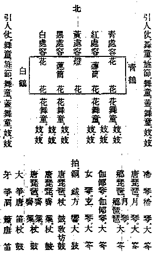
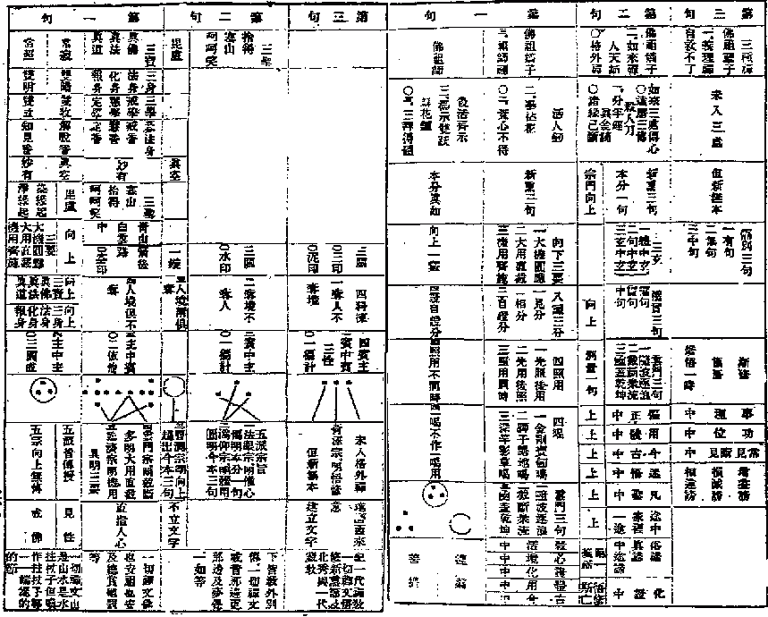
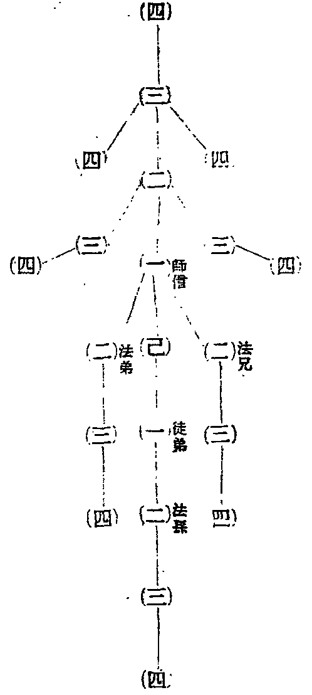
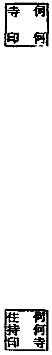
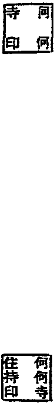
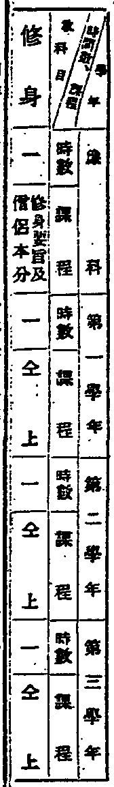
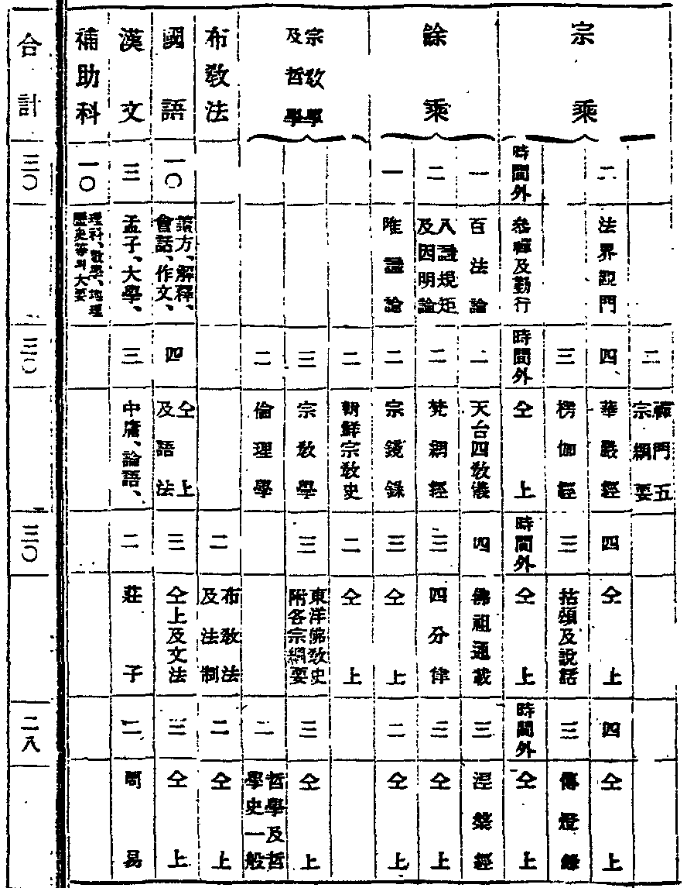
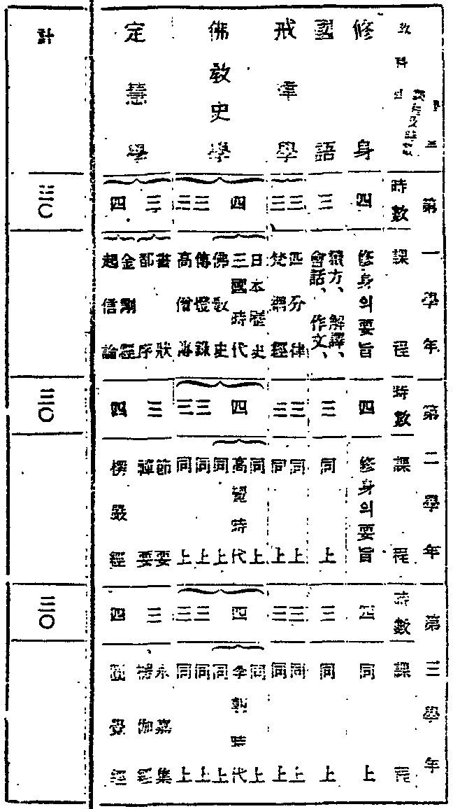
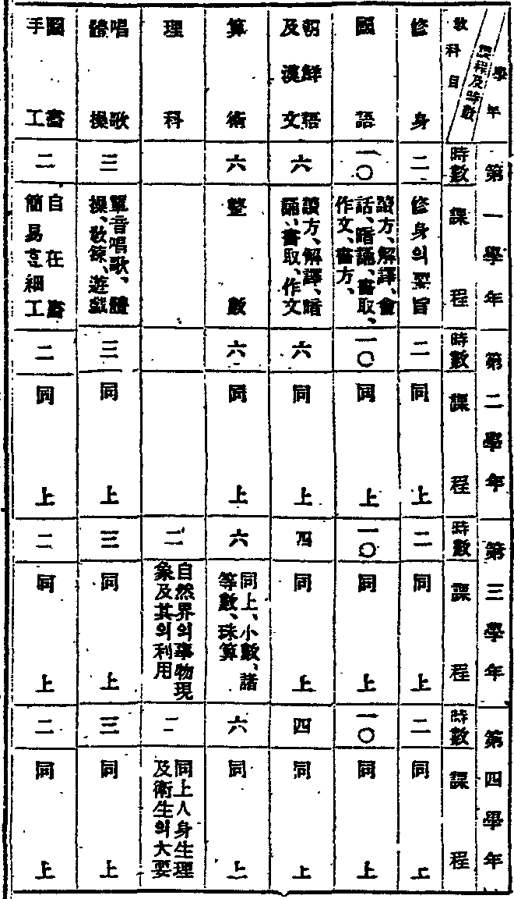
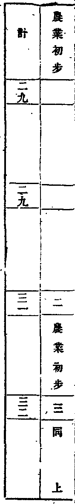

# 朝鲜佛教通史



> **藏经**：大藏经补编（大藏经补编）　**册次** 第 31 册（B31）　**编号** B0170　**部类** 事汇部　**卷次** 3 卷　**篇幅** 1,038,079 字

> **卷／品**：1 卷 · 19 品



---



## 目录



  - [朝鲜佛教通史序](#朝鲜佛教通史序)

  - [序](#序)

  - [自序](#自序)

  - [【备考】有唐新罗国故康州智异山双溪寺教谥真鉴国师碑铭并序](#备考有唐新罗国故康州智异山双溪寺教谥真鉴国师碑铭并序)

  - [【备考】武州桐里山大安寺寂忍禅师碑颂并序](#备考武州桐里山大安寺寂忍禅师碑颂并序)

  - [天顺三年己卯七月七日序](#天顺三年己卯七月七日序)

  - [天监十一年(佛纪一五三九年)勅沙门宝亮。撰涅槃经䟽。帝为制序](#天监十一年佛纪一五三九年勅沙门宝亮撰涅槃经䟽帝为制序)

  - [太古语录序](#太古语录序)

  - [重刊缁门警训序](#重刊缁门警训序)

  - [(附)普济尊者语录序](#附普济尊者语录序)

  - [苍龙己未八月既望韩山君李穑序](#苍龙己未八月既望韩山君李穑序)

  - [禅家龟鉴序](#禅家龟鉴序)

  - [密教大藏序](#密教大藏序)

  - [梵音族派序](#梵音族派序)

- [(附)新罗高丽时代佛教的遗迹（关野贞演述(密教第三卷第一](#附新罗高丽时代佛教的遗迹关野贞演述密教第三卷第一)

  - [华严宗主某禅师碑铭并序](#华严宗主某禅师碑铭并序)

  - [御制训民正音序](#御制训民正音序)

  - [○黄州郡正方山兼千圣山成佛寺事迹碑铭并序](#黄州郡正方山兼千圣山成佛寺事迹碑铭并序)

  - [报恩郡俗离山法住寺世尊舍利碑铭并序](#报恩郡俗离山法住寺世尊舍利碑铭并序)

  - [○总会顺序](#总会顺序)



---



### 朝鲜佛教通史序



朝鲜之有佛教也尚矣。罗丽之际。保国安民之方。概出乎此。其浸渐人心之深可知也。恭惟今上。宵旰图治。每轸念斯土。屡赐德音。然则佛教亦岂容忽诸哉。当是时李君能和渊覃幽眇。刻苦为志。辑述朝鲜佛教通史两编。携来索序。予受而读之。上编则逐年纪实。以明原委。下编则按事立题。以资博闻。其卷帙浩瀚。节目详备。朝鲜佛教之消长兴废。历历如指诸掌。噫。是可谓善袭阿难之芳躅者欤。予已劳君之勤注。又喜此书之出於此际。因乐成而序焉



大正六年三月朝鲜总督府内务部长官宇佐美胜夫识



------



### 序



古今天下之书名。无虑累数千百。究其实。不过经与史二者而已。今以摩尼法王之教论之。凡所以载道者。经也。如华严。法华。圆觉。金刚等经。言体用一源。显微无间。经中之经。而事未始不纪焉。法藏。澄观。智𫖮。宗密诸贤。踵增其䟽钞。皆经之属也。凡所以纪事者。史也。如普曜。本行。阿含。悲华等经。言本末双明。因果昭晰。经中之史。而道未始不章焉。龙树。无著。陈那。提婆诸尊。撰述其传论。皆史之属也。然载道之书。后人虽精博讲究。不过恢张餘蕴。佐翼经䟽而已。至於纪事之书。则不然。日异月新。千态万状。非大圣人。已然之书。所可尽也故经。则不能增益。而史。固不可不日以敷衍者也。噫。大教东渐半岛以来。不惟贤哲代作。贲鬯宗乘而已。若五台之佛骨。双磎之祖顶。海印之藏经元晓之角乘。懒翁太古之心印。无衣觉云之禅颂。亦足自豪於世界。虽谓东西佛氏之宗祊。未为过论也。至於纪事之书。上下千载。作者寥寥。佛门事功。磊落轩天者。怳兮惚兮如镜光云影。过於眼睫。曷不慨惜哉况乎今日佛运载回。亟亟然。稽往图监前辙。修明慈悲。翊襄圣化。培养民粹。促进文华。事最繁赜。纵有史材。而非惟无成书之可沿袭。即搜求材料於断烂古籍。片鳞残甲。大不易易。尚玄李先生。慨然有志於是。著朝鲜佛教通史三编。一曰佛化时处。二曰三宝源流。三曰二百品题。或用编年纲目之书法。或用传记叙志之书法。或用演义稗官之书法。随意补截。联络成文。无劈空架虚之撰。有倒树寻根之法。真觉路之金绳。迷川之宝筏也。丽鲜以来。儒家者流。承袭江左鸣道之说动辄觝骂佛氏。瞽䏊学者。以为正鹄。何其芜谬哉。先生。自是簪缨诗礼之家。然天姿高明。慧学淹博。既作百教会通。继成是书。会群圣人理性蕴奥之妙。缉二千载兴废存兦之迹。要终指归於佛祖。寔切启迪於人天而已。张天觉。所谓大孔圣者。莫如庄周。先生能扩充。无涯涘。岂直不叛于名教。亦乃发辉孔圣。幽隐不扬之道。将攀附类龙。骎骎乎吾佛五乘之俗谛疆隅。韪欤盛哉。



金天佛子。银地法臣。猊云散人惠勤。书于晚香山房。



------



### 自序



佛者觉也。教者以先觉觉后觉也。先觉者谁也佛也。后觉者谁也众生也。佛与众生觉则一也。先后而已。唐相国裴休曰。终日圆觉而未尝圆觉者凡夫也。具足圆觉而住持圆觉者佛也。宋禅师慈辩曰。终日圆觉而未尝圆觉者佛也。具足圆觉而住持圆觉者凡夫也一宿觉(永嘉玄觉禅师)谒六祖能曰。生死事大。无常迅速。祖曰何不体取无生了无速乎。师曰体即无生了本无速。然则佛也凡也。凡也佛也。先之后之。后之先之。先既无先。后亦无后无凡可凡。无佛可佛。生亦无生。速本无速。无体可体。无了可了。本自无迷。今亦无悟。开示者谁。悟入者谁。如是西域无为之法。入我东方有缘之土。金刚名山自是菩萨之住处海印藏经亦为世界之法宝。禅僧法侣之得道者如麻。国王大臣之护法者若林。十二宗派之沿革。九百寺刹之由绪。埋没於断烂之中。委弃於尘堆之里。有耳者无所闻。有目者无所见。不佞于是患之。冒昧而始事焉。铅椠无少暇。星霜亦多费。考据诸书。咨质大方。以为通史三编之书。庶作宗教一览之表。名虽藉乎历史之体。实兼寓於布教之用雷霆众聋勿墙壁而通虚空。日月群盲。出沟坑而登大道。人自择焉。吾所望也。「化日共佛日恒明。仁风与禅风永扇海晏河清。时和岁稔。物物各得其所。家家纯乐无为。区区之心。切切於此」。是昔时真觉国师之言。亦今日尚玄居士之心也。



时大正六年一月一日（岁次丙辰佛成道日）书于京城府凤翼洞之无无堂



著者识



凡例



本书三编。上为编年。佛化时处。中为宗派。三宝源流。下为杂项。二百品题。



本书编纂用纲目法。按年逐事。摘其要领。以为之纲。旁系（备考）及（参考）以为之目



（备考）证明纲文引用出处者也。（参考）比类属事。列举证案者也。



释迦如来诞降年时既有数十种之异说。难以考正。今因此方旧惯。断以周昭王一十六年甲寅。为佛诞纪元。(佛史每以佛灭度后几何年为纪。本书特变其例。以佛降生为始耳。)表题书头。以便参照佛化年时云尔。



三国史。高丽史。及前朝史乘诸书。皆先书支那历代纪年。次书本土纪年。今本书则变其例。首书本史国之纪年。而排次夹书餘国纪年。以明主客近远之别云尔。本书注脚。凡新增者。概用括弧。以别原注。



本书用纯汉文。为存本来面目。虽然如是。至於近今寺刹令。三十本寺本末寺法。及其他法令规则等文。仍用谚汉交杂之件。以示尊重律法。且令读者。不费解释。



新罗南解王时之月氏金人。驾洛首露王时之阿逾玉后。可为印度佛迹直输入之证案。虽然年代最远。难以确信。设或事实。但有声迹。而无教化。故特附以存疑。且其书行。低下一字。以示非正史云尔。



三国佛教初入时代。举多神异荒诞之说。不避冗𤨏。一槩収之。以验宗教进化之程度。信仰思想之因由云尔。



大凡教主事迹。信徒所当先究。朝鲜人民信奉佛教。坊间虽有谚文八相录等书。俚亵已甚。不可以为训诂之用。若欲流通释氏正传。诸经之书汗牛充栋。即如普曜经本生经。处胎经。瑞应经。因果经。佛本行集经等。无虑为数百卷。遂令读者有望洋之叹。而各人又有各说。难以得其要领。余恳刘伊斋居士。述释迦如来应化记实既已集狐腋而成裘。何须透牛皮而看经。今於三宝源流。首先引用此文。以当一部佛本行经。不费半晌读书之工夫。能知一佛出世之事迹也。



又『释迦如来应化记实』之释迦。是表经教之主也『特书临济宗之源流』之释迦是表别传之禅也



朝鲜禅宗。始自迦叶阿难。少林曹溪。以至清虚浮休。而其宗派实传临济。故特书源流。虚休两师以下。既难逐派具录。但取有碑状者。入于编年之中云尔。



朝鲜佛宗虽属临济。前朝以来。只存禅教两宗之名。现代宗旨仍其旧惯。共为卅寺。各行寺法。遂为朝鲜佛教全体成宪。故详录所属寺刹。传灯之通规及本寺住持之递代。庶几一览。便知始终也。



本书下编二百品题。不可逐一陈说其由。而杂项考据辨论之件。宗教消长盛衰之事。尽在乎是。读者详之。



二百品题。八字打开。两句联对。令我读者。便於记取。下附数字。索引页叶



朝鲜古代固有之神教。后代输入之儒教。道教。回回。基督等教。及近今新出之杂教以至巫瞽等流。录其源委。以藉宗教信仰上参考。



现代法令之关於佛教者。即如寺刹令。僧侣编籍。联合制规。教育施设。等诸事项没収并录。以重时宜。



李东武先生。创四象学说。系是儒家。穷理尽性。格物致知。千古未曾有之大发明金月窓居士。述百章梦言。亦是佛者。借事明理。达观慧照。一时不可无之好参考也。弊一言。此两书。出自朝鲜人之研究可为世界的之哲学。故兹特录。公诸同好。



餘绪短篇。宗教小说。拟仿传记。未免杜撰。而敷演本有之实事。以叙述巧遇之奇缘云尔



朝鲜佛教通史上编目次



佛化时处（别目参照）  

页



高句丽时代  

一～二〇



　（附参考）高句丽僧宝关系日本者  

二一～三一



百济时代  

三一～三七



　（附参考）百济僧宝关系日本者  

三七～四六



新罗时代  

四七～一九六



　（附存疑）榆岾寺月氏金像  

一九一～一九六



　（附存疑）金官城婆娑石塔  

一九六～二〇五



　（附参考）新罗僧宝关系日本者  

二〇五～二一〇



高丽时代  

二一一～三三八



朝鲜（前韩）时代  

三三八～六二〇



朝鲜总督府时代（现代）  

六二一～六二七



朝鲜寺刹禅教两宗三十本寺并其所属末寺  

六二八～六七四



佛化时处历代别目



高句丽  

页



页



页



东明王（高朱豪）



故国川王（高男武）



小兽林王（高邱夫）  

一～一〇



琉璃王（高类利）



山上王（高延优）



故国壤王（高伊连）



大武神王（高无恤）



东川王（高忧位）



广开土王（高谈德）  

一一～一四



闵中王（高觧邑朱）



中天王（高然弗）



长寿王（高巨连）  

一五



慕本王（高觧爰）



西川王（高药卢）



文咨王（高罗云）  

一六



太祖王（高宫）



烽上王（高相夫）



安藏王（高兴安）



次大王（高遂成）



美川王（高乙弗）



安原王（高宝延）



新大王（高伯固）



故国原王（高钊）



阳原王（高平成）  

一六



平原王（高阳城）  

一六～一七  

荣留王（高建武）



婴阳王（高元）  

一八  

宝藏王（高臧）  

一八～二〇



高句丽起始祖东明王元年甲申至宝藏王末年戊辰凡二十八王共七百五年



百济  

页



页



页



始祖温祖王(高氏)



责稽王



辰斯王



多娄王



汾西王



阿莘王



己娄王



比流王



腆支王



盖娄王



契王



久尒辛王



肖古王



近肖古王



毗有王



仇首王



近仇首王



盖卤王（高餘庆）



古尒王



枕流王



文周王



三斤王



圣王（高明秾）  

三三～三四  

法王（高宣）  

三五～三六



东城王（高牟大）



威德王（高昌）  

三五  

武王（高璋）  

三六～三七



武宁王（高斯磨）



惠王（高季明）



义慈王  

三七



百济起始祖温祚王元年癸卯至义慈王末年庚申凡三十王共六百七十八年



新罗  

页



页



页



始祖(朴赫居世)



阿达罗王(金氏)



儒礼王(昔氏)



南觧王（朴次次雄）  

一九一  

伐休王(昔氏)



基临王(昔氏)



脱解王(昔氏)



柰解王(昔氏)



讫解王(昔氏)



婆娑王(金氏)



助贲王(昔氏)



柰勿王(金氏)



祗摩王(金氏)



沾解王(昔氏)



实圣王(金氏)



逸圣王(金氏)



味邹王(金氏)



讷祇王(金氏)



慈悲王(金氏)



孝昭王（金理洪）  

九〇～九二  

神武王（金祐徵）  

一〇三



焰智王(金氏)



圣德王（金兴光）  

九二～九四  

文圣王（金庆磨）  

一〇三～一一二



智证王（金智太路）



孝成王（金承庆）  

九五  

宪安王（金谊靖）  

一一二～一一八



法兴王（金原宗）  

四七～五〇  

景德王（金宪英）  

九五～九八  

景文王（金膺廉）  

一一八



真兴王（金彡麦宗）  

五一～五三  

惠恭王（金乾运）  

九八～九九  

宪康王（金晸）  

一一八～一三四



真智王（金金轮）  

五三～五六  

宣德王（金良相）  

九九  

定康王（金晃）



真平王（金伯净）  

五六～六六  

元圣王（金敬信）  

九九  

真圣王（金曼）  

一三四～一四八



善德王（金德曼）  

六七～六九  

昭圣王（金俊邕）



孝恭王（金峣）  

一四八～一六八



真德王（金胜曼）  

七〇～七六  

哀庄王（金重熙）  

九九～一〇二  

神德王（朴景晖）  

一六八～一七四



武烈王（金春秋）  

七六～七七  

宪德王（金彦升）  

一〇三  

景明王（朴升英）  

一七四～一八四



文武王（金法敏）  

七七～八七  

兴德王（金秀宗）  

一〇三  

景哀王（朴魏膺）  

一八五



神文王（金政明）  

八七～九〇  

僖康五（金悌隆）



敬顺王（金溥）  

一八五



新罗起始祖朴赫居世元年甲子至敬顺王末年乙未凡五十五王朴氏十王昔氏八王金氏三十七王共九百九十二年



(附)驾洛  

页



页



页



首露王  

一九七～二〇四  

伊尸品王



钳知王



居豋王



坐知王



仇衡王



麻品王



吹希王



居叱弥王



铚知王  

二〇四～二〇五



驾洛起始祖首露王元年壬寅至仇衡王末年壬子凡十王共四百九十年



高丽  

页



页



页



太祖王（王建）  

二一一～二一三  

光宗王（王昭）  

二一三～二一四  

穆宗王（王诵）  

二一八～二一九



惠宗王（王武）



景宗王（王伷）  

二一四  

显宗王（王询）  

一一九～二二二



定宗王（王尧）  

二一三  

成宗王（王治）  

二一四～二一八  

德宗王（王钦）  

一二二



靖宗王（王亨）  

二二三～二二四  

明宗王（王晧）  

二六一～二六八  

忠惠王（王祯）  

三〇七～三〇八



文宗王（王徽）  

二二四～二三二  

神宗王（王晫）  

二六八  

忠穆王（王昕）  

三〇八～三〇九



顺宗王（王动）



熙宗王（王韺）  

二六九  

忠定王（王㫝）  

三〇九～三一〇



宣宗王（王运）  

二三二～二三五  

康宗王（王[示*吳]）  

二七〇  

恭愍王（王颛）  

三一〇～三二六



献宗王（王昱）  

二三五  

高宗王（王暾）  

二七〇～二八二  

辛禑（废王）  

三二六～三二七



肃宗王（王颙）  

二三六～二四〇  

元宗王（王禃）  

二八二～二八八  

辛昌（废王）  

三二八



睿宗王（王俣）  

二四〇～二四七  

忠烈王（王昛）  

二八六～二九八  

恭让王（王瑶）  

三二八～三三八



仁宗王（王楷）  

二四七～二五三  

忠宣王（王璋）  

二九八～三〇二



毅宗王（王𪾢）  

二五三～二六〇  

忠肃王（王槖）  

三〇二～三〇六



高丽起太祖神圣王天授元年戊寅至恭让王四年壬申凡三十二王（辛氏二、王）共四百七十五年



朝鲜（前韩）  

页



页



页



太祖王（李旦初讳成桂）  

三三八～三七二  

中宗王（李怿）  

四四八～四五一  

英祖王（李昑）  

五二九～五五九



定宗王（李暾初讳芳果）  

二七二～三七四  

仁宗王（李皓）



真宗王（追崇）（李愃）



太宗王（李芳远）  

三七四～三八六  

明宗王（李峘）  

四五一～四五五  

正祖王（李祘）  

五六〇～五八一



世宗王（李祹）  

三八六～三九六  

宣祖王（李昖）  

四五六～四七五  

纯祖王（李玜）  

五八一～五八五



文宗王（李珦）  

三九六  

光海君（李珲）  

四七六～四八七  

文祖王（追崇）（李昗）



端宗王（李弘𬀩）  

三九六  

元宗王（追崇）（李琈）  

四八八  

宪宗王（李烉）  

五八五～五八七



世祖王（李[日*柔]）  

三九七～四二九  

仁祖王（李倧）  

四八九～五〇〇  

哲宗王（李升）  

五八八～五九二



德宗王（追崇）（李暲）



孝宗王（李淏）  

五〇一～五〇二  

李太王（李巽）  

五九三～六一七



睿宗王（李晄）  

四二九～四三二  

显宗王（李棩）  

五〇三～五一二  

李王殿下（李坧）  

六一七～六二〇



成宗王（李娎）  

四三二～四四六  

肃宗王（李焞）  

五一三～五二九



燕山君（李㦕）  

四四六～四四七  

景宗王（李昀）



朝鲜（前韩）起太祖元年壬申至李王殿下隆熙四年庚戌凡三十二王共五百十九年



　人名细目(上编)



> 高句丽



顺道  

一  

义渊  

一六  

惠慈  

二二  

道登  

三〇



(附高丽)觉训  

二  

德昌  

一八  

僧隆  

二七  

道显  

三〇



阿道  

七  

普德(及弟子十一人)  

一九  

昙徵  

二七



昙始  

一一  

信诚  

二〇  

法定  

二七



道琳  

一五  

惠便  

二一  

慧灌  

二八



> 百济



摩罗难陀  

三一  

隆云  

三七  

德积  

四一  

常辉  

四三、四五



谦益  

三三  

昙慧  

三七  

慧弥  

四二  

法藏  

四三



昙旭  

三三  

道深  

三七  

道欣  

四二  

道宁  

四五



惠仁  

三三  

日罗  

三八  

义觉  

四二  

多常  

四五



观勒  

三七、四〇  

丰国  

三九  

道藏  

四三  

圆势  

四五



> 新罗



墨胡子  

四七  

安含  

六三  

智义  

八七  

真表  

九八



异次顿  

四七  

义湘  

六三。八〇  

憬兴  

八七  

梵修  

九九



法空  

四八  

圆安  

六六  

胜诠  

八九  

顺应  

一〇〇



觉德  

五一  

明朗  

六七。七七。八五  

可归  

九〇  

利贞  

一〇〇



惠亮  

五二  

慈藏  

六七。六九  

道澄  

九〇  

慧昭  

一〇二。一〇五



明观  

五三  

密本  

六七  

智炤夫人  

九二  

惠哲  

一〇三。一一三



法云  

五四  

圆胜  

七六  

金大悲  

九三  

体澄  

一〇三。一一九



圆光  

五六。五八。六四  

道玉。金歆运  

七六  

大贤  

九六  

无染  

一〇三。一三四



昙育  

五七  

惠通  

七七  

法海  

九七  

品日  

一〇三



智明  

五七  

信惠  

七九  

郁面  

九八  

道允  

一〇四



元晓  

五八  

义安  

八〇  

月明  

九八  

朗空  

一一八。一三四。一六九



安弘  

六三  

广学大缘  

八六  

李纯  

九八  

廉居  

一二三



智诜  

一二四  

璨幽(元宗国师)  

一七五  

智洗尔  

二〇六  

驾洛王七子  

二〇四



道诜  

一四七  

昙谛  

一八二  

慧资  

二〇六  

长游和尚  

二〇五



兢让  

一五一  

洪庆  

一八五  

智凤  

二〇七



真澈  

一六三  

丽严(大镜大师)  

一八五  

审祥  

二〇七



洞真  

一七五。一八二  

梵空  

一九〇  

新罗明神  

二〇八



> 高丽



昙谛  

一八二  

法镜  

二二一  

澄俨  

二三六  

妙清  

二四八



弘梵  

二一一  

决凝  

二一四  

德昌  

二四〇  

继膺  

二五一



忠湛  

二一一  

海鳞  

二二七  

昙真  

二四〇。二四四  

元敬  

二五二。二六五



证通  

二一一  

烂圆  

二二八  

李䫨  

二四三  

圆明  

二五二



惠居  

二一四  

义天  

二二九。二三三  

乐真  

二四四  

玄曦  

二五四



坦文  

二一四  

道元  

二三〇  

德缘  

二四五  

尹彦頥  

二五四



如哲  

二一六  

贞双(请设僧科)  

二三二  

李资玄  

二四五  

贯乘  

二五四



觉倪  

二五七。二五九  

圆真  

二七二  

韩康  

二九七  

乃圆  

三〇六



性文  

二五八  

金允侯  

二七五  

绍琼  

二九八  

翯仙  

三〇七



冲曦  

二五九  

白云居士  

二七七  

权㫜  

三〇一  

普愚  

三一一。三二七



德素  

二六一  

李藏用  

二八五  

用宣  

三〇一  

遍照(辛旽)  

三一六



彦宣  

二六一  

宗悟  

二八八  

冲坦  

三〇三  

千禧  

三一九



宗旵  

二六二  

六然  

二八九  

孝桢  

三〇三  

禅显  

三一九



致纯  

二六四  

一然(普觉国尊)  

二九一  

丁午  

三〇三  

懒翁  

三二四。三二六。五七〇



林民庇  

二六七  

惠永  

二九四  

混丘(无极老人)  

三〇三  

神照  

三二五。三二七。三三〇。三三二



知讷  

二六八  

景宜  

二九四  

万恒  

三〇三  

粲英  

三二九



任濡  

二七〇  

李承休  

二九六  

蔡洪哲  

三〇三。三〇七  

无学自超  

三三八



至谦  

二七〇  

廉承益  

二九七  

指空  

三〇六。三五三。五七〇。



> 朝鲜(前韩)



幻庵  

三三九  

无学  

三四五。三六一。三七〇。三七七。五七〇。  

祖丘  

三六二  

智泉  

三六二



尚聪  

三六六  

处安  

四三六。四四〇  

鞭羊彦机  

四九八  

松溪圆辉  

五一六



涵虚  

三八九  

日精  

四四八  

海运敬悦  

四九九  

松岩性真  

五一七



俊和尚  

三九五  

碧松  

四四九  

逍遥太能  

五〇〇  

栢庵性聪  

五一八



弘濬  

四〇一  

普雨  

四五二。四五五  

翠云学璘  

五〇一  

月潭雪霁  

五二二



文炯  

四〇一  

一禅  

四五六  

太浩  

五〇二  

雪岩秋鹏  

五二四



克仁  

四〇一  

芙蓉  

四五九  

翠微守初  

五〇九  

华岳文信  

五二四



竹轩  

四〇四  

清虚  

四六三。四六八。五三六。五六一。五七四  

枫潭义湛  

五一〇  

霜峰净源  

五二六



学祖  

四〇九。四一五。四二三。四四二。四四七。四四九  

灵奎  

四六五。五五八。五七四  

白谷处能  

五一二  

月渚道安  

五二八



斯智  

四〇五  

松云  

四七三  

枕肱悬辩  

五一三  

唤醒志安  

五二九



学悦  

四一五。四二八  

浮休  

四八五  

醉如三愚  

五一四  

虚静法宗  

五三二



信眉  

四〇一。四〇四。四〇九。四一五。四二三  

碧岩  

四八七。四九一。四九七。五〇三  

秋溪有文  

五一五  

雪峰怀净  

五三五



守眉  

四〇一。四〇四  

虚闲敬轩  

四八九  

圆应志勤  

五一五  

晦庵定慧  

五三九



雪崚  

四三三  

虚白明照  

四九一  

任性冲彦  

五一六  

幻梦宏濶  

五四〇



虎岩体净  

五四二  

宝镜  

五六四  

大隐朗旿  

五八五  

龙湖海珠  

六〇二



雪松演初  

五四四  

仁岳义沾  

五六四。五七七  

华潭敬和  

五八六  

虚舟德真  

六〇三



龙潭慥冠  

五四六  

默庵最讷  

五六七  

白坡亘璇  

五八九  

雪窦有炯  

六〇四



华月圣讷  

五四九  

雪坡尚彦  

五六八  

自下敬信  

五九一  

愚隐达善  

六〇五



碧霞大愚  

五五一  

天峰泰屹  

五七二  

艸衣意恂  

五九三  

大应坦鍾  

六〇七



霜月玺篈  

五五二  

处英  

五七四  

南湖永奇  

五九五  

荷隐例珂  

六〇九



瑞谷粲然  

五五四  

莲潭有一  

五八〇  

枕溟翰醒  

五九六  

涵溟太先  

六一四



玩月轨泓  

五五六  

莲坡惠藏  

五八二  

映虚善影  

五九八



涵月海源  

五五七  

影波圣奎  

五八三  

优昙洪基  

六〇〇



秋波泓宥  

五五九  

海鹏展翎  

五八五  

影山景淳  

六〇一



寺庵塔像及件名细目



> 高句丽



省门寺。伊弗兰寺  

一〇  

平壤九寺  

一二  

金刚寺  

一六  

盘龙寺(普德)  

一九



> 百济



汉山佛寺  

三三  

兴轮寺(谦益律宗)  

三三  

王兴寺  

三六  

乌会寺(或云乌合寺)  

三七



> 新罗



刺楸寺(异次顿)  

四九  

皇龙寺九层塔  

六九  

四天王寺(瑜珈明朗)  

八五  

茸长寺(瑜珈大贤)  

九六



兴轮寺(梁来舍利)  

五一  

通度寺金刚戒坛  

七一  

感恩寺(万波息笛)  

八八  

皇龙寺鍾  

九七



皇龙寺  

五三  

净岩寺(慈藏初创)  

七二  

奉圣寺。望德寺  

八九  

芬皇寺(药师铜像)  

九七



皇龙寺丈六像  

五三  

皇龙寺(慈藏说戒)  

七五  

葛项寺(胜诠华严)  

九〇  

弥陀寺(万日念佛会)  

九七



永兴寺(王妃为尼)  

五四  

实际寺(僧道玉)  

七六  

栢栗寺(大悲像)  

九〇  

断俗寺(李纯创)  

九八



四佛山大乘寺  

五六  

汉山壮义寺  

七七  

释迦寺。佛无寺  

九二  

灵妙寺丈六  

九八



初开寺(元晓生地)  

六〇  

信忠奉圣寺  

七九  

金马郡弥勒寺  

九三  

金山寺(真表成弥勒像)  

九八



芬皇寺。灵妙寺  

六七  

浮石寺(义湘创)  

八〇  

双溪寺(六祖顶相塔)  

九三  

奉德寺鍾  

九九



皇龙寺百高座  

六七  

义湘传教十刹  

八二  

敏长寺(观音像)  

九五  

鹫仙寺(金庚信)  

九九



兴轮寺(弥陀像。金良图)  

六八  

下柯山鹘岩寺  

八二  

佛国寺。石佛寺  

九六  

海印寺(顺应利贞)  

一〇〇



洛山寺(梵日刹)  

一〇四  

望海寺(处容随驾)  

一一九  

圣住寺(无染国师)  

一四二  

广照寺(真澈国师)  

一六五



双溪寺(真鉴创)  

一〇九  

宝林寺(普照禅师)  

一二二  

桐里山(道诜国师)  

一四七  

石南山寺(朗空大师)  

一七二



桐里大安寺(惠哲创)  

一一五  

廉居禅师塔  

一二三  

世达寺(弓裔)  

一四七  

皇龙寺(百座通说禅教)  

一八五



皇龙寺塔(改▆)  

一一八  

凤岩寺(智证创)  

一三〇  

玉龙寺(道诜国师)  

一四九



> 高丽



松都十寺(丽祖创)  

二七五  

安和禅院(大匡王愿堂)  

一八五  

开国寺佛舍利  

二一三  

桐华寺戒坛  

二二三



大兴寺利言  

一七五  

菩提寺(大窥大师)  

一八八  

重兴寺九层塔  

二一四  

临津慈济寺  

二二三



高达院(元宗大师)  

一七八  

(开京七层塔西京九层塔)  

一八九  

真观寺九层塔  

二一九  

真观寺(华严般若)  

二二五



广明寺(丽祖舍宅)  

一八二  

金山寺(甄萱)  

一九〇  

西京重兴寺塔  

二二〇。二四九  

兴王寺(金字华严经)  

二三一



崇山寺(五百罗汉畫像)  

一八二  

榆岾寺(五十三佛)  

一九二  

开国寺塔(安舍利)  

二二〇  

开国寺(置宋朝大藏经)  

二三一



玉龙寺(洞真大师)  

一八四  

王后寺。长游寺  

二〇五  

玄化寺鍾  

二二一  

兴王寺(教藏都监)  

二三三



帝释院(置大藏经)  

一八五  

兴法寺(忠湛碑文)  

二一一  

海州神光寺  

二二一  

开国寺(大藏经)  

二三四



龟山寺(天竺三藏)  

一八五  

开泰寺(华严法会)  

二一一  

高僊寺佛骨  

二二一  

新华严经板  

二三四



十三层黄金塔  

二三四  

大安寺佛骨  

二四九。二五〇  

弥勒寺(功臣堂)  

二八二  

银字院  

三〇三



见佛寺(万日礼忏)  

二三五  

典狱署(般若道场)  

二五四  

禅家宗派图  

二八五  

延福亭(指空说戒)  

三〇六



兴王寺小鍾  

二三七  

广真寺(流头饮)  

二六六  

藏经钿函都监  

二八五  

栴檀园  

三〇七



创南京  

二三八  

曹溪山定慧社  

二六八  

吐蕃僧  

二八七  

王轮寺(佛齿)  

三二二



玄化寺(瑜珈显扬论)  

二三九  

迁都江华  

二七五  

兴王寺(黄金塔)  

二八八  

发僧徒为兵  

三二七



安和寺(十六罗汉像)  

二四六  

皇龙寺塔(蒙兵烧毁)  

二七六  

谈禅法会  

二九〇。二九一  

南神寺(白莲会)  

三二九



弘教院(华严道场)  

二四九  

大藏经板堂  

二七九  

金字院大藏经  

二九四  

演福寺塔  

三三二。三三九



> 朝鲜(前韩)



瑞云寺(安大藏经)  

三三九  

禅宗兴天寺  

三六五  

归州寺  

三七四  

济州铜佛  

三八二



演福寺塔  

三四五  

津宽寺(水陆社)  

三六七  

教宗兴德寺  

三七四  

诸州资福寺  

三八三



海印寺(古塔安大藏经)  

三四八  

支天社(藏经板)  

三六九  

释王寺  

三七五  

健元陵开庆寺  

三八五



桧岩寺(指空浮图)  

三五二  

逍遥寺(行宫)  

三七〇  

金藏庵(无学王师)  

三七七  

(兴天支天)社  

三八五



见岩寺(水陆斋)  

三六二  

狮子庵(五台山)  

三七二  

诸宗寺刹  

三八二  

海印寺(印大藏经)  

三八六



兴天寺(舍利)  

三八六  

兴天寺新鍾  

四一一  

奉先寺鍾  

四三一  

休静僧綂  

四六三



大慈寺法华会  

三八七  

金刚经谚译  

四一五  

榆岾寺  

四三二  

南汉筑城  

四八八



禅教宗都会所  

三八九  

桧岩寺(分身舍利)  

四一六  

橧岩寺重创  

四三五  

华严寺(禅宗伽蓝)  

五〇一



世宗朝内佛堂  

三九四  

圆觉寺(议创)  

四一七  

神勒寺(重创)  

四三七  

华严寺(禅教两宗)  

五二一



端宗妃净业院  

三九七  

圆觉寺鍾  

四一八  

毁尼寺廿三所  

四三九  

释王寺(御制文)  

五二五



东鹤寺(招魂记)  

三九九  

圆觉寺(译经)  

四一九  

龙门寺(重修)  

四四〇  

密阳表忠祠  

五三五



道岬寺(妙觉和尚)  

四〇一  

上院寺(巡幸)  

四二二  

海印寺(重修印经)  

四四二。四四六  

释王寺(御制文)  

五四四



追福印经  

四〇一  

长安寺(礼法起)  

四二七  

清溪寺(禅宗)  

四四八  

太古寺(御制文)  

五四五



海印寺(印大藏经)  

四〇三  

洛山寺(礼观音)  

四二七  

海印寺印经  

四四九  

大芚寺(表忠祠)  

五六〇



正因寺  

四〇五。四三三  

乾凤寺(驻跸)  

四二八  

新仁寿宫  

四五一  

创龙珠寺  

五六四



月印千江之曲  

四〇五  

圆觉寺塔成  

四二九  

两宗禅科  

四五二  

释王寺(三师法号)  

五七〇



龙门寺铜鍾  

四〇七  

寺社条例(经国大典)  

四二九  

奉恩寺(移建)  

四五三  

表忠酬忠(三师影题)  

五七四



灵山会上曲  

四一〇  

奉先寺  

四三〇  

罢两宗禅科  

四五五  

龙珠寺(恩重经板)  

五七九



法住寺(空名帖)  

五八八  

重兴寺灾  

六一七  

寺刹令(三十本寺)  

六二一  

佛教中央学林  

六二五



榆岾寺(空名帖)  

五九一  

海印寺(藏经板装钉)  

六一七  

印度佛舍利  

六二一  

寺刹僧尼綂计  

六二六



归州寺(空名帖)  

五九八  

中枢院献议  

六一七  

佛教振兴会  

六二二  

(三十本寺及所属末寺)  

六六～六七四



南北汉废缁营  

六〇九  

创觉皇寺  

六二〇  

联合事务所  

六二三



海印寺(印大藏经)  

六一一  

元兴寺圆宗  

六二〇  

佛教杂志沿革  

六二四



朝鲜佛教通史上编目次(终)



朝鲜佛教通史中编目次



> 三宝源流  

> 页



释迦如来应化记实  

一



三藏结集诸论纷披（印度）  

一五



传译经论撰述章䟽（支那）  

二三



> 印支渊源罗丽流派



俱舍宗  

六〇  

天台宗  

六七  

律宗  

七五



成实宗  

六一  

法相宗  

六九  

华严宗  

八一



三论宗  

六二  

地论宗  

七一  

禅宗  

八四



摄论宗  

六四  

真言宗  

七一



涅槃宗  

六四  

净土宗  

七三



> 特书临济宗之渊源



七佛  

九三  

第十二祖马鸣  

一〇三  

第二十六祖不如蜜多  

一一六



释迦牟尼佛  

九四  

第十三祖迦毘摩罗  

一〇四  

第廿七祖般若多罗  

一一七



第　祖迦叶尊者  

九五  

第十四祖龙树  

一〇五  

(西天廿八东土第一)祖菩提达磨  

一一八



第二祖阿难  

九五  

第十五祖迦那提婆  

一〇六  

第二祖慧可  

一二五



第三祖商那和修  

九六  

第十六祖罗睺罗多  

一〇六  

第三祖僧璨  

一二七



第四祖优婆毱多  

九七  

第十七祖僧伽难提  

一〇八  

第四祖道信  

一二九



第五祖提多迦  

九八  

第十八祖伽邪舍多  

一〇九  

第五祖弘忍  

一三〇



第六祖弥遮迦  

九九  

第二十祖阇夜多  

一一〇  

第六祖惠能  

一三一



第七祖婆须蜜  

一〇〇  

第廿一祖娑修盘头  

一一一  

南岳怀让  

一三九



第八祖佛陀难提  

一〇一  

第廿二祖摩挐罗  

一一一  

江西马祖道一  

一四二



第九祖伏駄蜜多  

一〇一  

第廿三祖鹤勒那  

一一二  

百丈怀海  

一四五



第十祖协尊者  

一〇二  

第廿四祖师子比丘  

一一三  

黄蘗希运  

一四九



第十一祖富那夜奢  

一〇三  

第廿五祖婆舍斯多  

一一四  

临济义玄  

一五一



兴化存奖  

一五六  

白云守端  

一六八  

无准师范  

一八五



南院慧颙  

一五八  

五祖法演  

一六九  

雪岩祖钦  

一八五



风穴延沼  

一五九  

昭觉克勤  

一七五  

及庵宗信  

一八六



首山省念  

一六一  

虎丘绍隆  

一八二  

石屋清珙  

一八六



汾阳善昭  

一六三  

应庵昙华  

一八三  

平山处林  

一八八



石霜楚圆（慈明）  

一六四  

密庵咸杰  

一七三



杨岐方会  

一六六  

破庵祖先  

一八四



> 朝鲜禅宗临济嫡派



太古普愚  

一八九  

龟谷觉云  

三二三  

碧松智严  

三三一



懒翁慧勤  

二五四  

涵虚已和  

三二八  

芙蓉灵观  

三三三



幻庵混修  

三二〇  

碧溪正心  

三三〇  

庆圣一禅  

三三四



无学自超  

三二一  

千峰卍雨  

三三〇  

清虚休静  

三三六



浮休善修  

三七五  

(附)青梅印悟  

三七七



朝鲜佛教通史中编目次(终)



朝鲜佛教通史上编



完山　李能和　尚玄居士　辑述



东州　崔南善　六堂学人　校阅



佛化时处



高句丽时代



○小兽林王〔高邱夫〕在位十三年



(壬申)二年(新罗柰勿王十七年百济近肖古王二十七年晋咸安二年)(佛纪一二九九年)夏六月。秦王苻坚。遣使送浮屠顺道及佛像佛经于高句丽。王遣使谢。以其书教子弟。高句丽佛法始此。(三国史以下倣此)



【参考】释顺道。不知何许人也。迈德高标。慈忍济物。誓志弘宣。周流震旦。移处就机。诲人不倦。高句丽第十七解味留王(或云小兽林王)二年壬申。夏六月。秦苻坚。发使及浮屠顺道送佛像经文。於是君臣。以会遇之礼。奉迎于省门。投诚敬信。感庆流行。寻遣使回谢。以贡方物。或说顺道从东晋来。始传佛法。则秦晋莫辨。何是何非。师既来异国传西域之慈灯。悬东暆之慧日。示以因果。诱以祸福。兰熏雾润。渐渍成习。然世质民淳。不知所以裁之。师虽蕴深解广。未多宣畅。自摩腾入后汉。至此二百餘年。后四年神僧阿道。至自魏(存古文)始创省门寺。以置顺道。古记云。以省门为寺。今兴国寺是也。后讹写为肖门。又剏伊弗兰寺。以置阿道。古记云。兴福寺是也。此海东佛教之始。惜乎之人也。之德也。宜书竹帛。以宣懿绩。其文辞不少槩见何哉。然世之使於四方。不辱君命。必待贤者而能之。则特至他邦。肇行未曾有之大事。非其有大智慧大谋猷。得不思议神通力。其何以行之哉。以此知其为异人。斯亦法兰僧会之流乎。



赞曰。



古者三韩鼎峙。开国称王。彼佛声教。蔑有其兆。及感应道交。贤德聿来。以赴机叩。易曰感而遂通天下之故。顺道有之矣。始予躬诣所谓兴国兴福。因有缀文记事之志。无缘以发之。今谬承景命。以顺道为传首云耳。(海东高僧传)。



【参考】海东高僧传（京北五冠山灵通寺住持教学赐紫沙门臣觉训奉宣撰）



论曰。夫佛之教也。性相常住。悲愿洪深。穷三际遍十方。雨露以润之。雷霆以鼓之不行而至。不疾而速。五目不能覩其容。四辩不能谈其状。其軆也无去无来。其用也有生有灭。故。我释迦如来。从兜率天。乘旃檀楼阁。入摩耶胎。以周昭王甲寅四月初八日。遂开右脇。生於净饭王宫。其夜五色光气入贯太微。通於西方。昭王问太史苏由曰有大圣人。生於西方。问利害。曰此时无他。一千年后声教被此土焉。始处宫中。示同世俗。粤四十二年甲申四月八日。佛年三十。逾城出家。（他诸书皆作十九出家三十成道）。遂坐树成道。转法利生。如优昙花时一现耳。初说华严。次说小乘。或般若。深密。或法华。涅槃。随机普被。任器方圆。其犹一风而万窍齐号。孤月而千江皆现。四十九年度脱群品。列子所谓西方有圣人者是也。（列子云。吴太宰嚭。学孔子者也。问於孔子曰。夫子圣人欤。对曰丘博识强记。非圣人也。又问曰三王圣人欤。对曰三王善用智勇。圣非丘之所知。又问曰五帝圣人欤。对曰五帝善用仁信。圣非丘之所知。又问曰三皇圣人欤。对曰三皇善用时政。圣非丘之所知太宰嚭骇然曰。然则孰为圣者欤。孔子有间动容而对曰。西方有圣人者。不治而不乱。不言而自信。不化而自行荡荡乎民无能名焉（亦见史记）。）是时。文殊与目连。为人示迹于震旦。佛年七十九。以穆王壬申二月十五日。入灭於双林。白虹十二道。连夜未灭。王问太史扈多。曰西方大圣人。方灭度耳於是阿难等。结集金言。具载贝叶。经律论戒定慧。爰方启行。然杂华恒常之说。隐于虬宫。邪宗蚖肆。异部蛙鸣。既而马鸣屹起挺生。及陈那护法。唱之和之。摧邪显正。演义申宗。广大悉备乎西域。将有待而东驱矣。自佛灭一百十六年。东天竺国阿育王収佛舍利。役使鬼兵。散起八万四千宝塔。徧阎浮提。时当周敬王二十六年丁未也。塔兴周世。经二十二王。至秦始皇三十四年。焚烧典籍。育王宝塔。由是隐亡。当是时沙门利防（室利防也）十八贤者。赍持佛经。来化咸阳。秦始皇。不从而囚之。夜有金刚丈人破狱出之而去。盖机缘未熟故也。及后汉永平十三年。摄摩腾。竺法兰。来仪汉庭。慈云布於九州。法雨洒於四海。然按霍去病传云。得休屠王祭天金人则像设似先入於沙漠矣。又前汉哀帝时。秦景使月氐国。来传浮图经教。乃知前汉已行六十三年而后明帝方感金人梦耳。若我海东。则高句丽解味留王时。顺道至平壤城。继有摩罗难陁从晋来于百济。则枕流王代也。后於新罗第二十三法兴王践祚。梁大通元年丁未三月十一日。阿道来止一善县因信士毛礼隐焉。属有吴使者香。道。指其焚点之仪。由是延致王宫。然其教未阐。舍人厌髑。赤心面内。勇决国人之疑。噫。微夫子。吾当从何教也。自尔。圆光慈藏之徒。西入传法。上下信敬。内外奉行。先呼而后应。日益而月增遂使於三韩。及我圣祖革旧鼎新。尤尊佛教。凡制度多用佛教。守文继体之君。传而不失。惟太祖四代孙大觉国师。於宣王三年乙丑四月。航海求法。东至于洋。导其百派。大小始终顿圆之五教。各得其所。复归于正。然源乎周。派乎汉。汪洋於晋魏。汗漫於隋唐。波（澜）於宋。而渊沄於海东也。都筭佛入灭至今乙亥（高丽高宗二年）。二千一百六十四年。灭后第一千一十四年。入后汉。至今一千一百五十一年。自顺道入高句丽至今八百四十四年矣。且道不自弘。弘之由人。故著流通篇。以示于后。按古梁唐宋三高僧传。皆有译经。以我本朝。无翻译之事。故不存此科也



尚玄曰。按此海东高僧传著者觉训。即觉月首座。高丽高宗王时僧也。与李奎报交好有唱酬之作。见李相国集。又其行履。见崔滋补闲集。



【李相国集】访觉月师。用东坡诗韵各赋。



步步行随入谷云。自然幽洞辟红尘。已将蚊雀观鍾釜。曾把螟蛉戏缙绅。俯仰归来推幻化。死生得丧任天钧。多师雪里犹赊酒。借与山中一日春。



次韵文禅师。哭觉月首座（首座高丽时僧职也）



世丧弥天释苑贤。我方闻讣倍凄然。空餘庐岳裁莲社。无复华亭载月船。闻有诗评嗟未覩。(师尝著诗评不示予)早修僧传仅终编。(师曾修高僧传)法门梁栋今颓折。后学凭谁讨十玄。（按此可知师为华严宗师）



【崔滋补闲集】华严月首座。餘事亦深於文章。有草集传士林。尝撰海东高僧传。时李东观允甫。言有默行者。不知族氏。年可五十。或为髠或为头陀。不念经不礼佛。终日宴坐瞑如也。有候之者。无贵贱不举目改观。问其名不应。问从甚处来。亦不应。故以默行者名焉。居皈正寺别区。时予适在龟城。道人存纯为予言。行者尝冬月。敷一座具。著一衲衣。衲中无虮虱。坐氷堗上。寒色不形。学道后进。抱册往从质疑者。无不委细开说。方大寒恐其冻也。候出时。遣房子。急𦶟柴头。温其堗而去。行者来观之。无喜愠色。徐出户。拾石砾填堗口。泥其灰涂隙而上。宴坐如初。自是不复遗温也。尝斋时食菜。不用酱。又不禁午后食。值幸则食之。或至七八日不食。自言凡名山有圣迹无不游观。予往见。不交一言。后乙丑岁冬十月。游窟岩寺。寺僧曰。近默行者。来陟鹯岩乐之。就石窟搆一小庵。躬负石筑堦。新开磴道。自山下至窟。置三百餘层。无一石动摇者。时闻斋鼓。下来饭食。或至十餘日不下。因往候焉。片石上有七言颂。是行者所作。其言颇涉神仙事。庚午岁。以定戎分道乘传复至龟城。问行者今在何所。城人云。顷往奉州三角山门岩居焉。去岁夏月。住窟岩寺时。谓寺僧曰。有鬼。自北方来萃此城。因下山入城。乘城上巡行而出。城人皆见之。后有鬼火。昼伏昏起。其色青尖不等。或入人家。或聚园树。或飞空中。城人击鸣器以噪之。守夜不眠。如是过数日方止时予三妻息亦在是城。问之果然。后有僧益芬来告予。近往三角山。见行者无小恙好在。近旁村民。恐行者之去。相与修完所住草屋。日夕供护焉。将告别。行者谓芬曰。大都修行者。不以寒苦易其志。今之修行者。必欲高楼屹殿庇其徒。美食细服供其身出入公卿士大夫之门。谕以造寺息利为得福。多屠割平民。乌在其为修行者欤。汝勉之无忽也。芬佩服焉。东观言如此。因撰传以补僧史之阙遗。



(甲戌)四年(新罗柰勿王十九年百济近肖古王二十九年晋宁康二年)秦僧阿道。来高句丽



【备考】释阿道或云本天竺人。或云从吴来。或云自高句丽入魏。后归新罗。未知孰是。风仪特异。神变尤奇。恒以行化为任。每当开讲。天雨妙花。始新罗讷祗王时。有黑胡子者。从高句丽至一善郡。宣化有缘。郡人毛礼。家中作窟室安置。於是。梁遣使赐衣著香物。君臣不知香名及与所用。乃遣中使。赍香遍问中外。胡子见之。称其名目曰焚此则香气芬馥。所以达诚於神圣。所谓神圣。不过三宝。一曰佛陁。二曰达摩。三曰僧伽。若烧此发愿。必有灵应。时王女病革。王使胡子焚香表誓。厥疾寻愈。王甚喜餽赠甚厚。胡子出见毛礼。以所得物赠之报其德焉。因语曰。吾有所归。请辞。俄而。不知所去。毗处王时。有阿道和尚。与侍者三人。亦来止毛礼家。仪表似胡子。住数年。无疾而化。其侍者三人。留住。读诵经律。往往有信受奉行者焉。然按古记。梁大通元年三月十一日。阿道来至一善郡。天地震动。师左执金环锡杖。右擎玉钵应器。身著霞衲。口诵花诠。初到信士毛礼家。礼出见。惊愕而言曰。曩者高丽（此谓高句丽也）僧正方来入我国。君臣怪为不祥。议而杀之。又有灭垢玼从彼复来。杀戮如前。汝尚何求而来耶宜速入门。莫令隣人得见。引置密室。修供不怠。适有吴使。以五香献原宗王。王不知所用。遍询国中。使者至问法师。师曰以火烧而供佛也。其使偕至京师。王令法师见使。使礼拜曰。此边国。高僧何不远而。王因此知佛僧可敬。勅许颁行。又按高得相诗史曰。梁氏遣使曰元表。赉送沉檀及经像。不知所为咨四野。阿道逢时指法相。注云阿道再遭斩害。神通隐毛礼家。则梁吴之使莫辨其详。又阿道之迹。多同黑胡子何哉然自永平至大通凡四百餘年。高句丽兴法已百五十餘年。而百济已行一百四十餘年矣。若按朴寅亮殊异传云。师父魏人崛摩。母曰高道宁。高丽人也。崛摩奉使高丽私通还魏。道宁因有身诞焉。师生五稔。有异相。母谓曰。偏孤之子。莫若为僧。师依教即於是日剃发。十六入魏。觐省崛摩。遂投玄彰和尚。受业十九年。归宁於母。母谕曰此国机缘未熟。难行佛法。惟彼新罗。今虽无声教。尔后三千餘月。有护法明王御宇大兴佛事。又其国京师。有七法住之处。一曰金桥天镜林。(今兴轮寺)二曰三川岐。(今永兴寺)三曰龙宫南。(今皇龙寺)四曰龙宫北。(今芬皇寺)五曰神游林。(今天王寺)。六曰沙川尾。(今灵妙寺)七曰壻请田。(今昙严寺)此等。佛法不灭。前劫时伽蓝墟也。汝当归彼土。初传玄旨。为浮图始祖。不亦美乎。师既承命子之声。出疆而来寓新罗王阙西里。(今严庄寺是也)时当味邹王即位二年癸未矣。师请行竺教。以前所不见为怪。至有将杀之者。故退隐于续村毛禄家。今善州也。逃害三年。成国官主疾病不愈。遣使四方求能治者。师应募赴阙。为疗其患。王大悦。问其所欲。师请曰但剏寺於天镜林。吾愿足矣。王许之。然世质民顽。不能归向。乃以白屋为寺。后七年。始有欲为僧者。来依受法。毛禄之妹名史侍。亦投为尼。乃於三川岐。立寺曰永兴。以依住焉。味邹王崩后。嗣王亦不敬浮图。将欲废之。师还续村。自作墓入其内。闭户示灭。因此圣教不行於斯卢（新罗一名斯卢）厥后二百餘年。原宗果兴像教。皆如道宁所言。自昧邹至法兴凡十一王矣。阿道出现年代前却如是其差舛。并是古文不可取舍。然若当味邹时已有弘宣之益。则与顺道同时明矣。以其中废而至梁大通乃兴耳。故并出黑胡子元表等。叙而观焉。



赞曰。



自像教东渐。信毁交腾。权舆光阐。代有其人。若阿道黑胡子。皆以无相之法身。隐现自在。或先或后。似同似异。若捕风搏影。不如执迹而定也。但其先试可而后启行。始逃害而终成功。则秦之利方。汉之摩腾。亦无以加焉。易曰藏器待时。阿道之谓矣。(海东高僧传)。



(乙亥)五年(新罗柰勿王二十年百济近肖古王三十年近仇首王元年晋宁康三年)春二月高句丽创省门寺伊弗兰寺。以置胡僧顺道阿道。



【备考】三国史。高句丽始创肖门寺。以置顺道。又创伊弗兰寺。以置阿道。此海东佛法之始。



【参考】海东高僧传。顺道来后四年。神僧阿道至自魏。(存古文)始创省门寺。以置顺道古记云。以省门为寺。今兴国寺是也。后讹写为肖门。又创伊弗兰寺以置阿道。古记云兴福寺是也。此海东佛教之始。



【参考】三国遗事云。高丽本记（高丽谓高句丽）云。小兽林王即位二年壬申。乃东晋咸安二年孝武帝即位之年也。前秦苻坚。遣使及僧顺道。送佛像经文。又四年甲戌。阿道来自晋。明年乙亥二月。创肖门寺以置顺道。又创伊弗兰寺以置阿道。此高丽佛法之始僧传作二道来自魏云者误矣。实自前秦而来。又云肖门寺今兴国伊弗兰寺今兴福者亦误。按丽时都安市城。一名安丁忽。在辽水之北。辽水一名鸭绿。今云安民江。岂有松京之兴国寺名。



○广开土王〔高谈德〕在位二十一年



(壬辰)元年(新罗柰勿王三十七年百济阿莘王元年晋太元十七年)三月高句丽王。下教崇佛求福。又命有司。立国社。修宗庙



(癸巳)二年(新罗柰勿王三十八年百济阿莘王二年晋太元十八年)高句丽创九寺於平壤。



(丙申)五年(新罗柰勿王四十一年百济阿莘王五年晋太元二十一年)晋僧昙始。来化辽东。



【备考】释昙始关中人也。自出家。多有异迹。足白於面。虽涉泥水。未尝沾湿。天下咸称白足和尚。以晋太元末年。赍持经律数十部。往化辽东。乘机宣化。显授三乘。立以归戒。梁僧传以此为高句丽闻法之始。时当广开土王五年。新罗柰勿王四十一年。百济阿莘王五年。而秦苻坚送经像后二十五年也。是后四年。法显西入天竺。又二年罗什生来。玄高法师生焉。晋义熙初。师复还关中。唱道三辅。长安人王胡之叔某。死已数年矣。一日梦中。忽来现形。接引王胡。游遍地狱。示诸果报。胡辞还。叔谓胡曰。既已知其因果。要当奉事白足阿练。用修白业。胡敬诺。寤已遍询众僧。唯见始足白於面。因即事之。晋末凶奴赫连勃勃。袭破关中。斩戮无数。师亦遇害。力不能伤。普赦沙门。悉皆不杀。而潜遁山中。修头陁密行。未几。拓拔焘。复剋长安。擅威关洛。时博陵崔浩。少习左道。猜疾释教。位居伪辅。为焘所深信。乃与天师宼氏（宼谦之也）说焘。以谓佛教。无益於世。民利有伤。劝令废之。焘惑其言。以伪太平七年。遂毁灭佛法。分遣军士烧掠寺社。綂内僧尼。悉令罢遣。其有窜逸者。追捕枭斩之。四境之内。无复沙门。时玄高等被害。语在本传。师闭绝於兵革所不至处。依隐阅世。及太平末。师筭知焘死之将至。乃於元会日。手策金锡。即到宫门。有司奏云。有白足道人。从宫门径入。仪形可恠。焘闻已。即令猛卒斩之不伤。焘大怒。自以所佩利劒斫焉。唯剑所着处有痕如红线。軆无餘异。时有北园养虎子槛。焘驱令贻之。虎皆潜伏。终不敢近。焘试遣天师近槛。猛虎辄鸣吼。直欲抟噬。於是焘乃知佛教威神。非黄老所及。即奉师上殿。顶礼其足。悔责諐咎。师为说因果报应不差。指掌开示。畧现神异。焘生大慙惧。改往修来然祸恶已稔。遂感厉疾。而崔宼亦发恶病。将入死门。焘以为祸由彼作。罪不可赦。因族灭二家。宣令国内。光复竺教。鍾梵相闻。既而孙濬袭位。深惩殷鉴。洪阐真风。宝㲲制度。其兴也勃焉。师不知其所往。



赞曰。



火炎昆冈。玉石俱焚。霜严草野。萧兰共悴。师之艰难险阻。诚曰殆哉。虽伐树削迹。不足比也。然随时隐现。若青山白云之开遮。遇害亏盈。如碧潭明月之捞掍捐躯济溺。道之以兴。菩萨法护。正当如此。其来桑域。决膜生盲。亦乘夙愿而至者耶。(海东高僧传)。



【叅考】智证国师碑(新罗崔致远撰)云。西晋昙始始之貊。如摄腾东入。句骊阿度度于我(我谓新罗)如康会南行。



尚玄曰。昙始之东化。自是实事。而疑当时貊与辽。俱属高句丽也。但元魏太武沙汰佛法之后。昙始尚无恙。则其非西晋之僧也明矣



【叅考】三国遗事〔辽东城育王塔〕三宝感通录。载高丽辽东城傍塔者。古老传云高丽圣王。（高句丽始祖曰东明圣王）按行国界次。至此城。见五色云覆地。往寻。云中有僧执锡而立既至便灭。退看还现。傍有土塔三重。上如覆釜。不知是何。更往覔僧。惟有荒草。掘深一丈。得杖并履。又掘得铭。上有梵书。侍臣识之。云是佛塔。王委曲问诘。答曰汉国有之。彼名蒲图王。(本作休屠王祭天金人)因生信。起木塔七重。后佛法始至。具知始末。今更损高木塔朽坏。育王统一阎浮提洲。处处立塔。不足可恠。又唐龙朔中。有事辽左。行军薛仁贵。行至隋主讨辽古地。乃见山像空旷萧条。绝於行往。问古老云。是先代所现。便图写来京师。(具在若函)按西汉与三国地理志。辽东在鸭绿之外。属汉幽州。高〔句〕丽圣王。未知何君。或云东明圣帝。疑非也。东明以前汉元帝建昭二年即位。成帝鸿嘉壬寅薨于时汉亦未见贝叶。何得海外陪臣。已能识梵书乎。然称佛为蒲图王。似在西汉之时西域文字或有识之者。故云梵书尔。按古传。育王命鬼徒。每於九亿人居地（九亿人疑即今之九万人）立塔。如是起八万四千於阎浮界内。藏於巨石中。今处处有现瑞非一。盖真身舍利。感应难思矣。



○长寿王〔高巨琏〕在位七十八年



(乙卯)六十三年(新罗慈悲王十八年。百济文周王元年刘宋元徽三年)秋九月高句丽王巨琏。自将攻百济。杀其王餘庆。用浮屠道琳之间牒也。



【备考】史纪。初高句丽王。阴求可以间百济者。浮屠道琳应募。曰臣虽无能。思有以报国。愿大王指使之。王悦。密遣之。琳为得罪。兦入百济。时百济王好博奕。琳诣王门。告曰臣少而学碁。颇入妙。王召与碁。果国手。遂尊为上客。甚昵之。恨相见之晚。琳一日侍坐。从容言。臣异国人。上不疎外。恩私甚渥。未有分毫之益。愿献一言。王曰第言之。琳曰大王之国四面山河。天设之险。四邻莫敢觊觎。奉事之不暇。王当以崇高之势。富有之业。竦人之视听。而城郭不葺。宫室不修。先王骸骨权攒露地。百姓屋庐屡毁河流。臣窃为大王不取也。王曰诺。尽发国人。蒸土筑城。又起宫室楼阁台榭。无不壮丽。取大石於郁里河。作椁以塟父骨。缘河树堰。自蛇城东至崇山之北。由是仓庾虚竭。人民困穷。国势甚危。琳逃还。以告高句丽王。王喜伐之。



○文咨王〔高罗云〕在位二十八年



(丁丑)七年(新罗炤智王十九年百济东城王十七年齐建武四年)(佛纪一五二四年)秋七月高句丽创金刚寺。



阳原王〔高平成〕在位十四年



(辛未)七年(新罗真兴王十二年百济圣王二十九年梁大宝二年)(佛纪一五七八年)高句丽惠亮法师。归于新罗。



平原王〔高阳城〕在位三十一年



(丙申)十八年(新罗真智王元年百济威德王二十三年陈大建八年)(佛纪一六〇三年)高句丽大丞相王高德。遣沙门义渊入邺。见前齐定国寺沙门法上。问释教始末缘由。自西徂东年世帝代而还。



【备考】释义渊高句丽人也。世系缘致。咸莫闻也。自肄剃染。善守律仪慧解渊深见闻泓博。兼得儒贤。为一时道俗所归。性爱传法。意在宣通。以无上法宝。光显实难未辨所因。闻前齐定国寺沙门法上。戒山慧海。肃物范人。历跨齐世。为都綂。所部僧尼。不减二百万而上纲纪将四十年。当文宣时。盛弘释典。内外阐扬。黑白咸允。景行既彰。逸响遐被。是时。高句丽大丞相王高德。乃深怀正信。崇重大乘。欲以释风。被之海曲。然莫测其始末缘由。自西徂东年世帝代。故件录事条。遣渊乘帆向邺。启发未闻。其畧曰。释迦文佛入涅槃来至今几年。又在天竺经历几年。方到汉地。初到何帝年号是何。又齐陈佛法谁先从尔。至今历几年帝。请乞具注。其十地。智度。持地。金刚般若等诸论。本谁述作。著论缘起。灵瑞所由。有传记不。谨录諮审。请垂释疑。上答云佛以姬周昭王二十四年甲寅岁生。十九出家。三十成道。当穆王二十四年癸未。王闻西方有化人出。便即西入。至竟不还。以此为验。四十九年在世灭度。至今齐世武平七年丙申。凡一千四百六十五年。后汉明帝永平。经法初来。魏晋相传。吴孙权赤乌年康僧会适吴。方弘教法。持地阿僧伽比丘。从弥勒菩萨受得其本。至晋安帝隆安年昙摩谶。於姑臧为河西王沮渠蒙逊。译摩诃衍论。是龙树菩萨造。晋隆安年鸠摩什波至长安。为姚兴译十地论金刚般若论。并是僧佉弟波薮槃豆造。至魏宣武帝时。菩提流支始翻。上答指证由缘甚广。今畧举要。渊服膺善诱。博通幽奥。辨高炙輠。理究连环。曩日旧疑。涣然冰释。今兹妙义。朗若霞开。西承慧日。东注法源。望悬金而不刊。传群玉而无朽。所谓苦海津济。法门梁栋者。其唯吾师乎。既返国。揄扬大慧。导诱群迷义贯古今。英声藉甚。自非天质大拔。世道相资。何以致如斯之极哉。史不叙所终故不书。



赞曰。



佛生年月。传记互出。理难一定。然渊亲承法上口授而来。乃与老法琳辨正论所据。若合符节。当以此为指南。然鉅儒吴世文。援引古文。特启异论。致有问对虽辞旨烦丽。亦不足凭也。(海东高僧传)。



○婴阳王〔高元〕在位二十八年



(乙酉)八年(新罗真平王四十七年百济武王二十六年唐武德八年)高句丽王。遣人入唐。求学佛老教法。帝许之。



○宝藏王〔高臧〕在位二十六年



(壬寅)元年(新罗善德女主十一年百济义慈王二年唐贞观十六年)高句丽僧德昌。觇新罗。



【备考】史纪云。新罗遣伊飡金春秋。乞师於高句丽。六旬不返。金庾信请王。将伐高句丽。募兵三千已。渡汉江。高句丽谍者(即德昌也)奔告王。遂厚礼春秋而归之。



(癸卯)二年(新罗善德女主十二年百济义慈王三年唐贞观十七年)高句丽遣使于唐。求道教。先是。盖苏文告王曰。三教譬如鼎足。阙一不可。今儒释并兴。而道教未盛。请遣使於唐求之。王奉表陈请。帝遣道士叔达等八人。兼赐老子道德经。王喜。馆於佛寺。



(庚戌)九年(新罗真德女主四年百济义慈王十年唐永徽元年)夏。高句丽沙门普德。以高句丽崇奉道教。不信佛法。遂南移百济之完山孤大山。



【备考】三国遗事云。本记云。丽季武德贞观之间。国人争奉五斗米教。唐高祖闻之遣道士。送天尊像来。讲道德经。王与国人听之。即第二十七代荣留王即位七年武德七年甲申也。明年。遣使往唐。求学佛老。唐帝许之。及宝藏王即位。亦欲兴三教。时宠相盖苏文。说王。以儒释并炽而黄冠未盛。特使於唐。求道教。时普德和尚。住盘龙寺悯左道匹正。国祚危矣。屡谏不听。乃以神力飞方丈。南移于完山州（今全州郡）孤大山。（舆地胜览作全州高达山）而居焉。即永徽元年六月庚戌也。（又本传云乾封二年丁卯三月三日也）未几国灭。今景福寺有飞来方丈是也。高丽真乐公留诗在堂。文烈王著传行世。大安八年辛未。祐世僧綂。（大觉国师义天）到孤大山景福寺飞来方丈。礼普德圣师之真。有诗云。涅槃方等教。传受自吾师。可惜飞房后。东明古国危。跋云。高丽藏王。惑於道教。不信佛法。师乃飞房。南至此山。后有神人。现於高丽马岭。告人云。汝国败兦无日矣。具如国史。餘具载本传与僧传。师有高弟十一人。无上和尚与弟子金趣等。创金洞寺。寂灭义融二师。创珍丘寺。智薮创大乘寺。一乘与心正大原等创大原寺。水净创维摩寺。四大与契育等创中台寺。开原和尚创开原寺。明德创燕口寺。开心与普明亦有传。皆如本传。



赞曰。



释氏汪洋海不穷。百川儒老尽朝宗。丽王可笑封沮洳。不省沧溟徙卧龙。



(戊辰)二十七年(新罗文武王八年唐高宗总章元年)(佛纪一六九五年)高句丽兦于唐。唐以高句丽浮屠信诚。为银青光禄大夫。先是唐帅李𪟝。与新罗兵。合围平壤城。高句丽王高臧降。大臣男建犹固守。浮图信诚。遣谍内应。城遂破。



【备考】史记云。春正月唐将李𪟝。帅师伐高句丽。以右相刘仁轨为辽东道副大总管。以郝处俊金仁问副之。使仁问徵兵於新罗。合围平壤城月餘。高句丽王遣泉南产帅首领九十八人。竖白幡。诣𪟝降。𪟝以礼接之。男建犹固守。频遣兵出战。皆败。男建以军事委浮屠信诚。信诚密遣谍。约内应。后五日启阖。𪟝纵兵鼓噪而入。火其门。灼𦦨四兴。男建急窘。自刺不绝。𪟝执臧及子福男德男大臣男建等二十餘万众归唐。新罗金仁问等随之。唐置都护府於平壤。以薛仁贵为都护。分五部百七十六城。六十九万餘户。为九都督府四十二州百县。皆綂於都护府。



【(附)叅考】高句丽僧宝关系日本者



【惠便】〔日本书记〕　敏达十三年（百济威德王三十年高句丽平原王二十三年甲辰）九月。从百济来鹿深臣(阙名字)有弥勒石像一躯。佐伯连(阙名字)有佛像一躯。是岁。苏我马子宿祢。请其佛像二躯。乃遣鞍部村主司马达等。池边直水田。使於四方。访覔修行者。於是。唯於播磨国。得僧还俗者。名高丽惠便。大臣乃以为师。令度司马达等女曰善信尼(下略)



〔元亨释书〕　(济北沙门师鍊撰（贞治三年刊元亨二年成）)释惠便。高丽国人。敏达十三年。苏马子。奏取百济弥勒石像。於石川宅侧。创殿安置。时无奉香火者。使梁人司马达等。四方寻求沙门於播州得似比丘者。问之。对曰此方不敬沙门。故我混俗耳。乃便也。马子贵为师



〔本朝高僧传〕　(浓州成德沙门师蛮撰（元禄十五年）)和州石川寺沙门惠便传。释惠便。高丽国人。慕我风俗。渡海而来。是时。佛法草昧。不敬僧宝。铲光埋名。混於民间。敏达十三年秋九月。百济使鹿梁。持弥勒石像而来。苏我马子造精舍於石川宅侧。奏求石像安置殿里。时无奉香火者。使梁人司马达等。寻求沙门於四方。偶得便于播州某所而还。苏氏迎居精舍。乃为崇师。冬十月苏氏。令司马娘善信及禅藏。慧善。就便得度。一日便请僧尼设大会斋。司马达等在座。忽於馔上。感现舍利。即献苏氏。其舍利神异无方。苏马子益厚其净信矣〔又释慧聪百济人。崇峻三年春三月。偕国贡来。精於律学。苏马子受戒法〕



赞曰。



用之则行。舍之则藏。此圣贤之行也。凡愚之非所能也。便。本欲教化此国。未得其时。隐於草莽。与农夫野人若将终身焉。幸逢苏氏之请住最初精蓝。素志云惬舍利发祥。初夫用舍不与於己。行藏又从于时。论之。圆二谛兼三学之人也矣。



〔日本佛教畧史〕　敏达十三年。高句丽沙门惠便。应苏我马子之请。度善信尼。禅藏惠善三比丘尼。於石川精舍。设大斋会。是为日本度尼之始。盖是时。苏我马子得百济佛像一躯。造殿奉之矣。



【惠慈】〔日本书记〕　推古三年。（高句丽婴阳王五年乙卯）五月丁卯。高丽僧惠慈皈化。则皇太子廐户师之。是岁。百济惠聪来之。此两僧。弘演佛教。并为三宝之栋梁。四年十一月。法兴寺造竟。(中略)是日惠慈惠聪二僧。始住於法兴寺。十年闰十月己丑。高丽僧隆。云聪。共来皈。二十三年十一月癸卯。高丽僧惠慈皈于国。



〔元亨释书〕　释惠慈。高丽人。推古三年五月贡来。皇太子丰聪师之。与百济惠聪同弘佛教。四年冬。法兴寺成。敕慈及聪同居。二十二年皈本邦。



〔本朝高僧传〕　和州法兴寺沙门惠慈传。释惠慈。高丽人。推古三年夏五月贡来。皇太子丰聪师之。与百济惠聪。弘通佛教。为三宝之栋梁。四年冬十月。法兴寺成。勅慈及聪同居。二十二年慈皈本邦。〔又释僧隆。释云聪。高丽人推古十年冬十月来〕。



【(附)圣德太子传】　太子讳圣德。用明帝第一子。母穴穗部皇子之女也。梦金色僧告曰有救世之愿。请托后胎。问卿为谁。曰我是救世菩萨。家在西方。曰后身垢秽。岂其宜乎曰不厌垢秽。但愿度生飞。入其口。寤即有妊。而及八月。胎中有声。敏达二年正月初一。后游禁庭。及至马廐。太子俄诞。后身无恼。时赤黄光西来照宫。仅经四月。乃能言语。知人举止。軆貌丽洁。奇香袭然。傅母嫔御弥月带馥。年甫二岁。二月中旬。向东合掌称南无佛。六年冬。百济国贡经论。太子奏曰。昔在陈国。畧见斯文。诸恶莫作。诸善奉行。思其垂范。今欲见之。帝及群臣。拍手惊异。从此。每日烧香看读。至翼年冬。终数百卷。因奏曰。每六斋日。诸天检察。请令天下。是日禁屠。上制可。十年春。虾夷宼叛议臣献策。顾问太子。对曰国之大事。小儿何知。无以有一厚谕巨魁。要盟放还。恩禄制贪。剪止后患。帝从其言。魁帅绫糟。感恩来欵。又召博士觉架外学理通。用明帝崩大子初侍汤药。昼夜不寝。及葬於河内科长山陵。丧服徒行。两足流血。距跃拊胸。息绝㪅苏。推古元年。登庸储贰。布摄万机。仁如父母。三年夏五月。高丽惠慈。百济惠聪来。深达内教。太子师之。闻一知十。二僧相叹。谓为真人也。尝谓慈曰。法华某卷某句阙一字。慈曰我本国经。亦无此字。太子曰吾所持之经。有此字。慈曰何在。太子笑曰在隋国衡山寺。慈大惊异。五年夏四月。百济王子阿佐来朝。私於馆人。请见太子曰久闻圣名。拜观意足矣。乃召殿内。佐见太子。下庭跪地。合掌说偈。太子曰。此人。昔为我徒。故来谢耳。六年春正月。娶膳大妃。十二年四月。肇制宪章十七条。天下赖之。十四年秋七月。帝诏太子。讲胜鬘经。命诸大德质问经义。太子披袈裟。秉玉麈尾。据师子座。讲已。天雨莲华三尺许。即其地建橘寺。冬十月讲法华於冈基宫。王臣信闻。七日而竟。赐播州庄田一千亩。即纳法隆寺。十五年秋七月。命小野妹子。先世所持法华在衡山般若台。当往取来。且授衣三领曰。昔友三人。尚存在山。以此畀之。妹子入隋登南岳。遇三僧。便遗伽梨。陈太子旨。三僧叹久。取一漆函。副书以赠。妹子还来。太子开函。曰老僧误寄。此非吾所持之经。班鸠宫有梦殿。一月三度。沐浴而入。制胜鬘法华维摩等经䟽。有滞碍。则必有金人来自东方。谕以深义。是秋九月。又入梦殿。闭户七日。惠慈曰太子入三昧。乃出定。经在玉几。以阙字示慈曰。是我所持。前取来者。弟子经也。十七年。隋使裴清来曰。去秋。太子驾青龙车。从数百人。入南岳旧坊。取法华经。凌虚而去。正是入定时也。二十年冬十二月。巡游河摄过和之片冈。遇菩提达磨用明二年。亲讨物部守屋之日。以白胶木刻四天王像。安摄之玉造岸上。推古之物移於难波荒陵东。今号四天王寺也。二十五年。入定观皇綂。出奏曰。后代多灾患。非佛法力。难固帝祚。请立梵刹。以镇护之。帝从其奏。於熊凝邨创大安寺。二十六年冬。谓膳妃曰。我在南岳。承达磨劝诱。生此土居储贰。一乘妙义。遍金殿而不满下凡。思舍此身。托生微家。誓作沙门。救济众生。子从我乎。妃曰。三从之身。岂得违命。二十七年巡视畿内江州所建之寺。给地。植木。置田。辟园。堀池。终到蜂冈。检无戒僧。即日摈出寻往科长。召匠作墓。设二床曰。以辛巳春。我来此处。是冬十月。特赐诏问。奏闻兴隆三宝。慈怜四民。因述意愿。进语四条。二十九年二月五日。太子谓妃曰。流传佛法。吾事毕矣。不乐久住。今夜当行。即同沐浴。著新衣裳。俱起就寝。翼朝日高。侍嫔揭帏。二人长往。寿筭四十九。妃寿未记之。天地变现。天皇临哭。大臣具位。如离恃怙。哀号之声。满四衢道。太子与妃。颜容不变。身轻如衣。香气发越。宫僚持香华幡盖。梵众鸣磬钹。讽梵呗。引送灵轝。葬于科长。百姓如堵。素服擎花。太子有骊马。常驾游。尝令调子麻吕执靶。上富士山。巡行甲斐信浓。是日自驰。负鞍从葬。向庙大嘶。数声而毙。异鸟止坟。吓逐乌鸢。时人呼之为守墓鸟。惠慈在高丽。闻讣恸哭。曰太子舍我。我何独存来岁二月。同日逝矣。至期果然。太子有六名。生於廐边故曰廐户。用明帝爱敬居宫南上殿故曰上宫。八人奏事一时闻别故曰八耳。聪明仁恕故曰圣德。丰聪耳聪者。八耳之同称也。太子所造大伽蓝九。曰天王寺。法隆寺。元兴寺。中宫寺。橘寺万城寺。日向寺。且近江一州有四十八寺。五畿梵刹。可准而知。其餘蕞寺。不可枚数焉。



赞曰。



抱慧思之再身。调熟此土。时机之生酸。而从襁褓之中克赫厥灵。一戎衣剪灭凶顽。储贰摄政。圣谟洋洋。布世之宪章。讲赞於真乘。令各知所皈向焉。於烁圣德。吾国兴法之洪基也。



论曰。或人谓曰。近儒撰书。排斥佛法。太子之圣。暨传教弘法诸师驳杂之讥。无所不至。子何居然视之耶。余曰。束於教者。不知大方。而管窥蠡测。畫於局见。不可以语於道。宜乎为诋也。吾佛之道。大而无外。尊之无对。洋洋焉浩浩焉。不能得而名焉。天神护崇。王臣承嘱。曾何毁誉之足累。吾道乎哉。唐宋之间。韩欧程朱力排之言。滋繁而佛法愈盛。力穷意消。一叅禅门。及听昌道性理之说。阳儒阴禅。悔先言钦后戒焉。矧今坚执管测者。拾珍韩朱之唾餘。作屑屑之词。而僈神罔圣。欲铄佛法。萤火须弥。殊知其不及耳。虽然。浇漓之风。僧阶华美。纷纭早进。外於宗义。痴慢塞路。谏诲难容。吾恐外侮之忧。不在他人。故举先哲之言行。以为逆耳之箴矣。吾子如何之思乎。或人唯唯而退。



【僧隆】〔元亨报书〕　释僧隆。高丽人。推古十年（高句丽婴阳王十二年壬戌）十月共沙门云聪来。



【昙徵】〔日本书纪〕　推古十八年（高句丽婴阳王二十年庚午）三月。高丽王。贡上僧昙徵。法定。昙徵知五经。且能作彩色。及纸墨。并造碾硙。盖造碾硙。始于是时欤。



〔元享释书〕　释昙徵。推古十八年三月。高丽国贡来。沙门法定共之。徵涉外学。善五经。又有伎艺。造碾硙。工彩畫。



赞曰。



(云云中畧)年祀寝远。化迹不详。故予於是并系缀焉。然慧慈抠上宫之衣。观勒始僧䂮之任。不为无得矣。呜呼。昙慧道深者。此方之腾兰也。惜哉古记阙焉。



〔本朝高僧传〕　释昙徵。推古十八年春三月。高丽国贡来。涉外学善五经。又有伎艺造碾硙。工彩畫。是时本朝。未善绘事。就徵受指教(系于和州元兴寺沙门慧弥传末)



【慧灌】〔元享释书〕　释慧灌。高丽国人。入隋。受嘉祥吉藏三论之旨。推古三十有三年乙酉（高句丽荣留王七年）春正月。本国贡来。敕住元兴寺。其夏天下大旱。诏灌祈雨。灌着青衣讲三论。大雨便下。上下大悦。擢为僧正。后於内州。创井上寺。弘三论宗。



赞曰。



腾兰来汉。汉人始得耳真乘焉。然其道浑朴。无宗派之称矣。罗什入关之后三论之宗聿煽。诸家之割合。皆殿之矣。我钦明之圣统。海藩不替於贡。昙慧道深偕计来仪。此时佛法草昧。诱导惟微。灌公因三韩句丽之宾。起无畏提婆之唱。夏旱降大雨於天下。时渴洒甘露於井上。藏公寻来。系嗣绳绳。呜呼。三论也。为两朝宗旨之先登。异焉耳乎哉。或曰曹魏嘉平二年。中天竺昙摩迦罗至洛阳。出戒本子何称三论为宗之始乎。曰魏之前。比丘出家。只剪发而受三皈而已。迦罗见东土之缺僧仪。始行四分戒本。羯磨法是。又沙门之通仪也。不必立为宗也。以故其后承禀不续。至李唐。南山道宣。建律宗。远取迦罗为祖耳矣。虽仪法起於魏。而宗趣成於唐。予之前言者宗派也。



〔本朝高僧传〕　释慧灌。高丽人。入隋。从嘉祥吉藏大师。禀三论旨。推古三十三年正月元日。本国贡来。敕住元兴寺。盛说空宗。是岁夏旱。诏灌祈雨。灌着青衣。演讲三论。大雨。天皇大悦。擢任僧正。白凤十年春二月。和州禅林寺成。请灌为落庆导师。灌又河内志纪郡创井上寺。弘通本宗。年九旬而灭度。为本朝三论宗始祖焉。余至常州鹿鸣。信宿根本寺。历观殿里。有慧灌僧正之牌。楞侧奖朽。字畫灿然。主曰。慧灌当时开山也。问古记。无有之。按昔武雷命神护景云元年。出鹿岛居奈良三笠郡。好相接故。移瓶锡谕化东民欤。



赞曰。



钦明推古之朝。百济高丽入贡之僧。大槩提婆宗也而不说宗派。又无统付暨灌师来。始讲三论。上下仰风。贻厥相序。梁法朗者。三论之祖也。在兴皇寺。服青衣登讲筵。灌师之披青衣。祈雨得徵。亦有所据焉。



【附道登】〔本朝高僧传〕　释道登。不详其许。推古末年。（高句丽荣留王十年戊子）自高丽入大唐。随嘉祥寺吉藏大师。传三论旨。从遣唐使。皈住元兴寺。专演空宗。与道昭齐名。孝德天皇大化元年秋八月。诏登及福亮慧云等十师。曰宜令诸寺众僧。弘传释教。二年丙午敕登道昭始架宇治川大桥。帝命右史撰石上铭。铭曰。浼浼横流。其疾如箭。修修征人。停骑成市。欲超重深。人马亡命。从古至今。莫知抗苇。世有释子。名曰道登。出自山尻慧满之家。大化二年。丙午之岁。搆之此桥。济渡人畜。即因微善。爰发大愿。结因此桥。成果彼岸。法界众生。普同此愿。梦里空中。导其昔缘。白雉元年。长户国司艸壁连丑经。献白雉。道登奏曰。昔高丽王。欲建寺。相攸。见一白鹿。遂於其地造营白鹿园寺佛法大兴。又白雀见于田庄佥云休祥也。帝因纪元(下略)



【道显】〔本朝高僧传〕　释道显。高丽人。蠹巢竺坟。渔猎鲁诰。闻日本君臣崇信佛法。附贡船而来。敕住大安寺。教授之暇。撰日本世记若干卷。天智元年（高句丽末年）三月。唐人新罗人。代高丽。高丽主乞援吾国。朝廷徵兵。发遣海外(下略)



【附行善】〔本朝高僧传〕　释行善。姓坚部氏。不记何许人。志尚传灯。不惮险苦。久留高丽。习学求法。养老二年。得船归来。君臣崇信。五年夏。诏曰。沙门行善。负笈万里。普事游学。既经七代。博积修练。天下所过之寺院。皆迎供养。善在高丽。行隣里。俄逢大水。桥坏无舟。独立桥头。密念观音。须臾一老翁。棹艇来。载善登岸。善将叙谢。翁与艇俱隐。乃知是大士应现。因发誓。刻大士像。昼夜敬礼。故彼国称善为河边菩萨。归朝时。抱像而来。安兴福寺。四众瞻礼。一日其像。忽失所在。善亦无何。示寂云。



百济时代



○枕流王〔高枕流〕在位二年



(甲申)元年(新罗柰勿王二十九年高句丽小兽林王四年晋太元九年)九月。胡僧摩罗难陁。自晋至。百济王迎致宫内。礼敬焉百济佛法始此。



【备考】释摩罗难陀。胡僧也。神异感通。莫测阶位。约志游方。不滞一隅。按古记。本从竺乾入于中国。附材传身。徵烟召侣。乘危驾险。任历艰辛。有缘则随。无远不履。当百济第十四枕流王即位元年九月从晋乃来。王出郊迎之。邀致宫中。敬奉供养。禀受其说。上好下化。大弘佛事。共赞奉行。如置邮而传命。二年春。剏寺於汉山。度僧十人尊法师故也。由是百济。次高句丽而兴佛教焉。逆数至摩腾入后汉二百八十有年矣耆老记云。高句丽始祖朱蒙。娶高句丽女。生二子。曰避流恩祖。（即沸流温祚音近相混也）二人同志南走至汉山开国。今广州是也。本以百家济河故名百济。后於公州扶餘郡。前后相次而立都。三韩东南隅有倭国。即日本也。倭之东北。有毛人国。有文身国。其国东二千餘里。有大汉国。其国东二万里。有扶桑国。宋时有天竺五僧游行至此。始行佛法。此皆在海中。唯日本国僧往往渡海而来。餘皆未详。夫三韩者。马韩辰韩卞韩是也。宝藏经云。东北方有震旦国。或云支那。此云多思惟。谓此国人思百端故。即大唐国也然则三韩在阎浮提东北边。非海岛矣。佛涅槃后六百餘年乃兴。中有圣住山。名室梨母怛梨(唐言三印山)巉峰高耸。观世音菩萨宫殿在彼山顶。即月岳也。此处圣住未易殚书然百济乃马韩之谓矣。宋僧传云。难陁得如幻三昧。入水不濡。投火无灼。能变金石化现无穷。时当建中年代相距而不同。恐非一人之迹也。



赞曰。



世之流民。性多𢘙戾。王命有所不从。国令有所不顺。一旦闻所未闻。见所未见。即皆革面迁善。修真面内。以顺机宜故也。传所谓出其言善。则千里之外应者岂非是耶。然摄机之道。要在乘时。故事半古人功必倍之。(海东高僧传)。



(乙酉)二年(新罗柰勿王三十年高句丽故国壤王二年晋太元十年)(佛纪一四一二年)春二月。百济创佛寺於汉山。度僧十人。



○圣王〔高明秾〕在位三十一年



(丙午)四年(新罗法兴王十三年高句丽安藏王八年梁普通七年)(佛纪一五五三年)百济沙门谦益。入中印度常伽那寺。学梵文攻律部。与梵僧倍达多三藏。赍梵本律文归国。译成七十二卷。是为百济律宗之始。昙旭惠仁两法师著律䟽三十六卷



【备考】弥勒佛光寺事迹云。百济圣王四年丙午。沙门谦益。矢心求律。航海以转至中印度常伽那大律寺。学梵文五载。洞晓竺语。深攻律部。庄严戒体。与梵僧倍达多三藏。赍梵本阿昙藏五部律文归国。百济王。以羽葆皷吹。郊迎。安于兴轮寺。召国内名释二十八人。与谦益法师。译律部七十二卷。是为百济律宗之鼻祖也。於是。昙旭惠仁两法师。著律䟽三十六卷。献于王。王作毘昙新律序。奉藏于台耀殿。将欲剞劂广布。未遑而薨



(辛酉)十九年(新罗真兴王二年高句丽安原王十一年梁大同七年)百济遣使如梁。表请毛诗博士。涅槃等经义。并工匠画师等。从之。



(壬申)三十年(新罗真兴王十三年高句丽阳原王八年梁承圣元年)百济王。始以佛像经卷。赠於日本。且贻书曰。是法於诸法中。最为殊胜。周公孔子。尚不能知。能生无量福德。成就无上菩提。云云。日本佛教始此。



【叅考】日本书记云。钦明天皇十三年冬十月。百济圣明王。遣西部姬氏达率斯致契等。献金铜释迦像一躯。弥勒石佛及幡盖经论若干卷。然群臣不信用之。苏我稻宿祢尊敬之。因赐之。作佛殿於石川家。安置之。置三尼一僧以供之。苏我马子司马达等。皆崇佛。此佛院道塲之始也。



【叅考】水镜记云。继軆天皇之时。韩人持佛像等来。崇奉云云。又日本通证曰。继体十三年。司马达等。由韩来朝云云。若依此两说而合观之。则彼水镜。所谓韩人。殆即措司马达等。然则钦明已前。日本早有佛教之声迹矣。



(甲戌)三十二年(新罗真兴王十五年高句丽阳原王十年梁承圣三年)百济。遣沙门昙惠道深等十六人於日本。



○威德王〔高昌〕在位四十四年



(丁酉)二十四年(新罗真智王二年高句丽平原王十九年陈大建九年)百济送经论。及律师。禅师。比丘尼。呪禁师。佛工。寺匠等於日本。诏置难波大别王寺。



【叅考】和汉三才图会云。敏达六年。始自百济国。佛工寺匠来。又云。初百济送佛像圣德太子与马子大臣。同信佛法。守屋大连。摧破佛法。太子诛之。为造大王寺。处处伽蓝。召土木瓦工於百济国。今摄州大坂瓦工。其传统也



(戊申)三十四年(新罗真平王十年高句丽平原王三十年陈至德六年)百济国寺工太良末太文贾古子三人。画工白如。入日本。(和汉三才图会)苏我马子大臣。请百济僧等。问受戒之法。是日本僧之始也。(和汉三才图会)三月。百济复送佛舍利及僧。寺匠瓦匠。画工等於日本。四月。善信尼等。来百济。学戒律三年。受十戒六法而归。是日本戒律之始。(日本佛教畧中)



○法王〔高宣〕在位二年



(己未)元年(新罗真平王二十一年高句丽婴阳王十年隋开皇十九年)(佛纪一六二六年)百济下令。禁杀生。收民家所养鹰鹞放之。又焚渔猎之具



(庚申)二年(新罗真平王二十二年高句丽婴阳王十一年隋开皇二十年)(佛纪一六二七年)春正月。百济创王兴寺。度僧三十人。大旱。王幸漆岳寺祈雨。



【叅考】三国遗事云。百济法王。或云孝顺王。隋文帝开皇十九年即位。诏禁杀生。明年度僧三十人。创王兴寺。时都泗泚城。（今扶餘也）武王继綂。父基子搆。历数纪而毕成。其寺亦名弥勒寺。



○武王〔高璋〕在位四十一年



(辛酉)二年(新罗真平王二十三年高句丽婴阳王十二年隋仁寿元年)(佛纪一六二八年)百济僧观勒。至日本。献天文地理历本方术书(和汉三。才图会)



【叅考】日本佛教畧史云。推古天皇十年。百济沙门观勒。高丽沙门隆云等。至於日本。观勒献历书及天文地理遁甲方术等书。又云推古三十二年。有僧。以斧欧其祖父帝闻之。诏置僧正僧都及法头。以检校僧尼之不法者。乃命观勒为僧正。鞍部德积为僧都。阿昙连充法头。是日本僧官之始。



(甲午)三十五年(新罗善德女主三年高句丽荣留王十七年唐贞观八年)(佛纪二六六一年)春二月。百济兴王寺成。寺临水穷极壮丽。创自法王时至是告成。王每乘舟。入寺行香。



【叅考】三国遗事云。泗泚厓有一石。可坐十餘人。百济王。欲幸王兴寺礼佛。先於此石望拜。其石自煖。因名突石。



○义慈王〔高义慈〕在位十九年



(己未)十九年(新罗太宗王六年高句丽宝藏王十八年唐显庆四年)(佛纪一六八六年)百济乌会寺。(亦云乌合寺)有大赤马。昼夜六时。遶寺行道。(三国遗事)



(庚申)二十年(新罗太宗王七年高句丽宝藏王十九年唐显庆五年)(佛纪二六八七年)六月百济兴王寺僧。皆见如船楫随大水入寺门(三国遗事)七月又震天王道让二寺塔。及白石寺讲堂。唐兵与新罗兵。合围百济都城拔之。百济义慈王降。唐兵执之以归。於是百济兦于唐。唐分百济故地。置熊津。马韩。东明。金涟。德安五都督府。各綂州县。命刘仁愿。以兵一万。留镇泗泚城。明年百济宗室福信等。立故王子扶餘丰为王。丰尝质於日本。福信起兵。与浮屠道琛。据周留城叛。西北诸部皆应。引兵围刘仁愿於熊津城。既而。福信杀道琛。扶餘丰又杀福信。百济遂兦。



【(附)叅考】百济僧宝关系日本者



【昙慧】〔日本书纪〕　钦明十五年（百济圣王三十一年甲戌）二月。百济遣僧昙慧等九人。代道深等九人。



〔元亨释书〕　释昙慧。百济国人。钦明十五年二月。共道深本国贡来。



〔本朝高僧传〕　百济国沙门昙慧传。释昙慧。百济国人。蚤入大唐。陪时匠席。综大小乘。游化为志。彼国闻此方崇佛法。钦明十五年春二月。慧及道深。偕计贡来。敕建精舍。延以居之。是本朝有沙门之始也。但以士民。未知所以皈向三宝。时机难调。不述宗乘。国史亦不记所终。



赞曰。



慧深二师。选择外贡。化导不著。不知何宗。余想不出跋摩提婆之宗。罗什入关。大唱三论。成实。自唐以前。诸师习尚二论。是以其法。早传於三韩耳。延历十五年。官符称成实论附三论。二师为空宗也。明矣。且为此方之腾兰。故系冠于篇首焉。



【日罗】〔本朝高僧传〕　释日罗。百济国人。神异不测。精博内外。声播吾国。敏达帝闻之遣纪押胜招罗。国王爱才。不许应徵。再使吉备羽岛笃责。王惧听命。十二年（百济威德王二十九年癸卯）夏。从羽岛来。馆遇渥洽。上殿对问。圣德太子。微服到馆。罗指曰。神人也。跪地再拜。说半偈曰。敬礼救世观世音。传灯东方粟散国。即出身光。太子眉间放光。欵谈夜白。太子谓曰。子之命不久而尽。罗后开摄之劒尾山。不几新罗人刺杀之。太子曰日罗者圣人也。我在南岳时。彼为弟子。常拜日天。故有身光。余逢劒尾山主。寻罗之事。曰年代㴱远。塔牌不存。寺志亦无。然里民传云。肇开基者。日罗上人也。盖撰记传者。不委真俗。笔跨两端。故后世或谓俗人也。夫放身光者。岂缠人之所为乎。其为沙门。何疑之有。太子亲称为圣人。则纵非沙门。实是化权之人也焉。



【善信尼】〔元亨释书〕　善信尼。司马达等之女也。敏达十三年。从慧便出家。同伴二女共薙发。一禅藏。梁人夜善之女。二慧善。锦织之女。大臣苏马子。营精舍。迎三尼。供养用明二年。信白马子曰。出家之人。以戒为地。愿赴百济。受戒学。崇峻元年。（百济威德王三十四年戊申）马子付信百济使。求法发遣。三年春。信等三尼。自百济归。住樱井寺。



【丰国】〔日本书记〕　用明二年（百济威德王三十三年丁未）四月丙子。天皇得病。还入於宫。群臣侍焉天皇诏群臣曰。朕思欲归三宝。卿等议之。群臣入朝而议。物部守屋大连。与中臣胜海连。违诏。议曰。何背国神。敬他神也。由来不议若斯事矣。苏我马子宿祢大臣曰。可随诏而奉助。讵生异计。於是皇弟皇子（皇弟皇子者。穴穗部皇子。即天皇庶弟。）引丰国法师。（阙名也）入於内里。物部守屋大连睥睨大怒。〔日本灵异记考证上〕丰国。盖谓韩国也。非斥丰前丰后犹仲哀纪。谓韩国为宝国。神功纪云。财宝国。财宝国。财国。金银之国。应神纪云。金银蕃国也神代纪亦云。韩乡之鸟。是有金银。用明二年纪云。皇弟皇子。引丰国法师入於内里者。亦盖谓韩国僧也。



〔本朝高僧传〕　百济国沙门丰国传。释丰国。百济人。史失其名。以国呼之。生资俊迈慕风化而来。是时佛法未周。寓丰后民间焉。用明二年夏四月。帝弗豫。诏侍臣曰。朕思归三宝。卿等议焉。守屋胜海奏曰。先皇以来。未有此议。何背本邦神。奉异域佛乎苏马子曰。已承睿旨。何异谋之有乎。於是皇弟穴穗王子。闻丰国法师之名。下书招请。入内说法。圣德太子建中山寺於摄之驹岳。落庆之日。请丰国为供养尊师。后任住持。



【观勒】〔日本书记〕　推古十年（百济武王二年壬戌）十月。百济僧观勒来之。仍贡历本及天文地理书。并遁甲方术之书也。是时。选书生三四人。以俾学习於观勒矣。阳胡史祖玉陈习历法。大友村主高聪学天文遁甲。山背臣日并立学方术。皆学以成业。



〔元亨释书〕　释观勒。百济人。推古十年十月贡来。有学术。献历本及天文地理方术之书。太子耳聪曰。吾在衡山。勒为弟子。好星宿度数。山河利害事。我呵其涉艺术杂真乘。夙因不竭。追我而来。犹言星历。三十二年四月。有沙门杀祖父者。朝廷初置僧正。检校僧尼。勒当遴选。为僧正。



〔本朝高僧传〕　百济国沙门观勒传。释观勒。百济国人。研究三论。旁通外学。推古十年冬十月。受选来朝。𠡠居元兴寺。择俊秀者。就勒学书。太子丰聪曰。吾在衡山。勒为弟子。嗜天文地理学。吾呵其涉艺术。杂於真乘。夙因不竭。又追踪来。犹言星历。甲申年。有比丘杀害祖父。帝召群臣曰。夫沙门者。归敬三宝。从事戒法。何无惭慎。作此恶逆。朕甚愧之。僧尼犯罪者。悉捕刑之。乃诏诸寺。索恶比丘。一时僧尼。多逢稽疑。勒上表曰。佛法自至东汉。经三百岁。传之百济。已一百年。百济先主。闻日本天皇。睿圣敏明。贡上佛像经论。未满百岁。是以僧尼。不习法律。所以作大逆。职而斯由也。今闻圣制。惶惧不知所如。伏顾除大逆者。其餘悉赦勿罪。是所宪章之正。仁政之及也。帝重诏曰。道人犯法。何以诲世俗。自今以往。应置僧正。僧都。检校僧尼。勒任僧正。高丽德积为僧都。是本朝立僧纲之始也



赞曰。



在昔秦世。僧尼众夥。或有愆漏。姚兴下书。使僧䂮任僧正。僧迁为悦众。以济颓绪矣。吾推古帝。登庸勒积。以匡法律。异域异时。王制之同。埙箎相合。盖朝有护法之后。则野有联芳之僧。佛法之感应。何世何国而得不尔哉。



【慧弥】〔元亨释书〕　释慧弥。推古十七年（百济武王九年己巳）四月。百济人。赴吴国。其船漂流。至肥后州。州吏告大宰府。府以闻。𠡠令其舟人送本邦。时弥沙门道欣等。慕国化。上表请留。诏居元兴寺。



〔本朝高僧传〕　和州元兴寺沙门慧弥传。释慧弥。百济人。与州人赴吴国。其船被风吹。推古十七年夏四月。至肥后苇北津。太宰府以闻。诏送本州。时慧弥道欣二沙门慕国化。上表请留。敕居元兴寺。



【义觉】〔元亨释书〕　释义觉。百济国人也。本朝征彼国时。伴军士来。身长七尺。博究佛乘。居难波百济寺。一夕诵摩诃般若心经。同寺慧义。夜半见觉室光曜赫如。义恠。自窓隙窥之。觉诵经。光从口出。明朝。义告众。众大惊叹。觉语徒曰。我闭目诵经百许遍开目视室。四壁空洞。庭外皆见。起而触之。室户尽关。归座诵经。通洞如先。是般若不思议之力也。此事齐明帝之时也。（百济义慈王时）



〔本朝高僧传〕　百济国沙门义觉传。释义觉。百济国人也。此方征彼国时。伴军士来诏住难波百济寺。觉长七尺。博综梵学。持般若心经。同寺慧义。夜半见觉室光明燿曜。窓隙窥之。觉端坐诵经。光从口出。义以惊悚。明朝。告众。觉语徒曰。吾一夕。闭目诵心经一百许遍。开目视室。四壁空洞。庭外皆见。吾为希有之想。起而扑之。壁户皆关。归座诵经。空廓如先。是般若不思议之妙用也。徒皆增精进焉。



赞曰。



定慧均等。断除烦恼。与物一致。有何窒碍。菩萨罗汉。往来於三千世界。无他皆以由之也。觉之洞见者。殆乎跻圣地与。



【道藏】〔日本书纪〕　天武十二年（是时百济已亡而当新罗神文王三年甲申）七月。是月始至。八月旱之。百济僧道藏。雩之得雨。十四年十月丙子。百济常辉。封三十户。是僧寿百岁。庚辰。遣百济僧法藏。优婆塞益田金鍾於美浓。令煎白术。因以赐施绵布



〔续日本纪〕　养老五年六月戊戌。诏曰(中畧)百济沙门道藏。寔惟法门袖领。释道栋梁年逾八十。气力衰耄。非有束帛之施。岂称养老之情哉。宜所司。四时施物。𫄟五匹。绵十屯。布二十端。



〔元亨释书〕　释道藏。百济人。持统二年七月旱。诏藏祈雨。不崇朝。普澍天下。养老五年。诏曰。沙门道藏。法门领袖。释家栋梁云云。崇礼甚盛。年逾八十取灭。



〔本朝高僧传〕　百济国沙门道藏传。释道藏。百济国人。博且灵通。白凤年中。（百济末顷）观光日国。持綂二年秋七月旱。诏藏祷雨。不崇朝而天下普润。帝贵法验之速。赉𫎪甚膴。养老五年六月元正。帝诏曰。沙门道藏。释家栋梁。法门领袖。年逾八十。气力羸衰若无绵帛之施。何寄恤老之志。有司四时领供。藏东渡之后。撰成实论䟽十六卷。既垂九龄。化于南京。昔东大寺之学者。法相宗论习俱舍三论宗兼学成实。至讲成实靡不据於藏䟽。其讲废止者三百餘年。不能无憾也。



赞曰。



藏师之事。国史不记何宗。见著论疏。则跋摩宗乎。实为一家之宗祖也。夫成实论者。东晋罗什译出。三千门人。横竖讲敷。自尔历世名僧。或著注疏。或钞释。藏师与先进。并镳而驰。固不忝圣鉴者欤。



【道宁】〔元亨释书〕　释道宁。百济人。白凤十二年秋八月天下大旱。勅宁法雩。効雨大注。帝加优赏。



〔本朝高僧传〕　百济国沙门道宁传。释道宁。百济国人。闻此方风俗之醇淑。截海而来。寓居南京。究串经论。灵感时著。白凤十二年秋八月旱。诏宁法雩。修中大雨。帝悦优赏焉。又同国沙门常辉。久留几内。寿一百藏。白凤十四年。赐封三十户。以养其老。



赞曰。



宁公想夫百济国之选也。芳躅之逸也。史记法雨之一条。亦可以为幸与。王制曰九十曰有秩。况乎百岁也。帝赐封户。实合於礼矣。辉公之德可知焉。



【多常】〔本朝高僧传〕　和州法器山沙门多常传。释多常。百济国人也。本朝太皇后天皇御宇。慕圣化来。住和州高市法器山寺。诵大藏经神呪。专事度生。应死之人。承验再苏。病者盈门。奇异其多。尝卓锡杖二条於阪上。当其经行。互用二物。无作竗用。如凿而树焉。太皇后尊重供养。斯乃修行之功。独留芳名。慈悲之德。长存爱敬也。



【愿觉与圆势】〔本朝高僧传〕　和州高官寺沙门愿觉传释愿觉。初入三井。就常照学教法。后住南京葍上。师高宫寺圆势。势百济国之师范。解行兼备。善觉让房。觉疎放无戒检。不嫌五辛而食。朝出邑里。昏黑回房。率以为常。有优婆塞。短之师前。势曰莫言。优婆塞夜窃往房。凿壁窥之。见其室内。放光照燿惊以白师。势曰然也。不信吾言无何。愿觉俄然命终。势命火葬。其后。优婆塞有事。往江州。有人语曰。愿觉师在焉。即往验视。实是愿觉也。见优婆塞曰。此顷不谒。恋思无间。起居安不。当知大圣变化也



赞曰。



古德埋圹之后。全身脱出者或有之。世以为异焉。如觉公。火浴无餘而軆质依然。游化他邦者。未尝闻之。异中之异也。非权化。焉能有此妙举乎。



【放济】〔本朝高僧传〕　百济国放济传。释放济者。百济国人。本国有邻兵之难。时备后三谷郡主。奉诏救百济。发誓愿曰。若得军功。造立精蓝。功成凯旋。多剏诸寺。将塑佛像屈济上京。需金丹等彩具。回程买舟。到难波津。有卖大龟者。赎放三尾。舟过备前骨岛。至夜三更。舟子利货。相谋思心。以济投海。俄有三龟。负济登岸。既而有人。卖金丹具。到郡主家。济偶归家。熟视之。前舟子也。见济惶恐。首伏还赃。济告檀越。乞活其命焉。济后住海边。常化往来。年八十餘而化。



新罗时代



○法兴王〔金原宗〕在位二十六年



(戊申)十五年(高句丽安藏王十年百济圣王六年梁大通二年)新罗始兴佛法。初讷秪王时。沙门墨胡子。自高句丽至一善郡（今善山郡）郡人毛礼。作窟室居之。梁遣使赐王香。君臣不知所用与名。胡子曰。焚此则香气芬馥。可以致诚於神圣。所谓神圣。未有过於三宝。一曰佛陁。二曰达摩。三曰僧伽若烧此发愿。则必有灵应。时王女病革。胡子焚香祝祷。病寻愈。王喜。施报甚厚。胡子以所得。与毛礼俄不知所之。炤智王时。有阿道者。与其徒三人。亦来毛礼家。无几。阿道死三人留读经律。往往有信奉者。至是。王亦欲兴佛教。群臣以为不可。王难之。近臣异次顿曰。请斩小臣。以定众议。王曰欲兴佛道。而杀不辜可乎。对曰。若道之行。虽死无憾。王召群臣议。佥曰今僧徒。童头异服。议论奇诡。从之恐有后悔。异次顿独曰。夫有非常之人。然后有非常之事。今佛教渊奥。不可不信。王曰。众人之言。牢不可破。而汝独异言。下吏将诛之。异次顿临死。曰我为法就形。佛若有神。吾死必有异。及斩。血从断处涌。色白如乳。众恠之。不复毁佛。



(己酉)十六年(高句丽安藏王十一年百济圣王七年梁中大通元年)新罗禁屠杀。



(庚申)二十七年(高句丽安原王十年百济圣王十八年梁大同六年)(佛纪一五六七年)秋七月。新罗王原宗薨。谥曰法兴。弟立宗之子彡麦宗立。年七岁。太后摄政。



【叅考】释法空。新罗第二十三法兴王也。名原宗。智证王元子。母延帝夫人　身长七尺。宽厚爱人。乃神乃圣。彰信兆民。三年龙现杨井中。四年始置兵部。七年颁示律令。始制百官朱紫之秩。即位以来。每欲兴佛法。群臣𠵩𠵩腾口舌。王难之。然念阿道之至愿。乃召群臣问曰。圣祖味雏。与阿道肇宣佛教。大功未集而崩。能仁妙化遏而不行。朕甚痛焉。当大立伽蓝。重兴像设。其克从先王之烈。其如卿等何。大臣恭谒等谏曰。近者年不登民不安。加以隣兵犯境。师旅未息。奚暇劳民作役。作无用之屋哉王悯左右无信。叹曰寡人以不德。叨承大宝。阴阳不序。黎民未安。故臣下逆而不从谁能以妙法之术。晓喻迷人者乎。久无应者。至十六年。粤有内史舍人朴厌触。（或云异次顿或云居次顿）年二十六。（三国遗事作二十二）匪直也人。秉心塞渊。奋义见之勇。欲助洪愿。密奏曰。陛下若欲兴佛教。臣请伪传王命於有司曰。王欲剏佛事。如此则群臣必谏。当即下勅曰朕无此令。谁矫命耶。彼等当劾臣罪。若可其奏。彼当服矣。王曰彼既顽傲。虽杀卿何服。曰大圣之教。天神所奉。若斩小臣。当有天地之异。果若有变。谁敢违傲。王曰本欲兴利除害。反贼忠臣可无伤乎。曰杀身成仁。人臣大节。况佛日恒明。皇图愈永。虽死之日犹生之年也。王大加叹赏曰。汝是布衣。意怀锦绣。乃与厌触深结誓。遂传宣曰剏寺於天镜林。执事者奉勅兴功。廷臣果面折廷诤。王曰朕不出令。髑乃昌言。臣固为之。若行此法。举国泰安。苟有益於经济。虽矫国令何罪。於是大会群臣问之。佥曰今见僧徒。童头毁服。议论奇诡。而非常道。若忽从之。恐有后悔。臣等虽死罪。不敢奉诏。髑奋曰。今群臣之言非也。夫有非常之人。而后有非常之事。吾闻佛教渊奥。不可不行。且鷰雀安知鸿鹄之志哉。王曰众人之言。牢不可破。汝独异言。不能两从。遂下吏将诛。髑告天誓曰。我为法就刑。庶兴义利。佛若有神。吾死当有异事。及斩。其头飞至金刚山顶落焉。（在庆州后人於此处建刺楸寺刺楸或云法楸）白乳从断处涌出高数十丈。日色昏黑。天雨妙花。地大震动。君臣士庶。咸皆上畏天变。下恸舍人重法陨命。相向举哀而哭。遂奉遗軆。营葬金刚山。礼也。于时君臣盟曰。自今而后。奉佛归僧。有渝此盟。明神殛之。君子曰大圣应千百之年。仁发於祥义动於瑞。莫不应乎天地。亘乎日月。动乎鬼神。而况於人乎。夫其自信於道。则天地不得为不应也。然功贵成而业贵广。故苟有大赖。则轻太山於鸿毛。壮哉得其死所矣。是年下令禁杀生。(按国史及古诸传商量而述)二十一年。伐木天镜林。欲立精舍。扫地得柱础石龛及堦陛。果是往昔招提旧基。梁栋之用皆出此林工既告毕。王逊位为僧。改名法空。念三衣瓦钵。志行高远。慈悲一切。因名其寺曰大王兴轮寺。以大王所住故也。此新罗剏寺之始。王妃亦奉佛为比丘尼。住永兴寺焉自此启兴大事。故王之谥曰法兴。非虚美也。厥后每丁厌髑忌日。设会於兴轮寺。以追其远。及太宗王时。宰辅金良图信向西方。舍二女曰花宝曰莲宝。为此寺婢。又以逆臣毛尺族类充贱。故二种铜锡至今执役。予游东都。登金刚岭。见孤坟短碑。慨然不能自止。是日山人会食。问其故。即吾舍人讳日也。亦可谓去滋久思滋深矣。按阿道碑。法兴王出家。法名法云字法空。今按国史及殊异传。分立二传。诸好古者请详检焉。



赞曰。



大抵国君与下举事。可与守成。未可与虑始。加有时之利不利信无信系焉则原宗虽欲剏兴佛法。固难朝令而夕行。然承本愿力。位据崇高。又赖贤臣启沃能以美利利天下。卒与汉明齐驱并驾。伟矣哉。夫何间言。以梁武比之非也。彼以人主为大同寺奴。帝业坠地。法空既逊让。以固其嗣。自引为沙门。何有於我哉。经所谓王比丘殊身同軆矣。若乎扫迷云放性空之慧日。挟之以飞者。惟厌髑之力乎。(海东高僧传)



○真兴王〔金彡麦宗〕在位三十六年



(甲子)五年(高句丽安原王十四年百济圣王二十二年梁大同十年)春二月。新罗兴轮寺成。三月王许度人为僧尼。勤於奉佛广兴佛刹。



(己巳)十年(高句丽阳原王五年百济圣王二十七年梁大清三年)梁遣使。（使臣名沈瑚也）送佛舍利於新罗。王使白官。奉迎於兴轮寺前路。初新罗僧觉德。入梁求法。至是。与梁使俱来



【备考】释觉德新罗人聪明广博。凡圣莫测也。新罗既奉行佛教。人争归信。师以达智。知世之可化。谓曰迁乔必出谷。学道务求师。若安安而居。迟迟而行。非释子报恩之本意。即附舶人梁。为求法之先锋。但不知第何年耳。此新罗入学之始。遂历事明师。备承口诀。如除翳膜。如去耵聍。有始有终。无荒无怠。德高行峻。道望弥隆。以采宝者非但自用。当还故国。普振群贫。乃於真兴王十年。与梁使賷佛舍利。还至旧都。王遽命有司。即遣百官。备礼仪出迎于兴轮寺前路。此亦舍利之始也。昔僧会适吴。求伸七日。方值神验。师当人主已信之际。随上国重使。来仪本国。了无艰碍。又以法水。普润海表。使惰夫立表。皆怀欲往之志。其功利复何胜道哉。后二十六年。陈遣使刘思及入学僧明观。送释氏经论无虑二千七百餘卷。初则新罗法化初张。经像多阙。至是班班将大备焉。二师所终。皆未详闻矣。(海东高僧传)



(辛未)十二年(高句丽阳原王七年百济圣王二十九年梁大宝二年)(佛纪一五七八年)高句丽沙门惠亮来归新罗。王以亮为僧綂。始置百座讲会。及八关之法。



【备考】新罗遣将居柒夫等。击取高句丽十郡。居柒夫柰勿王五世孙。少有远志。初为僧。欲觇高句丽强弱。入其境。闻法师惠亮开堂说经。遂诣听讲。一日亮问曰。汝从何来。柒夫曰新罗人也。亮握手密言曰。吾阅人多矣。见汝容貌。定非常流。其殆有心乎。柒夫曰。我生於偏方。未闻道理。闻师德誉。来趋下风。愿师不拒。亮曰老僧不敏。亦能识子。此国虽小。不可谓无人。恐子见执。宜速返。柒夫将还。亮曰汝燕颔鹰视。必为将帅。他日无贻我害。柒夫曰。果如所言。所不与师相好者。有如皦日。遂还。仕至波珍飡。至是。王命柒夫及大角飡仇珍等八将军。与百济兵。侵高句丽。百济先攻平壤破之。居柒夫等。乘胜取竹岭以外高岘以内十郡。於是亮。率其徒见于道左。柒夫曰。夙蒙师恩。得保性命。今日何以为报。亮曰我国政乱。灭亡无日。柒夫与之归。见於王。



(癸酉)十四年(高句丽阳原王九年百济圣王三十一年梁承圣二年)(佛纪一五八〇年)春二月。新罗舍新宫为皇龙寺。初王命筑宫於月城东。黄龙见其地。因舍为佛寺。号曰皇龙。



(乙酉)二十六年(高句丽平原王七年百济威德王十二年陈天嘉六年)(佛纪一五九二年)陈遣使刘思及入学僧明观。送释氏经论二千七百餘卷(见海东高僧传中释法云传法云即真兴王也)



(丙戌)二十七年(高句丽平原王八年百济威德王十三年陈天康元年)(佛纪一五九三年)新罗皇龙寺成



(壬辰)三十三年(高句丽平原王十四年百济威德王十九年陈大建四年)(佛纪一五九九年)冬十月新罗为战死士卒。设八关会於佛寺七日。



(甲午)三十五年(高句丽平原王十六年百济威德王二十一年陈大建六年)(佛纪一六〇一年)春三月新罗铸皇龙寺丈六像。用铜三万五千七斤镀金百二两。



○真智王〔金金轮〕在位三年



(丙申)元年(高句丽平原王十八年百济威德王二十三年陈大建八年)秋八月新罗王彡麦宗薨。王幼年即位。唯勤奉佛。至末年剃发披僧衣。自号法云。王妃亦为尼。住永兴寺。



【备考】释法云。俗名彡麦宗。谥曰真兴。而法兴王弟。葛文王之子也。母金氏。生七岁即位。克宽克仁。敬事而信。闻善若惊。除恶务本。七年兴轮寺成。许人出家为僧尼八年命大阿飡柒夫等。广集文史。修撰国史。十年梁遣使。与入学僧觉德送佛舍利王使群臣。奉迎兴轮寺前路。十四年命有司筑新宫於月城东。黄龙见其地。王疑之改为佛寺。号曰黄龙。二十六年陈遣使刘思。及僧明观。送释氏经论七百餘卷。三十七年祗园实际二寺成。而黄龙亦毕功。三十三年十月。为战死士卒。设八关斋会於外寺七日乃罢。三十五年铸黄龙寺丈六像。或传阿育王所泛船。载黄金至丝浦。输入而铸焉。语在慈藏传。三十六年丈六出泪至踵三十七年始奉原花为仙郎。初君臣病无以知人。欲使类聚群游。以观其行义。举而用之。遂简美女二人。曰南无。曰俊贞。聚徒三百餘人。二女争娟。贞引南无强劝酒醉而投河杀之。徒人失和而罢。其后遂取美貌男子。傅粉粧饰之。奉为花郎。即徒众云集。或相磨以道义。或相悦以歌乐。娱游山水。无远不至。因此知人之邪正。择其善者。荐之於朝。故金大问世记云。贤佐忠臣从此而秀。良将猛卒由是而生。崔致远鸾郎碑序曰。国有玄妙之道。曰风流。实乃包含三教接化群生。且如入则孝於家。出则忠於国。鲁司宼之旨也。处无为之事。行不言之教周柱史之宗也。诸恶莫作众善奉行。竺乾太子之化也。又唐令狐澄新罗国记云。择贵人子弟之美者。传粉粧饰而奉之。名曰花郎。国人皆尊事之。此盖王化之方便也。自原郎至罗末凡二百餘人。其中四仙最贤且如世记中。王幼年即祚。一心奉佛。至末年。祝发为浮图。被法服。自号法云。受持禁戒三业清净。遂以终焉。及其薨也。国人以礼葬于哀公祠之北峰。是岁安含法师。至自隋。至安含传辨之。



赞曰。



风俗之於人。大矣哉。王者欲移易於当世。如水之就下。沛然孰御哉。始真兴既崇像教。设花郎之游。国人乐从傚倣。如趋宝肆。如登春台。要其归。在乎迁善徒义。鸿渐於大道而已。彼汉哀帝。徒以色是爱。故斑固曰。柔曼之倾人意。非特女徒盖亦有男色焉。评之。不可同日而语矣。(海东高僧传)。



尚玄曰。新罗花郎。即名国仙。其所尊敬。可知也已。今朝鲜人西南方言。呼卖娼之妇曰花郎女。称赛神之巫曰花郎儿。皆极可贱可耻之名词也。究其语源。新罗流传而以俊贞之悦人。原花之聚徒。为可耻之行。而贱之者欤。何其名则相类实则相反如是悬隔耶。



近世京城。曾有所谓四处所外入塲。(大殿别监。禁府选将。捕盗军官。大宫厅直。时谓之四处所外入场。)或争佳妓而起棒战。(俗名便战)名曰外入塲鬪。或因美童而鬪脚法。名曰择其缘鬪。要之皆尚义侠养豪。纵之一种习俗。虽然。属於隷儓社会之风流。荡子窝窟之行为。末乃流於浮浪误入与新罗之花郎。不可同年而语也。



○真平王〔金伯净〕在位五十三年



(戊申)十年(高句丽平原王三十年百济威德王三十五年陈祯明二年)(佛纪一六一五年)新罗竹岭西百里许。有山屹然高峙。忽有一大石四面方丈。雕四方如来。皆以红纱护之。自天坠其山顶。王闻之。命驾瞻敬。遂创寺嵓侧。额曰大乘寺。请比丘(失名)诵莲经者主寺。洒扫供石。香火不废。号曰四佛山。比丘卒既塟。冢上生莲。(三国遗史)



(己酉)十一年(高句丽平原王三十一年百济威德王三十六年陈祯明三年)(佛纪一六一六年)春。新罗高僧圆光。入陈求法。



(丙辰)十八年(高句丽婴阳王七年百济威德王四十三年隋开皇十六年)(佛纪一六二三年)春。新罗高僧昙育。入隋求法。



(庚申)二十二年(高句丽婴阳王十一年百济武王元年隋开皇二十年)(佛纪一六二七年)新罗僧圆光。曾入陈求法。至是随柰麻诸文大舍横川还自隋。为时人所重。（柰麻大舍皆新罗官职名）



(壬戌)二十四年(高句丽婴阳王十三年百济武王三年隋仁寿二年)(佛纪一六二九年)新罗高僧智明。随入朝使上军还。王钦风景仰。推重戒律。褒为大德。以劝方来。后加大大德。



【备考】释智明。新罗人。神解超悟。行止合度。内蕴密行。赞扬他德。挽曲向己。舍直与人。颙颙昂昂。动有可观。自竺教宣道於海东。权舆之际。未曾大集。英俊间生。奋臂而作。或自悟以逞能。或远来而命驾。新医[袖-由+弇]於旧医邪正始分。旧尹告於新尹师资相授。於是西入中国。饱参而来者。继踵而起。师以命世之才。当真平王七年秋七月。问津利往。入陈求法。云游海陆。梗转西东。苟有道而有名。悉爰諮而爰诣。如木从绳。如金成器。飘然一去。忽尔十霜。学既得髓。心切传灯。以真平王二十四年九月。随入朝使还国。王钦风景仰。推重戒律。褒为大德。以劝方来。师岳立嵩华。量含沧溟。炤之以慧月。振之以德风。缁素之德。是彛是训。后加大大德。蔚居峻秩。不知所卒。初师入陈后五年。圆光法师入陈。八年昙育入隋。七年随入朝使惠文俱还。师与智明。并以高德。显名於当代。之才之美。固不相上下者也。(海东高僧传)



(乙丑)二十七年(高句丽婴阳王十六年百济武王六年隋大业元年)新罗高僧昙育。随入朝使惠文还。昙育与智明。并以高德。显名当代。之才之美。不相上下。



(戊辰)三十年(高句丽婴阳王十九年百济武王九年隋大业四年)新罗王。患高句丽屡侵封疆。欲请隋兵。以征敌国。命圆光法师。修乞师表。光曰求自存而灭他。非沙门之行也。然贫道在大王之土地。费大王之衣食。敢不唯命是从。乃述以闻。(释圆光传)



(癸酉)二十五年(高句丽婴阳王二十四年百济武王十四年隋大业九年)秋七月。隋使王世仪。至新罗。皇龙寺设百高座。邀僧圆光等说经。



(丁丑)三十九年(高句丽婴阳王二十八年百济武王十八年隋大业十三年)新罗元晓大师。生于押梁郡佛地村。栗谷娑罗树下师俗姓薛氏。小名誓幢。初母梦流星入怀。因而有娠。将产。五色云覆地。生而颖异。学不从师。(元晓传)



【备考】圣师元晓。俗姓薛氏。祖仍皮公。亦云赤大公。今赤大渊侧。有仍皮公庙。父谈㮏乃末。初示生于押梁郡南。(今章山郡)佛地村北栗谷裟罗树下。村名佛地或作发智村(俚云佛等乙村)裟罗树者。谚云师之家本住此谷西南。母既娠而月满。适过此谷栗树下。忽分产而仓皇不能归家。且以夫衣挂树。而寝处其中。因号树曰裟罗树。其树之实亦异於常。至今称裟罗栗。古传昔有主寺者。给寺奴一人。夕馔栗二枚。奴讼于官。官吏怪之。取栗检之。一枚盈一钵。乃归判给一枚。故因名栗谷。师既出家。舍其宅为寺。名初开。树之旁置寺曰裟罗。师之行状云。是京师人。从祖考也。唐僧传云。本下湘州之人按麟德二年间。文武王割上州下州之地。置歃良州。则下州乃今之昌宁郡也。押梁郡本下州之属县。上州则今尚州。亦作湘州也。佛地村今属慈仁县。则乃押梁之所分开也。师生小名誓幢。第名祈幢。(幢者俗云毛也)初母梦流星入怀。因而有娠。及将产。有五色云覆地真平王三十九年大业十三年丁丑岁也。生而颖异。学不从师。其游方始末。弘通茂迹。具载唐传与行状。不可具载。唯乡传所记。有一二段异事。师尝一日。风颠唱街云。谁许没柯斧。我斫支天柱。人皆未喻。时太宗闻之。曰此师殆欲得贵妇产贤子之谓尔。国有大贤利莫大焉。时瑶石宫(今学院是也)有寡公主。勅宫吏。覔晓引入宫。吏奉勅将求之。已自南山来过蚊川桥(沙川俗云年川又蚊川又桥名榆桥也)遇之。佯堕水中湿衣袴。吏引师於宫。褫衣晒㫰。因留宿焉。公主果有娠生薛聪。聪生而睿敏。博通经史。新罗十贤中一也。以方音通会华夷方俗物名。训解六经文学。至今海东业明经者。传受不绝。晓既失戒生聪已。后易俗服。自号卜姓居士。（他本作小性居士）偶得优人。舞弄大瓠。其状瑰奇。因其形制为道具。以华严经一切无碍人一道出生死。命名曰无碍。仍作歌流于世。尝持此千村万落。且歌且舞。化咏而归。使桑枢瓮牖玃猴之辈。皆识佛陁之号。咸作南无之称。晓之化大矣哉。其生缘之村名佛地。寺名初开。自称元晓者。盖初辉佛日之意尔。元晓亦是方言也。当时人皆以乡言称之始旦也。曾住芬皇寺。纂华严疏。至第四十回向品。终乃绝笔。又尝因讼。分躯於百松。故皆谓位阶初地矣。亦因海龙之诱。承诏於路上。撰三昧经䟽。置笔砚於牛之两角上。因谓之角乘。亦表本始二觉之微旨也大安法师。排来而粘纸。亦知音唱和也。既入寂。聪碎遗骸塑真容。安芬皇寺。以表敬慕终天之志。聪时旁礼。像忽回顾。至今犹顾矣。晓尝所居穴寺旁。有聪家之墟云。



赞曰。



角乘初开三昧轴。舞壶终挂万街风。月明瑶石春眠去。门掩芬皇顾影空。(三国遗事)。



宋高僧传。(赞宁撰)载「唐新罗国黄龙寺元晓传」云。释元晓。姓薛氏。东海湘州人也。卯䰂之年。惠然入法。随师禀业。游处无恒。勇击义围。雄横文阵。仡仡然桓桓然。进无前却。盖三学之淹通。彼土谓为万人之教。精义入神为若此也。尝与湘法师入唐慕奘三藏慈思之门。厥缘既差。息心游往。无何发言狂悖。示迹乖踈。同居士入酒肆倡家。若志公持金刀铁锡。或制疏以讲杂华。或抚琴以乐祠宇。或闾阎寓宿。或山水坐禅。任意随机都无定检。时国王置百座仁王经大会。徧搜硕德。本州以名望举进之。诸德恶其为人。谮王不纳。居无何。王之夫人脑婴痈肿。医士绝验。王及王子臣属。祷请山川灵祠。无所不至。有巫觋言曰。苟遣人往他国求药。是疾方瘳王乃发使泛海入唐。募其医术。溟涨之中。忽见一翁。由波涛跃出登舟。邀使人入海覩宫殿严丽。见龙王名钤海。谓使者曰。汝国夫人。是青帝第三女也。我宫中先有金刚三昧经。乃二圆觉通示菩萨行也。今托仗夫人之病。为增上缘。欲附此经出彼国流布耳。於是将三十来纸。重沓散经。付授使人。复曰此经渡海中。恐罗魔事王令持刀裂使人腨膓而内于中。用蜡纸缠藤。以药传之。其腨如故。龙王言可令大安圣者铨次缀缝。请元晓法师造疏讲释之。夫人疾愈无疑。假使雪山阿伽陁药力亦不过是。龙王送出海面。遂登舟归国。时王闻而欢喜。乃先召大安圣者黏次焉大安者不测之人也。形状特异。恒在市𫑮。击铜钵唱大安大安之声。故号之也。王命安。安云但将经来。不愿入王宫阙。安得经排来成八品。皆合佛意。安曰速将付元晓讲。餘人则否。晓受斯经。正在本生湘州也。谓使人曰。此经以本始二觉为宗为我备角乘。将案几在两角之间。置其笔砚。始终于牛车。造䟽成五卷。王请剋日於黄龙寺敷演。时有薄徒窃盗新䟽。以事白王。延于三日。重录成三卷。号为畧䟽洎乎王臣道俗。云拥法堂。晓乃宣吐有仪。解纷可则。称扬弹指。声沸于空。晓复昌言曰。昔日采百椽时虽不预会。今朝横一栋处惟我独能。时诸名德。俯颜慙色。伏膺忏悔焉。初晓。示迹无恒。化人不定。或掷盘而救众。或噀水而扑焚。或数处现形或六方告灭。亦杯渡志公之伦欤。其於解性。览无不明矣。疏有广畧二本。俱行本土。畧本流入中华。后有飜经三藏。改之为论焉。



系曰。海龙之宫。自何而有经本耶。通曰。经云龙王宫殿中。有七宝塔诸佛所说诸经深义。别有七宝箧满中盛之。谓十二因缘摠持三昧等。良以此经合行世间。复现大安晓公神异。乃使夫人之疾。为起教之大端者也。



(庚辰)四十二年(高句丽荣留王三年百济武王二十一年唐武德三年)新罗义湘法师示生。是年安弘法师。与西域三藏毗摩罗真谛。农伽陀。佛陀僧伽等。及汉僧二人至自唐。住皇龙寺。译出栴檀香火星光妙女经。乡僧昙和笔受。



【备考】海东高僧传云。释安含。俗姓金。诗赋伊飡之孙也生而觉悟。性乃冲虚。毅然渊懿之量。莫穷涯畛。尝浪志游方。观风弘化。真平二十二年。约与高僧惠宿为伴拟将乘桴。泛泥浦津。过涉岛之下。忽值风浪。回泊此滨。明年有旨。简差堪成法器者入朝学问。遂命法师。允当行矣。乃与聘国使。同舟涉海。远赴天庭。天王引见。皇情大悦。勅配於大兴圣寺。居住旬月之间。洞解玄旨(中畧)越二十七年。爰与于阗沙门毗摩真谛。沙门农伽陀等。俱来至此。西域胡僧直到鸡林。盖自兹也。又崔致远所撰义湘传云「湘真平建福四十二年受生。是年东方圣人安弘法师。与西国三三藏汉僧二人至自唐。注云北天竺乌苌国毗摩罗真谛。年四十四。农伽陀年四十六。摩豆罗国佛陀僧伽年四十六。经由五十二国。始到汉土。遂东来。住皇龙寺。译出栴檀香火星光妙女经。乡僧昙和笔受。未几。汉僧上表。乞还中国。王许而送之」。则安含殆和尚是也。又按新罗本记「真兴王三十七年。安弘入陈求法。与胡僧毗摩罗等三人回。上楞伽胜鬘经及佛舍利」。自真兴末至真平建福。相去几五十年。何三藏来之前。却如是。或恐安含安弘。实有二人。然其所与三藏不殊。而厥名不殊。今合而立传。又未详西国三藏去留所终。和尚返国以后。作谶书一卷。(中略)皆悬言遥记。的如目覩。了无差脱。善德王九年九月二十三日。终于万善道塲。享年六十二。是月乡使。从汉而回。邂逅法师敷座于碧浪之上。怡然向西而去。真所谓腾空步阶坐水行地者矣。翰林薛某。奉诏撰碑。其铭云。后塟忉利建天王寺。怪鸟夜鸣兵众且殪。王子渡关入朝圣颜。五年为限三十而还。浮沈轮转彼我奚免。年六十二终于万善。使还海路师亦交遇。端坐水上指西以归。



(庚寅)五十二年(高句丽荣留王十三年百济武王三十一年唐贞观四年)(佛纪一六五七年)新罗圆光法师入寂。



【备考】唐续高僧传第十三卷。载新罗皇隆寺释圆光。俗姓朴氏。本住三韩。卞韩辰韩马韩。光即辰韩人也。家世海东。祖习绵远。而神器恢廓。爱染篇章。校猎玄儒。讨雠子史。文华腾翥於韩服。博赡犹愧於中原。遂割略亲朋。发愤溟渤。年二十五。乘舶造于金陵。有陈之世。号称文国。故得諮考先疑。询猷了义。初听庄严旻公弟子讲。素沾世典。谓理穷神。及闻释宗。反同腐芥。虚寻名教。实惧生涯。乃上启陈主。请归道法。有勅许焉。既爰初落采。即禀具戒。游历讲肆。具尽嘉谋。领牒微言。不谢光景。故得成实涅槃。蕴括心府。三藏释论。徧所披寻。末又投吴之虎丘山。念定相沿。无忘觉观。息心之众。云结林泉。并以综涉四含。功流八定。明善易拟。简直难亏。深副夙心。遂有终焉之虑。於是顿绝人事。盘游圣迹。摄想青霄。缅谢终古。时有信士宅居山下。请光出讲固辞不许。苦事邀延。遂从其志。创通成论。末讲般若。皆思觧佼彻。嘉问飞移。兼䋴以绚采。织综词义。听者欣欣。会其心府。从此因循旧章。开化成任。每法轮一动。辄倾注江湖。虽是异域通传而沐道顿除嫌郄。故名望横流播于岭表。披榛负橐而至者。相接如鳞。会隋后御宇。威加南国。历穷其数。军入杨都。遂被乱兵。将加刑戮。有大主将。望见寺塔火烧。走赴救之了无火状。但见光在塔前。被缚将杀。既恠其异。即觧而放之斯临危达感如此也。光学通吴越。便欲观化周秦。开皇九年。来游帝宇。值佛法初会摄论肇兴。奉佩文言。振绩㣲绪。又驰慧觧。宣誉京库。绩业既成。道东须继。本国远闻上启频请。有勅厚加劳问。放归桑梓。光往还累纪。老幼相欣。新罗王金氏。面申虔敬仰若圣人。光性在虚闲。情多泛爱。言常含笑。愠结不形。而牋表启书往还国命。并出自胷襟。一隅倾奉。皆委以治方。询之道化。事异锦衣。请同观国。乘机敷训。垂范于今年齿既高。乘舆入内。衣服药食。并王手自营。不许佐助。用希专福。其感敬如此类也将终之前。王亲执慰。嘱累遗法。兼济斯民。为说徵祥。被于海曲。以彼建福五十八年少觉不念。经于七日。遗诫清切。端坐终于所住皇隆寺中。春秋九十有九。即唐贞观四年也。当终之时。寺东北虚中音乐满空。异香充院。道俗悲庆。知其灵感。遂葬于郊外。国给羽仪。葬具同於王礼。后有俗人儿胎死者。彼土谚云。当於有福人墓侧埋之种胤不绝。乃私瘗於坟侧。当日震此胎尸。掷于茔外。由此不怀敬者率崇仰焉。有弟子圆安。神志机颖。性希历览。慕仰幽求。遂北趣九都。东观不耐。又西赴燕魏。后展帝京备通方俗。寻诸经论。跨轹大纲。洞清纤旨。晚归心学。高轨光尘。初住京寺。以道素有闻。特进萧瑀。奏请住於蓝田所造津梁寺。四事供给。无替六时矣。安尝叙光云。本国王染患。医治不损。请光入宫。别省安置。夜别二时为说㴱法。受戒忏悔。王大信奉一时初夜。王见光首。金色晃然。有象日轮。随身而至。王后官女。同共覩之。由是重发胜心克留疾所。不久遂差。光於辰韩马韩之间。盛通正法。每岁再讲。匠成后学。衬施之资并充营寺。餘唯衣钵而已。



○善德女主〔金德曼〕在位十三年



(甲午)三年(高句丽荣留王十七年百济武王三十五年唐贞观八年)新罗芬皇寺成。



(乙未)四年(高句丽荣留王十八年百济武王三十六年唐贞观九年)新罗灵妙寺成。（良志法师书其额）高僧明朗自唐还。



(丙申)五年(高句丽荣留王十九年百济武王三十七年唐贞观十年)春三月。新罗主疾病。设百高座於皇龙寺。讲仁王经　度僧百人。是年。高僧慈藏。入唐求法。



【叅考】善德王德曼。遘疾弥留。有兴轮寺僧法畅。应诏侍疾。久而无效。时有密本法师。以德行闻於国。左右请代之。王诏迎入内。本在宸仗外。读药师经。卷轴才周。所持六环。飞人寝内刺一老狐。与法畅倒掷庭下。王疾乃瘳。时本顶上。发五色神光。覩者皆惊。又丞相金良图为阿孩时。忽口噤体硬。不言不遂。每见一大鬼。率群小鬼来家中。凡有盘肴。皆啖尝之。巫觋来祭。则群聚而争侮之。图虽欲命撤。而口不能言。家亲请法流寺僧亡名来。转经。太鬼命小鬼。以铁搥打僧头。仆地呕血而死。隔数日。遣使邀本。使还言本法师受我请将来矣。众鬼闻之皆失色。小鬼曰。法师至。将不利。避之何幸。大鬼悔慢自若。曰何害之有。俄而有四方大力神。皆属金甲长戟。来捉群鬼而缚去。次有无数天神。环拱而待。须臾本至。不待开经。其疾乃治。语通身觧。具说件事。良图因此笃信释氏。一生无怠。塑成兴轮寺吴堂主弥陁尊像。左右菩萨。并满金画其堂。本尝住金谷寺。又金庚信。尝与一老居士交厚。世人不知其何人。于时公之戚秀天。久染恶疾。公遣居士诊卫。适有秀天之旧。名因惠师者。自中岳来访之。见居士而慢侮之。曰相汝形仪。邪侫人也。何得理人之疾。居士曰。我受金公命。不获已尔惠曰汝见我神通。乃奉炉呪香。俄顷五色云。旋遶顶上。天花散落。士曰和尚通力。不可思议。弟子亦有拙技。请试之愿师乍立於前。惠从之。士弹指一声。惠倒迸於空。高一丈许。良久徐徐倒下。头卓地屹然如植橛。旁人推挽之不动。士出去。惠犹倒卓达曙。明日秀天使扣於金公。公遣居士往救乃觧。因惠不复卖技。



赞曰。



红紫纷纷几乱朱。堪嗟鱼目诳愚夫。不因居士轻弹指。多少巾箱袭珷玞。(三国遗事)。



(癸卯)十二年(高句丽宝藏王二年百济义慈王三年唐贞观十七年)(佛纪一六七〇年)春三月。新罗高僧慈藏。自唐还。贞观年中。新罗高僧阿离那跋摩。惠业。玄泰。求本。玄恪。惠轮。玄游。及二失名僧等。相继入唐。自唐转入西域求法。皆不得还。(海东高僧传)



(乙巳)十四年(高句丽宝藏王四年百济义慈王五年唐贞观十九年)(佛纪一六七二年)新罗皇龙寺九层塔成。从沙门慈藏之请也。



【叅考】三国遗事云。海东名贤安弘。撰东都成立纪云。新罗第二十七代。女王为主虽有道。无威。九韩侵苦。龙宫皇龙寺。建九层塔。则隣国之灾可镇。第一层日本。第二层中华。第三层吴越。第四层托罗。(亦云乇罗)第五层鹰游第六层靺鞨。第七层丹国。第八层女狄。第九层濊貊。



(丁未)十六年(高句丽宝藏王六年百济义慈王七年唐贞观二十一年)(佛纪一六七四年)新罗女主德曼薨。塟于狼山。主平日。预言死期。且曰塟我於忉利天。谓后来四天王寺之地。即狼山也。主见画牧丹。而知其无香之花。(初唐帝。赐牧丹花图并花子。真平王以示德曼。德曼曰。此花必无香气。王笑曰尔何以知之。对曰此花绝艶而画无蜂蝶。是必无香。种其子。果如其言。)闻蛙声而知有伏兵。并为知几三事。



○真德女主〔金胜曼〕在位九年



(己酉)三年(高句丽宝藏王八年百济义慈王九年唐贞观二十三年)春正月。新罗始依华制。为冠服。从沙门慈藏之言也。



【备考】大德慈藏金氏。本辰韩真骨苏判。（三级爵名）茂林之子。其父历官清要。绝无后胤。乃归心三宝。造于千部观音。希生一息。祝曰若生男子。舍作法海津梁。母忽梦星坠入怀因有娠。及诞与释尊同日。名善宗郎。神志澄睿。文思日赡。而无染世趣。早丧二亲。转厌尘哗。捐妻息。舍田园为元宁寺。独处幽险。不避狼虎。修枯骨观。㣲或倦弊乃作小室。周障荆棘。裸坐其中。动輙针刺。头悬在梁。以祛昏瞑。适台辅有阙。门阀当议。累徵不赴。王乃𠡠曰。不就。斩之。藏闻之曰。吾宁一日持戒而死。不愿百年破戒而生。事闻。王许令出家。乃深隐岩丛。粮粒不恤。时有异禽。含菓来供。就手而喰。俄梦天人来授五戒。方始出谷。乡邑士女。争来受戒。藏自叹边生。西希大化。以仁平三年丙申岁。（即贞观十年也）受𠡠与门人僧实等十餘辈。西入唐。谒清凉山。山有曼殊大圣塑相。彼国相传云帝释天。将工来雕也。藏於像前。祷祈冥感。梦像摩顶授梵偈。觉而未解。及旦有异僧来释云。又曰虽学万教。未有过此文。以袈裟舍利等付之而灭。(藏公初匿之故唐僧传不载)藏知已蒙圣莂。乃下北台抵大和池入京师。太宗勅使慰抚。安置胜光别院。宠赐频厚藏嫌其繁拥。启表入终南云际寺之东崿。架嵓为室。居三年。入神受戒。灵应日错。辞烦不载。（智异山华岩寺藏本云。师与门人僧实等十餘辈。入唐谒终南山云际寺圆香国师。国师谓之曰。汝国纵横烽燧。日役干戈。黎氓涂炭。无以为归。汝今此往。可以立塔立寺。以镇东方山水之逆云云。）既而再入京。又蒙勅慰。赐绢二百疋。用资衣费。贞观十七年癸卯。本国善德王。上表乞还。诏许。引入宫。赐绢一领。（高僧传绢作纳盖纳衲音通）杂彩五百端。东宫亦赐二百端。又多礼贶藏以本。朝经像未充。乞赍藏经一部。洎诸幡幢花盖堪为福利者皆载之。既至。洎举国攸迎。命住芬皇寺。(唐传作王芬寺)给侍稠渥。一夏请至宫中。讲大乘论。又於皇龙寺演菩萨戒本。七日七夜。天降甘澍。(僧传澍作露)云雾暗(暗奄音通)霭。覆所讲堂。四众咸服其异。朝廷议曰。佛教东渐。虽百千龄。其於住持修奉轨仪阙如也。非夫纲理无以肃清。启勅藏为大国统凡僧尼一切规猷。总委僧綂主之。藏值斯嘉会。勇邀弘通。令僧尼五部。各增旧学。半月说戒。冬春摠试。令知持犯。置员管维持之。又遣巡使。历检外寺。诫砺僧失。严饰经像为恒式。一代护法。於斯盛矣。如夫子自卫返鲁。乐正雅颂各得其宜。当此之际。国中之人。受戒奉佛。十室八九。祝发请度。岁月增至。乃创通度寺。筑戒坛以度四来。又改营生缘里第元宁寺。设落成会。讲杂花方偈。感五十二女现身证听。使门人植树如其数。以旌厥异。因号知识树。尝以邦国服章。不同诸夏。举议於朝。佥允曰臧。乃以真德王三年己酉。始服中朝衣冠。明年庚戌。又奉正朔。始行永徽号。自后每有朝觐。列在上藩。藏之功也。暮年谢辞京辇。於江陵郡。(本溟州也)创水多寺居焉。复梦真僧。状北台所见。来告曰明日见汝於大松汀。惊悸而起。早行至松汀。果感文殊来格。諮询法要。乃曰重期於太白葛蟠地。遂隐不现。(松汀至今不生荆棘而亦不栖鹰鹧之类云)藏往太白山寻之。见巨蟒蟠结树下。谓侍者曰此所谓葛蟠地。乃创石南院。(今净岩寺)以候圣降。粤有老居士。方袍䍀缕。荷葛篑盛死狗儿来。谓侍者曰欲见慈藏来尔。门者曰自丱巾箒。未见忤犯吾师讳者。汝何人。斯尔狂言乎。居士曰。但告汝师。遂入告。藏不之觉曰。殆狂者耶。门人出诟逐之居士曰归欤归欤。有我相者焉得见我。乃倒篑拂之。狗变为狮子宝座。升坐放光而去藏闻之。方具威仪。寻光趋登南岭。已杳然不及。遂殒容而卒。茶毗安骨於石穴中。凡藏之缔搆寺塔十有餘所。每一兴造必有异祥。故蒲塞供填市不日而成。藏之道具布袜并太和龙所献。木鸭枕。(别本以木鸭枕为西海龙所献)与释尊由衣等。合在通度寺。又𪩘阳县(今彦阳)有鸭游寺。枕鸭尝於此现异故名之。又有释圆胜者。先藏西学而同还桑梓。助弘律部云



赞曰。



曾向清凉梦破回。七篇三趣一时开。欲令缁素衣惭愧。东国衣冠上国裁。(三国遗事)。



（海东佛祖源流云师有弟子三人僧实祖日谷成）



【叅考】续高僧传(唐南山律师道宣撰)释慈藏。姓金氏。新罗国人。其先三韩之后也。中古之时辰韩马韩卞韩。率其部属。各有魁长。案梁贡职图。其新罗国。魏曰斯卢。宋曰新罗。本东夷辰韩之国矣。藏父名武林。官至苏判异。(以本王族比唐一品)既向高位。筹议攸归。而绝无后嗣。幽忧每积。素仰佛理。乃求加护。广请大舍。归心佛法。并造千部观音。希生一息后若成长。愿发道心。度诸生类。冥祥显应。梦星坠人怀。因即有娠。以四月八日。诞载良辰。道俗衔庆。希有瑞也年过小学。神睿澄兰。独拔恒心。而於世数史籍。畧皆周览。情意漠漠。无心染趣。会二亲俱丧。转厌世华。深体无常。终归空寂。乃捐舍妻子第宅田园。随须便给。行悲敬业。孑尔只身。投於林壑。麤服草𪨗。用卒餘服。遂登陗隘。独静行禅。不避虎兕。常思难施。时或弊睡。心行将徵。遂居山室。周障棘刺。露身直坐。动便刺肉。悬发在梁。用祛昏漠。修白骨观。转向明利而冥行显被。物望所归。位当宰相。频徵不就。王大怒。敕往山所将加手刃。藏曰。吾宁持戒一日而死。不愿一生破戒而生。使者见之。不敢加刃。以事上闻。王愧服焉。放令出家。任修道业。即又深隐。外绝来往。粮粒固穷。以死为命。便感异鸟。各衔诸果。就手送与。鸟於藏手。就而共食。时至必尔。初无乖候。斯行感玄徵。罕有联者。而常怀戚戚。慈念含识。作何方便。令免生死。遂於眠寐。见天使告曰。卿在幽隐。欲为何利。藏曰惟为利益众生。乃授藏五戒讫。曰可将此五戒。利益众生。又告藏曰。吾从忉利天来。故授汝戒。因腾空灭。於是出山。一月之间国中士女。咸受五戒。又深思惟曰。生在边壤。佛法未弘。自非目验。无由承奉。乃启本王。西观大化。以贞观十二年。将领门人僧实等十有餘人。东辞至寺。蒙勅慰抚。置胜光别院。厚礼殊供。人物繁拥。财事既积。便来外盗。贼者将取。心战自惊。返来露过。便授其戒。有患生盲。诣藏陈忏。后还得眼。由斯祥应。从受戒者。日有千计。性乐栖静。启勅入山。於终南云际寺东悬崿之上。架室居焉。旦夕人神。归戒又集。时染少疹。见受戒神。为摩所苦。寻即除愈。往还三夏。常在此山。将事东藩。辞下云际。见大鬼神。其众无数。带甲持仗。云将此金舆。迎取慈藏云。复见大神。与之共鬪。拒不许迎。藏闻臭气塞谷蓬勃。即就绳床。通告诀别。其一弟子。又被鬼打。躃死乃苏。藏即舍诸衣财。行僧德施。又闻香气遍满身心。神语藏曰。今者不死。八十餘矣。既而入京。蒙勅慰问。赐绢二百匹。用充衣服。贞观十七年。本国请还。启勅蒙许。引藏入室。赐衲一领。杂彩五百段。东宫赐二百段。仍於弘福寺。为国设大斋。大德法集。并度八人。又勅太常。九部供养。藏以本朝经像雕落未全。遂得藏经一部。并诸妙像幡花盖具堪为福利者。賷还本国。既达乡里。仰国来迎。一代佛法。於是兴显。王以藏景仰大国。弘持正教。非夫纲理无以肃清。乃勅藏为大国綂。住王芬寺。(此芬皇寺之误)寺即王之所造。又别筑精院。别度十人。恒充给侍。又请入宫。一夏讲摄大乘论。既又於皇龙寺讲菩萨戒本。七日七夜。天降甘露。云雾奄霭。覆所讲堂。四部兴嗟。声望弥远。及散席日。从受戒者其量云从。因之革厉。十室而九。藏属斯嘉运。勇锐由来。所有衣资。并充檀舍。惟事头陀。兰若综业正以青丘。佛法东渐百龄。至於住持修奉盖阙。乃与诸宰伯。祥评纪正。时王从上下佥议攸归。一切佛法须有规猷。正委僧綂。藏令僧尼五部。各增旧习。更置纲管。监察维持。半月说戒。依律忏除。春冬摠试。令知持犯。又置巡使。遍历诸寺。诫励说法。严饰佛像。营理众业。镇以为常。据斯以言。护法菩萨。即斯人矣。又别造寺塔十有餘所。每一兴建。合国俱崇。藏乃发愿。曰若所造有灵。希现异相。便感舍利。在诸巾钵。大众悲庆。积施如山。便为受戒。行善遂广。又以习俗服章。中华有华义惟归崇正朔义岂贰心。以事商量举国。咸遂通改边服。一惟唐仪。所以每年朝集。位在上藩。任官游践。并同华夏。据事以量。通古难例。撰诸经戒䟽十餘卷。出观行法一卷。盛流彼国。(有沙门圆胜者。本族辰韩。清慎僧也。以贞观初年。来仪京辇。遍陶法肆。闻持镜晓。志存定摄。护法为心。与藏齐襟。秉维城堑。及同返国。大敞行道。讲开律部。惟其光肇。自昔东藩。有来西学。经术虽闻。无行戒检。缘搆既重。今则三学备焉。是知通法护法。代有斯人。中浊边清。於斯验矣。)



○武烈王〔金春秋〕在位七年



(乙卯)二年(高句丽宝藏王十四年百济义慈王十五年唐永徵六年)(佛纪一六八二年)新罗金歆运。与百济战死之。实际寺僧道玉。亦从军战死歆运柰勿王八世孙。少游花郎文弩之门。徒众有言及战死留名者。歆运为之慨然流涕有激励思齐之志。同门僧转密曰。此人若赴敌必不还也。有骤徒者尝为僧。(即实际寺僧道玉也)至是语其徒曰。吾闻佛者。上则精术业以复性。次则起道用以益他。我形桑门。无一善可取不如从军。杀身以报国。乃着戎服。改名骤徒。诣兵部请从军。及战。突阵力鬪。亦死之。



(己未)六年(高句丽宝藏王十八年百济义慈王十九年唐显庆四年)(佛纪一六八六年)新罗创壮义寺於汉山州。以资前战士长春郎罢郎之冥福。



(辛酉)八年(高句丽宝藏王二十年唐龙朔元年)(佛纪一六八八年)春高句丽靺鞨合兵围新罗北汉山城。攻击浃旬。城中危惧。新罗将金庾信曰。人力既渴。阴助可资。诣佛寺。设坛祈祷。忽有大星。落於贼营。又雷雨震击贼等疑骇。解围而遁。皆谓至诚所感也。(金庾信传)金庾信。奉新罗王命。会唐兵伐高句丽。行至县鼓岑之岫寺。齐戒闭门。独坐焚香。累日夜而出。私自喜曰。今行得不死矣。(海东名将传)古记云。总章元年戊辰。（此误也乃龙朔二年壬戌之事也）斯罗王。欲兴师会唐兵。（时新罗所请之唐兵屯于平壤郊而通书徵粮金庾信金仁问等率兵入高句丽境轮粮）庾信先遣人问其会期。唐帅苏定方。纸画犊鸾二物廻之。国人未解其意。使问於元晓法师。解之曰速还其兵。谓画犊画鸾二切也。於是庾信回军。(三国遗事)



○文武王〔金法敏〕在位二十年



(甲子)四年(高句丽宝藏王二十三年唐麟德元年)(佛纪一六七一年)新罗。禁人擅施财货土田于佛寺



(乙丑)五年(高句丽宝藏王二十四年唐麟德二年)(佛纪一六七二年)新罗高僧惠通。入唐。传善无畏三藏印诀而还。



【备考】释惠通。氏族未详。白衣之时。家在南山西麓银川洞之口。(今南涧寺东里)一日游舍东溪上。捕一獭屠之。弃骨园中。诘旦亡其骨。迹血寻之。骨还旧穴。抱五儿而蹲。郎望见。惊异久之。感叹蹰躇。便俗出家。易名惠通。往唐谒无畏三藏请业。藏曰嵎夷之人岂堪法器。遂不开授。通不堪轻谢去。服勤三载。犹不许。通乃愤悲。立於庭。头戴火盆须臾顶裂。声如雷。藏闻。来视之。撤火盆。以按裂处。诵神呪。疮合如平日。有瑕如王字文。因号王和尚。深器之。传印诀。时唐时有公主疾病。高宗请救於三藏。举通自代。通受教别处。以白豆一斗。呪银器中。变白甲神兵。逐崇不克。又以黑豆一斗。呪金器中变黑甲神兵。令二色合逐之。忽有蛟龙走出。疾遂瘳。龙怨通之逐己也。来本国文仍林。害命尤毒。是时。郑恭奉使於唐。见通而谓曰。师所逐毒龙。归本国害甚。速去除之乃与恭。以麟德二年乙丑还国。而黜之。龙又怨恭。乃托之柳。生郑氏门外。恭不之觉但赏其葱密。酷爱之。及神文王崩。孝昭即位。修山陵除葬路。郑氏之柳当道。有司欲伐之。恭恚曰。宁惭我头。莫伐此树。有司奏闻。王大怒。命司宼曰。郑恭恃王和尚神术将谋不逊。忤逆王命。言斩我头。宜从所好。乃诛之。坑其家。朝议王和尚与恭甚厚。应有忌嫌。宜先图之。乃徵甲寻捕。通在王望寺。见甲徒至。登屋携砂瓶研朱笔而呼曰见我所为。乃於瓶项。抹一畫曰。尔辈宜各见项。视之皆朱畫。相视愕然。又呼曰。若断瓶项。应断尔项如何。其徒奔走。以朱项赴王。王曰和尚神通。岂人力所能图。乃舍之王女忽有疾。诏通治之疾愈。王大悦。通因言恭被毒龙之污滥膺国刑。王闻之心悔乃免恭妻孥。拜通为国师。龙既报冤於恭。往机张山为熊神。惨毒滋甚。民多梗之。通到山中。谕龙授不杀戒。神害乃息。初神文王发疽背。请候於通。通至呪之立治。乃曰陛下为宰官身。误决臧人信忠为𨽻。信忠有怨。生生作报。今兹恶疽亦信忠所崇。宜为忠创伽蓝。奉冥祐以解之。王深然之。创寺号信忠奉圣寺。寺成。空中唱云。因王创寺。脱苦生天。怨已解矣。(或本载此事於真表传中误也)因其唱地。置折怨堂。堂与寺今存。先是密本之后。有高僧明朗入龙宫得神印。(梵云文豆娄此云神印)祖创神游林。(今天王寺)屡禳隣国之寇。今和尚传无畏之髓。遍历尘寰。救人化物。兼以宿命之明。创寺云怨。密教之风於是乎大振。天磨之总持嵓。母岳之呪锡院等。皆其流裔也。或云通俗名尊胜角干。角干乃新罗之宰相峻级。未闻通历仕之迹。或云射得犲狼皆未详。



赞曰。



山桃溪杏映篱斜。一径春深两岸花。赖得郎君闲捕獭。尽教魔外远京华。(三国遗事)。



(已巳)九年(唐总章二年)春正月。以僧信惠。为政官大书省。唐帝遣僧法安来。求磁石。



(庚午)十年(唐咸亨元年)(佛纪一六九七年)夏六月。故高句丽大兄劒牟岑。杀唐僧法安於𬇙江。(劒牟岑立高臧（宝藏王）外孙安胜为王欲图兴复収合残民至𬇙江杀唐官人及僧法安等)高僧义湘。自唐还。湘於永徽初年。寓载唐使船入唐。至终南山至相寺。师智俨和尚。学华严教观。至是始还。



(辛未)十一年(唐咸亨二年)(佛纪一六九八年)秋七月。唐总管薛仁贵。遣僧林润。致书於王。



(甲戌)十四年(唐上元元年)(佛纪一七〇一年)秋七月。大风毁皇龙寺佛殿。九月以僧义安为大书省。



(丙子)十六年(唐仪凤元年)(佛纪一七〇三年)春二月。王命僧义湘。创浮石寺于太白山。



【备考】法师义湘。考曰韩信。金氏。年二十九。依京师皇福寺落发。未几西图观化遂与元晓。道出辽东。边戌逻之。为谍者囚闭者累旬。仅免而还。(事在崔候本传及晓师行状等)永徽初会唐使船有西还者。寓载入中国。初止杨州。州将刘至仁。请留衙内。供养丰赡。寻往终南山至相寺谒智俨。俨前夕梦一大树生海东。枝叶溥布。来荫神州。上有凤巢。登视之。有一摩尼宝珠。光明属远。觉而惊异。洒扫而待。湘乃至。殊礼迎际。从容谓曰。吾昨者之梦。子来投我之兆。许为入室。杂花妙旨。剖析幽微。俨喜逢郢质。克发新致。可谓钩深索隐。蓝茜沮本色。既而本国承相金钦纯。(一作仁问良图等)往囚於唐。高宗将大举东征钦纯等密遣湘诱而先之。以咸亨元年庚午还国。闻事於朝。命神印大德明朗。假设密坛法禳之。国乃免祸。仪凤元年。湘归太白山。奉朝旨创浮石寺。敷敞大乘。灵感颇著终南门人贤首。撰搜玄䟽。送副本於湘处。并奉书懃恳曰「西京崇福寺僧法藏。致书於海东新罗华严法师侍者。一从分别二十餘年。倾望之诚。岂离心首。加以烟云万里海陆千重。恨此一身。不复再面。怀抱恋恋。夫何可言。故由夙世同因。今生同业。得於此报。俱沐大经。特蒙先师授兹奥典。仰承上人归乡之后。开演华严。宣扬法界无碍缘起。重重帝网。新新佛国。利益弘广。喜跃增深。是知如来灭后。光辉佛日。再转法轮令法久住者。其唯法师矣。藏进趣无成。周旋寡况。仰念兹典。愧荷先师。随分受持。不能舍离。希凭此业。用结来因。但以和尚章䟽。义丰文简。致令后人多难趣入。是以谨录和尚微言妙旨。勒成义记。近因胜诠法师。抄写还乡。传之彼土。请上人详检臧否幸示箴诲。伏愿当当来世舍身受身。相与同於卢舍那。听受如此无尽妙法。修行如此无量普贤愿行。傥餘恶业一朝颠坠。伏希上人不遗宿昔。在诸趣中示以正道。人信之次时访存殁。不具。(文载大觉文类)别幅云。探玄记二十卷。教分记三卷。玄义章等杂义一卷。华严梵语一卷。起信疏两卷。十二门疏一卷。法界无差别论䟽一卷。并因胜诠法师抄写还乡。顷新罗僧孝忠。遗金九分。云是上人所寄。虽不得书。顶荷无尽。今附西国澡罐一口。用表微诚。幸愿检领。谨宣」。云云。湘乃令十刹传教。太白山浮石寺。原州毗摩罗。伽倻之海印。毗瑟之玉泉。金井之梵鱼。南岳。（智异山也）华严寺等是也。又著法界图书印并略疏。括尽一乘枢要。千载龟镜。竞所珍佩。餘无撰述。尝鼎味一脔足矣。图成於总章元年戊辰。是年俨亦归寂。如孔氏之绝笔於获麟矣。世传湘乃金山宝盖之幻有也徒弟悟真智通表训真定真藏道融良圆相源能仁义寂等十大德为领袖。皆亚圣也各有传。真。尝处下柯山鹘嵓寺。每夜伸臂点浮石室灯。通。著锥洞记。盖承亲训。故辞多妙诣。（按续藏经目录。有华严经文义要决问答四卷。新罗表员集。盖表员是表训之讹也。又有梵网经菩萨戒本䟽三卷。新罗义寂述）训。曾住佛国寺。常往来天宫。（按景德王传。王玉茎长八（寸。先妃）无子废之。封沙梁夫人。后妃满月夫人。谥景垂太后。依忠角于之女也。王一日诏表训大德曰。朕无祐。不获其嗣。愿大德请於上帝而有之。训上告於天帝。还来奏云帝有言求女即可。男即不宜。王曰愿转女成男。训再上天请之。帝曰可则可矣。然为男则国殆矣。训欲下时。帝又召曰。天与人不可乱。今师往来如隣里。漏泄天机。今后宜更不通。训来以天语论之。王曰国虽殆。得男而为嗣足矣。於是满月王后生太子。王喜甚。至八岁王崩。太子即位。是为惠恭王。幼冲故太后临朝。政条不理。盗贼蜂起。不遑备御。训师之说验矣。小帝既女为男故。自期睟至於登位。常为妇女之戏。好佩锦囊。与道流为戯。故国有大乱。终为宣德与金良相所弑自表训后。圣人不生於新罗云。）源。住皇福寺。时与徒众绕塔。每步虚而上。不以堦升。故其塔不设梯磴。其徒离阶三尺。履空而旋。湘乃顾谓曰。世人见此必以为怪。不可以训世。餘如崔侯所撰本传。



赞曰。



披榛跨海冒烟尘。至相门开接瑞珍。采采杂花还故国。终南太白一般春。



【叅考】宋高僧传。释义湘。俗姓朴氏。鸡林府人也。生且英奇。长而出离。逍遥入道性则天然。年临弱冠。闻唐土教宗鼎盛。与元晓法师同志。往西游行。至本国海门唐州界。计求巨舰将越沧波。倐於中途遭其苦雨。遂依道傍土龛间隐身。所以避飘湿焉迨乎明朝相视。乃古坟骸骨旁也。天犹霡沐。地且泥涂。尺寸难前。逗留不进。又寄埏甓之中。夜之未央。俄有鬼物为怪。晓公叹曰。前之寓宿。谓土龛而且安。此夜留宵。托鬼乡而多崇。则知心生故种种法生。心灭故龛坟不二。又三界惟心。万法惟识。心外无法。胡用别求。我不入唐。却携囊返国。湘乃只影孤征。誓死无退。以总章二年。附商船达登州岸。分卫。到一信士家。见湘容色挺拔。留连门下。既久。有少女丽服靓粧。名曰善妙。巧媚诲之。湘之心石。不可转也。女调不见答。顿发道心。於前矢大愿言。生生世世。归命和尚。习学大乘。成就大事。弟子女为檀越。供给资缘。湘乃径趋长安终南山。智俨三藏所。综习华严经。时康藏国师为同学也。所谓知微知章。有伦有要。德瓶云满。藏海嬉游。乃议回程。传法开诱。复至文登旧檀越家。谢其数稔供施。便募商船逡巡解缆。其女善妙。预为湘办集法服并诸什器。可盈箧笥。运临海岸。湘船已远。其女呪之曰。我本实心供养法师。愿是衣箧。跳入前船。言讫。投箧于骇浪。有顷疾风吹之。若鸿毛耳。遥望径跳入船矣。其女复誓之。我愿是身化为大龙。扶翼轴舻。到国传法。於是攘袂。投身于海。将知愿力难屈至诚感神。果然伸形。夭矫或跃。蜿蜓其舟底宁达于彼岸。湘入国之后。遍历山川。於驹丽百济。风马牛不相及地。曰此中地灵山水。真转法轮之所。无何权宗异部。聚徒可半千众矣。湘默作是念。大华严教。非福善之地不可兴焉。时善妙龙。恒随作护。潜知此念。乃现大神变。於虚空中。化成巨石。纵广一里。盖于伽蓝之顶。作将坠不坠之状。群僧惊骇。罔知攸趣。四面奔散。湘遂入寺中。敷阐斯经。冬阳夏阴。不召自至者多矣。国王钦重。以田庄奴仆施之。湘言於王曰我法平等。高下共均。贵贱同揆。涅槃经八不净财。何庄田之有。何奴仆之为。贫道以法界为家。以盂耕待稔。法身慧命。藉此而生矣。湘讲树开花。谈丛结果。登堂覩奥者则智通。表训。梵軆。道身。等数人。皆啄巨㲉飞出迦留罗鸟焉。湘贵如说行。讲宣之外精勤修练。庄严刹海。靡惮暄凉。又常行义净洗秽法。不用巾帨。立期乾燥。而止持三法衣瓶钵之餘。曾无他物。凡弟子请益。不敢造次。伺其怡寂而后启发。湘乃随疑解滞。必无滓核。自是以来。云游不定。称可我心。卓锡而居。学侣蜂屯。或执笔书绅。怀铅扎叶。抄如结集。录似载言。如是义门。随弟子为目。如云道身章是也。或以处为名。如云锥穴问答等数章疏。皆明华严性海。毘卢遮那无边契经义例也。湘终于本国。号海东华严初祖也。



(己卯)十九年(唐调露元年)(佛纪一七〇六年)创四天王寺於狼山。从瑜珈法师明朗之言。以禳唐兵也。



【备考】金光寺本记云。师挺生新罗。入唐学道。将还因海龙之请。入龙宫传秘法施黄金千两。(一云千斤)潜行地下。涌出本宅并底。乃舍为寺。以龙宫所施黄金。饰塔像。光曜殊特。因名金光焉。(僧传作金羽寺误也)师讳明朗。字国育。新罗沙于才良之子。母曰南涧夫人或云法乖娘苏判茂林之子。金氏。则慈藏之妹也。三息。长曰国教大德。次曰义安大德。师其季也。初母梦吞青色珠而有娠。善德王元年。入唐。贞观九年乙未来归。总章元年戊辰。唐将李𪟝綂大兵合新罗灭高丽。（谓高句丽也）后餘军留百济。将袭灭新罗。罗人觉之。发兵拒之。高宗闻之赫怒。命薛邦。兴师讨之。文武王闻之惧。请师开秘法禳之。(事在文武王传中)因兹为神印宗祖。及我太祖创业之时。亦有海贼来扰。乃请安惠朗融之裔广学大缘等二大德。作法禳镇。皆朗之传系也。故并师而上至龙树为九祖。(本寺记三师为律祖未详)又太祖为创现圣寺。为一宗根柢焉。又新罗京城东南二十餘里。有远源寺。谚传安惠等四大德。与金庾信金义元金述宗等。同愿所创也。四大德之遗骨。皆藏寺之东峰。因号四灵山祖师嵓云。则四大德皆罗时高德。按堗白寺柱贴注脚。载庆州户长巨川母阿之女。女母明珠女。女母积利女之子广学大德大缘三重。(古名善会)昆季二人。皆投神印宗。以长兴二年辛卯。随太祖上京。随驾焚修。赏其劳。给二人父母忌日宝于堗白寺田畓若干结云云。则广学大缘二人。随圣祖入京者。安师等乃与金庾信等创远源寺者也。广学等二人骨亦来安于兹尔。非四德皆剏远源。皆随圣祖也。详之。(三国遗事)



(辛巳)二十一年(唐开耀元年)秋七月朔王薨。遗诏曰。山谷迁贸。人代推移。昔日万几之英。终成一封之土。徒费资财。空劳人力。属纩之后十日。便於库门外庭。依西国之式。以火烧塟。服轻重自有常科。丧制度务从俭约。越七日。太子政明立。上谥曰文武。群臣以遗诏。塟东海口石上。（国史）王平时常谓智义法师曰。朕身后。愿为大龙。崇奉佛法。守护邦家。智义曰龙为畜报何。王曰。朕厌世间荣华久矣。若得麤报为龙。雅合朕怀矣。时憬兴大德。望重一世。王将崩。顾命于神文曰。憬兴法师。可为国师。勿忘朕命。神文即位。封为国老。兴常骑马出入王宫。一日有一沙门。形仪䟽率。负筐求憩于下马台。视之乃乾鱼也。从者呵之曰。被缁者岂可负行浊物乎。僧曰生肉亦於两股间挟而行之。背负市上之枯鱼何伤之有。起去。兴使人追往。至南山文殊寺。隐而不现。但所持杖。在文殊像前。视筐乃松皮也。兴闻之。叹曰。是大圣来戒我骑畜也。遂终身不复骑马。○文武王。尝筑富山城。三年乃毕。安北河边筑铁城。又欲筑京城。时义相法师闻之。致书报云。王。政教明。则草丘畫地而为城。民不敢逾。可以洁灾进福。政教苟不明。则虽有长城。灾害未消。王於是。止罢其役。



○神文王〔金政明〕在位十一年



(壬午)二年(唐开耀二年永淳元年)创感恩寺於东海边



【备考】寺中记云。文武王欲镇倭兵。故始创此寺。未毕而崩。为海龙。其子神文王立。开耀二年毕。排金堂砌下东向开一穴。乃龙旋绕之备。盖遗诏之藏骨处。名大王嵓。寺名感恩寺。寺后见龙现形处。名利见台。(三国遗事)



五月王幸感恩寺。取东海中浮山上一竿竹作笛。号万波息。藏于月城天尊库。(三国遗事)



【备考】第三十一神文大王。讳政明。金氏。开耀元年辛巳七月七日即位。为圣考文武大王。创感恩寺於东海边。明年壬午。（一本云天授元年误也）五月朔。海官波珍飡朴夙清奏曰东海中有小山浮来。向感恩寺随波往来。王异之。命日官金春质。(一作春日)占之。曰圣考今为海龙。镇护三韩。抑又金公庚信。乃三十三天之一子。今降为大臣。二圣同德。欲出守城之宝。若陛下行幸海边。必得无价大宝。王喜。以其月七日。驾幸利见台。望其山。遣使审之。山势如龟头。上有一竿竹。昼为二。夜合一。(一云山亦昼夜开合如竹)使来奏之。王御感恩寺宿。明日午时。竹合为一。天地振动。风雨晦暗。七日。至其月十六日风霁波平王泛海入其山。有龙奉黑玉带。来献。迎接共坐。问曰。此山与竹。或判或合如何。龙曰比如一手拍之无声。二手拍则有声。且竹之为物。合之然后有声。圣王以声理天下之瑞也。王取竹作笛吹之。天下和平。今王考为海中大龙。庚信复为天神。二圣同心。出此无价大宝。令我献之。王惊喜。以五色锦彩金玉酬赛之。勅使斫竹出海。山与龙忽隐不现。王宿感恩寺。十七日到祇林寺西溪边。留驾昼饍。太子理恭。（即孝昭王）守阙。闻此事。走马来贺。徐察。奏曰。此玉带诸窠。皆真龙也。王曰汝何知之。太子曰。摘一窠沈水示之。乃摘左边第二窠沈溪。即成龙上天。其地成渊。因号龙渊。驾还。以其竹作笛。藏於月城天尊库。吹此笛则兵退。病愈。旱雨。雨晴。风定波平。号万波息笛。(三国遗事)



(乙酉)五年(唐嗣圣二年)(佛纪一七一二年)春三月奉圣寺成。夏四月望德寺成。



(壬辰)十二年。(孝昭王元年)(唐嗣圣九年即武后长寿元年)(佛纪一七一九年)高僧胜诠自唐还。传递贤首䟽钞於义湘。华严之学由是益彰。



【备考】释胜诠。未详其所自也。常附舶。诣中国贤首国师讲下。领受玄言。研微积虑。惠鉴超颖。探赜索隐。妙尽隅奥。思欲赴感有缘。当还国里。始贤首与义湘同学。俱禀俨和尚慈训。首就於师说。演述义科。因诠法师还乡。寄示湘。仍寓书。(云云)师既还。寄信于义湘。湘乃目阅藏文。如耳聆俨训。探讨数旬。而授门弟子。广演斯文。语在湘传按此圆融之教诲。遍洽于青丘者。寔师之功也。厥后。有僧梵修。远适彼国。求得新译后分华严经观师义疏。言还流演。时当贞元己卯。斯亦求法洪扬之流乎。诠乃於尚州领内开宁郡境。开剏精庐。以石髑髅为官属。开讲华严。新罗沙门可归。颇聪明识道理。有传灯之续。乃撰心源章。其畧云。胜诠法师。领石徒众。论议讲演。今葛项寺(原本项作顷今据胜览改)其髑髅八十餘枚。(别本枚作板)至今为纲司所传。颇有灵异。其他事迹。具载碑文如大觉国师实录中。



高僧道澄。自唐还。献天文图。



○孝昭王〔金理洪〕在位十年



(癸巳)二年(唐嗣圣十年长寿二年)王纳田一万顷於栢栗寺。册号神笛为万万波波息。(三国遗事)



【备考】鸡林之北岳曰金刚岭。山之阳有栢栗寺。寺有大悲之像一躯。而不知作始而灵异颇著。或云是中国之神匠。塑众生寺像时并造也。天授三年壬辰。(唐长寿元年)九月七日。孝昭王奉大玄萨飡之子夫礼郎。为国仙。珠履千徒。亲安常尤甚。天授四年癸巳暮春之月。领徒游金兰。到北溟之境。被狄贼所掠而去。门客皆失措而还。独安常追迹之。是三月十一日也。大王闻之。惊骇不胜。曰先君得神笛。传于朕躬。今与玄琴。藏在内库。(琴笛事具载别传)因何国仙。忽为贼俘。为之柰何。时有瑞云。覆天尊库。王又震惧。使检之。库内失琴笛二宝。乃曰朕何不幸。昨失国仙。又亡琴笛。乃囚司库吏金贞高等五人。四月募於国曰。得琴笛者赏之一岁租。五月十五日。郎二亲。就柏栗寺大悲像前。禋祈累夕。忽香卓上。得琴笛二宝。而郎常二人。来到於像后。二亲颠喜。问其所由来。郎曰予自被掠。为彼国大都仇罗家之牧子。放牧於大乌罗尼野。(一云作都仇家奴牧於大磨之野)忽有一僧。容仪端正。手携琴笛来。慰曰忆桑梓乎。予不觉跪于前曰。眷恋君亲。何论其极。僧曰然则。宜从我来。遂率至海壖又与安常会。乃批笛为两。分与二人。各乘一只自乘其琴。泛泛归来。俄然至此矣。於是具事驰闻。王大惊。使迎郎。随琴笛入内。施铸金银五器二副。各重五十两。摩衲袈裟五领。大绡三千匹。田一万顷。纳於寺。用答慈庥焉。大赦国内。赐人爵三级。复民租三年。主寺僧移住奉圣。封郎为大角干(新罗家宰爵名)父大玄阿飡为大角干。母龙宝夫人为沙梁部镜并宫主。安常师为大统。司库五人皆免赐爵各五级。六月十二日。有慧星孛于东方。十七日又孛于西方。日官奏曰。不封爵於琴笛之瑞。於是册号神笛为万万波波息。慧乃灭。后多灵异。文烦不录。世谓安常为俊永郎徒。不之审也。永郎之徒。唯真才繁完等知名。亦皆不测人也。(三国遗事)



(丁酉)六年(唐嗣圣十四年)(佛纪一七二四年)设望德寺落成会。王亲驾办供。有一比丘。仪彩疎陋。局束立於庭。请曰贫道亦望斋。王许赴床杪。将罢。王戏调之曰住锡何所。僧曰琵琶嵓。王曰此去。莫向人言赴国王亲供之斋。僧笑答曰。陛下亦莫与人言供养真身释迦。言讫涌身腾空。向南而行王惊愧。驰上东冈。向方遥礼。使往寻之。到南山参星谷。或云大碛川源石上。置锡钵而隐。使来复命。遂创释迦寺於琵琶嵓下。创佛无寺於灭影处。分置锡钵焉。二寺至今存锡钵兦矣。(三国遗事)



(戊戌)七年(唐嗣圣十五年)(佛纪一七二五年)夏六月震皇龙寺塔。



○圣德王〔金兴光〕在位三十五年



(癸卯)二年(唐嗣圣二十年)(佛纪一七三〇年)秋九月灵妙寺灾。



(甲辰)三年(唐嗣圣二十一年)(佛纪一七三一年)金思让自唐回。献最胜王经。



(壬子)十一年(唐太极元年)(佛纪一七三九年)秋八月封金庚信妻金氏为夫人。(智炤夫人)时夫人落发为尼。王曰中外平安高枕无忧。太大角干之赐也。夫人儆戒相成。阴功亦多。寡人未尝忘于心。思欲报之。命岁赐南城租一千石。



(戊午)十七年(唐开元六年)(佛纪一七四五年)夏六月震皇龙寺塔。



(己未)十八年(唐开元七年)(佛纪一七四六年)秋九月震金马郡弥勒寺。



(庚申)十九年(唐开元八年)(佛纪一七四七年)命修皇龙寺塔。



(壬戌)二十一年(唐开元十年)(佛纪一七四九年)唐洪州开元寺新罗僧金大悲。贿张净满钱二十千。取六祖大师首。归海东供养。(今河东郡双溪寺。六祖顶相塔。是也)



【备考】传灯录。先天二年。(即开元元年)七月一日。师谓门人曰。吾欲归新州。汝速理舟楫时大众哀慕。乞师且住。师曰诸佛出现。犹示涅槃。有来必去。理亦常然。吾此形骸。归必有所。众曰师从此去。早晚却回。师曰叶落归根。来时无口。又问师之法眼。何人传授。师曰有道者得。无心者通。问后莫有难否。曰吾灭后五六年。当有一人。来取吾首听吾记曰。头上养亲。口里须餐。遇满之难。杨柳为官。又云吾去七十年有二菩萨。从东方来。一在家一出家。同时兴化。建立吾宗。缔缉伽蓝。昌隆法师。(或云此谶亦应在新罗人一在家品日一出家无染)言讫。往新州国恩寺。沐浴讫。跏趺而化。异香袭人。白虹属地。即其年八月三日也时韶新两郡。各修灵塔。道俗莫决所之。两郡刺史。共焚香祝云。香烟引处。即师之欲归焉。时𬬻香腾涌。直贯曹溪。以十一月十三日入塔。世寿七十六。时韶州刺史韦璩撰碑。门人忆念取首之记。遂先以铁叶漆布。固护师颈。塔中有达摩所传信衣。(西域屈眴布也纺木棉花心织成后人以碧绢为里)中宗赐摩衲宝钵。方辩塑真道具等。主塔侍者尸之。开元十年壬戌八月三日。夜半。忽闻塔中。如拽铁索声。僧众惊起。见一孝子。从塔中走出。寻见师颈有伤。具以贼事。闻於州县。县令杨侃。刺史柳无忝。得牒。切加擒捉。五日於石角村。捕得贼人。送韶州鞫问。云姓张名净满。汝州梁县人。於洪州开元寺。受新罗僧金大悲钱二十千。取六祖大师首。归海东供养。柳守闻状。未即加刑。乃躳至曹溪。问师上足令韬曰。如何处断。韬曰。若以国法论。理须诛夷。但以佛教慈悲。冤亲平等。况彼欲供养罪可恕矣。柳守嘉叹曰。始知佛门广大。遂赦之云云。



尚玄曰新罗兴德王代。高僧慧昭。(真鉴国师)入唐沧州。谒神鉴大师。得法而归。至康州(今晋州郡)智异山。因於花开谷故三法和尚兰若遗基。纂修堂宇。榜曰玉泉寺。(后献康王赐额为双溪寺)崔致远撰碑曰。屈指法胤。则禅师乃曹溪之玄孙。是用建六祖影堂。彩饬粉墉。广资道诱。(洪居士注曰。六祖。南岳。马祖。𪉩官。沧州。双溪。共为六祖师。故建六祖影堂。或云以上注南岳等为六祖非也。焉有自己兦影预建之理乎。只是第六祖也。以六祖所居堂故。)於是世人。以双溪为供养六祖头骨之处。近世居士金正喜(号阮堂亦云秋史)书额曰。六祖顶相塔。又题一联曰「世界一花。祖宗六叶。」由来双溪六祖之塔。遂成一片九疑之山也。据寺僧言。古时谷中雪天葛花烂开。故名花开。择此胜地。奉安顶相。颇著灵异。从塔中时或放光明。但不敢开掘。以破人疑。为避破塔外道之谤故也。



○孝成王〔金承庆〕在位五年



(壬午)六年(唐天宝元年)夏五月王薨。太子宪英立。上谥曰孝成。以遗命烧柩於法流寺南。散骨东海。



○景德王〔金宪英〕在位二十三年



(乙酉)四年(唐天宝四年)王施田於敏长寺。又纳财币焉。



【备考】禺金里贫女宝开之子长春。从海贾而征。久无音耗。其母就敏藏寺观音前克祈七日而长春忽至。王闻之。施田纳财。(三国遗事)



(丙戌)五年(唐天宝五年)(佛纪一七七三年)夏四月赦。赐酺。度僧一百五十人



(辛卯)十年(唐天宝十年)(佛纪一七七八年)大相金大城。创佛国寺及石佛寺。请沙门神琳表训各住焉。(三国遗事)



(癸巳)十二年(唐天宝十二年)(佛纪一七八〇年)夏大旱。诏沙门大贤。入内庭。讲金光明经祈雨。



【备考】瑜珈祖大德大贤。住南山茸长寺。寺有慈氏石丈六。贤常旋绕。像亦随贤转面。贤。惠辩精敏。决择了然。大抵相宗铨量。旨理幽深。难为剖析。中国名士白居易。尝穷之未能。乃曰唯识幽难破。因明劈不开。是以学者难承禀者尚矣。贤。独刊定邪谬暂开幽奥。恢恢游刃。东国后进。咸遵其训。中华学士。往往得此为眼目。景德王天宝十二年癸巳夏大旱。诏入内殿讲金光明经。以祈甘雨。一日斋次。展钵良久。而净水献迟。监吏诘之。供者曰。宫井枯涸。汲远故迟尔。贤闻之曰。何不早云。及昼讲时。捧炉默然。斯须。井水涌出高七丈许。与刹幢齐。阖宫惊骇。因名其井曰金光井。贤尝自号青丘沙门。



赞曰。



遶佛南山像逐旋。青丘佛日再中悬。解教宫井清波涌。谁识金炉一炷烟。(已上三国遗事)



大贤撰药师经古迹二卷。菩萨戒本宗要排科一卷。梵网经古迹记释经上下排科四卷。起信论内义畧探记一卷。成唯识论学记。现存八卷。



(甲午)十三年(唐天宝十三年)(佛纪一七八一年)夏。王请沙门法海。於皇龙寺。讲华严经。驾幸行香。



【备考】夏王请大德法海。於皇龙寺。讲华严经。驾幸行香。从容谓曰。前夏。大贤法师。讲金光经。井水涌七丈。此公法道如何。海曰特为细事。何足称乎。直使倾沧海。襄东岳。流京师。亦非所难。王未之信。谓戏言尔。至午讲。引炉沉寂。须臾。内禁忽有哭泣声。官吏走报曰。东池已溢。漂流内殿五十餘间。王罔然自失。海笑谓之曰。东海欲倾水脉先涨尔。王不觉兴拜。翌日感恩寺奏。昨日午时。海水涨溢至佛殿阶前。晡时而还。王益信敬之。



赞曰。



法海波澜法界宽。四溟盈缩未为难。莫言百亿须弥大。都在吾师一指端。(三国遗事)。



铸皇龙寺鍾。长一丈三寸。厚九寸。其重四十九万七千五百八十一斤。(三国遗事云。施主孝贞伊王三毛夫人。匠人里上宅一典。肃宗朝。重成新鍾。长六尺八寸。)



(乙未)十四年(唐天宝十四年)(佛纪一七八二年)铸芬皇寺药师铜像。重三十万七千六百斤。匠人本彼部强古乃未。(三国遗事)康州(今晋州)善士数十人。志求西方。於州境创弥陀寺。约万日为契。时有阿干贵珍家一婢名郁面。随其主念佛九年。岁在乙未正月二十一日。礼佛。拨屋梁而去。至小伯山。堕一只履。就其地为菩提寺。至山下弃其身。即其地为二菩提寺。榜其殿曰郁面登天之殿(三国遗事)望德寺塔战动。是年唐有安史之乱。(三国遗事云。长寿元年壬辰。孝昭即位。始创望德寺。将以奉福唐室。后景德王十四年。望德寺塔战动。是年有安史之乱。罗人云为唐室立兹寺。宜其应也。○新罗国记。望德寺为唐立故。以为名。两塔相对。高十三层。忽震动开合。如欲倾倒者数日。)



(戊戌)十七年(唐乾元元年)大雷电。震佛寺十六所。



(庚子)十九年(唐乾元三年)四月朔。二日并现。挟旬不灭。王召月明师。作兜率歌以禳之。(三国遗事)



(癸卯)二十二年(唐广德元年)大柰麻李纯。尝有宠於王。一日弃官为僧。累徵不出。创断俗寺居之(在晋州今废。三国遗事则云。直长李俊。天宝七年戊子改创梧渊小寺为大刹。名断俗寺。)



(甲辰)二十三年(唐广德二年)灵妙寺丈六改金。租二万三千七百石。(三国遗事○良志法师传作像之初成之费)真表律师。铸成金山寺弥勒丈六像。复画下降授戒威仪之相於金堂南壁。(像成於广德二年甲辰六月九日大历元年丙午五月一日安置金堂（三国遗事）)



○惠恭王〔金乾运〕在位十五年



(辛亥)七年(唐大历六年)十二月十四日奉德寺巨鍾成。



【备考】景德王舍铜一十二万斤。为先考圣德王。欲铸巨鍾一口。未就而崩。其子惠恭大王乾运。以大历五年十二月。(今依海东金石苑所载鍾铭改正之)命有司鸠工徒乃克成之。安於奉德寺。寺乃孝成王开元二十六年。为先考圣德王奉福所创也。故鍾铭曰。圣德大王神鍾之铭。朝散大夫兼太子司议郎翰林郎金弼奚奉教撰。(三国遗事本文兼作前奚作粤今亦依海东金石苑所载铭改正)



(己未)十五年(唐大历十四年)王纳田三十结於鹫仙寺。(寺乃金庾信平丽济二国所营也)以资金庚信冥福。



【备考】夏四月。旋风起自庚信墓。至始祖陵。尘雾暗冥。不辨人物。人有闻其若有哭泣悲叹之声。王惧。遣大臣金敬信。就庚信墓致祭谢过。又纳田结。以资冥福。(三国遗事)



○宣德王〔金良相〕在位五年



(乙丑)六年(唐贞元元年)王寝疾弥留。遗诏死后。依佛制烧火。散骨东海。越十三日乃薨。谥曰宣德。



○元圣王〔金敬信〕在位十四年



(戊寅)十四年(唐贞元十四年)冬十二月王薨。谥曰元圣。太子俊邕立。(昭圣王也)以遗命烧柩於奉德寺南。



(己卯)十五年(唐贞元十五年)沙门梵修。入唐。得新译后分华严经澄观义疏而还。



○哀庄王〔金重熙〕在位九年



(壬午)三年(唐贞元十八年)(佛纪一八二九年)秋创伽倻山海印寺。初义湘法师自唐还。传教於十刹。伽倻之海印。居其一焉。至是顺应大德。继以创之。利贞禅伯。踵而成之。至高丽朝。王子僧綂义天。(大觉国师)爱其山水之佳丽。久住兹寺。著书颇多。又自朝家贮藏国史。奉安大藏经板焉。



【备考】崔致远撰新罗迦耶山海印寺善安住院壁记。畧曰。经云。受持万偈经。不如一句义。犹信后发前至。其惟是山。何则。有若祖师顺应大德。效成覸於神琳硕德。问老聃於大历初年。托窾木以忘躯。寻住山而得髓。穷探教海。俊达禅河。洎遂言归。光膺妙选。乃叹曰。人资琢玉。世贵藏金。既含天地之灵。亦资山川之秀。鸟能择木。吾盍诛芧。越贞元十八年良月既望。牵率同志。卜筑於斯。山灵钧妙德之名。地体印清凉之势。分装五髻。竞拔一毛。于时。圣穆王太后。母仪四夷。子育三学。闻风敬悦。誓日归依。舍以嘉蔬。副之束帛。是若自天获佑。实惟得地成因。然。属生徒。方雾拥嵓扉。耆德遽露晞林宇。利贞禅伯。踵武兴功。依乎中庸。尽住持之美。取诸大壮。焕营搆之奇。云矗霞舒。日新月改。自是伽耶胜景。雅符成道之基。海印殊珍。益耀连城之价。既见玉林皆拔。寔得珠岑不枯。故得开薙。则仅一百年。徵躬者盈四七德。以诵持同升者五由演畅别座者三。是皆行不浮于言。名克保于实。巨唐光化三禩天一泰斋臈月雾日记。



海印寺事迹云。顺应利贞两大士。入中国求法。还国。时新罗哀庄王王后。患发背。遣中使告之。师授以五色线。其使还报於王。王依言试之。患差。王感之。剙立海印寺。



昔梁朝宝志公。临终。以踏山记。嘱门徒曰。吾没后。有高丽二僧。求法而来。以此记付之。后果有顺应利贞两大士。入中国求法。志公门徒。见之。以踏山记付之。并说临终时语。顺应闻而问法师葬处。而往寻之。云人有古今。法无前后。七日七夜。入定请法墓门自开。志公出。为之说法。以衣钵传。又赙蟒皮鞋。仍嘱曰。汝国牛头山酉。有佛法大兴处。汝等还国。可剙立别裨补大伽蓝海印寺。言讫。还入。二师还国。至牛头山。自东北。逾岭而西。遇猎人。问曰。汝等因猎。遍阅此山。有可以剙寺地否。猎人答曰。此去小下。有一水泊处。多有铁瓦。宜往观之。二师到水泊处见之。甚叶其意。藉草而坐。入定。顶门放光。紫气冲天。时新罗第。三十九王哀庄大王王后患发背。良医无效。王患之。遣使臣。分往诸方。冀得硕德异僧。倘蒙扶救也。中使於路上。望见紫气。疑其有异人。到山下。披榛入洞。至数十里许。溪深峡束。行不能前。徘徊久之。忽见一狐缘岩而去。中使心异之。随之而后。及见二师入定。光从顶门出。敬信礼拜。因请邀还王宫。二师不许。中使乃以王后发背之患告之。师授以五色线。曰宫前有何物。答曰有梨树师曰持此线一头。系於梨树。一头接於疮口。即无患。其使还报於王。王依言试之。梨枯患差。王感之敬之。使国人剙立兹寺焉。时哀庄王三年壬午。



顺应赞曰。



东护大士。南行童子。身一片云。志千里水。浮囊永思。舍筏皈止。彼岸此岸。喻指非指。天业受禅。犹如觉贤。牛头垂袷。象罔撢玄。岩扃选胜。海岸提圆。地崇洲渚。天授林泉。化城口谈。学薮心传。景侔秋月。感激春烟。□□□□。绽火中莲。利贞赞曰。孤云独鹤。俪影岩壑。草剏莲刹。混沌逢凿。愿霈无碍。人天有托。二杰如生。九原可作。



(甲申)五年(唐贞元二十年)高僧慧昭(真鉴国师)随岁贡使入唐



(丙戌)七年(唐元和元年)禁剙佛寺。只许修之。又禁佛寺用金银锦绣为器服。



○宪德王〔金彦升〕在位十七年



(庚寅)二年(唐元和五年)冬。遣王子金宪章入唐。献金银佛像及佛经等。上言为顺宗祈福。



(甲午)六年(唐元和九年)秋八月。高僧惠哲。入唐求法。



○兴德王〔金秀宗〕在位十年



(丁未)二年(唐太和元年)春。高句丽僧丘德。入唐賷经至。(此时句丽已兦。丘德疑即西土人也故云。)净神太子宝叱徒。与孝明太子同隐。入五台山。结草庵而居。礼念修道。(按三国遗事。孝明太子。后归国为王。)



(庚戌)五年(唐太和四年)高僧慧昭。自唐还。



(辛亥)六年(唐太和五年)二月遣王子金能儒并僧九人。使于唐。



○神武王〔金祐徵〕在位一年（四月）



(己未)元年(唐开成四年)春二月。高僧惠哲。自唐还。



○文圣王〔金庆膺〕在位十八年



(庚申)二年(唐开成五年)春二月。高僧体澄。自唐还。



(乙丑)七年(唐会昌五年)高僧无染。自唐还。



(丁卯)九年(唐会昌七年)高僧品日(一云梵日)自唐还



【备考】三国遗事。崛山祖师梵日。（即品日也）大和年中。入唐到明州开国寺。有一沙弥截左耳。在众僧之末。与师言曰。吾亦乡人也。家在溟州界。翼岭县德耆房。师他日若还本国。须成吾舍。既而遍游丛席。得法於盐官。(事具在本传)以会昌七年丁卯还国。先剙崛山寺而传教。大中十二年戊寅二月十五日夜。梦昔所见沙弥。到窓下曰。昔在明州开国寺。与师有约。既蒙见诺。何其晚也。祖师惊觉。押数十人到翼岭境。寻访其居。有一女居洛山下村。问其名曰德耆。女有一子。年才十八岁。常出游於村南石桥边。告其母曰。吾所与游者有金色童子。母以告于师。师惊喜。与其子寻所游水中。有一石佛。舁出之。截左耳。类前所见。沙弥即正趣菩萨之像也。乃作简子。卜其营搆之地。洛山上方吉。乃作殿三间。安其像。（师所安正趣菩萨像。与义相大师所安观音像。共为洛山二大圣也。）禅门宝藏录云。溟州崛山梵日国师。答新罗真圣大王宣问禅教两义云。我本师释迦。出胎说法。各行七步云惟我独尊。后逾城往雪山中。因星悟道。既知是法犹未臻极。游行数十月。寻访祖师真归大师。始传得玄极之旨。是乃教外别传也。故圣住和尚（无染国师）常扣楞伽经。知非祖宗。舍了却入唐传心。道允和尚。披究华严经。乃曰圆顿之旨岂如心印之法。亦入唐传心。此乃非其根未能信之别旨耳。(海东七代录)



尚玄按。国师所言真归祖师。即禅门宝藏录引所谓达磨密录云。唐土第二祖惠可大师。问达磨今付正法即不问。释祖传何人得何处。慈悲曲说。后来成规。达磨曰我即五天竺诸祖传说有篇。而今为汝说示。颂曰真归祖师在雪山。丛木房中待释迦。传持祖印壬午岁。心得同时祖宗旨者也。



(庚午)十一年(唐大中四年)(佛纪一八七七年)正月十九日。沙门慧昭。入寂。



------



### 【备考】有唐新罗国故康州智异山双溪寺教谥真鉴国师碑铭并序



前西国都统巡官承务郎侍御史内供奉赐紫金鱼袋(臣)崔致远奉教撰并书篆额



夫道不远人。人无异国。是以东人之子。为释为儒。必也西浮大洋。重译从学。命寄刳木。(言舟也)心悬宝洲。虚往实归(庄子云。立不教坐不议。虚而往实而归)先难后获。亦犹采玉者不惮昆丘之峻。探珠者不辞骊壑(见庄子)之深。遂得慧炬则光融五乘。嘉肴则味饫六籍。(礼记云。虽有嘉肴。不食不知其味。虽有至道。不学不知其善)竞使千门入善。能令一国兴仁。学者或谓身毒。(此云月邦谓印度也)与阙里之设教也。分流异体。圜凿方枘。(不可以相入之义)互相矛盾。(言相违也)守滞一隅。尝试论之。说诗者。不以文害。辞不以辞害志。礼所谓言岂一端而已。夫各有所当。故庐峰慧远著论。谓如来之与周孔发致虽殊所归一揆。軆极不兼应者物不能兼受故也。沈约有云。孔发其端。释穷其致。真可谓识其大者。始可与言至道矣。至若佛语心法。玄之又玄。名不可名。说不可说。虽云得月。指或坐亡。(古云见月休观指。归家罢问程。庄子曰回益矣。坐亡矣)终类系风。(见马史)影难行捕。(见班史)然陟遐自迩。取譬何伤。且尼父谓门弟子曰。予欲无言。天何言哉。则彼净名之默对文殊。善逝(佛也)之密传迦叶。不劳鼓舌。而能叶印心。言天不言。舍此奚适。而得远传妙道。广耀吾乡。岂异人乎。禅师是也。禅师法讳慧昭。俗姓崔氏。其先汉族。冠盖山东。隋师征辽多没秽貊。有降志而为遐甿者。爰及圣唐。囊括四郡。今为全州金马人也。父曰昌元在家有出家之行。母顾氏。尝昼假寐。梦一梵僧谓之曰。吾愿为阿𡝠。(楚人呼母𡝠。李贺称母曰阿𡝠)之子。因以瑠璃甖为寄。未几娠禅师焉。生而不啼。迺风挺销声息言之胜芽也。既龀。(男子八月生齿八岁而龀)从戯。必燌叶为香。采花为供。或西向危坐移晷。未尝动容。是知善本。固百千刧前所栽植。非可跂而及者。自丱洎弁。志切反哺。跬步不忘。而家无斗储。又无尺壤可盗天时者。(齐之国氏大富。宋之向氏大贫。自宋之齐。请其术。国氏告之曰。吾盗也。一年而给。三年而足。五年而大穰。自此以往。施及州闾。向氏大喜。喻其为盗之言。不喻其为盗之道。逾垣凿室。手目所及无不探也。未及其时。以赃获罪。没其先居之财。向氏以国氏谬己也。往而怨之。国氏曰。若为盗何若。向氏言其状。国氏曰。噫若失为盗之道至此。于今将告者矣。吾闻天有时。地有利。吾盗天地之时。利云雨之芳润。山泽之产育以生吾禾。植吾稼。筑吾垣。建吾舍。陆盗禽兽。水盗鱼鼈。无非盗也。夫稼禾土木禽兽鱼鼈。皆天地之所生。岂吾所有。然盗天时而无殃也。出列子传)口腹之养。惟力是视及裨贩陬隅。(鱼也)为赡滑甘之业。手非劳於结网。心已契於忘筌。(网筌喻能诠鱼兔喻所诠)能丰啜菽之资。(礼记啜菽饮水能尽其欢)允叶采兰之咏。暨鍾艰棘。负土成坟。迺曰鞠育之恩。聊将力报。希微之旨。(老子曰。观而不见名曰希。听而不闻名曰夷。抟而不可得名曰微)盍以心求。吾岂匏瓜。壮龄滞迹。遂於贞元元年。诣岁贡使。求为榜人。寓足西泛。多能鄙事视险如夷。挥楫慈航。超截苦海。及达彼岸。告国使曰。人各有志。请从此辞。遂行至沧州。谒神鉴大师。投軆方半。大师怡然。曰戯别匪遥喜再相遇。遽令削染。顿受印契。若火沾燥艾。水注卑原然。徒中相谓曰。东方圣人於此复见。禅师形貌黯然。众不名而目为黑头陁。斯则探玄处默。真为漆道人后身。岂比夫邑中之黔。能慰众心而已哉。(左传云。宋皇国父为平公筑事。子罕请俟农隙。筑者谣曰泽门之白。实兴我役。邑中之黔。能慰我心。子罕色黑。国父色白)亦可与赤须青眼。以色相显示矣。元和五年。受具於嵩山少林寺琉璃坛侧。圣善(诗云母氏圣善)前梦。宛若合符。既莹戒珠。复归横海。闻一知十。茜绛蓝青。虽止水澄心而断云浪迹粤有乡僧道义。先访道於华夏。邂逅适愿。西南得朋。四远参寻。证佛知见。先归故国禅师即入终南。登万仞之峰。饵松实而止观寂寂者三年。后出紫阁。当四达之道。织芒𪨗而广施憧憧者又三年。於是。苦行既已修。他方亦已游。虽曰观空。岂能忘本。乃於大和四年来归。大觉上乘照我仁域。兴德大王。飞凤笔迎劳曰。道义禅师乡已归止上人继至。为二菩萨。昔闻黑衣之杰。今见褛褐之英。强天慈威。举国欣赖。寡人行当以东鸡林之境。成妙吉祥之宅也。始憩锡於尚州雪岳山长栢寺。医门多疾。来者如云方丈难宽物情自隘。遂步至康州。(即今晋州也)智异山。有数於菟。(谓虎也)哮吼前导。避危从坦不殊俞骑。从者无所怖畏。豢犬如也。(牛马曰刍犬豕曰豢)则与善无畏三藏。结夏灵山。猛兽前路深入山穴。见牟尼立像。宛同事迹彼竺昙猷之叩睡虎头令听经。亦不专微於僧史也因於花开谷。故三法和尚兰若遗基。纂修堂宇。俨若化城。洎开成三年。愍哀大王。骤登宝位深托玄慈。降玺书餽斋费。而别求见愿。禅师曰。在勤修善政。何用愿为。使者复于王。王闻之愧悟。以禅师色空双泯。定慧俱圆。降使赐号为慧照。昭字避圣祖讳易之也。仍贯籍于大皇龙寺。徵诣京邑。星使往复者交辔于路。而岳立不移其志。昔僧稠拒元魏之三召云。在山行道。不爽大通。栖幽养高。异代同趣。居数年。请益者稻麻成列。殆无锥地。遂历铨奇境。南岭之麓。爽垲居最。经始禅庐。却倚霞岒。俯压云涧清眼界者隔江远岳。爽耳根者逆石飞湍。至如春溪花。夏径松。秋壑月。冬峤雪。四时变态。万像交光。百籁和唫。千岩竞秀。尝游西土者。咸愕视。谓远公东林移归海表。莲花世界非凡想可拟。壶中别有天地则可信也。架竹引流。环阶四注。始用玉泉为膀屈指法胤。则禅师乃曹溪之玄孙。是用建六祖影堂。(六祖。南岳。马祖。𪉩官。沧州。双溪。为六师。或云上注南岳等谓之六祖误也。焉有兦影生前预建乎。只是第六祖。以双溪是六祖所居堂故)彩饬粉墉。广资导诱。经所谓悦众生故绮错绘众像者也。大中四年正月九日诘旦。告门人曰。万法皆空。吾将行矣。一心为本。汝等勉之。无以塔藏形。无以铭纪迹。言竟坐灭。报年七十七。积夏四十一。于时。天无纤云。风雷飚起虎狼号咽。杉栝变衰。俄而紫云翳空。空中有弹指声。会葬者无不入耳。则梁史载褚侍中翔。尝请沙门为母疾祈福。闻空中弹指。圣感冥应岂诬也哉。凡志於道者。寄声远吊。未亡情者衔悲以泣人天痛悼。断可知矣。灵函幽隧。预使备具。弟子法谅等。号奉色身。不逾日而窆于东峰之冡。遵遗命也。禅师性不散朴。言不由机。服煖缊𢋫。食甘糠麧。茅菽杂糅。蔬佐无二。贵达时至。曾无异馔。门人以墋腹难进。则曰有心至此虽粝何害。尊卑耋穉。接之如一。每有王人。乘驲传命。遥祈法力。则曰凡居王土。而戴佛日者。孰不倾心护念。为君贮积。亦何必远[糸*牙]纶言於枯木朽株。传乘之辈。饥不得龁渴不得饮。吁可念也。或有以胡香为赠者。则以瓦载煻灰。不为丸而焫之曰。吾不识是何臭。虔心而已。复有以汉茗为供者。则以薪爨石釜。不为屑而煑之。曰。吾不识是何味。濡腹而已。守真忤俗。皆此类也。雅善梵呗。金玉其音。侧调飞声。爽快哀惋。能使诸天欢喜。永於远地流传。学者满堂。诲之不倦。至今东国。习鱼山之妙者。(佛祖通载云。陈思王曹植。字子建。武帝中子。每读佛经。留连嗟玩。以为至道宗极。转读七声。升降曲折之响世皆讽而则之。游鱼山。闻有声特异。清丽哀婉。因效其声为梵呗)竞如掩鼻。(晋书云。谢安能作洛下诸生咏有鼻疾故音浊。名儒爱其咏。或掩鼻效之)效玉泉餘响。岂非以声闻度之之化乎。禅师泥洹。(本出黄庭经云。脑神精气字泥洹。注云丹中真人自尾闾上升。过夹脊玉京髓海骨。入泥洹宫。则脱壳升天。如佛之涅槃也)当文圣大王之朝。上恻仙襟。将宠净谥。及闻遗诫。愧而寝之。越三纪。门人以陵谷为虑。扣不朽之缘於慕法弟子。内供奉一吉干扬晋方。宗门台郎郑询一。断金为心。勒石是请。献康大王。恢弘至化。钦仰真宗。追谥真鉴禅师大空灵塔。仍许篆刻。以永终誉。懿乎日出旸谷。无幽不烛。海岸植香。久而弥芳。或曰禅师垂不铭不塔之戒。而降及西河之徒。不能确奉先志。求之欤。抑与之欤。适足为白珪之玷。噫非之者亦非也。不近名而名彰。盖定力之餘报。与其灰灭电绝。曷若为可为於可为之时。使声震大千之界。而龟未戴石。龙遽升天。今上继兴。𡎖箎相应。义谐付嘱。善者从之。以隣岳招提。(寺刹也)有玉泉之号。为名所累。众耳致惑。将俾弃同即异。则宜舍旧从新。使视其寺之枕倚。则以门临复涧为对。乃赐额为双溪焉。申命下臣曰。禅以行显。汝以文进。宜为铭。致远拜手曰。唯唯。退而思之。顷捕名中州。嚼腴(鱼肥脔也)咀隽(鸟肥肉也)于章句间。未能尽醉衢罇。唯愧深跧泥甃。况法离文字。无地措言。苟或言之。北辕适郢。第以国主之外护。门人之大愿。非文字不能昭昭乎群目。遂敢身从两役。(扁蝠为鸟为鼠)力効五能。(鼫鼠有五能五不能)虽石或凭焉可慙可惧。而道强名也何是何非。掘笔藏锋。则臣岂敢。重宣前义。谨札铭云。



杜口禅那。归心佛陁。根熟菩萨。弘之靡他。猛探虎窟。远泛鲸波。去传秘印。来化斯罗(新罗一名斯罗)寻幽选胜。卜筑岩磴。水月澄怀。云泉寄兴。山与性寂。谷与梵应。触境无碍。息机是澄。道赞五朝。威摧众妖。默垂慈荫。显拒嘉招。海自飘荡。山何动摇。无思无虑。匪斲匪雕。食不兼味。服不必备。风雨如晦。始终一致。慧柯方秀。法栋俄坠。洞壑凄凉。烟萝憔悴。人亡道存。终不可谖。上士陈愿。大君流恩。灯传海裔。塔耸云根。天衣拂石。永耀松门。（用近世洪居士注）。



光启三年七月建。僧奂荣刻字。



(辛未)十三年(唐大中五年)(佛纪一八七八年)春。入唐使阿飡元弘。賷佛经并佛牙来。王出郊迎之。



○宪安王〔金谊靖〕在位四年



(辛巳)五年(唐咸通二年)(佛纪一八八八年)沙门惠哲。入寂。



------



### 【备考】武州桐里山大安寺寂忍禅师碑颂并序



入唐谢恩兼宿卫判官翰林郎(臣)崔贺奉教　撰



夫鍾也者。叩之声之闻之。可能定虑。镜也者。磨之光之照之。足以辨形。以物之无情犹妙用若此。矧伊夙植闲气。生蕴灵愿。心非妄心。行是真行。空中说有。色际知空。方净六尘。自超十地。所軆大於虚空之大。所量深於瀚海之深。神通也不可以识识。智慧也不可以知知者乎。即禅师其人也。禅师讳惠哲。字軆空。俗姓朴氏。京师人也。其先少耽洙泗之迹。长习老庄之言。得丧不关於心。名利全忘於世。或凭高眺远。或染翰吟怀而已。祖高尚其事。不历公门。於朔州善谷县。闲居。则太白山南。烟岚相接。左松右石一琴一樽。与身相亲之人也。娠禅师之初。母氏得梦。有一胡僧。仪形肃雅。衣法服执香炉。徐徐行来。坐寝榻。母氏讶而复异。因兹而觉。曰必得持法之子。当为国师矣。禅师自襁褓已来。凡有举措。异於常流。至如喧戯之中不喧。安静之处自静。触膻腥则呕血。见屠杀则伤情。遇坐结跏。礼人合掌。寻寺绕佛。唱梵学僧。冥符宿业。断可知矣。年当志学。出家止于浮石山。听华严。有五行之聪。罔有半字。三餘之学。何究本经。以为钩深索隐。岂吾所能。墙仞所窥不可不说。於是编文织意。积成卷轴。决曩代之膏肓。祛群学之蒙昧。同辈谓曰。昨为切瑳之友。今作诱进之师。真释门之颜子也。洎二十二受大戒也。一日前。梦见五色珠。令人可重。忽在怀袖之中。占曰我已得戒珠矣。受戒初。飘风亘天。扶摇不散。下坛了怡然而静。十师谓曰。此沙弥感应。奇之又奇也。既綂具戒。修心洁行。念重浮囊。持律获生。身轻系草。不以诸缘损法。不以外境乱真。既律且禅。缁流之龟镜也。窃念佛本无佛。强以立名。我本无我。未尝有物。见性之了是了。喻法之空非空。默默之心是心。寂寂之惠是惠。(惠慧音通)筌蹄之外。理则必然。顷得司南是也。仍叹曰。本师遗教。海隔桑田。诸祖微言。地无郢匠。乃以元和九载秋八月。驾言西迈也。时也。天不违乎至诚。人莫夺其壮志。千寻水上。秦桥迢递而变换炎凉。万仞山边。禹足胼胝而犯冐霜雪。步无他往。诣龚公山智藏大师。即第六祖付法於怀让。让传道一。一传大师也。大师开如来藏。得菩萨心。久坐西堂。多方诲尔来我者畧以万计。莫非知十之学。禅师曰。某生缘外国。问路天池。远不中华。故来请益。傥他日。无说之说无法之法。流於海表。幸斯足也。大师。知志既坚。禀性最悟。一识如旧。密传心印。於是。禅师已得赤水所遗。灵台豁尔。如大虚之寥廓也。夫夷夏语乖机要理隐。非伐柯执斧。孰能与於此乎。未几西堂终。乃虚舟莫留。孤云独逝。天南地北。形影相随。所历名山灵境。畧而不载也。到西州浮沙寺。披寻大藏经。日夕专精。晷刻无废。不枕不席。至于三年。文无奥而未穷。理无隐而不达。或默思章句。历历在心焉。以违亲岁积。宣法心深。遂言归君子之乡。直截乾城之浪。开成四祀春二月。方到国也。是日也。群臣同喜。里闬相贺。曰当时璧去。山谷无人。今日珠还。川原得宝。能仁妙旨。达磨圆宗。尽在此矣。譬诸夫子自卫反鲁也。遂於武州管内。双峰兰若结夏。时遭阳亢。山枯川渴。不独不雨。亦无片云。州司恳求於禅师。师入静室。𦶟名香。上感下祈。小间甘泽微微而下。当州内原隰滂沲。既而大有。又居理岳默契谷。忽有野火四合。欲烧庵舍。非人力之所救。亦无路以可逃。师端坐默念之中。白雨暴下。扑灭尽之浑山燎而一室独存。尝住天台山国清寺。预知有祸。拂衣而去。人莫知其由。不久举寺染疾死者十数。入唐初。与罪徒同船。到取城郡。郡监知之。枷禁推得欵。禅师不言黑白。亦同下狱监。具申奏准。教斩三十餘人讫。次当禅师。师颜容怡悦。不似罪人。自就刑所。监不忍便杀。寻有后命而并释放。唯禅师独免。如此寂用。不可思不可得也其回天驻日。缩地移山。禅师亦不病诸。盖以和光同尘。不欲有声矣。谷城郡东南有山曰桐里。中有精舍。名曰大安。其寺也。千峰掩映。一水澄流。路逈绝而尘侣到稀。境幽邃而僧徒住静。龙神呈之瑞异。虫蛇遁其毒形。（传云创寺之时。举洞皆是蚊虻之阵。师以神力逐之。飞逾於山之右岭。因为建寺。厥后无一个蚊子。故名其岭曰逐虻峙。）松暗云深。夏凉冬燠。斯三韩胜地也。禅师拥锡来游。乃有悬车之意。爰开教化之塲。用纳资禀之客。渐顿云集於四禅之室。贤愚景附於八定之门。纵有波旬之党梵志之徒。安得不归於正见。悟吠尧之非。斯乃复罗浮之古。作曹溪之今也哉文圣大王闻之。谓现多身於象末。频赐书慰问。兼所住寺四外。许入禁杀之幢。仍遣使问理国之要。禅师上封事若干条。皆时政之急务。王甚嘉焉。其裨益朝庭。王侯致礼。亦不可胜言也。时春秋七十有七。(乙丑年生辛巳年寂)咸通二年春二月六日。无疾坐化。支体不散。神色如常。即以八日。安厝於寺松峰。起石浮图之也。呜戏。色相本空。去来常寂。不视生灭。济渡凡迷。前渚未度。忽先前缘。已得后废。须达理者以为报尽形谢。而痛惜者於焉辍斤绝弦也。终前三位所居山北而令伐杉树。大可四围。曰有人死则将此作函子葬之。归於寺壁上。教画函子图。因告生徒。曰万物春生秋谢。我则友之。已后不得与汝辈说禅味道矣。属纩之初。野兽悲号。山谷尽动。鸦集雀聚。尽有哀声。近浮图有一株松。青郁葱茂。山内绝伦。从开隧后。春夏白。秋冬黄。永有吊伤之色也。上闻禅师始末之事。虑年代久而其迹尘昧。以登极八年夏六月日。降纶旨碑斯文。以镜将来。仍赐谥曰。寂忍。名塔曰。照轮清净。则圣朝之恩遇足矣。禅师之景行备矣。其词曰。



惟我大觉兮现多身。性本空寂兮用日新。既律且禅兮无我人。高山仰止兮莫与隣。宝月常圆兮照圆津。福河澄流兮荡六尘。渐顿如云兮来为宾。语默随根兮求珠真雨扑山火兮救昆珍。时患魃旱兮感龙神。非罪临刑兮后命臻。预逃殃祸兮及无因迁化忽诸兮夭大椿。门徒百其兮血染巾。赐谥寂忍兮塔照纶。斯恩永世兮何万春



中舍人(臣)



克一奉教



咸通十三年岁次壬辰八月十四日　立



沙门幸宗



碑末



福田数　法席　时在福田四十　常行神众



法席



本定别法席无



本传　食二千九百三十九石四斗二升五合



例食　布施灯油无



田畓柴　田畓并四百九十四结三十九负



坐地　三结　下院代四结七十二负



柴　一百四十三结



荳原地　𪉩盆一所



奴婢　奴十名　婢十三口



○景文王〔金膺廉〕在位十四年



(戊子)八年(唐咸通九年)夏六月震皇龙寺塔。



(庚寅)十年(唐咸通十一年)朗空禅师随备朝使金紧荣入唐。



(辛卯)十一年(唐咸通十二年)春正月命改造皇龙寺塔。



(癸巳)十三年(唐咸通十四年)秋九月皇龙寺塔成。九层。高二十二丈。



○宪康王〔金晸〕在位十一年



(丁酉)三年(唐乾符四年)春二月皇龙寺斋僧。设百高座讲经。王亲幸听之。



(己亥)五年(唐乾符六年)剏望海寺(亦名新房寺)於灵鹫山东麓。



【备考】三月。王出游鹤城。还至海浦。忽云雾晦冥。迷失道路。恠问左右。日官奏云此东海龙所变也。宜行胜事而解之。於是勅有司。为龙创寺近境。施令已出。云开雾散。因名开云浦。(在今蔚山郡)东海龙喜。乃率七子。现於驾前。赞德。献舞奏乐。其一子随驾入京。辅佐王政。名曰处容。王以美女妻之。欲留其意。又赐级干职。王既还。乃卜灵鹫山东麓胜地。置寺曰望海寺。亦名新房寺。(三国遗事)



(庚子)六年(唐广明元年)四月。沙门体澄。入寂。



【备考】新罗国武州迦智山宝林寺谥普照禅师灵塔碑铭(并序)



朝请郎守定边府司马赐绯鱼袋(臣)金颕奉教撰儒林郎守武州昆湄县令金䓕奉教书



闻夫禅境玄寂。正觉希夷。难测难知。如空如海。故龙树狮子之尊者。喻芭蕉於西天弘忍慧能之祖师。谭醍醐於震旦。盖扫因果之迹。离色相之乡。登大牛之车。入罔象之域。是以智光远照。惠泽遐流。洒法雨於昏衢。布慈云於觉路。见空者一息而越彼邪山。有为则永劫而滞于黑业。矧乎末法之世。像教纷纭。罕契真宗。平持偏见。如擗水求月。若提绳系风。徒有劳於六情。岂可得其至理。其於众生为舍那。舍那为众生众生既不知在舍那法界之中纵横大业。舍那亦不知众生在包含之内。湛然常寂。岂非迷耶。知此迷者。大不迷矣。知其迷者。惟我禅师乎。或谓此说。为奚落之言。吁道经云。上士闻道。崇而奉之。中士闻道。如存若兦。下士闻道。抚掌而笑。不笑不足以为道也。此之谓矣。禅师讳体澄。宗姓金。熊津人也。家承令望。门袭仁风。是以庆自天鍾。德从岳降。孝义旌表於乡里。礼乐冠盖於轩裳者也。禅师托体之年。尊夫人。梦日轮驾空垂光贯腹。因之警寤。便觉有怀。及逾朞月。不之诞生。尊夫人。追寻瑞梦。誓祷良因膳彻□修。饮断醪□。胎训降戒。隲事福田。由是。克解分蓐之忧。允叶弄璋之庆。禅师貌雄岳立。气润河灵。轮齿自然。金发特异。闾里声叹。亲戚咸惊。已从褓襁之年。宛有出尘之趣。才登龆龀之岁。永怀舍俗之缘。二亲知其富贵难留。财色莫系。许其出家游学。策杖寻师。投花山劝法师座下。听经为业。抠衣请益。夙夜精勤。触目无遗。历耳必记。常以陶冶麤鄙。藻鍊僧仪。积仁顺而烦恼蠲除。习虚静而神通妙用。超然出众卓尔不群。后以太和丁未岁。至加良峡山普愿寺。受具戒。一入坛塲。七宵行道。俄有异雉。忽然驯飞。大稽古者曰。向著陈仓。用显覇王之法。今来宝地。将兴法主之徵者焉。初道仪大师者。受心印於西堂。后归我国。说其禅理。时人惟尚经教与习观存神之法。未臻其无为任运之宗。以为虚诞。不之崇重。有若达摩不遇梁武也。由是知时未集。隐於山林。付法於廉居禅师。居於雪山偣圣寺。（偣或疑信字亦疑倍字之误）传祖心辟师教。我禅师往而事焉。净修一心。求出三界。以命非命。以躯非躯。禅师察志气非偶。素槩殊常。付玄珠授法印。至开成二年丁巳。与同志贞育虚会等。出沧波。西入华夏。叅善知识。历三五州。知其法界。嗜欲共同。性相无异。乃曰。我祖师所说。无以为加。何劳远适心足意兴。五年春二月。随平卢。师归旧国化故乡。於是檀越倾心。释教继踵。百川之朝厘壑。群岭之宗鹫山。未足为喻也。遂次武州黄壑兰若。时大中十三禩龙集。于𭪤木之津。宪安大王即位之后年也。大王聆风仰道。劳干梦魂。愿开禅扉。请入京毂。夏六月。教遣长沙县副守金彦卿。茶药迎之。师以处云岩之安。兼属结界之月。托净名之病。陈六祖之辞。冬十月。教又遣道俗使灵岩郡僧正连训法师奉宸冯瑄等。宣喻纶旨请移居迦智山寺。遂飞金锡。迁入山门。其山则元表大德之旧居也。表德以法力施于有政。是以乾元二年。特教植长生标柱。至今存焉。宣帝十四年仲春。副守金彦卿夙陈弟子之礼。尝为入室之宾。减清俸出私财。市铁二千五百斤。铸卢舍那一躯。以庄禅师所居梵宇。教下望水里南利宅。共出金一百六十分。租二千斛助充装餝功德寺。隶宣教省。咸通辛巳岁。以十方施资。广其禅宇。庆毕功日。禅师莅焉。虹之与霓贯彻堂内。分辉耀屋。渥彩烛人。此乃坚牢告祥。娑迦表瑞也。广明元年三月九日。告诸依止曰。吾今生报业尽。就木北成。汝等当善护持。无至隳怠。至孟夏中旬二日雷电一山自酉至戌。十三日子夜。上方地震。及天晓。右脇卧终。享龄七十有七。僧腊五十二。於是。弟子英惠清奂八百餘人。义深考妣。情感乾坤。迨慕攀号。声动谿谷以其月十四日。塟於王山松台。叠塔安厝。呜呼禅师。名留於此。魂魄何之。生离五浊超十八空。乐寂灭而不归。遗法林而永秀。岂惟济生灵於沙界。实亦传禅圣於三韩礼云别子为祖康成注云。子若始来在此国者则后世以为祖。是以达摩为唐第一祖我祖国则以仪大师为第一祖。居禅师为第二祖我师为第三祖矣。中和三年春三月十五日。门人义草等。纂集行状。远诣王居。请建碑铭。用光佛道。圣上慕真空之理。悯严师之心。教所司定谥。曰普照。塔号彰圣。寺额宝林。褒其禅宗。礼也。翌日又诏微臣修撰碑赞。垂裕后人。臣兢惶承命。直笔为词。但以供奉宸衷。敢避文林嗤哂。词曰。



禅心不定兮至理归空。如净琉璃兮在有无中。神莫通照兮鬼敢守冲。无不足兮施之无穷。刧尽恒沙兮妙用靡终。(其一)。



寥廓舍那道育万物。蠢蠢众生连舍那律。二既同体复谁是佛。迷之又迷道乃斯毕。(其二)。



大哉禅师生乎海域。克鍊菩提精修惠德观空离空见色非色。强动为印难名所得。(其三)。



有为世界无数因缘。境来神动风起波翻。须调意马勤伏心猿。以斯为宝施于后贤。(其四)。



乘波若舟涉爱河水。彼岸既登惟佛是拟。牛车已到火宅任毁。法相虽存哲人其萎。(其五)。



丛林无主山门若空。锡放众虎钵遣群龙。惟餘香火追想音容。刊此贞石纪法将雄。(其六)。



中和四年岁次甲辰季秋九月戊午朔旬有九日丙子建。



从头至第七行禅字已下。弟子前兵部侍郎入朝使殿中大监赐紫金鱼袋金彦卿。



兴轮寺僧释贤畅刻字



【叅考】廉居禅师塔铭。「会昌四年岁在甲子季秋之月两旬九日。迁化。廉居和尚塔。去释迦牟尼入涅槃一千八百四年矣。当此土庆膺大王之时」。（此塔本在原州兴法寺。今移置京城之塔公园中。）



(壬寅)八年(唐中和二年)(佛纪一九〇九年)沙门智诜入寂。



【备考】有唐新罗国故㬢阳山凤岩寺教谥智证大师寂照之塔碑铭(并序)



入朝贺正兼延奉皇华等使朝请大夫前守兵部侍郎元瑞书院学士赐紫金鱼袋(臣)崔致远奉教撰



序曰。五常分位。配动方者曰仁。三教立名。现净域者曰佛。仁心即佛。佛目能仁。则也导郁夷柔顺性源。达迦卫慈悲教海。寔犹石投水雨聚沙然。矧东诸侯之外守者。莫我大也。而地灵既好生为本。风俗亦交让为先。熙熙太平之春。隐隐上古之化。加以性参释种。遍头居寐锦之尊。语袭梵音。弹舌足多罗之字。寔乃天彰西顾。海印东流。宜君子之乡。染法王之道。日深又日深矣。且自鲁纪陨星。汉徵佩日。像迹则百川含月法音则万籁号风。或缉懿缣缃。或镌花琬琰。故滥觞𨿅宅。悬镜秦宫之事迹昭昭焉如揭合璧。苟非三尺喙五色毫。焉能措辞其间。驾说于后。就以国观国。考从乡至乡则风传沙崄而来。波及海隅之始。昔当东表鼎峙之秋。有百济苏涂之仪。(苏涂。说文云佛塔谓之浮屠。亦云苏涂也。若离释木苏泥涂也百济时。以土木为神像。率百官祭之。)若甘泉金人之祀。(魏书佛考志云。武帝元狩中。霍去病入西域。获金人以还。长丈餘。帝以为大神。奉于甘泉宫。烧香礼拜也。)厥后西晋昙始始之貊。如叶腾东入句骊。阿度度于我。如康会南行。(吴书赤鸟四年。有康居国丞相子姓康名僧会。弃俗归缁。以游化为己任。行至建康。营立茅茨。设像行道。瓶中乞舍利。吴主孙权。因此建塔立寺。度人为僧尼也)时乃梁菩萨帝。返同泰一春。我法兴王制律条八载也。亦既海岸植与乐之根。日乡耀增长之宝。天融善愿。地耸胜因爰有中贵捐躯。上仙剔发。苾𫇴西学。罗汉东游。因尔混沌能开。娑婆遍化。莫不选山川胜槩。竆土木奇功。藻宴坐之宫。烛修行之路。信心泉涌。慧力风扬。果使漂杵蠲灾鞬櫜腾庆。昔之蕞尔三国。今也壮哉一家。鴈刹云排将无隙地。鲸桴雷震不远诸天渐染有餘。幽求不斁。其教之兴也。毗婆姿。(小乘也)先至。则四郡驱四蹄之轮。摩诃衍。(大乘也)后来。则一国耀一乘之镜。然能义龙云跃。律虎风腾。汹学海之波涛。蔚戒林之柯叶道咸融乎无外。情或涉於有中。抑止水停漪。高山佩旭者。盖有之矣。世未之知。洎长庆初。有僧道义。西泛睹西堂之奥。(洪居士注云。长庆己巳。道义行化枫岳雪岳。至文德二年。)智光侔智藏(西堂法讳)而还。始语玄契者。(案始语。云此师东还以前。东人不知有禅故云始言。玄契。言直指人心见性成佛。如马祖一喝。百丈得大机。黄檗得大用等是也。)缚猿心而护犇北之短矜鷃翼而诮图南之高。既醉於诵言。竸嗤为魔语。是用韬光庑下。敛迹壶中。罢思东海东。终遁北山北。岂大易之无闷。中庸之不悔者耶。然秀冬岭。芳定林。蚁慕者如山鹰化者幽谷。道不可废。时然后行。及兴德大王纂戎。宣康太子监抚。去邪医国。乐善肥家。有洪陟大师。去西堂证心。来南岳休足。(陟师法嗣。兴德大王。宣康太子。)𫜁冕陈顺风之请。龙楼庆开雾之期。显示密传。朝凡暮圣。变非蔚也。兴且勃焉。试较其宗趣。则修乎修没修。证乎证没证。其静也山立。其动也谷应。无为之益。不争而胜。於是乎。东人方寸地灵矣能以静利利海外。不言其所利。大矣哉。尔后觞骞河筌融道。无念尔祖。寔繁有徒。或劒化延津。或珠还合浦。为巨擘者可屈指焉。西化。(谓去中国)则静众。(寺也)无相。(无相大师。烧香求法。衣草食土唐玄宗。礼敬殊甚。柳宗元起影堂。李商隐为碑铭。其门人保唐无住。亦名僧也。)常山慧觉。(马和尚字慧觉。金云卿之弟。)益州金。镇州金者是。(禅谱云黄梅子金生石也)东归则前所叙北山义。南岳陟。而降及太安彻国师。(惠彻也)慧日育。(无可考)智力闻。(智力寺名也)双溪炤。(即慧炤也)新兴彦。(即忠彦也)涌岩体。(即觉体也)珍丘休。(玄昱觉休也)双峰云。(即觉云也)孤山日(即品日也)两朝国师圣住染。(即无染也)菩提之宗。(惠云即无染嗣)德之厚为父众生。道之尊为师王者。古所谓逃名名我随。避声声我追者。故得皆化被恒沙。迹传丰石。有令兄弟。宜尔子孙俾定林标秀於鸡林。慧水安流於鲽水矣。别有不户不牖而见大道。不山不海而得上宝。恬然息意。澹乎忘味。彼岸也不行而止。此土也不严而治。七贤孰取譬。十住难定位者。贤溪山智证大师其人也。始大成也。发蒙于梵体大德。禀具于琼仪律师。终上达也。探玄于惠隐严君。(即法师)受默于杨孚令子。(即禅师)法胤。唐四祖为五世父。(道信之旁出)东渐于海。溯流数之双峰。(四祖号)子法朗。(法朗恐是法明之误)孙信行。曾孙遵范。玄孙惠隐。末孙大师也。朗大师从大医(四祖法谥)大证。按杜中书正伦。纂铭。远方奇士。异域高人。无惮险途来至珍所。则掬宝归止。非师而谁。第知者不言。复藏于密。能撢秘藏。唯行大师。然时不利兮。道未亨也。乃浮于海。仍闻于天。肃宗皇帝。躬贻天什。曰龙儿渡海不凭筏。凤子冲虚无认月。师以山鸟海龙二句为对。有深旨哉。东还三传。至大师。毕万之后斯验矣。其世缘则。王都人。金姓子。号道宪。字智诜。父赞瓖。母伊氏。长庆甲辰岁。现于世。中和壬寅历。归于寂。宴坐也四十三夏。归全也五十九年。其具体。则身仞餘。面尺所。仪状魁岸。语言雄亮。真所谓威而不猛者也。始孕洎灭。奇迹秘说。神出鬼没。笔不可记。今撮其感应耸人耳者六异。操履惊人心者六是。而分表之。初母梦一巨人告曰仆昔胜见佛季时为桑门。以瞋恚故。久堕龙报。报既矣。当为法孙。故托妙缘。愿弘慈化。因有娠。几四百日。灌佛之旦诞焉。事验蟒亭。梦符象室。使佩韦者益诫。拥毳者精修。降生之异一也。生数夕不咽乳。㝅之则号欲嗄。歘有道人。过门诲曰。欲儿无声。忍绝荤腥。母从之。竟无恙。使乳育者加慎。肉喰者怀惭。宿习之异二也。九岁丧父。殆毁灭。有追福僧怜之。喻曰幻躬易灭。壮志难城。昔佛报恩。大有方便。子勉之。因感悟辍哭。白所生请归道。母慈其幼。复念保家无主。确不许。耳逾城故事。则亡去。就学浮石山。忽一日心惊。坐屡迁。俄闻倚闾成疾。遽归省而病随愈。时人方之阮孝绪。居无何染沉疴。谒医无效。枚卜之。佥曰宜名隶大神。母追惟曩梦。试覆以方袍而泣。誓言斯疾若起。乞佛为子。信宿果大瘳。仰悟慈亲。终成素志。使䑛犊者割慈。饮蛇者释疑。孝感之异三也。至十七受具。始就坛。觉袖中神光熠熠然。探之得一珠。岂有心而求。迺无胫而至。真六度经所喻矣。使饥呼者自饱。醉倒者能醒。励心之异四也。坐雨竟将他适。夜梦遍吉菩萨抚顶提耳曰。苦行难行。行之必成。形开痒然。默篆肌骨。自是不复服缯絮焉。条线之须。用必麻楮。不穿鞑履。矧羽翣毛茵餘用乎。使缊黂者开眼。衣虫者厚颜。律身之异五也。自绮年饱老成之德。加莹戒珠。可畏者竞相从求益。大师拒之曰。人之大患。好为人师。强欲惠不惠。其如模不模何。况浮芥海乡。自济未暇。无影逐为必笑之态。后山行。有樵叟假碍前路曰。先觉觉后觉。何须悋空壳。就之则无见焉。爰愧且悟。不阻来求。森竹苇于鸡蓝山水石寺。俄卜筑他所曰。不系为怀。能迁是贵。使占𠌫者三省。营巢者九思。垂训之异六也。赠太师景文大王。心融鼎教。面谒轮工。遥深尔思。觊裨我则。乃寓书曰。伊尹大通。宋纤小见。以儒比释。自迩陟遐。甸邑岩居。颇有佳所。木可择矣。无惜凤仪。妙选近侍中可人。鹄陵昆孙立言(姓金)为使。既传教已。因摄斋焉。答曰修身化人。舍静奚趣。鸟能之命。善为我辞。幸许安涂中。无令在汶上。上闻之益珍重。自是誉四飞於无翼。众一变於不言。咸通五年冬。端仪长翁主。未亡人为称。当来佛是归。敬为下生。厚资上供。以邑司所领贤溪山安乐寺。富有泉石之美。请为猿鹤主人。大师乃告其徒曰。山号贤溪。地殊愚谷。寺名安乐。僧盍住持。从之徙焉。居则化矣。使乐山者益静。择地者慎思。行藏之是一焉。他日告门人曰。故辅粲金公嶷勋。度我为僧。报公以佛。乃铸丈六玄金像。傅之以铣。爰用镇仁宇导冥路使市恩者日笃。偿义者风从。知报之是二焉。至八年丁亥。檀越翁主。使茹金等。持伽蓝南亩。暨赃获本籍。授之为坏袍传舍。永俾不易。大师因念言。王女资法喜。尚如是矣。佛孙昧禅悦。岂徒然乎。我家匪贫。亲党皆没。与落路行人之手。宁充门弟子之腹遂於乾符六年。舍庄十二区田五百结隶寺焉。饭孰讥囊。粥能铭鼎。民天是赖。佛土可期。虽曰我田。且居王土。始质疑於王孙辅粲继宗。执事侍郎金八元。金咸熙。及正法司大綂释玄亮。声九皐应千里。赠太傅献康大王。恕而允之。其年九月。教南川郡僧綂训弼。(亦姓金氏)标别墅划生塲。斯盖外佐君臣益地。内资父母生天。使续命者兴仁赏歌者悛过。檀舍之是三也。有居乾慧地者曰沈忠。闻大师。刃餘定慧。鉴透乾坤。志确昙兰。术精安廪。礼足已。白言弟子。有剩地在曦阳山腹。凤岩龙谷。境骇横目。幸搆禅宫。徐答曰。吾未能分身。恶用是。忠请胶固。加以山灵。有甲骑为前趋之异。迺锡杖挺樵蹊而相历焉。且见山屏四列。则𬸚翅掀云。水带百围。则虬腰偃石。既愕且唶曰。获是地也。庸非天乎。不为青衲之居。其作黄巾之窟。遂率先於众。防后为基。起瓦簷四注以压之。铸铁像二躯以卫之。至中和辛丑年。教遣前安轮寺僧綂俊恭。司正史裴聿文标定疆界。艿赐榜为凤岩焉。及大师往化数年。有山甿为野宼者。始敢拒辙。终能食葚。得非深𣂏定水。预沃魔山之巨力欤。使绝臂者标义。掘尾者制狂。开发之是四焉太傅大王。以华风扫弊。慧海濡枯。素钦灵育之名。渴听法深之论。乃注心鸡足。洒翰鹄头。以徵之曰。外护少缘念逾三际。内修大慧幸许一来。大师感动琅函。言及胜因通世。同尘率土。怀玉出山。辔织迎途。至憩足于禅院寺。锡安信宿。引问心于月池宫时属纤萝不风。温树方夜。适覩金波之影。端临玉沼之心。大师俯而觊仰而告曰是则是餘无所言。上洗然欣契曰。金仙花月所传风流。固宜於此。遂拜为忘言师。及出。俾荩臣譬旨。幸且小停。答曰。谓牛戴牛。所直无几。以鸟养鸟。为惠不赀。请从此辞枉之则折。上闻之喟然。以韵语叹曰挽既不留。空门邓侯。师是支鹤。吾非赵鸥。乃命十戒弟子宣教省副使冯恕行援送归山。使待兔者离株。羡鱼者学网。出处之是五焉在世行无远近险夷。未尝代劳以蹄角。及还山。氷雪梗跋涉。乃以栟榈步舆宠行。谢使者曰。是岂非井大春所云人车耶。为顾英君所不须。矧形毁者乎。然命既至矣。受之为济苦具。及移疾于汝乐兰若。杖锡不能起。始乘之。使病病者了空。贤贤者离执用舍之是六焉。至冬抄既望之后二日。趺坐晤言之际。泊然无常。呜乎。星回上天月落大海。终风吼谷则声咽虎溪。积雪搉松则色侔鹤树。物感斯极。人悲可量。信而假殡于贤溪。期而迁窆于曦野。太傅大王。驰医问疾。降騋营斋。不暇无偏无颇。能谐有始有卒。特教菩萨戒弟子建功乡令金立言。慰勉诸孤。赐谥智证大师。塔号寂炤。仍许勒石。俾录状闻。门人性蠲敏休扬浮继徽等。咸得凤毛者。敛陈迹以献。至乙巳岁有国民。媒儒道嫁帝乡。而名挂轮中。职攀柱下者。曰崔致远。捧汉后龙缄。賷淮王鹄币。虽慙凤举。颇类鹤归。上命信臣陶竹阳。授门人状。赐手教曰。缕褐东师。始悲西化绣衣西使。深喜东还。不朽之为。有缘而至。无恡外孙之作。将醻太师之慈。臣也。虽东箭非才。而南冠多幸。方思运斧。遽值号弓。况复国重佛书。家藏僧史。法碣相望。禅碑最多。遍览色丝。试搜锦颂。则见无去无来之说。竞抱斗量。不生不灭之谭。动论车载曾无鲁史新意。或用周公旧章。是知石不能言。益验道之云远。唯懊师化去早。臣归来迟。叆叇字谁告前因。逍遥义不闻真诀。每忧伤手。莫悟申拳。叹时则露往霜来。遽雕愁鬓。谈道则天高地厚。仅腐顽毫。将谐汗漫之游。始述崆峒之美。有门人英爽。来趣受辛。金口是资。石心弥固。忍逾刮骨。求甚刻身。影伴八冬。言资三复。抑六异六是之属辞无愧。贾勇有餘者。实乃大师内荡六魔。外除六獘。行苞六度。坐证六通故也事譬采花。文难消藁。虽同榛楛勿剪。有慙糠粃在前。迹追兰殿之游。谁不仰月池佳对。偈效栢梁之作。庶几腾日域高谭。其词曰。



麟圣。(拾遗记云。孔子未生之前。麒麟吐玉书於阙里人家曰。水精之子继衰周而素王天下。孔母徵在以绣绂系其角。后获其麟觧绂而泣。绝春秋之笔。故云麟圣)依仁乃据德。鹿仙(炖煌实迹云。老子父韩虔。梦日光敷野。而一仙人驾鹿入室。与上洋朱氏牧猪婢子。合怀而孕。住胎八十一年生故云鹿仙。)知白能守黑。(老子云知其白守其黑。为天下式。)二教徒称天下式。螺髻真人(佛根本无明已断故。头发绕旋如螺髻)难捔力。十万里外镜西域。一千年后烛东国。鸡林地在鼇山侧。仙儒自古多奇特。可怜曦仲不旷职。更迎佛日辨空色。教门从此分堦城。言路因之理沟洫。身依兔窟心难息。足蹑羊岐眼还惑。法海安流真叵测。心传眼诐包真极。得之得类罔象得。默之默异寒蝉默。北山义与南岳陟垂鹄翅与展鹏翼。海外时来道难抑。远派禅河无壅塞。蓬托麻中能自直。珠探衣内休傍贰。湛若贤溪善知识。十二因缘匪虚饰。何用攀𫄠兼附杙。何用䑛笔及含墨。彼或远学来匍匐。我能静坐降魔贼。莫把意树谩栽植。莫把情田枉稼穑。莫把恒沙论万亿。莫把孤云定南北。德馨四远闻簷卜。慧化一方安社禝。面奉天花飘缕裓。心凭水月呈禅栻。霍副往绵谁入棘。腐儒玄杖慙擿埴。迹辉宝幢名可勒。才输锦颂文难织。嚣腹欲饫禅悦食。来向山中看篆刻。（用洪居士注及别注）。



(乙巳)十一年(唐光启元年)高僧行寂。自唐还



(丙午)十二年(唐光启二年)皇龙寺。设百高座。讲经。



○真圣女主〔金曼〕在位十年



(丁未)元年(唐光启三年)王幸皇龙寺。设百高座。听法。



(戊申)二年(唐文德元年)春二月。角干魏弘。追封为大王。谥惠成。弘有宠於女主。常入内用事。仍命与僧大炬。修集乡歌。十一月十七日。无染国师入寂。



【备考】有唐新罗国故两朝国师教谥大朗慧和尚（即无染也麻谷彻嗣）白月葆光之塔碑铭(并序)



淮南入本国送国信诏书等使前东面都綂巡官承务侍郎侍御史内供奉赐紫金鱼袋(臣)崔致远奉　教撰



从弟朝请大夫前守执事侍郎赐紫金鱼袋(臣)崔仁渷奉　教书



帝唐揃乱以武功。易元以文德之年畅月月缺之七日日蘸咸池之时。海东两朝。(景文献康)国师禅和尚。盥浴已。趺坐示灭。国中人如丧左右目。矧门下诸弟子乎。呜乎。应东身者八十九春。服西戒者六十五夏。去世三日。倚绳座。俨然面如生。门人询又等。号奉遗体。假肂禅室中。上闻之震悼。使驶。吊以书。赙以谷。所以资净供而赡玄福。越二年攻石封层冢。声闻玉京。菩萨戒弟子。武州都督苏判镒。执事侍郎宽柔。贝江都护咸雄。全州别驾英雄。皆王孙也。维城辅君德。险道赖师恩。何必出家然后入室。遂与门人昭玄。(即昭玄精署住持律法之司也)大德释通玄。四天王寺上座。(五分律云。上更无人名上座。又毘尼母论云。从一夏至九夏是下座。自十夏至十九夏为中座。自二十夏至四十九夏是上座。五十夏以上。一切沙门所尊敬故。通名耆宿也。)释慎符。议曰。师云。兦君为恸。柰何吾侪。忍灰心木舌缺缘饰在三之义乎。(君师父也)迺白黑相应。请赠谥暨铭塔。教曰可。旋令王孙夏官二卿禹珪。召桂苑行人侍御史崔致远。至蓬莱宫。因得竝琪树上瑶墀。跽俟命珠箔外。上曰。故圣住大师。真一佛出世。昔文考康王。咸师事。福国家为日久。余始克缵承愿继餘同先志。而天不憗遗。益用悼厥心。余以有大行者。授大名故。谥曰大朗慧。塔曰白月葆光。迺尝西官。丝染锦归。(崔致远。十二入唐。二十八还。故曰巫峡重峰之年。丝入中国。银河列宿之岁。锦还东土。)顾文考选国子命学之。康王视国士礼待之。若宜铭国师以报之。谢曰主臣。殿下恕粟饶浮秕。桂饱餘香俾报德以文。固多天幸。第大师於有为浇世。演无为秘宗。小(臣)以有限麼才。纪无限景行。弱辕载重。短绠深汲。其或石有异言。龟无善顾。决叵使山辉川媚。反嬴得林慙涧愧。请笔路斯避。上曰好让也。吾国风。善则善矣。然苟不能是。恶用黄金榜为。尔勉之遽出书一编。大如椽者。俾中涓授之。乃门弟子所献状也。复惟之。西学也彼此俱为之而为师者何人。为役者何人。岂心学者高。口学者劳耶。故古之君子。慎所学。抑心学者立德。口学者立言。则彼德也或凭言而可称。是言也或倚德而不朽。可称则心能远示乎来者。不朽则口亦无慙乎昔人。为可为於可为之时。复焉敢胶让乎篆刻。始绎如椽状。则见大师西游东返之岁年。禀戒悟禅之因缘。公卿守宰之归仰。像殿影堂之开创。故翰林郎金立之所撰圣住寺碑叙之详矣。为佛为孙之德化。为君为师之声价镇俗降魔之威力。鹏显鹤归之动息。赠太傅献康大王。亲制深妙寺碑录之备矣。顾腐儒之今作也。止宜标我大师就涅槃之期。及与吾君崇窣堵婆之号而已。口将手议役将自适其适。这有上足苾𫇴。来趣。(音促)虀臼。语及斯意。则曰立之碑。立之久矣。尚阙数十年遗美。太傅王神笔所记。盖显示殊遇云尔。吾子口嚼古贤书。面饮今君命。耳饫国师行。目醉门生状。宜广记而备言之。贻厥可畏。(谓后生也)俾原始要终。脱西笑者或袖之。脱西人笑则幸甚。吾敢求益。子无惮烦。狂奴态餘。率尔而应之曰。仆编苫者。师买菜乎。(编苫者常以编索。比前欲其短也。买菜者常求益其小分。比求其广述也。)遂绊猿心。强摇兔翰。忆得西汉留侯传尻云。良所与上从容言天下事甚众。非天下所以存亡故不著。则大师时顺间事迹。荦荦者星繁非所以警后学。亦不书自许窥一班於班史然。於是乎管述曰。光盛且实而有晖八纮之质者莫均乎晓日。气和且融而有孚万物之功者莫溥乎春风。惟俊风与旭日。俱东方自出也。则天鍾斯二餘庆。岳降于一灵性。俾挺生君子国。特立梵王家者。我大师其人也。法讳无染。於圆觉祖师。(唐代宗追谥达磨云圆觉大师)为十世孙。俗姓金氏。以武烈王为八代祖。大父周川。品真骨。(真骨有五品。一曰圣骨。二曰真骨。三曰难得。四曰生族。五曰金骨。)位韩粲。高曾出入皆将相。户知之父范清族。降真骨一等曰难得。晚节追踪赵文业。母华氏。魂交。覩修臂天垂授𪵒。(莲也)花。因有娠。几逾时。(三月)申梦胡道人。自称法藏。授十护充胎教。过期而诞大师。(哀庄王六年即唐德宗贞元十七年辛巳岁十二月二十八日午时生怀十三月而生也)阿孩时。行坐必合掌趺对。至与群儿戏。画墁聚沙。必模样像塔。而不忍一日违膝下。九岁始扣箧。目所览。口必诵。人称曰海东神童。跨一星终有隘九流。意入道。先白母。母念已前梦。泣曰䚷。(音偈应声)后谒父。父悔其晚悟。喜曰善。遂零染。(零发染衣)于雪山五色石寺。(即雪岳南麓襄阳五色洞)口精尝药。(善解经意)力锐补天。(按补天补佛天也。上句应雪山。下句应五色石也。)有法性禅师。(亦云国师)尝扣騣伽门于中夏者。(騣伽门小乘法也。法性於中夏黄屋山。学看心法。)大师师事数年。撢索无孑遗。性叹曰。迅足骎骎后发先至。吾於子验矣。吾悏矣。无餘勇可贾於子矣。如子者宜西也。大师曰夜绳易惑。(惑夜绳而为实蛇。是偏计之情执。指小乘法。)空缕难分。(罗什法师传云。什之师盘头达多。与什共论大小乘优劣。达多谓什曰。汝所谓大乘者。岂非空里之缕耶。古有至愚者。诣织师家。求布之至细者。织师以上品细妙之缕示之。愚人犹以为麤。织师不忿。指空曰此缕如何。愚人曰何以无见。织师曰极细故无见若见则是麤非细云云。愚人大喜。汝大乘类是也。)鱼非缘木可求。兔非守株可待。故师所教已所悟。互有所长。苟珠火斯来则蚌燧可弃。凡志於道者。何常师之有。寻移去。问骠诃健挐。(此云华严经也)于浮石山释澄大德。日敌三十夫。蓝茜沮本色。顾坳堂之譬。(庄子云。覆杯水於坳堂之上。则芥为之舟。置杯焉则胶水浅而舟大也。)曰东面而望。不见西墙。(论语云。叔孙武叔。语大夫於朝曰。子贡贤於仲尼。子服景伯。以告子贡。子贡曰。譬之宫墙。赐也之墙比肩。窥见室家之美。夫子之墙数仞。不得其门而入。不见宗庙之美。百官之富。得其门者寡矣)彼岸不遥。何必怀土。遽出山并海。覗西泛之缘。会国师归瑞节象魏下。仛足而西。及大洋中。风涛歘颠怒。巨艑坏人。不可复振。大师与心友道亮。跨只板。恣业风通星(谓通昼夜)半月餘。飘至劒山岛。(即黑山岛)膝行之埼上。怅然甚久曰。鱼腹中幸得脱身。龙颔下庶几搀手。我心匪石。其可退转乎。洎长庆初。正朝使王子昕。(金阳。字魏昕。为武州都督。太宗之后。溟州郡主金周元之曾孙也。)舣舟唐恩浦。请寓载。许焉。既达之罘山麓。顾先难后易。土揖。(周礼秋官司仪王南面见诸侯。土揖庶姓。时揖异姓。天揖同姓。注云土揖推手小下。时揖平推手。天揖推手小举也。)海若。(水神也)曰。珍重鲸波。好战风魔。行至大兴城南山至相寺。遇说杂花者。犹在浮石时。有一䃜颜耆年。(谓黑色老人也)言提之曰。远欲取诸物。孰与认而心。(而谓尔也)大师舌底大悟。自是置翰墨。游历佛光寺。问道如满。满佩江西印。为香山白尚书乐天空门友者。而应对有慙色曰。吾阅人多矣。罕有如是新罗子矣。他日中国失禅。将问之东夷耶。去谒麻谷宝澈和尚。服勤劳无所择。人所难己必易。众目曰。禅门庾异行。澈公贤苦节。尝一日告之曰。昔吾师马和尚。诀我曰。春蘤繁。秋实寡攀道树者所悲咤。今授若印。异日徒中。有奇功可封者。封之。无使剜。复云东流之说盖出钩谶。则彼日出处善男子。根殆熟矣。(坛经。六祖云。吾去七十年。有二菩萨。一在家。（梵日）二出家。（无染）俱从东方来。同时建立吾宗。缔构伽蓝昌隆法嗣云云。)若。若得东人可目语者。(谓以心传心也)畎导之。俾慧水。丕冒於海隅。为德非浅。师言在耳。吾喜若徕。今印焉。冠禅侯于东土。往钦哉。则我当年。作江西大儿。后世为海东大父。其无慙先师乎。居无何。澈师化去。墨巾离首。(谓脱孝也)乃曰。筏既舍矣。舟何系焉自尔。浪游。飘飘然势不可遏。志不可夺。於是。渡汾水登崞山。迹之古必寻。僧之真必诣。凡所止舍远人烟。大要在安其危甘其苦。役四体为奴虏。奉一心为君主。就是中颛。以视笃癃恤孤独为己任。至祈寒酷暑。且烦暍或皲瘃侵。曾无勌容。耳名者不觉遥礼。嚣作东方大菩萨。其三十餘年行事也具如是。会昌五年来归。帝命也。国人相庆曰。连城璧复还。天实为之。地有幸也。自是请益者。所至稻麻矣。入王城省母社。母大欢喜曰。顾我畴昔梦。乃非优昙之一显耶。愿度来世。吾不复挠倚门之望也。已矣迺北行。拟目选终焉之所。会王子昕。悬车。为山中宰相。邂逅适愿。谓曰。师与吾。俱祖龙树乙粲。则师内外为龙树令孙。真瞠若不可及者。而沧海外蹑潇湘故事。则新旧缘固不浅。有一寺在熊川坤隅。(熊川今公州坤隅谓蓝浦圣住寺)是吾祖受封之所。间劫烬流灾。金田半灰。匪慈哲。孰能兴灭继绝。可强为朽夫住持乎。大师答曰。有缘则住。大中初。始就居且蚃肹饬之。俄而道大行。寺大成。繇是。四远问津辈。千里犹跬步。其[麗*ㄆ]不亿。寔繁有徒。大师犹鍾待扣如镜忘罢。至者靡不以慧炤导其目。法喜娱其腹。诱憧憧之躅。变蚩蚩之俗。文圣大王。聆其运为。莫非裨王化。甚嘉之。飞手教。优劳且多。大师荅山相之四言。(王子昕为山中宰相故云山相。有缘则住。是四言也。)易寺榜为圣住。(寺旧名乌合寺)仍编录大兴轮寺。大师酬使者曰。寺以圣住为名。招提。(此云别房施。又云对回施也。)固所为荣。至宠庸僧。滥吹高籍。寔避风斯嫓。而隐雾可惭矣。时宪安大王。与檀越季舒发韩。(韩与翰同。职名。文圣大王十九年。侍中金阳卒。追谥舒发韩)魏昕。为南北相。(左右相也)遥展摄斋礼。贽以茗馞。使无虚月。至使名沾东国士流。不识大师门。为一世羞。得礼足者。退必唶曰。面谒百倍乎耳闻。口未出而心已入。抑有猴虎而冠者。亦息其躁革。其虣而竟犇驰善道。暨宪安王嗣位。赐书乞言。大师荅曰。周礼对鲁公之语有旨哉。著在礼经。请铭座侧。逮赠太尉先大王即位。钦重如先朝志。而日加厚焉。凡所施为。必驰问。然后举。咸通十二年秋。飞鹄头书。以传召曰。山林何亲。城邑何踈。大师谓生徒曰。遽命伯宗。深惭远公。然道之将行也。时乎不可失。念付嘱故。(佛灭度时。以佛法流通。付嘱国王大臣也。)吾其往矣。歘尔至毂下。及见先大王。冕服拜为师。君夫人世子暨太弟相国(追奉尊谥惠成大王)群公子公孙。环仰如一一古伽蓝绩壁面。写出西方诸国长侍勃陁(即佛陁也)样式上曰弟子不侫。少好属文。尝览刘勰文心。有语云。滞有守无。徒锐偏觧。欲诣真源。其般若之绝境。则境之绝者。或可得闻乎。大师对曰。境既绝矣。理亦无矣。斯印也默行尔。上曰寡人固请少进。爰命徒中铮铮者。更手撞击。春容尽声。剖滞祛烦。若商𩙪之划阴霭然。於是。上大喜。懊见大师晚。曰恭已南面。司南南宗。舜何人哉。予何人哉。既出。卿相延迓。与谋不暇。士庶趋承。欲去不能。自是国人。皆认衣珠。隣叟罢窥庑玉焉俄若樊笼中。即亡去。上知不可强。迺降芝检。以尚州深妙寺不远京师。请禅那别馆辞不获。往居之。一日毕葺。俨若化城。乾符三年春。先大王不豫。命近侍曰。亟迎我大医王来。使至。大师曰。山僧足及王门。一之谓甚。知我者谓圣住为无住。不知我者谓无染为有染乎。然顾与吾君有香火因缘。忉利之行有期矣。盍就一诀。复步至王居设药言施箴戒。觉中愈。举国异之。既逾月。献康大王。居翼室。泣命王孙勋荣谕旨曰孤幼遭闵凶。未能知政。致君奉佛。誧诲人与独善其身不同言也。幸大师。无远适。所居惟所择。对曰。古之师则六籍存。今之辅则三卿在。老山僧何为者。坐蝗𡕎桂玉哉就有三言。庸可留献。曰能官人。翌日。挈山装鸟逝。自尔。骑置传讯。影缀岩溪。遽人(驿传急卒)知往。抵圣住。即皆雀跃。丛手易辔。虑帝王城犹尺寸地。由是骑常侍伦俉。(军卒)得急宣为轻举。乾符帝锡命之岁。令国内有可道者。贡兴利除害策。别用蛮钱书。言荷天宠。有所自因。垂益国之问。大师引出何尚之献替宋文帝心声为对。(扬子法言曰。言心声也。书心畫也。注。声发成言。畫纸成书。书有文质言有史野。二者之来。皆由於心)大傅王览。谓介弟南宫相曰。三畏比三归。五常均五戒。能践王道。是符佛心。大师之言。至矣哉。吾与汝。宜惓惓。中和西狩之年秋。上谓侍人曰。国有大宝珠。毕世匵而藏之。其可乎。曰不可。不若时一出。俾醒万户眼。醉四隣心。上珍匿曜在崇。岩山脱辟秘藏。宜照透三千界。何十二乘之足道哉。我文考恳迎。当再显矣。昔。酂侯讥汉王拜大将如呼小儿。不能致商於(有本作商山)老人。以此今闻天子蒙尘趣令奔问。官守勤。王加厚。归佛居。先将邀大师。必叶外议。吾岂敢倚其一慢其二哉乃重其使畁其辞徵之。大师云。孤云出岫。宁有心哉。有缘乎大王之风。无固乃上士(孔子)之道。遂来见。见如先朝礼。礼之加。焯然可屈指者。面供馔一也。手传香二也。三礼者三三也。秉鹊尾炉。缔生生世世因缘四也。加法称曰广宗五也。翌日命振鹭雁列贺六也。教国中磋磨六义者。赋送归之什。在家弟子王孙苏判嶷荣首唱敛成轴。侍读翰林才子朴邕为序引。而赠行七也。申命掌次。张净室。要叙别八也。临告别求妙诀。乃眴从者举真要。有若询乂。圆藏。灵源。玄影。四禅中得清净者。绪抽其慧。表纤其旨。注意无怠。沃心有餘。上甚悦。擡拜曰。昔文考为舍瑟之贤。今寡人忝避席之子。继体得崆峒之请。服膺开混沌之源。则彼渭滨老翁。真钓名者。圯上孺子。盖履迹焉。虽为王者师。徒弄三寸舌也。曷若吾师语密传一片心乎。奉以周旋。不敢失坠。太傅王。雅善华言。金玉其音。不患众咻聒。而能出口成俪语如宿搆云。大师即退且往。应王孙苏判镒共言数返。即叹曰。昔人主。有有远体而无远神者。而吾君备。人臣有有公才而无公望者。而吾子全。国其庶乎。宜好德自爱。及归谢绝。於是。遣𬨎轩标放生塲界则鸟兽悦。纽银钩札圣住寺题则龙蛇活。盛事毕矣。昌期忽兮。定康大王莅阼。两朝宠遇。师而行之。使缁素重使迎之。辞以老且病。太尉王。流恩表海。仰德高山。嗣位九旬驰讯七返。俄闻[既/月]腰之苦。遽令国毉往为之。至则请苦状。大师微破颜曰。老病耳。无烦治。糜飧二时。必闻鍾后进。其徒忧食力亏。阴戒掌枹者阳密击。乃目牖而命撤。将化往。命旁侍。警遗训于介众曰。已过中寿。难逃大期。我侬远游。尔曹好住。讲若畫一守而勿失。古之吏尚如是。今之禅宜勉旃。告诀裁罢。慹然而化。大师性恭谨。不伤和气。礼所云中退然呐呐然者乎。黉侣必目以禅师。接宾客未尝殊敬乎尊卑。故满室慈悲。烝徒悦随。五日为期。俾来求者质疑。谕生徒则曰。心虽是身主。身要作心师。患不尔思。道岂远而。设是田舍儿能摆脱尘雾。我驰则心驰矣。医师。(谓佛也)教父。(老子云吾将以为教父此通指孔老)宁有种乎。又曰。彼所啜不济我渴。彼所噉不救我馁。盍努力自饮自食。(如人上山各自努力)或谓禅教为无同异。吾未见其宗。语本夥颐非吾所知。大较同不与异不。非晏坐息机斯近缕褐被者欤。其言显而顺。其旨奥而信。故能使寻相为无相道者欤。勤而行不见有歧中之歧。始壮及衰自贬为基。食不异粮。衣必均服。凡所营葺。役先众人。每言祖师尝踏泥。吾岂暂安栖。至运水负薪。或躬亲之。且曰山为我为尘。我安得安身。其剋己励物皆是类。大师少读儒家书。餘昧在唇吻。故醻对多韵语。门弟子名可名者。仅二千人。索居而称坐道塲者。曰僧亮。曰普慎。曰询乂。曰僧光。诸孙诜诜。厥众济济。实可谓马祖毓龙子。东海掩西河焉。论曰。麟史不云乎。公侯之子孙必复其始。则昔武烈大王为乙粲时。为屠秽貊乞师计。将真德女君命。陛觐昭陵皇帝。(唐太宗也)面陈愿奉正朔易服章。天子嘉许。庭赐华装。受位特进。一日召诸蕃王子宴。大置酒堆宝货。俾恣满所欲。王乃杯觞则礼以防乱。缯彩则智以获多。洎辞出。文皇。(太宗)目送而叹曰国器。及其行也。以御制并书温阳晋阳二碑。暨御撰晋书一部賷之。时蓬阁写是书裁竟二本。上一赐储君。一为我赐。复命华资官。祖道青门外。则宠之优礼之厚。设聋盲乎智者。亦足骇耳目。自兹吾土。一变至於鲁。八世之后。大师西学而东化。加一变至於道。则莫之与京。舍我谁谓。伟矣哉。先祖平二敌国。俾人变外饰。大师降六魔贼。俾人修内德。故得千乘主两朝拜起。四方民万里奔趋。动必而使之。静无腹非者。庸讵非应半千。(仇池笔记云。黄河五百年小清。贤人出)而显大千者欤。复其始之说。亦何慊乎哉。彼文成侯为师汉祖。大夸封万户位列侯。为韩相子孙之极则㑋矣。假学仙有终始果能白日上升去於中止得为鹤背上一幻躯耳。又焉望我大师。拔俗於始。济众於中。洁己於终矣乎美盛德之形容。古尚乎颂。颂偈类也。扣寂为铭。其词曰。



可道非常道。如穿草上露。即佛非真佛。如揽水中月。道常得佛真。海东金上人。本枝根圣骨。瑞莲资报身。五百年择地。十三岁离尘。杂花引鹏路。窾木浮鲸津。(其一)。



观光尧日下。巨筏悉能舍。先达皆叹云。苦行无及者。沙之复汰之。东流是天假。心珠莹麻谷。目镜烛桃野。(其二)。



既得凤来仪。众翼争追随。试觑龙变化。凡情那测知仁方示方便。圣住强住持。松门遍挂锡。岩径难容锥。(其三)。



我非待三顾。我非迎七步。时行则且行。为缘付嘱故。二王拜下风。一国滋甘露。鹤出洞天秋。云归海山暮。(其四)。



来贵乎叶龙。去高乎冥鸿。渡水惬巢父。入谷超朗公。一从归岛后。三返游壶中群迷谩臧否。至极何异同。(其五)。



是道澹无味。然须强饮食。他酌不吾醉。他飧不吾饱。诫众出心何。糠名复粃利。劝俗饰身何。甲仁复胄义。(其六)。



汲引无弃遗。其实人天师。昔在世间时。举国成瑠璃。自寂归灭后。触地生蒺藜。泥洹一何早。今古所共悲。(其七)。



甃石复刊石。藏形且显迹。鹄塔点青山。龟碑撑翠壁。是岂向来心。徒劳文字觅。欲使后知今。犹如今视昔。(其八)。



君恩千载深。师化万代钦。谁持有柯斧。谁倚无弦琴。禅境谁没守。客尘宁许侵。鸡峰待弥勒。将在东鸡林(其九)（用洪居士注）



(辛亥)五年(唐大顺二年)世达寺。（高丽金富轼云今之兴教寺是也）僧善宗。（弓裔）叛投北原贼梁吉。



(甲寅)八年(唐乾宁元年)崔致远挈家隐伽倻山。与母兄浮图贤俊。及定玄师。结为道友以终老焉。



(乙卯)九年(唐乾宁二年)初桐里山祖师道诜。（史云。道诜。入唐。得地理法而还。此误也。故削之。）登白头山。至鹄岭。见王隆（隆溪州松岳郡人。初名龙建。字文明。是为世祖。貌魁伟。美须髯。器宇宏大。有并吞三韩之志。尝梦见美一人。约为室家。后自松岳往永安城。道遇一女。惟肖。遂为婚。不知所从来。故号梦夫人。或云以其为三韩之母。遂姓韩氏。是为威肃王后）新搆第。（即松京之延庆宫奉元殿基也）曰种穄之地。何种麻耶。言讫而去。夫人闻而以告。王隆倒屣追之及见。如旧识。遂与登鹄岭。究山水之脉。上观天文。下察时故。曰此地脉。自壬方白头水母木干来。落马头明堂君又水命。宜从水之大数。作宇。六六为三十六区。则符应天地之大数。明年必生圣子。宜名曰王建。为书一封。题其外云。谨奉书百拜献书于未来统合三韩之主大原君子足下。书秘。世莫知也。王隆从其言。筑室而居。及期果生建于其第。神光紫气。绕室充庭。竟日盘旋。状若蛟龙。幼而聪明。龙颜日角。方颐广颡。器度雄深语音弘大。宽厚有济世之量。建年十七。道诜复至。请见曰。足下值百六之会。三季苍生待君弘济。因告以出师置阵之地。望秩山川感通保佑之理。至是投弓裔。弓裔以王建为铁圆郡太守。



○孝恭王〔金峣〕在位十五年



(戊午)二年(唐光化元年)(佛纪一九二五年)三月十日。道诜国师入寂。



【备考】道诜国师本碑(高丽崔惟清撰)。师俗姓金氏。新罗灵岩人也。其世系则史失之。或云太宗大王之孽孙也。母姜氏。梦人遗明珠一颗。使吞之。遂有娠。既乳育。敻异凡儿。年十五。颖悟夙成。遂祝发。𨽻月游山华严寺。读习大经。学徒百千。骇服称神。唐文宗开成十一年。新罗文圣王八年丙寅。年二十矣。忽自念曰。大丈夫当离法自静。安能兀兀守文字间耶。于时惠彻大师。传密印於西堂智庄禅师。开堂於桐里山。师抠衣请学凡所谓无说之说。无法之法。虚中授受。廓尔超悟。年二十三。受具戒於穿道寺。或於云峰山下穿洞安禅。或於太白岩前结茅坐夏。又移曦阳县白鸡山玉龙寺。爱其幽胜改葺堂宇。洒然有终焉之志。宴坐忘言。三十五载。宪康大王遣使奉迎。留止禁中。师每以玄言妙道。开发君心。未几不乐京辇。恳请还山。忽一日召弟子曰。吾将行矣。乘缘而来。缘尽则去。理之常也。何足悲伤。言讫跏趺而寂。时唐昭宗光化元年。新罗孝恭王二年戊午三月十日也。享年七十二。（时高丽太祖年三十一。后至四士一。乃天授元年）四众啼泣。如慕如疑遂迁坐立塔于寺之北冈。遵遗命也。孝恭王赠谥曰了空禅师。塔曰证圣慧灯。门人珙寂等。惧先师之景行不传。䘖涕奉表。乞为纪述。王迺命瑞书学士朴仁范为碑文。竟未镌于石。始师之未卜玉龙也。於智异山瓯岭卓庵止息。有异人来谒座下曰。弟子幽栖物外。近数百岁矣。缘有小技。可奉尊师。倘不以贱术见鄙。他日於南海汀边。当有所授。此亦大菩萨救世度人之法也因忽不见。师奇之。寻往所期之处。果遇其人。聚沙为山川顺逆之势。眎之。顾见则其人已无矣。其地在今求礼县华严寺之下。师夜宿华严。昼见沙势。日日誊书秘录。土人称为沙岛村云。师自是豁然。益研阴阳五行之术。虽金坛玉笈幽邃之诀。皆印在胸次。於是为王太祖。启圣期於化元。定成命於幽数。其原皆自吾师发之。盖其功德。宜在褒大而追崇之。故显王有大禅师之赠。肃祖加王师之号。仁宗追封为先觉国师。毅宗又命刻碑以寿其传。若国师之於太祖。其事甚伟。盖先识之於降生之前。而施其效於身没之后。其神符冥契。有不可思议者。於戏师之道。其诣於极者。与佛祖合。寓於迹者。若张子房之受书於神。宝志之预言未兆。一行之精贯术数者耦欤。（即此一语可以知师非一行之弟子明矣）师所传阴阳说数篇。世多有之。后之言地理者皆宗焉。其铭曰。



过去诸佛有微妙法。非文字诠非思修摄。超然直指一念千劫。惟我国师优入其域善学无学真空不空。具正法眼四辟六通。惟其绪餘寓术数中。不凭著筮悬解无穷旧邦俶扰新命犹閟。先终知终未至知至。撰书预献国祚攸始。作周兴汉如掌斯指圣人聿起膺簶受图。乃眷所属发之自吾。人虽隔世事若今符。殊功伟绩与山河俱历岁三百风流如在。瞻仰高躅掀天磊磊。勒碑旧祠揭示千载。咨尔山君守护无怠。



(己未)三年(唐光化二年)高僧兢让入唐。



【备考】静真国师圆悟之塔碑铭并序(高丽李梦游撰)



尝闻八极之中。括地贵者曰身毒。三界之内。推位尊者曰勃陀。(即佛陀也)西顾之德天彰东流之教日远。是故。伯阳著我师之论。尼父发圣人之谭。矧复陨星纪於鲁书。金姿放耀。佩日徵於汉梦。玉牒传声。传四谛论。说三乘法。化缘已毕。临涅槃时。告迦叶曰付其无上法宝。欲令广大宣流。宜护念以常勤。俾脱苦於生死。由是。大迦叶。以所得法眼。付嘱阿难。自此传承。未尝断绝。中则马鸣龙树。末惟鹤勒鸠摩。相付以来。二十七代。后有达摩大师。是谓应真菩萨。南天辞国。东夏传风。护心印以无刓。授信衣而不坠。东山之法。渐获南行。至于曹溪。又六代矣。自尔。继明重迹。嫡嗣联绵。曹溪传南岳让。让传江西一。一传沧洲鉴。鉴犹东顾。传于海东。谁其继者。即南岳。（智异山也）双溪慧昭禅师。（真鉴国师）焉。扬孚即我大师岳师也。大师讳兢让。俗姓王氏。公州人也。祖淑长。父亮吉。并戴仁履义。务存达己之心。积德丰功。贵播贻孙之业。劳筋骨而服职。抱霜雪以清心。州里称长者之名。远近闻贤哉之誉。况自高曾之世。咸推郡邑之豪。户不难知故无载此。母金氏。女功无敌。妇道有规。拟截发以专情。指断机而励节。敬恭僧佛礼事舅姑。俄梦流星入怀。其大如瓮。色甚黄润。因有娠焉。由是味撤荤腥。事勤斋护循胎教以无已。几过朞而诞生。大师天骨特异。神彩英奇。自曳莱衣。迨跨竹骑。纵为儿戏。犹似老成。坐必跏趺。行须合掌。聚沙畫墁。模像塔以依稀。采叶摘花。拟供具而陈列。年至鼓箧。日甚带经。训诗礼於鲤廷。听讲论於鳣肆。颇勤三绝谓隘九流。乃恳白於慈母严君。固请许於出家入道。投於本州南穴院如解禅师。因为剃发。便以留身志在朝闻。学期日益。实由功倍。谁曰行迟。桴乍援之。鍾遽仆焉。於是。知有赫曦之耀休窥灾奥之光。出指四方。行择三友。遂以乾宁四载。於鸡龙山普愿精舍。禀持犯然后。坐雨心坚。卧云念切。护戒珠而不类。磨慧劒以无𨱂。能持系草之心。转励出尘之趣。惟勤请益。靡滞游方。遂谒西穴院扬孚禅师。豁青眼以邀迎。推赤心而接待。於是持其由瑟。鼓在孔门。既多知十之能。或展在三之礼。服膺不怠。就养惟勤。俄叹曰。急景如驹。流年似箭。若跼牛涔之底。未浮鼇海之波。难诣宝洲。焉穷彼岸。乃以光化三年。伺鹢舟之西泛。逐鹏运以南飞。匪逾信宿之间。获达江淮之境。才越天堑。将往雪峰。到飞猿岭上。遇搬米禅徒。同路而行。一时共歇。徙中有一僧。指枯椿曰。枯木独占定。春来不复荣。大师接曰。逈然尘境外。长年乐道情。於是众皆叹伏。无不吟传。纵烦鼓舌之劳。颇叶传心之旨。遂济子台岭。谒徧禅居。或杖虎锡於雪峤云岭。或洗龙钵於飞溪悬涧。既多适愿。愈切寻幽。诣於谷山。谒道缘和尚。是石霜之嫡嗣也。乃问曰石霜宗旨。的意如何。和尚对云。代代不曾承。大师言下大悟。遂得默达玄机。密传秘印。似照秦皇之镜。如探黄帝之珠。洞究一真。增修三昧。蓝茜沮色。珠火耀光。标领袖於禅门。占笙镛於法苑。何啻赳赳。实铮铮者矣。大师又制偈搦呈和尚曰。十介禅子同及第。牓头若过摠得闲。虽然一介不回头。自有九人出世间。和尚览之惊叹。因造三生颂。许令众和。大师养勇有餘。当仁不让。搦兔毫而析理。编凤藻以成章。莫不价重碧云。韵高白雪。岂真理之究竟。并缀缉之研精。於是流传。故不载缘。大师心澄止水。䟽奇断云。异境灵山。必尽览游之兴。江南河北。靡辞跋涉之劳。以梁龙德四年春跳出谷山。路指幽代。将礼五台圣迹。远履万里险途。届观音寺憩歇之际。昼夜俄经忽患面上赤疮。致阻参寻之便。未逢肘后秘术。莫资疗理之功。久不蠲除。渐至危笃遂乃独坐涅槃堂上。暗持菩萨愿心。顷刻之间。有一老僧。入门问曰。汝从何所。所苦何如。大师对曰。来从海左。久寓江南。苦是毒疮。弗悆而已。乃曰且莫忧苦。宿冤使然便以注水如醴。洗之顿愈。谓曰我主此山。暂来问慰。惟勤将护。用事巡游。辞而出归豁如梦觉。皮肤不损。瘕癣无看。大师躬践清凉。亲瞻妙德。由早承於龟氏宗旨。果获遇於龙种圣尊。不可思议。於是乎在。厥后。西经云盖。南历洞山。境之异者必臻。僧之高者必觐。后唐同光二年七月。回归达于全州喜安县浦口。洎至维舟。深诣舍筏。是犹孟尝之珠还在浦。雷焕之劒复入池。德既耀於宝身。志盖坚於高蹈。矧属天芒伏鼇地出苍鹅。野冠山戎。各竞奋争之力。嵓扇岫幌。半罹焚毁之灾。爰遵避地之机。仍抗绝尘之迹。效玄豹之隐雾。畏鸣鹤之闻天。庇影山中。韬光庑下。而乃虽曰烟霞之洞渐成桃李之蹊。莫遂沈藏。更议迁徒。康州伯严寺。是西穴故师所修剏移住也。以自先师谢世。法匠归真。门人多安仰之悲。信士发靡依之叹。况又云溪烟岭。四时之变态相高。松韵竹声。百籁之和唫不断。宛秀东林之境。堪传西域之宗。越以天成二年就以居焉。大师擡法镜以常磨。照通无硋。帘禅镛而待扣。响应有缘。遂使归万汇之心。拭四方之目。访道者云蒸雾涌。请益者接踵联肩。化编海隅。声振日域。新罗景哀王。遥凭玄杖。拟整洪纲。虽当像季之时。愿奉禅那之教。乃遣使寓书曰。恭闻大师。早逾溟渤。远届曹溪。传心中之秘印。探颔下之明珠。继燃慧炬之光。广导迷津之路。禅河以之汩汩。法山於是峨峨。冀令鸡岭之玄风。播在鸠林之远地。则岂一方之倚赖寔千载之遭逢。仍上别号曰。奉宗大师焉。大师方寸海纳。无所拒远。惟弘善诱之功益慎见机之道。至清泰二年。念言弘道。必在择山。决计而已备行装。犹豫而未谋移发。忽尔云雾晦暗。咫尺难分。有神人降。谓大师曰。舍此奚适。适须莫远。於是。众咸致惑固请淹迟。大师确然不从。便以出去。有虎哮吼。或前或后。行可三十里。又有一虎中路相接。左右引导。似为翼卫。至于㬢阳山麓。血餘印迹。方始回归。大师既寓凤嵓尤增雀跃。是以陟彼峰峦。视其背面。千层翠𪩘。万叠丹崖。属贼火之焚烧。致劫灰之飞扑。重峦复涧固无迁变之容。佛闼僧房半是荆榛之地。屹尔者龟犹戴石。禅德镌铭岿然者像是铸金。灵光照曜。既锐聿修之志。宁舍必葺之功。追迦叶之踏泥。效犍连之扫地。营搆禅室。诱引学徒。寒焕未迁。竹苇成列。大师诱引不倦。物利有功。至使商人遽息於化城。竆子咸归於宝肆。列树而旃檀馥郁。满廷而菡萏粉数。恢弘禅祖之风光阐法王之教。恩均兼济。德瞻和光。虽静默於山中。示威猛於城内。潜振降魔之术显扬助顺之功。遂使蚁聚凶徒。虵奔逆党。遽改愚迷之性。勿矜强暴之心。渐罢争田各其安堵。时清泰乙未岁也。我太祖。以运合夷凶。时膺定乱。命之良将。授以全师。指百济之狡窟枭巢。展六韬之奇谋异略。桴鼓而山河雷振。张旗而草树霞舒。我则鹰扬彼皆鱼烂。黜殷辛於牧野。败楚羽於乌江。竭海跨鲸。倾林斩凶。四纪而尘芬有暗。一朝而扫荡无遗。是用封墓轼闾。继周王之高躅。重僧归佛。遵梁帝之遗风。模五天而像饰爰崇。辟四门而英贤是招。於是道人辐凑。禅侣云臻。争论上德之宗。高赞太平之业。此际大师。不待鹄板。便出虎溪。动白足而步如飞。伸雪眉而喜可见。路次中原府府有鍊珠。院院主苪帛。常诵楞严。未尝休息。至是夜梦仙竖。从窣堵波上。合掌下来曰。当有罗汉僧经过。宜以豫办供侍者。翌早集众。言其所梦。众皆叹异。洒扫门庭伫立以望。至于日夕。果大师来。及诣京师。太祖见而异之。危坐耸敬。因问传法教。自莫不应对如流。懊见大师之晚。乃从容相谓曰。玄奘法师。往游西域。复归咸京。译出金言。秘在宝藏。降及贞元以来。新本经论寝多。故近岁遣使闽瓯。求购弘宣。今幸兵火已潜。释风可振。欲更写一本。分置两都。於意如何。大师对曰。此实有为功德。不妨无上菩提。雅弘经传。能诣佛心。其佛恩与王化。可地久而天高。福利无边。功名不朽矣。自尔。一心敬仰。四事倾勤。或辟紫宸而恳请邀迎。或诣绀宇而亲加问讯。而乃鹤情犹暮。恋云洞以日深。凤扆是辞。出天衢而电逝。是以命僧史以援送。厚净施以宠行（缺畧）俄闻九天之鼎驾升遐。四海之金丝遏密。虽是忘言之者。岂无出涕之哀。暨惠宗纂承丕搆。继禀先朝。遗乘轺之可使。称负扆之有因。由是大师驰僧介以飞罢奏章。庆王统之□光嗣绪。逮伸祈祐。未暇缔缘。虽崆峒之请有期。奈苍梧之巡不返。迨于光宗。继明御宇。离隐统天。常注意於释门。冀饫味於禅悦。大师不辞跋履。步至京华。设医国之药言。喻从绳则木正。事如投水。道冷补天。沃心有餘。书绅可验。乃以新制磨衲袈裟一领寄之。及乎归出。以新写义熙本华严经八帙送之。盖为大师色空无异。语默犹同。每於金言。常披玉轴故也。今圣腾辉虹渚。毓德龙渊。显膺千载之期。光嗣九天之位。功高立极。业盛承基。将安东土之人。深奉西乾之教。勤庶政於君道。种多福於僧田。𣂏定水於禅河。泛慈波於宸泽。欕伽之门大启。摠持之苑广开。遂欲远迓慈轩。亲瞻慧眼。以圣朝光德二年春。驰之驲骑。寓以龙缄。叙相遇之必请。恳来仪之是望。大师亦拟出东林。将朝北阙。催净人之晨爨。趣从者之行装。时寺有一面鼓架在法堂上。忽然自鸣。厥声坎坎若山上之砰磕。犹谷底之飕飕。众耳皆惊。同心请住。大师确不从请。便以出行。行至途中。果遇中使。禅侣则来经月岳。王人则去涉汉江。既欣邂逅之逢。不议逡巡之退。洎乎路入圻甸。礼备郊迎。仍令诸寺僧徒。满朝臣宰。冒红尘而导从。步紫陌以陪随。寻於护国帝释院安下。诘旦。上高辟天闱。别张净室。亲迎云毳。特设斋筵。伸钻仰之素诚。用諮诹於政道。大师既谐就日。必拟回天。言忘言之言。说无说之说。岂独资乎道味。抑能导乎政风。雅弘开济之功。终叶归依之恳。乃以其年四月。移住舍那禅院。仍送磨衲袈裟一领。兼营斋设。无不精勤。上谓群臣曰。顾惟幼冲。获承基搆。每当伺机务之暇。讨史籍之文。昔自轩皇。逮于周发。佥有师保。用匡不怠。改曰君也。师臣则王。友臣则覇。况师高尚者。可谓其利博哉。今见曦阳大师。真为化身菩萨矣。何不展师资之礼乎。佥言可矣。罔有异辞。於是。王命两街僧统大德法舆。内议令太相皇甫□□□□诣禅扃。备传圣旨。续遣中使。送锦缘磨衲袈裟一领。并踵顶之饰等然后。上领文虎两班及僧官。暂出珠宫。亲临金地。手擎鹊尾。面对龙颐。仍诏翰林学士太祖相守兵部令金岳宣纶。制曰。昔晋主遇於远公。倾心顶戴。吴王逢於僧会。礼足归依。人天盛传古今美事。寡人虽德慙往哲。而志敬空门励行孜孜。修心惕惕。大师。优昙一现。慧月重明。瞻莲眼而烦恼自消。覩果唇而尘劳顿息。多生因果。今世遭逢。敢启至心。仰闻清德。愿展为师之礼。冀成累劫之缘。躬诣松关。面伸枣恳。伏希慈鉴。俯许诚祈。请光师道。敬加尊号为证空大师。劫劫生生托慈航之济渡。在在处处攀慧帜以游扬。顿首谨白。於是道俗具寮。一齐列贺。礼无违者。道益尊焉。大师迹现四依。功修万劫。言必契理。行乃过人。既交香火之缘。有期忉利之行。开示希夷之旨。发扬清净之风。显整王纲。丕傅法宝。实使金轮愈久。益能玉戾光辉慈灯之熖透三韩。甘露之泽均一国。自栖辇毂。屡换星霜。化导之功已成。肥遯之身是退。越以周广顺三年秋。还归故山焉。上以抠衣避席。纵请益以匡亏。远致高情奈忘机之不辍。躬攀法輭。泣送山装。策杖徐行。恣鹤步於三秋旷野。拂衣轻举寻鸟道於万里旧山。尔后。轺骑联翩。王人往复。交辔道路。缀影岩磎。赠之以香椀水瓶。极雕镂之工巧。副之以鸠坑蛮海。穷气味之芳馨。庆赖既多。虔恭益切。至显德三年秋八月十九日。忽告众曰。吾西学东归。将输三纪。择山而住诱引后来。借以青山白云。导彼迷津失路。每或披寻王渴资国福缘。今风烛水泡未能以久。难将作矣。吾欲焉往。各执尔心。勉遵佛训。又谓传法之首逈超禅师曰。尔宜搆室。继以传灯。惟事光前。无坠相付者。言讫而泊然坐灭。享龄七十九。历夏六十。是日也。天昏雨黑。地动山摇。鸟兽悲鸣。杉栝萎瘁。於是缁素学流远近耆幼。覩变异之非常。含悲忧而竞集洒涕流於原野。哀响振於山溪。岂惟鲁圣发坏木之歌。阇王惊折梁之梦而已哉。上闻之震悼。哭诸寝焉。乃遣使左僧维大德淡猷元尹守殿中监韩润弼等。吊以书赙以谷及茗馞。又遣谥号塔名。使元辅金俟嵓使副左尹前广平侍郎金廷范等。赠净谥曰。静真大师圆悟之塔。仍命有司。写真影一舖。锦缘金轴不日而成。并题赞述。仍令右僧维大德宗乂正辅金瑛正卫兵部郎金灵祐等。充追真影使。兼营斋□□遂使饰终之礼若矣。尊师之道焯焉。大师立性纯朴。抱气英奇。眼点珠明。骨联金细。汪汪焉波澄万顷。磊磊若岳耸千寻。每以劝励学徒。语简旨远。故或问曰。不离左右。犹不识者何师云我也不识。阇梨问彼此不相识时如何。师云东西不□□□□□□□成一处活师云阳日转高后代何忧。其所谓简远多此类也。岂土木之形骸。无毫厘之差错。所禀护犯。一无遗缺。故得年渐逼於桑榆。身转轻於黍累。或当盥浴。坐在盆中。完若浮瓢未尝潜没。又衲衣坏弊。纵不澣濯。軆无所痒。虮虱不生。若此已来。殆餘四纪。尝於微时。梦坐于三层石浮屠上者。众中有解者云。大师必见三度加号为万乘师事矣。听者叹惊。来如墙进。寻时致贺。后实果焉。今临灭时。寺之东峰西岭。苍栢寒松。色变惨凋侔於鹄树。又山之北面。无故崩坠约百餘丈高。亦有於菟。从东南冈。绕寺行过。悲鸣长嘷。声动溪洞。联於昼夜靡有断绝。洎门下僧。表请树碑纪绩。耀于不朽。许之。乃为石版可者尤难。命於南海之滨汝湄县。掘取以船运至。算其劳费。何啻千万。裁及使人到彼议役兴功。门人忽於本山之麓。掘获石版。状甚高濶。色惟青白。不烦琢磨。苟无瑕玷。无烦人功。雅符神授。具以表闻。上乃悦。许此者以今寺内。有古禅师法碣。是新罗末前进士姓崔名致远者所撰文。其石亦自南海而至。今多说役使。兴讥故也。大师在世之时。奇祥秘说。纵使书之竹竭南山。研之波乾东海。岂能备言而具载矣。臣梦游□□□□□□□□谨奉纶言。莫抗叩辞之礼。觊彰硕德。辄书直笔之词。而乃向碧沼以倾蠡虽迷深浅。仰青天而测管莫究星辰。语类寒蝉。行同跛鼈。苟任抽毫之寄翻招伤手之忧。谨为铭曰。



无上之法。不二而传。月影难掬。露珠莫搴。信衣爰授。智炬迺燃。光明有赫。照曜无边。非动非静。何后何先。谁其觉者。我大师焉。灵资太一。诞叶半千。志探龙颔。身泛骊渊。云游华夏。浪迹幽燕。清凉山畔。妙德堂前。瞻龙种圣。企鸡足禅。仰石霜绪。承谷山缘。入室覩奥。问道探玄。游真如海。扣般若船。方回征棹。偶值戎烟。鹤归有所遯迹多年。暨平宼垒。大辟僧田。倚赖罔极。鎻仰靡坚。道赞四主。名占一贤。恩流朝野。德及人天。吾皇避席。礼甚袒肩。实供四事。何暇九筵。跳出京辇。归卧云泉。秋溪月浸。曙洞霞填。随身瓶锡。满眼山川。问讯往复。传驿联翩。法惟常住。化乃俄迁。慈室坏矣。慧柯缺焉。山变苍栢。池惨白莲。碑撑石𪩘。塔耸嵓颠。斯文不朽。永耀蓬壖。



(辛未)十五年(后梁乾化元年)高僧利严。自唐还。



【备考】有唐高丽国海州湏弥山广照寺故教谥真澈大师宝月乘空之塔碑铭(并序)



门人元辅检校尚书左仆射兼御史大夫权知元(臣)崔彦㧑　撰



（云云缺略）大师法讳利严。俗姓金氏。其先鸡林人也。考其国史。实星汉之苗。远祖。世道凌夷。斯卢多难。偶随萍梗。流落熊川。父章。深爱云泉。因寓富城之野。故大师生於苏泰。相表多奇（缺略）年十二。往迦耶岬寺。投德良法师。恳露所怀。求为师事。自此半年之内。三藏备探。师谓曰。儒室之颜生。释门之欢喜。是知后生可畏。於子验之者矣。则非久植夙因。其孰能至於此。然则母氏初於有娠。梦神僧来寄青莲。永为徵信。则知绝尘合契。怀日同符。中和六年。受具足戒於本寺道坚律师。既而调钵无倾。浮囊不漏乘门托位。不唯守夏之勤。草系悬心。宁止终年之恳。其后情深问道。志在观风。挈瓶下山。飞锡沿海。乾宁三年。忽遇入浙使崔艺熙大夫。方将西泛托迹而西。所以高挂云颿。遽超雪浪。不消数日。得抵鄞江。于时。企闻云居道膺大师。禅门之法胤也。不远千里。直诣玄关。大师谓曰一别匪遥。再逢何早。师对云。未曾亲侍。宁导复来。大师默而许之。潜惬玄契。所以服勤六载。寒暑弥坚。大师谓曰。道不远人。人能弘道。东山之旨。不在他人。法之中兴。惟我与汝。吾道东矣。念兹在兹。师不劳圮上之期。潜受法王之印。以后岭南河北。巡礼其六窣堵波。湖外江西。遍参其诸善知识。遂乃北游恒岱。无处不游。南抵衡庐。无山不抵。谒诸侯而献刺。投列国而观风。四远参寻遍於吴汉。迺於天祐八年。乘查巨浸。达于罗州之会津。此际大师。一自维舟。徧宜舍筏。珍重屏翳。逦迤东征。爰有金海府知军府事苏公律熙。选胜光山。仍修堂宇。倾诚愿海。请住烟霞。桃李无言。稻麻成列。一栖真境。四换周星。大师虽心爱禅林。遁世无闷。而地连贼窟。图身莫安。所以乱邦不居。於是乎在。十二年。道出沙火。得到遵岑永同郡南灵觉山北。寻谋驻足。乍此踟蹰。缁素闻风。归心者众矣。今上闻大师。道高天下。声盖海东。想对龙颐。频飞鹤版。大师谓众曰。居於率土者。敢拒纶言。傥遂朝天者。须沾顾问。付嘱之故。吾将赴都。所以便逐皇华。来仪帝壤。上重光大业。仰止高山。所以修葺泰兴。请停慈盖。粤以明年二月中。特遣前侍中权说。太相朴守文。迎入舍那内院。虔请住持。无何。逈餝蘂宫。高敷莲座。待以师资之礼。恭披钻仰之仪。犹如西域摩腾。先陟汉皇之殿。康僧居会。始升吴王之车。遂以麈尾发挥。龙颜欣悦。其於瞻仰。徧动宸襟。此时鱼水增欢。不可同年而语哉。他时乘闲之夕。畧诣仙扉问曰。弟子恭对慈颜。直申素恳。今则国雠稍扰。隣敌交侵。犹似楚汉相持。雌雄未决。至於三纪。常备二凶。虽切好生。渐深相杀。寡人曾蒙佛诫。暗发慈心。恐遗玩寇之愆。仍致危身之祸。大师不辞万里。来化三韩。救𦶟昆岗。昌言有待。对曰夫道在心不在事。法由己不由人。且帝王与疋夫所修各异。虽行军旅。且慜黎元。何则。王者以四海为家万民为子。不杀无辜之辈。焉论有罪之徒。所以诸善奉行。是为弘济。上乃抚几叹曰。夫俗人迷於远理。预惧阎摩。至如大师所言。可与言天人之际矣。所以救其死罪。时缓虔刘。怜我生灵。出于涂炭。此皆大师之化也。其后大师。自栖京辇。频改岁时。每以注目山川。欲择终焉之地。隐雾之志。恳到闻天。上莫阻道情。潜忧生别。思惟良久。久乃许焉。大师临别之间。特披悲感云。仁王弘誓。护法为心。遥垂外护之恩。永蓄苍生之福。所以长兴三年。下教於开京西北海州之阳。遽择灵峰。为搆精舍。寺名广照。请以居之。是日大师畧领门徒。就栖院宇。学流盈室。禅客满堂。若融归北海之居。疑惠结东林之社。所以诲人不倦。如镜忘疲。其众如麻。其门如市。然则不资分卫。唯免在陈。此乃官藏则分锡三藏。供事则具颁四事。况复近从当郡。傍及邻州。咸发深心。并修净行。则知花惟薝卜。如投宝树之园。林是栴檀。似赴庵萝之会。大师先於踏地。备自铨山。师至魂交。神来顶谒。献粲输玉泉之供。披诚指庐阜之居。其为神理归依。皆如此类。大师谓众曰。今岁法缘当尽。必往他方。吾与大王。曩有因缘。今当际会。须为面诀。以副心期。便挈山装。旋臻辇下。此时上暂駈龙斾。问罪马津。大师病甚虚羸。任持不得。诣螭头留语。入鸡足有期。岂惟昔在竺乾。迦叶别阇王之恨。曾於华夏。伯阳辞关令之嗟而已矣哉。明日肩舆到五龙山。颐使招诸弟子云。佛有严诫。汝曹勉旃。清泰三年八月十七日中夜。坐化於当寺法堂。俗年六十有七。僧腊四十有八。于时日惨风悲。云愁水咽。门下僧等不胜感慕。俱切攀号。以其月二十日。奉迁神座於本山。窆于寺之西岭。去寺三百步。雅奉遗教也。士庶阗川。香华溢谷。送终之盛。前古所无者矣。上乃旋在省方。忽闻迁化。爰切折梁之恸。亦增亡镜之悲。自此特命亲官。遥申吊祭。大师风神天假。智慧日新。生知而众妙会心。宿植而玄机藏粹。所以事唯善诱。谭以微言。引彼蒙泉。归於性海。其奈山辉川媚。秀气难逃。故始自光山。终於弥岭。可谓栖迟两地。各分韫匵之珍。戾止三河。俱示摩尼之宝者矣。传业弟子。处光。道忍。贞能。庆崇。并升上足。皆保传心。或早牵尼父之悲。或坚护卜商之业。所恨宝塔虽耸。洪铭未刊。然则扣不朽之缘於在家弟子。左丞相皇甫悌恭。前王子太相王儒。前侍中太相李陟良。广评侍郎郑承休。俱早调夏鼎。常舣殷舟。诚仁国之金汤。亦法城之墙堑。与昭玄大綂教训。断金相应。深感法恩。请赠大名。以光禅教。诏曰可。故追谥真澈大师。塔名宝月乘空之塔。申命下臣。式扬高躅。彦㧑。才慙鷰石。学谢萤光。以有限微才。记无为景行。杳犹行海。难甚缘山。潜测高深。莫知涯际。爰有门徒玄照上人。夙传金口。亲奉玉音。因趣龟文。数临蜗舍。所以得於无得。闻所未闻。譬凉月之游空。等清飚之扫霭。唯以敢陈厚旨。齐赞成功。所冀翠碣披文。感国主亡师之恨。丰碑相质。嗟门人绝学之愁。言莫慎诸。直书其事。铭曰。



禅宗之胤。代代堂堂。人中师子。世上法王。玄关阃阈。觉路津梁。远从天竺。来化海乡。伟矣吾师。生於辽左。何陋之有。岂论夷夏。氷姿雪肤。言说温雅。乘查兮雪浪中问道兮云居下。命之入室。仍以传心。栖迟道树。偃仰禅林。鲸津返棹。忽遇知音。便升金殿。钦仰殊深。卜地海壖。曹溪接武。惟我导师。谓之慈父。忽叹泥洹。天收法雨。赠谥兮感法恩。流慈兮光禅宇。



清泰四年十月二十日　立



○神德王〔朴景晖〕在位五年



(丙子)五年(后梁贞明二年)(佛纪一九四三年)二月十二日。朗空大师入寂。



【备考】新罗国故两朝国师教谥朗空大师白月栖云之塔碑铭(并序)



门人翰林学士守兵部侍郎知尚瑞院事赐紫金鱼袋(臣)崔仁渷奉教撰



金生书　释端目集



闻夫真境希夷。玄津渺杳。澄如沧海。漠如太虚。智舟何以达其涯。慧驾莫能寻其际。况复去圣逾远。滞凡既深。靡制心猿。难调意马。由是。徇虚弃实者。俱怀逐块之情。执有迷空者。尽起趁炎之想。若非哲人出世。开士乘时。高演真宗。广宣善诿。何以爰析重玄之理。得归众妙之方。潜认髻珠。密传心印。达斯道者。岂异人乎。大师是也。



大师法讳行寂。俗姓崔氏。其先周朝之尚父遐苗。齐国之丁公远裔。其后使乎兔郡留寓鸡林。今为京万河南人也。祖讳全。避世辞荣。幽居养志。父讳佩常。年登九岁。学冠三冬。长牵投笔之心。仍效止戈之艺。所以系名军旅。充职戎行。母薛氏。梦见僧谓日宿因所追。愿为阿娘之子。觉后感其灵瑞。备启所天。自屏膻腴。勤为胎教。以太和六年十二月三十日诞生大师。生标奇骨。有异凡流。游戏之时。须为佛事。每聚沙而造塔。常摘叶而为香。爰自青襟。寻师绛帐。请业则都忘寝食。临文则総括宗源。尝以心信金言。志遗尘俗。谓父曰所愿出家修道。以报罔极之恩。其父知有宿根。合符前梦。不阻其志。爱而许之。遂乃削染披缁。苦求游学。欲寻学海。历选名山。至於伽倻海印寺。便谒宗师。精探经论。綂杂花之妙义。说贝叶之真文。师谓学徒曰。释子多闻。颜生好学。昔闻其语。今见其人。岂与青眼赤髭。同年而语哉。大中九年。於福泉寺官坛受其具戒。既而。浮囊志切。系草情深。像教之宗。已劳力学。玄机之旨。盍以心求。所以杖策挈瓶。下山寻路。径诣屈山。谒通晓大师。自投五体。虔启衷怀。大师便许升堂。遂令入室。从此。服膺数载。勤苦多方。虽至道□□。目击罄成山之志。而常斋淡薄。神疲增煑海之劳。则知历试诸难。多能鄙事。每於坐卧。只念游方。遂於咸通十一年。投入备朝使金公紧荣。□□□之心。备陈所志。金公情深倾盖。许以同舟。无何。利涉大川。达于西岸。此际不远千里。至於上都。寻蒙有司。特具事由。奏闻天听。降勅宜令左街宝堂寺孔雀王院。安置大师。所喜神居驻足。胜境捿心。未几降诞之辰。来□徵□□。懿宗皇帝。遽弘至化。虔仰玄风。问大师曰。远涉沧溟。有何求事。大师对勅曰。贫道幸获观风上国。问道中华。今日叨沐鸿恩。得窥盛事。所求遍游灵迹。追寻赤水之珠。还耀吾乡。更作青丘之印。天子厚加宠赉。甚善其言。犹如法秀之逢晋文。昙鸾之对梁武古今虽异。名德尤同。以后至五台山。投华严寺。求感於文殊大圣。上中台。忽遇神人鬓眉皓尔。叩头作礼。膜拜祈恩。谓大师曰。不易远来。善哉佛子。莫淹此地。速向南方认其五色之霜。必沐昙摩之雨。大师含悲须别。渐次南行。乾符二年。至成都府巡谒到静众精舍。礼无相大师影堂。大师新罗人也。因谒写真。具闻遗美。为唐帝道师玄宗之师同乡。唯恨异其时。后代所求追其迹。企闻石霜庆诸和尚。启如来之室。演迦叶之宗。道树之阴。禅流所聚。大师殷勤礼足。曲尽虔诚。仍栖方便之门。果得摩尼之宝。俄而追流衡岳。参知识之禅居。远至曹溪。礼祖师之宝塔。傍东山之遐秀。采六叶之遗芳。四远参寻。无方不到。虽观空色。岂忘偏陲。以中和五年。来归故国。时也。至於崛岭。重谒大师。大师云。且喜早归。岂期相见。后学各得其赐。念兹在兹。所以再托扉莲。不离左右中间。忽携瓶钵。重访水云。或锡飞於五岳之初。暂栖天柱。或杯渡於三河之后。方住水精。至文德二年四月中。崛山大师寝疾。便经故山。精勤侍疾。至於归化。付嘱传心者。唯在大师一人而已。初憩席於翔州之建子庵。才修茅舍。始启山门。来者如云。朝三暮四。顷岁。时当死运。世属屯蒙。灾星长照於三韩。毒露常铺於四郡况於岩谷。无计潜藏。乾宁初。至止王城。薰簷葡於焚香之寺。光化末。旋归野郡。植旃檀於篱草之墟。所恨正值魔军。将宣佛道。孝恭大王。骤登宝位。钦重禅宗。以大师独步海东。□标天下。□遣僧正法贤等。聊飞凤笔。徵赴皇居。大师谓门人曰。自欲安禅。终须助化。吾道之流於末代。外护之恩也。乃以天祐三年秋九月初。忽出溟郊。方归京邑。至十六日。登秘殿孤坐禅床。□□净宸襟整□冕服。待以国师之礼。虔申钻仰之情。大师辞色从容。神仪自若。尊道说羲轩之术。治邦谈尧舜之□。风镜忘疲。洪鍾待扣。有亲从上殿者四人曰。行谦。邃安。信宗。让规。让规行超十哲。名盖二禅。探玄乡之秘宗。论绝境之幽枝。圣人见之。频回麈尾。甚悦龙颜。忽於明年夏末。乍别京畿。畧游海峤。至金海府。苏公忠子知府。及第律熙领军。莫不敛袵钦风。开襟慕道。请居名寺冀福苍生。十□师可以栖迟。暗垂慈化。扫妖烟於塞外。洒甘露於山中。神德大王。光綂丕图。宠徵赴朝。至贞明元年春。大师遽携禅众。来至帝乡。依前命南山实际寺安之。此寺则先是圣上。以黄合潜龙。禅□附凤。寻□师永为禅宇。此时奉迎行所。重谒慈颜。爰开有待之心。再听无为之说。辞还之际。特结良因。爰有女弟子明瑶夫人。鼇岛宗枝。鸠林冠族。仰止高山。尊崇佛理。以石南山寺请为收领。永以住持。秋七月。大师以甚惬雅怀。始谋栖止。此寺也。远连四岳。高压南溟。溪涧争流。酷似金舆之谷。岩峦鬪峻。疑如紫盖之峰。诚招隐之幽居。亦栖禅之佳境者也。大师遍探灵□。未有定居。初至此山。以为终焉之所。至明年春二月初。大师觉其不舒。称染微疴。至十二日诘旦。告众曰。生也有涯。吾将行矣。守而勿失。汝等勉旃。趺坐绳床。俨然就灭。报龄八十五。僧腊六十一。于时云雾晦冥。山岳震动。有山下人。望山顶有五色光气。冲於空中。有一物上天。宛然金柱。岂智顺则天垂花盖。法成则空敛云棺而已哉。於是。门人等。伤五情。若亡天属。至十七日。敬奉色身。假𨽻于西峰之麓。圣考大王。忽聆迁化。良恻仙襟。特遣中使。监护葬仪。仍命吊祭。至三年十一月中。改葬於东峦顶。去寺三百来步。全身不散。神色如常。门下等。重覩慈颜。不胜感慕。仍施石户封闭。大师。资灵河岳。禀气星辰。居缕褐之英。应黄裳之吉。由是早栖禅境。久拂客尘。裨二主於两朝。济群生於三界。邦家安泰。魔贼归降。则知大觉真身。观音后体。启玄关而敷扬至理。开慈室而汲引玄流。生命示亡。效鹤树归具之迹。化身如在。追鸡峰住寂之心。存殁化人。始终弘道。可谓定慧无方。神通自在者焉。弟子信宗禅师。周觧禅师。林侃禅师等。五百来人。共保一心。皆居上足。常勤守护。永切追攀。每念巨海尘飞。高风电绝。累趋魏阙。请树丰碑。今上。克缵洪基。恭承宝箓。钦崇禅化。不异前朝。赠谥曰朗空大师。塔名曰白月栖云之塔。爰命微臣。宜修韲臼。仁渷。固辞不免。唯命是从。辄课菲词。式扬餘烈。譬如提壶酌海。莫知溟渤之深。执管窥天。难测穹苍之濶。然而早蒙慈诲。眷以宗盟。唯以援笔有情。著文无愧。强名玄道。将报法恩。其词曰。



至道无为犹如大地。万法同归千门一致。粤唯正觉诱彼群类。圣凡有殊开悟无异懿欤禅伯生我海东。明同日月量等虚空。名由德显智与慈融。去传法要来化童蒙水月澄心烟霞匿曜。忽飞美誉频降佳召。扶赞两朝阐扬玄教。瓶破灯明云开月照哲人去世缁素伤心。门徒愿大国王恩㴱。塔封峦顶碑倚溪浔。芥城虽尽永耀禅林。



○景明王〔朴升英〕在位七年



(戊寅)二年(后梁贞明四年高丽太祖天授元年)夏六月。泰封诸将。立王建为王。国号高丽。建元天授(弓裔走死斧壤)初建年三十。梦见九层金塔。立海中。至是年三月。唐商客王昌瑾。得东州勃飒寺炽盛光如来像前镇星化身所卖之镜文「三水中四维下。上帝降子於辰马。巳年中二龙见。一则藏身青木中。一则现形黑金东」果应其祥也。(高丽史)十一月。高丽设八关会。有司言前王。(弓裔也)每岁仲冬。设八关会以祈福。乞遵其制。丽王从之。遂於阙庭置轮灯一座。列香灯於四旁。又结两彩棚。各高五丈餘。呈百戏歌舞於前。其四仙乐部龙凤象马车船。皆新罗故事。百官袍笏行礼。观者倾堵。王御楼观之。岁以为常。



(己卯)三年(后梁贞明五年高丽太祖二年)春正月。高丽移都松岳郡。三月创法王。慈云。王轮。内帝释。舍那。天禅院。(即普膺)新兴。文殊。圆通。地藏等十寺于都内。两京塔庙肖像之废缺者。并令修葺。(东国通鉴)新罗四天王寺壁畫狗鸣。说经三日让之。(三国遗事)



(辛巳)五年(后梁贞明七年龙德元年高丽太祖四年)春正月。王遣金律骋高丽。丽王问曰。闻三大宝。丈六金像。九层塔。并圣帝带也。三宝未亡。国亦未兦。塔像犹存。不知圣带。今犹存耶。律对曰。臣未尝闻圣带也。丽王笑曰。卿为贵臣。何不知国之大宝。律惭。　高丽创大兴寺于五冠山。迎入僧利言。师事之。　洞真大师自唐还。　秋七月。高僧璨幽自唐还。



【备考】高丽国广州慧目山高达院故国师制赠谥元宗大师慧真之塔碑铭(并序)



光禄大夫太丞翰林学士内奉令前礼部使参知政事监修国史臣金廷彦奉制撰



奉议郎佐尹前军部卿兼内议承旨舍人(臣)张端说奉制书并篆额



观夫日出扶桑。作人间之瞻仰。佛生天竺。为世上之归依。俾君子之邦。学法王之道。所谓道非心外。佛在身中。故道之尊为导师。德之厚为慈父。爰因象迹。遂示它心。光如水上之莲。皎若星中之月。实大师其人矣。大师尊称璨幽。字道光。俗缘金氏。鸡林河南人也。孙孙著族。代代名家。尊祖清规。敬宗芳迹。删而不记。道释宗矣。考讳容。白虹英气。丹穴奇姿。含霞绮之餘光。振霜鍾之雅韵。遂起家为仓部郎中。无何出为长沙县令。百里行春之化。花县胜芬。九重回日之心。葵园着美。朝野因以倚赖。乡闾所以瞻依。妣李氏。妇德聿修。母仪富有。梦有一神人告之曰。愿言为母为子为佛为孙。故托妙缘。敬敷慈化。以为得殊梦。因有娠。慎出身文。奉行胎教。以咸通十年龙集己丑四月四日诞生大师。善芽尚早。妙果不迟。年甫十三。遂言於父曰。虽乏惠柯。祇期觉树。父因谓曰。吾纵□瞳者。尝见汝善根也。汝宜孜孜培之。移胜果而已。大师以邂逅适愿。即落发出家。伏承尚州公山三郎寺融谛禅师。论道玄玄化。人赫赫。愿为弟子遥礼禅师。禅师若曰。格。汝。见今日之来仪。认他时之利见。吾宗禅和尚。法号审希。真一佛出世。为东化主。见在慧目山。汝宜往师事之。大师以是吾师也。适我愿兮。得不时然后。利有攸往。便诣慧目。允叶服膺。增修学道之心。倍励习禅之志。未几精穷妙理高悟玄机。行觉路以虽通。仗律仪而斯在。年二十二。受具於杨州三角山庄义寺。於是。忍草抽芽之后。戒珠莹色之初。尚以问道忘疲。寻师靡懈。时。本师移住光州松溪书院。大师远携笻杖。特诣松溪。申礼足之素衷。谢铸颜之玄造。师谓曰。白云千里万里。犹是同云。明月前溪后溪。尝无异月。爰因识识。只在心心而已。大师以为凡志於道者。何常师之有。迺告以远游泛览。师因谓曰。佗心莫驻。迅足难留。吾於子验之。笑而听去。大师以道之云远。行之则是。迺出山并海。覗西泛之缘。景福元年春。适有商舶入汉者。遂寄载而西。即以望云水以从心。指烟霞而抏迹。僧之真者必诣。迹之古者必寻。遂往舒州桐城县。谒投子祥和尚。法号大同。是石头山法孙翠微无学大师之嫡胤也。见大师莲目殊姿。玉毫异相。乃曰。其有东流之说。西学之求者。则可以与言道者唯子矣。大师於是。悟微言於舌底。认真佛於身中。岂止於承善逝之密传。奉净名之默对而已矣。大师将辞。投子和尚因谓曰。莫远去。莫远去。大师答云。虽然非远近。要且不停留。和尚曰。既验心传。何须目语。尔后旁求胜友。历谒高师。或索隐於天台。或探玄於江左。入真如之性海。得摩尼之宝珠也。迺以鹏必变於天池。鹤须归於辽海。有始有卒。念兹在兹。适值本国归舟。因而东棹。贞明七年秋七月。达康州德安浦。迳诣凤林。归觐真镜大师。师曰适当今日。深喜相逢。别饬禅堂。俾升谭座。听西访之真法。庆东归之妙缘。从容谓曰。人有老少。法无先后。尔其佩如来之密印。演迦叶之秘宗。宜住三郎寺为禅伯矣。大师应奉而住更三冬。迺以为当寺。诚乐道之清斋乃安禅之胜践。尚以鸟则择木。吾岂匏瓜。伏闻我太祖神圣大王。怀斗膺期。握符启圣。华夏受顾天之命。载周兴出日之邦。遂乃片月游空。孤云出岫。彼苍龙济浪。本无凭筏之心。丹凤冲虚。犹有栖梧之志。远携黎杖。遥诣玉京。遂入觐太祖大王。大王以大师玄道周行。法身圆对。艿请住广州天王寺。遂从之住焉。居则化矣。而以慧目山乃霞峤偏宜於宴坐。云溪甚惬於禅居。移而住焉。於是四达问津者。视千里犹跬步如云来者。似海纳之。莫不犇驰。善导□□以憧憧。出入玄门而济济。太祖方当际会欲表因缘。送霞衲衣并坐具。未几太祖。天崩杞国。日入虞泉。念善始之芳因。列餝终之玄路。惠宗大王。践阼思恭。奉先追孝。兴仁化俗。重佛尊僧。贽以茗馞并纹罗法衣。大师启以佛心。陈之神力。越三年恭王升遐。定宗大王。綂承宝业。瞻仰真风。送云衲袈裟磨衲法衣。大师深喜圣朝。聿兴佛事。岂悟遽宫车於云间。俄脱屣於人寰。今上当璧承基。垩衣理国。握镜炤龙邦之俗。吹箎弘鹫岭之风。益显圣功。增崇佛化。大师演心王之妙诀。宣觉帝之微言。朗镜忘披。洪鍾待扣。众学有稻麻之列。朋来成桃李之蹊。上乃信向心深。钦承志至。遂奉师号为证真大师。仍遣道俗重使。遽飞芝检。徵赴金城。大师以为道之将行。时不可失。念付嘱故。吾其往矣。遂出虎溪。特诣龙阙。於是雪眉清众。鹭序群英。瞻法眼以珠联。对璧颜以环仰。送至王城舍那院。翌日上幸舍那院。谢曰弟子。望东林以引领。向南涧以倾心。师尊。随机如飚谷之声。赴感似月潭之影。瞻依更切钻仰弥深。越三日。於重光殿开法筵。及乎曳以金襕升於紫殿。上覩华唇而禅悦。奉莲眼以精诚。为其环球申避席之仪。举国展书绅之志。三皈益切。十善增修。乃至芬壹城空。衣磨石尽。必也见圣之良因不歇。为师之美道无穷。即以服冕。奉为国师。处处结香火之缘。慥慥结师资之礼。仍献踏纳袈裟磨衲袄并座具。银瓶银香炉。金扣瓷钵。水精念珠。大师。潭心有月。岳顶无云。一心宣妙觉之风。千眼示大慈之化。上乃大喜曰。弟子听玄言而达道。承妙旨以知微。奉以周旋。不敢失坠。迺於天德殿。高敞法筵。偕愿海之千波。𦶟心香之一炷。大师才麾麈尾。乍动龙颐。有僧问如何是向上一路。大师曰不从千圣得。又问既不从千圣得。从上相传。从何而有。大师曰只为不从千圣得。所以从上相传。又问与麼。即二祖不望西天。达磨不到唐土大师曰虽不从千圣得。达磨不虚过来。於是人天感心。贤圣喜欢。花雨飞空。檀烟蔽日。彼摩腾赴汉僧会游吴。其奉佛之大功。归僧之专媺。无以加也。所谓四方盛宾。万世永赖。当慧日正中之际。是仁方丕变之时。大师迺言曰。老僧年过桑榆。齿衰蒲柳但愿往松门而休足。向金阙而归心而已。上虽恋慈颜。秪遵玄旨。望象轩而目送。瞻鴈刹以心倾。尔后驰星骑以传情。飞宸翰而写恳。迺制诵德诗寄献曰。慧目高悬耀海乡。真身寂寂现和光。贝中演法开迷路。钵里生莲入定塲。一喝成音收雾净。二门离相出尘凉。玄关远隔山川外。恨不奔波谒上房。仍贽之以乌程芳荈丹徼名香。用表信心遥祈法力。大师自辞天阙。却到云山。烟梦更叶於栖迟。水石偏宜於枕濑。心无限矣志有终焉。於是拥毳者风趋。摄斋者云萃。大师色空双泯。定惠俱圆。行至道於山中施玄功於宇内。则何异佛者觉也。神而化之矣。显德五年岁集敦祥秋八月月缺五日大师将化。盥浴讫。房前命众。悉至于庭。迺遗训曰。万法皆空。吾将往矣。一心为本。汝等勉旃。心生法生。心灭法灭。仁心即佛。宁有种乎。如来正法。其护之勗之哉。言毕入房。俨然趺坐。示灭於当院禅堂。於戏。应东身者九十春。服西戒者。六十九夏。虎溪声咽。鹤树色忧。门生衔安仰之悲。山老起其萎之叹。缁白士女。躄踊恸哭。声振嵓谷翌日。奉迁神座於慧目山。颜色如生。权施石户封閇。上闻之。慨禅月之早沉。嗟觉花之先落。降之星使。吊以鹄书。追谥元宗大师。塔号惠真。敬造真影一帧。仍令国工。攻石封层家。门人等号奉色身。竖塔于慧目山西北岗。遵像法也。大师心灯有熖。定水无波。智惠海融。慈悲云覆。学佛悟禅之德行。降魔镇俗之威棱。西游显显之功。东化巍巍之法。遂使盘桃润色。若木生光。其圣功也不可以知知。其神化也不可以识识然犹法身无像。必因像而成功。道体无言。必因言而示教。盍因妙有。以验真空。厥有太弟子。两街僧统三重大师昕弘等。法苑鲸鍾。禅门龟镜。踵慈井之往辙。继法炬之餘辉。喟然叹曰。虽然秘说铭心。若不奇踪刻石。则何以表一真之法。尽可有矣。於是状大师行。觊大君恩。请幼妇之文辞。纪吾师之德业。制曰可。乃命翰林学士臣金廷彦。曰故国师慧目大师。行高云水。福润人间。汝宜鸿笔书勋。玄碑纪茂。臣颤汗四匝拜稽首曰。臣夜绳易惑。空缕难分。以浅近之麼才。纪玄微之景行。其犹蟾宫揽月。骊海探珠矣。设使苍天倚杵之时。碧海寰裳之际。所望玄功可久。妙迹犹存。因敢美圣德之形容。庶有补於将来僧史。重宣其义。遂为铭云。



大哉妙觉邈矣真宗。玄玄示化默默宣风。真有非有真空不空。莲开水上月出星中溥率见之人天仰止。注意玄河归心佛理。味之禅悦饫以法喜。谁其有之惟我师矣蔚为将圣钦若空王。传心寂住抗迹挥光。乘杯泛泛舍筏堂堂。去传迦叶来化扶桑佛日再中法云丕冒。邦国师资君臣邂逅。可料禅庭俄顷惠搆。鸡足潜辉龙颐过遘。



开宝八年龙集渊默十月日　立　刻字李贞顺



(壬午)六年(后梁龙德二年高丽太祖五年)高丽太祖舍旧宅为广明寺。令瑜珈法师昙谛住持。又创日月寺。



(癸未)七年(后梁龙德三年后唐同光元年高丽太祖六年)高丽使尹质自梁还。献立百罗汉畫像。命安于海州崇山寺。



(甲申)八年(后唐同光二年高丽太祖七年)王薨。火葬于皇福寺○高丽建外帝释院。神众院。兴国寺○四月二十日洞真大师入寂。



【备考】洞真大师碑。师名庆甫字光宗。姓金氏。灵岩鸠林人也。父良益。位阏粲释玄可书。母朴氏。咸通九年七月三日夜。梦白鼠衔青琉璃一颗而来。遂人语曰。此物是稀代之奇珍。乃玄门之上宝。怀须护念。出必辉光。因有娠。虔心斋戒。如来出世之月二十日诞生。师志在其亲。心期即佛。父母乃曰。人所欲者天所从之。遂泣而许。直往夫仁山寺落发。因栖学薮。未乐禅山。迅足空留。宅心尚住。魂交之夕。金仙摩顶提耳乃授之方袍曰。汝其衣之。所以卫身而行乎。且此地非心学者栖迟之所。去之不亦宜乎。师即以形开。因以警戒。以为送之将行。时不可失。昧爽。坐以待旦。挈山装鸟逝。乃诣白鸡山。谒道乘和尚。请为弟子。修菩萨道。入如来家。覩奥之眼曾开。知几之心既悟。以为非智无以护其法。非戒无以防其违。年十有八。禀具於月游山华严寺。复往白鸡山。辞大师。师因谓曰。汝其志不可夺。势不可遏。汝以吾为东众。丘末如之何。遂笑而听去。自尔。游有泛览。学无常师。历谒圣住无染大师。崛山梵日大师。谈柄才挥玄机了见。遂於景福元年壬子春。出山翙翙。并海飘飘。爰倾入汉之心。乃告凌波之客。许之寓载。忻以同行。已过秦桥。旋臻汉地。云心访道。浪迹寻师。乃诣抚州疎山。谒匡仁和尚。仁若曰。格。汝。鲸海龙子耶。大师玄言遂飏。秘说爰諮。许以升堂。因以入室方资目击。既得心传。仁公大喜。因谓曰。东人可与语者。惟子。遂执手传灯。因心授印自是僧之真者必诣。境之绝者必搜。去谒江西老善和尚。和尚乃欲听其言观其行。因谓曰。白云鎻断行人路。答曰自有青山路。白云那得留。和尚以大师。捷对不覊。飏言无碍。乃送之曰。利有攸往。时然后行。适值归舟。因以东还。天祐十八年夏。达全州临陂郡。而属道虚行之际。时不利之初。粤有州尊都綂甄太傅萱。本自善根。生於将种方申壮志。虽先擒纵之谋。暨谒慈颜。乃倍瞻依之志。叹曰遇吾师而虽晚。为弟子以何迟。避席拳拳。书绅慥慥。遂请住州之离地南福禅院。大师曰。鸟能择木。吾岂匏瓜乃以白鸡山玉龙寺。为乐道之清斋。乃安禅之胜践。云溪空在。枕流最宜。遂言於太傅许之。移而住焉。孝恭大王。奉以遗风。继之先志。注精心而亹亹。祈法力以孜孜。奄弃人间。已归天上。文明大王。陟降致美。莅祚重光。联华弘天竺之风。握镜照海邦之俗。仍飞凤笔。伫降象轩。越三年龙集协洽四月二十日。大师将化。盥浴已。命众悉至乃遗戒曰。我既将行。众其好住。言讫入房。倚绳床趺坐。俨然示灭于玉龙上院。存父母体八十春。入菩萨位六十二夏。翌日。奉迁神座於白鸡山龛。权施石户封闭。文明大王闻之震悼。恨不遫遗。乃使驶。吊以书曰。故玉龙禅和尚。片月游空。孤云出岫。乘桴西泛。掬瑶东归。慈风吹万里之边。禅月照九天之外者。惟实吾师矣。故追谥洞真大师。塔号宝云。仍令国工。攻石封层冢。越二年。门人等。开龛覩形。面如生。乃号奉色身。竖塔于白鸡山东之云嵓冈。遵遗命也。厥有传法大弟子泉遵禅师等。遂奉表请幼妇之文辞。纪先师之事业。制曰可。岂悟号弓。遽值勒石。显德五年。金廷彦撰文。



○景哀王〔朴魏膺〕在位三年



(丙戌)三年(后唐同光四年天成元年高丽太祖九年)(佛纪一九五三年)设百座说经会於皇龙寺。饭僧三百。此为百座通说禅教之始(三国遗事)



(丁亥)四年(后唐天成二年高丽太祖十年)(佛纪一九五四年)春皇龙寺摇动北倾○高丽王哀申崇谦金乐之死。创智妙寺以资冥福(是时甄萱兵、陷新罗王都、杀王辱妃、丽王率兵救之、邀萱於公山桐薮、大战不利、萱兵围丽王甚急、大将申崇谦金乐、力战死之)



○敬顺王〔金溥〕在位八年



(戊子)元年(后唐天成三年高丽太祖十一年)(佛纪一九五五年)八月沙门洪庆。（新罗僧也）自唐闽府。载大藏经一部。至礼成江。高丽王亲迎之。置帝释院。



(己丑)二年(后唐天成四年高丽太祖十二年)(佛纪一九五六年)六月癸丑。天竺三藏法师摩睺罗来。高丽王备仪迎之。置龟山寺。明年入寂



(庚寅)三年(后唐长兴元年高丽太祖十三年)(佛纪一九五七年)秋八月高丽创安和禅院。为大匡王信愿堂○大镜大师(法讳丽严)入寂。



【备考】高丽国弥智山菩提寺故教谥大镜大师玄机之碑铭(并序)



太相检校尚书左仆射兼御史大夫上柱国(臣)崔彦㧑奉教撰



门人正朝上柱国赐紫金鱼袋(臣)李桓枢奉教书并篆额



释氏之宗。其来久矣。加谭日甚。圣道天开。然则八万度门。重光三昧。庄严佛土。成就众生。最后涅槃。付嘱之故。独以法眼。授於饮光迦叶。奉以周旋。别行於世。至於鞠多偏能守护。弥阐斯宗。目击道存。不劳口舌。不可以多闻识。不可以博达知。爰有达摩从此来仪。本求付法。惠可倾诚。雪立肘尸。以传心印。其后法水东流。慈云普覆。由是曹溪之下。首出其门者。曰让曰思。思之嗣迁。迁之嗣俨。俨之嗣晟。晟之嗣价。价之嗣膺。膺之嗣大师。故其补处相悬。见诸本籍。人能弘道。此之谓欤。且曰大师法讳丽严俗姓金氏。其先鸡林人也。远祖出於华胄。蕃衍王城。其后随鹤西徙。征居蓝浦。父义追攀祖德。五柳逃名。母朴氏。尝以昼眠得其殊梦。惊觉而灵光满室。未几而娠大师焉。生能言。弱不好弄。登九岁。志切离尘。父母不阻所求。便令削染。往无量寿寺。投住宗法师。初读杂华。屡经槐柳。所贵半年。诵百千偈。一日敌三十夫。广明元年。始其大成。其於守夏。草系如囚。然而渐认教宗。觉非真实。倾心玄境。寓目宝林。此时西向望嵩严山远闻有善知识。忽携瓶锡。潜往依焉。广宗大师始见初来。方闻所志。许为人室。数换星霜。光启三年冬。宗师寂灭。其后不远千里。逻迤行行。至於灵觉山中。虔谒深光和尚。是大师师兄长老也。早蕴摩居。人中师子。以为嵩严之嗣。学者咸宗。然则桃李成蹊。其门如市。朝三暮四。虚往实归。大师。师事殷懃。服膺数岁。由是掷守株之心。抛缘木之志。挈瓶下山。沿其西海。乘查之客。邂逅相逢。托足而西。遄凌巨浸。□趁夷洲之浪。直冲禹冗之穴。此时江表假途。次於洪府。行行西上。礼见云居。膺大师谓曰。旧戏匪遥。相逆於此。运斤之际。犹喜子来。昔吾师问义不休。为仁由己。屡经星纪。寒暑弥坚。已抵骊渊。得认探珠之契。仍登鸟径。方谐采玉之符。大师虽则观空。岂能忘本。忽念归欤之咏。潜含暮矣之愁。欲别禅扉。先陈血恳。膺大师谓曰。飞鸣在彼且莫因循。所冀敷演真宗。以光吾道。保持法要。知在汝曹。可谓龙跃天池。鹤归日域其於来往。无失其时。以此传大觉之心。佩云居之印。重超鲸水。再至鳀岑。此时天祐六年七月。达于武州之升平。此际舍筏东征。抵于月岳。虽谋宴坐。不柰多虞。窥世路以含酸。顾人间而饮恨。虽攀依水石。而渐近烟尘。路出柰灵。行臻佳境。望孙峰而隐雾。校小伯以栖霞。爰有知基州诸军事上国康公萱。宝树钦风。禅林慕道。窃承大师远辞危国来致乐郊。因倾盖以祗迎。每𫌇斋而问讯。归依禅德倍感玄风。知是鸣鹤在阴。众翟相应。白云扶日。佳气表祥。东望之时。频窥灵瑞。宁逾数日。谨具闻天陛。今上闻大师道冠中华。名高两地。遽飞凤笔。徵赴龙墀。越翌年。歘出岩扃。来仪玉辇。上忽披离日。情在下风。钻仰之深。异於他等。萧武之专崇释教。不可同年而语哉。中间暂自归山。重循遗址。不久特令贵使。虔请入朝。於是难拒芝泥。再升兰殿。披云之际。奉对龙颜曰。国富民安不让於肯庭之境。尧仁舜德唯侔於华夏之朝。上对曰。三五之时太平之运。寡人虚薄。何以当之。仍念故山。去京犹远。舍菩提寺。请之住持。此际。深感圣恩。往而停驾。其寺也山川胜美。志有终焉。所以从善之徒。不呼而集。诲人不倦。善诱孜孜。有人问大师。酌尽清流时如何。答尽后事。作麼生。对曰岂同清流者。大师乃许之。以同光七年十一月二十八日示疾。明年二月十七日。善化於法堂。春秋六十有九。腊五十。于时雨惨风悲。云愁水咽。天人痛悼。道俗摧伤。况又绀马腾空。青鸟卜地归寂之时瑞。前古罕闻。上歘听泥洹澘增恸哭。指令吊赠。礼重国师。门人僧等。以其月十九日共举龛入于□□□之西隅三百餘步。传业弟子融阐昕政等五百来人。恭叙遗德。表以上闻。谥曰大镜大师。璞玉呈祥。辉金演庆。□□□□□□□□终身著布衲之名。后世钦蕴袍之誉。游方施化。赴国观光。然则楚问江萍。便引童谣之答。齐諮海来。方徵国语之训。（缺畧）聊著斯文。才陈梗槩。



东山之法。远传鸡林。几经年代。来抵鳌浔。云居之子。雷振法音



天福四年岁次己亥四月十五日　立　弟子京内人崔文尹奉教刻



(壬辰)五年(后唐长兴三年高丽太祖十五年)(佛纪一九五九年)高丽前内奉卿崔凝卒。王尝谓凝曰。昔新罗造九层塔。遂成一綂之业。今欲开京建七层塔。西京(平壤)建九层塔。冀借玄功除群丑。合三韩为一家。卿为我作发愿䟽。凝黄州土山人。通五经。善属文。为弓裔翰林。甚见重。及丽王即位。知元凤省事俄拜广评郎中。凝晓达吏事。时誉洽然。凝恒斋素。尝寝疾。王遣东宫问疾。劝令食肉。凝固辞不食。王幸其第。谓曰。卿不食肉。有二失。不保其身。不得终养其母。不孝也。不能永命。使予早丧良弼。不忠也。凝乃勉从。方始食肉。果平复。至是(十一月)病卒。王恸悼。赠元甫赙甚厚。累徵大匡太子太保。谥熙恺。后配享太祖庙庭



(乙未)八年(后唐清泰二年高丽太祖十八年)春三月。甄萱子神剑。幽其父於金山佛寺。杀其弟金刚自立。萱在金山寺三月。饮醉守卒三十人。与其子女爱妾等。奔投高丽。丽王待以厚礼。复称萱为尚父。授馆南宫。位百僚上。



冬十月王降于高丽。新罗亡。王子径入皆骨山（金刚山也）倚嵓为屋。麻衣草食。以终其身。季子祝发。𨽻华严为浮图。名梵空。后住法水海印寺。（王以四方土地、尽为他有、国弱势孤、不能自安、乃与群下谋降高丽、群臣议不一、王子曰、国之存兦、必有天命、当与忠臣义士、收合民心、以死自守、尽力而后已、岂宜以一千年社稷、一旦轻以与人、王曰孤危若此、势不能全、既不能强、又不能弱。至使无辜之民、肝脑涂地、吾所不忍也、乃使侍郎金封休賷书请降於高丽、王既归降高丽、高丽王赐宫东一区、以长女乐浪公主妻之、改号神鸾公主、拜金傅、（降王）为观光顺化卫国功臣上柱国乐浪王政丞、食邑八千户、位在太子之上、岁给禄一千硕、除新罗为庆州、赐傅为食邑）明年丙申。高丽太祖。自将讨后百济。神劒降。后百济亾。王以神劒僭位。为人所胁。非。其本心。且以归命乞罪。特原之。甄萱忧懑。发疽数日。卒于黄山佛寺○高丽王之二十年丁酉夏五月。政丞金傅。献镌金安玉排方腰带。长十围。六十二銙。即新罗宝藏。殆四百年世传圣帝带也。王受之。命元尹弋萱。藏于物藏。



【(附)存疑】榆岾寺月氏金像



(甲子)新罗南解王元年。(高句丽瑠璃王二十三年百济始祖温祚王二十二年汉平帝元始四年)释迦如来金像五十三躯。乘铁鍾自来到泊安昌县浦口。又入金刚山。县宰卢偆。奏其事。创寺安之。



【备考】金刚山榆岾寺事迹记



高丽国平章事骊兴府院君谥文正公闵渍撰（闽汶字龙渊号默轩又号法喜居士）



金刚山者。其名有五。一曰皆骨。二曰枫岳。三曰涅槃。四曰金刚。五曰怾怛。前三出此方古记。后二出华严。於周本则云「海中有菩萨住处。名金刚山。有菩萨。名法起。与其眷属。常住而演说。」於晋本。则云「海中有菩萨住处。名怾怛。有菩萨。名昙无竭。与其万二千菩萨眷属。常为说法。」清凉疏云「金刚言其軆。怾怛言其状。言金刚者。其山之軆。如洗。削立白金。成一軆故云。言怾怛者梵语。此云涌出。其山之状屹然涌出故云。至於所住菩萨之名。一云法起。一云昙无竭者。疏云昙无竭者。梵语此云法起。」又山实在陆。经云海中者。可以理知耳。何也。山本出於白头山。白头山者。在肃慎旧界女真之地。其山一脉。来入海中。初茎微细若瓜藤。盘结而成三韩之地。故非独天竺为然耳。中夏诸国。亦指我邦。以为海中。则亦无疑矣。国初。道诜国师。神通道眼。明其地理。言中蓍龟。而百无一差。题此山云「耸云沿海龙盘势。谷里三躯特地平。颔下一区为佛国。腹中双堰是人城。」今之摩诃衍。正所谓颔下一区也。新罗古记云。义湘法师初入五台山。次入是山。昙无竭菩萨。现身而告曰。五台山有行。有数人出世之地。此山无行。无数人出世之地也。世传云。义湘是金刚宝盖如来后身也。若然则。必不妄传斯语矣。果今山下。有正阳长渊两寺之臧获与夫近地黔苍。不论老少男女勤怠贤愚。临终卒皆萧然坐脱。岂非目前之验也山之东谷。有寺曰榆岾。有五十三佛尊像。按古记云。昔周昭王二十四年甲寅（二十四年疑是二十六年之误）四月八日。我释迦如来。诞降于中天竺迦毘罗国。净饭王宫。年至十九逾城出家。往入雪山。苦行六年。而成正觉。住世七十九年。以周穆王壬申二月十五日夜入涅槃。佛住世时。舍卫城中。有九亿家。三亿家见佛闻法。三亿家闻而不见。三亿家不闻不见。我佛灭度后。有文殊大圣。受佛遗嘱。与诸大士化城中。见如上不见佛三亿家。哀叹不已。因教之曰。汝慕诚我佛。莫若铸像供养。於是劝三亿家。各铸一像。及乎聚金。金之入火腾跃者受之。否者还之。各随所出多少而成。金既不等。像有短长。或有盈尺。或不能尺。既铸像已。复铸一鍾。择诸像中相好全备者五十有三。合安于鍾内。又为文以记其事。铸盖以覆其鍾。泛于海而祝之曰。惟我本师释迦五十三像。往住有缘国土。我亦随所住处。说法度脱末世众生耳。泛讫即有神龙。戴之而行。至月氏国。其国王名赫炽。既得佛鍾。发见尊相。穷其志文。相生敬重。即营一殿以奉安。殿忽成灰。王又欲营。佛即王梦曰。我不住此。王莫留我王惊悟。复安旧鍾。将泛于海。因立誓言。惟我佛鍾。当向有缘国土。予与眷属数千人。当为护法善神。常随拥护。於是。以白金别作一盖。铭其愿而置于鍾内。复以旧盖覆之。躬临泛海而送之。由是今於是寺。有月氏王祠。鍾既泛海。历尽诸国。来至于是山东面安昌县（前高城郡今杆城郡）浦口。时则新罗第二主南解王元年。即汉平帝元始四年甲子也。县人见而异之。驰告县官。其夕佛舁鍾下陆。县宰卢偆闻之。率官隶而驰之其所。但见所留踪迹。宛然印泥。又见草树之枝条。皆向是山而靡。则大异之。望是山而行三十里许。乃见盘迹藉草置鍾憩息之所。今云憩房。或云消房者是也。至今路傍。有歇鍾之石。鍾痕宛存。又行一千步许。文殊大圣现比丘身。指佛归处。今之文殊村是也。又行千餘步。前有一岭。嵯峨突兀。未及岭。望见一尼踞石而坐。问佛所在。则指西曰蓦即去。亦是文殊化身也。今之尼游岩。或云尼台者是也又复前行万仞峰头。线路盘回。忽有白狗。摇尾前引。今之狗岭是也。过岭而渴甚拨之得泉。今之卢偆井是也。又行六百许步。狗失而獐出。又行四百许步。獐亦不见。人亦困於荦确。环坐小息。忽闻鍾声。喜跃复进。故见獐之地曰獐项。听鍾之地曰欢喜岭。既寻鍾声。逾小岭。缘溪西。入洞门。松栢森严。中有一大池。池北边有一榆树。即挂鍾于树枝。佛则列於池岸。于时异香芬馥。瑞云飞彩。偆与官属。喜不自胜。瞻礼无量。遂以其事。归奏国王。王乃惊异。驾幸归依。即於其地。创寺安之。因榆树以名其寺焉。又於其地。本无泉井。斋厨日用之水。艰於汲涧。忽一日。群乌集于寺之东北隅。噪而啄地。灵泉流溢。今之乌啄井是也。后有一僧。见其尊像。久为香火所薰而黑。庶乎洗露金容。沸灰汤而洗之。忽雷雨暴作。五云笼塞。其五十三尊皆飞腾梁上而列焉。於中三佛。腾空去。莫知所之。其僧忽发狂疾而终。厥后主社者渊冲。叹佛数之欠缺。特铸三像而安焉。旧佛皆斥而不容。其夕告于冲师之梦曰莫以他像。间於此坐。后乃知向之所失三佛所在之处。其二在九渊洞万仞石壁上人力可及者下而还之。其不可及者至今存焉。其一在水精寺北绝壁上。寺僧连梯以下之。奉安于其寺。后又移在船岩。越二十四年丁亥。襄州守裴裕。奉安于旧列焉。凡闻是事者。虽樵童牧竖。亦皆竦然。况有识者哉。抑又鍾之灵异。则每遇大旱洗而得雨。或生津液。应国灾祥。近有山火。风𦦨将及。于时寺僧大惊。但以水灌鍾俄而急雨灭火。至於寺之废兴。则但以所闻言之。本朝毅庙二十二年戊子。道人资顺。自妙香山来住是寺。继以比丘惠双。双乃慨然有改创之志。于时有西郡梁处士者。善於术数。因告于朝廷。填其池而大开堂宇。凡五百餘间。处士云。自兹厥后。岁在己酉。必有大弘正法者焉。果於明庙朝。曹溪大禅师益臧。来住於此。四方学者云集于堂下。是岁即己酉也。康王末年癸酉。上遣内侍司宰寺丞邵敬舆问法。又以手诏赐茶香。并纳白银一千斤。修葺之。邵寺丞因其旧迹。随事题咏。有诗十二首高庙丙子以来。民罹兵火。国步多艰。僧残屋老。香火閴绝。今化主行田。怆其若是。劝诸乐善之家。不劳民力而重新栋宇。多于前功者五十餘间。以至元甲申而经始。至甲午而毕功。越乙未夏。邀集道侣四千餘指。大开象席而落之。比年来。兵寝岁丰。粮道不绝。衲子多归而发明真性者比比有之。由是中外士女。益深敬信。或因设供。或修瞻礼。而往来者如归市焉。噫。是山本为大圣昙无竭真身住处。名载大经。实天下之名山也。是佛亦为文殊大圣所铸之像也。远自天竺来住此山。灵奇之迹如彼。则其所由来。不可不传於后世者也。往自兵火以来。山中久籍。并皆消散。可不痛哉。恐后传闻者。又不可及。今因广覔遗文。并采古老之相传者。俾余为记。余亦然其所言。不以不工为辞。而勉从其请。若夫所营堂宇。办善檀家。同力共事者之名字。则俱列于后。大德元年丁酉十一月　日（日本工学博士关野贞调查报告书云榆岾寺本堂内发见佛像四十四躯皆是新罗时代之物云云）



【(附)存疑】二　金官城婆娑石塔



○首露王〔金氏〕在位一百五十八年



(壬寅)元年(新罗儒理王十九年高句丽太武神王二十五年百济多娄王十五年汉建武十八年)(佛纪一〇六九年)驾洛国金首露王即位。初剏假宫而入御。但要质俭。越明年癸卯春正月。王驾幸假宫之南新畓坪。四望山岳。顾左右曰。此地虽狭小。而秀异。可为十六罗汉住地。何况自一成三。自三成七。七圣住地。遂定京都。筑城建宫。



【备考】东国通鉴。春三月。驾洛国始祖金首露立。初驾洛有九干。曰我刀。曰汝刀。曰彼刀。曰五刀。曰留水。曰留天。曰神天。曰神鬼。曰五天。各総其众为酋长。聚居山野。无君臣位号。九干修稧事。适见龟峰有异气。且闻空中语。得金盒开视之有金卵。不日皆化为男。奇伟长大。众皆惊异。推立始生者为主。因金卵姓金氏。以始见名首露。国号驾洛。又称伽倻。餘五人各为五伽倻主。曰阿罗伽倻。(今咸安郡)曰古宁伽倻。(今咸昌郡)曰大伽倻。(今高灵郡)曰星山伽倻。或碧珍伽倻。(今星州郡)曰小伽倻。(今固城郡)



【备考】三国遗事。驾洛国记。(高丽文宗朝大康年间金官知州事文人所撰也今畧而载之)开辟之后。此地未有邦国之号。亦无君臣之称。越有我刀干。(干贵称也新罗之初称王曰居西干亦与此同)汝刀干。彼刀干。五刀干。留水干。留天干。神天干。五天干。神鬼干。等九干者。是酋长。総领百姓。凡一百户(一百户疑一万户之讹误)七万五千人。多以自都山野。凿井而饮耕田而食。属后汉世祖光武帝建武十八年壬寅三月。禊洛之日。所居北龟旨。(是峰峦之称若十朋伏之状故云也（十明疑卜明之讹误）)有殊常声气呼唤众庶二三百人。集会於此。有如人音。隐其形而发其音。曰此有人否。九干等云吾徒在。又曰吾所在云何。对云龟旨也。又曰皇天所以命我者。御是处。惟新家邦为君后。为兹故降矣。你等须掘峰顶。撮土歌之云。龟何龟何。首其现也。若不现也燔灼而吃也。以之蹈舞则是迎大王欢喜踊跃之也。九干等如其言。咸忻而歌舞。未几仰而观之。有紫绳。自天垂而著地。寻绳之下。乃见红幅裹金盒子。开而视之。有黄金卵六。圆如日者。众人悉皆惊喜。俱伸百拜。寻还裹著。抱持而皈我刀家。置榻上。其众各散。过浃辰。翌日平明。众庶复相聚集。开盒而六卵化为童子。容貌甚伟仍坐於床。众庶拜贺。尽恭敬止。日日而大。逾十餘晨昏。身长九尺则殷之天乙。颜如龙焉则汉之高祖。眉分八彩则有唐之尧。眼之重瞳则有虞之舜。於其月望日即位也。始现故讳首露。国号大驾洛。又称伽倻国。即六伽倻之一也。餘五人各皈为五伽倻主。东以黄山江。西南以沧海。西北以地理山(今智异山)东北以伽倻山。南而为国尾。俾剏假宫而入御。但要质俭。茅茨不剪。土阶三尺。二年癸卯春正月。王若曰朕欲定置京都。仍驾幸假宫之南新畓坪。(是古来闲田新耕作故云也畓乃俗文也)四望山岳。顾左右曰。此地狭小如蓼叶。然而秀异。可为十六罗汉住地。何况自一成三。自三成七。七圣住地。固合于是。托土(托土与拓土同)开疆。终焉允臧欤。筑置一千五百步。周廻罗城。宫禁殿宇及诸有司屋宇虎库仓廪之地。事讫。还宫。徧徵国内丁壮人夫工匠。以其月二十日。资始金阳。暨三月十日役毕。其宫阙屋舍。俟农隙而作之。经始于厥年十月。逮甲辰二月而成。涓吉辰御新宫。理万机而勤庶务。



【叅考】三国遗事。鱼山佛影。古记云。万鱼寺者。古之慈成山也。又阿耶斯山(当作摩那斯山梵语此翻为鱼)傍有呵啰国。昔天卯(天卯疑天卵之讹误)下于海边。作人御国。即首露王。当此时。境内有玉池。池有毒龙焉。万鱼山有五罗刹女。往来交通。故时降电雨。历四年。五谷不成。王呪禁不能。稽首请佛说法。然后。罗刹女受五戒。而无后害。故东海鱼龙。遂化为满洞之石。各有鍾磬之声。(已上古记)又按大定二十年庚子。即明宗(高丽)十一年也。始剏万鱼寺。栋梁宝林。状奏所称山中奇异之迹。与北天竺诃罗国佛影事符同者。有三。一山之侧近地梁州界玉池。亦毒龙所蛰是也。二有时自江边云气始出。来到山顶。云中有音乐之声是也。三影之西北。有盘石。常贮水不绝。云是佛浣濯袈裟之地是也。已上皆宝林之说。今亲来瞻礼。亦乃彰彰。可敬信者有二。洞中之石凡三分之二皆有金玉之声。是一也。远瞻即见。近瞻不见。或见不见等。是一也



尚玄曰佛影之事。荒唐无稽。难以置信。而国名驾洛亦云呵罗又伽倻等名称。与竺语有关系。故姑录之以备叅考也。



(戊申)七年(新罗儒理王二十五年高句丽慕本王元年百济多娄王二十一年汉建武二十四年)(佛纪一〇七五年)秋七月西域阿逾陁国公主许黄玉。载石塔。浮海来泊驾洛国海边。金首露王亲迎。立以为后。诞生十子。长子居登为嗣。二子锡许后传母姓。其餘七子。从宝玉仙人。入伽倻山。学道乘仙。



【备考】东国通鉴。秋七月驾洛王金首露。纳许氏为妃。



【备考】三国遗事。驾洛国记。建武二十四年戊申七月二十一日。九干等朝谒之次。献言曰。大王降灵已来。好仇未得。请臣等所有处女绝好者。选入宫闱。俾为伉俪。王曰朕降于兹。天命也。配朕而作后。亦天之命。卿等无虑。遂命留天干。押轻舟持骏马。到望山岛立待。申命神鬼干就乘岾。(望山岛京南岛屿也乘岾辇下国也)忽自海之西南隅。挂绯帆张茜旗。而指乎北。留天等先举火於岛上。则竞渡下陆。争奔而来。神鬼望之走入阙奏之。王闻欣欣。寻遣九干等。整𫈉桡扬桂楫而迎之。旋欲陪入内。王后乃曰。我与汝等素昧平生。焉敢轻忽相随而去。留天等返达后之语。王然之。率有司动跸。从阙下西南六十步许地山边。设幔殿祇侯。王后於山外别浦津头。维舟登陆憩於高峤。解所著绫袴为贽。遗于山灵也。其地(地疑他误)侍从媵臣二员。名曰申辅。赵匡。其妻二人。号慕贞。慕良。或臧获并计二十餘口。所賷锦绣绫罗衣裳疋段金银珠玉琼玖服玩器皿不可胜记。王后渐近行在。王出迎之。同入帷宫。媵臣已下众人就阶下而见之即退。王命有司（各各安置）。於是王与后。共在御国寝。后从容语王曰。妾是阿逾陁国公主也。姓许名黄玉。年二八矣。在本国时。今年五月中。父王与皇后。顾妾而语曰。爷娘一昨梦中。同见皇天上帝。谓曰。驾洛国元君首露王者。天所降而俾御大宝。乃神乃圣。惟其人乎。且以新莅家邦。未定匹耦。卿等须遣公主而配之。言讫升天。形开之后。上帝之言。其犹在耳。你於此而忽辞亲向彼乎。往矣。妾也。浮海遐寻於蒸[(來-〦+一)/(來-〦+一)](枣古字)。移天敻赴於蟠桃。螓首敢叨。龙颜是近。王答曰。朕生而颇圣。先知公主自远而届。下臣有纳妃之请。不敢从焉。今也淑质自臻。眇躬多幸遂以合欢。两过清宵。一经白昼。於是。遂还来船。篙工楫师共十有五人。各赐粮粳米十硕布三十疋令归本国。八月一日廻銮。与后同辇入阙。王后爰处中宫。敕赐媵臣夫妻。私属空闲二室分入。餘外从者。以宾馆一坐二十餘间。酌定人数。区别安置。日给丰羡。其所载珍物。藏於内库。以为王后四时之费。一日。王语臣下曰。九干等俱为庶僚之长。其位与名。皆是宵人野夫之号。非簪履职位之穪。倘化外传闻必有𠷣笑之耻。遂改我刀为我躬。汝刀为汝谐。彼刀为彼藏。五刀为五常。留水留天之名不动上字改下字为留功留德。神天改为神道。五天改为五能。神鬼之音不易。改训为臣贵。取鸡林职仪。置角干。阿比干。级干之秩。其下官僚。以周判汉仪。而分定之。



国人因号公主初来下缆渡头村曰主浦村。解绫袴高冈曰绫岘。茜旗行入海涯曰旗出边。每以七月二十九日。土人吏卒。陟乘岾设帷幕。酒食欢呼。而东西送目。壮健人夫。分类以左右之。自望山岛。骏蹄骎骎而竞凑於陆。鹢首泛泛而相推於水指古浦而相趋。盖此。昔留天神鬼等望后之来。急促告君之遗迹也。



【备考】金海金氏世谱。驾洛国记。（上畧）王理国七年戊申七月。命留天于望山岛。神鬼于乘岾以候之。果有大船。绯帆茜旗。自西南指北而至。有媵臣男女数十侍一善女。并载石塔而到。留天等驰奏以闻。王乃於宫西。设幔殿而迎之。越二日同辇还宫。立而为后。后尝从容语王曰。妾是阿逾陁国公主也。姓许名皇玉。年十六。同年五月。父王母后梦见天帝。(云云畧之)觉而命之曰。尔其往矣。因载石塔。曰可镇风涛。是故浮海遐寻而至耳。既配为后。诞生十子。以元子居登为嗣。赐其二子於许后。为传母姓於后焉。王理国一百五十八年。汉献帝建安四年己卯三月二十四日薨。葬龟旨峰南。号曰纳陵。又云首陵。后癸巳生。汉灵帝中平六年己巳三月朔薨。寿一百五十七。葬龟旨东北。号曰普州太后陵。后之宗国曰阿逾陀。或曰许皇国。或曰南天竺。不知其详。



【备考】三国遗事。金官城（今金海郡）婆娑石塔。金官虎溪寺婆娑石塔者。昔此邑为金官国时。世祖首露王之妃许皇后名黄玉。以东汉建武二十四年戊申。自西域阿逾陁国所载来。初公主。承二亲之命。泛海将指东。阻波神之怒。不克而还。白父王。父王命载兹塔。乃获利涉。来泊南涯。有绯帆茜旗珠玉之美。今云主浦。初解绫袴於冈上处曰绫岘。茜旗初入海涯曰旗。出边。首露王聘迎之。同御国一百五十餘年。于时海东。未有剏寺奉法之事。盖像教未至而土人不信伏。故本记无剏寺之文。逮第八代铚知王二年壬辰。置寺於其地。又剏王后寺。至今奉福焉。兼以镇南倭。具见本国本记。塔方四面五层。其雕镂甚奇。石微赤斑色。其质良脆。非此方类也。本草所云点鸡冠血为验者也。金官国亦名驾洛国。具载本记。



赞曰。



载厌绯帆茜斾轻。乞灵遮莫海涛惊。岂徒到岸扶黄玉。千古南倭遏怒鲸。



【备考】驾洛国三王事迹考。首露王。王配许后。诞生十子。后言于王曰。妾悲吾姓之不传於东土也。王亦怜之。乃锡二子。许传母姓於后。东方之许。氏原于此。其餘七。子志绝尘寰。从宝玉仙人。入伽倻山升仙云。



○铚知王〔金铚知〕在位四十一年



(壬辰)二年(新罗讷祗王三十六年高句丽长寿王四十年百济毗有王二十六年宋元嘉二十九年)(佛纪一四七九年)驾洛国铚知王。(一云金铚王)为世祖许黄玉王后。奉资冥福。剏王后寺。纳田十结。以为供亿三宝之费



【备考】三国遗事。驾洛国记。元君八代孙金铚王。克勤为政。又切崇真。为世祖母许皇后奉资冥福。以元嘉二十九年壬辰。於元君与皇后合婚之地。剏寺。额曰王后寺。遣使审量近侧平田十结。以为供亿三宝之费。自有是寺。五百步后。置长游寺。所纳田柴并三百结。於是右寺三刚(三刚难解)在寺柴地东南标内。罢寺为庄。作秋收冬藏之塲。抹马养牛之厩。悲夫。



【备考】舆地胜览。王后寺旧址。在长游山。首露王八代孙铚知王。就幔殿合婚之地建寺。名曰王后寺。后罢寺为庄。



【叅考】金海金氏世谱。金海遗迹云。长游寺一名佛母寺。在府西二十五里。许王后弟宝玉仙人卜幽长游之处。后铚知王建此寺。以名曰长游寺。山以名曰长游山山下有村曰长游村。载舆地胜览。



【附叅考】新罗僧宝关系日本者



【慧济与智洗尔】〔元亨释书〕　释慧济。共沙门慧先。入唐留学。推古三十一年（新罗真平王四十四年癸未）七月从新罗大使智洗尔来皈。初同志十数人。皈朝只济先二人而已。或留唐或夭殂。本朝之远游。济等为始焉。



〔本朝高僧传〕　和州元兴寺沙门慧济传。释慧济。不详何许。性颖敏好游学。尝与同志慧先等十餘人。同船入唐。徧蹈名区。寻知识。晨昏研究经藏。惟古三十一年。从新罗大使智洗尔来皈。其同学之僧。或留唐。或下世。惟齐与先二人而已。日本僧游唐者。以济先为始也。



【慧隐与新罗使】〔元亨释书〕　释慧隐。入唐留学。舒明十一年（新罗善德王七年己亥）九月从新罗使来归。白雉三年。於宫中。讲无量寿经。沙门慧资。为问者。



【智通与新罗船】〔本朝高僧传〕　和州观音寺沙门智通传。释智通。不详何许国人禀性敏察。学徒不倦。齐明四年（新罗武烈王四年戊午）秋七月。奉敕。共沙门智达。乘新罗船。问脂那风。谒玄弉三藏。时弉公。在洛阳玉华宫。飜译经论。殷勤随事。切磋惟识。业成通念回居和州。开观音寺。专说法相。此方义学。以通亲受弉师。竞询教法。名播四方。白凤元年三月。敕为僧正。是相宗入唐得法之第二番也



【新罗佛像】〔元亨释书〕　释道信。虾夷人。持统三年。（新罗神文王八年己丑）奏求出家。与自得。奉敕得度。此岁。新罗献弥陀金像。朝廷责失礼。还其献物。新罗恐。得。奏求其像。许而赐之



【智凤】〔本朝高僧传〕　和州元兴寺沙门智凤传。释智凤。新罗国人。不详其姓氏。神彩高远。早志于道。某年。航海来朝。留学年久。大宝三年（新罗圣德王元年癸卯）奉远游之敕。与沙门智鸾。智雄入唐。谒濮阳智周大师。禀法相而归。是相宗入唐得法之第三番也。住元兴寺。大弘唯识。名振当代。庆云三年十月十六日。右仆射藤淡海公。膺大织冠之远忌。修维摩会。请南京英宿论说。凤为讲师。词义清壮。请益之宾。常盈讲席。龙门寺僧义渊。从凤受法相。或系凤於慈恩下者。非也。



【净达求法新罗】　又释净达。入新罗国。寻师求法。庆云四年（新罗圣德王五年丁未）五月来。和铜二年十月右仆射不比等。就植槻塲。修维摩会。延达为上首焉。（元亨释书与此文同）



【审祥】〔本朝高僧传〕　和州大安寺沙门审祥传。释审祥。新罗国人。观光此国。寻师求法。又入唐。从贤首国师。传华严。还居大安寺。铲光混众。东大良辨。兴华严宗。一夕梦着紫衣青裙僧告曰。欲弘大教。当请严智师。开讲於不空羂索前。时元兴寺。有严智法师。便往请之。智曰我学解肤浅。不与名合。方今审祥禅师。包蕴宗乘。是即香象大师之上足。真严智师也。往请此师。辨抵大安。三请不起。因闻於阙。皇帝乃诏。天平十二年。（新罗景德王时）腊月十八日。於金钟道塲。始讲大乘华严狮子吼经。於是。都下十六员名匠。畿内学宾。持卷据座。开题之日。帝率卿僚。幸寺闻法。祥。振无碍辩。竗觧入神。紫云一片。降覆春日山。见者叹异。皇情大悦。赐彩帛一千餘匹。太上皇皇后及公卿已下。檀𫎪供给。填委罗陈。敕慈训镜忍圆证三大德为覆师。岁讲二十卷。三年毕功。从此专弘华严。良辨为首。弟子益多。以十四年壬午。终於所住。不祥世龄法腊。祥师之事。不载国史及释书。今据凝然之记。以立传焉。



【新罗明神】〔元亨释书〕　新罗明神者。天安二年。（新罗宪安王元年戊寅）圆珍师。泛舶自唐归。洋中忽有老翁。现船舷曰。我是新罗国之神也。誓护持师教法。至慈氏下生。语已。不见珍入京。将传来教籍。藏尚书省。时海上翁来曰。此所不堪置经书。是日域中。有一胜地。我已先相攸师。闻官建院宇。庋此典籍。我镇加护。又佛法是王法之治具也。佛法若衰。王法亦衰。语已形隐。珍归睿山。至山王院。时山王明神。现形曰。传来经书。宜藏此所。新罗明神。又出曰。此地来世。必有喧争。不可置也。南行数里。是为胜处。珍乃与新罗山王。二神及二比丘。到滋贺郡园城寺。寺僧教待说寺事。既而山王回睿阜。新罗明神语珍曰。我卜居寺之北野。时百千眷属。倐来围绕。唯珍独见。他人不知。於是有乘舆人。仪卫甚多。以美饍飨新罗神。教待来贺。而后乘舆人。形隐不见。珍问明神执舆者为谁。新罗神曰。三尾明神也。(祠今在寺南)自此新罗明神。威灵益显



〔本朝高僧传〕　江州新罗明神。新罗明神者。天安二年。圆珍归自唐。洋中忽有老翁现於舷上曰。我新罗国之神也。誓护持师教法。至慈氏下生。珍将传来经论。藏尚书省。老翁来曰。此所不可。有一胜地。我先相攸师闻朝。建院宇纳之。我永护之。佛法是王法之治具。佛法若衰。王法亦衰。珍归山王院。时山王明神。现形曰。传来经典。宜藏此所。翁复出曰。此地后来必有喧争。自此南行数里。有清绝处。二神诱珍。到滋贺郡园城寺。新罗明神语曰。我卜寺北。时百千眷属。俄来围绕。唯珍独见。他人不知。有乘舆人。以美饍飨新罗神。珍问明神。执轝者为谁。曰三尾明神也。永承七年九月。园城寺明尊。始行祭礼。神托和歌。驩纳。三井庆耀为儿时。有神托曰。我新罗明神之属。宿王菩萨也。当入园城之门者。令我拥护焉。



〔元亨释书〕　释教待。不知何许人。久居园城寺。天安二年。圆珍法师与新罗山王二神。相胜区到园城寺。待见珍如故旧。时有檀越大友氏。谓珍曰。待师。日者尝曰。当寺主者。已生焉。有时曰。入唐焉。又曰来何暮。今朝曰。寺主来也。然则我奉待者久矣。乃与待。以寺券付珍。及三尾神。饍飨新罗神。待来贺之。然后形隐不见。珍问新罗神。老待没而不见何。神曰弥勒菩萨之应化也。今已得师。又何存乎。珍还寺问大友氏。待公本贯何所。生平行业何如。大友氏曰。不知何人。居此寺已百餘岁。平居不赴堂斋有时往湖滨。取鱼鳖乾串。当馔。率为常。今闻已隐。痛哉。乃共大众。诣其房。见残乾鱼皆悉荷藕莲之类。无他种。众皆叹异。年一百六十二岁。待尝与清水寺行睿居士善其来清水。著木屐。欵话终日云。



赞曰。



善应无方者。至人之化也。何之不可哉。而成公被待于仲筭。待公待珍师。是吾法因缘之所生。而时处之成就者乎。然则因缘之与时处者。吾佛之大训矣哉。



高丽时代



○太祖神圣王〔王建〕在位二十六年



(戊戌)二十一年(后晋天福三年)春三月。西天竺僧弘梵大师。室哩嚩日罗。（本摩竭陀国大法轮菩提寺僧）来。王备两街威仪法驾迎之。



(庚子)二十三年(后晋天福五年)秋七月。王师僧忠湛死。树塔于原州兴法寺。王亲制碑文。○冬十二月开泰寺成。设落成华严法会。王亲制疏文。其畧曰。生遇百罹。未堪多艰。人莫聊生。室无完堵。某。证天有誓。刬平巨孽。拯涂炭之生民。恣农桑於乡里。上凭佛力。次仗玄威。二纪之水击火攻。身蒙矢石。千里之南征东讨。亲枕干戈。丙申秋九月。於崇善城边。与百济兵交阵。一呼而狂凶瓦解。再皷而逆党氷消。凯唱浮天。欢声动地。答佛圣之维持。酬山灵之赞助。特命司宰。剏造莲宫。乃以天护为山号。开泰为寺名。所愿佛威庇护。天力扶持云云。○是岁。重修新兴寺。置功臣堂。画三韩功臣於东西壁。设无遮大会一昼夜。岁以为常。○第五王子出家。是为证通国师。



(癸卯)二十六年(后晋天福八年)夏四月。王御内殿。召大匡朴述熙。亲授训要。曰我闻大舜耕历山。终受尧禅。高帝起沛泽。遂兴汉业。予亦起自单平。谬膺推戴。夏不畏热。冬不避寒。焦身劳思。十有九载。统一三韩。叨居大宝。二十五年。身今老矣。第恐后嗣。纵情肆欲。败乱纲纪大可忧也。爰述训要。以传诸后。庶几朝披夕览。永为龟鉴。其一曰。我国家大业。必资诸佛护卫之力。是故。创立禅教寺院。差遣住持焚修。使之各治其业。后世奸臣执政。徇僧请谒。各业寺社。争相换夺。切宜禁之。其二曰。诸寺院。皆是道诜推占山水顺逆而开创者也。道诜云。吾所占定外。妄有创造。损薄地德。祚业不永。朕念后世。国王公侯。后妃朝臣。各称愿堂。或增创造。则大可忧也。新罗之末。竞造浮屠。衰损地德。以底於亡。可不戒哉。其三曰。嫡子嫡孙。传国传家。虽曰常礼。丹朱不肖。尧禅於舜。实为公心。凡元子不肖者。与其次子。次子皆不肖者。与其兄弟之中。群下推戴者。俾承大统。其四曰。惟我东方旧慕唐风。文物礼乐。悉遵其制。殊方异土。人性各异。不必苟同。契丹是禽兽之国。风俗不同。言语亦异。衣冠制度。慎勿效焉。其五曰。朕赖三韩山川阴祐。以成大业。西京水德调顺。为我国地脉之根本。宜当四仲巡驻。留过百日。以致安宁。其六曰。燃灯所以事佛八关所以事天灵。及五岳名山大川龙神也。后世奸臣。建白加减者。切宜禁止。吾亦当初誓心。会日不犯国忌。君臣同乐。宜当敬依行之。其七曰。人君得臣民之心为甚难。欲得其心。要在从谏远谗而已。从谏则圣。谗言如蜜。不信则谗自止。又使民以时。轻徭薄赋。知稼穑之艰难。则自得民心。国富民安。其八曰。车岘以南。公州江外。山形地势。并趋背逆。人心亦然。彼下州郡人。参与朝廷。与王侯国戚婚姻。得秉国政。则或变乱国家。或䘖统合之怨。犯跸生乱。且其曾属官寺奴婢。津驿杂尺。或投势移免。或附王侯宫院。奸巧言语。弄权乱政。以致灾变者。必有之矣。虽其良民。不宜使在位用事。其九曰。百辟群僚之禄。视国大小已为定制。不可增减。其十曰。有国有家。儆戒无虞。博观经史。鉴古戒今。周公大圣。无逸一篇。进戒成王。宜当图揭。出入觐省。十训之终。皆结以中心藏之四字。自是嗣王。相传为宝。



○定宗文明〔王尧〕在位四年



(丙午)元年(后晋开运三年)(佛纪一九七三年)春正月。王备仪仗。奉佛舍利。步至十里所。开国寺安之。又以谷七万石。纳诸大寺院。各置佛名经室及广学室。以劝学法者。



○光宗大成王〔王昭〕在位二十六年



(辛亥)二年(后周太祖广顺元年)剏奉恩寺于城南。为太祖愿堂。又剏佛日寺于东郊。为先妣刘氏愿堂。○冬十月。西京重兴寺九层塔灾。



(癸丑)四年(后周广顺三年)冬十月。庆州皇龙寺九层塔灾。



(庚申)十一年(宋太祖建隆元年)遣沙门谛观。持天台教论疏诸文。入宋。



(戊辰)十九年(宋开宝元年)剏弘化游岩三归等寺。○以僧惠居为国师。坦文为王师。○王。信谗多杀内怀疑惧。欲消罪恶。广设斋会。无赖之徒。诈为出家。以求饱匃饫者坌至。或以饼饵米豆柴炭。施与京外道路。不可胜数。列置放生所。就傍近寺院。开演佛经。禁断屠杀。至於内膳。亦买市廛以进。



(甲戌)二十五年(宋开宝七年)西京居士缘可。谋叛伏诛。○僧惠居示寂。以坦文为国师。



○景宗献和王〔王伷〕在位六年



(辛巳)六年(宋太平兴国六年)秋七月丙午。王薨。堂弟开宁君治。受内禅即位。○冬十一月。王以八关会杂技不经。且烦扰。悉罢之。○幸法王寺行香。还御球庭。受群臣朝贺。



○成宗文懿王〔王治〕在位十六年



(壬午)元年(宋太平兴国七年)夏六月制曰。后德惟臣。朕新摠万几。恐有阙政。其京官五品以上。各上封事。论时政得失。正匡行选官御事上柱国崔承老。上书畧曰。(上畧)太祖尊释教重儒术为君之令德斯备。但以创业之初。致平日浅。宗庙社稷。礼乐文物。犹多阙乏。忽遗弓劒深可惜也。(中畧)光宗酷信佛事。常行之斋设既多。别愿之焚修不少。专求福寿。但作祈祷穷有涯之财力。造无限之因缘。自轻至尊。好作小善。又於出入宴游。莫不穷奢极侈。以其目前无事。将谓法力使然。凡所作为。不欲悛改。(中畧)窃闻圣上。为设功德斋。或亲碾茶或亲磨麦。臣愚深惜圣軆之勤劳也。此獘始於光宗。多杀无辜。欲除罪业。浚民膏血多作佛事。或设毗卢遮那忏悔法。或斋僧於毬庭。或设无遮水陆会於归法寺。每值佛斋日必供乞食僧。或以内道塲饼果。出施丐者。或以新池穴口与摩利山等处鱼梁。为放生所。一岁四遣使。就其界寺院。开演佛经。又禁杀生。御厨肉膳。市买以献。至令大小臣民悉皆忏悔。担负米豆柴炭。施与中外道路者。不可胜纪。然而既信谗愬。视人如草芥。诛杀者堆积如山。常竭百姓膏血。以供斋设。佛如有灵。岂肯应供。当是时。背父背主者变形为僧。及游行丐乞之徒。来与诸僧相杂赴斋。有何利益。愿圣上。正君王之体。不为无益之事。一圣上以酱酒豉羹。施与行路。臣窃谓圣上。欲效光宗。消除罪业。普施结缘之意。此所谓小惠未遍也。若明其赏罚。惩恶劝善。足以致福。如此碎事。非人君为政之体乞罢之。一佛宝钱谷。诸寺僧人。各於州郡。差人勾当。逐年长利。劳扰百姓。请皆禁之。一圣上遣使。迎屈山僧如哲入内。臣愚以为哲果能福人者。其所居水土。亦是圣上之有朝夕饮食。亦是圣上之赐。必有图报之心。每以祝厘为事。何烦迎致然后。敢施福耶。曩者。有善会者。规避徭役。出家居山。光宗致敬尽礼。卒之暴死道傍。身且取祸。何暇福人请放哲还山。免致善会之讥。一臣闻僧人。往来郡县。止宿馆驿。鞭挞吏民。责其迎候供亿之缓。吏民疑其衔命。畏不敢言。獘莫大焉。自今禁僧徒止宿馆驿。一世俗以种善为名。各随所愿。营造佛宇。其数甚多。又有中外僧徒。竞行营造。普劝州郡长吏。徵民役使急於公役。民甚苦之。愿严加禁断。一写经塑像。只要传久。何用珍宝为饰。以启盗贼之心。古者经皆黄纸。且以栴檀木为轴。其肖像不用金银铜铁。但用石土木。故无窃毁者新罗之季。经像皆用金银。奢侈过度。终底灭兦。使商贾窃毁佛像。转相卖买。以营生产近代餘风未殄。愿严加禁断。以革其弊。一崇信佛法。虽非不善。然帝王士庶之为功德事。实不同。若庶民所劳者自身之力。所费者自己之财。害不及他。帝王。则。劳民之力。昔梁武帝。以天子之尊。修匹夫之善。臣闻人之祸福贵贱。皆禀於有生之初。当顺受之。况崇佛教者。只种来生因果。鲜有益於见报。理国之要。恐不在此。且三教各有所业。而行之者不可混而一之也。行释教者修身之本。行儒教者理国之源。修身是来生之资。理国是今日之务。今日至近。来生至远。舍近求远。不亦谬乎。人君惟当一心无私。普济万物何用役不愿之人。费仓库之储。以求必无之利乎。昔唐德宗妃父王景先。驸马高恬。为圣寿延长。铸金铜佛像献之。德宗曰。朕以有为功德。谓无功德。还其佛像於二人。是其情虽不实。然令臣民。不得作无利事者如此。我朝冬夏讲会。及先王先后忌斋。其来已久。不可取舍。其他可减者请减之。



(乙酉)四年(宋雍熙二年)(佛纪二〇一二年)冬十月禁舍家为寺。



(戊子)七年(宋端拱元年)(佛纪二〇一五年)依浮屠法。以正五九月为三长月。禁屠杀。



(己丑)八年(宋端拱二年)(佛纪二〇一六年)冬十二月丙寅。教曰。昔唐太宗。每於皇考妣忌月。禁屠杀。敕天下僧寺。限五日焚修转念。以为常式。况寡人幼而即闵。长又早孤。未酧罔极之恩。每轸追思之念盍遵往辙。以伸予怀。可自今。太祖忌斋。王考戴宗忌斋。期五日。王妣宣义王后忌斋。期三日焚修转念。仍於是月。禁屠杀。断肉膳。(宋史云。高丽遣僧如可。责表来觐。请赐大藏经赐之。仍赐如可紫衣归国。)



(辛卯)十年(宋淳化二年)韩彦恭。自宋还。献大藏经。王迎入内殿。邀僧开读。下教遣翰林学士白思柔。如宋谢赐经。



○穆宗宣让王〔王诵〕在位十二年



(庚子)三年(宋咸平三年契丹统和十八年)冬十月创崇教寺。为影刹。



(癸卯)六年(宋咸平六年契丹统和二十一年)千秋太后皇甫氏。逼大良院君询为僧。初洞州人金致阳。太后外族性奸巧。尝诈祝发。出入千秋宫。(中略)成宗杖配远地。成宗薨。召授合门通事舍人。不数年贵宠无比。百官予夺。皆出其手。亲党布列。势倾中外。起第至三百餘间。台榭园池。竆极美丽。日夜与太后游戏。无所畏忌。洞州立祠额曰。星宿寺。又於宫城西北隅立十王寺其图像奇怪难状。潜怀异志。以求阴助。凡器皿皆铭其意。其鍾铭曰。当生东国之时。同修善种。后往西方之日。共证菩提。王常欲黜之。恐伤母志不敢也。至是太后生子。(中畧)与致阳谋为王。后忌大良君。强令出家。年十二。初寓崇教寺。有僧梦见。大星陨寺庭变为龙。又变为人。即大良君也。由是众奇多之。后寓居三角山神穴寺。太后潜遣人谋害者屡矣。寺有老僧。穴地室中匿之。而上置卧榻。以防不测。



(甲辰)七年(宋景德元年契丹统和二十二年)复遣使于宋。求官本藏经。将固有之前后二藏及与契丹藏本。校合而刊刻之。此谓高丽藏本。



(丙午)九年(宋景德三年契丹统和二十四年)六月禅教僧徒大德以上。加法号。



(丁未)十年(宋景德四年契丹统和二十五年)创真观寺九层塔。



(己酉)十二年(宋大中祥符二年契丹统和二十七年)春正月庚午。幸崇教寺。及还。暴风折伞盖柄。



○显宗元文王〔王询〕在位二十二年



询年十二。千秋太后忌之。逼令祝发。初寓崇教寺。穆宗九年。移于三角山神穴寺。一日偶题溪水诗曰。一条流出白云峰。万里沧溟去路通。莫道潺湲岩下在。不多时日到龙宫。咏小蛇曰。小小蛇儿遶药栏。满身红锦自斑斓。莫言长在花林下。一旦成龙也不难。又梦闻鸡声砧响。问於术士。以方言觧之曰。鸡鸣高贵位。砧响御近当。是即位之兆也。穆宗十二年二月己丑。奉迎。即位於延宠殿



(庚戌)元年(宋大中祥符三年契丹统和二十八年)(佛纪二〇三七年)春正月乙丑。废上元道塲。○闰二月甲子。复燃灯会。国俗自王宫国都。以及乡邑。以正月望燃灯二夜。自成宗以来。废而不举。至是复之。○十一月复八关会。王御威凤楼观乐。初成宗。以杂技不经。且烦扰。悉罢之。但於其日。幸法王寺。行香还御毬庭。受文武朝贺而已。废之几三十年。至是政堂文学崔沆。请复之。○癸丑丹兵至西京。焚中兴寺塔



(辛亥)二年(宋大中祥符四年契丹统和二十九年)(佛纪二〇三八年)二月乙未。设燃灯会于行宫。是后。例以二月望行之。



(壬子)三年(宋大中祥符五年契丹开泰元年)(佛纪二〇三九年)五月。撤庆州朝游宫。以其材。修皇龙寺塔。○礼官请令中外贺生辰。王教曰。寡人早值凶闵。永违供养。每及劬劳之日。益切追感之心。忍以悲怀。而为庆会。两京诸道进贺一切禁之。止置祝寿道塲。永为恒式。○十二月创重光寺。



(丁巳)八年(宋天禧元年契丹开泰六年)(佛纪二〇四四年)春正月。复禁人舍家为寺。妇女为尼。○五月西女真揩信。擒契丹东京僧道遵以来。



(戊午)九年(宋天禧二年契丹开泰七年)(佛纪二〇四五年)奉太祖梓宫。移安于负儿山香林寺。○重修开国寺塔。安舍利。因设戒坛。度僧三千二百餘人。



(庚申)十一年(宋天禧四年契丹开泰九年)(佛纪二〇四七年)五月设一百狮子座於内。讲仁王经三日。岁为常例。○秋八月以安西道屯田一千二百四十结。施纳于玄化寺。两省再三论驳。不从。○九月亲幸玄化寺铸鍾。以法镜为王师。



(辛酉)十二年(宋天禧五年契丹太平元年)(佛纪二〇四八年)夏四月己巳。讲仁王经於毬庭三日。○夏五月命尚书左丞李可道往取庆州高僊寺金罗袈裟佛顶骨。昌林寺佛牙。并置内殿。○秋八月王如玄化寺。亲篆碑额。命翰林学士周伫。制碑文。○命修皇龙寺塔。（第四回重成）



(壬戌)十三年(宋乾兴元年契丹太平二年)(佛纪二〇四九年)五月韩祚还自宋。帝赐释典一藏。



(甲子)十五年(宋天圣二年契丹太平四年)(佛纪二〇五一年)六月门下侍郎平章事崔沆卒。沆彦㧑之孙。酷信浮屠。尝请复八关。又请修皇龙寺塔。身往监督。颇伤农务。又於私第。造置经像。竟舍为寺。



(乙丑)十六年(宋天圣三年契丹太平五年)(佛纪二〇五二年)圆空国师示寂。



(丙寅)十七年(宋天圣四年契丹太平六年)(佛纪二〇五三年)秋九月甲子。幸海州神光寺



(丁卯)十八年(宋天圣五年契丹太平七年)(佛纪二〇五四年)六月癸未。杨州奏藏义三川青渊寺僧。犯禁酿酒共米三百六十餘石。请依律断罪。从之。○九月戊戌朔。命创慧日重光寺。徵发人夫工匠。辅臣谏官皆奏。百姓劳弊。不宜兴作。左承宣李瓌独奏曰。为佛造寺。功德无量。劳民何伤。时议讥之。○冬十月壬午讲仁王经于毬庭



(己巳)二十年(宋天圣七年契丹太平九年)夏四月庚子。设藏经道塲於会庆殿。饭僧一万于毬庭。○六月丙辰。徵有妻僧。充重光寺役徒。



(辛未)二十二年(宋天圣九年契丹兴宗景福元年)夏四月王薨。谥元文。庙号显宗。太子即位○秋七月侍中致仕姜邯賛卒。(海东名将传云。朝鲜正宗朝。开城府得古塔。有姜太师为国祈福铭。邯賛之賛书以瓒)○十月幸毬庭。饭僧三万。



○德宗敬康王〔王钦〕在位三年



(壬申)元年(宋明道元年契丹重熙元年)春正月丁亥。幸外帝释院。○二月乙卯。然灯。幸王轮寺。○三月甲午幸妙通寺。○夏四月以旱。放奉恩重光两寺役夫。避殿减膳。禁屠杀。放轻系。○五月丁未。王以皇考讳辰道塲。如玄化寺。○六月辛丑。王以太祖讳辰道塲。如奉恩寺。甲寅王受菩萨戒於膺乾殿。○七月庚寅。王以皇妣讳辰。如奉恩寺。○八月癸丑。幸妙通寺。戊午王如奉恩寺。以僧法镜为国师。○九月乙未幸外帝释院。



(甲戌)三年(宋景祐元年契丹重熙三年)十一月设八关会。御神凤楼。赐百官酺。幸法王寺。翌日大会。又赐酺观乐。中外上表陈贺。宋商客。东西蕃。耽罗。献土物。赐坐观礼。自后以为常。



○靖宗容惠王〔王亨〕在位十四年



(乙亥)元年(宋景祐二年契丹重熙四年)震皇龙寺九层塔



(丙子)二年(宋景祐三年契丹重熙五年)三月戊子幸三角山。癸巳还宫。○五月辛卯。创凡有四子者许子出家。於灵通嵩法普愿桐华等寺戒坛。试所业经律。○八月癸亥。饭僧一万於毬庭。○十一月己丑。设八关会。宋商及东女真。耽罗。各献方物。



(辛巳)七年(宋庆历元年契丹重熙十年)夏四月癸丑。设藏经道塲于会庆殿。春秋二季。例设此会。春六日秋七日。



(癸未)九年(宋庆历三年契丹重熙十二年)三月己丑。设百座道塲于会庆殿。饭僧一万。



(乙酉)十一年(宋庆历五年契丹重熙十四年)二月戊子朔。赐临津课桥院号曰慈济寺。先是。津无船桥。行人争渡。多致陷溺。命有司作浮梁。自此人马。如履平地。



(丙戌)十二年(宋庆历六年契丹重熙十五年)三月辛丑。命侍中崔齐颜。诣毬庭行香。拜送街衢经行。分京城街衢为三道。各以彩楼子。担般若经前行。僧徒具法服步行。读诵。监押官。亦以公服步从巡行街衢。为民祈福。名曰经行。自是岁以为常。○夏四月丁卯。王不豫。丁丑移御大法云寺。丙戌百官祷于佛寺。丁酉王薨。乐浪君即位于梓宫前。○十二月百官诣乾德殿贺成平节。宴宰枢给舍中丞以上侍臣于宣政殿。成平节。王之生日也。僧录司奏。自今每遇节日。国家设祈福道塲於外帝释院七日。百官於兴国寺。东西两京。四都护。八牧。於所在佛寺行之。以为恒式。从之。



○文宗仁孝王〔王徽〕在位三十七年



(丁亥)元年(宋庆历七年契丹重熙十六年)(佛纪二〇七四年)三月癸未。亲设般若道塲於乾德殿五日。○四月丁丑。亲设百座仁王经道塲於会庆殿。饭僧一万於毬庭。○六月乙卯。王率公卿大夫。如奉恩寺。以王师决凝为国师。○八月辛亥。亲设金刚经道塲於文德殿五日。



(戊子)二年(宋庆历八年契丹重熙十七年)(佛纪二〇七五年)三月庚子。御史台奏曰。播谷伊始。雨泽愆期。今大云大安两寺之役方兴。丁匠废农。一夫不耕。必有饥者。三时之务。安可夺焉。况会降赦书云。一切土木之役。限三年停罢。举国欣欣。皆感德音。而竟不行之。信者国之大宝。不可弃也。食言之谤恐由此起。伏望两寺之役。须俟农隙。从之。辛亥。设消灾道塲於内殿。放轻系。蠲逋欠。○夏四月庚午。幸外帝释院。听轩栏说经。故事。行幸山林。将驾还。必驻是院。命僧乘凤辇轩栏讲法。以为常式。○秋八月庚午。设金光明经道塲於会庆殿。○九月丙辰。设百座仁王道塲於会庆殿三日。饭僧一万於毬庭。二万於外山名寺。



(己丑)三年(宋皇祐元年契丹重熙十八年)(佛纪二〇七六年)九月乙巳。设百座仁王道塲於会庆殿三日。



(辛卯)五年(宋皇祐三年契丹重熙二十年)(佛纪二〇七八年)春正月癸亥。幸真观寺。转新成华严。般若经。○夏四月壬午。幸普济寺。设五百罗汉斋。庚子内史门下奏。重兴大安大云等寺。创新补旧。土木兴役。凡所营为。事非急切。匠夫疲於日夜。馈饷劳於转输。妻还子去。道路相继。春夏以来。畧无休息况去岁不稔。生民乏食。力不能堪。应须兴役。请侯农隙。从之。○八月辛丑。亲飨年八十以上僧俗男女一千三百四十三人。废疾僧俗男女六百五十三人。孝子顺孙节妇十四人于毬庭。赐物有差。



(壬辰)六年(宋皇祐四年契丹重熙二十一年)(佛纪二〇七九年)三月丁未。王如大安寺饭僧。壬戌王如玄化寺饭僧。○夏四月丙戌幸大安寺。以修葺功毕。设落成道塲。○六月乙亥。设金光道塲於文德殿。祷雨大雨。○九月庚申。设百高座道塲於会庆殿三日。饭僧三万於毬庭。及诸名寺。



(癸巳)七年(宋皇祐五年契丹重熙二十二年)六月癸未。王受菩萨戒於乾德殿。○九月辛卯。次北嵩山神光寺设罗汉斋。○冬十月丁巳。次慈悲岭弥勒院。行香施衣。行过岊岭。道有一妇。抱两孩儿王怜之赐米。



(甲午)八年(宋至和元年契丹重熙二十三年)六月丁未。王受菩萨戒於内殿。



(乙未)九年(宋至和二年契丹道宗清宁元年)冬十月丙申。制曰。古先帝王。尊崇释教。载籍可考。况圣祖以来。代创佛寺。以资福庆。寡人继统。不修德政。灾变屡见。庶凭法力。福利邦家。其令有司。择地创寺。门下省奏。自古圣帝明王。无有创起寺塔以致太平。惟崇重法门。慎省政教。不伤民力。则自然宗社灵长。昔达摩对武帝言。造寺造塔。殊无功德。是尚无为功德。不尚有为功德也。且圣祖创寺者。一以酬统合之志愿。一以压山川之违背耳。今欲增创新寺劳民於不急之役。怨讟交兴。毁伤山川之气脉。灾害必生。神人共怒。非所以致太平之道也。不允。



(丙申)十年(宋嘉祐元年契丹清宁二年)二月癸卯。始创王兴寺于德水县。移其县於杨川。知中枢院事崔惟善谏曰。昔唐太宗。神圣英武。未有伦比。不许度人为僧。不许创立寺观。以遵述高祖之志。史传皆美之。我太祖训要曰。国师道诜。察国内山川顺逆。凡可以创造伽蓝之地。无所不为。后世嗣王及公侯贵戚后妃臣僚。无得争修愿宇。以亏损地德。今殿下承祖宗积累之基。升平日久。固宣节用而爱民。能持盈守成。以传后嗣。奈何罄民财竭民力。以供不急之费。欲危邦本耶。臣切惑焉。王优答之。异日入侍闲䜩。王从容慰奖曰。谏诤是忠从好佞。惟善对曰。创垂犹易守成难。○八月庚午。饭僧三万。○九月丙申。制曰。释迦阐教。清净为先。远离垢陋。断除贪欲。今有避役之徒。托号沙门。殖货营生。耕畜为业。估贩为风。进违戒律之文。退无清净之约。袒肩之袍。任为酒甖之覆。讲呗之塲。割为䓤蒜之畴。通商买卖。结客醉娱。喧杂花院。秽臭兰盆。冠俗之冠。服俗之服。凭托修营寺院。以备旗鼓歌吹。出入闾阎。搪揬市井。与人相鬪。以致血伤。朕庶使区分善恶。肃举纪纲。宜令沙汰。中外寺院。其精修戒行者悉令安住。犯者以法论。○十一月壬午。幸内帝释院。以僧海麟为王师。○侍中李子渊上言。近因创造兴王寺。移德水县於杨川。由是百姓。营葺庐舍。未遑宁处。男负女提。道路相继。贫者有挤壑之忧。富者无按堵之所。请蠲一岁赋役。制特蠲两年。○作长源亭於西江饼岳之南。道诜明堂记云。西江边。有君子御马明堂之地。自太祖綂一丙申之岁。至百二十年。就此创构。国业延长。至是。命太史令金宗允等。相地搆之。



(丁酉)十一年(宋嘉祐二年契丹清宁三年)(佛纪二〇八四年)二月癸酉。设消灾道塲于乾德殿五日。○夏四月丙辰。幸佛日寺饭僧。○五月丁丑。设消灾道塲于寿春宫三日。○秋七月戊子。设消灾道塲于乾德殿五日。



(戊戌)十二年(宋嘉祐三年契丹清宁四年)(佛纪二〇八五年)五月戊子。王如奉恩寺。册海麟为国师。烂圆为王师。○六月甲寅王受菩萨戒於乾德殿。○秋七月己卯。中书门下省奏。今以景昌院所属田柴。移属兴王寺。其鱼梁舟楫奴婢。悉令还宫。夫宫院者。先王所以优赐田民。贻厥子孙。传於万世。无有匮乏者也。今宗枝弥繁。若欲各赐宫院。犹恐不足。况收一宫田柴。属于佛寺乎。请田民鱼梁舟楫仍旧还赐。制曰田柴已纳三宝。难可追还。宜以公田依元数给之。餘从所奏



(己亥)十三年(宋嘉祐四年契丹清宁五年)(佛纪二〇八六年)秋八月丁亥。制。两京及东南州郡。一家有三子者。许一子年十五剃发为僧。



(庚子)十四年(宋嘉祐五年契丹清宁六年)(佛纪二〇八七年)春正月癸丑。设天帝释道塲于文德殿七日。



(辛丑)十五年(宋嘉祐六年契丹清宁七年)(佛纪二〇八八年)六月癸丑。王如奉恩寺。遂诣国子监。谓侍臣曰。仲尼百王之师。敢不致敬。遂再拜。



(壬寅)十六年(宋嘉祐七年契丹清宁八年)(佛纪二〇八九年)八月乙酉。幸兴王寺。制曰。是寺鸠孱已久。巨构将成。今亲观厥功特申异数。应内外重刑。并降从流配。公徒私杖以下。咸赦除之。董役官吏。并加爵赏。



(癸卯)十七年(宋嘉祐八年契丹清宁九年)(佛纪二〇九〇年)三月丙午。契丹送大藏经。王备法驾。迎于西郊。



(甲辰)十八年(宋英宗治平元年契丹清宁十年)(佛纪二〇九一年)三月甲寅。设仁王道塲于会庆殿三日。饭僧一万於毬庭。○夏四月庚午。制。大云寺。先王始创。以福邦家。其所给公田。地瘠税少。斋供不周。加赐良田一百顷。○是岁。命修皇龙寺九层塔。



(乙巳)十九年(宋治平二年契丹咸雍元年)(佛纪二〇九二年)五月癸酉。御景灵殿。召王师烂圆。祝子煦发为僧。先是。王谓诸子曰。孰能为僧。作福田利益耶。煦起曰。臣有出世志。惟上所命。王曰善。遂随师出居灵通寺。号祐世僧綂。(煦王之第四子也)



(丙午)二十年(宋治平三年辽咸雍二年)(佛纪二〇九三年)九月庚辰。幸妙通寺。设摩利支天道塲。



(丁未)二十一年(宋治平四年辽咸雍三年)(佛纪二〇九四年)春正月庚申。兴王寺成。凡二千八百间。十二年而功毕。王欲设斋以落之。诸方缁流坌集无筭。命兵部尚书金阳。右街僧录道元等。择有戒行者一千赴会仍令常住。戊辰。特设燃灯大会五昼夜。勅令百司。及安西都护。开城府。广水杨东树五州。江华长湍二县。自阙庭至寺门。结彩棚。节比鳞次。连亘相属。辇路左右。又作灯山火树。光照如昼。是日。王备卤簿。率百官行香。施纳财衬。佛事之盛。旷古未有。○六月辛酉王受菩萨戒于乾德殿。○九月丁酉。国师海麟。请老还山。王亲饯于玄化寺。赐茶药金银器皿彩段宝物。



(戊申)二十二年(宋神宗熙宁元年辽咸雍四年)春正月癸巳。幸兴王寺。设庆成会。信宿乃还。



(庚戌)二十四年(宋熙宁三年辽咸雍六年)二月丙寅。幸兴王寺。以新创慈氏殿。设庆成大会。经宿而还。○五月壬寅。王出子竀于玄化寺。剃发为僧。(竀王之第五子。是为道生僧统。王之第十子璟。亦出家。是为聪惠首座。)



(癸丑)二十七年(宋熙宁六年辽咸雍九年)二月丁酉。王如奉恩寺。特设燃灯会。庆赞新造佛像。街衢点灯两夜各三万盏。重光殿及百司。各置彩楼灯山。作乐。○三月己酉。设般若经道塲于会庆殿五日。以禳灾变。○九月戊辰。设消灾道塲于会庆殿五日。



(甲寅)二十八年(宋熙宁七年辽咸雍十年)夏四月乙酉。设百高座於内殿。讲仁王经三日。○秋七月庚子。设文豆娄道塲於东京四天王寺二十七日。以禳番兵。



(丙辰)三十年(宋熙宁九年辽大康二年)六月己亥。王受菩萨戒于内殿。○冬十月戊戌。有司奏日本国僧俗二十五人。到灵光郡。告曰。为祝国王寿。雕成佛像。请赴京以献。制许之。(日本白河天皇承保三年)



(丁巳)三十一年(宋熙宁十年辽大康三年)三月甲寅。幸兴王寺。转新成金字华严经。



(戊午)三十二年(宋元丰元年辽大康四年)夏四月甲子。以宋帝节日。设祝寿斋于东林大云二寺。○秋七月兴王寺金塔成。以银为里。金为表。银四百二十七斤。金一百四十四斤。



(己未)三十三年(宋元丰二年辽大康五年)冬十一月己巳。日本商客藤原等来。以法螺三十枚海藻三百束施兴王寺。为王祝寿。



(庚申)三十四年(宋元丰三年辽大康六年)三月壬申。刑部奏户部擅以兴王寺田。给万龄殿。请罪之。制。削户部官吏职。放还田里。○夏六月。兴王寺金塔外护石塔成。赦。



(癸亥)三十七年(宋元丰六年辽大康九年)三月己丑。命太子。迎宋朝大藏经。置于开国寺。仍设道塲。○秋七月癸丑。百官设华严经道塲于兴国寺五日。以祈风雨调顺。辛酉王薨。太子即位。是为顺宗宣惠王。○冬十月癸酉朔。设道塲于会庆殿三日。饭僧三万。乙未命母弟国原公运权㧾国事。是日薨。



○宣宗思孝王〔王运〕在位十一年



丁酉设金光明经道塲於乾德殿。○十一月丁卯。翰林院奏。凡内外州府。郡县。寺院。公私门馆号。及臣僚以下名犯御讳者。及音同者。请改之。制从之。○十二月壬申。设华严经道塲于乾德殿五日。



(甲子)元年(宋元丰七年辽大康十年)(佛纪二一一一年)春正月己巳。普济寺僧贞双等。奏九山门参学僧徒。请依进士例。三年一选。从之。○秋八月甲申。宋遣祭奠使左谏议大夫杨景畧。副使礼宾使王舜封。吊慰使右谏议大夫钱勰。副使西上合门副使宋球等来。辛卯祭奠使聚僧徒。设道塲於文宗魂殿三昼夜。壬辰又设於顺宗魂堂。



(乙丑)二年(宋元丰八年辽大安元年)(佛纪二一一二年)春二月丁卯。设天帝释道塲于文德殿。辛未设金光经道塲于乾德殿七日。乙亥。始令驾幸时。奉仁王般若经前导。遵宋制也。丁酉。幸归法寺饭僧。○三月戊申。设佛顶道塲于文德殿。甲寅王如兴王寺饭僧。○夏四月庚午。王弟释煦。逃入宋。初煦欲求法於宋。文宗不许。及王即位。屡请。会群臣议。皆以为不可。至是。率门徒二人。潜随林宁（宋商客也）而去。庚寅以旱。命有司讲云雨经於临海院七日。又祷于山岳。○五月甲寅。设金光明经道塲于乾德殿七日。祷雨。○六月丁丑。王受菩萨戒於乾德殿。○冬十月乙亥设百高座道塲於会庆殿。讲仁王经三日。饭僧三万。



(丙寅)三年(宋哲宗元祐元年辽大安二年)(佛纪二一一三年)六月癸卯。诏曰。朕承遗命。叨居大位。近来变怪屡作。旱魃为灾。庶赖佛神之阴护。群臣匡辅之力。而使阴阳顺序。上下咸和。省躬责己。屡示恩宥。尚不得雨此盖凉德所致。然恐群下所行。或不合义。命世贤材。弃不见用。惟尔文武常参官。致政旧德。及散任三品以上员。限今月二十六日。各上封事。朕之过失。刑政之得失。民庶之弊瘼。直言不讳。又举忠直清廉有才德者。各一人。男女僧道笃行孝顺。及不孝悌者。在官不守公道。扰乱法度。侵害小民者。具录以闻。是月。释煦还自宋。初煦至宋。帝引见于垂拱殿。待以客礼。宠数渥缛。煦请游方问法。诏以主客员外郎杨杰为馆伴。至吴中诸寺。皆迎饯如王臣礼。王上表乞令还国。诏许东还。煦至礼成江。王奉太后出奉恩寺以待。其迎迓道仪之盛。前古无比。煦献释典及经书一千卷。又於兴王寺教藏都监。购书於辽宋日本。多至四千卷。悉皆刊行。



(丁卯)四年(宋元祐二年辽大安三年)二月甲午。幸开国寺。庆成大藏经。○三月丙辰。幸龟山寺饭僧。己未王如兴王寺。庆成大藏殿。甲戌宋商徐㦻等二十人来。献新注华严经板。○四月庚子。幸归法寺。庆成大藏经。乙巳设金光经道塲于乾德殿七日。祷雨。○五月戊辰。设仁王道塲於文德殿。○六月乙酉。设消灾道塲于会庆殿七日。○九月戊寅。设燃灯道塲于兴国寺。又点灯于宫城内外街衢。○十月设百座道塲於上京会庆殿。饭僧三万于毬庭。



(己巳)六年(宋元祐四年辽大安五年)春正月乙亥。发新兴仓粟。施京城诸佛寺。设斋祈福。戊戌设消灾道塲于会庆殿五日。○三月庚寅。设楞严道塲于乾德殿七日。○十月辛亥。讲仁王经于会庆殿三日。饭僧三万。戊午置新铸十三层黄金塔于会庆殿。设庆赞会。辛酉王太后始剏国清寺於西郊。（天台宗本寺也）



(庚午)七年(宋元祐五年辽大安六年)正月壬辰。普济寺水陆堂火。先是嬖人摄户部郎中知太史局事崔士谦。入宋求得水陆仪文。请王作此堂。功未毕而火。○三月戊子。夜大震电。新兴仓灾。罢弘圆国清两寺之役。○九月庚辰。再宴辽使于乾德寺。令三节人坐殿内。左右有司奏再宴使者。古无此例。三节就坐殿内。亦所未闻。王曰使者賷御制天庆寺碑文以来。宜加殊礼。不从。○冬十月丙午。王奉太后。幸三角山。庚戌幸僧伽窟。遂幸藏义寺。癸丑幸仁寿寺行香。戊午幸神穴寺。设五百罗汉斋。



(辛未)八年(宋元祐六年辽大安七年)闰八月甲子。设藏经道塲于会庆殿。王行香。且制诗以示。归崇之意。



(壬申)九年(宋元祐七年辽大安八年)春三月。王不豫。移御文德殿。命内医进养性方药。忽有感。作古风长篇其末句云。药効得否何敢虑。浮生有始岂无终。唯应愿切修诸善。净域超升礼梵雄。见者惊恠。○六月丙寅。王受菩萨戒於乾德殿。壬申王太后设天台宗礼忏法于白州见佛寺。约一万日。



(癸酉)十年(宋元祐八年辽大安九年)夏四月癸丑。设藏经道塲于会庆殿六日。王亲制赞三宝诗。○五月王欲创寺。命太史相地于城东。又亲往观之。遂创大寺。赐名弘护。



○献宗恭殇王〔王昱〕在位十一年



(乙亥)元年(宋绍圣二年辽寿隆元年)二月辛卯。宋商黄冲等三十一人。与慈恩宗僧惠珍来。王命近臣文翼备轩盖。迎珍。置于普济寺。珍常曰。为欲见普陁落伽山圣窟而来。请往观之。朝议竟不许。○六月己卯。王受木叉戒於乾德殿。○八月甲申。命修东京皇龙寺塔。



○肃宗明孝王〔王颙〕在位十年



(丙子)元年(宋绍圣三年辽寿隆二年)(佛纪二一二三年)五月戊申。设金光经道塲于乾德殿。祷雨。○七月设消灾道塲于会庆殿七日。○九月丁未。御宣政殿。引见宋僧惠珍。赐食於翰林院。戊申以宋僧省聪惠珍各为明悟三重大师。癸丑讲仁王般若经于会庆殿三日。亲饭僧一万。○冬十月丁丑。设道塲于乾德殿三日。转仁睿太后愿成华严经。



(丁丑)二年(宋绍圣四年辽寿隆三年)(佛纪二一二四年)二月国清寺成。亲设庆赞道塲。召门下侍中致仕李靖恭。两府宰臣。宴○六月戊子。门下侍中李靖恭。奉宣撰进兴王寺碑文。王。赐诏奖谕。兼赐匹段银器茶布鞍马等物。○九月乙亥。设百高座於会庆殿。讲仁王经。饭僧一万。



(戊寅)三年(宋元符元年辽寿隆四年)(佛纪二一二五年)春正月甲戌。幸外帝释院。设罗汉斋。○夏四月丁酉。王如兴王寺。饭僧三千。○九月壬子。设仁王道塲于会庆殿七日。○是岁。王子澄俨出家。以祐世僧綂为师。



(己卯)四年(宋元符二年辽寿隆五年)(佛纪二一二六年)春正月丙辰。设天帝释道塲于文德殿七日。○三月壬子。幸王轮寺。设罗汉斋。○夏四月庚寅。幸普济寺。设五百罗汉斋。○九月壬子。幸普济寺。设五百罗汉斋。丁卯王率王妃元子两府群僚及祐世僧綂。幸三角山。○闰月壬申。次常慈寺。甲戌幸僧伽窟。设斋。仍施银香椀手炉各一事。金刚子水精念珠各一贯。金带一腰。并金色果绣幡茶香衣对金绮。乙亥次杨州。相宅都之地。庚辰幸仁寿寺。○冬十月癸卯。至自三角山。次药师院。肆赦。



(庚辰)五年(宋元符三年辽寿隆六年)(佛纪二一二七年)五月辛巳。宋明州牒报哲宗皇帝崩。皇弟端王佶立。王为哲宗。欲荐福於大安寺。谏官不可。乃止。○秋七月戊子。设仁王道塲於会庆殿五日。○九月遣礼部郎中李载如辽。谢诏谕。初辽使王蕚。见兴王寺小鍾。叹美曰。我朝所未有。释煦谓蕚曰吾闻皇帝崇信佛教。请以此鍾献。蕚曰可。煦上请铸金鍾二𥲤。将献于辽帝。遂属载孔目官李复。先奏其意。辽以蕚奉使。妄有求索。加峻刑。令勿献鍾。及还。刑部奏治复罪。载坐知而不禁。并免官。



(辛巳)六年(宋徽宗建中靖国元年辽天祚帝乾统元年)(佛纪二一二八年)春正月己巳。设天帝释道塲于文德殿。辛卯设消灾道塲于乾德殿四日。○三月丙子。设藏经道塲于会庆殿。御制庆赞诗。庚辰设般若道塲于乾德殿广明寺僧光器。主簿孙弼。进士李震光。诈造阴阳书。事觉。杖流之。○夏四月戊戌。幸妙通寺设摩利支天道场。辛丑平州妖僧觉真。妄言阴阳。眩惑众人。诏流谷州。设龙王道场于临海院。祈雨。幸日月寺。庆成金字妙法莲花经。既毕。与后妃太子登寺后岗。欲置酒为乐。御史台奏。时方盛农。旱魃为灾。若乐酒於此。百姓孰谓殿下忧民之忧。王乃止及还有感作诗。末句云。莲宫观访酬前愿。兼祷时霖表至心。设仁王道场于文德殿。祈雨○五月。制以今秋役夫六千五百人。修营弘护寺。○六月甲辰。王受菩萨戒于乾德殿○秋七月辛酉。制以役夫一千九百人。修营国清寺。禁男女僧尼。群聚作万佛会。○八月癸巳。诏曰。元晓义相。东方圣人也。无碑记谥号。厥德不暴。朕甚悼之。其赠元晓大圣和静国师。义相大圣圆教国师。有司即所住处。立石纪德。以垂无穷。○九月甲申。幸总持寺问母弟释煦疾。未阅旬而寂。政堂文学李䫨。言煦於上周亲。而出家无服。然才行俱优名重辽宋。不可不服。於是王与群臣。玄冠素服。辍朝三日。赐赙甚厚。设仁王经道场于会庆殿。毬庭。及外山诸寺。饭僧五万。○冬十月。崔思诹等还奏云。臣等就卢原驿海村龙山等处。审视山水。不合建都。唯三角山面岳之南。山形水势。符合古文。（道诜秘记也）请於主干中心大脉壬坐丙向。随形建都。制可。○丙申以始创南京。告于宗庙社禝山川。



(壬午)七年(宋崇宁元年辽乾綂二年)三月丁巳。幸神众院。设斋。己卯御史台奏。四门进士李齐老。盲僧法宗之子。不合应举。王曰孔子谓仲弓。曰犁牛之子骍且角。虽欲勿用。山川其舍诸。科目将以求贤。齐老苟有才学。岂可以父故废之。可令赴举。庚辰设佛顶道场于文德殿。○五月丙寅。幸玄化寺。庆赞银书瑜珈显扬论。○秋七月辛卯。设消灾道场於会庆殿三日○九月丁酉。兴福寺十王堂成。命太子行香。戊戌王与后妃太子诸王。幸是寺落成。辛丑幸金刚寺。饭僧。遂观旧塔遗址。仍命太子巡视川上祭所及通汉桥。己酉幸神护寺设大藏会以落之。自阙庭至寺。夹路点灯数万。庚戌又幸是寺行香。○冬十月庚辰。王次北崇山神护寺。设五百罗汉斋。



(癸未)八年(宋崇宁二年辽乾綂三年)冬十月丙辰。以宋帝天宁节。命太子设斋于奉恩寺。医官牟介等。往观之。赐牟介等酒币。



(甲申)九年(宋崇宁三年辽乾统四年)三月己卯。设仁王道塲於会庆殿。饭僧一万于毬庭。己丑设佛顶道塲於文德殿。○八月乙卯。设般若道塲于延兴殿三日。癸亥车驾发南京。与内中幸僧伽窟设斋纳衬。



(乙酉)十年(宋崇宁四年辽乾统五年)(佛纪二一三二年)三月癸卯。王如国清寺。置仁睿太后愿成金塔。○夏四月壬午。幸大内法云寺。设仁王道塲。○八月庚午。设佛顶道塲于文德殿。戊午幸弘福寺设斋。



○睿宗文孝王〔王俣〕在位十七年



十一月辛丑。制潜邸时及即位日侍卫将校员吏僧徒有功劳者。特加爵赏。○十二月辛卯。以玄化寺德昌为王师。



(丙戌)元年(宋崇宁五年辽乾统六年)(佛纪二一三三年)春正月甲辰。设百日斋于文德殿。○三月修东京皇龙寺。遣尚书金汉忠落成。○五月戊戌。幸山呼亭。作佛事。戊午设道塲于宴亲殿。以祈太后福寿。○六月乙亥。王受菩萨戒于乾德殿。辛巳设金光经道塲于乾德殿。王逐日听讲。癸未幸山呼亭作佛事。丙戌诏曰。是月以来。亢旱尤甚。盖由否德所致。日夜焦劳。省躬谢过。祷佛祈神无不尽心。然未蒙报应。朕嗣位以后。施为政教。多所乖戾。天其或者谴告朕躬。宜令两府近臣。及台省谏官。诸司知制诰。各上封事。直言时弊。己丑御长龄殿。命僧昙真说禅祈雨。时国家盛行街衢经行。五部人民效此。各於所在里行读。行至阙西里。适有雨。王赐米帛。更令行读。○秋七月庚寅朔。设般若道塲于会庆殿。召王师德昌。讲经祈雨。乙未御长龄殿。讲华严经。癸卯设盂兰盆斋于长龄殿。以荐肃宗冥祐。甲辰又召名僧。讲目连经。○九月戊戌。设消灾道场於乾德殿。是夜亲醮三界神祗于会庆殿。癸丑设百高座道场於会庆殿。讲仁王经。饭僧一万於阙庭。二万於州府。乙卯以平章事尹瓘。监督天寿寺役。赐犀带一腰。诸僚佐束帛有差。○冬十月己未朔。亲设慈悲忏道场於文德殿庚午设般若道场于乾德殿。○十一月辛丑。设八关会。幸法王寺神众院。还拜百神于阙庭。



(丁亥)二年(宋大观元年辽乾统七年)(佛纪二一三四年)春正月庚寅。辽遣高存寿。来贺生辰。仍赐大藏经。戊申设仁王道场於乾德殿。辛亥又设天帝释道场於文德殿。以禳天变。乙卯御明庆殿。以僧昙真为王师初王欲封真为王师。以右谏议。金缘为封崇使。缘辞曰。臣职在谏院。已言封王师之不可未蒙俞允。又从而行之。则是欺殿下也。王强之再三。固辞不就。○三月庚子。设佛顶道场於文德殿。○五月丙戌朔。设金光经道场于开国寺。以禳天变。乙未祷雨于庙社群望庚子亦如之。百官祷于兴国寺。壬寅又祷于法云寺。○八月癸亥。重修松林县佛顶寺改名资荐。以资肃宗冥祐。丙子设百座仁王道场於会庆殿。亲临听讲。又斋僧一万於阙庭二万於诸州府。○闰月庚子。始置元始天尊像於玉烛亭。令月醮。○十二月尹瓘征女真克之。分遣诸将。畫定地界。又遣日官崔资颢。相地於蒙罗骨岭下。筑城廊九百五十间。号英州。火串山下筑九百九十二间。号雄州。吴林金村筑七百七十四间。号福州。弓汉伊村筑六百七十间号吉州。又创护国仁王。镇东普济二寺於英州城中。



(戊子)三年(宋大观二年辽乾统八年)三月己酉。以女真入寇。分命近臣。纳油香弓劒于京内寺院以祷之。○五月辛亥。讲药师经於文德殿。以禳贼兵。○六月壬辰。幸普济寺行香。祈却北寇。甲午王受菩萨戒于乾德殿。○秋七月丙子遣使东界。设文豆娄道塲於镇静寺。设四天王道塲於毗沙门寺。以禳边宼○八月戊子。讲药师经於文德殿。以禳边宼。○九月甲戌。幸南京。王太后率诸公主。出次兴王寺大施院。○冬十月庚辰。以肃考忌辰。设讲经法会於内殴。己丑读般若经于延兴殿



(己丑)四年(宋大观三年辽乾统九年)二月乙未。亲设佛顶道场于文德殿。甲辰设百座会於会庆殿。又令中外。斋僧三万。○夏四月甲申。宰枢及六尚书以上。各出米二石。设斋于神众院。祷兵捷乙酉遣同知枢密院事许庆。祭平壤木覔东明神祠。又设文豆娄道场于兴福永明长庆金刚等寺。又遣门下侍中尹瓘枢密院副使柳仁著。祭昌陵祷兵捷。壬辰设斋于奉恩弥勒两寺。祷兵捷。甲辰设般若道塲。以禳疾疫○五月壬子。以女真宼边。幸法王寺行香丙辰设药师道场於文德殿。六月戊子。王受菩萨戒于乾德殿。○秋七月戊午。设盂兰盆道塲于长龄殿。甲子设消灾道场于乾德殿五日。○九月乙丑。设百座道塲于会庆殿。又亲饭僧于阙庭。命中外斋僧三万。乙酉设佛顶道塲於文德殿。



(庚寅)五年(宋大观四年辽乾统十年)春正月庚戌。设帝释道场於文德殿。○三月乙酉。设孔雀明王道塲於文德殿。○五月癸卯。设消灾道场於会庆殿五日。○六月壬午。王受菩萨戒于乾德殿○七月辛丑。门下侍郎平章事李䫨卒。䫨恬静寡欲。不事生产。酷嗜浮屠说。自号金刚居士。○八月壬子。设般若道塲于延兴殿八日。○九月庚辰。讲金光经于延兴殿。



(辛卯)六年(宋政和元年辽天庆元年)八月太史奏。先朝所创天寿寺。地势不利。请毁药师院移之。庚戌亲幸相地。○九月戊申。设百座道塲于会庆殿。讲仁王经。饭僧一万于阙庭。二万于州府。○十一月庚申朔。有司请停创天寿寺。从之。乙丑幸药师院。创天寿寺基。



(壬辰)七年(宋政和二年辽天庆二年)八月丙午。流僧綂竀于巨济县。戊申流尚书右丞金仁硕等(共十一人)及崇教寺僧资尚于远地。诛资尚于中路。



(癸巳)八年(宋政和三年辽天庆三年)(佛纪二一四〇年)九月乙巳。幸庆天寺落成。○冬十月辛未。设百座会于会庆殿。讲仁王经三日。斋僧一万于毬庭。二万于州府。



(甲午)九年(宋政和四年辽天庆四年)(佛纪二一四一年)三月。王如奉恩寺。以僧昙真为国师。乐真为王师。○四月幸外帝释院行香。设佛顶道塲于文德殿七日。○五月戊寅。设消灾道塲于乾德殿。○九月庚寅。设百座仁王道塲於会庆殿。斋僧一万於阙庭。二万於州府。○十一月戊寅。作佛事于文德殿。



(乙未)十年(宋政和五年辽天庆五年金太祖収国元年)(佛纪二一四二年)二月丁卯。聚僧读佛经于内殿五日。○冬十月甲辰。设百座仁王道场于会庆殿三日。斋僧。一万于阙庭。二万于州府。○十一月庚辰。设八关会。王自毬庭还至合门前。驻跸唱和久之。命倡优歌舞仗内。几至三皷。御史大夫崔贽。杂端许载。进谏。王嘉纳之。



(丙申)十一年(宋政和六年辽天庆六年金収国二年)(佛纪二一四三年)春正月庚寅。幸天寿寺。巡视新创堂殿。赏赐工匠有差。○闰月壬寅。幸普济寺。听国师昙真说禅。赐施优厚。○三月癸卯。王如天寿寺。设斋以落之。彩棚伎乐。连亘道路者三日。甲辰宴群臣于寺门外。至晓乃罢。乙巳还宫。赦。监督官吏工匠役徒。赏赉有差。○秋七月戊申。王如天寿寺。荐明懿太后冥福。



(丁酉)十二年(宋政和七年辽天庆七年金天辅元年)(佛纪二一四四年)春正月壬子。幸法王寺及神众院。还御明庆殿。以僧德缘为王师。○二月乙丑。设消灾道场于乾德殿三日。○夏四月乙酉。台谏上疏。请停安和寺工役。从之。○八月甲戌。作佛事于延兴殿七日。癸未幸僧伽窟。及藏义寺。○九月丙申。作佛事于延兴殿五日。召清平居士李资玄。赴行在。资玄中书令子渊之孙。容貌魁伟。性聦敏。登第为大乐署丞。忽弃官。入春州清平山。葺文殊院居之。蔬食布衣。嗜禅悦道。逍遥自乐。王遣内臣。赐茶香金帛。仍累诏徵之。资玄对使者曰。臣始出都门。有不复践京华之誓。不敢奉诏。遂上表辞曰。以鸟养鸟。庶无鍾鼓之忧。观鱼知鱼。俾遂江湖之性。王览表。知不可致。特幸南京。遣其弟尚书资德。谕赴行在。赐御制诗一首。资玄赴召。王曰道德之老。向风久矣。不宜以臣礼见。命上殿拜。赐坐茶汤。从容相语。仍命留三角山清凉寺。及再见。问养性之要。对曰。莫善於寡欲。王特加叹赏。待遇甚厚。既而固请还山。乃赐茶香。法服以宠之。○冬十月庚辰。设百座道塲於会庆殿。斋僧一万於阙庭。二万於州府。○十二月庚午。幸龟山寺。遂幸安和寺。执役工匠。赐物有差。



(戊戌)十三年(宋重和元年辽天庆八年金天辅二年)夏四月丁卯。重修安和寺成。设斋五日以落之。庚午亲幸观之幄帟连亘。伎乐填咽。士女坌集。壬申还宫。下制董役官吏及工匠赐物有差。初监督近臣。务极奢侈。劳费不赀。又因使价如宋。求妙笔。书扁额。帝闻之。御笔书佛殿。扁曰能仁之殿。命太师蔡京书门额曰。靖国安和之寺。以赐之。且赐十六罗汉塑像。○六月丙寅王受菩萨戒于乾德殿。○九月己酉。设藏经道塲於会庆殿。王亲行香。癸酉亲设消灾道塲于文德殿。



(己亥)十四年(宋宣和元年辽天庆九年金天辅三年)六月庚寅。王受菩萨戒于乾德殿。○冬十月癸未。设百座会於内殿。斋僧于阙庭三日。



(庚子)十五年(宋宣和二年辽天庆十年金天辅四年)五月乙丑。召王师德缘。讲金光经。饭僧。戊辰迎人佛骨于禁中初王字之使还宋。帝以金函。盛佛牙头骨以赐。置外帝释院。至是置山呼亭。○六月甲申。王受菩萨戒于乾德殿。○八月辛未。幸外帝释院。命五部读般若经三日。以禳疫疠甲戌设佛顶道场於文德殿五日。庚辰震西京重兴寺塔。○九月癸卯。以顺德王后大祥饭僧于常安殿。乙巳设消灾道场于长乐殿。○冬十月辛巳。设八关会。王观杂戏。有国初功臣金乐申崇谦偶像。王感叹赋诗。



(辛丑)十六年(宋宣和三年辽保大元年金天辅五年)二月壬辰。左迁中书舍人韩冲为西京留守。左正言任元濬为殿中内给事。先是同知枢密院事崔弘宰。随尹瓘伐女真。密祈阴助。愿成大藏堂於开国寺。至是请军将输材木。冲等论奏擅兴之罪。王谕止之。冲等固执乞罢。故有是除。○夏四月甲寅。设消灾道场於赏春亭。及日月王轮高峰极乐等寺三七日。○闰月丁卯。召王师德缘。祷雨於乾德殿五日。又祷于佛宇神祠。壬申复召德缘。祷于山呼亭。丙子亲醮于纯福殿祷雨。聚僧又祷于山呼亭及佛宇。○六月乙未。设道场于文德殿三日。庚子命百官。设罗汉斋。祷雨



(壬寅)十七年(宋宣和四年辽保大二年金天辅六年)三月乙酉。饭僧一万于诸寺。丁亥设消灾道场于乾德殿五日戊子斋僧一万。○夏四月己丑。设道场於文德殿及宴亲殿各五日。庚寅设道场于宣政殿五日。



○仁宗恭孝王〔王楷〕在位二十四年



六月己亥。以僧德缘为国师。学一为王师。辛丑王受菩萨戒於于乾德殿。○秋七月庚午亲设金光经道场於乾德殿三七日。○冬十月壬辰。设百高座道场於会庆殿。斋僧三万於中外。○十一月丁卯。设八关会。王御帐殿。受贺。幸法王寺。



(癸卯)元年(宋宣和五年辽保大三年金太宗天会元年)(佛纪二一五〇年)五月丁巳。以旱。避正殿。集僧内殿。讲佛经祷雨。（甲子造土龙。聚巫祷雨）○秋七月癸酉。亲设消灾道塲於乾德殿五日。○冬十月戊子。设百高座道塲於会庆殿。饭僧三万。



(甲辰)二年(宋宣和六年辽保大四年金天会二年)(佛纪二一五一年)六月戊申。幸灵通寺。命有司。修葺崇福院。



(乙巳)三年(宋宣和七年辽保大五年金天会三年)(佛纪二一五二年)三月己亥。幸崇福院。赐号兴圣寺。设斋张乐以落之。仍宴宰枢侍从官。



(丙午)四年(宋钦宗靖康元年金天会四年)(佛纪二一五三年)五月庚辰。命文武百官。斋僧祈雨。○六月甲辰。设消灾道场于天福殿。○八月乙巳。设佛顶道场于天福殿。○闰十一月乙未。设般若道场于重华殿。丙辰饭僧於禁中。○十二月己卯。设消灾道场于天福殿。



(丁未)五年(宋高高建炎元年金天会五年)(佛纪二一五四年)三月甲辰。西京妖僧妙清。日者白寿翰。说王设灌顶道场于常安殿其术诡诞。不可知。○冬十月丁丑。设百座道场于天成殿。命内外斋僧三万。○十一月乙未。幸奉严寺。落成。



(戊申)六年(宋建炎二年金天会六年)(佛纪二一五五年)春正月丁亥。王不豫。宰枢百官。祷于庙社山川佛祠道宇。○三月壬辰亲设华严道场於弘教院五日。戊戌幸弘圆寺。饭僧。○六月己未。设菩萨戒道场于重华殿。○八月乙亥。幸西京。九月丙午。命行从宰枢。与妙清白寿翰。相定新宫于林原驿地○十一月戊申。移林原驿作新宫。命内侍郎中金安督役。时方寒沍。民甚怨咨。



(己酉)七年(宋建炎三年金天会七年)(佛纪二一五六年)春二月西京新宫成。幸西京。入御新宫。○三月御新宫乾龙殿。受群臣贺。○夏四月癸丑。设金光经道场於天成殿。庚申迎佛骨於大安寺。置仁德宫。○六月辛酉。设菩萨戒道场於重华殿。○九月戊申。震西京重兴寺塔。癸酉设百座道场于法王寺三日。令内外斋僧三万。



(庚戌)八年(宋建炎四年金天会八年)(佛纪二一五七年)春正月庚午。设帝释道场于重华殿。○夏四月辛丑。门下侍中李公寿与两府大臣会议。令百寮出米有差。设斋于现圣灵通二寺。为国家禳灾祈福。○五月丁巳。设佛顶道场於重华殿七日。○六月乙酉。设菩萨戒道场於重华殿。○秋七月乙卯供佛骨於重华殿。庚申左迁侍御史高唐愈为工部员外郎。初李资谦用事。用山僧善谞言。修葺弘庆院。以僧正资富。及知永州事奉佑干其事。发丁州县。为害甚巨。及资谦败资富坐此配岛。惟奉佑素结宦官。侥幸复职。唐愈固执不可。上疏论驳再三。故贬秩。后复为台官。○冬十月丁丑。设无能胜道场于选军厅三七日。从妙清之言也。



(辛亥)九年(宋绍兴元年金天会九年)三月辛丑。设佛顶道场于天成殿。○六月庚寅。设菩萨戒道场于重华殿。○冬十月甲子。设佛顶道场于天成殿。癸酉幸法王寺。设百座道场三日。命内外斋僧三万。○十二月己丑。设般若道场于重和殿。（是年三月。禁诸生治老庄之学○八月日官奏近来巫风大行。淫祀日盛。请令有司。远黜群巫。诏可。诸巫患之。敛银瓶百餘。赂权贵。奏曰。鬼神无形。其虚实恐不可知。王然之。弛其禁）



(壬子)十年(宋绍兴二年金天会十年)三月癸巳。设仁王道场于长乐殿。丙午设仁王道场于观风殿。○夏四月壬申。设藏经道场于天成殿。○六月甲辰设菩萨戒道场于重华殿○冬十月己丑。暴风雷震开国寺塔。



(癸丑)十一年(宋绍兴三年金天会十一年)夏四月戊申。设金光经道场于崇文殿七日。○（五月丙寅集巫三百餘人于都省厅祈雨）○六月戊戌设菩萨戒道场于崇文殿。○冬十月辛丑。设百座道场。命内外斋僧三万。



(甲寅)十二年(宋绍兴四年金天会十二年)春正月己卯。以净心（妙清也）为三重大綂。知刻漏院事。赐紫。○五月国子司业林完。上䟽请诛妙清。○六月癸巳。设菩萨戒道场于崇文殿。○八月壬寅。召山僧继膺。讲华严经。



(乙卯)十三年(宋绍兴五年金熙宗仍称天会十三年)春正月戊申。妙清柳旵。赵匡等。以西京反。辛亥以金富轼为元帅讨之。甲寅斩金安郑知常白寿翰。西人斩妙清及柳旵请降。○冬十月设百高座道场仍命内外。斋僧三万。



(丙辰)十四年(宋绍兴六年金天会十四年)二月壬寅。设天帝释道场于明仁殿三日。丁巳金富轼会诸军攻西京。城陷。赵匡自焚死。戊午富轼。奉表献捷。



(丁巳)十五年(宋绍兴七年金天会十五年)六月乙巳。设菩萨戒道场于明仁殿。○秋七月丙子。门下侍中致仕李公寿卒。公寿性闳厚。勤俭好佛。○闰月戊寅。设百座道场於宣庆殿三日。命中外斋僧三万。



(戊午)十六年(宋绍兴八年金天眷元年)二月甲寅。设消灾道场于明仁殿五日。○冬十月丁卯。设般若道场於大观殿三日。○十二月癸亥。设消灾道场於明仁殿五日。



(己未)十七年(宋绍兴九年金天眷二年)(佛纪二一六六年)六月癸亥。王受菩萨戒于明仁殿。○冬十月庚申。设佛顶道场於明仁殿。乙亥设百座道场於宣庆殿三日。饭僧三万。○十二月丁巳。设消灾道场於明仁殿四日。



(庚申)十八年(宋绍兴十年金天眷三年)(佛纪二一六七年)六月戊午。王受菩萨戒于大观殿。○闰月丁亥。设金光经道场於金明殿祷雨。己丑聚巫又祷。○冬十月戊戌。设佛顶道场於明仁殿五日。



(辛酉)十九年(宋绍兴十一年金皇统元年)(佛纪二一六八年)六月壬午。王受菩萨戒于明仁殿。○冬十月癸巳。设百高座道场于禁中三日。饭僧三万。○是年。王之第四子冲曦出家。是为元敬国师。○圆明国师示寂。



(壬戌)二十年(宋绍兴十二年金皇统二年)(佛纪二一六九年)六月丙子。王受菩萨戒于大观殿。



(癸亥)二十一年(宋绍兴十三年金皇统三年)(佛纪二一七〇年)六月戊子。以王妃任氏有疾。设消灾道场於大观殿五日。庚寅命太子设宝星道场於修文殿三日。庚子王受菩萨戒于大观殿。○十一月乙卯。设百座道塲於宣庆殿三日。饭僧三万。



(甲子)二十二年(宋绍兴十四年金皇统四年)(佛纪二一七一年)冬十月戊子。设百座道场於宣庆殿三日。饭僧三万。



(乙丑)二十三年(宋绍兴十五年金皇统五年)(佛纪二一七二年)春正月乙卯。亲设道场於修文殿。○三月设佛顶道场於明仁殿五日。○五月辛酉。设消灾道场于修文殿四日。○六月己丑。王受菩萨戒于大观殿。○冬十月甲申。设百座道场於宣庆殿二日。饭僧三万。



(丙寅)二十四年(宋绍兴十六年金皇统六年)(佛纪二一七三年)春正月壬午。王不豫。辛卯疾笃。壬辰百官就祷于普济寺。饭僧二千。甲午又祷于十王寺。（丙辰巫觋谓拓俊京为祟。追复俊京门下侍郎平章事。召还其子孙官之。庚申以巫言。遣内侍奉说。决金堤郡新筑碧骨池堰。）甲子王薨。



○毅宗庄孝王〔王𠯟〕在位二十四年



冬十月甲子设百座会於宣庆殿。王亲听讲经。遂幸毬庭。饭僧三日。○十一月庚辰。设八关会。御幕次受贺。去殿上女乐。遂幸法王寺。○十二月丙午。诏来年燃灯。用正月望以二月仁宗忌月。故改行之。以为恒式。



(丁卯)元年(宋绍兴十七年金皇统七年)(佛纪二一七四年)五月丁丑。祷嗣于灵通寺。讲华严经五十日。○六月丁未。王受菩萨戒于明仁殿。又受菩萨戒于魂堂。○冬十月戊申。设百高座会於宣庆殿。己酉幸百高座会听经。遂幸毬庭。饭僧三日。



(戊辰)二年(宋绍兴十八年金皇统八年)(佛纪二一七五年)春正月戊辰。设帝释道场于修文殿七日。○八月己丑以狱空。设般若道场於典狱署五日。○十一月。以弟兴王寺法尊玄曦。为拯世僧统。



(己巳)三年(宋绍兴十九年金海陵王天德元年)六月乙丑。王受菩萨戒于大观殿。庚午设般若道场於修文殿。○九月壬午。政堂文学尹彦颐卒。彦颐少登科。工文章。尝作易解。传於世。晚年酷嗜佛法请老。退居坡平。自号金刚居士。尝与僧贯乘。作一蒲庵。止容一座。约先逝者。坐此而化。一日彦颐跨牛造贯乘。告别径还。贯乘遣人送蒲庵。彦颐笑曰。师不负约。遂坐蒲庵而逝○冬十月甲子设消灾道场於大观殿六日。○壬申设百座会於宣庆殿三日。饭僧于毬庭。



(庚午)四年(宋绍兴二十年金天德二年)冬十月癸卯朔。设仁王经道场於明仁殿。以禳天灾。○十二月壬申设除夜道场於大观殿。



(辛未)五年(宋绍兴二十一年金天德三年)夏四月己酉。王以沈香木。命工刻成观音像。置内殿。仍饭僧。乙亥设佛顶道场於修文殿七日。○五月辛亥。设消灾道场於宣庆殿五日。○六月甲申。王受菩萨戒於修文殿。○秋七月壬寅。设龙王道场於贞州船上。祷雨七日。甲辰诏文班四品以上。武班三品以上。设五百罗汉斋于普济寺。祷雨。丁未设消灾道场於修文殿三日。○冬十月壬寅。设百座会於宣庆殿。饭僧于毬庭三日。



(壬申)六年(宋绍兴二十二年金天德四年)二月庚申。亲设斋于外帝释院。○三月壬寅。作佛事于明仁殿。王行香。○六月戊寅。王受菩萨戒。庚辰飨饥馑疾疫人於开国寺。癸未幸妙通寺。设摩利支天道场。○八月丁亥。设消灾道场於大观殿五日。○九月壬辰朔。设金光经道场於大观殿。丙辰幸外帝释院。设罗汉斋。



(癸酉)七年(宋绍兴二十三年金贞元元年)三月乙未。幸普济寺。设五百罗汉斋。○六月癸酉。王受菩萨戒。○秋七月壬寅。设盂兰盆斋於奉元殿。



(甲戌)八年(宋绍兴二十四年金贞元二年)二月辛亥。以仁宗忌日。饭僧于内殿。○秋九月创西京重兴寺。



(乙亥)九年(宋绍兴二十五年金贞元三年)春正月己未。饭僧于奉元殿。○六月辛卯。王受菩萨戒於修文殿。



(丙子)十年(宋绍兴二十六年金正隆元年)春正月壬子。置祈福道场于内殿。○夏四月甲午。王如兴王寺。转华严经。还宫。赦。凡从事法会者。皆赏职。初王无嗣。与妃金氏誓。若生子。当成金银字华严经四部。及元子生。(王之三年（己巳）夏四月。戊寅王妃王氏生元子。)写成二部。修兴王寺弘教院藏之。改额弘真。大设法会以落之。○冬十月乙亥。设藏经道场于宣庆殿。壬午饭僧五百于内殿。



(丁丑)十一年(宋绍兴二十七年金正隆二年)春正月戊辰朔。风自乾来。太史奏曰。国有忧。王惧。卜者内侍荣仪因进禳禬之说。王信之。命於灵通敬天等五寺。自是月至岁终。恒作佛事禳之。庚辰御睦亲殿。召拯世僧綂玄曦等二百餘僧。设斋祈福。辛卯王如国清寺。遂幸敬天寺。有司以行在所狭隘。请去史官。王曰史官记予言动。不可暂离。○五月甲申。幸观静寺。相风水。遂如国清寺。○八月乙卯。幸総持寺召住持怀正。游赏林亭。留题祈福诗二绝。宣示宰枢侍臣。扈从百官。军卒露宿林壑。颇多愁叹。怀正。唯以呪噤得幸。恩宠无比。凡僧徒求职赏者。皆趋附贿赂。贪鄙无厌。○冬十月壬寅。以大府寺油蜜告匮。徵敛诸寺院以充斋醮之费。丁酉饭僧三万于毬庭三日。（十二月以郑𫍯私第。为庆明宫。阴阳家以为犬轝头吠主之势。不宜临御。不从。○道诜既相宅都之地於松岳云雾卷晴。见东南三峰罗列。（即三角山）以为盗峰。使铸铁犬十二。坐而吠之。今松都。有坐犬里。与此相对。）



(戊寅)十二年(宋绍兴二十八年金正隆三年)(佛纪二一八五年)二月己未。以仁宗忌日。饭僧於太平亭。时王好作佛事。缁徒盈溢宫庭。怙恃恩宠。附托宦官。侵扰百姓。竞造寺塔。为害日甚。



(己卯)十三年(宋绍兴二十九年金正隆四年)(佛纪二一八六年)二月丙午。幸大安寺。国子生李良平道谒。上疏论事。丁未王率百官饭僧。○三月戊辰。设消灾道塲於宣庆殿七日。乙亥幸玄化寺。东西两院僧。各设茶亭。迎驾。竞尚华侈。



(庚辰)十四年(宋绍兴三十年金正隆五年)(佛纪二一八七年)春正月庚辰朔。王在兴国寺。受中外朝贺。壬辰还宫。○八月戊辰设消灾道塲於宣庆殿六日。○九月戊寅。王如兴王寺。甲申幸新成藏堂后苑。置酒赏菊○冬十月丙辰。幸普贤寺。饭僧。命造银瓶十口。重三十斤。各盛五香五药。纳于寺。乙丑饭僧三万于毬庭三日。



(癸未)十七年(宋孝宗隆兴元年金大定三年)(佛纪二一九〇年)二月乙亥。幸天寿洪圆二寺。沈醉留宿。从官卫士。皆不得食。



(甲申)十八年(宋隆兴二年金大定四年)(佛纪二一九一年)三月丙午。将移御仁智斋。法泉寺住持觉倪。睿宗宫人之子。备酒馔迎驾於獭岭院。王吟赏风月。与诸学士。唱和未已。王被酒。径入归法寺。日已暮。侍从失王所之。夜半乃还。



(乙酉)十九年(宋乾道元年金大定五年)(佛纪二一九二年)春正月庚申。出御玄化寺。辛酉还宫。设无遮大会。○夏四月庚辰。幸观澜寺。先是。吏部侍郎韩靖。别创佛宇於仁济院中。号祝厘之所。内侍侍郎金敦中。待制金敦时。重修观澜寺。亦以祝厘为称。王谓靖敦中兄弟曰。闻卿等归福寡人。朕甚嘉之。将往见之。靖及敦中等。以寺之北山。童无草木。聚傍民植松栢杉桧奇花异草。筑坛为御室。饰以金碧。台砌皆用怪石。至是。敦中张宴於寺之西台。帷帐器皿珍羞极华侈王与宰辅近臣欢洽。赐敦中敦时靖白金罗绢丹丝甚厚。戊子移御奉灵寺。即郑𫍯祝厘之所。𫍯飨王。供办过仁济观澜远甚。王醉。自吹笙。因问知音者。左右以及第李鸿升对即召至前。命吹笙笛。遂欣然以为相见之晚也。命属内侍。



(丙戌)二十年(宋乾道二年金大定六年)二月癸未。幸普济寺。燃灯一万於罗汉殿。○三月乙巳。幸金身寺。设斋。○夏四月。白善渊(宦者也)准王行年。铸铜佛四十躯。画观音四十帧。以佛生日。点灯祝厘於别院。王乘夜微行观之。王与僧觉倪。夜宴於圣寿院。乃觉倪所创也。戊子又召觉倪玩月赋诗。○秋七月乙卯。王自普济寺。至阙门。设帐微行。入御修文殿。翌日亦从帐中还御暂济寺。自后凡游幸。皆设帐於道。○冬十月戊戌。饭僧三万於毬庭。庚子设百座会于修文殿。幸归法寺。遂如玄化寺。僧性文房。○十一月癸卯。夜宴清宁斋。宠宦李荣备奇玩之物。以迎张女乐。酣饮至四皷。还性文房



(丁亥)二十一年(宋乾道三年金大定七年)三月己未。王冒雨幸长兴院。与觉倪夜饮。命右承宣金敦中赋诗辛酉王微行至金身窟。设罗汉斋。还玄化寺。与李公升许洪材觉倪等。泛舟众美亭南池酣饮极欢。亭之初作。役卒私賷粮。一卒贫甚。不能自给。役徒共分饭一匙食之。一日。其妻具食来饷。且曰宜召所亲共之。卒曰。家贫何以备办。将私於人而得之乎。岂窃人所有乎。妻曰貌丑谁与私。性拙安能盗。但剪发买来耳。因示其首。卒呜咽不能食。闻者悲之。○夏四月壬午。王弟僧冲曦。享王於清宁斋。召觉倪及侍臣同饮。晚泛舟众美亭南池。游赏至夜。冲曦即玄曦也。



(戊子)二十二年(宋乾道四年金大定八年)二月乙未。饭僧一千于宣庆殿。○三月丁亥。饭僧于内殿。戊子御观风殿。下教曰。朕闻镐京。(西京也)万世不衰之地。后之王者。临御于此。颁下新教。则国风清明。小民安泰。朕即政以来。万几实繁。未暇巡御。今以日官所奏。来幸此都。将欲革旧鼎新。复兴王化。采古圣劝戒之训。及当时救弊之事。颁布新令。(中畧)一崇重佛事。时当末季。佛法渐衰。凡祖宗时开创裨补寺社。及古来定行法席寺院。与别祈恩寺社。如有残弊。主掌官随即修葺。一归敬沙门。近来僧徒。贪生谋利。比比皆是。今欲激浊扬清。以救其弊。其有清高僧徒。复遁迹山林者。所在官搜访荐奏。一保护三宝。其佛舍珍宝。米面杂物。近因内侍院及诸司奏取费用。僧徒叹怨。自今宪台。遍令晓谕禁断。一遵尚仙风。昔新罗仙风大行。由是龙天欢悦。民物安宁。故祖宗以来。崇尚其风久矣。近来两京八关之会。日减旧格。遗风渐衰。自今八关会。预择两班家产饶足者。定为仙家。依行古风。致使人天咸悦。一救恤民物。国家特立东西大悲院。及济危寮。以救穷民。然近来任是官者。率非其人。故或有饥馑不能存者。疾病无所依附者。未能收集救恤。於寡人爱民之心。何如哉。自今。吏部。择能堪其任者。委之。使宪台紏察能否。以为劝惩。教下百官庭贺



(己丑)二十三年(宋乾道五年金大定九年)(佛纪二一九六年)春正月丁丑。设消灾道场於宣庆殿。○二月乙卯。设三界醮。时斋醮之费寔繁。都祭都斋二库。未支其用。又立馆北。奉香。泉洞三宫。各置员僚。徵求诸道转输三宫者。络绎於道。民皆愁叹。内侍刘邦义。秦得文。李竦。金应和。金存伟。郑仲壶希胤。魏绰然等。深结宦侍。约为兄弟。以剥民媚主为事。创寺绘佛。设斋祝圣。又创别贡金银𨱎铜器皿山积。由是得幸。不次除官。任言责者。皆阿上意。无一直谏者。○三月己未。王以巡御西都。亲制疏文。设罗汉斋于山呼亭。己卯幸永明寺。泛龙船於大同江。置酒。遂御浮碧楼。壬午自永明寺泛舟。至洪福寺。遂幸仁王寺。



(庚寅)二十四年(宋乾道六年金大定十年)(佛纪二一九七年)春正月己卯。王如灵通寺。设华严会。亲制佛疏。宣示文臣。百官表贺。



○明宗光孝王〔王晧〕在位二十七年



(辛卯)元年(宋乾道七年金大定十一年)(佛纪二一九八年)五月甲申。设消灾道塲于宣庆殿五日。○六月戊午。王受菩萨戒于大观殿。○秋七月辛巳。设消灾道塲于大观殿三日。○九月癸未。以僧德素为王师。○冬十月甲辰。设百高座于宣庆殿。读仁王经。乙巳饭僧三万。壬子夜宫阙灾。诸寺僧徒及府卫军人。诣阙将救火。郑仲夫。李俊仪等入直。李义方兄弟恐有变。走入于内。闭紫城门不纳诸救火者。故殿宇悉火。王出山呼亭痛哭。



(壬辰)二年(宋乾道八年金大定十二年)(佛纪二一九九年)二月有司请依太祖旧制。以二月望燃灯。王从之。明年复用上元。○六月壬戌。王受菩萨戒。○十二月乙巳。设佛顶道塲于明仁殿。



(癸巳)三年(宋乾道九年金大定十三年)(佛纪二二〇〇年)春正月己丑。设帝释道塲于明仁殿。己酉幸外帝释院。设罗汉斋。○二月甲戌。幸王轮寺饭僧。戊子幸妙通寺。设摩利支天道塲。辛卯以仁考忌辰。饭僧于乐宾亭。○三月庚辰。两府宰枢祷雨于普济寺。戊子宰枢祷雨于神众院。○五月甲辰令文武三品。抽禄设斋。祷雨于普济寺。○冬十月戊寅。设消灾道塲于崇文殿。



(甲午)四年(宋淳熙元年金大定十四年)(佛纪二二〇一年)春正月归法寺僧百餘人。犯城北门。杀宣谕僧录彦宣。李义方率兵千餘击杀数十僧。餘皆散去。兵卒死伤者亦多。重光。弘护。归法。弘化。诸寺僧二千餘人。集城东门。门闭。乃烧城外人家。欲延烧崇仁门。入杀义方兄弟。义方知之。徵集府兵逐之斩僧百餘。府兵亦多死者。乃令府兵。分守城门。禁僧出入。遣府兵。破重光弘护归法龙兴妙智福兴等寺。李俊仪止之。义方怒曰。若从尔言。事不成矣。遂焚其寺。取货财器皿以归。僧徒要击於路。还夺之。府兵死者甚众。俊仪骂义方曰。汝有三大恶。放君而弑之取其第宅姬妾一也。胁奸太后女弟二也。专擅国政三也。义方大怒。拔劒欲杀之。文克谦止之(俊仪义方之兄也)○六月庚午。王受菩萨戒。○冬十月丙子。设百高座于天敷殿。讲仁王经三日○十二月辛未。李义方伏诛。义方自纳女东宫。益擅威福。浊乱朝政。众心愤怨。时尹鳞瞻。治兵西郊。僧徒亦从军。义方偶出宣义门外。郑筠密谕僧宗旵等。托有求诉。从义方后。伺隙斩之。分捕俊仪兄弟。及其党高得元柳允元等。皆杀之。王虑军中惊扰。遣庾应圭谕之。军中皆疑文臣嗾僧徒为变。欲杀麟瞻。应圭还告仲夫。遣人谕其意然后乃止。僧徒以为贼臣之女。不可以配东宫。奏黜义方女。遂聚普济寺不发。王遣知奏事李光挺左副承宣文克谦慰谕。戊寅中书侍郎平章事崔惟清卒。惟清性好浮屠。日诵佛经(有子六人二人为僧)



(乙未)五年(宋淳熙二年金大定十五年)夏四月丙寅。诏曰。(上略)华侈逾度。宴饮过极。其悉除之。若金银物。饰画佛像法宝外。亦不得施用。○八月甲子。设仁王道塲于明仁殿三日。○冬十月壬辰。饭僧一万於宫庭三日。○十一月侍中郑仲夫。修普济寺。设落成会。请王临幸。有司谏止之。仲夫阴令僧录司。奏请亲幸。具盛馔以进。王不欲久留。命宰枢承宣侍臣。同时赴宴



(丙申)六年(宋淳熙三年金大定十六年)二月戊戌。设天帝释道塲于明仁殿。○三月辛亥。幸王轮寺。设罗汉斋。乙卯兵马使奏。与南贼战不利。士卒请募僧以济师。○夏四月壬寅。亲设五百罗汉斋於普济寺。摩利支天道塲于妙通寺。○五月丙午。亲设帝释斋于贤圣寺。○八月辛卯幸王轮寺。设罗汉斋○冬十月壬午。亲设斋于贤圣寺。戊戌设佛顶道塲于内殿。



(丁酉)七年(宋淳熙四年金大定十七年)二月兴王寺僧。上变僧綂中曦。潜结僧徒。谋篡逆。逮捕鞠之。知其诬释之。○三月甲申。亲设斋于神众院。戊子设帝释道塲于内殿。丁酉设佛顶道塲于内殿庚申幸妙通寺。设摩利支天道塲。○六月癸未。王受菩萨戒。○八月癸巳。幸外帝释院设罗汉斋。○冬十月壬申。幸王轮寺。设罗汉斋。甲午设佛顶道塲于明仁殿。



(戊戌)八年(宋淳熙五年金大定十八年)春正月乙卯。亲设斋于神众院。戊午兴王寺僧。告重房曰。寺僧有与德水县人谋作乱者。散员高子章实知之。重房逮捕僧及子章。流于远岛。阴遣人投之江中。子章性甚暴戾。闻者相庆。己未设帝释道塲于明仁殿。○二月设佛顶道塲于内殿枢密。院使李光挺。同知院事崔忠烈。副使文克谦等。奏曰。燃灯旧用二月望。近因圣考讳朔。改用正月。有乖先王之本意。比来三光告异。二气不调。恐或由此。请於二月望纵不设会作乐。悉令公私随分燃灯。从之。○三月己酉。幸普济寺。设五百罗汉斋。○夏四月庚辰。幸王轮寺。设罗汉斋○八月壬辰朔。设消灾道塲于内殿。○九月癸未。设藏经道塲于明仁殿七日。○十月丙辰。设仁王百座道塲於大观殿。令中外饭僧三万。○十二月壬子。亲设仁王道塲于明仁殿五日。



(己亥)九年(宋淳熙六年金大定十九年)(佛纪二二〇六年)六月壬寅。王受菩萨戒于明仁殿。○秋七月壬午。设仁王道塲于明仁殿十餘日。以禳灾变。○冬十二月辛酉。设百座会於开国寺。是年兵刃数起。国家患之。术僧致纯奏曰。旧制三年一设百座会。前年十月。虽已行之。今宜别例复行。以禳其灾。从之。丁丑设消灾道塲于明仁殿五日。



(庚子)十年(宋淳熙七年金大定二十年)(佛纪二二〇七年)○六月癸酉。设法华会崇教寺。○八月戊戌。亲设消灾道塲于明仁殿○九月辛酉。设消灾道场于大观殿。以禳天变。○冬十月己亥。设佛顶道塲於明仁殿庚子王如奉恩寺。以重修。落成也。○十二月乙未。设消灾道塲于内殿。



(辛丑)十一年(宋淳熙八年金大定二十一年)(佛纪二二〇八年)春正月辛亥。写经院火。先是命写成银字藏经。公私竞纳钱财而助之。无。赖辈欲盗其物。因火之。○三月戊寅朔。设帝释道塲于明仁殿。○五月辛卯。设仁王道塲於明仁殿。○六月辛亥。设太岁道塲于明仁康安二殿。○冬十月癸丑。设消灾道塲于明仁殿。壬戌设仁王道塲于大观殿。饭僧三万于毬庭命参知政事崔忠烈。如西京。行八关会。旧制每当燃灯。八关。遣宰相摄行斋祭。自甲午年。西京有事。诏停遣使。比年以来。只遣三品官。忠烈以其赠贿。奏言先王。皆遣宰相为使。盖重翼京也。乞依旧制王揣知其意。从之。及还。多受馈遗。辎重三十餘两。连亘入城。



(壬寅)十二年(宋淳熙九年金大定二十二年)(佛纪二二〇九年)五月甲申。遣近臣。迎佛骨于十员殿。



(癸卯)十三年(宋淳熙十年金大定二十三年)(佛纪二二一〇年)二月己未。设藏经道塲于明仁殿。王行香。制绝句一首。赐文克谦和进。○夏四月壬寅。大设华严法会于洪圆寺。荐庚癸以来死亡者。○是年元敬国师示寂。



(甲辰)十四年(宋淳熙十一年金大定二十四年)冬十月乙亥。设百座仁王会于大观殿。斋僧一万于毬庭。



(乙巳)十五年(宋淳熙十二年金大定二十五年)三月丁未。亲设藏经道塲于明仁殿。○六月丙寅。有侍御史二人与宦官崔东秀。会于广真寺。为流头饮。国俗以是月十五日。沐发於东流水。祓除不祥因会饮。号流头饮。○九月丙申。设藏经道塲于明仁殿。○冬十一月。太史奏。自立冬以来沈雾。今又连日蒙雾。雾者邪气也。阴来冲阳。奸臣谋君。在天为蒙。在地为雾。其变可畏请修德销变。王但祷佛祈神而已。



(丙午)十六年(宋淳熙十三年金大定二十六年)九月辛酉。镇星犯岁。太史奏恐有内乱。请於光岩总持两寺。设佛顶消灾道塲。又於明仁殿。讲仁王经以禳之。



(丁未)十七年(宋淳熙十四年金大定二十七年)冬十月丁酉。斋僧三万于毬庭



(戊申)十八年(宋淳熙十五年金大定二十八年)春正月癸亥。设道塲于明仁殿。以禳天变。○六月庚辰。王受菩萨戒于明仁殿。



(庚戌)二十年(宋光宗绍熙元年金章宗明昌元年)冬十月壬寅。设百座仁王会於大观殿。饭僧于毬庭三日。○十二月辛巳朔。设胜法文道塲于内殿。



(壬子)二十二年(宋绍熙三年金明昌三年)冬十月命嬖婢子善思为僧。年甫十岁。衣服礼秩。与嫡无异。称为小君。出入禁中。颇张威福。时诸嬖妾子。皆剃发。择住名寺。用事纳赂。侥幸者多附。



(癸丑)二十三年(宋绍熙四年金明昌四年)三月乙酉。平章事林民庇卒。民庇性沉讷。确实无华。好周急故。武夫悍卒。亦知景仰。酷好浮屠。常写佛经。○冬十月甲寅。设百座道塲於内殿。饭僧三万○十一月乙酉。以恭睿太后讳辰。设斋于内殿。自诸王侯伯两府宰辅近卫之臣。各献肴馔。讳辰群下供馔。始此。



(丙辰)二十六年(宋庆元二年金承安元年)五月崔忠献兄弟。上封事曰。(上畧)今一二浮图山人也。常徘徊王宫而入卧内。陛下惑乎佛。每优容之。浮屠者既冒宠。屡以事干秽圣德。而陛下勅内臣勾当三宝。以谷取息於民。弊不细矣。惟陛下斥群髠。使不迹于宫。无使息谷於民云云。崔忠献奏。内侍户部侍郎李尚敦。军器少监李芬等五十人。皆以势冒进。不肯为内侍。并黜之。又以王子僧小君。洪机。洪枢。洪规。洪钧。洪觉。洪贻等。在内干政。奏还本寺。又黜嬖僧云美。存道。



(丁巳)二十七年(宋庆元三年金承安二年)秋九月崔忠献。欲往兴王寺。有人投匿名书云。兴王寺僧寥一。与杜景升谋害。忠献乃止。甲寅。崔忠献兄弟。设醮。以废立事告天。是夕大雷电雨雹。旋风暴起。拔兴国寺路傍树木。吹入狱中。垣墙尽颓。癸亥忠献兄弟废主。



○神宗靖孝王〔王晫〕在位七年



(己未)二年(宋庆元五年金承安四年)(佛纪二二二六年)六月乙亥王受菩萨戒。



(庚申)三年(宋庆元六年金承安五年)(佛纪二二二七年)沙门知讷。(普照国师)自公山。移曹溪山。结定慧社。(后改为修禅社今顺天郡松广寺也)○(劝修定慧结社文成於明昌元年庚戌季春至是始实行)



(辛酉)四年(宋嘉泰元年金泰和元年)(佛纪二二二八年)冬十月己亥。设百座会于毬庭。



(壬戌)五年(宋嘉泰二年金泰和二年)(佛纪二二二九年)冬十月庆州别抄军。与永州素有隙。乃引云门贼及符仁桐华两寺僧徒攻永州。永州人李克仁坚守等。率精锐突出城。与战。庆州人败走。



(癸亥)六年(宋嘉泰三年金泰和三年)(佛纪二二三〇年)春正月乙未。亲设帝释道塲於修文殿。○二月戊午。设压兵无能胜道塲于修文殿。壬戌幸普济寺。设五百罗汉斋。以祈灭贼。○夏四月甲寅。设消灾道塲于宣庆殿。○秋七月辛未。设消灾道塲于宣庆殿。○八月癸丑。幸普济寺。设五百罗汉斋○冬十月辛丑。设消灾道塲于宣庆殿。○十一月辛未。设佛顶道塲于宣庆殿。



○熙宗成孝王〔王韺〕在位七年



(己巳)五年(宋嘉定二年金东海侯大安元年蒙古太祖四年)(佛纪二二三六年)三月辛亥。设消灾道塲于宣庆殿。○六月辛亥幸法云寺。设仁王道塲。○冬十月丁卯。幸妙通寺。设摩利支天道塲。丙子设佛顶道塲於内殿



(庚午)六年(宋嘉定三年金大安二年蒙古太祖五年)(佛纪二二三七年)三月二十七日。沙门知讷示寂。○夏四月己卯。幸妙通寺。设摩利支天道塲。○八月壬申。幸法云寺。设仁王道塲。



(辛未)七年(宋嘉定四年金大安三年蒙古太祖六年)(佛纪二二三八年)十二月癸卯。忠献废王。立汉南公贞。时忠献。以铨注诣寿昌宫方在王前。有顷王入内。中官绐忠献从者曰。有旨赐酒食。乃引深入廊庑间。俄有僧俗十餘人。持兵突至。击从者数人。忠献知有变。仓皇奏曰。愿上救臣。上默然。闭户不纳。忠献无以为计。匿於知奏事房纸障间。有一僧三索。竟不获。时忠献族人上将军金跃珍瑀舅知奏郑叔瞻。在重房闻变。即入内扶忠献以出。其党指谕申宣胄奇允伟等。与僧徒相格鬪。忠献都房六番皆集宫城外。不知忠献死生。有茶捧卢永仪者。初随忠献入内登屋大呼曰。吾公无恙。於是都房争入救之。僧徒败走。忠献怨王。废迁于江华县。寻移紫燕岛。(王之第四子出家号镜智国师王之第五子觉膺亦出家号冲明国师)



○康宗元孝王〔王[示*吳]〕在位二年



(壬申)元年(宋嘉定五年金崇庆元年蒙古太祖七年)春正月乙卯。设灌顶道场於宣庆殿。丙寅设延生经道场于内殿三日。○三月庚申。门下侍郎平章事任濡卒。濡元厚之子。性恬淡慈和。不以势位骄人虽臧获贱𨽻。未尝诟骂。历。事五朝。居官勤恪。处决明允。掌制诰十六年。一时高文大册皆出其手。四辟文闱。所举皆当时名士。若赵冲李奎报金敞俞承旦其尤者也。晚年奉佛弥笃。○六月庚寅。王受菩萨戒于内殿。○八月丁亥。设星变消灾道场于内殿。



(癸酉)二年(宋嘉定六年金宣宗贞祐元年蒙古太祖八年)六月甲申。王受菩萨戒於内殿。以僧至谦为王师。



○高宗安孝王〔王㬚〕在位四十六年



(乙亥)二年(宋嘉定八年金贞祐二年蒙古太祖十年)夏四月丙申。设消灾道场于宣庆殿五日。



(丙子)三年(宋嘉定九年金贞祐四年蒙古太祖十一年)春正月丁丑。设帝释道场于修文殿。○二月己丑。日本国僧。来求法。○三月戊辰。始幸乾圣寺。行帝释斋。又设藏经会於宣庆殿。翰林学士柳泽制疏云虽自笃克勤之念。莫敢怠荒。不幸遭多难之时。未能制御。谏议大夫朴玄圭曰。所谓未能制御者。指晋康公而言也。使吏告于崔忠献。忠献即呼泽问之。泽大笑自若。○七月戊子。设消灾道场于宣庆殿。○九月契丹兵入香山。烧普贤寺。



(丁丑)四年(宋嘉定十年金兴定元年蒙古太祖十二年)春正月亲设无能胜道场於宣庆殿三日。僧徒谋诛崔忠献不克忠献遂大杀僧徒。时僧之从军者。谋杀忠献。佯若奔溃。晓至宣义门。急呼曰。丹兵已至矣。门者不纳。僧徒鼓噪斩关而入。有郎将金德明者。尝以阴阳之说。阿附忠献。数兴徭役。侵耗诸寺。故僧徒怨之。先毁其家。将指忠献家。才至市街。为巡检军所逐。奔至新仓馆与战。忠献遣兵夹击之。僧魁中流矢而仆。其徒奔至宣义门。悬门下不得出。遂皆散走。忠献军。追斩三百餘僧。擒其党鞠之。辞连元帅郑叔瞻。忠献闭城门。大索僧徒之逃者。皆杀之。会大雨。流血成川。又斩僧三百餘人於南溪寺川边。前后所杀几八百餘。积尸人不得过者数月。○四月癸酉。幸贤圣寺。设文豆娄道场。○五月乙酉。幸王轮寺。设神众道场。丁酉幸妙通寺。设摩利支天道场。以禳丹兵。○秋七月辛巳。设消灾道场于宣庆殿。○九月戊戌。亲设消灾道场於宣庆殿。○冬十月乙巳朔。亲设佛顶道场於修文殿。○十二月丁未。崔忠献信用术人李知识之言。坏乾元寺以禳北兵。移成宗神御于开国寺。又管新阙于白岳。戊申设消灾道场于宣庆殿五日。庚申亲设四天王道场于宣庆殿。壬戌幸贤圣寺。设文豆娄道场。壬申移御贤圣寺。盖信术者之说。欲以延基也。



(戊寅)五年(宋嘉定十一年金兴定二年蒙古太祖十三年)(佛纪二二四五年)夏四月崔忠献欲得武士心。以郎将大集成等五人。为借将军集成等以无本领。不问僧徒及奴隶。胁为从卒。中外大扰。家家杜门。至有不得樵牧者忠献闻之。怒夺职。其乱乃止。○冬十月癸丑。设神众道场于内殿。



(己卯)六年(宋嘉定十二年金兴定三年蒙古太祖十四年)(佛纪二二四六年)八月壬午。亲设消灾道场于宣庆殿



(庚辰)七年(宋嘉定十三年金兴定四年蒙古太祖十五年)(佛纪二二四七年)三月右谏议大夫李仁老卒。仁老初名得玉。自幼能属文。又善书。与当时名儒吴世材。林椿。赵通。皇甫抗。咸淳。李谌之。结为七贤之游。庚癸之乱。祝发游山。后擢魁科。性褊急。见忤当世。不为大用。○六月癸酉。王受菩萨戒於大观殿。



(辛巳)八年(宋嘉定十四年金兴定五年蒙古太祖十六年)(佛纪二二四八年)秋七月甲辰。设消灾道场于宣庆殿。○是年宝镜寺圆真国师寂。



(壬午)九年(宋嘉定十五年金元光元年蒙古太祖十七年)(佛纪二二四九年)三月戊辰。设佛顶道场於修文殿。○秋七月甲申。以彗星见。设消灾道场于宣庆殿。



(癸未)十年(宋嘉定十六年金元光二年蒙古太祖十八年)(佛纪二二五〇年)春正月己巳。设帝释道场于修文殿。○二月乙未。设佛顶道场于修文殿。○夏四月壬午。设谈论法席于内殿。○八月甲午。亲设消灾道场於宣庆殿崔瑀(忠献子也)造黄金十三层塔及花瓶各一。置于兴王寺。重二百斤。○九月戊申。有旨两界五道镇兵法席供费。皆出於民。是欺佛欺天。何福之有。爰遣中使。出内库银瓶三百口分付诸道。庆尚道二百口。全罗道六十口。忠清道四十口。○冬十月丁酉。亲设消灾道场于宣庆殿。○十一月丙午。幸法云寺。设仁王道场。戊辰亲设消灾道场于修文殿。



(甲申)十一年(宋嘉定十七年金哀宗正大元年蒙古太祖十九年)(佛纪二二五一年)二月己巳。亲设佛顶道场於内殿。○三月己酉。亲设百高座道场于宣庆殿。○五月甲寅。亲设消灾道场。○六月辛巳。王受菩萨戒於大观殿。○冬十月庚戌。亲殿佛顶道场於修文殿。



(乙酉)十二年(宋理宗宝庆元年金正大二年蒙古太祖二十年)(佛纪二二五二年)八月丁酉。以康宗忌日。饭僧二百於内殿。康宗真殿在玄化寺。忌日诣寺行香。例也。自庚辰以来。国家多故。王不得亲诣。○冬十月丙午。饭僧三万于毬庭。



(丙戌)十三年(宋宝庆二年金正大三年蒙古太祖二十一年)(佛纪二二五三年)秋九月崔瑀发瘇。自两府至椽吏。皆设斋作䟽祈祷。都下为之纸贵。



(丁亥)十四年(宋宝庆三年金正大四年蒙古太祖二十二年)夏四月庚辰朔。亲设金光经道场于宣庆殿。以禳天变。○五月崔瑀杀流人文大淳。有僧犯罪。流紫鷰岛。与大淳相恶。密遣人谮於瑀曰。大淳等潜谋作乱。发近邑兵将赴京。瑀遣郎将李蕡。执大淳等五人。不问杀之。朝野哀之。○八月亲设消灾道场于宣庆殿。○九月庚辰。监修国史平章事崔甫淳修撰官金良镜任景肃俞升旦等。撰明宗实录。藏於史馆。又以一本藏於海印寺。辛丑亲设消灾道场于宣庆殿以禳天变。丙午亲设无能胜道场于修文殿。以压兵。○十月癸丑。又设无能胜道场于宣庆殿。



(戊子)十五年(宋绍定元年金正大五年蒙古太祖二十三年)春正月癸卯。设消灾道场于修文殿。○夏四月壬戌。亲设仁王道场於宣庆殿。○五月辛丑。设般若道场於宣庆殿二七日。○六月壬戌。亲设仁王道场於宣庆殿。以禳狄兵。○八月流江阴县监朴奉时於远地。有僧将营慈惠院。伐材江阴县。奉时禁之。官纳其材。其僧托大将军大集成。贻书以请。奉时不从。集成请崔瑀送教定所牒。又不从。集成慙恚。复诉於瑀流之。辛酉亲设消灾道场於延庆宫。○九月亲设佛顶道场於修文殿。○冬十月辛亥。亲设消灾道场於宣庆殿。辛酉饭僧三万。



(己丑)十六年(宋绍定二年金正大六年蒙古太宗元年)六月辛亥。王受菩萨戒于内殿。



(庚寅)十七年(宋绍定三年金正大七年蒙古太宗二年)三月己酉。亲设消灾道场于宣庆殿。○夏四月甲戌。以星变。亲设消灾道场于宣庆殿。以禳之。



(辛卯)十八年(宋绍定四年金正大八年蒙古太宗三年)冬十月甲戌。亲饭僧三万凡三日。



(壬辰)十九年(宋绍定五年金天兴元年蒙古太宗四年)春正月忠州官奴隶等作乱。以注书朴文秀前奉御金公鼎。假为按抚别监抚谕之。丁未朴文秀还自忠州。金公鼎留州。以待平定。奴军都领令史池光守。僧牛本等来。崔瑀褒赏。以光守补校尉。以牛本为忠州大院寺主。○六月乙丑。崔瑀胁王迁都江华。○八月丙子。参知政事俞升旦卒。升旦旧名元淳。沉讷谦逊。博闻强记尤工於古文。世称元淳文。经史奥义辨释了然。至於释典。亦能旁通。○十二月蒙古元帅撒礼塔。来攻处仁城。有一僧(金允侯也)避兵在城中。射杀之。



(甲午)二十一年(宋端平元年金天兴三年蒙古太宗六年)春正月癸卯。亲设消灾道场于内殿。○二月癸未。燃灯。王如奉恩寺。以故参政车倜家为奉恩寺。撤民家以广辇路。时虽迁都草创。然凡毬庭宫殿寺社号。皆拟松都。八关燃灯行香道场。一依旧式。○秋七月甲子。遣内侍李百全。奉安御衣于南京假阙。有僧据谶云。自扶苏山。分为左苏。曰阿斯达。是故杨州之地。若於此地营宫阙而御之。则国祚可延八百年。故有是命。○十一月甲子。亲设灾道塲于内殿。以禳星变。



(乙未)二十二年(宋端平二年蒙古太宗七年)(佛纪二二六二年)二月庚辰。设止风道场于内殿。○三月甲辰。亲设功德天道场于内殿。○夏五月己亥。亲设消灾道场于内殿。○八月壬辰。日官奏。令百官。每日自辰至午时。拜日禳兵。



(丙申)二十三年(宋端平三年蒙古太宗八年)(佛纪二二六三年)二月戊子朔。设消灾道塲于内殿。○八月丁亥。设消灾道塲于内殿。甲午设功德天道塲于内殿。○冬十月戊戌。设消灾道塲于内殿。



(戊戌)二十五年(宋嘉熙二年蒙古太宗十年)(佛纪二二六五年)夏闰四月。蒙兵至东京。烧皇龙寺塔。



(庚子)二十七年(宋嘉熙四年蒙古太宗十二年)(佛纪二二六七年)冬十二月。崔瑀孽子僧万宗万全。皆聚无赖恶僧为门徒。唯以殖货为业。金银谷帛以鉅万计。门徒分据名寺。倚势作威。横行远近。鞍马衣服。皆效鞑靼。更相称曰官人。恣行不义。或强奸人妻。或擅乘驿骑。或陵辱官吏。无所不至。其他僧徒。乘肥衣轻者诈称弟子。所至侵扰。州县畏缩。莫敢谁何。民皆怨之。庆尚州道所畜米谷五十餘万石。贷民收息。秋禾才熟。分遣门徒。催徵甚酷。民尽翰其所有。租税屡阙。按察使王谐令曰。民未纳税。先督私债者罪之。二僧畏威。不敢肆。万全尝住珍岛一寺。其徒亦横恣。号通知者尤甚。按察使金之岱。其所请谒。皆抑而不行。之岱尝至其寺。万全慢骂而不之见。之岱直入升堂。堂上有乐器。乃操琴数弄。横笛而吹之。音节悲壮。万全欣然出曰。适有微疾。不知公至此。相与欢饮尽日。因托以十餘事。之岱於座一切听行之。留数事曰。此则当至行营乃可为耳。宜遣通知相候。之岱还营数日。通知果至。之岱命缚之。数其不法。沉之江中。万全虽挟前憾。以之岱廉慎少过。竟莫能害。



(辛丑)二十八年(宋淳祐元年蒙古太宗十三年)(佛纪二二六八年)九月。平章事致仕李奎报卒。奎报初名仁氐。以梦奎星报异。改之九岁能属文。号奇童。稍长。经史百家佛老之书。一览辄记。放旷以诗酒自娱。号白云居士。中第十年不调。宰相禁省交荐之。久司两制。为诗文不蹈古人畦径。横鹜别驾。汪洋大肆。有集五十三卷。行於世。谥文顺。



(壬寅)二十九年(宋淳祐二年)(佛纪二二六九年)秋七月庚寅。设功德天道塲于内殿。



(癸卯)三十年(宋淳祐三年)(佛纪二二七〇年)二月壬戌燃灯设消灾道塲。○夏五月以旱。赦中外二罪以下。设云雨道塲于内殿五日。○秋七月创兴国寺。○九月庚午。设消灾道塲于内殿。○十一月甲辰亲设消灾道场于内殿。



(乙巳)三十二年(宋淳祐五年)夏四月崔怡以八日。燃灯。结彩棚陈伎乐百戏。彻夜为乐。都人士女观者如堵。○六月戊寅。王受菩萨戒。



(丁未)三十四年(宋淳祐七年蒙古定宗二年)夏六月。崔怡流尚书朴暄于黑山岛。贬宋国瞻为东京副留守。以子沆为左右卫上将户部尚书。外孙金偫为司空。先是暄言於怡曰。今北兵连年入宼。民心疑贰。虽以恩德抚之。犹恐生变。今万宗万全割剥民产。饮怨实多。南方骚扰。若兵至则恐皆叛而投彼矣。怡闻之犹豫。会国瞻因巡问庆尚州道。亦寄书言之。怡谓暄曰。若之何。暄曰若召还两禅师。令巡问按察使。囚无赖僧徒以慰民心。可无变矣。怡然之。即分遣御史吴儹行首周永珪。发所畜钱谷。悉还其民。焚其文券。囚门徒之为恶者。中外相庆。万宗等诣京。与其妹诉怡曰。尊公在时尚尔侵逼。若百岁后。吾等兄弟不知死所矣。怡乃悔之。反谓暄离间父子。流暄贬国瞻。令万全归俗。改名沆。使待制李淳牧授书侍郎权韪习礼。即拜户部尚书。诸王宰枢皆诣门陈贺。又召偫于河东。亦令归俗。改名敉。为司空。司空唯诸王为之。敉娶襄阳公女故授之。且司空无权。以避沆也。



(己酉)三十六年(宋淳祐九年)二月丙寅。幸乾圣福灵二寺。还御本阙。设消灾道场。○秋七月癸酉亲设消灾道场。○八月壬子。亲设天兵神众道场。庚申亲设仁王道场。戊辰亲设华严神众道场。○冬十月己亥。亲设百座道场。



(庚戌)三十七年(宋淳祐十年)二月庚申。亲设消灾道塲。○三月壬辰。亲设华严神众道塲。○夏四月丁丑。亲设功德天道塲於本阙。以祷雨。○六月壬戌。亲设华严神众道场於本阙。○秋七月丙戌。设天兵神众道场於内殿。○八月王命移崔忠献真於昌福寺。崔怡真於禅源社。导从如移安太祖真仪。辛亥。王如奉恩寺。设庆赞法席。



(辛亥)三十八年(宋淳祐十一年蒙古宪宗元年)春正月甲申。亲设天帝释道场於本阙。○三月乙丑。亲设华严神众道场於本阙。○夏四月辛亥。亲设天兵神众道场於本阙。○五月甲戌。亲设功德天道场於本阙。○六月壬辰。设天兵神众道场於内殿。甲辰亲设消灾道塲於本阙。乙巳设仁王道塲於内殿。是月以朴暄家为净业院。集城内尼僧居之。筑外墙禁出入。先是。僧尼杂处。颇有丑声。○九月壬午。幸城西门外大藏经板堂。率百官行香。显宗时。板本毁於壬辰蒙兵。王与群臣更愿。立都监。十六年而功毕。



(壬子)三十九年(宋淳祐十二年蒙古宪宗二年)(佛纪二二七九年)三月戊戌。亲设消灾道场。甲辰设仁王道场。己酉设华严神众道场。○夏四月乙亥。亲设天兵神众道场。庚辰设仁王道场。○五月辛丑。亲设华严神众道场。○六月辛酉。亲设天兵神众道塲。癸酉设仁王道场。○秋七月壬辰。亲设华严神众道场。甲辰亲设仁王道塲。○八月甲寅。亲设天兵神众道场。丙子亲设仁王道场○冬十月庚申。亲设华严神众道场。甲戌设仁王百座道场。



(癸丑)四十年(宋宝祐元年蒙古宪宗三年)(佛纪二二八〇年)二月甲午。亲设功德天道场。○夏四月癸丑。亲设功德天道场。丁巳亲设华严神众道场。癸亥设仁王道场。○秋七月癸未。亲设天兵神众道场。丙戌亲设天兵神众道场。乙未亲设仁王道场。○八月辛亥。亲设华严神众道场。癸亥亲设仁王道场。○十一月乙未。亲设仁王道场。癸卯亲设消灾道场。○十二月丙辰。设华严神众道场于内殿。乙丑亲设仁王道场。



(甲寅)四十一年(宋宝祐二年蒙古宪宗四年)(佛纪二二八一年)春正月甲午。亲设仁王道场。○二月庚午。亲设华严神众道场○夏四月己未。亲设天兵神众道场。癸亥设仁王道场。○五月壬申朔。幸王轮寺。设天兵华严神众道场。○六月戊申。亲设天兵神众道场。丙辰王受菩萨戒于正殿。戊午亲设功德天药师二道场。丁卯设华严神众道场。○秋七月己酉。亲设天兵神众道场。○八月亲设消灾道场。○九月丙午。亲设天兵神众道场。○冬十月庚午朔。亲设消灾道场。己未亲设华严神众道场。○十二月丁亥。亲设天兵神众道场。



(乙卯)四十二年(宋宝祐三年蒙古宪宗五年)(佛纪二二八二年)三月戊午。亲设华严神众道场。甲子亲设佛顶心道场。○夏四月癸巳。亲设消灾道场。○六月乙亥。亲设华严神众道场。○秋七月壬戌。亲设天兵神众道塲。○九月乙未。亲设消灾道场。○冬十月辛巳。幸外院九曜堂。设仁王道场于内殿。壬午饭僧三百于毬庭三日。○十一月己未。亲设金经道场。



(丙辰)四十三年(宋宝祐四年蒙古宪宗六年)(佛纪二二八三年)春正月戊戌。亲设天兵神众道场。○六月甲戌。王受菩萨戒于内殿。



(己未)四十六年(宋开庆元年蒙古宪宗九年)(佛纪二二八六年)夏四月命营假阙於三郎城及神泥洞。先是。王召术士。郎将白胜贤。问延基之地。对曰幸穴口寺谈扬法华经。又创阙于三郎城。以试其验。勅两府。令胜贤与校书堂景瑜判司天事安邦悦等。论难利害。胜贤以数马駄道箓佛书阴阳图谶。左抽右取。诡辩不穷。景瑜等不能折其谈锋。王皆从之。○五月慈云寺池赤沫如血。宝文阁校勘姜度云。新罗虎景王时。大观寺池水赤。其年王薨。今兹王疾殆不瘳乎。



○元宗顺孝王〔王禳〕在位十五年



(庚申)元年(宋景定元年蒙古世祖中统元年▆)三月太子还自蒙古。夏四月戊午。太子即位於康安殿。灌顶。受菩萨戒於康宁殿。○六月壬寅亲设消灾道塲。



(辛酉)二年(宋景定二年蒙古中统二年)夏四月己酉。遣太子谌如蒙古。贺平阿里孛哥。表曰(上畧)伏闻皇帝陛下亲举六师。远征万里。且父母苟或有难。噫儿孙岛得不忧。矧下国之安危。系上朝之动作。是用遍扣有灵之佛宇。尝祈加护於兵威云云。(下畧)○六月乙巳。王受菩萨戒。壬子设五教法席於内殿。祷太子速还。



(壬戌)三年(宋景定三年蒙古中统三年)闰九月己丑。幸普济寺。设五。百罗汉齐。○冬十月己未重营弥勒寺及功臣堂。初自太祖以来。功臣皆图形壁上。每岁十月为张佛事。以资冥福。顷因迁都久废。至是王命重营设斋。



(甲子)五年(宋景定五年蒙古至元元年)春正月。亲设仁王道塲於内殿。○二月己巳。亲设消灾道塲於内殿○五月戊戌。亲设消灾道塲於内殿。癸卯始设大佛顶五星道塲於三郎城假阙。凡四月初中郎将白胜贤。因参政金俊奏曰。亲醮堑城。又於三郎城神泥洞。造假阙。亲设五星道塲。则可寝亲朝。三韩变为震旦。大国来朝也。王信之。命大将军赵文柱祭酒金坵将军宋松礼及胜贤等。创假阙。礼部侍郎金轨谓右仆射朴松庇曰。穴口凶也。胜贤以为大日王常住处。尝奏高宗。大开佛事。以安御衣带。未几升遐。今又敢作浮言。奏营假阙且请於穴口寺。亲设大日王道场。是不可信也。请公禁之。松庇以告俊。俊深惑胜贤之言故欲斩轨而止。○六月白胜贤奏曰。图谶有姬龙之后。重兴之说。宜改王讳以周康王讳钊字。王从之。既而忌高句丽王钊不得其死。乃复旧名。丙午幸三郎城五星道场。庚戌移御妙智寺。又亲醮於摩利山堑城。辛亥移御神泥洞假阙。设大佛顶五星道场。壬子设大日王道场於穴口寺。乙卯亲幸行香。○秋七月己亥。宣旨日。自祖圣以来。全仗佛教密护延基。夫仁王般若。偏为护国安民最胜法文。如经所说。百狮子等法宝威仪。乃道场之急具也。往者移都时。狮子座不能输入。及乎法筵。仪不如法。金俊为寡人亲朝欲设仁王法会。印成是经。新旧译各一百二部。造师子座一百。彩画粧饰。至於供具衣物无不精备。忠诚深重。以金俊丘使十人许初入仕十人。真拜把领亲侍二十人。假著幞头造成监役人皆赐爵。诸色匠人。亦赐物有差。庚子亲设仁王道场於大观殿。



(乙丑)六年(宋庆宗咸淳元年蒙古至元二年)(佛纪二二九二年)二月辛丑朔。亲设灵宝道场於神格殿。乙酉设功德天道场於内殿○夏四月庚子朔。亲设消灾道场。己未有一小君犯禁。台吏折辱之。王不能禁。下街衢狱。国制。宫人侍幸而有子。则祝发为僧。称为小君。○十一月壬子。亲设百座仁王道场



(丙寅)七年(宋咸淳二年蒙古至元三年)(佛纪二二九三年)五月丙午。赐闵渍及第。八月壬申。亲设消灾道场。○九月丙辰。设祈恩道场於内殿。○冬十月己巳。亲设消灾道场於内殿。癸酉设佛顶道场於内殿。乙亥设禅会於内殿。壬午亲设消灾道场。以禳星变。○冬十二月。蒙古遣黑的殷洪等来。欲与日本通和。诏王导达彼疆。因听赵彝之言也。彝本咸安人。初为僧后归俗。叛入蒙古。能解诸国语。出入帝所。以谗毁本国为事。



(丁卯)八年(宋咸淳三年蒙古至元四年)(佛纪二二九四年)冬十月癸亥。设佛顶道场於内殿。庚午亲设百座仁王道场。



(戊辰)九年(宋咸淳四年蒙古至元五年)(佛纪二二九五年)二月戊戌。设消灾道场於内殿。○夏四月丁酉。还御本阙。设华严神众道场。己酉亲设道场于内亭。镇兵祈福。



(己巳)十年(宋咸淳五年蒙古至元六年)(佛纪二二九六年)春正月丙辰。设消灾道场於本阙。○夏四月甲申。设百座仁王道场於内殿。辛卯幸普济寺。设五百罗汉斋。○六月癸未。设消灾道场於本阙。○十一月丁卯亲设佛顶道场。○十二月丁丑。亲设消灾道场。己卯又设灌顶道场於内愿堂。



(庚午)十一年(宋咸淳六年蒙古至元七年)(佛纪二二九七年)○五月还都旧京○九月癸亥。设藏经道场於本阙。王始备法驾。然侍从甚少。乐官未具。文武百官多有步行者。○冬十月戊辰。设百座道场於本阙。



(辛未)十二年(宋咸淳七年蒙古至元八年)(佛纪二二九八年)二月乙卯。设消灾道场於本阙。○六月丁未。王受菩萨戒於内殿○八月丁巳。蒙古吐蕃僧四人来。王出迎於宣义门外。○冬十月己亥。王以天变设金光法席於内殿。○（十二月己亥。蒙古遣使告建国号曰大元。）癸卯亲设消灾道场於本阙



(壬申)十三年(宋咸淳八年元至元九年)(佛纪二二九九年)春正月丁亥。门下侍中李藏用卒。藏用美风仪。性聪明。恭俭沈重。博览经史。阴阳医药律历。靡所不通。又好浮屠书。著禅家宗派图。润色华严锥洞记。○三月甲辰。置钿函造成都监。以皇太后欲盛藏经而求之也。○夏四月庚戌。设消灾道场於本阙。○五月乙丑。设。金经道场於本阙。以禳星变。甲戌设消灾道场於本阙。○六月辛丑。王微行受菩萨戒。○八月辛丑。设消灾道场於本阙。庚戌大府注簿姜谓赞文习圭等以大府虚竭。不堪徵责。祝发而逃。○冬十月甲午。移御堤上宫。设百座道塲。庚戌幸堤上宫。设金光道场。○十二月甲午。设消灾道塲於内殿。



(癸酉)十四年(宋咸淳九年元至元十年)二月乙酉。黄凤州经畧使。差人责元诏来。令僧徒出迎。其诏云。禁军士摇扰僧舍。损毁经像。使之安心作法。丁亥置寺院造成别监。○夏四月丙申。王以天文屡变。设消灾道场於本阙。命放囚。丙午幸贤圣寺。集五教两宗僧徒。设道场於男山宫。以祈平贼。○五月庚午。亲设消灾道场三日。○冬十月甲子。设消灾道场於内殿。



(甲戌)十五年(宋咸淳十年元至元十一年)六月癸亥。王薨。甲子百官会於本阙。遥尊太子为王。(太子十三年如元十五年。尚元世祖女忽都鲁揭里迷失公主)八月戊辰王至自元。(九月遣使逆公主于元。)



○忠烈王〔王距〕在位三十四年



九月甲午。亲设灌顶道场於本阙。戊戌以堤上宫中书省为史馆。还都以来。未营史馆奉实录假藏本阙佛堂库。○冬十月大府注簿卓之琪。以府藏虚竭。供费烦重。不堪其苦祝发为僧。○十一月乙酉。幸本阙。设八关会。翌日大会。公主幕於仪凤楼侧观之。



(乙亥)元年(宋孝恭帝德祐元年元至元十二年)二月大府卿朴褕上疏曰。我国男少女多。而尊畀止於一妻。其无子者亦不敢畜妾。异国人来。娶妻无定限。臣恐人物。皆将北流。令臣僚。许娶庶妻。随品降杀其数。至於庶人。得娶一妻一妾。其庶妻所生之子。得仕於朝。皆比适子。怨旷以消。人物不流。户口日增矣。妇女闻者。咸怨且惧。时宰相有畏其妻者。寝其议不行(按国制。官人侍幸而有子。则祝发为僧。又按崔瑀孽子万宗万全为僧则王侯贵族之外。不许蓄妾者欤。)○三月乙未。亲设藏经道塲。○夏四月己酉。王及公主(时册为元成公主矣)如贤圣寺。为帝祝厘。○五月甲戌。王闻诏使来。率侍臣时服迎於西门外。乃五僧也。(王既尚主。虽诏使未尝出城而迎。舌人金台如元。省官语之曰。驸马王不迎诏使。不为无例。然王是外国之主也。诏书至。不可不迎。至是始行)○十一月乙亥。画浮屠观世音菩萨像十二躯。设法席於宫中。为帝祝厘。



(丙子)二年(宋端宗景炎元年元至元十三年)春正月乙亥。设法席於普济寺。为帝祝厘。每值圣甲日行之。时谓之乙亥法席。○三月饭僧二千於毬庭。王以小君中郎将湑。骄恣。剃发为僧。初王为太孙时。纳崔▆婢生湑。公主亦爱之如嫡。出入禁中。尝赂康守衡。欲袭王。宿卫於元。○闰月吐蕃僧自元来。自言帝师。遣我为公主国王祈福。宰枢备旗盖迎於城外。其僧食肉饮酒。常言我法。不忌酒肉。唯不迩女色。无何潜宿娼家。又请王作曼陁罗道塲。令备金帛鞍马鸡羊。用面作人。长三尺。坐之坛中。又作小面人面灯面塔各各百八。列置其傍。吹螺击鼓。凡四日。僧戴花冠。手执一箭。系皂布其端。周麾而雀跃。车载面人。令旗者二。甲者四。弓矢者三十。曳弃城门之西。公主施钱甚厚。其徒争之。诉曰。僧非帝师所遣。佛事乃其伪作。公主诘之皆服。遂黜遣之。○五月乙巳。王与公主幸本阙。设仁王道塲。壬戌王与公主如兴王寺。公主取黄金塔入内。其装严。多为忽剌歹三哥等所窃。公主将毁用之。王禁之不得。但涕泣而已。后王与公主如兴王寺。僧乞还金塔。公主不许。又令忽剌歹括大府寺银入内。○八月丁亥。饭僧千四百於毬庭。王及公主亲临侑饭。僧宗悟升座说法。王赐宗悟银瓶十五。○九月甲午。幸本阙。设藏经道塲。○十一月甲辰。设八关会幸仪凤楼。行般若道塲。○十二月丙子夜。有人投匿名书於达鲁花赤石抹天衢馆。又呼於道曰。有衣则衣。有食则食。勿为他人所得。明日达鲁花赤。以告王及公主。其书诬曰贞和宫主失宠。使女巫呪咀公主。又齐安公淑金方庆等四十三人。谋不轨。於是囚贞和宫主及淑方庆等。柳璥涕泣力谏。公主感悟。皆释之。(后方庆又被诬告谋反。且又有谈禅法会事。王如元辨之)○有一尼献白苎布。细如蝉翼。杂以花纹。公主以示市商。皆云前所未覩也。问尼何从得此。对曰吾有一婢。能织之。公主曰。以婢遗我。尼愕然。不得已纳焉。



(丁丑)三年(宋景炎二年元至元十四年)(佛纪二三〇四年)二月甲戌。王轮寺丈六塑像成。王与公主亲设法会。○五月壬辰。遣僧六然於江华。燔琉璃瓦。其法多用黄丹。乃取广州义安土烧作之。品色愈於南商所卖者。庚子亲设消灾道场於康安殿。○秋七月。观候署言。谨按道诜密记。稀山为高楼。多山为平屋。多山为阳。稀山为阴。高楼为阳。平屋为阴。我国多山。若作高屋。必招衰损。故太祖以来。非唯阙内。不高其屋。至於民家。悉皆禁之。今闻造成都监。用上国规模。欲作层楼高屋。是则不述道诜之言。不遵太祖之制者也。天地刚柔之德不备。室家唱随之道不。和。将有不测之灾。可不慎乎。昔晋献公。欲作九层之台。荀息累十二博碁。更累九鸡子其上。以谏曰。一失社稷。危於。此也。遂坏其台。唯王察之。王纳其言。伍允孚。又言於公主曰。天变屡见。加以亢旱。请弛营缮。修德弭灾。后如有悔。恐被不言之罪。故言之。是日王暴得疾。至夕弥剧。宰枢请停营缮。纵鹰鹞。又曰凡可以禬禳者。臣等无不尽心。惟兴王寺金塔。在宫中请还之。公主皆许之。王大喜。使承旨李尊庇。还金塔於兴王寺。王疾稍间。移御天孝寺。王先行。公主以陪从寡少。怒还。王不得已亦还。公主以杖迎击之。王投帽其前。逐印侯骂曰。此皆汝曹所为。予必罪汝。公主怒稍弛。至天孝寺。又以王不待而先入。且诟且击。欲还竹坂宫。时正郎廉承益。以浮屠神呪。得幸於王。侍疾。进谓公主曰。王疾之愈。幸赖佛力。而公主之怒。若有魔障使之。以间两主之懽也。公主乃止。承旨李槢曰。廉郎中无实之言。亦有可用。文昌裕谓薛公俭曰。辱岂有大於此者乎。槢即汾成也。庚戌设消灾道塲於康安殿。王舍宫为旻天寺。将上额。百官皆不欲。裴挺。阿旨揭额。人皆非之。丙辰内竖梁善太守庄等。告庆昌宫主。与其子顺安公琮。谋令盲僧终同呪咀。上命中赞金方庆讯之。不服。○九月庚戌。王与公主幸普济寺饭僧。



(戊寅)四年(宋帝昺祥兴元年元至元十五年)三月韦得儒卢进义。言於茶丘(元官之来驻者)曰。国家设谈禅法会。所以咀上国也。茶丘以语石抹天衢。遣人报中书省。王亦遣将军卢英中郎将李仁如元。平章哈伯曰。此何足上闻。汝其归矣。王来自奏耳。○六月己巳。王及公主如元谒帝。帝设宴慰之。戊寅王上书都堂。辨方庆事。及谈禅法会。○九月乙巳。王与公主至自元。百官班迎於郊。是行也。凡国家骚扰之事。一切奏除。国人颂德感泣。○十二月王又如元。



(己卯)五年(宋祥兴二年元至元十六年)二月丁亥。王至自元。○夏四月乙未。遣王子滋於忠清道牙州东深寺。避世子也。○冬十月丁丑。饭僧五百於新宫。己丑亲设消灾道塲於本阙。壬寅亲设消灾道塲於新殿。



(庚辰)六年(元至元十七年)春正月乙丑。以德泉寺住持益藏。击杀永春县吏。又与妓生玉真通。流於海岛。益藏宠姬子也。○二月戊戌。王与公主如玄化寺。命承旨廉承益作佛事。○三月丙辰。幸本阙。设藏经道塲。戊辰将军曹允通还自元。中书省许复设谈禅法会。



(辛巳)七年(元至元十八年)三月设消灾道场於寿康宫。承旨廉承益。请以其家一区。为金字大藏写经所许之。○夏四月丙寅朔。幸合浦。庚辰王至合浦○六月癸未。王次庆州。下僧批。僧辈以。绫罗赂左右得职。人谓罗禅师绫首座。娶妻居室者居半。



(壬午)八年(元至元十九年)三月己巳。王与公主。亲设消灾道塲於新殿。○夏四月乙卯。王与公主。幸本阙。设百座法席。○五月庚申。诏曰。道诜国师。文昌侯。弘儒侯。并加封爵。○秋七月(庚申遣散员高世如元诸医巫)辛酉。以公主病。设法华道塲。○八月(丙戌朔高世还自元。帝曰病非巫所能已。医则前已遣谏德新。何必他医。惟赐药物。)灵僧通寺洪坦。以私憾告中赞致仕柳璥。上将军。韩希愈。将军梁公𪟝。林庇等。有异谋。王下巡马所鞫之。坦坐诬。流海岛。○九月甲申。王与公主世子。幸吉祥寺。设五百圣斋。○冬十月壬寅。迎僧见明。(一然禅师)于内殿。乙酉设仁王道塲于崇庆堂。王与公主行香。○十二月乙未。王与公主幸广明寺。访僧见明。



(癸未)九年(元至元二十年)(佛纪二三一〇年)春正月癸酉。设消灾道场于本阙。甲戌宰枢以王疾。设法会于广明寺。○三月以僧见明为国尊。令诸王百官及工商奴隶僧徒。出军粮有差（夏四月乙酉。命判密直金周鼎阅军於燃灯都监。）○六月王与公主。幸孝信寺。观画佛。○秋七月命廉承益孔愉修玄化寺。又修南溪院王轮寺石塔。时廉承益。每劝以浮屠法。於是游畋稍踈。○八月丙午。王托供佛。遣人除道三角山。其实为游畋也。○九月己未。王与公主。饭僧于金字大藏院。



(甲申)十年(元至元二十一年)(佛纪二三一一年)二月庚寅。饭僧于禁中。己酉王与公主幸吉祥寺。斋五百罗汉。○闰五月辛巳。设消灾道塲于大内。○十二月丙午。王与公主幸妙莲寺。设华严法会。



(乙酉)十一年(元至元二十二年)(佛纪二三一二年)六月己酉。元遣李熙载来。诏曰除法物钟罄铜镜古铜瓶鼎熟铜器物外。其餘应有铜钱生铜器物。以圣旨到限百日。悉纳所在官。寻命停罢。乙丑幸龟山寺视九斋夏课。诸生进歌谣。赐果酒。○秋七月癸未。幸神孝寺。设盂兰斋。○十一月丁丑王及公主。幸妙莲寺。设庆赞会。赐行香使洪子藩红鞓。○十二月丙辰。王及公主幸兴王寺。拜金塔。遂幸妙莲寺。



(丙戌)十二年(元至元二)(佛纪二三一三年)三月庚寅。王行香于藏经道塲。○十二月甲子。亲设灵宝道塲于康安殿。



(丁亥)十三年(元至元二十四年)(佛纪二三一四年)二月戊寅。亲设消灾道塲于大殿。○夏四月癸未。宰枢施私财。祷雨于普济寺



(戊子)十四年(元至元二十五年)(佛纪二三一五年)五月辛未。幸福灵寺。又幸灵通寺。赐白银十两米一百石。庚戌王及公主。幸金经社。○冬十月丙辰。副知密直司事监察大夫林贞杞死。贞杞虽以科第进。然昧於文学。尝掌监试。不能命题。人笑之。为王旨别监。务聚敛媚权贵。骤迁擢。至是暴死时有宰相洪休女寡为尼。性喜言人短。公主欲问民间事。令出入卧内。公主闻贞杞死有凄怆色。尼在侧谓曰。贞杞之死不足恠也。以血成身。其死宜速。谓割民血以立其身也。公主勃然变色。戊午亲设灵宝道塲于康安殿。



(己丑)十五年(元至元二十六年)(佛纪二三一六年)五月世子闻前博士康煦死。问左右曰。莫是燃头燃臂以救王疾者欤对曰然。世子曰。凡人臣事上之道。在忠勤尽节。燃头燃臂乃浮屠之事。非君子之所为也。而煦乃媚上。敢行非礼。虽死何惜。闻者叹服。○八月丁巳。亲设消灾道塲于外院。○闰十月乙酉。幸金字院。庆赞大藏经。



(庚寅)十六年(元至元二十七年)三月庚申。帝以写金字经。徵善书僧。乃遣僧三十五人如元。○夏四月丁酉。遣写经僧六十五人如元。○八月癸酉。遣将军赵瑊。押写经僧如元。○九月元遣使修补藏经。



(壬辰)十八年(元至元二十九年)冬十月己酉。册僧惠永为国尊。



(癸巳)十九年(元至元三十年)冬十月癸巳。亲设灵宝道场于康安殿。



(甲午)二十年(元至元三十一年)六月乙亥。元遣吃折思八。八哈思。责护沙门诏来。百官具袍笏。率僧徒。出迎于门外。馆於肃陵寺。非肉不食。吃折思八者。蕃僧之名。八哈思蕃师之称。师本珍岛郡人。岁辛未。讨南贼时。被虏而西。遂投帝师剃发。离乡久。不知父母存殁。至是得於西林县。贫不能自存。为人家佣。王赐米与田。令家于乔桐县。聚其族而复其役。



(乙未)二十一年(元成宗元贞元年)三月丁巳。亲设消灾道塲于外院。辛未亲转藏经于康安殿。○闰四月己酉。元遣王敬塔失不花。责香币来。转藏经。王敬本国宗姓也。○五月辛巳。以僧景宜为国尊。



(丙申)二十二年(元元贞二年)二月中赞致仕韩康。召对条陈。(上畧)放生活命。可致增寿。请自今严禁屠宰。止游畋之乐。节肥甘之奉。当祈寒盛暑。设施浆粥。以赈行路饥渴。命有司掩骼埋骴以修阴德。王猎于西郊。国师僧献书曰。殿下换甲之年。宜小心修德。不可荒于游畋。王曰非敢好猎。欲逐虎也。其实惮公主妬悍。因猎而出。私诸嬖也。○五月庚寅。幸神孝寺壬辰公主又幸是寺。燃灯。皆以珠玉。织成灯笼。巧妙奢华。不可胜言。○秋七月辛巳王与公主幸广明寺。设盂兰盆斋。



(丁酉)二十三年(元大德元年)五月庚午。公主不豫。设法席。王燃臂。癸酉王与公主。幸贤圣寺。发内库米一百石。赐穷民。为公主祈福。壬午公主薨於贤圣寺。○六月壬子。元遣火鲁忽孙来。吊公主丧。太后赐赙楮币。转藏追福。○秋七月己巳。幸神孝寺。荐福公主。戊子世子杀阉人陶成器。宫人无比等。无比宠幸横恣。世子甚疾之。及自元来奔丧。白王曰殿下知公主之所以致疾乎。比必内宠妬媚者为之。请鞫之。王曰且待服阕。世子使左右捕鞫无比等巫蛊事。巫女术僧皆服。稍得呪诅状。斩之○八月癸巳。元遣使徵写经僧。



○附忠宣王



(戊戌)二十四年(元大德二年)(佛纪二三二五年)春正月丙申。世子至自元。庚子世子妃宝塔实怜公主来。(是为韩国长公主)丙午传位于世子。世子即位於康安殿。是为忠宣。(乙卯奉笺上尊号曰光文宣德太上王。王传刚后王复位。凡七月。在忠宣世家。)○(秋八月元帝诏前王依前统理国政。)○十一月壬辰。亲设消灾道塲于外院。



(己亥)二十五年(元大德三年)(佛纪二三二六年)春正月幸外院。设藏经道场。○五月乙巳幸寿康宫　设宴娱乐。王分遣幸臣诸道。选官妓有色艺者。又选城中官婢及巫善歌舞者。籍置宫中　衣罗绮戴马尾笠。别作一队称为男粧。教以新声。其歌云。三藏寺里点灯去。有社主兮执吾手。傥此言兮出寺外。谓上座兮是汝语。又云。有蛇含龙尾。闻过太山岑。万人各一语。斟酌在两心其高低缓急。无不中节。○秋七月。以将军金儒。为庆尚全罗杨广三道采访使。前王恶儒。祝发置之八巅寺。及王复位。儒长发拜将军。贪婪倾巧。渔夺民利。逞欲固宠。靡所不至。○九月己亥。以宋玢监修国史。安珦修国史。闵渍同修国史（闵渍於佛法。多所记录）



(庚子)二十六年(元大德四年)(佛纪二三二七年)冬十月癸酉。密直副使致仕李承休卒。承休性正直。无求於世。酷好浮屠法。○十一月辛酉。幸外院。设消灾道塲。○十二月己亥。王与伯颜忽笃不花。幸妙莲寺。转藏经。庚子幸慈云寺。转藏经。



(辛丑)二十七年(元大德五年)(佛纪二三二八年)春正月甲辰。王与元使。如兴王寺。转藏经。丙辰王率百官。幸妙莲寺为皇帝祝厘。诸路行省以下官。皆以正月朔望。行香祝厘。盖元朝之礼也。乙丑王率行省官及群臣。幸妙莲寺。为帝圣甲日祝寿也。○九月丁酉朔。幸外院。设星变祈禳法会戊申亲设龙华会于广明寺。



(壬寅)二十八年(元大德六年)(佛纪二三二九年)二月癸酉。幸寿宁宫设百座道塲。辛卯幸广明寺。设龙华会。○三月庚戌。中赞廉承益弃官为僧。承益酷信浮屠法。剃发被袈裟。置炭火掌上。焚香念佛。颜色不变。○夏四月辛未。元遣别帖木儿等。徵写经僧。○六月乙亥。命佥议参理闵渍。知密直司事。金台铉。聚及第二十人。试以贺圣节表。上丞相国书。祝圣寿佛疏。白仁寿卜祺权晖金芝等连中之。皆授文翰署令。



(癸卯)二十九年(元大德七年)(佛纪二三三〇年)二月辛巳。佥议中赞致仕韩康卒。康性佞佛。王尝问享国长久之道悉以浮图之言对。丁亥元遣怯里马赤月儿忽都。以官素一十五表里。坫经里儿绢三百匹。黄香十五斤。钞六百一十一锭二十五两来。转藏经。○三月甲午。百官备仪奉御香转藏经。○冬十月壬子。幸外院设消灾道场。



(甲辰)三十年(元大德八年)秋七月己卯。江南僧绍琼来。遣承旨安于器迎于郊。琼自号铁山。○八月丁亥。王率群臣。具礼服。邀绍琼于寿宁宫。听说禅。(海东名将（韩希愈）传云。王召僧绍琼于宫中。点眼画佛。读华严经。王与淑昌院妃。受菩萨戒。希愈与承旨崔崇言。秘记有国君敬南僧。必致覆兦之语。愿殿下慎之。不听。)



(乙巳)三十一年(元大德九年)夏四月癸未。元遣突烈来。转藏经。甲午设藏经道塲于寿宁宫。○五月丙午。幸广明寺。转藏经。丁巳幸兴王寺转藏经。○十二月庚寅。元遣忽都不花来。求写经僧。选僧一百以遣之。



(丁未)三十三年(元大德十一年)五月乙酉。幸梨岘宫。设消灾道塲。



(戊申)三十四年(元武宗至大元年)三月庚申。幸梨岘宫。设消灾道塲。○七月己巳。王薨。(忠宣王二年元赐谥忠烈)○(史臣赞。忠烈使僧祖英等。昵近左右。)



○世子璋即位。是为忠宣王是年正月丙午。受内禅即位於康安殿。戊申下教。(上畧)一谚曰僧多批职。亡国败家。今批职之数过多。令有司褒贬申闻。今后有法德殊职者。方加法号。○二月亲设消灾道塲于康安殿。○三月亲设功德天道塲于康安殿。与宰臣崔冲绍及翰林四学士。论三教业。○四月庚寅。亲设仁王道塲于康安殿。○五月癸巳。教僧人既已出家。固当上不拜君王。下不拜父母。况其餘乎。自今僧俗相拜者。重论如法。虽居家庸僧。勿差官役。乙卯王与公主。受戒于蕃僧。○六月丙辰朔。太上王及国王公主。受戒于蕃僧。壬申幸寿宁宫饭蕃僧祓呪诅。乙亥王受菩萨戒。○七月己亥王与公主幸神孝寺。设盂兰盆斋。乙巳幸三大藏所。命写五部大经。○九月戊寅幸神孝寺。遂幸王轮寺。住持仁照进茶。继以肉膳。癸未饭僧二千二百餘人於寿宁宫○十月丁亥。又饭僧尼于寿宁宫。己丑贴榜中门曰。除王轮住持仁照。龙岩住持用宣仙岩住持若宏。及崔湍。权汉功。金之谦。金士元。崔实。桓颐。吴玄良。姜邦彦。李珍。姜融。赵通。曹𬱖。曹硕。崔玄。郑子羽。崔仲公。文坫。李伯谦。外餘人。非特召不得入又饭僧于寿宁宫。庚寅乐浪君金珲。邀王享于男山书斋。於是宰枢僧徒。日进膳。争极豪侈。辛丑亲设消灾道塲于外院。丁未王如神孝寺。设大行王百日斋。○十一月辛未王在金文衍家。百官会梨岘新宫。王下教曰。(上略)一大成至圣文宣王。百代之师。春秋释奠朔望祭享。诸儒聚会。宜加精洁一地理国师道诜。儒宗弘儒侯薛聦。文昌侯崔致远并宜加号。(下略)



○忠宣王〔王璋〕在位五年



(己酉)元年(元至大二年)(佛纪二三三六年)三月甲辰。元宣政院。遣人来督造船。时皇太后欲营佛寺。洪福源之孙重喜重庆等。奏白头山多美材。若发瀋阳军二千代之。流下鸭绿江。使高丽舟载以输便於是遣辽阳省宣使刘显等来。令造船百艘。输米三千石。獘不可言。西海交州杨广民尤受其害。○夏四月辛巳。元遣使来。求佛经纸。○九月甲辰。王命饭僧一万於寿宁宫遂舍其宫为寺。追福母后。赐额曰旻天。



(庚戌)二年(元至大三年)(佛纪二三三七年)六月壬子。元遣宦者方臣祐来。监书金字藏经。皇太后送金薄六十餘锭。○秋七月庚辰。元封宝塔。实怜公主为韩国长公主。○十一月丁亥。王以资赡司银一百斤分施诸寺。饭僧。○十二月甲寅。赞成事裴挺。以王旨如元。献画佛。



(辛亥)三年(元至大四年)(佛纪二三三八年)春正月丁丑。王命月饭僧三千於旻天寺。卒岁为期。（时王在元故曰命）○三月癸卯设藏经道塲于本阙。旧例春六日秋七日。今以王旨俱改十日。○八月癸巳。元皇太后遣鎻鲁花来。赐钞五千八百锭。赏写经。○九月壬子。元遣宦者院使李信来。以护兴天寺也。晋王以是寺为愿刹。故奏遣之。○十一月壬子。赞成事权溥等。责藏经如元。○十二月丁卯。佥议赞成事致仕权㫜卒。㫜尝有遁世之志。父韪强留之。请於朝为门下录事倾家赀供其费。㫜不得已就职。㫜性耿介不苟合。酷信浮屠。断薰肉四十年。自号梦庵居士。既老。一夕。遁入禅兴社。剃发。子溥。驰马夜至大哭。㫜曰。将复须发我耶。此予素志也。癸酉淑妃如兴天寺。饭僧。



(壬子)四年(元仁宗皇庆元年)(佛纪二三三九年)春正月以王命。集僧徒於延庆宫。转藏经卒岁为期。(时王在元)○八月甲戌。命书金字藏经于旻天寺。追福母后。



(癸丑)五年(元皇庆二年)(佛纪二三四〇年)春正月辛卯朔。王在元。己未始铸旻天寺佛像。○三月丁酉。以僧用宣。为寿福君。甲寅王以长子江陵大君焘见于帝。请传位。帝乃策焘为高丽国王。是时元欲王归国。王无以为辞。乃逊其位。又以姪延安君暠为世子。王尝封瀋王。故时称瀋王。



忠肃王元年甲寅。上王如元。留京师。搆万卷堂于燕邸。招致大儒阎复姚燧赵孟𫖯虞集等与之从游。以考究自娱。时有鲜卑僧上言。帝师八思巴制蒙古字。以利国家。乞令天下立祠。比孔子。有诏公卿耆老会议。国公杨安普力主其议。王谓安普曰。师制字有功於国。祀之自应古典。何必比之孔氏。孔氏百王之师。其得通祀。以德不以功后世恐有异论。言虽不纳。时论韪之。



忠肃王六年己未三月。上王请于帝。降御香。南游江浙。至宝陁山而还。权汉功李齐贤等从之。命从臣记所历山川胜景。为行录一卷。



忠肃王七年庚申四月。上王复请於帝。降香江南。盖以时事将变。冀以避患也。六月王行至金山寺。帝遣使急召。令骑士拥逼而行。侍从臣僚皆奔窜。九月王还至大都帝命中书省护送本国安置。王迟留顾望。不即发。十月帝下王于刑部。既而祝发。置之石佛寺。十二月戊申。帝流上王于吐蕃撤思吉之地。



忠肃王十年癸亥八月。泰定皇帝即位。太赦天下。召还上王。



忠肃王十二年乙丑五月辛酉。上王薨于燕邸。



○忠肃王〔王焘〕在位二十五年



夏四月丙戌。王侍上王(忠宣王也)及公主发燕京。○六月甲戌。上王及王。次西普通寺。百官出迎。是日两王宿是寺。癸未上王。幸旻天寺。会百官。宣帝策王之诏。甲申王即位於延庆宫。○八月戊午朔。王亲设消灾道塲于外帝释院。以禳天变。○九月乙未。上王饭僧五百于旻天寺二日。○冬十月丙子。上王饭僧二千燃灯二千于延庆宫五日。施佛银瓶一百。手擎香炉。使伶官奏乐。邀禅僧冲坦。教僧孝桢说法。各施白金一斤。餘僧二千施白金二十斤。上王尝愿。饭百八万僧。点百八万灯。至是日饭二千僧。点二千灯。五日可满僧一万。灯一万。期以毕愿。谓之万僧会。其费不可胜纪。○十一月戊子。以王师丁午为国綂。国一大禅师混丘为王师。戊戌上王幸蔡洪哲旃檀园。施白金三十斤。戊申上王饭僧点灯于廷庆宫五日。浮屠之数。布施之费。比前有加。○十二月丁巳。王访混丘于广明寺。翊日又访丁午于妙莲寺。庚午上王饭僧二千。点灯二千于延庆宫二日。召松广寺僧万恒赴会。及还赐所御轺[婬-女+車]子遣之。壬申上王饭僧点灯于延庆宫。又与万恒同辇。幸溟福寺。点灯凡八日。万恒设酌。王懽甚自歌。



(甲寅)元年(元延祐元年)春正月庚寅。王访僧万恒于银字院。辛卯转般若经于延庆宫七日。为皇太后祈福。上王下右献纳李樛。右思补禹儞。左思补尹颀于巡军狱。明日释之。时僧俗多有滥受职者。谏官不肯暑告身故也。庚子上王如演福寺。点二千灯。曹溪宗僧景麟景聪俱有宠於上王。出入禁闼。授大禅师。谏官不署告身。上王怒。召右献纳李朝隐。思补禹儞。尹颀诮让。谏官犹不署。又召朝隐等。出御别殿南门。历问其由。欲杖之。儞。廷辨慷慨王悟。怒稍解。然以朝隐主僧批。流祖忽岛。既而召还削职。左迁颀儞等。癸卯上王饭僧二千于延庆宫五日。甲辰上王。自记其德十餘条。密下式目。令上笺陈贺。(上略)笺曰。顾惟本国。元自肇基。弘扬佛法。以维持驯致邦家之帖泰。今承遗范。益发至心。丝毫不费於下民。钱谷特倾於内分。饭僧玉馔。盛如云委以氤氲。照佛兰灯。列似星分而灿烂。数期百万八万。诚遍三千大千。蔚然龙象之骈阗。殷若皷鍾之禅讲。因祝皇灵之永久。兼祈懿筭之遐长。岂唯二圣之康宁。亦是三韩之庆赖云云。（乙巳命政丞致仕闵渍。赞成事权溥。略撰太祖以来实录。）丁未上王如元。道入延庆宫万僧会。以白金百三十斤。施僧万恒。王饯于金郊驿。奉上而进。上王流涕○三月癸丑。幸内愿堂。次板上诗。命尹硕僧戒松。及大小文臣生徒释子和进○闰月庚午。王施白金十斤于禅源寺。以资世子鉴冥福。壬申上王谕王专断国政。兼崇佛法戒。○秋七月癸丑朔。公主饭僧于永安宫。



(丙辰)三年(元延祐三年)(佛纪二三四三年)五月潘氏弑其夫黄州牧使李缉。上王赦之。潘尚书永源之女也。缉尝在任与卫身金南俊通。遂弑缉。谳部究理。将置极刑。会潘族僧宏敏。有宠於上王。常侍左右以故数下旨沮之。寻有赦得免。国人切齿。至是大司宪赵延寿执之。祝发置净业院。○秋七月戊申。王娶营王女亦怜真八剌公主。（乙卯十二月公主薨。是年三月王如元。以上王请婚于帝。帝许之至是始娶）○冬十月丁酉。王与公主至自元。



(丁巳)四年(元延祐四年)(佛纪二三四四年)冬十月丁未。亲设灵宝道塲于康安殿。



(戊午)五年(元延祐五年)(佛纪二三四五年)冬十月壬寅。亲设灵宝道塲于内愿堂。



(庚申)七年(元延祐七年)(佛纪二三四七年)十二月戊午。王大集僧徒于旻天寺。为上王祈祷。(时元帝以学佛经为名。流上王于吐蕃故)



(辛酉)八年(元英宗至治元年)(佛纪二三四八年)五月甲午。前益城君洪瀹。奉勅来。求藏经纸。杖前直郎郑瑈。流于岛。初王闻柳清臣吴潜。诉王于上王。王颇疑之。二人诣行宫。请与白元恒辨。元恒指郑方吉及僧祖伦。祖伦指前执义徐𬤇。𬤇指郑瑈。



(乙丑)十二年(元泰定二年)(佛纪二三五二年)五月辛酉。上王薨于燕邸。○九月辛酉。以僧祖衡为王师。○冬十月乙未教曰。(上畧)国内名山大川。载诸祀典者。各加德号。修葺祠宇。圆丘籍田。社禝寝园。佛宇道观。修营以祭。先代陵墓。官禁樵牧。毋令践蹂。箕子始封本国。礼乐教化自此而行。宜令平壤府立祠。以祭。其祭文宣王十哲七十子。本国文昌侯弘儒侯。务致蠲洁。丁酉公主薨于龙山行宫。年十八。(甲子十一年八月。王娶魏王阿木哥女。金童公主。)时有飞书云。禅师祖伦师传王三锡。诱引主上。久留龙山滨海畀湿地。至使公主免身毡幕。(八月公主生子於龙山行宫)遘疾莫救。若达帝聪。二人之罪。在所不赦。祖伦谄事李宜风。遂得近幸。颇与朝政。逞私挠法。人皆疾之。



(戊辰)十五年(元文宗天历元年)秋七月庚寅。胡僧指空。说戒於延福亭。士女奔走以听。鸡林府司录李光顺。亦受无生戒。之任。令州民祭城隍。不得用肉。禁民畜豚甚严。州人一日尽杀其豚。



(庚午)十七年(元至顺元年▆)春二月壬午朔。元策世子祯为王。○秋闰七月甲申如王元。



○忠惠王〔王祯〕在位六年



(辛未)元年(元至顺二年)二月壬戌。以僧乃圆为王师。○八月丙辰。以朴连为典理判书。连居母丧娶妻。每入见。王不之咎。尝有僧白王曰。宫寺之奴。或有拜高官大职者。不可与士族齿王怒曰。以吾爱朴连耶。连闻之涕泣曰。他日岂念吾等功乎。王赐酒慰谕之。



○忠肃王



(壬申)后元年(元至顺三年)二月甲子。元遣使来。命上王复位。



(戊寅)七年(元至元四年)秋七月丙辰。元遣使来。求佛经纸。



(己卯)八年(元至元五年)春三月癸未王薨。



○忠惠王



夏四月戊午。王遣三司右尹金永煦如元。献画佛。○五月癸未夜。黄氏邀前王宴其家。(黄氏王之舅三司左使洪戎之继室万户元吉之女也)王命医僧福山。治黄氏淋疾。王常饵𤍠药。所幸妇人。多有是疾。



(庚辰)后元年(元至元六年)春正月癸亥。顺天君蔡洪哲卒。为人精巧。於文章技艺。皆尽其能。尤好释教。尝守长兴府。弃官闲居凡十四年。以浮屠禅旨。琴书剂和。为日用。忠宣王素知其名召用之。遂至为相。於其第北沟栴檀园。养禅僧。又施药。人多赖之。又於第南作中和堂。邀国老八人。为耆英会。作紫霞洞新曲。今乐府有谱。



(壬午)三年(元至正二年)六月甲寅。幸神孝寺。灯烛辈结香徒。设祝寿斋於是寺。王押座斋筵。辛酉幸洪法寺。见僧翯仙。因问长生诀。翯仙对曰。人有定分。无过限之理。但不可为恶以促之。时王信术士言。欲撤崇教寺。翯仙问其故。王曰书云观云。此地有寺。逆臣必生。予恐曹𬱖复生。是以毁之。对曰自穆宗时。已有此寺。其间逆臣有几



(癸未)四年(元至正三年)(佛纪二三七〇年)三月丙子。罢习射场。属东西大悲院。聚城中病人救药赡衣食。从僧翯仙之请也。○夏四月庚子。下僧翯仙狱。翯仙善琴画医术。亦解汉蒙语。王敬重。称为师傅上殿不拜。时人疾之。至是矫旨放囚。王怒命监察司鞫之。流济州。○秋七月令五教两宗七寺土田。及先代功臣田属内库。○八月庚子。元使监丞吾罗古。请享王。王曰今日须往妙莲寺为乐。吾罗古先至候之。王率二宫人。及晡乃至。登寺北峰张乐。天台宗僧中照起舞。王悦。命宫人代舞。王亦起舞。又命左右皆舞。或作处容戏。李芸曹益清奇辙等在元。上书中书省。极言王贪[泳-永+(瑤-王)]不道。请立省以安百姓。初芸兄俨。与僧波哥景有隙波哥景谮王曰。俨常叱臣以为汝王何等人。吾不畏也。王怒命囚俨奴。俨见於王欲自明王敺之。俨厉声曰。王何辱我。王之初立。伊谁之功。王虽激怒於波哥景。实恶芸也。丁未幸妙莲寺。以寺僧办宴请幸也。



(甲申)五年(元至正四年)(佛纪二三七一年)春正月丙子。王薨于元岳阳县。(癸未四年十二月。元帝以监车流王于▆阳县。在中途薨)



○忠穆王〔王昕〕在位四年



冬十月丙子。幸内院。设灵宝道场。



(乙酉)元年(元至正五年)(佛纪二三七二年)春正月壬寅。亲设百高座道场於康安殿。



(丙戌)二年(元至正六年)(佛纪二三七三年)五月壬辰。亲设祈雨道场於内殿。



(丁亥)三年(元至正七年)(佛纪二三七四年)秋七月壬戌。亲设星变祈禳道场於内殿。○八月乙亥。以星变。设祈禳道塲於内殿。○九月丁未。亲设藏经道场於康安殿。丁卯饭僧四千一百於旻天寺。○冬十月癸未。亲设灵宝道场於康安殿。



(戊子)四年(元至正八年)(佛纪二三七五年)六月己巳。以雨。设消灾法席於内殿。○十一月癸巳朔。公主以王疾。遣前賛成事李君侅。设水陆会於天磨山祷之。吴王遣完者帖木儿来。献佛经鹰犬。○十二月乙丑。杖流僧宗范于济州。宗范判事。任瑞生子。欲刃其父。其弟琦救之。以剑击割琦鼻。



○忠定王〔王㫝〕在位三年



(己丑)元年(元至正九年)(佛纪二三七六年)冬十月癸丑。亲设灵宝道塲于康安殿。



(庚寅)二年(元至正十年)(佛纪二三七七年)二月壬寅。亲设倭贼祈禳法席于延庆宫。○冬十月庚寅。亲设灵宝道场于康安殿。



(辛卯)三年(元至正十一年)(佛纪二三七八年)冬十月壬午。元以江陵大君祺为国王。(王尚鲁国公主)遣断事官完者不花。封仓库收国玺以归。王逊於江华。是月德兴君塔思帖木儿奔於元。忠宣王孽子尝为僧者也。○十二月辛卯。祝忠惠王孽子释器发。置万德寺。庚子王及公主至自元。壬寅即位於康安殿。



○恭愍王〔王颛初讳祺〕在位二十四年



(壬辰)元年(元至正十二年)二月丙子。宣谕境内曰。(上畧)祖王代创。置禅教寺院。所以裨补地德。以利国家。今多颓圮。只有遗基。其有土田者収其租。有臧获者収其庸。以备重修。又遵太祖信书。诸人毋得擅起寺舍。为僧者必须度牒。不许居家。○夏四月庚戌。王以佛生日。燃灯禁中。饭僧一百。设火山杂戏。奏妓乐以观。是月李穑。服中。上书言时事曰。(上畧)抑异端。曰佛氏入中国。王公士庶尊而事之。自汉迄今日新月盛。肆我太祖化家为国。佛刹民居参伍错综。中世以降。其徒益繁。五教两宗为利之窟。川傍山曲无处非寺。不唯浮屠之徒浸以卑陋。亦是国家之民多於游食。识者每痛心焉。佛大圣人也。好恶必与人同。安知已逝之灵。不耻其徒之如此也哉。臣伏乞明降条禁。已为僧者亦与度牒。而无度牒者即充军伍。新创之寺并令撤去。而不撤者即罪守令。庶使良民不尽髠缁。臣闻殿下奉事之诚。尤笃於列圣。其所以祈永国祚者甚盛甚休。然以臣之愚。窃惟佛者。至圣至公。奉之极美。不以为喜。待之甚薄。不以为怒。况其经中分明有说布施功德。不及持经。听政之餘怡神之暇。注目方册留心顿法。无所不可。但为上者人所则效。虚费者财所耗竭。防微杜渐不可不慎。孔子曰敬鬼神而远之。臣愿於佛。亦宜如此。



东国通鉴云「臣等。(徐居正等)按昔傅奕论佛氏之非。萧瑀曰佛圣人也。非圣人者无法。不免后世之讥。今穑之疏。名曰抑异端。一则曰佛大圣人也。一则曰佛至圣至公也。似抑而实扬。讽一而劝百。欲免佞佛之诮得乎。」。



五月癸酉朔。命放生于西江。戊寅以诞日。设道场于内殿三日。宰枢欲上寿。王曰宴必杀生。其以宴钱饭僧一千于地藏寺。王方信佛。百官皆为王设祝寿斋。己丑王遣使召僧普虚于益和县。普虚号太古。历诸方入江南。自言传衣钵于石屋和尚。寓广州迷元庄聚亲戚遂家焉。虚白王升迷元为县。置监务。虚主号令。监务但进退而已。广占田园。牧马满野。皆以内乘称。虽害禾谷。人不敢逐。虚既至。王引入内问法。虚曰为君之道。在修明教化。不必信佛。若不能理国家。虽致勤於佛。有何功德。无已则但修太祖所置寺社。慎勿新创。又曰君王去邪用正。则为国不难矣。王曰予非不知邪正。但念其从我于元皆效勤劳。故不能轻去耳。（尚玄曰观乎普愚之进谏。则决非广占田园牧马害稼者也读者谅之）○六月丙辰。王受菩萨戒于康安殿。设金光道塲于内殿。以禳星变。○十一月丙子。亲设仁王道塲于内殿。



(癸巳)二年(元至正十三年)(佛纪二三八〇年)三月甲午幸旻天寺。设仁王道塲。元赐宝钞一百锭。设道塲以镇兵。○十一月设消灾道塲于康安殿。



(甲午)三年(元至正十四年)(佛纪二三八一年)五月丁丑。设云雨道场于康安殿。又祷于群望佛宇。○九月丁丑。亲设仁王道场于康安殿。○冬十月己酉。亲设灵宝道场于康安殿。○十二月壬寅。设消灾道场于延庆宫。



(乙未)四年(元至正十五年)(佛纪二三八二年)六月乙丑。召台官谕曰。僧禅近所犯。不须穷治。禅近内愿堂僧也。素有宠於王。至是通士人妻。为宪府所鞫。故王命释之。时僧徒恣[泳-永+(瑤-王)]。慈恩宗英旭。犯邪[泳-永+(瑤-王)]罪。台官钩致欲罪之。旭曰若欲罪我。须罢宗门。今宗门僧。谁非我乎。○秋七月丁亥。设消灾道场於康安殿。以禳地震。○八月甲戌。亲设百高座道场於康安殿。王手书疏文。



(丙申)五年(元至正十六年)(佛纪二三八三年)二月丙子。饭僧普愚于。内佛堂。普愚即普虚。○三月丙戌。王及公主。奉大妃如奉恩寺。听普愚说禅。顶礼施币帛银钵绣袈裟积如丘山。其徒三百餘僧。皆施白布二匹。袈裟一领。士女奔波。犹恐不及。○夏四月癸酉。封普愚为王师。立府曰圆融。置官属。左右司尹丞舍人注簿。左右宝马陪指谕行首。戊寅王邀普愚于延庆宫。行师弟礼其仪卫拟於卤簿。○五月乙酉。王以诞日邀普愚于内殿。饭僧百八。（大妃公主。喜庆泣下。侑茶果。公主遗琉璃盘及玛瑠匙等物）时僧徒求住寺者。皆附愚干请。王曰自今。禅教宗门寺社住持。听师注拟。寡人但下除目耳。於是僧徒争为门徒。不可胜计。癸卯设镇兵道场于康安殿。及诸佛宇五日。○六月乙丑。王闻前护军林仲甫。欲奉释器。(忠惠王孽子)图不轨。系巡军按治。放释器于外。○秋七月癸巳。设盂兰盆斋於内殿。○冬十月戊午遣政堂文学李仁复如元。上表曰。(中畧)朝廷使臣。及府寺院监司所差人吏。多是小邦之人不务宣上德意。专务夸耀乡闾。威福自恣。恩雠必报。屈辱宰相。陵犯国主。经年不还。增娶妻妾。无恶不为。金刚山诸寺。岁再降香。劳民生事。反戾陛下求福之意。亦宜停罢。祖王以来。庶孽之子。必令为僧。所以明嫡庶之分。杜觊觎之萠。今有塔思帖木儿。自谓忠宣王孽子。亦尝剃发。及长还俗。奔于京师。诱致本国群不逞之徒。扇起讹言。眩惑人心若此人者。其於朝廷。岂有小益。乞将此人及其党与发。还本国。



(丁酉)六年(元至正十七年)二月己酉。命李齐贤相宅於汉阳。筑宫阙。僧普愚以谶说王曰。都汉阳则三十六国来朝。王惑其说。故有是命。开城尹致仕尹泽上言。妙清惑仁庙。几至覆国。厥鉴不远。矧今四境有虞。训兵养士。犹惧不给。兴工劳众。恐伤本根。○六月下蔡河中狱自杀。先是僧达禅。自河中流所。访全赞曰。蔡相欲与公谋大事。语泄。系禅巡军。按问。赞逃逮捕河中。命李仁复等鞫之。河中诬服自缢。斩于市。仁复叹曰。知人无辜。不能申理而狱成。吾其无后乎。逾月获赞斩之。○闰九月乙巳。司天少监于必兴上书言。玉龙记云我国始于白头。终于智异。其势水根木干之地。以黑为父母。以青为身。若风俗顺土则昌。逆土则灾。风俗者君臣百姓衣服冠盖乐调礼器什用是也。今后文武百官。黑衣青笠僧服黑巾大冠。女服黑罗。又於诸山栽松茂密。凡器用𨱎铜瓦器以顺风土。从之。冬十月谏官李穑等。请行三年丧。从之。



(戊戌)七年(元至正十八年)秋七月丁未。亲设百高座道塲。以禳星变。○十一月庚子。亲设仁王道塲于内殿。以禳灾异。



(己亥)八年(元至正十九年)十二月辛巳。发诸司吏胥。补西北面战卒。令承宣以上各出马一匹。又括禅教各寺僧人马以充军用。（时红头贼来侵故）戊子以李嵒懦不能军。遣平章事李承庆代之。命前佥议赞成事权适。帅僧兵赴征。



(辛丑)十年(元至正二十一年)夏四月辛卯。设百高座道塲于康安殿。○五月御史台启曰。释教本尚清净。而其徒以罪福之说。诳诱寡妇孤女。祝发为尼。杂处无别。恣其[泳-永+(瑤-王)]欲。至於士大夫宗室之家。劝以佛事。留宿山间。丑声时闻。污染风俗。自今一切禁之。违者论罪。又乡役之吏。公私之隶。规避赋役。托迹桑门。手持佛像。口作梵呗。横行闾里。消耗资产。其害匪轻并令捕捉。悉还本役。从之。○八月癸巳。王邀僧普愚于内殿。日讲传灯录。○冬十月遣使点诸道兵。令境内僧寺出战马有差。集都人修城门。



(壬寅)十一年(元至正二十二年)八月丁亥。幸俗离寺。（时王避红贼南幸▆）取观通度寺所藏佛骨设利袈裟。甲子设星变道场于内殿。○冬十月监察大夫金续命右献纳黄瑾等上书曰。(上略)治国之道。专在经史。未闻以佛书致治者也。殿下过信佛法。群髠缘此千谒济私。自今愿断缁流出入禁闼。复开经筵。日访治道。常观圣贤之书。勿杂异端之说。



(癸卯)十二年(元至正二十三年)(佛纪二三九〇年)三月庚申。亲设华严三昧忏道塲于时御宫。



(甲辰)十三年(元至正二十四年)(佛纪二三九一年)夏四月辛丑。燃灯。观呼旗戏於殿庭。赐布。国俗以四月八日。是释迦生日。家家燃灯。前期数旬。群童剪纸。注竿为旗。周呼城中街里。求米布为其费。谓之呼旗。○秋七月丁丑。设百高座道塲于康安殿。○十二月戊申。赞成事李龟寿。弃官至瑞原高领寺。欲祝发。王闻之遽使人追还。复其职。



(乙巳)十四年(元至正二十五年)(佛纪二三九二年)二月甲辰。公主薨。设忏经会於殡殿。王素信释教。至是尤酷信。大作佛事。○五月以妖僧遍照。为师傅。赐号清闲居士。咨访国政。照。灵山县玉川寺奴也。幼为僧。不见齿於其类。(以母贱故)王梦人拔剑刺己。有僧救之得免。明日以告太后。会金元命以照见。其貌惟肖。王大异之。与语。聪慧辩给。自谓得道。诡为大言。辄中旨。王素信佛。又惑梦。由是屡密召入内。与之谈空。照目不知书。常游京都劝缘。诳诱诸寡妇。售其奸[泳-永+(瑤-王)]自见王。务矫饰。枯槁其形。虽盛夏隆冬。常衣一破衲。王益重之。凡馈衣服饮食。必洁净至於足袜。必顶戴致敬馈之。李承庆见之曰。乱国家者必此髠也。郑世云以为妖僧。欲杀之。王密令避之。二人既死。乃长发为头陀。复来谒王。始入内用事。言无不从。人多附之。贬赞成事崔莹为鸡林尹。时照住密直金兰家。兰以二处女与之。莹责兰。照疾之。会莹与庆复兴率私兵大猎东郊。时方旱蝗。识者讥之。照因是谮于王而贬之。○六月照又谮流阳川君许猷。前典工判书边光秀。判事洪仁桂。佥议评理金贵。春城君朴曦○秋七月。照分遣其党上护军李得林巡军经历吴南季。鞫问崔莹。李龟寿。梁伯益。石文成。朴椿等。交结内臣金寿。离间上下。斥去贤良。大为不忠。罗织成狱。莹等皆诬服。请即速刑乃削爵流之。辛巳王亲设文殊会。癸未封遍照为真平侯。○十二月以遍照。为守正履顺论道燮理。保世功臣。壁上三韩三重大匡。领都佥议使司。判监察司事。鹫城府院君。提调僧录司事。兼判书云观事。始称姓辛改名旽。初王在位日久。宰相多不称意。尝以为世臣大族。亲党根连。互为掩蔽。草野新进。矫情饰行。以取名望。及其贵显。自耻门地单寒。连姻大族。尽弃其初。儒生懦而少刚。又有门生座主。同年之号。党比徇情。三者皆不足用也。思得离世独立之人。以革因循之獘者久矣。及见旽。以为得道寡欲。且出於贱微。更无亲比。任之大事。则必径行而无所顾藉。故拔於髠缁。授以国政而不疑也。王请旽屈行以救世事。旽阳不肯。以坚王意。王强之。旽曰尝闻国王大臣。多信谗间。慎毋如此。乃可福利。世间也。王乃手写盟辞曰。师救我我救师。死生以之。无惑人言。佛天证明於是旽与议国政。用事三旬。罢逐亲勋。名望冢宰。台谏皆出其口。领都佥议久虚其位至是自领之。始出禁中。寓奇显家。百官诣门议事。旽以辰巳圣人出之谶。昌言曰。所谓圣人岂非我欤。旽贪[泳-永+(瑤-王)]日甚。货赂辐凑。居家饮酒啖肉。恣意声色。谒王则清谈。龁菜果茗饮。以金元命为鹰扬军上护军。掌八卫四十二都府。元命以旽故大用。罢密直提学李达衷。达衷尝於广坐。谓旽曰。人谓公酒色过度。旽不悦。罢之。



(丙午)十五年(元至正二十六年)夏四月乙卯。鹰扬军上护军金元命。凿沟于市北街。自言将以压朝廷也。术家曰。经市凿沟。武胜文衰。时元命党辛旽。恐台谏文臣发其奸。用术家语以压之戊午王观呼旗童戏於殿庭。赐布百匹。丁亥以诞日。饭僧七百于内殿。赐布千餘匹。甲午百官会于辛旽家。地大震。○六月乙丑。以辛旽党李得霖。为全罗道按廉使。宪司劾得霖尝盗广州贡䌷。王命勿治。督令之任。○秋七月己酉。王步至佛福藏。访僧千禧。○八月德宁公主享太后于文睿府。王侍宴。辛旽从往。入见太后。不赐坐。旽趋出。王白太后曰。佥议国之柱石。何不赐坐。太后正色曰。未亡人。安敢与外僧共坐耶。王嘿然。由是旽深衔之。时公卿旧臣。皆为所逐。旽所惮者。独太后。故谗间百计。○十一月侍中柳濯享王。王安两妃在东。辛旽在西。旽谓王曰二妃年少而愚。王曰不愚。旽又戯王曰。圣体不已劳乎。王曰劳矣哉。设北帝天兵护国道场于内殿。



(丁未)十六年(元至正二十七年)二月庚午。元以辛旽。为集贤殿太学士。赐衣酒。旽受宣于家。置之座傍曰。安用此物为。但他所与。不可弃也。○三月辛卯。幸演福寺。大设文殊会七日。王手擎金炉。逐僧行香。畧无倦容。○五月丙戌。命重营国学。令中外儒官随品出布。以助其费。先是旽与李穑等。会崇文馆。相旧址。旽免冠扣头。誓先圣曰。尽心重营。左右曰少损旧制可易成。旽曰文宣王天下万世之师也。可靳小费亏前代之规乎。以判开城府事李穑兼大司成。增置生员。又择经术之士金九容。郑梦周。朴尚衷。朴宜中。李崇仁等。皆兼学官。先是馆生不过数十。穑更定学式。每日坐明伦堂。分经授业讲学。论难忘倦。於是学者坌集。程朱性理之学始兴。时经书至东方者。唯朱子集注耳。梦周讲说发越。超出人意。闻者颇疑。及得胡炳文四书通。无不脗合。诸儒尤加叹服。穑亟称之曰。梦周论理。横说竖说。无非当理。推为东方理学之祖。○八月以僧千禧为国师。禅显为王师。二僧皆旽所善者也。王九拜。禅显立受。百官朝服就班。旽独戎服立殿上。每王一拜。辄啧啧称叹。私语宦者曰。主上礼容。天下稀有。史官尹绍宗在傍。旽顾谓曰。毋妄书国事。吾将取观之。初禅显之未封也。绍宗族僧夫目。谓绍宗曰。旽之贪暴。犬豕不若。必误国家。禅显附之。吾不忍见。遂逃入山。元使乞彻至问曰。闻尔国有权王何在。时中国谓旽为权王故云。知都佥议吴仁泽。与前侍中庆千兴。三司左使金元命等。密议曰。辛旽邪佞阴狡。好谗毁人。斥逐勋旧。杀戮无辜。党与日盛。道诜记。有非僧非俗。乱政亡国之语。必是此人。将为国家大患。宜白王早除之。判书辛贵闻以告旽。旽入告于王曰。旽山水间一衲者也。上勒令至此。不敢违命。思欲去奸恶用贤良。使三韩百姓粗得平安。然后将一衣钵还向山林。今国人将杀旽。愿上哀矜。王惊问之。旽具以贵语对。乃命系仁泽等巡军狱鞫之。杖流于外。○十二月王幸辛旽家。自是数幸。



(戊申)十七年(元至正二十八年明太祖高皇帝洪武元年)(佛纪二三九五年)春正月戊子。日本国遣僧梵荡梵镠。偕金逸来报凭。○夏四月壬子。幸九斋。赐李詹等七人及第。初王之宠辛旽也。李齐贤白王曰。臣尝一见旽。其骨法类古之凶人。请上勿近。旽深衔之。毁之百端。以其老不得加害。乃谓王曰。儒者称座主门生。布列中外。互相干谒。恣其所欲。如李齐贤门生门下见门生。遂为满国之盗儒者之有害如此。时艺文馆。再以三馆员少。请行科举。王重违旽意不许。至是乃行亲试。有气如烟。生演福寺佛殿二日。旽白王曰佛放光。戊午幸演福寺。设文殊会凡九日○五月乙亥。以诞日饭僧三千於王轮寺。壬辰以王轮影殿佛宇狭小。不能容僧三千。欲改营。幸福源宫相之。乙未撤王轮影殿。改营于马岩。○秋七月乙巳。幸奉先寺。设消灾道场。○九月始赐辛旽妾般若米月三十石。○十一月辛旽。杀赵璘金元命于贬所。以尝通书愈思义也。凡为旽杀者。妻子不敢诉。廷臣无敢言。旽欲尽杀流人。诉於王。遣其党孙演于庆尚全罗道。洪永通谓旽曰。多杀人何益。佛氏罪福报应之说。亦可畏。愿公更思之。旽感悟召还演。



(己酉)十八年(明洪武二年)(佛纪二三九六年)夏四月丁卯。辛旽设文殊会於演福寺。王往观之。赐僧布五千五百匹。○五月己亥。以诞日饭僧三千於影殿。○秋七月甲辰。下教曰。昔我太祖每当四仲之年巡驻三苏。予亦将幸平壤。巡金刚山。驻驾忠州。先是辛旽。密令侍中李春富。请移都忠州。王怒。旽托言松京滨海。海寇可畏以觧之。乃下是令。(旋因司天监奏星变故遂停议)○八月设功德天道场于康安殿。云岩寺僧。诣都堂。请给饷客之米。宰枢议给转输都监米五十石。三宰李成瑞。方在告。录事请署其案。成瑞叹曰今颁禄不给。而云岩僧。惟其所欲。请养居僧则与之。请食役夫则与之。今又给饷客之费。以有限之财。供无益之用。国用焉得不匮遂不署。○九月辛酉。王幸王轮寺。设天兵神众道塲。七日乃还。王手书疏。赐僧布一千五百匹。幸旽亦施千五百匹。○冬十月甲子。王在王轮寺。宴淮王吴王使。二使各献黄金佛一躯。时王方惑浮屠。故因所好为贽○十一月行八关会。辛旽摄王受群臣朝于仪凤楼。辛旽祝高仁器发。放于金刚山。仁器本僧释温也。附旽拜判少府监事。至是泄旽逆谋。旽自辨於王。髠而逐之。实阴护之也。



(庚戌)十九年(明洪武三年)春正月甲寅。幸王轮寺。观佛齿。及胡僧指空头骨。亲自顶戴。遂迎入禁中。○夏四月作观音殿於影殿凡九楹。制甚高广。戊辰设文殊会於演福寺。命辛旽先往乃令承宣及卫士卫旽。遂亲幸观之。甲戌又幸演福寺。饭僧千四百餘。庚辰明帝遣道士徐师昊。来祭山川。○五月丁未。置守正陵户。纳田民于云岩寺。以资冥福。王与群臣同盟曰。后代君臣。不遵此盟。侵夺盗用者。神必殛之。成准得还自京师。帝赐玺书曰。近者使归。问国王之政。言王唯务释氏之道。朕不可不谕王知之。历代之君。不问华夷。惟行仁义礼乐。可以化民成俗。今王舍而不务。日以持斋守戒。望脱愆冤。以求再生之福。佛经之说虽有。然不崇王道而崇佛道。失其要矣。朕幼尝为僧。禅讲亦曾参究。惟问有佛而已。度死超生未见尽验。古今务释氏而成家国者。实未之有。梁武之事可为明鉴。今王能举先王之道。与民兴利除害。使父母妻子饱食煖衣。各得其所。生齿日繁。此道若举则福德之应。王子必生於宫中。此则修行之大者也云云。(下畧)○十二月戊寅。幸辛旽家问疾。



(辛亥)二十年(明洪武四年)春正月己丑。幸影殿。饭僧八百。己亥幸演福寺。设谈禅会。○二月己未幸魂殿。饭僧。己亥王以公主忌日。幸王轮寺。饭僧千餘。○三月丁亥。幸云岩寺。饭僧。○闰月辛旽傔人。宴旽于穿坂。自侍中以下时散各品。皆与焉。凡二百餘人。都人聚观。谓之佥议饯送。○夏四月幸演福寺。设文殊会。○五月丁巳。以诞日。幸魂殿。饭僧八百。○六月丙辰。选部议郎李韧。上匿名书。告辛旽谋逆。鞫其党奇显崔思远郑龟汉陈允俭奇仲修等诛之。己未流辛旽于水原。辛酉辛旽伏诛。两府台谏理部。上书。论旽大逆之罪请置旽极刑。王从之。遣大司成林朴。判事金斗诛旽于水原。初王与旽春富等。同盟。至是授朴盟书。使示旽。数曰尔尝谓近妇女。所以道引养气。非敢私之。今闻至生儿息。是在盟书者欤。城中甲第至七。是在盟书者欤。如是者数事。数罪讫。可焚此书。朴至水原使人诈报宣召。旽喜曰。今日召还。盖为阿只思我也。阿只方言小儿之称。旽当刑。束手乞哀於朴曰。愿公见阿只活我。乃诛之。旽性畏畎犬。恶射猎。且纵[泳-永+(瑤-王)]。常杀鸟鸡白马以助阳道。时人谓旽为老狐精。戊辰召牟尼奴纳太后殿。先是流旽。王谓近臣曰。予尝至旽家。幸侍婢生子。毋令惊动。善保护之。子即牟尼奴也。至是召纳。乃属守侍中李仁任曰。元子在。吾无忧矣。因言有美妇在旽家。闻其宜子。遂幸之。乃有此儿。初林朴与上将军李美冲。侍。王目美冲曰。汝知阿只事矣。对曰臣知之矣。朴恠之。及出。以问美冲。美冲曰。上尝铸金钱授臣。往旽家。赐阿只。阿只大喜。旽谓余曰。上数幸吾家。非为我也。余具以闻。故上有是言。至是朴谓史官闵由谊李至曰。上幸宫人生子。今已七岁。旽潜养之不使国人知。是亦当诛也。史官宜知之。○八月丁亥。以僧惠勤为王师。（懒翁也）



(壬子)二十一年(明洪武五年)(佛纪二三九九年)春正月癸丑。饭僧于宫中。○二月乙未。王以公主忌日。幸王轮寺。听法。赐僧布三百餘匹。○五月癸丑。以旱。放辛旽党人妻妾没为官婢者。惟旽妻妾不赦(从王太后之言)○九月戊申。王使僧唱无常歌。听至夜分。



(癸丑)二十二年(明洪武六年)(佛纪二四〇〇年)春正月壬子。幸魂殿。饭僧三百。○二月丁亥。以公主忌辰。幸王轮寺饭僧三百。赦二罪以下。王朝太后。欲以牟尼奴为嗣。请就学。以成均直讲李崇仁授书太后不欲。乃托辞曰。儿尚幼。稍长就学。未为晚。王曰臣今数穷当死。今不立嗣。社稷谁托。○夏四月设仁王道场於康安殿七日。以禳天变。○秋七月乙巳。赐牟尼奴名禑。封为江陵府院大君。百官贺。



(甲寅)二十三年(明洪武七年)(佛纪二四〇一年)春正月辛未。幸仁熙殿饭僧。丁丑幸演福寺。设谈禅会。○九月有胡僧。自北元来。谓康舜龙曰。元以瀋王孙为高丽国王。王闻之。囚僧及舜龙按治。僧曰闻诸某甲。执其人鞫之。曰此前赞成事禹䃅家奴行贩北元时所闻也。欲讯其奴。奴逃。释僧与舜龙。囚䃅于巡卫府。○甲申王暴薨。宰相李仁任。以僧神照。常在禁中。有膂力多诡计。疑谋作乱。下狱。既而知其无罪。释之。



前一日宦者万生。从王如厕。密启曰。益妃有身。已五月矣。王喜曰。予尝虑影殿无所付嘱。妃既有身。吾何忧乎。少选问谁与合。万生曰妃言洪伦也。王曰予明日谒昌陵佯使酒杀伦辈。以灭口。汝知此谋。亦当不免。万生惧。是日夜与伦等谋。乘王醉。手刃之。呼曰贼自外至矣。卫士股栗。莫敢动。宰相百执事。闻变。无一人至者。黎明王太后率江宁大君禑。秘不发丧。李仁任疑僧神照谋作乱下狱。既而见屏障及万生衣上渫血痕。於是下万生狱鞫之。悉得其状。遂系伦等。丁亥李仁任立禑。诛崔万生洪伦等。



○辛禑〔府王〕在位十四年



(乙卯)元年(明洪武八年)徵诸寺住持战马各一匹。又取诸寺田租。以充军费。



(丙辰)二年(明洪武九年)二月辛旽妾般若。夜潜入太后宫。啼号曰。我实生主上。何母韩氏耶。太后出之。仁任下般若狱。令台谏巡卫府杂治之。般若指新创中门呼曰。天若知吾冤。此门必颓。司议许时。才入门。门自颓。时仅得免。人颇异之。竟投般若于临津。夏四月放僧懒翁于密城郡。时懒翁於杨州桧嵓寺。设文殊会。中外士女无贵贱。争賷布帛果饼施与犹恐不及。寺门填咽。故放之。○五月十五日王师惠勤示寂于骊兴之神勒寺。



(丁巳)三年(明洪武十年)三月令诸道募僧作战舰。○五月以旱雩。且遍祷於佛宇○。九月李成桂(太祖旧讳)在海州战场。下马据胡床张乐。僧神照割肉进酒。



(壬戌)八年(明洪武十五年)十二月二十三日。国师普愚示寂。



(癸亥)九年(明洪武十六年)九月大设镇兵法席於中外佛寺。共一百五十一所。供备不可胜计。而赴防军士自备粮马。



(戊辰)十四年(明洪武廿一年)禑与崔莹。决策攻辽。发中外僧徒为兵。



夏四月乙巳朔。禑与崔莹。决策攻辽。丁未禑次平壤。督诸道兵。作浮桥于鸭绿江。使大护军裴矩督之。船运林廉等家财於西京。欲充军赏。又发中外僧徒为兵。加崔莹八道都綂使。以曹敏修为左军都綂使。以李成桂为右军都綂使。壬戌各领军。发平壤众号十万。



时有僧称道诜谶曰。设文殊会。则敌兵自屈。莹信之。乃设会於穴洞。(海东名将传崔莹传)○五月李成桂自威化岛。回军。渡鸭绿江。僧神照与定大策焉。(时霖潦数日水不涨。师既渡。大水骤至。全岛垫溺。人皆神之。时童谣有木子得国之语。军民无老少。皆歌之。)



六月庚戌放禑於江华。辛亥曹敏修立禑子昌。十二月斩崔莹以谢决策攻辽之罪。



○辛昌〔废王〕在位半年



十二月。典法判书赵仁沃等上䟽曰。佛氏之教。以清净寡欲。离世绝俗为宗。固非所以治天下国家之道也。近世以来。诸寺僧徒。不顾其师寡欲之教。土田之租奴婢之佣。不以供佛僧而以自富其身。出入寡妇之家。污染风俗。贿赂权势之门。希求巨利。其於清净绝俗之教。何。愿自今。选有道行无利欲者。住诸寺院。其土田之租。奴婢之佣。令所在官収之。载诸公案。计僧徒之数而给之。禁住持窃用。凡留宿人家之僧。以犯奸论。贵贱妇女虽父母丧。毋得诣寺。违者以失节论。其为尼者以失行论。敢祝妇人发者。加以重罪。乡吏驿吏及公私奴婢。勿许为僧尼。僧徒恒留宿人家者。俾充军籍。其主家亦论罪。



○恭让王〔王瑶〕在位四年



(己巳)元年(明洪武廿二年)(十一月以前为辛昌元年)(佛纪二四一六年)秋七月门下侍中李穑。乞觧职。举李琳自代。以穑为判门下府事。琳为侍中。洪永通领三司事。穑尝与永通李茂方等。设白莲会於南神寺。佛者以穑藉口。益肆其说。



十一月己卯放昌於江华。立宗室定昌君瑶为王。(恭愍王定妃教曰。恭愍薨逝无嗣。权臣李仁任以逆贼辛旽之子禑冒名恭愍王后。杀所生母以灭其口。嫁以姪女。以固其宠。禑举兵猾夏。得罪天子。此正王氏复祀之秋。而大将曹敏修。以仁任之亲为上相。继仁任之邪谋。立禑子昌。以恶继恶。其禑及昌。废为庶人云云。)



十二月。左司议吴思忠。门下舍人赵璞等上䟽。论劾李穑。以儒宗侫佛。毁人心术。败乱风俗云云。



(庚午)二年(明洪武廿三年)(佛纪二四一七年)春正月王御经筵。郑梦周进言曰。儒者之道。皆日用平常之事。饮食男女人所同也。至理存焉。尧舜之道亦不外此。动静语默之得其正。即是尧舜之道。初非甚高难行。彼佛氏之教。则不然。辞亲戚绝男女。独坐嵓穴。草衣木食。观空寂灭为宗。岂是平常之道。时王欲迎僧粲英(普愚嗣法)为师。故梦周语及此。然王方惑佛。不纳。演福寺僧法猊说王曰。寺有五层塔殿及三池九井。颓废已久。今复建塔殿凿池井。则国泰民安。王悦。以上护军沈仁凤。大护军权缓。为造成都监别监营之。是月王置仁王佛於别殿。每朝夕礼拜。凡有灾异。辄行祈祷。○二月王欲迎曹溪僧粲英为师。大司宪成石璘。左常侍尹绍宗等伏合谏之。又联章上䟽曰。三代帝王。以论道经邦。变理阴阳者为师。故汤师伊尹。伐夏救民。以开六百祀之商。武王师太公鹰扬。以开八百年之周。姚秦以胡僧鸠摩罗什为师。不旋踵而亡。前元以蕃僧婆罗跋蹄为师。及其季世。以天子之尊。奴事指空。冀其福寿。卒致应昌之败。佛之为教无父无君。而姚秦前元。以五胡北狄之俗。不法帝王之治。以毁纲常。得罪於天。以速乱兦。今殿下中兴。方将作法垂范。为圣子神孙亿万世之所遵。今乃复袭胡狄之失。乃以胡教为师。有国家者。立政立事。当循其名。当责其实。所谓师者。师其道也。释氏以臣子而背君父。逃入山林。寂灭为乐。若师其法。必髠三韩之民。必绝九庙之祀。然后称其名耳。愿殿下勿以无君无父者为师。尊尧舜孔孟之道。以开三韩太平之业。王勉从之。英至崇仁门。不得入而还。○夏四月。录回军诸臣功。(下教曰伪主辛禑。恣行不道。岁戊辰乃与崔莹。欲犯辽阳。将使国家。得罪天朝。社稷存亡。间不容发。守门下侍中李成桂前侍中曹敏修。首倡大义。定策回军。以安社稷。功劳重大。带砺难忘。其同心恊力者。（某官某人等）奉福君僧神照。（某官某人等）等四十五人。皆赐功臣。有司启闻施行。)特赐奉福君僧神照功牌。使主水原舞凤山万义寺。仍给奴婢土田。传于恭孙(见舆地胜览)。○秋七月书云观上书曰。道诜密记。有地理衰旺之说。宜幸汉阳。以休松都地德。王谓朴宜中曰。卿以迁都为何如。对曰古昔人君。以谶纬术数。保其国家。臣未之闻也。且动众则。扰民之獘。供亿之费。可胜言哉。王曰吾非不知其獘。阴阳之说。亦岂妄哉。乃遣评理裴克廉。往修宫阙。左献纳李室上疏曰。殿下信谶纬之说。欲迁汉阳。既为不可。况今秋成未获。而人马蹂践。必召民怨。王诘之曰。秘录云。苟不迁。废君臣。尔何独执不可耶。○八月刑曹总郎尹会宗上疏曰。国祚之长。在乎人君。积德累仁培养邦本而已。夫岂恃都城地势之旺气哉。昔盘庚之去耿。以有河决之患。太王之去豳以有狄人之侵。平王之东迁。以有犬戎之乱。今无此数事。将迁汉阳。物议惊骇。殿下特以江水赤沸。太白昼见。乃信谶纬之言。欲移跸而避之。久惑浮屠法猊之说。修演福寺尽毁四傍人户。失所者多。臣愿殿下。罢移都。黜法猊。恐惶修省。以答天心。无徒惑於邪说。○九月遣内侍於演福洛山王轮等寺。设斋祈福。王自即位以来。每月朔望。必於宫中。招僧讲经。每四时。必於十三所祈恩。曰道场。曰法席。曰别祈恩。谄事神佛。大臣台谏。每论不听。○十二月刑曹判书安瑗。上言曰。向者术士。以灾异请迁都避祸。今迁都已久。猛虎伤人。变恠不息。术士之言既无验矣。乞速还都。以应天意。以慰人望。王纳之



(辛未)三年(明洪武廿四年)春正月设帝释道塲於报平厅。○二月己未。王发南京。辛酉次桧岩寺。大张佛事。穷极奢侈。饭僧千餘。使伶官奏乡唐乐。王手执香炉。巡东西僧堂。以侑食。顺妃亦随之。又与妃及世子。礼佛彻夜。壬子王及世子。手施僧布一千二百匹。赐讲主僧段绢各三匹。衣一袭。仍御寺门。受诞日朝贺。○三月流池涌奇於远地。王益富与涌奇妻为再从兄弟。出入涌奇家。自谓忠宣王孽曾孙。定阳君瑀知之以告。遂捕鞫之。绞益富及子孙十三人。宪府上疏论涌寄阴庇益富。潜谋不轨。郎舍亦请置极刑。幸僧神照。素善涌奇。密白王曰。援立之功。专在涌奇。王特宥。宪府复请诛涌奇。乃杖流远地。命纳弘福都监布二千匹于演福寺。以资修塔。○夏四月。禁妇女往来佛寺。代言柳廷显请停演福寺之役。不听。○五月成均大司成金子粹上书曰。(上畧)唐韩愈言於宪宗曰。自黄帝尧舜至于三代。皆享寿考。百姓安乐。当此之时。未有佛法。自汉永平始有佛法。其后乱亡相继。宋齐梁陈元魏以降。事佛渐谨。年代尤促。殿下即位之始。修广演福寺塔。破民家三四十户。今又大起浮屠。而交州一道斫木轮材。人畜尽瘁。欲徼未可必得之冥福。以贻现在生灵之实祸。乞申降明勅。以寝其役云云。成均博士金貂上书曰。(上畧)释氏洁身乱伦逃入山林。此亦一道也。然其祸福之说。妖妄尤甚。其曰张皇梵采。能厌妖异。而降香络绎。供亿浩广。未见天灾地恠之消弭也。其曰我以祈福能使人寿。而不惜万钱俾之祝寿未见百龄之验也。其曰赖我接引破地狱生乐土。然死无复生者。其见乐土与地狱者谁欤。其曰地钳之应。置金刹宝塔以镇之。然三代以上。未有释氏。不知何物以镇之而致雍熙之治欤。且其法曰禁而相生养之道。以求所谓清净寂灭者。然其徒也寄食吾民。无所愧耻。可笑之甚也。呜呼为此道者。辟谷居山。与禽兽同群然后可也。来入民间。毁伤风俗。亦独何哉。殿下中兴。虽在先王之法犹有所损益之者。而况此误世之大恠。尤好而不黜之可乎。柰何造塔之役。农民劳惫。禅僧之养。钱谷虚耗。上所好者。下必有甚焉恐斯民骎骎然入于释氏。弃恒产而背君父矣。昔梁武二舍身於同泰寺。殚府库事浮屠卒之呵呵之声。为千古笑。玄陵师懒翁惑辛旽。终未获福。此则殿下之所亲见也。(中畧)臣愿回天听决宸衷。驱出家之辈。还归本业。破五教两宗。补充军士。中外寺社分属所在官司。奴婢财用亦皆属焉。严立禁令。剃发者杀无宥。王览䟽不悦。郎舍许应等上䟽曰。(上畧)殿下即位以来。中外未知殿下所好。及创演福既废之塔。臣民之望多有所缺。释氏之道无父无君。戎裔之教。三代之盛所未有也。殿下有志於三代之理。而反行裔夷之教乎。愿殿下罢可已之役。以副民望云云。政堂文学郑道传上䟽曰。(上畧)臣问三司会计。佛神之用居多焉。财用之妄费莫斯若也。然佛神之害自古难辨也。为其徒者曰。此好事也善事也归我者国可富也民可寿也。为人君者闻是说而乐之。殚其财力谄事佛神。人有言之。则以为我事佛而彼非之。我善而彼恶也。我道而彼魔也。我之事佛神为富国也。为寿国也非为我也。持是说以固其心。而人之言莫得而入也。殿下即位以来。道场高峙於宫禁法席常设於佛宇。道殿之醮无时。巫堂之事烦渎。此殿下以为善事。而不知其实非善事虽有言之者。举皆不纳。不自以为咈谏。是臣所谓为善福寿之说先入之也。昔梁武帝屈万乘之尊。三舍身为寺家奴。殚江南之财力大起佛塔。其心岂以为非利而苟为之也。匹夫作乱身遭覊辱。子孙不保而国家随之。佛氏所谓修善得福者果安在哉。此犹异代也玄陵崇尚佛教。亲执弟子之礼於髠秃之人。宫中之百高座。演福之文殊会。无岁无之云岩之金碧辉映山谷。影殿之栋宇耸于霄汉。财殚力竭。怨讟并兴而皆不恤。事佛可谓至矣。卒不获福。岂非明鉴乎。周末神降于有莘。太史过曰。国家将兴。听於人。国家将亡听於神。周果以亡。由是言之。事佛事神。无利而有害。可知矣云云。吏曹判书郑摠上书曰。(上畧)浮屠之教。败伦灭理。非人主之所尚也。佛图澄不能存赵。鸠摩罗什不能存秦齐襄梁武未免祸殃。殷鉴昭然。可以为戒。而殿下崇信太过。营搆普济之塔。而又多张梵采。殆无虚月。何为此无益之费。以取识者之讥乎云云。罢修演福寺塔。○六月前典医副正金琠上书曰。太祖创业。观山水之逆顺。察地脉之续断。创寺造佛。给民与田。祈福禳灾。此三韩基业之根本也。比来无识僧徒。不顾创业之义。收民土之产。自营其业而上不供佛。下不养僧。呜呼其徒之自灭其法也甚矣。今狂儒之浅见薄识者。不顾三韩之大体。徒以破寺斥僧为意。噫圣祖创业之深智。反不如竖儒之计乎。伏望殿下。上顺圣祖之弘愿。重营佛寺加给田丁。以兴释教。前户曹判书。郑士倜亦上书。以为佛法。福利国家。宜当崇奉。王嘉纳其言。时言者多斥王好佛之獘。琠及士倜。以此中王心。○成均生员朴础等上疏曰。(上畧)佛本夷狄之人。与中国言语不类。衣服殊制。不知夫妇父子君臣之伦。伪启三途。谬张六道。遂使愚迷。妄求功德。不惮科禁。轻犯宪章。且死生寿夭。由於自然。威福刑政。关之人主。贫富贵贱。功业所招。而愚僧矫诈。皆云由佛。窃人主之权。擅造化之力。涂生民之耳目。溺天下於污浊。醉生梦死。不自觉也。惟我太祖綂三之初。深惩积弊。禁后代君臣私立愿刹。於是太师崔凝。请除佛法。太祖以为神罗之季。佛氏之说。入人骨髓。人人以为死生祸福。悉佛所为。今三韩甫一。人心未定。若遽革佛氏。必生骇心。乃作训曰。宜鉴新罗多作佛事以至於亡。然则太祖之垂训於后世者。至深切矣历代君臣不能体圣祖之遗意。因循苟且。营庵立塔。无代无之。式至于今。其弊滋甚。为人心世道计者。可不痛心哉。殿下以英明之资。惑於浮屠谶纬之说。往迁于南。以国君之尊。亲幸桧岩。以倡无父无君之教。以成不忠不孝之俗。以毁我三纲五常之典。臣等为殿下中兴之美惜也。且诞降之辰。宜率百官上寿大妃。以示殿下中兴孝理之盛德於三韩臣庶也。此之不为。反尊胡教。区区於饭僧供佛。以沮臣庶中兴至理之望可乎。至若穷人之力敛人之怨。督立演福塔庙之役。中外嗷嗷。士民缺望。昔后周毁经像而修甲兵。齐崇塔庙而弛刑政。一朝合战。周兴齐灭。然则佛氏之不能作祸福於人世者可知也伏惟殿下。法尧舜三代之所以兴。鉴齐陈梁萧之所以亡。上继圣祖之遗意。下副吾儒之素望。使彼佛者。勒还其乡。人其人以充兵赋。庐其居以增户口。焚其书以永绝其根本而所给之田。使军资主之。以赡军饩。奴婢使都官掌之。以分各司各官。其铜像铜器属於军器寺。以修甲兵。其所用器皿。属於礼宾寺。以分各司各官。然后教之以礼。养之以道德。不数年间。民志定而教化行。仓廪实而国用周矣。今侫臣金琠。阿意顺旨。变乱是非。欲兴无父无君之教。以废古今圣贤之道。以为太祖开国。皆蒙佛力。以指辟佛者为太祖之罪人。我国家自庚寅癸巳以上。通儒名士多於中国。故唐家以为君子之国。宋朝以为文物礼乐之邦。题本国使臣下马所曰小中华之馆。自庚癸以后。不死兵乱则逃入山林。通儒名士百无一二存者。彼学佛者始倡邪说。上诬君臣。下诳愚民。乃作太祖九世之像曰。某生为某院主。某生作某塔某经。某生为某寺之牛。至某生乃得王位。上宾之后今为某菩萨。成书开板。藏于深山。以欺万世。玄陵见之。深加敬信。呜呼正学不明人心不正。不修德而惟福之是求。不知道而惟恠之欲闻。岂不惜哉。岂不痛哉。自孟子辟杨墨尊孔氏以来。汉之董子。唐之韩子。宋之程朱子。皆扶斯道抑异端。为天下万世之君子也。王安石张天觉等。兴佛教易风俗。而为天下万世之小人也。殿下若遵安石天觉之所好。髠三韩之民。弃国家。獘屣王位入山求佛。则纳金琠之言可也。若遵董韩程朱之学。以正人心明人伦。去民之蟊贼。以兴尧舜三代之理。以光中兴之业。则彼金琠者。当轘诸都市。以示三韩万世中兴大圣人之不惑於邪说可也。云云。王览䟽大怒。础等将上书。生员徐复礼不署名。博士金貂等鸣鼓而黜之。又司艺柳伯淳力止础等上书不得。言於知申事成石瑢曰。础等疏请勿上闻。础等知之。共议将不受业。大司成金子粹等。恶其无礼。且怒貂等不告长官。擅出生徒。囚貂等家奴。召复礼还入学。及子粹赴衙。貂等不庭迎。子粹上笺辞不允。下貂等于巡军。庚辰复修演福寺塔。○八月王御经筵。谓兼礼曹判书闵霁曰。闻礼曹定服色删佛事。然乎。不贵异物。实是良法。予亦衣绵布矣。若佛事乃先王所为。予何敢擅罢耶。发京畿交州西海道民丁。及诸道僧。筑京都内城。命判三司事裴克廉监之。○冬十月。日本国僧玄教。遣僧道本等。四十餘人来。献土物。○十一月丙申。设八关会。如法王寺。



(壬申)四年(明洪武廿五年)五月癸巳。演福寺塔成。壬寅王与顺妃。引见僧自超。（懒翁法嗣无学也）于解愠亭○六月日本遣使求藏经。○秋七月辛卯。(十六日)王禅位于李侍中。是为朝鲜太祖。（王迁于原州。寻移杆城郡。封恭让君后三年甲戌薨于三陟府。后追封恭让王）



朝鲜时代



○太祖高皇帝（追崇）〔李旦初讳成桂〕在位七年



(壬申)元年(明洪武廿五年)先是。高丽辛禑废王十一年乙丑。(明洪武十八年)韩山君李穑。奉教撰太古普愚谥圆证国师之碑。首书门徒曰。国师智雄尊者混修。又有判三司事李成桂(太祖初讳)之圣讳焉太祖在潜邸。尝与混修。愿成大藏。置瑞云寺。至是年九月十有八日丙申。混修入寂。太祖恻悼。赐谥曰普觉。塔曰定慧圆融。命花山君权近作碑铭。以记其德。



【备考】朝鲜普觉国师碑铭(并序)(花山君权近撰)



上肇位春二月己亥。(即位之明年癸酉春也)驾幸桧岩寺。命臣近若曰。修国师在前朝。道行高一世。逮予莅祚之初而奄逝。予甚悼焉。今其徒礲石厝骨。又欲勒碑以示后。尔宜为铭臣近承命悸恐。不敢以不文辞。师讳混修。字无作。号幻庵。本姓赵氏。广州丰壤县人考讳叔鸰。宪部散郎。妣庆氏。本清州。皆士族也。宪部出宰龙州。以延祐庚申三月十三日生师于治所。尝一日出畋。见一鹿。走且止而顾视者再。欲发矢。异而顾之。有其儿追母而来。乃叹曰。兽之念母与人何别。即罢猎。不数月。病终于外。妣奉丧提孩而归。师少尝婴疾。卜之曰此儿出家终不病。作大和尚矣。年甫逾一纪。妣谓师曰汝生之初。汝父以怜汝故。感鹿母儿。以休其猎。是汝慈仁护生之道。已现於襁褓之日矣况卜者言然。令投大禅师继松祝发。训习内外典。聪慧异常。月开日益。卓然有声。终不为屈下第二座。至正纪元辛巳。赴禅试。登上上科。儒释朋游。日以亲附。每叹身命幻化靡常。超然有脱弃名缰之想。忽闻隣有暴亡者。益自感。决意入山。辞母将行。梦见日轮照师面。既觉欣庆。径往金刚山。即八年戊子秋。师年二十有九岁也。摄心不寐。脇不暂衡。功夫日进。既二稔。闻其母恋望不置。即来觐省。寓止京山。不敢远游凡五六年。及母卒。倩写大字法华经。以资冥福。谒息影鉴于禅源。学楞严。深得其髓。故宰相赵公双重。新结休休庵。迓师讲演楞严要旨。辩才清发。令人怡喜。因住三年。往忠州之青龙寺西麓。沿溪而上。峰回境静。有屋旧址。躬搬土石。经营无惮。既成。扁以宴晦。盖自表其心迹也。玄陵高师行谊。请住桧岩寺。不就。乃入金鳌山。又入五台山居神圣庵。时懒翁勤和尚。亦住孤云庵。数与相见。咨质道要。翁后以金襕袈裟象牙拂山形杖遗师为信。辛丑秋。江陵道按廉使。起师赴阙。俾主登坛之戒。师於中途遯走。晦迹山水间。遍历名山。操守益固。己酉白城郡人金璜。邀师以愿刹瑞云寺。师至开僧堂葺廊庑。大张释会。四众闻之。造谒者众。洪武三年庚戌秋七月。上设工夫选玚。大集禅教山门衲子。命懒翁试之。上亲临观。翁下一语。诸衲无一能对者。上不怿将罢。师后至。具威仪。立堂门陛下。翁问如何是当门句。师即上陛。答曰不落左右中中而立。问入门句。师入门曰入已还同未入时。问门内句。曰内外本空中云何立。翁又以三关。问曰山何岳边止。答曰逢高即下遇下即止。问水何到成渠。曰大海潜流到处成渠。曰饭何白米做。曰如蒸沙石岂成嘉䬸。翁乃肯之。上敕收司制入格。文留宗门。师知上欲命住院。不告出城。隐於围凤山。五年壬子。压於上命。住佛护寺。越明年有旨徵入内佛堂。师用夜半潜出。直往平海之西山。敕诸道搜之不已。乃出应命。甲寅正月。始入院。上屡咨法要。王大妃尤加敬重。及九月上宾于天。康宣君立。赐以广通无碍圆妙大智普济之号。乙卯秋。移住松广社。丙辰三月。上书辞院。归瑞云寺。戊午自雉岳还宴晦。忽一日有宾及门。师即入室。托疾不出。宾果中使。请师主光岩寺师以疾辞不获。乃起以来。仅阅三霜。请退不报。即以遯。抵于原州之日云庵。自后历徙龙门清平雉岳诸山。誓不复作住持。癸亥三月。朝议欲遵旧制。择立释门名德。以为师范。时咸注于师。师闻谋。欲隐避。门人甘露长老庆观曰。此自安之计耳。方今国主尊崇我法。欲举斯事。意甚盛也。愿师为法。少安无躁。师果不行。夏四月朔甲戌。王遣相臣禹仁烈等。奉御书印章法服礼币。就所寓宴晦庵。册为国师。大曹溪宗师。禅教都摠摄。悟佛心宗。兴慈运悲。福国利生。妙化无穷。都大禅师。正遍智雄尊者。以忠州之开天寺。为下山所。其秋。往瑞云山。王又遣正郎朴元素。献鞍马邀还。明年甲子海贼深入寇忠州界。庙谋虑开天林壑。将为贼薮。师住于彼。能安乎。以闻于王。遣使邀至光岩寺。既至上言曰。老僧未辞开天。且住光岩。虽得一寺。尚过素志。况可兼乎殿下若能俾老僧全心。以追先君冥福。愿以开天兼付别人。王曰开天是师终住资荫之地。光岩是予请来演法之塲。兼领何害。师不得辞。乙丑秋。命设五十日白伞盖道塲。以禳天地灾变。名儒韵释。多诣听讲。会末王亦驾幸而致礼。丙寅大妃安氏为导玄陵。请莅佛顶会于辅国寺。王又请於寿昌宫。主消灾法席。及还。命代言李稷伴送用表尊敬。戊辰夏。王逊于外。幼君袭位。师乞归开天。今主上之在潜邸。尝与师愿成大藏。辛未秋粧校讫功。置瑞云寺。大设庆会。恭让君命内臣降香。邀师为证。壬申秋七月。我主上。革命启綂。师乃表贺。俄以老病乞觧其位与寺。修牋送印。遂移锡于青龙。侍者湛圆奉书印诣阙。上意欲仍师事。即还其印。湛圆来报。师蹙额曰。吾老且病逮将不久。明主如何阻吾之愿。未几痢作。旬日弥留。虽数起便。不令人扶。困不尸卧必以支脇。至九月十有八日丙申。命作遗书。又谓门人曰。吾行在今晚。可请州官封印。至晚坐曰。如今腊除已到。吾当逝矣。即说偈。俨然示寂。床坐八日。貌若平时。至廿五日癸卯。门人积薪茶毗于宴晦之北麓。是夜有雨。崇朝不止。方下火。云开天霁。若有神助。厥明检骨。色白如雪。其顶骨尤厚且净。门人绍安。奉遗书以闻。上情恻悼。命攸司赐谥。曰普觉。塔曰定慧圆融。差遣内臣。监其厝骨。又敕工造浮图。以其年后十二月甲申。窆于青龙寺之北岸。春秋七十三。夏腊六十。师貌清而秀。气淑而和。礼恭言切。人皆敬爱。持律必坚。守道乃勤。位高而心益谦。年高而行益励。禅教诸典。靡不研穷。率多不师自通。诲人不倦。讲解详明。所至弟子弥众。入其室者多闻人。硕德。不喜缀文。苟下笔则辞语精㣲。尤工於简牍。识者称之。臣近窃维佛氏之道。莫高於禅然其言多诞恠莫测。若麻斤屎橛之类。尤可骇愕。其传愈远。其说益诞。惟曹溪鉴师心行平直等语。典实平易。其道益高。故能独高诸祖。至今学禅者。皆宗之。今观吾师选场答语。事理融澈的实。且其平日训迪学者。必以真常。使之易入。与大鉴同轨。非若他诞幻可骇之比。是知道本坦而师之所造者深矣。铭曰。



摄心着力。不拟不衡。不落左右。中道斯征。



(附)幻庵记。(李穑撰)予之未冠也。喜游山中。与释氏狎。闻其诵四如偈。虽不尽解。要其归无为而已。梦者悟则已。幻者法则空。泡归於水。影息於荫。露晞电灭。皆非实有也。非实有焉。而不可谓之无。非实无焉。而不可谓之有。释氏之教。盖如此。稍长缝掖十八人结契为好。今天台圆公。曹溪修公与焉。相得之深。相期之厚。复何言哉。及余宦学燕京。修公亦入山。今三十年矣。间或相值。信宿则别。回思前日。诗酒淋漓。何可复得。信乎其如梦矣。信乎其如幻矣。玄陵钦公之风。再请住持大寺。公皆辞之。虽逼迫入院不久弃去。盖视世如幻久矣。尝一典十员法席。一年未竟。而玄陵宾于天。公於幻之味。益亲尝矣。青龙惠禅师之来京也。公以书索予记曰。身之幻。四大是已。心之幻。缘影是已。世界之幻。空华是已。然既曰幻矣。是可见也。是可修也。见其可见。修其可修非如指月指矣。是吾平日所立之地也。夫岂入於断灭哉。又有所谓三观者。单复以成清净定轮。而起幻销尘之术。贯乎其中。则幻之益於末学也。非浅浅矣。此吾所以表之居室。而使闻吾风入吾室者。皆得以自省也。不然。閴寂萧洒闲居之境。何必立名立言。以架屋下屋哉。予固知公久。又於功夫选。独公开口的答问意。又知公名不虚得。出於众万万矣。今观名庵之义。非以自表。将使游其门者。有所据依。为其用力之地。故不以文拙辞。又作歌以寄之曰。白云兮行大虚。长风兮卷沧海。其来兮何从。其去兮安在。庵中高卧兮闲道人。月作灯兮松作盖。重为告曰。后之读吾记者。当学幻人心识。然后。知修公之为人矣。知吾作记之意矣。请高着眼。戊午夏五月二十又六日记。



冬十月。沙门自超。以召至松京。太祖以是月十一日诞辰。具法服若器。封为王师。大曹溪宗师。禅教都摠摄。传佛心印。辩智无碍。扶宗树教。弘利普济。都大禅师。妙严尊者



(癸酉)二年(明洪武廿六年)(佛纪二四二〇年)王幸鸡龙山。为相土建都也。王师无学从焉。



【备考】妙严尊者塔碑云。癸酉。太祖欲相土建都。命师随驾。师辞。太祖谓师曰。古今相遇。必有因缘。世人所卜。岂若道眼。巡幸鸡龙山及新都。(汉阳也)师皆扈从。



夏四月。重创演福寺塔成。设文殊会以落之。



【备考】演福寺塔重创记(权近撰)。佛氏之道。以慈悲喜舍为德。以报应不差为验。其言极濶大。译传中国。覃及四海。绵历千禩。愈久而愈炽。上自王公大臣。下逮夫妇之愚希望福利。靡不崇信。寺院塔庙之设。巍嶪相望。弥天之下。吾东方。自新罗氏之季。奉事尤谨。城中僧庐。多於民屋。其殿宇之宏峻凌特者。至于今尚存。一时崇奉之至。可想见矣。高丽王氏綂合之初。率用罔替。以资密佑。迺於中外。多置寺社。所谓碑补是已。演福实据城中𬮱阓之侧。本号唐寺。方言唐与大相似。亦谓大寺。为屋最鉅。至千餘楹。内凿三池九井。其南又起五层之塔。以应风水。其说备载旧籍。兹不赘陈。王氏享国五百年。屡更丧乱。寺之兴废。殆非一次。此塔之坏。不知的在何时。至恭愍王。欲营之而未就。后有狂僧长远心者。夤缘权贵。扰民伐财。卒亦罔成。恭让君。赖将相之力。复祖宗之绪。即位以来。事佛益力。爰命僧天珪等。募工兴役。辛未二月始事。掘旧址填木石。以固厥基。迄今乃竖纵横六楹。克壮且广。累至五层。覆以扁石。将讫厥功宪臣有言而中辙。惟我主上殿下。以神武之资。获天人之应。奄应大宝。诞主民社。至仁好生。大德育物。群贤励翼。治道熙隆。百獘皆革。万化俱新。凡可以裕国惠民之政靡有不举。以佛之道。慈悲爱物。可利邦国。崇扬之法。因守不废。其所以创始而树鸿规。贻谋而垂后裕者。可谓宏且备矣。於是董工益勤。功乃告成。实壬申冬十有二月也。癸酉之春。涂溉丹雘。翚飞云表。鸟翔天际。金碧眩耀。辉映半空。上安佛舍利。中庋大藏。下置毘卢肖像。所以资福邦家。永利万世也。夏四月。设文殊会以落厥成。上命臣记其始末。臣闻浮屠之说。树塔所以表德。随其层数多寡。以明德之高下也。五层以上是佛塔也。其言功德报应之说。极为宏博。故自阿育王而后。历代尊信。缔搆之无已也。然梁达摩答武帝造寺造塔之问。以为片无功德。盖为武帝不修心而费财力废也。今则财不编户。力不烦农民。其为功德。岂易量哉。功德既胜。报应益彰。天人交庆。幽明共赖。推利泽於无穷。绵景祚於罔极。与国咸休。万世弥固。信可期也。臣拜手稽首献词曰。



浮屠之说兴西域。流传四海因华译。其言报应甚宏博。上下靡不勤祈福。塔庙之谈何巍嶪。弥天之下遍六合。新罗奉事最诚笃。王氏遵守更无斁。演福寺在阛阓经中有三池九井凿。其南有塔五层阁。不知何代乃颓压。累世重营竟不克。运祚将衰焉可得。惟我圣君大有德。天与人归膺历服。万化俱新百弊革。亦资佛教利邦国五层复建毕功役。经营不扰农民力。峥嵘突兀配松岳。辉映云霞耀丹碧。上安佛骨厥灵赫。中庋大藏具万轴。下置毘卢备严饬。功德最胜堪饶益。圣君万代奉宗祐景祚绵延千世亿。普令群生沾利泽。命臣作词刻诸石。臣词芜拙不可读。但愿此塔无颠覆。与国巩固垂罔极。



太祖以即位之初。重营古塔于伽倻山海印寺。(本塔之遗迹在十王殿前今尚有破塔片)庄严毕备。仍与群臣。愿成大藏。以安于塔。为福国利民之资。(此与高丽太祖建塔西京之事遥遥相对)



【备考】愿成大藏御制文。盖闻经律论。通名大藏。佛教虽有方便万殊。要之指归则不过乎戒定慧三学而已。原其三学。只在乎一心。然则心与大藏。三一俱圆矣。况佛教妙理。通三际亘十方。其功德岂易量哉。寡人蒙天地之祐。祖宗之德。获膺推戴以即宝位。惟念否德。不克负荷。尚赖佛教方便之力。庶可以福先世而利群生也。肆於即位之初。重营古塔。庄严毕备。仍与群臣。愿成大藏。以安于塔。冀因密护。法云广布。群物咸苏。福国利民。兵韬世治。万世永赖。此寡人之愿也。



朝鲜国王李旦



洪武二十六年癸酉七月日跋



同愿



王显妃。王世子。（芳硕）镇安君芳雨。永安君兼义兴亲军卫节制使芳果。（定宗）益安君芳毅。怀安君芳干。靖安君芳远。(太宗)抚安君兼义兴亲军卫节制使芳蕃。宁安君良祐。纯忠佐命功臣兴安君兼义兴亲军卫节制使知寿筵事李济。特进辅国崇禄大夫判门下府事洪永通。特进辅国崇禄大夫领三司事集贤殿太学士安宗源。同德奋义佐合开国功臣特进辅国崇禄大夫门下左侍中判都评议使司吏曹事兼判尚瑞司事修文殿太学士监艺文春秋馆事领经筵事世子师平壤伯食邑一千户食实封三百户赵浚同德奋义佐命开国功臣辅国崇禄大夫门下右侍中判都评议使司兵曹兼判尚瑞司事领经筵上洛伯食邑一千户实封三百户金士衡。推忠协赞开国功臣崇禄大夫判三司事同判都评议使司上将军尹虎。纯忠佐命开国功臣崇禄大夫商议门下府事同判都评议使司事兼判义兴亲军卫事义安伯李和。奋义佐命开国功臣崇政大夫门下侍郎赞成同判都评议使司事判户曹事兼判尚瑞司事宝文阁太学士知经筵艺文春秋馆事兼义兴亲军卫节制使世子贰师奉化君郑道传。崇政大夫三司左仆射同判都评议使司事集贤殿大学士提点书云观事权仲和。崇政大夫判开城府事同判都评议使司兼判司农寺司上将军禹仁烈。崇政大夫门下侍郎赞成事同判都评议使司判刑曹事上将军崔永沚。崇政大夫艺文春秋馆大学士同判都评议使司事兼判司农寺事金凑。正宪大夫叅赞门下府事同判都评议使司事判礼曹事庆仪纯忠佐命开国功臣正宪大夫叅赞门下府事同判都评议使司事判工曹事兼兵曹典书鹰扬卫上将军判卫事鸡林君郑熙咸。正宪大夫叅赞门下府事同判都评议使司事上将军李居仁。宝文阁学士知经筵事世子右宾客宜城君南玉。嘉靖大夫中枢院副使都评议使司事上将军具成孝。嘉靖大夫商议中枢院事都评议使司事上将军郭忠辅。嘉靖大夫商议中枢院事都评议使李仁寿。推忠翊戴开国功臣嘉靖大夫司宪府大司宪都评议使司事宝文阁学士安景恭。嘉靖大夫中枢院副使司事兼工曹典书宝文阁学士柳亮。辅国崇政大夫检校门下侍中载宁伯康舜龙。辅国崇政大夫检校门下侍中成汝完。辅国崇政大夫检校门下侍中李茂芳。辅国崇政大夫检校门下侍中南乙蕃。辅国崇政大夫检校门下侍中李崇。前同知密直司事金受益。翊戴开国功臣通政大夫中枢院都承旨经筵集贤官宝文阁直学士充春秋馆修撰官知吏曹事李稷。翊戴开国功臣通政大夫中枢院左承旨经筵集贤官知兵曹事李懃。翊戴开国功臣通政大夫中枢院右承旨经筵集贤官兼尚瑞庄知制教户曹事韩尚敬。通政大夫中枢院左副承旨经筵集贤官知礼曹事崔远。通政大夫中枢院右副承旨经筵集贤官知工曹事柳原之。嘉靖大夫判内侍府事李得芬。嘉靖大夫判内侍府事金师幸。嘉善大夫同判内侍府事尹祥。嘉善大夫同判内侍府事李匡。通政大夫敬兴府左司尹曹恂。中训大夫同知内侍府事金珖。检校判内侍府事李忠。检校判内侍府事孟天禄。通训大夫判内侍府事赵禾。前济州牧使吕祢。平海郡夫人黄氏。乐安郡夫人金氏。竹山郡夫人全氏。纯忠佐命开国功臣正宪大夫叅赞门下府事同判都评议使司事兼义兴亲军卫节制使青海君李之兰。正宪大夫叅知门下府事同判都评议使司事金立坚。资宪大夫三司左仆射同判都评议使尹师德。资宪大夫商议门下府事同判都评议使司事宝文阁大学士兼判内侍府寺事李恬。奋义佐命开国功臣资宪大夫判中枢院事吏曹典书宜宁君南訚。嘉靖大夫知中枢院事上将军赵琳。推忠协赞开国功臣嘉靖大夫知中枢院事都评议使司事赵胖。纯忠佐命开国功臣嘉靖大夫知中枢院事都评议使司事兼义兴亲军卫同知节制使化宁君张思吉。嘉靖大夫同知中枢院事都评议使司事上将军朴永忠。推忠佐赞开国功臣嘉靖大夫商议中枢院事都评议使司事兼义兴亲军卫知节制使黄希硕。嘉善大夫刑曹典书金希善。杨广道按廉使佐命开国功臣嘉善大夫礼曹典书赵瑛。庆尚道按廉使翊载开国功臣保功将军千牛卫大将军沈孝生。资宪大夫完山府尹柳珣。通政大夫知陕州事李鞅中训大夫南原府使尹会宗。通德郎草溪郡事李洽。承议郎高灵监务郑淑道。通德郎昌宁监务金润德。宣教郎温水监务李虔。奉直郎时兴驿丞赵湖。前禅教都摠摄綂判僧录司事海印寺住持国一都大师敬南。奉翊大夫商议上护军李宥。星山郡夫人李氏。栋梁禅德信源。禅林寺住持万雄。香山中德觉苏。志宝。天珪。信成。志禅。信宗。戒愿。达禅。希志。佛心。海枢。觉海。志传。宗渊。希全。信连。觉正。



王师妙严尊者。以其先师指空懒翁挂真塔名祖派等事。奏奉王旨。以九月九日。大设挂真佛事於广明寺。以次年甲戌三月三日。於杨州天宝山桧岩寺浮图。雕塔名。六月二十五日。录载祖派于平山处林禅师之下。重刊佛祖宗派之图。留板于难陀寺。



【叅考】西天提纳薄陀尊者浮图铭(并序)



前奉翊大夫知密直司事商议会议都监事右文馆提学同知春秋馆事上护军(臣)韩修奉教书并篆额



前朝列大夫征东行中书省左右同郎中推忠保节同德賛化功臣三重大匡韩山君领艺文春秋馆事兼成均大司成(臣)李穑奉教撰



迦叶百八传。提纳簿陀尊者。华言禅贤。号指空。见天子难水之上。论佛法称旨。命有司岁给衣粮。师曰吾不为是也。去而东游高句丽。礼金刚山法起道场。有旨趣还燕天历初。诏与所幸诸僧。讲法内庭。天子亲临听。而诸僧恃恩。颉颃作气势。恶其轧已沮不得行。未几。诸僧或诛或斥。而师之名震暴中外。至正皇后皇太子迎入延华阁问法。师曰佛法自有。圣者专心御天下幸甚。又曰万福万福。万中缺一。不可为天下主。所献珠玉。辞之不受。天历以后。不食不言者十餘年。既言。时时自称我是天下主又斥后妃曰。皆吾侍也。闻者怪之。不敢问所以。久而闻于上。上曰渠是法中王。宜其自负如此。何与我家事耶。中原兵将兴。师於广坐语众曰。汝识吾兵马之多乎。某地屯几万。师所居寺。皆高丽僧。一日忽语之曰。汝何故叛耶。欲鸣皷攻之而止。数日辽阳省。驰奏高丽兵犯界。京师者众之聚也。每语其人曰。速去之。既而天子北狩。中原兵入城。立府曰北平。师岂偶然者哉。师自言吾曾祖讳狮子脇。吾祖讳斛饭。皆王伽毗罗国。吾父讳满。王摩竭提国。吾母香至国公主。吾二兄悉利迦罗婆。悉利摩尼。吾父母祷于东方大威德神而生吾。吾幼也。性乐清净。不茹酒荤。五龄就师。受国书及外邦之学。粗通大义。弃去。父病。医莫效。筮者曰。嫡子出家。王病可痊。父询三子。吾即应。父大喜。呼吾小字。曰娄怛啰哆婆。乃能如是耶。母以季故。初甚难之。割爱愿舍父疾立愈。八岁备三衣。送那兰陀寺讲师律贤所。剃染受戒。学大般若有得。问诸佛众生虚空三境界。师云。非有非无是真般若。可往南印度楞伽国。（今之锡兰岛也　）吉祥山普明所。研穷奥旨。时年十九。奋发独行。礼吾师于顶音庵。师曰从中竺抵此。步可数否。吾不能答。退坐石洞。六阅月。吾乃悟。欲起。两脚相贴。其王召医圭药。立愈。告吾师曰两脚是一步。吾师以衣钵付之。摩顶记曰。下山一步。便是狮子儿。我座下得法出身二百四十三人。於众生皆少因缘。汝其广吾化。其往懋哉。号曰苏那的沙野。华言指空。吾以偈谢师恩已。语众曰。进则虚空廓落。退则万法俱沉。大喝一声。初吾之寻吾师也。历啰啰许国。有讲法华者。吾说偈解其疑。且啰国男女。杂居祼形。吾示以大道香至国王闻吾至。喜曰吾甥也。扳留不肯。华严师广说二十种菩提心。吾喻一即多多即一。迦陵伽国海岸龟峰山梵志居之。其语曰。万丈悬崖投身而死。当得人天王身吾曰修行在心。何与於身。令修六度十地等法。结夏摩利支山。乃至楞伽国焉。既辞吾师而下山也。无缝塔主老僧半路相迓。知吾有得也。请吾演法。吾颂塔而去。于地国主信外道。以吾有杀盗邪婬之戒。召妓同浴。吾怗然如亡人。王叹曰是必异人也其外道以木石作须弥山人。於头胸腿安立一山。以酒膳祀山。男女合於此。名阳阴供养。吾举人天迷悟之理。勘破邪宗。泥理国主信佛。吾以偈白之。王答以偈。吾复偈之主施以珍珠数珠。会中有尼越众问曰。彼师。此第。中间是谁。吾一喝。尼大悟。有针眼中象王过之颂。师子国有如来钵。佛足迹。一钵饭能饫万僧。佛迹时放光明。吾皆瞻礼。麼哩啰国信梵志。吾不入。哆啰缚国正邪俱信。吾据座下语。有尼默契。迦罗那国亦信外道。其王见吾喜甚。吾示以大庄严功德宝王经摩醯首罗王因地品。王曰法外更有正法。外道欲害吾。吾即出城。日已黑。有虎至。侍者知鸟音。升木以避。吾曰汝既知禽语。吾所说法能知否。侍者无语。痛行三十棒乃悟。神头国流沙茫茫。不知所适有树其实如桃。饥甚摘食二枚。未竟。空神勾到空居广殿。老人正座云。贼何不作礼吾曰吾佛徒也。何得礼汝。老骂既称佛徒。何偷果为。吾曰饥火所逼。老人曰不与而取。盗也。今且放汝。其善护戒。使闭目。须臾已至彼岸。煎汤卧木之上。乃大蟒也。的哩啰儿国女求合。以饥欲求食。若将许之。而问其马良者。以实告。吾即骑之而走。果如飞。便至他境。忽一人缚吾去。使牧其羊。会大雪。入洞入定七日夜。白光出洞。其人除雪而入。见吾趺坐。大喜。施以衣宝。不受。男女俱发心。示吾正路。行且久未见人。忽遇诸途。心甚悦。其人捉吾至王前面。跪曰。天旱必此奴也。请杀之。王曰且纵之。三日不雨。杀何迟。吾烧香一祝。大雨三日。嵯楞陁国有颠僧。见人来以牛头三列於地。置蒲团其上。默而坐。吾一见火之。彼曰山河大地成一片矣。阿耨池僧道岩居其傍。以草作小庵。人来则焚之。呌曰救火救火。吾至呌救火。踢倒净瓶。道岩曰可惜。来何迟。末罗娑国事佛佛勤而邪正杂糅。吾说破邪论。外道皈正矣。城东宝和尚。垦其所居四面为田。置菜种一器。人至则治田而已。无一言。吾以菜种从而下之。僧呌曰菜生矣菜生矣。其城中有织纱者。人至不言。织不撤。吾以刀断之。其人曰多年之织毕矣。阿耨达国僧省一。居窑中。见人来。以煤烟涂面出舞而复入。吾以偈相喝。早沙国僧纳达居道傍数年。见来者曰好来。见去者曰好去。吾便与三棒。彼回一拳。的哩喉的国婆罗门法盛行。吾缩手而去。挺佉哩哩国真邪同行。遇盗裸剥。祢伽罗国王迎入内请说法。有宝峰者说经。吾与之互相宣说。东行数日有高山曰铁山。无土石草木。日照朝阳其热如火。又名火𦦨。行十八日可达山顶。有国土凡十七八所。横接天。其北不知其几千万里。其东河水出焉。两岸高耸。架桥以渡。冰雪不消。故号雪山。孤身饥穷。啖野菜以达西蕃之境焉。吾之行化于中国也。遇北印度摩诃班特达於西蕃。偕至燕京。居未久。西游安西王府。与王傅可提相见。提请留学法。吾志在周游。语之曰。我道以慈悲为本。子之学背是。何也。提言众生无始以来。恶业无筭。我以真言一句。度彼超生受天之乐。吾云汝言妄也。杀人者人亦杀之。生死相雠。是苦之本。提曰外道也。吾云慈悲真佛子。反是真外道。王有献。却之。西蕃摩耶提城。其人可化。呪师疾吾。以毒置茗饮。适使臣至自都。请吾同还。欲师班特达。互为扬化。不契。又去。伽单呪师欲杀吾吾乃去。虾城主见吾大喜。外道妬之。打折吾一齿。及将去。欲要於路必杀之。其主护送蜀。礼普贤巨像。坐禅三年。大毒河遇盗。又赤立而走。罗罗斯地界。有僧施一禅被有女施一小衣。乃应檀家供。同斋僧得放生鹅。欲烹而食之。吾击其妇。妇哭。僧怒见逐。吾闻土官塑吾像。水旱疾疫祷必应。金沙河关吏。见吾妇人衣。发又长。怪而问奚自。吾言语不通。书西天字。又非所知也。於是留之。晚隈石隙而卧。不觉少间至彼岸渡子异吾礼拜。云南城西有寺。正门楼入定。居僧请入城。至祖变寺。坐桐树下。是夜雨既明衣不濡。赴其省。立应。坐夏龙泉寺。书梵字般若经。众聚乏水。吾命龙引泉济众。大理国吾却众味。但食胡桃度日。金齿乌撤乌蒙一部路也。礼吾为师。塑像庙之。吾闻无赖子以吾像禅棒。掷之地而不能举。悔谢。取安如故。安宁州僧。闻昔三藏入唐伙土知香。时吾已会云南语。应曰古今不同圣凡异路。请说戒经。燃顶焚臂。官民皆然。中庆路诸山。请演法凡五会。太子礼吾为师。罗罗人素不知佛僧。吾至皆发心。飞鸟亦念佛名。贵州兄帅府官皆受戒。猫蛮猺獞青红花打牙獦狫诸洞蛮。俱以异菜来请受戒。镇远府有马王神庙。舟过者必肉祭。不然舟损。吾一喝放舟行。常德路礼金刚白鹿二祖师。观音自塑之像。洞庭湖灵异颇多。能作风雨。吾行适风作浪涌。为说三皈五戒。唐梵互宣。先时祭者夜献丝屦。明则屦。皆破后皆却其献。从素祭。湖广省参政欲逐吾去。吾曰贫道西天人也。远谒皇帝。助扬正法。汝不欲我祝皇帝寿耶。过庐山东林寺。见前身塔犹岿然。骨犹未朽。淮西宽问般若意。吾曰三心不可得。杨州太子以舟送吾至都。大顺丞相之室韦氏。高丽人也。请於崇仁寺施戒既已。至泺京。泰定之遇是已。呜呼。师之游历如是哉。信乎其异於人也。师自天历褫僧衣。大府大监察罕帖木儿之室金氏。亦高丽人也。从师出家。买宅澄清里。辟为佛宫。迎师居之。师题其额曰法源寺。盖天下之水自西而东。取以自比焉。师辫发白髯。神气清莹。服食极其侈。平居俨然。人望而畏之。至正二十三年冬。内侍至。师曰为我奏尔主。我生日后去耶。生日前去耶。章佩卿速奇帖木儿回旨。留师少住一冬。又曰天寿寺。吾影堂。是岁十一月二十九日。示寂于贵化方丈。师所搆而师所名也。有旨省院台百司。具仪卫。送龛于天寿寺。明年御史大夫图坚帖木儿。平章伯帖木儿。函香谒师。用香柒泥布梅桂水团塑肉身。戊申秋兵临城。茶毗四分。达玄清慧法明内正张禄吉各持而去其徒达玄。航海。大司徒达叡从清慧得之俱东皈。壬子九月十六日。以王命树浮屠於桧岩寺。将入塔灌骨。得舍利若干粒。师自西天。携文殊师利无生戒经二卷而来。参政危大朴。序其端。手书圆觉经。欧阳丞旨跋其尾。师之偈颂甚多。别有录者。行于世云南悟。无见能言七岁投师出家。时已云师年甲子一周矣。悟七十五而师乃寂。以吉文释仁杰云。门人前林观寺住持达蕴。谋载道行。愈久而愈廑。司徒达叡。间关数千里。奉师骨。如事存。以致送死无憾焉。懒翁弟子觉锋曰。吾师尝师师。师吾祖也。与师之弟子精业院住持比丘妙藏。买燕石。将树之桧岩之崖。揆诸天属。不曰孝子顺孙欤事闻于内。有旨臣穑铭。臣修书。臣仲和篆额。臣穑曰师之身既火而四分之矣。未知其餘。立塔於何地。而求铭以谋其传者谁欤。又未知指空师在此欤。在彼欤。无亦视为禅蜕。不复顾籍。而为其徒者思报其恩。强而为之欤。臣於是。不能无憾。祇栗承教系之以铭。铭曰。



维师之迹。发轫西域。满王之子。普明之嫡。泺京遇知。允也其时。延华之访。云何其迟。回视我辙。靡国不历。屋建之瓴。水投之石。天历幸僧。拂我以增。服今之服。道誉愈腾。狂言戏谑。匪人收测。谈兵未衅。如析白黑。先见之明。乃道之精。或疑或谤。师心则平。舍利既赫。罔不竦息。孰谓人性。不协于极。胥斯桧岩。树石以劖。无敢或讹于永厥监。



宣光八年戊午五月　日　立



(甲戌)三年(明洪武廿七年)(佛纪二四二一年)定都于汉阳。建宫阙。王师无学相之也。



【备考】五山说林。(车天辂号五山)太祖得无学。待以师礼。仍问定都之地。无学乃卜汉阳。以仁王山作镇。白岳南山为左右龙虎。（堪舆家谓在左之山曰青龙在右之山曰白虎）郑道传难之日。自古帝王。皆南面而治。未闻东向也。无学曰今不从。则垂二百年。当思吾言。



王命都堂曰。佛氏之道。当以清净寡欲为宗。今住寺院者。务营产业。至犯其所谓色戒恬不知愧。身死之后。其弟子有以寺社及奴婢。称为法孙相传。以至相讼。予自潜邸。思革其獘。其令有司。勘究以闻。○王。为王氏宗族。发誓愿。俾以金书妙法莲花经三部。令荐冥福。



【备考】别愿法华经跋语。(权近撰)上即位三年秋八月有日。都承旨臣尚敬。传旨于臣近若曰。予以否德。迫於群情推戴。代王氏以有国。兹不获已。惭德是多。将欲保全其族与国咸休。不期小腆。反生疑惧。潜谋不轨。自速覆亡。臣寮耆旧。咸请举法。予不敢违深用悼焉。斯岂予本心哉。既不得并生於斯世。宜当导冥游於彼岸。爰发誓愿。俾以金书妙法莲花经三部。欲令王氏宗族。普及法界含灵。俱仗真庥。速证妙果。又念兹经之成。所费虽小。皆出民力。不可不虑。冀推餘泽。以利臣民而已。非敢为寡躬祈福也。尔笔予之意。以志卷末。



以天台宗僧祖丘。为国师。饭僧百人于内殿。行国师封崇礼。仍赐鞍马。



(乙亥)四年(明洪武廿八年)王为前朝诸王氏。施田百五十结於南海郡牛头山见岩寺。每年二月十日。降内香行水陆斋。（舆地胜览○尚玄曰南海者必是诸王氏登舟移岸之处）秋七月初七日。沙门智泉入寂。



【备考】弥智山龙门寺谥正智国师碑铭(并序)。(资宪大夫花山君臣权近奉教撰)洪武二十八年乙亥秋七月初七日。高僧泉公。示寂于天磨山之寂灭庵。茶毗既有日。梦于其徒志修曰。尔何弃舍利不收。即惊起。告其徒奔往茶毗之所。得舍利无筭。光甚明莹。山中诸衲。竞集来礼。顶戴感冒。叹未曾有。上闻而异之。追赠正智国师。门人祖眼等。就弥智山龙门寺。置浮图安骨。又欲立碑纪德。戊寅之夏乃奉状以闻。上命臣近文之。近退而询诸祖眼。师讳智泉。俗姓金氏。载宁人。考讳延。司宰副令。妣尹氏。义城府士族。以元泰定甲子生。年十九。祝发于长寿山悬庵寺。初不学文字。直参禅旨。后学楞严。不甚晓又学南明文。若有得。於是更究　严。大义了然。质诸讲师。往往有学解所未到处。讲师乃服。至正癸巳。与今王师无学。俱入燕京。谒指空于法源寺。时懒翁先入燕。受指空印可。道誉既著。二师皆投师之。同游参访。所造益高。又往五台山。谒碧峰和尚。有名士赵氏仲穆。为书竺源古篆二大字以赠。师之号也。丙申还国。游历诸大名山。所至必独屏一室。不随众会。常寡言笑。谨重而已。或有咨其道要。则随问而应。言希以究。不问则不言。众颇以老故。敬之而已。未尝知有异德也。懒翁无学。相继有重声。为王者师。大振宗风。四众奔波。靡无趋向。而公独韬光晦迹。潜隐云山。未尝一领众会一主讲席。事修内朗。至老无倦。示寂之夕。与侍者诀。趺坐而逝。及显舍利之然后。众服其德。以为真得道者也。春秋六十二。腊五十四。予尝闻浮屠氏。既觉来者。圣觧俱泯。混迹尘凡。异类中行。师真其人欤。佛法以寂灭为宗。以清净寡欲为道。而世所称法师者。顾乃广张罪福。诱集士女。僵然以受供施而不辞。纷阑侈靡。罔有纪极。於是寂灭寡欲之道如何。惟公不然。高绝自守。隐嘿不彰。是真得於其道者也。祖眼事师三十年。今观其人。质悫无文。其言甚讷。是亦其师之徒欤。浮图有碑。自唐已然。其师必大显於世。其徒亦大盛於时者之所为也。师而不耀。徒亦单寡。尚欲光昭其师之德拳拳致力而不辞。如祖眼者古盖未有焉。是可嘉。臣承上命。敢不敬铭。铭曰。



卓彼泉公。默契其妙。迹泯外彰。智融内照。始访于远。终晦于隐。匪觉其觉。无闻之闻。鸟绝含花。人孰知德。惟舍利存。厥灵以赫。伐石以藏。于山之阳。密护邦国。永镇无疆。



洪武三十一年戊寅十二月　日立



(丙子)五年(明洪武廿九年)(佛纪二四二三年)正月始筑都城。九月乃毕。十一月移都汉阳。



【叅考】八域志云。无学传云。欲筑外城。未定周围远近。一夜天下大雪。如城周而外积内消。太祖命从雪立城。即今城形也。



(丁丑)六年(明洪武三十年)(佛纪二四二四年)正月甲寅。塟神德王后于皇华坊北原。（即今京城贞陵洞英国总领事馆）又剏兴天寺於茔域之东。追冥福也。役告成。及期而小祥。张皇法采以落厥成。赐田千结。用充供费。以为禅宗。



【备考】贞陵愿堂曹溪宗本寺兴天寺造成记。(权近撰)惟洪武丙子秋八月戊戌。我小君显妃康氏薨。上心伤悼。命有司追谥尊号曰神德王后。卜塟得王宫之西南数里之近冈峦朝抱。风水应吉。越明年丁丑正月甲寅。塟于贞陵。於茔域之东。创寺曰兴天。追冥福也。未期年而役告成。佛殿僧寮。门廊庖湢。凡以楹计者一百七十餘间。榱栋轮奂。金彩炳燿。及期而小祥。张皇法采。以落厥成。赐田千结用充供费。俾为曹溪宗本社。置僧堂坐禅。永为恒规。九月丁丑。上命召臣近。若曰。予在潜邸。劳勤中外。暨化家为国之日。惟神德内助寔多。及莅万机。亦勤规益。奄尔迁逝。箴言莫闻。如失良佐。予甚悼焉。冀其利往。创立兹寺。又欲推择福国利物。永世无穷。宜昭此意。垂示於后。尔其文之。(臣)近拜手稽首言曰。自昔王者。受命造邦。亦莫不有配匹之贤。以助其德。故王化之行。咸繇内妃。夏之涂山。商之有莘。周之妊姒。籣策称美。辉映千古。恭惟我神德王太后。天赋贞嘉。躬行节俭。夙彰坤顺。克配乾刚。孝敬尽於宗祀。礼式著於闺门正妃基关睢之化。逮下得樛木之仁。夙夜匪懈。警戒无违。不溺宴安。不听私谒。裨赞王业。笃生元良。以兴一代之溺。以立万世之本。淑行懿范。诚无愧於古之贤后。奚宜享斯祐。而遽然弃世。玉貌永閟。香魂莫追。宸心恸壸政之亏。臣庶叹母仪之缺。袆褕韬光。山陵掩耀。云愁月惨。满目而悲。呜呼痛哉。□□□□□□□□□□□□□□□□□□□□□□□□□□竹帛之编。金石之勒。实可与涂莘妊姒之烈。比贤并德流耀罔极。顾臣词拙。不足以模写万一。承命战悸。罔知攸措。若夫崇佛建寺。果报之胜。所愿之欲。莫不响应。普利人天。饶益无垠。如佛所说。岂臣言语文词。所能形容。故不赘及。



【叅考】建寺之越明年戊寅。兴天寺主尚聪。（尚聪迺太古门人。见于圆证国师碑。在大禅师之列）上疏曰。禅是佛心。教是佛语。其所以寿君福国安民则一。恭维殿下。以宿愿力。相地建都。百废既修庶职已和。於都城之内。剏立佛寺。寺号兴天。修禅本社。其敬信佛祖。望报龙天之意至深切。而爰命山野僧尚聪住锡。臣敢不精白此心。弘扬正法。以尽祝厘之职哉。夫佛寺门中人。叅禅为最。若上根人不日成功。发明大智。其或未然。正举话头之际。佛祖欢喜。龙天敬信。前朝之季。禅与教。利名是饕。争占名刹。其修禅衍教处。仅存一二。岂邦家剏立裨补之本意。祖师真觉。有言曰。禅道延国祚。智论镇邻兵。夫岂无徵而欺我哉。愿殿下。届自今。於禅教之中。择有道德才行。可为领袖者。主诸名刹。而使宗禅者说禅秉拂。主教者讲经谈律。令其后进。禅则传灯。教则经律论疏。追节讲习。积以年月。宏才硕德。无寺无之。虽然既定本寺。则其中外名刹。宜仿松广之制。皆本寺之属。互相紏察。则其於作法祝厘。虽欲陵夷。不可得尔。比来作法之规。皆慕华僧而不得其全。所谓畫虎不成。反类狗者也。臣谨按松广祖师之遗制。讲而行之。著为常法且使僧徒。薰修朝夕。庶几上报殿下弘道之恩。伏望颁於中外。垂於不朽。则不万万利於邦家者乎。王从之。



津宽寺水陆社成。九月二十四日癸酉。王亲幸观之



【备考】水陆社造成记。(权近撰)报本追远。王政之所先。济物利生。释教之所重。二者虽殊。皆人心之发而慈孝之诚所不能自已者也。昔者圣帝明王之道。尊祖敬宗以广其孝。博施济众以广其仁。其所以报本者可谓至。而利物者可谓弘矣。佛氏之说。以为人死不灭。随其所成善恶。轮转受生。而佛能以慈悲。拔苦与乐。济其沦溺。生者若为事佛饭僧。以导其和。则死者之灵。饥可得饱。苦可得乐。以至成佛。永免轮转之报。而生者亦蒙饶益。於是孝子慈孙。以至愚夫愚妇。莫不靡然而归於佛。犹恐不逮。举世滔滔。是崇是尚。水陆无遮平等之会。尤其法之最胜者也。洪武丁丑正月乙卯。上命内臣李得芬。沙门臣祖禅等。若曰予有邦家。惟赖祖宗积庆。图报先德。靡所不力。又念臣民。或死王事。或自殒命。而无主祀。饥饿颠倒於冥冥之中。而莫之救。予甚愍焉欲於古刹。为建水陆道场。岁设以追祖宗冥福。且利群生。尔往相之。越三日丁丑。得芬等与书云观臣尚忠达沙门臣志祥等。相自三角山至道峰山。复命曰。诸刹不及津宽寺之胜。於是上令置道塲於是。爰命大禅师德惠志祥等。召集僧徒。以事营作。内臣金师幸尤致力焉。以其月庚辰。始兴其役。二月辛卯。上亲临。定其三坛位次。三月戊午。又幸观之。至秋九月。功乃告讫。三坛为屋。皆三间。中下二坛。左右各有沿室三间。下坛左右。别置祖宗灵室。各八间。门廊厨库。莫不备设。凡五十有九间。不侈不陋以中厥度。是月二十四日癸酉。上又亲临。命召臣近。记其始末。以示后世。



(戊寅)七年(明洪武三十一年)(佛纪二四二五年)五月丙辰。幸龙山江。大藏经板输自江华禅源寺。戊午雨。令队长队副二千人。输经板于支天寺。○秋抚安君芳蕃死。时年十八。上悼念二殇。(二殇谓芳蕃及芳硕)屡幸僧舍。以资冥福。(摭安君墓碑)庆顺公主。嫁兴安君李济。芳硕之乱。济亦死。上亲临。剃公主发。泫然流涕(海东乐府)



【参考】燃藜室述记神懿王后韩氏。诞六男。定宗序居第二。太宗居第五。神德王后康氏。生芳蕃芳硕。及庆顺公主。王以爱故。立芳硕为世子。郑道传南訚等。附芳硕。忌诸王子。谋欲去之。太宗知之。率武士觇郑道传等方会于南訚妾家。明灯欢笑。使人纵火焚其屋。道传走匿其隣。军人搜出。执诣太宗前。太宗曰尔既负王氏。又欲负李氏耶。立斩之。訚潜匿。隐於弥勒院圃幕。追兵杀之。翌日。百官启道传訚等之罪。且请改封世子。芳蕃芳硕皆诛死。（李太宗行唐太宗故事也）是年。太祖传位于定宗。驻跸咸兴。



五山说林云。芳蕃芳硕之乱。太祖逊于咸兴。有一老夫。乃太祖乡旧也。手携只鸡斗酒。来慰。太祖醉后。口占一绝曰。休道腾鳞北海间。莫言今日锦衣还。我行不是歌丰沛。却愧明皇蜀道难。太祖始逊于德源。又如咸兴。恭定大王。遣使问候。冠盖相望。太祖见必杀之。（时谓一去而不复还者曰咸兴差使。便成俗谚）死者相续。时人不痛无辜。而伤太祖无以为心也。恭定欲请回驾。不知所出。有人曰。无学得能之。恭定物色求之。固请。无学曰。父子之间宁有是耶。余将何言。不以介意。久之。无学不得已从之。太宗资以行。至咸兴谒见。太祖怒曰。汝为某也游说耶。无学笑曰。殿下何不亮耶。贫道与殿下相识几年。今日特为殿下一慰耳。太祖颜色稍和。因留与宿。无学语未尝不言太宗之短。如此数十日太祖以无学为不与太宗者。益信之。后数十日。无学侍太祖同宿。夜半无学说太祖曰某也诚有罪过。然殿下爱子。尽已歼矣。只有此人。若弃绝之。殿下平生辛苦之大业将托之谁也。与付他人。无宁我之血属乎。愿三思之。太祖颇然其言。遂有回銮之意无学因劝急还。然太祖不欲入城。初戾于逍遥山。留数月。遂幸丰壤。因筑宫而居之。



【参考】逍遥山记。(许穆记)逍遥山杨州治北四十里。不及大滩津二十里。为王方西麓别山。谷口内外。山下人相传王宫遗墟二处。荒草中有石砌数重而已。此永乐间太上（太祖也）行宫云。去京城百里。丰壤宫又百里。谷口有废井石栏。入山中。山皆石。为石峦。为石洞。为石磴。为石梁。山木多松。多枫。多踯躅。宫墟南。山石极高峻。最上有白云台。少下有中白云。又少下东北下白云。在中台上。宫墟上有瀑布。高八九仞。其下从阴崖上中台。最大刹。今皆墟矣。瀑布傍。当石绝十餘仞。横木为梯。上元晓台。过元晓台有逍遥寺。逍遥壁记云。新罗僧元晓。住此山后三百年甲戌。丽僧觉圭。奉太上旨。筑精舍。二百年癸酉。精舍毁。明年甲戌。关东僧觉玲。重作佛殿僧寮。牧庵记云。元晓当新罗太宗文武之世。历年纪自新罗太宗至我康献大王（太祖也）甲戌。七百六十七年。又至万历甲戌百八十年。记曰三百年。何也。东隅观瀑布。其上有大石起立。临壁五六丈。岩壁间石窦。石泉涓涓。元晓并也。李奎报诗曰。循山渡危桥。叠足行线路。上有百仞巅。晓圣来结宇。灵踪渺何处。遗影留鵞素。茶泉贮寒玉。酌饮味如乳。此地旧无水。释子难栖住。晓公一来寄。甘液涌岩窦。登临岩壁。循绝壑石。上望九峰。皆山石奇处。从中峰石窦出悬庵。东南登义相台。最高为绝顶。其北狮子庵。从谷口遇瀑布。缘崖上义相台九千丈。十月山深谷阴朝雨后。溪石绿苔如春。风叶不枯。四年癸卯十月己亥。孔岩眉叟记。



尚玄曰。观乎新罗圣僧剏寺之古迹。朝鲜太祖行宫之遗墟。及夫高丽李相国之题诗朝鲜许文正之撰记。逍遥山。洵海东之一名所也。但近来。山之诸寺皆废。而独於大石起立五六丈处石窦流泉即元晓井傍数亩之地。旧有灵源寺。向因土匪焚烧殆尽有水落山德寺僧。姓李名济庵者。得檀越尚宫申氏之施助。重建之。而额曰逍遥山自在庵。今济庵已化。而居僧尚有五六人。鍾鱼以响。焚修不怠。山木以养。风致菀然。自京元铁道成。寺距东头驿。仅十里。自是。来游者。相续不绝焉。



丙辰秋。东头川金常侍（汉宗）。招余与李杞堂居士（熙穆）游逍遥山共赋。



矗矗岩峦造化痕。晓公台上访灵源。山回北角藏深寺。驿指东头隔远村。云想翠华成旧梦。风吹黄叶动秋魂。兹游胜似杨州鹤。不觉逍遥趁夕昏。



○定宗恭靖王〔李曔初讳芳果〕在位二年



(己卯)元年(明建文元年)(佛纪二四二六年)王命重新长湍郡五冠山　圣灯庵。纳田百结奴婢十六口。(庵之重新已在戊寅孟春)至是年十一月。命权近为文以记之。(文见别录)太上王。命重建五台山中台之狮子庵。冬十有一月。亲临以落成之。



【备考】权近记云。建文三年春正月辛巳。启运神武太上王殿下。令内臣判内侍府事李得芬。命召参门下府事臣权近传旨。若曰。予尝闻江陵府五台山。奇秀之称。自古而著。思置愿刹。以植胜果久矣。去年夏。有老衲云雪岳。自是山来告曰。山之中台有庵曰狮子。国之裨补也。据台之阳。上下是台者所共由历。创久而废。遗基尚存。观之叹伤。苟是之重营。众心欣处。必倍他所矣。予闻而悦。遣工起三楹。所以安佛寓僧也。下置二间。所以为门与洗阁也。规模虽小。形势宜欲其称而不侈大也。功既告讫冬十有一月。亲临之。以落其成。盖为追福先逝。推利后世。物我均沾。幽冥共赖云尔卿宜为文。以示永久。臣近。窃维佛氏之道。慈悲济物。其说甚博。自汉以来。时君世主靡不尊信。恭维我太上王殿下。以神武之资。应运开国。奄有东方。以布维新之政。深仁厚泽。贻谋垂裕。可谓至矣。厌烦万机。传付圣嗣。专心佛乘。孜孜奉信。以至穷山绝项之上。亦且访问旧址。以建精蓝。不远千里。亲劳玉趾。以赐巡临。林壑增辉。烟萝动色。自有此山以来所未尝有也。昔新罗二王子。来入此山。至今传道为美谈。况今殿下以创业之主。太上之尊。远驾乘舆。以亲临幸哉。自今以往。山翁野叟。称道洋洋以增此山之重。当与轩辕之游具茨。穆王之到瑶池。俪美并称於无穷矣。



尚玄按。果川郡。（今始兴郡）冠岳山恋主台罗汉法堂重修记。洪武壬申。太祖亲临冠岳山顶。筑台祈福。作圆觉恋主二寺。又按俗离山法住寺记。太祖龙潜时。亲设百日祈祷於上欢庵。任实郡上耳庵。亦有太祖亲临所祷之事迹。则权近所谓穷山绝顶。访问旧址。以建精蓝等语。其殆有所据也。



○太宗恭定王〔李芳远〕在位十八年



(辛巳)元年(明建文三年)改号咸兴府净水寺。(寺在石茸峰下有太祖龙潜时读书之堂)为雪峰山归州寺。(见归州寺事迹)○秋。太上王舍德安殿为兴德寺。是为教宗。



【备考】舆地胜览。汉城府兴德寺。在东部燕禧坊。是为教宗。又德安殿记。(权近撰)建文三年夏。太上王。命相地於潜龙旧邸之东。别搆新殿。秋功告讫。乃命臣近。若曰。高丽太祖。綂一三韩。以其私第为广明奉先二寺。图利国也。予以否德。代有邦家。仰惟前代时若。将以此殿。舍作精蓝。永作世世图福之所。思以上福先世。下利群生。宗社永固。埀綂无疆。故於正殿。揭释迦出山之影。又於北楣为庋。其上中。安密教大藏一部东置新造大字楞严板本。西藏新雕水陆仪文板本。开庶左右。以便禅讲。傍起小阁俯临方沼。厨库门廊。具置宜处。功虽劣於侧金。愿则周於转轮。冥冥沾益。昭昭获利推福无限。传祚圆极。竟脱凡尘。证明正觉。是所期也。尔宜作记。传示后世。俾万世子孙。守而勿替。臣近承命。稽首而退。谨记



是岁。太上王。亲临雪峰山释王寺。



【备考】西山大师雪峰山释王寺记「太祖在潜邸时。访见异僧无学于雪峰山土窟中。问曰。梦入破屋中。身负三椽而出。又梦花落镜坠。此何祥也。无学贺曰。此皆将作君王之梦。非常梦也。身负三椽者。乃王字也。花飞终有实。镜落岂无声。花镜亦促王业之梦也。僧熟视曰。公有君王之相。公今日事。慎不出口。此一片地。建一刹。名曰释王。至佳至佳。(芝峰类说及药泉集。皆同此说)又曰。大事不可速成。限三年设五百圣斋。潜祈则圣僧必助王业耳。太祖从其言而行之」云云涵月海源和尚后跋云「康献圣祖潜邸时。神僧无学。既释吉梦。又告冥验。於是遂起应真殿。（即罗汉殿）因设五百圣斋。所谓天真真歇二堂仁智寮龙飞楼等。皆一时之营缮也。登极之后。命剏巨刹。楼殿寮舍。宏丽辉煌。甲於一道焉。建文辛巳。车驾亲临。植松于洞。种梨于园。至今松木之禁断。玄梨之进御者亦由其时之圣教也。且夫藏护佛像。印送经文。至於奴婢之昼给。田地之折授。皆出旷世之殊典。则其圣意眷恋于此者。亦不寻常也」。云云



尚玄按。李太祖有释王寺记文曰「东北面都元帅完山府院君李成桂。（太祖初讳）上元帅判密直司事姜筮。副元帅唐城君洪徵。助战元帅前签书密直司事商议柳源。前知密直司事商议郑梦周。前密直副使李和（太祖之胞弟义安大君也）等。於洪武十年（辛祇王三年）夏。受命以来次于清州。（今北青郡）闻大藏一部及佛像法器。在海阳。（今吉州郡）广积寺。兵火之餘。僧亡寺毁。大宝几於尽失。心实恻然。遣中郎将金南运。舟载以来。补其所失若干函轴。以成全部。置于安边府雪峰山释王寺。永为寿君福国之资。云」则。太祖之尊重本寺。於斯可知。盖因无学之言。崇佛护法。以冀冥助矣。太祖㣲时。有君王之相。非但无学知之沙门惠澄。亦已知之。龙飞御天歌云。太祖潜龙时。相命师惠澄。私谓其所亲曰。吾相人之命多矣。无如李讳（成桂）者。或曰赋命虽善。位极於冢宰耳。澄曰「若冢宰何足道哉。吾之所相者君长之命也。其代王氏而必兴乎」太祖非但有君王之相命。亦有君王之气象。尝与崔滢作联句。崔先呼曰。三尺劒头安社稷。太祖即应之曰。一条鞭末定乾坤。



(壬午)二年(明建文四年)(佛纪二四二九年)书云观上言曰。高丽太祖綂三之初。或者进言曰。背山逆水之地。置寺安佛设某道塲。则可以镇安国家。乃命有司。随地置寺。量给田民。后之君臣。益信而创大伽蓝。各称愿堂。施纳田民。由是五百年间。京外寺社。不可胜记。於是禅教各宗。争执有田民之寺。肥马轻裘。甚者溺於酒色。靡所不至。寺虽数千。僧虽数万。其所行如此。虽其道傥有福国之理。何有一毫之补哉。古人有言曰。国无三年之积。国非其国。又曰暴师久则国用不足。以今之蓄积观之。数万之兵。一年之饷。尚且不足。万一兴师动众。将何以应之。伏愿其付密记。京外七十寺外。诸寺土田之租。永属军资。奴婢分属诸司。上从之。



(乙酉)五年(明永乐三年)(佛纪二四三二年)王师无学。入寂于金刚山之金藏庵。



【备考】朝鲜王师。大曹溪宗师。禅教都摠摄。传佛心印。辩智无碍。扶宗树教。弘利普济。都大禅师。妙严尊者。塔铭(并序)。



嘉善大夫艺文馆提学同知经筵春秋馆事兼判内瞻寺事(臣)卞季良奉教撰



嘉靖大夫检校汉城尹宝文阁提学(臣)孔俯奉教书并篆额



我太祖之元年冬十月。师以召至松京。太祖以是月十一日诞辰。具法服若器。封为王师。大曹溪宗师。禅教都摠摄。传佛心印。辩智无碍。扶宗树教。弘利普济。都大禅师。妙严尊者。两宗五教。诸山衲子。皆在焉。师升座。拈香祝厘已。竖起拂子。示大众曰。这个是三世诸佛说不到。历代祖师传不及底。大众还会麼。若以心思口舌计较说话者。何有吾宗。复於上曰。儒曰仁。释曰慈。其用一也。保民如赤子。乃可为民父母。以至仁大慈。莅邦国。自然圣寿无疆。金枝永茂。社稷康宁矣。今当开国之初。陷於刑法者非一愿殿下。一视同仁。悉皆宥之。俾诸臣民。共臻仁寿之域。此我邦家无疆之福也。上闻而嘉之。即宥中外罪囚。时韩山牧隐李文靖公。以诗赠师。有圣主龙飞天。王师佛出世之句。上以桧岩寺。懒翁所居大道塲。命师入焉。丁丑秋。命造塔于寺之北崖。师师指空浮屠所在也。戊寅秋。师以老。辞。归居于龙门。壬午五月。今我主上殿下。又命入桧岩。明年正月。又辞。入金刚山。以乙酉九月十一日示寂。越三年丁亥冬十有二月厝师骨于桧岩之塔。又四年庚寅秋七月。上王以太祖之志言於上。上命臣季良。名其塔。且为铭。臣季良。谨按其弟子祖琳所撰行状。师讳自超。号无学。所居曰溪月轩。寿七十九。法腊六十一。俗姓朴氏。三岐郡（在岭南）人也。考讳仁一。赠崇政门下侍郎。母固城蔡氏。梦见初日射怀中。遂有娠。以泰定丁卯后九月二十日生。始免襁褓。便行扫除。及就学。人莫敢先。年十八。脱然有出世之志。依慧鉴国师上足弟子小止禅师。薙发具戒。至龙门山。咨法于慧明国师。法藏国师示法已。乃曰得正路者。非汝而谁。遂令居浮图庵。一日庵中失火。师独静坐如木偶人。众异之。丙戌冬。因看楞严经有悟归以告其师。师加称叹。自是废寝忘飡。专於参究。己丑秋。抵镇州吉祥寺居焉。壬辰夏。住妙香山金刚窟。功益进。或睡则若有击鍾磬以警焉者。是时释然了悟。汲汲有求师就质之意。癸巳秋。挺身走燕都。参西天指空。礼拜起云。三千八百里。亲见和尚面目。空云高丽人都杀了也。盖许之也。众乃大惊。次年甲午正月。到法泉寺。参懒翁懒翁一见而深器之。游雾灵历五台。再见懒翁於西山灵岩寺。留数载。其在定也。至有当食而不知者。翁见之曰。汝却死了耶。师笑而不答。翁一日。与师坐阶上。问曰昔赵州与首座看石桥。问是什麼人造。首座答云李膺造。州云向什麼处先下手。首座无对。今有人问尔。如何秪对。师即以两手。握阶石以示之。翁便休去。其日夜分。师入翁室。翁云今日乃知吾不汝欺也。后谓师曰。相识满天下。知心能几人。尔与我一家矣又曰道之在人。如象之牙。虽欲藏之。不可得也。他时尔岂为人前物乎。师之质其所得。殆无可疑。然而游历山川叅访师友之志盖未已也。将游江浙。适南方有变。路梗乃止。丙申夏欲东还。告辞。翁手书一纸。送行曰。观其日用全机。与世有异。不思善恶圣邪。不顺人情义理。出言吐气如箭锋相拄。句意合机似水皈水。一口吞却宾主句将身透过佛祖关。俄然告行。予以偈送云。已信囊中别有天。东西一任用三玄。有人问尔叅寻意。打倒面门更莫言。师既还。懒翁亦以指空三山两水授记。还国。住天圣山元晓庵。己亥夏。师往见。翁以拂子与之。翁在神光寺。师亦往焉。翁之徒有忌师者师知而去之。翁谓师曰。衣钵不如言句。以诗遗师云。闲僧辈。起人我心。妄说是非。甚不然也。山僧以此四句之颂。永断后疑。分襟别有商量处。谁识其中意更玄。任尔诸人皆不可。我言透过劫空前。师入高达山。卓庵自守。辛亥冬。前朝恭愍王。封懒翁为王师。翁住松广。以衣钵付师。师以偈谢。甲辰夏。翁移锡桧岩。大设落成会。驰书召师以充首座。师力辞。翁曰多管不如多退。临济德山不做首座来。俾居便室。翁逝矣。师游诸山。志在晦藏。不欲人知。前朝之季。召以名利。至欲封为师。师皆不至。卒有壬申之遇。师之去就岂偶然哉。岁癸酉。太祖欲相土建都。命师随驾。师辞。太祖谓师曰。古今相遇。必有因缘。世人所卜。岂若道眼。巡幸鸡龙山及新都。（新都谓汉阳也）师皆扈从。其年九月。师以先师指空懒翁二塔名及挂懒翁真事。奉塔名於桧岩。大设挂真佛事於广明寺。自制真赞云。指空千劒平山喝。选择工夫对御前。最后神光遗舍利。三韩祖室万年传。十月国设转藏佛事於演福寺。命师主席。师自戊寅辞退之后。倦於待众。虽以上命。复住桧岩。旋入金刚山真佛庵。乙酉春。有微疾。侍者欲进医药。师却之曰。八十有疾。何用药为。夏四月。移于金藏庵。师其示寂处也。八月义安大君。致书。师答书有山居邈亦会谒无期。他时异日佛会相逢之语。谓大众曰。不久吾逝矣。已而果然始师疾革。僧问四大各离。向甚处去。师云不知。又问。师厉声云不知。又僧问和尚病中还有不病者也无。师以手指傍僧。又问色身是地水火风。摠归磨灭。那个是真法身师以两臂相拄云。这个是一个。答已。寂然而逝。夜半也。时华严释赞奇。在松京法王寺。梦见师立空中佛顶莲花之上。佛与莲花其大弥天。觉而心异之。与寺众说其梦闻者疑其非常。未几讣至。即其梦时也。师所著曰印空唫。文靖公。(李牧隐也)序其端。印成大藏。安于龙门。文成公跋其尾。师性尚质。不喜文饰。自奉甚菲。餘辄施舍。尝自言曰。八万行中婴儿行为第一。凡所施为。无不相若者。且接人之恭。爱物之诚。出於至心。非有所勉。盖其天性然也。臣季良。谨拜稽首而名其塔曰。慈智洪融。且系以铭。铭曰。



师之道卓。匪夷所思。禅觉之嫡。圣祖之师。师在平居。婴儿之如。具眼之遇。箭锋相拄。一钵一衣。谦谦自卑。尊崇无对。若固有之。或去或就。先见不苟。天锡佛寿。七旬有九。来也何从。日射怀中。去也何向。莲花之上。处处其徒。图表厥迹。两间之坚。无久惟石。刻此铭章。垂示罔极。



(丙戌)六年(明永乐四年)正月议政府启请。定全国中可留置之寺刹。曹溪宗摠持宗合七十寺。天台䟽字宗法事宗合四十三寺。华严宗道门宗合四十三寺。慈恩宗三十六寺。中道宗神印宗合三十寺。南山宗始兴宗各十寺。(实录)○明帝。遣太监黄俨。迎铜佛于济州。佛像至使馆俨。欲上先拜佛像。然后行礼。上曰。铜佛自天朝而至。则予当拜之。以致敬朝廷之意。今不然。何拜之有。河仑赵英武曰。皇帝崇信佛道。远求铜佛。且黄俨无状。天下所知。愿从权礼拜。上曰予之群臣。无一守义者。畏俨如此。其能救君难乎。高丽忠惠被执如元。国人无肯救者。我虽危难。殆亦如此矣。人主举动不可以轻。予之拜佛。於礼何如。遂谓俨曰。藩国祸福。不在铜佛。当先见天子使臣。岂容拜吾土铜佛。俨仰天良久。微笑。许行礼竟不拜佛。



(丁亥)七年(明永乐五年)议政府启曰。去年寺社革祛之时。三韩以来大伽蓝。反在汰去之例。亡废寺社。差下住持者。容或有之。僧徒岂无怨愁之心。若择山之胜处大伽蓝。以代亡废寺院则庶使僧徒得居止之处。於是诸州资福寺。皆代以名刹。(实录)



【曹溪宗】梁州通度寺。松生双岩寺。昌宁莲花寺。砥平菩提岬寺。义城氷山寺。永州鼎觉寺。彦阳石南寺。义兴麟角寺。长兴迦智寺。乐安澄光寺。谷城桐里寺。城阴灵觉寺。军威法住寺。基川净林寺。灵岩道岬寺。永春德泉寺。南阳弘法寺。仁同嘉林寺山阴地谷寺。沃川智勒寺。耽津万德寺。青阳长谷寺。稷山天兴寺。永平白云寺。广州青溪寺。宁海雨长寺。大邱龙泉寺。道康无为寺。云峰原水寺。大兴松林寺。文化区业寺。(疑即贝叶之误)金山真兴寺。务安大崛寺。长沙禅云寺。提州长乐寺。龙驹瑞峰寺。



【华严宗】长兴金藏寺。密阳严光寺。原州法泉寺。清州原兴寺。义昌熊神寺。江华栴香寺。襄州成佛寺。安边毘沙寺。顺天香天寺。清道七叶寺。新宁功德寺。



【慈恩宗】僧岭观音寺。杨州神穴寺。开宁狮子寺。杨根白岩寺。蓝浦圣住寺。林州普光寺。宜宁熊仁寺。河东阳景寺。棱城公林寺。凤州成佛寺。骊兴神异寺。金海甘露寺。善州原兴寺。咸阳严川寺。水原彰圣寺。晋州法轮寺。光州镇国寺。



【中神宗】任实珍丘寺。咸丰君尼寺。牙州桐林寺。清州菩庆寺。奉化太子寺。固城法泉寺。白州见佛寺。益州弥勒寺。



【摠南宗】江阴天神寺。监津昌和寺。三陟三和寺。和顺万渊寺。罗州普光寺。昌平瑞峰寺。麟蹄玄高寺。鸡林天王寺。



【始兴宗】涟州五峰寺。连丰霞居寺。高兴寂照寺。



【天台宗】（阙漏疑有误也）



【叅考】慵斋丛话。海东崇奉佛教久矣。新罗故都。招提多於闾阎。松都亦然。王宫甲第。皆与佛宇相连。王与后宫诣寺烧香。无虚月。设八关燃灯大礼。皆依於佛。王之第一子为太子。第二子则削发为僧。虽儒林名士。亦皆效之。寺刹皆有臧获。多者或主千百。为住持者其豪富胜於公卿。置十二宗。以掌释教。僧多有封君辟除者。至我太宗。革十二宗。只置两宗。尽革寺社之田。



尚玄曰。若由太宗六七两年实录观之。自来之宗。不满十二。而现存者共有七宗。(叅照世宗六年实录)慵斋丛话所记数字。(十二宗之十二字两宗之两字也)疑有误也。



(戊子)八年(明永乐六年)(佛纪二四三五年)太上王崩。因山于健元陵。以开庆寺。为陵之斋社。



【备考】▆慵斋丛话云。陵室之傍有斋社。自昔然也。如健元陵显陵有开庆寺。齐陵有衍庆寺。厚陵有兴教寺。光陵有奉先寺。敬陵昌陵有正因寺。迁英陵於骊州。改神勒寺为报恩寺以为斋社。独献陵无社。盖因太宗遗教也。



七月。以兴天社元属田民属公。议政府启曰。各宗寺社。当初详定。自有其额。今以所创开庆寺。加属曹溪。乞将曹溪宗属兴天社。移属华严宗。其华严属支天社。近於太平馆（古群华馆今独立馆）不宜僧徒聚居。乞以田民并属於兴天社。以备使臣伴人馆会之所。兴天社元属田民属公。从之。(实录)



(庚寅)十年(明永乐八年)命印大藏经于海印寺。传旨于丰海京畿忠清道观察使。递输其道所造经纸二百六十七束于庆尚道。又传旨于庆尚道观察使曰。今递输经纸。宜转输于海印寺印大藏经。其印出时诸缘及僧二百朔料。并皆给之。(实录)



(癸巳)十三年(明永乐十一年)传于政院曰。自古水旱之灾。皆人君否德所召。今聚僧巫祷雨。无乃有愧乎。予以为罢祷祀而修人事可也。予粗读圣经。知僧巫诞妄。今反凭左道。以希天泽可乎。金汝知曰。虽非古昔圣王之道。靡神不举。亦古事也。今缁徒已集。供辨亦具。从俗行之。似无害也。上曰旱极必雨。若雨则人必以为释氏之力。此后卿等。不复诋佛矣。



○世宗庄宪王〔李祹〕在位三十二年



(己亥)元年(明永乐十七年)明帝求兴天寺所藏舍利。金渐启曰。僧竺丘为臣言石塔所藏舍利四枚。自新罗以来。世世宝藏。且有灵异。愿得留镇法门。上曰僧徒容有是言。然於事軆则不可天子求舍利。当以本土宝藏者进献。以表至诚。况石塔舍利。天子所知。岂可以是灵异旧物。匿不以献。上欺天子乎。虽无此物。於此土保无灾恠。卿其勿疑。渐慙赧。无以对。



(辛丑)三年(明永乐十九年)每岁初。遣人祈福于佛宇山川。谓之年终还愿。至是礼曹启其状。王目参赞卞季良曰。年终还愿祈福之事。崇佛之端。凡干佛事罢之几尽。惟先王先后忌斋。未忍卒革。此则为寡人祈福。虽有获福之理。犹为鄙陋。况断无是理乎。罢之如何。季良默不以对。元肃对曰。臣等固知无理。为上祈福。未敢言耳。王遂命罢祈祷佛宇。○王谓近臣曰。佛氏之道。无益於祸福。父王既不崇信。予若崇信。则当母后。（元敬王太后闵氏也）宾天哀慕之时。岂不大设佛事。以修冥福乎。须令民庶。审知予意。○秋大设法会。请沙门得通。（亦名守伊）追荐元敬王太后冥福。



【备考】涵虚和尚集。圣上心存三宝。留意福田。是以闻师道风。美其令闻。辛丑秋命住大慈御刹。为荐先妣大妃殿下。大设灵山胜席。(法华会也)宗室诸王驸马诸君。承命奉香。济济亲临。请师说法。师强谢不已。高升法座。肇开法要。其声清亮。理致玄奥。自然成律。风行水文。远近见闻。无不悦服。两宗五教。诸山衲子。苍苍济济。悉皆罔措。



(壬寅)四年(明永乐二十年)罢经行。自高丽时。每春秋仲月。令僧徒诵般若经。鸣螺。执幡盖香火前导巡行街巷。以禳灾厄。二品以上行香。谓之经行。至是命罢之。



(癸卯)五年(明永乐二十一年)(佛纪二四五〇年)七月。日本前将军义持来求高丽本大藏经。遣使送之。



(甲辰)六年(明永乐二十二年)(佛纪二四五一年)春。大司宪河演上书曰。肆以寺社土田之数。考核居僧之额。灵通之田二百结。而居僧才七。灵岩之田二百餘结。而居僧才四。兴德之田二百五十结。而居僧才二十。兴福之田一百四十结。而居僧十一。由是观之。其他寺社。亦是类此。是则中外寺社分属一万一千一百餘结之良田。委之何故。诚可慨念。伏望殿下。善继太宗之旨。恢弘斯道。排斥异端。其於京师。只留三所。留后司。(开城也)一所。诸道不过二三所。餘皆革除其餘诸所。择僧中之练行者俾主之。贪利麤行者毋或与焉。仍罢试选之法。勿下僧职之批。僧录之司并宜革之。以修清净之道。以明如来之教。非唯邦家之幸。亦於僧道幸甚（河演上书中善继太宗之旨云云者。盖太宗灭寺额削田民。增加田民於大寺名刹。定居僧之数。有二百结之寺养僧百人。有一百结之寺养僧五十人。故今劝王亦行减削之政。时宰臣许稠。主议渐行。河演之议暂沮。）四月礼曹启曰。释氏之道。禅教而已。厥后正宗旁传。各以所业。分而为七宗。传误承讹。源远末益分。实有愧於其师之道。且中外多建寺社。分属各宗。其数猥多。缁流四散。旷废莫居。修葺不继。渐致颓败。乞以曹溪天台摠南三宗。合为禅宗。华严慈恩中神始兴四宗合为教宗。择中外堪寓僧徒之处。量宜置三十六寺。分隷两宗。优给田地。酌定居僧之额。群居作法。俾之精修其道。仍革僧录司。以京中兴天寺为禅宗都会所。兴德寺为教宗都会所。拣取年行俱高者。以为两宗行首掌务。令察僧中之事。於是减七宗为禅教两宗。以三十六寺分隷之。付属田地。加增结数。废僧录司。以其所属奴婢三百八十四口分给禅教两宗。



(癸丑)十五年(明宣德八年)(佛纪二四六〇年)四月一日。沙门己和入寂。



【备考】涵虚堂得通和尚行状。(门人埜夫录)师讳己和。号得通。旧名守伊。号无准。所居室曰涵虚堂。俗姓刘氏。中原人也。（尚玄曰或云。师是支那人。元末避世。来于江华者。非也。海东佛祖源流及东师列传。中原俱作忠州。师系朝鲜人也明矣。其父或祖。自支那。则未可知也。今观此状。师之父听。官至典客寺事。典客寺事。高丽官名也。且师生於洪武九年。幼入泮宫。又年至二十有一薙发於冠岳山义湘庵。又到桧岩寺叅无学云云等。岂非朝鲜人之明证乎）考讳听官至典客寺事。母方氏。方因无子。颂祷慈悲大圣。夜梦忽见大圣。手提孩童。纳其怀中。因以有娠。以洪武九年丙辰十一月十有七日生焉。为儿嬉戏。凡所动静。异於常流。幼入泮宫。日记千餘言。少长。深达一贯之唯。明经讲学擅其嘉声。制述文词理致幽微。百尔出言。铿锵婉丽。锦上添花。未足为喻。人之言曰将北面而对扬休命则致君泽民。经纬人伦。必无愧於周召矣。年至二十有一。见同馆友生之亡。知世无常。观身虚幻。誓出二种生死。志求一乘涅槃。弘道以报四恩。育德以资三有。即求出家。未凝其志。皇皇反侧。无日不心乎山水间。手携韦经。趦趄歧路。邂逅一释。栖栖独行。割爱亲戚。徐行杖后。到冠岳山义湘庵。其僧与一老山人名觉宝者同心薙发。（尚玄曰按涵虚堂显正论云。余未出家。有释曰海月者。读论语於予。至博施济众尧舜其犹病诸。注云仁者以天地万物为一己之言。置卷而问予曰。孟子仁者乎。曰然。曰鸡豚狗彘万物乎。曰然。曰仁者以天地万物为一己。此真称理之谈也。孟子苟为仁者。而鸡豚狗彘又为万物。则何以云鸡豚狗彘之蓄。无失其时。七十者可以食肉乎。余於是。辞穷而未能答。考诸经传而无有杀生称理之论。博问先知而无有释然决疑之者。常蕴此疑。久未能决。越丙子许。游三角山到僧伽寺。与一老禅夜话话次。禅云佛有十重大戒。一不杀生。余於是释然心服。自谓此真仁人之行也。而深体仁道之语也。从此不疑於儒释之罔。而遂有诗云。素闻经史程朱毁。未识浮图是与非。反覆潜思年已远。始知真实却归依。）越明年丁丑早春。到桧岩寺。初叅王师无学妙严尊者。亲闻法要。於是辞退。游历诸山。战战勤修。又甲申仲春。再到桧岩。独居一室。杜绝视听。动静食息。无所灭裂。因调睡魔。永夜经行次。不觉口自咏曰。行行忽回首。山骨立云中。又一日入厕还出。放下洗桶云。惟此一事实。餘二则非真。此言岂徒然哉。丙戌夏。归于功德山大乘寺。是年为始。至於己丑。四岁之间。三设般若讲席。庚寅夏。到天磨山观音窟。大振觉树玄风。普使有缘皆化。辛卯仲秋。到佛禧寺。结制三年。重新院宇。集诸檀越。引扬祖风。甲午春三月。到慈母山烟峰寺。占一小室名涵虚堂。勤修三载。曾无少息。又自丁酉至戊戌。一冬两夏。五家讲席。三设是寺。自是以后。不约系境长修而乃任心自运。逍遥乎山川之阿。放旷乎人间之世。或出或处。何有局於方隅固请固留。咸谓私我知识。话行湖海。望重人心。故因人请。庚子秋季。入于江陵五台山。诚备香羞。供养五台诸圣。诣灵鉴庵。荐羞懒翁真影。信宿其庵。夜梦有一神僧。从容谓师曰。卿名己和。厥号得通。师拜手衹受。翛然梦觉。身气清爽。若登丈清。翌日下月精寺。放杖脱鞋。宴处一室。以终平生。长养道胎。饥飡渴饮。消遣日月。於是囊锥已露。括难禁止。道德昭著。播於遐迩。惟我圣上。存心三宝。留意福田。是以闻师道风。美其令闻。辛丑秋初。命住大慈御刹。为荐先妣大妃殿下。大设灵山胜席。宗室诸王。驸马诸君。承命奉香。济济亲临。请师说法。师强谢不已。高升法座。肇开法要。其声清亮理致玄奥。自然成律。风行水文。远近见闻。无不悦服。两宗五教。诸山衲子。苍苍济济悉皆罔措。自尔仍阅四载。甲辰秋。上书辞退。於吉祥功德云岳诸山。随缘度日。忽思张皇三学。大阐一乘。普令七众。咸到如来正觉之域。挽回真风。扶树末运。於辛亥秋归于岭南曦阳山凤岩寺。重葺颓落。修营已毕。师更以妙净宿知。静观时态。时方末叶。去圣愈远。机教陵夷。法不可弘。还收前日之所期。未遂所怀之三事。宣德八年癸丑三月二十五日。故托㣲恙。身心不豫。至四月一日申时初刻。卓然静坐曰。湛然空寂。本无一物。灵光赫赫。洞澈十方。更无身心。受彼生死去来往复。也无罣碍。少选又曰。临行举目。十方碧落。无中有路。西方极乐。此乃最后永诀也。语声才尽。萧然而逝留寺五日。颜色如常。曾无少异。茶毘已讫。拾取齿骨。香水洗之。黏骸设利罗。赫然光润。当是时也。异香满洞。行者皆闻。拜手低头。罔不敬信者矣。孝宁大君阁下。亲启宸聪。命诸徒弟。树浮屠於四处。不日之间。七众子来。造石室以安厝。设嘉会以展礼。人之皈附受道佩戒者。云屯辐凑。尤於前日。屈指成胝。不可胜数。所谓现寿量以存存示生灭而化化者矣。师寿五十八。腊三十八。先师平生所著经论注䟽诗赋篇章。固不为不多矣。然散在诸处。未能尽求。但以手书圆觉䟽三卷。般若五家说谊二卷。显正论一卷。船若忏文二帙。纶贯一卷。对灵小叅下语等校正之书之数本。留镇愿刹。示之於后。然先师德行。固已伟矣。实非弱辞所能称述。然余强为记之。垂於后世者。所以崇孝故也。是孝子孝孙之至诚也。又况职在秉笔。何敢固让。肆不获已。粗记始末以传不朽云尔。记行之言。虽已穷而慕师之意实难尽叙。故系之以诗一首。露之以情悰。法乳恩深天广大。哀哉无力报先师。毛锥记德真儿戯。万世人人口是碑。



(壬戌)二十四年(明正统七年)(佛纪二四六九年)拣集贤殿儒臣申叔舟等数人。赐暇读书于津宽寺。



【备考】墉斋丛话。世宗拣集贤殿儒臣。申高灵等数人。赐暇读书于津宽寺。其后洪益城。徐达城。李明宪等数人。读书于藏义寺。又叔度。放翁。藩仲。伯胜。四李。尝读书于骊兴神勒寺。又云有诗僧与缙绅酬唱者颇多。儒生读书者皆上寺。虽或有毁瓦划墁之獘。而儒释相赖者亦不少。



(丙寅)二十八年(明正统十一年)(佛纪二四七三年)始制谚文。颁训民正音。



【备考】慵斋丛话云。世宗设谚文厅。命申叔舟成三问等。制谚文。初终声八字。中声十二字。其字体依梵字为之。(东阁杂记云。谚文字軆。倣古篆梵字为之。芝峰类说云。谚文字軆。全倣梵字。)本土及诸国语音文字所不能记者。悉通无碍。洪武正韵诸字。亦皆以谚文书之。区分五音而别之曰。牙舌唇齿喉。唇音有轻重之殊。舌音有正反之别。字亦有全清次清全浊次浊不清不浊之差。虽无知妇人。无不瞭然晓之。圣人创物之智。有非凡力之所及也。东阁杂记云。中朝翰林学士黄缵（字公绍）时谪辽东。命三问等见缵。质问音韵。凡往返辽东十三度。



尚玄曰。按谚文发音之法。皆倣蒙古韵会。质问黄缵者即此也。申叔舟洪武正韵序见其端绪矣。又所谓谚文字体倣梵字为之者。即亦蒙古字也。此蒙古字。制於元世祖国师发思八。发思八西藏喇嘛僧也。依梵字制蒙古字。颁行天下。大有功於国。年二十二岁。元世祖尊为开教。宣文辅治。大圣至德。普觉真智。佑国如意。大宝法王。加以西天佛子。大元帝师之号。敕綂天下之教门。(支那之爱新觉罗清朝。亦用元制尊喇嘛僧。今之蒙古活佛是也。)高丽末季。自忠烈王以后。世世娶元公主为后。以蒙古字与语。用于宫中。旧韩宫中。御用之饭膳名曰水剌。御用之乐工名曰卒花赤。(俗音读卒儿治)等皆蒙古语。而即自丽代。流传之宫中用语也。所以朝鲜初叶。尚置蒙译。又申叔舟善蒙古语。即此可以想见当时。尚须蒙语而谚文为蒙字之脱軆。不难思也。



(庚午)三十二年(明景泰元年)王建内佛堂。又好释典。命二王子。往受俊和尚经律而入启。



【备考】静庵筵奏。及重峰䟽云。上造内佛堂。大臣谏不听。集贤殿学士谏不听。学士皆退归其家。集贤殿一空。上坠泪。召黄喜谓曰。集贤殿诸生。弃我而去。将若之何喜曰(臣)请往谕。遂遍往诸学士家。恳请以来。慵斋丛话云。世宗创内佛堂。公卿大夫台谏。儒生三馆诸生。皆上书极谏。判院事李顺业。亦诣政院论启。传曰文士辟佛宜矣宰臣何知佛之是非而驳之。顺业对曰。人皆以为非故臣亦非之。人皆论谏故臣亦论谏。举国所非之事。殿下何独为之。𫍲闻𤨏录云。世宗末年。好释典。时俊和尚最名经律。以万机之暇。难於观讲。使世祖及安平。(安平大君名瑢世宗三男善画)往受而入启。由是安平与世祖深通内典。



尚玄曰。按俊和尚即弘濬也。俊濬通用。东文选。姜硕德寄濬和尚书。「子明。（硕德之字）和南五冠山兴圣濬和尚座下。息慈雪峰之至。承念诵无恙。遥贺遥贺。前者。想空山幽独。聊奉荒句。以献一笑。初非敢相报。慈辱法语。辞旨欵密云云。正綂戊辰念一日。松阳外史晋阳姜子明和南」。姜硕德亦闻人。而其所钦重。乃如是。则可知濬和尚非凡僧也。且正綂戊辰。即世宗三十年。其时与人。皆相合。又於世祖二年丁丑。弘濬时为演庆寺住持。与慧觉尊者信眉。奉命校正涵虚堂金刚经说义。入之五家觧为一书。又与於刊经都监译经之役。若非深通经律。安得如是。故知俊和尚即弘濬殆无疑也。又按涵虚堂集。有云「小师弘俊。问佛法僧所以为宝。师即应声答曰。世之所宝。金与玉也。夫金玉为世之所重。而人人所慕者也。僧也者。具五德修六和。解行超群。容仪挺特。知人之所未知。能人之所未能。人中之标准。诸方之眼目。道俗同归。人天共尊。以佛为师。弘法为任。得与佛法。并称为宝。」又劝俊上人住摩利山净水庵诗云「摩利为山绝海东。有庵临海压苍穹。一轩风月千峰里。千里江山一望中。焕目奇观奚啻入开怀胜景渺无穷。当年庐岳堪为对。请子於焉继远公。」是故又知弘濬即弘俊。而为涵虚之门人也。



○文宗恭顺王〔李晌〕在位一



(辛未)元年(明景泰二年)(佛纪二四七八年)世宗初丧。有妖僧来。献策曰。有神术。能使死者复生。试於他尸无验。虚伪无理。王不之罪。



○端宗恭懿王〔李弘𬀩〕在位三年



(乙亥)三年(明景泰六年)(佛纪二四八二年)琉球使臣倭僧道安。上其国王尚恭久书契。献花锡苏木。愿得藏经。许之○闰六月十一日。王禅位于世祖。降封为鲁山君。安置于宁越。



○世祖惠庄王〔李瑈〕在位十三年



(丙子)元年(明景泰七年)(佛纪二四八三年)十月二十四日。赐鲁山君死。夫人宋氏出处于净业院。



【备考】松窝杂记。鲁山死后。棺敛不具。只藁草为殡。一日有年少僧。来哭甚哀。自言有通名蒙恤之分。留连数日。一夕负尸而逃。或云焚之山谷。或云投之江中。今之冢墓。乃虚假之塟也。二说未详孰是。若以占𠌫斋之文观之。则投江之说无疑。然则僧乃胡僧杨琏之类。而其为奸臣等所指挥者乎。天长地久。恨其可既。孤魂至今飘荡诚可哀哉。又岭南野话丙子录云。户长。(郡吏)严兴道。备棺。翌日率吏民营瘗。塟于郡北五里。(即今之庄陵也)



【备考】海平家传。鲁山夫人宋氏。出家于净业院。时侍女三人。同时落发。尼名希安智心。戒智也。一人侍侧。二人乞假。以供薪水。及思陵薨。以海平君郑眉寿。(郑即鲁山之甥姪也)为侍养。移处其家。三尼姑随之。及其死塟思陵。(宋氏之陵在杨州乾川面)至近地。又璇源谱略云。英祖辛卯九月。御笔书「净业院旧基」五字。竖小碑于燕尾贞洞东望峰下。(今京城东大门颍尾亭尼院是也)鲁陵志云。夫人生时。不欲居城内。愿处东郊。瞻望鲁陵。故自朝家营室于东门外。号英嫔贞洞。而夫人别搆草屋而居焉。素衣素食。以终天年。



【叅考】禁梦庵重修记。关东之宁越。即我庄陵逊位之地也。粤昔端庙。在禁中发梦於此地占基而建寺。命曰禁梦寺。在鲁陵之左。遂为愿堂。万历壬辰。毁於兵。庚戌。郡守金侯。募僧改搆。更名曰鲁陵庵。崇祯壬寅。童土尹公。宰是郡。捐俸鸠财。付霁云大师名应岑者。重建而易其额曰。旨德。盖避陵号而取地名也。肃庙戊寅。端庙复位。墓升为陵。拓寺基成大刹。名曰报德寺。而禁梦庵遂废。英庙乙丑。叅奉罗侯参。慨然曰禁梦者。端庙感梦而肇建者也。岂可废而不传。乃出私财。募诸缘。还搆庵於旧址。於是乎鲁陵之故事无阙。而先王之遗迹不泯。罗侯之志若功。可传於后世矣。自今此邦之人。望松栢之郁蓊。瞻衣冠之出游。草绿花明。月冷云愁。鹃声上下。与鍾梵相应。其有不凄然而伤。汪然而涕者乎。余尝撰子规楼儿郎之词。一唱一噫。殆不忍读。今於梦庵之记。重为之於邑也。庵凡三十一楹。与报德寺同修於壬子正月。讫事於八月发愿者僧汉溟。董役者载烨。请记於余者知添云。



上（正宗也）之二十年乙卯孟冬崇禄大夫原任吏曹判书弘文馆大提学艺文馆大提学洪良浩述。



【叅考】成三问遗集。鸡龙山东鹤寺。即祖宗朝为冤死人施供之设。故寺有招魂籍记。首书端宗御讳。(弘𬀩)次书瑢(安平大君)瑜(锦城大君)友直(瑜之子)郑悰皇甫仁金宗瑞。及其他一切死难之人。云云。按东鹤寺。东有鹤岩故名。或云东学寺。寺故祭圃隐郑公。郑公为东方理学之祖。故名。本寺初创在百济时。新罗敬顺王时重创。并失其迹。或云高丽初。道诜国师重建。为高丽太祖愿堂也。故高丽革世后。朝鲜开国三年甲戌。吉再(号冶隐)特来兹寺。祭高丽诸王。又招郑公梦周(号圃隐)之魂而祭之。开国八年己卯。柳方泽(号琴轩)又来兹寺。亦如吉再故事。祭高丽诸王。又招牧隐(李穑)圃隐冶隐三先生魂而祭之。开国九年庚辰。李贞干(谥孝靖公)来按公州。又慕其事。於其设坛招魂之地。建一阁以祭之。备其享需使年年享祀。是为三隐阁。开国六十四年乙亥。端宗逊位后。金时习(号梅月堂)便削发为僧放浪江湖。偶来兹寺。见三隐阁而感慕之。开国六十五年丙子。朴彭年(谥忠正公)成三问(谥忠文公)河纬地(谥忠烈公)李垲(谥忠简公)柳诚源(谥忠景公)俞应孚(谥忠穆公。已上六人谓之死六臣金时习号梅月南孝温号秋江李孟专号耕隐赵旅号渔溪元昊号观澜成聃寿号文斗谓之生六臣)等。谋复上王。事觉以死。金时习。逐夜暗塟六臣遗体于鹭梁。即来兹寺。於三隐阁傍。设坛以招六臣之魂而祭之。其翌年丁丑九月。世祖大王。自俗离山幸行温阳温泉次。历临兹寺。见三隐阁。并烛金时习之心事。尽然兴感。以锦縀八幅。书赐丙子冤籍。内列六臣及其父子兄弟连坐死者姓名合百餘位。又感三隐故事。书赐高丽魂记内列诸王姓讳。及丽末冤死者姓名。亦百餘位。祝愿荐度。其年十月。端宗薨于宁越人皆畏祸。莫敢收塟。郡吏严兴道独往临哭。收袭玉軆。塟于郡北冬乙旨后。赍奉御袍。逃隐游行。因逢金梅月。同来兹寺。於六臣坛上。又设一坛。形如品字。奉御袍不宝不榜。暗哭祭之。梅月制招魂辞曰。水丽兮山深兮。月午兮陟降。王灵来临兮。感思洪恩兮。傚左彻取帝衣冠几杖而庙祀兮。引会稽上大禹祠之祭仪兮。山果川鱼之属兮哭秋赋泪招魂兮。礼虽未尽义在兹兮。敢请尚飨。又其翌年戊寅。世祖书赐追付记内列端宗御讳。与安平锦城诸宗室讳。及癸酉三相皇甫仁(领议政忠定公)金宗瑞(左议政忠翼公)郑苯(右议政忠庄公)及其连坐死者姓名。丁丑死事诸臣姓名合百餘位。赐下结卜与印信。又命建阁曰招魂。使年年十月祭之。其后世祖十三年丁亥。金时习曹尚治(号静斋)郑之产(号逋翁)宋侃(号西斋)成熺(号仁斋)赵旅(号渔溪)李蓄(号望越庵)等会议。又设享祭。其文曰。维岁次丁亥。三月戊子朔十五日壬寅。前行叅判臣曹尚治敢昭告于王殿下之灵。遥望越岑有泪无辞。取仪会稽建祠于斯。引左彻事。奉杖屦祀。兹敢节辰。敢荐菲礼。尚飨(自是为年年定式。春祭则二月十五日。秋祭则十月廿四日。至今不废)



(丁丑)二年(明天顺元年)(佛纪二四八四年)秋九月王世子薨。王为追冥福。手书金刚般若经正文。以为字本。亲率永膺大君琰。桂阳君璔。密城君琛。河城尉郑显祖。佥知中枢院事金守温。艺文馆直提学韩继禧等。讐校楞严法华等经。又命僧弘濬信眉等。校正涵虚堂金刚经说义。入之五家解为一书。校正永嘉集诸本同异。又集证道歌彦琪注宏德注祖庭注为一书。下於铸字。各印一百件。又印法华经楞严经翻译名义各百件。且模木板大藏一部。注华严一件。地藏经忏法各十四件。又命户曹叅议姜希颜。判司宰监事成任。行司宪掌令赵瑾。行校书郎任择。行前副司直安惠。前津宽寺住持大禅师文炯。前长安寺住持大禅师克仁。金书法华经一件。墨书法华经。地藏经。梵网经。起信论。行愿品。各一件。以义昌君玒。右承旨韩继美。监掌。皆亲制跋语。系于经后。粧潢既讫。散于大众。○沙门守眉。奉命重新道岬寺塑药师佛像三躯。以安之。



【备考】灵岩郡月出山道岬寺妙觉和尚碑铭(并序)(海东沙门栢庵性聪撰)。夫海之所以称大者。由无皎洁之清。道之所以难名者。以无赫然之观也。若乃得难名之道。游戏佛门三昧舟航苦海。为世所重者。盖指不多屈。而近古於妙觉王师见其人焉。师讳守眉。古朗州人也。生於崔氏。母梦异人。遗珠孕生。时异香满室。幼时英爽。有迈俗之志。十三投州西月出山道岬寺出家。既冠。受具。翱翔讲肆。抵俗离山法住寺。遇沙弥信眉。同岁同名。与之俱琢磨磋切。读大藏习毘尼。并慈容道骨。眉彩烨然。词气朗润。辩才无碍学者皆推之为二甘露门。浸浸已露头角矣。居无何。谓同学曰。我所负者。其犹僧繇画人物。虽曰妙画。终非活者。遂弃所学。担簦蹑𪨗。出入禅窟。初叅龟谷不契。晚入登阶。（碧溪正心）之家。然值晦冥否塞之秋。禅席荒虚寥落。稀若晨星。师被选判禅宗事。防横决之波。回既倒之澜。宗门有赖焉。寻还道岬。以示不忘本也。慨先国师。(道诜也)裨补道塲几至荒废乾没。落在凉烟茂草中。谓众曰。吾侪其忍坐视而不复耶。况圣上有命。使其徒洪月。干其事。重新复旧贯。庄严之妙。疑绛阙清都而从空堕也。且以永膺大君作大檀越。敬塑药师如来三躯。安于绀殿。时天顺纪元之元年也。由是四事骈集。六和麕至。以至千指围绕。龙象蹴踏。宗风遂大振焉。嗣后元庙。（元庙疑即世庙之误）备礼奉迎。册封王师。锡以妙觉师号。及紫伽梨一袭。象毛拂子。琉璃数珠。又频下手札。以慰问。缙绅缝掖。自公卿以至墨绶铜符。西向而问。北面而礼者。不可殚述。其为一时所重。从可知矣。某年某月某日。即召门弟子。嘱以宗门大事。泊然蝉蜕。阅世六十三。坐腊五十一。塔于寺之东麓。纪德有碑而已没字。而不可读。今住持清信。欲重镵而图存不朽。书其事来乞铭。铭曰。



月岳穹窿。镇南海滨。孕灵毓秀。笃生异人。前有诜公。号为国老。后曰王师。妙觉是已。禅风既熄。王师重扇。且复起废。鍾鼓大振。一则妙觉。二则妙觉。永备无忘。宜乎勒石。



崇祯己巳二月始癸酉六月　日立



(戊寅)三年(明天顺二年)下教印出大藏经五十部。板在陕川海印寺。遗敬差官尹赞郑垠。董其事。且使僧信眉竹轩等。监督。谕旨于各道观察使。助其费。二月始役。四月毕印。分藏于各道名山巨刹。凡入纸地三十八万八千九百餘贴。役粮五千石。他物称是。(东阁杂志)



【备考】印大藏经五十件金守温跋云云。(上畧)天顺纪元丁丑之冬。上传旨于桂阳君臣璔。领中枢院事臣尹师路。议政府左賛成臣申叔舟。判中枢院事臣李仁孙。臣权擥吏曹判书臣韩明浍。承政院都承旨臣曹钖文等。若曰。余以否德。承天地祖宗之灵位於臣民之上。幸与卿等而共际会。亦非小种善根。惟佛教之流於震丹。其来已久其说之载于文。又莫若藏经之专。幸其刊板具在於海印寺。近岁士民之好善者。印成全部。间被国家赐於日本。存者无几。予欲印就若干部。分置於名山福地。上为先王先后暨祖考之灵。以资福吉於冥冥。下为法界含灵。以至昆虫草木之微。幽明共利。普及无际。且凡事始厥为难。今因肇功。成至五十部。将遍镇於我东僧蓝之大处。卿等其措置。当务之次第以闻。臣璔等。奔走惟谨。其经畫本末巨细。悉谋於慧觉尊者臣信眉。判禅宗事臣守眉。禅师臣学悦。随即启於上。下承政院。移於各道。分其地之广狭。以定出纸之多寡。命副知通礼门事臣尹赞。宗簿注簿臣郑垠。往庆尚道。预为区办。与判禅宗事臣守眉。海印住持臣竹轩。仍督其务。且谕监司臣李克培。摠监之。遂用明年春闰二月。创役。至其年四月告讫。(下畧)



命禁闾巷之间。托以招魂。邀僧徒。设饼果幢幡于街上。犯者僧徒及家长并罪。○王命内需司。创寺于高阳郡蜂岘之东。名曰正因。以为敬陵之愿堂。(正因寺后为守国寺)



【备考】金守温记云。寝园有寺何也。盖嗣王宫。追孝先王。侧近陵寝。制为仁祠。以崇三宝。以导冥游也。自汉唐以来。英君谊辟。莫不皆然。乃帝王报本追远。无所不用其极之道也。天顺纪元秋八月。我懿敬大王薨逝。塟于高阳郡东蜂岘之原。既塟之明年。世祖大王。传旨于内需司。若曰。我子懿敬不幸。天啬其寿。奄至於斯。丧塟事鉅。不欲重烦朝家。尔内需。其距玄室不远。造寺一区。毋或告獘。以迄于成。遂以其年月日攻位於坐地之东。辟地肇设。阅十有二朔而毕。



(己卯)四年(明天顺三年)(佛纪二四八六年)初王受世宗命。撰成释谱详节。译以谚文。乃进赐览。辄制赞颂。名曰月印千江之曲。至是。益研精。增减以成之。



【备考】释谱详节序。佛为三界之尊。弘度群生。无量功德。人天所不能尽赞。世之学佛者。鲜有知出处始从。虽欲知者。亦不过八相为止。顷因追荐。爰采诸经。别为一书。名之曰释谱详节。既据所次。绘成世尊成道之迹。又以正音。（训民正音即谚文也）就加译解庶几人人易晓。归依三宝焉



正綂十二年（世宗大王二十九年）七月二十五日首阳君讳（讳瑈）序。



御题月印释谱序。夫真源廓寥。性智湛寂。灵光独耀。法身常住。色相一泯。能所都兦既无生灭。焉有往来。只因妄心瞥起。识境竞动。攀缘取著。恒系业报。遂昧真觉於长夜。瞽智眼於永劫。轮回六道而不暂停。焦煎八苦而能解脱。我佛如来。虽真净妙身居常寂光土。以本悲愿。运无缘慈。现神通力。降诞阎浮。示成正觉。号天人师。称一切智。放大威光。破魔兵众。大启三乘。广演八教。润之六合。沾之十方。言言摄无量妙义句句含恒沙法门。开解脱门。纳净法海。其捞摝人天。拯济四生。功德可胜赞哉天龙所誓愿以流通。国王所受嘱以拥护。昔在丙寅。照宪王后。奄弃荣养。痛言在疚。罔知攸措。世宗谓予。荐拔无如转经。汝宜撰译释谱。予受慈命。益用覃思。得见祐宣二律师。（祐即南齐律师僧祐也宣即唐律师道宣也）各有编谱。而详畧不同。爰合两书。撰成释谱详节。就译以正音俾人人易晓。乃进赐览。辄制赞颂。名曰月印千江。其在于今。崇奉曷弛。顷丁家戹。长嗣夭亡。父母之情。本乎天性。哀戚之感。宁殊久近。予惟欲启三途之苦。要求出离之道。舍此何依。转成了义。虽则既多。念此月印释谱。先考所制。依然霜露。慨增凄怅。仰思聿追。必先述事。万几纵浩。岂无闲暇。废寝忘食。穷年继日。上为父母仙驾。兼为兦儿。速乘慧云。逈出诸尘。直了自性。顿证觉地。乃讲劘研精於苍卷。櫽括更添於新编出入十二部之修多罗。曾靡遗力。增减一两句之去取。期致尽心。有所疑处。必资博问。庶几搜剔玄根。数究一乘之妙旨。磨砻理窟。䟽达万法之深源。盖文非为经。经非为佛。诠道者是经。体道者是佛。读是典者。所贵回光以自照。切忌执指而留筌。呜呼梵轴崇积。观者犹难於读诵。方言誊布。闻者悉得以景仰。肆与宗宰勋戚百官四众结愿轸於不朽。植德本於无穷。冀神安民乐。境静祚固。时泰而岁有。福臻而灾消。以向所修功德。回向实际。愿共一切有情。速至菩提彼岸。



------



### 天顺三年己卯七月七日序



冬十一月。铸铜鍾一口。施砥平龙门寺。愿刹也。



【备考】龙门寺鍾记。天顺己卯仲冬。予与中宫。议铸铜鍾一事。施奉龙门寺。上为祖宗考妣灵驾。中为懿敬世子。下为法界一切亡魂。为息苦之愿。伏惟



三宝订知。弟子谨念。



南无释迦牟尼佛。南无阿弥陀佛。南无地藏菩萨。



承天軆道烈文英武朝鲜国王李瑈。



慈圣王妃尹氏。



贞嫔韩氏。



世子(臣)晄。



通政大夫判内侍府事(臣)李存。



通政大夫同判内侍府事(臣)申云承。奉为出纳。



保义将军行义兴卫摄护军兼军器副正(臣)金石梯　监铸。



奉承大夫掖庭署司钥臣张重同。奉　教书。



龙门寺记。砥平县西。有山号弥智。盘回百里。雄据千重。峰峦峻秀。溪涧深邃。中有一派长川。出自上峰之间。回作龙溪之水。下有两石峰。屹然相对于左右。自作石门者号龙角石也。其下五里之阳。有大伽蓝。岿然独存者。曰龙门寺也。剏於新罗时。为国中名刹矣。入我朝。为昭宪王后愿刹。崇奉异於他寺。至正綂丙寅。昭宪王后宾天于首阳大君宫。大君哀痛罔极。丁卯春。王后现梦于大君曰。为我造二佛八菩萨像。安于龙门寺。大君益不胜哀痛。广问缁流。时有僧信眉及学祖等俱告曰。佛经云。最有缘於此界众生。度脱苦海。导生极乐世界者。娑婆教主释迦如来。极乐导师阿弥陀佛文殊菩萨。普贤菩萨。观世音菩萨。大势至菩萨。金刚藏菩萨。除障碍菩萨。地藏菩萨弥勒菩萨也。圣后所现二佛八菩萨。即此也。大君召集名僧。造二佛八菩萨像于宫中文宗大王。在东宫时。奉安于景福宫清䜩楼。设斋供养。丁卯七月。移安于龙门寺。命僧改搆宝殿。本来所安佛像。移安于他殿。明年戊辰四月初八日。设庆赞法会。大君与府夫人。（即贞熹王后寺下有宫基）俱亲往祈祝。大君立誓于佛前曰。此会若无灵应。於法吾将退矣。与僧十员。立于佛前。限七日。一心精勤。至第六夜。卓上有铿然之声。学祖曰。吾佛降灵矣。大君不胜惊喜。亲开香盒。中有六枚舍利。晃然放光。时夜将半。犹如白昼。浑界作金色。三日乃歇。大君泣泪曰。吾佛慈悲灵应。果若是乎。遂又为愿刹。其护念崇奉之缘。不可尽记。至景泰乙亥闰六月。遂登宝位。复增修殿阁。寺刹之名益显。於是为东国第一道塲。(舍利后置佛腹藏云)原夫大觉圆满。理照空有。至圣虚应。义无生灭。故得形分千亿而有感必应。軆散尘刹而无处不现。今我大圣。积因旷劫。宿证菩提。降迹人王护持世界。远承诸佛之付嘱。近获舍利之灵应。国祚永固於磐石。传之无穷。法鼓再振於大千。将至万世。区宇之内咸为净土。生灵之类尽蒙恩泽。自非至德精诚。道合真智。岂能神功妙相。致此奇特灵应。不胜抃欣之至。谨记。



天顺戊寅十月日。（年久纸蔽失作者名）



(庚辰)五年(明天顺四年)正雅乐。始制灵山会上曲。并作莲花台舞。初世宗以处容舞之曲折。改撰歌词。名曰凤凰吟。至是遂增其制。大合乐而奏之。



【备考】慵斋丛话云。音乐处容之戏。肇自新罗宪康王时。有神人出自海中。始现於开云浦。来入王都。其为人奇伟倜傥。好歌舞。益斋。(高丽人)诗所谓。贝致赪颜歌夜月。鸢肩紫袖舞春风者也。初使一人。黑布纱帽而舞。其后有五方处容。世宗以其曲折。致撰歌词。名曰凤凰吟。遂为庙庭正乐。世祖遂增其制。大合乐而奏之。初倣僧徒供佛群妓齐唱灵山会上佛菩萨。自外庭回匝而入。伶人各执乐器。双鹤人五处容假面十人。皆随行。缦唱三回。入就位而声渐促。撞大皷。伶妓挺身动足。良久乃罢。於是作莲花台戏。先是。设香山池塘。周插彩花。左右亦有画灯笼。而流苏掩映於其间。池前东西置大莲蕚二双。小妓排蕚而出。或相向。或相背。跳跃而舞。是谓动动也。於是。双鹤退。处容入。初奏缦机。处容成列而立。有时弯袖而舞。次奏中机。处容五人。各分五方而立。拂袖而舞。次奏促机。继为神房曲。婆娑舞。终奏北殿。处容退。列于位。於是。有妓一人。唱南无阿弥陀佛。群从而和之。又唱观音赞三周。回匝而出。每於除夜。则一白夜。分入昌庆昌德两宫殿庭。昌庆用妓乐。昌德用歌童。达曙奏乐。各赐伶妓布物为辟邪也。



(壬午)七年(明天顺六年)兴天寺新铸鍾成。



【备考】兴天寺新铸鍾铭(并序)



嘉靖大夫吏曹叅判(臣)韩继禧奉教撰



宣教郎守吏曹佐郎艺文奉教兼承文院副校理(臣)郑兰宗奉教书



恭惟我承天軆道烈文英武殿下诞膺天命。握符开运。疆宇妥帖。风雨时顺。於是。端居清穆。恭默思道至圣之德。景瑞以应。乃於七年辛巳。（此以世祖即位之年计之）夏五月壬子。释迦如来舍利。分身於桧岩寺。祥光瑞气。熏灼于天。异香勃郁。遍满山谷。孝宁大君补在寺进二十五枚。上与慈圣王妃。礼於内殿。又分身。安于含元殿。又分身。越丙辰。大君又得又进。王妃礼於内殿。又分身。丁巳上亲制伽陀。被之管弦。偕王妃供养於含元殿又分身。前后所得分身舍利。总一百又二。桧岩会中人。自取去。又不知其几。上大欢庆。肆赦。发大誓愿。亲自翻译楞严经。率宗亲政府六曹台省将。为祖宗及一切含灵造如来像一躯。又为中宫世子。造一躯。又梦观音地藏二菩萨相对之异。乃造二像各安舍利於中。妥灵于禅宗兴天寺之舍利阁。上同王妃礼拜於宝座。燎香供养。命铸鍾以警六时。以导幽滞。刻此缘起昭示无穷焉。铭曰。



惟我圣神。夙受佛记。手执金轮。继天出治。严恭寅畏。不遑假寐。神人协和。灵贶骈至。仰惟大觉。广摄缘类。设利分身。现稀有事。惊动耳目。晃耀天地。灵瑞震动。旷劫罕比。天心悦豫。弘誓发诚。像设晬容。演了义经。福我列祖。延及含灵。宗图永固。弥亿万龄。惟佛道弘。普拔幽滞。惟圣軆佛。大悲广济。冶金铸鍾。开觉一切。息苦警昏尽未来际。



天顺六年壬午十月　日　监铸。



都提调孝宁大君臣𥙷。临瀛大君臣璆。永膺大君臣琰。提调推忠佐翼功臣正宪大夫户曹判书摠中外度支事昌宁君臣曹锡文。正宪大夫中枢院使臣金溉。嘉靖大夫中枢院副使京畿都观察黜陟使兼兵马都节制使监仓安集转轮劝农管学事提调刑狱公事知招讨营田事兼开城府留守臣金从舜。　推忠靖难功臣嘉靖大夫中枢院副使筽城君臣柳子焕。嘉善大夫兵曹叅判臣金国光。副提调通政大夫承政院都承旨兼尚瑞尹知制教充春秋馆修撰官兼判奉常寺事知吏曹内直司樽院事臣洪应。　嘉善大夫行同判内侍府事臣申云。嘉善大夫行同判内侍府事臣李存承。命出纳郎厅折冲将军行忠佐卫大护军干办内直司樽院事臣金石梯。　奉正大夫行户曹正郎臣禹垓。显信校尉行忠佐卫中部司勇臣金石山。承义校尉行忠武卫左部同房臣赵嶟。图画院别座折冲将军行义兴卫护军崔迳。监役奉承大夫掖庭署司钥金德生。卫前军器监权知直长金贵同。俞得海学生吴孟孙。铸成匠郑吉山。李长守。李山。安盛老。方内隐山。白山守。炉冶匠金蒙宠。注匠李万。张吾斤知。洪福重。朴孝。仇知金。雕刻奉承大夫梁春奉。张金同。罗德中。梁吾斤知。木手智尚。金尤吉。秦莫同。水铁匠李得芳。朴千吉。朴口春。梁生。车永守。刻字典乐金贵生。典事刘者古未。李则三。姜命山。金宝代。郑春发。金今才。吴吾乙未。使令金三。河贵同。金渚兴。小斤吾乙未。



(癸未)八年(明天顺七年)十月刊经都监都提调尹师路等。上进新雕印御译妙法莲华经一部七卷。



【备考】进经笺文畧曰。恭惟我主上。承天体道烈文英武殿下。睿智日新。多能天纵飞金轮而御宇。调玉烛以绥邦。治逾六代之隆。德跨九皇之盛。听朝政之多暇。崇释典以凝神。究七觉之幽微。洞三空之邃奥。经兹七轴之记。实为百部之冠。罗什受笔於五天。初择梵本。温陵掩关於一世。独抱遗经。纵斯道之赖存。尚蒙士之未晓。委翻宝偈。专事宸襟。分语绝意绝之间。句读既正。核喻合法合之别。科判毕陈。演伽陵之仙音。妙畅密义。敷贝多之真谛。稳播玄猷。心译直据於汉文。口诀曲宣於邦谚。虽万几之沓至。恒一志之不分。契理弥深。覃思备至。发挥妙赜。若瑞景之丽高穹。祛释宿疑。类层氷之泮巨壑。香河纵其辩。帝网重其辉。诸儒博考於书林。人肆讲喙。开士继讨於芮院。各写蕴膓。言言务契於佛心。句句易晓於俗耳。阐扬秘藏。诱掖群迷。



(甲申)九年(明天顺八年)正月刊经都监都提调黄守身等。上进新雕印御译禅宗永嘉集一部二卷。



【备考】上进禅集笺文畧曰。恭惟主上承天体道烈文英武殿下。卓冠群伦。光膺宝历。慈悲在念。九类咸入於度门。利乐为心。四境共跻於寿域。克广唐虞之化。载崇乾竺之宗。乃兹灵编。首彻英眄。逈通真际。聿畅微言。淬刃离硎。盘错之根迎解。明铜出匣。妍媸之貌自分。赫举五轮之指端。点成两卷之口诀。遂使希有之妙集。重为不朽之圣经。爰命儒臣。载加於宣译。并置释子。亦得以讨论。辟梵馆於春坊。饫天厨於日下。言语曲循於氓俗。清浊要叶於宫商。出入百千之所诠。阐明卅三之直旨。重重一一。若帝网众宝之交辉。刹刹尘尘。如玄曦瑞景之普照。诚指南於来学。不迷北於贩禅。永惟大法之流。旋入贞材之镂。



二月二十八日。王幸俗离山法泉寺。见信眉。斯智。学悦。学祖等诸禅师。大设法会。三日而罢。传教於户曹。给田二百结。米三百石。又令刑曹属臧获。(奴婢也)三十口。俾为香火之资○四月刊经都监都提调黄守身等。上进新雕印翻译金刚经一卷。心经一卷。



【备考】进经笺文畧曰。恭惟主上承天体道烈文英武殿下。夙资德本。洞达真乘。等福慧於世雄。配圣哲於大梵。十善施物则之懿。多能彰天纵之才。兼觉悟於群迷。用发挥於秘义。特垂口诀。责委翻筵。要因口以晓心。遂转华以为谚云云。



天顺八年四月初七日。



又跋文畧曰。自译此经。逮唐迄今。造䟽著解。代各有人。法藏之注。独得其宗。上命孝宁大君臣补。率臣继禧。就为宣译。又得大宋沙门仲希所述显正记。科分章䟽。逐句消释。极为明备。据䟽分节。厘入各文之下。但希所据本。非今所行。时有不同。大君与名缁。详加讐校。既克脱稿。亟令入梓。模印广布云云。



天顺八年二月仲澣嘉靖大夫仁顺府尹臣韩继禧谨跋。



五月甲寅(初二日)。命永顺君溥。传于承政院曰。近日。孝宁大君。於桧岩寺。设圆觉法会。如来现相。甘露降。黄袈裟僧。三绕塔精勤。其光如电。又有放光如昼。彩雾满空。舍利分身数百。即以舍利。供奉於含元殿。又分身数十枚。如此奇祥。实为难遇。予欲复立兴福寺为圆觉寺。承政院启曰允当。仍请行贺礼。从之。孝宁大君补。奉佛甚笃。自少至老尤甚以桧岩寺为愿刹。常往来斋施。至是如来现相。神僧绕塔。人皆不得见。而惟补自言见之。



尚玄曰。天顺六年壬午十月。吏曹叅判韩继禧。奉教撰兴天寺新铸鍾铭并序。有七年辛巳夏五月壬子释迦如来舍利分身於桧岩寺。孝宁大君补进二十五枚云云等说。与今实录所载年分不同。则舍利之分身。已在於三年之前。而但如来现相。神僧绕塔之事。在于是时者欤。



乙卯(初三日)幸兴福寺。与王世子。及孝宁大君补临瀛大君璆。永膺大君琰。永顺君溥领议政申叔舟。左议政具致宽。云城府院君朴从愚。南阳府院君洪达孙。领中枢府事沈浍兵曹判书尹子云。户曹判书金国光。中枢院副使金溉。商山君黄孝源。议创圆觉寺。以𥙷璆琰溥叔舟致宽从愚。河城尉郑显祖等。为造成都提调。礼曹判书元孝然。及子云国光溉为提调。以佥知中枢院事尹涔崔善复。都承旨卢思慎等。为副提调。初兴福寺废为乐学都监。人呼为大寺。(慵斋丛话云。圆觉寺。是古大寺之基。初有大殿。及东西禅堂而已。惯习都监寓大殿。礼葬都监为东禅堂。大殿之北为中部儒生所会。世祖皆命毁撤。更创大伽蓝名曰圆觉寺。)六月丁亥(初五日)幸圆觉寺。时军士赴役者二千一百餘人。凡撤傍近人家二百餘户癸巳(十一日)瓦窰提调仁山君洪允成。议圆觉寺法堂所盖青瓦八万张。燔造所入甚鉅同日以银川君穳。玉山君跻。为圆觉寺监役督察官。仪物一如台宪。戊戌(十六日)户曹启。圆觉寺大鍾造成之铜。可五万斤。除京外现铜二万四千一百六十四斤八两三钱。其餘不足之铜。请於开城府一万四千七百十四斤五两八钱。京畿一千二百斤十两五钱。忠清道一千五百九十一斤六两一钱。庆尚道六千六百五十四斤十五两九钱。全罗道一千六百七十二斤一两四钱。以时直贸易上送。从之。辛丑(十九日)孝宁大君补启。今月十三日。圆觉寺。上覆黄云。天雨四花。异香满室。又瑞气自桧岩寺。连亘京都。寺之役人及都人士女。无不见之。七月癸亥(十二日)初圆觉寺匠人。常饷九十人。是日传于承政院曰。力多事慢为獘滋甚。可汰四十人。只饷五十人。责之成功。如不就。当加重罪。可以是意谕圆觉寺提调。八月癸未(初二日)幸圆觉寺。观开基。十二月壬寅(二十三日)以圆觉寺有异香瑞气百官陈贺。



(乙酉)十年(明成化元年)正月甲子(十六日)圆觉寺大鍾成。己巳(二十一日)幸铸鍾所。命撞新鍾。其声雄远上嘉之。即赐孝宁大君补。鞍具马一匹。其餘提调如马一匹。(如马谓画马也)



【备考】大圆觉寺鍾铭(并序)(崔恒撰)。畧云。恭惟承天体道烈文英武殿下。念能仁氏之道慈以与乐。悲以拔苦。随机普度。厥教莫弘。庶可凭依。福利邦家。越践祚十载龙集甲申。命建圆觉大丛林于都中。遂镕精金五万斤。铸大鍾。悬于云雷之阁。昭法器也。



三月丙辰(初九日)孝宁大君𥙷。尝讐校圆觉经。至是事讫。十九日刊经都监都提调黄守身等。上进新雕印御定口诀翻译大方广圆觉修多罗了义经一部十一卷。



【备考】进经笺文畧云。恭惟主上承天体道烈文英武殿下。握符御极。记莂临朝。丕阐徽猷。钦崇至教。既博综於群籍。独深达於竺坟。思广甘露之门。更布慈云之荫。焕日新之盛德。发天纵之多能。楷定口诀於契经。发挥心法於了义。特降斯典。俾导灵诠。臣守身等。香海微沤。儒林末叶。叨将寡昧。获预选抡。愧龌龊之尘容。敢对扬於金地。译笔始迄於出藁。刊板已得以成编。奉进燕闲。用资乙览。翻华作谚。续佛慧於无穷。颂圣瞻天。祝尧历於罔极。



四月癸未(初七日)圆觉寺成。设庆赞会。赴会僧一百二十人。披览御定口诀翻译圆觉经。饭外护僧二万。甲申(初八日)幸圆觉寺。命召诸山韵释。大设法会。转新译圆觉经以落之。



【备考】圆觉寺碑铭(并序)。(金守温撰)畧云。龚惟我主上殿下。在位甲申。功成治定。礼秩乐化。邦家闲暇。民物阜康。上迺游神至道。恭默玄教。思与亿兆群生。共植德本。同跻寿域。如来一代所说三藏十二部中。唯大圆觉。真顿教真诠。万机之餘。亲定口诀。汉谚交宣。将使国人。皆得闻大乘之道。是年夏四月庚戌。孝宁大君𥙷。於桧岩东岗。竖石鍾厝释迦舍利。仍设法会。讲圆觉经。是夕。如来现相空中。神僧经行坛上。瑞气弥布放光照耀。甘泉普洽。舍利分身八百餘粒。五月甲寅。𥙷具灵迹。奉舍利以闻。殿下与王妃。顶礼于含元殿。舍利又分身四百餘粒。百官上笺称贺。乃大赦中外。传旨议政府。若曰。仁贤劫千圣。迦文氏为第四。道冒十方。智周一界。说法度生。其道流至支那八万四千餘部。而圆觉一经。迺本起究竟之果。予就译名句。发挥其义。将以流布。适伯父孝宁大君。开阐法会。诸佛如来。现显神变。至於如此。五浊像季。遇此稀有。宜乎重营兴福旧刹。名之圆觉。用寓最上法文之义何如。群臣拜手稽首曰。敢不秪若王之休命。寺在国都庆幸坊。周围二千餘步。初我太祖康献大王。定鼎汉阳。寺为曹溪宗本社。宗既共罢。寺亦寻废。为公廨者。垂四十年矣。越六月乙卯。殿下亲幸于兹。周览白岳镇北。木覔拱南。厥位面阳。厥址爽垲。宜建大刹。即命臣𥙷等提调。监莅其役。先搆假屋於艮隅。始造佛像。忽见黄云覆于屋上。空花缤坠。五色咸备。𥙷等驰启。殿下御勤政殿。受群臣贺。肆赦。赐百官爵一级。九月甲子。寺之正殿上。瑞气腾涌。上薄青霄。属于含元殿。群臣又上笺称贺。殿下大赦。於是役徒坌集。勿亟而勤。四众施舍。惟恐或后。至十月乙卯告讫。以楹计者摠四百有奇。佛宇中峙。赐额大光明殿。左为禅堂。右为云集。有门曰寂光之门。次外曰般若之门。次外曰解脱之门。捿鍾有宇曰法雷之阁。供办有厂曰香积之寮。凿沼东偏。植之芙蕖。西开园苑。树以花卉。正殿之后庋置藏殿曰海藏之殿。又建窣覩婆（此云塔也）十有三层。安分身舍利及新译圆觉经。殿堂寮舍。仓库厨𣞺。各得位序。规模宏敞。金碧焜煌。壮丽轮奂之美。鲜有其俪。至於楗椎道具。恒用什器。悉瞻悉备。明年四月八日。命召诸山韵释。大设法会。转新译圆觉经落之。殿下亲诣道场。令侍从臣僚。及殊方来聘者。皆入瞻礼。于时五云纷郁。天花交雨。白龙夭娇。双鹤翩跹于云际。休祥遝至。万目咸覩。特赐寺僧米布。又明年四月八日。以窣覩婆成。设法会。殿下亲幸。又有天花瑞气舍利之异。又有白气腾上。分为数道。横亘空中。宛转成轮。重叠无尽。日光黄薄。僧尼道俗。瞻仰膜拜者以亿万计。及还宫。学生。耆老。教坊。皆献歌谣。都人士女。填街咽巷。抃舞踊跃。欢声如雷。殿下降赦赐百官爵一级



是年。欲印圆觉经。命郑兰宗书之。名曰乙酉字。以为铸字之用(慵斋丛话)



(丙戌)十一年(明成化二年)四月壬子(十二日)以圆觉寺。有舍利甘露须陁味之异。百官陈贺。七月甲申(十五日)圆觉寺白玉佛像成。迎入含元殿。设点眼法会。丙戌(十七日)以法会之日。有瑞气放光雨花舍利之异。百官上笺陈贺。十月甲寅(十六日)圆觉寺有舍利分身五彩瑞气之异。百官奉笺陈贺。○是年。王巡幸江原道。大王大妃及王世子从焉。幸上院寺。为落成其重剏也。



【备考】五台山上院寺重剏劝善文。惟我圣上。诞膺天命。再造东夏。兆民乂安。四域宁谧。无小无大。共被天地之私。若蒙若释。畴无报效之志。顾丘山恩重。毫发力微江陵五台。天下名山。文殊住处。灵异现显。上院寺尤其胜地。某等竭衣钵之贮。重创於是寺。以为祝厘之所。两殿闻之。特降纶命。若曰。僧等为我欲创伽蓝。予当补助。与国人广利。出御衣若干袭。命输米布土木之费。以某等特承殊遇。区区涓埃之诚。欲裨冈陵之筭。幸彻宸聪。有此大施。三宝以之增崇。法轮以之重转。普愿诸善檀那。见闻所及。悉生欢喜。同发菩提。共植德本。上祝圣寿於无疆。下延洪祚於亿载。福利无边。现未俱益云。



天顺八年臈月十八日



【备考】御制文。世间有七重。三宝及父母君善知识。三宝为出离之宗。父母为育命之宗。君为保身之宗。善知识为导迷之宗。自予潜邸以来。我慧觉尊者。（信眉）早相知遇道合心和。每提摄於尘路。使我恒怀净念。不沉欲坑。致有今日。非师之功耶。非多劫之宿因。安能如是契合耶。今闻我违和。力疾下床。昼夜奔来数百里外。虽不事之高尚。若度生之大悲。予闻惊动。感泪无穷。又闻师与　。悦（学悦）祖师（学祖）。为我尽卖衣资重创灵刹。师之为我用心。我之为师感恩。非人所述。我故为师等随喜。畧助所费为究竟之正因。所谓直心菩提者也。於是付嘱世子。永垂后嗣云。



佛弟子承天体道烈文英武朝鲜国王李。



慈圣王妃尹氏。彩色。米五百石。绵布五百匹。正布五百匹。正铁一万五千斤。



【备考】五台山上院寺重创记。台山在江原之境。盘根三百餘里。其雄深高大。与枫岳相甲乙。枕山而邑者。州若郡县。无虑十数官。山有五峰。高下均敌。大小相侔。望之若芙蓉之出水。台阁之浮空。故号五台。其中台之南。有寺曰上院。再罹郁攸之灾。时则有干善之士。从而创造。随废随起。然其制阨挟而卑塞。僧不乐居。天顺建元之八年四月。我世祖惠庄大王。不豫。弥留浃旬。大王大妃殿下忧惧。遣内官。咨於慧觉尊者信眉。大禅师学悦等。虽中外寺社。作法祝上。所在皆然。予欲於名山胜地。创一伽蓝。以为别愿之所。如有国家祈请则就之於此。卿等游历四方。必知其处。其以实闻信眉等对曰。台山我邦名山。而中台上院。地德尤奇。僧徒结制。必有警枕之异。不幸厨人失火。化主力寡。急於取办。仅得庇人。若因其旧基改搆。广其规制。以为一山名刹。当其祈祝。别降香币。作佛事。无如此寺便。大王大妃殿下。传旨僧言允当。即启世祖。命僧学悦。主营缔之务。谕庆尚监司。舟米五百石。运于江陵府。济用监出帛布一千匹。以资经始。既而。世祖疾间有渐至平善。大王大妃殿下。且惊且喜。疑其山灵佛化。默感於一言之顷。世祖亲制功德之䟽。颁示。宗亲宰枢。钦承盛旨。占出所有。仁粹王大妃殿下。承两殿注意之隆。益施租五百石。以济其乏。於是悦公。早作夜思。躬加督勉。始於乙酉三月。告讫在於翌年丙戌。先是。佛殿东西。皆置上室。公则别寓巧智撤上室两壁。代以障子。若大精进则。揭其两障。与佛殿通为一塲。南廊之间。起楼五间。以捿鍾磐道具。仍门其下。通其出入。东上室之东。立罗汉殿。西上室之西。立青莲堂。青莲室之西。又有斋厨室。僧堂禅堂。厨库泡湢之处。无不各得其宜。以楹计者总五十有六。於槽厂之傍。凿石为槽。刳木为筒。冷泉激射。取用不渴。以至日用什器之属。悉赡悉具。江陵旧有葑田数百结。慧觉尊者。请属於寺。治为水田。播种数百石。岁收其熟。以为常住之资。仁粹王大妃殿下。为寺有愿成帧佛。又纳租一百五十石。为先考妣每名施食纳租六十石。世祖闻寺功已毕。又赐米五百石。布一千疋。使衣钵坐具汤药四事咸备。聚韵释五十二员。大设落成会。是年。世祖巡幸江原。驻跸於山下省乌之原。与大王大妃殿下。及王世子扈从文武群僚。幸上院寺。是日适落成开堂山水秀丽。洞壑清幽。殿舍靓密。僧徒济济。法器齐鸣。梵呗偕作。世祖躬诣佛殿。三𦶟香行礼拜。令侍从群僚。亦许膜拜。仍公召对移时。公举山中。故迹。且本寺兴废与始末。与夫佛祖东西密付心法之要诀。谈锋迅利。理致邃奥。言皆称旨。世祖大悦。即赐内帑布帛。以贲其会。御驾还驻次。明日学悦等。率徒众诣行宫谢恩。成化五年庚寅今我主上殿下。以上院为世祖大王愿刹。且以畴昔驻跸临览之地。持赐内需奴婢杂徭及属寺田地。税外常敛。与夫盐盆之税。并下王牌。皆得永免。后八年。公启寺事已完。愿赐骸骨。髓意卧云。特依允。公衲衣。飘然南迈。请作记传远。於是命臣笔其事。臣闻仁圣之君之治天下国家也。莫不躬仁义之德。以立大化之原。亦莫不崇清净之道以致无为之治。惟我世祖惠庄大王。身定大难。克靖国家。检身修德。力於为善。立经陈记。垂训万世。大化之本已立。而为治之具已张。遂致东方所无之太平。间念释氏域外之大圣。其道以慈悲清净为贵。而推其利泽。又可以福邦家而寿君亲。纵圣学首出庶物。其於三藏九部之文。一心万法之宗。莫不研究其㣲。而心领神会。台山虽远上院虽僻。以道众所集。则必为之改造。特赐其费。以营其始。暨其告讫。命施内帑之珍。设会落成。弘扬梵采。普与法界含灵。同沾利乐於无边。爰举玉趾。照临山谷。风云动色。草木生辉。自有天地。即有此山。前乎千百载之既往。后乎千百载之方来。而未知有此盛事与否。不宁惟是。遐陬僻壤。山颠水涯之民。何幸见车马之音。羽旄之美得以蒙二天之泽。而留为美谈。传于亿载。是宜付鸿儒鉅笔。作为雅颂。托于岩石。以垂不朽。而臣之愚昧。诚不足以发扬大美。然光奉圣旨。不敢以文拙辞。



纯诚佐理功臣辅国崇禄大夫领中枢府事永山府院君臣金守温拜手稽首奉教谨撰



成化十一年正月　日



幸金刚山长安寺。礼昙无竭真身。



【备考】金刚山长安寺新铸鍾铭序。(西山大师撰)山之根东连日本。水之源西接天竺。吾东方山水之美。未有如金刚者焉也。禅刹之精且洁者。亦未有如长安刹也。刹左山之西爽垲居最。屋宇壮丽。清修苦节之徒。如八表云之从龙焉。常住众数不下二百。自新罗为山之本社。至於我世祖大王。亲幸是山。礼法起真身。炉香鍾梵。极为隆盛也。(下畧)



幸洛山寺。瞻礼观世音大士相。



【备考】洛山寺新铸鍾铭序。(金守温撰)太上大王在位之十二年。（自乙亥登极之年计之者也）东巡。登金刚山。礼昙无竭。并海而南。亲幸是寺。与王大妃及我王上殿下。（睿宗也）瞻礼观世音大士相。於时。舍利分身。五彩晶炯。太上王。发大誓愿。命禅德学悦重剏。以为我殿下资福之刹。（下略）(成化五年己丑四月　日撰)



幸乾凤寺。驻跸五日。定为愿堂。赐田结。以为供佛作法之所。



【备考】乾凤寺事迹记。惟（成化元年乙酉四月十一日。(此误也故今考正之)我世祖大王。东幸时。驻跸五日。定愿堂。赐田结。以为供佛作法之所。御制御笔。其发愿文曰。凡我同契之人。既生净信。勿作妄惑。妄惑生处。皆是缘尘。缘尘之聚。重浊成山。毕竟限碍。轻清无日。若欲除之。畚锸并用。犹如大海。罗蚊同饮。悉得充足。勿为自弃。欲蠲漂沈。菩提结誓。其在兹焉。署曰承天軆道烈文英武朝鲜国王李。(御讳)安玉玺。奉安于本寺愿堂。勿侵徭役。（尚玄按世祖大王。於成化元年乙酉四月十一日。幸圆觉寺。御制诫文。与此发愿文。一字不错也。）五年乙丑。睿宗大王。仰軆先圣之志又定愿堂。下教敦谕。又命勿侵徭役。六年丙寅。成宗大王。特遣孝宁大君臣补。领议政高宁府院君臣申叔舟。上党府院君臣韩明浍。进勇校尉臣赵兴洙等。备考先王之迹。特赐奴婢。采藿船垆盆等。环寺山四方十里。封标定界。又命勿侵徭役。嘉靖三十一年壬子。凤林齐安两大君入启。承教曰。乾凤寺列圣朝愿堂寺刹也。所重自别。本郡也非吝坪十结田。划给以助香火之资。万历三十年壬寅十月。懿仁王后朴氏。给复户五结。顺治六年。孝宗大王。又定愿堂。重建御阁。又命勿侵徭役。康熙二十二年癸亥三月。明圣王后金氏。赐千金。并赐寝帐卓衣什物。雍正三年甲寅。又赐千金。重修释迦如来齿牙奉安之九层石塔。乾隆十九年甲戌。贞圣王后徐氏。建八相殿定愿堂秋八月。英宗大王。赐肃宗朝御制折槛图。奉安御笔阁。又命愿堂寺刹勿侵徭役。遣别提臣李仁培监其斋。嘉庆四年己未。巡察使南公彻。制泗溟堂大师纪绩之碑。



(丁亥)十二年(明成化三年)(佛纪二四九四年)四月壬寅(二十七日)以圆觉寺有舍利分身之异。百官陈贺。癸卯(十二八日)圆觉寺塔成。设燃灯会以落之。（尚玄按圆觉寺。碑文。四月八日窣覩成波。设法会云云。今据此实录。则塔成於四月二十八日。未知孰是两存之。）



○睿宗襄悼王〔李晄〕在位一年



(己丑)元年(明成化五年)(佛纪二四九六年)经国大典成。颁度僧及寺社条例。



【备考】礼典〔度僧〕为僧者。三朔内。告禅宗。或教宗。试诵经。(心经金刚经萨怛陁)报本曹。(私贱。则从本主情愿)启闻。收丁钱。(正布三十匹)给度牒。(过三朔者。族亲隣近。告官还俗。当差知而不告者。并罪。○度牒借者。与者。依悬带关防牌面律论。)禅教两宗。每三年选试。禅宗则传灯拈颂。教宗则华严经十地论。各取三十人。○诸寺住持。两宗拟数人荐望本曹。移文吏曹。磨勘差遣。三十朔而递。如有所犯。两宗报本曹核实治罪。犯奸者并坐荐僧。○住持递代时。传掌。有破失物。惩纳。〔寺社〕凡寺社勿新创。唯重修古基者。告两宗。报本曹。启闻。○创寺於杨州云岳之原。赐额曰奉先寺。



【备考】奉先寺记。(金守温撰)奉先寺者。我大王大妃殿下。为世祖而创之者也。成化纪元之四年。我世祖大王升遐。群臣择地於杨州之地。东距州治三十有餘里。山曰注叶原曰云岳。以其年十二月有日。奉塟世祖玄宫于此。礼也。大王大妃殿下。懿旨。以为我大行大王。躬遭大乱。克正大憝。圣德隆功。自有东方。莫之与京。邦家不造。奄弃群臣。呜呼痛哉。稽诸古制。先王陵寝之所。必有精蓝之设。今大事已毕。卿等其相造寺之基以闻。於是。上命河城府院君臣郑显祖。上党府院君臣韩明浍。绫城府院君臣具致宽等。为提调。陵室之南。有一奥区。山回水洌。允宜佛宇之壤。臣显祖等。奏蒙允可经纪於己丑六月。造讫於秋九月。以楹计者摠八十有九间。涂溉黝雘。极其鲜明。佛殿僧寮。辉映明达。铃铎琴筑。风至自响。以至荐席簦榻。无不精丽。楗椎道具什器之类。悉赡悉备。诸山寺刹。无与为比。其土田奴婢钱谷常住之资之数。永为佛僧供养则别有文簿。兹不及焉。以其年九月初七日。大设荐世祖法会以落成。懿旨又以为寺则既立。然距陵寝。冈峦相隔。宜搆真殿于寺侧。使大行在天之灵。亦得遂皈依之敬以和乐冥游。乃立影殿于寺东。名曰崇恩殿。设叅奉二员。以备晨昏之谒。朔望必遣献官。与陵室同礼。於是。提调臣郑显祖等。还奏事毕。睿宗大王。赐额奉先寺。



【叅考】奉先寺鍾铭(姜希孟撰)恭惟承天体道烈文英武殿下。龙飞九五。光御金轮。神化所届。迩安远肃。民物熙皡。积十有四年。不幸。有漏缘尽。大数难逭。群臣无禄。奄尔礼陟。今我主上殿下。孝思通神。瞻号罔极。欲报恩深。终天慕远。迺於光陵之傍。营大梵刹。曰奉先寺。爰命有司。镕铸洪鍾。於是。该官奉旨。载稽凫氏。量定金锡。合成六剂模范将成。命臣作铭。臣窃惟鍾之为器。於金最鉅。厥声春容。警远惧迩。其妙至於上彻三天。下该六涂。咤王受轮。梦求长击。提婆再呜。大兴真教。因缘功德。讵可胜言。今以是鍾。警于六府。岂特道侣发其深省。迷伦息其苦趣哉。必将冥达玄宫。闻于左右顿增佛智。速登彼岸者矣。而况世祖大王。盛德隆功。所以辉映万古。与夫我嗣王殿下报本追远之诚。所以际天极地者。不可不托诸鍾鼎。以垂不朽。谨拜稽首而铭曰。



园陵开宝刹。金碧耸峥嵘。法乐震人天。妙香谐幽明。中有大楗椎。鲸吼冠群声。有具须撞鸣。有耳方可听。法不离诸尘。二合而后成。有闻无所闻。当有实闻性。能闻者讵是。本来实清净。清净无垢秽。是名大圆镜。人人具是理。一闻便苏醒。上彻阿伽尼。横遍恒河沙。度尽无边生。福利成自他。列圣登正觉。诸有入三摩。三光咸顺轨。万姓无札瘥。尘墨并瑶图。磐石固邦家。山平海可竭。功德终不磨。



○成宗康靖王〔李娎〕在位二十五年



(庚寅)元年(明成化六年)(佛纪二四九七年)四月初六日。王亲笔赐榆帖寺。蠲免田地及盐盆等税。俾资香火之供。



【备考】榆帖寺事迹。成宗大王。亲纡御笔。赐之。其文曰。教榆帖寺（段）。（段字朝鲜吏读字义如云者也）世祖大王。悯其颓废。乃命重修。睿宗大王。赐田畓奴婢。以为奉佛之资。今予恭承世祖睿宗两圣之志。其所耕田地税纳杂徭。并皆蠲免。寺中所煑盐盆。亦令免税。俾全香火之供。



成化六年四月初六日。



(辛卯)二年(明成化七年)(佛纪二四九八年)六月。禁都城中念佛所。驱逐巫觋於城外。○王大妃命购佛经于明。侍讲官金季昌。执义孙舜孝。言其不可。竟寝其事。○以仁粹王妃命。重修正因寺。



【备考】金守温正因寺重修记云。岁辛卯春。我仁粹王妃殿下。以为。寺因当时。务於速就。材木未甚修良。缔搆未甚精微。设使未久即腐坏。何以示后世乎。乃命判内侍府臣李孝智。掌出宫中尝所约损供御之物。以米布计者若干。授内需司。将剋日撤旧创新。大王大妃殿下。以为懿敬大王睿宗大王两陵玄室。密迩一寺。鍾鼓可以相闻。若因仁粹王妃改造之愿。并力共财。以助正因之事。功亦易集而予所以为懿敬睿宗荐福之诚。亦庶几有遂。乃别敕内需司。益出钱谷。仍命苟有不给。随即奏闻。以续其用。其年二月。起始。命母使国人。募民赏役。适畿甸岁侵。无问老幼。争先雇食。荷锸成云。挽𫄠蚁附。不示扣朴。人乐赴功。至冬十月有日。考成总一百十九间。碓磴溷湢皆各有处。涂溉丹雘。辉煌炫耀。殿堂廊庑。通豁崇丽。房舍轩户。鲜明靓密。栋宇嶙峋像设严焕。寺刹之美。与奉先寺相甲乙。其殿堂制度。间阁广狭。皆前判华严大禅师雪崚之奏允也。仁粹王妃殿下。以为有寺无谷。僧无所资。特施禾谷并五百石。存本用息。不绝食轮。凡什器之类。悉赡悉备。岁癸巳四月初八日。大设落成会。又成大乘诸经。是日。云有五色。异香满洞。瑞气烛天。远近缁素。数万餘人。瞻仰膜拜。叹未曾有臣伏惟母子之恩。夫妇之伦。本乎天之经地之义。而自天子达于庶人者也。惟我懿敬大王。睿宗大王。春秋鼎盛。圣德方新。而奄弃群臣。此大王大妃殿下仁粹王妃殿下所以悲怜感慕之意。发於至情。虽穷天地。亘万世。而不渝者也。虽然一国臣民。徒知两圣。为先王冥福。而崇信三宝。庄严法会之盛。至於如此。而不知两圣所以敦子母之恩。谨伉俪之义。以明民彝物则之道。为亿兆群生观感之机。至於大役毕矣。而犹恐一事之劳於民。大功完矣而犹虑尺布之费於国。其爱民忧国。兢业战惧之怀。则又岂臣民之所知哉。今我主上殿下。承两圣之至意。念先王之至恩。时节亲举玉趾。躬奠牲币於陵上。宸情依依。不胜霜露怵惕之感。以寺在寝园之侧。乃降明旨曰。我仁粹王妃所纳田地奴婢。税外诸徭。并皆除免。安处徒众。无有恼害。恩赐便蕃。不一而足。是盖嗣王。追念先王报本反始之至德。诚千载未有之圣也。是盖孝理之极。通於神明。格於佛乘。受天百禄。时万时亿。享子孙万世无疆之庆也。吁其盛矣哉。



(壬辰)三年(明成化八年)王读纲目。至晁错上书。生谷之土未尽垦。游手之民未尽归农。侍讲官李孟贤曰。臣谓今亦如此矣。僧徒规避军役。游手之民坐食。不知其几。虽难尽举。请申明禁僧之法。王曰令司宪府紏察。○以大王大妃命。重剏杨州牧天宝山桧岩寺。



【备考】桧岩寺重剏记。(金守温撰)东土山川之胜。名於天下。而佛庐之处于其间者。又不知其几百十。至於极仁祠制度之备。而具法王行化之体。则未有如桧岩者也。昔天历间。西天薄伽纳提尊者。见此寺基。以为酷似西天阿兰陀寺。且曰迦叶佛时。已为大道场。於是执绳量地。以定其位。时得劫前础砌。当时暂庇屋宇。以识其最而已。玄陵王师普济尊者。受指空三山两水之记。遂来居此。乃欲大剏。分授栋梁。奔走募缘。功未及半。而王师亦逝矣。其徒伦绝涧等。念王师未究之志。踵其遗矩。以毕其绩。牧隐文靖公。记之曰。普光殿五间。南面殿之后。说法处五间。又其后舍利殿二间。又其后正殿三间。厅之东西方丈二所。各三楹。东方丈之东。罗汉殿三间。西方丈之西。大藏板三间。由普光殿东西。分左右诸殿。南起众寮。差参鍾楼。沙门厨库之所。宾客之位秩乎有序。栋宇连亘。廊腰蔓回。高低冥迷。不知东西。凡为屋二百六十二间。自是之后。干善之士。世不乏人。然或始佛殿而未及於僧寮。或称鍾楼而不建客室。於东而西已倾。更南而北又堕。盖寺大故功鉅。功鉅故人不能遍搆而尽缉。遂使一国大丛林几如旷宇。成化壬辰春。大王大妃殿下。传懿旨于河城府院君臣郑显祖。若曰。予一妇人。承祖父餘休。佑我世祖大王。诞毓圣子神孙。是虽皇天眷佑东方。亦未必非世祖。夙植德本於佛乘也。自古慈母。欲保於其孙。忠臣欲寿於其君。莫不惟三宝是归桧岩东方大伽蓝也。三和尚相继开山。三山两水之记。肇於指空。实寿君福国之地也颇闻筑基不固。殿舍阶砌积以杂石。故创造未久而屋已老。今欲门阁制度。罔改于旧庭除所履。悉易熟石。计其功课。倍於初创。卿亦必有种善之因。得尚公主。卿其用力俾遂予弘愿。显祖对曰。世皆言重创之绩。难於肇兴。财谷虽多。苟不得人。罔有以成今正阳住持处安勤敏通达干事之材。鲜有及者。懿旨允可。遂以安移住桧岩。财谷所费。内需司专掌。随乏随给。以济其用。府院君亦倾其私蓄。以供其缺。安奏募僧俗。自愿计功。以偿日役。万有餘指。不督自劝。始於其年月日。阅几十有三朔而告讫。殿舍间阁。无所更改。栏墙广狭。无所增损。而房栊门闼。益为之洞豁。涂溉丹雘。益为之绚焕。百餘年颓败之旧寺。一朝变为重新之宝刹云云。



(癸巳)四年(明成化九年)(佛纪二五〇〇年)大王大妃命有司。重创骊州凤尾山古神勒寺。赐额曰报恩寺。



【备考】奥地胜览。骊州报恩寺。在骊江东岸凤尾山。古神勒寺。有甓浮图。故俗呼甓寺。睿宗朝。迁丘陵于寺之西十里。遂改搆为巨刹。因赐今额。寺有江月轩。高丽僧懒翁所居。懒翁死。其徒弟藏舍利于石鍾。仍建真堂。李穑为记。又有大藏阁。李崇仁为记。



金守温撰神勒寺重创记云。骊之为州。居国上流。山明水丽。号称乐土。而神勒寺正图形胜之中。昔玄陵王师懒翁。韩山牧隐李公。两人相继来游。由是寺遂为畿左名刹越成化九年。大王大妃殿下。命有司。因旧更创。赐额报恩。为先王陵寝之道塲焉。初世祖大王。梦见世宗大王。昵奉晤旨。欢如平昔。世祖追感益切。为世宗大王。后欲於英陵之侧。创建佛寺。以为荐福之所。乃命有司。伐材流桴。积于江岸。一夕潦涨。尽为狂涛所逸。明年。世祖晏驾。朝家多故。不遑经始。会日宫上言。英陵坐局所直之宿。有不应古经者。宜改建玄宫。以膺丕休。睿宗下群臣议。皆曰。改葬。古矣。塟故有阙。则尚且改塟。况今风水之司。有言。必有所稽。不可不从。睿宗。分遣宰相。求择厥地。群臣启曰。骊典之北。有一大洞。冈峦列势。主对粲然。法曰山顿水曲。子孙千亿。以臣等所相陵寝所安。无右於此。睿宗。传旨于朝曰。可以成化五年己丑。迁世宗梓宫于骊州。襄事既讫。大王大妃殿下懿旨。若曰。先王见父王于梦。将欲创寺英陵之下。仙驭遄回奄弃臣民。未及营缔。今先王在天。而我等不亟从事於遗旨。其何以奉先王於地下乎即命上党府院君臣韩明浍。西平君臣韩继禧等。令母远寝园。择定置寺之处。臣明浍等启曰。陵室坐地之内。无可立宇之地。神勒一寺。一名甓寺。古贤游赏之迹宛然。且去先王茔域甚迩。鍾鼓之声可达。若即而修之。则因旧为新。事半功倍。莫此为便。壬辰二月。懿旨传曰。今陵室甫毕。不可又使齐民。今刊经都监已罢。所用钱谷尚多其餘。其内需司。专掌出纳。偿役游手。无或造獘。命臣明浍臣继禧为提调。骊州牧使臣李慎孝。原州牧使臣金春卿。内侍府尚膳臣李孝智。为监役官。以其年二月。始役。告讫於冬十月。因旧而修葺者几间。新剏而改旧者几间。摠二百有餘间。鍾鼓道具与夫日用什器之类。悉皆新铸。臣惟寺刹之兴废。固有待於此时。而又有数关其间。神勒风景之美。闻於我东。而士大夫风帆往来。舳舻相衔。未有一人。就而兴剏之。今黄骊千百年山川磅礡之气。潜□藏伏。乃发於圣明之日。先王之玄宫。载营厥邑。大事已定大庆已始。开我亿万年无疆之基。於是府升为州。寺亦为之一新。是乃时之所待而数之所关者然也。我大王大妃殿下。不以时有古今。地有彼此。而尽念先王之遗旨。陵屋既迁。亟剏佛寺。其善继善述。丕承丕显之美。光于前圣。卓越前古。臣虽老昧敢不拜手稽首敬书于册。明示后世乎。



(乙未)六年(明成化十一年)毁撤城内外尼寺凡二十三所。



【叅考】佣齐丛话云。城中尼舍。曾已毁撤。而惟存净业院。驱出於东大门外。安岩洞等处。有三四舍。南大门外种药山南。旧有一舍。其后两尼。各搆小舍於其傍而居之。至今有十餘舍。尼姑化得檀那。各作栋宇。奠饰丹艧。如四月八日燃灯。七月望日盂兰盆。腊月八日成道。争施茶果饼物。供佛邀僧。红粧绣裳。坌集山谷。



(丙申)七年(明成化十二年)复设弘文馆。命蔡寿等六人。读书于藏义寺。后以龙山佛寺。给弘文馆。分番读书。名曰读书堂。



【备考】慵斋丛话云。复设弘文馆。蔡耆之(寿)许献之(琛)权叔强(忏)杨斯行(熙止)俞克己(好仁)曹大虚(伟)等。受命读书於藏义寺。旧有僧舍。在湖南归厚署后冈。世称十六罗汉。有灵验。香火不绝。有僧尚云。居其舍。娶妻生子。宪府鞫之。罚僧还俗。移佛像于兴天寺遂以其舍。给弘文馆。分番读书。名曰读书堂。又有一本云。王即位。首开弘文馆。选文臣蔡寿等六人。读书于藏义寺。后修龙山废佛寺为其所。未有名号。命曹伟作记。并额读书堂三字。赐酒赐乐。遣承旨落成。



(丁酉)八年(明成化十三年)(佛纪二五〇四年)先是。国王诞辰。勋旧之臣。就僧舍设斋祝厘。王曰诗不云乎。求福不回。岂可佞佛而求福乎。其罢之。○时朱溪正深源。（宗室也）上书请罢祝寿斋。王手书答曰。尔力陈正道排斥异端。欲使我为尧舜之君。吾虽寡昧。实嘉尔诚。今从所言。○时有人。以田民施佛。子孙贫穷。与僧讼。累屈。击鼓诉之。王亲笔判曰。纳田于佛。以求福也。佛者不灵子孙贫穷。田还于主。福还于佛。



(戊戌)九年(明成化十四年)(佛纪二五〇五年)王亲行养老礼於国学。金守温。以好佛故。命勿与於礼。



(庚子)十一年(明成化十六年)(佛纪二五〇七年)贞熹王后。命僧处安。重修龙门寺。



【备考】龙门寺重修记。龙门山。在砥平县西。盘回百里。奇秀可览。寺居其阳。为畿旬名刹久矣。正统丙寅。昭宪王后宾天。我世祖惠庄大王。在潜邸。哀痛罔极。欲荐冥福。丁卯秋。造二佛八菩萨像。安于是寺。设搆宝殿。越明年戊辰。设庆赞法会。亲往祈祝。有舍利灵应。语在其记。寺之名益显。事往时迁。守失其人。寺随颓圮。贞熹王后。以是寺。乃世祖为先后创修之愿刹。造安佛像。亲受含利之地。留念不已。命拣缁徒。得桧岩寺住持处安。以付当度之责。木石之费。多出於内帑。成化庚子春。始事於工。逾朞而告讫。凡为屋。以楹计者若干。其规模濶狭。悉遵其旧。层楼广厦。隆栋厚磔雕绘之工。视昔愈侈。遂以安兼住是寺。安自正阳移桧岩。为重创也。以桧岩兼住龙门。亦为重创也。则安之为人可知。而我圣后追念先王。丕缵旧绪。得其人委其事。以图兴复。将以付教道於无尽。种福田於不。□□□□□□□第未知后安以住是寺者能以安之心为心。安之事为事。仰体圣后绍述之意。范垂千百载而不之赞乎。顾后居是寺者。当时成之。昭阳赤奋之秋七月七夕。折冲将军行忠武卫上护军西河任士洪记。



(壬寅)十三年(明成化十八年)(佛纪二五〇九年)王幸光陵。仍拜影殿于奉先寺。鱼世谦以大司宪扈从。寺僧欲馈百官公谏曰。以堂堂扈从之臣。受僧施食。於国軆何。况百官。皆自责饭。不患无食。王曰任尔不食。公与台谏皆不食。○久边国主李获。（日本萨州人）遣使献烧香胡椒镴银绢沦具溘素等物上书愿得大藏经。以无佛经谢。命优礼送之。



(甲辰)十五年(明成化二十年)副提学李命崇等。上䟽言。唐太宗。武定祸乱。文致太平。而贞观之治。不能拟三代者。纳谏之心。始勤终怠也。殿下於异端。固无崇信之心。而度僧之门一开。异端之流渐炽。至於僧徒。乱入学宫。是由殿下从谏之志怠也。上御书䟽尾曰。骄侈生於安富。纪纲废於舒肆。卿等规谏。正中我病。时大妃颇信释教。诸臣屡请王从中导达。王虽屡以为言。而尚未得懿旨。故至是。受以为过。



(丙午)十七年(明成化二十二年)冬十一月王教曰。金宗直常言。宰相不可试以词章。然中朝文士。奉帝命而来。必与之酬唱。可不预习乎。於是以食为民天论。试朝叅文臣二品以上。鱼世谦居第一。王曰此佳作也。但耗损民天者僧也。而论不及焉。此可欠也。仍赐世谦段匹。



(戊申)十九年(明弘治元年)仁粹王大妃。命僧学祖重修海印寺。



【备考】海印寺重修记。伽倻之山最秀。东南峻绝。峭壁如畫。山之阳有巨刹曰海印新罗哀庄王时。高僧顺应所剏也。寺前有蓬莱方丈瀛洲等峰。众壑之水。绕出前洞奔流激石。万雷轰豗。俗号红流洞。自武陵桥。抵寺十有餘里。丹崖翠壁。愈深愈佳。古记。山形绝於天下。地德只於海东者。信不诬矣。文昌公崔致远。晚年挂冠。卜隐於此读书堂废而题诗石尚在。高丽时。藏国乘。又藏大藏经板。山之著於图志。寺之额於东方者尚矣。我世祖惠庄太王。中兴王业。万机之暇。留意释道。思欲洪扬竺教。普济群生。天顺戊寅。命僧竹轩等。就本寺印大藏五十件。又命慧觉尊者信眉。灯谷学祖等。往视之。藏经之堂。隘且陋。因命本道监司。稍增旧制。措四十餘间。越十二年戊子世祖上宾。贞熹王后。克定大义。宁济东民。深仁厚泽。浃于远近。念维世祖之尊崇笃信者。琅凾秘典。曾几何时。藏经之堂。已为倾陊。可不动念。於是乎。慨然有重营之志而岁辛丑。始停住持。命学祖主其寺。属因岁侵。国家之多事。未遑举也。癸卯贞熹升遐。仁粹王大妃。仁惠王大妃殿下。遹追先志。凡所以嗣徽音而荐冥福者。无不尽其心。而悼贞焘之有志而未就也。则又命学祖。往董其役。戊申春。施内需司米布若干石匹。遣都料匠朴仲石等。改搆板堂三十间。扁曰普眼堂。又撤板堂中佛殿三间。移搆於寂光殿西。扁曰真常殿。又撤祖堂三间。移搆於真常殿侧。扁曰解行堂。明年己酉春。又施米布。又明年亦如之。搆穷玄探真鉴物双运等堂。及一源谷应摠持倒瓶等寮。修讲堂曰无说。食堂曰满月。改营毘卢殿曰大寂光。主佛补处皆改饰黄金。起鍾楼曰圆音。建中门曰不二。撤旧大藏殿。移营於寂光殿东。扁曰含虚寮。庄银字大藏经几卷。又营解脱。萧然。玄鉴。圆融。双割。浩然。逗远。缘起。冥真。玄根。达俗。省行。重营。转生。作𤍨。等寮。又起东西楼库。东曰无尽藏。西曰式盈。凡为屋百六十间。或增或损。皆因旧制而宏丽精彩倍之。庖湢廐溷之所。鍾鱼铙鼓之类。亦莫不毕具而一新金碧焜煌照曜山谷。乃於秋九月望。招集法侣数千。大设法会以落之。於是乎。山门之事毕矣。灯谷以伟。曾游是地。粗识其槩。走书求记甚勤。伟本儒者徒。於释教。盖懵然者也。修善种福之理。轮回因果之说。未之学也。其餘功德。何足论之有无哉。虽然崔文昌。吾东方文士之祖。此是终焉之所。则不可不致意於此。而况两殿为先后之诚终始弥笃。在所当书。垂之罔极。而能奉慈旨。孜孜靡遑。程功授成。不使小怠。搡述要而收功速在乎董役之得其人也。可不记其胜迹。与古顺应同传不朽乎。噫盛衰数也成毁亦数也。寺创於有唐贞元十八年。历新罗高丽。巍然独存於兵火之餘。至于今日。遇太平之世。逢妊姒之圣。殿堂寮宇。焕然一新。岂非有数乎其间。而海印之一大幸耶。抑不知成毁之数。一系於天耶。一系於人耶。盛衰成毁之理。无穷於人世。则寺之长如今日。亦安可保耶。使后之主此寺者。恤念两殿笃孝之诚。灯谷营搆之勤。谨守不毁。母徒诿於盛衰成毁之数则可矣。



弘治四年龙集辛亥上澣通政大夫承政院同副承旨兼经筵叅赞官春秋馆修撰官昌宁曹伟记。



(己酉)二十年(明弘治二年)(佛纪二五一六年)春正月兼掌令李承健。承命设乡试於黄海道。还言。臣发策。问本道恶疾救治之方。永柔训导权季仝。对策曰。供佛则可救。此言有害名教。故不取也。王乃教曰季仝之辞。予甚愤焉。当朝家举贤之日。不陈尧舜之道。鼓唱浮屠之法。是欲使予。如梁武之舍身。唐宗之膜拜。而后已乎。仍命宪府。拿致季仝。窜于极边。又饰该曹。勿复度僧○仁粹大妃造佛像。送于净业院。儒生李鼊等。取而焚之。王不之罪



(癸丑)二十四年(明弘治六年)(佛纪二五二九年)颁经国大典续录。礼典曰〔度僧〕（续）军额敷盛间。勿许度僧。违者。囚一族督现。



【叅考】慵斋丛话云。成宗严度僧之禁。州郡推刷无牒者。长发还俗。中外寺刹皆空。



○燕山君〔废王〕〔李㦕〕在位十一年



(戊午)四年(明弘治十一年)党祸作。时释陆行。设教。其徒千餘人。或止之曰。祸患可畏。行曰。使先觉觉后觉。先知觉后知。以吾所知者。告人耳。祸福。天也。吾何与哉。



(庚申)六年(明弘治十三年)春印海印寺大藏经。王妃。（慎氏）之命也。



【备考】印成大藏经跋。原夫妙湛圆明。虚彻灵通。包罗四维。绵络十方。出乎万众之表。超乎两仪之先非今非古。无始无终。昭昭动静之间。历历视听之际。本无凡圣之殊。安有利钝之异。秪为众生日用而不知。识浪内涌。业风外凑。翳天性於三惑。瞽慧日於重昏。长犇苦趣。无有休期。故我大觉。随其根机。演无言言。开经律论。普使群迷。均沾法雨。等证菩提。复此妙湛之域。还一真之境矣。弘治十有三年春。我王妃殿下。宿种内薰。善根外发。奉为主上殿下睿筭天长。元子宝体椿年地久。命臣就板本所海印寺。做纸八千餘卷。印此三藏部法。粧潢毕备。琅亟缃帙。眩辉。人目。越明年孟夏。制道具。集韵释百八。期三日转读。以落之。臣窃惟。理绝名言。强演教者。机分小大认玄源者。夫因指以见月。执指以为月。终无见月之理。因诠以得意。执诠以为意。宁有得意之时。必也诠指两忘。月可见而意可得矣。虽然如是。直得意月亦忘。忘其所忘。然后本地风光。自然呈露。要知四十九年横说竖说。尽是黄叶止啼。空拳诳小。若是过量汉。凭斯法门。从麤入精。溯流穷源。直破虚空。入佛觉海。则虽曰弥天葛藤。换成菩提净树。满口雌黄。还同般若灵诠。如斯功德。尘墨难穷。恒沙莫喻。以是胜缘。圣寿无彊。储龄罔极。八方无警。四民有乐。宗图永固於磬石。瑞气长腾於魏阙。断无疑矣。然则我殿下之弘愿圆成。非心思口议所能髣髴也。讵不韪欤。



皇明弘治十三年六月　日



黄岳山人臣学祖谨跋



(甲子)十年(明弘治十七年)以圆觉寺为妓坊。以成均馆为宴乐之所



【备考】燃黎室记述。时分遣诸道。采妓女入京。号曰兴清。曰运平。曰断平。曰续红分置各院。以圆觉寺为联芳院。处续红。又以成均馆。为宴乐之所。撤移孔圣位版。置於高山庵。逐诸生空太学。聚巫觋。淫祀其中。



○中宗恭僖王〔李怿〕在位三十九年



(己巳)四年(明正德四年)(佛纪二五三六年)自废朝以后。都城寺刹。皆废为公府。两宗托虚名於清溪寺。号为禅宗。冬十二月。有狂儒数人。到寺。持经帖而来。寺僧日精。令寺奴。告诉儒生。多取寺物。捕盗厅将入启。搜其家。只有佛经数帖而已。具以实启。命致儒生於政院。责谕放之。还其经於寺。



(庚午)五年(明正德五年)(佛纪二五三七年)三月二十八日。兴天寺舍利阁灾。命推鞫儒生。及傍近居民。寺本新罗古刹太祖悼神德王后之薨。命厝寺内。仍创舍利阁。𫶇高五层。嵬立都中。且藏宝物佛经于其中自燕山朝。废为分司仆寺。中宗即位。因为公廨。先是火焚其寺。只遗舍利阁。至是大妃。命中使移佛经于内需司。儒生尹衡等。本无赖。或刧夺凌辱之。翌日夜初鼓。火始起。光燄蔽天。王初疑奸人。欲藉以作乱。久而乃定。王大怒。指为儒生所为。命治尹衡等罪。



(壬申)七年(明正德七年)(佛纪二五三九年)毁撤圆觉寺。以其材分赐燕山时毁家诸人(实录)



【留考】或传中宗。命移圆觉寺塔于杨州桧岩寺。及撤下三层。忽有白云绕塔之异有司以闻。王乃命止之云云。未知其事。倘在是时者欤。



(庚辰)十五年(明正德十五年)(佛纪二五四七年)春命僧学祖。印海印寺大藏经一部。四月集百八法师。转读三日。



(甲午)二十九年(明嘉靖十三年)(佛纪二五六一年)十一月初一日。沙门智严入寂。



【备考】碧松堂埜老行录云。大师法讳智严。号埜老。所居堂曰碧松。俗姓宋氏。父曰福生。扶安人也。母王氏。梦一梵僧。设礼寄宿。因以有娠。以天顺八年甲申三月十五日生焉。为人骨相奇秀。雄武过人。幼好书剑。尤善将鉴。弘治四年辛亥五月。野人宼朔方。杀镇将。成宗大王。命许琮。帅师二万讨之。师亦仗剑从之。举鞭一挥。大竖战功焉。既罢征。喟然叹曰。大丈夫生斯世也。不守心地。役役驰劳。纵得汗马之功。徒尚虚名耳。即拂衣入鸡龙山卧草庵。叅祖澄大师。投簪落䰂。时年二十八矣。自尔志行卓厉。乐修禅定。若隋郎将智严之俦焉。一日思欲叅禀。远挹风猷。先访衍熙教师。问楞严深义。次寻正心禅师。击传灯密旨。俱振玄微。多所悟益。数五年间。或之枫岳。或之楞伽。游戯诸山。居无定止。厥后入智异山。性度益弘。风鉴益明。身无再衣。日不再食。杜门冥寂。不修人事。其仪范缁林者。可谓一时之最。而后学之宗也。然不修人事故不谄於世。不谄於世。故不贱卖佛法。不贱卖佛法。故泛叅禅学者。望崖而退。多以倨慢讥之。古人云。非鱼安知鱼。此之谓也。若导初学。则先以禅源集别行录。立如实知见。次以禅要语录。扫除知解之病。而指示活路也。凡接人机锋。大畧若此。有时与门人灵观圆悟一禅等六七十之徒。讲诸大乘经论。则圆音落落。若飜大海之波澜焉嘉靖十三年甲午冬。命诸门人。会寿国庵。讲法华经。至方便品。忽然太息曰。众生自蔽光明。甘受轮轮久矣。劳他世尊。一光东照。至於苦口开示。皆为众生设方便尔非实法也。盖诸法寂灭相。不可以言宣。今汝等诸人。若信佛无言。直下悟入自家心地。则可谓开宝藏报佛恩也。今日老僧。亦为诸人。示寂灭相去也。诸人莫向外求。努力珍重。遂唤侍者。点茶来。啜茶讫。闭门端坐。良久默然。开窓视之。已入寂矣。乃十一月初一日辰时也。颜色不变。屈伸如生。茶毗之夜。祥光洞天。荐斋之辰。瑞云盘空。顶骨一片。舍利黏黏。莹若真珠焉。弟子崇仁(雪訔)真一(圆悟)镌石鍾。以安于义神南麓。师寿七十一腊四十四。吁薪火无穷。识性不停。则刧海茫茫。陈迹杳杳。何年月而可记乎。大抵已往者悉皆幻化。则方来者独非幻化耶。三世诸佛皆以幻化庄严。开示幻化众生则佛与众生。亦是一幻化耳。何独吾师也。虽然幻性非幻。览者[母-(、/、)+〡]忽。



真赞曰。震旦之皮。天竺之骨。华风夷风。如动生发。昏衢一烛。法海孤舟。呜呼不泯万岁千秋。



嘉靖三十九年五月上澣。判教宗事兼判禅宗事都大禅师行奉恩寺住持休静谨撰。



(乙未)三十年(明嘉靖十四年)七月领议政金谨思。左议政金安老。与六曹同议。启曰。释教之衰。至今时极矣。而僧徒之多。比旧最甚。其故以堤防禁戢之方。不可不急究。在昔则有名寺刹官差住持。一切定役赴功供力者。官给度牒。且不经官差者。不得擅住。故为僧者。稍有禁防。今则不差住持。官不给度牒。其辟之之意至矣。而寺刹犹旧。重修新创者亦多。为僧者亦不奉其法。逋罪逃役偷盗无赖者。以寺刹为之窟穴。其土着良丁亦聚。莫就农僧俗混淆。良盗杂糅。连结为奸。出没行刧。靡所不至。其窘反甚於崇奉之时云云。



○明宗恭宪王〔李峘〕在位二十二年



(己酉)四年(明嘉靖二十八年)文定王后(尹氏)方崇佛事。命搆新仁寿宫于旧净业院基。



(庚戊)五年(明嘉靖二十九年)摄政文定王后尹氏。以备忘录。示领议政尚震曰。良民日渐减缩。军卒困苦之状。莫甚於此时。此非他故。民有四五子。则厌惮军役之苦。尽逃为僧。以此僧徒日繁。军额日缩。至为寒心。大抵僧徒之中。无所綂领。则难禁杂僧。祖宗朝大典。设立禅教宗。非崇佛之事。乃所以禁防为僧之道。近来革废。故獘将难救。以奉恩奉先寺为禅教宗。依大典大选取才条。及为僧条件申明举行可也。



(辛亥)六年(明嘉靖三十年)(佛纪二五七八年)复立两宗禅科。给僧度牒。时江原监司郑万鍾。引进麟蹄郡雪岳山百潭寺僧普雨。(法号虚应)大张佛法。以靖陵奉恩寺为禅宗。光陵奉先寺为教宗。自明年壬子。始为禅科初试。而会试讲经制述赐牒。畧倣文武科。八道寺刹。一时鼎新。



【叅考】慵斋丛话云。其试法。禅宗讲传灯拈颂。教宗讲华严经。各取三十人。前者内侍别监。奉命而往。今则礼曹郎厅往禅宗。与判事掌务传法三人。证义十人。同坐试取。入格者谓之大禅。禅宗则自大禅升为中德。自中德升为禅师。自禅师升为大禅师。拜判事者谓之都大禅师。教宗则自大禅升为中德。自中德升为大德。自大德升为大师。拜判事者谓之都大师。两宗分掌内外诸寺。各十五许。升中德者。注差住持。禅教宗备三望。呈于礼曹。礼曹移于吏曹。入启受点(受点谓下批也)



大臣三司。廷论普雨之罪。不从。馆学儒生请诛妖僧普雨。屡䟽未得。请空馆出去。王日遣承旨史官。招谕儒生。令就食堂。儒生无就者。朝廷招朝官之父兄者。使各劝喻子弟就馆。如此几月餘。



(壬戌)十七年(明嘉靖四十一年)(佛纪二五八九年)九月四日。迁靖陵于广州宣陵之东。移建奉恩寺于修道山。



【备考】靖陵志。「奉恩寺事迹」奉恩寺。即造泡寺。（寺造豆泡以供陵寝之祭需故云。豆泡豆腐之俗名）而亦称两陵愿堂。揭额云修道山首禅宗奉恩寺。（即白下尹淳笔）寺旧在宣陵东麓之内。明庙壬戌。迁本陵移建于此。自朝家。设都监创建。殿宇寮舍。比前宏杰。冠於京山诸刹。梅花堂今圮。旧说。西山大师。得钱塘梅盆。种于堂之西庭。因称梅花堂。或云西山门人泗溟惟政。入日本得梅而来。未详孰是。寺剏於明庙朝。毁於丙子虏乱。有禅华大师。广募重建。以复旧观。其后乙巳。又被回禄之变。僧徒鸠财重葺。阅岁未就。肃庙展拜两陵。驻跸寺前。观览其工役草剏。特命厚赐钱帛。俾完其役云。明庙剏寺。首置判事一人。择国内名僧为之。（普雨禅师最初为奉恩寺住持兼判禅宗事）使掌八道禅教。谓之首禅宗。清虚休静。泗溟惟政。相继为判事。（判事先生案。惟政名下。官衔以兵曹判书书之。丁壬之乱。朝廷屡遣惟政。出入倭营。又黄秋浦。（名允吉也）奉使日本时。以兵判假衔。往来故。判事先生案。以此书之欤。未可知也。）妖僧普雨。甞居此寺。久带判事之任。又云。虚应集。诗一卷。禅偈杂著一卷。文一卷。普雨所著。(已上出靖陵志)



大正年间。奉恩寺住持罗晴湖。请于朝鲜总督府。得两陵外垓字内未垦地数十町步。而开拓之。并前所有。岁收租可五百餘石。又得山林十五万坪。付之本寺。自是常住之支供。有赖无忧。此可谓政府护法之恩。亦可见湖师奉佛之诚也。



乙卯春。晴湖上人见招赋诗



奉恩禅寺出人间。胜向三清炼九还。殿里梅花王后泽。(寺之佛殿。挂有文定王后尹氏所赐之玉版梅花一对)庭前栢树祖师关。醉时心病原非病。静处身闲不是闲。十里烟波归棹晚。数声飞笛落空山。



越明年丙辰秋。再游奉恩寺



千山的历万林疎。霜落天清鴈去初。宿草陵园寻旧志。(拜观靖陵。偶阅旧志。见奉恩寺来历。及普雨和尚事迹)杂花楼阁见飞书。(寺之华严经板殿额字。是金秋史书。笔势如飞)。鹤桥明月仙人宅(寺之南方。有放鹤桥。相传仙人旧居之处)鸡店孤烟野老居。(寺之东隅有鸡店村。亦云三成里或楮岛)静听晴湖和尚语。不将车马换鍾鱼



丁巳春。奉恩寺设行开山祖师远忌斋会。满城士女。簇拥奔波。自京城之黄金町至纛岛江岸。首尾相连。余时从往随喜。见数百船只。往来如梭。而犹不足。不得到彼岸者太半。遂赋诗云。



寺中斋向日中开。簇簇香车得得来。十万善人成海会。三千信女作花台。慈悲纵有迷津筏。神异今无渡水杯。宝所不知何处在。纷纷更向化城回。



(时每日申报社。为设数千点宝探之戏。以助会众之餘兴矣。)



(乙丑)二十年(明嘉靖四十四年)文定王后薨。台谏与太学生金忠甲等。连章请诛普雨。命流于济州。牧使边协杀之。



【备考】撮要云。初普雨广张佛法。居处僭拟。又设无遮会于桧岩寺。其费万计。至是。因台启儒疏。命黜于外。[母-(、/、)+〡]令出入京山。乃窃铺马而逃。被获於麟蹄。命流于济州又苔泉日记云。普雨恣为诪张。异教大盛。四月八日。将行无遮大会於桧岩寺。所供几竭国力。八道僧俗奔走嗔咽。时四月初七日也。文定王后。遽以是日薨。僧俗惊惶溃散。当初粉米数千餘斛。作饭。其色赤如血染。人甚恠之。事竟不成。



(丙寅)二十一年(明嘉靖四十五年)两司启罢两宗禅科。



○宣祖昭敬王〔李昖〕在位四十一年



(戊辰)元年(明隆庆二年)(佛纪二五九五年)以李珥为弘文馆校理。珥以曾为僧。故上䟽自引。请觧职。不允。



【备考】李公行状云。珥字叔献。号栗谷。早失所恃。日夜号泣。一日偶阅释氏书。深感死生之说。且悦其学。简便清净。有欲谢人事之意。十九岁入金刚山。贻书留别诸友。仍栖山寺。戒定坚固。至忘寝食。又涪溪记闻云。公十餘岁。文章已成。有重名。父惑於嬖妾。不得於父。出家云游。禅号义庵。缁徒尊之。以为生佛。以竹兜子肩担而行年二十。长发应举。为一时儒林领袖（尝自吟云。前身定是金时习。今世仍为贾浪仙。）



沙门一禅入寂。



【备考】庆圣堂休翁行录。畧云。师讳一禅。号休翁。一曰禅和子。其先张氏。蔚山人也。父曰凤韩。母朴氏。母梦吞明珠。觉而有娠。弘治元年戊申十二月十二日辰时生焉。年才七八。聦黠明利。似有老成之风。洎失双亲。泣血三年。观世无常。意志清虚。年至十三。入断石山。投海山法师。服勤三载。十六薙发。二十四西入妙香山。坐文殊庵一瓢一衲。专习苦行。正心佛理。以命自期。顷之忽兴游方之志。南入智异山。叅智严长老。严一见深器之。示一偈曰。风飕飕月皎皎。云幂幂水潺潺。欲识这个事。须参祖师关。师即深得密旨。乐而忘忧。东入金刚山十王洞。志存大乘。冥心虚寂。不觉失笑曰赵州露刃劒。寒霜光𦦨灿。拟议问如何。分身作两段。喝。梦中说梦。漏逗不少。自此咏於口者。必径截门言句也。俄入表训僧堂。结一夏。厥后。云鸟活计。鹑居不定。天磨五台白云楞伽。游历诸山。嘉靖甲辰春。还入妙香山。栖普贤寺观音殿。硕德高士。八表云趋。可谓海东折床会也。或登座讲诸经论。则吐纳问辨。辞清珠玉。闻者见者。若换骨洗膓焉。且结会道塲。非普贤则必内院。非内院则必普贤。巡递两处。坐二十餘夏矣。古人云。方丈虽宽物情自隘。此之谓也。师欲报四恩。未尝撤怀。恒曰男儿处世为子则死孝。为臣则死忠。然出家之人。不能兼行者。矛盾相触。功不双胜。水火同器势不俱全故也。暨戊午秋。命义雄宗敏法心法真性俊性一慧玉智文祖行之辈。俾剏上禅工讫。庵之东特起一堂。以庆圣安名焉。於是。师执香炉。日祝圣寿。则能证难证之智。既如此。其不堕不忠之坑又如此。有时深夜。唤诸门人曰。大抵学者。不答活句徒将聪慧口耳之学。衒耀於世。不踏实地。言行相违。关西湖南。讨山讨水。徒费粥饭被经论赚过一生。终未免虚生浪死。又一般汉。习闲成性。不求师范。野鬼窟中。徒劳坐睡。如到宝山。空手去来。深可怜愍。又曰汝等诸人。自己灵光。盖天盖地。不拘文字体露真常。夜绳不动。汝疑之为蛇。暗室本空。汝怖之为鬼。心上起真妄之情。性中立凡圣之量。请将智慧之嘴。啄破无明之壳。幸甚。凡启发迷蒙。若此之类也。至隆庆戊辰二月三十日。特命桧岩住持茂卞。普贤住持元珪。禅德晖晶学玄禅灯义净一精之徒曰。界有成住坏空。念有生住异灭。身有生老病死。凡有始必有终。物之常也。今日老僧。欲示无常。诸仁者。须摄正念。勿怀眷恋。亦莫随俗。为诪张不益事也。昔者。庄子以天地为棺椁之语。实自有理。庄子尚尔。况道人乎。吾常欲向不思议之岭作佛事须露尸骸。饲于鸟兽可也。言已即拔笔大书曰。八十人间命。迅如一电光。临行忽举目。活路是家乡。亦继吟於口而书於纸曰。年逾八十似空花。往事悠悠亦眼花。脚未跨门还本国。故园桃李已开花。放笔端坐。泊然而逝。及至七日。门人遵命。奉色身。辇于不思议之岭。缁白数千人。塞路点茶。号慕悲惋之声。动噎山谷。以天竺法阇维之神光夺夜。天地洞然。百里之外有见之者。望拜焉。乃四月十八日亥时也。银色舍利镌石鍾以安之。师寿八十一。腊六十五。



隆庆戊辰良月下澣判大华严宗事。判大曹溪宗事。休静谨书。



(辛未)四年(明隆庆五年)四月十四日。沙门灵观入寂。



【备考】先师芙蓉大师行状。先师岭南晋州人也。名灵观。号隐庵。一曰莲船道人。身虽寄世。想在西方。故以芙蓉堂称之。家世犯贱。富而无礼。成化二十一年(成宗大王十六年)乙巳七月初七日生。年才八岁。父携而钓鱼。使负鱼篮。择其生命者而尽放之。父大怒挞之。师拜而泣曰。人与物。爱命则同。忍痛则一也。伏望垂恕。父闻而弛怒。家近神龙之窟。云蒸槛外。乐出虚堂。父老相传曰。此蛰龙之管弦也。师以杖击床。则乐声忽止有时龙出水面。麟鬣辉日。人不敢近。师举头一喝。则龙形忽没。以是里人称奇童。有异僧来。谓父曰。此童乃出世之宝。非烟火之物。请出家。俄而僧忽不见。师竹马之年或立石为佛。或献沙为供。或偃松为庵。合眼危坐。不知日之西也。日厌世纲。深想空门。年至十三。丁巳之秋。夜深人静。抽身出门。似有人引去。行十餘里。及渡沙川。则师所养一狗子。已追之矣。顾谓狗子曰。善护尊堂。勿追我也。我今永作云水人。矢不归也。汝速还珍重。狗子低头听其语。似有惜别之态。发啾唧声而去。於是蹁跹只影。隔江回望。则落月正在西峰也。黎明即入德异山。寻苦行禅子。投三年。学其法而落发焉。十七辛酉。叅信聪法师。探教纲。又礼威凤大师。入禅枢。因入九泉洞。手结茅庐。已度九春秋。长坐不卧。讵脇安眠之席。笻无出山。宁过酒肆之门。论教义则洋洋焉波澜万顷。转禅旨则嶷嶷然崖岸千寻。己巳。远入龙门山。访祖愚大师。讨禅餘暇。涉尽庄老。甲戌又向清平山。投学梅禅子。扣击禅微。法无异味。己卯到金刚山大尊庵。与祖云大师结二夏。又拂瓢衲。深入弥勒峰内院庵。吟一律。拔笔大书其门曰。空费悠悠忆少林。因循衰鬓到如今。毗耶昔日无声臭。摩竭当年绝响音。似杌能防分别意如痴必御是非心。故将妄计飞仙外。终日忘机对碧岑。於是烧笔砚。杜默而坐。经九年。若游客到门。则指此诗而已。庚寅秋。忽然反省。思报罔极之恩。爰发南行。渐向本城。渐近家山。夕阳江村。怅然而立。忽见一老翁。牵牛而出。师拜而问曰。此晋州耶。翁恠而问曰。何故问之。师曰此我所生之地也。不知我父母存殁。故当欲问之。翁曰汝父姓名谁耶。师曰我父姓名袁演。我之儿名九彦也。翁忽放牛执手曰。今日父子的矣汝名我子。我名汝父。汝舍我逃走三十餘年。求索不得。忧愁年迈。今忽自来。甚适我愿。定父子后。各不堪悲欣。一塲痛哭。翁良久。拭泪曰。汝母十年前。弃世。汝主七年前丧室。惟汝之田宅。犹在尔。师曰袁氏安在。翁曰汝妹从汝出家之夕。闭门而卧。汝狗子亦视日而坐。至七日。袁与狗俱死。塟於德山之西麓尔。师闻之。痛念无常。尤为落泪。及黄昏到家。则昔之群童。尽作翁婆也。亦与之连床夜语。不觉鸡之已晓矣。明朝父携觐於老主。主惊曰。此九彦耶。不觉澘然。俄而主进席许坐。师逡巡辞退曰。小贱背主背亲。罪不容天。今欲尽纳田宅。以赎身。出家修道。以报也。主曰。出家何能报恩耶。师引古答曰。出家者。遁世以求其志。变俗以达其道。变俗则不与世典同礼。遁世则宜高尚其迹。达三乘开人天。拯五族拔六亲。犹如反掌也。是故。虽内乖天屡之重而不违其孝。虽外阙奉主之恭。而不失其敬也。主儒者也。闻而嘉之。起立携手而上阶曰。沙门物外人也。宜删世礼矣。因连寝而请留之。师强不从。明日呈文券纳田宅再拜而退。又告别老父。即向头流山。扣智严大师碧松之门（中宗二十五年）曰灵观。自远趋风愿一摄受。严曰灵且不敢。观从何来。师近前叉手曰。请师鉴。严笑曰。堪为雕琢。翌日严为师。碎荡心雾。陶泻佛海。师之二十年宿疑。忽如层氷之泮巨壑也。即顶礼连声。叹曰。此真吾师也。执侍三年。严亦厌世。吁厥师经之。厥资营之。非斯柱石。孰此栋梁哉。师平生。叶性温雅。情绝爱憎。念专平等。至於一匙之饭。见人则分之。其夙植慈悲之种。亦可见矣。兼又文字允正。义理明晰。凡教学者。亹亹不倦。凡七曜九章天文医术莫不通焉。至於怀中庸挟庄子者。亦莫不决疑焉。是故溢门英儒。俱怀生别之恨盈庭法席。共鲠去留之心。是故湖岭两南。以白衣通三教者。乃师之风也。可谓栴檀移植。异物同薰也。师自从一踏碧松之门。或居黄龙山。或居八公山。或住大乘洞。或住义神洞。或住燕谷洞。不觉梦过四十一年。至隆庆五年辛未四月十四日入寂焉。世寿八十七。法腊七十二。侍者法融。灵应。大选净源。信翁。禅德真机。道义辇。收灵骨竖浮屠于燕谷之西麓。



赞曰。高居觉地。先引三车。张罗八海。捞摝群鱼。金锤击碎。虎穴魔宫。人亡世寂月落天空。



万历丁丑秋门人枫岳休静撰。



(甲戌)七年(明万历二年)五月慈寿宫尼。以内命往金刚山作佛事。为有司所纠。囚于淮阳狱。於是馆学儒生。上疏请废净业院。且言黄蜡所用不正。上手书答曰。在首善之地。讲论者道义也。期待者程朱也。宜益动心忍性。切磋琢磨。敬义夹持。表里交养。为他日真儒。上辅寡君。下泽斯民。治隆俗美。则吾道之衰。异端之盛。不足虑也。何必如太武之诛沙门毁佛寺之为哉。且曰黄蜡。非用於佛事。以前日入内之黄蜡。还下于该司。



(壬辰)二十五年(明万历二十年)置僧綂。募僧。行朝（时日本兵已入京而王播迁在外。故云行朝）招香山旧僧官休静。使募僧为兵。休静招聚诸寺。得数千餘人。以弟子义严为总摄。领属元帅。为声援。又檄弟子关东惟政。（松云大师）湖南处英（雷默大师）为将。各从本道起兵。亦得数千人。惟政有胆智。数使倭阵倭人信服。僧军虽不能接战。而善警备。勤力役。诸道赖之。(国朝宝鉴)



【备考】赐国一都大禅师禅教都总摄扶宗树教普济登阶尊者西山清虚堂休静大师碑铭(并序)(大匡辅国崇禄大夫议政府右议政月沙李廷龟撰)云。师法名休静。字玄应。自号清虚子。以多在香山。故又号西山。俗姓完山崔氏。名汝信。外祖县尹金禹。得罪燕山朝。谪居安陵。遂为安州人。父世昌。乡举为箕子殿叅奉。不就。诗酒自娱。母金氏。老无子。一日梦一婆来曰。胚胎丈夫子。故为阿𡝠来贺云。明年庚辰（中宗大王十五年明正德十五年）三月果诞。师三岁。父於灯下醉卧。有老翁来谓曰。委访小沙门耳。遂以两手举儿。呪数声。摩其顶曰。云鹤名此儿言讫出门。莫知所之。以故小字称云鹤。与群儿游戏。或立石为佛。或聚沙成塔。稍长风神英秀。力学不懈。事亲至孝。主倅爱之。九岁母兦。十岁父殁。伶仃无所依。主倅携至京。就学於泮斋。郁郁不适意。与同学数人。南游智异山。穷览形胜。探赜诸经。每怆早失怙恃。益感死生之义。忽得禅家顿悟法。遂听法於灵观大师。剃发於崇仁长老七八年间。遍踏名山。年三十。中禅科。自大选升至两宗判事。即解绶。还金刚。作三梦词曰。主人梦说客。客梦说主人。今说二梦客。亦是梦中人。登香炉峰。作诗曰。万国都城如垤蚁。千秋豪杰等醯鸡。一窓明月清虚枕。无限松风韵不齐。己丑之狱。（时有郑汝立之逆狱）妖僧无业。诬引。师被逮。供辞明剀。宣庙知其冤。立释之。徵诗稿览之嘉叹。画墨竹赐之。命赋诗以进。师即进绝句。（潇湘一枝竹。圣主笔端生。山僧香燕处。叶叶带秋声。）宣庙亦赐御制一绝。（叶自毫端出。根非地面生。月来无见影。风动不闻声。）赏赉甚厚。壬辰大驾西幸龙湾。师即杖剑进谒。宣庙教曰。世乱如此。尔可弘济耶。师泣而拜命。请曰国内缁徒之老病不任行伍者。臣令在地焚。修。以祈神助。其餘臣皆綂率。悉赴军前。以效忠赤。宣庙义之。命为八道十六宗（八道之禅教两宗故为十六宗）都摠摄谕方岳礼遇之。於是松云。率七百餘僧。起关东。处英率一千餘僧。起湖南。师率门徒及自募僧一千五百合五千餘名。会于顺安法兴寺。与天兵后先。以助势出战牧丹峰斩获甚多。天兵遂克平壤。复松都。京城贼宵遁。师以勇士百人。迎大驾还京都。天朝提督李如松。送帖嘉奖。题诗赠之曰。无意图功利。专心学道禅。今闻王事急。摠摄下山颠。诸将官。争先送帖赠遗。贼退。师启曰。臣年垂八十。筋力尽矣。请以军事。属於弟子惟政及处英。臣愿纳摠摄印。还香山旧栖。宣庙嘉其志悯其老。赐号国一都大禅师禅教都摠摄扶宗树教普济登阶尊者。自是义益高名益尊。往来於枫岳头流妙香诸山。常随者千餘人。出世者七十餘人。（续）



义僧灵奎。率僧军助赵宪（号中峰也）有功。竟死锦山阵中。



【备考】义兵僧将（前面碑额）



崇祯纪元后四己亥五月　日昌宁尉金炳畴书



有明朝鲜国壬辰义兵僧将骑虚堂灵圭大师殉义碑铭



奋干戈以护邦国曰勇。冒锋镝以委原野曰烈。具斯二者。又得其义之正曰忠。若是者洵我名教中人难能也。而可得之於祝发被缁。外伦理而沦空寂者乎。此骑虚堂灵圭大师。卓然独尊於丛林。而若古忠臣颜常山张雎阳辈。视诸师常事也。师俗姓朴氏密阳人也。西山大师高足也。常住公州之青莲庵。有神力。好以禅杖演武技。及岛夷之变。圣驾播越。师愤甚。三日哭。自荐为将。州牧许顼。壮而许之。乃纠义僧数百人。与防御诸将。击清州倭。官军溃。师独与贼觕。义兵将赵文烈公宪。驰赴之。联营。压州西门倭。大衂宵遁。赵公将进击锦山倭。师谏不从。师曰不可使赵公独死。因偕焉。抵郡十里。会天雨。垒未立。师曰兵有备无患姑徐乎。赵公曰此贼非我能敌。我徒以忠义激士心。欲乘其锐也。翌晓贼来薄。我师无后继。赵公死之。或曰贼骤至何不去诸。师喝曰死耳岂可生。鬪益疾亦死。寔万历壬辰八月十有八日也。呜呼。师之得赵公。死固幸。于赵公又益有光矣。朝家念师死王事。不用浮屠法茶毗之。葬如礼。盖柳山有圭师冢云。窃闻佛以正法眼传付之后。阅累世至达摩西来。始阐微旨。法嗣古德。不啻如阿僧祇恒河沙。而类皆说心说性。求其道於幽眇恍惚之地。其下焉者不过因果之幻缘募之末耳。历攷内典诸品。传灯所录。乌有所谓勇而烈而忠如师者否乎。虽以师谓之名教中最难能人可也。然其倡义旅者慈悲也。摧强敌者勇猛也。胜而虑其败者智慧也。知必死而不忍独生者善信也。存百世之纲。捐七尺之命者割舍也。能办此苦行者觉悟也。能成此竗谛者解脱也。具足之相自在。真如之体不坏。则即此是佛。即此是无上菩提也。彼小乘之声香以为障。戒律以为拘者。曷足议也。郡有从容祠。享赵公。配以师。后二百有餘年当宁乙未。有法徒大仁者。建阁于郡南进乐山之西麓以师真影妥之。扁曰毅禅。将伐石以志之。此又香火供养之也。主其事者邑守赵㝡永而仁禅以余为赵侯堂从。茧足抵都门。介以请文。余嘉其募义之诚。遂为之铭曰



嗟一切众生。不了死生原。金棺非真诠。□□非妙言。我闻摩诃萨。实实现世尊。遗四恩当报。佛恩亦君恩。师惟乘震土。伟器蕴夙根。摩顶叅古宿。西山即祗园。发誓救倒悬。是谓盂兰盆。人天恸白乳。蟒狮竟迷昏。圆光既不灭。法身引香幡。庄严有七宝。永镇不二门。



上之六年庚子流月上澣



大匡辅国崇禄大夫议政府右议政兼领经筵监春秋馆事丰壤赵寅永撰



通训大夫前行锦山郡守赵㝡永书



嘉善大夫忠清道观察使兼兵马水军节度使巡察使公州牧使赵献永建阁



复户二结



毅禅阁殉义碑创建化主。乐峰大仁。春潭太演。都监。春坡载沾。碧潭快一。正能。斗信。刻手。俞弼柱。崔光鲁。俞大柱



(甲辰)三十七年(明万历三十二年)(佛纪二六三一年)三月二十三日。沙门休静入寂。



【备考】休静大师碑（续）(月沙李廷龟撰)甲辰正月二十三日。师会弟子於妙香山圆寂庵。焚香说法。取自家影帧。书于其背曰。八十年前渠是我。八十年后我是渠。作书付松云处英歇。趺坐而逝。寿八十五。法腊六十七。异香满室。三七日后始歇。弟子圆峻印英等。阇维。奉灵骨一片。舍利三枚。树浮图於普贤安心寺。又一片。弟子惟政自休等奉来蓬山。得神珠数枚。窆石于榆岾寺之北。吾东方太古和尚。入中国霞雾山。嗣石屋而传之幻庵。幻庵传之龟谷。龟谷传之正心。正心传之智严。智严传之灵观。灵观传之西山。此实临济之正派。而惟西山。独得其宗云。师所著禅家龟鉴。禅教释。云水坛各一卷。清虚堂集八卷。行于世。崇祯三年岁庚午九月　日建



【叅考】海南县大兴寺清虚大师碑铭(并序)



弘文馆大提学谿谷张维撰



西山清虚大师灭后三十有八年。法嗣葆真。彦机。双仡。海眼等。将树石于妙香枫岳月沙李相公。为铭之。既而。又相与谋曰。吾师灵骨之藏。虽在是。乃其发迹得法。实自南方。而天冠诸庵。头轮大兴寺。又尝休锡之地。不可以无识也。於是。海眼为之状。双仡踵门而请余文。其言曰。临济十八传而为石屋清珙。丽朝国师太古普愚。得石屋之传。自是。又六传而至吾师。其源流之远如此。请以是铭焉。余曰。而师之道。吾固未暇学也。授受之说。吾将何所徵而言之。仡又进曰。世出世法。外内不相及。自昔空门耆宿。鲜有致力王事者。吾师以穷衲子。一言受知于圣朝。蒙宸翰之宠。及倭乱之作。卒能奋义聚众。协助天讨。克赞恢复之烈。名闻华夏。夫吾师之心。何尝有所作也。随缘应迹。功用卓然。心冥乎空有。而事光乎忠义。敢藉是以请。余曰善。遂诺而发其状。师法名休静。字玄应。清虚堂。其号也。亦称西山。俗姓崔氏。其先完山。坐法徙安州。父世昌。箕子殿叅奉。母金氏。娠师有异梦。生三岁。忽有老叟来曰。委访小沙门耳。遂提儿呪数声。摩其顶曰。宜名以云鹤。言讫出门。不知所之。儿时嬉戏。必以佛事。稍长。风神颖秀。出语惊人。为州牧所爱。称以奇童。十岁丧怙恃。伶仃无所依。州牧携至京。就学于泮斋。屡试辄屈。郁郁不得意。遂南游。入头流。穷岩洞之胜。徧阅内典。忽有出世之志。辞诀同伴。有诗云。汲水归来忽回首。青山无数白云中。遂投崇仁长老落发。从一禅和尚受戒。时嘉靖庚子。师年二十一岁矣。寻参灵观大师。印可后。因游行村落。闻午鸡。忽然有悟。叹曰。宁作一生痴呆汉。不欲作铅椠阿师。拈笔题落叶曰。发白心非白。古人曾漏泄。今听一声鸡。丈夫能事毕。自是。云游关东诸名山。偶入京师。赴禅科中选。升至禅教两宗判事。无何。拂衣入枫岳。作三梦吟。一禅师。临灭。留谶云。单衣有债。木人争青。不是无胫。来自南溟。会师自某所至。为祷舍利。灵应赫然。师虽藏踪晦彩。而道誉益隆。虚憍我慢之徒。望风心醉。争就北面己丑逆狱起。为妖僧所诬。被逮对狱明畅。宣庙素闻其名。即命释之。引见。赐御制一绝。及御畫墨竹障子。师立进诗谢恩。上益称赏。厚赉还山。壬辰之难。宣庙西幸。师出山访行在上谒。上曰。国有大难山人其能自安乎。师挥涕对。愿效死。上嘉之。命授八道禅教都摠摄。分命诸上足。纠聚义徒。於是。惟政起关东。处英起湖南。与权公栗合兵。鏖贼于幸州。师自率门徒千五百人。随天兵。进克平壤。天朝经畧宋应昌。提督李如松。及三协总兵以下诸将佐闻师名。争送帖致敬。或赠诗称美。辞礼甚虔。京城既复。上将旋轸。师率徒数百。扈驾还都。请於上曰。臣老且死。请以兵事。属弟子惟政等。乞骸骨归。上嘉其志。许之。赐号国一都大禅师。禅教都摠摄。扶宗树教。普济登阶尊者。师既归妙香。翛然一闲道人耳。甲辰正月二十三日。将示寂于圆寂庵。是日。肩舆冲雪。徧访近山诸庵。拜佛说法还方丈颒盥具威仪。焚香佛前。取笔自题畫像曰。八十年前渠是我。八十年后我是渠又寄书。诀惟政处英二门人讫。趺坐就化。世寿八十五。禅腊六十五。异香满室。累日及歇。阇维日。得灵骨一片。舍利二粒。就普贤安心寺。建窣堵波。惟政自休等。又奉顶骨一片。来枫岳。得舍利数颗。窆于榆岾寺之北冈。师少宗灵观得法。而宗风之振。近代无比。弟子千餘人。知名者七十餘人。能领袖后学。为一方宗主。不下四五人。可谓盛矣。晚节通脱自在。皮相之流。或疑其越戒。识者不以病焉。所著禅家龟鉴。禅教释云水坛。三家一指。各一卷。清虚堂集八卷。行于丛林。诗偈爽朗多警语。笔迹踈劲有致云。状之所述如是。其亦备矣。噫。师之幻身。既已化为灰尘矣。其非幻者。未尝随而变灭。一片之石。数纸之文。何足为师不朽计。虽然。尊其道。则不忍浅其迹。而欲永其传于来世。此固其徒用心之勤。而亦世教之所宜许也。庄周有言曰。莫足为也而不可不为。其是之谓欤。遂铭之。其词曰



诸佛之心。祖师传之。祖师之传。清虚延之。清虚之学。得乎天全。一丝不罣。如鱼在渊。半偈彻闻。默契圣心。宸翰宠赉。光动丛林。遘难奋义。赞成中兴。锡号国一。莫之与京。杀活自由。隐现无累。世出世间。两尽能事。缘尽而逝。譬彼薪火。茫茫三界。谁渠谁我。幻化虽灭。非幻自如。名山石龛。永閟神珠。睠兹灵区。实维觉场。镵珉纪迹昭示无疆。



崇祯四年辛未撰。后十六年丁亥立



命僧摠摄惟政。聘于日本。修和好也。(师於三月三日自京城将发)



【备考】国朝宝鉴云。春橘智又来。请通信。命僧摠摄惟政。往探倭情。又泗溟大师纪绩碑。(碑在杆城郡乾凤寺江原道观察使南公辙撰)万历二十年。倭寇朝鲜。休静自妙香山。募僧徒为义兵。与明提督李如松。大破倭兵于平壤。昭敬王(宣祖也)召见行在。仍命为八道都摠摄。义兵将。及车驾还都。执政大臣。多主和议。休静请於上曰。臣老且病。愿以兵事付弟子惟政。乞骸骨归。昭敬嘉其志许之。命惟政乘驲至京师。遂率其众。朝廷谓日本人。素好佛道宜遣惟政。以成和。遂赐一品命服。以使臣礼送之。师至日本。乃以三途五戒说之。其言皆以清净不杀为宗。於是和事成。



(乙巳)三十八年(明万历三十三年)(佛纪二六三二年)惟政还自日本。刷还被虏男妇三千餘口。



【叅考】按泗溟堂集。师有赠日本僧圆光元佶书云。西来一曲子。曾与兄吹之。瞥然如昨。再换春秋。无情岁月。如石火电影。长吁耳柰何。遥想老兄。於无位真人面目上能发大光明。度脱诸岛生灵。高哉高哉。向者。余以先师谛。南游马岛。前至贵国。得见圆光老兄。西笑长老。五山诸德。盛论临济狂风。别明宗旨。不亦多乎。余之本愿。只要尽刷赤子。以副先师普济生灵之诀。类莫之遂。空手而还。无任缺然。余自西还。衰病已深。仍入妙香山。自守待尽矣。适来。闻有使行。即以寒暄二字。远惊老兄静中春睡去也。唯兄无违本志。当以度生愿。前告大将军。尽刷生灵。无冷旧盟。幸甚。不腆薄物綂希笑领。不宣。又赠仙巢书云。别来如昨。再换星霜。相思一念。未尝暂忘。只以百草头上祖师意自宽耳。餘何足道哉。古德或以望州亭相见。或以乌石岭相看。以是道眼看来。则长老之眼。松云之见。松云之眼。长老之见。云何以别商量去也。余乃西还。衰病侵寻。西入妙香山。自守待尽矣。适来闻有使臣之行。为寄相思字。以问老兄安否万一也。向者。余以先师遗诀。南游至贵岛。与兄及柳川。前至日本。得见西笑老兄。圆光长老。五山诸德。盛论宗旨。具明所从来。佳则佳矣。未遂本愿而回。无任缺然。唯兄更为尽心。尽刷生灵。无落前盟幸甚。不腆薄物。綂希笑领。不宣。



又按南原故进士柳梦寅(号於于堂)勘乱录。有松云先斩东莱府使后启草云。万历三十四年四月十五日申时末酉时一点。正宪资宪大夫。守兵曹判书。兼知八道僧义兵都摠摄行讲和接伴使臣惟政。再拜启闻于龙湾行在所。为、白、去、乎、（吏读也）小臣鲁钝微命。猥被国恩。滥叨重任。夙夜忧惧。心常慽慽。罔知所措。是、白、良、沙、去（吏读也）。三月二十日。良中、分、付、据、良、知、举、行、时、付、谕、（吏读也犹云恭奉上谕付与全权等也）教谕此实。率军越境之际。生杀之权专任於尔者。万分之惶悚而越境。东莱府使宋象允。镇守防御。鍊兵缮甲。兺、除、良、（吏读也犹云不为也）观日楼风乐。日有四矣。则今月十二日。即英阳大君讳日。而先朝悲惜禁乐之日也。此臣之来。元无门外结阵。兺、不、喻、（吏读也犹云不管其事也）闻臣之来。嘲以前朝兦国之说自谕。而使本府军官代行者。于何法律而以至於斯也。万里之去。病不能送。万里之来。病不能迎。何其病之长於万里之长乎。非但送迎之道。於此阙矣。分付教谕之道於此又阙是、白、去、乎。生害人物。臣实矜怜是。白、沙、乎、乃（犹云虽然也）不依教谕。先斩后启。不胜惶悚。待罪待罪。



尚玄曰。师之渡日也。假以节钺。卑以特权。克成和事。刷还捕虏。东莱府使。去时不送来时不迎。心有骄嫉。语涉讥讽。独不见捕虏之还乎。彼其之子。少无人心。其罪正合先斩后启。师之在日本也。气象舒畅如春风。师之还朝鲜也。威棱森严如秋霜。可见其将材。亦见其道力。观其与日本诸禅师。谈道论交。不藉朝命之讲和。乃托师诀之普济。使之周旋於大将军。(谓关白也)全赖交际手段。始得克奏厥功也。



○光海君〔废王李珲〕在位十四年



(庚戌)二年(明万历三十八年)(佛纪二六三七年)八月二十六日。沙门惟政入寂。赐谥慈通弘济尊者。



【备考】慈通弘济尊者泗溟松云大师石藏碑铭(并序)(许筠撰筠字端甫号蛟山也)。自象教之东被三韩也。教律并倡。圆渐分门。数千年来。蒙伽黎者。人人各自夸握牟尼之宝矣。惟牧牛（高丽佛日普照国师别号）江月。（懒翁所居之轩名也）独得黄梅（支那禅宗第五祖黄梅山弘忍大师）宗旨。蔚为禅门之冠。钳锤一震万人皆废。俾涅槃妙心正法眼藏。秘传於青丘之域。岂不异哉。普济（懒翁）五传为芙蓉灵观。而清虚老师。称入室弟子。其慧观妙悟。有出於前辈。寔近代之临济曹洞也。厥后嗣法者。不无其人。而缁门盛推泗溟大师。谓可继西山之传。或庶几乎哉。师名惟政。字离幻。泗溟其自号也。其先妣娩日。梦驾白云。携黄帻金人。跻万仞高台。则仙老距其上。即顶礼。觉而诞师。生而聪颖。嶷然不类常儿。稍大不喜弄。偕群童嬉游川上则或团沙为塔。竖石为佛。或采花拾石为蒲供。一日见罟者。或捉大鳖。聚粟偿之。放诸渊中。群童感之。咸以所收栗。置师前。师分饷甚均。空手以归。乡诸老见而异之。七岁其王父。诲以史。师问曰。学者之业。贵欤。贱欤。若贵则当学之不倦乎。王父曰。世间事无贵於学。古今圣贤。皆由学就。其敢忽诸。曰若以圣贤之心为业。则贵矣。违是则贱也。世所学多害人之说。而少成人之训。槩可谓贵乎。曰成人害人。不在空言。唯系心之善否。汝言至哉。师力学不懈。十三学孟子於黄柳村汝献。一夕废卷叹曰。俗学贱陋。世缘胶扰。岂若学无漏之学乎。即投黄岳山直指寺。礼信默和尚被剃。初阅传灯录。未熟已悟奥旨。诸老宿皆就质焉。辛酉中禅科。华闻渐彰。一时学士大夫诗人如朴思庵（淳）李鹅溪（山海）高霁峰（敬命）崔驾运（庆昌）许美叔（篈号荷谷）林子顺（悌号白湖）李益之（远号荪谷）之辈。咸与之驩。唱和诗翰。传播词林。人以为美谈。尝与荷谷。约一览韩文最鉅篇诵之不错。荷谷亟以手写本偿之。奇高峰曰。恃此自足。则学必不进。可惜虚费枉功矣。师竦神受教。勤苦不少懈。因受四子於苏斋相。又学李杜诗。自是文章日益进。而内典千函。亦尽涉猎。方袍习竺坟者。云集山门。乙亥岁。以空门众望。住持禅宗。苦辞拂锡而去。入妙香山。始受益於清虚座下。老师提醒心地。直授性宗。言下大悟。即扫薙群言。断除闲习。从前游戏词家忏为绮语。一志於安心定性。苦行二载。尽得其正法戊寅别老师向枫岳。结三夏於报德寺。南游八公山清凉太伯诸山。丙戌春到沃川山上东庵。一夜骤雨。庭花尽落。师忽悟无常。招门人语之曰。昨日开花今日空枝。人世变灭亦复如是。浮生若蜉蝣。而虚度光阴。实为矜闷。汝等各具灵性。盍反求之。以了一大事乎。如来在我肚里。何必走外求。而蹉过日时耶。即散门徒。独入禅室。杜口结跏。或旬日不出。窥之则兀若塑人。己丑住五台山灵鉴兰若。误絓逆狱。拘于江陵府儒士辈讼其冤。得释。庚寅游枫岳。又结三夏。壬辰夏。倭贼阑入岭东。至榆岾寺。时或云我人为导。师曰若贼难以书谕。倘有我人。则亦可譬解。率十餘徒。直入山门。贼悉缚之。独师至中堂。则头倭知其非常。待以宾主。解其徒。师书以往复。诸倭敬服。指送山深处。师语门徒曰。如来出世。元为救护众生。此贼张甚。恐肆残害。吾当往谕狂贼俾戢胷锋。则庶不负慈悲教也。即飞锡入高城。则贼将三人。俱加礼遇。师以书劝其勿嗜杀。则二将皆拱手受戒。挽三日设供。出城祖之。九郡之得免虔刘者。盖师功也宣庙西幸。抗义慷慨。语诸僧曰。我等生居此土。食息优游。阅有年纪者。秋毫皆上力也。值此艰危。其忍坐视。即募数百僧。亟赴顺安。则诸义僧。皆来会。有众数千矣。时清虚。以朝命。摠摄诸道僧兵。辞以耗。荐师自代。遂綂大众。从軆察使柳公成龙。协同天将。明年正月。破平壤走行长。因随都元帅权公栗。下岭南驻札宜宁。颇多杀获。上嘉之。授堂上阶。甲午春。刘总兵𬘩。命师入釜营。谕清正凡三返。尽得其要领。正问朝鲜有宝乎。师应声对曰。无有。宝在日本。曰何谓也。曰方今我国。以若头视宝。是在日本也。正乃惊叹。上。招诣内闼。备问平生。下教曰昔刘秉忠姚广孝。俱以山人。建立殊勋名流后世。今国势如此。尔若长发。则当任之百里之寄。授以三军之命矣。师谢不敢而退上以武库铠仗给之。师返岭南。留兵抄击。连筑龙起八公金乌诸山城。屹为保障。各饬储胥。然后即上印绶战马。以尺籍纳于备局。抗章乞闲。朝廷敦谕不许。丁酉冬。从麻提督贵入岛山。戊戌又从刘提督入曳桥。皆有首功。前后备饷四千餘石。器甲万计上嘉之。特升嘉善同知中枢府事。辛丑筑釜山。还内隐山。癸卯承命来京。甲辰奉国书往日本。诸倭相谓曰。此说宝和尚耶。自马岛抵其都。诸大帅皆信受约束。缁流麕至。愿受教。师一一指迷。即皆顶礼称佛。及见家康。（德川氏代丰臣秀吉执政）备言两国生灵。久陷涂炭。吾因普济而来。康亦归心释教者。闻而发信心。敬之如佛。克成和好而归。因括回被掳男女三千五百。自备谷𫗦之。还渡海。乙巳复命。上嘉其劳。就加嘉义阶。赐御马纻丝表里以奖之。时清虚已示寂。师便入妙香山。礼其影塔。仍守制普贤寺。丙午春领营缮军。赴法宫役。结茅三江洞。丁未秋乞骸还雉岳山。戊申闻宣庙讳音。抵洛拜哭。因得病甚苦。今上欲令备胡西陲。不获应命。入伽倻山调治。上屡赐御药。庚戌秋。上念之。欲其就医京山。令方伯敦遣。八月二十六日。师大会诸禅𨙻。告曰四大假合。今将返真。何用屑屑往来。劳此幻躯。吾将入灭。以顺大化也。遂趺坐悠然而逝。十一月二十日。门徒舁蜕骨。茶毘於寺之西麓。祥光烛天。飞鸟惊噪。於是辇顶珠一具凿石鍾藏之。树窣堵坡於其地云。师俗姓任氏。丰川望族也。曾大父孝昆。文科。官掌乐院正。曾守大丘。因以家密阳。生幼学宗元。宗元生校生守成。娶达城徐氏。以嘉靖甲辰十月十七日生。师。享世寿六十七。法腊五十七。赐谥曰慈通弘济尊者。师少日多所著述。在我仲氏荷谷所。失於兵火。门人裒其传诵者为七卷以传。知者赏其清赡云。呜呼师之生。当俶扰之代。偪侧戎马间。与邦家捍强贼。其於宣扬法宝。振刷迷徒盖未之暇。浅之乎知师者。或病其乏津筏而徒区区救世为。夫岂知诛魔济难。是渠家功德。而摩诘无言。直入不二法门。又奚用哓哓立训乎。不佞虽儒家者流。以弟兄之交。知师最深。论问今世。续牧牛江月之道脉者。舍吾师其谁。后必有辨之者。仍系之以铭曰。



维薄伽梵。倡法竺乾。涅槃妙心。灯以灯传。真丹（即震旦也）之东。逖我三韩。畴承永明江月独圆。嗣其末照。西山最先。慧炬晨明。智镜宵悬。于于上足。其指百千。只诩鍾峰（松云亦号鍾峰堂）能筏迷川。鍾峰之教。广济无边。备修众善。不染群缘。卷而怀之。瓶钵萧然出而用之。旄戟在前。摧魔拔苦。邦赖不瘨。兽袍金章。宠若浮烟。茫茫苦海。东浸夷亹。泛我慈航。格彼苗顽。环观卉服。如渴赴泉。跪奉约束。王略克宣。国难甫野归兴愈翩。思乞幻躯。以养残年。法宫董旅。因疢就便。优游绀宇。偃息青莲。庶享大耄。益演重玄。云胡双树。遽集人天。岳摧檀特。何涸泥连。琼毫閟彩。金相失妍。寂灭为乐。昧者涕涟。烝哉梵徒。募化缯钱。塔庙以报。师恩佛恩。虹流之隩。象设兴焉。愿力所弘。销劫不骞。讴颂勿替。琬琰斯镌。头陀微笑。摩诘无言。立训显化。二俱蹄筌无诤三昧。可实可权。明明日月。万古长鲜。



尚玄曰。万历四十年壬子春。(即光海君四年也)孟蛟山毗耶居士许端甫氏。撰本碑序之初头有曰「惟牧牛(普照国师)江月。(懒翁王师)独得黄梅宗旨。蔚为禅门之冠。涅槃妙心。正法眼藏。秘传於青丘之域。普济(懒翁也)五传为芙蓉灵观。而清虚老师称入室其慧观妙悟。有出於前辈寔近代之临济曹洞也。厥后嗣法者。不无其人。而缁门盛推泗溟大师。谓可继西山之传。或庶几乎哉。」序之末尾又曰「今世续牧牛江月之道脉者。舍吾师其谁。后必有辨之者。铭之初头。又复重说。曰维薄伽梵。倡法竺乾。涅槃妙心。灯以灯传。真丹之东逖我三韩。畴承永明。江月独圆。嗣其末照。西山最先。慧炬晨明。智镜宵悬。于于上足其指百千。只诩鍾峰。(泗溟也)能筏述川。」



又於同年春。许端甫氏。撰清虚堂集序。有云「惟道峰灵炤国师。入中原得法眼永明之传。宋建隆间。返本国。大阐玄风。以救末法。祖师西来之旨。始有所宣扬。而东土蒙伽𪏭者。乃获习临济曹洞之风。其有功於禅宗也。讵浅尠哉。师之正法眼藏。传于道藏神范。历清凉道国。龙门天隐。平山崇信。妙香怀瀣。玄鉴觉照。头流信修。凡六世而得普济懒翁。公久在上国。博叅诸善知识。圆通即诣。蔚为禅林之师表。传其法者。南峰修能为嫡嗣。而正心登阶。寔继之。即碧松智严之师也。碧松传于芙蓉灵观。得其道者唯称清虚老师。为最杰云。」



观此两文所载师法相传之迹。实无条理。有时混称临济曹洞之风。有时并称法眼永明之传。亦称灵炤。亦称牧牛。又引许多生面禅师。入乎其间。如持乱丝。难寻其绪也懒翁以上且置勿问。必以清虚泗溟。为懒翁之法綂。不无可疑者存。盖许端甫。师清虚而友泗溟。泗溟临终。嘱其门人。请许氏之文。以弁於清虚集一疑也。(许氏作清虚集序云鍾峰政公。闻师之训。而兴起者伤智幢之已折。悼戒实之久沉。裒集遗文。以寓永慕。未灾木而公亦怛化。入涅槃之夕。招嘱门人曰。吾师之遗草。吾不获绣梓而遽尔沦逝。将负初心。尔等。[母-(、/、)+〡]忘我诫。俾卒其事。则吾亦瞑目於九泉矣。且谓居十。於此教。有㣲胜因。以弁文为托。其门人惠球来踵居士之门。道兦师言。为请。居士曰。果哉。亦有由焉吾先子视清虚犹执友。不肖壮少日。盖尝於简札覩之矣。顷岁西游。获见老师於逆旅。亲耹妙谛。顿豁蓬心。师以身后碑文。属於仆。仆衿裾士也。於竺教衲凿焉。何足模其行乎。你师之托其闻乎是欤。感念光故。不敢固辞。因叙其师法相传之迦。而畧述师之梗概以归之。)若其法綂既已失实则惠球何不即请许氏改正之。而乃竟刻之。弁於文集。必俟后日海眼丹献等之相议耶。二疑也。南峰修能。上承懒翁。下传碧溪。(正心登阶)三疑也。虽然幸赖方丈。(智异山也)山人海眼。撰慈通广济尊者泗溟堂松云大师行迹曰「衹如小弟子海眼。乌石岭望洲亭边末席下秽滓者也。而大师之室中。节适弟子惠球丹献等。与八表黉侣。相为之议曰。清虚。是能仁六十三代临济二十五世直孙也。永明则法眼宗也。牧牛子则别宗也。江月轩则分派於平山。本碑中吾师之传於临济。昭穆失次。若后世盲聋乎智者。愈久而愈传。无乃有骇耳目者乎。以海眼虽乏外孙虀臼。且有董狐直笔。持其本碑。再三为请。故越三十一年苍龙龙集白龙龙月射兔日谨书。」



(乙卯)七年(明万历四十三年)(佛纪二六四二年)十一月初一日。沙门善修入寂。



【备考】追加弘觉登阶碑铭并序。(白谷山人处能撰)临济后二十四世。有嫡孙曰浮休。浮休号也。法名善修。俗姓金氏。古带方獒树人也。父积山。先世为新罗大姓。罗亡。遂没家为庶。初母李闷无胚胎相。誓言生子。当舍出家。即祷于路傍古石无竭。弥旬不怠。一夕合眼间。有神僧授一圆珠。吞之有妊。以癸卯二月戊子生焉。孩提时。母饲肉辄不戾侑。则𫏐唼鳖䱜之薄脊。不𦧟膟膋之膏腴。非岁启父母。曰浮生滚冗。吾将出世。辞入头流山。（智异山之一名）从信明长老髠剃。谒芙蓉大师。尽得笆篱边物。为人皤腹修眉。长身丰颊。惟左手失适。得法之后。借卢相国守慎。（号苏斋也）家藏书。七阅寒暑。书无所不读。笔亦遒媚。效鍾王法。与松云政公齐名。时号二难。尝会下一衲。索书数字。撩过王都。遇汉人能书者。出示之。注目久之。曰笔精健。在古不易得。虽然。点畫必手瘢道人所挥也。宣庙壬辰。岛夷侵疆。大鞣山野。师时栖德裕。隐身谼礜中避锋。日晚虑贼已过。缘涧路还庵。有倭十数辈。从林麓出。师叉手而立。贼作挥刃势。师怡然不动。贼大奇之皆罗拜而散。贼平。师如伽倻。属天将李大人宗城。受皇帝命。来封关白。间道入海印寺。一见师。辄忘归。留语数日。偘偘如也。临别赠诗一章。期为千里面目。无何师移九千洞。宴晦。一日瞑目诵圆觉经。读未及终。似有窸窣声。开目眎之。有一巨蟒。偃暴阶除下。师辍诵。跂一足。疐其尾。蟒俛首蚴。蟉而去。追之不见。其夜梦翁致拜曰。蒙和尚说法。已离苦矣。其神异皆此类。光海时。师住头流。为狂僧所诬。拿系狱。理官觌其气宇轩轾。言说璀璨。以白光海。光海洞其非罪。翌明召入内。询问道要。大悦。赐紫襕方袍一领。碧绫长衫一袗。缘绮重襦一袭。金刚数珠一串。其餘珍玩厚赉。迨不可记。即又设斋於奉印寺。遣师为证。鞴出内騕马一匹。俾骑而使圉人前导之。都人望风趍拜耻居后。斋毕师辞还。道俗争先。递夫舆归。师平生峻德。四远献货者𫐙轳。随即散之。不偫一物。器量沉毅滉瀁不可𣂏。与毳徒有缘。憧憧坌集。众盈七百。万历甲寅。师年七十二。自曹溪之松广。之方丈。之七佛。拟启手足。翌年秋七月。示微疾。召上足碧嵒大师。付法曰。吾意在汝。汝钦哉。至十一月初一日。日才中晡。沐浴讫。唤侍者索纸笔。书一偈曰。七十三年游幻海。今朝脱壳返初源。廓然空寂元无物。何有菩提生死根。偈毕泊然而逝。报年七十三。坐夏五十七。门人阇维。收灵骨。树浮屠凡四处。海印松广七佛百丈也。后五年。光海追加弘觉登阶。铭曰。



临济廿四有嫡綂。龙生龙兮凤生凤。石像抱送不𫜬▆。身不僬侥书亦诵。挈手挥毫何技痒。秋蛇春蚓互引控。海獠敿干呈劒光。视若蛜蜮心无恐。天将东来破贼艘为师踟蹰乍停鞚。闭目暗哄修多罗。虺自何心忝侍从。狂狠魔僧谬诉讦。南冠谁也气屡雾。君王对谌笑冁然。敕赐珍奇礼颇重。婕妤嫔嫱亲鼎俎。妙味绝胜噉芦䎫机尽翩然只履逝。传衣付法留偈颂。百级四建窣屠波。呜呼哀赠真一梦。



(丙辰)八年(明万历四十四年)春建仁庆宫於仁王山下。术僧性智。言有王气。剏是宫压之。



【备考】象村集云。先是僧性智。以风水出入士大夫家。看山剋择。终乃为主所悦宠幸无比。占一第於新阙近地。畜沙弥。方外游髠。出入无恒。宛然一伽蓝也。乃献议营建新阙。设营建都监。作庆德慈寿宫。撤民家数千区。徵八路之民结。以供材木。时宫役叠剧。民穷财尽。怨詈朋兴。胁民卖官。纳金银𪉩铁家基者。并通仕籍。金腰玉顶连续道路。时人谓之五行堂上。（三品官以上腰其金顶其玉者谓之堂上）



(壬戌)十四年(明天启二年)三月追加沙门善修法号。九月又赐沙门觉性法号。



【备考】礼曹职牃（牒在智异山大华严寺）



「礼曹



浮休堂。扶宗树教。辩智无碍。追加弘觉大禅师善修。登阶者。



天启二年三月　日



判书　叅判　叅议　正郎　佐郎」



「礼曹



扶宗树教。行解圆妙。悲智双运。辩才无碍。大禅师觉性。



天启二年九月　日



判畫　叅判　叅议　正郎　佐郎」



光海君之庶妃柳氏。尝崇信佛道。於宫中。刻木范土。造佛像。以赐内外寺刹。常祝曰。愿后世。更勿为王家妇。



○元宗(宣祖第五子仁祖追册为元宗)初明宗晚而无嗣。文定大妃。忧之甚。一夕梦异人告之曰。尚州李某有女子。纳之则吉。觉而使人物色之。不能得。忽有一僧。指其所居。遂得之。纳于后宫。是为李淑仪。李淑仪竟无子。而仁嫔。（姓金氏。监察汉佑女。宫号储庆。母李氏。忠义卫孝性之女。储庆宫。在今朝鲜银行之后园。）以其表娣。（谓仁嫔为李淑仪之表娣）取养于宫中。仁顺王后。见而异之。属宣宗备后宫。时年十四。后育四男五女。元宗亦其诞生。(谿谷集)



○仁祖宪文王〔李儜〕在位二十七年



(癸亥)元年(明天启三年)(佛纪二六五〇年)夏五月。申禁僧尼入城。及市井骑马。毁仁庆宫。其纳石纳基而升资者。悉削其资。



(甲子)二年(明天启四年)(佛纪二六五一年)始筑南汉山城。移广州邑治於城内。以田二千餘结属之。设守御营。置使一人。又设僧军。以城内之开运寺为缁营。隶于守御营。置八道都摠摄。（即僧大将）一人。以僧觉性。为八道都摠摄。领率缁徒。监筑山城。



(丙寅)四年(明天启六年)(佛纪二六五三年)南汉筑城役告讫。八道都摠摄觉性。以功为报恩阐教圆照国一都大禅师特赐衣钵。



【备考】教旨（本在智异山大华严寺）



「教旨



都摠摄觉性。南汉山筑城时。董率缁徒。尽心完役。其有功於邦家固大。至为可嘉为报恩阐教圆照国一都大禅师。特赐衣钵者。



天启六年十一月　日」



(癸酉)十一年(明崇祯六年)(佛纪二六六〇年)腊月二十六日。沙门敬轩入寂。



【备考】虚闲居士敬轩大师碑铭并序。(光德大夫东阳尉申翊圣撰)我东之有佛法。昉於罗而盛於丽。入本朝。文教休明。稍辟而绌之。而宗风不泯。祖派相禅。至清虚堂休静大师。受法於灵观。续中国临济之綂也。八方比丘。奔走听讲。会上恒数十百人。久之其弟子之行满德充者。各自分门受徒。而有虚闲者。以戒律禅解。尤著於山门。而法腊最久。其示寂也。多灵异之迹。其门人道一弘敏雪庵密云昙元等。精心虔祷。涉旬匪懈。后先得舍利珠。分厝於宝盖之㴱源寺。金刚之表训寺。持提山之天冠寺。大海山之妙喜庵并建石鍾以安之。道一辈记虚闲事行。乞铭於余。凡再往返而始属笔为序曰。敬轩其法名。自号虚闲居士。署其居曰霁月堂。俗姓曹氏。湖南人。母李氏。梦一梵僧。觉而有娠。以嘉靖甲辰正月十四日生。骨法奇秀。性灵脱凡。在孩提。作佛事为戏嬉。十岁丧怙恃。十五入天冠山。从玉珠禅师祝发。遍读子史。通古今事物之理。喟然叹曰。此世法也。非出世法也。亟谒圆哲大禅。寻叅玄云中德。涉尽群经。淹贯三藏之教。又从熙悦。割断疑网。万历丙子。策杖赴西山道塲。闻西来密旨。言下大悟。无有滞碍。戊寅投金刚内院洞。寒兑内观却吹啗。株坐者数年。廓然有所得。自是人有叩者。以都序节要决择之。禅要书状叅证之。操纵在握。变通在机。入门者莫不虚往实皈焉。壬辰之乱。清虚募僧徒。倡义歼贼。宣庙授师以左营将。师暂诣军门。遽辞而去。宣庙高其节特命判禅教两宗事。师让而不受。万里长江水。恶名洗不去。遂晦迹韬光。深居不出学者云集。师乃遐遯。或之枫岳。或之五台。或之雉岳。或之宝盖。最喜枫岳。搆庵隐仙洞。结七夏。癸亥春。忽欲出山。有止之者。书一绝示之曰。好在金刚山。长青不起云。箪瓢宜早去。风雪夜应纷。移锡五台。其后师言果验。崇祯壬申。自雉岳舆还宝盖。曰此有缘之山也。居未几。㣲感示倦。门人强请留偈。辄应曰。泥牛入海渺茫然。了达三世一大缘。何事更生烦恼念。也来齐阁乞陈篇。倐然而化。癸酉腊月二十六日也。是夜祥光烛天。杉栝变白。灌骨之夕。暴风拔树。雷雹交轰。飞禽坠落。走兽悲吼。与会者无不惊叹推慕。以为稀有之异事云。余昔东游。与法坚性净应详彦机诸禅宿。论近世老德。皆以轩公为宗。南僧太能觉性。亦极推伏。一国空门之论。盖无间然矣。噫若师者生於罗丽。必不免王师国师之称。荣耀於一时。而迺会右文之世。逃身於荒寂之境能成其道。使其徒诵义不衰。其与荣耀一时者。得失亦有辨矣。铭曰。



而暌於人。而合於天。而恒而行。万古常鲜。



崇祯九年八月　日立



(丙子)十四年(明崇祯九年)清。举兵来。长驱直入京城。王播迁于南汉山城。时沙门觉性。在智异山华严寺。闻变。即戎衣而起。檄召南僧。来赴者数千。号降魔军。相率而北。中道。闻敌退而还。(见碑文)○妙香山僧明照。领义僧。募义粟。优佐军饷。朝廷嘉之。赐嘉善大夫国一都大禅师。扶宗树教。福国佑世。悲智双运。义僧都大将登阶之牒。



【备考】赐嘉善大夫国一都大禅师扶宗树教福国祐世悲智双运义僧都大将登阶虚白堂大师碑铭(并序)



原任大匡辅国崇禄大夫议政府领议政兼领经筵春秋馆弘文馆艺文馆观象监事世子师李景奭撰



辅国崇禄大夫行知中枢府事兼判义禁府事艺文馆提学吴竣书



崇宪大夫朗善君兼五卫都摠府都摠管俣篆



昔余承恩东浴。历怾怛。始知虚白。为禅林所宗。盖松月祥师之法师云。后数年。奉教薄往岭西时。虚白自宝盖山来访。经宵共剪寒灯。未解右军之带。先飞隐峰之锡。又后数年。自南而西也。戾洛款吾门。未尝迹于城市。而为我枉躅。要记香岳之新庵。久而未就。诺责可怍。逖矣杳然。心焉来往。昨岁末。其徒弟三印雪海等。走千里而来。言师入寂。状其迹徵铭。余为之惊号。嗟乎。生未副其求。死何忍不铭。遂据其状而叙之大师俗名希国。法讳明照。姓李。洪州人。虚白其堂号也。考春文。通政大夫。家江东。妣。新平韩氏。训谏院主簿承武之女。梦异徵而娠。生於万历癸巳十一月。初九日。骨相甚奇。大耳丰下。幼不食荤。戏辄礼佛。读书一阅数行。才齓。已有出家志。十三随养育师普英于香山。仍事泗溟。与八百法侣为群。心甚乐之。祝发受戒。泗溟被朝命入京师於是始从玄宾堂印映游。绝祛六尘。探研两宗。闻教於玩虚堂。学禅於松月堂。久之之头流。质疑於无染堂。迺返香岳。丙寅春。为关西伯所致。有朝旨。授以八道义僧都大将之号。领僧军四千餘名。协守安州。窫窳充斥。龙象无赖。爰处古林未几。闵公圣徽按西关。又招师。将义僧。单心募粟。优佐军饷。事闻。朝廷嘉之。赐嘉善大夫国一都大禅师扶宗树教福国佑世悲智双运义僧都大将登阶之牒。慧珠增耀。慈航普济。名业既隆。缁俗咸仰。国步底定。妙境冥搜。浡杯振策。绝流越崿。东自蓬莱。南登方丈。至于溟渤之漘。金田玉室。胜践殆遍。大阐真诠。徒弟云集。动至数百。松蹊为曀。西抵九月山。住锡于贝叶寺。趋风者如前。妙香普贤寺群僧。迎师以皈为师。就史阁旧址。别筑佛影台。以为面壁之所。身依秪树。舌欲莲花。三历凉燠矣。一日逍遥於旁近诸庵又与释子辈临观井泉。独先还而遥谓曰。吾今去矣。听者以为皈寺。而然矣。师意明知其将逝也。未尝示疾。搦管书偈曰。刧尽烧三界。灵心万古明。泥牛耕月色。木马掣风声。是夕合眼坐。悠然而化。即辛丑九月初八日也。世寿六十九禅。腊五十七。弟子攀慕含哀。澡雪齐心。越月而阇维于净界。祥云叆叇。层飚倐起。忽有舍利。琤然堕空共造石鍾于普贤寺之西麓以藏之。又将分奉于金刚宝盖九月及海南大兴寺等山管其役者义钦等十数人。其为师之诚良勤矣。其徒之言曰。上溯能仁。迄于临济。凡七十餘代。代有相承。历数挽近。石室太古幻庵。皆表表可考。芙蓉清虚泗溟松月即在人耳目者。师得松月之衣钵。让而不获。七众之望益皈云。铭曰。



休哉慧心。夙自丱兮。在丑逈拔。莫之与齐。早启明𫔎。得师师之。遍叅觉苑。法云日垂。香岳梵住。瓶锡淹踪。清江之上。有屹其墉。承命协守。义何敢辞。金汤失险。云鸟不枝。再登将坛。重建牙旗。精虔効劳。优以竣秩。震荡甫定。畦帔旋拂。只履翩翩。浮游四方。皈来故岑。嗒然新堂。六时莲漏。三乘细绎。疑条尽释。惑网洞开。日夕示寂跏趺坐结。大弟群号。松泉共咽。宝珠斯得。辉暎莹澈。视八除二。在五加一。于以奉之。宝坊之中。普贤之西。安心之东。岂独此专。亦将分藏。浮云攸卫。明月含光。千秋不泯。有彼妙香。



【叅考】虚白堂诗集序。昔余与虚白堂。素相善。不啻若谪仙之贯休。东坡之於佛印也。然而儒释殊途。闲忙异路。中间未能会面者。将二十有餘年矣。顷於戊戌年。自九月。（山名也）还香岳也。过余而访焉。一接容颜。万重旧情。自是音尘不绝。常自寄问而已后辛丑秋九月。闻虚白升化之奇。惊号痛悼。徒费梦想。去十月日。虚白门下禅南印袖出虚白诗文若干卷。示余曰。今欲刊此集将印布。而所乏者惟序文耳。上舍与吾师曾有相厚之义。故敢此来控。幸勿以吾师。为幽明之隔。而或悭焉。余即应之曰。虚白乃释氏之徒也。道眼既高。学术且精。余以汩没村学。何足以序其集乎。况文已老矣才又薄焉。非徒买笑於他人。亦必见哂於虚白之灵。何不往求於京华之宏儒硕士乎掉头固辞。印等。更进曰。吾师之行迹显晦。学术精粗。践履得失。诗文巧拙。上舍曾已详悉。幸勿辞焉。再三欵恳。余不得已。遂据其状记以叙之。夫虚白为人。天性异凡。计虑深远。学术高明。动静合度。视之清虚。四溟。松月。先后一揆也。观其诗文。则冥著玄契。探赜奥旨。风云月露。词指勤恳。强柔高健。气象豪放。不拘声律。不襍排比。而意趣超迈。句法新奇。此所谓悠然流出。自成一家者也。一阅是集。可知虚白之胷襟也。呜呼。释氏之道。虚白受之於松月。松月受之於泗溟。泗溟受之於清虚。清虚受之於灵观。灵观受之於智严。智严受之於正心。正心受之於幻庵。幻庵受之於太古。太古受之於石屋。则上下凡千有餘年。继继承承。连绵不绝者。岂非道不泯。而传其学者乎。况我虚白。不但有功於佛家。亦有勋劳於王国。丁卯之变。领僧军四千餘名。协守於安州丙子之乱。募义粟数百餘石。优佑於军饷。是以朝廷嘉之。赐嘉善大夫。国一都大禅师。扶宗树教。福国佑世。悲智双运。义僧都大将登阶之牒。於是。慧劒增耀。慈航普济名业既隆。道俗咸仰。由是而道益明德益邵。则虚白乃缁徒之领袖。而东方之大宗师也。遂乃提瓶振策。冥搜妙境。东自蓬莱。（谓金刚山）南登方丈。（谓智异山）金田玉室。胜践殆遍而徒弟云集。动至数百。则可谓善继石屋之遗道。而能传松月之衣钵者也。然则刊其集而永於后。岂不宜哉。噫余皓首林泉。蠖屈村墟。盖亦有年。适因南印之请。览此诗集。畧记颠末。弁其卷端焉。



时康熙八年岁次己酉暮春日。前进士宣城后人卢梦修序。



（虚白诗）丁卯正月初八日。入安州镇。闻龙旌西指江华岛。痛哭而作。金銮西幸江华岛千载王基一夕空。百万阿衡悲路侧。三千宫女泣途中。阵云舒卷愁无尽。角呗高低恨不穷。愿抱龙泉诛贼薮。宸襟回复大明宫。



丁卯正月元日。领义僧入安州大镇接战。



论说飞来募义兵。壮丁纠合四千名。江边只见旌旗色。城上唯闻羽檄声。沟壑填委谁最恨。道涂狼狈我深惊。百祥楼下清川水。长带餘悲彻夜鸣。



丙寅七月。受大将印。领义僧。在平壤馆习阵。书怀。



髫年薙发入云扃。元帅玺书趣利声。全体扬名全孝义。安民保国切忠情。虽然不作山林客。也是难悛佛净行。何日手倾沧海水。一洗真僧大将名。



（此诗有两全字必有一误）



在安州大阵。见边报。入城点军而作。



羽檄传驰星火速。义僧招集次第行。长旗帜影掀山岳。角呗高低动江城。精鍊习操连九旬。巡更木铎过三更。同盟歃血抽宝劒。斩尽胡兵报圣明。



(壬午)二十年(明崇祯十五年)(佛纪二六六九年)命沙门觉性使日本。行到中途。以老病谢。请还山许之。(见碑文)



(甲申)二十二年(明崇祯十七年)(佛纪二六七一年)五月初十日。沙门彦机入寂



【备考】鞭羊彦机大师碑铭(并序)（碑在金刚山）



资宪大夫去任吏曹判书兼弘文馆大提学知春秋馆成均馆事同知经筵事李明汉（号白洲）撰



鞭羊堂大师。既灭于香山内院。其弟子义谌。释敏。说清等。即具师始卒行迹为状。冒风雪南走千里。至京谒余曰。吾师西山之法嗣也。吾师为西山。请先相国文。已铭之枫岳矣。（谓月沙李廷龟撰西山大师碑）今公又铭吾师。即吾空门。世受相国家赐於结无穷也。吾师法讳彦机。鞭羊堂其号也。俗姓张。竹州人。珀之子。母李。梦怀日月而妊。吾师以万历辛巳七月生。幼从玄宾大师。受具戒。稍壮皈西山。尽得心法。遂南游。徧叅诸禅长老。以充其学。或住枫岳。或住妙香。开堂讲法。广演禅教。从而悟解修持者。不可胜记。甲申五月初十日。感微疾而化。法腊五十三。临化付嘱门徒。既化。颜色不变。异香满室。越七日。茶毗得顶骨火丛外。弟子等。悲慕涕泣。斋诫三昼夜。获银色舍利五枚。已於普贤南麓。藏之石鍾。又将即枫岳。对刻于西山碑前。既具石矣。敢请。仍跪起不已。噫。汝等亦可谓隆於所师者也。记余侍先府君时。见汝师来乞铭。莹眼秀眉。神彩溢发。聆其言知其行。后十餘年。余受关东节。入山。长安表训间。有一寺。名曰白华。即汝师为西山新剏也。寺之北有碑若塔。相向立。与众香诸峰争秀拔。皆汝师为西山建。而碑则先府君文也。又五年而至于今。余又为汝而铭汝师。将与汝师所建者而参焉。似此非人事之偶然而难者。余故不得辞焉。铭曰。



内院之庵兮。师与师之师。同入寂也。白华之石兮。师与师之师。同记迹也。香山枫岳亘万古而长存兮。师与师之师。同流名於无穷。



(丙戌)二十四年(清顺治三年)沙门敬悦入寂。



【备考】东师列传云。茶山翁。（丁若镛）曰。海运禅师之殁。今已百六十九年矣。其姓氏乡里。皆无可考。惟莲坡惠藏。尝见师门古记曰。青莲圆彻大师。大芚。（今海南大兴寺）大会之时。逍遥太能。亦至芚寺。海运敬悦。以是年受衣钵於太能。时年二十八。至六十七而寂。今考青莲大会之年。乃万历三十六年丁亥之冬也。然则敬悦。以万历八年庚辰生崇祯甲申之越三年丙戌寂。其受衣也。逍遥之年四十六。其归寂也。逍遥之年八十五逍遥八十八而终。则敬悦其先逝矣。其师弟二人。相与之际。犹如见贤。其小事虽逸奚伤焉。逍遥门徒数百餘人。惟敬悦独得其宗。故号之曰海运。海运者鹏徒也。鹏徙者逍遥也。逍遥之传非海运乎。故其传心传法之偈曰。飞星爆竹机锋峻。裂石崩崖气像高。对人杀活如王剑。凛凛威风满五湖。又曰金锤影里裂虚空。惊得泥牛过海东珊瑚明月冷相照。今古乾坤一笑中。拈花微笑顾不在是乎。敬悦有诗。逍遥必和之其诗曰。胷中法海幽难测。篇内玄枢远莫酬。又曰。禅纲教骨谁能敌。华月夷风孰莫酬。又曰。水泡大地遗尘起。春梦空身妄识兴。又曰。威音那畔更那畔。满目烟光入水皆。生死涅槃迷梦隔。劣形殊相病眸乖。其全篇皆载逍遥集中。斯可以徵海运也。海运有法嗣。曰醉如三愚。三愚之嗣曰。华岳文信。文信之嗣曰。雪峰怀净。怀净之嗣曰松坡觉暄。觉暄之嗣曰。晶岩即圆。即圆之嗣曰。莲坡惠藏。噫宗在是矣。铭曰。



大翼南徙。水击三千。匪运曷游。是受是传。星飞竹爆。光烛长天。六燃其灯。遂至晶莲。苟求真谛。视彼梓镌。门人十七人。醉如居首。丁公追记而论之。



(己丑)二十七年(清顺治六年)(佛纪二六七六年)十一月二十一日。沙门太能入寂。



【备考】逍遥禅师碑。(弘文馆大提学白轩李景奭撰)师俗姓曰吴。法讳太能。湖南潭阳人也。生於嘉靖之四十一年。时乃壬戌之高秋九月。依真师於白羊。十三祝发。服玄旨於黄蘗。亿兆知名。历叅南国。受大藏於浮休。再访西山。悟本源之清净。己丑十一月二十一日行年九旬少二。禅腊七秩加三。得其禅宗者曰枕肱悬辩。传其教宗者曰海运敬悦。



○孝宗宣文王〔李湥〕在位十年



(庚寅)元年(清顺治七年)(佛纪二六七七年)以智异山华严寺。为禅宗大伽蓝。



【备考】礼曹文牒



「礼曹



湖南求礼地智异山华严寺。为禅宗大伽蓝者。



顺治七年六月　日



判书　叅判　叅议　正郎　佐郎」



九月初九日。沙门学璘入寂。



【备考】宝盖山深源寺翠云堂大师碑铭(并序)(通训大夫行弘文校理郑斗卿撰)。宝盖山翠云禅师。弟子法慧六行雪玄等。为其师立碑。乞铭曰。师之将化。弟子等请曰。师今化矣。独无一偈耶。师曰。死生一理。恒寂恒照。有何生死。既无生死。何以偈为。余曰来。偈之不为。何以碑为。曰师之无偈。弟子之立碑。并行不相悖。愿一言。曰诺。师姓孙氏。名学璘。江华人也。父名义连。母金氏。梦日生师。万历乙亥十三月初九日也。儿时不茹荤。聚沙作佛供。人称孙居士云。十五从印净师祝发。即入金刚山。谒西山若青莲。在青莲门凡十餘年。青莲器之。传其衣钵。尝读华严经渡卷。喟然叹曰。求诸经不如志心。即入竺修窟。面壁九年。后入云达山。居五年。其后遍历名山。甲戌入宝盖终焉。庚寅九月初九日也。住宝盖十六年矣。师十五出家。七十七入寂。苦行一如竺修时。晚年益精进临寂谓弟子曰。尔等弃父母出家。虚过一生。不如还俗之为愈。尔其勉哉。其教亦可知已。阇维。灵光烛天。舍利自出。弟子法慧等。立浮屠于㴱源寺之东麓。安舍利。铭曰。



佛法自西入中国。又自中国来于东。西山青莲。为象为龙。师继厥绪。其派实临济之正宗。



壬辰秋八月　日立



(壬辰)三年(清顺治九年)三月。沙门太浩入寂。



【备考】海东佛祖源流云。师姓张氏。以嘉靖甲子生。年十五。就天冠山一宗禅师落发。三十转入俗离。依静观得法。壬辰三月年八十九。手书一偈曰。八十人间事。犹如一梦沤。愿亲无量寿。常乐遂忘忧。遂瞑然入寂。舍利一个。安于锦城之双溪寺。



○显宗彰孝王〔李棩〕在位十五年



(庚子)元年(清顺治十七年)禁良民之削发为僧尼者。犯者。令所在官。一一还俗。违者。科罪。○沙门觉性入寂。



【备考】赐报恩阐教国一都大禅师碧岩碑铭(并序)



原任大匡转国崇禄大夫议政府领议政兼领经筵弘文馆艺文馆春秋馆观象监事世子师李景奭撰



崇禄大夫行议政府左叅赞兼知经筵春秋馆事弘文馆提学五卫都摠府都摠管吴竣书



嘉义大夫行承政院都承旨兼经筵叅赞官春秋馆修撰官艺文馆直提学尚瑞院正赵启远篆



夫儒释二致。道不相谋。而夷考行业。亦关观感。铲采空谷。义犹歉於独善。布惠秪园功则茂於广济。永埀穹石。实惬禅林。碧岩大师之上足。跋涉千里。谒余於西湖。手状请铭。累日益切。余不忍孤其诚。遂据状而序之。其状曰。大师法讳觉性。碧岩其号。湖西报恩人。俗姓金海之金。其先有衣冠云。师之父。尝卜居于县西。相者曰。生子必为大沙门。母曹无子。相与斋洁。祷北斗。梦古镜。有娠生师。万历乙亥十二月丁亥也。风骨霜凝。眼珠电耀。笃孝于亲。幼不嬉戏。九岁失怙。过毁仅全。既没丧。忽遇过僧。倾心学禅。阿娘重离。旋有感悟。遂之华山。礼雪默而师之。十四落发。受具于宝晶老师。浮休到华山。大异之。勉以真筌。乃从休师。入俗离山。转历德裕伽倻金刚等山。日阅贝叶。自是相随不暂离。壬辰之难。松云政大师。倡义旅。军关东。为休往问。避宼于山。必手经问难。癸巳松云。荐休于朝。檄致阵上。师亦仗劒。从天将破贼于海中。汉人见师盛赞之。（尚玄按当时又有沙门从军海战者。如东师列传曰。信海普净者。明国耸剑山玉泉寺僧也。其寺有木像关羽庙。二师守护。又有守仆洪氏。云长生时家臣之后孙也。壬辰之难。宣庙使使求救於明帝遣将军邢玠都督陈璘等率军救之。是时神宗皇帝。梦云长自请同往救之。帝许之。觉而敕诸将。载与俱救二师一仆。亦陪随之。到古今岛前洋。逢倭师大战胜之。三人下陆。建祠奉安。以避风雨。以古玉泉例。守直。西来诸将。北向王城。平乱班师云云。京城。平壤。及星州等地皆有关王庙。极崇奉之。盖自壬辰明兵之来。为始也。）庚子。结夏于七佛兰若。休病。辍讲於师。师辞不获。登座讨论。玄风丕振。丙午秋。丧母。谢徒众。修斋荐福於俗离之迦叶窟。能堪人所不堪。盖业于休门二十餘年。入室传法。戒行绝高。随缘泊如。绝粒而不饥。通宵而不睡。常衣消瘦。结跏丈室。负笈者云集。甘露徧洒。自撰三箴。以戒徒弟。盖思不妄面不愧。腰不屈也。神珠一照。定水涵光。华严肃倡。大厉退却。净地埋胔。妖魅顿绝。至有猛虎护路。驯鸦集肩。鸡获活而知报。鱼烧网而啣感。飞走犹化。况在最灵。诸山众园。或创或修。如双溪之东刹。华严之宏制。松广之伽蓝。乃其大者。餘可畧也。光海时狱事兴。休师为妖僧所诬。师偕入京。光海见两师奇之。放休还山。留师於奉恩寺。为判禅教都摠摄。卿士大夫多与之。东阳尉。(申翊圣)特相善。未几南归。仁祖朝。城南汉。议者白上。徵师为八道都摠摄。领缁徒。监筑三年而告讫。赐报恩阐教圆照国一都大禅师号。衣钵并锡焉。丙子在智异山。闻车驾幸南汉。乃鸣鼓。泣谕众曰。吾属亦王民。况以普济为宗。国事急矣。其忍坐视。即衣戎衣而起。檄召南僧。来赴者数千。相率而北道闻敌退。痛哭而南。后命使日本。不敢辞。行到中途。以老病谢。恳请还山。孝宗龙潜时。致手札。赐以物。及即位。用朝议。授以摠摄之印。俾卫赤裳史阁。坐化南僧。广演真乘。居无何。云游诸名岳。上扶安之边山。俯南海。还栖方丈之华严寺。己亥夏。孝宗宾天。奉讳哀叫。秋九月㣲感。勗门徒以力白业酬国恩。戒勿封碑。庚子正月十二日。弟子等见其将寂。请偈。於是搦管手写曰。大经八万偈。拈颂三十卷。是则兼二利。何欲别为颂。既悠然而化。寄世八十六岁。禅腊七十二。共奉而阇毗之。三南倾寺。七众填谷。舍利腾出。即寺之西麓。藏诸石鍾。大师之承竺教。厥有所自。芙蓉灵观接临济之遗绪。浮休与清虚休静。俱事观。静传之松云。休传之碧岩云。其所著有禅源集。图中决疑一卷。看话决疑一篇。释门丧仪抄一卷。其弟子多阐玄关。请铭者律戒也。余尝图南。碧岩来见於求礼县。赠余以拄杖。戒随之。数年前。戒又访余於洛下。今为师来良甚勤矣。(名)曰。



师之高行。本於孝亲。师之舍俗。得师之真。慧刃断疑。觉苑冠伦。慈航济众。宝筏通津。众迷顿豁。如夜得晨。海帖长鲸。山伏猛虎。鱼乐于潭。鸟驯于树。想遍大千。义著急难。功存堞垒。道高峰峦。迹是禅林。心犹国耳。孤云不驻。游波未止。鹤失近锡。鸥惊断杯。山川变色。龙象兴哀。频伽遗韵。尚绕云隈。眼有餘照。神不俱寂。维岩屹立终古独碧。



【备考】故俗离山赐报恩阐教圆照国一都大禅师兼禅教十六宗都摠摄悲智双运辩才无碍扶宗树教福国祐世特赐衣钵碧岩大师碑铭(并序)（碑在报恩郡俗离山之法住寺）



通政大夫承政院同副承旨知制教兼经筵参赞官春秋馆修撰官记注官郑斗卿撰



崇宪大夫朗善君兼五卫都摠府都摠管俣书



崇宪大夫福昌君兼五卫都摠府都摠管桢篆



和尚姓金氏。讳觉性。字澄圆。碧岩其号也。报恩人。母曹氏无子。祈北斗。梦古镜有身万历乙亥十二月二十三日生。九岁失怙。十四从雪默长老落发。浮休一见师。奇之引为上足。乙未岁。天将李公宗城。以册□□□使来。遇师於海印寺。叹曰。图澄道安复见於海外矣。师尝与数沙门。夜行有大虎咆哮。诸僧大恐。师笑曰。此特为吾□□□□□□□行二十里许。虎随之至寺门。师顾语虎曰。远来相送。汝亦劳矣。虎绕三匝。再吼而去。寺僧莫不惊异。松云政□□□□□寄书付休。贺法嗣得人云。师忘机乌鸢取食於掌上。抚之不惊。光海壬子。浮休为狂僧所诬。拿致京师。与偕系狱。颜色固自若。光海亲鞫。见而异之。即解缠缴。出锦袄二袭。分赐之。仁祖反正之甲子。城南汉山。命师为八方都摠摄。功讫赐报恩阐教圆照国一都大禅师号。又赐衣钵。因遣中使。赐内酝。师膜拜曰。山僧持戒饮酒。此是圣赐。敢不一歃。中使报其言。上称之。丙子冬。清兵猝至。师募南僧三千。号降魔军。与官军为猗角。上闻益嘉之。壬午。朝廷。荐为日本信使。休师如京。谢以老病。孝宗大王龙潜时。师谒於安州。论核华严宗旨义。孝宗大王称赏。嚫以龙眉畫管𤥭璖数珠。琉璃图书涂金狮子。及即位。问李尚书时昉曰觉性老师无恙否。今安在。其眷遇如此。至己亥十二月。示微疾。越明年庚子一月。集众告诀。题一偈曰。拈颂三十篇。契经八万偈。何须打葛藤。可笑多事在。即掷笔而坐蜕。年八十六。腊七十二。茶毗之日。会葬者万餘。方火也。祥飚忽起。鸟兽悲噪得舍利三粒。皆白色。分灵骨。建方坟者凡四处。曹溪之松广。头流之华严。终南之松广。俗离之法住也。师为人容貌端正。气像清高。见者无愚智贵贱。莫不。敬重。目光射人。齿牙三十九。少清凉一。亦异相也。所制有图中决疑参商禅旨等语录。东阳都尉申公翊圣序之。行于世。处能大师。师之传钵弟子也。来请铭。遂为之铭。铭曰。



粤自丽季。有太古愚公。入中国。得佛旨以还于东。自是以来。大振禅风。到师八叶为象为龙。作舟苦海。以济群蒙。窥厥本源。实惟临济之正宗。俗离嵓嵓。惟师所宫刻之于石。以记始终。



甲辰四月　日（清康熙三年）



六月三日。沙门守初入寂。



【备考】海东佛祖源流云。翠㣲守初禅师。字太昏。姓成。我朝名臣三问之旁裔也万历庚寅六月三日。生于京城。髫年。依敬轩长老落发。入头流谒浮休。浮休一日谓上足碧岩曰。异日大吾道者。必此沙弥。汝须将护之云云。庚子六月乙酉。𫖃浴更衣鸣楗诀众曰。吾将息矣。后三日丁亥。结趺向西。合掌而逝。寿七十九。腊六十餘。舍利二枚。安于五峰曹溪。



(辛丑)二年(清顺治十八年)(佛纪二六八八年)春正月。命罢城内慈寿仁寿两尼院。因副提学俞綮之䟽也。领议政郑太和曰。此是历代帝王所未有之举。然自前后宫之老而无依者。多住尼院。先朝后宫。亦有出居者。此难处也。王曰今则无有也。仍命礼官。诣慈寿院。奉出列圣位牌。依奉恩寺例即令埋安于净地。右叅赞宋浚吉。入贺两尼院撤毁之举。且曰。朱子以毁僧寺作书堂。为一举两得。尼院一处。乃北学旧基。以毁院材瓦。仍设北学则好矣。王从之。



(壬寅)三年(清康熙元年)五月全罗监司李泰渊。启言道内诸寺。佛像出汗。大司谏闵鼎重。(号老峰)奏曰佛像皆用木为质。加漆涂金故。每当潦节。湿气阴结点满。或冬节不寒。收敛不严。则雾露所蒸郁而成。此深山老僧之所常谈。而今乃强为之出汗。惑乱民听。请泰渊重推。所汗佛像破碎。



(乙巳)六年(清康熙四年)沙门义谌入寂。



【备考】金刚山枫潭堂大禅师碑铭(并序)



通训大夫前行弘文馆典翰知制教兼经筵侍讲官春秋馆编修世子侍讲院辅德李端相撰



皇明丁未秋。不佞屏居于维杨之灵芥洞中。一日金刚山人俊机一如三覆等。踵门而请曰。亡师枫潭子。即清虚之嫡孙。鞭羊之法嗣也。愿得公一言。以图不朽。不佞谩应之曰。吾儒经世。佛氏出世。其道之不同。不啻若风马牛之不相及。先儒有言。佛不为谋而传或为佛谋。盖讥之也。若之何其谋之。以犯圣人之训也。况佛氏尘芥六合。梦幻人世。又何必区区於此耶。机等。进而拜曰。先月沙相国。嘉其仗义之迹。既铭清虚先相国因世有托。又铭鞕羊。则公之於亡师。有三世之谊焉。是以固请。不佞始作而对曰。而今空门三世。代有所托者。其事尤奇。有不可得以终辞者。按状。师法名义谌枫潭其号也。俗姓柳。通津人。母郑氏。(贞氏云者误也)梦含宝珠而妊。生於万历壬辰。十六从性淳老师。落发受戒。初叅圆彻大师。仍入鞭羊之室。尽得清虚之传。遂南游。遍参奇岩逍遥诸长老。住锡於金刚宝盖两山。日把华严等经百数十卷。正其差谬。著其音释然后三乘奥义。焕然复明。前后开度悟解者。指不胜屈。乙巳春。示寂于金刚之正阳寺。病剧吟一偈曰。奇怪这灵物。临终尤快活。死生无变容。皎皎秋天月。俄而坐化。法腊五十八。留寺九日。颜色如常。茶毘之夕。弟子等。奉灵骨。获银色舍利五枚。已建浮屠於金刚云。噫昔我考亭夫子。尝见诸祖师传。有人才。聪明被他引去之叹。今不佞三复斯旨。亦有所感於心者。遂为之铭。铭曰。



经云金刚。住昙无竭。临济之东。心传诸佛。逮至虚羊。禅教合一。师承其授。非肉非骨。百八寺灯。万千峰月。真如自性。常照不灭。华严妙解。阐扬化元。法轮所转。广度群昏。锟兹贞石。纪迹山门。代峙而三。与不崩焉。虽世有坏。遗光无垠。天龙人鬼。呵护长存。



(甲寅)十五年(清康熙十三年)(佛纪二七〇一年)创奉国寺於广州星浮山。以资明善明惠两公主冥福。



【备考】奉国寺新创记。(见白谷大觉登阶录)云惟我主上殿下。即祚以来。储嗣外有女。若帝尧之皇英者二。长曰明善公主。次曰明惠公主。才议伉俪。未及于飞。而一年之间。相继云亡。上痛悼之。慈殿尤哀伤不已。思所以资福於冥路者。莫如佛氏。故塟毕之明年。慈殿命金刚山僧曰竺尊。剏寺於双坟之外里许。而遣中使而督成。额曰奉国。以供香火即广州治之西十里。星浮山之下也。时甲寅仲秋日。兼八道禅教十六宗都摠摄臣僧处能。拜手记。



处能号白谷。佛祖源流云。性甚敏捷。文章卓越。於书无不涉猎。缙绅章甫。亦皆趋风依碧岩大师受法。有遗集。



○肃宗元孝王〔李焞〕在位四十六年



(己未)五年(清康熙十八年)(佛纪二七〇六年)三月。发诸道僧兵。筑江华墩台。前水使李藕。领其役。(见桐巢漫录)



(癸亥)九年(清康熙二十二年)(佛纪二七一〇年)王下教曰。予尝读韩文之佛骨表因见何蕃传。又见宋之陈东欧阳修之事迹。（即排佛事迹也）千载之下。令人起敬。予欲以此三人。立小祠於成均之傍。欲令今日诸生有所观感。大臣儒臣。皆无异辞。



(甲子)十年(清康熙二十三年)(佛纪二七一一年)四月十二日。沙门悬辩入寂。



【备考】海东佛祖源流云。枕肱悬辩禅师。字而讷。号枕肱。罗州人。姓尹氏。万历四十四年丙辰六月十二日生。初随葆光法师。零染于天风山塔庵。后入方丈。见逍遥堂得法。业经课二十餘纸。一续辄诵。平生不浴而无垢。日洗足。虽折胶不废。甲子四月十二日。面西坐逝。奉灵龛于金华第二峰。叠卷石而封全身。鸟兽不侵。颜色不变。樵童菜女。以点心簟食。供养如如来云。师尝一日。手书遗嘱。付受律弟子若休曰。若我死后。火浴者。与我为百代冤。须裸暴林野。以充乌鸢之腹。斯可矣。寿六十六。腊五十七(已上佛祖源流)（顺天郡曹溪山仙岩寺搆内之毘卢庵悬板。有文曰。投身忧虎饿。割肉济鹰饥之言。岂徒然哉。吾亦效之。我死后。置之水边林下。使乌鸢食之。若茶毘。实百代之怨也。）师有文集。自投于火。门弟子若休等。聚集若干篇。付之剞劂。隐岩清狂子朴世亨为之序。又撰师行状。



六月五日。沙门三愚入寂。



【备考】醉如大宗师碑。(艺文提学韩致应撰)曰师法名三愚。俗姓郑氏。康津县宝嵒坊九亭里人也。幼年出家。落发於万德山之白莲社。历叅诸师。淹通内典。拈香於海运敬悦之室敬悦逍遥太能之亲徒也。师颜如渥丹。故海运锡号曰醉如子。盖戏之也。顾善谈论听者心醉。尝於大芚之上院楼。演说华严宗旨。听者数百人。有一僧负田器。歇楼板下。窃听一二句。立地顿悟。舍担升堂。泣涕如雨。陈其罪悔。请受妙诠。师抚而诲之。卒传衣钵。是为华岳文信。昔陆象山於鹅湖讲席。讲义利二字。四座垂泣。六祖慧能。本於槽厂下春米。卒受五祖衣钵。斯足以匹美也。师生於天启二年壬戌。卒於康熙二十三年甲子。寿仅六十三。寂在六月五日。有影帧二本。一在白莲社。一在大芚寺(今大与寺)



(丙寅)十二年(清康熙二十五年)佛国天主教师。自清国入京城。从事布教。王严禁之。驱逐宣教师等於国外。



(戊辰)十四年(清康熙二十七年)八月妖僧吕还。不知所自出。其妻远香。文化县民女也。以妖言惑众无识愚氓。争相辐凑。自称为龙女妇人。自文化。转通黄海道诸县。入江原至杨州。所过无不尊奉。徒党寔繁。杨州牧使崔奎瑞。捕斩之。



(己巳)十五年(清康熙二十八年)沙门有文入寂。



【备考】海东佛祖源流云。秋溪有文禅师。字焕乎。姓金氏。鹫城人也。以万历甲寅十一月十六日生。十三依大芚山国隆梵呗落发。就东林受具。叅圆应得法。丙寅。移入于崷崪之双溪。至己巳九月二日。命侍者三唱茗茶。泊然而逝。茶毗超一片顶骨头陀圆盖。乞舍利於鸡龙山五松台。得白色一颗。树塔于终南山松广寺。(寺在全州郡)



(附)圆应志勤禅师海东佛祖源流云。师姓鞠氏。高山人。初从任性。涉猎禅教。后随震默大师。问疑决难。晚年兀入禅寂。一日命侍者浴身坐化。茶毗之日。门人收得灵骨立塔于北辰寺。



(附)任性冲彦禅师。海东佛祖源流云。师姓金。全州人。母崔。感瑞入梦。觉而有娠。以丁卯十二月十九日生。十八从天定剃发。受具於诞衍。二十四叅静观得法。戊寅三月二十九日。乃索笔书偈曰。七十餘年游梦宅。幻身幻养未安宁。今朝脱却归圆寂。古佛堂前觉月明。即投笔而卧。四月初吉。合掌端坐而逝。寿七十二。腊五十五。门人觉敏等。收灵骨。建塔于九千洞



(甲戌)二十年(清康熙三十三年)(佛纪二七二〇年)沙门圆辉入寂。



【备考】妙香山松溪堂大师碑铭(并序)(雪岩积鹏撰)。妙香山大禅师曰松溪。没。年六十六。既没九年壬午春正月。其大弟子锦华。虑先师道风之坠地。乞一言。欲铭塔石。余按师姓崔氏。名圆辉。字会魄。连城豪族也。父应俊。母咸氏。梦莲生师。崇祯庚午十月十八日也。慧性天至。父鍾爱之。常呼曰阿只。一夕。师即白曰。业同是我名。父深异之。志学从智运长老剃度。即入龙门山。谒枫潭大师。叩榻求证。潭示以玄閟。於是针芥相投既佩心印。履历讲肆。探得诸家三昧。蔚为西岳大宗匠。为人𦟛肥。牛行虎视道机沉默。发言亦稀。族姓家仍谓之无言僧。晚自白云。迁至七叶。将化。病革。侍者请留一偈师即吟曰。携手一生将养底。举头物物非他物。临行付与丙丁童。莫向人前轻漏泄咄。雪夜泥牛走入海。云中𫇴狗吠天明。诘旦。泊然而逝。即康熙甲戌十一月二十九日也。师之去儒为释者。五十一祀。拈槌竖佛者。三十六岁矣。浩入性海。洞开真源。他家尚白。而蒙化玄玄者。其众亦无追抑之怀。其得不二门中一头地位。槩可知也。都駄塲得黄金顶骨。忐忑三日。得银色舍利一粒。树石鍾于妙香山普贤寺之东麓以安之。铭曰。



师之来兮。名是自名。师之去兮。物非他物。诱尘品兮。化化玄玄。转玉机兮。了了别别。空耶有耶。万古清风。中秋霁月。



(己卯)二十五年(清康熙三十八年)(佛纪二七二六年)沙门性真入寂。



【备考】松岩堂大师碑铭(并序)(雪岩秋鹏撰)。师讳性真。松岩其号。姓则方。成都人也。以年十四出家。初依洛松暮霞禅师。未入堂奥。晚叅枫潭法席。心契神会。寿登七十有二化身于昭阳之松谷社。时己卯二十三日也。越明年春二月。以遗命。舁入于妙香山白云洞。连夜归。见白虹属丹旌。分为两道。光烛昏衢。及茶毗。获灵骨。呪得舍利二粒分建浮屠。一藏于绫城之九龙山。一藏于香山之普贤东。皆师之宴晦处也。师天资淳古。业行清真。不以世利动其虑。不以人我早其计。不以饥寒易其地。此三者人之所不能。而师独能之。可谓守志笃而见道深也。其神足文悦等。为先师图不朽。乞一言。欲文言。其与世之师死而遂背之者远矣。余深嘉其志。诺而序之。又为之铭。其词曰。



成都磅礡檀关西。淑气蜿蜒产法耀。春依霞室客情多。晚沐枫潭尘态少。半世宣传鲁叟语。四衢颁布如来诏。西归葱岭只履翩。北舁香峰双珠妙。分藏两地镇山川专媺千年开塔庙。镌其短碣颂其风。千古万古仰末照。



(庚辰)二十六年(清康熙三十九年)七月二十五日。沙门性聪入寂。



【备考】栢庵大禅师碑铭(并序)



大匡辅国崇禄大夫议政府左议政兼领经筵事监春秋馆事世孙传金相福撰



辅国崇禄大夫原任判中枢府事兼吏曹判书致仕奉朝贺洪启禧篆



通训大夫工曹正郎金相肃书



余於释氏之道。未尝有闻焉。其所称功与德。何由以知之。今其徒之言曰。佛氏本以广垂慈悲。普济众生为功德。其要在乎明遗经。以觉后进。若近世栢庵大师。即其人云。大师法名性聦。俗姓李氏。南原人。丽朝安乎府院君之十世孙。父讳㭎。母河氏以崇祯辛未十一月望日申时生大师。十三出家。十六受法戒。十八入方丈山。谒翠㣲大师。学九年尽传其法。自三十岁。遍游名山。往来居升平(顺天旧号曰升平府)松广。乐安澄光。河东双溪诸刹。常以唤醒迷浊。开阐教道为心。自注缁门三卷。兼通外典。善为诗。当时名士大夫。若金文谷(寿恒)郑东溟(斗卿)。南壶谷(龙翼)。吴西坡(道一)诸公。皆许与为空门友。尝於浦海边。见大船来泊。（时则肃宗七年清康熙二十年地则荏子岛）视其所载。即大明平林叶居士所校刊华严经䟽钞。及大明法数。会玄记。金刚记。起信记。四大师所录。与净土宝书等一百九十卷也。师乃大惊异。暨其徒众。顶礼虔奉。发信心。刊诸经。数年内而备行于世。自是四方之学佛者。莫不靡然尊敬。推以为宗师焉。以庚辰七月二十五日。示寂于双溪神兴庵寿七十。火浴之夕。有光气如疋练亘空。数日不灭。乃得顶骨二枚。分为塔于松广七佛二寺。其法孙以世传。至于八晶最讷。惧其师之功德世久则泯。与其法族。七十餘人。将刻石以示。其弟子二人来乞文于余。余曰异哉。自古求经之士。或不惜身命。逾越山海。入异域万里而得之。然未闻有慈航宝传。非求而自至。若斯之异者也。我东佛教。莫盛於罗丽时。若海印之八万藏经。非不富有。而又未闻焉。直指要归如华严䟽钞之比者。是其冥缘在斯。有非人力所可致者也。岂可谓之适然而已也哉。师之与佛教。有大功德亦可也。此其平日必有奇卓之行。而无碍滞之见。其斯所以为一世名士大夫之所爱重也欤。余故不辞而为之文。铭曰。



叔季英才。多出禅门。心全念呪。志不歧分。护法传教。有矢无谖。维兹聪师。其众所尊。海航获经。道於斯存。龙猛传秘。宝月疏论。乃今得之。觉迷醒昏。於其法中。业大功敦。思永厥声。有是嗣孙。镌珉寿迹。我与之言。



本碑后阴记。畧云。按释迦氏心传正脉六祖已下。无出临济右者。临济乃释迦三十八代嫡孙也。临济之道。历十餘世而被海东。太古为鼻祖。传幻庵。龟谷。碧溪。碧松。浮休碧岩。翠微。九传而至栢庵。师受生带方。出家于淳昌鹫岩。二十七住庵于谷城神德（舆地胜览云神德庵以我神德王后康氏愿堂故名）自此遍游名山。化被千亿。至康熙辛酉。得经於泊岸虚舟中。后乙亥十五年间。分刊五千板子。为澄光双溪两藏宝所。大设千灯佛事。以落之。曾未百年。举国之印阅法宝者。舍旧从新。如渴赴河。影缀岩溪中间。辛未仙岩寺。设华严大会。八表云奔。猗欤盛事。去来时顺。俱放异光。师著述则私集二卷。经序九首。净土赞百咏。行于世。此其大较也。师以是传之无用。用传之影海。海传之枫岩。岩之后咬人者多。而独最讷长游於板藏之侧。因其神人之望。一朝奋然。与七十餘同门庭。鞭石於京洛。旋功於先祖道塲。吁先师之法。遍於华藏。今以娑婆从事之先师之功。布於一国。今以片碣收敛之。且道先师之道。果在是不在是。后之有堕泪之感者。试下一转语。玄法孙最讷谨记。宜璘书。崇祯纪元后三丙戌六月　日立



(辛巳)二十七年(清康熙四十年)(佛纪二七二八年)以智异山大华严寺。为禅教两宗大伽蓝



【备考】礼曹文牒（本在大华严寺）



「礼曹



湖南求礼地智异山大华严寺。为禅教两宗大伽蓝者。



康熙四十年二月　日



判书　叅判　参议　正郎　佐郎」



尚玄曰。碧岩大师既具出家成佛之道德。且有筑城勤王之功劳。故孝宗大王。待之以师礼又以师所住之华严寺。为禅宗大伽蓝。特示优渥之典。肃宗大王。又升寺格。加一大字。而兼为禅教两宗大伽蓝。盖华严之为寺。原系缘起祖师所创之最古寺刹。而始弘圆教。继有义湘道诜两国师。弘通大法。在我朝鲜佛宇之中。不愧首屈一指。又以碧岩大师驻锡之故。兰若芳名。辉映青史。地因人显。於此验矣。



(甲申)三十年(清康熙四十三年)正月初四日。沙门雪霁入寂。



【备考】月潭堂雪霁大师碑铭(并序)(大提学姜鋧号白阁撰)。释迦氏涅槃之后。迦叶为西域祖师达磨为中国禅宗。太古老师得之。传灯海东。而幻庵。小隐。龟谷。碧溪。碧松。若清虚。鞭羊上人。踵得三昧。传于枫潭大师。说经谈玄。清众四至。而惟月潭禅师。得其宗云。其状曰。师法讳雪霁。其本昌化。其系金傅后裔。其父嘉善太仁。其母清州韩氏。崇祯壬申十二月十五日。师肇锡之辰也。其母。梦二梵僧。以勿茹荤勿茹腥戒。仍指赠二明璧。俄而变为日月光照地。遂感而乳。自是持斋。师自孩提。游戏作佛事。十三。出家投云岳山崇揖长老。十六煎发受戒。与同志僧一如。发心请业于宝盖山说清大师。未几从枫潭大师於永平白云。潭一见大异之曰。尔异日必为缁林宗匠。遂加提奖。相从游於金刚妙香。禅教宗旨。触处剖析。文艺亦出入。开口成章。每入名区。辄设道场。优婆缁髠。环侍法席。鍾鱼交互。千偈澜翻。慈云花雨。宛一西天。诸经肯綮。融会贯通。尤爱华严拈颂。口不辙诵。大开后学迷途。闻其旨而传其妙者。盖数十百人。名山胜区无不遍迹。常住枫岳之正阳寺。晚年南释向慕。移锡于金华山澄光寺。影不出山。讲授不辍。湖海之间。经教大阐。甲申正月初四日诘朝。集门人曰。人间世。鸟过隙如也汝曹勉㫋。即吟一偈曰。道死道生担板汉。非生非死岂中途。说破两重生死字。杀人劒与活人刀。俄而怡然示寂。世寿七十三。法腊五十七。其逝也。祥光遶空。茶毗之日大风作瑞霭样。虔祷三日。得舍利二颗。翌年乙酉。塔于澄光寺之阳。师性杰梧。形俊爽如寒松雪鹤。超然於烟霞之表。自幼聪颖绝人。襟怀诞率。平生不设畦畛。待人一以诚。面壁之暇。率意吟咏。语辄惊人。盖其天才然也。不厌恶衣粝饭。刻意求道。俚语俗谈。不出于口。惟孜孜於三车大教。而铢视轩冕。真所谓一钵足以轻万鍾者矣。余乃闻其风而悦之。恨未为支许之殿。其上首弟子义天。裒状草。泣而扣余曰。吾师乎吾师乎。拔俗之奇气。赜玄之勤工。其可泯灭而已乎。塔前之铭。非公伊谁。噫吾衰也甚。久废笔砚。且困於簿书。而终不能虚其请。就其状而畧加删润如左云。铭曰。



雪受枫家。惟衣惟钵。炤夜之烛。渡海之筏。一心如如。一梦蘧蘧。霜降水落。白月空虚。



(丙戌)三十二年(清康熙四十五年)(佛纪二七三三年)八月沙门秋鹏入寂。



【备考】雪岩禅师碑(弘文馆大提学李德寿撰)师法名秋鹏。姓金氏。江东县人。师纤癯无威仪。而双眸炯炯射人。其戒行甚高。其接人无贵贱平等。其谈锋若火焱。至泉涌而不可穷也。初从宗眼长老剃落。遂叅碧溪九二禅师。躬执井臼。淹通经论。往礼月诸道安大师针芥相役。无不脗合。安公深加器异。授以衣钵。乃游南方。南方诸释。望风心醉焉。丙戌八月。示寂。距其生辛卯。(孝宗二年)世寿五十六。茶毗得舍利五颗。分塔於乐安澄光及海南大芚。(大芚寺有华严讲会录雪岩大师尝於大芚之白雪堂设会)



(丁亥)三十三年(清康熙四十六年)(佛纪二七三四年)六月二十六日。沙门文信入寂。



【备考】华岳禅师碑。(成均馆大司成韩致▆撰)师姓金氏。法名文信。海南华山人也。幼年出家於大芚寺。落发顾椎。卤不识字。为贸田器。行且鬻以取饱。一日惫甚。至上。院楼下。舍担而休焉。时醉如三愚禅师。集大众讲华严宗旨。师在楼板下。窃听之。立地顿悟。悉以所负田器付其伴。升而跽。涕簌簌。请受课程。(略)。学既成。遂於醉如室中拈香。於是沙弥辐凑。芚寺讲会之日。学者数百人。时北方月渚禅师。南游至芚寺。师与论禅旨。知其为宗。悉以所领大众。让于月渚。自扫一室。杜门面壁。俾终其会。月渚归曰。吾至南方见肉身菩萨云。师生於崇祯二年己巳。以康熙丁亥六月二十六日示寂。寿七十九。方示寂。头轮雷鸣。既茶毗。得舍利二粒。



(戊子)三十四年(清康熙四十七年)(佛纪二七三五年)王摹刊释王寺太祖手笔。为文以记之。



【备考】肃宗御制。鹤城雪峰山释王寺。即我太祖大王潜邸时所建。吉梦休徵。莫非天启景运之祥。非寻常寺刹比也。况此镂板。一百五十有八字。俗传是我太祖大王手笔也。既无标识。未敢必然。而寺中宝藏。于今三百餘年。亦得完全於兵火。尤可异哉。适会寺僧。欲治石移刻。以图永久。而以其有太祖初讳。賷持上洛。具呈内司。盖以此刹。本属内司也。再三披玩之餘。遂摹刊作轴文。以记于下方。岁戊子夏四月。灯夕自书。



(己丑)三十五年(清康熙四十八年)二月八日。沙门净源入寂。



【备考】霜峰堂大师碑铭(并序)(李德寿撰)。世之学者。口耳之流。而章句之溺。反而内求身心。了无所得。考其所为。乃或出於闾巷凡民之所羞道。余甚病焉。儒者既然矣。佛之徒尤甚。其标名丛林者。率皆寻行数墨。如缚柱之猿。如抽茧之蚕。缠绕其间。不能解脱。无论世出世学。其为獘均也。大鉴。不曾解文而为人说法。悬契佛心。江西大梅。惟以即心即佛为极则。亦在乎忘言默悟而已。安事夫夸多鬪富。如今之为者哉。夫知者不言。言者不知。诚使叅禅之流。移其讲诵之功。以永嘉惺寂。荷泽觉念。为药病。曹溪一切无心。少林了了自知。为准的。以求至於生灭灭已寂灭为乐。则方为世间大自在人。而可与议於终日为而未尝为之妙矣。若近世之霜峰师。其亦夙熏多闻者欤。师法名净源。俗姓金氏。父系先。祖世喆。俱业儒。母南阳洪氏。梦感海月。以天启丁卯十一月。诞师於宁边府之重阳里。肌肤香洁。不藉洗沐。为儿戏嬉。皆作佛事。既长魁硕重厚。背有七红点。早从善天长老落发受戒。叅玩月秋馨二大士。习通经论。至年三十始扣枫潭之室。潭与语异之。尽以所学告焉。於是以一钵一锡。历探国内诸胜。自关而海。自海而畿。岭东之金刚。湖南之头流。靡不穷幽剔深。参礼知识。拈锤竖拂者皆避座。抠衣问法者常满室。定涅槃等三百餘部口诀於伽倻之海印寺。造都序节要科文於曦阳之凤岩寺。尤精华严大经。经有四科。逸其三。师缘文究义。遂定三科。俾读者不遗其旨。后得唐本叅校。乃无差违。学者惊服。以为清凉转世云。己丑师在砥平龙门山。偶示微疾。至二月八日。忽谓门人曰。夫界有成住坏空。身有生老病死。有始无终。无常之体也。汝等宜持正念。勿生烦恼。遂书偈曰。雪色和云白。松风带露青。投笔恬然而逝。世寿八十三。僧腊六十四。于时缁白号慕。声振山谷。茶毘。得灵骨一片灵株一双。舍利二枚。分建浮屠於大丘桐华寺。清州菩萨寺。砥平醴泉二龙门寺。开塲之日。双虹指路。虔祷之夕。风云变彩。其灵奇恍惚。信有不可思议者矣。尝闻师於诗文。操笔如飞。有叩问经义者。必傍据互证。曰。此在第几板行。后考良然。其聪明绝人如此。夫谓师已证三空。吾所未知。若其淹贯三藏。为一世经师之雄。则盖亦信而有徵矣。余於数十年前。曾见师於龙门。时年甚少。其得师於目。未若后之得师於耳用是为恨。今师之大弟子玄信。来求师铭。遂不辞而为之。并著余平日之见。岂独以警其徒而已哉。师而有灵。其必弹指称善之相属欤。其铭曰。



维师发迹。爰在重阳。海月盈盈。启其奇祥。其祥伊何。法门是昌。既生而孤。谢缘被缁。舅祝其发。枫则吾师。西经千函。我腹其笥。有来穰往。我应靡穷。鼓舌飜澜。挥麈生风。幻质非真。去来皆空。雪云俱白。松露逾青。咄彼阇梨。焚香祈灵。我尚非我。矧有其名。屹彼曦阳。山骨是斲。龟毛有笔。镜像载躅。有欲知师。斯其筌筏。



(乙未)四十一年(清康熙五十四年)(佛纪二七四二年)沙门道安入寂。



【备考】月渚道安禅师碑。(弘文馆大提学李德寿撰碑在大兴寺)师法名道安。俗姓刘氏。箕都人也。父辅仁。母金氏。其生在崇祯戊寅。(十一年)其终在肃庙乙未。世寿七十八。僧腊六十九。初依天信长老受戒。叅枫覃。尽得西山之密传。甲辰入妙香山。讲究华严大义。世称华严宗主。每举扬宗风。座下听众。常不下数百人。法席之盛。近世所未有也。刊大乘诸经。印布道俗。丁丑之狱。为人所诬。上素闻其名。特命释之。自是益自韬晦。然其名殷殷动一国。望门而趋者。如渴赴河。莫不满腹而归。归真之夕。祥光烛天。百里之外无不见者。茶毘得舍利三颗。塔于普贤寺之西麓。又分藏於箕城海南。海南释法明。师之高足也。访余滨阳。求为师铭。(略)。师之传法弟子秋鹏。尝为余言。师於解经。不拘细节琐目。而善括其大旨。其於诸子百家。兼包并贯。巨细不遗。斯其。所以为师也。



(己亥)四十五年(清康熙五十八年)(佛纪二七四六年)十月沙门秀演入寂。



【备考】海东佛祖源流。无用禅师。法名秀演。姓吴氏。高丽太尉文襄公延宠之裔父暹。梦一黄章大虫。蜿蜒上空。少选还坠。绕屋数匝。因以有娠。以顺治八年辛卯三月十三日生。十三奄违考妣。偶入曹溪。依惠宽长老出家受具。(东师列传云师受具於惠空大师)二十二谒枕肱。枕肱曰圆顿法。全在汝矣。二十六承枕肱之嘱。谒栢庵于曹溪。(隐寂庵也)一见大奇之。因为住锡。执经问难。无不脗合。己亥冬十月。跏趺而逝。寿六十九。坐五十一夏也东师列传云。师有文集二卷行于世。珍岛双谿寺事迹文。灵岩道甲寺守眉王师碑文全州松广寺事迹碑。皆师手撰。门人影海若坦。头轮清性等。二十一人。



○英祖显孝王〔李吟〕在位五十二年



(己酉)五年(清雍正七年)(佛纪二七五六年)七月初七日。沙门志安。入寂于耽罗(今济州岛)



【备考】唤醒堂大禅师碑铭(并序)(崇禄大夫原任吏曹判书南阳洪启禧撰)。耽浮罗。世称瀛洲。其山曰汉挐。上有古石佛。不知何代所立。有文在其背曰。三圣入寂处。今上己酉。志安大师。配于其地。到七日而为七月之七。忽示寂焉。山鸣三日。海水沸腾。人天众生。莫不顶礼赞叹曰三圣之谶验矣。盖自中国正法菩萨至于师。涅槃于此者三。呜呼其然乎。其亦灵怪矣哉。余尝入金刚。见月沙李公所撰清虚休静碑。白洲李公所撰鞭羊彦机碑。静观李公所撰枫潭义谌碑。皆东方名宿。而於师为祖师也。师没后。其法孙轨弘上人。以师状来求碑。余劝晋庵李相国宜述之。盖以晋庵为月沙白洲之后也。晋庵许之。文未及成而遽捐馆。轨弘来见余。曰公宜卒其事。余素不喜作禅家文字。而亦不可以拒之乃按其状。师俗姓郑氏。春州人也。以显宗甲辰生。十五出家。落发於弥智山龙门寺受具於霜峰净源。十七求法於月潭雪霁。枫潭之嫡传也。师骨相清严。音韵灵朗。言简而色和。月潭大器之。盖以衣钵托焉。师精研内典。寝息俱忘。二十七闻慕云言大士设法会於金山直指寺。往从之。慕云大敬服。语其众数百人曰。吾今可以辍狮子座矣。汝等礼师之。迺潜出居他山。师遂进大众。横说竖说。毫分缕析。浩然若江河之决也。众皆豁然开悟。宗风大振。由是四百缁徒。靡然云集。尝於大芚山中。设净供。自空中三呼其名。应亦如之。遂字曰三诺。号曰唤醒。师演教牗众。辞旨幽妙。或以未之前闻。不无疑焉。初乐安澄光寺。有虚舟自来泊岸。中有六祖以来所注解诸经。不啻千百函。至是出以证之。与师所言。若合符契。乃大惊叹。师游国内诸名山殆遍。而无一布袋随身。行遇苍松流水。垂帘趺坐。左珠右锡。翛然也。住智异山。怳惚见一道人前言愿师速去。非久有灾。后数日。寺果大火。在金刚正阳寺。一日天甚雨。师促装去。众莫能挽。山下有富家翁请师舍。辞不入。一投矮舍。其夜寺及富家。俱为大水所没。住春州清平法寺。楼下有影池。淤塞已久。师濬之。池中得短碑。刻曰儒衷冠妇千里来。解之曰。儒衷志也。冠妇安也。千里重来也。乙巳设华严大法会於金沟金山寺。众凡千四百人。登堂竖拂。为众说法。众皆讙喜。得未曾有。己酉竟以会事有诬搆者。自智异逮系于湖南之狱。未几蒙宥。道臣执不可。竟流于耽罗。师尝曰。生靡檀施。死烦众力。非吾所安。无宁没齿於绝域殊境。竟如其言。世寿六十六。法腊五十一。呜呼。东方。山高水丽。自古称多高僧名释。罗丽之际。义湘道诜懒翁无学之徒。最著焉。灵躅异事。有非俗见所可窥测者。而抑未知其地位阶级。果造如何境界。能不落於傍门小乘否也若师之演绎宗旨。开悟众迷。真不愧於法门龙象。无妄之缧絏。非其罪也。於师何损焉。铭曰。



清虚之后。四传其灯。具我智慧。伏我师承。虚舟泊岸。经在其中。众取以证。师已先通。瀛海空明。天风飞锡。险夷不滞。解脱无迹。蓬莱方丈。夙昔桑下。气无不之。千百亿化。影池之碣。拏山之佛。如是我闻。既怳以惚。姑书其事。以唤众听。空山明月。永劫心灵。



(癸丑)九年(清雍正十一年)(佛纪二七五九年)沙门法宗入寂。



【备考】虚静堂法宗大师碑铭(并序)。



始。香山僧觉性。与余遇於庆源。及佩符宁边。性亦反香山。十六年后。二千里外。得再遇。奇矣。间。袖示其师虚静集。且具状丐铭石。余有感而许之。然禅家贵寂灭。焉用文得无见矧於大方欤。师名法宗。号虚静。全姓。出完山。籍于关西三和。母卢。梦龙而妊降以庚戌岁浴佛日。禀质迈凡。年十二。投玉岑长老祝发。谒道正大师。言下即悟。师曰。圆顿法界。今在汝矣。入香山。叅月渚大师。涉尽藏经。时年二十餘。遂从月渚高足雪岩。听玄旨。蒙印可。历住真常。内院。祖院。徒侣云集。昼设讲。夜入禅。篦刮众曚者有年。戊子春。赴请海西九月山。扶䇲随者常百数。已复还香山。癸丑四月十七日。留偈示寂于南精舍。俗寿六十四。僧腊五十二。火三昧际。祥光烛天。获灵骨一片。舍利三颗。建窣堵波。分厝于香山九月。暨湖南之大芚寺。又为立碑。盖师之学。溯雪岩以上。直绍西山。而丕扬临济宗焉。师尝自警云。守志坚石。凝神洁水。善保虚静。亦如水澄。噫。圣人之道。静虚动直。惜其晰於静虚之体。而闭於动直之用也。考其诗若疏。多致意於君亲师朋。则本善之感发。亦不可诬。其与冠章甫而趋利败伦者何如哉。迺作铭曰。



指发琴音。眼现灯花。是指是眼。有迹无迹。性根之露。厥妙叵测。摄万于一。师乎归宅。



通政大夫司谏院大司谏知制教李重协撰



梅村居士杨万元书并篆



崇祯纪元后再回辛酉纪元



(丁巳)十三年(清乾隆二年)沙门信和入寂。



【备考】慈应堂大禅师塔铭(并序)。



资宪大夫吏曹判书兼弘文馆大提学知成均馆事李德寿撰并书篆



丁巳冬。余屏居滨阳之觞深村。杜门息机。罕与人接。有僧。叩门求见。进而问之。昙源其名。其发迹乃自关西之妙香山。余曰。师来远矣。亦有求於余乎。曰匪求奚来。来斯有谒。自佛法东流。灯灯相传。至西山。宗风益振。承之者鞭羊堂。鞭羊之后为枫潭。枫潭之后为月渚。月渚之后为雪岩。吾师慈应堂。则继雪岩者也。吾师法讳信和。俗姓李氏。晋州人。后移宁边之沙川。父泗男。母赵氏。平居喜施舍。人谓修善业。感异梦。生师於戊戌之冬。为儿戏。皆作佛事。十岁从碧云长老祝发。叅雪岩秋鹏大师。尽究三乘竗旨。化法流行。四十餘年。乘缘而来。缘尽而逝。丁巳二月十一日也。阇维得二舍利。其一不呪自出。其一呪而得者。并塔而奉之。愿赐之铭。俾有以传其迹。今之来也意盖在是。余曰。余踈笔研久矣。然雪岩。吾方外契也。於其高足。恶得无情。况师之勤有如此者。乃为铭曰。



西山岳岳。峻其廊庑。雪公承之。重规叠矩。逮师继作。慧日增辉。法雨所被。海众有归。我缘既尽。薪飞火传。舍利自跃。色相炯然。渡阙慈航。幢摧大法。瑑石碣铭。用垂永刧。



上即位之十四年戊午七月　日建



(戊午)十四年(清乾隆三年)六月八日。沙门怀净入寂。



【备考】雪峰怀净禅师碑。(弘文馆副提学俞镇商撰)师字曰允中。怀净其法名也。俗姓曹氏。朗州人九岁。投达磨之照明长老落发。就华岳文信大师受法。性不饰外。巾衲褴褛而不补缀髭发有时不剪。髼松如也。人或讥之。辄朗吟。生平踈逸无拘检。酒肆茶坊信意游。汉地不収秦不管。又骑驴子过扬州之诗。而不少变。岁戊午师周甲也。六月八日示寂前夕吟一偈曰。浮云来无处。去也亦无踪。细看云来去。只是一虚空。阇维得舍利一粒。灵珠一枚。就美黄寺建塔。



王以相臣之请。命给复户於密阳之表忠祠。以资守护。



【备考】有明朝鲜国赐紫国一都大禅师禅教都摠摄扶宗树教普济登阶尊者西山清虚休静大师碑铭(并序)



嘉善大夫户曹叅判李雨臣撰



嘉善大夫司宪府大司宪尹得和书



通政大夫吏曹叅议知制教曹命教篆



粤在万历壬辰。岛夷犯京。宣庙西幸。西山大师休静。率其弟子惟政等。倡义募兵。树中兴大功。宣庙嘉其功。命立表忠祠于岭南之密阳。并腏休静惟政。所以褒忠奖义也逮我当宁十四年戊午。以相臣之请。有给复守护之命。师之法裔南鹏。改创祠于密之灵鹫山三纲洞。奉二师遗像。名其堂曰弘济。涉千里走京师。访余而属文。曰吾法祖西山之碑。是文忠公月沙先生之文也。厥后师。之法派四世碑文。皆出於公之门。列树於金刚之百和庵（百华疑是白华之误）中。儒释之交。至於四世者。斯尽古之所无。公乃文忠公之嫡孙。今将竖石于师之祀。记师功烈。来请于公者。意非偶然。公於斯文。恶可辞乎。於戏。余尝读先生之文。知师之为禅门中奇杰人。而先生之文。至今爀爀然照人耳目逾久而逾光。则其於不朽师也。奚待余言。然余於鹏之言。窃有所感于心。不揆僭妄泚笔为文曰。师法名休静。字玄应。自号清虚子。又称西山。俗姓完山崔氏。名汝信。外祖县尹金禹。父世昌。箕子殿叅奉。母金氏。有异梦。生师於庚辰三月。三岁灯夕。有一老翁。来抚其顶。曰此儿名以云鹤。仍忽不见。幼与群儿游。辄以佛事为戏。而及长。风骨秀异。顿悟禅法。受经于灵观大师。鬀度于崇仁长老。三十中禅科。选至禅教两宗判事。已而解其印。入金刚作三梦词。曰主人梦说客。客梦说主人。今说二梦客。亦是梦中人。登香炉峰作诗曰。万国都城如垤蚁。千家豪杰若醯鸡。一窓明月清虚枕。无限松风韵不齐。观其发於辞者。可稔其韬光匿影。妙契於禅宗也。己丑之狱。为妖僧无业诬引被逮。供辞明剀。宣庙即命释之。取览诗稿。赐御畫墨竹。命赋诗。即进绝句宣庙又赐御制。而赏赉甚厚。仍许还山。壬辰之乱。师仗劒赴行在。宣庙教曰。世难至此。尔为出力弘济耶。师泣而拜命。曰臣綂率缁徒。悉赴军前。殚效忠赤。宣庙命为八路十六道。（道疑宗字之误）摠摄。师分部沙门惟政。领七百义僧起关东。处英率一千起湖南师自率门徒及所募僧一千五百。会于顺安。与天兵或先或后。助援声势。进战于牧丹峰。斩醎甚夥。天兵乘胜击之。贼遂空城宵遁。师乃迎銮还都。李都督如松。送帖嘉奖曰为国讨贼。诚忠贯日。不胜敬仰。又题诗赠之。诸将莫不钦赞。於是师请曰。臣老不足当事。军旅之务。属之惟政处英。即还旧栖。以守本分。臣之愿也。宣庙嘉其志许之仍赐号曰。国一都大禅师。禅教都摠摄。扶宗树教。普济登阶尊者。甲辰正月。会弟子於妙香圆寂庵。开道塲说昙法。题自家影帧曰。八十年前渠是我。八十年后我是渠书讫。修然坐化。时年八十五。法腊六十五。异香满室。所著文稿行于世。师为人。法颜魁梧。慧智聦悟。在家事亲至孝。入山清净守法。而忠君卫国之诚。亦根天性。遇患难乃能结主知於缧絏之中。而至于国难。倡起义旅。羽翼王师。收复三京。氛祲载靖。便即纳印。飘然一衲。遂返旧寺。身云。心月。复照於金沙净界。倬倬英风。有足以䟪颓俗而立懦顽。求诸往牒。无与匹休。明之广孝。齐之秉忠。名虽义释。志在功利。心迹不明亦奚足论也。呜呼。当今之世。开僧闻释。抱奇俊之才。而沦於异教。甘自弃於虚无寂灭之中者。凡几人哉。苟能当宗社岌嶪之时。不絷其法而自励大义。倬然所树立如师之为。则其有补於邦国。将如何而又何以异教少之哉。师之示寂。于今数百载。而朝廷之特轸表异之典者。亦所以树风声而激人心也。南鹏勉乎哉。师之文章造诣。传钵法派。详载文忠公所撰碑文中。故只叙其生卒出处始终。倡义靖乱颠末如石。铭曰。



岩渎毓精。异人挺形。仙婆告梦。神翁锡名。字虽阿胎。性则佛英。神秀气淑。髓绿骨青。金𫔇放光。玉拂奏灵。道悟那罗。理感死生。遂登法席。摩尼照晶。无妄缧絏。诗达天庭。恩隆御画。荣耀千龄。口呪梵音。志在葵倾。逮国屯步。先倡义声。登坛誓众。云集其兵。羽翼天戈。扫彼秽腥。鼓勇迎銮。复我王京。忠义炳日。华夷皆惊。功成纳印归锡云扃。昙云生钵。法月在瓶。三梦旧偈。玄契叮咛。人间荣辱。幻如梦醒。舍珠灵骨。宝塔峥嵘。太古法派。不灭光明。灵鹫立祠。表扬忠贞。一軆同祭。师弟共享。功纪麟台。道尊龙堂。一片贞珉。万代留芳。



(辛酉)十七年(清乾隆六年)五月二十日。沙门定慧入寂。



【备考】佛灵山双溪寺定慧大师碑铭(并序)(议政府右议政丰原府院君赵显命撰)。定慧大师。聪明渊广。讲说澜翻。所在生徒云集。称西教大宗师。殆四十年而终。其徒彩晴。以状来请铭。师与吾弟东谿居士相善。余按岭节。来见余於澄清阁中。时余与客为诗酒欢。声妓满前师处其间。油油然言笑。而目若无睹也。耳若无闻也。余心敬之。不为浮屠文字。虽有吾儒法门。义不可辞也。其状曰。师俗姓金氏。昌原人。生九岁。自投於梵鱼寺自守禅师。禅师异其聪慧。授冲虚长老。入伽倻山。叅葆光和尚。和尚始授具。游湖南。叅雪岩既已复归。和尚。自是声闻大彰。从学者日众。遂登坛竖拂。时年二十七。既又历叅诸老宿。益有发明。一日叹曰。数他宝何益哉。入金刚山坐禅。未几还。讲授於释王鸣凤青岩碧松诸名刹。而卒亦示寂於青岩。师晚年。常欲遣讲生。专心内究。顾诸讲生不肯舍。故师亦不能辙讲席。然其意则未尝不以禅为归也。阇维时。有雨雹光恠。建塌安顶骨於佛灵智异山中。师以乙丑五月初二日生。辛酉五月二十日殁。寿五十七。师性温雅。有弘度。不拘小节。尝云。口舌腾而心学荒。教宗崇而禅旨晦。儒释殊途。而其末獘。盖畧同也。师能有见於此。有以反之吾党之支离鹜外者。可以知所戒矣。铭曰。



与其生枝上之枝。曷若培根中之根。四郊之牛羊不反。嗟吾儒有愧乎尔禅。



崇祯纪元后再甲子八月　日建



(壬戌)十八年(清乾隆七年)(佛纪二七六九年)沙门宏濶入寂。



【备考】有明朝鲜国幻梦大师碑铭(并序)



归鹿山人赵显命撰



通政大夫吏曹叅议知制教曹命教书并篆



□□□□。百年疆场。事有不可胜忧者。向。余。按关西节。入妙香山。於古寺中。见西山大师真像。慨然想慕英风。若或遇之也。余为话头。问於山之僧曰。尔家西山祖。不食鱼肉。食□□。是什麼义谛。未有能对之者。闻西山六世孙宏濶者。方聚徒讲学於安州之隐寂庵。隐然称西方大宗师。余即驰书问之。师为著说以辩之。其文甚奇。其论甚伟。其归眷眷於君臣大义。以□□□□。为上乘法门。要以不背於普济慈悲之仁盖於西山心法之传。如印潭月。而与余发问之㣲意。沕然有相感者。若师者。真可谓西山之肖孙。而余之所以托知音於方外者。亦不为过矣。师以辛酉十二月。七日。告寂于黄州之道观寺。其徒体仁。持状。走千里。谒碑记於余。其状云。师俗姓安氏。密城人也。父机俊。母鲁氏。其生有异梦。十三出家。受经於秋鹏大师。既又遍谒南方诸宗匠晚而卒业月渚和尚之门。而其发端入头。得於秋鹏者为多。师既笃志精进。法海深广然雅不喜著述。有来问者。则诵之而已。言已。则端坐。念一佛四菩萨。如是者三十年前入寂数日。告死期。至期。祥光烛天。火中出灵珠七。顶骨出舍利七。体仁等。将建塔以安之。俗。寿六十二。堂号幻梦云。余学儒者。未谙佛理。师之造诣浅深。诚不足以与论。然若其独得西山心法。将以纳众生於忠义之涂。以拟国家缓急之用。则其心皎然焉可诬也。余独发挥此一事。以为浮屠记。凡为师之学者。皆不可不知此意也。铭曰。



惟十四枚珠。皆西山祖心。心心相传。传者如林。则南氛西祲。雾消而烟沉。



崇祯纪元后再壬戌八月　日



(丁卯)二十三年(清乾隆十二年)禁巫觋淫祀。



(戊辰)二十四年(清乾隆十三年)沙门体净入寂。



【备考】虎岩堂体净大师碑。(龟溪洪启禧撰)释教视死生甚轻。而最以传道为重。盖曰道不死则身犹不死也。谓之衣钵相传。谓之护法金汤。师以是传。弟子以是护焉。东方之禅清虚大师。寔为龙象。清虚传之鞭羊。鞭羊传之枫潭。枫潭传之月潭。月潭传之唤醒唤醒传之虎岩。攷其源流。虎岩之为善知识可知也。虎岩名体净。俗姓金氏。兴阳人丁卯生。戊辰殁。世寿六十二。法腊四十七。得法於唤醒。多住於陕川之海印。梁山之通度。东西南北之缁徙。往从之。常数百人。咸以清虚之綂。归之老。而舍众习定。宴坐观心。而终於金刚之表训内圆通。书一偈曰。讲法多差失。指西唤作东。今朝大笑去枫岳众香中。掷笔而逝。共为之立碑。纪其迹。余闻师仅学步。家失火。四面皆焚。而无引自出。得不死。稍长涉大江。没而涌。得不死。又於山路逢猛虎。隐岩穴间。得不死。岂偶然欤。抑有佛力救之欤。此世界。欲火苦海。魔障者。其焚灼人。荡潏人。吞啮人。不特为三不死。获保性命。开悟心灵。盖无几耳。若师之超三灾而牖大众。自在於名山法刹之中者。苟非妙法莲花。涌现园绕。将以传唤醒之衣钵。护清虚之金汤。岂能臻此哉。铭曰。



炎炎大火之聚。而不能焚烁。汹汹洪流之奔。而不能陷溺。耽耽猛兽张牙舞爪。而我已方便於岩之侧。金刚海印。洒脱於住锡之塲。雷音落伽。怳惚於坠花之席。西方东土。实无二致。



何师之自笑自忏於示寂之偈。



(庚午)二十六年(清乾隆十五年)沙门演初入寂。



【备考】雪松堂演初大师碑铭。(并序)。(晋庵李天辅撰)昔我五代祖月沙公。铭清虚大师。高祖白洲公。铭鞭羊大师。从曾祖静观公。铭枫潭大师。从祖芝村公。铭月潭大师。自清虚至月潭为四世。其铭皆出於吾家四世。甚奇也。岭南僧南鹏。以其师雪松大师铭。来谒於余。盖清虚之后。分而为二派焉。有曰惟政。应祥。双彦。释霁。即教派也。有曰彦机义谌。雪霁。志安。即禅派也。师初师释霁。后叅志安。皆传其法。於是清虚之派至师而始合而为一。师俗姓白。号雪松。慈仁县人。年十三。薙发於云门寺。为人貌浻而心淳博观内典。探其源而穷其妙。登坛讲说。从学者翕然宗之。及老。谢遣其徒。兀然面壁一日唤侍者。点茶来。饮一杯。书偈讫。诵佛而化。师以丙辰五月初一日生。庚午五月初一日化。世寿七十五。法腊六十三。既火。得舍利。分藏于通度云门二寺。余不喜为浮图文字。而於师有五世谊。何可辞。遂为铭。铭曰。



定即是慧。慧即是定。莫曰禅教。道无动静。如月印水。分照西东。惟师心法。二门一宗。



(戊寅)三十四年(清乾隆二十三年)(佛纪二七八五年)王亲制释王寺太祖手笔追慕之记。



【备考】英祖御制追记。噫本寺我太祖大王御笔。即为东北面都元帅时。与文忠公郑梦周等诸公。次于北青。以吉州寺中旧物。舟载以来。置于此寺而记之者。而义安大君之名在其中。吁亦奇矣。戊子夏四月。因寺僧之责板上京。我圣考作小识而添刻焉。此即小子昔年仰覩者。而岂意五十一年戊寅同月。复见于北道陵殿志中乎。三复敬玩。怆慕深切。我圣祖创业垂后。圣考继述光前。一隅青丘。礼义灿然。八路蔀屋。黎民被泽。而弗肖弗德。莫述先业。礼义之俗日下。蔀屋之民日困。思之及此。不觉悚然噫圣考之亲作小识。小子之续成此记。俱由於感旧而追先。非以其寺为可怀。为后王者览此。仰軆我圣祖剏业之烈。我圣考继述之德。克勤克俭。保民恤民。释王旧日之休祥。当永垂於万禩矣。敢将数行之文。仍作海东之祝云尔。



洪武壬申后三百六十六年夏盥水敬书。



黄海道。有妖女。自称生佛。乡民尊信。诸巫从命。王闻之。以为非寻常妖人。遣御史李敬玉。斩其首。传示一道。



(庚辰)三十六年(清乾隆二十五年)(佛纪二七八七年)王亲制三角山太古寺圆证国师碑阁悬板记文。命有司。奉安于阁中。



【备考】御制悬板文



北汉太古寺后有碑。而碑文中有圣祖开创前御讳。其宜致敬。故令摠厅度支建阁。仍记其槩。盥水敬书。镌揭于阁梁。



庚辰仲冬八日谨识。即小子践祚三十六年也。与北道释王寺圣考追记。偶然同符。罙切追慕焉。



乾隆二十六年辛巳五月二十四日。户曹郎厅。奉悬板。安于阁梁。



(壬午)三十八年(清乾隆二十七年)六月二十七日。沙门慥冠入寂。



【备考】智异山泉隐寺龙潭大禅师行状。(门人惠庵玧藏撰)和尚法讳慥冠。字无怀。龙潭其号。俗姓金氏。南原人也。母曰徐氏。徐梦一龙升天。因以有娠。以康熙庚辰四月初八日生骨相灵秀。锋颕峻锐。九岁入学。目所览则无遗诵。十五岁前。儒业已成。时入翰墨塲累中日课第。乡称奇童。十六先失所怙。泣血三年。观世无常。深有出笼之志。十九以出家。请于慈母。母知不可强而许之。遂投甘露寺尚洽长老。仍以祝发。受具於大虚堂就侃大德。乡。党儒士。闻之叹曰。虎入空林将有大咆。二十二发足向华严寺。初叅霜月大师。大师一见深器之。服役数年而二十肆遍游岭湖。历叅名师曰。影海。洛庵雪峰。南岳。晦庵。虎岩。诸大和尚也。禅教无不臻妙。则到处扣决。声名大彰。是谓麝过春山。馨香难掩也。行脚既了。唯以返照为己业。收笔砚刷石上。在见性庵读诵起信一日夜忽悟诸佛说只是这个地。神心豁然。黎明诸经信手拈看。则言言果如中夜所悟底也。越三日梦中。神童以册一函书十张。擎授和尚。而书面曰震谷。意其振东方之徵耶。和尚自觉后。益有明彻。宜褰缁帷纳来学。而不以得少为足。愈求前进。湖有冥真堂守一大师。即月渚之高弟。宗眼明白。见处高峻。言中有响。句里藏锋者也。师闻而欲趋谒矣。冥真亦聆师之风猷。先至师所。师喜曰。适我宿愿也。问曰华藏遍一切处。现今天堂地狱当在何处。一老答曰。怀州牛吃草益州马腹胀。又问曰。此是格外相见。实不顿入。更乞一转语。答曰天下人求医炙猪左膊上。师於是觑其奥而服膺之。可谓神机相投也。三十三。直入灵源庵。深以远公十年影不出山之誓为誓。而手筑土窝於庵之东隅。又创一社於庵之西麓。名之曰佳隐。以为终年宴息之所。而益务克己工夫。噫劒灵光射。菓熟香飘。砚德高士。八表争趋。可谓海东折床会也。然师恒以自贬为基。故拒虽胶固。其五里雾市。终难喝散。因众纷拥。自登化门。可不谓之无为而成者耶。被人所牵。竟未遂本誓。遍游於回门之深源。动乐之道林。智异之诸庵普开化市。而以拈颂之旨。牢笼龙象。以圆顿之法。掀飜丛林者。二十餘年。其临坛讲法。则声韵雄浪。说河如悬。言言句句令人搆取立地。见者闻者。若换骨洗膓焉。而且於经论中。只要明宗。不巧释文。纯尚筌蹄者。或以提接无味。讥之。己巳冬。霜月和尚传托钵衣。以前后五侍。多所悟益。辛未春。告徒曰。知命过二。文字工夫。岂不愧哉。遂作偈一律曰。强吐深怀报众知。讲坛虚弄说玄奇。看经纵许年青日。念佛偏宜发白时。生死若非凭圣力。升沉无计任渠持。况复世间颇閙閙。白莲幽谷有归思。揭示大众仍罢讲焉。戊寅夏。门徒复请讲授。故再开化场於台庵。翌年冬还撤之。又作一律曰阅经何岁月。空费鬂边春。托病知人荫。藏纵厌世纷。谷风时至友。松月自来宾。定中知己在。於道喜相亲。盖前后退众。均习定慧者。颇同古人也。师之形仪魁岸。性度泓洋。处事以柔。临众以宽。若无所碍。其卷舒机变。孰能思议耶。虽游门之伍。未窥其墙凡僧俗间来谒者。退且唶曰。面倍于耳闻。至乾隆壬午六月二十七日。入寂焉。世寿六十三。法腊四十四。临终时。命侍者写一句偈曰。先登九品莲台上。仰对弥陀旧主人。次手书遗嘱云。人生起灭。如云起长空。元无所实。何可以不实为实。愿道友等即时阇维云云。门人等一遵遗教焉。阇维之夜。神光周亘於内院洞天。在外者先见。门人軰收五个舍利於第五斋夕。乃感梦也。分塔於三处。即甘露寺之剃发处。波根寺之熟游所。实相寺。之入寂地也。又师所咏歌颂若干篇。曾散失之。而今仅得百餘首刊行焉。然文章乃道人之餘事。凡有请则不经意而信笔挥之。若荆山之人以玉抵鹊也故或不中音律。於戏敦硕神宇。仰不可窥。涵涌法海。俯不可测。实非弱辞所能称述而为传不朽。略记始末耳。戌子仲秋日。



(癸未)三十九年(清乾隆二十八年)(佛纪二七九〇年)春沙门圣讷入寂。



【备考】华月圣讷禅师碑铭(并序)(弘文馆大提学徐命膺撰)。儒拒释。释讥儒。道之不一久矣。然释为铭。必求於儒。儒亦喜为释之铭。而不辞何也。其为道不一。其为道之心则一。故拒之者拒其道之非。吾所谓道也。为之铭者。与其能力於道不懈。使移之於儒。其升堂入室。亦不异矣。惜不能然也。余於华月法师之铭。有感矣。法师圣讷其名。华月其号。又号斧岩。以其生于平康剃发于平康之宝月寺。而平康旧称斧壤。故号也。师本李氏世为完山人。母庆州之李。梦大斧盘桓自空下。以手擎之。於是有娠生师。自年七八不喜腥荤。与群儿嬉。聚累石。趺坐於中。为佛之受供状。十四出家于云磨山。依玉心长老。又从燕云堂坦圭大师。闻其道喜曰。鸟之将息必择其林。人之求学乃选师友此吾儒之志道真切也。遂飞锡云游於东南。见松藕大师。又见南岳和尚。又见唤醒大禅师。唤醒与语道大异之。携入丈室。传以心印。此吾儒之博学无方也。唤醒设华严大会於湖南之金山寺。法众千有四百。禅家称说法之盛。祗园以后未有也。师登讲座论道。若河决风生。法众潜听。閴然无声焉。唤醒大加叹赏。即席诵一偈赠之曰。入院寒烧佛。看经转觉魔。出门行大路。赤脚唱山歌。当是时游唤醒之门者。如雪松堂演初。虎岩堂軆净。醉真堂处林。朗然堂信鉴。涵月堂海源。后先闻道。俱得精髓。至其妙有物之先乎天地。悟无形之本乎寂寥。则咸推诸师。同门执筳者。辄於师就质焉。此吾儒之独得其宗也。师鍊业焕醒。悉阐宗教。然后复周游清海花江东州。入金刚山间往来宝盖云磨五圣。徒众四至。讲道几三十年。复还宝月。散遣徒众。专精於定慧。时年六十。此吾儒之由博反约也。癸未春甲子朔丙寅。师召门弟子告示寂。弟子坦庆请十念合掌。师举手微笑。曰小乘著於念句。坦庆复请留偈。师索笔书曰。翻身转一掷。凉月碧峰西。遂化去。法腊六十一。此吾儒之启手启足也。东方佛法。始自太古和尚。太古传之幻庵。龟谷。登阶。碧松。芙蓉。西山。鞭羊。枫潭。月潭。至于唤醒。遂大以蕃独华月得其衣钵云。坦庆与徒众。藏灵骨为塔於寺南。来求铭。呜呼。释之道。非吾所谓道。而能有传焉如此。儒之道至於今亦有传否。其弟子之尊其师有如坦庆之於华月也乎。此余所以有感而为之铭曰。



佛有真诠。止观叅请。叅请吾知。止观吾敬。暨其有分。此实彼空。毫芒之差。千里不同。虽则不同。各道其道。有谁真践。高步深造。卓哉华月。禅家之英。知行终始。迺底于成。达磨袈裟。遂归慧可。有以观空。空亦幻些。法身归土。慧骨在阿。屹屹浮图。众孙之□。我排其道。而取其能。留铭高冈。以警不胜。



六月沙门大愚入寂。



【备考】碧霞大愚禅师碑。(世子翊卫司副率李敬毅撰)师法名曰大愚。灵岩人。俗姓朴。母李。梦青鸟集肩。碧霞入怀。娠而生师。后来闻鸟鸣声。发出家心。且以碧霞为号。薙发于唤醒大师。忏悔于孤鸭禅师。皆於西山为五世孙也。气岸高峻。人不得攀援。遇事直传无回挠。虽猛虎当前。心不少动。经教之外。旁通子史。晚喜禅颂。手不释卷。尝言龟谷。间有误处。自为笔记。至老不辍。唤醒老师。赠诗曰。东土大宗匠。碧霞长老其。西江万里水一口能吞之。眉间有白毫。见者异之。面貌棱棱。瞻望悚然。诸叅问者。不自觉妄念之消落。师生於丙辰。以乾隆癸未六月归寂。寿八十八。偈曰。生来寄他界。去也归吾乡去来白云里。且得事平生。放笔泊然坐逝。荼毗得顶骨一片。舍利一颗。



(丁亥)四十三年(清乾隆三十二年)(佛纪二七九四年)十月沙门玺封入寂。



【备考】禅教都摠摄国一都大禅师霜月大师碑铭(并序)(讥政府左议政李溵撰)。余养疾于东冈丙舍。隣庵有智异山人春坡义珀大师者。时时来款其师惠庵玧藏法祖师霜月。竖碑经营矣。一日。袖应云澄悟所撰霜月堂行迹。请铭甚恳。余於浮图之学。无闻焉。只为遣闲。试阅其卷。师讳玺封。字混远。霜月其号也。俗姓孙氏。顺天人。母金氏。梦明珠而娠以丁卯正月十八日生。幼时嬉戏。聚沙石为窣堵坡。十一岁投曹溪山之仙岩寺极峻长老。十五薙发。又明年。受具於洗尘堂文信大师。十八参雪岩。道既通。遍叅于碧虚南岳莲花。癸巳归觐本乡。四方负笈者。日益众。无用一见。叹曰涉安后一人也。师白而中身。圆面大耳。声若洪鍾。坐如泥塑。受衣钵於雪岩。盖临济嫡传也。凡国内名山瓶锡殆遍。子夜必拜北斗。常以讲明直解。心贱智证为法门。尝曰。学者如无返观工夫。虽日诵千言。无益於己。又曰一日念头不著实功。便对食愧饭。戊辰自春曹。署禅教两宗都摠摄国一都大禅师。庚午主表忠院长。丁亥十月有微疾。口授一偈曰。水流元去海。月落不离天。怡然顺世。寿八十一。法腊七十。紫云翳空。七日乃灭。群弟子加其号曰平真大宗师。及茶毘。奉寒琼至妙香。而三珠迸出。邃藏其一於石鍾。又分安于顺天之仙岩。海南之大芚云。呜呼。师诚学禅而有其实者也。对食愧饭等语。有足以警醒衰俗。於是乎不以老朽辞。而辄为之铭曰。



系师修道。亦自吃苦。单心力践。高步玄壶。嗟今之人。觚而不觚。徒占儒名。夷考则殊。若比於师。宁不愧恧。我感于斯。题之贞石。



(戊子)四十四年(清乾隆三十三年)沙门粲渊入寂。



【备考】江源道洪川县孔爵山水堕寺瑞谷堂大禅师舍利塔碑铭(并序)



大匪辅国崇禄大夫领中枢院府事金相福撰



通训大夫前行工曹正郎金相肃书并篆



有学佛人再明者。状其师瑞谷大师。法号粲渊之戒行。来谒余。求为舍利塔碑文者其言曰。吾师之入寂也。放光三日。其茶毗也。有二舍利。一超骨出。示人以异。是可以为文乎。曰世之释子。死而火之。种种有若是者。又其言曰。近世有若思岸长老。潭月觉惠。宽坡斗玉。箕城快善。万化圆悟。五大师者。吾师莫不叅谒。而受其法。是可以为文乎。曰出世之士。云游四方。历参诸师。是固其常也。再明曰。吾师少游名山。涧饮木食。博通内典广化善缘。及其晚岁。舍教归禅。秽名利而等物我。安苦寂而乐湛静。混迹随顺。潜德葆光。以是而终焉。曰呜呼是可以为文者也。吾闻佛氏之道。有禅有教盖皆出於其祖师之法。然以其道而论之。必先悟其心。而后。乃可以令人悟也。余观世所称大教师者。多聚徒众。广设法筵。演说经旨。终日矻矻。不知休。就考其心迹。顽根迷尘。或多有不能祛者。真大慧所谓一盲引众盲。以入火坑中者也。夫以太阳之明云雾蔽而晦其景。云雾薄而漏其光。云消雾撤。太阳乃复其明。今夫学禅者。其犹是欤。晦其景不如漏其光。漏其光不如复其明。虽或不能复其明。漏其光者固有愈於晦其景者也。造塔讲经。并无功德。面壁观心。直指路径。若尔师者。真可谓知所学矣。然则其游名山叅诸师。及其现足之后。是舍利子者。果其真如之种子也欤。是可以铭也谨按师俗姓金氏。贯庆州。父曰业尚。母姓完山之李。李年几七七。而夫妇祷于观音梦星落于怀。孕而生师。壬午三月十七日丑时也。以戊子十一月三日巳时。示寂於洪川孔爵山水堕寺。法腊五十有一。明年己丑春。其徒再明等百餘人。以其一舍利。塔于凤腹寺。舍利超骨塔于水堕寺。是师之所常游居云。铭曰。



我心有得。可以悟人。我无心得。其说不真。是以古佛。先禅后教。呜呼瑞释。其是之傚欤。



崇祯纪元后三己丑七月日　立



(庚寅)四十六年(清乾隆三十五年)下教禁创寺於陵寝近地。



【备考】大典会通礼典。



【寺社】（增）陵寝至近之地。创寺刹者。严禁。陵官不禁者。重勘。(英宗庚寅下教)



冬十一月二十三日。沙门轨泓入寂。



【备考】玩月堂大师轨泓碑铭(并序)。(大提学黄景源撰)玩月堂大师轨泓。姓韩氏。清州人也。生于甲午三月七日终于庚寅十一月二十三日。寿五十有七年。大师始生十二岁。入平康县宝月寺。削发为僧。从涵月大师海源。学浮图。遂得其宗。海源。尝居安边府释王寺。大师从焉。及没之夜。得舍利。其徒焕雄。建浮图以塟之。来请为铭。铭曰。



雪峰之阳。有岿其塔。舍利攸藏。神光四阖。师之初降。星发母梦。幼事禅宗。教行山众。天花拥坐。弟子稽首。洋洋讲说。惟空是牖。山河大地。不盈一眺。死生忧乐。悉归之笑。翛然而化。神游六虚。灵明不灭。翕于真如。



（师师海源后师而殁）



玩月堂真赞。(领相李福源撰)浮图氏。以一切色相。皈之幻妄。然而自如来以来。皆有图相。何也尊其道者。慕其人。慕其人。则思其形。大众之诚。师何与焉。余尝遵海北游。一见玩月於雪峰寺中。俛仰之顷。三十五腊。师已了万法脱四大。嵬然为大众所慕思。而我犹不离旧日知见。悲欢荣辱。种种烦恼。愧於师多矣。玩月之徒焕雄。远来见访。求师真赞。余之所见者。昔日之师也。不知师年邵道圆。后英风秀气。尚如沙弥时否。其既苍梗虚湛。有枯木止水之容欤。衰病杜门。云山辽绝。恨无由一见法像。澄此尘根。聊为数语。以偿宿缘。赞曰。



云皈太虚者神。月印万川者像。皈者印者。孰真孰妄。貌有盛衰。质有起灭。师与众生一也。无盛衰无起灭。而超然於貌质之外者。可以意求。难以笔尽。



玩月堂真赞。(领议政蔡济恭撰)



谓师不灭也。雪中之虹。崇朝无迹。谓师示寂也。西峰之月。流照浩刧。吾不知其生与灭。切切於幻化之中者妄也。龙象奔走悲慕。欲以寿幻化之真者。妄中之妄也。



沙门海源入寂。



【备考】涵月海源禅师碑铭(并序)。(议政府领议政金相福撰)自法祖东来。大阐象教。临济之宗。流至清虚休静。又五世而得释海源也。是惟焕醒志安衣钵嫡传也。敏而信慈而达。入室四十餘年。精进不怠。落牙而出舍利。茶毗而获顶骨。其徒尊奉微间。生死建塔。并藏于释王寺东麓。状其迹来。乞铭於余。师国姓。咸兴人。母赵。梦大鱼而孕。过期而乳。年十四。出家于道昌寺。字曰天镜。号称涵月。历叅诸名宿。后事唤醒堂。尽得其宗门妙诠夫其修持。朝夕起居先乎鸡时。是敏也。行化南北。来往暨于雁候。是信也。见人之饥寒者。以己之衣食。衣食之。是慈也。疾病。召大众书偈。唱佛恬然而逝。是达也。其有诸己者。如此故。入寂之辰。双虹示异。火浴之夜。六花呈瑞。远近知识。莫不赞叹。师生於辛未。卒於庚寅。俗寿八十。禅腊六十有五。记余宰鹤城时。师与其徒轨泓。住锡释王寺。讲经旨修戒行。余见而不能忘。其后泓一再来京师。致师之书。于今二十年间。泓已先死。师亦亡矣。佛氏以斯世为泡幻。余固不能为师而悲。然师之於余。实有旧焉铭於何辞。遂演师之偈语。以为之铭。铭曰。



身与云来。来从何方。心与月去。去落何乡。有来有去。即惟其常。无来无去。亦惟其藏。英英在虚。烱烱在空。彼二物者。无时已穷。有穹斯碑。天真之东。百岁在后。师名与终。



> (壬辰)四十八年(清乾隆三十七年)命祭义僧灵奎及冢。即壬辰之乱殉节於锦山者也。



(甲午)五十年(清乾隆三十九年)五月十三日。沙门泓宥入寂。



【备考】秋波集后叙。临济下三十二世。秋波宥公。与愚有好。曾於同山居。或经路遇。稳接打话。则学博解邃。愚敬畏之挚。遽然贪程。失老境之胜友。其归也未十载。门人惯拭。成塔碣像集了。又请足一言卷尾於愚。於是念昔相谊。悲且羡。不敢谬让。谨据其袖来草而书之。曰我宣庙朝。有尊者浮休修公。而休门出碧岩性公。岩门出暮云言公。此下有葆光旻公。晦堂定公。寒岩岸公。秋波即寒岩之高弟也。波始於龙潭冠公勤事之。潭公一日执手而勉之曰。而不闻先哲之三登投子九到洞山乎。华严善财所叅五十五善知识。莫非善财之师也。女行矣勿滞。遍叅可矣。波公服其言。周流诸山。叅扣名师。而末头投寒岩之门。承法受衣。波为宗师者。殆卅餘稔。提诲方来衲子而志在言筌之表。恒嘅汩於讲授。未专定业。观其临终之偈。(衲子平生慷慨志。时时竖起般若刀。好从一念弥陀佛。直往西方极乐桥)居然可知其往生莲国也。肃庙戊戌五月二十日。生于广州墨洞完山李氏。先世望族。还源。当英庙甲午五月十三日也。其集文。古健闲雅。人多求览。纸已贵矣。至於公之性情。虽多年执侍者。莫愚所知如也。愚则必曰所禀直𢙏二字也。



圣上四年庚子菊秋伽倻云人有玑识。(前承旨申景濬。秋波集序云。大师入方丈山。祝发坐禅四十年。惯拭。传师之衣钵者也。年廿五入室。号镜岩云。)



○正祖宣皇帝（追崇）〔李禅〕在位二十四年



(丙申)元年(清乾隆四十一年)(佛纪二八〇三年)下教。革罢京外各司各宫房愿堂。



【备考】大典会通礼典。



【寺社】（增）京外各司各宫房愿堂。一切革罢。已建者毁撤。未建者严禁。(正宗丙申下教)



(戊申)十二年(清乾隆五十三年)(佛纪二八一五年)海南大芚寺。(今名大兴寺)沙门天默等。立休静祠。请额于朝。王特命赐额曰表忠。粤明年四月。遣礼官。赍香祝而祭之。



【备考】大芚寺志。厥明年四月。祠既妥灵。圣朝特遣礼官。赐祭西山。赐额致祭文(弘文馆修撰宋翼孝撰)



「维乾隆五十四年岁次己酉四月丁亥朔二十七日癸丑。国王遣臣礼曹正郎郑基焕。谕祭国一都大禅师。禅教都总摄。扶宗树教普济登阶尊者。加赠表忠禅师休静之灵。若昔壬辰。倭宼有警。空门忠义。曰惟休静。发剃身缁。不坠彝秉。慧劒西赴。义徒从影。协助天兵。狂宼遂靖。还陪鸾驾。勋业愈炳。圣朝褒嘉。宝墨晖映。如何表忠先以惟政。新祠翼然。住锡故境。树风奖功。特光群请。宜额降香。便蕃宠命。耸我南陬。虽释可敬。尚飨」。



献官礼曹正郎郑基焕。大祝景阳察访朱重翁。赞者长兴府使沈凤淳。谒者兴阳县监禹拓。夏斋郎海南县监申处文。祝史珍岛郡守尹岬。都预差乐安郡守宋观休。



【备考】海南县大兴寺西山大师纪续碑铭(并序)。(弘文馆提学徐有邻撰)大师。法名休静。西山其号。或称清虚子。俗姓崔。安州人。性至孝。生十岁孤。凄怅悲慕。因读浮屠书。有感於死生之说。忽若有悟。遂落发出家。遍游名山。有能诗声。往往出语警策。宣庙闻其名。徵诗稿以入。既脱缧絏之厄。继赐御诗御畫墨竹以宠之。倭宼之猘也。大驾西狩龙湾师杖劒进谒于行在。上曰宼深矣。若。何以助予。师泣曰。国中缁流臣幸知之。其羸病不堪任者。令焚修祈福。其餘丁壮。悉备编伍。惟上所令。於是。命为八道十六宗都总摄。退则与其徒惟政处英等。纠合义徒。得五千餘兵。惟政即松云也。会于顺安之法兴寺。常与天兵为猗角。进与贼遇。躁牧丹。掀平壤。复开城。选勇士七百。扈驾还都。都人咨嗟。天将加敬。愿师则退然不伐其能。既已喟然。曰吾老矣。莫以筋力为礼。盍属兵于政英。反真于妙香之旧栖。丐益力。上悯而许之。於是。赐号国一都大禅师。禅教都摠摄。扶宗树教。普济登阶尊者。而礼遣之。可谓识去就之分矣。语具在月沙李先生。（廷龟）谿谷张相国（维）碑中。今取其关於大节者而著之。师以甲辰孟春。示寂。寿八十五。法腊六十五。师临殁。嘱其徒曰。我死。衣钵之托。必以海南为归。是州之地。有山曰头轮。有寺曰大芚。南瞻达磨。北瞻月出。东有天冠。西有仙隐。吾诚乐之。且海南荒陬也。王化未沾。氓俗愚迷。吾之为此。冀其有观感而兴於忠也。庶几其有瘳乎。师之涅槃后一百八十五年。当今上即祚之十二年戊申。师七世法孙天默等。将立祠于大芚之阳。揭师像而妥师灵。相率茧足而来。请额于朝。上思中兴功烈之美。嘉休静忠诚之美。特命赐额曰表忠。赠秩有加。粤明年四月。遣礼官赍香祝而祭之。先是岭之南有祠。以表忠名之。（祠在密阳郡）今於师之祠亦云表忠。呜呼。忠美名也。盛节也。为人臣者。孰不蹈其美居其盛。而恒莫能至。至矣而或不遇。遇矣而或不见知於后世。若师者。云林之一衲耳。遭时一奋。遂名无穷。前被圣朝之殊遇。后兴明主之嘉奖。师弟二人。赫然庙食。相望於岭湖千里之内。自古人臣之得比者。盖寡矣。而师能得之。岂不伟哉。或曰。师西山人也。其所提兵斩级立功之地。亦在於西州。则其殁而建祠。亦不于彼而于此何居。呜呼。此不解随缘住方之义者也。乌足以知师之微意也。天默等以余闻其事。请载于石。遂系之以诗曰。



西岳金精郁磅礡。千寻名材当不得。爰有神人起白足。凤羽麟毛禀其德。朅游香炉振金锡。俯笑豪杰醯鸡窄。日南蛮酋动戈戟。东土时丁百六厄。遂灭慈悲誓灭贼洒泣龙湾披忠赤。震撞鲸鱼会缁白。雷动风驰满山谷。汛扫城阙京观筑。旋迎銮舆旧都复。法水金刚呪海舶。铁火马𦦨随手熄。普济群生跻极乐。拂衣香山返真朴。法身圆满无南北。方丈蓬莱皆我宅。海南之墟新月麓。翼翼其祠天默作。何以藏之衣与钵。𤥭璖琉璃叠碧玉。缭绕天香随册祝。辉煌朝日射榜额。额以表忠侑英魄。荣于华衮彰五色。撑拄天柱盘地轴。永树风声警遐俗。嗟汝南陬视此刻。释犹然矣矧儒服。



乾隆五十六年辛亥　月　日立



尚玄按寺乘。表忠祠置都摠摄。都僧綂。都有司。都院长。而自礼曹给牃　例如



释某为海南表忠祠守护。兼八道禅教十六宗都纠正。都摠摄。华严大讲主。扶宗树教大觉登阶者



释某为海南表忠祠守护。兼八道僧风纠正都僧綂者。



释某为海南表忠祠守护。兼八道僧风纠正。扶宗树教。传佛心印。禅教两宗都有司者



释某为海南表忠祠守护。兼八道僧风纠正禅教两宗华严讲主。大觉普济尊者。都院长者。



(庚戌)十四年(清乾隆五十五年)(佛纪二八一七年)剏龙珠寺於水原花山葛阳寺之旧基。为显隆园资福之斋社。置都摠摄一人。(以释宝镜为都摠摄。)又命造佛像。沙门义沼。(仁岳)作佛腹藏愿文。王称赏之。



【备考】剏寺劝善文。(李德懋炯庵撰)伏以剏梵宇而卫仙寝。募缁徒而护珠丘。肆有本。朝故事寔为桑门大愿。粤若▆奉国。(寺名)而西守国。(寺名)募建诸寺。所以左禅宗而右教宗。虔奉两陵(谓靖陵之奉恩寺光陵之奉先寺也)今此隋城旧基。即是显隆新园。神护鬼秘。爰占吉地。龙飞凤舞。仰瞻佳城。顾以浮屠者流。亦切守护之诚。如无众檀越功德。即何大伽蓝经纪。春官度牒仰八路邑镇之共助。雪山飞锡。伫十方世界之同施。诸佛诸天已所印可。善男善女想惟照证。役粮材瓦丹雘等节。随其多寡普施普舍。菩萨金刚罗汉诸佛。可以次第或望或畫。兹皆所重者存。抑亦为惠甚大。伏愿佥位大施主。俯察千万。至祷至祝。



【备考】龙珠寺大施主缙绅案序。伏惟我正宗大王。光御十三年己酉。迁奉显隆园仙寝于吉冈。明年庚戌。剏建龙珠寺於花山之阳。所入物赀。上自宫房。暨于四都八道牧伯守宰。诚心施舍。厥数将近八万餘两。乃命振威县令曹公允植。监董是役。另选南北汉摠摄狮驲哲学两先师。主掌於兹寺。以至讫功。何其伟哉。小僧等云。师事哲学师。追随下风。承聆盛举矣。其后猥以无状。再忝北城摠摄。十年不返故山。而岁庚辰瓜熟。归依旧巢。乙酉复涖本寺摠摄。阅览寺中旧藏。槩其时。不遑启处。使伟功巨绩。或不无踈畧寺举。能不怅怅于中乎。适值田土厘正之事。友人李君成尹圣中自凤城至。挑灯共讨事迹。谨掇数行于卷首。以考此寺设始之颠末。俾使后贤。共觌无量大施主不吝物之宏举。其又可忘乎。时道光五年乙酉十二月七日都摠摄等云再拜谨识。(按▆▆号宝镜堂八道都化主也哲学号城月堂八道副化主也)



【备考】龙珠寺都摠摄教旨（教旨犹云敕诰）



「教旨



释宝镜。为资宪大夫。护宗演教。普慧正觉。严净毘尼。圆融法界。摠持诸方大法师。兼八路都僧綂。京畿水原府华山龙珠寺都摠摄者。



乾隆五十五年十月　日」（宝镜湖南长兴郡迦智山宝林寺僧也。宝林寺今住持金鹤伞和尚。考其存迹示余）



【备考】仁岳和尚行状云。岁庚戌。自朝家。新置龙珠寺。命造佛像。上曰选择当时之名僧。以主厥事可矣。时师为证师。作佛腹藏愿文。上取而览之。穪善不已曰。岂意释而有能文者乎。乃以恩旨锡之。



【备考】龙珠寺大雄殿上梁文。(▆天浩奉教书)伏以。仙楸密迩於九五祥云。美哉相土。梵宇轮奂於三千宝界。扁曰造泡。（造泡谓造豆腐以供陵室祭需）岂徒资福之方。兼为工需之所。惟汉南胜地。隋东别天。诸佛之往迹荒凉。巍然石堛。一壑之佳气蟠蔚。截彼花山云云。下畧



【备考】高丽国葛阳寺。辩智无碍。圆明妙觉。兴福祐世。惠居国师。(法讳智光)谥弘济尊者宝光之塔碑铭(并序)。内史门下平章事监修国史太子少师臣崔亮奉宣撰。



开宝三年庚子春。国师奏曰。水城郡葛阳寺。山明水丽。为国家万代之福址。愿永以划为祝厘之所。上可之云云。(上谓光宗王也)



沙门最讷入寂。



【备考】东师列传云。默庵宗师。名最讷。号默庵。枫岩世察之嗣。而栢庵性聪之法裔也。门风高峻。硕德草偃。徧叅义龙。蓝茜失色。提接众人。老婆心切。摠括华严大义分合品目一篇。博采四教行相。编集会要一篇。此是识数之肯綮。学者之眼目。又与莲潭。共论性理之大义。狮吼震天。六十之年。吟一律曰。衰暮颓龄耳又鸣。流光六十减神清。律仪因病成踈逸。禅学多思未发明。虚说脱空消百岁。耽眠昏黑过三更。愿将出得瓶鹅药。分施刀圭起死生。莲潭次韵和之曰。竹里寒泉月下鸣。独凴禅几耳根清。鸢飞鱼跃天机动。水绿山青祖意明。至道无难皆可学。斯言有玷急须更。默翁近日耽佳句。或恐愁旰太瘦生。七十四示寂。莲潭挽曰。七十星霜又四年。讲经吟病递相连。平生博览兼聪慧。那个宗师敢比肩。师有文集二卷。行于世。门徒十五人。



八月传曰。释王寺古迹。载於国乘。而国初御笔。镂板奉安。肃庙先朝。皆有御制御笔碑文仁穆大妃戊申仁元大妃戊申王大妃殿戊申。重修本寺。以予追述古事之意。欲撰记竖碑。碑文当亲撰。建阁立碑。依先朝近例。令该道措备。凡系贻弊之端。各别严饬。(正宗朝记事二十二)



(辛亥)十五年(清乾隆五十六年)(佛纪二八一八年)正月三日沙门尚彦入寂。



【备考】雪坡大师碑铭(并序)



上之二十年丙辰大匡辅国崇禄大夫原任议政府领议政兼领经筵弘文馆艺文馆春秋馆观象监事检校奎章阁提学樊岩蔡济恭撰并书



余因事偶出郭门外。有獘衲僧。如不闻呵道。突黑衣卒伏於前。其色若有闷急者然余怪问曰。若。何为者。对曰。僧乃湖南沙门名圣渊者。为法师雪坡和尚。愿得大人一言之重以诏十方众生。有邦禁也。僧不可以入都城。相门又不可私情导达。乞城外旅店食。夏以秋秋以冬。僵死在朝暮。然不得所愿。欲死无归。余油然感其诚。许令进所为状。其状曰。大师法名尚彦。湖南茂长县人。国朝孝宁大君十一世孙也。父泰英。母坡平尹氏。早失怙恃。家甚贫。无以自资。年十九。投禅云寺。薙发于希暹长老。受偈於莲峰虎岩两和尚。又叅晦庵丈室。以禅系言之。於西山为七世孙。於唤醒孙也。三十三因大众固请。升座於龙湫板殿。师自幼颕悟甚。及叅诸名师。三乘五教。无不言下即会其妙契神解。於华严尤笃。反覆则恒河计沙。讲诵则迦陵遍音。率能正其譌一其归。以涤近世痴人说梦之见。愿学者日以坌集。各示金绳觉路。其说𫄥𫄥不穷。在昔清凉大师。有所撰抄中疏科。其义多隐晦。讲解者病之。师一览。圈以表之。曰疏。曰科各有攸主。如客得归焉。顷之胜济扶颕等。白师曰。大经抄中所引。亦不无衍误。盍移锡海印。证诸本以补同异。师往留之。攷校乃已。自是游金刚者再。妙香者一。头流常面壁焉。庚寅澄光寺火。所藏华严八十卷板。一无遗。师叹曰。於斯而不尽心。其敢顶礼如来。於是鸠财剖劂。人天助力。春始夏讫。其晦䵝者惟师之口诵是赖焉。板既完新建阁。峙诸灵觉寺傍。前数日。有虎咆。僧又梦神人告曰。此可藏如来大经云。方经之安於阁也。有瑞光蟠空。会者咸异之。师目为此偶然也已。是后寓灵觉。一日谓寺主曰。寺不移建。必圮於水。盍图之。无何水大至。寺果圮。僧亦有胥溺。众乃服其神。及老。入灵源。立死关。以念佛为课。日轮千念十周者。十有餘年。庚戌腊。示㣲恙。辛亥正月三日。怡然入寂。寿八十五。腊六十六。是日也。弟子二十有七人。奉以涅槃。诸龙象奔走号哭。虽下界众生。亦莫不相告赍咨。师尝论近世火浴舍利之出。有不慊于心者。及涅槃。虽祥光七夜不灭。竟不以一舍利显灵。释氏观理。有固未始不为无也。无亦未始不为有也。有而谓之无可也。无而谓有亦无不可。真有真无。又谁能辨之。群弟子无以寓其诚。竖塔灵源。禅云僧亦如之。此不忘旧时薙发也。呜呼师一言以蔽之曰。华严之忠臣也。若圣渊又师之忠臣也。尽心所事。儒与释道未尝不同。余不铭。何以劝在后之千刧也。乃作铭。铭曰。



佛有华严。正法眼藏。谁其抱持。雪坡心长。郁攸何物。敢尔跳踉。移诸腹笥。登彼文梓。如来色笑。曰余嘉尔。雪坡功德。我闻如是。



时天主教大炽。左议政蔡济恭。上䟽斥邪学。王教曰。异端者。非徒老佛杨墨荀庄申韩为然。凡诸子百家之书。少正经违常道。非先王之法言者。皆是也。阐发辟廓之责。非吾党之小子乎。欲禁西洋之学。宜先禁稗官杂记。欲禁稗官杂记。宜先禁明末清初之文集翌年教谕赴清之使臣曰。稗官小说。姑勿论。虽经书史记。凡系唐板者。切勿持来。（尚玄曰。当时儒学界之有识见者。盖厌程朱学说之絮烦。湖洛理气之支离者久矣。一自天主教书输入以后。李星湖丁茶山等诸名士。见其说多新奇。遂爱读之。而不觉浸浸然沾染於其中矣。）



(壬子)十六年(清乾隆五十七年)下教加赠指空懒翁及无学三师法号。



【备考】教谕书。（本在释王寺）王师大曹溪宗师禅教都摠摄传佛心印辩智无碍扶宗树教弘利普济都大禅师妙严尊者加赠开宗立教普照法眼广济功德翊命兴运持世护国东方第一大法师无学大师书



王若曰。法轮广传。卜九五之昌期。华诰遥宣。镇三千之界畴。非大雄大慈之力。吾知不生不灭者心。粤圣祖肇造我家。赖尊师襄赞洪业。宝箓凝鼎。发昔梦於兴龙。土窟班荆。拭慧眼於灵鹫。须看雪峰之下。寺曰释王。始识草昧之中。功最开国。适宗伯之自北。寄旷感於专祠。旧址依然。尚想趺坐之日。遗像宛在。遂副顶香之诚。有漏众生听此第一法号。无量功德。长护於万宏基。故兹教示。想宜知悉。



乾隆五十七年　月　日



教旨



迦叶百八传。提纳薄陀尊者。禅贤号指空。加赠开宗演教。万行圆融。六度严净。西天三昧。东土一祖。大法师者。



教旨



高丽王师。大曹溪宗师。禅教都摠摄。勤修本旨。重兴祖风。福国祐世。普济尊者。谥禅觉。号懒翁。加赠修宗崇教。证道悟契。应真延贶。赞运资福。大法师者。



教旨



王师大曹溪宗师。禅教都摠摄。传佛心印。辩智无碍。扶宗树教。弘利普济都大禅师妙严尊者。号无学。加赠开宗立教。普照法眼。广济功德。翊命兴运。持世护国。东方第一大法师者。



(癸丑)十七年(清乾隆五十八年)(佛纪二八二〇年)沙门泰屹入寂。



【备考】朝鲜天峰大禅师塔碑铭(并序)。(水观居士李忠翊撰并书。)



余多见所谓大禅师者矣。竦肩垂睫。敷座而坐。人之见之。不问而知其为大禅师矣其竦肩垂睫。敷座而坐也。亦自以为我是大禅师也。若夫目与人天同示。心与凡圣同界。四大与畜生饿鬼同生同死。念虑与墙壁瓦砾同起同灭。万二千人同所礼敬。而不能名其一德。乃为万二千人同所礼敬。而无一念。我是大禅师也。是乃天峰大禅师所以为大禅师者也。教有半满大小文句义趣。我唯有一理禅。有搥拂拳踢杀活予夺我唯有一性人。有谄曲愚钝诚实智慧。我唯有一慈。无殊胜奇特相。无解脱悟入相若然者。虽谓於佛法中无所得可也。何也。本无是相故也。言即是心心即是性。行住坐卧着衣吃饭。即是心是性。全体发现。中间无有一毫。或添或弃诸所有为。若然者虽谓之纯是佛心性可也。何也。佛心佛性本如是故也。师名泰屹。字无等。天峰其号也。海西瑞兴人。金斗弼之子。母赵氏。十六披削於有德寺明琢长老。受具戒於道圆师。二十受业於隐月雨沾师。遍游方内。叅问知识。晚归白川护国寺。辞众入禅。嗣法於枫溪海淑师。即白月玉慧师之高弟。而清虚之五世孙也。俗寿八十有四。乾隆癸丑之岁。示有微疾。僧问师恒说苦空无常。亦为生死所使。而不坐化。师曰。坐不必是坐卧不必是卧。又问师今示灭。不灭安在。师良久点头而逝。颜色如平日入定时。火浴顶骨不坏者二片。设利六十四枚。建塔于护国。及文化之月精。杨州之望月诸寺。分藏之。道腊六十有八。弟子得宗旨者幻悦妙一朗奎等十餘人。受戒律者数百人。余始见师时年已八十餘。高颊权。方口。大耳。目如曙星。顾眄有彩。与之语悃幅无华。信乎其为福慧具足人也。今幻悦等。来谒铭。余以余所观於师者。举似悦。曰子以无所观观吾师。故能知吾师也。铭曰。



师入有德窟。至诚发愿誓。忽於所汲井。三条水高揭。结为璀璨氷。嚼之甘寒口。时当夏节始。众叹未曾有。师默如不见。氷水两性空。融结峙流际。我见无不同。问师养生具。今皆何所在。唯有一木钵。盛饭擎作礼。但知钵盛饭。不知米作饭。但知米作饭。不知将钱换。一朝饭熟后。受享腹为饱。餘分及饭天。无人不道好。是法不思议。不离凢夫事。若离凢夫事。法非不思议。垢浊尽远离。仍现是凢夫。欲识天峰旨是义自胜殊。



(甲寅)十八年(清乾隆五十九年)王命安休静惟政处英等三人真影于表忠(在大兴寺)酬忠(在妙香山)两祠。官给祭需。岁祀之。



【备考】三师影题



行大匡辅国崇禄大夫议政府领议政吏曹判书兵曹判书僧义兵大将赐紫国一都大禅师兼八道禅教都摠摄大觉登阶尊者西山清虚堂大和尚讳休静之真影。行大匡辅国崇禄大夫议政府领议政兵曹判书兼六军门都摠摄领义兵大将军泗溟堂松云禅师讳惟政之真影。



邦家柱石禅门木铎同时临乱功存社禝一軆举义普济群生义兵副将嘉义大夫中枢府使雷默堂大禅师讳处英之真影。



御制西山大师畫像堂铭(并序)。



禅家之通称曰沙弥。沙弥者息慈也。谓安息於慈悲之地也。故佛有三藏而修多罗为首。佛有十回向而救众生为首。槩戒律也禅定也智慧也。无一不慈悲乎究乘。而法界之功德在此。恒沙之福田在此。无上哉慈悲之为教也。后世之沙弥则不然。云天水瓶游心於实相之外。翠竹黄花。比身於无性之物。而吾儒遂以枯木死灰讥之。非吾懦讥之。后世沙弥。自贻其讥也。若西山大师休静之为沙弥也。其亦不愧于息慈之义乎始焉腰包杖锡。徧叅诸方。树法幢为人天眼目。则云章宝墨。宠赉优异。至今与贞观永乐之序。争耀於兜率兰若间。中焉显发宗风。弘济国难。倡义旅为勤王元勋。则腥膻妖氛应手廓清。至今使方便度世之功。永赖於阎浮提无量刧。终焉随缘现身。像过摄身。寻因果为上乘教主。则梅熟莲香倐到彼岸。至今有望俨即温之像。受顶礼於西南香火之所。如此然后。方庶几乎济大千惠尘境。曾面壁数珠磨甎作镜之谓慈悲乎予因西南道臣之请其影堂赐额。南曰表忠。西曰酬忠。命官给祭需。岁祠之。今岁甲寅。追洪武甲寅赐诗善世之故禅师之事为之序若铭。俾揭诸堂。予虽未习佛谛。而尝闻法华之义解矣。曰偈之义。如此方之序后铭。则此之铭。固梵之偈也。铭曰。



佛日初照。慈云为经。浩刧单传。嘱付丁宁。问其誓愿。孰非施舍。义海茫范。津逮者寡。福国多佑。高僧应期。卓锡一喝。魔军难披。天晶月朗。波恬浪平。优昙钵华。涌现东瀛。归庆赤县。返真青莲。肃穆鍾鱼。禅灯孤悬。名流竹简。道存贝叶。寂乡钵寺。交映眉睫。报祀伊何。蒲馔自官。倘布灵贶。长荫栴檀。麻稻竹苇。匝域𰱺若。匹周富庶嫓唐耕凿。八万四千。子孙同乐。



予即祚之十有八年甲寅四月初八日。安于表忠酬忠之祠中。崇禄大夫行礼曹判书兼知经筵事弘文馆大提学艺文馆大提学知成均馆事臣洪良浩奉教书。



尚玄按大芚志云。遗书遗器之传於本院者。亦多宝玩。



金字莲华经一卷。(第四卷)○赜性（法号袖龙）案。金字莲华经一卷。明是安平大君(瑢)手笔也岂非山门之至宝乎。闻于茶山。（丁若镛）曰。昔见安平大君所书佛经。其字体正与此同。



内赐日本黄金屏风一。○赜性案此金屏。曾於畫像堂铭下来时。同被恩典。八叠连装。畫倭军奋劒游击之状。即关白所献於主上者也。先师有伏敌降魔之功。而今以此图为遗像卫护之具。岂不异哉。



(丙辰)二十年(清嘉庆元年)(佛纪二八二三年)五月十五日。沙门义沼入寂。



【备考】仁岳和尚行状。(门人圣岸撰)和尚讳义沼。字子宜。号仁岳。高丽壁上功臣大匡司空星山府院君李公讳能一之二十三世孙也。英庙丙寅九月九日。生於达州仁兴村八岁入乡学读小学。深奥其旨。一闻则透。百行其书。三读𠊳诵。才闻及於隣邑。非直其才也。人也尤奇。乡人争资之。惟恐不成。至十五读尽诗书易。善属文。为时名下士噫非天才。岂能如是乎。十八岁。与乡客诸子。就於龙渊寺。肄业。见僧之济济。心忽有感。依嘉善轩公落绀。受具戒于碧峰和尚。和尚深器之。教之以金刚楞严等经。而使之转叅西岳秋波聋岩诸名师。益明其学。又以戊子春。再会於和尚。受信具而登堂时年二十三。其系派则於临济三十四世。於西山八世。霜峰之五世孙也。一日曰。吾闻雪坡和尚。东土华严宗也。而未及进叅。是吾所憾。遂执贽而往。拜於灵源精舍。和尚辄手而悦曰。吾亦欲与师久矣。何晚也。仍讲杂花。八阅月而见终。继之以禅颂。消融其渣滓。既而愿为禅弟。和尚曰诺。且曰唯师珍重。当今之栋梁。后世之规矩。吾道其幸哉。归而行化於瑟山公山鹤山龙山佛灵等诸山。而烦不能尽录。师赋性浑厚。动静常见舒泰。少无戚戚之容。见者莫不心悦而口诵。至於日用之笃实。诲人之不倦虽比於古贤师可也。何者夜而叅禅。就寝只一更而已。昼则说讲。随其高下。谆谆告之。令易入而无未达之獘。甚之於俗儒之以羲易来学者多。而亦无厌色也。是孰使之然欤。方今佛道寝㣲。世几无学佛者。而诸路之欲鍊磨经旨。不谋同聚者常百餘人彷佛然灵山故迹。惜乎其时之不遭。若使生於全盛之时。化众岂止今日而已哉。岁庚戌。自朝家新置龙珠寺。命造佛像。上曰择选当世之名僧。以主厥事可矣。时师为其证师。作佛腹藏愿文。主上取而览之。称善不已曰。岂意释而有能文者乎。乃以恩旨锡之。此则松云碧岩以后所未有之事。贵重当复何如。其后梦对天颜数矣。(详见诗集)岂深感圣恩。无时敢望而然欤。没於圣上丙辰五月旬五日。报年五十一。法腊三十四。呜呼。有如是之德而如是其不寿也。岂天欲使吾道不振耶。行路相谓曰。仁岳师逝。山中已矣。甚者至涕泣不能言。此其大畧。至若寄归之灵瑞异迹。不欲尽述。



命造佛说大报父母恩重经木。铁。石。三板本。领议政蔡济恭书之。藏于华山之龙珠寺



【备考】恩重经板本。尾书柔兆执徐协洽。(此云丙辰六月)藏板于花山龙珠寺。



尚玄按。正祖为思悼世子之第二男。思悼世子又为英祖之第二男。而於乙卯。(英祖十一年)正月二十一日诞生。丙辰册封王世子。壬戌入学。癸亥行冠礼。己巳承命代理。壬午闰五月二十一日升遐。春秋二十八。赐谥思悼。(思悼世子之谥恰如汉武帝思戾太子作归来望思之台之故事也)初塟杨州拜峰山。号永祐园。正祖十三年己酉十月七日。移塟于水原之花山。号显隆园。(前韩光武三年己亥追尊为皇帝后进号隆陵)自是正祖数幸水原。展拜山陵。一日幸行次。因天雨。大驾历临于鹭梁吾先祖之私第(在鹭梁江头念佛峰之下)吾先祖仍献其第为龙骧凤翥亭。特下教褒美之。具载国史中其事如左



（正宗朝纪事二十二）庚戌十二月传曰。为园幸设舟桥。闻桥边昼停大次。以鹭梁李承默世居之家定之。买而葺治。且闻於筵臣。此故相李阳元。（於我为十二世祖）郊亭而卜居於鹭梁。自号以鹭渚。有至今传称之事迹云。取见遗集果然。昔在宣庙朝。廷议有歧异之渐。惟故相。独立不偏倚。（时有东西党结故云）宣庙嘉之。尝夜觌前席。命觞。用作歌以赐之。有鸦黑鹭白之句。其居其号。盖云托意於此。今其亭舍。属于公家。而无记旧之举。是岂仰述赐歌之宠遇。亦有违於先朝乙酉起想於此亭。特命赐祭宣谥之圣意。令主家知此意。则搆一亭於其傍。无废旧观。仍以题扁。许令移揭）



正祖特造大报父母恩重经三板本。藏于隆陵之愿刹者。盖寓其追慕诚孝之深意也



(己未)二十三年(清嘉庆四年)(佛纪二八二六年)二月初三日。沙门有一入寂。



【备考】莲潭大师碑。(水龙居士李忠翊撰)师讳有一。字无二。莲潭其号也。湖南和顺县千氏子年十八。从法泉寺性哲师出家。受戒於安贫谌师。投虎岩軆净於海印寺。随侍屡年尽得其密旨。遍叅尊宿。又从同年雪坡尚彦。振锡华严。主讲席三十餘年。凡十五周常随者恒近百人。正宗己未二月初三日示寂于长兴宝林寺三圣庵。距其生肃宗庚子。为八十春秋。所述经论义七部共十八卷。文集法语四卷。并行於世。(东师列传云。师为后学。述四集手记各一卷。起信蛇足一卷。金刚虾目一卷。圆觉私记二卷。玄谈私记二卷。华严遗忘记五卷。诸经会要一卷。拈颂着柄二卷。林下录四卷。并行于世。)紫霞山人丁若镛。题莲潭诗卷曰。草木之将华也蓄乎根怒乎萠。舒其枝叶。莟其蓓蕾。若将大有为者。及其既华也。能事毕矣。芸其萎矣。莲潭大师有一者。我东缁林之华也。太古普愚之脉。六传而至西山。厥有二徒。曰机(鞭羊彦机)曰能。(逍遥太能)大干双挺。千条并茂。至其末也。有烨然其光。斐然其文者出。为之漱涤尘垢。鞭笞众驽。使八方诸山之所谓据狻猊之榻者。咸操掌记如奉手版。卒之束万殊而大一綂则。莲潭是已。莲潭非缁林之华乎。经既明矣。门既大矣。若将昌而炽矣。自兹以降。学者曰衰。师者曰卑。寥寥乎不可复振者三十餘年既华而萎。其验乎。儿庵惠藏者能之裔也。軆短小而志肮脏。心苟不然。虽佛祖之言不苟顺。独於莲潭手劄。屈首听命。时或舍清凉而趋之。余以此知莲潭之所造深也大芚寺十二宗师。莲潭居其末焉。非末也。华也。又其后十二讲师。莲坡居其末焉。非末也。华也。莲老大莲也。坡公小莲也。又金正喜(号阮堂)题碑曰。莲潭之碑。有碑无字。有是有一。无是无二。



○纯祖肃皇帝（追崇）〔李玜〕在位三十四年



(辛酉)元年(清嘉庆六年)天主教大为滋蔓。信奉之者日益增加。王命各道。常加禁压。周文谟者。清国苏州人。潜从宣教使来。檀法传教。朝廷捉而枭首军门。以警庶民。西教狱起。尹行恁金健淳。金伯淳。黄嗣永。李家焕。丁若鍾。丁若铨等。皆被诛戮。



(辛未)十一年(清嘉庆十六年)秋。沙门惠藏入寂。



【备考】儿庵(本号莲坡)塔铭(紫霞山人丁若镛撰)云。儿庵本金氏。惠藏其法名。字曰无尽。塞琴县之华山坊人。幼而出家。落发於大芚寺。(今大兴寺)受月松再观具。从春溪天默学。天默淹贯外典而儿庵警慧出群。学之数年。名噪缁林。既长。广受佛书。历事莲潭有一。云潭鼎驲。年二十七。拈香於晶嵒即圆。即逍遥之宗。华岳文信之嫡传也。儿庵从师受经。虽低首听说。及出户。觉口中有声曰𠳝𠳝也者。哂之也。唯莲潭手剳口授则。不𠳝也。年甫三十。主盟於头轮之会。会者百有餘人。儿庵於外传。酷好周易论语。究索旨趣。期无遗蕴。若朞闰之数。律吕之度。及性理诸书。皆精校研磨。非俗儒可及。性不喜诗。所作绝少。又不能副急。有赠必追和之。乃惊人。尤工骈俪。律格精严。於佛书笃好首楞严起信论。而灶经厕呪。未或挂唇。髠者病之。有二徒。曰袖龙赜性。骑鱼慈弘。既授衣钵。儿庵乃老。辛未秋。得疾。以九月既望。示寂于此庵。其寿仅四十



尚玄按。海东自有佛教以来。贤圣軰出。绵绵相继。如曹溪山松广寺。盖以佛日普照国师为始。继而有真觉。清真。冲镜真明。晦堂慈真。慈静。圆鉴。慈觉。湛堂。妙明慧鉴。妙严慈圆。慧觉。觉严。复庵净慧。弘真。高峰和尚。（懒翁慧勤幻庵混修亦皆住锡本寺）此谓曹溪山十六祖师。亦有十六国师。故松广寺号为僧刹大本山也。又海南郡头轮山之大兴寺。迺西山大师归托衣钵之所。而有十二大宗师。十二大讲师。其十二宗师。第一枫潭。第二醉如。第三月渚。第四华岳。第五雪岩。第六唤醒。第七碧霞。第八雪峰第九霜月。第十虎岩。第十一涵月。第十二莲潭。其十二讲师。曰万化圆悟。曰燕海广悦。曰灵谷永愚曰懒庵胜济。曰影波圣奎。曰云潭鼎驲。曰退庵泰灌。曰碧潭幸仁曰锦洲福慧。曰玩虎尹佑。曰朗嵒示演。曰莲潭惠藏。皆载在大芚志。



(壬申)十二年(清嘉庆十七年)七月二十七日。沙门圣奎入寂。



【备考】禅教两宗正事华严大讲主影波大师碑(学南公辙撰)大师法名圣奎。字晦隐俗姓金氏。高丽玉山君永龄之十六世孙也。父曰万纪。母凝川朴氏。梦大星入怀而有娠。以英庙戊申十一月十一日生。儿时命名泰梦。以表其异。大师生标奇骨。卓越凡流。年十五。读书於清凉庵。见供佛时诸僧回旋膜拜。若有妙悟宿因。忽发舍身之愿越四年。辞家至涌泉寺。自投五体。切愿出家。唤应长老爱而许之。遂令削染。遽授戒律。是夜梦见披缁老释。立于阶前。鸣磬作礼者三。自是四远参寻。云游访道。历叅海峰燕岩龙坡影虚诸名师。服膺其教。勤苦得力。一日忽思曰。释门阐教者。以顿悟为先。乃於金刚台。设伊蒲盛供涤洁道塲。仰祈观音法力。既罢斋。梦入一室。见佛书满架。粧潢鲜净。尽是华严经。傍有老僧指曰。道在是矣。越九年。黄山退隐长老。一见而心契。以华严全部授之。摩挲粧卷。果符前梦。读之既熟。仍探重玄之理。究最妙之旨三十年如一日。尝谓禅工。持诵为最。以普贤观音两菩萨为愿佛。致斋尤勤。又自戊戌至辛丑。诵大悲呪十万遍。日以为课。自甲戌以来。叅雪坡涵月二和尚。尽得华严宗旨。及禅教要领。仍受信衣登坛。盖空门之渊源。有自来矣。(东师列传云师尚州人涵月之嗣也)壬申七月二十七日。以㣲疾示寂。报龄八十五。僧腊六十六。



(丙戌)二十六年(清道光六年)(佛纪二八五三年)十月初六日。沙门展翎入寂。



【备考】海鹏讲伯传。(东师列传)师名展翎。字天游。号海鹏。顺天人。出家於仙岩寺。受嘿庵最讷禅师之法印。(中畧)师禅教刃迎。文章珠联。德冠丛林。名闻士路。湖南七高朋之一也七高朋者。一卢质。字秀尔。号荷亭。居咸阳。二李学传。字季朋。号复斋。居南原。三金玨。字大和。号云川。居咸阳。四沈斗永。字七之。号永桥。居谷城。五李三万。字十千。号强斋。居苍岩。六释展翎。字天游。号海鹏。居仙岩。七释意恂。字中孚。号草衣。居大芚俗称栢谷。无用。海鹏。僧中文章云尔。○世传。万里黄金国。千层白玉楼。混天地歌舞尽世界风流。是鹏师之诗云。



○宪宗哲孝王〔李奂〕在位十五年



(己亥)五年(清道光十九年)(佛纪二八六六年)命申禁天主教。西洋人。(佛国人也)范世亨罗伯多禄郑厓角博尹等三人。传道来京。至是伏法。



(辛丑)七年(清道光二十一年)(佛纪二八六八年)三月二十五日。沙门朗旿入寂。



【备考】大隐禅伯传。(东师列传)师名朗旿。号大隐。姓裴氏。朗州人。乾隆庚子生。出家於月出山。剃染於金潭禅师。师莲潭之弟子也。师叅於莲潭。白莲义庵。朗岩。玩虎。莲坡。诸龙象。道已成。拈香於金潭禅师。开堂提接。物情犹隘。日月精神。松柏固节。手书三藏分藏凾笼。左右分安。时三礼拜供养。摩器香炉。茶器烛台。信心备办。坐卧向礼。其所功力。人所难行。舍教入禅。诸方蚁附。克从一宿一食之戒。有名之寺。未请为罪。转山之时。有自愿背负之人。我东方之大善知识。南山道宣重兴於世云。道光辛丑三月二十五日。头轮山挽日庵说法已了。泊然坐逝。世寿六十二。法腊四十七。禅休失主。法泉如咽。有受法弟子慧洪。洪之下有有真。其餘受禅受教者甚多。月出之上见。头轮之挽日。达摩之地藏。德龙之天竺。般若。无量。迦智之内院。曹溪之三日。七殿。桐里之弥陀。双溪之佛日。七佛之僧堂。师之遗风钦钦。餘规济济。师三世孙圣演曰。手书经藏。传於玉果寺门孙弟子处云



(戊申)十四年(清道光廿八年)三月沙门敬和入寂



【备考】华潭大师碑。(判府事李裕元撰)东方佛法始盛於太古和尚。累传之西山。鞭羊。枫潭月潭。唤醒。涵月。玩月。汉岩。至于华岳。遂大以蕃。升堂者众。而得其衣钵之一曰华潭法师。敬和其名。示众禅号。华潭教号也。师本朴氏。世为密阳人。母南阳之洪。梦得银环於清溪中。於是有娠生师。乾隆丙午四月十八日也。自幼不喜荤腥。十八剃发于杨州华阳寺月华长老。既又从弄月栗峰而受戒受忏。其受法。华岳堂知濯大师是已。师性虚灵多慷慨。净洁无俗累。飞锡云游。尽是华严大会师为之主。肇自乙亥。名山法塲。为五十五。凡八十三会也。昼宵不离袈裟。脇不至席为四十年。啜松𫗴亦如之。湖南之智异山。逢瑞凤大师。学得拈颂格外之法。多住关东宝盖山石台庵。阅华严涅槃诸经者累。而注八阳。梦有嚼月之异。尝於金刚之摩诃衍。夜说大教。梦见文殊普贤大击金鍾。声振万瀑。师之传法万众。实兆於此。岭南之海印寺坐禅。得我今觧了如来性。如来今在我身中。我与如来无差别。如来即是我真如之语。忽然大悟曰。此非梦中作。而我则已跼跼睡矣。麻谷两虎导前。鹫山黄狗听经脱壳。事或诞而抑经之灵师之诚欤。师鍊业既久。读经。之暇。演偈颂六十七品。行于世。涉猎儒家书。奉父母神牌。朝夕供养。此师之性也。周览诸道名胜。所憩处徒众四至。后人加平之悬灯寺。散徒众。精於定慧。时年六十三。戊申季春丙戌朔之癸丑。召门弟子告示寂。弟子慧昭徒请十念合掌。师举手微哂曰。小乘著於念句。索笔书皈寂诗。遂化去。法腊四十八。



○哲宗英孝王〔李升〕在位十四年



(辛亥)二年(清咸丰元年)(佛纪二八七八年)领议政权敦仁。启给空名帖四百张于报恩郡俗离山法住寺。以为修葺之资。



【备考】报恩郡法住寺判下完文云。今三月初四日。大臣备局堂上。引见入侍时。领议政权敦仁所启内。即见礼曹所报。则以为报恩俗离寺。本以大刹。且有奉护所重（此谓纯祖大王胎室守护及列圣祖御笔奉安之事）而年久颓败。若不及今重修。势将空虚。空名帖七八百张。请即划给。以为重修之地云矣。本寺既有御笔奉安。胎封守护之所重。（胎封者。凡王子诞生。则将其胎盘。入于磁缸或石函。封藏严密。埋于名山胜地砲弹形之峰）不可一任其颓废。且名山旧刹修缮之时。朝家之许给空名帖。亦已多例。今亦以四百张成给之意。分付该曹何如。大王大妃殿。答曰。本寺所重。异於他刹。而所请既如是。加给数百张。可也事批下。本寺修葺之物力。伏承筵教。有此特划之举。而为念本寺守护之重。及僧徒奠接之方。恩泽旷绝。山门增重。其在营邑奉行之道。何不极力助成乎。空名帖分送各道。以为拮据措施之地。(云云下畧)



咸丰元年三月　日。行礼曹判书臣尹定铉奉教



尚玄曰。朝家划给空名帖。以为修寺之费者。自是天下最奇之历史也。盖空名帖者即官诰。(即勅旨。教旨。帖旨。如今之辞令书者。)而空其名者也。其官名。则如折冲将军行龙骧卫副护军。或五卫将。副司果。副司勇及守门将等下级武职也。(朝鲜贱武故卖空名帖用武衔)乡里有富民。或依愿或强勒。徵纳金钱。交给空帖。填其名字。许戴官帽。(官帽俗谓宕巾亦谓嵌套强勒卖帖令戴官帽方言谓之霹雳嵌套)今礼曹完文所云。「营邑奉行极力助成。空名帖分送各道。以为拮据措施者」。即谓自观察使郡守。招募富民。卖其空帖。将钱划寺之事也。其云「朝家之许给空名帖。亦已多例」盖此规例。行之已久。但未知始自何时。按金刚山榆岾寺续事迹记(懒隐保郁所述)「乾隆五十八年癸丑。（正宗十七年）寺僧顿澄。驾前上言。正宗大王。赐空名帖一百张。建灵山殿。重修御室。（御室谓御笔阁）前后观察使李勉兢。李秉鼎二公。实有力焉」云云此岂非卖帖助成之一例乎。



(壬子)三年(清咸丰二年)(佛纪二八七九年)四月。沙门亘璇入寂。



【备考】白坡大师略传。(门孙映湖鼎镐撰)大师戒讳亘璇。湖南茂长县人也。贯完山李氏　母□氏。生於朝鲜英祖四十三年丁亥。十二岁得度于本县禅隐寺诗宪长老。幼年颕悟叅学大经。了安居于楚山之龙门庵。开通心地焉。进方丈山灵源庵。受西来宗旨於雪坡彦和尚。归灵龟山龟岩寺。系法綂于雪峰日和尚。开堂于白羊山云门庵。讲众常百十也。至纯祖三十年庚寅。移钵于龟岩寺。重创法宇。大开禅讲法会。八表云衲。咸从听诲。俨然为禅门中兴主。哲宗壬子四月。示寂。年八十六。腊七十五也。大师出家已还。谨持精律。尤於华严法门。格外禅诠。得到古人未发地。故阮堂金正喜撰碑。大书华严宗主白坡大律师。大机大用之碑。其文畧曰。我东近无律师一宗。白坡可以当之大机大用。白坡大师八十年藉手著力处。或有以杀活机用支离穿凿见怪。此蜉蝣撼树也。云云。铭曰。



贫无卓锥。气压须弥。事亲如事佛。家风最真实。厥号亘璇兮。不可说转转。



支那雪峰老人所畫达磨像来入阮堂家。深为崇奉。人之见者咸谓逼肖大师像。其门徒闻之。不胜喜踊。阮堂遂属灵龟山中。作白坡大师像。又题孤起颂曰。



远望似达磨。近看即白坡。以有差别。入不二门。流水今日。明月前身。



大师於法门。所著述。多至等身。而现行於世者。有定慧结社文。禅门手镜。法宝坛经要解。五宗纲要记。禅门拈颂记。金刚八解镜。禅要记等。皆有开后学。真大师不灭者。存焉。



(甲寅)五年(清咸丰四年)领议政金佐根。启赐空名帖一百五十张于榆岾寺。为重修山映楼也。



【备考】金刚山榆帖寺续事迹记。道光乙巳夏。山映楼。为霖潦崩倒。越咸丰甲寅礼曹判书金辅根。北陵奉审归路。见此颓甚。复命入侍时。因奏哲宗大王。上曰。令庙堂禀处。可也。领议政金佐根。启赐空名帖一百五十张。



(壬戌)十三年(清咸丰十二年)沙门敬信入寂。



【备考】故自下禅师舍利塔铭(并序)(禅教两宗都大禅师离峰乐玹撰)。设利放光。爰彰禅家之灵迹。窣堵涌势。式遵礼门之正规。道炤人天。名垂宇宙。於是。感至人之典范。作群生之师标者寔惟禅师是已。於戏伟哉。禅师。法讳敬信。自下道号也。俗姓李氏。考讳孔大。母罗氏即湖南郎州松旨面鼠浦人也。我正宗大王二十二年戊午。诞于本邸。其在幼育。逈殊凡伦。器宇淳正。心性温和。稍长也。孝亲悌长。动合礼节。喜怒不形於色。腥利不累於心。夙挺超尘之象。素蕴入山之心。年甫十四。闻洞山辞亲之事。云门欺傅之迹。乃往同郡达摩山美黄寺。剃染受具。教涉筌蹄。禅尝醍醐。效波仑之东游。慕善财之南巡徧历名山。饱叅知识。继心灯於性潭之室。竖法幢於海松之门。仿康会之劝儿念佛若不轻之见人折腰。其所敬恭。克符名实。或趺坐於金刚五台。或观心於头流双溪或挂牌於瑞石曹溪。或开单於头轮德龙。晚隐迦智之松台内院。恒修禅那之栢树上乘。譬神龙之潜海。似文豹之隐雾。韬光葆真。蓄素茹精。真是至人也。焉能思议哉。壬戌秋八月初三日。於内院禅室。示微疾而奄然归寂。异香盈室。天乐鸣空。应东身者六十五年。服西戒者五十一腊。及其阇维也。洞林惨憺。禽兽悲噪。上佐普印。收灵珠（即舍利）一枚於檀灰之中。五色璀璨。光射人目。越三朔。乃成层塔。安于松台之南麓乃为之铭曰。



师道贞固。可较金刚。师戒晶洁。可譬氷霜。师心灵澈。舍利喷光。无缝塔下。神卫葆藏。景行美德。载缀铭章。风清六合。山高水长。



咸丰壬戌十一月　日



○李太王殿下（太皇帝）〔李熙〕在位四十四年



(甲子)元年(清同治三年)(佛纪二八九一年)命押送东学罪人崔福述。先是福述。在庆州聚徒党曰东学。惑世诬民。故朝延命本道查究押送。（青柳南冥所著李朝五百年史）三月十日。在本道处刑。(时庆尚道观察使乃徐宪淳也)



(乙丑)二年(清同治四年)(佛纪二八九二年)三月。始建庆福宫。权许僧徒入城凡三年。为役使也。



(丙寅)三年(清同治五年)(佛纪二八九三年)申禁天主教。其信徒洪鍾三。南尚教。李身逵等三万餘人皆诛死。(李朝五百年史)



八月二日沙门意恂示寂



【备考】艸衣大宗师塔碑铭(并序)。艸衣恂公。既示寂。其徒善机梵云等。妥其像于室而求赞於余。即乐应之。又治珉而求铭于余。始以不习内典辞。十易霜而求益坚。乃以所见闻於恂公者。为之言曰。宗风之不振於世久矣。近时诸方丛林中。几无闻者厥咎安在。由禅讲之论歧。而顿渐之辨混。投机少而然也。恂公奋于南服。博究孤诣用能溯一真之源。集众论之粹。而南方学者。翕然从之。岂不伟哉。按师法名意恂。字中孚。务安张氏子。方其身也。母梦大星投怀。以丙午四月五日来。丙寅八月二日逝辄与佛瑞沸星出时。仅差数日。其亦异矣。五岁时。出游江渚。误堕於悍流中。若有挟而出者。弱冠过月出山。爱其奇秀。不觉纵步。独跻其巅。望见满月出海。怳若杲老之遇薰风。去却碍膺之物。自是以往。所遇无所忤者。殆其有宿气而然欤。缁其衣於碧峰圣公。受信具於玩虎禹公。草衣其拈花之号也。演教之餘。兼习梵字。而通呿卢之旨。又善神象而入道子之室。从茶山承旨。（丁若镛尝谪居康津）受儒书观诗道。而后精通教理恢拓禅境。始有云游之奥。入枫岳登毗卢。尽阅岭东西山海之胜。归而历京都诸山海居都尉。（洪爽周）与紫霞（申纬）秋史（金正喜）两侍郎。命驾从游。与共唱酧。皆以东林远公西岳贯休目之。声名噪於一时。师乃敛迹弢光。就头仑山顶藤萝阴中。结一小庵。扁曰一枝。独处止观。四十年餘。或有问者曰。子其专於禅者乎。师曰机苟不利。则专於禅。与专於教。无以异也。吾何苦。为此哉。其意盖以专教者未必无失。而专禅者亦未为得也。白坡璇公。隐白羊山。年八十餘。自云从十六岁投禅。未尝一念退转。每演临济玄要句。分贴机用。以为悟彻。师因辨坡误处。以寄示余。余又辨师误处。师笑受之云。不妨俱误。误处即是悟处也。师躯干丰硕。梵相奇古。类古尊者象。既耋。艾而轻健如少年。当奉恩寺有大教刊布之役。邀师为证师。达摩山建无量之会。奉师主禅席皆暂膺即还。示化於一枝庵中。现世之年八十有一。法腊为若干岁。向余治舟师於湖南也。师过焉。或谓非余。莫能致。倘其然乎。继闻唁秋史於瀛洲。风涛甚险而弗慑。心甚伟之。后余承恩谴。居鹿苑海中。师又再至焉。余淤铭师也。不宜辞。铭曰。



初祖西来。建第一义。廓然无圣。是亦文字。弗即弗离。始名不二。槩云扫除。殆非祖意。惟师眼中。有八万藏。是一字字。皆放圆光。千七百则。四十二章。约而观之。无短无长。处世非染。出世非净。惟有情人。能见其性。鲸涛眩转。履之如镜。何以无畏。一於动静。头仑之顶。借栖一枝。太白老胡。复借之衣。文佛慧命。仅如悬丝。宗风再振广被诸机。禅无可入。讲无可舍。从容而至。何事呵骂。一喝而聋。顽禅打坐。是草衣人。普济尊者。



辅国崇禄大夫行判中枢府事兼兵曹判书判三军府义禁府事申櫶撰



(壬申)九年(清同治十一年)九月二十二日。沙门永奇入寂。



【备考】南湖律师开刊华严碑铭(并序)(辅国兼吏曹判书李宜翼撰)。大师法名永奇。湖之南古阜人也俗姓郑氏。系出晋州。愚伏。即其鼻祖也。考讳彦圭。母潘氏。早失怙恃。年十四。投僧伽寺大演老宿祝发。壬子入宝盖山地藏庵。遵省常故事。写弥陁经。每字三称佛。三绕三拜。尽是悲愿中流出。亦乃报答四恩之功矣。绝笔夜。梦感得彩幡自西方回。癸丑夏。入三角山刊其板。继刊十六观经。莲宗宝鉴。藏之水落山兴国寺。乙卯春至广州奉恩寺。与诸同志。鸠缘刻䟽钞华严经八十卷。别行一卷。准提千手合璧一卷。天台三隐诗集新建经藏之殿额。金侍郎秋史笔也。庚申憩足于石台。(在铁原宝盖山)喜峰峦之秀灵圣之迹。为久住计。重建庵。藏地藏经观心论。六时精勤无替。壬戌到沁都。开无遮会十日夜。利益水陆。乙丑印海印大藏二帙。藏之名山雪岳之五岁五台之寂灭。自东莱航海达之。祥飙徐动。灵龟后先。奉安讫。二百日精勤。诜诜纪梦。二十五则。皆精力中出来。壬申改修深源三殿。葛来宝塔。经纪其事。疾作。叹曰。幻体多病。住世无益。仍绝粒。九月二十二日示寂。且告门人曰。欲投林兽。无以应。太息曰国风。言讫逝。寿五十三。僧腊三十九。噫。师有心人也。尊戒律持衰世。其亦勤矣。门人奭净。斗钦。宥溪诸上人。恐湮灭其迹。无以起后进。树碑华严经殿傍。铭曰。



事佛如亲。净业穹崇。谁回狂澜。毘尼之宗。吁嗟护法人中之龙。



(丙子)十三年(清光绪二年)(佛纪二九〇三年)十月二日。沙门翰醒入寂。



【备考】仙岩寺枕溟大师行状云。大师法讳翰醒。轩号枕溟。俗姓金氏。贯庆州。父通政大夫讳以爀。母孟氏。辛酉四月初九日生于兴阳郡南阳面长潭村。十五岁出家于本郡之八影山楞伽寺。祝发于叔父劝敏长老。（受具于春坡大师。(见东师列传)）受经于云兴寺大云禅师。受禅于龟岩寺之白坡大师。二十六岁建幢于影峰大师。二十八岁开讲于松广寺之普照庵。越明年移锡于仙岩寺之大乘庵。自是主讲凡三十餘年。四方来学者如市。传授事毕。静处宴默。深究禅旨焉。师示疾。门徒炷香诵经。师摇手止之曰。真诵无响。真听无闻。遂以丙子十月初二日示寂。世寿七十六。法腊六十二。师於未讲之前。祈祷于八影山西佛庵。致诚百日。见茶器水耸为双条氷。长半尺。识者以为禅教两派中兴之像焉。师持戒精严。不与女人同室而坐。衣不捣练。食不美馔。又不用盘𨱎之进。必展钵於两时。或子夜起坐。良久扑掌而叹曰。古来佛佛祖祖。必从此路而得入也。而名相俱绝。真所谓模索不得。如空里栽花。水中捞月。又每夜子时必鸣铎大号弥陀。连声十念。虽醉睡俗子。皆惊起。同声念佛。师曾自题真影云。曲肱为枕卧南溟。翰墨塲中梦未醒。名号终知非实事。出门木像岂真形。此师一生行李之大槩也。师於法脉为浮休禅师之十一世孙。而其传法弟子。则曰华山晤善。曰普运应俊。曰雪渚妙善。曰影嵓尚欣。曰万嵓大淳。传讲弟子则曰。函溟太先。传禅弟子则。曰雪窦奉闻。（后改有炯）曰优昙洪基。曰镜潭瑞宽。曰龙湖海珠。曰应和等皆法门之龙象也。



(己卯)十六年(清光绪五年)命重建归州寺。给内帑钱三千五百缗。及空名帖五百张。



【备考】归州寺重建纪迹碑。(咸兴府尹金炳地撰)昔我太祖康献大王。龙潜时。读书于咸山之东十五里归州洞。雪峰山下。伊时。缁徒亦辟罗而处焉。噫。兹山。实基王迹。国初建寺。护卫圣。址。祇奉肃庙正庙两圣御制宸翰。尊以阁之。佛家倚重。即与释王寺。相甲乙者也。洎戊寅腊月。遽遭回禄。一刹荡烬。读书堂御笔阁幸赖独存。诚是王灵攸暨。道启业已上彻。内司亦为恳至。越明年春。余承按使之命。及其陛辞。圣旨申申以重搆温纶。莅兹未几。内帑钱三千五百缗。空名帖五百张。一时颁下。自此董功。至於十五个月而告成。新搆佛龛禅院为三百餘间。云云。



(庚辰)十七年(清光绪六年)五月七日。沙门善影入寂。



【备考】朝鲜曹溪宗师华严讲伯暎虚堂大禅师塔碑铭。



宪宗己酉春。我先大夫文贞公。以大宗伯。承命奉审北陵。憩安边之释王寺。遇栎山师。见形貌古朴。言论旷达。且喜其为同庚。托契甚厚。时小子守湾府。先大夫以年贡使留湾。师专指驰函。先大夫手书以答。小子侍左右。知师之贤。后十四年。余伯关北逾岭。公事促。不得历雪山。甲子猥承非常之命。驲召严急。再过山门。无暇寻真。又十年。退居乡山。游奉先寺。庸庵释典愚。以其师栎山塔铭。属余。余曰。栎山吾先大夫之空门交也。安得无一言之赠乎。师法名善影。字无畏。号暎虚。栎山其初号也。俗姓安东林氏父曰得元。母曰汉阳赵氏。有梦佛之异。生师於王城之云观岘。正庙壬子三月二十三日也。年十二。从龙云胜行禅者。祝发于杨州鹤林庵。受戒法于圣岩德函大师。叅禅于华岳知濯大师。二十一建幢于仁峰德俊之门。溯其渊源。乃清虚派。而唤惺为五世祖。此师之来历也。师早年。由南土。晚入释王寺内院。其学宗八万诸经。立於正法眼藏。得单传之统。诸路沙门。尊为曹溪宗师。华严讲伯。庚辰五月二日示疾。七日寅时。北首正卧左手右手举。怡然寂化。世寿八十九。法腊七十八焉。余於塔碑素靳为铭。而映虚世交也。粤在咸州。不以名相间。於此可知其为人。而合於铭也。偈曰。



一枝宗法海之东。云在青天水在中。石虎抱儿眠正熟。松风瑟瑟万缘空。



圣上十年秋。大匡辅国崇禄大夫领中枢府事原任奎章阁直提学月城李裕元撰



通政大夫安边郡都护府使全义李熙准谨书。



(辛巳)十八年(清光绪七年)(佛纪二九〇八年)九月八日。沙门洪基入寂。



【备考】优昙大禅师行状。(猊云散人崔东植撰)和尚初法名禹幸。后改称洪基。优昙轩号也。俗姓权氏。安东人也。世以簪缨。早丧怙恃。然天姿颕悟。气宇清秀。好读书。年至弱冠。徧游名山。忽有厌尘之想。遂祝发于小白山。西游曹溪山松广寺。为浮休门下碧禅和尚之玄法孙。敬叩华严拈颂於先正之门。不数三年。慧解超凡。又能沉潜默究。洞透玄旨因竖幢开堂。学来如市。和尚平居。对人接物。常若言不出口。至於公私财谷之消息盈朒。漫不畧省。至於拈弄宗教演扬禅旨。言词波澜。滔滔亹亹。水涌风激。居常云为若气不胜衣。而恒以鼻嚏。一言三吐三拭。若不支终日。至於整田衣据狮座。气涌如山。俨若古先生。一无嚏唾。牢坐竟日。未暂假作。师精於华严。尤邃於禅学。晚年著禅门证正录。以明佛祖传心之奥旨。其家风清白。室中只有黄卷数帙。军持一帒而已衣不重衣。食不珍味。秪是蔬粝麤衫。不知其他。真是出格道人也。至辛巳秋奄入涅槃。世寿六十。法腊四十五也。



【备考】曹溪山松广寺优昙和尚行状。（松广寺来状）师讳洪基。号优昙。俗姓权氏。岭南安东郡人也。父重国。母赵氏。以道光壬午三月三日生师。师生而颕达夙成。幼而敏悟好学。誓心出家。父母不许。窃念逾城之缘。遂往喜方寺。依自信长老剃发。阅初发心自警之文。与心友作伴。抵八公山。叅浑虚大师。学习数部经。以不系为志。转次南行迹高必寻。人真必诣。到曹溪山松广寺。因智峰和尚为世缘之主。依莲月禅师结法印之父。受教於枕溟讲伯。受具於仁坡律师。二十七岁。拈香於真觉祖师之禅社。传钵於碧潭大师之法会。教眼澄於雪仁莲默。禅椎敲於真龙白草。师於光绪七年辛巳九月八日入寂。世寿六十。僧腊四十五。师所著禅门证正录一卷行于世。师於世泒。则为浮休之十一世孙。浮休七传有枫岩。岩有四大弟子。曰霁云澄。默庵讷。应庵允。碧潭仁。潭传于会溪辉宗。溪传于莲月。月传于师。



(癸未)二十年(清光绪九年)(佛纪二九一〇年)十一月二十四日。沙门敬淳入寂。



【备考】影山禅伯传。(东师列传)师名敬淳。号影山。幼而出家。染衣受具。禅云寺重现之善知识也。雪坡灵谷。白坡影山。相继重现也。住於通度。有自愿近事者。住於观音。有自续禅灯者。住於松广。为贫窭者化主。住於海印为观玩者赞引。至於梵海庵前。三呼真佛。入金秋史庭荅道塲来。解衣与人身不寒。推食施儿腹不饥。宿不再宿。桑下一宿之戒。食不非时。日中一食之斋。天下太平春。四方无一事。非我而谁。山霞朝作饭。萝月夜为灯。指我而言。观音古寺。端坐示寂。夜光如火。地动如雷。光绪癸未十一月二十四日也。○仙岩寺有僧名景星者不识字者也。一夕梦影山和尚。传授真赞曰。影是影山影。山是影山山。山影俱融处。都卢是影山。仙岩寺之擎云大禅师。为余诵之。



(丁亥)二十四年(清光绪十三年)八月三十日。沙门海珠入寂。



【备考】龙湖讲伯传。(东师列传)师名海珠。号龙湖。四佛山大乘寺之大讲师也。在家受趋庭之训。出家绝洗足之叹。入山行道。逢因结缘。効祝氏之除草。慕雪山之求法。发德山之锐愤。作无著之叅访。洛东洛西优游质疑。湖西湖南逍遥解结。应召而往。奉赉而归。请状而赴。选佛而寂。时顺事迹禅教故纸。权现丛林空竖顽石。受戒传戒。受法传法。一场春梦。三生精魂。求之欤与之欤。碑以之累。塔以之玷。口之传之千世万世



尚玄曰。世传初。洛下取仁和尚。发愿于阿度之真。而得龙湖。阐扬宗风云云。



(戊子)二十五年(清光绪十四年)十月十三日。沙门德真入寂。



【备考】虚舟禅师传。(东师列传)师名德真。号虚舟。夙植善根。幼愿出家。投入曹溪。独守苦节。学成道达。受印行职。退众乐独。避。人而人来。匿迹而迹露。或住松广。或住仙岩。住於桐里。住於七佛。住於佛日。住楞伽住白云。住头轮住达摩。道甲之见性。迦智之内院。白羊之物外。华严之九层。燕谷之文殊。龙兴之普贤。内藏之圆寂。禅云之兜率。西方之上云。云门。金塘华严。安心。文殊。再游京山。应云岘之召。(大院君之宫号曰云岘也)於铁原宝盖山草庵。及地藏庵。作祈祝佛事。乙亥於高山云门寺。又作祈祝佛事。到处四众云集一食五观泉涌。不著之衣自生。不食之供并臻。受戒者受忏者受法者受业者。不论比丘比丘尼优婆塞优婆夷沙弥沙弥尼。式蹉摩那。信男信女即从座起。合掌启请。如在灵山。拈华示众。泣笑者皆得宝归。信受奉行。光绪戊子十月十三日示寂。禅风寥寥。



(己丑)二十六年(清光绪十五年)八月二十九日。沙门有炯入寂。



【备考】灵龟山雪窦大师行状。(甲寅四月　日三世法孙映湖鼎镐谨志)太古圆证国师。入支那得法於临济嫡孙石屋清珙禅师而还。是谓我东禅门初祖。六传而出清虚浮休两大师。为禅门中祖。自清虚四传而至唤醒大师。以重来古圣示作沙门之杰。再传而得雪坡大师。大师乃校刊华严细科义钞。厥业殊大。故至称华严菩萨之徽号。三传而为白坡大师。大师之炯眼凡贯彻三学而最得意於禅学。高竖一帜於近代丛林。于斯而曷少有徒。究论独得宗旨者。雪窦大师其人也。详分法系。则於白坡大师。实为四世法孙。然亲承指诲竟受讲座。故至於诸方。多称雪坡而白坡而雪窦而云尔。似乎直传三世而无间。亦无足怪焉。大师法讳有炯。(初讳奉闻)雪窦其法号也。俗姓完山李氏也。考讳东馥。妣朴氏　朝鲜纯祖二十四年甲申二月廿四日。大师生于湖南道玉果县玉田里。髫年夙悟。畧涉儒典。至十九岁。爰兴出世之志。投长城府白岩山白羊寺。得度於正观快逸大师。越明年受具忏于曹溪山枕溟翰醒大师。遍叅诸山。讲老学内教。毕业于灵龟山法会。(白坡为座主)继灯于白岩道圆大师。仍登讲坛。教授诸众。十有餘年。兼修西来祖意。深达妙谛焉。至太王七年庚午春。因众请。移锡于母岳山佛岬寺。搆一草堂而养晦焉。居之数年。荒寺重开。至今称道。及夫二十六年己丑春。难违门老幻翁唤真大师敦请。大开禅门讲会於杨州牧天磨山奉印兰若。至七月而终会。仲秋因疾还山。传𨱄斧於门徒雪乳处明大师。八月二十九日。示寂于少林窟。(龟岩寺之搆内)世寿六十六春。法腊四十六夏。其嗣曰咏月缟政。曰步月万益。曰茶轮翼振。曰玩性慧鉴。曰龙隐皓恪。曰犀月敬瑀。曰清霞宠欢。曰雪乳处明。俱能继家风。而善述云尔。



(附)幻翁大师。法名唤真。白坡之法孙也。发迹湖南。(淳昌灵龟山龟岩寺)住锡京东。(杨州天磨山奉印寺)离欲清净。言行无碍。前韩光武八年甲辰。在清凉寺。端坐入寂。



附镜潭大师。法名瑞宽。亦白坡之裔也。与龟岩之雪窦。仙岩之函溟。年甲相同。道学相等。而其门徒又相埒。世谓近代佛门三杰。



(辛卯)二十八年(清光绪十七年)(佛纪二九一八年)七月二十九日。沙门达善入寂。



【备考】金刚山榆岾寺重剏大化主愚隐大师行迹。(金藕堂撰)大师。戒名达善。法号愚隐俗姓金氏。贯全州。考讳德顺。妣密阳朴氏。感异梦而有娠。以嘉庆辛卯正月二十三日。生师于江原道高城县沙岘里。天资英迈。超然有非凡之气象焉。年未及龀。父卒母寡。师虽婴孩。深悼其命道之险崎。尝以出家之志。告诸母。母牢拒不诺。使之就塾入学。师莫敢违命。遂荷笈从师。然一片灵犀。寻常往来於昙树清风秪园流水之间矣年至十三。又以出家之志。泣而告于母。母知师志不可夺。遂许之。师直往金刚山榆岾寺。祝发於缘庵长老。禀戒於月峰和尚。受禅於莲月和尚。嗣法於大云座主。师乃唤惺祖师之八世嫡孙也。年才十九。重望日隆。全寺公务上凡肯綮盘错者。若不由师之游刃。窃不得整其秩而奏其宜。且师虽好学。而能弹秕务实。不可与啮腐䑛烂之类同年而论也。年至三十。莅当寺僧綂之职。三十五岁。进为主管。三十七岁。被任妙香山普贤寺酬忠祠守护总摄。五十岁。再任本寺之主管。前后数十年间。管掌寺事。纠正僧风。惟以秉直公廉。为本分。且百务总揽。专任只手。犹不废化务。弥精白业焉。及至光绪壬午八月十六日夜失火。本寺全部三千三百餘间。忽被烧失。烟云惨淡。鸟兽呜咽。现住梵侣。皆罔知攸往矣。於是。师痛哭一塲。止哭而笑谓曰。常传本寺之火灾必由五十三佛神变之所起云。佛之神变。何灵於不祥。而不灵於祥乎。若人不负愿佛必有验矣。师矢心鸠财。命匠始役。阅三年而功告竣。法殿之庄严。众寮之宏杰。公产之富裕。哑鍾之复鸣。怯众之安奠。赐牌地之失而还推。诸般苛役痼獘之革罢。莫不由师之大愿力之所成立者也。所以。远近咸曰。愚隐大师。真五十三佛之命使也无疑云。呜呼。有相示灭。化门佛祖犹未免焉。师亦踵此道。因示㣲疾。召诸门人。嘱之以护法报佛恩之事。至光绪辛卯七月二十九日卯时。遂坐化焉。世寿六十一。僧腊四十九。



(甲午)三十一年(清光绪二十年)沙门坦鍾入寂。



【备考】华严宗主大应堂大禅师之碑铭(并序)



达磨东来。（佛法东来之误）其藏书八万。而华严一经。为佛法所宗。得其宗者曰。大应禅师。师法名坦鍾。释迦之七十六世法孙也。其先汉阳人。姓赵。先世有显官。考凤珏。妣金氏俱贤。以纯庙庚寅五月十日生。幼而慧。习儒教。九岁失怙恃。孑然无依。三霜毕。入金刚之长安寺。祝发于雪月堂胜宽禅师。受戒於松坡堂日敏禅师。受禅於卧雪堂一禅禅师。嗣教於明虚堂仑璇禅师。皆沙门上乘也。早入禅。呪诵不辍。供香之暇。輙入南北讲肆。横经请益。辛亥登坛。开讲于普云庵。常住持诸伽蓝。或卓锡於五台雪岳。京山之大小兰若。讲道说法。四方缁流。从之如云。高足入室。指不胜搂。以其妙谛华严故称华严宗主。常自祷曰。愿我得遍法界六根。传法门度众生。称无量福德光明藏菩萨白华道场。夜梦三佛顶礼。授以天水。圆通禅会。诵无量寿如来根本呪。梦受金刚珠华藏古窟读准提呪。梦群龙喷水洗浴全身。又见车轮常转。自是心神益清。得法轮转化之妙。余尝以御史。入枫岳。遇师为空门友。二十年餘。闻修禅益高。不出山门者久矣。奉元诸僧。将修盂兰会。谂余曰。须得大宗主。主此会。而非公一书。无以致。乃贻书劝之。数月果幡然而至。至则如真佛现世。灵呗宝偈。互发於白毫放光之中。而令众耳皆醒。善男女受戒律奉忏悔者以千数。当朝名硕。多倾倒与语。乐闻真诠。小溪金公。三隐李公。拈香禅悦。如东坡之於参寥也。师既去。徒弟景炘。踵门而请曰。吾师苦行。惟公与二公。可以发辉。愿得此三公文翰。以为镌石之具。曰诺遂为之铭曰。



觌其容澹而静。聆其言谛而正。三梦悟真。万灰入定。无尽宝藏。一片心镜。



资宪大夫前行刑曹判书兼知经筵春秋馆事同知成均馆事灵川申献求撰



资宪大夫前行知敦宁府事兼知经筵春秋馆事知义禁府事光山金九铉书



崇禄大夫前行吏曹判书兼判义禁府事知经筵春秋馆事同知成均馆事弘文馆提学世子左宾客原任奎章阁直阁韩山李承五篆



癸巳七月　日立



尚玄曰。大应和尚之碑。亦如金刚山懒云大禅师之碑。不可考其入寂年时。今按立碑。先於入寂之前一年。盖生营也。且碑铭序云。「师既去。徒弟景炘。踵门请文」。此云自奉元寺皈去也。非指化去也。



南北汉缁营。年久解弛。惟存其名。都摠摄之僧职。尚依旧差出。至是废止。两汉摠摄印章。俱送于广州奉恩寺收管



(乙未)三十二年夏四月(佛纪二九二二年)命弛僧尼入城之禁。先是。日本（日莲宗）僧佐野前励。来本国。上书于内阁总理大臣金宏集。请解其禁。金宏集筵奏。而有是命。



(戊戌)光武二年六月二十二日(佛纪二九二五年)沙门例珂入寂。



【备考】荷隐大师碑铭(并序)。愚按荷师。咸镜道咸兴人也。父姓则朱氏。而梦有一神僧来。献斗牛星。感而脤之。诞生此师。其为孩提。十分异常矣。纪有一岁。直入於阿斯达山。（九月山也）剃发于月渚之门圣月榻下。叅禅入道。而四十餘年涅槃之诚。见性之道流千载。荷师一人而已。(中路)天降此师。亦以阐明斯道为己任。故择其清净之地。立此山寺。而四十餘年。长坐禅榻。慧月宝光。湛然圆明。而一朵妙华。随缘挺出。谁将斯道。不泯於后世哉。(中路)呜呼。秋天寒声。云驾飞空之际。瑞气祥光。三日不绝。则形虽没而道不没也。(中路)惟此涵溟。追思荷师。不泯之道。与不世之迹。以铭於一片碣石焉。铭曰。



天生荷师。禀赋有则。储精孕僊。及河维岳。始於无始。终於无终。此师之生。山河有净。此师之皈。山河无光。不知何年。复此胚胎。秋天寒声。西驾萧洒。山哀浦咽。云惨风悲。临碑赠铭。万古长辞。



又东师列传。荷隐禅师传云。师名例珂。号荷隐。九月山贝叶寺大讲师也。声满海西溢流四山。学人不知荷隐非学人。隐士不叅荷隐非隐士也。开门弄如来禅者二十许春秋。掩关究祖师禅者二十餘结解。四众围绕。五分演唱。八彩掩身。六铢穿肩。传印了闭门了。道光戊子生。光绪丁酉寂。猿鹤失其盟主。溪林咽其法王。不朽者文。高显者塔。师之语录。藏在门人骑龙讲师处。



(己亥)光武三年四月印成海印寺大藏经四部。分藏各寺。



【备考】印经事实



光武二年戊戌五月　日



勅令奉承　宫内府大臣李载纯



侍从院奉侍姜锡镐



尚宫　崔氏



七月　日



划下钱六万二千五百金于化主僧梵云



二十五日到寺



抱应



自宫内府差下监董僧应海



钱监僧玩虚



米监僧海耕



印监僧凤城



己亥三月　日自宫内府奉



勅差下印经都监董前营将俞凤濬



亦有训令于本道观察使曹始永



三月初七日始役印经



特赐自主通符武监金永泽。同月二十一日到寺干护。



特下十三道都摠摄僧景明角牌二绶。及封山禁松牌二双。



四月二十日　印成四部经



二十一日　尚宫崔氏到寺



赐送佛辇一座　具各色威仪



各法堂（佛殿）佛坐服四十件　寝帐十件　卓衣十一件　经衣锦各色一柜　结丝一柜



奉命前叅奉金显国同日到寺



当日设斋七日转读一部经



五月初二日



回向毕斋观察使病不进替送主事金永动及地方官朴起默来叅



所印经一部奉安法宗本寺



一部奉安佛宗通度寺



一部奉安僧宗松广寺



一部分布十三道各寺



印经跋文



如是我闻。释迦如来见星悟真。理具六通。道现三乘。禅宗大法。俱载於大藏经文。尽一大光宝藏。须弥极天。业镜无尘。一心慈悲。众生普济。愿云广大。福海澄深。惟兹海印寺。创自罗代。海左灵源。峤右名蓝。经有板而藏是寺。千有餘载。夙著灵异之迹。实叅机缄之化。肆我列圣祖祈福植德。必以印是经为符谶因果之证。而经之显晦。亦有关於一时之气数欤。今又奉承勅教。印成四部。琅函缃帙。藏诸名山福地。使之弘扬竺教。阴隲邦箓。顾不休矣哉。余於兹寺藏经文字之役。窃有所辞不获者。以先祖之有记述故也。经既竣印。山谷林樾。瑞气腾空。夜色移昼。人谓之佛灵放光。如是者五是果天地报应。非偶然而然。供斋之日。十千乾闼婆。五百阿罗汉。转经引呗。北望稽首。咸祝圣人万年无疆。百禄维新。寿期于翼。国安于碧。南省士女。与之舞蹈。欣抃於莲花道塲之中。可以见时代升平之象矣。



光武三年己亥四月　日



庆尚南道观察使曹始永谨跋。



(壬寅)光武六年正月二十六日沙门太先入寂。



【备考】华严宗主函溟堂大禅师碑铭(并序)(前承旨恒阳吕圭亨撰中华人诸葛璟子明书)。我佛弘典大教。流布世界。特盛于我东。二千年间。与竺乾脂那。祠响方轨。磊落相望。宗风代振。距今九十一年之前。有若函溟大禅师。降于湖南。以华严宗主。持讲席五十六腊而示化。其四世嗣法锦峰基林。奉旧藏行录。谒余铭。余夙因师友。尝亲聆法音者稔。禅师名德如雷霆如河汉。不可以辞。谨按禅师讳太先。函溟号也。俗姓朴氏。籍密阳。父讳阳九。母吴氏。梦鉅浸滉漾。一宝函浮来。觉而有娠。以纯祖甲申九月日。生于和顺之寂泉里。既长颕慧秀朗。眼如曙星。声若洪鍾。略通经史。年十四。住依万渊之丰谷麟禅师。明年祝发。受戒于白羊之道庵定和尚。后叅枕溟醒和尚。时醒和尚开堂仙岩。一见禅师知为大乘法器。谆谆启迪。五六年间。博涉三藏。烝烝日上。醒和尚亟加叹奖。授大戒焉乃以己酉春。建幢于瑞石。绍丰谷法灯。寔临济嫡传也。受仙岩之请。开堂于南北两庵。诸方来学。蹑履担笈者道相属也。丙寅秋。传讲绪于景鹏益运。运传于擎云元奇并为禅门之鸾凤。克绍灵胄而锦峰其高足也。禅师付法后三十餘年。经卷戒律老而益精苦不衰。见者咸谓真佛出世。壬寅正月二十六日。示㣲疾。澡浴端坐而逝。世寿七十九。缁白远近。奔赴悲咷。奉全身茶毗。祥光烛天。异香不灭。余昔闻禅师示众曰佛教三千年。只行小乘。以佛旨叅乎世运。则大乘宗旨。应昌于后五百世。不如是。佛愿无功。不能使大地凡众。圆成正觉。呜呼。岂易量哉。姜慈屺文玮。访禅师于南庵。问尽大地。毘卢遮那全身体。向何处放屎。禅师竖拂子。触慈屺帽。曰好圊厕。慈屺呵呵笑。以偈赞之。李学士建昌。题其真曰。气宇堂堂。貌如其心。棒头有眼。旧无畏音。取彼溟渤。纳之一函。拟议便差。潭北湘南。庶可以形容气像也。惟我禅师。禅教并隆。福慧两足。巍巍乎莫可尚已而尤卓绝者。旁通儒学性理。及古今治乱得失。尝曰。儒之知仁勇。即佛之悲智愿也。佛有三宝。而曾传之三纲领近之。佛有五戒。而邹经之四端与诚实之信近之。浅见末学。互相操戈。是未知圣人真面故耳。斯盖前人所未发。余儒而好佛者。逾服膺赞颂而不能已。铭曰。



寻思证修石头迁。博古融会丹霞然。拳头热棒镇州玄。吾师挺生海东天。打迸十方祖师禅。片石嵯峨千万年。



大正三年四月　日



朝家置管理署。管理寺刹及僧徒。又刱元兴寺于京城之兴仁之门(东大门)外。号大法山国内首寺刹。置左右教正各一人。大禅议及上讲议各一人。理务五人。都摄理一人。以奉恩。奉先。龙珠。麻谷。法住。松广。金山。海印。通度。桐华。月精。榆岾。释王。皈州。普贤。神光等十六寺。为中法山道内首寺刹。置道教正副教正禅议讲议各一人。道内各寺刹。置住职各一人。越二年甲辰。管理署及大法山。并废止。



(甲辰)光武八年八月(佛纪二九三一年)三角山重兴寺灾。



(丙午)光武十年(佛纪二九三三年)春。出内帑金六千圆。命修补海印寺大藏经板钉装。并印佛经一千四百卷奉安金刚山正阳寺。补充阙书。始于春。讫于夏。化主僧龙城。监董僧大莲。海印寺僧景明制跋文。嘉善大夫前汉城判尹朴昌善。署其名。先是。海印寺僧龙城。夤缘建白于淳嫔严氏。行此佛事。辗转入禀大内。故有是命。淳嫔闻枫岳僧锦虚（姜大莲之前名）重创长安寺海光殿。颇有干能。命派尚宫林氏。带同锦虚。前往海印寺。主干其役役告讫。有餘财。买田数结。附局司坛。岁收百斗米。又其餘。分施各僧寮云。



○李王殿下（前皇帝）〔李坧〕在位四年



(庚戌)隆熙四年(佛纪二九三七年)三月。百潭寺僧韩龙云。献议于中枢院。九月又建白于綂监府。愿令僧尼嫁娶自由。并不报。



【备考】中枢院献议书。伏以人界之事。莫善於变。莫不善於不变。一定而不知变人物之存在於天地间者。不复睹於今日。天地善变。万物生焉。生生不尽。生生不尽而善变焉则其进化之妙。日繁一日。虽欲穷尽其数。上等之筭。百年之寿。已不胜其任。变与不变之比例如是。故天下之人贵变焉。有变千载之案者。有变一世之议者有日月变者。其变期之修短虽殊。骤入於进化之域则一也。故变者。进化之不二法门不变何为。今日之可变者何限。但以。与己有密接关系者而陈言之。幸须察焉。窃惟僧尼之自禁嫁娶生产。实数千年不易之案。何其蔽欤。是有关於国计者不少。则不宜一任自裁。无所过问也。现今世界问题之大者。不一而足。首屈一指。则不可不以殖民当之。惟我全国僧侣之现数。槩为五六千。后日之增加亦未可知。一任前制而不之返有损於殖民界者。有不可胜言者。此智力水平线以上之所日夕惧然者矣。安在其不图改良也。且佛教弘圆。无事可禁。但以浅根众生故假设方便。后人不知。误作金言沈面濡首。不能更进一步。呜呼。自此以往。佛教之影响於众生界者。亦已远矣。数千年之僧侣。不敢置一言於其间者则又可悲也。若使佛教绝迹於天下而无憾焉则已苟若不然。僧侣当任作嫁娶生产。扩张其范围。树旗於宗教竸争之阵垒。不亦保教之大计乎。嫁娶之禁一变。公而殖民。私而保教。无适而不宜。何惮而不变哉。此等禁戒初非法律所系。则自禁自解。靡所不可。但千年积习。一朝难改。异议百出。互相疑惧有志未达。抑有▆所。日暮道远。少不宜缓。故敢陈愚言。幸加三思。若使此言无补於进化之今日固不容论。少有可采。幸提出阁议。布令天下。僧尼嫁娶与否。任作自由无碍进化。公私幸甚。



隆熙四年三月　日



中枢院议长金允植阁下



綂监府建白书



伏以僧侣嫁娶之禁以佛戒。其来久矣。而不适於百度维新之今日则勿论。若使僧侣一禁嫁娶而不知解。其於政治的殖民。道德的生理。宗教的布教。有百害而无一利此则尽人能言。不必条晢。不宁惟是。叅以佛教言之。其深渊之真理。广大之范围。实非嫁娶与否之所能损益。但佛欲众生之转迷为悟。改恶作善。而众生根器若面。无从一道而导之。则势不得不集天下送情节欲之事而演说之。以冀其各从所好而利导也。然则佛戒之禁婚。固方便之一道。佛教之究竟则邈哉。解亦何伤。且男女之欲。智愚共有。若终身禁婚。因禁而生弊。弊复滋矣。良以朝鲜之僧侣。非不知解禁之为愈但一朝之言。不能辟千年之习。满心疑惧。薄岁蹰躇。以冀朝令之解禁。故今三月。举实请愿于前韩国中枢院矣。尚无如何措处。僧侣之疑惧转深。入俗日多。传道日缩孰若速解禁婚而保教也。使多数之僧侣。转作嫁娶生产。其影响於政治道德宗教界者。顾不多多乎。用是之故。兹敢冒陈。洞亮后。僧侣嫁娶解禁事。特以府令颁布。一阙千年之习。俾成不世之迹。政莫新焉。此事虽小实大。幸速图焉。无任祈恳之至。



明治四十三年九月　日



綂监子爵寺内正毅　殿



诸山僧侣。共谋协力。创觉皇寺于京城之北部砖洞。(今寿松洞)是为入城布教之始。先是。京山僧洪月初李宝潭等。创立佛教研究会于城东元兴寺。以净土为宗。刻於银章。分给僧员而收实费。丙午岁也。自是。诸方僧侣有志振兴佛教者。(当时有志之僧侣。今皆为大本山住持。故不具录)稍稍来集京辇之下。共立宗旨。称号圆宗。置宗务院。推李晦光为宗正。戊申岁也。李晦光。以圆宗宗务院宗正之资格。赴日本东京。与曹洞宗管长弘津说三。缔结联合盟约共七个条。陈震应。朴汉永。金鍾来。韩龙云等。以为朝鲜僧侣。本属临济宗派。若与曹洞联合则是改宗易祖。於是。发起立临济宗。庚戌岁也。共设临济宗临时宗务院于顺天松广寺。置管长一人时仙岩寺之金擎云。当选为临时管长。以老故不出来。而以韩龙云为临时管长代理。行之年餘。辛亥岁也。盖此会也。惟全罗南道。及智异一方。应之而已。后乃移设临济宗临时宗务院于东莱梵鱼寺。未半年而罢。壬子岁也。(详见下编「梵鱼一方临济宗旨」)



朝鲜总督府时代(现代)



(辛亥)明治四十四年(佛纪二九三八年)六月三日。颁布寺刹令七条。(制令第七号)七月八日。颁布寺刹令施行规则八条。定三十本寺。各置住持。(朝鲜总督府令第八十四号)翌年为始。三十本寺住持。各定本末寺法。申请于朝鲜总督。次第承认而施行之。从由来之旧惯。皆称禅教两宗。於是。朝鲜寺刹。宗旨定于一。而区域分为三十矣。



(癸丑)大正二年(佛纪二九四〇年)八月二十一日。南印度锡兰岛高僧达磨婆罗。来到京城。自言为朝鲜佛教全体。特献佛舍利一粒。用祝将来之兴隆云云。于时。海印寺住持李晦光捧受。后递传于三十本山会议所院长榆岾寺住持金锦潭。(京畿三本山住持作证明)以其为朝鲜佛教全体代表者故也。时诸檀越。施银盒铁柜。奉安舍利于觉皇寺佛座之侧。留镇海东。福利人民。



(甲寅)大正三年(佛纪二九四一年)一月十三日。禅教两宗三十本山住持。开第三回总会于会议所。(旧元兴寺)决议设立高等佛教讲塾于京城。(旧元兴寺)朴汉永为塾师。三十本寺。起送留学生一人或二人。来京听讲。未满一年。以事散归。是年朝鲜僧侣。留学日本者。计十三人。乾凤寺之李智光龙珠寺之金晶海。长安寺之李混惺。双溪寺之郑晄震等。皆入东京之曹洞宗大学。海印寺之曹学乳入于真言宗之丰山大学。玉泉寺之李鍾天入于东洋大学。梵鱼寺之金道源入于日本大学。其他皆入西京之临济宗大学。(留学西京者。后多罢皈。)



十一月二十五日。设立佛教振兴会于觉皇寺。於此会也。海印寺住持李晦光。法住寺住持徐震河。乾凤寺住持李云坡。法兴寺住持郑万化。桐华寺住持金南坡。银海寺住持朴晦应金龙寺住持金慧翁。通度寺住持金九河。龙珠寺住持姜大莲。麻谷寺住持张普明奉恩寺住持罗晴湖。大兴寺住持白翠云。孤云寺住持李东旿。月精寺住持洪莆龙。松广寺住持李雪月。奉先寺住持洪月初。永明寺住持李晦明。成佛寺住持金抱应。梵鱼寺住持吴惺月。贝叶寺住持姜九峰。归州寺住持郑焕朝。宝石寺住持朴彻虚。威凤寺住持李振声。释王寺住持代金仑河。白羊寺住持代宋宗宪。祇林寺住持代朴海莲。普贤寺住持代罗晴湖。传灯寺住持代李智永。仙岩寺住持代金相淑等。其发起者也。又海印寺住持李晦光其代表者也。



佛教振兴会役员



会主李晦光。副会主姜大莲。



干事长金弘祚。理务部长罗晴湖。事务部长申羽均。财务部长李命七。(已上三人皆兼干事)干事。张志渊。尹泰兴。金相淑僧。金荣镇。李能和。李常和。金永七。李智永僧。成　𡎖。尹稙求。梁建植。宋宪奭。马相学。李乔永。李舜夏。朴海远。安必中。洪镇裕。张鸿植。吴在丰。许万弼。金同圭。赵命九。柳锡晋。沈禹泽。韩荣浩。李宝潭僧。李碧峰僧。金近永。



妇人干事李淑。李淑子。



是年。以佛舍利故。七千僧尼。义捐金钱。数百檀越。善施财谷。改建觉皇寺。十二月。役告讫。二十九日。行释迦世尊舍利奉安礼式。从东门外旧元兴寺。辇舍利入京城。三十本寺住持。具法服威仪。乘腕车陪从。佛教振兴会员。及善男善女。无数千人。填咽拥护。旛盖以行列。鼓吹以前导。满城士女。奔波瞻礼。无不啧啧。叹未曾有。



(乙卯)大正四年二月二十五日。置朝鲜寺刹三十本山联合事务所于觉皇寺。大本山龙珠寺住持。姜大莲为委员长。○三月十五日。发行佛教振兴会月报第一号。



附佛教杂志沿革



朝鲜佛教月报发行十九号(明治四十五年二月二十五日始　大正二年八月二十五日终　)(编辑兼发行者)权相老



海东佛报发行八号(大正二年十一月二十日始　大正三年六月二十日终　)(编辑兼发行者)朴汉永



佛教振兴会月报发行九号(大正四年三月十五日始　大正四年十二月十五日终　)(编辑兼发行者)李能和



朝鲜佛教界发行三号(大正五年四月五日始　大正五年六月五日终　)(编辑兼发行者)李能和



朝鲜佛教丛报发行继续中(大正六年三月二十日始　)(编辑兼发行者)李能和



七月二日。佛教振兴会。设行无遮大会于京城之奖忠坛。追荐朝鲜五百年以来一切冤死之人冥福○朝鲜总督寺内正毅。命印海印寺藏板之大藏经三部。自三月十五日始事每日用朝鲜人五十名。朝鲜总督府事务官小田省吾监督其役。至八月毕印。盖用强质纸。(在中央试验所及其他制纸所应用化学而制造之纸也)印之。其表纸。则用绢地。绘畫丽代之瓦。及莲花与唐草等形其制本。极精巧。一部奉纳于日本西京之泉涌寺。以祈先帝冥福。一部置于朝鲜总督府参事室。一部藏于京城景福宫博物馆。(见每日申报)○佛教振兴会之法人。(官认之宗教团軆。故曰法人。)因遣二障(理障。事障。)人於涅槃。(不生曰涅。不灭曰槃。)



(丙辰)大正五年(佛纪二九四三年)禅教两宗大本山水原郡龙珠寺住持。禅教两宗三十大本山联合事务所委员长姜大莲。代表禅教两宗三十大本山住持。设立佛教中央学林於京城府崇一洞旧北关帝庙。○卖旧元兴寺。(为昌信洞公立普通学校)



尚玄按元兴寺。前韩光武六年壬寅创建。号为大法山国内首寺刹。设管理署。奉元寺之金优昙。华溪寺之金越海。相继为都摄理。至八。年甲辰。管理署废。洪月初李宝潭等。设佛教研究会於本寺。又立明进学校。徵集诸寺青年僧侣。教授普通俗学未几。洪月初之事业。让渡于李晦光。佛教研究会变为圆宗宗务院。明进学校改称佛教师范学校。教授演说及测量等学科。期满而罢。寺后忽为某势家所夺。姜大莲金宝轮等挺身当先。诉于法。得伸理。圆宗宗务院。后又变称禅教两宗三十本山住持会议所。海印寺住持李晦光。为院长。管理本所。遂出己财。畧加修改。设立能仁普通学校。教养闾阎男女儿童。当此之时。三十本山住持总会决议。亦设高等佛教讲塾。未几罢之。而能仁学校。至第四学年。力尽将自废。三十本山联合事务所委员长姜大莲。出公金佽助。始克善终。出第一回卒业生十四名。至是年四月废止三十本寺。既蒙总督府之惠借北庙。而设佛教中央学林。故变卖本所。得五千圆抵偿觉皇寺建筑之重债。盖赖朝鲜总督府内务部长官宇佐美胜夫氏之外护默运。事得圆成矣。然而。三十本山。住持以为李晦光。保管院宇。兼兴学校。对其劳绩不可默过。迺於本年四月一日。禅教两宗大本山水原郡龙珠寺住持姜大莲。以三十大本山联合事务所委员长之资格。代表三十大本山住持。赠呈银杯一事。并感谢状一纸。用表纪念不忘之意。于斯时也。道俗男女八十餘人。皆同叅焉。是为元兴寺始终之大槩也。



○朝鲜人设立寺刹祠院及僧尼数表(大正五年十二月末日调查)



> 寺刹数  

> 僧  

> 尼  

> 计  

> 祠院  

> 同上管理



者数



前年末现　在



本年末现　在



京畿道  

二〇五  

二〇五  

二〇五  

四四三  

一、六二一  

一二  

一二



忠清北道  

四五  

四五  

一四一  

五三  

一九四  

二  

二



忠清南道  

七八  

七八  

三三一  

二七〇  

六〇一  

三  

三



全罗北道  

一一八  

一一八  

三二五  

七二  

三九七  

一  

一



全罗南道  

六五  

六五  

八五六  

八七  

九四三  

二  

二



庆尚北道  

二三五  

二四二  

一、三五九  

九〇  

一、四四九  

九  

一三



庆尚南道  

一六八  

一六八  

一、三八二  

一〇四  

一、四八七  

五  

五



黄海道  

五七  

六五  

一三六  

二七  

一六三  

三  

六



平安南道  

五〇  

五〇  

五九  

五  

六四  

一  

一



平安北道  

一三〇  

一三〇  

一四八  

七  

一五五  

二  

二



江原道  

一三二  

一三二  

七〇二  

一四二  

八四四  

三  

三



咸镜南道  

八六  

八二  

二六六  

一二〇  

三八六  

一  

一



咸镜北道  

三二  

三二  

三六  

——  

三六  

——  

——



总计  

一、四〇一  

一、四一二  

六、九二〇  

一、四二〇  

八、三四〇  

四四  

五一



朝鲜寺刹禅教两宗三十本寺并其所属末寺



左列卅寺本末。今用六例槩括



【寺法】朝朝总督认可年月日  

【寺乘】本寺开创。中兴。绍隆。等事迹要概。  

【宗旨】寺法承认之同时。公然冠称於寺名者。  

【灯规】本末寺门。传灯通规。  

【主职】住持递代。以三年为一任期。(住持。欲以期称之。则不便於频递者。欲以世称之。则不适於再任者。亦非嗣法也。今依就职第次。但称第一任第二任。)  

【寺格】本寺末寺等级



○京畿道广州郡修道山奉恩寺



【寺法】奉恩寺本末寺法。大正元年十月十五日认可。



【寺乘】奉恩寺。新罗阿度和尚开基。高丽法镜王师剏建云。而其迹不可考。朝鲜明。宗大王七年壬子。为禅宗。设禅科。置禅宗判事兼奉恩寺住持。普雨虚应和尚。清虚休静大师。松云惟政大师。碧岩觉性大师。相继为之。阐扬宗教。○按奉恩之施设。皆普雨之事业也。本寺判事先生案。首书其名。清虚。松云。皆从禅科出身。亦普雨之荐拔也。当时儒者。妬疾佛法之大兴。斥为妖僧。交章攻之。而母后之所护故。柰何不得及文定升遐。遂即窜死。盖普雨。儒家之仇敌。佛门之功臣也。



【宗旨】称号禅宗甲刹大本山奉恩寺



【灯规】奉恩寺本末寺。清虚休静禅师之法孙。为住持。



【主职】奉恩寺第一任住持罗晴湖。明治四十五年一月九日。就职认可。第二期再任。



【寺格】本寺奉恩寺。伽蓝名称。曰大雄宝殿。大香阁。华严经板殿。禅院。灵山殿。寻剑堂。冥府殿。云霞堂。山神阁。管应堂。天王殿。降仙殿。独圣阁。



本寺奉恩寺之【末寺首班地】。曰开运寺。兴天寺。奉元寺。白莲寺。华溪寺。津宽寺。(已上六寺在高阳郡)龙门寺。(在杨平郡)神勒寺。(在骊州郡)三幕寺。(在始兴郡)【末寺方等地】曰。佛国寺。奉国寺。法轮寺龙德寺。长庆寺。清溪寺。修道寺。白云寺。擎日庵。(已上十寺在广州郡)大圆庵。寂照庵。七星庵。白云庵。庆国寺。奉国寺。莲花寺。青莲寺。永华寺。大圣庵。大明庵。道诜寺。太古寺。扶皇寺。奉圣庵。安养庵。祥云寺。元晓庵。僧伽寺。地藏庵。文殊庵少林寺。玉泉庵。三圣庵弥陀寺。(已上廿五寺在高阳郡)华藏寺。观音寺。恋主庵。望海庵。佛性寺。慈云庵。虎压寺。圣月庵。青莲庵。圣主庵。念佛庵。狮子庵。药水庵。(已上十三寺在始兴郡)灵源寺。隐仙庵。映月庵。玉水庵。(已上四寺在利川郡)药师庵。(在阳川郡)上院庵。明性庵。润笔庵。舍那寺。(已上四寺在杨平郡)兴旺寺。葛空寺。(已上二寺在骊州郡)望月寺。洛伽庵。天竺寺。圆通庵。回龙寺。水鍾寺。(已上六寺在杨州郡)万景寺。慈云庵。兴国寺。云水寺(已上四寺在高阳郡)



奉恩寺本末寺。共计七十八寺。



○京畿道杨州郡云岳山奉先寺



【寺法】奉先寺本末寺法。大正二年四月二日认可。



【寺乘】奉先寺。朝鲜睿宗大王元年己丑创建。明宗大王十七年壬戌。升为教宗。



【宗旨】称号教宗甲利大本山奉先寺。



【灯规】奉先寺本末寺。惟奉马鸣龙树。帝心。云华。贤首。华严。及定慧。七大祖师次第相承之宗义。特守元晓。义湘。及大觉。三国师纸墨传授之慈训。以华严经为正依其他诸经为傍依。盖华严教宗也。



【主职】奉先寺第一任住持洪月初。大正二年四月二日。就职认可。第二期再任。



【寺格】本寺奉先寺。伽蓝名称。曰大雄殿。御室阁。炉殿。山神阁。云霞堂。放迹堂。清风楼。(三门)第一天王门。第二解脱门。第三真如门。食堂楼。判事室。廊舍。涅槃堂。影堂。鍾楼阁。东司。



本寺奉先寺之【首班末寺】曰兴国寺。佛岩寺。桧岩寺。(已上三寺在杨州郡)【其他末寺】曰鹤到庵白华庵。妙寂庵。见圣庵。奉印寺。双庵。石林寺。弥勒庵。石泉寺。内院庵。奉永寺。浮图庵。安心寺。宝光寺。鸡林庵。自在庵。(已上十六寺在杨州郡)凤岩寺。五峰寺。(已上二寺在涟川郡)兴龙寺。新勒寺(已上二寺在抱川郡)悬灯寺。(在加平郡)弥陀寺。(在坡州郡)守国寺。(在高阳郡)



奉先寺本末寺。共计二十七寺。



○京畿道水原郡华山龙珠寺



【寺法】龙珠寺本末寺法。大正元年九月二日认可



【寺乘】龙珠寺。新罗时葛阳寺之旧迹。朝鲜正宗大王十四年庚戌。命创本寺。特置八路都僧綂。兼水原郡龙珠寺都总摄。本寺创建都化主宝镜大师初膺其职。



【宗旨】称号禅教两宗大本山龙珠寺。



【灯规】龙珠寺本末寺。清虚休静禅师之法孙为住持。



【主职】龙珠寺第一任住持姜大莲。明治四十四年十一月十七日。就职认可。第二期再任。



【寺格】本寺龙珠寺。伽蓝名称。曰大雄殿。冥府殿。护圣殿。天保楼。曼殊室利那由陀寮十方七灯阁。极乐大圆宝殿。普信阁。



本寺龙珠寺之【末寺首班地】曰。七长寺。(在竹山郡。)青龙寺。(在安城郡)普光寺。(在阳州郡)【其次末寺方等地】曰。宝积寺。药师寺。修道寺。深福寺。万寿庵。万仪寺。奉宁寺。青莲庵。洪法寺。(已上九寺在水原郡)凤林寺。双溪寺。静水庵。蓬莱寺。华云寺。白水庵。(已上六寺在南阳郡)万奇寺。(在振威郡)云水庵。静乐庵。清源寺。内院庵。隐寂庵。瑞云庵。石南寺。药师庵。(已上八寺在安城郡)碑殿庵。明寂庵。上云庵。青莲庵。极乐庵。白莲庵。极乐寺。仙住庵。朝天寺。鹤寿寺。凤舞寺。(已上十一寺在竹山郡)新兴寺。(在阴竹郡)龙德寺。长庚寺。白莲庵。隐寂庵。(已上四寺在龙仁郡)普门寺。寺弥陀。清凉寺。(已上三寺在高阳郡)修理寺。元堂寺。(已上二寺在始兴郡)（国清寺。(在平安北道铁山郡)金刚寺。天王寺。罗汉寺。灵藏寺。秋月庵。(已上五寺在平安北道长州郡。大正五年。龙珠寺以平北六寺。让与于妙香山普贤寺。)）



龙珠寺本末寺。共计四十九寺。



○京畿道江华郡吉祥山传灯寺



【寺法】传灯寺本末寺法。大正元年九月二日认可。



【寺乘】传灯寺。沁都第一之禅院。自古弘法之宗刹。(寺系高丽朝创建)



【宗旨】称号禅教两宗大本山传灯寺。



【灯规】传灯寺本末寺。清虚休静禅师法胤唤惺志安禅师之法孙。为住持。



【主职】传灯寺第一任住持金之淳。明治四十四年十二月二日就职认可。第二任住持鞠昌焕。就职。



【寺格】本寺传灯寺。伽蓝名称。曰大雄殿。(本殿建筑之美术。为国保之古迹。大正五年。本寺住持鞠莲月。因其旧制而修补。)药师殿。冥府殿。讲说堂。香炉殿。藏史阁。(朝鲜宝藏历代实录之史库也)普谱阁。



本寺传灯寺之【末寺首班地】曰。华藏寺。(在长瑞郡)【首班地华藏寺之山内末寺】曰。云霞堂。寂默堂。弥陀庵。极乐庵。洛迦庵。



【本寺传灯寺之末寺】曰。白莲寺。青莲寺。积石寺。普门寺。净水寺。穴口寺。(已上六寺在江华郡)华盖庵。文殊寺。奉陵寺。(已上三寺在金浦郡)黔丹寺。圣住庵。(已上二寺在古交河郡)龙宫寺。(在仁川郡)圣寿庵。心腹寺晋月庵。松月庵。(已上四寺任长湍郡)圆通寺。内院庵。北圣庵。大兴寺。海云庵。观音寺。云兴寺。开圣庵。七星庵。摠持寺。玩月寺。(已上十一寺在开城郡)延庆寺。兴教寺。道诜庵。玉泉寺。鹤巢庵。(已上五寺右古丰德郡)药师庵。(在古阳川郡)



传灯寺本末寺。共计四十寺。



○忠清北道报恩郡俗离山法住寺



【寺法】法住寺本末寺法。大正元年九月二日认可。



【寺乘】法住寺。新罗朝义信禅师之开创。湖西第一之灵刹。



【宗旨】称号禅教两宗大本山法住持。



【灯规】法住寺本末寺。芙蓉灵观禅师之二大神足。（一）浮休善修（二）清虚休静两师之法孙。为住持。



【主职】法住寺第一任住持徐震河。明治四十四年十一月十七日。就职认可。第二期再任。第二任住持李南坡。大正五年七月二十八日。就职认可。



【寺格】本寺法住寺。伽蓝名称。曰大雄殿。八相殿。圆通殿。能仁殿。四天王殿。宣禧宫愿堂。上学堂。拈华室。极乐殿。大香阁。圆通香阁。舍利阁。



本寺法住寺之。【山内末寺】曰。中狮子庵。上欢庵。（朝鲜李太祖百日祈祝处）上库庵。汝寂庵。脱骨庵水晶庵。【山外末寺】曰。公林寺。彩云庵。焕章寺。菩萨寺。安心寺。龙华寺。辅国寺。(已上六寺在清州郡)德周寺。普德寺。苍龙寺。白云庵。高山寺。(已上五寺在忠州郡)佳山寺。龙岩寺。(已上二寺在沃川郡)灵水庵(在设川郡)雾岩寺。神勒寺。净芳寺。玉泉庵。白云庵。(已上五寺在清风郡)青莲庵。圆通庵。上禅庵。华藏庵(已上四寺在丹阳郡)白莲寺。(在堤川郡)觉渊寺。上庵。道德庵。(已上三寺在槐山郡)迦叶庵。(在阴城郡)月里寺。悬岩寺。(已上二寺在古文义郡)宁国寺。重华寺。般若寺。(已上三寺在永同郡)



法住寺本末寺。共计四十一寺。



○忠清南道公州郡泰华山麻谷寺



【寺法】麻谷寺本末寺法。大正元年十月四日认可。



【寺乘】麻谷寺。新罗普照禅师初创寺基。梵日国师扩张法宇。道诜国师一新规模



【宗旨】称号禅教两宗大本山麻谷寺。



【灯规】麻谷寺本末寺。清虚休静禅师之法孙。为住持。



【主职】麻谷寺第一任住持张普明。明治四十四年十一月二十日。就职认可。第二任住持金万愚。大正四年十月七日就职认可。



【寺格】本寺麻谷寺。伽蓝名称。曰大雄殿。大光宝严。灵山殿。应真殿。寻剑堂。梅花堂。祝圣殿。国师堂。大香阁。中香阁。小香阁。新香阁。



本寺麻谷寺之【首班末寺】曰。甲寺。(在公州郡鸡龙山新罗慈藏律师初剏寺基慧明禅师兴隆伽蓝著名之灵刹自古以来与麻谷寺人法融通法缘深厚)【山内末寺】曰。上院庵。隐寂庵。北迦叶庵。南迦叶庵。白莲庵。青莲庵。灵隐庵。台上庵【其次又有鸡龙甲寺之山内末寺】曰。大慈庵。狮子庵。新兴庵。内院庵。大圣庵。



本寺麻谷寺之【一般末寺】曰。东鹤寺。实相庵。文殊庵。东殿。吉祥庵。新元寺。腾云庵马鸣庵。古王庵。南庵。灵隐寺。铜穴寺。(已上十二寺在公州郡)灌烛寺。双溪寺。耸岩寺。(已上三寺在论山郡)孤云寺。大乘寺。月隐寺。灵隐寺。(已上三寺在连山郡)净水寺。(在鲁城郡)臯兰寺。(在扶餘都)德川寺。大鸟寺。五德寺。(已上三寺在林川郡)凤栖寺。(在韩山郡)永守寺。(在庇仁郡)白云寺。中台寺。金刚庵。(已上三寺在蓝浦郡)无量寺。金池寺大祖庵。双溪庵。兜率庵。(已上五寺在鸿山郡)定慧寺。中庵。南庵。(已上三寺在定山郡)正觉寺。(在石城郡)长谷寺。(在青阳郡)碑庵寺。(在全义郡)香泉寺。华严寺。梨苑庵。(已上三寺在礼山郡)高山寺。中庵。飞来庵。凤隐庵。(已上四寺在怀德郡)普门庵。隐石寺。银石寺。(已上三寺在水川郡)成佛寺。广德寺。东殿。西殿。(已上四寺在天安郡)城月寺。(在稷山郡)望月庵望溪寺。(已上二寺古平泽郡)神心寺。白莲庵。(已上二寺在牙山郡)红华寺。仁华寺。(已上二寺在新昌郡)五峰寺。凤谷寺。(已上二寺在温阳郡)浮石寺。三仙寺。望日寺。海月庵。竹寺。文殊庵。(已上六寺在瑞山郡)报德寺。观音庵。修德寺。定慧庵。(已上四寺在德山郡)灵塔寺。九龙寺。影浪寺。圣堂寺。(已上四寺在唐津郡)兴住寺。太乙庵。泰国寺。(已上三寺在泰安郡)开心寺。东殿。月乐寺。月落寺。天藏庵。文殊寺。(已上六寺亦瑞山郡)龙凤寺。山惠庵。内院庵。药水寺。净岩寺。(已上五寺在洪城郡)高山寺。石莲寺。七节庵。净岩寺。(已上四寺在结城郡)禅林寺。鉴岛寺。(已上二寺在鳌川郡)九莲寺。大莲寺。(已上二寺在大兴郡)



麻谷寺本末寺。共计一百二十四寺。



○庆尚北道达城郡八公山桐华寺



【寺法】桐华寺本末寺法。大正元年十月四日认可。



【寺乘】桐华寺。新罗炤智王十五年癸酉。极达和尚创建。惠恭王七年壬子。心地王师改号桐华寺。



【宗旨】称号禅教两宗大本山桐华寺。



【灯规】桐华寺本末寺。清虚浮休两禅师之法孙。为住持。



【主职】桐华寺第一任住持金南坡。明治四十四年十二月七日。就职认可。第二期再任。



【寺格】本寺桐华寺。伽蓝名称。曰大雄殿灵山殿。毗卢殿。莲经殿。七星阁。独圣阁疑香阁。降生院。寻剑堂。西别堂。斗月寮。



本寺桐华寺之【山内末寺】曰。金堂庵。浮图庵。内院庵。养真庵。念佛庵。



山外末寺【首班地】曰。把溪寺。龙渊寺。南地藏寺。(已上三寺在达城郡)瑜珈寺。(在玄风郡)【方等地】。曰北地藏寺。夫仁寺。林休寺。安逸庵。隐迹庵。云兴寺。观香庵。(已上七寺在达城郡)天柱寺。大芚寺补国寺。金国寺。道德庵。松林寺。鹿峰寺。念佛庵。(已上八寺在漆谷郡)威凤寺。(在仁同郡)鹤林寺。古方寺白云寺。新兴寺。双飞寺。(已上五寺在金泉郡)法柱寺。白莲庵。塼坨寺。(已上三寺在军威郡)玉莲寺。大谷寺。浮水庵。(已上三寺在比安郡)大见寺。消灾寺。(已上二寺在玄风郡)庆兴寺。安兴寺。(已上二寺在庆山郡)盘龙寺。大兴寺。帝释庵。(已上三寺在慈仁郡)环城寺。禅本寺。元晓庵。(已上三寺古河阳郡)竹林寺。薪芚寺。碛川寺。大云庵。大寂寺。涌泉寺。(已上六寺在清道郡)悟道庵。(在义兴郡)安国寺。感应寺。(已上二寺在星州郡)



桐华寺本末寺。共计五十六寺。



○庆尚北道永川郡八公山银海寺



【寺法】银海寺本末寺法。大正元年十月四日认可。



【寺乘】银海寺。新罗宪德王愿刹海眼寺之古迹。元旵禅师建法幢。高丽朝王师普慈尊者扩伽蓝。朝鲜仁宗大王朝。天教和尚。揭银海寺之宣额。



【宗旨】称号禅教两宗大本山银海寺。



【灯规】银海寺本末寺。清虚休静禅师之嫡嗣鞭羊彦机禅师之法孙及浮休善修禅师之法孙。为住持。



【主职】银海寺第一任住持朴晦应。明治四十四年十二月七日。就职认可。第二期再任。



【寺格】本寺银海寺。伽蓝名称。曰大雄殿。炉香殿。单栖阁。宝华楼。说禅堂。寻剑堂清风堂。极乐堂。



本寺银海寺之【山内末寺】曰。百兴庵。云浮庵。白莲庵。瑞云庵。寄寄庵。忠孝庵。弥陀庵。中岩庵。妙峰庵。凤栖庵。居祖庵【山外末寺】曰。灵芝寺。妙觉寺。竹林寺。(已上三寺在永川郡)真佛寺。修道寺。富贵寺。佛窟寺。凤林寺。净水庵。天成庵。(已上七寺在新宁郡)水泰庵。麟角寺。新兴寺(已上三寺在军威郡)大典寺。(在青松郡)水晶寺。(在英阳郡)有金寺。庄陆寺。(已上二寺在宁海郡)金井庵。朱砂庵。道德庵。(已上三寺在庆州郡)



银海寺本末寺。共计三十二寺。



○庆尚北道义城郡腾云山孤云寺



【寺法】孤云寺本末寺法。大正二年一月九日认可。



【寺乘】孤云寺。系是新罗义湘国师教迹。照通和尚绍教统为中兴祖。唤惺禅师传法为派祖。



【宗旨】称号禅教两宗大本山孤云寺。



【灯规】孤云寺本末寺。奉行开山祖义湘国师之教义。举扬派祖唤惺禅师之宗旨



【主职】孤云寺第一任住持李万愚。明治四十四年十二月七日。就职认可。第二任主持李东吘。大正三年十二月二十六日。就职认可。



【寺格】本寺孤云寺。伽蓝名称曰大雄殿。冥府殿。愿堂。驾云楼。羽化楼。大庵堂。古金堂。



本寺孤云寺之【山内末寺】曰。白莲庵。云水庵。【山外末寺】曰。净水庵。持宝庵。云岚庵。住月庵。(已上四寺在义城郡)凤停寺。灵山庵。智照庵。开目庵。广兴寺。灵山庵。极乐庵。龙潭寺金井庵。鹤栖庵。极乐庵。法龙寺。西岳寺。仙刹庵。黄山寺。暮云庵。爱莲庵。凤栖庵。咏凤庵。石水庵。石塔庵。南水庵。(已上廿二寺在安东郡)觉华寺。东庵。西殿。道成庵。弘济庵。鹫栖庵清凉庵。(已上七寺在奉化郡)浮石寺。祖师殿。中蟗庵。圣穴庵。草庵。石仑庵。(已上六寺在荣州郡)日出庵。相莲庵。龙寿寺。(已上四寺在安东郡古礼安郡)鸭谷庵。(在军威郡)



孤云寺本末寺。共计四十六寺。



○庆尚北道闻庆郡云达山金龙寺



【寺法】金龙寺本末寺法。大正元年九月二日认可。



【寺乘】金龙寺。新罗真平王九年戊申。云达祖师肇基。降至朝鲜中宗大王时。(明嘉靖年间。)芙蓉灵观禅师中兴之。



【宗旨】称号禅教两宗大本山金龙寺。



【灯规】金龙寺本末寺。　芙蓉灵观禅师嫡嗣清虚休静禅师五代法胤唤惺志安禅师之法孙。为住持。



【主职】金龙寺第一任住持金慧翁。明治四十四年十二月七日。就职认可。第二期再任。



【寺格】本寺金龙寺。伽蓝名称。曰大雄殿。说禅堂。海云庵。应真殿。冥府殿。极乐殿金轮殿。大香阁。上香阁。东香阁。



本寺金龙寺之【山内末寺】曰。大成庵。养真庵。华藏庵。金仙台。兜率庵。【山外末寺】曰。大乘寺。(首班末寺)润笔庵。妙寂庵。般若庵。双莲庵。慧国寺。安寂庵。隐仙庵。云庵寺。凤岩寺。白莲庵。白云庵。幻寂庵。石泉庵。普德窟。深源寺。圆寂寺。(已上十七寺在闻庆郡)黄岭寺。南长寺。观音殿。中穹庵。北长寺。甲长庵。龙兴寺。东海寺。王妃庵。清溪寺。西山寺。青龙寺(已上十二寺在尚州郡)长安庵。地藏庵。龙门寺。极乐庵。杜云庵。西岳庵。寒天寺。普门寺。(已上八寺在醴泉郡)鸣凤寺。内院庵。法华庵。喜方寺。毗庐寺。留石寺。陈月寺。(已上七寺在荣州郡)



金龙寺本末寺。共计五十寺。



○庆尚北道庆州郡含月山秪林寺



【寺法】秪林寺本末寺法。大正元年十二月二十六日认可。



【寺乘】秪林寺。新罗善德王十二年癸卯。光有圣人创建。



【宗旨】称号禅教两宗大本山秪林寺。



【灯规】秪林寺本末寺。西山大师。(清虚休静禅师)嫡传儿孙。为住持。



【主职】秪林寺第一任住持金万湖。明治四十四年十二月七日。就职认可。第二任住持金万应。大正四年二月十五日就职认可。



【寺格】本寺秪林寺。伽蓝名称曰。大寂光殿。药师殿。圣寿殿。应真殿。冥府殿。华井堂。镇南楼。上持殿。中持殿。下持殿。说玄堂。



本寺秪林寺之【山内末寺】曰。南寂庵。甘露庵。【山外末寺】曰。宝镜寺。(首班末寺)吾鱼寺。泉谷寺。巨洞寺。瑞云庵。(已上五寺在迎日郡)青莲寺。(在盈德郡)石窟庵。普德庵。海峰寺。古石庵。佛国寺。芬篁寺。栢栗寺。隐乙庵(已上八寺在庆州郡)



秪林寺本末寺。共计十七寺



○庆尚南道陕川郡伽倻山海印寺



【寺法】海印寺本末寺法明治四十五年七月二日认可。



【寺乘】海印寺。新罗哀庄王三年癸未。顺应理贞两大德创建高丽高宗王时。雕造大藏经板。至后代。藏于本寺。



【宗旨】称号禅教两宗法刹大本山海印寺。



【灯规】海印寺本末寺。清虚休静禅师之法孙。为住持。



【主职】海印寺第一任住持李晦光明治四十四年十二月七日。就职认可。第二期再任



【寺格】本寺海印寺。伽蓝名称。曰观音殿。穷玄堂。明月堂。四云堂。堆雪堂。



本寺海印寺之【山内末寺】曰。极乐庵。国一庵。白莲庵。愿堂庵。弘济庵。知足庵。希朗台。清凉寺。药水庵。三仙庵【山外末寺】曰。炯湖寺。留鹤寺。(已上二寺在草溪郡)双溪寺。古僧堂西方丈。国师庵。七佛庵。弥勒庵。(已上六寺在河东郡)灵觉寺。松溪庵。隐神庵。龙湫庵。碧松寺。灵源寺。法华庵。安国庵。金台庵。上无住庵。文殊庵。默溪庵。上莲台庵。(已上十三寺在咸阳郡)演水寺古见寺。(已上二寺在居昌郡)龙门寺。华芳寺。(已上二寺在南海郡)多率寺。奉月庵。弥勒庵。(已上三寺在泗川郡)大源寺。深寂寺。花林寺。罗汉庵。五峰庵。栗谷寺。净趣庵。(已上七寺在山清郡)青谷寺。护国寺。义谷寺。凝石寺斗芳庵。圣殿。(已上六寺在晋州郡)双溪寺。青岩寺。修道庵。凤谷寺。直指寺。西殿庵。能如庵。内院庵。三圣庵。云水庵。九华庵。卵含庵。正觉庵。孤云庵。(已上十四寺在庆北金泉郡)水多寺。桃李寺。药师庵。尾凤庵。大芚寺。(已上五寺在庆北善山郡)盘龙寺。(在庆北高灵郡)实相寺。药水庵。百丈庵。洗尘庵。(已上四寺在全北南原郡)



海印寺本末寺。共计七十六寺。



○庆尚南道梁山郡灵鹫山通度寺



【寺法】通度寺本末寺法。大正元年九月三十日认可。



【寺乘】通度寺。新罗善德王十五年丙午。慈藏律师开创。大弘戒律。又藏佛骨佛舍利佛袈裟于本寺。



【宗旨】称号禅教两宗佛刹大本山通度寺。



【灯规】通度寺本末寺。清虚休静禅师嗣法资松云（教）鞭羊（禅）两师之法系教统合承之雪松演初禅师之法孙。为住持。



【主职】通度寺第一任住持金九河。明治四十四年十一月十七日。就职认可。第二期再任。



【寺格】本寺通度寺。伽蓝名称。曰大雄殿即金刚戒坛。舍利灵塔。大光明殿。冥府殿。龙华殿。罗汉殿。极乐殿。药师殿。观音殿。影子殿。万岁楼。灵山殿。梵鍾楼。天台阁慈藏殿。藏经阁。山灵阁。世尊碑阁。伽蓝坛。甘露房。圆通房。明月房。金堂房。中兴房皇华房。事务司厅。普光殿。上炉殿。中炉殿。下炉殿。



本寺通度寺之【山内末寺】曰。极乐庵。翠云庵。白莲庵。玉莲庵。瑞云庵。泗溟庵。修道庵。安养庵。毗卢庵。白云庵。慈藏庵。鹫栖庵【山外末寺首班地】曰。内院庵。(在梁山郡)石南寺。(在蔚山郡)表忠寺。(在密阳郡)龙华寺。安静寺。(已上二寺在古龙南郡)玉泉寺。(在固城郡)观龙寺。(在昌宁郡)云门寺。(在庆北清道郡)【山外末寺方等地】曰。金凤庵。成佛庵。安寂庵。曹溪庵。香炉殿。元晓庵。弥陀庵。(已上七寺在梁山郡)新兴寺。内院庵。乐西庵。念佛庵。白扬寺。玉泉庵。东竺寺。月峰寺。深寂庵。燃灯庵白云台。内院庵。龙华寺。东仁庵。蜜蜂庵。(已上十五寺在蔚山郡)内院庵。西上庵。大愿庵。舞凤庵。万鱼寺。石骨寺。上庵。(已上七寺在密阳郡)青莲庵。法华庵。三圣庵。(已上三寺在古灵山郡)道成庵。龙兴寺。(已上二寺在昌宁郡)修道寺。白莲庵。(已上二寺在宜宁郡)起龙寺。(在四川郡)观音殿。兜率庵。天开庵。迦叶庵。隐凤庵。元晓庵义湘庵。般若庵。笑月庵。藏义庵。(已上十寺亦在古龙南郡)内院庵。邪离庵。北台。青神庵。大悲寺。台山寺。德寺。佛灵寺。(已上八寺在庆北清道郡)深源寺。金刚庵。(已上二寺在庆北庆州郡)



通度寺本末寺。共计七十八寺。



○庆尚南道东莱郡金井山梵鱼寺



【寺法】梵鱼寺本末寺法。大正元年十月十五日认可。



【寺乘】梵鱼寺。新罗兴德王九年乙卯。义湘国师开创精舍。而近古改为寺刹。及乎清虚休静禅师之法孙。嫡嫡相承。遂为岭南屈指之大道场。



【宗旨】称号禅刹大本山梵鱼寺。



【灯规】梵鱼寺本末寺。清虚休静禅师之法资中鞭羊彦机。逍遥太能两禅师之法孙。为住持。



【主职】梵鱼寺。第一任住持吴惺月。明治四十四年十一月十七日。就职认可。第二期再任。



【寺格】本寺梵鱼寺。伽蓝名称。曰大雄殿。毘卢殿。龙华殿。冥府殿。罗汉殿。八相殿上香阁。中香阁。西香阁。普济楼。鍾阁。涅槃堂。迎宾堂。别堂。寻剑堂。圆应房。安心寮含弘堂。解行堂。清丰堂。金鱼禅院。枕溪寮。（明正学校）。



本寺梵鱼寺之【山内末寺】曰。青莲庵。大圣庵。极乐庵。内院庵。元晓庵。鸡鸣庵。安养庵。金刚庵。狮子庵。【山外末寺】曰。国清寺。净水庵。弥勒庵。摩诃寺。瀛洲庵。金水庵华池寺。仙岩寺。云水寺。长安寺。掷板庵。安寂寺。(已上十二寺在东莱郡)文殊庵。内院庵。引圣庵。(已上三寺在蔚山郡)银河寺。灵龟庵。圣祖庵。海隐寺。母恩庵。白云庵。白龙庵。兴府庵。长游庵。(已上九寺在金海郡)圣住寺。牛谷寺。匡山寺。圣兴寺。义林寺。(已上五寺在昌原郡)长春寺。元晓庵。(已上二寺在咸安郡)。洗尘庵。白莲庵。(已上二寺在古巨济郡)



梵鱼寺本末寺。共计四十三寺。



○全罗北道全州郡崷崪山威凤寺



【寺法】威凤寺本末寺法。大正元年九月七日认可。



【寺乘】威凤寺。新罗真平王二十六年甲子。开创之古基。而高丽恭愍王八年己亥王师普济尊者懒翁惠动禅师。中兴之。



【宗旨】称号禅教两宗大本山威凤寺。



【灯规】威凤寺本末寺。中兴祖师法系断绝之后。清虚休静禅师之法胤。传灯相续然为其追远报本之信根。特尊崇三大祖师。第一劝请祖师指空大和尚。第二本寺中兴懒翁大和尚。第三本寺绍隆无学大和尚。以作寺门相续上之通规。



【主职】威凤寺第一任住持李振声。明治四十四年十一月二十八日。就职认可。第二任住持赵朗应。大正四年六月一日就职认可。第三任住持郭法镜。大正五年十月十九日就职认可。



【寺格】本寺威凤寺。伽蓝名称。普光殿以外。寺法无记之者。



本寺威凤寺之【首班末寺】曰。金山寺。(在金堤郡)松广寺。凤栖寺。(已上二寺在全州郡)【一般末寺】曰太祖庵。丹岩寺。弥勒寺。远灯庵。日出庵。净水寺。南固寺。安养庵。僧岩寺。镇北寺。极乐庵。西固寺。天固寺。鹤巢庵。大院寺。水王庵。王觉寺。定慧庵。鹤林庵。七星庵。皈信寺。(已上廿一寺在全州郡)崇林寺。成佛庵。黄龙寺。(已上三寺在益山郡)宝泉寺。佛智寺。上柱寺。隐寂寺。善宗庵(已上五寺在沃讲郡)望海寺。兴福寺。青莲庵。深院庵。西殿庵。松台。文殊庵。鹤仙庵。(已上八寺亦金堤郡)宝林寺。游仙寺。净土寺。(已上三寺在井邑郡)上耳庵。新兴寺。海月庵。竹林庵。(已上四寺在任实郡)皈政寺。善国寺大福寺。禅院寺。(已上四寺在南原郡)



威凤寺本末寺。共计五十二寺。



○全罗北道锦山郡进乐山宝石寺



【寺法】宝石寺本末寺法大正元年九月二十七日认可。



【寺乘】宝石寺。新罗宪康王十一年丙午。祖丘祖师肇基。



【宗旨】称号禅教两宗大本山宝石寺。



【灯规】宝石寺本末寺。若非清虚休静禅师之法胤唤惺志安禅师之法孙。则不得为住持。



【主职】宝石寺。第一任住持朴彻虚。明治四十四年十一月二十八日。就职认可。第二任住持候补者李彻虚就职认可申请中。



【寺格】本寺宝石寺。伽蓝名称。曰大雄殿。禅院。凝香阁。体室。寮舍。



本寺宝石寺之【首班末寺】曰。安国寺。(在茂朱郡)华严寺。(在全州郡)【一般末寺】曰。身安寺。(在锦山郡)元通寺。白莲庵。北固庵。(已上三寺在茂朱郡)新光寺。八圣庵。映月庵。(已上三寺在长水郡)深院寺。金塘寺。古林寺。内院庵。天皇寺。玉泉庵。(已上六寺在镇安郡)义湘庵。尹弼庵。药寺庵。安岫庵。云门寺。安心寺玉莲庵。(已上七寺在全州郡古高山郡)狮子庵。自鸣寺。(已上二寺在益山郡)文殊寺。深谷寺。白莲庵。法堂寺。白云寺南原寺。(已上六寺在古砺山郡)太古寺。青林庵。弥勒寺。(已上三寺在锦山郡古珍山郡)



宝石寺本末寺。共计三十四寺。



○全罗南道海南郡头轮山大兴寺



【寺法】大兴寺。本末寺法。大正元年十二月二十日认可。



【寺乘】大兴寺。（初名大芚寺）百济久尔辛王七年丙寅。静观尊者初开局建庵。百济圣王二十二年甲子。阿度和尚更拓地剏寺。朝鲜西山大师。中兴本寺。皈托衣钵。



【宗旨】称号禅教两宗大本山大兴寺。



【灯规】大兴寺本末寺。嗣承西山大师清虚尊者之法脉者。为住持。



【主职】大兴寺第一任住持白翠云。明治四十五年五月十一日。就职认可。第二期再任。



【寺格】本寺大兴寺。伽蓝名称。曰大雄殿。十王殿。罗汉殿。千佛殿。枕溪楼。驾虚楼大香楼。洗尘堂。白雪堂。禅堂。念佛堂。寺务司局。接宾寮。表忠祠。劝学院。讲礼斋。宝莲阁。



本寺大兴寺之【山内末寺】曰。清神庵。明寂庵。赤莲庵。深寂庵。真佛庵。古真佛庵。挽日庵。北弥勒庵。乐栖庵。七星庵。道场庵。青莲庵。【山外末寺中首班地】曰。道岬寺。(在灵严郡)【其他末寺】曰。美黄寺。成道庵。隐迹寺。井芳寺。瑞洞寺。(已上五寺在海南郡)万德寺。高声寺。无为寺。净水寺。修仁寺。华芳寺。(已上六寺在康津郡)宝林寺。佛涌寺。一林寺。(已上三寺在长兴郡)祝圣庵。(在灵岩郡)双峰寺。开天寺。万渊寺。(已上三寺在和顺郡)竹林寺。云兴寺。佛会寺。日封庵。多宝寺。石泉庵。(已上六寺在罗州郡)双溪寺。(在珍岛郡)观音庵。枢鼎庵。白云庵。玉泉寺。瀛洲庵。白莲寺。(已上六寺在莞岛郡)



大兴寺本末寺。共计四十五寺。



○全罗南道长城郡白岩山白羊寺



【寺法】白羊寺本末寺法。大正二年二月十二日认可。



【寺乘】白羊寺。百济武王三十三年壬辰。新罗高僧如幻禅师开剏梵宫。高丽德宗王三年甲戌。中延禅师为宣扬净土法门。更名净土寺。高丽忠定王二年庚寅。王师觉俨尊者久住以来。为湖南屈指之禅苑。其统失传。而传授禅教两宗统祖清虚休静禅师之五代嫡孙唤惺志安禅师之心印者次第相承。改号白羊寺。



【宗旨】称号禅教两宗大本山白羊寺。



【灯规】白羊寺本末寺。派祖唤惺志安禅师之法孙。为住持。



【主职】白羊寺第一任住持金幻应。大正元年十二月十九日。就职认可。第二任住持宋宗宪。大正五年七月三日。就职认可。



【寺格】本寺白羊寺。伽蓝名称。曰极乐殿。冥府殿。瞻星阁。妙莲堂。双溪楼。



本寺白羊寺。之【山内末寺】曰。清流庵。云门庵。药师庵。物外庵。灵泉庵。白莲庵。天真庵。地藏庵。西阳庵。金刚台。【山外末寺首班地】曰。佛甲寺。(在灵光郡)龟岩寺。(在全北淳昌郡)来苏寺(在扶安郡)【山外末寺方等地】曰。净里庵。(在长城郡)龙兴寺。(在古昌平郡)饯日庵。佛影台。海佛庵。修道庵隐仙庵。烟兴寺。(已上六寺在灵光郡)龙泉寺。(在成平郡)圆甲寺。牧牛庵。(在务安郡)莲台庵。刚泉寺。万日寺。(在全北淳昌郡)内藏寺。碧莲庵。圆寂庵。佛出庵。净斋庵。月照庵。灵隐庵。(已上七寺在井邑郡)地藏庵。青莲庵。实相寺。月明庵。开岩寺。城隍寺。(已上六寺在全北扶安郡)逍遥寺。龙井庵。禅云寺。内院庵。石床庵。东云庵。忏堂寺。兜率寺。文殊寺。养真庵。内院庵。上院寺。(已上十二寺在全北高敞郡)



白羊寺本末寺。共计五十三寺。



○全罗南道顺天郡曹溪山松广寺



【寺法】松广寺本末寺法。大正二年二月十二日认可。



【寺乘】曹溪山松广寺。本系新罗惠璘禅师始剏松广山吉祥寺。至高丽明宗神宗及熙宗三朝王师佛日普照国师。新设修心见性之兰若。以除祛禅家五宗分立之障壁。阐扬曹溪一家之宗意。特降纶音。改称曹溪山修禅社。后又以朝旨。改寺号曰松广寺。尔来历代国师王师。法席相承之最胜道塲。



【宗旨】称号禅教两宗僧刹大本山松广寺



【灯规】松广寺本末寺。佛日普照国师及特住懒翁惠勤和尚之法统。皆失其传。太古普愚国师七代法胤浮休善修禅师以下六祖嫡传之嗣法者。为住持。



【主职】松广寺第一任住持李雪月。明治四十四年十一月二十五日。就职认可。第二期再任。



【寺格】本寺松广寺。伽蓝名称。曰大雄殿。说法殿。大藏殿。观音殿。冥府殿。罗汉殿国师殿。佛祖殿。真影殿。东方殿。祖师殿。药师殿。七星殿。灵山殿。华严殿。大持殿。大智殿。上舍堂。下舍堂。青云堂。白雪堂。行解堂。普济堂。海清堂。龙华堂。法性寮。临镜堂。六鉴亭。遮眼堂。梵鍾楼。枕溪楼。羽化阁。库司厅。天王门。法王门。解脱门。



本寺松广寺之【山内末寺】曰。天子庵。清真庵。广远庵。浮屠庵。甘露庵。兹静庵。【山外末寺首班地】曰。泰安寺。(在谷城郡)观音寺。(在古昌平郡)【首班地泰安寺山内末寺】曰。凤瑞庵圣祈庵。明寂庵。东日庵。【首班地观音寺之山内末寺】曰。地藏庵。大隐庵。本寺松广寺之。【山外末寺方等地】曰。桐华寺。金刚庵。(已上二寺在顺天郡)维摩寺。龙门寺。(已上二寺在古同福郡)龙湫寺。菩提寺。补国寺。(已上三寺在潭阳郡)道林寺。吉祥庵。天台庵。(已上三寺在谷城郡)竹原寺。(在宝城郡)楞伽寺。万景庵。西佛庵。修道庵。金塔寺。(已上五寺在古兴阳郡)隐寂庵。向日庵。松广庵。(已上三寺在古突山郡)



曹溪山松广寺本末寺。共计三十四寺。



○全罗南道顺天郡曹溪山仙岩寺



【寺法】仙岩寺本末寺法。认可申请中。



【寺乘】不见寺法之出。但闻口说之传。仙岩寺。新罗真兴王三年甲子。阿度和尚始开寺基。宪康王元年。玉龙子道诜国师。创建梵宇。宋元祐四年己巳。高丽大觉国师三创。朝鲜宣祖大王时寺毁於兵燹。敬俊敬岑文正三大德重建。是四创也。肃宗大王二十四年戊寅。护岩若休大师重修。是乃五创也。纯祖大王己卯春寺又灾。霜月大和尚六创之。癸未又灾。讷庵海鹏月波三和尚。又重创之。云云。



【宗旨】称号禅教两宗大本山仙岩寺。



【灯规】无有定法



【主职】仙岩寺第一任住持方洪波。明治四十四年十一月二十五日。就职认可。第二任住持张基林。大正二年六月十六日。就职认可。第三任住持候补者金清昊。就职认可申请中。



【寺格】本寺仙岩寺。伽蓝名称。曰大雄殿。地藏殿。佛祖殿。八相殿。大藏殿。藏经阁圆通殿。应真堂。觉皇殿。碧眼堂。真影阁。寻剑堂。说禅堂。沧波堂。消灾殿。山神阁。千佛殿。无忧殿。独乐堂。万岁楼。凝香阁。道诜庵。极乐殿。一柱门。大藏殿。炉殿。



本寺仙岩寺。【山内之寺庵】曰。大觉庵。大乘庵。（南庵）青莲庵。云水庵。禅助庵。香炉庵。毗卢庵。



本寺仙岩寺之【山外末寺首班地】曰。兴国寺。(在丽水郡)【其他末寺方等地】曰。香林寺。道诜庵。定慧寺。大兴寺。(已上四寺在顺天郡)寒山寺。石泉寺。龙门庵。(已上三寺在丽水郡)白云庵。(在光阳郡)澄心寺。元晓寺。药师庵。圭峰庵。地藏庵。(已上五寺在光州郡)



仙岩寺本末寺。共计二十二寺。(但别记智异四寺。不敢辄书于末末之列。免招当局者之迷惑。亦存局外者之体面也。)



(附)别记求礼郡智异山四寺。【华严寺。泉隐寺。燕谷寺。鳌山寺】



○全罗南道求礼郡智异山大华严寺



按寺乘。梵僧缘起。或云烟起。不知何代人。开创梵刹。缘起祖师。率三千义学之徒大弘圆教。遂使宗风。满海东矣。新罗元晓大师。留锡于海会。义湘国师。於本寺海藏殿传大教。道诜洞真两师亦留禅锡。贤俊大德。结华严经社。当时雕刻华严经于石壁今皆残毁无餘。唯有破片。堆在觉皇殿佛卓下。高丽洪庆定仁祖衡诸师弘大教。朝鲜中叶浮休善修禅师。与其嫡嗣碧岩觉性大师。住锡本寺。弘通禅教。孝宗大王元年庚寅。赐禅宗大伽蓝之美号。肃宗大王二十七年辛巳。锡大华严寺禅教两宗大伽蓝之嘉名焉。大正年间。仙岩寺本末寺法。已经编入於末寺首班地。华严寺反对异议遂至提出于朝鲜总督府。盖此华严寺。自顾其历史由绪之久远。宁欲独立自主。而不愿附庸於他寺。惟彼仙岩寺。虽悯其寺法认可之迟延。终乃一向固执。而不欲变改其原案。如是两寺有蚌鹬相持之势。所以当局为犹豫未决之题。必欲更加十分调查。后始可告一段落也。至如智异三寺。(泉隐燕谷鳌山)惟视华严一寺。同其去就。今兹观望焉。



按大华严寺伽蓝名称(自罗至丽广张额数略录)曰大雄常寂光殿(二十一间)七层塔(一座)喜见菩萨石像(一躯)光明台(一双)露柱(一双)丈六殿二层(四面七间)四壁石刻(华严经)海庄殿(三十间)圆教国师影堂(三间)世尊舍利塔(九层一座)栴檀林(十三间)光学藏三十一间(新罗宪康大王修媛权氏输谷设华严经会称之曰光学庄)祝寿殿(十三间)水陆殿(九间)无说殿(五间)圆融寮(十五间)梵音寮(十一间)沙弥寮(五间)大阳门兼宗室位(七间)王子阁(三间)侍者寮(三间)东西方丈(各五间)东西云集(各七间)邀月寮(五间)送月寮(五间)玩月寮(三间)迎宾寮(七间)送客室(七间)东西养老房(各七间)石幢子(一座)大石槽(一座)烟起祖师先觉影堂(三间)海东六祖影堂(三间)十圣影堂(三间)奉天院兼燃灯阁(十三间)元晓庵(三间)义湘庵(三间)竹祖庵(三间)西南弘教院兼东西方丈(七十间)金堂普光明殿(二层五间)鍾阁(三层三间)骠诃犍拏讲堂(二十一间)海会堂(三十一间)元晓影堂(三间)库舍(百间)马廐(七十间)浮屠殿(浮屠前有石像戴母而立俗云烟起祖师与其母化身云云东日留峰西月留峰)烟起寮(三十间)拱北堂(三间)庭中黄金塔(二座其一三十三层其一二十八层)报更堂(三间)



现存伽蓝名称。曰觉皇殿。大雄殿。圆通殿。冥府殿。罗汉殿。灵山殿。寂默堂。三殿。凝香阁。塔殿。满月堂。德藏殿。天王门。金刚门一柱门。万岁楼。九层庵。凤泉庵。内院庵。宝积庵上院庵。金井庵。四圣庵。(俗称鼇山寺)（燕谷寺(华严寺别院)）圆通庵。（泉隐寺。(华严寺别院)禅堂。会僧堂。大持殿。上持殿。药师庵。下东庵。三日庵。修道庵。上禅庵。牛飜庵。）缘起祖师塔。缘起祖师石像。缘起祖师母塔。芙蓉灵观禅师浮屠。逍遥太能禅师塔。碧岩大师浮屠。龙潭慥冠禅师浮屠。云谷禅师浮屠。松坡大师浮屠。德云禅师塔。石幢子。石灯笼。露柱。世尊舍利塔喜见菩萨石像。石槽。懒翁王师愿佛。西山大师衣钵。



大华严寺圈内寺庵共计二十寺



○江原道杆城郡金刚山乾凤寺



【寺法】乾凤寺本末寺法。大正元年九月二日认可。



【寺乘】乾凤寺。新罗法兴王七年庚子创建。(本寺法。高句丽安藏王二年庚子创建云。而今从口史书之。)



【宗旨】称号禅教两宗大本山乾凤寺



【灯规】乾凤寺本末寺。自古来。由元晓义湘胜佺三圣。传依经相承之法。由发徵耸虚碧梧三师。传念佛之法仪。至清虚休静禅师之法胤。传法脉相承之法。而虎岩涵月两师之法嗣门叶。特最弥满递相传授。为一门之惯例。今总继绍祖师先德之芳躅作为本末一般寺门相续之纲领。



【主职】乾凤寺第一任住持赵世杲。明治四十四年十一月十七日。就职认可。第二任住持李云坡。大正三年九月十七日就职认可。



【寺格】本寺乾凤寺。伽蓝名称。曰大雄殿。八相殿。观音殿。四圣殿。冥府殿。独圣殿普眼院。禅院。念佛堂。乐西庵。极乐殿。事务室。圆寂庵。大炉殿。东持殿。西持殿。真影殿。



本寺乾凤寺之【山内末寺】曰。凤岩庵。普琳庵。白华庵。白莲庵。极乐庵。【山外末寺】曰。禾岩寺。弥陀庵。安养庵。鸟啼庵。(已上四寺在杆城郡)灵穴寺。洛山寺。观音庵。明珠寺。神兴寺内院庵。安养庵。继祖庵。(已上八寺在襄阳郡)百潭寺。永矢庵。五岁庵。普门庵。凤顶庵。圆明庵。祝圣庵。(已上七寺在麟蹄郡)寿陀寺。玉水庵。(已上二寺在洪川郡)深谷寺。(在杨口郡)



乾凤寺本末寺。共计二十八寺。



○江原道杆城郡(古高城郡)金刚山榆岾寺



【寺法】榆岾寺本末寺法。大正元年九月二日认可。



【寺乘】榆岾寺。枫岳最初之精舍。金刚不坏之灵塲。



【宗旨】称号禅教两宗大本山榆岾寺。



【灯规】榆岾寺本末寺。从其法系谱脉。一。本寺绍隆清虚休静禅师。二。法脉传祖唤惺志安禅师。三。唤惺嫡嗣虎岩体净禅师。四。虎岩嗣法枫岳普印禅师。以下法孙为住持。



【主职】榆岾寺第一任住持金锦潭。明治四十四年十一月二十七日。就职认可。第二任住持金东宣。大正四年三月六日。就职认可。



【寺格】本寺榆岾寺。伽蓝名称。曰能仁宝殿。(奉安五十三佛像之处)水月堂。莲华社。第一禅院盘龙堂。义化堂。西来阁



本寺榆岾寺之【山内末寺】曰。兴盛庵。白莲庵。中内庵。圆通庵。禅院。般若庵。明寂庵得道庵。



【山外末寺别格地】曰。神溪寺。(在杆城郡古高城郡)长安寺。表训寺。(已上二寺在淮阳郡)【山外末寺首班地】曰。凤逸寺。(在淮阳郡)清平寺。(在春川郡)深源寺。(在铁原郡)【山外末寺方等地】曰。普光庵。普云庵。上云庵。法起庵。钵渊庵。文殊庵。(已上六寺在杆城金刚山)地藏庵。安养庵。灵源庵。兜率庵。中观音庵。下观音庵。摩诃衍。正阳寺。白华庵。佛地庵。圆通庵。顿道庵。万灰庵。须弥庵。船庵。宝德庵。神林庵。普现庵。青莲庵。(已上十九寺在淮阳郡金刚山)水泰寺。千佛庵。(已上二寺在金化郡)龙贡寺。观音寺。隐寂寺。华藏寺。泉谷寺。(已上五寺在通川郡)圣住庵。石台庵。地藏庵。南庵。安养寺。伏喜庵。水月庵。(已上七寺在铁原郡)长渊寺。(亦金化郡)菩萨寺。甘露寺。宝月庵。(已上三寺在伊川郡)灵珠庵。(在平康郡)上院寺。(在春川郡)宝莲庵。(在华川郡)



榆岾寺本末寺。共计六十一寺。



○江原道平昌郡五台山月精寺



【寺法】月精寺本末寺法。大正元年十二月二十四日认可。



【寺乘】月精寺。新罗慈藏律师开剏。



【宗旨】称号禅教两宗大本山月精寺。



【灯规】月精寺本末寺。清虚休静禅师之上足鞭羊彦机（禅）松云惟政（教）两师之法孙。为住持。



【主职】月精寺第一任住持金慧溟。明治四十四年十一月十七日。就职认可。第二任住持洪莆龙。大正三年四月六日。就职认可。



【寺格】本寺月精寺。伽蓝名称。曰寂灭宝宫。(即中台藏佛骨之处)七佛宝殿。灵山殿。光应殿。真影阁。龙船殿。燃香阁。禅堂。白莲堂。藏史宝阁。



本寺月精寺之【山内末寺】曰。观音庵。灵鉴寺。上院寺。狮子庵。念佛庵。象王庵。【山外末寺】曰。极乐庵。(在平昌郡)普贤寺。青鹤寺。龙渊庵。七星庵。(已上四寺在江陵郡)天恩寺。华严庵。祖运庵。深源庵。灵隐寺。大愿庵。三圣庵。新兴寺。般若庵。青莲庵。三和寺。大圣庵。指祖庵。(已上十三寺在三陟郡)佛影寺。大兴寺。修真寺。广兴寺。(已上四寺在蔚珍郡)净岩寺。观音寺。(已上二寺在旌善郡)报德寺禁梦庵。法兴寺。(已上三寺在宁越郡)龟龙寺。国享寺。上院寺。普门寺。立石庵。鸰𪄁寺。石迳寺。念佛庵。(已上八寺在原州郡)凤腹寺。(在横城郡)



月精寺本末寺。共计四十三寺。



○黄海道信川郡九月山贝叶寺



【寺法】贝叶寺。本末寺法。大正元年十二月二十三日认可。



【寺乘】贝叶寺。九月山之最胜兰若。海西第一之法源地。



【宗旨】称号禅教两宗大本山贝叶寺。



【灯规】贝叶寺本末寺。清虚休静禅师之法孙。为住持。



【主职】贝叶寺第一任住持姜九峰。明治四十五年四月十日。就职认可。第二期再任。



【寺格】本寺贝叶寺。伽蓝名称。寺法无记之者。



本寺贝叶寺之【山内末寺】曰。月精寺。(首席寺)兜率庵。月出庵。地藏庵。达摩庵。凤林庵七星庵。白莲庵。【山外末寺】曰。神光寺。(首席寺)北庵。云水庵。安养庵。宝钵庵。正觉寺。隐寂庵。安寿寺。东臯寺。牛鸣寺。(已上九寺在海州郡)妙觉寺。洛山寺。慈惠寺。(已上三寺在信川郡)青莲寺。(在瓮津郡)双溪庵。(在长渊郡)寿增寺。云兴寺。华藏寺。(已上三寺在松禾郡)停毂寺。镇凤庵。圆井寺。(已上三寺在殷栗郡)燃灯寺。高井寺。修道庵。(已上三寺在安岳郡)妙音寺。悬寺。(已上二寺在载宁郡)



贝叶寺本末寺。共计三十五寺。



○黄海道黄州郡正方山成佛寺



【寺法】成佛寺本末寺法。大正元年十二月二十三日认可。



【寺乘】成佛寺。罗末丽初。道诜国师创建之精舍。朝鲜仁祖大王十年壬申。正方山筑城以后。列於海西宗刹之一。



【宗旨】称号禅教两宗大本山成佛寺。



【灯规】成佛寺本末寺。清虚休静禅师之法孙。为住持。



【主职】成佛寺第一任住持申湖山。明治四十五年一月二十五日。就职认可。第二任住持金抱应。大正二年六月十六日。就职认可。第三任住持金禅隐。大正五年一月八日。就职认可。



【寺格】本寺成佛寺。伽蓝名称。寺法无记之者。



本寺成佛寺之【山内末寺】曰。安国寺。圆通寺。上院庵。【山外末寺】曰。心源寺。(首班地)道观寺。兴福寺。圣殿庵。西舍庵。书院庵。地藏庵。观净寺。松林寺。七峰庵。(已上十寺在黄州郡)高山寺。景岩寺。独亭寺。药水庵。白云庵。(已上五寺在凤山郡)归真寺。续命寺。(已上二寺在瑞兴郡)灵泉寺。凾屈庵伽夺庵。青岩寺。(已上四寺在遂安郡)高达寺。观寂寺。熙朗庵。资孝寺。雨水庵。菊花庵。(已上六寺在谷山郡)馆北寺。石鍾寺。北岫寺。(已上三寺在平山郡)江西寺。(在延白郡)圆明寺。(在金川郡)月隐寺。(在新溪郡)



成佛寺本末寺。共计三十七寺。



○平安南道平壤府锦绣山永明寺



【寺法】永明寺本末寺法。大正二年一月六日认可。



【寺乘】永明寺。高句丽王。革离宫为梵刹。弘宣佛法之地。



【宗旨】称号教宗大本山永明寺。



【灯规】永明寺本末寺。以华严经为正依。以承七祖传授之宗义。



【主职】永明寺第一任住持崔香云。明治四十四年十二月十三日。就职认可。第二任住持李晦明。大正三年十月五日。就职认可。第三任住持姜龙船。大正四年十一月十日。就职认可。



【寺格】本寺永明寺。伽蓝名称。寺法无记之者。



本寺永明寺之【末寺】曰。广法寺。法云庵。灵泉寺。头陀寺。(已上四寺在大同郡)玉泉寺。深谷寺。水落庵。殷口寺。龙山寺。吉祥寺。高峰寺。(已上七寺在中和郡)宝林寺。涌泉寺。神德寺。洄涌寺。日云庵(已上五寺在龙冈郡)



永明寺本末寺。共计十七寺。



○平安南道平原郡法弘山法兴寺



【寺法】法兴寺本末寺法。大正元年九月二日认可。



【寺乘】法兴寺。新罗朝。菩提流支广通律师始创降龙山栋梁寺之旧基。至高丽朝法兴禅师。依勅命。改称法弘山法兴寺。证悟禅师重新法宇。



【宗旨】称号禅教两宗大本山法兴寺。



【灯规】法兴寺本末寺。传灯法脉。住法兴传法第一祖太古普愚禅师。第二祖幻庵混修禅师。第三祖龟谷觉云禅师。第四祖碧溪净心禅师。第五祖碧松智严禅师。第六祖芙蓉灵观禅师。第七祖清虚休静禅师。及同班傍系。青荷法融禅师以下。依嗣法者。公选。就住持之职。



【主职】法兴寺第一任住持李顺永。明治四十四年十二月十四日。就职认可。(盗卖寺田逃去)第二任住持郑万化就职。第三任住持韩漳浩。大正四年十月二十八日。就职认可。



【寺格】本寺法兴寺。伽蓝名称。寺法无记之者。



本寺法兴寺之【首班末寺】曰。东金刚庵。(在平原郡)安国寺。观音寺。(已上二寺在顺川郡)【一般末寺】曰西林寺。润笔庵。北庵。(已上三寺在顺川郡)架山寺。东林寺。(已上二寺在江东郡)香枫寺。通仙庵。(已上二寺在成川郡)西林寺孔岩寺。(已上二寺在孟山郡)月窟庵。云兴寺。成龙寺。(已上三寺在宁远郡)南山寺。鹤原庵。白云庵。法莲寺。窓岩寺。(已上五寺在德川郡)岭台寺。内院庵。磨崖寺。观音寺。灵竺庵。(已上五寺在价川郡)七佛寺。圆寂寺。龙华寺。金同寺。(已上四寺在安州郡)青龙寺。东山寺。(已上二寺在古肃川郡)灵泉寺。(在古永柔郡)



法兴寺本末寺。共计三十三寺。



○平安北道宁边郡妙香山普贤寺



【寺法】普贤寺本末寺法。大正元年十二月二十三日认可。



【寺乘】妙香山普贤寺。高丽光宗十九年戊辰。探密宏廓两禅师创建。朝鲜禅教两宗摠摄清虚休静禅师建幢。



【宗旨】称号禅教两宗大本山妙香山普贤寺。



【灯规】普贤寺本末寺。清虚休静禅师之法孙。为住持。



【主职】普贤寺第一任住持裴影海。明治四十四年十二月十四日。就职认可。第二任住持朴普峰。大正四年六月二十　日。就职认可。



【寺格】本寺普贤寺。伽蓝名称。曰大雄殿。冥府殿。寻剑堂。水月堂。明月堂。真常殿东林轩。万寿阁。观音殿。大藏殿。灵山殿。极乐殿。舍利阁。酬忠祠。八道十六宗都纠正门。（酽忠祠门）



本寺普贤寺之【山内末寺】曰。安心寺。内院庵。普润庵。华藏庵。法王台。上院庵。祝圣殿。佛影台。内普贤庵。佛智庵。宝钵庵。金刚窟。三圣台。雪灵台。下毘卢庵。中毘卢庵上毘卢庵。宝月寺。南静庵。继祖庵。日出庵。白云庵。新兴庵。隐峰庵。



本寺普贤寺之【山外末寺首班地】曰。阳和寺。(在泰川郡)【首班地阳和寺之山内末寺】曰上云庵。华藏庵。圆寂庵。内院庵。祝圣殿。



本寺普贤寺之【山外末寺方等地】曰。栖云寺。鹤皈庵。普贤寺。五峰寺。佛经寺。天柱寺。东观音庵。楸洞寺。天灯寺。白云庵。(已上十寺在宁边郡)深源寺。天皇寺。(已上二寺在博川郡)深源寺。凤鸣寺普贤寺。帝释寺。极乐庵。(已上五寺在定州郡)圆明寺。金仙台。白莲庵。乐丰庵。兴福庵。明沛庵。鹤圣庵。风德庵。掷盘台。高寂台。三圣庵。隐仙庵。头陀庵。青鹤台。普贤寺。成佛庵。隐窟庵。窟庵。灵台庵。(已上十九寺在熙川郡)见圣庵。西临寺。(已上二寺在云山郡)开元寺。慈云寺。(已上二寺在定州郡古郭山郡)普光寺。凤岩寺。北松寺。隐峰庵。(已上四寺在宣川郡)龙兴寺。圆通寺。(已上二寺在龙川郡)金麟寺。(在义州郡)龙云寺。龙门寺。(已上二寺在昌城郡)万年寺。窟岩寺。东林寺。吉祥寺。(已上四寺在龟城郡)普恩寺。白云寺。灵隐寺。重阳寺。栖云寺。青岩寺。竹岩寺。(已上七寺在碧潼郡)梧岩寺。观音寺。(已上二寺在厚昌郡)阴地寺。(在渭原郡)午南寺。子北寺。栖云寺。奉天寺。青莲庵。龙华寺。(已上六寺在江界郡)普贤庵。弥勒寺。深源寺。(已上三寺在朔州郡)福兴寺雨水庵。天真庵。(已上三寺在楚山郡)松林寺。(在泰川郡)（国清寺。(在铁山郡)金刚寺。天王寺。罗汉寺。灵藏寺。秋月庵。(已上五寺在义州郡)已上六寺。原属龙珠寺。大正五年自龙珠寺移属普贤寺）



普贤寺本末寺。共计一百十三寺。



○咸镜南道安边郡雪峰山释王寺



【寺法】释王寺本末寺法。大正元年九月二日认可。



【寺乘】释王寺。王师妙严尊者无学自超禅师创建。为朝鲜李太祖愿堂。



【宗旨】称号禅教两宗大本山释王寺



【灯规】释王寺本末寺。清虚休静禅师之后唤惺志安禅师之门叶。嫡嫡相承。然而以继绍开祖无学禅师之垂训。为其宗纲。



【主职】释王寺第一任住持金仑河。明治四十四年十一月三十日。就职认可。第二任住持姜清月。大正二年十一月四日。就职认可。第三任住持崔焕虚。大正四年冬就职认可。第四任住持高和应大正五年十二月十一日。就职认可。



【寺格】本寺释王寺。伽蓝名称。曰大雄殿。应真殿。八相殿。冥府殿。海藏殿。极乐殿释王祠。仁智寮。宸翰阁。云汉阁。天书阁。万春阁。白莲堂。真歇堂。寻剑堂。寿君堂。普明殿。延宾馆。



本寺释王寺之【山内末寺】曰。内院庵。普门庵。香积庵。安养庵。白华庵。三遂庵。【山外末寺】曰。成道庵。普贤寺。灵鹫庵。(已上三寺在安边郡)武达寺。再醒庵。明寂寺。寂照庵。长林寺梦月庵。万景庵。(已上七寺在德源郡)道昌寺。青莲寺。云兴寺。见圣庵。(已上四寺在文川郡)梁泉寺。白莲庵。大乘寺。觉圆庵。(已上四寺在高原郡)云水寺。安佛寺。云住寺。见性庵。地兴寺。(已上五寺在永兴郡)成佛寺。亲见寺。曹溪寺东安寺。欢喜寺。(已上五寺在定平郡)龙兴寺。广兴寺。普门寺。(已上三寺在咸兴郡)普贤寺。月明寺新兴寺。(已上三寺在咸北庆兴郡)英月寺。开院寺。(已上二寺在咸北稳城郡)谷泉寺。(在咸北鍾城郡)白泉寺。极乐庵。(已上二寺在咸北会宁郡)白云寺。水月庵。(已上二寺在咸北茂山郡)上院庵。(在江原道伊川郡)



释王寺本末寺。共计四十九寺。



○咸镜南道咸兴郡雪峰山归州寺



【寺法】归州寺本末寺法。大正元年十二月二十三日认可。



【寺乘】归州寺。系是朝鲜李太祖龙潜时读书堂守护之石茸峰下净水寺。太宗大王即祚元年辛巳。改寺号为雪峰山归州寺。永作祝圣之愿堂。



【宗旨】称号禅教两宗大本山归州寺。



【灯规】归州寺本末寺。王师妙严尊者无学自超禅师法綂失传之后。清虚休静禅师之法孙。嫡嫡相承。以为寺门相续之通规。



【主职】归州寺第一任住持郑焕朝。大正元年九月二十六日。就职认可。第二任住持田南溟。大正四年七月一日就职认可。



【寺格】本寺归州寺。伽蓝名称。曰大雄殿。寻劒堂。无量寿阁。烧香阁。



本寺归州寺之【山外末寺】曰。开心寺。大乘庵。见佛庵。普门庵。隐寂庵。观音庵。隐圣庵。佛地庵。兴复寺。(已上九寺在咸兴郡)兴德庵。隐寂寺。兜率庵。(已上三寺在洪原郡)广济寺。普贤庵。碧海庵普德庵。白云庵。青莲庵。鹤隣庵。莲花庵。普盛庵。甘露庵。水岩寺。大仁寺。留仙庵。(已上十三寺在北青郡)福兴寺。玉水庵。净土庵。成道庵。道德庵。宝盛庵。观海庵。定光寺。(已上八寺在利原郡)普贤寺。道德寺。开花寺。秋坡寺。迦颓寺。莲花寺。东德寺。(已上七寺在端川郡)资福寺。(在甲山郡)重兴寺。(在三水郡)云兴寺。广积寺。隐仙庵。(已上三寺在咸北城津郡)普贤寺。(在吉州郡)开心寺。双溪寺。松德寺。(已上三寺在咸北明川郡)观海寺。大同寺。长同寺。(已上三寺在咸北镜城郡)清溪寺。幽溪寺。兴福寺。(已上三寺在咸北古清津)



归州寺本末寺。共计五十六寺。



朝鲜佛教通史上编(终)



朝鲜佛教通史中编



完山　李能和　尚玄居士　辑述



东州　崔南善　六堂学人　校阅



三宝源流



释迦如来应化记实



释迦牟尼佛。贤劫第四佛也。然灯佛所为善慧仙人尝买莲华供佛。又见地湿。脱衣布地解发覆之。佛记善慧。汝过阿僧祇劫。於五浊恶世。当得成佛。号释迦牟尼佛。贤劫第三尊迦叶佛时。为护明菩萨。命终。往生兜率陀天。为诸天主。说补处行。亦於十方国土。现种种身。为诸众生。随宜说法。乃至成佛期运将至。即观阎浮提众生。皆我初发心来。所成熟者。堪受妙法。餘国边地。皆不应生。此世界迦毘罗国。最为处中。往古诸佛出兴。皆生於此。诸族种姓。刹帝利。为第一。瞿昙苗裔。圣王之后。净饭王。过去因缘。具足清净性行。夫妻真正堪为父母。既作此观。遂集诸天子告言。我今不久。舍此天宫。生阎浮提。出家学道。成一切种智。设大法会。广利人天。汝等亦当同受法食。诸天子。欢喜踊跃。各心念言。菩萨。不久当成正觉。时菩萨。乘六牙白象。发兜率宫降神母胎。净饭王夫人摩耶於寤寐间。见菩萨腾空来。从右脇入。影现於外。如处琉璃。显见自身。如日月照。菩萨在胎。晨朝为色界诸天说法。日中。为欲界诸天说法。晡时。为诸鬼神说法。夜三时。亦复如是。成熟无量众生。



甲寅四月八日。日初出时。(世尊生时。震丹。国昭王二十六年甲寅。此方。江河泛涨。泉井溢出。天地震动。有五色光。贯太微宫。王问群臣。是何祥瑞。太史苏繇奏曰。西方。有圣人生。王曰。於此何如。繇曰。此时无他。一千年后声教被及。王令刻石。埋於南郊。志之云)摩耶夫人。将诸彩女。游蓝毗尼园。攀无忧树枝。菩萨。从右脇出。时树下。生七。茎七实莲华。菩萨堕莲花上。自行七步。举其右手而言。天上天下。惟我独尊。无量生死。於今尽矣。此生利益一切天人。说是言已。四天王。接置宝几。九龙王吐清净水。灌太子身。身紫金色。具三十二相。八十种好。圆光一寻。王以太子生时。诸瑞吉祥。(瑞应有三十四文烦不录)遂名萨婆悉达。(此言顿吉)时有梵仙。名阿私陀。具足五通。能断疑惑。以神通力腾空而来。相太子已。忽然悲泣。王惊问故。仙人答曰。太子。具三十二相。年十九。为转轮圣王。若出家者。成一切种智。然相好明了。太子。决定成一切种智。转无上法轮。我今年已百二十。不久命终。不覩佛兴。不闻经法。故自悲耳。太子。生七日。摩耶夫人。命终生忉利天。王。嘱姨母波阇波提。养育。太子。年七岁。王。令学书。访国中第一聪明娑罗门。名曰选友。为太子师。婆罗门。授以梵书。佉留书。太子问。阎浮提中。有几种书。师默然。又问。阿字何义。师又默然。即从座起。问曰。太子。初生时。自言天人之中。最尊最胜。此言不虚。惟愿为说阎浮提凡有几种。太子曰阎浮提中。梵书。佉留书。护众书。疾坚书。龙鬼书捷沓和书。阿须伦书。鹿轮书。天腹书。转数书。转眼书。观空书。摄取书。具有天地八部四洲鸟兽等书。音声诸书。有如是等。六十四种。又阿字。是梵音声。此字义。是不可坏。亦是无上真正之道义。凡如此义。无量无边。婆罗门。白王。太子。是天人第一之师。云何欲令我教耶。复令忍天。教兵法。太子。自能通达。忍天。反礼太子。佛年十七。王娶婆罗门女耶输陀罗。为太子妃。复增二妃。一名瞿夷。二名鹿野。太子。虽有三妃。不受欲尘。於静夜中。但修禅观。一日。白王。游观。初出东门。净居天。化作老人。头白背伛。拄杖羸步。太子乃念。日月流迈。时变岁移。老至如电。身安足恃。我虽富贵。岂独免耶。云何世人。而不怖畏。复游南门。净居天。化作病人。两人扶掖。在於路侧。太子又曰。如此身者。是大苦聚。云何世人。不知觉悟。王闻。切责诸臣。有婆罗门子。名优陀夷。聪辩绝伦。王令与太子友。具说世间乐事。令其心动。太子。复出城西门。净居天。心念。先现老病。举众皆见。令王嗔责我今现死。惟令太子。及优陀夷见耳。即化死人。四人轝之。室家大小。号哭共送。太子。与优陀夷二人独见。太子问。此为何人。优陀夷。先受王敕。默然不答。如是三问。净居天。威神之力。不觉答言。是死人也。何谓为死。答曰。死者。刀风解形。神识去矣。四体诸根。无复所知。此人在世。贪著五欲。不识无常。一旦舍之而死。又为父母亲戚爱念。命终之后恩情好恶。不复相关。诚可哀也。问。惟此人死餘亦当然。答曰。一切世人。皆应如是。无有贵贱得免者。太子曰。世间乃复有此苦。云何於中而行放逸。又出北门。到彼园所。止息树下。除去侍卫。端坐思惟。时净居天。化作比丘。法服持钵。手执锡杖。视地徐行。太子前问。汝是何人。答曰。沙门。何谓沙门。答曰。三界兮扰扰。六趣兮昏昏。识心达本源。故名为沙门。又曰。一切皆无常。惟我所修圣道。永得无为。到解脱岸。言讫腾空而去。太子喜曰。天人之中。惟此为胜。我当决定。修学是道。



(佛纪一九年)太子年十九。自知出家时至。诣王言曰。父王。恩爱集会。必有别离。惟愿听我。出家学道一切众生。爱。别离苦。皆使解脱。王流泪曰。汝今宜息此意。国未有嗣而便委我。曾不怀顾。太子遂还。时有相师白王。太子。今不出家。过七日已。必得转轮王位。王即往告太子我闻阿私陀说。汝必不乐处世。惟愿为我生一子。然后不复相违。太子答曰。如勅。即以左手。指其妃腹。耶输陀罗。便觉有娠。二月七日。净居天人。白太子曰。无量劫来修行。今正成熟。太子曰。如汝等语。但内外严卫。欲去无从。诸天白言。我等自设方便。即以神力。悉令熟卧。至於后夜。诸天。充满虚空。同声白言。今者正是出家时。太子。往至车匿所。语之曰。汝为我。牵犍陟来。(犍陟马名)车匿泣曰。后夜之中。欲何所之。太子曰。我今欲为一切众生降伏烦恼。汝不应违我。车匿号哭。欲令王宫觉知。以天神力。昏卧如故。於是诸天。捧马四足。并接车匿。帝释。执盖。从北门出。其门。无声自开。太子乃曰。我若不断八苦。终不还宫。我若不得阿耨多罗三藐三菩提。不转法轮。终不还。与父王相见。我若不尽恩爱之情。终不还见波阇波提。及耶输陀罗。行至天晓。已三繇旬。诸天。便没不现。太子。至闲静林。即便下马。抚犍陟背而言。所难为事。汝作已毕。又语车匿。世人富贵。竞随奉事。我舍国来。惟汝一人。独能随我。甚为希有。我今既至。汝与犍陟。俱可还宫。车匿悲不自胜。犍陟。屈膝䑛足。泪落如雨。太子。即就车匿。取七宝劒。自剃须发。而发愿言。愿共一切。断除烦恼。及诸习障。净居天。又化猎师。身服袈裟。太子喜曰。汝所著衣。是寂静服。我今以此宝衣。与汝贸易。吾服此衣。为欲摄救一切众生。断其烦恼。答言善哉。遂脱宝衣贸之太子前行。车匿即还。太子。入檀特山。修道。始於阿罗逻迦蓝处。三年。复至郁头蓝弗处三年。又至象头山。於尼连河侧。静坐思惟。宜六年苦行。以度众生。天献麻米。净。心守戒或日一食。或七日一食。不避风雨。不起经行。鹊巢粪污。亦不弃去。



佛示六年苦行。自念。非正解脱。我当受食。而后成佛。即沐浴於尼连河。天为偃树。挽之而出。时彼林外。有二牧牛女。一名难陀。二名波罗。见地中生千叶莲花。上有乳糜。取奉菩萨。即便受食。复念过去诸佛。以草为座。成无上道。帝释。因化凡人。执净软草。菩萨问汝何名。答曰吉祥。菩萨喜曰。我破不吉。以成吉祥。即便受草。向菩提树下。而取正觉菩萨。坐阎浮树下。四十八日。观察思惟。眉间白毫。光蔽魔宫。魔王波旬。恐惧。召会诸魔及道未成。当往乱之。长子商主。泣谏不听。乃率众作难。悉现可怖诸境。时菩萨。身心寂然不动。以指按地。地大震动。魔闻怖惧。还归本宫。菩萨。乃於二月七日之夕。入正三昧二月八日。明星出时。廓然大悟。成正等觉。叹曰奇哉。一切众生。具有如来智慧德相。但以妄想执著。不能证得。　佛自二月八日。成道后。三七日内。为寂塲。智入三世。悉皆平等。其身。充满一切世间。其音普顺十方国土。有无量无边法身大士。普贤。文殊。观音。弥勒等。及宿世根熟。天龙八部。一时围绕。如云笼月。尔时世尊。现毘卢遮那身。说大方广佛华严经。又如是思惟。一切众生。处五浊世。三毒所覆。薄福钝根。无有智慧。云何能解我所得法。今我若转法轮。彼必不信。生诽谤心。当堕恶道。受无量苦。我宁不说。入於涅槃。时大梵天王。心怀忧恼。众生长夜。沈没生死。今当往请转大法轮。欲界六天。亦同劝请。世尊。默然受之。即诣波罗奈国。行至阿阇波罗水侧。日暮止宿。入定。风雨大至。有大龙王。名目真隣陀。以其大身。七重围绕。龙有七头。罗覆佛上。以为障蔽。至三月六日。四七日满。雨止出定。龙王。化作年少婆罗门。稽首问讯。受三归五戒。诸旁生中。最先见佛三月七日。受提谓长者食。八日。至鹿野苑。憍陈如等五人。(初太子入山。父王思念。乃命家族三人。谓阿鞞。䟦提。拘利。舅氏二人。谓憍陈如。十力迦叶。寻访住止。随侍动静。二人著五欲。太子初食麻麦。遽尔退席。三人著苦行。太子后受乳糜。亦复远去。佛成道果。先度此五人)见佛欢喜。求佛出家。佛为说四谛法轮。成阿罗汉。於是世间。始有三宝。如来是佛宝。四谛是法宝。阿罗汉是僧宝。寻念过去佛所行方便。应说三乘。遂以五时设教。第一华严时。第二鹿苑时。第三方等时。第四般若时。第五法华涅槃时。○有长者子。名曰耶舍。中夜睡觉。见诸妓女不净。生厌离心。於不净中生净想。忽见空中光明。寻光而去。趣鹿野苑。佛为说法。成阿罗汉。天明。耶舍父。为寻子故。迹至佛所。佛授三归。为最初优婆塞。又耶舍朋类五十人。共诣佛所。俱成沙门。○迦毘罗国。有婆罗门子。名富楼那。具解韦陀等论。与佛同日生。本性厌离世间。见佛出家。即与朋友三十人。往雪山。专心学道。获四禅五通。以天眼。遥见世尊。在鹿野苑说法。遂共三十人。来到佛所。求佛度脱。说法人中。最为第一。○大迦旃延。南天竺国。婆罗门子。习韦陀诸论。得四禅五通。因龙王问偈。不能解了。乃诣佛所。佛为开解说法。生大欢喜。遂求出家。论议第一。○优楼频螺迦叶。兄弟三人。摩竭提国人。学古仙道王臣归信。佛。诣彼住处。现诸神通。种种调伏。先度优楼频螺迦叶。及五百弟子。又度那提迦叶。迦阇迦叶。各有二百五十弟子。俱证阿罗汉。有一外甥。螺髻梵志。名优波斯那在阿修罗山。共二百五十弟子。修学仙道。亦投佛出家。成阿罗汉。王舍城频婆娑罗王见三迦叶。为佛弟子。叹曰。呜呼。如来有大神力。智慧深远。不可思议。乃能伏如此之人以为弟子。佛为说法。得法眼净。王勅诸臣。於竹园。起诸堂舍。请佛及僧。住彼竹园。诸王见佛。频婆娑罗。为首。诸僧伽蓝。竹园为始。○王舍城。有二婆罗门。具大智慧。一名舍利弗。一名目犍连。各有一百弟子。往诣竹园。佛为说法。成阿罗汉。舍利弗。智慧第一。目犍连。神通第一。○须菩提。初生之日。家室皆空。相师占云。既善且吉。见佛闻法。成阿罗汉解空第一。○摩竭提国。有婆罗门。名曰迦叶。具大智慧。诵四韦陀论。日夜勤求无上道法。旋复出家。修杜多行。会空中。有神告曰。佛已出世。请往师之。迦叶。便趣竹园。佛知其当来。躬自往迎。到多子塔前相逢。迦叶。合掌言曰。世尊。实是一切种智。实是慈悲济众生。实是一切所归依。即五軆投地。而白佛言。世尊。是我大师。我是弟子。如是三说。佛言如是迦叶。我是汝师。汝我弟子。若人。实非一切种智。而欲受汝为弟子者。头裂为七分。复为说法。成阿罗汉。以此迦叶。有大威德。天人所重。故名大迦叶。○净饭王。闻佛得道已经六年。思欲一见。令梵志优陀夷。请佛还国。优陀夷。见佛。为诸天释梵归化。亦愿为沙门。佛为说法。得罗汉道。即遣优陀夷。先现神变。发起道心。於是神足飞行。经游虚空。往到本国。现十八变。报言。却后七日。佛当来降。王出四十里。迎佛。见佛大喜。选宗族五百人为沙门。侍佛左右。斛饭王二子。一名摩诃男。一名阿那律。摩诃男言。诸释。多出家。而我一门。独无当。一人营家。一人出家。那律。以家事烦碎。遂与释种。跋提。各白其母恳求出家。过七日。释子等八人。出迦毘罗城。说其宝衣。象马。付所使优波离。令还优波离。思惟。人身难得。佛法难值。诸尊贵者。皆弃世荣。我身卑贱。何所贪乐。即以宝衣等。悬著树上。遂便共至佛所。白言。我父母已许。愿听出家。乞先度优波离。以除我等憍慢心故。於是世尊。先度优波离。次度那律等。○世尊从弟阿难。以成道日生。故名阿难(此云欢喜)举国欣庆。又名庆喜。八岁出家。弟子中多闻第一。年三十一。佛。命给侍左右。○佛子罗睺罗。年已九岁。佛遣目连。往迦毘罗城。白父及耶输陀罗。放罗睺罗出家。修习圣道。目连。受命。到彼。以种种方便晓谕。耶输不听。时佛。起化人。空中告言。耶输陀罗。汝颇忆念往古世时。誓愿事不。我当尔时。为菩萨道。以五百银钱。从汝买得五茎莲花。上定光佛。时汝求我世世所生。共为夫妻。我不欲受。即语汝言。我为菩萨。累劫行愿。一切布施。不逆人意。汝能尔者。听为我妻。汝立誓言。世世所生。国城妻子。及与我身。随君施与。誓无悔心。而今何故。爱惜罗睺。不令出家。学圣道也。耶输闻已。霍然还识。宿业因缘事事明了。如昨所见。爱子之情。自然消歇。时净饭王。即集国中豪族。各遣一子。有五十人。随从出家。佛使阿难。剃头。舍利弗。为其和尚。目连。为阿阇梨。授十戒法。便为沙弥○舍卫国王波斯匿。有一大臣。名须达多。家巨富。赈贫乏。时号给孤独。因欲为儿娶妇躬往王舍城中。大臣护弥家。既到已。见其家内。大张供具。须达多问故。答言。请佛及僧问云何名佛。云何名僧。护弥。具告所以。须达多闻之。毛发俱竦。寻到佛所。见佛相好。过於护弥所说。心大欢喜。佛为说法。成须陀洹。须达多。愿起精舍。请佛降舍卫国。度彼众生。佛许之。辞佛还家。佛命舍利弗。与俱至舍卫国。案行诸地。惟王太子祗陀。有园。正得处所。须达多。乃白太子。太子不肯。须达多。慇懃再三。太子曰。若能以黄金布地。令无空者。便当相与。答曰诺。乃使人众负黄金。八十顷中。须臾欲满。略欠少地。太子念言。佛必大德。能使斯人。轻宝乃尔。遂令止勿更出金。园地属卿。树木属我。共立精舍。须达多。共舍利弗。经地已竟。起立精舍。启知国王。请佛及僧。佛言。须达。买园。树木。祗陀所有。可名祗树给孤独园。佛。再还迦毘罗国。王问。云何修行。当得诸佛之道。佛言。一切众生。皆即是佛。父王。当念西方世界阿弥陀佛。常勤精进。当得佛道。王言。一切众生。云何是佛佛言。一切法无生。无动摇。无取舍。无相貌。无自性。王当於此佛法中。安住其心。勿信於他。王与七万释种。闻说是法。信解欢喜。悟无生忍。　初佛还国。姨母大爱道。(即波阇波提)白佛出家。三请不许。及佛再还国。如前重请。佛亦不许。佛既出国。大爱道。与诸老母等。追佛顿止河上。复求出家。又亦不许。退住门外。歔欷而啼。阿难。自外回问故。答曰。我以女人故不得出家。自悲伤耳。阿难。乃白佛。大爱道。以至心欲受法律。愿佛听之。佛言止止。若听女人出家者。令正法。不得久住。阿难复曰。过去诸佛。具有四部众。如来独不具耶。佛言。若大爱道。修八敬法。尽寿行之。可入法律。阿难。出告大爱道。便受大戒。为比丘尼遂得应真。○楼至菩萨。请立戒坛。为比丘。结戒受戒。於是创立三坛。佛院门东。名佛为比丘结戒坛。佛院门西。佛为比丘尼结戒坛。外院东门南。僧为比丘受戒坛。戒坛。从地而立。三重为相。以表三空。(我。法。俱。)为入佛法初门。时天帝。施以覆釜。置於坛上。大梵王。施无价宝珠。置釜上。供养舍利。是为五重。表五分法身。(戒。定。慧。解脱。解脱知见)坛时。十方诸佛。无量菩萨。天龙八部。悉皆云集。诸佛登之。共议结戒。轻重持犯等相。及度尼灭正法相。诸佛通议曰。古有四部。今何独无。初虽正法减半。今尼行八敬。还住千年。故此二坛。惟佛所登。共量佛事。外院戒坛。乃僧为四众。受戒坛也。○佛说法华经。凡二处三会。始在灵山次升虚空。后复还灵山。有大梵王。以金色波罗花。献佛。请佛说法。世尊。登座。拈花示众人天百万。悉皆罔惜。独有迦叶。破颜微笑。世尊曰。我有正法眼藏。涅槃妙心。实相无相微妙法门。付嘱与汝。汝当护持流通。[母-(、/、)+〡]令断绝。听吾偈曰。法本法无法。无法法亦法。今付无法时。法法何曾法。说偈已。复告迦叶。吾将金缕僧伽黎衣。传付与汝。转授补处慈氏。勿令朽坏。并勅阿难。副贰传化。迦叶礼足。白佛言。善哉善哉。我当依勅。恭顺佛故○佛念四众懈怠。不将侍者。如屈伸臂顷。独至忉利天欢喜园。三月安居。(辛未十月既望)佛告文殊。汝诣母所。道我在此。摩耶。既至。佛言身所经历与苦乐。俱当修涅槃。永离苦乐。摩耶闻法。得须陀洹果。是时人间。久不见佛。优填王等。至阿难所。问佛所在。阿难报曰。我亦不知。时优填王。渴仰如来。遂敕奇巧工匠。作如来形像。毘首羯摩天。化身为匠。不日而成。三月将尽。佛令鸠摩罗。告阎浮提。如来将下。欲入涅槃。於是佛。化宝阶。从天而下优填王。载像来迎。为佛作礼。佛。三唤三应。乃云。无为真佛。实在我身。又语像言。汝於来世。大作佛事。(佛纪七九年)○二月十五日。(周穆王。五十三年。壬申二月十五日。此方。暴风忽起。损舍折树。地动天阴。西方有白虹十二道。南北通贯。连夜不灭。穆王。怪问群臣。太史厉多对曰。西方圣人入灭之相耳)佛。在拘尸那城。力士生地。跋提河边。娑罗双树间。临涅槃。时说涅槃经。告大众言。我以甚深般若。遍观三界。根本性离。毕竟寂灭。同虚空相。一无所有。法相如是其知是者。名出世人。是事不知。名生死始。时诸比丘。劝请如来。惟愿久住。不入涅槃。佛言。汝等。不应作如是语。我今所有无上正法。悉已付嘱摩诃迦叶。是迦叶者。当为汝等作大依止。犹如如来。　世尊。以手摩胸。告众曰。汝等。善观吾紫磨金色之身。瞻仰取足勿令后悔。若谓吾灭度。非吾弟子。若谓吾不灭度。亦非吾弟子。佛又三入禅定。三出三告。乃云。以是因缘。我今安住常寂灭光。名大涅槃。乃於宝床。右脇而卧。於其中夜。寂然无声。便般涅槃。复从棺起。为母说法。并说无常偈曰。诸行无常。是生灭法。生灭灭已。寂灭为乐。迦叶。远来奔讣。金棺自开。即现双足。出於棺外。众礼足已。还自入棺。尔时诸弟子。即以香薪。竸茶毘之。烬后。金棺如故。大众。即於佛前。以偈赞曰。凡俗诸猛炽。何能致火𤑔。请尊三昧火。阇维金色身。时金棺。从座举高七多罗树。往返空中。化火三昧。须臾灰生。得舍利八斛四斗。诸王争取。有婆罗门。以石瓶涂蜜。即共三分。一分诸天。一分龙王。一分八国。各还起塔供养。



刘敬鍾居士。年今已周甲。号伊斋。以重听故。亦号梵聋。筑室于高阳郡之延禧坊。麻其衣草其食。寻常接人。必依经说。尤酷好宗镜录。不移易一丝毫。以其为末法之未得谓得未证谓证者垂鉴戒故。呜呼。士其今之庞蕴欤。余嘱代撰释迦如来应化记实先生慨诺。博考群经。撮要成篇。以惠之。以是因缘。将来可多得发菩提心者。是足为先生贺也。亦为佛教通史幸也。



三藏结集诸论纷地



纪录教义。遗事于方册。非佛时学者之所尚也。世尊在时说法。唯随所闻。依而行之可矣。世尊入涅槃后有不正比丘出。且恐妙法。因而散逸。有结集三藏之举。结集有大乘小乘之别。小乘之中。又有上座部大众部之异。上座部结集。是大阿罗汉摩诃迦叶。于罗阅祗城洞中。会五百贤圣。於圣众前。令阿难陁集修多罗藏。(经藏)优波离集毗那藏。(律藏)迦叶自集阿毗达磨藏。(论藏)安居三月。始毕其功。名为上座部者。迦叶为僧中上座。约僧中首座之号而立名也。次大众部结集者。其时。有阿罗汉婆师迦。於毕波罗洞外。别结僧界延诸凡僧。为洞内之结集。分别诵出五藏。五藏者。三藏加杂集藏。梵咒藏是也。名为大众部者。以凡圣大众。同会一处。约僧集而立号也。如斯二部。虽别处结集。於佛宗义。未尝异计。大乘之结集者。义林章举二说。一西域相传云。与小乘同处结集。一大智度论云。弥勒菩萨。将阿难於铁围山间。集大乘三藏。



结集既成。迦叶持法藏二十年。传之於阿难。阿难传之于末田地迦。末田地迦传之于商那和修。商那和修。传之于优婆毱多。百年之间。五师泻瓶。法海无风。是云异世五师。



世尊灭后百年。吠舍离国之比丘。肯离佛法。於戒律出十非法事。有长老耶舍陁者。生大悲愍。遂于吠舍离城。请七百圣众。重复结集毗那耶藏。是为第二结集。时尊者优婆毱多。道标孤高。秀出世人。称为无相好佛。言尊者虽无相好。具德与佛均也。普持三藏化益甚多。有高足弟子五人。於毗那耶。各执一见。遂将律藏。分为五部。曰昙无德部。曰萨婆多部。曰弥沙塞部。曰迦叶遣部。曰婆麤富罗部。是也。是为律藏分泒之同世五师。



世尊灭后百餘年。阿输迦王。(即阿育王)应世尊之悬记。出世。王为摩伽陁国王频婆沙罗之曾孙。当时。於五天竺最富强。而有威势。王即位之始。凶逆无道。大虐国民。甚为佛法之害及中年。有比丘为海者化度之。王乃翻然改心。深皈佛法。自是王之所为。非佛无事。非仁无政。时有比丘。目犍连子帝湏者。更结集三藏。是为第三结集。又派传道。使佛教能弘通於异方者。阿输迦王为之嚆矢也。今锡兰佛教。即其王子(西域记云王之弟也)摩诃因陁罗之所弘布。起多数之浮图。立巨大之伽蓝。或树道标以记佛经。或削崖壁而刻圣传等。王於佛教最极尽力。欧人五十年已前。於印度及阿富汗斯坦诸处。陆续发现此等古迹。大王之弘业。至是益昭昭乎照於世人之耳目矣。盖王於佛教。恰如罔斯丹丁帝之於耶稣教。



然。王所信。唯小乘教。当此之时。有大天者。始唱小乘中异义。遂分小乘为二派。佛教中分宗义。此其滥觞也。二派者。一上座部长老宿德比丘。保守旧义之徒也。二大众部小壮豪杰比丘。推大天为上首以主张新义之徒也。此二部之名。虽袭前结集旧名而立。其实。非如前之一味一相。而判然异其宗义者也。二派之部。上座部偏於万物皆有之义。大众部偏於诸法皆空之义。阿输迦王。潜助大众部。上座部比丘。遂尽弃摩伽陁国。移住北方迦湿弥罗国。是迦湿弥罗国。有部宗独盛之故也。有部者。具说一切有部。是上座部之分派。其所谓大天之异义者。以有五事之妄语也。



自是以后。小乘中频分支派。至於四百年顷。大众部。派分为九。上座部析为十一。二部合为二十派。曰大众部。曰一说部。曰说出部。曰鸡胤部。曰多闻部。曰说假部。曰制多山部。曰西山住部。是大众部之分派也。曰说一切有部。(说一切有。律藏分派中。萨婆多名也)曰雪山部。曰犊子部曰法上部。曰贤胄部。曰正量部。曰密林山部。曰化地部。曰法藏部。曰饮光部。曰经量部是上座部之分派也。此时。小乘最盛之声臭转微。其二十泒之异义见於宗轮论。世尊灭后三百年。有阿罗汉。名迦旃延子。在迦湿弥罗国。造发智论。是为有部宗之本论。是后。罗汉。依以造论者甚多。二十部之中。此宗最盛也。



世尊灭后四百年。始健駄罗国王迦腻色迦。深信佛法。专崇弘布之事。一日问脇尊者曰佛教同源。诸德所言。何人人异也。尊者答曰。世尊去世。岁月已久。师资各据见闻。共为矛盾。王曰。诸部宗义。孰最善也。尊者答曰。无过有义。於是。王於迦湿弥罗国。以世友菩萨为上首。请五百圣众。结集有部宗之三藏。王造鍱以镂写之。埀后世。是为第四结集脇尊者。是付法藏第十祖也。



世尊灭后六百年之始。马鸣菩萨。造起信论。复兴大乘。是大乘中兴之祖也。菩萨为付法藏第十一祖。其著书虽多。今所有者。起信论。大宗地玄文及大庄严论等数部而已自此大乘渐盛。小乘稍衰。



世尊灭后七百年之始。龙树菩萨。绍马鸣而起。作中观。十二门。智度。十住诸论。益显扬大乘。是为付法藏第十四祖。又印度大乘空宗。真言密宗之开祖也。龙树菩萨。有弟子二人。一曰龙智。一曰提婆。提婆菩萨。著百论二十品。尽力破邪显正。龙智菩萨。专持密藏。宏两界大法。於是。大乘显密。皆盛於世。时有坚惠菩萨。造法界无差别论。祖述马鸣起信论之旨。



世尊灭后九百年。无著菩萨。踵龙树菩萨而出於阿输陁国。诵出弥勒菩萨瑜珈论。庄严论等五部大乘论。且述作摄大乘。显扬。金刚般若诸论。大乘益振。



诃梨跋摩之成实论。亦造於此时。诃梨跋摩。为鸠摩罗多之弟子。鸠摩罗多者。付法藏十八祖。萨婆多宗之学者也。诃梨跋摩。以萨婆多众。见解浅劣。乃取诸部之长。别立空宗。造成实论二百二品。是为成实宗之鼻祖也



无著之弟子二人。曰世亲。(亦云天亲)曰师子觉。世亲菩萨。始学小乘有宗。造数十部论。后习经部。意简有宗。乃摄大毘婆沙论。著俱舍论。以非议萨婆多部。时众贤论师。亦著显宗正理二论。以正理论破俱舍义。众贤之论。间有违婆沙论处。由此萨婆多宗。遂分新旧。即婆沙论称旧萨婆多。显宗正理称新萨婆多。而俱舍论。虽潜依经部。亦可属旧萨婆多宗也。



世亲菩萨。承无著之诲。入於大乘。造惟识。十地。涅槃。净土等诸论。赎先诽谤大乘之罪世遂称为千部论师。於印度为大乘有宗之开祖。然所谓有空两宗。实后世所分。在当时大乘法海。尚为一味也。故佛地论曰。菩萨藏。千岁已前。清净一味。无有乖论。千岁已后乃兴空有二种之异论也。



与世规同时。有无性菩萨二人。各释无著菩萨所著摄大乘本颂。名摄大乘论。然两师见解。殊不同也。



世尊灭后一千一百年。护法清辩二论。师同时出世。清辩者。龙智菩萨之高弟也。龙智寿七百岁。既弘密乘。亦保守龙树之空宗。传於清辩。清辩承之。造大乘掌珍论。以破护法之有宗。



护法论师。承世亲之旨。造惟识释论。以驳清辩之空宗。於是。大乘法海。始生波澜。歧分有空二宗。曰中观宗是为空宗。以龙树中观论为主。曰瑜珈宗是为有宗。以弥勒菩萨瑜珈论为主。印度大宗。止此二宗矣。



造惟识释论。非唯护法。总有十师。曰清胜。曰火辨。曰德惠。曰安惠。曰净月。曰护法。曰难陁。曰胜友。曰胜子。曰智月。是称唯识十大论师。就中初二人。与世亲同时。餘八人。皆世亲灭后出世。十人中以护法为正统云。



此时。有陈那菩萨者。著作甚多。造因明正理论。定论理之元则。其弟子商羯罗主。造入正理论。祖述正理论义。由是因明。生新旧之别。陈那以前。曰古因明。陈那以后。曰新因明。是时大乘。宗义甚盛。小乘学徒。因之生隙。与相反背。殆如水火。盖大乘非佛说之语兴於此时矣。



世尊灭后千五百七十八年。即西洋纪元后六百二十九年。唐玄奘三藏。跋涉五天竺之时也。当时摩伽陁国那兰陁寺。有戒贤智光两大论师。各提撕数千徒众。三学甚盛。戒贤论师精习瑜珈宗。护法菩萨之徒也。奘法师就之。学瑜珈及因明。智光论师者。清辩菩萨之弟子也。传法于日照三藏。日照三藏。后於唐则天武后时。航海来支那。是时。摩伽陁国戒日王。甚崇佛法。或修无遮会。或起塔造像。概无虚岁。又尊重胜军论师。请以为师。至封以八十大邑。胜军者。十六论师中难陁之弟子也。然阅玄奘之记行。累累多记空殿废寺。岂当此年代。婆罗门教徒。已大得权势欤。印度之佛日渐即西山。而支那之佛日中天方丽。两域大教之盛衰。可以推其故矣。



其后支那。来游天竺之僧。凡五十六人。义净三藏。亦航海来至。事见其记录。并南海寄归传。



其后三百年。至支那之宋代。或有支那僧。游於印度。或有印度僧来游支那。互相往来甚为繁夥。由是观之。西域佛教。犹未绝其喘涎也。



世尊灭后二千年。西洋纪元后一千一百年。土耳其（突厥遗种）亚剌非亚之回回教徒。侵入印度。百餘年内。杀戮人民。破碎塔像。凶暴横蛮。无所不至。於是乎。僧徒渐舍南部。移住北方。至西洋纪年后千四百年。元太祖帖木儿。侵入印度。席卷全土。崇奉佛教矣。



其后百餘年。蒙人再侵入於印度。此蒙古人。虽同为元朝。然已异前蒙。崇奉回回教。故印度佛教。益以衰矣。



其后不久。欧人亦以接踵而至。布基督教。於是婆罗门教。火教。回回教。基督教等四教杂糅蔓延。至西洋纪元后一千六百年。印度半岛之中。全绝佛教之声迹。独雪山之麓不丹尼波尔迦湿弥罗之诸国。仅存其餘喘。而南印度之锡兰全岛。及孟加拉湾。以东暹罗。安南诸国。乃至北方西藏。伊犂等处。犹崇尚佛教如故也。



传译经论撰述章疏



○东汉明帝永平十年丁卯。(西纪六十七年)西域佛法。始通支那。先是。帝梦见金人。飞行殿庭。遣中郎将蔡愔。博士王遵等。往西域求佛法。愔等至月支国。遇迦叶摩腾竺法兰二师。得佛像及梵经。以白马駄之。与二师。共归洛阳。帝大喜。起伽蓝。请腾兰居之。名曰白马寺是为汉地建寺之始也。於是腾兰。译出四十二章经。是为汉地佛经之始。帝乃以梵汉二经。藏於兰台石室之中。又图绘佛像於西阳城门。及显节陵上。以示万姓。此时。腾兰所译。共有六部十四卷。皆小乘经也。盖大法始来。根机未熟。大乘妙理。难遽发矣。



按汉明以前。佛迹已来。摘举四事。证之如左。



第一。秦始皇之时。沙门室利防等十八人。斋佛经来化。始皇以其异俗。囚之咸阳狱。(朱士行。经录)



第二。汉武帝元狩年中。伐凶奴得金人。帝香华礼拜。祭之於甘泉宫。(汉武故事)



第三。汉刘向。校书天禄阁。往往见有佛经。又考自古得仙者百四十六人。其中七十四人。已见佛经。(刘向列仙传序)



第四。汉哀帝元寿元年。博士景汉等。使月支国。受浮图经。(魏畧西戎传)



桓帝建和元年(佛纪一一七四年)月支国沙门支谶。来洛阳。译出般舟三昧阿閦佛等经二十一部。



建和二年(佛纪一一七五年)安息国三藏安世高。到洛阳。专事译经。凡出三十九部。此中始见大乘经。自永平弘传佛教以来。臣民虽代有奉佛者。然天子则除明帝外。未有好之。至桓帝。始尊信。禁中。铸造黄金佛像。亲祭之。



灵帝光化二年(佛纪一二〇六年)西天竺沙门竺佛朔。至洛阳。译出道行般若经。



献帝初平二年(佛纪一二一八年)苍梧儒士牟子者。因世乱无仕宦志。锐意佛道。世多非之。乃制理感篇以解谤。儒者归佛。始於牟子。



兴平二年下邳相笮融。起佛寺。课人诵经。会者五千餘人。是为民间建佛祠行佛事之始。时。支娄迦谶支曜等。译师軰出。佛教渐盛。及汉末。译经共有三百餘部。



○吴主孙权。建寺以居康僧会。江南佛法。自是而盛。僧会。康居国沙门也。以游化为任至建康行道。感得舍利。以示孙权。权大嗟叹。为建寺塔。名曰建初寺。



○魏主曹丕黄初五年(佛纪一二五三年)月支国优婆塞。(译云居士)支谦。来洛阳。谦授业支亮。亮授业支谶。世称天下博士。无过三支。既而。谦去洛阳入吴。拜博士。译出经凡一百二十部。



魏陈思王曹植。(魏主之弟)每读佛经。辄嗟赏感叹。尝游鱼山。闻空中天乐响。写其声节。作梵呗今梵呗中。鱼山流者。即其遗奏也。



魏齐王嘉平二年(佛纪一二七七年)西天竺三藏昙摩迦罗。至洛阳。制受戒之法。入汉土一百八十餘年戒律始兴。



魏嘉平四年(佛纪一二七九年)天竺沙门康会江至洛阳。译无量寿经。



魏高贵乡公甘露五年(佛纪一二八七年)颕川未士行。讲道行般若经。是为讲经之始。士行。每叹翻译未周。乃发长安至于阗。得放光般若经而皈。



○晋武帝泰始二年侍中荀勗。於洛阳。造佛菩萨金像十二躯。



太康二年西天竺沙门娄至。来广州。译十二经。



太康七年月支国沙门竺法护。到长安。译出正法华等经二百十部。



惠帝永宁元年西天竺沙门竺叔白兰法祖支法度法立法矩等。至长安。共译经百六十五部。



怀帝永嘉四年西天竺沙门佛图澄。至洛阳。时后赵石勒。据洛阳。多害沙门。澄有神异石勒遂敬之如神。勒死。弟季龙袭。尤倾心事澄。衣以绫锦。乘以雕辇。朝会引见。常侍御史悉升殿护舆。太子诸侯。扶翼而进。澄专事化度。弟子数千万人。国人於其所在之方不敢涕唾。每相戒曰。忽起恶心。勿为恶事。大和尚知汝。其感化道俗如此。



永嘉六年武邑太守卢歆。请沙门道安。於郡城讲经。合城人士来听。如崩厥角。初道安受业於佛图澄。学成。住襄阳檀溪寺。襄阳高士习凿齿。以书通好。诣安。自称曰四海习凿齿。安应声曰。弥天释道安。二人相得如是。秦王符坚。攻破襄阳。得安。喜曰。吾以十万之师。取襄阳。所得盖一人半耳。左右问其故。坚曰一人安公。半人习凿齿也。



东晋成帝咸康元年沙门支道林。译方等法华经。



咸康六年右军王羲之。为西天竺达磨多罗。建皈宁寺於庐山。



哀帝熙宁三年诏竺潜。于禁中。讲般若经。既而。辞还剡山。乃诏支遁续讲。一时名士争与结方外交。



废帝太和二年支遁上表请还山。诏建沃州寺居之。支遁讲经。多会宗遗文。为守文者所陋。谢安闻而叹曰。是如九方皐之相马。略玄黄而取神骏者也。支遁。尝贻书于高句丽僧某云。上座。竺法深中州刘公之弟子。体性贞峙。道俗纶综。往在京邑。维持法纲。内外具瞻。弘道之匠也。此见海东高僧传。而高句丽僧失名。惜哉。（按竺法深即竺潜之字也）



太和三年洛阳东寺之尼道馨。为众讲法华维摩。听者如市。



孝武帝太元六年沙门法正。译出千佛名经等百十一部。



太元九年沙门惠远。避秦乱归晋。惠远鴈门人。受业於道安。及关中扰乱。安散其徒。惠远自襄阳至庐山。九江刺史桓伊。为建东林寺居之。初东土未有涅槃常住之说。但云寿命长远。惠远曰。佛者觉至极也。至极则无变。无变之理。岂有穷哉。乃著法性论十四篇罗什三藏。入关见之。叹曰。晋人未见经。乃暗能会理如是。时晋室微弱。天下奇材多隐居不仕。刘遗民雷次宗等。悉从惠远游。号庐山十八贤。惠远复与僧俗百二十三人。结白莲社。专修念佛。是为汉地净土宗之滥觞。



太元二十年(佛纪一四二二年)迦湿弥罗国三藏僧伽跋澄。来长安。译杂阿毘昙论。



安帝隆安二年(佛纪一四二五年)长安沙门法显。往天竺求经。时。桓玄辅。政。劝上沙汰僧尼。惠远力辨。事遂寝。是年。北魏太祖拓拔珪。始即帝位。改元天兴。下诏曰。夫佛法之兴。其来远矣。济益之功。冥及存没。神踪遗法。信可依凭。其建饰容像。修整佛殿。自是一国。翕然归佛。



隆安六年(佛纪一四二九年)龟兹国三藏鸠摩罗什。至洛阳。时。姚秦弘始三年也。秦王姚兴。迎罗什居逍遥园。遇之以国师礼。敕集。沙门八百餘人。共译经论三百餘卷。罗什持梵本。秦主自执旧经。相雠校。金刚般若经一卷及仁王般若经二卷。皆译於是时。什师门下。有八杰。曰道生。僧肇。道融。僧叡。道桓。僧影。惠观。惠严。是也。此中。生。肇。融。叡。号称关中四圣。



佛教。东渐。为三百年。其间隆盛者。传译之业而已。就中。虽有大乘经论。弘通未广。如道安惠远。仅启端绪。及罗什三藏来。大乘之宗。(三论宗成实宗)方始蔚兴。是为支那佛教第一变也。安帝元兴元年。天竺佛多罗尊者。至秦。义学沙门数百人。从之。於中寺出十诵律梵本共什师翻译。及半而佛多罗卒。会。天竺沙门昙摩流支又至。亦善毘尼。庐山远公喜之。走书关中。劝流支足成此律。流支乃与什师。续成宏业。律仪之事。至此始备。



元兴二年(佛纪一四三〇年)桓玄重申庚氷议曰。沙门可拜王者。(成帝咸康六年庚氷辅政议令沙门拜王者尚书令何充议为不可䟽三上氷议遂寝)尚书桓谦。中书王谧。互共争之。不听。惠远。乃致书曰。袈裟非朝廷之服。钵盂非廊庙之器。沙门尘外之人。不应致敬王者。玄得书。即停其令。惠远。复著不拜论五篇。以警当世。



义熙二年(佛纪一四三三年)迦湿弥罗国三藏佛陁耶。到凉州。诵出四分律。与竺佛念。共译之。惠远所居东林。流泉遶寺下入於溪。惠远每送客逾此。辄有虎号吼。因称虎溪。嗣后送客。未尝过此。独陶渊明陆修静到。语道契合。每不觉过虎溪。致虎号吼。因相与大笑。世传为三笑图。



义熙四年(佛纪一四三五年)惠远遣弟子支法领等。往天竺。领等至于阗国。访求梵本。遇三藏佛駄跋陁罗与之东还。



义熙六年(佛纪一四三七年)法显三藏。游历天竺三十餘国。至是。泛南海达青州而到杨都。译经数部。先是。沙门西游。仅达葱岭之东。至于于阗。唯法显深入天竺。是为汉土沙门。入印度之嚆矢。



义熙九年佛駄跋陁罗至庐山。入莲社。远公。请译禅经。江东自是。始有禅法。



义熙十四年内史孟𫖮。请佛駄跋陁罗。於建业。译出华严经六十卷。惠观惠严为之笔受。是为晋本六十华严。时有二青衣。每从地出。洒扫研墨。供给译事。惠观尝与谢灵运等。详定大涅槃经。颇增损其辞。梦神呵曰。妄以凡情。轻凌圣典。观等惶惧乃止。是为南本涅槃。



○刘宋高帝永初元年车骑范泰。於宅西建祗洹寺。谢灵运。於石壁山建招提寺。



少帝景平元年迦湿弥罗国佛陁什。於杨都龙光寺。译五分律。是年。昙无谶三藏。於北凉。译出涅槃经。是为北本涅槃。(时北凉高祖元始十年也)



文帝元嘉元年迦湿弥罗国三藏昙摩密多。至建康。译观音普贤等经十部。自袁皇后皇子以下。悉倾身礼敬。又畺量耶舍译观无量寿经。



元嘉四年沙门智俨。译璎珞本业等经十四部。时。沙门惠琳。以才学幸於文帝。与颜延之。同参朝政。时人称为黑衣宰相。



元嘉七年帝闻迦湿弥罗国求那跋摩名。遣沙门道敏。航海迎之。跋摩欣然至广州。帝复遣使迎至金陵。居於祇洹寺。师讲华严经。帝率公卿。日诣座下听讲。



元嘉十一年求那跋摩。於南林寺。立戒坛。为僧尼授戒。是为支那戒坛之始。



元嘉十二年沙门惠珣。善十诵律。制䟽敷讲。此为讲十诵律之始。



元嘉二十三年北魏太武帝。惑於司徒崔皓道士寇谦之之言。下诏沙汰佛法。



孝武帝大明六年沙门惠简等。译经二十部。



明帝泰豫元年五台山北寺沙门法聪。讲四分律。门人道覆。录义作䟽。是为讲四分律之始。



○萧齐高帝建元三年沙门昙摩耶舍。译无量义经。



武帝永明六年僧伽跋摩。於广州竹林寺。译善见论。



○萧梁武帝天监六年帝注大品般若经。命沙门法云。为百僚讲之。云最善法华。尝讲法华。感雨天花。是时。光宅寺法云。开善寺智藏。庄严寺僧旻。为梁之三大法师。



天监七年。北魏宣武帝永平元年(佛纪一五三五年)诏菩提流支及勒那摩提诸三藏。於太极殿。译十地论帝亲笔受经。四年始译竣。



------



### 天监十一年(佛纪一五三九年)勅沙门宝亮。撰涅槃经䟽。帝为制序



天监十三年(佛纪一五四二年)特进沈约。甚精佛理。尝著中食论。发其蕴奥。又精音律。尝撰声律。定四声例。



天监十七年(佛纪一五四五年)北魏沙门僧祐示寂。祐大弘律法。孝明帝。深加礼敬。赐肩舆入内殿。命为六宫授戒。祐著有出三藏记。释迦谱。弘明集等。并行於世。



天监十八年(佛纪一五四六年)会稽沙门惠皎。著高僧传。



普通二年(佛纪一五四八年)北魏主。遣宋云等往西域求经。经二年还。献佛经一百七十部。



大通元年(佛纪一五五四年)南天竺菩提达磨。泛海到广州。帝迎而问曰。朕即位以来。造寺写经度僧等事。不可胜数。有何功德。达磨曰。并无功德。帝曰何谓真功德。达磨曰。圣谛第一义。帝曰如何是圣谛第一义。达磨曰。廓然无圣。帝曰。对朕者谁。达磨曰。不识。帝不能领会玄旨达磨遂渡江往魏。止嵩山少林寺。终日面壁。武帝后举问志公。（志公即宝志也天监十三年已示寂矣今忽有此问彼此必有一误者）志公云。陛下还识此人否。帝曰不识。志公云。此是观音大士传佛心印。帝悔遂遣使去请。志公云。莫道陛下发使去取。阖国人去。他亦不回。帝后追忆。自撰碑文云。嗟夫见之不见。逢之不逢。遇之不遇。今之古之。怨之恨之。复赞云。心有也旷刧而滞凡夫。心无也刹那而登妙觉。



大清三年(佛纪一五七六年)西天三藏真谛来。勅於法云殿。译金光明经十部。



简文帝大宝元年北齐文帝。受东魏禅。建元天保。文帝甚信佛法。从僧稠受菩萨戒。大兴三宝。初金陵道士陆修静之徒。为梁武帝所弃。走入魏地。其道稍盛。及齐文事佛甚厚。修静䓁忌之。诣阙请与释氏角法。文帝诏沙门法上当之。法上举昙显胜其术。於是诏禁道教。道流遂绝迹於齐境。（高句丽沙门义渊入北齐见法上和尚质问佛法东来始末还国宣布）时。北齐尊者惠文。独步河南。发中论三谛之理。是天台智𫖮之法祖也。



元帝承圣元年(佛纪一五七九年)真谛三藏。以侯景之乱。将欲西归。达广州。受刺史欧阳𬱟之请。於制止寺译经论。至陈代时。凡出五十部。先是。东土诸士。未闻真如随缘之说。真谛三藏译起信论。始盛提唱。自是天台华严等诸宗。屦谈真如随缘。是支那佛教第二变也。



○陈文帝天嘉四年真谛三藏。译出摄大乘论。是摄论宗所依本论也。真谛三藏。又译俱舍论。作䟽记五十卷。弘通之。是名俱舍宗也。惜乎其疏记之不传也。



宣帝大建六年周武帝。下诏沙汰佛法。沙门清嵩灵偘等三百餘人。相率皈南朝。先是北周受西魏禅。至武帝。信道士张宾士言。甚恶佛教。迺下是诏。时惠远智炫等。抗辩不止。遂将寺观四万餘区。并赐王公。僧道四百万人。悉充军民。惠远知时不可济。隐居於青莲山。作涅槃等经䟽。后隋文帝。於洛阳建净影寺。请远居之。所著数部皆行於世。○沙门智周等十一人。往西天求经。



大建七年沙门智𫖮。入天台山。𫖮初谒南岳惠思禅师。（惠思从惠文学得法）受观心之法。南岳叹曰。昔在灵山。同闻法华。宿缘所追。而今复来。𫖮行法华三昧经三夕。有所得。见灵山一会俨然未散。南岳曰。非尔不证。非我不识。是法华三昧之前方便也。於是。智解泉涌。学徒影从。是年秋九月。入天台山。命为终身道塲。



○隋文帝开皇十七年翻经学士费长房。上开皇三宝记十五卷。长房先为沙门。周武废释时。乃反俗矣。及隋兴。预於翻经之业。故有此作。



仁寿元年帝谓天下一统。是由佛力。乃诏诸州名藩。建灵塔而分送舍利以安之。帝在位。凡写佛经四十六藏十三万卷。造佛像六十餘万躯。营造寺塔五千餘所。译师二十餘人。所出经论。垂五百餘卷。时。文中子王通。下帷讲道。世称大儒。房玄龄杜如晦等。皆集其门。通尝作中说。有曰诗书盛而秦世亡。非孔子之罪也。玄虚长而晋室乱。非老庄之罪也。斋戒修而梁国亡。非释迦之罪也。易不云乎。苟非其人。道不虚行。



炀帝大业五年沙门静腕。恐藏经变灭。欲刻於石。传之不朽。遂於房山县之西天山。削岩壁。刻涅槃经。尔后僧徒。削刻相续。历唐宋辽金。大藏经始完备。人因名之曰石经山。



○唐高祖武德六年嘉祥大师吉藏示寂。初当陈隋革命。僧徒多舍寺奔走。吉藏乃率徒众。往诣寺中。收聚经籍。为之保存。凡吉藏之所以引注宏博者。以此故也。



武德九年太史令傅奕。七上疏。请废佛。帝颇惑之。以奕䟽。颁示诸僧。于是法琳作破邪论。惠乘著辨正论。(或云亦法琳作)明槩撰决对论。李师政述内德论。并奏之。帝览诸论。悟奕党道毁佛。



太宗贞观元年诏沙门光智。於大兴善寺。译宝星经五部。命左仆射房玄龄等监护之。



贞观五年(佛纪一六五八年)波斯国苏鲁支。以景教(即今之基督教)来。帝勅於京师。建大秦寺。



贞观七年(佛纪一六六〇年)玄奘三藏。游天竺达王舍城。先是。三藏慨前代译经之多误谬。誓游西土。访求梵本。以资参订。三年秋上途。自原州出玉关。至是达中天竺。从戒贤论师。学大小经论。



（时新罗高僧阿离耶跋摩。惠业。玄照。惠轮。玄恪。大梵。玄游等。亦求法入西竺皆不还）



贞观十一年(佛纪一六六四年)以国姓李氏。诏尊老子。



贞观十三年(佛纪一六六六年)诏京官刺史。普颁遗教经。以戒僧尼业行。



贞观十四年(佛纪一六六七年)沙门杜顺示寂。顺有神迹。对於病者病即愈。对於哑者哑即言。而人初不介意。通达华严玄旨。造华严法界观。五教止观等书。显法界圆顿之理。帝尝召见之。赐帝心尊者之号。寂。年八十有三。



贞观十六年(佛纪一六六九年)帝幸弘福寺。为追荐穆太后。自制䟽。称菩萨戒弟子。谓寺主道懿曰。朕顷以老子居释氏前。为朕之先宗故。朕初未创立道观。凡有功德。并归僧舍。卿等以是。可知朕心矣。



贞观十九年(佛纪一六七二年)玄奘三藏。从西域还。献梵本经论六百五十部。诏就弘福寺。与沙门道宣(南山律师)等。同译。自是。玄奘。所出新译之经论甚多。及高宗之世。总出七十四部一千三百三十八卷。新译旧译之名。自是而生。是为支那佛教第三变也。



贞观二十二年(佛纪一六七五年)勅有司。写新译经论。颁赐九道总管。帝亲制三藏圣教序冠之。帝一日在玉华宫。诏玄奘曰。法师罢道。可康庶政也。奘固辞之。于是。於北阙紫微殿之西南。剏弘法寺。诏奘居之。昼则陪御谈论。夜则就院翻经。



高宗永徽六年(佛纪一六八二年)玄奘译因明论。吕才作解颇毁之。沙门惠玄。致书於左仆射于志宁。斥吕才太常博士。柳宣亦劾才妄举。於是有旨命公卿学士。领才诣慈恩寺就奘悔礼○迦湿弥罗国三藏佛陀多罗译圆觉经。



显庆二年(佛纪一六八四年)勅建西明寺大殿十三所。楼台廊庑四千区。诏沙门道宣为上座。神泰为寺主怀素为知事。道宣居西明寺。作续高僧传。



龙朔元年(佛纪一六八八年)天竺沙门般剌密帝。译首楞严经。乌苌国沙门弥伽释迦。译语。菩萨戒弟子前正议大夫同中书门下平章事房融笔受。



麟德元年玄奘三藏示寂。寿六十有三。帝哭之。废朝三日。谓左右曰。朕失国宝。勅准佛之故事。敛以金棺银椁。凡五下御札。褒恤丧事。四方会塟者。可百餘万人。送葬之盛。前后无比。



乾封二年南山道宣律师示寂。宣从智首。学毘尼。戒行甚严。日惟一食。武德七年。居终南山之纻麻兰若。制行事钞。贞观四年。行般舟三昧。感天童给侍。贞观十九年。随奘公为译经笔受之上首。宣。敷讲四分律。大振律宗。



咸亨二年义净三藏。往天竺求经。



咸亨三年禅宗五祖黄梅弘忍。传法於居士惠能。是为第六祖。



仪凤元年印度沙门日照。至京师。勅译经论。



永隆二年终南大师善导示寂。导初诵法华维摩。忽自思曰。教门非一。若不契机。必无有功。於是投大藏。信手探经。得观无量寿经。欢喜诵习。后谒西河道绰禅师。益喜曰。入证津要。莫过於是。於是。至京师。启发四众三十餘年。写弥陀经十万餘卷。画净土变相三百餘壁。长安道俗。并从其化。



永淳元年慈恩寺沙门窥基示寂。基从奘师。禀瑜珈唯识宗旨。著疏百部。时称为百部䟽主。而性豪荡。每出必治三车。因复号三车法师。



永淳二年西明寺沙门道世。著法苑珠林一百卷。分门类事。览者便之。道世。道宣之俗弟也



延载元年勅沙门法朗等九人。译大云经。并封县公。赐紫袈裟。此为赐紫之始。



证圣元年以晋译华严经。犹有所缺。遣使往于阗国。迎实叉难陀。勅於东都大徧空寺兴菩提流支共事再译。法藏复礼惠沼等。预其事。译成凡八十卷。名为八十华严。



圣历元年五月。义净三藏。自西竺还。车驾亲御上东门。迎劳之。诏以所斋佛像梵经。置於佛授记寺。集众翻译。净在南海。(锡闽岛也)著有寄归传三卷。与玄奘之西域记。共为观印度之双眼镜也。



圣历二年以新译华严经成。勅沙门法藏。於佛授记寺讲演。寻召藏于长生殿。重宣其义。藏即指殿隅金狮子为喻。喻法界无尽之理。武后大有所悟。更赐号贤首菩萨戒师华严宗於是大兴。



睿宗景云二年(佛纪一七三八年)勅菩提流支与法藏等。於北苑甘露寺。译大宝积经。宰相张说。右承卢藏用。博士贺知章等。监护之。



玄宗开元四年(佛纪一七四三年)天竺善无畏三藏。来传密教。(真言宗)帝悦。饬内道塲居之。尊为教主。三藏译出毘卢遮那等经。



开元八年(佛纪一七四七年)天竺金刚智三藏。率不空三藏。至京师。勅居於慈恩寺。金刚智传龙树之密教。所至。筑坛度人。时称善无畏。金刚智。不空。为开元三大士。祈祷禁呪。极影感验。於是。真言宗蔚兴。



开元十年(佛纪一七四九年)沙门智升。作开元释教录二十卷。撰入大藏经典及圣贤论述。凡诠次为五千四百八卷。人称之为大藏定数。



开元十五年(佛纪一七五四年)沙门一行示寂。一行从善无畏三藏。学密宗。又善历数。玄宗甚尊重之。数召对。諮问政事。尝著大衍历。行之於世。其术甚精。及殁。帝辍朝三日。出内库钱五十万立塔。谥曰大惠禅师。



开元十八年(佛纪一七五七年)李长者。著华严论。长者名通玄。盖隐仙也。最潜意华严。大发玄旨。所著数部。皆行于世。开元二十八年示寂。寿五十有五。



代宗大历元年(佛纪一七九三年)沙门良贲。奉敕造仁王经䟽。



大历二年(佛纪一七九四年)宰相杜鸿渐好佛。尝造起信论䟽。薨时遗命家人。从沙门法葬。



德宗建中三年(佛纪一八〇九年)荆溪大师湛然示寂。自唐以来。法相。华严。禅宗之徒。各张其宗。天台宗遂大衰。师起。复讲述宗旨。中兴智者之业。一代著作。粲然可观。



贞元十二年(佛纪一八二三年)诏西天三藏般若等。於长安崇福寺。译乌茶国所进之华严经。沙门圆照澄观(清凉国师)等。任润文证义。帝亲临译塲。勘文裁正。越三年成四十卷。即四十华严是也。



宪宗元和二年(佛纪一八三四年)沙门惠琳。撰一切经音义一百三卷成。诣阙进献。勅入大藏。赐惠琳紫衣。



元和六年(佛纪一八三八年)般若三藏。译本生心地观经。谏议大夫孟简。为饰润文辞。帝亲制序。



元和九年(佛纪一八四一年)百丈怀海示寂。怀海始制禅苑规律。名百丈清规。○柳子厚名宗元。自幼信佛求道。积三十年。韩退之尝遗书规之。子厚答曰。浮屠之教。与易论语合。虽圣人再生不可得而斥焉。既而南迁。与诸禅人游处。南方诸大德碑铭。多出其手。尝著文曰东海若解。大赞扬净土



元和十四年迎凤翔法门寺佛骨入禁中。礼奉三日。又历送于京中十寺。士民竞礼。施舍如山。刑部侍郎韩愈。上论佛骨表以谏之。帝怒。黜愈为潮州刺史。愈至潮州。遇大颠宝通禅师。颠曰。子自谓内通四海异方之学而文章磅礡。孰如姚秦之罗什哉。知来藏往孰如晋之佛图澄哉。尽万物之性而心不动。孰如梁之宝志哉。愈默然良久曰。皆不如也颠曰子知才不如彼。而彼所从事反非之何也。愈不能答。由是排佛之气少沮。



按指月录云。韩文公。一日访大颠禅师。问师春秋多少。师提起数珠。曰会麼。公曰不会。师曰昼夜一百八。公不晓。遂回。次日。再来。至门前。见首座。举前话。问意旨如何首座扣齿三下。及见师。理前问。师亦扣齿三下。公曰。元来佛法无两般。师曰。是何道理。公曰。适问首座亦如是。师乃召首座。问是汝如此对否。首座曰是。师便打趁出院文公又一日白师曰。弟子军州事繁。佛法省要处。乞师一语。师良久。公罔措。时三平禅师为侍者。乃敲禅床三下。师曰什麼。三平曰先以定动。后以智拔。公乃曰。和尚门风高峻。弟子於侍者边。得个入处。



(附)韩文公与大颠禅师三书(三书皆从朱子大全摘录)



愈启。孟夏渐热。惟道軆和安。(愈)獘劣无谓。坐事贬官。到此。久闻道德。窃思见颜。缘昨来未获参谒。倘能暂垂见过。实为至幸。已帖县令。具人船奉迎日久。𥩟瞻不宣。某白。愈启。海上穷处。无与话言。侧承道高。思获披接。专辄有此咨屈。倘惠能降谕。(惠字疑衍或下有然字而并在能字之下也)非所敢望也。至此三日。却归高居。亦无不可。朝夕渴望。不宣。某白



愈启。惠匀至。辱答问。珍悚无已。所示广大深逈。非造次可谕。易大传曰。书不尽言。言不尽意。然则。圣人之意。其终不可得而见耶。如此而论。读来一百遍。(一字疑衍苏氏所谓凡鄙羞指此等处耳)不如亲颜色。随问而对之易了。此旬来。晴明。朝夕不甚热。倘能乘闲一访。幸甚。朝夕驰望。



愈闻道无凝滞。行止系缚。苟非所恋着。则山林闲寂与城郭无易。大颠师论甚宏博而必守山林。义不至城郭。自激修行。独立空旷无累之地者。非通道也。劳於一水。安於所识。道固如是。(识当作适犹言便也虽适之安之语用字略同言一水虽劳而既来则当随其所便无处不安也道固如是即所以结上文道无凝滞之意也)不宣。某顿首。尚玄按。朱子考韩文公。与大颠书。有曰。「以余考之。所传三书。决为韩公之文而非他人之所能作。无疑矣云云。盖朱晦庵。以是三书捉获昌黎信佛之赃证也。其意在於抹𢫬汉唐之诸儒。而欲直绍自己之道统於孟子也。



文宗太和三年(佛纪一八五六年)沙门清晃等。於姑苏法华院石壁。刊法华经。刺史白居易助之。



武宗会昌三年(佛纪一八七〇年)勅废诸大秦寺（景教寺院也）



会昌五年(佛纪一八七二年)帝惑於道士赵归真之言。下诏废毁佛寺四万餘区。勅僧尼二十六万还俗。寺塔改为官廨。鍾罄销为农器。越二年。帝服金丹崩。赵归真等皆弃市。



懿宗咸通十一年(佛纪一八九七年)相国裴休。学禅法於黄蘗希运。得其旨。平居废酒肉。作劝发菩提心文。激励士人。又作圆觉经法界观。禅源诸诠集序。世服其精要。是年卒。



○后梁太祖开平二年(佛纪一九三五年)泉州沙门智泉。往西竺求法还。献进贝叶经。



○后唐末帝清泰二年(佛纪一九六二年)四明沙门子麟。往高丽传天台之教法。高丽遣李仁日送麟还。吴越王钱镠於郡城。建寺院。安其众。



○后晋高祖天福四年(佛纪一九六六年)汉中沙门可供。呈进大藏经音义四百八十卷。勅入大藏



○后周世宗显德元年(佛纪一九八一年)齐州开元寺沙门义楚。献所撰释氏六帖。敕付史馆。颁行。赐紫衣。



显德二年(佛纪一九八二年)诏废佛寺三万餘所。存者仅二千七百所。又毁铜佛像。铸周通钱。



先有唐武。焚烧经籍。勒僧还俗。后有周世。销毁铜像。并省寺院。当是时。诸宗高僧。皆已没落。诸𣲖章䟽。皆悉散逸。凡百餘年间。佛教殆如拂地矣。及五代亡赵宋兴。法运复启。凡前朝之废绝。一时蔚兴。



○宋太祖建隆元年(佛纪一九八七年)下诏修治废寺。听民间立佛像。○吴越王钱俶。天性敬佛。慕阿输迦王造塔故事。以金铜精钢。造八万四千塔。布散部内。凡十年而功竣。○初天台教卷经五代之乱。残毁不全。吴越王使使求之於高丽。至是高丽遣沙门谛观。持经论。章䟽诣进螺溪义寂。一宗教文始还支那。螺溪以授宝云。宝云以授法智。法智大讲说之。遂成台宗中兴之名。



建隆二年(佛纪一九八八年)杭州永明寺沙门延寿。著宗镜录百卷成。高丽王(光宗)闻师道风。遥执弟子礼。又遣僧三十六人。师事永明。皆承印记。归还本国。分化各方。



乾德三年(佛纪一九九二年)沙门道圆。游西域。往返十八年至是还。献舍利及贝叶经。帝召见于便殿。问西土风俗。赐紫衣。



乾德四年遣沙门行勤等一百五十七人。往印度求法。



开宝四年诏成都。造金银泥字佛经各一藏。○沙门建益。从西竺还。进贝叶经。偕来梵僧曼殊室利者。中天竺王子也。持律甚精。诏馆于相国寺。尔后梵僧。接踵而来。不暇枚举。



开宝五年诏雕刻大藏经凡一十三万版。是为大藏刊本之嚆矢。帝手书金刚经。常自读诵。宰相赵普。因奏事见之。帝曰。甲胄之士勿视。但常读兵书可也。



太宗太平兴国五年置东都译经院。敕西来沙门天息灾及施护三藏。共译经论。帝作序赐之。於是译经之业复盛。诏入新经于大藏。开版流布。



端拱元年沙门赞宁。上大宋高僧传三十卷。赞宁有文才。僧中之翰林史官也。



端拱二年杭州昭庆寺沙门有常。结社修净业。宰相王旦为首。叅政苏易简等百二十人与一时名流。争入其社。比丘预者千餘人。庐山莲社于是再见。○帝甚达佛理。尝著秘藏诠缘识等书。入大藏刊行之。



真宗咸平元年制三藏圣教书。置先帝所作圣教序后。又著崇释论曰。奉彼十力。辅此五常。上法之爱下。下遵之迁善。帝亦深达佛理。尝注佛遗教经及四十二章经。并行于世。



咸平二年礼部侍郎陈恕。以译经院费用多。乞罢之。帝不许。为之益盛。自先朝以来。梵僧累斋经至。凡所译出。有四百十三卷。译经使杨亿。(字大年)王钦若。沙门惟静等。编次以入大藏。



景德二年吴僧道原。上传灯录三十卷。



天禧三年沙门道成。撰释氏要览三卷成。



乾兴元年章懿太后。请天竺沙门道式。为国修忏。师著金光明护国道场仪上之。



仁宗天圣四年诏许天台章䟽。入于大藏。慈云侍者有思悟者焚身以报国恩。初慈云求以智者教卷入藏。思悟曰。是非常事也。小子当可助。乃画大悲像。唱呪誓曰。如事成当焚身报国。是年得敕。克遂初志。



天圣六年以御制三宝赞。赐宰辅及译经院



明道元年长水沙门子璇。华严宗之人也。学于瑯琊惠觉禅师。惠觉曰。汝宗不振久矣宜励志扶持。以报佛恩可也。子璇奉教。住长水。学徒千数。其所著楞严经疏及起信论笔削记等。盛行于。世



庆历元年(佛纪二〇六八年)沙门惟净。见执政人。裁省译经之务。预上疏乞罢译馆。帝曰三圣所崇奉。朕奚罢之哉。未几御史中丞孔道辅。果乞罢译馆。帝出惟净䟽示之。道辅之论遂寝。



庆历五年(佛纪二〇六七年)欧阳修自谏院。左迁滁州。游庐山遇祖印禅师居讷。讨论儒佛。与韩愈遇太颠相类。



皇祐二年(佛纪二〇七七年)宰相文彦博。在京师。与沙门净严等僧俗十万人。结社念佛。修净业。自周世宗毁佛寺。江南湖北台教虽然稍行。而京邑之间未盛。至是。内侍李允荣。奏以汴京第宅。创兴禅院。因赐额曰十方净因。帝方留意禅宗。诏有道者居之。欧阳修等。以居讷应命。居讷以病辞。举怀琏代。由是禅风大振。李泰伯（名觏盱江人时称大儒者）著潜书。务为排佛。沙门契嵩（即明教大士也云门宗派）携所有著辅教编谒之。展转辨明。泰伯乃留意读佛经。喟然叹曰。吾軰议论未及一部般若心经。佛道岂易知哉。



皇祐四年(佛纪二〇七九年)司马光。尝读文中子。（王通所著）至云佛为西方圣人。乃曰果如是乎。则可以见佛心矣。作禅偈六首言其意。其一曰。忿欲如烈火。利欲如铦锋。终朝常戚戚。是名阿鼻狱其二曰。颜回安陋巷。孟轲养浩然。富贵如浮云。是名极乐国。其三曰。孝道通神明。忠信行蛮貊。积善来百祥。是名作因果。其四曰。言为百世师。行为天下法。久久不可掩。是名不坏身。其五曰。仁人之安宅。义人之正路。行之诚且久。是名光明藏。其六曰。道义修一身。功德被百物。为贤为大圣。是名佛菩萨。公一日。游洛阳诸寺。廊庑寂然。行至斋堂。见沙门端坐。默默进箸。公欣然谓左右曰。不意三代礼乐。在於缁衣中矣。



嘉祐元年(佛纪二〇八三年)杭州沙门允堪示寂。允堪述会正记消释。南山律宗诸文。行於世。○帝常於玉冠顶。雕观音像。左右请易之。帝曰。三公百官下拜者。皆天下英贤也。岂朕所敢当哉特君臣之分。不得不然。是故朕戴此冠。回群下之礼。以礼大士耳。



神宗熙宁四年(佛纪二〇九八年)明教大士契嵩示寂。契嵩禀法洞山晓聪禅师。至钱塘灵隐寺。闭户著书既成。入京师。上辅教编。定祖图正宗记。帝读感叹。敕以其书入於大藏。赐号明教大师以示参政欧阳修。修覧文。叹曰。不意僧中。有此郎也。由是。宰相以下。无不争相延请。名振海内。○欧阳修。自致仕居于颕上。日与沙门游。自称六一居士。息心危坐。屏却酒肉临终之前日。问近士借华严经。读至八卷而卒。



尚玄按指月录云。欧阳文忠公。诣浮山法远禅师室。与客碁。师坐其傍。文忠遽収局请师因碁说法。师乃鸣鼓集众。升座曰。若论此事。如两家着碁相似。何谓也。敌手知音。当机不让。若是缀五饶三。又通一路始得。有一般底。只解闭门作活。不会夺角冲关。硬节与虎口齐彰。局破后。徒劳逴斡。所以道。肥边易得。瘦肚难求。思行则往往失粘。心麤而时时头撞。休夸国手。谩说神仙。赢局输筹。即不问。且道黑白未分时。一着落在什麼处。良久曰。从前十九路。迷悟几多人。文忠嘉叹久之。



熙宁十年荆国公王安石。奏施金陵之旧第为寺。请真净克文禅师为住持。勅赐额曰报宁。荆公尝问文定公张方平曰。孔子去世百年孟子生。此后谁及孔孟者乎。何吾道之寥寥耶。方平曰岂无人耶。亦有过之者。曰谁耶。曰马祖。雪峰。石头。云门。此辈骥骐。孔孟之教。勒束不得。皆去归于释氏。荆公深以为然。后以语於张商英。商英叹曰。至哉论也



神宗元丰五年沙门继忠示寂。继忠禀法於广智尚贤。著有义成记十卷。扶宗记一卷。



哲宗元祐三年晋水沙门净源示寂。净源受楞严圆觉起信於长水子璇。四方宿学。推为义龙。高丽王子僧统义天。航海而来。入净源门。初华严一宗䟽钞散逸。及义天斋来諮受。遂复得全。时称净源为华严中兴祖也。○沙门元照。普劝道俗。发愿往生西方。翰林学士苏轼。乃赐其母遗留之簪珥。采画净土佛像。以荐父母之冥福。并作颂赞曰。佛以大圆觉。充满河沙海。我以颠倒想。出没生死中。云何以一念。得往生净土。我造无始业本从一念生。既从一念生。还从一念灭。生灭灭尽处。则我与佛同。如投水海中。如风中鼓槖。虽有大圣智。亦不能分别。愿我先父母。与一切众生。在处为西方。所遇皆极乐。人人无量寿。无往亦无来。



元祐六年沙门从义示寂。从义学於扶风继忠。专弘台宗。然所提倡之义。乃山外之遗志。后世不尚之。所著有大部补注集解纂要等。并行于世。谥曰神化大师。○太史黄庭坚。(字鲁直号山谷)谪居於黔安。禁酒绝欲。读大藏经三年。常曰利。衰。苦。乐。称。讥。毁。誉。之八风常在於四威仪中。未曾相离。虽古之圣贤。岂能得立于八风之外哉。是苟非学道。无能知之者。山谷初谒圆通禅师。自是遂著发愿文。痛戒酒色。日惟朝粥午饭。锐志叅求。既依黄龙晦堂禅师。乞指径捷处。晦堂曰。祇如仲尼道。二三子。以我为隐乎。吾无隐乎尔者。太史居常如何理论。公拟对。晦堂曰。不是。不是。公迷闷不已。一日侍晦堂山行次。时岩桂盛开。晦堂曰。闻木樨花香麼。公曰闻。晦堂曰。吾无隐乎尔。公释然。即拜之曰。和尚得恁麼老婆心切。晦堂笑曰。祗要公到家耳。



元符三年(佛纪二一二七年)云居了元示寂。了元字曰佛印。住庐山金山云居等处。凡四十年间。缁素受其薰化。朝野名士多与之游。东坡谪居黄州。与之对岸。而交游殊密也。



徽宗建中靖国元年(佛纪二一二八年)据庵法师有严示寂。有严生平笃於净业。有怀安养诗凄惋感人。其一曰。西方真净本吾家。今忆归程十万赊。客路竛竮都已困。风尘孤苦最堪嗟。七重树耸千般乐。八德池开四色花。莫怪近来归梦切。柰何荣辱事无涯。时人争传诵之。著有大部备检及笺难等书。行于世。



睿宗政和元年(佛纪二一三八年)元照律师示寂。谥曰大智。唐道宣造戒䟽业䟽。即羯磨䟽事钞。以弘四分律。流传逾四百载。释义达六十家。前有允堪律师。作会正记。其说盛行。兹灵芝律师以法华开显之圆意。造资持记。于是宗分为两派。



政和七年(佛纪二一四四年)帝因信林灵素。甚崇道教。



宣和元年(佛纪二一四六年)诏改佛为大觉金仙。餘为仙人大士。僧称德士。尼称女德士。寺改号宫。院改号观。赐佛天尊服。禁铜钹鍾磬。德士被道流之衣。戴冠执笏。于是。京师左街沙门永道上书谏曰。自古佛法与国运同盛衰。元魏太武。信崔皓灭佛法。不五六年崔皓族死。文帝大兴之。后周武帝。信卫元嵩。灭佛法。不六七年。元嵩贬死。隋文继兴之。唐武宗。信李德佐赵皈真。灭佛法。不久。背发痈疽殂。我太祖皇帝恢复之。且我国家列祖相继。译经度僧流通佛法。国家之成宪。万世不可废也。书奏。帝大怒。贬永道于道州。灵素益专横帝恶之。放林灵素归温州。寻赐死。



宣和四年(佛纪二一四九年)丞相张商英卒。商英自称无尽居士。尝游一僧舍。见藏经严整。怫然而曰。吾孔圣之教。宁不如胡人之书哉。乃归家。夜坐书室。执笔至三更。妻向氏问曰。夜深何不睡。公曰吾欲著无佛论。向氏曰。既言无佛。何须作论。公大可其言。乃止。后于同寮下。见维摩经。信手开之。恰遇此病非地大。亦不离地大之句。倐然心会。因借其经。归家读之向氏曰。君既读经。宜可著无佛论矣。公闻大悟。遂留心禅宗。后谒东林常总禅师。深达妙悟。所著护法论。行於世。是年卒。寿八十有一。谥曰文忠。



宣和七年(佛纪二一五二年)诏永道还京师。住昭光禅院。赐名法道。以旌护法之绩。诏罢黄老之学。



高宗绍兴五年圆悟禅师克勤示寂。克勤著有碧岩集。行於世。(朝鲜昔曾刊行碧岩录六卷延祐丁巳海粟老人冯子振题跋者)



绍兴十三年沙门法云。著翻译名义集七卷。



绍兴二十三年给事中冯楫。称不动居士。(亦称济川居士)问道于径山宗杲。顿悟心宗。南渡之后所在经藏残阙。楫以俸资造大藏经。及四大部之小藏。(华严涅槃宝积珠林为四大部)各四十八所。所至与高僧逸民。结社。时贤咸从其化。是年卒。指月录云。公以建炎后名刹教藏多残毁。施印凡一百二十八藏。有语录颂古。行于世。



孝宗乾道四年龙舒王日休。作六经训解数十万言。一朝捐之曰。是法非究竟。吾其归西方乎。自是专心念佛。日课千拜。著有净土文。行于世。



淳熙十年帝注圆觉经。以赐径山沙门宝印。刊行于世。



理宗淳祐三年元中书令耶律楚材卒。楚材字晋卿。仕于元。军国大计一取决之。元得平定中原者。楚材之力也。楚材学无不窥。尤倾心禅理。尝从万松禅师得道。称湛然居士。其后居重职。日接万务。精神淡泊。如居山中。至是而卒。



度宗咸淳五年沙门志磐。著佛祖统纪。○元国师发思八。倣梵文制蒙古字。世祖诏颂行天下。



咸淳十年元太保刘秉忠。少为僧。从海云禅师。(临济下十六世)谒世祖于王邸。应对种旨。自是每受顾问。遂留侍帷幄。定军国大计。其所施设。多基于佛氏慈济之意。至元元年。诏拜光禄大夫太保。秉忠承命。虽居坊第。斋居蔬食。终日澹然。无异平昔。是年卒。赠仪同三司谥文定公。



端宗景炎元年元世祖敕学梵书。又诏建大圣万安寺。



○元世祖至元十六年东亚全土。皆为席卷。版图之广。振古无比。崇敬三宝。大事弘布三宝之声光晃耀。实以此时为最。



至元十七年帝师发思八示寂。发思八西藏人也。宗喇嘛。二十二岁。世祖尊为开教宣文辅治大圣至德普觉真智佑国如意大宝法王。加以西天佛子大元帝师之号。敕统天下之教门。寂。年四十二岁。帝震悼。为建大塔于京师。宝藏舍利。



至元十八年诏除道德经外。其餘皆焚毁之。于是道士悉削发为僧。○南天竺寺沙门蒙润号玉冈。著四教仪集注。蒙润尤精法华。学徒千数。宗风大振。○帝自平定天下。专心兴隆三宝。印大藏三十六藏。颁布归化之诸国。又诏天下。每岁度僧。读大藏经。宋之末年。江南佛教久不流通。帝精选硕德三十人。往江南宣布弘化。于是江南复沾法雨。其餘建寺。设斋。译经。讲道。不可枚举。帝尝曰。朕以本觉不二之真心。治天下国家。



武宗至大二年(佛纪二三三六年)内翰赵孟𫖯(号松雪)奉敕撰临济正宗碑。



仁宗延祐三年(佛纪二三四三年)敕建栴檀瑞像殿。翰林承旨程鉅夫撰记。



英宗至治三年(佛纪二三五〇年)敕写金字藏经。学士吴澄为之序曰。主上写经。为民祈福。○设广教总管府。统摄僧众。



顺帝元统元年(佛纪二三六〇年)沙门念常。著佛祖通载。



至正十三年(佛纪二三八〇年)沙门觉岸。著释氏稽古畧。



元亡明兴。明太祖甚信佛法。法运大启。凡立规律。发条令。措置僧尼。护待佛法者。无如明朝也。



○明太祖洪武元年(佛纪二三九五年)施给释道度牒。○设广荐法会于蒋山。车驾亲临。祭军人之灵。文宪公宋濂。为作记。并颂以诗赋。公佐太祖定天下。最深于佛理。尝三阅大藏。暇则玩禅理。没后。云栖寺宏公。辑其文为护法录。就中有沙门塔铭三十九篇。憨山清公(德清也)盛称之。以为当代之僧史。其他所著。有龙门子无相䞉语等。○命四方名德沙门。校点藏经命沙门宗泐。撰献佛乐九章。



洪武六年(佛纪二四〇〇年)以故元帝师喃迦巴藏。为炽盛佛宝国师。



洪武十年(佛纪二四〇四年)诏天下沙门。讲心经金刚楞伽三经。命宗泐如玘等。注三经颁行天下。



洪武十三年(佛纪二四〇七年)诏选高僧。分侍诸王。以沙门道衍。侍燕王。后燕王起靖难之兵。皆衍之谋也。



洪武十八年(佛纪二四一二年)翰林待诏沈世荣。撰续原教论。



洪武二十八年(佛纪二四二二年)命僧录司。考试。天下沙门。给以粮米及袈裟衣衾。○帝尝曰。佛氏之教幽赞王纲。又曰天下无二道。圣人无两心。



太宗永乐四年(佛纪二四三三年)沙门道衍。著道餘录。弹程朱非佛论。道衍以首定祸乱。帝擢为太子少保。复姓姚。赐名广孝。屡劝蓄发。道衍终不肯。尝赐一宫人。亦不肯近。淡泊禅诵。倍於旧时。



永乐五年命西僧哈立麻。於灵谷寺。设正法坛。荐祀皇考皇妃。哈立麻率天下名僧。大举斋会十有四日。加哈立麻为万行具足十分最胜圆觉妙智慧善普应祐国如来大宝法王西天大自在佛之尊号。领天下释教。赐金银仪仗。同於郡王。其徒孛罗等。皆封为大国师。并赐印诰金币等物。



永乐十七年命沙门道成一如等八人。勘校藏经。集僧写录。沙门一如。造法华科注。又奉勅作大明三藏法数。帝著神僧传。



永乐十八年诏南北两京。各刻大藏。南板六行行十七字。北板五行行十五字。又别造石刻一藏。以字置于大石洞。



宣宗宣德五年沙门圆瀞。著教乘法数。



武宗正德六年帝甚好佛。自号太庆法王。



神宗万历十六年中郎袁宏道。著西方合论。劝导净土。袁氏兄弟三人。皆信佛。愿生净土。世称明之三袁。○李卓吾名贽。万历初。历任南京刑部主事。出为姚安知府。卓吾风骨孤峻。其学不守绳缴。出入佛儒之间。以归于空宗。后逢谮死。尽焚其所著书。



万历二十八年赤水居士屠隆。著佛法金汤编。洞乡居士庄广还。著净土资粮论。沙门僧可号达观。於燕京建大法幢。后遇谗而没。著有紫柏老人集。师曾刊刻方册大藏经以便流通。是为明本大藏。即方册藏经之权舆也。○云栖沙门珠宏字佛惠。号莲池。著书三十餘部。修净业。精律仪。



万历四十五年沙门德清号憨山。著楞伽通议。法华通议等书。并行於世。



毅宗崇祯十一年沙门幻轮。著续释氏稽古畧。



永明王永历九年沙门智旭示寂。智旭以万历二十七年生。闻地藏菩萨本愿。遂起出家心。常以兴法为己任。所著二十餘部。巍然成为一家。尝曰。吾虽究心台部。而亦未肯为台宗之子孙。又曰汉宋之注䟽盛。圣人之心法晦。如方木入於圆窍也。(此谓儒教)随机羯磨出而律学衰。如水之添於乳也。指月录盛行而禅道坏。如混沌之窍穿也。四教仪流传而台宗晦。如取死方医变症也。呜呼。知我者其唯释迦地藏乎。罪我者亦唯释迦地藏乎。



○清朝继明代奉佛教。然偏重西藏之喇嘛教。汉地诸宗。殆不顾也。



清朝之佛教。大别二派。一黄衣派。即喇嘛教也。一青衣派。即旧来诸宗也。亦依服色以为名。黄衣派为帝家所尊崇。青衣派为国民所信仰。故黄衣派位高职丰。甚有威权。青衣派反是而益衰弱。然诸宗之典型。依然尚存焉。



尚玄按喇嘛宗者。西藏流传之大乘教也。当唐太宗时。国王赞普始兴之。喇嘛者。西藏语圣武记。译云无上。盖来自佛十号之无上士也。其宗旨。纯是真言秘密。以祈祷禁呪为主。元世祖并有全亚。尊重西藏僧发思八。喇嘛教因以大兴。至明。有宗喀巴者别出一派。於是一宗。分作两派。旧派为红教。新派为黄教。皆取服色为名。(亦云红帽黄帽)红守密教。黄主显教。红教许有妻子。黄教禁之。至食肉则同。今蒙古有活佛。即清朝所奉之喇嘛宗也。



清朝僧史。姑未有见。至於缙绅护法。则如近世之彭尺木。（绍升）龚定庵。（自珍）杨仁山（文会）皆大居士也。随喜禅理。阐扬佛法。不逊於唐之柳白。(柳宗元白乐天)宋之苏黄。(苏东坡黄山谷)



印支渊源罗丽流派



俱舍宗



此宗在印度。属小乘二十部中之萨婆多部。佛灭度后九百年。世亲菩萨。依四阿含经(增一阿含经中阿含经长阿含经及杂阿含经)造俱舍论三十卷。在声闻对法藏中最为精妙。印度僧侣婆罗门。以及外道。莫不诵习。支那陈文帝时。西域沙门真谛三藏。译於广州。并为作跋。即所谓旧俱舍是也。陈僧智𫖮。唐僧净慧。皆有䟽释。及唐贞观间。玄奘法师。亲赴天竺。从僧伽耶舍论师。学俱舍奥义。归国后。重译为三十卷。其弟子神泰普光法宝等竞为䟽记。称三大家。流通当世。遂以立宗焉。五代后。禅宗学者。耻言名相。而此宗遂废。



我海东则新罗时传此宗。以文昌侯崔致远(号孤云)所撰。智证国师碑文为据。其文有云。毘婆娑先至。则四郡驰四蹄之轮。摩诃衍后来。则一国耀一乘之镜。然后义龙云跃。律虎风腾。汹学海之波涛。蔚戒楚之柯叶。日本俱舍宗。自新罗传之。日本俱舍宗凝然大德传通缘起曰。大日本国。习学俱舍。昔通诸寺。各立义门。附法相宗。研核此论。元兴寺护命明诠等。乃其人也。护命僧正。传新罗智平法师义。建立有为法体体不生灭义。餘先德等。多是有为法体生灭义也。



成实宗



印度此宗之兴。盖与俱舍宗同时。诃梨跋摩。不慊於有宗之说。乃博览大小乘。取诸部所长。作成实论。释成三藏中之实义。至姚秦弘始年间。鸠摩罗什三藏。始译行之。其弟子昙颕为之笔述。僧叡为之注释。此义大明。自晋迄唐。风靡一世。齐梁之间。江南尤盛中唐以后。遂成绝学。盖久为三论附庸。不能独存孤立焉。



我海东则新罗圆光法师入陈求法。得传此宗。见唐续高僧传第十三卷元晓大师。著有成实论䟽十卷。见高丽大觉国师新编诸宗教藏总录。日本成实宗。自百济传之。本朝高僧传。（即日本高僧传）百济道藏。东渡之后。撰成实论䟽十六卷。既垂龄九旬。化于南京。昔东大寺之学者。法相宗论习俱舍三论。兼学成实。至讲成实。靡不据於藏䟽。其讲废止者三百餘年。不能无憾也。赞曰。藏师之事。国史不记何宗。见著论䟽。则跋摩宗乎。实为一家之宗祖也。



三论宗



此宗一名性宗。一名空宗。一名破相宗。佛法虽分菩萨声闻两藏。而性相之说。大小乘实互相表里。如三论之於成实。法相之於俱舍。其最显者也。三论者。（一）中论（二）十二门论（三）百论也。或。加龙树大智度论。亦名四论宗。前二为龙树菩萨造。后一为提婆菩萨造。故本宗之祖。为此二大士。鸠摩罗什。是提婆三传之弟子也。传法东来。专弘此谛。四论翻译。皆出其手。弟子道生。僧肇。道融。僧叡。昙影。惠观。道恒。昙济等。咸受大义济传道朗。朗传道诠。诠传法朗。朗传吉藏。是为嘉祥大师。三论至嘉祥而其宗极盛亦至嘉祥而其义畧变。於是一宗。分为新古。嘉祥以前。名古三论。亦称北地三论。嘉祥以后。名新三论。亦称南地三论。般若为诸佛之母。一切圣贤。莫不由此门而得解脱。故世谓达磨未来以前。此土通达性宗者。实由三论。及禅宗大行。人人执不立文字见性成佛之义。此宗遂为所掩。五季以后。嘉祥教典。荡然无存。三论之传。盖较诸宗为最古。及其废也。亦较他宗为独先。



在我海东。则高句丽惠灌法师。入日本弘传三论宗。新罗元晓大师。著有三论宗要一卷百济慧显。少诵法华。讲三论。皆精诣有师法。见于新修科分六学僧传。（淛东沙门昙噩述）又三国遗事云。释惠现百济人。少苦心专志。诵莲经为业。祈禳请福。灵应长稠。兼攻三论。染指通神。初住北部修德寺。有众则讲。无则持诵。四远钦风。户外之履满矣。稍厌烦拥。遂往江南达拏山居焉。山极嵒险。来往艰稀。现静坐求忘。终于山中。同学轝尸。置石窟中。虎啖尽遗骸。惟髅舌存焉。三周寒暑。舌犹红软。过后方变。紫硬如石。道俗敬之。藏于石塔俗龄五十八。即贞观之初。现。不西学。静退以终。乃名流诸夏。立传在唐。声著矣夫。



摄论宗



支那陈文帝天嘉四年。真谛三藏。译出摄大乘论三卷。是为摄论宗之嚆矢。摄大乘论者乃别释阿毘达磨经之摄大乘品者是。无着菩萨所撰也。世亲无性二菩萨。更为作释论以解本论宗义都合三部。真谛所译。即无着所授天亲释论十五卷。无性释论十卷。别称梁论焉。唐玄奘法师。复更译三论。是为新论。今宗所依者。为梁论。先是。僧惠旷。亲从真谛。受摄论大义。同时。有法常智俨等。其后有道岳惠休等。师资相承。於陈隋间。遂极一时之盛。至新论法相宗。乃别无更立今宗者。



若我海东。则新罗圆光法师。於开皇九年入隋。传得此宗而来。元晓亦著世亲释论略记四卷。



涅槃宗



此宗依经立名。涅槃经有二本。一北凉元始十年。昙无谶三藏。译元本三本之一部一十三品是为北本。一宋文帝时。敕惠观惠严及谢灵运等。更就北本增补得二十五品。是为南本。天下缁素无不诵习。自六朝以迄唐初。势力不衰。及天台宗盛。此宗遂属於彼。别无讲涅槃宗者矣。



至我海东。以一人而兼通诸宗。有两师焉。圆光法师及元晓大师是也。唐续高僧传。新罗皇隆寺。(皇龙寺之误也)僧圆光。俗姓朴氏。年二十五。乘舶造于金陵。有陈之世。号称文国。故得諮考先疑。询猷了义。初听庄严旻公讲。素沾世典。谓理穷神。及闻释宗。反同腐芥。虚寻名教。实惧生涯。乃上启陈主。请归道法。有敕许焉。既爰初落采。即禀具戒。游历讲肆。具尽嘉谟。领牒微言。不谢光景。故得成实。涅槃。蕴括心府三藏。徧所披寻。末又投吴之虎丘。念定相沿。无忘觉观。息心之众。云结林泉。并以综涉四含。(此谓俱舍宗也)切流八定。明善易拟。简直难亏。深副夙心。遂有终焉之虑。於是顿绝人事。盘游圣迹。摄想青霄。缅谢终古。时有信士。宅居山下。请光出讲。固辞不许。苦事邀延。遂从其志。创通成论。末讲般若。皆思解佼彻。嘉问飞移。兼䋴以绚采。织综词义。听者欣欣。会其心府。从此因循旧章开化成任。每法轮一动。辄倾注江湖。虽是异域通传而沐道顿除嫌郄。故名望横流。播于岭表。披榛负槖而至者。相接如鳞。会隋后御宇。威加南国。历穷其数。军入杨都。遂被乱兵。将加刑戮。有大主将望见寺塔火烧。走赴救之。了无火状。但见光在塔前。被缚将杀。既恠其异。即解而放之。斯临危达感如此也。光学通吴越。便欲观化周秦。开皇九年来游帝宇。值佛法初会。摄论肇兴。奉佩文言。振续微绪。又驰慧解。宣誉京库。续业既成道东须继。本国远闻。上启频请。有敕厚加劳问。放归桑梓云云。又按新罗史。於皇龙寺设百高座。请圆光讲经云云。则弘通其所学诸宗之奥义。不言可想也。



按高丽大觉国师新编诸宗教藏总录。元晓大师。著有大华严经䟽十卷。是通华严宗也有大无量寿经疏一卷。小阿弥陀经䟽。及义记各一卷。是通净土宗也。有梵网经䟽二卷略䟽一卷。待犯一卷。是通律宗也。有成唯识论宗要一卷。因明论䟽一卷。判。化量论一卷。是通唯识宗也。有中边论䟽四卷。三论宗要一卷。是通三论宗也。有成实论䟽十卷是通成实宗也。有大涅槃部宗要二卷。是通涅槃宗也。元晓大师与义相大师。俱学涅槃经于普德和尚。故高丽崔滋补闲集云。尝读文烈公集。见大觉国师到飞来方丈。礼普德圣师真。有诗云。涅槃方等教。传授自吾师。两圣横经日。(本注云元晓义相受涅槃维摩经於师)高僧独步时。随缘任南北。在道勿迎随。可惜飞房后。东明古国危云云者即谓此也。海东涅槃宗。至高丽中叶。尚有门派矣。一自天台宗兴盛以后。遂更无闻焉。如彼支那涅槃宗之属於天台宗也。



天台宗



此宗一名法华宗。支那佛教。有不必仰承印度而自创自守。建立极其广大。流传极其久远者则天台一宗是也。北齐惠文大师。因读中论。悟三观之理。(三观谓空观假观中道观)以授其弟子慧思。即南岳大师也。时沙门智𫖮。请谒之思曰。昔日灵山同听法华。宿缘所追。今复来矣乃授以法华经。𫖮读至药王品。曰是真精进。是名真法供养如来。即悟法华三昧。获一旋陀罗尼。见灵山一会俨然未散。思大师印可。曰非尔莫证。非吾莫识。是法华三昧之前方便也。自是智解泉涌。学徒影从。遂入天台山。修身弘法。师尝谓道有传行。亦必有说。遂说玄义。以判教相。文句以解名义。摩诃止观以资观行。是谓台宗三大部。皆弟子章安灌顶笔记。一宗典籍。光辉日月矣。章安以后。有法华天宫左溪二师。传说不替。中唐以后。法相华严禅宗之徒。各张其学。台宗不绝如线。於是。荆溪湛然。崛起而振之。八传而至四明知礼作指要妙宗等书是时五代丧乱。诸宗悉颓废。台宗亦垂泯绝。四明出而一宗再兴。始分山家山外二派。山家承四明之传。广智南屏等。犹世守勿失。山外一派。始於慈光悟恩。流衍及於仁岳崇义等。然而不久遂亡。



惟我海东。神僧玄光熊州人往衡山亲禀惠思大师证法华三昧。高句丽释波若。入天台山受智者教观以神异闻竟卒于天台之国清寺。新罗法融禅师为荆溪之弟子。而传于理应。理应传于纯英高丽僧谛观。持传台宗教籍于吴越支那台宗。由是复兴矣海东台宗。至于高丽大觉国师义天。始极光大。义天入宋求法　传得诸宗皈国。后以松都之国清寺为台宗本寺。大弘本宗旨义。大觉国师。尝制国清寺启讲辞。曰。缅惟海东佛法。七百餘载。虽诸宗竞演。众教互陈。而天台一教明夷于代。昔者元晓菩萨。称美於前。(元晓大师。弘法华宗。於师所撰法华经宗要序。足以证之。其文如下。妙法莲华经者。斯乃十方三世诸佛出世之大意。九道四生咸入一道之弘门也。文巧义深。无妙不极。辞敷理泰。无所不宣。文辞巧敷。华而合实。义理深泰。实而带权。理深泰者。无二无别也。辞巧敷者。开权示实也。开权者。开门外三车是权。中道宝城是化。树下成道非始。林间灭度非终。示实者。四生并是吾子。二乘皆当作佛。尘数不足量其命。刧火不能烧其土。是谓文辞之巧妙也。言无二者。唯一大事。於佛知见。开示悟入。无上无异。令知令证故。言无别者。三种平等。诸乘诸身。皆同一揆世间涅槃。永离二际故是谓义理之深妙也。斯则文理咸妙。无非玄则笔麤之軓。乃称妙法。权花开敷。宝果泰彰无染之美。假喻莲花。然妙法妙绝。何三何一。至人至冥。谁短谁长。兹处怳惚。入之不易。诸子浊漫。出之良难。於是如来引之以权。羡羊车於鹿苑。示有待之危身。驾白牛於鹫岳。显无限之长命。斯乃借一而破三。三除而一舍。假修而斥短。短息而修亡。是法不可示。言辞相寂灭。傥然靡据。萧焉离奇。不知何以言之强号妙法莲花。是以。分坐令闻之者。尚受轮王释梵之座。经耳一句之人。并得无上菩提之记。况乎受持演说之福。岂可思议所量乎哉。举是大意。以标题目。故言妙法莲华经也。)谛观法师传扬於后。争柰机缘未熟。光阐无由教法流通。似将有待云云其所以自命者侈矣。大觉之后。有圆妙无畏等。相继阐宗。至于朝鲜之初神照。祖丘。行乎等。皆台宗之名僧也。



法相宗



本宗一名惟识宗又一名慈恩宗无著菩萨请弥勒菩萨说（瑜珈师记）分别瑜珈。大庄严辨中边金刚般若。五部大论。既而。无著复造显扬对法等论其弟世亲菩萨。复造五蕴论百法明门论。及惟识三十颂等。此宗遂立。其后难陁护法等十大论师。皆䟽释三十颂护法之弟子戒贤论师尽举五大论十支论及因明入正理论诸书以授唐玄奘大法师玄奘归国以授其弟子窥基。是为慈恩法师本宗至此遂极光大五季以后。禅宗既盛法相义解渐至废亡。



若夫海东。新罗圆测法师。入唐求法时玄奘法师为慈恩基师。讲新译唯识论及瑜珈论测皆盗听遂通宗义所著唯识䟽钞详解经论天下分行。宋高僧传云新罗顺璟重译学声教盖出天然况乎因明之学奘师精研。华僧尚未多达。璟克通之。传得奘师真唯识量乃立决定相违不定量璟在本国多所著述。亦有传来中原者。其所宗。法相大乘了义教也新罗瑜珈祖师大贤所著成唯识论学记八卷。东土后进咸遵其训。支那学士。亦作眼目高丽王师慧德其号韶显其名者搜访慈恩所撰。法华玄赞。唯识述记等章䟽三十二部共计三百五十三卷。考正其本。募工开板。印造流通。师碑文。云。唐文皇。(太宗也)以新罗王表请宣送瑜珈论一百卷於是应理圆实之学渐盛于斯土。及乎晓法师(元晓也)导之于前贤大统(大贤也)踵之於后灯灯传熖。世世嗣兴。然而去圣寝远。遗文讹舛。师疚于怀以其章䟽大行於世使学。者知本宗之有坦道。惟师之力也。高丽大觉国师。著成唯识论单科三卷。以明唯识之旨。高丽瑜珈教师海圆。应元帝命。入居燕京之大崇恩福元寺。凡二十九年。大弘本宗至元庚辰卒于彼处。嗣法高弟。有玄印等三十餘人圆即圆空国师也高丽末季。又有慈恩宗师讳子安者。讲唯识论。诸宗耆师硕德咸执经座下一时学者。以为标准。是为俗离山法住寺之慈净国尊也朝鲜之初尚有本宗。惟名师无闻焉今世诸学。莫不以义解为宗佛门法相之学。最能与世适合。虽然惜世无其人以兴起之也。



地论宗



此宗依华严经中之十地论而立者。故名地论宗。地论者。世亲菩萨。释华严经第六会十地品别行十地经。而作也元魏永平元年。菩提流支及勒那末提等。始为译出。同时则有光统诸师。隋有灵祐等。唐有道宗等。皆盛为讲演迨及中唐。华严宗勃兴。此宗属之。别无讲地论宗者。



惟我海东。诸宗之传俱有其据独地论一宗。初无闻焉。虽然。朝鲜初叶。行僧科。教宗则试华严经及十地论矣。则虽属华严。而别有所重者存故也。



真言宗



本宗一名密宗。如来一代时教。广大如海。而大要不出显密两部。显谓诸乘经律论是也密谓诸部陀罗尼是也。先是龙树菩萨开南天竺铁塔。亲礼金刚萨埵。受两部仪轨其法遂行於世而弟子龙智。得其传焉唐开元四年。善无畏三藏。始将梵夹至长安。译出密宗经论一行禅师。从善无畏最久「尽得其传。疏释大毘卢遮那成佛神变加持经至六十餘万言。成本宗不刊之典。同时龙智弟子。金刚智三藏。率其弟子不空三藏。亦来自印度。与善无畏并称开元三大士。盛弘密部。当时君相士庶。礼敬如佛。真言一宗遂如日月经天。江河纬地。有唐末运。诸宗尽衰。持明轨则亦成市井歌咏。赵宋受命。此宗复兴。故当时施护法贤等。繙译经论悉在密部。然志磬法师作佛祖统纪。已谓唐末乱离。经疏销毁。中华所谓瑜珈者。但存法事云云。」则宋时真言一宗。未能光大而久远也。然河朔关陇之间。餘绪不坠。元代入关挟蒙古之喇嘛教。以俱来。百年之间。此宗极盛而支那固有之传。反不如彼矣。



惟我海东。则新罗惠通和尚。入唐谒善无畏三藏。得其印诀。以文武王四年还国。是真言宗之开祖也。大藏经新罗灵妙寺僧不可思议。著有大毘卢遮那经供养次第法疏二卷。此则为不空三藏之派。其名既云不可思议。则其神异可知也。明朗法师入唐亦传密教。以神印行秘法。遂谓神印宗。文虎王(即文武王)时唐兵蔽海而来。王召师开设道塲率瑜珈僧十二员。作文豆娄秘密之法以禳之后剏寺其地名曰四天王寺焉。新罗密本法师亦属密宗。多神异之迹。神印派广学大缘二大师。为高丽太祖祈禳海贼。太祖创现圣寺於开城作密教之根本道塲。丽祖初年。天竺沙门弘梵室哩缚日罗。斋至梵经。赞襄密宗高丽季世密教大藏。刊行于世有九十卷。见李齐贤金书密教大藏序。朝鲜之初悉焚谶纬诸书。密教之真经神呪亦在所禁。真言一宗。遂扫地矣。



净土宗



本宗一名莲宗。如来有胜方便。三根普被万善同归。属大乘之极谭。如涅槃之捷径者。则净土一宗是已。学者不可不深信而谛修也。净土事理。诸经广说。而本宗所依。盖不出乎三经一论。则无量寿经。观无量寿经。阿弥陀经。及天亲菩萨往生论是也。近代支那杨仁山居士。以普贤大士为净土宗初祖。有观於华严经之行愿品而定之也。支那则以庐山东林寺白莲结社之惠远法师。为莲宗初祖。唐之善导。承远。法照。少康。五代之永明延寿。宋之省常。元炤。次第相承。千年弗替。信徒之盛。证验之多。诚诸宗之所不逮云。



逮夫海东净土一宗。虽不专立。究其实则通贯诸宗。亘古及今。始终不衰。新罗之康州善士数十人及郁面妃。白月山之弩肹夫得。怛怛朴朴。乾凤寺之发徵和尚等三十一。人发愿往生。皆属本宗。高丽大觉国师。从宋僧元炤。得净土书。锓梓而流通之。亦自发愿往生西方见于大觉国师答大宋元炤律师书云。



「承示及慈愍三藏净土集一册并新删定尼戒本等已令印经所重雕流布也。其净土集自来未行。而近有海客将到禅宗解谤书一卷。始知慧日有净土集。方欲求本。忽见。流通诚所谓法王大宝。自然而至也。但恨才获半珠。未窥全宝耳。盛制大部律乘净土文字。切望寄示为幸。资持记已令开板也。此间亦有新行随愿往生集一部二十卷又有大无量寿小弥陀十六观称赞净土等经。新旧章䟽一十餘家。续当附上」



据是则大觉国师。为流通净土文之初祖也。大觉国师。又尝有诗曰。二纪孜孜务讲宣锦翻三百贯花诠。憔劳愧乏传灯力秪合匡庐种社莲。自注云仁睿太后昔曾发愿结社之事所有宋本名画庐山十八贤真容。落在院门。未有安置堂阁。予欲仗此胜缘。修西方之业。用荐冥游耳。」丽史门下侍中李穑与领三司事洪永通。李茂方等。结白莲社於南神寺云云。此効东林故事。而求往生西方者也。又丽季之太古国师。懒翁王师。朝鲜之涵虚得通清虚休静。虽属禅宗。皆有劝人念佛之法要。近代乾凤寺之碧梧大师。成办万日念佛之会其弟子万化和尚。又继之。善成就。朝鲜寺刹。在在处处。立万日会修净业者十居八九。盖有其实而无其名者。朝鲜之净土宗是也。



律宗



如来一代教典统分三藏三藏谓何。即经也律也论也。律部之在教中。亦蔚为大国矣如来当时十大弟子。各擅一长。舍利弗智慧第一。目犍连神通第一。大迦叶头陀第一阿那律天眼第一。须菩提解空第一。富楼那说法第一。迦旃延论义第一。罗睺罗密行第一。阿难陀多闻第一。优波离持律第一。故以优波离尊者。为律宗之祖。天竺律学。诸部不一。其传於支那者。则有四律五论。四律者（一）十诵律（二）四分律（三）增祗律（四）五部律是也。五论者（一）毘尼母论（二）摩得勒伽论（三）萨婆多论（四）善见论（五）明了论是也。此外。又有义净三藏萨婆多宗诸律甚多。称为有部新律焉。自曹魏嘉平二年。昙摩迦三藏。传戒之后。古德著述。垂二十家而惠光之畧䟽四卷。法砺之中䟽十卷智𫖮之大䟽二十卷。为最精确。故世称三要䟽焉。唐道宣法师。始倡圆宗戒体。作五大部以发明之。集成之功。远迈西土。道宣住终南山。故律宗亦名南山宗焉。其后十三传而至宋之元照遂称中兴当南山盛时。同时复有两泒一曰相部宗。法励所创。一曰东塔宗。怀素所创。与南山旗鼓相当并称律宗三家云。然彼两宗不光大独南山一泒得资持会正二家之延绵至元代而宗势不衰。若夫海东律部。当以百济为始。圣王时沙门谦益。入印度学律部。赍梵本律文归国译成七十二卷。昙旭惠仁两法师著律疏三十六卷。又威德王时。送律师於日本。日本善信尼等来百济学戒律受十戒六法而归是为日本戒律之始。在于新罗则真平王时沙门智明入陈求法及其东还。王钦风景仰。推重戒律。褒为大德。虽然。新罗戒律当以善德王时之慈藏律师。为之祖也师之律学。自是天性。师初舍家为元宁寺独居时王以台辅之职召之师屡徵不赴。王乃敕曰不就斩之。师闻之曰吾宁一日守戒而死不愿百年破戒而生及入唐求法适与道宣同时。师亦居终南山三年及还国。为大国统之职。统率僧尼大弘戒律。筑坛于通度寺。说戒度众至今尚有典型。罗末丽初之法镜大师碑。大师於光启四年（新罗真圣王二年）受具於通度寺灵宗律师。云云则本寺尚有藏师餘烈藏师之后。元晓大师著有菩萨戒本持犯要记一卷。大贤大德著有菩萨戒本宗要一卷梵网经古迹记释经上下四卷　义寂大师述梵网经菩萨戒本䟽三卷。新罗又有创见之律学。则真表律师之占察法是也。师全州碧骨堤郡人。年十二往金山寺顺济法师处容染。济授沙弥戒法。传教供养次第秘法。占察善恶业报经二卷。曰汝持此戒法流传於世。师奉教。遍历名山年已二十七岁於上元元年庚子。诣保安县入不思议房（今扶安郡来苏寺也）勤求戒法於弥勒像前三年於是地藏慈氏现前慈氏摩师顶曰善哉。大丈夫求戒如是不惜身命恳求忏悔地藏授与戒本慈氏复与二栍一题曰九者。一题曰八者。告师曰。此二简子者是吾手指骨。此喻始本二觉以此当知果报后师至高城郡皆骨山(金刚山也)始创钵渊寺开占察法会住七年后俗离山大德永深融宗佛陀等。诣师得法。还归俗离山创吉祥寺（真表曾见吉祥草所生处指示之使创寺）永深於此始设占察法会而传法于桐华寺之心地和尚又高丽金富轼占察法会䟽。佛说诸忏悔之仪轨示之发起之方便普贤之愿。具宣说於华严真表之勤终感通於弥勒教行永世。泽洽恒沙云云。由是观之。占察之法颇能久传也高丽之代有开国律寺太祖所创也又李齐贤重修记。都城东南有山焉清泰八年太祖用术家言作寺以处方袍之学律乘者名之曰开国律寺。火于壬辰。戒坛墟矣。南山宗师木轩丘公。修而新之云云。高丽文宗王子僧统大觉国师。入宋受律於元炤法师。还国后讲南山律钞。尝作诗曰。诚非明敏学非研。予是何人辄讲宣。只为圣言无振发。且图先唱作良缘云云。朝鲜世宗大王之时。以南山律宗。合于摠持宗。称曰摠南宗。后遂并合于教宗而戒律之学衰退。而渊源亦随而中绝矣。虽然。近代诸方。戒行清净。持律精严者不乏其人则曰龟岩寺之白坡大师。师示寂后。金侍郎正喜。(号阮堂亦号秋史)作碑文。有曰我东近无律师。惟白坡可以当之故以律师书之云云。白坡之门。禅讲与戒。双传并授。古之幻翁雪窦镜潭。今之幻应映湖。诸和尚皆其人也幻应和尚传禅戒于蔓庵(宋宗宪也)仙岩之枕溟亦传坡公之禅戒。转授华山晤善以至擎云元奇和尚云尔



○月出之大隐律师东师列传。师出家於月出山剃染於金潭禅师。遍叅莲潭。白莲义庵。朗岩。玩虎。莲坡诸大德。道已成拈香於金潭禅师开堂提接物情犹隘云云则大隐始终为金潭之弟子也。今据诸方丛林喧传之说潭隐两师将欲设戒患无师承遂共谋之。先祷于智异山之七佛庵验其瑞应。即为戒师。虞祷七日。忽见自佛像放瑞光灌大隐顶。金潭遂受戒于大隐。如新罗朗智大师受戒于沙弥智通之故事焉。(按三国遗事。歃良州阿曲县之灵鹫山。有异僧。庵居累纪。而乡邑皆不识。师亦不言名氏。常讲法华。仍有通力。龙朔初。有沙弥智通。伊亮公之家奴也。出家年七岁。时有乌来鸣云。灵鹫去。投朗智为弟子。通闻之。寻访此山来憩於洞中树下。忽见异僧出曰我是普大士。欲授汝戒品。故来尔。因宣戒讫。乃隐。通神心豁尔。智证顿圆。遂前行。路逢一僧。乃问朗智师何所住。僧曰奚问朗智乎。通具陈神乌之事。僧莞尔而笑。曰我是朗智。今兹堂前。亦有乌来报。有圣儿投师。将至矣。宜出迎。故来迎尔。乃执手而叹曰。灵乌警尔投吾。报予迎汝。是何祥也。殆山灵之阴助也。传云。山主乃辨才天女。通闻之。泣谢。投礼於师。既而。将与授戒。通曰予於洞口树下。已蒙普贤大士乃授正戒。智叹曰。善哉。汝已亲禀大士满分之戒。我自生来。夕惕慇懃。念遇至圣。而犹未能昭格。今汝已受吾不及汝远矣。反礼智通。因名其树曰普贤云云。)故以法系言之金潭为大隐之师。以戒脉言之。金潭为大隐之资而以戒法传于大兴寺之草衣禅师草衣传之梵海和尚。又梵海授戒之弟子曰大兴之翠云仙岩之锦峰。海印之霁山等诸和尚是也霁山禅师。又传于本寺之龙城应海南泉等诸和尚及龙门之虎隐律师虎隐律师传于七佛之起龙。双溪之冠城。宗炫及华严之震应等诸和尚庆南一带及全罗道各寺法侣皆受大戒或比丘戒于虎隐和尚。大隐律宗。至是昌大。



○清华寺之石桥律师。师湖南人所生地曰石桥村。因以号焉师出家于南海郡龙门寺遍历五台金刚诸山。后至闻庆郡清华寺。以为终皈之所师之戒律渊源。支那潭柘山岫云寺惠宽律师。传之朝鲜八公山普昙和尚。普昙和尚传之于师。师一平生持律甚严如佛所戒。毫无违犯。其传戒弟子。曰龙虚和尚。现住安城郡青龙寺。师身軆瘦弱。若不胜衣。亦以戒行闻于丛林。今奉恩寺住持晴湖和尚即。其受戒弟子也。



○九月山之荷隐和尚。师道誉既高。律行又精。西道之善知识也。凌虚和尚。受律於支那南京□□律师以传之性月和尚性月和尚传之荷隐大师荷隐大师传于今贝叶寺住持九峰和尚。及今传灯寺住持莲月和尚。



○梁山郡通度寺　故律宗本寺也。往年寺众共谋。勿坠海东律宗。迺以新罗慈藏律师为初祖。新罗三学律师。高丽拙庵律师。为中祖。而设戒坛。海昙和尚为其主盟。自后以时任本寺住持者承之。著为规式。今住持九河和尚为第一世也。



○平昌郡五台山月精寺。亦以慈藏律师为初祖继之以顺支律师。(本寺戒牒顺支作烦支疑误也传灯录新罗五观山顺支禅师即海东佛祖源流谓五台顺支者似是也)信义律师。有缘律师　无染律师。九鼎律师。近世之莲坡律师。前孤云寺住持李万愚律师。今本寺住持洪莆龙律师焉。



○近年龙渊寺之万下和尚长安寺之汉波和尚。入支那。受戒于昌涛律师(昌涛为古心律祖十二传之弟子按其牒文古心律祖礼拜五台求见文殊菩萨亲授加黎中兴戒法随所建坛传授千佛大戒云云)还归东土。传授诸方。银海晦应桐华南坡梵鱼惺月。海印晦光等诸和尚。皆万下泒也长安震虚龙珠大莲。皆汉波泒也。



○榆岾寺之灵峰和尚。入支那北京拈花寺。受戒于德明律师。来传于榆帖寺东宣和尚。



○宝盖山之月运和尚。入北京圆广禅寺。受菩萨戒于庆然和尚



○法住寺之震河和尚。入支那宁波府天童寺。受戒于寄禅敬安律师。



现今朝鲜法侣传授之戒律源流。要不出上述诸泒之外也。



华严宗



本宗一名贤首宗。又一名法界宗。昔世尊成道后。从菩提树下起即现千丈卢舍那报身为深位菩萨。说圆满修多罗。即大方广佛华严经是也。一代时教。最尊最胜。无尽教海皆从此流。故为诸经之王。佛灭度后七百年。南天竺国龙树菩萨。入龙宫中。见华严经共有三本。上本有十三千大千世界微尘数偈。一四天下微尘数品。中本有四十九万八千八百偈一千二百品。并非阎浮提人心力能持。乃诵出下本十万偈四十八品。流通於世。东晋时。天竺三藏佛陀跋陀罗。译华严前分三万六千偈凡六十卷。是为旧经。唐武后时。实叉难陀重译四万五千偈成八十卷。是为新经。陈隋之间。杜顺和尚。摠括奥旨作法界观是为东土华严初祖。其弟子智俨。通十地中六相之义。作搜玄记。是为二祖弟子法藏贤首国师。作探玄记。发挥尽致。复造章疏多种。一乘教义。至斯大备。是为三祖。藏公没后弟子慧苑。私逞臆见。刊落师说。於是澄观清凉国师。遥承贤首遗义。作心经大疏。精博渊深。遂成千古极唱。是为四祖。同时有圭峰宗密禅师。独秉深旨。著述弘富。是为五祖。本宗遂极光大。唐武宗会昌三年。沙汰之厄。遗风扫地。至宋长水子璇。及其弟子晋水净源。出而保存之。餘绪赖以不坠。



惟我海东。华严一宗。从初至今。极其昌大。新罗元晓大师。著䟽以弘通之。义湘大师入唐。师智俨得华严旨义。归国传授於十刹。胜诠法师入唐。学於贤首讲下。皆学有渊源智通法师著华严锥洞记。大弘圆顿之旨。义相以后。太白山浮石寺。为华严宗刹。故无染国师及惠哲国师。皆就本寺。学华严经。智异山华严寺。本缘起祖师。率三千弟子。弘圆教之处。亦系义相传大教之宗刹。故道诜国师。初就本寺。读习大经。学徒百千。骇服称神。贤俊大德。亦结华严经社。当时又刻华严经诸本于觉皇殿之石壁。高丽以还。讲华严者代不乏人。法印国师坦文。圆融国师决凝。智光国师海麟。及王师烂圆等。皆其选者也。大觉国师入宋。诣晋水净源讲下。禀受大经。归国住兴王寺。讲演杂花。周於十遍。师以马鸣龙树帝心云华贤首华严及定慧定为华严七祖。盖大觉当时。有圆融宗。即华严宗也。大觉国师。制圆宗文类。亦即弘通华严宗之事也。后有无碍智国师戒膺和尚大弘本宗佛日普照国师。著圆顿成佛论。亦弘华严。丽末有友云义谌。皆华严宗师也朝鲜世宗大王六年以后。教宗之中。惟存华严　碧松以下。师资传授。兼治禅教。皆以华严为教门之指归极则。本宗名师。不可胜记。但录其有所著述者。霜峰净源。精於大经经有四科　逸其三。师缘文究义。遂定三科。俾读者不遗其旨。后得唐本叅校。乃无差违学者惊服以为清凉转世云。栢庵性聦。得华严经并与疏钞。刊板流布。雪坡尚彦。深究清凉䟽钞。摘抉隐科。著述一卷。并著钩玄记一卷。莲潭有一。著有华严遗忘记四十卷默庵最讷。纂集华严品目。仁岳义沼。著有华严私记。究皆阐明圆顿之教。安义郡灵觉寺之华严经板本是雪坡尚彦大师之所成办者也。广州郡奉恩寺之华严经板本。是南湖永奇大师之所造成者也。赖此两处板本。大教易於流通。两师之功。吁亦大矣。近以华严讲主名者。四佛山有龙湖。九月山有荷隐。曹溪山有枕溟函溟等诸师。



禅宗



禅宗者以禅那为宗故有此名。梵语禅那。此译定慧。此宗。师资相承甚严。释迦世尊在灵山会上。拈花示众。在会人天。悉皆茫然。唯金色头陀。破颜微笑。世尊曰。吾有正法眼藏教外别传。今付於汝。汝当护持。乃赐僧伽黎(法衣也)为表信。金色头陀者。即摩诃迦叶也。是为禅宗第一祖。自迦叶以来。师资相承。衣法传授。至菩提达磨。是为天竺相承付法之二十八祖。达磨东来支那。开立禅宗。磨传惠可。可传僧灿。灿传道信。信传弘忍。五代纯一。未分支泒。忍下始分南北二支。大鉴惠能禅师。开创南宗。大通神秀禅师。开创北宗。北宗者行於北地。不久消息。南宗者盛於南地。渐及於北。有五宗之别。所谓五宗者。临济。曹洞。云门。沩仰。法眼也。今畧示分泒之次第。六祖后出二支。一为南岳怀让一为青原行思。怀让传马祖道一。道一传百丈怀海。此下又分二流。一为黄檗希运。一为沩山灵祐。希运之弟子名临济义玄。是临济宗之开祖也。灵祐之弟子曰仰山慧寂。承此沩仰二师之风者。是名沩仰宗也。行思下出石头希迁。迁传药山惟俨。俨传云岩昙晟晟之法嗣名洞山良价。价之法嗣　即曹山本寂。是为曹洞宗也。道悟之下。(荆州天皇寺道悟为石头希迁之法嗣荆州天王寺道悟为马祖道一之法嗣)有龙潭崇信。(据传灯录则为天皇悟阙据诣月录则为天王悟嗣)。德山宣鉴。雪峰义存。此下又分二流一为云门文偃。是云门宗之开祖也。一为玄沙师备。罗汉桂琛。清凉文益。文益即法眼宗之开祖也。



(附)两道悟辨



【一】人天眼自（觉梦堂重校五家宗派序(粤山晦岩述)）



(景德年间。吴僧道原。集传灯三十卷。自曹溪下。列为两派。一曰南岳让。让出马大师。一曰青原思。思出石头迁自两派下。又分五宗。马大师出八十四员善知识。内有百丈海。出黄檗运。沩山祐二人。运下出临济玄。故号临济宗。祐下出仰山寂。故号沩仰宗。马大师下八十四人。又有天王悟。悟得龙潭崇信。信得德山鉴。鉴得雪峰存存下出云门宗。法眼宗。石头迁。出药山俨。天皇悟二人。悟下得惠真。真得幽闲。闲得文贲。便绝。惟药山俨。得云嵒晟。晟得洞山价。价得曹山寂。是为曹洞宗。今传灯却収云门法眼两宗。归石头下误矣。缘同时道悟有两人一曰江陵城西天王寺道悟者。渚宫人。崔子玉之后。嗣马祖。元和十三年四月十三日化。正议大夫丘玄素。撰塔铭。文几千言。其畧云。马祖祝曰。他日莫离旧处。故还渚宫。一曰江陵城东天皇寺道悟。婺州东阳人。姓张氏。嗣石头。元和二年丁亥化。符律师所撰碑。所载生缘出处甚详。但缘道原。采集传灯之日。非一一亲往讨寻。不过宛转。托人。捃拾而得。其差误可知也。自景德至今。天下以传灯为据。虽列刹据位立宗者。不能略加究辨。惟丞相无尽居士。（宋张商英）及吕夏卿二君子。每会议宗门中事。尝曰。石头得药山。得曹洞。一宗教理行果。言说宛转。且天皇道悟下。出个周金刚（德山鉴）。呵风骂雨。虽佛祖不敢婴其录。恐自天皇或有误差。寂音尊者亦尝疑之云。道悟似有两人。无尽后於达观颖处。得唐符载所撰天皇道悟塔记。又讨得丘玄素所作天王道悟塔记。賷以徧示诸方。曰吾尝疑德山洞山。同出石头下。因甚垂手处。死活不同。今以丘符二记证之。朗然明白。方知吾择法验人之不谬耳。寂音曰。圭峰答裴相国宗趣状。列马祖之嗣六人。首曰江陵道悟。其下注曰兼禀径山。今妄以云门法眼二宗竸者。可发一笑。畧书梗概以传明达者。庶几五家之正派。如是而已。)



【二】指月录



(荆州天皇道悟禅师。嗣石头。住城东。弟子三人。慧真。文赉。幽闲。协律郎符载撰碎。传灯所录。悉同符碑。而误以龙潭列师法嗣荆州天王道悟禅师。嗣马祖。住城西。弟子一人。龙潭崇信。荆南节度使丘玄素撰碑。又唐闻人。归登南岳碑。圭峰答襄相国宗趣状。皆以天王为马祖嗣。佛国白。达观颖。吕夏卿。张无尽。皆著论。辨证传灯之误。独其时同。其地同。其叅谒石头马祖同。故犹不能不阙疑。且药山叅石头。头谓因缘当在马祖处。山旋於马祖处大悟。而竟嗣石头。皆释迦之胤。何彼此足分析耶。)



(附)支那杨仁山居士禅宗(一名心宗)畧说



达磨西来。不立文字。直指人心。见性成佛。历代相传。人皆称为禅宗。其实非五度之禅。(谓非第五禅波罗密之禅也)乃第六般若波罗蜜也。(般若译云智慧波罗密译云度也)观於六祖。盛谈般若。则可见矣。自释迦如来。付嘱迦叶为第一祖。二十八传而至菩提达磨。为东土初祖。又六传而至慧能大士。适符衣止不传法周沙界之记。厥后五家鼎盛。各立纲宗。临济则提三玄三要曹洞则传五位君臣。以至沩仰之九十六圆相。云门之三句。法眼之六相。门径虽殊其剿绝情识。彻澄心源。无有异也。尝考古今叅学之徒。开悟有难易。证契有浅深。其言下便彻。立绍祖位者。法身大士随机应现也。如临济遭三顿痛棒。及见大愚而后悟者。大心凡夫之榜样也。自宋元至今。莫不穷参力究。经年累月。不顾身命。始得契入者。根器微小故也。或疑禅宗。一超直入。与佛祖同一鼻孔出气。无生死可断。无涅槃可证。何有浅深之别。不知此宗。不立阶级。的是顿门。以夙因言之。不无差降浅深。属人非属法也。慨自江河日下。后后逊於前前。即有真参实悟者。已不能如古德之精纯何况杜撰禅和。於光影门头。稍得佳境。即以宗师自命。认贼为子。自误误人。岂惟浅深不同。亦乃真伪杂出。盖他宗依经建立。规矩准绳。不容假借。惟禅宗。绝迹空行。纵横排荡。莫可捉摸。故黠慧者。窃其言句。而转换之。麤鲁者倣其规模。而强效之。安得大权菩萨。乘愿再来。一振颓风也哉。



若我海东。罗丽以来。二派五宗。次第尽传。传法诸师。具如左表



【四祖派】道信下一世法明。二世信行。三世遵范。四世惠隐。五世新罗智证国师。



【南岳派】南岳怀让下一世新罗国本如禅师。



【南岳下马祖派】南岳怀让下一世马祖道一。二世南泉普愿。三世新罗道均禅师。新罗道允禅师。



马祖道一下一世𪉩官齐安。二世新罗品日禅师。即梵日国师。



马祖道一下一世𪉩官齐安。二世沧州神鉴。三世新罗真鉴国师



马祖道一下一世皈宗智常。二世新罗大茅和尚。



马祖道一下一世大梅法常。二世新罗迦智禅师。新罗忠彦禅师。



马祖道一下一世麻谷宝彻。二世新罗无染国师。



马祖道一下一世西堂智藏。二世新罗道义禅师。新罗惠哲国师。（三世桐里道诜禅师）新罗洪陟禅师。



马祖道一下一世章敬怀恽。二世新罗玄昱禅师。新罗觉体禅师。



【青原下丹霞派】青原行思下一世石头希迁。二世丹霞天然。三世翠微无学。四世投子大同五世高丽元宗大师。



【青原下石霜派】青原行思下一世石头希迁。二世药山惟俨。三世道吾宗智。四世石霜庆诸五世新罗钦忠禅师。新罗行寂禅师。新罗朗空禅师。新罗清虚禅师。



石霜庆诸下一世九峰道虔。二世新罗清院和尚。



石霜庆诸下一世云盖志元。二世新罗卧龙禅师



石霜庆诸下一世谷山藏。二世新罗瑞岩和尚。新罗大岭和尚。新罗泊岩和尚



【德山派】德山宣鉴禅师会下新罗僧。



【德山下岩头派】德山宣鉴下一世岩头全豁。二世感潭资国。三世白兆志圆。四世新罗惠云禅师。



【雪峰派】雪峰义存下一世新罗大无为禅师。泉州福清玄讷禅师。(高丽人)杭州真觉灵照禅师(高丽人)



雪峰义存下一世长庆慧棱。二世新罗龟山和尚。＜支那五宗分立以后＞



【玄沙派】玄沙师备下一世天龙重机。二世高丽雪岳令光禅师。



【临济派】临济义玄下一世新罗智异山和尚。



临济义玄下十七世及庵宗信。十八世石屋清珙。十九世高丽太古普愚禅师（即利雄尊者圆证国师）



临济义玄下十七世及庵宗信。十八世平山处林。十九世高丽懒翁惠勤禅师（即普济尊者禅觉王师）



【曹洞派】洞山良价下一世新罗金藏和尚。



洞山良价下一世云居道膺。二世新罗云住和尚。新罗庆猷禅师。新罗慧禅师。高丽大镜大师。高丽真澈大师。



洞山良价下一世踈山匡仁。二世洪州百丈明照安禅师(新罗人)新罗洞真大师。



【沩仰派】仰山慧寂下一世新罗五观山顺支禅师。



仰山慧寂下一世南塔光涌。二世郢州芭蕉慧清禅师(新罗人)



【云门派】云门文偃禅师会下新罗僧



【法眼派】法眼文益下一世高丽道峰慧炬国师。高丽灵鉴禅师。



法眼文益下一世天台德韶。二世永明延寿。三世高丽圆空国师。高丽僧三十六人。



法眼文益下一世天台德韶。二世普闻希辩。三世高丽慧洪禅师。



愿诸世人。按表点检。有名宗祖之下。必皆亲禀得法。正法眼藏。在我海东。为佛缘地。吁亦盛矣。溯夫海东禅宗之来。当以道义大师为其首。按新罗国武州迦智山宝林寺谥普照禅师灵塔碑。(朝请郎守定边府司马金颖撰)云



初道仪大师者。受心印於西堂。(西堂智藏禅师马祖一之法嗣)后归我国。说其禅理。时人惟尚经教。与习观存神之法。未臻其无为任运之宗。以为虚诞。不之崇重。有若达磨不遇梁武也。由是知时未集。隐於山林。付法於廉居禅师。居於雪山信圣寺。传祖心辟师教。我禅师往而事焉。净修一心。求出三界。以命非命。以躯非躯。禅师察志气非偶。素槩殊常。付玄珠授法印。又云。禅师名留於此。魂魄何之。生离五浊。超十八空。乐寂灭而不归。遗法林而永秀。岂惟济生灵於沙界。实亦传禅圣於三韩。礼云别子为祖。康成注云。子若始来在此国者。后世以为祖。是以达磨为唐第一祖。我国则以仪大师为第一祖。居禅师为第二祖。我师为第三祖矣。



又按高丽国曹溪宗慈氏山莹源寺宝鉴国师碑铭(李齐贤撰)云。



敻彼心宗。逾海而东。厥派惟九。道义其首。绳绳仍昆。代有哲人。



高丽以还。有禅寂宗。盖法眼益之惟心诀。及永明寿之宗镜录之宗旨也。逮至中叶佛日普照国师。讳知讷者。崛起於松广寺。创定慧社。集众修禅。阐扬宗风。是为曹溪宗之开祖也。师无所禀承。而从六祖坛经。及大慧书状。独自悟入。发明大道。曹溪山第二世真觉国师。法讳慧谌。号无衣子。辑述禅门拈颂集三十卷。又其弟子觉云禅师。著拈颂说话。(世以龟谷觉云与师同名。故误以拈颂说话为龟谷之作。非是。盖云师禀承其师之传授心法。作拈颂说话。故多引无衣之颂。是其一证也。真觉集中。有示觉云上人之法语。则其为弟子也明矣。云师於智异山上无住庵作说话。笔端落舍利。有浮图藏之。)朝鲜禅家。奉为圭臬。曹溪山第六世圆鉴国师法桓。第十世慧鉴国师万恒。第十三世觉真国师复丘。皆本宗之名僧。相继阐法。由是宗势历久不衰。曹溪遂为禅宗之总名词。凡属禅僧。虽是他宗。皆冐曹溪宗师之徽号焉。此曹溪宗。实为海东自创之最特色者也。高丽之末。禅有二派。一为曹溪派。一为临济派。至是临济之宗。托於曹溪之名。曹溪之实。掩於临济之派。即临济嫡传石屋珙下之太古普愚及平山林下之懒翁慧勤是也。勤得妙严无学。学得涵虗得通。遂止不传。愚得幻庵混修。修得龟谷觉云。(云师於恭愍王廿一年。判曹溪宗事。奏请重刊景德传灯录板本。有功於禅宗)云得碧溪正心。心得碧松智严。严得芙蓉灵观。观得清虗休静浮休善修。有似曹溪六祖下之南岳让青原思矣。



特书临济宗之源流



叙七佛。古佛应世。緜历无穷。不可以周知而悉数也。故近谭贤刧有千如来。暨于释迦但纪七佛。按长阿含经云。七佛精进力。放光灭暗冥。各各坐诸树。於中成正觉。又曼殊室利(即文殊师利也)为七佛祖师。金华善慧大士(梁傅大士名翕)登松山顶行道。感七佛引前。维摩接后。今之撰述。断自七佛而下。



○毘婆尸佛(过去庄严刧第九百九十八尊)偈曰。身从无相中受生。犹如幻出诸形象。幻人心识本来无。罪福皆空无所住。(长阿含经云。人寿八万岁时。此佛出世。种刹利姓拘利若。父槃头母槃头婆提。居般头婆提城坐波波罗树下。说法三会。度人三十四万八千。神足二。一名骞茶。二名提舍。侍者无忧。子方膺)



○尸弃佛。(庄严刧第九百九十九尊)偈曰。起诸善法本是幻。造诸恶业亦是幻。身如聚沫心如风。幻出无根无实性。(长阿含经云。人寿七万岁时。此佛出世。种刹利。姓拘利若。父明相。母光曜。居光相城。坐分陀利树下。说法三会。度人三十五万。神足二。一名阿毘浮。二名婆娑。侍者忍行。子无量。)



○毘舍浮佛(庄严劫第一千尊)偈曰。假借四大以为身。心本无生因境有。前境若无心亦无。罪福如幻起亦灭。(长阿含经云。人寿六万岁时。此佛出世。种刹利。姓拘利若。父善灯。母称戒。居无喻城。坐婆罗树下。说法二会。度人一十三万。神足二。一扶游。二郁多摩。侍者寂灭。子妙觉。)



○拘留孙佛(现在贤刧第一尊)偈曰。见身无实是佛身。了心如佛是佛幻。得身心本性空。斯人与佛何须别。(长阿含经云。人寿四万岁时。此佛出世。种婆罗门姓迦叶。父礼得。母义枝。居安和城坐尸利沙树下。说法一会。度人四万。神足二。一萨尼。二毘楼。侍者善觉。子上胜。)



○拘那含牟尼佛(贤刧第二尊)偈曰。佛不见佛知是佛。若实有知别无佛。智者能知罪性空。坦然不怖於生死。(长阿含经云。人寿三万岁时。此佛出世。种婆罗门。姓迦叶。父大德。母善胜。居清净城。坐乌暂婆罗门树下。说法一会。度人三万。神足二。一舒槃那。二郁多楼。侍者安和。子导师。)



○迦叶佛(贤刧第三尊)偈曰。一切众生性清净。从本无生无可灭。即此身心是幻生。幻化之中无罪福。(长阿含经云。人寿二万岁时。此佛出世。种婆罗门姓迦叶。父梵德。母财主。居波罗奈城。坐泥俱律树下说法一会。度人二万。神足二。一提舍。二婆罗婆。侍者善友。子集军。)



(幻寄曰。始予录指月录七佛。第书其偈。阿含化迹皆削焉。既见世之人。粗闻即心即佛者。率多拨无报化。乃悟昔人载此之妙密。盖偈阐法身之极致。阿含示化迹之大略。可谓断常俱遣。事理两融者矣。传灯成於道原。而裁定於杨大年。其旨不苟也。因具录之此录稍录神通亦以此。)



○释迦牟尼佛。在灵山会上。拈花示众。是时。众皆默然。唯迦叶尊者。破颜微笑。世尊曰吾有正法眼藏涅槃妙心。实相无相微妙法门。不立文字教外别传。付嘱摩诃迦叶。世尊至多子塔前。命摩诃迦叶分座令坐。以僧伽黎围之。遂告曰。吾以正法眼藏密付於汝汝当护持。并勅阿难。副贰传化。无令断绝。而说偈曰。法本法无法。无法法亦法。今付无法时。法法何曾法。尔时。世尊。说此偈已。复告迦叶。吾将金缕僧伽黎衣。传付於汝。转授补处至慈氏佛出世。(当来龙华会主弥勒尊佛)勿令朽坏。迦叶闻偈。头面礼足。曰善哉善哉。我当依𠡠恭顺佛故。



世尊。在娑罗双树。入般涅槃已。经七日。大迦叶后至。遶棺三匝。世尊。椁示双趺。迦叶作礼。大众罔措。(已上依指月录)（佛入灭即周穆王壬申岁二月十五日也）



尚玄按。禅门拈颂集。先书分座公案。此朝鲜禅家所谓世尊第一处传心。即杀人刀消息也。次书拈花公案。所谓第二处传心。即活人劒消息也。末书示趺公案。所谓第三处传心。即杀活并示也云云。读者详之。



○第一祖摩诃迦叶尊者。梵语迦叶波。此云饮光。盖以身有金色为名也。摩竭陀国人也姓婆罗门。父饮泽。母香至。世尊灭度后。结集三藏毕。尊者自念衰老。宜入定於鸡足山以待弥勒。乃召阿难。言我今不久世间。今将正法。付嘱於汝。汝善守护。听吾偈言。法法本来法。无法无非法。何於一法中。有法有非法。说是偈已。阿难作礼奉命。尊者念如来舍利皆在诸天。凌虚徧至塔庙。礼已而还。乃持僧伽黎衣。入鸡足山。俟慈氏下生。即周孝王五年丙辰岁也。（佛纪一二三年）



○第二祖阿难尊者。王舍城人也。姓刹利帝。父斛饭王。实佛之从弟也。梵语阿难陀。此云庆喜。以如来成道日生故名也。多闻博达。智慧无碍。世尊以为摠持第一。尝所赞叹加以宿世有大功德。受持法藏。如水传器。佛乃命为侍者。常随侍奉焉。尊者后於恒河中流。将入寂灭。是时。山河大地六种震动。雪山有五百仙人。覩兹瑞应。飞空而至。礼足愿度。须臾五百罗汉。从空而下。为诸仙人出家授具。其仙众中。有二罗汉。一名商那和修。二名末田底迦。阿难知是法器。乃告之曰。昔如来。以正法眼付大迦叶。迦叶入定。而付於我。我今将灭。复付於汝。汝受吾教。当听偈言。本来付有法。付了言无法。各各须自悟。悟了无无法。阿难付法眼藏竟。踊身虚空。现十八变。入风轮奋迅三昧。而分身四分一分惠忉利天。一分惠娑竭罗龙宫。一分惠阿阇世王。一分惠毘舍离王。各造宝塔而供养之。乃周厉王十一年癸巳岁也。（佛纪一六〇年）



○第三祖商那和修尊者。(亦名舍那婆斯)摩突罗国人也。父林胜。母憍奢耶。在胎六年而生。梵云商诺迦。此云自然服。即西域九枝秀草名。出则圣人降生尊者生而此草出。尊者化缘既久。思付法者。寻於咤利国。得优波毱多。以为给侍。因问毱多曰。汝年几耶。答曰我年十七。尊者曰。汝年十七。性十七耶。答曰师发已白。为发白耶。心白耶。尊者曰。我但发白非心白耳。毱多曰。我身十七。非性十七也。尊者知是法器。后三载。遂为落发授具。乃告曰。昔如来。以无上法眼。付嘱迦叶。展转相授。而至於我。我今付汝勿令断绝。汝受吾教。听吾偈言。非法亦非心。无心亦无法。说是心法时。是法非心法。说偈已。即隐於罽宾国南白象山中。后於三昧中见弟子毱多有五百徒众。常多懈慢。尊者乃往彼现龙奋迅三昧以调伏之。而说偈曰。通达非彼此。至圣无长短。汝除轻慢意。疾得阿罗汉。五百比丘。闻偈已。依教奉行。皆获无漏。尊者乃现十八变火光三昧。用焚其身。毱多收舍利。建塔於梵迦山。乃周宣王二十二年乙未岁也。（佛纪二二二年）



○第四祖优波毱多尊者。咤利国人也。(亦名优波崛多又名邬波毱多)姓首陀。父善意。十七出家。二十证果随方行化。至摩突罗国。得度者甚众。由是。魔宫震动。波旬(天魔王名)愁怖。遂竭其魔力。以害正法。尊者即入三昧。观其所由。波旬复伺便。密指璎络。縻尊者颈。尊者出定。乃取人狗虵三尸。化为华鬘。软言慰谕波旬曰。汝与我璎络。甚是珍妙。吾有花鬘。以相酬奉。波旬大喜。引颈受之。即变为三种臭尸。虫蛆坏烂。波旬厌恶。大生忧恼。尽己神力。不能移动乃升六欲天。告诸天王。又诣梵王。求其解免。彼各告言。十力弟子所作神变。我辈凡陋何能去之。波旬曰。然则柰何。梵王曰。汝可归心尊者。即能除断。乃为说偈。令其回向曰若因地倒。还因地起。离地求起。终无其理。波旬。受教已。即下天宫。礼尊者足。哀露忏悔毱多曰。汝自今。归於如来正法更不作娆害否。波旬曰。我誓回向佛道。永断不善。毱多曰。若然者。汝可口自唱言。归依三宝。魔王依教。合掌三唱。花鬘悉除。乃欢喜踊跃。作礼尊者。而说偈曰。稽首三昧尊。十力圣弟子。我今愿回向。勿令有劣弱。尊者在世化导。证杲最多。每度一人。以一筹置於石室。其室纵十八肘。广十二肘。充满其间。最后。有一长者子。名曰香众。来礼尊者。志求出家。尊者问曰。汝身出家。心出家。答曰。我来出家。非为身心。尊者曰。非为身心。复谁出家。答曰。夫出家者无我我故。无我我故。即心不生灭心不生灭。即是常道。诸佛亦常。心无形相。其体亦然。尊者曰。汝当大悟。心自通达。宜依佛法僧。绍隆圣种。即为剃度。授具足戒。仍告之曰。汝父尝梦金日而生汝。可名提多迦复谓曰。如来以正法眼藏。次第传授。以至於我。今复付汝。听吾偈言。心自本来心。本心非有法。有法有本心。非心非本法。付法已。乃踊身虚空。呈十八变。却复本座。跏趺而逝提多迦以室内筹。用焚其躯。收舍利建塔供养。即周平王三十年庚子岁也。（佛纪二八七年）



○第五祖提多迦尊者。摩伽陀国人也。初生之时。父梦金日。自屋而出。照耀天地。前有大山。诸宝严饰。山顶泉涌。滂沱四流。后遇毱多尊者为解之曰。宝山者吾身也。泉涌者法无尽也。日从屋出者汝今入道之相也。照耀天地者汝智慧超越也。尊者本名香众。因为易今名焉。梵云提多迦。此云通真量也。尊者后至中印度。彼国有八千大仙。弥遮迦为首。以有夙缘。愿求度脱。尊者乃告弥遮迦曰。昔如来。以大法眼藏。密付迦叶。展转相授。而至於我。我今付汝。当护念之。乃说偈曰。通达本法心。无法无非法。悟了同未悟。无心亦无法。说偈已。踊身虚空。作十八变。火光三昧自焚其躯。弥遮迦与八千比丘。同收舍利。於班茶山中起塔供养。即周庄王五年己丑岁也。（佛纪三三六年）



○第六祖弥遮迦尊者。中印度人。既传法已。游化至北天竺国。见雉牒之上。有金色祥云叹曰。斯道人气也。必有大士。为吾法嗣。乃入城。於阛阓间。有一人。手持酒器。逆而问曰师何方来。欲往何所。尊者曰。从自心来。欲往无处。曰识我手中物否。尊者曰。此是触器而负净者。曰师还识我否。尊者曰。我即不识。识即非我。又谓曰。汝试自称名氏。吾当后示本因。彼人说偈答曰。我从无量刧。至于生此国。本姓颇罗堕。名字婆湏蜜。尊者曰我师提迦多说。世尊昔游北印度。语阿难言。此国中。吾灭后三百年。有一圣人。姓颇罗堕名婆须蜜。而於禅祖。当获第七。世尊记汝。汝应出家。彼乃置器。礼师侧立。而言曰。我思往刧。尝作檀那。献一如来宝座。彼佛记我云。汝於贤刦释迦法中。宣传至教。今符师说愿加度脱。尊者即与披剃。复圆戒相。乃告之曰。正法眼藏。今付於汝。勿令断绝。乃说偈曰。无心无可得。说得不名法。若了心非心。始解心心法。尊者说偈已。入狮子奋迅三昧踊身虚空。高七多树。却复本座。化火自焚。婆湏蜜收灵骨。贮七宝凾。建浮图。置于上级即周襄王十五年甲申岁也。（佛纪三九一年）



○第七祖婆湏蜜尊者。北天竺国人也。常服净衣执酒器。游行里闬。或吟或啸。人谓之狂。及遇弥遮迦尊者。宣如来往志。自省前缘。投器出家。受法行化。至迦摩罗国。广兴佛事。於法座前。忽有智者。自称我名佛陀难提。今与师论义。尊者曰。仁者。论即不义。义即不论。若拟论义。终非义论。难提知师义胜。心即钦伏。曰我愿求道。沾甘露味。尊者遂与剃度。而授具戒。复告之曰。如来正法眼藏。我今付汝。汝当护持。乃说偈曰。心同虚空界示等虚空法。证得虚空时。无是无非法。尊者即入慈心三昧。时梵王帝释及诸天众。俱来作礼。而说偈言。贤却众圣祖。而当第七位。尊者哀念我。请为宣佛地。尊者从三昧。起示众云。我所得法。而非有故。若识佛地。离有无故。说此语已。还入三昧。示涅槃相。难提即於本座。起七宝塔。以葬全身。即周定王十七年辛未岁也。（佛纪四三八年）



○第八祖佛陀难提者。迦摩罗国人也。姓瞿昙氏。顶有肉髻。辩捷无碍。初遇婆须蜜尊者。出家受教。既而领徒行化。至提迦国城毗舍罗家。见舍上有白光上腾。谓其徒曰。此家当有圣人。口无言说。真大乘器。不行四衢知触秽耳。言讫。长者出。致礼问何所须。尊者曰。我求侍者。曰我有一子。名伏駄蜜多。年已五十。口未曾言。足未曾履。尊者曰。如汝所说。真吾弟子。伏駄闻之。遽起礼拜。而说偈曰。父母非我亲。(尚玄曰。此非爷娘之亲。乃切近之亲也。犹曰父母虽生我。而不能亲见我心也)谁是最亲者。(尚玄曰。我亦自不能见我心故问也。)诸佛非我道。谁是最通者。尊者以偈答曰。汝言与心亲父母非可比。汝行与道合。诸佛心即是。外求有相佛。与汝不相似。欲识汝本心。非合亦非离。伏駄蜜多闻师妙偈。便行七步。尊者曰。此子昔曾值佛。悲愿广大。虑父母爱情难舍。故不言不履耳。长者遂舍令出家。尊者寻授具戒。付法说偈曰。虚空无内外。心法亦如此。若了虚空故。是达真如理。伏駄蜜多承师付嘱。以偈赞曰。我师禅祖中。当得为第八。法化众无量。悉获阿罗汉。尔时。尊者佛陀难提。即现神变。却复本座。俨然寂灭。众兴宝塔。葬其全身。即周景王十年丙寅岁也。（佛纪四九三年）



○第九祖伏駄蜜多尊者。提迦国人。行化至中印度。时有长者香盖。携一子而来。瞻礼尊者曰。此子处胎六十岁。(正作宗十六岁)因号难生。尝有一仙。谓此儿非凡。当为法器。今遇尊者可令出家。尊者即与落发授戒。羯磨之际。祥光烛座。仍感舍利三七粒现前。自此精进忘疲。既而尊者。告之曰。如来大法眼藏。今付於汝。汝护念之。乃说偈曰。真理本无名因名显真理。受得真实法。非真亦非伪。尊者付法已。即入灭尽三昧。而般涅槃。阇维收舍利。建塔於那烂陀寺。即周敬王三十三年甲寅岁也。(佛纪五四一年)



○第十祖脇尊者。中印度人。本名难生。后值伏駄尊者。执侍左右。未尝睡眠。谓其脇不至席。遂号脇尊者焉。初至华氏国。憩一树下。右手指地而告众曰。此地变金色。当有圣人。言讫即变金色。时有长者子富那夜奢。合掌前立。尊者问曰。汝从何来。夜奢曰。我心非往。尊者曰。汝何处住。曰我心非止。尊者曰。汝不定耶。曰诸佛亦然。尊者曰。汝非诸佛曰诸佛亦非。尊者因说偈曰。此地变金色。预知有圣至。当坐菩提树。觉华而成已。夜奢复说偈曰。师坐金色地。常说真实义。廻光而照我。令入三摩谛。尊者知其意。即度出家复具戒品。付法说偈曰。真体自然真。因真说有理。领得真真法。无行亦无止。尊者付法已。即现神变。而入涅槃。化火自焚。四众各以衣裓盛舍利。随处兴塔而供养之。即周贞王二十七年己亥岁也（佛纪五八六年）



○第十一祖富那夜奢尊者。华氏国人。姓瞿昙氏。父宝身。既得法於脇尊者。寻诣波罗柰国。有马鸣大士。迎而作礼。因问曰。我欲识佛。何者即是。尊者曰。汝欲识佛。不识者是曰佛既不识焉知是乎。尊者曰。既不识佛。焉知不是。曰此是锯义。尊者曰。彼是木义。复问锯义者何。曰与师平出。又问木义者何。尊者曰。汝被我解。马鸣豁然省悟。稽首归依遂求剃度。尊者谓众曰。此大士者。昔为毗舍离国王。以其国有一类裸人。如马裸露。王运神通。分身为蚕。彼乃得衣。王后复生中印度。马人感恋悲鸣。故号马鸣。如来记云。吾灭度后六百年。当有贤者马鸣。於波罗柰国。摧伏异道。度人无量。继吾传化。今正是时即告之曰。如来大法眼藏。今付於汝。即说偈曰。迷悟如隐显。明暗不相离。今付隐显法非一亦非二。尊者付法已。即显神变。湛然圆寂。众兴宝塔。以閟全身。即周安王十九年戊戌岁也（佛纪六四五年）



○第十二祖马鸣大士者。波罗柰国人也。亦名功胜以有作无作诸功德最为殊胜。故名焉。既受法於夜奢尊者。后於华氏国。转妙法轮。忽有老人。座前仆地。师谓众曰。此非庸流。当有异相。言讫不见。俄从地涌出一金色人。复化为女子。右手指师而说偈曰。稽首长老尊。当受如来记。今於此地上。宣通第一义。说偈已。瞥然不见。师曰。将有魔来。与吾较力。有顷。风雨暴至。天地晦冥。师曰。魔之来信矣。吾当除之。即指空中。现一大金龙奋发威神。震动山岳。师俨然於座。魔事随灭。经七日。有一小虫。大若蟭螟。潜形座下。师以手取之。示众曰。斯乃魔之所变。盗听吾法耳。乃放之。令去。魔不能动。师告之曰。汝但归依三宝。即得神通。遂复本形。作礼忏悔。师问曰。汝名谁耶。眷属多少。曰我名迦毘摩罗。有三千眷属。师曰。尽汝神力变化若何。曰我化巨海。极为小事。师曰汝化性海得否。曰何谓性海。我未尝知。师为说偈海。曰山河大地皆依建立。三昧六通由兹发现。迦毘摩罗闻言。遂发信心。与徒众三千。俱求剃度。师乃召五百罗汉。与授俱戒。复告之曰。如来大法眼藏。今当付汝。汝听偈言。隐显即本法。明暗元不二。今付悟了法。非取亦非离。师付法已。即入龙奋迅三昧。挺身空中。如日轮相。然后示灭。四众以真体藏之龙龛。即周显王四十二年甲午岁也。（佛纪七〇一年）



○第十三祖迦毘摩罗尊者。华氏国人也。初为外道。有徒三千。通诸异论。后於马鸣尊者得法。领徒至西印度。彼处深山。有大树。荫覆五百大龙。其树王名龙树。常为龙众说法。尊者。遂与徒众。诣彼。龙树出迎曰。深山孤寂。龙蟒所居。大德至尊。何枉神足。尊者曰吾非至尊来访贤者。龙树默念曰。此师得决定性明道眼否。是大圣继真乘否。尊者曰汝虽心语。吾已意知。但办出家。何虑吾之不圣。龙树闻已。悔谢。尊者。即与度脱。五百龙众。俱受具戒。复告龙树曰。今以如来大法眼藏。付嘱於汝。谛听偈言。非隐非显法。说是真实际。悟此隐显法。非愚亦非智。付法已。即显神变。化火焚身。龙树收五色舍利。建塔瘗之。即周赧王四十六年壬辰岁也。（佛纪七五九年）



○第十四祖龙树尊者。西天竺国人也。亦名龙胜。始於毗摩罗尊者得法。后至南印度彼国之人。多信福业。闻尊者为说妙法。递相谓曰。人有福业。世间第一。徒言佛性。谁能覩之。尊者曰。汝欲见佛性。先须除我慢。彼人曰。佛性大小。尊者曰。非大非小。非广非狭。无福无报。不死不生。彼闻理胜。悉回初心。后告上首弟子迦那提婆曰。如来大法眼藏今当付汝。听吾偈言。为明隐显法。方说解脱理。於法心不证。无嗔亦无喜。付法已。入月轮三昧。广现神变。复就本座。凝然入寂。及七日天雨舍利。尊者复於座。指空语众曰。昔拘那含佛弟子摩诃迦尊者。有三愿。一为佛时。凡有圣士化度。则天澍雨及其身皆为舍利。二大地所生。皆堪为药。疗众生病。三凡有智者皆得所知微妙以通宿命。今雨舍利摩诃迦神力也。言已复寂。迦那提婆。与众建塔。閟其全身。即秦始皇三十五年己丑岁也。（佛纪八一六年）



○第十五祖迦那提婆尊者。南天竺国人也。姓毘舍罗。初求福业。兼乐辩论。后谒龙树大士。将及门。龙树知是智人。先遣侍者。以满钵水置於座前。尊者覩之。即以一针投之而进。欣然契会。正法眼藏云。西天禁断鍾鼓。谓之沙汰。经於七日。祖运神通。登楼撞鍾。诸外道众。一时共集。至鍾楼。其门封鎻。乃问撞鍾者谁。祖曰天。曰天者谁。祖曰我。曰我者谁。祖曰伱。曰伱者谁。祖曰狗。曰狗者谁。祖曰尔。曰尔是谁。祖曰我。曰我是谁。祖曰天。如是往返七度。外道一众。知自负堕。奏闻国王。再鸣鍾鼓。大兴佛法。尊者告罗。睺罗多。而付法眼偈曰。本对传法人。为说解脱理。於法实无证。无终亦无始。付法已。入奋迅定。身。放八光而归寂灭。学众兴塔而供养之。即汉文帝十九年庚辰岁也。（佛纪八六七年）



○第十六祖罗睺罗多尊者。迦毘罗国人也。行化至室罗筏城。有河名曰金水。其味殊美中流复现五佛影。尊者告众曰。此河之源凡五百里。有圣者僧伽难提。居於彼处。佛志一千年后。当绍圣位。语已领诸学众。溯流而上。至彼。见僧伽难提。安坐入定。尊者与众伺之。经三七日。方从定起。尊者问曰。汝身定耶。心定耶。曰身心俱定。尊者曰。身心俱定何有出入。曰虽有出入。不失定相。如金在定。金体常寂。(祖源通录云如金在井。如金出井。世相去来。若约金体。都无去来)尊者曰。若金在井。若金出井。金无动静。何物出入。曰言金动静。何物出入。言金出入。金非动静。尊者曰。若金在井。出者何物。若金在井。在者何物。曰金若出井。在者非金。金若在井。出者非物。尊者曰。此义不然。曰彼理非着。尊者曰。此义当堕。曰彼义不成。尊者曰。彼义不成。我义成矣。曰我义虽成。法非我故。尊者曰。我义已成。我无我故。曰我无我故。复成何义。尊者曰。我无我故。故成汝义。曰仁者。师於何圣。得是无我。尊者曰。我师迦那提婆证是无我。曰稽首提婆师。而出於仁者。仁者无我故。我欲师仁者。尊者曰。我已无我故。汝湏见我我。汝若师我故。知我非我我。难提心意豁然。即求度脱。尊者曰。汝心自在。非我所系。语已。即以右手。擎金钵。举至梵宫。取彼香饭。又以右手。渐展入地至金刚轮际取甘露水。以琉璃器持至会所。以斋大众。大众见之。钦慕作礼。於是尊者。命僧伽难提而付法眼。偈曰。於法实无证。不取亦不离。法非有无相。内外云何起。尊者付法已。安坐归寂。四众建塔。此当汉武帝二十八年戊辰岁也。（佛纪九一五年）



○第十七祖僧伽难提尊者。室罗筏城宝庄严王之子也。得法受记。行化至摩提国。与大众游历山谷。至一峰下。谓众曰。此峰顶有紫云如盖。圣人居此矣。即与大众。徘徊久之。见山舍一童子。持圆鉴直造尊者前。尊者问尊几岁耶。曰百岁。尊者曰。汝年尚幼。何言百岁。曰我不会理。正百岁耳。尊者曰。汝善机耶。曰佛言。若人生百岁。不会。(一作善)诸佛机未若生一日。而得决了之。尊者曰。汝手中当何所表。曰诸佛大圆鉴。内外无瑕翳。两人同得见。心眼皆相似。彼父母闻子语。即舍令出家。尊者携至本处。授具戒讫。名伽邪舍多。他时闻风吹殿铃声。尊者问曰。铃鸣耶。风鸣耶。舍多曰。非风非铃我心鸣耳。尊者曰心复谁乎。舍多曰。俱寂静故。尊者曰。善哉善哉。继吾道者。非子而谁。即付法眼。偈曰心地本无生。因地(一作种)从缘起。缘种不相妨。华果亦复尔。尊者付法已。右手攀树而化。大众议曰。尊者树下归寂。其垂荫后裔乎。将奉全身於高原建塔。众力不能举。即就树下起塔。当汉昭帝十三年丁未岁也。（佛纪九五四年）



○第十八祖伽邪舍多尊者。摩提国人也。姓郁头蓝。父天盖。母方圣。尝梦大神持鉴。因而有娠。凡七月而诞。肥体莹如琉璃。未尝洗沐。自然香洁。幼好闲静。语非常童。持鉴出游。遇难提尊者得度。领众至大月氏国。得婆罗门鸠摩罗多尊者。谓曰。昔世尊。记曰。吾灭后一千年。有大士出现於月氏国。绍隆玄化。今汝值吾。应斯嘉运。於是鸠摩罗多发宿命智。投诚出家。授具讫。付法。偈曰。有种有心地。因缘能发萌。於缘不相碍。当生生不生。尊者付法已。踊身虚空。现十八种神变。化火光三昧。自焚其身。众以舍利起塔。当汉成帝二十年戊申岁也。（佛纪一〇一五年）



○第十九祖鸠摩罗多尊者。行化至中天竺国。有大士名阇夜多。问曰我家父母。素信三宝。而尝萦疾瘵。凡所营作。皆不如意。而我邻家。久为旃多罗行。(旃多罗。译云杀者。即屠脍)而身常勇健所作和合。彼何幸而我何辜。尊者曰。何足疑乎。且善恶之报。有三时焉。凡人但见仁夭暴寿逆吉义凶。便谓无因果虚罪福。殊不知影响相随。毫牦靡忒。纵经百千万刼。亦不磨灭。时阇夜多。闻是语已。顿释所疑。尊者曰。汝虽已信三业。而未明业从惑生。惑因识有。识依不觉。不觉依心。心本清净。无生灭。无造作。无报应。无胜负。寂寂然。灵灵然。汝若入此法门。可与诸佛同矣。一切善恶。有为无为。皆如梦幻。阇夜多承言领旨。即发宿慧。恳求出家。既受具。尊者告曰。吾今寂灭时至。汝当绍行化迹。乃付法眼。偈曰。性上本无生。为对求人说。於法既无得。何怀决不决。又云。此是妙音如来见性清净之句。汝宜传布后学。言讫。即於座上。以指爪剺面。面如红莲。开出大光明。照耀四众。而入寂灭。阇夜多起塔。当新室(王莽)十四年壬午岁也。（佛纪一〇四九年）



○第二十祖阇夜多尊者。北天竺国人也。智慧渊冲。化导无量。后至罗阅城。敷扬顿教。彼有学众。唯尚辩论。为之首者。名婆修盘头。(此云徧行)常一食不卧。六时礼佛。清净无欲。为众所归。尊者将欲度之。先问彼众曰。此徧行头陁。能修梵行。可得佛道乎。众曰我师精进。何故不可。尊者。曰。汝师与道远矣。设苦行历於尘刼。皆虚妄之本也。众曰。尊者。蕴我德行。而讥我师。尊者曰。我不求道。亦不颠倒。我不礼佛。亦不轻慢。我不长坐。亦不懈怠。我不一食。亦不杂食。我不知足。亦不贪欲。心无所希。名之曰道。时徧行闻已。发无漏智。欢喜赞叹。尊者又告曰。汝久植众德。当继吾宗。听吾偈曰。言下合无生。同於法界性。若能如是解。通达事理竟。尊者付法已。於其座上。以首倒植象娑罗树枝。奄然而化。众欲阇维。百千人举之不能。乃至诸罗汉以神力举之。亦不能动。众乃炷香祝之。遂颓然委地。阇维收舍利建塔。当汉明帝永平十七年甲戌岁也。（佛纪一一〇一年）初月氏国王。闻师德风。躬诣问法。修敬已。请开演。尊者曰。大王来时好道。今去亦如来时。王叹服。



○第二十一祖婆修盘头尊者。罗阅城人也。姓毗舍佉。父光盖。母严一。家富而无子。父母祷于佛塔而求嗣焉。一夕。母梦吞明暗二珠而生焉。尊者行化至那提国。谓其国王常自在曰。佛记第二五百年。有一神力大士。出家继圣。即王之次子摩挐是也。王曰诚如尊者所言。当舍此子作沙门。尊者曰。善哉大王。能遵佛旨。即与授具。付法偈曰。泡幻同无碍。如何不了悟。达法在其中。非今亦非古。尊者付法已。踊身高半由旬。屹然而住。四众告曰。愿尊者无为神通。我辈欲收舍利。遂复座。跏趺而逝。茶毗得舍利。建塔。当汉安帝十一年丁巳岁也。（佛纪一一四四年）



○第二十二祖摩拏罗尊者。往月氏国。鹤勒那比丘。问曰我有何缘。而感鹤众。尊者曰汝第四刼中。尝为比丘。当赴会龙宫。汝诸弟子咸欲随从。汝观五百众中。无有一人。堪任妙供。时诸子曰。师尝说法。於食等者。於法亦等。今既不然。何圣之有。汝即令赴会。坐是滥食。报为羽族。师弟宿缘。故今相随。鹤勒那曰。以何方便。令彼解脱。尊者曰吾有无上法宝。汝当听受。化未来际。乃说偈曰。心随万境转。转处实能幽。随流认得性。无喜亦无忧。鹤众闻偈。飞鸣而去。尊者即踊身空中。呈十八变。返座指地。发一神泉。复说偈曰心地清净泉。能润於一切。从地而涌出。徧济十方世。(一作十方际)偈已。泊然寂灭。鹤勒那与宝印王建塔。以奉全身。当汉桓帝十九年乙巳岁也。（佛纪一一九二年）



○第二十三祖鹤勒那尊者。月氏国人也。姓婆罗门。父千胜。母金光。以无子故。祷于七佛金幢。即梦须弥山顶。一神童持金环。云我来也。觉而有孕。年七岁。游行聚落。覩民间淫祀。乃入庙叱之曰。汝妄兴祸福。幻惑於人。岁费牲牢。伤害斯甚。言讫。庙貌忽然而坏。由是。乡党谓之圣子。年二十二。出家。三十遇摩拏罗尊者。付法眼藏。行化至中印度。为其王无畏海说法。感日月天子礼拜其前。王目见之。乃问尊者曰。日月国土。总有多少。尊者曰。千释迦佛所化世界。各有百亿迷卢日月。我若广说。即不能尽。王闻忻然。时尊者演无上道。度有缘众。婆罗门弟子师子归依尊者。问曰。我欲求道。当何用心。尊者曰汝欲求道。无所用心。曰既无用心。谁作佛事。尊者曰。汝若有用。即非功德。汝若无作。即是佛事。经云。我所作功德。而无我所故。师子闻是语已。即入佛慧。时尊者。忽指东北。问云。是何气象。师子曰。我见气如白虹贯乎天地。复有黑气五道。桓亘其中。尊者曰。其兆云何。曰莫可知矣。尊者曰。吾灭后五十年。北天竺国。当有难起。婴在汝身。吾将灭矣。今以法眼。付嘱於汝。汝善护持。乃说偈曰。认得心性时。可说不思议。了了无可得。得时不说知。师子比丘。闻偈欣惬然。未晓将罹何难。尊者乃密示之。言讫。现十八变而归寂。阇维毕。分舍利。各欲兴塔。尊者复现空中。而说偈曰。一法一切法。一切一法摄。吾身非有无。何分一切塔。大众闻偈。遂不复分。就駄都之场而建塔焉。即汉献帝二十年己丑岁也。（佛纪一二三六年）



○第二十四祖师子比丘尊者。中印度人也。姓婆罗门。得法游方。至罽宾国。方求法嗣。遇一长者。引一子。问尊者曰。此子名斯多。当生便拳左手。今既长矣。终未能舒。愿尊者示其宿因。尊者覩之。即以手接曰可还我珠。童子遽开手奉珠。众皆惊异。尊者曰。吾前报为僧。有童子名婆舍。吾尝赴西海斋。受𫎪珠付之。今还吾珠。理固然矣。长者遂舍其子出家。尊者即与授具。以前缘故。名婆舍斯多。尊者即谓之曰。吾师密有悬记。罹难非久。如来正法眼藏。今当附汝。汝应保护。普润来际。偈曰。正说知见时。知见俱是心。当心即知见。知见即于今。尊者说偈已。以僧伽黎衣。密付斯多。俾之他国。随机演化。斯多受教。直抵南天。尊者以难不可以苟免。独留罽宾。时本国有外道二人。一名摩目多。二名都落遮。学诸幻法。欲共谋乱。乃盗作释子形像。潜入王宫。且曰不成。即罪归佛子。妖既自作。祸亦旋踵。事既败。其王弥罗崛。果怒曰。吾素归心三宝。何乃搆害。一至于斯。即命破毁伽蓝。祛除释众。又自秉劒至尊者所。问曰。师得蕴空否。尊者曰已得蕴空。曰离生死否。尊者曰已离生死。曰既离生死。可施我头。尊者曰。身非我有。何恡於头。王即挥刃断尊者首。白乳涌高数尺。王之右臂。旋亦堕地。七日而终。太子光首叹曰。我父何故。自取其祸。时有象白山仙人者。深明因果。即为光首广宣宿因。解其疑网。遂以尊者报体而建塔焉。当魏废帝齐王二十年己卯岁也。（佛纪一二八六年）



○第二十五祖婆舍斯多者。罽宾国人也。姓婆罗门。父寂行。母常安乐。初母梦得神劒因而有孕。既诞。拳左手。遇师子。显发宿因。密受心印。后适南天。至中印度。彼国王名迦胜。设礼供养。有外道无我尊。先亦为王礼重。乃於王前。论义冀胜。谓尊者曰。我解默论不假言说。尊者曰。孰知胜负。彼曰不争胜负。但取其义。尊者曰。汝以何为义。彼曰无心为义。尊者曰。汝既无心。岂得义乎。彼曰。我说无心。当名非义。尊者曰。汝说无心。当名非义。我说非心。当义非名。彼曰。当义非名。谁能辨义。尊者曰。汝名非义。此名何名。彼曰。为辨非义。是名无名。尊者曰。名既非名。义亦非义。辨者是名。当辨何物。如是往返五十九番。外道杜口信伏。于时。尊者。忽然面北。合掌曰。我师师子尊者。今日遇难。斯可伤焉。即辞王南迈。至南天。潜隐山谷。时彼国王名天德。迎请供养。王有二子。长曰德胜凶暴而色力充盛。次曰不如蜜多。和柔而常婴疾苦。王以问尊者。为陈因果。王即释疑。后六十载。德胜即位。惑外道说。致难于尊者。太子不如蜜多。以进谏被囚。王问尊者曰。予国素绝妖讹。师所传者。当是何宗。尊者曰。王国昔来实无邪法。我所得者即是佛宗。王曰。佛灭已千二百载师从谁得邪。尊者曰。饮光大士。亲受佛印。展转至二十四世。师子尊者。我从彼得。王曰。予闻师子比丘。不能免於刑戮。何能传法后人。尊者曰。我师难未起时。密授我信衣法偈。以显师承。王曰其衣何在。尊者出衣示王。王命焚之。五色相鲜。薪尽如故。王乃追悔。致礼师子。真嗣既明。乃赦太子。太子遂求出家。尊者问太子曰汝欲出家。当为何事。蜜多曰。我若出家。不为其事。尊者曰。不为何事。曰不为俗事。尊者曰。当为何事。曰当为佛事。尊者曰。王子智慧天至。必诸圣降迹。即度出家。六年侍奉。后於王宫受具。羯磨之际。大地震动。乃付法偈曰。圣人说知见。当境无是非。我今悟真性。无道亦无理。不如蜜多受偈已。问衣可传乎。尊者曰。此衣为难故。假以证明。汝身无难化被十方。何假传衣。蜜多作礼。尊者现神变。化三昧火自焚。平地舍利可高一尺。德胜王建浮图閟之。当晋明帝太宁三年乙酉岁也。（佛纪一三五二年）



○第二十六祖不如蜜多尊者。姓刹帝利。南印度王子。得法后。至东印度。其王坚固。信奉外道长爪梵志。尊者至。王问曰。师来何为。曰将度众生。曰以何法度。曰各以其类度之。梵志即化一大山於尊者顶上。势且下压。尊者指之。山遽移在彼众顶上。复以手按地地动。五百外道。皆不能立。梵志怖惧忏礼。尊者复按地地静。指山山灭。王异日。大治斋集诸外道。恳请尊者预会。尊者初不欲行。而知其所会之地将陷。乃往。王曰。师肯来耶。尊者曰。吾非应供。来救死耳。此地已为龙窟。须臾当下陷。王恐。与其众登高原。反顾其地已渊然成湫矣。王益敬信。尊者为演说法。且曰。王国有圣人。当继我法。先是。东印有婆罗门子。年二十。幼失父母。不知名氏。或自言璎珞。人遂名曰璎珞童子。丐行闾里。有问汝行何急。即曰汝行何缓。问何姓。即曰与汝同姓。人莫测之。一日。王与尊者。同车而出。璎珞童子。稽首於前。尊者曰。汝忆往事否。璎珞曰。我念往刧中。与师同居。师演摩诃般若。我演甚深修多罗。今日之事。盖契昔因。尊者顾王曰。此大势至菩萨也。继后出二人。一人化南印度。一人缘在震旦。九年却返此方。即以昔因故。名为般若多罗。付法偈曰真性心地藏。无头亦无尾。应缘而化物。方便呼为智。付法已。即辞王曰。化缘已终。将归寂灭。愿王於最上乘。无忘外护。即还本座。现形如日。少顷复呈十八变。出三昧火自焚。雨金色舍利。王以金塔閟之。东晋孝武帝太元十三年戊子岁也。（佛纪一四一五年）



○第二十七祖般若多罗尊者。东印度人也。既得法已。行化至南印度。彼王名香至。崇奉佛乘。尊重供养。度越伦等。又施无价宝珠。时王有三子。其季开士也。尊者欲试其所得。乃以所施珠。问三王子曰。此珠圆明。有能及此否。第一子月净多罗。第二子功德多罗皆曰此珠七宝中最胜。尊固无逾也。非尊者道力。孰能受之。第三子菩提多罗曰。此是世宝。未足为上。於诸光中。智光为上。此是世明。未足为上。於诸明中。心明为上。此珠光明。不能自照。要假智光。光辨於此。既辨此已。即知是珠。既知是珠。即明其宝。若明其宝。宝不自宝。若辨其珠。珠不自珠。珠不自珠者。要假智珠。而辨世珠。宝不自宝者。要假智宝。以明法宝。然则师有其道。其宝即现。众生有道。心宝亦然。尊者叹其辩慧。乃复问曰於诸物中。何物无相。曰於诸物中。不起无相。又问於诸物中。何物最高。曰诸物中。人我最高。又问於诸物中。何物最大。曰诸物中。法性最大。尊者知是法嗣。以时尚未至。且默而混之。及香至王厌世。众皆号绝。唯第三子菩提多罗。於柩前入定。经七日而出。乃求出家。既受具戒。尊者告曰。如来以正法眼付大迦叶。如是展转。乃至於我。我今嘱汝。听吾偈曰。心地生诸种。因事复生理。果满菩提圆。花开世界起。尊者付法已。即於座上起立。舒左右手。各放光明二十七道。五色晃耀。又踊身虚空。高七多罗树。火化自焚。空中舍利如雨。收以立塔。当宋孝武大明元年丁酉岁也。（佛纪一四八四年）



○第二十八祖（东土第一祖）菩提达磨大师。南天竺国香至王第三子也。姓刹帝利。本名菩提多罗。后遇二十七祖般若多罗。至本国。受王供养。知师密迹。因试令与二兄辨所施宝珠。发明心要。既而尊者谓曰。汝於诸法。已得通量。夫达磨者。通大之义也。宜名达磨。因改今名。师乃告尊者曰。我既得法。当往何国。而作佛事。愿垂开示。尊者曰。汝虽得法。未可远游。且止南天。待吾灭后六十七载。当往震旦。设大法药。直接上根。慎勿速行。衰於日下。师又曰。彼有大士堪为法器否。千载之下。有留难否。尊者曰。汝所化之方获菩提者不可胜数。吾灭后六十餘年。彼国有难。水中文布自善降之。汝至时。南方勿住。彼唯好有为功业。不见佛理。汝纵到彼。亦不可久留。听吾偈曰。路傍跨水复逢羊。独自栖栖暗度江。日下可怜双象马。二株嫩桂久昌昌。复演八偈。皆预谶佛教隆替。师恭禀教义。服勤左右。垂四十年。未尝废阙。迨尊者顺世。遂演化本国。时有二师。一名佛大先。一名佛大胜多。本与师同学佛陁跋陀小乘禅观。佛大先。既遇般若多罗尊者。舍小趣大。与师并化。时号二甘露门矣。而佛大胜多。更分途而为六宗。第一有相宗。第二无相宗。第三定慧宗。第四戒行宗。第五无得宗。第六寂静宗。各封己解。别展化源。聚落峥嵘。徒众甚盛。师喟然叹曰。彼之一师。已陷牛迹。况复支离。而分六宗。我若不除。永缠邪见。遂至彼处。一一辟破。各各折服。令其归依。由是化被南天。声驰五印。经六十餘载。度无量众。后值异见王。欲毁佛法。王故师之姪也。师悯之。欲开其蒙。而六众亦各念佛法有难。师将何所匡济。师遥知众意。弹指应之。六众悉闻。云此我师信响也。皆至师所。师曰。一翳蔽空。孰为剪之。前无相宗宗胜欲行。师曰。汝虽辩慧。道力未全。且与王无缘。宗胜辞祖。竟至王所。广陈法要。王曰。汝今所解。其法何在。宗胜曰。如王治化。当合其道。王所有道。其道何在。王曰。我所有道。将除邪法。汝所有法。将伏何人。师不起於座。悬知宗胜义堕。召波罗提曰。宗胜不禀吾语。与王论屈。汝急往救。波罗提曰。愿假神力。言讫。云起足下。遂乘以见王。王正问宗胜。忽见愕然。忘其所问。而顾波罗提曰。乘空来者。是正是邪。波罗提曰。我非邪正。而来正邪。王心若正。我无邪正。王虽惊异。而骄慢方炽。即摈宗胜令出。波罗提曰。王既有道。何摈沙门。我虽无解。愿王致问。王怒而问曰。何者是佛。提曰。见性是佛。王曰。师见性否。提曰。我见佛性。王曰。性在何处。提曰。性在作用。王曰。是何作用。我今不见。提曰。今现作用。王自不见。王曰。於我有否。提曰。王若作用。无有不是。王若不用。体亦难见。王曰。若当用时。几处出现。提曰。若出现时。当有其八。王曰。其八出现。当为我说。波罗提即说偈曰。在胎为身。处世为人。在眼曰见。在耳曰闻。在鼻辨香。在口谈论。在手执捉。在足运奔。遍现俱该沙界。收摄在一微尘。识者知是佛性。不识唤作精魂。王闻偈已。心即开悟。悔谢前非。咨询法要。王复问波罗提。师承为谁。提曰。大王之叔。菩提达磨也。王闻。遽勅近臣迎师至王宫。师为王忏悔往非。王闻泣谢。随诏宗胜皈国。师念东震旦国。佛记后五百岁。般若智灯运光於彼。遂嘱弟子不若蜜多罗住天竺传法。而躬至震旦。乃辞祖塔。次别同学。且谓王曰。勤修白业。护持三宝。吾去非晚。一九即回。王闻师言。涕泪交集。曰此国何罪。彼土何祥。叔既有缘。非吾所止。唯愿不忘父母之国。事毕早回。王即具大舟。实以重宝。躬率臣僚。送至海壖。师泛重溟。凡三周寒暑。达于南海。实梁普通元年庚子岁九月二十一日也。(传灯录为大通九年丁未。指月录为普通七年庚子。而皆误故正之)（佛纪一五四七年）



广州刺史萧昂。具礼迎供。表闻武帝。帝遣使赍诏迎请。以十月一日至金陵。帝问曰。朕即位以来。造寺写经度僧不可胜记。有何功德。师曰。并无功德。帝曰何以无功德。师曰此但人天小果有漏之因。如影随形。虽有非实。帝曰。如何是真功德。师曰。净智妙圆。体自空寂。如是功德。不以世求。帝又问。如何是圣谛第一义。师曰。廓然无圣。帝曰。对朕者谁。师曰。不识。帝不领悟。师知机不契。是月十九日。潜回江北。十一月二十三日。届于洛阳。当后魏孝明帝孝昌三年也。寓止崇山少林寺。面壁而坐。终日默然。人莫之测。谓之壁观婆罗门。时有僧神光者。旷达之士也。久居伊洛。博览群书。善谈玄理。每叹曰。孔老之教。礼术风规。庄易之书。未尽妙理。近闻达磨大士。止住少林。至人不遥。当造玄境。乃诣彼。晨夕叅承。师常端坐面壁。莫闻诲励。光自惟曰。昔人求道。敲骨取髓。刺血济饥。布发掩泥。投崖饲虎。古尚若此。我又何人。其年十二月九日夜天大雨雪。光坚立不动。迟明积雪过膝。立愈恭。师顾而悯之。问曰。汝久立雪中。当求何事。光悲泪曰。惟愿和尚慈悲。开甘露门。广度群品。师曰。诸佛无上妙道。旷刼精勤。难行能行。非忍而忍。岂以小德小智。轻心慢心。欲冀真乘。徒劳勤苦。光闻师诲励。潜取利刀。自断左臂。置于师前。师知是法器。乃曰。诸佛最初求道。为法忘形。汝今断臂吾前。求亦可在。师遂因与易名曰慧可。慧可曰诸佛法印可得闻乎。师曰诸佛法印。匪从人得。光曰我心未宁。乞师与安。师曰。将心来与汝安。可良久曰。觅心了不可得。师曰我与汝安心竟。后魏孝庄帝。闻师异迹。遣使赍诏徵之。前后三至。师不下少林。帝弥加钦尚。就赐摩衲袈裟二领。金钵银水瓶缯帛等。师牢让三返。帝意弥坚。师乃受之。自尔缁白之众。倍加信向。迄九年已。欲返天竺。乃命门人曰。时将至矣。汝等盍各言所得乎。时门人道副。对曰如我所见。不执文字。不离文字。而为道用。师曰。汝得吾皮。尼摠持曰。我今所解。如庆喜见阿閦佛国。一见更不再见。师曰。汝得吾肉。道育曰。四大本空。五阴非有。而我见处。无一法可得。师曰汝得吾骨。最后慧可。礼拜依位而立。师曰。汝得吾髓。乃告慧可而告之曰。昔如来以正法眼。付迦叶大士。展转嘱累。而至於我。我今付汝。汝当护持。并授汝袈裟。以为法信。各有所表。宜可知矣。可曰。请师指陈。师曰内传法印。以契证心。外付袈裟。以定宗旨。后代浇薄。疑虑竞生。云吾西天之人。言汝此方之子。凭何得法。以何证之。汝今受此衣法。却后难生。但出此衣。并吾法偈。用以表明。其化无碍。至吾灭后二百年。衣止不传。法周沙界明道者多。行道者少。说理者多。通理者少。潜符密证。千万有餘。汝当阐扬。勿轻未悟。一念回机。便同本得。听吾偈曰。吾本来兹土。传法救迷情。一花开五叶。结果自然成。师又曰。吾有楞伽经四卷。亦用付汝。即是如来心地要门。令诸众生。开示悟入。吾自到此。凡五度中毒。我常自出而试之。置石石裂。吾本离南印来此东土。见赤县神州有大乘气象。遂逾海越漠。为法求人。际会未谐。如愚若讷。今得汝传授。吾意已终。(别记云。师初居少林寺九年。为二祖说法秪教曰外息诸缘。内心无喘。心如墙壁。可以入道。慧可种种说心性道理未契。师秪遮其非。不为说无念心体。可忽曰。我已息诸缘。师曰莫成断灭去否。可曰不成断灭。师曰何以验之。云不断灭。可曰了了常知故。言之不可及。师曰此是诸佛所传心体。更勿疑也。)言已。乃与徒众。往禹门千圣寺。止三日。有期城太守杨衒之。早慕佛乘。问师曰。西天五印。师承为祖。其道如何。师曰明佛心宗。寸无差误。行解相应。名之曰祖。又问此外如何。师曰须明他心。知其今古。不厌有无。於法无取。不贤不愚。无迷无悟。若能是解。故称为祖。又曰。弟子归心三宝。亦有年矣。而智慧昏蒙。尚迷真理。适听师言。罔知攸措。愿师慈悲。开示宗旨。师知恳到。即说偈曰。亦不覩恶而生嫌。亦不观善而勤措。亦不舍智而近愚。亦不抛迷而就悟。达大道兮过量。通佛心兮出度。不与凡圣同躔。超然名之曰祖。衒之闻偈。悲喜交并。曰愿师久住世间。化导群有。师曰。吾即逝矣。不可久留根性万差。多逢患难。衒之曰。未审何人。弟子为师除得。师曰。吾以传佛秘密。利益迷涂害彼自安。必无此理。衒之曰。师若不言。何表通变观照之力。师不获已。乃为谶曰。江槎分玉浪。管炬开金鎻。五口相共行。九十无彼我。衒之闻语莫究其端。默记于怀。礼辞而去。师之所谶。虽当时不测。而后皆符验。时魏氏奉释。禅隽如林。光通律师。流支三藏者僧中。之鸾凤也。覩师演道。斥相指心。每与师论议多与相违。师遐振玄风。普施法雨。而偏局之量。自不堪任。彼徒生嫉。数加毒药。莫能中伤。至第六度。以化缘已毕。传法得人遂端居而逝。即魏孝静帝天平三年丙辰岁十月五日也。（佛纪一五六三年）其年十二月二十八日。葬熊耳山。起塔定林寺。其年魏宋云。奉使西域回。遇师于葱岭。见手擕只履翩翩独逝。(传灯录。以宋云之使西域回。在师入寂后三岁。指月录。则其年云云。方与一九即回之语相符。)云问师何往。师曰西天去。云归。具奏其事。帝令启圹。惟空棺。只履存焉。诏取遗履。於少林寺供养。至唐开元十五年丁卯岁。为信道者窃在五台山华严寺。今不知所在。初梁武帝遇师。因缘未契。及闻行化魏邦。遂欲自撰师碑。而未暇也。后闻宋云事。乃成之。有云。嗟夫。见之不见。逢之不逢。遇之不遇。今之古之。怨之恨之。复赞云。心有也旷刧而滞凡夫。心无也刹那而登妙觉。唐代宗。谥曰圆觉大师。塔曰空观。



○第二十九祖（东土第二祖）慧可大师。武牢人。姬氏子。父寂。以无子。祈祷既久。一夕有异光照室。母遂怀妊。故生而名之曰光。自幼超然。博极群书。善谈老庄。后覧佛乘。遂尽弃去。抵洛阳龙门香山。依宝静禅师出家。受具於永穆寺。浮游讲肆。遍学大小乘义。年三十二。却返香山。终日宴坐。又经八年。於寂默中。忽见一神人谓曰。将欲受果。何滞於此。大道匪遥。汝其南矣。翌日觉头痛如刺。欲治之。忽闻空中有声曰。此换骨也。非常痛也。往见静。述其事。静视之。见顶骨峣然如五峰秀出。以有神异。更名神光。静谓曰。汝相吉祥。当有所证。神令汝南者。斯则少林达摩大士必汝之师也。可遂造少室得法。自少林托化西归。大师继阐玄风。博求法师。至北齐天平一年。有一居士。年逾四十。不言名氏。聿来设礼而问曰。弟子身缠风恙。请师忏罪。师曰。将罪来与汝忏。士良久云。覔罪不可得。师曰我与汝忏罪竟。宜依佛法僧住。曰今见尚和。已知是僧。未审何名佛法。师曰是心是佛。是心是法。佛法无二。僧宝亦然。曰今日始知罪性。不在内。不在外。不在中间如其心然。佛法无二也。大师深器之。即为剃发。云是吾宝也。宜名僧璨。其年三月十八日。於光福寺受具。自滋疾渐愈。执侍经二载。大师乃告曰。菩提达磨。远自竺乾。以正法眼藏。密付於吾。吾今授汝。并达磨信衣。汝当守护。无令断绝。听吾偈曰。本来缘有地。因地种华生。本来无有种。华亦不曾生。祖付衣法已。又曰汝受吾教。宜处深山。未可行化当有国难。璨曰。师既预知。愿垂示诲。师曰非吾知也。斯乃达磨传般若多罗悬记。所谓心中虽吉外头凶是也。吾校年代。正在于汝。当谛思前言。勿罹世难。然吾亦有宿累。今要酬之。善去善行。俟时传付。大师付嘱已。即往邺都化导。四众归依。如是积三十四载遂韬光混迹。变易仪相。或入酒肆。或过屠门。或习街谈。或随厮役。或问之曰。师是道人何故如是。祖曰我自调心。何关汝事。后至筦城县匡救寺说法。有辨和法师。正於其寺讲涅槃经。学徒闻师阐法。稍稍引去。辨和愤嫉。兴谤于邑宰翟仲侃。仲侃惑其邪说。加师以非法。师怡然委顺。识真者谓之偿债。时年一百七岁。即隋文帝开皇十三年癸丑岁三月十六日也。（佛纪一六二〇年）(皓月供奉。问长沙景岑禅师曰。古德云了即业障本来空。未了应须偿宿债。只如师子尊者。二祖大师。为甚却偿债去。岑曰。大德不识本来空。月曰如何是本来空岑曰业障是。曰如何是业障。岑曰本来空是。月无语。岑以偈示之曰。假有元非有。假灭亦非无。涅槃偿债义。一性更非殊。)葬磁州滏阳县东北七十里。唐德宗谥大祖禅师。



○第三十祖（东土第三祖）僧璨大师者。不知何许人也。初以白衣。谒二祖。既得度传法隐于舒州之皖公山。属后周武帝沙汰佛法。师往来太湖县司空山。居无常处。积十餘载人无能知者。至隋开皇十二年。有沙弥道信。年始十四。来礼师曰。愿和尚慈悲。乞与解脱法门。师曰谁缚汝。曰无人缚。师曰何更求解脱乎。信於言下大悟。(统要云。信於是有省。又问如何是古佛心。师曰汝今是什麼心。曰我今无心。师曰汝既无心。诸佛岂有耶。信于是顿息其疑)服劳九载。后於吉州受戒。侍奉尤谨。师屡试以玄微。知其缘熟。乃付衣法。偈曰。华种虽因地。从地种华生。若无人下种。华地尽无生。师又曰。昔可大师付吾法后。往邺都行化。三十年方终。今吾得汝。何滞此乎。即适罗浮。优游二载。却旋旧址。逾月。士民奔趋。大设檀供。师为四众广宣心要讫。於法会大树下。合掌立终。即隋炀帝大业二年丙寅十月十五日也。（佛纪一六三三年）唐玄宗谥鉴智禅师觉寂之塔。师著有信心铭。曰至道无难。惟嫌拣择。但莫憎爱。洞然明白。毫厘有差。天地悬隔。欲得现前莫存顺逆。违顺相争。是为心病。不识玄旨。徒劳念静。圆同太虚。无欠无餘。良田取舍。所以不如。莫逐有缘。勿住空忍。一种平怀。泯然自尽。止动归止。止更弥动。惟滞两边。宁知一种。一种不通。两处失功。遗有没有。从空背空。多言多虑。转不相应。绝言绝虑。无处不通。归根得旨。随照失宗。须臾返照。胜却前空。前空转变。皆由妄见。不用求真。惟须息见二见不住。慎莫追寻。才有是非。纷然失心。二由一有。一亦莫守。一心不生。万法无咎。无咎无法。不生不心。能由境灭。境逐能沉。境由能境。能由境能。欲知两段。原是一空。一空同两。齐含万象。不见精麤。宁有徧党。大道体宽。无易无难。小见狐疑。转急转迟。执之失度。必入邪路。放之自然。体无去住。任性合道。逍遥绝恼。系念乖真。昏沈不好。不好劳神。何用踈亲。欲取一乘。勿恶六尘。六尘不恶。还同正觉。智者无为。愚人自缚。法无异法妄自爱著。将心用心。岂非大错。迷生寂乱。悟无好恶。一切二边。良由斟酌。梦幻空花。何劳把捉。得失是非。一时放却。眼若不寐。诸梦自除。心若不异。万法一如。一如体玄。亢尔忘缘。万法齐观。归复自然。泯其所以。不可方比。止动无动。动止无止。两既不成。一何有尔。究竟穷极。不存轨则。契心平等。所作俱息。狐疑尽净。正信调直。一切不留。无可记忆。虚明自照。不劳心力。非思量处。识情难测。真如法界。无他无自。要急相应。惟言不二不二皆同。无不包容。十方智者。皆入此宗。宗非延促。一念万年。无在不在。十方目前。极小同大。忘绝境界。极大同小。不见边表。有即是无。无即是有。若不如是。必不须守。一即一切。一切即一。但能如是。何虑不毕。信心不二。不二信心。言语道断。非去来今。



○第三十一祖（东土第四祖）道信大师者。姓司马氏。世居河内。后徙於蕲州之广济县师生而超异。幼慕空宗诸解脱门。宛如宿习。既嗣祖风。摄心无寐。胁不至席者仅六十年。隋大业十三年。领徒众抵吉州。值群盗围城。七旬不解。万众惶怖。师愍之。教念摩诃般若。时贼众望雉堞间若有神兵。乃相谓曰。城内必有异人。不可攻矣。稍稍引去。唐武德甲申岁。师却返蕲春。住破头山。学侣云臻。一日往黄梅县。路逢一小儿。骨相奇秀。异乎常童。师问曰子何姓。答曰。性即有。不是常姓。师曰是何姓。答曰是佛性。师曰汝无姓耶答曰性空故。师默识其法器。即使侍者。至其母所。乞令出家。母以宿缘故。殊无难色。遂舍为弟子。以至付法传衣。偈曰。华种有生性。因地华生生。大缘与性合。当生生不生。迄唐高宗永徽二年辛亥岁闰九月四日。师忽垂诫门人曰。一切诸法。悉皆解脱。汝等各自护念。流化未来。言讫。安坐而逝。（佛纪一六七八年）寿七十有二。塔于本山。明年四月八日。塔户无故自开。仪相如生。尔后门人遂不敢复闭焉。代宗谥大医禅师慈云之塔。



○第三十二祖（东土第五祖）弘忍大师者。蕲州黄梅人也。先为破头山栽松道者。尝请於四祖曰。法道可得闻乎。祖曰汝已老。脱有闻。其能广化耶。傥若再来。吾尚可迟汝。廼去。行水边。见一女子浣衣。揖曰寄宿得否。女曰我有父兄。可往求之。曰诺。我即敢行。女首肯之。遂廻策而去。女周氏季子也。归辄孕。父母大恶逐之。女无所归。日佣纺里中。夕止於众馆之下。已而生一子。以为不祥。因抛浊港中。明日见之。溯流而上。气体鲜明。大惊举之。成童。随母乞食。里人呼为无姓儿。逢一智者叹曰。此子阙七种相不逮如来。后遇信大师得法。嗣化於破头山。咸亨中。有一居士。姓卢名慧能。自新州来谒。机缘契合大师告慧能曰。诸佛出世。为一大事故。随机大小而引导之。遂有十地三乘顿渐等旨。以为教门。然以无上微妙。秘密圆明。真实正法眼藏。付于上首大迦叶尊者。展转传授二十八世。至达磨届于此土。得可大师承袭。以至于吾。今以法宝及所传袈裟。用付於汝善自保护。无令断绝。听吾偈曰。有情来下种。因地果还生。无情既无种。无性亦无生。能居士跪受衣法。启曰法则既受。衣付何人。祖曰昔达磨初至。人未之信。故传衣以明得法今信心已熟。衣乃争端。止於汝身。不复传也。且当远隐。俟时行化。所谓受衣之人。命如悬丝也。能曰当隐何所。师曰逢怀即止。遇会且藏。能礼足已。奉衣而出。即夜南迈。大众莫知。大师自此不复上堂。凡三日。大众疑怪致问。祖曰吾道行矣。何更询之。复问衣法谁得耶。祖曰能者得。於是众议庐行者名能。寻访既失。潜知彼得。即共奔逐。祖既付衣法。复经四载。忽告众曰。吾今事毕。时可行矣。即入室安坐而逝。寿七十有四。建塔於黄梅之东山。代宗谥大满禅师法雨之塔。



○第三十三祖（东土第六祖）慧能大士。姓卢氏。父行𤦆。(本范阳人。唐武德中。左官于南海新州。遂居焉)母李氏。感异梦。觉而异香满室。因有娠。六年乃生。毫光腾空。黎明。有僧来语儿之父曰。此子可名慧能。父曰何谓也。僧曰惠者以法惠济众生能者能作佛事。语毕不知所之。儿不饮母乳遇夜神人灌以甘露。三岁丧父。其母守志鞠养。及长家尤贫窭。师樵采以给。一日负薪至市中。闻客读金刚经。至应无所住而生其心。有所开悟。而问其客曰。此何法也。客曰此金刚经。黄梅东山五祖忍大师。恒教人诵此经。师闻语。勃然思出家求法。乃乞于一客为其母备岁储。遂辞母。抵黄梅。叅礼五祖。祖问曰。汝自何来。师曰岭南。祖曰欲须何事师曰唯求作佛。祖曰岭南人无佛性。若为得佛。师曰。人即有南北。佛性岂然。祖知是异人。乃诃曰。著槽厰去。师礼足而退。便入碓坊。服劳於杵臼之间。昼夜不息。经八月。祖知付授时至。遂告众曰。正法难解。不可徒记吾言。持为己任。汝等各自随意述一偈。若语意冥符。衣法皆付。时会下七百餘僧。上座神秀者。学通内外。众所宗仰。咸共推称云。若非尊秀。畴敢当之。神秀窃聆众誉。不复思惟。乃於廓壁上。书一偈云。身是菩提树。心如明镜台。时时勤拂拭。莫使惹尘埃。祖因经行。忽见此偈。知是神秀所述。乃赞叹曰。后代依此修行。亦得胜果。其壁本欲令卢珍绘楞伽变相。及见题偈在壁。遂止不画。各令诵念。师在碓坊。忽聆诵偈。乃问同学。是何章句。同学曰。汝不知和尚求法嗣。令各述心偈此则秀上座所述。和尚深加叹赏。必将付法传衣也。师曰。其偈云何。同学为诵。师良久曰。美则美矣。了则未了。同学呵曰。庸流何知。勿发狂言。师曰。子不信耶。愿以一偈和之同学不答。相视而笑。师至夜。密告一童子。引至廊下。师自秉烛。令童子。於秀偈之侧。写一偈曰。菩提本无树。明镜亦非台。本来无一物。何处惹尘埃。祖夜见此偈云。此是谁作亦未见性。众闻祖语。遂不之顾。迨夜。祖乃潜诣碓坊。问曰米白也未。师曰。白也。未有筛祖以杖击其碓三下。师以三鼓入室。祖遂密传衣法。(法偈见五祖章)祖又嘱曰。汝须速去。恐人害汝。师曰甚处去。祖曰逢怀则止。遇会则藏。其夜五祖送师至九江驿边。令师上船。师随即把橹。祖曰合是吾渡汝。师曰。迷时师渡。悟时自度。度名虽一。用处不同。能蒙师传法今已得悟。只合自性自度。祖曰如是如是。以后佛法由汝大行。师礼辞南行。至大庾岭僧惠明。本将军。同数百人来。欲夺衣钵。明先趁及。师掷衣钵於石。曰此衣表信。可力争耶。明举衣钵不能动。乃曰我为法来。不为衣来。师曰。汝既为法来。可屏息诸缘。勿生一念。吾为汝说。明良久。师曰。不思善不不思恶。正与麼时。那个是明上座本来面目。惠明言下大悟。复问曰。上来密语密意外还更有密意否。师曰。与汝说者。即非密也。汝若返照。密在汝边。明曰惠明虽在黄梅。实示省自己面目。今蒙指示。如人饮水冷煖自知。今行者即惠明师也。师曰汝若如是。吾与汝同师黄梅。善自护持。明又问曰。惠明今向甚处去。师曰逢袁则止。遇蒙则居。明礼辞。还至岭下。谓众曰。向涉崔嵬。杳无踪迹。当别道寻之趁众遂散。(后惠明居袁州蒙山。避师讳更名道明。)师回至韶州曹侯村。人无知者。(他本云。师去时至曹侯村。住九月餘。然师自言不经三十餘日便至黄梅。且求道之切岂有逗留。作去时者非是。)有儒士刘志略。礼遇甚厚。志略有姑为尼。名无尽藏。常诵大涅槃经师暂听即知妙义。遂为解说。尼乃执卷问字。师曰字即不识。义即请问。尼曰字尚不识焉能会义。师曰诸佛妙理。非关文字。尼惊异之。遍告里中耆德云。此是有道之士。宜请供养。有魏武侯玄孙曹叔良及居民。竞来瞻礼。时宝林古寺。自隋末兵火已废。遂於古基。重建梵宇。延师居之。俄成宝坊。师住九月餘日。又为恶党寻逐。师乃遁于前山。被其纵火焚草木。师隐身。挨入石中得免。石今有师趺坐膝痕。及衣布之纹。因名避难石。师忆五祖怀会止藏之嘱。遂行隐于二邑焉。(他本云。师后至曹溪又被恶人寻遂。乃於四会避难猎人队中。凡经一十五载。时与猎人。随宜说法。猎人常令守网每见生命尽放之。每至饭时。以菜寄煑肉锅。或问则对曰但吃肉边菜。此非避难藏踪之人所可行之事。疑是后人附会。画虎成狗)至仪凤元年。正月八日。师忽念说法时至。遂出至广州法性寺。值印宗法师讲涅槃经。师寓止廊庑间时有风吹幡动。一僧曰风动。一僧曰幡动。争论不已。师进曰。可容俗流辄预高论否。不是风动。不是幡动。仁者心动。一众悚然。印宗窃聆此语。邀师入室。徵诘奥义。见师言简理当。不由文字。宗曰行者定非常人。久闻黄梅衣法南来。莫是行者否。师曰不敢。宗於是执弟子之礼。请受禅要问曰黄梅付嘱如何指授。师曰指授即无。惟论见性。不论禅定解脱。宗曰何不论禅定解脱。师曰为是二法。不是佛法。佛法是不二之法。宗乃告四众曰。印宗具足凡夫。今遇肉身菩萨。即指座下卢居士云。即此是也。因请出所传信衣。悉令瞻礼。至正月十五日会诸名德。为师剃发。二月八日。就法性寺智光律师受满分戒。其戒坛即宋朝求那跋陀三藏之所置也。跋陀记云。后当有肉身菩萨。在此坛受戒。又梁末真谛三藏。於坛之侧手植二菩提树。谓众曰。却后一百二十年。有大开士。於此树下。演无上乘。度无量众。师具戒已。於此树下。开东山法门。宛如宿契。明年二月八日。师谓众曰。吾不愿此居。要归旧隐。时印宗与缁白千餘人。送师归宝林寺。韶州刺史韦璩。与官僚入山。请於城中大梵寺转妙法轮。师升座次。刺史官僚三十餘人。儒宗学士三十餘人。僧尼道俗一千餘人同时作礼。愿闻法要。师次第说。行由。般若。疑问。定慧。坐禅。忏悔。等诸品。并授无相心地戒。一众闻法。欢喜奉行。门人记录。目为坛经。盛行于世。然后返曹溪。雨大法雨。学者不下千数。中宗神龙元年降诏云。朕请安秀二师。宫中供养。(嵩岳慧安禅师。北宗神秀大师。皆得法于黄梅而为国师)万机之暇。每究一乘。二师并推让云。南方有能禅师。密受忍大师衣法。可就彼问。今遣内侍薛简。驰诏迎请。愿师慈念速赴上京。师上表辞疾。愿终林麓。薛简曰。京城禅德。皆云欲得会道。必湏坐禅习定。若不因禅定而得解脱者未之有也。未审师所说法如何。师曰道由心悟。岂在坐也。经云若见如来。若坐若卧。是行邪道。何故。无所从来。亦无所去。若无生灭。是如来清净禅。诸法空寂。是如来清净坐。究竟无证。岂况坐耶。简曰弟子之廻。主上必问。愿和尚慈悲。指示心要。师曰道无明暗。明暗是代谢之义。明明无尽。亦是有尽简曰明喻智慧。暗况烦恼。修道之人。傥不以智慧照破烦恼。无始生死凭何出离。师曰若以智慧照烦恼者。此是二乘小儿羊鹿等机。上智大根悉不如是。简曰如何是大乘见解。师曰明与无明其性无二。无二之性即是实性。实性者。处凡愚而不减。在贤圣而不增。住烦恼而不乱。居禅定而不寂。不断不常。不来不去。不在中间。及其内外。不生不灭性相如如。常住不迁。名之曰道。简曰师说不生不灭。何异外道。师曰外道所说不生不灭者。将灭止生以生显灭。灭犹不灭生说无生。我说不生不灭者。本自无生今亦无灭所以不同外道。汝若欲知心要。但一切善恶都莫思量。自然得入清净心体。湛然常寂妙用恒沙。简蒙指教。豁然大悟。礼辞归阙。表奏师语。有诏谢师。并赐摩衲袈娑绢五百匹。宝钵一口。十二月十九日。勅改古宝林为中兴寺。三年十一月十八日。又诏韶州刺史。重加崇饰。赐额为法泉寺。师新州旧居为国恩寺。一日师谓众曰。诸善知识。汝等各各净心。听吾说法。汝等诸人。自心是佛。更莫狐疑。外无一物。而能建立。皆是本心。生万种法故经云。心生种种法生。心灭种种法灭。若欲成就种智。须建一相三昧一行三昧若於一切处。而不住相。彼相中不生增爱。亦无取舍。不念利益成坏等事。安闲恬静虚融澹泊。此名一相三昧。若於一切处行住坐卧。纯一直心。不动道塲。真成净土。名一行三昧。若人具二三昧。如地有种。能含藏长养成就其实。一相一行亦复如是。我今说法犹如时雨溥润大地。汝等佛性。譬诸种子。遇兹沾洽。悉得发生。承吾旨者。决获菩提。依吾行者。定证妙果。先天元年。告诸徒众曰。吾忝受忍大师衣法。今为汝等说法。不付其衣。盖汝等信根淳熟。决定不疑。堪任大事。听吾偈曰。心地含诸种。普雨悉皆生。顿悟华情已。菩提果自成。师说偈已。复曰其法无二。其心亦然。其道清净。亦无诸相。汝等慎勿观净及空其心。此心本净。无可取舍。各自努力。随缘好去。师说法利生。经四十载。其年七月六日。命弟子往新州国恩寺建报恩塔。仍令倍工。有蜀僧名方辩来谒云。善塑师正色曰。试塑看。辩不领旨。乃塑师真。可高七寸。曲尽其妙。师观之曰。汝善塑性。不善佛性。酬以衣物。僧礼谢而去。有僧举卧轮禅师偈云。卧轮有伎俩。能断百思想。对境心不起。菩提日日长。师闻之曰。此偈未明心地。若依而行之。是加系缚。因示一偈曰。慧能没伎俩。不断百思想。对境心数起。菩提作麼长。先天二年七月一日。谓门人曰。吾欲归新州。汝速理舟楫。时大众哀慕。乞师且住。师曰诸佛出现犹示涅槃。有来必去。理亦常然。吾此形骸。归必有所。众曰师从此去。早晚却廻师曰叶落归根。来时无口。又问师之法眼何人传受师曰有道者得。无心者通。问后莫有难否。曰吾灭后五六年。当有一人来取吾首。听吾记曰头上养亲。口里须餐。遇满之难。杨柳为官。又云。吾去七十年。有二菩萨。从东方来。一在家。一出家。同时兴化。建立吾宗。缔缉伽蓝。昌隆法嗣。言讫。往新州国恩寺。沐浴讫。跏趺而化。异香袭人。白虹属地。即其年八月三日也。（佛纪一七四〇年）时韶新两郡。各修灵塔。道俗莫决所之。两郡刺史。共焚香祝云。香烟引处。即师之欲归处。时𬬻香腾涌。直贯曹溪以十一月十三日。入塔。寿七十六。时韶州刺史韦璩撰碑文。门人忆念取首之记。遂先以铁叶漆布。固护师颈。塔中有达磨所传信衣。(西域屈咰布也。纺木绵华心织成。后人以碧绢为裹。)中宗所赐摩衲宝钵。方辩塑真道具等。主塔侍者尸之。开元十年壬戌八月三日夜半。忽闻塔中。如拽索声。僧众惊起。见一孝子。从塔中走出。寻见师颈有伤。具以贼事闻於州县。县令杨侃。刺史柳无忝得牒。切加擒捉。五日於石角村。捕得贼人。送韶州鞫问。云姓张名净满。汝州梁县人。於洪州开元寺。受新罗僧金大悲钱二十千。令取六祖大师首归海东供养柳守闻状。未即加刑。乃躬至曹溪。问师上足令韬曰如何处断。韬曰若以国法论。理须诛夷。但以佛教慈悲。冤亲平等。况彼求欲供养。罪可恕矣。柳守嘉叹曰。始知佛门广大。遂赦之。宪宗谥大鉴禅师。塔曰元和灵照。



○六祖下第一世南岳怀让禅师。姓杜氏。金州人也。唐仪凤二年四月八日降诞。白气应於玄象。在安康之分。太史瞻见奏闻。高宗皇帝乃问是何祥瑞。太史对曰。国之法器。不染世荣。帝传𠡠金州太守韩偕。亲往存慰其家。家有三子。唯师最小。炳然殊异。性唯恩让。父乃安名怀让。年十岁时。唯乐佛书。时有三藏玄静。过舍。告其父母曰。此于若出家必获上乘。广度众生。至垂拱三年。方十五岁。往荆州玉泉寺。依弘景律师出家。受具之后。习毘尼藏。一日自叹曰。夫出家者。为无为法。天上人间无有胜者。时同学坦然。知师志气高迈。劝师谒嵩山安和尚。安启发之。乃直诣曹溪。叅六祖。祖问什麼处来。曰嵩山来。祖曰什麼物恁麼来。师无语。遂经八载。忽然有省。乃白祖曰。某甲有个会处。祖曰作麼生。师曰说似一物即不中。祖曰还可修证否。师曰修证即不无。污染即不得。祖曰只此不污染。诸佛之所护念。汝既如是。吾亦如是。西天般若多罗。识汝足下出一马驹。蹋杀天下人。病在汝心。不须速说。师豁然契会。执侍左右一十五载。唐先天二年。始往衡岳居般若寺。开元中。有沙门道一。住传法院。常日坐禅。师知是法器。往问曰。大德坐禅。图什麼。道一曰图作佛。师乃取一塼。於彼庵前石上磨。道一曰作什麼。师曰磨作镜。道一曰磨塼岂得成镜耶。师曰坐禅岂得作佛耶。道一曰如何即是。师曰如人驾车。车不行。打车即是。打牛即是。道一无对。师又曰汝为学坐禅。为学坐佛。苦学坐禅。禅非坐卧。若学坐佛。佛非定相。於无住法。不应取舍。汝若坐佛。即是杀佛。若执坐相。非达其理。道一闻示诲。如饮醍醐。拜礼问曰。如何用心。即合无相三昧。师曰汝学心地法门。如下种子。我说法要。譬彼天泽。汝缘合故。当见其道。又问曰道非色相。云何能见。师曰心地法眼。能见乎道。无相三昧亦复然矣。道一曰有成坏否。师曰若以成坏聚散而见道者。非见道也听吾偈曰。心地含诸种。遇泽悉皆萠。三昧华无相。何坏复何成。道一蒙示开悟。心意超然。侍奉十秋。日益玄奥。师入室弟子。摠有六人。师各印可云。汝等六人。同证吾身各契一路。一人得吾眉善威仪。(常浩)一人得吾眼善顾盻。(智达)一人得吾耳善听理。(坦然)一人得吾鼻善和气。(神照)一人得吾舌善谭说。(严竣)一人得吾心善古今。(道一)又曰一切法。皆从心生。心无所生。法无能住。若达心地。所作无碍。非遇上根。宜慎辞哉。有一大德。问如镜铸像。像成后镜明向什麼处去。师曰如大德。为童子时相貌何在。曰只如像成后为什麼不鉴照。师曰虽然不鉴照。谩他一点不得。后马大师。阐化於江西。师问众曰。道一为众说法否。众曰已为众说法。师曰摠未见人持个消息来。众无对。因遣一僧去云。待伊上堂时。但问作麼生。伊道底言语记将来。僧去一如师旨。回谓师曰。马师云。自从胡乱后三十年。不曾少盐酱。师然之。天宝三年八月十一日（佛纪一七一七年）圆寂於衡岳。𠡠谥大慧禅师最胜轮之塔。



○六祖下第二世江西马祖道一禅师。汉州什邡县人。姓马氏。故俗称马祖。或云马大师。容貌奇异。牛行虎视。引舌过鼻。足下有二轮文。幼岁依资州唐和尚落发。受具於渝州圆律师。唐开元中。习禅定於衡岳传法院。同参六人。惟师密受心印。始居建阳佛迹岭迁於临川。次至南康龚公山。大历中。连帅路嗣恭。请师开法。四方学者云集座下。僧问离四句绝百非。请师直指西来意。师曰我今日劳倦。不能为汝说。问取智藏去。僧问西堂。(西堂智藏)堂云何不问和尚。僧云和尚教来问。堂云我今日头痛。不能为汝说。问取海兄去僧又问百丈。(百丈怀海)丈云我到这里却不会。僧却回举似师。师曰藏头白。海头黑。师一日谓众曰。汝等诸人。各信自心是佛。此心即是佛心。达磨大师。从南天竺国来至中华。传上乘一心之法。令汝等开悟。又引楞伽经文。以印众生心地。恐汝颠倒。不自信此一心之法各各有之故。楞伽经以佛语心为宗。无门为法门。夫求法者。应无所求。心外无别佛佛外无别心。不取善不舍恶。净秽两边俱不依怙。达罪性空。念念不可得。无自性故。故三界惟心。森罗万象。一法之所印。凢所见色。皆是见心。心不自心。因色故有。汝但随时言说。即事即理。都无所碍。菩提道果。亦复如是。於心所生。即名为色。知色空故。生即不生。若了此意。乃可随时。著衣吃饭。长养圣胎。任运过时。更有何事。汝受吾教。听吾偈曰心地随时说。菩提亦秪宁。事理俱无碍。当生即不生。僧问如何修道。师云道不属修。若言修得。修还成坏。即同声闻。若言不修。即同凡夫。曰。云何即得达道。师云自性本来具足。但於善恶事上不滞。唤作修道人。取善舍恶观空入定。即属造作。更若向外驰求。转踈转远。但尽三界心量。一念妄想即是三界生死根本。但无一念。即除生死根本。经云但以众法合成。此身起时惟法起。灭时惟法灭。此法起时不言我起。此法灭时不言我灭前念后念中念。念念不相待。念念寂灭。唤作海印三昧。摄一切法。如百千异流同归大海。都名海水。住於一味即摄众味。住於大海即混诸流。如人在大海中浴。即用一切水所以声闻。(二乘人也)悟迷。凡夫迷悟。声闻。不知圣心本无地位因果阶级心量。妄想修因证果住其空定八万刧二万刧。虽即已悟却迷。诸菩萨观如地狱苦。沈空滞寂不见佛性。若是上根众生。忽遇善知指示。言下领会。更不历於阶级地位。顿悟本性。故经云。凡夫有反覆心。而声闻无也。对迷说悟。本既无迷。悟亦不立。一切众生。从无量刧来。不出法性三昧。常在法性三昧中。著衣吃饭。言谈祗对。六根运用。一切施为。尽是法性。不解返源。随名逐相。迷情妄起。造种种业。若能一念返照。全体圣心。汝等诸人。各达自心。莫记吾语纵说得河沙道理。其心亦不增。总说不得。其心亦不减。说得亦是汝心。说不得亦是汝心。乃至分身放光。现十八变。不如还我死灰来。淋过死灰无力。喻声闻妄修因证果。未淋过死灰有力。喻菩萨道业纯熟。诸恶不染。若说如来权教三藏。河沙刼说不可尽。犹如钩鎻亦不断绝。若悟圣心。总无餘事。一日示众云。道不用修。但莫污染。何为污染。但有生死心造作趣向。皆是污染。若欲直会其道。平常心是道。何谓平常心。无造作。无是非。无取舍。无断常。无凡圣。故经云。非凡夫行。非圣贤行。是菩萨行。只如今。行住坐卧应机接物。尽是道。道即是法界。乃至河沙妙用。不出法界。若不然者。云何言心地法门一切法皆是心法。一切名皆是心名。万法皆从心生。心为万法之根本。种种成立。皆由一心也。建立亦得。扫荡亦得。尽是妙用。妙用尽是自家。非离真而有立处。立处即真。尽是自家体。若不然者。更是何人。一切法皆是佛法。诸法即是解脱。解脱者即是真如。诸法不出於真如。行住坐卧。悉是不思议用。不待时节。心生灭义。心真如义。心真如者。喻如明镜照像。镜喻於心。像喻於法。若心取法。即涉外因。即是生灭义。不取於法。即是真如义。声闻耳闻佛性。菩萨眼见佛性。了达无二。名平等性。性无有二。用则不同。在迷为识。在悟为智。顺理为悟。顺事为迷。迷则迷自本心。悟则悟自本性。一悟永悟。不复更迷如日出时。不合於暗。智慧日出。不与烦恼暗俱。了心境界。妄想即除。妄想既除。即是无生。法性本有。有不假修。禅不属坐。坐即有著。若见此理。真正合道。随缘度日。坐起相随戒行增薰。积於净业。但能如是。何虑不通。师於贞元四年正月中。登建昌石门山。於林中经行。见洞壑平坦。谓侍者曰。吾之朽质。当於来月归兹地矣。及归。遂示疾。院主问。和尚近日尊候如何。师曰。日面佛月面佛。二月一日。（佛纪一八一五年）沐浴跏趺入灭。世寿八十僧腊六十。元和中。追谥大寂禅师。塔曰大庄严。今海昏县影堂存焉。(高僧传云谥大觉禅师)



○六祖下第三世洪州百丈山怀海禅师。福州长乐人。王氏子。儿时。随母入寺拜佛。指佛像问母曰。此为谁。母曰佛也。师曰形容与人无异。我后亦当作佛。丱岁离尘。三学该练。参马大师为侍者。檀越每送斋饭来。师才揭开盘盖。马大师便拈起一片胡饼。示众云。是什麼。每每如此。经三年。一日侍马祖行次。见一群野鸭飞过。祖曰是什麼。师曰野鸭子。祖曰甚处去也。师曰飞过去也。祖遂把师鼻扭。鼻痛失声。祖曰又道飞过去也。师於言下有省。却归侍者寮。哀哀大哭。同事问曰。汝忆父母耶。师曰无。曰被人骂耶。师曰无。曰哭作什麼。师曰我鼻孔被大师扭得痛不彻。同事曰。有甚因缘不契。师曰汝问取和尚去。同事问大师曰。海侍者有何因缘不契。在寮中哭。告和尚为某甲说。大师曰是伊会也。汝自问取他。同事归寮。曰和尚道汝会也。教我自问汝。师乃呵呵大笑。同事曰适来哭。今何笑。师曰。适来哭。如今笑。同事罔然。次日马祖升座。众才集。师出。卷却席祖便下座。师随至方丈祖曰我适来未曾说话。汝为甚便卷却席。师曰昨日被和尚扭得鼻头痛。祖曰汝昨日向甚处留心。师曰鼻头今日又不痛也。祖曰汝深明昨日事。师作礼而退。师再参侍立次祖目视绳床角拂子。师曰即此用离此用。祖曰汝向后开两片皮将何为人。师取拂子竖起。祖曰即此用离此用。师挂拂子於旧处。祖振威一喝。师直得三日耳聋。未几住大雄山。以所处岩峦峻极。故号百丈。四方学者麕至。一日谓众曰。佛法不是小事。老僧昔被马大师一喝。直得三日耳聋。黄檗(希运)闻举。不觉吐舌。师曰子已后莫承嗣马祖去麼。檗曰不然。今日因和尚举得。见马祖大机之(之觉作大)用。然且不识马祖。若嗣马祖。已后丧我儿孙。师曰如是如是。见与师齐。减师半德。见过於师。方堪传授。子甚有超师之见。檗便礼拜。师每上堂。有一老人随众听法。一日众退。唯老人不去。师问汝是何人。老人曰某非人也。於过去迦叶佛时。曾住此山。因学人问。大修行人还落因果也无。某对曰。不落因果。遂五百生堕野狐身。今请和尚代一转语。贵脱野狐身。师曰汝问。老人曰大修行人还落因果也无。师曰不昧因果。老人於言下大悟。作礼曰。某已脱野狐身。住在山后。敢乞依亡僧津送。师令维那。白椎告众。食后送亡僧。大众聚议一家皆安。涅槃堂又无病人。何故如此。食后。师领众至山后岩下。以杖挑出一死狐。乃依法火塟。师至晚。上堂举前因缘。黄檗便问。古人错秖对一转语。堕五百生野狐身。转转不错。合作个甚麼。师曰近前来。向汝道。檗近前打师一掌。师笑曰。将谓胡须赤。更有赤须胡。时沩山在会下作典座。司马头陁举野狐话。问典座作麼生。座撼门扇三下。司马曰太粗生。座曰佛法不是这个道理。师有时说法竟。大众下堂。乃召之。大众回首。师曰是什麼。(药山目之为百丈下堂句)上堂。灵光独耀。逈脱根尘。体露真常。不拘文字。心性无染。本自圆成。但离妄缘。即如如佛。僧问如何是大乘顿悟法门。师曰汝等先歇诸缘。休息万事。善与不善。世出世间一切诸法。莫记忆。莫缘念。放舍身心。令其自在。心如木石。无所辨别。心无所行。心地若空。慧日自现。如云开日出相似。但歇一切攀缘。贪嗔爱取垢净情尽。对五欲八风不动。不被见闻觉知所缚。不被诸境所惑。自然具足神通妙用。是解脱人。对一切境。心无静乱。不摄不散。透过一切声色。无有滞碍。名为道人。善恶是非。俱不运用亦不爱一法。亦不舍一法。名为大乘人。不被一切善恶垢净有为无为世出世间福德智慧之所拘系。名为佛慧。是非好丑是理非理诸知见情尽不能系缚处处自在名为初发心菩萨。便登佛地。问对一切境如何得心如木石去。师曰一切诸法。本不自言空。不自言色。亦不言是非垢净。亦无心系缚人。但人自虚妄计著。作若干种解会。起岩干种知见。生若干种爱畏。但了诸法不自生。皆从自己一念妄想颠倒取相而有。知心与境。本不相到。当处解脱。一一诸法。当处寂灭。当处道塲。又本有之性。不可名目。本来不是凡不是圣不是垢净。亦非空有亦非善恶。与诸染法相应名人天二乘界。若垢净心尽。不住系缚。不住解脱。无一切有为无为缚脱心量。处於生死。其心自在。毕竟不与诸妄虚幻尘劳蕴界生死诸入和合。逈然无寄。一切不拘。去留无碍。往来生死如门开相似。夫学道人。若遇种种苦乐。称意不称意事。心无退屈。不念名闻利养衣食。不贪功德利益不为世间诸法之所滞碍。无亲无爱。苦乐平怀。粗衣遮寒。粝食活命。兀兀如愚如聋。稍有相应分。若於心中。广学知解。求福求智。皆是生死。於理无益。却被知觧境风之所漂溺。还归生死海里。佛是无求人。求之即乖理。是无求理。求之即失。若著无求。复同於有求。若著无为。复同於有为。故经云不取於法。不取非法。不取非非法。又云如来所得法此法无实无虚。若能一生心如木石相似。不为阴界五欲八风之所漂溺。即生死因断。去住。自由。不为一切有为因果所缚不被有漏所拘。他时还以无因缚为因。同事利益。以无著心应一切物。以无碍慧解一切缚。亦云应病与药。师於唐元和九年正月十七日(佛纪一八四一年)归寂。寿九十五。长庆勅谥大智禅师。塔曰大宝胜轮。



○六祖下第四世洪州黄檗希运禅师。闽人也。幼於本州黄檗山出家。额间隆起如珠。音辞朗润。志意冲澹。后游天台。逢一僧。与之言笑。如旧相识。熟视之目光射人。乃偕行。属涧水暴涨。乃捐笠植杖而止。其僧率师同渡。师曰兄要渡自渡。彼即褰衣蹑波。若履平地。回顾曰。渡来渡来。师曰咄。这自了汉。吾早知。当斫汝胫。其僧叹曰。真大乘法器。我所不及。言讫不见。师往参百丈。丈问巍巍堂堂从何方来。师曰巍巍堂堂从岭南来。丈曰巍巍堂堂当为何事。师曰巍巍堂堂不为别事。便礼拜问曰。从上宗乘如何指示。丈良久。师曰不可教后人断绝去也。丈曰将谓汝是个人。乃起入方丈。师随后入曰。某甲特来。丈曰若尔。则他后不得孤负吾。丈一日。举再参马祖被喝语。师遂领旨。(见百丈章)丈一日问师甚麼处去来。曰大雄山下采菌子来。丈曰还见大虫麼。师便作虎声。丈拈斧作斫势师即打丈一掴。丈吟吟而笑。便归上堂曰。大雄山下有一大虫。汝等诸人。也须好看。百丈老汉。今日亲遭一口。师曾散众。在洪州开元寺。裴相国休。一日入寺行次。见壁畫。问寺主。这畫是什麼。寺主曰高僧真仪。公曰真仪可观。高僧何在。寺主无对。公曰此间有禅人否。曰近有一僧。投寺执役。颇似禅者。公遂请相见。曰休适有一问。诸德吝辞。今请上人代酬一语。师曰请相公垂问。公举前语。师朗声曰。裴休。公应诺。师曰在什麼处。公当下知旨。如获髻珠。延入府署。执弟子礼。裴休一日。请师至郡。以所解一编示师。师接置於座。略不披阅。良久曰。会麼。裴曰未测。师曰若便恁麼会去。犹较些子。若也形於纸墨。何有吾宗。裴休乃赠诗一章曰。自从大士传心印。额有圆珠七尺身。挂锡十年栖蜀水。浮杯今日渡漳滨。一千龙象随高步。万里香花结胜因。拟欲事师为弟子。不知将法付何人师亦无喜色。唐大中年。师终於本山。勅谥断际禅师。塔曰广业。



○六祖下第五世临济宗初祖镇州临济义玄禅师。曹州南华邢氏子。幼负出尘之志。及落发进具。便慕禅宗。初在黄檗会中。行业纯一。时睦州为第一座。乃问。上座在此多少时。师曰三年。州曰曾参问否。师曰不曾参问。不知问个甚麼。州曰何不问堂头和尚。如何是佛法的的大意。师便去问。声未绝。檗便打。师下来。州曰问话作麼生。师曰某甲问声未绝。和尚便打。某甲不会。州曰但更去问。师又问。檗又打。如是三度问。三度被打。师白州曰。早承激劝问法。累蒙和尚赐棒。自恨障缘。不领深旨。今且辞去。州曰汝若去。须辞和尚了去。师礼拜退。州先到黄檗处曰。问话上座虽是后生。却甚奇特。若来辞。方便接伊。已后为一株大树。荫覆天下人去在。师来日辞黄檗。檗曰不须他去。秪往高安滩头参大愚。必为汝说。师到大愚。愚曰甚处来。师曰黄檗来。愚曰黄檗有何言句。师曰某甲三度问佛法的的大意。三度被打。不知某甲有过无过。愚曰黄檗与麼老婆心切。为汝得彻困。更来这里问有过无过。师於言下大悟。乃曰元来黄檗佛法无多子。愚搊拄曰这尿床鬼子。适来道有过无过。如今却道黄檗佛法无多子。尔见个甚麼道理。速道速道师於大愚肋下筑三拳。愚拓开曰。汝师黄檗。非干我事。师辞大愚。却回黄檗。檗见便问这汉来来去去。有甚了期。师曰秖为老婆心切便人事了。檗问甚处去来。师曰昨蒙和尚慈旨。令参大愚去来。檗曰大愚有何言句。师举前话。檗曰大愚老汉饶舌。待来痛与一顿。师曰说甚待来。即今便打。随后便掌。檗曰这风颠汉。来这里捋虎须。师便喝。檗唤侍者曰。引这风颠汉参堂去。(沩山举问仰山曰。临济当时得大愚力。得黄檗力。仰山云。非但骑虎头。亦解把虎尾)师在僧堂里睡。黄檗入堂见以拄杖打板头一下。师举首见是檗。却又睡。檗又打板头一下。却往上间。见首座坐禅乃曰下间后生却坐禅。汝在这里妄想作麼。座曰这老汉作甚麼。檗又打板头一下。便出去。(沩山举问仰山。秪如黄檗意作麼生。仰云两彩一赛)师栽松次。檗曰深山里栽许多松。作甚麼。师曰一与山门作境致二与后人作标榜。道了。将镢头𡎺地三下。檗曰虽然如是。子已吃吾三十棒了也。师又𡎺地三下。嘘一嘘。檗曰。吾宗到汝大兴於世。师后住镇州临济。学侣云集。一日谓普化克符二上座曰。我欲於此。建立黄檗宗旨。汝且成褫我。二人。珍重下去。三日后。普化却上来问和尚三日前说甚麼。师便打。三日后克符上来。问和尚三日前打普化作麼。师亦打至晚小参曰。有时夺人不夺境。有时夺境不夺人。有时人境两俱夺。有时人境俱不夺克符问如何是夺人不夺境。师曰煦日发生铺地锦。婴儿垂发白如丝。符曰如何是夺境不夺人。师曰王令已行天下徧。将军塞外绝烟尘。符曰如何是人境两俱夺。师曰并汾绝信。独处一方。符曰如何是人境俱不夺。师曰王登宝殿。野老讴歌。○僧问如何是真佛真法真道。乞师开示。师曰佛者。心清净是。法者。心光明是。道者。处处无碍净光是。三即一皆是空名。而无实有。如真正作道人。念念心不间断。自达摩大师从西土来。祇是覔个不受人惑底人。后遇二祖。一言便了。始知从前虚用工夫。山僧。今日见处。与祖佛不别若第一句中荐得。堪与祖佛为师。若第二句中荐得。堪与人天为师。若第三句中荐得自救不了。僧便问如何是第一句。师曰三要印开朱点窄。未容拟议主宾分。曰如何是第二句。师曰妙解岂容无着问。沤和争负截流机。曰如何是第三句。师曰但看棚头弄傀儡抽牵全藉里头人。乃曰大凡演唱宗乘。一句中须具三玄门。一玄门须具三要。有权有实有照有用。汝等诸人。作麼生会。禅师曰。有时一喝如金刚王宝劒。有时一喝如踞地狮子。有时一喝如探竿影草。有时一喝不作一喝用。汝作麼生会。僧拟议师便喝。师应机多用喝。会下参徒。亦学师喝。师曰汝等总学我喝。我今问汝。有一人从东堂出。一人从西堂出。两人齐喝一声。这里分得宾主麼。汝且作麼生分。若分不得。已后不得学老僧喝。○上堂次。两堂首座相见。同时下喝。僧问师还有宾主也无。师曰宾主历然。师召众曰。要会临济宾主句。问取堂中二首座。○上堂。僧出作礼。师便喝。僧曰老和尚莫探头好。师曰你道落在什麼处。僧便喝。又僧问如何是佛法大意。师便喝。僧作礼。师曰你道好喝也无。僧曰草贼大败。师曰过在什麼处。僧曰再犯不容。(人天眼目有师便喝一句)师曰。大众要会临济宾主句。问取堂中二禅客。○师会下。有同学二人相问。一云离却中下二机。请兄道一句子。一云拟问则失。一云与麼则礼拜老兄去也。一云这贼。师闻。乃升堂云。要会临济宾主句。问取堂中二禅客。便下座。○示众云。参学之人。大须仔细。如宾主相见。便有言论往来。或应物现形。或全軆作用。或把机权喜怒。或现半身。或乘狮子。或乘象王如有真正学人。便喝。先拈出一个胶盆子。善知识。不辨是境。便上他境上。作模作样。便被学人又喝。前人不肯放下。此是膏肓之病。不堪医治。唤作宾看主。或是善知识。不拈出物。秖随学人问处即夺。学人被夺。抵死不肯放。此是主看宾。或有学人。应一个清净境。出知识前。知识辨得是境。把得抛向坑里。学人言大好善知识。知识即云咄哉。不识好恶。学人便礼拜。此唤作主看主。或有学人。披枷带锁。出善知识前。知识更与安一重枷锁。学人欢喜。彼此不辨。唤作宾看宾。大德。山僧所举。皆是辨魔拣异。知其邪正。○示众云。我有时先照后用。有时先用后照。有时照用同时。有时照用不同时。先照后用有人在。先用后照有法在。照用同时。驱耕夫之牛夺饥人之食。敲骨取髓。痛下针锥。照用不同时。有问有答。立宾立主。合水和泥。应机接物。若是过量人。向未举已前。撩起便行犹较些子。○上堂。赤肉团上。有一无位真人。常从汝等面门出入。未证据者看看。时有僧出。问如何是无位真人。师下禅状把住。云道道。其僧拟议。师托开云。无位真人。是甚麼乾屎橛。便皈方丈。(后雪峰闻。乃曰临济大似白拈贼)咸通八年丁亥。(传灯录云咸通七年丙戌)四月十日。将示寂。乃说传法偈曰。沿流不止问如何。真炤无边说似他。离相离名人不禀。吹毛用了急须磨。复谓众曰。吾灭后。不得灭却吾正法眼藏。三圣出。曰争敢灭却和尚正法眼藏。师曰已后有人问。尔向他道甚麼。圣便喝。师曰谁知吾正法眼藏。向这瞎驴边灭却。言讫。端坐而逝(佛纪一八四九年)。塔全身于府西北隅。谥慧照禅师。塔曰澄灵。



○临济下第一世魏府兴化存奖禅师。在三圣会里。为首座。常曰我向南方行脚一遭拄杖头不曾拨着一个会佛法底人。三圣闻得。问曰尔具个什麼眼。便恁麼道。师便喝。圣曰须是尔始得。后大觉闻举。遂曰作麼生得风吹到大觉门里来。师后到大觉为院主。一日觉唤院主。我闻尔道。向南方行脚一遭拄杖头不曾拨著一个会佛法底。尔凭个甚麼道理。与麼道。师便喝。觉便打。师又喝。觉又打。师来日从法堂过。觉召院主。我直下疑尔昨日这两喝。师又喝。觉又打。师再喝。觉又打。师曰某甲於三圣师兄处。学得个宾主句总被师兄折倒了也。愿与某甲个安乐法门。觉曰这瞎汉来这里纳败缺。脱下衲衣痛打一顿。师於言下。荐得临济先师於黄檗处吃棒底道理。师后开堂日。拈香曰。此一炷香本为三圣师兄。三圣於我太孤。本为大觉师兄。大觉於我太赊。不如供养临济先师。僧问四面八方来时如何。师曰打中间底。僧便礼拜。师曰昨日赴个村斋。中途遇一阵卒风暴雨。却向古庙里躲避得过。禅师谓众曰。我只闻前廊下也喝。后架里也喝。诸子。汝莫盲喝乱喝。直饶喝得兴化向半天里住。却扑下来气欲绝。待兴化苏息起来。向汝道未在何故。我未曾向紫罗帐里撒真珠。与汝诸人。虚空里乱喝。作甚麼。○师谓克宾维那曰汝不久为唱导之师。宾曰我不入这保社。师曰会了不入。不会了不入。曰总不与麼。师便打。曰克宾维那法战不胜。罚钱五贯。设饡饭一堂。次日师自白椎曰。克宾维那法战不胜。不得吃饭。即便出院。○示众曰。若是作家战将。便请单刀直入。更莫如何若何。有旻德禅师出。礼拜起便喝。师亦喝。德又喝。师亦喝。德礼拜归众。师曰适来若是别人。三十棒。一棒也较不得。何故。为他旻德。会一喝不作一喝用。○师见同叅来才上法堂。师便喝。僧亦喝。师又喝。僧亦喝。师近前拈棒。僧又喝。师曰儞看这瞎汉犹作主在。僧拟议。师直打下法堂。侍者请问。适来那僧。有甚触忤和尚。师曰他适来。也有权也有实也有照也有用。及乎我将手向伊面前横两横。到这里却去不得。似这般瞎汉。不打。更待何时僧礼拜。○后唐庄宗。车驾幸河北。回至魏府行宫。诏师问曰。朕收中原。获得一宝。未曾有人酬价。师曰请陛下宝看。帝以两手舒幞头脚。师曰君王之宝谁敢酬价。庄宗大悦赐紫衣师号。师皆不受。乃赐马。师乘马。忽惊坠伤足。师唤院主。与我做个木拐子。主做了将来。师接得遶院行。问僧曰汝等还识老僧麼。曰争得不识和尚。师曰𨁸脚法师说得行不得。又至法堂。令维那声鍾集众。师曰还识老僧麼。众无对。师掷下拐子。端然而逝谥广济大师。塔曰通寂



○临济下第二世汝州南院慧颙禅师。(亦曰宝应。)上堂云。赤肉团上壁立千仞。时有僧。问赤肉团上壁立千仞。岂不是和尚道。师曰是。其僧乃掀禅床。师曰这瞎驴。便棒。师问僧近离什麼处。曰襄州。师曰来作什麼。曰特来礼拜和尚。师曰恰遇宝应老不在。僧便喝。师曰向汝道不在。又喝作什麼。僧又喝。师乃棒之。其僧礼拜。师曰这棒本分汝打我。我且打汝三五棒。要此话大行。○思明和尚。未住西院时。到叅礼拜。后白曰。别无好物人事。从许州。买得一口江西剃刀来献和尚。师曰汝从许州来。什麼处得江西剃刀。明把师手掐一下。师曰侍者收取。明拂袖而去。师曰阿剌剌。○上堂曰。诸方只具啐啄同时眼。不具啐啄同时用。时有僧便问。如何是啐啄同时用。师曰作家不啐啄。啐啄同时失。僧曰此犹未是某甲问处。师曰汝问处又作麼生。僧曰失。师乃打之。其僧不肯。后於云门会下闻别僧举此语。方悟旨。却回参省。师已圆寂。遂礼风穴。穴问汝当时问先师啐啄话。后来还有省处也无。僧曰已见个道理也。曰作麼生。僧曰某甲当时。在灯影里行。照顾不著。穴云汝会也。



○临济下第三世汝州风穴延沼禅师。餘杭人也。姓刘氏。幼不茹荤。习儒典。应进士。一举不遂。乃出家。依本州开元寺智恭。披削受具。习天台止观。年二十五。谒镜清。未臻堂奥。寻诣襄州华严院。遇守廓侍者。从南院来。师心奇之。因结为友。遂默悟三玄旨要。叹曰。临济用处如是耶。廓使更见南院。师叅南院。入门不礼拜。院曰入门须辨主。师曰端的请师分。院於左膝拍一拍。师便喝。院於右膝拍一拍。师又喝。院曰左边一拍且置。右边一拍作麼生。师曰瞎。院便拈棒。师曰莫盲枷瞎棒。夺打和尚。莫言不道。院掷下棒曰今日被黄面浙子钝置一塲。(传灯作上门罗织)。师曰和尚。大似持钵不得。乍道不饥。院曰阇黎曾到此间麼。师曰是何言欤。院曰老僧好好相借问。师曰也不得放过。便下叅众了。却上堂头礼谢。院曰阇黎曾见什麼人来。师曰在襄州华严。与廓侍者同夏。院曰亲见作家来院问南方一棒作麼商量。师曰作奇特商量。师却问和尚。此间一棒作麼商量。院拈拄杖曰。棒下无生忍。临机不见师。师於言下大彻玄旨。遂依止六年。○一日。南院请师曰。汝乘愿力。来荷大法。非偶然也。问曰汝闻临济将终时语否。曰闻之。院曰临济曰。谁知吾正法眼藏向这瞎驴边灭却。渠平生如狮子。见即杀人。及其将死。何故屈膝妥尾如此师对曰。密付将终全主即密。又问三圣如何亦无语乎。师对曰。亲承入室之真子。不同门外之游人。南院颔之。○后唐长兴二年。师至汝水风穴寺。时寺已摧残。惟草屋数椽。师入驻锡。日乞村落。夜燃松脂。单丁者七年。檀信乃为新之。遂成丛林。后晋天福二年。上元开法。○上堂。祖师心印。状似铁牛之机。去即印住。住即印破。秖如不去不住。印即是不印即是。还有人道得麼。时有卢陂长老。出问。学人有铁牛之机。请师不印。师曰惯钓鲸鲵澄巨浸。却怜蛙步𩨍泥沙。陂注思。师喝曰。长者何不进语。陂拟议。师便打一拂子曰。还记得话头麼。陂拟开口。师又打一拂子。时有牧主曰。信知佛法与王法一般。师曰见什麼道理。主曰当断不断。反招其乱。师便下座。○上堂若立一尘。家国兴盛。野老颦蹙。不立一尘。家国丧亡。野老安帖。於此明得。阇黎无分。全是老僧。於此不明。老僧却是阇黎。阇黎与老僧。亦能悟却天下人。亦能瞎却天下人。欲识阇黎麼。右边一拍曰这里是。欲识老僧麼。左边一拍曰这里是。○示众。先师曰。欲得亲切。莫将问来问。会麼。问在答处。答在问处。虽然如是。有时问不在答处。答不在问处。汝若拟议。老僧在汝脚跟底。大凡参学眼目。直须临机。大用现前。勿自拘於小节。设使言前荐得。犹为滞壳迷封句下精通。未免触途狂见。应是向来。依他作解。明昧两歧。与汝一切扫却。直教个个如狮子儿。咤呀地。对众证据。哮吼一声。壁立千仞。谁敢正眼觑著。觑著即瞎却渠眼○僧问如何是清净法身。师曰金沙滩头马郎妇。僧问如何是佛。师曰杖林山下竹根鞭。(真净文颂云。杖林山下竹根鞭水在深溪月在天。良马不知何处去。阿难依旧世尊前。)宋开宝六年八月旦日。登座说偈曰。道在乘时须济物远方来慕自腾腾。他年有叟情相似。日日香烟夜夜灯。至二十五日。跏趺而化。（佛纪二〇〇〇年）前一日。手书别檀越。阅世七十有八。坐五十有九夏。



○临济下第四世汝州首山省念禅师。莱州人也。姓狄氏。受业於本郡南禅寺。才具尸罗徧游丛席。常密诵法华经。众目为念法华也。晚於风穴会中。充知客。一日侍立次。穴乃垂涕告之曰。不幸临济之道。至吾将坠於地矣。师曰观此一众。岂无人耶。穴曰聪敏者多。见性者少。师曰如某者如何。穴曰吾虽望子之久。犹恐耽着此经。不能放下。师曰此亦可事。愿闻其要。穴遂上堂。举世尊以青莲目顾视大众。乃曰正当恁麼时。且道说个甚麼。若道不说而说。又是埋没先圣。且道说个甚麼。师乃拂袖下去。穴掷下拄杖归方丈。侍者随后请益曰。念法华因甚不祗对和尚。穴曰念法华会也。次日。师与真园头。同上问讯次。穴问真曰。作麼生是世尊不说说。真曰鹁鸠树头鸣。穴曰汝作许多痴福作麼何不体究言句。又问师曰。汝作麼生。师曰动容扬古路。不堕悄然机。穴谓真曰。汝何不看念法华下语。又一日。穴升座。顾视大众。师便下去。穴即归方丈。○白兆楚和尚。至汝州宣化。风穴令师往传语。才相见提起坐具。便问展即是不展即是。兆曰自家看取。师便喝。兆曰我曾亲近知识来。未尝辄敢恁麼造次。师曰草贼大败。兆曰来日若见风穴和尚待一一举似。师曰一任一任。不得忘却。师乃先回。举似风穴。穴曰今日又被伱收下一员草贼。师曰好手不张名。兆次日才到相见。便举前话。穴曰非但昨日。今日和赃捉败师於是名振四方。学者望风而靡。开法首山。○师示众曰。识得拄杖子。行脚事毕。○尝作纲宗偈曰。咄哉拙郎君。巧妙无人识。打破凤林关。著靴水上立。咄哉巧女儿。撺梭不解织。看他鬪鸡人。水牛也不识。背阴山子向阳多。南来北往意如何。若人问我西来意东海东面有新罗。淳化三年十二月四日午时。上堂说偈曰。今年六十七。老病随缘且遣日。今年记却来年事。来年记著今朝日。至四年月日。（佛纪二〇二〇年）无爽前期。上堂辞众。仍说偈曰。诸子谩波波。过却几恒河。观音指弥勒。文殊不柰何。良久曰。白银世界金色身情与无情共一真。明暗尽时都不照。月轮午后示全身。日午后泊然示寂。阇维得五色舍利。塔于首山



○临济下第五世汾州太子院善昭禅师。太原俞氏子。剃发受具。杖策游方。所至少留随机叩发。历叅知识七十一员。后到首山。问百丈卷席意旨如何。山曰龙袖拂开全体现曰师意如何。山曰象王行处绝狐踪。师於言下大悟。拜而起曰。万古碧潭空界月。再三捞摝始应知。有问者曰。见何道理便尔自肯。师曰正是我放身命处。淳化四年。首山殁西河道俗千餘人。遣僧契聪迎请。住持汾州太平寺太子院。师既至。宴坐一榻。足不越阃者三十年。天下道俗仰慕。不敢名。皆曰汾州。○龙德府尹李侯与师有旧。请师主承天。使者三至不赴。使者受罚。复至曰必得师俱往。不然有死而已。师曰老病业已不出山。偕往当先后之。何必俱耶。使者曰师诺则先后惟所择。师乃令设馔俶装。告众曰。老僧去也。谁人随得。一僧出曰。某甲随得。师曰汝日行几里。曰五十里。师曰汝随我不得又一僧出曰。某甲日行七十里。师曰汝亦随我不得。侍者出曰。某甲随得。但和尚到处即到。师曰汝乃随得老僧。复顾使者曰。吾先行矣。停箸而化。侍者即立化於侧。阅世七十有八。坐五十六夏



○临济下第六世潭州石霜楚圆慈明禅师。出全州清湘李氏。少为书生。年二十二。依城南湘山隐静寺得度。其母有贤行。使之游方至汾汤。经二年。昭公未许入室。师诣昭。昭揣其志。必诟骂使令者。或毁诋诸方。及有所训。皆流俗鄙事。师一夕诉曰。自至法席已再夏。不蒙指示。但增世俗尘劳。念岁月飘忽。己事不明。失出家之利。语未卒。昭公熟视骂曰是恶知识。敢裨贩我。怒举杖逐之。师拟伸救。昭公掩其口。师大悟曰。乃知临济道出常情。服侍七年辞去。○永首座与师同辞汾汤。永未尽其妙。从师二十年。终不脱洒一夕围𬬻深夜。师以火筯敲炭曰。永首座。永首座。永咄曰野狐精。师乃指永曰。讶郎当汉。又恁麼去也。永乃豁然。○示众。以拄杖击禅床一下云。大众还会麼。不见道一击忘所知。更不暇修治。诸方达道者。咸言上上机。香严恁麼悟去。分明悟得如来禅。祖师禅犹未梦见在。且道祖师禅有甚长处。若向言中取则。误赚后人。直饶棒下承当。孤负先圣万法本闲。惟人自闹。所以。山僧居福严。只见福严境界。晏起早眠。有时云生碧嶂。有时月落寒潭。音声鸟飞鸣般若台前。娑罗花香散祝融峰畔。把瘦笻坐盘陀石。与五湖衲子时话玄微。灰头土面。住兴化只见兴化家风。迎来送去。门连城市。车马骈填。渔唱潇湘猿啼岳麓。丝竹歌谣时入耳。复与四海高人。日谈禅道。岁月都忘。且道居深山。住城郭还有优劣也无。试道看。良久云。是处是慈氏。无门善财。○上堂。道吾(师所住院名)打鼓。四大部洲同叅。拄杖横也。挑括乾坤大地。钵盂覆也。盖却恒沙世界。且问诸人。向甚麼处安身立命。若也知得。向北俱卢洲吃粥吃饭。若也不知。长连上吃粥吃饭。○示众。一切圣贤。皆以无为法而有差别。前是按山。后是主山。那个是无为法。良久云。向下文长。付在来日。○师平生以事事无碍行心。凡圣所不能测。室中晏坐。横刀水盆之上。旁置草鞋。使来叅扣者下语。无有契其机者。○宝元戊寅。李驸马。(遵勗)遣使邀师曰。海内法友。惟师与杨亿(字大年)耳。大年弃我而先。仆。年来顿觉衰落。忍死以一见公。仍以书抵潭帅。敦邀之。师恻然。与侍者舟而东下。舟中作偈曰。长江行不尽。帝里到何时。既得凉风便。休将𫇛棹施。至京师。与李公。会月餘。而李公果殁。临终畫一圆相。又作偈献师。世界无依。山河匪碍。大海微尘。须弥纳芥。拈起幞头。解下腰带。若覔死生。问取皮袋。师曰如何是本来佛性。公曰今日热如昨日。随声便问师。临行一句作麼生。师曰本来无罣碍。随处任方圆。公曰晚来倦甚。更不答话。师曰无佛处作佛。公於是。泊然而逝。仁宗皇帝尤留神空宗。闻李公之化。与师问答。嘉叹久之。师哭之恸。临圹而别。有旨赐官舟南归。中途谓侍者曰。我忽得风痺疾。视之口吻已㖞斜。侍者以足顿地曰。当柰何。平生呵佛骂祖。今已尔。师曰无忧。为汝正之。以手整之如故。曰而今而后。不钝置汝。遂以明年至兴化正月初五日。（佛纪二〇六六年）沐浴辞众。跏趺而逝。阅世五十有四。坐夏。三十有二。李公之子。铭志其行於兴化。而藏全身。於石霜。○师初在汾阳。阳一日托以梦亡父母。命库堂设酒肉为祀。祀毕。集众僧令食。咸不听。阳因独自饮啖。众曰酒肉僧。岂堪师法。尽散去。惟师与大愚六。七人存。阳翌日上堂云。许多闲神野鬼。秖消一盘酒肉断送去了也。法华经云。此众无枝叶。惟有诸真实。下座。



○临济下第七世袁州杨岐方会禅师。宜春冷氏子。少警敏。不事笔砚。及出家阅经典辄自神会。折节叅老宿。慈明自南源徙道吾石霜。师皆佐之。总院事。依之虽久。然未有省发。每咨叅。明曰库司事繁。且去。他日又问。明曰监寺。异日儿孙徧天下在。何用忙为一日明适出。雨忽作。师侦之小径。既见。遂搊住曰。这老汉。今日须与我说。不说打尔去明曰监寺知是般事便休。语未卒。师大悟。即拜於泥涂。问曰狭路相逢时如何。明曰尔且躲避。我要去那里去。师归。来日具威仪诣方丈礼谢。明呵曰。未在。慈明饭罢。恒山行禅者。问道多失所在。师阚其出未远。即挝鼓集众。慈明怒数曰。少丛林。暮而升座。何从得此规绳乎。师曰汾阳乃晚叅也。一日明上堂。师出问。幽鸟语喃喃辞云入乱峰时如何。明曰我行荒艸里。汝又入深村。师曰官不容针。更借一问。明便喝。师曰好喝。明又喝。师亦喝。明连喝两喝。师礼拜。明曰此事是个人。方能担荷。师拂袖便行。○一日慈明问师。马祖见让师便悟去。且道迷在甚麼处。师曰要悟即易。要迷即难。(圆悟勤颂云。要悟即易要迷即难。丝毫透不尽。咫尺隔千山说食终不饱。著衣方免寒。忆昔五台曾有语。前三三与后三三。)问如何是佛。师曰三脚驴子弄蹄行。曰莫秖这便是麼。师曰湖南长老。○师室中问僧。栗棘蓬尔作麼生吞。金刚圈尔作麼生透。○一日七人新到师问阵势既圆。作家战将。何不出阵。与杨岐相见。僧以坐具便打。师曰作家。僧又打。师曰一坐具。两坐具又作麼生。僧拟议。师背面立。僧又打。师曰尔道。杨岐话头落在甚麼处。僧指面前曰在这里。师曰三十年后。遇明眼人。不得错举好。且坐吃茶。○师於皇祐改元示寂。（佛纪二〇七六年）塔於云盖。(洪觉范曰。临济七传而得石霜圆。圆之子一为黄龙南。一为杨岐会。南之设施。如坐四达之街。聚珍怪百物而鬻之。遗簪堕珥随所探焉。骎骎末流。冒其氏者。未可一二数也会乃如玉人之治璠玙。珷砆废矣。故其子孙皆光明照人。克世其家。盖碧落碑无赝本也。)



○临济下第八世舒州白云守端禅师。衡阳葛氏子。幼事翰墨。冠。依茶陵郁禅师披削往叅杨岐。岐一日。忽闻受业师为谁。师曰茶陵郁和尚。岐曰吾闻伊过桥遭攧有省。作偈甚奇。能记否。师诵曰。我有明珠一颗。久被尘劳关鎻。今朝尘尽光生。照破山河万朵。岐笑而趋起。师愕然。通夕不寐。黎明咨询之。适岁暮。岐曰汝见昨日打敺傩者麼。曰见。岐曰汝一筹不及渠。师复骇曰。何谓也。岐曰渠爱人笑。汝怕人笑。师大悟。○示众。若端的得一回汗出来。也向一茎草上。便现琼楼玉殿。若未端的得一回汗出。纵有玉殿琼楼却被一茎草盖却。且道作麼生得汗出去。良久云。自有一双竆相手。不曾容易舞三台○僧问智不到处。切忌道著。道著时如何。师曰风吹日炙。曰恁麼则无处容身去也。师曰碓捣磨磨。曰官不容针。私通车马。师曰可贵可贱。僧弹指一下。师曰恰是僧吐舌。师曰家贫犹自可。路贫愁杀人。僧呵呵大笑。师曰放过一著。



○临济下第九世蕲州五祖法演禅师。绵州邓氏子。年三十五。始弃家祝发受具。往成都习惟识百法论。因闻菩萨入见道时。智与理冥。境与神会。不分能证所证。西天外道尝难比丘曰。既不分能证所证。却以何为证。无能对者。外道贬之。令不鸣鍾鼓及披袈裟。唐三藏玄奘法师至彼。救此义。曰如人饮水冷煖自知。乃通其难。师曰冷煖则可知矣。如何是自知底事。遂往质本讲曰不知自知之理如何。讲师莫䟽其问。但诱曰汝欲明此。当往南方。扣传佛心宗者。师即负笈出关。所见尊宿。无不以此咨决。所疑终不破。洎谒圆照。本禅师。古今因缘会尽。惟不会僧问兴化四面八方来时如何。化云打中间底。僧作礼。化云我昨日赴个村斋。中途遇一阵卒风暴雨。却向古庙里避得过。请益於本。本云。此是临济下因缘。须是问他家儿孙始得。师遂谒浮山远禅师。请益前话。远云我有个比喻说似尔。尔一似个三家村里卖柴汉子。把个匾担。向十字街头立地。问人中书堂今日商量什麼事。师默计云。若如此大故未在。远一日语师曰。吾老矣。恐虚度子光阴可往依白云。此老虽后生。吾未识面。但见其颂临济三顿棒话。有过人处。必能了子大事。(临济三度问黄檗佛法的的大意三度被打话。具见临济章。白云端颂云。一拳拳倒黄鹤楼。一踢踢翻鹦鹉洲。有意气时忝意气。不风流处也风流。)师澘然礼辞。至白云。遂举僧问南泉摩尼珠话请问。云叱之。师领悟。献投机偈曰。山前一片闲田地。叉手叮咛问祖翁。几度卖来还自买。为怜松竹引清风。云特印可。令掌磨事。一日。有僧见磨转。遽指以问师曰。此神通耶。法尔耶。师褰衣旋磨一匝。僧无语。未几云至。语师曰。有数禅客自庐山来。皆有悟入处。教伊说亦说得有来由。举因缘问伊亦明得。教伊下语亦下得。祗是未在。师於是大疑。私自计曰。既悟了说亦说得。明亦明得。如何未在。遂叅究累日。忽然省悟。从前宝惜。一时放下。走见白云。云为手舞足蹈。师亦一笑而已。师后曰吾因兹出一身白汗。便明得下载清风。云一日示众曰。古人道。如镜铸像。像成后镜在甚麼处。众下语不契。举以问师。师近前问讯曰。也不较多。云笑曰。须是道者始得。乃命分座。开示方来。○问如何是临济下事。师曰五逆闻雷。曰如何是云门下事。师曰红旗闪烁。曰如何是曹洞下事。师曰驰书不到家。曰如何是沩仰下事。师曰断碑横古路。僧礼拜。师曰何不问法眼下事。曰留与和尚。师曰巡人犯夜。○问如何是佛。师曰露胸跣足。曰如何是法。师曰大赦不放。曰如何是僧。师曰钓鱼船上谢三郎。(径山宗杲云。此三转语。一转具三玄三要四科拣四宾主。洞山五位。云门三句百千法门。无量妙义。若人拣得。许你具一只眼。)圆悟一日请益。临济四宾主怎生。师曰也祗是个程限。是什麼闲事又云我这里却似马前相扑。倒便休。○师谓圆悟。尔也尽好。只是有些病。悟再三请问不知某有甚麼病。师云只是禅忒多。悟云本为叅禅。因甚麼却嫌人说禅。师云只似寻常说话时多少好。时有僧便问。因甚嫌人说禅。师云恶情悰○三佛。(佛果克勤佛鉴慧懃佛眼清远)一日相谓曰。老和尚。秪是乾爆爆地往往说心说性不得。因请益。佛身无为。不堕诸数。师曰譬如清净摩尼宝珠。映於五色。五色是数。摩尼是佛身。圆悟。(佛果禅师)谓二老曰。他大段会说。我辈说时。费多少工夫。他秪一两句。分明是个老太虫。师闻之。乃曰。若说心说性。便是恶口。又曰猫有歃血之功。虎有起尸之德。所谓驱耕夫之牛。夺饥人之食。若不如是。尽是弄泥团漠。○三佛侍师於一亭上夜话。及归。灯已灭。师於暗中曰。各人下一转语。佛鉴曰彩凤舞丹霄。佛眼曰铁虵横古路。佛果曰看脚下。师曰灭吾宗者克勤耳。○开圣觉初叅长芦夫铁。久无所得。闻师法道。径造席下。一日室中问云。释迦弥勒犹是他奴且道他是阿谁。觉云。胡张三黑李四。师然其言。时圆悟和尚为座元。师举此语似之。悟云好则好。恐未实。不可放过。更於言下搜看。次日入室。垂问如前。觉云。昨日向和尚道了。师云道甚麼。觉云胡张三黑李四。师云不是不是。觉云和尚为甚昨日道是。师云昨日是今日不是。觉於言下大悟。觉后出世住开圣。见芦法席大盛。乃嗣夫。不原所得。拈香时忽觉胷前如捣。遂於痛处。发痈成窍。以乳香作饼塞之。久而不愈。竟卒。○示众。佛祖生冤家。悟道染泥土。无为无事人。声色如聋瞽。且道如何即是。恁麼也不得。不恁麼也不得。恁麼不恁麼总不得。忽有个出来道。恁麼也得。不恁麼也得。恁麼不恁麼总得秪向伊道。我也知尔向鬼窟里作活计。○小叅。举陆亘大夫问南泉。弟子家中有一片石也曾坐。也曾卧。拟镌作佛得麼。泉云得。陆曰莫不得麼。泉云不得。大众。夫为善知识。须明择。为甚麼他人道得也道得。他人道不得也道不得。还知南泉落处麼。白云不惜眉毛。与汝注破。得又是谁道来。不得又是谁道来。汝若更不会。老僧今夜为汝作个样子乃举手云。将三界二十八天。作个佛头。金轮水际作个佛脚。四大洲作个佛身。虽然作此佛儿子了。汝诸人又在那里。安身立命。大众还会也未。老僧作第二个样子去也将东弗於逮(此下并四洲名)作一个佛。南赡部洲作一个佛。西瞿耶尼作一个佛。北郁单越作一个佛。草木丛林是佛。蠢动含灵是佛。既恁麼。又唤甚麼作众生。还会也未。不如东弗於逮还他东弗於逮。南赡部洲还他南赡部洲。西瞿耶尼还他西瞿耶尼。北郁单越还他化郁单越。草木丛林还他草木丛林。蠢动含灵还他蠢动含灵。所以道。是法住法位。世间相常住。既恁麼。汝又唤甚麼作佛。还会麼。忽有个汉出来道。白云休寐语。大众记取这一转○示众。将四大海水为一枚砚。须弥山作一管笔。有人向虚空里。写祖师西来意五字太平。(太平师自谓也)下座。大展坐具。礼拜为师。若写不得。佛法无灵验。有麼有麼。便下座。大众散。师高声云。侍者。侍者应诺。师曰收取坐具。复问侍者云。收得坐具麼。侍者提起坐具师曰我早知汝恁麼也。○上堂。说佛说法。拈搥竖拂。白云万里。德山入门便棒。临济入门便喝。白云万里。然后恁麼也不得。不恁麼也不得。恁麼不恁麼总不得也。则白云万里。或有个汉出来道。长老。尔恁麼道也。则曰白云万里。这个说话。唤作矮子看戏。随人上下。三十年后。一好笑。且道。笑个什麼。笑白云万里。○上堂。汝等诸人。见老和尚鼓动唇吻。竖起拂子。便作胜解。及乎山禽聚集。牛动尾巴。将作等闲。殊不知簷声不断前旬雨。电影还连后夜雷。○上堂。山僧昨日入城。见一棚傀儡。不免近前看。或见端严奇特。或见丑陋不堪。动转行坐。青黄赤白。一一见了。仔细看时。元来青布幔里有人山僧忍俊不禁。乃问长史高姓。(长史即弄傀儡之人)他道。老和尚看便了。问什麼姓。大众被他一问直得无言可对。无理可伸。还有人为山僧道得麼。昨日那里落节。今日这里拔本。○示众云。吾本来兹土。传法救迷情。一花开五叶。结果自然成。达磨大师。信脚来信口道。后代儿孙。多成计较。要会开花结果处麼。郑州梨青州枣。万物无过出处好。○示众云。真如凡圣。皆是梦言。佛及众生。并为增语。(引盘山禅师语)或有人出来道。盘山老。𫆏。但向伊道。不因紫陌花开早。争得黄莺下柳条。若更问五祖老。𫆏。自云诺。惺惺着。○师云。三乘人出三界狱小果。必藉方便。如穴地穿壁。及自天窓中出。惟得道菩萨从初入地狱。先与狱子不相疑。一切如常。一日寄信去。覔得酒肉与狱子吃。至大醉。取狱子衣服行缠。结束自身。却将自己破衣服与狱子。移枷在狱子项上坐在牢里。却自手捉狱子藤条。公然从大门出去。叅禅人须是恁麼始得。○师云我这里禅。似个什麼。如人家会作贼。有一儿子一日云。我爷老后。我却如何养家。须学个事业始得。遂白其爷。爷云。好得。一夜引至巨室。穿窬入宅。开柜。乃教儿子入其中取衣帛。儿才入柜。爷便闭却。复鎻了。故於厅上扣打。令其家惊觉。乃先寻穿窬而去。其家人即时起来。点火烛之。知有贼。但已去了。其贼儿在柜中。私自语曰。我爷何故如此。正闷闷中。却得一计。作鼠声。其家遣婢。点灯开柜。柜才开了。贼儿耸身。吹灭灯。推倒婢。走出。其家人赶至中路。贼儿忽见一井。乃推巨石投井中。其人却於井中覔贼。儿直走归家。问爷。爷云尔休说。尔怎生得出。儿具说上件意。爷云尔恁麼。尽做得。○师垂语曰。譬如水牯牛过窓棂。头角四蹄都过了。因甚尾巴过不得。(高峰妙颂云。等闲放出这牛儿。头角分明举似谁。若向尾巴尖上会。新罗鹞子过多时。)师一日持锡遶廊曰。莫有属牛人问命麼众皆无语。师乃曰孙膑今日开铺。更无一人垂顾。可怜三尺龙须。唤作寻常破布。○师常展手问僧曰。如何唤作手。○师室中常问僧。倩女离魂。那个是真的。○崇宁三年六月二十五日。上堂辞众曰。赵州和尚有末后句。尔作麼生会。试出来道看。若会得去。不妨自在快濶。如或未然。这好事作麼说。良久曰。说即说了也。秪是诸人不知。要会麼。富嫌千口少。贫恨一身多。珍重。时山门有土木之役。师躬往督之。诫曰。汝等好作息。吾不复来矣。归方丈。净发澡浴。旦日吉祥而逝。（佛纪二一三一年）年八十餘。先是五祖（弘忍）遗记曰。吾灭后可留真身。吾手启而举。吾再出矣。师住山时。塑手。泥涞中裂。相去容匕。众咸异之。师尝拜塔。以手指云。当时与麼全身去。今日重来记得无。复云以何为验。以此为验。遂作礼。及将亡之夕。山摧石陨。四十里内岩谷震吼。阇维。设利如雨。塔於东山之南。



○临济下第十世成都府昭觉寺克勤佛果禅师。彭州骆氏子。世宗儒。师儿时。日记千言偶游妙寂寺。见佛书。三复怅然。如获旧物。曰予殆过去沙门也。即去家。依自省祝发。从文照通讲说又从敏行受楞严。俄得病滨死。叹曰。诸佛涅槃正路不在文句中。吾欲以声求色见。宜其无以死也。遂弃去。至真觉胜禅师之席。胜方创臂出血。指示师曰。此曹溪一滴也。师瞿然良久曰。道固如是乎。即徒步出蜀。遍叅诸方。最后见五祖。尽其机用祖皆不诺。乃谓祖强移换人。出不逊语。忿然而去。祖曰待尔著一顿热病打时。方思量我在。师到金山。染伤寒困极。以平日见处试之。无得力者。追绎五祖之言。乃自誓曰。我病稍间。即归五祖。病痊寻归。祖一见而喜令即叅堂。便入侍者寮。方半月。会部使者觧印还蜀。诣祖问道。祖曰提刑少年。曾读小艳诗否。有两句颇相近。频呼小玉元无事。秪要檀郎认得声。提刑应喏喏。祖曰且仔细。师适归侍立次。问曰闻和尚举小艳诗。提刑会否。祖曰他秪认得声。师曰秪要檀郎认得声。他既认得声。为什麼却不是。祖曰如何是祖师西来意。庭前柏树子。𫆏。师忽有省。遽出。见鸡飞上阑干。鼓翅而鸣。复自谓曰。此岂不是声。遂袖香入室。通所得。呈偈曰。金鸭香销锦绣帏。笙歌丛里醉扶归。少年一段风流事。秪许佳人独自知。祖曰佛祖大事。非小根劣品所能造诣。吾助汝喜。祖徧谓山中耆旧曰。我侍者叅得禅也。由此所至。推为上首○僧问如何是初日分以恒河等身布施。(僧问初中后日分以恒河沙等身布施者。即金刚经语也。)师曰大海若不纳。百川应倒流。曰如何是中日分以恒河沙等身布施。师曰现成公案。曰如何是后日分以恒河沙等身布施。师曰尽未来际一时收。○僧问。最初威音王佛。末后楼至佛。未审威音叅见什麼人。师曰叅见无面目底。僧云只如无面目人。复见阿谁。师云狂狗趁块。僧云争柰拄杖子在学人手里。师云尔试用看僧云。到这里。直得无言可说。无理可伸。师云只得七成。僧云。可谓师承不立。递代相传师云。一刀截断。僧云。既然如是。和尚何用更覔白云。师云。尔道威音楼至佛。即今在什麼处。僧云。一串穿却。师云。顶𩕳上更添一只眼始得。○祈雨上堂。僧问。万里不挂片云时如何。师曰老僧也怪伊。曰青天也须吃棒又作麼生。师曰。行遣早迟也。曰过在什麼处。师曰彼此住山人。更不重注破。曰好雨下时却不下。不天晴处却天晴。师曰。适来尔向什麼处去来。曰乍卷乍舒去也。师曰脚跟下更与一棒。直得雨似盆倾。曰总不与麼时如何。师曰捩转鼻孔。曰忽然应时应节又作麼生。师曰。山前禾麦熟。尽唱太平歌。○示众云通身是眼见不到。通身是耳闻不及。通身是口说不著。通身是心鉴不出。通身即且置或若无眼作麼生见。无耳作麼生闻。无口作麼生说。无心作麼生鉴。若向这里。拨得一线路。便与古佛同叅。且道叅甚麼人。○示吴教授。祖佛以神道设教。惟务明心达本。况人人具足。各各圆成。但以迷妄。背此本心。流转诸趣。枉受轮廻。而其根本。初无增减。诸佛以为一大事因缘而出。盖为此也。祖师以单传密印而来。亦以此也。若是宿昔。韫大根利智。便能於脚跟直下承当。不从他得。了然自悟。廓彻灵明。广大虚寂。从无始来。亦未曾间断。清净无为妙圆真心。不为诸尘作对。不与万法为侣。常如十日并照。离见超情截却生死浮幻。如金刚王。坚固不动。乃谓之即心即佛。更不外求。惟了自性。顿时与佛祖契合。到无疑之地。把得住。作得主。可不是径截大解脱耶。探究此事。要透生死。岂是小缘。应当猛利。诚志信重。如救头然。始有少分相应。多见叅问之士。世智聦明。只图资谈柄广声誉。以为高上趣向。务以胜人。但增益我见。如以油救火。其𦦨益炽。直到腊月三十日(此谓死日)。茫然谬乱。殊不得纤毫力。良由最初已无正因。所以末后劳而无功。是故。古德。教人叅涅槃堂里禅。诚有旨也。生死之际。处之良不易。惟大达超证之士。奋利根勇猛。一径截断。则无难。然此段虽由自己根力。亦假方便。於常时些小境界中。转得行。打得彻。不存解。不立见。凛然全軆现成。践履将去。养得纯熟。到缘谢之时。自然无怖畏。只。有清虚莹彻。无一法可当情。如悬崖撒手。弃舍得无留恋。一念万年。万年一念。覔生了不可得。岂有死也。是故。古德。坐脱立亡。行化倒蜕。能得勇健。皆是平昔淘汰得净洁。香林四十年得成一片。涌泉四十年尚有走作。石霜劝人。休去歇去。古庙里香炉去。永嘉云。体即无生。了本无速。业业兢兢。念兹在兹。方得无碍自在。既舍生之后。得意生身。(随意而生曰意生身)随自意趣后报。悉以理遣。不由业牵。所谓透脱生死耶。○示尼修道者云。究竟佛亦不立。唤甚麼作众生。菩提亦不立。唤甚麼作烦恼。翛然永脱。应时纳祜。欲得亲切。第一不用求。求而得之。已落解会。休歇到一念不生处。即是透脱。不堕情尘。不居意想。逈然超绝。则徧界不藏。物物头头浑成大用。一一皆从自己胷襟流出。古人谓之运出自己家财。一得永得。受用无穷。似大死人。已绝气息。到本分地上。大休大歇。口鼻眼耳。初无相知。手足项背。各不相到。然后向寒灰死火上。头头上明。枯木朽株间。物物斯照。○示蒋待制云。若具大根器。不必看古人言句公案。但只从朝起。正却念。静却心。凡所指呼作为。一番更提起审详看。从何处起。是个甚物。作为得如许多。当尘缘中一透。一切诸缘靡不皆是。何待拨剔。即此便可超宗越格。法华经云。佛子住此地。即时佛受用。经行及坐卧。常在於其中。○解制小叅。师云。收因结果。慎末护初。一段因缘。此时周备。圣贤窠窟生死根株。一锤击碎。一刀截断。若是通方作者。举著知归。后进初机如何凑泊。秪如生佛未分。空刼已前。威音王那边。还有结制解制也无。虽然到这里。直饶千圣出头来。也须目瞪口呿。那边即且置。只如今灯烛交光。坐立俨然。高者是天。厚者是地。山是山水是水。有是有无是无。长是长短是短。正当恁麼时。与威音王已前空刦那畔。是同是别若向个里。倜傥分明。目前无法。胸中无心。上不见诸圣。下不见诸凡夫。外不见一切境界。内不见眼耳鼻舌身意。便能通同一切。说甚麼结制解制。一锤击碎圣贤窠窟。一刀截断生死根株。设使临济德山。文殊普贤。乃至无量无边。具大解脱。有大威神。无数河沙。浩浩地来。不消一揑。且凭个什麼。若不蓝田射石虎。几乎误杀李将军。○示众。天堂地狱。草芥人畜。六类四生。纤洪近远。无不皆真。但为未彻根源底。居常生心动念。皆在尘劳业识中流转。未曾回光返照。所以枉受轮回。不得受用。○示众。直下。如悬崖撒手放身舍命。舍却见闻觉知。舍却菩提涅槃真如解脱。若净若秽一时舍却。令教净躶躶赤洒洒。自然一闻千悟。从此直下承当。却来反观佛祖用处。与自己无二无别。乃至閙市之中。四民浩浩。经商贸易。以至於风鸣鸟噪。皆与自己无别。然后佛与众生为一。烦恼与菩提为一。心与境为一。明与暗为一。是与非为一。乃至千差万别悉皆为一。方可搅长河为酥酪。变大地作黄金。都卢浑成一片。而一亦不立。然后行是行。坐是坐。著衣是著衣。吃饭是吃饭。如明镜当台。胡来胡现。汉来汉现。初不作计较。而随处现成。○示众世尊三昧。(三昧译云正定或云正受)迦叶不知。迦叶三昧。阿难不知。阿难三昧。商那和修不知。商那和修三昧。优波毱多不知。既是各各不知。何故却相传授。到这里。不妨誵讹处直是誵讹。绵密处直是绵密。○师云。父母未生已前。净躶躶赤洒洒。不立一丝毫。及乎投胎既生之后亦净躶躶赤洒洒。不立一丝毫。然生於世。堕在四大五蕴中。多是情生翳障。以身为碍迷却自心。若是明眼人。明了四大空寂。五阴本虚。知四大五阴中。有个辉腾今古。迥绝知见底一段事。若能返照。无第二人。脚跟下净躶躶赤洒洒。六根门头亦净躶躶赤洒洒乃至山河大地穷虚空界尽无边香水海亦净躶躶赤洒洒。恁麼说话。莫是拨有皈无麼且喜没交涉。若拨有皈无。杳杳冥冥。堕在豁达空。拨无因果处。则永刧出他地狱三涂因果不得。若真实彻澄。到真净明妙实际理地。则四圣六凡。三世诸佛。天下祖师。有情无情。悉於是中流出显现。所以孚上座问鼓山晏国师道。父母未生前。鼻孔在什麼处。山云即今生也在什麼处。孚上座不肯云。尔问我来。山如前问。孚但摇扇。大凡叅请。叅湏实叅。见湏实见。用湏实用。父母未生前。鼻孔在什麼处。孚上座只摇扇。莫是弄精魂麼须知有奇特事始得。只如文殊初生。见十吉祥异相。须菩提初生。室现空相。善财初生涌出万宝藏。皆在此一大宝光中。净躶躶赤洒洒流出。若只在杳杳冥冥。堕在空空寂寂。岂有如是奇特。所以古人。於生处见大奇特。如世尊分手。指於天地。自云天上天下。唯我独尊。若逢云门大师。尚不以为奇特。直行衲僧正令。后来老宿云。云门。知恩方解报恩既知了。方以衲僧本分事。向逆顺境界中行。且道还当得麼。若是平展商量。则有向上事。若据衲僧本分事上。不直半文钱。何故。自家通霄路。○绍兴五年八月己酉。示微恙趺坐书偈遗众。投笔而逝。（佛纪二一六二年）茶毘。舌齿不坏。设利五色无数。塔于昭觉寺之侧。



○临济下第十一世平江府虎丘绍隆禅师。初谒长芦信禅师。得其大略。有传圆悟(即克勤禅师也)语至者。师读之叹曰。想酢生液。虽未浇肠沃胃。要且使人庆快。第恨未聆警欬耳。遂由宝峰依湛堂。客黄龙。扣死心禅师。次谒圆悟。一日入堂。悟问曰。见见之时。见非是见。见犹离见。见不能及。举拳曰。还见麼。师曰见。悟曰头上安头。师闻。脱然契证。悟叱曰。见个甚麼。师曰竹密不妨流水过。悟肯之。寻俾掌藏教。有问悟曰。隆藏主柔易若此。何能为哉。悟曰瞌睡虎耳



○临济下第十二世庆元天童应庵昙华禅师。蕲之黄梅江氏子。年十七。投邑之东禅出家。十八为大僧。首叅随州遂禅师。染指法味。徧历江湖。所至与诸老宿激扬。无不投契后上云居。谒圆悟勤老人。一见拊劳。痛与提策。迨勤入蜀。命师往依彰教隆和尚於宣□及。隆移虎丘。师为先驰。未至半载。通彻大法。顿悟圆悟为人处。机关深固。运用恢廓。言句超越。道洽丛林。○师住归宗。时大慧杲在梅阳。有僧传师垂示语句。杲见之。极口称叹。后以偈寄师云。坐断金轮第一峰。千妖百怪尽潜踪。年来又得真消息。报道杨岐正脉通。其望重如此。○隆兴改元六月十三日。师临示寂。犹挂入室牌。钳锤大众。至夜分。区处院事。纤悉不遗。门人以辞世偈为请。师曰吾常笑诸方所为。岂自为之耶。奄然趺坐而逝（佛纪二一九〇年）塔全身於天童太白峰。



○临济下第十三世庆元天童密庵咸杰禅师。闽之福州人。族姓郑。母梦庐山老僧入舍而生。自幼颕悟。出家后。究心禅理。不惮游行。徧叅知识。后谒应庵华和尚於衢之明果华。孤硬难入。屡遭诃。一日。华问。如何是正法眼。师遽答曰。破沙盆。华颔之。未几辞回省亲。华送以偈曰。大彻投机句。当阳廓正门。相从今四载。徵诘洞无痕。虽未付钵袋。气宇吞乾坤。却把正法眼。唤作破沙盆。此行将省觐。切忌便垛根。吾有末后句。待归要汝遵。○师晚年。退居天童之太白峰。钳锤训诲。学者云集。后无疾坐逝。门人建塔於山之中峰。



○临济下第十四世夔州卧龙破庵祖先禅师。蜀之广安王氏子。从罗汉院德祥出家。出峡依澧州德山涓公。祝发受具。徧叩诸方。叅密庵杰和尚。杰即命师典客。一日杰对旁僧举不是风动不是幡动话。师闻豁然大悟。次日杰遇师於寮前。谓师曰总不得作伎俩。试露个消息来。师应声曰。方丈里有客。杰呵呵大笑。○杰迁蒋山。师侍行。亲炙凡五载。尽得旨要。辞还蜀。杰送以偈曰。万里南来川藞苴。奔流度刃叩玄关。顶门𣤩瞎金刚眼。去住还同珠走盘。○嘉定四年六月九日。师将示寂。作手书别交游。复书偈曰。末后一句。已成忉怛。写出人前。千错万错。书讫。端坐而逝。（佛纪二二三八年）时客寓径山。遗命散骨林间。住持石桥。建塔於别峰之右。寿七十六。腊四十九。



○临济下第十五世临安径山无准师范禅师。生於蜀之梓潼雍氏。九岁出家。长游成都坐夏。请益坐禅之法於老宿尧首座。尧首座曰。禅是何物。坐底是谁。师昼夜体究。一日如厕。提前话有省。明年。往谒佛照光於育王。光问曰。何处人。师曰劒州。光曰带得剑来麼。师随声便喝。光笑曰。这乌头子。也乱做。贫甚无赀剃发。人皆以乌头子呼之。久之复至灵隐。时破庵居第一座。同游石笋庵。庵之道者请益曰。胡孙子捉不住。愿垂开示。先曰用捉他作麼。如风吹水。自然成纹。师侍傍有省。○师奉朝命。主径山二十年。大阐宗风为东南法席第一。○淳祐戊申秋。师筑室明月池上。榜曰退耕。明年三月十五日。集两序区畫后事。亲书遗表。言笑如平时。其徒以遗偈为请。乃执笔疾书曰。来时空索索。去也赤条条。更要问端的。天台有石桥。移顷而逝。（佛纪二二七六年）停龛二七日。上遣中使。降香赐币。奉全身塟於正续之侧(师曾於径山。筑室。接待云水。额曰万年正续。)塔曰圆照。



○临济下第十六世袁州仰山雪岩祖钦禅师。婺州人(或云闽之。漳州人)初叅天目礼。令看临济三顿棒话。一日才上蒲团。忽觉有省。后叅无准范和尚於径山。因铸鍾。令着语。师呈偈曰通身只是一张口。百炼炉中辊出来。断送夕阳归去后。又催明月上楼台。准即俾居侍司每遇入室。举起衲僧巴鼻佛祖爪牙更无下口处。经十年偶佛殿前行。擡眸见一枝古柏触著向来所得境界。和底一时飏下。方始见无准老人立地处。后举示人曰。正好与三十拄杖。○师住袁州仰山。世称法窟第一。咸淳己巳。元帝赐赉尊礼。○至元丁亥。寄竹篦麈拂及绿水青山一同授记与高峰原妙。以赞示曰。上大今已无人。雪岩可知礼也。虚名塞破乾坤。分付原妙侍者。



○临济下第十七世湖州道塲及庵宗信禅师(无机缘语句)



○临济下第十八世湖州福源天湖石屋清珙禅师。苏州常熟人。族姓温。首叅高峰。示万法归一话。(万法归一一归何处)服勤三年。无所发明。因至建阳庵。叅信和尚(及庵宗信)问何来。师曰天目信曰有何指示。师曰叅万法归一话。信曰汝作麼生会。师无语。信曰此是死句。什麼害热病底。教汝与麼。师拜求指的。信曰有佛处不得住。无佛处急走过。意旨如何。师不契信曰这也是死句。师不觉悚栗汗下。一日入室。信再理前话。师曰上马见路。信呵曰汝在此几多时。犹作这个见解。师发愤而去。中途忽举首见风亭。豁然有省。遂返。语信曰某甲今日会得活句也。信曰汝作麼生会。师曰清明时节雨初晴。黄莺枝上语分明。庵颔之。后辞去。信门送之曰。他日与汝同龛。○广教府。驰檄请住当湖福源。师坚卧不起。往返至再。师勉就入院。上堂。把住也锋铓不露。放行也十字纵横。水云深处相逢。却在千峰顶上。千峰顶上相逢。却在水云深处。今朝福源寺里。开堂演法。昨日天湖庵畔。垦土耕烟。所以道。法无定相。遇缘即宗。可传真寂之风。仰助无为之化。正与麼时如何。拈拄杖卓一下。九万里雕才展翼。十千年鹤便翱翔。○上堂。一身清净则多身清净。一世界清净则多世界清净。东司头臭气。佛殿里蓬尘。且道从什麼处得来。以手掩鼻曰。又是一点也。○上堂。所闻不可闻。所见不可见。昨夜五更风。吹落桃花片。苍苔面上生红霞。百鸟不来春烂漫。○至正间。朝廷降香币。皇后赐金襕法衣。有闻天湖之风。吟天湖之诗者莫不心爽神慕。以为真得古先德遗型。○一日示微疾。遂集众诀。众请后事。师索笔书偈曰青山不着臭尸骸。死了何须堀土埋。顾我也无三昧火。光前绝后一堆柴。书毕。掷笔而逝。阇维舍利五色。塔於天湖之原。及庵塔右麓。果符同龛之谶。○高丽国师太古愚公尝侍师得旨。王闻钦渴。表达朝廷。𠡠谥佛慈慧照禅师。仍乞移文浙江。请师舍利。皈国供养。



○临济下第十八世杭州净慈平山处林禅师。本郡仁和王氏子。十七受具。辞母叅方。母为治装。越数日复还。母诫之曰。大凡学道。当持不退转心。何趦趄乃尔耶。师遂痛自警策。溯涛江。谒及庵信於金华。信一见器之。留居侍司。一夕信。撚纸沁膏以代烛。举示师曰。龙潭吹灭。汝作麼生。师方拟答。信遽以手掩其口。从此悟入。(澧州德山宣鉴禅师。简州周氏子。丱岁出家。依年受具。精究律藏。於性相诸经。贯通旨趣。常讲金刚般若。时谓之周金刚。常谓同学曰。一毛吞海海性无亏。纤芥投锋锋利不动学与无学惟我知焉。后闻南方禅席颇盛。师气不平。乃曰出家儿。千刧学佛威仪。万刼学佛细行。不得成佛。南方魔子。敢言直指人心见性成佛。我当搂其窟穴。灭其种类。以报佛恩。遂担青龙䟽钞。出蜀至澧阳。路上见一婆子卖饼因息肩买饼点心。婆指担曰。这个是甚麼文字。师曰青龙疏钞。婆曰讲何经。师曰金刚经。婆曰我有一问。尔若答得。施与点心。若答不得。且别处去。金刚经云。过去心不可得。现在心不可得。未来心不可得。未审上座点那个心师无语。遂往龙潭。至法堂曰。久向龙潭。及乎到来。潭又不见。龙又不现。潭引身曰。子亲到龙潭。师无语。遂栖止焉一夕侍立次。潭曰。更深何不下去。师珍重便出。却回曰。外面黑。潭点纸烛度与师。师拟接。潭吹灭。师於此大悟。便礼拜。潭曰子见个甚麼。师曰从今向去。更不疑天下老和尚舌头也。至来日。龙潭升座谓众曰。可中有个汉。牙如劒树。口似血盆。一棒打不回头。他时向孤峰顶上。立吾道去在。师将疏钞堆法堂前。举火炬曰。穷诸玄辩。若一毫置於太虚。竭世枢机似一滴投於巨壑。遂焚之。於是礼辞)信迁道场。命与藏钥。未几秉拂升座。机如缾泻。众咸慴伏。洎信示寂。往依虚谷陵於仰山　居第二座。临终。更衣沐浴。集众说偈而化。勅谥普惠性悟禅师。



朝鲜禅宗临济嫡派



○临济下第十九世高丽国师。杨州三角山太古普愚禅师。族姓洪氏。洪州人。父延。母郑氏。生有异相。年十三。投桧岩寺广智禅师出家。访道於迦智下丛林。十九叅万法归一话。二十六。中华严选。既而弃去。入龙门山上院庵。礼观音发誓愿。后寓城西甘露寺苦行精进。若有神助之者焉。至元丁丑冬十月。於松都之蔡氏栴檀园结冬。举狗子无佛性话。戊寅正月七日五更。豁然有省。至正元年辛巳。因檀信之请。住三角山重兴寺。玄学之徒云集。师於寺之东。搆一兰若。扁曰太古。逍遥自适。凡五载。丙戌春。入燕都。明年七月。到江南湖州霞雾山。叅石屋清珙禅师。通所证。且献太古庵歌。石屋乃问曰。牛头未见四祖时。因甚百鸟衔花。师曰富贵人皆仰。屋曰见四祖后。因甚百鸟衔花覔不得师曰清贫子亦踈。屋又问空刼已前。有太古耶。无太古耶。师曰空生太古中。屋微笑云佛法东矣。遂以袈裟表信曰。衣虽今日。法自灵山。流传至今。今付於汝。汝善护持。毋令断绝。拈拄杖嘱云。是老僧平生用不尽底。今日付尔。尔将这个。善为途路。又云智过於师。千载难逢。若遇个者。即当分付。只贵从上佛祖命脉不断耳。师拜受。十月回燕京。道誉远播。元顺宗。请师开堂说法。二皇后及皇太子。皆赐法衣香币。戊子春。东还高丽。恭愍王封为王师。恩遇隆挚。丁酉二月。师乞骸归杨根小雪山。恭愍王知师志。送法服印章于师所。时有古潭寂照玄明禅师。浙人也。客迷原隐圣寺。看太古歌。顶戴加叹。叅访小雪。师方重腿。古潭熟视曰。师岂不是劳瘵也。师曰是。潭曰请放下勿虑。师曰诺。乃命侍者。过金襕禅棒来。付之曰。野狐儿便打杀。狮子儿则长养。潭跪受。披衣拈棒。鹗立。喝一喝。齐声作打势。师曰天然有哉。潭礼拜而退。已而师疾愈。后妖僧幸旽用事。忌师欲杀之。谮于王。锢师于俗离山。及旽伏诛。王遣礼使进封国师。加法号。洪武壬戌夏。师自阳山寺归小雪山。十二月廿四日。沐浴更衣。端坐说偈曰。人生命若水泡空。八十餘年春梦中。临路如今放皮袋。一轮红日下西峰。声尽而逝。（佛纪二四〇九年）寿八十二。腊六十九。阇维。舍利无筭。厝灵骨于三角山重兴寺之东峰。谥圆证。塔曰宝月升空。



高丽国国师大曹溪嗣祖传佛心印行解妙严悲智圆融赞理王化扶宗树教大愿普济一国大宗师摩诃悉多罗利雄尊者谥圆证塔铭(并序)



推忠保节同德赞化功臣三重大匡韩山府院君领艺文春秋馆事(臣)李穑奉教撰



前奉翊大夫判典校寺事进贤馆提学(臣)权铸奉教书并丹篆额



上之十一年正月十日。左代言臣仲容。传旨。若曰。国师太古浮屠。汝其铭之。臣谨按国师讳普愚。号太古。俗姓洪氏。洪州人也。考讳延。赠开府仪同三司上柱国门下侍中判吏兵部事洪阳公。妣郑氏。赠三韩国太夫人。夫人梦日轮入怀。既而有娠。以大德五年辛丑九月二十一日生师。师成童。颖悟绝伦。十三投桧岩广智禅师出家。十九叅万法归一话。元统癸酉。寓城西甘露寺。一日疑团剥落。作颂八句。佛祖与山河。无口悉吞却。其结句也。后至元丁丑。师年三十七。冬寓栴檀园。叅无字话。明年正月初七日五更。豁然大悟。作颂八句。打破牢关后。清风吹太古。其结句也。三月还杨根草堂。侍亲也。师尝看千百则。至嵒头密启处。过不得。良久忽然捉败。冷笑一声云。嵒头虽善射。不觉露湿衣。辛巳春。住汉阳三角山重兴寺。卓庵於东峰。扁曰太古。傲永嘉軆。作歌一篇。至正丙戌。师年四十六。游燕都。闻竺源盛禅师在南巢。往见之。则逝矣至湖州霞雾山。见石屋珙禅师。具陈所得。且献太古庵歌。石屋深器之。问日用事。师答讫。徐又启曰。未审此外。还更有事否。石屋云。老僧亦如是。三世佛祖亦如是。遂以袈裟表信。曰老僧今日。展脚睡矣。屋临济十八代孙也。留师半月。临别赠以拄杖。曰善路善路。师拜受。回至燕都。道誉腾播。天子闻之。请开堂于永宁寺。赐金襕袈裟。沉香拂子。皇后皇太子。降香币。王公士女。奔走礼拜。戊子春。东归。入迷源小雪山。躬耕以养者四年。岁壬辰夏。玄陵邀师不应。再遣使请益勤。师乃至。秋力辞还山。未几日新乱作。丙申三月请师说法于奉恩寺。禅教具集。玄陵亲临。献满绣袈裟。水晶念珠及餘服用。师升座。阐扬宗旨。天子赐杂色縀匹袈娑三百领。是日分赐。禅教颂德。法筵之盛。古所未有。师请还山。玄陵曰。师不留。我倍道矣。四月二十四日。封为王师。立府曰圆融。置寮属长官正三品。尊崇之至也。留居广明寺。明年。辞位不允。师夜遁。玄陵知师志不可夺。悉送法服印章于师所。壬寅秋。请住阳山寺。癸卯春。请住迦智寺师皆应命。丙午十月。封还印章。仍乞任性养真。玄陵从之。辛旽用事故也。先是。师上书论旽曰。国之治。真僧得其志。国之危。邪僧逢其时。愿上察之远之。宗社幸甚。戊申春。寓全州普光寺。旽必欲置师死地。百计莫能中。后以师将游江浙。故白玄陵曰。太古蒙恩至矣。安居送老。是渠职也。今欲远游。必有异图。请上加察。其言甚急。玄陵不得已从之。旽下其事推讯。诬服师之左右。锢于俗离寺。己酉三月。玄陵悔之。请还小雪辛亥七月。旽诛。玄陵遣使备礼。进封国师。请住莹源寺。师以疾辞。有旨遥领寺事凡七年。戊午冬。被今上命。始至寺。居一年而还。辛酉冬。移阳山寺。入院之日。上再封国师。先君之思也。壬戌夏。还小雪。冬十二月十七日。感微疾。二十三日。召门人曰。明日酉时吾当去矣。可请知郡封印。口占辞世状数通。时至。沐浴更衣。端坐说四句。声尽而逝。讣闻于上。上甚悼。癸亥正月十二日。降香茶毗。其夜光明属天。舍利无筭。进百枚于内。上益敬重焉。命攸司谥曰。圆证。树塔于重兴寺之东峰。曰宝月升空。作石鍾藏舍利者凡三所。加恩阳山。杨根舍那。是寺浮屠之傍。所入是已。作石塔以藏之。者迷源小雪也。臣穑窃伏惟先王。崇信释教。可谓极矣。而谗说行于其间。太古。扶持宗教。亦可谓至矣。而患难及于其躬。此所以因缘果报。虽圣人有所不能免也欤。至於声名洋溢华夏。舍利照耀古今。岂多见哉。臣穑。再拜稽首而铭曰。惟师之心。海濶天临。惟师之迹。浮杯飞锡。归而遇知。王者之师。躬耕小雪。隐现维时。时维鹫城。(辛旽为鹫城君)窃弄刑名。如云蔽日。无损於明。月坠昆仑。餘光之存。舍利晶莹。照耀王门。惟三角山。翠倚云端。树塔其下。与国恒安。惟师之风。播于大东。臣拜作铭。庶传无穷。



洪武十八年乙丑九月十一日门人前松广寺住持大禅师释宏立石



门徒



国师智雄尊者混修。王师圆应尊者粲英。内愿堂妙严尊者祖异。内愿堂国一都大禅师元珪。都大禅师广化君玄严。



大禅师



守西。祖宏。慈袑。旋轸。一宁。定柔。尚聦。惠廉。慧深。庆敦等九十人。



禅师



信规。晶皎。德齐。义琼。寿凡。乃由。乃圭。省岑。天亘。维昌等百七人。



云水



法空。定乳。幻如。达生。省明。中哲。卜南。定一。祖行。省如。省因。法慈。法淳。达心。希俨明会。觉明。善见。希悟。可信。可生。止川。雪仍。宣正。可云。可印。雪祥。雪冈。雪思。雪栖了幻。雪珍。可松。可淳。乃宁。若无等一千三人。



漆原府院君尹桓。领三司事李仁任。判门下崔滢。门下侍中林坚味。门下侍中李成林判三司事李成桂(朝鲜太祖初讳)铁原府院君李琳。三司左使廉兴邦。赞成事禹仁烈。延兴君朴形。开城君王福命。门下评议潘益淳。政堂文学李仁敏。金海君金师幸。密山君朴成亮。知申事廉廷秀。典工判书崔敬万。金海都使李希桂。三韩国太夫人李氏。比丘尼妙安。典工判书金仁贵。



> 【备考】高丽国国师大曹溪嗣祖。传佛心印。行解妙严。悲智圆融。赞理王化。扶宗树教。大愿普济一国大宗师。摩诃悉多罗利雄尊者谥圆证行状。门人维昌撰贤刧第四尊大觉能仁五十七代孙人天师者。曰三朝两朝国师。利雄尊者。讳普愚。始名普虚。号太古。姓洪。洪州人。考讳延。世家杨根。以师贵。赠开府仪同三司上柱国门下侍中判吏兵部事洪阳公。妣郑氏。三韩国太夫人。夫人梦日轮贯怀而有娠。以大德五年辛丑九月二十一日生师。幼而颕悟。气骨神俊。相者谓之法王儿。年甫十三。投桧岩广智禅师薙发。未几访道於迦智下丛林。十九叅万法归一话。众莫知焉。性倜傥语谷应。同梵忌之。旋弃去。倡佯自若。二十六岁。寅绿入华严选。既中。探索经义。窥其壸奥。一日叹曰。此亦筌蹄耳。古之大丈夫。其所立卓尔。岂卤莽为哉。予独不夫乎。即斩断众缘。苦硬清约。工夫日进。天历三年庚午春。入龙门山上院庵。礼观音。发十二大愿。竭诚沥肺。泣涕澘然。自后伶俐现前。如一口劒。元统改元癸酉秋。寓城西甘露寺。僧堂。慨然奋曰。气质孱懦。大事未办。不如死於苦行。改头方毕。乃端坐七日。至夕假寐。有青衣二童。或携瓶或击杯。细斟白汤以劝。师接饮则。甘味。既而忽然有省。作颂八句曰。一亦不得处。踏破家中石。回看没破迹。看者亦已寂。了了圆陀陀。玄玄光烁烁。佛祖与山河。无口悉吞却。至元丁丑秋。在佛脚寺。独占一室。看圆觉经。至一切尽灭名为不动。所知剥落。静也千般现。动也一物无。无无是什麼。霜后菊花稠。后忽举赵州无字话。下口不得。如嚼铁团。蓦向铁团处挨去。冬十月。蔡中庵。以第北栴檀园为储灵蓄异。可以助道之地。请师结冬。师於是。到寤寐一如之境。尚犹无字上破疑不得。如大死人焉。至戊寅正月七日五更。豁然大悟。当下有颂曰　赵州古佛老。坐断千圣路。吹毛觌面提。通身无孔窍。狐兔绝潜踪。翻身狮子露。打破牢关后。清风吹太古。忽与中庵相见。下数语。庵泣谢曰。佛法验矣。庵问。向什麼处见赵州。师云波前水后。申之以偈曰。古磵寒泉水。一口饮即吐。却流波波上。赵州眉目露。是后咨询不已卒然问曰。雪山牧牛事如何。师接声答八句曰。肥腻叶叶软。一嚼辨甘苦。盛夏雪犹凝。寒冬春不老。要倾则便倾。要倒则便倒。拾得笑呵呵。寒山张大口。相与话别。长揖而去。任缘山水间。有云山青山二吟。三月还杨根草堂。侍亲也。尝看千七百公案至岩头密启德山处。过不得。良久忽然捉败。冷笑一声云。岩头虽善射。不觉露湿衣。又云。会得末后句。天下有几人。其二十年苦心。於是乃歇。师年三十八矣。己卯春。辞庭园。往逍遥山白云庵。高闲踈野。自乐天常。作白云歌一篇。有唐僧无极。航海而至。宏才博辩。勘诸方。一日与师偶话。肃然心服。曰某甲所见只此耳。乌可企也。南朝有临济正脉不断。可往印可。其某与某。为唱导师。其某为本分作家。在某山。待其人久矣其所谓作家者。盖指临济直下雪岩嫡孙石屋珙等数人也。师闻而悦之。越至正元年辛巳。欲往江南。时蔡侯河冲。金侯文贵。钦师风槩。邀至于三角山重兴寺。玄学云臻而寺几陁然。师乃率吁厥众。谋诸二公。丰其材壮其屋。襟溪带岳。郁为丛林。土田增辟。百废俱兴。谓师为重新祖者。是耶。是已。小东而占松峦。结兰若。扁曰太古。萧洒迈越。发为长歌。泠泠然雅调弥高。知音益寡。有时松声。自和而已。如是者霜将五矣丙戌春。入燕都。寓大观寺。道誉闻于天子。冬十一月二十四日。太子令辰。天子请演般若。丁亥四月。闻竺源盛禅师在南巢。往则逝矣。其门人弘我宗月东白。将盛三转语。其一曰。出家学道。只图见性。且道性在什麼处。其一曰。三千里外定誵讹。对面因甚不相识。其一曰。展两手云。此是第二句。还我第一句来。请下语。师若接而眄。若眄而应。一偈透三关。曰坐断古佛路。大开狮子吼。还他老南巢。手脚俱不露。不露也明如日黑似漆。我来适西归。餘毒苦如蜜。二人齐出礼谢。曰此方衲子几千万个。到此三关。总不柰何。长老始与老和尚相见也。愿许少留。师辞。且曰。吾涉远途。要见其人其人在何处。二人曰。先师尝言。江湖眼目。只在石屋。时方七月。师拂衣向湖州霞雾山到天湖庵。果见所谓石屋和尚。烟霞道貌。崚崚如也。师具威仪。卓然於前。屋。开眼视之。师亦开眼对之。设礼而退。明日诣方丈。通所证。且献太古庵歌。屋奇之。姑试之曰。子既经如是境界。更有祖关。知否。曰何关之有。屋曰。据汝所得。工夫正而知见白矣。然宜一一放下。若不尔也。斯为理障。碍正知见矣。师曰放下久矣。屋云且歇去。明日。具仪而前。屋云佛佛祖祖。唯传一心。更无别法。迺举马祖令僧问大梅常因缘云才有些子光明以为实者。堕在光影里。作活计矣。故从上诸祖。见此人病无奈何。於清平境上设关去缚了。若真正彻去。尽是闲家具也。且子於无人之境。奚辨得歧路若是其明乎。师云佛祖垂示方便具在故也。屋云良哉。非宿植正因。亦未免罹邪网矣。老僧虽在穷山。常说祖门。待尔儿孙久矣。师云善知识者。浩刧难逢。誓不离左右矣。不觉拜手。屋云老僧。亦要与你同甘寂寥。恐他日无去路。於法值难。不如留半月相与打话而归之得也。师之归也。屋申之以问。云何是日用涵养事。云何是向上巴鼻师答瓶泻。趋而前曰。未审此外。还更有事否。屋愕然曰。老僧亦如是。三世佛祖亦如是。长老说别有道理。乌得无说耶。师作礼云。古有父子不传之妙故尔耳。弟子何敢辜负和尚大恩乎。顿首叉手。屋呵呵大笑云。长老。汝之三百六十骨节八万四千毛孔今日尽打开了。老僧亦七十餘年做家事。与伱夺了也。又曰老僧今日。放下三百斤担子。递伱担了。且展脚睡矣。师亦留一留。屋跋所献歌以授。乃问牛头未见四祖时。因甚百鸟衔花。曰富贵人皆仰。曰见后因甚百鸟衔花覔不得。曰清贫子亦踈。又问。空刧前有太古耶。无太古耶。曰空生太古中。屋微笑云。佛法东矣。遂以袈裟表信。曰衣虽今日。法自灵山。流传至今。今付於汝。汝善护持。毋令断绝。拈拄杖嘱云。此是老僧平生用不尽底。今日付尔。尔将这个。善为途路。师拜受。启云。即今不问。来后如何。屋云智过於师。千载难逢。若遇个者。即当分付。只贵从上佛祖。命脉不断耳。师拜受而尚有眷眷之色。屋施从数十步。唤云长老。我家中本无别离。莫作别离看好。若作别离便不是。勗哉勗哉。师唯唯而退。八月哉生而发湖州。十月既望而抵燕京。游大方。名播中原。时永宁寺长老如铁船功德主院使郭木的立。请馆本寺。南北两城诸刹长老等。賷䟽遍告。右丞相秃儿赤。宣政院使濶濶思八。奏闻天子。适丁太子令辰。资政院使姜金刚吉。奉御香。太医院使木的立。宣政院使知列剌秃。资政院同知定住怯薛官人答剌海等。奉圣旨。开堂于所馆之寺。帝师正宫皇后二宫皇后太子。皆降香币。师披二宫皇后金襕。大振雷音。时玄陵为世子。嘉叹久之。曰小子若新政於高丽。则当师吾师矣。戊子春。师东还。挂锡重兴寺。夏制满。欲韬光。道过迷原庄。有老吏。善大其名者。号泣遮留。师与吏。寻流到龙门山北麓。有林深秀。菲烟掩映。乃相山结茅。额之曰小雪。与世邈然。若将终焉。有山中自乐歌一篇。壬辰春。玄陵。遣大护军孙袭徵之师不应。寻再遣。袭强而后起。玄陵。邀入宫中。请谭玄。清音流入璜聪。天颜有庆。曰愿屈德於敬龙寺。师应命。玄陵若曰。德哉迷原庄吏。知师贵。奉之惟勤。乃革庄为县。命贤司平。于时京城。飡师法音。奔走礼拜。既徂一夏。师知国之有机变。辞退入小雪山俄日新乱作。丙申二月。遣门下评理韩可贵请师。卧益坚。申命判典校李挺又请。师不屏云踪。三月初六日。勅有司。以众宝岩狮子座。请开堂于奉恩寺。禅教俱集。玄陵奉太后率天眷以临。献满绣袈裟水晶念珠沉香拂子及餘服用。师升座。大开狮子吼。御手行亲拜。先是闻于天子。赐杂色缎匹袈娑三百事。是日颁俵福田。象筵之盛。古所未有。玄陵愿金字大藏。师助宸襟。以所嚫金为经财。不归私贮。望云有岩丛之志。上书乞归。玄陵曰。寡人宿慕和尚道风愿海。[母-(、/、)+〡]夺寡人之志。师不留则倍道矣。四月廿四日。封为王师。是日久旱而雨。玄陵大悦曰。王师雨。翰林皆献贺章。师不有。皈之上数日有勅。立府於广明寺曰圆融。置僚属长宫正三品以上。以金玉器之。百用俱备。是时洪州登为牧。盖旌旃尊德之至也。然师处之恬淡。於我如浮云。玄陵邀请曰。世俗之谛。恐尘法王之鉴。然随机曲应。是圣者之能事。姑有所问。师曰惟命之从。玄陵曰为国何如。师曰只这睿圣仁慈之心。是万化之本。出治之原。请回光一鉴。而又时之蔽数之变。尤不可不察。昔祖圣会三归一。垂裕后昆者。赖佛法之力也。是故开半千禅刹。弘扬祖道。龙天佑之。祖佛加之。或曰本京。是三阳之地。禅为一本。配阳之德而九为三阳之数。故以九祖之道。可以裨之。若夫九山叅学。各作其队。规令演福。明堂之地。敷畅厥猷。则天祥降。地嘏生矣。尔后。如其言尚矣。今也。九山禅流。各负其门以为彼劣我优。閧闘滋甚。近者。益益以道门。持矛盾作藩篱。由是。伤和败正。噫。禅是一门。而人自辟多门。乌在其本师平等无我之道。列祖格外清歇之风。先王护法安邦之意也。此时之弊也。而九为老阳。一为初阳。老而衰也。理之常。而又立都之时。九山之来既久。不如反其初。为新阳之为愈也。此数之变也。当是时也。若统为一门。九山不为我人之山。山名道存。同出一佛之心。水乳相和。一槩齐平。於是乎俾百丈大智禅师禅苑清规。薰陶流润其日用威仪。精严真净。叅请以劝。鍾鱼以时。重兴祖风。而五教各以其法弘之。以奉万岁。圣祚延而佛日明矣。岂不畅哉。然尝观王气。不在此都以复古初全盛之时难矣哉。若南迁汉阳。行向所陈之言。自化孚六合泽被万灵矣。玄陵曰。大哉言乎。敕戒左右。从而行之。不幸譣诐间作。师之志未满。唯缁林郁郁耳。其扶宗教赞王化之实如是。丁酉二月。师知几如神。作偈乞骸。宸衷益恳。师抽身入小雪山。玄陵知师志。送法服印章于师所。时有古潭寂照玄明禅师浙人也。(古潭亦见懒翁。集。住龙门山云)客迷原隐圣寺。看太古歌。顶戴加叹。参访小雪。师方重腿。潭熟视。曰师岂不是劳瘵也师曰是。潭曰请放下勿虑。师曰诺。乃命侍者。过金襕禅棒来。付之曰。野狐儿便打杀狮子儿则长养。潭跪受。披衣拈棒。鹗立喝一喝。齐声作打势。师曰天然有哉。潭礼拜而退。已而。师疾愈。戊戌春。玄陵敕修城郭。师上书密告红贼之记。己亥秋。师观苞桑之象。入弥智山。预搆草堂。晓谕凡民曰。可作逃难之具也。辛丑十一月。贼陷京。应前所记。玄陵驾幸安东。师在尝所结搆之草堂土人赖以避乱。壬寅春。贼败。是年秋。行在在清州。遣使下锡阳山。师莅众。蚤夜屹屹。皆辙旧而重新。田庄复旧。鱼鼓鸣焉。癸卯正月。大驾还京。遣成均祭酒韩藏。移迦智寺。大阐宗风。时辛旽假僧仪。宠幸谄谀贤良重足。师慨然思危。上书论旽曰。国之治。真僧得其志。国之危。邪僧逢其时。愿上察之远之。宗社幸甚。后旽冒据阿衡。歼朝臣。师以遂事。不言。逮丙午冬。知旽姜毒。还印章辞位。入兜率山。云游至全州普光寺寓锡。戊申夏。旽流言。欲置师死地。阴谋诡计无所不至。其言甚急。玄陵不得已从之。旽用事锢于俗离山。师木食。怡然无怨色。一夕起定曰。死矣夫辛旽。可怜愍者。己酉三月。玄陵悔之。遗僧录司员惠琪。请还小雪洪武四年辛亥七月。辛旽觊觎非分。玄陵诛之。曰我师岂妄语哉。命礼部尚书洪尚载内侍李榑。备礼进封国师。加法号。而杨根师之母乡。本益和县。升之以郡焉。於是请住莹原寺。师以疾辞。有旨遥领寺事者七年。戊午冬。被今上命。始至寺。居一年而还辛酉冬。移阳山寺。入院之日。上。再封国师。先君之思也。壬戌夏。师曰归欤归欤。还小雪。众罔测。是年池莲枯。八松四株槁。冬十二月十七日。示微疾。二十三日。召门人曰明日酉时。吾当去矣。可请知郡封印。时李阳生守杨根。师口占遗奏。并与宰枢辞世状凡六通。翌日昧爽。沐浴更衣。时至。端坐说偈曰。人生命若水泡空。八十餘年春梦中临路如今放皮袋。一轮红日下西峰。声尽而逝。寿八十二。腊六十九。讣闻于上。上命内侍典农副正田沮降香致赙。以礼阇维于。方丈之前。其夜光明烁天。舍利无筭。或举颅骨昱如星罗。癸亥正月十二日也。田沮进百粒于内。上益敬重。命攸司。谥曰圆证树塔于重兴寺之东峰。曰宝月升空。以厝灵骨。门人长老者。佥曰吾师虽逝。舍利在世。乌忍草草。与其众。劳筋苦骨。惨目伤心。伐石为鍾。藏舍利者凡四所。曰阳山。曰舍那。曰青松。曰太古庵。而又塔于小雪云。师平时喜营庵利人数者几一十所。增损地理。出自生知。慈悲警众。发於天性。然其正令也。门风高峻。学者难凑。惟鸿名硕德多之。其推为上首辈者。曰幻庵和尚。今为国师正辩智智雄尊者。曰古樗和尚。今为王师妙辩智圆应尊者。其报应悠久。督身后大事者。曰哲峰和尚。侁侁禅杰。恐烦不书维昌窃伏惟师之为人。有如扶桑昢日。照于六合。入于蒙谷然。曰何谓也。彼天之日高则高矣。明则明矣。其生也人梦。其住也曰曦阳。其终也下西峰。奇欤异哉。是何瑞也。智日之晦明。可以徵也。至若标以神光。表以舍利者。其必曰宝月升空之验也欤其谥圆证。是天与之欤。人与之欤。呜呼诚哉。又自惟师是一国之师。非吾所私。而维昌。胷中慧阙。笔下谈钝。藉其不腆之文。以记巍荡之德。实可叨腼。然滥登高山。职在秉笔。无辞以辞。而况义之所在。让非所容。掇其万一为行状。以备采览焉。



洪武十六年癸亥十月　日谨状



------



### 太古语录序



学有师友渊源之正。乃为可传也。虽释氏亦然。瞿昙氏殁。迦叶氏得其宗。相传至达磨氏。入中国。厥后大寂氏一再传。分而为五派。大圆为沩仰。惠照为临济。匡真为云门。智藏为法眼。无际为洞下。而惠照之学独传。今天下之言禅学者。一则曰。吾临济也。二则曰。吾临济也。可谓盛矣。吴僧道原所录。凡一千有七百家。间有吾东人。其师友班班可考。近世太古。盖人豪也。横拈一锡。游徧江湖。至吴兴之霞雾山。叅见石屋珙禅师。目击妙契。及其告归。授以伽黎。所以传心也。石屋即临济十八世之嫡孙。而太古之传。得为大宗焉。太古之还国也。我玄陵。执抠衣之礼。甚盛甚谨。太古处之若固有。不数月挺身走。久之知还旧隐也。卓庵小雪山。饭盂蔬盘。淡然自守。不妄接人。一夕示寂。设利之异大有以骇人矣。今王师古樗公。（名粲英）其上首也。裒集平日函丈所闻。成如千卷。题曰太古语录。俾予序之。予於太古之学。所不敢知也。片言半句。未暇研其旨焉。第以渊源之正。已可以模楷其徒。又其行己本末。揆诸其道。无可议。故书其卷端归之。噫。是录之传於世也。奚待予言哉。奚待予言哉。奉翊大夫密直提学上护军艺文馆提学同知春秋馆事京山李崇仁书于所居之陶隐齐。○予为古樗公作太古语录序。明年朝京师。游天界寺僧言石屋。名动江湖间。语录盛传于世。予虽不得见石屋。见太古此录。则其师友渊源信不可诬也。洪武苍龙丁卯秋七月二十又七日崇仁识。



太古语录



侍者雪栖编



师住三角山重兴寺之六年。至丙戌春。有求法於天下之志。遂入燕都。丁亥秋。寻往湖州霞雾山。谒石屋和尚。嗣法传衣。是年十月。廻大都。诸山长老。斋䟽告诸臣僚。右丞相朵儿赤。宣政院使阔阔思八。奏闻圣聪。於十一月廿四日。太子千秋令辰。资政院使姜金刚吉。太医院使郭木的立。宣政院同知列剌秃。资政院同知定住怯薛官人答剌海等奉传圣旨。住持永宁禅寺。开堂。是日御香。金襕袈裟。沈香拂子。帝师香。三殿皇后香皇太子香赍到。



师据室。卓拄杖一下云。这里。烹佛烹祖大炉𫖔。锻生锻死恶钳锤。当锋者丧胆亡魂。莫恠老僧无面目。又卓一下云。百千诸佛。向这里水销瓦解。又卓一下。拈起拄杖云。这个𫆏。鲸饮海水尽。露出珊瑚枝。



拈传衣云。这一片牛皮。佛佛祖祖。血脉不断之标信。释迦老子。四十九年三百餘会。受用不尽。末后灵山会上。传付金色老头陁云。代代相传。传至末世。毋令断绝。灼然灼然又拈金襕法衣云。此金缕僧伽黎。因甚今日。从王宫出来。不见道。此法遗嘱国王大臣又拈传衣云。这个是父子亲传的私物。又拈金襕云。这个是王宫宣赐的公物。私不及公先公后私。即披金襕。拈起一角。召大众云。还见这个麼。非但永宁。欢喜受之。顶戴披之早与尘沙佛祖包裹了也。喝一喝。拈传衣云。大众。还证明这个麼。此是霞雾山传来的恶物。即搭臂。指法座云。毗卢顶𩕳上。一路甚分明。大众。还见路头麼。上胡梯云。一二三四五。



升座。拈香云。此香。无去无来。冥通三际。非中非外。洞彻十方。奉为祝延大元世主今上皇帝圣躬。万岁万岁万万岁。伏愿。金轮统御三千界。玉叶芬芳亿万春。次拈香云。此香洁而清含众德。静而逸镇千祥。恭为祝延三宫皇后各保康宁。伏愿。与天齐寿。见其龙子之荣。长春不老。享其王母之乐。次拈香云。此香。举起也天高地厚。放下也海晏河清恭为祝延阿由室利太子。千载千载复千载。伏愿。优游玉境千载之乐。奉孝天颜万岁之欢。次拈怀香云。此香。佛祖不知。鬼神莫测。非天之所生。亦非自然而得。昔在新罗行脚时。到栴檀园。向无影树下触著。得个无棱缝没巴鼻地。逗到万仞崖头。通身放下。全无气息。忽然再活。轻轻飏下。却被诸人疑杀。将谓无人证明。藏之愈固。欲隐弥露。恶声丑气。徧满天下。今日钦奉圣旨。当阳拈出。对人天众前。𦶟向炉中。供养前住浙西嘉兴路福源普禅慧师。退卧霞雾山顶尖头石屋大和尚。用酬证明之恩。就座。兴化报恩禅寺湛堂长老白槌云。法筵龙象众。当观第一义。师提纲。拈拄杖卓一下云。第一义。这个杖子。已与白槌。明明说破了也。个中还有知恩报恩者麼。出来证据。时有僧。问礼拜即人人有分不礼拜即师资阙礼。作麼生即得。师云。何得自起自倒。进云。今日圣旨开堂。高升宝座人天普集。宾主相参。未审师唱谁家曲。宗风嗣阿谁。师云。霞峰千古月。来照大明宫。进云。伊麼则释迦后弥勒前。正法眼藏涅槃妙心。尽在和尚手里。放行则三贤十地递相庆贺。把住则二三四七仰望无门。未审今日。和尚放行去也。师云。天上有星皆拱北。人间无水不朝东。进云。伊麼则。毕竟水随朝海去。到头云必覔山归。师云。好个师子儿。犹作野牛鸣。进云。如来身。或作梵王身。或作帝王身。今上皇帝。未审什麼佛现身师云。威音王佛。进云。此是第二句。如何是第一句。师便喝。进云。昔日灵山会上。今日永宁堂中。是同是别。师云。尔看是同是别。进云。今上皇帝万机之餘。留心禅旨。兴扬正法。法门有赖。未审师将何法报皇恩。师云。横拈倒用。无文印上。祝吾皇亿万春。进云。本使功德主院使相公洎诸位官人宰相。敬重法门。作此胜缘。有何祥瑞。师云。麟凤呈祥瑞。龟龙降丕都又有一僧才出。师以拂约云。问话且住。直饶百千万亿阿僧秪诸佛。一时出兴各出无碍广长舌相。一一舌相。出无尽音声语言海。一一语言。具无量辩才。一时云兴百千问难也不消得永宁。咄之一声尽答了也。如是问如是答。乘时无有间断。直至弥勒下生。只是业识边事。於本分事上。了没交涉。况复钩章棘句。展露言锋。非唯埋没向上宗乘。亦乃打失娘生鼻孔。所以从上以来。佛佛祖祖。不立文字。不立语言。以心传心。以法印法代代相承。传之不已。犹是至今。不乏其人。此则且置。作麼生是向上宗乘。良久云。我若举扬此事。恐后无人承当。虽然如是。到此田地。佛之名字。也用不著。祖师名字。也用不著。衲僧名字。也用不著。四果四向三贤十地等觉妙觉名字。也用不著。涅槃名字。也用不著。生死名字。也用不著。八万四千波罗蜜名字。也用不著。八万四千尘劳名字。也用不著。一大藏教是甚闲言。千七百葛苴。是甚寐语。临济喝德山棒。是甚儿戏不见古老道。闭门瞌睡时。接上上机。顾瞰嚬呻。曲为中下。那堪向曲禄木床上。弄鬼眼睛。虽是庸言。犹较些子。永宁伊麼举唱。大似青天白日无梦说梦。割肉成疮。点检看来。合吃拄杖即今莫有毒手者麼。若有。堪报不报之恩。共助无为之化。如无。倒行此令去也。蓦拈拄杖卓一下云。天下太平。又卓一下云。佛日重兴。连卓两下。喝一喝。(谢辞不录)复举保寿开堂三圣推出一僧。寿便打。圣云伊麼为人。瞎却镇州一城人眼去在。寿便归方丈。师云这两个老古锥。一人如娑竭罗大龙王。振动须弥。取妙翅卵相似。一人如金翅鸟王。擘大海。取龙子相似。各各逞尽神通。具杀活之机。具宾主之礼。拳踢相应。唱拍相酬。向十字街头。打筭饭钱。普施一切。无有遗漏。一丝毫许。善则善妙则妙。点检将来。犹有这个在保寿开堂祸胎生也。三圣推出一僧。雪上加霜。寿便打。依前弄精魂。圣云。伊麼为人。瞎却镇州一城人眼去在。自过也不知。寿便过方丈。烧尾大虫。且道永宁。还有遭人点检处也无。听取一颂。借屋南城里。陶然卧醉乡。忽闻天子诏。祝罢对残缸。凛凛寒生骨。萧萧雪打窓。地炉深夜火。茶熟透缾香。以拂子击禅床角三下。白槌云。谛观法王法。法王法如是。师便下座。



至正十六年丙申三月初六日。玄陵为大元皇帝。请师於奉恩禅寺。师入院。别祝圣。上堂。指三门云。大道无门。诸人拟向何处入。咄。圆通普门。八字打开。



佛殿云。二千年前我为尔。二千年后尔为我。几乎漏泄。便三拜。



大祖殿云。尔是三韩之祖。我是万法之王。昔日相逢论个事。如今再会暗商量。喝。



方丈云。这里闲神野鬼窟穴。今日忽有动地雷声。不知散向何处去。以拄杖卓一下云。人散汀洲后。沙鸥作主来。据室拈拄杖卓一下云。这里佛来也打。祖来也打。又卓一下门下侍中李相国齐贤。度䟽与师。师接得。呈示大众云。还知国王。护持正法。护国护人入善知众𦶟三昧否。不见。却烦维那。为众拈出。维那宣䟽了。



师拈满绣衲衣云。这一绣衲衣。是我仁王赤心之里。拨挥智刃以裁作。沥尽霞诚而做来五云交横义天。星象之光辉灿烂。七室缭绕智海。波澜之浩澣澄清。赤城霞气之氤氲玉液香烟之郁嵂。珍禽奇兽兮。呈我君之万代嘉祥。瑞草岩花兮。开我后之长年春色不是舍那珍御之服。不是释迦蔽垢之衣。且道是什麼人分上。即披着。乃云。顿惊谢康乐。诗与生我衣。襟前林壑敛暝色。袖上云霞收夕霏。咄



拈法衣云。这满绣僧伽梨。从上佛祖所传的。无上福田大解脱之服。是我本师释迦和尚传付摩诃迦叶。代代相传。至三十三祖大鉴尊者。因争即止。因甚今日。从王宫出来。到吾山僧手里。人不云乎。野火烧不尽。春风吹又生。召大众云。随我顶戴。披之一时。披着拈起一角。召大众云。还见麼。非但大众。与吾披之。尽十方世界。虚空大地。万象森罗。圣凢情非情之头头物物。一时披着了也。咄。



指法座云。百千佛祖。向这里屙泼大臭气。徧满娑婆。今日山僧。未免倾四大海水。洗教净洁去也。大众莫道。狼藉转多。



升座。拈香云。此香。根盘於大千沙界。叶覆於万亿弥卢。奉为祝延。大元天子今上皇帝万岁万岁万万岁。伏愿。德临万邦。长辉太平之舜日。恩沾四海。永扇无为之尧风。此香圣也从兹而起。凡也从兹而生。奉为祝延皇后殿下。与天齐寿。伏愿。日日时时长承上天之恩露。生生世世常为诸佛之圣后。此香。圣云神中含万德之威力。明乎妙外现群龙之畏仪。奉为祝延皇太子殿下。千载千载复千载。伏愿。日益长孝理之理。上报天恩。时复增德猷之猷。下济民苦。此香。巍巍荡荡而为万法之王。历历明明而作六凡之主。奉为祝延本国今大王。不昧前约再请之命。於奉恩寺里。须弥台上。对人天众前。为未见闻者。重新拈出。𤑔向炉中。供养南方大宗师石屋大和尚。用酬法乳之恩。若道是。称金以黄。若道不是。麟唯一角。一任错商量。



就座。行首白槌云。法筵龙象众。当观第一义。



提纲。向上一路。千圣不传。且道不传个什麼。这里若涉一毫。即差万里。解问者与三十棒。不觧问者与三十棒。(问答不录)释迦老子道。诸佛菩提。远离一切文字言说。况我最上宗乘中事。安可以作用言语乎。作用是弄精魂。言语是糟粕。若真正举扬。三世诸佛口挂壁上。历代祖师。身潜草里。临济入门便喝。德山入门便棒。是甚儿戏。山僧早知如此。强将空手。云游天下。寻师访道。大似头上安头。徒被人疑。冷地看来。慙惶杀人。故来本土。藏身岩谷。不与世人。贱卖佛法。埋没祖风。只恁麼闲闲地荡荡地逍遥。快濶平生。虚名漏逗。今日滥受国王重请。登于此座。目视云汉。无如之何。直得口吧吧地。诸人将谓今日善知识出现於世。好一塲笑具。山僧恁麼道。已是寐语。大众。因甚开眼瞌睡。卓拄杖一下云。万化之源。万物之母。德被河沙。量包法界。圣中之圣。大元天子。贤中之贤。本国大王。庆会一时。恩流一代。以道为怀。月朗太虚。以仁为政。白日卓午。正恁麼时。金炉香霭霭。玉殿漏迟迟。太古小僧。更将何法。祝赞。又卓一下云。道泰不传天子令。时清休唱太平歌。(叙谢不录)昔梁武帝。以礼迎达磨祖师。乃问如何是圣谛第一义。祖师云廓然无圣。帝云对朕者谁。祖师云不识。大众。此是东土最初宣扬禅旨榜样。今日本国大王。请吾小僧举扬宗乘。上祝皇帝皇后皇太子。中为人天大众。下为臣僚百姓。施大法施。吾今不说一字。大王不问一字。梁帝与祖师问答是同别。若辨得。许你一只眼。若辨不得。听取一曲。太古音最亲切。可怜时节落花春。劝君更进一杯酒。西出阳关无故人。



至正十七年丁酉正月十五日。王宫镇兵。上堂。升座。祝香毕。就座。拈䟽云。诸佛三昧。诸佛不知。今上国王。护持佛法三昧。总在这里。谁能谛悉。若未谛悉。却烦维那宣白。宣䟽了。



拈起拂子云。从上宗乘。还有人谛当麼。五教三乘十二分教。只是老胡遗溺。佛佛祖祖只是梦中说梦的汉。若作道理商量。埋没宗乘。若作世谛商量。辜负先王。恁麼也不得不恁麼也不得。不得不得也亦不得。若是本分衲僧。四句百非外。可以相见。(问答不录)横拈拄杖云。三世诸佛也恁麼。历代祖师亦恁麼。若不是本国之请。不曾恁麼说破。国王大臣。若向这里信得恁麼。感得诸佛护念。诸天降福。国王长寿。文经武纬。翊赞王化。贤臣宰辅。寿禄弥增。化及黎席。比屋可封。千妖百怪。潜消暗烁。奸魂冤贼。闭影潜形。乾坤更化。日月增明。山河益固。社稷重兴。有时雨有时旸。百谷登万民乐。祥麟彩凤。争呈瑞应。若其然则。前朝圣贤之所云云如言如言。信佛顺天则自然成其大国矣。向下言长付嘱拄杖。重为国王公主王后大臣将相内外臣僚百官。明明说破去也。卓拄杖一下。拈起拄杖云。这个杖子。既无情识。那有是非。请国王大臣。善摄心听。且莫漏泄。又卓一下云。若涉拟疑。不成美事。又卓一下云。至公无私。天所护念。又卓一下云。敬佛畏天。孰不安泰。又卓一下云。反是为则。有口难言。又卓一下云。圣君如赫怒。雷动万人心。又卓一下。靠拄杖。(谢辞不录)



复拈拄杖云。昔在小雪山中。浑无一法与人说了。今寓舍那堂中。又无一法对人说与徒受国恩。无德小报。只恁麼忽忽忙忙。日与闲禅野鬼。魑魅魍魉。打交杂去。只听个谋利资生。颠倒妄想。计较浮生。如是应对。不得小歇。斯非宿业使之然乎。卓拄杖一下云这杜撰自骂胡为。又云。太古命值。王政之月。十有五日。请赴王宫。高升宝座。人天一会问道也好。问禅也好。理则然矣。事则未在。是月也。寒气已退。朝阳腾辉。是我大君。登于明堂。飞聪驰明。无远不察。发政施仁。赏善罚恶。是王者之大政也。国家有事。则须凭佛法之力。乃镇其伪。是以先须正其佛法中事。赏其有道者。主於伽蓝。领众勤修。福利邦家。此乃先王之行法。王政之始也。所以。出家为道者。不求名不求利。不要住持不谋衣食。不求人之恭敬赞叹。甘心守节。恶衣恶食。藏身岩谷。不图现身。是可名为出家学道者之所为也。只如今者。非但自求。依他势求者。吾末如之何也已矣。卓拄杖一下云。虎不食斑。恐伤其类。又云白衣人中亦有忠於君孝於亲。怀才抱德。见弃於草莽者。尚有忧时忧国。救世救民之心。太古虽愚而未贤。不忍忉忉缕缕。以荐之於上矣。赏贤良而罚邪侫。则人谁不忠。人谁不孝。人谁无道。人谁不学。人谁不修己德也哉。然当此之时有拔山之力。盖世之气者。不妨出来。相与太古。角力争雄。亡身为国。树立大功。则奚啻封侯。如无是人。太古老僧。匹马单枪。亲征边塞去也。且道。去则不无。作麼生树立大功的一句。良久云。横按莫邪全正令。太平寰宇斩痴顽。卓拄杖两下。



三角山重兴禅寺再入院。至山门。云昔日不出此门。今日不入此门。中间亦无住处。大众向什麼处见太古老僧游戏处。卓拄杖一下。良久云。此岭闲花红似锦。前溪流水绿如蓝。又卓两下。



曦阳山凤岩禅寺入院。至山门。云三世诸佛。莫不皆从此门出入。且道。今日山僧出耶入耶。老僧不出不入。作麼生是不出不入的道理。卓拄杖三下



迦智山宝林禅寺入院。至山门。云释迦老子道。我此法门。遗嘱国王大臣。是真实语也今日太古老僧。与一行众等。始自曦阳山下。终止迦智门前。至中间相去一千餘里。登途一十四日。步步南行。日日时时。路途无难。到了致个圆通普门。八字打开。专赖王臣护助恩力。召大众云。到则到矣。如何进步。上报如是重恩。卓拄杖一下云。溪声最亲切山色亦依俙。又卓两下。



佛殿云。赵州古佛道。佛之一字。吾不喜闻。太古即不然。不喜的亦不喜。昔日我是你。今日你是我。便烧香礼拜。



方丈云。镕凡煆圣。发大炉𫖔。且道。今日谁是当锋者。咄。



慈氏山莹原禅寺入院。至山门。云尽大地是解脱门。众等还见麼。若也不见。利雄为众开示去也。卓拄杖一下云。解脱门大开。众等切莫拟疑。大家随我来。便入门。



方丈云。这里好个一所空王之室。昔时名利云容崛。今日清贫道人居。佛来祖来都不相与。明眼衲僧近傍不得。且道。谁是当阳坐断。对佛扬化。对机接物。咄。是甚闲言。



上堂。拈香罢。横按拄杖云。白的的青寥寥。赤条条空索索。过去诸佛已当如是住。现在诸佛今当如是住。未来诸佛亦当如是住。利雄伊麼举唱。已是寐语。大众因甚立地瞌睡卓拄杖三下。便下座。



示众。升座。举僧问赵州。狗子还有佛性也无。州云无。这个无字。如一粒还丹相似。点铁即成金。才举个无字。三世诸佛面目。掀翻出来。尔等诸人。还肯也无。若未肯信。於此大疑之下。放下身心。如堕万仞崖下时相似。无计较没商量。如大死人相似。放下如何若何之念。单单提个无字。於十二时中四威仪内。只与话头为命根。常常不寐。时时检察提撕话头。帖在眼前。如鸡抱卵。使暖气相续。如猫捕鼠。身心不动。目不暂舍。不觉身心有之与无。心眼话头摄在一处。但伊麼惺惺历历历历惺惺密密叅详。譬如婴儿忆母相似。如饥思食。如渴思水。休而不休思复深思。岂是做作底心也。若如此真实用功。则便到省力处。此是得力处也。话头自然纯熟。打成一片。身心忽空。凝然不动。心无所之。这里只是个当人。当人若起他念。则决定被影子惑矣。千万切忌丝毫异念。正好回看渠何面目。又赵州道无意作麼生。即此言下打破无明。则如人饮水冷暖自知。若透不得。则更着精彩。只要话头联绵不断。不论有疑无疑有味无味。即此大疑之下。提撕话头。单单不昧。挨来挨去。行也但伊麼。坐也但伊麼。吃粥吃饭时但伊麼。对人打话时但伊麼一切施为动静境上。皆悉如之。则无有不办矣。尔等诸人。还知四恩深厚麼。还知四大丑身念念衰朽麼。还知汝命在呼吸麼。值遇佛祖出世麼。生来及闻无上宗乘麼。得闻此最上乘生希有心麼。僧堂里切忌杂话看语录麼。不离守节麼。行住坐卧之际。点检话头十二时中。无有间断麼。吃粥吃饭时点检麼。对人接话时不昧麼。颠沛造次时有话头麼坐堂时不与隣卓耳边说话麼。时中不与人闲言杂话鼓扇是非麼。不见他过不说他非麼。时时着力进步麼。见闻觉知时。明明不昧打成一片麼。若到好时返观自己麼。自己面目。如何捉得赵州麼。赵州道无意作麼生。此生续佛慧命麼。上中下座互相恭敬麼。起坐便宜时还见地狱苦麼。此是参禅人日用中点检底道理。真实参禅者。须如此学。随问程节。一一下语来看。下语不得处。不得放过。



法语



玄陵请心要



国王命曰。为我慈悲。垂法语流恩。某敬心奉旨。畧露其端云。太古这教。本无一法。何语之有哉。然。不可无答国王重请。以非言为语。直指心地而言。有一物。明明历历。无伪无私。寂然不动。有大灵知。本无生死。亦无分别。亦无名相。亦无言说。吞尽乾坤。盖尽天地盖尽声色。具大体用。言其体。则包罗尽广大而无外。收摄尽微细而无内。言其用。则过佛刹微尘数智慧神通三昧辩才。即显即隐。纵横自在。有大神变。虽大文王。莫之能穷此一物常在人人分上。举足下足时。触境遇缘处。端端的的。的的端端。头头上明。物物上显。一切施为寂然昭著者。方便呼为心。亦云道。亦云万法之王。亦云佛。佛言。经行及坐卧。常在於其中。尧舜亦曰。允执厥中。无为而天下大治。尧舜岂非圣人乎。佛祖岂异人乎。只明得个此心。故从上以来。佛佛祖祖。不立文字。不立语言。但以心传心。更无别法。若此心外。别有一法。便是魔说。元非佛语。所以名此心者。非是凡夫妄生分别之心正是当人。寂然不动底心也。如是自心。不能自守。不觉妄动。忽忽然被境风动乱。埋没六尘之里。数起数灭。妄造无穷生死业苦。是以。佛祖圣人。乘宿愿力。出现世间。以大悲故。直指人心。本来是佛。今其只悟心佛耳。殿下。应观自佛。万机之暇。正坐殿上。一切善恶都莫思量。身与心法一时都放下。一如金木佛相似。则生灭妄念尽灭。灭尽的亦灭。閴尔之间。心地寂然不动。无所依止。身心忽空。如倚太虚相似。这里只个明明历历。历历明明底现前。此时正好详看父母未生前本来面目。才举便悟。则如人饮水冷暖自知。拈与人不得。说与人不得。只是个灵光盖天盖地。如上所言境界自然显现时。即不疑生死不疑佛祖言句。即与佛祖相见了也。此是从上佛祖不传之妙。切须在意。慎毋忽焉。临政新民之时。亦只如是。亦以斯道。普警群机。劝诸臣民。同乐太平。无为之理。则诸佛龙天。岂不欢喜。祐其邦国乎。国王公主。非但此生。多生以来。遇佛圣人。於此最上宗乘中深种般若之因。乘本愿力。今为国王公主。自然无为而乐问斯义。如拨宿火相似。成办大事必无疑也。国人之有福智者。奉顺国王之意。敬之如佛。中心喜悦而现於色。曰我后是佛心国王。佛心公主。赞扬无已。此人必是昔与国王公主。同种善根而来。今又长之者欤。其或闻见而生疑者。与不闻见者何足论之哉。



答芳山居士吴提学倕



山僧。亦因业疾。不得入城相会。某虽在野外。真吾无日不造合下矣。合下还肯麼。今日忽逢来书。已谙合下尊体动止安稳。留心此事。以道用为日用。某亦欢喜无已。书中来云。念念瞥起。看个话头。此功尤妙。古德云。不怕念起。唯恐觉迟。又云念起即觉。觉之即无。又云念念攀缘一切境。心心永断诸分别。此语皆作家为人之端也。又老庞云。但愿空诸所有。且勿实诸所无。合下善分缁素。察其得失。以至究竟。幸甚。承书中请意至切再下葛藤。念起念灭。谓之生死。当生死之际。须尽力提起话头纯一。则念头起灭即尽起灭尽处。谓之寂。寂中无话头谓之无记。寂中不昧话头谓之灵知。即此空寂灵知。无坏无杂。如是用功。则不日成功。身心与话头。打成一片。无所依倚。心无所之。此时只是个芳山居士。若起他念。则决定被影子惑矣。这里仔细参看。居士在那里耶。赵州道无意作麼生。若捉败则已不用安排。如人饮水冷暖自知。千疑万疑一时透了也。若未透彻则千万切忌如何之念。只要话头联绵不断。切切提撕。於动静语默一切施为。一如不昧但恁麼惺惺历历。提个话头。时时点检看。一日之内间断有几度耶。若记知间断。则更发勇猛之心。加功着力。使无间断。若知一日一度也无间断。则添些精彩。时时点检。日日无间断。若三日如法无间断。动静一如。语默一如。话头常现在前。犹急流滩上月华相似。触不散。拨不去。荡不失。寤寐一如。大悟时近矣。到此时节。切忌求人穿凿。又不与闲人打话。但十二时中四威仪内。如愚若讷。放下身心。如同死人相似。内不放出外不放入。这里忘却话头则大错。大疑未破已前。千万不昧话头。一如吾说。实到此田地。则蓦然无明破。豁然大悟矣。悟后湏见本色宗匠。决择究竟。若不见宗师。则十个五双成魔。至祷至祷。



示无际居士张海院使



僧问赵州。狗子还有佛性也无。州云无。这个无字。不是有无之无不是真无之无。毕竟如何即是。到这里。直得通身放下。一切不为。不为底也不为。直到闲闲地。荡荡地。切无拟思。前念已灭。后念不起。当念即空。空亦不守。不守亦忘。忘亦不立。不立亦脱。脱亦不存。到恁麼时。只是个惺惺寂寂底灵光。卓尔现前。切莫妄生知解。但举话头。十二时中四威仪内。单单不昧。切切参详。如是参去。挨来挨去。逗到好时。宜细回详看赵州道无意作麼生。犹老鼠入牛角相似。便见到断。利根者到此。豁然打破漆桶。捉败赵州。不疑天下人舌头。虽如是了悟。无智人前切忌道着。须遇见本色宗师。



示崔进士



公自问云。那个是父母未生前本来面目。才举起一声便了。则已。不然。则行住坐卧之际十二时中。心心不昧。念念相续。如鸡抱卵。如猫捕鼠相似。便直下如此。不过三日及至七日之内。必有相应。则此路。正是先生径直发明之端也。论其方便。则公作念云。是我色质灼然。父母所生底。不定某时必然散坏去也。那个是父母未生前本来面目。千万参不昧叅不昧。如是无间断。则自然工夫纯熟。身心清爽。如秋天气肃相似。到这里。利根者豁然大悟。如人饮水冷暖自知。但明明了了。自肯而已矣。方信道照尽体无依。方见本来人。



示思斋居士



既知无常迅速。生死事大。特来问道。此真大丈夫之所为乎。然恁麼知无常生死的是阿谁。特来问道的又是阿谁。居士若向这里。谛当分明。则曰容韵甚奇妙。光明照十方。我适曾供养。今复还亲近。然於此四句中。切不可将心意识停机伫思。则转踈转远矣。然则。不如向活句上参究。不见僧问赵州。狗子还有佛性也无。州云无。这个无字。不是有无之无。亦不是真无之无。且道毕竟作麼生道理。若举起便知则已。若拟疑不破。则但举无字参看。四威仪内十二时中。常常不昧。但恁麼参详看。若透彻则即与赵州相见了也。於时。宜见本色宗师。咄。



示廉政堂兴邦



僧问赵州。狗子还有佛性也无。州云无。这个无字。不是有无之无。亦不是真无之无。毕竟什麼道理耶。即有此疑时。切切参详看。自然逗到百不知百不会。这里便是好处。利根者到此豁然大悟。若大疑未破。则切忌如何若何之念。亦莫生求悟之心。但向疑情上单提话头。切切参详。於一切施为动静。千万不昧。若一日二日乃至七日。如法参详无间断。梦中亦记得话头。如是则大悟时近矣。若破疑。如人饮水冷暖自知。拈与人不得说与人不得。到此时节。须遇见本色宗师。切不向无智人前说破。勉之勉之。太古因贤相请意勤勤。不觉缕缕。复为词曰。赵州道无意。正好切参看。参到百不会。便是露团团疑尽情忘处。赵州是何颜。若也别生念。面前蜀道难。



示乐庵居士念佛略要



阿弥陁佛梵语。此云无量寿佛。佛者亦梵语。此云觉。是人人个个之本性有大灵觉。本无生死。亘古今而灵明净妙。安乐自在。此岂不是无量寿佛也。故云明此心之谓佛。说此心之谓教。佛说一大藏教。指示人人自觉性之方便也。方便虽多。以要言之。则唯心净土。自性弥陁。心净即佛土净。性现即佛性现。正谓此耳。阿弥陁佛净妙法身。徧在一切众生心地。故云心佛及众生是三无差别。亦云心即佛佛即心。心外无佛佛外无心。若相公真实念佛。但直下念自性弥陁。十二时中四威仪内。以阿弥陁佛名字。贴在心头眼前。心眼佛名打成一片。心心相续念念不昧。时或密密返观念者是谁。久久成功。则忽尔之间。心念断绝。阿弥陁佛真体卓尔现前。当是时也。方信道旧来不动名为佛。



示白忠信居士



佛言过十万亿佛土。有世界。名曰极乐。其土有佛。号阿弥陁。今现在说法云云。佛之此语中。深有密意。忠信居士还知麼。阿弥陁佛名。当在心头。常常不昧。念念无间。切切参思切切参思。若思尽意穷。则返观念者是谁。又观能恁麼返观者又是阿谁。如是密密参详密密参详。此心忽然断绝。即自性弥陁。卓尔现前。勉之勉之。



示无能居士朴相公成亮



僧问赵州。狗子还有佛性也无。州云无。只这个无字。不是有无之无。亦不是真无之无且道毕竟什麼道理。参详去。既疑情未破时。但单单提个无字。行住坐卧。千万不昧。参到百不知百不会。忽然心无所之时。莫怕落空。这里便是好处。切忌如何若何。若透得赵州关。则如人饮水冷暖自知。不疑天下人舌头去在。到此时节。千万无智人前莫说。宜见本色宗师。



示当禅人



古之出家之士。一闻此事。生大希有。发大勇猛。直截而去。誓不退转。故有慧命不绝。心灯无穷。佛祖门下不乏其人。今之出家之类。十个五双。无不自有自劣之障。人多懈怠於此事上。高推圣境。甘为下劣。又似不信。形同朝露。命速西光。孜孜矻矻。偬偬忙忙自好为之者。皆是三途业因也。纵此七情而使其三业故造妄业虽易。他时刀山剑树镬汤烊铜受六交报苦苦最难。汝既出家。争似今日是事具足十分便宜时。发勇猛心立决定志放舍情念。一刀两段。参究此事。一念悟破。则生死即绝。更不疑天下舌头。佛祖柰何你不得。岂不是究竟无事安乐者哉。



示真禅人



汝既出家。须立丈夫之志。发勇猛心。深信无常迅速生死事大。行住坐卧一切时中。单单不昧此事。切切参详。如人堕在千尺井中。千思万想只是个单单求出之心。不日内必有相应分。如是用功若未成办。佛法无灵验矣。昔日香严。闻竹声而悟道。灵云见桃花而明心。如此则当人。但十二时中四威仪间。只伊麼惺惺历历。不昧此事。纯一无杂。动静时但伊麼。语默时但伊麼。寤寐一如。则闻声见色。岂无香严灵云。参禅人。须时时自责自点看。自己功力与古人侔与不侔。若有败阙处。则千万自责。便发丈夫之志。时时念念。一切善恶都莫思量。正当恁麼时。那个是我父母未生前本来面目。单单不昧。切切参详。忽然心无所之。打成一片。利根者到这里打破无明。向后须见本色宗师。



示宜禅人



本师世尊。语阿难曰。汝虽复忆持三世如来十二部经。不如一日修无漏学。是四实语中真赤心之语乎。诸佛诸祖。授受相传的妙义。不在文字语言之上。然佛祖以大悲故。对机。不得已而乃以文字语言。只这文字语言。偏为中下之机。借其方便。而直指心地。然则。大凡学人。借其方便。以为实法不舍。则岂不是大病。譬如穷子舍父逃逝。寄托旅亭妄谓自家。则非但失家。那有到家之日。嗟夫惜哉。执指为月者也。公今不然。定知佛祖语言。皆直指心地之方便。从前学解文字语言。便一刀两段。宜参心地。一生须办大事可以断生死。可以报四恩也。人之心地至微至妙。不可以语言解不可以思想得。不可以寂默通。但一切时中单提此事。千万不昧。千千万不昧。自然打成一片了也。到百不知百不会时。切忌如何。但惺惺历历。一切施为。动静语默时节。但能相续如一得力则便有如此时。无智人前切忌道着。向后须遇见本色宗师。密密决择。此是大丈夫之平生事业也。



答湛堂淑长老



敬奉开天堂上司法老禅翁问慰之书。其中云。以老病缘。小有伤叹之志。求一转语以为末后资粮。此语岂徒然哉。余亦叹之感矣。古今世间。人人到臈月三十日。谓言旧年已终。新岁到来。但伊麼互相庆贺。以当人情。禅翁既是个中人。亦以个中事。警其时流。而乃发真实语也。禅翁岂不知自己灵明。嵬嵬堂堂露裸裸赤洒洒没可把者也。这个岂有古今之异新旧之别。本无圣凡之见。何关生死之妄耶。古人。唤作无位真人。尚亦不中如今唤作什麼。如人饮水冷暖自知。请下笑一声看。赵州古佛道个无字。以开天下衲僧眼。迦智未知开天堂中有数衲子眼。即今如何。其中若有未开的。今为颂曰。放下万事端。须度赵州关。参到百不会。便是露团团。直截如斯去。须臾破疑团。衲僧家中事。如是乃安闲。腊月三十日。亦可为精飧。对人相慰贺。何以自怡看。赤足踏氷雪。方知彻骨寒士岂不预备。予亦助其间。



示文禅人



君既知非去名利。此生须报佛祖恩。若也今日三明日四。几时了断无明根。君今已发丈夫志。时复提起吹毛利。常持如是做将去。有甚魔外乱其理。直到路穷当铁壁。缘虑妄念都永寂。功如透水皎月华。渐至寤寐一如域。尘将息而光将发。到此莫生悲悦怿。亦莫生知觉心。才生知觉失功力。但但提撕眼惺惺。反复看渠渠何形。忽然捉败佛祖关。只消得个一笑声。向后宜寻参本色。决择巴鼻兮同条生。



示绍禅人



佛说戒定慧。净身口意业。身三口四意三业。一一莫作持净戒。念念提起赵州无。一切时中不昧无。行住坐卧二便时。着衣吃饭常提无。如猫捕鼠鸡抱卵。千万不昧但举无如是话头不间断。起疑参因甚道无。疑未破时心头闷。正好单提这话头。话头联绵正念成。参复参详看话头。疑与话头成一片。动静语默常提无。渐到寤寐一如时。只要话头心不离。疑到情忘心绝处。金乌夜半彻天飞。於时莫生悲喜心。须参本色永决疑。



示可禅人



劝君须立丈夫志。此生了报大师恩。如今正法将欲堕。早续明灯度迷津。踏碎天下群邪网。切须要见明眼人。眼里莫着黄金屑。心田顿发烦恼根。苦海常泛般若艇。二利功业日日新。丈夫功业只如是。如是之义誓不容易。



示祥禅人



汝初依吾落发时。双亲感叹便垂泣。父母恩爱重如山。放汝出家情何及。汝知如是父母恩。勤修精进如火急。汝求名利踈道行。便是无间黑业习。人生谁是久长生。可怜浮命在呼吸。是以於我本师尊。舍其王位出城邑。入山苦行示六年。蛛网於眉雀巢肩。芦芽穿膝任从容。有甚毫厘利名颠。汝今依师学此行。双亲九族必生天。汝违师教。还作无发俗。自累师亲。同堕无间狱。



示安山郡夫人妙幢



参禅须透祖师关。学道要穷心路断。心路断时全体现。如人饮水知冷暖。到此田地莫问人。须参本色呈机看。



示乳禅人



汝既依吾断发根。此生须报四深恩。若非精进修行力。何以明心彻无极。



示日本志性禅人



白日出扶桑。请君须见当。返观明明了。脚下即是菩提场。



示宜禅人



古今大智人。念念知幻身。知幻便离幻。当当现本真。



警侍司



八十人生命。一塲春梦间。汝曹参此事。坐卧志如山。



歌吟铭



太古庵歌



吾住此庵吾莫识。深深密密无壅塞函盖乾坤没向背。不住东西南与北。珠楼玉殿未为对。少室清规亦不式。烁破八万四千门。那边云外看山碧。山上白云白又白。山中流水滴又滴。谁人解看白云容。晴雨有时如电击。谁人解听此泉声。千回万转流不息。念未生时早是讹。更拟开口成狼藉。经霜经雨几春秋。有甚闲事知今日。麤也飡细也飡。任尔人人取次吃。云门胡饼赵州茶。何似庵中无味食。本来如此旧家风。谁敢与君论奇持一毫端上太古庵。宽非宽兮窄非窄。重重刹土个中藏。过量机路冲天直。三世如来都不会。历代祖师出不得。愚愚讷讷主人公。倒行逆施无轨则。着却青州破布衫。藤萝影里倚绝壁。眼前无法亦无人。旦暮空对青山色。兀然无事歌此曲。西来音韵愈端的。徧界有谁同唱和。灵山少室谩相拍。谁将太古没弦琴。应此今时无孔笛。君不见太古庵中太古事。只这如今明历历。百千三昧在其中。利物应缘常寂寂。此庵非但老僧居。尘沙如来同风格。决定说君莫疑。智亦难知识莫侧。回光返照尚茫然。直下承当犹滞迹。进问如何还大错。如如不动如顽石。放下着莫妄想。即是如来大圆觉。历刧何曾出门户。暂时落泊今时路。此庵本非太古名。乃因今日云太古。一中一切多中一。一不得中常了了能其方亦其圆。随流转处悉幽玄。君若问我山中境。松风萧瑟月满天。道不修禅不参水沉烧尽炉无烟。但伊腾腾恁麼过。何用区区求其然。彻骨清兮彻骨贫。活计自有威音前。闲来浩唱太古歌。倒骑铁牛游人天。儿童触目尽伎俩。曳转不得徒劳眼皮穿。庵中丑拙只如许。可知何必更重宣。舞破三台归去后。青山依旧对林泉。



(附)石室珙禅师书



高丽南京重兴禅寺长老。讳普愚。号太古。向曾为此一段大事。立志去下苦硬工夫来见处透脱。绝意路。出思惟。非言像之所能拘。欲潜隐。遂结庵寺之三角山。以自号扁其庵。亦名太古。以道自适。放意於泉石间。述太古歌一章。丙戌春。出乡至大都。不惮路途劳役。寻迹而来。丁亥七月。到余山石庵。寂寞相忘。道话半月。观其动静。听其言语谛实。将别前。出示向者所作太古歌。余乃晴窓展玩。老眼增明。诵其歌也淳淳。昧其句也闲湛。直得空刼已前消息。非今时尖新锥钉者而可方比。则太古之名不谬也余久绝酬应。管城子忽焉𨁝跳。不觉书于纸尾。复为词曰。先有此庵方有世界。世界坏时此庵不坏。庵中主人无在不在。月照长空风生万籁。



至正七年(高丽忠穆王三年)丁亥八月旦日。湖州霞雾山石室老衲七十六岁书。



杂华三昧歌



大方广佛华严经。是谁言语无音声。本师瞿昙老知识。所证境界重重明。汪洋乎。冲融乎。雄雄乎。落落圆音如雷霆。菩提塲中开演日。海印定中无说说。闻之传之者是谁。文殊普贤大人舌。文殊普贤二大士。从何途路闻此诀。深深入此三昧海。毘卢遮那藏身三昧。文殊普贤何甚愚。外扬家丑漏人知。哀哀乎。戚戚乎。末世人。寻行数墨徒劳神。闻之无限定中说。背之不闻如何因。此中消息何富贵。千花百草争含春。后来看经大君子菩提大路莫问津。休休乎。何必巡南方。脚下即是菩提塲。君看老胡默然处。不以言语能承当。深而深黑而黑。妙用恒沙也无极。吁嗟乎。古今权小人。单单直指信不得。徒闻未证无智者。是即名为如聋似哑。见也见不及。闻也闻不及。如是等机为之集之出蒙山知识三昧业。烧香散花惺惺灵利。礼佛诵经惺惺灵利。因此惺惺会作观。即渐成就三昧理。三昧三昧明。遮那法体现象成。好也好也。三昧多好好也。三昧三昧三昧成。顿现华藏世界海。华藏世界重重无尽。我曾闻见今乃信。行也游也踏也看。裟婆世界水水山山华藏界中不动尊。上无父兮下无孙。陁陁乎烁烁乎。三七斤。吞吐三身无口痕。吃尽甘辛百草头。常在岸上在中流。中流一叶舟子大。万邦人物载无碍。寒山拾得大冤讐。造次弗离长相随。极亲还踈鬪海里。打破舟子散真珠。鱼龙虾蟹得此宝。深深海底皆藏收或行或卧或衣食。承此宝德不知羞。啊㖿啊㖿如是如是。还恐今人作意求。此花不逐溪流出。争识秦人桃源游。愁人莫向愁人说。说向愁人愁复愁。我今亲提无尽笔。供养十方无尽佛。



山中自乐歌



不翦须不翦发。好个鬼头罗刹。憨憨痴痴也似石头。愚愚鲁鲁也似木橛。踏尽草鞋参祖师。恶声虚说如机发。啰啰哩哩啰啰。独唱此曲来休歇。大元天子圣中圣。赐居岩谷消日月。无人共我山中乐。吾独怜吾疎转拙。宁同水石长自乐。不与世人知此乐。但愿圣寿万万岁。万岁长为万岁乐。然后可以吾无忧。岩阿涧谷甘萧索。岩隈小庵足庇身。也任白云相依托。君不见太古老僧歌一曲。曲中还有无穷乐。自乐自歌何所为。乐天知命无为乐胡为自歌还自乐。吾亦不知何乐。乐中有意君知否。人虽日用难摸着。渊明中酒弄无弦。普化入市摇铃铎。布袋闲僧太无事。红尘酒肆重醩𨠘。古来圣贤之乐只如此。空留虚名声韵何寂寞。知之好者尚难得。况其乐之行之作。君看太古此中乐。头陁醉舞狂风生万壑。自乐不知时序迁。但看岩花开又落。



白云庵歌



逍遥山上多白云。长伴逍遥山上月。有时清风多好事。来报他山更奇绝。白云无心徧太虚。其如烘炉一点雪。行雨四方无彼此。是处是物皆欣悦。刹那归来此山里。山光着色水呜咽。古庵依俙非雾间。连云畏道苍苔滑。左倾右倾住复行。谁其侍者惟楖栗。路穷庵门向东开。宾主同会无言说。山默默水潺潺。石女喧哗木人咄。汲汲西来碧眼胡。漏泄此意埋佛日。传至曹溪卢老手。又道本来无一物。可笑古今天下人。不惜眉毛行棒喝。我今将何为今人。春秋冬夏好时节。热向溪边寒向火。闲截白云衣半结。困来闲卧白云楼。松风萧萧声浙浙。请君来此保餘年。饥有蔬兮渴有泉。



云山吟



山上白云白。山中流水流。此间我欲住。白云为我开。山区白白云。话尽心中事。有时行雨难久留。又被清风便。行尽三千历四洲。我亦随君驶清风。江山处处相追游。追游为何事。堪与白鸥戏波头。却来共坐松下月。松声动啾啾。此心共谁话。恒沙佛祖尽悠悠懒卧白云里。青山笑我大无忧。我即笑而答。汝山不识吾来由。平生睡不足。爱此水石为衿裯。青山亦笑我。何不早归来吾俦。君若爱青山。藤萝影里大休休。我从青山语。放身大卧青山楼。有时梦有时觉。梦觉元无拘。梦里却寻来时路。长安酒肆骑木牛。木花化作春风意。绽花开柳如琳球。桃花红似火。柳絮白如毬。中有李花白又白。无言引得幽言求。珍禽啼罢刹那梦。睡味犹甘身不动。



参禅吟



日月似电光。光阴良可惜。生死在呼吸。难以保朝夕。行住坐卧间。寸景莫虚掷。勇猛加勇猛。如我本师释。精进复精进。心地等惺寂。深信佛祖意。须要辨端的。心即天真佛。何劳向外覔。放下万事看。路穷如铁壁。妄念都灭尽。尽处还抹却。身心如托空。寂然光达赫。本来面目谁。才举箭没石。疑团百杂碎。一物盖天碧。莫与无智说。亦莫生悦怿。须访见宗师。呈机复请益。然后名继祖。家风不偏僻。困来展脚眠。饥来信口吃。人问是何宗。棒喝如雨滴。



偈、颂



古鼎(龙泉温长老号)



威音那畔却空前。有个一物硬如铁。张大口默无语。跨三秖行已辍。通身放下火坑中。肚里珍羞香满室。无心转脚冷湫湫。倒腹倾塲吐禅悦。衲僧於此饱𮩃[飢-几+(烈-列+(包-巳+己))]。瞿昙儿孙今不绝。



节庵霞雾山侍者



霞山之阿老此君。不知霜雪经霜雪。月来也从他影。风来也任萧瑟。萧瑟声最亲切。听得好莫漏泄。清虚影里须抹过。荐取中间无一物。放下着莫存知。眼里那着黄金屑。亦不存知不知。方得见好时节。折却德山棒。粉碎临济喝。到处逢人不被瞒。然后可以对风月。有风无月无好明。有月无风无好说。有好风有好月。侬家法戏无断绝。



铁牛



癸卯春。宗西堂访余于迦智山结夏。观其动静。微密安详。宛尔受道之资。至秋告别仍求号。以铁牛称之。所以然者。先解制。问众日用工夫。西堂云。昔日以佛声佛色为解。自到会中得业。本分示诲。如上伎俩都尽。但冷地上参看赵州无字。如蚊子上铁牛相似。故用其语而为号。因作偈以赠之。兹於铁牛上痛鞭出汗。则便与赵州相见了也。勉旃。



只麼痴顽不顾后。无知岂怕狮子吼。不眠而眠。长卧天地间。大千沙界无去住。几度春风几度秋。一如如体无今古。刼火洞然不烧伊。头角依俙芳草雨。君不见痴痴兀兀此牛行。举世无人拘牵去。可怜牧牛子。放却绳头兮。末如之何已久。吾今劝尽牧牛子。进步蓦骑鞭彻髓。痛彻髓出汗血。嘉州大像来乞救。救不得没奈何。寒山拊掌笑呵呵。於斯须访见宗师。决了巴鼻。莫闲唱太平歌。



慧庵松广聪长老



(太古国师门徒。有大禅师尚聪。朝鲜初。住持曹溪。宗兴天寺。上疏。愿用松广普照之遗法者。即是)



长风吹幽松。凉月照虗碧。无遮拦没门户。青寥寥白的的。中间空索索。外境亦如如。普眼当时无覔处。白云堆里一茆屋。芳草落花春日雨。鹧鸪声送竹萧踈。南询游子竟何往。尘尘尽是此人居。重重无尽华藏世界。都卢只在此庵内。个中微妙义。本不容知解。主中王只如斯。长年不出庵门外。洒洒然无伪无私。落落然自由自在。荡尽纤毫凡圣见。百不知百不会。呵呵呵是甚麼。庵外松柏岁寒终不改。



哲峰广明公宏长老



智不及慧莫穷。撑天地出有空。独立那边残照外。善财徒劳问别峰。万古白云飞不到。一朝红日漏先通。几经刧火只如此。千古嵬嵬振祖风。



中庵寿允



日本允禅人。以其号求颂。余时年七十六。目暗。放笔久矣。其请勤勤。强下老笔云。



千重碧山里。万丈苍崖边。回溪流泉细呜咽。深林杂树空芊緜。中有小庵若无有。朝晡但见祝君烟。花落花开鸟不到。白云时复访门前。谁识主人日用事。长年不梦尘间缘。寂灭境中伴寂灭。绿萝松上清风月。



寄日本石翁长老



吾以恁麼寄。师亦恁麼通。吾诚无得失。师岂有为功。海东山岳秀。扶桑一点红。可怜立雪子。几乎丧家风。



寄无极和尚(江南人)



西来一曲没人知。虽有伯牙无子期。独坐寥寥向深夜。透帘残月彻禅衣。



送达磨悉归乾竺国



西天真佛子。身与白云闲。寄语山山水。须开青眼看。



送日本雄禅人游江南



日本松风爽。新罗月色多。若遇南方三伏节。为人和唱武陵歌。



送珦禅和之江南



将此新罗语。闲时莫费情。南方火云里。说与寒松声。



辞石室和尚



弟子普愚。久向道风。不远万里。寻此霞雾山顶。果参函丈　若穷子逢其父然。於是。侍留半月。决择心要。饱受法乳。如斯大恩。虽碎身。实难为报。今於辞也。岂无情义哉。谨颂德。兼发志愿。作偈献之。以表寸诚云。



吾观本师大圆镜。亦观弟子平等性。同是一体徧十方。廓然莹彻了无影。无生无佛绝能所。虗通皎洁常寂照。万象森罗现其中。吾师水月形亦露。亦有弟子空华身。净秽苦乐皆现了。今以吾师大和尚。大圆镜中弟子某。归命礼弟子。镜中本师古佛老。发诚愿语冀加被。世世生生亦如是。师为华藏世界主。我为长子助其利。或住兜率演法时。我为天主常卫侍。或坐菩提树下时。我为国王行法施。如我今日本誓愿。种种庄严悉圆备。供养十方无尽佛。大乘菩萨及一切。普与法界诸佛子。同证如来常寂理。灭除烦恼无餘垢。一切妙行皆成就。当来佛佛会会中。互为宾主须常遇。师为主我为伴。师为伴我为主。尽未来际作佛事。度尽众生归去后。同游无上大涅槃。一如今日游霞雾。吾虽幻质分彼此此心终不离左右。



辞王师



出家何所为。永断世缘务。我今辞王师。且问何处去。我本山中人。宜入山中住。不爱碧山行。不厌红尘走。但为适性情。修德报明主。世间荣辱事。看来如沫聚。我若久留连。声名多错误。不如忘是非。林壑藏毛羽。谁怜吾拙直。林泉有幽趣。圣君如护我。赐放青山老。山中何所有。苍苍但烟雾。於斯修道业。於国垂法雨。专心祝圣寿。朝暮香一炷。



赞、跋



释迦住山相



赞也你无德。毁也你无过。割爱忘亲不孝甚。六年冷坐饥寒饿。(咄)。



释迦出山相



人言是释迦。又道悉达陁。莫莫莫休说梦。渠非眼中花。嵬嵬落落兮赤洒洒。密密恢恢兮净裸裸。春风烂熳水悠悠。独步乾坤谁伴我。若也山中遇子期。岂将黄叶下山下。(咄。)德高无上赞不及。慈深又重毁不得。经无量刼。勤修微妙行。以恒河沙等恒河沙。不测乃至如今。出家入雪山。亲姻痛哭烂心肝。烂心肝痛彻骨。岂知真慈救世间。休休休莫懵懵。非梦说梦。似梦非梦。只这牟尼佛。寂然无为常不动。赤洒洒露裸裸。的了了没可把活释迦是何声。夕阳沙鸥自呼名。



文殊



提起吹毛利。家风妙奇绝。逍遥千圣外。月映芦花雪。



鱼篮观音



幻化空身色转新。只宜着眼不容亲。金沙滩畔春风后。狼藉深红愁杀人。愁杀人莫瞒盰缺齿重来谁爱看。咦。谁不识你丑多般。



达磨



玄陵请



拶破虚空俨然独出。坐断毘卢顶上兮。眼前无法亦无佛。无佛无法兮天高地平。非心非物兮水绿山青。且将此曲渡海来。对梁王兮弹一声。一声复一声。幽涧湫兮流泉鸣。劝君侧耳莫与心暗。恐傍人作意会得听。(咄)。相识满天下。知心有几人。



航海西来十万里。只为将传一事耳。对於梁王调不同。如秋满月处虚空。一苇渡江向魏时。清风护送平波中。堪恨江边钓翁老。当时见伊不推倒。若也推倒无去来。后免神光断臂苦。



十万里来何所为。人人尽有一双眉。独携只履还西去。空使云孙说是非。非不非是不是重阳黄菊倚东篱。



你不来也天下平。你还去也海河清。熊耳白云藏不得。千古万古传虚名。



九年冷坐默无语。多少人疑不奈何。立雪有人传密意。春风无处不开花。



碧眼师未来前。人人鼻孔撩天。携只履还西去。个个眉目双全。恁麼去来为甚事。冷地看来一笑缘。



神头鬼面。眉尨齿豁。(咄)。独坐少林含毒气。只履西归真快活。



西来的的意。正好默无陈。怒目瞋何事。佛是眼前尘。



乘芦达磨



嵬嵬乎没巴鼻。荡荡乎无与敌。智不到处安用问。如何至今无奈何。云不识。不识个什麼物。梁王不肯这里黑。这里黑兮。妙用恒沙也无极。黄苇萧萧起清风。平波白浪连天千古色。阖国人追唤不回。谁道观音再出来。(咄。)对梁王道不识。好个西来曲调。举世人和不得。青芦故泛清波路。



布袋



非僧非俗大闲人。青山紫陌自由身。有时横行酒肆里。春风满面忘天真。咦。红颜惨别后。白发始相亲。



药王



药王药王开大悲扃。不忘前誓救众生。若未救我业病故。何云菩萨大悲行。



五祖童形



昔日栽松老道者。再来端妙换童真。无姓童时逢道信。问去答来惊四隣。祖师深知其法器。便付衣钵化如春。后遇南方卢行者。灯灯续燄至今新。



无端听▆换却眼睛。尊重法故不惮路程。谒彼黄梅将欲老。桃红李白柳青青。可怜负石踏碓日。岂有毫厘可劳疾。米熟久矣半夜入室。亲传法衣命若悬丝。因兹暗渡西江月谁识当时当别离。



罗汉



玄陵请



这鬼头汉有些神力。奇异貌棱棱。圣凡也难测。昔天台烟雨里。相对面目今不识。不识个什麼物。半文钱也不直。呵。呵。呵。汝与吾诚实人。同心祝圣万年春。



自赞



张海院使请



海东身竺西骨。肚里黑眼似漆。且撚一只蓬蒿箭。横行天下意不展。忽然撞着霞峰老十分恶毒过愈露。莫将些气卖西东。归去来兮旧山中。不与世人争是非。长年无事听松风。



燕都永宁禅寺开堂日



徒弟等请



惟兹天下生此太古。如芥中藏百亿刹土。(咄。)这村僧是什麼卤莽。受圣旨兮误扬家丑。呵佛祖兮故作业苦。呵。呵。呵。从今且莫如此行。直入青山伴猿虎。



玄陵勅刊百丈清规跋



佛佛祖祖授受相传之妙。不在乎绳墨。然人无礼仪。则不得整其心行。是以。从上诸圣莫不兼行。而垂训於无穷者矣。圣君矜信於斯。命使流通。岂非宿植般若光。而行普贤大愿行也哉。大家遇斯圣化。而可不自庆而修之欤。



------



### 重刊缁门警训序



尽大地人。谁无佛性。谁无信心。然不遇圣教。则不发无上菩提之心。长沉苦海。头出头没。虚生浪死。实可闷也。是以佛祖圣贤。作不请友。行无缘慈。为说种种方便。教化调伏令其生净信心。成就天上佛果。菩提佛果。菩提岂异事乎。正是当人本觉心也。大经亦云。欲知如来大涅槃者。须了知根本自性。若人深信此语。忽然反顾。则知自心中无量妙义百千三昧本自具足。分毫不谬。此是正信心也。三世圣贤。出现於世。无言语中而起言说。正谓此耳。大古南游求法时。幸遇斯警训。将归本土。意欲广宣流布。利国利人有年矣。今有胜士明会。发大誓愿。镂板印施。俾国人一见一闻。皆结胜因。毕竟同成无上正觉。此斯警训之大义欤。



太古语录终



(附)石室和尚书



记七月间。长老不惮万里崎岖。求决己事。来余峰顶。此时相见。老僧无一法可说。长老无一字可问。是真相见。若有毫端许言之本末。皆为见刺。此是从上古人相见底道理。长老当自保养。转示将来。免堕邪见。腊月十七日。海门洪长老来山。喜闻长老已回大都。不审归乡去留如何。便中畧此记达。万万以大法为重。是祷是祷。



至正丁亥腊月廿九日。湖州霞雾山居石室老衲清珙手启。



太古愚长老



上石室和尚书



弟子高丽国重兴禅寺普愚。九拜谨启。



本师霞雾山石屋大和尚座下。自八月一日为辞。无日不瞻企。善路行行。十月十五日回大都。囊锥稍露。诸山硕德。朝廷大臣。奏闻。圣旨。住持永宁禅寺。十一月廿四日太子千秋令辰。赐金襕拂子若香。天使令严诸方四众仅百。千。万。人。声鼓围绕。不得已升座首𦶟祝厘之香。次为老和尚拈出怀香一瓣。开演宗乘。扶扬末法。此岂法乳之大恩也哉不敢不告。家丑一塲。狼藉卑辞。谨以写呈。某愿明春再参。终身服勤。倘业缘所拘。不果归乡。一依所教。随分二利。不贱卖佛法。以至后生。不断种子。然此岂独吾之所能。正是佛佛祖祖本愿提持也。向者。遇谒和尚。所嗣承大事。此日奉诏开堂。亦有其使然。岂敢以拙言了陈鄙怀。伏惟照详。重复再拜祝愿本师大和尚起居万福万福。乡人有便。慈悲垂问。以慰区区。



(附)石室和尚答书



启复。别后。老病日增。掩关自养。苟遣朝夕。戊子十月十三日。忽净慈传人。递至长老书。诵间。且知大古时缘俱稔。诸山宿德大臣宰官奏闻。圣旨住持永宁禅院。开堂演法。光扬宗教。此乃长老情真契圣。行实感人。岂偶然哉。又知开堂日。办香为老拙拈出。且拙者。退席从闲。少歇狂妄耳。焉敢妄想为人之师。今长老乃如是。岂非多生缘契也。然而出世为人。要以本分事。激引来蒙。慎勿以机境上递相狐媚。大家草里辊斯何图哉。当自勉旃。果然如此。始终不异。则皇恩佛恩一时报毕。吾复何言。路途虽千万里之遥。由目击耳。老倦且答不谨。可恕可恕。



至正八年十一月初七日露峰石室启复。



燕都诸山长老告朝廷请开堂䟽



道非弘人。人能弘道。是故。佛佛授受。祖祖相传。禅灯无穷。慧命不绝。今太古庵。悉宗门可者。於一机上。豁明星眼。寻往南方湖州霞雾山。谒石室和尚。和尚一见如旧。便知其器。以本分手段。不锤成金。一印印破。太古放下重担。决返掷机。佩印还都。若不是上根。乌能尔也。光现祖灯。重兴佛日。只在皇天臣僚。伏望大檀越。身心正直。称扬正法。福利皇图者。切以少林室九年默。神光断臂覔心。石室堂半月谈。太古放身卸担。古圣今圣之榜样。先祖后祖之规模。不犯机丝。透脱关棙。两行书两家影。为血脉之连枝。一条杖一领衣。但法印之标信。爰一世之罕遇。实万刼之难逢。雪岩风及庵寒天湖月太古色。上国皇天之德望。於斯益高。本朝人寰之喜心。夫复何语。拥护是神部诸将。弘扬实帝王大臣。扣击玄关。䟽通密意。所冀金轮共法轮常转。物阜民丰。圣日将佛日恒明。河清海晏。和南谨䟽。



开堂榜(江西袁州路清泉山延寿禅寺长老善南询仲作)



大元国大都永宁禅寺。伏值太子千秋令辰。钦奉圣旨。高丽国重兴万寿禅寺住持太古和尚。开演宗乘之榜。



右伏以。五色云车驾彩龙。式瞻瑞气。一缕香烟腾法界。大振雷音。花雨缤纷。风云庆会。大地拔山河之秀。一旸苏草木之萠。杖屦南询。行役岂劳於万里。因缘北就。阐扬方遂於平生。老石室针芥相投。太古庵钳锤本分。称师据位。竖拂降魔。水陆沾润泽之功。人天协升腾之胜。书同文车同轨。共乐升平。河出图洛出书。咸歌治化。一人有庆。万福攸同。右恭惟。



三宝洞知。



龙天昭鉴。



至正七年丁亥十一月二十四日



○临济下第十九世高丽王师。杨州天宝山桧岩寺懒翁慧勤禅师。旧名元慧。所居室曰江月轩。俗姓牙氏。宁海府人也。父瑞具。母郑氏。梦见金色隼。坠卵人怀。因而有娠。以延祐庚申正月十五日生。骨相异常既长。机神英迈。即求出家。父母不许。年至二十。见隣友亡。问诸父老曰。死何之。皆曰所不知也。中心痛悼。遂投功德山妙寂庵了然禅师所而祝发了然问。汝为何事剃发。师曰超出三界。利益众生。请开示。了然曰。汝今来此。是何物耶师曰此能言能听者能来耳。欲见无体可见。欲覔无物可覔。未审如何修进。了然曰。吾亦如汝。犹未之知。可往求之有餘师。师於是辞退。游历诸山。至正十四年甲午到桧岩寺。宴处一室。昼夜长坐。时日本石翁和尚寓兹寺。一日。下僧堂。击禅床云。大众还闻麼。大众无语。师呈偈云。选佛塲中坐。惺惺着眼看。见闻非他物。元是旧王人。勤修四载。一日忽开悟。欲往支那。寻师访道。丁酉十一月。发足向北。戊戌三月十三日。行到燕京法源寺。初叅西天指空和尚。空云。汝从甚处来。师云高丽来。空云船来耶。陆来耶神通来耶。师云神通来。空云现神通看。师近前叉手而立。空又问。汝从高丽来。东海那边都见来也未。师云若不见。争得到这里。空云十二个房子将得来否。师云将得来。空云谁教你来。师云某甲自来。空云为何事来。师云为后人来空然之。乃令随众。二十年庚子三月。师发燕都。到通州上船。四月八日。到平江府休休庵结夏。八月到净慈禅寺蒙堂老宿问云。你国还有禅法也无。师以偈答曰。日出扶桑国。江南海岳红。莫问同与别。灵光亘古通。老宿无语。即参见平山处林禅师。山适在僧堂。师直入堂内。东西信步山云。大德从何方来。师云大都来。山云曾见什麼人来。师云曾见西天指空来。山云指空日用何事。师云指空日用千劒。山云指空千剑且置。将汝一劒来。师以座具打山。山倒在禅床。大呌云这贼杀我。师便扶起云。吾劒能杀人亦能活人。山呵呵大笑。即把手归方丈。请茶留数月。一日手书嘱云。三韩慧首座。来见老僧。看其出言吐气。便与佛祖相合。宗眼明白。见处高峻。言中有响。句句藏锋。兹以雪岩所传及庵先师法衣一领拂子一枝。付嘱表信。作偈曰。拂子法衣今付嘱。石中取出无瑕玉。六根永净得菩提。禅定慧光皆具足。明年辛丑二月初二日。辞退。山又书一纸送行云。三韩慧首座。远来湖上相依。复欲徧参。需语勇进。拈起兔角杖。向千岩大圆镜里。一击列祖机关。必然於无分付处有所分付矣。颂曰。桧岩板首骂云门。百万人天一口吞。更向明师叅透了。回家说法怒雷奔。师礼辞。去叅千岩元长禅师。岩问大德从甚处来。师云净慈来。岩云父母未生前从甚麼处来。师云今朝四月初二日。岩云明眼人难瞒。师东还。恭愍王封为王师洪武丙辰师卒于骊兴神勒寺。寿五十七。腊三十七。谥曰禅觉。



普济尊者谥禅觉塔铭(并序。李穑奉教撰)玄陵在位之二十年庚戌秋九月十日。召师入京。十六日就师所寓广明寺。大会两宗诸山衲子。试其所自得。号曰功夫选。上。亲幸观焉师拈香毕。升法座。迺言曰。破却古今之窠臼。扫尽凡圣之踪由。割断衲子命根。抖擞众生疑网。操纵在握。变通在机。三世诸佛。历代祖师。其揆一也。在会诸德。请以实答於是以次入对。曲躬流汗。皆曰未会。或理通而碍於事。或狂甚而失於言。一句便退上。若有不豫色然。幻庵修禅师后至。师历问三句三门。会罢。还桧岩。辛亥八月二十六日。遣工部尚书张子温。賷书降印。法服钵盂皆具。封为王师大曹溪宗师禅教都摠摄勤修本智重兴祖风福国祐世普济尊者。谓松广寺东方第一道塲。廼命居之。壬子秋。偶念指空三山两水之记。欲移锡桧岩。会以召赴是寺法会。得请居焉。师曰先师指空。盖尝指畫重营而毁于兵。敢不继其志。迺谋於众。增广殿宇。工既告毕。丙辰四月。大设落成之会。台评以谓。桧岩密迩京邑。士女往还。昼夜络绎。或至废业。禁之便於是有旨。移住莹源寺。逼迫上道。师禁疾作。舆出三门。至池边。自导舆者。从涅槃门出。大众咸疑。失声号哭。师曰努力努力。无以余故中辍也。吾行当止於骊兴耳。至汉江。谓护送官卓詹曰。吾疾剧。乞舟行。溯流七日。方至骊兴。又谓卓曰。欲少留。俟病间即行。卓勉从之。寓神勒寺。五月十五日。卓又督行急。师曰是不难。吾当逝矣。是日辰时。寂然而逝。郡人望见五彩云。盖山顶。既火之。洗骨。无云而雨者方数百步。得舍利一百五十五粒。祷之分为五百五十八。四众得之灰中以自秘者莫知其数。神光照耀三日乃已。释达如梦见龙盘烧台下。其状如马。及以丧。舟还桧岩。无雨水涨。皆骊龙之助云。八月十五日。树浮图於寺之北崖。顶骨舍利厝于神勒寺。示其所终也。覆以石鍾。戒其无敢讹也。事闻于朝。谥曰禅觉。命臣穑为文。臣仲和书丹篆额。臣穑谨按师讳慧勤。号懒翁。初名元惠。享年五十七。法腊三十八。宁海府人也。俗姓牙氏。考讳瑞具。膳官令。母郑氏。灵山郡人也。郑梦见金色雀飞来啄其头。忽坠卵五彩烂然入怀中。因而有娠。以延祐庚申正月十五日生。年甫冠。邻友兦。问诸父老。死何之。皆曰所不知也。中心痛悼。走入功德山。投了然师祝发。师曰汝为何事出家。对以超三界利群生。且请开示。曰汝之来此。是何物耶。曰此能言能听者能来尔。但未知修进之术。曰吾亦如汝。犹未知。可往求之有餘师。至正甲申。至桧岩。昼夜独坐。忽得开悟。寻师中国之志决矣。戊子三月。至燕都。叅指空。答问契合。十年庚寅正月。空。集众下语。无能对者。师出众吐数语。三拜而出。空。西天百八代祖师也。是春南游江淛。秋八月。叅平山。山问曾见何人师曰西天指空日用千劒。山云且置指空千劒。将汝一劒来。师以坐具打山。山倒在禅床。大呌贼杀我。师曰吾劒。也能杀人。也能活人。乃扶起。山以雪岩(祖钦禅师)所传及庵衣拂子表信。辛卯春。抵普陀洛迦山。拜观音。壬辰至伏龙山。叅千岩(元长和尚)适集江湖千餘人。选入室。岩问所自。师既答。岩云父母未生前。从甚麼处来师曰今朝四月初二日。岩许之。是岁北还。再叅指空。空授以法衣拂子梵书。於是游涉燕代山川。萧然一闲道人也。名闻于内。乙未秋。奉圣旨。住大都广济寺。丙申十月望。设开堂法会。帝遗院使也先帖木儿。赐金襕袈裟币帛。皇太子以金襕袈裟象牙拂子来赐。师受袈裟问众曰。湛然空寂本无一物。灿兮烂兮从何而出。众无对。徐曰九重宫金口中。乃披。拈香祝圣。升座。横按拄杖。下数语便下。戊戌春。辞指空。得授记东还且行且止。随机说法。庚子。入台山。居焉。辛丑冬上遣内詹事方节。迎入京。请说心要。赐满绣袈裟。水晶拂子。公主献玛瑙拂子。太后亲施布施。请住神光寺。因辞。上。曰於法吾亦退矣不得已即行。十一月。红贼蹂躏京畿。举国南徙。僧徒震惧。请避贼。师曰惟命是保。贼何能为。数日请益急。是夕梦一神人。面有黑志。具衣冠作礼曰。众散贼必灭寺。愿固师志。明日至土地神座。视其貌则梦所见也。贼果不至。癸卯入九月山。上遣内侍金仲孙请还。乙巳三月诣阙乞退。始得夙愿。游龙门元寂诸山。丙午入金刚山下未秋住清平寺。其冬猊宝岩。以指空袈裟手书授师曰治命也。乙未再入台山。庚戌春。司徒达睿奉指空灵骨来。厝于桧岩。师礼师骨。因赴召。结夏广明寺。秋初还桧岩九月即工夫选也。师所居室曰江月轩。平生未尝习世俗文字。有请愿咏。操笔立书若不经意。理趣深远。晚好墨戏。山水逼道权。呜呼道既通。多能也宜哉。臣穑谨拜手稽首而为之铭。铭曰。展也禅觉。惟麟之角。王者之师。人天眼目。满衲宗之。如水赴壑而鲜克知。所立之卓。雀梦赫灵。在厥初生。龙神护丧。终然允臧。矧曰舍利。表其灵异江之濶矣。皎皎明月。空耶色耶。上下洞彻。邈哉高风。终古不灭。



高丽国王师大曹溪宗师禅教都摠摄勤修本智重兴祖风福国祐世普济尊者谥禅觉懒翁和尚行状(门人觉宏录)师讳慧勤。号懒翁。旧名元慧。所居室曰江月轩。俗姓牙氏。宁海府人也。父讳瑞具。官至膳官署令。母郑氏。梦见金色隼飞来啄其头坠卵入怀中。因而有娠。以延祐庚申正月十五日生。骨相异常。儿既长。机神英迈。即求出家。父母不许。年至二十。见邻友亡。问诸父老曰。死何之。皆曰所不知也。中心痛悼。遂投功德山妙寂庵了然。禅师所而祝发。然问汝为何事剃发。师曰超出三界利益众生。请开示。然曰汝今来此是何物耶。师曰此能言能听者能来耳。欲见无体可见。欲覔无物可覔。未审如何修进然。曰吾亦如汝犹未之知。可往求之有餘师。於是辞退。游历诸山。至正十四年甲午。到桧岩寺。宴处一室。昼夜长坐。时日本石翁和尚寓兹寺。一日。下僧堂击禅床云。大众还闻麼。大众无语。师呈偈云。选佛场中坐。惺惺着眼看。见闻非他物元是旧主人。勤修四载。一日忽开悟。欲往中国。寻师访道。丁酉十一月。发足向北。戊戌三月十三日。行到大都法源寺。初叅西天指空和尚。空云汝从甚处来。师云高丽来空云船来耶陆来耶。神通来耶。师云神通来。空云现神通看。师近前叉手而立。空又问汝从高丽来。东海那边都见来也未。师云若不见。争得到这里。空云十二个房子将得来否。师云将得来。空云谁教尔来。师云某甲自来。空云为何事来。师云为后人来空然之。乃令随众。师一日作偈呈似云。山河大地眼前花。万象森罗亦复然。自性方知元清净。尘尘刹刹法王身。空云。西天二十等人。东土七十二等人。这一等人。指空这里都无。前无人后无人。将指空出世法王也。再那里有。师云。法王身法王身。三天为主利群民。千劒单提斩佛祖。百阳(指空方丈名)普遍照诸天。吾今识得这消息。犹是侬家弄精魂。也大奇也大奇。扶桑日月照西天。空云爷也是狗。娘也是狗。尔亦是狗。师即礼拜而退。是月梅花。开蕚。空见之作颂云。叶青花发一树一。十方八面无对一。前事不问后事长香气到地吾常喜。师云年年此树雪里开。蜂蝶忙忙不知新。今朝一个花满枝。普天普地一般春。又一日。空垂语云。禅无堂内法无外。庭前栢树认人爱。清凉台上清凉日。童子数沙童子知师云。入无堂内出无外。刹刹尘尘选佛塲。庭前栢树更分明。今日夏初四月五。又一日。空唤师云这僧堂里达摩有耶无。师云无。空云外有斋堂尔见也未。师云不见不见。便归僧堂。空即令侍者问云。善财历叅五十三善知识末后叅弥勒。弥勒一弹指下。阁门遂开。善财即入。尔为什麼道无内外。师答云。善财其时未到这里。侍者举似指空。空云这僧高丽奴婢。一日。空云。尔见普庆寺也未。师云。已见来。空云文殊普贤有耶无。师云好在。空云说什麼话。师云自那麼说。空云吃茶去。后一日。师作偈呈似云。迷则山河为所境。悟来尘尘是全身。迷悟两头俱打了朝朝鸡向五更啼。空答云我亦朝朝听铮声。空知是法器。即俾居板首。十年庚寅正月初一日。空披皇后所赐红衣裳。於方丈内集众云。明然法王巍巍福国。天上日下有祖不问大小。有智慧者尽得对看。众无对。师出众云。明然犹是那边事。巍巍福国是虚声。天日下祖俱打了到这般底是什麼。空提起衣角云。内外都红。师礼三拜而退。是年三月。离大都。到通州。上船。四月八日。到平江府休休庵结夏。七月十九日。将行。长老请留。师题一颂赠之。铁锡横飞到休休。得休休处便休休。如今舍却休休去。四海五湖任意游八月到净慈禅寺。蒙堂老宿问云。尔国还有禅法也无。师以偈答曰。日出扶桑国。江南海岳红。莫问同与别。灵光亘古通。老宿无语。师即叅见平山处林禅师。山适在僧堂。师直入堂内。东西信步。山云大德从何方来。师云大都来。山云曾见什麼人来。师云曾见西天指空来。山云指空日用何事。师云指空日用千劒。山云指空千劒且置。将汝一劒来。师以座具打山。山倒在禅床。大呌云这贼杀我。师便扶起云吾剑能杀人亦能活人。山呵呵大笑。即把手归方丈。请茶留数月。一日。手书嘱云。三韩慧首座。来见老僧。其出言吐气。便与佛祖相合。宗眼明白。见处高峻。言中有响。句里藏锋。兹以雪庵所传及庵先师法衣一领拂子一枝付嘱表信。作偈曰。拂子法衣今付嘱。石中取出无瑕玉。六根永净得菩提。禅定慧光皆具足。十一年辛卯二月初二日辞退。山又书一纸送行云。三韩慧首座。远来湖上相依。复欲徧叅。需语勇进。拈起兔角杖。向千岩大圆镜里。击列祖机关。必然无分付处有所分付矣。颂曰。桧岩板首骂云门。百万人天一口吞。更向明师叅透了。回家说法怒雷奔。师礼辞。诣明州补陀洛迦山。亲见观音。回来育王寺。瞻礼释迦像。是寺长老悟光。以颂赞云。当阳挂起眉间剑。杀活临机摠自由。恰似韶阳见灵树。肯将大法付常流。又见雪窓和尚。到明州见无相和尚。又见枯木荣和尚。对座良久。木问。首座坐禅。不知如何用心。师云无心可用。木曰既无心可用。十二时中谁将这个去来。师举目视之。木云这个父母所生底眼父母未生前将什麼看。师喝一喝云。说什麼生与未生。木便把手云。谁道高丽隔海师拂袖便出。壬寅四月初二日。到婺州伏龙山。叅见千岩长和尚。(元长禅师)是日适集江湖千餘人。试选入室。师作颂呈似云。击击雷音震。群龙尽豁开。岂限灵山会。瞿昙无去来。便随例而入。岩问云。大德从甚处来。师云净慈来。岩云父母未生前。从甚处来师云今朝四月初二日。岩云明眼人难瞒。即许入室。因留同饭。过夏。至夏末辞去。岩手书一纸送行云。释迦老子说一大藏教。都是闲言长语。末后迦叶微微一笑。百万人天悉皆罔措。达磨面壁二祖立雪。六祖蹋碓南岳磨甎。马祖一喝百丈耳聋。黄檗吐舌且不曾做长老。首座来信之。此事名不得状不得赞不得毁不得。只要尔廓然如太虚空相似。不见有佛有祖有凡有圣有生有死有汝有我。到得个般分际。了无分际之量亦无虚空之相。无种种之名。所以道离相离名人不禀。吹毛用了急须磨。吹毛要用便用。更磨个什麼。尔若用得。老僧性命在尔手里。尔若用不得。尔性命又落在老僧手里师喝。便辞去。到松江见了堂和尚泊岩和尚。不敢罗笼。是岁三月。还到大都法源寺再叅指空和尚。空迎入方丈请茶。遂以法衣一领拂子一枝并梵草信书一纸付嘱云百阳吃茶正安果。(正安指空方丈名也)年年不昧一通药。东西看见南北然。明宗法王给千剑。师答云。奉吃师茶了。起来即礼三。只这真消息。从古至于今。因留一月辞退。游历燕代山川。数载。道行闻于帝。乙未秋。奉圣旨住大都广济禅寺。丙申十月十五日。设开堂法会。帝遗院使也先帖木儿。赐金襕袈裟并币帛。皇太子亦以金襕袈裟象牙拂子赐之。是日。千官僚佐及士庶诸山长老江湖衲子俱会。师受袈裟乃披。拈香祝圣罢。又拈香云。此一瓣香。奉为西天一百八祖指空大和尚。平山大和尚。用酬法乳之恩。升座普说。(见语录)十七年丁酉退院。游燕蓟名山。还到法源寺。问指空云。弟子当往何处。空云汝还本国。择三山两水间居之。则佛法自然兴矣。戊申三月二十三日礼辞指空。还於辽阳。平壤。东海等处。随机说法。至庚戌秋。入壶山象头庵居焉。时浙僧古潭。来住龙门山。通信书。师以颂答曰。临济一宗当落地。空中突出古潭翁。把将三尺吹毛劒。斩尽精灵永没踪。潭以白纸一丈答之。外封书君子千里同风六字。师受之。笑而掷之侍者开坼。乃空纸也。师以笔墨二物答之。辛丑冬上遗内詹事方节。以内乘马迎入城中。十月五日入内三殿。修敬已。请说心要。师普说。作三颂进呈。上叹曰。闻名不如见面。赐满绣袈裟水晶拂子。公主亦以玛瑠拂子施之。太后亲赐布施。因请住神光寺师辞云。山僧只欲还山。专心祝上。伏望圣慈。上曰若然则於法吾将退矣。即遣近臣金仲元为辅行师不得已。是月二十日。到于是寺。十一月红贼突入京都。国家播迁惟师自领徒众。如常演法。一日贼辈数十骑到寺。师俨然对之。贼首以沉香一片献之。礼拜而退。自后大众疑惧。劝师避乱。师止之曰。惟命是保。贼辈何关汝事。后一日大众复请。师不得已许之。以明日为期。是夕梦一神人。具衣冠而礼告曰。众散则贼必灭寺。愿固师志。言讫而退。师明日至七神座。视其貌。即梦所见也。神众讽经化之终不移动。贼骑往返虽数。然常住钱粮与其人户不被所掠。癸卯七月。再三上书辞退上不允。师自抽身而出。到九月山金刚庵。上遗内侍金仲孙特降内香。又敕西海道指挥使朴曦按廉使李宝万海州牧使金继生强师复住。师不获已。十月还山。留二载。乙巳三月诣阙。上书辞退。游龙门圆寂诸山。随缘任运。丙午三月。入金刚山。住正阳庵丁未秋上命交州道按廉使郑良生请住清平寺。是年冬。普庵长老。亲受指空遗嘱。袈裟一领手书一纸。到寺授之。师乃披。拈香普说。己酉九月以疾辞退。又入壶山。住灵感庵。洪武庚戌春。元朝司徒达睿。奉指空灵骨舍利到桧岩。三月师因礼骨出山。上遣近臣金元富迎之。礼骨已。入城结夏於广明寺。八月初三日。赴内斋。斋毕普说。十七日上遣近臣安益祥为辅行。请住桧岩寺。九月设工夫选。大会两宗五教诸山衲子选其所自得。请师主盟。十六日开选席。上率诸君两府文武百僚。亲幸临观。禅讲诸德江湖衲子。悉皆集会。时雪山国师。(千禧和尚)亦赴是会。师与国尊相见。初入方丈。提起座具云。和尚。国尊拟议。师以座具打[土*(空-工+((嘹-口)-(日/小)))]头。便出。舍那堂中。排设法座。师拈香罢。升座垂问。在会大众。以次入对。皆曰未会。或理通而碍於事。或狂甚而失於言。一句便退。上若有不豫色然。幻庵修禅师后至。师历问三句三关。师之前在金经寺也。上使左街大师慧深问师曰。以何言句试取工夫。师答云先问入门等三句。次问工夫十节。后问三关。可验功行浅深。众皆未会。故不及十节三关。会罢。上使天台禅师神照。请问工夫十节。师手书进献。十八日上遣知申使廉兴邦。安下金经寺。翌日又遣代言金镇迎入内庭。劳慰赐鞍马。遣内侍安益祥送至桧岩。师既到寺已。还送鞍马。辛亥八月二十六日。遣工部尚书张子温賷书降印。并赐金襕袈裟。内外法服钵盂。封为王师大曹溪宗师禅教都摠摄勤修本智重兴祖风福国祐世普济尊者。太后亦献金襕袈裟。谓松广寺为东方第一道塲。乃命居之。遣内侍李士渭为辅行。二十八日发桧岩。九月二十七日到松广。壬子秋师偶念指空三山两水之记。请移锡桧岩。上又遣李士渭迎来桧岩九月二十六日。将指空灵骨舍利。安塔于寺之北峰。癸丑正月游於瑞云吉祥复兴诸山。八月还松广。九月上又遣李士渭请主桧岩消灾法席。甲寅春又遣近臣尹东明仍请住是寺。师曰此地是吾初入道处。亦先师安骨之地。况先师曾授记於我。乌得无心哉。即令众重搆殿阁。九月二十三日上薨。师躬诣殡殿。对灵小叅。修书还印于朝今上即位。遣内臣周彦邦。降内香。并送印宝。再封为师。至丙辰春。修营已毕。四月十五日大设落成会。上遣具官柳之璘为行香使。京外四众云臻辐凑。莫知其数。会台评。以为桧岩密迩京邑。四众往还。昼夜络绎。或至废业。於是有旨。移住莹原寺。逼迫上道。师适疾作。舆出三门。至南池边。自导舆者。还从涅槃门出。大众咸疑。失声号哭师顾谓众曰。努力努力。毋以予故中辍也。吾行当止骊兴耳。五月初三日到汉江。谓护送官卓詹曰。吾今病剧。愿欲舟行。即与门徒一十餘人。溯流七日。方到骊兴。语卓曰。吾疾益笃。不可过此。请以此申闻于朝。卓既驰闻。师寓神勒寺。留数日。骊兴守黄希直。道安监务尹仁守。受卓命。笃行急。侍者以告。师曰是不难。吾当逝矣。时有僧问正当伊麼时如何。师竖起拳头。僧又问四大各离。向什麼处去。师交拳当心云。只在这里。又问在这里时如何。师云别无奇特。又僧问如何是无奇特底道理。师瞪目视之曰。吾与尔相见时有什麼奇特。又有僧才举不病者话。师敕云。争问什麼。乃告众云汝等诸人。各宜谛看。老僧今日为汝等作涅槃佛事毕矣。到辰时寂然而逝。五月十五日也。骊兴道安两官。同封印宝。师颜色如常。骊兴守申报按廉。按廉传闻于朝。当示寂时。郡人望见五彩云盖山顶。又师所骑白马。预前三日不吃草。垂首悲泣。茶毗已讫。头骨五片。牙齿四十。皆不烧以香水洗之。时无云。雨其地。其舍利不知其数。四众拨灰烬沙土而得之者亦不可胜数也。时郡人。咸见山上神光莹澈。寺僧达如梦见神龙蟠绕焚台。还入于江。其状如马。门人陪灵骨舍利。将舟还桧岩。患旱久水浅。忽无雨而水涨。与久滞众船。一时顺流而下。则神龙之助可知也。二十九日到桧岩。安于寝堂。八月十五日树浮图於寺之北岸。往往有神光照耀。粘舍利顶骨一片。安于神勒寺。造石鍾以覆之。师寿五十七。腊三十七。谥曰禅觉。塔曰。□□□□师常自言曰。山僧不解文字。然其歌颂法语。若不经意。皆极其妙。今分为二秩。行于。世先师德行固已伟然。实非弱辞所能称述。粗记始末。以传不朽。谨记。



懒翁和尚语录



侍者觉琏录



广通普济住释幻庵校正



------



### (附)普济尊者语录序



玄陵(高丽恭愍王)之师普济尊者。嗣法於西天指空。浙西平山。大阐宗风。故其片言半句。为世所重。语录所以述也。师之道之行之与否也。固在於后之人。后之人之知师之道也非语录无由。宜其弟子之区区於此也。予以非才。奉旨撰铭。又引语录。吾之幸也欤吾之不幸也欤。后之来者。尚监之哉。弟子名觉玕觉然觉卞。校雠旧本。将绣之梓。求予序故畧序如此。



------



### 苍龙己未八月既望韩山君李穑序



师自江南行脚毕。还大都。游涉燕代山川。道行闻于内。乙未秋。奉圣旨住广济禅寺。丙申十月望。设开堂法会。赐金襕袈裟象牙拂子。是日。诸山长老江湖衲子及诸文武官僚无不集会。师受袈裟提起。问中使云。山河天地草木丛林尽是一个法王身。未审这个向什麼处披。中使云。不识。师指左肩云。向这里披。师又问大众云。湛然空寂本无一物。灿兮烂兮从何而出。众无对。师曰九重宫金口中。乃披。拈香祝圣罢。升座。横按拄杖云。利劒全提。正令当行。拟议之间。丧身失命。还有当锋底麼。有麼有麼。正好一帆风过夏。此中不遇驾舟人。(世谢不录)竖起拂子云。三世诸佛历代祖师。天下老和尚。尽在山僧拂子头上放大光明。异口同音。奉祝我皇帝。大众还见麼。若道不见。有眼如盲。若道有见。且作麼生见。还会麼。见与不见。会与不会。拈向一边。毕竟是个什麼。掷下拂子云。牦牛拂子也不识。便下座。



神光卷入院



师到三门。以手指云。尽大地是个解脱门。大众还曾入门麼。若也未入。随我向前。至普光明殿云。蹋着毗卢顶上。犹是染足底汉。且道。礼拜个什麼。以手指像云。因我得礼尔次到据室云。此室是烹佛烹祖底大炉。拈拄杖云。这个是杀佛杀佛底利劒。大众。还有劒下翻身底麼。不妨出来。不妨出来。卓拄杖一下云。除是我家亲嫡子。谁人敢向里头行。喝一喝。便下座。



次上堂。拈香祝圣罢。升座云。山僧未离壶山已前。早为诸人说破今日事了也。即今宾主相参。坐立俨然。已成多事。更山僧抛沙撒土。白云万里。虽然如是。官不容针。私通车马。还有知音者麼。问答了。乃云。尘尘刹刹没一纤毫。日日堂堂现成活计。看时不见暗昏昏。用则无穷明历历。三世诸佛立在下风。历代祖师退后三千。且道是什麼物。得恁麼奇特。还委悉麼。若能委悉。於一切处。离名离相。摧邪显正。横拈倒用。杀活自在。将一茎草作丈六金身。将丈六金身作一茎草。蓦拈拄杖。左边卓一下云。这个是一茎草。那个是丈六金身。右边卓一下云。这个是丈六金身。那个是一茎草。若向这里提得去。皇恩佛恩。一时报足。其或未然。各归堂子细看。



结制上堂



师到法座前。以手指云。这一着子。多少人。登不到蹋不着。山僧到来。等闲蹋断流水声纵观写出飞禽迹。拈香云。尧仁广被。齐日月之盛明。汤德弥新。并乾坤之久固。山僧。信手拈来。𦶟向炉中。端为祝延圣上陛下万岁万岁万万岁。



升座云。努发机而眼判。箭破的而手亲。莫有眼判手亲发机破的底麼。出来。有僧便出从东过西。从西过东。却立中间。问云。和尚升座。学人上来。未审是甚时节。师云。一任东西驰走。问和尚自方丈里。来到宝座。学人从寂默堂中。来到这里。未审彼处还更有身不师云有。学人云。莫是毛端藏刹海。芥子纳须弥麼。师云是。进云。宗门中事即不问。如何是北崇峰前境。师云山门依旧向南开。问如何是境中人。师云眼横鼻直皆相似。进云人境已蒙师指示。向上还有事也无。师云有。进云恁麼则向上一路作麼语。至言妙理是何宗。荡尽此言千里外。是则吾宗第一机。作麼生是第一义。师云尔问底是第二义。进云恁麼则丈夫自有冲天志。不向如来行处行。师云非尔境界。问今日诸官僚士庶。特请上堂。来到这里。发言吐句。举香祝香。上床就座。横拈倒用底。莫是和尚为人处也无。师云不是。进云如何是和尚本分底事。师竖起拂子。进云胡乱三十年不曾少𪉩酱。师云莫说闲言语。进云学人承闻。和尚亲见平山。是否。师云是。进云如何是天竺山亲传底一句师以拂子击禅床一下。进云千古岭南好消息。今日清风吹匝地。此则且置。今日高升宝座。非为他事。祝圣一句。请师道着。师云万年圣日里福长。文武四法随大阳。进云四海五湖王化里。不劳野老贺升平。退礼三拜。又有僧。出问云。一切即不问。如何是明了底心。师举起拂子。进云向上一路千圣不传。如何是不传底事。师云尔问我答。僧即礼而退。又有僧问。见色明心闻声悟道。如何是明底心。师竖起拂子。进云如何是悟底道。师便喝。僧礼拜而退。



师乃云。本来无结何须解。无觧随时示道流。打破虚空成片片。一条毒棒毒难收。有时肩担向山去。直入千峰万岭头。佛祖相逢当怖走。纵横杀活总无亏。兴波作浪非他物振动乾坤也是他。蓦地一声亲蹋着。不移一步便还家。拈拄杖云。还见麼。卓一下云。还闻麼。若能见得彻闻得通。山河大地。万像森罗。草木丛林。四圣六凡。情与无情。便见氷消瓦解。到这里。是禅耶。是道耶。是凡耶。是圣耶。是心耶。是性耶。是玄耶。是妙耶。是异耶。是不异耶。又卓一下云。禅也不可得。道也不可得。凡也不可得。圣也不可得。心也不可得。性也不可得。玄也不可得。妙也不可得。异也不可得。不异也不可得。只这不可得亦不可得。既摠不可得。毕竟是个什麼。还会麼。若也会得。皇恩佛恩。一时报足。其或未然。更举一着。真性绝攀缘。真见不由境。真智本无碍。真慧本无边。上合诸佛本源。下合众生心地。所以道。处处真处处真。尘尘尽是本来人。真实说时声不现。正体堂堂没却身。大众。作麼生是堂堂正体。卓一下云。这个是堂堂正体。那个是拄杖子。又卓一下云这个是拄杖子。那个是堂堂正体。遂掷下云。贪他一粒米。失却半年粮。众慈久立。珍重下座。



解制上堂



师升座云。四月十五当结制。七月十五方觧结。衲子聚之还复散。春去秋来新旧变。蓦拈拄杖云。且道。这个是结耶。是觧耶。是聚耶。是散耶。是去耶。是来耶。是新耶。是旧耶是变耶。是不变耶。卓一下云。结也不可得。解也不可得。聚也不可得。散也不可得。去也不可得。来也不可得。新也不可得。旧也不可得。变也不可得。不变也不可得。既摠不得毕竟是个什麼。掷下云。剔起眉毛亲见彻。堂堂的信是乌藤。珍重。



入内普说



佛真法身犹若虚空。应物现形如水中月。竖拂子云。释迦老子来。也在山僧拂子头上现妙色身。放大智光明。开大解脱门。全为我圣上陛下万万岁。百千法门无量妙义。世出世间一切诸法。尽在里许。诸人还见麼。若也见得彻去。山河大地。万象森罗。草木丛林。四圣六凡。情与无情。不销一捏。便见氷消瓦解。到者里。也无禅。也无道。也无心。也无性。也无玄。也无妙。净倮倮。赤洒洒。没可把。便恁麼去。更买草鞋行脚三十年。未梦见衲僧气息。且道衲僧气息。有什麼长处。良久云。夜静子规知此意。一声声在翠微中。



小参



进一步则天地平沉。退一步则虚空扑落。不进不退有气死人。摠不恁麼毕竟如何。还有道得者也无。若有道得者。出来。良久云。拟议之间。十万八千。以棒打床一下。下座。



除夜小参



虚明独露绝对绝缘。自古　今难为话会。所以。灵山会上拈花示众。少林夜半立雪安心发挥刧外光明。照见本来面目。拈起拂子云。这个是本来面目。那个是拂子。又竖起云者个是拂子。那个是本来面目。诸人还会麼。於是蓦得无疑。腊月三十日免得手忙脚乱。若也有疑。腊月三十日。今正是时。诸人作麼生折合去。举起拂子云。这一络索。过去也只恁麼。未来也只恁麼。现在也只恁麼。逗到今夜。旧岁君未去。新岁君未来。正当与麼时。且道。不涉新旧底一句。作麼生。掷下拂子云。旧岁今宵尽。新年明日来。珍重下座



自恣日赵尚书请普说



觉性如虚空。地狱天堂。自何而有。佛身徧法界。傍生鬼趣。甚处得来。汝等诸人。曰僧曰俗曰男曰女。从生至死。日用之中。所作所为。或善或恶。皆谓之法也。何者为心。心在诸人分上。唤作自己。又唤作主人公。十二时中受他主使。一切处听他差排。顶天立地也是他。负海擎山也是他。使汝开口动舌也是他。使我举足动步也是他。此心常在目前视之不见听之不闻。着意求之转求转远。颜子有云。仰之弥高钻之弥坚。瞻之在前忽焉在后。便是这个道理。当其一念未生之际。一真无妄之时。皎皎然如古镜之光明。无染无污。昭昭然如止水之澄潭。不动不摇。胡来胡现。汉来汉现。照天照地。鉴古鉴今。无一丝毫隐蔽。无一丝毫障碍。这个是诸佛诸祖境界。亦是诸人。自古至今。受用不尽底本有之物。今日追荐赵氏之灵。法界先亡及满堂四众。还无疑也未。若也有疑。更起一端举竹篦子云。还见麼。打一下云。还闻麼。既闻。毕竟是个什麼。於斯的的无疑。兼承吾佛盂兰之力。便拔其苦。即与其乐。轻则生於天宫。重则生於佛国。今日办会施主赵氏。为先亡父母。作种种佛事。如此功德。何罪而不灭。何业而不消。何福而不生。何善而不长(以下似有阙漏)



庚戌九月於桧岩寺。设工夫选。师为主盟。禅讲诸德。江湖衲子。悉皆集会。时雪山国师亦赴是会。师与国尊相见。初入方丈。提起坐具云。正法眼藏作麼生扶起。临济正宗作麼生扶起。三玄三要耶。四料拣四宾主四喝耶。且喝是粥饭气。阿谁不会。如何唤作临济正宗。纵使道。一喝分宾主。照用一时行。会得个中意。日午打三更。这说话只瞒得诸人瞒不得山僧。诸人子细点检看。良久。喝一喝云。此喝未形已前。宾主照用。是有是无。此喝既消之后。照用宾主。是有是无。正当喝时。宾主照用。在喝里。在喝外。在不里不外耶又一喝云。却将个中意。一时说破了。山僧与麼批判。还扶得临济正宗起麼。既扶不起临济正宗。决定不在照用处。四料拣四宾主四喝三玄三要处。既不在一切处。毕竟在什麼处。只在诸人分上。诸人当知自己分上一着子。烦天共地。三世诸佛历代祖师天下善知识。不敢正眼觑着。只贵当人直下承当便了。前辈尊宿。为尔不肯直下承当。不得已曲垂方便。教尔参个无义味话。只如。僧问赵州狗子还有佛性也无。州云无。早是和盘托出。尔不能得领略。不得已而如死马医。又教尔草草捏一个无字。先将四大五蕴六根六尘乃至目前所见山河大地明暗色空森罗万象情无情等。都卢并作一个无字。一举举起。行也恁麼举。乃至坐卧睡梦吃饭一切处。只如此举。绵绵密密。无间无断。打成一片针剳不入。银山铁壁相似。不知不觉。一拶拶透自己一着子。不待承当而自然分晓矣。父母未生前面目也分晓。四大各散后落处也分晓。山僧说话瞒尔处也分晓。从上祖师千差万别誵讹处也分晓。既一一分晓。即是扶起临济正宗时节也。当此之时。世法佛法。了无缝罅。便见三玄三要四料拣四宾主四喝以至四大五蕴六根六识山河大地万象森罗。无一法不是临济正宗。不待扶而自起也。然后刬除也得。建立也得。我为法王。於法自在者也。下座。



浴佛上堂



师拈香罢。升座。举世尊初生下来。一手指天一手指地。周行七步。目顾四方云。天上天下唯我独尊。师云。大众还会麼。见恠不恠。其恠自退。悉达才生於此日。指天指地起风波。做模打样多般恠。添得儿孙眼里沙。每到年年今八日。一盆香水洗痕瑕。洗来洗去尘何尽。洗到驴年又更差。以拂子敲床三下。随后云。大众各具威仪。同时灌佛。便下座。



结制上堂



师拈香。祝圣罢。又拈香云。此一瓣香。得之久矣。前来未曾拈却。今因普庵长老传信衣来。所以𦶟向炉中。令不见者见。不闻者闻。奉为西天一百八祖指空大和尚。用酬法乳之恩。便插。升座云。今日是天下丛林结制之晨。清平山比丘懒翁。将得无名无字无形无状。无迷无悟无修无证明如日黑似漆底一物。散在诸人面前。打鼓普请看。诸人还会麼若也未会。更露个消息去也。拈拄杖云。还见麼。卓一下云。还闻麼。既见既闻。是个什麼於斯蓦得无疑。曰僧曰俗曰男曰女曰存曰亡。不历阶梯。透过那边。更有什麼长期短期结制解制。其或未然。三月安居。九十日内。缝却拄杖头。结却布袋口。向三条椽下七尺单前。跳出金刚圈。吞却栗棘蓬。作梦中佛事。降镜里魔军。三业清净。六根明洁。四威仪内无诸过患。绍隆祖位永不断绝。岂非大丈夫真出家儿。若能如是。今日申氏追荐申君平洎诸灵魂等。蒙此功德。何罪而不免。何苦而不脱。十方佛刹。随意往生。随处快乐。岂不畅哉。虽然如此。竖起拂子云。这一着子。属修证耶。不属修证耶。掷下云。具眼衲僧。试自断看。下座。



达磨开光祝笔



师举笔云。既是迦叶二十八代祖。又能具眼。降伏大贼。为什麼却要他人点眼。还有道得底麼。若也道得。非但为达磨吐气。亦使徧法界众生。悉沾利益。若道不得。听取一颂。良久云。直指人心明见性。老胡知放不知收。从兹眼病空花发。徧界纷纷翳乱坠。翳乱坠兮自不休。杳杳冥冥路转遥。以笔点云。今日添渠旧先彩。碧眸莹莹彻青霄。



指空和尚诞生之辰



师至真前云。蓦面相逢亲见彻。机锋崄峻骨毛寒。诸人欲识西天面。一片香烟起处看插香。良久云。且道西天面目。与东土面目。是同是别。虽然黑白东西异。鼻孔堂堂却一般。



入寂之辰



师云。来无所来。如朗月之影现千江。去无所去。似澄空之形分诸刹。且道。指空毕竟在什麼处。烧香云。一片香烟随手起。个中消息几人知。



又



生来一阵清风起。灭去澄潭月影沉。生灭去来无罣碍。示众生体有真心。有真心休埋没此时蹉过更何寻。



又



师拈香云。千劒全提常活用。皇王骂动作奴之。平生气压东方老。今日等闲转一机。何处在。插香云。欲识真去处。请看这里更休疑。



又



师拈香云。碧双瞳。穿两耳。髭须胡兮面皮黑。但恁麼来恁麼去。不露奇相及神通。预期独往家乡路。传语今知轮帝宫。临行垂示无人会。痛骂门徒不解宗。俨然迁化形如古徧体温和世不同。不孝子无餘物。献茶一盌香一片。便插。



示众



师一日集众。各问日用工夫毕。示众云。若如此。则须发丈夫心。立决定志。将平生悟得底。解会得底。一切佛法。四六文章。语言三昧。一扫扫向大洋海里去。更莫举着。把八万四千微细念头。一坐坐断。却将本参话头。一提提起。或万法归一一归何处。或那个是本来面目。或那个是我性。或僧问赵州。狗子还有佛性也无。州云无。蠢动含灵。皆有佛性因甚狗子无佛性。只将末后一句。着力提起。提来提去。公案现前。不提自提。静中闲中不举自举。却来这里好起疑情。行住坐卧着衣吃饭屙屎放尿於一切处。通身并作一个疑团疑来疑去拶来拶去。凝定身心讨个分晓。不可向公案上卜度。语录经书上寻覔。直须晬地断爆地绝。方始到家。若是话头提不起。冷冷淡淡全无滋味。低低出声连举三徧。话头便觉有力。到这里正好着力。不可放舍。诸人各各立志。抖擞精神。挪挲眼睛。精进中更加精进。勇猛处更加勇猛。忽然踢着磕着。千了百当。到这里正好见人。不问二十年三十年。水边林下长养圣胎。天龙推出敢向人前。开大口说大话。金刚圈吞吐自在。荆棘林中掉臂经过。於一念中吞却十方世界。吐出三世诸佛。若到这里。方许尔顶庐舍冠。坐报化佛头。其或未然。昼参夜参。高着蒲团。急着眼睛看。他是个什麼道理。便下座。



张相国请对灵小参



边崇灵魂。这一点灵眼。自无始时来。至于今日。无烦恼可断。无菩提可求。也无去来。也无真妄。也无生死。在四大时也恁麼。离四大时也恁麼。今乙卯腊月十四夜。在天宝山桧岩禅寺。了了明明。听我言说。且道听法底。是属烦恼耶。是属菩提耶。是属来耶。是属去耶。是属真耶。是属妄耶。是属生耶。是属死耶。既摠不得。是个什麼。毕竟向什麼处安身立命。以竹篦击香台一下云。还会麼。若也不会。更听末后一句。云。欲识堂堂真去处。一轮孤月正当天。再击香台。下座。



国行水陆斋起始六道普说



师升座。良久云。承懿公主为首。诸佛子等。还会麼。於斯蓦得回光一鉴。不问地狱饿鬼畜生修罗人道天道。便能蹋着本地风光。其或未然。说小葛藤。谛听谛审。公主三十六年前。此个不曾生。承宿善因游戯人间。为万民之慈母。施诸良德。因小宿债。寂默翻身三十六年后此个不曾死。缘尽离别。别立生涯。承懿公主。四大成时。这一点灵明。不随成四大坏时。这一点灵明。不随坏。生死成坏等空花。冤亲宿业今何在。今既不在觅无踪坦然无碍若虚空。刹刹尘尘皆妙体。头头物物摠家翁。有声有色明明现。无色无声默默通。随时应节堂堂现。自古至今玄又玄。横拈倒用非他物。杀活临机摠是渠。承懿公主还了彻也未。其或未撤。山僧又为公主打撤去也。以竹篦子打一打喝一喝云。於斯蓦得洞彻。透过玄关。彻见三世诸佛历代祖师天下善知识骨髓。与三世诸佛历代祖师天下善知识把手共行。又打一下云。以此超度多生父母历刧冤亲。以此超度生生世世妄作子相害母冤亲。以此超度他方此界古往今来一切冤亲。以此超度地狱道中种种受苦一切众生。以此超度饿鬼道中一切饥渴众生。以此超度畜生道中一切酸苦众生。以此超度修罗道中一切瞋恚众生。以此超度人道中我慢贡高一切众生。以此超度天道中着在快乐一切天众。掷下云。到岸舍舟常式事。何须更问渡头人。



回向



师升座。祝香罢。以竹篦子打香台一下云。承懿仙驾为首。诸佛子等。从无始已来。至于今日。背觉合尘。枉入诸趣。或在地狱。或在饿鬼。或在畜生。或在修罗。或在人道。或在天道。升沉不等。苦乐不同。只为汝等。无量刧来。昧却本来面目。承懿仙驾。欲免冤亲。欲免生死。欲渡苦海。无过回光返照。识得公主本来面目。承懿公主。人间出来。降诞王宫。三十餘年。游戯人间。作一国公主。利诸万民。是父母所生底面目。作麼生是父母未生前面目。即今四大分散。灵识独露。虚明独照。不问远近。山河石壁。不能留碍。请则便到。今这里历历明明听我言说者。是个甚麼。是个甚麼。於斯彻见的的无疑。十方佛刹随意自在。其或未然。山僧又为公主说小水陆因缘。谛听谛审。水陆冥阳大道场。尘尘刹刹尽宣扬。三途闻法皆离苦。六趣承恩法体康。有恨有冤心易断。无涯无候性难量。满堂兄弟还知未。明月清风处处彰。佛佛降临来此会。三贤十圣尽归依。安心受供生欢喜。渐入金刚妙觉衣。众生具造恒沙罪。一句能消转一机。如斯功德无边量。承懿仙驾净土归且道。承懿仙驾。在净土耶。在秽土耶。在佛界耶。在众生界耶。在此界耶。在他界耶。又打一下云。净土也不可得。秽士也不可得。佛界也不可得。众生界也不可得。此界也不可得他界也不可得。既摠不得。毕竟在什麼处。掷下云。细惑尽除无一物。大圆镜里任优游



殡堂对灵小参



师唤云。承懿公主。三十六年。扶持四大。火风先去。地水独存。山僧毒手。彻底掀翻。蓦的一声。随意悟入。随意受用。喝一喝云。承懿仙灵。掇转虚空无背面。一尘不立露堂堂。翻身直透威音外。落落真风没处藏。以拄杖打棺三下。又唤云。承懿公主。蓦蹋澄潭秋夜月。普天匝地结氷霜。喝一喝。



正朝六道普说



师云。诸佛子。汝等。洗心。谛听谛听。即今四大各离。灵识独露。虽然似隔山河石壁。即此灵知往返无碍。游历十方尘刹绝迹。不问远近。瞬目之顷。请则便到。或在地狱者。或在饿鬼者。或在畜生者。或在修罗者。或在人道者。或在天道者。今癸卯腊月三十日。尽在这里。历历明明。听我言说。且道。即今说话底。能听底。是生耶。是死耶。是灭耶。是不灭耶。是来耶。是去耶。是有耶。是无耶。咄云。生也不可得。死也不可得。灭也不可得。不灭也不可得。来也不可得。去也不可得。有也不可得。无也不可得。只这不可得底亦不可得。毕竟是个什麼。良久云。蓦得翻身超刧外。镬汤从此却清凉。



师升座。良久云。诸佛子等。还委悉麼。於斯若能委悉。不问地狱饿鬼畜生修罗人道天道。便与佛祖为师。其或未然。山僧为汝等说些葛藤。谛听谛听。汝等自无始已来。至于今日。妄执四大。为自身体。妄想分别。为自真心。从朝至暮。终年竟岁。身口意三。造诸恶业。轻重不等。或入地狱者。或堕饿鬼者。或堕畜生者。或堕修罗者。或在人道者。或在天道者。今甲辰正月初一日摠在这里。汝等各各。放舍诸缘。休息万事。忏除多生重罪。归依自心三宝。佛法僧宝。可以为汝等之善知识。为汝等之大导师。三世诸佛历代祖师天下善知识。皆依此而成正觉。十方世界广度众生。皆令成佛。未来诸佛菩萨。不依此而成正觉者无有是处。若要种智圆明十号俱彰。须是归依自心三宝始得。归依者舍妄取真之义也。即今了了觉悟。虚明灵妙。天然无作者。是汝佛宝。永离贪爱。杂想不生。心光发明。照十方刹者。是汝法宝。清净无染。一念不生。前后际断。独露堂堂者。是汝僧宝。诸佛子。是为汝等真归依处。是为一心三宝。汝等还了彻也未。若能了彻。法法圆通。尘尘解脱。三途六趣。不复轮回。其或未然。更举古圣入道因缘。令汝开解。三祖璨大师。初参二祖云。某甲罪重。请和尚忏罪。二祖云。将罪来与汝忏。三祖良久云。覔罪不可得。二祖云与汝忏罪竟。宜依佛法僧住。三祖云。我见和尚是僧。未审如何是佛法。二祖云。是心是佛。是心是法。佛法无二。僧宝亦然。三祖云。今日始知罪性不在内不在外不在中间。佛法无二也。二祖云。如是如是。诸佛子。既云罪性不在内不在外不在中间。毕竟在什麼处。良久云。若穷起处不得。是为罪性本空。还无疑也无。於斯的的无疑。不妨正眼豁开其或未然。又举一段。令汝除疑。古云见色便见心。众生只见色不见心。竖起拂子云。这个是色。那个是汝等心。又竖起云。这个是汝等心。那个是色。掷下云。即色即心当处现。时人拨象覔空心。



崔尚书请对灵小参



师升座。唤云。罗氏灵魂。罗氏灵魂。还会麼。若也不会。为汝破疑。罗氏灵魂六十三年前四缘假合。假名为生。生不曾生。六十三年后。至于今日。四大离散。假名为死。死不随死。既不随死。又不曾生。生死去来。本自无实。生死去来。既无实则。虚明独照。刼刼常存。罗氏灵魂。为首。诸佛子等。这一点虚明。三世诸佛说不及。历代祖师传不到。既说不及。又传不到。四生六道。一切众生。各各本来具足。既本具足。唤什麼作生。唤什麼作死。唤什麼作来。唤什麼作去。唤什麼作苦。唤什麼作乐。唤什麼作古。唤什麼作今。既无生死去来苦乐古今。这一点虚明。净倮倮赤洒洒没窠臼。如是则尽十方世界。无内无外。是可净妙佛土。是可无上佛土。是可无量佛土。是可不思议佛土。是可不可说佛土。既有如是佛土。办会施主崔氏等。今请山僧。举扬此段大事因缘。追荐亡母罗氏灵驾。且道。在那个国土中。良久云。一尘一佛土。一叶一释迦。下座。



赵尚书请对灵小参



师升座。以竹篦打香托一下云。蔡氏灵驾。还会麼。於斯会去。蓦然蹋着本地风光。若也不会。且听葛藤。蔡氏灵驾。五十餘年。游於幻海。作诸幻事。今朝不觉四大离散。各归本处。唯一点虚明。朗然独照。不问远近。请则便到。山河石壁。不能障碍。只此光明。十方刹海。逗塞虚空。头头物物。昼夜六时。炽然常现。所以云。山河及大地。全露法王身。草木丛林。尽作师子吼。一处现身。千处万处。同时出现。一处说法。千处万处。同时演说。一身现多身。多身现一身。一法为万法。万法为一法。如帝网珠互相摄入。如大圆镜影像交参。其中一切众生。不问僧俗。不问男女。不问有智无智。有情无情。来者去者。存者亡者。悉皆成佛。蔡氏灵驾。还会麼。於斯。的的无疑。透过玄关。便与三世诸佛历代祖师天下善知识把手共行。他方此界。任自逍遥。其或未然。且听末后一句。以竹篦打香托一下云。蓦地一声翻一掷。大圆觉海任优游。喝一喝。下座。



长兴寺愿堂主请六道普说



师良久。以竹篦打托一下云。承懿公主仙驾。李氏灵驾。诸佛子等。还会麼。四圣六凡。从此而分。四圣六凡。从此而合。汝等还会麼。若也不会。为说一言。今汝等归家。谛听谛审。承懿仙驾。李氏灵魂。若论此段大事因缘。不问在地狱道者在饿鬼道者在畜生道者在修罗道者在人道者在天道者。各各本来具足。从朝至暮从暮至朝。行住坐卧运转饥寒或善或恶或苦或乐。於一切处。用之千般。但是迷悟有殊。所以长受快乐者长受极苦者两境不同。诸佛子。一点灵明。在圣不增。在凡不减。解脱无依。活鱍鱍地无所滞碍。虽无形状。虽无处所而能通贯十方世界。徧入诸佛法界。头头上明物物上现。取之不得舍之常存。自从无量广大刧来。生不随生死不随死。他方此界。往返无踪。在眼曰见。在耳曰闻。六根互现。了了分明。诸佛子。还无疑也未。於斯的的无疑。不妨正眼豁开。续佛慧命超师机用。大振玄风。若更有疑。又举一着。除去餘疑。着眼着眼。举起棒云。还见麼。打一下云。还闻麼。既见既闻。是个什麼。便下座。



为申白大禅师对灵小参



诸法从缘生。缘尽法还灭。六十二年游幻海。收因结果浑归真。根尘脱尽无餘物。撒手便行刧外身。唤云。申白尊灵。还果如此。出生入死。得大自在。其或未然。且听末后一句。夜静不劳重借月。玉蟾常挂大虚中。



解制上堂　太后送袈裟一领



师拈法衣云。大庾岭头提不起处。争之不足。放下便相应时。让则有餘。熏香云。岂是千圣不传。争乃一子亲传。大众会麼。卷舒虽在我。收放亦由君。披衣。师指法座云。这个。多少人。登不到。蹋不着。山僧。不动步。不转身。便登去也。大众看看。师拈香祝圣罢。敛衣敷坐。良久云。只这个是主句耶。宾句耶。把住句耶。放行句耶。大众还辨得麼。若能辨得便请散去。若辨不得。且听葛藤。最初一句。末后一机。三世诸佛不知。历代祖师不会。拈向诸人面前。打鼓普请看。千年无影树。今时没底篮。二千年前也伊麼。二千年后也伊麼。九十日前也伊麼。九十日后也伊麼。上无诸佛可仰。下无众生可度。说甚长期短期。说甚结制解制。拈拄杖卓一下云。截断两头。不居中间。空手把锄头。步行骑水牛。人从桥上过。桥流水不流。喝一喝云。珍重。便下座。



对上升大王殡殿小参



师拈香云。信手拈来𦶟向炉中。奉为上升大王觉琼仙驾。豁开千圣之耳目。彻证自己之灵源。便插。师据座。良久。拈拄杖云。大王会麼。四十五年。游戯人间。作三韩王。利益群氓。今朝缘尽。风火先去。地水犹存。大王谛听。这一点虚明。也不属地水。也不属火风。也不属古。也不属今。也不属去。也不属来。也不属生。也不属死。既摠不属。一点子。即今向什麼处去也。举拄杖云。还见麼。卓三下云。还闻麼。良久云。击碎虚空无内外。一尘不立露堂堂。翻身直透威音后。满月寒光照破床。击香台一下。下座。



腊月八日晚参



师升座。两班问讯毕。拈竹篦。乃云。山僧。自方丈出来。升于此座。侍者问讯。首座问讯。维那问讯毕。更有什麼事。僧出云。今日腊八。师云。入众去也。举竹篦云。家中一个物。上见无头。下看无尾。明如日。黑似漆。世界未兴前。山河灭尽后。冲塞大虚中。三世诸佛。也柰何他不得。历代祖师。也柰何他不得。天下老和尚。也柰何他不得。汝等诸人。还有柰何得底麼。良久。以竹篦打卓一下云。百杂碎了也。珍重。便下座。



庚戌九月十六日国试工夫选塲垂语



师升座。良久云。破却古今之窠臼。扫尽凡圣之踪由。割断衲僧之命根。夺却众生之情解。变通杀活总在临时。号令权衡都归掌握。三世诸佛也只如是。历代祖师也只如是。天下老和尚也只如是。山僧只将如是之法。奉祝我主上殿下万岁万岁万万岁。色身与法身无穷。寿命与慧命无尽。伏请诸人。各须实答。切莫妄通消息。学者到门。师又云。行到说不到。未时能行。说到行不到。未时能说。直饶说到行到。总是门外事。入门一句作麼生。学者皆无语而退。



入门三句



入门句分明道。当门句作麼生。门里句作麼生。



三转语



山何岳边止。水何到成渠。饭何白米造。



十七日垂语



师拈香罢。升座。良久云。疑团落处。终无两样风光。眼孔开时。别有一壶春色。始信斩新日月。方知时地乾坤。更须蹋着上头关。打破祖师关棙子。头头物物纵横得妙。句句言言超宗越格。将一茎草作丈六金身用。将丈六金身作一茎草用。建立亦在我。扫荡亦在我。说道理亦在我。不说道理亦在我。为甚如此。我为法王。於法自在。以拄杖卓一下云还有这般底衲僧麼。出来道看。学者到门。师又云进一步则大地平沈。退一步则虚空扑落。不进不退有气死人。且作麼生进步。学者皆无语而退。



工夫十节目



尽大地人。见色不超色。闻声不越声。作麼生超声越色去。既超声色。要须下功。作麼生下个正功。



既得下功。须要熟功。正熟功时如何。



既能熟功。更加打失鼻孔。打失鼻孔时如何。



鼻孔打失。冷冷淡淡。全无滋味。全无气力。意识不及。心路不行。时。亦不知有幻身在人间。到这里是甚时节。



工夫既到。动静无间。寤寐恒一。触不散。荡不失。如狗子见热油铛相似。要䑛又䑛不得。要舍又舍不得。时。作麼生合杀。



蓦然到得。如放百二十斤担子相似。啐地便折。嚗地便断。时。那个是你自性。



既悟自性。须知自性本用。随缘应用。作麼生是本用应用。



既知性用。要脱生死。眼光落地。时。作麼生脱。



既脱生死。须知去处。四大各分。向甚处去。



王师封崇日普说　辛亥八月二十六日



师升座。拈拂子。良久云。汝等诸人。还会山僧深深意旨麼。只恁麼散去。已是多事在。更待山僧。开两片皮。说黄道黑。白云万里。所以云。言无展事。句不投机。承言者丧。滞句者迷。拟心即差。动念即乖。不拟不动。水沉石头。故我祖师门下。蓦路相逢。无你转身处。举令而行。无你开口处。跨一步云。铁壁银山眨得眼来电光石火。三世诸佛出现。也只是望崖而退。历代祖师出头。也只是屈伏藏身。若是生铁铸就底汉。等闲一着。抹过大虚。直得南山鼈鼻吞却东海鲤鱼。陕府铁牛撞倒嘉州大像。三界拘系不得。千圣罗笼不住。从前万别千差。当下七通八达。一一圆成。一一明妙。还有这般底麼。若果如此。王恩佛恩一时报足。拈拄杖云。其或未然。且听杖子。下个注脚。便掷下。



甲寅腊月十六日敬孝大王水陆法会对灵小参



师敷座良久。拈竹篦。打卓一下云。上升大王觉琼仙驾。还会麼。若也不会。听我一言。这一星儿。从无量刧以至于今。昭昭灵灵。湛湛澄澄。历历巍巍。恢恢莹莹。种种法门。种种智慧。种种方便。种种殊胜。种种行愿。种种庄严。尽从这一点子里出来。这一点子。虽在六凡而不减。虽处四圣而不增。四大成时而不增。四大坏时而不减。如今在此桧岩寺了了明明听我言说。且道。这听法底。是凡耶。是圣耶。是迷耶。是悟耶。是生耶。是死耶。是无耶。是有耶。毕竟在甚麼处。良久打卓一下云。不离当处常湛然。覔则知君不可见。遂掷下竹篦。下座。



六道普说



师敷座。横拈竹篦。良久乃云。若人欲识佛境界。当净其意如虚空。远离妄想及诸趣。令心所向皆无碍。上升大王觉琼仙驾。为首。六道中诸佛子等。还当净其意如虚空麼。其或未然。更听注脚。此正觉之性。自古至今。上至诸佛。下至六凡。一一堂堂。一一具足。尘尘上通。物物上现。不待修成。了了明明。或在地狱中者。或在饿鬼中者。或在畜生中者。或在修罗道者。或在人道者。或在天道者。今蒙诸佛加被。总在座下。觉琼仙驾。洎诸佛子等。遂举竹箟子篦。还见麼。击一下云。还闻麼。既了了见。既历历闻。且道。毕竟是个甚麼。良久云。佛面犹如正满月。亦如千日放光明。以竹篦击香台一下。便下座。



丙辰四月八日结制上堂



师拈香。祝圣毕。升座。竖起拂子。良久云。家中一个物。无奇无特。无头无尾。明如日黑似漆。常在诸人动用中。动用中收不得。山僧。今日等闲收得来。拈向诸人面前。汝等诸人还会这个麼。只恁麼会得。犹是钝根。更若迟疑。驴年梦见。传禅传教。正是好肉剜疮。谈论谈经。亦是眼中着屑。山僧。今日。无禅可说。无教可传。只以三世诸佛说不及底。历代祖师传不到底。天下老和尚参不透底。今日一时拈出。横按拄杖云。还会麼。不唯直节虚心。亦解兴云致雨。掷拄杖。下座。



示胜宗禅和



这一点子都无巴鼻。三世诸佛说不及。历代祖师传不到。既说不及又传不到。向什麼处下笔。向什麼处着言。欲言言不及。林下好商量。



示一珠首座



欲决了此叚大事。须发大信心。立坚固志。将从前所学所解佛见法见。一扫扫向大洋海里去。更莫举着。把八万四千微细念头。一坐坐断。但向二六时中四威仪内。提起僧问赵州。狗子还有佛性也无。州云无。末后一句。尽力提起。提来提去。拶来拶去。静中动中不举自举。寤寐二边。不疑自疑。蓦到这里。只待时刻。其或举起。冷冷淡淡。全无滋味。无插觜处。无着力处。无分晓处。无柰何处。切莫退之。正是当人着力处。省力处。得力处。放身失命之处也。



示宏藏主



这丑皮袋子里。有一个物。上拄天下拄地。常在人人动用中。动用中收不得。唤作毗卢师法身主。宏上人。尔会麼。会来也吃三十棒。不会来也吃三十棒。毕竟如何。懒翁也合吃三十棒。且道过在甚麼处。速道速道。



示觉成禅和



真实决定。欲成此段大事因缘。立决定信。生坚固志。於二六时中四威仪内。提起本叅话头。提来提去。疑来疑去。不觉参到话头不提自提。疑团不疑自疑之地。翻身一掷。更无闲言长语。其或未然。话头或时明白。或时不明白。或现或不现。或有或无。或间断或不间断。是为信心不坚。立志不固。如此虚送日月。空受信施。他时后日。未免阎罗老子打筭饭钱。是谓空来世上打一遭耳。何暇更求闲言长语。长句短句。东指西指者也。思之思之。



因云禅者有疾示之



汝得於重病。未审是何病也。是身病耶。是心病耶。若身病者。地水火风四缘假合。四大各有其主。谁是病者。若心病者。心如幻化。虽有假名。其体实空。病从何起。若穷起处不得。现今痛苦者从何处来。又能知痛者是个什麼。请如此审察。看来看去。蓦然省得。是予所愿也。至嘱至嘱。



示志得侍者



你真实欲求此段大事因缘。二六时中四威仪内。提起烧了散了那个是我性话。提来提去疑来疑去。静中閙中切莫间断。或寤或寐须要一般。一切处一切时。历历明明。有时喜有时怒。话头不再举而自现。若能实到这个田地。疑团破。正眼开。近矣。其或未然。日日夜夜。随波逐浪。随群逐队。昏散相半。念念差违。被诸善恶声色所牵。今年也恁麼过明年也恁麼过。你若如此。则直待弥勒下生。也未有入手底时节。



示睦相国仁吉



此事不在在家出家。亦不在初参后学。又不在多生熏炼。忽得开发。只在当人一念真实的的信字里。所以佛云。信为道源功德母。长养一切诸善法。信能增长智功德。信能必到如来地。诸公或在家中指挥杂事时。或在上官判断公事时。或迎接。或语言谈笑。或吃饭。或吃茶。或行住。或坐卧。毕竟是个什麼。但恁麼参。参来参去。看来看去。不觉大笑时。始知此段大事。本不在剃染出家。苦行持戒。蒲圃竹倚里。



示得通居士



你若欲究这般事。不在僧之与俗。不在男之与女。不在初参后学。亦不在多生旧习。只在当人一念真实决定字里。你既如此信得及。但於二六时中四威仪内。提起僧闻赵州狗子还有佛性也无。州云无。末后一句尽力提起。提来提去。静中閙中。公案现前。或寤或寐。话头明明。话头不提自提。疑团不疑自疑。正如急水滩头月。触不散荡不失。真实到此田地。不待年月。蓦得一回通身汗流。则默默自点头矣。至嘱至嘱。



答李相国(齐贤)



承谕。相国临别。面禀药病之言不轻。故山僧不惜口业。扬於家丑。此事不在僧俗。不在老少。不在初参后学。只在当人决定信心耳。三世诸佛历代祖师。皆以决定信心而成道果。若不依此而成正觉者。无有是处。是以佛言。信为道源功德母。长养一切诸善法。又云信能增长智功德。信能必到如来地。相国年少时。高登科第。作一国政丞。作一国文中之王。为国重宝。又能留心此法门中。若比古今贤人。胜於他百千万倍。虽能留心此个法门中。今生打未彻。恐道力不能胜业力。百年之后。处处不得自在。若果未彻。则伏请起大决定之志。二六时中。着衣吃饭。语言谈笑。於一切处。参个本来面目。或云今生出来作此形体。是父母所生面目。那个是父母未生前本来面目。但只如此参。参来参去。参到心思路绝。意识不行。没滋味。没摸索。肚里闷时。莫怕落空。正是相国得力处省力处。正是相国安身立命处也。至嘱至嘱。



又



前进岭梅。分付信物。及廻言内。曾於无字话提撕。山僧未审相国。曾参无字话。故亲传消息。今闻相国更求之言如此做。又却忉怛。幸望留心。古人留下一言半句。令诸人立定脚头。不为移易。常於日用间。虽有千差万别之事。志在上面。不随他变。则何必改参也。况举起别话头时。曾参无字不离。则必然无字上。有少熟也。切莫移动。切莫改参。但於二六时中四威仪内。举起僧问赵州。狗子还有佛性也无。州云无。末后一个无字。尽力提起。切莫待几时悟不悟。莫管有滋味无滋味。亦莫管得力不得力。只单单提个无字。蓦然拶到话头不举自举。疑情不疑自疑。心思不及。意识不行。百无滋味。如蚊子上铁牛时。莫怕落空。此是从上诸佛诸位祖师放身舍命处。亦是老相国得力处省力处。成佛作祖之处也。於此忽得翻身一掷。始知道。一不造二不休。一拳拳倒黄鹤楼。一蹋蹋翻鹦鹉洲。有意气时添意气。不风流处也风流。



示知申使廉兴邦



若欲真实究明此段大事。不问僧之与俗男之与女。亦不问上中下根。亦不问初参旧学。只在当人立决定信。生坚固志。佛不云乎。信为道源功德母。长养一切诸善法。又云信能增长智功德。信能必到如来地。公妙年登高第。遇知今上。事务烦剧之时。又向此个门中。的信无疑。要求修心方便。这个岂非世出世间第一等有大力量底人也。然而修心之要。更莫别求。吾在广明时。曾为公说底是个什麼话头。常於一切处一切时。切莫放舍。提来提去。参来参去。不得有小间断。行也只是是个什麼。住也只是是个什麼。坐也只是是个什麼。卧也只是是个什麼。着衣吃饭。屙屎放尿。迎宾对客。乃至判断公事时。上前进退时。把笔作书时。毕竟是个什麼。但恁麼提。但恁麼参。参来参去。提来提去。蓦然到得话头。不提自提。不疑自疑。吃饭不知饭。吃茶不知茶。亦不知幻身在人间。身心如一。寤寐一般处。翻身一掷。到得这个田地。始知不改官职。不改俗形。不离火宅。西天四七。东土二三。天下善知识。传不到说不及底本有之事也。至嘱至嘱。



指空和尚起骨



一点虚明。了无所碍。一掷翻身。多少自在。以棒打托一下。喝一喝云。起。



入塔



师擎骨云。西天一百八代祖指空大和尚。三千威仪不顾。八万细行那管。身上常穿浑金。口里痛骂佛祖。平生气压诸方。鹘眼难能插觜。元朝默坐多年。感得人天打供。一朝传语还乡去。八部龙天叹不还。故我今朝诚立塔。三韩境内镇常安。法身徧法界。且道。还收入这塔中也未。若收不入。这个骨头向什麼处安着。还有道得者麼。出来道看。出来道看。如无。山僧自道去也。喝一喝。良久云。须弥纳芥犹容易。芥纳须弥有甚难。



示觉悟禅人



念起念灭谓生死。当生死之际。须尽力提起话头。话头纯一。则起灭即尽。起灭尽处。谓之灵灵。无话头。则谓之无记。灵中不昧话头。则谓之灵知。即此空寂灵知。无坏无杂。如是用功。不日成功。



为智如上座下火



三缘和合暂时成有。四大离散忽得还空。三十七年游於幻海。今朝脱壳庆快如蓬。大众智如上座。向什麼处去。还会麼。木马倒骑翻一转。大红燄里放寒风。



为二僧下火



慧澄首座。志因上座。这一点灵明。生来的的不随生。死去堂堂不随死。生死去来无干涉。正体堂堂在目前。以矩畫圆相云。大众。这二上座。毕竟向什麼处去也。五十七年游幻界。今朝撒手便归乡。个中消息谁能识。同入火光无处藏。



为申白大禅师撒骨



灰飞大野。骨节何安。蓦地一声。始到牢关。咄。一点灵光非内外。五台空鎻白云闲。



为志普上座下火



返本还源今正时。莫於中路滞狐疑。一星挥处翻身转。九品莲台任自归。



示淑宁翁主妙善



若欲成此一段大事。不在僧之与俗。男之与女。初机后学。只在当人究竟一念真实耳。我见翁主。天性与他有异。本无邪心。本无疑心。本无惑心。只有全心。欲求无上菩提之心。岂非过去无量刧来。亲近善知识。熏习般若正法也。古云丈夫者。非是男形女相论之。只具四法而丈夫。何等四法。一亲近知识。二听闻正法。三思惟其义。四如说修行。具此四法。真名丈夫。无此四法。虽是男形。不名丈夫。伏请翁主。的信此语。但於日用二六时中。行住坐卧四威仪内。全精提起本参话头。提来提去。疑来疑去。静中閙中不提自提。或语或默。不疑自疑。或寝或悟。话头现前。要忘不忘。要起不起。到此不觉翻身一掷。只此便是转女成男。转男成佛之处也。至嘱至嘱。



答妹氏书



自小出来。不记年月。不念亲踈。以道为念。已到今日。於仁义道中。不无亲情及与爱心我佛道中。才有此念。便乃大错也。请知此意。千万断除亲见之心。常常二六时中。着衣吃饭。语言相问。所作所为。於一切处。至念阿弥陁佛。念来念去。持来持去。到於不念自念之地。则能免待我之心。亦免枉被六道轮回之苦。至嘱至嘱。



颂曰。



阿弥陁佛在何方。着得心头切莫忘。念到念穷无念处。六门常放紫金光。



代语



梁武帝问达磨云。对朕者谁。磨云不识。帝无语。保宁代云吐舌示之。师云天地一统。宋太宗问僧甚处来。僧云卧云来。帝云卧云深处不朝天。因甚到此。保宁代云遇明即现。师云至化难逃。



寂大师进三界图。帝问朕居何界。寂无对。保宁代云。陛下何处不称尊。师云。叉手鞠躬。谁不仰望。



高舍人问僧。十方总是佛。那个是报身。那个是法身。保宁代云。僧云。舍人更问阿谁。师云。师姑是女做。



雪峰问德山。从上宗乘中事。学人还有分也无。山打云。道甚麼。峰无语。保宁代云。搥胷便出。师代云。蹋足出去。



南泉问良钦。空刧中还有佛不。钦云。有。泉云。是阿谁。钦云。良钦。泉云。居何国土。钦无语。保宁代云。绕禅床一匝出去。师云。居何国土。



勘办



盖地盖声盖色。西乾四七自此忘机。东震二三从兹失口。闹浩浩处明皎皎。明皎皎处闹浩浩。直下如王宝劒拟犯吹毛。伏尸万里。更说什麼似地擎山。不知山之高峻。如石含玉。不知玉之无瑕。更说什麼香象渡河。彻底彻流而过。更说什麼。三玄三要。四料拣。四宾主。全杀全活。全明全暗。双放双收。为而不为。不为而为。真不掩伪。曲不藏真。拈拄杖卓一下云。诸人会麼。扑落非他物。纵横不是尘。遂掷下云。既已扑落。又非他物。毕竟是个甚麼。喝一喝云。虎踞龙盘势。山形云影像。举庞居士问灵照女云。明明百草头。明明祖师意。你作麼生会。照云。这老汉。头白齿黄。作这个见解。士云。尔作麼生道。照云。明明百草头。明明祖师意。乃云居士句到意不到。灵照意到句不到。直饶句意俱到。懒翁门下。未免一塲埋却。且道过在什麼处。良久云。明明百草头。明明祖师意。珍重下座。



解制日上堂



升座良久云。只这个是主句耶。宾句耶。把拄句耶。放行句耶。大众还辨得麼。若能辨得。便请散去。若辨不得。且听葛藤。最初一句。末后一机。三世诸佛。师问座主。教家说一时佛。即今在何处。主拟议。师喝出。复召主。主回首。师云。会麼。主云。不会。师云。更要打在主礼拜。师见三僧来礼。问云。三人同行必有一智。智不到处。道将一句来。僧无语。师云。智不在语。第二个如何。僧又无语。师云。第三个漆桶如何。僧亦无语。师云。老僧被汝勘破。且坐吃茶。



师问道士。从甚处来。士云。亳州来。师云。汝从亳州来。还见老君麼。士云。不见。师云。要汝眼作麼。士礼拜。师云。老君拜释迦。



着语



古云。山前一片闲田地。师云。物见主眼卓竖。叉手叮咛问祖翁。师云。自家本来契券何在。几度卖来还自买。师云。磬声断后不得翻悔。为怜松竹引清风。师云。利动君子。



结制上堂普说



师升座。拈拂子云。大众卷席散去。也是无事生事。无风起浪。虽然如是。法无一定。事无一向。且听山僧葛藤。湛然本无变异。虚彻自有灵通。妙尽空忘功处。还归寂照之中。这一句子。声前露裸裸。盖天二关。会罢。还桧岩。



诗



叹世四首



世事纷纷何日了。尘劳境界倍增多。迷风刮地摇山岳。业海漫天起浪波。身后妄缘重结集。目前光景暗消磨。区区役尽平生志。到地依先不柰何。



眨眼光阴飞过去。白头换却少年时。积金候死愚何甚。刻骨营生事可悲。捧土培山徒自迫。持蠡酌海谅非思。古今多少贪婪客。到此应无一点知。



几多汩没红尘里。百计萦心正扰攘。五蕴稠林增蓊郁。六根冥雾竞飘飏。沽名苟利蛾投燄。嗜色[泳-永+(瑤-王)]声蟹落汤。胆碎魂亡浑不顾。细思端的为谁忙。



死死生生生复死。狂迷一槩不曾休。只知线下贪香饵。那识竿头有曲钩。丧尽百年重伎俩。搆成久远刧愆尤。翻思业火长燃处。宁不教人特地愁。



三歌(此倣永嘉证道歌体裁。而太半残缺甚憾。俟异日得刻本补足)



(已上缺漏)。



若能一念了无生。错错元来终不错。麤也着。细也着。着着来来元不觉。蓦得一声急翻身。满目虚空当扑落。或在非或在是。是非坑里常忧喜。不觉亡身白骨堆。到了堂堂不自在。这枯髅忽悟来。广刧无明当下灰。从此恒沙诸佛祖。百千三昧也不猜。也不猜有何过无量拟议便为过。若能运用似盘珠。刧石徒为弹指过。也无法也无佛。也无心兮也无物。到此灼然似什麼。寒时向火烧柮榾。



懒翁三歌后



珠随方映色人之所迷也。而其清净则表佛性。枯髅气散肉败。人之所遗也。而往生存则行佛道。百衲却锦绮缀破烂。掩𦘺肤御□□耳。然。非此无以庄严威仪。安处徒众入佛道见佛性矣。三歌首尾相应。脉络相通。所以示后人也深且切矣。懒翁文字信手未尝立思。吐出实理。粲然写出。韵语琅然。师於世俗文字不甚解。亦可见焉。至於三歌如出二人之手。必其研精覃思而作者也。不然。何以倣永嘉句法哉。异日流传西域当有赏音者。师弟子某等。请予书其尾。予既训题。而又考其体。以塞其请。若其精微之奥。非鱼焉知鱼乎。



前朝列大夫征东行中书省左右司郎中文忠保节同德赞化功臣重大匡韩山君艺文馆大提学知春秋馆事兼成均大司成知书筵事李穑书。



颂



送幻庵长老谒师翁



餘疑要决谒师翁。倒握乌藤活似龙。彻底掀翻明白后。大千沙界起清风。



送通禅人皈江南



叅方问道别无他。只要当人直到家。跬步不擡亲蹋着。何劳海外覔喽啰。



送兰禅者之江南



此处虚空彼处空。明明似有覔无踪。蓦从空外翻身转。放出死蛇吞活龙。



送杲山升首座之江南



四句百非俱说破。杖头挑日往江南。赵州八十重叅去。遗迹分明直到今。



唐道元求偈



叅禅只在起疑团。疑去疑来似火团。不觉全身都放下。大千沙界一毫端。



唐智全禅者求颂



叅禅学道信为根。信得能超碧眼胡。自在纵横全杀活。恶名从此满江湖。



答上问妙净明心(上谓恭愍王下倣此)



妙净明心是何物。应须切忌就言诠。山河日月兼星宿。物物和融体历然。



上复请赞平山和尚



胸中极毒气冲天。佛祖无能敢向前。临济狂风吹海外。三韩御室万年传。



示永昌大君



一念忘时明了了。弥陀不在别家乡。通身坐卧莲花国。处处无非极乐堂。



示廉侍中兴邦



本自圆成不在言。何劳开口为君宣。未兴一念先提起。蓦蹋威音更那边。



示李侍中岩



体徧河沙净妙身。应缘能屈又能伸。面门出入无踪迹。随圣随凡作主人。



示尹侍中桓



一片虚明绝妙玄。个中那有正兼偏。威音刧外灵芝草。不待春风色自鲜。



示黄二相石奇



言前无句拟何伸。妙语从来眼里尘。欲识毘耶金粟意。不劳开口对贤人。



示威福相公



本地虚然一物无。人人向外妄区区。也无定法传持得。何事神光立雪求。



示南窓田相公



一掌挥开向上关。还如桶底脱尘欢。又能一掷翻身转。普地普天霜雪寒。



示李尚书



重修寺院接方来。南北禅和去再回。又向西心勤念佛。莲花上品自然开。



示李少卿



误听虚明远远来。诚心极处免轮回。莫分僧俗与男女。一掷翻身正眼开。



示洪相国仲元



屈尊忘倦远登山。更历深庵道者看。向道诚心勤又重。必当叅透祖师关。



世利功名能几年。筭来只是百年前。一朝蓦蹋真空地。越圣超凡透劫先。



示辛相国廉



一别神光再不逢。多年相亿在心中。今朝蓦面相看笑。深意谁能敢得通。



示诸念佛人



深沈无语意弥长。妙理谁能敢度量。坐卧行来无别事。心中持念最堂堂。



自性弥陀何处在。时时念念不须忘。蓦然一日如忘境。物物头头不覆藏。



弥陀忆念不须间。二六时中子细看。蓦得一朝亲忆着东西不隔一毫端。



人人错步不还乡。山野殷勤又发扬。忽忆念头真热处。翻天覆地觉花香。



念念无忘忆自持。切忌求见老阿弥。一朝忽得情尘落。倒用横拈常不离。



几刧劳劳六道回。今生人道最为稀。劝君早念弥陀佛。切莫闲游失好时。



示杏村李侍中岩



大地春回刹刹融。杏花村里最无穷。南来燕语通闲室。北往鸿声透静空。雨洗桃红宣妙理。风吹梨白振玄风。尘尘齐唱西来意。何处劳劳覔祖翁。



示金按廉



堂堂宝器在家中。价直裟婆现有踪。三角高超三界外。一身徧刹一真空。通天大口霜花白。满肚寒灰发燄红。便是坚刚玄妙体。恒河沙刧用无穷。



示朴判书成亮



提起话头末后句。翻来覆去起疑情。疑来疑去无疑处。掇转虚空笑一声。



赠洪侍中



帝化旁分现妙真。三秋四法利群民。当阳那肯纤机露。氷雪重重绝点尘。



和圆定国师颂



东海幽岩畔。孤高有一峰。圆通观自在。悲愿户何封。松韵尘尘扫。潮音处处逢。补陁山上士。无物不真容。



和高城安尚书韵



千古高风各在人。何须今日始为珍。通身彻骨无餘物。此个元来绝妄尘。



礼江南洛伽窟



妙相元无相。观音处处通。我来看石洞。却是一窟窿。



谢空都寺惠刀



杀人刀活人剑。只在当人一手中。忽得今朝来惠我。尖尖利刃出霜风。



警世



百年只是暂时间。莫把光阴当等闲。努力修行成佛易。今生差过出头难。无常忽到教谁替。有债元来用自还。若要不经阎老案。直须叅透祖师关。



金乌东上月沈西。生死人间死不齐。口里吐将三寸气。山头添得一堆泥。尘缘扰扰谁先觉。业识茫茫路转迷。要脱轮回无别法。祖师公案好提撕。



寒暑催人日月流。几多讙喜多几愁。终成白骨堆青艸。难把黄金换黑头。死后空怀千古恨。生前谁肯一时休。圣贤都是凡夫做。何不依他样子修。



题利严尊者塔



徧历诸方咨决了。至今唐汉有遗踪。我来礼塔非他意。只为三韩振祖风。



幻庵传写五位注颂来看因以题前



曹洞宗风事若何。昆仑白鹭两交加。君臣偏正能回互。不坐那边是作家。



住清平山偶题



江湖历尽十餘年。蓦得胸中自豁然。有问清平成底事。饥飡渴饮困安眠。



赞指空



摩竭陀中看般若。忽然三处顿忘形。当时若负冲天志。何必南天见普明。咦。大元默坐无人识。骂动皇天振地声。



自赞



打破虚空出骨。闪电光中作窟。有人问我家风。此外更无别物。



叅见指空。丧亡自宗。咄。这瞎汉。反入罗笼。



○(临济下第二十世太古下第一世)高丽忠州青龙寺普觉国师。师讳混修。字无作。号幻庵。本姓赵氏广州丰壤县人。考讳叔鸰。妣庆氏。父宰龙州。以延祐庚申三月十三日生师于治所。尝一日出猎。见一鹿。走且止而显视者再。欲发矢。异而顾之。有其儿鹿。追母而来。乃叹曰。兽之念母。与人何别。即罢猎。不数月病终。妣奉丧。提孩而皈。师少尝婴疾。卜之。曰此儿出家终不病。作大和尚矣。年甫逾一纪。妣谓师曰。汝生之初。汝父以怜汝故。感鹿母儿。以休其猎。是汝慈仁护生之道已现於襁褓之日矣。况卜者言然。令投大禅师继松祝发。训习内外典。至正纪元辛巳。赴禅选登上上科。戊子秋入金刚山。摄心不寐。脇不暂衡。工夫日进。后往忠州之青龙守。西麓搆一庵。扁曰宴晦。盖自表其心迹也。又入五台山。居神圣庵。时懒翁勤和尚。亦住孤云庵。数与相见。咨质道要。翁后以金襕袈裟象牙拂山形杖遗师为信。洪武三年秋。国设工夫选。懒翁主试。翁下一语。诸衲无能对者。师最后至具威仪。立堂门陛下。翁问如何是当门句。师上陛。答曰。不落左右。中中而立。问如何是入门句。师入门曰。入已还同未入时。问如何是门内句。师曰内外本空。中云何立。翁又以三阙问曰。山何岳边止。答曰逢高即下。遇下即止。问水何到成渠。答曰大海潜流。到处成渠。问饭何白米做。答曰如蒸沙石。岂成嘉餐。翁乃肯之。辛禑王时。册为国师。洪武壬申九月十八日(佛纪二四一九年)命作遗书。又谓门人曰。吾行在今晚。可请州官封印。至晚坐曰。如今腊除已到。吾当逝矣。即说偈。俨然示寂。茶毗于宴晦之北麓。骨色白如雪。门人绍安。奉遗书以闻。上命攸司。赐谥曰普觉。塔曰定慧圆融。差遣内臣。监其厝骨。又敕工造浮图。以其年后十二月甲申窆于青龙寺之北岸。寿七十三。腊六十。师与王师圆应尊者粲英。俱为太古门徒之首焉。



○(临济下第二十世懒翁下第一世)朝鲜王师妙严尊者。师讳自超。号无学。所居曰溪月轩。世寿七十九。法腊六十一。俗姓朴氏。三岐郡人也。父仁一。母蔡氏。梦日射怀。有娠生师。年十八。依慧鉴国师上足弟子小止禅师薙发具戒。至龙门山。咨法于慧明国师(名法藏)国师示法已。乃曰得正路者。非汝而谁。遂令居浮图庵。一日庵中失火。师独静坐。如木偶人。众异之。至正丙戌冬。因看楞严经有悟。归而告其师。师加称叹。废寝忘飡。专於叅究。己丑秋。至镇州吉祥寺居焉。壬辰夏。住妙香山金刚窟。功益进。或睡则若有击鍾磬以警焉者。是时。释然了悟。汲汲有求师就质之意。癸巳秋。挺身入燕都。叅西天指空。拜起云。三千八百里亲见和尚面目。空云高丽人。都杀了也。盖许之也。众乃大惊。次年甲午正月。到法泉寺叅懒翁。懒翁一见而深器之。游雾灵。历五台。再见懒翁於西山灵岩寺。留数载。其在定也。至有当食而不知者。翁见之曰。汝却死了耶。师笑而不答。翁一日与师坐阶上。问曰昔赵州与首座看石桥。问是什麼人造。首座答云李膺造。州云向甚麼处先下手。首座无对。今人问尔。如何秪对。师即以两手。握阶石以示之。翁便休去。其日夜分。师入翁室。翁云。今日乃知吾不汝欺也。后谓师曰。相识满天下。知心能几人。尔与我一家矣。又曰道之在人。如象之牙。虽欲藏之。不可掩也。他时。尔岂为人前物乎。师之质其所得。殆无可疑。丙申夏欲东还。告辞。翁手书一纸送行曰。观其日用全机。与世有异。不思善恶圣邪不顺人情义理。出言吐气。如箭锋相拄。句意合机。似水皈水。一口吞却宾主句。将身透过佛祖关。俄然告行。予以偈送云。已信囊中别有天。东西一任用三玄。有人问尔叅寻意。打倒面门更莫言。师既还。懒翁亦还。住天圣山元晓庵。己亥夏师往见翁。翁以拂子与之。翁在神光寺。师亦往焉。翁之徒有忌师者。师知而去之。翁谓师曰。衣钵不如言句以诗遗师云。闲僧軰起人我心。妄说是非。甚不然也。山僧以此四句之颂。永断后疑。分襟别有商量处。谁识其中意更玄。任尔诸人皆不可。我言透过刧空前。师入高达山卓庵自守。辛亥冬高丽恭愍王。封懒翁为王师。翁住松广。以衣钵付师。师以偈谢。洪武壬申五月。高丽恭让王。与顺妃引见。欲封为王师。师辞。七月朝鲜太祖。受丽氏禅。即位于松京。召师至。以十月十一日。封为王师。戊寅辞退。入金刚山真佛庵。乙酉四月。移金藏庵师谓众曰。不久吾逝矣。师示疾。僧问。四大各离。向甚处去。师云不知。僧又问。和尚病中还有不病者也无。师以手指傍僧。僧又问。色身是地水火风。摠皈磨灭。那个是真法身师以两臂相拄云。这个是一个。答已。寂然。而时则九月十一日夜半也。(佛纪二四三二年)越三年丁亥冬十二月。庴骨于桧岩。塔曰慈智洪融。文臣卞季良。奉教撰铭。



○(临济下第廿一世太古下第二世)龟谷觉云禅师。湖南龙城(今南原郡)人。尹绍宗谏斥粲英。(按高丽史。恭让王二年春正月。王御经筵。郑梦周进言曰。佛氏之教。辞亲戚绝男女。独坐岩穴。草衣木食。观空寂灭为宗。岂是平常之道。时王欲迎僧粲英为师。故梦周语及此。然王方惑佛。不纳。二月。王欲迎曹溪僧粲英为师。大司宪成石璘。左常侍尹绍宗。伏合谏之。王勉从之粲英至崇仁门不得入而还云)故隐避不市。或曰小隐云云。玄陵(恭愍王也)画达磨折芦渡江图。普贤六牙白象图赐之。又手书龟谷觉云四字。兼赐二十二字法号。(大曹溪宗师。禅教都摠摄。崇信真乘。勤修至道。都大禅师)李牧隐。为之赞(已上海东佛祖源流)曰。达磨折芦渡江图。童子普贤六牙白象图。龟谷觉云大字共四幅。高广如一。皆上亲笔也。今大曹溪宗师禅教都摠摄崇信真乘勤修至道都大禅师云公。携以过韩山李穑。曰侈上之赐。莫如文。盖示当今传来世。非此无由。故将求之搢绅间。子盍先之。且曰。折芦白象。所以警夫不当者。惠固罔极也。至若觉云。吾名也。龟谷吾号也。今夫出家学道者。有万其众。能以名号上彻。几何人哉。又况铭诸心。注之手发挥奎璧。绚耀一世其为幸之幸何如也。此吾所以必托之子也。臣穑谨俯伏展阅。既退而言曰。浮屠氏重於世久矣。徒以因果罪福者其末也。高虚玄默独坐乎万物之表。则虽吾儒高尚者。亦莫能少之。恭维圣上。深契妙旨。所以取之者得其道也。是以一斥近世之陋。将以复太祖之旧而龟谷。独蒙知遇。既赐廿又二字褒崇之号。又於清䜩之餘。念兹在兹。亲纡翰札。宠赉如此。则其人可知也。盖龟谷衣冠之胄。气质已非庸众之比。养之以道者又熟。故。达磨心而普贤行。顾其名也。以无心为群有之宗。顾其号也。以藏六为群动之本。其迹修然其中湛然。固已不物於物矣。受今日之赐。非幸也宜矣。赞曰。



达磨。



是身虚空。天水一色。眇然而逝。风清月白。芥乎其间。惟一不识。



普贤。



六牙白象。布衣大野。富贵风流。贝此粲者。衰哉兔迳。方凭吾驾。



龟谷。



和气在天。灵灵在物。惟蒇神用。不或夭阏。畴均此施。六合为一。



觉云。



无心为心。出入太虚。友风子雨。亦曰勤渠。妙悟所以。非师谁欤。



【叅考】南原府万行山胜莲寺李穑记曰。南原府山水之胜。人多称之。浮图氏屋於其间者。大抵皆据其绝特之境。而胜莲寺。又为之冠。康君好文。与余言如是。且以住持大禅师觉云状。求记其本末。余於佳山水。每恨不能往游。挂名其间。固有所愿。云师之贤又佘之所尝慕焉者。故乐叙之。寺距府理东北一舍。旧名金刚。不知创於何代弘慧国师讳中亘者。自愿堂。退老居之。屋宇卑陋。尝欲增广而不能也。既殁。大禅师拙庵。讳衍昷者。为曹溪之老。弘慧之徒所推让。合辞立券契。俾拙庵主之。拙庵。即审工度财。其募合众缘。则有宗闲者实干之。改其额曰。胜莲。经始於乙丑之岁。讫功於辛未之春。佛殿僧庑。膳堂禅室。宾客之次。库厨之所。以间计者。合一百一十。至於梵呗之具。日用之需。无不完备。此皆由拙庵橐钵之储。宗闲奔走之力。以成者也。像无量寿居之殿中央。拙庵之所独办。而印大藏经。厝之殿左右。郡人之所同施也。舍奴婢若干口。即拙庵所得於父母者也。戊戌之秋。其将示寂也。以云师。於族为甥。於法为嗣。付以寺事。外垣尚缺。云师筑之。癸卯之夏。山门之事於是毕矣。予曰。浮屠氏不惟侈其居。又谋所以传之后者盖其常也。今夫金刚胜莲。其名义何重何轻。而必取彼舍此哉。然拙庵之必改其额者。示自我始也。自我为一代。再传而为二代。以至百千代无可替也。其志可谓远矣。其传之云师也以亲以法。亦可谓无嫌矣。但未知云师之得人以传也。亦能如其师乎不也。吾惧其愈传。而愈不可保也。虽然。自今以往。更历百千代。胜莲之境。无使荆棘生焉。则足矣。族乎嗣。法乎嗣。吾不敢知之矣。拙庵姓柳氏文正公璥之曾孙。监察大夫靖之母弟。判密直司李公尊庇之外孙。叅学首四选。赴试中甲科。历住名山。道誉蔼然。云师。柳氏之甥。学邃行高。笔法妙一时。人谓其青出於蓝矣。云云。



又长城郡白岩山净土寺（今白羊寺）事迹云。王师觉俨尊者。付嘱门人等。重新佛宇相国洪绥。发愿舍贿。使觉俨门人心白智孚等。航海入宋。办大藏经。当至正元年辛巳之春。招集诸山硕德。修转藏法会以落之。其志曰。功德主兼主法曹溪第十三代大和尚觉俨尊者。赴会禅流众目中。有衍昷（拙庵）者。时为甘露社主。



又转藏经第三回榜云。繄我王师觉俨尊者。驻锡曹溪之日。与江宁君洪公绥。同发愿许各舍帑储。成就大藏全部之因由。庆落初会之记榜。载之缕详。越戊子春。倾倒檀施之物。命门人之牧等。广化众缘。迎集诸山苾𫇴。再转一遍。岁在庚寅。年八十一。倦於𨽻众。切有谢院安心之志。辞众归老于白岩山净土寺。前朝主上向师道德。特由师礼。以䇺城佛岬寺为下山所。暨今上即祚。仍册为王师。并下国书。缯彩等物。益加钦敬。师每曰老僧何德。累蒙上恩。思报罔极。备种种供具。肆展第三会。屈曹溪大和尚（复庵净慧）为主盟。招致诸山长老千餘指。以癸巳三月十一日为始。约十日张皇佛事。昼则转三藏。夜则谈祖教。或禅或讲。六时修法。以答上恩。厥诚厥美。不可喑哩。粗书始末。昭示于后。门人月生山人衍昷。拜手谨志。至正十三年三月日上板堂佐慧晚达桓。首堂佐祖宣绍宽。记事日益。了贞。维那灵泉社道人居讷。主法曹溪十四代和尚复庵净慧。众目月南长老衍昷。（下畧）功德主王师大曹溪宗师前佛岬寺住持一印正令雷音辩海弘直广济都大禅师觉俨尊者。



觉俨尊者。谥觉真国师。法讳复丘。自号无能叟。固城郡人。判密直右常侍文翰学士承旨李尊庇之季子也。具见觉真国师碑。



尚玄曰。朝鲜僧史皆以龟谷为幻庵之嗣法。而其见於文字者。绝无仅有。惟按东文选李崇仁(号陶隐)送两千峰上人(千峰名卍雨龟谷弟子也)游方序。「幻庵龟谷。曹溪之仪表」云云。则其为禅宗之望僧可知也已。但据上文。则龟谷之於拙庵。於族为甥。於法为嗣。迺有莲寺之传付。又拙庵之於觉俨。於族为甥。於法为嗣。共为松社之系脉。(曹溪山松广社。即佛日普照国师之所立。而遂为曹溪宗之本社。至觉俨尊者为十三代)故具录所见。以资叅考。



○(临济下第廿一世懒翁下第二世)涵虚得通禅师讳已和。号得通。旧名守伊。号无准。所居室曰涵虚堂。俗姓刘氏。忠州人也。父讳听。母方氏。以洪武九年丙辰生。年二十一。志求出家。割爱亲戚行到冠岳山义湘庵。薙发。越明年丁丑早春。到桧岩寺。初叅王师无学妙严尊者。亲闻法要。於是辞退本师。游历诸山。战战勤修。又甲申仲春。再到桧岩。独居一室。杜绝视听动静食息。无少灭裂。因调睡魔。永夜经行次。不觉口自咏曰。行行忽回首。山骨立云中又一日。入厕还出。放下洗桶云。唯此一事实。餘二则非真。此言岂徒然哉。自是历住功德山之大乘寺。天磨山之观音窟。及佛禧寺。所至。化众。甲午春。到慈母山烟峰寺。占一小室。名涵虚堂。勤修三载。曾无少息。庚子秋入五台山。诚备香羞。供养五台诸圣。诣灵鉴庵。荐羞於懒翁真影。信宿其庵。夜梦有一神僧。从容谓师曰。卿名已和。厥号得通。师拜手祗受。翛然梦觉。身气清爽。若登太清。翌日下月精寺。宴处一室。消遣日月。於是囊锥已露。道誉远播。世宗大王。存心三宝。留意福田。是以闻师道风。美其令闻。辛丑秋初命住大慈御刹。为荐元敬王太后。(世宗大王母后闵氏)设法华会。请师主法。宗室诸王。驸马诸君。承命奉香。济济亲临。师升法座。肇开法要。其声清亮。理致玄奥。两宗五教。诸山衲子。悉皆罔措。自尔。仍阅四载。甲辰秋。上书辤退。游吉祥功德云岳诸山。辛亥秋。归曦阳山凤岩寺。重葺以居。宣德八年癸丑三月二十五日。（佛纪二四六〇年）故示彻疾。至四月一日。卓然静坐曰湛然空寂本无一物。灵光赫赫洞澈十方。更无身心受彼生死。去来往复也无罣碍。少选又曰。临行举目十方碧落。无中有路西方极乐。声尽而逝。茶毗得设利光润。孝宁大君。亲启宸聪。命诸徒弟。树浮图於四处。世寿五十八。法腊三十八。师所著圆觉疏三卷金刚经五家说谊一卷。显正论一卷。般若忏文二帙。纶贯一卷。皆盛行于世。



○(临济下第廿二世太古下第三世)碧溪正心禅师。海东佛祖源流(狮岩采永撰)云「释净心。号碧溪。金山崔氏。远嗣龟谷。又入明。传临济宗下总统和尚法印而来。恭让时辞退。后因沙汰。长发蓄妻孥。入黄岳山。隐居于古紫洞物罕里。晦迹焉。将启手足。传禅于碧松。传教于净莲。」又东师列传(大与寺沙门梵海觉岸撰)云「师名正心。号碧溪。金山人也。当太宗(朝鲜太宗)沙汰之时。长发蓄妻子。入黄岳山。(在黄涧郡)居物罕里。禅传于碧松智严。教传于净莲法俊。禅教二派。不绝而蕃衍。无常哉时运也。丁洌水(其名若镛)曰。我下山后。为碧溪正心。莫作北山之移。追念南溟之徙乎。门人碧松智严。妙觉守眉。净莲法俊等。具如行状」



尚玄曰。若如海东佛祖源流。碧溪既是高丽恭让王时人。则与龟谷同时也。然则其云远嗣龟谷之远字。非谓年代先后之远也。即谓居地距离之远也。



○(临济下第廿二世太古下第三世)千峰卍雨禅师。东文选李牧隐千峰说云。曹溪雨上人。龟谷弟子也。问其号於韩山子穑。穑曰龟谷善名人。岂於上人蕲之乎。请以一云如何。上人曰。吾徒事师如子事父。吾师名也。(其师龟谷名觉云故云也)请易之。穑曰吾於龟谷游亦久矣。而忘之。吾有罪也请易以千峰。上人曰可矣。愿毕其说。上人既可之矣。予何辞云云。又慵斋丛话云。释卍雨者。幻庵之高弟。(慵斋以千峰为幻庵之弟子非是当从牧隐千峰说)自幼力学。内外经典。无不探讨。精究其意。又能於诗。诗思清绝。与牧隐陶隐诸先生相唱酬。我朝不崇释教。名家子弟。不得祝发。以故缁徒无知书者。而师名益著。四面学者如云。集贤之士皆就问塔下。蔚为儒释士林之表人皆敬之。我伯仲氏。(慵斋名成伣其伯氏名任仲氏名侃)皆读书于桧岩寺。见师年九十餘。容貌清癯。气体尚强。或并日不食。不甚饥馁。人若馈之饭。则或吃尽数钵。亦无饱意。虽至数日。未尝如厕。恒兀坐虚室。悬玉灯张清几。彻夜看书。丝毫细字一一研究。未尝交睫。偃卧辟人。不许在傍。若有所召。则手击小铮。门下。随而应之。未得高声大唤也。日本国使僧文溪求诗。缙绅作者数十人。师亦承命赋诗。诗曰。水国古精神。洒然无位人。火驰应自息。柴立更谁亲。枫岳云生屐。盆城月满𬮱。风帆海天阔。梅柳故园春。时春亭(卞季良也)主文。改洒然无位之句为萧然绝世人。师曰卞公真不知诗者。萧然岂如洒然。绝世岂如无位。是斲丧自然无位之趣耳。每见文士。怅怅不已。今有千峰集行於世。



○(临济下第廿三世太古下第四世)智异山碧松智严禅师。号埜老。所居堂曰碧松。俗姓宋氏。扶安人。父福生。母王氏。以天顺八年甲申三月十五日生焉。为人。骨相奇秀。雄武过人。幼好书劒。尤善将鉴。弘治四年辛亥五月。野人。寇北边。成宗大王。命许琮帅师讨之。师亦仗劒从之大竖战功。既罢征。叹曰。大丈夫生斯世也。不守心地。役役驰劳。纵得汗马之功。徒尚虚名耳。即入鸡龙山卧草庵。叅祖澄大师。投簪落䰂。时年二十八矣。厉志修禅。又访衍熙教师。问楞严深义。次寻正心禅师。击传灯密旨。俱振玄微。多所悟益。后入智异山。(今碧松寺是师驻锡处也)风鉴益明。律仪清净。为一时缁林之宗。阐扬佛法。不谄於世。故泛学叅禅者。望崖而退。多以倨慢讥之。若导初学。则先以禅源集别行录。立如实知见。次以禅要语录。扫除知解之病。而指示活路也。凡接人机锋。大畧若此。有时。与门人灵观圆悟一禅等六七十之徒。讲诸大乘经论。嘉靖十三年甲午冬。命诸门人。会寿国庵。讲法华经。至方便品忽然叹曰。众生自蔽光明。甘受轮转久矣。劳他世尊。一光东照。至於苦口开示。皆为众生设方便尔。非实法也。盖诸法寂灭相不可以言宣。今汝等诸人。若信佛无言。直下悟入自家心地。则可谓开宝臧报佛恩也。今日老僧。亦为诸人示寂灭相去也。诸人莫向外求。努力珍重。遂唤侍者点茶来。啜茶讫。闭门端坐。良久默然。开窓视之。已入寂矣。乃十一月初一日也。(佛纪二五六一年)茶毘得顶骨一片。舍利黏黏。莹若真珠焉。弟子崇仁。(雪𡷾)真一(圆悟)镌石鍾。以安于义神南麓。寿七十一。腊四十四。



○(临济下第廿四世太古下第五世)芙蓉灵观禅师。岭南晋州人也。名灵观。号隐庵。一曰莲船道人。身虽寄世想在西方。故以芙蓉堂称之。家世犯贱。(人家奴故云也)富而无礼。成化二十一年乙巳(成宗大王十六年也)七月初七日生。年才八岁。父携而钓鱼。使负鱼篮。师择其生命者。而尽放之。父大怒挞之。师拜而泣曰。人与物。爱命则同。忍痛则一也。伏望垂恕。父闻而弛怒。师年至十三。丁巳之秋。夜深人静。出门独行。入德异山。投苦行禅子。依止三年。学其法而落发焉。十七辛酉。叅信聪法师。探教纲。又礼威凤大师。入禅枢。因入九泉洞。手结茅庐。度九春秋。脇不至席。影不出山。论教义则洋洋焉波澜万顷。转禅旨则嶷嶷然崖岸千寻。己巳入龙门山。访祖愚大师。讨禅餘暇。涉尽庄老。甲戌又向清平山。投学梅禅子。扣击禅微。法无异味。己卯到金刚山大尊庵。与祖云大师。结二夏。又深入弥勒峰内院庵。默坐九年。庚寅秋。还归故乡。觐其老父。及其故主。纳田宅以赎身。即向头流山。(智异山之一名)扣智严大师碧松之门曰。灵观自远趋风。愿一摄受。严曰。灵且不敢。观从何来。师。近前叉手曰。请师鉴严笑曰。堪为雕琢。翌日。严为师。碎荡心雾。陶泻佛海。师之二十年宿疑。忽如层氷之泮巨壑也。即顶礼。连声叹曰。此真吾师也。执侍三年。师后或居黄龙山。或居八公山。或住大乘洞。或住义神洞。或住燕谷洞。不觉梦过四十一年。至隆庆五年辛未四月十四日入寂焉(佛纪二五九八年)世寿八十七。法腊七十二。侍者。法融。灵应。大选净源信翁。禅德真机。道义軰。收灵骨。竖浮屠于燕谷之西麓。



○(临济下二十四世太古下第五世)妙香山庆圣堂禅师。讳一禅。号休翁。一曰禅和子。其先张氏。蔚山人也父凤韩。母林氏。母。梦吞明珠。觉而有娠。弘治元年戊申十二月十二日生焉。幼失双亲泣血三年。观世无常。意志清虚。年至十三。入断石山。投海山法师。服勤三年。十六薙发二十四入妙香山。专习苦行。顷之。南入智异山。叅智严长老。严。一见深器之。示一偈曰风飕飕月皎皎。云幂幂水潺潺。欲识这个事。须叅祖师关。师。即深得密旨。乐而忘忧。东入金刚山十王洞。志存大乘。冥心虚寂。不觉失笑。曰赵州露刃劒。寒霜光𦦨灿。拟议问如何。分身作两段。喝。梦中说梦。漏逗不少。自此。咏於口者必径截门言句也。顷入表训结一夏。厥后遍历天磨五台白云楞伽诸山。嘉靖甲辰春。还入妙香山。栖普贤寺观音殿硕德高士八表云趋。可谓海东折床会也。有时深夜。唤诸门人曰。大抵学者。不答活句徒将聪慧口耳之学。衒耀於世。不踏实地。言行相违。关西湖南。讨山讨水。徒费粥饭。被经论。赚过一生。终未免虚生浪死。又一般汉。习闲成性。不求师范。野鬼窟中。徒劳坐睡如到宝山。空手去来。深可怜愍。又曰。汝等诸人。自己灵光。盖天盖地。不拘文字。軆露真常。夜绳不动。汝疑之为蛇。暗室本空。汝怖之为鬼。心上。起真妄之情。性中。立凡圣之量请将智慧之嘴。啄破无明之壳。幸甚。隆庆戊辰二月三十日。特命桧岩住持茂卞。普贤住持元珪。禅德晖晶。学玄。禅灯。义净。一精之徒曰。界有成住坏空。念有生住异灭。身有生老病死。凡有始必有终。物之常也。今日老僧。欲示无常。诸仁者。须摄正念。勿怀眷恋亦莫随俗。为诪张不益事也。昔者庄子。以天地。为棺椁之语。实自有理。庄子尚尔。况道人乎。吾常欲向不思议之岭。作佛事。须露尸骸。饲于鸟兽可也。言已。即拔笔大书曰。八十人间命。迅如一电光。临行忽举目。活路是家乡。亦继吟於口。而书於纸曰。年逾八十似空花。往事悠悠亦眼花。脚未跨门还本国。故园桃李已开花。放笔端坐。泊然而逝。(佛纪二五九五年)及至七日。门人。遵命。奉色身。辇于不思议之岭。以天竺法。阇维之。神光夺夜。天地洞然。百里之外。有见之者。望拜焉。乃四月十八日亥时也。银色舍利。镌石鍾。以安之师寿八十一。腊六十五。



○(临济下第廿五世太古下第六世)西山大师。法名休静。字玄应。自号清虚子。以多在香山。故又号西山。俗姓完山崔氏。安州人。父世昌。母金氏。以正德十五年庚辰(中宗大王十五年也)三月生师。九岁母兦十岁父殁。伶仃无依。随州官来京。就学泮斋。郁郁不适意。与同学数人。南游智异山。穷览形胜。探赜诸经。每怆早失怙恃。益感生死之义。忽得禅家顿悟法。剃发於崇仁长老七八年间。遍踏名山。嘉靖庚子。师年廿一岁矣。叅灵观大师。得印可后。因游行村落。闻午鸡。忽然有悟。题落叶曰。发白心非白。古人曾漏泄。今闻一声鸡。丈夫能事毕。年三十中禅科。自大选。升至两宗判事。即解绶。入金刚山。作三梦词。主人梦说客。客梦说主人今说二梦客。亦是梦中人。登香炉峰(在金刚山)作诗曰。万国都城如垤蚁。千家豪杰等醯鸡。一窓明月清虚枕。无限松风韵不齐。己丑郑汝立之狱。妖僧无业。以此诗。为证诬引。师。被逮。供辞明剀。宣祖大王。知其冤。立释之徵诗稿览之。嘉叹赏赉焉。壬辰之乱。大驾播迁西幸龙湾。师自香山。仗剑进谒。宣祖教曰。世乱如此。尔可弘济耶。师泣而拜命。请曰国内缁徒之老病不任行伍者。臣令在地焚修。以祈神助。其餘臣皆统率。悉赴军前。以效忠赤。宣祖义之。命为八道十六宗(八道之禅教两宗故共为十六宗也)都摠摄。於是分遣弟子。各起义僧。助战成功。护驾还都。明提督李如松。送帖贺之。赠以诗曰。无意图功利专心学道禅。今闻王事急。摠摄下山巅。师以年老。奏请以军事。属於弟子惟政。及处英。纳印还山。宣祖。赐号国一都大禅师禅教都摠摄扶宗树教普济登阶尊者。自是。义益高。名益尊。往来於枫岳头流妙香诸山。常随者千餘人。出世者七十餘人。甲辰正月二十三日。师会弟子於妙香山圆寂庵。焚香说法。取自家影帧。书其背曰。八十年前渠是我。八十年后我是渠。作书付松云(惟政)雷默(处英)歇。趺坐而逝。(佛纪二六三一年)寿八十五。腊六十七。异香满室。三七日后始歇。弟子圆峻印英等。阇维。奉灵骨一片。舍利三枚。树浮图於妙香山安心寺。又一片。弟子惟政自休等。奉来金刚山。得神珠数枚。窆石于榆岾寺之北。



禅家龟鉴清虚休静禅师（退隐）著



------



### 禅家龟鉴序



古之学佛者。非佛之言不言。非佛之行不行也。故所宝者惟贝叶灵文而已。今之学佛者。传而诵。则士大夫之句。乞而持。则士大夫之诗。至於红绿色其纸。美锦粧其轴。多多不足以为至宝。吁何古今学佛者之不同宝也。今虽不肖。有志於古之学。以贝叶灵文为宝也。然。其文尚繁。藏海汪洋。后之同志者。颇不免摘叶之劳。故。文中撮其要且切者数百语。书于一纸。可谓文简而义周也。如以此语。以为严师。而研穷得妙。则句句活释迦存焉。勉乎哉。虽然。离文字一句。格外奇宝。非不用也。且将以待别机也。嘉靖甲子夏清虚堂白华道人序



有一物於此。从本以来。昭昭灵灵。不曾生。不曾灭。名不得。状不得。



一物者何物。『○』。古人颂云。古佛未生前。凝然一相圆。释迦犹未会。迦叶岂能传。此一物之所以不曾生不曾灭名不得状不得也。六祖告众云。吾有一物。无名无字。诸人还识否。神会禅师即出曰。诸佛之本源。神会之佛性。此所以为六祖之孽子也。怀让神师。自嵩山来。六祖问曰。什麼物伊麼来。师罔措。至八年。方自肯曰。说似一物即不中此所以为六祖之嫡子也。●三教圣人。从此句出。谁是举者。惜取眉毛。



佛祖出世。无风起浪。



佛祖者。世尊。迦叶也。出世者。大悲为体。度众生也。然。以一物观之。则人人面目本来圆成。岂假他人。添脂着粉也。此。出世之所以起波浪也。虚空藏经云。文字是魔业。名相是魔业。至於佛语。亦是魔业。是此意也。此。直举本分。佛祖无功能。●乾坤失色。日月无光。



然。法有多义。人有多机。不妨施设。



法者一物也。人者众生也。法有不变随缘之义。人有顿悟渐修之机。故不妨文字语言之施设也。此所谓。官不容针。私通车马者也。众生。虽曰圆成。生无慧目。甘受轮转。故若非出世之金镢。谁刮无明之厚膜也。至於越苦海而登乐岸者。皆由大悲之恩也。然则。恒沙身命难报万一也。此。广举新熏。感佛祖深恩。●王登宝殿。野老讴歌。



强立种种名字。或心或佛或众生。不可守名而生解。当体便是。动念即乖。



一物上强立三名字者。教之不得已也。不可守名生解者。亦禅之不得已也。一擡一搦旋立旋破。皆法王法令之自在者也。此。结上起下。论佛祖事体各别。●九旱逢佳雨他乡见故人。



世尊三处传心者为禅旨。一代所说者为教门。故曰。禅是佛心。教是佛语。



三处者。多子塔前分半座。一也。灵山会上举拈花。二也。双树下椁示双趺。三也。所谓迦叶。别传禅灯者此也。一代者。四十九年间所说五教也。人天教一也。小乘教二也大乘教三也。顿教四也。圆教五也。所谓阿难流通教海者此也。然则禅教之源者世尊也。禅教之派者迦叶阿难也。以无言至於无言者禅也。以有言至於无言者教也。乃至心是禅法也。语是教法也。则法虽一味。见解则天地悬隔。此。辨禅教二途。●不得放过。草里横身。



是故。若人。失之於口。则拈花微笑。皆是教迹。得之於心。则世间麤言细语。皆是教外别传禅旨。



法无名故言不及也。法无相故心不及也。拟之於口者失本心王也。失本心王。则世尊拈花迦叶微笑。尽落陈言。终是死物也。得之於心者。非但街谈。善说法要。至於鷰语深谈实相也。是故宝积禅师。闻哭声踊悦身心。宝寿禅师见诤拳开豁面目者。以此也此。明禅教深浅。●明珠在掌。弄去弄来。



吾有一言。绝虑忘缘。凢然无事坐。春来草自青。



绝虑忘缘者。得之於心也。所谓闲道人也。於戏其为人也。本来无缘。本来无事。饥来即食。困来即眠。绿水青山。任意逍遥。渔村酒肆。自在安闲。年代甲子摠不知。春来依旧草自青。此。别叹一念回光者。●将谓无人。赖有一个。



教门惟传一心法。禅门惟传见性法。



心如镜之体。性如镜之光。性自清净。即时豁然。还得本心。此。秘重得意一念。●重重山与水。清白旧家风。



评曰。心有二种。一本源心。二无明取相心也。性有二种。一本法性。二性相相对性也。故禅教者同迷。守名生觧。或以浅为深。或以深为浅。遂为观行大病。故。於此辨之。



然。诸佛说经。先分别诸法。后说毕竟空。祖师示句。迹绝於意地。理显於心源。



诸佛为万代依凭。故。理须委示。祖师在即时度脱。故。意使玄通。迹。祖师言迹也。意学者意地也。●胡乱指注。臂不外曲。



诸佛说弓。祖师说弦。佛说无碍之法。方归一味。拂此一味之迹。方现祖师所示一心。故云。庭前栢树子话。龙藏所未有底。



说弓。曲也。说弦。直也。龙藏。龙宫之藏经也。僧问赵州。如何是祖师西来意。州答云庭前栢树子。此所谓格外禅旨也。●鱼行水浊。鸟飞毛落。



故。学者先以如实言教。委辨不变随缘二义。是。自心之性相。顿悟渐修两门。是。自行之始终。然后放下教意。但将自心现前一念。参详禅旨。则必有所得。所谓出身活路。



上根大智。不在此限。中下根者。不可躐等也。教义者。不变随义。顿悟渐修。有先有后禅法者一念中不变随缘。性相体用。元是一时。离即离非。是即非即。故。宗师。据法离言。直指一念。见性成佛耳。放下教义者以此。●明历历时。云藏深谷。深密密处。日照晴空。



大抵学者。须参活句。莫参死句。



活句下荐得。堪与佛祖为师。死句下荐得。自救不了。此下特举活句。使自悟入。●要见临济。须是铁汉。



评曰。话头有句意二门参句者。径截门活句也。没心路。没语路。无摸索故也。参意者。圆顿门死句也。有理路。有语路。有闻解思想故也。



凡本参公案上。切心做工夫。如鸡抱卵。如猫抱鼠。如饥思食。如渴思水。如儿忆母。必有透彻之期。



祖师公案。有千七百则。如狗子无佛性。庭前栢树子。麻三斤。乾屎橛之流也。鸡之抱卵。暖气相续也。猫之捕鼠。心眼不动也。至於饥思食。渴思水。儿忆母。皆出於真心。非做作底心。故云切也。参禅无此切心。能透彻者。无有是处。



参禅。须具三要。一有大信根。二有大愤志。三有大疑情。苟阙其一。如折足之鼎。终成废器。



佛云。成佛者。信为根本。永嘉云。修道者。先须立志。蒙山云。参禅者。不疑言句是为大病。又云。大疑之下。必有大悟。



日用应缘处。只举狗子无佛性话。举来举去。疑来疑去。觉得没理路没义路没滋味心头热闷时。便是当人放身命处。亦是成佛作祖底基本也。



僧问赵州狗子还有佛性也无。州云无。此一字子。宗门之一关。亦是摧许多恶知恶觉底器仗。亦是诸佛面目。亦是诸祖骨髓也。须透得此关。然后。佛祖可期也。古人。颂云赵州露刃劒。寒霜光燄燄。拟议问如何。分身作两段。



话头。不得举起处承当。不得思量卜度。又不得将迷待悟。就不可思量处思量。心无所之。如老鼠入牛角。便见倒断也。又寻常计较安排底。是识情。随生死迁流底是识情。怕怖慞惶底。是识情。今人不知是病。只管在里许。头出头没。



话头有十种病。曰意根下卜度。曰扬眉瞬目处垛根。曰语路上作活计。曰文字中引证曰举起处承当。曰飏在无事匣里。曰作有无会。曰作真无会。曰作道理会。曰将迷待悟也。离此十种病者。但举话时。畧抖擞精神。只疑是个什麼。



此事如蚊子上铁牛。更不问如何若何。下觜不得处。弃命一攒。和身透入。



重结上意。使参活句者。不得退屈。古云。参禅须透祖师关。妙悟要穷心路绝。



工夫。如调弦之法。紧缓得其中。勤则近执着。忘则落无明。惺惺历历。密密绵绵。



弹琴者曰。缓急得中然后。清音普矣。工夫亦如此。急则动血囊。忘则入鬼窟。不徐不疾。妙在其中。



工夫。到行不知行。坐不知坐。当此之时。八万四千魔军。在六根门头伺候随心生。设心若不起。争如之何。



魔者乐生死之鬼名也。八万四千魔军者。乃众生八万四千烦恼也。魔本无种。修行失念者遂派其源也。众生顺其境故顺之。道人逆其境故逆之。故云道高魔盛也。禅定中或见孝子而斫股。或见猪子而把鼻者。亦自心起见感此外魔也。心若不起。则种种。伎俩。翻为割水吹光也。古云。壁隙风动。心隙魔侵。



起心是天魔。不起心是阴魔。或起或不起是烦恼魔。然我正法中。本无如是事。



大抵。忘机是佛道。分别是魔境。然魔境梦事。何劳辨诘。



工夫。若打成一片。则纵今生透不得。眼光落地之时。不为恶业。所牵。



业者无明也。禅者般若也。明暗不相敌。理固然也。



大抵。参禅者。还知四恩深厚麼。还知四大丑身念念衰朽麼。还知人命在呼吸麼。生来值遇佛祖麼。及闻无上法生希有心麼。不离僧堂守节麼。不与隣单杂话麼。切忌鼓扇是非麼。话头十二时。中明明不昧麼。对人接语时无间断麼。见闻觉知时打成一片麼。返观自己捉败佛祖麼。今生决定续佛慧命麼。起坐便宜时遥思地狱苦麼。此一报身定脱轮回麼。当八风境心不动麼。此是参禅人。日用中点检底道理。古人云。此身不向今生度更向何生度此身。



四恩者。父母君师施主恩也。四大丑身者。父之精一滴。母之血一滴者。水大之湿也精为骨血为皮者。地大之坚也。精血一块不腐不烂者。火大之煖也。鼻孔先成通出入息者。风大之动也。阿难曰。欲气麤浊。腥臊交遘。此所以丑身也。念念衰朽者。头上光阴。刹那不停。面自皱而发自白。如云。今既不如昔。后当不如今。此无常之体也。然。无常之鬼以杀为戏。实念念可畏也。呼者。出息之火也。吸者。入息之风也。人命寄托。只在出入息也。八风者顺逆二境也。(按八风者即利衰毁誉称讥苦乐也)地狱苦者。人间六十刼。泥犂一昼夜镬汤炉炭劒树刀山之苦。口不可形言也。人身难得。甚於海中之针。故於此愍而警之



评曰。上来法语。如人饮水冷暖自知。聪明不能敌业。乾慧未免苦轮。各须察念。勿以自慢。



学语之辈。说时似悟。对境还迷。所谓言行相违者也。



此结上自谩之意。言行相违。虚实可辨。



若欲敌生死。须得这一念子爆地一破。方了得生死。



爆。打破漆桶声。打破漆桶然后。生死可敌也。诸佛因地法行者。只此而已。



然一念子爆地一破然后。须访明师。决择正眼。



此事极不容易。须生惭愧始得。道如大海。转入转深。慎勿得小为足。悟后若不见人则醍醐上味。翻成毒药。



古德云。只贵子眼正。不贵汝行履处。



昔。仰山答沩山问云。涅槃经四十卷。总是魔说。此。仰山之正眼也。仰山。又问行履处沩山答曰。只贵子眼正云云。此所以先开正眼而后说行履也。故云若欲修行。先须顿悟。



愿诸道者。深信自心。不自屈。不自高。



此心平等。本无凡圣。然。约人有迷悟凡圣也。因师激发。忽悟真我。与佛无殊者。顿也此所以不自屈。如云本来无一物也。因悟断习。转凡成圣者。渐也。此所以不自高。如云时时勤拂拭也。屈者教学者病也。高者禅学者病也。教学者。不信禅门有悟入之秘诀。深滞权教。别执真妄。不修观行。数他珍宝。故自生退屈也。禅学者。不信教门有修断之正路。染习虽起。不生惭愧。果级虽初。多有法慢。故发言过高也。是故。得意修心者。不自屈。不自高也。



评曰。不自屈不自高者。畧举初心。因该果海。则信之一位也。广举菩萨。果彻因源则五十五位也。



迷心修道。但助无明。



悟若未彻。修岂称真哉。悟修之义。如膏明相赖。目足相资。



修行之要。但尽凡情。别无圣解。



病尽药除。还是本人。



不用舍众生心。但莫染污自性。求正法。是邪。



舍者求者。皆是污也。



断烦恼。名二乘。烦恼不生。名大涅槃。



断者。能所也。不生者。无能所也。



须虚怀自照。信一念缘起无生。



此单明性起。



谛观杀盗[泳-永+(瑤-王)]妄。从一心上起。当处便寂。何须更断。



此双明性相。



经云不起一念。名为永断无明。又云念起即觉。



知幻即离。不作方便。离幻即觉。亦无渐次。



心为幻师也。身为幻城矣。世界幻衣也。名相幻食也。至於起心动念。言妄言真。无非幻也。又无始幻无明。皆从觉心生。幻幻如空花。幻灭名不动。故梦疮求医者。寤来无方便。知幻者亦如是。



众生於无生中。妄见生死涅槃。如见空花起灭。



性本无生。故无生涅也。空本无花。故无起灭也。见生死者。如见空花起也。见涅槃者如见空花灭也。然起本无起。灭本无灭。於此二见。不用穷诘。是故。思益经云。诸佛出世。非为度众生。只为度生死涅槃二见耳。



菩萨度众生入灭度。又实无众生得灭度。



菩萨只以念念为众生也。了念体空者度众生也。念既空寂者。实无众生得灭度也。此上论信解。



理须顿悟。事非顿除。



文殊达天真。普贤明缘起。解似电光。行同竆子。此下论修证。



带[婬-壬+(工/山)]修禅。蒸沙作饭。带杀修禅。如塞耳呌声带偷修禅。如漏巵求满。带妄修禅。如刻粪为香。纵有多智。皆成魔道。



此明修行轨则。三无漏学也。小乘。禀法为戒。粗治其末。大乘。摄心为戒。细绝其本。然则法戒无身犯。心戒无思犯也。[婬-壬+(工/山)]者断清净。杀者断慈悲。盗者断福德。妄者断真实也。能成智慧。纵得六神通。如不断杀盗[婬-壬+(工/山)]妄。则必落魔道。永失菩提正路矣。此四戒百戒之根。故别明之。使无思犯也。无忆曰戒。无念曰定。莫妄曰慧。又戒为捉贼。定为缚贼。慧为杀贼。又戒器完固。定水澄清。慧月方现。此三学者。实为万法之源。故特明之。使无诸漏也。



灵山会上。岂有无行佛。少林门下。岂有妄语祖。



无德之人。不依佛戒。不护三业。放逸懈怠。轻慢他人。较量是非。而为根本。



一破心戒。百过俱生。



评曰。如此魔道。末法炽盛。恼乱正法。学者详之。



若不持戒。尚不得疥癞野干(狐也)之身。况清净菩提。果可冀乎。



重戒如佛。佛常在焉。须草系鹅珠。以为先导。



欲脱生死。先断贪欲。及除爱渴。



爱为轮回之本。欲为受生之缘。佛云。[婬-壬+(工/山)]心不除。尘不可出。又云。恩爱一缚着。牵人入罪门。渴者情爱之至切也。



无碍清净慧。皆因禅定生。



超凡入圣。坐脱立亡者。皆禅定之力也。故云欲求圣道。离此无路。



心在定。则能知世间生灭诸相。



虚隙日光。纤埃扰扰。清潭水底。影像昭昭。



见境心不起名不生。不生名无念。无念名解脱。



戒也定也慧也。举一具三。不是单相。



修道证灭。是亦非真也。心法本寂。乃真灭也。故曰诸法从本来。常自寂灭相。



眼不自见。见眼者妄也。故妙首思量。净名杜默。此下散举细行。



贫人来乞。随分施与。同体大悲。是真布施。



自他为一曰同体。空手来空手去。吾家活计。



有人来害。当自摄心。勿生嗔恨。一念嗔心起。百万障门开。



烦恼虽无量。嗔慢为甚。涅槃云。涂割两无心。嗔如冷云中霹雳起火来。



若无忍行。万行不成。



行门虽无量。慈忍为根源。忍心如幻梦。辱境若龟毛。



守本真心。弟一精进。



若起精进心。是妄非精进。故云莫妄想。莫妄想。懈怠者。常常望后。是自弃人也。



持呪者。现业易制。自行可违。宿业难除。必借神力。



摩登得果。信不诬矣。故不持神呪。远离魔事者。无有是处。



礼拜者。敬也伏也。恭敬真性。屈伏无明。



身口意清净。则佛出世。



念佛者。在口曰诵。在心曰念。徒诵失念。於道无益。



阿弥陁佛六字法门。定出轮回之捷径也。心则。缘佛境界。忆持不忘。口则。称佛名号分明不乱。如是心口相应。名曰念佛。



评曰。五祖云。守本真心。胜念十方诸佛。六祖云。常念他佛。不免生死。守我本心。即到彼岸。又云。佛向性中作。莫向身外求。又云迷人念佛求生。悟人自净其心。又云大抵众生悟心自度。度佛不能度众生(云云)。如上诸德。直指本。心。别无无方便。(方将一法便逗诸根)理实如是。然迹门实有极乐世界阿弥陁佛。有四十八大愿。凡念十声者。承此愿力往生莲胎。径脱轮回。三世诸佛。异口同音。十方菩萨。同愿往生。又况古今往生之人。传记昭昭。愿诸行者。慎勿错认。勉之勉之。



梵语阿弥陁。此云。无量寿。亦云。无量光。十方三世第一佛号也。因名法藏比丘对世自在王佛。发四十八愿云。我作佛时。十方无央数世界。诸天人民。以至猬飞蝡动之流。念我名十声者。必生我刹中。不得是愿。终不成佛(云云)。先圣云。唱佛一声。天魔丧胆。名除鬼簿。莲出金池。又忏法云。自力他力。一迟一速。欲越海者种树作船。迟也。比自力也。借船越海。速也。比佛力也。又曰。世间穉儿。迫於水火高声大呌。则父母闻之。急走救援。如人临命终时。高声念佛。则佛具神通。决定来迎尔。是故大圣慈悲。胜於父母也。众生生死。甚於水火也。有人云。自心净土净土不可生。自性弥陁。弥陁不可见。此言似是而非也。彼佛无贪无嗔。我亦无贪无嗔乎。彼佛变地狱作莲花。易於反掌。我则以业力。常恐自堕於地狱。况变作莲花乎。彼佛观无尽世界如在目前。我则隔壁事犹不知。况见十方世界如目前乎。是故人人。性则虽佛。而行则众生。论其相用。天悬地隔。圭峰云。设实顿悟。终须渐行。诚哉是言也。然则。寄语自性弥陁者。岂有天生释迦。自然弥陀耶。须自忖量人岂不自知。临命终时。生死苦际。定得自在否。若不如是。莫以一时贡高。却致永却沈堕。又马鸣龙树。悉是祖师。皆明垂言教。深劝往生。我何人哉。不欲往生。又佛自云。西方去此远矣。十万(十恶)八千。(八邪)此为钝根说相也。又云。西方去此不远。即心(众生)是佛。(弥陀)此为利根说性也。教有权实。语有显密。若行解相应者。远近俱通也。故祖师门下。亦有或唤阿弥陀佛者。(惠远)或唤主人公者。(瑞岩)



听经。有经耳之缘。随喜之福。幻躯有尽。实行不亡。



此明智学。如食金刚。胜施七宝。寿师云。闻而不信。尚结佛种之因。学而不成。犹盖人天之福。



看经。若不向自己上做工夫。虽看尽万卷。犹无益也。



此明愚学。如春禽昼啼。秋虫夜鸣。密师云。识字看经。元不证悟。销文释义。唯炽贪嗔邪见。



学未至於道。衒耀见闻。徒以口舌辩利相胜者。如厕屋涂丹雘。



别明末世愚学。学本修性。全习为人。是诚何心哉。



出家人。习外典。如以刀割泥。泥无所用。而刀自伤焉。



门外长者子。还入火宅中。



出家为僧。岂细事乎。非求安逸也。非求温饱也。非求利名也。为生死也。为断烦恼也。为续佛慧命也。为出三界度众生也。



可谓冲天大丈夫。



佛云。无常之火。烧诸世间。又云众生苦火。四面俱焚。又云诸烦恼贼。常伺杀人。道人。宜自警悟。如救头燃。



身有生老病死。界有成住坏空。心有生住异灭。此。无常苦火。四面俱焚者也。谨白参玄人。光阴莫虚度。



贪世浮名。枉功劳形。营求世利。业火加薪。



贪世浮名者。有人诗云。鸿飞天末迹留沙。人去黄泉名在家。营求世利者。有人诗云采得百花成蜜后。不知辛苦为谁甜。枉功劳形者。凿永雕刻不用之巧也。业火加薪者麤弊色香致火之具也



名利衲子。不如草衣野人。



唾金轮入雪山。千世尊不易之轨则。末世羊质虎皮之軰。不识廉耻。望风随势。阴媚取宠。噫。其惩也夫。



心染世利者。阿附权门。趋走风尘。返取笑於俗人。此衲子。以羊质。证此多行。以惩也夫。结之。此三字文。出庄子。



佛云。云何贼人。假我衣服。裨贩如来。造种种业。



末法比丘。有多般名字。或鸟鼠僧。或哑羊僧。或秃居士。或地狱滓。或被袈裟贼。噫。其所以以此。



裨贩如来者。拨因果排罪福。沸腾身口。送起爱憎。可谓愍也。避僧避俗曰鸟鼠。舌不说法曰哑羊。僧形俗心曰秃居士。罪重不迁曰地狱滓。卖佛营生曰被袈裟贼。以被袈裟贼。证此多名。以此二字。结之。此二字文。出老子。



於戏。佛子一衣一食。莫非农夫之血。织女之苦。道眼未明。如何消得。



传灯。一道人。以道眼未明故。身为木菌以还信施。



故曰。要识披毛戴角底麼。即今。虚受信施者是。有人。未饥而食。未寒而衣。是诚何心哉都不思目前之乐。便是身后之苦也。



智论。一道人。五粒粟受牛身。生偿筋骨。死还皮肉。虚受信施。报应如响。



故曰。宁以热铁缠身。不受信心人衣。宁以洋铜灌口。不受信心人食。宁以铁镬投身。不受信心人房舍等。



梵网经云。不以破戒之身。受信心人种种供养及种种施物。菩萨若不发是愿。则得轻垢罪。



故曰。道人。进食如进毒。受施如受箭。币厚言甘。道人所畏。



进食如进毒者。畏丧其道眼也。受施如受箭者。畏失其道果也



故曰。修道之人。如一块磨刀之石。张三也来磨。李四也来磨。磨来磨去。别人刀快而自家石渐消。然有人。更嫌他人不来我石上磨。实为可惜。



如此道人。平生所向。只在温饱。



故。古语亦有之。曰三途苦未是苦。若袈裟下失人身。始是苦也。



古人云。今生未明心。滴水也难消。此所以袈裟下失人身也。佛子佛子。愤之激之。此章始起於一於戏。终结於一古语。中间细绎许多故曰字。亦一段文法也。



咄哉。此身九孔。常流百千痈疽。一片薄皮。又云革囊盛粪。脓血之聚。臭秽可鄙。无贪惜之。何况百年长养。一息背恩。



上来诸业。皆由此身。发声叱咄。深有警也。此身诸爱根本。了之虚妄。则诸爱自除。如其耽着。则起无量过患。故於此。特明之。以开修道之眼也。



评曰。四大无主。故一为假四冤。四大背恩。故一为养四蛇。我。不了虚妄。故为他人也。嗔之慢之若二鬼之争一尸也。一尸之为体也。一曰泡聚。一曰梦聚。一曰苦聚。一曰粪聚。非徒速朽。亦甚鄙陋。上七孔。常流涕唾。下二孔。常流屎尿。故。须十二时中洁净身器。以参众数。凡行麤不净者。善神必背去。因果经云。将不净手执经卷。在佛前涕唾者。必当获厕虫报。文殊经云。大小便时。状如木石。慎勿语言作声。又勿画壁书字。又勿吐痰。入厕中。又云登厕不洗净者。不得坐禅床。不得登宝殿。(以下入厕呪洗净呪等并略之)此登厕洗净之法。亦是道人日用行实故。引经附此。



有罪即忏悔。发业即惭愧。有丈夫气象。又改过自新。罪随心灭。



忏悔者。忏其前愆。悔其后过。惭愧者。惭责於内。愧发於外。然心本空寂。罪业无寄。



道人。宜应端心。以质直为本。一瓢一衲。旅泊无累。



佛云。心如直弦。又云。直心是道塲。若不耽着此身。则必旅泊无累。



凡夫取境。道人取心。心境两忘。乃是真法。



取境者如鹿之趁空花也。取心者如猿之捉水月也。境心虽殊。取病则一也。此合论凡夫二乘。



●天地尚空秦日月。山河不见汉君臣。



声闻宴坐林中。被魔王捉。菩萨游戏。世间外魔不覔。



声闻取静为行故心动。心动则鬼见也。菩萨性自空寂故无迹。无迹则外魔不见。此合论二乘菩萨。



●三月懒游花下路。一家愁闭雨中门。



凡人临命终时。但观五蕴皆空。四大无我。真心无相。不去不来。生时性亦不生。死时性亦不去。湛然圆寂。心境如一。但能如是。直下须了。不为三世所拘系。便是出世自由人也。若见诸佛。无心随去。若见地狱。无心怖畏。但自无心。同於法界。此即是要节也。然则平常是因。临终是果。道人。须着眼看。



怕死老年亲释迦●好向此时明自己。百年光影转头非。



凡人临命终时。若一毫毛凡地情量不尽。思虑未忘。向驴胎马腹里托质。泥犂镬汤中煑煠。乃至依前再。为蝼蚁蚊䖟。



白云云。设使一毫毛凡圣情念净尽。亦未免入驴胎马腹中。二见星飞。散入诸趣。●烈火茫茫。宝剑当门。



评曰。此二节。特开宗师无心合道门。权遮教中。念佛求生门。然。根器不同。志愿亦异。各各如是。两不相妨。愿诸道者。平常随分。各自努力。最后刹那。莫生疑悔。



禅学者。本地风光。若未发明。则孤峭玄关。拟从何透。往往。断灭空以为禅。无记空以为道。一切俱无。以为高见。此冥然顽空。受病幽矣。今天下之言禅者。多坐在此病。



向上一关。措足无门。云门云。光不透脱。有两种病。透过法身。亦有两种病。须一一透得始得。



●不行芳草路。难至落花村。



宗师亦有多病。病在耳目者。以瞠眉努目侧耳点头为禅。病在口舌者。以颠言倒语胡唱乱暍为禅。病在手足者。以进前退后指东畫西为禅。病在心腹者。以穷玄究妙超情离见为禅。据实而论。无非是病。



杀父母者。佛前忏悔。谤般若者。忏悔无路。



●空中撮影非为妙。物外追踪岂俊机。



本分宗师。全提此句。如木人唱拍。红炉点雪。亦如石火电光。学者。实不可拟议也。故。古人知师恩。曰不重先师道德。只重先师。不为我说破。



不道不道。恐上纸墨。●箭穿江月影。须是射雕人。



大抵。学者。先须详辨宗途。昔。马祖一喝也。百丈耳聋。黄檗吐舌。这一喝。便是拈花消息亦是达磨初来底面目。吁。此。临济宗之渊源。



识法者惧。和声便打。●杖子一枝无节目。慇勤分付夜行人。



昔马祖一喝也。百丈得大机。黄檗得大用。大机者。圆应为义。大用者。直截为义。事见传灯录。



大凡祖师宗途有五。曰临济宗。曰曹洞宗。曰云洞宗。曰沩仰宗。曰法眼宗。



【临济宗】。本师释迦佛至三十三世。大祖慧能大师直传。曰南岳怀让。曰马祖道一曰百丈怀海。曰黄檗希运。曰临济义玄。曰兴化存奖。曰南院道颙。曰风穴延沼曰首山省念。曰汾阳善昭。曰慈明楚圆。曰杨岐方会。曰白云守端。曰五祖法演。曰圆悟克勤。曰径山宗杲禅师等。



【曹洞宗】。大祖下傍传。曰青原行思。曰石头希迁。曰药山惟俨。曰云岩昙晟。曰洞山良价。曰曹山耽章。曰云居道膺禅师等。



【云门宗】。马祖傍传。曰天王道悟。曰龙潭崇信。曰德山宣鉴。曰雪峰义存。曰云门文偃。曰雪窦重显。曰天衣义怀禅师等。



【沩仰宗】。百丈傍传。曰沩山灵祐。曰仰山慧寂。曰香严智闲。曰南塔光涌。曰芭蕉慧清。曰霍山景通。曰无著文喜禅师等。



【法眼宗】。雪峰傍传。曰玄沙师备。曰地藏桂琛。曰法眼文益。曰天台德韶。曰永明延寿。曰龙济绍修。曰南台守安禅师等。



【临济家风】。赤手单刀。杀佛杀祖。辨古今於玄要。验龙蛇於主宾。操金刚宝劒。扫除竹木精灵。奋狮子全威。震裂狐狸心胆。要识临济宗麼。青天轰霹雳。平地起波涛



【曹洞家风】。权开五位。善接三根。横抽宝劒。斩诸见稠林。妙协弘通。截万机穿凿威音那畔满目烟光。空刧已前一壶风月。要识曹洞宗麼。佛祖未生空刧外。正偏不落有无机。



【云门家风】。劒锋有路。铁壁无门。掀翻露布葛藤。剪却常情见解。迅电不及思量烈焰宁容凑泊。要识云门宗麼。拄杖子𨁝跳上天。盏子里诸佛说法。



【沩仰家风】。师资唱和。父子一家。脇下书字。头角峥嵘。室中验人。狮子腰折。离四句绝百非。一搥粉碎。有两口无一舌。九曲珠通。要识沩仰宗麼。断碑横古路。铁牛眠少室。



【法眼家风】。言中有响。句里藏锋。髑髅常干世界。鼻孔磨触家风。风柯月渚。显露真心。翠竹黄花。宣明妙法。要识法眼宗麼。风送断云归岭去。月和流水过桥来。



【别明临济宗旨】



大凡一句中具三玄。一玄中具三要。一句无文彩印。三玄三要。有文彩印。权实玄照用要。



【三句】。第一句。丧身失命。第二句。未开口错。第三句。粪箕扫箒。



【三要】。一要。照即大机。二要。照即大用。三要。照用同时。



【三玄】。体中玄。三世一念等。句中玄。径截言句等。玄中玄。良久棒喝等。



【四料拣】。夺人不夺境。待下根人。夺境不夺人。待中根人。人境两俱夺。待上根人人境俱不夺。待出格人。



【四宾主】。宾中宾。学人无鼻孔。有问有答。宾中主。学人有鼻孔。有主有法。主中宾师家无鼻孔。有问在。主中主。师家有鼻孔。不妨奇特。



【四照用】。先照后用有人在。先用后照有法在。照用同时驱耕夫之牛夺饥人之食照用不同时有问有答。



【四大式】。正利。少林面壁类。平常。禾山打鼓类。本分。山僧不会类。贡假。达摩不识类。



【四喝】。金刚王宝劒。一刀挥断。一切情解。踞地狮子。发言吐气。众魔胆裂。探竿影草。探其有无师承鼻孔。一喝不作一喝用。具上三玄四宾主等。



【八棒】。触令返玄。接扫从正。靠玄伤正。苦责罚捧。顺宗旨赏棒。有虚实辨棒。盲枷瞎棒。扫除凡圣正棒。此等法。非特临济宗风。上自诸佛。下至众生。皆分上事。若离此说法皆是妄语。



临济喝德山棒。皆彻证无生。透顶透底。大机大用。自在无方。全身出没。全身担荷。退守文殊普贤大人境界。然据实而论。此二师。亦不免偷心鬼子。



凛凛吹毛。不犯锋铓。●烁烁寒光珠媚水。寥寥云散月行天。



大丈夫见佛见祖。如冤家。若着佛求。被佛缚。若着祖求。被祖缚。有求皆苦。不如无事。



佛祖如冤者。结上无风起浪也。有求皆苦者。结上当体便是也。不如无事者。结上动念即乖也。到此。坐断天下人舌头。生死迅轮。庶几停息也。扶危定乱。如丹霞烧木佛云门吃狗子。(普曜经云。世尊。初生下时。周行七步。目顾四方。一手指天。一手指地。曰天上天下。唯我独尊。云门拈云。我在当时。一棒打杀。与狗子吃却。贵国天下太平。)老母不见佛皆是摧邪显正底手段。然毕竟如何。●常忆江南三月里。鹧鸪啼处百花香。



神光不昧。万古徽猷。入此门来。莫存知解。



神光不昧者。结上昭昭灵灵也。万古徽猷者。结上本不生灭也。莫存知解者。结上不可守名生解也。门者有凡圣出入义。如荷泽所谓知之一字众妙之门也。吁。起於名状不得。结於莫存知解。一篇葛藤。一句都破也。然始终一解。中举万行。如世典之三义也知解二字佛法之大害。故。特举而终之。荷泽神会禅师。不得为曹溪嫡子者。以此也因而颂曰。



如斯举唱明宗旨。笑杀西来碧眼僧。然。毕竟如阿。(咄)。孤轮独照江山静。自笑一声天地惊。



(禅家龟鉴终)



禅教释西山大师



清虚病老在西山金仙台。一日行珠。惟政。宝晶。三德士。持金刚经五家解。问曰。般若教中。亦有禅旨。以般若为宗可乎。病老。引古答曰。只闻世尊。以正法眼藏。付嘱摩诃迦叶。不闻以金刚般若。付嘱摩诃迦叶也。大抵百草头上。有活底祖师意。至於莺鷰常谈实相法。况我金刚一句乎。不着文字。则可读一卷经也。然。洗佛光明。非其机。莫能窥。今日为君禅教二道对辨而释。其释也。乃古也。非今也。



世尊。未离兜率。已降王宫。未出母胎。度人已毕。此禅门最初句也。古德颂云。释迦不出世。四十九年说。达磨不西来。少林有妙诀。是此意也。(华严十种诀)



世尊。从兜率。降王宫。住胎出胎。出家成道。降魔转法。至於入泹槃。此禅门末后句也。有云如月在天。影含众水。时无碍。处无碍。始终一贯。则末后句。亦是最初句。最初句亦是末后句。然我禅门中。本无如是商量。商量。则识法者惧也。(拈颂说谊)



世尊。初入摩耶胎。直与三十三人。摠授玄记云。吾有正法眼藏。密付於汝。各传一人。勿令断绝。颂曰。摩耶肚里堂。法界体一如。卅三诸祖师。同时密授记。(般若多罗付法传)



世尊。在雪山。六年。因星。悟道。既知是法之未臻极。游行数十日。岁在壬午。特寻访于真归祖师。始传得玄极之旨。是乃教外别传之源也。(梵日国师集)



世尊。在灵山法会上。为迦叶。分半座。举花枝。示双趺。对众密付。文殊普贤。八万菩萨众海。罔知迦叶入处。是乃教外别传之派也。(梵王决疑经及宗道者传)



诀曰。自迦叶阿难二尊者。至六祖慧能大师。所谓卅三也。教外别传之旨。逈出青霄之外。非徒五教学者难信。亦乃当宗下根。茫然不识。



问。迦叶阿兰位在声闻。岂堪教外别传之旨乎。



答。迦叶阿难。应化大圣。百千三昧。无量功德。与如来不异。况已授密记者耶。(正宗记)



世尊。偈云。始从鹿野苑。终至跋提河。於是二中间。未曾说一字。此固教外别传之谓也。(智度论)



诸佛说弓。诸祖说弦。教家无碍之法。方归一味。拂此一味之迹。方现禅家一心。故云。无尽性海合一味。一味相沉是我禅。(顺正录及真正录)



问。圆教中性海。则自体虽不可思不可说。始修法界之因。终证法界之果。若海印则。自是订体。离因离果。与禅门正宗心印。可和会否。



答。相似而不相似也。华严虽明无尽法界。坐在因果域内。证之者须经见闻生觧行生然后证入。故。未透义路之窠臼。亦未脱十种之病源。岂比别传禅旨耶。海印者。虽离因离果自从因果处。归亡因果处。有因者始迹。有果者终迹也。禅门密传之旨。本无法界之因更无亡因。本无法界之果。更无亡果。本无因故。无万行之路。本无果故。无证果之门况学者所参话头。没语路没义路没滋味。不滞十种病。不涉全提见。亦不渉破病解。忽然喷地一发。则自然洞明一心法界。亦洞明不思议境界。所谓一闻千悟得大总持者也况宗师所示手叚。据法离言。杀活临时。或作青天霹雳。或起平地干戈。劒刃上能扑人电光中能穿针。虽上根大智。不容思议於其间也。



问。顿教中。一切法。离心缘相离名字相。一念不生。订时亦无能入者。可与禅门密旨合否。



答。相似而不相似也。顿教一念不生。泯绝无寄。故坐在死句坑中。然。若不洞明一念不生之解。则无以摄此行也。圆觉云。得法界净者。即被净解。为自障碍。此之谓也。若论所订真如。则必有能订智体。若有不生妄念。则必有所生正念。又有从信而至佛地之迹也禅门密旨。则本无一念。不生何念。念既本无。信位何立。信位不立。佛地何有。虽说最上乘。本无最上乘。况学者所参活句。如一团火。近之则燎却面门。无佛法措着之处只有大疑。如烈𦦨亘天。忽若打破漆桶。则百千法门。无量妙义。不求而圆得也。然则。虽证理成佛。只得素法身者。可与同论也。故云。祖师传心处。如鸟飞空。永无踪迹也。华严䟽云。圆顿之上。别有一宗。此禅门之谓也。(竖禅章及决疑论)



诀曰。圆教有无碍缘起之解。顿教有离名绝相之解。禅门无摸索没巴鼻。



问。楞伽经性宗之法。达磨带来。要证据心地法门。故历世分付云云。可乎。



答。此亦不可也。佛为大慧菩萨。大海隔绝处。谈佛性义。意欲激发二乘。舍小慕大而已止可在方等部中。安可证据禅门耶(引古辨今录)



重峰祖师云。达磨初来。以正法眼藏。密付慧可。只观僧那禅师。(可师傍传)执筏坚固。不得祖师正法。将恐以愚惑情破灭正法。故。假设方便云。楞伽经四卷。是我心要。付慧可兼传之然则祖门传楞伽者。为僧那止啼之黄叶耳。(海东七代录)



问。般若经云。诸佛从此经出。故称般若为佛母。然则以般若为宗可乎。



答。亦不可也。般若此翻智慧。若是智慧。则舍利弗为宗主也。般若以前。所说法皆为戯论。故经云蠲除戯论之粪也。是故当知般若。是声闻䑛痔破痈之良药耳。安可为禅门之宗主也。(鉴昭录)



圣住和尚。常扣楞伽经。知非便舍。入唐传禅法。



道元和尚。常究华严经。一日乃曰。圆顿之旨。岂如心印之法。即舍之。亦入唐传祖印(七代录)



诀曰。周金刚之举火。亮西山之氷释。孚太原之闻鼓角。海越州之得宝藏。至於灵默之回头。良遂之称名。凡以此也。



新罗文圣大王。问无染国师曰。禅教高下。为寡人辨释。



答。百僚阿衡。各其职。帝王拱默庙堂之上。万姓以安。王闻之大悦。(无染国师别集)



讲华严座主。问螺磎国师曰。教之三种根机。与禅之别传一机。请为我辨释。



答。世尊。向生死海中。张三种网。摝人天鱼。岂将三网所摝之鱼。比况云外注甘露之神龙耶。(螺磎别集)



诀曰。禅门正传之机。一似三网之上云外之神龙。一似百僚之上庙堂天子。其尊其贵不辨可知。



於是。教学者五六軰。愤然作色。问清虚曰。禅家发言。越分过度。无乃有其眼。而无其足乎。



清虚。正色而对曰。禅家具眼具足。宁可永刧沉沦。不慕诸圣解脱者。禅家之眼也。不见他人非。常见自己过者。禅家之足也。於戯。世降圣远。魔强法弱。视正法。如土块。我之此语。正如持杯水救舆火也。五祖和尚云。守我本心。胜念十方诸佛。因指天诅盟曰。若我诳汝。我被世世虎狼所食。学者到此。若不生悲感。可谓与木石无异也。故。古德云。重教轻心。虽历多刼。尽作天魔外道。



禅教诀示惟政大师



今禅者曰。此吾师之法也。今教者曰。此吾师之法也。一法上。同於同。异於异。而指马交诤。呜乎。其孰能诀之。然禅是佛心。教是佛语也。教也者。自有言至於无言者也。禅也者自无言。至於无言。则人莫得而名焉。强名曰心。世人不知其由。谓学而知。思而得。是可愍也。教者曰。教中亦有禅也云者。出於非声闻乘。非缘觉乘。非菩萨乘。亦非佛乘之语也。然此禅家入门之初句。非禅旨也。世尊一代所说之教也。譬如将三种慈悲之网。张三界生死之海。以小网摝虾蚬。(如人天小乘教)以中网摝鲂鳟。(如缘觉中乘教)以大网摝鲸鳌。(如大乘圆顿教)俱置於涅槃之岸焉。此教之序也。其中有一物。鬣如朱火。爪如铁戟。眼射日光。口吐风雷者。翻身一转。白浪滔天。山河震动。日月晦暝。超出乎三网之外。直上乎青云之端。注甘露而益群生焉。(正如祖门教外别传之机)此禅之别於教者也。此禅之法。吾佛世尊。亦别传乎真归祖师者也。非古佛之陈言也。今错承禅旨者。或以顿渐之门为正脉。或以圆顿之教作宗乘。或引外道书说密旨。或以弄业识为本分。或以认光影为自己者。至於恣行盲聋棒喝。无惭无愧者。是诚何心哉。其谤法之愆。余何敢言。吾所谓教外别传者。非学而知。思而得者也。须穷心路绝。然后始可知也。须经自肯点头。然后始可得也。师不闻乎。自释尊。拈花示众。迦叶破颜微笑。乃至於口而传之后曰。达磨廓然无圣。六祖善恶不思。让师车滞鞭牛。思师庐陵米价。马祖吸尽西江。石头不会佛法。至於云门胡饼。赵州吃茶。投子沽油。玄沙白纸雪峰辊毬。禾山打鼓。神山敲锣。道吾作舞。斯等。皆先佛先祖。同唱教外别传之曲也。思量得麼。拟议得麼。可谓蚊子之上铁牛也。今当末世。多是劣机。非别传之机也。故。只贵圆顿门。以理路义路心路语路。生见闻信解者也。不贵径截门。没理路没义路没心路没语路没滋味无摸索底上。打破漆桶者也。然则如之何而可也。今师对八方衲子之軰。下刃要紧。不得穿凿。直以本分径截门活句。教伊自悟自得。方是宗师。为人体裁也。若见学人不荐。便与拖泥说教。瞎人眼不少。若宗师。违此法。则虽说法。天花乱坠。总是痴狂外边走也。若学人信此法。则虽今生未得彻悟。临命终时不被恶业所牵。直入菩提正路也。昔马祖一喝也。百丈耳聋。黄檗吐舌。此临济宗之渊源也。师必择正脉。宗眼分明。故如许缕缕。莫辜负老僧也。若辜负老僧。则必辜负佛祖之深恩也。详悉详悉。



又示别纸



千里之骥岂假鞭影。旷野春风想必如流。然古人云。见道易而守道难也。师居常勉护毘尼法。勿相违解行。勿说他人过。勿议朝廷事。勿看外书。勿视邪色。勿听甘言也。衾枕之所畏。况外人乎。勿近谄笑也。尘人之所病。况道人乎。勿以聪慧贡我。勿以文字慢人。至道无人也。真理无我也。须常守己事。常省己过。以质直为体。以慈忍为用。以青山白云为栖息处。以水月松风为知心友也。则庶几乎道人也。



○(临济下第廿五世太古下第六世)弘觉登阶禅师。堂号浮休。法讳善修。俗姓金氏。古带方獒树人也。父积山。母李氏。以嘉靖癸卯二月戊子生师焉。师丱岁。启父母曰。浮生滚冗吾将出世。辞入智异山。从信明长老剃发。谒芙蓉大师。尽得心法。师善书法。与松云政公齐名。汉人能书者。见师所书之字。以为笔精健劲。古不易得云云。壬辰之乱。师。隐身於德裕山岩穴中以避之。乱平。师如伽倻。明将李宗城。入海印寺。见师忘皈。临别赠诗。以寓眷眷之意无何移九千洞宴晦。一日瞑目诵圆觉经。有一大蟒来听。夜梦一老翁拜谢曰。蒙和尚说法已离苦矣。万历甲寅。师自松广。之七佛庵。翌年秋七月。示微疾。召上足碧岩大师。付法曰。吾意在汝。汝钦哉。至十一月初一日。日才中晡。沐浴歇。唤侍者。索纸笔。书一偈曰七十三年游幻海。今朝脱壳返初源。廓然空寂元无物。何有菩提生死根。偈毕。泊然而逝(佛纪二六四二年)报年七十三。坐夏五十七。门人阇维。收灵骨。树浮图凡四处。海印。松广。七佛百丈也。后五年。光海主追加弘觉登阶。



(附)青梅禅师祭五大圣师文



维万历丁巳。智异山弟子某等。谨告于



故大圣师尊灵。性身非色。真说无声。於非身显相。分形千亿。於真说显言。教演河沙惟我五大圣师。从真净界。入生灭藏。稀有稀有如昙花次第而开。奇哉奇哉似觉树随时而秀。开三门於铁壁捞摝鱼龙。拔一刃於霜天沉埋佛祖。空中撮影随机之化曲尽火里生莲为人之心彻困。如非大光明藏中亲见闻。必是摩耶肚堂里同授记者。



登阶尊者。肉身菩萨。降迹同尘。逢塲作戏。暗撒真珠。(登阶谓碧溪正心也)



碧松国老。叹世无常。脱入空门。当机挥刃。劈空电影。



芙蓉大士。博取及人。众圣同规。横拈倒用。无不得皈。



清虚摠判。身一片云。志千里鹤。空诸法藏。碎万祖骨。



浮休大士。聪明天纵。道洽真空。具体作家。海内蒙光。



呜呼。尘非常住。永归寂灭。悲风动树。怆月临轩。弟子等。追慕无穷。奉



命写真。祖堂重开。奉安于兹。瞻仰慈容。壁上生风。聊备香花。恭陈一奠。伏惟尚飨。



智异山青梅禅师。法讳印悟。燕谷寺僧。奉命定祖位如此。今我亦从梅师之旧。止于虚休两师。而两师以下。各有派谱。此不具录。但取其有碑状者。入之编年云尔青梅大师十无益颂。



一心不返照看经。二不达性空坐禅。三不信正法苦行。四不折我慢学法。五欠人师德济众。六内无实德外仪。七心非信实巧言。八轻因望果求道。九心腹无识我慢十一生乖角处众。



朝鲜佛教通史中编(终)



跋



尚玄居士。儒而好佛者。博通乎内外典。参究有年。妙解释氏真诠。若宿世因果之契焉。盖香山老坡。谅亦默证於三生之缘业者也。吾东佛教。自罗迄今。迨数千年之久。而或隆或替。与儒教相消长。名师悟禅代不乏出。惜其徒。无能有综合撰述。以作我东之传灯实录。而所传不过凭寒山片石而已。然。陵谷变迁。石亦磨灭。则罗丽碑碣。已剩缺而不可读者亦八九矣。此。尚玄所以慨然兴感。而佛教通史之所由作也。或疑佛之法。亘于无际。无所处而不现。何事乎史。夫史。所以瀹时代。疏源流。证以古。眎以今。印吾心奉佛恩。此乃通史之不得不作。其作之也。又益于无际耳。然。其隆替无常。固古也。今适丁振兴之运而时代之最。莫今若也。则普济彼岸。得真成道者。必接踵而起矣。通史之有功於佛。顾无量矣。是为之跋。



世尊降生二千九百四十五年一月十日



嵩阳山人张志渊跋



朝鲜佛教通史下编目次



二百品题  

页



页



出西域三千年历史  

二～四  

禅源流派皆自曹溪  

七～四二



入东方二百句品题  

四～七  

教林结果迺於杂花  

四二～五五



月氏金人乘来铁鍾  

五七～六一  

元晓义相华严初祖  

二九～一二五



露王玉后载到石塔  

六二～七〇  

太古懒翁临济嫡孙  

五〇〇～五一四



顺道阿道传经创寺  

七〇～七七  

胡僧难陀度僧汉山  

九一～一〇二



涵虚清虚扶宗树教  

八一三～八一四  

台宗法融禀宗荆溪  

一一六～一一九



梁传昙始宣教句骊  

七七～八一  

谦益赍梵本之律部  

一〇三～一〇四



吴音法明诵经对马  

一〇四～一〇六  

义信駄竺经於法寺  

一二五～一三二



扶桑佛教始自百济  

一〇六～一一五  

五台佛宫山中明堂  

一三二～一三八



芙蓉法脉恰似六祖  

八一三  

双溪祖塔海东福田  

一三八～一四二



普陀洛山大士圣窟  

一四三～一四八  

金刚坛戒律宗威仪  

一四九～一五一



耽没罗洲尊者道场  

一四八～一四九  

华严壁经教家事业  

一五一～一五七



惠通印诀真真言宗  

一五八～一六三  

黄龙壁松率居神画  

一七八～一八一



大贤学记唯唯识师  

一六八～一七八  

白月碑字金生名笔  

一八二～一八三



月师作歌怪日即灭  

二二二～二三二  

世俗五戒光师随机  

二一六～二一七



龙王献舞迷云尽散  

二三二～二三四  

新罗三宝丽王寝谋  

二一七～二二二



水渡七僧诱败隋兵  

八一～八五  

雪山真归是佛祖师  

二三四～二三八



山造万佛惊叹唐帝  

一九七～一九八  

檀国桓因迺天帝释  

二三八～二四四



金马人雅善梵呗声  

二四五～二五〇  

并立三教宠臣进策  

八五～九〇



玉龙子权弄堪舆术  

二五一～二七二  

特垂十训丽祖护法  

二八九～二九〇



四山碑铭伉俪之文  

二七二～二七五  

僧遗鱼及变化金蛙  

二七八～二八一



两街僧录左右其司  

二七六～二七七  

仙飞花洎长生枯树  

二八一～二八二



创寺金山甄萱信佛  

二八三  

讲百座设狮子据地  

二九二～二九四



定都铁原弓裔称尊  

二八四～二八九  

斋八关事龙神及天  

二九〇～二九二



高丽选佛初设僧科  

二九四～二九五  

高丽初多传法眼派  

三三三～三三六



大觉求法始兴台教  

二九七～三七七  

普照后始设曹溪宗  

三三六～三七七



越王求书以复台教  

二九五～二九七  

罗禅师绫首座得批  

四三六～四五一



元帝出榜为护佛法  

四九三～四九四  

(豕亥)教长(鱼鲁)丈室受记  

四五一～四五三



悲院施众惜乎不广  

三八〇～三八四  

甘露舍利僧言见性  

四五五～四五六



道场媚神失之太多  

三八四～四一二  

旭日庭燄人谓放光  

四五六～四五七



殿庭饭僧数盈万人  

四三〇～四三一  

献草为芝文士讥王  

四五七～四六一



寺门行香亲率百官  

四三一～四三三  

谓木结谷妖僧诬民  

四六一～四六三



山寺燃灯迺为年例  

四三三～四三四  

盲聋示听日严诳人  

四六三～四六四



闾巷呼旗便成国俗  

四三四～四三六  

阴阳吉凶山甫惑众  

四六四～四六六



圣灯宝幢㦸岩禳镇  

三七七～三七八  

百寮斋米抽敛有差  

四六六～四六七



灌烛巨像涌石琢成  

三七九～三七九  

万佛香徒聚集无赖  

四六七～四六八



大法宝海印藏经板  

四二〇～四三〇  

藏经道场春十秋十  

四六八～四七〇



美工术石窟刻佛像  

一八三～一九七  

连声法席昼三夜三  

四七〇～四七一



江上油饼龙吐瑞气  

四五三～四五四  

花纹苎布尼婢织成  

四七一～四七二



塔下陶瓦龟书怪语  

四五四～四五五  

琉璃土瓦僧侣燔造  

四七二～四七四



一家三子制许度僧  

四七四～四七七  

寺院营产法孙犯戒  

五三九～五四〇



五教两宗祈祷平贼  

四七七～四八四  

庙堂筹饷田奴属公  

五四〇～五四二



恭王迷信朱帝赐书  

四九五～四九八  

道衍致孝复事李氏  

五四六～五四八



愚公密告红贼应记  

四九六～四九六  

志崇感梦重创松寺  

五四八～五五四



葱岭毒龙无漏去度  

一九八～二〇七  

智雄继利雄为国师  

五二七～五二八



桧岩宝凤指空来游  

四九八～五〇〇  

让宁对孝宁称佛兄  

五六五～五六六



妙清衒术欺君谋逆  

四八四～四八七  

法华佛事追福太后  

五五六～五六四



辛盹叶梦封侯弄权  

四八五～四九三  

般若经行走汗老郎  

五六四～五六五



浮雪功熟水悬空中  

二一〇～二一五  

黄俨来迎济州铜佛  

五五四～五五五



觉云书成珠落笔端  

五二八～五三〇  

金渐奏留兴天舍利  

五五五～五七三



无学详梦劝罗汉斋  

五三〇～五二八  

谚文字法源出梵天  

五七三～六四〇



震默指影称释迦真  

八三七～八三九  

正乐曲谱名称灵山  

六四一～六五四



一代文豪多撰僧史  

五四四～五四一  

荐福道场建水陆社  

五四二～五四三



百战英雄能知佛法  

五四五～五四六  

刊经都监用汉谚文  

六九〇～七〇〇



平州僧遁为金国祖  

四一三～四一五  

郑习因被邻使拒绝  

五一四～五二六



日本使来求高丽藏  

六六六～六八三  

金守温遭国子摈斥  

七二一



三国丽鲜国史考据  

一  

许倜谏王击供沮祭  

七二七～七二八



两宗禅教宗趣和会  

五六六～五七三  

李鼊辟佛焚像免罪  

七二九～七三一



海东金刚法起道场  

五五～五七  

梅堂受知逃世为僧  

七二二～七二四



汉阳宝塔如来舍利  

七一一～七一二  

栗谷失恃出家耽释  

七二四～七二七



给田福泉香火供资  

七〇〇  

训导对策拿问窜配  

七三一～七三二



制文觉寺菩提结誓  

七〇一～七一一  

狂儒取经责谕放送  

七三三～七三四



印大藏经高僧督役  

六八三～六八五  

经国大典僧尼条例  

七三四～七三七



成永嘉集先王遗命  

六八六～六九〇  

舆地胜览寺社事迹  

七三七～七九五



金刚山礼法起真身  

七一三  

明宗复禅科明心宗  

七九七～八〇〇



月精寺见文殊童子  

七一三～七一五  

普雨兴佛教普法雨  

八〇〇～八〇九



光陵厌世意欲断发  

七一五～七一六  

法席施布七日食斋  

八〇九～八一〇



燕山汰僧命如悬丝  

七一六～七一七  

义库纳蜡两司启谏  

八一〇～八一二



奉使东邻政公奋忠  

八一四～八一九  

信眉栢庵流通佛书  

八六三～八六七



童工南汉性师效劳  

八二〇～八二二  

仁岳莲潭训诂私记  

八六八～八七〇



南汉山寺守城缁营  

八二七～八三五  

碧溪心印分传两人  

七一七～七二〇



北道沿郡在家僧村  

八三五～八三六  

白坡手镜配对三句  

八七六～八八〇



两宗判事宗务分担  

八二一～八二三  

志安采集五宗纲要  

八七〇～八七六



八道摠摄道德重望  

八二五～八二七  

意恂著述四辨漫语  

八八〇～八八五



贤臣盛朝读书上寺  

六五四～六六六  

先庭扫洒逐条证正  

八八五～八八八



仁祖元年禁僧入城  

八三九～八四一  

禅源溯流翻案护短  

八八八～八九七



因䟽废院首相奏对  

八四二～八四三  

阮堂欢堂为禅悦文  

八九七～九〇一



见经送寺英祖勅教  

八四三～八四四  

海峰智峰现宰官身  

九〇九～九一一



真觉师集禅门拈颂  

四一五～四二〇  

栗峰禅师杖吓罗汉  

九一一～九一二



采永氏刊佛祖源流  

八六九～八七〇  

莲社法侣笔降观音  

九一三～九一五



得牛眠地建美黄寺  

二〇八～二一〇  

叅禅狗子无佛性话  

九二四～九二五



破龟头石压俗离山  

八四四～八六〇  

说教龙师创释辞法  

九二五～九二六



冠俗服俗僧侣外风  

九二八～九二九  

财产保管提出目录  

九八三～九八八



理判事判寺刹内情  

九三〇～九三一  

僧尼分限给付度牒  

九八七～九八八



乾凤万日弥陀法会  

九一五～九二四  

受白羯磨始入禅堂  

九九〇～九九一



梵鱼一方临济宗旨  

九三五～九六四  

被红袈裟最上法阶  

九九一～九九五



囊槖主义奉佛卖佛  

九三一～九三三  

行解履历学设两科  

九八九～九九〇



眷属观念出家入家  

九三四～九三五  

举扬宗旨导报四恩  

九九六～九九八



百章梦言佛教精神  

九〇一～九〇九  

监务法务分掌职司  

九九八～九九九



四象学说人禀性情  

一〇六六～一〇七七  

檀徒信徒外护俗众  

九九九～一〇〇六



湖南佛汗老峰理解  

八六〇～八六三  

赏褒善行三职评定  

一〇〇六



京内僧迹佐野书请  

九二七  

𫄙明非为七目惩戒  

一〇〇七～一〇〇八



荐僧报府迺依旧惯  

九六七～九六七  

分卫托钵公证携带  

一〇〇八～一〇一四



禁妻住寺是守清规  

九六四～九六五  

和请舞鼓新式废止  

一〇一四～一〇一五



寺刹阶级本末关系  

九六四～九六五  

天竺老胡昔传祖心  

一〇一五



住持资格老少履历  

九六五～九六六  

印度高僧今付佛骨  

一〇一六～一〇三九



吊三武帝沙汰之厄  

一〇三九～一〇四七  

布教规则认定三教  

一一六二～一一七八



辨两文公排斥其论  

一〇四七～一〇五三  

关籍通牒分析两籍  

一一七八～一一八六



高丽末世儒风始起  

一〇五三～一〇六六  

联合宗院迺觉皇寺  

一一八七～一二〇八



朝鲜古代神教已行  

一〇七八～一一一〇  

中央学林是选佛场  

一二〇八～二一四三



巫女赛神扇画三佛  

一一一一～一一一六



盲者逐鬼皷诵千手  

一一一六～一一一七



刹令颁布果蒙外护  

一一一七～一一三四  

观音圣像感禹性海　水月缘  

一二三五



寺法施行倘望中兴  

一一三五～一一六二  

成佛道僧渡李无能　牧牛歌  

一二四一



人名细目(下编)



神行禅师  

七  

云住。法镜。大镜  

二四  

佛日普照  

四二  

义信  

一二五



道义禅师  

八  

真澈大师  

二五  

罗丽华严宗师  

四三  

新罗(净神孝明)太子  

一三三



慧昭(真鉴国师)  

一〇  

洞真大师  

二七  

驾洛(首露王七子及玉宝仙人)  

六三  

比丘五员  

一三五



惠哲国师  

一一  

明照安禅师  

二九  

顺道。阿道  

七〇  

孝信居士  

一三六



无染国师  

一二  

唐(郢州芭蕉慧济。杭州照布衲)  

二九  

昙始  

七七  

义湘法师  

一四三



梵日国师(品日)  

一四  

玄讷禅师  

三〇  

百济难陀  

九一  

缘起祖师  

一五一



澄晓大师  

一六  

新罗(清院。卧龙。瑞岩。泊嵓。)  

三〇  

百济谦益  

一〇三  

新罗(惠通法师。不可思议)  

一五八



道诜国师  

一八  

新罗大岭和尚  

三三  

法明尼  

一〇四  

大贤。圆测  

一六四



智异山和尚  

一九  

新罗僧(云门会下)  

三四  

台宗法融  

一一六  

顺璟  

一六九



通晓大师  

一九  

(新罗龟山和尚。高丽元宗国师)  

三四  

理应。纯英  

一一七  

韶显。祐翔。弥授  

一七〇



新罗僧(德山会下)  

一九  

(道峰慧炬。灵鉴禅师。圆空。灵照。丽僧卅六人)  

三七  

玄光  

一一八  

景照。海圆  

一七一



朗空大师  

二三  

广慈大师  

三八  

元晓。义湘  

一一九  

慈净国尊  

一七三



弘真国师(惠永)  

一七六  

月明师  

二二八  

台宗教雄(弘真)  

三一七  

慧鉴国师  

三七〇



无漏  

一九八  

忠谈师  

二二九  

圆妙国师  

三一九  

觉俨尊者  

三七二～四六九



地藏。金师。无相  

二〇一  

永才  

二三〇  

静明国师(天因)  

三二三  

(附)湛堂  

三七五



惠超(游五天竺十年归唐)  

二〇二  

百济薯童  

二三一  

圆慧  

三二五  

影海若坦  

三七六



阿离耶跋摩  

二〇三  

处容  

二三三  

无畏国綂  

三二五  

枫岩世察  

三七六



惠业。惠轮。玄恪  

二〇四  

道诜传辨  

二六七  

混其  

三二七  

慧明  

三七九



大梵。玄游  

二〇五  

强首。薛聪  

二七三  

浮庵长老  

三三〇  

祖生。宗林。坦宣  

三八一



元表。圆应  

二〇六  

崔致远  

二七四  

真觉国师  

三五一  

坦文王师  

四三七



融天师。良志  

二二三  

昕弘。道元  

二七七  

真明国师  

三六五  

圆空国师  

四三八



广德。得乌谷  

二二四  

逈兢  

二七八  

普觉国尊(一然)  

三五八  

绍琼(江南僧)  

四五一



献花老人  

二二五  

惠空  

二七九  

无极混丘  

三六四  

惠宿  

四五四



信忠  

二二六  

释聪(弓裔时)  

二八五  

慈真国师  

三六六  

远心  

四五五



盲儿祷眼  

二二七  

高丽谛观  

二九六  

圆鉴国师  

三六八  

大鉴坦然  

五〇一



佛祖宗派图(诸师)  

五〇九  

龙云和尚  

五五二  

南湖永奇  

八六三  

郁面婢  

九二〇



日本僧(梵荡。梵镂。信弘道本。)  

五一五  

千峰卍两  

六五四  

信眉。皖山  

八六四  

广德严壮  

九二一



日本僧(志性。石翁。雄禅人)  

五一五  

学专一庵  

六五七  

古潭和尚(太古弟子)  

八六五  

观机道成  

九二二



日本允禅人  

五一六  

高丽(冲磊。守其。惠文。空空)  

六五八  

休休庵主  

八六六  

碧梧和尚  

九二四



日本僧(大有天祐)  

五一七  

圆鉴。幻庵  

六五九  

栢庵性聪  

八六七  

白云首座  

九二四



日本僧(阖上人仙巢)  

五一九  

高丽义砧  

六六〇  

碧潭幸仁  

八七〇  

龙岩慧彦  

九二六



日本僧(松源承兑)  

五二一  

弘濬。信眉。守眉  

六八三  

徐震阿(禅文再正)  

八九二  

海鹏大师  

九三二



日本僧(元佶圆耳)  

五二一  

普两和尚  

八〇〇  

华日敬贤  

八九七  

虚舟和尚  

九三三



日本僧(义智调信)  

五二一  

性智(风水僧)  

八四〇  

大痴。随如  

八九九  

幻翁和尚  

九三三



日本僧(圆光元佶)  

五二五  

真表(俗离山)  

八四八  

方鹤山  

九〇〇  

高句丽道朗  

九四九



日本僧(宿芦。玄方)  

五二六  

心地王师  

八五六  

吕纯阳  

九一五  

义相  

一〇〇四



觉云  

五二九  

熙彦  

八五八  

发徵和尚  

九一六  

涵虚  

一〇〇五



李之兰  

五四六  

守一  

八五九  

新罗(弩肹夫得怛怛朴朴)  

九一七  

新罗虵  

一〇〇五



元晓(华严疏序)  

一〇一〇  

安珦  

一〇五三  

李瀷  

一〇六〇  

韩锡地  

一〇六三



大安大安  

一〇一二  

柳馨远  

一〇五八  

丁若  

一〇六二  

法祐和尚  

一一一三



寺庵、塔像及件名细目



释尊(出世入灭年时)  

三  

华严经板考(浮石寺)  

四九  

昭格署(道教)  

八九  

栴檀佛像  

一四七



大东禅教考  

七  

清溪寺(华严板本)  

五一  

慰礼沿革(溇山)  

九二  

华严寺(石壁经考)  

一五二



禅门宝藏录  

九  

澄光寺(华严板本)  

五一  

日本佛教诸宗  

一〇六



------



### 密教大藏序



一六一



无舌土论  

三  

灵觉寺(华严板本)  

五一  

法住寺(初剏)  

一二六  

真言集(重刊缘起)  

一六二



无染别集  

一四  

奉恩寺(华严板本)  

五三  

法住寺完文  

一二六  

众生寺(观音像)  

一七九



月游山华严寺  

一八、二七  

濊貊沿革  

五八  

月精寺(初剏)  

一三二  

清平寺(帝释帧)  

一八〇



曦阳山凤岩寺  

三二  

头流全志  

六五  

双溪寺(祖塔)  

一三八  

龙珠寺(后佛书帧)  

一八一



桐里山大安寺  

三八  

平壤及𬇙水辨  

七八  

洛山寺(事迹)  

一四三  

佛国寺(事迹)  

一八五



圆宗文类  

四五  

安州七佛寺  

八二  

洛山寺(鍾铭)  

一四五  

佛教的遗迹  

一八七



大公山符仁寺  

四八  

高句丽道教  

八五  

栗木神主  

一四七  

庆州弥勒像  

一八九



铜像弥勒(朝鲜总督府)  

一九〇  

真鉴碑(双溪寺)  

一九三  

龙门山(菩提寺鍾)  

一九五  

崇福寺碑  

二五三



金铜弥勒(京城博物馆)  

一九〇  

浮石寺(无量寿经)  

一九四  

演福寺钟(开城南门楼)  

一九六  

道诜密记  

二五七



芬篁寺(九层塔)  

一九〇  

浮石寺璧画  

一九四  

月明登云两庵  

二一五  

朱子年谱(风水)  

二六四



益山九层塔  

一九一  

净兜寺(五层石像)  

一九四  

汉山州壮义寺  

二一七  

道岬寺(道诜碑)  

二六七



华严寺(舍利塔)  

一九一  

六角七层塔(平壤)  

一九四  

皇龙寺(丈六缘起)  

二一八  

遵尚仙风  

二九一



多宝塔(佛国寺)  

一九一  

永明寺(八角五层塔)  

一九四  

皇龙寺(九层塔缘起)  

二一九  

大觉国师砗  

二九九



净慧寺(十三层塔)  

一九一  

开城玄化寺(七层塔)  

一九四  

天赐玉带缘起  

二二一  

万德山白莲社  

三一九



廉巨塔(原州兴法寺)  

一九二  

绫州多塔峰(群塔)  

一九四  

新罗乡歌  

二二三  

龙岩寺(重创记)  

三二五



石窟释迦像  

一九二  

真空大师塔(原州)  

一九五  

驾洛始祖(天帝所命)  

二四〇  

水原万义寺  

三二七



栢栗寺(药师像)  

一九二  

广州高达院塔  

一九五  

高句丽始祖(称天帝子)  

二四〇  

始兴宗  

三三〇



榆岾寺(四十四像)  

一九二  

原州法泉寺塔  

一九五  

新罗始祖(为地仙子)  

二四一  

广通普济禅寺  

三三二



法住寺石灯笼  

一九三  

灌烛寺大像  

一九五  

仙桃圣母  

二四一  

普照国师碑  

三三七



奉德寺钟(庆州)  

一九三  

兴天寺钟  

一九五



------



### 梵音族派序



二四六  

定慧结社文  

三四二



(曹溪山修禅社)重创记  

三四七  

朝鲜彩磁  

四七三  

语族研究  

五八四  

梵字起源  

六一四



松广寺嗣院  

三四九  

五教两宗沿革  

四七八  

种族源流  

五八四  

满蒙译学  

六一六



湛堂(来高丽求台宗书籍)  

三七五  

九山禅门  

四八一  

日鲜蒙语同法  

五八四  

梵字悉昙章  

六一七



影海。枫岩  

三七六  

不娶同姓  

四九四  

鲜支语法不同  

五八七  

蒙语老乞大  

六一九



多神。一神。无神  

三八四  

拈颂说话著者  

五二九  

古代方言(丽济罗)  

五九〇  

谚字沿革  

六二三



(宗教形式比较图)  

四〇五  

释王寺事迹  

五三一  

吏读类聚  

五九五  

柳僖谚文志  

六二四



海东前后藏经  

四二一  

国中留置寺刹  

五四〇  

口诀沿革  

五九九  

黄缵韵会字母  

六二六



七曜日出处  

四三二  

南海见岩寺  

五四三  

日鲜假字对照  

五九九  

洪武正韵字母  

六二六



封国师礼  

四三七  

金擎云(写法华经)  

五六一  

（谚文）(委巷俚语东方俗文)  

六〇三  

训民正音初声  

六二七



僧职官诰  

四四〇  

禅教两宗沿革  

五六六  

畏吾儿文  

六〇四  

正音通释初声  

六二八



智异山唐茶  

四六〇  

谚文原始字法  

五七四  

蒙古韵会  

六〇五  

柳氏校正初声  

六二八



佛家斋米  

四六七  

韵学本源  

五七七  

蒙字来历  

六〇七  

正音通释中声  

六三〇



白羊寺(转藏经会)  

四九六  

月印千江之曲  

五七七  

汉字古篆来历  

六〇九  

柳氏校正中声  

六三一



谚文四声(长短音)  

六三二  

庆州映月妓  

六五〇  

御译圆觉经  

六九八  

长湍华藏寺  

七三九



正音通释终声  

六三四  

无㝵舞  

六五一  

圆觉寺鍾铭  

七〇一  

龙珠寺(御制奉佛偈)  

七四〇



柳氏校正终声  

六三五  

桧轩逸稿(及千峰诗)  

六五四  

圆觉寺碑文  

七〇三  

水原万义寺  

七四三



周时经文典  

六三七  

幻庵书法  

六五九  

圆觉寺碑阴记  

七〇七  

竹山七长寺  

七四四



。字存废问题  

六三七  

高丽版大藏经  

六六六  

白玉佛像(圆觉寺)  

七一一  

果川清溪寺  

七四四



谚文例义蛇足  

六三八  

(日本弘教书院缩印大藏经缘起)  

六七三  

圆觉寺塔  

七一二  

(始与三幕寺安城青龙寺)  

七四五



长音法联音法  

六三九  

(上海频迦精舍校刊大藏经缘起)  

六七七  

文殊童子(上院寺)  

七一四  

忠州(开天寺德周寺)  

七四五



谚文字母(初声名词)  

六三九  

(海印寺藏经版与李居仁事迹)  

六八〇  

释迦寺。佛无寺  

七一五  

清州(龙头寺铁幢)  

七四五



谚文反切行法  

六三九  

印大藏经(五十件跋)  

六八四  

泗溟宗派正误  

七一九  

鸡龙山(东鹤寺甲寺)  

七四七



处容舞  

六四三  

御译法华经  

六九〇  

偶像辨  

七二九  

(公州麻谷寺尚州大乘寺)  

七四七



处容歌  

六四四  

御译永嘉集  

六九四  

加平悬灯寺  

七三七  

(善山桃李寺金泉直指寺)  

七四八



弥陀赞  

六四八  

金刚经及心经  

六九四  

江华传灯寺  

七三八  

义兴麟角寺  

七四九



观音赞  

六四九  

御译弥陀经  

六九八  

敬天寺塔(移入日本)  

七三八  

金泉青岩寺  

七五〇



咸阳(灵源寺上无住)  

七五〇  

罗州兴龙寺  

七六三  

长安寺(内需司帖文)  

七八二  

普雨和尚法语  

八〇五



(咸阳碧松寺河东七佛庵亚字禅室)  

七五一  

(罗州普光寺灵岩道甲寺)  

七六四  

清平山文殊院  

七八四  

陵园祭用素饍  

八一〇



(山清大源寺清道云门寺)  

七五三  

康津(无为寺白莲社)  

七六四  

(麟蹄五岁禅院海州神光寺)  

七八五  

僧就惠记  

八一五



觉华寺(古奉化今荣州)  

七五四  

长兴宝林寺  

七六四  

安岳燃灯寺(古碑)  

七八六  

金字宝藏录  

八一六



浮石寺(华严经板)  

七五五  

长兴天冠寺  

七六五  

黄州成佛寺  

七八八  

泗溟纪绩碑  

八一七



长城白羊寺  

七五五  

海南大屯寺(寺志)  

七六五  

开圣寺  

七九〇  

孝宗大王(与碧岩大师书)  

八二二



顺天仙岩寺  

七五七  

宝盖山(深源寺石台庵)  

七七三  

平壤永明寺  

七九〇  

南汉摠摄  

八二九



景福寺(普德飞来房)  

七五九  

蔚珍佛影寺  

七七六  

顺安法兴寺  

七九一  

(北汉奉圣庵重建上撰文)  

八三〇



禅云寺(黔丹禅师)  

七六一  

佛影寺还生殿  

七七七  

妙香山普贤寺  

七九二  

北汉摠摄  

八三五



益山弥勒寺  

七六一  

三陟三和寺  

七七七  

安心寺石鍾碑  

七九三  

高丽图经(在家和尚)  

八三六



锦山宝石寺  

七六二  

(襄阳明珠寺淮阳金刚山)  

七七八  

雪峰山归州寺  

七九六  

性智风水渊源  

八四〇



南原实相寺(秀彻)  

七六二  

金刚山普德窟  

七八〇  

靖陵志  

七九八  

禁令不出城门  

八四二



(扶安来苏寺井邑灵隐寺)  

七六三  

金刚山(正阳表训长安三寺)  

七八一  

禅宗初试(选佛场榜)  

七九九  

白谷(谏废释教书)  

八四二



华严经跋(普雨和尚)  

八四四  

无妻。一妻。多妻  

九七五  

建立僧(金皷)  

一〇一四  

前后所藏舍利  

一〇三一



奉恩寺(山脉截断)  

八四八  

佛式花婚法  

九八一  

桐华寺舍利  

一〇一七  

分身舍利  

一〇三五



枫岳钵渊薮记  

八五三  

(寺刹土地四种名)  

九八五  

通度寺舍利  

一〇一七一〇二二  

阿育王塔  

一〇三九



(莲潭默庵)心性论  

八九六  

新旧度牒样式  

九八七  

妙香山舍利塔  

一〇一九  

焚毁伪道藏经  

一〇四二



僧侣冠履  

九二八  

(法阶及衣冠制式)  

九九三  

龙渊寺舍利  

一〇二四  

佛教世界时代  

一〇五一



(住持独产林及圆融产林)  

九三一  

尸多林仪文  

九九九  

月精寺舍利  

一〇二四  

(支那国务院呈孔教不能为国教文)  

一〇六四



佛教研究会  

九三六  

茶毗作法  

一〇〇一  

净岩寺舍利  

一〇二六  

檀君四子(青鹤集)  

一〇七九



圆宗宗务院  

九三七  

义相法性戒  

一〇〇四  

广德寺舍利  

一〇二七  

神志秘词  

一〇八〇



(僧尼法阶禀承例)  

九四〇  

涵虚安骨通语  

一〇〇四  

(华严寺塔及法界塔)舍利  

一〇二八  

现代倧教  

一〇八二



寺刹宗旨称号件  

九四五  

蛇福葬母  

一〇〇五  

大源寺舍利  

一〇二九  

檀君仙派  

一〇八四



三十本山前后住持  

九五一  

栋梁僧出处  

一〇〇九  

(乾凤寺舍利法住寺舍利)  

一〇三〇  

十种仙  

一〇九〇



多妻教(儒教及回回教)  

九六八  

(晋译华严经疏序)  

一〇一〇  

凤顶庵舍利  

一〇三一  

五斗米教  

一〇九〇



一妻教(基督教)  

九七四  

党聚恶僧  

一〇一三  

大兴寺舍利  

一〇三一  

回回教  

(六〇五一〇九一)



基督教输入  

一〇九二  

世界众生起始  

一一〇〇  

笔苑杂记  

一一一六  

僧侣衣制  

一一五一



东学。南学  

一〇九六  

男女精虫  

一一〇一  

刹令施行(趣旨告谕)  

一一二九  

卅山住持总会  

一一九四



吽哆教  

一〇九七  

近世心身论  

一一〇二  

僧侣法类范围  

一一三一  

圣德寺观音像  

一二三五



诸教(三神一体及四种天)  

一〇九八  

五浊。五阴  

一一〇四  

住持印章寸法  

一一三三  

槐山成佛寺  

一二四一



十二类生  

一〇九九  

严泉寺(法祐和尚)  

一一一五  

法阶名称等级  

一一四九



朝鲜佛教通史下编目次(终)



朝鲜佛教通史下编



完山　李能和　尚玄居士　辑述



东州　崔南善　六堂学人　校阅



○三国丽鲜国史考据



李能和尚玄居士。(著者自号)生长于槐山之田舍。龆龀之龄。见一老僧。松形鹤骨。道气可掬两手双杖。伛偻而来。捧劝善文。募化檀缘。重创本郡。成佛山之道德庵。家父与之谈论佛法。命我礼双杖禅师。舍我名献于佛。祈福寿。我窃疑佛道是何物焉。我年虽幼。颇能解读。而乡曲苦无书籍。佛典禅录。无由得见。一日偶阅事文类聚。至释道卷。得六祖慧能大士谒黄梅呈偈机缘。「菩提本无树。明镜亦非台。本来无一物。何处惹尘埃。」心颇好之。作奇特想。自是遇有佛之一字之书。玩味之不暇。时值开港通商。外国之人。麕集汉城。家父从仕外务卫门。我时来省觐。仍留学京师。立志欲周游世界。先学数外国语。与彼外人交游之际。未尝不留意於政教风俗。如是虚度光阴。不觉年至不惑。始知此非究竟之法。乃归依佛。既归依佛。不由不考究朝鲜佛教之所自来焉。按自古来。海东佛法可谓极盛。而无教史之可考。如藏宝物於漆室之中。余于是。有憾焉。爰以发心。辑述佛史。其在三国。则考据三国史。三国遗事。在高丽则高丽史。东国通鉴。丽史提纲。在朝鲜则国朝宝鉴。大东野乘等书。仿史纪编年之法。又得古人文集。高僧碑状。讹者辨之。误者正之。汇成一书名曰朝鲜佛教通史。不拘体裁。意在流通。如一灯能破千年暗。照见漆室之宝藏足矣。世之读是书者。庶几谅我之苦心哉。



○出西域三千年历史



印度亚利安族。为世界最先进之人种。梵书为世界最古之文字。韦陀因明等论。为世界最名之哲学。雪山。(希玛拉耶山)为世界最高之山峰。有如是等最第一事。天运凑会。地气毓灵挺生一圣中之圣人。曰释迦牟尼佛。佛之为教。乃一心之理。即万法之源。如大海之纳河川。如太虚之容方圆。事事无碍。理理圆融。无适无不适。无当无不当。仁者见之谓之仁。智者见之谓之智。可谓母教也。亦可谓祖教也。至夫世尊出现入灭。传述不同。多有异说。今从此土相传之年时。以周昭王二十六年甲寅四月八日诞降。十九出家。三十成道。以周穆王五十三年壬申入灭为断。(高句丽大丞相王高德。遣沙门义渊。入北齐。见法上和尚问佛入灭年时。法上所答如右。此土从其说也)盖西域佛法以东汉明帝永平七年。始通支那。(此以帝梦金人遣使西域之年言之)而自支那秦晋之时。输入高句丽百济新罗。而历高丽递朝鲜。緜历三千年。分布十四宗。(俱舍宗成实宗三论宗摄论宗地论宗涅槃宗天台宗法相宗真言宗戒律宗净土宗华严宗禅宗及西藏喇嘛宗)溯其源而涉其流。观此书则瞭若指掌焉。



【参考】三国佛教畧史（日本(岛地嘿雷织田得能)合著）凡例云。佛出世入灭年时。传述不同。古来已有三十三种之异说。(三十三种者。南条博士。令知会杂志第十四号所图示。其他一说石村氏。自蒙古源流得来者。令知会杂志十五号中揭载。)孰是孰非殊难断定。然本邦旧来相传之说。(揭於见真大士化身十一卷)以穆王壬申涅槃为定。本史即据此编。以定年时。其他难为考证之诸说。则以众圣点记。敬王丙辰。(三十五年)之说。为特有据(西洋纪元前四百八十五年)其说与缅甸敬王庚申。(三十九年)说最相近。与菩游拉鲁氏之敬王戊午元王庚午间。(西洋纪元四百八十三年至四百七十一年)元凝夸目氏之敬王癸亥。(西洋纪元前四百七十八年)博士马库斯弥由拉鲁氏。之敬王甲子。(西洋纪元前四百七十七年)诸说亦近似。惟与西藏之灵王乙卯(西洋纪元前五百四十六年)锡兰之敬王丁巳。(西洋纪元前五百四十四年)二说相远。而亦似有价值者。(若从敬王丙辰之说则与穆王壬申相差至四百六十四年也)然。其事关重大。不易取舍。今以本邦旧来相传之年时。(穆王壬申入灭)为本位。更参众圣点记。(敬王丙辰入灭)作年时论。附於印度史尾。以备参考。



佛降诞月日。亦有异说。本行经。因果经。佛祖通载。皆为二月八日。瑞应本起经。菩萨本起经。佛祖綂纪。释氏稽古畧等。悉是四月八日。今从多分。取四月八日之说



佛出家成道年时。亦有异说。或云十九出家二十四成道。或云二十五出家三十成道或云二十九出家三十五成道。今亦从多数。取十九出家三十成道之说。



佛成道月日。诸说亦不一。今从俱舍宝䟽之和会。取二月八日



尚玄曰。据今。印度摩诃菩提会记录。则以今年。为佛诞第二五三九年。入涅槃后第二四五九年。然则是当周顷王二十六年乙未。西洋纪元前六百二十四年。与此土所行佛诞年时。有四百二年之差也。



○入东方二百句品题



昔高丽一然禅师。尝撰三国遗事。分别部类。各立题目。系叙事实。今余纂辑佛史也。亦倣其例。又效大藏一览之体裁。特拣要点。立二百题。以寓提纲评唱二意。使读是书者相其题而知其品焉。



大觉世尊。应化随缘。挺生印度。宣布大教。慧日光明。照破诸暗。正法眼藏。摧伏群邪。如是佛法。自印度而入支那。自支那而入朝鲜。上下一千五百餘年间。帝王卿相尊崇之士庶人民信奉之。为惟一之宗教。吾人於此。不可不研究佛教由来之历史也。



第一经教创兴时代



高句丽小兽林王时。高僧顺道及阿道。相先后自苻秦将经像来。百济枕流王时。高僧摩罗难陁自东晋来。以佛书教子弟。是为海东佛教之始。高句丽末。崇道教踈佛法。国遂以亡。百济以佛法传日本。是为佛教史上最特色者也。新罗法兴王。从异次顿之谋。断行奉佛。自是以来。创寺度僧。造像起塔。求法高僧不绝於道。造䟽大士崛起於国。二百七八十年之间。无经不来。无宗不传。法华会上。佛放大光明照东方世界。始信佛缘尽在我东矣。故以丽济罗三国中世以后五百年。判为经教创兴时代也。



第二禅宗蔚兴时代



新罗宪德王以后至高丽初。大约二百年间为禅宗蔚兴时代。盖当时之求法高僧。皆学禅宗。缘支那佛教宗势亦尔故也。此等禅师。得法归国。皆为国王之师表。又为佛门之领袖。法道既高。势力亦有。当时佛教。禅为独权。教下诸宗。尽为所掩。讲经之僧。寥寥无闻如秦世仪焉。佛教自入东土之后。以此为变迁状态之一大转机也。



第三禅教并隆时代



高丽自初叶至末季。大约四百年间。为禅教并隆时代。高丽太祖。遇僧道诜。以为国师听其言以为治国之要。有垂训曰。我国家大业。必资诸佛护卫之力是故创立禅教寺院差遣住持焚修。使之各治其业云云。历代诸王。遵守罔替。所以丽代。佛教独盛也。新罗佛教虽云极盛。宗派门户无有分别。至高丽初。照准儒科。始设僧选。於是各宗。始有区别中世以后。每称两宗五教焉。



第四禅教统一时代



朝鲜初叶世宗之时。并合诸宗。只存两宗。禅教是也。至宣祖时。清虚大师出而禅教之綂一。始现其实矣。然则朝鲜之初百五十年。为禅教衰微时代。其后三百五十年为禅教綂一时代。而仍亦衰微不振矣。



第五禅教保守时代



明治四十四年。朝鲜总督寺内正毅。颁布寺刹令七条。分别区域。置三十本寺。各辖末寺。此三十寺。皆於禅教两宗之名下。制定寺法。置联合机关以判宗事。设中央学林以养法侣。一以保守历史的宗旨。一以施行时宜的教育。今以后之朝鲜佛教。判为禅教保守时代。然则禅教其将振兴乎。在於其人。抑更堕落乎。亦在於人。带如来之使命者。其责顾不重欤



○禅源流派皆自曹溪



禅宗渊源。始自释迦。付嘱迦叶。密传心印。正法眼藏。辗转授受。至于曹溪六祖。六祖以后。又分二派五宗。海东禅源。亦皆出於曹溪。罗丽两代。海东之僧。入于支那。佩祖师心印而归者。不可胜记。至于最后。太古普愚嗣法石屋清珙。懒翁慧勤嗣法平山处林。珙林两师皆临济宗。故朝鲜佛教。实传曹溪之正脉者也。



罗丽诸师入唐传心者如左



神行禅师「海南大兴寺诸德所撰大东禅教考。(玩虎尹佑鉴定。儿庵惠藏留授袖龙颐性。草衣意恂编辑绀泉尹峒跋云「右大东禅教考紫霞山房所编摩也」按紫霞山房者丁若镛也详见后大芚志注)曰神行禅师。海东佛祖源流云。新罗兵部侍郎金献贞撰神行碑在晋州断俗寺。又寂照塔注云。宪德王十三年。北宗神行先导。南宗道义继至。」云云「朝鲜李陆。(号青坡)智异山日课。(见游智异山录)云智异山断俗寺西。有神行禅师碑铭。皇唐卫尉卿金献贞撰。元和八年九月　日立」云云。「柳梦寅。(号於于堂)游头流录。断俗寺有碑。乃新罗兵部令金献贞所撰僧神行碑铭。李唐元和八年建也。石理麤恶。其高不及大鉴(高丽坦然)碑数尺文字不可读。」。云云等。今综合诸证。以竢后考焉。



道义禅师。(西堂废嗣)新罗金䓕撰普照禅师灵塔碑。(在长兴迦智山宝林寺)云「初道义大师者。受心印於西堂。(西堂名智藏马祖之弟子)后归新罗。说其禅理。时人惟尚经教与习观存神之法。未臻其无为任运之宗。以为虚诞。不之崇重。有若达摩不遇梁武也。由是知时未集。隐於山林。付法於廉居禅师。居雪山偣圣寺。(此疑倍圣或信圣寺之误)传祖心辟邪教我禅师往而事焉。净修一心求出三界以命非命以躯非躯。禅师。察志气非偶。素槩非常。付玄珠授法印。至开成二年丁巳。(僖康王元年)与同学贞育虚怀等。路出沧波西入华夏。参善知识。历三五州。知其法界。嗜欲共同性相无异。乃曰我祖师所说无以为加。何劳远适心足意兴。五年春二月。随平卢使归旧国化故乡(普照禅师熊津人也)崔致远撰智证国师碑。洎长庆初。有僧道义。西泛睹西堂之奥



洪居士注云长庆五年己巳。道义行化枫岳雪岳。至文德二年己酉。又云宪德王十三年。北宗神行先导。南宗道义继至。



智光侔智藏。(智藏西堂法名)而还。始语玄契。



洪注云。师东还以前。东人不知有禅。故云始语。玄契者言直指人心见性成佛。如马祖一喝。百丈得大机。黄檗得大用等是也。



禅门宝藏录。(至元卅年癸巳高丽真静国师天頙所述)云。智远僧綂。问道义国师云。华严四种法界外。更有何等法界。五十五善知识行布法门外。更有何等法门。即此教以外。谓别有祖师禅道云者乎道义荅曰。如僧綂所举四种法界。则於祖师门下。直举正当理軆。氷消一切耳。正理拳中。法界之相。尚不可得。於本无行智。祖师心禅中文殊普贤之相尚不可见。五十五知识行布法门。正如水中泡耳。四智菩提等道。亦犹金之鑛耳。则诸教内混杂不得。故唐朝归宗和尚。对一大藏明得个什麼之问。但举拳头。智远又问。然则教理行果。信解修证。於何定当。何等佛果。得成就乎。义答曰。无念无修理性信解修证耳。祖宗示法。佛众生不可得。道性直现耳。故五教以外。别传祖师心印法耳。所以现佛像者。为对难解祖师正理之机。借现方便身耳。纵多年传读佛经。以此欲证心印法。终刧难得耳智远起礼曰。素来暂闻佛庄严教训耳。佛心印法。窥觑不得来。乃投师礼谒云。(海东七代录)又高丽李齐贤。撰宝鉴国师。(师名混丘普觉国师一然之法嗣也)碑铭云。敻彼心宗。逾海而东。厥派惟九。道义其首绳绳仍昆。代有哲人。又李奎报撰龙潭寺丛林会膀云。夫祖驾西来。心法之行乎中国尚矣。然犹未及於三韩。暨新罗王子道义国师。航海入唐。求法於地藏和尚。得而东还遂入定陈田寺。密传心印。然后禅辙始辗于东土矣。及我太祖。肇基王业。笃崇禅法。於是剏五百禅宇于中外。以处衲子。间岁设禅大会於京师。(李奎报西普通寺谈禅牓云。本朝间三载设谈禅大会於普济寺。亦圣祖之贻范也。苟利社禝如此。则虽别开谭席。兹畅真源可也。何必待三年。而又何揭普济寺而已耶。遂以是闻於上。上亦悦而肯之。寻勅有司尽其经费。敞大会于三大禅宇。曰普济。曰广明。此寺预其一焉。)所以镇北兵也。九山释子先其会一年。各以其山门。占断外方之伽蓝。而开法会涉冬节。是谓之丛林。按禅记。梵云盆陁婆那。此云丛林。因祖师舍那婆斯所住故名之也。今之丛林。岂其遗法耶。



真鉴国师。(沧洲鉴嗣)师法讳慧昭。俗姓崔氏。全州金马人也。贞元元年。诣岁贡使求为榜人。寓足西泛。行至沧洲。谒神鉴大师。投体方半。大师怡然曰。戏别匪遥。喜再相遇。遽令削染顿受印契。若火沾燥艾。水注卑原然。徒中相谓曰。东方圣人。於此复见。禅师。形貌黯然众不名而目为黑头陀。元和五年。受具於嵩山少林寺琉璃坛侧。既莹戒珠。复归横海。闻一知十。茜绛蓝青。虽止水澄心。而断云浪迹。粤有乡僧道义。先访道於华夏。邂逅适愿。西南得朋。四达参寻。证佛知见。先归故国。禅师即入终南。登万仞之峰。饵松实而止观寂寂者三年。后出紫阁。当四达之道。织芒𪨗而广施憧憧者又三年。於是。苦行既已修。他方亦已游。虽曰观空。岂能忘本。乃於大和四年来归。大觉上乘。照我仁域。兴德大王。飞凤笔迎劳曰。道义禅师。乡已归止。上人继至。为二菩萨。昔闻黑衣之杰。今见缕褐之英。强天慈威。举国欣赖。寡人行当以东鸡林之境。成妙吉祥之宅也。后创双溪寺居焉。请益者稻麻成列。



惠哲国师。(西堂藏嗣)新罗崔贺撰碑云。师讳惠哲。字体空。俗姓朴氏。京师人也。以元和九载秋八月。驾言西迈。诣龚公山地藏。大师。(似是智藏大师之误)即第六祖付法於怀让。让传道一一传大师也。大师开如来藏。得菩萨心。久坐西堂。多方诲尔。来我者畧以万计。莫非知十之学禅师曰。某生缘外国。问路天池。远不中华。故来请益。傥他日无说之说无法之法。流於海表。幸斯足也。大师知志既坚。禀性最悟。一识如旧。密传心印。於是禅师已得赤水所遗。灵台豁尔。如大虚之寥廓也。未几西堂终。乃虚舟莫留。孤云独逝。天南地北。形影相随。所历名山灵境。畧而不载也。到西州浮沙寺。披寻大藏经。日夕专精。晷刻无废。不枕不席。至于三年。文无奥而未穷。理无隐而不达。以违亲岁积。宣法心深。遂言归君子之乡。直截乾城之浪。开成四祀春二月。方到国也。是日也。群臣同喜。里闬相贺曰。当时璧去。山谷无人。今日珠还。川原得宝。能仁妙旨。达摩圆宗。尽在此矣。



无染国师。(麻谷彻嗣)新罗崔致远撰白月葆光之塔碑云。西学也彼此俱为之。而为师者何人为役者何人。岂心学者高。口学者劳耶。故古之君子慎所学。抑心学者立德。口学者立言。则彼德也或凭言而可称。是言也或倚德而不朽。可称则心能远示乎来者。不朽则。口亦无慙乎昔人。为可为於可为之时。师法讳无染。於圆觉祖师。(达磨祖师)为十世孙。俗姓金氏洎长庆初。正朝使王子昕。舣舟唐恩浦。请寓载。许焉。既达之罘山麓。行至大兴城南山至相寺。遇说杂花者。犹在浮石时。(师曾在浮石寺从释澄大德学华严故云。)有一䃜颜耆年。(谓黑色老人也)言提之曰。远欲取诸物。孰与认而。心。(而谓尔也)师舌底大悟。自是置翰墨。游历佛光寺。问道如满。满佩江西。(马祖)印。为香山白尚书乐天空门友者。而应对有慙色。曰吾阅人多矣。罕有如是新罗子矣。他日中国失禅。将问之东夷耶。去谒麻谷宝彻和尚。(马祖弟子)服勤劳无所择。人所难己必易。众目曰禅门庾异行。澈公。贤苦节。尝一日告之曰。昔吾师马和尚。诀我曰。春花繁。秋实寡攀道树者所悲咤。今授若印。异日徒中。有奇功可封者封之。无使剜。复云。东流之说。盖出钩识。则彼日出处善男子根殆熟矣。(六祖云。吾去七十年。有二菩萨。一在家二出家。俱从东方来。同时建立吾宗。缔搆伽蓝。昌隆法嗣。钩识谓此)若。若得东人可目语者。(谓以心传心也)畎导之。俾慧水丕冒於海隅。为德非浅。师言在耳。吾喜若来。今印焉。冠禅侯于东土。往钦哉。则我当年作江西大儿。后世为海东大父。其无慙先师乎无何。彻师化去。师於会昌五年来归。帝命也。国人相庆曰。连城璧复还。天实为之。地有幸也。门弟子名可名者仅二千人。索居而称坐道场者。曰僧亮曰普慎曰询乂曰僧光。诸孙诜诜厥众济济。可谓马祖毓龙子。东海掩西河焉。按禅门宝藏录。(高丽天頙禅师所撰)云。海东无染国师无舌土论。问有舌无舌。其义云何。答仰山云。有舌土者。即是佛。是故应机门。无舌土者即是禅。是故正传门。如何是应机门。答知识扬眉动目而示法。此皆为应机门故有舌。况语言也。问如何是无舌土。答禅根人是。此中无师无弟也。问若然者。何故古人云。师资相传耶。答章敬云。谕如虚空。以无相为相。以无为为用。禅传者亦然。以无传为传。故传而不传也。问无舌土中。不见能化所化者。与教门如来证心中。亦不见能化所化。云何别耶。答教门之至极。如来证心。名曰海印定。三种世间法印现。而永无解。是则有三种世间迹也。今祖代法者。等闲道人心里。永不生净秽两草。故不荒三种世间草亦无出入迹。所以不同也。净则真如解脱等法。秽则生死烦恼等法也。所以古人云。行者心源如深水。净秽两草永不生。又佛土者。前服定慧之衣。入燃灯火内。令放却定慧之衣。立玄地故有踪迹。祖土者。本来无脱不脱。不著一条线。故与佛土大别也。西山大师禅教释云。新罗文圣大王。问无染国师曰。禅教高下为寡人辨释。答百僚阿衡。各职其职。帝王拱默。庙堂之上。万姓以安。王闻之大悦。(无染国师别集（禅门宝藏录引无染国师行状云无染国师问法性禅师教禅何别其答与此同）)梵日国师。(盐官安尉)三国遗事云。崛山祖师梵曰。大和年中入唐。遍游丛席。得法於盐官。(盐官名齐安马祖弟子也。)以会昌七年丁卯还国。创崛山寺而传教。海东七代录云。新罗真圣大王。宣问禅教两义。师云。我本师释迦。出胎说法。各行七步云。惟我独尊后逾城往雪山中。因星悟道。既知是法犹未臻极。游行数十月。寻访祖师真归大师。始传得玄极之旨。是乃教外别传也。故圣住和尚。(无染国师居圣住寺)常扣楞伽经。知非祖宗。舍了。却入唐传心。道允和尚披究华严经。乃曰圆顿之旨岂如心印之法。亦入唐传心。此非其根本未能信之别旨耳智证大师。寂照塔碑。(崔致远撰)云。道不可废。时然后行。及兴德大王纂戎。宣康太子监抚。去邪医国。乐善肥家。有洪涉大师。去西堂证心。来南岳休足。(传灯录新罗洪陟大师。法嗣有兴德大王。宣康太子)氅冕陈顺风之请。龙楼庆开雾之期。显示密传。朝凡暮圣。变非蔚也。兴且勃焉。试较其宗趣。则修乎修没修。证乎证没证。其静也山立。其动也谷应。无为之益。不争而胜。於是乎东人方寸地灵矣。能以静利利海外。不言其所利。大矣哉。尔后觞骞河筌融道。无念尔祖。寔繁有徒。或劒化延津。或珠还合浦。为巨擘者可屈指焉。西化。(谓入唐也)静众。(寺名)无相。(无相大师烧香求法。衣草食土。唐玄宗。礼敬殊甚。柳宗元起影堂。李商隐为碑铭。其门人保唐无住。亦名僧也。)常山慧觉。(马和尚字慧觉金云卿之弟)益州金镇州金者是。(禅谱云黄梅子金生石也)东归则前所叙北山义。(道义)南岳陟。(洪陟)而降及彻国师。(惠彻)慧目育。(无可考)。智力闻。(智力名也)双溪炤。(真鉴国师慧炤)新兴彦。(忠彦)涌岩体。(觉体)珍丘休。(玄昱觉休)双峰云。(觉云)孤山日。(品日)两朝国师圣住染。(无染)菩提之宗(惠云即无染嗣)德之厚为父众生。道之尊为师王者。贤溪山智证大师。始发蒙于梵軆大德。禀具于琼仪律师。终上达也。深玄于惠隐严君。(即法师)受默于杨孚令子。(即禅师)法胤唐四祖为五世父。(道信之傍出)东渐于海。溯流数之。双峰子法朗。(法朗恐是法明之误)孙信行。曾孙遵范。玄孙惠隐。末孙大师也。朗大师从大医。(四祖道信法谥)大证。按杜中书正伦纂铭。远方奇士。异域高人。无惮险远。来至珍所。则掬宝归止。非师而谁。第知者不言。复藏于密。能撢秘藏。惟行大师。然时不利兮道未亨也。乃浮于海。闻于天。肃宗皇帝。躬贻天什。曰龙儿渡海不凭筏。凤子冲虚无认月。师以山鸟海龙二句为对。有深旨哉。东还。三传至大师。(智证)毕万之后斯验矣其世缘则王都人金姓子。号道宪。字智诜。父赞瓌。母伊氏。长庆甲辰岁现于世。中和壬寅历归于寂。



澄晓大师。(道允禅师法嗣)新罗国师子山兴宁禅院(今原州师子山法兴寺)教谥澄晓大师宝印之塔碑铭(并序)朝请大夫守执事侍郎赐紫金鱼袋臣崔仁渷奉教撰。崔润奉勅书。大师讳折中。德岩人也。父光幢。母白氏。以宝历二年四月七日诞生。生有异姿。不曾儿戏。年七岁。覩禅侣之乞食者。因慕出家。遂辞二亲。於是俱逝。至五冠山寺。谒珍传法师。爰於摩顶之时。便契息心之旨。年十有五。直诣浮石。因听杂花。寻方广之真诠。究十玄之妙义。至十九於某寺。受具足戒。闻枫岳□潭寺。有道允和尚。远游华夏。才返故乡。特诣禅扉。敬投五体。和尚曰。灵山别后。记得几生邂逅相逢。来何暮矣。大师既蒙入室。因师事焉。和尚。(谓道允也)曩於中国。先谒南泉。以此南泉。承事於江西。江西继明於南岳。南岳即曹溪之嫡子也。其高峻可知矣。所以大师。从此服膺。不离左右。得嗣东山之法。后谒慈忍禅师。禅师才见抠衣。便如旧识。谓曰相逢之晚。便指眼前水瓶曰。瓶非瓶时如何。答曰汝名什麼。大师答曰折中。禅师云非折中之时阿谁答。曰非折中之时。无人如此问。慈忍禅师云。名下无虚士。折中不柰何。阅人知几个。如汝□□□。所以十六年久住禅院。深探理窟。遂践忘言之境。终归得意之塲。中和二年。前国綂大法师威□。闻大师之萍迹无处安之□□□谷山寺。奉纳住持。大师携众往居焉。远方来者。朝三暮四。雨骤雾驰。桃李无言。稻麻成列。献康大王。遽飞凤笔。徵赴龙庭。仍以师子山兴宁禅院。隶于中使省属之。定康大王。钦崇竺教。不下前朝。屡遣王人。远伸钻仰。此际运当丧乱。时属艰难。大顺二年。师避地於尚州之南。真圣大王。特降纶言。遥祈法力。大师。后住芬岭郡之桐林。无何。避灾至银山禅院。暂停杖屡。大王遣斧壤。县副守张连说。专賷茗香。远奉银山。云。常钦王佐之才。冀表国师之礼。大师辞焉。至于乾宁二年三月九日。忽告门人曰。三界皆空。万缘俱寂。吾将逝矣。汝等勉旃。守护禅门。无隳玄旨。以报祖佛。言讫坐灭。报年七十五。积夏五十六。门下弟子茶毘。得舍利一千粒。紫气侵天。天众飞来。拾其舍利。弟子洁賷舍利。得到桐林。高起石坟。安其金骨。传法弟子宗弘靖智一千来人。抗表阙下。愿树丰碑。孝恭大王。赐谥曰澄晓大师。塔名宝印之塔。仍命翰林学士前礼部侍郎朴仁范。撰碑文也其仁范。绥惟奉命。且未修文。今上。(疑即景明王也)申命下臣。式扬高烈。龙德四年岁次甲申四月十五日。文已成。而以国家多事。时隔二纪。忽遇四郡烟消。一邦庆幸。天福七年岁在甲辰六月十七日立。崔奂规刻字(碑多阙畧缀拾成文)



道诜禅师。(桐里哲嗣)师俗姓金氏。新罗灵岩人也。或云太宗大王之孙也。母姜氏。梦人遗明珠一颗。使吞之。遂有娠。既乳育。敻异凡儿。年十五。颕悟夙成。遂祝发。隷月游山华严寺。读习大经。学徒百千。骇服称神。唐文宗开成十一年。新罗文圣王八年丙寅。年二十矣。忽自念曰。大丈夫。当离法自静。安能兀兀守文字间耶。于时。惠彻大师。传密印於西堂智藏禅师。开堂於桐里山。师抠衣请学。凡所谓无说之说。无法之法。虚中授受。廓尔超悟年二十三。受具戒於穿道寺。后於曦阳县白鹤山玉龙寺。爱其幽胜。改葺堂宇。洒然有终焉之志。宴坐忘言。三十五载。宪康大王。遣使奉迎。留止禁中。师每以玄言妙道。开发君心。未几。不乐京辇。恳请还山。忽一日。召门弟子曰。吾将行矣。乘缘而来。缘尽则去理之常也。何足悲伤。言讫。跏趺而寂。时唐昭宗光化元年。新罗孝恭王二年戊午三月十日也。享年七十二。立塔于寺之北冈。遵遗命也。孝恭王赠谥曰。了空禅师。塔曰证圣慧灯。



新罗智异山和尚(临济玄嗣)景德传灯录云。师一日示众曰。冬不寒猎后看。便下座



新罗五观山(海东佛祖源流五观作五台)顺支禅师(仰山寂嗣)景德传灯录云。本国号了悟大师。僧问如何是西来意。师竖拂子。僧曰莫遮个便是。师放下拂子。问以字不成八字不是。是什麼字。师作圆相示之。有僧於师前。作五花圆相。师畫破。别作一圆相。



德山鉴禅师会下新罗僧。德山示众云。今夜不答话。问话者三十棒。时有僧出礼拜。师便打。僧曰某甲。话也未问。为什麼打某甲。师曰尔是甚处人。僧曰新罗人。师曰。未踏船舷好与三十棒。(法眼云。大小德山。话作两橛。圆明云。大小德山。龙头陀尾。)



通晓大师。住於五台(依此碑文五台疑即崛山也)有二弟子。一曰朗圆大师。一曰朗空大师。皆封国师通晓大师。於唐文德二年夏。示寂。弟子开清。(朗圆之名)修宝塔。立丰碑焉。



(附)朗圆大师



高丽国溟州普贤山地藏禅院故国师朗圆大师悟真之塔碑铭(并序)



太祖检校尚书前守执事侍郎左仆射兼御史大夫上柱国知元凤省事赐紫金鱼袋(臣)崔彦㧑奉教撰



沙飡检校兴文监卿凤省待诏(臣)仇足达奉教书



大师讳开清。俗姓金氏。辰韩鸡林人也。其先。东溟冠族。本国宗枝。考有车。母复宝氏以大中八年四月十五日。诞生大师。面如满月。唇似红莲。才有童心。静无儿戏。八岁而初为鼓箧。十年而暗効横经。甘罗入仕之年。学穷儒典。子晋升仙之岁。才冠孔门此时。特启所天。恳求入道。父许之。即为负笈。蒹以担书。既持浮海之囊。遂落掩泥之发。寻师於华严山寺。问道於正行法师。法师。知此归心。许令驻足。其於师事。备尽素诚。志玩杂华。求栖衹树。高山仰止。备探鹫岭之宗。学海栖迟。勤览猴池之旨。大中末年。受具足戒於康州严川寺官坛。既而。远闻蓬岛中。有锦山。乘杯而歘涉鼈波。飞锡而寻投鹿苑。栖禅之际。偶览藏经。披玉轴一音。得金刚三昧。十旬绝粒。先修正觉之心。三岁飡松。冀证菩提之果。勤叅之际。忽有老人。瞻仰之中。飜为禅客。粲然发玉。皓尔垂霜。谓大师曰。师宜亟傍穷途。先寻崛岭。彼有乘时大师。出世神人。悟楞伽宝月之心。知印度诸天之性。大师不远千里。行至五台。谒通晓大师。大师曰。来何暮也。待汝多时。因见趋庭。便令入室。心深求法。礼事师甚。一栖道树之旁。几改蓂阶之序。所以始传心印。常保髻珠。不出岩峦。唯栖云水。大师。年德皆至。耄期不任。极倦诲人。兼疲看客。□教禅师。事同法主。勤接来徒。牛头添上妙之香。麈尾代玄谭之柄。可谓犹如洪州大寂地藏□诱引之门。有若鲁国宣尼子夏代师资之道者矣。文德二年夏。大师归寂。和尚墨巾。倍增绝学之悲。恒切忘师之恨。所以敬修宝塔。遽立丰碑。兼以常守松门。几遭草寇。诰兹洞里。惟深护法之怀。坚操汀边。志助栖禅之恳。爰有当州慕法弟子。闵规阏飡。钦风志切。慕道情深。早侍禅扉。频申勤欵。仍舍普贤山寺。请以住持。大师对曰。深感檀那。有缘则住。逡巡𥞀入。便副禅襆。横薙丘原。遐通道路。又以高修殿塔。逈启门墙。来者如云。纳之似海。深喜吉祥之地。慧月当轩。共依功德之门。慈云覆室。亦有知当州军州事。大匡王公苟息。凤毛演庆。龙额呈祥。趋理窟而探奇。诣禅山而何异。人中师子。扣山阴玩月之门。天上麒麟。投剡县栖霞之舍。本国景哀大王。闻大师德高天下。名重海东。恨阙迎门。遥申避席。仍遣中使崔映。高飞凤诏。远诣鸯庐。请扶王道之危。仍表国师之礼。此际大匡。齐携僚佐。直赴禅关。共陈列贺之仪皆罄群黎之庆。况复邻州比县。典郡居官。冠盖相望。道路不绝。大师此时。𫏐移慈盖来止郡城。尊州帅之勤王。赞邑人之奉佛。川南止观。长流福慧之泉。岭外言归。仰见清凉之月。才臻旧隐。忽患微疴。渐至危焉。潜知去矣。以同光八年秋九月二十四日示灭於普贤山寺法堂。俗年九十有六。僧腊七十有二。门人。号奉色身。假肂于当寺西峰石室。去寺三百来步。(中略)上足弟子神镜。聪静。越皛。奂言。惠如。明然。弘琳禅师等俱栖慧苑。共守禅林。饫法乳以年深。想慈颜以见远(中略)冀记大师之言说。远示无穷。流吾道之朝宗。传於不朽。由是门徒捧表。频扣金门。众恳闻天。达於玉扆。今上。圣文世出。神武天资。三驱而克定三韩。一举而齐成一统。今则高悬金镜。普照青丘。所以振恤黎民。已致中兴之运。归依释氏。皆披外护之具。以此锡谥曰。朗圆大师。塔名悟真之塔



朗空大师。新罗翰林学士崔仁渷撰白月栖云之塔碑云。大师法讳行寂。俗姓崔氏。父讳佩常。母薛氏。师以太和六年十二月三十日诞生。大中九年。於福泉寺官坛受其具式。诣屈山谒通晓大师。升堂入室。咸通十一年。投备朝使金紧荣。同舟入唐。懿宗皇帝问大师曰。远涉沧溟。有何求事。大师对勅曰。贫道幸获观风上国。问道中华。今日叨沐鸿恩。得窥盛事。所求遍游灵迹。追寻赤水之珠。还耀吾乡。更作青邱之印。天子厚加宠赉。甚善其言。乾符二年师至成都府。巡谒静众精舍。礼无相大师影。闻石霜庆诸和尚。启如来之室。演迦叶之宗。道树之阴。禅流所聚。大师。殷勤礼足。曲尽虔诚仍栖方便之门。果得摩尼之宝。俄而。追流衡岳。参知识之禅居。远至曹溪。礼祖师之宝塔。四远参寻。无方不到。中和五年。来归故国。至於崛岭。重谒大师。文德二年四月大师寝疾至於归化。付嘱传心者惟在大师一人而已。孝恭大王。骤登宝位。钦重禅宗以大师独步海东。高标天下。乃遣僧正法贤等。聊飞凤笔。徵赴皇居。大师乃以天祐三年秋九月初。忽出溟郊。方归京邑。至十六日。登秘殿。孤坐禅床。大王整被冕服。待以国师之礼。有亲从上殿者四人。曰行谦。邃安。信宗。让规。让规。行超十哲。名盖二禅探玄乡之秘宗。论绝境之幽枝。频回麈尾。甚悦龙颜



新罗云住和尚。(云居膺嗣)传灯录云。问诸佛道不得。什麼人道得。师曰老僧道得。曰诸佛道不得。和尚作麼生道。师曰诸佛是我弟子。曰请和尚道。师曰不是对君王。好与二十棒。师因僧问如何是诸佛师。师云文殊耸耳。



法镜大师。(云居膺嗣)有晋高丽国踊岩山五龙寺。故王师教谥法镜大师。普照慧光之塔碑云大师讳庆猷。俗姓张氏。咸通十二年四月十一日诞生。光启四年。受具於通度寺灵宗律师。□□□□。遄达西津。闻云居道膺和尚。道冠楞伽。功高善逝。为宝树之王者。作禅林之主人。□□□□□。庆猷逈㣲。丽严。利严。共海东谓之四无畏大士也。和尚曰。闻言识士。见面知心。万里同居。千年一遇(中缺)於是。潜付慧灯。密传法要。遂曰吾道东矣。庆猷一人。起予者商。於是乎在。(中缺)迺於天祐五年七月。达于武州之会津。(中缺)贞明七年二十三日。示灭于日月寺法堂。俗年五十有一。僧腊三十有三。



大镜大师。(云居膺嗣)高丽上柱国崔彦㧑撰碑云。大师法讳丽严。俗姓金氏。光启年间。入唐洪府。行行西上。礼见云居。膺大师。谓旧戏匪遥。相逆於此。运斤之际。犹喜子来。昔吾师。问义不休。为仁由己。屡经星纪。寒苦弥坚。已抵骊渊。得认探珠之契。仍登鸟径。方谐采玉之符。大师虽则观空。岂能忘本。忽念归欤之咏。潜含暮矣之愁。欲别禅尻。先陈血恳。膺大师谓曰。飞鸣在彼。且莫因循。所冀敷演真宗。以光吾道。保持法要。知在汝曹。可谓龙跃天池。鹤归日域。其於来往。勿失其时。以此传大觉之心。佩云居之印。重超鲸水。再至鳀岑。此时天祐六年七月。达于武州之升平。舍筏东征。抵于月岳。虽谋宴坐。不柰多虞窥世路以含酸。顾人间而饮恨。虽攀依水石。而渐近烟尘。路出柰灵。行臻佳境。望孙峰而隐雾。校小伯以栖霞。爰有知基州诸军事上国康公萱。宝树钦风。禅林慕道。窃承大师。远辞危国来致乐郊。因倾盖以秪迎。每𫌇齐而致问。归依禅德。倍感玄风。具闻天升今上闻大师。道冠中华。名高两地。遽飞凤笔。徵赴龙墀。越弋年。歘出岩扃。来仪玉辇。师以同光七年十一月二十八日示疾。明年二月十七日善化。指令吊赠。礼重国师。谥曰大镜大师。师居弥智山菩提寺



真澈大师。(云居膺嗣)高丽崔彦㧑撰碑云。大师法讳利严。俗姓金氏。年十二。往迦耶岬寺。投德良法师。备探三藏。中和六年。受具足戒於本寺道坚律师。乾宁三年。遇入浙使崔艺熙大夫。方将西泛。[洉-口+巴]迹而西。所以高挂云飏。遽超雪浪。不消数日。得抵鄞江。于时。师闻云居道膺大师禅门之法胤也。不远千里。直诣玄关。大师谓曰。一别匪遥。再逢何早。师云未曾亲侍。宁道复来。大师默而许之。潜惬玄契。所以服勤六载。寒苦弥坚。大师谓曰。道不远人。人能弘道。洞山之旨。不在他人。法之中兴。惟我与汝。吾道东矣。念兹在兹。师不劳圯上之期。潜受法王之印。天祐八年。乘查巨浸。达于罗州之会津。舍筏东往。爰有金海府知军府事苏公律熙。选胜光山。仍修堂宇。倾诚愿海。请住烟霞。桃李无言。稻麻成列。一栖真境。四换周星。大师虽心爱禅林。遁世无闷。而地连贼窟。图身莫安。所以乱邦不居。於是乎在。十三年。道出沙火。得到遵岭。永同郡南。灵觉山北。寻谋驻足。乍此踟蹰缁素闻风。归心者众矣。今上(高丽太祖)闻大师道高天下。声盖海东。想对龙颐。频飞鹤版。大师便逐皇华。来仪帝壤。上。重光大业。仰止高山。所以修葺泰舆。请停慈盖。粤以明年二月中。特遣前侍中权说。太相朴守文。迎入舍那内院。虔请住持。无何逈餝蘂宫。高敷莲座待以师资之礼。恭披钻仰之仪。其后大师。注目山川。欲择终焉之地。长兴三年下教。於开京西北海州之阳。为搆精舍。寺名广照。请师居之。清泰三年八月十七日中夜。大师化於当寺法堂。俗年六十有七。僧腊四十有八。



洞真大师。(踈山仁嗣)名庆甫。字光宗。姓金氏。灵岩鸠林人也。父良益位阏粲。母朴氏。咸通九年七月三日夜。梦白鼠䘖青琉璃一颗而来。遂人语曰。此物是稀代之奇珍。乃玄门之上宝。怀须护念。出必辉光。因有娠虔心斋戒。如来出世之月二十日诞生。师志在其亲。心期即佛。父母乃曰。人所欲者。天所从之。遂泣而许。直往夫仁山寺落发。因栖学薮。未乐禅山。迅足空留。宅心尚住。魂交之夕。金仙摩顶提耳。乃授之方袍曰。汝其衣之。所以卫身而行乎。且此地非心学者栖迟之所。去之不亦宜乎。师即以形开。坐以待旦。乃诣白鸡山。谒道乘和尚。请为弟子。修菩萨道。入如来家。覩奥之眼曾开。知几之心既悟。以为非智无以护其法。非戒无以防其违。年十有八。禀具於月游山。(即智异山之月游峰)华严寺。复往白鸡山辞大师。师笑而听去。自尔游有泛览。学无常师。历谒圣住无染大师。崛山梵日大师谈柄才挥。玄机了见。遂於景福元年壬子春。出山翙翙。并海飘飘。爰倾入汉之心。乃告凌波之客。许之寓载。欣以同行。已过秦桥。旋臻汉地。云心访道。浪迹寻师。乃诣抚州踈山。谒匡仁和尚。仁若曰。格。汝。鲸海龙子耶。大师玄言遂飏。秘说爰諮。许以升堂。因以入室。方资目击。既得心传。仁公大喜。因谓曰。东人可与语者惟子。遂执手传灯。因心授印。自是僧之真者必诣。境之绝者必搜。去谒江西老善和尚。和尚乃欲听其言观其行。因谓曰。白云锁断行人路。答曰自有青山路。白云那得留。和尚以大师捷对不。羁。飏言无碍。乃送之曰。利有攸往。时然后行。适值归舟。因以东还。天祐十八年夏。达全州临陂郡而属道虚行之际。时不利之初。粤有州尊都统甄太傅萱。本自善根。生於将种。方申壮志虽先擒纵之谋。暨谒慈颜。乃倍瞻依之志。叹曰遇吾师而虽晚。为弟子以何迟。避席拳拳。书绅慥慥。遂请住州之离地南福禅院。大师曰鸟能择木。吾岂匏瓜。乃以白鸡山玉龙寺。为乐道之所。遂言於太傅许之。移而住焉。孝恭大王。奉以遗风。继之先志。注精心而亹亹。祈法力以孜孜。奄弃人间。已归天上。文明大王。陟降致美。莅祚重光。联华弘天竺之风。握镜照海邦之俗。仍飞凤笔。伫降象轩。越三年龙集协洽四月二十日。太师将化。盥浴已。命众悉至。乃遗戒曰。我既将行。众其好住。言讫入房。倚绳床趺坐。俨然示灭于玉龙上院。存父母体八十春。入菩萨位六十二夏。追谥洞真大师。塔号宝云。显德五年金廷彦奉教撰文。



(留唐不还)洪州百丈明照安禅师。(疎山仁嗣)师本新罗人。自百丈綂众。所度弟子道亘等凡七人。各从参嗣。佥化一方。(景德传灯录)



(留唐不还)郢州芭蕉山慧清禅禅。(南塔涌嗣)新罗人也。上堂。如人行次。忽遇前面万丈深坑。背后野火来逼。两畔是荆棘丛林。若也向前。则堕在坑堑。若也退后。则野火烧身。若也转侧。则被荆棘林碍。当恁麼时。作麼生免得。若也免得。合有出身之路。若也免不得。堕身死汉师谓众曰。我年二十八。到仰山。参见南塔。见上堂曰。汝等诸人。若是个汉。从娘肚里出来。便作狮子吼。好麼。我於言下。歇得身心。便住五载。(景德传灯录)



(留唐不还)杭州龙华寺真觉大师灵照。(雪峰存嗣)高丽人。萍游闽越。升雪峰之堂。冥符玄旨。居唯一衲。服勤众务。闽中谓之照布衲。问菩提树下度众生。如何是菩提树。师曰大似苦练树曰为什麼似苦练树。师曰素非良马。何劳鞭影。后湖守钱公。卜杭之西。开创报慈院。延请开法。禅众翕然依附。寻钱王。建龙华寺。延金华傅大士灵骨道具。置焉。命师住持。晋天福十三年丁未闰七月二十六日。终於本寺。寿七十八。塔于大慈山。(景德传灯录)



(留当不还)泉州福清院玄讷禅师。(雪峰存嗣)高丽人也。初住福清道塲。传象骨之灯。学者皈慕。僧问如何是触目菩提。师曰阇棃失却半年粮。曰为什麼失却半年粮。师曰只为图他一斗米问。如何是清净法身。师曰。虾蟇曲蟮。问教云。惟一坚密身。一切尘中现。如何是坚密身师曰驴马猫儿。曰乞师指示。师曰驴马也不会。问如何是物物上辨明。师展一足示之师住福清三十年。大阐玄风。终於本山。(景德传灯录)



新罗清院和尚。(九峰虔嗣)僧问奔马争毬。谁是得者。师曰谁是不得者。曰恁麼则不在争也。师曰直得不争。亦有过在。曰如何免得此过。师曰要且不曾失。曰不失处如何锻鍊。师曰两手捧不起。(景德传灯录)



新罗卧龙和尚。(云盖元嗣)问如何是大人相。师曰紫罗帐里不垂手。曰为什麼不垂手。师曰不尊贵。问十二时中如何用心。师曰猢狲吃毛虫。(景德传灯录)



新罗瑞嵓和尚。(谷山藏师)问黑白两兦。开佛眼时如何。师曰恐尔守内。问如何是诞生王子。师曰深宫引不出。(景德传灯录)



新罗泊嵓和尚。(谷山藏师)问如何是禅。师曰古冢不为家。问如何是道。师曰徒劳车马迹。问如何是教。师曰贝叶收不尽。(已上景德传灯录)季梦游撰静真国师圆悟之塔碑铭云。大师讳兢让。俗姓王氏。公州人也。母金氏。梦流星入怀而有娠。过朞而诞生大师。年至鼓箧。日甚带经训诗礼於鲤庭。听讲论於鳣肆。颇勤三绝。谓隘九流。乃恳白於慈母严君。固请许於出家入道。投於本州南穴院如解禅师。因为剃发。便以留身。志在朝闻。学期日益。遂以乾宁四载。於鸡龙山普愿精舍。禀持犯。然后游方。遂谒西穴院扬孚禅师。禅师豁青眼以邀迎。推赤心而接待。於是持其由瑟。鼓在孔门。既多知十之能。或展在三之礼。服膺不怠就养惟勤。俄叹曰。急景如驹。流年似箭。若跼牛涔之底。未浮鼇海之波。难诣宝洲。焉穷彼岸。乃以光化三年。伺鹢舟之西泛。逐鹏运以南飞。匪逾信宿之间。获达江淮之境。才越天堑。将往雪峰。到飞猿岭上。遇搬米禅徒。同路而行。一时共歇。徒中有一僧。指枯椿曰。枯木独占定。春来不复荣。大师接曰。逈然尘境外。长年乐道情。於是众皆叹伏。无不吟传。遂济于台岭。谒徧禅居。诣於谷山。谒道缘和尚。是石霜之嫡嗣也。乃问曰。石霜宗旨的意如何。和尚对云。代代不曾承。大师言下大悟。遂得默达玄机。密传秘印。大师呈偈于和尚曰。十个禅子同及第。榜头若过摠得闲。虽然一个不回头。自有九人出世间。和尚览之惊叹。以梁龙德四年。跳出谷山。路指幽代。躬践清凉。亲瞻妙德。后唐同光二年七月。回归。达于全州。喜安县浦口。庇影山中。鞱光庑下。议徙康州伯严寺。(泊岩是伯严之误)是西穴故师所修剏移住也。宛秀东林之境。堪传西域之宗。越以天成二年。就以居焉。新罗景哀王。遣使寓书曰。恭闻大师。早逾溟渤。远届曹溪。传心中之秘印。探颔下之明珠继燃慧炬之光。广导迷津之路。禅河以之汩汩。法山於是峨峨。冀令鸡岭之玄风。播在鸠林之远地。则岂一方之倚赖。寔千载之遭逢。仍上别号曰奉宗大师焉。清泰二年。念言弘道。必在择山。决计而已备行装。犹豫而未谋移发。忽尔云雾晦暗。咫尺难分。有神人降。谓大师曰。舍此奚适。适须莫远。於是众咸致惑。固请淹迟。大师确然不从。便以出去。有虎哮吼。或前或后。行可三十里。又有一虎中路相接。左右引导。似为翼卫。至于曦阳山麓。血餘印迹。方始回归。大师既寓凤嵓。尤增雀跃。营搆禅室。诱引学徒。寒燠未迁竹苇成列。清泰乙未。大师来诣京师。太祖见而异之。叩问法教。应对如流。懊见大师之晚。一心敬仰。四事倾勤。太祖晏驾惠宗继位。大师驰章庆贺。逮伸祈祐。未暇缔缘。虽崆峒之请有期。奈苍梧之巡不返。迨于定宗。继明御宇。离隐綂天。常注意於释门。冀饫味於禅悦。敬加大师尊号为证空大师。大师。自栖辇毂。屡换星霜。化导之功已成。肥遯之身是退。越以周广顺三年秋。还归故山焉。至显德三年秋八月十九日。忽告众曰。吾西学东归。将逾三纪。择山而住。诱引后来。借以青山白云。导彼迷津失路。每或披寻王渴。资国福缘。今风烛水泡。未能以久。难将作矣。吾欲往焉。各执尔心。勉遵佛训。又谓传法之首逈超禅师曰。尔宜搆室。继以传灯。言讫而泊然坐灭。享年七十九。历夏六十。上闻之震悼。哭诸寝焉。乃遣左僧维大德淡猷。元尹守殿中监韩润弼等。吊以书赙以谷。又遣谥号塔名。使元辅金俟嵓。副左尹前广平侍郎金廷范等。赠净谥曰静真大师圆悟之塔仍命有司。写真影一舖。锦缘金轴。不日而成。并题赞述。仍令右僧维大德宗乂。正辅金瑛。正卫兵部郎。金虚祐等。充追真影使。兼营斋。遂使饰终之礼若矣。尊师之道焯焉。新罗大岭和尚。(谷山藏嗣)僧问只到潼关便却休时如何。师曰只是途中活计。曰其中活计如何。师曰体即得。当即不得。曰体得。为什麼当不得。师曰体是什麼人分上事。曰其中事如何。师曰不作尊贵。师因僧问如何是一切清净。师曰截琼枝寸寸是宝。㭊栴檀片片皆香。(景德传灯录)



云门偃禅师会下新罗僧。云门问僧。汝是甚处人。云新罗人。师云将什麼过海。云草贼大败。师云为什麼在我手里。云恰是。师云一任𨁝跳。僧无对。师休去。(景德传灯录)



新罗龟山和尚。(长庆棱嗣)有举相国裴公休。启建法会。问看经僧。是什麼经。僧曰无言童子经公曰有几卷。僧曰两卷。公曰既是无言。为什麼却有两卷。僧无对。师代曰。若论无言。非唯两卷。



高丽元宗国师。(投子同嗣)翰林学士金廷彦撰碑畧云。观夫日出扶桑。作人间之瞻仰。佛生天竺。为世上之归依。俾君子之邦。学法王之道。所谓道非心外。佛在身中。故道之尊为导师。德之厚为慈父。爰因象迹。遂示它心。光如水上之莲。皎若星中之月。实大师其人矣大师尊称璨幽。字道光。俗缘金氏。鸡林河南人也。考讳容。妣李氏。梦有一神人告之曰愿言为母为子为佛为孙。故托妙缘。敬敷慈化。因有娠。以咸通十年龙集己丑四月四日诞生。年甫十三。遂言於父曰。虽乏惠柯。秪期觉树。父许之。即落发出家。伏承尚州公山三郎寺融谛禅师。论道玄玄。化人赫赫。愿为弟子。遥礼禅师。禅师若曰。格。汝。见今日之来仪。认他时之利见。吾宗禅和尚。法号审希。真一佛出世。为东化主。见在慧目山。(即广州高达院)汝宜往师事之。大师便诣慧目。允叶服膺。增修学道之心。倍励习禅之志。未几。精穷妙理。高悟玄机。行觉路以虽通。仗律仪而斯在。年二十二。受具於杨州三角山庄义寺。於是忍草抽芽之后。戒珠莹色之初。尚以问道忘疲。寻师靡懈。时本师移住光州松溪书院大师远携笻杖。持诣松溪。申礼足之素衷。谢铸颜之玄造。师谓曰。白云千里万里。犹是同云。明月前溪后溪。尝无异月。爰因识识。只在心心而已。大师告以远游泛览。师笑而听去。大师以景福元年春。适有商舶入汉者。遂寄载而西。遂往舒州桐城县。谒投子祥和尚法号大同。是石头山法孙翠微无学大师之嫡胤也。见大师莲目殊姿。玉毫异相。乃曰其有东流之说。西学之求者。则可以与言道者。唯子矣。大师於是。悟微言於舌底。认真佛於身中。岂止於承善逝之密传。奉净名之默对而已矣。大师将辞。投子和尚。因谓曰。莫远去莫远去。大师答云。虽然非远近。要且不停留。和尚曰。既验心传。何须目语。尔后。旁求胜友。历谒高师。或索隐於天台。或探玄於江左。适值归舟。因而东渡。贞明七年秋七月。达康州德安浦。迳诣凤林。归觐真镜大师。师曰适当今日。深喜相逢。别饬禅堂俾升谭座。听西访之真法。庆东归之妙缘。从容谓曰。人有老少。法无先后。尔其佩如来之密印。演迦叶之秘宗。宜住三郎寺为禅伯矣。大师应奉而住更三冬。遥诣玉京。入觐太祖大王。大王以大师玄道周行。法身圆对。仍请住天王寺。遂从之住焉。居则化矣。而以慧目山。乃霞峤偏宜於宴坐。云溪甚惬於禅居。移而住焉。后定宗大王。奉师号为证真大师。又以服冕奉为国师。处处结香火之缘。慥慥结师资之礼。仍献踏纳袈裟并诸道具大师潭心有月。岳顶无云。一心宣妙觉之风。千眼示大慈之化。上乃大喜。乃於天德殿高敞法筵。偕愿海之千波。𦶟心香之一炷。大师才麾麈尾。乍动龙颐。有僧问如何是向上一路。大师曰不从千圣得。又问既不从千圣得。从上相传。从何而有。大师曰只为不从千圣得。所以从上相传。又问与麼。即二祖不望西天。达磨不到唐土。大师曰。虽不从千圣得。达磨不虚过来。於是人天感心。贤圣欢喜。显德五年岁集敦祥秋八月五日。大师将化。盥浴讫。房前命众。悉至于庭。迺遗训曰。万法皆空。吾将往矣。一心为本。汝等勉旃。心生法生。心灭法灭。仁心即佛。宁有种乎。如来正法。其护之勗之哉。言毕入房。俨然趺坐。示灭於当院。应东身者九十春。服西戒者六十九夏。上闻之。慨禅月之早沉。嗟觉花之先落。降之星使。吊以鹄书。追谥元宗大师。塔号惠真。敬造真影一帧。仍令国工攻石封层冢。门人等。号奉色身。竖塔于慧目山西北冈。遵像法也



高丽雪岳令光禅师。(天龙机嗣)僧问如何是和尚家风。师曰分明记取。问如何是诸法之根源师曰谢指示。(景德传灯录)



高丽道峰山慧炬国师。(法眼益嗣)始发机於净慧之室。本国主思慕。遣使来请。遂回故土。国主受心诀。礼待弥厚。一日。请入王府。上堂。师指威凤楼。示众曰。威凤楼。为诸上座举扬了诸上座还会麼。倘若会。且作麼生会。若道不会。威凤楼作麼生不会。珍重。师之言教。未被中华。亦莫知所终。(景德传灯录)



高丽灵鉴禅师。(法眼益嗣)僧问如何是清净伽蓝。师曰牛栏是。问如何是佛。师曰癫汉着。(景德传灯录)



高丽国僧三十六人。入支那。谒永明寿禅师。亲承印记。(佛祖通载)



高丽圆空国师。入吴越国。谒永明寿禅师。传其心印。(见师碑文)



高丽道峰灵炤国师。入中原得法眼永明之传。宋建隆年间。返本国。大阐玄风。以救末法。(见许端甫撰清虚堂集序灵炤疑即慧炬姑两存之)竹山七长寺有慧炤国师事迹。而与灵炤慧炬之事迹近似。高丽大觉国师七长寺礼慧炤国师影云。空门功业许谁同。千乘抠衣味道风。大抵高丽上世。有禅寂宗。即法眼永明宗派也。



广慈大师(惠哲国师法孙)有唐高丽国武州谷城县桐里山大安寺教谥广慈大师碑铭(并序)



太相前守礼宾令守元凤令兼知制诰上柱国赐紫金鱼袋(臣)孙绍奉教撰



若夫击虚发声。苟应就悟之能。㰤实藏声。岂是处迷之术。门纵濶而不可得透。岸虽眤而难以获逾。至理在中。守株者无由见性。真宗非外。窥管者莫以传心。曩植旷刼之道芽。方铸多生之法器。是以。运开一千甲子。始遇圣明。历周五百星霜。再逢贤哲。或禀七净而杰出。或蕴十旨而挺生。自古既稀。至今为贵留全双美者。即我大师也。大师法讳允多。字法信。京师人也。其祖考等。皆族盛簪缨。门专孝义。家记而乱来抛坠。声誉而耳口闻言。其妣朴氏。受性温和。为人贞洁。自幼。未尝於俗味。洎长。勤修於佛事。迨其岳降分娩等闲。由孝感而易为。若霜堇之出疾。时以咸通五年四月五日。诞生大师。初放蓬矢之日。双柱绝伦。将辞锦褓之年。三亭转丽。遨游而居止有方。礼度而颠沛无亏。扇枕之令誉。早著乡闾。搥灰之捷词。风驰遐迩。春秋财当八岁。有志三归。忽造二亲。愿别蜗门。要投禅教。父母益为鞠养倍前。犹是萦纡。未能允许。大师澘然曰。出家修道。利益不无。直饶公子之锦衣。岂胜山僧之毳衲。哀鸣重沓。諮告再三。深认成情。固难横夺。登时一诺。则自辞膝下。步而云游。四海行住。唯伴孤影。炎凉倐历数年。自此。周回跋涉於辽东。逶迤远诣於桐里。叅觐和尚。𫖯相面目。顾眄形容。数日后侍奉上方。和尚曰。心专石也穿。志切泉俄涌道非身外。即佛在心。宿习者觉於刹那。蒙昧者滞在万刼。如来说喻为情钝则开语。为根利则畧言。汝自好看。不在吾说也。於迦耶岬新薮。受具后。但繁心猿。无纵意马。戒瓶方击。油钵不欹。转鞭志於昼宵。纲砥心於瞬息。不户不牗见大道。不昆不海得神珠。芳声既震於四方。法侣远自於八表。法祖西堂传於彻。彻传於先师如如传於吾师。即西堂曾孙也。大师传法化於西堂。却不劳於西学。割世缘於东城。真善诱於东人。学无学之宗。终资祇夜。师无师之旨。必籍修多。使弄一心者。能信一音。缠九结者。渐归九业。多多方便而引导。轻轻威力而折摧。化缘周於鳀岑。踪迹徧於桃野不忘其本。却归故山。才轻两宵。忽有山贼入寺。拟刼衣物。直到上方。大师遌然而无銎不动禅座。被威锋之辟恶。扶慧刃之降魔。贼徒无▆。冲突大师。自知罪过。言讫。礼拜走散。见此模样。不免思惟。至夜化梦。有一战将。入於殿内。见勿陁耶。七躯末座。向大师书视两忍字。睡觉惊讶。起来盥𠻳。端坐偶言曰。也大奇。也大奇。白日狐疑了。不料清宵蝶梦成。古人有言。一忍得长乐者。一忍住世久好。重忍两字岂徒然哉。大师因此永获安禅。久居僧首。洞达禅旨。超然圣言。离声色里。出是非关。衲子盈门。慕义投仁。云趋雾聚叅禅学道。虚届实归。孝宗大王。趋向谷风。遐飞纶翰。愿开慧眼。以祐国祚。于时。罗运倾否。兵火频起。弓裔乱纪。甄萱盗名。天命有归。国朝新造。神圣大王。乘时圣主。间代明君富安邦抚俗之宏机。通护法契理之神术。万机之暇。留心玄门。自微时。饱聆大师之声价。因遗郎官。賷御札。入山而请。曰仰德日久。愿接梵仪。师已老矣。恐难行脚。何妨骑乘一诣九重。大师曰。老僧由来。未甞骑马。至於龄年。山僧亦是王民。何敢方命。以锡杖芒鞋。步至辇下。上大喜。令止仪宾寺。安顿数日后。召入。上殿勿趋。上。下床接之。待以宾礼。群臣竦然。上问曰。古师云。心即。佛心何如。大师答曰。若到涅槃者。不留於佛心。问佛有何过。即得如此。答曰。佛非有过。心自无过。问曰。朕受天之佑。救乱诛暴。何以则生民保乂。对曰。殿下不忘今日之问。国家幸甚。生民幸甚。问曰大师以何德行。化遵众生。对曰。臣僧。自救不了。何敢解脱他缚。此日。玉音琅琅。不惮云兴之问。大师四辩。亹亹无碍瓶泻之答。若具载文繁。括而畧录。伏念今上大王。威齐两曜。莅政而道叶乾坤。德秀重瞳。治民而令无邪党。归依五衍。岂异於中印匿王。尊仰三禅。有同於西天戒日。正法兴邦之代。修文植本之君。尊美斯今。罕见振古。大师三礼而退。命安置兴王寺黄州院。□旭郎官遥仰清风。平传尺牍。愿为弟子。冀效从师。遂寂灭而数年。山间而复况。内议令皇甫崇太常忠良。日监大师之供馈。如执侍者之职。大师益不安。一日谂于上曰。麋鹿野纵甘伏丘壑。猥承御命。来住王域。恐惧情深。轩鹤梁鹈。未足喻也。伏望许从微情。俾云归古山。鱼游深壑。为赐大矣。上许之。令归桐里古山。命本道守相。昼给田结奴婢。以供香积。不忘外护之风。每展八行之礼。差官往来。络绎于道。崇奉之盛。未曾有也。至开运二年。荒落为辜。二月二日。召众有言曰。生也有限。灭而未定。吾今欲行。各自珍重。佛言波罗提木叉。是汝大师。吾亦以此言嘱汝。汝等遵行。吾不死矣。令焚香念佛。合掌奄然而逝。俗年八十二。僧臈六十六。於是。缁徒号恸。叹津梁之已摧。禅伯咨嗟。见法轮之永闭至於飞禽悯然。走兽凄怆。平日爽耳之潺湲涧水。变作哀声。多年悦耳之叆叇山云。皆成惨色。感动蠢植毫楮写周。遂以其时事申闻。寻蒙朝令。建塔本山。财出官廪。役以近民庄严周密。雕琢甚妙。上首门人等。复告于朝曰。先师臣某。幸蒙知遇。国恩罔极。生死俱荣。而塔上之铭阙焉。恐先师臣。平日树立之道行。渐至湮没。伏乞睿泽。许树丰碑者爰命微臣。延扬礼化。绍。才非七步。学昧五车。直言而否叹朱生。斤斧而有称祢氏。事不获已抑缀为文。铭曰。伟哉开士。了达真筌。法门杳杳。至理玄玄。化符海外。道尊日边。云归深洞。月落澄渊。波澜意气。平等心田。今朝示灭。何处谈禅。鸡山崪嵂。鸭水逶迤。土地有缘。栖迟在斯。解虎道峻。救蚁恩垂。石臻听讲。树向来仪。两楹忽梦。只履俄遗。无法可说有称广慈。清净三业。荡除六尘。归栖桐里。际会金人。依俙提拔。彷佛波轮。玄谈浩瀚。大慧精神。将登彼岸。刼火焚薪。介众安仰。哀号苍旻。可久可大。万岁不磷。爰述不朽。聊记贞珉。



光德二年岁次庚戌十月十五日镌字文旻



佛日普照国师。高丽中叶之人。讳知讷。於升平府。(今顺天郡)松广山。创修禅社。立曹溪宗。师资传授。十有餘代。实海东禅宗之特树旗帜者矣。



○教林结果迺於杂花



佛教有十三宗。曰俱舍宗。曰成实宗。曰三论宗。曰摄论宗。曰地论宗。曰涅槃宗。曰天台宗。曰律宗。曰净土宗。曰惟识宗。曰真言宗。曰华严宗等是也。惟禅之一宗。乃是格外无法之法。其餘皆依经论立宗。创於支那。尽传海东。而海东教下诸宗之中。始终光大者其惟华严宗乎。



新罗元晓法师制华严经䟽。大弘圆顿之教。义相大师传智俨学。归国弘通。胜诠法师入唐。亲承华严於贤首讲下。归传经䟽於义相大师。诠又於开宁葛岭寺。以石髑髅为徒众讲说华严。智通法师著华严锥洞记。法海大德讲华严经於皇龙寺。决言大德。讲严华经於崇福寺。(见崔致远崇福寺碑)沙门梵修入唐得新译后分华严经澄观义䟽。(清凉国师疏)无染国师及惠哲国师。皆就浮石寺。学华严经。盖浮石寺自义相以后。为华严宗本寺也。智异山华严寺亦自缘起及义相两师以来。为华严宗刹。道诜国师。读习大经于慈寺。贤俊大德。结华严经社于兹寺。而石壁之刻华严经。亦于兹寺矣。



高丽太祖二十三年。开泰寺成。设落成华严法会。亲制䟽文。丽初坦文。决凝。智宗。海麟烂圆等。皆讲华严。相继为国师。大弘本宗。文宗三十一年丁巳三月甲寅。幸兴王寺。转新成金字华严经。大觉国师入宋就杭州慧因寺源公(晋水净源)讲下。禀受大经。厥后以传灯为己任。因住兴王寺。讲演杂华。周於十遍。(见刊定成惟识论单科序)盖兴王寺。高丽时阐扬华严之宗刹也。师序圆宗文类云。



「夫华严之为教也。一真妙蕴。满藏雄诠。穷遍照之心源。罄普贤之行海。诚生灵之大本。称性之极谈者欤。自景焕龙宫。风行像季。圣贤继踵。述作连镳。有终南祖师杜顺尊者。叹曰大哉法界之经也。自非登地。何能披其文见其法哉。吾设其门以示之。於是著法界观门。以授智俨尊者。俨师得之。变之为五教。演之为十玄。及乎贤首祖述於前。清凉宪章於后。始可谓能事毕矣。故讲大经者。咸以俨藏(即智俨法藏也)清凉三家义䟽永为标准。而旁用诸家补焉。自我海东浮石尊者。(义湘大师)求法之后。圆顿之教。主盟诸宗者。四百餘年矣。我国家一綂三韩。仅二百载。光扬三宝。诱掖群迷。累朝敦外护之缘。当世协中兴之化。缅承付嘱。寔在休明。每年春秋。於大内会庆殿。请百法师设看大藏经会道场佛事。又三年一度置仁王般若百座大会。斋僧三万人。以为恒式。而诸宗义学未始不以论议为先容也。但以至理幽㣲。群言汗漫。问答之际。援引颇难。况近世吾宗好异之軰。弃本逐末。臆说纷然。遂令祖师玄旨。壅而难通者十七八焉。精於教观者。岂不为之太息矣。主上知其然。乃集义学。俾议纂修。畧彼广文。为兹要览以类鸠集。离为二十二卷。施於新学。可以省功。或因要畧。以通䟽钞。以得经旨。因经旨以证理性。则孰为广乎。孰为略乎。在吾灵觉耳。达识深於佛者。方感吾君之恩。而戴佛祖之德也。书成奏上。特赐名曰圆宗文类。仍命下臣为之序引。臣牢让未获。聊述端倪。谨序。



尚玄曰。圆宗文类。今於此土。不可得见。而日本。现存卷第□□。卷第□□之印本二卷在续藏经中。犹未为全部也。余久得圆宗文类第一卷。宝而藏之。核其纂修之体裁则如「圆宗文类卷第一」。「诸部发题类」。胪列二十五篇文。即诸经论䟽序文等。皆唐时君臣及诸沙门所撰。关系於华严经者居多。其中有沙门元晓述起信论䟽序。卷末录校书诸师



【卷末第一页】



> (秘书省楷书臣)  

> (郑先书)



(兴王寺弘教院讲贤首教观义学沙门赐紫臣)  

(道隣　详校)



(兴王寺弘教院讲贤首教观义学沙门赐紫臣)  

(慧宣　详校)



(兴教寺住持传贤首教观圆觉景哲演奥慈应利生弘济首座赐紫臣)  

(理琦　重校)



【卷末第三页】



(兴王寺弘教院讲贤首教观义学沙门赐紫臣)  

(缊秀　详校)



(兴王寺弘教院讲贤首教观义学沙门赐紫臣)  

(道隣　详校)



(兴王寺弘教院讲贤首教观义学沙门赐紫臣)  

(景宜　详校)



(佛日寺宝王院讲贤首教观义学沙门赐紫臣)  

(觉之　详校)



(兴王寺弘教院讲贤首教观义学沙门赐紫臣)  

(惟俨　详校)



(兴王寺弘教院讲贤首教观义学沙门赐紫臣)  

(慧宣　详校)



(真观寺道树院讲贤首教观义学沙门赐紫臣)  

(承谞　详校)



(妙智寺德海院讲贤首教观义学沙门赐紫臣)  

(精莹　详校)



(佛日寺龙台院讲贤首教观义学沙门赐紫臣)  

(禀贤　详校)



(奉先寺住持传贤首教观义学沙门赐紫臣)  

(乐真　详校)



(松川寺住持传贤首教观义学沙门赐紫臣)  

(□□　详校)



(归信寺住持传贤首教观义学沙门赐紫臣)  

(应阐　详校)



(花严寺住持传贤首教观义学沙门赐紫臣)  

(俊韶　详校)



(海印寺住持传贤首教观义学沙门赐紫臣)  

(处元　详校)



(兴教寺住持传贤首教观圆觉景哲演奥慈应利生弘济首座赐紫臣)  

(理琦　重校)



(佛日寺住持传贤首教观性圆景哲演奥慈应利生弘济首座赐紫臣)  

(处渊　重校)



(兴王寺住持传贤首教觐兼讲天台教观南山律钞因明等论等观普应圆明福国慈济广智开宗弘真祐世僧统)　(臣)  

(义天　编定)



尚玄曰。以上诸师。皆宗华严。而有叠录者。似为校经慎重。重复而然也。大觉国师集。又曰。予自二十二岁。始讲贞元新译华严经。并䟽共五十卷。其年辙轴。自后讲演。未尝有废。云云。以是观之。大觉国师。可谓海东华严中兴宗祖也。继大觉而弘通华严者。有太白山觉华寺。无㝵智国国师戒膺和尚焉。按金富轼撰兴王寺弘教院华严会䟽



兹者伏见兴王寺者。文宗仁孝大王。发愿剏造。庄严佛事。大觉国师。宣扬教理。作大利益。厥后近三十年。教义浸衰。莫有能继。弟子虔寻遗志。思有以重兴。请国师高弟子戒膺。及学徒一百六十人。於弘教院。始自今月某日起。约三七日修设华严法会仍令长年聚会演说。



大觉之后。又有佛日普照国师讳知讷者。创立禅宗。兼弘华严。师立有三种门。曰惺寂等持门。曰圆顿信解门。(师著有圆顿成佛论)曰径截门。故其劝人持诵。常以金刚经。立法演义。则意必六祖坛经。申以华严李论。(唐李通玄长者华严论也)大慧语录。相羽翼云云。丽末郑道传。(号三峰)送友云诗序。



华严宗师友云。北入燕都。南游江湖。所至。尊宿许之。侪軰推之。拈偈赠诗。及东还。大为玄陵知遇。住于大公山之符仁寺。实巨刹也。未几邀至松京法王寺。为华严宗师扶树宗风。开悟后学。仅一朞辞去。韩山牧隐先生。首为歌诗赠其行。其门人义砧。以先生之命。来徵序文云云。



至于朝鲜世宗六年。并合诸宗。只存两宗。僧科之典。曰。



「禅教两宗。每三年选试。禅宗则传灯拈颂。教宗则华严十地论。各取三十人。」



然则所谓教宗。迺云单存华严可也。清虚休静。从芙蓉灵观。受华严而亦曾为华严宗判事之职。浮休善修。称为华严宗主。(松云惟政赞浮休大师曰传如隶之华严云云)碧岩觉性。谒孝宗大王。(龙潜时)於安州论核华严宗旨义。孝宗大王大称赏之。枫潭义谌。入鞭羊之室。尽得清虚之传。驻锡於金刚宝盖两山。日把华严等百数十卷。正其差谬。著其音释。然后三乘奥义。焕然复明前后开度悟觧者指不胜屈。月潭雪霁。诸经旨綮。融会贯通。尤爱华严拈颂。口不辙诵大开后学迷途。闻其旨而传其妙者。盖数十百人。月渚道安。叅枫潭。尽得西山之密传甲辰入妙香山。讲究华严大义。世称华严宗主。每举扬宗风。座下听众。常不下数百人栢庵性聪。尝於浦海边。见大船来泊。视其所载。即大明平林居士。所校刊华严经疏钞师乃惊异。刊刻流布。华严之学於是大备。唤醒志安。设华严大法会於金山寺。众凡千四百人。登堂竖拂。为众说法。众皆欢喜。得未曾有。雪坡常彦。深究华严清凉䟽钞。摘抉隐科一卷。并著钩玄记一卷。莲潭有一著华严遗忘记四十卷。晦庵定慧。久讲华严大阐宗旨。默庵最讷。纂集华严品目。仁岳义沾。著华严私记。阐明教理。无用秀演。白坡亘璇枕溟翰醒。荷隐例珂。龙湖海珠。圆华德柱。凾溟太先诸大法师。皆称华严宗主。至于今日诸山法侣大教之科。以华严经为极则者。有所由来。吾故曰教林结果迺於杂花云尔。



华严经刊板考



新罗末叶。於智异山华严寺觉皇殿石壁。刻华严经。已述於前而高丽初。於太白山浮石寺。刻藏三种华严经(六十华严八十华严四十华严)板本共计六百七十四枚。本宗之伟功远图。推此可以想见也。



伽倻山海印寺。虽有高丽时所造大藏经板本。而字形既大。卷帙笨重。亦无演义疏钞印出奉安。可以作法宝用。而不便於携带课读也。朝鲜世祖大王时。刊经都监。译刊诸经。字形又大。亦无译刊华严之事。盖因其卷帙浩汗。役鉅事大故也。虽然尚有以私力办之者。如东文选。



华严经跋。(姜硕德撰)凡经书。疏以明其义。板以寿其传。苟无此二事。道之寓诸文字者。固无以显扬流通。此义学之徒所深病也。吾东方清凉疏板。乃高丽大觉国师西游赵宋时获之今已归日域。(按大觉国师集。有寄日本国诸法师求集教藏䟽。而其文残缺。不能知其委细。今读此文。乃知华严经清凉疏。送于日本也。)学者无复得见。爰有禅师信浩。遂立刊板志。告齐靖申公孝昌。齐靖与其男自谨。办材鸠工。才刊二百四十五板。齐靖已捐馆矣。於是三韩国太夫人安氏。深慨盛举。不啻一篑之亏。为大檀门。复续厥绪。以祈两宫万岁。金枝永茂。於是庆贞公主。孝宁大君。暨同室郑氏。尽心扶树。以竟大事。又有判枢成公达生。从而赞助。其他随喜者无筭。及此主干良缘者苾刍觉顿也前后所雕共一千四百七十板。就广州治西青龙山清溪禅寺。搆堂藏之。额曰杂华。以垂无穷。



此华严经板。为朝鲜第一回造成者。而今不知落处。可胜惜哉。栢庵(法讳性聪)大师。所刻成者为第二回。康熙二十年辛酉。栢庵大师於荏子岛浦边。见海舶忽自至。满载佛书。就中得华严经演义抄本。康熙己巳春。赴乐安郡澄光寺。刻於木板。印刷流布。康熙壬申春大设华严法会。自是以后方广之旨益阐明矣。」



第三回雕造华严经板者。雪坡(法讳常彦)大师是也。按雪坡大师碑铭(并序)。(正祖二十年即清嘉庆元年丙辰。原任领议政樊嵓蔡济恭撰并书)。曰「庚寅(乾隆三十五年)澄光寺火。所藏华严八十卷板。一无遗。师叹曰。於斯而不尽心。其敢顶礼如来。於是鸠材剞劂。人天助力。春始夏讫。其晦䵝者惟师之口是赖焉。板既完新建阁。峙诸灵觉寺。(在安义郡)傍。前数日。有虎咆。后僧又梦神人告曰。此可藏如来大经云方经之安於阁也。有瑞光蟠空。会者咸异之。师目为此偶然也已。」云云。



华严阁新建记。(安义郡灵觉寺)吾东有疏华严尚矣。无演义钞。昔康熙二十年辛酉六月二十一日。海风大作。有巨舰一艘。自无何而来泊湖南之灵光荏子岛。中无一人。满中所载。有佛家经论。无虑千函万轴。皆唐册也。闻唐人商贩佛经。则此乃商船为风所漂。人则躲避得免。船独漂至於此也。沿海诸刹。收而藏之。时曹溪栢庵和尚闻之。移锡于灵光佛岬寺。广搜诸刹。得皇明叶居士所会编演义华严八十卷。和尚大喜。如获重宝。奉归乐安澄光寺。锲梓留镇。一任诸方学者之印读。吾东演义钞之流布。自此昉也。历八十餘年。至曩年庚寅十月十一日夜。板阁遇灾。八十卷板子尽为煨烬。噫。法无增减。随人兴替欤。亦今末刼众生。得缔重板之功德欤。今雪坡和尚。以华严宗主。亲丁此际。岂可因悟而不动於虑耶。命诸门人。均鸣化缘。十方檀越。翕然景从。倾箱倒颅。如恐居后。甲午春。董剞劂之役。竣功于其夏。以此寺。以名山巨刹。跨岭湖之间。诸方来印之道里均也乙未春立阁而藏之。阁中佛像。佛前香火之供具。并时就绪。呜呼。非大威法力冥资。我和尚道德感人。其成就乌得如是之易哉。是宜表而记之。以诏后世。而最初东来之由后学罕知。故兼书于初头也。



乾隆四十七年壬寅阳月上澣莲潭有一记



（本阁所藏华严经板本共三千一百四十一枚）



尚玄曰至于今日。诸山法侣。皆用此书。以之讲学。呜呼。雪坡大师。真不愧为华严菩萨也。第四回华严经板。雕成于哲宗七年丙辰。(清咸丰六年也)藏于广州修道山奉恩寺。其事迹如左。华严经板殿新建记。法身无相。真理非言。非言故曰言语道断。无相故曰体相空寂。既曰言断軆空。则亦何有所说之经。所居之宫。然则今谓之经板也。法堂也。从何以经之营之乎。然佛愍众生。无相而现相。无言而示言。佛有真应报化之身。经有权实顿渐之教此所以有佛有经也。况遮那有十华藏微尘数大人相。华严有十三千大千世界微尘偈乎。故无尽身云遍布则法雨漫天。难思教海澜翻则恩波动地。人天仰其化而发其心。龙神慕其德而戴其顶。於是乎如来宫殿广博严丽。弥勒楼阁周匝照耀。不可说摩尼种种庄严。阿僧秪珠网重重垂布。流光如云。华影成幢。故有佛则有经。有经则有宫殿楼阁今板阁之作亦由斯也。往於康熙己巳。栢庵大师得华严大经於海舶。刊於澄光。郁攸为灾。板本灰烬。厥后乾隆甲午。雪坡长老。奋然慷慨。再续灵觉。岁久字刓。丛林病焉。噫祯祥启运。龟筮协从。岂人力哉。有南湖奇师。以斯经重刊寿传。发愿立誓。与印虚性维霁月宝性。双月性濶。诸开士。佥议相谋。共会於广州奉恩寺。或募缘而行化。或知物而干事。招来良工。付之剖劂。大内倾帑财而为檀越首。重臣割俸禄而作外护宾。四众奔走服役。八肱翕然影从。乙卯秋始役。越明年丙辰秋竣功。岂尘里之经有待。空中之书不坠欤。抑如来遗此人於阎浮。得缔锲梓之大事因缘。与檀越同享大功德。不专美於古人欤。其所谓原始要终。顺成合势。殆若四河之同归大海也。图所以护梓之计。寺之兑隅占得爽垲。青岛先顾。白鹤后飞。爰诹吉日。载拓灵区。郡工云委。山灵度材。众役雷动。海神驱石。斧者斧之。锯者锯之。人既肘趋。事皆颐指。於是兀然宝殿。鸟革翚飞。华比兜率屹如砥柱。何啻鲁灵光之徒瞩壮丽。可拟秪陀园之清心户堂。盖此殿大用。则纳无量刹土於一毫之中。以一而含多。转大千经卷於微尘之内。即小而现大。娑婆与华藏染净融通。众生与诸佛因果交彻。制度则以一真法界为基址。六度万行为垣墙。三十七助道品为阶砌。十八不共法为柱梁。六神通八解脱为窓牗。四无量七圣财为门键。禅定为池堑智慧为楼台。四辩为铃铎。十力为宝幢。八万波罗密为栏楯。百千陀罗尼为龛宫。真如菩提为茵褥。法空涅槃为床座。此殿一兴。万善毕备。庶可以上延国祚。下裕群生。仍兹颂祝曰。於我圣上。克缵丕绪。允叶重华。龙图巩固。东渐西暨。混一金沙。诞膺永命。仙李长春。万寿无疆。一新宝鼎。再清黄河。社稷灵长。麟抱龙种。圣子神孙。绳绳瓜绵。风云相际。雨旸时若。不老后天。大地共春。黎庶於变。百灵来王。一切万类。皆入法界。无量回向崇祯纪元后二百二十九年（丙辰）九月九日　北海华隐护敬谨识。



○海东金刚法起道场



大方广佛华严经诸菩萨住处品第三十二云。「尔时。心王菩萨摩诃萨。」於众会中。告诸菩萨言。佛子。海中有处。名金刚山。从昔已来。诸菩萨众。於中止住。现有菩萨。名曰法起与其眷属诸菩萨众千二百。常在其中。而演说法。」



清凉疏云。「金刚山谓东海近东有山名为金刚。虽非全体是金。而上下四周。乃至山间流水砂中。皆悉有金。远望即谓全軆是金。又海东人相传此山。往往有圣人出现。然晋本。(谓晋本华严经)此处当其第九。以与第十庄严窟。俱在海中故。而今居此者。意是八方之内东北方摄故。若不然者何以正说八方。忽然语海。又晋本。海中有二住处。一名怾怛那现有菩萨。名昙无竭。(译云法起)有万二千菩萨眷属。言怾怛者。具云昵怾多。此云踊出。金刚语軆。踊出语状。昙无竭者。此云法生。亦云法勇。亦云法尚。今言法起。与生勇义同。即常啼友也。菩萨眷属。十倍今经。或前译之误。」



东国舆地胜览云。「金刚山名有五。一曰金刚。二曰皆骨。三曰温槃。(似是涅槃之误)四曰枫岳。五曰怾怛。山凡一万二千峰。(此其所以表菩萨眷属万二千者欤)岩㟼骨立。东临沧海。杉桧参天。望如画图。又云「正阳寺在表训寺北。即山之正脉故名。地界高逈。山之内外诸峰。一一尽覩。」谚云高丽太祖。登此山。昙无竭现身。石上放光。太祖率臣僚顶礼。仍创此寺。故寺后冈曰放光台。前岭曰拜岾。岾又有真歇台。」



高丽李谷长安寺碑云。「谨按金刚山。在高丽东。距王京五百里。兹山之胜。非独名天下实载之佛书。其华严所说东北海中有金刚山。昙无竭与一万二千菩萨。常说般若者是已。」又金刚山都山寺李谷记云。「海东山水。名於天下。而金刚山之奇绝。又为之冠。且以佛书有昙无竭所住之说。遂谓人间净土。天子。(谓元顺帝与奇皇后)之使降香币。络绎于道。而四方士女。不远千里。牛载马驮。背负首戴。供养佛僧。」



佛祖源流指空行迹云。「西天提纳薄陁尊者。华言禅贤。号指空。泰定间见天子(元帝)於滩水之上。论佛法称旨。岁给衣粮。师辞曰。吾不为是也。去而东游高丽。礼金刚法起道塲。寻有旨趣还燕京。」



朝鲜西山大师金刚山长安寺新铸鍾铭序云。「世祖大王。亲幸是山。礼法起真身。」



○月氏金人乘来铁鍾



高丽翰林闵溃撰金刚山榆岾寺事迹记。「新罗第二主南解王元年。即前汉平帝元始四年甲子。月氏国。(月氏即印度也)五十三金人。乘铁鍾来。至于金刚山东面安昌县。(前高城郡)浦口。县宰卢偆闻之。率隶属往寻之。随鍾声至洞门。见池边有榆树。鍾挂于树枝。金人列坐池岸。遂以其事归奏国王。王乃惊异。驾幸瞻敬归依。即於其地创寺安之。因树以名其寺曰榆岾焉」云云。



尚玄曰。金刚山在江原道。按江原道。本朝鲜属国濊貊之地。后新罗并之。置溟朔二州分领郡县。又按金富轼三国史。「新罗南解王次次雄十六年。北溟人耕田。得濊王印献之。」云云则当时之金刚山及岭东之地。属于新罗也明矣。月氏金人之来。若云事实。则泊于安昌县浦口。转入金刚山。不亦宜乎。或人难曰。新罗第二主南解王时。濊貊之地已属新罗。云何后世。犹患濊貊。其见于书纪者。即如善德王十四年。皇龙寺九层塔成释安弘撰东都成立纪。「新罗第二十七代。女王为主。有道无威。九韩侵苦。建九层塔。则邻国之灾可镇。第九层濊貊。」云云。又崔致远撰无染国师碑。「昔武烈王。(即金春秋)为乙粲时。为屠濊貊乞师计。将真德女君。(第廿八代王也)命。升见昭陵皇帝。(唐太宗也)面陈奉正朔易服章天子嘉许。」云云等。抑有何说。余答曰。濊貊与句丽。其先同出夫餘。故句丽亦称云貊矣则安弘之纪。无染之碑。所称濊貊。即句丽也。非濊貊尚存在也。又崔致远智证大师碑「西晋昙始始之貊。」此亦指句丽也。或人又问。濊貊即句丽。有何证据。余曰前韩隆熙元年。吾之老父。博攷诸书。尝著。『(汉文)大韩地志』。(书名如是)『著作者取堂李源兢』。(版尾署名如是)书已照例押收。今虽不得见之。余犹记得其中所载。「濊貊沿革」。曰。「濊。北夫餘王解夫娄东徙江陵之国名也。解夫娄既徙江陵。而夫餘之地。仍称濊貊。句丽之先。亦出夫餘。故句丽亦称濊貊。貊之别种。有小水貊。句丽貊。梁貊。梁貊者。至王莽时。为句丽所灭。春川谓之貊国者。西汉之末。其土人号称乐浪地据春川。故仍称貊国也。貊是乐浪别称。非有二国也。（文献备考。貊国都在今春川府北十三里。昭阳江北。洌水丁若镛云。按昭帝始元合郡之后。汉廷命吏。来治平壤。或遣国人。分治春川。其后国人。遂据春川以自雄。别为一国。而亦称乐浪也。东儒皆以春川为貊国。疑此乐浪立国者。原是貊人。故遂谓之貊国也欤。又百济史云。温祚王十七年。（新罗赫居世五十五年）春。乐浪来侵。焚慰礼城。十八年冬十一月。王欲袭乐浪牛头山城。至臼谷。遇大雪乃还。丁若镛云。按今之春川。本名牛首州。一名牛头州。汉武帝使彭吴。通牛首州即此州也。今昭阳江北。有大邨曰牛头。其北又有泉田。有谓貊王古都。此则乐浪国之遗墟也。又春川南界水邨。有曰方牙兀者。译之。即臼谷也。）总之濊貊之本。在北夫餘。其以江陵春川分属濊貊者。不核之言也。」



后汉书云。夫餘国在玄菟北千里。南高句丽。东挹娄。西鲜卑。本濊地也。



魏志云。夫餘库。有玉璧圭瓒。传世以为宝。其印文言濊王之印。国有故城。名濊城。盖本濊貊之地。而夫餘王其中。



魏书云。豆莫娄国。在勿吉北千里。旧北夫餘也。本濊貊之地。



句丽东明王本纪云。夫餘王解夫娄时。其相阿兰弗谏曰。东海之滨有地。曰迦叶原。七壤膏腴。宜五縠。可都也。遂移都。国号东夫餘。其旧都。有人不知所从来。自称天帝子解慕潄。来都焉。



新罗史云。南解王十六年。(王莽时)北溟人。耕田。得濊王印。献于新罗。



(按濊貊者。北夫餘之地也。后世谓之豆莫娄。东抵大海四千餘里。地荒天寒。人不可居。至今尚无村落。安有五谷阿兰弗所云东海之滨。必当求之於咸兴以南沿海之地也。又按迦叶。与何瑟河西。其声相近。迦叶原者。今之江陵也。东海之滨。土宜五谷者。非江陵而何。汉魏诸史。盖马岭东之人。皆称濊人。其论疆域相接。每以江陵为濊者。江陵旧为濊王之所都也。江陵之得濊名。非以是乎。又按魏晋诸史。皆云夫餘王印文曰濊王之印。而江陵之民。耕田得印。乃是濊王之印。则此为觧夫娄之旧印。又无疑也。)



后汉书云。句骊一名貊耳。有别种。依小水为居。因名曰小水貊。出好弓。所谓貊弓是也。



句丽史云。琉璃王三十三年。命乌伊摩离。领兵二万。西伐梁貊。灭其国。进兵袭取汉高句丽县。



魏志云。濊南与辰韩。北与沃沮接。东穷大海。今朝鲜之东。皆其地也。



(按解夫娄。既徙江陵。濊人流徙者。杂居岭东之地。而解夫娄实为濊王。故偏以江陵为濊。凡我岭东之地。北自咸兴南至江陵。本皆箕子朝鲜之域。而其得濊名。肇自解夫娄之时也。盖解夫娄之初徙。亦尝服属於卫氏。夫娄既卒。濊君南闾。乃畔右渠。率二十八万口。诣辽降汉。以其地为沧海郡数年乃罢。则江陵之濊。遂无名矣。（沧海郡之名始。於此时。东人以张良东见沧海君。为江陵之君非也）。又按昭帝始元五年。玄莬徙居句丽。自单大岭已东。沃沮濊貊悉属乐浪。则江陵非岭东地乎。濊貊者江陵也。春川明在岭西。此非双举江春之文也。又按新罗史。北溟人得濊王印献于新罗。已在王莽之时。则江陵之无君长久矣。此时唯咸兴之濊。犹时君长。故汉人谓之不耐濊。其必名之曰不耐濊者。所以别之於江陵濊也。)



贾耽郡国志云。新罗北界溟州。盖濊之古国句丽之东南。濊之西。古貊地。盖今新罗北朔州。



(按春川为貊之说。昉於贾耽郡国志。然贾耽。每外国使至。访问疆域。录之为书。兹口耳之学。不足信也。汉武帝时。遣彭吴伐取牛首州。此时亦无貊国之名。贾耽之志。绝无所据也。)



(又按乐浪当时。屡侵百济。而考其疆域。明是春川。春川一郡。既属乐浪。又何餘地。容此貊国哉。若使貊国。果在春川。密接昵比。莫如百济。或侵或和。必有事实。其见於史者。仅有新罗儒理王十七年秋九月。华丽不耐二县人。连谋。率兵犯北境。貊国君以兵要曲河西败之。王喜与貊国结好。又百济责稽王十三年秋九月。汉与貊人。来侵之文然。此皆乐浪之别称。非二国也。盖汉者。晋人也。此时。晋吏或至乐浪。同侵百济也。后二年。（晋永康元年）。乐浪服于新罗。（见轼史）。又四年。（晋永兴元年）。乐浪太守。阴遣刾客。杀百济王。（汾西王）。考其时代。则所谓汉貊。明是乐浪。（并详乐浪考）。但春川已自蜀汉之时。属于新罗。（忠萱事见前）。乐浪之治已徙西鄙。此云貊人。非春川之人也盖濊貊之本。本於夫餘。据后汉书。濊传云。其耆旧。自谓与句丽同种。言语法俗。大抵相类。魏志亦云。耆老自谓与句丽同种。言语法俗。大抵与句丽同。衣服有异。男女皆著曲领。解夫娄本自北扶餘东徙者也。高句丽朱蒙。亦自北夫餘而南徙。则岭东之濊。其非句丽之同种乎。江陵濊人之本系解夫娄之部落。可谓确然而有证矣。)



尚玄又曰。汉武帝已祀金人於甘泉宫。则汉明帝永平以前。支那已有佛迹。但未行布耳以此榆岾。例彼甘泉。未有不可。若以年代先后之故。如崔瀣氏之严断。则吾未知其当也。(高丽崔瀣送僧序云。近有以普德庵僧所撰金刚山记。来示余者。於中云。佛金像五十三躯。自西域浮海。以汉平元始四年甲子。至山。因以立寺。夫佛法东流。始於汉明永平八年乙丑。而东国又始於梁大通元年丁未。其后乙丑有四百一年之久。苟信彼说。则是中原寥寥。未知有佛六十一年前。东人已为佛立庙。最可笑也。)盖金刚者。自是佛法常住之性地。心王自证之当軆也。李牧隐诗。「金刚不坏有我性。世界毁灭。山向空中藏。(李诗曰。榆岾寺中榆树长。鍾浮西海天茫茫。金人五十又三躯。直指树下开天堂。考时按籍信难信。事出诞怪仍荒唐。竺乾神变自绝世。海路况可通舟航东人口乳口梵呗。白头谁不求西方。三登此山免三涂。此语坚确齐金刚。金刚不坏有我性。世界毁灭山向空中藏。)」云云者。殆近之矣。故吾著是书。冠之以海东金刚者。意在乎是。仍系之以诗曰。



不离兜率降毗岚。乘铁鍾来且莫谈。结坐草田依道树。现身榆岾建伽蓝。看云客自归青嶂。捞月人应向碧潭。始到金刚坚固地。五三知识一时参。



○露王玉后石塔载到



尚玄曰。驾洛佛法。可记者有五事。而自印度直输入者也。云何为五。



（一）金首露王建国之明年。幸新畓坪。相宅都之处。曰此地秀异。可为十六罗汉住地何况自一成三。自三成七。七圣住地。固合于是。云云之事。



（二）阿逾陀国公主许黄玉。载来石塔之事。



(林泰辅驾洛史)云。「国号之伽罗。伽倻。呵啰等。皆印度之方言」云云。林氏之说不为无理。而阿逾陁国王之舟送公主。及金首露。王之岾望王后。后生七子。学道成仙。(七佛也)之事。驾洛佛法。特放异彩。而於史传之中。埋没无闻。是可惜也。



（三）呵啰国首露王。不能禁制玉池毒龙。鱼山罗刹。请佛说法。如北天竺耶乾诃罗国王故事之事。



按三国遗事引古记云。「万鱼寺者。古之慈成山也。又阿耶斯山。(当作摩耶斯此云鱼也)傍。有呵啰国昔天卯。(卯疑卵误)下于海边。作人御国。即首露王。当此时。境内有玉池。池有毒龙焉。万鱼山有五罗刹女往来交通。故时降电雨。历四年五谷不成。王呪禁不能。稽首请佛说法然后罗刹女受五戒而无后害。故东海鱼龙。遂化为满洞之石。各有鍾磬之声」云云。三国遗事中「鱼山佛影编于祈愿感通之部。」此云稽首请佛说法者。盖祈佛驱害者也。



（四）首露王子七人。入山成道。智异山之七佛庵即其处也。



七佛事迹。头绪甚乱。次第援证。如左



驾洛国首露王事迹考云「阿谕陁国公主许皇玉。既配与首露王为后。诞生十子。以元子居登为嗣。后言于王曰。妾悲吾姓之不传於东土也。王亦怜之。乃锡二子传母姓於后其餘七子。则志绝尘寰。从宝玉仙。入伽倻山学道乘仙。(此云伽倻山者。伽倻国之山也。昔崔孤云实隐于智异山。而史云伽倻山。与此同一笔法也。)」



晋阳志云「七佛庵一名真金轮。有玉浮仙人。隐此。吹玉笛。新罗王。寻其声。乃金轮寺也於是率七子。与仙同游。七子成佛。自为梵王。故神兴(寺名)上有梵王村。其下有天妃村。妃即王妃。」



金海金氏世谱中金海遗迹云「长游寺。一名佛母寺。许王后弟宝玉仙卜幽长游之处。后铚知王建寺。名曰长游。」



高丽金富轼三国史云「罗人沙飡。(新罗儒理王九年。设官凡有十七等。其第八曰沙飡。)恭汞子玉宝高。入地理山。(今之智异山)云上院。学琴五十年。自制新调。上院曲一。下院曲一。南海曲二。倚嵓曲一。老入曲七竹庵曲二。玄合曲一。春朝曲一。秋夕曲一。吾沙息曲一。鸳鸯曲一。远岾曲六。比目曲一入实相曲一。幽谷清声曲一。降天声曲一。凡三十曲。传之续命得。续命得传之贵金。贵金先生亦入地理山不出。罗王(真兴王也)恐琴道断绝。以伊飡允兴。为南原守。俾传其业。允兴遣安长清长二人。诣山中学之。贵金秘不尽传。允兴亲往致礼然后。传其所秘飘风等三曲。安长传其子克宗。克宗制七曲。克宗之后。业琴者亦多制音曲。有二调。一平调。二羽调共。一百八十七曲。」



莲潭一和尚。七佛庵上梁文曰「至若斯庵。拓云上之旧基。揭壁间之今名。一山正脉之函藏。万壑灵气之辐凑。昔在新罗之代。神文临朝。爰有头流之仙。玉浮其号。迹似浮丘子。道则毘耶翁。飞玉笛之一声。警金阙之七子。逾城半夜舍万乘之尊荣。入山六年悟三界之梦幻。洽同悉达太子顿成佛来。奚论弄玉公主但随凤去。於是一竿建刹。七佛命名。古往今来几经沧桑之变革。时移事换多见风云之迁更。然而神祇攸扶圣迹不泯。盘陁石下一柄玉箫尚存。无缝塔中七枚舍利宛在。一面影池不竭。想当时母后之来窥。(世传王与其妃。想见七子。来临山下。王所住处曰梵王村。妃所住处曰天妃村。七子传告父母曰。子等出家不合柜面。然山下。有池。可窥吾影。其母窥影。怳如对面。遂名影池云。)千年枯树犹生。徯他日。仙翁之再到。(世传玉宝仙人留语。枯树生时当再来到云。)所以十方聚会常启选佛之场。八部森严永护修真之所。」



今据已上诸文。驾洛之宝玉玉宝玉浮之称号。又似新罗之阿道我道阿度之事迹。皆以一人而有多称。疑混难辨。盖古时凡弄琴吹笛者皆称仙人。非徒称玉宝为仙。亦称于勒为仙矣。虽然细究之则成道之七人。非新罗王子也。宝玉玉宝。讹倒者也。仙佛世人之互称者也。具有其据。



嵩阳金善臣。撰头流全志。(智异山一名头流山)云「从般若峰南十里。有七佛庵。旧额云上院。称东国第一禅院。始罗。(新罗亦云始罗)二百十年。有新文王子二人。与宫母五人。入此成道。故改今名。后五十九年。而至景德王。徵士玉宝居之。六百八十二年即洪武四年而重创。慎庵记云余尝见台山事迹。新文王子二人。一曰孝明一曰神圣。诣五台参化身文殊。而孝明入承神圣为王。未有宫母得道之说。金海金氏谱。首露王子十人。一为储。二锡为许氏嗣餘七人志绝尘寰。从宝玉仙入伽倻山学道成仙。必此也。盖宝玉之宝字倒而已。仙佛世人之互称也。自伽倻山入云上院。悟心佛。故后人慕之。七佛名庵者也。毗卢法殿。清虚尊者手笔记文在。东有药师石佛。甚灵伟。西则高僧堂。后有玉宝台。西北岗有浮休祖师齿牙塔。其下有秋月能禅师浮图(金处士记)」



晋阳志所云玉浮仙人。即玉宝仙人之讹误也。新罗王。寻笛声。率七子与仙同游。七子成佛。自为梵王。新罗史中并无如是事。乃即伽罗首露王与其七子之事也。



三国史所云。罗人沙飡恭汞子玉宝高。入地理山云上院。学琴五十年。二传而至贵金贵金既为新罗真兴王时人。以是溯推。则玉宝高可为新罗讷秪王时人也。是时驾洛未亡。而智异山又在驾洛境内。以新罗之人。而学琴于驾洛山中。是为疑问。且以玉宝仙之吹笛。及于勒师之奏琴。等事观之。则伽倻乐学。已为发达。可知也已。且玉宝高之琴岂能无师自学乎。又其所制新调三十琴曲。似皆谱咏金王聘迎玉后故事。比如关雎之赞文王太姒之德。离骚之歌虞舜皇英之事。其云



降天声曲。似指首露天卵下降之事也。



南海曲。似指许后浮海来泊之事也。



倚岩远帖等曲。似指王命神鬼干就乘帖。远望公主之事也。



玄合鸳鸯比目等曲。似指王与公主合婚之事也。



春朝秋夕等曲。似指金王玉后。花朝月夕。琴瑟友之之事也。



老人曲。似指王与后享高寿之事也。



上院中院下院竹庵幽谷清声等曲。似指王子七人。山颠水涯。逍遥翱翔。与仙同游之事也。



吾沙息曲。方言也故难强解。



入实相曲。似指七王子学道成佛。证入实相之事也。



智异山华严寺陈震应禅师。著有智异山志。颇多叅考者。故录之于左。



「智异山。古书或云地利山。余常疑智异之命名。十五年前。灵源寺幻明老人处。见一古书。名曰朝鲜名山菩萨住处记。其中有曰。智异山。文殊菩萨。与八万眷属。常住说法云云。於是积年疑念。一时扑落。智异之穪。怳然觉悟。此山全体。都是文殊一身也现今诸方礼忏。皆穪五峰圣主七佛祖师大智文殊师利菩萨。华严疏云。文殊专主般若。六祖金刚经序云。般若以无住为体妙有为用。又古书云。般若诸佛之母。又牛头山无着文希禅师。入五台山。亲见文殊。作偈赞之曰。廓周沙界圣伽蓝。满目文殊接话谈。言下不知开活眼。回头只见旧山岩云云。又德山宣鉴禅师。逢卖饼老婆。三世心都不可得点那个心之言下。罔知所措。老婆即文殊化身云云。据上诸说。对照现今智异之诸般名穪。如合符契。此下一一别配。此山摠称智异云者。上云大智文殊师利六字中。摘智利二字为名。其义则此山为文殊常住处故也。然则智利为正名。而今云香异者。后人取音同而改之。上字是而下字误也。古书云地利者。下字是而上字误也上字取今名。下字取古名。合於正名而无误也。智异山大华严寺东二十里。有般若峰上云文殊。专主般若故也。般若峰上有上佛墓下佛墓两石冢。镜岩集云。道诜国师理两铁佛。以镇走脉云云。以愚料之。或佛母之误传耶。上云般若诸佛之母故也。般若峰下有妙皇台。般若峰相望之地有无住庵。上云般若以无住为体妙有为用故也般若峰西有吉祥峰。文殊此云妙吉祥故也。吉祥亦称老妪峰。文殊或现老婆身故也吉祥峰下有大华严寺。例如支那清凉山（五台山）大华严寺也。又吉祥峰下有文殊洞洞门有九万里。文殊洞相对之白云山麓。有五峰山。吉祥峰相望之地有无着台。又吉祥峰越便之地。有七佛庵。上云无着禅师入五台山亲见文殊故有无着台。上云文殊菩萨。与八万眷属。常住说法云云。文殊化身万文殊。又有八万眷属。合为九万故。有九万里也。现今智异山上峰称天王峰。峰下神社称圣母社者。高丽朴全之所撰龙岩寺记云。智异山主圣母天王故也。又圣母天王云者。三国遗事所云仙桃圣母之类也然以愚料之。亦有所以。智异山神即文殊化身。文殊七佛之祖师。义同七佛之母故云圣母。或般若诸佛之母故云圣母也。又称天王者。文殊或现天王身故也。又世传智异山神。以老妪现身故。吉祥峰亦称老妪峰。天王峰下又有圣母社云云。岂非文殊化身卖饼老婆之谓欤。如上杜撰。难免具眼者大笑。然但据现今愚夫愚妇之称号之实而述之。初无臆说於其间。唯考据君子。幸一览之」。云云



（五）驾洛国铚知王。为世祖许黄玉后。奉资冥福。创王后寺之事也。



三国遗事云。「首露王聘迎许后。同御国一百五十餘年。然于时海东。未有创寺奉法之事盖像教未至。而土人不信服。故本记无创寺之文。逮第八代铚知王二年。置寺於其地又创王后寺。至今奉福焉。兼以镇南倭。具见本国本记」云云。



○顺道阿道传经创寺



高句丽小兽林王二年壬申。秦王苻坚。遗僧顺道送佛像经文。高句丽佛法始此。又后二年。秦僧阿道来。



「海东高僧传云。顺道来后四年。神僧阿道至自魏。(存古文)」



小兽林王五年乙亥春二月。创省门寺伊弗兰寺。以置胡僧顺道阿道。



「三国史云。高句丽始创肖门寺。(省门寺之误)以置顺道。又创伊弗兰寺。以置阿道。此海东佛法之始。」



尚玄曰。海东高僧传「释阿道或云本天竺人。(既云胡僧则本天竺人也)或云从吴来。或云自高句丽入魏。后归新罗。未知孰是」



金富轼三国史云「新罗讷祇王时。（支那刘宋时）沙门墨胡子自高句丽至一善郡。郡人毛礼於家中作窟室安置。其后毘处王时。（炤智王麻立干）有阿道和尚。与侍者三人。亦来毛礼家仪表似墨胡子。住数年。无病而死。其侍者三人留住。讲读经律。往往有信奉者。」(金富轼云此据金大问鸡林传所记书之也。奭韩柰麻金用行。我道和尚碑所录殊异。)



三国遗事云「新罗本记第四云。第十九讷祇王时。沙门墨胡子自高句丽至一善郡。郡人毛礼。(或作毛录)於家中作堀室安置。时梁遣使赐衣著香物。（讷祗在晋宋之世。而云梁遣使者。恐必有误。）君臣不知其香名与其所用。遣人赍香。遍问国中。墨胡子见之。曰此之谓香也。焚之则香气芬馥。所以达诚於神圣。神圣未有过於三宝。若烧此发愿。则必有灵应。时王女病革。使召墨胡子。焚香表誓。王女之病寻愈。王喜。厚加赉贶。俄而不知所归。又至二十一毘。处王时。有我道和尚。与侍者三人。亦来毛礼家。仪表似墨胡子。住数年。无疾而终。其侍者三人留住。讲读经律。住往有信奉者。」按我道本碑（金用行所撰者欤）云「我道高丽(谓高句丽)人也。母高道宁。正治间。曹魏人我崛摩。(我姓也)奉使句丽。私之而还。因而有娠。师生五岁其母令出家。年十六归魏。省觐崛摩。投玄彰和尚讲下就业。年十九归宁於母。母谓曰。此国于今不知佛法。尔后三千餘月。鸡林有圣王出。大兴佛教。其京都内。有七处伽蓝之墟。一曰金桥东天镜林。二曰三川岐。三曰龙宫南。四曰龙宫北。五曰沙川尾六曰神游林。七曰壻请田。皆前佛时伽蓝之墟。法水长流之地。尔归彼而播扬大教当东向於释祀矣。道禀教。至鸡林。寓止王城西里。今严庄寺。于时。味邹王即位二年癸未也。诣阙。请行教法。世以前所未见。为嫌。至有将杀之者。乃逃隐于续林(今一善县)毛禄家。(禄与礼形近之讹。古记云。法师初来毛禄家。时天地震惊。时人不知僧名。而云阿头彡麼。彡麼者。乃乡言之称僧也。犹言沙弥也。)三年。时成国公主疾。巫医不效勅使四方求医。师率然赴阙。其疾遂理。王大悦。问其所须。对曰贫道百无所求。但愿创佛寺於天镜林。大兴佛教。奉福邦家耳。王许之。命兴工。俗方质俭。编茅葺屋。住而讲演。时或天花落地。号兴轮寺。毛禄之妹名史氏。投师为尼。亦於三川岐创寺而居名永兴寺。未几味邹王即世。国人将害之。师还毛禄家。自作冢闭户自绝。遂不复现。因此大教亦废。至二十三法兴大王。以萧梁天监十三年甲午登位。乃兴释氏。距味邹王癸未之岁二百五十二年。道宁所言三千餘月验矣。据此本记。与本碑二说相戾不同如此。尝试论之。梁唐二僧传及三国本史。皆载丽济二国佛教之始。在晋末大元之间则二道法师。以小兽林甲戌到高丽。（高句丽也）明矣。此传不误。若以毘处王时方始到罗则是阿道留高丽。（高句丽也）百餘岁乃来也。虽大圣行止。出没不常。未必皆尔。抑亦新罗奉佛非晚甚如此。又若在味邹之世。则却超先於到丽甲戌百餘年矣。于时鸡林。未有文物礼教。国号犹未定。何暇阿道来请奉佛之事。又不合高丽。（高句丽也）未到而越至于罗也。设使暂兴还废。何其间寂寥无闻。而尚不识香名哉。一何大后。一何大先。揆夫东渐之势。必始于丽济而终乎罗。则讷祇既与兽林世相接也。阿道之辞丽抵罗。宜在讷祇之世。又王女救病。皆传为阿道之事。则所谓墨胡者。非真名也。乃指目之辞。如梁人指达磨为碧眼胡。晋调释道安为漆道人类也。乃阿道。危行避讳而不言名姓故也。盖国人随其所闻。以墨胡阿道二名分作二人。为传尔。况云阿道仪表似墨胡。则以此可验其一人也。道宁之序七处。直以创开先后预言之。而传失之故。今以沙川尾跻於五次。三千餘月未必尽信书。自讷祇之世抵乎丁未。无虑一百餘年。若曰一千餘月则殆几矣。姓我单名疑赝难详。又按昙始传。始以大元末到海东。义熙初还关中。则留此十餘年。何东史无文。始既恢诡不测之人。而与阿道墨胡难陁年事相同。三人中疑一必其变讳也。赞曰雪拥金桥冻不开。鸡林春色未全回。可怜青帝多才思。先着毛郎宅里梅。」



海东高僧传云「按古记。梁大通元年三月十一日。阿道来至一善郡。天地震动。师左执金环锡杖。右擎玉钵应器。身着霞衲。口诵花诠。初到信土毛礼家。礼出见。惊愕而言曰。曩者高丽。（高句丽也）僧正方。来入我国。君臣怪为不祥。议而杀之。又有灭垢玼从彼复来。杀戮如前。汝尚何求而来耶。宜速入门。莫令隣人得见。引置密室。修供不怠。适有吴使。以香献原宗王。王不知所用。遍询国中。使者至问法师。师曰以火烧而供佛也其使偕至京师。王令法师见使。使礼拜曰。此边国高僧何不远而。王因此知佛僧可敬勅许颁行。又按高得相诗史曰。梁氏遣使曰元表。责送沉檀及经像。不知所为咨四野阿道逢时指法相。注云。阿道再遭惨害。神通不死。隐毛礼家。则梁吴之使莫辨其详又阿道之迹。外同黑胡子何哉。然自永平至大通凡四百十餘年。高句丽兴法已百五十餘年。而百济已行一百四十餘年矣。若按朴寅亮殊异传云。阿道十六入魏。觐省其父崛摩。遂投玄彰和尚就业。十九年归宁於母。又承母命。来寓新罗王阙西里。时当味邹王即位二年癸未矣。师请行竺教。以前所不见为怪。至有将杀之者。故退隐于续村毛禄家。今善州也。逃害三年。成国宫主疾病不愈。遣使四方求能治者。师应募赴阙。为疗其患。王大悦。问其所欲。师请曰但剏寺於天镜林。吾愿足矣。王许之。然世质民顽。不能归向。乃以白屋为寺。后七年。始有欲为僧者。来依受法。毛禄之妹名史侍亦投为尼。乃於三川岐立寺曰永兴。以依住焉。味邹王崩后。嗣王亦不敬浮图。将欲废之。师还续村。自作墓入其内。闭户示灭。因此圣教不行於斯卢。(新罗一名斯卢)厥后二百餘年。原宗兴像教。自味邹至法兴凡十一王矣。阿道出现年代前却如是其差舛。并是古文不可取舍。然若当味邹时已有弘宣之益。则与顺道同时明矣。以其中废而至梁大通乃兴耳。故并出黑胡子元表等叙而观焉。」



尚玄曰。阿道事迹。汇考诸书。殆同乱麻。难寻其绪。即如阿道阿度。毛礼毛禄。墨胡黑胡梁使吴使。等名号及与味邹讷祇等年代多有差舛。既曰古文不可取舍。姑置勿论。当时丽济剏兴佛法。已有百四五十年。此之风潮。岂独不及於邻比之新罗哉。然则最初传法于新罗者。有墨胡子或黑胡子。及我道或阿道。又有正方灭垢玼等矣。然童头。(谓秃头也)异服(谓袈裟及坏色衣等)议论奇诡。(无上正法劣根之人闻之惊怪)少见多怪。辄加诛戮。阿道之来于毛礼家。礼出见惊愕。忌讳畏避。情境如画。虽然。自是厥后。已结佛种之因。隐信潜奉者。亦不乏其人。在朝则曰慈悲王。炤智王。智证王。(诸王之美谥。应即信佛之证据也。新罗谥法始于智证之薨年。已上诸谥皆法兴之世追上者也。明矣。三王皆在佛法入罗之后。)法兴王。(三国史云。至是。王亦欲兴佛教云云。细究亦字之意。继美追踪之义。跃然纸上也)及近臣异次顿是也。



「法兴王欲兴佛教。群臣以为不可。近臣异次顿曰。请叅小臣。以定众议。王曰欲兴佛道。而杀不辜可乎。对曰。若道之行。虽死无憾。王召群臣议。佥曰。今僧徒童头异服。议论奇诡。从之恐有后悔。异次顿独曰。夫有非常之人。然后有非常之事。今佛教渊奥不可不信。王曰。众人之言牢不可破而汝独异言。下吏将奏之。次顿临死。曰我为法就刑。佛若有神。吾死必有异。及斩。血从断处涌。色白如乳。(东国通鉴)」



在野则曰毛礼或毛禄。(度罗传法者。必主毛礼之家。以其已有接引之总故)及毛禄之妹史氏或史侍是也。至是王与异次顿。始决意而公然行之也。其云墨胡子者。的是西域僧也。吾於往年。始得亲见梵僧达磨婆罗。乃验墨胡黑胡决非自号。乃是他人以其貌黑而起名者也。况有明文。



「高句丽创肖门寺伊弗兰寺。以置胡僧顺道阿道。又阿道或云本天竺人。」



其云胡僧又天竺人。是阿道为梵僧之证据也。沙门一然。能以墨胡阿道断为一人。而不能断其为西域僧也。又按自阿道来丽之年。(高句丽小兽王四年新罗柰勿王十九年)至新罗讷祇王元年。仅为四十四年。则诸书所云讷祇王时沙门墨胡子自高句丽至一善郡者。即是阿道辞丽抵罗也。惟此年代与事实。最相符合。至金用行我道本碑及朴寅亮殊异传。皆以道为高句丽人。而入魏省亲。投玄彰和尚受法。归禀母命。归于新罗。当味邹王二年癸未。(高句丽中川王十四年)云云。是在阿道来丽之前百十餘年。又古记梁大通元年。(新罗法兴王十三年高句丽安藏王八年)三月十一日阿道来至一善郡云云。是又在阿道来丽之后百五十餘年。均不可凭信也



○梁传昙始宣教句骊



海东高僧传。「释昙始关中人也。自出家多有异迹。足白於面。天下咸称白足和尚。以晋太元末年。(高句丽广开土王五年)贵至经律数十部。往化辽东。乘机宣化。显授三乘。立以归戒。梁僧传。以此为高句丽闻法之始云云。按师行迹。东涌西没。中涌边没。令人罔测。不可捉摸来化辽东。宣法音於句丽。复归关中。挫暴威於赫连。始之貊国。如汉叶腾。能入虎槛。感魏拓拔。昙始其殆化现之菩萨也。高句丽佛法。虽自顺道阿道始。而无如昙始显授三乘立以皈戒之明文。梁僧传。以此。为高句丽闻法之始。必有所以也。既云昙始来化辽东而谓高句丽闻法。然则当时辽东。即为高句丽。推可知也。



尚玄曰。按神檀实纪。(大倧教郡司教金教献编修发行)有平壤及𬇙水辨。所述地志。颇有可据。故今引证。以资博攷焉。



平壤及𬇙水辨



唐书。安市城。去平壤五百里。凤凰城。亦称王俭城。地志又以凤凰城。称平壤。未知此何以名焉。又地志。古安市城。在盖平县。东北七十里。自盖平东至岩河三百里。自秀岩河东至二百里。为凤凰城。若以此为古平壤。则与唐书所称五百里相合。然吾东之士。只知今平壤。言箕子都平壤则信。言平壤有井田则信。言平壤有箕子墓则信。若复言凤凰城为平壤则大惊。若曰辽东复有平壤则叱为恠骇。独不知辽东。本朝鲜古地。肃慎濊貊东夷杂种。尽服属於朝鲜。又不知乌剌宁古塔后春等地。本高句丽旧疆嗟呼。后世不详地界。则妄把汉四郡地。尽局之於鸭绿江内。牵合事实。区区分排。乃复覔𬇙水於其中。或指鸭绿江为𬇙水。或指清川江为𬇙水。或指大同江为𬇙水。是朝鲜旧疆。不战自蹙矣。此其故何也。定平壤於一处。而𬇙水前却。常随事迹。吾尝以为汉四郡地。非特辽东。当入女真。何以知其然也。汉书地理志。有玄菟乐浪。而真蕃临芚无见焉。盖昭帝始元五年。合四郡为二府。元凤元年。又改二府为二郡。玄菟三县有高句骊乐浪。二十五县有朝鲜辽东。十八县有安市。独真蕃去长安七千里。临芚去长安六千一百里。金仑所谓我国界内不可得当。在今宁古塔等地是也。由是论之。真蕃临芚。汉末即入於扶餘挹娄沃沮。扶餘五。而沃沮四。或变而为勿吉。变而为靺鞨变而为渤海。变而为女真。按渤海武王大武艺。答日本圣武王书。有曰复高丽之旧居有扶餘之遗俗。以此推之。汉之四郡。半在辽东。半在女真。跨踞包络。本我幅员。盖可验矣。然而自汉以来。中国所称𬇙水。不定厥居。又吾东之土。必以今平壤立准。而纷然。寻𬇙水之迹。此无他。中国人凡称辽之水。率号为𬇙。所以程里不合。事实多舛者为由此也。故欲知古朝鲜高句丽之旧域。先合女真於境内。次寻𬇙水於辽东。𬇙水定然后疆域明。疆域明然后古今事实合矣。然则凤城果为平壤乎。曰此亦或箕氏卫氏高氏所都。则为一平壤也。唐书裴矩传。言高丽本孤竹国。周以封箕子。汉分四郡。所谓孤竹地。在今永平府又广宁县旧有箕子墓。戴哻冠塑像。明嘉靖时。毁於兵火。广宁人。或称平壤。金史及文献通考。俱言广宁永平。皆箕子封地。以此推之。永平广宁之间。为一平壤也。辽史。渤海显德府本朝鲜地。箕子所封平壤城。辽破渤海。改为东京。即今之辽阳县是也。以此推之。辽阳县为一平壤也。愚以为箕氏初居永广之间后为燕将秦开所逐。失地二千里。渐东益徙。如中国晋宋之南渡。所止皆称平壤。今我大东江上平壤。即其一也。𬇙水亦类此。高句丽封域。时有嬴缩。则𬇙水之名。亦随而迁徙。如中国南北朝时。州郡之号互相侨置。然而以今平壤为平壤者。指大同江。曰此𬇙水也。指平安咸镜两界间山。曰此盖马大山也。以辽阳为平壤者。指蓒芋泺水曰此𬇙水也。指盖县山。曰此盖马大山也。虽未详孰是。然必以今大同江为𬇙水者自小之论耳。唐仪凤二年。以高句丽王臧。(高句丽宝藏王高臧)为辽东州都督。封朝鲜王。归辽东。仍移安东都护府於新城。以统之。由是观之。高氏壤土之在辽东者。唐虽得之。不能有。而复归之高氏。则平壤本在辽东。或为寄名。与𬇙水时有前却耳。汉乐浪郡治在辽东者。非今平壤。乃辽阳之平壤。及胜国。(王氏高丽)辽东。乃渤海一境。尽入契丹。则仅畫慈铁两岭而守之。并弃先春鸭绿。而不复顾焉。而况以外一步地乎。虽并三国其境土武力远不及高氏之强大。后世拘泥之士。恋慕平壤之旧号。徒凭中国之史传津津隋唐之旧迹。曰此𬇙水也。此平壤也。已不胜其迳庭。此城之安市为凤凰。恶足辨哉。(热河日记渡江录)



尚玄又曰。高句丽小兽林王二年。佛教始输入。尔时句丽之都在平壤东黄城。后二十一年即广开土王二年。创九寺於平壤。又后三年。(广开土王五年)晋僧昙始。来化辽东。然则其谓平壤在辽阳。不为无据也。



按高句丽始祖朱蒙。都讫升骨城（卒本）。其地在今兴京界内。至琉璃王二十一年。移都国内城。其地在今楚山北隔江之地。东北距丸都。不过二百餘里。至山上王十三年自国内城移都丸都城。其地在今满浦堡北。鸭绿江隔水之地。高山之上。（疑在红石山上）句丽再都。被屠灭故。不能久居。至东川王二十一年始筑平壤城。移其庙社。寻亦移居。历九十六年。至故国原王十二年。还移丸都城。甫二年。又还平壤之东黄城。历八十五年。至长寿王（广开土王之子）十五年。又移平壤城。盖自山上王十三年以后句丽之都。或在丸都。或在平壤。



○水渡七僧诱败隋军



高丽。(高句丽也)古记云「隋炀帝。以大业八年壬申。领三十万兵。渡海来征。」。按是时。随将宇文述于仲文等。乘胜追乙支文德。东济萨水。去平壤城三十里。因山为营。文德遗仲文诗曰。神策究天文。妙筭穷地理。战胜功既高。知足愿云止。仲文述等引军还。为方阵而行文德出军。四面钞击。且战且行。秋七月。至萨水。隋军半济。丽军自后击其后军。将军辛世雄战死。於是。诸军俱溃。不可禁止云云。又按舆地胜览。安州牧七佛寺。在北城外。谚传隋兵阵于江上。欲渡无舟。忽有七僧到江边。六僧褰裳而涉。隋人见之。谓水浅。挥兵争渡而溺。尸满于川。水为之不流。因建寺为名。列置七佛。以像七僧。



尚玄曰。或人问於余曰。佛以慈悲。济渡众生。本无人我之相。何有冤亲之别。今见安州七佛事迹。则人我。相矣。冤亲。别矣。何有於慈悲济渡之义乎。余对曰。江风自吹。不能俱便於上下之船。天雨自下。岂能遍择於荣枯之苗。其理亦复如是而已。请以今时之战为喻。彼欧罗巴交战诸国。皆奉耶稣基督之教者也。德意志。(即独逸国亦云普鲁斯亦云日耳曼)人。祷於天主。愿获胜捷。露西亚。(亦云俄罗斯国)人。祈於上帝。欲得冥佑。露胜则云天眷露而弃德乎。日胜则云帝厚德而薄露乎。曰不不。露胜乎。则是露人智力为优故也。德胜乎。则是德人之智力为优故也。胜败固任天演。智力仍恃自运而已。上帝之力何有於其间哉。虽然。新罗设行瑜珈。道场。能覆唐兵之船。(神印师明朗行文豆娄法干四天王寺。唐之大兵再遭核船)精诚所格或能感神。高丽愿成大藏经板(高丽显宗为祈禳退治契丹兵。雕成大藏经板。藏于大公山符仁寺。迺为蒙古兵所毁。)不免㺚狚之炬。大运所在岂可回天。



或人。转其意而问曰。佛家以不杀生为十戒之首。(不杀生。不偷盗。不邪婬。不妄语。不两舌。不恶口。不绮语。不贪。不嗔。不痴。是为十善。修此十善。为生天之因。)地球上所产之动物。若使生而无灭。则一雌一雄。所产之子孙。转瞬之间可占全世界之面积而有餘。即如人类。生产最迟者也。二十五年而增加一倍。以此比例。则一夫妇之子孙。经千年后。已屏足而立於地球矣。况乎动植之孳生速率。远非人类所能比者乎。动物之中。生命最长。生产最迟者。莫如象。象自三十岁至九十岁。可以产子。计最少数。一牝牡产六子。经七百五十年。则当得象一千九百万头矣。自餘百物。皆可类推也何能以有限之地面。容无限之品类乎。故不得不杀。余对曰。楞严经云。则诸世间。胎卵湿化。随力强弱。递相吞食。我负汝命。我还汝债。此即佛教家观察众生业果相续之法理固如是。弱之肉强之食。大鱼中鱼食。中鱼小鱼食。雀捕螳螂人抱雀。生存竞争。优胜劣败。即科学家研究天演陶汰之公例亦如是。两家学说。折衷论之。业果相续之慧观天演陶汰之达论。非敢曰矛盾。宁可谓调和。个中精义。融通无碍。畧述诸例。如下。



出世间法。三世因果。洞然明白。故自身严守戒律。不行杀生。而化度众生。脱生死苦海登涅槃彼岸。以为目的。此所谓众生界不尽。我愿不尽者也。虽然。驱除害虫。扑杀狂犬养鸡豚。猎麋鹿。弋鸿鴈。网鱼鼈。食其肉以养口体。衣其皮以御寒冻。此世间法之不得已者也。然则彼等禽兽昆虫。各以自业。受吞食杀害之报。罹天然陶汰之网。到此之时佛亦无柰何。即所谓佛不能度无缘众生。亦不能尽众生界者也。



生存竞争。天演公例。人与人间。尤甚剧烈。在社会则朋党倾轧。相杀相害。例如汉明之党锢。朝鲜之士祸等是也。在世界则。敌对冲突。相鬪相杀。例如秦时之长平坑卒。今日之欧洲战乱等是也。若以佛法观之。即所谓同业相感者也。若以天演言之。即所谓优胜劣败者也。



虽然。昨日说定法。今日说不定法。我世尊之金言。(世尊因外道问。昨日说何法。世尊曰说定法。外道曰今日说何法。世尊曰说不定法。外道曰昨日说定法。今日何说不定法世尊曰昨日定今日不定。)吾劒亦能杀人。亦能活人。古祖师之玄言。(高丽末懒翁禅师。入支那江南。叅平山处林禅师。山问曰大德从何方来。翁曰大都来。山曰曾见什麼人来。翁曰曾见西天指空和尚来。山曰指空日用何事。翁曰指空日用千剑。山曰指空千剑且量。将汝一剑来。翁以坐具打山。山倒在禅床。大呼云。这贼杀我。翁扶起云。吾剑亦能活人。亦能杀人。)新罗圆光师乞师修表进。(新罗真平王。忧高句丽屡侵封疆。欲请隋兵以征敌国。命圆光法师修乞师表。圆光曰自存而灭他。决非沙门之行。然贫道。在大王之土地。费大王之衣食。敢不唯命是从。乃述以进。又官人贵山箒项。请一言为终身之戒。师曰。佛有菩萨十戒。汝等为人臣子。恐不能行。今有世俗五戒。一曰事君以忠。二曰事亲以孝。三曰交友以信。四曰临战无退。五曰杀生有择。杀生有择者。春夏及十斋日不杀。是择时也。不杀使畜。谓牛马鸡犬。不杀细物。谓肉不足一脔。是择物也。贵山箒项两人。谨受教。克守其戒。后果战死。)朝鲜休静公勤王下山来。(壬辰兵乱。宣祖大王。西幸龙湾。西山大师休静。杖剑进谒。宣祖教曰。世乱如此。尔可弘济耶。师泣而拜。遂起义僧。赴难成功。扈驾还都。明提督李如松。送诗以贺之曰。无意图功利。专心学道禅。今闻王事急。摠摄下山巅)



○并立三教宠臣进策



高句丽宝藏王二年癸卯。(唐贞观十七年)遣使于唐。求道教。先是盖苏文告王曰。三教譬如鼎足阙一不可。今儒释并兴。而道教未盛。请遣使於唐求之。王奉表陈请。帝遣道士叔达等八人。兼赐老子道德经。王喜馆於佛寺」。按三国遗事。高丽。(高句丽也)本记云。丽季武德贞观间。国人争奉五斗米教。唐高祖闻之。遣道士送天尊像来。讲道德经。王与国人听之。即第二十七代荣留王即位七年。（唐）武德七年甲申也。明年遣使往唐。求学佛老。唐帝(高祖也)许之。及宝藏王即位。亦欲兴三教。时宠相盖苏文。说王以儒释并峙。而黄冠未盛。特使於唐求道教。时普德和尚。住盘龙寺。悯左道匹正。国祚危矣。屡谏不听。乃以神力。飞方丈。南移于完山州孤大山而居焉。即永徽元年庚戌六月也。(又本传云乾封二年三月三日也。)未几国灭。今景福寺有飞来方丈是也。(已上国史)大安八年辛未。祐世僧统。(高丽大觉国师)到孤大山景福寺飞来方丈。礼普德圣师之真。有诗云。涅槃方等教。传受自吾师。云云。至。可惜飞房后。东明古国危。跋云。高丽藏王。(谓高句丽。宝藏王也)惑於道教。不信佛法。师乃飞房。南至此山。后有神人。现於高丽马岭。告人云。汝国败兦无日矣。具如国史。餘具载本传与僧传。又到盘龙寺延福寺。礼普德圣师飞房旧址。云。飞房灵迹瞻南地。旧隐遗踪礼此间。浮石芬皇曾问道。慨然长想未知还。(已上大觉国师集)又按唐书云。先是隋炀帝征辽东。有裨将羊皿。不利於军。将死有誓曰。必为宠臣。灭彼国矣。及盖氏擅朝。以盖为氏。乃以羊皿是之应也。又按高丽。(高句丽也)古记云。隋炀帝以大业八年壬申。领三十万兵渡海来征。十年甲戌。高丽王(时高句丽第二十六代。婴阳王二十五年也)上表乞降。时有一人。密持小弩於怀中。随持表使到炀帝船中。帝奉表读之。弩发中帝胷。帝将旋师。谓左右曰。朕为天下之主。亲征小国。而不利。万代之所𠷣。时右相羊皿奏曰。臣死为高丽。(高句丽也)大臣。必灭国。报帝王之雠。帝崩后。生於高丽。十五聪明神武。时武阳王。(国史荣留王名建武或云建成此云武阳未详)徵人为臣。自称姓盖。名金。位至苏文。乃侍中职也。(唐书云盖苏文自称莫离支。犹中书令。)金奏曰。鼎有三足。国有三教。臣见国中。唯有儒释。无道教。故国危矣。王然之奏唐请之。太宗遣叔达等道士八人。(国史云。武德八年乙酉。遣使入唐求佛老。帝许之。据此则。羊皿自甲戌年死而托生于此。则年才十餘岁矣。面云宠幸说王遣请。其年月必有一误。今两存之也。)王喜。以佛寺为道馆。尊道士坐儒士之上。道士等行镇国内有名山川。古平壤城势新月城也。道士等呪勅南河龙。加筑为满月城。因名龙堰城。作谶曰龙堰堵。且云千年宝藏堵。或凿破灵石。(俗云都帝嵒。亦云朝天石。盖昔圣帝时。骑此石朝上帝故也。)盖金。又奏筑长城东北西南。时男役女耕。至十六年乃毕。及宝藏王之世。唐太宗亲统六军来征。又不利而还。高宗总章元年戊辰。右相刘仁轨。大将军李𪟝新罗金仁问等。攻破高句丽。擒王归唐。



(附)海东道教源流



按文献通考。唐高祖时。高句丽遣使请道教。诏沈叔安持天尊像。并道士至其国。讲五千文。开释玄宗。自是始崇重之。化行於国。有类释典。



按三国史。高句丽宝藏王三年。王遣使于唐求道教。帝(时唐太宗贞观十七年也)遣道士叔达等八人。兼赐老子道德经。王喜馆於佛寺。



按高丽史。文宗七年癸巳。(宋皇祐五年)秋七月戊午。礼司奏。谨按唐书。玄宗天宝八载。闰六月庚寅。上亲谒大清宫。册圣祖玄元皇帝等。五尊号。御含元殿受群臣上策。大赦天下。乞依此制。每闰月朔。御便殿视朝。制可。又睿宗二年丁亥。(宋徽宗大观元年也)闰八月庚子。始置元始天尊像於玉烛亭。令月醮。又按宋史云。高丽王城。有佛寺七十区。而无道观。大观中。朝廷遣道士往。乃立福源院。置羽流十餘辈。又按高丽道经云。高丽道士之服。不以羽衣用白布为裘皂巾四带。比之民俗。特其袖少褒裕而已。又云。福源观在王府之北大和门内。建於政和门前。榜曰敷锡之门。次榜曰福源之观。尝闻殿内。绘三清像。而混元皇帝须发皆绀色。偶合圣朝图绘真圣貌像之意。亦可嘉也。前此国俗。未闻虚静之教。今则人人咸知归仰云。又云。臣闻高丽地滨东海。当与道山仙岛相距不远。其民非不知向慕长生久视之教。第中原前此多事征讨。无以清净无为之道化之者。唐朝之兴。尊事混元始祖。故武德间。高丽(谓高句丽也)遣使自请道士。至彼讲五千文。开释玄微。高祖神尧奇之。悉从其请自是之后。始崇道教。逾於释典矣。大观庚寅。天子眷彼遐方。愿闻妙道。因遣信使。以羽流二人从行。遴择通达教法者。以训导之。王俣笃於信仰。政和中。始立福源观以奉高真道士十餘人。然昼处斋宫。夜归私室。后因言官论列。稍加法禁。或闻王享国日。常有意授道家之箓。期以易胡教。其志未遂。若有所待然。(高丽国经乃徐兢撰)



按高丽史。毅宗十六年三月。谏官伏合请罢别贡。王酷信阴阳秘祝之说。每於行在。集僧道数百人。常设斋醮。糜费不赀。帑藏虚竭。(别贯即斋醮之费也)



按东文选。高丽时荐福于佛寺之文曰疏。如庆赞法华经法席疏。水陆斋疏等是也。醮祭于道观之文曰青词。如冬至太一青词。乾兴殿太一青词。王本命青词。北斗青词。福源宫行诞日醮礼青词神格殿行中元醮礼青词。上元下元等醮青词。三清青词。灵宝道场青词。太阴独醮青词。昭格殿行祈雨兼星变祈禳醮礼青词。摩利山堑城。(江华)醮礼青词等文。皆是也。



高丽恭愍王十九年。(明洪武三年)帝遣道士徐师昊。来祭山川。



按（朝鲜）东国舆地胜览。昭格署在北部镇长坊。有三清殿。掌三清星辰醮祭。置令一人别提叅奉各二人。（镇长坊有三清洞。洞中有星祭井）。



按慵斋丛话云。昭格署皆凭中朝道家之事。太一殿祀七星诸宿。其像皆被发女容也。三清殿祀玉皇上帝。太上老君。普化天尊。梓潼帝君等十餘位。皆男子像也。其餘诸坛。设四海龙王神将。冥府十王。水府诸神。题名位版者。无虑数百矣。献官与署员。皆白衣乌布。致斋。以冠笏礼服行祭。祭奠诸果餐饼茶汤与酒。焚香百拜。道流头冒逍遥冠。身被斑烂黑衣。鸣磬二十四通然后。两人读道经。又书祝词於青纸。(此谓青词者欤)而焚之。其所为有同儿戏。而朝廷仕职。虚奉祓社。一祭所入。其费不赀。余作诗曰。南宫学士发星星。白服鸟巾苦乞灵。却怕朋僚争指笑。老君来礼老君庭。又云。宫中诞儿。有卷草之礼。诞生之日。绹藁索。悬于室门扉上。命大臣多子无灾者。三日斋于昭格殿。设醮祭。尚衣院。供五色彩縀各一疋。男则幞头袍笏乌靴金带。女则钗簪背子鞋履等物。陈于老君前。以祈遐福。夜分祭毕。献官吉服。令人担布段冠服。前导诣阙。至室门外。陈列卓上。焚香再拜内人受之而入。献官卷藁索纳诸帒中。贮诸漆函。以红袱裹之。出门外。谨封其函。授内资寺正。正奉之而行。纳于其司库内。若女则内赡司主之。甲寅春。元子诞生。余为献官行此事。(慵齐姓名成侃)



今俗亦有此风。人家生儿。绹藁索。横悬于大门。男则用辣椒。(俗云苦椒)女则用炭片。夹于索目。三个日间。禁忌外人入来。名曰禁索。至第三朝。洗儿作白饭藿羹。各盛三小碗设於产室儿侧。以祷于三神。赐儿福寿。



按徐四佳。居正笔苑杂记云。或问於予曰。中国则佛教道教并行。而道教尤盛。我东佛教虽盛。而道教绝无。予曰我东有昭格署。摩尼山(江华)堑城醮祭之类。是也。乃道家之一事士大夫家。每岁初祈福。若修缮营造等事。禳灾必用盲瞽五六七人。读经。其所祝者。皆星辰真君之类。供费不赀。谓我东不行道教者。非料事者也。盲瞽祈福禳灾。不见於古人。不行於中国。但我东时俗相传故事耳。



○胡僧难陁度僧汉山



百济枕流王元年。(晋孝武帝太元九年)胡僧摩罗难陁。至自晋。百济佛法。始於此。越明年。百济创佛寺於汉山。度僧十人。



尚玄曰。按大芚志。(大芚志。及大东禅教考。按其著者。虽云袖龙读性。草衣意洵。仝为编辑。而其实。则皆茶山丁若镛。谪居康津时。纂述者也。何以知之。按大东禅教考跋云。「右大东禅教考一卷。紫霞山房所编汇也。在昔三邦鼎峙。而竺教之流入。叅差未齐。其流入之最晚。炽之最盛者。鸡林是已。及其混一之后丽济通盛。乃善乃徧。末学寡陋。不考其实。冒昧为说者多。是编也。其禅家之禹鼎欤。绀泉尹峒跋」。绀泉者。即康津茶亭尹▆洙也。亦即茶山之居停主人也。自改其名为尹峒。变茶山为紫霞山房者。盖讳其以儒者而著僧史之事也。)「百济枕流王元年。胡僧摩罗难陁。始自东晋。越海至百济。创寺汉山。(今广州)度僧十人。然其后。佛法旋废。至南都扶餘之后。法王始行佛法。」云云。然则。此时百济之都。在广州。而此云汉山。似指南汉山也。虽然。北汉山亦不过隔一苇之地。则所谓汉山。未可确知是南是北。且按古史。汉山。多指北汉而言今若欲明汉山所在。非先考慰礼城（百济旧都）之位置与沿革。及汉城志。则不可知也。家父所著地志。(书名及著者名已见前)有可考据者。故今引证如左。



慰礼沿革



慰礼城者。百济始祖首都之地也。温祚即优台之子。而优台者。北夫餘王解夫娄之孙也汉成帝鸿嘉三年。与其兄沸流。率十臣。南渡𬇙带二水。遂至汉山。都慰礼城。越十三年徙都汉南。即河南慰礼城。今之广州古邑也。南慰礼。虽已成都。北慰礼。益加修营。盖当时。以为南北二京。温祚王既卒之百十年。百济始筑北汉山城。今之京城北坊也。北慰礼故址。盖在今京城东北十里之地。三角山之东麓。今人误谓之汉阳古县。乃郑麟趾地理志。以今稷山。指为河南慰礼城。非也。



百济史云。温祚王八年。(汉成帝元延二年)靺鞨贼。来围慰礼城。王闭门不出经旬。贼粮尽而归。王简锐卒。追及大斧岘。(在今平康)一战克之。



按此时。靺鞨乐浪。连岁侵寇。以其慰礼城。在汉水之北。与二寇密接故也。此云靺鞨者。咸兴之濊人也。乐浪者。春川之士酋也。慰礼城之在汉阳东北审矣。其谓之慰礼者方言凡匡郭之四围。谓之围哩慰礼围哩。声相近也。树栅筑土。以作匡郭。故谓之慰礼也。



百济史云。温祚王十三年。(汉哀帝元年)夏五月。王谓臣下曰。国家东有乐浪。北有靺鞨。侵轶疆境。少有宁日。势不自安。必将迁国。予昨出巡。观汉水之南。土壤膏腴。宜都於彼。以图久安。秋七月。就汉山下。立栅移慰礼城民户。八月遣使马韩。告迁都。九月立城阙(畫定疆域。北至𬇙河。南限熊津。西穷大海。东极走壤。走壤今春川也。)



按温祚当时。明自汉北。移都汉南。（汉水即洌水）。则慰礼城之本在汉北。确然无疑。又百济史。每以汉阳。为北汉山郡。北汉山者。对南汉山。而立名也。但以本纪初年。有河南慰礼城一语。故后之人。遂求慰礼城於汉水之南。所以转辗迷晦。而终不能有所指的也。



百济史云。(温祚王元年)沸流(温祚兄)温祚。与千臣南行。渡𬇙带二水。至汉山。(已上温祚元年事)登负儿岳。(三角山)望可居之地。沸流欲居海滨。十臣(乌干马黎等)谏曰。惟此河南之地。北带汉水。东据高岳。南望沃泽。西阻大海。其天险地利。难得之势。作都於斯地。不亦宜乎。沸流不听。分其民归弥邹忽。(忽城也今仁川文鹤山)以居之。温祚都河南慰礼城。



按登岳以下。乃温祚王十三年事。史臣追记其建国。立都之本。故遂以载之於元年也慰礼城者。明在汉水之北。其云河南慰礼城者。以其移慰礼之民户。而冒故名也。其始也。温祚兄弟。并力筑慰礼城而居之。至其十三年。北困於靺鞨。东败於乐浪。徙居汉水之南。以避二寇之侵轶。盖以慰礼城。在汉水之北。与二寇连陆。故必至移都。而沸流贪鱼𪉩之利。而取弥邹忽。（今仁川）温祚览关防之固。而取河南。（今广州古邑宫村）於是。移慰礼之民。以实汉南之栅。仍名之曰河南慰礼城。



百济史云。温祚王十七年。(汉哀帝元寿元年)春。乐浪来侵慰礼城。又云二十七年。马韩二城降。移其民於汉山之北。又云四十一年春二月。发水汉东北诸部落人。年十五岁以上。修营慰礼城。



按汉水东北部落者。今杨州平邱龙津兔院等地也。慰礼城之在今汉阳城东北。不既明甚乎。



百济史云。盖娄王五年。(汉顺帝七年)春二月。筑北汉山城。又云责稽王元年。(晋武帝太康七年)冬。徵发丁夫。葺慰礼城。



按此文。知北汉山城非慰礼城也。书筑书葺。笔法各殊。凡有事旧城曰修曰葺。惟新起之城曰筑某城。盖慰礼城。温祚王之所筑。而屡经焚毁。故曰葺。北汉山城。盖卤王之剏建新筑。故曰筑。当时汉城。必有南北两城也。盖卤王时。句丽来围汉城。先拔北城。移攻南城。则非两城之证乎。又按北汉山城者。谓依此汉山而为城。非谓其城於山上也。今京城北坊是也。今之北汉山城。乃康熙年间所筑。在三角山上。非百济之古城也。



金富轼地志云。汉阳郡。本高句丽北汉山郡。



按汉阳古县。即今京城北坊汉阳洞是也。惠化门外未十里。有古城遗痕。今人指之谓汉阳古县者。岂非慰礼城之古址乎。当时但树栅而筑土。故今有痕而无石也。郑麟趾地志云。稷山县。本慰礼城。百济始祖温祚王。开国建都。后高句丽取之。改为蛇山县。新罗因之。



按温祚王。渡𬇙带二水。以都慰礼。稷山之北。惟𬇙带二水乎。温祚王发汉水东北之民。以修慰礼。稷山在汉水之东北乎。温祚王避靺鞨乐浪。徙都汉南。稷山其与靺鞨乐浪邻乎。北史隋书。明云百济始立国於带方故地。稷山岂亦带方故地乎。



又按徐居正稷山济源楼诗序。畧曰。此百济氏之古都。其曰济源者。得不以百济之源。源於是乎。噫。客馆之一小楼。本无可名。故当时。仍无题榜。即济源二字。假使金石遗文。旧有传授。执此二字。命之曰百济古都。太武断也。若然。锦山之济源驿。不得为百济之旧都乎。二百里外山川土壤。不可望而知之。则登负儿岳相稷山。又何说也。其所以定为慰礼。无他证据。惟三国史是凭也。今考三国史。明自汉北。移於汉南。徐公何曾梦见此史乎。郑徐所记。未免谬戾。但其故老相传。必有其因。不可悉归虚妄也。据百济史盖卤王。知有句丽之乱。先遣太子文周。使之南奔。及盖卤遇害。文周徙都态津。稷山者文周王暂驻之地也。盖自汉城。南距态津。稷山居中。暂驻此县。北探旧都之消息。南管新都之事务。於理宜然也。



汉城志



汉城。百济盖娄王之所开荒。今京城汉阳洞。即其故址也。



百济史云。(汉顺帝七年)春二月。筑北汉出城。



按温祚王十四年。筑城於汉江西北。分汉城民。舆地胜览。以此为汉城之始。殆不然也。百济史。汉城之傍有阿且城。舆地胜览。汉江之上。有长安城。温祚王所筑。盖此城也汉城若为温祚王所筑。则不当曰盖娄王筑之也。



金富轼地志云。汉阳郡。本高句丽北汉山郡。



郑麟趾地志云。南京留守。官杨州。本高句丽北汉山郡。一云南平壤城。舆地胜览云汉城府。本高句丽北汉山郡。百济温祚王。取之筑城。近肖古王。自南汉徙都焉。



按洌水丁若镛曰。温祚王十四年。句丽琉璃王。未离卒本。即鸭水以南。未践一步。奚暇置北汉山郡。为温祚所取乎。此皆诸史家不核之言也。汉阳本汉郡带方之故地。而其破荒者百济也。至盖娄王。始筑汉城。寻为句丽所焚。乃金志以后。每以汉阳指为句丽之郡。不亦谬乎。又温祚王十四年所筑汉江西北之城。乃百济史所谓阿且城。与览所云长安城。在今广津之峨嵯山上。非汉城也。其云汉江西北者。今平丘渼阴之江通称汉江也。



至近肖古王二十六年。乃自汉南。徙都汉城。自是厥后。或居汉南。或居汉北。



百济史云。近肖古王二十六年。(东晋简文帝元年)冬。王与太子。率精兵三万。侵高句丽。攻平壤城句丽王力战拒之。中流矢死。王引军退。移都汉山。



按此云移都者。自河南慰礼城。北迁于汉城也。百济始弱。避寇南渡。及其疆域既广兵力既强。反足以东侵新罗。北困句丽。於是。乃渡汉水。据其北。以号令四国也。汉山者。汉城山。今之汉阳洞。是其故址也。



金富轼地志云。温祚以汉鸿嘉三年癸卯。自卒本夫餘。至慰礼城。立都称王。历三百八十九年。至近肖古王。(十三世)取高句丽南平壤。(古记云取句丽南平壤)移都汉城。



按百济史。盖自温祚王时。已得𬇙河之南。（此指遂安谷山𬇙河上流之地）凡定疆界抚饥荒。皆至𬇙河之南。即今之遂安谷山。尚不得为高句丽之所有。况汉阳之城。是百济根本之地。腹心之藏。乃谓之本句丽之南平壤可乎。平壤原有二城。东曰东黄城南曰长安城。古记之云南平壤。谓平壤之南城也。当时偶堕其城。遂云取之。非真据之为京邑也。盖近肖古王二十六年。既攻平壤。又移都汉山。此自是二事。金志合作一事。遂以汉阳为句丽之南平壤。夫平壤。句丽之南京也。伊时。故国原王。移都东黄句丽何尝失平壤於百济。百济何尝取汉山於句丽哉。



百济史云辰斯王。(枕流之弟)八年。(晋武帝太元十七年)句丽王谈德。来攻北鄙。王闻谈德能用兵。不得出拒。汉水北诸部落。多没焉。阿华王。(枕流之子)四年冬。王欲报𬇙水之役。(谈德之难)亲率兵七千人过汉水。次於青木岭。(松岳)下。会大雪。还军至汉山城。



按此二文。知近肖古之后。未尝久都北汉也。此时。王居汉南。故汉水之北。谓之北鄙若阿莘王在汉北。则岂可云亲率兵过汉水乎。其不在汉北明矣。



至盖卤王末年。句丽焚烧汉城。而百济南迁。汉城为百济之旧京。



百济史云。盖卤王二十一年。(宋废帝三年)秋九月。句丽王巨琏。率兵三万。来围王都汉城。王闭城门。不能出战。丽人分四道夹攻。又乘风纵火。焚烧城门。王迎数十骑。出门西走。又云丽兵。攻北城。七日而拔之。移攻南城。王出逃。



按此云汉城者。北汉城也。南汉本无南北二城。又南汉之西。即阻大江。无由出门西走也。北城者。慰礼也。南汉者汉城也。



其后五十餘年。汉城及汉北州郡。犹属百济。武宁王既卒。后三十餘年。汉城之事。不见史册。



百济史云。武宁王七年冬。高句丽攻汉城。进屯横岳下。王出师退之。二十三年。(梁武普通四年)王幸汉城。徵汉北州郡民。筑双岘城。



按此时武宁王。徵汉北州郡民。筑双岘城。则汉水以北。犹属百济。未尝为句丽有也。



尚玄曰。百济之自汉南移都汉城。在近肖古王。(枕流之父)二十六年。至枕流王二年创寺汉山之时。不过十四年之久。且不见枕流王居汉南之明文。则创寺之汉山。不可断为广州。如大芚志所云也。愚谓创寺汉山者。非在汉山之上。而在汉城之中。盖汉山者。州名也。非山也。以佛教在输入之初。故其所创寺院。必在王城至近之地。如高句丽小兽林王。创九寺於平壤。今平壤寺洞。句丽旧都。有古寺址。故至今人。尚呼寺洞。又永明寺。亦在今之平壤城边。(但永明。为九寺之一数不乎。则未可知也)又如新罗当佛教输入之初。七处伽蓝。一曰金桥东天镜林。二曰三川岐三曰龙宫南。四曰龙宫北。五曰沙川尾。六曰神游林。七曰壻请田等处皆创寺在王京之内(今庆州)也。今就北汉山之事迹言之。



真兴王十六年冬十月。王巡幸北汉山。拓定封疆。(今有真兴王巡狩碑。在三角山之南麓高峰之上。人呼碑峰)北汉山有狼迹寺。即今之僧伽寺。按李预撰重修僧伽窟记。「案崔公致远文集。昔有新罗代狼迹寺僧秀台饫聆大师之圣迹。寻选胜于三角山之南面。开岩作窟。刻石模形。大师道容益照东土朝家如有乾坤之变。水旱之灾。民所可疑之事。祷以禳之。无不立应。故遣使春秋设斋各三日。岁初兼献衬衣。用为恒例」。云云。汉山古有壮义寺。新罗太宗王六年己未。创建按三国遗事。初与百济兵。战於黄山之役。长春郎罢郎。死於阵中。后讨百济时。见梦於太宗。曰臣等。昔者为国兦身。至於白骨。庶欲完护邦国。故随从军行无怠。然而迫於唐帅苏定方之威。逐於人后耳。愿王加我以小势。大王惊怪之。为二魂说经一日於牟山亭又为创壮义寺云云。又按朝鲜慵斋丛话。世宗大王时。洪益城徐达城李明宪等数人读书于藏义寺云云。则寺之废。在乎朝鲜之中叶矣。



三角山旧有息庵。高丽大觉国师留题一诗曰。讲彻香林。(香林讲天台十不二门)访息庵。崎岖松迳拨烟岚。当年龙井攀高论。见景思人怅不堪。(予於元丰元祐之间。访道江南。曾访餘杭龙井寺。与辩才大师。终日讲论天台宗。彼有两庵。与此畧同。不觉思久也。)



三角山。旧有仁寿寺。大觉国师。礼文殊圣像。诗云。五台现化非徒尔。三角分身岂偶然唐帝□回鸣凤辇。吾君累此早留篇。（自德宗以下代代行幸文宗有诗一篇）三角山。今有津宽寺。高丽津宽祖师所创故名。云云。朝鲜太祖。建水陆社於此寺。以荐祖宗冥福。其社已废。不知何时。三角山中心地。有寺名曰重兴。高丽忠惠王二年。元至正元年辛巳。普愚禅师。因檀越蔡河冲金文贵邀请来住。大张梵宇。阐扬禅风。师又卓庵於东峰。扁曰太古。倣永嘉体。作太古庵歌一篇。时发长歌。住了五年。六年丙戌。师年四十六。入燕都。至湖州霞雾山。谒石屋清珙禅师。具陈所得。且献太古庵歌。珙问。空刧已前。有太古耶。无太古耶。曰空生太古中。珙师微笑云。佛法东矣。遂以袈裟表信。八年戊子春。师东还本国。挂锡重兴寺。十六年丙申。恭愍王。封为王师。礼遇隆挚。洪武十五年壬戌十二月二十三日。入寂于杨根之小雪山。赐谥圆证。树塔于重兴寺之东峰。曰宝月升空。作石鍾藏舍利。李穑作碑文。权铸书之。



尚玄曰。百济摩罗难陁始创寺度僧於汉山。罗丽两代。遂为佛法常住之地。太古愚公住锡留塔。而汉山遂为朝鲜佛子第一纪念之地矣。朝鲜肃宗时。筑北汉山城。城内共有十餘寺。曰重兴寺。太古寺。露积寺。西岩寺。庆兴寺。国宁寺。圆觉寺。扶旺寺。普光寺。保国寺。龙岩寺。及奉圣庵等。癸丑春。余登汉山。礼太古国师舍利塔。遂留一绝曰。



白云飞尽昼阴移。寂静还如太古时。唯有愚公来作祖。诸山罗列是孙儿。



○谦益赍梵本之律文



弥勒佛光寺事迹云。百济圣王七年丙午。(既是丙午。则非七年。乃四年也。今考正之。)沙门谦益。矢心求律。航海以转至中印度常伽那大律寺。学梵文五载。洞晓竺语。深攻律部。庄严戒体。与梵僧倍达多三藏。赍梵本阿昙藏五部律文归国。济王以羽葆鼓吹郊迎。安于兴轮寺。召国内名释二十八人。与谦益法师。译律部七十二卷。是为百济律宗之鼻祖也。於是昙旭惠仁两法师。著律䟽三十六卷。献于王。王作毘昙新律序。奉藏于台耀殿。将欲剞劂广布。未遑而薨。



尚玄曰。百济戒律之宗。传此方者失却本源。传日本者还有实证。按元亨释书云。「善信尼。司马达等之女也。敏达十三年。从惠便。(高句丽僧)出家。同伴二女。共薙发。一禅藏。梁人夜善之女。二慧善。锦织之女。大臣苏马子。营精舍。迎三尼供养。用明二年。信。白马子曰出家之人。以戒为地。愿赴百济。受戒学。崇峻元年。(百济威德王三十四年戊申)马子付信百济使。求法发遣。三年春。信等三尼。自百济皈。住樱井寺」。又按和汉三才图会云。「崇峻元年。苏我马子大臣。请百济僧等。问受戒之法。是日本僧之始也」。日本佛教畧史云。「崇峻元年四月。善信尼等。来百济。学戒律三年。受十戒六法而皈。是日本戒律之始」。又按日本高僧传。「释观勤。百济国人。研究三论。旁通外学。推古十年(壬戌)冬十月。受选来朝。𠡠居元兴寺。择俊秀者。就勒学书。甲申年。有比丘杀害祖父。帝召群臣曰。夫沙门者。皈敬三宝。从事戒法。何无惭慎。作此恶逆。朕甚愧之。僧尼犯罪者。悉捕刑之。乃诏诸寺。索恶比丘。一时僧尼。多逢稽疑。勒上表曰。佛法自至东汉。经三百岁。传之百济。已一百年。百济先主闻日本天皇。睿圣敏明。贡上佛像经论。未满百岁。是以僧尼。不习法律。所以作大逆。职而斯由也。今闻圣制。惶惧不知所如。伏愿除大逆者。其餘悉赦勿罪。是所宪章之正。仁政之及也。帝重诏曰。道人犯法。何以诲世俗。自今以往。应置僧正僧都。检校僧尼勒任僧正。高句丽德积为僧都。是本朝立僧纲之始也」云云。



○吴音法明诵经对马



日本人维摩会缘起。「大织冠(官名)镰足(姓藤原氏)执政时。百济禅尼法明。来于对马。吴音诵维摩经。因名吴音曰对马读。此乃吴音之起源也。」。云云。又按元亨释书。「法明尼百济人。齐明二年。(百济义慈王十五年丙辰)内臣镰子连寝病。百方不瘥。明奏曰。维摩诘经因问疾说大法。试为镰子连读之。帝诏读之。未终卷。病即愈。王臣大悦。赞曰。东晋有尼道馨。说维摩经。听者如市然者。尼之有讲者。尚矣。而明一读未毕。沉疴早差。其为効岂不愈哉。尔后。淡海公。於植槻塲。创维摩会。移兴福寺于今转盛。岂明之餘烈乎。」。云云。又按添上郡兴福寺所记。「维摩会於讲堂行之。大织冠有疾既危。时有百济国尼法明者。曰读诵维摩经中问疾品。可愈也。仍令僧读之。果平愈。其后处处修维摩会。」。云云。盖日本。有汉音唐音吴音之别。今见日本人读佛书经名。必用吴音。倘是法明之遗法也欤。虽然法明。既云百济之人。则吴音何自而来。究未可知也。按日本高僧传。元兴寺僧福亮及法隆寺僧智藏者。皆本吴国人。而随高句丽僧慧灌。学习三论宗旨者也。则日本人之以吴音诵经。料必出於此时此人也。今系二人之史传于左。（和州元兴寺沙门福亮传）释福亮。姓熊凝氏。本吴国人。来朝出家。从高丽慧灌僧正。习禀三论。兼善法相。又入支那。谒嘉祥师。重研本宗。住元兴寺。炽唱空宗。敕任僧正。齐明四年。(百济义慈王十七年戊午)大织冠镰足公。於山科陶原家。新建精舍。延亮讲净名经。是南都维摩会之权舆也。(吴音必始於此时也)（和州法隆寺沙门智藏传）释智藏者。吴国人。福亮法师在俗时之子。少随慧灌僧正於元兴寺。习究空论之旨。又入唐国。质餘蕴。归住法隆寺。讲诱众僧。白凤元年。诏任僧正。不记其终。大安寺道慈。元兴寺智光。礼光。藏之徒也。又释神泰。受三论於福亮。居元兴寺。为众开讲。名侔智藏。有弟子宣融一人。宗付相续。至于六世矣。



○扶桑佛教始自百济



海东三国。俱传佛法。而百济以最初之佛法。传于日本。是为百济佛法之特色。具载史乘。即百济圣王三十年壬申。(日本钦明天皇十三年西洋纪元后五百五十二年)冬十一月。遣怒唎斯致等於日本。赠佛像经卷。(日本书纪云。钦明天皇十三年冬十月。百济圣王。遣西部姬氏。达率斯致契等献金铜释迦像一躯。弥勒石佛。及幡盖。经论若干卷。)且贻书劝之曰。「是法於诸法中最为殊胜。周公孔子尚不能知。能生无量福德。成就无上菩提」。云云。日本佛法。实始于此。从是以后。代有贤圣。入唐及宋。传得诸宗。归国弘通。今依日本佛教畧史所载。列举诸宗缘起。如左。



【三论宗】推古天皇三十三年。高丽。(谓高句丽)沙门惠观。至日本。弘三论宗於元兴寺。是日本开宗之始。又三论宗。自唐传至。凡有三次。一曰惠观僧正传。二曰智藏僧正传。智藏是惠观之法孙。越海入唐。传受三论。史失其年代。三曰道慈律师传。道慈。智藏之弟子也。文武天皇大宝元年。入唐总传六宗。以三论为本宗。归朝之后。於大安寺弘通之。於是名哲继踵。西大寺玄叡律师。法隆寺道诠律师等。最其翘楚。至中古。唯流传东大寺餘皆灭。今则全无矣。



此时又传成实宗。尔后。以成实附属三论。不别立宗。故谓之附属宗。



【法相宗】孝德天皇白雉四年。元兴寺沙门道昭入唐。就玄奘三藏学法相宗。归国后弘之於元兴寺。法相宗总有四传。一道昭传。弘於元兴寺。谓之南寺传。二齐明天皇四年。智通智达两师。入唐就玄奘及慈恩学。归而弘传。三其后五十五年。文武天皇大宝三年。新罗僧智凤。智鸾。智雄三师。奉敕入唐。学於濮杨大师。归朝弘传。四其后十三年当元正天皇灵龟二年。玄昉入唐。亦学于濮杨。归朝弘於兴福寺。谓之北寺传。就中以北寺传。为相宗之正义。尔后数百年。本宗独荣於南部。以对峙叡山之天台。高野山之真言。而中世以后。渐行衰退。名阁巨蓝。杳然绝迹。维新后。再兴之。以现今法隆寺兴福寺为本寺。寺院凡存二十五所。



【华严宗】圣武天皇神龟七年。唐沙门道璇。赍华严宗章䟽来。其后新罗沙门。审详讲说之。华严宗大兴。道璇律师虽赍华严章䟽来。而未讲敷。至天平十二年。因良辩法师之请。审详始开宗讲说。圣武天皇。大为崇敬。以东大寺为本寺。盛弘通之。其后千有餘年。高僧接踵。尤极隆盛。最后衰微。属於他宗。明治十九年。更为重兴本寺。本宗凡统辖末院二十三寺。



【戒律宗】孝谦天皇胜宝六年。唐沙门鉴真来化。真自唐来。经十二年。遭六次大难至是始达帝及圣武上皇。率诸王百官。迎之於东大寺。真乃筑坛於大佛殿前。行授戒式帝已下受戒者四百餘人。戒律始盛。未几创戒坛院於东大寺之西隅。此为戒坛院之始后又於下野药师寺。及筑前观音寺。建戒坛。是称日本三戒坛也。佛教传日本以来。至是二百三年。其间虽受戒於百济。学律於大唐。又有律师来朝者。然诸缘尚有所缺。未行坛法。鉴真来始行之。故推鉴真和尚为日本传律之高祖。真所传者四分律也。后创招提寺为本寺。盛弘戒律。其后渐衰。戒律殆至拂地。鸟羽天皇时。中川实范上人中兴之寻兴正菩萨。又提倡於西大寺。至今诸宗。虽尚传戒受律。而彼三戒坛。则久废绝矣。



【天台宗】桓武天皇延历二十四年。(唐顺宗永贞元年)八月。最澄自唐归朝。最澄谒天台山国清寺道邃和尚。受学天台宗。又於越州龙兴寺。谒顺晓阿阇黎。传受真言宗。於唐兴县谒俨然禅师。禀承禅宗。归朝后。帝诏弘天台宗。初鉴真和尚。賷来天台章䟽。而未敷讲。至是始立为宗。故天台宗。以传教大师。(最澄)为开祖也。日本台宗有三派。曰天台宗开祖。即传教大师。本寺为延历寺。末寺。(下院中院)有三千五百七十所。曰寺门派。以传教之法孙智证大师为开祖师入唐受台宗。归而弘通於三井园城寺。谓之寺门派。现有寺院六百五十三处。曰真盛派。后土御门天皇文明年中。真盛上人出叡山。住江劦板本西教寺。宏弘念佛。是为真盛派。末寺有四百二十所。



【真言宗】平城天皇大同元年。(唐宪宗元和元年)空海自唐归。空海在唐受真言教。有青龙寺慧杲阿阇黎。帝敕於和泉国植尾山寺弘通之。至嵯峨天皇。诚笃敬信。密教大兴。空海又传来一切有部律。世称真言律宗者是也。先是真言宗。传来已久。专一弘布则始於弘法大师。继嗣弘法衣钵者。有十师。第十师一号源仁。仁门下有二杰。一名益信。开仁和寺广泽派之始祖也。二名圣宝。开醍醐寺。小野派之始祖也。广泽又分为六。小野亦分为六是为真言十二派。然皆事相上之区别。非教旨上之分派也。教上之分派。则有新古二义古义者高野山也。新义者兴教大师觉鍐出自广泽六派中。於纪州根来寺。(传法院)别立一家者是也。根来者寻毁於丰臣秀吉。智丰两山。(智积院长谷寺)继其武而兴。明治九年。诸山合并以东寺为本寺。一宗总辖寺宇一万一千二百七十四所。



【融通念佛宗】崇德天皇天治元年。(宋徽宗宣和六年)大原沙门良忍。奉敕。开融通念佛宗。良忍尾州富田人。年十三。登叡山。禀台教於沙门良贺。嘉保二年。入大原山松林院永缘室又从永竟受密灌。兼谙练音曲。究净土法音。遂依大原。创来迎寺。张显密教。开声明梵呗。古今习声明梵呗者。皆祖述於师云。融通念佛宗者。取融通一切功德。而摄於弥陀名号中之义。以立名也。其宗要。则往生成佛之极功。唯在称念弥陀一句名号。其本山为摄津之大念佛寺。末院有三百五十七所。



【净土宗】二条天皇长宽四年。(宋孝宗乾道元年)圆光大师源空。出黑谷。空居洛东吉水。唱专修念佛。朝野靡然归之。是为日本净土宗之始祖。日本之净土宗。所谓支那善导派也。根本分四派。曰镇西派。是圣光房弁阿。於筑后善导寺开之。曰西山派。是善惠房证空。於西山粟山野。建光明寺弘之。曰长乐寺派。是隆宽。建圆山长乐寺。别出之派。曰九品寺派是觉明。剏洛北九品寺别开出之。此四皆圆光大师之高弟也。此中九品长乐二派已亡。镇西西山二派尚繁盛。其中西山派。又分西谷小谷深草东山四派。而以光明寺为本寺总辖之。其寺院现有一千零七十四所。镇西派又分关东三派。曰白旗。藤田。名越。又分京都三派。曰三条。一条。小幡。共六派。其中弥满全国者。彼所谓知恩院增上寺等十八檀林者。亦此派所摄。后柏原天皇。敕以知恩院为净土宗之总辖。庆长以后。以增上寺为十八檀林之长。明治维新之后。分为东西二部。三河以西为西部。知恩院辖之。远江以东为东部。增上寺辖之。后至明治十七年。废止其例。以知恩院。增上寺。净华院。知昙寺。金戒光明寺。为五本山。轮次为管理长。后又复其故。以知恩院为管辖本所。其寺院总有七千二百二十八处。



【禅宗】土御门天皇建仁元年。(宋宁宗嘉泰元年)源赖家。创建仁寺。延沙门荣西为开祖。西。备中人。十四落发。登叡山。研究台教。十九入伯耆大山。传受密乘。仁安三年入宋。得天台新章疏三十餘部。及文书若干卷而归。授与座主明云。文治三年再入宋谒黄龙八世孙灵庵敬禅师。承临济正宗。建文二年归朝。将军源赖。家服其德。躬为大檀越。大赞弘布。是为日本临济禅宗之开祖。禅宗在支那有五家七宗之支派。传於日本者仅有三派。（一）临济宗。是荣西禅师归朝后。剏建仁寺弘之。其后於京都镰仓。各搆五山十刹。明治十三年。定为十派曰天龙寺。建仁寺。东福寺。相国寺。南禅寺。妙心寺。大德寺。建长寺。圆觉寺。永源寺。是也。十派总有六千二百二十三寺。（二）曹洞宗。是后堀河院时。道元禅师入宋所传授。归朝后立永通寺弘通之。曹洞宗立二本寺。分五派。二本寺者。永平寺及总持寺是也。总持寺为道元四世法孙绍瑾所建。五派者。总持寺第二世绍硕下所分之派曰大源。通幻。无端。大彻。实峰。是也。此宗总有一万三千七百四十二寺。（三）黄檗宗。是后光明帝时。明黄檗山隐元禅师来日本。建万福寺於山城国菟路弘通之。有六百四十八寺。已上三派。为日本禅宗。



【真宗】后堀河天皇元仁元年。真宗开祖亲鸾。(见真大师)於常陆国稻田。制教行信证文类为开宗本书。此宗以弘弥陀真实之教之意。故名真宗。即依他力。以回向之信心。作往生净土之真因。以信后相续之名称。为报荅佛恩之行业。无有宗规。听许蓄妻噉肉。亦无戒律。伦理纲常。悉如俗子。此宗今分十派。曰本愿寺派。文永九年。亲鸾季女觉信尼及孙如信等。於洛东大谷剏寺。龟山天皇赐以久远实成阿弥陀本愿寺之号。而以如信为本愿寺第二世主。文明九年。移於山科。天文元年。移於大坂。尔后。经历纪劦鹭之森泉州堺摄州天备等。天正十九年。转移今之堀川。其寺凡有一万零四百二十七。曰大谷派。其初同於本愿寺。至十一世显如之长子光寿。更於鸟丸作本寺。称为又本愿寺者是也。有八千八百五十四寺。曰佛光寺派。亲鸾弟子真佛住持之所。当时京都。有五条坊门者是也。其寺有三百三十七。曰高田派。亲鸾於下野高田。剏专修寺。付於弟子真佛至宽正年中。真惠移寺基於伊势一身田者是也。末寺有六百二十六。曰本边派。即江劦锦织等。元系天台宗。亲鸾重兴之。而改真宗者是也。末寺有五十四。曰兴正寺派。文明年中。佛光寺经豪与其徒数人归本愿寺莲如。其所建寺号兴正寺。以属於本愿寺。明治九年。新立一派者是也。寺院有二百五十二。曰出云路派。京师元有出云路。亲鸾之子善鸾之所住也。其后迁於越前。今立郡清水头村。所谓毫摄寺是也。末寺有四十四。曰山元派。越前横越村证诚寺是也。末寺有十所。曰证成寺派。在越前鲭江。末寺有四十四。曰三门徒派。越前中野专照寺是也。末寺有三十。已上十派。总为真宗也。



【日莲宗】后深草天皇建长五年。沙门日莲。唱法华宗。莲系安房人。幼而活泼英迈夙有才名。登叡山习学台宗。深达用显妙义。於是排餘宗。剏立一宗。日莲宗者。依能弘人而立名也。又依所弘之经。亦云法华宗。宗义者。以立定安国论为指归。以称妙法莲花经题目。即感得常寂光妙土。而全一生成佛之本怀。此宗现有八派。曰日莲。以身延山久远寺为本山。称曰日莲宗。摄末寺三千六百八十五。曰妙备寺派。是天授五年日什所立。辖寺五百八十九。曰兴门派。是日兴之所开。以本门寺等八寺轮为管长。统寺二百九十八。曰八品派。有本能寺等五本山。轮置管长。管下寺三百三十三。曰本成寺派在越后蒲原郡。祖为日印。管下有一百八十寺。曰本隆寺派。亦属日印管下。有十四寺曰不受不施派。文禄年中妙觉寺日兴唱之。元禄年中禁止其派。明治九年许开之。并复妙觉寺之号。有信徒教会十四所。曰不受不施讲门派。祖称日和。与不受不施派。其义稍异。明治十五年。得官许。亦无寺院教会。



【时宗】后宇多天皇建治二年。沙门一遍。提唱时宗。遍字知真。伊豫人。学台宗於叡山。读止观。诸经所赞多在弥陀。乃倾心净土专念之教。文永三年。从西山圣达。受念佛宗旨。於是自开一宗。后於相模国藤泽。剏本寺。正应二年。卒於摄津兵库观音寺。年五十一。时宗者。一名六时往生宗。以昼夜六时。修善导往生礼赞。为往生业因之故也。其宗义在专修念佛。本山即相刕藤泽法净光寺。此寺住职。通称游行上人。别号阿弥陀佛欲住本寺。必遍游诸国。劝念佛及现住入寂。乃还寺为住职。以是为通规。分十二派。於清净光寺本立管长。末寺有四百八十九。已上所列十五宗派。共为日本佛教之全体也。明治元年三月。禁神佛混淆。废寺僧别当职。五年二月。废僧位僧官。三月置教部省。废女人结界之制。又降特旨。以本愿寺东本愿寺专修寺兴正寺佛光寺锦织寺各住职为华族。四月置教导职。是月解禁止僧侣食肉娶妻之官制。六月置诸宗管长。九月使僧侣称姓氏。又废修验宗名归入天台真言。是月始置大教院於东京纪尾井坂。寻迁之增上寺。十一月除各总本山外。尽废无檀无住之寺。六年正月。废谈法说法之名称。使皆号为说教。七年正月。定僧尼族籍。十二年八月。废教导职。委宗权於管长。判别政教。且令制定诸宗宗制寺法。



○台宗法融禀宗荆溪



天台智者大师。尝谓法华。为一乘妙典。荡化城之执教。释草庵之滞情。开方便之权门示真实之妙理。会众善之小行。归广大之一乘。遂出玄义。曰释名辨体。明宗论用。判教相之五重也。名则法喻齐举。谓一乘妙法。即众生本性。在无明烦恼。不为所染。如莲花处于淤泥。而体常净。故以为名。此经。开权显实。废权立实。会权归实。如莲之花。有含容开落之义。花之莲。有隐现成实之义。名以召体。体即实相。谓一切相。离实相无体故。宗则一乘因果。开示悟入佛之知见。可尊尚故。用则力用。以开废会之义。有其力故。然后判教相者。以如来一代之说。摠判为五时八教。五时者。一佛初成道。为上根菩萨说华严时。二为小机说阿含时。(十二年)三弹偏折小。叹大褒圆。说方等时。(八年)四荡相遣执。说般若时。(二十一年)五会权归实。授三乘人及一切众生成佛记。说法华涅槃时。(八年)八教者。谓化仪四教。即顿教渐教秘密教不定教也。化法四教。即藏教(生灭四谛)通教(无生)别教(无量)圆教(法华圆理)也。教理既明。非观行无以复性。乃依一心三谛之理。(真俗中三谛也)示三止三观。(以法华经为本经。以智度论为指归。以涅槃经为扶疏。以本品般若经为观法也。)一一观心。念念不可得。先空。次假。后中。离二边而观一心。如云外之月者。此乃别教之行相也。破一切惑。莫盛乎空。建一切法。莫盛乎假。究竟一切性。莫大乎中。故一中一切中。无假无空而不中。空假亦尔。即圆教之行相。如摩醯首罗天之三目非纵横并别故



龙树菩萨智度论偈云。因缘所生法。我说即是空。亦名为假名。是名中道义。



先是北齐惠文。依智度论。悟此三观妙理。以授南岳慧思。慧思传之智𫖮。智𫖮大阐明之。至于中唐荆溪尊者。复崛起而中兴之。



海东台宗。源於荆溪。



「晁说之般若经䟽序曰。陈隋间天台智者。远禀龙树。立一大教。九传而至荆溪。荆溪复传而至新罗。曰法融。曰理应。曰纯英。故此教播於日本。而海外盛矣。(释门正统)」续高僧传。(大唐西明寺沙门道宣撰)沙门波若者。俗姓□。高句丽人也。陈世归国。在金陵听讲。深解义味。闻皇并陈。游方学业。十六入天台。北面智者。求授禅法。其人利根上智。即有所证。谓曰汝於此有缘宜须闲居静处。成满妙行。今天台山最高峰。名为华顶。去寺将六七十里。是吾昔头陀之所。彼山只是大乘根性。汝可往彼学道。进行必须深益。不须愁虑衣食。其即遵旨。以开皇十八年。往彼山所。晓夜行道。不敢睡卧。影不出山。十有六载。大业九年二月。忽然自下。初到佛陇上寺。净人见三白衣担衣钵从。须臾不见。至於国清下寺。仍密白善友同意云。波若自知寿命将尽非久。今故出与大众别耳。不盈数日。无疾端坐正念而卒于国清。春秋五十有二。送龛山所。出寺大门。回轝示别。眼即便开。至山仍闭。是时也。莫问官私道俗。咸皆叹仰。俱发道心。外视灵瑞若此。餘则山中神异。人所不见。固难评矣。



天台智者开宗之先。海东之人。已有亲禀慧思者。



宋高僧传卷第十八。感通篇第六之一。陈新罗国玄光传。(神僧传)释玄光者。海东熊州人也。少而颕悟。顿厌俗尘。决求名师。专修梵行。迨夫成长。愿越沧波。求中土禅法。於是观光陈国。利往衡山。见思大和尚。开物成化。神解相叅。思师察其所由。密授法华安乐行门。光。利若神锥。无坚不犯。新犹刼其。有染皆解。禀而奉行。勤而罔忒。俄证法华三昧。请求印可。思为证之曰。汝所证。真实不虚。善护念之。令法增长。汝还本土。施设善权。好负螟蛉。皆成蜾蠃。光。礼而垂泣。自尔返锡江南。属本国舟舰。附载离岸。时则彩云乱日。雅乐沸空。绛节霓旌。传呼而至。空中声云。天帝召海东禅师。光。拱手避让唯见青衣前导。少选入宫城。且非人间。官厨羽卫之设也无非鳞介。参杂鬼神。或曰今日天帝降龙王宫。请师说亲证法门。吾曹水部。蒙师利益。既登宝殿。次陟高台。为问而谈畧经七日然后。王躬送别。其船泛洋不进。光复登船。船人谓经半日而已。光归熊州翁山。卓锡结茅。乃成梵刹。同声相应。得法者蛰户爰开。乐小回心。慕膻者螘连倐至。其如升堂受莂者一人。入火光三昧一人。水光三昧二人。互得其二种法门从发者彰三昧名耳。其诸门生。譬如众鸟附须弥山。皆同一色也。光末之灭。同知攸往南岳祖搆影堂内。图二十八人。光居一焉。天台国清寺祖堂亦安。海东佛祖源流亦云玄光嗣行真。(惠思和尚)证法华三昧。天龙听讲。



○元晓义相华严初祖



海东华严宗渊源。据高丽大觉国师之诗史。则当以智异山华严寺创祖缘起祖师。为最初之祖。



诗云。



「伟论雄经同不通。一生弘护有深功。三千义学分灯后。圆教宗风满海东」。



。(尚玄曰此诗首句之同字疑是罔字之误)



然而无实迹可考。若以公评言之。不可不推元晓义相两师。为华严初祖也。元晓之学或得於盘龙之普德。(大觉国师到盘龙山延福寺。礼普德圣师飞房旧址诗云。浮石芬皇曾问道。慨然长想不知还。盖浮石指义相。芬皇指元晓也。)或得於灵鹫之朗智。(三国遗事云。元晓住磻高寺。常往谒智。智令著初章观文。及安身事心论。晓撰讫。使隐士文善奉书驰达。其篇尾述偈云。西谷沙弥稽首礼。东岳上德高岩前。吹以细尘补鹫岳。飞以㣲滴投龙渊。)均未可知而见其髑髅悟心之机缘。按指月录「元晓入唐。将访道名山。跋涉间关。夜宿冢间。渴甚引水掬取穴中。得泉甘凉。黎明视之。乃髑髅也。大恶吐之。忽猛省。叹曰。心生则种种法生。心灭则髑髅不二。如来大师曰。三界惟心。岂欺我哉。遂不复求师。即还本国。䟽华严经。大弘圆顿之教」。云云。则元晓之学。殆若自得者然。所著经䟽。早播唐土。皆称华严宗主。探玄记云。元晓法师造此经䟽。立四教等也。悬谈云。唐初海东法师。亦立四教。（一）三乘教。如四谛缘起经等。（二）三乘通教。如般若深密经等。（三）一乘分教。如梵网经等。（四）一乘满教。如华严经等。



义相於永徽初。入唐终南山。师事智俨。传华严。归本国。於太白之浮石。原州之毘摩罗伽倻之海印。毘瑟之玉泉。金井之梵鱼。智异之华严。等十寺。弘传大教。又因胜诠自唐还。得贤首疏。益明经旨。教授十大弟子。悟真。智通。表训。真定。真藏。道融。良图。相源。能仁。义寂等。



会玄记云。义相乃海东华严之初祖也。



海东华严始祖浮石尊者赞



同知中枢院事朝议大夫检校司空守礼部尚书翰林学士承旨知制诰充史馆修撰官朴寅亮撰



公讳义想。新罗人也。其遗芳餘美。动满大宋史传。三韩谚记。予公隙乘闲。披玩图籍。历代高僧。皆有赞颂。惜哉浮石一圣。未有人赞之。惟新罗翰林学士崔公致远。有灵游画像赞十六句。然此以举佛山石体寺僧能现梦中之事述之。似未尽浮石之餘美。揽笔为文。辄赞其德曰。海印三昧舍那独尊。称法界性开一乘门。大云覆世甘露涤烦。付嘱祖祖宣布言言。鸡贵义持鸿才杰出。多能不群九圣之一。求无上师入终南室。学了师兦往虚归实。善妙有色爱恋求欢。见心匪石反誓行檀。金鳞负舰利涉海澜。鉅石浮空盖护寺山。十山游讲磨肩争集。众石倾听点头如答。西芥东针六师同叶。前灯后灯十圣传法手撰文义呪投火烟。二百餘字烬餘有全。字字投水行行编贝。三十餘句屈曲成偈。总华严义为法界图。焕然标的灿若玑珠。寸纹知锦一毛知凤。畧掇清芬輙成赞颂。尚玄曰。朴寅亮。以崔致远所撰灵游画像赞。未尽浮石之美为憾。虽然。崔公。已有别撰见于求礼郡智异山华严寺事迹中。即



「崔致远所撰。海东浮石尊者义湘讳日之文曰。



譬夫燧人钻木。炤天下之昏冥。夏禹濬川。通域中之滞塞。则乃发扬智炬。启导情波。使明真者免虑伥伥。润学者无忧浩浩。传灯妙业。雅符变燧之功。归海真宗。实赖决河之力。然则。於我东国。燿佛华之光熖。辟方广之源流者。其惟祖师之慧化乎。伏惟大德。高挺岳灵。深涵海量。童年慕道。壮志辞家。舍华胄之簪裾。标法门之冠冕。始以教分顿渐义有浅深。每嗟四郡之遐陬。未达一乘之奥典。乃言曰。就室之火为小见。炤庭之日为大智。是以务学不如务求师。古之遗训岂可孔匏徒系。魏瓠虚捐。自追小鲁之踪。遂决入秦之计。时也。濊戎貊寇。烽举柝惊。言指道涂。动多榛梗。然而既切为山之志。独怀背水之心。不惮艰危。远涉虎狼之国。能逃灾害。岂凭羊鹿之车。直泛重溟。高登彼岸。於龙朔二载。(唐高宗壬戌年)诣终南山至相寺。以俨和尚为严师。以藏和尚为益友。受业则若翻瓴水传宗则如走坂丸。有滞必通。无幽不测。悟百千偈。敌三十夫。执柯而既遂伐柯。学海而终能至海。十年精练。万里流传。振龙树之餘芳。播鸡林之远俗。显敷妙义。遍谕群迷。披聩以法雷。开蒙以智月。遂得慈航广济化人而永谢爱河。法太长驱。救物而皆离毁室一自寂灭为乐。虚空是宗。每怀慥慥之诚。但想循循之诱。不陟鹫头之岭。自达妙音。能持鹊尾之炉。竞寻懿躅。高山仰止。何日忘之。是以。弟子性起等。悲切藏舟。感深入室。同成社会。用报法恩。每值忌辰。仰谈遗教。伏愿祖师大德。兜率陁之天上。汲引众流。摩竭提之国中。照临法界。海融智慧。云覆慈悲。传佛心而尽玩杂华。举宝手而长攀圣果。刼灰虽尽。香火无穷。」



又智异山华严寺事迹中。崔致远所撰故终南山华严大宗主俨和尚社会文曰。「盖闻商老西河。尼父之遗风广振。玄归北海。季长之妙道遐宣。是知传教之宗。唯以择师为本则彼六籍之源流甚隘。五常之疆畛非遥。犹资一衖之评。必竢三隅之返。矧乃大雄奥旨上界真宗。若非洞达方言。何以阐扬圆教。仅同九译。方演一乘。则昔鹤林示寂灭之期金棺掩耀。龙树诵玄微之义。玉轴腾芳。捈秘宝於渊居。化群生於沙界。乃有法领则躬寻圣典。去涉兑郊。觉贤则首唱妙音。来仪震城。遂识杂花之殊号。始翻贝叶之正文。由是。远从典牛之朝近。至娲皇之运。仰惟开士。继有异人。述微言则琢玉争新。编奇迹则贯珠靡绝。其於博喻。不可殚论。然而仰测良缘遐寻善诱。契彼东流之说。谕其西学之徒。使我蓬海一隅。桑津四境金炉耀掌。远传薝卜之香。玉镜澄心。尽晓芭蕉之喻者。乃臣唐故终南山至相寺智俨和尚。附大教於我先师想。(义相)大德之慧力也。伏惟和尚。风篁激爽。霜桂标贞。运既呌於半千。义能探於第一。加以学包内外。识贯古今。五天之秘籍幽典。敷弘有裕。四海之沉疑宿滞。剖析无遗。遂能挺秀於中华。仍得流徽於外裔。门人法藏和尚。与我先师大德。同叩玄揵。深窥妙门。无僧因升堂入室之谭。有昙衍出户面墙之论。自摄斋请益。当仁之意互兴。及掺𬒮言归。求友之声共切。藏和尚。濬资先训。广集异闻。常假牋函。寄传章䟽。则足以见俨师诱掖益友。切磋之厚也。天周二十星后。有传业弟子。大德决言。大德贤俊等。高然智烛。继照慧灯。山玉海珠。岂假求珍之远。青蓝绛茜。新成受采之深。乃相与扬言於众曰。祖祖流传。师师授记。阅遗文而究玄理。窥曩海而悟幽宗。一言见心。千载如面。然则至於恤贫擢贱。尚感厚恩。况乃发瞽披聋。难量慈化。每推诚於念祖。宜尽礼於尊师。岂可为我国先师则已兴良。会为他方法祖则不致妙筵。纵欲观空。宁宜弃本。遂自中和四年。(唐僖宗甲辰也)发大誓愿。每至南吕孟旬。奉为故终南和尚。及天竺飜经演偈之尊宿。与中国编章撰疏之法师。谨选精庐。同开讲席。高谭圣教。仰报法恩。伏愿清凉山中。迭耀奇相。兜率天上。齐成胜因。修定力以济众缘。假餘光而炤末学。使龙宫密藏。早传上本之金言。鳀壑遐陬。遍诵大乘之宝偈。举足而永离前淖。修身而得接后尘。生也有涯。固难期於泡沫。殁而不朽。唯共托於香花。设至灰现鲸池。尘飞鲽海。灯灯绍熖。终祛北境之昏冥。叶叶传芳。不坠东林之誓约者也。(已上见智异山华严寺事迹中)」



华严寺陈震应禅师曰有社会文。而无列祖名。或者后世。高丽大觉国师所定洪圆寺华严九祖。其有据於此者欤。今本文中。「终南和尚及翻经演偈之尊宿与中国编章撰疏之法师」。云云者岂非大觉所定之九祖耶



○义信駄竺经於法寺



报恩郡俗离山大法住寺本末寺法云。寺之初剏。在新罗二十三世真兴王十四年癸酉至今计有一千三百六十餘年之久。初剏之年。义信和尚。往天竺求法。白骡駄经而来住故称法住寺。



尚玄曰按新罗真表律师。剏建寺宇。传授简子占察之法。高丽名僧慈静国尊。亦曾留锡。朝鲜信眉守眉两大师。亦发迹于是。碧岩大师遗有修道之事迹。盖俗离山洵朝鲜有名之伽蓝也。其见于古书者。即如



高丽太祖天授元年。命王子证通国师。重葺是寺。肃宗六年辛巳九月。幸是寺。问母弟义天之疾。设仁王经会。饭僧三万。又按丽史「忠烈王七年辛巳。受元世祖之命。命上洛公金方庆。元元帅忽敦茶丘等。东征日本王幸金海以饯之。及其还驾。驻跸于兹寺。拜香祝厘於珊瑚殿。仍呼万岁。恭愍王十年辛丑十月。红贼十餘万来侵。十一月王与鲁国公州。幸福州。(今安东)贼陷京城。翌年壬寅正月。安祐李方实金得培等。大破红贼。收复京城。八月王幸法住寺。取看舍利与袈裟」。(通度寺所藏者)恭愍王时。辛旽假僧仪。宠幸谄䛕。贤良重足。太古王师。慨然思危。上书论旽。曰国之治真僧得其志。国之危邪僧逢其时。愿上察之远之。宗社幸甚。后旽冒据阿衡。歼戮朝臣。师以遂事不言。逮丙午冬。知旽姜毒。还印章辞位。入兜率山。云游至全州普光寺寓锡。戊申夏。旽流言欲置师死地。阴谋诡计无所不至。其言甚急。玄陵不得已从之。旽用事。锢师于俗离山。师木食怡然无怨色。一夕起定曰。死矣夫辛旽。可怜愍者。己酉三月。玄陵海之。遗僧录司员惠琪请还小雪。洪武四年辛亥七月。辛旽觊觎非分。玄陵诛之曰。我师岂妄语哉。云云。又朝鲜太祖大王龙潜时。亲设百日祈祝於上欢庵。世祖大王亲临福泉寺。见信眉学悦学祖等诸禅师。设三日法会。仁祖甲子。碧岩大师重葺。英祖三十六年。设宣禧宫愿堂。



哲宗二年辛亥三月。礼曹奉教。成给判下完文节目。杂以吏读。文虽俚俗。以此一段。足可推见朝鲜各寺从来被侵之情獘。故不惮张皇。录其全文。如左。



报恩郡法住寺判下完文节目。(有吏读处。用圈点以标识之。吏读者。官府公牍所用语读也。)



礼曹为完文成给事。忠清北道报恩俗离山大法住寺。即三韩古刹。而世祖大王驻跸之所。元宗大王愿堂。纯祖大王胎室守护。列圣祖御笔奉安。宣禧宫愿堂之寺也。关系所重。非比寻常。而英庙朝癸未年。因宣禧宫手本。本寺义僧等役。(义僧役者谓南北汉守城军也)及凡千大小杂役。一并蠲除事。奉承判下。自本曹成给完文。且各处责应物种。永为革罢事。亦自巡营。成节目遵行。又有本邑除役完文。而岁月寝久。令饬渐弛。土豪邑属。一向有诛求之獘。贫寒僧徒。不胜其侵渔之患。是在如中梵宇年久颓废。僧徒渐就凋残。莫重守护不得举行云。以若奉护所重名山旧刹。不可一任其颓败。物力措划之节。僧徒奠接之方自本曹摭其事实。论报庙堂矣。今三月初四日。大臣备局堂上引见入侍时。领议政权敦仁所启内。即见礼曹所报。则以为报恩俗离寺。本以大刹。且有奉护所重。而年久颓败若不及今重修。势将空虚。空名帖七八百张。请即划给。以为修葺之地云矣。本寺既有御笔奉安。胎封守护之所重。不可一任其颓废。且名山旧刹修缮之时。朝家之许给空名帖。亦多已例。今亦以四百张成给之意。分付该曹何如。大王大妃殿答曰。本寺所重。异於他刹。而所请既如是。加给数百张可也事批下。教是置。本寺修葺之物力。伏承筵教有此特划之举。而为念本寺守护之重。及僧徒奠接之方。恩泽旷绝。山门增重。其在营邑奉行之道。何不极力助成乎。空名帖分送各道。以为拮据措施之地。亦令本寺僧徒募缘于各道。是在果。本寺重修之举。缁徒轸恤之泽。专为安接守护之地。而系是筵禀定夺。则事体尤为自别。且除杂役禁游客等节。自营邑别成完文。而其所奉行。宜有十分惕念。是如乎。迨此矫捄之时。如无申明之举。则来头更侵之獘。难保其必无。先自营邑。杂役以至各项诛求为獘之端。及京外使星。各处出使。游人过客。蓝舆担负。绳鞋讨索之习。一切严禁。为旀。京外使星之历抵本寺也。下属之凭藉侵渔。亦系难支之痼瘼一体禁断之意。关饬本道。后合行节目条列成给。为去乎。今此曹饬。有非循例举行之事。如是之后。如或不遵。而若有一毫更侵之獘。有所入闻。则断当有别般论处之举。除寻常惕念举行宜当。向事。



本寺守护之着实。在於僧徒之奠接。当初定式。非不严截。而饬弛弊生。寺败僧残。专由於责应之多端。杂役之横侵。义僧等役。及诸般大小杂役。一并蠲除。为齐。  

本寺既是奉护重地。则事体与他自别。和尚之名从今革罢。守护僧统。自本寺另择可堪僧。望报本曹。成出帖文。周年递改。以为着意守护。严立寺规。为齐。  

僧綂既为差出。则不可无行用印信。自本曹造成以给。为齐。  

官用熏造。(熏造俗语也。即大豆蒸熏捣作圆块。为造酱科)以太(太谓大豆)出给於本寺。使之作熏之獘。已自营邑革罢今不必更论。而至於山果山菜。以山中所产。每於当节。一二巡封纳於本邑。系是弊端自营邑一并革除。为齐。  

乡校书院乡厅等三所。亦有山果山菜例纳之事。而既罢官纳。则校院乡厅。非所可论  

并革除。为乎矣。日后。或有因循求索。有所现发。则冒禁之斋任。(斋任即乡校之任员)乡所(乡所即乡厅之任员辅佐郡守。所谓贰衙)难免罪责。惕念禁断。为旀。僧徒。叚置。切勿酬应。俾免重勘。为齐。  

郡司作厅。(作厅即书吏厅)通引(通引即郡守之知印)官奴使令(皆衙役名)等厅。良中。亦有山果山菜例给之事。而既除官纳。与校院之所纳。则官属各厅之捧。尤非可论。永为革罢。为旀。如是之后。不遵申饬。如或私自求索。则这这。(这这谓一一也)严治。各别禁断。为齐。  

自寺中。每年秋。都书员。(郡厅书吏之捧税者也)有熏造一石例纳之事。而此是残僧之獘端。永为革罢。为去乎。此后。称以流来之例。更欲徵索。严治惩励。为齐。  

境内及各处士夫家。与游人过客之以松茸。(松兰)木笻。绳鞋。素馔。山果。山菜等属。求索於本寺僧徒者。亦一大弊瘼。残僧之左右见侵。岂可支当乎。其为严禁。在所不已。且本邑以士夫家之求索洗踏砧。捣衣砧等属。勿为更侵之意。传令民间。亦成节目。揭付寺壁矣。近来境内士夫家之侵索此物。依旧为之云。此亦一切严禁。为旀。虽一砧之微物如或依前求索。如前酬应。则士夫家奴子。重治除良。(朝鲜之俗。士夫（两班）犯罪。则捕治其家奴。)所任僧。(所任谓当寺之任职)难免重罪。并只惕念举行。为齐。  

通引官奴使令等厅。良中。僧徒以契防(契防者即纳钱而买情之事也)通引厅二两。官奴厅二两五钱使令厅三两式(式之意谓每各也)僧徒之自愿。每年秋。自各厅捧用云。其时如无渠辈之所请。岂有自愿契防之理乎。事极骇然。自今革罢。为去乎。又或有如前更侵之事。报于营门。严刑徵砺。为齐。  

巡审行次入于本寺时。出站下属。及本邑带率下人等一从人把色目。定其名数。每名时粮馔价。并参分式自备。出站前。各其头目。照数持来。逢授於首僧。以为朝夕之供。为乎矣。如是定式之后。虽一器饭一只鞋。暗地徵索。则自营邑。断不饶贷。各别严绳。为旀。僧徒。段置。切勿私自应求。俾免重罪。为齐。  

京外使星。历抵本寺时。亦为定数出站。为旀。粮资价之自备。一如巡审行次时。定式施行。俾无抵罪之弊。为齐。  

京外使星。各处出使。及游人过客。蓝舆担负之节。官长处切勿举行。为旀。绳鞋讨索之弊。一切严禁。为齐。  

本寺所重。与他逈异。而既有判下完文。且有庙堂申饬。营邑奉行。尤宜自别。此外如有一分为弊端。则随事革祛。以为专意守护。永久勿替之地。为齐。  

未尽条件。追后磨鍊。为齐。



咸丰元年三月　日



行礼曹判书臣尹定铉奉教



○五台佛宫山中明堂



按三国遗事。台山事迹。「相地者曰。国内名山。此地最胜。佛法长兴之处」。云云。新罗慈藏律师。入唐五台。谒文殊化身。授佛骨及袈裟。谓曰。卿之本国。溟州之地。有五台山。一万文殊常住真身之所也。卿还本国。可往观叅。后慈藏还国。往江陵五台山。登地炉峰奉安佛脑及顶骨。因创月精寺。建十三层塔。(即大和塔)奉安佛舍利三十七枚於塔心。



（今人相传上院寺中台。寂灭宝宫。即藏师奉安佛脑之处云）。



（闵渍记）五台山圣迹并新罗净神太子孝明太子传记。夫五台之为山也。始自白头。逶迤南来。屈曲百返。转而为金刚。为雪岳。又再转而走百有餘里。岿然叅天而立。飘然一丈夫。号令於百万军中如也。即曰毘卢峰。下有群峰罗列於前。若怒若吼。奇峰异区不可悉数。而举其大概而论之。则东有满月。西有长岭。南有麒麟。北有象王。中有地炉。故曰五台山。而皆诸佛菩萨常住之处也。昔者。慈藏法师。奉安佛脑及顶骨於中台地炉峰兹是灵瑞间起置卫回测。或至斋日时烛光明。新罗王子净神孝明两太子。游到河西府(今江陵郡)世献角干家。一宿。翌日。逾大岭。到省乌坪。累日游玩。太和元年丁酉八月初五日(新罗本记自法兴王已未私立。至真德王五年始行中国年号)兄弟二人同入是山而隐。其徒一千人已失两太子。并皆还国。净神太子。到中台南麓真如院地东南畔。见青莲开。即於其地。结草庵而居。孝明太子。自真如院东北。去六百餘步。北台南山下。见青莲开。亦结草庵而居。兄弟二人。一心敬礼往东台而见阿閦如来为首。一万观世音菩萨真身常住。登南台而见八大菩萨为首。一万地藏菩萨真身常住。登西台而见无量寿如来为首。一万大势至菩萨真身常住。至北台而见释迦如来为首。一万弥勒菩萨真身五百大阿罗汉真身常住。到中台而见毘卢遮那如来为首。一万文殊菩萨真身常住。又於真如院中。见文殊大圣。每日寅朝出现化作三十六形。或作佛面形。或作佛眼形。或作佛手形。或作佛足形。或作万佛形。或作万灯光形。或作宝塔形。或作金皷形。或作金鍾形。或作金轮形。或作金楼形。或作金桥形。或作金瓮形。或作金钩形。或作金田形。或作银田形。或作金杵形。或作五色圆光形或作五色光明形。或作吉祥草形。或作青莲花形。或作出雷形。或作家中米涌出形。或作家中五色光形。或作地神涌出形。或作神通形。或作金凤形。或作金乌形。或作雀鸟形。或作青蛇形。或作白象形。或作游猪形。或作马产形。或作牛产狮子形。或作鸡产凤形。两王子见是神变。每朝新汲于筒水。煎茶。供养一万文殊。夜则各还本庵而修道。岁久年深。国人渐知两王子所住之处。以省乌坪改名为京坪。至唐则天嗣圣十九年壬寅新罗王薨而无子。国人欲迎两王子。将军四人先到孝明前。呼万岁。有时五色云现。光烛于国者七日七夜。群臣寻其光到山。以迎净神位而请留。孝明不得已而嗣王位。



新罗本记云。孝昭王无子。国人立神文王第二子金志诚。立王三十六年。元年壬寅。是为第三十三圣德王也。以唐神龙元年乙巳八月初三日。王亲率军民而到山。始开真如院造安泥像文殊。以比丘五员等。长读华严经。号为华严结社。每岁春秋。各纳仓租一百石。镫油一石。又於本院座地二结外。复纳牟尼砧占伊岾之外柴地五十结。栢子地六结自院西行六千步许在也。净神留而修道。常服于筒之灵水。故肉身腾空而飞。渡流沙江到於郁珍大国。入掌天窟。夜诵随求多罗尼。窟神现身出曰。我居此窟。三千年也。今日始闻随求真诠。愿听受菩萨戒。净神依请授之。翌日。其窟忽无。甚恠之。因留二十日然后乃去。还到是山。入神圣窟。精修五十年。於是三十三天众。每日下来听法。净居天众。亦来献茶。又四十圣众。在空中高十尺许而拥卫。所持锡杖。每日三时作声。三画所住之室。故当鍾皷以知时。忽一日。文殊大圣。以水灌顶。得道果。圣德王。又於东台北角下。创观音房。内安圆像观音。又以青地。画成一万观世音。常以精众五员。昼读八卷。金刚光明经。仁王般若大悲心呪。夜念观音礼忏。号为圆通结社。南台南面。剏地藏房。内安圆像地藏。又赤地画成八大菩萨为首。一万地藏。亦以精众五员。昼读地藏经。金光般若。夜念占察礼忏。号为金刚结社。西台南面。剏弥勒房。内安圆像无量寿。又以白地画成无量寿如来为首。一万大势至。亦以精众五员。昼读法华经。夜念弥陀礼忏。号为水精结社。北台南面。剏罗汉房。内安圆像释迦。又以黑地画成释迦如来为首。一万弥勒菩萨。五百大阿罗汉。亦以精众五员。昼读佛报恩经。涅槃经。夜念涅槃礼忏。号为白莲结社。中台真如院。仍前所安泥像文殊。置於后壁。又以黄地画成一万文殊。并三十六化形。亦以精众五员。昼读华严经。大般若经。夜念华严礼忏。号为华严结社。以宝叱徒房改名为华严寺。内安圆通像毘卢遮那三尊。及大藏经。亦以精众五员。长年转读大藏经夜念神众。又趁年行百日华严会。号为法轮结社。以为五台五社之本社。又於文殊岬加排佛下院。以为山内六社都会之地。亦以精众七员。昼夜长开礼念神众。以河西府道内八州之税。为如上各寺福田。凡三十七员四事供养之资。则君王之寿远。文武之协和。万民之欢乐。百谷之丰登。罔不在兹也。(宝叱徒净神太子儿名也)



孝信居士亲见五类圣众事迹。居士高丽时公州人也。世号为幼童菩萨化身也。家居时奉母甚勤。其母非肉不食。一日为母求肉。操弓而出。见五鹤射之。鹤皆飞去。唯落一羽居士拾其羽而将还。以羽遮眼。见诸行人。皆作畜生之相。於是肉不可得。为忧。因作是念但自割身。作熟食而献则可矣。即自割股。为其血多。就川而洗。适有奉使者。过而见其川水皆赤。寻到其源。见居士而问之。居士说其由。使臣录其事。闻于王。王亦嘉其孝恳命有司。给米趁一年一百石。以为养母之资。仍以孝终为限。居士既孝终。舍家为院。因名为孝家。既出家。行遍庆州界。未覔可居之地。循海而行。到溟州地。以其羽遮眼见之人相不变者益多。於是遂欲留居。而路逢一老妪。问曰。何地可居耶。老妪曰。过西岭。有向北之洞。言讫。不知所在。然后。乃知观音化身也。依其言。往入省吾坪之洞。到慈藏祖师所曾住处。今月精寺而住焉。居未几。忽有五僧。并来而问。曰汝所持来袈裟一幅安在。居士未悟。曰曾以羽而见人相者是也。於是出进其羽。一僧取而置於袈裟缺处。非羽乃布也。准於阙幅。五僧既去。始认五类大圣之化身也。五台圣者。北台释迦。东台观音中台文殊。西台大势至。南台地藏是也。於是寺有五尊像。最为奇妙。庭中有八面十三层石塔。内安世尊舍利三十七枚(出通度寺戒坛记亦出事林广记)而塔前有药王菩萨石像。手捧香炉。向塔而踞。古老相传云。是石像。从寺南金刚渊而涌出。塔亦制作甚妙。罕有其比。而又多灵异只今山中。乌雀不敢飞过其上。为众灵所卫可知也。居士没后。信义头陀继来重剏。义公即梵日国师十圣弟子中之一也。厥后荒废积年。而水多寺长老有缘。重营而住。缘亦非常人也。由是号为四圣所住之寺也。



细记云。五台山者。佛圣真身常住之所也。月精寺者。五类大圣现迹之地。况是寺亦为是山之喉吻。故我太祖肇开王业。依古圣训。每岁春秋。各纳白米二百石。盐五十石。别修供养而用资福利。遂以为历代之恒规。自经兵火以来。国步多艰。供养屡绝。寺亦颓圮已甚。沙门而一见之。慨然发叹。既已弹力修葺。来谓余曰。是山之名。闻於天下。所有稽古。皆罗代乡言。非四方君子所可通见。虽欲使人人能究是山之灵异。岂可得乎。若他日。或天使到山而求观古记。则其将何以示之哉。愿以文易其乡言。使诸观者。明知大圣灵奇之迹。如日月皎然耳。予闻其言。以为然。虽自知为文不能副其意。亦重违其情而笔削云尔。



大德十一年二月日宣授祖列大夫翰林直学士匡靖大夫咨议都佥议司事延英殿大司学提修史判文翰署事闵渍记



○双溪祖塔海东福田



> 曹溪沙门惠勤。号猊云散人。新罗文昌侯崔致远之后。家世湖南。发迹於曹溪山之仙岩寺。从景鹏(法名益运)大师学。既娴俗典。近日僧史。多出其手。真无愧于其祖也。往年作智异山双溪寺六祖顶相塔放光论。刊於海东佛报。故今畧录其文。



「峤南河东之双溪寺。即禅宗第六祖大鉴惠能大师。顶相宝塔奉妥之所也。盖稽顶相之东来。于今一千一百九十餘年。每有放光。烛朗洞天。必於半夜人静。所以近居者罕见。远望者辄多瞻见。岁在癸丑春二月初八日。是乃六祖灵诞令节。设斋之夜。山中法侣礼忏讽经。燃灯炷香。一道光明。倐从塔殿。炜煌如炬。直烁天冲。溪泉嵓嶂。昭如白昼。蝇头之文。禽兽之数。瞭然咸覩。五分法香。满庭芬馥。见闻欢喜。得未曾有。(中路)於戏。惟我鲽域半岛。虽曰海外褊邦。罗丽之际。佛法输入。文殊大士亲捧如来顶相及佛牙佛舍利。佛袈裟。传于慈藏法师。佛顶奉藏於溟州之五台山。新罗僧金大悲取奉六祖顶相。归藏於康州双溪寺。岂非佛化祖荫。偏有因缘者耶。」云云。



尚玄曰按双溪寺。在智异山之花开谷。即所谓谷中雪天葛花盛开之地也。五台之寂灭宫。(奉安佛顶之处)可以比其幽。太白之葛来塔。(玛瑙塔藏佛舍利处)无以过其胜。新罗三法和尚。初剏兰若。六祖顶相奉藏于塔。必在此时。真鉴国师。得其遗基。剏玉泉寺。(新罗宪康王赐额双溪寺)建六祖影堂。是必因其奉安顶相之故。而崔碑不明言之。盖亦有所讳者在故也。六祖临终。预记东人之取首。盖以我海东为指归处也。而其指归处。在智异山。则智异山。其为有缘之地无疑矣。呜呼智异之双溪。实我海东之福田也。盖双溪。先有真鉴国师。后有孤云先生。以为双绝。如锦上添花山辉而川媚也。西山大师智异山双磎寺重创记曰。



「古之洞精儒释。博达内外者。脱履功名。一瓢忘贫。与天地并立。与神明同往。或与无位真人为之游。或与无始终者为之友。不得已而后应之。则育万物和天下。以只手能致君於尧舜之上。视之犹如反掌焉。自忧其忧自乐其乐。奚暇非儒非佛。非佛非儒。相雠而相非乎。我东崔孤云。与真鉴。是其人也。孤云儒也。真鉴释也。真鉴建刹。始凿人天之眼目。孤云立碑。广出儒释之骨髓。吁二人之心。一种没弦琴也。其曲也若春风之燕舞。其调也若绿柳之莺歌。一经一纬。一表一里。而相资耳。自汉唐宋以来。碎儒释之虚名。乐天地之大全。芒乎芴乎。超然独不顾者。其唯此二大人欤。然。世远人亡名存事去。精刹凋残枳棘之林。龟碑剥落樵人之手岭猿哀啸。谷鸟悲鸣而已。嘉靖庚子春。山之道士仲暹者。杖屦其间。摩挲古碑。喟然太息曰。昔者神禹之九鼎。周室之石鼓。汉庭之仙人。晋家之铜𫘞。是皆物之之类。而或一时宝不宝者。必有物之遇不遇如何耳。今孤云之碑。虽云至宝。而反为不宝之物。是不遇之故也。以其重修事进于朝廷。大臣咸曰可然后。礼曹驰立禁标。以五里许勿使火伐。三年之内居民自化恶鸟革音。落花流水宛如昔日焉。於是重葺八咏楼三间。碑前碑后筑石以台之。引流以塘之。月夕风朝。赏莲看竹。而独自逍遥焉。山之云水释慧修者。亦深信正法。以三宝为己任者也。癸卯夏。概见真鉴之古刹。志欲重创。广募檀越。不数年中。先立大殿次建金堂。与东西二方丈。因设落成之会。明年又设两堂之会。吁。岿然殿阁。状若天宫也。於是八咏楼之清风。更醒于孤云之骨。双溪水之明月。再腾于真鉴之禅灯也或息心之人。万里风趋。或养气之士。六合云归。落霞苍茫之外。湖上孤峰。半有半无白云红树之边。一双青鹤。闲往闲来。此亦双磎寺之大观也。呜呼。已隐之月只手捧之者暹也。既盲之目金篦刮之者修也。何也。使学佛者得如真鉴然后。知儒之所以为儒。使学儒者得如孤云然后。知佛之所以为佛。故曰知真鉴者。莫如孤云。知孤云者莫如真鉴也。世无孤云。仲暹是也。世无真鉴。慧修是也。然则上二士鸣於前。下二人传於后。甚矣前后相应。远近相照也。亦可谓千载之下。子云朝暮遇之也。虽然。名者实之宾。非孤云真鉴之所取也。善言儒者非也。善言释者非也。善言儒与释非也者亦非也。何也。求其实而已夫。嘉靖己酉春。记。」



择里志云「丽末韩惟汉。挈家隐於岳阳洞。朝廷以物色拜官召之。惟汉逃隐。不知所之。或云为仙。双磎寺有崔孤云画像。沿溪石壁。多刻孤云。世传崔孤云为仙云矣。朝鲜宣祖辛卯。寺僧拾纸於石上。有十绝句。其一首曰。东国花开洞。壶中别有天。仙人推玉枕。身势倐千年。如孤云书法。山中有万寿洞。青鹤洞。而万寿今九品台。青鹤今梅溪也。其十绝句之第二首曰。明月初生处。清风不动时。子规声入耳。幽兴自应知第三首曰。万壑雷声起。千峰雨色新。山僧忘岁月。唯记叶间春。第四首曰。明月双溪水。清风八咏楼。昔年为客处。今日送君游。」



与地胜览。崔致远在双溪寺。寄颢源上人诗曰。终日低头弄笔端。人人杜口话心难远离尘世虽堪喜。争柰风情未肯阑。影闘晴霞红叶径。声连夜雨白云间。吟魂对景无羁绊。四海深机忆道安。



尚玄又曰。云上七庵。花开双溪。即佛氏之灵山宝林。亦仙家之洞天福地也。(云上院。即今之七佛庵。有东国第一禅院之额。花开谷。有新罗国仙永郎来游之事迹。)



○普陀洛山大士圣窟



世传洛山。大圣住处。三国遗事云。「昔义湘法师。始自唐来还。闻大悲真身。住此海边窟内。故因名洛山。盖西域宝陀洛伽山此云小白华。乃白衣大士真身住处。故借此名之斋戒七日。浮坐具於水上。龙天八部。侍从。引入窟内。叅礼。空中出水精念殊一贯献之湘领受而退。东海龙亦献如意宝珠一颗。师捧出。更斋七日。乃见真容。谓曰。於座上山顶双竹涌生。当其地作殿宜矣。师闻之。出崛。果有竹从地涌出。乃作金堂。塑像而安之圆容丽质。俨若天生。其竹还没。方知正是真身住处也。因名其寺曰洛山。师以所受二珠。镇安于圣殿而去。后有元晓法师。继踵而来。欲求瞻礼。初至於南郊。水田中有一白衣女人刈稻。师戏请其禾。女以稻荒戏答之。又行至桥下。一女洗月水帛。师乞水。女酌其秽水献之。师覆弃之。更酌川水而饮之。时野中松上有一青鸟。呼曰醍醐和尚。忽隐不现。其松下有一只脱鞋。师既到寺。观音座下又有前所见脱鞋一只。方知前所遇圣女。乃真身也。故时人谓之观音松。师欲入圣窟更覩真容。风浪大作。不得入而去」「高丽献宗恭殇王元年。宋慈恩宗僧惠珍来。置于普济寺。珍常曰。为欲见普陁洛伽山圣窟而来。请往观之。朝议竟不许。」(丽史)「观音窟在五峰山。我翼祖(李太祖之曾祖)与贞淑王后。诣此祈嗣。夜梦有一衲衣僧来告曰。必生贵子。其名善来。未几度祖生。遂以善来名之」(舆地胜览)「翼祖与崔妃。祷于洛山观音寺而生度祖。小字善来」(东阁杂记)



舆地胜览「襄阳洛山寺。在五峰山。新罗僧义湘所建。殿上安栴檀观音一躯。历代崇奉颇有灵异。我世祖幸此寺。以殿舍隘陋。命新之。极宏壮。」高丽僧益庄记「襄州东北降仙驿之南。有洛山寺。寺之东数里许。巨海边有窟。其高可百尺。其大可容万斛之舟。其下海湾常出入。为不测之壑。世称观音大士所住处也。窟前距五十许步。海中有石。上可铺一席。出没水面。昔新罗义湘法师。欲亲覩圣容。乃於石上展坐拜稽。精勤至二七日尚未获覩。便投身海中。东海龙扶出石上。大圣即於窟中。伸臂而授水精念珠。曰我身未可亲覩。但从窟上行至双竹涌出处。是吾顶上。於此可营一殿。安排像设也。龙亦献如意珠。及湘师受珠而来。有双竹涌立。乃於其地创殿。以龙所献玉。造像安之。即兹寺也。我太祖立国。春秋遣使。设斋三日。以致敬焉。厥后书於绅。今以为恒规。水精念珠及如意珠。藏於是寺传宝之。癸丑岁天兵拦入我疆。是州於雪岳山筑城守御。城陷。寺奴取水精念珠。及如意珠。埋於地而亡走。上告于朝。兵退遣人取之。藏於内殿。世传有人到窟至诚拜稽。则青鸟出现。明宗丁巳。庾资谅为兵马使。至十月到窟前。焚点拜稽。有青鸟含花飞鸣。落花於其头上。世以为稀有。云云。庾资谅诗。海崖高绝处。中有落伽峰大圣住无住。普门封不封。明珠非我欲。青鸟是人逢。但愿洪波上。亲瞻满月容。」朝鲜世祖大王。亦曾亲幸洛山寺。瞻礼圣像。



洛山寺新铸鍾铭(并序)



辅国崇禄大夫中枢府知事(臣)金守温奉　教撰



嘉靖大夫行虎贲卫大护军(臣)郑兰宗奉　教书



我佛如来之设教也。必有像庙之严。所以因众生之目视而生其信。必有鍾鼓之设。所以因众生之耳听而警其心。盖欲众生由六尘之外感。以修六根之功德也。我太上大王在位之十二年。东巡登金刚山。礼昙无竭。并海而南。亲幸是寺。与王大妃及我主上殿下。瞻礼观世音大士相。于时舍利分身。五彩晶莹。太上大王发大誓愿。命禅德学悦重剏。以为我殿下资福之刹。追念大愿。继述益虔。寺既成。凡百餘间。极其壮丽百用皆备。而鍾其一焉。呜呼。不由色相。无以视众生圆满之体。不缘声尘。何以发众生清净之觉。然则楗槌道具。非止节十二徒之作止。实山门之法器。众生之警筑也。况我太上大王。圣德神功。卓越千古之盛美。我主上殿下以圣继圣。重光大烈之伟绩不可不铭彛鼎而勒鍾鼓。以埀耀於罔极也。铭曰六根皆同六尘发。凡圣升沉由此决我佛如来三觉圆。建大伽蓝剏法物。金声玉振遍法界。法界众生惊梦识。首楞会上二十五。一一圆通诸菩萨。观音大士觉所觉。闻思修兮功第一。我愿令此大鍾音。如彼无碍慈悲力。



慵斋丛话云「洛山寺僧海超。出入吾门。一日来求供佛之具。有本(有本慵斋家属)在旁曰。高架栋宇。涂以丹雘。塑泥木为像。昼夜虔诚以饲之。有何利益。僧即应声答曰。高架栋宇。涂以丹雘。斲栗木为主。四仲之月虔诚以饲之。有何利益。有本不能对。」



尚玄曰今因洛山窟之大圣参礼。引起栴檀佛像。(义相建寺安栴檀像一具)又因慵斋家之来僧酬答。引起栗木神主。故书栴像栗主创始之来历。以考儒佛之制度焉。



【儒家之栗木主】论语哀公问社於宰我。宰我对曰。夏后氏以松。殷人以柏。周人以栗曰使民战栗。(朱子注曰。古者立社。各树其土所宜木以为主也。宰我言周所以用栗之意如此。岂以古者戳人於社。故附会其说欤。)子闻之。曰成事不说。遂事不谏。既往不咎。(尹氏注曰。古者各以所宜木名其社。非取义於木也。宰我不知。而妄对故。夫子责之也。)云云。则后世以栗木为神主之俗。疑即周人以栗立社之滥觞。而朝鲜人之立祠堂祭神主。出於朱子家礼。则朱子家神主。以栗木为之。盖无疑之事。按慵斋丛话有曰。奉祀君子。将营宫室。必先立祠堂。以奉先世神主。此朱文公家礼也。自三国高丽以来。专奉释氏。家庙之制不明。士大夫皆不以礼。自圃隐文忠公。(高丽末郑梦周)倡明道学。严立祭祀之仪。然后家家立祠堂。始传家舍於嫡嗣。始重嫡庶之分。无子者必取族子以为嗣。国家大享。用孟月。士大夫时享。用四仲月。是为有序。又按碑官杂记。(俄叔楮撰)（我国文庙制度）文庙之制。中国则塑像。本国则用位版。惟开城平壤二府之学。安塑像。亦元时自中国来者。嘉靖丙戌年间。皇帝。(明世宗皇帝)令天下。毁孔子及配享诸贤像。用栗木作位版。(朝鲜习俗。用深山中鸡犬声不闻处之栗木。为神主。王家以智异山栗木为神主。故双溪寺为主材栗木守护寺刹。)



【佛家之栴檀像】指月录云。世尊在忉利天。九十日为母说法。优填王思慕世尊。命匠雕栴檀像。(三十二相之中。惟梵音声相。未能成就。)及世尊下忉利天。像亦出迎。世尊三唤三应。(自三唤自三应)乃云无为真佛。实在我身。佛家以此为最初像。又佛世尊。金口亲说。佛灭之后。施设形像。按圆觉经。圆觉菩萨。白世尊言。若佛灭后。末世众生。未得悟者。云何安居。修此圆觉清净境界。世尊告圆觉菩萨言。若佛灭后。施设形像。心存目想。生正忆念。还同如来。常住之日云云。佛家塑像。非但金属。亦用泥土。赵州禅师示众云。金佛不度𬬻。木佛不度火。泥佛不度水。真佛内里坐。



○耽没罗洲尊者道场



法住记云。十六罗汉。各有住处。而



「（(六)跋陀罗尊者）梵语跋陀罗。华言好贤。此尊者与九百阿罗汉。多分住在耽没罗洲」。



相传耽没罗洲。即谓耽罗。今济洲岛也。济州岛中。有一座山。名曰汉拏。山颠有白鹿潭深无底。即古昔之喷火口。盖如长白山顶之有天池也。汉拏山之南奥临海。有一澄潭白石平铺。红花照耀。真别有天地。谓之灵室奇嵓。潭之四围。石立无数。天然人状。土人呼为将军石。若人马杂踏其地。则雨而洗之。金秋田居士。(名弘祚寿山人)曾已亲历其境。为余言之甚悉。



按舆地胜览。「济州尊者庵。在汉拏山西岭。其洞有石。如僧行道状。谚传修行洞」。云云尊者庵。疑即以跋陀罗尊者故名耳。其所谓五百将军石。疑亦五百罗汉石之讹称也。世传耽罗。乃三圣入寂之地。(汉拏山顶有石碑书云三圣入寂之地)云云。昔普雨大师及唤醍禅师。皆被谪于此。亦皆不还。故人谓二圣已验云。



近有一比丘尼。俗姓安名蓬庐观者。前韩隆熙元年丁未十二月二十八日。剃染于海南之大兴寺。越明年戊申正月初五日。入于岛中。建寺而奉安佛像。四月八日。(佛诞日)设斋庆赞。岛民少见多怪。遂作乱。甚至欲杀之。尼乃避身汉拏山。登绝顶。不食者七日。行至一处。无力辄倒。挂於悬崖之上。忽有数千群鸟。衔衣救之。亦一异事也。尼后建观音寺。勤於化众云。



○金刚坛戒律宗威仪



新罗善德女主时。慈藏律师。金氏。真骨苏判。(三级之爵)茂林公之子。早丧二亲。厌离尘华。弃妻子舍田园为元宁寺。独处幽险。不避狼虎。修枯骨观。以荆棘围之。裸坐其中。动辄被刺。头缒梁上。除祛昏睡。时阙台辅。王屡徵不赴。王乃勅曰。不就斩之。藏闻曰。吾宁一日持戒而死。不愿百年破戒而生。事闻。王许令出家。勅与门人僧实等十餘軰。入唐五台山。亲受文殊记莂。架岩为室於终南山。静修三载。灵应日著。归国。於皇龙寺。演菩萨戒本。七日七夜。天降甘露。云雾𩃗霭。覆所讲堂。四众服异。朝延议曰。佛法东渐。虽几百年其於住持修奉。仪轨阙如。不为纲理。难以肃清。启勅以藏。为大国綂。凡僧尼一切规猷总委僧綂主之。於是藏为僧尼。半月说戒。冬春总试。令知持犯。置员管维持之。又遣巡使历检外寺。砥砺僧失。严饰经像。以为恒式。一代护法。於斯盛矣。如孔子自卫返鲁。乐正。雅颂各得其宜。当此之际。国中之人。受戒奉佛。十室八九。祝发请度。岁月增至。乃创通度寺。筑戒坛。(金刚戒坛)以度四来。此三国遗事所谓慈藏定律者。而通度寺之戒坛。实为海东律宗本源之地也。



按慈藏律师。贞观十年入唐。(续高僧传云。贞观十二年入唐)居终南山云际寺三年。贞观十七年归国。其律学之渊源。必应出於南山宗主道宣律师。故今记道宣畧历。以照看之。



道宣律师。武德七年居终南山苎麻兰若。制行事钞。贞观四年。行般舟三昧。感天童给侍。贞观十九年。随玄奘法师。为译经。显庆二年。居西明寺。(时为上座)撰续高僧传。传中有慈藏传。乾封二年示寂。



则贞观十年以后。慈藏入唐之时。道宣已为道成德立。可能师授律学。而其撰慈藏传。竟无一言及之。甚可疑也。虽然李穑撰通度寺释迦如来舍利记。书曰南山宗通度寺。云云则必有所见而然也。



○华严壁经教家事业



湖南求礼郡智异山大华严寺。世传梵僧烟起之所创。而烟起不知何代人。烟起或云缘起。高丽大觉国师。游华严寺。留有二绝。



（一）留题智异山花严寺。



寂灭堂前多胜景。吉祥峰上绝纤埃。彷徨尽日思前事。薄暮悲风起孝台。(花严寺有佛舍利七层宝塔缘起石像合掌戴塔。以资其母之冥福。故呼塔之石台为孝台云云。)



（二）花严寺礼缘起祖师影。



伟论(起信)雄经(华严)同不通。一生弘护有深功。三千义学分灯后。圆教宗风满海东。



然则。因师演唱圆教。寺名华严。亦未可知也。新罗义湘大师。十刹传圆教。华严寺居其一焉。唐仪凤二年。(新罗文武王十七年)湘师承王命。以石板刻华严经。留于本寺。又於唐嗣圣八年(神文王十一年)湘师以唐贤首法师所述探玄记。讲华严经於本寺之海藏殿。新罗宪康王元年。道诜国师重修本寺。俱载寺乘。至于朝鲜中叶。碧岩大师觉性。住锡兹寺。孝宗大王即位元年。特升寺格为禅宗大伽蓝。肃宗大王二十七年。为大华严寺。又为禅教两宗大伽蓝矣。则华严寺为我海东华严大教根本纪念之地也。本寺旧有石壁。刻华严经。不幸为兵燹所残毁。千古伟迹。遂以埋没。今人考案。录之于左。



智异山大华严寺新罗时代华严石壁经考。　稻田春水述（尚玄居士译）



全罗南道求礼郡马川面华严寺之觉皇殿。夙闻有华严石壁经。断片现存。今蒙本寺陈震应师之厚意。得其拓本。并合资料。畧述愚见。至其不足之点。乞大方诸贤之指教焉。



（一）朝鲜总督府月报第四卷第九号。所载金石文目录中。其二十五项。求礼华严寺石刻华严经。



所在。全罗南道求礼郡马川面华严寺



年时。相传新罗末。



全罗南道求礼东北十里许。智异山华严寺。有华严经。石片阴刻者。当初是佛堂之石经矣。今则崩坏。堆积於堂内佛座之下。相传为新罗末之镌刻。



（二）朝鲜艺术之研究续编。明治四十三年中。朝鲜总督府嘱托关野博士。朝鲜遗迹调查畧报告。有如左记。



华严寺华严经石刻断片。约数千个。



本寺佛殿壁。以石造。而刻此华严经者。为壬辰兵火所破坏云。现今则数千之断片堆积於觉皇殿下。保护之道不为完全。有散逸之虞。其断片之。大者。殆不出一尺系是新罗时代之制作。而其法。与我宁乐朝。(自新罗善德王朝至宪德王朝时代)之写经。如合符节



（三）新增东国舆地胜览卷之四十。求礼县华严寺。在智异山麓。僧烟气不知何代人建此寺。中有一殿。四壁不以土涂。皆用青壁。刻华严经於其上。岁久堂坏。文字刓没不可读。



兹述支那华严经译本之来历。支那通行之译本。共有三种。第一东晋安帝义熙十四年。(西纪四一八年)佛駄跋陀罗译出者。通称六十华严。第二唐则天武后嗣圣二年。(西纪六八五年)实叉难陀译出者。通称八十华严。第三唐德宗贞元十三年。(西纪七九七年)三藏般若译出者。称贞元经又四十华严。是也。



今於残存之石经。陈震应师有所调查云。有义熙本及贞元新经二种。余姑从此说。然而其石质则软滑之蜡石。系是智异山中之所产。带浅青色。而其中混薄赤炼瓦色云。有说者曰。此则经殿罹火时。烧焦变色者云。



又考石经之字体。则於线罫中。恭楷书之。笔迹虽各异。其大体则与右军书法多酷似处。经字颇极精巧。书法刀法。两者毫无瑕瑾。真可谓无二之珍宝也。



且考其雕造石经之年代。则华严寺事迹。及其他可证凭之史料。一不发见矣。



故余虽费虑於推定其年代。不能遽下断案。惟综合各种材料。欲试臆测。今见华严经社愿文。



「唐僖宗光启二年七月五日。朝臣宗亲。为宪康王。追荐冥福。结华严经社。崔致远（孤云先生）撰愿文。别大德贤俊。(崔致远之母兄)诵华严经。遵唐僧均谅故事。上言劝诱群臣。写经荐福。有「敢言鍊石补天惟愿撮尘裨岳」云云等语。王(宪康王弟定康王也)嘉纳之。择侍书中善书者。命写华严经净眼品第一。宣旨遣使。捧经就席。复有上宰舒发金公林甫。国戚重臣苏判顺宪金一等。写义熙本经。国綂及僧录等。写贞元新经。北宫长公主。舍财装经。成十帙云云」。



由此观之。虽无雕刻石经之事迹。现存残石中既有义熙本及贞元新经二种。以此点推测。则贤俊之上言。为其动机。而雕造在其后不远之期间。可知也已。然经文字体与真鉴国师碑。(在庆尚南道河东郡智异山双溪寺)崔致远书近似。故余则想像。以为石经之成。在於新罗末期。即自定康王朝至敬顺王朝也。(西纪八八六年乃至九三五年)姑以存疑。更待他日之校正。(稻田春水石壁经考至此而完)



尚玄曰。缘起祖师之弘宗。义相大师之传教。道诜国师之习经。(读习大经)贤俊大德之结社。以至青石刻经。碧岩住锡。从初至今。阐扬大教。大华严寺。名不虚得。今陈震应禅师。号东海子。属西山派。(霜月之后)住华严之大寺。继碧岩之高躅。器宇轩昂有丈夫之相。声音雄壮若洪鍾之鸣。总持如阿难陀。辩才似富楼那。法门龙象。佛家泰斗。方丈虽宽。物情自隘。其开拈颂法会。属余撰文如左。



智异山大华严寺拈颂会发起文



竺西佛教转传自震旦。海东禅宗肇兴於新罗。厥有双峰。迺嗣四祖。二世曰法朗和尚五传为智证国师。北山仪为九派之首。南岳陟膺两朝之师。无染传麻谷之心印。惠哲开桐山之道塲。双溪慧昭嗣神鉴禅师是为曹溪之玄孙用建影堂。孤山梵日对真圣大王始说雪山之皈祖待传心印。皆是马祖派。无非狮子儿。洞山价云居膺之法嗣不乏。石霜诸雪峰存之宗派亦多。灵源寺之智异和尚禀宗於临济会下。道峰山之慧炬国师发机於法眼室中。半千禅刹镇高丽山川裨补一国。三十僧徒承永明印记分化各方。当时佛教界。即名禅寂宗。佛日普照创立定慧社。禅风永扇通穪曹溪宗。无衣子采辑古人公案录成拈颂之集。觉云氏。(此乃真觉弟子觉云也非龟谷觉云)禀受先师法言撰述说话之书。及到高丽之末世。又有临济之嫡传。懒翁勤佩平山之法印。三世赫赫势若注水。太古愚被石屋珙之信衣。六传㣲㣲命如悬丝。至七世而出西山静浮休修。如六祖之有南岳让清源思。两派一源。千门万户。从以海东之禅宗派。萃於湖南之智异山。燕谷当时玄觉师试九山之众此是前於贞双僧科之上书。(高丽燕谷寺玄觉禅师碑载求礼邑志景宗四年己卯建王融撰柱国张信元书)鹤洞近处白业人建七佛之庵。早已名於第一禅院之揭额。五圣定位於青梅大师。七人悟心於碧松名刹。其中有华严大寺。自前为禅教道场(自新罗烟起。元晓。义湘。道诜。洞真。贤俊。高丽洪庆。定仁。祖衡以至朝鲜中叶之浮休。碧岩。近世之聋岩。中峰。蒙庵。抱虚。惠庵。懒庵。机岩。圆华。等诸宗师。皆阐禅教。之处。)文殊菩萨八万眷属常住说法。般若之峰高耸天半。缘起祖师三千弟子同叅分灯圆教之风广被海东。世尊舍利之塔岿然。悲风起於孝台。觉皇石壁之经坏矣。古迹留於残片。道诜与高丽定仁王师。重复创筑伽蓝之中兴祖。(华严寺。高丽时。凡四创。按高丽护法外纪光宗王。以洪庆禅师。继广宏规。文宗朝。遂许三道耗谷。大建八寺各九庵。仁宗王以定仁王师。重修。忠宣王。命祖衡王师。更修绀殿。皆祝厘愿堂故云云。)义相及朝鲜浮休和尚。先后弘传杂花之大宗师。贤俊大德曾结经社。自是愿堂於鸡林朝。灵观等师亦设禅会。于彼别院之燕谷寺碧岩建幢。白谷继席。慥冠师。(法号龙潭霜月之嗣)创拈颂之会。智泉不隐。(设会在泉隐寺)允臧公。(法号惠庵)传缀辑之书。禅潮始流。此华严寺。江湖福田。乃孝庙肃宗两朝御赐之大伽蓝。今震应师。人天眼目。即龙潭惠庵五世嫡传之善知识。(龙潭。惠庵。畸庵。霁月。应庵。及震应为五世。)故择华严伽蓝。开拈颂之法会共推震应和尚。为讲演之宗师。大正六年之春。阴历二月之望。千江水月之夜正好供养诸天雨花之时不妨举拈。八方衲子相率负笈而来。一堂禅众共成折床之会。挽回朝鲜之佛运。扶起临济之禅宗。兹凭修禅之大会。恭伸祝厘之微诚。天下泰平帝王长寿。家国兴盛野老讴歌。



○惠通印诀真真言宗



按唐玄宗开元四年。天竺善无畏三藏来。开元八年。金刚智三藏率不空三藏。又自天竺来。皆传龙树菩萨之密教。时称善无畏金刚智不空为开元三大士。祈祷禁呪。形影感验。此为支那真言宗之始也。新罗惠通入唐。谒无畏三藏请业。藏曰嵎夷之人。岂堪法器。遂不开授。通不谢去。服勤三载。犹不许。通乃愤悲。立於庭头。戴火盆。须臾顶裂。声如雷。无畏来视之。以手指按裂处。诵神呪。疮合如平日。有瑕如王字文。因号王和尚。深器之。传印诀。通以文武王五年还国。海东密宗。惟惠通一人学有渊源。可谓真真言宗也。又按大藏经。新罗灵妙寺僧不可思议。撰大毘庐遮那经供养次第法䟽二卷。此为不空三藏之宗派也。神印之名。剏於海东。而即真言宗之一别派也。天竺支那。其法虽传此名俱无。盖此宗。即密教之宗。如来一代时教。广博浩瀚。要不出於显密二门。显谓诸教经律论。密谓诸部陁罗尼。新罗朝明朗法师。字国育。入唐以还。因受海龙之请。赴龙宫。得神印秘法。龙王以黄金一千斤奉施。及归。舍其宅为寺。以其金镀饰像。光耀殊特故名金光寺。师以神印多行秘法。遂为神印宗宗主。会唐兵犯境。边报日急。王请问。朗奏曰狼山之南有神游林。设四天王寺。开瑜珈道塲。王如其言。以退唐兵。



「三国遗事云。总章戊辰。王(文虎王法教)与金仁问金钦纯等。至平壤。会唐兵灭丽。唐帅李𪟝获高臧王还国。献俘于帝。时唐之游击诸将。有留镇。而将谋袭我者。(即谓上元元年甲戌二月刘仁轨为鸡林道总管以伐新罗者)王觉之。发兵之明年。高宗使召仁问等。(时仁问留唐宿卫)让之曰。尔请我兵。以伐丽。害之何也。乃下圆扉。鍊兵五十万。以薛邦为帅。欲伐新罗。时义相师西学入唐。来见仁问。仁问以事谕之。相乃东还。上闻。王甚悼之。会群臣问防御策。角干金天尊奏曰。近有明朗法师。入龙宫传秘法而来。请诏问之。朗奏曰。狼山之南。有神游林。创四天王寺於其地。开设道塲。则可矣。时有贞州使。奏报曰。唐兵无数至我境。回椠海上。王召明朗曰。事已逼至如何。朗曰。以彩帛假搆宜矣。乃以彩帛营寺。草搆五方神像。以瑜珈名僧十二员。明朗为上首。作文豆娄秘密之法。时唐罗兵未交接。风涛怒起。唐船皆没於水。后改刼寺。名四天王寺。至今不坠坛席。(国史云改剏在调露元年己卯)后年辛未。唐更遣赵宪为帅。亦以五万兵来征。又作其法。船没如前。是时翰林郎朴文俊。随仁问在狱中。高宗召文俊曰。汝国有何密法。再发大兵。无生还者。文俊奏曰。陪臣等来於上国一十餘年。不知本国之事。但遥闻一事尔。厚荷上国之恩。一统三国。欲报之德。新剏天王寺於狼山之南。祝皇寿万年。长开法席而已。高宗闻之大悦。乃遣礼部侍郎乐鹏龟使於罗审其寺。王先闻唐使将至。不宜见兹寺。乃别剏新寺於其南待之。使至曰。必先行香於皇帝祝寿之所天王寺。乃引见新寺。其使立於门前曰不是四天王寺。乃望德遥山之寺。终不入。国人以金一千两赠之。其使乃还奏曰。新罗剏天王寺。祝皇寿於新寺而已。因唐使之言。因名望德寺。(或系孝昭王代误矣)王闻文俊善奏。帝有宽赦之意。乃命强首先生。作请放仁问表。以舍大远禹奏於唐帝。帝见表流涕。赦仁问慰送之。仁问在狱时。国人为剏寺名仁容寺。开设观音道场。及仁问来还。死於海上。改为弥陀道塲。至今犹存。(按国史唐嗣圣十一年。金仁问卒于唐。武后震悼。命使送柩还本国。云云。今与此不符。姑存之)」



密本法师。应诏。入内诵呪。所持杖飞入寝内。捉一狐。善德王疾乃愈明朗神印宗之法裔广学大缘二大师。为高丽太祖。祈禳海贼之灾。太祖立现圣寺於开城。作密教之根本道场。丽朝时。天竺沙门弘梵室哩缚日罗。赍至羯磨坛经。赞襄密宗。至于丽季。密教犹盛。按李齐贤撰金书密教大藏序云。



「佛之书入中国。译而为经数千万卷。所谓陀罗尼者。中国之所不能译也。非唯中国为然。自竺域之人。亦不得闻而解之。以谓惟佛与佛。乃能知之。盖其义奥。其辞秘。秘故不可闻。奥故不可解。不可解。则人敬之笃。不可闻。则人尊之至。尊之至。敬之笃。其感於人也必深矣。灵异之迹。宜乎多也。昔之人。知其。若此。裒而纂之。成九十卷。名之曰密教大藏。刊行于世。则兹九十卷者。数千万卷之根柢也。我主上殿下。万机之暇留神乎释典。其於密教。信之尤切。发内帑之珍。泥金以书之。奉翊大夫判内府寺事上护军臣罗英秀。实干其事。於是以旧本。校于诸经。或乙或窜而是正之。又增求其所未收。得四十卷。与旧合一百三十卷。令工书者。分部而写之。粲然如列宿之交光众卉之敷荣。真法宝也。既成。因命臣齐贤为序。臣腐儒也。其文不足以称旨。然而窃念佛氏之道。以慈悲喜舍为本。慈慈仁之事也。喜舍义之事也。然则其为书之大旨亦可概见矣。所谓数千万卷者。以万乘之势。为之非难。其书既多。其费亦广。未免浚民以充其用。甚非佛氏之意也。今者主上殿下。不伤民财。不费民力。简而得其要。速而致其精。可谓得佛氏之意。而功德岂易量哉。嗟叹不足。拜手稽首。谨书。」



至于朝鲜之初。悉焚谶纬诸书。(太宗大王十七年)真言宗之真经神呪。亦在所禁。仅有请雨施食之仪。至中叶诸大法师。复修印诀。未能确立本宗。门户。凡作佛事。必资灌顶章句神力加持。以获成就。若造像经。密教集。(即真言集)等书。皆朝鲜诸师纂集流通者。而至其密教仪轨则皆阙如。今得真言集重刊缘起。举例如左



大哉真言之为法宝也。荡荡乎不能可以名焉。巍巍乎不能可以语焉。灵山演妙。天雨四花。印土谈真。地摇六震。分形千亿。垂化万方。何则。诸佛之舍利阁。而菩萨之灵妙家也千经之骨髓。而一心之元鉴也。龙宫之秘藏。而病患之医士也。故高焉之如太虚。深焉之如巨海。体不可以极其边。用不可以穷其际。虚含众妙。而横该十虚。量应群机。而竖穷三际。一见於眼。人天同庆。一历於耳。水陆咸忻。尽发菩提。咸皈极乐。刀山剑树。变为宝林。镬汤炉炭。化成涂香。其验至明也。其德极高也。昔。青丘有识。裒集一帙。镌金刚之奇岳。作禅门之指南。其为功德。岂不优哉。噫。厥后以来。法运既衰。人根由之。信力不□□□□□。□□□□。无人传刻。岁久字刓。遂使灵文□□□□□悬千斤。不即断者。几何。学者。求之不得。而病焉。盖亦有年矣。有道人慧澄及印珠等。空门笃信。白业时闻。亦与余有恩。一日。来告余曰。佛顶心及诸真言。成佛之捷径。出世之要津。功愈日月。德胜乾坤。愿募众缘。鸠工锓梓。今幸闲暇。盍书一本。以贻学者乎。余辞曰。作字未工。放笔亦久。虽不得无心。其无笔力乃何。明师固请不已。余惟求道之要。只在缘文寻意。岂拘於字之工拙乎。辄忘鄙拙。勉从其请。字多俗作。当未免识者之诮。然无害於义。而小有补於初学。故改书于一部。皆以古法书之。而无一毫自述之意。庶得刊行广施。善根圆满愿我主上三殿。万岁无穷。先王先后。超生净域。圣日佛日。长明不尽。金轮法轮。常运无竆。风调雨顺。岁稔时康。万国忻庆。四边宁静。十方抱识。同为极乐之化生。法界含灵。共作弥陀之海众。次愿受持读诵。及见闻随喜者。镌鍊一士。执劳运力者。现增福寿。当证菩提。能度无数。百千众生云云。



校正兼书大禅师雪訔



隆庆三年(己巳)仲夏全罗道同福地无等山安心寺重刊



○大贤学记唯唯识师



惟我海东。唯识宗祖。大贤大德。其人是也。按三国遗事。「新罗瑜珈祖大德大贤。住南山茸长寺。寺有慈氏石丈六。贤。常旋绕像。像亦随贤转面。贤。慧辩精敏。决择了然。大抵相宗铨量。旨理幽深。难为剖析。贤。独刊邪谬。暂开幽奥。恢恢游刃。东国后进。咸遵其训中华学士。往往得此为眼目」云云。盖此即指大贤所著成唯识论学记八卷而言也。又新罗僧之属於本宗者。据海东佛祖源流云。知光三世。为瑜珈师。又按宋高僧传。有新罗圆测及顺璟。皆属法相之宗。列录如下。



宋僧赞宁所撰。唐京西明寺圆测传云。释圆测者。未详氏族也。自幼明敏。慧解纵横。三藏奘师。为慈恩基师。讲新翻唯识论。测赂守门者隐听。归则缉缀义章。将欲罢讲测。於西明寺。鸣鍾召众。称讲惟识。基。慊其有夺人之心。遂让测讲训。奘讲瑜珈。还同前。盗听受之。而亦不后基也。迨高宗之末天后之初。应义解之选。入译经馆。众皆推挹。及翻大乘显识等经。测充证义。与薄尘。灵辩。嘉尚。仙方共驾。所著惟识䟽钞。详解经论。天下分行焉。



大周西明寺故大德圆测法师佛舍利塔铭(并序)



贡士宋复撰并书



法师讳文雅。字圆测。亲罗国王之孙也。三岁出家。十五请业。初於常辩二法师听论。天聪警越。虽数千万言。一历其耳。不忘於心。正观中。太宗文皇帝。度为僧。住京元法寺。乃览毘昙。成实。俱舍。婆娑等论。暨古今章䟽。无不闲晓。名声蔼著。三藏法师奘公。自天竺将还。法师预梦婆罗门授果满怀。其所证应。胜因夙会。及奘公一见。契合莫造。即命付瑜珈成唯识等论。兼所飜大小乘经论。皎若生知。复被召为西明寺大德。撰成唯识论䟽十卷。解深密经䟽十卷。仁王经䟽三卷。金刚般若观所缘论。般若心经无量义经等䟽羽翼秘典。耳目时人。所以赞佐奘公。使佛法东流。大兴无穷之教者也。法师性乐山水往依终南山云际寺。又去寺三十餘里。閴居一所。静志八年。西明寺僧徒。邀屈还寺。讲成唯识论。时有中天竺三藏地婆诃罗至京。奉勅𥳑召大德五人。命与译密严等经。法师即居其首。后又召入东都。讲译新华严经。卷轴未终。迁化於佛授记寺。实万岁通天元年七月二十二日也。春秋八十有四。以其月二十五日。燔於龙门香山寺北谷。便立白塔在京学徒。西明寺王慈善法师。大荐福寺大德胜庄法师等。当时已愚礼奉无依。遂於香山葬所。分骸一节。盛以宝函石椁。别葬於终南山丰德寺东岭上。法师尝昔往游之地墓上起塔。塔基内安舍利四十九粒。今其路几不通矣。峭壁崭绝。茂林郁闭。险僻藏疾人迹罕到。埋光蔽德。徒有岁年。孰知归仰。由是同州龙兴寺仁王院广越法师。勤成志愿。以太宗政和五年四月八日。乃就丰德。分供养。并诸佛舍利。又葬於兴教寺奘公塔之左。创起新塔。规范基公之塔。一体无异。并基公之塔。即旧而新之。金轮宝铎。层搆双耸。矗如幻成。其下各环以广庑。神像崇邃。左右以附奘公焉。俾至者景慕起信。不知何时而已也。及於塔之前。创修献殿六楹。落成庆赞之日。不可求能成文者。丐余直序其事。系之以铭。铭曰。



贝叶西来兮其功大。教流中区兮斯永赖。法匠有凭兮诚际会。香山迢遥兮閟幽宫。丰德峻阻兮藏灵踪。后人依归兮何适从。有越作缘兮神助力。双塔屹立兮基是式。以附奘公兮岂穷极。终南相高兮峻倚天。盛德巍然兮铭石镌。来者瞻仰兮千万年。



尚玄曰。据上二文。圆测法师。虽新罗人。始终在唐。初不还归本国者也。虽然。按三国遗事。有「孝昭王时。圆测法师。是海东高德。以牟梁里人故。不授僧职」。之文。或者。测师学得奘公惟识之微旨。后暂还乡里。因其不遇。再入唐土。以终焉者欤。



「(（三国遗事）附竹旨郎（亦作竹曼亦名智官）)



(第三十二孝昭王代。竹曼郎之徒。有得乌（一云得乌谷）级干。隶於风流黄卷。追日仕进。隔旬日不见。郎唤其母。问尔子何在。母曰。幢典（如今奴呼主称上典也）牟梁益宣阿干。以我子。差富山城仓直。驰去行急。未暇告辞於郎。郎曰。汝子若私事适彼。则不湏寻访。今以公事进去。须归享矣。乃以舌饼一合酒一缸。率左人（乡云皆叱知言奴仆也）而行。郎徒百三十七人。亦具仪侍从到富山城。问阍人。得乌失奚在。人曰今在益宣田随例赴役。郎归田。以所将酒饼飨之。请假於益宣。将欲偕还。益宣固禁不许。时有使吏侃珍。管收推火郡能节租三十石。输送城中美郎之风味。鄙宣暗塞不通。乃以所领三十石。赠益宣助请。犹不许。又以珍节舍知骑马鞍具贻之。乃许。朝廷花主闻之。遣使取益宣。将欲洗浴其垢。丑。宣逃隐。掠其长子而去。时仲冬极寒之日。浴洗於城内池中。仍合冻死。大王闻之。勅牟梁里人从官者。并合黜遣。更不接公署。不著黑衣若为僧者。不合入鍾鼓寺中。勅史上侃珍子孙为枰定户孙。标异之。时圆测法师。是海东高德。以牟梁里人故。不授僧职。)」



今由孤云先生记录之文。(见求礼智异山华严寺事迹中)可断圆测法师去来之事。即如。



崔致远所撰。故翻经证义大德圆测和尚讳日文曰。



观夫晓日出乎嵎尼。（尼疑夷之误）光融万像。春风生乎震位。气浃八埏。遂能破天下之冥。成地上之实。然后。乌飞迅影。回轮昧谷之深。虎啸雄威。辙扇商郊之远。是知义因仁发。西自东明。尝譬人材。何殊物性。然而善逝之遗化也。竺乾现相。震朝传音。故且天域僧。来为唐祖者多矣。海乡人去作汉师者尠焉。而得旭日开心。浚风调力。乌山先照。寒土皆融。禀奇锋於外乡。悬朗鉴於中国者。惟我文雅大师其人也。追惟大德。冯乡士族。燕国王孙。夙种善芽。行攀胜果。为鲽海之龙子。是鸡林之凤雏。繇是。襁褓出家。早辞尘劳。梯航观国。远艐天庭。学宁限於七洲。语将通於六国。果能天言鼓舌而重谭华音。海会印心而优探梵义。若楚材归晋。如赵璞入秦。遂得行高十地之中。名达九天之上。文皇识宝。遽度以为僧。武后尊贤。寔重之如佛。每遇西天开士。则徵东海异人。俾就讨论。因资演畅。是以谭经则必居其首。撰䟽则独断于心。捿幽则灵感荐臻。升座则法音随应。大矣哉。囊无辍照。衢有餘斟。既东流之妙义无穷。抑西学之迷群有托。垂拱中。(则天)吾君慕法。累表请还。圣帝埀情。优诏显拒。故其来也。是避秦之贤胤。其去也。为辅汉之慈灵。自是我国释门。高山仰止。修业若四河归海。发言如万籁吟风。诸德会议曰。故文雅大师功逾倐忽。而神迁异壤。骨瘗空山。但思鹏运扶摇。莫见鹤归华表。彼弟子分骸起塔。我同人杜口忘机。虽观无二之宗。虑缺在三之义。况芝兰设喻。久而弥芳。木李编诗。永以为好。既奉严师之训。盍修尊祖之仪。乃搆忌辰。仰追慈祐。伏愿高游佛土。远护仁方。腾竺岭之大音。出龙宫之上本。使法生法灭。共烛因缘。无我无人。永隆功德。归墟纵涸。愿海常流。谨䟽。



宋高僧传。(宋左街天寿寺通慧大师赐紫沙门赞宁等奉勅撰)唐新罗国顺璟传。释顺璟者。乐浪郡人也。本土之氏族。东夷之家系。故难详练。其重译学声教。盖出天然。况乎因明之学。奘师精研付受。华僧尚未多达。璟之克通。非其宿植之力。自何而至於是欤。传得奘师真惟识量。乃立决定相违不定量。於乾封年中。因使臣入贡附至。于时奘师长往。向及二年。其量云。真故极成色。定离眼识。自许初三摄。眼所不摄故。犹如眼根。良以三藏。隐密周防。非大智不明。璟为宗云。不离於眼识。自许初三摄。眼所不摄故。犹如眼识也。如此善成他意。时大乘基公。览此作。便见璟所不知。虽然。终仰边僧。识见如此。故叹之曰。新罗顺璟法师者。声振唐蕃。学包大小。业崇迦叶。惟执行於杜多。心务薄拘。恒驰声於少欲。既而蕴芸西夏。传照东夷。名道日新。缁素饮揖。维彼龙象。不少海外。於此量作决定相违。基师念远国之人。有慈利慧。搪突奘师。暗中机发。善成三藏之意。惜哉。璟在本国。稍多著述。亦有传来中原者。其所宗。法相大乘了义教也。见华严经中。始终发心。便成佛已。乃生谤毁不信或云当启手足。命弟子辈扶掖下地。地则徐裂。璟身俄坠。时现生身陷地狱焉。于今有坑。广袤丈餘。实坎𮃼然。号顺璟探落迦也。



系曰。曲士不可以语道者。束其教也。是故好白者以黑为污。好黑者以白为污焉。璟怒心尤重。猛利业增。如射箭顷。堕在地狱。列高僧品次。起秽以自臭耶



通曰。难信之法易速谤诮。岂惟一人乎。俾令众所知识者。直陷三途。乃知顺璟。真显教菩萨也。况乎赵盾为法受恶。菩萨乃为法兦身。斯何足怪。君不见尼犍外道。一一谤佛。而独使提婆生陷。后於法华会上。受记作佛。静言思之。



高丽唯识宗师。有王师韶显。僧綂祐翔。国尊弥授。等诸人。而大觉国师。亦於本宗。有所著书。王师韶显。字范围。俗姓李氏。门下侍中子渊之子也。从智光国师。(海鳞)落发受学。宣宗时为僧统。住玄化寺。师於寺之南。创广教院。仍以新雕经板。置于院之中。别造金堂一所。并绘卢舍那及奘(玄奘)基(窥基)二师像。自太康九年。至师之末年。搜访慈恩所撰法华玄赞惟识述记等章䟽三十二部。共计三百五十三卷。考正其本。募工开板。私其纸墨。印造流通。以广法施。谨按大宋高僧传。玄奘师为帷识开祖。（窥）基迺守文述作之宗。奘苟无基。则何以祖张其学乎。始知凡将入於性相义门者。舍慈恩之学。则罔至其极矣。顷自唐文皇。(太宗)以新罗王表请。宣送瑜珈论一百卷。於是应理圆实之学。渐盛于斯土。及乎晓法师导之于前。贤(大贤)大统踵之於后。灯灯传焰。世世嗣兴。然而去圣寝远。遗文讹舛者多矣。师常疚于怀。以其祖门章䟽大行於世。使学者知本宗之有坦途。惟师之力也可谓扶晓矣而方轨齐鹜焉。(文在金沟金山寺)高丽大觉国师。有悼慧德王师诗云。福慧二严全刳心在讲宣。浇漓千载教。弘护一生缘。内院因初满。南洲报已迁。何管拨云雾。坐见道安天。(道安法师得天眼通。遥见兜率天。)



大觉国师。又撰成惟识论单科序云。听惟识论於玄化寺祐翔大师。又就餘杭慧因寺源公讲下。禀受大经。东京显圣寺琳法师门。諮决斯论。厥后。以传灯为己任。因住兴王寺讲演杂华。周於十遍。而退隐于伽倻山海印寺。爱林泉之乐。萌著述之心。泛览百家。将利其器。以谓起信惟识二论。是性相两宗之枢要。学人之所宜尽心者矣。然起信论。亦尝粗习。但於惟识。未尽其功。而恐溺彼繁辞。迷其要义。於是寻研本记。斟酌旧科。刊而定之。勒为三卷。倘同志者。持科玩论。先熟正文。后治疏钞。则惟识之旨。庶几乎易见矣。瑜珈大士景照。字空空。其游刃空门。已可谓法王。而又餘事工於诗。(李奎报兔角庵记。)



大崇恩福元寺高丽第一代师圆空碑。(李谷撰)云。武宗皇帝。归崇佛乘。肇兴梵刹于都城之南。仁宗皇帝踵而成之。以皇庆之元年毕其功。迺命诸方韵释。自其年冬。开堂讲法。高丽瑜珈教师圆公。领其徒入居之。驻锡凡二十九年。至元庚辰二月十八日。示寂于无亏之堂。越五年甲申秋。其嗣法高弟玄印等三十餘人。成其浮图。又谋载道于石。谒文於予。(中畧)公讳海圆。俗姓赵氏。咸悦郡人。父检校监门卫大护军奕。母完山郡夫人李氏。生而端庄。天姿慈祥。举止异凡。父母尝曰。此儿若不为大官。当为大福田。年甫一纪。投金山寺大师释宏薙发。学其法。日有所进。侪辈莫敢望。甲午春登选佛科。住佛住寺。大德乙巳。安西王。闻高丽僧戒行甚高。请于成宗。遣使招致之。公应其命入觐。仍从安西王于朔方。北俗不事耕种。以畜牧为生。食肉饮汁而衣其皮。公居其间。再寒暑。宁忍饥。绝不如荤。持戒律益勤。王愈重之。丁未冬。奉武宗之旨。率徒弟食公廪。春秋时巡。则令扈驾。仁庙继极。命居是寺。恩遇益丰。道誉益著。迨天历初。赐楮币二万五千。盖所以宠异之也。本国之王。大加尊礼。䟽请遥住百济金山寺。赐号曰慧鉴圆明遍照无碍国一大师封重大匡祐世君。荣耀宗门。冠於一时。公处心宽和。行己威重。人之见者。莫不爱敬。於其所谓唯识之论。已通大意。不与人谍谍争辨。人亦不敢难。性且好客。无贵贱邪正。待之如一。宾轩常满。谈空说有。亹亹忘倦。入不偿赀。香积或不继。而囊钵萧然。没之日。无遗资焉。享年七十有九。呜呼。真所谓福田欤。予於元綂癸酉。偕计而来。寓公别院报恩僧房。故知公孰。今之来。公殆已逾年。而其徒散而之四方。予不能不慨然。且悯其学佛者。惟事豪夺山门而不知耻。曾不如印师軰。既能复而有之。痛其丧事之缓而克成之不惟能继其志而报其恩。又推其行而垂之无穷。是宜铭云云。



高丽国俗离山法住寺慈净国尊碑铭(并序)



正顺大夫密直司左副代言判缮工寺事进贤馆提学知制教臣李叔琪奉教撰



奉常大夫典校副令直宝文阁臣金元发书并篆



臣谨按释氏典。佛出世一大事因缘。腾之口曰教。融之心曰禅。禅或可以心传。教尤难於口演。能口讲而演义。开发浚蒙。为内三学都坛主。惟慈恩国一大师是已。师讳子安后因梦感。改弥授。俗姓金氏。系出一善郡。考皇汉䃅。追赠奉顺大夫典客令。妣皇文氏公进之女。封和义郡夫人。离胎未数日。母死。随娣氏以成事。甫九岁。始就师学诗书。一闻辄诵。聪敏绝伦。十三投元兴寺宗然堂下。剃度受具。习经论。十九登选佛塲上品科得住国宁寺。二十九拜三重大师。主讲唯识论一宗。耆师硕德。咸执经座下。共叹希代之彦。弱龄博学。荷担宗乘。为一时标准。以三重主法。前古未曾有。而师为之。二住熊神寺别批为首座。三住庄义寺。又加僧綂。四住俗离山法住寺。诣殿下申闻下山。大将军金子廷出传王旨。末法大宗匠。旷刧难遇。请撰经论章疏。流通於世。开蒙后进。自承命以来。手不释卷。讲论无闲暇。弘扬一代教为己任。撰述经论之解凡九十二卷。五住重兴寺。至太尉大王。(忠宣王也)即祚之年戊戌五月。下批为释教都僧綂。重兴寺住持。行智圜明大师。六住瑜珈寺。上之在燕都也。尤信向大般若经。令宿卫臣僚。常夜诵之。由是。殿下一行。皆诵大般若经。尝一日於上国讲主讲释难信解品。诸讲师云。此无释解者。上遣使於师。请撰觧。又请述心地观经记。皆即疏记。附使封献。诸讲觏止。争相赞美。服其稀有上心益加崇信。七复庄义寺。戊申四月下批为大慈恩宗师。开内三学都坛主。大庄义寺住持。五教都僧綂。广智妙辩佛觉普明大师。开内三学都坛主。(缺畧)己酉为崇教院教学。癸丑下批为大慈恩宗师。三重大匡两街都僧綂。菩提萨陁摩诃国一大师祐世君。别颁一品俸禄。甲寅春。延庆宫百八万僧斋日。(万僧致斋百八日也)上。手献两街都僧统新铸印。乙卯封为内殿忏悔师三学法主。德慧圆证藏通玄辩国一大师。命立忏悔府。别铸银印。专管僧政始差五教二宗。共议寺事。丁巳加封佛海澄圆弘慈广智大导师。戊午备法驾邀入大旻天寺讲院。讲三家章疏。辛酉以法住寺为下山所。又移住桐华寺。甲子奉崇为悟空真觉妙圆无碍国尊。乙丑复住法住寺。至丁卯十二月吉早。命入室修书上主上。封印付尚州牧使金永厚重封。日将䀯。萧然坐逝至八日。茶毗于寺之西北。(缺略)塔于珊瑚殿东隅。享年八十八。受腊七十五。师为人。畧无缘饰。因性循理。遵道而行。居常以寅粥午饭度日过中不食。凡住重兴寺十八年。不因邀请。一不践权贵之门。日繙海藏内书经论。无一不贯穿。乃至餘书外典。亦皆涉腊强记。学不厌教不倦。恒存诱掖后进之心。虽末学童蒙。请讲某书。懽然受请即讲。不问隆寒酷暑居处便否。因以四方学者。云集雾从。冀蒙餘润。一国公卿士大夫子弟之为佛学者。多出堂下。平生事业。率如此。上。闻讣悼惜。差官办后事。赠谥慈净国尊。塔号普明。今上。膺内禅之元年秋八月。命小臣文之。臣叔琪闻命栗惶。不知所裁。屏营陨越之地。谨盥手拜稽。为之铭曰。法王出世如优昙花。心灯外烛智鉴内磨。主张三学福利王家。七十五腊霈兹恩波。弃阎浮界归兜史陁。骨藏不露名震瑜珈。王立白塔青山之阿。命臣勒石文拙无华。濡毫当撰周慞孔多。



> 至正二年壬午九月日



高丽国大瑜珈桐华寺住持五教都僧綂普慈国尊赠谥弘真碑铭



奉翊大夫副知密直司事国学大司成文学士臣金晅奉教撰



正议大夫密直司左承旨判秘书寺事文翰学士充史馆修撰官知制诰臣金恂奉教书



师讳惠永。俗姓康氏。闻庆郡人也。考内园丞兼直翰林院讳子元。妣洪氏。朝散大夫户部侍郎充史馆修撰官仁衍女也。师生於戊子岁。年至十一。投首座冲渊堂下。剃发于南白月寺。十七中王轮寺选佛塲。初住兴德寺。己未岁批授三重大师。仍为乙丑选座主。中綂癸亥。加首座。至元四年。移住俗离寺。己巳。加僧綂。卒中赞柳公璥。请白衣礼忏。师旁引经文。撰觧一卷。传为龟鉴。甲戌。移住佛国寺。丙子。到通度寺。乞得舍利数枚。常置左右。复分身多矣。每有乞之者。辄与之。亦不减数。是年。移住重兴寺。命留京辇。凡九年尝献诗乞退云。恋君可忍辞金阙。临老长怀潄石泉。日月瞻光无远迩。愿归林下祝高年乙酉。移住瑜珈寺。庚寅。领写经僧众一百员。到大元国大都。以金字法华经为贽。拜见世祖皇帝。特承劳慰。寓庆寿寺。厉众严肃。无不敬服。一日。万安寺堂头。以种种幢盖。庄严道场。请师讲仁王经。师升座演说。快若悬河。四众景仰。如见佛日。至翌年。以金泥写大藏经毕。帝乃嘉之。赐遗甚厚。遣使伴还本国。师之显美於大国。为所敬重如是。曾贾勇於自家。射工穿叶。又游心於诸法。理入忘筌。壬辰。上。封师为国尊。命近侍内衣直长闵𬱖。往迎於瑜珈寺。师愕然不悦。意欲避之。缘督强起十月入京师。上命大将军黄元吉。持内马。出天寿寺。迎入崇教寺别院。二十二日。册为国尊。法号普慈。二十六日。於寿宁殿。上率群臣。行纳五拜之礼。又加五教都僧统。命住桐华寺。癸巳。三殿朝觐。请师驻锡成道寺主法。至元三十一年五月十九日。师示㣲恙。会下明德。问疾。师云。但饮食不调。且对众从容谈笑自若。至二十四日寅末。唤侍者。修遗书封印。付嘱行李别监崔洪旦。振身端坐。举扬华严经十地品。俄顷。泊然而逝。色貌鲜白。三日不改。大地遍白。二月初二日。茶毗于龙首山南冈。拾灵骨立塔於桐华寺。享年六十七。法腊五十六。时上适赴会同朝在上都。览遗书震悼。赠谥弘真。塔号真应。师天禀秀拔。聪敏过人。慈悲为体矜恕为心。严毅寡辞。慢无彼此。但随处讲授后进为业。呜呼。真一国所尊之法王也。其平生德感灵应。不为不多。皆真揽细事。又恐落於恠诞。此不具载。门人金山寺住持僧綂孝棹等。沥衮悰而漏滴重泉。呈行状而陈情九闼。烦传鸿迹。请立龟趺。爰命小臣。俾扬景行於不朽。第虞浅艺。具述真猷之未当。然有勅。义不辞难。强颜撰之以实。铭曰。



众生差别。妄见生灭。觉雄出现。随机演说。权实顿渐。同轨殊辙。慈恩奥旨。尤难析理慈氏传之。无着得髓。奘基宣布。洎于东土。哲人相总。称为八祖。师其嫡嗣。不愧於古道弥舆盖。学通内外。福利无穷。邦家所赖。以仁接物。去华取实。匿己之长。护人之失随处弘真。学者咸归。惟德是依。稽展抠衣。强膺厥命。位是心非。真风大扇。佛日增辉预识其时。示寂如始。天容亦惨。物色含悲。



○黄龙壁松率居神画



新罗真兴王二十七年。皇龙寺成。有率居者。画老松於壁。体干鲜皴。枝叶盘屈。鸟雀往往望之飞入。及到。蹭蹬而落。画久色漫。寺僧以丹青补之。鸟雀不复至。又芬皇寺断俗寺佛像。皆率居手迹。世称神画。此后以绘事。见於佛史者。如左。



【兴轮寺壁画普贤】新罗第五十四景明王时。兴轮寺南门。及左右廊庑灾焚未修。靖和弘继二僧。募缘将修。贞明七年辛巳五月十五日帝释降于寺之左经楼留旬日。殿塔及草树土石。皆发异香。五云覆寺。南池鱼龙。喜跃跳掷。国人聚观。叹未曾有。玉帛稻粱施积丘山。工匠自来。不日成之。工既毕。天帝将还二僧白曰。天若欲还宫。请图写圣容至诚供养。以报天恩。亦乃因兹留影。永镇下方焉。帝曰我之愿力。不如彼普贤菩萨遍垂玄化。画此菩萨像。虔诚供养而不废宜矣。二僧奉教。敬画普贤菩萨於壁间。至今犹存其像。(三国遗事)



【众生寺观音像】新罗古传云。唐帝有宠姬。美艳无双。谓古今图画尠有如此。乃命善画者写真。(画工传失其名。或云张僧繇。则是吴人也。梁天监中。为武陵王国侍郎。直秘阁知画事。历右将军吴兴太守。则乃中国梁陈间之天子也。而传云唐帝者。海东人凡诸中国为唐尔。其实未详何代帝王。两存之。)其人奉勅。图成。误落笔。污赤毁於脐下。欲改之而不能。心疑赤志必自天生。功毕献之。帝目之。曰形则逼真矣。其脐下之志。乃所内秘。何得知之。并写。帝乃震怒。下圆扉将加刑。丞相奏云。所谓伊人。其心且直。愿赦宥之。帝曰彼贤直。朕昨梦之像。画进不差。则宥之。其人乃画十二面观音像呈之。协於所梦。帝於是意解赦之。其人既免。乃与博士芬节约曰。吾闻新罗国敬信佛法。与子乘桴于海。适彼同修佛事。广益仁邦。不亦益乎遂相与到新罗国。因成众生寺大悲像。国人瞻仰。祈禳获福。不可胜记。(三国遗事)



高丽忠宣王二年十二月甲寅。赞成事裴挺。以王旨如元。献画佛。又忠肃王八年夏四月王。(春三月忠肃王薨此王谓忠惠王也)遣三司右尹金永喣如元。献画佛。



「画鉴云。高丽国画观音像甚工。其原出於唐尉迟乙僧笔意。流而至於纤丽。



又因树屋书影宋汤载云。高丽国画观音像甚工。其原出於唐尉迟乙僧笔意。按尉迟乙僧。外国人。作佛像甚佳。用色沉著。堆起绢素」。



高丽恭愍王善画。画达磨折芦渡江图。普贤六牙白象图。赐龟谷觉云禅师。(李牧隐作赞)慵斋丛话。「恭愍王画格甚高。今图画署鲁国大长公主真。及兴德寺释迦出山像。皆其手迹」。云云。又长湍华藏寺。藏有恭愍王自写真影一轴。亦奇宝也



春川清平寺帝释帧。亦系恭愍王所画也。朝鲜明宗大王时。普雨和尚撰清平寺帝释帧重修记。(懒庵杂著)云。天下之物。虽有万不一。凡为人之所以为贵者。造物亦必惜之。虽遇可弃之时。若有神秘。自无终弃於不舍之地。兹画也乃高丽玄陵宸翰之妙出。诚千古绝代之至宝。山无老眼。卷置佛座之下。几致朽尽。越戊午夏。李某。一国之名画士也。



（李某者即李君吾也。懒庵集中。清平寺弥陁帧重修记云。昔殿前承旨庾公。乃中朝一代词林之重寄天赋之裕。亦尽四六之艺。而志专内外之护。暂辍经国之笔。乃绘西仙之像。以化东人之心。然凡物非自灵也。必人贵而敬之然后灵。物非自行也。必人举而用之然后行。是画也中失。贵举之者空掷佛卓之下久矣。曾不知其几岁月也。越戊午夏。李君吾东国名画士也。以事来寺。得见是画於不期之地。乃惊叹曰。吁真天下之妙笔。何乃至於此极也。即拭尘土重补。敬安于金殿上。令人礼敬焉）。



钦承慈旨。来监丹雘于是寺。休笔之餘。忽见是画於不图底地。乃喟然惊叹曰。真世神笔。不遇知者。空掷板下。若非顶眼。曷识天笔。即拂尘重粧。敬焚牛首。躬挂金壁。令人瞻礼焉。三十三天之相像。髣髴如云里之秋月。百福庄严之间错依俙。若烟中之宝山。於是云欣水悦。僧颠俗倒。凡诸见闻者。莫不兴敬。真今所罕有之胜因缘也。此岂非所谓造物惜之。而使李君。重光宝簇於今日者也。呜呼美哉。



正宗朝创建水原龙珠寺。使金弘道。(檀园)作佛殿帧画。排铺精巧。其妙入神。至今犹存。



尚玄曰。朝鲜以还。儒家者流。辄以玩物丧志为戒。凡属图写美术。皆贱视而不为之。何况贵重古畫哉。儒教残餘之果。在仕途则四色战之碁飜而已。在经学则一朱注之胶守而已。



○白月碑字金生名笔



新罗宣德王时。有金生者。父母微。不知世系。自幼能书。平生不攻他艺。又好佛。隐居不仕。年逾八十。犹操笔不休。隶行草皆入神。学者传宝之。



宋崇宁中。高丽学士洪灌。奉使入宋。馆於汴京。时翰林待诏杨球李革。奉帝勅书图簇灌以金生行草一卷示之。二人笑曰。天下除右军。焉有妙笔如此者。灌屡辨之。终不信近元学士赵孟𫖯。跋金生所书昌林寺碑曰。字畫深有典型。虽唐人名刻。未能远过之观宋元三学士之评。则金生隶行草三法。称为入神。非虚誉也。释端目。集金牛字。书白月禅师碑。本在奉化郡驼子山石南寺。寺废碑存久矣。荣川郡守李沆。宝惜其笔。正德四年八月。移置于荣川郡子民楼下。元明以来。华使之东渡者。每多印归。以为至宝。故至有渡江先问金生字之诗。此即荣川邑志所谓明使朱之蕃来朝鲜地。先问白月碑。因印千章而去者也。其后民以为苦獘。折腰埋地。肃宗十九年。复现出云云。



舆地胜览。忠州北津崖。有金生寺。生修头陁行居是寺。因以为名。又忠州有金生面。谚传金生生地故名。



其他沙门之善书者。新罗真兴王时。灵普和尚善书。与金生笔法相伯仲。(元和八年新罗东溪沙门灵业书断俗寺神行禅师之碑。又金大定十二年高丽沙门机俊。奉宣书断俗寺大鉴国师之碑。皆笔力遒劲。)高丽坦然禅师亦善书。清平山文殊院记。其笔迹也。高丽王子僧圆镜笔迹。在杨州桧岩寺。大定甲午岁。西都叛。(谓妙清反於平壤也)西北路梗。金使至。从春州路导迎。金使入寺。礼像设讫。聚观书。一人曰。贵人笔也。一人曰此山人书。蔬笋之气颇存。时有僧在其傍。以实告。二人皆喜其言中。乃题诗曰。王子膏梁气半存。山人蔬笋尚餘痕。颠张醉素无全骨。却恨当年许作髠。



高丽末顷。幻庵混修禅师。善晋帖书。长城白羊寺双溪楼。李穑记之。幻庵书之。



○美工术石窟刻佛像



新罗旧都石窟庵佛像。在穹窿形中央。安释迦像座。身长一丈一寸。於周围奠三十六躯之肉雕佛菩萨像。其技巧结搆。为东洋美术之第一。昔有愚僧。住持是寺於穹窿外面琢石作屋盖形。遂破真面目。竟至雨水渗漏。侵湿佛像。殊不美观。今总督府。不惜重费修缮而保存之。盖石窟在佛国寺之东偏海边。佛像东向而坐。今欲考究造像之缘起。及其工技自何而来。须要先知佛国寺之事迹



「三国遗事。大城孝二世父母。　神文王代



牟梁里。(一作浮云村)之贫女庆祖。有儿头大顶平如城。因名大城。家窘不能生育。因役佣於货殖福安家。其家俵田数亩。以备衣食之资。时有开士渐开。欲设六轮会於兴轮寺劝化至福安家。安。施布五十匹。开呪愿曰。檀越好布施。天神常护持。施一得万倍。安乐寿命长。大城闻之。跳踉而入。谓其母曰。予听门僧诵唱云。施一得万倍。念我定无宿善。今兹困匮矣。今又不施。来世益艰。施我佣田於法会以图后报何如。母曰善。乃施田於开。未几城物故。是日夜。国宰金文亮家。有天唱云。牟梁里大城儿。今托汝家家人震惊。使检牟梁里。城果亾。其日与唱同时有娠。生儿。左手握不发。七日乃开。有金简子雕大城二字。又以名之。迎其母於第中。兼养之。既壮好游猎。一日登吐含山捕一熊。宿山下村。梦熊变为鬼。讼曰汝何杀我。我还啖汝。城怖懅请容赦。鬼曰能为我创佛寺乎。城誓之曰喏。既觉汗流被蓐。自后禁原野。为熊创长寿寺於其捕地。因而情有所感。悲愿增笃。乃为现生二亲。创佛国寺。为前世爷娘。创石佛寺。请神琳表训二圣师各住焉。茂张像设。且酬鞠养之劳。以一身孝二世父母。古亦罕闻。善施之验可不信乎。将雕石佛也。欲鍊一大石为龛盖。石忽三裂。愤恚而假寐。夜中天神来降。毕造而还。成方扰起。走跋南岭。𦶟香木以供天神。故名其地为香岭。其佛国寺云梯石塔雕镂石木之功。东都诸刹未有如也。古乡传所载如上。而寺中有记云。景德王代。大相大城。以天宝十年辛卯。始创佛国寺。历惠恭世。以大历九年甲寅十二月二日。大城卒。国家毕成之。初诸瑜珈大德。降魔住此寺。继之至于今。与古传不同。未详孰是赞曰。



牟梁春后施三亩。香岭秋来获万金。萱室百年贫富贵。槐庭一梦去来今」。



大华严佛国寺事迹。现存於日本奈良华严宗东大寺。今略记其重创年时。如左



一创。梁大通二年戊申。新罗法兴王二十七年。始基。



二创。陈宣帝大建六年甲午。新罗真兴王三十六年。重兴。



三创。唐高宗咸亨元年庚午。新罗文武王十年。创无说殿。讲华严。



四创。唐明皇天宝十年辛卯。新罗景德王十年。重创。



尚玄曰。据是。则金大城创佛国寺云者。系是重创也。



五创。唐僖宗光启元年丁未。新罗真圣王元年



六创。宋仁宗天圣二年甲子高丽显宗十五年。



七创。南宋孝宗乾道八年壬辰。高丽明宗二年。毗卢殿极乐殿重创。



八创。元仁宗皇庆元年壬子。高丽忠宣王四年。



九创。明英宗正綂元年丙辰。朝鲜世宗十八年。



十创。明弘治三年庚戌。朝鲜成宗二十一年。



十一创。明世宗嘉靖四十三年甲子。朝鲜明宗十九年。



十二创。清顺治十六年己亥。朝鲜孝宗十年。



据是。则金大城。剏佛国石佛二寺。而寺以石佛为名。疑即今石窟之佛像者是也。其云茂张像设。其云雕石佛等语。事实尤确也。天神降造之说。虽云不可信。新罗当时。工技之术。极为巧妙。景德王。命造万佛山。送于唐代宗。代宗叹其天造。推此可知人巧亦能造此像也。按新罗善德王时。造皇龙寺九层塔。以无善工故。请於百济。而景德王时。工术发达。至夺天造。疑其渊源。出於百济。百济圣王时。(当新罗法兴王时)送佛工寺匠等於日本。则百济之工匠。自来已有名矣。但百济武王。造弥勒寺塔像。新罗真平王遗百工助之。此则为女壻之助役也。非为百济无工而遣之也。



今全罗道。故百济地也。其人皆精巧。善竹木细工。实有百济工术遗传之魂也。



------



## (附)新罗高丽时代佛教的遗迹（关野贞演述(密教第三卷第一



今日欲以新罗高丽时代之佛教的遗迹为题。而演说焉。抑朝鲜。自李朝以来。排斥佛教其结果。佛教的艺术亦衰。只建筑外。殆无可观之遗物。今就三国高丽。即佛教最发达极势力之时代之遗迹言之。朝鲜之佛教。距今千五百四十年前。高句丽小兽林王二年始入。其次入于百济新罗。其后新罗一綂高句丽百济。而为新罗綂一时代。其次又为高丽时代。今分朝鲜佛教发达之时代如下。



一、三国时代。



二、新罗时代。



三、高丽时代。



四、朝鲜时代。



而三国时代。支那南北朝之艺术。初入高句丽。次入百济新罗。又自南朝。别从海路。及其影响於三国。故佛教之隆盛。达其顶点。新罗则法兴真兴二王。百济则圣王之时也其潮流为日本佛教。形成推古时代矣。三国时代之佛教。与支那南北朝之佛教。与日本推古时代之其者。共为连鎻也。



又距今千二百五十年前。即自新罗綂一他二国之后。支那之唐之文化。输入以来。唐代发达之艺术。影响所及者大。形成新罗綂一时代之艺术。即自太宗王武烈王文武王至景德王惠恭王之顷。（支那则当唐太宗高宗乃至玄宗之顷。日本则当天智天皇乃至圣武天皇孝武天皇之时代）。建筑及其他艺术。进步多大。虽然降自千五十年前。有渐衰之风。即于此顷。失其雄大之风。而现一种变换之趣味。与其云雄大也。宁云纤巧优美此则新罗国民之性质。现于美术之上者如是故也。



自今九百八十年前。新罗亾而高丽起。光宗文宗之时。佛教大为发达。大觉国师其他有名高僧軰出。建兴王寺演福寺及妙香山普贤寺等。此时代之艺术。固新罗之继綂。而其发达。亦有多少之异。而有一种之特色。距今九百年乃至九百八十年前间。即自高祖至文宗之顷。其最极隆盛之时也。后自八百年顷。随其时代。渐降渐衰。而概言之。则高丽时代佛教。可云盛矣。



要之。通此三时代。总由社会之状态。而技术流于纤弱者也。自尔。又五百年前。高丽亾而朝鲜起。除世祖外。历朝皆排斥佛教。故大为衰退。建筑之外。殆无可见之遗物也。又与此同时。自日本太合。(谓丰臣秀吉也)龙巳之役。而亦自满洲之方。频频侵入。故三国以后。仅得残存之物。亦终以破坏。虽幸有再建之者。而回复新罗高丽时代其者之事。终不可能也。



今就遗物以见之。三国时代。则如前述。受了南北朝之影响。而有不劣于彼者。然而建筑云者。一无遗存。然於日本之法隆寺等处。犹得见其当时之遗物。若以此为受了三国时代之影响。则由此而可得知三国时代之建筑之为如何也。雕刻之方。则几分残餘。举其重者以言。则於庆州（新罗故都）西岳之麓。发见一弥勒像。其半身埋於土中者为四十二年。其头部与两手俱缺。惜哉。此与日本法隆中宫等寺所存之者。殆同样式。系是距今千三百年前之物。而为现今朝鲜所存最古之石雕刻物也。又有铜像弥勒。昨年入于朝鲜总督府之手。此像高三尺许。凡皆完全。与支那之北魏或法隆寺之像同一性质而约千三百五十年以前之物也。又昨年属于京城博物馆之金铜弥勒像。则较前者。更一层优美。而殆近千三百年之物也。外又有小者。京城博物馆有十躯。个人所持者有十躯。皆与支那之北魏。我推古朝之物。同一性质。由是瞭然於三国时代受了南北朝之感化。而来及日本之事也。



新罗綂一时代之物。则比较於前。犹多遗存者。建筑则无木造。而有石或炼瓦。(炼瓦朝鲜人谓之甓而支那人则谓之甎)之物。雕刻则石又铜或铁。而其他有浮屠。石灯笼。墓。碑。鍾等。今就其中。建筑以言。则塔为主。庆州芬篁寺。有九层之塔。今惟存三层。距今千二百八十年前所建之物。而其材料。则安山岩之炼瓦大者也。即倣支那隋唐时代之炼瓦塔。而用石造之者也其形初层大。而二层以下渐小。四方有门口。左右有立石。刻二王之像。全似隋时代之物。盖支那南北朝之物。入于隋而为完全。而一方则别起新样式。至于后。遂得势力矣然而此塔则初唐时代之物。而一方为南北朝之风。又一方将成唐代之风而即与隋式殆同性质。毕竟朝鲜。其发达较支那多少迟后者也。又前於三国之马韩之古都益山。有朝鲜石塔中最大者。疑本九层而今惟存六层。其初层有方二十七尺高五十尺许。全体之形状钓合。实好个物也。又举新罗时代成造之最巧者以言。则有二焉。智异山华严寺之舍利塔。与庆州佛国寺之多宝塔是也。舍利塔则成以坛二层。而其上建塔三层。下坛四方。刻天人像。上坛四隅。有石造狮子。而此中央之像。是慈藏法师云。（此是缘起祖师之误）綂以言之。与其云雄大。宁可云纤巧也。



佛国寺之多宝塔。元来此寺最多有新罗时代之遗物。而对此多宝塔。有释迦塔。并立於本堂。(谓佛殿也)前面左右。此多宝塔非如前者。无石狮子。而以四角之石柱。支其塔焉。统言之。有木造而石模之风然。千百六十一年前即景德王十年所建者。而今犹完全。要之如前所述。失其雄大之风而宁为纤巧优美也。又庆州之北四里。(朝鲜四十里)净慧寺。有十三层之石塔。初层大而二层以上忽急小。如斯十三层之物。日本则於多武峰只有一木造之者也。又有炼瓦塔。(即甓塔也)举其一例。安东有二焉。一为五层。一为七层。与芬篁寺之塔。殆有同样之风。屋脊。盖以瓦。朝鲜有五六个属于此种之塔。皆可云支那隋唐时代之模倣也。又有石与甎混作之塔。盖用麤顽天然之石。而以石灰涂其表面者。形之上有。三。五。七。九。十三层等。又有如佛国寺多宝塔之形者。而其形态手法。无一非好好成造者也。又浮屠即墓塔之例。新罗时代。则顿少。前在原州兴法寺之廉巨塔。为八角。而似石灯笼。其中收藏舍利。是则唐之会昌四年即千七十一年前所建者也。



次。雕刻。则有石铁铜之三种。而就中石刻者多遗存。佛国寺后一里许之山。有石窟庵天井则石。而造於穹窿之上。覆土其上。是倣支那之石窟而作之者也。而支那则北京之西北大同之石佛寺。及洛阳龙云。多有石窟。皆凿开天然之岩石而造之者也。此石窟庵则用御影石以倣造者也。然而内部则为圆形。中央安置丈六释迦像於莲座之上。其周围之壁。雕有十大弟子。梵天。帝释天。十一面观音等像。其门口作有四天王六神将等像。此则受了唐之感化而造之者。而其优丽丰美之气象。实可目为今日朝鲜遗存雕刻中之最杰作也。又铜刻之大者。庆州有三个。其中二个在佛国寺。一则弥勒一则弥陀之像。他一个在栢栗寺。是则药师之像也。又有小者。昨年旅行。於金刚山榆岾寺之佛殿内。发见四十四躯小佛像。皆新罗时代之物。而其大者可方一尺三四寸。今有如是多数之佛像。聚在一处。可珍贵也。又京城博物馆。有十数个人私藏之小佛像四五十躯。綂以言之。受了唐时代之感化。而失雄大之风而流於纤巧也。又石灯笼。则俗离山法住寺。有四个。而其中火袋刻四天王像者。与对立双狮子以代竿石者。并最优。皆约千百五六十年前之物也。又华严寺。佛国寺。废开天寺。亦有好个石灯。而亚于法住寺之物。次。就鍾言。现今遗存者有二个。一是庆州奉德寺之鍾。直径为八尺。於朝鲜为最大之鍾。虽由技术上见之。通朝鲜日本支那而少其类。自今千百四十二年前铸造。即日本之宝龟二年也。鍾之缘饰有宝相花之模样。又其周围。浮雕天人之像。他一个在五台山之上院寺。昨年发见。读有开元十三年之铭文。径可三尺。较前者虽小。而古五十年许。皆表出朝鲜鍾固有之特色。日本亦有三十许之朝鲜鍾。尾上之鍾。三井寺圆满院之鍾。宇佐八幡之鍾皆其也。朝鲜鍾之特色云者。（一）龙头有旗插之特色。（二）鍾之上下之端有缘饰之特色。（三）以带作乳廓之特色。（四）乳廓之间有天人等像之浮雕之特色也。



墓碑。亦有多少。其中有名者。则智异山双溪寺真鉴国师之碑。而唐光启三年即千二十五年前所建立。有新罗崔致远之撰并书。其形式与支那之碑少异。而现出一种特别之风大概新罗之艺术品。则如前言。传得唐时代之形式。而由多少国民之特性。而为朝鲜化者也。



次言高丽时代。此时代则自九百八十年前。终於五百年前顷也。於新罗之遗风。加以宋元之感化。更混以此时代之特色矣。又至此时代。木造建筑始现出来。可注意者也。昨年之调查。始有发见者。即太白山之浮石寺（义相国师创立）之无量寿殿。及祖师堂二者也。无量寿殿。比较的为大建筑。似我镰仓时代之物。而现最优雅稳健之特色之杰作也。又其内部安置之木雕丈六释迦如来之像。亦高丽时代唯一之木雕佛也。祖师堂则小。建筑上可见之点虽少。而壁有四天王菩萨像等之描畫。此亦高丽时代唯一之绘畫也。石造者塔为主。前时代之物。则四角者多。此时代以来。则六角八角等塔出来矣。今京城铁道管理局之官舍内所有。净兜寺五层石像。自其中文书出。知其为自今八百八十二年前建筑之物。全体自新罗时代之物见之。则技术为劣。此外平壤停车场前六角七层塔。永明寺之八角五层塔。妙香山普贤寺之九层塔。（重熙十三年）开城玄化寺之七层塔等。为最重要者。又全罗南道绫州之多塔峰。有数十个群塔。此等之塔。三层五层七层九层不等。而其形有方者有圆者。又有如筭盘球之样



次浮屠。即墓塔。原州真空大师塔。九百八十年前成造。台石有龙之雕刻。塔之侧有碑高丽太祖撰文。集唐太宗之书。故为有名之物。次骊州废高达院。元宗大师慧真塔。宋开宝八年八百三十八年前成造。下之石台。雕有乘龟背之龙。又塔身有四天王之雕刻又浮屠之最精巧者。则原州法泉寺智光国师之玄妙塔。是则辽太平元年自今八百二十八年前成造。自塔下至其顶上。一面充之以雕刻。以现最富丽之气象。而技术则稍劣又雕刻存在者少。而其多者是石雕。其稀者是铁又木雕也。昨年发见惟一杰作之木雕即由浮石寺之无量寿殿中。见出释迦之尊像。此当日本镰仓时代之物。而带有多少古调。石雕者多。而以技术言之。劣於前代之物。其最大者恩津灌烛寺之弥勒之大像也腰以上一。以下一。及两肩各一。合以四石造成。以技术言之。则少可取之点。自今八百年前之物也。立像。而高有六十五尺。他则大概刻付於岩石者也



次石碑。则多数而多见之。又当时之鍾。则京城有遗存者。而其多数则来于日本。京城博物馆所有兴天寺鍾。京城本愿寺别院之鍾。（此经本在杨楼龙门山之菩提寺。前韩隆熙三年己酉。退俗僧郑华三。以千二百圆之价。卖之。）



开城南门楼上古演福寺之鍾等。最优。本愿寺别院之鍾。是朝鲜与支那之风折衷者也开城之鍾元式也。鍾多来日本。而朝鲜自国则少有者何故也。应亦有多少倭寇之关系也。最后可一注意者。伽倻山海印寺。有高丽大藏经之板木之事也。牧藏于大厦庋栋之中。皆整理得好了。各板木之端。作以金具。似是凡六百五十年前之制作也。现今芝增上寺之高丽版大藏经。即其印刷者也。



要之三国时代。则受了南北朝之感化。新罗时代则受了唐之影响。此新罗时代亦可谓朝鲜艺术之黄金时代。而末乃失却雄大之风。而朝鲜独特之纤巧之风起来矣。又高丽时代则於新罗时代与宋元。更加以高丽之特色以发展之。后终以衰。然而其遗物。则石为主。木铜及铁等则稀少。今与日本比较以见之。石之物则於日本颇乏。而木造之建筑。木造之塑像。乾漆等雕刻。及纸与绢上所写之绘畫。则极为丰富。然而朝鲜则自三国。至高丽时代。遗存之者谓之绝无可也。此非但朝鲜为然也。支那亦同样。日本何故多其遗物。是有种种之关系。（一）国体之关系也。即日本为万世一系。本无革命等事。亦无外国之侵掠。故寺院等亦少烧毁破坏等事。朝鲜则反是。革命常起。亦有外患。每当其时。名刹等被烧故也。（二）日本则宗教上变动。比较的少故也。支那朝鲜。则新宗教起则排斥旧宗教而其所关之寺院之建筑佛像佛畫工艺品等。亦从以破坏。故支那朝鲜所起之宗教。皆来日本。保其餘命。而其佛教的遗物美术品等。亦随之而来日本。始得保存其完全也。（完）。



○山造万佛惊叹唐帝



三国遗事云。新罗景德王。闻唐代宗皇帝。优崇释氏。命工作五色氍毹。又雕沉檀木。与明珠美玉。为假山高丈餘。置氍毹之上。山有巉岩怪石。涧穴区隔。每一区内。有歌舞伎乐。列国山川之状。微风入户。蜂蝶翱翔。燕雀飞舞。隐约视之。莫辨真假。中安万佛。大者逾方寸。小者八九分。其头或巨黍者。或半菽者。螺髻白毫。眉目的㿨。相好悉备。只可彷佛。莫得而详。因号万佛山。更镂金玉。为流苏幡盖。庵罗薝葍。花果庄严。百步楼阁台殿堂榭。都大虽微。势皆活动。前有旋遶比丘像千餘躯。下列紫金鍾三𥲤。皆有阁。有蒲牢鲸鱼为撞。有风而鍾鸣。则旋遶僧。皆仆拜。头至地。隐隐有梵音。盖关棙在乎鍾也。虽号万佛。其实不可胜记。既成。遣使献之。代宗见之。叹曰。新罗之巧。天造非人巧也。乃以九光扇。加置岩岫间。因谓之佛光。四月八日。诏两街僧徒。於内道塲。礼万佛山。命三藏不空。念赞密部真诠千遍。以庆之。观者皆叹服其巧。赞曰。天将满月四方裁。地涌明毫一夜开。妙手更烦雕万佛。真风要使遍三才。



○葱岭毒龙无漏去度



释无漏。姓金氏。新罗国王之次子也。少附海舰。达于中华。欲游五竺。礼佛入塔。既渡沙漠。涉于阗已西至葱岭。入大伽蓝。其中比丘。皆不测之僧也。问漏攸往之意。未有奇节而诣天竺。僧曰旧记无名。未可辄去。此有毒龙池。可往教化。如其有验。方利涉也。漏依请。登池岸。唯见一胡麻。乃据而坐。至夜将艾。雷电交作。其恠物吐气蓬㪍。种种变现。眩曜无恒。漏。瞑目不摇动。久之乃有巨蛇。骧首于膝上。漏。悲闵之极。为受三皈而去。复作老人形。来致谢曰。蒙师度脱。义无久居。吾三日后。舍鳞介苦。依得生胜处。此去南有盘石。是弟子舍形之所。亦望间预相寻遗骸可矣。漏。默许之。又曰必须愿往天竺者。此有观音圣像。祷无虚应。可祈告之。得吉祥兆。可亦勿疑。漏乃立於像前。入於禅定。如是度四十九日。身婴虚肿。畧无倾倚。旋有鼠儿犹弹丸许。咋左胫溃黄色薄脓可累斗而愈。漏限满获应。群僧语之曰。观师化缘合在唐土。心存化物。所利滋多。足倦游方。空加闻见不可强化。师所知乎。漏。意其圣贤之言必无唐发。如是却回。临行谓漏曰。逢兰即住所还之路。山名兰乃马前记。遂入其中。得白草谷。结茅栖止。无何安史兵乱。肃宗训兵灵武。屡梦有金色人。念宝胜佛於御前。翼日以梦中事问左右。或对曰有沙门行迹不群居于此山。恒诵此佛号。召至。帝视之。曰真梦中人也。及旋置之内寺供养。累上表章。愿还旧隐。帝心眷重。未遂皈山。俄云示灭焉。一日忽於内门右阖之上。化成双足形。不及地者数尺。阍吏上奏。帝乘宝辇。亲临其所。得遗表。乞归葬旧隐山之下。即时依可。遣中使监护送导。先是漏行化多由怀远县。因置廨署。谓之下院。丧至此。神座不可辄举。众议移入。构别堂宇安之。至今真体端然。曾无变坏。(已三神僧传)续文献通考云。无漏新罗僧也玄宗一夕梦沙门。身金色。诵宝胜如来名。以问左右。对曰贺兰白草谷。有新罗僧名无漏者。常诵此佛。颇有神异。帝乃召见於行在。喜曰真梦中所见僧也。遂与不空胡僧。并留於行宫。托以祈祷。寂时合掌凌空。去地尺许而逝。欲归藏旧谷。送至怀远县下院。辄举不动。遂以香泥塑全身。留下院。(见神僧传)



尚玄曰。无漏和尚盖神僧也。求法西域。未达其志。惜哉。此外又有三神僧如下。



释地藏。俗姓金氏。新罗国王之支属也。心慈而貌恶。颕悟天然。于时落发出家。涉海徒行。振锡观方。至池阳覩九子山。心甚乐之。乃径造其峰而居焉。藏尝为毒螫。端坐无念俄有美妇人。作礼馈药。云小儿无知。愿出泉而补过。言讫不见。视坐左右间。沛然流衍时谓为九子山神。为涌泉资用也。至德年初。有诸葛节。率村父。自麓登高。深极无人。唯藏孤然闭目。石室其房。有折足鼎。鼎中白土和小米烹而食之。群老惊叹曰。和尚如斯苦行。我曹山下列居之咎耳。相与同构禅宇。不累载而成大伽蓝。本国闻之。率以渡海相寻。其徒且多。无以资岁。藏乃发石得土。其色清白不碜如面。而其众食其土。其众请法以资神。不以食而养命。南方号为枯槁众。莫不宗仰。龙潭之侧。有白墡硎。硎。取之无尽。一日忽召众告别。罔知攸往。但闻山鸣石陨。扣鍾嘶嗄。跏趺而灭。年九十九。其尸坐于函中。洎三稔。开将入塔。颜貌如生。举舁之际。骨节若撼金鎻焉。(见神僧传)



续文献通考云。金地藏新罗国僧。至德间。渡海居青阳九华山。尝以岩间白土。杂饭食之。人以为异。年九十九。忽召徒众告别。但闻山鸣石陨。俄示寂。趺於函中。洎三稔。将入塔。颜色如生。舁之骨节皆动。若撼金锁焉。全唐诗。金地藏新罗国王子。至德初。航海居九华山。九华山录。化城寺在九华山。寺宇甚佳。唐时新罗王子金地藏修行之地。金地藏塔又在寺后。周必大省斋集。谒金地藏塔诗。攀萝度险捷猱猿。石角钩衣履累穿。莫讶远寻金地藏。也曾徐步玉阶前。三才藻异。屠粹忠金地藏赞。食饭杂泥。开函见骨峰何取九生不满百。



僧金师。新罗人。居睢阳。谓录事参军房琬云。太守裴宽当改。琬问何时。曰明日午。勅书必至当与公。相见於郡西南角。琬专候之。午前有驿使两封牒到。不是。琬以为谬也。至午又一驿使送牒来云。裴公改为安陆别驾。房遽命驾迎僧。身又自去。果於郡西南角。相遇。裴召问。僧云官虽改。其服不改。然公甥姪各当分散。及后勅至。除别驾。紫绂犹存。甥姪之徒。各分散矣。(见神僧传)



释无相。新罗国人也。彼土王第三子。玄宗召见。隶於禅定寺。号无相。遂入深蹊谷。岩下坐禅。有黑犊二。交角盘礡於座下。近身甚急。毛手入其袖。其冷如氷。扪摸至腹。相。殊不倾动。每入定。多是五日为度。忽雪深。有二猛兽来。相自洗拭。躶卧其前。愿以身施其食二兽从头至足。嗅匝而去。往往夜间坐床下。搦虎须毛。既而。山居稍久。衣破发长。猎者疑是异兽。将射之复止。复搆精舍於乱墓间。成都县令杨翌。疑其幻惑。乃追至。命徒二十餘人曳之。徒近相身。一皆战栗。心神俱失。顷之大风卒起。沙石飞扬。直入厅事。飘帘卷幕。杨翌叩头拜伏。喘不敢语。忏毕风止。奉送旧所。相至成都也。忽有一力士。称舍力伐柴供僧厨用。相之弟。本国新为王矣。惧其却回。其国危殆。将遗刺客来屠之。相已冥知之矣。忽曰供柴贤者暂来。谓之曰今夜有客曰灼然。又曰莫伤佛子。至夜薪者持刀挟席。独坐禅座之侧。逡巡觉壁上似有物下。遂跃起挥刀。巨胡身首。分於地矣。后门素有巨坑。乃曳去𫞬之。复以土拌。灭其迹而去。质明。相令召伐柴者谢之。已不见矣。尝指其浮图前柏曰。此树与塔齐。塔当毁矣。至会昌废毁。正与塔齐。又言寺前二小池。左羹右饭。斋施时少。则令陶浚之。果来供设。其神异多此类也。以至德元年卒。寿七十七。(见神僧传)惠超。新罗人。年近弱冠。入唐。不久入竺。遍历五天。凡十年。复归唐。住五台山五十四年。(海往陆归。著有往五天竺国传。见惠琳一切经音义)超。初师事金刚智三藏。后。又师事不空三藏。(以大乘瑜珈金刚性海曼殊室利千臂千钵大教王经序为证)皆在译场。多有笔授。超。盖真言宗也。（见游方传丛书(大日本佛教全书第八十一册。大正四年九月刊行)）



广函求法高僧传云。释阿离那。(一作耶)跋摩。(一作□)新罗人也。初希正教。早入中华。思觐圣踪勇锐弥增。以贞观年中。离长安。到五天住那兰陁寺。多阅律论。抄写贝荚。痛矣归心。所期不遂。忽於寺中无常。龄七十餘。继此有惠业。玄泰。求本。玄恪。惠轮。玄游。复有二亡名法师等。皆忘身顺法。观化中天。而或夭於中途。或生存住彼寺者。竟未有能复鸡贵与唐室者。唯玄泰师。克返归唐。亦莫知所终。天竺人呼海东云。矩矩咤医说罗。矩矩咤言鸡也。医说罗言贵也。彼土相传云。其国敬鸡神而取尊。故戴翎羽而表饰也。赞曰天竺天遥万叠山。可怜游士力登攀。几回月送孤帆去。未见云随一杖还。



海东高僧传云。释阿离耶跋摩。神智独悟。形貌异伦。始自新罗。入于中国。寻思请益。无远不参。𣊟届冥壑。凌临诸天。非唯规范当时。亦欲陶津来世。志切游观。不弹远邈。遂求法於西竺。乃遐登於葱岭。搜奇讨胜。历见圣踪。夙愿已圆。资粮时绝。乃止那烂陁寺。未几终焉。是时高僧惠业。住菩提寺。玄觉玄照至大觉寺。此上四人。并於贞观年中。有此行也。共植胜因。聿丰释种。遥谢旧域。往见竺风。腾茂誉於东西。垂鸿休於罔极。非大心上辈。其何预此乎。按年谱。似与玄奘三藏同发。诣西国。但不知第何年耳。



释惠业。器局冲深。气度凝远。巉岩容仪。戍削风骨。直辞边壤。遽入中华。遂於贞观年中往游西域。涉流沙之广漠。登雪岭之嵚岑。每以清晖启曙。即潜伏幽林。皓月沦霄。乃崩波永路。轻生徇法。志切宣通。遂往菩提寺。观礼圣踪。又於那烂陁寺寄迹栖真。久之请读净名经。因检唐本。淹通沦贯。梁论下记云。在佛齿树下。新罗僧惠业写记。传云业。终于是寺。年将六十餘矣。所写梵本。在那烂陁寺焉。(海东高僧传)



释惠轮。新罗人。梵名般若跋摩。(唐云惠申)自本国出家。翘心圣境。泛舶而凌闽越。涉步而届长安。寒暑备受。艰危罄尽。奉勅随玄照法师西行充侍。飞梯架险。既至西国。遍礼奇踪。寓居庵摩罗波国信者寺。淹注十载。近住次东边犍陁罗山茶寺。赀产丰饶。供养飡设。餘莫加也。其北方胡僧往来者皆住此寺。蜂屯云集。各修法门。轮既善梵言。薄闲俱舍。来日尚在。年向四十矣。具如义净三藏求法高僧传中。(海东高僧传)



释玄恪。新罗人。嶷然孤硬。具大知见。性喜讲说。赴感随机。时人指为火中芙蓉也。常叹受生边地。未覩中华。闻风而悦。水道乃届。敻自东圻。遂含西笑。心慙中畫。志要历参。比犹月行午夜。任运而转。或层嵓四合。鸟道齐云。或连氷千里。风行云卧。遂与玄照法师相随至西乾大觉寺。游满𦦨之路。赏无影之邦。负笈精研。琢玉成器。年过不惑。遇疾乃亡。玄照者亦新罗之高士也。与恪同科。始终一揆。未详所卒。复有新罗僧二人。莫知其名。发自长安。泛舶至室利佛逝国。遇疾俱亡。(海东高僧传)



释大梵。新罗人。法名萨婆慎若提婆。(唐音一切智)童穉深沈。有大人相。不茹荤不嬉游。□□□□□□□□□。尝泛舶如唐。学问靡常。阐奥穷㣲。高宗永徽中。遂往中印度。礼菩提树如狮子游行。不求伴侣。振五楼之金策。望三途之宝阶。其所远冒难危。历览风土。亦未能尽道。便向大觉寺挂锡。详检经论。备省方俗。后还震旦。敷宣法化。玄𪟝乃着。巍巍乎其有成功矣。(海东高僧传)



释玄游。新罗人。叶性虚融。禀质温雅。意存二利。志重询求。乘杯溯流。考室幽壑。入唐礼事僧哲禅师。抠衣禀旨。哲思慕圣踪。泛舶西域。适化随缘。巡礼畧周。归东印度。游常随附凤。因住於彼。慧炬夙明。禅枝早茂。穷涯盈量。虚往实归。诚佛家之栋梁。实僧徒之领袖。既而舟壑潜移。悼陵谷之迁贸。居诸易晚。恻人世之难常。薪尽火灭。复何可追。义净三藏。嘉尔幼年。慕法情坚。既虔诚於东夏。复请益於西天。重指神州。为物淹留。传十法而弘法。竟千秋而不秋。虽捐躯异域。未返旧都。彼之功名。落落如此。安得不挂名竹帛以示将来。遂著求法高僧传。予偶观大藏。阅至於斯。志深向慕。遂抽绎而书之。(海东高僧传)



赞曰。



此上数人。邈居青徽。径入中华。追法显玄奘之逸迹。朅来绝域。视如里巷。比之奉使张骞苏武之类乎。



释元表。本三韩人也。天宝中。来游华土。仍往西域。瞻礼圣迹。遇心王菩萨。指示支提山灵府。遂负华严经八十卷。寻访霍童。礼天冠菩萨。至支提石室而宅焉。(淛东沙门昙噩述。新修科分六学僧传云。唐元表。高丽人。天宝中。西游中国。且将往天竺。巡礼圣迹。遇心王菩荫。语以支提山。即天冠菩萨所住处。於是顶戴华严经八十卷。南造闽越而居。)先是。此山不容人居。居则必多霆震。又多猛兽毒虫。不然鬼魅惑乱於人。曾有未得道僧。辄居一宿。为山神驱斥。明朝止见身投山下数里间。表斋经栖泊。涧饮木食。后不知出处之踪矣。于时属会昌搜毁表将经以华榈木函盛之。深藏石室中。迨宣宗大中元年丙寅。保福慧评禅师。素闻往事躬率信士。迎出甘露都尉院。其纸墨如新缮写。今贮在福州僧寺焉。(见宋高僧传中唐高丽元表传)



高丽圆应国师。俗姓李氏。讳学一。字逢渠。西原侣安人也。父应瞻不仕。母李氏。年甫八岁。断荤血。十一依真藏法师落发。十三受具足戒。后谒渚水惠含禅师。因师指示洞明禅旨。又娴经律论。无所不究。尤长於大般若也。宋神宗元丰七年甲子。赴广明选佛场。优游於西域中原。传华严学天台教观。时睿王。饱闻师之道德。宋徽宗崇宁四年。加三重大师。宋道君二年戊子。加禅师。政和四年甲午。加大禅师。宣和四年。王召师於内殿。愿拜为王师。师牢让不受。后大臣亦勤劝。师不得已受命。於是上便行拜师。后不及册礼而登遐。四月仁王即位。七月七日遣中使以书致意。越明年如之。师具状辞免至于再三十二日备礼仪册为王师。十六日上幸行明庆殿。伸弟子之礼。百官拜贺。金天会四年丙午。乞归老云门。上不允。谓安南琼岩。距京师不远。许兼住。自便往来。十一年己酉九月十九日封王师印。十月十九日入云门寺。四方学者辐凑。二十八日师盥漱整衣。跏趺端坐。焚香祝愿毕。教门弟子。言讫几於入寂。时门人相与言曰。今日是重。世俗所大忌。（俗有重丧日。是日忌避。亦不棺敛死尸。）师遂乃得脉息平正。今日不死。可副汝等请。饮食起居如平日。至十一月十五日。复示疾。十二月九日五鼓剃头整浴。说遗偈。五阴云一片。散灭尽无餘。惟有孤轮月。清光盖太虚。跏趺叉手。端坐不动。门人跪侍。至脯时已化矣。门人賷遗状印宝及迁化事状。乘驿奏闻。上闻讣音至。震悼数叹。辍朝三日。遗内臣金景元护葬事越明年正月二十四日。遣使备礼。册为国师。赠谥圆应。又遣使致祭。二十七日其徒以肩舆舁坐身。阇维于清道池谷寺之东麓。三十日收骨。头有重骨。餘皆栓索钩连。有五色焉。二月十五日封陵于慈仁县板岳山之南。阅世九十三。腊八十二夏。门人具其师之行。奏以立碑事。仁王命彦颐臣撰碑。辞不获命。据行事之大畧。强序而铭之曰云云(见云门寺事迹)



○得牛眠地建美黄寺



有明朝鲜国全罗道灵岩郡达磨山美黄寺事迹碑铭(并序)



崇政大夫行兵曹判书兼知经筵弘文馆大提学艺文馆大提学知春秋馆成均馆事世子左宾客闵黯长孺撰



显禄大夫朗善君兼五卫都总府都总管俣书并篆



余读西方书。至华严经诸菩萨住处品。未尝不掩卷而叹曰。异哉我东方净土之业。盖亦有冥契者存。昙无竭之标一万二千般若之躯者如此。月氏之印五十三铁鍾之迹者又如此。夫金刚之为山也。见在於庄严星宿之间。与人鸟须弥得为无上菩提之境。则其表灵也宜其炳琅而光大也。乃者。湖南达磨山美黄寺之剏迹。抑何奇之甚也。有唐开元十三年乙丑新罗景德王八年。(此乃圣德王二十四年之误也)八月二十日。忽有一石船。来泊于山底狮子浦口。天乐梵呗之声。迭发於船中。渔人欲泊而察之。则船辄远。义照和尚闻之。与张云张善二沙弥。暨村主于甘。香徒一百人。同往斋沐虔祷。石船乃至岸。铸成金人一躯执橹而立。张以绣帆。就而观之。其中有金函具鎻钥。盛以玉轴金字华严经八十䌸。法华经七䌸。毗卢遮那文殊普贤四十圣众。五十三善知识。十六罗汉等畫帧。又有金环黑石各一枚。香徒等。斋经下岸。方议奉安之地。黑石即柝而生青黑㹀牛一头。忽长大。是夕金人入和尚梦曰。我本于阗国王也。遍历诸国求安经像。望见山顶有一万佛现相。兹故来此尔。宜駄经以牛。牛卧不起处。即安经之所也。和尚乃以经载牛而行。初卧一壤而复起。至山峡而复卧。大吼曰美。因而毙焉。初卧之壤。剏一兰若。今通教寺是也。后卧之峡营一刹。以安圣经及神像。颜之曰美黄。美取牛之声也。黄取人之色也。奇乎异异哉。世称神山。辄归之三韩。达磨以方丈之枝。素饶真境。故有此圣迹灵踪之来应焉。当时石牛金人之事。怳惚窅茫。非世耳之所可剽者。而年代考证。不啻八字打开。且贝叶金躯帧像等物。故宛然也。窃念诸佛出兴。皆为一大事。所谓一大事。不外乎方便。今兹块然者。岂自生公点头中来。而角者岂从雪山会上。仍倣腾兰駄来故事也耶。金神之梦感者亦有阿难流通教海之遗意焉。至於至元间。南宋之达官君子。望风驰想。致令图写而去则亦足为丛林吐气。此俱可以书诸贞珉。标之永永者也。余於张天觉之理。白香山之笔皆蔑蔑如。而重上人远来之意。因其所述而诠次之。又有感於循物假物之义云尔。铭曰石耶牛耶不可思。金耶人耶不可知。神无方而化无涯。嘻噫。



崇祯纪元后六十五年壬申九月立碑。杜忍



○浮雪功熟水悬空中



新罗善德女主启祚年初。王都南内之香儿有陈氏之子。名曰光世。生而颖悟。解自天然群童戏嬉。不侔凡流。或西向移晷。或林间燕坐。逢僧则悦豫。见杀则嚬戚。遂往佛国寺投圆净师。鸠车之龄落发。竹马之齿通玄。法名浮雪。字曰宜祥。霜松洁操。水月虚襟。戒珠光而全。定门幽而静。器宇冲远。识度通敏。岭南高德。咸用器之。外示僧法之服。内弘龙猛之学矣。既已。恸系匏瓜。参方耆宿。忽与同志灵照灵熙相友　彼皆慈恕立身。恭和成性。心非道外。行在说前。贵寡欲而息求。好端居而简务者也。挂棹南海。托迹头流。经洞四含。论精五明。饵松花而观寂。食练实而乐道。奄过三祀。挂巾天冠。毕坐五腊。飞锡楞伽。周游览罢。历铨奇境。因就法王峰底。遂葺草庐一间。额曰妙寂。是乃妙入禅寂之称也。三士同巢。一心为道。杜口禅那。撩关摩竭。十载缘消。三生梦断。学已穷於满字。行乃洁於圆珠。各述养真诗一章。



灵照首唱曰。



占得幽居地。万松岭上庵。入禅看不二。探道喜成三。采玉人谁到。含花鸟自喃。萧然无外事。一味法门叅。



灵熙继吟曰。



云収欢喜岭。月入老松庵。慧劒精千万。心源荡再三。洞天春寂寂。山鸟晓喃喃。咸佩无生乐。玄关不用叅。



浮雪怡然继和曰。



共把寂空双去法。同栖云鹤一间庵。已和不二归无二。谁问前三与后三。闲看静中花艳艳。任聆窓外鸟喃喃。能令直入如来地。何用区区久历叅。



寻念五台。乃文殊道塲也。要往拜之。启足向北。因宿杜陵白莲池仇无冤之家。家之翁乃清信居士也。素尚清虚。求道甚切。一闻绪餘。不觉吐舌。迎之上座。欵若旧识。铺陈之物。饮膳之味。无不尽礼。世所云稀。团栾竟夜。翌日黎明。春雨泥泞。上道无便。淹留信宿况乃主翁问法之情。老而弥笃。久而尤坚。随问而答。日夜往复。宛若马鸣之智辩。龙树之悬河。人神胥悦。远近同欢。蝇手屈膝如获至宝。主有一女。名曰妙花。盖梦见莲花而生也。色貌才艺独步一时。惠而柔如。严而节操。虽生长白屋。人罕见之。是日。闻说法之音。神忽慨然。悲啼莫已。恰似阿难之摩登。襄王之巫神。昵押左右。未尝暌离。誓从即夕永遂于飞。殄身无怨。若见弃去。斯决殒命已矣。父母爱女之故。稽首法师。惟愿济度。千祈万祝。於日於夜。浮雪抗志。金石方坚。未敢为欲所醉。讵能色尘所迷。深恐爱缘妨道之戒。又念菩萨慈悲之意。大礼未备。一言宜告。诚无昧於嚼蜡。比莲花之著水。熙照二师。本以道怀。失朋西陲。无颜上洛。行色惨憺。写偈以赠。



灵照先成曰。



但智成空见。偏悲涉爱缘。双行常合矣。一道自天然。月运因云驶。风飘识幡悬。干将如在手。安为色留连。



灵熙继和曰。



一篑成台力。九臯翘足缘。修行破竹尔。得道着鞭然。未免三生累。冤家一念悬。他年瓶返水。追后迹相连。



浮雪禅师。亦以圆融话。步韵而答曰。



悟从平等行无等。觉契无缘度有缘。处世任真心广矣。在家成道体胖然。圆珠握掌丹青别。明镜当台胡汉悬。认得色声无罣碍。不须山谷坐长连。(长连床也)。



遂把松茶引满。相属以与诀曰。道不在缁素。道不在华野。诸佛方便。志在利生。道侣远参。饱飡法乳。来警老夫。师之轩昂。身在尘劳。心悬物外。精修三业。广行六度。解通内外语涉典章。四隣欢心。八表引领。求医之士风趋。服药之人辐凑。聋𫘤尽醒。枯槁悉润。法施敷扬。十有五年。妙指书帐。法胤二人。男曰登云。女曰月明。是皆吉梦所感之称也。释氏抱送之离也。容仪详正。懃节高猛。学不加思。觧自生知。见影追风。闻一知十。游三藏之教海。玩六籍之词林。至人降迹。物不疵疠。风雨顺时。禾谷丰登。计日不足。计年有餘本县高人。李公承桂。上舍金公国宝等。结为方外之交。相与闲中之乐。忘老少一内外日与讲论义理。风雨雪霜。不辙音信。譬远公之赏莲。喻韩子之留衣。於是毛尘人事。扫委二儿。别搆一堂。精鍊旧业。伤财劫贼。本由六门。除灭二见。返闻闻性。一真独露。非假方𠊳阳不能行。故称病夫。粥药须人。利便无气。潜做工夫。决意成道。慕毗耶之杜口。恋少林之面壁。期及五秋。解彻明星。再净餘尘。重崇智岳。顿辔於华严法界。宴坐於圆觉妙塲。只自怡悦。莫能说破。昔日同胞。熙照二师。叅礼日久遍游名山。随缘受用。重到杜陵清信之家。居士与波夷仙化已久。无能问者。忽逢端正男女才冠簪者。问浮雪安否之寄。宣昔日同友之缘。相顾泫然。入白浮雪。乃曰余喜闻故人之归。沈疴顿除。气宇清泰可於正堂设铺安坐。具膳享彼。是格外道人。博物君子。承之奉之。勿逆勿怠。即起欢迎相叙旧情。根尘明敏。朗月神锥。二子之心。谓蒙上人法力。厥父疾愈。五体投地。敬愈天属。浮雪云。取三瓶盛水来。试工夫生熟。挂於梁上。各打一瓶。熙照二人。瓶水俱碎。雪亦打之。瓶碎水悬。因谓二人曰。灵光独露。逈脱根尘。体露真常。不拘生灭。幻身随生灭迁流者。似瓶之破碎。真性本灵明常住者。如水之悬空。公等遍叅知识。久历丛林。岂不摄生灭为真常。空幻化守法性乎。欲验来业自由不自由。便知常心平等不平等。今既不然曩日返水之戒安在。双行之誓邈矣。因偈示云。



目无所见无分别。耳听无声绝是非。分别是非都放下。但看心佛自归依。



于时。天云密布。天乐盈空。端坐一念。示同蝉蜕。香飞海表。花雨天中。二师追慕。举龛阇维。飘火雨。滴灵珠。收舍利入宝瓶。瘗于妙寂南麓。建浮图。因设冥阳之会。湖南士庶云集道塲。渭北禅讲风驱灵岳。时道文道全法海法云皆是法中龙象。世间师表。迅流清辩顽石点头。法会未罢。圣嗣二人。同时祝发。结屋星居。泪沾槚树。神想莲池。轻生若节。阅筌蹄于九丘。为法忘躯。探幽旨于八藏。恋其父同尘之德。怀燃灯续佛之心。优游宝所沐浴毘尼。鍊得般舟三昧。继念净土九莲。跳丸岁月。恨迫桑榆。遍告州县道儒。普召山门释子。示涅槃相。开方便门。耹风普会黑白蚁慕。月明氏全身乘紫云。忽向西天。登云师印手拂碧瑶。流书宝偈云。



觉破三生梦。身游九品莲。风潜清智海。月上冷秋天。辇路盈仙乐。瑶池驾法船。般舟三昧熟。极乐去怡然。



书罢敛容。含笑长皈。祥光满室。异香一夏。远近见闻。称赞道路。利益甚深。功德无穷。其母妙花。寿考百有十年。将启手足。舍家为院。以浮雪为名。山门硕德。以二子名名庵。至今有登云月明云尔。(浮雪居十传)



○世俗五戒光师随机



新罗真平王二十二年。高僧圆光还自隋。为时人所重。沙梁部人贵山与箒项友善。相谓曰。我軰期与士君子游。而不正心修身。恐不免招辱。盍闻道於贤者。乃诣光曰。俗士颛蒙。无所知识。愿赐一言。为终身之诫。光曰。佛有菩萨戒。其别有十。若等为人臣子。恐不能行。今有世俗五戒。一曰事君以忠。二曰事亲以孝。三曰交友以信。四曰临战无退。五曰杀伤有择。若等行之无忽。贵山曰。他则既受命矣。但不晓杀伤有择。师曰春夏月及六斋日不杀。是择时也。不杀使畜。谓牛马鸡犬。不杀细物。谓肉不足脔。是择物也。过此惟其所用。但不求多杀。此可谓世俗之善戒。贵山等曰。谨受教。不敢失坠。



后二年秋八月。百济侵新罗。新罗王遣将军乾品武殷。率众逆战。少监贵山箒项亦赴焉武殷遇伏坠马。士卒错愕。不知所为。贵山大言曰。吾尝闻诸师。曰临战无退。岂敢奔窜以坠师教乎。乃以马授其父武殷。即与箒项。力鬪害数十人。诸军。因以奋击。百济败绩贵山箒项金疮满身而死。王与群臣迎於阿那之野。临尸痛哭。以礼殡塟。追赠贵山柰麻箒项大舍。



又新罗太宗王二年。金歆运伐百济。战死之。歆运柰勿王八世孙。少游花郎文弩之门徒众有言及战死留名者。歆运为之慨然流涕。有激厉思齐之志。同门僧转密曰。此人赴敌。必不还也。时实际寺僧道玉。语其徒曰。吾闻。佛者。上则精术业以复性。次则起道用以益他。我形桑门无一善可取。不如从军。杀身以报国。乃著戎服。改名骤徒。诣兵部。请从军。及战。突阵力鬪。亦死之。



太宗王六年。创汉山州壮义寺。以资长春罢郎。(罢郎一作罴郎)冥福。初。新罗与百济兵。战於黄山之役。长春郎罢郎。死於阵中。后讨百济时。见梦於太宗曰。臣等。昔者为国亡身。至於白骨。庶欲完护邦国。故随从军行无怠。然而迫於唐帅苏定方之威。逐於人后耳。愿王加我以小势。大王惊怪之。为二魂说经一日於牟山亭。又为创壮义寺。(壮义寺遗址在京城彰义门外)



尚玄曰。贵山箒项。临战不退。忠孝兼全。(孔子曰战阵无勇非孝也)歆运道玉。起道用以益化。春郎罢郎魂亦从军。乃得冥资。仗佛威神。以报国恩。孰谓佛道厌世绝伦。此盖谓不知应用者言也。



○新罗三宝丽王寝谋



三国遗事云。高丽王。将谋伐罗。乃曰新罗有三宝。不可犯也。何谓也。皇龙寺丈六。并九层塔。与真平王天赐玉带。遂寝其谋。周有九鼎。楚人不敢北窥。此之类也。



（皇龙寺丈六像缘起）。新罗。第二十四真兴王。即位十四年癸酉。将筑紫宫於龙宫南有黄龙现其地。乃改置为佛寺。号黄龙寺。(三国遗事又云。玉龙集及慈藏传记。皆云新罗月城东龙宫南。有迦叶佛宴坐石。其地即前佛时伽蓝之墟也。今皇龙寺之地。即七伽蓝之一也。宴坐石在佛殿后面。尝一谒焉。石之高可五六尺来。围仅三肘。幢立而平顶。真兴王创寺已来。再经灾火。石有坼裂处。寺僧贴铁为护。乃有赞曰。惠日沉辉不记年。惟餘宴坐石依然。桑田几度成沧海。可惜巍然尚未迁。既而西山（契丹）大兵已后。毁塔煨烬。而此石亦夷没。而仅兴地平矣。)至己丑年。周围墙宇。至十七年方毕。未几海南有一巨舶。来泊於河曲县之丝浦。(今蔚州谷浦也)检看有帖文。云。西竺阿育王。聚黄铁五万七千斤。黄金三万分。(别传云。铁四十万七千斤。金一千两。恐误。或云三万七千斤。)将铸释迦三尊像未就。载船泛海而祝曰愿到有缘国土。成丈六尊容。并载模样一佛二菩萨像。县吏具状上闻。勅使卜其县之城东爽垲之地。创东竺寺。邀安其三尊。输其金铁於京师。以大建六年甲午三月。(寺中记云癸巳十月十七日)铸成丈六尊像。一皷而就。重三万五千七斤。入黄金一万一百九十八分。二菩萨入铁一万二千斤。黄金一万一百三十六分。安於黄龙寺。明年像泪流至踵。沃地一尺。大王升遐之兆。或云像成。在真平王之世者谬也。别本云。阿育王在西竺大香华国。生佛后一百年间。恨不得供养真身。敛化金铁若干斤。三度铸成无功。时王之太子独不预斯事。王使诘之。太子奏云。独力非功。曾知不就。王然之。乃载船泛海。南阎浮提十六大国。五百中国。十千小国。八万聚落。无不周旋。皆铸不成。最后到新罗国。真兴王。铸之於文仍林。像成相好毕备。阿育此翻无忧。后大德慈藏。西学到五台山。感文殊现身。授诀。仍嘱云。汝国黄龙寺。乃释迦与伽叶佛讲演之地。宴坐石犹在故天竺无忧王。聚黄铁若干斤。泛海历一千三百餘年。然后乃到而国。成安其寺。盖威缘使然也。(与别记所载符同)像成后。东竺寺三尊。亦移安寺中。寺记云。真平六年。金堂造成善德王代。寺幼主真骨欢喜师。第二主慈藏国统。次国统惠训。次厢律师云。今兵火已来。大像与二菩萨皆融没。而小释迦犹存焉。赞曰尘方何处匪真乡。香火因缘最我邦。不是育王难下手。月城来访旧行藏。(三国遗事)



（皇龙寺九层塔缘起）。新罗第二十七善德王即位五年。贞观十年丙申。慈藏法师。西学。乃於五台感文殊授法。(详见本传)文殊又云。汝国王。天竺刹帝利种。王预受佛记。故别有因缘。不同东夷共工之族。然。以山川奇崄。故。人性矗悖。多信邪见。而时或天神降祸然有多闻比丘。在於国中。是以君臣安泰。万庶和平矣。言已不现。藏。知是大圣变化泣血而退。经由中国大和池边。忽有神人出。问胡为至此。藏答曰。求菩提故。神人礼拜。又问汝国有何留难。藏曰我国。北连靺鞨。南接倭人。丽济三国。迭犯封陲。隣宼纵横。是为民梗。神人云。今汝国。以女为王。有德而无威。故隣国谋之。宜速归本国。藏问归乡。将何为利益乎。神曰。皇龙寺护法龙。是吾长子。受梵王之命。来护是寺。汝归本国。成九层塔於寺中。隣国降伏。九韩来贡。王祚永安矣。建塔之后。设八关会。赦罪人则外贼不能为害。更为我。於京畿南原。置一精庐。共资予福。予亦报之德矣。言已。遂奉玉而献之。忽隐不现。(寺中记云师於终南圆香禅师处。受建塔因由。)贞观十七年癸卯。(三月)十六日。将唐帝所赐经像袈裟币帛而还国。以建塔之事闻於上。善德王议於群臣。群臣曰。请工匠於百济然后方可。乃以宝帛请於百济。匠名阿非知受命而来。经营木石。伊干龙春。(一云龙树)干蛊率小匠二百人。初立刹柱之日。匠梦本国百济灭亡之状。匠乃心疑停手。忽大地震动晦冥之中有一老僧一壮士。自金殿门出。乃立其柱。僧与壮士皆隐不现。匠於是改悔毕成其塔。刹柱记云。铁盘已上。高四十二尺。已下。一百八十三尺。慈藏。以五台所授舍利。分安於柱中。并通度寺戒坛。及大和寺塔。(大和寺在河曲县南。今蔚州。亦藏师所创也。)以副池龙之请。树塔之后。天地开泰。三韩为一。岂非塔之灵荫乎。赞曰。鬼拱神扶压帝京。辉煌金碧动飞甍。登临何啻九韩伏。始觉乾坤特地平。(三国遗事)



东都成立纪。(海东名贤释安弘撰)云。新罗第二十七代女王为主。虽有道。无威。九韩侵苦。龙宫南皇龙寺。建九层塔。则隣国之灾可镇。第一层日本。第二层中华。第三层吴越。第四层托罗。(亦云乇罗)第五层鹰游。第六层靺鞨。第七层丹国。第八层女狄。第九层濊貊。(三国遗事)〔天赐玉带缘起〕。新罗第二十六白净王。谥真平大王。大建十一年己亥八月即位。身长十一尺。驾幸内帝释宫(亦名天柱寺王之所创)踏石梯三石并折。王谓左右曰。不动此石。以示后来。即城中五不动石之一也。即位元年。有天使。降殿庭。谓王曰。上皇。命我。传赐玉带王亲奉跪受。然后其使上天。凡郊庙大祀皆服之。赞曰。云外天颁玉带围。辟雍龙衮也相宜。吾君自此身弥重。惟拟明朝铁作墀。(三国遗事)



新罗景明王五年。(高丽太祖四年)王遣金律聘高丽。丽王问曰。闻三大宝丈六金像九层塔并圣帝带也。三宝未亡。国亦未亡。塔像犹存。不知圣带今犹存耶。律对曰。臣未尝闻圣带也。丽王笑曰。卿为贵臣。何不知国之大宝。律惭。还告王。王问群臣。无能知者。时有皇龙寺僧。年过九十者曰。圣带是真平大王所服。历代传之。藏在南库。王遂开库。风雨暴作。白昼晦冥。不得见。乃择日斋祭。然后见之。其带。粧以金玉。其围甚长。非常人所可束也。国人以真平王。是圣骨之王。称曰圣帝带。(三国遗事)



高丽太祖二十年夏五月。政丞金傅。献镌金安玉排方腰带。长十围六十二銙。即新罗宝藏。殆四百年。世传圣帝带也。王受之。命元尹弋萱。藏于物藏。(国史)



尚玄曰。新罗国宝。新罗君臣。犹不知之丽王何能知之。盖丽王固天授。非常之人也。胸中久抱统一三韩之经纶。侦知新罗国情。如是其神。一兴一亡。於是可判。丽王敬事佛法僧三宝者也。故亦能敬畏新罗国之三宝。寝其谋而不犯之。然丈六之像。层九之塔后竟为王之所有。玉带亦归王之库内。可谓有志者事竟成也。丽祖亦於西京。建九层塔以拟之。后世东西两京之塔像。皆被蒙兵之烧毁。亡失国宝。可胜惜哉。



○月师作歌怪日即灭



三国遗事云。新罗景德王十九年四月十九日。二日并现。浃旬不灭。王召月明师。命开坛作启而禳之。明奏云。臣僧但属於国仙之徒。只解乡歌。不闻声梵。王曰既卜缘僧。虽用乡歌。可也。明乃作兜率歌赋之。日怪即灭。师善吹笛。常月夜。吹过门前大路。月驶为之停轮。因名其路曰月明里。盖新罗人。尚乡歌。良志之塑灵妙寺。丈六像也。倾城士女争运泥土。作风谣。广德作愿往生歌。忠谈师作理国民歌。及赞耆婆郎歌。得乌谷作歌而慕竹郎。信忠作歌而帖栢树。永才作歌而化贼。盲儿作歌而得眼



融天师慧星歌（真平王代）第五居烈郎。第六实处郎。(一作突处郎)第七宝同郎等。三花之徒。欲游枫岳。有彗星犯心大星。郎徒疑之。欲罢其行。时天师作歌歌之。星恠即灭。日本兵还国。反成福庆。大王欢喜。遣郎游岳焉。歌曰。



旧理东尸汀叱。乾达婆矣游乌隐城叱肹良望良古。倭理叱军置来叱多烽烧邪隐边也薮耶。三花矣岳音见赐乌尸闻古。月置八切尔数於将来尸波衣。道尸扫尸星利望良古。彗星也白反也人是有叱多。后句。达阿罗浮去伊叱等邪。此也友物北所音叱彗叱只有叱故。(三国遗事)。



释良志。未详祖考乡邑。唯现迹於善德王朝。锡杖头挂一布袋。锡自飞至檀越家。振拂而鸣。户。知之纳斋费。帒满则飞还。故名其所住曰锡杖寺。其神异莫测。皆类此。旁通杂誉。神妙绝比。又善笔札。灵庙丈六三尊天王像。并殿塔之瓦。天王寺塔下八部神将。法林寺主佛三尊。左右金刚神等。皆所塑也。书灵庙法林二寺额。又尝雕砖造一小塔。并造三千佛。安其塔置於寺中致敬焉。其塑灵庙之丈六也。自入定以正受所对为揉式。故倾城士女争运泥土。风谣云。



来如来如。来如哀反多罗。哀反多矣徒良。功德修叱如良来如。



至今土人春𣑩役作。皆用之。盖始于此。像初成之费。入谷二万三千七百硕。(或云改金时租)议曰师可谓才全德充。而以大方隐於末技者也。赞曰。斋罢堂前锡杖闲。静装炉鸭自焚檀



残经读了无餘事。聊塑圆容合掌看。(三国遗事)



文武王代。念佛僧。广德。尝有歌云。



月下伊底亦。西方念丁去赐里遣。无量寿佛前乃。恼叱古音。(乡言云报言也)多可支白遣赐立誓香深史隐尊衣希仰支。两手集刀花乎白良愿往生愿往生。慕人有如白遣赐立阿邪。此身遗也置遣。四十八大愿成遣赐去。(三国遗史)。



孝昭王代。竹旨郎之徒得乌谷。隶於风流黄卷。初述宗公。为朔州都督使。将归理所。时三韩兵乱。以骑兵三千。护送之。行至竹旨岭。有一居士。平理其岭路。公。见之叹美。居士亦善。(善美音通)公之威势赫甚。相感於心。公赴州理。隔一朔。梦见居士。入房中。室家同梦惊怪□甚。翌日。使人。问其居士安否。人曰。居士死有日矣。使来还告其死。与梦同日矣公曰殆居士诞於吾家尔。更发卒修葬於岭上北峰。造石弥勒一躯。安於冢前。妻氏自梦之日有娠。既诞。因名竹旨。壮而出仕。与庾信公为副帅。綂三韩。真德太宗文武神文四代为冢宰。安定厥邦。初得乌谷。慕郎而作歌曰。



去隐春皆理米。毛冬居叱沙哭屋尸以忧音。阿冬音乃叱好支赐乌隐。皃史年数就音堕支行齐。目烟回於尸七史伊衣。逢乌支恶知作乎下是。郎也慕理尸心未。行乎尸道尸。蓬吹叱巷中宿尸夜音有叱下是。



（老人献花）圣德王代。纯贞公。赴江陵太守。(今冥州头注云冥溟音通)行次海汀。昼饍。傍有石嶂。如屏临海。高千丈。上有踯躅花盛开。公之夫人水路。见之。谓左右曰。折花献者其谁。从者曰。非人迹所到。皆辞不能。傍有老翁牵牸牛而过者。闻夫人言。折其花。亦作歌词。献之。其翁不知何许人也。便行二日程。又有临海亭。昼饍次。海龙。忽揽夫人入海。公。颠倒躃地。计无所出。又有一老人告曰。故人有言。众口铄金。今海中傍生。何不畏众口乎。宜进界内民作歌唱之。以枝打岸。□可见夫人矣。公从之。龙。奉夫人出海献之。公。问夫人海中事四(头注云四疑曰)七宝宫殿。所饍甘滑香洁。非人间烟火。此夫人衣袭异香。非世所闻。水路。姿容绝代。每经过深山大泽。屡被神物掠揽。众人唱海歌。词曰



龟乎龟乎出水路。掠人妇女罪何极。汝若悖逆不出献。入网捕掠燔之吃。



老人献花歌曰。



紫布岩乎边希执音乎手母牛放教遣。吾肹不喻惭肹伊赐等。花肹折叱可献乎理音如。



（信忠挂冠）。孝成王潜邸时。与贤士信忠。围碁於宫庭栢树下。尝谓曰。他日若忘卿。有如栢树。信忠兴拜。隔数月。王即位。赏功臣。忘忠而不第之。忠怨而作歌。帖於栢树。树忽黄悴。王恠。使审之得献之。大惊曰。万机鞅掌。几忘乎角弓。乃召之赐爵禄。栢树乃苏。歌曰。



物叱好支栢史。秋察尸不冬尔屋支堕米。汝於多支行齐教因隐。仰顿隐面矣改衣赐乎隐冬矣也。月罗理影支古理因渊之叱。行尸浪。阿叱沙矣以支如支。貌史沙叱望阿乃。世理都。之叱逸乌隐第也。后句亡。



由是。宠现於两朝。景德王。(王即孝成王之弟也)二十二年癸卯。忠与二友相约。挂冠入南岳。再徵不就。落发为沙门。为王创断俗寺居焉。愿终身立壑。以奉福大王。王许之。留真在金陵后壁是也。南有村名俗休。今讹云。小花里。(按三和尚传。有信忠奉圣寺。与此相混。然计其神文之世。距景德已百餘年。况神文与信忠宿世之事。则非此信忠明矣。宜评之。)又别记云。景德王代有直长李俊。(高僧传作李纯。)早曾发愿。年至知命。须出家创佛寺。天宝七年戊子。年登五十矣。改创槽渊小寺为大刹。名断俗寺。身亦削发。法名孔宏长老。住寺二十年。乃卒。与前三国史所载不同。两存之。阙疑。赞曰。功名未已鬓先霜。君宠虽多百岁忙。隔岸有山频入梦。逝将香火祝吾皇。



（盲儿祷眼）。景德王代。汉岐里女希明之儿。生五稔而忽盲。一日其母抱儿。诣芬皇寺左殿北壁畫千手大悲前。令儿作歌祷之。遂得明。其词曰。



膝兮古召旀。二尸掌音毛乎支内良。千手观音叱前良中。祈以支白屋尸置内乎多。千隐手。叱千隐目肹。一等下叱放一等肹除恶支。二千万隐吾罗。一等沙隐以古支内乎叱等邪阿邪也。吾良遗知支赐尸等焉。放冬矣用屋尸慈悲也根古。



赞曰。



竹马葱笙戏陌尘。一朝双碧失瞳人。不因大士回慈眼。虚度杨花几社春。



（月明师兜率歌）。景德王十九年庚子四月朔。二日并现。浃旬不灭。日官奏请缘僧。作散花功德。则可禳。於是。洁坛於朝元殿。驾幸青阳楼。望缘僧。时有月明师。行于阡陌。时之南路。王使召之。命开坛作启。明奏云。臣僧但属於国仙之徒。只解乡歌。不闻声梵。王曰既卜缘僧。虽用乡歌可也。明乃作兜歌赋之。其词曰。



今日此矣散花唱良巴宝白乎隐花良汝隐。直等隐心音矣。命叱使以恶只。弥勒座主陪立罗良。



解曰。



龙楼此日散花歌。桃送青云一片花。殷重直心之所使。远邀兜率大仙家。



今俗谓此为散花歌误矣。宜云兜率歌。别有散花歌。文多不载。既而。日怪即灭。王嘉之赐品茶一袭。水精念珠百八个。忽有一童子。仪形鲜洁。跪奉茶珠。从殿西小门而出。明谓是内宫之使。王谓师之从者。及玄徵而俱非。王甚异之。使人追之。童入内院塔中而隐。茶珠在南壁画慈氏像前。知明之至德与至诚。能昭格于至圣也如此。朝野莫不闻知王益敬之。更赆绢一百匹。以表鸿诚明。又尝为兦妹营斋。作乡歌祭之。忽有惊飚。吹纸钱飞举。向西而没。歌曰。



生死路隐。此矣有阿米次肹伊遣。吾隐去内如辞叱都。毛如云遗去内尼叱古。於内秋察早隐风未。此矣彼矣浮良落尸弃如一等隐枝良出古。去奴隐处毛冬乎丁。阿也。弥陁刹良逢乎吾道修良待是古如。



明。常居四天王寺。善吹笛。尝月夜。吹过门前大路。月驭为之停轮。因名其路曰。月明里师亦以是著名。师即能俊大师之门人也。罗人尚乡歌者尚矣。盖诗颂之类欤。故往往能感动天地鬼神者非一。赞曰。风送飞钱资逝妹。笛摇明月住姮娥。莫言兜率连天远。万德花迎一曲歌。



（忠谈师）（景德）王御国二十四年。五岳三山神等。时或现。侍於殿庭。三月三日。王御归正门楼上。谓左右曰。谁能途中。得一员荣服僧来。於是。适有一大德。威仪鲜洁。徜徉而行。左右望而引见之。王曰非吾所谓荣僧也。退之。更有一僧被衲衣负樱筒。(一作荷篑)从南而来。王喜见之。邀致楼上。视其筒中盛茶具已。曰汝为谁耶。僧曰忠谈。曰何所归来。僧曰僧每重三重九之日。烹茶飨南山三花岭弥勒世尊。今兹既献而还矣。王曰。寡人亦一瓯茶有分乎。僧乃煎茶献之。茶之气味异常。瓯中异香郁烈。王曰朕尝闻师赞耆婆郎词脑歌。其意甚高。是其果乎。对曰然。王曰。然则。为朕作理国安民歌。僧应时奉勅。作歌呈之王佳之。封王师焉。僧再拜固辞不受安民歌曰。



君隐父也。臣隐爱赐尸母史也。民焉狂尸恨阿孩古为赐尸知民是爱尸知古如。窟理叱大肹生以支所音物生此肹喰恶支治良罗。此地肹舍遣只於冬是去於丁。为尸知国恶支持以。支知古如。后句。君如臣多支民隐如。为内尸等焉国恶太平恨音叱如。



赞耆婆郎歌曰。



咽鸣尔处米。露晓邪隐月罗理。白云音逐于浮去隐安支下。沙是八陵隐汀理也中。耆郎矣貌史是史薮邪。逸乌川理叱碛恶希。郎也持以支如赐乌隐。心未际叱肹逐内良齐。阿耶。栢史叱枝次高支好。雪是毛冬乃乎尸花判也。



（永才遇贼）。释永才。性滑稽。不累於物。善乡歌。暮岁将隐于南岳。至大岘岭。遇贼六十餘人。将加害。才临刃无惧色。怡然当之。贼恠而问其名。曰永才。贼素闻其名。乃命□□□作歌。其辞曰。



自矣心米。貌史毛达只将来吞隐日远乌逸□□过出知遣。今吞薮未去遣省如。但非乎隐焉破□主次弗□史内於都还於尸朗也。此兵物叱沙过乎好尸曰沙也内乎吞尼。阿耶。唯只伊吾音之叱恨隐㵛陵隐安支尚宅都乎隐以多。



贼感其意。赠之绫二端。才笑而前。谢曰。知财贿之为地狱根本。将避於穷山。以饯一生何敢受焉。乃投之地。贼又感其言。皆释劒投戈。落发为徒。同隐智异。不复蹈世。才年九十矣。在元圣大王之世。赞曰。策杖归山意转深。绮纨珠玉岂治心。绿林君子休相赠。地狱无根只寸金。



百济薯童(武王名璋)闻新罗真平王公主善花。美艳。剃发来京。作谣。诱群童唱之。云。



善化公主主隐。他密只嫁良置古。薯童房乙抱遣去如。



尚玄曰。二日并现。以今看之。自是空气凝积。太阳反射之所成。则月明师奏歌。适当其融解之时也。彗星自有行度。融天师作歌。亦逢其行去之会也。虽然。楞严经云。「一切众生。轮回世间。由二颠倒。分别见妄。当处发生。当业轮转。云何二见。一者。众生别业妄见二者。众生同分妄见。云何名为同分妄见。此阎浮提。除大海水。中间平陆。有三千洲。正中大洲。东西括量。大国凡有二千三百。其餘小洲。在诸海中。或有三两百国。或一或二至於三十四十五十。若复此中。有一小洲。祇有两国。唯一国人。同感恶缘。则彼小洲当土众生。覩诸一切不祥境界。或见二日。或见两月。其中乃至晕适珮玦。(日食谓适。见于日月之灾也。珮玦谓妖气。近日如环珮之象。)彗孛飞流。(芒气四出曰孛。绝迹而去曰飞。光迹相连曰流。)负耳虹蜺。(阴阳之气或背日如负。旁日如耳。或明而为虹。曕而为蜺。)种种恶相。但此国见。彼国众生本所不见。亦所不闻。」不常见者。人以为怪。故古圣人。以日食星陨为灾异。无如今时科学发达。照见天体。预报隐现也。虽然哀哭而城崩。大喝而日退。古有明文。月融诸师。能有感天之诚力。或有动天之神通。俱未可知也。



○龙王献舞迷云尽散



三国遗事云。新罗第四十九宪康大王之代。自京师。至於海内。比屋连墙。无一草屋。笙歌不绝道路。风雨调於四时。於是。大王游开云浦。(在蔚山郡)王将还驾。昼歇於汀边。忽云雾冥曀。迷失道路。恠问左右。日官奏云。东海龙所变也。宜行胜事而解之。於是。勅有司。为龙剏佛寺近境。施令已出。云开雾散。因名开云浦。东海龙喜。乃率七子。现於驾前。赞德献舞奏乐。其一子。随驾入京。辅佐王政。名曰处容。王以美女妻之。欲留其意。又赐级干职。其妻甚美。疫神。(疫神即所谓热病神)钦慕之。变无人。夜至其家。窃与之宿。处容自外至其家。见寝有二人。乃唱歌作舞而退。歌曰。



东京明期月良夜入伊。游行如可入良沙寝矣。见昆脚乌伊四是良罗。二肹隐。吾下於叱古。二肹隐谁支下焉古。本矣吾下是如马於隐。夺叱良乙何如为理古。



时。神现形。跪於前曰。吾羡公之妻。今犯之矣。公不见怒。感而美之。誓今已后。见畫公之形容。不入其门矣。因此国人门帖处容之形。以辟邪进庆。王既还。乃卜灵鹫山东麓胜地。置寺曰望海寺。亦名新房寺。乃为龙而置也



又幸鲍石亭。南山神。现舞於前。左右不见。王独见之。有人现舞於前。王自作舞。以像示之。神之名或曰祥审。故。至今国人。传此舞曰。御舞祥审。或曰。御舞山神。或云。既神出舞审象其貌。命工摹刻。以示后代。故云。象审。或云。霜髯舞。此乃以其形称之。又幸於金刚岭时。北岳神。呈舞。名玉刀钤。又同礼殿宴时。地神出舞。名地伯级干。语法集云。于时山神献舞。唱歌云。



智理多都波都波等者



盖言以智理国者。知而多逃。都邑将破云谓也。乃地神山神。知国将亡。故作舞以警之国人不悟。谓为现瑞。耽乐滋甚。故国终亡。



尚玄曰。处容之舞。传之丽鲜。久而不亡。按高丽史。忠惠王四年八月庚子。王率二官人登妙莲寺北峰张乐。天台宗僧中照起舞。王悦。命宫人代舞。王亦起舞。又命左右。皆舞或作处容戏。又按朝鲜世宗大王。以处容舞之曲折。改撰歌词。名曰凤凰吟。为庙廷正乐。世祖大王。增其制。合乐而奏之矣。(详见朝鲜乐学轨范)



○雪山真归是佛祖师



朝鲜禅宗所崇奉者。是祖师禅。以祖师禅为极则故。传持与悟得。优祖而劣佛。在禅宗则与其谓佛教。宁可谓祖教也。祖师禅者。佛成道后。访见雪山真归祖师。传持祖印。得祖宗旨。名祖师禅。此之学说。有所由来。高丽天頙禅师撰禅门宝藏录。引海东七代录所云新罗梵日国师。答真圣王问禅教两义。援证达磨密录者。为之滥觞。朝鲜近世。雪窦禅师。(法名有炯)据是说而撰禅源溯流。引证分释。自是以后。海东禅侣。奉为金科玉律。更无为异议者。畧录其书如下。



佛见明星悟法。犹未甚深。游行数十日。传得祖师心。



新罗梵日国师。因真圣王问禅教两义。答曰「世尊见明星悟道。复知所悟之法。犹未臻极游行数十月。寻访祖师。始传得玄极之旨。」



谓如来悟底名如来禅。祖师传底名祖师禅也。是故如来禅。劣於祖师禅。



数十月。清虚禅师禅教释。亦作月。然当作日。达磨云。真归祖师在雪山。丛木房中待释迦。传持祖印壬午岁。心得同时祖宗旨。以壬午腊月八日成道。而成道后数十日传持祖印。则尚在腊月晦前。故为壬午岁。若过数十月。则非壬午也。法华云。我始坐道塲。观树及经行。於三七日中。思惟如是事。今数十日游行至丛木房。亦顺经中观树及经行三七日思惟也。然禅云。寻访祖师传持祖印。经云思惟如是事。此是禅教之所以异也。



如来悟底名如来禅者。普曜经云。菩萨於二月八日成道。号人天师。



菩萨者。约成道前。言也。若约成道后。则转得佛号。是为释迦牟尼佛也。二月八日者世尊出世与周同时。则周以子月为岁首。前亥月终壬午岁。至子月为癸未正月。故丑月为二月。即周穆王三年。癸未二月八日也。成道。道即所悟之法。能悟之人。是如来而今。约所悟之法。兼能悟之人。故名如来禅。禅是所悟之心法也。天人师者。以成道后施设方便。为人天说法。故云人天师。



临济云。第二句荐得。与人天为师。



一愚释云。如来在寂灭场中。初成正觉。现千丈卢舍那身。四十一位法身大士。及天龙八部。一时围遶。是第二句。故云与人天为师。谓初成正觉。即如来悟底。是第二句荐得也。法身大士(人)。天龙八部(天)。云云。成正觉后。施设戈甲。说华严时也。故云与人天为师。香严曰。去年贫未是贫。今年贫直是贫。仰山曰。如来禅即许师兄会。祖师禅未梦见在。一愚云。此是能所二知俱忘。成就如来禅。为人天师之榜样。谓香严悟底是第二句荐得。故云成就如来禅。如是悟之。施设方便。堪与人天为师。故云为人天师之榜样。



祖师传底名祖师禅者。慧可问达磨。今付正法即不问。释祖。传何人。得何处。达摩曰。天竺则诸祖传说有篇吾今为汝说。示颂曰。真归祖师在雪山。丛木房中待释迦。传持祖印壬午岁。心得同时祖宗旨。(此即所谓达磨密录)



真归祖师。文殊菩萨。如是化现。为七佛祖师也。此能传之人。雪山及丛木房。传法之处。壬午岁。传法之时。祖印是所传之法。今约所传之法。兼能传之人。故名。祖师禅也禅是所传之心法也。祖宗旨。即向上一窍。人人本具。个个圆成。不从人得。故。传持向下祖印之时。祇自心得此宗旨也。壬午岁者。孔子曰。行夏之时。夏。以寅月。为岁首。自汉武帝太初历。后至今行夏时。以今所行言之故丑月为壬午腊月也。



临济云。第一句荐得。与祖佛为师。



一愚云。此句下荐得。径踏毘卢。直佩祖师心印。故云。与祖佛为师。谓直佩祖师心印故名祖师禅。径踏毘卢向上则是悟本分。故新薰佛祖立下风为侍者。故云。为佛祖师问。真圣既问禅教两义。则答中世尊悟道。岂非教义耶。答。岂不闻道。古德云。得之於心。则乃至世间麤言细语皆为教外别传禅旨。失之於口。则拈花微笑却为教迹。然则世尊悟道。得之於心。故。为如来禅也。若谓不然。世尊悟道。不得於心耶。故。知真圣虽问禅教两义。意实问禅。岂不知四十九年说。是为教也。故。梵日答中。世尊悟道。明如来禅。祖师传旨。明祖师禅也。问。世尊悟道。祖师传底。皆是心得为禅。果如所言。其失之於口为教者。经云如证说华严。华严中何法为如来悟底。何法为祖师传底耶。答风释第二句云。於此辨得。见理无边。事相无外。具正知觉。说话云。教说事事无碍。禅行事事无碍。故知说理事无碍。是如来悟底。事事无碍。是祖师传底也。



已知如来祖师二禅之所以得名。且道。名下之义如何。说话。(拈颂说话)云。如来禅者。山山水水法法全真也。祖师禅者。和根拔去了没巴鼻也。(上标举法軆。下类指经法。)如经云。若见诸相非相即见如来云者。是如来禅。法眼云。若见诸相非相。即不见如来云者。是祖师禅也。(上别指经文。下通类佛法。)又佛法有头角边。谓之如来禅。佛法无头角边。谓之祖师禅也。又古德云。天地地天天地转。水山山水水山空云者。是如来禅。天天地地何曾转水水山山各宛然云者。是祖师禅也。(此约世法)



○檀国桓因迺天帝



按佛经「三十三天。即忉利天。居须弥山顶。天主名释提桓因。即帝释。号玉皇上帝。於灵山。佛授记曰。汝於来世。当得作佛。号无着世尊。有宝镜照四天下人。皈依三宝。持斋者来生其天」。(见法华经注释)忉利天者。欲界六天中之第二。而主治此世界之天也。又按古今记桓因天也。桓雄神也。檀君。(即桓俭也)神人也。是谓三神云云。此与佛经所云帝释名号相同。风俗考云「帝释者天竺语上帝之称。古寺出於僧侣之手。故释为帝释。决非巫风[泳-永+(瑤-王)]祀者也国内寺刹。必奉安帝释桓因之位。亦此意也」。(已上朝鲜俗书)三一神诰。(大倧教书)天训所谓「苍苍非天玄玄非天。天无形质。无端倪无上下四方。虚虚空空。无不在无不容」。神训所谓「神在无上一位。有大德大慧大力。生天主无数世界。造甡甡物。铁尘无漏。昭昭灵灵。不敢名量声气愿祷绝亲见自性求子降在尔𠜶真理训所谓真妄对作三途曰感息𧢻。(触字也)转成十八境惑」等语皆逼近佛书。非但此也。俗巫赛神。即俗所谓星主赛。(神檀实纪云。今民家每十月农事毕。以新谷蒸大甑饼。兼设酒果而赛神者曰成造。成造者成造家邦之意。此檀君始教民居处之制。造成宫室。故人民不忘其本。必以降檀月报赛神功也。)时唱帝释。亦念佛号。



（檀国始祖。天神人三而为一）东方厥初。初无君长。有神人。降于太白山檀木下。国人立以为君。国号檀。檀君名俭。盖桓因天帝也。桓雄天神也。桓俭神人也。人民被其教化。归之者如市。故亦称神市焉。



（驾洛国始祖。称天帝所命）金首露王。降卵于龟旨峰。自言曰皇天命我。御是处。惟新家邦。首露王后西域阿逾陀国公主许氏。语王曰。其父母梦中。同见皇天上帝。谓曰。驾洛国元君首露王者。天所降而御大宝。故送我作配云云。



（高句丽始祖。称天帝子）。初扶餘王觧夫娄无子。祭山川求嗣。至鲲渊。得石中小儿。金色蛙形。名曰金蛙。立为太子。后其相阿弗兰。曰梦天帝谓我曰。将使吾子孙。立国於此汝其避之。遂劝王移都于东海之滨。国号东扶餘。其旧都有人自称天帝子解慕漱。来都焉及解夫娄薨。金蛙嗣。得女子於太白山南优勃水。问之。曰。我是河伯之女柳花。与诸弟出游。解慕漱诱入熊心山下鸭绿室中私之。即往不返。父母责我无媒而从人。遂谪於此蛙异之。幽於室中。为日所照。引身避之。日影又逐而照之。因有娠。生一卵。蛙弃之。与犬豕不食。弃之路。牛马避之。弃之野。鸟覆翼之。蛙。欲剖之不能。母里置煖处。有男子破壳而出。骨表英奇。年甫七岁。善射。扶餘俗。谓善射为朱蒙故名之。蛙诸子。忌欲杀之。朱蒙逃至淹㴲。水无梁。祝曰。我是天帝子河伯外甥。逃难至此。鱼鳖成桥。朱蒙得渡。至卒本扶餘沸流水上都焉。国号高句丽。因姓高。



（新罗始祖为地仙子）。朴赫居世。出於林间之卵。其后阏英。生於井中之龙。



（仙桃圣母随喜佛事）。真平王朝。有比丘尼。名智惠。多贤行。住安兴寺。拟新修佛殿而力未也。梦一女仙。风仪婥约。珠翠饰鬟。来慰曰。我是仙桃山神母也。喜汝欲修佛殿。愿施金十斤。以助之。宜取金於予座下。粧点主尊三像。壁上绘五十三佛。六类圣众。及诸天神五岳神君。(罗时五岳谓东吐含山。南智异山。西鹤龙。北太伯。中父岳。亦云公山也。)每春秋二季之十日。丛会善男善女。广为一切含灵。设占察法会。以为恒规。(本朝屈佛池龙。托梦於帝。请於灵鹫山长开药师道塲。以平海途。其事亦同。)惠乃惊觉。率徒往神祠座下堀得黄金一百六十两。克就乃功。皆依神母所谕。其事唯存而法事废矣。神母本中国帝室之女。名娑苏。早得神仙之术。归止海东。久而不还。父皇。寄书系足云。随鸢所止为家苏得书。放鸢。飞到此山而止。遂来宅。为地仙故。名西鸢山神母。久据兹山。镇祐邦国。灵巽甚多。有国已来。常为三祀之一。秩在群望之山。第五十四。景明王。好使鹰。尝登此。放鹰而失之。祷於神母曰。若得鹰。当封爵。俄而。鹰。飞来止机上。因封爵大王焉。其始到辰韩也。生圣子。为东国始君。盖赫居阏英二圣之所自也。(东国通鉴。新罗始祖赫居世五年。春正月立阏英为妃。初龙见於阏英井。右脇生女儿。有老妪异而养之。以井为名。及长。有德容。始祖纳为妃。有贤行。能内辅。时人谓之二圣)故称鸡龙鸡林白马等。鸡属西故也。尝使诸天仙。织罗绯染作朝衣。赠其夫。国人因此。始知神验。又国史。史臣曰轼。(金富轼自言也)政和中。尝奉使入宋。诣佑神馆有一堂设女仙像。馆伴学士王黼曰。此是贵国之神。公知之乎。遂言曰古有中国帝室之女。泛海至辰韩。生子。为海东始祖。女为地仙。长在仙桃山。此其像也又大宋国使王襄到我朝。祭东神圣母女。有娠贤肇邦之句。今能施金奉佛。为含生开香火作津梁。岂徒学长生而囿於溟蒙者哉。赞曰。来宅西鸢几十霜。招呼帝子织霓裳。长生未必无生异。故谒金仙作玉皇。(三国遗事)



朝野辑要云。新罗始祖。赫居世也。初朝鲜遗民。分居山谷。为六村落。(阏川杨山。突山高墟。觜山珍支。茂山大树。金山加里。明活山高耶。是为辰韩六部。)汉宣帝地节元年。高墟村长苏伐公。望见杨山麓萝井林间。有白马跪拜状。(东国通鉴萝井林间有马嘶云)即视之。马忽不见。有大卵。剖之。婴儿出焉。及年十三岁。六部人。以其生神异。立为君。称赫居世居西干。方言尊长之称。以大卵如匏。辰人。谓匏为朴。以朴为姓一说。乃桃山圣母所诞。圣母本中国帝女。得仙术。来东为神。(赫居世五年。娶阏英为妃。又二十一年。筑京城。号曰金城)又云。多婆那国。在倭国东一千里。其国王。娶女国王女。有娠。七年生大卵。以帛裹之。置椟中。载船浮海。祝曰。到有缘之地立国。至辰韩阿珍浦。有妪开见之。小儿在焉。初来时。有鹊飞鸣故。去其鸟。以昔为氏。解椟而出故。名脱解。南解王。以女妻之。及儒理王将薨。曰先王顾命曰。无论子壻。以年长且贤者继位。遂传於脱解。是为新罗第四王。(东国通鉴云新罗南解王五年春正月。王以长女。妻昔脱解。昔脱解。本多婆那国人。国在倭国东北一千里。初其国王娶女国王女为妻。有娠七年生大卵。王以不祥弃之。女裹以帛置椟中。浮海任所之。初至金官国海滨。人怪之不取。转至辰韩阿珍浦口。有老妪绳之。开椟有儿存。遂养之。及壮。身长九尺。风椟秀朗。智识过人。以椟始来有鹊飞鸣。省鹊以昔为氏。以解椟而出。名脱解云云。)脱解王。夜闻金城始林树间。有鸡鸣声视之。有金色小椟挂树枝。白鸡鸣於下。取椟开见。有小男儿。收养之。名曰。阏智。出於金椟故。姓金氏。因名其林曰。鸡林。阏智七世孙昧邹。助贲王女无子。昧邹代立。是为金氏开国之始也。(东国通鉴。新罗脱解王九年。春三月。王得小儿阏智。养以为子。王夜闻金城西始林间。有鸡声。迟明。遗瓠公视之。有金色小椟。挂树梢。白鸡鸣於下。瓠公还告。王。使人取椟开之。有小男儿在其中姿貌奇伟。王喜曰。此岂非天祚我以胤乎。名阏智。阏智乡言小儿之称。以其出於金椟。姓金氏。有鸡怪。改始林名鸡林。因以为国。)



李瀷。星湖僿说曰。三国之际。椟出卵生之类。都不可信。余。既有成说。按舆地胜览。引崔致远释利贞传云。伽倻山神正见母主。乃为天神夷毗诃所感。生大伽倻王𢞓窒朱日。金官国王𢞓窒青裔二人。则𢞓窒朱日。为伊珍阿豉王之别称。青裔为首露王之别称也。又释顺应传。大伽倻国月光太子。乃正见十世孙。父曰。异𦞧王。求婚于新罗。迎伊粲比枝辈之女。而生太子。则异𦞧乃𢞓窒朱日之八世孙。与驾洛古记不合。致远。新罗人。为人作传。亦必据传述而书之。独不知有金卵之说者耶。意者。荒裔之地。未有信史。愚俗。喜谈鬼。佛家多捏诬。新罗之末。禅道大行。诞恠之说。流行不禁。或云如此。或云如彼。不独甲之非实。乙亦难据。致远无识。笔之於书。疑乱后人。何足责哉。金庾信。首露之后也。而新罗博士薛因宣。撰其碑云。轩辕之裔。少昊之胤。罗人。亦自谓金天之后。朴居勿。撰三郎寺碑。亦然。故其传。引此谓与新罗同姓。新罗之金。始於阏智。生於始林之金椟。与金海之卵生。何干。又岂与伽倻感神者。相涉。又岂与少昊。相涉。而混为之同姓。句丽朱蒙即天神解慕漱之子。而至广开王。与高云叙族。云。句丽之支。而自云高阳氏之苗裔。或谓句丽高辛之后。或云始祖沸流王。乃北扶餘王解扶娄庶孙。其父优台生子二人。长曰沸流。次曰温祚。其说多歧。将何适从。盖新罗。至真兴王。始修史。高句丽。始有留记百卷至婴阳王。约为新集。百济至契王。始有书记。其间许多年。都未有信史。东方之有人民久矣。恐无气化。若是其多也。其金海许后。耽罗三女之类。假饶有是。不过飘海偶至者云云。



尚玄曰。离骚经所云东皇太一。是似指我海东之神。又秦汉时方士等。每称东海中。有三神山。是亦指我海东者也。世称金刚。为蓬莱。智异。为方丈。汉挐。为瀛洲。汉挐山南滨海石壁。有刻文云「徐市过此」。智异山神圣母天王。为风水之祖。(朴全之龙岩寺记。瓯岭异人。授道诜国师风水之法。是即智异山神圣母天王云云)及巫术之源。(世传圣母天王。配严川和尚。生八女。皆为巫云。)是则。仙桃圣母之类也。金刚山毛人。(著初发心文之野云和尚在金刚山。每夜见毛人来就炉火。云师度之云)及杨蓬莱士彦。皆仙类也。然则我朝鲜。非徒为佛缘圣地。亦可谓神宅仙窟也



○金马人雅善梵呗声



金马人者。新罗兴德大王时真鉴国师也。师於贞元元年。随岁贡使入唐。至沧洲谒神鉴大师。受印契。大和四年来归。入智异山花开谷。创玉泉寺。即今之双溪寺。居数年。请益者稻麻成列。殆无锥地。大中四年正月九日。嘱众坐化。侍御史崔致远。奉教撰碑铭(并序)有曰「师雅善梵呗。金玉其音。侧调飞声。爽快哀惋。能使诸天欢喜。永於远地流传。学者满堂。诲之不倦。至今东国习鱼山之流者。(佛祖通载云。陈思王曹植字子建每读佛经。留连嗟玩。以为至道宗极。转读七声。升降曲折之响。世皆讽而刖之。游鱼山。闻有声特异。清飏哀婉。因効其声为梵呗。)竞如掩鼻。(晋书云。谢安能作洛下诸生咏。有鼻疾。故音浊。名儒爱其咏。或掩鼻效之。)效玉泉餘响。岂非以声闻。度之之化乎」。据是。则师为海东梵呗之祖也。继其后而善梵呗声者。东师列传云。慈行禅师。名策活。姓张氏。灵岩玉泉人。出家於头轮山。禅师。受具於玩虎讲师。拈香於中和德弘大师。受律及禅於三如师之坛。受梵音於好训和尚。同治元年壬戌正月初三日入寂世寿八十一。法腊六十五。法相短小。智行博大。尤善於梵声。掩鼻之规。玉泉之响。重兴於一时。炷香而请益者。填门塞路。见人慈爱。未尝以尊卑贵贱。亲踈之。人皆谓之慈行大师。其所音声度人。有龙渊云坡等数十百人。有到岸大允者。棆木梵呗。甲于一时。入灭於迦智山云云。



湖南长兴郡迦智山宝林寺。有梵音宗谱板本。朝鲜近世梵呗源流。尽在乎是。一见了然



【梵音族派序】梵音之传。其来久矣。西竺则妙音菩萨。献乐供佛於灵鹫。中华则魏曹子建。摸搨清音於鱼山。至於我东方。有真鉴大师。尤善梵呗。金玉其音。大化当世自此以后。玉泉餘响。绵绵不绝於几千年矣。至清虚大师第四世孙云溪堂法敏禅师颇得其妙。传之慧鉴。慧鉴之后。出数十餘人。皆以声教。鸣於一方。故。岭湖两南法事莫不有其徒之盛。作毕万之后可验於此也。宝林老鱼山大辉。即慧鉴之高弟也。亦有弟子弟子。弟子亦有弟子弟子。蠢蠢如螽斯之盛。而所病为其后者。专昧其祖孙相传之源派。虽出一人之后。分居南北。如视路人。可不惜哉。辉也。收拾其远近散亡。以明昭穆之分。目之曰梵音族派。一以欲不忘其本所自来。一以欲不孤其类。而以至於吉凶间护为扶跋者。列示于后。赤兔孟夏龙岩增肃序。



【梵音宗谱重序】观夫万派分流。讨源则同。千林森列。寻根则一。倘昧根源。难辨枝派。此梵音宗谱之所以作也。自西域中夏。洎于我东。各有其源。而具载前序中。今不叠床。盖吾东。声教相传者。莫非真鉴之胄。而罗丽间。承承之迹。古也不可攷。至于国初。嗣祖模梵国融鱼山。大振声化。历七嬗。而至名现雪湖鱼山。出云溪堂敏禅师。非但声教之巨劈。兼通内外书史。实专青寒於蓝水者也。晚恨声业不如心学。乃叅西山第二世友云玄禅师。学究禅教。遂为一方宗师。自此虽撤声教之藩篱。然而掩鼻之徒恒满门下。得其妙音。而出乎类者。慧鉴大鱼山也。今宝林辉长老。又出於鉴之门下为诸徒之上首。爰发迷源之叹。乃经历诸方。博访同宗。录成梵音宗谱已。请序于龙岩大师。以弁之。将事刊勒。其门人。法泉致翰师。继至。以为云溪堂先师。本以鱼山。为宗师。以继西山之后。又得鉴师。兹鱼山弟子。而序中。不尽其由。想必观者致疑曰。鱼山何以为西山之裔耶。西山亦业鱼山耶。此疑不无。不为重序以明之。乃访余於秋城之玉泉。使记颠末。余与此师。於师门。昆季间也。不敢以不才辞。谨书此以归之。上即位二十六年戊辰浴佛日有一序。(有一莲潭和尚之名)



【立规】一奉事师宗。极己孝敬者。二同宗一派和昌友爱者。三远近同风至宽至厚者。四持斋身心慈悲作法者。



第一世嗣祖模梵国融。第二世出世鱼山应俊。第三世鱼山惠云。第四世出世鱼山大辉。第五世鱼山演清。第六世鱼山尚还。第七世鱼山雪湖。第八世云溪堂出世法敏第九世鱼山慧鉴



云溪堂法敏禅师。以声教之世继。则模梵之第八世。以禅教之世继。则西山第二世友云堂守玄大师之第一指也。慧鉴法弟澄光寺狥暎。弟子(有敏有平)



慧鉴弟子秩。凤岬寺采清。佛会寺赞浩。开天寺性觉。大兴寺竺察。定林寺大辉。澄光寺怡真。丰湜。美黄寺始明。兴国寺体云。仙岩寺融学。再芳。金塔寺演机。华严寺觉辉大光寺道认。



大辉弟子秩。开天寺弘卞。宝林寺性玉。文玉。维摩寺了怡。修仁寺弼英。宝林寺汝安法泉寺致翰。天冠寺快俊。万渊寺捗明。美黄寺觉慧。珍岛双溪寺天性。宝林寺罡仁学明道日。凤林寺明现。双凤。大芚寺巨宇。宝林寺月正。玉坚。敬岑。隆海。



觉禅弟子秩。华严寺颕宽。讲澄。桂森。福宽。泰安寺朗行。仙岩寺敬鉴。鹏日。会心。妙云。善聪。感明。致闲。致云。即慧。信淑。玉行。



华严寺颕宽。传之德洪。洪传之鹫峰悟幻。幻传之忍庵正悟。悟传之肯庵长老。老传之抱月永信。



始明弟子就碁。



演机弟子本塔干清。



尚玄曰。海东鱼山。固以新罗真鉴国师为始祖。然而罗丽之间承承之迹。既不可攷。则难保其无变调也。现今安城郡青龙寺住持洪月运和尚。求法入支那。遍游南北。久之乃还。据其言曰。朝鲜梵呗。彷佛蒙古僧侣所唱之声云云。然则。高丽时代。与辽金元。佛化相资。梵音之变。或在其时也。朝鲜僧家。有以梵唱。为专门业者。其传授师。名为鱼丈。以梵音集。作教科书。虽然。此非真鉴遗法。松广寺无用秀演禅师。撰新刊梵音集删补序足以为证。其文如下。「梵音之作。权舆於曹魏。而我东真鉴老。入中华模还而后。玉泉遗响雷震山应。蛙音之陋。一变而彷佛乎支那印度焉。今则法坠人踈。音亦随之。敢以布鼓唐突天雷者。滔滔皆是。可言哉。然而方丈之音。蔽一国。耳堪倾乎其所咏。句偈则多摭於禅法律三藏之中。或出於当其时名彦之手。而口训手传。乌焉莫分。人虽欺。圣可欺乎。小大设筵。供佛天神祇之际。诸圣若见其过。则人无开口者。吁可畏哉。某上人。方丈之徒。其人端。其音雄。可谓拔萃者。慨其声教波颓。心欲会其异执。正其讹舛。而不自用期以请诸声徒之杰然者。删其繁补其阙。是者仍之。非者改之。分为三轴。既又乞余考证。而序其颠末。余以不才让之固。而之人之请坚其甚。余不顾隣人之走。敢效西子焉」。云云。然则「海东习鱼山之流者。效玉泉餘响」其始焉者也「方丈之音蔽一国」其中焉者也。华严寺抱月信师。宗传最远。其终焉者也。梵呗一道。始终不离於智异山。以音声度人。其亦缘有所在欤。



○玉龙子权弄堪舆术



玉龙子道诜国师也。师尝驻锡於光阳之白鸡山玉龙寺。故号玉龙子。世人皆曰。玉龙子从唐一行禅师。得地理法。而还本国。遍相地脉。开剏寺院。建设塔像。今据高丽崔惟清道诜禅师本碑。并无入唐之说。且道诜与一行。相距年代稍远。不可能为其弟子也。



「五山说林。(朝鲜车天辂撰)云。道诜国师。说者以为唐一行之弟子。误也。一行。乃玄宗时人也。道诜乃与王太祖父王隆一时。王太祖高丽。正与赵宋相并。然则与道诜相去。不啻数百载。其曰一行之门人者。岂非妄乎」。



道诜堪舆术之渊源。见於崔碑。不容疑也。



「崔惟清撰碑云。始师之未卜玉龙也。於智异山瓯岭。卓庵止息。有异人。来谒座下。曰弟子幽栖物外。近数百岁矣。缘有小技。可奉尊师。倘不以贱术见鄙。他日於南海汀边。当有所授。此亦大菩萨救世度人之法也。因忽不见。师奇之。寻往所期之处。果遇其人。聚沙为山川顺逆之势眎之。顾见。则其人已无矣。其地。在今求礼县华严寺之下。师夜宿华严。昼见沙势。日日誊书秘录。土人。称为沙岛村云。师。自是豁然。益研阴阳五行之术。虽金坛玉笈幽邃之诀。皆印在胸次。於是。为王太祖。启圣期於化元。定成命於幽数。其原皆自吾师发之」。(朴全之龙岩寺重创记曰。昔开国祖师道诜。因智异山主圣母天王密嘱曰。若创三岩寺。三韩为一云云。瓯岭异人。即智异山神也。)



「笔苑杂记。(徐四佳居正撰)云。道诜出家。入山修练。有天仙下降。授天文地理阴阳之秘。又入唐学唐一行法。世传图谶。皆诜所传也。近得唐本星曜一帙。有曰高丽国师赋。而议论精微。非诜不能为也。然。其所与议论者。耶律楚材。则时之相距甚远。是可疑也。安知高丽国师者。密传诜术。不传於东方。而传於中国乎。」(徐四佳疑道诜耶律相距之远。而不疑一行道诜相距之远。是更可疑也)



高丽太祖遗训之中。地德之说。实居其半。是皆诜师。权弄术法。付嘱国王。以作佛事者也。按笔苑杂记。山水之说。昉於后汉青乌子。(著葬经者也)陶侃郭璞。踵而成之。唐有杨筠松。宋有胡舜申。皆碌碌小儒。不足语道理者。喜为山家祸福之说。一以方位山水之善恶。以定子孙吉凶。牵合附会。𤨏屑丛冗。诞妄至甚云云。堪舆之说。见於佛家者。於支那则。



指月录引外纪云。六祖至曹溪宝林。覩堂宇湫溢。不足容众。欲广之。遂谒里人陈亚仙。曰老僧。欲乞檀那。一坐具地。亚仙曰。和尚坐具几许濶。祖以坐具示之。亚仙唯然。祖展坐具。弥布曹溪四境。四天王。各现其方。亚仙曰。和尚法力广大。他日兴造。愿存祖墓。餘愿尽舍为宝坊。然此地乃生龙白象来脉。只可平天。不可平地。寺后兴建。一依其言。先是。西国智药三藏。经其地。谓林峦泉水。宛如西天宝林。宜建一梵刹。一百七十年后。当有无上法宝。於此演化。得道者如林。宜号宝林。韶州牧侯敬中。表闻建寺。时梁天监三年。祖之来。适符其记。



传灯录云。司马头陁。自湖南来。谓百丈。(怀海禅师)曰。顷在湖南。寻得一山。名大沩。是一千五百人善知识所居之处。丈曰。老僧住得否。(司马头陁。参禅外蕴人伦之鉴。兼穷地理。诸方剏院。多取决焉。)对云。非和尚所住。丈云何也。对云。和尚是骨人。彼是肉山。设居之。徒不盈千。丈云吾众中。莫有人住得否。对云。待历观之。时华林觉。为第一座。丈令侍者唤来。问云。此人如何。陁令謦欬一声。行数步。对云。此人不可。又令唤沩山祐。祐。时为典座。陁一见云。此正是沩山主也。丈是夜。召祐入室嘱云。吾化缘在此。沩山胜境。汝当居之。嗣续吾宗。广度后学。时林闻之。曰某甲忝居上首。祐公何得住持。丈云。若能对众。下得一语出格。当与住持。即指净瓶。问云。不得唤作净瓶。汝唤作什麼。林云不可唤作木𣔻也。丈不肯。乃问祐。祐。踢倒净瓶。丈笑云第一座输却山子也。遂遣祐往沩山住持。



於海东则。其最古者。无如崔致远所撰新▆初月山崇福寺碑。



碑云。金城之离。日观之麓。有伽蓝。号崇福者。乃先朝(谓景文大王也)嗣位之初载。奉为列祖元圣大王(号丹敬信景文王之九世祖也)园陵追福之所修建也。与画金界。(须达陁长者布金买园。)宜闿玉田。(王者之塟用玉匣故。)洎贞元戊寅(元圣大王十四年也)冬。遗教窀穸之事。因山。(纲目注。帝者之塟。因其山。不复起坟。)是命。择地尤难。乃指净居(寺也)将安秘殿。(幽殿)时献议者。有言昔游氏之庙。(子游之庙)孔子之宅。犹皆不忍终毁。人至于今称之。则欲请夺金地。无乃负须达陁。(须达陁此译给孤独。即作秪桓精舍者。此谓金元良也。)大舍之心乎。冥葬者。地所祐天所咎。(白虎通云。天以高为尊。地以厚为德。案冥塟。则地增其厚。故为所祐。天减其尊故为所咎。)不相补矣。而莅政者。讥议也。曰梵庙也者所居必化。无𨓏不谐。故能转祸基为福塲。百亿刧济其危俗。灵隧也者。𫖯硂坤脉。(五行之气运行於地中。犹人之血脉。运行於皮肤也。)仰揆乾心。(揆度也。二十八宿与列星罗乾心。各有分主地故也。)必在苞四象。(苞包。同抱也。四象少阳老阳少阴老阴。皆地师定山之形也。)于九原。(礼记云。晋献子曰。从先大人於九京。注谓晋大夫之墓地。在九京。京盖原字之误。)千万代保其餘庆。则也法无住相。礼有盛期。易地而居。顺天之理。但得青乌善视。岂令白马悲嘶。(梁高僧传云。相传之外国。国王尝毁破诸寺。惟招提寺未毁。一夜白马绕塔悲嘶。即启王。王即停坏。因改招提为白马寺。)且验是仁初本𨽻戚里。诚宜去卑。(指威卑也)就峻。(指德峻也)舍旧。(舍旧寺也。)谋新。(新基或新陵也。)使幽庭据海域之雄。净刹擅云泉之媺。则我王室之福山高峙。彼侯门之德海安流。斯可为知无不为。各得其所。岂与夫郑子产之小惠。鲁恭王之中辍。同日而是非哉。宜闻龟筮协从。可见龙神欢喜。遂迁精舍。爰创玄宫。两役。(两役指玄宫精舍二事也。)庀徒。百工蒇事。其改创绀宇。则有缘之众。相率而来。张袂不风。植锥无地。雾市奔趋於五里。雪门和会於一时。至於撤瓦抽椽。奉经载像。迭相授受。竞以诚成。役夫之走步未移。释子之宴居已就。其成九原。(陵也)则虽云王土。且非公田。於是。括以迩封。求之善价。益丘垅餘二百结。酧稻谷合二千莒。(东俗以五亩减百弓为结。▆除一斗为莒也。按括以云云。笼取迩封四山。厚买僧家永为千秋松柏之地也。益丘云云。以王家二百餘结益之丘陵。其中年年収合二千莒税。永为先陵酬本之用费也。)旋命所司与王官之邑。共役榛径。分莳松埏。(墓道也。)云云。



据是。则风水祸福之说。固已行於新罗也。而皇龙寺。创九层塔。则九韩来伏之说。为之滥觞也。至于高丽。则以道诜秘记之故。靡然风从。而陵墓择地。罕见其事。(丽朝二十八王之陵寝。皆在开城城西凤鸣山中一域之内。则未甚择地。於此可知。)其他相宅创寺。皆以风水。屡见不一见。即如。



道诜见王隆。(新罗真圣女主九年)遂与登鹄岭。究山水之脉。上观天文。下察时故。曰此地脉。自壬方白头水母木干来落马头明堂。君又水命。宜从水之大数作宇。六六为三十六区。则符应天地之大数。明年必生圣子。宜名曰王建。



王建太祖二十六年。召大匡朴述熙。亲授训要曰。诸寺院。皆是道诜推占山水顺逆而开创者也。道诜云。吾所占定外。妄有创造。则损薄地德。祚业不永。



文宗十年。作长源亭於西江饼岳之南。道诜明堂记云。西江边。有君子御马明堂之地自太祖统一丙申之岁。至百二十年。就此创搆。国业延长。至是命太史令金宗允等相地搆之。郑知常尝有诗云。岧嶤双阙枕江滨。清夜都无一点尘。风送客帆云片片。露凝宫尾玉鳞鳞。绿杨闭户八九屋。明月卷帘三四人。缥渺蓬莱在何许。梦阑黄鸟啭天春。



肃宗六年冬十月。崔思诹尹瓘等。还奏云。臣等。就卢原驿海村龙山等处。审视山水不合建都。唯三角山面岳之南。山形水势。符合古文。(古文谓道诜秘记也)请於主干中心大脉壬坐丙向。随形建都。制可。丙申以始创南京。告宗庙社稷山川。



仁宗六年八月。王幸西京。命行从宰枢。与妙清白寿翰。相定新宫于林原驿地。妙清等曰。臣等。观西京林原驿地。是阴阳家所谓大花势。若立宫阙御之。则可并天下。金国报贽自降。三十六国皆为臣妾。七年西京新宫成。十年修西京宫阙。妙清作太一玉帐步法。自言禅师道诜传之康靖和。靖和传之於我。



毅宗十一年五月甲申。幸观静寺。相风水。十二年八月甲寅。太史监候刘元度奏。白州兔山半月岗。实我国重兴之地。若营宫阙。七年之内。可吞北虏。於是。遣平章事崔允仪等。相风水。还奏曰。山朝水顺。可营宫阙。王然之。命造宫殿。赐阙名重兴殿额大化。术者私语曰。此道诜所谓庚方客虎掩来之势。创阙於此。恐有危亡之患。十月。幸白州。入御重兴阙。受贺于大化殿。是日天地昏黑。大风拔木。王颇疑之。多方祈穰。



高宗四年十二月丁未。崔忠献信用术人李知识之言。坏乾元寺。以禳北兵。又营新阙于南岳。二十一年秋七月甲子。遣内侍李百全。奉安御衣于南京假阙。有僧。据谶云自扶苏山分为左苏。曰阿斯达。是。故杨州之地。若於此地。营宫阙而御之。则国祚。可延八百年。故有是命。四十六年夏四月。命营假阙於三郎城。(江华)及神泥洞。先是王召术士郎将白胜贤。问延基之地。对曰幸穴口寺谈扬法华经。又创阙于三郎城以试其验勅两府。令胜贤与校书堂景瑜。判司天事安邦悦等。论难利害。胜贤以数马駄道箓佛书阴阳图谶。左抽右取。诡辩不穷。瑜等不能折其谈锋。王皆从之。



忠烈王三年秋七月。观候署言。谨按道诜密记。稀山。为高楼。多山。为平屋。多山。为阳稀山为阴。高楼为阳。平屋为阴。我国多山。若作高屋。必招衰损。故。太祖以来。非唯阙内。不高其屋。至於民家。悉皆禁之。今闻造成都监。用上国规模。欲作层楼高屋。是则不述道诜之言。不遵太祖之制者也。天地刚柔之德不备。室家唱随之道不和。将有不测之灾。可不慎乎。昔晋献公欲作九层之台。荀息。累十二博碁。更累九鸡子其上。以谏曰。一失社稷。危於此也。遂坏其台。唯王察之。王纳其言。



忠惠王后三年。王。信术士言。欲撤崇教寺。宠僧翯仙。问其故。王曰。书云观云。此地有寺。逆臣必生。予恐曹𬱖复生。是以毁之。对曰。自穆宗时已有此寺。其间逆臣有几。



恭愍王六年二月己酉。命李齐贤相宅于汉阳。筑官阙。僧普愚以谶说王曰。都汉阳则三十六国朝。王惑其说。故有是命。



是年闰九月乙巳。司天少监于必兴。上书言。玉龙记云。我国。始于白头。终于智异。其势水根木𠏉之地。以黑无父母。以青为身。若风俗顺土则昌。逆土则灾。风俗者。君臣百姓衣服冠盖乐调礼器什用是也。今后。文武百官。黑衣青笠。僧服黑巾大冠。女服黑罗。又於诸山栽松茂密。凡器用𨱎铜瓦器。以顺风土。从之。



十五年夏四月乙卯。鹰扬军上护军金元命。凿沟于市北街。自言将以压朝廷也。术家曰。径市凿沟。武胜文衰。时。元命党辛旽。恐台谏文臣。发其奸。用术家语以压之。



十六年夏四月。辛旽。相地于平壤。时。旽以道诜记松都气衰之说。劝王迁都。王。方惑於影殿之役。不乐闻。旽不复言。



十八年秋七月。下教曰。昔我太祖。每当四仲之年。巡驻三苏。予亦将幸平壤。巡金刚山。驻驾忠州。先是。辛旽密令侍中李春富。请移都忠州。王怒。旽。托言东京滨海可畏以觧之。乃下是令。



恭让王二年秋七月。书云观。上书曰。道诜密记。有地理衰旺之说。宜幸汉阳。以休松都地德。乃遗评理裴克廉。往修宫阙。



尚玄曰。高丽一代。以信阴阳地德之说故。王居。不作层楼。民家。禁作高屋。君臣百姓。服色器具。以至植林。亦顺风土。皆术数之势力为之也。此等思想。遗传至今。朝鲜之人。惑於风水财帛藏聚之说。喜作家屋於污下之处。今以汉城松都平壤等都会之地观之。稍属爽垲之墟。(谓高燥明爽之地也)以贱卖故。尽为西洋人所占。虽然。彼富而此贫。恶在其信风水乎。入于朝鲜。墓地祸福之说尤盛。即如。



龙飞御天歌云。太祖。新罗司空李翰之后也。世居全州。至于穆祖。(太祖之高祖也)避仇徙居江陵道三陟县。又转徙于咸吉道宜州涌珠里。(今德源府)既而归于元。移居斡东之地。庆兴府南十二里许赤池中。有圆峰高三十五步围九十步。四面沮洳。人未易通行。穆祖德陵在其峰上。於其葬。中国人。来相之。太祖。为诸军事时。使吉州按抚使李原景。往视之。其镇抚白忠信。与原景同就擒者。素知地理。谓原景曰。此陵。有子孙兴王者。



五山说林云。太祖生於永兴外祖第。(黑石里)即今濬源殿是也。桓祖。(太祖之父也。太祖之曾祖曰翼祖。东阁杂记云。翼祖与崔妃祷于洛山观音寺而生度祖。小字善来。太祖之祖曰度祖。按舆地胜览云。度祖少时。梦见赤池白龙。来诉黑龙欲夺其居。请助战。度祖明日。往射正中其腰。客龙流血满於赤池。故名曰射龙渊。)桓祖之丧。太祖在咸兴。欲得福地而塟之。未遇卜兆之人。一日。樵童往于山。见有二僧。先在山。上下其山而或坐或立。长者曰下者虽应地法。不过将相。稍上者当世出王侯。樵童潜闻其语。走告太祖。祖驰追回。卜得其地。长者懒翁也。少者无学上人也。(北路陵殿志所记与此畧同。而无长者懒翁少者无学之语。)



王师妙严尊者(无学)塔铭序(卞季良撰)云。癸酉。(太祖即位之二年也)太祖欲相士建都。命师随驾。师辞。太祖谓师曰。古今相遇。必有因缘。世人所卜。岂若道眼。巡幸鸡龙山及新都。(汉阳)师皆扈从。旬五志云。初。上於鸡龙山下相宅始役。梦一神人曰。此乃奠邑所居。非君之基。亟去无留。上即撤之。移鼎于汉阳。道诜图谶。有代王者李。当都汉阳之语。故。丽朝种李於汉阳。李树茂盛。则辄斫去以压之。至是果验。五山说林云。太祖得无学。待以师礼。仍问定都之地。无学卜汉阳。以仁王山作镇。白岳南山为左右龙虎(堪舆家以在左之山为青龙。在右之山为白虎)郑道传难之曰。自古帝王。皆南面而治。未闻东向也。无学曰。不从吾言。垂二百年。当思吾言。太祖又问千秋万世后藏弓劒之所。无学乃卜一地曰。殿下子若孙。世世皆葬于此可也。即今健元陵也。(即东九陵)又一说。定虏卫崔山者。世居是地。甚富厚。乃献其宅于太祖曰。某。稍识卜地之法。此当帝王因山之相。太祖从之。遂改搆甲第于别处。因给田一百结云。盖崔山献之。无学卜之。今有崔将军之墓石云。按山水秘记云。择都者。若信听僧言。则稍有延存之望。若郑姓人。出而是非之。则传不五世。篡夺之祸生。世才二百板荡之乱至。慎之慎之。山水秘记。乃新罗高僧义相大师之所著。预知八百年后之事。若合符契。岂非圣僧耶。以今观之。秘记所谓僧言。乃谓无学也。郑姓人者。乃郑道传也。



八域志云。太祖使僧无学。定都邑之地。无学自白云台寻脉到万景。(台名也)西南。行至碑峰。(新罗真兴王碑所立之处曰碑峰)见一石。刻有「无学误寻到此」六字。即道诜所立也。无学遂改路。从万景正南行。直到白岳山下。见三脉合为一坪。遂定宫城之址。即高丽时种李处也。



笔苑杂记云。初定汉都时。河仑云。道诜记。有汉水入明堂之语。宜建母岳南(疑今衍禧宫之基址)日者李阳达。曰华岳之南。实是太地。亦不害汉水入明堂之说。众议不决。阳达曰。道诜记云。西有孔岩。又有丹书石壁。孔岩则於二地。皆在西。须覔丹书。可决。及得丹书於仁王洞石上。字畫磨灭。漫不可识。然。得此定议。(太宗十七年教曰。迁都之日。河仑深信谶书。欲定都母岳。予独不信。乃定汉阳。)



睿宗大王元年。日官上言英陵。(世宗之陵)坐局所直之宿。有不应古经者。宜改建玄宫。以膺丕休。睿宗。下群臣议。皆曰改塟古矣。塟故有阙。则尚且改塟况今风水之司有言。必有所稽。不可不从。睿宗。分遣宰相求择厥地。群臣启曰。骊兴之北。有一大洞。冈峦列势。主对粲然。法曰山顿水曲。子孙千亿。以臣等所相。陵寝所安。无右於此。睿宗传旨于朝。曰可以成化五年己丑。迁世宗梓宫于骊州。襄事既讫。(金守温神勒寺记)



石潭日记云。普雨久作奉恩寺住持。欲移中庙陵寝于寺侧。以固其寺之势。乃诳惑文定谓宣陵近处。有吉兆。请迁中庙山陵于其地。文定信之。元衡逢迎。胁持大臣。大臣安瑭等依阿不敢违。遂成迁陵之计。将於文定百岁之后。使得同兆而地势卑下。每年江水涨入。文定之丧。不得已更卜他处。物议皆欲迁陵。而以再迁为难而止。



象村集云。光海主八年建仁庆宫於仁王山下。先是僧性智以风水。出入士大夫家。看山剋择。终乃为主所幸。至是。献营新阙之议。



尚玄曰。国有风水之司。在高丽则曰太史曰观候署曰书云观。在朝鲜则曰书云观。曰日官。曰相地官。专掌阴阳术数之事。一则曰。道诜密记。二则曰。道诜密记。而无学普雨性智等。亦用道诜之术。具如已上所载。堪舆之说。多出沙门矣。上有好之者。则下必有甚焉者。朝鲜以来。士大夫家。以祖先之墓地。作子孙之福田。埋一尸之白骨。占数里之青山。寻飞龙之上天。或屡迁而不惮。得金龟之没泥。亦争讼而未息。(飞龙上天金龟没泥皆相地者所言山水之形势也。)一自共同墓地规则施行。以后。(大正三年)此风始止矣。或问於余曰。朝鲜以后。则士大夫崇儒斥佛。故於道诜普愚无学普雨性智。皆加以妖僧之号。而奚独信其风水之说乎。余。对曰彼士大夫。固崇奉朱子者。故信水风。亦必以朱子迁塟父墓。状议帝陵之事。为



朱子年谱云。绍兴十四年甲子。(时朱子年十五)塟父献靖公於崇安五夫里之西塔山。乾道六年庚寅。(时朱子年四十一)正月。塟祝孺人於建阳县崇奉里后山天湖之阳。名曰寒泉坞。(圹记)七月迁塟父献靖公墓。其迁墓记云。府君将没。欲塟崇安之五夫。卒之明年。遂窆其里灵梵院侧。(即西塔山)时某幼未更事。卜地不详。既惧体魂之不获其安。乃以乾道六年七月五日迁於里之白水鹅子峰下。(年谱)行状云。公卒之明年。(某)奉其柩塟于建宁府崇安县五夫里之西塔山。而硕人别塟建阳县崇泰里后山铺东寒泉坞。然公所塟地势卑湿。惧非久计。乃卜以庆元某年月日。奉迁于武夷乡上梅里寂历山中峰僧舍之北。(朱子凡三塟其父。为今士大夫家信风水迁先墓之模范)朱子山陵议状云。臣盖闻之塟之为言。藏也。所以藏其祖考之遗体也。以子孙而藏其祖考之遗体。则必致其慎重诚敬之心。以为安固久远之计。使其形体全而神灵得安。则其子孙盛而祭祀不绝。此自然之理也。是以。古人之塟。必择其地。而卜筮以决之。不吉则更择而再卜焉。近世以来。卜筮之法虽废。而择地之说犹存。士庶稍有事力之家。欲塟其先者。无不广招术士。博访名山。参互比较。择其善之尤者。然后用之。其或择之不精。地之不吉。则必有水泉蝼蚁地风。以贼其内。使其形神不安。而子孙。亦有灭绝之忧。甚可畏也。其或虽得吉地。塟之不厚。藏之不深。至於穿凿已多之处。地气已泄。虽有吉地。亦无全力。而祖茔之侧。数兴土功。以致惊动。亦能挻灾。此虽术家之说。亦不为无理云云。



由是观之。朱晦庵之信风水。亦已惑矣。古者之葬。只言葬具之厚薄。不论地德之吉凶。即如「孟子葬其母。弟子充虞敦匠事。告孟子曰。棺木若以美然。孟子曰古者。棺椁无度中古棺七寸。椁穪之。自天子达於庶人。非直为观美也。然后尽於人心。不得。不可以为悦。无财。不可以为悦。得之为有财。古人皆用之。吾何为独不然。且比化者。无使土亲肤於人心。得无𭞆乎。吾闻之。君子。不以天下俭其亲」。此是孝子之心固然也。



又墨子薄葬节财之道。亦不为无见也。又庄子将死。弟子欲厚葬之。庄子曰「吾以天地为棺椁。日月为连壁。星辰为珠玑。万物为赍送。吾葬具。岂不备耶。何以加此。弟子曰吾恐乌鸢之食夫子也。庄子曰。在上为乌鸢食。在下为蝼蚁食。夺彼与此。何其偏也」。此是达观者之言也。唐之吕才曰「古之葬者。皆於国都之北。兆域有常处」。此即如今之北邙山共同墓地也。若言必得牛眠之地。以封马鬣之冢。然后子孙以之昌盛。家宅以之安宁。则彼欧美铁血宰相之雄才。石油大王之富豪。是何墓地风水之发福乎。清朝诗人袁枚。(号随圆又号仓山)不信风水之说「人言黄巢李闯。俱因毁墓而败。非风水之验否。枚口号一诗曰。寄语形家莫浪骄。葬经一部可全烧。汾阳祖墓朝恩掘。依旧荣华历四朝」。



今言宗教家之葬法各异。埃及人之木乃伊葬。基督教人之必土葬。皆因死骨还魂之信念而然也。至若佛家。观念又别。四大和合而生。(诸法从缘生)四大分离而死。(亦从因缘灭)即圆觉经所谓发毛爪齿。皮肉筋骨。髓脑垢色。皆皈於地。唾涕脓血。津液涎沫。痰泪精气。大小便利皆皈於水。煖气皈火。动转皈风。四大各离。今者妄身。当在何处者也。佛式则以火葬。为清净。非同儒家妄信附骨之魂。能祸福其子孙也。马祖大师之弟子越州大珠和尚。有言云「生人持孝。自有感应。非是白骨。能有感应」。此乃尽情尽理之谈。若非佛家。不能如是见解也。吾。今断言曰。道诜禅师之弄堪舆术。不过是作佛事之一方便。此可验於瓯岭老人之言也。



(附)道诜禅师事迹辨误



先列诸文。后断四案



道诜传。(高丽沙门宏演撰)云初道诜。入唐。学於一行禅师。尽传其术。求还本国。一行。谓道诜曰我於高丽有缘。闻高丽山川。多背本主。故或作九韩。或作三韩。内外逆贼。连绵不绝。此天地血脉不调之病也。於是一行。拔笔向三韩山水图中。择三千八百区。件件落点。曰人若有病。即寻血脉。或针或灸。则病即愈。山川之病。亦然。今我落点处。建寺立佛立塔立浮图。则如人之针灸。名曰裨补也。道诜受教。退还。一一如教。(此从圆香国师与慈藏律师酬语之事偷袭而来。)



月出山道岬寺道诜国师碑铭(并序)



夫以金山建刹。永垂头陁之名。河水浮杯。犹传和尚之号。矧乎玄关启键。参造化而通神。绀宇开塲。拥休祥而流福。寔合贞珉之昭揭。敢缓显刻之重新。国师。法讳道诜。新罗朗州人也。母曰崔氏。家于圣起山之僻村。生於真德王之季岁。青瓜孕秀。同巨迹之感心。白足禀精。鍾淑气而拔俗。神鸠护持於丛林。灵鹫覆翼於平野。传贝叶於月南。年末舞象。随使槎於海内。运际攀龙。历践禹贡之山川。亲覩唐家之文物。接延英之温谕。帝梦金人。卜大行之新陵。神授白马。斯盖天赋之特异。岂但地术之偏能。万乘加国师之称一行有天人之许。金箱玉笈。究幽经而贯穿。赤县黄图。穷法眼而纤悉。乞东还以振策。演北学以济时。察地形之类舟。镇其首尾。创伽蓝而设塔。遍於遐迩。天花绝一点之缘岳松基半千之业。惟兹月出之道岬。不啻日观之奇峰。山叠峦重。宛千佛之列像。嵓危石动。知一国之著名。鱼口想文殊之远寻。龙渊闻普贤之来住。云窓雾户。依俙十二之楼。潮梵风幡。辉映三千之界。意在利益民物。期使巩固邦基。高谢世人之填门。逈临方丈而挂锡。六尘既息。探妙道於乾竺。三昧斯臻。阐真乘於祇树。金刚太白。举属慈航。黄壤穹苍。遥悬宝镜。如来不隔。过去犹存。法雨一施而普沾。兵火再逼而自灭。浩劫云卫独龙宫之岿然。古碑苔侵。致龟头之剥落。缁流兴叹。碧璋含愁。纵灵迹之流传。赫若前日。倘铭辞之缺阙。曷示后人。鸟革翚飞。曾赖老宿之改搆。鸾翔凤翥。可废旧镵之更修其徒玉习。夙奋禅林。广募檀越。三经岁籥。罄至诚而愈坚。重到京都。索拙文而弥切。虽逼幼妇之语。宁孤上人之祈。铭曰。独神乎神。熟觉其觉。难以知知。难以识识。碑无碑有。何损何益。久而愈尊。今复如昔。



大匡辅国崇禄大夫议政府领议政兼领经筵弘文馆艺文馆春秋馆世子师李景奭撰



正宪大夫礼曹判书兼知经筵春秋馆事弘文馆提学世子右宾客吴竣书资宪大夫刑曹判书兼知义禁府春秋馆事艺文馆提学世子左宾客金光煜篆



崇祯丙子四月　日始。癸巳四月　日立



阴铭(并序)



灵嵓郡。有月出山。山之奇秀盖一道。国师道诜。郡人也。山有寺曰道岬。世传师所创。大明天顺元年丁丑。有信眉守眉两师者重创焉。艺文提学尹公士昀为之记。天顺丁丑。去今壬辰一百九十餘年矣。寺有诜师碑。不知立始何代。碑已磨灭。玉习师者。重刻焉。白轩李相国为之铭。习师又请余志碑阴。余尝见天中记。记鸠林。鸠林志天中闻天下久矣。诜师。厥生奇异。又名闻天下。智知未来。成丽祖一统五百载之基。所谓通释氏天眼者。岂可以一术称哉。亦异矣。铭曰。月出嵓嵓。惟岳降神。降神伊何。生师道诜。师之始生。异诸常人。母漂食苽。歆而有娠。及生弃之。鸠覆翼之。见而异之。收之育之。师生新罗。事传至今。嵓曰国师。里曰鸠林。鸟覆后稷。寒氷之置。惟此鸠林。厥异何异。古有神僧。诜师非是。猗欤诜师。龙象之杰。术无不通。青乌其一。梦感唐帝。有诏来徵。入于中国。一行是承师得妙诀。复还东国。爰相松岳。载祀五百。师有法眼。通观百千。吉凶隆替。知于未然。师曰东国。地形如舟。舟不有镇。其无漂流。地形水然。镇其可已。东国之土。千百餘里。无远无迩。师无不历。创寺建塔。以镇岳渎。月出有寺。寺名道岬。月出之山。师之所生。道岬之寺。师之所营。师虽去矣。乌得无情。寺有片石。记寺之迹。今已剥落。其徒复刻。相国是撰绝妙之辞。重虚其诸。续铭于碑。



通训大夫行弘文馆校理兼知制教郑斗卿撰



尚玄曰。道诜禅师。生於新罗之末世。以图谶术数。笼络王祖。遂使尽高丽一代之君臣上下无不信敬。亦因此而崇奉三宝。无敢怠。慢。师可谓以术数开方便门。而为佛事者也。呜呼。诜亦僧中之杰也哉。今其传记。各说不同。附会编诌。一人传虚。万人传实。为之辨误。如左。



一则曰。高丽沙门宏演所撰高丽国师道诜传。以师为得地理法。(即堪兴术也)於唐一行禅师者此乃误讹之第一着也。何者。按唐沙门一行。从善无畏三藏。(从西域来者)学密宗。又善历数。玄宗甚尊重之。开元十五年。(新罗圣德王二十五年)示寂。自是计至唐文宗太和元年。(新罗兴德王元年)道诜示生之岁。为百十年。只此一证。许多讹误。可得自正也。



二则曰。李白轩(景奭)道诜国师碑文。所谓传贝叶於月南年末舞象。随使槎於海内运际攀龙。历践禹贡之山川。亲覩唐家之文物。接延英之温谕。帝梦金人。卜大行之先陵。神授白马。斯盖天赋之特异。岂但地术之偏能。万乘。加国师之称。一行。有天人之许。云云等语。皆从道诜国师实录中写出者也。今见实录如下。(师年十三。落发於本州之月嵓寺。寺在月山寺之上。道岬寺之北。世称月南寺者盖讹也。一堂之学者。或莫之先。虽老师之精明者莫不推服焉。寺设水陆道塲。以师为颕悟使管匙筯。时唐帝梦遇金人。授大行幽宫之兆曰。此乃东国朗州真人道诜所占。览而异之。使使东来。物色求之。泊舟于朗州德津桥。访到月嵒寺。适值水陆斋会。梵众呼道诜曰。持匙筯来。唐使认之。果灵标超异。道眼星耀。真天上石麒麟。乃持锦段。遍及梵众。而故设诡辞谓师曰。吾所持者缺。不及尔。尔可就吾舟。任尔自取。师曰。物已固矣。吾以年少。不及。何以就舟。唐使强之师不获已。随而往。唐使即绐载之。半月而泊彼岸。至皇都。馆宾院。有灶下卒。呼师。曰天子将卜先皇帝幽宫。召尔来。尔但请得御厩病白马而骑之。马行而所止处为善。马起又前厥而不起处为最善。可持吾戒。勿忘。师异之。急就视之。无所见。翌日天子坐延英殿。召师入。师蒲伏行。不敢仰视。帝呼而起之曰。朕惟大行幽宫未卜夙夜不宁前以物色求尔远涉至此尔何以教朕。师固称不敢。帝曰朕梦遇金人。指尔卜定今果致尔。尔无辞也。师起而拜曰。臣生年十三。未尝学堪舆之术。又无游览之富。然既烦天子之辱命。臣敢以死告。请得御厩病马之色白者以骑之。帝许之。时日官相师之来集者以千数。及师之来。见其眇小一沙弥。莫不曰童子何知。师自得灶下之戒。深自负。若有物阴助之。骑白马寻龙脉。一如其戒。至一处。马若趑趄不肯前。师接辔周视曰。此地可用。而未甚善。更前数十步。马竟蹶而不起。师下马顾视良久。曰此最善。允合天子幽宫。随而后者。咸喷喷称叹曰。所见果高明。真神人也。礼部准奏。竟安弓劒。因山甫毕。特拜国师。礼遇备至。宠赐隆重。一行禅师者。中国之高僧。就候之馆下曰。公真天人也遂与为軰行交。师既禀生知。且得一行。学问就博。见解愈精。中国人冢宅之推占。多出其法眼。久之力求东还。天子许之。)此之实录。本系后人臆造之谎说也。(其撰录者。自署周览山水历访古迹者。以其自愧编。录无据之事故。故为隐姓埋名。以避后人之讥评也。)李(景爽)郑(斗乡)诸氏。不考年代远近差谬。引以为实。斯乃古今文人之通患也。



三则曰。崔氏漂女得食青苽感生师之说。实是和顺郡人相传之高丽真觉国师之生迹而遂相混讹附会。为诜师之事者也。华严寺震应和尚。为吾言之甚悉。



四则曰。最可信者。其惟高丽上柱国崔惟清所撰师碑也。即



「门人珙寂等惧先师之景行不传。䘖涕奉表。乞为纪述。迺命瑞书学士朴仁范为碑文竟。未镌于石」。



之语也门人献其师之行状。学士奉王命而撰碑。此可为国乘。而崔氏撰文。亦必据朴碑之实迹。必是无疑之事。而并无道诜入唐学于一行之说。然则道诜。於法则得之桐里惠彻。於术则得之瓯岭异人也明矣。至於高丽史之中「新罗真圣王九年乙卯岁。桐里山祖师道诜。入唐得一行地理法而还」云云。此乃史臣。不为详考年代。但依传说而书之者也。



○四山碑铭伉俪之文



按新罗时。以文章名世者。厥有三人焉。曰强首。曰薛聪。曰崔致远。



强首。文武王十三年。王曰强首。能以文辞。致意於中国。及丽济二邦。我先王。请兵於唐以平丽清者。虽曰武功。而亦有文辞之助焉。则强首之功。岂可忽也。乃授沙飡职。加岁俸租二百石。又金春秋之子仁问。久系唐狱。文武。命强首作请放仁问表以舍人远禹奏於唐帝。帝见表流涕。赦仁问慰送之。强首之能文。推此可知也。初强首母。梦见人有角者有娠。及生。头后。有高骨。父以儿。就示相者。曰吾闻。伏羲虎形。女娲蛇身。神农牛头臯陶马口。自古圣贤。其相有异今观儿首。角而又黡。相法。面黡无好。头黡无恶。此必英物乎。父还谓其妻曰。儿子骨法非常。好养之。及壮。知读书通晓义理。父欲试其志。问曰学佛乎。学儒乎。对曰。佛世外教也。愿学儒。遂就师。读孝经曲礼尔雅文选。所得愈高。尝娶冶家女。父母。将以礼改娶之。强首不可。父怒曰。儿有时名。以微者为偶。不亦耻乎。强首曰。尝闻古人之言曰糟糠之妻不下堂。贫且贱非所耻也。强首。神文王十二年卒。王礼塟之。赙赠优厚。其妻尽供丧事。乏食欲还乡里。王闻之。赐租百石。辞曰。妾贱者也。夫在之日。受国恩多矣。今纵未亾。岂敢再辱厚赐乎。遂不受而去。



薛聪。神文王十二年。王。擢薛聪高秩。聪字聪智。父元晓。尝为沙门。淹该佛书。既而返本自号小性居士。娶瑶石宫寡妇人生聪。聪生而明敏。既长博学。能以方言解九经义。训导后生。又制吏读。用於公牍。王尝燕居。引薛聪谓曰。今日。宿雨初歇。薰风微凉。高谈善谑可以舒郁。子必有异闻。盍为我陈之。聪曰唯臣闻。昔花王之始来也。植之香园。护以翠幕。当三春而发艳。凌百花而独出。於是。艳艳之灵。夭夭之英。无不奔走上谒。忽有一佳人。名曰蔷薇。朱颜玉齿。鲜粧靘服。伶俜而来。绰约而前。曰妾闻君王之令德。愿荐枕於香帷。王其容我乎。又有一丈夫。名曰白头翁。布衣韦带。戴白持杖。龙鍾而步。伛偻而来曰仆在京城之外。大道之旁。窃谓左右供给膏粱虽足。巾衍储藏须有良药。故曰虽有丝麻。无弃菅蒯。不识王亦有意乎。王曰丈夫之言。亦有道理。而佳人难得。将如之何。丈夫曰。凡为君者。莫不亲近老成而兴。昵比夭艳而亾。然而。夭艳易合。老成难亲。是以。夏姬亾陈。西施灭吴。孟轲不遇而终身。冯唐郎潜而皓首。自古如此。吾其柰何。花王。谢曰。吾过矣。於是。王愀然作色曰。子之言。讽谕深切。请书之以为戒。



崔致远。宪康王十一年春三月。崔致远。捧帝诏。还自唐。致远。沙梁部人。精敏好学。年十二。随海舶入唐求学。其父谓曰。十年不第。非吾子也。致远至唐。寻师力学。十八登第。调宣州溧川县尉。迁侍御史内供奉。时。黄巢反。高骈。为兵马都统。以讨之。辟致远。为从事以委书记之任。其表状书启。多出其手。其檄黄巢。有。不唯天下之人皆思显戮。抑亦地中之鬼已为阴诛之语。巢不觉下床。由是名振天下。及还。王留为侍读兼翰林学士守兵部侍郎知瑞书监事。致远。自以西学多所得。欲展所蕴而衰季多疑忌不能容。出为太山郡太守。真圣女主八年春二月。致远。进时务十餘条。主。嘉纳之。以为阿飡。致远。自西事大唐。东还故国。皆值乱世。自伤不遇。无复仕进意。自放於山水间。营台榭。植松竹。枕藉书史。啸咏风月。若庆州南山。刚州氷山。陕州清凉寺。智异山双溪寺。合浦县月咏台。皆其游玩之所。后挈家。隐伽倻山。与母兄浮图贤俊。及定玄师。结为道友。以终老焉。致远西游将还。同年顾云。以诗送别曰。十二乘舟渡海来。文章感动中华国。十八横行战词苑。一筹射破金门策。盖心有所服云。致远。十二入唐。二十八还国。故云。巫峡重峰之年丝入中国。银河列宿之岁锦还东土。虽然。以贾生之才调。上治安䟽而返谪长沙。抱屈子之忠诚。著离骚经而行吟泽畔。鸡林黄叶知新罗之将亡。鹄岭青松谓高丽之将兴也所著四六集一卷。桂苑笔耕二十卷。文章艳丽。又有崇福寺碑。真鉴国师碑。智证大师寂照塔碑铭。及无染国师白月葆光塔碑铭。东人谓之四山碑铭。其文。皆六朝伉俪之体而无一字不来历。词达而意圆。实为海东碑文之祖。而亦为禅宗之史也。



○两街僧录左右其司



僧官之设。始自支那。按北齐天宝中国十统有司卷宜甄异之。於是。宣帝以法上法师为大统。餘为通统。又梁陈之间。有国统。州统。国都。州都。僧都。僧正。都维乃等名。摠属昭玄曹。曹即领僧尼之官名。(魏献文五年。昭玄都统昙曜奏曰。民间可平岁入栗於僧曹。号僧秪栗。遇凶年。则出以赈饥民。)两街之名始见於唐。唐代宗诏两街僧徒。於内道场礼万佛山。(新罗景德王所献者。见三国遗事)又唐懿宗咸通三年。勅两街四寺各置戒坛。十四年勅两街迎法门寺佛骨入内。宋哲宗元祐三年。高丽僧统义天入宋。帝勅两街迎之。宋高宗建炎元年。命沙门法道住左街天清寺为国祝祐。明太祖洪武十一年。置僧录司。



海东僧职之设。始自新罗。真兴王十一年庚午。以安藏法师为大书省一人。又有小书省二人。明年辛未。以高句丽惠亮法师为国綂。亦云寺主。宝良法师为大都维那一人。及州统九人。郡统十八人等。至慈藏法师更置大国统一人。盖非常职也。亦犹夫礼郎为大角干金庾信为太大角干也。后至元圣大王元年。又置僧官。名授法典。以大舍一人史二人为司栋。僧中有才行者为之。有故即替。无定年限。(后世紫衣之徒即律寺之别也)按三国史。新罗职官志有诸寺成典。即如四天王寺成典。衿荷臣一人。位自大阿飡至角干为之。上堂一人。位自柰麻至阿飡为之。赤位一人。青位二人。位自舍知至柰麻为之。史二人。奉恩寺成典衿荷臣一人。称副使一人。大舍二人。史二人。永兴寺成典。大柰麻一人。史三人。其他奉圣寺。感恩寺。奉德寺。灵庙寺。亦各有成典。职名大同小异。已上职名。景德。惠恭。哀庄三王之时。或改称或复古。而烦不具录。两街僧录。亦自新罗始。而未知何代也。其见于书者。新罗定康王元年七月五日。为宪康大王追荐冥福。结华严经社愿文云。国统及僧录等。写贞元新经。(见华严寺事迹)



高丽太祖二十一年。西天竺僧弘梵大师来。王备两街威仪法驾迎之。慧目山元宗国师碑文云。厥有大弟子两街僧摠三重大师昕弘等。又国史云。靖宗十二年十二月。百官诣乾德殿贺成平节。成平节王生日也。僧录司奏。自今每遇节日。国家设祈福道场於外帝释院七日。百官於兴王寺。东西两京四都护入牧於所在佛寺行之。以为恒式。从之。文宗二十一年。兴王寺成。命兵部尚书金阳右街僧录道元等。择有戒行者一千赴会。仍令常住。崔冲奉先弘庆寺记。有左右两街都僧录。通真光教圆济弘道大师逈兢。恭愍王五年夏四月。封普愚为王师。立府於广明寺。曰圆融。置官属。左右司。尹丞舍人。注簿左右宝马陪指谕行首。(置官属左右司者。疑即属於左右两街僧录司也。)十四年十二月。以辛盹提调僧录司事。其他散见於诸师碑铭中者。不可胜记。烦不具引。至于朝鲜世宗六年。决行减宗。而亦废僧录司矣。合而观之。两街僧录司盖。统摄僧众而主管一切佛事。及宾馆威仪之职掌者也。



○僧遗鱼及变化金蛙



鹫栖山通度寺之慈藏庵侧。有一石窦。可容一拇指。中有一双蛙子。青身金口。时或为蜂。变化莫测。虽热锅之上。跳踉自在。寺僧谓此金蛙。都不出山门之外。有一官人。不信其说。捕其蛙置盒中而严闭之。手捧而归。道中开视之则无有也。世传其蛙。乃慈藏律师。以神通蓄之者云。



舆地胜览云。吾鱼寺在迎日县。世传新罗僧元晓。与僧惠空。捕鱼而食。遗矢水中。鱼辄活。指之曰吾鱼。搆寺因名。



尚玄曰。按三国遗事。僧惠空。居恒沙寺。时元晓。撰诸经䟽。每就师质疑。或相调戏。一日二公。沿溪掇鱼虾而啖之。放便於石上。公指之戏曰。汝屎吾鱼。故。因名吾鱼寺。或人以此为晓师之语。滥也云云。其文如左。



释惠空。天真公家佣妪之子。小名忧助。(盖方言也)公尝患疮。滨於死。而候慰填街。忧助年七岁。谓其母曰。家有何事。宾客之多也。母曰。家公发恶疾将死矣。尔何不知。助曰。吾能右之。母异其言告於公。公使唤来。至坐床下。无一语。须臾疮溃。公谓偶尔。不甚异之既壮。为公养鹰。甚惬公意。初公之弟有得官赴外者。请公之选鹰。归治所。一夕。公忽忆其鹰。明晨拟遣助取之。助。已先知之。俄顷取鹰。昧爽献之。公。大惊悟。方知昔日救疮之事。皆叵测也。谓曰。仆不知至圣之托吾家。狂言非礼。污辱之。厥罪何雪。而后乃今。愿为导师。导我也遂下拜。灵异既著。遂出家为僧。易名惠空。常住一小寺。每猖狂大醉。负篑歌舞於街巷。号负篑和尚。所居寺。因名夫盖寺。乃篑之乡言也。每入寺之井中。数月不出。因以师名。名其井。每出。有碧衣神童先涌。故寺僧以此为候。既出。衣裳不湿。晚年移止恒沙寺。(合迎日县吾鱼寺。谚云恒沙人出世故名。恒沙洞。)时元晓撰诸经䟽。每就师质疑。或相调戏。一日二公。沿溪掇鱼虾而啖之。放𠊳於石上。公。指之戏曰。汝屎吾鱼。故。因名吾鱼寺。或人以此。为晓师之。语滥也。乡俗讹呼其溪曰芼矣川。瞿旵公。尝游山。见公死。僵於山路中。其尸膖胀。烂生虫蛆。悲叹久之。及回辔入城。见公大醉。歌舞於市中。又一日将草索绹入灵庙寺。围结於金堂。与左右经楼及南门廊庑。告刚司。此索须三日后取之。刚司异焉而从之。果三日善德王驾幸入寺。志鬼心火出烧其塔。唯结索处获免又神印祖师明朗。新创金刚寺。设落成会。龙象毕集。唯师。不赴。朗。即焚香虔祷。小选公至。时方大雨。衣袴不湿。足不沾泥。谓明朗曰。辱召慇懃。故兹来矣。灵迹颇多。及终浮空告寂。舍利莫知其数。尝见肇论。曰是。吾昔所撰也。乃知僧肇之后身也。赞曰。草原纵猎床头卧。酒肆狂歌井底眠。只履浮空何处去。一双珍重火中莲。



曹溪山松广寺洞口。池中。有僧鱼。俗传普照国师。相察山势。知其灵胜。将建佛寺而山本绿林之窟。欲以道力逐之。倚杖往觇之。群贼来缚。餽以鲜鱼。盖辱之也。师。少无顾忌尽吞其鱼。久之泻出。活跃水中。贼以为神。谢罪。移去他处。今池中之鱼。皆其遗种云云尚玄按寺本古之吉祥寺。新罗时。有僧慧隣者。始创而居之。厥后。高丽普照国师。使门弟子守愚。遍求结社之地。愚师入此山得废寺仅一百间。居僧不满三四十指。於是与道侣天真廊照两人。同心戮力经营之。九载功毕云云。然则谓慧隣遗鱼则可也。若谓普照则不当也。朝鲜中叶。亦有与此髣髴之事。即震默祖师传云。师一日。见众少年猎于川烹鲜于溪边。师俯视鼎中曰。好个鱼子。无辜而受镬汤之苦。一少年曰。师欲吃鱼羹麼师曰善吃。少年曰。这一沙锣尽吃。师擡铜沙锣。灌口顿呷。众人曰。佛戒杀生。岂僧耶。师曰杀则非我。活之在我。觧衣背水而泻之。无数银鳞。从后门出。活跃水面。师曰好个鱼子远游江海。勿再罹镬汤之苦。众人解网而去。



○仙飞花洎长生枯树



太白山之浮石寺。新罗义相大师之所剏建也。寺之祖殿。安大师像。祖殿簷内有禅扉花或云仙飞花。世传义相大师。临涅槃时。植杖于此。又遗言曰。我去后。当复生芽。观其荣枯。验我生死。朝鲜李退溪滉。有诗曰。「琢玉亭亭倚寺门。僧言卓锡化灵根。杖头自有曹溪水。不借乾坤雨露恩」。光海主时。郑造为庆尚监司。巡至此寺。见此树曰。仙人所杖。吾亦欲杖。遂鉅断而去。自后二茎。抽长齐簷。仁祖反正时。郑造被诛。人皆异之。疑为断杖之报。肃宗庚子。荣川朴弘俊。(官执义)儿时读书是寺。辨诘释家之诞妄。僧以退溪诗郑造诛告之。朴曰李诗。但述僧言。而非信之也。郑造之诛。不过藉论。我今折了。以破万众之惑遂斫而断之。朴竟无恙。其后又生芽。而今三枝。如前尚在也。虚白集。(香山僧明照诗)浮石义湘所植(善)悲花。次李滉韵曰。「飘然游戯海西门。执锡还归卓此根。刼外春风花烂漫。何缘天地养生恩。」。余闻其事。不禁向往。亦次其韵曰。



刼外春风吹寺门。一枝仙树本无根。荣生枯死令人惑。折取还为报佛恩。



择里志云。松广寺鍾楼前。有水阁。前有一树。昔。普照大师。临化时曰。此树。我去后必枯若更生枝叶。则知我再生。今年千而不生枝叶。人。以刀括皮。则内津津有生气。若真枯则必朽倒。而至今。挺直如常。又虚白集。松广寺感牧牛子。诗云。「缅思当日事。风化四方埀。香树同生死。浮云共去留。休光千载重。明德万年优。真相今何在。曹溪咽不流」。



松广寺天子庵。有双树挺然对立。其大盈抱。枝皆下垂。如人。用一指撼其树之体干。其树杪亦微摇。据寺僧言。普照国师入金国。化度金太子。收为门徒。同来松广。卓庵而住故名天子庵。太子住庵三日而悟道处曰三日庵。是为湛堂国师。普照与湛堂。各以栴檀锡杖。倒植天子庵前。今其树乃二锡杖之所生长者云云。



○创寺金山甄萱信佛



甄萱者。罗末之一乡村武夫也。乘时之乱。崛起尚州。(按三国史地理。尚州为新罗畿邑。则似非今之尚州。)占据完山。为后百济王。在位三十餘年。(萱尚州加恩县人。本姓李。父阿慈介。以农自活。后起家为将军。有四子。皆知名於世。初萱生父耕野。母饷之。置于林下。虎来乳之。乡党异之。及壮。体貌雄奇。志气倜傥多智略。时真圣女主淫昏。盗贼并起。萱潜怀异志。啸聚亡命。刼掠王京。西南州县所至响应。遂据武珍州自立为王。)萱颇信佛道。洞真大师。自唐还达全州依萱。萱师事之。按舆地胜览「甄萱创金山寺」云云。虽然据国史。无萱剏寺之明文。而於新罗敬顺王九年春三月。萱子神剑。幽其父於金山佛宇云云。然则萱之当时。寺固已存在者矣。又按三国遗事。真表律师。年二十七岁。於上元元年庚子。诣保安县。(今扶安郡)入边山不思议房(房今在来苏寺)勤求戒法於弥勒像前。宝应元年壬寅四月二十七日。地藏慈氏两圣现前地藏授与戒本。慈氏。复与二简子。(一题曰九者。一题曰八者。慈氏告师曰。此二简子者。是吾手指骨。此喻始本二觉。又九者法尔。八者新熏成佛种子。以此当知果报。汝舍此身受大国王身。后生於兜率。)师受教法已。欲创金山寺。下山而来。至大渊津。忽有龙王出献玉袈裟。将八万眷属侍往金山薮。四方子来不日成之。复感慈氏从兜率驾云而下。与师受戒法。师。劝檀缘铸成弥勒丈六像。复画下降受戒威仪之相於金堂南壁。至於甲辰六月九日。铸成。丙午五月一日安置金堂。是岁大历元年也云云。然则创金山寺者。非甄萱。迺真表律师也。



○定都铁原弓裔称尊



新罗真圣女主五年。世达寺僧善宗。叛投北原贼梁吉。善宗。即弓裔也。弓裔。宪安王庶子。初以五月五日。生于外家。屋上。有素光属天如虹。日官奏曰。此儿。以重午日生。生而有齿。且光燄异常。恐将不利於国家。宜勿举。王勅中使。抵其家杀之。使者取於襁褓中投之楼下。乳婢窃捧之。误以手触。眇一目。抱而逃窜。劬劳养育。年十餘。游戯不止。乳婢告曰。子之生。见弃於国。予不忍。窃养以至今日。子之狂如此。若为人所知。予与子俱不免为之柰何。弓裔泣曰。若然吾逝矣。无为母忧。祝发为僧。号善宗。及壮。不拘检僧律。轩轾有胆气。尝持钵赴斋。有乌䘖牙签。落钵中。视之有王字。秘不言。颇自负。见国家衰乱政荒民散。州县叛者几半。远近群盗蜂起。谓乘乱聚众。可以得志。投竹州贼魁箕萱。萱侮慢不礼。善宗郁悒不自安。潜结萱麾下元会申烜等为友。投北原贼梁吉。吉。善遇之委之以事。分兵百餘骑。使东畧地。於是。出雉岳山石南寺。行袭酒泉柰域郁乌御珍等县皆降之。真圣王九年。弓裔以王建。为铁圆郡太守。建。汉州松岳郡人。初建父隆。器宇宏大。有并吞三韩之志。娶韩氏。筑室松岳之南。(王隆。汉州松岳郡人。初名龙建。字文明。是为世祖。貌魁伟美须髯。器宇宏大。有并吞三韩之志。尝梦见一美人。约为室家。后自松岳往水安城。道遇一女。惟肖。遂与为婚。不知所从来。故号梦夫人。或云以其为三韩之母。遂姓韩氏。是为威肃王后。（世传高丽王氏。为龙种者。以王隆婚配之异故也。）)僧道诜。来憩门外树下。叹曰。此地。当出圣人。隆闻之。倒屣出迎。相与登松岳。道诜俯察仰观。就为书一封。授隆曰。公。明年必得贵子。既长可以与之。书秘世莫知也。及期。果生建于其第。神光紫气。绕室充隆。竟日盘旋。状若蛟龙。幼而聪明。龙颜日角。方颐广颡。器度雄深。语音洪大。宽厚有济世之量。建年十七。道诜复至。请见曰。足下。值百六之会。三季苍生。待公弘济。因告以出师置阵。地利天时之法。望秩山川。感通保佑之理。至是。投弓裔。乃授是职。新罗孝恭王二年秋七月。弓裔移都松岳郡。冬十一月作八关会。五年弓裔自称王。裔怨宗国。常语人曰。新罗。请兵於唐。灭高句丽。吾必为高句丽报雠。尝南行。见兴州寺壁。前王画像。拔劒击之。八年弓裔立国。号摩震。纪元武泰。设百官。秋七月。弓裔定都于铁圆移青州千户实之。十五年弓裔改国号泰封。改元水德万岁。弓裔自称弥勒佛。头戴金帻身被方袍。以长子。为青光菩萨。季子。为神光菩萨。出则常骑白马。以彩。饰其鬃尾。使童男童女。奉幡盖香花前导。又命比丘二百餘人。梵呗随后。又自述经二十餘卷。其言。妖妄。皆不经之事。或正坐讲说。僧释聪。谓曰。皆邪说恠谈。不可以训。弓裔怒。以铁椎。打杀之。



新罗神德王四年。弓裔杀其妻康氏。康氏以弓裔。多行非法。正色谏之。弓裔。恶之曰。汝与他人奸何也。康氏曰安有此事。弓裔曰我以神通观之。以烈火烧铁杵撞其阴杀之。并其两儿。时弓裔。诬搆叛罪。日杀数百。将相遇害者。十有八九。常自云。我得弥勒观心法能知妇人阴私。若有观我观心者。便行峻法。遂煆造三尺铁杵。有欲杀者。烧之。以撞其阴烟出口鼻而死。由是。士女股栗。怨愤日甚。一日。急召王建入内。弓裔。方检点被杀者所没金银宝器床帐之具。怒目熟视建曰。卿昨夜聚众谋叛何耶。建颜色自若。冁然而笑曰乌有是哉。弓裔曰。卿莫绐我。我能观心。所以知也。我。将入定以观了。说其事。乃合眼负手。仰天良久。时掌奏崔凝在侧。佯坠笔下庭取之。因趋过建微语曰。不服则危。建。乃悟曰。臣实谋叛罪当死。弓裔大笑曰。卿可谓直也。即以金银粧鞍辔赐之。曰。卿勿复诳我。新罗景明王二年夏六月丙辰。泰封诸将。立王建为王。国号高丽。初。建年三十。梦见九层金塔立海中。自登其上。至是年三月。唐商客王昌瑾。忽於市中。见一人。状貌瓌伟。须发皓白。头戴古冠。被居士服。左手持三尺甆椀。右手擎一面古镜。方一尺许。谓昌瑾曰能买我镜乎。昌瑾。以二斗米买之。其人。散与乞儿而去。疾如旋风。昌瑾。悬其镜於市壁日光斜映。隐隐有细字。可读。其文曰「三水中四维下。上帝降子於辰马。先操鸡后抟鸭此谓运满一三甲。暗登天明理地。遇子年中兴大事。混踪迹沌名姓。混沌谁知真与圣。振法雷挥神电。於巳年中二龙见。一则藏身青木中。一则现形黑金东。智者见愚者盲。兴云注雨与人征。或见盛或视衰。盛衰为灭恶尘滓」。昌瑾。初不知有文。及见之。谓非常。献于弓裔。弓裔令有司与昌瑾物色求其人。弥月竟不能得。唯东州勃飒寺。有镇星塑像如其状。左右亦持椀镜。昌瑾喜具以状白。弓裔叹异之。令文人宋含弘。白早。许原等。解之含弘等曰。三水中四维下上帝降於辰马者。辰韩马韩也。巳年中二龙见。一则藏身青木中。一则现形黑金东者。青木松也。谓松岳郡人。以龙为名者之子孙。可以为君主也。王侍中。有王侯之相。岂谓是欤。黑金。铁也。今所都铁圆之谓也。今主。初盛於此。殆终灭於此乎。先操鸡后抟鸭者。王侍中御国之后。先得鸡林。后收鸭绿之意也。三人。相谓曰。王。猜忌嗜杀。若告以实。不独吾辈。为𦵔醢。王侍中。必遇害。乃诡辞告之。至是。将军洪儒裴玄庆申崇谦卜智谦等。夜诣建第。密谋推戴。不欲令夫人柳氏知之。谓曰园中岂无新瓜可摘乎。柳氏佯出。潜入帐中。诸将曰。自三韩分裂。群盗竞起。今主。奋臂大呼。遂夷灭草寇三分辽左。据有太半。立国定都。将二纪餘。今不克终。纵虐太甚。淫刑以逞。杀妻戮子。诛夷臣僚。民坠涂炭。疾之如雠。桀纣之恶。无以加也。废昏立明。天下之大义。请公。行殷周之事。建作色拒之。曰吾以忠义自许。王虽暴乱。安敢有二心。以臣伐君。斯谓革命。予实不德。敢效汤武之事乎。恐后世。以为口实。古人云。一日为君。终身为主。况延陵季子曰有国非吾节也。乃去而耕焉。吾岂过季子之节乎。诸将曰。时难遭而易失。天与不取。反受其咎。国中民庶受毒痡者日夜思欲复之。且权位重者。并遭虐杀。畧无所遗。今之德望未有居公右者。公。若不从。吾等。死无日矣。况王昌瑾。镜文如彼。岂可违天。死於独夫之手乎。建。拒之甚坚。柳氏遽从帐中出。谓建曰。举义伐虐。自古而然。今闻诸将议。妾犹奋发。况大丈夫乎。今群心忽变。天意有归矣。手提甲领以被之。於是。诸将扶拥而出。黎明坐於积谷之上。行君臣之礼。令人。驰且呼曰。王公。已举义旗矣。奔走来赴者众。先至宫门鼓噪以待者亦万餘人。遂即位於布政殿。建元天授。泰封王弓裔闻变惊骇曰。王公得之。吾事已矣。以微服出北门兦去。遁于岩谷。信宿饥甚。偷窃麦穗而食。寻为斧壤民所害。(今安边之三阞咎有弓裔被害处)



尚玄曰。甄萱弓裔。皆以枭獍之辇。能崇奉佛道。何故也。盖当时人民。惟知佛道之为尊故御下服众之道。非敬信佛道。则不可。故因其势而利用之也。丽祖之言。足以为证。按丽史提纲云。天授十九年冬十二月。创广兴现圣弥勒内天王开泰等寺。先是。王患齐民多避役为僧。崔凝请除佛法。王曰。新罗之季。佛氏之说。入人骨髓。人以为死生祸福。皆佛所为。今三韩甫一。人心未定。若遽除佛法。必生反侧矣。



○特垂十训丽祖护法



高丽太祖二十六年夏四月。王召大匡朴述熙。亲授训要。共有十节。而其关於佛法者三(其一其二其六)其。一曰。我国家大业。必资诸佛护卫之力。是故创立禅教寺院。(全国创五百禅林。开城起九个大禅刹)差遣住持焚修。使之各治其业。后世。奸臣执政。徇僧请谒。各业寺社。争相换夺。切宜禁之其二曰。诸寺院。皆是道诜。推占山水顺逆。而开创者也。道诜云。吾所占定外。妄有创造则损薄地德。祚业不永。朕念后世。国王公侯。后妃朝臣。各称愿堂。或增创造。则大可忧也。新罗之末。竞造浮图。衰损地德。以底於亡。可不戒哉。其六曰「燃灯所以事佛。八关所以事天灵及五岳名山大川龙神也。后世奸臣建白加减者。切宜禁止。吾亦当初誓心。会日不犯国忌。群臣同乐。宜当敬依行之云云。自有此训以后。终高丽之世。二十七王。罔或违越。敬事三宝。凡受菩萨戒。设经道场。燃灯饭僧。不可胜举。可谓。世世萧帝。家家莲社。上自王公戚里。宰辅巨室。以至闾巷人民。惟佛之外。无所事也。佛陁之教。於斯为盛究皆基於王祖之训要。而王祖之训要。悉依道诜之密记也。



○斋八关事龙神及天



高丽太祖天授元年十一月。高丽设八关会。有司言前主每岁仲冬。大设八关会。以祈福乞遵其制。丽王从之。遂於阙庭置轮灯一座。列香灯於四旁。又结两彩棚。各高五丈餘呈百戯歌舞於前。其四仙乐部。龙凤象马车船。皆新罗故事。百官。袍笏行礼。观者倾都王。御楼观之。岁以为常。(东国通鉴)



「〔臣等按(史臣自谓)〕八关之戒。本佛氏之教也。曰不杀生。曰不偷盗。曰不淫泆。曰不妄语。曰不饮酒。曰不坐高大床。曰不著香华。曰不自乐观听。关者闭也。谓禁闭八罪不犯也(中略)昔新罗真兴王。听僧惠亮之说。始行八关之会。今高丽太祖。自谓得国。必资诸佛之护卫。燃灯以事佛。八关以事天灵。五岳山川龙神。以之定朝仪。为国家大事。终高丽之世。以仲冬为八关之月。誓无犯国忌。君臣同乐。李知白乃以复行八关为却敌之策崔沆乃以请复八关为先务。文克谦乃以仲冬有忌为国之灾。亦独何哉。能知此会之不经而毅然革罢之者。一成宗之外。无闻焉。可胜叹哉」云云



尚玄曰。新罗八关会。初为战死士卒而设也。(新罗真兴王。遣将居柒夫等。攻高句丽。取竹岭以西十郡。其时惠亮法师自高句丽来归新罗。为国统。亮劝王设八关会。为战兦士卒荐冥福。)今史臣等。所谓八关之前五。即佛氏之五戒也。后三。亦比丘之戒律也。虽然既云八关所以事天灵五岳山川龙神。则此之八戒。非所相当。且何不曰事佛。而特曰事天灵等乎。然则所谓八关。非但指其禁闭八罪也。亦即谓媚事八部天龙及诸土地神。即护法善神之斋会也。关字。包含境域。(如山川水陆等)及灾难(如三灾八难等)两意。所以为水陆战死士卒。追荐冥福。以祈超脱灾厄难关。升迁安乐刹土也。后世之设水陆斋会者。即古八关会之遗意也。又按高丽史。毅宗二十二年三月戊子。王。御觐风殿。(殿在西京)下教颁令。一。崇重佛事一。归敬沙门。一。保护三宝。其次则曰。



二。遵尚仙风。昔新罗仙风大行。由是龙天欢悦。民物安宁。故祖宗以来。崇尚其风。久矣。近来两京八关之会日减。旧格遗风渐衰。自今八关会。预择两班。(两班谓文武也)家产饶足者。定为仙家。依行古风。致使人天咸悦。」。云云



由是观之。则天灵及五岳名山大川龙神。统谓之仙者也。则燃灯所以事佛之会也。八关所以事仙之会。而摄於佛事者也。



○讲百座设狮子据地



高丽元宗五年甲子秋七月己亥。宣旨曰。自圣祖以来。全仗佛教。密护延基。夫仁王般若。偏为护国安民最胜法文。如经所说百狮子等法宝威仪。乃道塲之急具也。往者移都时。(谓避兵乱移都江华时也)狮子座。不能输入。及乎法筵。仪不如法。金俊。为寡人亲朝。欲设仁王法会印成是经新旧译各一百二部。造狮子座一百。彩画粧饰。至於供具衣物。无不精备。忠诚深重云云。按新罗真平王三十五年秋七月。隋使王世仪至新罗。皇龙寺设百高座。邀僧圆光等说经。此为海东百座说经之嚆矢也。云云



尚玄曰。说法之座。必用狮子者。盖亦有所据也。按大涅槃经师子吼菩萨品。云「尔时。佛告一切大众。师子吼菩萨。今於我前。欲师子吼。善男子。如师子王。自知身力。牙齿锋芒四足据地。安住岩穴。振尾出声。若有能具如是诸相。当知是则能师子吼。真师子王。晨朝出穴。频伸缺呿。四向顾望。发声震吼。为十一事。何等十一。一为欲坏实非师子。诈作师子故。二为欲试自身力故。三为欲令住处净故。四为诸子知处所故。五为群軰无怖心故。六为眠者得觉悟故。七为一切放逸诸兽不放逸故。八为诸兽来依附故。九为欲调大香象故。十为教告诸子息故。十一为欲庄严自眷属故。一切禽兽。闻师子吼。水性之属潜没深渊。陆行之类。藏伏窟穴。飞者堕落。诸大香象。怖走失粪。诸善男子。如彼野干(狐也)虽逐师子。至於百年。终不能作师子吼也。若师子子始满三年。则能哮吼。如师子王善男子。如来正觉。知慧牙爪。四如意足。六波罗蜜。满足之身。十力雄猛。大悲为尾。安住四禅清净窟宅。为诸众生而师子吼。摧破魔军。示众十力。开佛行处。为诸邪见。作归依所。安抚生死。怖畏之众。觉寤无明睡眠众生。行恶法者。为作悔心。开示邪见一切众生令知六师。(谓六种外道师)非师子吼故。破富兰那等骄慢心故。为令二乘生悔心故。为教五住诸菩萨等。生大力心故。为令正见四部之众。於彼邪见四部徒党。不生怖畏故。从圣行梵行天行。窟宅频伸而出。为欲令彼诸众生等。破骄慢故。缺呿。为令诸众生等生善法故。四向顾望。为令众生得四无碍故。四足据地。为令众生具足安住尸波罗蜜。故师子吼。师子吼者。名决定说。一切众生。悉有佛性。如来常住。无有变易。善男子声闻缘觉。虽复随逐如来世尊。无量百千阿僧祇刧。而亦不能作师子吼。十住菩萨。若能修行。是三行处。当知是则能师子吼。诸善男子。是师子吼菩萨。今欲如是大师子吼。是故汝等。应当深心。供养恭敬。尊重赞叹。是师子座之出处也。故凡说法者。当师子吼也。



○高丽选佛初设僧科



僧科之设。始於高丽。按法印国师碑。(金廷彦撰师名坦文居运州伽倻山普愿寺)



「龙德元年。(高丽太祖天授四年)置海会。选缁徒之制」。云云



此可为僧科之嚆矢。又按圆空国师碑。(崔冲撰师名智宗)



「显德初。光宗大王。立皇极崇法门。徵雪岭之禅。俾伸角妙。选丹霞之佛。明示悬科。师雄入议围。首（阐）理窟。衒叠双之绝艺。彰累百之高名」。



光宗九年。(显德五年)始用翰林学士双冀(双冀从后周来)议。置科举。以诗赋颂。及时务策。试取进士。则僧科亦应设於此时也。「浮石寺圆融国师决凝。生於光宗峻丰十五年。(宋乾德二年甲子)年至二十八岁。(成宗十年)赴选佛塲。捿获。选经大德」。是可为僧科之证。后於靖宗二年丙子正月辛卯。创凡有四子者许出家。於灵通嵩法普愿桐华等寺戒坛。试所业经律论。又宣宗元年甲子。普济寺僧贞双等。奏九山门参学僧徒。请依进士例。三年一选。从之。自是以后。高僧硕德。皆从选举中出来。如沙门知讷。(普照国师)年二十五以大宝二十二年壬寅。举僧选中之。沙门慧谌。(真觉国师号无衣子)虽不经选。道行甚高。高宗即位。制授禅师又加大禅师。不经选席。直登缁秩。自师始也。沙门承逈。(圆真国师)明宗素闻师之道行。及於抄选。诏有司特加钞录。此不拘凡例也。是年秋。宗门耆宿軰。皆固劝。於是赴广明寺选佛塲。又圆证国师。(太古普愚)二十六岁。寅缘入华严选。既中。探索经义。窥其壸奥。云云等也。至于朝鲜。僧科之制。蹈袭高丽。由来之规。经国大典。试僧条曰。禅宗。则试传灯录拈颂集。教宗。则试华严经。及十地论。明宗大王时。奉恩寺。设禅科。普雨和尚。实主其试。清虚。松云。皆中禅科。(世传。普雨出试题曰清净本然云何忽生山河大地。松云荅案。亦云。清净本然。云何忽生山河大地。)及普雨死。永废禅科。实明宗朝二十年也。



○越王求书以复台教



支那天台宗一脉。至荆溪尊者。传于新罗法融。法融。传之理应。理应。传之纯英。见于晁说之般若经序。而后支那人。求书於高丽。以复台教。循环报应。颇有可感也。按吴越王传。「初天台教卷。经五代之乱。残毁不全。吴越王俶。遣使至日本高丽而求之。至是。(宋太祖建隆元年高丽光宗四年)高丽。遣沙门谛观。持论䟽诸文。至螺溪。谒寂法师。一宗教文。复还中国。螺溪以授宝云。宝云以授法智。法智大肆讲说。遂专中兴教观之名」云云。



尚玄曰。观师著书。行于支那。转传日本。藏版于台宗东叡山。其书名曰。「天台四教仪。高丽沙门谛观录」。书末附传如下。



谛观法师传



统纪云。法师谛观。高丽国人。初。吴越王。因览永嘉集同除四住之语。以问韶国师。韶曰。此是教义。可问天台义寂。即召问之。对曰。此。智者妙玄位妙中文。唐末教籍。流散海外。今不复存。於是。吴越王。遣使致书。以五十种宝。往高丽求之。其国。令谛观。来奉教乘而智论䟽。仁王䟽。华严骨目。五百门论等。禁不令传。且戒观师。於中国。求师问难。若不能答。则夺教文以回。观师既至。闻螺溪。善讲授。即往参谒。一见心服。遂礼为师。尝以所制四教仪。藏於箧。人无知者。师留螺溪十年。一日坐亡。后人。见故箧放光。开视。惟此书而已。由是盛传诸方。大为初学发蒙之助云。



谛观法师。死於支那。遂使高丽台宗绝脉。所以。大觉国师义天。入天台山。谒智者塔。述文发誓曰。本国。昔有谛观者。传得教观。今承袭久绝。予。发愤忘身。寻师问道云云。



○大觉求法始兴台教(高丽有始兴宗者而疑亦即天台宗借山名宗又大觉为天台宗始祖故云始兴欤)



高丽大觉国师讳煦。字义天。文宗第四子也。以宣宗二年乙丑。(宋元丰八年辽大安元年)逃入宋求法。以三年丙寅还国。天台贤首南山慈恩曹溪及西天梵学。一时传了。而其弘通之者。尤致力於天台教观也。按高丽闵渍所撰。国清寺释迦如来舍利灵异记云。在我太祖创业之时行军福田四大法师能兢等。上书云。闻大唐国。有会三归一妙法莲华经。及天台智者一心三观禅法。与圣君。合三韩成一国。风士相合。若求是法流行。则后嗣龙孙。寿命延长。王业不绝。常为一家矣。于时。未暇求得。贻谋后嗣。至宣庙朝大觉国师入唐。（时则宋而非唐也。此云入唐者。丽人谓支那曰唐也）始立天台六山。因卜地於松山西南麓。创寺。亦曰国清。（支那天台山下。有国清寺故。今亦曰国清）为六山根本。（天台宗所属。共有六寺。而以国清为本山。）云云。大觉国师。自制新创国清寺启讲辞曰。缅维海东佛法。七百餘载。虽诸宗竞演。众教互陈。而天台一教。明夷于代。昔者。元晓菩萨。称美於前谛观法师。传扬於后。争奈机缘未熟。光阐无由。教法流通。似将有待。伏遇我先妣仁睿国母。累生奉法。积劫修因。经纪精蓝。取国清之宏制。发扬妙法。移佛陇之高风。大愿未终。神游俄逝。伏惟我主上。承祧出震。守道居尊。遵圣善之愿怀。受能仁之付嘱。继成先志。寔切孝思云云。金富轼所撰。大觉国师碑。丁丑夏五月。住持国清寺。初讲天台教。是教。旧已东渐。而中废。师。自问道於钱塘。立盟於佛陇。思有以振起之。未曾一日忘於心。仁睿太后。闻而悦之。经始此寺。肃祖。继之以毕功。师於此之时。依文而显理。究理而尽心。止观圆明。语默自在。拔尽信书之守。破恶取空之执。一时学者。瞻望圣涯。舍旧而自来几一千人。盛矣哉。世之议台宗者。谓师百世不迁之宗云云。南嵩山寺碑云。煦一日与太子熙。(文宗弟三子后为肃宗)谒太后。偶语及之。曰天台三观。最上真乘此土宗门未立。甚可惜也。臣窃有志焉。太后深垂随喜。熙亦愿为外护。煦入宋。诣天台山。谒智者大师浮图。述发愿文。誓於塔前。曰「尝闻大师。以五时八教。判释东流一代圣言。罄无不尽。本国昔有谛观者。传得教观。今承习久绝。予发愤忘身。寻师问道。今已钱塘慈辩讲下。承禀教观。他日还乡。尽命传扬」。其求法初还。募可与弘道者。德麟翼宗景兰连妙。各率其徒。齿於弟子。太后寻旧大愿。欲起伽蓝。弘扬宗教。定其号曰国清。大愿未集。仙驾上天。肃祖继而经营。功既毕。诏师兼住。法驾亲临落成。一宗学者。及诸宗硕德。无虑数千百人。闻风竞会。师升座振海潮音。演未曾有。一宗妙义。无上根机。多得中道无上法忍。肃祖又寻大愿。欲创今所谓天寿寺。以奉教观。经始未毕。龙驭遗弓。睿考肯堂而肃祖愿大成。(中略)太后肃宗睿考暨今上。发自至诚。随喜外护。继志述事。使妙法常住云云」。高丽台教。当以大觉国师。为其始祖者。此也。



南嵩山仙凤寺海东天台始祖大觉国师之碑铭(并序)



朝散大夫翰林侍读学士左谏议大夫尚书吏部知制诰赐紫金鱼袋臣林存奉宣撰



门人天寿寺义学月南寺住持妙悟三重大师臣僧德麟奉宣书并篆



上御宇十年。岁在大渊献壮月七日。诏臣存。撰海东天台始祖大觉国师之碑铭。即具表辞以不能。而不获命。敢再拜稽首而言曰。尝闻毘卢遮那。华藏世界。其中所显。诸佛世界。穷劫不可说。惟此裟婆世界。其佛。毘卢遮那。则凡在大千世界者。在毘卢遮那法中为最亲近。况为大事因缘。出显於世。西天竺国。去此不远。则大云之遍覆。一雨之同沾。宜无不被者。自新罗。大法东渐。洎我太祖。创万世之业。西天国三藏摩睺罗。不召自来。於是。知大法之将兴。益凭愿力。耆定神功。贻厥孙谟。以弘扬佛道。为首务。故涉五代及宋。尝选名僧。越海求法。而机根所局。仅得其一宗之旨。来传於其徒者有矣。至於代佛出世。犹假问道。□祖家风。转大法轮者。如优昙钵花。乃一得而见之。师文祖第四子。母仁睿太后。讳释煦。字义天。二圣与师。夙植善缘。妙契一时。师生而有异。稍长。行艺俨若成人。年十一。承文祖宿志。投景德国师剃度。受贤首教观。景德卒。与其徒。讲学不止。又广命诸宗学者。相与讲论。凡有所得。□亦非凡老师宿德之跂及。文祖二十三年。赐号祐世。授职为僧綂。於是。拟於万乘。欲垩道塲。发狮子吼。演说百千法门。度人天无量之众。则将以己之所得者。质之於人。以取信於时。故。尝请入宋求法。文祖心许。未降指挥。洎宣祖即位。屡请不已。宣祖难之。议於群臣。咸以为大弟之重。不宜越海。肃祖。在藩邸。尝一日。同谒大后。偶语及之曰。天台三观。最上真乘。此土宗门未立。甚可惜也。臣窃有志焉。大后。深垂随喜。肃祖。亦愿为外护。宣祖三年。师知时至。更请求法。虽群议沮之。二圣似欲从之。於是。浩然决乘桴之计。四月八日。绝海洋。初抵密州界。哲宗闻之。迎置京师启圣院。御垂拱殿迎见。礼遇备至。师请遍叅名德。於是。诏华严法师有诚。来止别院。使与游处相从。夫圣人。不惮屈己。以兼人之善。故孔子师苌弘。师襄。老耼。郯子之徒。师自密州。诣京。闻有知一法持一行者。无不遍致咨问。及此。固请以弟子之礼致谒。是日。往返问答贤首天台。判教同异。及两宗幽妙之义。曲尽其说。后日。诣相国寺。叅圆炤禅师宗本。圆炤。升堂说法。继而说偈云。谁人万里洪波上。为法忘躯效善财。想得阎浮应罕有。优昙花向火中开。又诣兴国寺。叅西天三藏天吉祥。问西天事甚详。阅月。上章请往杭州华严座主净源讲下受业。以偿素志。诏从之。差主客员外郎杨杰伴行。过金山谒佛印禅师了元。稀世之遇。如夫子见温伯雪子。目击而道存。到杭州。叅源公法师。法师见法器非常。恨相逢之晚。以传道为事。且餘杭山水。甲於天下。诸宗之老。遗世宴坐视天下为多。见师割爱忘势。万里求法。则虽积道藏德。胶其口而不传者。犹且倒廪倾囷。罗列而进。故诸宗法义。多得於此。越明年。宣祖述母后意。表请遣师还国。遂诏到阙辞还。师欲登道。慈辩大师从谏。著诗一首。赠手炉如意。师在本国。耸闻慈辩高谊之日久矣。既至杭。特请慈辩。讲天台一宗经论。每与主客及诸弟子听受。故。今有是付嘱。既抵京。皇帝。又御垂拱殿迎见。留数日。遂复入辞。到杭州。源公法师。日讲华严大义。讲毕赠以炉拂。以为付法之信。次诣天台山。谒智者大师浮图。述发愿文。誓於塔前。曰。尝闻大师。以五时八教。判释东流一代圣言。罄无不尽。本国。古有谛观者。传得教观。今承习久绝。予发愤忘身。寻师问道。今已钱塘慈辩讲下。承禀教观。他日还乡。尽命传扬。及到明州。往育王广利寺。谒大觉禅师怀琏。仁宗尤重此老。以为福田。今归老於此。属师至升堂说法。甚契本来。既浮杯达国界。上表乞擅行之罪。回诏。大加褒奖。迎致抚慰。礼貌之盛。殆不胜言。师之往求法。非至遍叅历问。记在灵府。其所求来经书。太半本朝。所未尝行者。临行。主客。谓诸禅讲诸公曰。自古圣贤。越海求法者多矣。岂如僧统。一来上国。所有天台。贤首。南山。慈恩。曹溪。西天梵学。一时传了。真弘法大菩萨之行者。此真实义谛。非溢美之言也。昔孔子。自卫返鲁然后。乐正。雅颂各得其所。国师自宋返国然后。诸宗之教。各得其正。况天台一宗。虽或滥觞於谛观。智宗軰。而此土。未立其宗。学者。久绝。法华经云。日月灯明佛。出现於世。说四谛十二缘六波罗蜜。佛告舍利弗。如来但以一佛乘故。为众生说法。无有餘乘。若二若三。然不离此座。直了二三。会之圆妙一法。其观已备於璎珞空假名及中道第一义谛。补处大士。金口亲承。如来灭后五百餘年。异端并作。龙树菩萨。作智度论。发明中道。故荆溪云。况复三观。本宗璎珞。一家教门。远禀佛经。以法华为宗骨。以智论为指南。自龙树至荆溪。世历九祖。其教大行於中国。寥寥四百餘年。此土未立宗教。何哉。盖如来。久默遗旨。是将有待。师以命世大任之才。其於诸宗之学。靡不刳心。而其自许以为己任者。在於贤首天台两宗者。当其时节因缘。故。其求法初还。所上表云。涉万里之洪波。叅百城之善友。备寻真教。全赖圣威。以至慈恩贤首之宗。台岭南山之旨。滥传炉拂。谬事箕裘。於是募可与弘道者德麟。翼宗。景兰。连妙。各率其徒。齿於弟子。大后寻旧大愿。欲起伽蓝。弘扬宗教。定其号曰国清。大愿未集。僊驾上天。肃祖继而经营。功既毕。诏师兼住。法驾亲临落成。一宗学者。及诸宗硕德。无虑数千百人。闻风竞会。师升座振海潮音。演未曾有。一宗妙义。无上根机。多得中道。无生法忍。肃祖。又寻大愿。欲创今所谓天寿寺。以奉教观。经始未毕。龙驭遗弓。睿考肯堂。而肃祖之愿大成。以永庇于三韩。且今者。四方兵动。苍生堕於涂灰。唯此海内。晏然无虞。鸡鸣狗吠。达乎四境。男耕於野。女织于室。不失其富寿。此。岂人力哉。系国师。当去佛既远之后。不惜身命。远求法宝。传之无穷。而太后肃宗睿考洎今上。发自至诚。随喜外护。继志述事。使妙法常住。而为诸佛之所护念。为诸天之所拥卫之力也耶。师卒。赠册为国师。定谥曰大觉。先是。肃祖。欲以二字。为师之号。恳让曰。大觉。佛之德。何敢滥而据焉。卒不受。及是。使有司议谥。复出二字。昔灵公死。卜塟沙丘。得石椁。有铭曰灵公。夺而埋之。则夫灵公之为灵公也。久矣。以是观之。今师之为大觉。亦已久矣。而又师求法。在杬州主客曰。昨日惠松子粥时。有净慈本长老至。遂与吃。长老。悚然曰。予数年前。宿龙山寺。梦有神人。与一椀粥。问之。曰从东方不动佛国来。今日之粥。无异梦中所见。夫师之所证知见。皆不可思议境界。则其所显於事者。亦复如是也。大禅师顺善。禅师教雄。流清皆师之法孙。相谓曰。我之宗门。此土未行。遇师首唱。而力创。如达磨大师。为震旦禅那始祖。今未有碑记其事。后世。有所归咎哉。一达其语。契上尊德乐道。欲光扬遗德之意。诏碑於南崇山寺立之。传法孙相续而住。勿绝传扬其遗教。铭曰。



欲说法空。则不可测。空则是色。欲执假名。亦岂可穷。色则是空。行如是观。名为中道。循而教之。圆觉普炤。三世诸佛。由此涂出。大觉西游。教观东流。是故诏立。始祖之碑。嵩山高高。碑兴山宜。



门人天寿寺大德



高丽国五冠山大华严灵通寺赠谥大觉国师碑铭(并序)



金紫光录大夫检校太尉守司徒中书侍郎同中书门下平章事判尚书礼部事修国史上柱国臣金富轼奉宣撰



朝散郎尚书工部侍郎赐紫金鱼袋臣吴□□奉宣书并篆额



上嗣位之四年乙巳秋七月庚午。大觉国师门人僧綂澄俨等。具师之行事以闻。曰吾先师即世久矣。而碑铭未著。惧其德业。有所磨灭而不记。惟上。哀怜之。使之裒撰。以示久远。上曰於乎。师於余为从祖。而遗功餘烈。炳然可观。其可盖而不章乎。遂授臣富轼以行状。曰汝其铭之。臣让不获命。退而叙曰。以臣观之。师於圣人之道。可谓性得而生知者也。何以知其然哉。自少知学。不为纷华盛丽之所移。及其出家。当道衰学废之时。独能背驰於时态。追古圣贤而祖述之。不幸短命而其所树立如此。子思有言。自诚而明者其是类乎。师讳释煦。俗姓王氏。字义天。后以名犯哲宗讳。以字行。我太祖大王四世孙而文王第四子也。母仁睿太后李氏。夜梦若有龙入怀。而有身焉。至乙未秋九月二十八日。生於宫中。时有香郁然。久而后歇。师少超悟。读书属辞。精敏若宿习。兄弟皆有贤行而师杰然出锋颕。上。一日谓诸子曰。孰能为僧。作福田利益乎。师起曰。臣有出世志。惟上所使。上曰善。母后以前梦贵徵。窃惜之而业已受君命。叵如之何。乙巳五月十四日徵景德国师於内殿剃发。上再拜之。许随师出居灵通寺。冬十月就佛日寺戒坛受具。时春秋十一岁。而学问不息。已能成人。尝梦人传澄观法师书。自是。慧解日进。至年甫壮。益自勤苦。早夜矻矻。务博览强记。而无常师。道之所存。则从而学之。自贤首教观。及顿渐大小乘经律论章䟽。无不探索。又餘力外学。见闻渊博。自仲尼老聃之书。子史集录百家之说。亦尝玩其菁华。而寻其根柢。故议论纵横驰骋。衮衮无津涯。虽老师宿德。自以为不及。声名流闻。时谓法门。有宗匠矣。丁未七月乙酉。教书褒为祐世僧綂。师尝有志如宋问道。闻晋水净源法师。以慧行。为学者师。托舶贾。致书以修礼。源公。知师非常人。即复书相招。由是。欲往滋甚。至宣王在位第二年。是宋元丰七年春正月。入内诚请上。会群臣议。皆以为不可。师於上前。与群臣言。圣贤。忘躯慕道。如玄奘往西域。义相入中国。苟安安而不务求师。非所以出家本意。其言恳切。继之以泣。上感激。意许之。而群臣议确。依违而罢。至明年四月庚午夜。留书上王及太后。率弟子寿介。微服至贞州。寓商客船发。上闻之惊。差遣官僚与弟子乐真慧宣道隣从之。五月甲午至大宋板桥镇。知密州朝奉郎范锷迎劳。即附表具陈所以来朝之意。皇帝命主客员外郎苏注廷导之。秋七月入京师启圣寺。以中书舍人范百禄为主。数日召见埀拱殿待以客礼。宠数渥缛。明日表乞承师受业。优诏从之。遂见华严有诚法师。先此。皇帝。闻僧綂之来。诏两街。预选高材硕学堪为师范者。两街推荐诚师。至是。僧统。抠衣下风。欲行弟子之礼。诚师。三辞而后受之。乃进曰。某甲海外之鄙人也。虚襟求道之日久。未有所得。愿师慈悯。开我迷云。答。古佛刳心而为法。至有求一文一句而舍转轮王位。今上人能之。可谓难矣。愿同志一乘。同修万行。以游花藏海者。吾之愿也。於是僧统。请问云云。叹曰。辞旨婉切。善启重关非法王之真子。即义相之后身。复承朝旨。与主客员外郎杨杰。出京师沿汴达淮泗。侵寻以至餘杭。诣大中祥符寺。谒源公。如见诚公之礼。源公。俨然而坐。僧统进曰。某甲。仰慕道谊。以日为岁。不惮险艰。百舍求谒。愿开金口玉音。以卒觉悟。源公曰昔慧思一见智𫖮。即知灵山之旧。今僧綂之来。焉知非夙缘耶。不须膝行为礼。请讲以所闻。於是。诚投道应。如芥就针。有问有答。尽其春容。源公。因知州蒲公宗孟之请。入南山慧因院。开讲围译经。僧綂。施钱营斋。以延学徒甚众。源公。於前所居三处。各置贤首教藏。并祖师像。至此。又欲办焉而未能。杨公。知其意。与知州及诸僚力营之。僧统。亦舍银。置教藏七千五百餘卷。及还国。又以金书大经三本归之。以祝圣寿。慧因本禅院。改为讲院。特免租税。朝廷为僧綂故也。会国王上表乞令归国。遂诏趣赴京。请源公同舟。讲学不辙。以元祐元年后二月十三日。入京再见。淹五日。朝辞。至秀州真如寺。见楞严䟽主塔亭倾圮。慨然叹之。以金。属寺僧修葺。杨公曰璇公。今日始遇知音。吴兴章衡。记其事云。僧綂可谓笃厚好学君子矣。夏四月。复入慧因院。源公。传道讫。正坐焚香云。愿僧綂归。广作佛事。传一灯使百千灯相续而无穷。遂授经书炉拂以为信。非特僧綂资源公而道益进源公。名所以益高。以僧綂扬之也。礼辞源公。行至天台。登定光佛陇。观智者塔。亲笔愿文礼於塔前。誓传教于东土。杨公志之。沙门中立立石。始自密至京。以及吴越。往来凡十有四月。所至名山胜境。诸有圣迹。无不瞻礼。所遇高僧五十餘人。亦皆咨问法要。若源公雅所望以为五十□□□□□□□□□□□□□□□□□□□□□□□□□□□□□□□□□□□□□□□□□□□□□□□□慧林善渊。戒律则择其元照。梵学则天吉祥绍德。此皆卓然可尚。故资其所长者。已及将归。禅讲宗师。各率徒。□□□□□□□□□□□□□□□□□□□□□□□□□□□□□□□□□□□□□□□□□□□□□□□□□学之悉备。此真重法大菩萨者也。然非是始学。以己所得。与诸师相试故来耳。其所赠诗。若祐世师□□□□□□□□□□□□□□□□□□□□□□□□□□□□□□□□□□□□□□□□□□□□□□□□□□三韩王子西求法。凿齿弥天两勍敌。其为时贤推尊类皆然也。夏五月二十日。随本国朝贺回使放洋二十九日。□□□□□□□□□□□□□□□□□□□□□□□□□□□□□□□□□□□□□□□□□□□□□□□□上及左右。无不感动。皇帝所赠金缯。国王太后寄送财宝。以巨万计。举施诸道场。及所闻法诸师。□□□□□□□□□□□□□□□□□□□□□□□□□□□□□□□□□□□□□□□□□□□□□□□□□□□□师诞年。肇基既成。多历年。国家每议其主而难其人。至是宣演教理。尽妙穷神。学者海会。得未曾有。上及群臣。□□□□□□□□□□□□□□□□□□□□□□□□□□□□□□□□□□□□□□□□□□□□□□□□怠不讲故。官胜私褚。亡散几尽。遂重购求书于中国。以及契丹日本。又於辛未春。南游搜索。所得书。无虑四千卷。皆尘昏蟫断。编简坏舛。俱收并拾。包匦以归。请置教藏司於兴王寺。召名流。刊正谬缺。使上之𫓪椠。不几稔间。文籍大备。学者忻赖。甲戌春二月初。入洪圆寺。其教学如故。居兴王初。顺王寝疴。召师言。寡人。尝愿作大伽蓝。额号洪圆。今病笃。殆不自济。若嗣君不相忘。师其同心。以终吾愿。师涕泣曰。臣敢尽心力。死生不易。至於既成。乃命住持焉。夏五月。退居海印寺。溪山自适。浩然有终焉之志。献王。再徵不能致。乙亥冬十月八日。肃祖即位。数遣近臣。赍书迎之。固辞。又教曰。不谷之望师。可谓切矣。非止高山景行。寤寐增想而鹡鸰在原。义重匪他。虽不能往。屡以诚请。拂衣高蹈。曾不我顾。古之达者。非夷非惠。与时卷舒。冀或一来。副我意焉。师翻然曰备礼厚辞。义不可拒。乃赴都。复居兴王寺。教学如初。丁丑夏五月。住持国清寺初讲天台教。是教。旧已东渐而中废。师自问道於钱塘立盟於佛陇。思有以振起之。未曾一日忘於心。仁睿太后。闻而悦之。经始此寺。肃祖继之。以毕厥功。师於此之时。依文而显理。究理而尽心。止观圆明。语默自在。拔尽信书之守。破恶取空之执。一时学者。瞻望圣涯。舍旧而自来。几一千人。盛矣哉。世之议台宗者。谓师百世不迁之宗。讵不信哉。戊寅夏四月庚寅。上。命第五子侍之。师。手落其发。今都僧綂。是也。辛巳春二月。上以洪圆寺九祖堂成。请师熏修以落之。前世。为祖谱不一。今以马鸣龙树天亲佛陁光綂帝心云华贤首清凉为九祖。师所定也。秋八月遘疾。隐几而坐。或观心或持经。不以疲惫自止门。人请修佛事。曰事佛久矣。上。遣中使问体。名医处方。俵宝衣名□於诸寺。为之请福。疾革亲来慰问。曰恐有不可讳。愿闻其所欲言者。曰所愿重兴正道。病夺其志。伏望至诚外护。以副如来遗教。则死且不朽。冬十月五日壬辰。右脇而化。享年四十七。僧腊三十六。是前。或梦宝幢崩摧于地。上闻之恸。命有司赗赙有加。册为国师。谥曰大觉。十六日癸卯茶毗收遗骨。以十一月四日辛酉安厝於五冠山灵通寺之震方。从本教也。佛法以梁大通元年丁未肇入新罗。后一百餘年。义相元晓作。是二师者。以圣种性。为大宗师。末光所烛。餘波所加。皆得以出其黮暗而造其高明。及去圣云远。法随而弛。世所谓名士者。心荡乎名。智昏乎利。学益浮浅。猎典籍磔裂文句。置之齿牙间。呶呶以自好。后来者。承误习谬。往而不返。师於是。疾习俗之蔽蒙也。道德之郁滞也。激昂奋励。以明道救蔽为己任。黜其曲学示之妙蕴。剖发延覆扶起窳情。雷霆以震动之。雨露以溥灌之。间虽有心服。而悦随者。而群邪疾正。谤毁沸腾。以道自处。恬不动心。终而翕然。寝变於正。异时僻见妄执者。革面迁虑。务为根本之学。亦尝言曰。禅家所谓不藉筌蹄以心传心。则上上根智者也。脱或下士以口耳之学。认得一法。自以为足。指三藏十二分教𫇴狗也糟粕也。又鸟足观者。不亦误乎。乃劝学楞伽起信等经论。又天性至孝。善事父母不怠。及其亡。则穷思毕情。以营功德。至自烧臂。后值讳日。亦如之。又鉴识洞然。乐善不倦。每与缙绅先生。燕见应对。其言论。不出圣人之道。又其文辞平澹而有味。故士大夫承风而披靡。稍厌雕琢而趣雅正焉。至於俗吏虎臣不以文学自业。及他道异术。相背如仇雠者。一见其貌。闻其言。则莫不竦然自服。恨相值之晚。后睿考覩画像。徘徊感慕。亲制赞词二百字。师。适宋时。泗上礼僧伽塔。上有光明如灯火。天竺寺礼观音。放素光赫赫然。又在海印寺讲经。堂宇忽动。有惊起者。睿考在东宫被疾。诣师为读金刚般若经。至乙夜光自口出。烛於户牖。传所谓神异感通者岂是欤。又不忘兴福。或告永新前路是百郡之所出入。旧有院馆而坏亡。即指使门人作新之名馆曰指南。院曰兼济。至睿考锡以土田。始师之幼。太后谓言吾愿於兴王内别开为若异日行道之所。伻来卜地。至后营搆。号之荐福。其他所成佛像经文。亦不能尽书。师。既为一国尊亲。有大政事。必款密諮决。故所与上论列国家事甚多。而有阴德於人民亦厚世莫得而尽知。师欲立言。以垂不腐。而志莫之遂。尝以群言汗漫。撮其精要。类别部分。名曰圆宗文类。又欲会古今文章。有补於教。以为释苑词林。而未及参定。至后乃成。故去取失当。门人。集所著诗文。残篇断藁。存者无几。䌷次为二十卷。此皆卒尔落笔。非将以贻后也。故於生前有以其文写而刻之者。取其板焚之。当时北辽天佑帝。闻其名。送大藏及诸宗䟽钞六千九百餘卷。其文书药物金帛。至不可胜计。燕京法师云谞。高昌国阿阇梨尸罗嚩底。亦皆尊向。以策书法服为问。辽人来使者。皆请见。以土物。藉手而拜。吾使入辽。则必问师之安否。最后日本人求文书於我。其目有大觉国师碑志。其名现四方为异国所尊又如此。师尝召臣先兄释玄湛。与之游甚欢。相知之分。非啻期牙。臣。由是得以一谒容色晬清若观青天白日。辱赐之坐语。自昼穷夜试问易老庄一二大义。臣偶能言之。他日数称之曰。湛师弟亦才士也。居无何。师入灭。噫。士为知己者用。假令死而可作。离布发而藉足。亦所忻慕焉。况以文字。挂名於碑石之下。岂不为荣幸也哉。而学术固陋。辞语陋澁呐。不能发幽德之潜光。以示来裔。是所恨焉。其铭曰。义相西学传佛圆音。元晓独见穷幽极深。或出或处脗然同心。香薰雾润学者林林。道与世丧日薄月渝。有狂东走无知北游。迷不知复放不知求。邪炽正灭不塞不流。否终则倾异人挺生。不留富贵而趣高明。谁谓宋远水道乃行。索焉而获为焉而成。理无不尽事无不融。游观自在浩不可穷。摄诸刹海於一毛中。不动一步周行虚空。横流汤汤独为之防。道其百派东至于洋。始则不信狺狺众狂。终随而革磨淬发光。惟君之哲其尊其师。问道之要谋事之疑。阴毗密賛几格清夷。飘然远举则挽留之。其道之大如天如地。渊源之深固不敢议。其出於时土苴而已。如肤寸云泽弥万里。厥徒叩阍稽首敷臆。冀书之碑以扬宏则。上曰其然乃命臣轼。臣拜献辞诒厥罔极。



高丽国大圣日兴王寺故国师诏谥大觉大和尚墓志铭(并序)



朝散大夫秘书少监知制诰赐紫金鱼袋臣朴浩奉宣撰



我大觉国师。法讳释煦。字义天。为避西宋国讳。多用字尔。文宗仁孝圣王之第四子。妣仁睿太后。梦感黄龙以娠焉。乙未岁九月二十八日诞生。而有非常之相。年跨十一。文考异其颕悟。诏灵通寺故景德国师为亲教而出家。就佛日寺戒坛受具。则夙习警矣。一代宗乘。无不自解。洎景德归寂。师继法门。而当世之学佛者。有戒律宗。法相宗。涅槃宗。法性宗。圆融宗。禅寂宗。师於六宗。并究至极。外及六经十畧之书。各发醇趣。故。文考褒为广智开宗弘真祐世僧綂。顺宗宣宗恩礼甚厚。累加法号。大辽天祐皇帝再㝢经籍。茶香金帛。以结信缘。忽元丰乙丑岁。师以微行越海。西游宋境。而主客郎中杨杰。被诏导引。自密水至汴河。直上宸殿。且访丞相。既而历问六宗中铮铮者。则净源。怀琏。芳其。慧琳。从谏。等五十餘人也。此軰还识我国师胷襟之妙蕴乎。越明年。言还本国者。定有所以也。宣宗以文考创成兴王寺。从来无主掌。诏国师为住持。而演讲横亘禅教显密者有年矣。尔后仁睿与宣宗升遐。师以安居海印寺。洎我圣上之登极也。增友睦而兴佛事。急命中使召徵而再住兴王寺。昔者太后以盛域。本无天台性宗。启愿创立国清寺。将欲兴行其法。始拓基址而今上告成。丁丑岁五月诏国师兼持。文考尝欲许我圣上投佛。而为继体事重。未果其志。即以国师舍俗。今则上以同年生第五爱子。零染而为我国师哲资。以酬畴昔之愿。由是。助我国家之盛业者至矣。今年十月三日。再为国师。是月五日国师怛化。而上闻之震悼。寻辍朝。命有司。备礼茶毗已。迁灵骨於灵通寺东山。筑石室以肂焉。伟矣哉。国师处世之万化。我圣上追崇之众美。暨国师门下传六宗之济济者先於国史。亦载塔碑。此不具书。畧述大槩。其铭曰。



师之德足以继诸佛。师之化足以益众生。师之行足以扶正道。师之智足以发大诚。而铭之以此。足以流其光明。



正德郎秘书郎赐绯臣高世儞奉宣书



辛巳岁。(大宋建中靖国元年大辽乾统元年)十一月四日刻石。



尚玄曰。高丽台宗有二派焉。曰天台䟽字宗。曰天台法事宗。按大德五年。沙门教雄。(翼宗之弟子也)以国清寺讲师。发明经论。传法学徒。数年于兹。郁而复发。窒而复通。至乙卯岁。为国清寺住持。授大禅师。庚申岁。京师旱。诏至日月寺。主讲妙法莲华经以祈雨。讲药草喻品一地一雨之比。大雨云云。其云䟽字宗。疑即教雄发明经论传法学徒者也。又按丽史宣宗九年壬申六月壬申。王太后设天台宗礼忏法于白州见佛寺。约一万日云云。天台宗旨本有法华忏法(圆妙国师。修法华三昧。求生净土。一依天台三昧仪。长年修法华忏。)盖一万日。即三十年也。以此长期。行礼忏法。必有多数法师相继主法矣。其云法事宗者。疑即修行法华礼忏法佛事者也。(或谓台宗有山内山外之称。疑此则是而究其宗旨。与䟽字法事无关者也。)䟽字法事两宗之名。至于朝鲜之初。尚不泯绝矣。



此下具述天台宗系派。及本宗所属道场。



卒国清寺住持了说演妙弘真慧鉴妙应大禅师墓志铭



师讳教雄。字应物。镐京人。其先朴氏。年九岁。投长庆寺禅师释賛落发。大安五年。於佛日寺受戒。性自少精敏。学祖心印禅法。比壮。通念晓析。丛林中无不推美。賛禅师没。谒双峰寺禅师翼宗为师。会大觉国师。肇立台宗。募集达摩九山门高行释流。方且弘扬教观。开一佛乘最上法门。宗禅师。乐闻其教。遂就学焉。师亦随之。自以为其时。於是。学智者大师所说五时八教三谛三观之旨。固已不离其传。名声大振。乾统九年。国家始辟台宗大选。使国师主盟。别白善否升黜之详。而师褒然为举首。答在上上品。授大德。五年授大师。赴太选弁。师又在上品。诏为国清寺覆讲师。发明经论。传法学徒。数年于兹。天台宗旨郁而复发。窒而复通。无何宗禅师入寂。门弟以身徇利。皆纷竟适他。唯师守正不为势迁。时有一宗长。以师杰然独立。不礼於其门为疾。将害之。而未果。适乘时执事贬住洪州白嵓寺。寺在山谷间。虎豹之害。往往有之。师恬然自若。住七年许。行益修。德益进。非但发挥宗旨。旁探华严瑜伽性相言谛。以至儒墨老庄医卜阴阳之说。无不穷其源而涉其流。一日往游伽耶寺。见瑜伽论百卷。废古藏中。俛仰叹息。负而还归。读之尤谨师之用心而后可知已。天庆五年中。圆明国师。闻之。谓师之德行。可以范仪於当世以荐帝左右。睿考於是。授三重大师。仍转华藏寺。是岁大旱。於长龄殿。说法会以祈雨命吾师与大禅师嗣宣为主伴。演扬莲花六比权实之源。涣然氷释。未始有畛域。睿考听而悦之。赐贴袈裟各一领。藏经道场。赐紫。己亥岁。转住三乘寺。明年。授禅师。又赐官诰。一道。及衲掩脊一领。上。即位。赐紫绣贴袈裟一领。仍转月峰寺。又转外帝释院。至乙卯岁转住国清寺。仍授大禅师。赐满绣袈裟一领。并官诰一道。庚申岁。京师旱。诏至日月寺主讲妙法莲花经。以祈两。至讲药草喻品一地一雨之比。大雨。越皇统二年七月十六日疾。坐龙树院西阁。𠻳日焚香。与门弟子言。温温如平常。俄而入室。向西端坐而化。年六十七。以八月初五日。阇毗于城西青枀西岑。十月十四日。葬骨於城东若头山鹫头寺东南峰。铭曰。



块然独立。置其滑涽。惟寂惟寞。自本自根。心传迦叶。一笑弥温。深造自得。目击则存后游台岭。入不二门。了悟玄镜。见晓众昏。释林桢干。教海渊源。镵之于石。誓不可谖门人。禅师四员。三重九员。重大师大师大德道官入选学徒并一百三十有四人。



皇綂二年(壬戌)十月十四日　谨志



高丽崔滋。撰万德山白莲社圆妙国师碑。如来。为一大事因缘。出现於世。广演群经。然犹大小权实。莫能一贯。逮乎机与时会。如痈欲溃然后。极唱妙莲。摄九界三乘。入一佛乘。久默之怀乃畅。而无复餘蕴。(自)双林灭度。玄纲觧纽。惟龙树大士病之。发明宗极。破一切异论。开三观妙门。惠文惠思。祖述相继。而智者大师。天纵妙悟。再敭木铎。至於章安结集之。二威传授之。尤溪述之。毗陵记之。宪章大备。可举而行。本朝有玄光。义通。谛观。德善。智宗。义天之徒。航海问道。得天台三观之旨。流传此土。奉福我国家。其来尚矣至如开普贤道塲。广劝禅诵。盖阙如也。惟师。当宗教寝夷之日。立大法幢。骇未闻之俗生无根之信。使祖道中兴。施及无限。非承本愿力。应生季末。为如来所使。行如来事者安能如是哉。师讳了世。字安贫。俗姓徐氏。新繁人也。父必中。为户长。母徐氏。同乡人也以大定癸未十月诞生。生而颕悟。容仪魁伟。自龆年。有老成气度。十二出家。依江阳天乐寺沙门均定。为沙弥。始学天台教观。时。学士林宗庇。知江阳。一见而器之。以为佛法有赖矣。二十二中僧选。专志宗乘。遍参讲肆。不数年间。洞晓指归。已为一家隽望。承安三年戊午春。上都设法会于高峰寺。名缁云集。异论蜂起。师登座一吼。众皆詟服。莫敢枝梧。以天性好山水。虽迹名教。非其志也。是年秋。与同志十餘辈。游历名山。初止灵洞山长渊寺。开堂演法。丕勤诱进。请益成蹊。时。曹溪牧牛子。在公山会佛岬。闻风暗契以偈寄师。劝令修禅云。波乱月难显。室深灯更光。劝君整心器。勿倾甘露浆。师。见而心惬。径往从之。然为法友。助扬道化。居数年。牧牛子。移社於江南。师。亦随而南焉。自智异山道过南原归正寺。其住持玄恪。梦有人。告曰。明日。三生持法华师来。宜净扫迎之主人如教。扫门庭。具殽馔以待师。乘晚果至。玄恪。具说所梦。又师。屡梦智者众。讲妙宗。或在华长庵。安禅不动。竟服魔魅。或山神。指划寺基。或龙岩社道人希亮。梦金莲座待师等。异梦灵恠颇多。然。此非所宜言。故不悉云。泰和八年戊辰春。寓居日生山药师兰若。见溪山清绝。堂宇颓圮。迺事修葺。尝宴坐一室。陶神沙观。忽自念言。若不发天台妙解。永明寿二百病。何由逃出。因自警悟。及讲妙宗。至是心作佛。是心是佛。不觉破颜自后。乐说妙宗。辩慧无碍。抑吁众修忏。恳至精猛。日礼五十三佛十二遍。虽祈。寒酷暑未尝懈倦。禅流号为徐忏悔。耽津县。有信士。崔彪。崔弘。李仁阐等。来谒师曰。今法侣渐盛。山居甚隘。吾郡南海山侧。有古万德社基。地位清胜。可创伽蓝。盍往图之。师往见而肯之。以大安三年辛未春。矢厥谋。命门人元莹。之湛。法安等干事。募工营构。凡立屋八十餘间。至贞祐四年秋告成。说法会以落成。九年春。带方守卜章汉。闻师道韵。请以管内白莲山为道塲。师率其徒往焉。见其地阻且无水。意欲径还。偶拔一石。清泉忽迸。乃异之。留数年。十一年癸未。崔彪等。奉书请云。本有业儒者数人。自京师来叅。师。许以剃度。授与莲经。劝令通利。自是。远近向风。有信行者。源源而来。寝为盛集。以壬辰夏四月八日。始结普贤道塲。修法华三昧。求生净土。一依天台三昧仪。长年修法华忏。前后劝发。诵是经者千餘指。受四众之请游化缘。仅三十妙手。度弟子三十有八人。凡剏伽蓝并兰若五所。王公大人。牧伯县宰。尊卑四众。题名人社者。三百餘人。至於展转相教。闻一句一偈。远结妙因者。不可胜数。师。自遁影山林五十年。未尝踏京华尘土。未尝亲导乡党亲戚事。性少缘饰。纯厚正直。目不邪视。言不妄发。夜不炳烛。寝无𬘡辱。所谓檀衬悉颁施贫乏。方丈中惟三衣一钵。而已。每禅观诵授之餘。诵法华一部。念准提神呪一千遍。弥陁佛号一万声。以为日课。常自谓。一门教海浩汗。学者迷津。乃撮纲要。出三大部节要。镂板流行。后进多赖焉。上。闻而嘉之。越丁酉夏。赐号禅师。厥后屡降纶旨。岁时锡赐公府一所师於乙巳年夏四月。以院门佛事付上首弟子天因。退居别院。肃然坐忘。专求西迈。是年六月晦日斋时。呼监院告言。老僧今日。困暑口爽。小有远行。信速为我。造竹禅床来。床成。谓诸老宿曰。此床举措轻便。试坐便有快处。至七月三日。就客室。示微疾。倚卧唱云。诸法实相。清净湛然。言之者失理。示之者乖宗。吾法华。一大事。随分妙解惟此而已。又唱元晓澄圣歌云。法界自身难思议。寂然无为无不为。至以顺彼佛身心故不必获已生彼国。每坐卧。衮衮唱念不辙。至六日。澡浴更衣。坐定弥日。此暮。呼天因使前。嘱佛乘大义已。仍曰。商行寄金。吾去无患矣。天因问云。未审气息小异昔。如何。答云吾欲回向久矣。但盛暑非宜。待立秋停留至今。即口授。令书宝志偈云。鸡鸣丑。一颗珠明已矣至。未了之人听一言。只这如今谁动口。帖禅床前露柱。吟咏自若。至七日丑时。命侍者击磬集众。索水盥潄。着法服升座。跏趺面西而坐。告众云。五十年山林朽物。今日行矣。各自努力。为法勉旃。天因问云。临终在定之心。即是净土。更欲何之。师云。不动此念。当处现前。我不去而去。感应道交。实非心外。言讫即敛念结印。如入禅定。就视之。已化矣。享龄八十三。腊七十。颜色鲜白异常。手足柔软。头顶久煖。是日。耽津守。率胥吏十餘人。驰诣圆寂所。命画手朴辅。写遗像。又有近邑四众五十餘人。争前瞻礼。无不堕泪哀敬焉。上闻之悼。命有司。册为国师。谥曰圆妙。塔曰中真。特遣贵人。賷教书。即其社追奖。申命臣滋。撰辞于碑。(铭略)



林桂一。撰万德山白莲社静明国师语集序云。国师。讳天因。系出朴氏。燕山郡人也。弱龄颕悟。博闻强记。以能文称。举秀士入贤关。以直赴第一生失意。春官士林。皆为叹惜即谢世。与同舍生许迪。前进士申克贞。拂衣长往。抵万德山。叅圆妙国师。既零染。因造谒松广谌和尚。得曹溪要领而还旧山。祇服师训。诵莲经。始开普贤道塲。涉二稔。归隐智异山。又移锡毘瑟山。屏迹修真。累岁迺还。后国师。传天台教观。慧解果发。机辩风生及国师既耄。欲令继席。师。即脱身避之上洛功德山。会。今相国崔公滋。守洛。创米面社以邀之。师将老焉。国师再遣人强迫。且让云。何背绝之甚。卒不得已来主院门。从众望也。丁未冬避胡宼入象王山法华社。示微疾。上。遣中使。以书遗药饵。明年孟秋初七。付法门人圆皖。仍嘱曰。吾没后。无厚葬立塔。无谒有位求碑铭。但就弃地茶毘耳。是日。退寓山南龙穴庵。掩关绝事。淡如也。八月四日。召门弟曰。吾当行矣。为书寄崔相国。及郑参政法弟天吉。至五日。浴𫖃更衣。升座厉声云。大丈夫冲天气焰。於何处用。侍者问。四土净境现前。未审游戯何土。答惟一性境。又告众云。病僧。绝粒十餘日。脚甚无力。然得法身冥资。脚力稍健。将此脚力。天堂亦得。佛刹亦得。五蕴廓清。三界无迹。说一偈曰。半轮明月白云秋。风送泉声何处是。十方无量光佛刹。尽未来际作佛事。言讫而逝。年四十四。腊二十四。弟子正观。梦游何方。似有人大呼云。因和尚已得上品下生矣。其他瑞异。多在行状。



李齐贤撰开城妙莲寺重兴碑。畧曰。我忠烈王与齐国大长公主。尊信佛氏。谓入佛之道法华经最邃。畅经之义天台䟽悉备。卜胜地。入精舍。繙经。以求其道。讲疏。以研其义。天以祀厘於天子。邀福於宗祐者也。堂搆于至元二十年之秋。明年之夏而落成。开山者师子庵老宿洪恕实惟其人。洎圆慧国师干盟结社。而恕又副之。三传而至无畏国师。学者益臻。自忠烈王。既□重席於圆慧。摄斋於无畏。而忠宣王。尤重其礼。凡所以光护院门禅教列刹莫敢望焉。前乎无畏者。曰禧曰因。后乎无畏者曰芬曰琏曰泓曰焰。及今堂头曰吉。皆以释林之选。相继而维持香火。鍾鱼无替。于是。顺庵旋公。圆慧之嫡嗣。无畏之犹子。天子锡号三藏。命驻燕都大延圣寺。后至元丙子。降香东归。言於忠肃。重兴妙莲寺。



(圆慧国綂)。释无畏。(圆慧法弟)撰祭文云。噫。大道之丰夷乎。在哲人之有无。惟师之雄伟兮。乃间世而降尘区。妙龄颕悟兮博通三部。择法眼明兮善别精麤。初主白莲兮重兴祖道。卒为国统兮德与名俱。及还源日兮从容解脱。



朴全之撰灵凤山龙岩寺重剏记。无畏国统下山所龙岩寺。乃在於晋阳属县班城东隅灵凤山之中也。昔开国祖师道诜。因智异山主圣母天王密嘱曰。若剏立三岩寺。则三韩合为一国。战伐自然息矣。於是创三岩寺。即今仙岩云岩与此寺是也。故此寺之於国家为大裨补。古今人之所共知也。然。以经始代远。又住持者无恒。故。屋宇颓圮。像设剥落大藏朽坏。皆将扫地矣。惟我国綂。妙龄试选僧。捷上上科。即脱身名缰。循山住庵有年矣。上闻师所行。以大德六年壬辰夏。特遣中使秪候金光轼。迎师于月出山白云庵。命主於愿刹妙莲社焉。至十年丙午冬。上法号为白月朗空寂照无碍大禅师。明年丁未夏。瀋王与父王。欲共行抠衣之礼。封为王师。进法号曰佛日普照静慧妙圆真鉴大禅师。於是上欲以名蓝为下山所。时金藏寺无主而残。师意以为幸。再三申请为下山所。即改造金堂。并以紫磨金薄。修治主佛弥勒如来补处两菩萨像。有佥议赞成事大学士李㦃作记焉。至大元年戊申秋。瀋王即祚之日。请龙床并坐。又进禅教各宗山门道伴摠摄提调之号。仍委差共议事。己酉冬上命移住国清寺。以五台水岩槽渊安乐玛瑙等五寺。属于是寺。为下院也。仍立都监以修之。师。尽舍哒嚫。创造金堂。并成主佛释迦补处两菩萨像皆饰以满金。倩佥议政丞大学士骊兴君闵渍记而榜之。(闵渍撰国清寺。金堂主佛释迦如来舍利灵异记云。宣宗时。大觉国师。始立天台六山。因卜地於松山西南麓。创国清寺。为六山根本。造立释迦三尊。以为堂主。常演妙法。历代赖其福利。及国家中否。寺亦随废。中兴以来。方始重营。而未复旧基。故议未及於像设。今国统。怆其佛座久虚。誓欲竭力造成。亦有大禅师而安。舍纳白银十斤。而未获干办之人。越皇庆二年癸丑。始闻上护军卢祐笃敬三宝。又能干事。遂请以付兹寺。亦纳白银十餘斤。卢公乐从。如石投水。果能不日而成。巍巍金像。如从地而涌出焉。)以下院五寺非其志也。皆还其本也。至二年庚戌。上复命移住莹原寺。然以其寺为前代国綂下山所故。师欲辞之而未即果。遂亦改创金堂洎诸廊庑。及皇庆二年癸丑夏六月。今上嗣位。至冬十一月。承父王之命。复册师为国綂。加法号曰大天台宗师双弘定慧光显圆宗无畏国綂焉。



阳村权近撰水原万义寺祝上华严法华会众目记。水原之东数十里。有寺曰万义。裨补古刹也。坏废既久。鞠为榛莾。皇庆间。天台珍丘寺住持大禅师混其。来观遗址。重营以新。三藏旋公。继而主之。申启于上。判属妙莲门人相传。世纪已远。实为天台作法之社收租有田。执役有躯。嗜利之徒亦欲得焉。比者天台曹溪互差住持。厥后曹溪仍欲夺而有之。讼于法司。时议。以为寺有田口。所以供三宝。非以为主僧之利。两宗交争。徒以有此也。是不如无。乃以臧获若干口。悉属水原府。而以本寺。还属天台。今主上。继统中兴更新庶政。或遵祖宗之法。崇重三宝。俾赞王化。时有天台龙岩寺住持大禅师重大匡奉福君神照。(神照初居原州觉林寺)尝被玄陵宠昵之恩。及弃群臣。思慕追福。久而益力。洪武戊辰。师旅方兴。国家安危。变在呼吸。时照公在完山李侍中。(朝鲜太祖)麾下。能与将相共定大策。举义回军。以安宗社。以开今日中兴之业。上心是嘉。越庚午秋八月。特赐功牌。将万义寺。及其奴婢。使永传于法孙。又给寺田七十结。以瞻供佛饭僧之用。照公。於是。益感上赐。思所祝厘以报万一。乃货囊钵所贮白银一锭。辛未正月特设七日消灾道塲。壬申二月。又张法会。衣服座具带袜咸备。嘉羞异膳供具丰洁。启闻于上。受押佛疏。邀请大天台宗师国一都大禅师玄见等韵释三百三十指。皆一时天台硕德也。外护前洪济寺住持大禅师□一等一百九十指。诸执事监院禅师觉恒等一百九十指。初展华严三昧忏仪。继讲妙法莲华经环师䟽解历三七日而讫。其所以寿君福国。济生利物之愿。可谓博矣。吾家尊永嘉君。亲承上命。奉香而来。予陪几杖。叅叩盛事。一日。照公嘱记端末。以示于后洪武二十五年苍龙壬申仲春下澣。



朝鲜历代实录云。太祖甲戌。(即位之三年也)以天台宗僧祖丘为国师。饭僧百人于内殿。行国师封崇礼。仍赐鞍马。



朝鲜尹淮撰万德山白莲社重创记。全罗道康津县南。有山崛起。清秀㟮屼。际海岸而止曰万德。山之阳。有佛氏之宫。显敞宏豁。俯瞰沧溟。曰白莲。世传创始於新罗氏。重新於高丽圆妙国师。传至十一代无畏国师。恒为法华道塲。号东方名刹。暨岛匪陆梁。负海奥区鞠为丘墟。寺亦随其盛衰。惟我朝鲜。圣神继作。海岳清宁。风尘不惊。乃有天台领袖都大禅师乎公。(乎公谓行乎也)游陟白莲寺。见其荒圮。驻锡长吁。奋发兴废复古寿君福国之誓愿。嘱其徒弟信谌等。诱掖诸善檀越。量度经营。且遣信谌。奉书于孝宁大君。请为大功德主。大君於是。欣然相许。不谋而同。施钱财出气力。人竞乐趋。不远而至。长兴府人前都官佐郎曹随。康津县安逸户长姜温。为最先焉。经始於庚戌之秋。讫功於丙辰之春佛殿僧寮。几复升平之旧。作法祝厘。迨将轶古而过之。师俗姓崔氏。文宪公之裔孙。孤竹士族也。蚤世出家。戒行高绝。顿悟妙法。缁衲景仰。太宗恭定大王。尝营雉岳山觉林寺设大会以落之。闻师名。徵主斯席。(卞季良撰原州觉林寺重创庆赞法华法席疏云。觉林精舍曾是玉趾所临。法华真诠实惟金口之说。宜当宝地。庸展胜筵)又搆大慈庵於长领山下韩昭顷公之茔之侧。命为住持。今上践祚。以判天台宗事召师。师遗落世尘。不久辄弃去。遁于山野。其雅尚类此。性纯孝。事其母。生养死葬。务尽其心。非他释子比。头流山之金台安国。天冠山之修净。皆其所新。而白莲。其最后者。大君。知某与师有旧。因俾某畧记始未。故不敢辞。若夫大君与乎师。下至缘化檀越。罄未来世。同跻佛土。受诸快乐。将自此而始。



【(附)始兴宗】



尚玄曰。高丽。有始兴宗。疑即天台宗。而借山名为宗也。故附之於此。按赵宗著撰。升平府曹。溪山松广寺嗣院事迹碑。有云。



「曹溪山松广寺。为东方第一道塲。在胜国时。至借山名。设曹溪始兴两宗。中分一国名蓝而夸之」。



然则。曹溪宗之借山设宗。既已明了。而始兴宗之借山为名。亦有傍证。



天历元年戊辰腊月既望。天台末学。浮庵无寄。撰述释迦如来行迹颂。



天台始祖龙树大士云。有闻无智慧。亦不知实相。譬如大暗中。有目无所见。有慧无多闻。亦不知实相。譬如大明中。有灯无所照。有闻有智慧。是所说应受。无闻无智慧是名人身牛。今有浮庵长老无寄。早投於白莲社第四世真静国师之嫡嗣。释教都僧綂觉海圆明佛印静照大禅师而安堂下。落发披剃。法名云默。学通一家文义。赴於选席。中上上科。得窟嵓住持之名。高步名途。一旦唾弃。犹獘屣也。乃游历金刚五台等名山胜地。竟到始兴山。卓一庵而栖迟。以诵莲经。念弥陀。画佛书经。为日用者。垂二十年矣。餘力。搜寻佛典祖文。撰述本师行迹颂。并注。乃成两轴。以启童蒙。利莫广焉噫。娑婆世界。成住坏空。刧数长短。三界五趣。寿福优劣。苦乐差别。如来方便。随类示现。四土三身。五时说法。年月次第。诸经部内。半满遍圆。本迹权实。乃至灭后。遗法流行。隆夷处近。及后进学者。修行入道。方便之规。如明镜当台。无一毫差。真可谓吾祖所云。是所说应受者明矣。善哉。未曾有也。其文辞之格。吾钦衽无间然矣。时天历三年。(高丽忠肃王十六年)庚午十二月八日万德山白莲社沙门　岂　跋　隆庆五年。(朝鲜宣祖四年)辛未三月　日头流山金华道人义天书(义天亦天台宗僧也)



观乎浮庵长老之履历。无非天台宗僧之行相。且作跋者。书跋者。亦皆系天台宗僧。声应气求。瞭然可睹。而但不知始兴山。在何处。惜岂师。落笔作文。不书某郡始兴山。遂使千载之后。有此猜疑搜寻。可为为人作传状者鉴戒也。高丽末叶。始兴宗。有势力。与曹溪宗。争属名蓝。见於文字上者如左。(水原万义寺权近撰记所云寺有田口。天台曹溪互差住持。两宗交争之事。亦可作此案之傍证也)



广通普济禅寺碑铭(并序)



李穑撰(见东文选)



上(忠肃王也)之四年岁在丁巳冬十月朔。门下判事漆原府院君臣尹桓。侍中清原府院君臣庆复兴。守侍中广平府院君臣李仁任。判三司事铁原府院君臣崔莹。赞成事判版图司事臣睦仁吉。三司左使臣李希汝。赞成事判礼仪司事臣杨伯渊。商议臣梁伯益赞成事判典工司事臣李成桂。(朝鲜太祖)等。署状申言。恭惟主上殿下。春秋鼎盛。圣敬日跻。奉宗庙。御邦家。天地生育之私。霜露怵惕之感。夙夜于怀。严恭寅畏。虽甚圣德。蔑以加矣。臣等。冒昧奉职。惟惧弗戡先王付托之重。以报於殿下也。至正辛巳岁。先王年十二。朝京师。宠遇无对。岁己丑。尚宗亲卫王之女。亲迎于北庭数千里之地。岁辛卯。受命厘东。制封承懿公王。岁乙巳二月十六日。公主薨。群臣献号曰。仁德恭明慈睿宣安王太后。四月壬辰。塟于正陵。讣既告。制赠徽懿鲁国大长公主。哀之也。故加等焉。岁甲寅九月二十三日。先王薨。群臣献号曰敬孝大王。十月庚申。塟于□陵。广通普济禅寺。盖所以追二陵冥福之所。而载事之石。先王尝求诸中原。石至矣而工役方殷。繇是未刻也。今董役官陟山君臣朴元镜。密阳君臣朴成亮等言。功讫矣。乞文之石。臣等窃谓。臣穑为文臣修。(韩修)书。臣仲和。(权仲和)篆宜为。谨昧死请。教曰。汝穑尝以文墨。事我先考。发敭盛德。垂示罔极。汝之职也。其慎之哉。臣穑。陨越。自度不足以称塞明旨。然。敢不奉教。谨按本寺。旧𨽻始兴宗。屡改其额。曰光岩。曰云岩。载於山川裨补之记。峰曰舞仙。水曰酒池。皆有所指云。先王。通释典。尚禅宗。迺曰。法本无二况寺院乎。遂以曹溪天和寺。隷始兴宗。曰无敢复顾光岩也。以光岩寺。隷曹溪宗。曰无敢复望天和也。争端於是绝矣。列之十刹。於次为第一。既而。名其旧曰光岩。题其额曰广通普济禅寺。盖欲利泽之及於物。无所不通。而无所不济也。



由是观之。赵碑所谓。「在胜国时。设曹溪始兴两宗。中分一国名蓝而夸之」云者。岂不相符乎。从此。亦可知始兴宗。忠。宣王时已有之。而天台宗僧浮庵长老。必到始兴山卓庵而栖迟者。亦必有由。盖因山属台宗故也。



○高丽初多传法眼派



西域佛法。始入支那。象教渐兴。多执名相。梁魏之时。天竺沙门达磨渡来。始传禅旨。喻以壁观。令绝诸缘。(达磨初到梁后至魏。於嵩山少林寺。终日面壁而坐。如是九年。时人谓之壁观婆罗门。二祖慧可问法。磨曰外息诸缘。内心无喘。心如墙壁。可以入道。)不依言语不立文字。直指人心。见性成佛。达磨六传而至慧能大士。禅宗大兴。二派五宗。气势凛凛。掀天动地。海东佛法。亦复如是。新罗末叶。始传禅宗。达磨以后。破头。(四祖道信)黄梅。(五祖弘忍)及曹溪下南岳。马祖。临济。沩仰。洞山。云门。法眼。及丹霞。石霜。德山。岩头。雪峰。玄沙九峰。诸派。次第皆传。而益州无相。(黄梅下资州智诜后)郢州慧清。(沩仰嫡传)洪州明安。(洞山派)杭州灵炤。(雪峰法嗣)等。得法之后。仍留彼土。一世宗仰。非徒海东之光。亦为天下之福。其佩祖师心印。还归本国者。多为国师。既有法力。又有势力。於是。禅派压倒他宗。此为海东佛教宗旨迁变之一大关键。於僧史上。班班可考。除智证国师。为道信派外。曹溪之后。则无染。惠彻。洪陟。真鉴。觉体。忠彦。梵日等。皆属南岳下马祖派。行寂。朗空。泊岩。元宗。真澈等。皆属石头派。而罗末丽初。则传法眼宗者最多。亦犹丽末鲜初之传临济宗也。即如。



景德传灯录。高丽道蜂山慧炬国师。始发机於净慧。(法眼文益)之室。本国主思慕。遣使来请。遂回故地。国主受心诀。礼待弥厚。



原州贤溪山居顿寺圆空国师。(光宗时人)入吴越国。谒永明寺寿禅师。寿问曰。为法来也。为事来也。师云为法来。曰法无有二。而遍沙界。何劳过海。来到这里。师曰。既遍沙界。何妨过来。寿公。豁开青眼。优待黄头。便解髻珠。即传心印。峻丰二年。(光宗年号)抵国清寺。膜拜净光大师。(天台宗师)光亦开连榻。靡闲升堂。思欲伯喈书附於重耳。经传於尹令。寻以大定慧论天台教受授师。(见师碑文)



佛祖通载。宋太祖末年。(开宝八年)杭州慧日永明智觉禅师。(法讳延寿)示寂。师著宗镜录一百卷。高丽国王。览师言教。遣使賷书。叙弟子礼。奉金缕袈裟。紫晶数珠。金澡灌等。彼国僧三十六人。亲承印记。归国。各化一方(上述圆光国师。疑即三十六人之一数也。)



清虚堂集序。(明万历四十年壬子孟阳川毘耶居士许端甫撰)道峰灵炤国师。入中原。得法眼永明之传。宋建隆间返本国。大阐玄风。以救末法。(中畧)师之正法眼藏。传于道藏神范。历清凉道国。龙门天隐。平山崇信。妙香怀瀣。玄鉴觉照。头流信修。凡六世而得普济懒翁云云。



尚玄曰。按懒翁行状。师祝发于功德山妙寂庵了然禅师。后入燕都法源寺。参西天指空和尚得法。又往净慈寺见平山处林禅师。出言契合。平山付以衣法云云。并无与头流信修有关系之处。虽然。许端甫必有所据。今姑存疑。以俟后考。又按传灯录。杭州龙华寺真觉大师灵照。高丽人。而终於本寺云云。则许氏所云灵炤。非此人也。又传灯录。高丽道峰山慧炬国师。始发机於净慧之室。本国主思慕。遣使来请。遂回故地。国主受心诀礼待弥厚云云。且灵炤慧炬。或名或字。字义相对。所云道峰灵炤国师。疑即道峰慧炬国师。人时地三俱合故。



○普照后始设曹溪宗



高丽中世。佛日普照。(法讳知讷)学无所承。自创禅宗。初因六祖坛经。而意自得。(初居昌平清源寺偶一日於学寮。开六祖坛经。至曰真如自性起念六根。虽见闻觉知。不染万像。而真性常在。乃惊喜得未曾有。起绕佛殿。颂而思之。意自得也。)后得大慧语录。而眼忽开。(后师隐智异山。上无住庵。尝言予自普门已来。十餘年矣。虽得意勤修无虚废时。情见未忘有物碍膺间。至居智异。得大慧普觉禅师语录云。禅不在静处。亦不在閙处。不在日用应缘处。不在思量分别处。然第一不得舍却静处閙处。日用应缘处。思量分别处叅。忽然眼开。方知是屋里事。於此契会。自然不碍膺云云。)此所谓远师坛经。近友书状者也。移居松广山吉祥寺。结定慧社。大扬禅风。熙宗即位。命号改为曹溪山修禅社。(山名曹溪。必从讷师得法之源者也。昔支那曹山本寂禅师。慕曹溪。名其所居曰曹山。即其例也。)曹溪设宗。始见于此。尔后。真觉国师。为曹溪山第二世修禅社主。(见帅碑铭)圆鉴国师为第六世修禅社主。觉俨专者称王师大曹溪宗师为普照后十三世。太古普愚为大曹溪嗣祖。懒翁慧勤称大曹溪宗师。幻庵混修亦称大曹溪宗师。古樗粲英称曹溪僧。龟谷觉云为判曹溪宗事曹溪都大禅师。无学自超称大曹溪师。盖高丽。中世以后。禅派无论出於何宗称曹溪宗。犹曰禅宗。此乃佛日普照国师威德法化之所使也。



松广寺修禅社曹溪宗源流如下



升平府曹溪山松广寺佛日普照国师碑铭(并)



知公州事副使兼劝农使管句学士将仕郎兼礼部尚书赐紫金鱼袋臣金君绥奉宣撰



文林郎神号卫长臣柳伸奉宣书



禅那之学源。出於迦叶波。达磨得之。来化震旦。传之者。以不传而传。修之者。以无修而修。叶叶相承。灯灯并耀。一何奇也。暨乎去圣弥远。法随而弛。学者。守陈言迷密旨。弃本而逐末。於是乎。观察悟入之路茅塞。文字戯论之端锋起。而正法眼藏。几坠乎地。於此有人焉。独能背浮伪之俗。慕正真之宗。始於寻诠而诣理。终於修定以发慧。既得乎己兼施诸人。使禅风寝而复振。祖月晦而更明。若然者。可不谓迦叶之嫡孙。达磨之宗子善继善述者乎。繄我国师是已。师讳知讷。京西洞州。(今瑞兴郡)人也。尝自号为牧牛子。俗姓郑氏。考光遇。国学学正。妣赵氏。开兴郡夫人。生而多病。医理不效。考迺祷佛。誓以出家疾寻逾。年甫八岁。投曹溪云孙宗晖禅师。祝发受具戒。学无常师。唯道之从。志操超迈轩轩如也。二十五。以大定二十二年壬寅。举僧选中之。未几南游。抵昌平清源寺。住锡焉。偶一日。於学寮。开六祖坛经。至曰真如自性起念。六根虽见闻觉知。不染万像。而真性常自在。乃惊喜。得未曾有。起绕佛殿。颂而思之。意自得也。自是。心厌名利。每欲栖遁林壑。艰恬以求其道。造次必於是。越大定二十五年乙巳。游下柯山。寓普门寺。因读大藏。得李长者华严论。重发信心。搜抉而索隐。哜嚅而味情。前解转明。迺潜心圆顿观门亦欲导末学之迷。为之去钉拔楔。适有旧识禅老得才者。住公山居祖寺。邀请恳至。遂往居焉。广迎诸宗。抛名高士辈。刻意劝请。习定均慧。夙夜无数者累稔矣。至承安二年戊午春。与禅侣数子一钵。寻智异山。隐居上无住庵。境致幽寂。甲天下。真安禅之住所也。於是。屏黜外缘。专精内观。磨淬发锐。沿寻穷源。时有得法瑞相数事。语繁不载。师尝言。予自普门已来。十餘年矣。虽得意勤修。无虚废时。情见未忘。有物碍膺。如讐同所至居智异。得大慧普觉禅师语录云。禅不在静处。亦不在閙处。不在日用应缘处。不在思量分别处。然。第一不得舍却静处閙处。日用应缘处。思量分别处参。忽然眼开。方知是屋里事。予於此契会。自然不碍膺。讐不同所。当下安乐耳。由是慧解增高众所宗仰。五年庚申。移居松广山吉祥寺。领徒作法。十有一年。或谈道。或修禅。安居头陀。一依佛律四方缁白。闻风辐凑。蔚为盛集。至有舍名爵捐妻子。毁服坏形。命侣而偕来者。王公士庶投名入社。亦数百人。师以道自任。不以人之誉非。动其心性。且慈忍善接后流。虽或悖谬迕意。犹能悯念摄护。情不理止。若慈母之於娇子然。其劝人诵持。常以金刚经立法。演义则意必六祖坛经。申以华严李论。大慧语录相羽翼。开门有三种。曰惺寂等持门。曰圆顿信解门。曰经截门。依而修行。信入者多焉。禅学之盛。近古莫比。师又善摄威仪。牛行虎视。燕居谨饬。无惰容止。至於执劳任力。恒在众先。亿宝山之白云精舍。积翠庵。瑞石山之圭峰兰若。祖月庵。皆师之所作。而往来修禅者也。上自潜邸。素重其名。及即位。命号改为曹溪山修禅社。御亲书题榜。既又就锡满绣袈裟一领以褒异之。笃敬光护之诚。他无等夷。初师之来南游也。与同学诸子。约曰。吾欲遁名。结香社。以定慧为事於子等何如。曰末法恐非其时。师乃慨然长叹曰。时却可迁。心性不变。教法兴衰。乃三乘权学之见耳。智者应如是乎。众皆服曰。然。他日结同。社必号定慧。及在居祖寺。果立定慧社。仍述劝修定慧结社文。偿初志也。移社松广。亦循其名。后以隣寺。有同称者。因受朝旨易焉。所谓修禅社也。名虽异而义则同也。师之志在定慧如此。大安二年春二月因荐母。设法筵数旬。时谓社众曰。吾住世语法不久。宜各努力。俄。三月二十日示疾。凡八日而终。预知也。前一夕。就浴室沐浴。侍者请偈。因设问。师从容答话。夜艾。迺入方丈问答如初。将晓。问。今是何日。曰三月二十七日也。师。具法服盥漱云。这个眼。不是祖眼这个鼻不是祖鼻。这个口不是娘生口。这个舌不是娘生舌。令击法鼓集众。策六环锡杖步至善法堂。祝香升座如常仪。迺振锡。举前夕方丈中问答语句因缘云。禅法灵验。不可思议。今日来到这里。欲为大众说破去也。尔等不昧一着子问来。老汉亦不昧一着子答去。顾视左右。以手摩之。曰山僧命根。尽在诸人手里。一任诸人。横拖倒曳。有筋骨底出来。便伸足踞于床。随问而答。言谛义详。言辩无碍。具如临终记。最后有僧问。昔日毘耶净名示疾。今日曹溪牧牛作病。未审是同是别。师云尔学同别来。迺拈拄杖数下。云千种万般摠在这里。因执杖。踞床不动。泊然而逝。(师生於高丽毅宗十二年戌寅。即宋高宗绍兴二十八年。金海陵王正隆二年)门徒设香灯供养七日。颜色如生。须发渐长。茶毘拾遗骨。骨皆五色。得舍利大者三十粒。其小者无数。浮屠于社之北麓。上。闻之恸。谥曰佛日普照国师。塔曰甘露。阅世五十三龄。受腊三十有六年。生平所著如结社文。上堂录。法语歌颂各一卷。发指宗旨。咸有可观。或曰死可大故也。师能委命乘化。优游自肆。是其中必有大过人者也。然语之至道则未也。何以言之。盖老子贵知如我希。庄周欲行不崖异。古之为道者与人同耳。其肯自为诡异奇伟之迹。以取人知耶。至如世尊。号法中王。神通作用。游戏自在。及其双林宴寂。则曰吾今背痛。将入涅槃。遂右膝累足而化。又唐隐峰禅师。倒立而化。妹有为尼。咄曰。老兄平生。不循法律。死便荧惑於人。今师之开堂示众已多矣。死之日。而迺复更鸣鼓集众。升座说法。踞床告灭。其於道不为疣赘乎。答不然。夫道之用无方。而人之行不同。故曰。天下一致而百虑。殊途而同归。若所云者。知其一。未知其二也。且历代禅门诸祖。临终嘱法。必显神异。僧史载之详矣。至於后之诸师。升堂说法而就化。若兴善寺之惟宽。上堂说偈安坐而化。若首山省念。遗偈。剋日上堂说法。安坐长往。若瑞峰之志端。剃发澡身升堂辞众。安坐而化。若大宁之隐㣲。上堂说偈而化。皆可讥耶。嗟乎。像季之人。多疑而少信。非有先觉之士。以善巧方便。开示劝导。生钦慕心。虽欲发趣圣道。斯亦难矣。观师之心。亦接机利物之一端也。师殁之明年。嗣法沙门惠谌等。具师之行状以闻。愿赐所以示后世者。上曰俞。乃命小臣文其碑。臣业儒而未至者也。而况於佛心祖印方外之谈乎。但迫明命。无由以辞。兹扣竭於𫍲闻。敢形容於盛美。其铭曰。指以摽月兮月不在指言以说法兮法不在言。三乘诸部兮随机差别。径截直入兮唯有一门。牟尼示花兮迦叶破颜。达摩面壁兮慧可断臂。心传心兮不二。法与法兮齐致。真风兮未殄。何代兮乏人师之身兮鸡出笼。师之心兮镜无尘。柯山兮启途。松社兮蜕驾。定水淡兮湛无波。慧炬光兮光不夜。庭柏兮答祖意。池莲兮演真宗。四众绕兮杂沓。一音畅兮春容。观死生兮如幻。岂真妄兮殊科。噫师之振锡兮迈像都融。风吹柳絮兮雨打梨花。



大金大安三年辛未十二月　日殿前宝昌刊



大金崇庆二年癸酉四月　日内侍昌乐宫录事臣金振奉宣立石



高丽国普照禅师劝修定慧结社文



恭闻人因地而倒者。因地而起。离地求起无有是处也。迷一心而起无边烦恼者众生也悟一心而起无边妙用者诸佛也。迷悟虽殊。而要由一心。则离心求佛者。亦无有是处也知讷。自妙年。投身祖域。遍参禅肆。详其佛祖垂慈为物之门。要令我辈。休息诸缘。虚心冥契。不外驰求。如经所谓。若人欲识佛境界。当净其意如虚空。等之谓也。凡见闻诵习者。当起难遇之心。自用智慧观照。如所说而修。则可谓自修佛心。自成佛道。而亲报佛恩矣。然返观我辈朝暮所行之迹。则凭依佛法装饰我人。区区於利养之途。汩没於风尘之际。道德未修衣食斯费。虽复出家何德之有。噫夫欲出离三界而未有绝尘之行。徒为男子之身而无丈夫之志。上乖弘道下阙利生中负四恩。诚以为耻。知讷。以是长叹。其来久矣。岁在壬寅正月。赴上都普济寺谈禅法会。一日。与同学十餘人。约曰罢会后。当舍名利隐遁山林。结为同社。常以习定均慧为务。礼佛转经。以至於执劳运力。各随所任而经营之。随缘养性。放旷平生。远追达士真人之高行。则岂不快哉。诸公闻语曰。时当末法。正道沉隐。何能以定慧为务。不如勤念弥陀。修净土之业也。余曰。时虽迁变。心性不移。见法道之兴衰者。是乃三乘权学之见。有智之人。不应如是。君我逢此上乘法门见闻薰习。岂非宿缘而不自庆。返生绝分甘为权学人。则可谓辜负先祖。作最后断佛种人也。念佛转经万行施为。是沙门住持常法。岂有妨碍。然。不穷根本。执相外求。恐被智人之所矣[日*(口/虫)](此下问答其要不出於修心诀。及看话决疑录。故中畧之)今时行者。多云。但得念佛往生。然后何有哉。不知九品升降。皆由自心信觧大小明昧而发现也。经中以解第一义谛观进行者为上品。岂以聪明灵利之心。甘为钝根不解第一义。但称名号哉。万善同归集云。九品往生上下俱达。或游化国见佛应身。或生报土覩佛真体。或一夕而便登上地。或经刼而方证小乘或利根钝根或定意散意。是知古今达者。虽求净土以深信真如。专於定慧。故知彼色相庄严等事。无来无去。离於分齐。唯依心现。不离真如。不同凡夫二乘。不知转识现智。故见从外来。取色分齐故也。如是则虽曰。同生净土。愚智行相。天地悬隔。何如现今。学大乘唯心法门。专於定慧。免堕凡小。心外取色分齐之见也。若是祖宗门下。以心传心。密意指授之处不在此限。琪和尚云。能悟祖道发挥般若者。末季未之有也。故此劝修文中皆依大乘经论之义为明证。略辨现传禅门信解发明之由致。并出生入死净秽往来之得失。欲令入社修心之人。知其本末。息诸口诤。辨其权实。不枉用功。於大乘法门。正修行路。同结正因。同修定慧。同修行愿。同生佛地。同证菩提。如是一切。悉皆同学。穷未来际自在游戏。十方世界。互为主伴。共相助成。转正法轮。广度群品。以报诸佛莫大之恩仰惟佛眼证此微诚。普为法界群迷。发此同修定慧之愿。呜呼。众生之所以往来者六途也。鬼神沉幽愁之苦。鸟兽怀獝狘。(獝休必切轻举貌狘许月切走貌)之悲。修罗方嗔。诸天正乐。可以整虑趣菩提者。唯人道能为耳。人而不为。吾末如之何也已矣。知讷。曩阅大乘。历观了义经论所说。无有一法不归三学之门。无有一佛不籍三学而成道也。楞严经云。过去诸如来斯门已成就。现在诸菩萨今各入圆明。未来修学人当依如是法。是故。我辈。今结佳期。预伸密誓。当修梵行。则仰慕真风。不生自屈。以戒定慧资薰身心。损之又损。水边林下。长养圣胎。看月色而逍遥。听川溪而自在。纵横放旷。逐处消时。犹纵浪之虚舟。若凌空之逸翮。现形容於寰宇。潜幽灵於法界。应机有感。适然无准矣。予之所慕。意在斯焉。若修道人。舍名入山。不修此行。诈现威仪。诳惑信心檀越。则不如求名利富贵。贪着酒色。身心荒迷。虚过一生也。诸公闻语。咸以为然曰。他日能成此约。隐居林下。结为同社。则宜以定慧名之。因成盟文。而结意焉。其后。偶因选佛塲得失之事。流离四方。未遂佳期者。至今几盈十载矣。去戊申年早春。契内材公禅伯。得住公山居祖寺。不忘前愿。将结定慧社。驰书请予於下柯山普门兰若。再三恳至。予虽久居林壑。自守愚鲁。而无所用心也然追忆前约。亦感其恳诚。取是年春阳之节。与同行船禅者。移栖是寺。招集昔时同愿者。或兦或病。或求名利而未会。且与残僧三四辈。始启法席。用酬曩愿。伏望禅教儒道厌世高人。脱畧尘寰。高游物外。而专精内行之道。符於此意。则虽无往日结契之因。许题名字於社文之后。虽未一会而蕴习。常以摄念观照为务。而同修正因。则如经所谓狂心歇处。即是菩提。性净妙明。匪从人得。文殊偈云。一念净心是道塲。胜造河沙七宝塔宝塔毕竟碎为尘。一念净心成正觉。故。知少时摄念无漏之因。虽三灾弥纶。而行业湛然者也。非特修心之士。成其益也。以此功德。上祝圣寿万岁。令寿千秋。天下泰平。法轮常转。三世师尊父母十方施主普及法界生亡。同承法雨之所沾。永脱三途之苦恼。超入大光明藏。游戏三昧性海。穷未来除。开发蒙昧。灯灯相续。明明不尽。则其为功德。不亦与法性相终始乎。乐善君子。留神思察焉。



时明昌元年庚戌季春公山隐居牧牛子知讷谨志。



至承安五年庚申。自公山移社於江南曹溪山。以隣有定慧寺。名称混同。故受朝旨。改定慧社为修禅社。然。劝修文既流布。故仍其旧名。雕板印施耳



大乘禅宗曹溪山修禅社重创记(今顺天松广寺)



特进三韩三重大匡金紫光禄大夫开府仪同三司守大师门下侍郎同中书门下平章事修文殿大学士上柱国监修国史判吏部事太子太师致仕臣崔诜奉教撰



入内侍通议大夫尚书右承兴威卫大将军知礼部事臣崔瑀奉教监集晋右将军王羲之书



升平郡管内富有县曹溪山者。故之松广山也。修禅社者。古之吉祥寺也。新罗时。有僧慧璘者。始创而居之。厥后星霜累换。风飘摇迁。栋朽榱崩。堂宇畧尽。虽村夫野叟之居不谷於此矣。仁庙朝。山僧释照。将欲剏成大刹。鸠材集工。而不幸身没。其所成立。更皆以为墟。迫二十餘年。时曹溪名僧知讷。逃名投山。始入公山清凉崛。专修禅观。从而学者成市。以其人众而地狭。不可以居。乃使门弟守愚。遍历江南。求结社安禅之地。愚师偶入此山。周览形势。有废寺焉。仅一百间。居僧不指三四十。然是土也。境胜而地肥。泉甘而林茂。真可谓修心养性集众作福之所也。於是。与道侣天真廓照两山人。同心戮力自丁巳年经始。伐木辇土。经之营之。凡立屋八十餘间。佛宇僧寮齐堂厨库。无一不备九载功毕。是大金泰和五年。以其年十月初一日。受朝旨。约一百二十日设庆赞法会开堂设禅。点破大慧禅师语录。夜则安居静虑。申华封之祝。以落成焉。於戏。师之作是道塲也。可谓希有矣。自如来入灭二千年后。当鬪诤牢固之时。凡浮图者流。顿渐名相各执所长。是非其所非。彼我鬪诤求名利。虚遗寸阴。故全精观照修心见性之法。扫地尽矣。师独背驰於时态。发愤忘食。转不退轮。宴处山中二十餘年。然。世之非者。始而惊终而翕然。随以定四方之利意。尚行离世。别有息心了义之徒。如乌之集树。如鸟之归凤。百川之注海。由是。观心修道之风。再弘於季末矣。至如道侣。梦船师。端谌师。涌岩仁敏师。念佛岬正诚。佛庵解空。弥屹寺可休。居祖寺得才。本社觉纯。富有县安逸爵修等皆以观心定念之故。至於终时。萧然坐化。岂非吾师所化然哉。非特如是。长城县白岩寺僧。曰性富者。平生。以梓匠为业。闻法发心。以念佛为事。至於此寺。皆其手所成。锦城安逸户长陈直升。与妻皆亦发至心。禁酒断荤。受持般若心经。因施白金一十斤。以为营造之费。以至於南方州府。富者施财。贫者尽力。以成梵宇。金碧焕烂。如地涌出。上闻而嘉之。乃易山名曰曹溪。社名修禅。仍以御笔。题额以褒之。师。俗姓郑氏。衣冠之子也。龆齓之时。颕脱不群。素有山林之趣。遂辞闱。投大禅师宗晖剃度。至壬寅岁选佛场优中科品。未几。舍名缰出京辇。逍遥乎尘垢之外。味乎人之所不味。成就如是功德。是皆宜书。况上有命。不敢牢辞。故叙寺成之始末如此。若夫曹溪山洞壑之胜槩。老不能往见。故阙而不书。时



大金泰和七年十月　日记。



升平府曹溪山松广寺嗣院事迹碑



通训大夫行弘文馆修撰知制教兼经筵检讨官春秋馆记事官赵宗著撰



兴禄大夫朗善君兼五卫将都摠府都摠管俣书



正议大夫朗元君兼五卫将都摠府副摠管俨篆



自湖以南。僧兰之以巨丽称者。指不胜屈。而曹溪山松广寺。为东方第一道场。如葱岭之双林。震旦之庐阜。则未有不居此寺。而为名僧者十六国师。故不说。在胜国时。至借山名。设曹溪始兴两宗。中分一国名蓝而夸之本社。凡号为王者师者。必住是寺。故自懒翁无学。亦留传授之迹。则其时之重此社。可见。而他山寺。莫敢望焉。牧老禅觉铭及诸僧志可概也。新罗僧惠璘。创小庵而居之。高丽仁宗时。山僧释照。将欲大其刹。鸠亢工材而未果就。至明宗时。佛日普照国师。在公山会佛岬。使其徒守愚。徧求安禅之所。愚得此寺於空山荒茀之中。经始於承安二年。至五年庚申。国师移社于此。仍广其居。百有餘椽。九载讫功。即金泰和五年。王闻之。改其山名寺号。又赐法服。以宠异之。山旧名松广。易以曹溪。寺旧号吉祥。改以修禅者。朝旨也。后改称松广寺者。仍山之旧号也。或称定慧者。普照慈觉发愿之始名也。普照殁后。传真觉。清真。真明。晦堂。慈精。圆鉴。湛堂。妙明。慈圆。慈觉。觉俨。净慧。弘真。高峰。弘真。以上皆为国师。而凡十六世承法。嗣院不绝。实是丛林罕观之盛迹也。枫岳妙香。以奇胜。闻天下。而至於禅法嗣承之重。则无敢与此寺抗。岂非普照肇基而然也。古语曰。地因人显。讵不信欤。普照。自号牧牛子。其学。无所承授。尝登方丈(智异山也)无住庵。内观有得。金君绥碑。亦言无常师。唯道之从。盖澄什杯志之类也。寺之东。有十六祖影堂说者。以拟东林十八贤影堂。而又以普照为空门中散圣云。近世有浮休善修。继居是寺。传碧岩觉性。翠微守初。三师。皆阐扬道法。增饰院宇。比诸国师时。为尤盛。而宗脉则有殊焉。自临济十八传而为石室清珙。丽朝太古普愚。得珙之传。又六传而为浮休则此为如来正眼。而非得於牧牛之传者也。亦如懒翁无学之宗塔。於此舍焉。翠微正嫡柏庵性聪。方斯治院。有悟性文解。蓝茜近祖而远接牧老之风。岂非水虽异源。归海则同耶。是社从此益显。而不替於永刧者。亦可以卜矣。聪师恐本寺实迹久而忘泯欲刊之石。请文於余。余雅不乐为桑门文字。而顾念吾儒索莫比甚。无担荷者。而师。能於其道。诚且勤乃尔。道无论彼此。固当如是。其志可尚也已。遂乐为之书。



崇祯纪元戊辰后五十一年戊午十月　日



曹溪山第二世故断俗寺住持修禅社主赠谥真觉国师碑铭(并序)



奉宣述



夫自有心法已来。凡衲子之鼻孔辽天者。源其灵堂。孰不欲与霜月争洁耶。然至於宗门之名品升降。则有不能大忘情者。於是。有以此为嫌。遂深遁岩谷。潜修心要。切不欲婴其名累而名自逼逐者孰是欤。如我国师当之矣。况自妙龄。业已从事於文章。未几旋擢贤关。则学非不精也。命非不遇也。若小忍湏臾。便登桂籍。长驱前途。不失为名士大夫而反割弃垂就之名。犹以不早落染为恨。其超然出世之心。亦於此可验。求之於古。盖法融天然之比也。国师讳慧谌。字永乙。自号无衣子。俗姓崔氏。名寔。罗州和顺县人也考讳琬。乡贡进士。母裴氏。梦天门豁开。又梦被震者三。因而有娠。凡十有二月乃生焉其胞重缠。又如荷袈裟状。及坼。两目俱瞑。经七日。乃开。每饮乳后。辄转身。背母而卧。父母恠之。父早卒。从母乞出家。母不许。勉令业儒。然常念经持呪。久乃得力。喜毁斥淫巫妖祠。或往往救人病有效。承安六年辛酉。举司马试中之。是年入太学。闻母病。遂还乡侍疾於族兄裴光汉家。念入观佛三昧。母梦诸佛菩萨遍现四方。觉而病愈。裴氏夫妇亦同此梦。明年母即别世。时普炤国师在曹溪山。新开修禅社。道化方盛。师。径造参礼。请营斋荐母。因乞剃度。国师许之。是夜。河舅梦师之亡母升天。始师之谒国师也。国师见之以为僧。更见则非也。先是。国师梦雪窦显禅师入院。心异之。明日。师来参。由是。益奇焉。师尝居鳌山。坐一盘石。昼夜常习定。每至五更。唱偈甚厉。闻十许里。畧不失时。闻者以此候旦。又居智异山金堂庵。宴坐堂上。雪积没顶。犹兀坐如枯株不动。众疑其死。撼之不譍。其刻苦如此。非夫与道凝精。外生死遗形骸者。孰至是哉。乙丑秋。国师在亿宝山。师与禅者数人。方往谒。憩山下。距庵千餘步。遥闻国师在庵中唤侍者声。师作偈。其畧云。呼儿响落松萝雾。煑茗香传石径风。及参礼。举似此话。国师颔之。以手中扇。授之师呈偈曰。昔在师翁手里。今来弟子掌中。若遇热忙狂走。不妨打起清风。国师益器之又一日。随国师行。国师指一破鞋云。鞋在遮里。人在什麼处。答曰。何不其时相见。国师大悦。又举赵州狗子无佛性话。因续举大慧杲老十种病问之。众无对。师对曰。三种病人。方解斯旨。国师曰。三种病人。向什麼处出气。师以手打窓一下。国师呵呵大笑。及归方丈。更密召与语。乃喜曰。吾既得汝。死无恨矣。汝当以佛法自任。不替本愿也。泰和戊辰。欲命师嗣席。即退安圭峰。师固辞。遂去智异山。绝迹灭影者数载。大安庚午。国师入寂。门徒闻于上。承𠡠继住。师不获已入院开堂。於是。四方学者。及道俗高人逸老。云奔影骛。无不臻赴。社颇隘。康朝闻之。命有司增搆。遣中使督役。遂辟而广之。又遣使就赐满绣袈裟磨衲各一领。并茶香宝瓶。因求法要。师撰心要以进。今行于世。自是。公卿贵戚。四岳方伯。闻风慕道。或遥礼为师。或亲趋下风者。不可胜纪。凡禅讲之负气屈强。自谓莫己若者。及一见。莫不愕然改容。犹师事之不暇也。今门下侍中晋阳崔公。聆师风韵。倾渴不已。屡欲邀致京辇。师竟不至焉。然。千里相契。宛如对面。复遣二子参侍。凡师之常住资具。莫不尽力营办。至於茶香药饵。珍羞名果。及道具法服。常以时饷遗。连亘不绝。今上即位。制授禅师。又加大禅师。其不经选席。直登缁秩。自师始也。参政崔公洪彻。於未相时。尝掌司马试。师出其门下。未几。公入相。师住曹溪。相国称弟子。愿登名社里。以书致意。其略曰。佛光乐与於白学士。亲授大乘。嵩岳欣迎於贺秘书。密契妙旨。师答之。略曰我昔居公门下。公今入我社中。互为宾主。换作师资。闻者。传以为胜事。贞祐己卯。诏住断俗寺。累辞不允。明年入院。然。以本社为常栖之所。癸巳仲冬。在本社。示疾晋阳公闻之大惊。遂闻于上。遣御医某诊视。春。徙处月灯寺。麻谷入室。师曰。老汉今日痛甚。谷曰。为什麼如此。国师以偈答曰。众苦不到处。别有一乾坤。且问是何处。大寂涅槃门。师竖起拳头云。遮个拳头也解脱禅。汝等信否。遂展掌云。开则五指参差。掘拳云合成一块。开合自在。一多无碍。虽然如是。未是拳头本分说话。作麼生是本分说话。即以拳头。打窓一下。呵呵大笑。甲午六月二十六日。召门人嘱事。谓麻谷曰。老汉。今日痛忙。答曰。未审道什麼。师云。老汉今日痛忙。谷茫然。师微笑跏趺而化。明日。茶毘於月灯寺之北峰。拾灵骨还本山。上。闻之震悼。赠谥真觉国师。乙未仲炎。葬于广原寺之北。遂立浮图。上。赐额曰。圆炤之塔。享寿五十七。腊三十有二。自师之示疾。生缘处。山石崩落又群雀满洞飞鸣者十餘日。呜呼。其异哉。平生。冥感神异。则有龟受戒。蟾听法。慈乌合筹特牛跪途等事。皆世所传。门徒所记。又非儒者所说。故。於此不详云。师。性冲和硕实既自儒之释。凡内外经书。无不淹贯。故至於谈扬佛乘。撰著偈颂。则恢恢乎游刃。有餘地矣。不如是。安能迹不践京师。而坐享一国所仰若是哉。噫。真可谓禅门正眼。肉身菩萨者欤。嗣法禅老梦如。亦法王也。请逸庵居士郑君奋。草具行录。以立碑。请於晋阳公公曰和尚住世利人多矣。乐石不可不立。遂闻于上。命小臣为之铭。其词曰。



微笑已后传心者谁。於我三韩国师得之。生荷袈裟其兆已奇。果得正眼超视当时。自见是性传人曰辞不有传法迷者何资。上堂举话亹亹其说。舌是佛心心是佛舌。默固自然谈亦可悦。身遁深岩名从何泄。学者迩追云蒸雨下。左右扣之应接靡暇。曾不放我片时闲坐五教来参熏染般若。列岳躬趋痛求入社。王公遥揖谓若亲炙。三十二腊膏液所及有许多人饱饫周洽。法栋云摧万眼同泉。上甚悼哀玉色惨然。赠终孔缛宠典靡諐。仍命小臣丰碑是镌。此山宁骞此石不迁。



李奎报奉教撰



卧龙山慈云寺王师赠谥真明国师碑铭(并序)



金坵撰



国师讳混元。俗姓李氏。遂安县人也。考师德。官至京市署丞。妣金氏。合门秪侯阅甫之女也。梦饮甘露。因而有娠。生而颖悟。知敬佛乘。年甫十三。投舅氏品日云孙禅师宗轩披剃受具。聪慧绝人。学通内外。遂为崛山丛席之首。中禅选上上科。雅志山林。誓不踏名途。策杖游方。初谒双峰辩青牛。服勤数载。因得其阃奥。次诣曹溪无衣堂下。大为器许。又尝师事清真国师。所至相从。禀受曲折。尽得其骨髓。故於古人公案。洞晓其指皈游刃玄关。得乐说辩才。柱国晋阳公。向师道行。奏加三重大师。又奏请住定慧社。无何以领众不无忧累。抵书晋阳公固辞。寻例加禅师。师既不欲作住持人但随处演道故。世称法主而不名焉。乙巳岁晋阳公创禅源寺。大张落成会。请师主盟。明年丙午。师领精鍊衲子二百赴京师入禅源。高王将批为大禅师。晋阳公撰䟽进门各请开堂。遂升座。嗣清真。数日。上幸临。先献金襕袈裟。跪呈请䟽。师说法称旨。上大悦。师虽居辇下。志在云壑数请还山。上。不许。至壬子八月。清真临灭。以院门事属师。上於是。命住曹溪为第四世仍命中使陪往曹溪。以冬十二月入院。再扇牧牛之风丙辰秋请禅源法主旦公自代。得便云水。然朝家以福利为望。尊礼不衰。至戊午岁。上钦师道德。欲以不臣礼事之。命立封崇都监。仍命断俗寺。遣中使礼部郎中崔铎迎之。师不欲受教。中使陈主上渴仰之诚师强起西上。上使迎劳。入慈云寺。时久旱。其夕忽霈雨。中外庆叹。既而请抠衣之礼。己未五月十一日。册为王师。上欲亲行师礼。因不豫寝之。俄而上仙。元王即祚。遹追宁考礼遇殊加。以卧龙寺为下山所。师恳乞退休。至于再三。上曰朕欲留师。亲蒙法荫。师意确切。竟不可违。冀无以远迩渝意。永福三韩。延入大内。亲行师礼。手自进馔。从容接话至晚乃辞。辄命中使护行。以庚申十月下山。入院上堂。公。入门殿阁凌空。举目溪山似画。人云倦鸟知还。天遣老龙憨卧。诸仁者。龙既卧矣慈云何在。良久云。行到水穷处。坐看云起时。四方学者云臻。说法利生凡一十二年。殿宇之颓废者。皆重新之。人谓开山景空大师复来矣。王舅大禅师镜智小投阳山圆真国师祝发。敬重於师。事以门人之礼因受朝旨移籍於崛山为品日孙。住断俗寺。常来礼觐。其为尊胜所敬重类如此。至元八年辛未十二月一日。在方丈示偈云。今朝臈月一。看看三十日到来。正念无忘失。至七日示微疾十。日晨侍僧问讯。师举佛眼鸟从空里飞入向心中住。答话如常。作上国王书。并封印信。付侍者。至申时。更衣着伽梨。坐禅床。叉手当胸。端然示寂。颜如傅粉。屈伸如生。十六日茶毘于寺之后洞。门人奉遗书并印信。乘传申闻。上震悼。加封国师。赠谥真明。塔曰宝光。下教晋州牧副使户部侍郎薛昂。襄后事。壬申二月十七日。浮图于寺之西岗享年八十一。受臈六十有八。师慈心济物。谦巽下人。行无缘饰。言不覆藏。谈剧有味使人懽然不倦。爱而敬之。平生居处未尝煖席。所止惟以阐扬宗教为己任。至於作为偈句。圆转尖新。皆有所发明。警悟后学。师之行己之大畧如是。予尝受法乳之恩。无以为报。况上有命。俾文於乐石。敢以辞语芜谫为辞。兹因泚笔而铭之曰。百亿刹外有一梵宫。不着精彩八面玲珑。祖祖常住匝地清风。西乾中夏洎于海东。品日倡演开宝藏键唯炤鉴觉相继大阐。绛茜青蓝我师丕显。甘露瑞徵鍾自圣善。法器既诞悲智常满。千圣北面一时右袒。谦巽接物席未常煖。迹虽却行名固先款。朝野并推为王者师。万乘屈尊抠衣丐慈。弓堕鼎水日升咸池。两朝作范福利旁施。妙用纵横人天所宗。法雨既足龙卧卧龙。攀沐鳞润学者云从。年至九九晦影藏踪。临程浩歌其曲如何。白云空濶一鸟飞过。火中浴了鹄塔嵯峨。灵光万古炤破山河。



高丽国义兴华山曹溪宗麟角寺迦智山下普觉国尊碑铭(并序)(一然禅师。既属曹溪宗。又按碑文。有住禅月社开堂。遥嗣牧牛和尚之语。师之法脉不可不属于普照之后也)



夫。清镜浊金元非二物。浑波湛水同出一源。其本同而末异者。在乎磨与不磨动与不动耳。诸佛众生。性亦如是。但以迷悟为别。孰云。愚智有种。以至愚望大觉。势绝霄壤。及乎一回机。便同本觉。自迦叶㣲笑。达磨西来。灯灯相续。直至于今者。皆以此也。传其心得其髓。回慧日於虞渊。曜神光於桑域者。惟我国尊有焉。国尊讳见明。字晦然。后易名一然。俗姓金氏。庆州章山郡人也。考讳彦弼。不仕。以师故。赠左仆射。妣李氏封乐浪郡夫人。初。母梦日轮入屋。光射于腹者。凡三夜。因而有娠。泰和丙寅六月辛酉诞焉。生而俊迈。仪表端严。丰准方口。牛行虎视。少有出尘志。年甫九岁。往依海阳无量寺。始就学而聪警绝伦。有时。危坐尽夕。人异之。兴定己卯。就陈田长老大雄剃度受具。於是。游历禅肆。声价藉甚。时軰推为九山四选之首。丁亥冬赴选佛塲登上上科。厥后寄锡于包山宝幢庵。心存禅观。丙申秋有兵乱。师欲避地。因念文殊五呪。以期感应。忽於壁间。文殊现身曰。无住居。明年夏复居是山妙门庵。庵之北有兰若曰无住。师。乃悟前记。住是庵时。常以生界不减佛界不增之语。叅究之。一日。豁然有悟。谓人曰。吾今日。乃知三界如幻梦。见大地无纤毫碍。是年。批授三重大师。丙辰。加禅师。己酉郑相国晏。舍南海私第为社。曰定林。请师主之。己未。加大禅师。中统辛酉。承诏赴京。住禅月社开堂。逄(逄疑遥字之误)嗣牧牛和尚。至至元元年秋累请南还。寓居吾鱼寺。未几仁弘社主万恢让师主席。学俪云臻。戊辰夏有朝旨。集禅教名德一百员。设大藏落成会於云海寺。请师主盟。昼读金文。夜谈宗趣。诸家所疑。师皆剖释如流。精义入神。故。无不敬服。师主仁弘十一年。是寺创搆既远。殿宇皆颓圮。又且湫隘。师并重新恢廓之。仍奏于朝。改号仁兴。宸书题额以赐之。又於包山东麓。重葺涌泉寺。为佛日社。上即祚四年丁丑。诏住云门寺。大阐玄风。上。日深倾注。以诗寄云。密传何必更抠衣。金地逢抬亦是奇。欲乞琏公邀阙下。师何长恋白云枝。辛巳夏因东征。驾幸东都。诏师赴行在。及至。路请升座。倍生崇敬。日取师佛日结社文题押入社。明年秋遣近侍长作尹金𫖳。賷诏迎至阙下。请於大殿。喜溢龙颜。𠡠有司馆于广明寺。入院日夜半。有人立方丈外。曰善来者三视之无有也。冬十二月。乘舆亲望。咨问法要。明年春。上谓群臣曰。我先王。皆得释门德大者为王师。德又大者为国师。在否德。独无可乎。今云门和尚。道尊德盛。人所共仰。岂宜寡人。独蒙慈泽。当与一国共之。於是遣右承旨廉承益。奉纶旨。请行阖国尊师之礼。师。上表固让。上复遣使。牢请至三。仍命上将军罗裕等。册为国尊。号圆径冲照册讫。四月辛卯。迎入大内。躬率百僚。行抠衣礼。改国师为国尊者。为避大朝国师之号也。师。素不乐京辇。又以母老乞还旧山。辞意甚切。上重违其志。而允之。命近侍佐郎黄守命护行。下山宁亲。朝野叹其希有。明年母卒年九十六。是年。朝廷以麟角寺为下安之寺。𠡠近侍金龙俭修葺之又纳土田百餘顷以贲常住。师入麟角。再辟九山门都会。丛林之盛。近古未曾有也。越己丑六月示疾。至七月七日。手写上大内书。又命侍者作书。寄相国廉公。告以长往。因与诸禅老。问答移晷。是夜。有长星大尺围。陨于方丈。后翌日乙酉。晨起兴浴而坐。谓众曰。今日。吾当行矣。不是重日耶。云不是。曰然则可矣。令僧挝法鼓。师至差法堂前。踞禅床封印宝。命掌选别监金成固重封毕。谓曰适值天使来见老僧末后事。有僧出问。释尊示灭於鹤林。和尚皈真於麟岭。未审相去多少。师拈拄杖卓一下云。相去多少。进云。伊麼则。今古应无堕。分明在目前。师又卓一下云。分明在目前。进云。三角麒麟入海中。空餘片月波心出。师云。他日皈来。且与上人。重弄一塲。又有僧问。和尚百年后。所须何物师云。只遮个。进云。重与君王造个塔样。又且何妨。师云。什麼处去来。进云。也须问过。师云。知是般事便休。又有僧问。和尚。在世如无世。视身如无身。何妨住世。转大法轮。师云随处作佛事。问答罢。师云诸禅德。日日报之。痛痒底不痛痒底。糢糊未辨。乃拈拄杖卓一下云。这个是痛底。又卓一下云。这个是不痛底。又卓一下云。这个是痛底。是不痛底试辨看。便下座。皈方丈。又坐小禅床。言笑自若。俄顷。手结金刚印。泊然示灭。有五色光起方丈后。直如幢。其端煜煜如炎火。上有白云如盖。指天而去。时秋暑方炽。颜貌鲜白支体滢泽。屈伸如生。远近观者如堵。丁亥阇维。拾灵骨。置于禅室中。门人。賷遗状印宝乘传以闻。上震悼。遣判观候署事令倜。展饰终之礼。又命按廉使监护丧事。仍降制谥曰。普觉。塔曰静照。十月辛酉塔于寺之东冈。享年八十四。臈七十一。师为人。言无戯譃性无缘饰。以真情遇物。处众若独。居尊若卑。於学。不由师训。自然通晓。既入道稳实而纵之以无碍辩。至古人之机缘语句。盘根错节。渴施陂险处。扶剔䟽凿。恢恢焉游刃。又於禅悦之餘。再阅藏经。穷究诸家章䟽。旁涉儒书。兼贯百家。而随方利物。妙用纵横凡五十年间。为法道称首。随所住处。皆争景慕。唯以未叅堂下为耻。虽魁杰自负者。但受遗芳餘润。则莫不心醉而自失焉。养母纯孝。慕睦州陈尊宿之风。自号睦庵。年及耄期。聪明不少衰。教人不倦。非至德真慈。孰能如是乎。初龙劒之来也马山驿吏。梦人曰明日当有天使修昙无竭菩萨住行过此。明日果至。以师之行己利人观之。是梦岂虚也哉。其餘异迹奇梦颇多。恐涉语怪。故畧之。师之所著。有语录二卷。祖图二卷。大藏须知录三卷。诸乘法数七卷。祖廷事苑三十卷。禅门拈颂事苑三十卷。等百餘卷行于世(三国遗事。亦系师著。而此不及)门人云门寺住持大禅师法珍。状师之行。闻于上。上令撰辞。臣学识荒浅不足以光扬至德。故过延数年。请既不已。命亦难忤。谨为之序而铭之。曰胜幡西振舌覆大千。唯是法印密付单传。竺乾列宿中夏五叶。世隔人仝光光相按。曹溪一派东侵扶桑。孕生智日我师克昌。去圣逾远世道交丧。不有至人群生安仰。惟师之出本为利他学穷内外机应万差。晓了诸家搜玄索妙。剖释众疑如镜斯照。禅林虎啸教海龙吟。飇起云合学俪骎骎。拔陷拯沦玄功盖代。五十年间被人推戴。上将请益思共元元。册为国尊尊中又尊。宝藏当街慈航当渡。穷子始皈迷津是赴。长星忽坠法栋已摧。去来由己其去何催。真空不空妙有非有。绝迹离名然后可久。上命既迫臣无以辞。把龟毛笔当没字碑刧火洞烧山河皆烬。此碑独存斯文不磷。宣授朝列大夫遥授翰林直学士正献大夫密直司左承旨国学大司成文翰侍讲学士充史馆修撰官知制诰知版图司事世子右谕善大夫赐紫金鱼袋(臣)闵渍奉勅撰。元贞元年乙未八月日。门人沙门竹虚奉勅集晋右军王羲之书。门人内愿堂兼住持通奥真静大禅师法珍立石



有元高丽国曹溪宗慈氏山莹源寺宝鉴国师碑铭(并序)



李齐贤撰



近世有大比丘。推明佛祖之道。以开来学。曰普觉国尊。其徒数百千人。而能钻坚挹深妙契啐啄者。惟宝鉴国师为然。国师讳混丘。字丘乙。旧名清玢。俗姓金氏。考赠佥议平理讳弘富。清风郡人也。娶黄骊闵氏女。祷于福灵寺观音像。以忠宪王二十七年己亥七月二十七日诞焉。幼与群儿戏。聚瓦石为塔庙。休则面壁。若有思念。形貌端严。性又慈祥。故亲戚目为小弥陀。十岁投无为寺禅师天镜祝发。以九山选首。登上上科。弃去。从宝觉学。自诡非睹阃奥不止。始普觉梦一僧来。自谓五祖演。诘朝师往谒。心独怪之。及是。叹其敏而勤。语众曰。吾梦有徵矣。洎嗣席开堂。其帅众绳讲。规若畫一。而雍容闲雅过之。忠烈王。赐伽梨法服。累下批至大禅师。德陵即政特授两街都僧统。加大师子王法宝藏海国一之号。皇庆癸丑。德陵谢位。处永安宫。屡遣中使。舆而致之。从容谈道。或至日暮。於是。谂国主以祖宗旧例。册命师为悟佛心宗解行圆满鉴智王师。两王同抠衣请益。前古未有。既数年乞退甚恳。许之。因命住莹源寺。本禅院。元贞中为智者宗(天台宗)所有。以师故。始复其旧矣。至至理二年冬十月。感疾。移席于松林寺。修遗书封印。付侍者。越三十日。盥浴。说法别众。其畧曰。荆棘林中下脚。干戈丛里藏身。今日路头。果在何处。白云断处是青山。行人更在青山外。既乃还方丈。据床而逝。师。沈厚寡言。学无不窥为诗文富赡。有语录两卷。歌颂杂著二卷。新编水陆仪文二卷。重编拈颂事苑三十卷行丛林间。中吴蒙山异禅师。尝作无极说。附海舶以寄之。师。默领其意。自号无极老人报年七十三。僧夏六十三。王。闻讣追悼。赠谥宝鉴国师。塔曰妙应。仍命臣某。书其德行于碑。臣闻佛氏。喜言福智。修己而物应者也。缺一於二。不足以自立。宁能信於人乎。师凡七增秩。六锡号。九历名蓝。再住内院。为一国释林之首。受两王函丈之礼。人无异论咸谓之宜。非所谓福智二严者。畴克如是哉。其刻石传示后世。臣可以无愧矣。铭曰。敻彼心宗。逾海而东。厥派惟九。道义其首。绳绳仍昆。代有哲人。守正矫失。云门之一。博学笃行。麟角之明。显允鉴智。侯其嫡嗣。渊乎其怀。卓乎其才。爰踵其。(惠王讳)于祢于祖。既主宗盟。诸方尽倾。旁涉书史。研精究理。奋笔为文。秋涛春云。王于休貌。宠以嘉号。匪惟宠之。北面以师。释林庆赖。师不自大。挂锡云山。阴福区寰。慧晷忽匿。王心是恻。俾臣作铭。扬芬亿龄。匪学斯悖。匪思斯愦。有缁其衣。勗哉我希。



曹溪山修禅社第五世慈真国师碑



(碑在高兴郡佛台寺李益培奉命　撰)



师讳天英。俗姓梁氏。考宅椿。妣金氏。高宗二年乙亥六月十三日诞生。十二年己丑。诣曹溪真觉国师得度。年甫十五。二十年癸巳。赴谈禅法会。侪辈推为座元。二十三年丙申赴禅选。中上上科。既而摆拨名尘。一杖南游。时清真国师。盛化曹溪径造参扣。慧能增明。又从真明国师。諮禀法要。自是。道誉日振。广闻遐迩。三十三年丙午岁。柱国晋阳公创禅源社。大张禅会。遂奏达黈聪。迺命中使金巨卿。邀迎真明国师。为法主。而又召致国内高名缁徒三千。师亦赴筵。朝士趋风。惟恐其后。尤为晋阳公所敬重。公。奏授三重大师。三十五年戊申。奏加禅师。仍令住断俗寺。三十六年己酉。晋阳公。创昌福寺。设会落成。请师主盟。三十七年庚戌。上命师主禅源社。三十八年辛亥。柱国崔公沆。建普济寺别院。招集九山禅侣。请师主盟。三十九年壬子。清真顺世。上。命真明住曹溪。以师为禅源法主。四十三年丙辰秋。真明国师。乞退休。而举师自代。上。命师嗣曹溪。制加大禅师。迎入禁中。御手供馔。命差中使韩瑛卫行。八月二十八日。乘舟南下。九月十九日。入曹溪。大张宗纲。於是。玄徒历至。佛日再中。忠烈王十二年丙戌二月十二日。受请。而抵高兴郡佛台寺。唤长老云。老汉欲归。汝。等好住。因索得纸笔。修上国王书。及廉洪两相书毕。净发更衣。着伽梨。坐小禅床。有僧出问。牧牛子道。不昧一着子。和尚。还不昧也无师云。昧与不昧。总不干他事。又有僧问。脱却壳漏子。向什麼处相见。师云。问求道吾去复云。时将至矣。不须多语。生也如著袴。死也如脱裙。那个是着脱底人。良久云。不见牧牛子道。千种万般。摠在这里。言讫。泊然而化。颜色如平生。二十九日。门徒号奉色身。茶毘于荳原县之东峰。收拾遗骨。三月六日。奉还曹溪。上闻之。震悼。时。遣通礼门通事舍人姜就。下书予具诔。赠谥慈真圆悟国师。御笔书谥轴。又遗日官春正文瑞英于门徒赐塔号静照。仍命二员。鉴护丧事。六月九日。奉安于大原寺西岗。有双虹之瑞气。一起自曹溪南峰顶。一跨塔之前峰。皆贯至塔所。享寿七十二。法腊五十七。住锡曹溪。凡三十年。



曹溪山修禅社第六世圆鉴国师碑铭(并序)



奉禄大夫国学大司成文翰学士承旨(臣)金鸣奉教撰



国师讳。法桓。后改为冲止。自号安庵。俗姓魏氏。定安人也。考讳绍。户部员外郎。妣宋氏吏部员外郎子沃女也。师生於丙子十一月十七日。眉面秀异。九岁始就学。凡经书子史过目即诵。又善属文。十九登壮元弟。奉使日域。显国美於异邦。少有出尘之志。时圆悟国师主法於禅源社。师造堂。即零染受具。乃策杖南游。历参讲肆。去留为丛林重轻。师初不欲作住持人。盖慕太原孚之玄风也。至年四十一。始住金海县甘露社。有一禅德进师前请诗。师云春日花开桂苑中。暗香浮动少林风。今朝果熟沾甘露。无限人天一味同兹诗脍炙人口。远近闻之。想见其像。自师入院。宿德风驰。后进住云。丙戌二月圆悟顺世。大众举师次继席。状闻于上。命员外侍郎金浩淡请师入院。师於是年四月十六日。入院开堂。而嗣圆悟为第六世住院。七年更光普照之遗轨。乃奏请田之表。复土如旧。其畧曰。舜厥聪明。汤其齐圣。盛业四於三王。休光只於千古。上国。闻师之风。嘉师之德。遣宫使迓师。乘驲至中夏。皇帝。亲自迎迓。待以宾主之礼。褒以师傅之恩。举国仰德。万民归仁。授金襕袈裟。碧绣长衫。白拂一双。皆道具也。至壬辰八月初旬。师示微疾。癸巳四月七日。疾弥重。十日晨起。净发更衣。谓门人曰。有生有死。人世之事。吾当行矣。汝等好住。门人请偈句。师乃偈曰。阅过行年六十七。及到今朝万事毕。故乡归路坦然平。路头分明未曾失。手中才有一枝笻。且喜道中脚不跌。万湖长老问。承师故乡归路在什麼处。师云着眼看。曰。看是什麼道。师云知即得。言讫。泊然而逝。颜色鲜白。屈伸如生。是月廿日。茶毗拾骨。骨有五色。互相明显。瑞气亘天。弥月不已。上闻之震悼。下勅书诔。书慰门徒。仍赠谥曰。圆鉴国师。塔曰宝明。浮图于曹溪北洞。师寿六十七。腊三十九。师。性本宽裕。心情纯朴。爱人救物。禀自天然。观师之平生大槩。可谓於世出世。具足无亏。真大丈夫也。呜呼美哉。门人等请於上立碑。奉行状闻于上。命臣文之。臣。宿承慈诲。又其高谊景行。耳目所详。不可以辞语芜浅为辞。故勉强而撰焉。其铭曰。清净摩尼圆洁无亏。随方各现物不能欺。名如意宝动有灵奇。谁其似也惟我国师。有德从释牧牛正嫡住诸丛林俱为上客。随处养恬优游自适。为众所推继圆悟席。荷担重器阐扬宗旨。学者云从景仰高致。朝野归崇丐以物理。虑远防微脱人祸机。绪餘所庇民富国肥。道尊德茂所嫌者寿。明月坠空白日沉煦。道随而微天不我祐。纪美镌珉传之不朽。



大元延祐二十九年甲寅八月　日门人大禅师静眼等立石。



海东曹溪山修禅社第十世别传宗主重续祖灯妙明尊者赠谥慧鉴国师碑铭(并序)



李齐贤撰



粤若大浮图。出处语默皆非苟也。出处系乎时。语默存乎机。所以发明其道。以觉后觉者也。故慧鉴国师其若时者乎。讳万恒。俗姓朴氏。考进士。讳京升。熊津郡人。师以儒家子为僧。幼颕悟。能自强於学。长益不怠。赴九山选。中魁科。拂衣往枫岳。夏满移栖智异山。饥不重味。寒不袭裘。脇不至席者累稔。迹晦而名彰。忠烈王。命住三藏社。其师曹溪圆悟和尚。亦谕之乃往。后历主朗月云兴禅源等社。凡经指授。若聩而聆。若酗而醒。弟子至七百。士大夫抠衣入社者不可胜计。中吴异蒙山。见其文偈。叹赏不已。赓和十数仍贻书致古潭之号。皇庆癸丑。大尉王。䜩居永安宫。安车卑辞。邀至京城。时方聚禅教名流。日以次讲论。师至棒喝风生。辩若悬河。王喜甚。行同舆。手奉馔。加法号别传宗主重续祖灯妙明尊者。袈裟衣裙帽袜先银币五十镒以赆。师还山。悉以付常住。不皈於私延祐己未七月遘疾。将移栖。遍告山中。前一夕。南峰大木自仆。赤祲亘山谷。至八月十八日。剃浴更衣。修遗书。自占塟地。夜艾。唤侍者挝鼓。按伽棃据禅床。声偈告别。其畧曰廓清五蕴。真照无穷。死生出没。月转空中。吾今下脚。谁辨玄踪。告尔弟子。莫漫扪空。禅者景瑚。问以去住之意。则有何处不相逢渡河不用筏等语。拍膝叉手。含笑而化。阇维塔于寺之艮冈。寿七十一。臈五十八。讣闻。王。恻悼。赠谥慧鉴国师。塔曰广照之塔。初母郑氏。梦天降翠暮。有童子肥肉如冰玉。就视之。遂合掌跃入郑氏怀中。及寤如纳斗大石胞中。砭乐之不效。以己酉八月六日诞师。因名幕儿。洎示寂。带方郡民名白太者。梦师登翠幕天去。怪而明日奔至寺。师已逝。铭曰。师之德。温而直渊而塞。师之学。博以约精以确。海印其心。狮子其音。曹溪其任。挺普照之钥。振圆悟之铎。斲蒙异之垩。道之所存。王者屈尊。重币华轩。贲于门□。释子旁午。凑我法乳。法乳斯普。万汇时雨。匪晦而隐害富其▆。匪作而奋。畴究其蕴。既善诸身。克利于人。刻名贞珉。焜燿千卷。



王师大曹溪宗师一印正令雷音辩海弘真广济都大禅师觉俨尊者赠谥觉真国师碑铭(并序)



维至元十四年乙未。王师觉俨尊者示灭。间五年。其徒元珪等。闻于上曰。吾师之行。实不可使堙晦。愿碑而识之。於是。上命臣为文。臣既受命。窃谓之曰。古之达者。以身世为蘧庐。视名位如弊屣。况所谓浮屠氏。梦幻有为。住持无相。清净寂灭。而不可名言。虽极称颂。於师乎何有。然。其徒之所以痛慕者。师之化必有以感于心。吾王之所以信崇者师之道必有以补于理。可不叙乎。昔我太祖肇造邦家。凡可以赞毘王化保祐民生者。靡所不为。谓佛氏其化仁。於吾东方政教为允迪。遂广置仁祠。以居其徒。粤禅若教。各以其法福于国。禅视教为尤盛。主道场者。非其人不敢处。为其所以尊崇之意。既已昭然尚虑后之或怠为信。誓十条而诏。其一曰。敬信三宝。自时厥后。必举其徒之德尊者。礼事而为之师。代有成规。礼仪浸备。恭惟我主上。励精图理。宵旰忧勤。凡所施为。率由旧章。咨于相府。访诸宗门。若曰。眇冲嗣位。适值时艰。恐无以临涖。将以僧中硕德者。尊拜为师。以辅于理。用光祖训。畴欤。佥曰无如觉俨尊者。前代尊崇。号称其德。乃命有司。遂拜为王师。时住佛岬寺。以年高道阻。未敢屈。致畫像瞻礼。俾益齐李侍中为赞。大备物仪。使还师。所以申师之礼。诚敬笃至。师奉国书。乃曰。老僧尝荷前代误恩。滥居师位。今又辱重命。深有兢慙。第以香火之勤。庶几奉福耳。实上即位之二年壬辰也。师讳复丘自号无能叟。固城郡人也。判密直右常侍文翰学士承旨李公讳尊庇之子。师之族系内外爀世。今畧其谱。大浮屠也。母夫人。常持诵大乘佛经。常梦一居士。盛冠服而前。曰我已来矣。因而有娠。洎至元庚午九月十五日而生。资质明朗。不类尘凡。稍长。知敬佛乘嬉游之具。必模样道场规矩。年甫十岁。就曹溪圆悟国师。剃落受具。未几。圆悟顺寂以遗瞩从大禅师道英。孜孜请益。十年而学通。丛林推为众首。庚寅秋。中禅选上下科。时年二十一。所见已超然。志道厌烦。云游访道。块处观心。徜徉乎泉石。摇裔乎云林。誓不蹋名途。慈觉国师。师之二师也。待之甚礼。尝以学徒。委诸师。师曰。有得於己。然后传诸人。吾固不敢。遂往白岩寺。与同志十餘人。蚤夜参究。十又餘年。住月南松广大道塲。前后四十餘年。其间。福国利生之事。与夫褒崇锡赐之宠。盖不可遽教。而又师之糟粕也故不书。晚住佛岬寺。王命也。谓其徒曰。往宿此山。梦有人拜。且曰。师宜住此。心窃异之今而验矣。乃作颂曰。君赐筽城佛甲山。人言倦鸟已知还。殷勤荐祝如天寿。从此邦基万古安。其惓惓於君国之意亦可见矣。乙未移寓白岩寺。夏六月示疾。七月二十七日疾小间。缄书辞于国王宰府。请邑官封印信。更衣涕沐。具法服。命侍者击鼓。坐小禅床。乃云。即心即佛江西老。非佛非心物外翁。鼯鼠声中吾独往。涅槃生死本来空。俨然而化紫云满洞。颜如傅粉。翌日。门人号奉。茶毘于寺之西峰。函还佛甲寺。冬十二月。上。遣使吊慰。谥曰觉真国师。塔曰慈云。春秋八十六。夏七十六。为人简默清淳。端平直谅。绿顶厄眉。丹唇皓齿。望之洒然如神仙。就之温然如父母。口不臧否。心存敬恭。平生方丈。不留一物。其祖派则繇普照至师。凡十三世。门人之秀者。禅源白华。迦智麻谷。而下等千有餘人。内姪杏村侍中(村杏即李岩也)为今之名宰相。吾軰所矜式。杏村之弟吏部尚书。於吾为同年友。予又一参筹室。厥后屡奉辱书。深以为幸。故於师之铭。不揆鄙拙。幸而为之辞。其铭曰。高而不危。吾师之为。卑以自牧。吾王之福。大道歧分。本乎一原。相须以济介祉于世。於万斯年。辉后光前。刻斯于石。伊糟伊粕。悠悠茫茫。庶乎不忘。



时维至元十九年己亥暮春下澣文翰学士春秋馆承旨佥侍中霁亭李益齐奉命谨书



尚玄曰。朝鲜今称三宝寺刹。一曰佛宝大本山通度寺是也。以新罗时。慈藏律师。入唐得佛骨及佛袈裟。还安于本寺故。二曰法宝大本山海印寺是也。以高丽大藏经板本。藏于本寺故。三曰僧宝大本山松广寺是也。以高丽普照国师以后。真觉。清真。冲镜。真明晦堂。慈真。慈静。圆鉴。慈觉。湛堂。妙明慧鉴。妙严慈圆。慧觉。觉俨。复庵。净慧。弘真。高峰和尚(以上诸人海东佛祖源流作十六祖师)灯灯相续。懒翁王师。幻庵国师。无学王师。亦住本寺。故松广。在我海东。实为灵山道塲。亦为曹溪宝林也。



【参考】(附)松广寺湛堂国师。本寺相传。湛堂本系支那之人。而失其事迹云云。余按释鉴稽古略续集。元顺宗至正三年癸未。系有湛堂法师。而师曾游高丽。年条又相符故录其行迹。以供大方之参考焉。



湛堂法师。讳圣澄。字湛堂。号越溪。会稽孙氏子。母姜氏。梦日轮而生。从石门袾律师祝发受具。深通止持作犯之义。依佛鉴铦公。习天台教观。谒云梦泽公。深加器重。奏复天台国清讲额。游高丽求天台遗书。吴越大旱。师。率众说法祷雨格应。岁饥民死无以敛。乃掩其遗骸。作水陆大会普度之。至治间。驰召入京。问道於明仁殿。被旨居青塔寺。校正大藏。特赐金斓衣。赐号佛海大师。后皈天竺之云外斋。还越之佛果。笃志净土。修一心三观者七昼夜。屡感瑞应。一日。师。揖众曰。今日则有。明日恐无。光阴其可把玩乎。次日𪏭明。端坐而逝。寿七十八。腊六十四。留龛七日。颜貌如生。所著有金刚集注。心经消灾经注。弥陀经句解。仁王经如意轮呪经科等。并行於世。(僧传)



朝鲜以还。普照法脉。遂至断绝。而浮休善修禅师之儿孙。实主本寺。修传碧岩觉性。性传翠微守初。初传栢庵性聪。聪传无用秀演。演传影海若坦。坦传枫岩世察。察有高足曰默庵最讷。曰应庵朗允。曰霁云海澄。曰碧潭幸仁。此四门派。寔繁有徒矣。



影海和尚。法名若坦。高兴人。姓金氏。十岁出家於楞伽寺。以得牛长老为恩师。十七。初见无用和尚。十八削发受戒。受读经法。刻苦参究。如是十年。始为入室。持满应世。声香远播。曾设华严会於松广寺。问津者盈千指。师年八十七岁。甲戌(清乾隆十九年)正月初二日。示微疾。至三日子夜。沐浴更衣。告众毕。朗吟一偈曰。凝圆一相谁能嘎。濶步乾坤露裸裸踏着自家不怀珍。独尊独贵唯称我。呵。呵。呵。是什麼。净洒洒没可把。端坐而逝。阇维於香炉峰下。十道放光。一片超骨。远近见闻。莫不加敬。塔于二处。楞伽及松社。



枫岩和尚。法名世察。俗姓密阳朴氏。肃宗十四年十二月十六日。生于顺天郡之壮安里童真出家。得度于桐华寺之哲雄长老。受业于无用及影海两师。而竟传海和尚之衣钵对众宣扬。英祖己卯春。师。因大会。传赐衣钵于默庵。应庵。丁亥七月八日。入寂于普照庵。阇维得白舍利二粒。树塔于北麓。以奉安焉。



○圣灯宝幢戟岩禳镇



舆地胜览。长湍郡五冠山圣灯庵权近记云。建文元年。(朝鲜定宗元年)己卯冬十有一月辛未。松都承旨臣文和。以王命召签书中枢院事臣近传旨。若曰。五冠山圣灯庵。盖自前朝太祖王氏。始置。予在潜邸。图新厥屋。迨兹有成。施以土田奴婢。尔宜文之。垂示永久。臣近俯伏受命而退。谨稽庵之旧籍。五冠山之西峰。有石屹立。尖利如戟。人谓之戟岩。其山脊迤逦而西。折而南。接乎松岳。王氏太祖。统一三韩。肇建都于松岳之阳。术士进言。戟岩突起。乃当地脉第二顺龙肺肝。冲天而立。是为三灾发作之所。若欲禳之。宜以立石幢於是就其阳。於巨石之上。树石柱。四方列如屋。置长明灯。以镇戟岩之灾。且以明君相继。忠臣不绝为愿故。王氏世世。令大府寺。供其灯油。政和戊辰。侍中尹硕相忠肃王。至顺庚午侍中韩偓相忠惠王。皆与两府诸公。添其油钱。列名于板。洪武癸亥。侍中曹敏修等。又与两府出米若布。以续其用。韩山李穑。为文以记。签书柳𪻎等又为作屋。是圣灯之世世所重乃如此。今我主上殿下。以元良之德。勇智之资。惟忠惟孝。佐太上王。弘济多艰。诞膺天命。式启朝鲜亿万年之业。尝在潜邸。以贤与长。讴歌悉归。益崇谦德率履不越。惟有利於国家。是图是力。乃於戊寅孟春。殆新兹庵。及秋八月。遂承太上王命即传宝位。明良相遇。更新政化。庶续咸熙。四方无虞。圣化之效。盖不诬矣。其所重营佛宇三楹。挂以新畫释迦三尊。十六罗汉弟子五百圣众都会之像。东付翼室三楹。所以寓僧也。西付三楹。所以为爨也。纳田百结奴婢十六口。所以续圣灯而永金轮也。呜呼。王氏始置此灯。子孙相传历五百年。而遇维新之朝鲜。所以光贲法事益圆且满。则其所以益利邦国者大且久。圣寿之长国祚之长。当如此山此灯。同垂罔极而不拔矣。



尚玄曰。据高丽太祖训要。诸寺院。皆是道诜推占山水顺逆而开创者也。朴全之龙岩寺记。昔道诜曰。若创立三岩。则三韩为一。战伐自息。於是。创龙岩寺。(灵岩郡月出山)云岩寺(光阳白鸡县山)仙岩寺。(升平府曹溪山)云云。又世传。云峰郡实相寺池中。沉铁瓮。亦是道诜所为。以压山水之气者云云。大抵高丽寺院。一则曰风水。二则曰风水。皆系道诜之推占。即所谓裨补者也。而至此戟岩。立幢明灯。镇禳灾害。亦一剏例也。



○灌烛巨像涌石琢成(像在恩津。今论山郡。朝鲜人。凡呼石佛像曰弥勒。而此像。非弥勒。乃观音也。按明珠寺事迹。高僧慧明六珠二师。造灌鷰寺石观音像成云云故)



稽古高丽光宗之十九年己巳。沙梯村女。采蕨于盘药山。西北隅。忽闻有童子声。俄而进见。则有大石。从地中耸出。心惊恠之。归言其女婿。婿即告于本县。自官核奏上达。命百官会议。启曰此必作梵相之兆也。令尚医院遣使八路。敷求掌工人成梵相者。僧慧明应举。朝廷擢工匠百餘人。始事於庚午。讫功於丙午。凡三十七年也。尊像既具。欲安道塲。遂千餘人并力齐运。而先头至连山地南村二十里。因名其村曰牛头也。慧明虽成神像。而方以未立为虑。适到沙梯。有一双童子。戏造泥土为三段佛像。即平地而先立其本。积沙土而次立其中。又如是而竟立其末。慧明熟。视大悟。欣然还来。一如其规。乃立厥像。盖童子。即文殊普贤。化为指教云。佛像身长五十五尺五寸。围三十尺。耳长九尺眉间六尺。口角三尺五寸火光五尺。冠高八尺。大盖方广十一尺。小盖六尺五寸。小金佛三尺五寸。莲花枝十一尺。或涂黄金。或饰紫金。於是乎四方风闻。万姓云集。敬礼者如市。故名其前流曰市津也。立毕。天雨大注。洗涤体像。瑞气盘郁。至三七日。眉间玉毫之光。照辉乾坤。时。中国僧智眼。望气从来而礼之曰。嘉州有大像。亦东向而立。光明同时相应云。名以灌烛也。自是之后。祥瑞之气。时从梵相出。直透半空外。八表缁素之徒一邦贵贱之辈。无不敬奉焉者。昔在唐乱。贼兵。至鸭绿江。此像。化为芦笠僧。褰衣渡江众知其浅。驱入水中。溺死者过半矣。唐将。以劒击之。所戴盖冠自尔破缺。国家太平。则满身光润。瑞气盘空。凶乱则遍体汗流。手花无色。



尚玄曰。按此石像若成於高丽光宗之时。则与支那赵宋相当。而其后则有辽金元。所谓唐乱者。疑即蒙古兵乱。(蒙古即元)而所谓僧渡鸭江。诱溺贼兵者。亦疑即萨水七僧。诱渡隋兵之事之混讹也。



○悲院施众惜乎不广



高丽毅宗二十二年三月。下教曰。国家特立东西大悲院。及济危寮。以救穷民。然。近来任是官者率非其人。故或有饥馑不能存者。疾病无所依附者。未能收集救恤。又忠惠王四年癸未三月。罢习射塲。属东西大悲院。聚城中病人。救药赡衣食。从僧翯仙之请也云云。盖大悲院者。施药贫病之机关也。此因时君。笃信佛教布施功德所由设也。虽然。不过行於都城。不能推广。普及全国。如今时之慈惠医院。此真所谓惠而不知为政者欤。朝鲜时代。亦有此举。关於佛家者。录之如下。



「都城筑造餘话」(朝鲜总督府编辑官小田省吾氏详考朝鲜历代实录。以作之者也。)



「一。僧徒助工役而且尽力於救护之事」并合以前。则朝鲜僧侣。在乎社会之水准以下矣虽然朝鲜之初。佛教盛。佛徒亦有相当之地位。故彼等。元来。虽属方外之民。及乎国都经营之大事业兴。不忍默过。大奋尽力。其中最有名者。祖生宗林坦宣三人是也。祖生太祖时。为内愿堂住持。太祖最初经营新都于鸡龙山。朝议以为当国家草剏之时。不可辄用民力。僧徒多游食者。可以使役。各宗僧。闻此事。乃自奋。募僧徒。志愿赴役者。多至数千人。祖生引彼等谒太祖。各蒙恩赏。其后。彼等僧徙。亦与於汉阳筑都之役。盖太祖四年九月。太庙宫阙新成。放还丁夫。重秋获也。僧徒无关於农事。故。彼等留役。宗林。领率之。宗林太祖时之都僧统也。前判事尹安鼎。尝役所谓板桥院於广州之板桥里。院在水原之北约五十里之地点。南方诸郡徵发丁夫。往来者多。若有途中罹疾病者。则自该院。医治疗养。疾愈者给与粮米。使之行。此真笃志之事。而全系私设之事业。间接助工役者实不少。时右政丞金士衡。以此上闻。赏赐米豆盐酱。具载实录。十餘万人夫。一时群集汉阳。故虽属春寒尚峭之节候。疠疫大行。时华严宗僧坦宣。毫不畏忌。尽心於救恤之事。后坦宣云游岭南新宁等地。及世宗朝。再起工役。又擢用之。从事救护疾病军人。



「二。世宗期之救护事业与当时之惨状」。世宗期都城修筑时。鉴於太祖期之经验。徵集三十万之军丁。亦大努力於救护之设备矣。然而欲知当时。对一般人民。关於救疗卫生设有如何之机关。在乎汉阳。为先官设。则有惠民局活人院。此二者后变名为惠民署活人署。载在经国大典。详说於东国舆地胜览。「惠民署在南部太平坊。掌医疗民庶疾病及教习医女」。云云。恰如今日之慈惠医院者也。「活人署。东在光熙门外燕禧坊。西在敦义门外阿岘。城中患疫者。皆就治疗」。云云。即如今日之避病院者也。此外尚有私设之济生院。是颇有由绪。其设立者。则太祖朝相臣赵浚及金士衡两人。为救济穷民之恼於病苦者。所设之慈善的事业。（东文选一〇三）此等系是在来之机关也。由实录观之。世宗期都城修筑时。特於都城东西四处。置救疗所。掌救护疾病军人。而其从事於实务者乃惠民局。及济生院之医员。以若少数。不堪繁务。故。下令郡守县令。令三郡县之军丁作一团。领率上京之时。各各带同医员数人。亦携药材以来。入京之后。一从局医之指挥。盖总辖此救疗之事业者。惠民局提调韩尚德是也。彼率专属医员六十人。以当其事前节所述之坦宣大师。率僧徒三百名。救疗军人之疾病。（内科）伤折（外科）云云。又此时病疫大炽。其利用活人院亦无论已。而就此救疗事业之全体。吕称许衡二人。当其监督之任。



如斯其整备。尽力於救护。而既系多数之军人故。领率之郡守县令。虽知其有疾病军人而怠於送致救疗所者。有之。故准其未送之人数。加严罚於各其守令。然统计各道军人死亡总数。达於八百七十二人。毕役之后。世宗及太上王。意外闻死者之多。命兵曹率医员。巡行城之周围。救其患病饥饿者。又令收瘗死軆之暴露於郊外者。更命汉城府遍行搜查城外十里之间。且对此等死者。悉有赙赠（下略）。



「三。工役与美谈」。太祖都城筑造时。全罗道珍原郡之民。徵发於工役。途中得病。其女闻报。罔知攸措。曰吾女身。既无兄弟。吾当躬往省父。庶几得生还。即日男装。出发行途。见路傍病卧者。辄入视之。到板桥院。发见其父。收容同院。命迫旦夕。喜不自胜。尽心看护遂扶父还乡里。其孝行达上闻。赏赐绵布。此女名都里庄。



○道场媚神失之太多



尚玄曰高丽一代。崇信佛道。消灾祈福。必设法会。诸佛菩萨及诸经道场。则不可不谓所当行者。而至曰神众道塲。曰文豆娄道塲。曰摩利支天道塲。曰止风道塲。曰禳星道塲。曰功德天道场。等名目。不可胜数。初自无神。渐进而至於多神。其末流之獘。不至不崇信巫觋诅咒之术。不敬拜鬼狐精灵之妖。则不止也。夫儒教事多神者也。景教事一神者也。至於佛教最上乘。以无神为究竟义者也。



人类始生。说有两派。古言人类之始者。为宗教家。今言人类之始者。为生物学家。宗教家者。随其教而异。各以其本群最古之书为凭。世界各古国。如埃及。巴比伦。印度。希伯来。及支那等。各自有书。详天地剖判之形。元祖降生之事。顾各国所说。无一同者。昔之学人。笃於宗教。每多入主出奴之意。今则稍衰。但用以考古。而至於生物学家者。创於此世纪以内。最著者。英国人达佑仁（Darwin）之种源论（Origin of Species）。其说本於考察当世之生物。与地层之化石。条分缕析。观其会通。而得物与物相嬗之故。由古之说。则人之生。为神造。由今之说。则人之生。为天演。其学。如水火之不相容。今姑就宗教边言之。世界各国之宗教。无一不源於神话。神话何自而生。大凡厥初生民。由野蕃以成部落。养生之事。次第而备。而其造文字。必在生事略备之后。其初族之古事。但凭口舌之传。其后乃绘以为畫。(伏羲氏之八卦。巴比伦之楔形文。埃及之象形文。印度之古梵字等是也。)再后则畫变为字。字者畫之精者也故一群之中。既有文字。其第一种书。必为纪载其族之古事。必言天地。如何开辟。神圣如何降化。往往年代杳邈。神人杂糅。不可以理求也。虽然。既系其族至古之书。则其族之性情风俗法律政治。莫不出乎其间。而此等书。常为其族之所尊信。此则古代神话之所由来。胥文明野蛮之种族。莫不然也。夫鬼神之事。今人。不能不笑古人之愚。然。非愚也。盖初民之意。观乎人类。无不各具知觉。然而人之初生。本无知觉者也。其知觉。不知从何而来。人之始死。本有知觉者也。其知觉。又不知从何而去。(即如禅家所云。生从何处来。死从何处去也)。於是疑肉体之外。别有一灵体存焉。其生也。灵軆与肉軆相合而知觉显。其死也。灵軆与肉軆相分而知觉隐。有隐现而已。无存兦也。於是有人鬼之说。既而。仰观於天。日月升沉。寒暑迭代。非无知觉者所能为也。於是。有天神之说。俯观乎地。出云雨。长草木。亦非无知觉者所能为也。於是。有地示之说。人鬼。天神。地示。均以生人之理。推之而已。其他庶物之变。所不常见者。则谓之物鬽。亦以生人之理。推之而已。此等思想。太古已然也。



（一）多神教（即儒教）按支那古代之神话。则有盘古氏开辟天地之说。及史纪三皇本纪十纪之说。(一九头纪。二五龙纪。三摄提纪。四合雔纪。五连通纪。六序命纪。七循蜚纪。八因提纪。九禅通纪。十流讫纪。此与巴比伦塼文所载洪水之前有十皇相继四十三万年之说符合。也)后有天神(即如周礼春宫䟽。青帝灵威仰。赤帝赤熛怒。白帝白招拒。黑帝汁光纪。黄帝含枢纽。及日月星辰。司中。司命。风师。雨师。皆天神之名也。)地示。(山海经。南山经。所列之鬼神。及中山君所云泰▆。熏池。武罗。靼骚经所引湘君湘夫人。河伯。洛妃等。皆地示之名。)人鬼(左传齐之彭生。郑之伯有。周之杜伯。燕简公之庄子仪。皆见人鬼者也。)物鬽。(周礼所云方良。即魍魉。管子所云涸泽之精曰庆忌。涸川之精曰𦅂等。皆庶物之变。所不常见者也。)支那盖自上古。至于春秋。原为鬼神术数之时代。及于老子。遂一洗古人之面目九流百家无不源於老子。后世以黄老之学并称之。(黄帝为阴阳术数之祖也)与儒教并行。而鬼神术数之教。及黄老之学。为支那孔教之前提也。尧舜禹汤文武周公之礼乐法度。即孔子之所祖述所宪章。而郊祀。(祀天神之祭)宗庙。(祀祖先神)社稷。(祀土地百谷神)柴望。(祀岳渎神)等祭享之礼。皆孔教之所行即韩愈所谓郊焉而天神假。(假与格同)庙焉而人鬼享。吾所谓道也者是也。此乃帝王之事也南宋朱子。创立家庙神主之法。以祭祖先。此乃庶人之事也(朝鲜儒教专倣朱子)故曰孔教即为多神之教也。



（二）一神教（即基督教及回回教）按欧洲列国之古史。则上古草昧之时。日月河海之神岩石树木之精。即其人民所敬奉者也。耶稣基督。出於亚洲之犹太国。创天主教。谓天帝赋人之灵魂。故教人以奉惟一之天神。其创世纪云。天主以六日之功。造成天地万物抟土为人。男曰亚当。女曰夏娃。为世初祖。(此与支那盘古氏开辟天地。及混沌氏搏土成人之说相同。)先知摩西。於苏来山见上帝受默示。(此为朝鲜天道教之蓝本)云云。亦皆上古所传之神话也。一自景教。流布歌洲之后。始得扫除古来多神之教俗。而为今一神之教矣。



后耶稣五百年。摩哈默特。起於亚洲之亚拉非亚。创回回教。其奉天主为独一无二之神与耶稣教同。



（三）无神教血兼多神教一神教。（即佛教）佛教之前提。印度旧有婆罗门教。即事梵天之教也。何谓婆罗门。印度旧时。种族有四。一曰娑罗门种。即净行也。(谓守道洁白。即祭司也。)二曰刹帝利种。即王种也。(释迦世尊出於此族)三曰吠奢种。即商贾也。四曰戌陀罗种。即农人也。阿含部经谓四种人。皆从梵天生。印度梵文。婆罗门人。以为梵天所传故名。四韦陀书。亦自以为梵天所制。一曰阿由韦陀。(译云寿也。谓养生缮性也。)二曰殊夜韦陀。(译云祠也。谓享祭祈祷)三曰婆磐韦陀。(译云平也。谓礼仪占卜。及一切武事也。)四曰阿达婆韦陀。(译云术也。谓异能技数梵呪医方。)此四韦陀。婆罗门人。守为经典。至佛之前一千年顷婆罗门人。智识大进。学说群起。统汇群言。约分三派。一曰僧佉派。二曰吠世史迦派。三曰尼犍陀弗咀啰派。



僧佉派者。(梵云僧佉。此译为数。即智慧数也。)数度诸法根本。从数起论。名为数论。此师所造金七十论。其学统分二十五谛。曰自性大我慢五大。(地水火风空)五惟。(色声香味触)五知根。(眼根耳根鼻根舌根皮根)五作根。(舌根手根足根男女根大道根)心平等及神我。



吠世史迦派者。(此译为胜。造六句论名为胜论)其学说。名为胜宗十句义。一曰实九种。(地水火风空时方我想)二曰德二十四种。(色味香触数量别体合离彼体此证觉乐共欲瞋勤勇重体液体润行法非法行)三曰业五种。(取业舍业屈业伸业行业)四曰同。五曰异。六曰和合。七曰有能。八曰无能。九曰俱分。十曰无说五种。(未生无。已灭无。更互无。不会无。毕竟无。)



尼犍陀弗咀啰派者。(译云离系子苦行修胜因)其学说。为十六谛。苦行生天。为婆罗门之旧说矣。尼犍子十六谛。曰闻慧八。(天文地理祘数医方呪术及四韦陀书合而为八)修慧八。(修六天行事星宿天修长仙行)其后。分为六种苦行外道。皆尼犍子派也（一）自饿外道。(谓其修行不羡饮食长忍饥饿执此苦行以为生天之因)（二）投渊外道。(谓其修行寒入深渊忍受冻苦执此苦行以为生天之因)（三）赴火外道。(谓其修行常热炙身甘受热恼执此苦行以为生天之因)（四）自坐外道。(谓其修行常自倮形不拘寒暑露地而坐执此苦行以为生天之因)（五）寂默外道。(谓其修行尸林冢间以为主处寂默不语执此苦行以为生天之因)（六）牛狗外道。(谓其修行自记前世从牛狗中来即持牛狗戒讫草噉污执此苦行以为生天之因)所谓印度九十六种外道者。乃六师各有弟子十五人。以六乘十五得九十。更加六师。共为九十六者也。



已上三宗之说。盛行於印度。而四韦陀宗旨。即曰人当事天。尼犍子。则明生天之道。可以我力成之。吠世史迦。则又一切。皆以我之业力。与外境离合而成。僧佉则更明除我之外。别无境界。三泒学说。与其学理。层递而进。相引而上。如曲线然。



佛初出家。亦修其说。后悟知其非究竟法。乃舍弃去。遂成正觉。一洗上诸外道之说。



支那太虚禅师无神论(无灵魂。物造主。一切皆以无为究竟)



今世界学者。本自由平等之真理。大都主张无神说。然亦有主张有神说。以言自由平等之理者。则泰西宗教家是也。盖今世学者。欲一洗现社会之习俗。使循天然的而达到自由平等之实际。泰西宗教家。乃以地球人类。皆上帝爱子。无阶级。无界限。所赋之自由幸福。莫不平等之说。附会之。此则一神教。以神为万物之造主。俾人类同隶於一尊之下而消灭一切等级界域者也。但亦有以神为灵魂者。其说之能助人道之进化。促世界以大同。有二义焉。



一曰有灵魂说之足以祛厌世思想也。



盖人之怀厌世思想者。以浮生百岁为欢几何。况不如意之境遇。常多於如意之境遇於是遂生厌弃人世之心。此皆不知有灵魂之咎也。苟确知吾有灵魂。体魄有生死。灵魂无生死。凡吾所造德慧罪恶之别业。皆将与世界一切众生之共业。随因感果。乘万化而递嬗於无穷。初不能同体魄而消灭。则便知世无可厌。自然汲汲以整饬身心。改善社会。期别业共业。俱进於淳良完美。以享受永远之安乐矣。



二曰有灵魂说之足以破人我执见也。



夫世之虽信有灵魂而信之不坚确者。则谓纵有灵魂。转生他世。彼时我既不忆为我固已不啻他人也。我亦穷吾心之所欲。尽吾力之所及。以自求一身数十年之快乐。足矣。奚用悲天悯人。为广大悠久之地球。计其长安远治太平大同之道乎。若确信有灵魂而不疑者。其理想必大异乎是。仅易一躯壳隔数十岁月。我则不忆为我。则万劫以来千生以往。更可知也。以今生之我视来生之我。既不啻他人。则以过去之我视现在之我。以未来之我视昔之我。可知均不是他人也。同一我也。以三世分之。互以其现在之我而视夫过去未来之我。竟无一非他人者。我既可以为他人。他人亦可以为我。人我之见。於是不破自破。庄子齐物曰。物各自是而非他。物各有自故。天下无非自。各有他故。天下无是无非。无是。物论斯不齐自齐。用证斯说。宁不信乎。凡是皆有神说也。但有神特方便说耳。以语真理结果之所在。则必以无神为究竟。



何则。夫人类之有圣人。不唯人类之不幸。抑亦圣人之不幸也。众生之有佛。不唯众生之不幸。抑亦佛之不幸也。



真圣人。必日以希望人类不生圣人为究竟。真宗教亦必日以希望世界不用宗教为究竟。人类如何可以不生圣人。人人皆圣人。人类中圣人斯无从出生。世界如何可以不用宗教。众生皆成佛。世界之宗教自然退归无用。众生未能皆成佛。人人未能皆圣人。此人类之所以有圣贤。世界之所以有宗教也。



信如是。则人世之有圣贤有宗教。吾又安得不谓之人类与众生之不幸。以之转累圣人与佛。同陷於不幸哉。故有神说。特随机引导之方便法门耳。世尊法。久后要当说。真实开方便门。示真实相。必仍以无神说为究竟也。故。余。绝对的主张无神说。



世界果有造主乎。此一大疑问也。愈作学理之研究。此疑问愈不能解决。夫有神说之可利用者。以有坚确不拔之信仰心耳。疑之莫决。信何能坚。设因不信有造物主。而转疑天赋自由平等之说。则不唯不足助人类之进化。保世界以大同。将反为人类与。世界之障碍也。



此人间世之不可有造物主之神说者。



抑极端之平等主义。充其量之所及。三纲五伦皆在废除之例。而持造物主神说者。其言造物主之权力能力都无限量。生杀予夺赏罚苦乐。均可操纵之於股掌间。无论何人。胥不能不恭敬之爱戴之。以仰其鼻息而博其欢心。否则便为大逆不道。须永堕地狱。其剥夺人之自由。使人不能自治自立。不平等。孰甚耶。此而颂之曰。慈父。真不啻膜拜於专制魔王之下。而称之曰圣人也。况圣人。亦大同平等世之可以无者乎。



此人间世不容有造物主之神说者。



且自由平等。人类天性上。所本具之真理也。正不必假途於造物主之神说。始足引起社会之信仰。谓予不信。试以造物主之神说。与自由平等之说同时鼓吹。其感化於自由平等之说。及感化於造物主之神说。孰众孰寡。可立决也。



此人间世不必有造物主之神说者。



然。仅就自由平等之说。以言不可有。不容有。不必有造物主之神说。但明自由平等之说。不能与造物主之神说并存耳。人将名之曰自由平等之无神主义。彼持造物主之神说者。亦可以有造物主之无自由平等主义。相为抵制。则仍不能折服彼持有神说者之心也。



不从根本上。以解决世界果有造主乎之一疑问。则无神论。终成虚设也。



是亦快箭离弦。发而不能已者乎。



天空中。无数之恒星行星卫星游星。果有造物主以造乎。地球上无数之动物植物矿物气物。果有造物主以造乎。吾姑置不问。仅就人类。以诘之曰。人类之体魄及灵魂。既尽为造物主之所造。何不尽造为聪明正直健全善良之人。体力智力。一般平等。皆得圆满之自由。共享安乐之幸福。顾乃或善或恶。或智或愚。或强或弱。而使人类。造种种之罪恶。受种种之苦恼耶。人类既尽为上帝之爱子。何以不尽居之以天国。游之以乐园。而必使之生於罪恶苦恼之地球。逼其受种种磨折。待其恭敬归向。乃摄归天国。否且罚入地狱耶。上帝既要人恭敬归向。乃肯摄归天国。何以不尽人皆造成恭敬归向之心。俾自然恭敬归向。而必俟人之劝导其恭敬归向耶。凡是皆深不可解者。且闻别有所谓魔鬼者。其力能与上帝抗。常反对上帝。人之不恭敬归向上帝信从魔鬼者。死后必罚入地狱夫此魔鬼者。是否系上帝所造。若曰非上帝所造。则上帝既有所不能造。其所造者亦必有限。将如百工技艺各造其所能耳。此而可谓之造物主。则人中之百工技艺。又孰不可谓之造物主也。况魔魂既非上帝所造。必另有一造魔鬼者。魔鬼之力能抗上帝。则造魔鬼者之能力。必较上帝为尤鉅。又安知人类及上帝。非皆属於造魔鬼者之所造乎。设为魔鬼乃自然而有。不由造成。则何以万物不能自然而成。而必待上帝之造乎。若曰魔鬼亦系上帝所造。则上帝既能造之。何不能制之乎。但罚信从魔鬼者入地狱。何不罚魔鬼入地狱乎。抑上帝之权力。本能罚魔鬼入地狱。乃故意留此魔鬼。以扰害人类乎。此又不可解中不可解者。虽质之主张造物主之神说者。亦将莫知所答。哑然失笑。



况上帝之造此不平等不自由不安乐不美善而如监牢如桎枯如豕圈如地狱之世界罪恶苦恼盈积其中。其将以为功耶。抑将以为罪耶。其果惠人者耶。抑果虐人者耶。夫上帝对於人类之心理。亦汝能恭敬我。我能安乐汝。汝不恭敬我。我能苦恼汝。与帝王之顺我者富贵。逆我者灭兦。同一设心耳。由是观之。



则世界万万不可有造物主。不容有造物主。不必有造物主。而绝对的无造物之神。可决然无疑也。



然犹有未尽者。



则世界既无造主。果自何而有耶。



此一问题。未能彻底解决。是也。



夫世界者。真性之缘起无尽者也。



有光明世界。有黑暗世界。有苦恼世界。有安乐世界。有庄严世界。有丑陋世界。有清净世界。有恶浊世界。光明安乐庄严清净之世界。以觉为其総因。黑暗苦恼丑陋恶浊之世界。以迷为其总因。吾人今所处之世界。黑暗苦恼丑陋恶浊之世界。而以迷为其总因者何为之迷。譬如有一象於此。明眼人覩之。象则象耳。无所争执也。忽有二盲人。欲以手摸探象之真相。模象之耳者则执为象如箕。模象之尾者则执为象如帚。分别两端。执之一往。以盲传盲。遂无不被其绐。运转密移。迷生於不觉。故有人我分别。执之一往焉。而杀机起。有爱恶分别。执之一往焉。而盗贪起。有男女分别。执之一往焉。而[泳-永+(瑤-王)]欲起。惟杀盗[泳-永+(瑤-王)]三为根本。执之一往焉。於是世界相寻。众生相续。业果相轮。而缘起无尽。有远因有近因。有多因。有一因。相似。相续。一人。一宗。一团体。一世界。综错纷披。穷无所极。断根本之缘。息分别之执。则迷者可转而至於觉。黑暗苦恼丑陋恶浊者。可转而至於光明安乐庄严清净矣。故无情世界。有情众生。皆於明通公溥之真性中。动如梦幻之念。造如梦幻之业。如梦幻而出生。如梦幻而消灭焉。



曷相稍假力於神哉。浸假而有所谓上帝者。亦如梦幻而出生之一物耳。乌足以云万物之造主哉。



以必无之理。而强人以必信。其信之者。非迷信而何。



呜乎。造物主。非造物主。其迷之邮乎。



迷无为有。迷非为是。斯诚迷之大者。迷因不破。觉因不立。此余所以断断然不惜辞而辟之也。



余之此言。余知阅者。将疑余虽不主张有造物主之神说。而实一主张有灵魂之神说者故。余



当进论灵魂之有无。以穷无神说之究竟。



吾人果有灵魂乎。曰有。不唯吾人有之。即动植飞潜之类。亦莫不有之也。然虚幻无实但妄执与习气而已。



非真有一物。而可字之曰灵魂也



智者当以譬喻得解。试方言之。



如有一人於此。都无所好。亦无所思。不存增爱。清净空寂。若无意念者。一旦。忽好吟诗横生妄执。念念相续。遂成惯习。耳中目中。所闻见者。无非诗料。口中鼻中。所流露者。无非诗声。心中脑中。所经营者。无非诗思。他人观之。如痴如醉。而自若不觉者。



即妄执与习气也。



妄执忽起。习气随生。习气既深。妄执强甚。



此妄执与习气。灵魂是也。



唯执故不散。惟习故不断。不散不断。犹波浪相激。以前浪之动。引起后浪之动。动动不已。引引无尽。灵魂亦犹前波后浪相引之动力耳。夫波浪前后相引之动力。岂真有一物可指哉。唯此妄执与习气。不散不断。实作轮回之本。为生死之根。乘万物之化而递嬗於无穷。真性寂然。不觉念动。动动不已。妄执随生。执之一往。成为习气。自从无始。有妄执以来。愈执愈甚。愈习愈深。愈化愈离。愈变愈杂。万物乃樊然淆乱。随业发现。成住坏空。相寻於无。既有能破斯妄执。断斯习气者。则於真性。仍未尝稍异其寂然矣。然真性非曰如木石之无识无念也。特晶莹炳灵。圆融绝对。不可思议。不可名状。非妄执习气之比耳。犹夫好诗之人。一日忽断其好诗之执。革其好诗之习。不可谓其人便都无知觉力用也。不寗唯是。其执既断。其习既革。方将无所不可为。无所不能为。又岂仅不痴於诗而仍不妨吟诗哉。



故灵魂者。但有言说。都无实义。唯迷斯有。唯觉斯无。幻迷灭故。魂亦无。幻魂无故。真性常寂。是之谓无造物主无灵魂无神之究竟义。是之谓自性自度之真谛。



然世之主张无神说者。非自今日始。亦非一人之私言也。顾有神之说。多出自宗教家世遂有以神与宗教视同一体者。但余徧览古今东西之主张无神主义者。其理论。类皆不能完全美满。反由宗教之学说而获其究竟焉。故余尝谓世界之宗教。有多神。有一神有无神。



无神之宗教维何。则佛教是也。



但世之研究宗教学者。佥谓凡宗教。皆有灵性。常有幽界与神与人之关系两种必要之特点。而余乃以无造物无灵魂之无神说。谓出於佛教。然则佛教其非宗教乎。殊不知余之所取於佛教者。乃佛教之最上乘究竟义耳。若通盘论之。佛教实兼有多神一神无神之性质者也。若但就佛教之最上乘。与究竟义而论。实不可以寻常之宗教性质限之。其发挥无神之真理。最为透澈。如廓然无圣。即心是佛。平等法界。无圣无凡。一切众生。皆具佛性。心佛众生。三无差别。究竟菩提。归无所得。诸说皆人间世绝无仅有之一种竆高极深之哲学也。故具上乘资质。而学佛者。皆尊重己灵。不为佛障。诃之骂之。甚至於棒之烧之。俾自性真光。透天透地盖非如是。不能与佛智齐平。臻於究竟也。是寗小根小草。所能窥其涯岸者哉。



抑余常有一种理想。今观世界大势趋向。政教与之同时进化。宗教界亦必起大改革。创多数之新宗教。与旧宗教相剧战。尽推翻一神多神之宗教。而公择一最圣与道德学理合为一物者之宗教。而共奉之。由之愈演愈进。世界底於大同。则政治既归无治。宗教亦复无教。即无神之佛教。亦於以得兔忘罤。得鱼忘筌。而不复存其名词矣。



无众生相。无世界相。无文字相。无语言相。无无相。无无无相。凡现社会之所谓有者。胥一切皆可以无之。不特无神已矣。企心玄致者。幸共叅焉。



尚玄曰。太虚禅师无神之论。不过一时救獘之见。亦不可谓真理所在。以其不出四见故也。今引古人之言。证之如左。



宋丞相张商英。无尽居士。尝以三教大要。质疑於大洪报恩禅师曰。清凉国师华严䟽第三卷所云。西域外道不出四见。此方儒与道。(道谓老子)亦不出四见。何谓也。愿师明示。报恩禅师答曰。西域外道宗多涂。要其会归。不出有无四见而已。谓有见。无见。亦有亦无见。非有非无见也。盖不即一心为道。则道非我有。故名外道。不即诸法是心。则法随见异故名邪见。如谓之有。有则有无。如谓之无。无则无有。有无。则有见竞生。无有。则无见斯起。若亦有亦无见。非有非无见。亦犹是也。夫不能离诸见。则无以明自心。无以明自心则不能知正道矣。故经云。言词所说法。小智妄分别。不能了自心。云何知正道。又曰有见即为垢。此则未为见。远离於诸见。如是乃见佛。以此论之。邪正异途。正由见悟殊致故也。故清凉。以庄老计。道法自然能生万物。易谓太极生两仪。一阴一阳之谓道。以自然与太极为因。及一阴一阳为道。能生万物。则是邪因。计一为虚无。则是无因。尝试论之。夫三界惟心。万缘一致。心生故法生。心灭故法灭。推而广之。弥纶万有而非有。统而会之。究竟寂灭而非无。非无亦非非无。非有亦非非有。四执既亡。百非斯遣。则自然因缘。皆为戯论。虚无真实。俱是假名矣。至若谓太极阴阳能生万物。(谓儒也)常无常有。斯为众妙之门。(谓道也)阴阳不测是谓无方之神。虽圣人设教。示悟多方。然既异一心。宁非四见。何以明之。盖虚无为道。道则是无。若自然若太极。若一阴一阳为道。道则是有。常无常有则是亦有亦无。阴阳不测。则是非有非无。先儒或谓。妙万物谓之神。则是非物。非物。则亦是无。故西天诸大论师。皆以心外有法为外道。万法惟心为正宗。盖以心为宗。则诸见自亡。言虽或异。未足以为异也。心外有法。则诸见竞生。言虽或同。未足以为同也。虽然儒与道之圣人。固非不知之。乃存而不论耳。良以未即明指一心为万法之宗。如西天外道皆大权菩萨示化之所施为。横生诸见。曲尽异端。以明佛法。是为正道。此其所以为圣人之道。顺逆皆宗。非思议之所能知矣。古人有言。缘昔真宗未至。孔子且以系心今知理有所归。不应犹执权教。然知权之为权未必知权也。知权之为实斯知权矣。是亦周孔老庄设教立言之本意。一大事因缘所成始所成终也。然则三教一心。同涂异辙。究竟道宗。本无言说。非维摩大士。孰能知此意也。云云。



已上打破儒以太极阴阳为因。老以自然为因。并破耶教以天为生因。皆不出於有无四见。



已下打破佛教中人。亦有有无等诸见解。差以毫厘谬以千里。惟明眼人始能不惑。即如教家不信禅机。反笑其愚。生闲葛藤。今论一例。



马祖一喝。百丈耳聋。黄蘗吐舌。临济禅师。传持心印。寻常接人。多用喝法。师尝曰。吾



有时一喝。如金刚王宝劒。有时一喝。如踞地狮子。有时一喝。如探竿影草。有时一喝不作一喝用。



一喝之中。机用具足。等闲侪軰。莫测其意。



赵宋时。临济宗派东京净因继成禅师。同圆悟法真慈受并十大法师禅讲千僧。赴太尉陈良弼府斋。时徽宗皇帝私幸观之。有善华严者。贤首宗之义虎也。对众问曰。吾佛设教。自小乘至圆顿。扫除空有。独证真常。然后。万德庄严。方名为佛。尝闻禅宗。一喝能转凡成圣。与诸经论。似相违背。今一喝若能入吾宗五教。(五教谓小乘教。始教。终教。顿教。及圆教也。)是为正说。若不能入。是为邪见。诸禅师。视净因继成禅师。净因曰。如法师所问。不足劳三大禅师之酬。净因小长老。可以使法师无惑也。师。召善华严。善应诺。师曰。法师所谓华严宗五教愚法小乘教者乃有义也。大乘始教者乃空义也。大乘终教者。乃不有不空义也。大乘顿教者。乃即有即空义也。一乘圆教者乃不有而有。不空而空义也。如我一喝。非惟能入五教。至於工巧伎艺。诸子百家。皆悉能入。师震声喝一喝。问善曰。闻麼。曰闻。师曰汝既闻此一喝是有。能入小乘教。须臾又问善曰闻麼。曰不闻。师曰汝既不闻。适来一喝是无能入始教。遂顾善曰。我初一喝汝既道有。喝久声销。汝复道无。道无则原初实有。道有则而今实无。不有不无。能入终教。我有一喝之时。有非是有。因无故有。无一喝之时。无非是无。因有故无。即有即无。能入顿教。须知我此一喝。不作一喝用。有无不及。情解俱亡。道有之时纤尘不立。道无之时横遍虚空。即此一喝入百千万亿喝。百千万亿喝入此一喝。是故能入圆教。善华严。乃起再拜。师复谓曰。非惟一喝为然。乃至一语一默一动一静。从古至今。十方虚空。万象森罗。六趣四生。三世诸佛。一切圣贤。八万四千法门。百千三昧。无量妙义。契理契机。与天地万物一体。谓之法身。三界惟心。万法惟识。四时八节。阴阳一致。谓之法性。是故华严经。法性徧在一切处。有相无相。一声一色。全在一尘中含四义。事理无边。周徧无餘。叅而不杂。混而不一。於此一喝中。皆悉具足。犹是建化门庭。随机方便。谓之小歇塲。未至宝所。殊不知吾祖门下。以心传心。以法印法。不立文字。见性成佛。有千圣不传底向上一路在。善华严。又问曰。如何是向上一路。师曰。汝且向下会取。善曰。如何是宝所。师曰。非汝境界。善曰。望禅师慈悲。师曰任从沧海变。终不为君通。



尚玄曰。现今世界文明国之宗教。不出於儒教景教及佛教。而其所奉者。或为多神。或为一神。或为无神。具如上述。又如野蛮未开之国。尚有崇拜土木禽兽之神者。故别附宗教形式比较图。以供诸方阅者之参考焉。



(附)宗教形式比较图



教别  

崇拜之神  

崇拜礼式  

修行方法  

信徒义务  

归结方所



世界各教  

多神或一神  

礼拜  

祈祷  

代人祈祷  

神界



土石树木神  

牺牲供养  

设誓  

修慈善事  

冥界



禽兽神  

戯乐供养  

诵经  

尽力人事  

空界



宫殿器物神



洗罪



想处



地水火风神



天堂



山川神



虚空神



罔象神



(日月星辰云雷雨雪等神)



司吉凶等神



人身神



祖先神



天神



天主



尚玄曰。(朝鲜人。所崇拜之神。及其礼式。照上两▆。所记之者。几尽有之。就中尤崇祖先之神。以栗木。造神主。时奉祭祀。此西洋人。所谓。朝鲜人之祖先教者也。（Ou Oulte des ancetres）)



佛教  

自性三宝  

礼拜  

忏悔  

弘法利生  

净土



平等一尊  

供养(财供养)(身供养)(心供养)(法供养)  

发愿  

广行善业



即心是佛  

持戒  

变化恶俗



廓然无圣  

赞叹  

研教  

救度苦厄



(平等法界无圣无凡)  

歌咏  

观心(𠫵禅)(念佛)(诵呪)(作观)



(一切众生皆具佛性)  

随喜



(心佛众生三无差别)



行法



(究竟菩提归无所得)



回向



一宋儒谓祖源禅师曰。佛氏常以因果。惊恐愚俗之流。言。如人善。定生天堂。如人恶。必入地狱。六道轮回。三涂业报。如斯虚诞。惑人之甚。佛徒岂知人命终后。气化一阵清风身为一坏黄土。一生已休。有谁再来。祖源禅师答曰。无因无果。天堂地狱。尽属虚伪。人生一世。死则归无。气化清风。身为黄土。如君之说。既无因果。易经有曰。积善之家。必有餘庆。积不善之家。必有餘殃。既无因果。何言庆殃。如无因果报应。人生一世而已。正好放荡。纵意行非。死后。不过化阵清风。然则清风无情。本无知觉。程明道曰。孝子祭祀。祖考来格者。是至诚有感。必遵如斯之说。祖考来格。还是清风来格。还是灵性来格。若是灵性来。灵性已成风。若是清风来。清风本无情。莫是祖考死后。性化无情之风。子孙祭他之时。复变灵性。受祭之后。还化清风。如是往来变化。真是奇怪之风。明道又云。鬼是往而不返之义。既是往而不返。子孙至诚感格。又是有反。真可笑了。伊川云。鬼神是二气之良能。阳气生天为神。阴气下地为鬼。如君既言因果是假。堂狱非真。阳气生天为神。阴气下地为鬼。又堕因果感应之内。可叹俗儒。不悟妙性。非有非无。不生不灭。妄生断灭。自昧本真(已上儒与禅问答)



上蔡谢氏。(良佐)曰。人死时气尽也。予问明道有鬼神否。明道曰。道无。尔怎生信。道有。尔但去寻讨看。横渠云。这个是天地间妙用。这里有妙理。於若有若无之间。须断直得去不是鹘突。自家要有便有。要无便无。始得鬼神。在虚空中塞满。触目皆是。为他是天地间妙用。祖考精神。便是自家精神。李屏山居士(纯甫)曰明道之说。「出於未能事人焉能事鬼」。横渠之说。「出於精气为物游魂为变是故知鬼神之情状」。上蔡之说。「出於盛哉鬼神之德洋洋乎如在其上。在其左右」。三子各得圣人之一偏耳。竟堕於或有或无若有若无之间。不觉鹘突。予观圣人之言。各有所主。大抵有生有死。或异或同。无生无死。非同非异。人即有形之鬼。鬼即无形之人。有心即有。无心即无耳。圣人复生。不易吾言矣。(已上儒与佛者之说鬼。)



尚玄曰。儒家者流。皆主断灭之说。即谓但知现在世之事而已。至如过去世及未来世之事。非儒者之所欲究也。此佛所谓。断见外道也。今夫宗教之主持断灭。不说因果者。其教亦随以灭。观於老墨之教可知焉已。盖老子之教主放任自然。有破坏而无建立。故可以备一家之哲学。不可以为千古之世教。宜其灭绝也。墨子之教主兼爱而尊天敬鬼。然有天志。(墨书篇名)而无天堂之福。有明鬼。(墨书篇名)而无地狱之罪。是人之从墨子者苦身焦思而无报。违墨子者放僻邪侈而无罚也。故上下之人。均不乐之。而其教遂兦。诸教之盛衰。亶在乎教理也。明矣。



今夫儒教之曰天命曰天性曰天理曰天人相与之际。(董仲舒天人策)曰道之大原出於天。(韩愈原道)亦皆认天为造化之主宰。其说与景教同。而但其言性者。概多包含道德义理等义。稍费解释。非如佛教之言心性。景教之言灵魂之单纯直捷也。其言命者。亦多包含命令运数因缘等义。(佛家所谓业缘也)非尽如世俗所谓生命之命也。且其言天者。亦无界说。虽谓现生之性命是天之所赋。而不明言其受生之因由。亦不言。死后归属之处。是即以不明为天。以不知为天。故子贡曰。夫子之言性与天道不可得而闻也者此也。儒教之言鬼神。则论语曰敬鬼神而远之。又曰子不语怪力乱神。又曰非其鬼而祭之謟也。又曰未能事人焉能事鬼是认鬼神於有无之间而不为尊事之矣。故墨子曰儒以天为不明。以鬼为不神者也。



支那近日儒教哲学者章炳麟之说曰。「孔子所以凌驾千圣迈迹百王者。独在天为不明及无鬼神二事也。荀子儒效篇云。非天之道非地之道。人之所以道也。此所以儒者穷极高远测度深源之义也。若夫天体。彼苍苍者。非有形质。盖天本无物故。无字从天。诎之以指事。因下民所见不得无所指名。故强以颠义引申之曰天(尔雅曰天者颠也)六经言天帝者是周公以前之书。而孔子删述未或更改。若曰道曰自然而已矣。郊祭大报天而主日。万物之生皆赖日光热而非有赖乎天。故假言曰帝。其真即日也。日虽昭昭大明。而非有福善祸[泳-永+(瑤-王)]之志。况乎无形质之天也哉。惟孔子明于庶物察于人伦。知天为不明。知鬼神为无。遂以此。为拔本塞源之义。而万物之情状大著矣。何以知无鬼神。曰斫卉木磔羊彘未闻其有鬼神。彼人固不得独有也。人之所以有知者。分于父母之精虫胚珠是也。二者又摄引各质点以为我有。使成官骸而七情益扩。故成此知识。由于两精相搏以生神明也。斯如雨水相触。即便生浪。(水犹精浪犹神而两水之所以相触者亦先有其浪则父母交感之神也)两味相和。乃生隽永。及精气相离而死则神亦无存。譬之水既淤堙。浪即无有。两味化分。寻索隽永。了不可得。故精离则死。死则无知。其流定各质。久则合于他物。或入草木。或人胎卵。未有不化者。此精气为物也。气不聚者散而从于空气。涣然飘泊。此游魂为变也。夫焉有精化既离而神识能独存者乎。圆觉经云我今此身。四大和合发毛爪齿皮肉筯骨髓脑垢色皆归於地。唾涕脓血津液涎沫痰泪精气大小便利皆归於水。暖气归火。动转归风。四大各离。今者妄身当在何处。庵提遮女了义经云。若能明知地水火风四缘。毕竟未曾自得。有所和合以为生义。若知地水火风毕竟不自得。有所散是为死义。是佛家亦以各质相摩而生。各质相离而死。而必言即合即离。生死一致。则为遁辞矣」。云云。



尚玄又曰今以佛理难彼儒说。一切众生从无始来。妄识分别。轮转生死。四大和合。名之为生。四大分离。名之为死。妙明真心。常住不灭。今彼儒言。人所以有知者。分于父母之精虫胚珠。两精相搆以生神精云者。小学之童。亦知此理。但未知者。是精虫胚珠之所自出也。今言精虫胚珠。受之父母。父母之精虫胚珠。受之祖父母。如是逆溯。穷寻其源。未委其源。究竟何状。若如基督之言天赋初人之灵魂。而后世人之灵魂皆初祖亘古所遗之分子。抑有说焉。何以故。彼云天主全智全能。无怪其能造灵魂也。今若言虫珠无从自有。且言神识生有死无。即是所谓断灭见也。圆觉经所云四大各离。妄身何在者但谓虚妄之身相灭。非谓妙明之性相灭也。水犹精。浪犹神。亦是错喻。盖觉性似海。妄身如沤。故圆觉经云。即知此身。毕竟无体。和合为相。实同幻化。四缘假合。妄有六根。六根四大。中外合成。妄有缘气。於中积聚。似有缘相。假名为心。此虚妄心。若无六尘。则不能有。四大分解。无尘可得。於中缘尘。各归散灭。毕竟无有缘心可见。彼之众生。幻身灭故。幻心亦灭。幻心灭故。幻尘亦灭。幻尘灭故。幻灭亦灭。幻灭灭故。非幻不灭。譬如磨镜垢尽明现。即此可知彼幻灭者。是尘垢之幻身也。非幻不灭者是本明之真性也。又依佛说。天地万物皆从心想中所生者。则虽无情之物。不可云无佛性也。如磁石之引针。琥珀之拾芥。人参之忌铁。胡桃之制铜。皆有好恶生克之理。不可得谓。无觉性也。故圆觉经云。有性无性。齐成佛道。楞严经。有世界众生生起相续之理。即如想澄成国土。知觉乃众生。又如异见成憎。同想成爱。流爱为种。纳想成胎。交遘发生。吸引同业。故有因缘此谓胎生。必父母己。三缘和合然后有生。故知神识精虫。迺非二物。识是生因。精是生机。精如种子。识如昧性。展转流注。迷入六趣。悟得七果。(七常住果。谓菩提。涅槃。真如。佛性。庵摩罗识。空如来藏。大圆镜智。)



○平州僧遁为金国祖



按高丽史。睿宗十年。(宋政和五年辽天庆五年)春正月。生女真完颜阿骨打。称皇帝。更名旻。国号金。(是为金太祖)或曰「昔我平州僧。今俊遁入女真。居阿之古村。是为金之先。或曰平州僧金幸之子克守。初入女真阿之古村。娶女真女。生子曰古乙太师。古乙生活罗太师。活罗多子。长曰劾里钵。季曰盈歌。盈歌最雄杰。得众心。盈歌死。劾里钵长子乌雅朿嗣位。乌雅朿卒弟阿骨打立。先是。睿宗四年六月。东蕃使褭弗史显等。来朝。奏曰。昔我太师盈哥。尝言我祖宗。出自大邦。至于子孙。义合归附。今太师乌雅朿。亦以大邦。为父母之国。又於睿宗十二年三月。阿骨打遗雅只等。寄书称兄弟。曰自我祖考。介在一方。以契丹为大国高丽为父母之邦。小心事之」云云。



尚玄曰非徒金国之先。出自高丽。渤海与辽之先。亦皆出於高句丽矣。何以知其然也。按释鉴稽古畧续集。宋政和四年。（大辽天庆四年）（女真阿骨打十三年。(秋八月叛辽)）女真金也。世本新罗人。号完颜氏。完颜犹汉言王也。世为酋长。服属大辽二百年。世袭节度使至龛福下四世。妻女真女。生二子。长曰胡来。胡来生三子。长曰核里。次曰蒲剌朿。季曰杨割。（杨割与盈歌音相同）杨割生三子。长曰阿骨打。次曰吴乞马。季曰思改。思改生粘罕。女真至杨割太师。始雄诸部。丙子岁。萧解里啸聚。辽捕之。遂投生女真界。辽命杨割图之。杨割但斩解里。遗长子阿骨打献首级於辽。自此。杨割内恃有功。阴怀异志。杨割死。阿骨打元年。会辽主天祚。掊剥是嗜。上下荒淫。其相李俨萧奉先軰。庸琐贪婪。阿骨打承其父杨割富庶之餘。兵强马壮。力有异图。先是女真之地。东北。隣於五国。五国之东。接大海出名鹰。自海东来者。谓之海东青。小而俊健。能擒鹅鹜。爪白者尤以为异。辽人酷爱之天祚嗣位。责贡尤苛逼。其国人穷取以献。女真至五国。战鬪而后得。女真苦之。且沿边诸帅。邀求赂遗。无虚日。不胜其扰。诸部怨叛於辽。潜结阿骨打。举兵谋乱。至是。甲午年秋八月。阿骨打始叛。用粘罕胡舍为谋主。银术割移烈娄宿阇母等为将帅。甲马二千。犯混东江之东宁江府。天祚遣兵御之。皆败。遂失宁江州。阿骨打将兵。转战而前。乙未年秋八月。辽主天祚。下诏亲征女真。路出长春。军中一夕。戈甲有光。辽相张琳曰。唐庄宗攻梁。矛戟夜有光。郭崇鞱曰。火出兵入破贼之兆。天祚喜而信之。十一月进战兵溃。天祚一日一夜走五百里。退保长春。女真乘胜。遂并渤海辽阳等五十四州。(辽志)由是言之满清之爱新觉罗氏之祖。亦出於我东矣。



○真觉师集禅门拈颂



高丽真觉国师。法讳慧谌。自号无衣子。俗姓崔氏。罗州和顺县人。参谒佛日普照国师得法机缘。具载碑文之中。师集述禅门拈颂。共成三十卷。与景德传灯录。并美。遂为海东禅家宗宝之书。其自序有曰。



详夫自世尊迦叶已来。代代相承。灯灯无尽。递相密付。以为正传。其正传密付之处非不该言义。言义不足以及。故虽有指陈。不立文字。以心传心而已。好事者。强记其迹。载在方册。传之至今。则其麤迹。固不足贵也。然不妨寻流而得源。据末而知本。得乎本源者。虽万别而言之未始不中也。不得乎此者。虽绝言而守之未始不惑也。是以诸方尊宿。不外文字。不悋慈悲。或徵或拈。或代或别。或颂或歌。发扬奥旨。以贻后人则凡欲开正眼具玄机。罗笼三界。提拔四生者。舍此奚以哉。况本朝自祖圣会三已后以禅道延国祚。智论镇隣兵。而悟宗论道之资。莫斯为急。故宗门学者。如渴之望饮如饥之思食。余被学徒力请。念祖圣本怀。庶欲奉福於国家。有裨於佛法。乃率门人真训等。采集古话凡一千一百二十五则。并诸师拈颂等语要。录成三十卷。以配传灯所冀尧风与禅风永扇。舜日共佛日恒明。海晏河清。时和岁稔。物物各得其所。家家纯乐无为。区区之心。切切於此耳。第恨诸家语录。未得尽览。恐有遗脱。所未尽者。更待后贤。贞祐(金国年号)十四年丙戌仲冬。海东曹溪山修禅社无衣子序。



玄曰拈颂集三十卷。不过采集前人之述作而已。不足为贵。今师所作曹溪录钞数编



诗歌。闲旷自在。可以见其证道之深。虽古祖师。无过於此也。



（寓转物庵）



五峰山前古岩窟。中有一庵名转物。我栖此庵作活计。只可呵呵难吐出。缺唇垸折脚铛。煑粥煎茶聊遣日。踈慵不扫复不芟。庭草如云深汲膝。晚起不知平旦寅。早眠不待黄昏戌。不洗面不剃头。不看经不持律。不烧香不坐禅。不礼祖不礼佛。人来怪问觧何宗。一二三四五六七。莫莫莫密密密。家丑不得外扬。摩诃般若波罗蜜。



（对影）



池边独自坐。池底偶逢僧。默默笑相视。知君语不应。



余。梦见大悲菩萨谓余曰。子能正印否。予应之曰。将印来。菩萨。举手作提势。通身放光。遍照天地。遂步虚而往。予亦从之。及觉。乃作赞曰。



稽首观世音。大悲老婆心。手提无文印。印我鼻孔深。岂唯印无文。身亦无处深。而常不离此。清风散竹林。



示湛灵上人求六箴



（眼箴）



尘中有大经。如何看不了。速拨律陁眼。早开迦叶笑。郁郁涧边松。青青原上草咄。咄。咄。漏逗也不少。



（耳箴）



莫逐五音去。五音令汝聋。观世音安在。圆通门不封。磬摇明月响。砧隐白云春恶。恶。恶。好与三十棒。



（鼻箴）



香处勿妄开。臭中休强塞。不作佛香天。况为尸注国。铛中煎绿茗。炉上烧安息呵。呵。呵。甚处求知识。



（舌箴）



不贪法喜羞。况嗜无明酒。莫说野狐禅。终日虚开口。默入狮子窟。语出狮子吼须知语默外。更有那一句。



（身箴）



莫咬一粒米。莫挂一条丝。恐失家常饭。复染娘生衣。壶中一天地。刼外四威仪汝若不如是。何名出家儿。



（意箴）



忘怀堕鬼窟。看意纵猨情。更拟除二病。未免野狐精。水任方圆器。镜随胡汉形直饶伊麼去。犹较患聋盲。



海阳信士十餘人。到庵求法。举瑞岩主人公话。因说七偈。



主人公。诺。听我箴。最好坚除杀盗婬。火聚刀山谁做得。都缘是汝错行心。



主人公。诺。听我谕。到处逢人须慎口。口是祸门尤可防。维摩默味宜参取。



主人公。诺。听我辞。十恶冤家速远离。恶自心生还自贼。树繁花果反伤枝。



主人公。诺。听我语。旦暮浮生能几许。昨日虚消今日然。生来死去知何处。



主人公。诺。惺惺着。十二时中常自觉。从来身世太无端。梦幻空花休把捉。



主人公。诺。心耶佛。非佛非心亦非物。毕竟安名唤作谁。唤作主人早埋没。咄。



（座右铭）



菩萨子菩萨子。常自摩头深有以。摩头因得深思量。出家本意图何事。僧其相貌俗其心。可不慙天而愧地。麤行狂言任汝为。镬汤炉炭何回避。



（得度时辞家诗）



志慕空门法。灰心学坐禅。功名一堕甑。事业恨忘筌。富贵徒为尔。贫穷亦自然。吾将舍闾里。松下寄安眠。



真一上人。来言曰。某乙。赋性散乱。未能调摄。或於静处捺伏。则便落昏沉。惟此二病是患。请得法偈。为对治方。



实际本来湛寂。神机自尔灵明。任运忘怀虚浪。何关沉掉两楹。惺惺无忘曰真。寂寂不分是一。但能不负汝名。何用别求他术。



（孤愤歌）(儿时作)



人生天地间。百骸九窍都相似。或贫或富或贵贱。或妍或丑缘何事。曾闻造物本无私。乃今知其虚语耳。虎有爪兮不得翅。牛有角兮不得齿。蚊蝱有何功。既翅而又觜。鹤胫长兮凫胫短。鸟足二兮兽足四。鱼巧於水拙於陆。獭能於陆又能水。龙蛇龟鹤数千年。蜉蝣朝生暮当死。俱生一世中。胡柰千般万般异。不知然而然。夫谁使之使。上以问於天。下以难於地。天地默不言。与谁论此理。胷中积孤愤。日长月长销骨髓。长夜漫漫何时晓。频向书窓啼不已。



（代天地答）



万别千差事。皆从妄想生。若离此分别。何物不齐平。



（息影庵铭）



身动而行。人见其迹。心动而行。鬼见其迹。身心俱不动。人鬼无以覔。况本无身心。何曾有动静。若了如是。是真息影。



（大人铭(并序)）余曾读契经。至恶事向自己。好事与他人之语。吟玩不已。以谓宽肠大肚者之所行也。因以居怀。每当疑谤之间。未尝与人辩之。但㣲笑而已。乃作大人铭以自勉焉。铭曰。



菩萨所养如拭尘巾。揽垢在己推净与人。我虽不肖以是自珍。不知我者视我如尘。含垢忍耻内不失真。愿言同学闻者书绅。



○大法宝海印藏经板



释迦世尊。入涅槃后。迦叶阿难。初为结集。成经藏律藏。至于后世。加入论藏。谓之三藏三藏经典。或称大藏。亦云海藏。今世界大藏经。共有八种。而其六种。皆用汉文。汉魏六朝隋唐。渐次译出。唐智升之开元释经目录。藏经定为五千零四十八卷。共为六百亿三万一千八百八十字。又据至元法宝勘设同总录之统计。则译经。始自后汉明帝永平十年至至元二十二年。约千三百年。从事翻译有百九十四人。共成千四百四十部。五千五百八十六卷。



海东前后所得藏经如左



三国遗事云。真兴王代。天嘉六年乙酉。陈使刘思与释明观。载送佛经论一千七百餘卷贞观十七年。慈藏法师。载三藏四百餘函来。安于通度寺。兴德大王代。大和元年丁未入学僧高丽释丘德。賷佛经若干函来。王与诸寺僧徒。出迎于兴轮寺前路。大中五年。入朝使元弘。賷佛经若干轴来。罗末普耀禅师。再至吴越。载大藏经来。即海龙王寺开山祖也。大宋元祐甲戌。有人真赞云。伟哉初祖。巍乎真容。再至吴越。大藏成功。赐䘖普耀凤诏四封。若问其德。白月清风。又大定中。汉南管记彭祖逖。留诗云。水云兰若住空王况是神龙稳一塲。毕竟名蓝谁得似。初传像教自南方。有跋云。昔普耀禅师始求大藏於南越。洎旋返次。海风忽起。扁舟出没於波间。师。即言曰。意者神龙。欲留经耶。遂呪愿乃诚。兼奉龙归焉。於是风静波息。既得还国。遍赏山川。可以安邀处。至此山。忽见瑞云。起於山上。乃与高弟弘庆。经营莲社。然则像教之东渐。实始乎此。汉南管记彭祖逖题。寺有龙王堂。颇多灵异。乃当时。随经而来止者也。至今犹有。又天成三年戊子。默和尚。入唐。亦载大藏经来。本朝睿庙时。慧照国师。奉诏西学。市辽本大藏三部而来。一本。今在定惠寺。(海印寺有一本许参政宅有一本)大安二年。本朝宣宗代。祐世僧綂义天。入宋。多将天台教观而来此外方册所不载。高僧信士往来所賷。不可详记。大教东渐。洋洋乎。庆矣哉。赞曰。华月夷风尚隔烟。鹿园鹤树二千年。风流海外真堪贺。东震西乾共一天。



宋本藏经。契丹本藏经及高丽本藏经如左。



新罗敬顺王元年戊子(后唐天成三年高丽太祖十一年)八月。沙门洪庆。(新罗僧也)自唐闽府。载大藏经一部。至礼成江。高丽王亲迎之。置帝释院。(丽史)



高丽成宗八年己丑即宋端拱二年高丽遗僧如可賷表来觐。请赐大藏经。赐之。仍赐如可紫衣归国。(宋史)



高丽成宗十年辛卯(宋淳化二年)韩彦恭。自宋还。献大藏经。王迎入内殿。邀僧开读。下教遣翰林学士白思柔。如宋。谢赐经。(以下丽史)



高丽穆宗七年甲辰(宋景德元年契丹统和二十二年)复遣使于宋。求官本藏经。将固有之前后二藏及契丹藏本。校合而刊刻之。此谓高丽藏本。



高丽显宗十三年壬戌(宋乾兴元年契丹太平二年)五月。韩祚还自宋。帝赐释典一藏。



高丽文宗十七年癸卯(宋嘉祐八年契丹清宁九年)三月丙午。契丹送大藏经。王备法驾迎于西郊。



又三十七年癸亥。(宋元丰六年辽大康九年)三月己丑命太子。迎宋朝大藏经。置于开国寺。仍设道场。



高丽宣宗三年丙寅(宋元祐元年辽大安二年)六月。释煦。(祐世僧统)还自宋。煦献释典及经书一千卷。又於兴王寺教藏都监。购书於辽宋日本。多至四千卷。悉皆刊行。



又四年丁卯。二月甲午幸开国寺。庆成大藏经。三月己未。王如兴王寺。庆成大藏殿。甲戌。宋商徐戬等二十人。来献新注华严经板。四月庚子。幸归法寺。庆成大藏经。八年闰八月甲子。设藏经道塲于会庆殿。十年夏四月。设藏经道塲于会庆殿。



高丽睿宗二年丁亥(宋大觐元年辽乾统七年)春正月庚寅辽遣高存寿来。贺生辰。仍赐大藏经。



高丽高宗三十八年辛亥(宋淳祐十一年蒙古宪宗元年)九月壬午幸城西门外。(江华)大藏板堂。率百官行香显宗时板本。毁於壬辰蒙兵。王与群臣更愿。立都监。十六年而功毕。



高丽元宗十三年壬申(宋咸淳八年元至元九年)三月甲辰置钿函造成都监。以皇太后欲盛藏经而求之也。(时还都旧京才二年也)



高丽藏本。造成之后。尚求宋本藏经。诸证如左



东国舆地胜览云。江华传灯寺。在吉祥山。元至元十九年。(忠烈王八年)忠烈王元妃贞和宫主王氏。嘱僧印奇。航海入宋。印大藏来。藏寺中。



舆地胜览又云。丰德报法寺。在末讫山。李穑记。王城之南。白马山之北。有大伽蓝焉。太祖妃柳氏所舍家也。所施田民。至今存焉。中废者久。侍中漆原府院君尹公。与禅源法蕴和尚。同盟重营。始於至正己未。工役将讫。又谋曰。大藏经。不可无。於是取诸江浙。戊子岁也。撤所居西堂以庇经。壬辰岁也。殿宇既备。梵呗之具。日用之需。无一阙。设落成初会。癸巳岁也。岁辛丑。设落成中会。冬为沙贼所蹂躏。殿宇器皿四经卷像设。存者盖鲜。国家克复京城之后。稍修葺之。邀曹溪禅师行斋主席。又取经江浙。明年器皿又完白羊寺事迹中。转藏榜云。王师觉俨尊者。付嘱门人等。重新佛宇。相国洪绥。发愿舍贿使觉俨门人心白智孚等。航海入宋。办大藏经。当至正元年辛巳之春。(忠惠王二年)招集诸山硕德。修转藏之法会以落之。云云等



尚玄曰。按此高丽藏经板本。即自高宗二十四年。经始雕造。至十六年而后。始毕其役盖参酌北宋本及契丹本等为之。而沙门守其。奉敕校勘。初置江华府禅源寺。后至朝鲜太祖七年。自禅源寺。移置京城之支天社。又自支天。移于海印。而但不知第在何年耳。日本人文学士高桥亨。尝述海印寺大藏经板本来历。余得其本。缩译如左。



按高丽大藏经板本缘起有二焉。其一则成於显宗时。藏于符仁寺。(在天公山)不幸於高宗十九年壬辰。为蒙古兵乱烧毁。其二则雕造始於高宗二十四年丁酉。终於三十八年辛亥。前后费了十六年而完成。



高丽史。高宗三十八年辛亥九月壬午。幸城西门外大藏板堂。率百官行香。显宗时板本毁於壬辰蒙兵。王与群臣。更愿立都监。十六年而功毕。



李相国。(奎报)集。丁酉年分。(高宗二十四年)大藏刻板君臣祈告文曰。



国王讳。谨与太子公侯伯宰枢文虎百寮等。熏沐斋戒。祈告于尽虚空界十方无量诸佛菩萨及天帝释为首。卅三天一切护法灵官。甚矣㺚狚之为患也。其残忍凶暴之性已不可胜言矣。至於痴暗昏昧也。又甚於禽兽。则夫岂知天下之所敬。有所谓佛法者哉。由是凡所经由。佛像梵书。悉扑灭之。於是。符仁寺之所藏大藏经板本。亦扫之无遗矣。呜呼积年之功。一旦成灰。国之大宝丧矣。虽在诸佛多天大慈之心。是可忍孰不可忍耶。因窃自念弟子等知昏识浅。不早自为防戎之计。力不能完护佛乘。故致此大宝丧失之灾。实弟子等。无状所然。悔可追哉。然。金口玉说。本无成毁。其所寓者器耳。器之成毁。自然之数也。毁则改作。亦其所也。况有国有家。崇佛法。固不可因循姑息。无此大宝。则岂敢以役鉅事殷为虑。而惮其改作耶。今与宰执文虎百僚等。同发弘愿已署置旬当官司。俾之经始。因考厥初草创之端。则昔显宗二年。契丹主大举兵来征。显祖南行避难。丹兵犹屯松岳城。不退。於是。乃与群臣。发无上大愿。誓刻成大藏板本然后丹兵自退。然则大藏一也。先后雕镂一也。君臣同愿亦一也。何独於彼时。丹兵自退。而今㺚狚不尔耶。但在诸佛多天。鉴之何如耳苟在至诚所发。无愧前朝。则伏愿诸佛圣贤。三十三天。谅恳迫之祈。借神通之力。使顽戎丑俗。厥踪远遁。无复蹈我封疆。干戈载戢。中外晏如。母后储君。享寿无疆。三韩国祚。永永万世。则弟子等。当更努力。益护法门。粗报佛恩之万一耳。弟子等无任恳祷之至。伏惟炤鉴。



此则高宗丁酉藏经板本雕造始役之事也。又李奎报之嗣孙李益培。撰李相国集跋文有曰



嗣孙益培言。祖文顺公全集四十一卷后集十二卷年谱一轴行于世者尚矣。多有讹舛脱漏之处。今者分司都监骓海藏告毕之暇。奉勅镂板。予幸守此郡。以家藏一本讐校流通耳。



辛亥岁。高丽国分司大藏都监奉勅雕造



校勘河东部监务管句学事将仕郎良酝令李益培



副使晋州牧副使兵马钤辖试尚书工部侍郎金光宰



此则高宗辛亥藏经板本雕造告毕之证也。海印寺所藏大藏经板本。每於卷尾。有云



自丁酉至辛亥。



由是观之。事实尤确。又於本藏装函。有书云。



高丽国新雕大藏经校正别录三十卷。海东沙门守其编。



守其之事迹出於崔滋之破闲集。



开泰寺僧守其。学博识精。奉勅勘大藏经正错。如素所亲译。



云云。则守其之为高宗朝人也明矣。(尚玄曰守其或作守真见别本)



大藏经板本既成之后。藏于何处。史无明文。但知忠肃王五年。尚在江华岛。按忠肃王元年。天台宗僧国綂无畏。为灵凤山龙岩寺住持。五年王重创此寺。以旧大藏经腐蚀之故。有更新印出奉纳之事。



朴全之龙岩寺重创记曰。其大藏之补也。向之𪉩塲李公方。别受上命。造雪牋三万餘（幅）。漆函一百四十副以助之。师之门人大禅师承淑。中德日生等。就江华板堂。印出阙函阙卷阙张而来。新旧并六百餘函。皆衣以黄纸。幅以黄绢。合安于新殿藏中。



舆地胜览。龙藏寺在江华府西四里。大藏经板堂。亦在西门外。虽然。忠定王二年庚寅四年壬辰(恭愍王元年)之顷。大藏经板本。不能留藏于江华岛也。何则。按牧隐集。戊午(辛禑王四年)秋作砥平县弥智山龙门寺大藏殿记曰。



大藏一部。某官某之所施也。始置于江华府龙藏寺。避不虞也。自庚寅岁。(忠定王二年)倭人犯滨海郡邑。而江华当要冲。尤被其害。具氏孙女卒万户印珰妻。率宰臣吴子淳室谋曰。吾大父归依大法。而施大藏。不幸为贼所躏。兦失者几半。盍补正之。於是。移之敬天寺。(丰德)签题函藏。完旧若新。又按高丽史。则自庚寅年。倭寇渐剧。翌翌年壬辰。焚乔桐甲山仓。



当是之时。藏经板本。若在江华。必不得安全矣。故移安板本於海印寺。应在此前。而大都要不出於六十三年间。(自忠肃王五年戊午至辛禑王七年辛酉)之事也。辛禑王七年辛酉。李牧隐为其亾父李稼亭。(名谷)之立愿。藉沙门无及琇峰。(普济国师懒翁门人)之力。而募缘於庆尚忠清平安等道。印出大藏经一部。奉纳于骊州神勒寺。



李崇仁神勒寺大藏阁记曰。至辛酉。(辛禑王七年洪武十四年)四月。印出经律论。九月粧褙。十月觉珠泥金题目。觉峰造黄复。十二月性空造函。壬戌正月於华严灵通寺转阅。(灵通寺在长湍郡五冠山)牧隐集雪牛说曰。乳上人者普济(即懒翁也)之徙也。印大藏经与焉。读大藏经亦与焉。李崇仁陶隐集。有睡庵长老印藏经于海印寺戏呈诗。(已上高桥天室所考据者)



尚玄曰据上诸证。则藏经板本。自江华移置海印寺。似在丽朝。然又有一疑问。即如



朝鲜历代实录云。太祖七年戊寅五月丙辰。幸龙山江。大藏经板输自江华禅源寺。戊午雨。令队长队副二千人。输经板于支天寺。(按支天寺近於太平馆（即古慕华馆）见太宗八年实录)



虽然太祖二年癸酉七月。重营古塔于海印寺。愿成大藏以安于塔。见太祖御制跋文。则成此大藏之时。江华经板非在海印寺也明矣。然则分司雕造之经板。置于海印寺亦未可知也。



○殿庭饭僧数盈万人



尚玄曰高丽时伐。世世列王。无不饭僧。或於殿庭或於寺院。其数动盈千人万人。乃至三万人。若忠宣王。特又立愿。饭百八万僧。点百八万灯。日饭二千僧。点二千灯。五日可满僧一万。灯一万。期以毕愿。谓之万僧会。其费不赀。今俗有万释僧之谚。盖自丽代饭僧故事而流传者也。高丽光宗。广设斋会。无赖之徒。诈为出家。以求饱丐饫者。坌至云云。推此可知万释僧之语也。佛说四十二章经云。佛言。饭恶人百。不如饭一善人。饭善人千。不如饭一持五戒者。(五戒谓不杀生不偷盗不邪[婬-壬+(工/山)]不妄语不饮酒)饭持五戒者万。不如饭一须陀洹。(须陀洹此云入流谓预入圣人之流也)饭五万须陁洹。不如饭一斯陁含。(此云一来谓更来欲界一度受生)饭千万斯陁含。不如饭一阿那含(此云不来谓不来欲界受生也)饭一亿阿那含。不如饭一阿罗汉。(义翻杀贼亦曰不生亦云应供)饭千亿阿罗汉。不如饭一辟支佛。(此云圆觉即缘觉也)饭百亿辟支佛。不如饭一三世诸佛。饭千亿三世诸佛。不如饭一无念无住无修无证者云云。若使丽代所饭之僧。个个无念无住无修无证。则其功德有不可称量者也。虽然吾恐诈为出家。以求饱饫者多。而无念无住无修无证者少。则不过费巨赀而施小惠而已。不为功德。反招怨咎也。



○寺门行香亲率百官



高丽文宗二十一年兴王寺成。凡二千八百间。十二年而功毕。王命择有戒行僧一千赴会。仍令常住。特设燃灯大会。五昼夜。勅令百司。及安西都护开城府。广水杨东树五州江华长湍二县。自阙庭至寺门。结彩棚栉比鳞次。连亘相属。辇路左右。又作灯山火树光照如昼。是日。王备卤簿。率百官行香。施纳财𫎪。佛事之盛。旷古未有。



尚玄曰。亲率百官寺门行香。高丽之代。无王不行。非徒为崇敬三宝而已。盖亦有祖先真影故也。至于朝鲜。太祖行之於三角山津宽寺水陆道塲。追福祖宗及战亡将卒是也(即位六年丁丑事也)又世祖行之於俗离山福泉寺。率宗勋政府六曹百僚将相。入极乐殿法塲。供养三宝是也。(天顺八年二月二十八日事也)盖时君。既以佛为宗教。则其行香拜敬者。情礼所必然之事也。君王拜孔。人以为常。君王拜佛。人以为变者。何也。所奉宗教之观念则然也。虽然。高丽王氏之拜佛。犹朝鲜李氏之拜孔也。观乎丽季安珦之「香灯处处皆祈佛。丝管家家尽礼神。独有一间夫子庙。满庭春草寂无人」。之句。则可知也。



朝鲜儒家。於孔子庙。春秋释奠。朔望焚香。盖其礼俗。沿自高丽。见忠宣王即位之戊申十一月。在梨岘新宫下教。及忠肃王元年之下教也。佛家则於每月之十斋日。有戒杀及一食等事。而今俗。傚倣西人。每於日曜说法布教。盖因其日。公私人员。多休息故也。



(附)七曜日之出处



按大藏经中。宿曜历经七曜直日历品第八云。「夫七曜者。所谓日月五星。下直人间。一日一易。七日周而复始。其所用。各各於事。有宜者。不宜者。请细详用之。忽不记得。但当问胡及波斯并五天竺人总知。尼乾子末摩尼。(印度外道之名)常以密日持斋。亦事此日为大日此等事持不忘故。今列诸国人。呼七曜如后。



日曜(太阳　胡名蜜。波斯名曜。森勿天竺名阿儞（泥以反）底耶（二合）)



月曜(太阴　胡名莫。波斯名娄祸。森勿天竺名苏上摩。)



火曜(荧惑　胡名云汉。波斯名势。森勿天竺名粪盎声哦啰迦盎。)



水曜(辰星　胡名咥（丁逸反）波斯名掣。森勿天竺名部（引）陀)



木曜(岁星　胡名鹘勿。波斯名本。森勿天竺名勿哩诃娑跛底（丁以反）)



金曜(太白　胡名那歇。波斯名数。森勿天竺名戌羯罗。)



土曜(镇星　胡名枳院。波斯名翕。森勿天竺名赊乃以室折啰。)」



由是观之。七曜之名。肇自西域。由波斯而辗转。及於小亚细亚。以至希腊。罗马。仍用其名。瞭然可知。今世之人。皆信七曜。出自西人。不亦误乎。



○山寺燃灯迺为年例



高丽显宗元年庚戌闰二月甲子。复燃灯会。国俗。自王宫国都以及乡邑。以正月望燃灯二夜。(此即上元观灯)自成宗以来。废而不举。至是复之。又二年辛亥二月乙未。设燃灯会于行宫是后例以二月望行之。德宗元年壬申二月燃灯。幸王轮寺。靖宗四年戊午二月燃灯。王如奉恩寺(光宗二年创此寺于城南为太祖愿堂)谒太祖真。灯夕。必亲行香真殿。以为常。自是以后。高丽诸王每年二月一遵常例。奉而行之。盖燃灯所以事佛也。行香所以拜祖也。至恭愍王。始以佛诞日。燃灯火戏。



「丽史恭愍王元年壬辰夏四月庚戌。王。以佛生日。燃灯。禁中。饭僧一百。设火山杂戏奏妓乐以观」。



尚玄曰。至于朝鲜。例以四月八日燃灯。见慵斋丛话。是日也。宫中命多造纱灯。或作塔形。或八角形。不等。分送各处寺院。燃灯祝福。盖其俗。自高丽时。相沿而来耳。



○闾巷呼旗便成国俗



「丽史云恭愍王十三年甲辰夏四月辛丑。燃灯。观呼旗戏於殿庭。赐布。国俗。以四月八日。是释迦生日。家家燃灯。前期数旬。群童剪纸。缀竿为旗。周呼城中街里。求米布为费谓之呼旗」。



朝鲜成伣慵斋丛话。有曰



「四月八日燃灯。俗言释迦如来诞生辰也。春时。儿童剪纸为旗。剥鱼皮为皷。争聚为群。巡闾巷乞燃灯之具。名曰呼旗。至是日。家家树竿悬灯。豪富者大张彩棚。层层万盏。如星排碧落。都人终夜游观。无赖少年。或仰而弹之。以为乐。今者不崇佛教。虽或设之。不如昔时之盛」云云。



尚玄曰。呼旗之俗。未知废在何时。而树竿张彩。悬灯游观。距今四五十年前。犹盛行於汉城。鍾路四街市井六房。(京城鍾楼四街。有六房商栈。俗名卖䌷缎之房曰立廛。卖绵布之房曰白木廛。卖麻布之房曰布廛。卖纸物之房曰纸廛。卖苎布之房曰苎布廛。卖绢布之房曰绵䌷廛。此为鍾路六矣廛。而可谓专卖垄断之处。)争奢竞侈。颇属壮观。吾年今四十八岁。虽不能目睹之。在乡曲时。犹耳闻之矣。家家燃灯。今犹行之。每年四月八日。於鍾楼大道。卖纸造纱制之各鍾灯。并与小形傀儡。及其他种种儿戏之具。又满城士女。着新鲜衣裳。奔波寺庙。游戏一日。此乃自古流传庆赞佛诞之俗也。



又慵斋丛话「七月十五日俗呼为百种。僧家聚百种花果设盂兰盆会。京中尼舍尤甚。妇女坌集。纳米谷唱亡亲之灵而祭之。往往僧人设卓於街路而为之。今则痛禁而少戢」云云。此等风俗今亦有之。七月十五日在京城。则妇女出往佛寺假设灵牌。烧香上供以祭父母。祭毕烧牌。多有泣者。(依俗家行祭之例。以七月十四夜为之非也。)是日之夜。轻薄无赖之徒。成群作队。调戏善女。醉敺香徒之事。比比有之。至於近年。因有巡警之紏察。其獘少止也。



在乡曲则是日也。农夫牧子。皆为休息。定集会之塲。为相扑之戏。以为乐。俗所谓过百种名日也。诸如此类。可见习俗。因佛事而成者居多也。



百种亦或云百终。谓百日之终。皆俗称也。按佛制以年之四月十五日。(阴历)僧众结制禁足谓之休夏。亦云安居。盖即坐禅研教。工夫修养之谓也。至七月十五日。(阴历)始得解制。谓之解夏自恣。有疑则禀决於师。有得则吐露於众。故亦谓之白众日。盖僧以是日计腊也所谓盂兰盆。义译救倒悬。佛有第子摩诃。(此云大也)目犍连称为神通第一。以天眼观察其母在世时做恶业故。入地狱中。受倒悬之报。目连尊者。欲救其母。乃於解制日。办至诚心供养僧众。以是功德因缘。其母得解倒悬之苦。今人效尊者故事。乃以是日荐度父母供佛施饿。因以成俗云尔。或云三元。(上元正月十五日。中元七月十五日。下元十月十五日)本属道家之物。而被窃於佛家。若尔则。三元之中。奚独取中元耶。可知其非有实也。



○罗禅师绫首座得批



高丽忠烈王七年夏四月丙寅朔。幸合浦。庚辰。王至合浦。六月癸未。王次庆州。下僧批僧辈以绫罗赂左右得职。人谓罗禅师绫首座。娶妻居室者居半。(丽史)昔西汉之末。刘更始为人懦弱。滥授官爵。长安语曰。灶下养中郎将。烂羊胃骑都尉。烂羊头关内侯。高丽之罗禅师绫首座。亦此之比也。可谓天下无不对也。



按高丽有僧职下批之法。而不经谏官之署告身。则不得施行之例。即如



忠肃王元年甲寅。曹溪宗僧景麟景聪俱有宠於上王。(上王即忠惠王也)出入禁闼。授大禅师。谏官不署告身。上王怒。召右献纳李朝隐右思补禹儞左思补尹颀诮让。谏官犹不署。又召朝隐等。出御别殿南门。历问其由。欲杖之。儞廷辨慷慨。王悟。怒稍解。然。以朝隐主僧批。流祖忽岛。既而召还。削职。左迁颀儞等。



又有寺社住持注拟下批特别之例。即如



恭愍王五年丙申夏四月癸酉。封普愚为王师。王邀愚于延庆宫。行师弟礼。时僧徒求住寺者。皆附愚干请。王曰自今。禅教宗门寺社住持。听师注拟。寡人。但下除目耳。於是。僧徒争为门徒。不可胜计。



至於封拜王师国师。礼甚郑重。先遣重臣三请不让然后。王必亲诣。拜为师。今举五例。



（一）（坦文王师）高丽光宗十九年冬十月。王以大师。释门宗主。险道导师。迺遣缁素重使。奉䟽请为王师。大师之让曰。心珠靡莹。月镜无悬。猥为王师。即僧岂敢。王。乃言曰高山仰止何日忘之。将闻混法之源。寔切崆峒之请。大师乃言僧唯有心於归佛。苟无力於致君。尚以过沐。末由胶让。迺使太相金遵岩等。奉徽号为王师。弘道三重大师翌日。王躬诣内道场。拜为师。



（二）（圆空国师(智宗)开宝二年。(高丽光宗二十年)春。有诏曰朕闻上从轩皇。下逮周发。皆资师保。用福邦家。所以崇德象贤。亦不敢倚一慢二者也。今观大禅师。识超卷内。心出环中。洒甘露於敬田。融宝光於实际。摠持至理。开悟众迷。朕何不师之乎。群臣。罔有异辞。佥云可矣。乃遣亚相庾方密使张延祐执宪李昉等。续奉九重之命。往扣玄阙。累伸三返之仪。斳开𫄨帐。师以月让虽固。天心不移。安能道隐无名。止合趣时贵近。遂因循而应之。然后。王亲诣拜为王师。



（三）（大鉴国师。(坦然)尝写所作四威仪颂并上堂语句。附商舶。寄大宋育王山介谌禅师印可。谌乃复书。极加叹美。又有道卿。膺寿。行密。戒环。(戒环注楞严经及法华经)慈仰。时大禅伯也。乃致书通好。约为道友。仁宗二十四年乙丑王。尊师道德。四月七日。右副承宣李辅予。传宣。以致师事之意。师不从。又遣知奏事金永宽。继传上意。师复牢让。至于再三。然。王亦勤请不已。五月六日。始降请封王师书。是日封王师。时大旱。天乃大雨。王谓封崇耆德所致。益加信向。厥明。就金明殿。行北面抠衣之礼。造赤黄罗地绣帖袈裟上之。



（四）（普觉国尊）。忠烈王九年春。王谓群臣曰。我先王。皆得释门德大者为王师。又大者为国师。在否德。独无可乎。今云门和尚。(名见明号一然)道尊德盛。人所共仰。岂宜寡人。独蒙慈泽。当与一国共之。於是。遣右承旨廉承益。奉纶旨。请行阖国尊师之礼。师上表固让。上复遣使牢。请至三。仍命上将军罗裕等。册为国尊。号圆径冲照。册讫。四月辛卯迎入大内。躬率百僚。行抠衣礼。改国师为国尊者。为避大朝国师之号也。



（五）（太古国师）至若恭愍王封普愚为王师。立圆融府。置寮属。长官正三品。其仪卫拟於卤簿。此又尊崇之至也。



尚玄曰。夫道高德尊。则职位自至。上五人者。皆悟法者。故。礼遇隆贽。此所谓应供天人之师也。今罗禅师绫首座。为其土田奴婢及聚妻居生之欲。纳赂而得批。何其行之鄙也此等僧徒。非徒佛氏之罪人。抑亦民天之害蠹也。



尚玄。按高丽李相国集。有授禅师。首座。僧綂。及封册王师。国师之教书官诰等文。录之于左。以供参考。



【禅师】益庄。元伊。淡灵。大歇。各为禅师官诰。



云云。至道居标的之外。真人非宠辱所惊。譬若纯白守真。不期黼黻之贲其色。大音本寂。勿贵笙簧之鼓其声。然己自贬者。人必褒焉。况实固充则名之召也。不有冲虚之奥曷当懿显之称。某职某。崖岸峻高。机关沉邃。早晚名缰之拘束。遂投岩窦之晦藏。广心地。莫若泛观。故凡诸圣谛。无不探源。见自性。必由悬解。故独於禅法。尤若合契。回灵光於本分。得觉照之常存。如兹僧宝之奇。当与天下而共。鸿冥万里。虽若避於网罗。龙袭九渊。无柰吝其云雨。顾自为计则尚可。其将泽物也如何。肆予尝敦谕而徵来。此亦徇众情之痛仰。果符物望。克荷宗乘。佛日为之重辉。祖灯於焉更耀。是所谓肉身菩萨者欤。宜峻空门之品级。用增梵德之尊严。可特授禅师。呜戯。国君之迎礼高人也。盖期沾丐餘膏。法王之出显当世也。固必绍明正眼。勉膺训命。永福邦家。云云。(李相国集)



【大禅师】(按真觉国师碑文。有云今上（高宗）即位。制授禅师。又加大禅师。今此纶音。即其制书也。虽然。文理多有不续处。想必有脱误。姑存之。以备考。)



纶音



王若曰。自汉明以下。秦始(此疑姚秦弘始)崇佛。待以师礼。隋皇重灵。干定禅空。召主。(此疑唐主之误)於道塲。惟识尊僧。在古今而同轨。苟有超伦开土。盍湏进律。必有异恩礼。戒德冰清。襟灵玉洁。早脱烦恼之缚。高叅觉苑之游。□□拈花。传法眼藏。不暇立雪。传自心灯。拭明镜之光。无尘可侵。观止水之渊。波浪不动。专提祖印。开示妙门。法深薝葍之林。行副苾𫇴之范。淡泊如泻水。洋洋乎盈耳哉。待问而撞鍾。循循然诱人也。实谓三刼之鸿愿。岂唯一世之仪镌。虽真人无名焉。远在儿孙之香火遗命。依必有尊也。特加缁秩之丕模可授大禅师。於戏。崇真所以为邦。示赏所以纳善。尊行慕道。朕尽礼以



命师。弘法利人。师乃竭力而护朕。往谐乃职。永孚于法主者。施行。



> 贞祐四年正月日



金紫光禄大夫门下侍郎同中书门下平章事修文殿大学士监修国史判兵部事(臣)崔胤



朝散大夫尚书兵部侍郎充史馆修撰官知制诰(臣)李得根



门下侍郎平章事



给事中玄君　等言



制书如右。奉请



制附外施行。谨言。



> 贞祐四年正月日



制可



礼部尚书



兵部侍郎



尚书左承



告大禅师。奉被



制书如右。符到奉行。



礼部侍郎中



王事朴



令史韩



书令史黄



乙亥九月十三日下澣



【首座】律业首座都行官诰



云云。儒以礼而约敕人伦。如帛之边幅。释用律而维持佛教。犹水之隄防。有得究毗尼而守焉。斯可谓苾𫇴之高者。宜加厥号。以宠若人。某官某。戒行圆熟。机根猛利。痛慕东林之遗迹。敻追南岳之高风。谓纵披三善之衣。得参释子。如不假四分之藏。曷蹈圣门。遂穷经论而深造乎㣲。旁贯诰训而增润其识。登坛度众。付餘膏於几人。传法利生。沾甘露者累纪。弘益多矣。褒优歉然。想尔谦卑。虽不欲卓居於人上。以师德望。其无柰合处於席端。兹徇佥言。特加高品。呜戯。斯五部之文。即知之若易。其一字之义。则行也甚难无怠尔修。永光于道。云云。(李相国汇)



【僧綂】华严业僧綂都行教书官诰



教书



云云。夫国家。所以设释门之阶品者。其意以为。若时乎有僧中龙凤。魁然挺出。其德也望也。皆为人之所莫抗对。而无称谓以别之。则其与庸流。有何等级耶。是以。其德之宜居席上。则谓之首座。德与望之合綂沙门。则谓之僧綂。此其极选也。虽本於尊道所称而未尝关於名利也。然亦有高下差等。故其浸也。稍如朝堂班爵之例。则固不可不澄汰其人然后授之也。师以法王。洪阐圆教。为众所归久矣。朕何惜其选。以孤福利邦家之效欤。云云。



大官诰



云云。道隐冥筌。唯硕德迺传於正法。名为重选。虽空门莫尚於休称。众所尊而奉之。礼当区而别矣。盍崇极品。以表英标。某官某。慧解䟽通。心机沉邃。蓄无尽藏。虽胸吞万法之源。由最上根。独吻合十玄之味。以荷担大乘。而自任其陶铸后学者甚多。常居讲席之主盟。可谓教家之司命。国奉戴为大和尚。身约敕犹贫浮图。历住名蓝。其室若悬磬再登批笔。於己如浮云。境地自如。褒宠所绝。虽然。梁唐有国师大师之号。齐宋置法主僧主之呼。望苟称於表仪。位宜居於首领。肆徇公论。俾蹑巍阶。於戏。珠玉钱贝易耗也不若僧宝之为足支。城支沟堑易危也。莫如法力之为足恃。体兹眷注。勗尔精勤。云云(李相国集)



【国师】故宝镜寺住持大禅师。赠谥圆真国师教书。官诰。（追赠）



教书



云云。夫至人之境。生不以为乐。死不以为戚。褒之不以为荣。贬之不以为辱。希夷湛寂非强名所到也。然。昔者佛氏之出也。为世所尊。故曰世尊。为天人所师。故曰天人师。且师之德。非以此丰替。而其称谓如此者。盖名随实著。出於自然故也。师则道全德备。表仪当世。故追崇以国师之名。夫王师者。特一王之攸范。国师者。迺一国之所资。实既充中。名可逃外。宜扬厥号。永耀方来。云云。



官诰



门下脱。观。披禅服迹禅门。口谈佛祖之源。亹亹然可听。胸括人天之际。浩浩乎无穷。斯若僧中之杰也。然。似是而非。舍真即妄。以至将佛覔佛。骑驴覔驴者。何哉。盖心本自净客尘斯覆。照之惟难。悟之不易故耳。其能昭然独照。迢尔直悟者。求之当世。唯我禅公一人而已。盍册鸿名。以孚舆论。故宝镜寺住持大禅师承逈。慧解踈朗。法器泓深。早业宗乘。欻飞扬於选席。忽怀高想。压覊绊於名缰。犹恐入山之不深。进嗟避世之不早。拂衣长往。枕石自误。身唯骨而兀坐於岩巅。名无翼而飞落於人世。越从先代。累降徵书业已退藏。故虽勿欲反心。义不独善。故亦难於强项。火煨黄烛。初不领於银钩。杯驾沧流。俄忽回於金锡。法王鼎至。僧宝益尊。王公皆跪膝而追风。士女犹布发而藉足。或赴法筵於禁殿。或受檀施於侯门。縻之以僧职而不力辞。处之以名蓝而勿固拒。一彼一此适往适来。是达人应万物之大权。岂曲士泥一隅之细节。所居成市。请益如林。伏卵傅翼者。咸得翱翔於释林。沾乳分甘者。莫不饱饫於道味。人不卜景星而见公为之瑞。朕不保长城而倚公为之防。隣敌之不复窥窬。国步之几至帖泰。未必不由於法力也。其或开话则病牛奋迅。说法则旱雨霶霈。朕耳尚闻。人言岂饰顷者。托以游方而腾装南国曾不为朕而暖席上都。脱袴期来。登床坐逝。岩石剨裂。草木焦枯。嗟法栋之云摧。在禅林而安仰。来也如云出。而泽周天下。去忽若月侧。而光掩人间。朕。早逢绪餘。久勤翘仰何以酬於梵德。但追赠於懿称。是岂私恩。实惟公议。可特授。云云。鸣戏。以公之得法眼藏。以师之传佛心灯。决成万德之身。已蹑一真之境。幸推餘荫。永祐丕基。云云。(李相国集)



【王师】王师封册修制(受勅述（已下李相国集）)



初度让封王师表



沙门臣某。言。伏蒙圣慈。今月十一日。特差降某官。奉传国书一道。将册臣为王师者。禅栖僻陋。忽迎使者之华。圣训丁宁。将致师哉之礼。顾僭逾之已甚。岂冒昧以敢当。守以力辞。期於颔可。(中谢。)伏念。臣。性灵至浅。戒行素亏。早业宗乘。心未传於祖髓。历持名寺口徒费於土毛。每缘国土之眷恩。至蹑僧门之峻品。虚蒙雨露。无补涓埃。挂想山林。常有拂衣之志。贪恩辇毂。尚稽飞锡之游。岂意宸衷。遹遵旧典。过录朽残之质。欲崇礼貌之仪。自顾孱资。福本微於盈眦。如当大任。祸可畏於生胎。兹益为忧。罔知所措。况疾病老而弥剧。故身体日以益衰。虽欲勉从。实难耐处。伏望圣上陛下。廓乾坤之度。回日月之明。知臣非矫饰之词。谅臣实诚心之请。追还成命。更择异能。世不乏人。当有弥天之德。臣能安分。免贻代匠之讥。臣无任祈天俟命。战灼兢惧之至。今因使廻。谨附表陈让以闻。臣某。云云。



三度谢表



云云。囊奏缄词。期寝已行之命。泥凾降诏。继宣曲谕之辞。凌兢失图。殒越为惧。(中谢。)伏念。臣。早捐俗累。粗袭祖禅。摘埴索涂。学未臻於穷理。刻舟求劒。性不解於徇时。固甘陆海之平沈。绝觊僧门之远致。偶缘厚幸。屡玷大名。病树逢春。优荷九天之泽。闲云出岫讫㣲一雨之功。合敛迹以退藏。犹强颜而冒处。敢图异眷。敻出常钧。频纡纶綍之言。将展几筵之敬。自惟缺尔。益用赧然。昔者。汉帝设杖於桓荣。燕王拥篲於邹衍。兹乃崇儒而下士。宜其屈体而忘尊。如臣之愚。无德可取。岂敢以鹤骨枯槁之态。而坐受龙颜礼貌之仪。情所未安。理当固避。然。念居君之土。受国之恩。苟执意以违天。即容身之无地势不得已。虽从训勅之严。老无能为。曷副师资之重。但当益励戒行。无怠熏修。仰凭千佛之慈。永祝一人之寿。云云。



五度谢封崇状(除臣后以状行)



云云。命出枫宸。光生柰苑。抚分涯而非禄。封形影以犹慙。伏念某。生禀悾恫。幼从剃度禅门游刃。本未至於恢恢。选席吹竽。仅免逃於一一。徒以因缘之幸。累叨优渥之私。上不能荷担宗乘。下不能谕掖后学。动有哑羊之愧。方思疲马之休。岂意圣衷。复崇师礼特降褒封之典。遽加懿太之名。帑赐便蕃。天香薰馥。仰揆推尊之意。第深感戴之诚。山重之恩。一生难报。岳呼之恳。万岁为期。无任。云云。



谢物状



云云。华衮示褒。既加优礼。漏泉垂泽。复辱多仪。前件物等。制作精奇。名般繁浩。奉玩忽惊於溢目。感铭有至於沦肌。云云。(李相国集)



王师封册客主往来状(受𠡠述)



王师呈册使状



凤阙深严。亲奉泥凾之命。鸡园寂寞。将纡玉树之光。其所欣荣。实难宣剖。



册使答状



祗承上命。将诣下风。未成丈室之叅。先辱尺书之问。其为心感。曷可舌宣。



上册使屈寔状



荣承芝检。辱临容膝之居。略备茶筵。将代销膓之饮。幸廻高躅。暂许清欢。



赠物状



使华方戾。幸攀河目之姿。宴货是将。聊奉沚毛之荐。别牋所具。麤品曷言。



三度册使上远状



肃持玉节。严驺哄以遄行。净扫金沙。喜光尘之渐迩。倾心所切。觌面粗陈。



册使答状



宸闱受命。将趋庭柏之荫。禅榻占书。首辱溪藤之问。感藏良极。颂咏奚殚。



屈宴状



光奉芝函。忽枉惠然之顾。肃张草具。伫成衎尔之欢。庶许从容。以孚倾渴。



赠物状



车骑甚都。幸接清扬之表。篚筐又实。粗输恳悃之诚。物薄良惭。情深可贵。



五度册师先呈王师状(已封崇后册使先呈状)



承命宸居。将布春温之诏。向风禅榻。想瞻月朗之仪。拜稽匪遐。欣欢罔既。



副使行同前状



久聆禅韵。犹倾发藉之心。叨奉王言。将展膝行之礼。努加鞭策。亡即门扃。



王师答册使状



玉辔金鞯。降自九天之路。华牋宝墨。首贻十部之贤。赏味至三。铭藏倍万。



答副使状



鷃函持诏。将临十笏之房。螺墨濡毫。先辱千金之翰。过承慰藉。第切兢荣。



册使上屈宴状



乘车拥节。特宣诏命之温。掘井盖柴。粗备馔羞之洁。庶廻玉趾。以副枣诚。



副使上同前状



八尺侨居之室。幸枉皇华。一杯大道之浆。庶资欢绪。肯焉母拒。喜可能言。



使上赠物状



幸攀清裁。获成云雾之披。续奉薄仪。诚愧芹暄之献。庶乎无弃。廓尔有容。



副使上同前状



禅居僻陋。幸攀簪履之光。宴侑薄微。愧欠襜褕之赠。仰惟大度。勿赍轻千。



○豥教长𩽈丈室受记



高丽忠烈王三十年甲辰。江南僧绍琼来。王迎于寿宁宫。听说禅。(丽史)按智异山大华严寺事迹。中观大师。(名海眼西山门人也)有云。琼师於寿宁宫说禅。禅罢授记。东僧滥觞之兆。鱼鲁丈室豕亥教长。鬪诤铺。枭獍党。八人契。陇断契之评品。皆其授记者也。云云。又海东名将韩希愈传。(洪良浩撰)王召僧绍琼于宫中。点眼畫佛。读华严经。王与淑昌院妃受菩萨戒。希愈与承旨崔崇。言。秘记有国君敬南僧。必致覆亡之语。愿殿下慎之。不听。云云。



盖绍琼之来。说禅而授滥记。受戒而应秘谶。其亦不名誉之甚也。按绍琼住此三年。辞归支那。其所传法。则有圆明国师讳冲鉴者。见于沙门宏演所撰碑文曰。



师拂衣游方。闻铁山琼禅师道行甚高。迎之东还。执侍三载。琼公。甚期待之。及琼公辞归。师主龙泉寺。铭曰。琼公飞锡来此都。圆明国师侍起居。曹溪正宗须力扶。一言妙契万念除。谓有非有无非无。死生一致不可渝。



按舆地胜览。圆明国师。后住林川郡圣住山普光寺。其徒有绍珠等。



按琼禅师。系是临济嫡传。仰山祖钦之嗣。高峰原妙之弟。宗派既正。门风亦峻。其机缘语句。见於续指月录。



袁州慈化铁山琼禅师。十八出家。首参雪岩钦和尚。(即仰山祖钦也)一日。室中。举那咤太子析骨还父析肉还母因缘。有省。述偈曰。一茎草上现琼楼。识破古今闲话头。拈起集云峰顶月。人前抛作百华毬。钦深然之。谒东岩东。问心不是佛智不是道。上座作麼生会师曰抱赃呌屈。东曰不是心不是佛不是物是什麼。师曰眉间迸出辽天鹘(潭州大沩行禅师上堂云不是心不是佛不是物。且道是个什麼。不在内不在外不在中间。毕竟在什麼处。苦苦。有口说不得。无家何处归。)上堂。冬在月头。卖被买牛。冬在月尾。卖牛买被。卓拄杖。者里。无尾无头。中道齐休。行也休休。坐也休休。住也休休。卧也休休睡眼豁开五云现瑞。光风霁月无处不周。梅绽枯枝古渡头。风前时复暗香浮。虽然到此。向上一路。万里崖州。何以见得。靠拄杖。休休。后示寂。塔於观音阁后。



○江上油饼龙吐瑞气



高丽仁宗十年闰三月甲午。王至自西京。赦。初王之幸西京也。妙清。(僧也)白寿翰郑知常等密作大饼。空其中。穿一孔。盛热油。沉于大同江。油浮出水面。望若五色。令父老检校太师致仕李齐挺等五十人上表。请称尊号建元。因说王曰。大同江。有瑞气。此。神龙吐涎千载罕逢。请上应天心。下顺人望。以压金国。王。以问李之氏。对曰。金国强敌。不可轻也况两府大臣留守上都。不可偏听一两人之言。以决大议。王。然之。至是。寿翰等。又奏曰大同江神龙吐涎。作五色云。此非常之嘉瑞也。请百官表贺。王遗平章事文公仁。参知政事李俊阳等审视之。时有业油韂者告曰。熟油泛水则有异色。於是使善泅者索得。乃知诈也。



○塔下陶瓦龟书怪语



高丽忠烈王二十六年庚子五月辛丑。有僧天固。陶瓦龟一双。朱书怪语于瓦龟背。理惠宿寺石塔下。寻自掘曰。此龟甚神异。以眩惑众人。濶里吉思。(元官来驻者)执而杖之。又以东京留守罗允。不行禁理。反信妖术。囚于行省。



尚玄曰。惠宿寺。新罗高僧惠宿之所居。故名。见三国遗事。曰。释惠宿。沉光於好世郎徒郎既让名黄卷。师亦隐居赤善村。(今安康县有赤谷村)二十餘年。时。国仙瞿旵公。尝往其郊纵猎。一日宿出於道左。揽辔而请曰。庸僧亦愿随从可乎。公许之。於是。纵横驰突。裸袒相先。公既悦。及休。劳坐。数炮烹相饷。宿亦与啖囓。略无忤色。既而。进於前曰。今有美鲜於此。益荐之如何。公曰善。宿。屏人割其股。置盘以荐。衣血淋漓。公愕然曰。何至此耶。宿曰始吾谓公仁人也。能恕己通物也。故从之尔。今察公所好。唯杀戮之耽笃。害彼自养而已。岂仁人君子之所为。非吾徒也。遂拂衣而行。公大惭。视其所食盘中。鲜胾不减。公甚异之归奏於朝。真平王闻之。遣使徵迎。宿示卧妇末而寝。中使陋焉。返。行七八里。逢师於途问其所从来。曰城中檀越家赴七日斋。席罢而来矣。中使以其语达於上。又遣人检檀越家。其事亦实。未几宿忽死。村人轝葬於耳岘。(一作刷岘)东。其村人有自岘西来者。逢宿於途中问其何往。曰久居此地。欲游他方尔。相揖而别。行半许里。蹑而逝。其人。至岘东。见葬者未散。具说其由。开冢视之。唯芒鞋一只而已。今安康县之北。有寺。名惠宿。乃其所居云亦有浮图焉。



○甘露舍利僧言见性



高丽忠宣王五年癸丑。二月下妖僧晓可于巡军狱。可自言见性。以妖术衒惑士女。尝持蜜水米屑。示。人曰。此甘露舍利。皆吾身所出也。人莫知其诈。至有饮且藏者。又尝得一窟可容身者。积薪其上而登之。谓其徒曰。吾欲茶毗后七日。当化为法身。遂𦶟薪。烟焰四起。遂自薪中投入窟。食柿栗。至期拨灰而出。宪司觉其诈。按问。遂服。至是。又以罪见囚。



尚玄曰。慵斋丛话云。有僧名远心者。为人滑稽。无私无欲。尝谓其徒曰。我欲烧骨化身其徒。积薪为台。远心。踞坐其上。见火光渐迫。不胜其苦。潜随烟烬而遁。还至方丈。其徒意师已灭。相泣而返。见远心俨然坐禅室。拜问其故。远心曰。我从西天来。四大虽已化去。法身常住不灭。遂抵掌大笑云云。观此两人。所为相似。而一以诈伪。一以滑稽。固不可同年而语也。远心之行。大有讽世之意。其亦普化之流欤。至若自言见性。近世禅侣谁非晓可未得谓得。佛所谓第一大妄语也。自言见性。犹云可欺。甚至有言悟后再迷饮酒食肉无妨般若。行盗行[婬-壬+(工/山)]不碍菩提。是皆末法邪禅。自掩其过之魔说也。



○旭日庭燄人谓放光



高丽忠肃王四年丁巳(元延祐四年)春闰正月壬申。元。流魏王阿木哥于耽罗。寻移大青岛。乙酉。魏王馆庭砖。日照霜润。光彩烂斑。有人白王曰魏王馆庭中光彩皆成牧丹诸花卉状岂天降祥以表圣德。王甚喜。厚赏其人。乃命畫工图其状。



恭愍王十七年戊申夏四月。有气如烟。生演福寺佛殿二日。辛旽白王曰。佛放光。戊午幸演福寺。设文殊会凡九日。



尚玄曰。临济玄禅师云「佛者心清净是。法者心光明是。道者处处无碍净光是」。若是真佛真法真道。六根门头常放大光明。十方世界常放大光明。设使魏王之馆。演福之寺真为放光。何贵之有。但因时君好求有相之佛法道。故奸人佞僧。用投其机耳。



○献草为芝文士讥王



高丽忠肃王四年。先是弥勒寺僧。献异草。以为灵芝。王重秘之。令文士赋诗。有一人。献诗曰。安得仙人培养术。更和甘露种庭心。盖讥之也。



尚玄曰。盖灵芝者。即朝鲜人所谓三神山不老草也。以人饵之。则可得长生不死故。世谓三神山。皆在朝鲜。蓬莱者金刚山是也。方丈者智异山是也。瀛洲者济州岛之汉拏山是也。昔秦始皇。遣方士徐市。(一名徐福)率童男童女五百人。入海求三神山不死药。汉武帝时方外之士。亦皆指燕齐海上。为神仙之住处。所以老杜。亦有「方丈三韩外」之句者此也盖徐市者。往日本国。因居不返。日本龟野。有徐市村云。故朱明某帝。酬赠日本使臣诗有「龟野峰前徐福祠。松根琥珀也应肥」之语也。今济州岛。汉拏山南。滨海岩壁上。刻有古篆。其篆曰。「徐市过此」四字云云。所谓三神山不死药。果在何处。盖属虚无孟浪之说余闻诸人。谓於江原道通川郡东海边。丛石高台之上。人迹不可及处。有灵芝一茎。生在危岩倒悬之下。时有仙鹤。翱翔其处。昔有一人。试欲架梯攀登。忽见云雾来遮。亦有雷雨震作。惧而遂止云云。此不过山僧野老夸奇之谈。而世传朝鲜中叶杨士彦。弃官入金刚山为仙。故称号杨蓬莱。金刚山万瀑洞石上。刻有「蓬莱枫岳元化洞天」八个大字者。即士彦之笔。而又有石上所画碁局。(三仙局)亦士彦与同伴仙侣围碁之所云。而恨无烂斧柯之人。一来作证也。杨士彦。题枫岳钵渊云。白玉京。蓬莱岛。浩浩烟霞古。熙熙风日好。碧桃花下闲来往。笙鹤一声天地老。又枫岳真珠潭石壁刻有一诗(车天辂诗杨士彦书)朝玄圃。暮蓬莱。明月钵渊寺。清风桂树台。暮揖沧海接麻姑。六六壶天归去来。通川丛石。即是蓬莱枫岳元化洞天之外府。则或有灵芝仙草。亦未可知。余因赋一绝云。



先天雨露长灵芝。笙鹤三清岁月迟。采药仙人何处去。秦宫白发不胜悲。



尚玄又曰。芝秀兰芳。世必并称。而我海东。非徒芝不可采。兰亦不可见。所以。近世儒业李亮渊号临渊堂又号山云者。有诗曰「东土无真兰。只有似兰者。世人错相爱。不得老林下」。盖自况也。往在乙卯岁。余偶於京东之旧元兴寺。见种真兰二本。问其所从来。寺僧答云。其友有自东莱梵鱼寺来者。移植此处。而曰金井山。(梵鱼寺之山)生此草。土人皆寻常见之。不之重。有一支那诗人。来游梵鱼。始发见之。极口赏叹曰。真兰也。盖其叶。硬而细长。带微黄色。花开则有幽香远闻云云。余乞得一本。携家来。盆栽之。因忆往年。(明治四十年)余观风日本东京。拜观新宿御苑。曾见真兰於花广温室之中。今此兰。与彼同。则其为真兰无疑也。於是。有感。追和山云咏兰诗。仍步原韵。而反其意云。



东土有真兰。幽谷无知者。世人忽相见。芳名满天下。



后。余之同学友马相学。因游长城白岩山白羊寺。及顺天曹溪山。於此两处。发见其兰知余爱故。采寄数本。(白岩兰)余同教友梁建植见之。乞求一本。余分而赠之。梁君转与其友林青。栽之陶盆。置温突中。时方冬月。见一茎秀拔。且蓓蕾。而室中温度稍薄。竟不花而萎焉云。惜哉。余家金井兰及白岩兰。因冬藏之不善。亦皆枯死。可憾也。盖汉城气候稍寒。非其宜土欤。



古人云。菊。花之隐逸者也。牧丹。花之富贵者也。莲。花之君子者也。今余则云。芝。草之神仙者也。兰。草之隐逸者也。茶。草之贤圣（即禅）者也。以有玄微之道。清和之德故。支那唐时。赵州从谂禅师。寻常接人。辄云吃茶去。自尔。赵州茶。盛称於世。茶之一道。遂属于禅也。



按朝鲜之茶。自唐来。(新罗史云。兴德王三年戊申。（唐文宗太和二年）入唐使大廉。得茶种来。王命植智异山。)日本之茶。自宋来。(按日本佛教史「后鸟羽天皇文治三年。（宋淳熙十四年）沙门荣西。再入宋。承临济正宗。建久三年。（宋绍熙三年）归朝弘布。是为日本禅宗之开祖。荣西自宋。持来茶种。种於筑前背振山。后。栂尾明惠。将背振山之茶。分种栂尾。及宇治。且创制茶之法」。云云又千利休禅师为日本茶道之元祖云云。日本茶道。京都最盛。京都之人。凡开茶会。必湏张挂大德寺管长之手泽。然后方为尽其趣。日本茶道。亦属于禅也)虽然。日本茶。今盛行。而朝鲜茶。无闻焉。以朝鲜水土。甲於天下。不须茗饮故也。近世。洌水丁若镛。谪居康津。著有东茶记。又自号茶山。盖於茶道。有深造焉。又大芚寺。草衣意恂禅师。有茶诗。及东茶颂备述茶之为德。按茶颂注。「智异山花开洞。茶树罗生四五十里。东土茶田之广。料无过此者。洞有玉浮台。台下有七佛禅院。坐禅者常取煑饮」又颂云。东土所产元相同。色香气味论一功。陆安之味蒙山药。古人高判兼两宗。(注云。东茶记云。或疑东茶之效。不及越产。以余观之。色香气味。少无差异。茶书云。陆安茶以味胜。蒙山茶以药胜。东茶盖兼之矣。若有李赞皇陆子羽其人必以余言为然也。)又云。波尽瀼瀼清夜露。三昧手中上奇芬。(注云。茶书云。采茶之候。贵及时。太早则茶不全。太迟则神散。以谷雨前五日为上。后五日次之。然验之东茶。谷雨前后太早。当以立夏前后为及时也。其采法。彻夜无云浥露采者为上。日中采者次之。阴雨下不宜采。东坂送谦师诗道人晚出三屏山。来试点茶三昧手。)又草衣禅师。奉和山泉道人谢茶之作云。古来贤圣俱爱茶。茶如君子性无邪。人间草茶差尝尽。远入雪岭采露芽。法制从他受题品。玉坛盛裹十样锦。水寻黄河最上源。具含八德美㪅甚。深汲轻软一试来。真精适和体神开。麤秽除尽精气入。大道得成何远哉持归灵山献诸佛。煎点更细考梵律。阏伽(梵语阏伽华言茶)真体穷妙源。妙源无着波罗蜜。(大般若经云。於一切处。无所执着。故名波罗蜜)嗟我生后三千年。潮音渺渺隔先天。妙源欲问无所得。长恨不生泥洹前。(泥洹涅槃义同)从来未能洗茶爱。持归东土笑自隘。锦缠玉坛解斜封。先向知己修檀税。又申承旨白坡居士。题东茶颂云。草衣新试绿香烟。禽舌初纤谷雨前。莫数丹山云涧月。满鍾雷笑可延年。由是观之。唐茶之种。犹自繁延于智异山。而知茶道者。惟禅众耳。(尚玄曰。朝鲜之长白山。出茶。名曰白山茶。乾隆时清人采贡。宫庭为御用之茶。金海白月山有竹露茶。世传首露王妃许氏。自印度持来之茶种云。济州岛。出橘花茶。味甘而香。已上三种茶。皆属名产贵品而人罕知之。)



○谓木结谷妖僧诬民



高丽辛禑王八年壬戌五月。诛妖民伊金。伊金固城民。自称弥勒佛。惑众曰。我能致释迦佛。凡祷祀神祇者。食马牛肉者。不以货财分人者。必死。若不信吾言。至三月。日月无光矣。又曰吾为作用则草发青花。或木结谷实。或一种再刈。愚民信之。争施米帛金银牛马死则弃之不食。(尚玄曰虽云迷信颇知卫生)有货财者悉以与人。伊金又曰。吾勅山川之神。悉送日本。倭贼可易擒也。於是。巫觋尤加敬信。城隍祠。庙撤去其神。敬伊金如佛。以祈福利无赖之徒从而和之。自称弟子。转相诬诳。所至州郡。守令或有出迎。馆之上舍者。清州牧使权知诱致之。缚其渠首五人囚之。於是都堂移牒诸道。皆捕斩之。前判事杨元格。素信奉其说。及是逃匿。穷搜获之。杖流道死。



尚玄曰朝鲜时代。亦有与此彷佛之事。肃宗大王十四年戊辰八月。妖僧吕还。不知所自出。其妻远香。文化县民女也。以妖言惑众。无识愚氓。争相辐凑。自称为龙女妇人。自文化。转通黄海诸县。入江原。至杨州。所过。无不尊奉徒党寔繁。朔宁郡守李世弼。移牒於杨州。使之踉捕。牧使崔奎瑞。捉致吕还及远香。还噤口不言。远香。辩若悬河。而皆怪诞无伦之言。间多不道之语。即受原情。呈报方伯。又呈于庙堂。领相金寿兴等。诣阙请对崔奎瑞以本邑贼徒正刑之故罢职。按星湖僿说云。今数年前。(英祖三十四年)海西村妇。忽称弥勒降临。言多幻妄。四方风动。官不能禁。自称弥勒与释迦为讐敌。凡域内神祠。皆诞妄非真。於是处处毁破。其信从如此。朝廷。遣近臣按诛之。然。东峡中。尚有餘烬云。大明律文有曰。凡师巫。假降神。书符呪水扶鸾祷圣。自号端公。太保师婆。及妄称弥勒佛。白莲社。明尊教。白云宗等会。一应左道乱正之术。或隐藏图像。烧香集众。夜聚晓散。佯修善事。煽惑人民。为首者绞。为从者流。其立法严矣。后此必有继起者。宜一以此断之。



李太王三十一年甲午春。东学党。始起於报恩郡。其首魁崔时亨。称号法宪先生。聚徒诵呪文。曰侍天主造化定永世不忘万事知。以此十三字相传授。谓之布德。其法蒸白米为饼。又用清水一碗。供桌上。祭天诵呪。则身自然跳动。离地寸许。禁食狗肉。争相谓曰若行此道。则敌砲之耳门。自然生水不能用。其愚迷如此。所在郡县。不能禁。全罗忠清两道尤多。无赖之徒。蜂屯蚁聚。有布所接所之名称。金开南在南原。啸聚屯集。朝家遣招讨使洪启薰。讨剿招安。未能尽平之。请清兵来牙山。日本亦动兵入汉城。竟为日清之战端。秋冬之间。东学党全琫准。又起古阜郡。上犯公州。竟为官军所擒。解京斩之。



○盲聋视听日严诳人



高丽明宗十七年丁未九月。全罗道按察使吴敦信。奏有僧日严者。在全州。能使眇者复视。死者复生。王遣内侍琴克仪迎之。在道。冒彩㲲巾乘驳马。以绫扇。障其面。徒众遮拥人不得正视。来寓普贤院。都人无贵贱。扶老携幼。奔走谒见。里巷一空。凡盲聋躄哑有癈疾者。狼藉於前。僧。以扇挥之。迎入天寿寺。宰辅大臣。亦趋下风。御史大夫林民庇拜於楼下。平章事文克谦以微服致礼。又移居弘法寺。士女竞布发於前藉严足。严令唱阿弥陁佛。声闻十里凡其盥漱沐浴之水。苟得之虽涓滴。贵如千金。无不掬饮。称为法水能理百病。男女昼夜杂处。或祝发为徒者不可胜数。时无一人谏止者。王。渐验其诈。放还其乡。初严诳人曰。万法唯一心。汝若勤念佛曰我病已愈则病随以愈。慎勿言疾之不愈也。以是。盲者妄言已视。聋者亦言已闻。所以人易惑。至於如此。



尚玄曰。朝鲜文宗元年。有妖僧自言有神术。能使死者复生。试之虚伪。往年於高阳地有蔡同知者。不知所从来。常露宿又多食。谓有能力。知人疾病。京城士女。辐凑匝绕。日以万计争携饼菓食物以供馈之。彼即选一饼菓。涂以口涎而还之。如得日严之法水。无不掬食不以为耻。如是诳惑愚夫愚妇。终被警吏之远逐。不知下落。又於公州地。有车千字者黄海道人。性不知书。但谓常读天地玄黄四字。则能通万理。故号千字也。有辟谷术。能不食。与蔡同知正相反对。徒众追随。皆读千字聚党。亦为逐散矣。



○阴阳吉凶山甫惑众



高丽肃宗六年。平州妖僧觉真。妄言阴阳。眩惑众人。诏流谷州。高宗四年丁丑。有郎将金德明者。尝以阴阳之说。阿附崔忠献。数兴徭役。侵耗诸寺。故僧徒怨之。毁其家。又攻忠献不克。僧徒八百餘人。为其所杀。血流成川。又后十年。森溪县人崔山甫。晓阴阳术数。削发为本县金刚寺主。与表姪仓正光孝等夺掠为事。光孝窃人牛宰而食之。县官捕之。光孝逃。山甫亦变姓名曰周演之。流寓他方。后至京。以占术惑人。崔瑀。(忠献之子)召与语称赏。日益亲信。事皆諮之。势燄日炽。能祸福人。人皆畏之。争遗贿赂。遂致鉅富。以术僧道一为弟子。与相密谋。自言察声观色。能辨人贫富寿夭。因多引妇女之美者。而人畏威。莫有言者。一日。演之被告谋奉前王复位。(前王即熙宗被忠献废移江华)瑀。即迁前王于乔桐。沉演之于海。夷其族。捕道一杀之。



尚玄曰。高丽一代。阴阳术数。盛行於世。一则曰术僧。二则曰术僧。皆自道诜图谶届之而后人。亦多假托附会。术者亦有幸有不幸。觉真言阴阳。而竟被流窜。山甫道一等以术数。而暂得势力。虽然。终不免诛夷之祸。妄言欺人之报。现於目前。可不鉴戒。至於僧徒谋诛执政。非徒此时与崔献忠战也。明宗四年甲午春正月。归法寺僧百餘人。犯城北门杀宣谕僧录彦宣。李义方率兵千餘击杀数十僧。餘皆散去。兵卒死伤者亦多。重光弘护归法弘化诸寺僧二千餘人。集城东门。门闭。乃烧城外人家。欲延烧崇仁门。入杀义方兄弟。义方知之。徵集府兵逐之。斩僧百餘。府兵亦多死者。乃令府兵。分守城门。禁僧出入。遗府兵破重光弘护归法龙兴妙智兴福等寺。焚其寺。取货财器皿以归。僧徒要击於路。还夺之。府兵死者甚众。遂使王舍之城。化成修罗之场。自有僧史以求。绝无仅有之事也。(按日本佛教史。后朱雀天皇长历年间。叡山天台宗僧徒。来袭关白赖通之第。赖通遣平直方讨之执其巨魁。是时诸山僧徒。擐甲带仗。宛若兵营云云。)



○百寮斋米收敛有差



高丽仁宗八年夏四月辛丑。门下侍中李公寿。与两府大臣会议。令百寮出米有差。设斋于现圣灵通二寺。为国家禳炎祈福。



尚玄曰。佛法固云付嘱国王大臣。国王大臣外护佛法。赖有功德之一方便门。即祈福禳灾之事也已。古德云。若一向举扬宗教。法堂前草深一丈。须倩人看院始得。盖高丽朝百寮抽敛。儒教之中。亦有一例。



按忠烈王三十年五月。置国学赡学钱。初。赞成事安珦。忧庠序大毁。儒学日衰。议两府曰。宰相之职。莫先於教育人材。今养贤库殚竭。无以资教养。请令六品以上。各出银一斤。七品以下。出布有差。归之养贤库。存本取息。永为教养之资。两府从之。事闻。王出内库钱谷以助之。时有密直高世者。自以武人。不肯出钱。珦谓诸相曰。孔子之道。垂宪万世。臣忠於君。子孝於父。弟恭於兄者。是谁之教耶。若曰我为武人。何苦出钱。以养尔生徒。则是不为孔子也而可乎。世闻之。甚惭。即出钱。



今俗闾巷。亦出斋米。每当岁初。上元前后。凡乞粮僧。作小纸袋。朱书功德二字。名曰功德袋。周行闾里。挂置民家之门扉上而去。其家主馈之妇。每炊饭时。先除一掬米。入其袋中。待僧来给之。盖此斋米。沿自丽俗也。谨按佛制。托钵乞粮。谓之化缘。(亦称募缘)令诸众生。多作功德。以是因缘。见佛闻法。离苦得乐。速登彼岸。此。俗所谓十匙一饭。亦佛所云汝饭不减。我供自足者也。



○万佛香徒聚集无赖



高丽肃宗六年六月。禁男女僧尼群聚作万佛会。仁宗九年六月。阴阳会议所奏。近来僧俗杂类。聚集成群。号万佛香徒。或念佛读经。作为诡诞。或内外寺社僧徒。卖酒鬻葱。或持兵作恶。踊跃游戏。可谓乱常败俗。请令御史台金吾卫禁止。从之。



尚玄曰。佛徒之中。优婆夷。(信女)较多於优婆塞。(信男)长者子。(富而有德者)亦多於贫穷者。吾尝潜思其所以然。盖功德福乐之说。易入於女子之心。故多信仰之者。男子则因断见常见及其他种种见解。无上妙法难入其耳。释迦牟尼。弃王位而登佛地。又其诸大弟子。谁非婆罗门。(印度贵族)长者子乎。故须知富贵多福之人。亦多佛种因缘。但贫穷者无缘救度。是为最可怜愍者。虽有法华常不轻菩萨之忍辱。(法华经云。威音王如来时。有一菩萨比丘。名常不轻得大势。以何因缘名常不轻。是比丘凡有所见若比丘比丘尼优婆塞优婆夷。皆悉礼拜赞叹而作是言。我深敬汝等。不敢轻慢。所以者何。汝等皆行菩萨道。当得作佛。而是比丘不专读诵经典。但行礼拜。乃至远见四众。亦复故往。礼拜赞叹。而作是言。我不敢轻於汝等。汝等皆当作佛。四众之中。有生瞋恚。心不净者。恶口骂詈。言是无智比丘。从何所来。自言我不轻汝而与我等授记当得作佛。我等不用如是虚妄授记。如此经历多年。常被骂詈不生瞋恚。常作是言汝当作佛。说是语时。众人或以杖木瓦石而打掷之。避走远住。犹高声唱言我不敢轻於汝等汝等皆当作佛。以其常作是语。故增上慢比丘比丘尼优婆塞优婆夷。号之为常不轻。)日本空也和尚之愿力。(空也醍醐。天皇之皇子也薙发为僧。遍游国内。常以念佛为口号。抃手舞蹈以劝老幼。时人呼为踊念佛。所谓六斋念佛是也。)亦难普传於下流社会也。吾观基督教救世军传教之法。游行街路击鼓集众。演说福音。劝入教会。不得不谓好个方便也。则今万佛会及万佛香徒不必禁止。而设一机关如救世军以诱导之。可谓慈悲度生之一道也。



○藏经道场春十秋十



高丽靖宗七年辛巳夏四月癸丑设藏经道场于会庆殿。春秋二季。例设此会。春六日。秋七日。忠宣王三年三月癸卯。设藏经道场于本阙。旧例春六日秋七日。今以王旨俱改十日。



尚玄曰。夫转经者读经之谓也。与讲经会。旨趣不同。其即所谓功德佛事也。兹录湖南长城郡白岩山净土寺。(今禅教两宗大本山白羊寺)事迹。以供参考。



转藏经第三会榜



繄我王师觉俨尊者。驻锡曹溪之日。与江宁君洪公绥。同发愿。许各舍帑储。成就大藏全部之因由。庆落初会之记榜。载之缕详。粤戊子春。倾倒檀施之物。命门人之牧等。广化众缘。迎集诸山苾𫇴。再转一遍。岁在庚寅。年八十一。惓於课众。切有谢院安心之志。辞众归老于白嵓山净土寺。前朝主上。向师道德。特由师礼。以茣城佛岬寺为下山所。暨今上即祚。仍册为王师。并下国书缯彩等物。益加钦敬。师每曰。老僧何德。累蒙上恩。思报罔极。敬备种种供具。肆展第三会。屈曹溪大和尚。为主盟。招致诸山长老千餘。至正癸巳三月十一日为始。约十日张皇佛事。昼则转三藏。夜则谈祖教或禅或讲。六时修法。以答上恩。厥诚厥美。不可喑嘿。粗书始末。昭示于后。门人月生山人演昷拜手谨志。(按演昷即柳拙庵。见胜莲寺李穑记。)



至正十三年三月。　日上板。



堂佐。慧晓达桓。首堂佐。祖宣绍宽。记事。日益了员



维那。灵泉社道人居讷。主法。曹溪十四代和尚复庵净慧。



功德主。王师大曹溪宗师前佛岬寺住持一印正令雷音辩海弘直广济都大禅师觉俨尊者。



○连声法席昼三夜三



高丽毅宗十一年丁丑春正月戊辰朔。风自乾来。太史奏曰。国有忧。王惧。卜者内侍荣仪。因进禳禬之说。王信之。命於灵通敬天等五寺。自是月。至岁终。恒作佛事禳之。初仪父尚。尝配岛。娶岛内逆民之后。生仪。形貌怪异。性奸猾。常言国家基业之远近。人君寿命之修短。只在禳祷勤怠。巡御踈数。王颇惑之。仪每伺王忧惧。辄奏云。某年月有祸灾依法禳之。则无患矣。置司祈禳。幸而无事。即曰咸我力也。又奏如欲延寿。须事天帝释及观音菩萨。王。多畫其像。分送中外寺院。广设梵采。号曰祝圣法会。发州郡仓廪。以支其费。仪乘传巡示。守令僧徒。皆畏苛酷。争遗贿赂。又於安和寺。塑置帝释观音须菩提聚僧昼夜连声唱诸菩萨名号。称为连声法席。仪。阳示勤苦。终宵礼拜。王。时幸观之。特加褒赏。又信仪言。遍祀远近神祠。使者络绎。或取闾巷名第。以为离宫别馆。或劳民以营山斋野墅。巡幸无时。又於诸寺。皆张法会。至有千日万日为限者。京外府库倾渴。人皆怨之。



○花纹苎布尼婢织成



高丽忠烈王二年。有一尼献白苎布。细如蝉翼。杂以花纹。公主。(即元成公主也)以示市商。皆云前所未覩也。问尼何从得此。对曰吾有一婢能织之。公主曰以婢遗我。尼愕然不得已纳焉尚玄曰。布细如蝉翼。即今之所谓韩山所产十二成细苎布欤。其云花纹者。澣濯细苎布用熨斗熨之。则自生纹理。如花枝杈(牙)然也。市商皆云前所未覩。则其细工之特异可知也。南山之下汉江之上荳毛浦有一尼舍。名曰弥陁寺。尼姑等。皆以织极细绵布为业又北道六镇各郡之在家僧妻等。织造麻布极轻极细。俗呼钵内布。谓可容一匹布於一钵之内故名。



○琉璃土瓦僧侣燔造



高丽忠烈王三年五月壬辰。遗僧六然于江华。燔琉璃瓦。其法多用黄丹。乃取广州义安土烧作之。品色愈於南商所卖者。云云。



尚玄曰。盖琉璃瓦者。其即今之所见青瓦欤。又或如今之釉药炼瓦欤。(京城皇坛之迹。今建巨大华丽之馆舍。名曰朝鲜好太楼。用釉药炼瓦筑成。甚有光泽。)朝鲜世祖大王九年甲申。建圆觉寺。用青瓦以盖法堂。



「世祖实录云。瓦窑提调仁山君洪允成。议。圆觉寺法堂所盖青瓦八万张燔造所入甚鉅。」



琉璃瓦及青瓦燔造之法。尚矣勿论。今虽寻常炼瓦。朝鲜之人。无能精制者。工业之退步。一何至此。究厥所然。必因后世。儒论䲭张。崇俭黜奢。禁止制造之故也。高丽琉璃瓦朝鲜青瓦。其燔造之法。无人知之。今俗谚。谓独造专利之业曰。青瓦商。由是推测。当时燔造青瓦之人。已为稀贵。可知也已。今则永绝。遂与高丽烧磁之法。皆作广陵散。是为遗憾也。



高丽磁器之见於史者。



忠烈王十五年(元至元二十六年)己丑八月。元中书省。牒求青砂瓮盆瓶。



磁窑则闻辽阳抚顺。有高丽人烧磁之遗迹。高阳郡三角山道诜庵洞口。亦有古时磁窑之迹。近於湖南之康津郡大口面尾山。发见高丽之青磁窑。



朝鲜初叶所用磁器。不逊於高丽。稀贵更甚。世人不知也。



慵斋丛话。广州分院人之所用陶器最紧。今麻浦鹭梁等处。皆以陶埴为业。此皆瓦器缸瓮之类。至如磁器。须用白土。精致燔造然后。可中於用。外方各道。多有造之者。惟高灵所造最精。然。不若广州之尤为精也。每岁遣司瓮院官。分左右边。各率书吏。从春至秋。监造而输纳于御府。录其功劳而等第之。优者赐物。世宗朝御器。专用白磁至世祖朝。杂用彩磁。求回青於中国。畫樽罍杯觞。与中国无异。然。回青罕贵。求之中国。亦未多得。朝廷议曰。中国虽竆村茅店。咸用畫器。岂皆回青所畫。应有他物可畫者。访於中国。则皆曰此土青也。然。所谓土青者。亦未求得。由是朝鲜畫磁器尠少。



朝鲜磁器。自开国二百年以后。已形粗恶。确有证据。何以知之。吾之十二世祖。(讳阳元卜居鹭梁故号鹭渚。壬辰兵乱时。以右铛政为留都大将。)以下累世坟墓在鹭梁本洞念佛峰(仁川水道贮水池处)之北麓。而茔域之区。入於仁川水道之用地。故往年掘移山之西麓。开旧圹而多得雏形磁器。日用诸具。其品质粗恶与今乡曲磁窑烧造者。无少异焉。



○一家三子制许度僧



高丽靖宗二年五月。创凡有四子者。许子出家。又文宗十三年秋八月。制两京及东南州郡。一家有三子者。许一子年十五。剃发为僧。



尚玄曰。按高丽崇佛。寺院僧徒。有诸便宜。故出家者多。



（一）信仰思想。自三国以来。遗传宗教。惟佛而已。由是。人民。宗教信仰思想范围。要不出此。



（二）门阀观念。王室贵子。儒林名士。皆依佛教。故。人民见之。以为荣。光。



（三）名誉势力。显达之人。出家为僧。多得国师王师。僧綂住持大禅师等之职位。身依白业。名流青史。一言以蔽之。曰丽代之高僧硕德。即朝鲜之山林隐逸。为世推仰。同一名誉。



（四）师表待遇。国师王师。僧綂住持。尚矣。虽寻常僧徒。享有特遇之礼。



（五）徭役免避。凡为僧者。免除一切徭役。山水名区。逍遥自在。人间世。无有如是之便宜。



（六）田产受用。各寺。例有土田奴婢。皆归住持管理受用。



胪列证凭。以供参考。



慵斋丛话云。我东崇奉佛教久矣。新罗故都。招提多於闾𨶒。松都亦然。王宫甲第。皆与佛宇相连。王与后宫。诣寺烧香。无虚月。设八关燃灯大礼。皆依於佛。王之第一子为太子。第二子则削发为僧。虽儒林名士。亦皆效之。寺刹皆有藏获。多者或至千百为住持者。或拥婢妾。其豪富胜於公卿。僧多有封君辟除者。



高丽国制。宫人侍幸而有子。则祝发为僧。称为小君。(丽史)订通国师。(太祖第五王子)祐世僧綂。拯世僧綂。聪生僧綂。聪惠首座。(皆文宗子)镜智国师。冲明国师(皆熙宗子)等。皆王亲贵骨也。韶显僧统。觉俨尊者。云澄清叟。柳拙庵及觉云禅师等。皆系赫赫衣冠之胄也。



金刚居士尹彦颐。金刚居士李䫨。清平居士李资玄。法喜居士闵渍。白云居士李奎报梦庵居士权溥等。皆以宰臣而笃好佛法者也。



又按丽史。忠宣王元年五月。教曰僧人。既已出家。固当上不拜君王。下不拜父母。况其餘乎。自今。僧俗相拜。重论如法。虽居家庸僧。勿差官役。



入于朝鲜。一切相反。



（一）信仰思想。自丽末以来。儒教始兴。下自太学儒生。上至宰辅谏官。无不斥佛。目以无父无君之教。由是。人民信仰佛教之思想。自然减退。



（二）门阀观念。无论朝野名士大夫。以信佛教为羞耻。何况出家乎。除却几个大士。自是宿植善根。外他则贫贱家无衣食无教育之儿。出家得度者居多。佛教衰退之原因实在乎是。



（三）名誉势力。守伊及俊和尚之於世宗。信眉之於世祖。普雨之於明宗。休静之於宣祖觉性之孝宗。实有师表之资格。而犹吝封拜之命。盖畏儒论之攻击。而置之也。令闻虽彰。而势力则无也。



（四）奴隶待遇。朝鲜一代。直以奴隶。待遇僧侣。诸山缁流。殆无人权。示以乞丐。呼。以尔汝。拜於庭下。逐於京内。



（五）徭役苦侵。朝鲜以还。各寺僧徒。徭役苦况。人间世。无其比。造陵祭需之豆泡。纳宫供物之香炭。徵入营僧军之布钱。担游山官人之轿舆。乃至庭前栢树子之糖果。洞山麻三斤之绳鞋。多死马之腿脚。(海菜用油煎之者俗名多死马腿脚。寺僧善为之。)大活虎之眉毛。(俗呼难得之物曰活虎之眉毛)无不责纳。但诸陵斋社。各宫愿堂则。特下勅令。勿侵徭役。



（六）田产仅保。寺中所有若干财产。公共保管。以供香火。间有不良之僧。亦多盗卖之獘矣。寺刹令后。尽归於正。



○五教两宗祈祷平贼



高丽元宗二年六月。设五教法席於内殿。祷太子速还。又十四年夏四月。幸贤圣寺。集五教两宗僧徒。设道场於男山宫。以祈平贼。



忠惠王四年秋七月。令五教两宗。亡寺土田。及先代功臣田。属内库。



恭愍王元年。李穑上书曰「我太祖。化家为国。佛刹民居。参伍错综。中世以降。其徒益繁五教两宗。为利之窟。川傍山曲无处非寺。不惟浮屠之徒。侵以卑陋。亦是国家之民。多於游食」云云。又五年。王师普愚言于王曰「若九山统为一门。重兴祖风而五教各以其法弘之。岂不畅哉」云云。又十九年九月。设工夫选。大会两宗五教诸山衲子。选其所自得。请懒翁主盟。王亲幸观之。



恭让王三年。成均博士金貂上书曰。臣愿回天听决宸衷。驱出家之軰。还归本业。破五教两宗。补充军士。中外寺社。分属所在官司。奴婢财用。亦皆属焉。



朝鲜李太祖元年。封无学为王师妙严尊者。两宗五教诸山衲子。皆在焉。



世宗三年辛丑秋。设法华会。荐元敬王太后冥福。请涵虚和尚说法。两宗五教诸山衲子苍苍济济。悉皆罔措。



尚玄曰。由是观之。五教两宗。始见于高丽元宗时代。是在大觉国师立天台宗。普照国师创曹溪社之以后也。



大觉之时。已有六宗。按大觉国师墓志铭云「当世之学佛者。有戒律宗。法相宗。涅槃宗。法性宗。圆融宗。禅寂宗。(即云禅宗也)师於六宗。并究至极」。



普照之后。始有曹溪宗。按升平府曹溪山松广寺。嗣院事迹碑。云。「曹溪山松广寺。为东方第一道场。如葱岭之双林。震旦之庐阜。则未有不居此。而为名僧者十六国师故不说。在胜国时。至借山名。设曹溪始兴两宗」。



然则。元宗以后。称五教者。疑即戒律宗。法相宗。法性宗。圆融宗。天台宗。是也。称两宗者。疑即禅寂宗。及曹溪宗是也。



（或人问）大觉之时。涅槃宗固已存在者也。大觉之后。本宗何为泯灭无闻。而不入於五教之列乎。



（答）初。智者大师。得法华三昧。创立教观。以法华经为宗骨。以涅槃经为扶翼矣。大觉立宗之后。涅槃宗应当为彼所摄也。故有法华宗。则无涅槃宗之可言也。



（问）高丽之五教两宗。传至朝鲜。何又忽变而为曹溪。摠持。天台䟽字。天台法事。华严道门。慈恩。中道。神印。南山。始兴等十一宗。此十一宗。沿革何如。



（答）朝鲜太宗之六年或七年。中道宗。(即入不中道之三论法性宗也)神印宗。(结印密宗)合为中神宗。必因此两宗之性质相近故合并之矣则中神宗者。即高丽法性宗之沿革者也。摠持宗。(摠持。陀罗尼也疑即真言宗)南山宗。(律宗也)合为摠南宗亦必因此两宗性质相近故合并之矣。则摠南宗者。即高丽戒律宗之沿革者也。天台䟽字宗天台法事宗合为天台宗。华严宗道门宗合为华严宗。即高丽圆融宗也。慈恩宗即高丽法相宗也。(或云唯识宗亦云瑜珈宗)已上诸宗。即与高丽五教。其数相当也。



（问）始兴宗何如



（答）始兴宗。疑即天台。而别设宗名。如禅宗之有曹溪也。何以知之朝鲜太宗六年丙戌。定全国中可留置之寺刹。天台䟽字宗法事宗合四十三寺。始兴宗十寺。则天台始兴。虽似各别。至七年丁亥。诸州资福寺。皆代以名刹。有始兴宗属三寺而天台宗属寺全阙。可见当时。天台一宗。有名无实。世宗六年甲辰。合七宗为两宗。以曹溪。天台。(可见尚有其名)摠南。三宗合为禅宗。华严。慈恩。中神。始兴。四宗合为教宗。虽然。世宗三年辛丑。尚有两宗五教之文。(见涵虚行状)盖此五教两宗者。实指当时佛教全体。举成数而言者也。至於始兴。疑为天台别设之宗。已有附述於前。见「大觉求法始兴台教」。



或人又问曰。华严五教。亦有一说。



按丽末权近撰法王寺祖师堂记。「法王之西。丈室之南。有隙地。颓落破础。鞠为茂草久矣。及判华严砧公。(义砧也见郑道传送友云诗序)驻锡之明年。予往观之。则突然而堂搆矣。不数月又往观之。则焕然而丹雘矣。及三往观之。则中揭毘卢文殊普贤会图。新绘者也。左右分挂华严诸祖遗像。修旧者也。予叹其成之速。因谓予曰。吾以无能。滥荷上恩。领袖宗门。(即是华严宗门)总五教。(似是华严五教)为国一。(即是国一都大师也)位已极矣。祝厘图报。虑无致力。去秋八月。佛祖合飨。之辰。乃见诸祖之轴。布裹而库藏之。霾侵蠹损。殆至腐烂。吾甚恻然。谋诸宗门。且抽私褚。为搆是堂。自癸未夏五月而始。至冬十月讫功云云。」



由是观之。义砧大师。为判华严宗事。自言领袖宗门。总五教为国一。此即华严五教。不其明证乎。



尚玄答曰。非也。华严五教。本以理言。非分派也。则砧师之总五教为国一者。即不过高丽瑜珈宗师普慈国尊。(弘真国师惠永)以道高故。为五教都僧统之一例也。然则。五教者。即总当时存在之各教而言。殆无疑义也。



或又问曰。两宗之中。曹溪宗则已详知其创立由绪。而禅寂宗之历史。或有可闻乎。答曰。有。九山禅门。来历如左。



高丽李齐贤撰宝鉴国师(混丘)碑铭云。「敻彼心宗。逾海而东。厥派惟九。绳绳仍昆。代有哲人」



此是我东新罗诸师。入唐得法。还传心印。共为九派。即是九山。递于丽末。相传不衰。与曹溪宗。并立为两。形成禅宗。九山禅门。其过半数。见于诸书。即如。



高丽李奎报撰龙潭寺丛林会牓云。「夫祖驾西来。心法之行乎中国尚矣。然。犹未及於三韩。暨新罗王子道义国师。航海入唐。求法於地藏。(智藏之误)和尚。得而东还。遂入定陈田寺。传心印。(新罗金䓕撰武州迦智山宝林寺。普照禅师灵塔碑铭云。初。道仪大师者。受心印於西堂后归我国。隐於山林。付法於廉居禅师。居於雪山信圣寺。传祖心辟邪教。我禅师往而事焉。师授法印。我师后居迦智山寺。故以仪大师为第一祖。居禅师为第二祖。成师为第三祖。)然后。禅辙始辗于东土矣。及我太祖。肇基王业笃崇禅法。於是。剏五百禅宇于中外。以处衲子。间岁设谈禅大会於京师。所以镇北兵也。九山释子。先其会一年。各以其门。占断外方之伽蓝。而开法会涉冬节。是谓之丛林」。



由是可知。九山禅门。皆在京师(松京)为大本山。而占断外方之伽蓝者。即如所属同派之末寺也。



龙潭寺丛林会牓又云。「丛林所向。其主人所以应接供奉。繁夥浩大。似不堪支故。凡住其寺者。皆难之。况迦智。於九山为大。而衲子之軰。林会雾集。济济如也哉」。又有谈禅会迦智山叅学等拜祖师文。邈离云嶂。方蹈玉京。足重趼而来未息倦游之步。首再至曰稽。共勤敬拜之诚云云。



是知迦智山门。为松京九山之一。而属道义禅派者也。



又李相国集。(李奎报集)有谈禅会须弥山叅学等谒祖师真文。「传心曰祖。师派曰孙。白月朗然。遗影宛存於纨素。高山仰止。群髠共造於庭阶。第勤拜扣之诚。觊荷恩灵之庇」。云云



是知须弥山。亦为九山之一。而属真澈禅派者也。(海州须弥山神光寺)



又谈禅会圣住山叅学等拜祖师文。「拂三事衲。出从云水堀中。拈一瓣香。来拜丹青影下。仰惟道鉴。曲护山门」。云云。



是知圣住山。亦为九山之一。而属无染禅派者也。



高丽金坵撰卧龙山。慈云寺赠谥真明国师碑。「国师讳混元。年甫十三。投舅氏品日云孙禅师宗轩。披剃受具。聪慧绝人。学通内外。遂为崛山藂席之首。中禅选上上科策杖游方。初谒双峰辩青牛。（双峰南云禅𣲖）服勤数载。得其阃奥。次诣曹溪无衣堂下。大为器许。又尝师事清真国师。所至禀受。尽得骨髓。柱国晋阳公。向师道德。奏加三重大师。又奏请住定慧社。高宗丙午。加大禅师。大禅源寺。(在江华王京)开堂升座。嗣清真。壬子八月。清真临灭。以院门事属师王。於是命住曹溪为第四世。仍命中使。陪往曹溪。以冬十二月入院。再扇牧牛之风。(是知曹溪别於九山)己未册为王师。不能行礼。俄而上仙。元宗即位。礼遇殊加。以卧龙寺。为下山所。



又云。王舅大禅师镜智。小投阳山。(曦阳山凤岩寺智证国师禅派)圆真国师祝发。敬重於师。(师谓真明)事以门人之礼。因受朝旨。移籍崛山。为品日孙。住断俗寺。常来礼觐。其为尊胜敬重。类如此」。云云



是知崛山。(亦云孤山)双峰。阳山。皆可列於九山。然则九山之中。已知其六。所未知者。唯三山焉。而崔致远撰智证国师碑中所云南岳陟。(智异山洪陟国师按智异山实相寺白月楞伽之塔碑铭云。秀彻国师。祖西堂藏。父南岳陟)大安彻(桐里山惠彻国师)双溪昭。(双溪寺真鉴国师)新兴彦。(忠彦禅师)涌岩体。(觉体禅师)珍丘休。(凤林国师玄昱觉林)等师之法脉不断者。则可相当。而未得确证。姑竢后考。



法眼宗派。慧矩国师。(道峰山)灵鉴禅师。及圆空国师。(师法讳智宗住原州贤溪山居顿寺)及高丽僧三十一人。(皆永明禅派)等之法派亦应遗传。而无可考。



○妙清衒术欺君谋逆



高丽仁宗五年三月甲辰。西京妖僧妙清。日者白寿翰。说王设灌顶道场于常安殿。其术诡诞不可知。六年八月乙亥。王幸西京。九月丙午命行从宰枢。与妙清白寿翰相定新宫于林原驿地。僧妙清分司检校少监白寿翰。自穪知阴阳之术。以诡诞不经之说。眩惑众人。郑知常亦西京人。深信其说。以为上京基业已衰。宫阙烧尽无餘。西京有王气。宜移御为上京。乃与近臣金安谋曰。吾等若奉王上移御西都为上京。则当为中兴功臣。非独富贵一身。亦为子孙无穷之福。遂腾口交誉。近臣洪彛叙李仲孚大臣文公仁林景清。从而和之。遂上奏曰。妙清圣人也。寿翰亦其次也。国家之事。一一问而后行。其所陈请。无不容受。则政成事修。国家可保也。乃历请诸官署名。平章事金富轼参知政事任元敱承宣李之氏独不署名。书奏。王虽持疑。而以众口力言。不得不信。於是。妙清等上言。臣等观西京林原驿地。是阴阳家所谓大花势。若立宫阙御之。则可并天下。金国报贽自降三十六国皆为臣妾。故有是命。十一月戊申移林原驿作新宫。命内侍郎中金安督役。时方沍寒。民甚怨咨。七年春二月。西京新宫成。幸西京入御新宫。时。或者上表劝王称帝建元。或请约齐国夹攻金灭之。识者非之。而妙清之徒。喋喋不已。王竟不听。三月御新宫乾龙殿。受群臣贺。妙清白寿翰郑知常等言。方上坐殿。闻空中有乐声。此岂非御新阙之瑞。遂草贺表。请宰枢署名。宰枢不从。曰吾侪虽老。耳尚未聋。空中之乐。所不曾闻人可欺。天不可欺也。知常愤曰。此非常之嘉瑞。宜书青史。昭示后来。而大臣如此。深可叹也。表竟不得上。八年九月。命置呵咤波拘神道场于弘庆院。般若道场于选军厅。皆二七日。从妙清之言也。西京重兴寺塔灾。或问妙清曰。师之请幸西都。为镇灾也。何故有此大灾。妙清慙赧不能答。九年八月遣内侍李仲孚。筑西京林原宫城。置八圣堂于宫中。一曰护国白头岳太白仙人实德文殊师利菩萨。二曰龙围岳六通尊者实德释迦佛三曰月城岳天仙实德大辨天神。四曰驹丽平壤仙人实德燃灯佛。五曰驹丽木覔仙人实德毘婆尸佛。六曰松岳震主居士实德金刚索菩萨。七曰甑城岳神人实德勒叉天王八曰头岳天女实德不动优婆夷。皆绘像。从妙清妖说也。金安仲孚知常等。以为圣人之法。利国延基之术。十年春正月始修宫阙。平章事崔弘宰及文公仁林景清董其役。及开基。妙清使弘宰等宰臣三四人及句当役事员吏。皆公服序服。将军四人甲而劒。立于四方。卒百二十人。枪三百人。炬二十人。烛而环立。妙清在中。以白麻绳四条长三百六十步四引作法。自言此太一玉帐步法。二月壬午幸西京。时妙清白寿翰奏曰。上京地势衰故。天降灾孽。宫阙焚荡。须数御西京。禳灾集禧。以享无穷之业。王。问诸日官。皆曰不可郑知常金安及。大臣等曰。妙清所言即圣人之法。不可违也。王乃从之。十三年春正月妙清柳旵赵匡等。以西京反。以金富轼为元帅讨之。斩金安郑知常白寿翰。西人斩妙清及柳旵请降。十四年二月。金富轼会诸军攻西京。城陷。赵匡自焚死。富轼奉表献捷。



○辛旽叶梦封侯弄权



高丽恭愍王十四年乙巳五月以妖僧遍照为师傅。赐号清闲居士。咨访国政。照。灵山县玉川寺奴也。幼为僧。不见齿於其类。(以母贱故)王梦人拔劒刺己。有僧救之得免。明日以告太后。会金元命以照见。其貌惟肖。王大异之。与语。聪慧辩给。自谓得道。诡为大言。辄中旨王素信佛。又惑梦。由是屡密召入内。与之谈空。照目不知书。常游京都劝缘。诳诱诸寡妇。售其奸[婬-壬+(工/山)]。自见王。务矫饰。枯槁其形。虽盛夏隆冬。常衣一破衲。王益重之。凡馈衣服饮食必洁净。至於足袜必顶戴致敬馈之。李承庆见之曰。乱国家者必此髠也。郑世云以为妖僧欲杀之。王密令避之。二人既死。乃长发为头陀。复来谒王。始入内用事。言无不从。人多附之。秋七月癸未。封遍照为真平侯。十二月以遍照为守正履顺论道爕理保世功臣壁上三韩三重大匡领都佥议使司判监察司事鹫城府院君提调僧录司事兼判书云观事。始称姓辛。改名旽。初王在位日久。宰相多不称意。尝以为世臣。大族。亲党根连互为掩蔽。草野新进。矫情饰行。以取名望。及其贵显。自耻门地单寒。连姻大族。尽弃其初。儒生懦而少。刚。又有门生座主同年之号。党比徇情。三者皆不足用也。思得离世独立之人。以革因循之獘者久矣。及见旽以为得道寡欲。且出於贱微。更无亲比。任之大事则必径行而无所顾籍。故拔於髠缁。授以国政而不疑也。王请旽屈行以救世事。旽阳不肯。以坚王意。王强之。旽曰。尝闻国王大臣多信谗间。慎毋如此。乃可福利世间也。王乃手写盟辞。曰师救我我救师。死生以之。无惑人言。佛天证明。於是。旽与议国政。用事三旬。罢逐亲勋名望冢宰。台谏皆出其口。领都佥议。久虚其位。至是。自领之。始出禁中寓奇显家。百官诣门。议事。旽。以辰巳圣人出之谶。昌言曰。所谓圣人。岂非我欤。旽。贪[泳-永+(瑤-王)]日甚。货赂辐凑。居家饮酒啖肉。恣意声色。谒王则清谈。龁菜果茗饮。罢密直提学李达衷。达衷尝於广坐。谓旽曰。人谓公酒色过度。旽不悦罢之。十五年夏四月。王以无嗣。选宗室德丰君义女及右常侍安克仁女为妃。(高丽王氏。娶同姓之事。乃验於此。)与辛旽共观之。旽据胡床自若甲子左司议大夫郑枢。右正言李存吾。上䟽曰。辛旽尝骑马出入红门。与殿下并据胡床其在家。宰相拜庭下。旽皆坐待之。虽崔沆金仁俊。亦未有如此云云。王大怒。命焚其䟽召存吾面賷之。时旽与王对床。存吾目旽叱之曰。老僧何得无礼。旽。惶骇不觉下床。王愈怒下枢等巡军狱。旽党必欲杀之。李穑救免。自是旽之桀骜尤甚。宰相台谏。皆附旽而言路塞矣。乙亥旽以其党黄裳李寿山等十一人。为禁卫提调官。於是内外之权。悉摠於旽。辛旽与宰枢延广州天王寺佛舍利。置之王轮寺。戊寅王率百官往观之。施黄金彩帛又赐僧布八百匹。宰枢以下。冠带立庭。旽着半臂衣。手圆扇。竝御床坐。王拜舍利。旽亦拜。旽袖缘化文立授王。王受之愈谨。五月。置田民推整都监。以辛旽为判事。令曰。比来纲纪大坏。贪墨成风。宗庙学校仓库军须田及国人世业田民。豪强之家夺占几尽。或已决仍执。或认民为隶。州县驿吏官奴百姓之逃役者。悉皆漏隐。大置农庄。病民瘠国。感召水旱。疠疫不息。今设都监推整。其知非自改者。勿问。过限事觉者。纠治。妄诉者反坐令出。权豪多以所夺田民还其本主。中外欣然。旽间一日而至都监。李仁任李春富以下听决焉。旽外假公义。实欲市恩於人。凡贱隶诉良者一皆良之。於是奴婢之背主者蜂起曰。圣人出矣。八月。旽髠李龟寿。置于松广寺。金贵于庐山寺。朴椿于裂岩寺。后二人。遣人皆沉于江杀之。设文殊会於宫中凡七日。王忧无嗣。或至泣下。辛旽。说王曰。开文殊会。则必诞元良。王从之。欣然有得子之望。前会一日。别建净殿於宫内。覆以白茅。为道塲。吹螺击鼓。如三军鼓角。都人初闻。以为宫中有变。皆惊骇。久之乃定。旽入道场。终会而出。缁黄杂流。填咽宫掖。糜费不赀。九月。幸洛山寺。辛旽愿刹也。左右争言於王曰。今岁大稔。实由佥议之燮理也。王敬旽称佥议而不名。旽以洛山观音灵异。令吴一鹗密书愿状曰。愿令弟子分身牟尼奴福寿住国。牟尼奴旽婢妾般若所生。是为禑。或云初旽纳私婢般若有娠。属伴僧能祐。使就产於其母家。七日而般若还。能祐母。收而养之。未几年。其儿死。能祐恐被旽让。窃取他人儿。置诸他所。请於旽曰。儿有疾。移养城外何如。旽许之。比及一年。旽取养于家。般若。亦未知非其儿也。王常求嗣。谋所以立后。一日。微行至旽第。旽指其儿曰。愿殿下。为养子以立后。王睨而笑之。不答。然犹心许之。十六年二月。元以辛旽为集贤殿太学士。赐衣酒。旽受宣于家。置之座傍曰。安用此物为。但他所与不可弃也。五月丙戌。命重营国学。令中外儒官。随吊出布。以助其费。先是。旽与李穑等会崇文馆。相旧址。旽免官扣头。誓先圣曰。尽心重营。左右曰少捐旧制。可易成。旽曰文宣王。天下万世之师也。可靳小费。亏前代之规乎。八月。以僧千禧为国师。禅显为王师二僧皆旽所善者也。王九拜。禅显立受。百官朝服就班。旽独戎服立殿上。每王一拜。辄啧啧称叹。私语宦者曰。主上礼容。天下稀有。史官尹绍宗在傍。旽顾谓曰。母妄书国事吾将取观之。元使乞彻至。问曰。闻尔国有权王何在。时中国谓旽为权王故云。冬十月王步幸辛旽家。置酒落成。初旽在奇显家。由奉先寺松冈。出入王宫。冈之西南。有隙地旽白王曰。幸就此搆小房。则庶便老仆进退。王许之。旽令其党督役。不日而成。又於北园作别室。重门深幽。明窓净几。焚香独坐。萧然若无欲者。知都佥议吴仁泽。与前侍中庆千兴。三司左使金元命等。密议曰辛旽邪佞阴狡。好谗毁人。斥逐勋旧。杀戮无辜。党与日盛。道诜记。有非僧非俗乱政兦国之语。必是此人。将为国家大患。宜白王早除之判书辛贵。闻以告旽。旽入告于王曰。旽。山水间一衲者也。上。勒令至此。不敢违命。思欲去奸恶用贤良。使三韩百姓粗得平安。然后将一衣钵还向山林。今国人将杀旽。愿上哀矜。王惊问之。旽。具以贵语对。乃命系仁泽等巡军狱鞫之。杖流于外。十七年九月。始赐辛旽妾般若米月三十石。十八年夏四月丁卯辛旽设文殊会於演福寺。王。往观之。赐僧布五千五百匹。九月辛酉。王幸王轮寺。设天兵神众道场。七日乃还。王手书䟽。赐僧布一千五百匹。辛旽亦施千五百匹。十一月设八关会。辛旽摄王受群臣朝于仪凤楼。十九年夏四月戊辰设文殊会于演福寺。命辛旽先往。乃令承宣及卫士卫旽。遂亲幸观之。二十年六月丙辰。选部议郎李韧上匿名书。告辛旽谋逆。鞫其党奇显崔思远郑龟汉陈允俭奇仲修等诛之。己未流辛旽于水原。辛酉辛旽伏诛。两府台谏理部上书论旽大逆之罪。请置旽极刑。王从之。遣大司成林朴判书金斗诛旽于水原。初王与旽春富等同盟至是授朴盟书。使示旽曰。数曰。尔尝谓近妇女。所以导引养气。非敢私之。今闻至生儿息。是在盟书者欤。城中甲第至七。是在盟书者欤。如是者数事。数罪讫可焚此书。朴至水原。使人诈报宣召。旽喜曰今日召还。盖为阿只思我也。阿只方言小儿之称。旽当刑束手乞哀於朴曰。愿公见阿只活我。乃诛之。旽性畏畎犬。恶射猎。且纵淫。常设乌鸡白马以助阳道。时人谓旽为老狐精。



尚玄曰。妙清之於仁宗。辛旽之於恭愍。宠幸一也。而妙清专用诡诞之术数。欲达其志终不得意。但取灭兦。其计也拙。其志也愚而已。至於辛旽。崛起於寺奴之家。专权於国王之朝。得叶梦之机会。邀封侯之荣宠。其为人也狡猾。其行事也敏给。相旧址立誓。而重营圣庙。用正言钳制儒者之口。判都监发令而推整民田。以惠政市得平民之心。吕不韦之奇货可居。公孙弘之布被是诈。於此诸事。可知其决非庸流人物也。况恭愍王有为之主也。环顾一世。无可与议。不委之世臣。独拔於山僧。自为如鱼之得水。不知教猱而升木。旽乃信道诜之记。劝迁王都而固其宠。疾普愚之贤。谗逐远地而欲其死。搆第松冈。欲老境之行乐。窜死花城。乃现世之淫报。



○元帝出傍为护佛法



尚玄曰。按舆地胜览。高灵县盘龙寺在美崇山。有元世祖时榜文云。「皇帝圣旨。里行中书省照得军马。俱到合浦。已上船征进外。有落后屯住正军。濶端赤人等於义安上下丹城村寨。牧放头匹。诚恐屯守各处寺院。踏践搔扰。有碍祝延圣寿善事。拟令出榜。省谕禁约。若有不畏公法之人。於寺院内踏践搔扰。以致不安。仰所在官司。捉拿前来。依条断罪施行。今行榜示者。右榜付盘龙寺张挂。省谕诸人。各令通知」云云。又按高丽史元宗十四年(元世祖至元十年)二月乙酉。黄凤州经畧使。差人賷元诏来。令僧徒出迎。其诏云。「禁军士摇扰僧舍。损毁经像。使之安心作法」云云。盘龙寺榜文。疑即因此诏揭示者也。高丽高宗十九年。壬辰。(蒙古太宗四年)显宗时大藏经板本毁於蒙兵。二十五年庚子(蒙古太宗十年)夏闰四月蒙兵至东京。烧皇龙寺塔。蒙古即元也。至于世祖。深信佛法。以西藏喇嘛宗僧发思八为国师。专心兴隆三宝。印大藏经颁布诸国。建寺设斋。译经。讲道。度僧等事。不可枚举。今此下诏出榜。禁军士摇扰僧舍。损毁经像。亦可见其护法之心也。



元世祖非徒崇佛。亦能崇儒。按高丽忠宣王即位之初。在梨岘新宫。下教有曰。先於至元十二年。钦蒙世祖皇帝。遣阿秃因来传圣旨。又於至元二十八年。予与郑可臣柳清臣等。诣紫檀殿里。亲奉世祖皇帝圣旨。云同姓不得通婚。天下之通理。况尔国。识会文字行夫子之道。不应要娶同姓。时有李守丘传说。柳清臣。又传译郑可臣。本国因循。未还遽革耳。自今若宗亲娶同姓者。以违背圣旨论。宜娶累世宰相之女为室。宰相之男可听娶宗亲之女。若家世卑微。不在此限。云云。自是高丽。不娶同姓。变蛮风而守礼义。乃元世祖之赐也。



○恭王迷信朱帝赐书



丽史云。恭愍王十九年庚戌五月。成准得。还自京。帝(帝谓明太祖朱元璋)赐玺书曰。近者使归。问国王之政。言王惟务释氏之道。(中略)历代之君。不问华夷。惟行仁义礼乐。可以化民成俗。今王。舍而不务。日以持斋守戒为事。望脱愆冤。以求再生之福。佛经之说虽有。然。不崇王道而崇佛道。失其要矣。朕。幼尝为僧。禅讲亦曾参究。惟闻有佛而已。度死超生。未见尽验。古今务释氏而成家国者。实未之有。梁武之事可为明鉴。今王能举先王之道。与民兴利除害。使父母妻子饱食暖衣。各得其所。生齿日繁。此道若举。则福德之应。王子必生於宫中。此则修行之大者也。云云。



尚玄曰。昔梁武帝创寺度僧。面代牺牲。崇奉佛法。可谓至矣。而达磨谓无功德。后世谏人主信佛者。辄以梁武为口实。今朱帝亦佛者也。观其书意。可谓知大体。而固不害其崇佛之德也。刘宋文帝。尝问於求那跋摩三藏(印度之迦湿弥罗国人也)曰。朕欲斋戒不杀。以御天下未得所志。对曰。帝王所修与匹夫异。匹夫身贱名微。言令不威。倘不克己苦节。何以济用帝王以四海为家。兆民为子。出一嘉言。则士民咸悦。布一善政则神人以和。刑不夭命。役不劳力。则风雨应时。百谷滋茂。以此持斋。持斋亦大矣。以此不杀。不杀亦至矣。宁在辍半日之餐。全一禽之命。然后为弘济耶。帝抚几叹曰。俗迷远理。僧滞近教。如法师之言。可谓尽天人之际矣。新罗文圣大王。问无染国师曰。禅教高下。为寡人辨释。师答曰。百僚阿衡。各职其职。帝王拱默庙堂之上。万姓以安。王闻之大悦。恭愍王问法于普愚禅师。师曰为君之道。在修明教化。不必信佛。若不能理国家。虽致勤於佛。有何功德。无已则但修太祖所置寺社。慎勿新创。又曰。君王去邪用正。则为国不难矣。云云等语盖帝王之不信佛法。非独不信者之过也。亦论佛法者未尽其妙也。如上三师者。义正而语圆。辞善巧而不反於道。与明帝之意。不谋而相同。为帝王家信佛者之龟镜也。法华经偈曰。是法住法位。世间相常住。吾今活用而倒置之。曰。世间相常住。是法住法位。



○愚公密告红贼应记



丽史云。恭愍王六年二月己酉。命李齐贤。相宅于汉阳。筑官阙。僧普愚。以谶说王曰。都汉阳。则三十六国。朝。王惑其说。故有是命。按太古普愚禅师之门人维昌。撰师行状。有曰玄陵。(恭愍王也)问曰。为国何如。师曰只这睿圣仁慈之心。是万化之本出治之源。请回光一鉴。而又时之弊。数之变。尤不可不察。昔圣朝会三归一。垂裕后昆者。赖佛之力也。是故开半千禅刹。弘扬祖道。龙天佑之。祖佛加之。或曰本京。是三阳之地。禅为一本配阳之德。而九为三阳数。故以九祖之道。可以裨之。若夫九山参学。各作其队规。令演福明堂之地。敷畅厥由。则天祥降地嘏生矣。尔后如其言尚矣。虽然。今也九山禅流。各负其门以为彼劣我优。閧鬪滋甚。近者。益益以道门。持矛盾作藩篱。由是。伤和败正。噫。禅是一门而人自辟多门。乌在其本师平等无我之道。列祖格外清敭之风。先王护法安邦之意也。此。时之弊也。而九为老阳。一为初阳。老而衰也。理之常。而又立都之时。九山之来。既久。不如反其初为新阳之为愈也。此。数之变也。当是时也。若綂为一门。九山。不为我人之山。名□道存。同出一佛之心。水乳相和。一槩齐平。於是乎。俾百丈大智禅师禅苑清规。熏陶流润。其日用威仪。精严真净。参请以劝。鍾鱼以时。重兴祖风。而五教。各以其法弘之。以奉万岁。圣祚延而佛日明矣。岂不畅哉。然而尝观王气不在此都。以复古初全盛之时难矣哉。若南迁汉阳。行向所陈之言。则自化孚六合。泽彼万灵矣。玄陵曰大哉。言乎。勅戒左右。从而行之。不幸譣诐间作。师之志未满。惟缁林郁郁耳。其扶宗教赞王化之实如是。又云戊戌春。(悲愍王七年)玄陵勅修城郭。师上书密告红贼之记。己亥秋。师观苞桑之象。入弥智山预搆草堂。晓谕凡民曰。可作逃难之具也。辛丑十一月。贼陷京。应前所记云云。



尚玄曰。普愚禅师。知时之弊。察数之变。綂九为一。期图白足之融和。盈千累万。预知红头之来侵。故陈迁都之利益。实出为国之诚心。芦江秋风乃作飞鸿之色举。草堂春日谁知卧龙之足睡。盖师本驻锡於北汉山之重兴寺。抑或有意于择取地德者欤。妙清欲迁平壤。辛旽欲迁忠州。普愚欲迁汉阳。其信谶则一。而有贤愚邪正之别。不可同年而语也。



○桧岩宝凤指空来游(西天第二十二祖摩拏罗尊者。傍出左陀瞿颇尊者。传至提纳薄陁尊者)



海东高僧。求法天竺者。具载僧传。而天竺沙门。传法海东者。高句丽有顺道。阿道。百济有摩罗难陁及倍达多三藏。新罗有墨胡子。烟起师。毘摩罗真谛。辰伽陁。佛陁僧伽。诸三藏。高丽有弘梵大师与达磨悉。(太古语录中。有送达磨悉归天竺国诗曰。西天真佛子。身与白云闲。寄语山山水。须开青眼看)及指空禅师。师为西天百八代祖师。师自元国。来游高丽。卓行芳名。千秋不泯。杨州天宝山之桧岩寺。长湍宝凤山之华藏寺。皆其所创。师又付法於懒翁禅师。西天心印直传东土。为我禅史放一异彩也。舆地胜览。杨州桧岩寺在天宝山。金守温重修记。我东山川之胜。名於天下而佛庐之处于其间者。又不知其几百十。至於极仁祠制度之备。而具法王行化之体。则未有如桧岩者也。昔天历间。西天薄伽纳提尊者。见此寺基。以为酷似西天阿兰陁寺且曰。迦叶佛时已为大道塲。於是。执绳量地。以定其位时。得刧前础砌。当时。暂庇屋宇以识其处而已。有玄陵王师普济尊者。(懒翁)受指空三山二水之记。遂来居此。乃欲大之。分授栋梁。奔走募缘。功未及半。而王师亦逝矣。其徒伦绝涧。(绝涧伦公见於白羊寺双溪楼记)等。念王师未究之志。踵其遗矩。以毕其绩。牧隐文靖公记之。(舆地胜览又云。懒翁始建寺。未毕而死。其徒觉田等讫工。为屋凡二百六十二间)成化壬辰春。大王大妃殿下。传懿旨于河城府院君臣郑显祖。若曰。予一妇人。承祖父餘休。佑我世祖大王。诞毓圣子神孙。虽皇天眷佑东方。亦未必非夙世植德本於佛乘也。自古慈母欲保於其孙。忠臣欲寿於其君。莫不惟三宝是归。桧岩东国大伽蓝也。三和尚相继开山三山两水之记肇於指空实寿君福国之地也云云。



按三和尚相继开山者。即谓指空懒翁无学三世也。盖桧岩寺。太古禅师亦曾出家于此千峰和尚。(名卍雨)亦曾住锡于此。涵虚和尚。亦曾修道于此。本寺。实为丽末鲜初之第一禅刹也。



舆地胜览又云。长湍郡华藏寺。在宝凤山。寺初为继祖庵。指空始相地。大搆兰若。遂为大丛林。



其他如灵山县灵鹫山。在县东北七里镇山。西域僧指空到此。云山与天竺灵鹫。同其形故名。定林寺在灵鹫山。寺有般若楼。高丽金伦。为合浦万户时。为指空建此楼。三日而毕。空登之。说般若经。因名焉。



○太古懒翁临济嫡孙



支那萧梁元魏之时。达磨祖师。自西域来。剏立禅宗。是为初祖。传授心法。衣钵为信。至于六祖慧能大士。钵止不传。儿孙满地。於是。二派五宗。并峙分布。而南岳下之临济。青原下之曹洞。传之最远。二派五宗。尽传新罗。虽然。新罗僧史之中。未有特立宗名之事。但传九山门之禅派。非徒禅宗为然。其他诸宗。莫不皆然。不彼我之分。无优劣之争。新罗佛教极宽广者盖以此也。至于高丽。始设僧科。按其朝家认定之宗派。试其宗门系属之僧徒。诸宗之名。於是乎立。大觉国师墓志铭中所云六宗。戒律宗法相宗涅槃宗法性宗圆融宗禅寂宗及大觉后之天台宗。普照后之曹溪宗等。即是也。高丽佛教极完备者亦以此也。今若单提禅宗而言之。高丽九山禅门。泛称禅寂宗。以禅寂为宗名者。即是新罗诸师。入唐传心。归国弘通。共为九派者也。及普照国师。崛起松广。曹溪之宗。又别立焉。盖因饮水思源。海东禅派。无不发源於曹溪。故朝家。用此名词。以矜式之也。后之太古懒翁两禅师。虽得法於临济之派。仍未免曹溪宗师之法称矣。非徒普照国师以后临济法孙。仍称曹溪宗也。普照国师以前。临济法孙。亦有称曹溪宗者。



高丽国曹溪宗崛山下断俗寺大鉴国师之碑铭(并序)



守太保门下侍郎平章事判吏部事修国史兼太子大师致仕(臣)李之茂奉宣撰



普贤寺住持大悟重大师(臣)机俊奉宣书并题额



「详夫佛法。流入震旦。厥惟久矣。然。自汉永平以来。历魏晋齐梁。世之号为浮图氏者率皆梏于经律。滞於名相。莫知有所谓教外别传之妙理。直指人心。固可以见性成佛也。迨乎菩提达摩。自西土。以大衣宝钵。亲付神光然后。正法眼藏。方传于世。祖祖相授。灯灯不熄。东渐于海。爰及我邦。惟是如来大光明藏。寥廓无边。含摄诸法。大无不包。细无不入。非思念拟议之所能及。语言文字之所能诠。不可以知知。不可以识识非具烁迦罗眼者。孰能得与於此哉。其有探最上乘。了第一义。横截众流。直超彼岸十方吐广舌之相。一吸尽西江之流。开甘露门。作狮子吼。□□大事之因缘。兴起群生之利益。直与诸佛齐肩。而使天下后世。不可跂而及者。岂不卓然奇特欤。惟我大鉴国师。即其人也。以宗派考之。师乃临济九代孙也。师讳坦然。俗姓孙氏。其先□阳县人也。父肃。以军功为校尉。母则安氏女也。师生有异质。志气不群。年甫八九岁。解属文。作诗有惊人语。又工於书。时以为千里驹。十三学六经。粗通大义。十五补明经生。有声於世。老儒无不推重。肃王在藩邸。雅闻其贤。招致宫中。俾侍世子。不令一日离去。世子即睿王也。师蚤有出尘之志视身世如浮云。弃名利若弊屣。甞与师安保玄二高士游洎闻师安。先已披剃。则潜出宫。径往京北山安寂寺。从寺主落发。时年十九也。师素慕禅悦。乃就广明寺。依慧炤国师。服勤承事。遂传心要。於是。游历诸方遍叅禅肆。䕺林学者。咸□□。以母老。不忍违去左右。求得外山小寺奉养。不复远游肃王践祚。徵赴辇毂。十年。大辽乾统四年甲申。赴大选复中。是年。命住中原义林寺睿王即政。尤加爱重。元□□大师。三年丁亥。迁住开顿寺。四年戊子。加重大师。十年甲午。特受三重大师。仍赐法服。十三年丁酉。住禅岩寺。十六年庚子。制加禅师。仁王元年壬寅。特赐帖绣袈裟。五年丙午。诏住天和寺。六年丁未。移住菩提渊寺。七年戊申春。师奏请於所住。开张法会。此山素多蛇虺。颇为行旅所患。自法会后。莫知去处至今山下人。相传以为异事。□□□□□□□□□□寺。是年秋。上幸是寺。诏师从容问道。亲以金刚子数珠授之。师即口占一首。奏谢。上叹其敏妙。十年辛亥。制加大禅师。续金襕袈裟。十四年乙卯。住普济□帝释院。兼住莹原寺。九月。师诣莹原寺。十六年丁巳。被诏还京阙。十八年己未。移住广明寺。师之德行道誉。为世所仰。每国大事。上必以御笔。諮问于师。由是。名□。尝写所作四威仪颂。并上堂语句。附商舶。寄大宋四明阿育王山广利寺禅师介谌印可。谌乃复书。极加叹美。仅四百餘言。文繁不载又有道膺膺寿行密戒环慈仰。时大禅伯也。乃致书通好。约为道友。自非有德者。岂能使人。响慕如此哉。二十四年乙丑。上。尊师道德。四月七日。右副承宣李舖予。传宣以致师事之意。席不□。□遣知奏事金永宽继传上意。师复牢让。至于再三。然上亦勤请不已。是时。彗星出。已经二十餘日。而又大旱。朝野忧惧。五月六日。始降请封王师书。是□□王师。即於是日。天乃大雨。上谓封崇耆德所致。益加信向。厥明。就金明殿。行北面抠衣之礼。九月七日。师入普济寺。十一月五日。宸驾幸於寺。以□致谒。□造赤黄罗地绣帖袈裟上之。敬仰归重之意。实有加而无已也。今上继志。礼待弥厚特遣□臣。上金襕袈裟。以表其德。二年丁卯。师乞归老于晋州断俗寺。□留京。而师意益坚。上不得已。𫏐许归休。师既得请。三月五日。出寓天和寺。上又欲瞻礼。乃迎入于广明寺。师浩然之志。不能自己。至七月十三日。潜发便抵□。上知不可以劝留。乃遣中贵人金存中。右街僧录翰周陪行。九月三日。入寺。师虽退处山林。祝圣之诚。日益弥笃。上心眷顾。亦不少衰。频遣王人。以致□□之礼。以其天性好善。诲人不倦。故玄学之徒。云臻辐凑。所至不减数百人。其升堂入室。传心得髓。为时宗匠者。亦多矣遂以大振宗风。光扬祖道。重兴东国之禅门。师有实力焉。在人口流传四方。札翰精妙。□出古人。得者以为至宝。九年甲戌。甞病起。有偈云。廓落十方界。同为解脱门。休将生异见。坐在梦中魂。十三年戊寅六月四日。复示疾。至十五。嘱门人曰。吾之归处我自知之。汝等。各自务全道力。慎勿随世俗例。烦饰冥斋。仍说偈言。圣辰□□。独玩心宗廓然快乐。游泳清风。偈毕端坐。叉手而化。颜色如平日。春秋九□□。天无云气唯此一洞。忽然大雨。俄顷雨止。有五色气。横亘洞中。门人。奉遗状印宝。乘驿来奏。上闻讣悲悼。即遣内臣韩就。日者阴仲寅等。往护葬事。七月十五日。备礼加大鉴。十六日。茶毘于晋州少男驿之北冈。二十八日。葬骨于断俗寺北独立山颠。门人等。以立碑事。上请。上命臣之茂。以铭。臣不材。曷足以形容大师之美躅。以诏后世。严命既下不获固辞。姑据门人所录行状。强为序而铭之。铭曰。



正法眼藏。不可思议。如来付嘱。举花以示。二十七祖。继继相承。达磨西来。传印暨能。自兹以往。有百千灯。不须衣钵。各阐宗乘。道被天下。惟上之机。克绍真风。伟我大师。早依慧炤。针水相投。密传心要。遍游䕺席。拔萃离伦。屡迁名刹。说法度人。高提佛印。重行祖令。人天眼目。名声远布。达于中国。如彼禅伯。驰诚慕德。道尊德贵。为万乘师。大云普被。甘露均滋。厌喧京辇。累乞归休。虚舟不繁。飞锡难留。退处山林。□□□□。随缘放旷。一无所求。年至九十。俄然示疾。跏趺入寂。颜如平日。蔼蔼清芬。巍缘高躅。刊石为碑。揭于断俗。



大金大定十二年壬辰正月　日。门人住持虚净三重大师(臣)渊湛。奉宣立石



普照国师以后临济法孙。亦称曹溪宗。其证如左



太古懒翁。俱为临齐十八代嫡孙。除李牧隐穑撰碑外。散见於他文者。如高丽李陶隐崇仁。撰太古语录序云。学有师友渊源之正。乃可为传也。虽释氏亦然。瞿昙氏殁。迦叶氏得其宗。相传至达磨氏。入中国。厥后大寂氏。一再传。分而为五𣲖。大圆为沩仰。惠照为临济。匡真为云门。智藏(此指地藏桂琛)为法眼。无际为洞下。而惠照之学。独传。今天下之言禅学者。一则曰吾临济也。二则曰吾临济也。可谓盛矣。近世太古。盖人豪也。横拈一锡。游遍江湖。至吴兴之霞雾山。参见石屋珙禅师。目击妙契。及其告皈。授以伽梨。所以传心也。石屋即临济十八世之嫡孙。而太古之传。得为大宗焉。



郑道传撰圆证国师石鍾铭。师生於杨根郡大元里。游学中国。嗣临济十八代孙石屋清珙之法。则於临济为十九代之孙也。石屋赠法衣禅杖。以表相契。东还。玄陵礼以为王师寻加国师云云。



李月沙廷龟撰普济登阶尊者西山清虚堂休静大师碑铭序。吾东方太古和尚。入中国霞雾山。嗣石屋而传之幻庵。幻庵传之龟谷。龟谷传之正心。正心传之智严。智严传之灵观。灵观传之西山。此实临济之正派。而惟西山独得其宗云云。



张谿谷维撰清虚大师碑铭序。临济十八传而为石屋清珙。丽朝国师太古普愚。得石屋之传。自是六传而至吾师。其源流之远如此云云。



终南山松广寺事迹碑铭序。(宣祖大王第八子义昌君珖书并篆)高丽僧普愚。入中国霞雾山。参石屋清珙禅师。清珙即临济十八代嫡传也。(中畧)普愚传之幻庵混修。混修传之龟谷觉云。觉云传之碧溪正心。正心传之碧松智严。智严传之芙蓉灵观。灵观之上足弟子其名曰善修。自号浮休云云。



李白轩景奭撰碧嵓大师碑。自芙蓉灵观接临济之遗绪。浮休与清虚俱事观。虚传之松云。休传之碧嵓云云。



懒翁王师。以扶起临济正宗为己任。恭愍王十九年庚戌九月。设工夫选。师为主盟。禅讲诸德。江湖衲子。悉皆集会。师升座云。正法眼藏。作麼生扶起。临济正宗。作麼生扶起三玄三要四料拣四宾主四喝耶。且喝是粥饭气。谁人不会。如何唤作临济正宗。纵使道一喝分宾主。照用一时行。会得个中意。日午打三更。这说话。只瞒得诸人。瞒不得山僧诸仁者细点检看。良久喝一喝云。此喝未形已前。宾主照用是有是无。此喝既消之后照用宾主是有是无。正当喝时宾主照用在喝里在喝外。在不里不外耶。又一喝云。却将个中意。一时说破了。山僧与麼批判。还扶得临济正宗起麼。既扶不起临济正宗。决定不在照用处四料拣四宾主四喝三玄三要处。既不在一切处。毕竟在什麼处。只在诸人分上。诸人当知自己分上一着子。烦天共地。三世诸佛。历代祖师。天下善知识。不敢正眼觑着。只贵直下承当便了。前軰尊宿。为尔不肯直下承当。不得已。曲垂方便。教尔参个无义味话。只如僧问赵州狗子还有佛性也无州云无。早是和盘托出。尔若看得分晓。即是扶起临济正宗时节也。当此之时。世法佛法了无缝罅。便见三玄三要四料拣四宾主四喝。以至四大五蕴六根六识。山河大地万象森罗。无一法不是临济正宗。不待扶而自起也。



西山大师。述禅家龟鉴。论五宗家风。置临济宗於首列。又作成佛图。置临济宗於上位。



佛祖宗派之图（无学王师所定。月渚和尚所录）



释迦文佛迦叶尊者卅一祖师六祖大鉴大师南岳大慧大师马祖大寂禅师百丈大智禅师黄蘗断际禅师临济慧照禅师兴化存奖禅师南院颙禅师风穴沼禅师首山念禅师汾阳昭禅师慈明圆禅师杨岐会禅师白云端禅师东山演禅师佛果勤禅师虎丘隆禅师应庵华禅师密庵杰禅师破庵先禅师无准圆照禅师雪岩慧朗禅师高峰广济禅师断崖义禅师



及庵信禅师平山处林禅师懒翁慧勤禅师妙严无学禅师



石屋清珙禅师太古普愚禅师幻淹混修禅师龟谷觉云禅师登阶正心禅师碧松智严禅师芙蓉灵观禅师清虚休静禅师松云惟致禅师  

玩虚圆俊禅师



浮休善修禅师



朝鲜



王师妙严尊者无学。持先师普济尊者懒翁勤禅师挂真塔名祖派等事。奏奉



王旨。於洪武二十六年九月九日。广明寺挂真。次年甲戌三月三日天宝山桧岩寺浮图



雕塔名。六月二十五日录载祖派于平山林禅师之下。重刊



佛祖宗派之图。留板难陀寺也。今者妙香山。是清虚静禅师所恒居道塲。故又录载清虚於及庵信分枝七叶。更重刊宗派图於普贤寺云。



康熙戊辰干事清虚三世门人月渚道安



尚玄曰。佛祖宗派。无学禅师录载懒翁而不及於太古。月渚禅师添录太古以下至於玩虚圆俊。而不及於鞭羊彦机及碧嵓觉性。自派之外。他所不管。虽然。以今观之。清虚之下。当以鞭羊彦机为嫡承。浮休之下。当以碧岩觉性为嫡承也。



盖高丽时之曹溪之称号。实为极该当极圆满之名词也。一以除彼我之别。一以祛优劣之想。何以然也。今不见夫。



「太古普愚国师献言于恭愍王曰。今也九山禅流各负其门。以为彼劣我优。閧鬪滋甚。近者益益以道门。持矛看作籓篱。由是伤和败正。禅是一门。而人自辟多门。乌在其本师平等无我之道。列祖格外清𫾻之风也。若綂九山为一门。水乳相和。一槩齐平然后。遵百丈清规以薰陶之。五教各以其法弘之。则佛日明矣」。云云。



若由人天眼目等书观之。则五宗之中。临济家风。最高且峻。他莫与比。今普愚禅师。临济嫡孙也。何不自负其门。傲视一切。乃反不分禅教。汲汲於綂一调和哉。比如儒教之人。但知崇拜程朱。而忘孔子可乎。西教之人。但知崇拜保罗彼得。而忘耶稣可乎。



彼我之别优劣之想。其弊之在乎鲜末。则如



「雪窦炯和尚禅源溯流云。如来悟底名如来禅。祖师传底名祖师禅也。是故。如来禅劣於祖师禅」。



是即谓雪山真归祖师。即文殊菩萨化身。优於释迦如来也。其解释则曰。文殊为七佛祖师。佛佛成道。必访祖师。传持祖印。法如是故。(按真归祖师之说。至清虚禅教释始盛传)



「又禅源溯流。引临济颂三句。作配对图。曰第一句。此句下荐得为佛祖师。(临济语)传持心印。名祖禅师。南岳一物不中。(南岳怀让禅师。诣曹溪参六祖。祖问什麼处来。曰嵩山来。祖曰什麼物恁麼来。师无语。遂经八载。忽然有省。乃白祖曰。某甲有个会处。祖曰作麼生。师曰说似一物即不中。祖曰还可修证否。曰修证即不无。污染即不得。祖曰只此不污染。诸佛之所护念。汝既如是。吾亦如是。)得祖师禅活人劒消息。



第二句。此句下荐得为人天师(临济语)如来见星悟道。名如来禅。青原不落阶级。(青原行思禅师。参曹溪问曰。当何所务。即不落阶级。祖曰汝曾作什麼。师曰圣谛亦不为。祖曰落何阶级。师曰圣谛尚不为。何阶级之有。祖深器之)得如来禅杀人刀消息。



第三句。此句下荐得。自救不了。(临济语)荷泽作本源佛性。(荷泽神会禅师。侍曹溪。祖告众曰。吾有一物。无头无尾。无名无字。无背无面。诸人还识否。师乃出曰。是诸佛之本源。神会之佛性。祖曰向汝道无名无字。汝便唤作本源佛性。师礼拜。祖曰此子向后。设有把茅盖头。也为知解宗师。)为义理禅。」。



已上诸说。皆自古来。宗门流传。而雪窦和尚。亦善知识。应当见地。已能到得。故标示禅格。宣扬大法。虽然。后之末学新参。拘泥於文字。知见未能脱洒。胸中先藏优劣之想。负临济之门。蔑视他宗。祖师之门。五尺之童。羞称荷泽。乃至羞称释迦如来。此所谓权门托钵也。圭峰禅源集都序。推荷泽为性宗正派。试言之。今之禅家。能有知见。超越於圭峰者乎。况古德。必以都序节要。(节要即法集别行录。普照国师撰。多用都序之言。)为讲学初基之指针。皆深有意焉凡今之人。宜深究朝鲜禅祖太古愚公所云不彼我之分。无优劣之争之言可也。吾非为尊荷泽而抑临济也。若不知荷泽。焉知临济。惟愿诸佛子。打破荷泽禅。打破临济禅。打破如来禅。打破祖师禅。然后。不被天下老和尚所瞒也。



今夫碧岩录者。云门下老宿雪窦显禅师颂古百则。临济下老宿佛果勤禅师讲义。从容庵录者。曹洞下老宿天童觉和尚颂古百则。曹洞下老宿万松老人评唱。盖此二书。今世禅门奉为圭臬者也。试取看之。无分二派五宗。皆各有玄妙深奥之旨。何尝有祖佛与五宗门户优劣之评哉。海东禅书。多言优劣。天頙禅师。禅门宝藏录。(诸讲归伏)西山大师禅教释唤醒大师五宗纲要。白坡和尚禅门手镜。雪窦尚尚禅源溯流等是也。今若有人於此。拾旧卷纸墨之陈言以明宗。袭古人牙齿之餘慧以说禅。例如



问如何是如来禅。曰天地地天天地转。水山山水水山空



问如何是祖师禅。曰天天地地何曾转。水水山山各宛然。



问如何是临济宗。曰晴天轰霹雳。平地起波涛。明机用。



问如何是曹洞宗。曰全超空刼。不落今时。明向上。



问如何是云门宗。曰劒峰有路。铁壁无门。明截断。



问如何是沩仰宗。曰断碑横古路。铁牛眠少室。明唯心。



问如何是法眼宗。曰风柯月渚现露真心。翠竹黄花宣明妙法。明唯心」。



云云。则此以死句教人也。夫。人亦有眼。亦能见我所见之书。人亦有口。亦能说我所说之言。然则不过是以眼传眼。以口传口而已。以心传心。则吾未敢十分相信也。



朝鲜禅宗。名虽临济。非专提唱临济语录。而以传灯拈颂。皆为教科。朝鲜教宗。虽主华严。亦能兼修法华涅槃楞严圆觉维摩弥陁诸经。所以今日朝鲜佛教。称名禅教两宗。而亦以临济一派之儿孙。总为禅教两宗之主人矣。太古禅师之所愿望者。不实行於当时之高丽。而得成就於今日之朝鲜也。



○郑习因被邻使拒绝



恭愍王十五年。废知荣州事郑习因为庶人。州有佛塔。习因。讯其名。曰无信。习仁曰。异哉。恶木不息。盗泉不饮。恶其名也。乌有巍然其形。为一邑所瞻视。而以无信。表之者乎乃令州吏。刻日夷之。用其甎以修宾馆。辛盹闻而怒。令系鸡林府狱。阅五月。移系典法。狱。困苦之。时。习因持母服。旽必欲置死地。廷臣怜之。多为白王者。乃得免。废为庶人令就州。复搆其塔。辛禑王时。授典校。会日本来聘。命习因报聘。日本使。佛者。闻习因名乃曰斥佛者。吾軰所不与。请易之。不果行。



尚玄曰。高丽时代。夤缘佛法。与日本人。公私交际。颇不冷落。见于诸书者。如



文宗三十年丙辰冬十月。有司奏日本国僧俗二十五人。到灵光郡。告曰。为祝国王寿雕成佛像。请赴京以献。制许之。(丽史)



文宗王子僧綂义天。寄日本国诸法师求集教藏䟽。曰敬白诸善友。缘本国崇奉佛教。日已久矣。其开元释教录智升所撰。贞元续关元释教录圆□所撰。两本所收经律论等。洎大宋新翻经论。摠六千卷。并已雕镂施行讫。（以下缺）(大觉国师集)



高宗三年。日本国僧来求法。(丽史)



恭愍王十七年。日本遣僧梵荡梵镠。偕金逸来报凭。(丽史)



辛禑王三年。日本遣僧信弘来报凭。书云草窃之贼。是逋逃辈。不遵我令。未易禁焉。(丽史)恭让王三年冬十月。日本国僧玄教遣僧道本等四十餘人来献土物。(丽史)四年壬申六月日本遣使求藏经(丽史)



太古普愚禅师示日本志性禅人偈云。白日出扶桑。请君须见当。返观明明了。脚下即是菩提塲。



寄日本石翁长老云。吾以恁麼寄。师亦恁麼通。吾诚无得失。师岂有为功。海东山岳秀扶桑一点红。可怜立雪子。几乎丧家风。



送日本雄禅人游江南云。日本松风爽。新罗月色多。若遇南方三伏节。为人和唱武陵歌



中庵寿允



日本允禅人。以其号求颂。余时年七十六。(辛禑王二年也)目暗。放笔久矣。其请勤勤。强下老笔云。



千重碧山里。万丈苍崖边。回溪流泉细呜咽。深林杂树空芊緜。中有小庵若无有。朝晡但见祝君烟。花落花开鸟不到。白云时复访门前。谁识主人日用事。长年不梦尘间缘。寂灭境中伴寂灭。绿萝松上清风月。(已上并太古和尚集)



李牧隐穑。跋黄蘗语录云。黄蘗传心要诀宛陵录共三十又八纸。唐裴休譔。日本释允中庵。思欲广布。手刻之。既徵予言为跋。予於是学。盖不暇。不敢措辞。独书知允者。允年二十五。以岁己亥。携是录。航海西学中原。为风所摇。遂来王京。道梗志不果。中遭兵厄。失其所携本。今所刻者。报法齐禅师之旧藏也。禅话如麻斤屎橛。电掣霆击。令人愕眙。惟是录明白易晓。观允所好如是。其心可知也。其师见龙山与道长老。同师中峰有得。住持江南兜率寺。既而归国。道由燕京。诸山尊敬之。皆自以为不及。予在燕时。熟闻之。故知龙山亦非庸众人。允之渊源又可见已。观远臣以其所主。允之馆於人。元政堂廉密直也。游山则必於人迹所罕至。其於墨戏也。萧散有奇趣。尤喜为白衣仙。传神最妙。其为。人无可议者。予故乐为之书。



李穑撰息牧叟赞并序略云。中庵。日本人也。号息牧。则绝学无为闲道人矣。予甚慕焉予甚敬焉。迺作赞曰。彼何人斯。蓑笠于牧。麾之以肱。牛耳濈濈。既驯以升。丰草平麓。太平风月。童子短笛。



懒翁和尚。至正十四年甲午。在桧岩寺。宴处一室。昼夜长坐。时。日本石翁和尚。寓兹寺一日。下僧堂。击禅床云。大众还闻麼。大众无语。师呈偈云。选佛塲中坐。惺惺看眼着。见闻非他物。元是旧主人。



李崇仁。送日本释大有天祐上人还国序云。成均大司成郑君达可。(圆德之字)奉使日本。其还也。有大有者同舟而来。达可亟称其为人。且使予见之。其貌洒落。如瑶林之月。其言锵然。若出金石。其诗令人读之不厌。殊无蔬荀之气。予甚爱之。大有之言曰。吾之来。山川形胜之观。庶几矣。荐绅先生之片言绪论。愿有闻焉。且吾名大有。字天祐。其训诂义理之归。幸见教焉。



权近（阳村）。送日本释大有还国。六韵诗曰。林济遗芬远不穷。扶桑释子振宗风。一龛静坐心灰冷。万里游观眼界空。马岛云光乡树外。鹄峰秋色客窓中。情怀每向诗篇富。言语湏凭象译通。海濶蓬壶连浩荡。天低星斗漾冲融。故人刮目知多少。旧壑松枝尽指东郑以吾。送日本天祐上人还归序云。己亥之夏。日本国。遣使来凭。沙门祐公随至。盖欲托行事而实访乎。名山者也。其为人也。端洁有道气。字画诗律。俱有可观。殿下命有司馆待既隆。及将还也。祐上人。进言於朝曰。金刚山灵异之迹。擅名於天下。吾禅而游者以不到是山为慊。愿留锡以观之。仍赋诗达其志。使转告於吾君。於是命礼官从其愿留又特赐鞍马而待之益隆。其年秋使乘传以访金刚山极其游观之美。随遇随记。其为文无虑万言矣。予借一读之。词彩晔然溢目。非禅寂者所能也。留二载。又进言曰。吾道虽曰辞亲割爱。然有老母而无他兄弟。愿得归觐。朝之文士咸嘉其志。皆诗之。赠其行



权采送日本国使龄上人松泉幽卷诗序云。日本氏。国於扶桑之域。政简民淳。故其俗多尚浮屠。叅访之人因奉使而游列国者。前后相望。唐宋以来。有若炯然寂恕及荣睿之徒我殿下即位之初。有倪上人祐文溪之徒继踵而来。亦皆韵释也。今龄上人。亦因求法。自岁壬寅至乙巳四年之中。奉使於我国者三矣。殿下嘉其义。命攸司郊劳。馆谷加等焉。上人年芳而学硕。神清而形𦡱。粲粲清立。望之如出壑之氷盛之玉壶也。一日以其所编松泉幽卷。请於缙绅先生曰。岁在壬寅。特蒙篆书之赐。余固珍藏。愿赠一言。以终惠焉。於是朝中文士。咸诗之矣。俾余序。



徐居正（四佳）秋山图。为日本訚上人作云。



秋风袅袅江水波。前山后山霜叶多。穿林石栈相纡萦。时见楼阁夸峥嵘。野外风帘高百竿。小桥倒影临清湾。蹇驴孤客何所之。吟鞭指点行较迟。别浦寒潮涨半篙。渔郎随意移轻舠。长天渺渺烟茫茫。重洲落日兰芷香当时画史好事者。想见丘壑藏膏肓。披图忽此心神融。起我远兴游江东。江东莼鲈正无恙。目断天涯半帆风。



至于朝鲜。以佛法与日本僧有交际者。莫如松云大师也。师在日本。唱酬颇多。具录于左。



九月九日。以登高意。示仙巢



去年九月九。闭门高卧嵩山阳。今年九月九。布帆万里鲸波长。遥思月照啼猿树。桂子云外飘天香。黄花缘橘总无赖。感物思归空断膓。



赠马岛僧万室



正中偏与偏中正。正去偏来理事全。更向正中来上看。依前还入正中偏。



次仙巢韵(二)



黄蘗老人轰霹雳。白拈临济卷风云。固知佛法无多子。八两原来是半斤。



城市曾闻大隐在。老师方丈正依然。点茶示我宗门句。知是西来格外禅。



家康子。（德川氏）有意禅学。求语再勤。仍示之。



大空间无尽藏。寂知无臭又无声。只今听说何烦问。云在青天水在瓶。



仙巢以达磨忌日求语。



老去思归始拂衣。独行葱岭路熹迷。传家清白无恒产。只履流沙懡㦬归。



有一老倭僧。持以蒙头达磨画帧。徵赞。书之云。



万里西来惟传不识。懡㦬渡江九年向壁。清白家风自买自卖。衲被蒙头当面忌讳。虽然不露顶。眼光烁破三千界。



有一倭僧求语(二)



棒喝交驰格外旨。才随语会昧神机。瞥然回首知端的。独把龙泉定是非。



无住真人没形段。寻常出入面门中。倘能一念回机了。踏断电光流水声。



五山三倭僧来见。因问禅宗纲领。以无头话赠之。



人人脚下活狮子。谁怕南山鼈鼻蛇。一口倘能吞海尽。珊瑚带月出沧波。



张拳活把恶钳锤。打破野狐精灵窟。㘞地惊天动地来。肉团即是黄金骨。



此事从来不思议。固知无臭又无声。吾今省得岩头喝。驴粪逢君换眼睛。



赠松源宗长老僧



这一物甚麼样。本无声臭那容思。为君通一线路。得个入处莫迟疑。毫厘有差千里谬。一念回机即在兹。看来看去没巴鼻。肯用中书描画伊。君不见三街村里兄兄礼。閙市廛头父父知。又不见饥来思饭渴思饮。坐卧动静常相随。鲸怒饮乾沧海水。月明露出珊瑚枝。宗门古调作麼唱。石子中宵捻玉吹。



赠承兑



雨餘庭院净沙尘。杨柳东风别地春。中有南宗穿耳客。世间皆醉独醒人。



次承兑韵



碧云汤惠住琳宫。系出同宗血脉通。迷翻发省知无我。道至忘言不计功。芳草渐长流岁月。碧桃开尽老东风。苍生普济无穷意。只在南禅转手中。



倭僧悟初。持达磨帧来见。仍以徵赞。书之。



十万里来青眼少。九年虚度少林春。不逢末后神光拜。也是流沙浪走人。



有一倭僧。持西竺中原诸祖派轴来示。求赞。书之。



灵鹫拈花饮光微笑。𫜮龋东来重弹古调。一灯分千千家互照。(咦)。阿耨池中一派来。四海鱼龙以为命。



次元佶韵



江草江花处处奇。旅游春恨但吟诗。孤舟别意明朝在。回首东风是去时。



正月十二日雨雪。松源宗长老释。折繁花一枝。使仙巢来示曰。此花之名未知详也以鄙意称之红雨桃红雪樱。是意如何。愿闻印可也。余以一绝示之(尚玄曰疑即樱花也)



芸芸万物本无情。物岂称吾某姓名。观物只应观美恶。肯将红紫定桃樱。



次承兑韵



世间何处覔藏舟。天外仙山去路修。一片孤帆沧海远。白头空恨此生浮。



赠日本圆耳教师



归家活路莫迟留。直透威音那畔休。鉴物冲虚无所住。回机寂照有来由。顶门具眼如天主。肘后悬符似国侯。浮世度生游幻海。驾船无底任波头。



参禅须破祖师关。缚虎挐龙莫等闲。直得惊天动地去。此时方得到家山。



赠倭僧兼用旅情



春去芳菲绿满庭。旧游松柏梦中青。遥知万二千峰夜。海月依前照玉屏。



深院寥寥闭小庭。客愁春尽草青青。等闲得此飞来句。吟罢相思倚锦屏。



别仙巢



闻饱声名已十年。浮云聚散各凄然。禅窓雨过花如霰。客舍春深柳似烟。人事每违真梦幻。浮生一会好因缘。他时倘遂重游计。皓月金沙奏没弦。



赠日本僧



本自无生无灭时。阿谁下棒又谁治。春深红入桃花发。更向高枝笑展眉。



次元佶韵



聚散皆因宿有缘。海东那料此同筵。春亭烹进仙茶饮。青草烟花满眼前。



欲把黄庭问神诀。远劳桑海款仙扃。唤沙弥进茶三碗。东院宗风古典型。



次宿芦韵



赤肉团前无面目。谁将臭骨里闲皮。看来已是不着忍。况用中书描画伊。鲸怒饮乾沧海水。月明露出珊瑚枝。翻身直把露刃劒。三世佛祖谁敢窥。



赠参玄人



对马州东夜马台。客船明月远帆开。梅花公案提持去。北野祠前请益来。



赠义智调信仙巢



三老声名满海东。相忘已在形骸外。莫言两地不相逢。兴来相与精神会。



次承兑韵



江楼院里惠休师。利物多方语带悲。马祖岂迷山鬼泣。德云能散野狐疑。对机舒卷如雷震。济世繙经比绎丝。退席空惭远游子。寸心留待再参期。



赠日本僧圆光元佶书



西来一曲子。曾与兄吹之。瞥然如昨。再换春秋。无情岁月如石火电影。长吁耳柰何。遥想老兄。於无位真人面目上。能发大光明。度脱诸岛生灵。高哉高哉。向者。余以先师谛南游马岛。前至贵国。得见圆光老兄。西笑长老。五山诸德。盛论临济狂(似是家字之误)风。别明宗旨。不亦多乎。余之本愿。只要尽刷赤子。以副先师普济生灵之诀。愿莫之遂。空手而还。无任缺然。余自西还。衰病已深。仍入妙香山。自守待尽矣。适来闻有使行。即以寒暄二字远惊老兄静中春睡去也。唯兄无违本志。当以度生。愿前告大将军。尽刷生灵。无冷旧盟。幸甚。不腆薄物。统希笑领。不宣。



赠仙巢书



别来如昨再换星霜。相思一念。未尝暂忘。只以百草头上祖师意自宽耳。餘何足道哉古德或以望州亭相见。或以乌石岭相看。以是道眼看来。则长老之眼。松云之见。松云之眼。长老之见。云何以别商量去也。余乃西还。衰病侵寻。西入妙香山。自守待尽矣适来闻有使臣之行。为寄相思字。以问老兄安否万一也。向者。余以先师遗诀。南游至贵岛。与兄及柳川。前至日本。得见西笑老兄圆光长老五山诸德。盛论宗旨。具明所从来佳则佳矣。未遂本愿而回。无任缺然。唯兄更为尽心。尽刷生灵。无落前期。幸甚。不腆薄物。綂希笑领。不宣。



赠宿芦禅师书



道无形何自所隔。心无迹谁敢去留。无形迹。兴来独与精神会。然则在万里长相见。师与我耳。又何容声於其问哉。师亦以此眼照之。



星湖僿说云。仁祖己巳夏。日本僧玄方。请诣京师。朝廷许之。玄方。乘轿而行。至则设迎慰宴於兵曹。玄方曰。朝鲜为山戎所侵。义不可不援。因欲通贡於天朝。又云旧时。送人日本。教以文。教以乐。乐则称以高丽乐。至今用之於天皇宫。音律变讹。朝鲜与上国为父子之国。佛法亦必盛传。欲得传授。礼官。开谕曰。今朝。专尚儒教。弃废禅道。玄方又云向见松云禅师。真大师也。礼官答。松云已死。无继续者。玄方发怒。不受饯宴而皈。



○智雄继利雄为国师



利雄尊者者。圆证国师。太古普愚也。智雄尊者者。普觉国师幻庵混修也。智雄为利雄之嗣法。按洪武十八年乙丑。韩山君李穑。奉教撰利雄尊者塔铭。而碑之后阴记。有云。



「门徒



国师智雄尊者混修。王师圆应尊者粲英。内愿堂妙岩尊者祖异。内愿堂国一都大禅师元珪。都大禅师广化君玄严」。(以下畧)



又太古门人维昌。撰利雄尊者行状。有云。



「其推为上首辈者。曰幻庵和尚。今为国师正辩智智雄尊者。曰古樗和尚。今为王师妙辩智圆应尊尊者」。



是幻庵为太古之嗣法也明矣。又按苍龙己未。(即洪武十二年)韩山君李穑。撰骊兴郡神勒寺普济(懒翁王师谥禅觉号普济)舍利石鍾记。而碑之后阴记。有云。



门生　前住松广广通无碍圆妙大智普济大禅师修幻庵。



又按懒翁和尚语录云



侍者觉琏录广通普济住释幻庵校正



又按阳村权近。奉教撰普觉国师碑。有云。



师入五台山。居神圣庵。时懒翁勤和尚。亦住孤云庵。数与相见。咨质道要。翁后以金襕袈裟。象牙拂。山形杖。遗师为信。又於工夫选时。问答契合。



是则幻庵。亦为懒翁之嗣法也。但利雄之碑。成於前。普济之碑。成於后。则幻庵之嗣承当以后者为准也。虽然。所未可知者。普觉之碑。成於最后。何不一言道及於太古耶。懒翁集中。有送幻庵长老谒师翁颂曰。



餘疑要决谒师翁。倒握乌藤活似龙。彻底掀翻明白后。大千沙界起清风。



然则。幻庵别有一师翁。而此师翁。疑即太古也。且懒翁称幻庵以长老。则此亦非师资间之用语也。



○觉云书成珠落笔端



高丽真觉国师慧谌。号无衣子。撰拈颂集三十卷。又觉云撰拈颂说话。觉云有二人焉一为真觉国师之弟子名觉云。一为幻庵国师弟子亦名觉云。号龟谷。皆高丽人。而年代悬隔。世人皆以后者。为撰说话之觉云。然。不无疑端焉。



以龟谷觉云。为撰拈颂说话者。如左。



重刊拈颂说话序。往在胜国国朝。以禅法为干城。御寇兵延国祚。当时禅学之盛。不在中国之下。是以散圣牧牛翁。(普照国师)之嗣法无衣子谌公。裒其禅门诸杰之或拈或颂或代或别於本师所说。及乎迦叶以下所示者。散在诸语录底。编录为三十卷文。目之曰拈颂大别。略也。以贻学者而其语隐畧。又多出於内外诸书。反使管见者未免谤苍苍之愆。故龟谷觉云公。悯焉。别为说话而明之。(下畧)戊午仲夏。曹溪山人无用秀演谨序



撰拈颂说话者。似是真觉弟子之觉云。误添龟谷二字。便成讹混者。如左。



重刊拈颂说话序。(闵昌道撰号天隐子亦号三教了父)盖自赤乌(吴孙权时)白马。(汉明帝时)缘起而净土之教。遂弥满震旦。说者谓临济之宗。被之我东。於胜国真觉大师慧谌而有徵焉。师以大知识。近获佛日师。远绍牧牛子。(佛日牧牛即一人而今何叠引云近获远绍)之正宗。始於十二部。终以诸家杂记。对道原传灯录而集成一编。有曰拈。曰颂。曰上堂。曰哄。曰话。曰代。曰别之分而取振纲宣义之意。而命曰拈颂。上自七佛。下逮诸祖。种种心。种种法。若现若灭。引无方之喻。而使自得於不出不入之际。其例则史。而其义则经也。书成而传之龟谷觉云禅师。师受业以来。如得少林别传之妙法。瑜珈秘密之方便者。有不可覩奥而覔绪者。故思所以羽翼而发明之。遂覃思研精。阐妙张幽。此说话之所以作也。云云



按真觉与龟谷相距稍远。何能书成而传之受业。故疑真觉所传之者。非龟谷觉云。而乃自己之弟子觉云也。至如下文。又是龟谷觉云之事也。



闵序又云。窃观牧老之记。云乃衣冠之胄。以达磨心普贤行。受知玄陵。赐折芦渡江图。六牙白象图。及御题名号四大字。(龟谷觉云四字)且奏於朝。请刊景德所录之书。(恭愍王二十一年判曹溪宗事觉宴上言重刊)其人其事。盖可知也。释义之业。即其餘事。犹且挥洒之间。笔端时现舍利。(世传觉云在智异山。上无住庵。作拈颂说话。笔端时现舍利。庵下作小塔藏之。)眼底悉证菩提。其为功德必不唐捐。而数百年来。未曾有知而好而显之者。今遇一安释。(安释谓月渚道安。即重刊拈颂说话者。)而始乃大行。然则诸佛祖之法。由谌而布。谌之书由云而明。云之说由安而传。



虽然。拈颂说话中。所引者。多无衣子之言。非亲承教诲者。莫能如是。则觉云之为真觉弟子也明矣。



○无学详梦劝罗汉斋



朝鲜太祖。化家为国。多行佛事。普愚混修。神照祖丘等。名僧硕德。皆为师友。而其得无学。又如高丽太祖之得道诜也。际遇机缘。具载释王寺记。



释王寺朝鲜太祖记文。



东北面都元帅完山府院君李成桂(太祖旧讳)上元帅判密直司事姜筮。副元帅唐城君洪徵。助战元帅前签书密直司事商议柳源。前知密直司事商议郑梦周。前密直副使李和。(太祖之胞弟义安大君)等。於洪武十年。(辛禑王三年)夏。受命以来。次于清州。闻大藏一部及佛像法器。在海阳(吉州)广积寺。兵火之餘。僧亡寺毁。大宝几於尽失。心实恻然。遣中郎将金南连。舟载以来。补其所失若干函轴。以成全部。置于安边府雪峰山释王寺。永为寿君福国之资云。



(芝峰类说及药泉集)俱云。僧无学。居安边雪峰山下土窟中。上。龙潜时。访而问之曰。梦入破屋中负三椽而出。此何祥也。无学贺曰。身负三椽。乃王字也。又问梦花落镜坠。此则何祥即答曰。花飞终有实。镜落岂无声。上。大喜。即其地创寺。因以释王名之。



西山大师雪峰山释王寺记云。我太祖康献大王。洪武十七年。辛禑十年甲子。远自金马。来寓鹤城。结草为屋。为人性度宽弘。行止非凡。里人以宽厚大人称。祖一夕假寐梦见万家鸡一时鸣。又闻千家砧一时鸣。又入破屋中负三椽。而出。又见落花落镜。忽惊悟。不知梦兆之吉凶。傍有一老婆。欲向说梦。婆止之曰。女人。安知大丈夫方来事从此西去四十里。雪峰山土窟中。有异僧。遁世逃名。食松被葛。言行非凡。但形貌黯然。故目为黑头陁者。坐不动今九年矣。宜可问彼。祖即布衣藜杖。寻土窟。见僧坐。礼而进。曰草屋尘人。欲决疑事。愿慈悲垂答。僧举头曰。何事耶。祖曰。昨夜梦见万家鸡一时鸣。千家砧亦一时鸣。又见落花落镜。又身入破屋负三椽而出。此等梦将有何验耶。僧改容曰。此皆将作君王之梦。非常梦也。曰万家鸡声者。贺高贵位也。千家砧声者。报御近当也。落花何无实落镜岂无声。负三椽者乃王字也。花镜亦促王业之梦也僧又举头熟视。曰公有满面君王态也。公今日事。慎不出於口。此一片地。建一刹。名曰释王寺。至佳至佳。又曰大事不可速成。限三年设五百圣斋。潜祈则圣僧必助王业耳。公若不信吾教。则非徒事不成。祸必灭身。望须十分谨之祖退席。执师礼曰。敬受教矣。愿和尚慈悲。助我大事。僧。点头惟惟。祖一年内。建释王寺毕。又三年内。设五百斋毕。乡人皆不知所以也。至洪武戊辰。辛禑十四年。使太祖为将。攻辽东。四月初。祖统军于义州。渡鸭绿江。及至威化岛。祖举义回军。至洪武二十五年壬申七月十六日祖即位于松京寿昌宫。即寻雪峰土窟僧。封王师。此无学也。於是无学出为太祖迁先慕定王都。吁。草屋中起君王。土窟中作王师。其大因缘伟哉。其解梦日。乃释王之始也。其即位日乃释王之终也。然则释王释王。乃圣祖化家为国之愿刹也。宜历圣之敬护也。然绵历传记。中为兵火被荡。惜哉。余。今日适过此。不忍泯迹。拔笔略记释王寺之始终耳。



涵月海源和尚后跋云。康献圣祖潜邸时神僧无学。既释吉梦。又告冥验。於是。遂起应真殿。因设五百圣斋。所谓天真真歇二堂。仁智寮龙飞楼等。皆一时之营缮也。登极之后。命剏巨刹。楼殿寮舍。宏丽辉煌。甲於一道焉。建文辛巳。车驾亲临。植松于洞种梨于园。至今松木之禁断。玄梨之进御者。亦由其时之圣教也。且夫藏护佛像。印送经文。至於奴婢之畫给。田地之折授。皆出旷世之殊典。则其圣意眷恋于此者。亦不寻常也。惜乎屡经兵燹。文迹荡然。正綂以后。兴废成毁未知其几许。而古迹几尽茫昧。往事不可追认。然则所可详审而不使阙漏者。其惟近日事乎。盖崇祯纪元后。回禄酿灾。而碧嵓觉性大师鸠财重建。役自壬午至甲申而讫。厥后琳宫宝殿。罗络山岑碧瓦朱甍照耀溪潭。禅居之壮於是极矣。圣祖亲笔刻板。独能保完於荡残之餘。无乃天神地灵。爱惜呵护而然耶。肃宗戊子。寺僧行净。奉持板函。往纳内司。仍请镌石。肃庙喜其笔迹之犹存。且嘉寿传之诚心。手自补缺。因题跋文。遂令并刊一石矣。讫隆戊寅春。今圣上。(英祖)又述追慕之记。刊於二圣御笔之下。(下畧)



世传太祖。听僧无学之劝告。建释王寺於雪峰山。将设三年之斋。自吉州广积寺。奉五百圣众十大弟子十六罗汉及独圣罗汉等像。舟载而来。泊元山浦。自元山浦至释王寺。躬亲背负。每一尊像。安于应真殿。至最后。忽生懒怠之心。并负二像。明日检之兦失其一。不知去处。心切怪之。其夜。祖梦尊者告曰。我怒并负。有欠礼敬。故今来妙香山上毘卢峰云云。使人往香山视之果验。遂负之而来。安于厥座。又兦去。不得已设一虚位。题曰。



「南无天台山上独修禅定那畔尊者之位」



至今释王寺应真殿中。阙一罗汉之像者。以是之故。云云



(青野▆集五山说林)俱云。太祖开国后。下教求无学。三方伯。一时共路索之。至谷山闻高达山。有一屋数椽。只有高僧独居。三方伯。舍其驺从。入其洞。挂三印于松枝。芒鞋走步而行抵其草庵。有一僧着犊鼻裈。手鉏菜田。三方伯。就前问曰。此庵谁所创也。曰。老僧手搆之。曰。何所见而卜居耶。曰为彼三印峰也。曰。何以谓之三印峰。曰。当前三峰。是谓三印。若筑室於此。当有三道方伯挂印於洞中树上。是其应也。三方伯跃进而执其手曰此必无学也。与同归而状闻。太祖大喜。事以师礼。



尚玄曰。谨按释王寺诸录。太祖梦身负三椽。无学以王字释之。皆以此为创寺得名之实事。谁然据卞季良所撰王师妙严尊者塔碑。则无学禅师之出处年分。历历可数。始游燕都。初参指空而决疑。又从懒翁得其印可。乃於恭愍王五年丙申。东还故国。复从懒翁於元晓庵。恭愍王八年己亥。又从懒翁於神光寺。以后入高达山卓庵自守云云。则雪峰山土窟中暂住则可也。安坐九年之说。实属无据。又按丽史恭愍王十年。(元至正廿一年)辛丑三月庚戌。李桓祖。(太祖之父)以东北面兵马使薨。王悼甚。遣使吊慰致赙。士大夫咸惊曰。东北面无人矣。是年九月。太祖以金吾卫上将军东北面上万户。率兵一千五百人。击斩叛贼朴仪于江界。自是以后。长在行阵。南征北伐。名声赫然云云。「西山记我太祖康献大王洪武十七年辛禑十年甲子。远自金马来寓鹤城结草为屋。梦负三椽往问雪峰异僧」之说。亦属无稽。况於洪武十年。太祖已为显达。官至东北面都元帅乎。书之不可尽信若是然则太祖寓鹤城而结屋。时有大人之称。无学师自燕都而还国。已彰道僧之誉。或在雪峰之山。土窟之庵。风云际会。机缘凑合。见其人气知为君王之相。劝以佛事。潜祈圣僧之助也。又或如



五山说林。桓祖之丧太祖在咸兴。欲得福地而葬之。未得卜兆之人。一日家僮樵於山潜闻二僧相地。当世出王侯之语。走告太祖。驰骑追回。卜得其地。(今咸兴之定陵是也)长者懒翁和尚也。少者无学上人也。云云



计其年分。正在无学入高达山卓庵自守之后。则或者师弟二人作伴云游。至于咸兴。有此奇遇。亦未可知也。



太祖得梦。欲闻老婆之说。太涉不经。古之文人作诗而令老妪解之者有之。然岂有盖世之英雄得梦。而欲令村婆解之者耶。王字之梦。吾虽不敢说。而至於鸡鸣高贵位。砧声御近当之梦。此乃高丽显宗。为柰良君时为太后所逼。被剃为僧。隐居山寺。偶得如是之梦。术者作如是之解。见于丽史。今忽附会於李太祖。束为一篇梦话。编成受命之符应。好事者又敷张之。后世之人。不敢稍有异议。虽然。不知正史所述李太祖受命之符乃是梦金尺。即



龙飞御天歌。太祖梦神人。执金尺而授之。曰庆侍中复兴清矣而老。崔都綂莹。直矣而少戆。持此正国。非子而谁



故朝鲜以梦金尺为庙庭之正乐耳



或问曰。然则释王寺。不因无学释王字之梦而得名者乎。余答曰。太祖御制记文。「洪武十年。自海阳广积寺载来藏经。置于安边府释王寺。永为寿君福国之资」云云。据此文意则释王寺名。高丽之时。固已有之。(寺名释王。似是依佛姓而锡之者也。疑非为王梦而名之者也)而安置藏经。因作佛事。为国祝福。故当时受命诸臣。具职列名。以示郑重之意者也。初。太祖。视本寺为愿堂。而恨其规模狭小。未免土窟之观。及其得志之后。始剏巨刹。严饰佛像。印送经文。畫给奴婢。折授田地矣。又太祖潜邸时。尝读书于咸兴之净水寺。太宗即位元年辛巳。重修其寺。榜曰归州寺。作祝圣之愿堂。太宗之时。京外七十寺外。诸寺土田奴婢。尽行属公。而惟归州释王两寺。则以太祖愿堂之故。还为庄严之保护之。又其两寺之山。皆以雪峰为名李氏朝鲜一代。安边府雪峰山释王寺。及咸兴府雪峰山归州寺。为最尊重之愿堂寺刹而释王寺。则特奉指空懒翁无学三世之位。加以法号。祭以师礼。至于今日。此之两寺俱为禅教两宗大本山。实为朝鲜追本报效之事也。



广积寺之罗汉尊像。疑亦洪武十年与大藏经一时移安于释王寺。御制本文「闻大藏一部及佛像法器在海阳广积寺舟载以来置于释王寺」之语。足为明证。虽然独圣罗汉之飞去香山。甚属可怪。今余试依本来流传之言。作诗以赞叹其事云。



雪岳寻僧境自佳。梦中王字好安排。如非独圣飞空去。虚设三年五百斋。



无学禅师。见其师翁被放密城。示寂甓寺。遂游诸山。志在晦藏。不欲人知。(师之晦藏则在辛禑三年。洪武九年以后矣)自是事实。虽然按高丽史。恭让王四年壬申。王与顺妃引见僧自超。而李太祖亦以其年七月十六日受禅即位。冬十月十一日。封自超为王师。是时师在高达山。故命使往请下山。特示尊敬之意也。非因不知踪迹。而使三伯一时共索者也。则三印挂树云云等说。料不过好奇者。附会诡张耳。



○寺院营产法孙犯戒



朝鲜太祖即位三年。命都堂曰。佛氏之道。当以清净寡欲为宗。今住寺院者。务营产业至犯其所谓色戒。恬不知愧。身死之后。其弟子有以寺。社及奴婢称为法孙相传。以至相讼。予自潜邸。思革其獘。其令有司。勘究以闻。



尚玄曰。朝鲜太祖。崇信佛法。为国祝福之心。不下於高丽太祖。然王太祖御世之后。内廷十训。保护寺院。遂为半千载奉佛之模范。李太祖即位之初。都堂一命。勘究僧徒。亦为五百年崇儒之倾向。盖因新罗之末。佛法方盛。他教无势。故王氏钦仰其盛者之威力而庄严之。高丽之末。佛法方衰。儒教有力。故李祖鉴戒其衰者之弊害而除祛之。高丽之人。好依竺典而穷究玄理。多闲旷而少龌龊。其弊也流於阴阳祸福之说。卖术数而惑人心。朝鲜之儒。专务宋学而崇尚虚礼。多保守而少发明。其弊也入於迂腐偏僻之见起党争而酿士祸



○庙堂筹饷田奴属公



朝鲜太宗二年壬午。书云观上言曰。高丽太祖。綂三之初。或者进言曰。背山逆水之地置寺安佛。设某道塲。则可以镇安国家。乃命有司。随地置寺。量给田民。后之君臣。益信而创大伽蓝。各称愿堂。施纳田民。由是五百年间。京外寺社。不可胜记。於是。禅教各宗争执有田民之寺。肥马轻衣。甚者溺於酒色。靡所不至。寺虽数千。僧虽数万。其所行如此。虽其道傥有福国之理。何有一毫之补哉。古人有言曰。国无三年之积。国非其国。又曰暴师久。则国用不足。以今之蓄积观之。数万之兵。一年之饷。尚且不足。万一兴师动众。将何以应之。伏愿其付密记。京外七十寺外诸寺土田之租。永属军资。奴婢分属诸司。上从之。



又据实录。则太宗六年正月。议政府启文。请定全国中可留置之寺刹。即



曹溪宗摠持宗合七十寺。天台䟽字宗天台法事宗合四十三寺。华严宗道门宗合四十三寺。慈恩宗三十六寺。中道宗神印宗合三十寺。南山宗十寺。始兴宗十寺



当时规定。有田二百结之寺刹。常时养僧百人。有田百结之寺刹。常时养僧五十人。(或云此条规定在於太宗十六年)由此观之。太宗二年。书云观之所请京外七十寺外诸寺土田之租永属军资者。未即实行矣。又於世宗六年春。大司宪河演。上书曰



「肆以寺社土田之数。考核居僧之额。灵通之田二百结。而居僧才七。灵岩之田二百餘结。而居僧才四。兴德之田二百五十结。而居僧才二十。兴福之田一百四十结。而居僧十一。由是观之。其他寺社。亦是类此。是则中外寺社。分属一万一千一百餘结之良田。委之何故。诚可慨念。伏望殿下。善继太宗之志。恢弘斯道。排斥异端。其於京师。只留三所。留后司(开城)一所。诸道不过二三所。餘皆革除。其餘诸所。择僧中之练行者。俾主之。贪利麤行者母或与焉。仍罢试选之法。勿下僧职之批。僧录之司。并宜革之。以修清净之道。以明如来之教。非惟国家之幸。亦於僧道幸甚」云云。



又按星湖僿说。(星湖李瀷英祖朝人)



寺刹度牒。太宗朝。书云观上言。愿将密记付京外七十寺外。其餘裨补所载。京外各寺土田属军资。奴婢分属各寺与州郡。则兵食足矣。於是。中外密记付诸寺皆革。今时八道寺刹。不可殚记。僧徒繁夥。兵食安得不窘。国制有度牒之法。今亦荡扫。齐民任自出家。余昔过南州。路上僧徒殆三分居一。问之。则皆云。赋役烦苛。民有三子。一必与僧。便成俗例也。以方千有餘里之地。而寺七十亦足矣。寺一而僧百。足以守之合七十寺而七千人矣。以一世三十年为率。一岁。度僧二百三十有餘而已。犯者有罪则庶乎民宁。而用裕矣。(见龙飞御天歌)



尚玄曰丽末以来。儒教方兴。敌视佛法。而又因僧行鄙劣。乘机攻之。言正理顺。量定田结。制限僧额。渐加而上。减寺减宗。废司废科。朝鲜五百年。佛教衰退之真相。如是而已



○荐福道场建水陆社



我海东之有水陆佛事。古矣。按惠居国师碑云。开宝三年庚午。(高丽光宗二十一年)春。国师奏曰。水州府葛阳寺。(今水原龙珠寺)山明水丽。为国家万代福址。愿以划为祝厘之所。上。可之。赐帑金凾既厥事。国师承命。使门人前住广明寺住持普昱。监之。修缉像塔殿楼。轮焉奂焉。明年辛未秋。竣功。因设水陆道场。上命太子。往而落之。云云。又成宗元年壬午。上柱国崔承老。上书曰。光宗。或设水陆社於归法寺云云。以此推之。水陆法之沿自新罗。不难知也。



高丽宣宗七年正月。普济寺水陆堂火。先是。嬖人摄户部郎中知太司局事崔士谦。入宋求得水陆社仪文。请王作此堂。功未毕而火。



忠穆王四。年戊子十一月癸巳朔。公主以王疾。遣前赞成事李君侅。设水陆会於天磨山祷之。



懒翁和尚语录中。有国行水陆斋起始。六道普说之文。



朝鲜太祖四年乙亥。为前朝王氏。施田百五十结于南海郡见岩寺。每年二月十月。降内香行水陆斋。又於六年丁丑。建社于津宽寺。岁设水陆道塲。以追祖宗冥福。且利群生。鱼变甲䟽曰。今水陆之设。虽云从简。朝家未能顿除。忌辰之追福。旧习尚存。诞日之祝厘。䛕风未断。况卿士大夫乎。卿士大夫犹不能免。况庶民乎。开其为此。而禁其为彼。民不信矣。是以。无贵贱贫富。皆曰。家礼之法善矣。然行家礼。则人将议我曰。异於常矣。水陆之法简矣。然行水陆。则人将鄙我曰吝其财矣。奔走寺院。供佛斋僧。召致亲友。竞事奢华。麋费不赀。富者罄竭财产。贫者称贷公私。修七既毕。塟送力微。塟送才毕。则公私交徵其债矣。是故典卖田宅。以偿其财。而民不聊生。此。殿下之所未及知。而臣等之所痛心也。云云。又普雨禅师。著有水陆梦幻问答。则水陆之盛行於当时。推此可知也。近世或行水陆。而於船上。读经施食而已。无仪文之可言耳。



○一代文章多撰僧史



新罗崔致远。奉王命。撰无染国师碑。「西学也。彼此俱为之。而为师者何人。为役者何人岂心学者高。口学者劳耶。故古之君子慎所学。抑心学者立德。口学者立言。彼德也或凭言而可称。是言也或倚德而不朽。可称则心能远示乎来者。不朽则口亦无慙乎昔人为可为於可为之时。复焉敢胶让乎篆刻」云云。盖佛者。专事内究。故云心学。世称佛书曰内典。儒书曰外典。儒者。虽不无心性之学。而终不免皮相。故崔文昌。谓之口学者。自是千古至论。又文昌撰智证国师碑铭。「麟圣依仁乃据德。鹿仙知白能守黑。二教徒称天下式。螺髻真人难角力」云云



（麟圣谓孔子也。拾遗记云。孔子未生之前。麒麟吐玉书於阙里人家曰。水精子继衰周而素王天下。孔母徵在。以绣绂系其角。后获其麟。绝春秋之笔。故云麟圣



鹿仙谓老子也。炖隍实迹云。老子父韩虔。梦日光敷野。而一仙人。驾鹿入室。与上洋朱氏牧猪婢子合怀而孕住胎八十一年生。故云鹿仙。(生於李树之下故以李为姓云)螺髻真人。谓佛也。佛。根本无明已断故。头发绕旋如螺髻）



此亦千古定评也。然而心学者之德行。每凭口学者之文与言。以垂不朽。自古已然也佛法东渐以来。三国六朝唐宋元明。文章学士。撰述僧史者。不可胜记。至我海东。则新罗之崔孤云致远。高丽之李梦游。崔彦㧑。崔冲。金富轼。金刚居士李䫨。法喜居士闵渍白云居士李奎报。牧隐李穑。朝鲜之权阳村近。卞春亭季良。金乖厓守温。成慵斋伣。李月沙庭龟四世。李白轩景奭。郑东溟斗卿。蔡希庵彭胤。蔡樊岩济恭等。皆一时之文章名士也。或奉王命而撰塔碑铭。或因佛事而制䟽记文。健笔如椽。亘古不泯。今余撰朝鲜佛教通史。若非诸公之遗文。则无所考据也。三国古记。三国遗事。及其他诸书之出於沙门之手者。往往虚张太过。或有违实。反不如儒者居士之撰述。犹能保其真面目虽然儒文。或有不分宗派者。如许端甫之序泗溟堂集。此又不可不知也。



○百战英雄能知佛法



新罗金庾信。每欲出兵行阵。必先参禅祷佛。高丽姜邯瓒。立塔而祝国福。(松都府内北部兵部桥西南解愠楼北。有浮屠三级。在田中。高才及肩。刻有菩萨戒弟子平章事姜邯瓒。奉为邦家永泰。遐迩常安。敬造此塔。永充供养。时天禧五年五月日也。三十八字。)尹瓘建寺而祷兵捷。虽然。莫如朝鲜李之兰。既英雄之姿质。亦菩萨之心膓。以百战之奋扬。乃三宝之归依。实是朝鲜之刘秉忠姚广孝也。



李之兰。青海人。本姓佟氏。名豆兰。佐太祖开国。赐姓名李之兰。命为都兵马使。镇朔方风谕女真。而绥来之。皆愿为国民。服纳土赋。无敢后期。数百年被发之俗。始袭冠带。由长白抵训春江千餘里。皆入版图。之兰之功也。初策功臣。赐铁券。之兰。称疾不出。上䟽乞骸曰。臣遭遇圣明。误泰司命。南征北伐。滥杀甚多。铁券之宠虽极。地。狱之祸可惧。伏愿祝发为僧。以免冥报。即日。上寺被剃。谢绝家事。太宗。屡召不来。乃断发。以示不可用其志微。人莫之识也。年七十二卒。遗命火葬。立浮图。明崇祯丙子秋。大风雷。浮图自开邑人惊往视之。则石灰中。有金来二字。是冬。金人果来。闻者神之。



○道衍致孝复事李氏



元祯国师。或曰道衍国师。姓曹氏。世仕丽朝。兄弟五人。曰景龙。应龙。汉龙。变龙。见龙而汉龙乃国师名也。恭愍朝乙未试。景龙及汉龙俱擢甲科。后丁酉试。其他兄弟三人又登高第。王称之曰。曹氏五龙。相继登科。此乃古事之所希也。命赐白米酒肉。游街三日而罢。及丽兦。入朝鲜。景龙官至右台。应龙官至判书。汉龙变龙官至参议。见龙官至监司。而以汉龙称保义将军。保义上国官名也。明太宗永乐甲申。即朝鲜太宗即位之四年也。立保义将军孝子碑。(碑在南平凤凰山下孝子洞也)初汉龙。尝书忠臣六字於衣带间。与高丽前掌令徐甄。隐於衿川。相与有诗曰。千载神都隔渺茫。忠良济济佐明王。綂三为一功安在。只恨前朝业不长。汉龙又相与和之曰。天时人事两茫茫。更向那边拜圣王。莫道此间真趣寡山高处处水声长。台官欲治之。上曰。伯夷之流。何必治之。一日皈其母。母始知其为僧大惊而泣曰。汝虽为前朝之忠臣。今汝母尚在。忍能削发而不念父母之遗体耶。家门灭矣。吾谁依焉。汉龙跪拜而谢曰。生为臣子。已为不忠之臣。亦为不孝之子。其罪甚矣。与其不忠而又为不孝。孰若不忠而独能奉母之为孝。於是和颜柔声。终止其母涕泣之怀命侍婢取沐发之水一器而来。引发而束。则即地长者二尺矣。是日正其衣带。赴入京师过数日。官至承旨。复拜参议。以母老乞由归里。则有一老僧来访。曰。闻有洗染师在此矣。今安在哉。盖洗染汉龙为僧变名者也。参议笑曰。尔能不知乎。洗染即我。而以老母之故。不忍变其心也。汝速皈之。我当有更见之日矣。其后母丧三年。致孝又三年。始复逃入於伽倻山矣。持一瓢曳氅衣。转向湖南。来接于道甲山下。后又托迹于南平佛会寺始营重建。有诗一绝曰。千年王业一朝尘。白首孤臣泪满巾。借问首阳何处在。吐含明月自相亲。盖向日之事。真所谓为亲屈。而今日之举。不事二姓之志也。游心禅门。寄心玄道。呜呼其不受我朝之爵禄也信矣。(中略)湖南巡察使行到锦城。道遇一僧。当前不避。从者呵之。诘其姓名。曹汉龙也。巡使曰。汝何至此。答曰。此果非吾名。乃元祯僧也。元祯其为后号也。巡使不闻衿川之事乎。巡使大惊。闻于京师。驿送赴京。上曰。汝胡名僧也。元祯正色曰。吾乃老佛道也。上命赋诗。元祯应声曰。谪下人间八十秋。无情白发已盈头乾坤有恨家何在。日月生辉世更休。东出岭边皆触感。南皈湖上定消愁。君王莫道为僧苦。不肖孤臣发不留。上嘉尚其意。赐以束帛。洛中士大夫。多赙钱财。仍成佛会寺。世祖大王赠国师。(元祯国师碑文)(师於乙未入寂赐号清简大师立碑于凤凰山下刻丽忠鲜孝四字於碑阴)



○志崇感梦重创松寺



曹溪山松广寺重创祖高峰和尚行迹。师讳法藏。俗姓金氏。慎川人也。母林氏。丱岁投佛出家。妙年登选席。未几舍名利。入山修道。谒普济尊者懒翁大和尚为师。受法。僧名志崇。号高峰。发长数寸。单瓢行善。吹草笛。人不知其贤否。师於安东府清凉庵。手以成庵。或绿水青山。或红尘紫陌。任适逍遥。三十餘年。长养圣胎焉。洪武乙亥。游南州乐安郡金薪止宿。夜梦见梵刹。经营胜境殊特。翌日乃入曹溪山松广寺旧基。俳徊四顾宛如前梦。师。慨然再叹。谓门弟子曰。梱庭於此。岂无先祖胜像也。某等。湏以重新。更就禅刹然非我独力所办。建文己卯。诣阙启闻。臣僧志崇。愿欲重创先师普照普济诸祖大道塲上。(定宗大王)许之。下王旨。庚辰七月。受王旨。兼受书云观裨补案。传准而来。劝诸缁素。或化或施。倩大木云疵尚济等三十餘人。施工。木之长短。基之濶狭。皆以量之。与古无差矣。仅成佛法僧殿堂三四所。以老辞退焉。於甲申年间。金海府神鱼山觉庵居时。忽梦见普济尊者。尊者如大伦物。以刃截之。饮之。以半伦物许之。问曰。饮之何如。师撒手答曰。一虚样一虚样。又癸卯夏。住庆州凤栖山远源寺居时。又梦见尊者。师曰。愿为证明尊者曰。后必证明焉。既觉。幻化难及。又甲申春。居蔚州佛光山太元庵时。亦梦见尊者愿为证明。尊者曰。我家疑小破之。救於大家。师即礼三拜云。弟子大家。非一非二亦非三。我不常疑。望和尚证明故也。久而又告和尚。玩珠。枯骸。白衲等三种歌。拟南明泉继证道歌。弟子亦拟和尚。三种歌。随句继颂。若符圣意。流通于世。尊者览书。答曰。如是师曰。弟子不识字畫。焉能善书。诸人贤之。胡不善书以留之。既去之。三月十五日夜子丑也。又甲午夏。还松广寺。梦见尊者。同住说法之时。尊者说法。弟子义武通知口钝故不能助扬。但默然听焉。即四月初八日月隐时也。如斯庆梦。非世量也。但书于小卷。乃师之手笔也。又著三种歌继颂。并投赠杂咏一百餘首成稿。嘱于门人。又庚子年。曹溪宗大禅师中印。得任兹寺。亦效师之志愿。兼慕普照普济等历代诸祖住锡之所。乃因院宇陜隘。故丛席未足。倩师之门弟洪修尚济等十餘軰。兼倩自己之门徒尚愚等十餘軰。增崇堂宇。始自庚子。至戊申年。诸事几讫。印公移锡京华。师自著榜文。命洪修等。庚戌冬设庆赞落成会。兼设坐禅祝上法席。此印公与君等。已前二十餘年间。功就大道场九十餘间之庆赞也。师於戊申七月十一日得疾。如常坐卧。不阙一时展钵。二十一日寅时。倩古堂雄法师。书临终偈二首曰。清净本然极玲珑。山河大地绝点空。毗卢一体从何起。海印能仁三昧通。七十八年归故乡。大地山河尽十方。刹刹尘尘皆我作。头头物物本真乡。偈毕曰。我没而后。骸骨待三年然后。置于安处。遗嘱。俨然而逝。门徒与寺众阇维。收骨之函。安于寝室。逾年己酉三月二十八日。门人信俊等五人。闻异香。开函视之。得舍利二粒精莹。因是庆跃。庚戌三月二十四日。合山精勤。又得舍利十二粒。是月晦日精勤。得舍利十五粒。又十二月佛成道日。合山精勤。又得舍利八粒。都筭三十七粒。内。门人与寺众。三十粒奉持。随处供养。其中大者四粒并骨。盛水晶筒。入于白铜榼青䌷包裹之。门人信赞惠性尚济洪仁洪延等十餘軰。庚戌秋始工。刻石造浮屠。终于季冬。树之于寺之北冈。安邀焉。门人洪修信淡信珠等十餘人。承师之遗嘱。奖诸檀越是年冬十月十五日。首设弥勒会。次设无遮会。连设坐禅安居。供养二百八十员。祝上作法。百日期毕。山人六眉。为谒尊师本寺堂头大和尚。自阇屈而来。於是。尊者谓弟子曰。尔闻不见乎。是寺重创祖高峰。於寺有功。抑亦寂灭之后。遗舍利。生平之时。著歌辞实季运之奇事。尔可记之。弟子拜答曰。古文章学士。奉宣旨然后。为述撰焉。岂弟子荐序其由乎。弟子且非黄绢幼妇外孙虀臼之才。故难为之。坚免。尊师谓曰。於此之时。儒家厌我浮屠之奇事。其记之。尔不可以能否免。师之教故。谓言人能弘道。非道弘人。於戏。藏公之梦。与夫子梦见周公乎。遗舍利。同佛祖遗风也。是以。谨稽首赞曰。海东佛日之将残兮普济再耀。松广祖风之几坠兮高峰更布。创立梵网兮拟若天堂之妙。训导后生兮亚乎百丈之道。继先祖三种歌颂兮无异於南明之颂。著诸百首之诗兮即同乎雪窦之句。临终遗嘱兮齐乎普化之欵告。处世密行兮似乎丰干之痴老。阇维得舍利兮粒粒又坚好。收抬为浮屠兮年年益固。识师之真迹兮非凡度了。起师之所宗兮宁无直路。皇明宣德六年辛亥春正月　日志



住持前判事宗师都大禅师　云谷



侍者前修证寺住持大禅师六眉记



> 高峰弟子大禅师尚济



入室前金洞寺住持大禅寺　海禅



上室前白云寺住持大禅师　觉雄



至近世。则有龙云大师。重创松广寺。有碑文。可考其迹



海东曹溪山修禅社大功德主临济三十四代嫡孙龙云大禅师碑铭(并序)



通训大夫行茂朱府使赤裳镇守城将兼讨捕使咸安赵性憙撰



（上畧）师讳处益。字警庵。龙云其号也。俗姓完山李氏。孝宁大君后。自南原。移寓于谷城。父讳春弼。母密阳朴氏。师以纯庙癸酉十月七日生。今上戊子五月五日示寂。世寿七十六。僧夏六十一。初。朴氏梦一梵僧着金襕袈裟。踵门而敬礼。遂有娠。师生而骨相已不类凢。眼烂烂如岩下电。甫髫龀。聪悟绝伦。学书无不立诵。十五。出家於曹溪山松广寺。以南日长老为本师。十七薙染。禀具戒於奇峰大师。受禅忏於霁峰法座。叅枕溟印波。从惺庵游。即知有向上事。二十七拈花於宝峰室。己亥赴海南表忠祠享役。闻大人病报。驰还。斫指得延时日。及壬寅春夜半。融风为灾。郁攸告警。自大雄宝殿。暨佛宇五所。僧寮八屋。公舍十一处。二千一百五十餘间。荡为烟尘。人天忉怛。僧俗伤𪫻。师时年三十。痛象设之靡瞻。悯具众之失庇。锐意复旧。蚤夜自誓。法力所到。檀施歙集。凢系周章。靡不用极。自同年夏。至甲辰春。未尽三年。宝宫法堂。次第轮奂。暨于冬而各僧寮尽复旧观。诸公舍之未就者。至乙巳丁未而无不毕举。其餘八庵七殿。凢诸楼阁游观之旧。补毁兴废。指不胜㨿。暨夫海南表忠祠之御笔阁碑阁。山阳之竹原。谷城之吉祥天台。云峰之百丈。金沟之金山丈六佛。全州之松广三尊佛镀金。皆有放光现瑞之异。梁山通度之戒坛法堂。陕川海印之藏经阁。广州奉恩寺暨海印寺之经板改印。前后建修愿法随缘。己未以海南表忠摠摄。再赴。时以道内都僧綂之弊。言于观察营。销印祛害丙寅秋。洋舶震京师。朝野戒严。本道直指使。以义僧将。督招。辞不得。行将有日。寻以舶退而止。（中略）丙戌。复修东方殿。为三殿祝厘之所。此皆师之苦心苦行。以真实相而报佛恩(中略)师尝有句曰。清凉雨下三千界。寂寞灯燃四五机。率尔宣唱。已契宗旨。云云(下略)



○黄俨来迎济州铜佛



朝鲜太宗六年丙戌。(明永乐四年)帝遣太监黄俨。迎铜佛于济州。佛像至使馆。俨欲上先拜佛像然后行礼。上曰。铜佛自天朝而至。则予当拜之。以致敬朝廷之意。今不然。何拜之有河仑赵英武曰。皇帝崇信佛道。远求铜佛。且黄俨无状。天下所知。愿从权礼拜。上曰。予之群臣。无一守义者。畏俨如此。其能救君难乎。高丽忠惠。被执如元。国人无肯救者。我虽危难。殆亦如此矣。人主举动。不可以轻。予之拜佛。於礼何如。遂谓俨曰。藩国祸福在天子。不在铜佛。当先见天子使臣。岂容拜吾土铜佛。俨。仰天良久。微笑。许行礼。竟不拜佛



尚玄曰昔。宋太祖。幸相国寺佛像前烧香。问当拜与否。僧赞宁曰。拜现在佛。不拜过去佛。太祖笑而不拜。



谨按朝鲜太宗及赵宋太祖。俱不拜佛。各守其理。吾有一颂。曰



太宗不拜吾土佛。宋祖不拜过去佛。十方尘刹是谁土。三世一时亦何佛。



○金渐奏留兴天舍利



朝鲜世宗元年己亥。(明永乐十七年)帝求兴天寺所藏舍利。金渐启曰。僧竺丘为臣言。石塔所藏舍利四枚。自新罗以来。世世宝藏。且有灵异。愿得留镇法门。上曰。僧徒容有是言。然於国体。则不可。天子求舍利。当以本国宝藏者。进献。以表至诚。况石塔舍利。天子所知。岂可以是灵异。旧物匿不以献。上欺天子乎。



中宗五年庚午三月二十八日。兴天寺舍利阁灾。寺本新罗古刹。我太祖悼神德王后之薨。命厝寺内。仍创舍利阁。𫶇高五层。嵬立都中。且藏宝物。佛经于其中。自燕山朝。废为分司仆寺。中庙即位。因为公廨。先是火焚其寺。只遗舍利阁。至是火。(阴崖杂记)



○法华佛事追福太后



开庆寺。(朝鲜太祖康献大王健元陵愿堂也)观音殿。行法华法席䟽。(卞季良选)何怙何恃。但知衔恤於终天。载寝载兴。永慨酬恩之无地。宜凭释教。用荐幽关。切念康献父王。神懿母后。艰难草创。乃遽催於仙游。鞠育长成。顾未享於荣养。惟予心之所痛。愈久而不忘。时又逼於讳辰。念益切於哀慕。徒羹墙之若见。怅声貌之难寻。仰惟觉皇之运悲。能资冥府之追福。佛宝满十方三世。观音加被。最号神通。经论有万轴千函。妙法灵诠。实为管辖。尝书二部以金字且营一殿於山陵。以安慈尊。而置秘典。令𤑔名香而叅礼。仍集净流以演扬。水月真容刹刹尘尘之普现。莲华实相。言言字字之分明。影响感通。河沙功德。伏愿顿除宿障。超证本原。极乐堂中蒙弥勒。(勒疑陀误)之接引。菩提树下与摩耶以逍遥。佑后人於无竆。緜景祚於罔极。见闻所及。饶益悉周。(此即太宗大王。为父王及母后。追资冥福。而行法席者也。按神懿王后韩氏明洪武二十四年辛未。（高丽恭让王三年。朝鲜太祖登极前一年）九月二十三日升遐。又太祖。明永乐六年戊子即太宗八年五月二十四日崩。)



卒诚宁大君。(太宗第四男讳种)法华法席疏。(卞季良撰)



佛天济人。求则必应。父母荐子。久而益勤。肆竭頳悰。冀沾白报。嗟音容之永隔。无复见闻。虑精爽之犹存。或滞冥漠。复何益於痛悼。第自勉於追修。是用亡儿之财。俾图三佛之像。庶几阴佑。以导冥游。且法华所以明心。而梵网专论受戒。俱为济沉之宝训。故兹刻日以金书。就坟侧新搆之庵。集山中久叅之衲。均施衣钵。严备香花。瞻礼尊容。即西方之胜会。谈扬秘典。实上乘之真宗。虽能所之皆空。迺感通之不诬。可怜身世。十四年之甫经。俄顷斋晨。一百日之已届。且念亡子。温恭其禀。孝悌其心。盖无今作之妄缘。容有难逃之宿障。伏愿诸经拥护。大圣加持。俾令魂气昭明。性灵超悟。戒定慧之具足。谢多生尘业之劳。法报化之依归。登九品莲台之座。凡为苦类。等蒙餘波。



尚玄曰。孰谓太宗大王。不好佛法。若不好佛法。安能新创观音殿。金书法华经。以荐其父母之冥福乎。又安能创寺於坟侧。图挂三佛。金书二经。以荐亡子之灵魂乎。史氏之书。亦不可信。类如此也。(国朝宝鉴等书。皆言太宗不好佛法故。)



世宗大王三年辛丑。上。谓近臣曰。佛氏之道。无益於祸福。父王。既不崇信。予若崇信。则当母后。(元敬王太后闵氏也)宾天哀慕之时。岂不大设佛事。以修冥福乎。须令民庶。审知予意。(国史)尚玄曰虽然今有与王言相反之事。按涵虚堂得通和尚语录中。有云。



荐元敬王太后仙驾法华第三会。



据座拈香云。此一瓣香。采取无影树头。收来不萠枝上。山僧今日。奉为。



元敬王太后仙驾。信手拈来。𦶟向炉中。伏愿。



元敬王太后仙驾。位高摩耶之圣后。证同无垢之教主。



此一瓣香。根透空轮。叶覆有顶。山僧今日。奉为。



王上殿下。信手拈来。𦶟向炉中。伏愿。



王上殿下。永为九五之所宗。长作亿兆之所赖。



此一瓣香。天地以之为根。万物以之为体。山僧今日。奉为。



王上殿下。信乎拈来。𦶟向炉中。伏愿。



王上殿下。金枝茂於三千界。玉叶芳於亿万春



此一瓣香。其根也深深不测。厥苗也杳杳难知。山僧今日。奉为。



恭妃殿下。信手拈来。𦶟向炉中。伏愿。



恭妃殿下。道高王母。功齐妙德。



此一瓣香。言其体。则体备群芳。语其用。则用周沙界。山僧今日。奉为焚香阁下。信手拈来。𦶟向炉中。伏愿焚香阁下。灾消障尽福足慧圆。普愿茫茫沙界翻为荡荡莲华国蠢蠢四生尽作巍巍调御师。



升座良久。喝一喝云。山僧杖不发台山。早为



元敬王后仙驾。洎一会道俗。说破此事了也。更教我。说黄道黑。何啻白云万里。大众且请散去。便下座。



为元敬王后仙驾下语。



生也一片浮云起。死也一片浮云灭。浮云自体澈底空。幻身生灭亦如然。就中一个长灵物。几经劫火常湛然。所以道。湛湛有同香水海。深深无异补怛山。



元敬王后仙驾。及法界诸有情。普愿齐开向上眼。佛刹天堂任遨游。



又涵虚堂得通和尚行状。门人埜夫录。



惟我圣上。存心三宝。留意福田。是以闻师道风。美其令闻。辛丑秋。命住大慈御刹。为荐先妣殿下。大设灵山胜席。宗室诸王。驸马诸君。承命奉香。济济亲临。请师说法。师强谢不已。高升法座。肇开法要。其声清亮。理致玄奥。自然成律。风行水文。远近见闻无不悦服。云云



尚玄曰。由是观之。世宗大王。固信佛之主也。又𫍲闻餘录谓世宗末年。颇好佛。造内佛堂云云。世宗非於末年始信佛。而从初已信佛。以上文为证。其所斥佛之说。皆儒臣史官。故为修饰者也。至后世。又有以法华经。追荐太后之事。见学祖大师跋。其文如左。维成化十九年春二月。我大行大王大妃殿下。身缠宿恙。数载不豫。灵药无效。诸医拱手。不获已而乃幸温阳温泉。疾弥留。越三月晦日。奄弃宫壸于行殿。我仁粹王大妃殿下。侍侧。痛悼哀伤。凡追度之方。靡所不举。於是。捐私财。愿成法华经。大弥陀忏。六经地藏等经。各三十三部。又畫成灵山会图。西方会图。药师会图。千手观音。地藏十王帧於五六七之间。点眼披读於弥智山龙门寺。而荐拔冥游。恭惟我大行大王大妃殿下。圣知天纵。拔圣主於襁褓之中。拯苍生於危疑之际。中外又安。人乐太平。德加於人。功著於国。皈政以来。退处深宫。礼念自娱。而竟日闲闲。为善为乐。而率下慈仁。及其升遐之日。虽饭妇樵夫。如丧考妣。功德之盛。虽三代之圣后。无以加焉。至於临终。礼念之力既专。净土之业已成。安然陟遐。如入禅定。如是而较。不费追修。已登极乐邦。然。我仁粹王大妃殿下。思念莫极。哀痛何穷。幽明路隔。苦乐安知。耳目不接。难遣犹疑。所以敷衍上乘。展开礼忏。仗诸佛之提携。承地藏之救苦。仰荐仙游。以报劬劳莫大之恩。呜呼至哉



成化十九年癸卯四月日。山人臣学祖谨跋。



尚玄曰。朝鲜之初。凡追荐兦灵者。必用法华经。以法华於诸经中。为最第一。书写流通其功德。不可称量故。虽然。自世祖大王以后。金书法华。寥寥无闻焉。最近三十八年前仙岩寺沙门元奇。(俗姓金氏法号擎云)於梁山郡鹫栖山通度寺之白莲社。书写金字法华共七轴(粧成十四卷)留藏于通度寺。以为法宝。而其写经缘起。亦属奇闻。具录如左。



岭左东莱府金井山梵鱼寺。释正真。蔚山人孙悠庠之子也。早丧其父。入山薙发者十有餘年。岁戊寅五月二十八日夜。忽得一梦。有老僧。呼与俱去。行至一处。顾眄之间。不见老僧。驻足之地。变成海岛。云际无涯。忽有一人。来立于前。诘其乡贯姓名。真以实对。那人。太息曰。汝是吾儿。别汝多年。幽显路殊。逢着无由。今日相见。实是大幸言毕痛哭。真。情虽凄恻。疑其容音。有异於生时。更问平生所业。及别世日时。历历符(而其迹则为儒。性又好酒。未知擎云师之不弃。而取焉者。倘其许余心之或不纵。而使徒弟求言。准其入社欤余。於是。以厕名为幸。不可以无言。略书此以附愿文之末。若夫溪山之美。与植物之标异。乃色相之外现者。兹不赘赞云。是岁中秋节荷亭居士吕圭亨跋。)西山嫡派。九世传霜月之宗。(师。尝示余以六十一初度自寿诗。余步其韵和之曰。升仙岩拟给孤园。如雨如云演法门。两感白莲多弟子。九传霜月有儿孙。无生始说无穷寿。大德方知大报恩。百八捻珠随手转。焚香夜夜诵真言。)按下云头。身虽在乎觉皇寺内。(师自乙卯岁因三十本山联合事务所委员长姜大莲和尚之邀请主法于觉皇寺)思归山中。梦常绕於升仙桥边。(仙岩寺洞门。有虹霓桥。名曰升仙。系是二百年前架设者。而工艺甚美。)



○般若经行走汗老郎



朝鲜世宗四年壬寅。罢经行。自高丽时。每春秋仲月。令僧徒。诵般若经。鸣螺执幡盖。香火前导。巡行街巷。以禳灾厄。二品以上。受命行香。谓之经行。至是。命罢之。(国史)虽然如是经行之法。复设於世祖之时。「慵斋丛话云。世祖朝。行转经法。即高丽古俗也。其法幡盖前导。黄屋舆安黄金小佛。前后伶人。奏乐。两宗僧人数百。分左右随之。各擎名香诵经小僧升车击鼓。经止则乐作。乐止则经作。奉佛自阙而出。上。御光化门送之。终日巡行市街。或於慕华馆太平馆。设昼供。各司官吏。趋走供物。惟恐得谴。设六法供养。箫鼓梵唱之声。振于太空。士女奔波聚观。礼曹佐郎金九英。年老体肥。踉蹡步行。流汗如水。飞尘满面。人皆笑之」。



经行之法。始于高丽。靖宗十二年丙戌三月辛丑。命侍中崔齐颜。诣毬庭行香。拜送街衢经行。分京城街衢为三道。各以彩楼子。担般若经前行。僧徒具法服。步行读诵。监押官亦以公服步从。巡行街衢。为民祈福。名曰经行。自是岁以为常。



○让宁对孝宁称佛兄



朝鲜让宁大君名禔。孝宁大君名补。皆太宗大王之子。让宁序居第一。孝宁第二。初。让宁为世子。知太宗意在世宗。(忠宁大君序居第三)阳狂放浪。孝宁。见其将废。深自谨饬。危坐读书。盖意其让宁若废。以次当立也。让宁。过而蹴之。曰𫘤矣。汝不知忠宁。有圣德耶。补闻而大悟。遂随后跳出。至山寺。以两手打一皷。竟日鼓皮尽松。(至今俗称物之柔而有力者曰。孝宁大君鼓皮。)让宁天姿倜傥。平生自奉甚厚。酒食游猎之外。一不着手。孝宁佞佛。尝作佛事。请让宁。让宁。率畋人射士。臂苍鹰牵黄犬。载猎具。阴使击兔伐狐。往诣佛事。俄而。畋人进兽。庖人进灸。御人进酒。补方拜佛。叩头。让宁。撮灸饮酒自若。补正色请曰。大兄。今日。姑止酒肉。兄过去世多种福故。今享富贵。现在世。若不修善。将於未来世。受恶报何。让宁笑曰。吾於过去世种福与否不可知。而生为王兄故。得亨富贵。今虽不修善。死则又将为佛兄。岂不消灭吾恶报乎。



○两宗禅教宗趣和会



尚玄曰按自高丽元宗以后。至朝鲜太宗之时。即有五教两宗。共为佛教全体。所属之部众。此中包含十有一宗。曰曹溪宗。曰摠持宗。曰天台䟽字宗。曰天台法事宗。曰华严宗曰道门宗。曰慈恩宗。曰中道宗。曰神印宗。曰南山宗。曰始兴宗。此以朝鲜太宗七年议政府启文为据。越明年。议政府请以名刹为诸州资福寺。从之。今若举其宗派。而胪列所属之名刹。则实有六宗。曰曹溪宗。曰华严宗。曰慈恩宗。曰中神宗。(中道神印合为一宗)曰摠南宗(摠持南山合为一宗)曰始兴宗。



是时天台一宗。宗势虽微。宛然尚在。而本宗寺刹。一不言及。疑与始兴宗一而二二而一也。然则从前之十一宗。至是减为七宗。就实录之本条而观之。事属无疑。而



慵斋丛话所云。至我太宗。革十二宗只置两宗。



之「两」字。疑即七字之误也。又据历代实录世宗六年春。大司宪河演上书。极论寺多僧少之状况。请减寺社之数。罢试选之法。停僧职之批。革僧录之司。以此启文。至开廷议宰臣许倜。主渐图故。不果行之。然而后日。议论再起。遂於四月。



「礼曹启文。曰释氏之道。禅教而已。厥后正宗旁传。各以所业分而为七宗。传误承讹源远末益分。实有愧於其师之道。且中外。多建寺社。分属各宗。其数猥多。缁流四散旷废莫居。修葺不继。渐致颓败。乞以曹溪天台摠南三宗合为禅宗。华严慈恩中神始兴四宗。合为教宗。择中外堪寓僧徒之处。量宜置三十六寺。分隶两宗。优给田地。酌定居僧之额。群居作法。俾之精修其道。仍革僧录司。以京中兴天寺。为禅宗都会所兴德寺。为教宗都会所。拣取年行俱高者。以为两宗行首掌务。令察僧中之事。」



於是。减七宗为禅教两宗。以三十六寺。分隶之。付属田地。结数增加。(并有他寺之田故)废僧录司以其所属奴婢三百八十四口。分给禅教两宗都会所。然则世宗六年减宗之事。不在於废止宗门。亦不在於禁止教派。而但朝家。不容认其为一宗而已。从来天台慈恩诸宗所属之僧。依然讲其教义。修其仪式。并无妨害。但以天台宗僧某。慈恩宗僧某呼之。则诸宗名虽废。而实犹存焉。及至规定僧科。禅宗则试传灯录拈颂集。教宗则试华严经十地论。故他诸宗之经典仪式。遂至真废永绝矣。朝鲜法侣。莫不兼修禅教。禅以传灯及拈颂为本课。教以华严及十地为极则。故近世高僧。见其碑文。则书曰



------



### 华严宗主某禅师碑铭并序



者甚多。禅教相兼。以此为例。虽然。朝鲜初中之世。则禅以兼教。中末之世。则教以兼禅何以然也。禅以因其宗祖之愈远。家风亦渐趋下。流为文字之禅。比如朝鲜两班。(力言以贵绅为两班。两班者文班武班。即仕宦者之称号。)负其名祖。夸其门阀。炫其谱牒耳。余所谓文字禅者。即如拈颂说话。拈颂私记等。已犯禅家说破之忌。而又有说话之说话。私记之私记。此多出於华严宗主之手有时乎杜撰之禅客。避让于知解之宗师也。从前以来。朝鲜僧侣。次第讲修经论科目谓之履历。



十戒。诵呪。般若心经。礼忏。初心文。发心文。自警文。(已上沙弥科也)大慧书状。高峰禅要。禅源诸诠集都序。法集别行录。即节要。(已上四集科也)楞严经。起信论。金刚般若经。圆觉经。(已上四教科也)华严经。禅门拈颂。传灯录。(已上大教科也)



余尝以是徧问诸人履历科目。始自何时。惟张锦峰陈震应两和尚。言有所据。具录于左以供参考。



锦峰和尚云。昔行僧科。禅试传灯拈颂。教试华严。则履历科目。应自其时始。



震应和尚答。来书承问履历科目。始自何时。吾亦未详。然从文字考之。则碧溪正心禅师传禅(传灯录)于智严。(碧松)传教。(法华经)于法俊。(白霞)其时则但以法华传灯。教授学者也。西山大师自抄行状中。传灯拈颂华严圆觉楞严法华维摩般若等数十本经论。受於芙蓉大师云云。其时散讲诸经。而别无四教大教一定科目。断可知也。以愚料之。始自栢庵大师。教则定四教大教之科目。禅则定拈颂。何以知之。栢庵以前。华严经但有䟽本。无有演义抄又未有起信论笔削记。般若经刊定记。四教大教。未得全完。康熙辛酉。海舶。忽自至荏子岛。满载佛书。其中得演义抄本华严经八十卷。及笔削记刊定记。栢庵大师刊于木板。印刷流布。四教大教。始克全完。自栢庵上首弟子。无用以后。始设大会讲堂之法。无用霜月影海诸大师大会录讲目中。四教大教拈颂等科目。始为现出。二百年前文字中无四教大教科目也。愚则如是杜撰。请更问高明。再净餘尘焉。云云



余今综合诸说。试折衷而判断之。盖僧科存在之当时。禅自禅教自教。犹为判然两途为禅宗僧者。单习传灯录拈颂集。而无关於教书之华严经也。为教宗僧者。单习华严经十地论。而无要於禅书之传灯录拈颂集也。然则僧科废止之后。禅教宗趣。始得和会。而其外来之趋势。在乎清虚浮林碧岩白谷等诸大师。以一人而总摄禅教两宗之僧。兼判禅教两宗之事。故自然不分禅教。和会而融通之。其内容之机关。在乎履历科目。以一人而必使兼修禅教两宗之书。即所谓四集四教大教等科也。栢庵以后。始为完备。诚如震应和尚之言。确不可易。但其先后次第。则从碧松和尚教人之方法。先使立如实知见即四集科四教科是也。次令扫除知解之病。而指示活路。即大教科是也。要皆即教明宗舍教入禅等之方便也。



清虚禅师禅家龟鉴「学者先以如实言教。委辨不变随缘二义。是自心之性相。顿悟渐修两门是自行之始终。然后。放下教意。但将自心现前一念。叅详禅旨。则必有所得所谓出身活路」。云云。是即余所谓碧松之遗法也。禅教合一。盖在清虚鞭羊之时。今有明证。按金刚山枫潭大师碑。经云金刚。住昙无竭。临济之东。心传诸佛。逮至虚羊禅教合一。师承其授。非肉非骨。百八寺灯。万千峰月。真如自性。常照不灭。华严妙解阐扬化元。法轮所转。广度群昏。



朝鲜佛教。称号宗旨。曰禅教两宗。禅为一宗。应称禅宗。教为一宗。应称教宗。两宗各有独立名词。今乃称号禅教两宗。独立名词乃转变为并合名词。必湏分析其名与实。自其外面以观之。则僧侣之中。有叅禅者。属於禅宗。有讲经者。属於教宗。可泛称曰。朝鲜佛教。禅教两宗合成者也。自其内容以观之。则僧侣之中。禅者自禅。教者自教。门户各殊宗旨不同。必须称号禅宗教宗。然后始得名实相符。不相混淆。假如一僧。只知叅禅。不知讲经。称彼谓禅宗僧则可。称彼谓教宗僧则不可。况复称彼为禅教两宗僧乎。又如一僧。只知讲经不知叅禅。称彼为教宗僧则可。称彼为禅宗僧则不可。况复称彼为禅教两宗僧乎。故曰禅宗教宗独立称号。名实相符。禅教两宗。并合称号。名实混淆。禅教来历。列举于左



【禅】新罗之世。尽传支那禅宗各派。而宗旨称号无见明文。高丽之世。有禅寂宗。九山禅派也。普照以后。有曹溪宗。是为禅宗别立名词也。太古懒翁。虽传临济之法脉。而不立宗名。仍曹溪宗之旧称。至于朝鲜世宗六年。



【教】新罗之世。尽传支那教下诸宗。而亦不立宗派之名。高丽之。初始设僧科。按其认定之宗派。各试系属之僧侣。诸宗之名於是乎立。大觉当时。有戒律宗法相宗涅槃宗法性宗圆融宗等五宗之名。(见於大觉国师墓志铭)尔后。又有摠持宗。天台䟽字宗。天台法事宗。华严宗道门宗。慈恩宗。中道宗。神印宗。南山宗。始兴宗。共合十宗。丽史每称五教。综合已上十宗而总括之。则其实不过华严天台慈恩南山真言五宗而已。



朝鲜世宗大王六年。【禅】曹溪宗则改号禅宗。【教】十一宗则綂称教宗。禅宗僧则试以传灯录及拈颂集。教宗僧则试以华严经及十地论。禅虽一宗。兼学五家。(传灯拈颂包含五宗)教虽十宗。单讲华严。(世宗朝时之并合诸宗也。但以华严为试科本经。故此宗独存。他宗自灭也。)禅宗教宗。各自独立。门户宗旨。俱得分明矣。



禅宗教宗。独立名词。转变而为禅教两宗。并合名词。始於碧溪。成於清虚。何以然也。朝鲜初世。陆行而。(聚徒千餘讲经者)信眉弘濬虚应。(普雨)皆失法系。而惟独碧溪大师一人。上承太古。下传碧松。而曰教传法俊。(法俊犹称禅师)禅传碧松云云。则以一人。兼禅教也。至于清虚。摠摄八道禅教两宗。兼判禅教两宗事。其实乃显也。朝鲜僧侣。禅者占十之二三。教者占十之七八。莫不以太古普愚禅师为宗祖。然则太古。是禅宗乎。是教宗乎。禅教两宗。九百寺刹八千僧尼。若能个个如碧溪碧松芙蓉清虚浮休。禅教兼修。即教明宗。舍教入禅。则禅教两宗。宗旨称号。亦自无妨。亦不愧为太古儿孙。



○谚文字法源出梵天



尚玄曰。昔。秦焚诗书。以愚黔首。然。我海东。则有诗书。而黔首反愚。何也。盖因鄙弃本土之方言。而崇从他方之汉文故。一切人民。难於学习。能读书者。不过是上级社会。属极少数。其他多数之下级社会。愚夫愚妇。皆不识字。甚至官民不能通情。所以。新罗薛聪。制吏读。以用簿牍。作口诀。以释经书。朝鲜世宗大王。始制谚文。以便人民之日用。译释儒录。(三纲行实录五伦行实录)以期人伦之大明。译释梵经。(法华。圆觉。楞严。金刚般若。弥陀等经。及禅宗永嘉集。大陀罗尼等。)以图佛教之普遍。运智创物之圣功德。千代之下。不穷不泯。至崔万理等之反对上䟽。自是代表当时腐儒之思想。亦无责备之价值者也。余今略述谚文历史。以供大方之参考焉。



一　制作谚文



（一）训民正音



世宗大王二十四年癸亥十二月。是月。上。亲制谚文二十八字。其字倣古篆。分为初中终声。合之然后乃成字。凡干文字。及本国俚语。皆可得而书。字虽简要。转换无穷。是谓训民正音。(实录)



二十五年甲子二月辛巳朔丙申。命集贤殿校理崔恒。副校理朴彭年。副修撰申叔舟。李善老。李垲。敦宁府注簿姜希颜等。诣议事厅。以谚文。译韵会。(黄公绍撰蒙古韵会)东宫。(即文宗)与晋阳大君瑈。(即世祖)安平大君瑢。监掌其事。皆禀睿断。赏赐稠重。供亿优厚矣。(实录)



二十八年丙寅。颁布御制训民正音于中外。



训民正音御制序云。国之语音。异乎中国。与文字不相流通。故愚民。有所欲言。而终不得伸其情者。多矣。予为此悯然。新制二十八字。欲使人人易习。便於日用耳



训民正音(原始字体)



【韩】　牙音如君【韩】(今亦【韩】)字初发声。竝书如虬【韩】(今【韩】)字初发声  

【韩】　牙音如快【韩】(今【韩】)字初发声  

【韩】　牙音如业【韩】(今【韩】)字初发声  

【韩】　舌音如斗【韩】(今【韩】)字初发声。竝书如覃【韩】(今【韩】)字初发声  

【韩】　舌音如吞【韩】(今亦【韩】)字初发声  

【韩】　舌音如那【韩】(今【韩】)字初发声  

【韩】　唇音如别【韩】(今【韩】)字初发声。竝书如步【韩】(今【韩】)字初发声  

【韩】　唇音如漂【韩】字初发声  

【韩】　唇音如弥【韩】(今【韩】)字初发声  

【韩】　齿音如即【韩】(今亦【韩】)字初发声。竝书如慈【韩】(今【韩】)字初发声  

【韩】　齿音如侵【韩】(今亦【韩】)字初发声  

【韩】　齿音如戌【韩】(今【韩】)字初发声。竝书如邪【韩】(今【韩】)字初发声  

【韩】　喉音如挹【韩】(今【韩】)字初发声  

【韩】　喉音如虚【韩】(今【韩】)字初发声。竝书如洪【韩】(今【韩】)字初发声  

【韩】　喉音如欲【韩】(今亦【韩】)字初发声  

【韩】　半舌音如闾【韩】(今【韩】)字初发声  

【韩】　半齿音如穰【韩】(今【韩】)字初发声  

【韩】　如吞【韩】字中声  

【韩】　如即【韩】字中声  

【韩】　如侵【韩】字中声  

【韩】　如洪【韩】字中声  

【韩】　如覃【韩】字中声  

【韩】　如君【韩】字中声  

【韩】　如业【韩】字中声  

【韩】　如欲【韩】字中声  

【韩】　如穰【韩】字中声  

【韩】　如戌【韩】字中声  

【韩】　如别【韩】字中声



（(义例)）细声复用初声。『○』连书唇音之下。则为唇轻音。初声合用。则竝书。终声同。『【韩】一【韩】【韩】【韩】【韩】』。附书初声之下。『【韩】【韩】【韩】【韩】【韩】』附书於右。凡字。必合而成音。左加一点。则去声。二则上声。无则平声。入声加点同。而促急。汉音齿声。有齿头正齿之别。『【韩】【韩】【韩】【韩】【韩】』字。用於齿头。『【韩】【韩】【韩】【韩】【韩】』字。用於正齿。牙舌唇喉之字。通用於唇音。(已上见月印千江之曲)



韵学本源。(黄胤锡撰。黄号西溟散人。又号颐斋。英祖朝人)云。按正音本文。【韩】【韩】【韩】【韩】【韩】五字。左右股齐长。而无或长或短之法。今三韵声汇。以此别之。齿头音则左股长右股短。正齿音则右股长左股短盖本申叔舟四声通攷凡例耳。



尚玄曰。余得前记之训民正音于释谱详节第一卷。(闻其板本。今在荣州郡喜方寺)。释谱详节者。世祖大王为首阳大君时承父王。(世宗)命撰进。以资昭宪王后冥福。世宗命名曰月印千江之曲。盖自世宗丙寅。(即颁训民正音之年)至天顺己卯。(撰进月印午江之曲之年)不过为十四年。则此为原始字体也无疑矣。况申叔舟四声通攷。撰於世宗己巳。是为颁训民正音后第三年。则其凡例。以左右股之长短。分别齿头正齿之音。不亦相符乎。西溟散人。不及见此。故其言如是也。西溟散人又云。



「按本朝世祖朝。圆觉经谚解。实本于正音。而崔世珍四声通解。亦本于正音云。圆觉经谚解。凡东冬江阳庚青蒸之类。并用【韩】。其无终声之支㣲鱼虞齐佳灰队歌麻之类用【韩】为终声。盖若终声。而实非终声也。今不用。圆觉经谚解印本。平声上声去声之劳音作【韩】。教音作【韩】。标音作【韩】。头音作【韩】。流音作【韩】。又入声自谷至郭凡十二格内今呼终声【韩】者并作【韩】。（如结音【韩】。今呼【韩】。而作【韩】）又闭口【韩】终声。并作口。与今同云」。



圆觉经谚解印本。既本乎正音。则与前记之字体。节节符合也



（一）反对谚文



世宗甲子二十六年二月辛巳朔庚子。集贤殿副提学崔万理等。上䟽畧曰。臣等。伏覩谚文制作。至为神妙。创物运智。敻出千古。然以臣等区区管见。尚有可疑者。敢布危恳。谨䟽于后。伏惟圣裁。



一、我朝。自朝宗以来。至诚事大。一遵华制。今当同文同轨之时。创作谚文。有骇观听傥曰。谚文皆本古字。非新字也。则字形。虽倣古之篆文。用音合字。尽反於古。实无所据若流中国。或有非议之者。岂有不愧於事大慕华哉。



一、新罗薛聪吏读。虽为鄙俚。然。皆借中国通行之字。施於语助。与文字。元不相离者虽至胥吏仆隶之徒。必欲习之。先读数书。粗知文字。然后乃用吏读。用吏读者。湏凭文字。乃能达意。故。因吏读而知文字者。颇多。亦兴学之一助也。(中略)而况吏读。行之数千年而簿书期会等事。无有防碍者。何用改旧行无獘之文。别创鄙谚无益之字乎。若行谚文则为吏者。专习谚文。不顾学问文字。吏员。歧而为二。苟为吏者。以谚文而宦达。则后进皆见其如此也。以为二十七字谚文。足以立身於世。何须苦心劳思。穷性理之学哉。前此吏读。虽不外於文字。有识者。尚且鄙之。思欲以吏文易之。而况谚文。与文字。暂不干涉。专用委巷俚语者乎。借使谚文。自前朝有之。以今日文明之治。变鲁至道之意。尚肯因循而袭之乎。必有更张之议者。此灼然可知之理也。厌旧喜新。古今通患。今此谚文不过新奇一艺耳。於学有损。於治无益。反覆筹之。未见其可也。



一、若曰。刑杀狱辞。以吏读文字书之。则不知文理之愚民。一字不差。容或致冤。今以谚文。直书其言。读使听之。则虽至愚之人。悉皆易晓。而无抱屈者。然。自古中国。言与文同。狱讼之间。冤枉甚多。借以我国言之。狱囚之解吏读者。亲读招辞。知其诬而不胜捶楚。多有枉服者。是非不知招辞之文意。而被冤也明矣。若然则虽用谚文。何异於此。是知刑狱之平不平。在於狱吏之如何。而不在於言与文之同不同也。欲以谚文。而平狱辞臣等未见其可也。(中略)今不博采群议。骤合吏辈十餘人训习。又轻改古人已成之韵书。附会无稽之谚文。聚工匠数十人刻之。剧欲广布。其於天下后世何如。(云云下略)



上。览䟽。谓万理等曰。汝等云。用音合字。尽反於古。薛聪吏读。亦非异音乎。且吏读制作之本意。无乃其便民乎。如其便民也。则今之谚文。亦不为便民乎。汝等。以薛聪为是。而非其君上之事。何哉。且汝知韵书乎。字母有几乎。四声七音有几乎。若非予正其韵书伊谁正之乎。(实录)



（二）记录方言



(慵斋严话东阁杂记)俱云。昔。新罗薛聪。始作吏读。官府民间。至今行之。然。皆假字而用。或澁或窒非但鄙陋。无稽而已。上。以为诸国。各制字而记国语。独我国无之。御制字母二十八。名曰谚文。设厅禁中。命申叔舟。成三问。崔恒等撰定。名曰训民正音。



初终声八字。『【韩】【韩】【韩】【韩】【韩】【韩】【韩】【韩】』。初声九字。『【韩】【韩】【韩】【韩】【韩】【韩】【韩】【韩】【韩】』。中声十一字『【韩】【韩】【韩】【韩】【韩】【韩】【韩】【韩】【韩】【韩】【韩】』。



其字体。倣古篆梵字为之。诸语音文字所不能记者。悉通无碍。洪武正韵诸字。亦皆以谚文书之。遂分五音而别之。曰牙舌唇齿喉。唇音有轻重之殊。舌音有正反之别。字亦有全清次清。全浊次浊。不清不浊之差。虽无知妇人。无不瞭然晓之。中朝翰林学士黄瓒。时谪辽东。命三问等。见瓒质问音韵。凡往返辽东十三度。



（三）音释汉文



世宗己巳。命崔恒。译洪武正韵。命申叔舟。撰四声通攷。



东国正韵序。(申叔舟撰)声韵之学。最为难精。盖四方风土不同。而气亦从之。声生於气者也。故所谓四声七韵。随方宜异。自沈约著谱。杂以南音。有识病之。而历代未有厘正之者。洪惟皇明太祖皇帝。愍其乖舛失伦。命儒臣。一以中原雅音。定为洪武正韵实是天下万国所从。我世宗庄宪大王。留意韵学。穷研底蕴。创制训民正音若干字。四方万物之声无不可传。吾东方之士。始知四声七音。自无所不具。非特字韵而已也。於是。以吾东方世通中华。而语音不通。必赖传译。首命译洪武正韵。令今礼曹参议臣成三问。典农少尹臣曹燮安。知金山郡事臣金曾。前行通礼门奉礼郎臣孙寿山。及臣叔舟等稽古证阅首阳大君臣讳。(即世祖也)桂阳君臣璔。监掌出纳。而悉亲临课定。叶以七音。调以四声。谐之以清浊。纵横经纬。始正罔决。然。语音既异。传讹亦甚。乃命臣等。就正中国之先生学士往来至于七八。所与质之者若干人。燕都为万国会同之地。而其往返途道之远。所尝与周旋讲明者又为不少。以至殊方异域之使。释老卒伍之㣲。莫不与之相接。以尽正俗异同之变。且天子之使。至国而儒者。则又取正焉。凡誊十餘藁。辛勤反核。竟八载之久。而向之正罔缺者。似益无疑。文宗恭顺大王。自在京邸。以圣辅圣。参定声韵。及嗣宝位。命臣等及前判官臣鲁参。今监察臣权引。副司直臣任元濬。重加雠校。夫洪武韵用韵并折悉就於正。而独七音先后。不由其序。然不敢轻有变更。但仍其旧而分入字母於诸韵各字之首。用训民正音。以代反切。其俗音两用之音。又不可以不知。则分注本字之下。若又有难通者。则畧加注释以示其例。且以世宗所定四声通攷。别附之头面。复著凡例为之指南。恭惟圣上即位。亟命印颁。以广其传。以臣尝受命於先王。命作序以识颠末。切惟音韵。衡有七韵。纵有四声。四声肇於江左。七音起於西域。至于宋儒作谱。而经纬始合为一。七音为三十六字母。而舌上四母唇轻次清一母。世之不用已久。且先辈已有变之者。此不可强存而泥古也。四声为平上去入。而全浊之字。平声近於次清。上去入。近於全清。世之所用如此。然亦不知其所以至此也。且有始有终以成一字之音。理之必然而独於入声。世俗率不用终声。甚无谓也。蒙古韵。与黄公绍韵会。(韵会举要)入声亦不用终声。何耶。如是者不一。此又可疑者也。往复就正既多。而竟未得一遇精通韵学者。以辨谐声纽摄之妙。特因其言语读诵之餘。溯求清浊开阖之源。而欲精夫所谓最难者。此所以辛勤历久。而仅得者也。臣等学浅识庸。曾不能钩探至赜。显扬圣谟。尚赖我世宗大王天纵之圣。高明博远。无所不至。悉究声韵源委而斟酌裁定之。使七音四声。一经一纬竟归于正。吾东方千百载所未知者。可不浃旬而学。苟能沉潜反覆。有得乎是。则声韵之学。岂难精哉。古人谓梵音行於中国。而吾夫子之经。不能至跋提河者。以字不以声也夫有声乃有字。宁无有声之字耶。今以训民译之。声与韵谐。不待音和类隔正切回切之繁且劳。而举口得音。不差毫厘。亦何患乎风土之不同哉。我列圣制作之妙。尽善尽美超出古今。而殿下继述之懿。又有光於前烈矣。



二　语族研究　朝鲜语、日本语、蒙古语、文法同一



研究语族者曰。蒙古语。日本语。朝鲜语。文法同一。按(东京帝国大学理科大学讲师)鸟居龙藏氏之讲演。(演题朝鲜语研究【韩】蒙古语【韩】比较)列举蒙古语日本语朝鲜语中单语类似共通之例。又曰。蒙古语。与日本古典的言语。原是同一。而其后日本语。则随时代而渐变化。蒙古语。则无变化故也。又举文法同一之例曰。如日本语。『私ハ车ニ乘テ行ク』蒙古语则『ビ（私ハ）ワンズー（车）オツタ（ニ）サゴ（乘ツ）ナヨウ（テ）セゴナ（行キマス）』



尚玄曰。若以朝鲜语比较则。『我【韩】车【韩】乘【韩】【韩】行【韩】【韩】』推此。可知蒙古日本朝鲜。同一语法也。鸟居氏又曰。蒙古语。自是入于乌拉亚尔泰语族。(Ural-Altaio Languages)而日本语朝鲜语。满洲语。好相类似。恰如兄弟之关系。然而与近隣之支那语。全然无关。真不思议之事也。又曰。若有人。欲以学术的。研究朝鲜语者。必将乌拉亚尔泰语系属之土耳其语。佟古斯语。满洲语。蒙古语等。相比较。为要云云。



尚玄曰。若欲研究语类之脉络。先湏区别种族之源流也。按神檀实记。(大倧教书)朝鲜檀君之裔曰。倍达族。(古时方言。称檀之名曰倍达。今则变为朴达也)分为五派。一曰朝鲜族。二曰北扶餘族。三曰濊貊族。四曰沃沮族。五曰肃慎族。



朝鲜族。即扶娄之后。朝鲜传韩族。韩与半倍达族合。分二支。一。辰韩族。一。弁韩族。



辰韩传新罗族。新罗传高丽族。高丽传现朝鲜族。



弁韩传驾洛族。驾洛入于新罗族。



半倍达族。一名后朝鲜族。（箕子之后）半倍达传马韩族。马韩与韩族合。分三支。一。与百济合。一。与高句丽合。传定安族。一。为耽罗族（尚玄。按塞琴尹廷锜（丁茶山之弟子）所撰东寰录。「金官伽倻」、「东国总目云。始生者。为大驾洛王。其餘五人。为五伽倻主。曰阿罗伽倻。曰古宁伽倻。曰大伽倻。曰星山伽倻。曰小伽倻。○崔致远。以为首露王青裔。与大伽倻始祖恼窒朱日（阿豉王之别称）同母兄弟。其释利贞传云。伽倻山正见（人名）母主为夷毘阿之所感。生大伽倻王恼窒朱日。金官国王恼窒青裔二人。○汉史。魏志。皆云。辰韩弁辰之王。皆以马韩人为之。此。当时之实闻也。辰韩之昔脱解。弁辰之金首露。皆系西韩。（马韩谓之西韩）之人。椟卵金卵之说。荒诞不经。无足取信也。金富轼云。南伽倻始祖首露与新罗同姓」云云。信如此说。则马韩。与韩族合后。当分五支也。以其一传辰韩为新罗族。一传弁韩为驾洛族故也。书此以备叅考。）



北扶餘族。分五支。一。传东扶餘族。一。传高句丽族。一。传百济族。一。与圭封族合。一。为鲜卑族。



东扶餘入于高句丽族。



高句丽。又二分。一。与新罗族合。一。传渤海族。渤海传女真族。女真传金族。金传后金族。即今满洲族。



百济。与新罗族合。入于高丽族。



圭封入于扶餘族。



鲜卑传契丹族。契丹与渤海合。传辽族。辽入于女真族。



濊貊族。二族合穪。濊与貊并入于高句丽族。



沃沮族。分二支。一。与濊貊族合。一。入于渤海族



肃慎族。传挹娄族。挹娄传勿吉族。勿吉传靺鞨族。靺鞨合于渤海族。



今依近世言语学辞书。列举语族于左



【乌拉亚尔泰语族 Ural-Altaio Languages】此大语族。蔓延於亚细亚东部中部。及欧罗巴东北部。西自乌拉山脉。东至亚尔泰山脉两间。诸民族所行之语。此自地理上由来之名称也。从其人种又民族之称谓。而亦称【【韩】【韩】【韩】【韩】语族 Turanian Languages】【【韩】【韩】【韩】【韩】语族 Hoythian Languages】【芬奴。鞑靼语族 Finuo-Tatar Languages】



今若类分此语族所属者。则大约如左。



一　朝鲜语族



二　日本语族



三　北极语族。【韩】【韩】【韩】【韩】（爱斯箕毛）语。【韩】【韩】【韩】（虾夷）语等。



四　蒙古语族



五　满洲语族。（满洲语。佟古斯语等。）



六　鞑靼语族。（鞑靼语。土耳其语。）



七　沙母阿语族。（沙母阿语等。）



八　芬奴、【韩】【韩】【韩】【韩】语族。（Finuo-Ugricn Languages）。（芬兰。匈牙利语等。）



上诸条中。自一至六。为亚尔泰语族。七、八、为乌拉语族。此。乌拉亚尔泰语族。即言语学上所谓【胶着语类。Agglutive Languages】。与亚利安语族。南洋语族。支那语族等。彼此对峙。而形成世界言语中一大语族。



若由已上所图示观之。则鸟居氏之所说者。自然分解也。



三　语法殊异　朝鲜语与支那语文法不同



鸟居氏又曰。今朝鲜语。则被变於支那之文化。多失固有之言叶。例如千字文之『山』之音。以支那语。发音而已。至其朝鲜固有之音。则属於不知云云。



尚玄曰。诚如鸟居氏之言。今举一例。若以『岘』字言之。但此京城内地名。（梨岘【韩】【韩】【韩】）（夜照岘【韩】【韩】【韩】）。（泥岘【韩】【韩】【韩】）。（黄土岘【韩】【韩】【韩】【韩】）。（仁成富岘【韩】【韩】【韩】【韩】【韩】）。以一岘字尚有【韩】【韩】。【韩】【韩】。【韩】【韩】。【韩】【韩】。【韩】。【韩】。等五个异称则不知何者。是其原语。而至如（孟岘【韩】【韩】）者则与山字以汉语发音曰【韩】。其义同一也。虽然。此但举单语而言之。故与汉语。犹或有相似之点。若论长语文法。则与汉语。全然不同。例如支那语。『我看见那个猫』朝鲜语『我【韩】彼猫【韩】见【韩】【韩】』。支那语。『我坐车去』。朝鲜语『我【韩】车【韩】乘【韩】【韩】去【韩】【韩】【韩】』等也。朝鲜语动词。必一直顺下。而支那语动词。必倒置逆上。由是观之。鸟居氏所云。「蒙古语。日本语。朝鲜语。互相类似。而与近邻之支那语。全然无关」者。抑有说焉。



四　语音变化　朝鲜方言与支那文字混合为一



尚玄曰。余素味于蒙古语。今因鸟居氏之说。而始知其语法。与日本语。及朝鲜语。相类然则。必有族统联脉。或文物相通之关系。也无疑矣。至於朝鲜。邻於支那。何以语法全然不同。余尝考究其故。若不先究我本土固有之方言。以辨析彼近隣来化之文语。则不可知也。盖自箕子朝鲜卫满朝鲜汉武四郡之后。檀君朝鲜。被变於支那之文化。文汉文语汉语。自是以还。汉文与朝鲜固有之方言。音义混合。化成一种朝鲜文语。例如



天曰【韩】【韩】【韩】。『【韩】【韩】』者。固有之方言。『【韩】』者。被变之汉语也。地曰【韩】【韩】。『【韩】』者。固有之方言『【韩】』者。被变之汉语也



如是浸渐。方言(俗语)文语。(汉文)遂成两途。官民之间。不能通情



韵学本源。引孙穆鸡林类事记。高丽方言。(今见康熙字典)水(没【韩】)井(鸟没【韩】【韩】)熟水(泥根没【韩】【韩】【韩】)冷水(时根没【韩】【韩】【韩】)弓(活【韩】按东汉三国志云。新罗辰韩。呼弓为弧活。盖弧音之转耳)。四十(麻两按两疑两误（【韩】【韩】）)鼓(濮音卜【韩】)苎(毛。当云毛施（【韩】【韩】）)苎布(毛施背【韩】【韩】【韩】)白(汉【韩】)足(泼【韩】)



董越朝鲜赋自注。(今见海东舆地胜览)八(也得理不【韩】【韩】【韩】【韩】)父(阿必【韩】【韩】)母(额弥【韩】【韩】又曰。其国音。有二样。读书则平声似去。如以星为圣。以姻为燕之类。常语则多类女真。甚至以一字作三四字呼者。如八字。父字。母字之类)韵学本源又云。本国常谈。亦多华语。往往可见。今畧列于下。当直。(当直【韩】【韩】)下处(下处【韩】【韩】)铜(铜【韩】本【韩】)头盔(头盔【韩】【韩】)大红(大红【韩】【韩】)紫的(紫的【韩】【韩】)鸦青(鸦青【韩】【韩】)网巾(网巾【韩】【韩】)甘结(甘结【韩】【韩】甘本作勘)上头(上头【韩】【韩】)𭅞头(【韩】【韩】。𭅞亦作▆音感。覆头也。器盖也。亦作坎。)东国之音。轻清而浅促。言语文字。既为二途。所用谚文。亦有音而无字也。



五　假借汉字(凡假借字皆用圈点)



（一）新罗方言假字



大平十一年辛未正月四日。高丽国尚州界。知京山府事。任若木郡内异方在。净兜寺五层石塔造成形止记。



那百姓光贤亦。天禧三年己未十月　日



国家霸业长兴。鸿基永固。保遐龄於可久。廷宝祚於无彊。长吏等。赖此妙因。凭斯善事灾殃不染。福寿增长。处处同欢。人人乐业。隣兵电灭。上国益安。百谷丰登。万民和泰。郡内老小男女百姓等。延年益寿。致福消灾。永保安宁。恒居娱乐。三界迷魂。四生恶业。承兹造塔。摠得生天之愿以。石塔伍层乙。成是白乎愿表为遣。成是不得为乎。天禧二年岁次壬戌五月初七日。身病以。迁世为去在乙。同生兄副户长禀柔亦。公山新房依止修善僧觉由。本贯寿城郡乙。继愿成毕为。才劝善为。食佰贰石并以□受令是遣在如中郡司户长仁勇校尉李元敏。副户长应律。李成。禀柔。神彦。户正。宏莲。副户正成宪。官史光荣等。大平三年癸亥六月日。净兜寺良中安置令是白於为议为乎事亦在乙。善州曰集𡍄院主人真元伯士。本贯义全郡乙。白弥寺良中立申南向行千三百步到。阿干山金直田筒亦。中。同年十一月六日。元伯士身宝众三亦。日日以。合夫。参佰肆拾捌并以石乙良。第二年春节巳只了兮声遣成是不得为。犯由白去乎才用良。又右长亦。僧智𠊳郡禅院依止本贯同郡乙。劝为太平五年岁次乙丑三月十二日。食拾参石。太平六年岁次丙寅十月日。米伍拾肆石乙。□受令是遣在如中。如干物业乙。计会为。太平七年岁次丁卯十二月日。随愿僧俗等一千餘人乙。户长柳琼左徒副户长承律右徒例以。分扸为弥日日以。石运已毕为。太平九年己巳二月日。右伯士乙。仍请为。同年春秋冬念。丁今冬石练已毕为。太平内弥寺之段司仓上导行审是内乎矣。七十六是去。丙辰年。量田使前守仓部乡艺言下典奉休策士千达等。乙卯二月十五日。宋良乡矣。结审是乎。导行乙。用良显德三年丙辰三月日。竦立作良中代下田。长二十七步。方二十步。北能召田。南东渠西葛颈寺田承孔。伍伯肆拾结得肆拾玖负肆束。同寺位同土犯。南田。长拾玖步。东三步三方渠。西文达代承孔。百四结得玖负伍束。右如付量有在等以地理延嘿僧八居县土法村乙。占定令是乎昧投。郡司户长别将柳琼。摄户长金甫。户正成允。副户正李希书者承福等。太平十年岁次庚午十二月七日。□□寺代内应为处追于立是白乎味了在乎才用良。同日三宝内庭中乙。定为在乎事是等以。月十二日正位刚队正嵩函式莫一品军作严二十一人亦。堀取。五尺石筑。十尺方良中。排立令是白内乎矣。玄风县北面观音房主人真甫长老陪白是乎。舍利一七口乙。京山府土处藏寺主彦承长老亦。今月一日。陪到为赐乎事亦在等以。本来瑠璃筒一。𨱎合一。重二两亦中安邀为白弥。右文记并以。又𨱎合一。重拾贰两参目良中邀是白内□乎亦在弥。石练时乙顺可只而今良中。至。兮。天原寺主大师青允。金刚寺主大德释令。芳允寺主重职。延祚禅院主人怀阐道俗寺主贤朗。普沙寺主让贤。大乘寺主彦融。金莫寺主元庆。莲长寺主智善。金安寺主法真。京山府土等。各食壹石。般若寺主得名光献食参石。禅院依止僧连育。米壹石副户长肯礼叔宏。户正成允汉器正雄宪真汉。副兵正元行等。乞供纳米拾柒石拾十志兴郎。麦壹石柒近。信真上京布卅尺。智奉寺主大师旻光。布十五尺。副户长禀柔。米参石拾十志五度。麻壹边。般若寺主光由。户长柳琼。散员积宜。碛寺主人幸僧等。各麻壹边。𨱎一斤。居等达𨱎合壹。重贰两副户长肯礼。兵正佐宜。户长柳琼。神彦。妙兴寺主觉由。金刚寺主。般若寺主。莲长寺主。道俗寺主。禅院主人。天原寺主。碃川寺主贞宏新房主贤宋。婂倦寺主神忆。副户长承律。副正元白。智白。师行。顺男等。各一度糓。仙石寺主二度糓。队正式英四度糓。户正成允。汉器。并一度糓。绣帐宝帘。富女等。糓一度。宫史。元道。洪汉。并糓一度。桑由师得贤。并糓一度。金听。英纯。并糓一度。戒仁。哀阿。召哀内金。富多。支金。助乌。并糓一度。普沙寺。忠寺。并糓一度。德积奴。一时糓。新达男。一时糓。三孝男。一时糓。京长老殿述能。光金。汉多。支富。助乌。含富等。糓一度。酒二香。知白英纯。户正。成允等。各饼壹合。副户长贤质。酒一香。饼一合。允孝。新达。并酒一香。户长神彦。酒二香。汁火寺主人贤京。玉满寺主元京。阳岳寺主智黄等。各茶酒菜炙。李言男酒一香。乐人式长等。拾伍人。茶酒菜灸。吉奉男。哀好大娘。并饼一合。助乌已明。并饼一合。酒一香。量民哀助乌。并饼一合。酒一香。能名孝德英金明乌今已等。并酒一香。用德女等。酒参香。玉满寺主英质。副正处忠。并酒参香。大内义娘布卅尺。右如。随愿为在。乎。事。亦。在。



院主僧惠元。骨回寺。福光本贯善州史二。真行沙弥。本贯若木郡。



成密沙弥。本贯善州



金徒僧妙孝。长只县。铁近会文。同郡铎廿六栋梁僧法光



高句丽方言假字。(引用东国舆地胜览古郡名)



栗木冬斯肹(高句丽时。果川郡名也。即栗木寄生。今俗谓寄生曰【韩】【韩】【韩】【韩】盖因此郡。多栗木。而产寄生。故为郡名也。后改果川。亦因产栗故。)（齐次巴衣(高句丽阳川郡名也。新罗时。改孔岩郡)甲比古次。或云穴口。(高句丽时江华郡名)次即孔之义也。巴衣即岩之义也。甲比古即甲串之义也）（主夫吐。(高句丽时富平郡名。新罗时。改为长堤郡)奈吐(高句丽时。堤川郡名。新罗时。改为奈堤又漆原。古名漆吐。后改漆堤之类。)吐者。即堤之义也）（弥邹忽。或买召忽。(高句丽时仁川郡名)海未忽(高句丽时海州郡名)冬忽或冬郁(高句丽时黄州郡名)忽与郁即城之义也）



百济方言假字



河南慰礼。即围篱城栅之义也。即如高句丽之忽与郁也。（毛良夫里(百济时高敞郡)末冬夫里(百济时南平郡)竹树夫里(百济时绫城郡)所夫里(百济时扶餘郡)古良夫里(百济时青阳郡)古沙夫里(百济时古阜郡)夫里者山岳或山角之义也比如新罗郡名之火。或伐也。如蔚山曰屈阿火。彦阳曰居知火。密阳曰推火。大丘曰达勾火。仁同曰斯同火。昌宁曰比自火。或比斯伐。庆州曰徐耶伐。盖火乃弗之转弗乃伐之转。盖火。弗。伐者。即如今之原野之云坪也。



（二）吏读



崔万理上䟽。曰新罗薛聪吏读。虽为鄙俚。然皆借中国通行之字。施於语助。与文字元不相离。虽至胥吏仆隶之徒。必欲习之。必先读数书。粗知文字然后。乃用吏读云云郑麟趾训民正音序云。昔新罗薛聪。始作吏读。官府民间。至今行之。然皆假字而用云云今就儒胥必知。录出吏读。以供叅考



【一字类】节【韩】【韩】。以【韩】【韩】。并【韩】。



【二字类】进赐【韩】【韩】【韩】。白是【韩】【韩】。向前【韩】【韩】。矣身【韩】【韩】。矣徒【韩】【韩】。白等【韩】【韩】。白齐【韩】【韩】。段置【韩】【韩】。上下【韩】【韩】。捧上【韩】【韩】。尺文【韩】【韩】。白活【韩】【韩】。侤音【韩】【韩】。题音【韩】【韩】。适音【韩】【韩】。流音【韩】【韩】。拟只【韩】【韩】役只【韩】【韩】。惟只【韩】【韩】。的只【韩】【韩】。耳亦【韩】【韩】。退伊【韩】【韩】。追于【韩】【韩】。卜役【韩】【韩】。别乎【韩】【韩】。不冬【韩】【韩】。不得【韩】【韩】。除良【韩】【韩】。及良【韩】【韩】。乙良【韩】【韩】。这这【韩】【韩】。流伊【韩】【韩】。必于【韩】【韩】。为沙【韩】【韩】。是沙【韩】【韩】。乙沙【韩】【韩】。作纸【韩】【韩】。为齐【韩】【韩】。是遗【韩】【韩】。为在【韩】【韩】。是置【韩】【韩】。为旀【韩】【韩】。是如【韩】【韩】。为昆【韩】【韩】。是喻【韩】【韩】。良中【韩】【韩】。亦中【韩】【韩】。其矣【韩】【韩】。是乃【韩】【韩】。戈只【韩】【韩】【韩】。先可【韩】【韩】。并只【韩】【韩】【韩】。易亦【韩】【韩】【韩】便亦【韩】【韩】【韩】。在亦【韩】【韩】【韩】。有亦【韩】【韩】【韩】【韩】。无亦【韩】【韩】【韩】【韩】。岐如【韩】【韩】【韩】。弦如【韩】【韩】【韩】。貌如【韩】【韩】【韩】。惠伊【韩】【韩】【韩】。加于【韩】【韩】。仍于【韩】【韩】【韩】。粗也【韩】【韩】【韩】。茂火【韩】【韩】【韩】。进叱【韩】【韩】【韩】。向立【韩】【韩】【韩】。不喻【韩】【韩】【韩】当为【韩】【韩】【韩】。样以【韩】【韩】【韩】。导良【韩】【韩】【韩】。右良【韩】【韩】【韩】。更良【韩】【韩】【韩】。况𣃥【韩】【韩】【韩】。新反【韩】【韩】【韩】。专亦【韩】【韩】。最只【韩】【韩】【韩】。教是【韩】【韩】。他矣【韩】【韩】。帖字【韩】【韩】。件记【韩】【韩】。初如【韩】【韩】。舍音【韩】【韩】。卜定【韩】【韩】。始叱【韩】【韩】。作文【韩】【韩】。斟酌【韩】【韩】。为平【韩】【韩】。并囚【韩】【韩】。尤于【韩】【韩】。教矣【韩】【韩】。为所【韩】【韩】。为喻【韩】【韩】。教事【韩】【韩】【韩】。下手【韩】。向事【韩】【韩】。



【三字类】白字古称【韩】。为去乎【韩】【韩】【韩】。是如乎【韩】【韩】【韩】。为白齐【韩】【韩】【韩】。是在果【韩】【韩】【韩】。为乎旀【韩】【韩】【韩】。是良置【韩】【韩】【韩】。为白遣【韩】【韩】【韩】。是白昆【韩】【韩】【韩】。为乎所【韩】【韩】【韩】。是去乙【韩】【韩】【韩】。为有置【韩】【韩】【韩】。是白置【韩】【韩】【韩】。是良结【韩】【韩】【韩】。是良沙【韩】【韩】【韩】。为去等【韩】【韩】【韩】。是乎喻【韩】【韩】【韩】。为乎味【韩】【韩】【韩】是良厼【韩】【韩】【韩】。为良结【韩】【韩】【韩】【韩】。有乎事【韩】【韩】【韩】【韩】。无乎事【韩】【韩】【韩】【韩】。为只为【韩】【韩】【韩】。教是事【韩】【韩】【韩】。为去乃【韩】【韩】【韩】。是乎矣【韩】【韩】【韩】。乙良良【韩】【韩】【韩】。卧乎事【韩】【韩】【韩】。知不得【韩】【韩】【韩】。是亦在【韩】【韩】【韩】使内白【韩】【韩】【韩】。为等良【韩】【韩】【韩】。矣徒等【韩】【韩】【韩】。良中沙【韩】【韩】【韩】。其等徒【韩】【韩】【韩】。为去乙【韩】【韩】【韩】。为白置【韩】【韩】【韩】。为白等【韩】【韩】【韩】。典当以【韩】【韩】【韩】【韩】。为卧乎【韩】【韩】【韩】。为是遣【韩】【韩】【韩】。为乎矣【韩】【韩】【韩】。为白昆【韩】【韩】【韩】。乙仍于【韩】【韩】【韩】【韩】。为巴只【韩】【韩】【韩】。为良置【韩】【韩】【韩】。为白乎【韩】【韩】【韩】。无不冬【韩】【韩】【韩】【韩】。是乎味【韩】【韩】【韩】。除除良【韩】【韩】【韩】。矣身亦【韩】【韩】【韩】。秩秩以【韩】【韩】【韩】。为白良【韩】【韩】【韩】。



【四字类】为白去乙【韩】【韩】【韩】【韩】。为白良沙【韩】【韩】【韩】【韩】。为有去乙【韩】【韩】【韩】【韩】。是白去乃【韩】【韩】【韩】【韩】为有如乎【韩】【韩】【韩】【韩】。是白乎乃【韩】【韩】【韩】【韩】。为白如乎【韩】【韩】【韩】【韩】。是白有齐【韩】【韩】【韩】【韩】。为白在果【韩】【韩】【韩】【韩】。为白乎事【韩】【韩】【韩】【韩】。为白乎𣃥【韩】【韩】【韩】【韩】。是白良置【韩】【韩】【韩】【韩】。为白乎所【韩】【韩】【韩】【韩】。是白去乙【韩】【韩】【韩】【韩】。为白有置【韩】【韩】【韩】【韩】。为白良结【韩】【韩】【韩】【韩】。为白有昆【韩】【韩】【韩】【韩】。是白良沙【韩】【韩】【韩】【韩】。为白去等【韩】【韩】【韩】【韩】。为白乎喻【韩】【韩】【韩】【韩】。为白乎矣【韩】【韩】【韩】【韩】。是白乎味【韩】【韩】【韩】【韩】。为白如可【韩】【韩】【韩】【韩】。使内乎事【韩】【韩】【韩】【韩】。是白有亦【韩】【韩】【韩】【韩】【韩】【韩】。是白良厼【韩】【韩】【韩】【韩】。教昧白齐【韩】【韩】【韩】【韩】。为白内等【韩】【韩】【韩】【韩】。为白如教【韩】【韩】【韩】【韩】【韩】【韩】。为白良置【韩】【韩】【韩】【韩】。为白良喻【韩】【韩】【韩】【韩】。是白如中【韩】【韩】【韩】【韩】为白有亦【韩】【韩】【韩】【韩】【韩】【韩】。矣身耳亦【韩】【韩】【韩】【韩】。物物白活【韩】【韩】【韩】【韩】。为乎乙所【韩】【韩】【韩】。望白良厼【韩】【韩】【韩】【韩】【韩】。分叱不喻【韩】【韩】【韩】【韩】。为白良厼【韩】【韩】【韩】【韩】。的只乎事【韩】【韩】【韩】【韩】。为白良以【韩】【韩】【韩】【韩】【韩】。是沙餘良【韩】【韩】【韩】【韩】。为行如可【韩】【韩】【韩】【韩】。是白乎旀【韩】【韩】【韩】【韩】。为乎良以【韩】【韩】【韩】【韩】。



【五字类】是白置有亦【韩】【韩】【韩】【韩】【韩】【韩】【韩】。望良白去乎【韩】【韩】【韩】【韩】【韩】。为白有如乎【韩】【韩】【韩】【韩】【韩】。是白乎等以【韩】【韩】【韩】【韩】【韩】。为白有在果【韩】【韩】【韩】【韩】【韩】。为白有去乎【韩】【韩】【韩】【韩】【韩】。是去有等以【韩】【韩】【韩】【韩】【韩】【韩】。为白有去乙【韩】【韩】【韩】【韩】【韩】。是白沙餘良【韩】【韩】【韩】【韩】【韩】。教是白去乙【韩】【韩】【韩】【韩】【韩】。教是白在果【韩】【韩】【韩】【韩】【韩】。为白卧乎事【韩】【韩】【韩】【韩】【韩】。是白卧乎所【韩】【韩】【韩】【韩】【韩】。矣身向为良【韩】【韩】【韩】【韩】【韩】。为白沙餘良【韩】【韩】【韩】【韩】【韩】。为白在如中【韩】【韩】【韩】【韩】【韩】。为白在而亦【韩】【韩】【韩】【韩】【韩】【韩】。是白在亦中【韩】【韩】【韩】【韩】【韩】。为白卧乎味【韩】【韩】【韩】【韩】【韩】。为白乎在亦【韩】【韩】【韩】【韩】【韩】【韩】。教是在如中【韩】【韩】【韩】【韩】【韩】。使内白如乎【韩】【韩】【韩】【韩】【韩】。是去是良厼【韩】【韩】【韩】【韩】【韩】。为去等易亦【韩】【韩】【韩】【韩】【韩】【韩】。是隐去向入【韩】【韩】【韩】【韩】【韩】



【六字类】为有置有等以【韩】【韩】【韩】【韩】【韩】【韩】。为白有如乎事【韩】【韩】【韩】【韩】【韩】。教是卧乎在亦【韩】【韩】【韩】【韩】【韩】【韩】【韩】。为白乎弟亦中【韩】【韩】【韩】【韩】【韩】。是去是乎等以【韩】【韩】【韩】【韩】【韩】【韩】。



【七字类】望良白内卧乎事【韩】【韩】【韩】【韩】【韩】【韩】【韩】。为卧乎等以用良【韩】【韩】【韩】【韩】【韩】【韩】【韩】。貌如使内良如教【韩】【韩】【韩】【韩】【韩】【韩】【韩】。岐等如使内如乎【韩】【韩】【韩】【韩】【韩】【韩】【韩】。



大抵吏吐。(即云吏读)臣告君。贱告贵。则皆加白字。又用教是等语。是字为字。随势改换为好又或做合两行项吏吐。成一语脉。亦无妨。行用吏吐。列於上(已上儒胥必知吏头汇编)



（三）口诀释义



新罗薛聪。又以方言。觧九经。即所谓经书口诀释义。(今俗所谓吐也)后至高丽末。郑梦周权近。继成之。迨朝鲜初。世宗大王。命儒臣等。又参定之。按朴世采曰。经书口诀释义。中朝所未有。始发於薛聪。成於郑梦周权近云云。又朝野佥载云。上。(上谓世宗)尝患东方学者。语音不正。句读不明。虽有郑梦周权近口诀。纰谬尚多。腐儒俗士。传误承讹。遂命老士宿儒郑麟趾。申叔舟。丘从直。金礼蒙。韩继禧。崔恒。徐居正等。分授四书五经。考古证今。叅定口诀上。亲加睿裁。云云。诀沿革如左。



初　全字口诀　（例）　厓　隐　面　矣　是罗　为古　乎尼　於飞



后　减笔口诀　（例）　



今　谚文口诀　（例）　【韩】　【韩】　【韩】　【韩】　【韩】　【韩】【韩】　【韩】【韩】　【韩】【韩】　【韩】【韩】



等。是也。然则。口诀较吏读。则更进一步。而谚文较口诀。则又进一步也。虽然。吏读。口诀。谚文。三者并行於世。至李太王甲午更张之时。官府文书。始废吏读。而交用谚汉字以成文。今时则著书者及译书者。皆用谚文。以代口诀（吐）也。



（四）假字对照(鸟居龙藏氏。有引单语。以证日鲜之方言相类者。故余亦引神代或古代之方言但此段。以研究朝鲜语为主者。故先朝鲜。而后日本。读者谅之。)



（朝鲜方言假字）俭【韩】　王俭(王大之义)　壬俭(壬王之义)桓俭(桓与韩。音相类。韩大之义。例如大田曰韩【韩】。)君(尼斯今。或尼今。今与俭类)熊(【韩】古记云。神与熊化男女生王俭【韩】与俭音相类。)罗良(国之义。读【韩】【韩】。新罗月明师兜率歌。「弥勒座主陪立罗良」此谓弥勒座主陪立之国也。或云罗良。即下来之义。不如国义之圆)良巴(新罗方言谓【韩】【韩】〔【韩】〕)



（日本方言假字）神カミ大神(大与王音相似)君キミ熊クマ柰良(古代国都之称也。若以朝鲜语比之。则新罗时称国曰。罗良又如。称东京曰徐伐。或称徐耶伐。今变徐蔚之类)三巴(大极形曰トモエ（ト）)



朝鲜真书  

汉文之名称。（例）如云【韩】【韩】曰人。等



日本真名  

汉文之名称。（例）如云ヒト【韩】曰比登。等



朝鲜假字  

末楼下（【韩】【韩】【韩】）(贵人之称。例如大监末楼下。即云阁下。其实。称贵夫人之言例如夫人末楼下。)  

南飞(锅)乫非(脊)者斤(个)等



日本假字  

麿（マロ）(贵公子自称也)  

奈遍(锅)其他万叶假名等



朝鲜口诀  

阝(隐字偏旁)  

ヘ(是字下畫)  

ソ(为字上部)  

厂(厓字上部)  

仒(於字右部)  

タ(多字上部)  

ヒ(尼字下部)



日本假名  

ア(阿字偏旁)  

イ(伊字偏旁)  

ウ(宇字上部)  

エ(江字右部)  

オ(於字左部)  

タ(多字上部)  

ニ(仁字右部)



朝鲜吏读  

段  

乙仍于  

向事  

行下向教是事



日本候文  

段  

候间  

度候也  

御承知相成侯也



朝鲜借字(借训字借音字)  

薪薪(【韩】【韩】。如云怅怅。此则取训成义。)  

沓沓(【韩】【韩】。如云郁郁。此则取音成义。)  

等



日本宛字(译即谓当处字)  

残念  

齿搔  

等



由是观之。日本与朝鲜。俱皆失却固有之文。何谓也。日本则失神代之文。(日本有神代之文字)朝鲜则失檀代之文。而被汉文之来侵。语音硬化。故欲为调和方言。屡经变通进化。日本则始自方言。而真名。而万叶假名。而平假名。而片假名。而终至候文及宛字而止。朝鲜则始自方言。而真书。而吏读。而口诀。而终至谚文而止。俱皆假借汉字。以为之用。而其进化之规模第次。亦有不谋而同者焉。



七　谚文渊源



（一）世宗剏造



------



### 御制训民正音序



礼曹判书(臣)郑麟趾



有天地自然之声。则必有天地自然之文。所以古人因声制字。以通万物之情。以载三才之道。而后世不能易也。然四方风土区别。声气亦随而异焉。盖外国之语。有其声而无其字。假中国之字而以通其用。是犹枘凿之鉏铻也。岂能达而无碍乎。要皆各随所处而安不可强之使同也。吾东方礼乐文物。侔拟中夏。但方言俚语。不与之同。学书者患其旨趣之难晓。治狱者病其曲折之难通。昔新罗薛聪。始作吏读。官府民间。至今行之。然皆假字而用。或澁或窒。非但鄙陋无稽而已。至於言语之间。则不能达其万一焉。癸亥冬我殿下。创制正音。二十八字。略揭例义以示之。名之曰训民正音。象形而字倣古篆。因声而音协七调。三极之义。二气之妙。莫不该括。以二十八字。而转换无穷。简而要。精而通。故。智者不崇朝而通。愚者可浃旬而学。以是解书。可以知其义。以是听讼。可以得其情。字韵则清浊之能辨。乐歌则律吕之克谐。无所用而不备。无所往而不达。虽风声鹤唳。鸡鸣狗吠。皆可得而书矣。遂命臣等。详加解释。以喻诸人。庶使观者。不师而自悟若其渊源精义之妙。则非臣等之所能发挥也。恭惟我殿下。天纵之圣。制度施为。超越百王。正音之作。无所祖述。而成於自然。岂以其至理之无所不在。而非人为之私也。夫东方有国。不为不久。而开物成务之大智。盖有待於今日也欤。



尚玄曰。郑氏。以剏造谚文之事。归美於君上矣。虽然。凡文物。久则变。变则通自是进化之原则也。则可断言。俚语(崔疏见下)俗字(申序见下)蒙字等。为造谚之基础。古篆梵字等。为作字之模型。汉文字母为发音之标准也。



（二）委巷俚语



崔万理上䟽。谓前此吏读。虽不外於文字。有识者尚且鄙之。思欲以吏文易之。而况谚文与文字。暂不干涉。专用委巷俚语者乎。借使谚文。自前朝有之。以今日文明之治。变鲁至道之意。尚肯因循而袭之乎。必有更张之议者。此灼然可知也。



（三）东方俗文



训民正音图觧叙。(淳州申景濬舜民撰)曰。东方。旧有俗用文字。而其数不备。其形无法。不足以形一方之言。而备一方之用也。正綂丙寅。我世宗大王。制训民正音。其例取反切之义。其象用交易变易加一倍之法。其文点畫甚简。而清浊辟翕。初中终音声。灿然具著。如一影子。其为字不多。而其为用至周。书之甚便。而学之甚易。千言万语。纤悉形容。虽妇孺童𫘤。皆得以用之。以达其辞。以通其情。此古圣人之未及究得。而通天下所无者也。诸国各有所用文字。高丽忠肃王时。元公主所用畏吾儿字。未知其如何。而以九象胥旅獒文者观之。皆不免荒乱无章。则正音不止惠我一方。而可以为天下声音大典也。然圣人制作之意。至微且深。当时儒臣。解之而未尽。后世百姓。日用而不知。声音之道。既明者将复晦矣。贱臣。何敢与知其蕴奥之万一。而管规而蠡测。为此图解。以寓於戏不忘之意而已。



（四）畏吾儿文



按高丽史。忠烈王以后。世尚元公主。元公主用畏吾儿文。仍为宫庭用语。迄于朝鲜时代。宫中尚有其语。即如御用之饭饍。呼曰水剌。又着黄衣戴草笠之御用乐手。名曰元内吹。亦云吹螺赤或卒花赤。赤者。即儿哈赤或花赤之类也。即如奴儿哈赤者。皆蒙语也。又国置蒙译。以为交际。申叔舟善蒙语。奉命制谚文。概可想见蒙语之势力。至朝鲜犹不衰也。



按支那疆域沿革考。元其先蒙古也。即鞑靼一部。又按东洋大历史。蒙古其始祖。出自印度。(谓乌桓也)其后元世祖。(奇握温忽必烈)经畏吾。西征七年。尽定西域。易前代地名以蒙古语。(改称回鹘为畏吾儿隶马哈木)又按朝鲜世宗实录。云。



「九年丁未夏四月壬戊。礼曹启。回回之徒。衣冠殊异。人皆视之。以为非我族类。羞与为婚。既为我国人民。宜从我国衣冠。不为别异。自然为婚矣。且回回大朝会颂祝之礼宫。停罢。从之。」



盖回回者。即今支那新疆南山之回部。古云回鹘。（Uigro）亦名回纥。至于元朝。改称畏兀儿。或云畏吾儿。然则元公主所用畏吾儿语。料即回回语。而系属鞑靼语族也。回回之徒。其自元国。移来高丽。仍世居成聚落。至于朝鲜。不改衣冠。不变其教者欤。其云礼宫者。疑即回回教之礼拜堂。而其云大朝会颂祝者。疑亦回回教徒礼拜之仪式也。盖蒙古世祖成吉思汗。征服印藏。崇奉喇嘛教。以发思巴为帝师。虽然当时。印土之回回教。亦骎传于蒙人矣。



（五）蒙古韵会



世宗甲子。诸儒臣等。奉命诣议事厅。以谚文译韵会。又申叔舟撰东国正韵序。有蒙古韵。与黄公绍韵会。(韵会依蒙古韵造之者也。见崔世珍四声通解)入声亦不用终声何耶等语。方便子柳僖曰。谚文虽剏於蒙古。而成於我东。又曰。世宗大王。命词臣。依蒙古字样。质问明学士黄缵。以制训民正音云云。



李瀷星湖僿说云。我东谚字。剏於世宗朝丙寅。凡有音者。莫不有字。人穪仓箍以来。未始有也。元世祖时。巴思八者。得佛氏遗教。制蒙古字。平上去入四声之韵。分唇舌喉齿牙。半唇半齿七音之母字。苟有其音者。一无所遗。凡中国之字。以形为主。故人以手传而目视也。蒙字。以声为主。故人以口传而耳听也。然。全无其形。又何能传而不泯。今无以得见其详。若推例为文字。可以通行於天下后世。与我之谚文同科。意者。明初。必有其法也。我国之始制也。设局禁中。命郑麟趾成三问申叔舟等撰定。时。皇朝学士黄瓒罪谪辽东。使三问等往质。凡往返十三度云。以意臆之。今谚文。与中国字绝异。瓒何与焉。是时。元亡才七十九年。其事必有未泯者。瓒之所传於我者。抑恐外此。更无其物也按高丽忠烈王时。公主妬宠。作畏吾儿字。达于元。欲人之不晓也。史云。回鹘书。于慎行云。宋嘉定三年。畏吾儿国。降於蒙古。唐之高昌也。居甘州。即西域国名。而奉佛教者也巴思八所传。既云佛教。而元世之通行。则公主之所作字。非此而何。然则与今谚字。不过形别而意同者欤。凡中国书。有音而无字者过半。凡谚舌喉齿。开合清浊。随口异声何故。或有或无。今谚文反切。凡十四母。其有母而无其切。亦四条。俗所谓入声也。其舌帖上腭一条。我国亦无字。侵覃盐咸四韵。与真文等同切。我所谓入声。中国无有。只有儿二两字。其萧爻尤三韵。一字二音。此不可晓也。意者。五胡以后。历元魏。华音变尽。北方之音有然者耶。我俗西边。多浊声。都中泮村亦然。北民移济州。故其音。与北相类。可以为验。西域之字。无音不备则屋沃以下入声十七韵外。恐更别无其音。而其得於瓒者如此。则此又发思八餘意。又可想。可谓后出益工。但其字形。全没意义。惟以一点二点为别。一点者。出於舌端为正音。二点者皆出於舌右旁偏音也。其凡例。今无所考。



（六）(附)蒙古字来历



按元史。蒙古。(至元八年改国号曰大元)世祖中綂二年。(高丽元宗二年)特命帝师发思巴。制蒙古文字。其字仅千餘。其母凡四十有一。其相关纽而成字者。则有韵关之法。其以二合三合四合而成字者则有语韵之法。而大要则以谐声为宗也。至至元六年。诏颁天下。略曰。国家未遑制字因用汉楷及畏吾字。以达本朝之言。一代制度。寔为未备。自今玺书颁降者。并用蒙古新字云云。又按释鉴稽古略续集。至元七年。诏颁大元国字。帝思发师八。独运摹畫。作成称旨。即颁行朝省。郡县遵用。迄为一代典章。云云。



（七）蒙古字亦出於梵字



赵▆石墨镌本曰。蒙古字法。皆梵天伽卢之变也。与佛真言相类云云。按伽卢者。即谓佉楼书。亦即梵书也。梵语字典云。佉楼书。玄应音义第十七云。应言佉路瑟咤。谓北方边处人书也。百论疏上之下云。毗婆娑云。瞿毗婆罗门。造梵书。佉卢仙人。造佉卢书。大婆罗门。造皮陀论（即韦陀论）本行集经第十一云。梵天所说之书。佉卢风咤书。隋言驴唇。又云。外云昔有梵王在世。说七十二字。以教世间。名佉楼书。世间之敬情渐薄。梵王贪恡心起。收取吞之。惟阿沤（阿优）两字。从口两边堕地。世人贵之。以为字王故取沤字置四韦陀首。以阿字置广主经初。



八　谚文字法



（一）倣汉字古篆



按御制训民正音郑麟趾序。癸亥冬。我殿下创制正音二十八字。略揭例义以示之。名之曰训民正音。象形而字倣古篆云云。又崔万理上䟽。谓创作谚文。有骇观听。傥曰谚文皆本古字。非新字也。则字形虽倣古之篆文。用音合字。尽反於古。实无所据云云。



（二）(附)篆来历



按支那历史。黄帝史官苍颉。(或云苍颉。古之王者。在包历前。或云在炎帝之世。或云在神农黄帝之间。然当。以黄帝史官。为信)见鸟兽蹏迒之迹初造书契。盖依类象形。故谓之文。(如犬马艸木等文)其后。形声相益。即谓之字。(如一切有偏旁之字。见说文叙)然。包牺作十言之教。（见郑康成六艺论）八卦即为古文（易纬乾凿度）是黄帝以前。支那已有文字。而包牺所畫八卦。绝类巴比伦之尖筝文。（巴比伦塼文。称尖筝文。亦名楔形文。西国纪元前六千年。巴比伦有塼文凡书十二部。纪其国之古事。言洪水乃一神 Xununrog 所造。洪水之前有十皇相继。凡四十三万年云。此与支那古代十纪之说相符。近日西人 Innonpnrio。著书言包襁氏之八卦即巴比伦之楔形文。今易纬乾系度。解八卦正作古文。



古天字。



古地字。



古风字。



古山字。



古水字。



古火字。



古雷字。



古泽字。夫天地山泽水火风雷等物。均世间至大至常之现象。为初作记号者所必先。或包牺氏与巴比伦。分支极早。其他之文。均未作而仅有此八文欤。）仓颉所造诸文。又绝类古埃及之象形书。二种文字。截然各异。而相隔数千年。其一种所转变耶。其起源各不相蒙耶。今日支那地学未兴。金石未出。不能知也。支那文字之可考者。自周始。周礼保氏。教国子。先以六书。一曰指事。指事者。视而可识。察而见意。上下等字是也。二曰象形象形者。畫成其物。随体诘诎。日月等字是也。三曰形声。形声者。以事为名。取譬相成。江河等字是也。四曰会意。会意者。比类合谊。以见指㧑。武信等字是也。五曰转注。转注者建类一首。同意相受。考老等字是也。六曰假借。假借者。本无其字。依声托字。令长等字是也。及周宣王太史籀。著大篆。(篆字本义为引笔而著於竹帛。因李斯所作。谓为篆书。而谓史籀所作曰大篆。其后篆书。曰小篆。)十五篇。与古文或异。其后诸侯力政。不綂於王。言语异声。文字异形。（尚玄曰庄子徐无鬼篇云。孔子在楚繙二经。又孟子曰。楚人欲其子之齐语也。）秦始皇帝。初并天下。丞相李斯。乃奏同之。罢其不与秦文合者。李斯作仓颉篇。中车府令赵高作爰历篇。太史令胡母敬作博学篇。(统谓三仓)皆取史籀大篆。或颇省改。所谓小篆也是时。天下事繁。嫌篆书不便。始皇又使下杜程邈。作隶书。(隶书者谓苟趍省易施之於徒隶)自此秦书有八体。一曰大篆。二曰小篆。三曰刻符。(刻於符上)四曰虫书。(以书旛信)五曰摹印。六曰署书。(以题封检)七曰殳书。(以题兵器)八曰隶书。汉兴。元帝时。史游作急就篇。解散隶体。作草书。各字相连者谓之草不连者谓之章。(今人楷书。即兼章与隶以为之者也。)王莽颇改古文。时有六书。一曰古文。(谓为孔子壁中书)二曰奇字。(古文之别体)三曰篆书。(即小篆)四曰左书。(即秦隶书)五曰缪篆。(即秦摹印)六曰鸟虫书。(即秦虫书)综三仓。与武帝时司马相如凡将篇。元帝时黄门令史游急就篇。成帝时将作大匠李长元尚篇。平帝时黄门侍郎杨雄训纂篇。凡五千三百四十字。后汉安帝时。太尉南合。祭酒许慎。作说文解字。分五百四十部。九千三百五十三文。於是天地鬼神山川草木鸟兽蛇虫。杂物奇恠。王制礼仪。世间人事。莫不毕载。后人能知古人制文字之原者。赖有此也(此段皆据说文叙)



九　谚文字母



（一）汉文字母源於梵文



按御制康熙字典序曰。古文篆隶。随世递变。至汉许氏。始有说文。重义而畧於音。故世谓汉儒。识文字而不识字母。汪左之儒。识四声而不识七音。七音之传。肇自西域。以三十六字为母。纵为四声。横为七音。而后天下之声。总於是焉。尝考管子之书所载。五方之民。其声之清浊高下。各象其川原泉壤浅深广狭而生。故于五音。必有所偏得。则能全备者鲜矣。此历代相传取音者。所以不能较若昼一也。自说文以后。字书善者。於梁则玉篇。於唐则广韵。於宋则集韵。於金则五音集韵。於元则韵会。（蒙古韵会）於明则洪武正韵。皆流通当世。衣被后学



（二）谚文字母倣於汉梵



朝鲜刊行真言集。(右真言集一部。▆为龙岩肃。与其高足白严俶。编纂钱行。板藏和顺县万渊寺。以炎烬。今为暎月奎。就加修正重锓者也)云。昔高僧了义。始撰三十六字母。而玉篇字汇诸书。皆效字母。音释反切。四声清浊。无不详尽。至洪武正韵字字母为三十一。至於我朝。依字母。制述谚文。以之译觧诸经。（谓刊经都监谚译诸佛书）高低四声。以点多少有无分之清浊全次。谚字单复边辨之。又水观居士跋云。诸方。各有文字。以纪音声。而中国独以相类音注之。故多淆伪。晚有神珙师。及温国文正。为之反切指掌。尚患疑滥。近世又为侏离所杂。学士大夫。难言之。惟我东谚书。与西土梵文。最为精巧。初终清浊。粲然可睹。是书。以梵文为纲。以东谚汉字反覆相纽。各极其趣。使是书行於中国。雌霓之读。必不使隐侯变色焉。(正祖二十四年孟夏重刊杨州道峰山望寺藏版)



或记云。元魏时释神珙。始显等韵之学。等韵者。以音声洪细别之。为一二三四等。各等又分开口呼。合口呼。内声。外声。齐齿。撮口。按世谓北魏人神珙。始传西域三十六字母然珙所著反纽图自叙。并及唐宪宗元和韵谱。则非北魏人。乃唐元和以后人也。又无所谓字母者。而有释守温撰字母之言。则字母非珙所传也。明矣。星湖僿说云。韵之四声谱自沈约。字之反切。自神珙。后世字书。务便考阅。部分偏傍。然亦可因反切而该等韵又或记云。唐昭宣帝天祐四年。唐兦。是岁。唐末释守温。撰三十六字母图一卷。释氏奉为专习反切之法。至宋中叶。始盛传。



頥斋遗稿。字母辨云。中国古无字母翻切法。只缘章句严整。自叶律吕故。或以中声。或以终声相谐者成韵。此南朝沈约所以创为韵谱也。惟西域梵学。因声该教。音调最精而北朝魏世。西僧了义。传梵语。一切字音。初声相类者。立字母而括之。盖梵语在华严经者。有四十八母。而了义所创。有见溪以下三十六母。华音之细别。不及梵语者。此可见矣。自是以来。华人始觧初声与中终二声。迭相经纬之法。而经传字音。遂有翻切。盖字有直音。则直用一字音同者注之。字无直音相当者。须用一字母一韵母。相翻相切然后。方得相当之音。则用二字注之。如颜师古陆德明所用。皆是法也。传至宋世。古音渐变。有一母而分者。有二母而混者。於是邵子之经世韵法作矣。但字书诸家。不深晓其义。只据三十六母而并其混者。如南宋末黄公绍韵会三十五母。大约可见。盖宋元之际有减为三十二母者。至明洪武正韵。则又减为三十一母。明末西洋人利玛窦等东来。所用字音。又止二十三母。我东则世宗御制训民正音。本据洪武正韵字母。所以通详汉语也。其俗用之方言。则又减为十四母而已。盖无论华音东音。各自有古今之异。不但方域风气之所拘。则字母之旧密今踈旧多今少。亦其自然而然者耳。所谓十四母者。非训民正音本有此法。自四声通攷。老朴辑览。四声通觧以下。国人所私用者不过十四初声则字母之自减可知也训民正音既遵洪武正韵。定为字母三十一初声。而自译华语以外俗用者十四初声也。又定三十二中声。而自译华语以外俗用者十九中声也。又反用初声定十三终声。而自译华语以外俗用者八终声也。



尚玄曰。初撰汉文字母三十六字者。凡有三人。各异其名。或曰了义。或曰神珙。或曰守温。年代又异。或云北魏人。或云唐末释。以余观之。了义神琪。似是一人。何以知之。真言集序云了义。真言集跋云神琪故。至释守温。未能臆断。姑存疑以俟后考。三人之中。未详孰是。而汉文字母。撰於西域僧手。后为我东谚文初声之标准。则明矣。



（三）梵字起源



【梵书悉昙章】梵书之作。始於大梵天王。而言梵者。具云梵摩此云清净。以梵天。离欲光洁自在故也。西域之言。称梵者。昔光音天下降。因以久住。而为人种。则本是梵胤故云梵。又印土人。与梵天言音相同。故云梵。又云悉昙。本是婆罗贺摩天王所作。此云徧施。或云字母。亦云初章。亦名成就也。云何谓徧施等。以十二转声。徧人三十四字。施生一切字。如母生子。故谓之字母也。二十字母梵章中。悉昙最在第一。故云初章。亦为生子之根本。类如此方。由三十六字而生诸字。故云成就也。梵书字母之总。有十二转声二十五牙舌唇齿喉五音。九会音。(亦云超音)四助音。总合五十字。而其中十二转字。徧入於五音。九会音等三十四字之中。添书变音。(真言集叙)



又按近世印度史。论梵文之起源。曰西洋纪元前四百年。於印度人中。已有文字之发明。而但未及供给众用矣。至四世纪顷。仅为普及於边都野。(地名)以北之地。是谓北方文字为梵字之起源。此后。亦於边都野以南之地。有巴亚里文字之起源。是谓南方文字。(尚玄曰佛书华严经有十二字母。瑜珈金刚顶经。亦有五十字母。且一切佛经。南北方文字俱有可见印度文化之多端耳。)



尚玄曰。综合已上诸条观之。造谚次第。不难知也。但字体倣古篆云者。大有疑义。何以然也。大小篆中。不无一二类似谚字者。虽然。谚文反切纽关之法。合畫谐声之规。非复如梵谚间关系之酷类也。郑麟趾崔万理等所谓。字倣古篆者。以皆儒者故。讳言梵字而曰古篆也。故至於后世。实事渐露。即如东阁杂记所云。谚文字体倣古篆梵字者。是指汉文古篆及西域梵字两事乎。何模糊若是。虽然。较昔两人。已加一事矣。至於文献备考云。芝峰类说。(李晬光著)云。「我东谚书。全倣梵书」。而后。造字倣梵之真相。始露出无餘矣星湖先生。谓字形。全没意义。惟以一点二点为别云云者。亦不审之说也。余今引悉昙章中。梵字与我谚字。其形与音。相类似者数例。



谚字  

𠼝去  

【韩】  

啰去  

【韩】  

攞平  

【韩】  

佉(平【韩】)  

【韩】  

舍去  

【韩】【韩】　【韩】【韩】



梵字  

◇  

◇  

◇  

◇  

◇　◇



谚字  

【韩】  

【韩】  

【韩】  

【韩】  

谚云副韵或云拗音



梵字  

◇  

◇  

◇  

◇  

梵云超音或和会声



谚文之音声。倣於蒙古韵会。谚文之字母。倣於洪武正韵。又蒙古字变於佉楼。汉字母肇自西域。则或为远因。或为近因。余故曰谚文字法。源出梵天也。



（四）满蒙译学



元。孛术鲁中羽。韵会序曰。许氏立说而文有类。沈约谱声而韵有书。元魏用翻母而字有摄。书家资焉。



刘辰翁韵会序曰。郑夹漈谓。梵音行於中国。而吾夫子之经。不能过跋提河一步者。以字不以声也。(南宋末。昭武黄公绍。编韵会)



文献通考。小学说曰。自汉佛法行於中国。又得西域胡书。能以十四字。贯一切音。文省而意广。谓之婆罗门书。与八体六文之义殊别。



韵学本源云。



「西域梵字悉昙章。(悉昙即悉怛陀康熙字典云。等韵者。梵语悉昙。此云字母。是一切文字之母。梵语毘佉啰。此云切韵。是一切文字之根本。亦曰悉檀。一说悉昙章。此云遍施。亦云初章。亦云成就所生。)十二转声。助音。五声。超音亦云和会声。(已上诸字皆畧)右梵字十二转声十二字。助音四字。五声二十五字。超音九字。合五十字。出佛书。盖西域语。也。旁用汉字。以华语译之也。注用训民正音。朝鲜人。以方音译之也。正音旁点。即平声无点。上声二点。去入二声各一点。正音本例也。盖汉字。本以古篆而变。今天下。莫不通行。而外国。亦各有其国所用之字。如西汉时。西域安息国。横行为书记。横行者胡书体也。宋时。西夏赵元昊。自制蕃书。形体方正。类八分。而书颇重复。以教国人记事。金初无文字。及获契丹汉人。始通契丹汉字。於是。乌野谋良虎。谷神等。学之。谋良虎两日尽通。遂与斡本等立法定制。颁女真大字。后熙宗。又颁女真小字。大抵用此。亦以译经史。太祖完颜旻时也。元世祖至元六年。行新制蒙古字。元。古无字。帝师胡僧八思马。始制此字。因号帝师。八思马亦曰八思巴即班尔恒拔思发也。土波国。(即西藏也)人。敏悟过人。年十五。自其国。来见世祖于蕃邸。即被尊宠中綂元年。以为国师。授玉印綂天下释教。年二十三。后住杨州平山堂。事见佛祖通载。元。虽行蒙古字。然往来书。多用畏吾儿字。畏吾儿古回鹘也。高丽忠宣王妃蓟国公主。来自元。妬赵妃专宠。作畏吾儿字。书付随从濶濶不花。濶濶□□二人。如元。达于皇太后。今安南国字体绾结难分。日本亦用四十八字。但以汉字。依声用之耳。至於梵字。或云如来所制。此未可知。然。我训民正音渊源。大抵本此。而终不出於梵字范围矣。朱子尝曰。南海诸蕃书。煞有好者。字畫遒劲如古鍾鼎欵识。诸国各不同。风气初开时。此等事到处皆有。开其先者。不独中国也所谓南海诸蕃。见於宋史者。如安南。三佛齐。真腊。占城。渤泥。是也。其地又西近天竺梵教所行。则西南诸国。皆有国字信矣。北则蒙古女真字是已。盖金人。既通契丹汉字。金主命谷神。依倣汉人楷字。因契丹字制度。合本国语。制女真小字。谓谷神所制为大字。而今胡清碑刻钱文印字。往往亦用其字。则北亦有国字信矣。(清太祖时。命额尔德尼。与噶葢。共制国书。而大海正证之。曰清书。大海又作对音切字。不复用蒙古字。)惟本国正音。虽曰后出。而字样简洁便於日用。东方之有国字。自此始焉。而其视三国以来所用薛聪吏读。用汉字依声不通者。相去远矣。但去今不满四百年。其字语音。已有不能晓者。亦犹汉字。古用三十六母。后又减四为三十二。而洪武正韵。则又减为三十一也。又法苑珠林云。造书凡三人。长曰梵。其书右行。次书佉卢。其书左行。少者仓颉。其书下行。(梵书右行者。自左而右也。书佉卢左行者。自右而左也。二者皆横行也。惟仓颉下行者。自上而下。是纵行也。)郑樵华梵论曰。诸蕃文字不同而多本於梵书。梵书左旋。其势向右。华书右旋其势向左。华以正错成文。梵以偏缠成体。华则一音该一字。梵则一字或贯数音。华以直相随。梵以横相缀。华有象形之文。梵亦有之。(字畧)华有省文之字。梵亦有之。(字畧)华有同声而借之字。梵亦有之。(字畧)华有协音而借之字。梵亦有之(字畧)云云。



蒙语老乞大十二字头文(字皆畧之)



(蒙即蒙古也。蒙语即元音也。元有天下。女真在其城内。而女真今为清人故。前后言语文字相通。而清人初亦因其旧俗。及其太祖。命制清书行之。而蒙▆别行于蒙古矣。我朝鲜交隣。爰习老乞大。汉清蒙三学书名。各以方言翻之。)



圣上。(英祖大王)四十年甲申。司译院提调韩翼谟。以蒙语卤莽。建白。使蒙学行副司直李亿成。清学前判官边翰基。就正于清人。在燕京。偶逢蒙古人许梦闳者。始得十二字头。字有首尾。音分阴阳。触类推衍。曲畅旁通。可谓捷径南针。既梓行之。明▆五月。本学权知。李学源序之。旁用我训民正音。随声附之(已上韵学本源)



尚玄曰。十二字头外其他所谓阿利噶礼字。形繁故略之。而但示翻译。以证朝鲜谚文为蒙文之脱胎。盖阿利噶礼字者。看上下阴阳字切音韵用。字旁有圈者。俱阳声。(清声)有点者俱阴声。(浊声)谚字右旁圈与点亦皆略之



【韩】【韩】  

【韩】【韩】(切音)  

【韩】(切音)看上下阴阳字用



【韩】【韩】【韩】  

【韩】  

【韩】



【韩】【韩】【韩】  

【韩】  

【韩】



【韩】【韩】【韩】  

【韩】  

【韩】



【韩】【韩】  

【韩】  

【韩】



【韩】【韩】【韩】  

【韩】【韩】【韩】  

【韩】



【韩】【韩】【韩】  

【韩】【韩】【韩】  

【韩】



【韩】【韩】【韩】  

【韩】【韩】【韩】  

【韩】



【韩】【韩】【韩】  

【韩】【韩】【韩】  

【韩】



【韩】【韩】【韩】  

【韩】【韩】【韩】  

【韩】



【韩】【韩】【韩】  

【韩】【韩】【韩】  

【韩】



【韩】【韩】  

【韩】【韩】【韩】  

【韩】【韩】【韩】(轻舌音韵用)



【韩】【韩】  

【韩】【韩】【韩】  

【韩】



【韩】【韩】  

【韩】【韩】【韩】  

【韩】【韩】



【韩】【韩】【韩】  

【韩】【韩】【韩】  

【韩】



【韩】【韩】【韩】  

【韩】【韩】【韩】  

【韩】



【韩】【韩】【韩】  

【韩】【韩】【韩】  

【韩】



【韩】【韩】【韩】  

【韩】【韩】【韩】  

【韩】



【韩】【韩】【韩】  

【韩】【韩】【韩】  

【韩】



【韩】【韩】【韩】  

【韩】【韩】【韩】  

【韩】



尚玄曰。蒙文行法。与我谚文相类。字法亦多相似者又闻蒙僧梵呗与朝鲜僧家现行梵呗相同云。然则音调亦同。推可知也。



今按译院。有蒙语老乞大。又有清语老乞大新释。盖清学课习之书。其曰老乞大者。始出於崇祯丙子以后。我朝鲜人。东还者。因语生觧。初无原本依倣故。自初不免生澁。圣上。(英祖大王)三十六年庚辰。咸兴译学金振夏。因开市。赴会宁。留与宁古塔笔帖式。质问音义。辨明字畫。径庭者改之。差谬者正之。翌年开市复质。皆以为与今行话脗合。乙酉。本院都提调洪凤汉。建白。梓于平壤。提调洪启禧序之。院中旧用三译总觧。以三国志衍义。文字翻解。无甚同异讹舛。而老乞大则新释之出。始得无碍。今之清学。即经国大典所云女真学也。用女真字。舆蒙古字略异。凡汉字及我训民正音。俗称谚字者。并自右而左以成行。而清蒙字则自左而右以成行。其源盖出梵字。梵字左旋。其势向右故也又汉字及我谚字。一音各一字。而清蒙字则或二音合为一字。或三四五音合为一字。又梵字终声。或在初声之上。或在初声之右。而清蒙字则终声必在初声之下。又按圣上十三年丁巳。本院都提调金在鲁。以蒙语老乞大。经前后赴燕质正。令该学李世烋。撰出捷解蒙语。而老乞大本文所列物名尤紧。更令李喜大。玄文恒。质于蒙人仕燕者。而书写官李最大刻之。辛酉安命说序之云。(（已上韵学本源）女真。鞋靼。高昌即畏吾儿。回回。西蕃等诸国字。皆畧之。)



十　谚字沿革



世宗三十一年己巳崔恒译洪武正韵。名东国正韵。同时。申叔舟撰四声通考。



中宗十二年丁丑崔世珍撰四声通解二卷。二十二年丁亥。崔世珍又撰训蒙字会。同时人柳崇朝。撰经书谚解。时又有翻译。朴通事。老乞大。(皆汉语书名也)皆谚文后最古撰述。自是以来。谚文渐变。



英祖二十三年丁卯朴性源与译官李君彦。取三韵通考。悬华音於字下。一依崔世珍四声通觧。命名曰华东正音通释韵考。



英祖二十六年庚午申景濬撰训民正韵图解。



英祖二十七年辛未洪启禧撰三韵声汇二卷。



正祖二十年丙辰御定奎章全韵。汇以四声。命文臣丁若镛。诠次以进。



纯祖二十四年甲申柳僖撰谚文志一卷。



李太王殿下六年已巳姜玮著拟定国文字母分解。



尚玄曰。上诸书中。独柳僖谚文志。为最后书而详於沿革。富於研究。故余多取之云尔



【谚文志】郑先生东愈。工格物尝语不佞。子知谚文妙乎夫以字音传字音。此变彼随变。古叶今韵。屡舛宜也。若注以谚文。传之久远。宁失真为虑。况文章必尚简奥。以简奥通情。莫禁误看。谚文往覆。万无一疑。子无以妇女学忽之。又叹曰。



奇耦之分。(谓【韩】【韩】及【韩】【韩】)在广韵前。(谓西域字母初来时)清浊之混。(谓废双形初声)在通释后。



吾安能与后通释之人。论及先广韵之字哉。乃不佞。与讲辨。既数月。归著一书。名谚文志。先於初中终声。列前书沿革。继以论断。末列全字。立成万有二百五十。纵横为行。使人一阅尽得之。以示后进。理会者寡。遂投巾衍。十五六年因失之。独自怅恨。又五六年及今。借得四声通解。更绎旧纪。间易新见。复以成一本。至其立成字图。苦太迟迟刊落之。时甲申仲夏上旬。西陂雨中书。(此序文也)



谚文虽剏於蒙古。成於我东。实世间至妙之物。比之文字。其精有二。文字则制以六义为形散乱。不可以一例推万状。谚文则以中系初。以终系中。各有条脉。纵横整齐。妇人孺子。咸能顿悟其变化。殆如大易之爻错综往来。无不各从其次序。此体之精也。文字则古人谐声之外。偏旁之加。渐久渐多。古人转注之外。后来词客。任意变读。以协其押韵。如字汇所引诸诗赋。令人湣眩。恒起讼辨。谚文则若移动全部则已。欲误一字之形得乎。欲改一字之音得乎。此用之精也。但其缀文成章。不能如文字之神而通之。然今人之尊文贱谚者。岂以其不能成章欤。特以觉之难易。尊之贱之。故可咍尔。



谚文之制。本应律乐。欲察初之清浊。终声之平入。间间犯至微至眇之界。苟非蚕丝牛毛之学。不能使密合。徒以微眇之本理。一坏於蒙韵之无入声。再坏於东俗之废浊声三坏於妇女之只事十四母。犹足以释文。无反切互譌之弊。通情无言语误看之虑。况今儒士。窥玩其度数之井井。合乎天成之妙。宁自知手之舞足之蹈之也。律吕音调。可听而不可见。今以笔墨形容之。亦奇哉。



人心圆人舌捷。所呼之声。兼诸禽兽尚多百倍。笔墨之巧宁不能备传其声。如畫工之肖其像也。今於人所呼之声。阙其一非吾至妙也。叠其一亦非吾至妙也。但恨余维音晓晓见而知之者尚尠。孰谓谚文易悟而可贱也。嗟乎。余为此书。秪以待后之子云而已耶(此跋文也)



○韵会三十五字母(明黄缵著)



角  

徵  

宫  

次宫  

商  

次商  

羽  

半徵商  

半徵商



全清  

见(【韩】)  

端(【韩】)  

帮(【韩】)  

非(【韩】)  

精(【韩】)  

知(【韩】)  

影(【韩】)



次清  

溪(【韩】)  

透(【韩】)  

滂(【韩】)  

敷(【韩】)  

清(【韩】)  

彻(【韩】)  

晓(【韩】)



全浊  

群(【韩】)  

定(【韩】)  

并(【韩】)  

奉(【韩】)  

从(【韩】)  

澄(【韩】)  

匣(【韩】)



(不清不浊)  

疑(【韩】)  

泥(【韩】)  

明(【韩】)  

徵(【韩】)



娘(【韩】)  

喻(【韩】)  

来(【韩】)  

日(【韩】)



(次清次音)  

鱼(【韩】)



心(【韩】)  

审(【韩】)  

么(【韩】)



(次浊次音)



邪(【韩】)  

禅(【韩】)



(崔世珍曰。鱼即疑音。娘即泥音。么即影音。敷即非音。不宜分二而韵会分之。盖因蒙韵内。鱼疑二母音虽同而蒙字即异也。泥娘么影非敷亦同。但以泥娘别论。决然不以为同。则未可知也。)



○洪武正韵三十一字母(明高皇帝。命词臣。依毛晃韵书。作洪武正韵)



五音  

角  

徵  

羽  

商  

宫  

半徵  

半商



七音  

牙音  

舌头音  

重唇音  

轻唇音  

齿头音  

正齿音  

喉音  

半舌音  

半齿音



全清  

见(【韩】【韩】)  

端(【韩】【韩】)  

帮(【韩】【韩】)  

非(【韩】【韩】)  

精(【韩】【韩】)  

照(【韩】【韩】)  

影(【韩】【韩】)



次清  

溪(【韩】【韩】)  

透(【韩】【韩】)  

滂(【韩】【韩】)



清(【韩】【韩】)  

穿(【韩】【韩】)  

晓(【韩】【韩】)



全浊  

群(【韩】【韩】)  

定(【韩】【韩】)  

并(【韩】【韩】)  

奉(【韩】【韩】)  

从(【韩】【韩】)  

床(【韩】【韩】)  

匣(【韩】【韩】)



(不清不浊)  

疑(【韩】【韩】)  

泥(【韩】【韩】)  

明(【韩】【韩】)  

微(【韩】【韩】)



喻(【韩】○)  

来(【韩】【韩】)  

日(【韩】【韩】)



全清



心(【韩】【韩】)  

审(【韩】【韩】)



全浊



邪(【韩】【韩】)  

禅(【韩】【韩】)



字下谚注在右者。本字音也。在左者即母也。字母者。为字之母也。胡僧了义。始撰三十六母。正韵省为三十一母。（字母本三十六。而知彻澄娘敷。并於照穿床泥非合为三十一）以见字音【韩】。可为【韩】音之标准。故仍以作【韩】音之母。凡诸【韩】音之字皆使隶於见字而为之子。然。举见字为母者。非有取本字之义也。虽公字为母。而见字为子。可也。诸母倣此。(此段引华东正音通释)



○训民正音十五初声(我世宗大王。命词臣。依蒙古字样。质问明学士黄缵以制)



【韩】(【韩】)　【韩】(尼)　【韩】(池)　【韩】(梨)　【韩】(眉)　【韩】(非)　【韩】(时)　【韩】(异)　【韩】(箕之俚释)【韩】(治)　【韩】(皮)　【韩】(之)　【韩】(齿)　【韩】(屎)【韩】(别有吹唇)



(训民正音。不制全浊之形。使加旁边於全清。其理与双形同。而为字简捷。然因以致字音全废浊声也。旁边说见下。)



○正音通释十七初声(朴性源著)



【韩】【韩】【韩】(角)　【韩】【韩】」(徵)　【韩】(变徵)　【韩】【韩】【韩】(商)　【韩】【韩】【韩】(即徵母商)　○【韩】【韩】(宫)　【韩】(变宫)　无吹唇音



(近日东俗。除「双【韩】。吃【韩】」二字之外。都无全浊之声。盖由古人。简省谚昼之故也。龙飞御天歌。无全浊字。而旁加二点於其次清字。并以使读者审点而呼之。正音通释亦只有全清次清不浊之字。而全清则旁加○。次清则旁加



。不浊则旁加



。全浊则於其全清之字旁加●。使读者审圈而呼之。二法俱已令人易忽。况有四声通考之例。平声无点。上声旁加二点。去声入声并旁加一点。於是乎龙飞御天歌及反译之旁点。自归疑眩矣又有三才图会。其图词合平仄之例平作○。仄作●。於是乎正音通释之黑白圈。又归混乱矣。后进浅学因四声通考及三才图会之点圈。不关字音也。并不审於龙飞御天歌反译正音通释之点圈。只从本字而呼之。若书谚语。则全浊从【韩】【韩】之边。文字则一废全浊之声。正音通释之害。一至於是。不可不先复谚文之形乃能复文字之呼。然习谬已久。东俗之全浊。殆如华俗之入声。恐难卒回也。国初。词臣撰龙飞御天歌后以谚文证传。四声通考（高灵君申叔舟著）。三才图会（元王圻作）。)



○柳氏校正初声二十五母(此下则柳僖之研究案也柳氏者。方便子自谓也)



角  

徵  

羽  

商  

宫  

变徵  

变宫



牙  

舌  

唇  

齿  

喉



全清  

见【韩】  

端【韩】  

帮【韩】  

精【韩】



次清  

溪【韩】  

透【韩】  

滂【韩】  

清【韩】



全浊  

群【韩】  

定【韩】  

并【韩】  

从【韩】



不浊  

鱼【韩】  

泥【韩】  

明【韩】  

日【韩】  

喻【韩】  

来【韩】  

影【韩】



次全清



匪【韩】  

心【韩】  

晓【韩】



次全浊



俸【韩】  

邪【韩】  

匣【韩】



尚玄曰。初声之【韩】。忽见於训蒙字会凡例曰。「凡物名诸字。或一字或两字。指的为名者一皆収之。其连缀虚字为呼者。如「水扎子(【韩】【韩】)」云云。再见於华东正音通释凡例曰。「【韩】【韩】【韩】」此三者。出声相近。不必异制」云云。三见於柳氏谚文志曰。「若㣲母则虽释以【韩】【韩】本不浊。无可以吹唇。飜译。(飜译谓朴通事老乞大皆汉语书名)凡例所云今之呼【韩】。亦皈於【韩】者。而通释所以合【韩】(即【韩】)於【韩】者故今特去之」云云。



初声之【韩】【韩】。通释云。华音【韩】者。【韩】【韩】之间音。【韩】者【韩】【韩】之间音。东俗并无二者。子何以存焉。曰谓【韩】【韩】。华音以字音言也。今余此志。虽间间发明以字音。初非为字音设也。只欲写尽人口所出之声而已。宁以东俗无【韩】【韩】之字。而谚文亦随废之乎。夫【韩】固【韩】【韩】之间也。(往时华使来此见年少宰相问有大【韩】人【韩】乎。则宰相不达【韩】声。答云大【韩】臣【韩】有三耳。以是为至今传笑。此可见【韩】声之近於【韩】声也。)余所以升为齿音不浊者。若【韩】与【韩】须观制字之意。【韩】【韩】之下承一空窍。谓方呼【韩】与【韩】而吹气唇窍以作飘扬之声也我东前日亦曾有此声。故训民别出之。至朴性源时。(正音通释)已无之耳。岂【韩】【韩】之间乎。



尚玄曰。训民本意。【韩】母非专为吹唇而设。按龙飞御天歌译义「薄【韩】【韩】」。「京【韩】【韩】【韩】」。「虎【韩】【韩】」云云。又【韩】字。制谚文后三十年成宗乙未。德宗仁粹王后内训谚译。有「心【韩】【韩】」「村【韩】【韩】」等。则【韩】见其字。为初声之时。发音似【韩】母。为终声之时。发音似口终者也。虽然或因书字变体而偶尔。亦难保必不也。



中声例



○正音通释中声十一形(调民正音三韵声汇并同。三韵声汇洪启禧所作)



【韩】(阿)【韩】(也)【韩】(於)【韩】(余)【韩】(吾)【韩】(要)【韩】(牛)【韩】(由)【韩】(噬不用终声)【韩】(伊只用中声)、(思不用初声)又有【韩】(吾阿之合)【韩】(牛於之合)又有右旁加【韩】(亦伊)



蒙古韵。(蒙古韵畧。元朝撰。即韵会所用)又有【韩】(呼同【韩】)【韩】(由余之合)【韩】(要也之合)



飜译(朝鲜译院以谚文翻出汉语老乞大朴通事二书)又有【韩】(余吾之复)【韩】(阿吾之复)【韩】(也吾之复)【韩】(也要之复)【韩】(应牛之复)【韩】(伊牛之复。此并蒙韵以为终声【韩】形者今译人谓折腰中声。正音通释从翻译)



今华俗(谓燕人语)止为士(吾吾之复)【韩】为【韩】(要吾之复此亦折腰中声)



李信斋令翊。谓当又有【韩】(信斋之言。今俗呼【韩】【韩】八。或谬为【韩】【韩】八。乃此音)



○柳氏校正中声正例十五形



【韩】【韩】【韩】【韩】【韩】【韩】【韩】【韩】【韩】【韩】【韩】【韩】【韩】【韩】



中声变例一形



【韩】(每於全字右旁加之)



东俗不明於、多混【韩】。(如儿事等字从、今俗误呼如阿些)亦或混一(如【韩】土今读为【韩】土)由其声本在【韩】一之间读者当知之



申高灵(四声通考)曰「【韩】读如【韩】、之间。【韩】如【韩】、之间。【韩】【韩】【韩】【韩】【韩】【韩】一」则如「【韩】、【韩】、【韩】、【韩】、【韩】、【韩】、一、之间」【韩】则如「【韩】【韩】」之间然后。庶合华音。此因燕京餘音而言也谚文为制。初不关於餘音。且吴楚之音。本务明白而已。(北音务在缓弛故作餘音也。)



训民正音。只有十一形。【韩】【韩】及右旁加【韩】。使之临时制用。故三韵声汇以三形【韩】【韩】【韩】为重中声。然【韩】【韩】制法。重耳为声。初无重复。舍形究声。不过与【韩】【韩】类。故今各插入於其类之下。又人口所呼。更有【韩】【韩】之声。(蒙韵字亦有音【韩】【韩】者)故亦以添入。至若右旁加【韩】。虽亦非重复。但其於凡字。无不可加者。自与十五形不类。故今拔为变例。(【韩】【韩】等字独不能加【韩】。可见其自【韩】【韩】等变出也。)蒙韵又有【韩】形。然其读则与【韩】无别。不过与初声之疑与鱼。影与么耳。今不用焉。



▆译(正音通译同)华音之【韩】【韩】【韩】【韩】【韩】【韩】。今华俗之【韩】【韩】。并真读以重复之声(所以谓折腰中声)蒙韵(四声通考四声通解皆仝)虽以作终声。以理究之。非中非终。直是一字复音耳。谚文写之当作两字。(如朝鲜当云【韩】【韩】【韩】)今不必有此中声。以乱天成之排行。故并去之。



李信斋(令翊)所云。【韩】形乃【韩】形之按颐也。其声极为糢糊。不必为此无用之声。剏立前人所无之字。故不从焉。(今虽不从。犹存此论。要以见奇耦对待之理。无往不具也。)



夫中声读法。哀而安者曰平声。厉而举者曰去声。先安后厉且其引也缓者为上声。直而高且其引也有限者为入声。古今韵书。务分乎此。至於谚文。只以备口出之声。初无平上去之可论。故今并不及之。



尚玄曰。我朝鲜纯方言中。有音同而义异者。盖随其发音之长短。即生其意义之殊异例如



短音「【韩】」则成夜之义。长音「【韩】【韩】或【韩】【韩】口」则成栗之义。短音「【韩】」则成马或斗之义长音「【韩】【韩】或【韩】【韩】」则成村或言之义。短音「【韩】」则成目之义。长音「【韩】【韩】或【韩】【韩】」则成雪之义。短音「【韩】【韩】」则成家庭之义。长音「【韩】【韩】【韩】」则成假定之义。短音「【韩】【韩】」则成女婿之义。长音「【韩】【韩】【韩】」则成社会之义。



诸如此类。不一而足。古昔谚文之上声。即今之长音。而平去入三声。即今之短音也。若欲字字加点于左。以标四声。则岂不诚烦弊也哉。是故当知。今世用「【韩】」。以标长音。实为至便省事者也。昔时教科书中。声点。或用或不用。仁粹王妃内训谚译。无四声标。崔世珍训蒙字会。设而不用。英祖甲子本小学谚解。有四声加点之凡例矣。虽然。谚字点标实为了解汉字之四声而设者。故平声之汉字。亦为谚字之平声。其他上去入三声。亦随而然也。至于后世。厌其烦赘。自归废弃。而汉字韵书。层列四栏。



平声。　上声。　去声。　入声。



汇以四声。注以谚音。东音华音。加方圆圈例如「东【韩】【韩】而。其一字互见四声者。一字互见他韵者等。各用符号。」以标识之。正宗丙辰。御定之奎章全韵。即其证也。



御定奎章全韵义例云。我东韵书之汇以三韵。别置入声。有非韵本四声之义。今以平上去入。比类谐音。增为四格。此奎章全韵之承命诠次者也。编字次第。倣古韵书字母为次之法。以谚书反切。按序排定。而一字之诸韵互见者。同字而音义各殊者。华音东音之逐字异读者。标以傍识之。匡以圈加之。谚注以分析之。皆依华东正音之旧而尤致详焉。(一字互见四声者。平声标○。上声标●。去声标



。入声标



。一字互见他韵者。注部首字加匡一韵而字同音义异者。注以谚音。东音则同而华音母义异者。标以小圈。调别义而书华音加匡。华音则遵正音之字母。叶通解之谚翻。东音则辨以七音。律以字母。各字之下。以谚书分注。华。东。亦各加匡。)韵法。自六经始。两汉诸儒。莫不用韵。太玄易林。是也至沈约。拘以四声。古韵失其传。而叶音之称。昉於吴棫韵补。朱子取之以释毛诗离骚。今畧为抄附。至於通韵之辨。有若聚讼。而证之古乐府杜韩诗。最有可据。以次附于各韵之下。(东冬江相通。支微齐佳灰相通。鱼虞相通。真文元寒山先相通尔豪肴相通。歌麻相通。庚青蒸相通。侵覃盐咸相通。上去入倣此。)自今。科试。许押入声增韵。而又有新定玉篇。以生生字整理字印颁



奎韵之汇以四声。盖自定庙宸衷。而命文臣丁若镛诠次者也。



终声例



○正音通释终声八韵(训民正音三韵声汇并仝)



【韩】(役)【韩】(隐)【韩】(末之俚释)【韩】（乙）【韩】(音)【韩】(邑)【韩】(衣之俚释)【韩】(凝)



通考(蒙韵翻译通解并仝)东阳等韵字。以疑母为【韩】终。不用【韩】形(【韩】即通释标凝者但通释去其甬)



通解谓支(合微)齐鱼模皆灰(合队)歌麻遮(分麻)韵字。当以喻母【韩】为终(萧爻尤从蒙韵)



蒙古韵。萧爻(合豪)尤药韵字并以微母【韩】为终(读法於萧爻如中声【韩】於尤如【韩】於药如【韩】与【韩】)



通考(通解仝)药韵字以匪母【韩】为终(读法同【韩】萧爻尤则从蒙韵)



按折腰中声。未知剏自何时。但据药韵似在胡元以后。(有入声则不当又着【韩】【韩】若谓着【韩】【韩】又着【韩】则犹非阳韵之例)又唐以前词赋萧爻尤多通鱼模矣。(如陆云押流与俱柳州押鱼与涛)



通考入声除一药韵字餘并以影母【韩】为终。(读如无终字而微吞餘音通觧去之)



通考支韵内齿音诸字。(如支𫄨痔施士等)以日母【韩】为终。(读法无终而微接餘音反译及通觧并去之通释亦去之但於日母诸字以己为终耳)



通考及楞严经金刚经谚解。三经四书谚解。并无心母【韩】终。(通觧注语及东医宝鉴物名始有至申湜家礼觧。则遂无【韩】终也。)



○柳氏校正终声正例六韵



【韩】　【韩】　【韩】　【韩】　【韩】　【韩】



终声变例一韵



【韩】(每於全字之下及下左边着之)



或问东俗。质曷等韵诸字。并读以【韩】终。子云【韩】为【韩】【韩】。何其骇也。曰质物之【韩】。东音之谬也。在华音则本皆【韩】终。申高灵四声通考。今可据也。(通考凡例云。入声之为入声。以其牙舌唇之全清为终声而促急也。又云今以【韩】【韩】【韩】为终声。然直呼以【韩】【韩】【韩】。则又似所谓南音。故逐字书俗音诸韵。用【韩】。药韵用【韩】於反切下以别之。盖申氏所论。皆指华音。而其时吴楚尚有入声。故曰南音。淮以北则无之。故曰俗音。王弇州所谓大江以北渐染胡音者也。黄公绍韵会。○卒等字属屋韵。合榼等字属葛韵。此以北音无入声。而不分至此也。通考成於世宗末年。其后七十餘年。崔世珍作四声通解。其凡例云入声【韩】【韩】【韩】三声。汉俗皆不用之。唯南音之呼多有用者。其云多有用者者。以其时吴楚亦▆染胡音也。唯其不尽用入声。崔氏不惯故遽据东音以【韩】当【韩】耳。所以然者。【韩】音本非入声。北俗尚间间用之。如支韵内。日母诸字。至今着【韩】读之。崔氏云多用者。必闻此等故也。华人既无入声矣。宁独於【韩】有改【韩】事乎)



今俗妇女谚文。以【韩】代【韩】。殊不知【韩】未尝为终声。所以用於联两语者也。如通解释篷云【韩】【韩】【韩】。谓舟之席也。舟释【韩】也。非【韩】也。席释【韩】也。非【韩】也。但以联意而自生出一个【韩】音。故书之。当犯三个字址。经书谚解。皆如是书去。不知其理。徒恠突如。则或属之上以代【韩】。或属之下以代双形。(如【韩】即谓浊声)并失其所处矣。谚文之制。本非如文字可以二三字相通。则【韩】【韩】互用。果非末失乎。(已上柳氏谚文研究案)



尚玄曰。观乎上述。则谚文之沿革。畧可知之也。虽然。朝鲜谚文。前此研究者。皆但致力於发音方法。（Phonetic Byetotn）而於文典规则。（Rrgnnnatiogl Rnlog）则阙如也。遂使便利无双之谚文。皈於散漫无綂之境域。可胜叹哉。



故周时经。(号【韩】【韩】【韩】谓太白山)专心考究谚文。著有『朝鲜语文典』。自有谚文以来。始见其人。可谓善之善者也。近或有人以为。谚文『【韩】【韩】』两字。发音既相似。则『【韩】』是重叠累赘之字。遂除祛之。殊不知『【韩】』字之妙理。字书曰。天地之元音。发於人声。人声之象形。寄於点畫。又申景濬训民正音图解曰『【韩】』其生也始。其形也彻。及其『【韩】』滋而为【韩】为【韩】。一横一纵成而万声由是生焉云云然则『【韩】』是谚文母音之基点。亦是『【韩】【韩】【韩】【韩】』之间音。(如天字。本是【韩】【韩】【韩】。而或曰【韩】【韩】【韩】。或曰【韩】【韩】【韩】。又土字本是【韩】【韩】【韩】。而今曰【韩】【韩】。又口诀之为尼。本是【韩】【韩】。而京城人。读【韩】【韩】等)如摩尼宝珠。随方而各异其色也。且『【韩】』是单独成音者。而『【韩】』是『【韩】【韩】』两字合而成音者也。则其音法。虽相类似。而实有区别者也如今人之於谚文『【韩】【韩】【韩】』三行。不为分别『【韩】【韩】【韩】【韩】【韩】【韩】【韩】【韩】』。同一错谬也。又世界各国文字。如西欧之希腊字。罗马字。迺至英文。佛文。德文。露文。无非起於阿字。(以音声言)而母音 a e i o u y 字等亦有发音叠同之时。未闻以此叠音之故。欲废一个母音也。东亚之汉文。始於一字(音【韩】)日本假名。始於ア字。皆属阿行。印度梵文五十字母悉昙章。亦以一畫『◇』为阿字。以一畫『◇』为啊字。阿啊功德。不可思量。即其颂曰。『阿本不生即般若啊行万行即三昧。暗(梵书○谚音【韩】)证太空即菩提。恶字(梵书○○谚音【韩】)净除即涅槃。二十般若即不生八转三昧即万行。五入菩提即太空。八超涅槃即净除。』。云云。而况谚文。倣梵字。创造之者。具有深意。后之末学。妄自祛之。恶乎可哉。今世行用谚文。『【韩】』字依然存在。虽然。吾恐后之人。未知作字之本义。辄有异论。故辨之耳。



鱼允迪。惠斋氏。尝与余。同事於谚文研究。(前韩光武十一年。学部设置国文研究所。鱼允迪周时经。及余。俱为本所委员)。初亦。欲祛『【韩】』字。争之不听。旋觉其非。始服余言。惠斋著书。叙述谚文沿革。颇博引焉。



○谚文例义蛇足(世之从事谚文者。每欲寻究创造理想。但有聚讼。都无实用。莫如遵例义。以断案也称)



尚玄曰。训民正音义例。曰「终声复用初声。『○』连书唇音之下则为唇轻音。初声合用则竝书。柳氏曰。谚文者。该备人口所出声」云云。余故今依此例。畧述管见。



（一）勿事追绎。因时制用



【韩】【韩】【韩】【韩】【韩】【韩】【韩】【韩】(已上八字。现今通用於初终声。而【韩】字。但备其数。而不用於终声也)



【韩】【韩】【韩】【韩】【韩】【韩】【韩】【韩】【韩】【韩】【韩】(已上十一字。今只用於初声。虽然。叶【韩】从【韩】感叹词【韩】等。昔已用之。见古译本。)



（二）保存旧史。通用新译(今虽不用其字而可存其理者)



【韩】【韩】【韩】【韩】【韩】(见韵学本源)【韩】【韩】【韩】【韩】【韩】【韩】【韩】【韩】【韩】【韩】【韩】【韩】【韩】【韩】【韩】字等(皆可通用於初终声)



（三）对照数例。以示用处



【韩】(英字 R 母)【韩】(英字 v 母)【韩】(英字 f 母)【韩】或【韩】(日字ガ行)【韩】(日字ダ行)【韩】(英字 dr)（例如 Drink 译音【韩】若横书则【韩】【韩】【韩】【韩】【韩】）【韩】(英字 ti)例如 Stick 译音【韩】若横书则【韩】【韩】【韩】【韩】等是也(已上诸例不违本义)



（四）长音【韩】字。联音【韩】字



四声字。左加点。累赘莫甚。况已自废。宜易以现行之长音标「【韩】」。例如「熊【韩】【韩】【韩】」联音例如「篷【韩】【韩】【韩】」等



（五）拟定谚文字母初声名词(古以其役尼隐等。为呼字母之名词虽然今已有谚文则可易以谚文也)



【韩】(【韩】【韩】)【韩】(【韩】【韩】)【韩】(【韩】【韩】)【韩】(【韩】【韩】)【韩】(【韩】【韩】)【韩】(【韩】【韩】)【韩】(【韩】【韩】)【韩】(【韩】【韩】)【韩】(【韩】【韩】)【韩】(【韩】【韩】)【韩】(【韩】【韩】)【韩】(【韩】【韩】)【韩】(【韩】【韩】)【韩】(【韩】【韩】)【韩】(竝书【韩】【韩】)【韩】(竝书【韩】【韩】)【韩】(竝书【韩】【韩】)【韩】(竝书【韩】【韩】)



（六）拟定谚文反切行法



柳僖谚文志曰东俗【韩】【韩】呼同【韩】【韩】而【韩】【韩】呼同【韩】【韩】不过以按颐之此难彼易也(【韩】【韩】【韩】【韩】【韩】【韩】【韩】【韩】谓举颐谓按颐)今惟平安道之人。呼天不与千同。呼地不与至同。又闻郑东愈先生言。其高祖昆弟一名知和。一名至和。当时。未尝疑呼。可见【韩】【韩】之混。未是久远也云云。



今有一法。可救其弊。【韩】【韩】【韩】【韩】【韩】【韩】【韩】【韩】【韩】【韩】【韩】。则横书。【韩】【韩】【韩】【韩】【韩】【韩】【韩】【韩】【韩】【韩】【韩】【韩】【韩】【韩】【韩】【韩】【韩】【韩】则纵书。先书【韩】行者。以其为一切字之母音。宜居第一行。如各国文也



谚文反切法行拟定如左



【韩】【韩】【韩】【韩】【韩】【韩】【韩】【韩】【韩】【韩】【韩】【韩】【韩】【韩】



【韩】【韩】【韩】【韩】【韩】【韩】【韩】【韩】【韩】【韩】【韩】【韩】【韩】【韩】



【韩】【韩】【韩】【韩】【韩】【韩】【韩】【韩】【韩】【韩】【韩】【韩】【韩】【韩】



【韩】【韩】【韩】【韩】【韩】【韩】【韩】【韩】【韩】【韩】【韩】【韩】【韩】【韩】



【韩】【韩】【韩】【韩】【韩】【韩】【韩】【韩】【韩】【韩】【韩】【韩】【韩】【韩】



【韩】【韩】【韩】【韩】【韩】【韩】【韩】【韩】【韩】【韩】【韩】【韩】【韩】【韩】



【韩】【韩】【韩】【韩】【韩】【韩】【韩】【韩】【韩】【韩】【韩】【韩】【韩】【韩】



【韩】【韩】【韩】【韩】【韩】【韩】【韩】【韩】【韩】【韩】【韩】【韩】【韩】【韩】



【韩】【韩】【韩】【韩】【韩】【韩】【韩】【韩】【韩】【韩】【韩】【韩】【韩】【韩】



【韩】【韩】【韩】【韩】【韩】【韩】【韩】【韩】【韩】【韩】【韩】【韩】【韩】【韩】



【韩】【韩】【韩】【韩】【韩】【韩】【韩】【韩】【韩】【韩】【韩】【韩】【韩】【韩】



○正乐曲谱名云灵山



朝鲜之礼乐典章。悉制定於世宗朝。今世之正乐曲谱。所谓灵山会相。又上灵山。中灵山。细灵山等。皆因朝鲜古乐倣僧徒供佛。使群妓齐唱灵山会上佛菩萨而得其名称者也。



按慵斋丛话云。音乐处容之戏。肇自新罗宪康王时。有神人出自海中始现於开云浦。来入王都。其为人。奇伟倜傥。好歌舞。益斋诗所谓。贝齿頳颜歌夜月。鸢肩紫袖舞春风者也。



（按他书。新罗宪康王。游鹤城。还至开云浦。有一人。奇形诡服。诣主前。歌舞赞德。从王入京。自号处容。每日。歌舞於市。竟不知其所在。后人异之。作诗。新罗昔日处容翁。见说来从碧海中。贝齿赤唇歌夜月。鸢肩紫袖舞春风云云。所谓后人者。即高丽李益斋齐贤也。）



初使一人。黑布纱帽而舞。其后。有五方处容。世宗大王。以其曲折。改撰歌词。名曰凤凰吟。遂为庙廷正乐。世祖大王。遂增其制。大合乐而奏之。初倣僧徒供佛。群妓齐唱灵山会上佛菩萨。自外庭。回匝而入。伶人。各执乐器。双鹤人。五处容假面十人。皆随行。缦唱三回。入就位而声渐促。撞大鼓。伶妓挺身动足。良久乃罢。於是作莲花台戯。先是。设香山池塘。周插彩花。左右亦有画灯笼。而流苏掩映於其间。池前东西。置大莲萼一双。小妓排蕚而出。或相向。或相背。跳跃而舞。是谓动动也。於是。双鹤退。处容入。初奏缦机处容成列而立。有时弯袖而舞。次奏中机。处容五人。各分五方而立。拂袖而舞。次奏促机继为神房曲。婆娑舞。终奏北殿。处容退列於位。於是。有妓一人唱南无阿弥陀佛。群从而和之。又唱观音赞。三周回匝而出。每於除夜则一日夜。分入昌庆昌德。两宫殿庭昌庆用妓乐。昌德用歌童。达曙奏乐。各赐伶妓布物。为辟邪也。



按高丽末。李崇仁陶隐集。亦言处容歌。有诗一首。其题曰。十一月十七日夜。听功益新罗处容歌。声调悲壮。令人有感。其诗曰。「夜久新罗曲。停杯共听之。声音传旧谱。气像想当时。落月城头近。悲风树梢嘶。无端怀抱恶。功益亦何为」。云云。据是则高丽处容歌之声音。已自新罗。有相传之旧谱。而朝鲜时代。亦有处容歌。处容舞。见於乐学轨范。盖其歌章。以颂祝圣寿。赞扬佛德为主耳。



鹤。莲花台。处容舞合设



初入排列图







五方作队图



舞(北黑)　舞(中黄)　舞(南赤)　舞(西白)　舞(东青)



始终回舞图(圆形阵回旋)



引人仗。旌节。盖。执。花舞。引人仗。旌节。盖。女妓。拍。觱篥。唐笛。洞萧。唐琵琶。大笒。乡琵琶。嵇琴。杖皷。玄琴。伽倻琴。月琴。方响。牙筝。大筝。教坊鼓。铜钹。青白鹤。青红黄黑白处容。



十二月晦前一日五更初。乐师。女妓。乐工等。诣阙。是日。傩礼时。乐师率妓工奏乐。至驱傩后。设池塘具於内庭。乐师率两童女以入。坐於莲花中而出。以待节次。凡驱傩后。处容舞二度。前度则无鹤莲花台回舞等事。乐师执铜钹。导青红黄黑白五方处容。及女妓执拍乐师。乡乐工。奏处容慢机。(即凤凰吟一机)女妓唱处容歌。



(前腔)新罗盛代昭盛代。天下太平罗候德。处容【韩】【韩】。以是人生【韩】相不语。【韩】【韩】【韩】【韩】(附叶)三灾八难【韩】一时消灭【韩】【韩】【韩】。(中叶)。【韩】【韩】【韩】【韩】【韩】【韩】【韩】。处容【韩】【韩】【韩】【韩】【韩】。(附叶)满头插花【韩】【韩】【韩】【韩】【韩】【韩】【韩】【韩】【韩】【韩】。(小叶)。【韩】【韩】寿命长远【韩】【韩】【韩】【韩】【韩】【韩】【韩】【韩】。(后腔)山象。【韩】【韩】【韩】【韩】【韩】【韩】【韩】【韩】。爱人相见【韩】【韩】【韩】【韩】【韩】【韩】【韩】【韩】。(附叶)。风入盈庭【韩】【韩】【韩】【韩】【韩】【韩】【韩】【韩】（中叶）。红桃花【韩】【韩】【韩】【韩】【韩】【韩】【韩】【韩】。(附叶)。五香【韩】【韩】【韩】【韩】【韩】【韩】【韩】【韩】【韩】(小叶)【韩】【韩】千金【韩】【韩】【韩】【韩】【韩】【韩】【韩】【韩】【韩】。(大叶)。白玉琉璃【韩】【韩】【韩】【韩】【韩】【韩】【韩】【韩】。人赞福盛【韩】【韩】【韩】【韩】【韩】【韩】【韩】【韩】七宝【韩】【韩】【韩】【韩】【韩】【韩】【韩】【韩】【韩】。吉庆【韩】【韩】【韩】【韩】【韩】【韩】【韩】【韩】【韩】【韩】【韩】。(附叶)【韩】【韩】【韩】【韩】【韩】有德【韩】【韩】【韩】【韩】【韩】。(中叶)。福智具足【韩】【韩】【韩】【韩】【韩】【韩】【韩】【韩】。红鞓【韩】【韩】【韩】【韩】【韩】【韩】【韩】【韩】【韩】。(附叶)。同乐太平【韩】【韩】【韩】【韩】【韩】【韩】【韩】【韩】。(小叶)。【韩】【韩】界面【韩】【韩】【韩】【韩】【韩】【韩】【韩】【韩】(前腔)。【韩】【韩】【韩】【韩】【韩】【韩】【韩】【韩】【韩】【韩】【韩】【韩】【韩】【韩】。【韩】【韩】【韩】【韩】【韩】【韩】【韩】。【韩】【韩】【韩】【韩】【韩】【韩】【韩】。(附叶)处容【韩】【韩】【韩】【韩】【韩】【韩】【韩】【韩】【韩】【韩】。(中叶)。【韩】【韩】【韩】【韩】【韩】【韩】【韩】【韩】【韩】。(附叶)。十二诸国【韩】【韩】【韩】【韩】【韩】【韩】【韩】。(小叶)。【韩】【韩】处容【韩】【韩】【韩】【韩】【韩】【韩】【韩】【韩】【韩】。(后腔)。【韩】【韩】【韩】【韩】【韩】绿李【韩】。【韩】【韩】【韩】【韩】【韩】【韩】【韩】【韩】【韩】【韩】。(附叶)。【韩】【韩】【韩】【韩】【韩】【韩】【韩】【韩】【韩】【韩】【韩】【韩】。(附叶)。东京【韩】【韩】【韩】【韩】。【韩】【韩】【韩】【韩】【韩】【韩】【韩】。(附叶)。【韩】【韩】【韩】【韩】【韩】【韩】【韩】【韩】。【韩】【韩】【韩】【韩】【韩】【韩】【韩】【韩】。(小叶)。【韩】【韩】。【韩】【韩】【韩】【韩】【韩】【韩】【韩】。【韩】【韩】【韩】【韩】【韩】【韩】【韩】。(大叶)。【韩】【韩】【韩】【韩】。处容【韩】【韩】【韩】【韩】【韩】【韩】。热病神【韩】【韩】脍【韩】【韩】【韩】【韩】【韩】。千金【韩】【韩】【韩】【韩】处容【韩】【韩】。七宝【韩】【韩】【韩】【韩】处容【韩】【韩】。(附叶)。千金七宝【韩】【韩】【韩】。热病神【韩】【韩】【韩】【韩】【韩】【韩】【韩】。(中叶)。山【韩】【韩】【韩】【韩】【韩】千里外【韩】(附叶)。处容【韩】【韩】【韩】【韩】【韩】【韩】【韩】【韩】。(小叶)。【韩】【韩】热病大神【韩】发愿【韩】【韩】【韩】



以次入如图排立。乐至中叶杖皷击鞭。处容五者。皆俯腰而并举两袖。(凡舞始作。击杖皷鞭面并俯腰而举两袖。后倣此)。下置膝上。青红者回顾相面。黄者回顾而东。黑白者回顾相面。讫。还北向。击杖皷皷面。并举两袖而落。(【韩】【韩】【韩】【韩】舞○随手而皆举足。青红黑白者。并先举内足。黄者先举右足○内谓两人间也东立者左为内。西立者右为内。后倣此○凡舞终毕。并还北向。击枚皷皷面。举两手而落后倣此○凡舞。一从黄者之舞。唯左右手足。各异用之耳。后倣此)击鞭。青红者回顾相背。黄者回顾而西。黑白者回顾相背讫。(随手而皆举足。青红黑白者。并先举外足。黄者先举左足○东立者右为外。西立者左为外。后倣此)击鞭。如上仪。舞讫。(相面二度。相背二度。凡四度也)击鞭。青红黑白者并舞手而内挟。黄者舞手而右挟。(黄者无耦。故称左右。后倣此)并舞手而换挟讫。(青红黑白者。并外挟。黄者左挟○红鞓【韩】【韩】舞)击鞭五者舞进。(【韩】【韩】【韩】【韩】○青红黑白者。并内足先进。黄者右足先进)於殿庭正中。齐行北向而立。讫。击鞭。黄者东向而舞。(人舞○左手先举。左右手皆两度)青红黑白者。并西向而舞。(并右手先举。左右手皆两度。)讫。击鞭。红者舞退。立於南方。(右足先退)黑者舞进。立於北方。(左足先进)青黄白者。舞立於其位。(黄者中央。青者东方。白者西方○【韩】【韩】【韩】作队舞)讫。击鞭。黄者北向而舞。(右手先举。左右手皆两度○垂杨手【韩】【韩】【韩】【韩】舞)青红黑白者。舞向中央对舞。(并左手先举。左右手皆两度)青红黑白者。背中央各向其方而舞。(并左手先举。左右手皆两度)讫。击鞭。黄者北向而舞。(右手先举。左右手皆两度。他方倣此○埀杨手五方舞四方同)黑者向中央对舞。(左手先举。左右手皆两度。第四手击初鞭青者舞作。击后皷。黑者落手。他方倣此)乐渐数。则奏凤凰吟中机。妓娼其歌。(歌略)三方立者。随乐节。举袖而落。(随手而皆举足。他方倣此)黄者东向而舞。青者向中央对舞。黄者南向而舞。红者向中央对舞。黄者西向而舞。白者向中央对舞。讫。击鞭。黄者不出其方。周旋而舞。(左旋○右手先举。左右手皆两度)青红黑白者。并不出其方。一时向中央而舞。(并左手先举。左右手皆两度)又不出其方。周旋而舞。(左旋○并左右手皆两度)讫。回舞。(左旋○黑者先出)三匝。各还立其方。北向而舞。击鞭。黑者舞退。(左足先退)红者舞进。(右足先进)五者齐行而舞。乐渐数。则奏凤凰吟急机。连奏三真勺。妓娼其歌。



(前腔)。【韩】【韩】【韩】【韩】【韩】【韩】【韩】【韩】【韩】【韩】【韩】(中腔)。山【韩】【韩】【韩】【韩】【韩】【韩】【韩】【韩】【韩】【韩】(后腔)。【韩】【韩】【韩】【韩】【韩】【韩】【韩】【韩】【韩】【韩】【韩】(附叶)。残月晓星【韩】【韩】【韩】【韩】【韩】【韩】(大叶)。【韩】【韩】【韩】【韩】【韩】【韩】【韩】【韩】【韩】【韩】【韩】【韩】【韩】【韩】(附叶)。【韩】【韩】【韩】【韩】【韩】【韩】【韩】【韩】【韩】【韩】【韩】(二叶)。过【韩】【韩】【韩】【韩】千万【韩】【韩】【韩】【韩】(三叶)。【韩】【韩】【韩】【韩】【韩】【韩】(四叶)。【韩】【韩】【韩】【韩】【韩】【韩】(附叶)。【韩】【韩】【韩】【韩】【韩】【韩】【韩】【韩】【韩】【韩】【韩】【韩】(五叶)。【韩】【韩】【韩】【韩】【韩】【韩】【韩】【韩】【韩】【韩】【韩】【韩】【韩】



黄者仍立而舞。青红黑白者舞退。齐行而舞。(左右手皆两度。或一度)黄者舞退。青白者舞进舞退。红黑者舞进舞退。讫。五者齐行而舞。乐奏井邑急机。妓娼其歌。(歌见上。舞皷呈才仪)五者变舞。(井邑舞)仍奏北殿急机。妓娼其歌。(歌略)五者舞出。(懽场舞)女妓乐师乐工。以次而出。乐止。又至后度。备陈鹤。莲花台。仪物等具。执铜钹。乐师先导。青白鹤次之。青红黄黑白处容次之。引人仗旌节盖。(引人仗。旌节盖两件。一件立於奉花之次)奉花舞童次之。女妓次之。执拍乐师乡唐乐工。各以次随之。乐奏灵山会相慢。妓工齐声唱词。(灵山会相佛菩萨)以入。回旋(左旋)三匝以次。如图排立。击拍。击大皷奏灵山会相令。乐渐数。五方处容。足蹈欢舞。女妓乐工。及执仪物假面舞童等。亦从而足蹈摇身。极欢讫。乐止。(五方处容。小退。左右分立)乐奏步虚子令。击拍。青白鹤。如谱进退而舞。啄莲花两童女乃出。两鹤惊跃而退。乐止。还立於初位。两童女下池塘。齐行而立。呈才如仪。讫又奏处容慢机。(女妓唱处容歌)五方处容。复立前位。舞作。一如上仪。讫。乐止。奏弥陁赞。女妓二人。导唱。(西方大教主南无阿弥陁佛)诸妓齐声



西方大教主南无阿弥陁佛○唱和后倣此○无见顶上相南无阿弥陁佛。顶上肉髻相南无阿弥陁佛。发绀琉璃相南无阿弥陁佛。眉间白毫相南无阿弥陁佛。眉细垂杨相南无阿弥陁佛。眼目清净相南无阿弥陁佛。耳闻诸声相南无阿弥陁佛。鼻高圆直相南无阿弥陁佛。舌大法螺相南无阿弥陁佛。身色真金相南无阿弥陁佛。



如前回旋(处容及执花舞童。欢舞。其餘并摇身足蹈)至本师赞。



人天大导师释迦世尊。四生慈父释迦世尊。灵山大教主释迦世尊。天中天圣中圣释迦世尊。八相始成道释迦世尊。降魔转法轮释迦世尊。三明六神通释迦世尊。十力四无畏释迦世尊。九禅八解脱释迦世尊。三十七助道法释迦世尊。三十二应释迦世尊。八十种好释迦世尊。紫磨金色身释迦世尊。光明照大千释迦世尊。分身百亿刹释迦世尊。度脱十方界释迦世尊。功德冠诸佛释迦世尊。



观音赞。



圆通教主观世音菩萨。补陁大师观世音菩萨。闻声济苦观世音菩萨。拔苦与乐观世音菩萨。大慈大悲观世音菩萨。三十二应观世音菩萨。十四无畏观世音菩萨。救苦众生观世音菩萨。不取正觉观世音菩萨。千手千眼观世音菩萨。手持鱼篮观世音菩萨。顶戴弥陁观世音菩萨。



并如上导唱。和之。至观音赞。诸妓齐声唱歌。



白花【韩】芬其蕚【韩】【韩】香云【韩】彩其光【韩】【韩】圆通观世音【韩】承佛游十方【韩】【韩】【韩】。权相百福严【韩】【韩】【韩】威神【韩】巍莫测【韩】【韩】【韩】一心若称名【韩】【韩】【韩】【韩】千殃【韩】即珍灭【韩】【韩】【韩】【韩】慈云【韩】布世界【韩】【韩】凉雨【韩】洒昏尘【韩】【韩】【韩】悲愿【韩】何曾休【韩】【韩】【韩】【韩】功德【韩】【韩】济天人【韩】【韩】【韩】。　四生【韩】多怨害【韩】【韩】八苦【韩】相煎迫【韩】【韩】【韩】寻声而济苦【韩】【韩】【韩】应念而与乐【韩】【韩】【韩】【韩】【韩】。　无作自在力【韩】妙应三十二【韩】无畏【韩】施众生【韩】【韩】【韩】法界普沾利【韩】【韩】【韩】【韩】。　始终三慧人【韩】【韩】【韩】乃获二殊胜【韩】【韩】【韩】金刚三摩地【韩】菩萨【韩】独能证【韩】【韩】【韩】【韩】不思议妙德【韩】【韩】名徧百亿界【韩】【韩】【韩】净圣无边泽【韩】流波及斯世【韩】【韩】【韩】



各以次而出。乐止乃讫。



东京杂记。(东京即今庆州)云月明巷。在金城南。新罗宪康王。游鹤城。至开云浦。忽有一人。奇形诡服。诣王前。歌舞赞德。从王入京。自号处容。每月夜歌舞於市。竟不知所在。时以为神其歌舞处。后人名为月明巷。因作处舞歌。处容舞。假面以戏。



庆州至今。尚传处容舞。惟七十老妓金映月。解作此舞。今庆州郡守梁弘默居士。如冯济川之知邛州。笃好禅佛。若白香山之刺餘杭。兼存风流。恐月妓死后。处容舞遂绝。劝导本郡有志人士。设立一会。名曰美演。聚集群妓。而使映月。传习处容舞。因无费今废今世妓舞之关於佛俗者如性真舞。出於朝鲜小说九云梦。盖所谓莲花峰之六观大师弟子性真。於石桥。上调戏南岳卫夫人之献花使八仙女而堕凡了债之因缘也。



僧舞者。妓戴曲冠。(曲冠俗作弁。非也。以布制。上尖而下方。盖头蒙顶。朝觧沙弥所着也。盖僧以圆顶为贵。故或云曲冠者。外道所制也)被长衫而作舞。末以双手。打皷冬冬。此乃傚倣近世僧家所谓皷舞者也。



无㝵舞者。妓用葫芦振铃而作舞。盖始於新罗元晓者也。按高丽李仁老破闲集云。昔元晓大圣。混迹屠沽中。尝抚玩曲项葫芦。歌舞於市。名之曰无㝵。是后。好事者。缀金铃於上。垂彩帛於下。以为饰。拊舞进退。皆中音节。乃摘取经论偈颂。号曰无碍歌。至於田翁亦效之。以为戏。无㝵智国师。(名戒膺)）尝题云。此物久将无用用。昔人还以不名名。近有山人贯休作偈云。挥双袖所以断二障。三举足所以越三界。皆以真理比之。仆亦见其舞作赞。腹若秋蝉。颈如夏鼈。其曲所以从人。其虚所以容物。不见窒於密石。勿见笑於葵壶。韩湘以之藏世界。庄叟以之泛江湖。孰为之名。小性居士。(元晓也)孰为之赞。陇西𫘞李(又按智异山。华严寺事迹中所载。昔元晓。弄大瓠。其状块奇。因其形。制为道具。以华严经一切无㝵入一道出生死命名曰无㝵。仍作歌流于世。持此瓠。且歌且舞於千村万落。使桑枢瓮牖玃猴之辈。皆识佛陀之号咸作南无之称)至今朝鲜。尚传此舞。按乐学轨范云。「无㝵」。舞队乐官。及妓。衣冠行次如前仪。妓二人先出向北。分左右立。敛手足蹈而拜。俛。伏。举头唱无㝵词。讫。仍跪。诸妓从而和之。乡乐秦其曲。两妓俟乐终一腔。执无㝵。举袖坐而舞。乐终二腔。起舞足蹈而进。乐终三腔弄无㝵。从乐节次。齐行进退而舞。俟乐彻。两妓如前。敛手足蹈。而拜。俛。伏。兴。退。尚玄曰。按华严经。「菩萨。为利益众生故。世间技艺。靡不该习。所谓文字筭数。图书印玺地水火风种种诸论。咸能通达。文笔赞咏。歌舞妓乐。戏笑谈说。咸善其事。及餘一切世间之事。但於众生。不为损恼。为利益故。咸悉开示。渐次安住无上佛法」云云。由是观之吾佛之道。於世间法。本无可取。亦无可舍。但随顺众生。利益众生而已。则於歌舞妓乐亦复如是也。为之颂曰。



即色即空难见性。其歌其舞易销魂。(世传唐之韩愈。上论佛骨表。宪宗怒黜为潮州刺史。愈至潮州闻大颠禅师有道力。欲试之。遣妓红莲。给侍许久。颠师少不动念。莲妓将辞归。颠师赠诗云。观色观空即色空。十年不下祝融峰。如何一滴曹溪水。肯堕红莲一叶中。)当他临去秋波转。亦是禅家悟道门。(支那邱琼山。过一寺见四座俱画西厢。邱讶而问曰。空门安得有此。僧曰。老僧从此悟禅。邱问何处。僧答曰。「怎当他临去秋波那一转」。邱公风流之士。故。此僧现风流身。而为说法。)



今夫。爱为众生性命之根本。亦为旷刧轮转之原因。故佛法所许者正[婬-壬+(工/山)]也。其所禁者邪[婬-壬+(工/山)]也。(华严经云。菩萨。性不邪婬。於自妻知足。不求他妻。此为在家者言之。至为出家者言之。则无论正婬邪婬必俱断之。楞严经云。[婬-壬+(工/山)]心不除。尘不可出。纵有多智禅定现前。如不断[婬-壬+(工/山)]。必落邪道。若不断[婬-壬+(工/山)]。修禅定者。如蒸沙石。欲成其饭。)男对佳丽之女人。眼角偷看。女见俊俏之男子。心头钦慕。身虽不[婬-壬+(工/山)]。其心已[婬-壬+(工/山)]矣。非待窃玉偷香。同床共枕。而后始为[婬-壬+(工/山)]也。是以耶稣。有抉目之箴。(马太福音云。凡见妇而怀欲者。中心已与之[婬-壬+(工/山)]矣。若尔右目。陷尔於罪。则抉而弃之。宁丧尔体之一。[母-(、/、)+〡]全身见投於地狱。)何似世尊。垂断心之训。(四十二章经云。有人患[婬-壬+(工/山)]不止。欲自除阴。佛谓之曰。若断其[婬-壬+(工/山)]。不如断心。心如功曹功曹若止。从者都息。邪心不除。断[婬-壬+(工/山)]何益。佛为说偈曰。欲生於汝意。意以思想生。二心各寂静。非色亦非行。佛言此偈。是迦叶佛说。)明道乃曰。我心中无妓。(宋二程子。同赴人宴。座上有声妓。伊川勃然而起。明道怡然。明日会书斋。伊川怒气未解。明道笑曰。昨日座上我心中无妓。今日书斋汝心中有妓。)慧嵬则云。我心若死灰。(高僧传云。晋僧慧嵬。戒行澄洁。有天女来。意欲局就。嵬曰我心若死灰。何劳以革囊见试。女乃凌云以上。叹曰。海水可竭。须弥可倾。彼上人者。其志坚贞。)尽十方世界。是只清净眼。祇是色尘一点遮却妄分好丑。这个好丑。即属境缘。殊不知境缘无好丑。好丑起於心。大圆镜里。本无好丑芍药花开菩萨面。棕榈树长夜叉头。影镜而镜终不言我是菩萨。我是夜叉。若道此镜非妖即怪。当下扑破。尔看。菩萨夜叉好丑之相。在什麼处。秪如释迦世尊之定中。退彼魔女。(释迦世尊。修道雪山。六年苦行。功行圆满。将成正觉。诣菩提树下。坐吉祥草上。天魔波旬。发大恐惧。遣其四女。方正无伦。来世尊前。呈诸姿态。欲坏梵行。世尊入慈心定。四女皆变为老丑之状。相顾羞愧而退)维摩居士之方丈。侍以天女。(维摩诘长者方丈。天女侍奉。所谓维摩天女原同色者也)文殊菩萨之在[婬-壬+(工/山)]坊过一月。(文殊菩萨三处过夏一月在魔宫殿。一月在长者家。一月在[婬-壬+(工/山)]坊。既度一夏。却入世尊会中解制。迦叶尊者。极为不平。欲白椎摈出。才拈椎。乃见百千亿文殊。迦叶尽其神力。推不能举。世尊遂问迦叶。汝拟贬那个文殊。迦叶无对。)罗什三藏之进宫女生二子。(鸠摩罗什三藏。天竺僧也。秦主姚兴。迎之入阙。待以国师。兴进宫女。一交而生二子。诸僧欲效之。罗什在众僧前。聚针盈钵。举匙食之。不异常食。乃谓众曰。若能效我。乃可蓄室。云。)大颠禅师之处红莲妓。元晓大师之宿瑶石寡。四壁画西厢之寺僧。枯木倚寒岩之庵主。(昔有婆子。供养一庵主。经二十年。常令一个二八女子。送饭给侍。一日令女子。抱定庵主云。正伊麼时如何。庵主答云。枯木倚寒岩。三冬无煖气。女子归举似婆子。婆子云。我二十年。只供养得个俗汉。遂遣出。烧却庵介庵朋禅师。颂此话云。横尽三千条贯。更无情罪可断。除非法外凌迟。不用差官验定。)广德善士之升月光而趺坐。(见三国遗事)弩肹圣人之得水液而浴身。(见三国遗事)皆是修得大圆镜智者也。此等人。虽在声色中。其动心耶



○贤臣盛朝读书上寺



慵斋丛话云。有诗僧与缙绅相唱酬者颇多。儒生读书者皆上寺。虽或有毁瓦划墁之弊而儒释相赖者亦不少。又云世宗拣集贤儒臣申高灵等数人。赐暇读书于津宽寺。其后洪益城徐达城李明宪等数人。读书于藏义寺。又叔度放翁藩仲伯胜四李读书于骊兴神勒寺。成宗复设弘文馆。蔡耆之许献之曹太虚权叔强杨斯行俞克己等受命读书于藏义寺。又云。释卍雨者。幻庵之高弟。自幼力学。内外经典无不探讨。精究其意。又能於诗。诗思清绝。与牧隐陶隐诸先生。相唱酬。我朝不崇释教。名家子弟。不得祝发。以故。缁徒无知书者。而师名益著。四面学者如云。集贤之士。皆就问榻下。为儒释士林之表。人皆敬之。我伯仲氏。尝读书于桧岩寺。师年九十餘。容貌清癯。气体尚强。



桧轩逸稿。(桧轩者。朝鲜世宗朝时集贤殿学士柳义孙也。余一日。访柳瑾（石侬居士）于一石书庄。瑾谓余曰子见卍雨和尚之诗与笔乎。余曰未也。瑾出桧轩逸稿。及其所借尹晖家藏之海宇奇观。以示余。盖桧轩。为瑾之十六世祖也。)和匪懈堂(安平大君（瑢）)潇湘八景诗。注云。按集贤殿副修撰李永瑞序。匪懈堂。尝於柬书堂古帖。得宋宁宗八景诗。宝其宸翰。搨其诗。画其图。名曰八景诗。仍取丽代之能於诗者。陈澕李仁老二子之作系焉。又於当世之善诗者。请赋五六七言。以歌之。学佛人雨千峰。亦诗之。千峰盖亦以诗鸣於释苑者也云云。诗各亲笔。中朝人翁正春。以八分书其首曰海宇奇亲。(世宗二十四年壬戌八月。（又帖签书云千峰时年八十六）)○附帖中诸诗。有桧轩柳义孙。警齐河演节斋金宗瑞。学易斋郑麟趾。玩易斋姜硕德。阜隐安止。雍斋安崇善。大田李甫钦。景素南秀文。渊氷辛硕祖。翠琴轩朴彭年。太虚亭崔恒。梅竹堂成三问。保闲斋申叔舟。铃平君尹季童。居昜金孟。希贤堂李永瑞。(已上皆集贤殿学士)千峰释卍雨等列题。千峰。非徒诗思清绝。亦其笔法遒美。今录其诗云。「邸下手中卷。人间席上珍。粧䌙书画妙。披味送清晨。谷口雨初霁。山头雾欲生。几多花柳巷。歌吹乐升平。树杪一竿日。江千数口家。因风问渔叟。莫是太公耶。淡烟横绝壁。斜日照空庭。鍾响出林表。阇梨应念经。千里莼方美。东吴客太忙。挐舟苇间去。萧瑟朔风长。一夜湘江雨。三秋楚客心。心应悬魏阙。通昔动哀音月色清无比湖光湛不流。骚人意何限。枫叶政矜秋。绕岸沙平布。随阳雁欲来。相呼遵礼让。人世所钦哉。断岸云笼浦。残山雪满林。江天多暮景。想像兴难禁。诗是有声画。斯文光焰长。差差续貂客。句句不成章。」



柳方善。赠雨千峰十四韵诗云。卓锡兴天寺。禅家奕叶孙。君王加礼貌。卿相谨寒暄。早透曹溪学。兼探阙里言。工诗曾破的。说法每逢源。胷次长江濶。词华湛露繁。齐驱陶隐驾。优入幻庵门。释苑名逾重。儒林望更尊。已能遗月指。肯复鬪情幡。寂静为师乐。奔驰丧我存。鼠侵藤。欲绝。羊踏菜难蕃。精进功虽晚。皈依意自敦。眼思离镜象。身愧缚尘喧。玉带宁嫌重。金𫔇庶可援。愿寻香穗去。一宿达真源(慵斋丛话)



韩明浍在孕七月而生。四体犹未成形。一家欲不举。乳媪裹以絮置密室。久而方成。既长骨骼奇伟。少时读书山寺。一日冒夜行山谷中。有虎拥护而行。公语之曰远来相送足见厚意。虎有俯首跪伏之状。天且明乃去。又尝游灵通寺。有一老僧貌奇古。密语曰公之头上有光赫奕。皆贵徵也。不出明年。公必得志。(慵斋丛话)



黄守身。儿时游学山寺。世祖在潜邸时。适至于寺见公与侪辈读书。皆招之使诵四韵诗以观应对。公最先诵。音节琅琅。上甚奇之。后上即位。问黄喜诸子仕者几人。铨曹对以年少。上曰少者莫是兴天寺诵诗儿耶。特命除职。



慵斋丛话云。学专上人。号一庵。其为人纯谨无他。表里如一。虽知作诗。而所占无警句虽知内典而不深究根本。虽不入山修道。而亦无浪迹。好与人棋而常不胜。亦不为愠与人无贵贱。一与之语。即成心交。至如申高灵李延城朴平阳成谨甫柳太初姜晋山徐达城洪益城李阳城成夏山昆弟任西河李平仲金福昌。皆其至交。而高灵尤爱护之。一日夏山设宴。慰高灵。佳宾满座。歌妓拥后。高灵愀然不乐。曰若有一庵。吾可罄欢。夏山伻人请邀。少焉。一庵欣然入室。弯袖而舞。高灵与座客皆解颐。终日罄欢而散。及拜禅宗判事。入院之日。簪珥盈门。人皆荣之。虽无文名者。亦皆与之交。退老于文化贝叶寺使华往访者不绝。至今年过九十。而身犹康强也。予尝作句曰。棋无面象终难胜。诗失先联不自由。高灵闻之。曰此正实录也。谨甫尝作一庵诗曰。上人学佛者。揭一名其庵吾徒学孔子。还惭德二三。时人以为善名状也。一庵求诗於缙绅间。所藏诗卷。连床盈箧。而一时精抄之诗。皆萃於此矣。



卢思慎。次晋山韵。赠学专上人云。吕枕五十年。一觉空彷佛。欲知梦幻境。试问瞿昙佛。晋山世缘尽。思皈衣欲拂。昨夜梦山林。眼前无俗物。白云生杖屦。岂复恋朱绂。



尚玄曰。自古来儒释之交际。以诗文为媒介。互相唱酬。亦盛世之风流韵事也。秪如新罗崔致远。赠金川寺主人诗云。白云溪畔剏仁祠。三十年来此住持。笑指门前一条路。才离山下有千歧。又赠智光上人云。云畔结精庐。安禅四纪餘。笻无出山步。笔绝入京书。竹架泉声紧。松棂日影踈。境高吟不尽。瞑目悟真如。



高丽朝。冲奯。初以南省正元。脱身往松广寺修真。崔怡为知申事专政。以书遗茶香。使请书报。师曰予已绝俗。何须书往复为。怡且以诗赠之。即次云。瘐鹤静翘松顶月。寒云轻逐岭头风。个中面目同千里。何更新烦语一通。



僧惠文字彬然。工於诗。一时名士多从之游。与李奎报交游。文死。奎报作哀词。(补闲斋集)



开泰寺僧綂守真。(或有作守其处)学博识精。奉𠡠勘大藏经正错。如素所亲译。河直讲千朝。作诗并以芥子一袋见寄。师即次韵答之曰。芥子吾宗所极论。须弥巨海摠能吞。惠来经榻知何意。即事谈玄报佛恩。真老宿道谈。今为五教都僧统。



补闲集又云。三重空空。性不检。好诗酒。居不离京师。虽晚岁。喜与少年辈游。酩酊吟哦嘲花弄草以自放也。尝过布川。留诗赞石弥勒云。金色巍巍丈六身。青山独立几经春。我来稽首何无语。曩刧同修是故人。后庾壮元硕。以中道按廉。过此见之。代弥勒戏书云。腰上僧形下俗身。长安桃李眼迷春。莫言曩刧同修善。吾党曾无破戒人。空空闻之作解嘲诗。上相国崔公云。昔过布川院。闲留一首诗。多谈弥勒在。戏答使人疑。公绝到(俗以饶语者为多谈)



朝鲜徐四佳。(居正)东人诗话云。圆鉴国师。俗姓魏。名元凯。(高丽时人)登甲科。官至枢密。出家。尝有诗曰。谁知鸡足山中老。曾是龙头会上宾。老髠亦有自负之语。东人诗话又云。禅林诗。其气象不同。然谈论禅旨。隐然於言意之表者盖寡。宋洪觉范。有一联云。夜久雪猿啼岳顶。梦回清月上梅花。盖言声色俱空之妙。千峰雨上人。(卍雨也)有一联云。桧老千峰色。鍾寒平夜声。时辈不甚重之。陶隐李先生。(李崇仁也)独爱之。曰此谓释氏法案声色俱空语也。



东人诗话又云。僧幻庵。(名混修)书法妙绝。得晋体。一时求书者坌集。然所书必观诗文。心肯然后始下笔。广平李侍中仁任。得尹泙画十二幅屏风。令茂松尹会宗作诗。倩幻庵笔庵曰诗欲传后。非牧老。(李穑)不可。世有牧老而敢题屏幛者僭也。即折简邀牧老于方丈。牧老曰。若邀老物。当用安乐寺众煎茶。牧老既至。即带口号。赋十二绝。笔势生风。随赋辄令幻庵书之。至藤王阁末句曰。当日江神知我否。何时更借半帆风。幻庵投笔大呌曰。政用王勃本色事。此最警绝。如牧老直诗圣也。书讫。遂成三绝。广平珍藏之。后云庵澄公清叟。重修长城县白岩寺楼。请名於三峰郑先生。(道传)三峰名以克复以记之。使其徒绝磵伦师。受楷於幻庵。庵曰此非吾所书也。牧老在也而敢为长文大作欤。即令沙弥偕绝磵往牧老请名若记。牧老讯绝磵。磵曰寺在二水间而水合于寺之源。东西分流。又合于楼前为渊然后出山。牧老曰然则。可名双溪楼。操笔记之。文无加点。其末有云。予老矣。明月满楼。无由宿其中。恨不少年为客耳。幻庵受而书之。叹曰。唐人诗有明月双溪水。春风八咏楼。少年为客处。今日送君游之句。此老政用此语而无釜凿痕。真妙手也。牧老竟坐诗案事叵测。亦未必非幻庵辈为崇也。



（高丽僧）义砧。精於杜诗。柳泰斋尝从游受学杜诗。我成庙命以谚文注解杜诗。间有迃曲处。皆砧所传。(䛕间琐录)泰斋寄诗云。十年南北苦相思。有底浮生苦别离。何日更参方丈去。焚香细读杜陵诗。(本集)



朝鲜让宁大君禔。题僧轴云。山霞朝作饭。萝月夜为灯。独宿孤岩下。犹存塔一层。



名僧之诗如涵虚。(法讳得通亦云己和)和尚。答李相国贵龄所惠扇子云。散尽尘缘任意游。水天空濶岁华流。多君料得吾家味。写出炎天便是秋。



清虚休静禅师。次韵别李方伯云。早脱红尘网。招提独闭门。今逢千里客。来破万山云。出野麟无族。皈岩鹤失群。梨亭从此别。对月更思君。又朴上舍草堂云。浮云富贵非留意。蜗角功名岂染情。春日快睛春睡足。卧听山鸟百般声。上沧海。(沧海杨士彦也见士彦子杨万里游金刚山录)云。秋风兮吹衣。夕鸟兮争还。美人兮不来。明月兮空山。



浮休善修禅师。次李相国韵。赠文道人云。客里还逢客。谈怀日欲倾。心闲能外世。年老已忘形。磨业尘缘静。凝神道眼明。想知常宴坐。返照自心经。



泗溟。(又号松云)惟政大师。万景台上汉阴左相。(李德馨)云。沧海遥空霁景觧。望穷怀抱却凄然。人稀古郭秋燕绿。日下高春野色玄。身落遐荒头已白。梦寻青桂月空妍。何时黄鹤碧云里。清梵烧香卧洞天。又奉寄李水使。(舜臣)诗云。征南节度大将军。威振蛮荒静海氛。节入生辰重九日。月明歌吹动辕门。又洛下卧病上西厓相公。(柳成龙)云。一落黄云戌。七年犹未皈。鼓鼙秋梦少。京洛雁书稀。镜里容华改。愁中岁月迟。明朝渡江水。惆怅又相违。按西厓集步泗溟大师见寄韵回赠云。栖栖君莫恨。卒卒我难皈。方外知心久。梦中见面稀。秋高枫落尽。天濶雁来迟。莲社平生约。差池到老迟。又泗溟大师集谨奉洛中诸大宰乞渡海诗云。年来做错笑餘生。数月荷衣滞洛城。愁病平分送春恨。歌吟半恼忆山情。浮杯谩道堪乘海。飞锡初羞误说兵。为国重轻诸老在。愿承珠唾贲东行。(按此诗即师奉使日本作)



李德馨。送松云赴日本诗云。纷纷蛙吹自为多。谁识搏风九万赊。道可适几心要细。言能惊俗气须和。此间有味无人会。难处输君与世夸。记得老师回棹日。尽传殊域伏降魔。金宗直。(号估𠌫斋)泊报恩寺下。赠住持云。报恩山下日曛黄。系缆寻僧踏月光。栋宇已成新法界。江湖犹揽旧诗膓。上方鍾动骊龙舞。万窍风生铁凤翔。珍重旻公亦人事。时将菜把问舟航。(按报恩寺即驴州神勒寺)



姜淮伯。寄证明师诗云。人情蝉翼随时变。世事牛毛逐日新。想得吾师禅榻上。坐看东海碧粼粼。



崔岦。(号简易)次韵文殊僧卷云。文殊路已十年迷。有梦犹寻北郭西。万壑倚空云远近。千峰开户月高低。磬残石窦晨泉滴。灯剪松风夜鹿啼。此况共僧那再得。官街七日困泥蹄。



李达。湖寺僧卷次韵云。东湖停棹暂经过。杨柳依依水岸斜。病客孤舟明月在。老僧深院落花多。春愁黯黯连芳草。乡梦超超隔海波。独坐计程关塞外。不堪残日听啼鸦。



柳梦寅。(号於于堂)送性敏上人。游九月山云。阿达曾听内苑鍾。晴雷殷壑玉龙春。古檀应阅唐尧历。遗庙难寻太白峰。佛堕瑞毫辉老石。仙留翠发罥高松。凭渠割取烟霞界。脱颍新诗当剑峰。



碧岩大师。法讳觉性。奉呈槎川李公(秉渊)云。阎浮扰扰耳无闻。偶作无心出峀云。世既弃僧僧弃世。后翁槎老好为群。



僧处能。号白谷。有诗集二卷。呈白洲相公诗云。信宿曾游寺。风光记往年。晓云浓满峡。春雨细鸣泉。深树莺声老。幽庭草色鲜。悠悠生别意。把笔写新篇。呈东溟先生诗云。十里湖沙两岸村。偶携黄卷到柴门。相逢说尽无生话。鷰子东风日欲昏。



莲潭大师。(名有一字无二)近世名僧也。餘事好诗与文。有林下录二卷。樊岩蔡相国。(名济恭字伯规)撰其影赞曰。「短其眉小其眼。色即是空。仰其鼻尖其口。食即是空。莲花净净。潭水空空。安用相为。相维空空。遵其戒研其业。道得於真。鍊其精游其神。心得於真。丹青莫状。形外有真七分清和。庶几莲潭之真」。云云。今於林下录中。选录数首。读者见此一斑。可窥全豹也。次尹翰林。(名塾时谪海南)入长春洞韵云。南国秋风内翰过。饱看山水圣恩波。粹容净似冲宵鹤。妙解精如择乳鹅。明月满时潮水大。白云断处海山多。知君诗得江山助。万木丹枫作锦坡。又次尹翰林云。吟鞭和睡洞门过。冬栢阴中九曲波。香积秋羹烹木鼈。伊蒲午馔灼桑鹅。老僧入定西归远。逐客登楼北望多。愧我机锋输佛印。难将一转压东坡。(注云。木鼈蹲鸱也。桑饿桑菌也。东坡访佛印了元。元方说法。学人满座。元曰。内翰何来。此间无坐处。坡曰欲借和尚四大为座。元曰。山僧有一转语。若言下即答。当从所请。不能则解玉带与我。坡许之。元曰。四大本空。以何为座。坡拟议。解玉带)长春曹词伯来访云。儒释相逢处。相争半日楼。塞北千人帐。江南万斛舟。(注云。颜氏家训云。江南人不信塞北有千人帐。塞北人不信江南有二万斛舟。今儒释不相信如此)朴御史。自耽罗出陆云。绣衣返自瀛。几日泛重溟。百𫇛苍生活。三山圣化明。有无高氏穴。观否老人星。却笑千年事。徒缘采药行。(济州有高夫梁三姓所出穴。又南极老人星照。故人多长寿者)近代海南大芚寺莲坡。(又号儿庵)惠藏和尚。尝作述怀诗曰麻衣曾不下山扃。惭愧如今道未成。栢树功夫谁得力。莲花世界但闻名。狂歌每向愁中发。清泪多因醉后零。坐罢蒲团还失笑。莫将吾辈筭天氓。(尚玄曰世以北诗之栢树莲花等语。颇有议评甚至有斥之以外道者。无乃过激之论也。此不过是用功上自嘲自勉之辞也。莲坡和尚岂谤佛毁法云乎哉。)金阮堂正喜。诵此诗于前清翁覃溪方纲。覃溪以为与己志气相合。因介阮堂寄赠复初斋集十卷。(覃溪文集)伴以真影一件。以订神交云。



大芚寺之草衣意恂和尚。亦近世诗僧也。与金阮堂丁酉山。(名学渊。茶山之子)交游。多唱酬之作其奉和酉山见寄诗云。霜天渺渺雁回头。千里含书碧海秋。南北襟怀常阻展。中间岁月几飜周。寺楼赏雪连三夜。苕水纳凉共一舟。陈迹依俙如可忘。新诗触忤更添愁。又次韵答李匡庐云。白云深处小茅堂。寄在徵明水一方。芳树禽栖幽响软。空庭春去落花香。久从像外研心性。懒向人间话煖凉。竹院休言偷半日。山僧已被笑颠狂。又其早过斜川古寺遗址诗云。轻霞冉冉曙光晴。旭日娟娟上赤城。朝冷烟从溪面起。岸高人在树颠行。林深尚见餘花发。春尽犹闻好鸟声。惆怅龙门山下路。宝坊遗与野人耕。



继草衣而起者。即故仙岩寺住持张基林。(法号锦峰)和尚是也。和尚餘事。性好吟诗。一时名士多与唱和。不幸今秋示寂于丽水之故里。其诗皆散失。无存稿。余。偶翻检海东佛报。载有数首。其敬呈猊云先生云。江南劳久梦。京口幸寻临。笑语春风动。须眉腊雪侵。笔多醒世道。诚亦感人心。梅下开尊酒。泠泠写旧襟。又南山永慕斋送别李海石云。城北春灯几往从。城南烟树正芳浓。相酣落日雨中酒。行访名园云外峰。老去何尝多感慨。闲来不妨转踈慵。海天缥缈成连去。底处双桥又更逢。甲寅春余尝与锦峰映湖两禅师。联袂往访徐中观于城北洞草庐共赋。今只记得拙诗。录之以寓纪念之怀云。「栖心物外觉身轻。花下逢君一畅情。尘世是非由我见。山林经济足民生。遥看匹练吴门色。(城北洞有曝洒绵布处)忽听飞笳汉塞声。赖得浪仙为伴侣。不妨春雨滞东城。」



○日本使来求高丽藏



吾友六堂学人崔南善氏。有志史学。乙卯春间。渡往东京。为图书馆之生活者。几年餘专意搜得彼我昔日文物交通之迹。还揭其论于每日申报。题曰「东都绎书记」。余得之译于左。（原文交用谚汉文故译之）



高丽版大藏经



丽藏之在乎佛乘上之地位。非吾之所更呶呶也。盖自东汉至赵宋千餘年间。翻译虽云寝备。而但以缮写为流通。仅於宋元间。始有印藏。至今九百年间。其刻出为二十餘次虽然以包含之整备。校勘之周密。流传之古远完全。故丽藏居第一等。所谓「现在藏本无善於此板无古於此板」者也。唯此无上大藏。以汉译藏经之绝对的标准。周比严勘辽宋日本等所有一切新旧译传。而作佛典结集唯一之基本。其所关系於法运通塞者。果然重大矣。



法雨之餘沥。以百济释子之功。润彼桑土之当初。则经论戒律幡盖塑像等。一切皆仰于百济。固无论已。一自与唐直接交通之路开。求法者多往唐。以后则至如经卷多自彼土直传。玄昉鉴真等之前后持皈之累千卷佛乘。实作大藏渡来日本之滥觞。若以印藏言之。宋太祖雍熙三年。奫然之得来官板宋藏者。为其始也。高丽藏之入日本之起初。虽不可考。而料必属於丽朝末叶也。显宗朝之初刻藏及宣宗朝之再刻藏。则无所闻而惟高宗朝所成之海印藏。为其所传闻流入矣。



日本亦於后宇多天皇（高丽忠烈王）时。僧行圆。承勅愿之旨。从事於开刊藏经。未果而寂其后南北朝时。（当高丽末叶）亦为着手。历五十餘年亦不得成功而止。适於此时。至善绝佳之高丽藏渡来。觉难企及。遂变刻藏之意。而倾注全力於高丽本之请求。丽末以来。彼求藏之僧连续来留者。皆以此也。当时如威权隆隆於九州一带之大内氏者。藉穪其先本百济人。以结特殊之谊好。而愿得一切经者。屡矣。其与我不得交好者。则介大内氏其他而百方图得矣。



日本之最烦请渴求高丽藏。乃在本朝太宗以后。即彼室町幕府时代。求经之使。远十年而来。善隣国宝记中。载我世宗四年请求之书。



先是需释氏之书。皆得如愿。今复有不尽之求。闻贵国藏经板非一。正要请一藏板安之此方。使信心辈任意印施。若能运平等之慈。盲自他之别。则岂非深福源增寿岳之一端耶。



云云。虽是请分餘件。而其无厌之欲。可谓甚矣。又其再翌年答书。



所需者即大藏之板也。其餘珍宝积如山岳。又何用哉。



云云。其要求之切。何等冒没廉隅。可笑。然「所需大藏经板只是一本」云云。而被拒绝。母论也。



虽积如山岳之珍宝。藏经前则无用云云。非是一时之放言。此实当时彼人之实情也。彼人之心愿诚求。是此物。又我之珍币厚贶亦此物。应酬殆烦剧。有为印成数十部之事亦有斋往之专使作怒涛之骇魄之事。见世祖五年遗彼之书。



贵国与敞邦虽阻沧溟。世讲邻好。自寡人即位。函遣信使。益致殷勤。礼宜报聘。肆於年前冬十月。遣佥知中枢院事宋处俭。大护军李宗实。斋大藏经一部。法华经二部。金刚经二部。金刚经十七家解二部。圆觉经二部。楞严经二部。心经二部。地藏经二部。起信论二部。永嘉集二部。证道歌二件。赵学士书证道歌二部。高峰禅要二部。翻译名义二部。成道记二部。并土仪小鍾云板二只。铜铁五部。磬子五只。石灯盏五只。（以下布木皮药等若干畧）表忱。偕贵使秀弥前去。不幸海上遇飓风。使船。未知漂往何处。副使船则沈没。唯贵使船得脱泊对马岛。遣其船主与三郎报云。书契与礼物俱失。兹用心恻。聊达事由。傥漂船护到贵境。惟望矜恤护还。或其遗尸漂着涯岸。亦令收瘗。且於琉球地面。遍行访寻。万一寓泊存活。刷还为幸云云。



而知之也。虽非番番如是。往往一次输往如是多数之经论。珍藏宝袭矣。则五百年抑佛锢法之间。自我散佚之书。反为遗存於彼固宜矣。



日本现存之藏经。不知其为几许。而可推东京之增上寺为最完全之収藏。据其「三大藏目录」之缘起。则我成宗时。大和圆成寺僧荣弘。将来藏於其寺矣。增上寺是德川氏置家庙之地。故彼庆长十四年（我光海主元年）德川家康。偿与食邑若干地於圆成寺。而取此丽藏。并其同贮之宋元两藏。移置增上寺者也。先於此本者。系是永嵩禅师自高丽斋皈云之京都建仁寺本。而我宪宗三年毁於火。今仅存四十九卷云。此外有石田三成所寄附云之高野山本。小田川隆成所寄附云之三井寺本。及赞岐法然寺本等。而又缺落散佚者。处处有之。如常陆古刹清音寺原藏之一切经。因寺运之衰。散之四方。为好奇家之所分藏。余於吉田东伍氏处。见其一部。壮纸平刷。卷子贴连。纳于长方小漆柜者也。柜样漆态。认其为自我输送时之原物矣。若欲收容一切经。应须累百同样之柜子。然则一举印出五十部当时我人之烦苦。可察也。



不知何以故。相传丽藏之板本灭绝。缘山三大藏缘起。以为「高丽丧乱亦委煨烬」。云云缩刷藏经缘起。「而彼板亦久亡。今则其经亦无存」云云。虽至近年。盖信其为兦失矣。一自关系於东学党。叅与於一进会之怪僧武田范之之论说。及工学博士关野贞之调查报告书出然后始能确知其现存无恙矣。料昔我无敬事释教之念之当时。厌避式年请求之烦苦。故以此等说流传之也。善邻国宝记。引嘉靖中礼曹郑显答大内义隆书「因丧乱。经书散佚」。而曰「然则今彼土遗失已久惜哉」。云云者。岂非其为一证者乎。



丽藏之与影响於日本佛乘。颇有深大者。非徒使日本之刻藏。许久不敢生心。而至其后年。仅成天海本黄蘗本等刻藏之功。然而其匡谬订譌之最高标准。则仍恒以丽藏为之。自明治十三年。京都弘教书院。用五号活字。印成之缩刷藏经。以其内容之丰富。对校之特长。许以现存者中最善之件。而其基本则乃增上寺之丽本也。始自明治三十五年京都藏经书院印成之卍字藏经。则以往昔僧徵忍。尽平生之愿力而成就之。明丽两藏对校本作基础。而称为丽明对藏。亦是藏经书院起自明治三十八年结於大正元年之大日本续藏经。则实应看以上本之续编者也。虽非日本之事。近在上海所成之频伽藏盖翻印日本之缩藏者。则便是高丽藏之支那重刊也。非徒日本。通一般而言之。丽藏以前无完藏。丽藏以后亦无完藏也。其因仍覆刊丽藏本之一部分者亦多。目录类之刊行洵不止一二。其外我景宗七年飜刊之「贞元新定释教目录三十卷」。英祖十三年狮谷白莲寺所刻之「一切经音义百卷」同二十二年高野山北室院所刻之「续一切经音义十卷」等。亦是其中之一二。又此三种者。久已遗佚於汉土。元明藏皆不能收入。而丽藏独存之珍书也。故前清黎庶昌。以公使驻剳日本之时。得此本写真飜印。而未就。事见於杨守敬之日本访书志。



盖尝论之。高丽板一切经藏。为现存佛乘之最完全最古远。实天下无双之宝。吾人所有几多世界的矜耀之中。特有光色之一件也。如是之丰功妙果。结就於我先人之手。法灯慧光之所以待吾人可谓特殊深大也。后之人迷塞懒散。不能修润此。不能光大此。亦不能以弘愿大力布施於普世。而徒任其古煤新炭。前仍后蕴。殆不相关其有无。佛日之晦蒙。岂可云无其故。呜呼。昔年也。将宋官板国前本国后本中本丹本东本北本旧宋本等所有一切大界众经而贯会融通之。成就护法弘道之无上宝筏。今日也。甚至自家大德之妙迹宝撰。一任其散兦。不问其下落。昔年也。二百餘年之间。三次叠行勘校雕刻十五万板之巨役。今日也。上下八百年间。四方分贮莫大之印本。亦一无能保其古完。昔年与今日。一一比对之时。不得不以热泪吊丽本一切经。丽本一切经自身是世界的绝宝也。故不得不然也。以若如彼之世界的绝宝。许久蒙受如彼之忽待闲视也。故尤不得不然也。祐世僧统终不能再见乎。守其大德果然不复出乎。发其幽阐其微亦须人。补其遗续其后亦待人。济济之丛林。乃无如法珍之一尼姑者乎。亦无如杨文会之一居士者乎。昨年。阅读新闻杂志。朝鲜总督府印出海印藏经三部。分纳宫中及其他诸处云云其日。此记。(终)



(附)日本弘教书院缩印大藏经缘起



夫佛经之翻译。自汉魏至隋唐。经律论大备。而未有一定诠次。唐玄宗开元十七年。沙门智升。著开元释教目录二十卷。诠次经律论及诸师撰述五千四十八卷。以千字文定函号。是大藏定数之始也。尔来历朝大藏诠次。以开元录为模范。呜呼。汉明之梦感一动。五千餘卷遂传宇内。王侯士庶书写镂刻。以庄严其福慧。宋元之间。官私刻板。其多及二十餘副云。而罹元末兵燹。悉皈灰尘。至明仅有南北二藏。南藏者太祖所刻。在于南京官库。北藏者太宗所刻。藏于北京城中。是以。得之亦不容易也。浙之武林。更刻方册大藏。无几而其板亦漂灭。万历年间。有密藏禅师者。发愿刻方册大藏。普募缁素无不响应。紫栢憨山等硕德。为之羽翼。陆光祖冯开之等诸宰官为之赞成。其募缘䟽成实万历十四年。而创刻於五台者十七年矣。无何。藏师匿迹而去。代之总事者为幻余禅师。师亦寻迁化。始与藏师与事者四十人。至万历二十九年。其人存殁半。而其刻未能半云。盖全藏终功。不知在何岁也。辛苦勤劳。亦可想矣。尔来海内缁素。得阅大藏。是密藏师之赐也。舶载於本邦颇多。铁眼禅师所翻刻亦此本也。惜哉其所见。止南北宋元四本。其校讹非不详密。古本不存。无对校脱误之由。我邦皇綂一系万世不易。钦明天皇朝佛教东渐。遂以笃敬三宝为宪法。列圣群臣护法之迹。昭昭於正史。是以书写之大藏或镇巨刹。或纳神库。千有餘年之古写本。现今存在亦不少矣。虽至后代。朝廷屡行写经之事。崛川天皇嘉保三年三月十八日。令僧俗一万人。一日写一切经。见于中右记。顺德天皇建历元年四月廿三日。以一万五千僧。一日写一切经。见于一代要记。而刻藏之事。以崛川天皇康和四年三月刻一切经云云。见于园大历为始。世间今不存其本。宽永年间。大将军德川家光公。令天海僧正。刻活字大藏经。自宽永十年三月十七日始至庆安四年三月十七日。历十二年终其功。全部六千三百二十三卷。所印刷千四百五十三部云。其活字其经。今犹存於宽永寺。宽文间铁眼禅师飜刻明藏六千七百七十一卷。至于今续续刊刷。流布海内。然上来刻本未尽校证。世以为憾。宝永年间京师狮子谷忍澂上人。尝发疑於明藏。及阅高丽藏。大有所得。於是更发对校大藏愿。一日奋然曰。大厦之倾一木何支。今也。发见明藏之脱误。而校订之任。一身何堪。不如与众谋之。乃寄书于三缘山增上寺。招致同志者十餘人。於狮子谷始从事对校。然建仁寺有藏规。不许出於阃外。会近卫基熙公。大感澂上人有此举。特谕建仁寺令许上人所请。实宝永三年丙戌也。是岁二月起业至七年四月竣其功。校凡三次每次换人。遇有异同则注於行间。故狮子谷所藏明本即是宛然高丽大藏也。及文政九年丙戌。越前丹生北郡丝生乡净胜寺主顺惠上人。就建仁寺校雠明藏。写所缺五百卷补焉。历十一年其业始成。此本今在增上寺。昔者高丽国王皈依佛法。慨叹支那大藏屡经改刻。误谬甚多。徧聚宋朝官板及本国所传国前本国后本中本丹本东本北本旧宋本等。使大德校正之。刻以传四方是丽藏所以胜他本也。而彼板亦久兦。今则其经亦无存云。我邦之丽藏。天下至宝也。闻建仁寺丽本。其寺第百九十世永嵩禅师欲修堂宇。募缘彼土之日。所斋归也。天保八年丁酉九月二十六日罹灾。今则仅存四十九卷。由是观之。丽本全存者。独止增上寺所藏乎。本寺三大藏者。大檀越征夷大将军德川家康公所寄附也。高丽藏六千四百六十七卷。旧为大和国忍辱山圆成寺所藏传云。后土御门天皇文明年间。寺主荣弘所请。庆长十四年大将军与食邑百五十石请之。宋藏五千七百十四卷。宋理宗嘉熙三年安吉州思溪法宝资福寺所重雕。旧为近江国伊香郡菅山寺所藏传云。后宇多天皇建治元年乙亥。寺主专晓所请。庆长十八年。大将军以食邑五十石及山林请之。元藏五千三百九十七卷。元世祖至元二十七年。杭州路餘杭县白云山大普宁寺。以思溪福州二本所校刻。旧为伊豆国走汤山修禅寺所藏。庆长十五年大将军与食邑四十石请之。实希世之珍。尤当秘惜。呜呼昔时传道之龙象。愿力深重。冒流沙热风。凌南海激浪。支竺之间来往不绝梵土经卷无所不赍。而支那历朝王臣。尽力财於飜译事业。其崇敬之至其成功之伟。固非思量所及也。本邦诸师。奉勅求法支那也。所请来本。则官府保护之是以梵汉既佚者。今犹存於本邦。盖诸佛菩萨愿力所聚。天龙八部冥护所加被。孰其不仰之乎哉。曩缁素相谋。设弘教书院。创四藏对校之事。自明治十三年四月至十八年七月盛业告竣。其间屡移处。颇有似密藏师创工於五台后移於径山。又与事人前后出入有类。密藏师匿迹。念云师接管刻场。然对校之业印刷之功并得全了。是无他圣天子泰平恩德。护法善神本誓冥助所致也。后阅此大藏者。宜信守奉行。而令法久住世间焉。



(附)频迦精舍校刊大藏经缘起



昔如来以一大事因缘。出现於世。说法四十九年。开示悟入佛之知见。涅槃而后。诸菩萨阿罗汉众。结集大教。垂为三藏。灵文昭灼。普利人天。洵希有之盛典也。中国汉明帝时。大法东渐。腾兰偕来。首译四十二章及遗教等经。是为梵汉流传震旦之始。厥后支安诸彦。勇於弘法。译写既富。流播益广。盖不惟高僧哲士。互标递显。即我女界如东晋洛阳尼道馨。亦於东寺。讲法华维摩经。一时听者如市。盖此土夙穪最盛。以故智人踵起无论男女。皆知信乐佛乘。敬礼三宝。有由来矣。魏晋而下。以迄前清。历代护法之君。亦无不於万几餘暇。栖神内典。镌印藏经。弘𫾻妙法。后宫妃众。尤多捐金铸像。贡珍镂板。假非神指渊㣲。讵能覃敷若是之至乎。自世风日下。道德衰颓。人尚竞争。俗趋诈伪。贤智之士莫不亟思援手。窃以为居今之世。欲拯拔浇漓。缔造胜因。发忠义之菩提。证金刚之慧果。非我佛之方便善巧。因机逗引。又奚从而措手耶。迦陵。祖籍法兰。(谓佛兰西国人)生长华夏。早失怙恃。迭经忧患。艰苦之餘。颇涉文字。自适哈同氏欧司爱君。矢志勤敏。经营拮据。迄今三十年。节约赢餘。稍称饶裕。然性乐佛法。虽处尘劳。志募清净。迩三十年前。始拓基沪渎。倣搆秖园。营精舍一区。额曰频伽。莳花种竹。凿石引泉。小辟亭池。以娱清暇。诚始愿所不及也。辄思人生世间。如白驹过隙。古云世界如牢。浮生若梦。转眼报尽。轮廻六道。人世之苦。大抵如斯。故尝请法天台。询道浮玉。虽幸畧闻法要。犹自惟障深慧浅。欲求觧脱。非得佛慈加被。曷克超三界而证须摩。由是。日课弥陀。皈心净土。顶礼普门。游心法界。书写大方广佛华严经。转读法华楞严圆觉维摩诸大乘妙典。惟旧藏经籍。卷帙繁重。检阅良难。工鉅价昂。在家熏修二众尤难购置。每於执卷。兴望洋之咨披函起数宝之叹。穪憾久之。嗣从日本购得弘教书院小字藏经。较之旧刻颇为便利。惟字迹过细。高年展阅。未免苦耗目力。爰发宏誓愿。输私财。倣弘教本。翻印而字体放大。期於阅者。无分老少。咸得覩兹照世明灯焉。时我师。从海外皈来。驻锡频伽。闻余愿言击掌赞叹。曰善哉。是真不可思议功德也。概自佛典湮晦。宗教陵夷。上焉者勤自修。下焉者堕魔外。而无所研究。此所以数千年来。佛理不彰。为世诟病。若得此大藏经。流通学界。诚众生之福田。种因得果。受用无穷。今君能发前人未发之伟举。将来功成出版卷帙简便。字体明朗。虽多至八千餘卷。而装贮不过四箱。无虑巨刹第庵。在家出家。皆可随意购读。悉心研究。启发灵明。扩充智慧。增进道德。咸在斯矣。并亟愿任其事。於是筹措经费。预筭工程。及纸墨各项。出版时日。约计十万金。为期两稔。即堪集事。广延居士大德。开馆校印。时己酉。(当隆照三年也)冬月也。经始以来。昕夕孜孜。日以观成为念。迄今寒暑四易。聿获告竣。虽中经世变。物价腾贵。校计经费。较前预筭。溢出几倍。终赖我佛宏慈。众生之福。得成鉅举。流通十方。报如来之洪恩。副鄙人之私愿。而尤赖余外子哈同君。信愿俱足。助此经费。自始至终。同心担荷。并承诸居士大德。协力勤𪟝。得以告厥成功。所有功德。谨以回向菩提。普愿法界众生。同入无边华藏庄严性海。是则鄙人一瓣心香。永永无尽。以祝万方者也。中华民国二年。(当大正二年也)三月。频伽精舍主人迦陵罗诗氏。法名大纶。熏沐敬述



乌目山僧宗仰。(按即迦陵氏之师也)所述频伽精舍校刊大藏经缘起。有曰「挽近宗风衰歇。慧命如缕。缁流钝置。劳尘纷舛。胜因所肇。转在扶桑。以不慧所知。彼中增上浅草二寺。庋有宋元明丽诸藏。其所留存。尚有数本。前此印行。大概以明为断。自明以后。别有续藏。今此校刊。拟资彼土弘教书院本。而加增减。益以本朝龙藏。乾隆二年。续入之一千一百二十七卷。且更旁搜幽采。广徵遗佚。以求完善。(中略)弘教刊本。奄有宋元明韩诸藏之长。韩藏多唐代输往之书。古尚可贵。矧其析疑辨异。取舍决定。着有校正别录。(高丽沙门守其奉勅撰)尤不可废也」。云云。



现安城郡青龙寺住持洪月运和尚。(旧名大虚)曩游支那。求法受戒。转辗至上海。客於留云禅寺。与彼处诸名宿交游。乃支那宣綂年间也。时有一日本僧。(失名)揭载所谓朝鲜海印寺藏经板雕造缘起於沪上各报。即如



「李居仁夹川人也。身虽薄寒。性度温良。恒以里胥为己任者。乡人目为仁胥焉。有唐大中戊戌年秋。催王租於聚落。暮皈还家。乃於路上。得一狗儿。盖三目也。率豢家中其为狗也。逈出庸格。形如狮子。性若贤人。日惟一食。事主甚勤。出从五里拜送。入迎五里。随侍以归。由是爱而念之。抚而恤之。及至三年甲子秋。狗子无疾而坐。视日而死。居仁庀棺以埋。具奠以祭。如丧家豚也。越丙寅冬十月。居仁亦死。初到门。观有一王。面开三眼。头冠五峰。手擎宝笏。身着绯衣。唇如激丹。齿如齐贝。高踞牙床。左右从官。皆乌官朱服者。牛头恶卒。马面罗刹。森卫严列。如世国王所行之状也。得见居仁王即下堂。而执手曰。嗟嗟。主人何至於此也。吾顷适被冥论。衣毛带尻。居谪三霜。赖主人之遇善。善来复职。感不自抑矣。今忽相省。敢妄其德耶。扶引上阶。居仁始悟其由。乃拭泪曰。贱子素是不学无知者。将何以控辞奉招於冥府乎。伏愿大王。示教利喜。王曰善哉。仁者谛听吾说。以供冥圣。居仁俯首听命。而后随使入冥府。则阎王问曰汝在人间。作何因缘。答曰。居仁自少为官使。无暇植善矣。将欲作大事因缘。承命天夭。永慨于怀。王曰使来（近）前。居仁趋进座下。王曰汝欲何事而未遂。以直言之。居仁曰贱子伏闻法宝之至贵。将欲刊板宣布。而未能焉。往有志愿。终无事实。以此闷惧。大王即庭揖曰。愿须登殿。少歇一时。居仁固辞。大王即命判官。名除鬼箓。与僚佐步至门外。慰而拜送焉。居仁退至三目王所。王预令设席以待。使之登坐。雍容叙话。载叮载嘱。曰主人万万莫以事大为虑。还家贸纸。就於文房。写成劝䟽。题曰八万大藏经劝功德说云云。纳官踏印。置之居家。伫待我皈。则我将以巡抚於人间也。於是居仁唯唯而退。欠伸而觉。乃一梦也。夜述劝文。打印待之。及丁卯之春三月既望。新罗国公主姊妹同时行疫。卧病在床。曰父王急诏大藏经化主来。若不尔者。女等从此永诀。王即宣旨国中。夹州太守已知其事。召居仁。传乘上京都。直赴门丁。谒者入通。公主曰善来化士。近无餘患否。我是三目鬼王也。与君有约。故来此也。又语国王曰。此人顷入冥府。冥府劝送阳界。刻经流传者。愿国王作大檀越。助成大事为何如。若尔则非徒我公主无患。国祚永固。王亦享寿矣。王拜命曰可。而后。又与居仁。有惜别之态现身而去焉。公主等还得本心。即起而拜。白於父王母后曰。冥界尚能做善事。况阳界仁国乎。父母其毋忽哉。王曰诺。於是待化主甚善。尽倾私储。以施之。申命内外。集诸良工巨济岛。绣经於梓。庄金而涂漆。运镇于伽倻山之海印寺。设十二度庆赞之会焉。此皆冥府之使然。实非鬼王之私意者也。居仁之夫妇。考寿康宁。俱登乐邦云。噫阳法之为宝也。无处不宝也。明矣。何则冥王宝之。而善治阴界。人主宝之。而举得民情。天王宝之。而长年快乐。觉皇宝之。而垂仁万品云云。说文载於大藏后跋。(钦差茅。国器。)」



迦陵氏得读此文。乃发誓愿。印成大藏。谋及洪月运和尚。欲资海印本。终以事大费鉅遂至罢议。而购览弘教书院之缩本藏经。以作基本云云。月运和尚为频伽藏校刊证师之一人焉。详知其颠末为我言之如是。盖夹川李居仁之事迹。实为迦陵氏发心印经之动机云云。朝鲜诸寺。购来频伽藏者颇多。皆因月运和尚。为之绍介也。



尚玄曰。李居仁刊板事迹。无乃顺应理贞两大士剏寺事迹之误传者欤。



「顺应理贞两大士。入中国求法。还国时。新罗哀庄王王后患发背。遣中使告之。师授以五色线。其使还报於王。王依言试之。患差。王感之。剏立海印寺」。



海印藏板。成於高丽。具有明文。朝鲜人无能明之者。但以一篇俚言野说。作为缘起。信为真实。以若天下无双之至宝。遭彼等闲寻常之待遇。此六堂氏之所以热泪吊之者也



○印大藏经高僧督役



朝鲜世祖大王之时。以高僧名者。曰弘濬上人。曰信眉大师。曰守眉和尚。曰学祖。曰学悦等诸师也。皆被祖之知遇。或命校刊经论。或命重创寺宇。今此海印印经之役。两眉与焉。见于印经跋文。其文如左



（印大藏经五十件）臣闻我佛如来。初成正觉。迺曰奇哉。众生具有如来智慧德相。但以妄想执着。而不证得。岂悯其人人具足於清净无漏之性。而无明所覆。轮转六趣欤。此牟尼出世之本怀。而无恠乎直说喻说。而其文之至於千万轴之多者也。虽然。法不自弘由人而弘。则其法之行不行。又在於时君世主之信不信如何尔。至於履至尊之位。躬上圣之资。研穷性命之理。极乎道德之懿。而又有以洞明三藏。妙契真乘。推我佛慈济之道。思与亿兆苍生。舍邪皈正。同植德本。跻之于仁寿之域则。是乃明君义辟。出於寻常万万者之所为。而千百年罕遇之盛际也。天顺纪元丁丑之冬。上传旨于桂阳君臣璔。领中枢院事臣尹师路。议政府左賛成臣申叔舟。判中枢院事臣李仁孙。臣权擥。吏曹判书臣韩明浍。承政院都承旨臣曹锡文等。若曰。予以否德。承天地祖宗之灵。位于臣民之上。幸与卿等。而共际会。亦非小种善根。惟佛教之流于震丹。其来已久。其说之载于文又莫若藏经之专。幸其刊板具在於海印寺。近岁士民之好善者。印成全部。然间被国家赐于日本。存者无几。予欲印就若干部。分置于名山福地。上为先王先后。暨祖考之灵以资福吉於冥冥。下为法界含灵以至昆虫草木之微。幽明共利。普及无际。且凡事始厥为难。今因肇功成至五十部。将遍镇于我僧蓝之大处。卿等其措置当务之次第以闻。臣璔等奔走惟谨。其经畫本末巨细。悉谋於慧觉尊者臣信眉。判禅宗事臣守眉。禅师臣学悦。随即启于上。下承政院。移于各道。分其地之广狭。以定出纸之多寡。命副知通礼门事臣尹賛。宗簿注簿臣郑垠。往庆尚道。预为区办。与判禅宗事臣守眉。海印住持臣竹轩。仍督其务。且谕监司臣李克培。监摠之。遂用明年春闰二月创役。至其年四月日告讫。於是。命臣守温跋其后。臣谓诸佛出兴。唯为一大事。王者握符膺箓以兴于世。则亦惟欲救民而已。故佛为三界之师。以导其迷。君为万民之主。以济其生。是虽有出世之异。其发誓愿广度无边之志。则佛与王者一也。恭惟我主上殿下。曩在潜邸。亲遭大难扫除奸凶。天与人归。大命以集。其盛德大业。实我东方未有之圣主也。然即位以来。不自满暇。切切求理。民安而犹恐不安。时和而犹恐不和。且谓自古圣帝明主之治天下国家也。莫不崇三宝仗大乘。以之福国利世。延洪业於无彊。以无忘世尊正法付嘱之遗意於是。特成大典。弘扬真化。盖后之千有餘岁。去之万有餘里。而我圣上精神心术之妙慈悲广大之量。与佛同一机也。或问於臣曰。世之名好学善读者。不过数十卷而止。今三藏之书。充於栋宇而不可极矣。孰能遍观而尽究其说乎。臣应之曰。夫妙明圆觉之体。彻乎古今以无所变。通於凡圣而无所异。是盖无迷无悟。无此无彼者也。楞严经曰。一人发真归元。十方世界悉皆消殒。是则当我圣上发意之初。即已转大法轮。而与佛刹微尘众生。同徵於无上菩提之智矣。又岂必人人之目此。而后为功德哉。是不可以常情而所能度也。天顺二年六月　日嘉善大夫行忠佐卫上护军臣金守温拜手稽首谨跋。



○成永嘉集先王遗命



朝鲜世祖大王二年丁丑九月。印成禅宗永嘉集。(御定口诀慧觉尊者信眉等译)



御制跋文曰。昔者我皇考世宗。欲得见证道歌注解。命我遍求不得。求之中国。亦不得遗命汝终是事。予常录置左右。岂敢忘之。壬申冬。予赴京。心求诸处。幸得琪注证道歌而还。中因迍难。未遑顾此。藏之珍之。护若头目。幸蒙天之力。克靖大难。化家为国。天子锡命。威加外夷。国内宁谧。此岂予之智力。全是三宝密加之力。而况世尊。以正法付嘱国王大臣。流通真化。今正是时。负荷既重。愧德不逮。若身若心。保无退倦。世事纷扰。万几方浩。经纶数年。未即宣扬。不吊无常遄至。大哀忽臻。抚膺恸哭。将焉所及。割爱荐灵宜先转经。今为亡哀。印成大藏经华严经各一件。法华经楞严经翻译名义各百件。地藏经忏法各十四件。写成法华经地藏经起信论梵网经行愿品各一件。粧潢兦哀手书金刚经一件。续写亡哀手书法华经一卷一件。又请慧觉尊者信眉。演庆住持弘濬等。校定涵虚堂金刚经说义。入之五家解为一书。又请校定永嘉集诸本同异。又与佥知中枢院事金守温。入涵虚堂说义於永嘉集。又集证道歌彦琪注宏德注祖庭注为一书。命印成各百件。上为皇考皇妃。及祖宗列位。早证正觉。次为兦子。永离八苦。速免三界。超出二乘。圆成十力之愿。呜呼。有生者必有死。乐极则悲必来。世尊有说曰。生无不死。爱合必离。此三界之所以为三界也。予当宽怀。乃能保世。汝亦破相。能离惑业。愿仗三宝威神（冥阳合此法利。世之观此者。足知予心之哀。



金守温跋）传曰。仁者寿。又曰大德必得其名。必得其禄。必得其寿。夫有盛德之实。而享其禄其名其寿者。理之常。而其或有盛德於己而不能必禄位名寿於天。则是乃理之变而天道之不可度者也。天顺纪元之初载。东宫邸下。寝疾既弥留。一国臣民。栖惶奔走医药祷祀。靡所不至。越其年秋九月有日。殂于本宫之正寝。我主上殿下。哀痛罔极。为追冥福。手书金刚般若经正文。以为字本。永嘉集旧注。间有得通小释者。采入证道歌。合彦琪宏德祖庭三解。亲率永膺大君臣琰。桂阳君臣曾。密城君臣琛。河城尉臣郑显祖。佥知中枢院事臣金守温。艺文馆直提学臣韩继禧等。雠校楞严法华等。又命僧弘濬信眉等。校正金刚经得通说义。(东师列传云。师忠州人也。初在尚州四佛山。著金刚经说谊书二本。临终。命弟子洪预等。一本烧之。一本埋之。未久其埋处。忽生瑞气。洪预以闻世祖大王。以其本。送于明。时景泰年间也。叅考以来。行于世。)永嘉集同异。下於铸字。(慵斋丛话云。初太宗於永乐元年。谓左右曰。凡为治必须博观典籍。吾东方在海外。中国之书罕至。板刻易以剜缺耳。难尽刻天下之书。予欲范铜为字。随所得而印之。以广其传。诚为无穷之利。遂用古注诗书左氏传字。此铸字所由设也。名曰丁亥字。)



(东阁杂记云。上命依中朝设书肆於京都南山之下。即今之铸字洞。以昭格署𨱎器及破毁寺刹之𨱎鍾𨱎钹锣等器铸字印书。且令不拘公私。着力兴造。是即永乐丁亥年也。名其字曰丁亥字。)



(世宗又於庚子年。以所铸之字。大而不整。改铸之。其样小而得正。由是无书不印。名曰庚子字。甲寅年。又用为善阴隲字铸之。比庚子字差大而字体甚好。又命世祖书纲目大字。世祖时为首阳大君。遂范铜为字。以印纲目。即今所谓训义也。壬申年间。文宗更镕庚子字。命安平书之。名曰壬申字。乙亥年。世祖改镕壬申字。命姜希颜书之。名曰乙亥字。至今用之。其后乙酉年。欲印圆觉经。命郑兰宗书之。字体不整。名曰乙酉字。成宗於辛卯年。用王荆公欧阳公集字铸之。其体小於庚子而尤精。名曰辛卯字。又得中朝新板纲目字铸之。名曰癸丑字。大抵铸字之法。先用黄杨木刻诸字。以海浦软泥平铺印板。印着木刻字於泥中。则所印虚凹而成字。於是合两印板。镕铜从一穴泻下。流溢分入凹处。一一成字。遂刻剔重复而整之。刻木者曰刻字。铸成者曰铸匠。遂分诸字。贮於藏柜。其守字者曰守藏。年少公奴为之。其书草唱准者曰唱准。皆解文者为之。守藏列字於书草上。移之板曰上板。用竹木破纸填空而坚致之。使不摇动者曰印出匠。其监印官则校书官员为之。监校官则别命文臣为之。始者不知列字之法。融蜡於板。以字着之。以是庚子字。尾皆如锥。其后始用竹木填空之术。而无融蜡之费。始知人之用巧无穷也。)



(正宗时。即定奎章全韵义例云。有新定玉篇。以生生字整理字印颁。甲寅取字典本木刻三十二万字。藏于内阁。是谓生生字。丙辰编整理通攷。以生生字本范铸三十万字。是谓整理字。)各印一百件翻译名义乃姑苏法云所撰。释经之指南。世所不传者也。出内藏一秩。并印百件。且模木板大藏一部。注华严一件。地藏经忏法各十四件。又命户曹叅议臣姜希颜。判司宰监事臣成任。行司宪掌令臣赵瑾。行校书郎臣任择。前行副司直臣安惠。前津宽寺住持大禅师臣文炯。前长安寺住持大禅师臣克仁。金书法华经一件。墨书法华经地藏经梵网经起信论行愿品各一件。以义昌君臣玒。右承旨臣韩继美。监掌之。皆亲制跋语。系于经后。上曰。成经本欲开人天眼。世之人既及就秩。皆甲函鎻𫔎。积于庋阁。诚无谓也。今予则不然。於是如上诸经。装潢既讫。即散于大众。昔永乐十五年。太宗文皇帝撰名称歌曲。为善阴隲诸书。暨印佛典。散施於五台山显通寺。于时祥光瑞气。照耀天地。传诸史策。流动天下。我圣上法施之心。即文皇帝之遗意也。臣谓父子之道天性也。父之欲慈其子。子之欲孝其亲。皆发於至诚惨怛之餘。而非由外铄我也。世子元良之德。孝友之美。流闻四方。主鬯承祧之有在。而永奉两宫之懽者。而忽不永其天年。臣民之所慨念歔欷而饮泣者。宁可复道。况我殿下。至性慈爱之心乎。宜其尊信释教。以植德本而无所不用其极之至也。若夫天人祸福不齐之理。则虽诸儒。千万世不决之论。而区区小臣。尤为之痛悼而永憾者也。是年九月上澣。



通政大夫佥知中枢院事集贤殿直提学兼春秋馆编修官臣金守温奉教谨跋



姜孟卿申叔舟韩明浍韩继美韩继禧任元濬等诸臣跋文烦不具录



○刊经都监用汉谚文



朝鲜世祖大王八年癸未。刊经都监。雕印御译妙法莲华经。上进笺文。如左。



刊经都监都提调输忠卫社同德佐翼功臣绥禄大夫铃川府院君臣尹师路等。谨将新雕印



御译妙法莲华经。粧潢投进。臣师路等。诚惶诚恐。顿首顿首。上言。窃以法非本妙。因滞麤而自妙。心非本真。假逐妄而立真。盖由无始。执有漏惑。非颠倒地。为颠倒人。在觧脱塲。失解脱者。轮六道而不息。溺四流而长漂。惟我能仁。据彼堪忍。事恒河之诸佛。得值为师。穷法界之众生。等观如子。逮夫魔飞夜树。觉满晨星。慧日高升。初大山之先照。慈云渐霭。始小草之咸滋。应其根。随利钝之差。示其化。区半满之别。至莲华会。刊枝叶繁。放东方之一光。全彰智境。起无量之三昧。广辟慧门。引化城之疲商。凉朽宅之火戏。衣自系於珠宝久慨孤贫。父将付於家珍谬生下劣。灯明同二万之号。本觉之体斯存。药王燃八十之光。精持之力已表。三周九喻词义宛然。百界千如指陈攸远。迨大车之既驾乃广莂之可行。开种种之阶方便虽张於幻绪。入圆圆之海旨趣皆归於实相。现今当来佛护念而常说。初中后善语巧妙而莫京。惟大教之流通。待熙朝之显发。旷历绵古允属当时。恭惟我主上承天体道烈文英武殿下。睿智日新多能天纵。飞金轮而御宇。调玉烛以绥邦。治逾六代之隆。德跨九皇之盛。听国政之多暇。崇释典以凝神。究七觉之幽㣲。洞三空之邃奥。经自七轴之记。实为百部之冠。罗什受笔於五天。初择梵本。温陵掩关於一世独抱遗经。纵斯道之赖存。尚蒙士之未晓。委飜宝偈。专事宸襟。分语绝意绝之间。句读既正。核喻合法合之别。科判毕陈。演伽陵之仙音。妙畅密义。敷贝多之真谛。稳播玄猷。心译直据於汉文。口诀曲宣於国谚。虽万几之沓至。恒一志之不分。契理弥深。覃思备至。发挥妙赜若瑞景之丽高穹。祛释宿疑类层氷之泮巨壑。香河纵其辩。帝网重其辉。诸儒博考於书林。人肆讲喙。开士继讨於苪院。各写蕴膓。言言务契於佛心。句句易晓於俗耳。阐扬秘藏。诱掖群迷。启定室之要关。登觉山之捷径。尽未来际盖常转於法轮。通无边方寔普悬於智镜。于斯时也。释梵拱卫。紫气满於空中。佛天感通。白衣现於山上。事光简策。庆浴华夷。臣等。学小管蠡。才乏游夏。预殊胜席。侍清净幢。承天语之如纶。捧雷音之振地。执简末至徒师圣人之显模。镂梓广传堪为稀代之彝典。随所下部即便董工。镌琬琰而毕刀。整缣素而就卷。臣等。伏以甘露普洒。一味均沾。四众齐修。万灵寔依。鸿基峻极体固须弥之山。凤历增延越数微尘之刧。臣师路等。诚惶诚恐。无任激切屏营之至。前件妙法莲华经一部七卷。谨随笺上进以闻。



天顺七年九月初二日。都提调输忠卫社同德佐翼功臣绥禄大夫铃川府院君臣尹师路等谨上笺。



奉教雕造



都提调输忠卫社同德佐翼功臣绥禄大夫铃川府院君臣尹师路



都提调推忠佐翼功臣辅国崇禄大夫议政府左賛成南原府院君臣黄守身



提调推忠佐翼功臣崇禄大夫礼曹判书延城君臣朴元亨



提调推忠佐翼功臣正宪大夫户曹判书摠中外度支事昌宁君臣曹锡文



提调推忠佐翼功臣资宪大夫兵曹判书茂松君臣尹子云



提调资宪大夫工曹判书世子左副宾客臣金守温



提调推忠佐翼功臣嘉靖大夫仁顺府尹原城君臣元孝然



提调嘉靖大夫工曹叅判臣成任



提调嘉靖大夫中枢院副使臣韩继禧



提调嘉善大夫中枢院副使臣姜希孟



副提调通政大夫承政院都承旨兼尚瑞尹弘文馆直提学知制教充春秋馆修撰官兼判奉常寺事知吏曹内直司樽院事臣卢思慎



副提调通政大夫佥知中枢院事臣尹賛



使通政大夫判宗簿寺事臣李季专



使通政大夫判军资监事臣南伦



使通政大夫行礼宾寺尹臣金达全



使通政大夫行成均直讲臣安宽厚



使中训大夫行成均司艺臣申松舟



副使中训大夫世子辅德知制教兼春秋馆记注官臣尹弼商



副使通德郎守副知通礼门事臣金永坚。



世祖大王九年甲申。刊经都监。雕印御译禅宗永嘉集。上进笺文。如左。



刊经都监都提调推忠佐翼功臣崇禄大夫议政府左賛成南原府院君臣黄守身等谨将新雕印



御译禅宗永嘉集。粧潢投进。臣守身等。诚惶诚恐。顿首顿首。上言。窃以逮夫盛唐。有曰玄觉。风趋八表。辐凑三吴。振策曹溪。密印少室。核诸论於百部。提宏纲於十章。发文字之性离。显空有之体寂。抠衣请益。必饬慕志之仪。检身修行。先戒骄奢之习。奢摩即因中之止。毗婆是果上之观。沉动舍於二边。调心之法备矣。事理冥乎一旨。中道之谛历然。剖析察於几微。充扩极乎广大。象兔偕济通。造於河。牛鹿分乘。毕出於宅。词简而约。理圆而该。恭惟主上承天体道烈文英武殿下。卓冠群伦。光膺宝历。慈悲在念九类咸入於度门。利乐为心四境共跻於寿域。克广唐虞之化。载崇乾竺之宗。乃兹灵编首彻英眄。逈通真际聿畅微言。淬刃离硎盘错之根迎解。明铜出匣妍𡟎之貌自分。赫举五轮之指端。点成两卷之口诀。遂使希有之妙集。重为不朽之圣经。爰命儒臣。载加於宣译。并置释子。亦得以讨论。辟梵馆於春坊。饫天厨於日下。言语曲循於氓俗。清浊要叶於宫商。出入百千之所诠。阐明卅三之直旨。重重一一若帝网众宝之交辉。刹刹尘尘如玄曦瑞景之普照。诚指南於来学。不迷北於贩禅。永惟大法之流。旋入贞材之镂。臣等。叨承宠命。获奉衍扬。研精实愧於寡闻。翻锦窃遵於亲断。今模印既讫。具函以盛。式凭殊胜之因。仰祝绵长之业。臣守身等。诚惶诚恐。无任激切屏营之至。前件禅宗永嘉集一部二卷。谨随笺上进以闻。



天顺八年正月初五日都提调推忠佐翼功臣崇禄大夫议政府左賛成南原府院君臣黄守身等谨上笺



（奉教雕造。都提调以下诸臣姓名。与进法华经时同故畧之。）



是年四月。刊经都监。雕印翻译金刚经及心经。上进笺文。如左。



刊经都监都提调推忠佐翼功臣大匡辅国崇禄大夫议政府右议政南原府院君臣黄守身等。谨将



新雕印翻译金刚经一卷心经一卷。粧潢投进。臣守身等。诚惶诚恐。顿首顿首。上言。窃以道冒十方佛乘所以最上。德洽四国王者所以宅中。盖欲推无外之仁。必先藉不坏之法。有圣簿伽梵。演大修多罗。妙喻金刚。号称般若。入城乞食将发意於圆成。着地袒肩乃翘诚於护念。杜色想之六入。断种现之二疑。既执喻而情忘。斯空澄而智现。文成三十二品。理撰八万餘门。实如来诚谛之言。皆诸佛正偏之旨钦崇至道。允属熙朝。矧翻宣之盛功。待圣明而必举。恭惟主上承天体道烈文英武殿下。夙资德本。洞达真乘。等福慧於世雄。配圣哲於大梵。十善施物则之懿。多能彰天纵之才。兼觉悟於群迷。用发挥於秘义。特垂口诀。责委翻筵。要因口以晓心。遂转华以为谚。臣等。猥以谫资。仰承隆命。雕造既讫。模印就编。教阐难思。将此缘之殊胜。历延无极。祝洪业之绵长。臣守身等。诚惶诚恐。无任激切屏营之至。前件金刚经一卷心经一卷。谨随笺上进以闻。



天顺八年四月初七日都提调推忠佐翼功臣大匡辅国崇禄大夫议政府右议政南原府院君臣黄守身谨上笺。



（奉教雕造。都提调以下诸臣姓名与前同而惟提调资宪大夫户曹判书(臣)金国光为变动耳）



夫当相着相者。众生之所以随於烦恼。见相非相者。诸佛之所以证於涅槃。由其积聚为义。则有阴之名。由其识所依寓而生入之号。由其取於限别。遂立界之说。皆因心之迷相。转转游涉。三科之义所由设也。自译此经。逮唐迄今。造䟽著觧。代各有人。法藏之注。独得其宗。上命孝宁大君臣补。率臣继禧。就为宣译。又得大宋沙门仲希所述显正记科分章䟽。逐句消释。极为明备。据䟽分节。厘入各文之下。但希所据本。非今所行。时有不同。大君与名缁。详加雠校。既克脱稿。亟令入梓。模印广布。呜呼。众生颠倒。徒知相之为相而不知相之非相。佛悯如此。先显五蕴。以摠其纲。申之以十二处。广之以十八界。其曰色不异空者。为愚空之流也。其曰空即是色者。为愚色之人也。无非欲使像法众生空一切之相。成万法之智也。惟我主上殿下。以此经缁素常习。故特令敷译。盖悯晨昏致诵而不知其所以诵。即释迦如来哀此众生。终日游相而不知其相之意也。其开觉人天入佛知见之旨。圣圣同揆。呜乎至哉。



天顺八年二月仲澣嘉靖大夫仁顺府尹臣韩继禧谨跋。



佛说阿弥陀经(御　制　译　解天台智者大师说)



天顺八年甲申岁朝鲜□刊经都监奉教雕造



忠毅卫校尉行忠佐卫中部副司正臣安惠书



世祖大王十年乙酉。刊经都监。雕印御译圆觉经。上进笺文。如左。



刊经都监都提调推忠佐翼功臣大匡辅国崇禄大夫议政府右议政南原府院君臣黄守身等。谨将新雕印



御定口诀翻译大方广圆觉修多罗了义经。粧潢投进。臣守身等。诚惶诚恐。顿首顿首。上言。切以真如寂灭。视不见而听不闻。妄识纷挐。粘难解而缚难脱。缘二门之趣入。分十界之异驰。我释迦文。号薄伽梵。重重主伴六双大士之互陈。种种根机二十诸轮之毕举。提究竟果。示本起因。清净法行诸佛同於实际。圆成妙性众生具於真源。由执认於四缘。遂专迷於一性。颠倒展转则空华舟岸之委明。行相谬乖则作止任灭之曲辩。义无微而不照。理无广而不包。乃满藏之圆音。而大乘之顿说。恭惟主上承天体道烈文英武殿下。握符御极。记莂临朝。丕阐徽猷。钦崇至教。既博综於群籍。独深达於竺坟。思广甘露之门。更布慈云之荫。焕日新之盛德。发天纵之多能。楷定口诀於契经。发挥心法於了义。特降斯典。俾导灵诠。臣守身等。香海微沤。儒林末叶。叨将寡昧。获预选抡。愧龌龊之真容。敢对扬於金地。译笔始讫於出藁。刊板已得以成编。奉进燕闲。用资乙览。翻华作谚续佛慧於无穷。颂圣瞻天祝报历於罔极。臣守身等。诚惶诚恐。无任激切屏营之至。前件大方广圆觉修多罗了义经一部十一卷。谨随笺上进以闻。



成化元年十九日都提调推忠佐翼功臣大匡辅国崇禄大夫议政府右议政南原府院君臣黄守身谨上笺



（奉教雕造都提调以下诸臣姓名与前同。）



尚玄曰余尝拜见御译圆觉经。其体裁如左。



「大方广圆觉修多罗了义经」



终南山草堂沙门宗密䟽



> 御定口诀



慧觉尊者。臣僧信眉。孝宁大君臣补仁顺府尹臣韩继禧等译。）



此外又有御译首楞严经。宝盖山安养寺住持洪月运和尚。将其所藏一部。躬自负来。以示於余。阅之则缺上进笺文。不能知其雕造年月也。



○给田福泉香火供资



世祖大王九年甲申二月。幸福泉寺。(寺在俗离山)御制愿文曰。



天顺八年二月二十八日。因巡狩诣俗离山之福泉寺。率宗勋政府。六曹百寮将相。入极乐殿法塲。供养三宝。兼为相见慧觉尊者信眉禅德斯智。大禅师学悦学祖等师作朝鲜永世福田。愿我等。从此至于究竟。不复退转。广漠佛道。普觉人天。推我胜缘令我祖宗列位。速证菩提。三际眷属及法界含灵。俱得解脱。佛末法遗教弟子承天体道烈文英武朝鲜国王。(是时金守温从幸有记文惜不得见)



大设法会三日而罢。传教于户曹。给田二百结。米三百石。又令刑曹属臧获三十口。俾为香火之资。(见清权遗辑。清权孝宁大君之号也。)



○制文觉寺菩提结誓



世祖大王十年甲申五月。命创圆觉寺于汉城中部庆幸坊。越明年乙酉正月甲子(十六日)圆觉寺大鍾成。己巳(二十一日)幸铸鍾所。命撞新鍾。其声雄远。上嘉之。赏赐有差。



大圆觉寺鍾铭(并序)



(崔恒撰)



天以雷以震万物。佛以鍾以警万众。玄化固无方也。然非大壮之雷。则不能鼓群动。真教亦无边也。然非大音之鍾。则何以觉大梦乎。是知荡激大千。周流六虚。畅神化者。莫疾乎声。而流洪韵者。莫良於金也。鍾之为用大矣哉。恭惟承天体道烈文英武殿下。应千一升九五。开阖乾坤。陶铸虞唐。屯亨否泰。德洽化隆。犹病博济。罙怀永图。念能仁氏之道。慈以与乐。悲以拔苦。随机普度。厥教莫弘。庶可凭依。福利邦家。越践祚十载。龙集甲申。命建圆觉大丛林于都中。遂镕精金五万斤。铸大鍾。悬于云雷之阁。昭法器也。范阴阳而均侈。弇回禄而率职。蜚廉效力。百灵交应。数围倐成。绾以修索。负以空𥲤。亦时乃考。一吼若震。清音潼容乎九霄。威响砰隐乎三界。於是。四生竦息。万类谛听。非唯明知之人。闻声知受。观受悟法。激昂奋励。勇猛精进耳。贪𫘤者。忏悔以迁善。聋瞽者感动而知方。心源自净。识浪安流。以至上极有顶。下弥空轮。天仙飞行陆海神识。亦皆拨冥蒙祛尘滞。涤广刧之瑕。减长夜之苦焉。是则佛之所以假法器撞法音。使其张皇慈心。引曳悲念者。无大於鍾。而我后所以体至仁济群生。流通像教。阐扬玄风。洞达于幽冥。清宁于幅员者。亦於是鍾乎永赖矣。噫。我后之心。即我佛之心也。其心其化则不鸣而鸣。非化非心则鸣而不鸣。鍾以化鸣。化以鍾流。而万法一心。夫岂苟哉。臣拜手稽首而献铭。铭曰。



大雄大道大无边。大慈大悲度大千。一音四时牖人天。大鸣万刧犹天然。圣教东流知几年。我圣乃今心独传。云何博济无党偏。拔与也须依金仙。诞物玄猷开福田。巨搆崒嵂撑重玄。万灵奔走洪烬煽。紫焰烛天虹夜连。穹窿赑屭千钧悬。拟诸玄像虚而圆。孕虚蓄雄时以宣。霹雳乍作崇冈颠。一杵万井惊昏眠。逿彼波旬招灵仙。十方龙象骈圣贤。听此更造精进筵。一切汤火苦熬煎。听此便濯清冷渊。洪纤随扣应乃全。善根以植恶以捐。法鼓法螺同周旋。神通妙用莫之先。我后我佛心共圆。昭揭化日须弥颠。法音大振弥坤乾。恒沙飞尘玉历緜。



四月癸未。(初七日)圆觉寺成。设庆赞会。赴会僧一百二十人。披览御定口诀翻译圆觉修多罗了义经。饭外护僧二万。八日幸圆觉寺。大设法会以落之。十一日幸圆觉寺。诫文曰。



凡我同契之人。既生净信。勿生妄惑。妄惑生处。皆是缘尘。缘尘之聚。重浊成山。毕竟限碍。轻清无日。若欲除之。畚锸并用。犹如大海。罗蚊同饮。悉得充足。勿为自弃。欲蠲漂沉。菩提结誓。其在兹焉。



承天体道烈文英武朝鲜国王（李瑈）(御制)



圆觉寺碑文(金守温奉教撰成任奉教书姜希孟奉教篆)



龚惟我主上殿下在位甲申。功成治定。礼秩乐和。邦家闲暇。民物阜康。上。迺游神至道。恭默玄教。思与亿兆群生。共植德本。同跻寿域。如来一代所说三藏十二部中。唯大圆觉。真顿教真诠。万机之餘。亲定口诀。汉谚交宣。将使国人。皆得闻大乘之道。是年夏四月庚戌。孝宁大君补。於桧岩东岗。竖石鍾厝释迦舍利。仍设法会。讲圆觉经。是夕如来现相空中。神僧经行坛上。瑞气弥布。放光照耀。甘泉普洽。舍利分身八百餘粒。五月甲寅。补具灵迹。奉舍利以闻。殿下与王妃。顶礼于含元殿。舍利又分身四百餘粒。百官上笺称贺。乃大赦中外。传旨议政府。若曰。仁贤刧千圣。迦文氏为第四。道冒十方。智周一界。说法度生。其道流至支那。八万四千餘部。而圆觉一经。迺本起究竟之果。予。就译名句。发挥其义。将以流布。适伯父孝宁大君。开阐法会。诸佛如来。现显神变。至於如此。五浊像季。遇此稀有。宜乎营兴福旧刹。名之圆觉。用寓最上法文之义。何如。群臣拜手稽首曰。敢不祇若王之休命。寺在国都庆幸坊。周围二千餘步。初我太祖康献大王。定鼎汉阳。寺为曹溪宗本社。宗既共罢。寺亦寻废。为公廨者垂四十年矣。越六月乙卯。殿下亲幸于兹。周览白岳镇北。木覔拱南。厥位面阳。厥址爽垲。宜建大刹。即命臣补等。提调监莅。其后。先搆假屋於艮隅。始造佛像。忽见黄云覆于屋上。空花缤坠。五色咸备。补等驰启殿下。御勤政殿。受群臣贺。肆赦。赐百官爵一级。九月甲子。寺之正殿上瑞气腾涌。上薄青霄。属于含元殿。群臣又上笺称贺。殿下大赦。於是役徒坌集。勿亟而勤。四众施舍。唯恐或后。至十月乙卯告讫。以楹计者总四百有奇。佛宇中峙。赐额大光明殿。左为禅堂。右为云集。有门曰寂光之门。次外曰般若之门。次外曰解脱之门。栖鍾有宇曰法雷之阁。供办有厰曰香积之寮。凿沼东偏。植之芙蕖。西开苑。树以花卉。正殿之后。庋置藏殿曰海藏之殿。又建窣覩婆十有三层。安分身舍利及新译圆觉经。殿堂寮舍仓库厨𣞺。各得位序。规模宏敞。金碧焜煌。壮丽轮奂之美。鲜有其俪。至於楗椎道具。恒用什器。悉瞻悉备。明年四月八日。命召诸山韵释。大设法会。转新译圆觉经落之。殿下亲诣道塲。令侍从臣僚。及殊方来聘者。皆入瞻礼。于时五云纷郁。天花交雨。白龙夭娇。双鹤翩翩于云际。休祥遝至万目咸覩。特赐寺僧米布。又明年四月八日。以窣覩婆成。设法会。殿下亲幸。又有天花瑞气舍利之异。又有白气腾上。分为数道。横亘空中。宛转成轮。重叠无尽。日光黄薄。僧尼道俗瞻仰膜拜者以亿万计。及还宫。学生耆老教坊。皆献歌谣。都人士女填咽街巷。抃舞踊跃。欢声如雷。殿下降赦。赐百官爵一级。百僚合辞请曰。臣等伏覩创大伽蓝建大法幢。设大法会。奇祥异瑞。不一而足。实旷古罕闻。非唯佛菩萨道化难思。抑我殿下。至德凝道默契最上乘之致也。请文于石以示永世。乃召臣守温笔之。守温承命悸栗。不敢以辞。伏惟主上殿下。天纵圣智。卓冠百王。曩在潜邸。明炳几先平定祸乱。昭受景命。即位以来。励政图理。不遑暇食。修德行善。敦化正俗。雨旸时若。民和岁丰。登于至治。威加海外。僻远之方。梯航络绎。盛德隆功。致治之美。三五以还。蔑以加矣。重念群黎。长夜昏瞀。轮廻诸趣。无有出期。乃依了义经。亲自演释。期於易晓。颁布中外。於国都中。又建大刹。使亿万苍生。近佛慈化。去邪归正。咸为善俗。同入如来萨婆若海。臣庶百工。罔不欢抃。子来趋事。冬鼓不胜。不数月而告成。於虖。宸谟睿猷。上答佛嘱。下孚舆望。百神协顺。两仪効灵。自经始以来。嘉祥骈集。景贶肹蚃。猗欤盛哉。我觉皇普济神通之化。我圣上至诚感道之妙。岂臣之管见所可得而名言耶。然臣沗备陪从。覩兹胜美。敢不铺张賛扬。使铿鍧炳燿於无穷。谨拜手稽首。献铭曰。



於皇我后。勇知天锡。炳几定难。亨屯拯溺。人与天归。景命维仆。奄临大东。励精图乂。祖述宪章。三五与配。业业兢兢。无时豫怠。善政善教。在宵十岁。风淳俗厚。熙熙盛际。乃念蚩蚩。同一性体。飘堕迷途。罔知攸济。惟此圆觉。诸法本母。乃译乃诀。章分句剖。谆谆之教。等于金口。竖鍾设会。宗室之首。正法弘宣。如狮子吼。灵应叠现。闻于我后。我后曰咨来汝卿士。如来神化不可思议。遇此殊胜。喜庆何比。旧有寺基。在国都中。盍图重修。用敭玄风。规畫依次。悉自宸衷。乃命臣补。乃董厥工。民竞子来。不日歇功。殿阁寮庑。槛砌房栊。翚飞鸟革。既枚既实。有塔在庭。如多宝出。铃铎语空。寤众听谛。盛会再阐。銮舆再诣。奇祥异瑞。杂畓缤纷。凡有耳目。孰不欢忭。邦之四民。又彼殊俗。万口一辞。齐呼共跃。我后神圣。应五百期。武功文治。千载一时。我后聪明。洞达玄教。四智之化。十善之效。晓我群迷。如梦而觉。我后大慈。方便载施。载建塔庙。载使民知。正果获成。邪因获离。以先觉觉。同跻圆觉。法施无竆。泽利斯博。曷昭厥美。贞珉是托。



大圆觉寺碑阴记(成宗二年辛卯立碑)



正宪大夫议政府右叅賛兼艺文馆大提学知成均馆事同知经筵事臣徐居正奉教撰



嘉靖大夫礼曹叅判兼同知春秋馆事艺文馆提学臣郑兰宗奉教书



盖闻玉毫垂相而灵迹显于西方。金人入梦而正法流於东土。□□自□□迄今千数百年。靡不崇奉。然大觉妙旨。微密难言。像季众生。津梁易迷。苟非大圣人作君师。深契空桑。弘扬□教则□□□□闻大道觉真源。□今日之善根。修将来之胜果。恭惟我惠庄大王。□□□信□□□□□□□□旁穷经典。几政之暇。亲定圆觉经口诀而释之。又建大刹。俾都下四众不出□门□奉□慧光□开□人天□□□善者。呜呼至哉。群臣请立石纪迹。命判中枢府事臣金守温撰其□事□未几宫车晏驾。襄悼大王□□就位。□□天□□今我主上殿下。绍述先猷。命刊经都监。若曰。我烈祖既有盛德大功。□济□□复阐玄化。用敷遗后人。□其事迹之详。具载于碑。尚今未（立）维予小子□□□□□□□□□功又命臣居正等（记）事之颠末。益□□未树之事者以传不朽。於是都提调臣韩明浍等。监莅镌刻。旬月乃（成）用树于解脱门内之东。臣切伏念法王之度生。（圣王）之治世。其揆一也。惟我惠庄大王。既能集□□之□□□□又能体佛之大道。以为道其盛大□□之迹□□□□□□□□□后□□□□□□□□□□□□之休。有非臣芜拙所得罄□。仅次其梗概于石之阴云。



造成都监都提调



孝宁君臣补。临瀛君臣璆。永膺君臣琰。输忠□□靖难同德佐翼功臣大匡辅国崇禄大夫领□□□□□春秋馆事世子师高灵府院君臣申叔舟。　输忠卫社协策靖难同德佐翼功臣大匡辅国崇禄大夫上党府院君兼判□□□江原黄海平安□□□都軆察使臣韩明浍。　推忠佐翼功臣大匡辅国崇禄大夫议政府左议政监春秋馆事世子傅绫城府院君臣具致宽。　兴禄大夫永顺君臣溥。



提调。　输忠□□佐理佐翼功臣崇政大夫判中枢府事兼判礼曹事世子贰师仁山君臣洪允成。崇德大夫青城尉臣沈安义。崇政大夫知中枢府事兼五卫都摠府都摠管臣金□。崇宪大夫银川君臣𥣪。崇宪大夫玉山君臣跻。推忠佐翼功臣正宪大夫议政府右叅賛茂松君臣尹子云。正宪大夫同知中枢府事臣金国光。推忠佐翼功臣正宪大夫商山君臣黄孝源。推忠佐翼功臣正宪大夫礼曹判书原城君臣元孝然。推忠佐翼功臣正宪大夫西原君臣韩继美。正宪大夫户曹判书臣卢思慎



执事。通政大夫佥知中枢府事行忠佐卫上护军臣郑自源。通政大夫佥知中枢府事行义兴卫上护军臣洪□孙。通政大夫佥知中枢府事行忠佐卫上护军臣姜允□。通政大夫佥知中枢府事行忠武卫上护军臣安道。　通政大夫佥知中枢府事行龙让卫上护军臣权良。通政大夫佥知中枢府事行龙让卫上护军臣安克思。通政大夫判缮工监事臣任克己。通政大夫判军资监事臣柳季□。折冲将军行龙让卫上护军臣金□□。折冲将军行龙让卫上护军臣金子省。中直大夫缮工监正臣李□。保功将军行忠武卫副护军兼宣传官臣李约东。　威□将军行义兴卫右部司直臣睦□□。□□将军行义兴卫中部副司直臣□□老。忠毅校尉□□□□右部司直臣赵□。奉训郎行东部令臣安后道。



刊经都监都提调



输忠卫社协策靖难同德佐翼保社炳几定难翊戴功臣大匡辅国崇禄大夫上党府院君领经筵春秋馆事兼判兵曹事臣韩明浍。　推忠佐翼功臣大匡辅国崇禄大夫领议政府事领经筵艺文馆弘文馆观象监事茂松府院君臣尹子云。　辅国崇禄大夫行判中枢府事兼知经筵成均馆事臣金守温。



提调。崇禄大夫行□□□护军臣金溉。推忠定难翊戴功臣崇禄大夫西平君兼知经筵事臣韩继禧。　推忠定难翊戴功臣崇禄大夫议政府左賛成兼判义禁府事知经筵事弘文馆大提学判吏曹事宣城君臣卢思慎。　推忠定难翊戴功臣资宪大夫花川君兼五卫都摠府都摠管臣权瑊。　推忠定难翊戴功臣嘉靖大夫行承政院都承旨兼经筵叅賛官尚瑞院正弘文馆直提学春秋馆修撰官鸡林君臣郑孝常。　嘉靖大夫坡城君臣尹賛。副提调折冲将军行龙骧卫司直臣赵祉。



执事。御侮将军行龙骧卫司猛臣金孟𬭸。御侮将军行虎贲卫司猛臣□□。御侮将军行虎贲卫副司直臣林□昌。御侮将军行义兴卫司猛臣赵岭。御侮将军行□□卫司猛臣李□。御侮将军行虎贲卫司正臣李有仁。保功将军行虎贲卫司果臣成继性。御侮将军行虎贲卫副司果臣李□□。



十一年丙戌七月甲申。(十五日)圆觉寺白玉佛像成。迎入含元殿。设点眼法会。



稗官杂记云。光陵朝。京城剏圆觉寺。塑立佛。有倭使见之曰。凡佛皆坐。此佛独立焉。是行步象也。寺其不久乎。至燕山时毁是寺。黜佛於外。历三四寺。行步之言果中矣。燕山主十年甲子。以圆觉寺为联芳院妓坊。



中宗七年壬申。毁撤圆觉寺。以其材分赐燕山时毁家诸人。(实录)



○汉阳宝塔如来舍利



世祖大王甲申五月。孝宁大君补於杨州桧岩寺。设圆觉法会。得释迦如来分身舍利。进献。六月王命於汉城中部庆幸坊兴福寺旧址。创圆觉寺。越明年乙酉功毕。又建塔安舍利。故实录云。丁亥四月癸卯。(二十八日)圆觉寺塔成。设燃灯会以落之。金守温撰大圆觉寺碑又建窣覩婆十有三层。安分身舍利及新译圆觉经。又云明年四月八日。以窣覩婆成设法会。殿下亲幸。云云



尚玄曰。或云塔自元国来。非也。盖塔之石质。与杨州健元陵之神道碑。开城凤鸣山正陵。(高丽恭愍王妃鲁国大长公主之陵)之屏风石。皆相同。乃朝鲜产之大理石也。(或云寒水石亦云蜡石)塔之簷庑。亦朝鲜式。其绘刻工术。亦极巧致。最下三层。皆刻罗汉神将之变相。自第四层。始刻佛菩萨像有文可记者正南第四层三世佛会。第五层华严会。第六层消灾会。正东第四层弥陀会第五层多宝会。正北第四层龙华会。第五层法华会。第六层楞严会。正西第四层灵山会第五层圆觉会。其餘诸层。字皆刓没。不可读。



塔之最上三层。落在地下。此有二说。一云壬辰兵乱。欲移去日本。以其太重故止之。一云。中宗壬申。毁圆觉寺时。命移建本塔于杨州桧岩寺。撤下三层。忽有白云绕塔之异攸司奏闻。王命止之。



前韩光武年间毁撤塔傍之民家。作塔公园。围以甓墙。栽以花卉。燃电气灯。夜明如昼。游人遝至。有如当初舍利放光之时也。



○金刚山礼法起真身



金刚山故号法起道场。而摩诃衍为其狮子座也。朝鲜相传。世祖大王。幸金刚山长安寺欲往摩诃衍。至青鹤峰下。(距表训寺一弓之地)有两歧路。左去摩诃衍。右去圆通庵。(有能仁庵)忽闻空中有声呼曰。汝是小乘罗汉之后身。岂能足踏大乘菩萨之真身。祖向空对曰。千万人皆从此路过何独不许我过。空中又曰。汝为世主。与寻常人有异故也。祖乃先入圆通庵罗汉道场。斋沐祈祷。发大乘心。更取他路。迃回以达摩诃衍云云。西山大师金刚山长安寺新铸鍾铭序。山之根东连日本。水之源西接天竺。吾东方山水之美。未有如金刚者焉也。禅刹之精且洁者。亦未有如长安刹也。刹在山之西。爽垲居最。屋宇壮丽。清修苦节之徒。如八表云之从龙焉。常住众不下二百。自新罗为山之本社。至于我世祖大王。亲幸是山。礼法起真身云云。又洛山寺新铸铭序。(金守温撰)云太上大王在位十二年。东巡登金刚山。礼昙无竭。



○月精寺见文殊童子(月精寺者即谓上院寺也)



朝鲜相传世祖大王。尝患恶疾。满身有瘇疮。幸五台山文殊道场。虔诚祈祷。幸月精寺御临上院。屏却侍卫。脱下御衣。浴於溪上。忽见有一小沙弥。从林间过去。祖呼之来。命使洗体。愉畅异常。视之疮已愈。祖乃致谢。又托曰。汝若逢人。慎勿言手洗玉体。童子曰王若逢人亦勿言亲见文殊。因忽不见。祖大惊异。命画工图写其所见之相好而奉安焉今上院寺童子文殊像。即是也。



世祖入上院寺佛殿。将行礼拜。忽有一猫。口衔御衣止之。祖异之。即出。命索之。佛桌下果得一刺客斩之。故上院寺有养猫田。盖自此时始云。王宫内素多猫。设穽捕之而不许斩杀而具容貌疤记。放其猫于广州奉恩寺前舞童岛。(此法始于普雨之时)故划给猫田五十顷。属于奉恩寺。以为饲猫之资矣。



世祖尝饭僧于上院寺。亲临观之。与众僧共坐。有小沙弥捧钵递饭。至世祖前。辄曰李居士请吃饭。众僧惊骇。罔知攸措。世祖独大喜。赐沙弥三品职。令缠红带。世传今俗儿童之缠红带者。即其滥觞云云。



盖所谓亲见佛菩萨者。古亦有其事。三国遗事云长寿元年。(唐武后年号)孝昭(新罗)即位。始创望德寺。将以奉福唐室。(望德寺已见於文虎王之时今系孝昭王代误矣)六年丁酉。设落成会。王亲驾办供。有一比丘仪彩踈陋。局𠆴立於庭。请曰贫道亦望斋。王许赴床杪。将罢。王戏调之。曰住锡何所。僧曰琵琶岩。王曰此去。莫向人言赴国王亲供之斋。僧笑答曰。陛下亦莫与人言供养真身释迦。言讫涌身凌空向南而行。王惊愧。驰上东冈。向方遥礼。使往寻之。到南山参星谷或云大碛川源。石上置锡钵而隐。使来复命。遂创释迦寺於琵琶嵓下。创佛无寺於灭影处。分置锡钵焉。二寺至今存。锡钵亡矣。智论第四云。昔有罽宾三藏。行阿兰若法。至一王寺。寺设大会。守门人见其衣服麤弊。遮门不前。如是数数。以衣弊故每不得前。便作方便。假借好衣而来。门人见之。听前不禁。既获预坐。得种种好食。先以与衣。众人问何以尔乎。答曰我比数来。每不得入。今以衣故得此座。得种种食。宜以与衣尔。事可同按赞曰。燃香择佛看新绘。办供唤僧唤旧知。从此琵琶嵓上月。时时云掩到潭迟。



○光陵厌世意欲断发



朝鲜相传世祖大王。幸金刚山。初至断发岭上。望见山色秀丽。世念皆灰。即欲断发。左右谏阻。祖曰既已发心。不可辄止。遂断头部中心之发。因名其岭。今俗剃百会发者自此始云。盖俗呼𬱖门曰百会穴。按舆地胜览。断发岭在天磨山。距淮阳府一百五十里谚云俗人登此岭。见金刚山者。思欲断发出世故名云云。两说未知孰是。按懒隐（保郁）和尚所述。金刚山榆岾寺续事迹记。云故老相传。多讹不真。如断发岭断发。拜岾岭一步一拜。实是前朝王将军之事也。(即高丽太祖也)世皆云光庙之类也。



○燕山汰僧命如悬丝



按海东佛祖源流释净心。号碧溪。金山崔氏。远嗣龟谷。又入明。传临济宗下总綂和尚法印而来。恭让时。辞退。后因沙汰。长发蓄妻孥。入黄岳山。(山在黄涧郡)隐居于古紫洞勿罕里云云。又按东师列传。(近世海南大兴寺释梵海所撰)碧溪和尚。入黄岳山。长发避世。是当朝鲜太宗大王沙汏佛法之时云云。



尚玄曰。碧溪和尚。既是高丽恭让时人。则与龟谷同时也。何云远嗣龟谷。愚谓远字。非以年代距离言之。而似以居地距离言之也。又朝鲜太宗之时。虽有减宗之事。而并无沙汏之举。则东师列传。未知何据也。



俗离山法住寺住持徐震河禅师。为余言曰。记得曾见虚应堂集。(普雨和尚文集)有自燕山朝。至中宗朝。凡四十餘年。沙汰佛法之语云云。按燃黎室述记。燕山主。在位时。荒淫无度。以圆觉寺作妓坊。又按自废朝。(燕山朝)以后。都城寺刹。皆废为公府。两宗托虚名於清溪寺。(在广州清溪山)号为禅宗云云。然则於其中间。停废禅科。驱逐僧尼。不言可想也。虚应集中沙汰之说。即指此事者欤。又按燃黎室述记。有云。



「灯明寺学祖在直指寺。寺有好圆柿。每进二駄于内殿。(内殿即燕山君之慎妃也)密启曰。敝寺距京都僻远。愿令本宫奴子。岁来受两三駄输进。妃下懿旨曰。此甚易事。但虑树果岁或实有不实。如值不实之年。而宫奴往徵。依数駄载。则永为无穷之弊矣。其长虑如是。」



由是观之。燕山慎妃。因好佛故。学祖和尚如是通奏。决非在沙汰时者之所为也。然则太宗或燕山时沙汰云云之说。并属无据。慵斋丛话云。成宗时严度僧之禁。州郡推刷无度牒者。长发还俗。中外寺刹皆空云云。碧溪之长发晦迹。或在此时欤。盖碧溪。若为恭让时人。则距碧松年代太远。若为成宗时人。则又距龟谷太远。则佛祖源流所云。远嗣龟谷之远字。即以年代距离言之也。



○碧溪心印分传两人



尚玄曰。碧溪之法脉有可疑者非但此也。按海东佛祖源流。碧溪和尚。隐居黄岳。将启手足。传禅于碧松。传教于净莲。(净莲名法俊。讲法华经。世称俊法华)又许端甫清虚堂集序「道峰灵炤国师入中原。得法眼永明之传。宋建隆间返本国。(高丽)大阐玄风。以救末法。祖师西来之旨。始有所宣扬。而东土蒙伽棃者。乃获袭临济曹洞之风。其有功於禅宗也。讵浅尠哉。师之正法眼藏。传于道藏神范。历清凉道国。龙门天隐。平山崇信。妙香怀瀣。玄鉴觉照。头流信修。凡六世而得普济懒翁。翁久在上国。博参诸善知识。圆通即诣。蔚为禅林之师表。传其法者。南峰修能为嫡嗣。而正心登阶。(正心净心音通)寔继之。即碧松智严之嗣也。碧松传于芙蓉灵观。得其道者唯称清虚老师为最杰云。师讳休静。家本安西。少习儒家言。已通大义。辞章彬彬然。视决科若承蜩者。逮游头流。忽发大愿。投芙蓉门下。披剃受法。流通八教。澈三观。(中畧)师庄持大法。遍栖名山。腊已届七十矣。宣银皷於宝坊。转金轮於香地。尽破群迷。独竖玄拂。道峰普济之教。至此而益弘明矣。(中畧)噫金言将剖。玉㲲俄灰。秖树息阴。慈航失櫂。人天之恸。曷有极耶。鍾峰政公。闻师之训而兴起者。伤智幢之已折。悼戒宝之久沉。裒集遗文。以寓永慕。入涅槃之夕。招嘱门人曰。吾师之遗艸。吾不获绣梓而遽尔沦逝。将负初心。尔等毋忘我诫。俾卒其事。则吾亦瞑目於九原矣。且谓居士於此教有微胜因。以弁文为托。其门人惠球来踵居士之门。道亡师言为请。居士曰。果哉。盖有由焉。吾先子视清虚犹执友。不肖在少日。盖尝於简札覩之矣。顷岁西游获见老师於逆旅。亲聆妙谛顿割蓬心。师以身后碑文属於仆。仆衿裾士也。於竺教枘凿焉。何足模其行乎。尔师之托。其闻乎是欤。感念先故。不敢固辞。因叙其师法相传之迹而畧述师之梗槩以归之云云。」。



又按许端甫所撰有明朝鲜国慈通弘济尊者四溟松云大师石藏碑铭序　「自象教之东被三韩也。教律并倡。圆渐分门。数千年来。蒙伽棃者。人人各自夸握牟尼之宝矣。唯牧牛(普照国师)江月(懒翁王师)独得黄梅宗旨。蔚为禅林之冠。钳锤一震。万人皆废。俾涅槃妙心正法眼藏。秘传於青丘之域。岂不异哉。普济。(懒翁)五传为芙蓉灵观。而清虚老师称入室弟子其慧观妙悟。有出於前辈。寔近代之临济曹洞也。厥后嗣法者。不无其人。而缁门盛推四溟大师谓可继西山之传。或庶几乎哉。(下略)铭曰维薄伽梵。倡法竺乾。涅槃妙心。灯以灯传。真丹。(真丹震旦音通)之东逖我三韩。畴承永明。江月独圆。嗣其末照。西山最先。慧炬晨朗。智镜宵悬。于于上足。其指百千。只诩鍾峰。能筏迷川。」云云。



合以观之。许端甫氏既於佛法。亦不茫昧。且与西山四溟两师。深相知故。西山以身后之碑文属之。四溟以卷首之弁文托之矣。且许氏序。特叙两师师法相传之迹。而以碧溪为懒翁之法孙。又以懒翁为法眼永明之宗派。岂於平素有所承受者欤。甚有可疑者焉。盖受鍾峰之托而请文于许氏者。惠球其人是也。法脉系綂如是失叙。何不即请改正而仍梓而刊之乎。盖因许氏位高自诩之故。惠球不敢烦渎也。何以知其然也。试观下文中观大师(名海眼)撰泗溟堂松云大师行迹。有曰。



秪如小弟子海眼。乌石岭望州亭边末席下秽滓者也。而大师之室中。节适弟子。惠球丹献等。与八表黉侣相为之议曰。清虚是能仁六十三代临济二十五世直孙也。永明则法眼宗也。牧牛子则别宗也。江月轩则分派於平山。本碑中吾师之传於临济。昭穆失次。若后世盲聋乎智者。愈久而愈传。无乃有骇耳目者乎。以海眼。虽乏外孙虀臼且有董狐直笔。持其本碑。再三为请。故越三十一年苍龙龙集白龙龙月射兔日谨书



> 以是推想。则可知其时之情况也。虽然朝鲜初叶。懒翁法𣲖为较盛。以有高峰及涵虚两师。为当时禅门之宗匠。名声颇高。门徒亦多故也。太古门徒。虽云不少。一脉相传。命如悬丝。碧溪得碧松净莲。(净莲亦号白霞)两人然后。法裔始昌大矣。按碧松堂行录。有示法俊禅伯。逢君赠与镆鎁釰。勿使锋𨦵生绿苔。五蕴山前如见贼。一挥能斩个个来之偈。以此观之。可知法俊。亦禅教兼修者也。



○金守温遭国子摈斥



朝鲜金守温字文良。号乖厓。世祖使公赴北京。寻梵字不传东方者。甘露寺住持。中华名释也。闻公东国大儒。预设椅桌。为置笔砚鹅溪纸於其上。公入门。见壁有墨梅。即染笔题曰。曹溪黄梅。甘露墨梅。若以色见。不是般若。住持下庭叩头。(秋江冷话)公兄释祖。(世传信眉即公兄也)为和尚。雄文巨笔。一时无敌。居俗离山。成佛福泉。石鍾藏舍利。旱则祷雨。



成宗九年。亲行养老礼於国学。台官启曰。金守温。诚孔门之罪人。不当与於斯礼。请出之。上以问于政院。政院对曰。守温上书世祖朝。自愿出家成佛。(愿从臣兄慧觉尊者信眉为僧云云)仍逃之山寺。故台言如此。乃命守温勿与於礼。



尚玄曰。吾为乖厓作觧嘲诗曰。悉达求法参仙人。仲尼学礼问老子。牧隐上书抑异端。莲社念佛谁敢鄙。栗谷出家耽释教。泮宫谒圣不为耻。惠化门通北去人。荡平碑下东流水。



○梅堂受知逃世为僧



金时习。号梅月堂。五岁能属文。号神童。世宗闻之。命招于承政院。知申朴以昌试之曰童子之学。白鹤舞青空之末。公对曰。圣主之德。黄龙翻碧海之中。世宗召其父日省。教曰。予欲亲见。恐骇人听。宜鞱晦教养。待年长学业成就。将大用。即赐帛五十匹。使自运公遂各缀其端。曳之以出。由是声震一国。既蒙睿奖。益懋远业。端宗乙亥。方读书于三角山。即闭户大哭。尽焚其书。发狂逃世。托迹沙门。(名臣录)公所谈论。不失儒家宗旨。至如禅道二家。深究病根。而喜作禅语。发阐玄微。虽老释深於其学者。莫敢抗其锋。自以声名早盛。而一朝逃世。心儒迹佛。取怪於时。故作狂易之态。以掩其实。士子有欲受学者逆击以木石。或弯弓将射。以试其诚。入居水落精舍。修道炼形。见儒生则言必称孔孟口不道佛法。人有问修炼事。亦不肯说。(师友名行录)狂吟放浪。玩弄一世。虽逃世於禅。不奉其法。世以狂僧目之。行过市肆。或凝眸忘归。植立移刻。或便旋衢路。不避稠视。群儿指笑争掷瓦砾以逐之。(名臣录)世祖尝作法会於内殿。公亦被拣预。忽凌晨逃去。不知所之。遣使踵之。则故陷街里溷秽中。露半面而已。诸比丘推以为神师。服事颇勤。一日合辞请曰弟子等奉大师久。尚斳一教。大师清净法眼。终以付谁。诸生迷方。愿受金篦之刮。请益坚。公曰若大开法筵。公具袈裟法衣。坐跏趺。缁流坌拥。合掌罗跪。方耸听。公曰可牵一牛来。众莫测所以。牵牛系庭下。公又曰将𫇴朿来。令置牛后。大笑曰。尔等欲闻法。是类矣。(人之迷冥无识者俗谓之牛后置𫇴)缁众赧然而退。(龙泉谈寂记)或有语金守温坐化之事。公曰乖厓平生多欲。必无此事。假有之。坐化於礼不贵。吾但知曾子易箦。子路结缨而死之为贵也。不知其他(秋江冷话)僧学祖亦公之族而为僧者。不下於公。每与之抗。二日同行山中。时雨初霁。路傍有野豕所掘葛根成坎处颇深。积潦满坑。公曰余欲入此潢潦中翻转而出。若能从我乎。即与同入潦中。翻身而出。公一身及衣服无一沾湿处。学祖则浊潦满面。衣服尽湿。公笑曰尔焉能效我乎。(月汀漫笔)辛丑年间。(时年四十七)食肉长发。为文以祭祖父。畧曰帝敷五教有亲▆先。罪列三千不孝为大。愚𫘤小子。似续本支。沉滞异端。末路方悔。遂娶安氏女为妻。人多劝之仕。终不应。放旷如旧。未几妻没。复还山。作头陁形。(秋江冷话)癸丑终于鸿山无量寺年五十九。遗戒无烧塟。权厝寺侧。三年启殡面如生。以为佛。竟茶毗之为之立浮图。(名臣录)有四方志一千六百。纪山纪志二百。又有诗卷。李耔读其文。曰佛迹而儒行者也。(眉叟记言)明天渊者。元末翰林学士。元亡剃头为僧。名来复。字见心。而其须如故。高皇帝召之。怪问之对曰削发除烦恼。留须表丈夫。我朝梅月堂亦为僧而不去须曰。削发逃尘世。留须表丈夫。未知其有慕於来复而效之欤。抑亦暗合欤。二公节槩亦畧相似可谓奇事。(谿谷漫笔)金时习出家。尝居雪岳五岁庵。自号雪岑。著法华经拈颂。又注十玄谈要觧序曰。玄谈十篇乃佛祖玄关。非没量汉。莫能觊觎其门户。同安（常察）禅师。向关里揬入。慈悲忒𢞀。开示迷途。不妨益众生知见。山僧。重画虵安足。葛藤上更加枝蔓。然。月不因指。痴儿不能见兔不寻蹄。馋灵不能得。理会此谭。必因指蹄。见月得兔了。还我葛藤徕。成化乙未桃节哉生覇。清寒苾𫇴雪岑。注于瀑泉山中。(后又有悦卿注字样)



○栗谷失恃出家耽释



李珥。字叔献。号栗谷。(世传栗谷生长於江陵之蓬坪)早失所恃。日夜号泣。一日偶阅释氏书。深感死生之说。且悦其学简便清净。有欲谢人事之意。十九岁入金刚山。贻书留别诸友。仍栖山寺戒定坚固。至忘寝食。居无何。觑破释氏近理乱真处。遂尽弃其学。专心吾道。二十三谒退溪。(李滉)于陶山。退溪与月川赵穆书曰。李生珥。明爽多记。以见后生可畏。公有献退溪诗曰。溪分洙泗派。峰秀武夷山。活计经千卷。生涯屋数间。襟怀开霁月。淡笑止狂澜。小子求闻道。非偷半日闲。月川称玩不已。退溪曰。诗不如其人。又致书于公曰。圣远言湮异端乱真。程张朱诸先生。其时若不能无小出入。而旋觉其非。非天下之大智大勇。其孰能脱洪流而返真源也哉。往闻人言。足下读释氏书。而颇中其毒。心惜之久矣。日者之来见我也。不讳其实而能言其非。吾知足下之可与适道也。所惧者新嗜靡甘。熟处难忘。五谷之实未成。稊稗之秋遽及也。(行状)李润雨言公庶母性悖无道。初年出家。盖以此后於石潭。见其庶母。感其恩德。变作良善人。金长生。(沙溪)言公之入山。实耽禅教。两说不同如此。(燃黎述记)公十餘岁。文章已成。有重名。父惑於嬖妾。不得於父。出家云游。禅号义庵缁徒尊之以。为生佛。以竹兜子肩担而行。年二十长发应举。为一时儒林领袖。异议者以此贬之。亦不怪也。初以生员诣泮宫谒圣。掌礼闵福。訾以沙门不许。日至晚。榜中皆失色。公神彩自若。未尝少变。(涪溪记闻)宣祖元年。为弘文馆校理。公上䟽曰。



臣髫年求道。学未知方。泛滥诸家。罔有底定。生丁不辰。早丧慈母。以妄塞悲。遂耽释教。因昧本心。走入深山。从事禅门。迨周一年。赖天之灵。一朝觉悟。累然归家。慙愤求死。自古中释氏之毒。未有如臣之特深者。当是时。自分为世所弃。便欲躬耕读书。以送天年。臣父惜臣雕虫末技。强令求名。遂作举人。应举不撤。区区之意。只求升斗之禄。以救饥寒耳。岂期好官倘来。谬恩横被。历职郎署。出入华省。自顾初心。不寒亦栗。请命觧臣职。退之畋亩。勉力为学。以修旧愆。上答曰。自古豪杰之士。未免佛氏所陷溺。不可以昔日耽释之小失。轻递论思重任。且悔过自新。其意可嘉。宜勿让



癸未记事日月录。大司谏宋应溉䟽畧曰。李珥本一缁髠也。断弃其亲。得罪人伦。若论其罪。先儒固有定论。化身还俗。豢养权门。初选上舍。馆中多士。不许谒圣。赖沈通源遣其子铧。奔走先后。乃得行之。及其出身。为沈义谦所荐拔。得践清显。结为腹心。死生以之。中间自称向学。文之以词藻。自附於当时云云。时应溉朝回。出弹文示其甥申钦。(象村时年十八)问尔意如何。钦览。徐对曰。李某负当世重望。缁髠等语。似已甚耳。应溉默然。群从哗然。钦之见摈於东人始此(象村谥状)



尚玄曰。按此乃朝鲜党人之始也。宣祖当时。官塲之中。党於沈义谦者谓之西人。党於金孝元者。谓之东人。兹后又分所谓四色党派。即东人西人南人北人。东人亦称少论西人亦称老论。南人又称午人。西人之中又有老西少西功西清西之派。南人之中又有清南浊南诗南碧南之名。　北人之中又有大北小北中北骨北肉北皮北清北浊北之党皆各有所主张之义理。世守勿替。罔或变改在朝焉互相诋轧。在野焉不通婚嫁。垂三百餘年。遂尔顽固难破。党性焉遗传。人格焉薰成。古今天下。未有如是可惊可叹可笑可耻之历史也。



○许倜谏王击供沮祭



朝鲜儒臣最斥佛者有二许氏。一为世宗朝之许倜。一为世祖朝之许琮也。笔苑杂记。许倜尝为持平。(谏官也)世宗晚年。颇作奉佛之事。欲於僧寺。亲祭忌辰。公谏不纳。即率吏隶击破支供。以沮其行。遂亡匿。俟上怒霁。乃出。



许琮字宗卿。号尚友堂。世祖简文臣。分习天文地理。公属天文学。研穷步天之法。适有日食之变。公书启推步。其末并论上好佛法喜游畋亩之失凡六事。世祖以为。有志有才命加一资。后以兼艺文讲书。世祖曰汝是前日言事者欤。公申论前启之意。世祖欲试其守摘䟽语以诘曰。十旬不返以面代牺。予无是失。而以夏康梁武比予何也。佯加威怒命捽下杖之。侍者罔测天意。无不股栗失措。世祖又取匣劒横膝。命力士崔适曰。候吾拔劒尽匣即斩之。徐徐拔劒。光闪闪照人。末垂露。公犹确然不动。畧无惧色。随问而对音吐洪畅。世祖还纳劒匣中曰。真丈夫也。世祖分授诸名臣释经诵之。名儒老师皆不免至公则曰。如某不喜佛。其勿授之。(行状)



又有二郑一洪。皆世祖朝人而其行状与许琮殆相似也。郑麟趾以领相论儒释是非。忤旨付处。(黜待之罚)数月召还。(朝野佥载)郑兰宗美风仪。襟度豁然。早为世祖器重。一日问周易圆觉经优劣。公曰佛氏妖书何得与三圣经比并乎。世祖震怒。命力士捽下撞之。公神色自若(名臣录)



洪逸童字日休。号麻川。尝於上前论佛事。上佯怒曰。当杀此虏。以谢佛氏。命左右取劒来公论辩自若。左右佯以劒抚顶者再。亦不顾视。无惧色。上壮之曰。汝能饮乎。公曰樊哙汉士也项王他主也。巵酒彘肩。不敢辞。况圣赐乎。赐酒一银盆。健倒。上曰。颇畏死乎公曰当死则死耳。敢以生死易其心乎。上喜。赐貂裘一领。(笔苑杂记)



○李鼊辟佛焚像免罪



朝鲜成宗大王二十年。仁粹大妃。(韩氏)造佛像。送于净业院。儒生李鼊等。取而焚之。大妃请治鼊罪。王辞曰。儒生辟佛。可赏不可罪。况自内闻之。而命推儒生。非人君之政也。大妃不能强。



尚玄曰。黄海道信川郡九月山废兴林寺。昔有铁佛像。有一儒者。称以辟佛。取而销之忽自像之臀部。片片爆飞。皆成小佛。相好毕备。一手指天。一手指地。其人惧而止。竟得暴疾死。月精寺僧。奉安其佛并其小佛于本寺。(月精寺)近犹残存数躯。人有见之者。



又挽近二十年以来。耶稣教徒。(耶稣新教徒)至寺院。有指佛为魔鬼之偶像。肆其斥骂者。有唾於佛面者。甚至有毁伤佛像之肢体者。寺僧无力。任其所为。莫敢奈何矣。盖耶稣教十诫之中。有勿拜偶像之一节。(耶稣教出埃及记。十诫。一曰我外勿置他神。二曰勿拜偶像。三曰勿妄称耶和华之。名。四曰守安息日。五曰恭敬父母。六曰勿杀人。七曰勿奸[婬-壬+(工/山)]。八曰勿偷益。九曰欲害汝邻。勿作妄证。十曰母贪人宅第妻室及一切所有。此与佛教十戒。一不杀生。二不偷盗。三不邪[婬-壬+(工/山)]。四不妄语。五不绮语。六不两舌。七不恶口。八不贪。九不嗔。十不痴。大同小异。守十戒则生天堂之说。皆亦相似。)虽然。余见耶稣旧教。即加特力派。塑安圣母玛利亚像于寺院。(礼拜堂)而其教徒。亦佩钉死十字架之耶稣像。则此非偶像而何。何独於佛。谓之偶像而斥之耶。将为何辞以辨之余知其将曰。耶稣新教。改良旧宗。并与圣母以及耶稣。一切无像。以为主义也云云。



余惟天壤之间。所有学术宗教以及一切事物。无一不依生人之情理而建立者也。夫天地百物。作像象之者。曰偶像。(见旧约)今造像拜像。有关系上不得已者存。何也。即如世人眷属亲友。互相赠遗写真肖像。时时展看。以伸纪念之情。假使有人。道见其父之铜像焉有不拜者乎。是情理上关系之不得已者也。若有伟大事业之家。绝世勋功之人。或图画其形於麟阁云台。或铸立铜像於通衢大道。使之矜式於一国之中。瞻敬於千载之下是历史上关系之不得已者也。又於货币钞票印章。刻雕名君贤相之面貌。使用於万民之手者。是技术上关系之不得已者也。祠庙之神像。寺院之佛像。令其信徒。摄心对象是宗教上关系之不得已者也。今儒教。敬奉木造之神主。笔写之真影者也。景教。敬奉圣母抱儿之像。及耶稣钉死之牌者也。佛教。敬奉三十二相。八十种好之塑像者也。况乎世尊。金口亲宣。圆觉经云。「若佛灭后。施设形像。心存目想。生正忆念。还同如来常住之日」景教亦云。上帝圣灵。无形无像。而造人。特肖己之像。夫法身无相。真佛无形。是空也。三十二相。八十种好。是色也。空即是色。色即是空。於色於空。何可执着。但为后世表法而已。传灯录云。「赵州从谂禅师示众云。金佛不度𬬻。木佛不度火。泥佛不度水。真佛在里坐」。「丹霞天然禅师。在慧林寺。遇天寒。师取木佛烧之。人或讥之。师曰。吾取舍利。人曰。木头何有。师曰。若尔者。何责我耶」。「有道流。在佛殿前背坐。僧曰。道士莫背佛道士曰。本教中云。佛身充满於法界。向什麼处坐得」。「有一行者。随法师入佛殿。行者向佛而唾。师曰汝没分晓。何以唾佛。行者曰。将无佛处来。与我唾」。「第二十三祖鹤勒那尊者。年七岁。游行聚落。覩民间[泳-永+(瑤-王)]祀。入庙叱之曰。汝妄兴祸福。幻惑於人。岁费牲牢伤害斯甚。言讫。庙貌忽然而坏。由是。乡党谓之圣子」。「嵩岳破灶堕和尚。隐居嵩岳。山坞有庙。甚灵。殿中唯安一灶。远近祭祀不彻。烹杀物命甚多。师一日。领侍僧入庙。以杖敲灶三下云。咄。此灶只是泥瓦合成。圣从何来。灵从何起。恁麼烹宰物命。又打三下。灶乃倾破堕落。故号曰。破灶堕和尚」。据是言之。佛教之中。何尝重视偶像。不过是为凡愚之夫。令生渴仰之心。故设形像耳。然。为佛子者。忘其自性清净法身之佛。去拜一切神鬼等像。求福求子者。譬如衣藏宝珠。乞食他方者也。



○训导对策拿问窜配



朝鲜成宗大王二十年春正月。兼掌令李承健。承命设乡试於黄海道。还言。臣发策问本道恶疾救治之方。永柔训导权季仝。对策曰供佛则可救。此言有害名教。故不取也上乃教曰。季仝之辞。予甚愤焉。当朝家举贤之日。不陈尧舜之道。鼓唱浮屠之法。是欲使予如梁武之舍身。唐宗之膜拜而后已乎。仍命宪府拿致季仝窜于极边。又饬该曹。勿复度僧。



又一本云。成宗二十年己酉。掌令李承健。回自黄海道启曰。臣於解围。发策问本道众弊咀呪救治之方。永柔训导权季仝。对曰唯供佛可以救之。此人心术不正。其言有害名教。故黜之。上曰释氏蠧国害民。人所共知。凡有知者。在所当辟。而季仝身居师表之地背儒侫佛。欲以其教为救民之方。左道惑民。莫此为甚。其令宪府鞫之。且手书下教曰予常恨缁徒蔑弃天常。耗蠧民财。将欲绝其根株。扶植世教。而今者儒生。当朝家举贤之日。不陈尧舜之道。鼓唱浮屠之法。是欲使予如梁武之舍身。唐宗之膜拜而后已乎宜令有司推鞫。屏诸遐裔。



尚玄曰。李承健发策之日。满塲应对之士。读其文必也崇殷周而鄙汉唐贬萧曹而薄姚宋。个个芦淄川。人人贾长沙。唯权季仝。与众不仝。为一叶青。吾今以诗代之曰。苦海苍生奈尔何。茫茫生死任风波。谁知彼岸回头处。青眼篙师唱棹歌。



○狂儒取经责谕放送



朝鲜中宗大王四年己巳。自废朝。(燕山)以后都城寺刹皆废为公府。两宗托虚名於清溪寺号为禅宗。冬十二月。有狂儒数人。到寺持经帖而来。寺僧日精。令寺奴寻其踪。诬谓寺中执用𨱎器。将七駄而来。呈诉捕盗厅将入启。搜其家。只有佛经数帖而已。俱以实启命致儒生於政院。责谕放之。还其经於寺。以儒而取经。虽无行检。本非怪事。而僧徒幻出飞语。诬人以罪。至烦圣听。其罪难赦。台谏侍从。欲正其诬妄之罪。而上意留难。末流之弊。识者忧之。(阴崖杂记)



五年庚午三月二十八日。兴大寺舍利阁灾。命推鞫儒生及傍近居民。寺本新罗古刹。我太祖悼神德王后之薨。命厝寺内。仍创舍利阁。𫶇高五层。嵬立都中。且藏宝物佛经于其中。自燕山朝废为分司仆寺。中宗即位。因为公廨。先是火焚其寺。只遗舍利阁。至是大妃命中使移佛经于内需司。儒生尹衡等。本无赖。或刼夺凌辱之。翌日夜初鼓火始起光燄撑空。火云蔽天。都城内虽穷谷幽窦之中。纤微毕照。上。初疑奸人。欲藉以作乱。内间汹汹。久而乃定。上大怒。指为儒生所为。即命囚中学西学儒生及寺四方十家内儒生与居民于禁府。以不即捕囚。谴责禁府官。特罢经历金俌。令领相金寿童。承旨李希孟往治狱无验。必欲得情於刑狱之下。台谏三公公卿。连日伏合。以为儒生。不宜以取佛经偏疑火烧。乱施刑杖。上愈拒之。终施刑讯。果无验。尹衡等以首谋。杖八十付处。其餘或杖或停举。台谏又论自上不当照律。尹衡又不宜杖。命免之。(阴崖杂记)



尚玄曰。朝鲜以来。崇儒抑佛。至是极矣。儒藉辟佛。目无王法。犹能免罪。洵非一朝一夕之故。其所由来者久矣。虽然儒之谓狂。亦犹僧之谓妖也。遂以狂儒为题。作诗曰。



无赖儒生古亦稀。成群作队逞狂威。净业院中焚像去。兴天寺里刼经归。纵使眼前无释氏。何曾心上有王妃。剑山刀树千般说。佛法元来世法依。



○经国大典僧尼条例



朝鲜睿宗大王即位元年己丑。颁经国大典。其礼典之度僧条例。有云



「为僧者。三朔内。告禅宗或教宗。试诵经。(心经。金刚经。萨怛陁)报本曹。(私贱则从本主情愿)启闻。収丁钱。(正布三十匹)给度牒。(卷三朔者。族亲隣近告官还俗。当差知而不告者并罪。○度牃借者与者。依悬带关防牌面律论。)」



尚玄曰。护军裕饷。防民为僧。当时庙筭然也。故颁此样条例。若依是法。其不识字。如曹溪六祖慧能大士者。必不能成佛。其为私贱。如朝鲜六祖灵观大师者。必不能作祖也虽然曹溪六祖。闻他人之诵经而能悟道。朝鲜六祖无本主之情愿而亦出家。此其所谓官不容针。私通车马者欤。度僧条例虽云苛严。为僧者依然如故。



「明宗五年诏曰。良民日渐减缩。军卒困苦之状莫甚於此时。此非他故。民有四五子则。厌惮军役之苦。尽逃为僧。以此僧徒日繁。军额日蹙。至为寒心」。



此等之弊。高丽时亦然。然则何有於法哉。不如听民之为僧者。而使尽其为僧之道也若为僧者。不依本分。裁汰之可也。惩罚之可也。



又经国大典（寺社）条例。有云



「陵寝至近之地。创寺刹者。严禁。陵官不禁者重勘。(英宗庚寅下教)」



按贞陵愿堂兴天寺造成记云。洪武丁丑葬神德王后于贞陵。又於茔域之东创寺曰兴天。追冥福也。太祖召谓臣近。(权近)曰。予化家为国之日。惟神德内助实多。奄尔迁逝。予甚悼焉。冀其利往。创立兹寺。又欲追择。福国利物。永世无穷。尔宜为文。垂示于后。



敬陵愿堂正因寺记云。陵园有寺何也。盖嗣王宫。追孝先王。侧近陵寝。制为仁祠。以崇三宝。以导冥游也。自汉唐以来。英君谊辟。莫不皆然。乃帝王报本追远。无所不用其极之道也。



光陵愿堂奉先寺记云。大王大妃懿旨以为稽诸古制。先王陵寝之所。必有精蓝之设。又云寺则既立。然距陵寝冈峦相隔。宜搆真殿于寺侧。使大行在天之灵。亦得遂皈依之敬以和乐冥游。乃立影殿于寺东。名曰崇恩殿。



英陵愿堂神勒寺记云。大王大妃殿下懿旨。若曰。先王见父王于梦。将欲创寺英陵之下仙驭遄回。奄弃臣民。未及营缔。今先王在天而我等不亟从事於遗旨。其何以奉先王於地下乎。即命韩明浍韩继禧等。令母远寝园择定置寺之处又云神勒寺去先王茔域甚迩。鍾鼓之声。可达云云等。



然则祖宗遗制。陵寝之侧。必建佛寺。务令近迩。今法与古全然相反。不宁唯是。英宗世孙正宗大王。创建龙珠寺於隆陵。(庄祖之陵)至近之处。以为愿堂矣。盖朝鲜以后所创寺刹。无一非为陵园愿堂而设者也。按慵斋丛话。陵室之傍。有斋社自昔然也。如健元陵显陵有开庆寺。齐陵有衍庆寺。厚陵有兴教寺。光陵有奉先寺。敬陵昌陵有正因寺。迁英陵於骊州。改神勒寺为报恩寺。以为斋社。独献陵无社。盖因太宗遗教也。士大夫亦於墓傍作斋庵。非崇释教。欲令僧徒禁护墓山也云云。慵斋此言。未免掩耳偷铃也。试思之。王家陵寝之置斋社。是为禁护山陵耶。抑为荐度先灵耶。士大夫家斋庵。亦复如是而已又经国大典（寺社）条例。有云



「凡寺社勿新创。唯重修古基者。告两宗报本曹启闻」



至于今时朝鲜总督府。不许新创寺庵。但许重修古基者。亦依行是法也



○舆地胜览寺社事迹



○京几道加平郡云岳山悬灯寺事迹云。普照国师在望月山圆通庵。望见云岳山中三夜放光。往访其处。则藤萝之下。观音一殿。巍然独存。玉灯悬在殿南石塔之上。而火不灭矣。於是国师创寺而名之曰悬灯。(又云新罗法兴王时。中国使天竺僧摩罗诃弥。骑白象传经法于海东。王迎于北汉州。摩罗诃弥举锡东指白云生於石山。遂跣足入其山。王为建大伽蓝。封其山曰云岳。按新罗真国王或真平王时。西域三藏毘摩罗真谛农伽陁佛陁僧伽等三人与安含法师始到鸡林。译佛经而不知其所终。此所谓法兴时摩罗诃弥。疑是真兴时毘摩罗之传讹而无据也。)又云。我太宗十一年。涵虚祖师自三角山圆觉寺。往五神山。过云岳山西。迷失道。有白鹿前行。随之逾山度壑。得鉅林。不见其鹿。见一古殿在林间。殿侧有塔。塔间有吟曰。并日刀口是前身。因果既尽又果因。师因感悟。重建其寺。为三大君愿堂。因奉其位室。赐三百结。(按涵虚筑。有照灯寺愿堂主为洪相国涉仙▆请普说之文。则此可为事实也)崇祯甲申后再癸未。龟岩老禅文信。重建火寺



壬辰九月下澣志



大施主嘉善大夫。兼八道僧大将教宗判事玄楫



○江华传灯寺在吉祥山。（有檀君时三郎城祭天坛遗迹。又有史库。朝鲜时代藏历代实录）。寺之佛殿。颇称杰搆。大正五年。住持鞠莲月。得朝鲜总督府寄附金一新修补。往年寺曾为士匪所据。日兵剿讨。欲放火烧寺。月和尚哀求得免。又推还山林十五万坪。寺赖以保。月和尚之於传灯。无异重创之主也。



○丰德敬天寺。在扶苏山。寺有石塔十三层。刻十二会相。人物耸动。形容森爽。其制作时巧。天下无双。谚传元脱脱丞相以为愿刹。晋宁君姜融。募元朝工匠。造此塔。至今有脱脱姜融画像(舆地胜览)（前韩光武九年。日本使臣田中光显。移去本塔）(寺今废)



○长湍宝凤山华藏寺事迹云。牧隐李公。尝撰指空碑曰。西国满王之子禅贤。号指空（元）泰定间。重译数十国而来。见天子于难水之上。论佛法称旨。岁给衣粮。曰吾不为是也。去而东游高句丽。礼金刚山法起道场。未几趣还燕以有旨云云。寿岘文集中。有华藏寺重建记。其文曰。寺在畿甸长湍府宝凤山。观其旧藏。梁上短识。洪武十八年己丑丽王剏净刹于继祖庵兰若遗基。额曰华藏。乃指空所命也。先是丽王。尝闻指空之风采倾心渴求而引见之。所言皆从。盖剏净刹立愿堂。亦从指空之谟而为之也。故寺有丽王画像。(恭愍王自写像)指空塑像。使人仰慕之。亦有指空所斋来之贝叶经一夹。牛头旃檀香一条。洎我孝庙在潜藩。入燕取降真香。锡寺僧。由是寺多奇物焉。东有指空定慧灵照之塔。本寺有白地金书法华经。称为稀珍。



指空和尚。带来牛头旃檀及贝叶经一卷藏于本寺。传为法宝。不幸近今。兦失此物。近世人。赵秋斋。(名秀三)游华藏寺。有咏贝叶经长篇诗云



藏经阁上风日好。寺僧请余观佛宝。清晨洒扫亚字房▆盘托出红锦囊。囊中八百贝多叶。五轴均分一尺长。编以素丝饰楠木。祖师手泽鉴毫𦬆。蜀茧吴绫较柔滑。蕉叶竹皮俱生疆。两头廿行行七字。当中底意加三行。蝇头大小鸟迹如。端严决非凡人书眼生口呿读不能。有时瞠然视诸僧。僧亦唯唯色惭忸。只云横书仍横读。譬如两瞽执一画。终日摩挲妄见解。不辨纸上畫何物。心灵但知生光恠。更有栴檀似牛头闻言一𦶟通九幽。真香如意真珠袄。被人盗去今何求。我惜真诠方咄咄。尔爱外物空咻咻忆昔祖师赍来时。行童侍者皆闻知。胡不当年译汉字。使我坐听尔读之。



恭愍王自写像。今年为盗所失。旋即覔还。寺僧当思所以永久保存之道也。



○水原龙珠寺。在花山。朝鲜正祖十四年。命剏此寺。为显隆园之斋宫。(显隆园。今为隆陵。即正祖皇考庄祖之陵)刻大报父母恩重经凡三版本。藏于本寺。以寓追慕之孝思。见于本寺事迹。即如。



御制花山龙珠寺奉佛祈福偈



寺为显隆园斋宫而建也。小子。窃取大海量墨。须弥聚笔。书写此八万四千普眼法门之经义椉教。谨述偈语。以效三业供养。(一业谓身。至诚敬礼。二业谓口。发言称美。三业谓意。正意想念)用修报恩福田(谓父母有养育之恩。若能供养恭敬。是名报恩福田)



初序分一



普告人天



慧日大圣尊。威德叵思议。椎鍾告四洲。牖众登十地。(注畧)



二正宗分七



一大地宿因



宝花飞曼陀。员树生忉利。东土宿吉庆。乔山开新寺。(注略)



二供养七宝



九秋瞻博节。工祝奏蒇事。金银及玻璃。玛瑙与砗磲。(寺建於九月。按礼记月令。是月也。菊有黄华。梵语瞻博是也。（下注略）)



三庄严万偈



清净广严饰。重重壮佛居。我有优昙钵。万四千大书。(注畧)



四应运发祥



果然金轮圣。应期来作求。叶檀风嘘七灯。莲雨沃三车。(注略)



五福德无量



乳海无量福。敷锡自初生。如稻麻竹苇。十椉刹七盈。(乳海。海之数有七。乳海居其一。谓世有一海。其味如乳也（下注略）)



六诸佛护佑



毗卢遮那光。迦陵频伽声。齐发爱戴愿。弘誓保佑明。(注略)



七菩萨愿力



复次诸世雄。一一皆佛情。我知真如是。法力照无边。(注略)



三结偈分二



一净土极乐



甘露遍净界。秋月满长天。一曲阿兰若。王城上由旬。(甘露。秋月。净界。长天。皆賛美之辞。阿兰若华言闲静处。由旬华言限量。有三等不同。上八十里。中六十里。下四十里。如须弥山。高八万四千由旬。双持山高四万二千由旬之谓也。龙珠寺距王城八十里)



二恒沙宝箓



於焉现菩提。导之跻梵春。作偈颂佛恩。报果占溱溱。(注略。注末有署「弘济」方形印「万机餘暇」亦方形印)



予即祚二十年乙卯仲夏



（署）奎章之宝(方形大印)



又按国朝编年。正宗二十年丙辰。(此以即位之年计之者也)三月



以偈字帖。替除夕重午禳辟符。书下御制文曰。佛乘大报父母恩重偈。警切剀挚。导群生以跻极乐。与吾儒报本尊伦之旨义。如溪心之印月。岂比於除夕重午云观搨颁之禳辟符。自今。两明日。(明日疑即名日之误)代贴此偈。以印本遍与之。如是我闻。佛谛十恩。为人劝。遶湏弥千匝。造经典万卷。不如以八种梵音告众。各各为爷娘。得生天上快乐齐发愿。仍命以曩谟三满多没駄喃唵秫帝律尼娑缚诃十六字。(父母往生净土真言)付云观印刊。以替符贴之进。云云。



世传正宗大王。初欲沙汰佛法。适有长兴宝林寺僧。法名宝镜者。进献佛说大报父母恩重经。乙览之餘。宸心大有所感触者。於是。命宝镜为八道都化主。剏龙珠寺。仍为八路都僧綂。兼龙珠寺都摠摄。且刻恩重经板本。藏之本寺云。



○水原万义寺。在舞凤山。辛禑时。我太祖自义州。举义回军。僧神照在麾下。与定大策焉。恭让王时。特赐功牌。(封奉福君)使主是寺。仍给奴婢土田。传于恭孙。(舆地胜览)龙飞御天歌云。僧神照。初居雉岳山觉林寺。(天台宗寺刹也)豪勇过人。及从上。畎猎战阵皆得随侍。虽不食肉。每当进膳。常亲割开国后。以功封奉利君。按丽史。照乃恭愍王之幸僧。又按懒翁集。照系天台宗僧也。



○竹山郡七贤山七长寺事迹。高丽慧炤国师入中国。为宋太祖师傅。还国剏本寺。化度七恶人。故山称七贤。寺称七长。师寿八十三示寂。宋帝𠡠赐谥号定觉道首慧炤国师使太子少传金显撰行迹碑铭。立碑于弘济馆之左。立九层舍利塔於右。乾隆二十年和月子圆一识云。故畧而录之。以俟后考。按高丽大觉国师。七长寺礼慧炤国师影诗云「空门功业许谁同。千乘抠衣味道风」。据是则慧炤似非帝师而乃王师也。



权近送裴仲员修撰晒史序。本朝。(高丽也)有海东数百年。初藏国史于伽倻之海印。盖虑后世遭乱而坠失也。伽倻在国最远而险。海印在伽倻最僻而深阻。故国家虽有变。而乱未尝及焉。祖宗之虑远矣。比者制倭失律。深寇州县。伽倻几不守。洪武己未秋。移输于善之得益。辛酉秋逾岭而北。又输于忠之开天。今癸亥夏。贼又逼忠之旁县。七月又自开天移于竹之七长寺。地之险远。不足恃而贼之敢深入。乃若此。呜呼可以观世变矣。



○果川清溪寺。在清溪山。（自燕山废主以后。都城寺刹皆废为公府。两宗托虚名於本寺。号禅宗）。卞季良诗。石路千崖画。香烟一室清。客来求煑茗。僧坐自翻经。树老何年种鍾残半夜声。悟空人事绝。高卧乐无生(舆地胜览)



○果川三圣山。(即冠岳山)三幕寺事迹。新罗元晓义湘尹弼。结第修道。故人名其山曰三圣。后道诜立五百裨补。以镇山川气脉。是山在其数内无学国师相定国都於汉阳。以外白虎势急形危。多有奔动之气。乃立寺其上曰虎压以镇之。创庵其前曰狮子以威之。埋犬其傍曰四犬隅以留之。



○始兴。(古衿川县)安养寺。在三圣山寺之南麓。有高丽太祖所建七层甎塔。金富轼撰碑字缺(今废)



○安城青龙寺在瑞云山。高丽懒翁和尚剏建。朝鲜思侃禅师重创。



○忠清道忠州开天寺。在净江山。高丽历朝实录。初藏於陕川海印寺。因倭寇移于善山得益寺。又移于此寺。又移于竹山七长寺。恭让一年。以其地近海。倭寇易至。复藏于此我世宗朝。以修高丽史。皆输于京(舆地胜览)



○忠州德周寺。在月岳山下。谚传德周夫人建此寺。因名之(舆地胜览)



○清州铜樯在城内龙头寺。寺废而樯存。高十餘丈。世传初设州时。用术者言。建此以表行舟之势。李承召诗。卓盖亭亭百尺长。行人指似为。彷徨。谁移铜柱蛮溪上。恐是金茎汉苑傍。根入泉源连地轴。顶横云表插天潢。昔人建此非无意。要与雄州镇一方。龙头寺铁幢记。早聆幢竿所制餝。佛门之玉楼幡盖。由来粧宝殿之神斾。其犹鹤翔碧空龙跃青霄。立之者旁发信心。望之者必倾丹愿。固知伏魔铁杖。挫贼霓旌。顷有堂大等金苪宗者也。州里豪族。乡闾冠族。偶因染疾。忽约佛天。仰祈则敬造铁幢。俯担则庄严玉刹。然而难停逝水。易没黄泉。已间数岁。迟延隔时。容易於时从兄堂大等。(八字缺)金希一等。彼为还源。此继颓纲。遂令铸成三十段之铁筒。连立六十尺之铁幢。穿云耀日。贯雾倚空。鲁氏云梯。难攀龙盖。甘宁锦缆。未敌缫绳。可谓奉往心深。兴□情切。植金刚之不朽。管玉刹之无穷。(缺略)幢竿始立。天半可及。巧成物像。庄严□□。兄弟两家。合修善业。铸之植之。无穷永劫。



当寺释䌷大德。檀越兼令金布一。金宽谦等。监司上和尚信前侍郎孙熙大(以外字多缺故畧之)奇俊大司学院郎中孙仁谦。



维峻丰。(高丽光宗年号)三年大藏壬戌□□二十九日。铸成。前翰林学生金远撰并书



○公州东鹤寺在鸡龙山。寺有招魂籍记。首书（弘𬀩）。(端宗御讳)次书瑢(安平大君)瑜(锦城大君)友直(瑜之子)郑悰皇甫仁金宗瑞。及其他一切死难之人。盖东鹤寺。即祖宗朝为冤死人。施供之设故也(成三问遗集)



○公州鸡龙山岬寺。徐居正记畧曰。山之顶出泉。常见跃金鱼。下有龙潭。黝黑可愕。山之阴安育王塔(舆地胜览)



○公州麻谷寺。在泰华山。寺有一塔。以铜为冠以盖之。世传此塔之盖。为贵物云云尚玄按本寺事迹。寺以麻谷为名者。有二说焉。一以为。初剏之人。(新罗普照禅师)道行高诣。参学者多如谷中之麻故名。一以为。寺本麻姓贼所据之地。驱逐他处。而创寺故名。二皆不类焉。吾有一说。未免杜撰。盖无染国师入唐得麻谷宝彻禅师心印而还。住熊川。(今公州也)之圣住寺。(寺本名乌合因国师故改圣住)则或时来住本寺。所可推想也。则因思慕其师。名以麻谷者欤。



○庆尚道尚州大乘寺。在四佛山。三国遗事云。竹岭东百里。有山屹然高峙。真平王(新罗)九年戊申。(原本作九年甲申误矣故今改正之)忽有一大石。四面方丈。雕四方如来。皆以红纱护之。自天坠其山顶。王闻之。命驾瞻敬。遂创寺岩侧。额曰大乘寺。请比丘。(失名)诵莲经者主寺。洒扫供石香火不废。号曰亦德山。或曰四佛山。比丘卒既塟。冢上生莲。○高丽僧真静游山记曰山之坤维有寺。名白莲社。庭之左右。有米[米*正]井。又有义湘说法台。椶笠锡杖尚在。



○善山桃李寺。在冷山。新罗沙门呵道所居。谚传阿道见新罗王。道。还到山下。见山腰冬月桃李盛开。遂建此寺。因名焉(舆地胜览)



○金山直指寺事迹碑铭并序。(撰者失名)寺在金山黄岳山之东南。号直指。剏寺时。能如大师不用圭臬。测之以手。直指开基处。故寺之得号以此云尔。或传黑胡阿度。剏一善冷山桃李寺时同时开基者也。而本寺事迹碑毁以失其文。俱不可稽也。盖黑胡阿度。俱在新罗讷祗王朝。而倡本国佛法云尔。世传能如大师。当丽祖仁同之役。以神力济之。又能预告克敌之期。丽祖綂合后。作大伽蓝于兹。以报师。优赐田土财宝。以为贶厘之具自是惠宗定宗光宗。赐赉相踵。所以崇奉是寺甚至。命学士林民庇撰寺记。集王右军字刻之石。能如弟子信弘慧眼等八人继居之。以金字写经五百九十三函。函皆髹漆黄金饰作海藏堂以安之。殿宇之侈。龙象之盛。蔚然为东方第一道塲。凡僧髠之三昧其道为国师者。无不由是寺而发迹焉。入本朝。以寺之北冈。有吉地。安恭靖大王御胎。仍赐田隶于寺以宠之。已而有学祖大师。被光庙殊遇。住是寺而经纪修葺。故言有功德於是寺者皆以能如学祖两大师为首焉。壬辰之乱。寺荡为灰烬。山人仁守明礼等。发愿重修。继而有妙衍尚元信洽宝鉴道慧觉淳等干其役。七十年间。首尾用力。殿阁之数。供佛之具悉复旧贯。其榜曰殿者八。曰阁者三。曰堂者十二。曰寮者四。曰庄者三。曰门者四。其正室三百五十二楹。厨廊倍之。山内二十餘庵皆属焉。诸比丘之营葺。可谓勤勤耳。寺僧嘉善吕详。欲记其本事颠末。鸠材伐石。谒余以请文。余念兹寺在胜国。则协賛神谋。笔基于此。逮乎本朝。长卫胎室。为毓庆之基。则灵异之迹。利益之功。岂他山寺比也。寺之屡废而旋兴者。亦以是夫。遂叙其事。继之铭曰。



墨道海藏经始之迹兮。何其茫然无可记。作之者能继之者祖兮。惟历历若前日事。双松苍苍兮不老。与兹寺兮终始。崇祯纪元后五十四年辛酉七月立。



○义兴麟角寺在华山。洞口有石壁矗立。俗传昔麒麟挂角于壁。因为名。有闵渍所撰僧



普觉碑(舆地胜览)



尚玄按。普觉者。高丽高宗王时。封为国尊。法名见明。字晦然。后易名一然。翰林闵渍。奉勅撰碑。门人沙门竹虚。奉勅集晋右军王羲之书



○金泉(古知礼)青岩寺。道诜国师创建。寺之上有修道庵。其石佛是道诜所造。颇有灵验。朝鲜虚静和尚。(碧岩法嗣)重创本寺。晦庵大师聚众千餘。盛弘华严。明治四十五年。本寺灾。比丘金大云。时为住持。发誓愿为化主。募化檀施。一新重建。堂舍殿宇。壮丽雄伟(猊云散人撰碑比丘珍梓书)



○咸阳灵源寺。在智异山。头流志云。寺於康熙壬寅火。事迹无考。或传古祖师灵源创建。寺僧相传灵源祖师。即临济玄禅师嗣法。新罗智异山和尚者是也。或云寺在万水洞最深源故名灵源。万历间。芙蓉清虚青梅三祖师。相继住锡得道。故方丈有三影殿额者以此。康熙乙巳。比丘戒坦重搆。境致滋爽。为禅教翼北。大正二年寺又灾。田琴巴(住持)李南坡金包光白初月诸比丘等。募缘重建。壮丽宏敞。甲於南方。猊云散人崔东植撰上梁文。



○咸阳上无住庵在智异山。高丽崔滋补闲集云。僧无己自号大昏子。於此山。一衲三十年每冬夏不出。卷肚皮束于带索。春秋皷肚游山。日食三四斗。一坐必浃旬。起行则朗吟作偈。山中七十餘庵。每食一庵。辄留一偈。无住庵偈云。此境本无住。何人起此堂。惟餘无己者。去住本无妨。语若踈易而寄意高深。殆寒拾之流欤。



○咸阳碧松寺。在智异山。镜岩记云。碧松大师以正德庚辰。入智异山。搆草庵居之。后人增剏为大兰若。因以碧松名。属咸阳郡。师徧相地理。助道名区。无过於此。遂开法界前后悟心者七人。



近世有瑞龙和尚者。京域士族也。居本寺以律行称。故官隶不敢肆侵虐。寺以是赖安焉



○河东郡七佛庵。在智异山花开谷。世传驾洛国首露王子七人。从玉宝禅师(本云玉宝仙人)出家。先入伽倻山。后移智异山。结云上院。坐禅得道。故后人改名七佛。而额曰东国第一禅院云云。院有亚字禅室。(温突。作亚字形。其凸畫为坐禅之处。而凹处为行径)世传新罗昙空和尚所造。(本院事迹云。新罗秪摩王八年己未。昙空禅师造此温突。而此是阿道输入佛法之前故。未能确信)堂宇屡经重建。而温突则一无变改。火道不滞。高低。(高谓凸处低谓凹处)均温是为圣人不思议之迹云。朝鲜中宗九年。(明嘉靖三年甲申)碧松禅师之弟子。有秋月祖能禅师者发大愤志。叅无字话。昼则於亚字禅室。翘足而叅。夜则负大石而下双磎。礼六祖塔。又负而还。每见有大虎。陪后首擎。以助疲力。一日。翘足之时。忽足坼而血流。於后夜分。透彻祖关。时中宗三十七年。(嘉靖二十一年)壬寅八月七日也。适时。门前有大桧树一株。无风自折响振山谷。警发大众。於后三年十二月八日夜子时示寂。以遗嘱。聚土石藏舍利。后人欲改塔。辄有虎吼。终不能改。龙蛇之变。浮休善修禅师。来住本院。隆庆二年戊辰。因重创之。道光八年戊子。金潭长老与法资大隐和尚。自灵岩道甲寺而来本院。结一夏后忧我海东戒律之失其传。依经求戒。诚祷佛前。至第七日。一道祥光。注大隐和尚之顶自此禅律并扬。至庚寅。本院灾。金潭长老与大隐和尚。化缘重建。悉依旧制。前韩隆熙元年丁未。土匪之乱。禅众四散。至庚戌春。更议会众。大开禅社。又有徐起龙禅师。修葺堂宇。焕然改观。



尚玄曰。朝鲜人居室。温突之制。未知创自何代。



按海东绎史引旧唐书高丽传。(既系旧唐书则所谓高丽传者即高句丽传也)云高丽。其所居。必依山谷。皆以茅草葺舍。唯佛寺神庙及王宫官府。乃用瓦。其俗贫窭者多。冬月皆作长坑。下燃煴火以取煖。(注云按长坑。今温突之制。辽志女真裕。穿土为床。煴火其下。而寝食起居其上。即坑也。顾炎武曰。北人以土为床。而空其下。以发火。谓之炕。旧唐高丽传。冬月皆作长坑。下燃煴火以取煖。此即今之土坑也。但作坑字)



由是观之。温突之制。创自北方。灼然可知。今北道人寝食起居土炕之上。尚有女真遗风。且北方天候。每多寒冻。故其防御之事。亦必较早也。今露西亚人。煖突。缘屋壁为之其制甚便。即此可见民居生活制度。随方发达各异也。昔秦时。阿房成。蜀山兀。今朝鲜有温突而四山兀。近年以来。有森林令。禁伐严密。於是京城都会之地。多用煤炭。以代火水。温突之制。从此应有多少所变迁也。



○山清大源寺。在智异山。镜岩记云。天王(智异山最高峰之名)一脚。走艮从东委蛇起伏。止晋西百里。群峰拥庵。两川襟合。古有法界。曰平原寺。刧换有云卷大师剏兰若。是为大源。盖晋西水源。无大於此而后人取道之大源出於天。故殿曰天光。楼曰云影。极壮丽为岭以下第一讲堂。庵后石塔十层。藏舍利七十七个。往往放光。大正三年甲寅一月十二日本寺灾。住持比丘赵永泰一新重建。遂复旧观。



○清道云门寺。在云门山。三国遗事云。本郡古籍裨补记。谚传记载。宝壤祖师。入中国传法来还次。西海龙王。邀入宫中念经。施金罗袈裟一领。兼施一子螭目(今俗谓龙种曰螭目盖出此典)为侍奉而追之。嘱曰于时三国扰动。未有归依佛法之君主。若与吾子归本国鹊岬。创寺而居。可以避贼。抑亦不数年内。必有护法贤君出。定三国矣。言讫。相别而来还。及至兹洞。忽有老僧。自称圆光。抱吊樻而出授之而没（按圆光以陈末入中国开皇问东还。住嘉西岬而没於皇隆。计至清秦之初无虑三百年矣。今悲叹诸岬皆废。而喜见壤来。将兴之故告之耳。）於是。壤师将兴废寺。而豋北岭望之。庭有五层黄塔。下来寻之。则无迹再陟望之。有群鹊啄地。乃思海龙岬之言。寻掘之。果有遗塼无数。聚而蕴崇之。塔成而无遗塼。知是前代伽蓝墟也。毕。创寺而住焉。因名鹊岬。未几太祖统一三国。闻师至此创院而居。乃合五岬田束五百结纳寺。以清泰四年丁酉赐额曰云门禅寺。以奉袈裟之灵荫。螭目常在寺侧小潭。阴隲法化。忽一年亢旱。田蔬焦槁。壤勅螭目行雨。一境告足。天帝将诛不（法）。螭目告急於师。师藏於床下。俄有天使到庭。请出螭目。师指庭前梨木。乃震之而上天。梨木萎摧。龙抚之即苏。(一云师呪之而生)其木近年倒地。有人作楗椎。安置善法堂及食堂。其椎柄有铭。初师入唐回。先止于推火之奉圣寺。适太祖东征。至清道境山贼啸聚于犬城。(有山岑临水峭立今俗恶其名改云大城)骄傲不格。太祖至于山下。问师以易制之述。(述术音通)师答曰。夫犬之为物。司夜而不司昼。守前而忘其后。宜以昼击其北。太祖从之。果败降。太祖嘉乃神谋。岁给近县租五十硕。以供香火。是以寺安二圣真容。因名奉圣寺。后迁至鹊岬。而大创终焉。师之行状。古传不载。



○奉化(今荣州郡)觉华寺。高丽李仁老破闲集云太白山人戒膺大觉国师嫡嗣也。幼时寓僧舍读书。大觉隔墙闻其声。曰此真法器也。劝令祝发在门下。日夕孜孜钻仰。优入阃奥继大觉。弘扬大法四十餘年。为万乘敬仰。常不离辇毂。累请归太白山。剏觉华寺。大开法施。四方学者辐凑。日不减千百人。号为法海龙门。又高丽崔滋补闲集云。无碍智国师戒膺。讲道外。游刃於文章。睿王邀入大内。苦请留。师作偈云。圣勅严明辞不得。岩猿松鹤别江东。多年幸免鱼吞饵。一旦飜为鸟在笼。无限旅愁宫里月。有时归梦洞中风不知何日君恩报。瓶锡重回对碧峰。即往太白山卜居将终焉。上。复遣使徵之。屡诏不受。



○顺兴(今荣州郡)浮石寺。在太白山。(今凤凰山)新罗义相国师创建。传大教之处。高丽圆融国师名决凝者。住锡是寺。寺之无量寿殿及祖师殿。皆系丽代建造。工术雄美。今朝鲜总督府出国费修补之。以图保存旧迹。本寺有华严经板本。字细而无䟽钞。盖其造成。疑在圆融国师时也。



○全罗道长城净土寺。(今白羊寺)在白岩山高丽郑圃隐诗。求诗今见白岩僧。把笔沉吟愧不能。清叟起。楼名始重。牧翁作记价还增。烟光缥缈暮山紫。月影徘徊秋水澄。久向人间忧热恼。拂衣何日共君登。



白嵓山净土寺事迹序云上人麟净。其所居净土石窟。其所参究祖师西来意。日一食。人不见其下山。叟初不识渠。识渠者云然。忽携净土事迹。谒叟言。将镂板以寿传。俾叟借一臂力。视其籍。绸缪付嘱。自觉俨以下。转藏设会。自至正以下。乞文庄严。自郑三峰以下。犂然若指掌。叟谓麟净。有寺则不可无籍。有籍则不可无尔。尔去乎。独无尔乎。尔又何忧。若必言其究竟虚幻。则叟亦不能自保。奈尔何。进退安用我为。但叟所问於净。则有之。尔方从事尔之太上一着。虽形骸亦且外之。犹恋恋於形骸之所寄。刍狗之陈迹较其传於瞥眼间。此所谓色空不相离。世出世无别法者耶。寺曾叟读书。僧有所请叟不能恝。又次其桥楼圃翁韵。使尾录于籍。诗曰。分灯借榻定谁僧。往事庵栖入梦能。黄鸟啼边双岸合。丹枫丛里一楼增。正疑雪壁云头矗。更得氷溪月下澄。人世渐如辽柱鹤。杖藜非复昔年登。



道光二十九年己酉仲秋日江上病叟奇正镇识。(奇正镇号芦沙)



○顺天仙岩寺在曹溪山。弘文馆提学希庵蔡彭胤撰重修碑云圣上。(朝鲜肃宗)二十四年戊寅。仙岩寺若休大师。作圆通阁於舍之北。明年造圣像一躯。又三年造五十三栴檀像洎影。又明年修大法堂以及五十殿。并易其漫漶陊剥者。既已事。使来赍状。以乞辞。惟吾东方多山。佛氏之居。若其石置然。最初曰皇龙寺。其盛也。以罗之慈藏道诜二国师先后之也。闻之古记。诜之西学於唐也。得遇大德焉。所裨补之区。凡三千有五百。湖南之三岩在焉。曰。朗州之龙岩。曰晞阳之云岩。而其一为升平之仙岩。盖归而相之。岩在府治西四十里。曹溪之山。虎穴之阴。侧立十寻。其上有古仙人烂柯之迹云。於是立大道场。其东鉄佛一。宝塔二。浮图三。有石鍾高十餘尺。大数围。光怪不常。宋元祐中。寺圮高丽。义天大师还自中国。慨然复之曰夫道诜师。以法眼观三界。其有以待之矣。越三百六十五年。当我宣庙丁酉。火于兵。石鍾伤。惟铁佛宝塔浮图文殊殿曹溪门者岿然。久之敬岑敬俊文正三大老复复之。为若殿若圭若楼阁方丈以环之。峙大法堂其中。皆按其故也。独古之所尝殿而覆石鍾曰弥勒也者。今其地为大法堂。至于休师。大集厥功鸠缘捐橐。首尾八年。举其所将坠而究其所未卒者。使百有餘年之后。轮奂如初。盖诚心护之。代兴而有光於前者也。故众称曰护岩子。呜呼。剏之难。守之不易。若师。其可谓能守矣耳。寺有朋饮之风。岁时尤盛。顷年枕肱大禅师。作默言会以新其俗。师其徒之肖者也。尝宴处烧香。日课贝多一叶。持律犹三尺。从而化者甚众。余尝识方丈山性能大师。能为余道护岩子如此。状之者浩然大师。系之辞曰。



浮屠之来其远矣。在晋咸安惟元祀。东入汉山西秦使。流布三韩此其始。孰为左符鸡林记。入唐者藏诜其嗣。曰香曰行曰如是。并海以左山若水。在在鬪啮角而猗。所以分裂无时已。何以已则之如斯。小江南西曹溪峙。有岩刺天上如砥。是为无量大福地。乃刳林峦列悭秘。其丽万数朱丹被。包山络涧戢戢只。无平不陂崇不圮。或刧於灰兵於毁。后有其人承前趾。统三中叶其师义。越我中兴三开士。经之印之印慧思。䟽之辟之镜灵址耽耽嶪嶪靘而邃。雾蓊云霱波涛诡。国师有真香火备。铁佛吐光龙象喜。更有百年休师。至躬□檀越及同志。曰五大师诒图事。微我翼之而谁俟。执大愿心獘年纪。旧殿而修新阁备。范躯以成镂像次。其轧其昧烂其贲。不亟不迟功乃遂。载扬妙铃驰玄轨。向风赞叹无远迩。上与□□齐厥美。下为众生谂厥□。自谓来者无废堕。无骞无亏以无媿。



嘉善大夫行经筵参赞官春秋馆承政院都承旨兼修撰官艺文馆直提学尚瑞院正李震休书



○全州景福寺。在高达山(亦云孤大山)寺之飞来堂。有普德大士画像(舆地胜览)



高丽李奎报记。普德。字智法。尝居高句丽盘龙山延福寺。一日。忽谓弟子曰。句丽。惟尊道教。不崇佛法此固必不久矣。安身避乱。有何处所。弟子明德曰。全州高达山。是安住不动之地。宝藏王二十六年丁卯三月三日。弟子开户出见。则堂已移於高达山。距盘龙一千餘里也。明德曰。此山虽奇绝。泉水涸枯。我若知师移来。必并移旧山之泉矣(上仝)



高丽大觉国师义天。到飞来方丈。礼普德圣师真影诗。涅槃方等教。传授自吾师。两圣横经日。(本注云。元晓义相。受涅槃维摩经於师)高僧独步时。随缘任南北。在道勿迎随。可惜飞房后。东明古国危云云。我海东。涅槃宗。普德元晓师资传授。以此为证。又按东文选。释元晓撰。涅槃经宗要序云。原夫涅槃之为道也。无道而无非道。无住而无非住。是知其道。至近至远证斯道者弥寂弥喧。弥喧之故。普震八音。遍虚空而不息。弥寂之故。远离十相。同真际而湛然。由至远故。随教逝之。緜历千刼而不臻。由至近故。忘言寻之。不过一念而自会也。今是经者。斯乃佛经之大海。方等之秘藏。其为教也。难可测量。良由旷荡无涯。甚深无底。以无底故。无所不穷。以无涯故。无所不该。统众典之部分。归万流之一昧。开佛意之至公。和百家之异诤。遂使扰扰四生。佥归无二之实性。瞢瞢长睡。并到大觉之极果极果之大觉也。体实性而亡心。实性之无二也。混真妄而为一。既无二也。何得有一。真妄混也。孰为其实。斯则理智都亡。名义斯绝。是谓涅槃之玄旨也。但以诸佛。证而不住。无所不应。无所不说。是谓涅槃之至教也。玄旨亡而未尝寂。至教说而未尝言。是谓理教之一昧也。尔乃听满字者。咸蒙毛孔之益。求半偈者。不顾骨髓之摧。造逆罪者。信是经而能灭。断善根者。依兹教而还生矣。所言大般涅槃者。若其具存西域之音。应谓摩诃般涅槃那。此土译之云大灭度。欲明如来所证之道。体周无外。周遍有情。广包远济。莫是为先。依莫先义。故名为大。大体大用。无二无别。既无彼岸可到。何有此岸可离。无所离故。无所不离。乃为大灭。无所到故。无所不到。方是大度。以是义故名大灭度。所言经者。大圣格言。贯十方而一揆。历千代而莫二。法而且无常故。名为经。正说之前。先叙时事。以之故言。序品第一。



○茂长禅云寺。在禅云山。寺下滨海之处。多产沉香。世传新罗黔丹禅师所理。留与后孙用於佛事云云。按朝鲜李晬光芝峰类说云。俗称黔丹禅师。即真鉴也。崔致远撰其碑序曰。禅师形貌黯然。众号黑头陀是也。吾闻诸老僧言如此。



○益山弥勒寺。在龙华山。有石塔极大。高数丈。百济武王之所造也。三国遗事云。第三十武王名璋。母寡居。筑室於京师南池边。池龙交通而生。小名薯童。器量难测。常掘薯蓣。卖为活业。国人因以为名。闻新罗真平王第三公主善花。(一作善化)美艶无双。剃发来京师以薯蓣饷闾里群童。群童亲附之。乃作谣诱群童而唱之云。



善化公主主隐。他密只嫁良置古。薯童房乙。夜矣卯乙抱遣去。如



童谣满京。达於宫禁。百官极谏。窜公主於远方。将行。王后以纯金一斗赠行。公主将至窜所。薯童出拜途中。将欲侍卫而行。公主虽不识其从来。偶尔信悦。因此随行。潜通焉然后知薯童名。乃信童谣之验。同至百济。出母后所赠金。将谋计活。薯童大笑曰。此何物也。主曰此是黄金。可致百年之富。薯童曰。吾自小掘薯之地。委积如泥土。主闻大惊曰此是天下至宝。君今知金之所在。则此宝输送父母宫殿何如。薯童曰可。於是聚金积如丘陵。诣龙华山师子寺知命法师所。问输金之计。师曰吾以神力可输。将金来矣。主作书并金。置於师前。师以神力。一夜输置新罗宫中。真平王异其神变。尊敬尤甚。常驰书问安否。薯童由此得人心。即王位。一日王与夫人。欲幸师子寺。至龙华山下大池边弥勒三尊。出现池中。留驾致敬。夫人谓王曰。须创大伽蓝於此地。固所愿也。王许之诣知命所。问填池事。以神力一夜颓山填池为平地。乃法像弥勒三会。殿塔廊庑各三所创之。额曰弥勒寺。真平王遣百工助之。至今存其寺。(三国史云是法王之子而此传之独女之子未详)



尚玄曰。世传马韩武康王之所造者疑是百济武王之误也。



○锦山宝石寺在进乐山。新罗宪康王十一年丙午。祖丘祖师肇基云。



○南原实相寺。(在古云峰郡。新罗时。属康州)在智异山。寺有大唐新罗国康州莹原寺。国师秀彻和尚楞伽宝月灵塔碑。(康熙五十三年四月日　重建)门人弟子比丘饮光。碑字顽缺。文理不续。而其可译者。有如



景福二年蕤宾四日。召其徒曰。吾将行矣。(缺略)言已化去。亨龄七十九。历夏五十八(缺略)门人欵休。遂日。逾海(缺略)铭。词曰。



（云云缺畧）。缕褐之饰。布衣之极。一枚幻躯。六个凶贼。他或□□。师能语得。(缺略)祖西堂藏。父南岳陟。化众十方。为师一国。言叶王心。感融佛力。



尚玄按实相寺本名莹源寺。新罗时属禅宗。高丽时为台宗所估。至朝鲜寺颓圮。康熙十九年。碧岩大师之高足。枕虚律戒和尚改建



○扶安来苏寺。新罗惠丘头陁所创。有大小二苏来故名。郑知常诗。古径寂莫萦松根天近斗牛聊可扪。浮云流水客到寺。红树苍苔僧闭门。秋风微凉吹落日。山月渐白啼青猿。奇哉厖眉一老衲。长年不闻人间喧。(寺有不思议方丈。新罗僧真表寓居之所。有木梯高可百尺。缘梯而下。乃得至方丈。其下不测之壑。鉄索引屋钉于岩俗传海龙所为)



○井邑灵隐寺在内藏山。成任定慧楼记。丽季智严。始居焉。本朝信庵能。继其踪白其业。与其徒海印师。同住凡数十年。(舆地胜竟)



○罗州兴龙寺。在锦江之北。高丽太祖庄和王后吴氏祖富□父多怜君。世家州之木浦多怜君。娶沙工于连位女德交生后。后尝梦浦龙来入腹中。惊觉以语父母。共异之。未几太祖以水军将军出镇罗州。泊舟木浦。望见洲上有五色云气。至则后浣布。太祖召幸之。以侧微不欲有娠。宣于寝席。后即吸之。遂有娠。生子。是为惠宗。面有席纹。世谓之𮂨主。於其地建大寺曰兴龙寺。前有泉。名浣纱。谚云即吴氏浣布之泉。(舆地胜览)



○罗州普光寺。在锦城山。寺记云。新罗善德王时。僧安信住锦城山维摩窟。精进二十二年。后舍身千寻岬下。忽有五色云。来拥向西而去。(舆地胜览)



○灵岩道甲寺。在月出山。道诜所尝居也。有碑字缺不可读。寺下洞口有二立石。其一刻国长生三字。其一刻皇长生三字。



○康津无为寺。在月出山。开运二年僧道诜所创。岁久颓毁。今重营。因为水陆社。(舆地胜览)



○白莲社。尹淮记。全罗道康津县。有山崛起。清秀突兀。际海岸而上曰万德。山之阳。有佛氏之宫。显敞宏豁。俯瞰沧溟曰白莲。世传创始於新罗氏。重▆於高丽圆妙师。至十一代无畏师。恒为法华道塲。号东方名刹云云。本寺事迹云。白莲寺在万德山。新罗时建。高丽僧圆妙重修。我世宗朝僧行乎。又重修。有塔有碑。有三浮图。又有万景楼明远楼南临大海。满洞皆松柏筿簜冬柏树交加苍翠。四时如春。真绝境也。



○长兴宝林寺。在迦智山。有新罗司马金颕所撰普照禅师塔碑铭。（世传印度有迦智山宝林寺。支那亦有迦智山宝林寺。合本寺共为三宝林云）。



○长兴天冠山。在府南五十二里。旧号天风。或云支提。极高险。往往有异气如白烟。（世传此山为天冠菩萨道塲。盖据华严经菩萨住处品云。东南方有处。名支提山。从昔已来诸菩萨众於中止住。现有菩萨名曰天冠。与其眷属诸菩萨众一千人俱。常在其中而演说法）。



○长兴天冠寺。在天冠山。僧静明记。通天下一气也。泄为川渎。积成山岳。岭之南滨海之地。古鸟儿县之境。有天冠山。尾蟠荒隅。首浸大洋。起伏穹窿。距数州之壤。其气积之成之者乎有灵通和尚。尝梦北岬。从地而涌。所持锡杖。飞过山顶。至北岬而植焉。於髣髴植杖处。剪榛莽而创伽蓝。今天冠寺是也。



○海南大兴寺。大芚寺志。(玩虎尹佑鉴定袖龙赜性儿庵惠藏留授一草衣意询)编辑(骑鱼慈弘缟衣始悟)校正）大芚寺者。大兴寺也在海南县南二十里大芚山中。原初剏建。盖在新罗之末。而年纪荒远。未有明文。



舆地胜览云。海南县大芚寺。在县南三十里头轮山中。梁天监十三年甲午。即新罗法兴王时。阿度和尚始剏道场也。○儿庵和尚云。海南者。古之百济地也。百济之始行佛法。虽在枕流王元年。(晋孝武大元九年)汉山之外。不剏佛宇。其后佛法旋废二百餘年。至法王元年。(隋文帝开皇十九年)始下禁杀之令。继剏王兴寺。(在今扶餘白马江之上)至唐贞观八年。(百济武王三十五年)王兴寺告成。为南土佛寺之鼻祖。则凡我湖南诸寺。皆贞观八年以后之所建。今乃曰。大芚寺为萧梁时所建可乎。其误一也。梁天监十三年。即百济武宁王十四年也。八良岭大干龙以酉。(今之全罗道)寸土尺地。未尝为新罗所得。新罗法兴王。安得施令於隣国。使之剏寺於兹山哉。其误二也。梁天监十三年。即法兴王元年也。法兴王十五年。(梁武帝大通二年)既诛异次顿。(有白乳之异)肇行佛法。金富轼记之详矣。自己国内。犹於十五年始行佛法。而隣国佛寺。倒於元年剏建。非怪事乎。其误三也。阿度和尚有二。其一。秦王苻坚之时。(秦建元十年)始至句丽。小兽林王。(即位之四年)为创伊弗兰寺。(在平壤)以处之。此中国之阿度也。其一。新罗毘处王时。(即炤智麻立干)句丽之阿度和尚。与侍者三人。至新罗毛礼之家。住数年。无病而死。(两阿度相距之间百有餘年)此句丽之阿度也。先阿度邈矣勿论。后阿度亦云不可。何以故。毘处王元年。即齐高帝建元元年也。下距梁天监十三年为三十六年。(己未至甲午)毘处王在位二十二年。而阿度南来。不过数年而死。则梁天监十三年。阿度之骨。霜已久矣。又安能承王命而远涉隣国。以创佛宇哉。此又山家之笑话。其误四也。二十餘字之间。四误并发。何以立矣。大抵。百济之崇佛教。不及新罗。则湖南佛寺。多在新罗统一之后也。百济之亡。在唐高宗显庆五年。至高宗之末。百济郡县。渐为新罗所吞。则大芚寺之创建。要在新罗之末。今不可考。



稽之古记。是寺之创。盖在道诜国师东谒宪康之后。



竹迷记云。道诜东还。乃唐僖宗乾符二年。新罗宪康王元年乙未也。诜於是年。四十九岁。告之于朝。谋之于密。先建五百刹。大芚亦在五百之数。○尹佑案。竹迷记此说本亦猜度。然宪康之时。新罗佛教大兴。道诜得以此时。驰聘其说。广建寺刹。况其胎生。在於灵岩故。坤维禅院稠密。大芚之为此时所剏无疑也。又按高丽学士崔惟清撰道诜国师碑铭。道诜之生。在唐文宗太和元年。则宪康王元年。正是四十九岁。然道诜本无入唐之事。此云东还之后。告于朝廷。谬矣。然崔碑云。宪康大王。遣使奉迎。留止禁中。师每以玄言妙道。开发君心者。皆广建寺塔。图兴佛教之说也。湖南诸寺。考其事实。太半是宪康真圣孝恭时所剏建者。然则竹迷记所言。未必违於实矣。



时有净观尊者。剏建山庵。善行头陀。继而修之。



挽日庵古记云。宋文帝元嘉三年丙寅之岁。(百济久尔辛王七年)新罗净观尊者剏建是庵其后八十三年即梁武帝天监七年戊子岁也(百济武宁王八年)有善行头陀。重建是庵。○慈弘案。百济枕流王元年。胡僧摩罗难陀。始自东晋越海至百济。剏寺汉山。(今广州)度僧十人。然其后佛法旋废。至南都扶餘之后。法王始行佛教。(已见上)安得久尔辛王武宁王之时。已有所谓挽日庵哉。净观善行之剏建是庵。实（事）也。其称宋元嘉梁天监者。后人之假饰也。将谓新罗僧乎。新罗此时。无大芚也。将谓百济僧乎百济此时。无佛法也。其为唐末之僧。不既明乎。



下逮南宋淳祐年间。高丽真静国师。寔至芚寺。驻锡北庵。厥有遗器。至今流传。



北庵记云。庵中有古铜器数十事。即桮匜之属。其款识皆雕龙穴二字。每宗师初至本庵。必以此器。供养龙穴。龙穴在大芚北二十里德龙山中。高丽真静国师天因。本自万德山白莲社。移住龙穴庵。称龙穴大尊宿。(见天因文集)又或驻锡於北庵。故龙穴古器。传留在是也。天因。本以奕世卿相之子。二十登第。文章震耀一世。而一朝落发於莲社受钵於圆妙。晚年袭为国师。○赜性案。龙穴古器。年久锈破。不堪供养。数十年前。愚鲁首座僧。镕之为小鍾。千年古器。今不可问。可胜叹哉。○意洵案。天因游四佛山记云。高宗二十九年。岁在辛丑。少卿崔滋。出守尚州。闻其奇异。始寻访焉。此宋理宗淳祐元年也。故知天因。为淳祐间人。



高丽之末。宗风凌夷。异术参错。太古普愚和尚。身入中原。得临济正脉。六传其灯。至于西山。衣钵传于大芚。大芚者。我东禅教之宗院也。



领艺文馆事李穑。撰太古古铭曰。普愚姓洪氏。考讳延。门下侍中。至正丙戌。师年四十六。游燕都。至湖州。石屋清珙禅师深器之。遂以其袈裟表信。石屋临济十八代孙也。佛祖源流云。太古下一世幻庵混修。二世龟谷觉云。三世碧溪正心。四世碧松智严。五世芙蓉灵观。六世清虚休静。(即西山大师)○尹佑案。西山衣钵。传授事实。并见表忠条



西山门徒。千有餘人。其拈香入室者。上应列宿。功存社稷。风振丛林。厥有二徒。克昌厥后。曰逍遥太能。鞭羊彦机。数百年来。门户以大。



弘文馆大提学。白轩李景奭。撰逍遥大禅师铭曰。师俗姓曰吴。法讳曰太能。湖南潭阳人也。生於嘉靖之四十一年。时乃壬戌之高秋九月。依真师於白羊。十三祝发。服玄旨於黄檗。亿兆知名。历叅南国。受大藏於浮休。再访西山。悟本源之清净。己丑十一月二十一日。示寂。行年九旬少二。禅腊七袟加三。○慈弘案。逍遥之门。得其禅宗者曰肱肱悬辩。(万历四十四年丙辰生)传其教宗者。曰海运敬悦。(拈香逍遥之室者凡三十餘人)



佛祖源流曰。鞭羊讳彦机。姓张氏。竹州人。万历辛巳七月生。幼从玄宾受具。壮归西山。尽传心法。南游遍参诸禅老。以充其学。常住枫岳。或妙香讲法。甲申五月十日示寂。法腊五十三。○尹佑案。鞭羊之门。枫潭最昌。(拈香鞭羊之门者凡三十餘人)枫潭之门。月潭雪霁。月渚道安。尤益蕃衍。(金刚由有鞭羊碑事迹详焉)



大芚之十二宗师。皆出其门。华严大会。首尾相承。潮音撼头轮之岳。云会咽枕溪之楼遂使八路缁林。归依大芚。咸以为宗。



第一枫潭大宗师。第二醉如大宗师。第三月渚大宗师。第四华岳大宗师。第五雪岩大宗师。第六唤醒大宗师。第七碧霞大宗师。第八雪峰大宗师。第九霜月大宗师。第十虎岩大宗师。第十一涵月大宗师。第十二莲潭大宗师。



十二宗师。既立根基。芚寺讲会。遂成典例。经师之广聚龙象者。必以是为归。



万化圆悟。燕海广悦。云谷永愚。懒庵胜济。影波圣奎。云潭鼎驲。退庵泰瓘。碧潭幸仁锦洲福慧。玩虎尹佑。朗岩示演。儿庵惠藏。(已上为十二大讲师)



芚寺旧迹。失於兵燹。始於崇祯之末。爰作竹迷之记。异说纷兴。后生以惑。



竹迷记云。大芚寺者。新罗法兴王十五年。大行佛法。至真兴王时。阿度剏是寺。又云开基於梁武帝大同十二年。(真兴王五年甲子)○赜性案。竹迷记者。我西山大师亲徒中观海岸之所撰。(佛祖源流云。中观少称神童。使太古清风复振此世)其时。中观在智异山中。专凭寺僧之说。书之如此○意洵案。法兴之时。阿度之骨已霜矣。况於真兴之时乎。辗转支吾。无一而当於理也。(尚玄曰凡假托阿度之创建者若见此驳案则当闭口也)



或称慈藏。重建大芚。或称道诜。亲见一行。东振西触。无一可信。



竹迷记云。慈藏法师。入唐求法。既别圆香而还。大芚寺与皇龙太和月精诸伽蓝。一时重建。其后道诜入唐。辞一行而归也。大芚寺亦入东方山水图三千八百裨补所之点。(又云一行见东方山水图。谓道诜曰。山川若此。宜为战场。捉笔点之曰。人若有病针灸则愈。今我落点处。建寺立塔。可以裨补。汝国。青木下有王隆者居焉。明年必生贵子。将为三韩之主。待八年后赠此书可也。诜东还。一一如教。)○赜性案。慈藏之自唐还。在善德女王十二年。(唐贞观十七年)而皇龙寺已自真兴王十三年。(梁武帝之时)为新罗之大刹。下至真平善德之世。每设百高座讲经说法。今乃云慈藏东还之后。始乃重建可乎。皇龙既然。则大芚重建之说。亦孟浪矣。况贞观之时。百济未亡。新罗之僧。何以建寺於兹山乎。○意洵案。一行之死。明在唐玄宗开元十四年(见佛祖通载)道诜之生。明在唐文宗太和元年(已见上)今乃云道诜亲见一行。非怪事乎。高丽太祖之生。又在於唐僖宗乾符三年。而开元丁卯茶毗之僧。乃云王隆明年生贵子。非怪事乎。野竖杂说。俱收并蓄。将安用矣。



道岬寺道诜碑铭。(大提举李景奭撰)曰「万乘加国师之称。一行有天人之许」道岬古记云。道诜十三岁入唐。一行候於馆下曰。公真天人也。遂与为軰行交。道诜尽得其道。东还本国。建寺立塔。○慈弘案。佛祖通载明云。唐玄宗开元十四年丁卯十一月己丑。禅师一行示寂于华严寺。(一行之迹。始行於中宗末年。而开元十一年。一行制黄道仪。十四年一行死。首尾了然)又按高丽史。高丽太祖。年十七时。道诜复至其家。教以阵法。此唐昭宗景福元年也。自开元丁卯。下至景福元年。为一百六十七年。道诜虽神灵。将何以上见一行。下见丽祖乎。道诜逢见一行之说。元是齐东野人不稽无根之谈。而道岬碑记载之如此。岂不惜哉。高丽崔惟清撰道诜碑铭。初无入唐之说。此信文也。崔碑云。道诜於唐昭宗光化元年。(新罗孝恭王二年)示寂。寿七十二。此时。高丽太祖。年三十一。则唐僖宗乾符三年。丽祖生矣。所谓明年生贵子之语岂不符合乎。



○江原道。铁原宝盖山深源寺。既踞胜地。亦号名刹。前韩隆熙元年丁未。土匪放火。佛殿寮舍。悉归灰烬。刘莲叟禅师。奋发志愿。粤三年己酉。重建大房三十二间。又於大正五年丙辰。设计营造佛殿。至明年夏。可以竣工云。



○铁原宝盖山石台庵。松都之东百八十里许。有山曰宝盖也。峰蛮罗列。林壑深邃。中有一奇峰。岿然独存者。乃欢喜峰也。峰下三里许。有一兰若。名曰石台也。中有地藏灵像。神变莫测。灵应无穷。诸人等慎不可以一种石像见也。其高三尺。容颜甚妙。而左手擎珠。自然随色。辨来端者也。其不由雕琢而成盖可知也。左肩中有横理长寸许。乃当年猎士者李顺硕箭镞之痕也。古记云。昔有猎士顺硕二人。射一金猪。则所射之穴。鲜血点地而从欢喜而去。士追至望其所止之处。则不见金猪。但见石像在泉源中。而头面已出。其身尚隐。左肩中有所射之箭。故二人大惊。即拔其箭。而欲出其体。则体不动如泰山。二人愕然。俱立誓云。大圣既已哀怜我等。为欲度脱。现此神变。若明日出坐泉边之石上。我等当出家修道。已而退。翌日来见之。像出坐于石上。二人即出家于唐开元八年庚申。率其徒三百餘人。创是兰若。二人於林下累石为台。常坐台上精进。故因名石台。其后二人。舍身腾空而去。传云二人之冢。(一在峰顶。一在峰下)至今不见其冢也。古人常传云。曾有人於其石像所安之处。欲搆堂宇而输材。则其夜。忽有巨石。大如屋者。不知所从来在石像边。所输之材皆掷在山谷云云。当初石像涌出之地。今所谓井是也。昔枫岳道人长老文日。世所称见性得道者也。尝与门徒曰。我曾在上国时。庐山景福寺长老。谓余曰。汝国有三山。住此三山者。永不堕三恶途。三山者宝盖枫岳五台是也。余信其言。而与两三道侣。遍踏於四名山。因入此山。至深源寺而望见欢喜峰。峰下祥光触天。瑞气盘空。慧风歘起。昙云烂熳。鍾磬之声。隐隐落落於云外。余心悦而急到其所。则乃地藏石像化现之灵应也。心自异之。欲设圣斋。而就井淘米之时。石像变现大身。放慈光明遍照山河大地。即於光中。彻见三千大千世界。而我自庆快。不食不言。而入定者三日矣。由此观之。则宝盖之全体。乃地藏真身常住说法之处也。是山斡事沙门中悦者。乃文日长老之门人。曾得闻其灵异之事。传於后世人也。宰相罗公。到此山。欲辨真伪。而问其古迹。僧曰古迹无而但传说如是耳。公曰然则。后世何足信哉。即於其夜现见神人状若天王者。怒叱曰。汝何人欲辨真伪也。此地非汝所可留处。宜速下去。公於是大惧而其夜步出。下至深源寺宿焉。其餘种种灵异之事。不可胜记也。於戏。诸佛菩萨。以大慈悲为体。现一切者皆为度脱众生之大权方便。惟我大圣。为猎士现猪身。亦如是也余大德十一年丁巳秋。入此山到深源寺。下马而携杖。登石台。其程盖十里也。一夜留宿而设供然后。凌晨乃还。于时所经山路草木之上。都无一滴之露。至椉马之处。则始有露如雨。从者见异之。是皆大圣之灵应也。悦师方重创是庵之日。壁上所涂之半幅纸古记与顺硕等创是兰若始末。具得并采古老所传之说。及凡所见闻之事。请余记之。余信其请而以病笔。摠其大槩而记其始末云尔。



大德十一年丁巳八月　日



宣授朝列大夫翰林学士三重大匡检校佥议政承右文馆大提学监春秋馆事骊兴君默轩字法喜居士闵渍记。



○蔚蔚珍天竺山佛影寺记。新罗古碑云。唐永徽二年。义湘法师。自东京沿海入丹霞洞登海云峰。北望叹曰。西域天竺山形。髣髴移於海表也。又见磵上生五佛影。益奇之。寻流而下。登金塔峰。则下有毒龙湫也。法师为龙说法。请施地欲建刹。龙尚不顺。法师强以神力呪之。於是龙忽发愤。穿山裂石而去。法师即填湫而建刹焉。震方特建青莲殿三间及无影塔一座。以裨补。之。额曰天竺山佛影寺。法师仪凤初。又入西山创浮石觉华等寺周游天下。十有五年。一日还入佛影寺。至仙槎村。一老翁喜曰。我佛皈矣。自此里人传曰。佛皈寺。是山根於白岩山。故俗亦谓之白岩山也。且是寺也。东有三角峰。下有坐忘台。有五龙台。南有香炉峰。青螺峰。鍾岩峰。西有芙蓉城。鹤巢台。北有金塔峰。义湘台元晓窟。龙穴。皆寺之胜景也。法师住九年。元晓法师亦从游焉。俄而二法师。偕往洛山叅大悲像。因入金刚山结摩诃衍云。然则天竺山佛影寺者。法师初想天竺之旧号也。白岩山佛归寺者。后人追慕法师之新号也。故山与寺各有二名。今人多有弃旧从新者。其辜负之圣意也甚矣。华严论云。义湘法师者。过去金刚宝盖如来后身也。元晓法师者现在华严地位大权菩萨也。是故。此二圣游焉。则其丛林之名。实贵亦重矣。今之人尤不可不察也。



洪武三年庚戌八月　日翰林学士柳伯儒书。



佛影寺还生殿记。昔光山白先生克斋。除蔚珍县令。下车三月。横得疠疾。忽然而卒。夫人李氏。闷惧而问曰。此境有可祷精舍否。一吏曰有寺在西。名曰佛影。殿古而像灵也夫人趣令舆棺。就寺之塔。夫人於佛前焚香泣祝。曰妾夫之亡。命则已矣。若横夭则伏祈觉天之济。跪至三日夜。夫人假寐。有一梵魔魅。披发而走曰。今以觉天光中觧十岁冤结更不复祟矣。夫人惊悟。开棺视之。则奄然还生。不胜欢喜。即以塔寮为欢喜寮。佛殿为还生殿。因写金字莲经七轴而答佛恩。噫唐之食荷比丘。六日还生者。蒙佛力也。梁之刘氏女之七日还生者。蒙法力也。杜氏子之三日还生者。蒙天力也。诚之所感古今一辙拘虚世俗。岂可拟议於其间哉。永乐六年戊子八月　日通训大夫行安（东）府判官李文命谨识。



近年以来。雪耘禅师。施献士田。护持伽蓝。安处徒众。勤於参学。四方禅者。多往依止焉。



○三陟三和寺。在头陀山。释息影庵记。新罗末。有三神人。各率僚伍甚众。集于兹。相与谋议。若古诸侯会盟之礼者。久之乃去。土人因名其峰为三公。顷有阇崛山品日祖师遂往。即其所建佛寺。亦以三公揭榜。太祖。〔高丽太祖〕龙飞。爰勅兹寺。籍名录案。俾传后嗣异矣。夫神人占位示其兆。祖师搆基应其祥。及神圣王会和三土。其効应著明。用是更寺目曰三和寺。(与地胜览)



○襄阳明珠寺。在满月山。高丽高僧惠明大珠二禅师。造恩津灌烛寺石观音像成。翌年(高丽穆宗十年丁未唐景德四年)来剏此寺。合取二师之名而名寺云。



○淮阳府金刚山。在长杨县东三十里。距府一百六十七里。山名有五一曰金刚。二曰皆骨。三曰涅槃。四曰枫岳。五日怾怛。白头山南条也。自会宁府之大罗汉岘。至甲山东为头里山。永兴西北为剑山。府之西南为分水岭。西北为铁岭。通川西南为揪池岭。至长杨之东。高城之西。为此山。自分水岭至此凡八百三十餘里。山凡一万二千峰。岩㟼骨立。东临沧海。杉桧参天。望如畫图。有日出月出二峰。可见日月之出。内外山共有百八寺。表训正阳长安摩诃衍榆岾最为名刹云。新罗敬顺王。以国弱势孤。谋举土降高丽王子曰。国之存亡必有天命。宜与忠臣义士。収合民心。自固力尽而后已。岂宜以一千年社稷。一朝轻以与人。王曰孤危若此。势不能全。至使无辜之民。肝脑涂地。吾所不忍乃遣使请降於高丽。王子哭泣辞王。径皈此山。倚岩为屋。麻衣草食。以终其身。崔瀣。(高丽朝人)送僧序。深山穷谷。人迹罕得至。固宜有异物。於兹萃焉。故为张道陵之学者。以某山为第几洞天。是某真君所治。於是慕追厌世鍊养而不粒食者。往往栖息其中。以忘返焉予虽恶其不近情也。以有我尔之殊。亦不甚与之辨也。极天之东。滨海有山。俗号枫岳僧徒谓之金刚山。其说本自华严之书。书有海东菩萨住处。名金刚山之文。予未尝读是书未知果此山耶。近有以普德庵僧所撰金刚山记来示予者。就读之则皆不经诞说。无一足信者。於中云。佛金像五十三躯。自西域浮海。以汉平元始四年甲子。至山。因而立寺。夫佛法东流。始於汉明永平八年乙丑。而行东国。又始梁武大通元年丁未。其后乙丑有四百一年之久。苟信彼说。是中原寥寥未知有佛六十一年以前。东人已为佛立庙其最可笑者他如是也。(中畧)虽然闻古学空之人。入此山中。勤励志行。而证其道者。比比有之云。舆地胜览又云断发岭。在天磨山。距府一百五十里。谚云俗人登此岭。见金刚山者。思欲断发出世故名。拜岾在金刚山西。距府一百六十四里。李谷。东游记。至正己丑秋。将游金刚山。逾天磨岭。宿山下长杨县。蓐食登山。云雾晦冥。今游枫岳者。以云雾故不见而还。比比有之。同游皆有忧色。默有祷焉。距山五里许。云雾稍薄。日光穿漏。及豋拜岾。天朗气清。山明妬刮。所谓一万二千峰。历历可数也。凡入此山。必由此岾。豋岾则见山。见山则不觉稽颡。故曰拜岾。旧无屋。累石而为台。以备憩息。至正丁亥。今资政院使姜公金刚。奉天子之命(天子谓元顺帝)来铸大鍾。阁而悬之。于岾之上旁。庐桑门。以主撞击。屹然金碧。光射雪山亦山门一壮观也。毘卢峰。即金刚山主峰。有岩石。又因岚雾斑驳。凝如雪色。山名皆骨者以此。金刚台在表训寺北。石壁千仞。人不得攀缘。有二黑鸟为巢其上。居僧指为玄鹤。



○普德窟。在万瀑洞中。有观音阁。凿绝壁架板。立铜柱於外。以搆小屋三楹於其上。拘以铁锁。钉于岩石。浮在空中。人豋则摇。中置佛函。餙以珠玉。外施铁网。以防手摸。谚传高句丽（安原王）时僧普德所创。



万瀑洞中。普德窟侧。有一题刻。金石心如。木偶人如。四十年不出山门者。余於退云见之。佳悟退士李裕元赞云云。尚玄按。退云大师。近世名僧。住锡枫岳。警策桑门。



○正阳寺。在山之正脉。高丽太祖登此山。昙无竭现身。石上放光。太祖顶礼。仍创此寺按里乡见闻录。(今刘伊斋之堂兄刘兼山居士编辑)近世释城麒。住正阳寺。尝撰劝往歌一篇。凡一千一百八十餘句。言多切实。劝世人。诸恶莫作。众善奉行。往生极乐。年示三十而殁云云。



○表训寺。在万瀑洞。谚云新罗僧能仁神林表训创此寺。(寺乘云新罗文武王十年。表训祖师初剏。天顺三年朝鲜世祖命修)古。碑有元皇帝与太皇太后施钱帛之文。寺门右有刻石。元朝人梁载所撰。常住分粮记。高丽侍中权汉功所书也。



○长安寺。在表训寺下。堂殿及佛像。皆中国工人所造。李谷碑。圣天子。(元顺帝)龙飞之七年。皇后奇氏以元妃生皇子。既而备壸仪。居于兴圣之宫。顾谓内侍曰。予以宿因。蒙恩至此。今欲为皇帝太子祈祝永命。非托佛乘。其何以哉。凡其所谓福利者。靡所不举。及闻金刚山长安寺最为殊胜。祝厘报上。莫兹地若也。越至正三年。出内帑楮币一千锭俾资重兴。永为常住用。明年又如之。又明年如之。集其徒五百。施衣钵作法会。以落其成。迺遣宫官资政院使臣龙凤。载本末于石。以诏方来。遂命臣谷。以为之文。谨按金刚山。在高丽东。距王京五百里。兹山之胜。非独名天下。实载之佛书。其华严所说。东北海中。有金刚山。昙无竭与一万二千菩萨。常说般若者是已。昔东方人。未之始知。而指为佳山。爰自新罗。增饰塔庙。於是禅龛遍於崖谷。而长安寺。居其麓。为一山之都会也。盖创於新罗法兴王。而重兴於高丽之成王。噫后法兴四百餘年。而成王能新之。自成王至今亦将四百餘年矣。而未有能兴复者。比丘宏左。见其颓废。与其同志。誓於所谓昙无竭曰。所不新兹寺者。有如此山。即分干其事。广集众缘。取材於山。鸠食於人。僦面雇夫陇石陶瓦。先新佛宇。宾馆僧房以次相完而备。(中畧)为屋以间计之一百二十有奇。佛殿经藏鍾楼三门。僧寮客位至於庖湢之美。皆极其轮奂。像设则有毘卢遮那。左右卢舍那。释迦文。巍然当中。万五千佛。周亚围绕。居正殿焉。观音大士千手千眼。与文殊普贤弥勒地藏居禅室焉。阿弥陀。五十三佛。法起菩萨。翊卢舍那居海藏之宫。皆极其庄严。藏经凡四部。其一银书者。即皇后所赐也。华严三本法华八本。皆金书。亦极其贲饰云云。(下畧)



长安寺梵王楼所悬内需司帖文。(有吏读处。用圈点以标识之吏读者。官府公牍所用语读也。)右帖文。为奉



慈教知委事。本寺有奉安物件。事体莫重。而年来寺弊繁滋。寺样渐残乙仍于。依



慈教下送。自官员看审是如乎。叅以回告之说。具由人启后。进上物程栢子。石茸。白鞋常鞋。木物。特为折半荡减事。已有



传教教是置。当自户曹行关。而本寺段。以入山初到境。受弊最苦。寺弊姑无论。论以关防。亦甚踈虞。其中篮舆军。负持军。及题名石刻木刻之弊。为尤甚。大小使行。自有区别。而此外如有如前滥乘侵苦之弊。以此帖文。凭据禁断为𣃥。其他公私行人之廉价讨食。勒夺草鞋木物等。种种弊端。亦为一切禁断为有矣。又或顽不听从是去等。这这即告于本司。以为随现重治地为𣃥。如是申饬之后。万一现发於无时摘奸。则寺僧头目。亦常捉上重治。不饬之。地方官段置。入



启论罪。此意方自该曹。回



启如是乎。先为下帖公附。依此知悉。惕念举行。宜当者



右长安寺首僧(此准)　戊申十月　日(距今六十九年前也)



尚玄曰由上帖文。可知朝鲜寺刹。昔日情弊也。昔某官人。至金刚山。促发山僧。担舆登山。任其喘息。少无怜意。二僧谋曰。今吾两人。死则一也。盍与波俱。并乘舆汉。坠死于千仞之真珠潭。至今山中。传为美谈。



前韩光武三年己亥。长安寺海光殿及梵王楼灾。越三年壬寅重建海光殿六十六楹。梵王楼三十楹。颇极宏丽。盖本寺僧。崔震虚。姜锦虚。(今名大莲)林碧荷。金莲潭。郑静虚。玄懿龙等。协力同事。克奏厥功。寺立一碣。颂外护人。其文如左。



「崇禄大夫金公汉宗遗迹碑



（碑前面记）通川失畓。一顾复之。百世香火。公恩永存



（碑后阴记）大功德。大内侍女。尚宫林氏。筵奏奉审。锦虚璟奎。



光武八年甲辰十月　日」



大正四年丙辰。英国戈登女史（Miss Cordon）。自日本来枫岳。模刻景教碑(唐太宗时立于大秦寺者)立于长安寺之傍。其意盖在援佛入景。诚可笑也。寺僧等。任其所为。而不之禁。亦可责也



○春川清平山文殊院。高丽李资玄所居。有真乐堂重修记。金富辙撰。释坦然书。笔力遒劲。朝鲜明宗时。普雨禅师。住持是寺。为之重修。其清平寺重修记云。(朝鲜普雨和尚)衰惟盛母。成乃坏子。修旧图新。可应子母。余以禅林病叶。幸遇圣朝。重兴两宗之后。岁次乙卯之秋退老是寺寺实创久。尽为朽落。越丁巳之春。钦奉慈旨。兼募众缘。凡诸寮舍。一皆重新惟能仁宝殿。依旧改椽而已。事虽同缀麻而完锦。功可侔鍊石而补天。呜呼。自有天地几万年而乃遇永玄。(初创本寺之唐僧也)自有永玄几百年而又有今日也。静言思之。虽巧历有不可思筭者也。兹记随喜檀施姓氏。以为后来之龟镜。



○鳞蹄五岁禅院。江汉黄景源记。雪岳山在麟蹄县东一百里。其上有院曰凤顶。由凤顶而下三十里。有院曰五岁。东峰先生金时习避世之所也。先生五岁通大学。号神童。王闻之。召入禁中。试以诗。赐帛还家。声振一国。称五岁而不名云。初上王在宁越也。成三问朴彭年等六臣。谋复上王事发觉。同日论死先生佯狂。陷厕中而逃之。入雪岳山。遂断发。隐於浮屠。及其卒也。山中人因以五岁名其院云云又。本寺相传。高丽初雪顶禅师之姪。五岁童子得道之处。故名五岁云云。



尚玄曰。徐震河禅师。为余言。金时习。居五岁庵。尝撰法华经拈颂。其自序有云。吾居五岁。取傲世之意云云。盖五岁与傲世。音读同故云。然则。以五世名禅院者。非因金先生也明矣。黄记非是。



○黄海道海州神光寺。在北嵩山。元顺帝初被谪于西海大青岛。(时为魏王名阿木哥)游遍西海之山川。至州之北嵩山下。见草中放光。异而寻之有一佛在草中。遂祷之曰。若获冥祐。还宫豋极。则当剏寺以报恩。其后还宫豋极之二年。其佛见於梦曰。何相忘耶。觉而异之。遂大倾中国之财力。以造神光寺。壮丽甲於东方。帝遣太监宋骨儿。率工匠三十七人。与高丽侍中金石坚。密直副使李寿山等。监董营建。



○安岳燃灯寺事迹碑铭并序。寺号燃灯者何也。自汉明时。西土释教肇入之后。有燃灯佛师始来东土。卜筑於杨山郡。(安岳古号)西十里地。仍以倡明禅教焉。时人咸以佛师所住。用以名寺焉。寺之所剏。其来久矣。厥后时移事往。遗址独存。高僧释子之收泪而咨嗟者不知其几载矣。至大唐贞观十三年。高句丽光宗朝。(此处有误)有自无何来梵僧其号□□杖锡到此。喟然长叹曰。佛精所住。无处无之。而惟燃灯寺。实是神仙换骨之塲。缁流炼精之地也。固不可一日荒废。而今之颓弃。乃至於此。欲寻佛师设坛施教之迹。其孰从而求之。千峰带愁。万水如咽。有诚沙门。畴不汗颜。无财檀越。亦皆怀慙。此所以余之不可不刻意重修者也。遂乃飞锡千村。广募财帛。坪坤灵而聘智。召大冶而运巧。凿池开基之际。忽然有物。铿轰而出。乃石碑一片。大如食盘者也。其碑有曰。「汉明帝永平十五年剏建」。云虽不具载其受赐田结奴婢之事。及局内广狭地形。而十字所载。有若观火。乃知佛师剏筑。果为永平之十五年也。簿籍无所凭。废兴无所考也。而此碑之得。乃在今日者。岂非神悭而鬼秘之。使佛师遗迹。得以不泯於此也。兹以梵僧惊叹抚玩。益自悲喜。神施鬼役。浃一旬而功告成。法天再廓。佛日重明。永平遗迹。怳然再覩。永平遗教。得以再振。高僧道流之养性颐心者。罔不以此为皈。庶将万载不朽。浩刼长存。而夫何废兴无常。倚杖相寻。粤在康熙三年。朝鲜显宗七年丙辰。无端回禄。巨刹烧尽。鬼土焦面不见窍板受荷之奔。菩萨燃身。绝无焦头烂额之救。佛师遗化。荡然为烬。岭猿哀号。谷鸟悲鸣而已。时宰柳颋。拭泪寻迹。锐意重搆。遍召沙门。授以劝䟽。使之鸠财营缮。而越三载丙午。乃得禅僧堂讫功焉。法堂则后之甲子冬。乃增其旧制而宏大。三越丙寅乃毕工而落成焉。冥府殿则因郡居折冲将军行龙让卫副护军李校弼劝。至甲戌秋。造成十王像。越六岁己卯乃毕。宫殿则至庚辰丹雘焉。大鍾则戊辰春授劝文。庚午春毕铸而悬诸南楼焉。其所以克复旧墟。再造神宫者。㣲诸公之功。伊谁之赐。诸公盛德。猗欤休哉以寺之分界言之。则界至东南二三（里）许四仙台焉。其内则并皆供佛之位田也。东南则自佛岘至柔岘西限古灵峥。乃牟尼佛敕之文殊常说妙法之峥也。南限检山岭及欢喜峥。乃圆成悲智菩萨振锡栖落之门。检察人间善恶之峥也。北限兄弟峥。乃慈氏提花两大菩萨助成佛教之峥也。东有遮日峥。乃燃灯佛师说法度生之时。八部来听之日。祥云密布瑞日蟠空之峥也。噫肇剏年久。又经兵火。倘㣲记迹之文。谁识再造之功。树碑所以志之也。铭曰。维此燃灯。因佛获名。永平肇宅。贞观再营。云胡中叶。天忽降祸。万间禅宫。三月楚火。时宰柳公。鸠财重设。物若天来。工似鬼役。华搆依昔。嵬观光前。久矣师教。千载永传。兹铭一偈。用示群贤。赞曰。山名九月并生东。寺号燃灯继佛□。月照长空光不灭。燃灯暗室照无穷。



观察使兼巡察使李公寅丙。邑宰通政大夫李公硕宽。温阳后学方珣撰序铭书。静影堂月松大师行习



嘉善三南勋释平仲篆。



康熙三十九年庚辰五月日　立



------



### ○黄州郡正方山兼千圣山成佛寺事迹碑铭并序



西山六世门人水月裁玄撰(并)书篆额



我东自是宇内别乾坤也。五岳四渎之外。而多名山异区。古称三神皆在东土。杜老所谓方丈三韩外者。亦有以徵之矣。今兹正方山。在国之西。前临鲸波之[山*矞]𡷸。后拥叠嶂之控挽。直是一夫当关。万夫莫开。山以之名焉。寺称成佛。是固复性之号。而亦曰千成山多其人而名之也。在昔道诜国师。创设丛林道场。岳渎流峙之势。国门关防之形。有以烛照於慧眼。要作千百世镇护之地。岂特为诵法桑门栖息缁流而止哉。踵兹兴者懒翁殿宇贲彩。传匙植松。遗迹宛然可掬。设僧寮舍者二十餘。戴禅冠者千计。诸庵子石塔十五在内。在外者亦彷佛。梵呗相同。金碧交映。寺之雄伟。与之无伦也。洎乎隆庆垂末渐觉倾坠。存者一二殿。物盛而衰。固其数也。崇祯壬申。朝廷命元帅。筑斯城。叅学义禅应募禅堂东山大师新创安国寺。仁祖丙戌。回禄告妖於极乐。方其烈焰之极炽也。释双均。腾身峻甍。鉅落西宇。火不及佛。安东宇。均亦於楼板间。容身获活。尽奇矣哉。庚寅大雄彦泽补搆此殿。体势变前。内四五禅寮。继是渐成。肃宗甲子。道行造丈六帧。皈敏铸大鍾一口。重四百斤。斯数物亦一寺嵬观也。己丑弼同设六甲造冥府像。辛丑秋眉建堂邀安。又有环山村氓。愿纳良亩。使绍隆三宝。奉香火祝圣寿於万岁。则此寺之重於一时者。槩可知也。今朝家增修粉雉。以岩扃𫔎镇守□。厥道侣之戒谈禅乘。亦有如静大师者出焉。阴賛圣朝中兴之鸿业。岂不由於礼寺僧光饰美也哉。(铭畧)雍正王穆世月立。



○牛峰圣居山开圣寺。郑知常诗。百步九折登巑岏。家在半空惟数间。灵泉澄清寒水落古壁暗淡苍苔斑。石头松老一片月。天末云低何处山。红尘万事不可到。幽人独得长年闲(舆地胜览)



○平安道平壤永明寺。在锦绣山。(即牧丹峰)浮碧楼之西。(今浮碧楼者。本是永明寺楼也。见东文选)麒麟窟之上。高丽睿宗诗。清江西壁耸莲空。物像超然拟阆风。绕郭峰峦争缥缈。满林花木鬪青红。雨天轮檝填楼下。月夜笙歌泛水中。今见罩纱神考迹。感伤依旧意无竆。郭舆诗。佛宇相连旧帝宫。松楸千古有遗风。琉璃殿屋凝空碧。锦绣帘旌炤水红。夜静船横清镜里。月明楼倚畫屏中。十年一幸。经三日。满目烟波趣不穷。(舆地胜览)



尚玄曰。甲寅春。乾凤寺僧。借永明寺。开堂说法。士女云集。吾因有感。赋六言一绝。曰「红粧歌舞何处。白业工夫此间。谁识莲花世界。徒夸锦绣江山」。平壤从古为风流之塲故及之。永明寺旧为九梯宫。未知何代舍宫为寺。按国史高句丽小兽林五年。创省门伊弗兰二寺。广开土王二年创九寺於平壤。然则永明之寺。或在九寺之一数欤。



○顺安法兴寺。在法弘山。金富轼记。法兴古寺。但不知创之之时。或云昔有僧名法兴者。肇基之。是以号焉。厥后道茀而园荒。垣夷而屋圮。人莫得而居之。山僧澄悟。好学识道理。名高乎当世者也。欲重修。诣阙下。愿奏请而不能自达。於是臣上书以闻。时近臣郑袭明。从事西京。则教曰向者此京人。为妖僧妙清所诖误。负固不服于周官之法。以臣召君。犯春秋之义。遂命元戎。攻城致讨。不唯凶徒。自投罗网。抑我士卒。殒命矢石。积日累月。逝川寝远。犹恐浮魂落魄。受苦长夜。拟凭佛事。以资津济。可与澄悟相地。宜作新之。以称我哀矜之意。袭明承制。官给其费。命下官执事。移古寺北十步许地。经营之始於癸卯年春三月至乙巳年春工既讫功。自佛堂僧寝。以至庖厨库廐。凡八十间。缭垣无虑长一百五十餘丈。上送斋文香物。俾梵呗熏修十日以落之。昔唐太宗皇帝。诏於举义以来交兵之处。立寺刹。仍命虞世南褚遂良等七学士。为碑铭以纪功德矣。今兹之事亦太宗皇帝之用心也。宜备书之。以示厥后云云。



○宁边普贤寺。在妙香山。高丽金富轼。奉宣撰记。曰妙香山普贤寺。探密宏廓二师之所始作也。探密本姓金氏。黄州龙兴郡人。年二十五出家。刻意苦行。一衲一钵。非大寒则不履。日一食。确乎戒。勤乎学。就名师传华严教观。於契丹太平八年戊辰岁。(显宗十九年)入延州山。营兰若以居。宏廓探密之犹子。以重熙七年戊寅岁。(靖宗四年)来而为弟子。志一而气合。德充而声宏。学者闻风辐凑。地不足容。以重熙十一年壬午岁。(靖宗八年)於东南隅一百许步。择地筑精舍凡二百四十三间。名其山曰妙香。其寺曰普贤。自后奉佛繙经。日夜无时。二师殁。弟子相续。住持其佛事。无不承权舆。咸雍三年丁未岁(文宗二十一年)上闻而嘉之。命有司锡土田。(下畧)



时大金皇綂元年岁次辛酉。(仁宗十九年)七月十一日记



初剏事迹。如上所述。以后则宋绍圣三年丙子。高丽肃宗元年。达宝和尚再剏之。元顺帝至正二十一年辛丑。高丽恭愍王十年。懒翁和尚住持此寺。此是第三剏也。明英宗正綂十四年己巳。朝鲜世宗三十一年。海正法师重剏。此是第四剏也



尚玄曰。按明宗大王时。普雨禅师。妙香山普贤寺重剏劝善文。「今夫山妙香。暨夫寺普贤。探密宏廓二祖师之所修真鸣道之地。达夫智圆两高僧之所重新福国之处也维嘉靖十有一年壬辰(中宗大王二十七年)虎头之初。丙丁童一窥羗云阁而云烧」云云。此当第五剏。而本寺事迹。埋没无录。故今补入之。此文所云达夫。疑即达宝。而智圆则未详



崇祯七年甲戌。仁祖十二年。又遭回禄。而虚白堂明照大师。碧岩堂觉性禅师重剏。此是第五剏也。乾隆二十六年英祖三十七年辛巳秋九月。寺又失火。巨大宝刹一时成灰宁边府使元重会。特令南坡堂陆坦大师。香岳堂慧信大师。重新之。此是第六剏也。



○宁边妙香山安心寺高丽国平壤道延山府妙香山安心寺石鍾之碑



推忠保节同德賛化功臣三重大匡韩山府院君领艺文春秋馆事臣李穑奉教撰



今上守位之十又一年夏五月。释觉持。自香山来。披缁衣蹑𪨗。告近臣曰。沙门臣觉持愿有奏。吾师之师。即西天指空。没有舍利。吾师懒翁舍利。持。实感慕焉。与义州万户张密直侣及其室康氏。树石鍾于香山安心寺。厝二师舍利。畧同神勒上院之制焉。镵石示后。非文无由。非上命又无由也。幸为小僧入奏。近臣无为持留意者。持奔告于门下侍中曹昌宁。昌宁上言持之志勤。乞上可之。秋八月十二日。右副代言潘德海。传旨于臣穑曰。香山石鍾。汝其文之石。谨妃又使检校门下评理姜仁富来谕曰。吾於安心寺。为吾儿世子祈福。卿其知之。持师踊跃而来曰。先生早赐吾文幸甚。予问其告我所欲书者持师曰。持事吾师自西京广法寺始。至正戊戌岁也。吾师为王师住桧岩修造殿宇。持与於方丈室之役。玄陵礼陟。台评桧岩密迩国都。士女络绎。恐废业。请徙之便。於是师行召持曰。汝其从我。至骊兴神勒寺入寂。丙辰五月十五日也。与觉悟守塔三年。情犹未已。又留数月而后去。吾思吾与吾师相遇於西京。以及吾师所化多矣。而师没之后。无所瞻礼。岂能不悲哉。吾将以舍利耀其心目。使一方之人。事舍利如事吾师焉。况香山为普贤菩萨住处。与金刚诸山并称。而其高也压辽左隣长白。独为南界智异之匹乎。吾师道德之大。弥六合而无所欠。入纤尘而无所餘。何择於方所哉。在持肉眼。见此山之形势。想吾师之风彩。诚不上下。此吾师之必於是山置吾师舍利也。山中寺院三百餘所而必於安心寺者。少林故事吾辈警策也。又曰指空名禅贤。父讳满。摩竭提国王。嗣法普明尊者。吾师名慧勤。号懒翁。(残缺)嗣法平山处林禅师。先生铭二师浮图已书之矣。於吾石鍾幸并著之。独润笔庵凡七所皆先生作。为吾师也。志林於金刚山。胜明於雉岳山觉明於小白山。觉宽於四佛山。志先於龙门山。胜哲於九龙山。觉清於此山。妙觉旧基是已。吾师法服所镇凡九所。燕都开堂帝赐袈裟。一玛瑙拂一在金刚山正阳寺。玄陵赐袈裟一直缀一钵一在桧岩寺。袈裟钵拂并一在神勒寺。袈裟拂并一在台山。袈裟一在见（性）庵。袈裟杖并一在威凤寺。袈裟一在广法寺。(寺在平壤)袈裟直缀杖坐具并一在此山普贤寺舍利无算。散在名山。四众奉养。供养者多矣。何暇枚举。持之志亦非他也。上报四重恩。下济三途苦。而主上万万岁。后妃齐年。世子千秋。公卿士庶益福损烖。胎卵湿。化出邪入正。三韩四境永绝外侮。尽十方三世入普贤觧脱境界。持之愿也。穑曰大哉愿也。自世教衰。倍师畔道者比肩而继踵。夫曷故焉。使世教兴。臣之於君。子之於父资之於其师。皆於其师及其师指空也。则家国其庶乎推此道也。天下平矣。若其舍利也。出於身欤。出於心欤。抑无所从出而自出欤。铭曰。西天指空。东国懒翁。同心异迹。舍利昌明。世乃大惊。角立硕德。巍巍妙香。压于众冈。贤圣之域。伐石为鍾。舍利在中。流福罔极我君永年。我妃禄延。我储毓德。乐职惟臣。守业惟民。泽洽于国。惟此愿力。惟此愿心。臣作铭诗。重在祝厘。时万时亿。



大明洪武十七年岁次甲子九月　日



○咸镜道咸兴雪峰山归州寺。太祖大王读书堂重建事迹碑云。咸兴之东。十里许。归州洞。雪峰山下。有寺。寺傍有堂。即我太祖康献大王龙潜时读书之所。而咸山志所谓碧溪潺湲砌石尚存者此也。累经兵燹。堂妃址存。越在中世。有僧曰德淳者。构小斋表遗墟。而年代。寝远。栋宇倾颓。岿然一堂。久未重修。其在致隆圣迹之道。岂非大欠缺乎。今本宫别差臣。门而。益成。乃能慨然於此。以改创之意。驰报内司。以转闻于九重。圣上闻之兴感。即命内司以助雕绘之具。益成。秖承明命。殚诚经纪。於是自臣营鸠功敦事。缮修毕举。判官臣金宗衍。亦优补财力。又书堂额。则咸之民。莫不欢抃而自来。盖不日而功告成。一邦士庶。拭目改观。无复有前日之嗟惜焉。(下畧)



嘉善大夫咸镜道观察使金演撰（朝鲜肃宗四十二年丙申九月　日）



归州寺重建纪迹碑云。昔我太祖康献大王龙潜时。读书于咸山之东十五里归州洞雪峰山下。伊时缁徒亦辟萝而处焉。噫兹山实基王迹。国初建寺。护卫圣址。(按归州寺寺法云本以石茸峰下净水寺。而朝鲜太宗即位元年辛巳改额雪峰山归州寺)祗奉肃庙正庙两圣御制宸翰。尊以阁之。佛家倚重。即与释王寺相甲乙者也。洎戊寅腊月。遽遭回禄。一刹荡烬。读书堂御笔阁幸赖独存。诚是王灵攸暨。道启业已上彻。内司亦为恳至。越明年春。余承按使之命。及其陛辞。圣旨申申以重搆温纶。莅兹未几。内帑钱三千五百缗。空名帖五百张。白木纸束合价钱九百十两零一时颁下。自此命倕选遣牌校。度材伐石。近取诸洞。许多冗费则卿宰牧伯。体上眷庇闾里士庶仰圣惠究。各尽诚力乐为普施。巨创董功。至於十五个月而告成。新搆佛龛禅院为三百餘间。役钱所入二万八千九百餘金。猗欤圣上。遹追之恩涵育之泽。更瞻圣址增重。道场复旧。沛上父母亦莫不攒手颙祝摭钗。颠末如右。遂为之铭曰。宸顾北土。前圣所址。永奠守护。西教释氏。生灵蒙福。海左右区。禅刧难逃。嘻乌夜投。重宸曰咨。缔搆不迟。往钦来宣。帑金先施。财币坌集。匠石争趋。一新改观。巩固基址。圣德如海。慈航泛彼攻珉纪概。现光仰止。



正宪大夫行观察使兼兵马水军节度使都巡察使咸兴府尹金炳地撰



通训大夫行咸兴府判官咸兴镇兵马节制都尉兼守城将沈宜斗书



○明宗复禅科明心宗



谨按朝鲜僧科。沿袭丽制。而至于世宗。并合诸宗。为禅教两宗之后。僧试科目。判下定式。禅则传灯录及拈颂集。教则华严经及十地论。见於世祖时所撰经国大典。成宗大王最恶僧侣。指为耗损民天者。王之二十四年癸亥。颁大典续录。其度僧之条曰。军额敷盛间勿许度僧。违者囚一族督现。又慵斋丛话。成庙严度僧之禁。州郡推刷无牒者。长发还俗。中外寺刹皆空云云。而无废撤僧科之举。燕山君十年甲子。即行科之式年。(子午卯酉为式科之年巡)而於其年。以圆觉寺为妓坊。以禅宗之兴天寺教宗之兴德寺皆作公廨。僧科自然停止燕山十一年见废。中宗即位。二年丁卯。又当式年。而不行僧科。僧科遂尔废止。中宗薨明宗立。时年尚幼。母后尹氏(文定王后)摄政。谋兴佛教。诏求名僧。时江原监司郑万鍾。䟽荐禅僧普雨。(襄阳神兴寺僧或云麟蹄百潭寺僧)大张佛法。复立两宗禅科。给僧度牒。以靖陵奉恩寺为禅宗光陵奉先寺为教宗。自明宗七年壬子。始为禅科初试。而会试讲经制述赐牒。畧倣文武科。



按靖陵志云。我东自三国时。崇尚佛教。高丽朝尤盛。设科取人之法。与国子试同。国初亦因之。逮至中叶。遂废不行。及普雨得志。复立禅科。其取试与文武科同日开塲。遣夏官考选释子。能通经教者授甲乙丙三等之科。名曰大选(大选与文武大科同)参学者以制述再举。入格者曰中德(中德与文武重试同)其出牓赐牌。一如文武科。及普雨死。遂废其科沙门处能奉恩寺重修记云。国初设禅教两宗於陵寝窒皇之外。特设僧科。例如国试。同日开塲。命遣夏官。考选释子之通经者。特授甲乙丙三等之科。曰大选。大选者即儒家之大科也。次以制作。间有拔擢者曰参学。参学者即儒家之小科也。由大选而再入格者曰中德。中德者即儒家之重试也。而寺宇在靖陵者曰奉恩。即禅宗也。在光陵者曰奉先即教宗也。禅以例文。教以比武。禅教并行。斯道之蔚兴。哿矣盛哉。(白谷集)



(附)当时禅宗初试选佛塲榜



窃以混沌未死。本无是非之眼。性觉必明。必有取舍之心。由是万类繁兴。妄生愚智之量。一真烟灭。竞起利钝之情。致令天下将嚣嚣焉。终莫之能救。於是圣君特忧之。不得已设科举之法。使其愚智利钝。自露於一文一艺之中。若轻重妍𡟎。难逃於衡鉴之上岂偶然哉。真天地间古今儒释至公无私之道也。冀诸满庭高人。既遇圣明。幸获胜塲当须各尽己才。以应无私之选也。若目千经偈。腹万卷诗。出众茂器。自然函盖相符。倘或学无三餘。才乏七步。液𣗊散材。必怀苟得。阴借他手。则取过非轻。必见放黜。须榜示预禁。末论者



借述借书者。永永停举  

代作代书者。永永停举  

自述借书者。一试年停举



右榜出示。於选佛塲前张挂。仰满庭高人。遵依禁令。无得相欺。倘落禁律。后悔何及。故兹晓示。各令通知



明宗二十年乙丑。文定王后升遐。僧普雨流济州杖死。二十一年丙寅(嘉靖四十五年)两司启罢两宗禅科(国朝宝鉴)按释处能白谷集云。粤在嘉靖甲子。朝议革除僧科。(废僧科在嘉靖丙寅而非在甲子当从国朝实鉴)故禅教之不振者。百有八年於斯矣。



○普雨兴佛教普法雨



尚玄曰普雨禅师。僧中之杰也。才学俱优。得蒙道荐。幸遇机会。挽回佛运。百废俱兴。其曰。



「复立两宗禅科」



者。自燕山君末年中宗初年废止不行者。至普雨而更立也。其曰



「给僧度牒」



者。自成宗时军额敷盛间勿许度僧者。至普雨而弛禁也。其曰



「八道寺刹一时鼎新」



者。自成宗严度僧之禁。州郡推刷无牒者。中外寺刹皆空者。至普雨而更新也。虽然当时。儒燄极盛。群起交攻。一则曰妖僧普雨。二则曰妖僧普雨。文定升遐。普雨窜死。僧科亦废。至是佛法。命如悬丝。赖有清虚休静。泗溟惟政。皆以禅科中选之人。道德勋业。并美双隆。卒得扶持朝鲜佛教。推究其源。亦未始非普雨之开端也。普雨遭际。具录如左。



僧普雨。以设无遮大会。为僧俗所拜敬。闻于阙内。上罔文定王后。因之得势。大张佛事设两宗禅科。普雨自称得道。居处大内。（尹）元衡。(尹后亲族)见普雨大异之。谓人曰。普雨因禅学而悟心。知止而未至於定。其诬妄多类此。(石潭日记)



大臣三司廷论普雨之罪。不从。馆学儒生。请诛妖僧普雨。屡䟽未得请。空馆出去。上。日遣承旨史官。招谕儒生。令就食堂。儒生无就者。朝廷招朝官之父兄。使各劝谕子弟就馆。如此几月餘。



靖陵志云。栗谷（李珥）论妖僧普雨䟽曰。今兹普雨之事。举国同愤。欲磔其肉。以至国子抗䟽。两司交章。玉堂进剳。累日不已。而天听逾邈。一国臣民。罔不骇然自失。皆曰殿下不信举国之公议。而护一妖僧。臣窃伏痛。以殿下之明圣。乃因普雨而受此名也。夫以为普雨负弑逆之罪。殿下有释怨之失者。此固过激之论。而臣未敢尽信也。至若殿下以普雨为无罪。臣窃恠叹。亦未敢信服焉。此教一出。三尺童子亦皆窃笑。窃恐大哉王言。宜不若是也。宫禁密事。虽可诿之妄闻。若其暴殄天物。诳惑士女。僭造乘舆。屈辱至尊。万目之所见者。皆可以谓妄闻乎。眉睫至近而不见。则宫中之事安知。国人皆知而殿下有所未知乎。众怒不可遏。民口不可防。而殿下牢拒至此何也。且殿下。信以普雨为无一毫之罪乎。普雨得行其志。今几年矣。广张罪福。欺罔君上。罄渴内帑。贻患生民骄矜自圣。奉己奢僭。有一於此。罪当罔赦。殿下尚以为无罪何耶。以殿下聪明刚断。贬窜权幸。曾不少假。而至於诛一妖僧。乃独留难。臣诚愚昧。未喻其理。岂有国人皆曰可杀。而无罪者乎。又曰以臣之愚。反覆思之。而得一说。夫以慈圣忧国之志。祝厘之诚。不能拒绝普雨之诪张者。垂二十年矣。一朝宾天。而遽尔诛戮。则似非慈圣平日之心。而殿下以为生之仁。当谅暗之日。岂肯以刑辟加人哉。殿下迟回隐忍之心。臣亦有所妄料矣。殿下既不能快从公论。亟施天刑。则何不窜逐遐裔。以示与众同弃之意乎。夫如是则可以少慰一国臣民之心。亦可以少减诪张诳惑之势。而殿下好生恶死之心。亦无少怫焉。殿下以为何如哉。殿下方以为无罪。而臣进窜逐之说。士林方指弑逆而臣进降罪之说。固当上忤殿下之旨。下缺士林之望矣。若臣愚忠。则必欲全殿下之仁心。而保其国家之元气。故虽得罪於殿下。而莫之自恤也。(栗谷全书)靖陵志又云。虚应集。诗一卷。禅偈杂著一卷。文一卷普雨所著。



咸镜道御史王希杰状启。因北方人。闻僧普雨与逆瑠之奴为僧者。同居安边黄龙寺草庵。瑠兦命来到。使之穴处。闻大索之奇。雨惧祸及。移住释王寺。瑠奴无应松。持小纸授雨。雨览讫曰。近无吉日。汝可退居数日。贷米设圣斋于深谷者非一。而贷米之僧尚在释王寺云云。政府请付有司推之。传曰。欲害雨者造言。判然矣。勿推。两司及大臣请推问不允。吏曹判书宋世珩。独启。极陈普雨权重骄悍。一国之人仰戴奔趋如君父。而无一人为言者。恐有不测之祸。历数所行悖恶之事。屡数百言不允。(东阁杂记)



初普雨广张佛法。居处僭拟。又设无遮会于桧岩寺。其费万计。至是。(明宗二十年乙丑文定王后升遐之后。)因台启儒䟽。(台谏与太学生金忠甲等连章请诛)命出于外。母令出入京山。乃窃舖马而逃。被获於麟蹄。命流于济州。(撮要)牧使边协。因事杖杀之。(石潭日记)



普雨恣为诪张。异教大盛。四月八日。将行无遮大会於桧岩寺。所供几竭国力。八道僧俗奔走嗔咽。时四月初七日。也。文定王后遽以是日薨。僧俗惊惶溃散。当初粉米数千餘斛作饭。其色赤如血染。人甚怪之。事竟不成。(苔泉日记)



尚玄曰。栗谷䟽中。「今兹普雨之罪。举国同愤。欲磔其肉」。等之用语。何等酷毒。今人见之。不觉鼻酸。且其所云举国同愤者。不过儒臣儒生而已。普雨之设无遮大会。京外士女。奔波填咽。与其谓举国同愤。宁可谓举国同情。也。当时桧岩法会之状况。今有苔泉日记之证据。



普雨号虚应。又号懒庵。非凡庸流之妖僧。乃善知识之杰僧也。道眼既明。机智且敏。应运而得其时。奉佛而行其道。儒臣疾视。群起攻之。窜死绝岛。岂不惜哉。据离幻(松云惟致之别号也)之跋文。足证其道行。观懒庵之法语。可知其宗旨也。



（懒庵杂著跋）惟我大师。生吾东方偏小之域。有得乎百世不传之绪。而今之学者。赖之而得其所归。使斯道终不灭绝。微斯人。灵岳风流。少林曲子。几乎息而无闻无迹。此论之可谓千古独来独归者也。盖师之禀资。独出近。古。道充独行。而非仁义道德则不敢陈於人前。亦非至人乎。凡与人开怀。卷舒若石火。如狮子踞地。无敢当其锋者。或唱或酬或长吟或短引。或辞或文。随扣而鸣。其声音若出金石。片言只字。无非箴规。缘於散秩学者病焉。门人太均。穷寻蕴奥。入室得髓。大意谋报罔大之恩。而谨取遗稿若干。为之上下篇。遂入梓而使能永年。伟哉功乎。然而其所鸣者岂止此哉。或遗之散之而莫之尽采。惜其不尽传之耳。呜呼。斯文虽传。而若非其人。安知斯人之志之所存。古人所谓。千载之下。子云可也。后之览之者。切莫草草焉。



万历元年四月　日寒山离幻谨跋。(桧岩寺住持大禅师天龄书直指寺住持中德惟致校)。



普雨禅师示小师法语。一日。有小师问於病僧。曰和尚常示我等云。汝等诸心。皆是虚妄浮心。切莫以为真实。未审离此心。别有真心否。弟子等。窃谓凡诸心心。皆是真心上之妙用。唯此心外。更无他心也。若离此心。更有真心。为我等辈。略垂鞭影。使有取舍。余即以偈示之。



曰。汝虽以诸心。曰真心上用。应非真妙用。乃其虚影像。若执此影像。以为真实心。影像灭去时。此心定亦灭。何以故如斯。为汝聊说破。妄心自无形。揽尘而成体。正如镜中像又如水上波。迷水若执波。波宁心即灭。迷镜执彼像。像灭心即兦。知湿性不坏。了镜体常明。波浪本自空。影像自归寂。故知佛镜智。徧界而徧空。凡夫妄身心。如影亦如像。是执末为本。认妄以为真。此所谓不了。认贼为其子。阿难执此心。被如来呵斥。若也妄心起。都莫随他去。若能如是修。临终得自在。天上与人间。随愿而往生。



又问。学人未遇。迷不觉悟之时。悟从何隐。忽遇善友。开示得悟之后。迷从何去。以其迷悟而有得失之名乎。



曰。三界无别法。但是一心作。一切诸妄境。皆因动念生。念若不自生。诸境即无体。返穷其动念。念亦自空寂。即知迷无失。又知悟无得。是无住真心。不增亦不减。譬如演若达迷头自狂走。忽然狂得歇。头非因外来。纵不得歇狂。何曾有遗失。



又曰。和尚常示众云。汝等诸人。何不顿悟。一念不生即名为佛乎。若悟此旨。不从地位渐次。便登妙觉去也。凡诸闻者。无不惊愕。自生障碍云。博地凡夫无始所造业果大如湏弥。何但了一心。便断烦恼。即得佛果。此真诳人魔说也。耳不堪闻。心可信受耶。曾不采听。返生疑毁。伏望莫㪅此说。以招人谤。



曰。若执心境实。人法情不空。纵经万刧修。终不证道果。若顿悟无我。深达其物虚。能所即俱消。何忧其不证。昔有二比丘。同时犯杀[泳-永+(瑤-王)]。维摩一言中。俱得悟无生。何况信佛法谛了自心者。业虽大如山。如日消霜雪。



又问。既然如是。所造杀盗[婬-壬+(工/山)]妄一切诸业。其不修断乎。



曰。谛观杀与妄。从一心上起。当处自便寂。何须更修断。是以了一心。自然境如幻。何故得如斯。为汝而更示。彼诸一切法。皆从心上生。心既本无形。法何曾有相。



问。吾等每因师说。已能得知真心。以灵知为心。不空无住为体。离幻实相为相矣。不知妄心亦有体相否。若无则已矣。如有则妄心以何为心。以何为体。以何为相也。



曰。凡夫之人诸妄心。六尘缘影以为心。无相空空而作体。攀缘思虑用为相。此汝缘虑能知心。元无自体是前尘。境来则生境去灭随境有无虚出入。因境起心全境心。因心知境全心境。各自无性但因缘。因缘之法本无实。正如镜上形非形。又如水中月非月喜汝学道有分明。详问真心与妄心。



问。即心是佛心佛无相。正同虚空实非见闻之所及。柰何教中。多有称见道见佛之说也。



曰。约本智发明。斯假称名见。非眼所能覩。唯证乃自知。若能离断常。即见自身清。见身清净处。即见佛清净。乃至见诸法。悉皆非他物。无非是诸佛。亦无非是法。何故理如斯以一心普徧。若或一微尘。云不是佛者。即成翳理障。不入普眼门。又将假名论。更为汝等示。如来法为身。但应观法性。法性非所见。又非情所知。所谓法性者。阴阳四时是。此即诸佛身。无非第一义。倘能知此理。是名为见佛。佛道非二物。以一隅知三。



问。既心佛无二。心外无佛。见佛是心。则何故经中。说化佛来现。以应群机乎。



曰。如来净法身。无出亦无没。但从真起化。示现有往还。故不来相来。亦不示相示。不来而即来。如水月顿呈。不示而即示。似行云忽现。是皆心感现。岂不真见化。众生机若熟。自心见佛临。是知净业成。开眼见佛身。亦知恶业熟。合眼见地狱。比如福德者。执砾砾变金。贫穷无福儿。遇金金变砾砾非金金生。金非砾砾现。金生是心生。砾现是心现。转变皆自我。金砾何从生。汝诸怀疑徒。急湏知斯旨。



○法席施布七日食斋



丽史云。时俗丧祭。专尚桑门法。郑梦周。始令士庶。倣朱子家礼。立家庙。奉先祀。慵斋丛话曰。「罗丽崇佛。至于我朝。遗风未殄。士大夫为其亲属。皆设斋。又设法筵於殡堂。行忌祭者。必邀僧饭之。又曰。新罗高丽。崇尚释教。送终之事。专以供佛饭僧为常。逮我本朝太宗。虽革寺社奴婢。而其风犹存。公卿儒士之家。例於殡堂。聚僧说经。名曰法席。(按懒翁及涵虚集多对灵小参之法文皆此法席之佛事)又於山寺。设七日斋。富家争务豪侈。贫者亦因例措办。耗费财谷甚鉅亲戚朋僚。皆持布物往施。名曰食斋。又於忌日。邀僧先馈然后引魂设祭。名曰僧斋。成庙。崇正学辟异端。凡干佛事。台谏极言其弊。由是士大夫家。畏宪章物议。虽遭丧忌。俱依法行祭。不供佛僧。其因仍不废者。惟无赖下民。然不得恣意为之」云云。又按世宗朝臣申槩号寅斋。又号养拙堂。学问精深。文章典雅。为世推宗。及卒。以遗命。不作佛事。由是观之。当时卿士送死之时。例作佛事。於此可证也。又按星湖僿说。今谚谓父曰。古佛盖高丽遗俗也。丽时佞佛。父母忌日。招僧诵经。谓之僧斋。仍称父曰古佛。尊之之辞也尚玄曰。朝鲜王室祭奠。亦用桑门之法。国初以来。陵园祭物。不用肉类。但供素饍。用黄蜡烛。又粢盛。用佛器。所以各陵斋社。有造泡寺。(造豆腐以供祭饍之寺也)香饭寺之名称也。陵寝素祭之法。定于黄喜之手。盖袭丽朝之旧礼也。后世。两司启请罢之。而朝议以为国典。应有深意。竟不能改。



○义库纳蜡两司启谏



朝鲜宣祖大王七年甲戌三月。命纳义盈库黄蜡五百斤于内。外间莫知所用。或云将用於佛事。两司请勿纳。谏院启曰。黄蜡。殿下欲用何处耶。所需若正。则不可不用。如出於傍蹊曲迳。则不可妄用。请加三思。如其正也。则亟示圣意。以觧群惑。如不可宣示。则请收入内之命。上怒。答曰。内用之物。非下人所敢仰问。又启曰。殿下所用。有司莫不供进宫中别无许多用蜡之处。此必出於邪歧曲迳。故。臣等。忧圣志不能无惑。欲防微杜渐耳。昔者。司马光。平生所为。未尝有不可对人言者。今臣等。方以正心诚意。望於殿下。而只此一事。不敢宣示。则未知幽独得肆之地。其能不愧屋漏乎。请自今以后。勿进非正之供。洞示圣怀若青天白日。使群下。得以仰见也。上曰。该司之物。在予量用而已。非群下所敢容言也。昔梁武。口苦索蜜不得。不料再见於今日也。李珥率同僚辞职曰。昨承圣教。辞意太厉。至以侯景比臣等。臣等不胜惊愕战栗之至。传曰未有府库。财非其财。者也。该司之物。固是殿下之所有。殿下用以正。则群臣当奉承之不暇。尚敢有一言乎若用之以不正。而君举将归不法。则虽该司。亦当覆逆。况言官安敢默默乎。近者。外间喧播之说。或以为将造佛像。或以为将兴佛事。听者疑信未定之际。水银黄蜡入内之命适下於此日。人心独疑。臣等闻此言。岂无疑惧之念乎。第以圣学高明。似不惑於异教故不敢信其必然。兹敢仰问。将以昭圣明之无惑。而绝群疑耳。殿下当内省于心。有则改之。无则加勉而已。秘讳之密。峻拒之严。一至於此何也。昔者。舜造漆器。谏者十人。武王嗜鲍鱼。太公不进曰。礼。鲍鱼不登爼。此岂爱敬不足而然哉。诚以忠臣。爱君以德。敬君以礼。逢迎承顺。不害爱敬故也。殿下以一言之不敢承顺。辄加震怒。何不以虞臣太公之事。反观而自省乎。上尤怒。答曰。今观启辞。尤不足以满一笑。假使崇奉异教。自古流来胡像亦多。新造何为。未知闻於何人乎。予欲拿鞫而辨之。因此而尤可见人心之浇薄。此予所无心於斯世。绝意於有为也。



五月慈寿宫尼。以内命往金刚山作佛事。为有司所紏。囚于淮阳狱。於是馆学儒生士疏请废净业院。且言黄蜡所用不正。上手书答曰。在首善之地。讲论者道义也。期待者程朱也。宜益动心忍性。切磋琢磨。敬义夹持。表里交养。为他日真儒。上辅寡君。下泽斯民。治隆俗美。则吾道之衰。异端之盛。不足虑也。何必如太武之诛沙门毁佛寺之为哉且曰。黄蜡非用於佛事。以前日入内之黄蜡。还下于该司。



尚玄曰。昔高丽儒臣。崔承老李穑等。有辟佛䟽。言皆得当。事理条畅。非如朝鲜儒臣。龌龊言论。逼迫状态。虽为君上。亦无奈何。此乃朱学发达之结果如是。鉴乎丽末之金子粹。许应。郑道传。金貂。及成均生员朴础等之斥佛䟽。可知其由来也。虽然。宣祖大王之答儒䟽。真圣君之言也。若使宣祖依䟽行事。则非徒如太武之诛沙门毁佛寺之为也。不几如摩哈麦特执劒胁迫之行也。臣不如君。於此信之。爰赋两绝。以志其事。



五度封章启谏时。宫中用蜡惹人疑。如何逼得君王恼。斯世无心绝有为。



慈寿宫尼奉命来。金刚山寺献供回。莫言身系长杨狱。名上莲花九品台。



○芙蓉法脉恰似六祖



灵山会上。世尊拈花。迦叶微笑。涅槃妙心。正法眼藏。辗转授受。西天祖师。有二十八。而菩提达磨。来传心印于东土。以衣钵相传为信。至于六祖慧能大士。钵止不传。六祖以后。分为二派五宗。自是儿孙满地。而海东禅源。出自曹溪。新罗之时。传得九派。高丽之初。法眼一派为独盛焉。全于丽末。太古普愚。懒翁慧勤。皆入支那。传临济宗。朝鲜以还两家儿孙。共奉一宗。太古传之幻庵混修。幻庵传之龟谷觉云。龟谷传之碧溪正心。碧溪传之碧松智严。碧松传之芙蓉灵观。芙蓉传之清虚休静。浮休善修。如六祖下之南岳让青原思焉。分二大派而又分为千枝万派故。世谓芙蓉禅师。海东六祖也。



懒翁传之无学自超。无学传之涵虚守伊。涵虚之后。儿孙遂绝。虽然过去五百年间。朝鲜寺刹但知指空懒翁无学三师。而反忘太古幻庵。盖因无学王师之势力使然也



○涵虚清虚扶宗树教



海东佛法。至于丽末。有二甘露门焉。太古国师。懒翁王师。二人既有法力。又有势力。当时僧徒。尽出其门。(丽史云。恭愍王封普愚为王师。时僧徒求住寺者。皆附普愚于请。王曰。自今禅教宗门社寺注持。听师注拟。寡人但下除目耳。於是僧徒争为门徒。不可胜计○懒翁为王师。住桧岩寺。设工夫选。五教两宗。诸山衲子。选其所自得。请呈监。玄陵使懒翁主之。)遂为朝鲜佛宗之祖。懒翁一传而得无学。无学为太祖师又一传而得涵虚。涵虚著圆觉经䟽钞金刚经说义。於宗门大有功焉。朝鲜世祖时。名僧弘濬信眉斯智学悦学祖等诸师。料皆涵虚之法派也。何以知其然也。以世祖命此诸师。校正涵虚之书故。



太古之派。命如悬丝。六传而得清虚。清虚为宗门中兴之祖。以若道行。又树大功。又著禅家龟鉴。禅教释等法语。为世所重。朝鲜佛教。不坠于地者。赖有师焉。吾故曰顺道阿道。其始焉者也。涵虚清虚。其终焉者也。



○奉使东邻政公奋忠



朝鲜宣祖大王三十七年甲辰。松云大师惟政。奉使日本。越明年乙巳。刷还捕虏男妇三千餘口。从古以来。此士相传。泗溟大师之入日本也。遭遇毒蛇铁马之威胁。师皆能以法力制服之云云。此系野说。本不可信。今见僧就惠所记。而始知其说。不为无根。录之于左以供叅攷



「就惠记云大师自经倭变之后。隐遯於伽倻山海印寺。甲辰正月二十三日。遭法师西山涅槃。奔丧至京郡杨根娱嫔驿。被上命招。末由奔丧。乘驲至京师。上。下教曰。咨尔惟政。狂彼倭寇。实我仇敌。六载兵尘。万民忧苦。予心不安。尔其往见倭酋。详探贼情因通和好而还也。大师拜命而退。即治行李。是年春三月初四日启程。具威仪器服资粮礼待之节。一依使臣前例。二十日至东莱。候风登舟渡海。自对马岛。复开洋前进数月而达倭都。倭人盛仪以待。去都三十里。设锦绣步障。左右列立金银屏。屏间直写倭国人所制诗辞。大师於道上瞥然看过。悉记其诗。及至馆。与倭接伴使论其国中诗品。辄能尽诵屏间诗。无一差错。使者惊异之。告于其王。其王欲试其道术。掘坑十餘丈。以恶象毒蛇。充入坑中。布琉璃其上。使群形毕露。有若纵横於流水之面者。令人戄然。邀大师入坐。大师亦疑其为水。掷念珠。知其琉璃而后入坐。倭益服其智。翌朝将见於倭王。倭王立铁马以通路。其下炽炭火四围。使大师缘铁马而入。大师即西向默祷。青天白日。有片云来自朝鲜。大雨旋下。炭火皆灭。倭群臣见者莫不惊怖。曰此神僧也。生佛也。辄以上品金辇。舁入内庭。设大宴。师事之。所言皆从。大师托以盘游郡国。赏玩山川。周游倭境。探尽其国物情人心。至乙巳四月将还。倭王及群臣上下各奉货宝以为赆。大师悉却不受。首言交和宁国之事。以求清正之头。次及刷还被虏人民。倭君悚然。即令刷出壬癸以来被虏者。男女并三千餘口。具舟粮以送。使与俱还。七月十三日。还京祇肃。上大加褒赏。特赐一品秩。大师不得已入谢恩命。留三日乞退。还入伽倻山云。(僧就惠所记)



尚玄曰。金字宝藏录云惟政临发之时。告别於其师休静。休静受以符水道术。惟政到日本。日本人欲胁降之。投之毒蛇。毒蛇驯伏。不敢咬害。置之炕铁。炕铁冰冷等语。今据大芚志云。金字宝藏录。实系后人追造。不足凭据。儿庵和尚。(名惠藏大芚寺僧也)尝云。泗溟之赴日本。在甲辰三月初三日。(自京城离发)而西山之寂在甲辰正月廿三日。安得以道术临别付嘱乎。按松云奋忠录。(奋忠纾乱录)松云自经倭变。隐於伽倻山海印寺。甲辰春。闻西山之讣。奔丧至杨根娱宾驿。意外承召入京。遂不得往哭香山。直发日本之行。安得受符水学道术若是乎此误也。青泉申公维翰云。毒蛇炕铁马背。语涉诞妄。且胁降之说。似非实际。是时家康(家康姓德川氏代丰臣秀吉执政者)本意。在和而不在胁。既已扫荡秀吉。而一反其所为。则焉有乞和於隣国。而辱其来使者乎。此录。(此录谓金字宝藏录)出於涂听之谭。(详见奋忠录)今乃曰泗溟亲记之。不亦妄乎。此误也。云云」按泗溟堂集。师在日本时。与圆光。元佶。仙巢。承兑诸僧。多有唱酬。而家康氏之子。有意禅学。求师偈语。由是观之。实系和衷济事。少无受胁情迹。而后人捏造所谓金字宝藏录。将谓实事。妄也误也。



八道都摠摄义兵大将弘济尊者泗溟大师纪绩碑铭并序(碑在乾凤寺)



嘉善大夫江原道观察使兼兵马水军节度使巡察使原州牧使原任奎章阁直阁知制教南公辙撰



通政大夫行宁越都护府使兼原州镇管兵马使佥节制使讨捕使许晊书并篆



金刚山自毗卢分为二岐。断发岭以西曰内岾。鴈山以东曰外岾。内岾之表训寺。是西山大师施教之地也。外岾之乾凤寺。是泗溟大师募义之地也。二子者虽出於浮屠。而西山以其节。泗溟以其功。故地以人而重。寺之名於是乎甲于国中。按图志。唐乾元间。山人贞信。设道场。奉弥陀观音两菩萨像於此。号为乾凤寺。寺旧藏师畫像。及愿佛银塔。香炉。铁杖。橇鞋。珊瑚念珠各一。金袈裟一袭。而世传如来牙事尤神奇。其说近於述异。而所谓石塔者。至今尚存。山中人。皆言或有瑞气为虹云。师名惟政。本姓任氏。密州。(密阳)人也。世世有簪缨。及长。从恩师中德。落发於寺之乐西庵。而师事西山大师。学莲花经六万九千餘言。万历二十年倭寇朝鲜。休静自妙香山募僧徒为义兵。与提督李如松。大破倭兵于平壤。斩首二千级。昭敬王召见行在。亲畫墨竹图以赐之。仍命为八道都摠摄义兵将。及车驾还都。执政大臣。多主和议。休静请於上曰。臣老且病。愿以兵事付弟子惟政。乞骸骨归。昭敬嘉其志许之。命惟政乘驲至京师。遂率其众。朝廷谓日本人。素好佛道。宜遣惟政以成和。遂赐一品命服。以使臣礼送之。师至日本。乃以三途五戒。说(三字缺略)平秀吉。其言皆以清净不杀为宗。(时丰臣氏已死。而德川氏代为关白。执政矣此文云云误也。大芚志儿庵惠藏辨之详矣。)於是和事成将还赎得被虏男女三千餘口。先是新罗慈藏法师。入西竺。(唐土之误)得如来牙十枚。后为倭所掠去。师乃恳辞乞还。以藏于寺。即石塔是也。儒与佛异教。学士大夫尝讥斥之。不欲同中国。曰慈悲与仁义异旨。而见性不若格致。习静有违诚敬。毫厘之差去圣人之道远甚虽然。观於西山与师之所树立。则其於君臣父子之义何如哉。彼冠儒衣儒。细究性理高谈仁义。而无其实者。不可同日而语也。佛名而儒行者。吾道而已矣。儒名而佛行者异端而已矣。问之则是。校之则非。吾当退之矣。当朝廷与日本搆和也。贤人君子进无可死之地。则高洁其身可也。西山之去吾知其必有以也。如师者不与之同其去。而又为之力赞其议何也。盖西山近於经而其节高。泗溟近於权而其功博。然和议之成。当时之士。多主其事。虽非师而不患其不成也。况日本崇信佛教。尧舜孔孟之道所不可化。则事固有因其势而导之者。又师之忠信可以行。(二字缺略)之邦。而快人之心。此岂区区游说之士所可得。而国家之享有其利者。今三百年矣。然则西山之退身守道。泗溟之屈志济物各有其义。而其忠於为国一也。同时从西山学者。又有海眼与灵奎。海眼起义岭南。灵奎尝与赵文烈公宪。从死锦山之役者也。密州旧有师妥灵之祠。穆陵时赐号曰表忠。及我圣上即祚以来。尤起感於西山泗溟之事。尝就宁边故祠而表章之。本朝专尚儒术。未尝广度僧尼。崇侈寺刹。而二圣之眷眷於此者。徒以忠义为奖也。岂不盛哉。余按关东以本寺遗迹。论移礼部。又将请於朝施行。而其徒有以纪绩之碑来属者。遂捐钱百缗而施之。作募缘文五轴。以相其役。(铭略)



○董功南汉性师效劳



朝鲜仁祖大王二年甲子。徵沙门觉性。为八道都摠摄。领缁徒。监筑南汉山城。三年而告讫。赐报恩阐教圆照国一都大师号。并锡衣钵焉。



尚玄曰高丽时代。敬事三宝。凡出家者。皆免徭役。今列其例。



成宗元年。上柱国崔承老上封事曰。有善会者规避徭役。出家居山。



文宗十四年制曰。今有避役之徒。托号沙门。



高宗十四年。崔忠献听术者言。数兴徭役。侵耗诸寺。僧徒怨之。遂至作乱。



忠宣王元年五月。教曰。僧人既已出家。固当上不拜君王。下不拜父母。况其餘乎。自今僧俗相拜者。重论如法。虽居家庸僧。勿差官役。



恭愍王八年。御史台启曰。乡役之吏。公私之隶。规避赋役。托迹桑门。手持佛像。口作梵呗。横行闾里。消耗资产。其害匪轻。并令捕捉。悉还本役。从之。



惟恭让王三年。发京畿交州西海道民丁及诸道僧。筑京都内城。命判三司裴克廉监之此为僧徒赴役之始。此时儒学始起。排佛弹僧之章奏日至。故待遇稍减。而非有定制役僧也。至于朝鲜李太祖受禅之初。经营新都于鸡龙山。朝议以为当国家初剏之时。难用民力。僧徒多游食者。可用。僧徒闻之。自愿赴役者多至数千人。内愿堂住持僧祖生。领率之。太祖嘉赏。及筑都汉阳。祖生等亦赴役焉。今仁祖朝。擢拔觉性。领率缁徒。筑南汉城。似乎利用其干能。而究其实则为役僧徒也。今夫修治道路桥梁。以便人民之通行。佛氏之训也。故或有修行之僧。从事於此者。按慵斋丛话。有慈悲僧者。好修桥梁路井等事。又城外之四大院。（普济院。(在东大门外)弘济院。(在沙岘北郊)济川亭。(在汉江北江上)沙平院。(在汉江之南沙郊)）世祖命僧之有才干者修之。又箭串桥。(纛岛通路)亦僧所搆。伐万石越大川作桥。桥跨三百餘步。安如屋宇。行人如履平地云云。又按桐巢漫录肃宗五年己未。发诸道僧兵。筑江华墩台云云则僧之可用如是。今此南汉山筑城之役。实属巨创。若非碧岩其人。亦难奏功也。城役告讫。不过十年。乃有清乱。大驾蒙尘。播迁此城。时碧岩大师。在智异山华严寺。檄起义僧。为勤王之举。至中途闻已为城下之盟。痛哭退还。旋奉勅使日本之命。虽不果行。迹其生平。卓行伟烈。可与西山泗溟。并驾齐驱。况其传持休师心印。灯灯相续。遂与清虚法脉。作海东佛宗之两大派。呜乎伟哉。师之道行勋功如是。故孝宗大王。待以师礼。见其降札之辞意。则可知其恩遇之隆挚也。



答



性老师禅案。



顷於日者之便。忽得



上人之札。展纸开缄。尘心俗虑。一切顿开。如我汩没风尘之客。健羡何言。山门法界爽快殊胜。酷热炎蒸。均是一也。勉加



餮饭。日者之札。尔时。即欲修谢。而役役之覊。诚难解脱。为此不果。可叹可叹。不料今者复



惠远问。感荷不已。高弟处能。（法号白谷）之书。适到一时。文法脱俗。字划分明。可尚可尚烦不宣。聊将不腆之物。以表厚意



领情是望



○两宗判事宗宗分担



尚玄曰海东僧职。新罗。有大书省。小书省。大都维那。州统郡统。国统。大国统。(非常职也)两街僧录司。高丽有住持僧统等职。朝鲜初叶。革两街僧录司。置禅教两宗判事。分担宗务焉按新罗真兴王十三年。高句丽惠亮法师来归。新罗王。以亮为僧统。此为海东僧职之始。其后真平王时。高僧智明。以戒律。为大大德。善德王时。慈藏律师。膺大国统之职统率天下僧尼。州统郡统。盖统率於国统者也。书省。赤位。舍人等职。犹如僧正。僧都也两街僧录司。主掌宗教之仪式人事者也。递至高丽。凡系僧职。承袭罗制。降及丽末。於太古国师。及懒翁王师法号之中。始见扶宗（禅）树教（教）四字。此盖统括禅教而言。而懒翁王师。特膺禅教都摠摄之法职。恭愍王二十一年。判曹溪宗事觉云（龟谷）。见於李穑重刊传灯录序。朝鲜初叶。世宗六年。裁减佛教诸宗。只置禅教两宗。於是。高丽之判曹溪宗事。为朝鲜之判禅宗事。天顺元年。(世祖二年)守眉大师。以判禅宗事。奉命重修灵岩月出山道岬寺。(见妙觉和尚碑)是为其证。判教宗事。虽不见於文书之中。而於成宗时顷。有禅宗都会所。（兴天寺）教宗都会所。（兴德寺）则其有判教宗事之僧职。亦可推知也。至明宗朝。禅宗则置於靖陵之奉恩寺。教宗则置於光陵之奉先寺。各其寺之住持。兼带判事之职。传录有证。碧松堂埜老行录之末云。



「嘉靖三十九年。（明宗十五年）五月上澣。判教宗事都大师兼判禅宗事都大禅师奉恩寺住持休静谨撰」。



大抵判禅宗事。即是判曹溪宗事。而判教宗事。即是判华严宗事也。此见於庆圣堂休翁行录之末云。



「隆庆戊辰。(宣祖元年)良月下澣。判大华严宗事判大曹溪宗事休静谨书」。



由是言之。嘉靖末。隆庆初。禅教两宗之判事。兼任於清虚休静一人之身。虽然。职权之分界。依然各别。不能以是。谓为统辖僧侣也。休静大师。於万历二十年。即宣祖壬辰。被命八道十六宗。(八道禅教两宗)都摠摄之时。统辖僧侣之权限。始实现矣。清虚之后。松云惟政碧岩觉性。白谷处能。等诸师。亦为禅教都摠摄。虽然。都摠摄之职权。注重於统率僧军南汉北汉两处缁营。其他陵园史库等重地所在寺刹。置摠摄。号僧将。此等谓之军砲寺刹。(军砲或谓军泡。军者僧军也。泡者造泡也)处理宗务。虽是虚名。奉恩寺之禅宗判事。奉先寺之教宗判事。依然存在。与南北汉及龙珠寺摠摄。随事会判。至于近世。其例尚多。即所谓五紏正所也。(五纠正所见后)



○八道摠摄道德重望



朝鲜宣祖大王二十五年壬辰。朝家置僧统。以香山旧僧官休静。道德重望。招为八道十六宗都摠摄。统率僧侣。故妙香为八道十六宗之本山也。(香山普贤寺。有八道十六宗都摠摄之门。)



按香山影堂。清虚堂休静祠版。书八道禅教都摠摄。又按白谷处能禅师广州奉国寺新剏记。兼八道禅教十六宗都摠摄臣僧处能。拜手谨记（时甲寅仲秋日）云云。由是观之。十六宗者。八道禅教两宗。共为十六故曰八道十六宗都摠摄也。



仁祖大王二年甲子。(天启四年)碧岩觉性大师。为八道都摠摄。领率缁徒。筑南汉山城。后於山城之开运寺。置都摠摄。次於北汉山城之重兴寺。亦置都摠摄。正宗十四年庚戌。(乾隆五十五年)剏龙珠寺。置八路都僧统京畿水原府华山龙珠寺都摠摄。自是共为五紏正所



五紏正所者。广州奉恩寺。杨州奉先寺。南汉开运寺。北汉重兴寺。水原龙珠寺。是也。紏正所者即律寺也。谓纠察僧侣之过失而正之。如慈藏律师在通度寺。统治僧尼。一切规猷。皆师主之。派遣巡使。历检外寺。试砺僧失之事也。今夫南北两汉之摠摄。统率僧军号令诸寺。龙珠寺又以隆陵斋社之故。正宗大王高其寺格。(以曾经南北两汉之摠摄者。为龙珠寺摠摄。定为规例。至李太王初年。南北两汉僧侣。诉于朝家。遂命各以本寺之僧。为本寺之摠摄。)而此三寺。遂与禅教两宗判事之奉恩奉先两寺。势位均等。莫相上下。故用均权之法。以五寺合为五纠正所。而凡系宗事。三寺摠摄。两宗判事。於都会所。(都会所无一定处或於京山尼院为之云)合席判之。五纠正所。分辖区域。奉恩寺辖江原道寺刹。奉先寺辖咸镜道寺刹。南汉辖忠清庆尚两道寺刹。北汉辖黄海平安两道寺刹。龙珠寺辖全罗道寺刹。惟京畿道寺刹在五纠正所合同区域。故不与焉。而京城东郊水落山之兴国寺。西郊鞍岘山之奉元寺。为两公员所。辅翼五纠正所。故或称七纠正所。又有道纠正所。柒谷架山天柱寺。为庆尚道纠正所。顺天松广寺为全罗左道紏正所。金沟金山寺为全罗右道紏正所。餘道倣此。其他寺刹。僧职名目。不一其规。即如



安边雪峰山释王寺。置僧统。摠摄。都有司。住持各一人。僧统谓之事判。摠摄与都有司谓之理判。住持寺中之本官也。理事兼判故。亦可兼行摠摄僧统之职。僧统何以谓之事判。假使每年十月十一日。朝鲜太祖诞辰纪念祭日。自朝家派员(内需司员)献祭之时。僧统例为亚献官。(主祭之官)其职务近於事边故。摠摄何以谓之理判。以其主祭指空懒翁无学三师之影。其职务专在理边故。



大邱八公山桐华寺。置绥陵香炭封山守护摠摄。兼桐华寺僧风紏正都僧统。



海南大芚寺。(今大兴寺)置表忠祠。守护兼八道禅教十六宗都纠正都摠摄一人。表忠祠守护兼八道僧风纠正都僧统一人。表忠祠守护兼八道僧风纠正禅教两宗都有司一人。表忠祠守护兼八道僧风纠正禅教两宗都院长一人。



由是观之。摠摄与僧统。本无阶级之高下。而推原其始。则慈藏律师。统率一国几万僧而严立法规。是有一綂之义。而纯乎理边也。清虚大师摠摄八道十六宗而领率军兵。是寓兼摄之义而近乎事边也。今此八道都摠摄。八道都僧统。何其多也。未免滥设。虽然有时地因人重。有时人因地显。以表忠祠守护之故。能为八道都摠摄。能为八道都僧统是则尊敬其祠之资格。而非视其守护人之资格也明矣。餘寺之摠摄僧统。亦如是而已



○南汉山寺守城缁营



朝鲜以来。崇儒抑佛。若干僧徒。不敢喘息。一自壬辰之役。僧军奏功之后。僧徒对朝家示有用之才。朝家认僧徒为不弃之物。於是。思所以安处之道。驱使之方。命使僧徒。筑南汉城。即其一例。而寓僧於兵之制度乃出焉。僧军之制度出。而禅教之宗事退。青山白云之间。听彼梵宫鍾磬之声。霜月秋夜之中。杂於军营刁斗之响。乃使袈裟锡杖龙象之众。遂作介胃棍棒豼貅之队。时势之变。亦难思议也。



按南汉志。(宪宗十二年丙午。广州留守兼守御使洪敬谟编)云



「按仁祖甲子。筑城时。以僧觉性。为八道都摠摄。专任城役。(南汉志城史又云。仁祖甲子秋七月。命筑山城。以李曙为摠戎使。主其事。曙广召诸名僧觉性应圣等。各摠其徒。分地赋功)召募八道僧军。且令城内各寺。分掌八道赴役僧军供馈等事故各寺。始有主管。各道义僧立番。及僧摠节制。中军主将之名。盖城内九寺。自甲子始。而望月最古。玉井次之。其餘七寺。皆新剏。东林最后。灵源又晚置。皆任守城事。九寺各藏军器火药



(开元寺。在东门内。多藏佛经。仁祖丁丑秋。有一叶船。漂泊西湖。舟中无人。惟藏大藏经册函。函上有七字曰「中原开元寺开刊」。湖人进于备局。转达于上。上曰。人不引舟。舟忽自到。此亦灵性。是册既出於中国开元寺。则吾东寺刹。有同名者。寻问而授之。永为护藏可也。时八路中。以开元为名者。只有此寺。故以金襕袱十袭裹之。别遣使藏于此寺。显庙丙午。火起开元寺之火药库。势甚烈。饿顷忽反风灭火。肃宗甲戌冬。火作。五间楼阁。几为灰烬。忽大雨如注。火即自灭。楼中所藏军物。一无有伤。人皆异之。)(汉兴寺。在开元东麓。地颇爽豁。)



(国清寺。在西门内。楼前有池。传言寺居富谷。故多富僧。仁祖甲子。筑城僧觉性。首剏二寺。名以汉兴。国清。人莫知其意。丙子后。始悟汉与汗同音。金国是年改号为清。仁祖异之。赐赉觉性甚厚。)



(望月寺。在长庆后麓。古有望月庵。九寺中最为古刹。丽时汉阳。有壮义寺。太祖建都时毁之。其佛像及金字华严经一部。金鼎一坐。移藏于此。)



(长庆寺。天柱寺。玉井寺。东林寺。（以上并城内寺）)



(水鍾寺。在早谷山。寺居高顶。东临龙津。世祖尝幸是寺。掘地得泉。又得小鍾故云。)



(奉恩寺。在楮岛南。顺怀世子愿堂也。寺僧每年九月二十日行忌辰祭。多位田。寺旧多古迹。三经兵火。今无餘。唯小鍾自见星寺移来。成化所铸。（以上并城外寺）)



营制（此段但录僧军）（仁祖丙寅。改筑南汉山城。仍设摠戎厅。改称守御厅。正宗朝乙卯。守御京厅。出镇南汉山城。留守兼守御使。）僧军摠摄一人。僧中军一人教鍊官一人。哨官三人。旗牌官一人。十寺（城内九寺及东门外灵源寺合十寺）原居僧军一百三十八名赴操。义僧三百五十六名列在京畿。江原。三南。黄海。每年。分六运。立番两朔。



英宗朝丙子。（三十二年）罢义僧立番。收其雇钱。给原居僧。代其番。



六道义僧番钱。七千三十九两三钱七分



（上畧）按僧番钱。三南及京畿。海西。关东。六道各寺僧徒之入番于山城者。后为停番。代纳雇钱。而支放於各寺守城僧徒者也。（中畧）义僧钱。僧军雇役之物也。右此三钱。（户库钱。保障库钱。及僧番钱。合称三钱也。）系是军钱。故属之军需焉。



兵房所



各道义僧番钱。自兵房所。随捧。每间朔。一千四十三两四钱式上下（上下谓颁给也）於僧军。而此钱。亦是军钱。故属之兵房所。



钱七千五十九两五钱七分。(三南等六道僧番雇钱)



京畿各邑钱一百三十八两三钱四分。忠清道各邑钱五百六两四钱三分。全罗道各邑钱二千八百三十五两五钱九分。庆尚道各邑钱三千三百四两。黄海道各邑钱六十九两四钱三分。江原道各邑钱二百九两。



兵房所雇僧钱六千二百六十四两四钱(一年六等例下)三百九十两(四等添给)各样例下一百九十八两一钱七分



僧金



按僧仓。守御使李世白。以空名帖。（空名帖者。以同知佥知等空名官诰。给附稍裕之村老。而徵发钱谷。故俗谓麦同知者指此也）得若干谷年年分粜取耗。其后筑仓储之。亦属军饷。



军饷大米三百九石九斗五升九合六勺。太（大荳）七十四石六斗六升一合四分



每年岁入米三百十六石七斗四升二合。太十八石八斗三升八合。合折米三百二十五石十一斗六升一合。以还耗（即粜籴之利息）中入二百八十石十二斗。一年僧军支放下。



守摠两营厘革义僧钱教（守摠南营。谓南汉属守御营。故。北汉属摠我厅故。疑即正宗下教）义僧之除番徵钱。即我先大王之轸隐恤瘼之圣德也。在昔徵番之时。一僧资装。一寺倾产。卖器卖田。徵邻徵族。绣启（此谓锦衣御史之启请）道状（此谓道监司之状启）之为民瘼者。辄以此为言。於是乎断自宸衷。钱以代番使六路缁髠。举获安堵之乐。行之多年。有利无害。圣教若及於为民除瘼之事。与良役并称。此予侍傍承聆。至于今庄诵不忘者也。近因僧力。在处凋残。以冗费则比昔无异全减。而办出则到今益复艰辛。或有寺而无僧可徵。或有僧而无钱可责。甚至於村巷平民。替当僧役。一年二年。莫可收拾。今若谓之除番之为旷惠。不思所以拯救则此岂随时变通仰承德意之道乎。今兹道启中。除谷营屯一欵。僧亦民也。苟利於民何谷可惜。而僧之为獘。非止岭南。则以今楞然之谷簿。何处讨得几千万包。逐道设屯。又况如营屯田。多有已试蔑效者乎。至於两营营费之量减。虽足为汰冗食之要道毕竟守城僧卒。不可无接济之需。则些少除革。无甚关紧。若於此。不大更张。彼许多缁徒悬望之餘。能无抑郁。岭南外。义僧所在诸道。别般矫救之方。付之道臣。而南北汉支用之资。则庶可自此厘刷。此岂予惠鲜之政。概所以仰体我先大王轸隐恤瘼之圣德也。



尚玄曰。南汉摠摄。本自广州留守兼守御使。择可堪僧。报于礼曹。又自礼曹。移咨兵曹奏蒙下批者也。虽然。有时亦自礼曹。直行任命。此不过是末季破格也。今有其例。



礼曹　释月初为



南汉大镇下八道都僧綂僧大将兼僧风紏正都摠摄尽心察任者



光绪十七年辛卯十二月　日



南汉僧军之设始於仁祖甲子具如上叙。而北汉缁营又设於肃宗辛卯按北汉志云



肃宗辛卯(三十七年)四月。始筑城。九月役讫。城周七千六百二十步。将台三。大门四。暗门十。城役分给三军门。(训鍊都监。禁卫营。同营厅)属于经理厅置将校吏卒及僧营。(城饷自宣惠划送。城堞军器。自训局。禁卫。御营三军门。设置分守。置经理监而句管。英宗二十三年。罢经理厅令属于摠戎厅。专管北汉。缁营本部。在屯兴寺。名壮镇营)



僧营。僧大将。一员。(以八道都摠摄兼)中军。左右别将。千摠。把摠。左右兵房各一人。教鍊官。旗牌官。中军兵房各二人。五旗次知一人。都训导。别库监官各一人。射料军十人。书记二人。通引二人。库直三人。册掌务。板掌务各一人。吹手二人。各寺僧将十一人。首僧十一人。义僧三百五十人。(分定各道。一年分六次。上番)



（僧圣能跋。曰）惟此北城之筑。实出於肃庙为万世深远之谟。而既筑之后。议论多端。近年以来。便置之度外。无复如当时诸相公。(此谓相臣李濡等也)之极意规畫。亦安知前功之不归於尽弃耶。贱僧。猥被诸相公。使令。抛却山门本分。竭力奔走於此事者。已三十年矣。才卸重担。将还故山。谨录山城事十四条。名之曰北汉志。与新摠摄瑞胤上人。商议。以付剞劂氏。畧识卷末如此云尔。乙丑(英宗二十一年)十一月上澣。山人圣能识



尚玄曰。南汉筑城。綂率僧徒者。有僧觉性(碧岩大师)应圣等。北汉筑城。奔走竭力者。有僧圣能盖觉性。应圣。圣能。皆名僧也。圣能智异山华严寺僧也。尝𫔔大华严经矣。尝修方丈山丈六殿矣。(智异山华严寺觉皇殿也)又尝树通度寺娑婆教主释迦如来灵骨舍利浮图碑(乞文於蔡希庵彭胤见本碑铭)矣能师。又绍介护岩子(仙严寺若休大师也)於蔡希庵。(具见顺天仙岩寺重修碑)呜呼。圣能。其诚於佛事者也。勤於王事者也。又能成人之美者也。(蔡碑俱作性能者。圣能之误也。当以北汉志中自署。其名者为是也。)



北汉寺刹之见于北汉志者。即如



重兴寺。在登岸峰下。古寺有三十餘间。乃筑城后增建为一百三十六间。



太古寺。在大古台下。即重兴寺左岸。高丽僧普愚住此。扁以太古。倣永嘉体。作歌一篇。及死。李牧隐穑撰碑铭。筑城后摠摄僧圣能。即普愚遗址。经纪剏寺。凡一百三十一间。仍名以太古。(以下十二寺皆畧)



三角山太古寺重创上梁（雍正三年乙巳(英祖元年)三月十五日）记云



城内十一寺所任



重兴寺僧将自仪。首僧克休○露积寺僧将嘉善怀秀。首僧汉旭○西岩寺僧将嘉善元湜。首僧肯信○庆兴寺僧将通政泰坚。首僧会还○国宁寺僧将嘉善厚真。首僧青空○圆觉寺僧将通政熙淑。首僧汉平。○扶旺寺僧将通政戒淳。首僧六宗○普光寺僧将通政赞允首僧智暹○保国寺僧将就起。首僧就察○龙岩寺僧将嘉善有空。首僧善赞○书记孝明。」



孔汉奉圣庵重建上梁文(咸丰十年三月十二日上梁宝昙居士撰文)畧云



第伏覩三角山道场。更兼寓一营门军制。执戈卫社。壮哉清虚师壬辰之忠烈有遗。列堞峙粮。远矣鹿川相(李濡)辛卯之规畫斯在。遂令伽蓝镇保障之重。缁衲修介胃之容。其为关系国家。不比寻常寺刹。建牙吹角。摠摄三百六十州僧军。献水供香。奔走八万四千家士女。此中外之所瞻仰。公私之所皈依者也(下畧)



李太王己卯十一月。北汉僧仓所在军器什物及各项钱谷诸处屯土内外山基址。移属武卫所。(见承政院日记)



最后北汉。属于经理营。其证如左



经理营　释月初为



八道僧风紏正北汉都摠摄兼僧大将差定尽心察任宜当者



光绪十九年癸巳四月　日



李太王甲午更张之时。南北汉摠摄。并皆废止



○北道沿郡在家僧村



海东。僧史。有一奇事。即北边之在家僧是。畜妻食肉。俱为无碍。可谓朝鲜之真宗也。咸镜北道。庆兴庆源会宁富宁鍾城稳城等沿边各郡。特有一种僧侣。群聚居生于山谷中自成村落。其所居村落名山门。每一山门。必有公共佛殿一处。婚丧之礼。行於寺中。男子造麦藁黄纸。女人织麻丝细布。亦为耕稼。以资生活。为世所贱。不通婚嫁。其所由来有二说焉。



一说。朝鲜仁祖丙子清兵来围南汉。当时结有约条。大乳女三千人。牝马三千匹。待其需要之时。入送于宁古塔。(清祖发祥之地)故朝家於北边沿郡。募故女真之遗族。充当其选。号曰在家僧。血脉法脉。两俱相续。以别良俗。不令杂处。划定村落。使自增殖。其俗女装。以护乳故。特系衣带于乳部以下云云。



又一说。高丽尹瓘。驱遂女真。其残落者。造寺院以安处之。使之奉佛。族居为僧云云。



尚玄曰。已上二说。并属无据。惟有一事。最为真实。按高丽图经。在家和尚。不服袈裟。不持戒律。白纻窄衣。束腰皂帛。徒跣以行。间有穿履者。自为居室。娶妇鞠子。其於公上。负戴器用。扫除道路。开始沟洫。修筑城室。悉以从事。边陲有警。则团结以出。虽不闲於驰逐。然颇壮勇。其趋军旅之事。则人自裹粮。故国用不费。而能战也。闻中间契丹为丽人所败。正赖此辈。其实刑餘之役人夷人。以其髠削须发。而名和尚耳云云。由是观之在家僧史。当以高丽图经所言为是也。



○震默指影称释迦真



震默大师。名一玉。万顷佛居村人。嗣法西山。其生平神异之迹。不可胜记。海南大芚寺沙门草衣恂公。辑录口碑之遗传者。名曰震默祖师遗迹攷。其畧曰。先师年七岁出家读内典於全州之凤栖寺。夙慧英达。不由师教。明核重玄。既剃染为沙弥。时。寺有佛事主事者。以师年少而有净行。差为拥护坛奉香之任。行之未久。有密迹神将显告於主事之梦曰。我等诸天。皆卫佛之神祇也。焉敢返受佛礼。亟令改换奉香。使我得以安於晨夕。师奉养老母於倭幕村。(全州地)师居村后之日出庵。及夫母殁。祭之以文曰。胎中十月之恩何以报也。膝下三年之养未能忘矣。万岁上更加万岁。子之心犹为慊焉百年内未满百年。母之寿何其短也。单瓢路上。行乞一僧。既云已矣。横钗闺中。未婚小妹。宁不哀哉上坛了下坛罢。僧寻各房。前山叠后山重。魂归何处。呜呼哀哉云。师尝栖于边山之月明庵。每夜有一点星光。耿耿遥遥於东野之外。审而得之。乃清凉山木凫庵(全州地)之佛灯也。师遂移锡。改木凫为远灯庵。此地本是罗汉道塲。十六尊者常与师侍奉。灯光之远照於月明者。盖罗汉之所以启发师意也。师尝於途中独行。遇一沙弥与之同行。至乐水川边。沙弥启曰。小僧先渡。测其浅深。遂露足轻轻而涉。师将厉之。身淹水中。沙弥径来扶出。始知见戏於罗汉。一偈记之曰。寄汝灵山十六愚。乐村斋饭几时休。神通妙用虽难及。大道应闻老比丘。(罗汉具云阿罗汉。释迦如来所度之弟子也。初佛以无上法授迦叶尊者。又属十八大阿罗汉。令各福利人天。所谓住世十八尊者是也。十八者加二尊。谓第十七提密多罗尊者。第十八宾头卢尊者。今云十六。海东诸寺塑画者。举皆十六罗汉。所言愚者。罗汉偏证我空之理。超越分段生死。虽具骑马缚龙之力。自谓神通不可及。终不能廻入於境智混融之大道。是谓愚於大法。故谓之愚法小乘也。)师晚节常住凤栖寺。去寺不远之地。有凤谷先生者。当时儒贤也。尝从先生。借纲目贮钵囊。自担而行。先生使人随后觇之。行且披阅。手一卷看了抛地。又拔一卷。手之抛之。如是至寺门。尽抛不顾而入。他日先生谓师曰。借书而抛於地何也。师曰得鱼者忘筌。先生逐篇举难。无不洞悉。师尝住上云庵。神足辈以乞粮远出。月餘乃返。师面上蛛网。膝间尘堆。为之扫尘掇丝。通名拜谒。师曰尔还一何速耶。天启壬戌。完府之松广寺鸿山之无量寺。同时塑像。并请师坐证。师皆不往。各授一物。置诸证坛。以旌运观之用曰只须恁麼。两寺尊像必当善成。后勿率尔改涂。且戒之曰。量寺化僧。点眼前慎勿出寺门外。於是二僧。受戒勅。信而归。一如所教。松寺以拄杖卓于证坛。连日夜孤立不倚量寺以数珠。安于证席。珠常呱呱自转矣。鸿山民有以三千金独当三尊之塑费者。常言来叅而过期不来。化僧因其候望。不觉出於门外。忽被甲士打之而死。师尝吟偈子曰天衾地席山为枕。月烛云屏海作樽。大醉居然仍起舞。却嫌长袖挂崐仑。师一日沐浴净发更衣曳杖。出门沿溪而行。植杖临流而立。以手指水中己影而示侍者。曰遮个是释迦佛影子也。侍者曰这是和尚影。师曰汝但知和尚假。不识释迦真。遂负杖入室。叠足跏趺而坐。召谓弟子曰。吾将逝矣。恣汝所问。弟子曰和尚百岁后宗乘嗣谁。师默然良久曰。何宗乘之有。弟子再乞垂示。师不得已而言曰。名利僧也。且属静老。(谓休静也)遂怡然颢寂(尚玄曰。宛然和尚假。何道释迦真。假灭真非灭。元来是幻身)世寿七十二(县记中有此三字)法腊五十二。即癸酉也。(凤谷先生日记中。有曰闻玉师化去。云此僧。墨名而儒行。不胜痛悼。癸酉十月二十八日。)



○仁祖元年禁僧入城



朝鲜仁祖大王元年癸亥夏五月。申禁僧尼入城。及市井骑马。毁仁庆宫。其纳石纳基而升资者。悉削其资。先是僧性智。以风水。出入士大夫家。看山剋择。终乃为主(光海废主)所悦。宠幸无比。占一第於新阙近地。畜沙弥。方外游髠。出入无恒。宛然一伽蓝也。乃献营建新阙之议。(象村集)承旨韩孝仲。一日退朝。见术僧性智於阙中。咄咄还家。极陈土木营建之弊。性智及妖巫福同出入宫中之状(福同无须髭。貌类妇人。语音亦雌声着妇人服。出入营中。为中齐礼飏。)主震怒。下严旨。并推政院。主以言者。犹不深罪。未久复授承旨。下吏相谓曰。直言承旨来矣。(韩公行状)



尚玄曰。僧性智。风水术之渊源。得於僧能皓。其说。见青鹤集。(云鹤门人。龙岑居士。关西赵汝籍撰。汝籍宣祖时人。)其书云。



「岁甲寅。(按其年分则当光海主甲寅)梅窓(曹通远)松栖(李彦休)云鸿(李思渊已上三人皆当时之羽流也)入金刚山灵源洞。宿於小庵。庵有一僧。松络草衣。貌如寒玉。眼如晨星。自云西蕃僧。遍游天下。到本国者才数月矣。在中国时。名称性圆。在朝鲜。名穪能皓。食松子栢叶。及六天气水也。自以佛法神力。周游无碍也。号洞见堂。一见梅窓。便托深契。永夜悬灯。细论玄理。余(赵汝籍)其时适随后。参听高论。明日。寝尚未起。有一僧。自外入谒。皓曰。汝。近日。得无杀人乎。其僧曰。自闻命之后。地眼差开。宁有是事。皓曰。汝用术太繁。无名贪货。祸将及身慎之慎之。其僧曰。塟地之法。有一端不知处。同是吉地。而或用之福。或用之祸。或小发。或大发。何也。皓曰。地如好田地。人若五谷种。种粟则粟生。种禾则禾生。不可种粟而求禾。不可种禾而求粟。必也先别人品之为禾为粟。然后。方可与之。且有伤心之糓种虽种负郭之田。何可望生成之理乎。且夫春夏秋冬之异。气有寒暑之别。种谷於春田必有生成。种谷於冬田。则安有生成乎。且如春陵一茎九穗之嘉禾。乃受上天灵气凡夫圣人之间出者。亦上天之所种耳。尝闻中国之人。丰沛市中多将相。天将启将相之业。故既降天子。而又播将相之种於其地也。仍厉声曰。性智。汝俗僧。斯速退去吾方与佳客稳话。其僧告别而去」。



尚玄又曰。前有燕山主以圆觉寺为妓坊。荒淫无度。中宗反正御位之初。毁撤圆觉寺分赐燕山时毁家诸人。又罢禅教两宗。黜于清溪寺。后有光海主信术僧之言。兴徭役敛民财。仁祖反正御位之初。禁僧毁宫。前后二事。如出一辙焉。



朝鲜时代之禁令。每有不出城门者。即如成宗二年辛卯六月。驱逐巫觋於城外。又正祖元年丁酉夏。禁巫女入城。仁祖元年癸亥五月。禁僧尼入城。又正祖二年戊戌禁僧徒入城等是也。所不可晓者。岂城门之外。独非王土。而亦无关於王法欤。既以巫觋为恶也。驱逐巫觋於城外。城外之民何罪。既以僧尼为恶也。申禁僧尼入城。城外之民何罪。



○因疏撤院首相奏对



朝鲜显宗大王二年辛丑春正月。命罢城内慈寿仁寿两尼院。(仁寿院系是文定王后所剏。东阁杂记云明宗四年己酉。文定王后方崇佛事。命搆新仁寿宫于旧净业院基)因副提学俞綮之疏也。领议政郑太和曰。此是历代帝王所未有之举。然自前后宫之老而无依者。多住尼院。后宫亦有出居者。此难处也。王曰。今则无有也。仍命礼官。诣慈寿院。奉出列圣位牌。依奉恩寺例。即令埋安于净地。右参赞宋浚吉。入贺两尼院撤废之举。且曰朱子以毁僧寺作书堂。为一举两得。尼院一处乃北学旧基。以毁院材瓦。仍设北学。则好矣。王从之。(今泮宫之一西斋是也)



白谷大觉登阶录。谏废释教䟽云。恭惟我太祖大王殿下。应天启运。削恶除凶。当鸿号四七之符。御龙飞九五之位。访得无学定都汉阳。(中略)迄于成宗中宗嗣承休命。传此风规特设僧科。例同国试。(成宗中宗恶僧最甚。禁度僧废僧科。白谷谓此两代。特设僧科误也。)及于明宗宣祖敢勤厥训。秪服斯严。睿圣仁祖大王殿下。莲藏之诠菩萨之道存而不革。(中略)夫慈寿仁寿两院。在宫掖之外。即先后之内愿堂也。奉恩奉先两寺。在陵寝之内。即先王之外愿堂也。所以限内外者。亦男女有别故也。此非一朝一夕之剏也。实是先王先后之制也。与国同兴。与国同兦。有成则国之庆也。有毁则国之殃也。故大雅曰人之云兦心之忧矣。两院废则殿下之忧也。小雅曰瓶之罄矣惟罍之耻。两寺废则殿下之耻也。今两院尽废。放黜尼众。两寺尽弃。削没奴婢。岧嶤寺院。带殷墟之惨。清净僧尼。含楚囚之悲。珍像雕容伤心於巷妇。方袍圆顶拭泪於闾儿。殿下之宽有何所忌。而黜先后内愿堂之尼众乎。殿下之富有何所乏。而削先王外愿堂之奴婢乎云云。



○见经送寺英祖勅教



朝鲜英祖大王二十九年癸酉秋八月。教曰。顷见故讲书院。有楞严经。此非所以教吾孙之道也。其令送置北汉重兴寺。



尚玄曰。朝鲜太祖在潜邸时。发誓愿成大藏。置释王寺。又与幻庵禅师。愿成大藏。置瑞云寺。又於即位之后。与群臣同愿。印成大藏。安于海印寺古塔中。又於演福寺。请无学国师为转藏佛事。以为福国利民之资。世祖大王。特於禁中。设置刊经都监。御定口诀广译佛经。亦为福利而已。按佛书置于宫中。有祖宗故事。见于普雨和尚华严经跋语即如



恭惟我王上殿下。(即明宗大王也)睿智日新。多能天纵。德过二祖之盛。治逾七宗之隆。听国政之多暇览释典而兴敬。乃於世主妙严一品。知神众乘权护世之妙应。及此五十三善知识赞颂。见善财寻师求法之高踪。非但上心。庆知其所未知。感见其所未见而已。於是益信其法力神功。密有助於邦家。而使为君为子於天下者。皆蒙利乐於无穷之世也。特发钦明之圣敬。上以为慈殿圣躬万世。下以为万民恒心常乐。谨依祖宗故事。隐命工人。如法书之畫之。盛以琅函。安於宝藏。以示尊敬之意於九重之中。其居九重而目是事者。孰不感圣上至孝之大而至仁之深也云云。



太祖以后。历代祖宗。置佛书于内禁。以遗子孙。今英祖则黜佛书于外寺。不欲遗於子孙。可见王者之所尚各异也。



○破龟头石压俗离山



俗离。山之名者也。法住寺之大者也。龟头。石之奇者也。秋波禅师。(法名弘宥英祖时人)著有游记备述其事。今录其文。曰「癸未重阳。余为见伯氏西行。道空林。出洞外数百步。望之。有数峰。岌然入云霄间。甚奇峻。余意其为俗离山。而未之知。顾谓从行僧普润曰。是必俗离也。俗离吾所愿一游。虽非俗离。有山如此。可不登乎。吾见此山而归。吾伯氏闻之。亦必喜矣。前遇一老夫。荷镰而过。问曰。彼俗离耶。老夫曰然。师何以知之。曰人而拔萃者其易知乎。山亦然。湖西之山。俗离名最高。而此湖西地。吾见而知之。曰人之类甚多。山亦然。惟子择之。湖西之山。安知无高於俗离者乎。因相视而笑。余曰。至山中几里。曰就径则三成。纡行四十里。然。径路险。又有峻岭。不若从纡而行。余乃就大路而去。逾弓项岭岭低而路坦。老人之指人路信矣。行二十里。有大川。是自俗离洞门流出者也。又行十数里。越所里项峙。始达洞门。洞门宽平。茅黄而可坐。溪清而可掬。乃与从行普润。小憩啜点既而徐行。委蛇而入。无数峰峦。矗矗然。若剑戟森列。中有基址。平正广濶。左右群峦。萦纡拥抱。若龙幡而凤舞。寺於其中。号曰大法住。其殿宇之宏丽。木石之工巧。不负所闻。层殿五重。铁幢之高。石瓮石槽之大。铜鎕火台之雄。实他处所无。日曛矣。遂宿禅堂。冷气彻骨。通宵不成眠。黎明。出门。有登上峰之意。行至福泉。福泉即我世祖大王祝厘之所也。基址端妙爽朗。岩屏之围斲石之功。有过於前。剏愿室。秖奉世庙亲笔。云汉至今宛然。因感叹。吟一绝曰。松带千年色。岩开太古颜。招提圣迹在。频看泪痕斑。出门外。缘东崖。上一台。立二塔。一学祖塔。一秀庵塔。秀庵法讳信眉。世祖与眉师书札。亦珍藏是寺。其敬待可想。少坐塔傍。望观焉。惟文藏一峰。为后岗所遮。不可得见。其餘峰峦皆历历指点。若游蓬莱者。登正阳寺歇惺楼。则一万二千峰。皆入眼中。复回福泉。取左迳行数里。至中狮子庵。庵乃元宗大王命建。至今𦶟香。亦藏御书及下赐珍宝等物顷岁遇灾。立屋已数年。尚未覆瓦。吁可惜矣。所谓最上峰文藏。此去二成。极力欲登。而是时。天不晴。风势甚恶。且崖迳甚危。栈道极险。润。以坐不垂堂之义。苦止之。余亦惴惴然不敢进。从润而归。日已倾矣。主香初头陀。办午饭以待之。哺讫。心犹不厌。又登水晶峰。峰高可万丈。俯视寺宇。危不可正觑。但扶树而观之。其罗络寮舍。若小碁列局上。上有石龟。不镌而形自肖。其项乃为唐人所断。噫噫悲哉。欲久游。而高峰入云。若身在虚空。心悸足酸。不可久留。乃扪萝以下。至夜卧席上。席若动摇。盖积畏尚存也。翌明。出寺门立虹桥上。回看。山若恋我。我亦不能忘山。赋成一律。有曰。一笻随意好林泉。到底风光入眼前。霜着溪枫疑紫玉。岚浮岸柳似寒烟。何来玉笛惊人梦。自有黄花伴客眠。寄语空门诸释子。莫将死句坐多年」。



截断龟头。压胜山气。又续又毁。具如下文曰。「俗离山。世号小金刚。金刚擅名寰宇。中原人至有生东国一见之愿。而此山与之长弟焉。则其奇胜可知耳。第旧迹荒昧。但传荒诞惟世祖大王。尝南巡至此。其见於乖厓金守温之记者详矣。大谷先生。隐居山下。每乘舆独游。其发於吟咏者多矣。然则此山尤当如帝王之尊。而亦有南岳云谷之致尔。山势皆面西。有一麓翔舞驰下。峙为水晶峰。峰上有龟石。举头西向。国史云。中原人来见。以为中原财帛日输东国者。此龟之致也。遂断其头。其背有十层浮图。世传亦断头时一并所建。以压胜云尔。其头崇祯癸巳。沃川郡守李侯斗阳。谕摠摄僧使续之。岁乙巳忠清兵马节度闵公震益。来见浮图。而听说於居僧。即谂于观察任公义伯。复毁去之。余未知中原财帛在何时日输於东乎。亦未知其后果能不如是否乎。今节度之毁之也。非欲其财帛之复输也。只是掊破荒唐之说。解人疑惑。则斯不为不善者矣。昔日建此者。乃敢兀然高峙。欲与文藏天王争其雄长。而居人游客。瞻仰夸耀者不知其几百年矣。今按使节度独立不惧。去之如扫尘埃。非独识趣有过人者。亦岂我列圣建用皇极之致也。略记颠末。以备山中之故事云。



崇祯丙午二月　日。恩津宋时烈记。宋浚吉书



尚玄曰。海东名山裨补之说。始于新罗道诜禅师。或沉铁瓮於实相寺。(在古云峰今南原郡)或埋铁像於智利山。或竖群塔於开天寺。(在古绫州郡)皆所以镇压山水背逆之气者也。后之术士亦效倣之。即如朝鲜明宗朝普雨和尚。住持广州修道山奉恩寺。仅十餘年。佛法大兴。当时儒者。甚忌嫉之。及普雨死。遂使切断奉恩寺之主山而祛其首。堀开鸡岾村之案山而除其足。以泄地气之聚。以防佛道之兴。其为迷信。一至於此。不由不令人笑其愚也。秖如俗离山之龟头。中原人断之。李郡守续之。闵兵使毁之。宋尤庵赞之。何多事乎。甚可笑也昔在新罗。永深融宗佛陀诸大德等。传得占察法于真表律师。还俗离山。於吉祥草生处创寺名曰吉祥。遂作占察法会道塲。至高丽亦行之不衰。盖此占察律宗。系是朝鲜佛家所创而俗离山为其道场故。记其颠末于左



真表者。百济人也。家在金山。世事弋猎。后入深山。以刀截发。苦到忏悔。举身扑地。志求戒法。誓愿要期弥勒菩萨授我戒法也。夜倍日功。遶旋叩榼。心心无间。念念翘勤。经于七宵。诘朝见地藏菩萨。手摇金锡。为表策发。教发戒缘。作受前方便。感斯瑞应。勇猛过前。二七日满。有大鬼现可怖相。而推表坠于嵓下。身无所伤。匍匐就登石坛上。加复魔相未休。百端千绪。至第三七日质明。有吉祥鸟鸣曰。菩萨来也。乃见白云。若漫纷然。更无高下。山川平满。成银色世界。兜率天主。逶迤自在。仪卫陆离。围遶石坛。香风花雨。一时交集。须臾慈氏。徐步而行。至于坛所。垂手摩表顶曰。善哉。大丈夫求戒如是。至于再至于三。苏迷卢可手攘而却。尔心终不退。乃为授法。表。身心和悦。犹如三禅意识与乐根相应也。四万二千福河。常流一切功德。寻发天眼焉。慈氏躬授三法衣瓦钵。复赐名曰真表。又於膝下出二物。非牙非玉。乃签检之制也。一题曰九者。一题曰八者。各二字付受表云。若人求戒。当先悔罪。罪福则持犯性也。更加一百八签。签上署百八烦恼名目。如来(来疑受误)戒人或九十日或四十日或三七日行签。苦到精进期满限终。将九八二签。参合百八者。佛前望空而掷。其签堕地。以验其罪灭不灭之相。若百八签飞逗四畔唯。八九二签卓然坛心而立者。即得上上品戒焉。若众签虽远。或一二来触九八签。拈观是何烦恼名。抑令人重覆忏悔已。正将重悔烦恼签。和九八者。掷其烦恼签。去者名中品戒焉。若众签埋覆九八者。则罪不灭。不得戒也。设加忏悔过九十日。得下品戒焉。慈氏重告诲云。八者新熏也。九者本有也。嘱累已。大仗既廻。山川云霁。於是持天衣执天钵。犹如五夏比丘。狥道下山。草木为其低垂覆路。殊无溪谷高下之别。飞禽鸷兽。驯伏步前。又闻空中唱告村落聚邑言。菩萨出山来。何不迎接云云。则人民男女布发掩泥者脱衣覆路者。毡罽氍毹承足者。花𬘡美褥填坑者。表。咸曲副人情。一一廸践。有女子提半端白㲲。覆于途中。表似惊忙之色。回避别行。女子怪其不平等。表曰。吾非无慈不均也。适观㲲间。皆是狶子。吾虑伤生。避其误犯耳。原其女子。本屠家贩买得此布也。自尔常有二虎。左右随行。表语之曰。吾不入郛郭。汝可导引。至可修行处。则乃缓步而行三十来里。就一山坡。蹲跪于前。时则挂锡树枝。敷草端坐四望。信士不劝自来。同造伽蓝号金山寺焉(神僧传)



系曰。表公变行一日千里。果得慈氏为授戒法。此五十受中何受耶。



通曰。近上法见谛自誓也。发天眼通。是证初二果也。非谛理现观而何。专据石塔与多子塔前自誓同也。或曰所受签检。以验罪灭之相。诸圣教无文。莫问诸天传授。或魔鬼所为。不可为后法乎。通曰。若彰善瘅恶。利益不殊。弥勒天主。是天传授。非魔必矣。诸圣教中。有忏罪求徵祥。证其罪灭不灭。然。其佛灭度。弥勒降阎浮说瑜珈。岂可不为后世法耶。十诵律云。虽非佛制。诸方为清净者。不得不行也。



释真表。完山州。(今全州牧)万顷县人。(或作豆乃山县。或作那山县。今万顷古名豆乃山县也。负宁传释表之乡里云金山县人。以寺名及县名混之也。)父曰真乃末母吉宝娘。姓井氏。年至十二岁。投金山寺崇济。(石记作顺济)法师讲下。落彩请业。其师尝谓曰吾曾入唐。受业於善道三藏。然后入五台。感文殊菩萨。现受五戒。表启曰。勤修几何得戒耶。济曰精至则不过一年。表闻师之言。遍游名岳。止锡仙溪山不思议庵。该鍊三业以亡身忏（悔得戒）。初以七宵为期。五轮扑石。膝腕俱碎。雨血嵓崖。若无圣应。决志捐舍更期七日。二七日终。见地藏菩萨。现受净戒。即开元二十八年庚辰三月十五日辰时也时龄二十餘三矣。然志存慈氏。故不敢中止。乃移灵山寺。(一名边山又楞伽山)又懃勇如初。果感弥力(力勒音通)现授占察经两卷。(此经乃陈。隋闽外国所译。非今始出也。慈氏以经授之耳。)并证果简子一百八十九介。谓曰於中第八简子。喻新得妙戒。第九简子喻增得具戒。斯二简子。是我手指骨。餘皆沉檀木造。喻诸烦恼。汝以此传法於世。作济人津筏。表既受圣莂。来住金山。每岁开坛。恢张法施。坛席精严。末季未之有也。风化既周。游涉到阿瑟罗州岛屿间。鱼鼈成桥。迎入水中。讲法受戒。即天宝十一载壬辰二月望日也。或本云。元和六年误矣。元和在宪德王代(去圣德几七十餘年)景德王闻之。迎入官闼。受菩萨戒。𫎪租七万七千石。椒庭列岳。皆受戒品。施绢五百端黄金五十两。皆容受之。分施诸山。广兴佛事。其骨石今在钵渊寺。即为海族演戒之地得法之领袖。曰永深。宝宗。信芳。体真。珍海。真善。释忠（佛祖源流。永深作永心。又下文石记。宝宗作融宗。）等皆为山门祖。深则真传简子。住俗离山。为克家子。作坛之法。与占察六轮稍异。修如山中所传本规。按唐僧传云。开皇十三年。广州有僧行忏法。以皮作帖子二枚。书善恶两字。令人掷之。得善者吉。又行自扑忏法。以为灭罪。而男女合匝。妄承密行。青州接响同行官司检察。谓是妖妄。彼云此搭忏法。依占察经。扑忏法依诸经中。五体投地。如大山崩。时以奏闻。乃勅内史侍郎李元撰。就大兴寺问诸大德。有大沙门法经彦琮等对曰。占察经见有两卷。首题菩提登。在外国译文。似近代所出。亦有写而传者。检勘群录。并无正名译人时处。搭忏与众经复异。不可依行。因勅禁之。今试论之。青州居士等搭忏等事。如大儒以诗书发冢。可谓画虎不成（反）类狗者矣。佛所预防。正为此尔。若曰占察经无译人时处为可疑也。是亦担麻弃金也。何则详彼经文。乃悉坛深密洗涤秽瑕。激昂懒夫者莫如兹典故。亦名大乘忏。又云出六根聚中。开元贞元二释教录中。编入正藏。虽外乎性宗。其相教大乘。殆亦优矣。岂与搭扑二忏。同日而语哉。如舍利弗问经。佛告长者子邠若多罗曰。汝可七日七夜。悔汝先罪。皆使清净。多罗奉教。日夜恳恻。至第五夕。於其室中。雨种种物。若巾若帊若拂箒若刀锥斧等堕其目前。多罗欢喜。问於佛。佛言是离尘之相。割拂之物也。据此则与占察经。掷轮得相之事。奚以异哉。乃知表公翘忏得简闻法见佛。可谓不诬。况此经若伪妄则。慈氏何以亲授表师。又此经如可禁。舍利问经亦可禁乎。琮辈可谓攫金不见人。读者详焉。赞曰。现身浇季激慵聋。灵岳仙溪感应通莫谓翘懃传搭忏。作桥东海化鱼龙。



（参照）关东枫岳钵渊薮石记。(此记乃寺主莹岑所撰承安四年己未立石。)



真表律师。全州碧骨堤郡。(今金堤县)都那山村大井里人也。年至十二。志求出家。父许之。师往金山薮。顺济法师处容染。济。授沙弥戒法。传教供养次第秘法一卷。占察善恶业报经二卷。曰汝持此戒法。於弥勒地藏两圣前。恳求忏悔。亲受戒法。流传於世。师奉教辞退遍历名山。年已二十七岁。於上元元年庚子。蒸二十斗米。乃乾为粮。诣保安县。（即扶安县也）入边山不思议房。（舆地胜竟扶安来苏寺新罗惠丘头陁所创有大小二乘来。）以五合米为一日费。除一合米养鼠。师勤求戒法於弥勒像前。三年而未得授记。发愤舍身嵓下。忽有青衣童手捧而置石上。师更发志愿。约三七日。日夜勤修。扣石忏悔。至三日。手臂折落。至七日夜。地藏菩萨。手摇金锡。来为加持。手臂如旧。菩萨遂与袈裟及钵。师感其灵应。倍加精进满三七日。即得天眼。见兜率天众。来仪之相。於是地藏慈氏现前。慈氏摩师顶曰。善哉大丈夫求戒如是。不惜身。命。恳求忏悔。地藏授与戒本。慈氏复与二栍。一题曰九者。告师曰。此二简子者。是吾手指骨。此喻始本二觉。又九者法尔。八者新熏成佛种子。以此当知果报。汝舍此身。受大国王身。后生於兜率。如是语已。两圣即隐。时壬寅四月二十七日也。师受教法已。欲创金山寺。下山而来。至大渊津。忽有龙王出献玉袈裟。将八万眷属侍往金山薮。四方子来。不日成之。复感慈氏从兜率驾云而下。与师受戒法。师劝檀缘。铸成弥勒丈六像。复画下降授戒威仪之相於金堂南壁。乃於甲辰六月九日铸成。丙午五月一日安置金堂。是岁大历元年也。师出金山向俗离山。路逢驾牛乘车者。其牛等向师前跪膝而泣。乘车人下问。何故此牛等。见和尚泣耶。和尚从何而来。师曰我是金山薮真表僧。予曾入边山不思议房。於弥勒地藏两圣前。亲受戒法真栍。欲覔创寺镇长修道之处故来尔。此牛等外愚内明。知我受戒法。为重法故。跪膝而泣。其人闻已。乃曰畜生尚有如是信心。况我为人。岂无心乎。即以手执镰自断头发。师以悲心。更为祝发授戒。行至俗离山洞里。见吉祥草所生处而识之。还向溟州海边。徐行次。有鱼鼈鼋鼍等类出海。向师前缀身如陆。师蹯而入海。唱念戒法还出。行至高城郡。入皆骨山。始创钵渊薮。开占察法会。住七年。时溟州界。年谷不登人民饥馑。师为说戒法。人人奉持。致敬三宝。俄於高城海边。有无数鱼类自死而出人民卖此为食。得免死。师出钵渊。复到不思议房。然后往诣家邑。谒父。或到真门大德房居住。时俗离山大德永深。与大德融宗。佛陁等。同诣律师所。伸请曰。我等不远千里来求戒法。愿授法门。师默然不答。三人者乘桃树上。倒堕於地。勇猛忏悔。师乃传教灌顶。遂与袈裟及钵。供养次第秘法一卷。占察善恶业报经二卷。一百八十九栍复与弥勒真栍九者八者。诫曰。九者法尔。八者新熏成佛种子。我已付嘱。汝等持此还归俗离山。山有吉祥草生处。於此创立精舍。依此教法。广度人天。流布后世。永深等奉教。直往俗离。寻吉祥草生处。创寺名曰吉祥。永深於此。始设占察法会。律师与父复到钵渊。同修道业。而终孝之。师迁化时。登於寺东大嵓上示灭。弟子等不动真体而供养。至于骸骨散落。於是以土覆藏。乃为幽宫。有青松即出。岁月久远而枯。复生一树。后更生一树。其根一也。至今双树存焉。凡有致敬者。松下覔骨。或得或不得予恐圣骨湮灭。丁巳九月。特诣松下。拾骨盛筒。有三合许。於大嵓上双树下。立石安骨焉云云。此录所载真表事迹。与钵渊石记互有不同故。删取茔岑所记而载之。后贤宜考之。(无极记)(无极翁者。名混丘。即撰三国遗事之一。然禅师之高足也)



心地继祖



释心地。辰韩第四十一主宪德大王金氏之子也。生而孝悌。天性冲睿。志学之年。落采从师。拳懃于道。寓止中岳。(今公山)适闻俗离山深公传表律师佛骨简子。设果订法会。决意披寻。既至后期。不许参列。乃席地扣庭。随众礼忏。经七日。天大雨雪。所立地方十尺许雪飘不下。众见其神异。许引入堂。地㧑谦称恙。退处房中。向堂潜礼。肘颡俱血。类表公之仙溪山也。地藏菩萨。日来问慰。洎席罢还山。途中见二简子。贴在衣褶间。持回告於深。深曰简在函中。那得至此。检之封题依旧。开视兦矣。深。深异之。重袭而藏之。又行如初。再回告之。深曰佛意在子。子其奉行。乃授简子。地。顶戴归山。岳神率二仙子迎至山椒。引地坐於嵓上。归伏嵓下。谨受正戒。地曰今将择地奉安圣简。非吾辈所能指定。请与三君。凭高掷简而卜之。乃与神等。陟峰巅向西掷之简乃风飏而飞。时神作歌曰。碍嵓远退砥平兮。落叶飞散生明兮。覔得佛骨简子兮。邀於净处投诚兮。既唱而得简於林泉中。即其地搆堂安之。今桐华寺签堂北有小井是也。本朝睿王。尝取迎圣简。致内瞻敬。忽失九者一简。以牙代之。送还本寺。今则渐变同一色。难卞新古。其质乃非牙非玉占察经上卷。叙一百八十九简之名。一者求上乘得不退。二者所求果现当证。第三第四求中下乘得不退。五者求神通得成就。六者修四梵得成就。七者修世禅得成就。八者所欲受得妙戒。九者所曾受得戒具。(以此文订知慈氏所言。新得戒者谓今生始得戒也。旧得戒者谓过去曾受今生又增受也。非谓修生本有之新旧也。)十者求下乘未住信。次求中乘未住信。如是乃至一百七十二。皆过现世中或善或恶得失事也第一百七十三者。舍身已入地狱。(已上皆未来之果也)一百七十四者死已作畜生。如是乃至饿鬼。修罗人。人王。天。天王。闻法出家。值圣僧生兜率。生净土。寻见佛。住下乘。住中乘。住上乘得解脱。第一百八十九等是也。(上言住下乘至上乘得不退。今言上乘得解脱等。以此为别尔)皆三世善恶果报差别之相。以此占看得与心所行事相当。则为感应。否则为不至心。名为虚谬。则此八九二简。但从百八十九中而来者也。而宋传但云百八签子何也。恐认彼百八烦恼之名而称之。不揆寻经文尔。又按本朝文士金宽毅所撰王代宗录二卷云。罗末新罗大德释冲。献太祖以表律师袈裟一领。戒简百八十九枚。今与桐华寺所传简子未详同异。赞曰生长金闺早脱笼。俭懃聦惠自天鍾。满庭积雪偷神简来放桐华最上峰。



里乡见闻录。有俗离山熙彦守一两师行迹。实是名僧。故特尾录之。



熙彦者。明川良民也。十二岁出家。入七宝山云住寺。十三岁落发居云住。几二十年。性至勤。手自捆屦。昼夜不息。片刻不休。三十一岁。始以所业草履。贸细布十五六匹。三度来贩於京中及关西。得细布一担。负还至安边元山地。弛担憩于路上。忽弃其所负。直走皆骨山。便断谷。盖顿悟也。悟道之后。与众混迹。不为崖异。人未之奇也。皆以为凡流中断谷者。碧岩师觉性。一见异之。曰天下高僧也。与之相友。由是知名。其为道。以孤高刻苦为主。参禅入定之后。昼夜跏趺兀坐。不卧不睡。一衲无冬夏不换。至死无袴。只以一幅巾。掩下体。平生无一言。僧俗有往来者。但合掌曰成佛。其意。盖以劝人。学道成佛也。初不能文。悟道之后。觉性叩之。多知经语。云。光海朝。设水陆斋於山中。闻其道高。制赐锦绣袈裟。使者置于前。合眼不视。良久。手推而逸去。尝至智异山寺。入定兀坐。屡十年。寺僧闷其饥。以饭进之。终不食。僧徒密以釜底烧饭和水。置于师傍。不使知之。始食之。夜还其器而去。必置饭主之室前。人以为他心通云。晚至俗离山法住寺。为土窟而居之。昼夜兀坐。三十餘年而终。死时亦坐化。年八十餘。茶毗之夕。大风振山云。余至俗离山寺。见熙彦守一觉性画像。问三师中。谁人最高。寺僧曰。彦师最高。问其事迹。有信玄者。吉州人也。与之同乡。且居此寺。见其就化。故畧言其始终如此。(天倪录)(天倪者。西岳禅师顿认门人也。顿认善诗文。天倪为集二卷刊行竹石徐尚书序之)



守一禅师者。岭南释子也。居於蔚山某寺。有道术。多异事。寺僧极敬畏之。寺无徒弟。而甚贫。同寺僧数百人。互供其食。每当饭时。辄傍所供食之僧而就座。有若人相报知者焉。未尝一错。人以此知其他心通焉。昼多合眼而眠。夜登寺后小麓。静坐不眠。夜未深寺僧或时相访。作语而归。一夕谓诸僧曰。今夜。尔辈勿或来访我。夜将半。有少年阇梨四五人。同往访之。遥望禅师。与一衲对坐。而两人语声隐隐。众争趋之。其相对一衲。即化大虎。见阇梨辈。大吼逐之。声振山谷。众大惊奔还。一师。笑止其虎曰。汝勿如此。汝勿如此。虎便还上禅师座前。众又潜往望之。对坐者。非虎乃僧也。人莫知其故。一师。状貌丰硕魁杰。一见可知其非常人。堪舆者金应斗。少时亲见之。为余言如此。(天倪录)



○湖南佛污老峰理觧



朝鲜显宗大王三年壬寅五月。全罗监司李泰渊。启言道内诸寺佛像出汗。大司谏闵鼎重。(号老峰)奏曰。佛像皆用木为质。加漆涂金。故每当潦节。湿气阴结点满。冬节不寒。收敛不严。则雾露所蒸郁而成。此深山老僧之所常谈。而今乃强为心出汗。惑乱民听。请泰渊重推。所汗佛像破碎。



尚玄曰。佛像出汗。高丽时亦有之。按李相国奎报撰。王轮寺丈六金像灵验收拾记。「以古今举国人所尝亲见者言之。国将有变。丈六先出汗示之。丈六出汗。则左右补处泥塑像。及石刻华严经中凡如来世尊佛菩萨字。亦皆沾湿。餘字则否焉」云云。今因诸寺佛像出汗之状启。(道臣书奏曰状启)引出一篇物理化学之解释。至若新罗皇龙寺设置之铁铸丈六佛像。泪流至踵。老峰当以何理觧之。又如朝鲜毓祥宫奉安之木造位两神主。身鬪背面(肃宗大王有两后宫。曰大嫔张氏。诞生景宗大王。宫号大嫔。今京城测候所即其迹也。曰淑嫔崔氏。诞生英祖大王。宫号毓祥。今在北岳山下。后世合安两位神主于毓祥宫。主身相鬪。背面不见。不得已安分大嫔宫。)老峰又将以何理解之乎。何不以八字打开。曰「见怪不怪。其怪自止」。大抵佛汗之解。不为无理而其「所汗佛像破碎」之语。自是排佛者之口气也已。



佛像亦有邪像正像。不可不知。盖造像时。善知识僧。始终证明。如法安置。然后可成摄心对象之正佛。若不然者。非徒无灵。杂魔来附。易成邪佛。今举其例。高丽翰林闵渍金刚山榆帖寺记曰。「本寺奉安五十三尊像（即日月氏国乘铁鍾来之金人）后有一僧。见其尊像。久为香火所薰而黑。庶乎洗露金容。沸灰汤而洗之。忽雷雨暴作。五云笼塞。其五十三尊。皆飞腾梁上而列焉。於中三佛。腾空去。莫知所之。其僧忽发狂疾而终。(此乃僧之无礼所自取欤)厥后主社者渊冲。叹佛数之欠缺。特铸三像而安焉。旧佛皆斥而不容。其夕告于冲师之梦曰。莫以他像。间於此座。后乃知向之所失三佛所在之处。其二在九渊洞万仞石壁上。人力可及者下而还之。其不可及者。至今存焉。其一在水晶寺北绝壁上。寺僧连梯以下之。奉安于其寺。后又移在船岩。越二十四年丁亥。襄州守裴裕。奉安于旧列焉」。



或人问於余曰。大正五年丙辰春。有盗持去榆岾寺佛像十七尊现今残存三十三尊。而未闻如何之报。又京城博物馆。有一躯古代铜铸涂金之观音像。制造巧妙。相好丰盈(美术评价十万圆云)欲试看其变色与不。烹之於釜中数日。埋之於地下一月。镬汤炉炭。皆所经过而亦未闻如何之说。佛像何灵於沸汤洗之之僧。而何恕於持去卖佛之盗乎。对曰。时来风送藤王阁。运去雷攻荐福碑。成住坏空。各有数在。月氏金像。乘鍾浮海。到泊安昌。可谓时来也。为盗所窃卖。运去也。新罗皇龙寺九层塔造成镇国。时来也。凡十三次雷震复修。至于高丽终坏于蒙古兵。运去也。且奉安佛像于殿里。榻座㡡帐以庄严之。香饭花菓以供养之。则人人皆生尊敬之心。陈列於博物之馆。卖买於古董之舖。则以物品看之人人易生慢忽之心。报应亦如是。一切惟心造而已。虽然佛像。严於僧而宽於盗者。亦有至理在其中。何也。湖海奇闻。云。有一禅师将迁化。伽蓝神。(主寺之神)告曰。师负常住(常住谓三宝也)绢一疋。索还了去。师曰我自不用绢。云何负欠。神曰某时用纸一幅。今计息。应偿绢一疋。师曰今盗用常住者不少。都不闻取偿。何独见索。神曰彼轮回六道中人。自来酬偿不烦往索。大师已出三界。今若不取。无从追覔。师以衣钵付寺主而终」。然则众生一动静一物事。暗中自有神目如电。皆应记本计息。可不悚然哉。且譬之世法。执法官吏。如辩护士者。犯於賍罪。则少无假贷。照律更严。以其知而故犯。官不容针也。



近世南湖永奇和尚。少有癞疾。受苦恼几至死。辗转行乞。至宝盖山。有僧劝念观世音菩萨。则病可愈。遂借一室。一心精勤。昼夜不辍。一日梦白衣女人。呼与言。视之其姊也以手遍摩病处。清爽无比。觉而见脓血尽流。病若失。自是发心。剃染出家。守戒精严。人呼律师。师尝於广州奉恩寺。募缘刊刻华严经板。忽有京城一富家孀妇。来谒。赞叹稀有。多施米布。如是数四。末乃自荐荐枕。师佯应之曰。且待佛事告毕。妇喜。佛事才毕。师逃避宝盖山寺。妇自死为鬼。常伺其便。师适移安他寺之一大佛像于其所住寺。见旧佛不相容。其夜掷之于外。盖[泳-永+(瑤-王)]鬼附之也。鬼现于前。阻扰梵行。还其佛像。鬼怪如故。惟师入定则不敢侵。师终疲弱。为其所死。人谓师之宿债云。



○信眉栢庵流通佛书



信眉大师。法号慧觉尊者。道行甚高。世祖大王。待以师礼。命使校正涵虚堂。金刚经说义。入之五家解为一书校正禅门永嘉集诸本同异。又集证道歌彦琪注宏德注祖庭注为一书。印刊行之。刊经都监谚译诸经师皆与焉。师又译解诸师法语。以广流通。余今略录其法语。以验当时禅界所扬之宗风云尔。



皖山正凝禅师。示莲山法语。慧觉尊者信眉译解。



师见蒙山来礼。先自问云。尔还信得及麼。山云。若信不及。不到这里。师云。十分信得及要持戒。持戒易得灵验。若无戒行。如空中架楼阁。还持戒麼。山云持五戒。师云。此后。只看个无字。不要思量卜度。不得作有无会。且莫看经教语录之类。只单单提个无字。於十二时中。四威仪内。须是惺惺。如猫捕鼠。如鸡抱卵。无令断续。未得透彻时。当如老鼠咬棺材相似。不可改移。时复鞭起疑云。一切含灵。皆有佛性。赵州因甚道无意作麼生既有疑时。默默提个无字。廻光自看。只这个无字。要识得。要捉败佛祖。得人憎处。但信我如此说话。蓦直做将去。决定有发明时节。断不误尔云云。



蒙山和尚示众。(高丽宝鉴国师碑。中吴蒙山异禅师。作无极说。附海舶以寄之。师默领其意。自号无极云云。疑即此蒙山也。)



若有来此。日甘寂寥者。舍此世缘。除去执着颠倒。真实为生死大事。肯顺庵中规矩。截断人事。随缘受用。除三更外。不许睡眠。不许出街。不许赴请。未有发明。不许看读。非公众请。不许阅经。如法下三年工夫。若不见性通宗。山僧。替你入地狱。



古潭和尚法语。(古潭寂照玄明禅师。浙人。尝住龙门寺入杨根小雪山。叅太古和尚。受袈裟禅棒。)(古潭亦见懒翁集中)



若欲叅禅。不用多言。赵州无字。念念相连。行住坐卧。相对目前。奋金刚志。一念万年。回光返照。察而复观。昏沉散乱。尽力加鞭。千磨万鍊。转转新鲜。日久月深。密密绵绵。不举自举。亦如流泉。心空境寂。快乐安然。善恶魔来。莫惧莫欢。心生憎爱。失正成颠。立志如山。安心似海。大智如日。普照三千。迷云散尽。万里青天。中秋宝月。湛澈澄源。虚空发焰海底生烟。蓦然嗑着。打破重玄。祖师公案。一串都穿。诸佛妙现。无不周圆。到伊麼时。早访高玄。机味完转。无正无偏。明师许你。再入林峦。茅庵土洞。苦乐随缘。无为荡荡。性若白莲。时至出山。驾无底船。随流得妙。广度人天。俱登觉岸。同证金仙。



蒙山和尚法语畧录。(普济尊者法语附)



示觉圆上人。(按释鉴稽古略续集明洪武四年辛亥系有觉原禅师。师讳慧昙字觉原天台人族姓杨依法果寺大均出家习律於高丽教公云云)略



休休庵主坐禅文。(休休庵者。懒翁和尚入江南游方时。结一夏之处也。)



夫坐禅者。须达乎至善。当自惺惺。截断思想。不落昏沉。谓之坐。在欲无欲。居尘离尘。谓之禅。外不放入。内不放出。谓之坐。无着无依。常光现前。谓之禅。外撼不动。中寂不摇。谓之坐。回光返照。彻法根源。谓之禅。不为逆顺恼。不为声色转。谓之坐。烛幽则明愈日月化物则力胜乾坤谓之禅。於有差别境。入无差别定。谓之坐。於无差别法。亦有差别智谓之禅。合而言之。炽然作用。正体如如。纵横得妙。事事无碍。谓之坐禅。畧言如是。详举非纸墨能穷。那伽大定。无静无动。真如妙体。不灭不生。视之不见。听之不闻。空而不空。有而非有。大包无外。细入无内。神通智慧。光明寿量。大机大用。无尽无穷。有志之士宜善参究。急着精彩。以大悟为入门。㘞地一声后。许多灵妙。皆自具足。岂同邪魔外道以传受为师资。以有所得为究竟者哉。



示觉悟禅人法语。(普济尊者（普济尊者者。即懒翁和尚也。）)



念起念灭。谓之生死。当生死之际。须尽力提起话头。话头纯一。起灭即尽。起灭即尽处谓之寂。寂中无话头。谓之无记。寂中不味话头。谓之灵。即此空寂灵知。无坏无杂。如是用功。不日成之。



尚玄曰。慧觉尊者。以谚文。译解诸禅师法语。独多取与懒翁。有关系之人。又尊者之承命校正涵虚和堂金刚经说义。亦系懒翁法孙之撰述。余于是。知慧觉尊者。疑亦涵虚派故。其所流通者。亦多取其边之书也。支那元末之禅界。以宗匠见推者。有高峰妙。竺源盛。千岩长。石屋珙。平山林。诸禅师。而其语录之盛行于我海东者。惟高峰禅要。至如石屋语录。盛行支那。(见李崇仁撰太古和尚语录序。)而不行於海东者。亦一怪事也。其他禅书。如大慧书状高丽普照国师时。已有流行之证。碧岩录。亦行于朝鲜。至有黄州心源寺之开板印行。(嘉靖五年)则在慧觉尊者。及碧松智严禅师之时所提唱者也。



柏庵大师。法讳性聪。尝於浦海边。见大船来泊。视其所载。即大明平林叶居士所校刊华严经䟽钞。及大明法数。会玄记。金刚记。起信记。四大师所录。与净土宝书等一百九十卷也。师乃大惊异。暨其徒众。顶礼虔奉。发信心。刊诸经。自辛酉至乙亥十五年间。分刊五千板子。为澄光双溪两藏宝所。大设千灯佛事。以落之。曾未百年。举国之印阅法宝者。舍旧从新。如渴赴河焉师又自注缁门三卷。著述私集二卷。经序九首。净土赞百咏。并行于世。信眉柏庵。流通佛书。朝鲜禅教。受益实多。



○仁岳莲潭训诂私记



虎岩净之高弟莲潭有一。雪坡彦之后学仁岳义沾。皆近古之大讲师也。两师裒集由来教门硕德(晦庵虎庵默庵雪坡等师)受授之诸经论讲等说。又参以己意。各自成书。名曰私记。或曰私集。以资训诂。夫经有䟽。䟽有钞。私记者。乃又疏钞之疏钞。注释之注释。虽至禅门拈颂亦皆有私记。纵义解之广博引东语与西语。柰说破之嫌忌变活句为死句。今之佛门学人。非两师之私记。则殆不知为讲学之工。南僧主莲潭。北僧主仁岳。惟恃私记之诵。不务自得之妙。是所谓终日数他宝。自无半钱分也。亦可谓摘叶寻枝。遗其根干。渉流拂派。忘其本源也。有一例于此。近有一僧。号称讲师者。访一居士于京师。居士亦颇知佛书。相与谈法。居士忽从案上。信手抽出楞严经一卷来。质问一节之疑义。僧辞以不知又问他一节。僧又不知。居士怪而问之曰。和尚讲师也。岂不曾读此经。无乃过谦耶。僧实告之故。曰熟处是私记。生处是经文。今教生处熟。故暂难解说也云云。此与近世之儒林学者。讲究朱子之集注。而反忘孔圣之大经。同一弊病也。



○采永氏刊佛祖源流



狮嵓采永。清虚禅师之八世法孙也。刊行海东佛祖源流。其后跋曰。猗欤盛哉。释教之兴。始於西方。普照万邦。其来也弥且久矣。盖佛之为道。语大而无外。语小而无内。巍巍荡荡。包含万有。所以经累刧而植胜缘。历千变而不生灭者也。以浅见薄识。岂敢容喙於其间。而窃有所叹惜者。何则。观澜而不知其源。察枝而不究其根。可乎。传道之统记俗家之世谱。良以是也。顾我禅宗。上自现刧以还。拘留佛受庄严刧第十尊毘舍浮之心印。展至于迦叶。迦叶。之高足真归。於丛木房中授之释迦。以至四七二三。南岳临济中间。大手名曹不为若干。其受授心法。详载於道原之传灯。念常之通载。达磨之别录。历历可考。至於我东。则一切祖师传法渊源。上接达磨。而尚无显刻。使末学后禅。不知某祖之为某师之祖。某师之为某祖之孙。兹岂非吾家之一大欠事。而窃有所叹惜者也耶昔懒翁法嗣无学祖师。深用闷然。刊出传钵之源流次第。付诸簇子以传之。而事在国初故肇於佛祖。止於指空懒翁。其后我月渚大师。重刊簇图。始及本朝。而起於太古。至於玩虚松云。玩虚松云之外。名师大德之遗漏不传者多矣。可胜叹哉。采永以月渚之裔未尝不慨然於是。而欲继述先志。自壬午春。周游八路。收集诸派可记之文。鸠聚锓梓如干之财。积年经纪。以至今夏。与诸山硕德。会于全州府终南之松广。博采公议。考诸传灯。定其序次。其间祖师之不可泯没而无嗣可接者。则以散圣载录。而附於卷端。合成一部册子。名曰佛祖源流。始克刊行。斯乃法家之盛举矣。噫。曾所未遑於前者。幸而得成於今日。其亦有时而然欤。兹印千有餘秩。播送诸宗。俾作不朽之传。极知僭越无所逃罪。然其牖后传远之道。亦未必无小补云尔。



乾隆二十九年甲申孟秋日。月渚之五世孙锦波门人。狮岩采永谨识。



尚玄曰。佛祖源流版本。藏于松广寺。曹溪山松广寺。有大讲师曰碧潭和尚。法名幸仁为浮休七传之法孙。碧潭谓狮嵒。(清虚派)之佛祖源流。独於清虚派。收录偏多。而於浮休派。则收录稍狭。颇有不愤之意。遂烧毁其板本云云。



○志安采集五宗纲要



朝鲜时代。无论儒释。若於学说。有所著论。必依前人之述。不创自己之见。今志安禅师之五宗纲要。亦其一也。按其序曰。盖枝无无本之枝。派无无本之源。一法分为两宗。两宗亦为五𣲖。其枝派有本源固可知也。夫大觉世尊。多子塔前分半座。是第一处传心杀人劒也。灵山会上举拈花。是第二处传心活人刀也。娑罗双树间椁示双趺。是第三处传心杀活同时也。此个消息。自迦叶以来。人传一人。而至于曹溪。曹溪下有二人焉。一曰南岳怀让。宗其活而开杂话铺也。二曰青原行思。宗其杀而开真金铺也。此乃一法分杀活两宗者也。原下出一宗。曰曹洞。岳下出四宗。曰临济曰云门曰沩仰曰法眼。此乃两宗分为五派者也。五派之家。尽向无中唱出妙曲。改声换调。名相颇多。散在诸篇。故学者未窥其奥。而病矣。唤惺和尚。采集诸篇中要义。曰五宗纲要。余欲绣梓。宜图不朽。而正其伪补其阙。於云门三句引青山叟之解。於曹洞五位引荆溪师之注。通其义显其要皆依前贤之述。而少无胷臆之见也。踞师位执拂柄者。外是则无以辨验宗风矣。若有个汉。透彻本源。则伊麼葛藤。也无着处。前之采集。今之书梓。乌头养雀。恐招其谤尔。北海涵月序。



禅门五宗纲要



○临济宗。(明耀用。)赤手单刀。杀佛杀祖。辨古今於玄要。验龙蛇於主宾。操金刚宝劒。扫除竹木精灵。奋狮子全威。震裂狐狸心胆。要识临济宗麼。晴天轰霹雳。平地起波涛。(三句。三玄。三要四料拣。四宾主。四照用。四大式。四喝。八棒等。皆畧之。)



○云门宗。(明截断。)劒锋有路。铁壁无门。掀断露布。葛藤剪却。常情见解迅雷不及。思量烈燄宁容凑泊。要识云门宗麼。拄杖子𨁝跳上天。盏子里诸佛说法。(三句。抽顾。一字阙。巴陵三句等。皆畧之。)



○曹洞宗。(明向上。)权开五位。善接三根。横抽宝劒。斩诸见稠林。妙协弘通。截万机穿凿威音那畔。满目烟光。空刧已前。一壶风月。要识曹洞宗麼。佛祖未生空刧外。正偏不落有无机。(偏正五位。功勋五位。曹山三堕。洞山三种渗漏。洞山唱道三纲要等。皆畧之。)



○沩仰宗。(明体用。)师资唱和。父子一家。脇下书字。头角峥嵘。室中验人。狮子腰折。离四句。绝百非。一槌粉碎。有两口。无一舌。九曲珠通。要识沩仰宗麼。断碑横古路。铁牛眠少室。(三种生畧之)



○法眼宗。(明唯心。)言中有响。句里藏锋。髑髅常干世界。鼻孔磨触家风。风柯月渚显露真心。翠竹黄花宣明妙法。要识法眼宗麼。风送断云归岭去。月和流水过桥来。(六相畧之)



○德韶国师四料拣。约佛妙证。理智断应。



闻闻(放)。证应。　闻不闻(收。)证断。　不闻闻(明。)证智。　不闻不闻(瞎。)证理



○圆悟禅师五家宗要



全机大用。棒喝交驰。劒刃上求人。电光中垂手。　临济



北斗藏身。金风体露。三句可辨。一镞辽空。　云门



君臣道合。偏正相资。鸟道玄途。金针玉线。　曹洞



师资唱和。父子一家。明暗交驰。语默不露。　沩仰



闻声悟道。见色明心。句里藏锋。言中有响。　法眼



五家改声换调。展拓妙门。易俗移风。千方百面。尽向无中唱出。曲为初机。若是俊流。不留朕迹。掀飜露布。截断葛藤。然则千兵易得。一将难求。入草寻人。聊通一线。机前有准拟向即乖。句下无私。动成窠臼。灵锋宝剑。觌面堂堂。滞壳迷封。不堪种草。



○汾阳十八问



汾阳云。大意除实问默问难辨。须识来意。餘者总有时节。言说浅深。相度秪应。不得妄生穿凿。彼此无益。虽是善因。而招恶果。切须子细。



请益问。僧问马祖。如何是佛。祖云即心是佛。赵州云殿里底。



呈解问。僧问龙牙。天不能盖地不能载时如何。牙云道者合如是。



察辨问。僧问临济。学人有一问。在和尚处时如何。济云速道速道。僧拟议。济便打。



投机问。僧问天皇。疑情未息时如何。皇云守一非真。



偏僻问。僧问芭蕉。尽大地是个眼睛。乞师指示。蕉云贫子遇馊饭。



心行问。僧问兴化。学人皂白未分。乞师方便。化随声便打。



探拔问。僧问风穴。不会底人为什麼不疑。穴云灵龟行陆地。争免曳泥踪。



置问问。僧问云门。瞪目不见边际时如何。门云鉴。



故问问。僧问首山。一切众生皆有佛性为什麼不识。山云识。



不会问。僧问玄沙。学人乍入丛林。乞师指示。沙云你闻偃溪水声麼。僧云闻。沙云从这里入。



擎檐问。僧问老宿。世智辩聪总不要拈出。还我话头来。宿便打。



借问问。僧问风穴。大海有珠如何取得。穴云罔象到时光灿烂。离娄行处浪淘天。



实问问。僧问三圣。学人只见和尚是僧。如何是佛是法。圣云是佛是法。汝知之乎。



假问问。僧问径山。这个是殿里底。那个是佛。山云这个是殿里底。



审问问。僧问老宿。一切诸法本来是有。那个是无。答云汝问甚分明。何劳更问吾。



明问问。外道问佛。不问有言。不问无言。世尊良久。外道云。世尊大慈大悲。开我迷云。令我得入。



默问问。外道到佛处。无言而立。佛云甚多。外道云。世尊大慈大悲。令我得入。



徵问问。僧问睦州。祖师西来当为何事。州云你道为何事。僧无语。师便打。



凡有学者偏僻之问。或盖覆将来。辨师家眼目。或呈知见。擎头带角。一一识之。尽皆打得。只为当面识破。或贬或剥。明镜当台。是何精魅之可现。何有老狐能隐本形者也。



尚玄曰。唤惺五宗纲要。是引人天眼目。及禅家龟鉴等书。不费丝毫气力。但加明机用明截断。明向上。明体用。明唯心等字。上述西山五家之风。下届白坡三句之图。此所谓以一桶水注一桶水者欤。



吾人在世间。凡行住坐卧。应事接物。一语一默。一动一静。无非佛法。无非禅道。迺至演说家之纵雄辩。催眠术之用暗示等。皆从此中出。但吾人。驰鹜外物。不为返照。故日用而不自知耳。若人细玩汾阳十八问。则可悟得也。



○白坡手镜配对三句



临济颂三句。三禅在句中。老师为手镜。拖照扬宗风。



禅家龟鉴。五宗纲要。皆云临济三句。非特临济宗风。上自诸佛。下至众生。皆分上事若离此说法。皆是妄说也。故。老和尚。以此三句。为禅文手镜。拖照诸家章䟽。发扬其诸宗之宗风也。老师姓李氏。贯全州。派出璇源。以德兴大院君。为十一代祖。讳亘璇号。白坡。法嗣禅宗。於清虚老和尚为二五世孙。大开禅门。尽得奥旨。故。人称祖师重来此。见解同祖。老师尝题额其所居室曰少林窟。字曰少林叟。此。称号同祖也。金阮堂先生。旧供本达磨像。与老师像极肖。因以达磨像。为老师像。题其像侧曰。只履西归。报身东现欤。远望似达磨。近看即白坡。以有差别。入不二门。流水今日。明月前身此。像亦同祖也。有此三绝。耸观千古。垂裕后昆。孰不蒙赐云云。此乃白坡法孙雪窦有炯和尚。赞美其师之言也。



禅文手镜。临济三句图说(白坡和尚自撰)



临济三句者。一代禅教诠旨。无不该摄。故名曰蕴摠三句。是故。法海惟精禅师曰。佛祖受用。不出此三句。唤惺师翁曰。临济三句。非特临济宗风。上自诸佛。下至众生。皆分上事。若离此说法。皆是妄说。是知三世诸佛。历代祖师。乃至天下善知识。所留言句。必不离此三句也。是故。凡欲寻究禅门语句者。必湏先求人天眼目。五宗纲要。禅门纲要。为先究此三句义相。昭然无疑然后。当於拈颂传灯四集等语句。以此三句。一一拖照。言言句句。了然昭著於心目。如物得秤衡。锱铢莫逃矣。古人不然。不知此三句是禅文正秤。但将己见。随文斟酌。故率多昧却佛祖言头立脚处。而往往有隔靴搔痒之失也。噫古人错答一字。尚堕野狐。今日老汉。既以盲杖摘埴。安得句句无谬。自惟不入地狱。何由能报佛恩。自以为法忘躯。岂避弥天罪逆。横按宝劒。敢为图形三句。摠括禅文语句愿与同胞。一目顿见自己与诸佛祖安身立命处。而直入大圆觉海。续佛慧命於五浊界中矣。



三句图示。(本颂从深至浅者。宗师如次上中下三士普接也。今图逆次者。欲顺学者从浅至深故)







此。以三句为三禅。即一愚意。见禅门纲要。



○意恂著述四辨漫语



东师列传。草衣禅伯传云。师名意恂。字中孚。号草衣。又曰一枝庵。姓张氏。罗州人。正宗丙午四月初五日生。同治四年乙丑七月初二日示寂。(申櫶撰碑云丙寅八月二日逝)世寿八十。法腊六十五。师十五出家。投南平云兴寺。剃染于碧峰敏性和尚。十九登月出山。夜坐望月。心胷开通。往参知识。学通三藏。拈香於玩虎法师。受禅于金潭禅师。游览智异金刚汉挐之仙界。饱参洌水。(丁若镛)紫霞(申纬)海居(洪奭周)秋史(金正喜)石梧(尹致英)之文苑。不可匿者名声也。犹可露者巴尾也。始搆隐身之巢。一枝庵也。后结容膝之窟。驡庵也。复立终身之幕。快年阁也。受沙弥戒者四十许人。受菩萨戒者七十餘人。受禅教杂工者数百餘人。立浮屠於大芚之南麓。李松坡喜豊作其塔铭。建碑于塔右。申养石观浩(申观浩即申櫶)作其碑铭。文集四卷。四辩漫语一卷。流传於世。



格外义理辨。



昔者。白云端和尚。动用举指。必稽往古。尝曰事不稽古。谓之不法。变古易常。乃今人之大病。此言真可依而行之也。古者。但有格外之言。未有格外禅之名。但有义理之言。未有义理禅之名。中古师家。欲晓学者。而始言之曰。凡不由言教。以心传心。谓之祖师禅此之传受。逈出教格之外。亦可名格外禅。凡开言而说义。因言而证理。谓之如来禅。是由言教义理而悟入。亦可名义理禅。此格外禅义理禅之所以立名之始也。故约人名如来禅祖师禅。约法名义理禅格外禅。此乃古丛林传来之通谈。其於义理。稳涉无欠。近得六隐老(六隐谓白坡也)之所判。言依一愚而变易一愚之所依。言从虎莲(虎谓虎岩莲谓莲潭)而变易虎莲之所从。一愚以三处传心。合为祖师禅。而配临济第一句。今以(今以指手镜也)分座。为但杀无活以为如来禅。配第二句。以拈花示众。谓兼杀活。以为祖师禅。配第一句。此非言则依於一愚。而义则反於一愚耶。虎莲二老。亦以三处传心为祖师禅而配第一句。不以分座为如来禅。以开说义理为如来禅。约人法而双名二禅。一如古丛林而无殊。今以。(今以者指白坡也)如来禅为格外禅。却驳古人。配之义理。曰压良为贱。然则义理二字。但来缚於贱贬之新熏。而更不升用餘处耶。殊不知义理二字。总贯於三句二禅。而亦为通天下之公文随其用处。义理无穷。如洁静精微。易学之义理也。圆融无碍。华严之义理也。元亨利贞乾之义理也。常乐我净。佛之义理也。不由言教。直佩祖印。格外禅之义理也。佛祖之权实。玄要之影形。有以总入於说听之中而否显无隐者。此又义理禅之义理也。此配如来禅之义理也。非今人(今人指白坡也)所谓但新无本。而贱贬之义理也。格者非言教义理之格式耶。夫世尊迦叶三处授受。皆不在於言语教格之内。则谓之格外。固其当然。若如来禅则不然。世尊先自立名。又从而释名。曰入佛地位。自证圣智三种乐。为诸众生。作不思议事。是名如来禅。古德颂。灵山会上如来禅。问答何曾别有玄。永嘉曰。顿觉了如来禅。六度万行体中圆。又古德以报身主。法身宾之所共说听。为如来禅。如上佛祖之指名演义。断不可言格外也。既安名字。从演义理。亦名义理禅。有何不可。夫虎莲以上诸老宿。依一愚风法师。而为准绳。一愚风法师。依古洪二师(古塔主洪觉范)浮山远仰山寂汾阳风穴诸古德。而为准绳。既有反於一愚。则已上诸师。亦不可谓不反矣。反於古而行於今。曾未之闻也。此正白云所谓。变古易常。今人之大病者也。(下略)



祖师禅如来禅义理禅辨。(白坡。草衣。优昙。雪窦。震河诸师。皆於杀活玄要上。俱有辩论。而非文字所可知者。故皆略之。)



言以二禅配五宗。则临济宗。具足机用。故为祖师禅正脉。云门但明截断。而未能现说机用。故未及临济宗。然则离机用外。别有截断随波。离截断随波外。别有机用乎。是诚执言而迷义者也。且机用现说则有之。不现说则不有乎。然则世尊未曾现说机用。是世尊无机用也。卅三祖师未曾现说机用。是祖师无机用也。既皆无之。所传宗旨。以何为法印乎。若言云门。未曾无乎机用。以其不现说故。不及於临济云。则是佛与祖师。皆不及於临济。而不足为祖宗也。又言沩仰宗。但明体用。而未明向上真金铺。尚不及於曹洞宗之洞明向上。而穷尽真金铺。其向上之明不明。真金铺之穷不穷。何从而知其层隔之如此详细耶。於此后末世时。跛脚眇目之阿师辈。如来禅祖师禅机用之全不全。历历洞明而详悉之。彼密受悬记而来。饱参百丈古佛。洞明大事为一千五百众所宗事之善知识者。都不知有具机用之祖师禅。仅知得如来禅真金铺之半面乎。况且仰山。是第二祖阿难尊者后身。西天罗汉。时时特来问法。呼为小释迦。然犹不知如来禅之向上呜呼苦哉。小言之害道也夫。阿难三入祖门。而其为仰山。则号谓小释迦。沩山赫赫。为小释迦之师傅。以为不知祖师禅之机用。仅以如来禅真金铺之半面。窃吹於五宗之中打而推之於曹洞宗之脚下。岂不大可冤枉哉。始也。洞山参沩山。问无情说法之义。沩山竖起拂子。洞山曰学人不会。乞师指示。沩山曰父母所生口。终不为子说。洞山犹不会。因蒙沩山教往参云嵓。而有契。先是云嵓。亦参沩山。闻悟绝渗漏之义。后为洞山之师。洞山受之云嵓。以立曹洞宗旨。是则曹洞宗之渊源。滥觞於沩山也。后人都不知此而但看人天眼目一书。妄判二宗之优劣。如此倒置。无稽之甚也。今引宗门语录所载数则因缘。一为沩仰宗雪屈。马祖一喝。百丈耳聋。黄蘗吐舌。百丈得大机。黄蘗得大用仰山始言之。古今天下有一人。不然其言者乎。若自未得机用。安知人之得与不得乎先是。沩山闻香严击竹颂。曰。此子彻也。仰山。往勘所悟。香严。呈去年贫未是贫。今年贫始是贫之颂。仰山曰。如来禅许闲师弟会。祖师禅未梦见在。香严又呈颂曰。我有一机瞬目视伊。若人不会。别唤沙弥。於是。仰山报沩山云。且喜闲师弟会祖师禅。沩仰宗中果无祖师禅。此二尊宿。何以如此弄现耶。



又法眼云。若见诸相非相。则不见如来者。是祖师禅。是则法眼亦曾说言祖师禅。今言法眼。但明唯心。而摄用归体。故亦但知如来禅。而未及於沩仰宗。如此诸说。从何人学得来。谁之所传。抑复自证之心印上所流出耶。盖是当何之言也。大抵以二禅配五宗有何胜善好道理。如此委曲穿凿耶。纵使一知半觧。如有所得。但当照古而反照之。希令密契而已。反此不为。每欲别立己见。特逞神奇於混圆无碍之中。凿开层节。穿生孔窍。或於一行之内。层节重重。数句之间。孔窍礨礨。将杀活机用字。无节而不贴。以照用同不同。无窍而不纳。终以方圆不合。曲直相背。散落而终不粘节。离披而竟还脱窍。於是。法门之全体。都成疮瘢。禅道之活用。摠属死门。譬如一领之天衣无缝。变作百结之鹘臭破衫。於是好个灵慧之学者。一被靠倒於葛藤之窠。竟难回转於荆棘之塲。左萦右缠陈烂没膝。前堆后积。榼𣜂齐身。苍耳蒺藜。罥之皆能刺足。鹿床乌喙。吞之便可腐膓灵窍渐塞。慧识难通。岂不大可伤惜也哉。大凡佛祖之所由言句。莫不由此全机大用而为教为禅。教乘之十二部。公案之千七百。未有一字离机用。而独立者。若只向许多章句之内。随隐现而执定有无。是滞於文。而迷失其义者也。



○先庭扫洒逐条证正



扫洒先庭录。又名禅门证正录。猊云散人序。昔。曹溪牧牛子。倡修禅社。真觉国老。缉拈颂。龟谷祖。(尚玄曰著拈颂说话者乃真觉之弟子觉云也非龟谷觉云也凡云龟谷者皆当作觉云者也)著说话以来。东方禅学。赫如旭日。天下宗之。继以清虚老禅家龟鉴。唤醒老五宗纲要等书。如灯剔炷。益以光大。逮夫白坡老把临济三句。笺诂拈颂。图刊手镜。其说。一时盛行。偶因中孚漫语之出。疑膜交蔽。学者病之。曹溪山优昙和尚。(法名洪基)慨然之。一为扫洒先庭。(和尚之禅系。承於枕溟老。枕溟即白坡之禅门高弟也。)一为矫捄末学。乃著证正录。引古证今。据真辨惑。禅门源流。乃得澄清。禅门名实。乃得真正。法喻并彰。本末双符。佛祖心印。格外妙谛。於斯载伸光线云云。又按雪窦和尚。禅源溯流有优昙子。述扫洒先庭录。谓禅文手镜。污秽先师之门庭。自为扫洒之意也云云



优昙和尚。自序云。若论禅门之旨。以心传心者知之。不得心印者。不能知之。譬如皇城之事。亲见者知之。不得目击者。不能知之。既不能知。而我能知见者妄也。呜呼。考我东方祖语。契彼中华祖文。远比肩而无违。永争衡而有传也。今之学者。或观禅录而自悟或讲心声而他闻。可以对会祖文。(传灯录人天眼目拈颂五宗纲要)不参差古释也。(禅门纲要拈颂说话)一切禅门。摠不出临济三句。而三句辨释。备尽於禅门纲要。故龟谷先祖。每推之曰。一愚夫已说了。何用更商量。其餘未尽之释。备於说话。然则欲学禅门。先识临济三句。欲识三句。孰读禅门纲要。欲识其餘释。应熟读说话也。於纲要说话之外。别有所释。违於古释者。何固不信之执也。愚今但参差於古释者。引证而辨正之。



夫三处传心。禅门之源。源清则流清。义理禅。格外禅。如来禅。祖师禅。禅门之名。名正则实正。杀人刀。活人劒。禅门之喻说机关。喻极则法极。(下略)



初。三处传心说(以下亦略录之)



如来三处传心。第一分半座。说话云杀人刀。又云没分外。第二举拈花。说话云活人劒又云正法眼藏。付嘱有在。第三示双趺。说话云。泥连示趺。熊耳留履。此是第三传心。又云茶毘后品。流通去在。故传灯录本师释尊章中。分半座举拈花示双趺。次第录之。此西域传心之源也。



达磨三处传心。一。覔心了不可得。说话云。悟得诸佛法印。会得祖师禅。所谓二祖之为二祖者也。二。三拜得髓。说话云。亲承入室。克绍家业。故传衣付法也。三。手携只履。说话云。此六代传也。故。传灯录达磨章中。同如来三处传心。而次第释云。第一。覔心不得第二。三拜得髓。第三。熊耳留履云。此为震旦传心之源也。(此上佛祖三传。皆第一句祖师禅格外禅也)然则迦叶第三传作榜样。慧可第三传。作榜样也。或(或字指白坡也)以如来分半座为第一句祖师禅。杀人刀为第二句如来禅。又以诸缘断否问答。为达磨之初传。不知传灯拈颂不载之义。如是误辨。於是。禅源一浊。如来禅。祖师禅。杀人刀。活人劒等。千派万流。一时浑浊。愚今所清者。但引祖文古释以辨之。功在祖文。何在於我哉。(以下皆略之)



○禅源溯流飜案护短



雪窦禅师。名有炯。白坡四世法孙。著禅源溯流。飜驳四辨漫语。及扫洒先庭录。而归是於禅文手镜。其论禅源溯流之义曰。



禅者三禅。源者向上一窍。然向上一窍。通最初末后二句。最初句为向上一窍。可知末后句。为向上一窍者。古德云。末后句。至於圆极。则与最初句。何以异哉。又云要识末后句。看取未生时。溯有溯游溯洄二义。流有顺流逆流二义。谓最初直视此事。(最初句)次说三句。则此自最初句。溯游而顺流也。若说三句。末后结示此事。(末后句)则此逆流而溯洄。至末后句向上也。



四辨漫语说。(说者。如屏山李纯甫鸣道集说。)先释正义(以下但录雪窦正义。其餘皆略之)



禅有诠旨之异。古德云。禅是佛心。教是佛语。又云。若人得之於心。则三藏十二分教。乃至市井闲谈。莺吟鷰语。皆是教外别传禅旨。失之於口。则拈花微笑。却为教迹。此约禅旨也。又古德云。诸佛说弓。诸祖说弦。又云。教也者。诸佛菩萨所留经论。禅也者诸善知识所述句偈。此约禅诠也。然则诸家所述。是禅诠也。若其禅旨。离名绝相。心行尚无处言语岂有途。到这里三世诸佛。历代祖师。嘴都卢地。



今依禅诠。说有三种。一祖师禅。二如来禅。三义理禅。(上标下释。标约法之深浅。释约悟之先后)如来禅者。普曜经菩萨。於二月八日。见明星悟道。号曰天人师。以所悟之道。是如来悟底。故名如来禅。悟后施设戈甲。为人天说法。故云人天师也。临济云。第二句荐得。与人天为师。一愚释云如来寂灭塲中。初成正觉(悟道)现千丈卢舍那身。四十一位法身大士(人。)及宿世根熟天龙八部(天)。一时围遶。如云笼月。(说华严时。此是施设戈甲)是第二句。故云人天为师。祖师禅者。达磨云真归祖师在雪山。丛木房中待释迦。传持祖印壬午岁。心得同时祖宗旨。是祖师传底。故名祖师禅。临济云。第一句荐得。与祖佛为师。一愚释云。此句下荐得。径踏毘卢顶上。直佩祖师心印。故云。与祖佛为师。然则一禅。悟有先后。自分深浅也。故梵日国师云。世尊见明星悟道。自知所悟之法。犹未臻极。游行数十日。复寻访祖师。始传得玄极之旨。世尊如上悟之受之。以是而传之三处。第一分座杀人刀。亦名真金铺。是传如来悟底也故说话。释慧可第一断缘云。得如来禅。第二拈花活人劒。亦名杂货铺。是传祖师传底也。故说话。释第二慧可覔心不得云。得祖师禅。然则如来禅祖师禅。即是杀活。而但如来禅祖师禅者。就能悟能传之人。以立名也。杀人刀活人劒。真金铺杂货铺者。约所悟所传之法。取譬以立名也。於中刀劒二字。言其杀活之优劣。真杂二字。言其杀活之单兼也。世尊第三示趺。说话虽无杀活齐示之言。双趺意不无。是杀活齐示也。慧可第三三拜得髓。说话虽无二禅齐得之言。三拜意不无。是二禅齐得也。自迦叶传至西天四七唐土二三。人传一人。刀劒并用。杀活自在。此所谓持王子宝刀。用本分手叚。杀人活人。得大自在者也。故无有二禅优劣之分矣。自六祖以还。分传杀活。如南岳得活人劒。青原得杀人刀。又分为五派。斯道大行天下。其派有源。其枝有本。义理禅者。一日祖曰。吾有一物。无名无字。汝等唤作什麼。荷泽云诸佛之本源。神会之佛性。祖曰。向汝道无名无字。便唤作本源佛性。他日虽把茆盖头。作得个知解宗徒。知解是义理。故名为义理禅也。临济云。第三句荐得。自救不了。古德云。死句下荐得。自救不了。禅家龟鉴释云。死句亦名参意。有语路意路。意谓有语路。则语忌十成。故谓之死句。有义路。则义理宛然。故谓之义理禅也。又大慧答张侍郎书云。才见涉理路。入泥入水为人底。便欲扫除云。如忠国师。说义理禅。教坏人家男女。此以涉理路为人底。为义理禅也。其释第三句。风云吾与子一说一听。一问一答。早落第三句。一愚云。落草为人。随病与药。此第三句。所以为义理禅。上杀活二禅。亦名为格外禅。以杀活二禅。为义理标格之外也。故古云。约法名义理禅格外禅。约人名如来禅祖师禅。意谓约法名义理禅格外禅。就此格外禅。又约人名如来禅祖师禅也。非谓二种禅。约人法有二也。如说话云。圭山云。禅者具云禅那此云思惟修。亦云静虑。斯皆定慧之通称也。(上义理禅)当此看则教外别传。一味禅也。(当此拈颂而看则是教格之外别传禅也)且道。如来禅祖师禅。同别如何。如来禅者。山山水水。法法全真也。祖师禅者和根拔去。了没巴鼻也。(上格外禅中又如来祖师二禅不同)然义理格外之禅虽殊。所传之法体一也。以密传心受。没理路语路。则为格外禅。显存知解。有语路理路。则为义理禅也。如楞严云。知见立知是无明本。知见无。见斯则湼槃云云也。故圭山云。但显密有殊。非谓所传之法体有异。上释正义竟。下破邪解。先说四辨漫语。后辨扫洒先庭录。(节节反驳繁不具载)



禅文再正录。徐震河禅师述



昔者。白坡大师。作禅文手镜。草衣和尚。制四辨谩语。优昙和尚。著扫洒先庭录。即禅门证正录。皆驳禅文。雪窦和尚撰禅源溯流。袒护坡师。今者震河禅师。又述禅文再正录为最后发箭。其文如左



古来谈禅。约人约法。各有二种。义理格外。约法名者。如来祖师。约人名者。立此两重。诸说之同异。白坡老总非之。开合两重。特申己见。云禅有三种。一祖师禅。二如来禅。合名格外禅。三义理禅。将临济三句为准绳。而如次配於三禅。(临济云。若第一句荐得。堪与祖佛为师第二句荐得。堪与人天为师。第三句荐得。自救不了。)其三句之配。既对三根。故理应如此。古之两重立名。约人则合之。约法则开之。是知格外。乃如来祖师之法。未委义理。是何人之法。为凡夫法耶。为贤圣法耶。若无约人而空立一法为义理禅。反不如各开人法为四种禅也。胡乃一法二人。有人法不齐之失耶。若以佛祖落草之谈为义理禅。则义理不是别法。自是如来之法也。祖师之法也明矣。临济为对三根。立三句名。所示法门。随句应异。云何大凡下语。一句中湏具三玄。一玄中湏具三要。有玄有要。有权有实。有照有用。清风法师摠释中云。句。言句之句。玄要在句。(第三句)权实在玄。(第二句)照用在要。(第一句)各有攸当。不应莽卤。别释第一第二句至第三句云。吾与子。即今一说一听。一问一答。(指上初二句所释)早落第三句了也。又云如将三要印。向烂泥里搭却。痕缝全彰。转名三句。玄要在其中。据此则除却格外中所具之法。(如来祖师二禅)别无义理之法。(但为言句有异也)何以如来祖师二禅。独配於格外。可谓日用而不知者也。请陈管见夫义理格外中。皆具二禅。义理格外是能具。如来祖师是所具之禅。能具虚位而但从能示(师)能悟(资)边立名。所具即就所示(师)所悟(资)法体上立名。不可将所具。即目能具。谓宗师对机之时。不陈言迹。或下没道理之一句。或良久棒喝之类举之。伶俐汉直下承当。呈其悟地。不用多言。或微笑举手而应之。此机传受之法。非情识言辞之所可议度。直超义理之格。故名格外禅。若以老婆心。说玄谈要。曲尽其意。学者随语生解。或学而知。思而得。习而成。则此机传得之法。宛有名相义理诠旨之迹。可借功熏修证之路。故名义理禅也。然此传受之法。不可一仝。宗师欲试眼目。或迷踪盖覆。落草说去。根利则不滞其迹。即入格外而悟去。设以棒喝。示之。根钝则堕落义理。而得入。故古德云。随言生解则拈花微笑。却为教迹。得之於心。则乃至世间言语。皆为教外别传之旨。故知所悟之法体。(二禅)本无格外义理之异。所以有异。从传受边立名也。即与死句活句之名。名异义同故古德云。死句下荐得。自救不了。活句下荐得。与祖佛为师也。(禅家龟鉴云。死句者亦名叅意有语路理路故。活句者但叅句也。说话又云无语中有语名为死句。有语中无语名为活句也。)故习禅者。看话时。但叅格外。莫入义理也。格外义理之辨。如上所释。未委如来祖师二禅。据何而立名。白坡老云。若对上机。一一言句。了没巴鼻。永脱今本头角。如佛也安祖也安之类。此但祖门中所用之言句。故名祖师禅。或对中机。所示言句。即权明实。了不可辨。如佛也打祖也打法法全真之类。此亦祖门中事。以法法全真之言。宛同如来所说万法一心之言故。贬之名如来禅。此但辨二禅法体之不同。未的言约人立名之本意也。雪窦老云如来所悟之法故。(二月八日见星悟道故)名如来禅。如来悟道已。寻访真归祖师。所传得底故。名祖师禅。此老则卞明二禅所从之渊源。有超师之见。而以如来独当释迦。祖师但为真归。此法非三世佛祖通用之禅也。愚则未知二禅之名。始自何时以现文详之。亦自临济三句中出来。何也。其第一句云与佛祖为师。第二句云与人天为师。人天师岂不是如来。佛之师岂非祖师乎。盖悟得第二句法则但见性成佛而已。悟得第一句法。方为诸佛之师。故云祖也。(真归之称祖亦以此也)此非以法名人。约人立名之有证处乎。然则前老所说。人胜於法。(人则如来祖师法则禅也)愚则法胜於人也。(禅能作佛作祖故也依主依士二释之有异)若配三根。虽格外中悟。有头角者。是如来禅中根也。解碍亦兦。则是祖师禅上根也。义理禅中。虽有如来祖师之法体。皆情识上悟修故摠为下根也。(此下论述教格及杀活等说数千言向下文长付之来日)



尚玄曰。朝鲜叔世。儒家有湖洛理气之争。禅门有临济三句之辨。引古证今。呶呶数千言。何其壮也。虽然。在乎儒。则其范围。不出於章句注释之训诂。在乎禅。则其疵病。难免於文字义理之知解也。朝鲜一代。儒与禅僧。但袭前人之已述。切忌自己之创作。究其所以。则不外乎。朱学之弊害。而禅门。亦受其影响。自是以后。儒家更不出薛聪崔冲其人。佛家更不出大觉普照其人也。朝鲜丛林。相传以为。白坡和尚。文字见性。文字见性诚千古初闻之一种奇语也。夫教外别传。初不立文字。亦不依言语。况可以文字。能见性乎。况可以言语。能见性乎。禅文手镜。出来以后。草衣争辨之。优昙证正之。雪窦左袒之。震河再正之。自是以还。朝鲜禅界。评优判劣。聚讼纷如。动辄则曰临济云门是祖师禅。曹洞沩仰法眼是如来禅。南阳忠是义理禅。荷泽会是知解宗云云。白坡禅师所证境界。吾未敢知。而后来行於世者。文字禅而已。说其法者。口头禅而已。



朝鲜禅门。心性说之辩争。固已肇始於默庵与莲潭之时。按莲潭大师。林下录心性论序



「此一卷。默老与不佞。共论心性於乙未秋间者也。诸佛众生之心。各各圆满未曾一个者。默之论也。各各圆满者元是一个者。愚之论也。默诗云。我今任独归。勿行行处去。即自得之论也。愚诗云。先圣皆同说。后生孰敢违。即齐文定旨也。凡所相争者。或有两是之事。今此两论。法门大关节。一是则一非。但以吾两人之各自为是。不可定也。噫。道丧人兦。埃风渺茫。焉得有通方之士。说理如理。说事如事者。作於今世。楷定去取耶。寔有望於朝暮遇之。然是非虽不可定。居今之世。谭此事者。亦罕其人。学者倘或仍此。究其心性之所归。则此论。岂不为升高行远之一助也耶」云云。



莲默二师。迺就此点。(默主诸佛众生之心。各各圆满者。未曾一个之说莲主诸佛众生之心。各各圆满者。元是一个之说)往复辩论。积成卷轴。今按松广寺抄示默庵心性论始末(按年谱抄来)



「丙戌六月二十一日。立栢庵先师碑。八月。移住隐寂庵。心性论始役也。



乙未八月。移住甘露庵。心性论三卷成了也。



丙申秋。移住碑殿庵。头流山慧庵懒庵两丈。(丈犹云长老也)心性论复书来也。



乙巳。住普照庵。初夏。镜嵒自七佛平惠庵之乱。(惠庵玧臧。本在顺天大兴寺。后移求礼华严寺开讲坛。千五百众随之。四十里相属。为全罗道观察使赵某所搆诬。启窜济州。惠庵门徒等上辨伸理。反窜赵某于济州。师自济州还。相逢海上。惠庵责之。又仁岳义沾。上其师惠庵书。甲辰之事。不忍言也云云者。即指此乱也。又丛林相传以为。惠庵乃唤醒和尚转世以偿其宿冤云云。)负粮而来。住东方丈。而心性论。倾心讨论。过半月而去。



仝年孟冬初二日。华日敬贤两丈。引烧心性论三卷於上禅庵。(泉隐寺也)十年收集之功。思之则可惜。镜嵒。无乃为华日敬贤之使也」。云云



华日敬贤。尽焚心性论。争讼之端遂熄。今白坡草衣等之诸师。办论禅文。絮屑张皇。返涉义解。易生迷惑。恨无华日和尚其人。亦取此甲乙之书。并付彼丙丁之火。以绝誵讹岂不清净也。虽然。莲潭。默庵。白坡。草衣。优昙。雪窦。震河诸师皆有深造乎教理禅旨其所争之点。在乎毫厘之间。不欲相下。真所谓其争也。君子者欤。



○阮堂懽堂为禅悦文



自古文章旷达之士。每多好佛。随喜禅悦。即如支那晋之谢灵运。习凿齿。陶渊明。唐之萧瑀。李白。颜真卿。白乐天。柳宗元。宋之苏轼坡。黄廷坚。张商英。杨大年。辽之耶律楚材。元之赵孟𫖯。明之刘基是也。在海东则高句丽之王高德。新罗之崔致远。高丽一代名士之好佛者。不可胜数。而如金刚居士李䫨。清平居士李资玄等。其尤著者也。逮于朝鲜古时。有乖厓居士金守温。近世有金正喜。姜玮。刘鸿基。李淙远等。皆好谈禅矣金正喜。官侍郎。慕清朝人阮芸台。自号阮堂。又号秋史。晚称老果。此外尚有数十别号其书法遒而怪。自成一家。昔枫岳僧愚隐和尚。常言。「书之坏者秋史帖。僧之坏者善知识」云云。盖谓其异於众也。阮堂之诗。曰覃揅斋遗稿。今录其芋社然灯云。草衣老衲墨参禅。灯影心心墨影圆。不剪灯花留一转。天然擎出火中莲。又留赠草衣禅云。眼前白吃赵州茶。手里空拈梵志华。喝后耳门饮个𫆏。春风何处不山家。



阮堂居士与白坡璇和尚。互订神交。以道义相切磋。见其证白坡书论其妄证凡十五件饶有当仁不让之槩焉。(文长不录)



姜玮。号慈屺。又号秋琴。著有古懽堂集。今录其摩诃衍。(寺名)云公赆维摩经一部诗二首其一云。天上人间富贵仙。修持几劫净名禅。如今法喜为妻日。坐拥螺鬟万二千(枫岳有一万二千峰故云)其二云。阿弥陀佛非聋汉。念念弥陀奈尔何。空山雨雪无人境。蓦地相逢是自家。



刘大痴居士。京城人。名鸿基。号磅礡斋。又号如如。好谈禅。金古愚(玉均)徐韦山(光范)朴春臯(泳孝)李随如(淙远)李蕙田(鼎焕)朴白拈(齐䌹)吴亦梅(庆锡)吴石年(庆润)吴筠廷(庆林)昆仲三人。金石芝(永汉)金友莲(永汶)兄弟。韩东湦(世镇)及李杞堂(熙穆)等诸居士。从而问道。一时禅风。盛行京城。古愚韦山等诸贵绅。本纨袴公子。肉食之人。及问禅道。乃发智虑。东游日本。盱衡时势。决意革新。(时有二僧。属革新派。一是梵鱼寺之李东仁。入于日本。寓居寺院。逢古愚等。因以属焉。后还京城。主闵芸楣（泳翊）家。具俗衣冠。出入大内。忽为闵杓庭（台镐）所招去。不知下落。一为百潭寺之卓梦圣。（法名觉地。俗名鼎植）本讲师也。逢金古愚於华溪寺。如旧相识。结心交。从游日本。死於东京。今佛影寺之李雪耘。及百潭寺之张大愚。皆其法资也)甲申政变。其结果也。盖以其所学之佛理。直欲应用於世法。究其源委。实刘居士。有以启之。故当时有「白衣大臣」之物望焉。及事变作。居士逃避。不知所终。居士。初究炼丹之学。后归叅玄之门。并无师授。能自判云。



李随如居士。随从如如。学得禅道。故自号云。居士深信佛道。笃好禅旨。其一平生。惟与一公案相战。有好洁癖。凡一开闭门。必洗净其手。及病且死。其禅门友云谷居士(崔翼轸)为之备办后事。忽又延三年之寿。至辛亥年而殁。临终时。作鬪魔之状云



方德权居士。号鹤山。孟山人。於顺川郡山寺。静坐参究。凡十二年。人问何为者。辄曰学医也。而未尝只字道及于佛。盖密行而混俗者也。在村塾课诗书。闻有人。诵禹彻清居士所述禅偈。即和之曰。至道妙无形。强名未易名。有谁知所哑。无物假其鸣。影散六根净。心虚一镜明。大千浑是梦。默默不言情。使其人传示禹。禹画一圆相送之。方居士。又作偈来相见。居士窥知其弄虚头禅。不交一语。但授偈还去。其偈曰。师悟圆顿妙。侬没方便良。空空还色色。圆圆又方方。指天无人会。孤月上苍苍。见月因忘指。忘指月亦忘云云。金甘山居士。亦曾出家。游方饱参。有禅眼者也。得见方居士偈语。心甚异之。遂往参谒。与之一宿。苦乞一言。鹤山居士。辄书偈授之。曰一理元来万法宗。三教自是异而同。若知一切终归一。一可贯之上下中。时癸卯岁。鹤山年六十三。其容貌犹如五十许之一野老云。甘山为余诵方居士所述诸偈颂如左。



念头忘却还忘身。便是一生痴呆人。到得破颜㣲笑处。十方现色摠吾亲。



卷尽浮云已坼东。飘然一阵自清风。斯间美景任谁领。知己二三携手同。



答人问道作



有谁有我更无谁。於我於谁摠是其。满船载酒超然去。笑待东山月出时。



衣食元非性。到于极地生。笑来初有意。哭尽已忘情。本是无形迹。何能有响声。休论衣食性。色与味同行。



欲知驱魔策。直抵无为关。无物人何窥。不攻也自还。尝见静而得。未闻勇者（□）。百千方便门。返好无方便。一镜万形错。不如无镜面。



念头忘却。有关无关似二非二。不还自还。静有念处。动或失猛。四大俱煖。何患十冷。吾心方便。佛祖方便。清净寂灭。那用镜面。



人心惟危。道心惟微。虽有聪明。易眩易迷。允执精一。乃归本源。精一维何。先断本源。色声味香。所感者先。然我夫子。教被三千。习气已尽。真情乃见。真情既见。实相自现。临水观月。入海求珠。蒸沙成饭。枉费工夫。万仞高台。一步难登。步步相仍。万万可升。维昔祖师。原是上根。或恐烟火。有碍六门。所以出家。割爱断恩。离群绝世。惟是道存。往诸缘业太虚云过。寂寂灭灭。何难正果。是法非法。竟是一法。一法万法。不如无法。



风风寒寒。历历艰艰。静静安安。净净乾乾。悠悠苍天。明明我思。幽兮明兮。此何人斯。



○百章梦言佛教精神



月窓居士。近世人也。姓金氏。名大铉。世居汉城。为贡吏。少孤而家稍饶。事母孝。幼聪慧十岁已通诗书。学究无敢为其师者。故负笈寻贤师。遍阅儒道二家书。年逾不惑。始得读楞严经。大好之。遂尽弃其所学。而专意研究佛乘。其所著书颇多。临终尽焚之。惟遗字学正典一部。及述梦琐言百章。其精神骨髓。皆从佛学中出来。虽然全篇之中不着一个佛字。以避时谤。而鞱晦之。亦可见其苦心焉。盖朝鲜人。好说梦。观乎诸禅师碑状。无有不梦而生者。然而研究梦事。至于月窓居士而始大成矣。今就百章摘录若干。绍介居士之梦哲学于世人云尔。



述梦𤨏言自叙曰



月窓居士。海东人也。素性愚拙。不喜交游。每於夜静。开窓对月。独坐悠然。因自号其室曰月窓。一日颓卧窓下。仍成一梦。睡觉而向人言梦。听者茫然。乃记其说。志厥所见。名曰述梦𤨏言。谓其言𤨏屑。不足为醒觉者道云尔。



【知常章】世人。以觉为常。以梦为幻。梦者不觉之名。觉者不迷之称。梦若是幻。在梦者可谓不常。觉若是常。出梦者始可谓常。世谓大丈夫者。果能知其何者是常。何者是不常乎。常者不变不幻。苟知身中。有不变不幻之物。则可谓知常。



【妄幻章】以觉视梦。所行皆是妄作。所见皆是幻境。故曰幻妄。夫在梦者。知不能见於幻。思不能及於觉。而反以出梦之说。指为虚诞。悲夫。



【寿夭章】一元者。天地之梦。一世者。人物之梦。一元大梦也。一世小梦也。万物之生。有万岁千岁者。有百年十年者。有暂生暂死者。寿是长梦。夭是短梦。未觉之前。寿虽万千即一万千年长梦中物。夫一夜之梦。或有如多年之久者。或有如瞬息之暂者。长短虽异均是一幻。觉来付诸一笑。在梦者。尚且眷眷不舍。呜呼迷矣。



【自成章】梦中亦有天地万物。其天地万物。来入吾梦欤。抑吾往见天地万物欤。梦与甲乙饮酒。而甲乙不梦。是未尝来未尝往。皆我自心所成。



【互梦章】世人或以生为真。而以死为幻。或以生为寄。而以死为归。以死为幻。则死是生者之梦。以生为寄。则生是死者之梦。夫生不觉。则其生非真。死不觉。则其死非归。知生则知死。知死则知归。知归者。出於生死之梦。



【求我章】以觉为我。梦者是谁。以梦为我。觉者是谁。以生为我。死者是谁。以死为我。生者是谁。觉不知梦。则觉是梦之幻。梦不知觉。则梦是觉之幻。生不知死。则生是死之变死不知生。则死是生之变。梦觉互幻。死生相变。而求我於其间。未得真实处。世无一人疑到於此者。吁。一世方在梦里也耶。



【非梦章】或曰生者。自无而忽有。死者。自有而忽无。或曰死者。或有或无。亦有亦无。或曰久且泯灭。是皆情识妄度。不知无生无死之理者也。夫忽梦忽觉。而知其有能梦能觉者。有梦无梦。而知其有或梦或不梦者。梦或冥然。而知其有冥然者。则死生大梦也。寤寐小梦也。知夫小梦。依於大梦。而有无焉。则知大梦。依於非梦。而隐现矣。



【业命章】自然成就。不由人力者。儒谓之命。释谓之业。谓命者。任天也。谓业者。劝人也知业力所成。则益劝於善。明戒於恶。自心自修。命由自造。积善有庆。积恶有殃。善恶业也。庆殃命也。在人为业。在天为命。自修而不怨者。知业由自作。顺受而不忧者。知命有已定。余尝点检梦事。一荣一辱。俱不自由。似乎有命。而一物一事。皆我心造。全梦世界即我一念。涣然有省。始知古人不忧之义。



【悟空章】梵书云。始成正觉。山河大地。一时销陨。颇疑其说。莫知其理。尝见梦中。亦有山河人物。耽着系恋。宛然为实。忽然醒觉。即时销陨。耽着系恋之想。已空於心。山河人物之像。亦空於眼。出梦之觉。且然。而况出世正觉也哉。



【圈局章】梦中人。千思万虑。所计不出梦外。池中鱼。千周万回。所见只在池内。为其圈套中所局也。俗学之悟觧大同。而无别超等之见者。为学问所局。不局者鲜矣。



【颠倒章】未梦之前。不见梦中身。已觉之后。不见梦中身。未生之前。无有此身。已死之后。无有此身。身是毕竟无者也。未梦之前。已有此心。已觉之后。亦有此心。而能梦能觉心是毕竟有者也。是知未生之前。已有此心。已死之后。亦有此心。而能生能死焉。世人劳此心。以养此身。而不知因此身。以养此心。是可谓颠倒者也。



【发影章】蜮射影而中毒。鸟衔发而梦飞。是知虚者亦我。无情者亦我。苟知无情而虚者亦我。则实者即虚。虚者即实。寤者即梦。梦者即寤。死生非二。物我即一。知性非情。故。知物俱性。



【无我章】人皆曰我。我是甚麼。以躯壳为我。则梦中之我。非躯壳也。以精神为我。则情识变化时。以何为我。以见闻觉知为我。则闻声时眼是谁。见色时耳是谁。虽然。历历孤明勿形段者。存乎其中。叩之即应。不知者。历劫不遇。知之者。常现在前。难莫难於此道易莫易於此道。世人胡为乎。不以为易。而自以为难。嗟哉。



【画女章】画中美女可爱。而不足为情。塑像威仪可敬。而不足为㤼。梦里繁华可想。而不足为慕。知其非真故。真情不动。真情不动故。回头即忘。其於世事。非不随应。而视如画偶梦幻。其物何能入吾心印吾心哉。始焉受之。终焉染之。生为梦兆。死作业识。历劫转展。莫能解脱。皆吾自取。非物之咎。



【差别章】一世群生之数。不知其几亿万。而各有一生之梦。又不知几百千矣。几亿万物之几百千梦。其数不可量不可说。而亦各不同。所以不同者。以其心识之差别也。心差别则业差别。业差别则报差别。报差别则世界差别。是知世界之多。亦不可量。不可说也以不可量不可说之差别。泯然归一者。其惟纯觉乎。



【一心章】海中万物。其数不亿。是一水所化。域中万物。其数不亿。是一气所化。梦中万物。其数不亿。是一心所化。苟知梦中万物。是一心。则世界亦一心。知世界是一心。则三千大千。亦一心。知三千大千是一心。则三千大千。亦一梦。是知我与万物。俱是梦中物山河大地。亦是空中华。物我与世界。既是一心所化。则一心又为何物所化。不应心外又有一心能化是心。若有能化所化者。便非一心。既云一心。则尽虚空界。惟是一心而已。



【我幻章】世上人。以身为我。而不知其梦中人亦有我。梦中人。自以为我。而不知其床上人亦自我。谓皆我则虚实不相伦。分彼此则梦觉非二人。是知梦觉皆幻。而所谓我者亦幻也。苟知我者亦幻。可以出梦。呜乎微哉。



【各梦章】十人同寝。各成一梦。有天地万物焉。有荣辱寿夭焉。夫一室之中。半夜之间开辟十世界。久暂之不齐。情境之差别如是。而甲梦中人。不知有乙梦世界。乙梦中人不知有甲梦世界。盖其幻见。不出境外也。世人之不信有三千大千。无足恠矣。



【出梦章】或问曰。梦中能知为梦所幻。可以破幻出梦欤。曰一切诸梦。皆为幻迷。为其所迷。故不知其幻。若知梦境是幻。幻境本空。则心无贪着。而想念销落。想念锁落。则真体自在。而灵知独存。灵知独存。则幻境自坏。何以故。应物而於物无心。行事而於心无事。湛若止水。照若明镜。惺惺寂寂。孤明现前梦自醒矣。



【镜照章】或曰。亲疎平等。视父亲与路人同。爱憎平等。视恩人与仇雠均。是非平等。尧桀无分。贵贱平等。上下无别。是禽兽之道也。曰。水浊则无影。非无影。影不现也。神昏则无梦。非无梦。梦不明也。心愚则无情。非无情。情不分也。禽兽之愚顽。如浊水之影。如昏迷之梦。而情识不能分别。是大不平等也。夫物之差别。即物之理。物既差别。则应待不得不随以差别。如镜照物像。随其差别。而现影不忒。是谓平等照。苟知物像差别。而镜照平等。天下事。虽有亿万差别。而我心照应。自有平等。



【梦觉章】未觉人。虽识通古今。智周万物。秪是梦中人。何以故。梦中人。惟知有梦中世界。不知有梦外世界。若夫觉梦者。能思梦中事。能知梦外事。梦前梦后。无不明知。不然何足为觉。



【见性章】心中有念。谓之掉举。掉举者。梦於散乱。心中无记。谓之顽空。顽空者。梦於昏沈。有亦为梦。无亦为梦。梦者变幻。而不自在也。非无记故。谓之正念。正念者。一念也一念而至於无念。寂然不动。无知而知。无住而住。念念未尝在梦。是为见性。



【觉义章】梦有多相。故觉有多义。真如性者。体本清净。用本觉照。谓之本觉。本觉为无明所迷。谓之不觉。知其所迷。如梦初醒。谓之始觉。了达心源。谓之究竟觉。神通妙化。谓之妙觉。究竟者。复其本觉。少无未尽之谓也。妙觉者。本觉自是至妙无量功德。无不具足之谓也。夫梦有深浅。觉有大小。入梦转深。至於冥顽。尤难觉悟。噫。众生莫不皆有本觉之性。而甘心长梦。以梦为常。以觉为非常。呜呼迷矣。



【形影章】饥者梦取。饱者梦与。梦者念想之影也。形端影正。形斜影曲。心术之昏明邪正。工夫之真伪浅深。无不可验於梦。不可徒以虚幻。视之而已。



【迷旨章】心中无物。如镜无垢。心中无念。如镜无染。心空念空。而梦亦空。学者。有悟於斯。庶几谅余。述梦之旨哉。



○海峰智峰现宰官身



东师列传。海峰声赞传云。师全州人。猿岩山远灯庵居。远灯旧名木凫庵。震默祖师尝在扶安月明庵。每夜灯光晃朗。寻其灯光。则自木凫来照。安十六应真於法堂。应真以神力悬灯远照也。故改名远灯。其山窟下。建罗汉堂。安应真者久矣。有愚僧移建于穴外。壬午年寺灾。癸未秋更建于穴外。修其旧基。有石文。曰「我昔常游远岩山。影落汉阳作宰身。我去五十年。湖南观察使。甲午以前海峰僧。甲午以后金声根。甲午五月十三日远岩山远灯寺僧声賛书」。藏于十六间石函中。甲申六月吉日。全州威凤僧綂道内轮回通文曰。远岩山远灯庵。即十六应真窟也。当初安于窟内。后有竺典外道。移安窟外云。后果竺典移外更安内。今年重修次开基。则有书云云如上。今监司。(监司即观察使)姓金名声根。儿名。(儿名谓乳名也)岩。字赞远。号海士。乙未三月生。以此告于使。(使谓金观察使)使往则瑞气彻天。助力建堂云云。使道。(吏民称呼官长曰使道)都监董差於龙云。亲作上梁文。告功化主湖山海峰。其寺近村人。今知其事者多矣。



东师列传。智峰禅伯传云。师名祐祈。号智峰。杨州人。出家於三角山道诜庵。剃染於竺纮师。拈香於恩师。孝仁慈爱。夙著山野。铸造锡罐。每幸行时。负水施渴人。云岘大监(大监即大人之称。云岘大监即大院君。居云岘宫故称。)吃其水一杯。赐判书职。(例书即尚书也。原文作赠判书职。而则职者。该当於死者。故改以赐。)人不称职(人不称职者谓不以判书呼之也。)他日更呼曰。智峰判书汲一杯水来。此后人皆曰智峰判书。行表忠祠摠摄。行寂灭宫。(五台山中台之佛殿曰寂灭宫)摠摄。表忠祠重创时。全罗按察使授龙云智峰二大师都监董差帖。(差帖即官诰也)建祠告功。示寂数年。有岁贡使入燕京。有大官引至其家。示其幼孙男臂有纹曰。海东智峰。问此是山名耶。人名耶。地名耶。曰东土京山僧名也。早晚几许。曰三四年。曰德行何如。曰僧之第一人。称菩萨。赐判书职。大官喜不自胜。欵待而别。



朗伯和尚法号乐安者东莱金井山梵鱼寺僧也。本寺旧有二百七十餘种之杂役。僧众不堪其苦。朗伯发誓愿。为宰官以除此弊。遂於山下大道之傍。种苽以施饥者。捆屦以施行人。亦造其他种种善业。如是十年。自知功行圆满。集众告别曰。我死之后几十年。有官人来此寺除杂役者。即我也。切须记之。遂投身施饿虎死。后果有庆尚道巡察使。巡郡至梵鱼寺。见山川风物宛如旧游。自然感发於心。召问寺僧本寺弊端。悉蠲除之。时有朗伯临灭时受嘱之僧。细述奇缘。询之施身饿虎之日。即己之生日也。於是异之。其巡察使即赵曮谥文翼公者。而寺中有碑。但勒名。无记事。



○栗峰禅师杖吓罗汉



大师讳青杲。字拈花。号栗峰。俗姓白氏。湖南顺天人也。考讳时皓。妣文氏。梦擎落日。既而有娠。以乾隆三年戊午正月八日诞生大师。大师成童。颕悟绝伦。学不由师。谦仁好施。举指非凡。人皆异其器也。十九。(乾隆二十一年)投无垢大俊禅师得度。明年乞具於云月淑敏大师。受禅於唤庵卓戒禅师。而遂请益於青峰巨岸大师。三藏奥义非不精通。惟杂华玄旨。最善游刃。不离言教。深悟别传。岸老叹曰。余讲死句。子投活句。可谓茜绛蓝青者此也。遂传心印焉。大师意谓金刚。寔菩萨净土。欲阐大猷。舍此奚适。仍卓锡於摩诃衍。随缘应机。如明镜之照物。而道韵所响。众集如鲫。樵苏春爨。忘形乞法。大师惟以平等观调御之。会下有崇小乘者。必施威呵禁。大师。一日坐方丈。有一沙弥。飘然作礼。引迎大师至厕屋不现。大师默认其罗汉之变戏。诘朝荷锡向罗汉阁。有僧十餘环途。揖启言去夜鄙等。梦有象沙弥。瞿然相告曰。摩诃衍老师。必来坏我等像矣。尔曹当力谏免祸也鄙等觉来惊异之故兹恳乞。冀垂慈恕。大师。笑谓曰。小乘。智寡机劣。抱此痴怯。即还丈室焉。且值年荒。众忧啾啾。大师领众登前麓。十锡指众曰。此处可有办道具矣。众争趋而视之。果有山参数根。遂采归。易贸谷粟。为资道料。大师客松广寺。时有一被魅者。乍瞻光范。狂性顿愈。后寓通度寺。葺万灰之废。天王遣天童致敬。大师孤居。阙佣丁。潜虑菜畴之失耕。岳神命山猪而耕之。自是远近道俗之耳目者。皆钦大师如活佛出世也。伟哉大师乎。其离欲也。金玉等粪壤。其立节也王公不以屈。其忘我也涂割并无心。其为法也躯命视鸿毛。质而言之。大师真如来使人。菩萨间生也。至道光三年癸未正月晦日大师召诸门人曰。吾将返源矣。汝等勿藏骨。累我法身。偈曰。不去西方国。莲池已出莲云烟都尽处。日月净当天。言讫。遂右胁而化。世寿八十六。法腊六十七(行状)



○莲社法侣笔降观音



距今四十餘年前。汉城之诸居士等。结妙莲社。念佛精进。忽感观世音菩萨。应降笔端说法成书。名曰济众甘露。据其观世音菩萨妙应示现济众甘露缘起云。



同治壬申岁冬十一月。妙莲社法侣诸人。设精进会于三角山之甘露庵。专念菩萨圣号以期瑞应。赴感示现。俨临法筵。命甘露法主。宣说苦海慈雨品。翌年癸酉春。再会甘露庵。说十种圆信品。其秋於海印长者家。说普光莲花品。其冬於湛然坛。说一切圆通品於宝莲净室说如是偈赞品。甲戌春重会甘露庵。说妙现授记品。其夏於如是观说返本还源品。其秋於三圣庵说无尽方便品。光绪乙亥春於镇国寺说不可思议品。重於湛然坛说转不可说品。其夏重於如是观定品命名。俱承慈旨。凡阅四载。七处开坛。十一云集乃成一部全经。越三年丁丑冬。行将校刻流通。孚佑帝君(帝君谓吕纯阳)降无相坛。作弁首之序猗欤盛哉。今剞劂告藏。岁戊寅春正月海东三韩印伽居士敬识。



观世音菩萨妙应示现济众甘露序(吕纯阳降笔书之)



生佛本无二致。性相原在一贯。有缘则随感。乃觉机用之妙谛。无念则随圆。可知法体之真诠。慧月之金光何增减於生死苦海。愿云之宝气岂出没於涅槃正路。莫言法会之(已散)於灵山。常听梵音之不断於妙界。系我尝闻大机於黄龙。直印如来之心印。诸士获承圆法於白衣。乃观祖师之秘观。洋洋大训无非济沈之宝筏慈航。谆谆雅说摠是与乐之金函玉轴。虽大慈大悲大愿之心。丁宁教诫何若是其恳恳。本无去无来无住之体。随缘感应必如彼其昭昭。勿谓像季俨然正法之时。奚言古今宛如摠持之会。弘之在於人。莫恐沈滞於凡类邪见。演之当斯时。勿失因缘於熙运佳辰。一读一赞不觉手指之升降。参观参究难禁眼泪之纵横。众生之归。大法之运欤。回首南海时时仰贺。住驾震丹欣欣弁序。誓续慧命报答大恩。丈夫之事。情牵业海颠倒失性。阎罗之因。惟愿法眼铭刻心头。始终俱圆於一念。感应长通於三昧。分忧佛祖之导化。永证人天之眼目。是所三世区区之望。亦为一心切切之祝。无相坛飞鸾时。纯阳子题。



尚玄曰妙莲社法侣。后竟从事。阴隲之文。感应之说。其所刊布流通者。有众香集。南宫桂籍桂宫志。觉世真经。三圣宝典。及过化存神等书。而念佛之法侣。变为学仙之道流矣。



附吕纯阳(纯阳初学仙而终归佛。其系派则自德山宣鉴。而嵓头全豁。而玄杲彦。而黄龙诲机。纯阳得法於黄龙机。)



吕岩真人。字洞宾。京川人也。唐末三举不第。偶於长安酒肆。遇鍾离权。授以延命术自尔。人莫之究。尝於庐山归宗寺。书鍾楼壁曰。一日清闲自在身。六神和合报平安丹田有宝休寻道。对境无心莫问禅。未几道经黄龙山。覩紫云成盖。疑有异人。乃入谒。值龙击鼓升堂。龙见。意必吕公也。欲诱而进。厉声曰。座傍有窃法者。吕毅然出。问一粒粟中藏世界。半升铛里煑山川。且道此意如何。龙指曰。这守尸鬼。吕曰争奈囊有长生不死药。龙曰饶经八万劫。终是落空兦。吕薄讶。飞剑胁之。剑不能入。遂再拜求指归。龙诘曰。半升铛里煑山川即不问。如何是一粒粟中藏世界。吕於言下顿契作偈曰。弃却瓢囊戚碎琴。如金不恋汞中金。自从一见黄龙后。始觉从前错用心。龙嘱令加护(指月录)



○乾凤万日弥陀法会



三国遗事云。新罗景德王十四年乙未。康州。(今晋州也)善士数十人。志求西方。於州境创弥陁寺。约万日为契时有阿干贵珍家一婢名郁面。随其主念佛九年。岁在乙未正月二十一日。礼佛拨屋梁而去。至小伯山堕一只履。就其地为菩提寺。至山下弃其身。即其地为第二菩提寺。榜其殿曰郁面登天之殿。盖此为东土莲宗之始焉。至于今时。以往生为宗旨者。金刚山之乾凤寺是也。按乾凤寺事迹记。本寺剏在新罗法兴王七年。即梁天监十九年庚子也。初刱时寺名圆觉。即古城县也。越唐肃宗乾元十五年戊子。(此乃乾元元年戊戌之误也今考正之)有发徵法师。设弥陀万日会。至二十九年丙子。绩功匪懈。三十一人腾空而去。(寺中相传七月十七日。三十人腾空而去。距寺五里许。有弃身处。即其地烧之。今云烧身台者是也有遗骨藏石堆中。今本寺住持云云。坡和尚。方经营石塔以安之。)高丽列山县时。更名西凤称乾凤者。乾隅有凤石故又名焉。



附新罗念佛宗诸师



白月两圣成道记云。白月山在新罗仇夫郡之北。(本注云。古之屈自郡。今义昌郡。头注云。义安郡尝作义昌县。忠烈王八年。改义安为义昌监务升县令。以赏元世祖东征供道之劳。今庆尚道昌源府是也。)峰峦奇秀。延袤数百里。真巨镇也。古老相传云。昔唐皇帝。尝凿一池。每月望前。月色滉朗。中有一山。嵓石如狮子。隐映花间之影。现於池中。上。命畫工图其状。遣使搜访天下。至海东见此山。有大狮子嵓。山之西南二步许有三山。其名花山(其山一体三首故云三山)与图相近。然未知真伪。以只履悬於狮子嵓之顶。使还奏闻。履影亦现池。帝乃异之。赐名曰白月山。(望前白月影现故以名之)然后池中无影。山之东南三千步许。有仙川村。村有二人。其一曰弩肹夫得。(一作等)父名月藏。母味胜。其一曰怛怛朴朴。父名修梵。母名梵摩(乡传云。雉山村。误矣。二士之名。方言二家各以二士心行腾腾苦节二义名之尔。)皆风骨不凡。有域外遐想。而相与友善。年皆弱冠。往依村之东北岭外法积房。剃发为僧。未几闻西南雉山村。法宗谷僧道村有古寺。可以栖真。同往大佛田小佛田二洞各居焉。夫得寓怀真庵。一云壤寺。(今怀真洞有古寺基是也)朴朴居瑠璃光寺。(今梨山上有寺基是也)皆挈妻子而居。经营产业。交相来往。栖身安养。方外之志未尝暂废。观身世无常。因相谓曰。膄田美岁良利也。不如衣食之应念而至。自然得饱煖也。妇女屋宅情好也。不如莲池花藏千圣共游。鹦鹉孔雀以相娱也。况学佛当成佛。修真必得真今我等既落彩为僧。当脱畧缠结。成无上道。岂宜汩没风尘。与俗辈无异也。遂唾谢人间世。将隐於深谷。夜梦白毫光。自西而至。光中垂金色臂。摩二人顶。及觉说梦。与之符同。皆感叹久之。遂入白月山无等谷。(今南薮洞也)朴朴师占北岭狮子嵓。作板屋八尺房而居故云板房。夫得师占东岭磊石下有水处。亦成方丈而居焉。故云磊房。(乡传云夫得处山北庙兰洞。今复名朴朴居山南法精洞磊房。与此相反。以今验之。乡传误矣。)各庵而居。夫得勤求弥勒。朴朴礼念弥陁。未盈三载。景龙三年己酉四月八日。圣德王即位八年也。日将夕。有一娘子。年几二十。姿仪殊妙。气袭兰麝。俄然到北庵。(乡传云南庵)请寄宿焉。因投词曰。行途日落千山暮。路隔城遥绝四隣。今日欲投庵下宿。慈悲和尚莫生嗔。朴朴曰。兰若护净为务。非尔所敢近。行矣无滞此处。闭门而入。(记云我百念灰。今无以血囊见试。)娘归南庵。(传曰北庵)又请如前。夫得曰。汝从何处犯夜而来。娘答曰。湛然与太虚同体。何有往来。但闻贤士志愿深重。德行高坚。将欲助成菩提(尔)。因投一偈曰。日暮千山路。行行绝四隣。竹松阴转邃。溪洞响犹新。乞宿非迷路。尊师欲指津。愿惟从我请。且莫问何人。师闻之惊骇。谓曰此地非妇女相污。然随顺众生。亦菩萨行之一也。况穷谷夜暗。其可忽视欤。乃迎揖庵中而置之。至夜清心砺操。微灯半壁。谓念厌厌。及夜将艾娘呼曰。予不幸适有产忧。乞和尚排备苫草。夫得悲矜莫逆。烛火殷勤。娘既产。又请浴弩肹惭惧交心。然哀悯之情。有加无已。又备盆槽。坐娘於中。薪汤以浴之。既而槽中之水。香气郁烈。变成金液。弩肹大骇。娘曰吾师亦宜浴此。肹勉强从之。忽觉精神爽凉。𦘺肤金色。视其傍忽生一莲台。娘劝之坐。因谓曰。我是观音菩萨。来助大师。成大菩提矣言讫不现。朴朴谓肹今夜必染戒。将归听之。既至。见肹坐莲台。作弥勒尊像。放光明。身彩檀金。不觉扣头而礼曰。何得至於此乎。肹具叙其由。朴朴叹曰。我乃障重。幸逢大圣而反不遇。大德至仁。先吾著鞭。愿无忘昔日之契。事须同摄。肹曰糟有餘液。但可浴之朴朴又浴。亦如前成无量寿。二尊相对俨然。山下村民闻之。竞来瞻仰。叹曰希有希有二圣为说法要。全身蹑云而逝。天宝十四年乙未。新罗景德王即位。(（此下疑脱十四年）○古记云。天鉴二十四年乙未法兴即位。何先后倒错之甚如此。)闻斯事。以丁酉岁。遣使创大伽蓝。号白月山南寺。广德二年。(古记云大历元年亦误)甲辰七月十五日寺成。更塑弥勒尊像。安於金堂。额曰现身成道弥勒之殿。又塑弥陁像安於讲堂。餘液不足涂浴未周。故弥陁像亦有斑驳之痕。额曰现身成道无量寿殿。议曰娘可谓应以妇女身摄化者也。华严经摩耶夫人善知识。寄十一地生佛如幻解脱门。今娘之桷产。微意在此。观其投词。哀婉可爱。宛转有天仙之趣。呜呼。使娘婆不解随顺众生。语言陁罗尼其能若是乎。其末联宜云。清风一榻莫予瞋。然不尔云者。盖不欲同乎流俗语尔。赞曰。滴翠嵓前剥啄声。何人日暮扣云扃。南庵且近宜寻去。莫踏苍苔污我庭(右北庵)谷暗何归已暝烟。南窓有蕈且流连。夜阑百八深深转。只恐成喧恼客眠。(右南庵)十里松阴一径迷。访僧来试夜□提。三槽浴罢天将晓。生下双儿掷向西。右圣娘。(三国遗事)按㵢溪俞好仁。游松都录。朴渊龙王堂。更上百步。左右两崖。各安石佛一躯。俗传夫得朴朴。又按瞻慕堂林芸。游天磨录。过观音窟。沿流四五里间。清川白石。比比可坐。东西两岸。安石佛各一躯。东曰弩肹夫得。西曰怛怛朴朴。往在丙寅。开城儒生。击破朴朴。惟夫得存焉云云。然则。天磨或是古之白月。未可知也。



景德王代。康州。(今晋州一作刚州。则今顺安。今顺安当作荣川。今荣州郡是也)善士数十人。志求西方。於州境创弥陀寺。约万日为契。时有阿干贵珍家一婢。名郁面。随其主归寺。立中庭随僧念佛。主憎其不职。每给谷二石。一夕春之。婢一更春毕。归寺念佛。(俚言已事之忙。大家之春促。盖出乎此。)日夕微怠。庭之左右竖立长橛。以绳穿贯两掌。系於橛上。合掌左右游之激励焉。时有天唱於空。郁面娘入堂念佛。寺众闻之。劝婢入堂。随例精进。未几天乐从西来。婢涌透屋梁而出。西行至郊外。捐骸。变现真身。坐莲台放大光明。缓缓而逝。乐声不彻空中。至今有透穴处云。(已上乡传)按僧传栋梁八珍者。观音应现也。结徒(众)一千。分明为二。一劳力一精修。彼劳力中知事者不(守)戒。堕畜生道。为浮石寺牛。尝駄经而行。赖经力转为阿干贵珍家婢。名郁面。因事至下柯山感梦。遂发道心。阿干家距惠宿法师所创弥陁寺不远。阿干每至其寺。念佛婢随往。在庭念佛云云。如是九年。岁在乙未正月二十一日。礼佛拨屋梁而去。至小伯山堕一只履。就其地为菩提寺。至山下弃其身。即其地为二菩提寺。榜其殿曰勗面登天之殿。屋脊穴成十许围。虽暴雨密雪不沾湿。后有好事者。筑金塔一座。直其穴安承尘上以志其异。今榜塔尚存。勗面去后贵珍亦以其家异人托生之地。舍为寺曰法王。纳田民久后废为丘墟。有大师怀镜。与承宣刘硕。小卿李元长。同愿重营之。镜躬事土木。始输材。梦老父遗麻葛履各一。又就古神社。谕以佛理。斫出祠侧材木。凡五载告毕。又加臧获。蔚为东南名蓝。人以镜为贵珍后身。议曰。按乡中古传。勗面乃景德王代事也。据徵(徵字疑作珍下亦同)本传。则元和三年戊子哀庄王时也。景德后历惠恭宣德元圣昭圣哀庄等五代共六十餘年也。徵先面后。乡传乖违。然两存之阙疑。赞曰。西隣古寺佛灯明。春罢归来夜二更。自许一声成一佛。掌穿绳子直忘形。(三国遗事)(尚玄曰今此文中「据徵本传及徵先面后」云云之徵字似指发徵者也。)



文武王代有沙门。名广德严庄。二人友善。日夕约曰。先归安养者须告之。德。隐居芬皇西里。(或云皇龙寺有西去房。未知孰是。)蒲鞋为业。挟妻子而居。庄。庵栖南岳。大种力耕。一日。日影施红。松阴静暮。窓外有声报云。某已西往矣。惟君好住。速从我来。庄。排闼而出。顾之。云外有天乐声。光明属地。明日归访其居。德果亡矣。於是乃与其妇。收骸。同营蒿里。既事。乃谓妇曰。夫子逝矣。偕处如何。妇曰可。遂留夜宿。将欲通焉。妇靳之曰。师求净土。可谓求鱼缘木。庄惊怪问曰。德既乃尔。予又何妨。妇曰。夫子与我同居十餘载。未尝一夕同床而枕况触污乎。但每夜端身正坐。一声念阿弥陁佛号。或作十六观。观既熟。明月入户时。升其光。跏趺於上。渴诚若此。虽欲勿西。奚往。夫适千里者。一步可规。今师之观。可云东矣西则未可知也。庄。愧赧而退。便诣元晓法师处。恳求津要。晓。作铮观法诱之。庄。於是洁己悔责。一意修观。亦得西升。铮观在晓师本传与海东僧传中。其妇。乃芬皇寺之婢。盖十九应身之一。(三国遗事)



罗时。有观机道成二圣师。不知何许人。同隐包山(乡云。所瑟山乃梵音。此云包也)机。庵南岭。成。处北穴。相去十许里。披云啸月。每相过从成。欲致机。则山中树木。皆向南而俯。如相迎者。机见之而往。机欲邀成也。则亦如之。皆北偃。成乃至。如是有年。成於所居之后高嵓之上。常宴坐。一日自嵓缝间。透身而出。全身腾空而逝。莫知所至。或云至寿昌郡。(今寿城郡)捐骸焉。机亦继踵归真。今二以师名命其墟。皆有遗趾。道成嵓高数丈。后人置寺穴下。太平兴国七年壬午。有释成梵始来住寺。敞万日弥陁道场。精勤五十餘年。屡有殊祥。时玄风信士二十餘人。岁结社拾香木纳寺。每入山采香。劈析淘洗。摊置箔上。其木至夜放光如烛。由是郡人顶施。其香徒以得光之岁为贺。乃二圣之灵感。或岳神攸助也。神名静胜天王。尝於迦叶佛时。受佛嘱。有本誓。待山中一千人出世。转受餘报。今山中尝记九圣遗事。则未详曰观机。道成。搬师。𣛻师。道义。(有柜岩基)子阳。成梵。今勿女。白牛师。赞曰。相过踏月弄云泉。二老风流几百年。满壑烟霞餘古木。低昂寒影尚如迎。搬音般。乡云雨木𣛻音牒乡云加乙木。此二师久隐嵓丛。不交人世。皆编木叶为衣。以度寒暑。掩湿遮羞而已。因以为号。尝闻枫岳亦有斯名。乃知古之隐伦之士。例多逸韵如此。但难为蹈袭予尝寓包山有记二师之遗美。今并录之。(三国遗事)



尚玄曰。按朝鲜世宗大王时。并合佛家诸宗为禅教两宗。而僧科。教宗则试以华严经及十地论。然则教宗云者。其实华严宗也。又按清虚浮休两大师以来。历代祖师。皆以弘通华严圆顿之旨。为教门之止皈焉。唤惺霜月晦庵雪坡默庵莲潭诸大师之设华严会具载寺录者。不一而足。华严经之末尾。有普贤菩萨行愿品。以往生净土为众生回向之法门矣。朝鲜教宗。宗华严而多以弥陀为回向法会。其有傚则於此者欤。今诸寺。一则曰结华严山林。二则曰结华严山林。然则弥陀宗旨。摄行於华严而已。至夫乾凤寺之万日念佛会。当以特别论。发徵和尚创之。耸虚和尚继之。最近代之碧梧和尚继之。碧梧之法嗣前法兴寺住持郑万化和尚继之。皆善成就。(香观居士撰碧梧禅师塔碑云。我闻诸佛法。善恶莫思量。及覩佛万行。有善面无恶。我闻祖师禅。饥饭困来睡。及覩诸律师。有戒而无惰。千棒与万喝。我只有一法。不依不了义。不作护人语。有善度众生。有戒度自己。是名圆真实。坚固不动转。圆觉大道场。发徵万日会。第二是康州。第三为耸虚。传至碧梧师。上承清虚嗣慈悲以为用。勤苦以为体。玉柱擎天屹。香象截流渡。独担大愿力。勇往大信志。善男与信女。次第证往生。一切人非人。立地成乐土。上座万化公。复设第五会。寔师以启之。迄今代不乏。维昔西方界。七处九会成。五会只一处。盛哉未曾有。金刚山千仞。东海波万里。宝月扫坌秽。祥飚息飓浪。伐石为穹碑。螭覆神龟趺。嵯峨镇山门。顶礼千万禩。)今乾凤寺住持李云坡和尚。又为承办念佛之会。於是乾凤为东方弥陀道场之大本山矣。



○参禅狗子无佛性话



释迦世尊於灵山会上拈花示众。迦叶微笑。遂以传心。自是教外格外无法之法。故世尊付法偈曰。法本法无法。法法何曾法。今付无法时。无法法亦法。禅家公案。(话头)即所谓无法之法也。世谓禅门有千七百公案。而海东禅侣。以赵州。(从谂禅师)无字为话头之王。盖缘传心法要。大慧书状。蒙山法语太古语录。懒翁语录。禅家龟鉴等禅书多说。



「僧问赵州。狗子还有佛性也无。州云无。」故也



近世。於妙香山。有一禅僧。曰白云首座者。素不识字。而参狗子无佛性话。苦修多年。遂得至山河墙壁俱无障碍之境界。一日。游方至四佛山大乘寺。指佛像问讲众曰。那个是什麼。曰佛像。云又拈木枕。问曰。这个是什麼。曰木枕。云掷木枕于众前曰。遮一群钝奴。云还香山。将其所至境界。质於莲峰和尚。峰固讲僧也。使云。入铁瓮以试之。果然乃谓曰。尔已圣矣。从此再不要举话。食肉行[婬-壬+(工/山)]。任汝所欲。俱无不可。云首座。从其言行之。然。本参话头。不举自举。力废之。三年。始得不举。从前境界再不现前。始知为莲峰所教坏。然悔之晚矣。昔太古普愚禅师。常示人。必云。「虽是了悟。无智人前。切忌道着。须遇本色宗师」者。以此也。可不鉴戒哉。



○说教龙师刱释辞法



佛家法门。禅讲各殊。禅门则曰上堂。示众。少参。晚参。綂以言之则曰说禅。夫说禅者。无有定法。只在当人随机施设。凡举话拈颂。乃至扬眉瞬目。竖指伸拳。良久默然。行棒用喝。掷杖竖拂。无非格外玄要之旨。甚至有曰依经说法。三世佛冤。不依经论。亦同魔说云者。乃禅家之体式也。至教家则必依经论。讲演旨义。昔晋之支遁法师。讲经多会宗遗文。为守文者所陋。谢安闻而叹曰。是如九方臯之相马。畧玄黄而取神骏者也。(九方臯善相马秦穆公求千里马。使九方臯相之。归言得之。穆公问其毛色种类。对曰牝而黄。及至则乃牡而黑也。)又唐之法藏大师。於长生殿。讲演新译华严经。以殿隅金狮子为喻。喻法界无尽之理。武后大有所悟。赐号贤首菩萨戒师云云。是讲经者善说法要。以感悟人为贵。而不专在乎读经也。今日时代。在各寺刹及布教堂。冬夏结制之时。多设华严法会。诸法师轮递说教。九旬之内。(安居期限)必也没读八十一卷。且读且释期限促迫。走读走释。使听法者。不知何义。僧家谓之部帙法门。疑即高丽时代转经佛事之滥觞也。而此释读之法。刱於龙岩和尚。龙岩法名慧彦。俗姓赵氏。罗州人也。乾隆四十八年癸卯生。尝侍栗峰和尚入金刚山榆岾寺。百日祈圣。梦万二千峰化为金莲。栗峰和尚坐於花中。以狮子座并眼镜授之。自是信益坚。龙岩又有二弟子。曰布云润聚。大云性起。皆顺天人。有音声相。法音流畅。闻者怡悦。大扬其师释辞之法。遂成诸山说教体制。又於释读讲演之时。每至要节。法师必唱南无阿弥陀佛。法筵听众。亦皆随唱。一以诵佛名号。一以警众昏沉。或云德寺龙岩和尚刱此方便。疑亦金刚之龙岩也。近有非之者。以为说教念佛。各有其时。不合并行。虽然已成习惯。终难改之。



○京内僧迹佐野书请



朝鲜李太王三十二年乙未夏四月。命弛僧侣入城之禁。先是。日本日莲宗僧佐野前励来此。上书於总理大臣金弘集。请弛僧侣入城之禁。金弘。集筵奏。而有是命。



翌年丙申秋七月。诸山僧侣。与日本僧。共设法坛于京城苑洞北一营之内。行无遮法会数日。京城士女。争来观之。余亦在众中随喜。或有带忿忿之色然者曰。缁髠入城。已是可憎。况於禁门咫尺。敢设法会乎。或有带欣欣之色然者曰。朝鲜僧侣。数百年间。作门外汉。今日始得披云覩天。从此佛日。可再辉矣。



越三年戊戌春。僧侣又被逐客之令。其时僧侣。头戴竹编之圆形笠。装束与俗人异。时有郊祀之礼。幸圜丘坛。适有一开运寺僧。从布帐隙。探头仰瞻。巧与天眼通。上。问臣僚彼何人斯。由是警务使即发严令。申禁僧尼入城。不久是令又自解弛。时亦人民皆行断发。自是僧俗衣冠。遂相混矣。



○冠俗服俗僧侣外风



先是。朝鲜僧侣。多衣缁。(坏色长衫)或有衣白者而极少数。僧帽有十餘种。在寺中时。着𩮀编帽绳编帽。草编帽。绢制帽。或毘卢冠。不一其制。出外行时。僧着竹编笠。又有军笠。(漆冠圆顶僧将所戴松云遗制)尼着松络。(以草根编织者)沙弥着弁。(即曲冠俗呼弁)今之僧侣。在寺及外出。所着衣履。与俗人同。更无分别耳。朝鲜山家旧俗。僧尼所穿鞋履。共有三种。一曰草履。甚属粗制。履之围篱。(履之两颊俗呼围篱)只排六总。(排编寸绳。作围篱者。俗呼曰総。総之义。犹马之态也)又用草绳。作龙箝纪。(俗谓旋绕者曰箝纪。龙箝纪即龙卷义必用龙箝纪者。亦有其义。谓穿此履。虽或踏虫蚁。亦可免杀生之罪过云。)此草履呼六波罗蜜。以履围篱有六总故。假以名之也。二曰麻鞋。三曰雨屐雨屐者以麻鞋为上体。以木屐作下齿者也。



高丽文宗十年。制曰。释迦阐教。清净为先。远离垢陋。断除贪欲。今有避役之徒。托号沙门。殖货营生。耕畜为业。估皈为风。进违戒律之文。退无清净之约。袒肩之袍。任为酒甖之覆。讲呗之场。割为葱蒜之畴。通商买卖。结客醉娱。喧杂花院。秽臭兰盆。冠俗之冠。服俗之服。凭托修营寺院。以备旗鼓歌吹。出入闾阎。搪突市井。与人相鬪。以致血伤。朕庶使区分善恶。肃举纪纲。宜令沙汰中外寺院。其精修戒行者悉令安住。犯者以法论。又恭愍王元年壬辰二月宣谕曰为僧者。必须度牒不许居家云云。



尚玄曰。按拾得诗。「我见出家人。摠爱吃酒肉。此合上天堂。却沉归地狱。念得两卷经。欺他市𫑮俗。岂知𫑮俗士。大有根性熟云云」。岂彼沙门。欲欺𫑮俗。而冠俗之冠。服俗之服者欤。夫出家人。剃其发者。所以示斩断尘缘也。缁其衣者。所以示破坏色相也。具法服威仪者。所以示别於俗人也。虽然。如彼破戒之僧徒。恒怀混俗之主义。则何堪与论於佛制也哉。



今之僧侣。非徒冠俗之冠。服俗之服。亦为姓俗之姓。名俗之名。(按以释为姓者。始於道安。道安晋僧也。与名士习凿齿相友善随苻坚入关。时沙门万数。各随其师。为姓名。安曰。师莫如佛世尊也。沙门宜以释为姓。后见增一阿含经。乃云四河入海。无复异名。四姓出家。同称释氏。安言与经暗合。世益重之。)以其有关於法律上财产相续。及民籍上名义记载等之事项。故不得不尔。一般世人。不谅其由。乃谓五百年压贱之餘故。务欲混俗。以邀平等待遇云云。余则以为。大抵僧侣。持戒修行。则皆可为人民之师表也。何止区区於平等待遇。虽然。受人之待遇。非在於冠服姓名。而仍在於道德律行也。义相大师之椶笠锡杖。宛在四佛山(见舆地胜览)普照国师之袈裟长衫。留传松广寺。世人见之。皆以为宝。非贵重其衣与杖也。以尊敬其德与行也。故为僧者。四分律文。百丈清规。莫但口诵。各自躬行。然后可以为人之师也。



○理判事判寺刹内情



朝鲜寺刹之内。有理判僧事判僧之区别名称。理判者。谓凡参禅讲经修行弘法之僧也(俗所谓工夫僧)事判者。谓凡营产立业办事处务之僧也(俗所谓山林僧山林者即干办一切产业事务之谓也。)理事二者。阙一不可。非理判僧。则不能以续佛慧命。非事判僧。则不能以护持伽蓝也。以昔言之。清虚。浮休。碧岩。白谷诸大师。皆以理判兼事判者也。开运。(南汉)重兴。(北汉)传灯。龙珠诸寺摠摄。皆以事判制理判者也。盖前日者。各寺僧众。事判者多如春林。理判者稀若晓星。末法时代势固尔也。至於今日。则无论本寺末寺。为住持候补者。必须添附修行履历书于认可申请书。若於履历。无受戒。课经。安居。(安居即结夏结冬守制之谓也。虽然今之所谓安居。未皆如法。不过具文而已)等事。则府道不认其有相当之资格。故事判僧。难为住持。虽然。理判僧为住持者。往往有偾公误事者。以不善世务故也。昔若休和尚。以事判僧而善守护仙岩寺。愚隐和尚。以事判僧而能重创榆岾寺。若此两和尚者。可谓理事双融也。又按前日。朝鲜僧规。凡系处分寺中财产。及营办法会。其他一切事务。有主掌僧。集会寺众。发言收议(俗谓寺中公事者即是也)然后执行。此即所谓圆融产林。(本称山林今易以产林)圆融产林者。共通也。一自寺法施行以来。处理一切事务。归於住持独断。三职辅佐。(三职谓监务监事及法务)此即所谓住持独产林。(唯视住持其人之公不公如何耳)独产林者。专制也。然则寺中产林。独与圆融。何胜何劣。字示其义。不难判别。昔高丽末。各寺住持。滥取寺中常住钱粮。务营产业。或拥婢妾。骄傲已甚。故至朝鲜。太祖太宗。革除其弊。减田汰僧。而佛法於是乎衰矣。独产林之为大弊害。今引一例。杨州郡之逍遥山寺。(即自在庵)本系名山。殊胜道场。祈祷佛事。四时不绝。寺仍贫寒。仅得支持。闻诸山下居人之言。纵有檀众。不肯施助。因主掌僧。独产林故。恐其皈之私槖。不为寺中公用云云禅家龟鉴曰卖佛营生曰被袈裟贼。



○囊橐主义奉佛卖佛



朝鲜寺刹。僧家生活。有二种名。凡系檀家之𫎪供。附诸寺中之公用者曰圆融产林。归於一个僧之私槖者曰独产林。不可不知。假使有一个僧。以知识名者。则男女信徒。拈香忏悔。因受偈文及佛名。而供祝佛事皆信赖焉。曰某和尚是我法师。亦或供给其一生之衣食住。此则所谓尔以财施。我以法施。衲子下山。如是化缘。僧家谓之施主锻鍊(锻鍊谓铸造也)施主锻鍊。僧家不齿焉。此等法师。听其法门。口不绝布施功德之声。言必称因果祸福之说。阿谄檀越。锻鍊铸造。究其主义。诱导财施。肥其私槖。是可名为奉佛卖佛也。夫布施功德。因果祸福。固是佛说。虽然。譬如雪山香草。牛食之则成乳以利人。蛇食之则成毒以害人也。朝鲜以来。僧巫并称。屡见於史。盖有所因。是可耻也。



天台寒山禅师有诗云。



「语你出家辈。何名为出家。奢华求养活。继缀族姓家。美舌甛唇觜。谄曲心钩加。终日礼道场。持经置功课。𬬻烧神佛香。打鍾高声和。六时学客春。昼夜不得卧。秪为爱钱财。心中不脱洒。见他高道人。却嫌诽谤骂。驴屎比麝香。苦哉佛陁耶」。



又拾得诗云。



「后来出家子。论情入骨痴。本来求解脱。却见受驱驰。终朝游俗舍。礼念作威仪。博钱沽酒吃。飜成客作儿。」。



出家而爱财色者。可不鉴戒哉。今有真善知识之行履畧论三个榜样。录之于左。



仙岩寺近世有海鹏大师。天姿豪纵。颇有黄檗希运禅师之气槩。每逢人士。皆尔汝之。一日金秋史学士。与诸友会于江亭。设宴赋诗。师适见之。曰汝等之诗。腐臭不堪。试见吾诗。即呼曰。万里黄金国。千层白玉楼。混世界歌舞。尽大地风流。诸人愕然。京山某寺。设国斋。邀十法师说法。师以次当说。遂升座。良久曰。大哉法界玄玄妙。便下座。斋罢。上问一宫人曰。谁是善说法要者。对曰海鹏和尚。七字法门。最为简明。上赞叹不已。乃赐金银彩縀无筭。命其宫人往传鹏师。而致意焉。师骂宫人曰。汝侍奉宫壸。辅翼圣化。是汝之职。今於法会。吾。说七字而已。汝乃上闻。恩赐金宝。致损国财。汝是蠹国病民者也。不顾径去。上不得已。勅令顺天郡守。传命输给。师遂纳其财宝于仙岩寺。以充修葺之费云。



东师列传。虚舟和尚。本南僧也。（虚舟本松广寺僧也礼真派系。默庵奇峰。即其法祖。奇峰受学于默庵以禅讲名于世。与权彜彜相国（敦仁）最交好。宪宗壬寅。松广寺灾。奇峰来京谒权公。得空名帖几百张。归付授戒弟子龙云。重创伽蓝。）应权贵召。再游京山。所到之处。四众云集。不着之衣自生。不食之供并臻。(师到处衣食成山。皆散施众僧云。)若非夙植善根何得如是。受戒者。受忏者。受法者。受业者。四众合掌启请。如在灵山。拈花示众。泣者笑者皆得宝归。信受奉行。



幻翁和尚。虽住京山。能离财色。戒行清净。宫中诸檀越女。绣成佛像。奉安于华溪寺。邀师说法。师曰经云出佛身血。为五逆罪之一。汝等诸人。以针刺佛身。阿鼻地狱。在所难免。诸檀越家。听此言已。悚然汗下。师良久曰。虽然如是。诚心造像。功德亦不无。其各安心。信受奉行。诸檀乃喜。震河和尚。为我言之。



○眷属观念出家入家



眷属者。徒众之谓也。即如释尊。有常随众千二百五十人。释迦谱云。耶舍长者朋党五十人。优楼频螺迦叶师徒五百人。伽耶迦叶师徒二百五十人。那提迦叶师徒二百五十人。舍利弗师徒一百人。大目犍连师徒一百人。此千二百五十人。并先事外道。勤修累劫。而无所证。承佛化导。即得证果。於是感佛之恩。一一法会。常随不舍。故诸经首列众皆云千二百五十人俱者以此也。非但佛有眷属。孔子之七十二弟子。耶稣之十大弟子亦皆可谓之眷属。而此眷属。皆慕其师之法道。而常随侍左右者也。非复阿私朋比之谓也。



朝鲜僧家之谚曰。出家人有诸离奇之事。以无家之人而常处殿宇之中。以无田之人而一日犹三食。背弃自己之父母而喜附他人为其眷属云云等也。如人出家。从以落发者谓之恩师。从以受学者谓之法师。从以受戒者谓之戒师。从以参问者谓之禅师。而其养成之责。是乃恩师之担荷焉。今依僧家惯例。恩师所有之财产。其得度受养之弟子享有相续之权。假使一恩师有数弟子。则任其恩师之处分。随宜分给。恩师遗命之法田弟子有自由处分之权。恩师死亡。若无遗言之境遇。亦归其弟子处分田产。弟子绝则奉纳寺中为常住用。如是相传。以成规式。盖不如是。不能续佛慧命。实至妙之法也。虽然今之为僧者。有两籍。（一）僧籍。即居住寺庵届出而承认许者也。（二）民籍。即自出家。（生缘俗家）定籍中登录者也。自此。发生遗产相续权之问题。若死兦僧。生前有遗言。处分财产。则无论已。若不然。则死僧之徒弟。与死僧之生缘俗家亲族间。必生纷争之端。若以由来习惯上言之。则徒弟有相续之权。若以现行法律上言之。则载籍之俗家亲族。欲享财产相续之权。难於处理者必此事也。虽然僧家眷属之观念。比俗家之爱族党。一层尤甚。一寺之中。各有派党。眷属愈多。势力愈盛。人我之山更高。烦恼之海转深。此所谓出一家入一家。何有於清净无为之道哉。若夫真出家人。以法界为家。以法身为亲也。



○梵鱼一方临济宗旨(此段专论现代宗旨及僧风)



甲寅冬。余得阅日本人高桥亨所撰朝鲜佛教宗派递减史论。今译其大意。



「明治四十四年。(四十三年之误)现海印寺住持李晦光。与日本曹洞宗。缔结联合条约。而李晦光。实以圆宗宗务院代表者赴之也。所云圆宗者。出於宋永明寺延寿之宗镜录。称以圆宗为禅教兼修宗门。而自数年前。朝鲜僧侣自作之宗名也。然而梵鱼寺之韩龙云。白羊寺之朴汉永等。以笔头。惹起庆南全南之反对运动。自称临济宗。此因朝鲜虽有禅教两宗。而毕竟禅教法系。本出於临济嫡传之所以也」。



尚玄曰。当其初也。朝鲜僧侣。於其宗旨。莫适所从。称号净土。亦无一言。(前韩光武十年丙午元兴寺管理署废奉元寺僧李宝潭。华溪寺僧洪月初等。设立佛教研究会于元兴寺。以净土为宗旨。铜地镀金。制一会章。为八角形。刻六字文。「净土宗教会章」。分给会员。每僧尼名下。收金五十钱。以充会费。设会缘起如左。)



(佛教研究会僧侣等请愿内部书)



(本僧等。叅会於（日本）净土宗。已为经年。而开教使特令京乡僧侣。创佛会。设学校。计图研究新学问上教育方针。故。兹以请愿。照亮后。特许伏望。)



(光武十年二月五日。　佛教研究会都总务李宝潭。（以外京山各寺九人略）)



(内部许可　（仝年二月十九日）)



(所愿既云研究学问开发教育。务图慈悲修善。如或籍教生弊。随其现发。当有相当处理事。)



(发文诸道首寺通文　（明进学校学徒起送件）)



(惟我佛教。自中夏。至东方。于今数千年。法纲衰弛。僧侣之困迫。未有如今日也。为韩国僧侣者。孰无愤冤之心哉。况今多般异教。处处蜂起。各自宗崇。而破毁佛教。夺其田畓。附属学校。而以为学费云。言念及此。诚极痛骇。若此不已。无穷患乱。不意之变。从此而起。池鱼之殃。将及於大小寺刹。究其原因。则我僧侣。不达於世界上学问。等闲於事物上之所致也。今者。日本净土宗开教使。井上玄真氏。见韩国佛教之衰弛。慨叹不已。曰若欲济弱扶强。兴旺佛法。权用新学问为最云云。故仍设研究会普通科学校。而禀承政府之认许矣。则吾道兴旺之秋。在於今日也故。募集京城附近寺刹之青年僧侣。自阴历三月初一日始业。而以研习佛教妙理。兴新学异道之书。及他邦殊俗之等语等。为其目的也。贵寺。既是道内首寺刹。则行将设立本会之支院及学校。又以国内僧侣。不可不一次调查故兹以驰通。照亮后。於贵寺及所管各寺。伸明知委。令悉闻知。所有僧数。成册报来。一无漏落。自贵寺。为先学徒二员。今四月晦日内。里粮起送于本院学校。鍊习佛教与新学问。励精刷新。修其自强之实。则觧脱劫运。复其自由之楷。必有其理。呜呼。吾侪僧侣。自察勉之。期有实效。切切为要。)



(再)



(学徒年龄自十三岁至三十岁。纸笔墨书册等。自本会担当。)



(光武十年四月十日（此时华溪寺僧洪月初与奉元寺僧李宝潭迭为佛教研教会长。设立学校。徵徒敛钱）)



(丙午六月十四日。警务使朴承祚。奉承勅教。来于元兴寺。解散摄理金越海。及其他僧侣。寺宇全部。委托于明进学校。使之教育学生。李宝潭洪月初。勤实保管。)



(丁未六月二十五日。各道寺刹代表者五十餘人。开摠会。李宝潭辞免佛教研究会长。及明进学校长之任。而李晦光被选交承。)



设立圆宗。亦皆同事。(前韩隆熙二年。戊申三月六日。各道寺刹代表者。僧侣五十二人。开总会于元兴寺。设立圆宗宗务院。推李晦光为大宗正。金玄庵为总务。又置诸部于院内。教务部长。陈震应为之。不来。学务部长。金宝轮。金之淳。相继为之。庶务部长。金石翁。姜大莲。相继为之。人事部长。李晦明。金九河。相继为之。监查部长。朴普峰。罗晴湖。相继为之。财务部长。徐鹤庵。金龙谷。相继为之。高等讲师。朴汉永为之以圆宗为号者。盖以诸寺代表僧侣。会议共立故。取其圆融无碍之意也。并非取宗镜之圆宗。亦非取华严之圆宗者也。当时。既立圆宗之后。僧侣之中。或有识者。私相议曰。若有人问圆宗之出处。将何以对之。或者曰。可举高丽大觉国师之圆宗以对之云云。殊不知大觉圆宗。系是文类之书名。而弘通华严者也。於此。可知圆宗之立。初无所依据者也。)附属临济。亦自坐观。(前韩隆熙年间妙香山普贤寺僧等附属本寺于日本临济宗妙心寺。妙心寺派僧古川大航来普贤寺。一切管理。皆皈其手矣。)皈依真宗。亦多影从。(大正元年辛亥。华溪寺僧洪月初金抱应等。率京山僧三十指。往京都。皈依真宗本派本愿寺谒大谷法主。行得度式。是举也。乃真宗开教士岩常圆之运动云云。)缔结曹洞。亦任运动。(诸寺代表僧侣。既立圆宗之后。欲得宗务院认可。送圆宗代表者李晦光于日本。任其运动。迺与曹洞结约如左)



(朝鲜全体【韩】圆宗寺院众【韩】曹洞宗【韩】完全且永久【韩】联合同盟【韩】【韩】佛教【韩】扩张【韩】事)  

(朝鲜圆宗宗务院【韩】曹洞宗院【韩】顾问【韩】依嘱【韩】事)  

(曹洞宗务院【韩】朝鲜圆宗宗务院【韩】设立认可【韩】得【韩】【韩】斡旋【韩】劳【韩】取【韩】事)  

(朝鲜圆宗宗务院【韩】曹洞宗【韩】布教【韩】对【韩】【韩】相当【韩】便利【韩】图【韩】事)  

(朝鲜圆宗宗务院【韩】曹洞宗务院【韩】【韩】布教师若干员【韩】招聘【韩】【韩】各首寺【韩】配置【韩】一般布教及青年僧侣教育【韩】嘱托【韩】【韩】又【韩】曹洞宗务院【韩】必要【韩】因【韩】【韩】布教师【韩】派遣【韩】【韩】时【韩】朝鲜圆宗宗务院【韩】曹洞宗务院【韩】指定【韩】【韩】地【韩】首寺【韩】或寺院【韩】宿舍【韩】定【韩】【韩】一般布教及青年僧侣教育【韩】从事【韩】【韩】事)  

(本缔盟【韩】双方【韩】意【韩】不合【韩】【韩】废止变更或改正【韩】为【韩】事)  

(本缔盟【韩】其管辖处【韩】承认【韩】得【韩】【韩】日【韩】【韩】【韩】效力【韩】发生【韩】)



(明治四十三年十月六日)(朝鲜圆宗代表者李晦光[○@印]　曹洞宗宗务代表者弘津说三[○@印])



然则。称号净土。皈依真宗。设立圆宗。缔结曹洞。附属临济。或随声附和。或同事运动。要之无非借势恃力。何以末后。反对激起。实因反感於同一禅宗。而曹洞系是他派。临济则是自家。宗旨之历史忽明。党派之暗鬪随起。朴汉永。陈震应。金鍾来等。以文字。以言说激起诸方。订以庚戌十月五日。(阴历)开会于光州之澄心寺。及期而无来集者。不能至於成行於是。诸人。再起游说。乃以翌年辛亥正月十五日。又开总会于顺天松广寺。来会者则全罗南道及智异山一带之僧众也。是时决议。设立临济宗临时宗务院于松广寺。而投票选举管长。仙岩寺之金擎云。白羊寺之金幻应。俱以德望。票数相同。屡选屡同。末乃别定选法。以擎云师为定。而以年迈力衰故。不果出来。权以韩龙云。为之代理。亦设临济宗布教堂于光州府内。如是行之。殆有年餘。至壬子闰五月五日。又开第二总会于河东双溪寺。寺乃第一总会时所定之临济宗出张所也。伊时诸寺代表来会之僧。为百有餘指。议决广扬临济宗旨。选派五人。（韩龙云。金鹤伞。张基林。金鍾来。任晚圣）。往梵鱼寺。劝诱入宗。梵鱼寺。辞以初不见请於组织总会。(即松广寺之会)不欲听从。於是。约以移设临济宗临时宗务院于当寺。(梵鱼寺)然后从之。是约也。韩金任三僧为主。盖从多数为之者欤。自是以来。梵鱼一方。临济宗旨。便成寺是。东莱。草梁。大邱。京城等四个处。设布教堂。以临济宗。冠其称号。时寺刹令。已为颁布。三十本寺。亦已法定。三十住持。次第承认。故当其制定寺法也。以宗旨称号齐一事。为一大问题於住持总会。(五月二十八日在元兴寺开会)南党（即临党）则以梵鱼寺住持吴惺月为中坚。而提出临济宗旨之意见。北党（即圆党）。则以李晦光为领袖。而内定别立宗旨之机先。以揣知总督府之命意所在故。总督府命意。果是何哉左记二证。用藉叅考。先此住持总会。揭载官报之件。即如。



朝鲜僧尼【韩】法阶禀承例一斑。(明治四十五年四月中颁布者)



僧尼【韩】法阶【韩】其行解学德【韩】表彰【韩】【韩】一种徽号【韩】【韩】往时【韩】在【韩】【韩】【韩】僧官。僧位僧纲【韩】种别【韩】有【韩】【韩】【韩】【韩】近古五百年来【韩】制法【韩】徵【韩】【韩】僧位【韩】僧职【韩】种别【韩】有【韩】【韩】是等【韩】【韩】政府【韩】【韩】公帖【韩】下附【韩】【韩】【韩】【韩】经国大典颁布以后【韩】僧位。僧职【韩】【韩】最上级【韩】【韩】政府【韩】【韩】公帖【韩】下附【韩】【韩】他【韩】法中【韩】料理【韩】一任【韩】【韩】【韩】【韩】僧位【韩】在【韩】【韩】【韩】都大禅师。都大师。僧职【韩】在【韩】【韩】【韩】禅宗判事。教宗判事【韩】限【韩】【韩】公帖【韩】下附【韩】【韩】例【韩】【韩】【韩】【韩】【韩】寺刹令施行后【韩】合【韩】【韩】寺法中【韩】信规【韩】适当【韩】规定【韩】设【韩】【韩】总督府【韩】认可【韩】得【韩】【韩】施行【韩】【韩】【韩】【韩】【韩】【韩】今【韩】僧尼【韩】其行解学历【韩】匹对【韩】【韩】法阶【韩】禀承【韩】从来【韩】规矩【韩】叙述【韩】【韩】大要【韩】左【韩】如【韩】



第一　僧尼【韩】成立



僧尼【韩】分限【韩】得度【韩】依【韩】【韩】此【韩】享有【韩】【韩】【韩】【韩】【韩】此【韩】僧尼【韩】【韩】僧尼【韩】成立【韩】【韩】谓【韩】僧尼【韩】【韩】【韩】得度【韩】法式【韩】行【韩】【韩】佛门【韩】通规【韩】【韩】出俗入真【韩】【韩】分限【韩】此法式【韩】行【韩】【韩】因【韩】【韩】定【韩】【韩】【韩】归依僧【韩】仰慕【韩】【韩】师【韩】【韩】【韩】剃发【韩】【韩】身【韩】法衣【韩】缠【韩】【韩】心【韩】佛制【韩】守【韩】【韩】誓【韩】【韩】【韩】



经国大典颁布以来【韩】制度【韩】依【韩】【韩】得度【韩】【韩】般若心经。金刚经。萨怛陀【韩】诵经【韩】试验【韩】【韩】合格【韩】者【韩】【韩】政府【韩】【韩】【韩】度牒给付【韩】受【韩】【韩】法【韩】【韩】【韩】近年【韩】至【韩】【韩】度牒给付【韩】【韩】制【韩】废罢【韩】【韩】【韩】【韩】【韩】其餘响【韩】【韩】诵经考试【韩】【韩】事【韩】有名无实【韩】样【韩】陷【韩】【韩】僧侣【韩】学识【韩】【韩】【韩】卑下【韩】故【韩】世人【韩】推重【韩】【韩】自然减退【韩】【韩】【韩】



度牒给付【韩】【韩】时代【韩】其以后【韩】不问【韩】【韩】人寺【韩】【韩】得度式【韩】了毕【韩】者【韩】男【韩】沙弥【韩】称【韩】【韩】女【韩】沙弥尼【韩】称【韩】【韩】十戒【韩】受持【韩】【韩】此【韩】沙弥戒【韩】授受【韩】谓【韩】



第二　僧尼【韩】立身



沙弥【韩】立身【韩】【韩】大僧【韩】【韩】【韩】男【韩】比丘【韩】称【韩】【韩】女【韩】比丘尼【韩】称【韩】比丘。比丘尼【韩】【韩】【韩】【韩】【韩】戒律【韩】守【韩】【韩】【韩】法腊【韩】重【韩】【韩】【韩】学业【韩】勉励【韩】【韩】试验【韩】受【韩】【韩】【韩】【韩】【韩】不可【韩】戒律【韩】小乘律【韩】依【韩】【韩】二百五十戒【韩】具存【韩】【韩】大乘律【韩】依【韩】【韩】十重禁四十八轻戒【韩】受持【韩】【韩】法【韩】【韩】【韩】又法腊【韩】得度后首先安居成就【韩】时【韩】【韩】起筭【韩】【韩】少【韩】【韩】【韩】三岁（通例四月十五日结制。七月十四日解制【韩】【韩】即一夏九十日【韩】法腊一岁【韩】【韩】）【韩】成满【韩】【韩】【韩】【韩】【韩】不可【韩】又慧学【韩】禅宗【韩】在【韩】【韩】【韩】传灯。拈颂。教宗【韩】在【韩】【韩】【韩】华严经【韩】研究【韩】【韩】试验【韩】应【韩】准备【韩】【韩】【韩】准备【韩】既【韩】整【韩】【韩】三年【韩】【韩】一回举行【韩】【韩】试验【韩】应【韩】资格【韩】有【韩】【韩】【韩】【韩】【韩】此试验【韩】【韩】合格【韩】者【韩】立身僧【韩】【韩】谓【韩】



第三　僧尼试验【韩】制



经国大典颁布以后【韩】法制【韩】依【韩】【韩】僧尼【韩】试验【韩】三年【韩】【韩】一回式行【韩】【韩】试验科目【韩】禅宗【韩】传灯。拈颂。教宗【韩】华严经【韩】十地论【韩】【韩】【韩】【韩】禅宗三十人。教宗三十人【韩】选取【韩】【韩】此【韩】定额僧【韩】【韩】谓【韩】试验【韩】行【韩】时【韩】往昔【韩】【韩】内侍别监【韩】命【韩】奉【韩】【韩】试验场【韩】临监【韩】【韩】【韩】近世【韩】至【韩】【韩】【韩】礼曹郎【韩】立会【韩】【韩】两宗判事【韩】掌务【韩】【韩】传法师一人【韩】证义十人【韩】同座【韩】【韩】选取【韩】【韩】【韩】能者【韩】入格者【韩】称【韩】入格者【韩】大禅【韩】法阶【韩】享有【韩】资格【韩】有【韩】【韩】【韩】【韩】虽然【韩】【韩】礼曹郎【韩】立会【韩】不知中废止【韩】【韩】法中【韩】试验【韩】行【韩】【韩】【韩】【韩】规格纲维【韩】自弛【韩】【韩】过去二十年以来【韩】考试【韩】无【韩】样【韩】近【韩】【韩】【韩】【韩】名山巨刹【韩】【韩】古来【韩】格式【韩】尊重【韩】【韩】【韩】其餘影【韩】维持【韩】【韩】【韩】【韩】一般【韩】【韩】考试选取【韩】【韩】法【韩】行【韩】【韩】【韩】【韩】【韩】【韩】【韩】寺刹令施行【韩】【韩】时【韩】及【韩】【韩】



第四　法阶升进【韩】规制



僧侣【韩】立身【韩】【韩】大禅【韩】法阶【韩】有【韩】后【韩】逐次【韩】【韩】上级【韩】法阶【韩】进【韩】【韩】【韩】佛门【韩】规制【韩】依【韩】【韩】更【韩】法腊【韩】重【韩】【韩】【韩】学识【韩】益勉【韩】【韩】自行化他【韩】【韩】功德【韩】不显【韩】【韩】程度【韩】应【韩】【韩】法中【韩】推重【韩】【韩】【韩】【韩】【韩】【韩】渐次升级【韩】【韩】【韩】虽然【韩】【韩】沙弥【韩】阶级【韩】【韩】【韩】【韩】比丘【韩】升进【韩】【韩】时【韩】如【韩】国法上【韩】检束【韩】【韩】【韩】无【韩】【韩】【韩】【韩】一【韩】法中【韩】规制【韩】由【韩】【韩】进退【韩】【韩】【韩】【韩】【韩】



第五　法阶【韩】名称



朝鲜【韩】在【韩】僧阶徽号即法阶名称【韩】寺【韩】依【韩】【韩】特殊【韩】称号【韩】设【韩】【韩】【韩】不无【韩】【韩】最【韩】普通【韩】【韩】且普遍的【韩】【韩】【韩】【韩】左【韩】如【韩】



禅宗【韩】大禅。中德。禅师。大禅师【韩】【韩】【韩】教宗【韩】大禅。中德。大德。大师【韩】【韩】



两宗【韩】【韩】中德【韩】法阶【韩】有【韩】【韩】者【韩】【韩】一寺住持【韩】候补者【韩】资格【韩】有【韩】【韩】【韩】【韩】【韩】礼曹【韩】荐望【韩】申告【韩】【韩】【韩】此有资格中【韩】【韩】三名【韩】举【韩】【韩】差定【韩】请【韩】【韩】例【韩】【韩】【韩】礼曹废止后【韩】内部【韩】【韩】住持任命【韩】【韩】事【韩】主管【韩】【韩】【韩】【韩】人物【韩】诠议【韩】【韩】古【韩】如【韩】相当【韩】注意【韩】【韩】形迹【韩】今日【韩】此【韩】详知【韩】不能【韩】故【韩】寺刹令施行【韩】【韩】今日【韩】将来僧风【韩】厘正【韩】【韩】宗纲【韩】扩张【韩】【韩】护法资治【韩】任务【韩】完全【韩】履行【韩】【韩】【韩】【韩】须【韩】寺法【韩】制定【韩】慎重【韩】考虑【韩】费【韩】【韩】绵密【韩】注意【韩】加【韩】【韩】时机【韩】顺应【韩】法规【韩】设【韩】【韩】弩力【韩】【韩】【韩】【韩】【韩】不可【韩】是【韩】僧侣【韩】荣枯寺刹【韩】盛衰【韩】左右【韩】【韩】【韩】纲纪【韩】【韩】【韩】所以【韩】【韩】【韩】



尚玄曰此是朝鲜佛教历史上之旧惯也。即此可见朝鲜总督府尊重旧习。不欲变改之微意。隐跃纸间也。此其一证。又如



官通牒二百二十九号



明治四十五年六月二十六日　内务部长官



各道长官（庆南【韩】除【韩】）宛



寺刹【韩】宗旨称号【韩】妄设【韩】【韩】【韩】【韩】【韩】件



寺刹【韩】宗旨称号【韩】妄设【韩】【韩】【韩】【韩】【韩】件【韩】关【韩】【韩】庆尚南道长官【韩】【韩】左记【韩】如【韩】通牒【韩】【韩】参考【韩】【韩】【韩】为【韩】【韩】送付【韩】【韩】【韩】贵管内【韩】【韩】同样【韩】事实【韩】有【韩】【韩】【韩】相当措处【韩】【韩】【韩】【韩】兹【韩】通牒【韩】



左　记



> 第号



> 年月日内务部长官



庆尚南道长官宛



朝鲜寺刹【韩】宗旨称号【韩】数百年前宗门制度【韩】厘革【韩】时【韩】禅教两宗【韩】【韩】定【韩】【韩】尔来【韩】异动增减【韩】无【韩】【韩】【韩】近来【韩】贵管内寺刹【韩】【韩】【韩】提出【韩】【韩】公文书类【韩】朝鲜临济宗【韩】【韩】记载【韩】【韩】寺号上【韩】冠【韩】者【韩】往往有之【韩】【韩】右【韩】如【韩】各自恣行【韩】【韩】宗旨称号【韩】设【韩】【韩】【韩】此【韩】因【韩】【韩】一般僧侣【韩】归向上【韩】疑惑【韩】生【韩】【韩】或【韩】此【韩】因【韩】【韩】宗旨同异【韩】争端【韩】启发【韩】【韩】此【韩】因【韩】【韩】宗派【韩】分合【韩】唱【韩】素因【韩】【韩】【韩】等不适当【韩】【韩】不少【韩】故【韩】总【韩】从前【韩】规格【韩】守【韩】【韩】滥私【韩】行为【韩】【韩】【韩】【韩】【韩】【韩】【韩】相当措处【韩】【韩】【韩】【韩】兹【韩】通牒【韩】【韩】



此则明指梵鱼寺临济宗宗务院之事。不许其自由行动者也。此其二证。故北党僧侣。圆宗也抛弃。临济宗也不要。乃以「禅教两宗」制定寺法。非其本意如是。是乃承望风旨者也。然而李晦光申请之禅教两宗法刹大本山海印寺本末寺法。首先承认。(是年七月二日承认)其他本寺本末寺法。亦皆效之。次第承认。而施行之。此。北党之别定宗旨。至是实现。而自作圆宗及私立临济等之宗旨。同归水泡。又自政务总监。刹令施行趣旨谕告(明治四十四年九月十八日○官通牒第二百七十号各道长官宛○刹令施行趣旨谕告之件)之后。联结曹洞。内附真宗等之盟约。附属临济。创立圆宗等之行事。并皆瓦解矣。



尚玄又曰。高丽禅宗。太古懒翁。皆临济派。虽然当时。不立宗名。以曹溪宗师。为法称。后至朝鲜。禅教两宗。迺为国定。清虚浮休。兼修禅教。清虚以下。唤惺白坡诸师著述。皆以临济为归止处。尚尔保守宗旨精神。今之朝鲜一般僧侣。谁非临济之儿孙。谁非太古之法裔。若非清虚之门𣲖。则是浮休之系脉。虽然。几百年来。仅保残喘。命如悬丝。奚暇建立宗旨名称。始至前韩光武年间。诸山法侣。稍得自由。於是。李宝潭洪月初等之於佛教研究会。以净土为宗旨。而终归罢散。又洪月初金抱应等。欲依真宗。而亦无效。李晦光。金玄庵等之於圆宗宗务院。以圆融为宗旨。而不果成就。陈震应朴汉永等之於临济宗宗务院。以临济为宗旨而不得施行。吴惺月之於梵鱼寺本末寺法。亦以临济为宗旨申请认可。而亦被退却。妙香山普贤寺僧侣等。举其本寺附属临济。而亦不成。则净土云真宗云圆融云临济云等之宗旨。无论彼此。一不能立。而终乃结局於禅教两宗。盖净土与圆宗。系是自作剏称之宗旨。本自不当。亦不可立。而至於临济者。自是七千僧侣系谱中之宗祖也。禅教者亦是五百星霜历史上之称号也。故。初虽角立。终皈和合者欤。



古禅德云。「昔何林林。今何寥寥」。朝鲜佛教现象则然。何谓也。昔我海东。求法支那。传宗日本。代各有人。即如下文。



其求法支那者曰。新罗圆光法师。入陈及隋。学得成实摄论涅槃等宗。新罗玄光法师入陈。往南岳亲禀惠思大师。证法华三昧。高句丽波若和尚。入天台山。受智者教观。新罗圆测法师。亲禀唐玄奘三藏。新罗顺璟和尚。亲禀慈恩三藏。皆唯识宗也。新罗惠通法师。入唐谒西域善无畏三藏。得其印诀。新罗不可思议和尚。学于西域之不空三藏。皆真言宗也。新罗慈藏法师。入唐。禀南山律宗。百济谦益法师。入印度。学律部。新罗义湘大师。入唐师智俨。新罗胜诠法师。学於贤首讲下。皆禀华严宗旨义。(以上教宗)新罗法明禅师。入唐。亲禀四祖道信大师。新罗本如禅师。亲禀南岳怀让和尚。其他新罗道允。道均真鉴。梵日。大茅。迦智。忠彦。道义。无染。惠哲。洪陟。玄昱。觉体等师。皆传马祖宗派之心印者也。新罗钦忠。行寂。清虚。清院。卧龙。瑞岩。大岭。泊岩等师。皆传青原下石霜宗派之心法者也。高丽元宗大师。传得投子大同之心法。(此系青原下丹霞派)新罗惠云禅师。传得德山下岩头宗派。新罗大无为。龟山等师。传得雪峰宗派。高丽令光禅师。传得玄沙宗派。新罗智异山和尚。亲禀临济义玄。新罗金藏和尚。亲禀洞山良价。新罗顺支禅师。亲禀仰山慧寂。高丽慧炬国师及灵鉴禅师。亲禀法眼文益。又有亲禀德山宣鉴。亲禀云门文偃之新罗僧。(以上禅宗)



其传宗日本者曰。新罗智平法师。传俱舍宗。审祥法师。传华严宗。百济道藏法师。传成实宗。高句丽惠灌法师。传三论宗。(日本高僧传云。释惠灌。高丽人入。隋从吉藏嘉祥大师。禀三论旨。)



又弘宗于支那者曰唐洪州百丈明照安禅师。本新罗人。弘曹洞宗。唐郢州芭蕉慧清禅师。亦新罗人弘沩仰宗。唐益州无相大师亦新罗人。传黄梅宗(黄梅弘忍。资州智侁。资州处寂。益州无相)



高句丽道朗大师。入支那。为三论宗中兴祖。其事迹。见于支那佛教史纲(日本僧境野哲。法号黄洋者所撰也)有曰



「摄山高丽(此即高句丽也)朗大师。本是辽东城。从此土。远习罗什师义。来入南土。住鍾山草堂。值隐士周颙。周颙因就师学。次。梁武帝敬信三宝。闻大师来。遣僧正智寂等十师住山受业。梁武天子得师意。舍本成论。依大乘作章䟽。(大乘玄论)



自宋朝以来。三论相承。其师非一。并禀罗什。但年代淹久。文䟽零落。至齐朝已来。玄纲殆绝。江南盛弘成实。河北偏尚毘昙。于是高丽朗公至齐建武。来至江南。难成实师。结舌无对。因兹朗公。自弘三论。至梁武帝。勅十人止观(寺名)诠等。令学三论。九人但为儿戏。唯止观诠。学习成就。诠有学士四人入室。时人语曰。兴皇(寺名)伏虎朗。栖霞(寺名)得意布。长干(寺名)领悟辨。禅众(名寺)文章勇。故知南宗。初弘成实。后尚三论。(玄义释签)



又吉藏同时。高丽有实法师。似与藏为同门。而其弟子有慧持。又有法敏亦从实法师有受教之事。而高丽有印法师者。似是实法师之弟子。当陈国兦灭之际。避趣西蜀而弘其教。印法师有弟子曰灵睿。相传明法师弟子慧暠来蜀之时。睿亦列於其讲席盛弘三论於西方。与成实学者争论云云」。



此宗系统之重要者



道生僧瑾  

道猷  

昙济僧宗  

法宠  

道朗僧诠慧勇  

慧布  

辨法师慧因



法朗罗云  

法安  

慧哲  

法澄  

道庄  

智炬  

慧觉  

小明  

明法师法敏  

慧棱  

慧暠  

慧璇



智锴  

吉藏（高句丽慧灌）



尚玄曰。鸠摩罗什三藏译书之后。三论一宗。盛行秦地。(姚秦苻秦)顺道阿道。皆自秦地。来高句丽。则二道之为三论宗。推可知也。



高句丽僧。道朗法师。为支那三论宗之中祖。惠灌法师。为日本三论宗之初祖。於此可知高句丽之佛教宗旨。迺三论故。求法者亦三论。而传宗者亦三论也。



上来林林诸宗。今归寥寥无闻。惟传临济一宗。而为禅教两宗。我说临济宗。即非临济宗。是名临济宗。古云。法不自弘。唯人弘之。又云。材不借於异代。然则现代。须现代人荷担如来阿耨菩提。第观今日。朝鲜僧界。或以戒律。或以讲授。或以禅学。或以事功。或以异行。如是各各擅其所长。形成所谓禅教两宗。今列三十本山住持。其他重价禅讲诸僧。所行履略。验其宗旨。则经教者最多。而其日用。或念佛。或诵经诵呪。而参禅者则极少。其例如左。



○惟长老幻应。自幼少实行。其传讲也承嗣镜潭大师。其修道也独坐云门孤庵。(庵在白岩山顶)两坡(雪坡白坡)之后又出律师。卅山之中共推宗匠。六十年间影不出山。三千里内名已满世。用心慈悲。固自著於相好。持戒精严。亦可见於威仪。　右白羊寺前住持金幻应



○藏海昙云。灵山法雨。(海昙和尚所居曰灵鹫山通度寺)花木禅房。闲谱朝鲜宗史。(师著有朝鲜禅教畧史云)金刚戒坛重寻新罗律派。　右通度寺徐海昙



○瑞龙龙虚。海东福田。律行清净。万口云腾。○律虎虎隐。山中丛林。戒德馨香。四方风从。(近年於统营海中。有溺死者。其家设水陆斋于海岸。请师主法。忽见死尸。自外海。漂向斋场而来。於是。师之戒德。闻于诸方。双磎华严大安等寺。争设戒坛。请师为和尚阿阇梨。)　右玉果



观音寺金瑞龙。安城瑞云山青龙寺李龙虚。海印寺朴虎隐。



已上诸僧。言其行履。以教为宗。戒律为最。



○僧中震河。法界泰山。华严十地之妙义。决择了然。法相八识之微旨。分析该当。久主讲坛。(师於枫岳之新溪乾凤两寺主讲)故得弟足之多。再正禅文。可见宗眼之明。(师尝游方至梵鱼寺。寺固禅窟也众僧欲试师之禅眼。请师说法。师遂升座。横按拄杖。良久乃曰。大凡参学之道。要叅活句。莫参死句。时有僧问。死句活句俱不问。如何是不死不活句。师云近前来。僧来。师痛打一杖。师云遮个是。会麼。僧无语)以嗔作佛事。若宋之明教大师。以画为餘事。如丽之懒翁和尚。不离俗离。其俗离俗尘。常住法住是法住法位。　右俗离山法住寺前住持徐震河



○二震虚和尚金刚宝石。坚固梵行。(崔震虚住金刚山长安寺。李震河住进乐山宝石寺。而李震虚师。特长於讲涅槃经)



○两万愚禅师。孤云野鹤。无为闲性。　右孤云寺住持李万愚麻谷寺住持金万愚住东鹤寺



○东宣和尚。西教老宿。住持五十三像之榆岾。坐镇万二千峰之枫岳。　右金刚山榆岾寺住持金东宣



○曹溪禅社。锦溟讲席。松寺之中。(松广寺也)独能授徒。枫岩之后。果不乏人。　右曹溪山松广寺金锦溟。



○顺天仙岩清昊僧家。身不贫道不贫。定知世修福慧。行亦禅坐亦禅。倘有日用威仪　右顺天仙岩寺住持金清昊



○直欲擎云。独步丹霄。不要捞月。再向碧潭。写经笃志。匹敌古之大隐和尚。持戒净行。比齐今之幻应长老。金海本贯。自是首露王之后裔。松寺总会。时乃临济宗之管长



右仙岩寺金擎云



○全观虚师。笃求实事。出柳京风流人家。入枫岳清净法界。宗讲杂花。名震丛林。右金刚山表训寺全观虚



○大乘雪翁。(师住四佛山大乘寺)清虚云孙。讲授僧徒。是继龙湖四佛之席。(近世四佛山。有龙湖幻镜两师。相继主讲。四方学者云集)交游道友。可拟虎溪三笑之图。(四佛近处醴泉郡。有张净莲。金靖济。金水月等诸居士。笃敬三宝。与师交好。为方外心友)　右大乘寺李雪翁



○东隐师学。能禅能讲。西来祖意。是同是别。或观活鱍鱍之梵鱼。而久游金井。(金井山梵鱼寺。是禅刹。师游其寺。主讲席)亦离闲寂寂之东鹤。而时上杨州。(师本籍在东鹤寺。而时来杨州奉先寺。主讲)　右东鹤寺李东隐



○月华现相。海印发光。(师本籍海印寺)往来枫岳。止住雪峰。(雪峰山释王寺)受恩养於德海知识。(德海和尚。尝於香山之观音像前。百日间。长立精进)听讲授於震河和尚。风靡丛林。月落华溪。(师於丙辰秋寂。于高阳华溪寺。)　右释王寺徐月华



○寺之华严。僧之震应。圆教宗风始於缘起。而师祖霜月能弘通之。禅门拈颂。集于真觉。而师祖龙潭始提唱之。师善华严。师善拈颂。两宗旨义。一印心法。右智异山



华严寺陈震应



○朴汉永法名。映湖是堂号。鸡林赫居世之后裔。龟岩少林窟之嫡传(淳昌郡龟岩寺。在灵龟山。寺有少林窟白坡▆和尚。在此修道。著禅文手镜。转传心法于雪窦。而雪乳。而至于映湖禅师)有慧窦如雪窦大师。吮法乳於雪乳和尚。调伏其心若百里奚之牧牛。演说是法如九方臯之相马。改良佛教。以为己任。涉猎俗典。不遗餘力。现执学林之教鞭。用勤缁门之警策。　右淳昌龟岩寺朴汉永



○法名宗宪。山门纪纲。住持中延禅师。(白羊寺中兴祖)之旧寺。承继幻应长老之后席。　右长城白羊寺住持宋宗宪



○云坡庄严发徵浮图。万日念佛会。迺梧化之餘波。(乾凤寺之碧梧万化两师。曾设万日念佛会。云坡继之。)○晴湖住持奉恩禅刹。九品往生愿。是莲宗之发心。　右杆城乾凤寺住持李云坡○广州奉恩



寺住持罗晴湖



○标准正鹄。住持威凤。前者振声(前住持李振声)后者朗应。雪岳魔境。有物碍膺。(应和尚在雪岳诵观世音为魔所缠如蛇扼其喉云)月寺。(望月寺)誓心。以刀断指○法镜之法。幻镜之幻。(法镜受教於幻镜讲伯)法即是幻。幻即是法。若执是法。只是像法。倘证如幻。俱皆影像。非心非镜。无物无尘。影像不除。灵光独露。　右全州威凤寺前住持。赵朗应应。今住持郭法镜



○达师兰若。(金龙寺开山祖云达禅师)慧翁蒲围。云里金龙。宜有变化。林下石虎。可无活动。　右云达山金龙寺住持金慧翁



○月山秪林。海印景云。承继万应。住持三宝。化导东京之人。归依西方之佛。　右含月山祇林寺前住持金万应今住持金景云



○翠云其名。白月其业。长春洞里冬栢常翠。大好性灵诗料。头轮岭上暮云多白。可比心事行履。　右海南头轮山大兴寺住持白翠云



○法海莆龙。慧溟大鹏。(龙和尚号鹏农继金慧溟为住持)落发于明珠古刹。不失髻珠。住锡于月精本寺倘见识精。其性也刚。敢惮人过於当面。其行也洁。远离女色於自心。寻绎戒律本源绍承慈藏师之遗烈。吟咏诗偈餘事。髣髴贾浪仙之清韵。　右月精寺住持洪莆龙



已上诸僧。观其行履。以教为宗。讲学为主。(或兼说禅而属於文字非专门参究者也)



○不自晦光。必欲明心。出家入山。修教攻禅。厥初踪迹若浮云。颇有行脚僧之风味最后因缘到望月。(杨州道峰山望月寺)始博晦光佛之称誉。下道峰。住俗家(时僧尼入城之禁令。既已解除故和尚。入京城。住其檀越家)从此云水之行履。为彼烟火之覊绊。诸寺代表者选举之临时宗正。卅山会议所管理之多年院长。圆宗以还。怨府是处。我心匪石。不可转也。众口铄金。亦可畏也。虽失东隅。尚收桑榆之未晚。不遇寒岁。焉知松栢之后凋。　右海印寺住持李晦光



○既名大莲。不是小草。舞勺之年。随实父于杆城。(其父晋州人谪居杆城云)落䰂之时。投虚师于枫岳(长安寺崔震虚是其恩师兼为法师)海光殿(长安寺之海光殿及梵王楼)重建筑工役。化主功德。藏经板补装钉佛事。监督劳绩印经以补充阙书(印海印藏经千四百卷补充枫岳正阳寺阙书)内下大施。买田以寄附海印。(以印经之餘财买田以寄附海印寺局司坛岁収百斗米)外护美举。手握龙珠。事事如意。头戴宝镜。(宝镜大师是龙珠开创祖)色色现像。三十本寺联合事务委员长之初任。七千法侣中央学林设立者之代表。　右龙珠寺住持姜大莲



○灵山九河。圣海一味。(圣海九河和尚之师)既然莅寺綂众。可无通方度人。　右鹫栖山。(一名灵鹫山)通度寺住持金九河



已上三僧。言其行履。以教为宗。事功为主。



○闻桐华南坡之主旨。发莲宗西方之愿心。明理而达。达城之人。皆欲亲近。判事以公。公山之僧。无不悦服。　右达城八公山桐华寺住持金南坡



○雪晴银海。迺呈色相一如。月印石潭。不见晦应三昧。八公草木。三宝雨露。　右永川八公山银海寺前住持朴晦应。今住持池石潭



○雪月皎皎。存普照之境。松风瑟瑟。传无限之韵。十六祖师之遗基。久已寂寞。三百僧众之雄刹。倘复振兴。　右曹溪山松广寺住持李雪月



○锦山古郡。宝石本寺。先朴彻虚。后李彻虚。见若透彻。圆同太虚。　右锦山宝石寺前住持朴彻虚。今住持李彻虚



○岳云长暗。山月初生。教宗甲刹。可无教化。光陵愿堂。或有光明。　右杨州云岳山奉先寺住持洪月初。



○江华莲月。寺传香灯。(前住持金香严)救伽蓝於放火。保山林於伐木。　右江华传灯寺住持鞠莲月



○九月九峰。一峰一月。檀君古庙。神云腾腾。(九月山有三圣祠大倧教人奉敬之)荷师旧坛。(荷隐大师讲授之坛)僧风寂寂　右九月山贝叶寺住持姜九峰



○牧丹山花红似锦。一世混醉香云。大同江水碧於蓝。尽日闲系龙船。法运岂能久晦佛。日或可永明。　右平壤锦绣山。永明寺前住持崔香云。李晦明。今住持姜龙船



○平原深山。流漳浩波。观法兴不兴。在人弘不弘。　右平原(▆弘山法兴寺)住持韩漳浩



○关西香山。海东檀特。影海隐湮。普峰突兀。清虚本寺。临济宗僧。官不容针。私通车马。　右妙香山普贤寺前住持裴影海。今住持朴普峰



○戒镜唤虚。大鍾和应。清月溪边。好雪峰境。　右安边雪峰山释王寺前住持崔唤虚高和应。今住持姜清月。



○南溟法海。北道津梁。瞻彼盘龙。想古灵鹫。　右咸兴雪峰山归州寺住持田南溟



已上诸僧。言其行履。以教为宗。



○名虽相老。年则尚少。生缘安东。教迹竺西。落俗发於云达金龙。受佛学於琴巴在龙。既有文辞。且多巧思。编辑杂志。汲汲於启发愚昧。揭布革论。谆谆於改新规范



右金龙寺权相老



○龙云主意。豹雾隐变。倘有见於马丁之改旧教。非无得乎鸾圣之唱真宗。为先破坏。然后建立。西域教有史以来。初请嫁娶僧尼。宁惮破佛律仪。中枢院献议之后。更去建白綂监。乃说殖民政策。(俱见上编之末)其心大苦。其情亦急。刊行新论。(朝鲜佛教维新论)发表改良之思想。译述大典。(佛教大典)准备布教之材料。　右百潭寺韩龙云



已上二僧。言其行履。以教为宗。改革为主。



○精金浮而宝云。(乾凤寺金宝云)行履坚而石霜。(法住寺张石霜)金鍾来而警世。(龟岩寺金鍾来)白鹤呜而闻天。(道甲寺白鹤呜)初月白而包光。(灵源寺白初月金包光)一云出於何山。(榆岾寺金一云甲寺金何山)玩海上之鲸鹏。(乾凤寺全玩海大安寺李袖鲸松广寺金浩鹏)古镜中之胡汉。(通度寺尹古镜)翠庵山门松标。(松广寺吴翠庵)雪耘本分草料(佛影寺李雪耘（禅）)



已上诸僧。言其行履。以教为宗。讲说为主。



○南坡学南宗。智山有智人。重创灵源寺。复继震河席。　右智异山灵源寺李南坡。(今俗离山法住寺住持)



○惺月惺惺。苍天苍苍。住持禅刹。殆近十年。想得众心。建立教堂。凡有四处。务扬宗风　右东莱梵鱼寺住持吴惺月



○若不普明心地。焉能打破牢关。顾寺名而思义。岂无无染之。师麻谷。通俗谛而度人。倘如如满之接香山。　右公州麻谷寺前住持张普明



○灵峰禅师。京城士族。(坡平尹氏)其求法也。数度往来于江南。(支那南方)其卓锡也。多年止住于关东。(枫岳榆岾)发明一法。对治众病。　右榆岾寺尹灵峰



「直观病体



心病与身病。非同亦非异。有根若难除。急须当体观。(当体即病所住处)观空不灭。观有不生观空不灭。观病病消。此是何物。权立号曰。灵峰直观。不因师悟。万中希有。达摩老祖。苦口叮咛。(又云。直观密印。虚玄希夷。贤者难测。愚夫讵知。缘有三种。下缘病消。中缘心灭。上缘物格。（物格见宋张九成与大慧问答机缘）)千圣不传之真妙诀。万病通治之大灵丹」。



○以近生缘俗家。故住牛庵。(阳德牛头庵)而课小儿。倘非枯木寒岩。(谓方寒岩)冬无暖气。○顾今通方禅界。共推龙城。(谓白龙城)为巨擘。或因月似弯弓。少雨多风。(龙城禅师。每自诩此八个字。曾为其机缘句)○霁山(金)道峰(康)应海(金)南泉(金)。修得到水水山山各宛然否。慧月(申)性月(朴)混虚(梁)满空(宋)。捞得住万古碧潭空界月否。



已上诸僧。言其行履。以禅为宗。



○有舞风堂。寄浮云乡。姓云平安朱氏。迹行清净白业。露地能信宿。冬月亦跣足。衣着百结。食无一饱。眼若曙星。坐如山岳。有问法门者。劝念阿弥陀。僧着绢衫而与诫告。云是牛皮之可惭。路有纸钱而不拾遗。本非鱼目之不明。　右朱舞风



○水月师者。火木汉也。(僧家谓火头曰火木汉火木汉亦谓负木汉)发迹于天藏。闻法于镜虚。初诵大悲呪。后入径截门。能行难行。参实悟实。在世离世。出家作家。不识文字而慧觧泉涌。常守梵行而踪迹云游。普陀洛伽。(在支那浙江宁波府)去参大士像而中途未就。松风萝月。(西间岛地名)皈作闲道人而长年独坐。　右全水月。



已上二僧。言其行履。以禅为宗。苦行为最。



今由上述。比较诸方禅教僧数。三十本山前后住持。五十许人。属于禅者。不过三四。而其餘人。并属于教。若举朝鲜全部僧数七千人而言之。则十之八九。皆属于教。而不禅不教者。实占多数也。



近世禅界。有镜虚和尚者。始发迹于洪州之天藏庵。遍历松广。仙岩。青岩。海印。通度。梵鱼。及枫岳诸寺。颇扬禅风。世传所谓镜虚悟道歌。篇长不能具录。而其最末四句曰。



忽闻人语无鼻孔。顿觉三千是吾家。六月鷰岩山下路。野人无事太平歌。



世人谓镜虚和尚。有辩才。其所说法。虽古祖师。无以过之。虽然。荡无拘检。至犯婬杀。不以介意。世之禅流。争相效之。甚至倡言饮酒食肉。不碍菩提。行盗行婬。无妨般若。是谓大乘禅云云。欲为揜饰其无行之过者。滔滔皆是。盖此弊风。实自镜虚。始作俑也。丛林以是。指为魔说。余未敢知。镜虚禅师。悟处见处。而若以佛经禅书论之。则似非是。尝见指月录。大慧宗果禅师示真如和尚云。



「学般若人。随顺尘势。定为魔所摄持。又於随顺境中。强谈道理。谓烦恼即菩提。无明即大智。步步行有。口口谈空。自不责业力所牵。更教人拨无因果。便言饮酒食肉。不碍菩提。行盗行[婬-壬+(工/山)]。无妨般若。如此之流。邪魔恶毒。入其心腑。都不觉知。欲出尘劳。如拨油救火。可不悲哉」。



等语。令人不能无疑於镜虚之所谓大乘禅。当以丛林之所斥者。为是又见楞严经云



「在彼定中。诸善男子。见色阴消。受阴明白。於明悟中。得虚明性。其中忽然归向永灭拨无因果。一向入空。空心现前。乃至心生长断灭解。悟则无咎。非为圣证。若非圣解则有空魔。入其心腑。乃谤持戒。名为小乘。菩萨悟空。有何持犯。其人常於信心檀越饮酒噉肉。广行[婬-壬+(工/山)]秽。因魔力故。摄其前人。不生疑谤。」



等语。亦可照破镜虚之大乘禅也。汾阳善昭。颠济和尚及蚬子和尚。或虽食肉。当以别论。不可援以为禅法也。



朝鲜一代。流行禅书。有传灯录。拈颂集。禅宗永嘉集。蒙山和尚法语。大慧书状。高峰禅要。禅家龟鉴。(鞭羊机。松云政评注而着语。)而今佛教中央学林教科书中。加入碧岩录。盖此录昔已流通于朝鲜丛林。何以知之。余见朝鲜纸印本古板碧岩录。系是嘉靖五年在黄州心源寺开板者。据是足知朝鲜禅界。旧多提唱碧岩录之实证也。今自朝鲜寺刹禅教两宗三十本末寺。派遣。聪慧青年之僧侣。留学于京城之佛教中央学林。此所谓「十方同聚会。个个学无为。此是选佛塲。心空及第归」者也。此等佛子。学成之日。各归本山。分化诸方。提唱碧岩录。扶起临济宗。是余之所希望也。是余之所希望也。



○寺刹阶级本未关系



按各本山本末寺法第二章〔寺格〕云。寺格分为本寺末寺之二种。而本寺只限於何何寺一个寺。末寺亦分山内末寺山外末寺之二种。山外末寺又分二种。以何何郡何何寺为首班地。以何何郡何何寺为方等地是也。末寺亦依其创立之由绪法脉之关系。区分三种。（一）直末寺谓直属於本寺者。（二）孙末寺谓直属於直末寺者。（三）曾孙末寺谓直属於孙末寺。



尚玄曰。按朝鲜寺刹。本无阶级。惟视势力。而为轻重。即如各陵斋社。皆在京城至近之地。首禅宗之奉恩寺。倚靖陵之势力。首教宗之奉先寺。倚光陵之势力。皆所谓造泡寺刹也。南北两汉寺刹。倚缁营之势力。江华传灯寺。倚史库之势力。皆所谓军砲寺刹。以其势力。皆能号令於各寺。又有各宫愿堂寺刹。仅得免其杂役之侵。外他一切寺刹。隷于内需司及礼曹。而无势力。任人侵虐矣。



今之三十本山。一依定法施行。阶级等分。行政有条。虽有千万波旬。无如之何。其佛运之再回也欤。



○住持资格老少履历



按各本山本末寺法第三章。〔住持〕云。本寺住持之资格。须要具备四事者（一）年龄为满四十岁以上之事。（二）具足比丘戒。更为受持菩萨戒之事。（三）法腊为十夏以上之事。（四）修学为大教科卒业以上之事也。末寺住持之资格。亦要具备四事者。（一）年龄为满二十五岁以上之事。（二）具足比丘戒。更为受持菩萨戒之事。（三）法腊为五夏以上之事。（四）修学为四教科卒业以上之事也。



尚玄曰。释迦如来。悟道於雪山。须达长者筑祗洹精舍以处之。惠能大士。传法於黄梅韶州信士修宝林古刹而迎之。从谂和尚。应郡人之请。开赵州之东院。义玄禅师。为州官之邀。辟临济之道塲。惟视道德之成就。为寺庵之住持。古法如是而已。岂有关於年龄之老少哉。释迦如来三十成道。六祖大师三十见性。又当何如哉。朝鲜禅祖太古禅师年三十八参无字话。打破牢关。懒翁大师年三十一。入支那。蒙平山指空两师之印可西山大师二十一岁。参芙蓉禅师得印可。松云大师年三十二叅西山。言下大悟。若此四人。生在今世。俱不得为本山住持也。住持资格年龄制限。甚无谓也。虽然。世愈降而法愈末。安得太古懒翁清虚松云其人为住持哉。然则不得不依世法。随其学事之履历。从其人望之老鍊。选任住持之为得计也欤。今世朝鲜僧侣。老少思想各异。爰分四段。以表示之（甲）保守思想者。禅门巨擘。教林义虎。佛学瞻富。道行高洁。或行化诸方。或坐断高峰。以守古德之风仪。每叹后进之态度。此派谨守真理佛教者也。（乙）改进思想者。鉴世界之文化潮流。依人民之智识程度。讲学布教。改良革新。打破旧习惯。建立新宗教希望见真大师或日莲上人之事业。此派以下。皆主通俗佛教者也。（丙）调和思想者。宗教伦理。保守旧惯。讲学布教。参的时宜。导报四恩。住持三宝。（丁）混俗思想者。形虽依於三宝。志则在於五欲。禅讲工夫上少用力。世俗事为边多留意。以道化俗勿言。用俗变道可虑。（甲）多在老年比丘之部分。(乙与丙)多在中年比丘之部分。（丁）多在青年比丘之部分也。



○荐僧报府迺依前例



现行法令。寺刹住持任期三年。法侣公荐。选定住持。申请就职。受认可然后。始得施行(本寺住持就职。则受朝鲜总督认可末寺住持就职。则受地方长官认可)此依前朝旧例为之者也。按经国大典。(朝鲜睿宗元年颁行者也)诸寺住持两宗。(谓禅教两宗也)拟数人荐望礼曹。移文吏曹。磨勘差遣。三十朔而递。如有所犯。两宗报礼曹核实治罪。犯奸者并坐荐僧云云。则寺刹僧徒。𨽻于礼曹。而但差批僧职之权。属于吏曹。虽然此非颁行经国大典时始定之也。其以前固已如是定之。此有一证。按笔苑杂记世宗朝人许诚。性执。尝为吏曹判书。奉公守正。关节不到。嫉人干请。必反其意。有一朝官。例迁当补外。寄请官南道。乃授平安道边郡。(在北方也)一文士请为华职。乃授外教。(外教卑职也)兴德寺僧一云。权诈多智计。欲住断俗寺。诬公曰。闻西都永明寺山水之胜。欲往一住若断俗寺则吾事去矣。数日批下一云住断俗寺。云大笑曰。已堕吾术中。



○禁妻住寺是守清规



按各本末寺法第十一章(惩戒)。住妻子於寺刹内者。止宿女人於寺中者。处於谨慎之惩戒云云。



尚玄曰修行僧不犯色戒。况於清净道场之中。率妻居住。今兹寺法。非禁带妻。禁其带妻住居寺中。寺刹之外。则固无碍也。僧侣娶妻。自古已然。按鸡林志云。僧住持修行者。或犯戒律。配白黑二山。轻亦斥遣。籍其子孙。仍髠。受差役。僧娶妇者。不得居寺。又按高丽史。显宗王二十二年己巳六月。徵有妻僧。充重光寺役徒。朝鲜僧斋丛话卷第八云。旧有僧舍。在湖南皈厚署之后冈。世称十六罗汉有灵验。香火不绝。有僧尚云居其寺。娶妻生子。宪府鞫之。罚僧还俗云云。其他史乘。僧侣娶妻受罚者。屡见不一见。现世多主僧尼嫁娶之论者。可见末法比丘不重戒律也。



今夫世间宗教。实有多种。规模各别。有多妻者。有一妻者。有无妻者。



一。多妻教(即儒教。回回教等)礼记檀弓云。舜塟於苍梧之野。盖三妃未之从(长妃娥皇。次妃女英。次妃癸比)郑注云。帝尧时立四妃。象后妃四星。其一明者为正妃。其三小者为次妃。帝尧因焉。舜不告而娶。不立正妃。但三夫人而已。夏后氏。增以三三而九。为十二人。殷人又增有三九二十七合三十九人。周人上法帝喾亦立正妃。又三二十七为八十一人。以增二十九并后为百二十一人。其位后也。夫人也。九嫔也。二十七世妇也。八十一女御也。(礼记昏义所谓御妻也。御犹进也。侍也。)



周礼天官。以阴礼教六宫。注云。郑司农云。阴礼妇人之礼。六宫后五前一。王之妃百二十人。后一人。夫人三人。嫔九人。世妇二十七人。女御八十一人。郑玄谓。六宫谓后也。妇人称寝曰宫。隐蔽之言。后象王立六宫而居之。亦正寝一。燕寝五。教者不敢斥言之。谓之六宫。若今称皇后为中宫矣。



周礼天官。九嫔注云。嫔妇也。昏义曰。古者。天子后立六宫。三夫人。九嫔。二十七世妇八十一御妻。以听天下之内治。以明章妇顺故。天下内和而家理也。不列夫人于此宫者夫人之后犹三公之於王。坐而论妇礼。无官职。



内则曰。夫妇之礼。惟及七十。同藏无间。故妾虽老。年未满五十。必与五日之御。妻不在妾御莫敢当夕。注云。天子御妻八十一人当九夕。世妇二十七人当三夕。九嫔九人当一夕。三夫人当一夕。后当一夕。凡十五日而徧五日之御。诸侯一娶九女。夫人及二媵。各有姪娣。此六人当三夕。次二媵当一夕。次夫人专一夕。凡五日而徧也。



白虎通云。卿大夫一妻二妾。士一妻一妾。



孔子出妻而亦有妾。(按情史云。或问孔子有妾乎。观孔丛子载宰予对楚昭王。夫子妻不服彩。妾不衣。帛。据此则孔子亦有妾矣。评曰人知惟圣贤不溺於情。不知惟真圣贤不违於情。)



支那人娶妻之多。始自二帝三王。递及隋唐与元明洎清。帝王之家。每有后宫数三千人以为常事。百姓之家。以其财力之多寡为衡而漫无限制。



德国人花之安曰。古之圣王。惟纵一己之欲。而定为多妻之制。乃又惧妇女之各不相容也。於是更以能不妬嫉为妇女之美德。(儒家之书。妻有七去之条。曰无子去。曰妬去。又孟子曰。不孝有三。无后为大。此言有妻无子者。必当娶妾。冀其生子。以供奉祖宗之香火。为妻者不当有妬忌之心也。)此谢安石之夫人刘氏所谓关睢等诗。作自周公。如使周母为之。决不为此也。惟我海东。则自古王家嫔御之制。悉倣支那。不要多言。至若士庶蓄妾之事。始于丽季。其明证则。



按高丽史。忠烈王元年二月。大府卿朴褕上疏曰。我国男少女多。而尊卑止於一妻。其无子者亦不敢蓄妾。异国人。(谓元人也)来娶妻无定限。臣恐人物。皆将北流。令臣僚许娶庶妻随品降杀其数。至於庶人得娶一妻一妾。其庶妻所生之子。得仕于朝。皆比嫡子。怨旷以消。人物不流。户口日增矣。妇女闻者。咸怨且惧。时宰相有畏其妻者。寝其议不行。云云虽然。权贵宰臣能蓄妓妾矣。(按星湖集说。「官妓」。我国妓种。本出於杨水尺。杨水尺者。柳器匠也。丽祖攻百济时。所难制之遗种也。素无贯籍赋役。好逐水草。迁徙无常。惟事田猎。编柳为器。贩鬻为业。后。李义旻之子至荣。遂籍其名於妓妾紫云仙。而徵赏不已。至荣死。崔忠献以紫云仙为妾。计口赋敛滋甚。故遂降於丹兵矣。后隷邑籍。男为奴。女为婢。多为守宰昵宠。故饰容粧习歌舞。目之以妓。妓乐渐炽。上下[婬-壬+(工/山)]媟。不可复禁。我朝因之。列邑皆有。丑秽之风往往掩耳。国初有欲罢之议。许文敬稠。沮之曰。奉使之臣。必将刧夺良女。其害尤甚。遂不果。)



朝鲜时代则文献备考。云太宗大王十三年癸巳。命庶孽子孙勿叙显职。因右代言徐选之请也。(初太祖欲。立文德王后康氏所生之芳硕为世子。郑道传南訚李稷等附芳硕。忌诸王子谋去之。太宗诛道传等。（如唐太宗故事）徐选与道传有隙。乘机逞憾。道传庶孽也。故倡为庶孽子孙勿叙显职之议。选罢朝而归。解其朝衣。其妻问曰。今日朝廷有何事。选曰以余陈达。防塞庶孽。其妻失色曰。公其无嗣乎。后果如其言。此见朝野佥载。)



宣祖大王初年。庶孽申蒉等一千六百餘人。上章吁冤。宣庙覧之。感动。乃下教曰。㣲子商王之庶子而孔子称仁。子思孔子之庶孙。而道綂自传。葵藿向日。不择旁枝。人臣愿忠。岂必正嫡。后世正祖大王时有一书。名葵史。弁护庶孽。此则朝鲜公卿大夫蓄妾之证也。且以今俗观之。无论何等社会所属之人。赀财少裕。则必蓄妾。以为第一之行乐。无上之受用。乃至有蓄八妾之多者。(俗所谓八仙女)遂以成俗。此皆儒教之风化也。故余谓儒属多妻之教也。



朝鲜习俗。有一怪事。凡於婚配。忌避元嗔。元嗔者。即十二地支中。云有冤对相冲。今举其例。



子年生者与未年生者。寅年生者与酉年生者。辰年生者与亥年生者。丑年生者与午年生者。卯年生者与申年生者。巳年生者与戌年生者。(男女同年生者亦忌婚配。云有不祥之事)



互为元嗔。而有诀法。曰「鼠忌羊头角。牛嗔马不耕。虎嫌鸡嘴短。兔恨猴不平。龙憎猪面黑。蛇惊大吠声者。是也。今此忌字。嗔字。嫌字。恨字。憎字。惊字。皆即形容两间元嗔杀气。有元嗔杀者。配为夫妻。则生忌嗔嫌恨憎惊等事。以致反目。俗云踈薄。妻拒夫而不纳。谓之内踈薄。夫对妻而不见。谓之外踈薄。一家庭内。有如是事。金钗屡当问数之卜钱。玉闺时行解杀之巫事。凡系此类。虽属迷信。而细究之。不无大关系於女俗也。若以常情推测之。则朝鲜人家。夫妻不和。大概不出二种原因。



一。约定婚姻之权。惟任父母之命。而当事者。不得当面看善。故子都之美男。易得无𪉩之丑妇。道蕴之巧妻。常伴凝之之拙夫。(谢道蕴。初适王凝之。甚不乐。叔父谢安曰。王郎逸少子。汝何恨乎。)鲜有举案之孟光。难得画眉之张敞也。



一。妻儿之所望者。良人而已。若其良人。卜有房中花妾之专宠。(朝鲜俗谚谓少艾之妾曰花草)则其妻儿宁无路下石佛之背面。(朝鲜俗谚。夫若卜妾。则其妻之情。虽路下石佛。亦可背面。)若以佛理解释之。则是相当於冤憎会苦。爱别离苦。(八苦。一曰生苦。二曰老苦。三曰病苦。四曰死苦。五曰求不得苦。六曰五阴盛故。七曰冤憎会苦。八曰爱别离苦。)楞严经云。汝负我命。我还汝债。以是因缘。经百千劫。常在生死。汝爱我心。我怜汝色。以是因缘。经百千劫。常在缠绵。惟杀盗婬三为根本。以是因缘。业果相续。



由是观之。世间因缘。毋论善恶。无非业定。若不除去根本无明。难免此苦。故余为之颂。



冤憎相会爱相离。世世缠绵业果随。欲得休除如是苦。勿生贪恋及嗔痴。



亚剌非亚回回教祖摩哈默特。年二十五。娶麦加都城富室之寡妇加地亚者。再娶寡妇名扫达者。又娶七岁幼女名阿言谑者。及其终身。凡娶妻十一人。虽然回回教之定例。准人民娶四妻。摩哈默特。因娶妻过多。自犯其所定之律法。不可以责人。遂於可兰经。(摩哈默特所自制之回回教经书也)添入一说曰。先知乎。(先知摩哈默特所自谓也)赐汝多妻。逾众信徒。此为先知应享之格外利权也。凡受汝财礼之女人。汝家所有之婢媪。以及顺服先知之信女。如汝愿娶。皆可娶之。不限其数云云。



印度之孟加拉省。古廉人中。多娶之风最盛。一个婆罗门人。可娶五十妻。虽以七十岁之老翁。亦可娶十岁之童女。(朝鲜亦有此风)古廉人之多娶。不过欲多得女家之奁赠。相传有一人曾娶百妻。皆於成亲收受奁财之后。即弃之於岳家。去而之他。若非岳家多送礼物来接之。则不再见之也。已上所列儒与回回。皆多妻之教也。亚米利加洲有母娄门多妻之教。姑略焉。



二。一妻教(即基督教)景教旧约创世纪云。耶和华神。以土造男。名曰亚当。又取亚当之一脇骨造一女人。名曰夏娃。为之作偶。景教家曰。上帝始造男女。使男人离其父母。与妻相合为一身。此自然之正理也。迨后人欲日侈。洪水以前。已有多妻之人。虽犹太列圣之中。如亚伯拉罕雅各辈。亦沾染其恶习。无怪民间富贵人家之竞尚多妻矣。摩西(耶教之先知也)在世之时。此风最盛。而摩西定律。不为设法禁之。反准行之。故申命记云。人娶妻后。知妻有疵而厌弃之。则作离书付於其手出之可也。至耶稣降生之后。始知多妻之习惯。故马太福音第五章云。若人出其妻。当与之以离书。惟我语尔。凡非以淫故而出其妻者。则使之有淫行也。人若娶被出之妇亦淫行也。又马太第十章云。但创造之时。神造之为男为女。缘此人当离父母。好合其妻。而二者将为一体。夫如是不复为二。乃一体矣。然则神所耦者人不可分之也。又马太第九章云。耶稣离迦利利至犹太境约但河外。群众从之。耶稣在彼。医其中之病人。勃利塞人就而试之。曰人无论何故。出妻可乎耶稣答曰。经载造物之主。原始造人。乃造一男一女。又云人可离其父母。与妻好合。二人成为一体。此岂尔未读乎。如是夫妇不复为二。乃为一体。故天主所耦者。人不可分彼众曰。然则摩西命与离书出之何也。曰摩西因尔心忍。容尔出妻。但元始则不然。我语尔。若非为淫故出妻而他娶者。即犯奸也。娶被出之妇者。亦犯奸也。门徒谓耶稣曰人於妻女。此宁勿娶耶。耶稣曰此言非众人所能受。惟蒙赐者能之。盖有生而阉者。有被人阉者。又有为天国自阉者。此言谁能受则受之。



现今欧米景教之国。一妻之俗。盖自耶教广布之后始焉。而旧教之神父。必守童贞。伦敦教之牧师娶与不娶。视其当人自愿誓约。希腊教之黑神父。不准娶妻而白神父还可娶妻。皆是后来成规。而非耶稣所定之律法也。神父牧师不娶妻者。即耶稣所云为天国自阉之义也。故吾谓耶稣一妻之教也。



三。无妻教而兼一妻教(即佛教)佛成佛前。亦娶三妃。法苑珠林云。因果经云。太子至年十七。王集诸臣而共议言。为访索婚。有一释种婆罗门。名摩诃那摩。其人有女。名耶输陀罗。颜容端正。聪明智慧。贤才过人。人礼备举。有如是德。故索为妃。太子虽纳为妃。常与妃行住坐卧。未曾有世俗之意。但修禅观。又普耀经云。时诸力士释种长者。启王。若太子作佛。断圣王种。王曰。何所有玉女。宜与太子为妃。以权方便。令当试之。王告左右梵志。入迦夷卫国。编瞻周行。覩一玉女。净犹莲花。是执杖释种女。名俱夷。见太子奇异才术。以女俱夷为菩萨妃。又年十七。王为纳妃。简选数千。最后一女。名曰裘夷。端正第一。神义备举。是则宿名卖华女也。虽纳为妃。久而不接。妇人情欲。有附近心。太子却之妇不敢近。诸女咸疑太子不男。太子以手指妃腹曰。却后六年。尔当生男。遂以有娠。又五梦经云。太子有三妃。第一妃姓瞿昙氏。是舍夷长者女名水光。其妇名餘明。妇居近边城。生女之时。日欲将没。而餘明照其家内皆明。国主字之瞿夷。(此言明女)即是太子第一妃也。第二妃生罗云。名耶檀。亦名耶输。其父名移施长者。(注)按瑞应本起经及智度论。并云罗睺罗。是第二耶输生。依五梦十二游经等云。第一妃生。十二游经前。无如是说。复阙流通。恐是西方诸罗汉。别集释前卷已会之。(本)第三妃名鹿野。其父名释长者。太子以三妃故。白净王为立三时殿。(注云。依西方。一年立为三时。春夏冬。不别立秋。用四月为一时。故云三时殿也。)别有二万婇女。以娱乐太子



据是。则太子出家之前。为纳三妃。又有二万婇女。情欲淡泊。谓之革囊臭秽。一无所犯至若以手指腹。六年生子。亦是千圣所无之事也。然则释尊为太子时。虽有多妻。其实无妻。此亦千圣所无之事也。



太子出家成佛之后。所说律法。有二段焉。一则不许有妻出家。比丘是也。一则但许一妻。在家居士是也。(今略比丘尼及优婆夷也)其不许有妻。则如大般若波罗蜜多经云。舍利子白佛言。世尊。诸菩萨。为当要有父母妻子诸亲友耶。佛告舍利子。或有菩萨。无有妻子。从初发心乃至成佛。常修梵行。不坏童真。



其许有妻。则佛告舍利子。或有菩萨。具有父母妻子眷属而修菩萨行。又云或有菩萨方便善巧。示受五欲。(食色利名睡)厌舍出家。修行梵行。方得无上正等正觉。即如维摩经所云长者维摩诘。居毗耶离城。虽为白衣。奉持沙门清净律仪。虽处居家。不着三界。示有妻子。常修梵行。又云。示有妻妾婇女。而常远离五欲淤泥。又如无量寿经云。世间人民父子兄弟夫妇家室中外亲属。当相敬爱。无相憎嫉。有无相通。无得贪惜。言色温和。莫相违戾。



其但许一妻。则如华严经第二离垢地品。性不邪淫。菩萨。於自妻知足。不求他妻。他人妻妾护女亲族媒定及为法所护。尚不生贪染之心。何况从事。况於非道云。」今夫耶教尚有为天国自阉者。又有为天国不娶之教士。以此例彼。不可独於佛。目之以厌世消极无妻绝种之教也。佛教之比丘之不娶妻。亦如耶教之教士而已。岂有他义哉。



虽然。有妻无妻。於修道上。有悬殊者存焉。何也。如传灯录云。有一俗士。问西堂智藏禅师曰。有天堂地狱否。师曰有。曰有佛法僧宝否。师曰有。更有多问。尽答言有。曰和尚恁麼道。莫错否。师曰汝曾见尊宿来耶。曰某甲曾参径山和尚来。师曰径山和尚向汝怎麼生道。曰他道一切总无。师曰汝有妻否。曰有。师曰径山和尚有妻否。曰无。师曰径山和尚道无。即得。俗士礼谢而去。



朝鲜现行各大本山(大本山首寺也)本末寺法第六十条云。带妻食肉之僧侣。不许受持比丘戒。又第八十七条云。若止住妻子於寺刹之内。又止宿女人於寺中者。处於谨慎之惩戒。



「寺刹之内不许住妻」以是觧释。则寺刹之外似无碍也。但「带妻食肉者不许受持比丘戒」。以此观之。带妻之事。虽似默许。但不认为行解具足之比丘也。盖比丘者。具足二百五十戒。清净律仪。(比丘二百五十戒则以戒[婬-壬+(工/山)]为先。菩萨十戒则以戒杀为首。)此是出家法侣所当受持者也。华严经所云。於自妻知足。不求他妻。大般若经所云具有父母妻子眷属而修菩萨行。无量寿经所云父子兄弟夫妇家室中外亲属当相敬爱。维摩经所云虽处居家。不着三界。示有妻子。常修梵行。示有妻妾婇女。而常远离五欲云云等。皆是吾人在家居士之所当奉行者也。



儒与回回为多妻教而纳出之权。但在男偏。与今男女同权之法。渐相违背。盖被耶教之所压倒也。惟吾佛教包括多妻一妻及无妻。而其义最广。其理甚博也。



原夫婚嫁之礼节。不过宗教之形式。虽然。母论何教。精神形式。并行然后。其教生命。可以永存。譬之於人。有肉身而灵魂栖止。无灵魂而肉身死去也。今於朝鲜。儒耶及佛三教并行。而儒教有交红丝卺杯之婚礼式。耶教有着黄金指环之婚礼式。而儒式则支离繁琐。耶式则简易便当。儒式则费用奢华。耶式则省略节俭。儒式之於我朝鲜人生产程度。多有不合之点。故识者。宁欲从耶式之简便。以改儒式之繁琐也。



朝鲜佛教。衰退颇久。一般人民。以为佛教者。属於僧尼专有之权。而俗人奉佛。则虑其灭种绝嗣。惟以饭僧供佛。作来生之福。为极则之目的。殊不知在家奉佛之信士信女於一佛弟子。四部大众。(佛之弟子。有四部众。出家男曰比丘。女曰比丘尼。在家男曰优婆塞。女曰优婆夷。但出家僧尼。能离财色。专心修道。故为在家男女之师表而已。)占有二部也。方今之时。佛教复兴。从此以往。朝鲜全域。在在处处。布教之堂。星罗碁布。奉佛之人。如麻似粟。佛徒婚嫁之礼。当依佛式行之。



按朝鲜世祖大王谚译流通之释谱详节。(月印千江之曲)云过去普光佛(普光佛。或云定光佛。即燃灯佛)时。善慧仙人。(即释迦牟尼佛)教导五百外道之迷误者。此五百人。愿为弟子。各各奉献银钱一个。(灵山会上蒙佛授记之五百弟子即此五百人)尔时。灯明王。(灯明王即普光佛出世时之国王也)欲请普光佛供养。出令国中。好花勿卖持来王所。善慧仙人。闻之欢喜。往有花处。逢卖花女俱夷。(俱夷即悉达太子妃亦即耶输夫人也)俱夷持。有七茎花。欲应王令。藏置瓶中。善慧精诚至极。感花涌出。善慧欲买其花。俱夷曰将奉大阙。献上于佛。故不能卖。善慧曰以五百银钱。愿买五枝花。俱夷问曰。将用何处善慧答曰。供养于佛。俱夷又问。供佛何用。善慧答曰。欲成一切种智。济度众生。俱夷思惟。是男子。精诚至极。不惜宝贝。乃谓曰将进此花。惟愿我生生为君子妻。善慧答曰。我修善行。求无为道。生死因缘。不能听许。俱夷曰不从我愿。则不得花。善慧曰将从汝愿。而但我爱布施。不违人意。汝勿毁我布施之心。俱夷曰如君子言。我女子也不能持往。故今寄托二枝花。奉献於佛。令生生勿失我愿也。尔时。灯明王。领率臣民以种种供养。出城迎佛。献供名花。诸人供养已毕。善慧先献五枝花。皆留空中作花台。复献二枝花。亦留空中。王及天龙八部。叹未曾有。普光佛赞叹。授记曰。尔过阿僧祇刧。(此云无数劫)当得成佛。号释迦牟尼佛。



又按大方广佛华严经入法界品。第三十九之十六　胜日身如来出世时。有威德主太子。(即释迦牟尼佛)与具妙德童女。(即耶输夫人)结婚拜佛故事。



尚玄曰。以上二事。作为表法。余今拟定佛式花婚仪节如左。



主礼法师。引导新郎新妇。向佛跪坐。各有陪导。立於两侧。郎妇焚五分香。唱三归依(法师唱导郎妇随唱)郎妇俱向佛三拜。后各皆起立。静听法师。以梵音声。而说颂言。



今此水月道场。(觉皇教堂)。优婆塞某氏名。优婆夷某氏名。(优婆塞优婆夷或可代以清信士清信女。)约既结於伉俪。礼将成於婚姻。谨遵如来因行时之故事。共誓必求无为道之大愿。恭行七枝花之献供。伏请十方佛之证明。



唱已。即令新郎。奉五枝花。先献于佛。次令新妇。奉二枝花。经由郎手。又献于佛。皆法师接递。插佛前花瓶。娘妇俱向佛三拜。后皆起立。



主礼法师。问新妇云



我以如来因行故事。作为表法。今问於汝。汝可一一真实对答。汝自今日。托身於某。为其妻配。能从其愿。同修善行。求无为道不。尊重父母不。恭敬师长不。友睦亲族不。爱恤贫穷。哀愍孤独。能大慈悲。不惜布施不。承事供养三世诸佛。能不退转能无疲倦不。



新妇。合掌答云。俱皆情愿。



主礼法师。问新郎云。



菩萨。性不邪婬。汝於自妻知足不。不求他妻不。他人妻妾。护女。亲族媒定。及为法所护。不生贪染之心不。(此亦依华严经第二离垢地品中语)



新郎。合掌答言



我於自妻知足。不求他妻。餘亦奉教。



主礼法师。乃使新郎



加花冠于娘头。(此是威德太子妙藏光明宝冠之表法)又被红裳于娘身。(以手授受亦可此是威德火焰摩尼宝衣之表法)郎妇三拜于佛。大众起立。异口同唱如来十大发愿文。四弘誓愿。及赞佛偈。



法师告礼毕。郎妇先出。会宾随散。



○财产保管提出目录



前朝之末。佛教益衰。寺有财产。任人侵夺。即如



阴城那守朴准禹。以本郡圣住寺所有土地。附属学校事。请愿于内部。(丙午三月一日)



江华郡普昌学校长李东晖。以本郡镇海寺所有土地。附属学校事。请愿于学部。又李东晖。以积石寺所有畓九石五斗落田十一斗落及柴塲全部。附属学校事。请愿学部而承认。(丙午五月十九日)



黄州郡守朴元教。以毁撤本郡境内寺刹。瓦材使用於本郡义务学校。寺有土地。附属学校。补用於教育经费事。请愿于学部(丙午四月二十一日)



江西郡守。以本郡境内寺刹瓦材等物及所有土地。并属学校事。请愿于内部。



杨州郡东兴学校长郑寅琥。以水落山德寺所有土地。及塔坪所在圣寺土地。并属学校事。请愿于学部。(丙午六月十三日)



高原郡守。以本郡大乘寺所有土地。附属学校事。请愿于学部(丙午七月二十五日)



金化郡守。以水泰寺所有土地。附属学校事。请愿于学部。



如是情弊。不一而足。于时。华溪寺僧洪月初。奉元寺僧李宝潭等。设立明进学校于元兴寺。聚集诸山青年僧徒。教授普通新学。爰举诸寺财产被侵事情。诉冤于内学两部迺发训令于十三道观察府。以防其獘。



隆熙二年七月。内训二六三号。各地方寺刹所有财产保护之件。各地方寺刹之所有田畓及山林。本以远近士民慈善的寄附金。及古今僧侣诚心鸠聚之金额买置。而千餘年或几百年守护保管者也。挽近以来。地方官宪。不顾物权之所属。称以补用於教育实费。有移付寺有财产於学校等弊。非徒各寺僧侣转相疑惧。由此而生误觧故兹以训令。其训谕管下各府郡。嗣后地方官宪。母得檀将寺有田畓及山林。移属他处可也。



尚此训辞。一一指饬于各寺刹。使一般僧侣善为知悉。轻少之事亦无遗漏。虽一僧无有不闻不知之弊可也。



按明治四十四年七月八日寺刹令施行规则。凡系寺刹所属土地。森林。建物。佛像。石物。古文书。古书画。梵鍾。经卷。佛器。佛具。及其他贵重物品。本寺住持作目录书。提出於朝鲜总督为可。



尚玄曰。按朝鲜寺刹所有土地。有四种名。（一曰佛香畓。(畓义如字)）即王家恩给之田结。以为供佛香火者故名。例如大本山安边郡释王寺。朝鲜太祖。以愿堂故。赐给田民。(环寺五里之内。土地山林民丁并皆划给本寺)。宣祖壬辰。大兵将至。一寺僧众。苍皇奔散。有一个深心僧。将本寺田民之契券。盛之瓮中。埋藏寺后。及乱平。僧众归寺。开瓮视之。其契券为雨漏湿气腐坏殆尽。惟残一小部分可考。山下居民耻为奴婢。隐之不言。因作己物故寺有田结。十失八九。其所餘者。岁收米。仅三百石。今犹保存者此也。(尚玄曰。罗国时代。诸山寺刹之有奴婢。亦犹朝鲜时代。各郡乡校之有奴婢也。盖自▆案。崇重师道。俾以威▆。供於役使。籍隶寺中。耕作寺田。寺若凋残。僧众衰弱。奴婢跋扈。不可复制。往往摧毁本籍寺之事▆碑。以掩其为奴之耻。例如水原葛阳寺。本有高丽光宗时惠居国师之碑。后为寺奴所毁。幸其碑文之印本。留传寺下村孔氏家。而记有毁碑之事实云云。然则。朝鲜寺刹古碑之失於寺奴之手者。不知其凡几也。或云前日。朝鲜男寺当牌。（当牌犹云当道）本皆寺奴。故穪居士而见僧则自称小七。拜敬恭▆。如奴之见其主也。此说似确耳。)又有有结无土者。例如大本山广州郡奉恩寺所有田结甚多。至于后世佛教渐失势力。寺有田土小作人等。(两班作人凌侮寺僧)不纳税租。寺僧苦之。告于王家。还纳土地。代以无土之结。划得结米年三百石。以无契券。故后并失之。(二日影畓)祖师及禅僧影堂。年一次致祭之田结故名。(三曰祭位畓)。无论僧俗。寄附寺中。年一忌祭之田结故名。(四曰法畓)法师所遗田产之名。在籍寺僧。一门一派。世世相传。粥饭养活之田结故名。门派断绝。则属寺中。为公有之田。



寺法以前。漫无綂纪多有奸僧。擅卖土地。并及古物。例如大本山黄州郡成佛寺。本属富裕。十餘年前。有一恶僧。盗卖净尽。今之僧徒。无可资活。又大本山平原郡法兴寺寺法认可最初住持李顺永者。奸弄变卖寺有田土。逃身还俗。杨平郡龙门山菩提寺。旧有古鍾一事。稀世之物。前韩隆熙三年。退俗僧郑华三为名者卖渡于京城倭将台下东本愿寺别院。



○僧尼分限给付度牒



按各本未寺法第八章(僧规)第一欵(分限)凡出家者。定师僧入寺。行得度式。受度牒后享有僧尼之分限。



度牒样式



> 第号



度牒



> 何府郡面寺止住某人徒弟



> 大正年月日



> 於某山某寺得度氏名



年月日生



右依本末寺法第　条为藏持护信证授与之者



大　【正　年　寺印】　月　日



> 何府郡本山何寺住持某职　印



按前朝初叶。经国大典。有度僧条。其后礼典。(增)度牒式如左。



礼曹牒



学生某年甲本某官



父某职某



外祖某职某本某官



本曹



启过准禅宗(教宗同)呈该某处住某职某状内



男某愿纳丁钱。出家为僧名某。伏乞出给度牒。据此照遵旧例具本。於某年月日。某承旨(臣)某。奉



教依允。敬此移关该司。收讫丁钱。合给度牒者。



年　月　[囗@印]　日



牒判书押。参判押。参议押。正郎押。佐郎押。



○行解履历学设两科(朝鲜僧侣谓学科曰履历)



按各本末寺法第八章〔僧规〕第二欵〔行解〕戒律禅定谓之行。智慧谓之解。僧尼将具足戒定慧者也。故分普通科。及专门科之二种。修此三学。普通科或在寺内。又或入普通学校修之为可。专门科则在本寺。或末寺。专门道塲设备之处修学。专门科之学科。又分必修科目。随意科目之二种。必修科目之学科。及所修年间如左。



第一　沙弥科　一个年(或有以三个年为限之寺刹。此则加入沙弥律仪缁门警训禅林宝训)



受十戒。朝暮诵呪。般若心经。初心文。发心文。自警文。



第二　四集科　二个年



禅源诸诠集都序。大慧书状。法集别行录节要并入私记。高峰禅要。



第三　四教科　四个年(有以二年六个月为限者)



首楞严经。大乘起信论。金刚般若经。圆觉经。



第四　大教科　三个年(有以三年六个月为限者加入十地论禅家龟鉴妙法莲花经)



华严经。禅门拈颂。景德传灯录。



前条规定以外之科目。则任其本人之根基。以为随意所修之科目



尚玄曰。按释迦如来为童子时。通达世间一切事业。学了五明。(印度有五明之学。一声明二工巧明三医方明四因明（如今之论理学）五内明)乃至四韦陀经典。算数武艺。无不通之。即如今之普通学科专门学科也。然后出家修心悟道。成等正觉。二祖慧可大师。自幼志气不群。博涉诗书。尤精玄理。后览佛书超然自得。乃叹息曰。孔孟之学礼术风规。庄易之书未尽妙理。弃之。去从达磨大师。传持心印。然则先通世间之学。后入于出世间之道者。自是佛祖之遗范也。虽然。今世幼年僧侣。攻究俗学者。举多还俗。佛志未立。世味甞新故也。如是等辈。根性下劣。本非为法出家。迺是谋生托身者也。退亦佳矣。不足为惜。



今由僧学科目观之。专注重於教宗义理之学。而不致力于禅门叅究之法。是亦朝鲜佛教之现象也。



○受白羯磨始入禅堂



受白羯磨。此谓受戒。百丈语录。夫语须辨缁素。须识总别语。须识了义教不了义教语了义教辨清。不了义教辨浊。说秽法边垢。拣凡。说净法边垢。拣圣。从九部教说向前。众生无眼。须假人雕琢。若於聋俗人前。直须教渠出家持戒。修禅学慧。若是过量俗人。亦不得向伊与麼说。如维摩诘傅大士等类。若於沙门前说。他沙门。已受白四羯磨讫。具足全是定慧力。更向他与麼说。名非时语。说不应时。亦名绮语。若是沙门。须说净法边垢。须说离有无等法。离一切修证。亦离於离云云。今兹寺法云。得度后年龄至二十以上者。可得受持比丘戒。但带妻食肉之僧。则不许受持比丘戒。非具足了比丘戒者。不得受持菩萨戒。具足了比丘戒者「得入禅堂安居。夏安居始於四月十五日。终於七月十四日。冬安居始於十月十五日。终於一月十四日。(皆以阴历言之)以结制安居九十日为法腊一岁。法腊依夏安居之数为计筭。但得本寺之特许。亦得加筭冬安居於法腊。」



○被红袈裟最上法阶



按各本末寺法第八章(僧规)第三欵〔法阶〕法阶之名称等级。如左



大禅　中德　禅师　大禅师　授於专攻禅宗者



大禅　中德　大德　大教师　授於专攻教宗者



凡授法阶。在本寺中。每年一试。授与法阶於合格者。



有大禅师大教师之法阶者得称堂号



法阶证书样式



(初授)



> 法阶登录第号



> 何府郡面山寺止住



> 某徒弟　何某



年月日生



右依本末寺法第条授大禅法阶者



年　【月　日　寺印】



何何本山何寺住持



何　某　[囗@印]



(升授)



> 法阶登录第号



> 何府郡面山寺止住



> 大禅何某



年月日生



右依本末寺法第条。升授中德法阶者



年　【月　日　寺印】



何何本山何寺住持



何　某[囗@印]



但最上阶大禅师与大教师【韩】【韩】法阶者间【韩】添入(公许称堂号)五字【韩】



又按各本末寺法第八章〔僧规〕第三欵〔衣制〕僧尼衣冠匹对法阶而被着之。其色别地质及制式等如左(本寺住持不拘法阶得被最上级之衣冠)



大禅师大教师(法冠)毗卢冠(袈裟)红色有纹绢䌷九条乃至二十五条。(长衫)紫色有纹绢䌷长衫形。但道服有后别幅



尚玄曰按高丽时僧之法衣。以紫为贵。故有赐紫沙门之称。又按高丽图经云。国师之称盖如中国之有僧职纲维也。其上一等谓之王师。王见则拜之。皆服出水衲袈裟。长袖偏衫。金跋遮下。有紫裳。乌革。铃履。人物。衣服。能畧与中华同。三重和尚。长老律师之类也。服紫黄贴相。福田袈裟。长袖偏衫。下亦紫裳。位在国师之下。讲说经论。传习性宗。择聪慧辩博者为之。阿阇棃大德。位降三重和尚一等。分隶教门职事。其服短袖偏衫。坏色挂衣。五条下有黄裳。国师三重不过数人。而阿阇棃一等。一等人数极众。未究厥旨沙弥比丘自幼出家。未经受具。坏色布衣。亦无贴相。戒律即高。方易紫服。以第迁升。乃有衲衣。盖高丽僧衣。唯以磨衲为最重耳。



按三国史新罗诸寺成典(成典谓官制也)僧职有衿荷臣。赤位青位等之称号。疑亦以被着法衣分别色地。定其位阶者也。又按三国遗事。有孝昭王勅。不着黑衣。若为僧者。不令入鍾鼓寺中之文。推此可知。罗僧法衣。本系黑色也。至高丽及朝鲜。则按星湖僿说。人谓我东。宜色尚青黑。出自道诜。丽祖崇信道诜至矣。然其训要十条。亦不及此。忠烈王元年。太史局言。东方木位。色当尚青。而白者金也。国人。多裼以白纻。木制於金之象也。请禁白色从之。又不及道诜。恭愍王六年。司天监于必兴。上言。玉龙记。(即道诜记)云。我国。始乎白头。终于智异。其势水根木干之地。以黑为父母。以青为身。今后。文武百官。黑衣青笠。僧服黑巾大冠。女服黑罗。以顺风土。从之。余意。玉龙之说。后来多添益。诜若有此说宜僧徒之先遵。而白衲白巾。今古不变。何也。天下众水。同皈于海。五岳山脉。莫非木干然。殷人尚白。而享国五百年。箕子白马朝周。亦可证也。不变旧制。东俗因之。厥享国乂千岁。安在乎木之受制耶。礼不忘本。我东之白衣。其义实叶。不但不必改。亦不当禁也按遗教三昧经。佛在世时。众僧被服。惟着纯真。死人杂衣弊帛。自后起。比丘罗旬逾。每行分卫。(谓乞食也)辄饥空还。佛知其宿行。使众僧。分律五部。服食亦五种。令其日随一部中行。遂制仪则。各举所长。各其服色。昙无窟多部。通达理味。开道利益。表发殊胜。着赤袈裟。萨和多部。博通敏达。导以法化。应着皂袈裟。叶维部。精勤勇快。摄护众生。应着木兰袈裟。弥沙塞部。禅思入微。究畅幽玄。应着青袈裟。摩诃僧伽部。勤学众经。敷说义理。应着黄袈裟。(自尔以后。便大得食。何以故。是罗旬逾。前世无德之所致也。阿难问佛言。罗旬逾前世无德。云何得作沙门。佛言。此罗旬逾。宿世为贤者子。作人疾妬。见沙门来分卫。辄逆门户。言大人不在。沙门后过餘家。没牵通。适见他人。布施饮食。欢喜行会。便复念言。我亦欲作沙门故。今穷困如此。)



尚玄曰。若从此制。则禅宗僧。应着青袈裟。教宗僧应着黄袈裟也。



○举扬宗旨导报四恩



按谷本末寺法第九章(布教)布教目的。举扬宗旨。善导众生。修养信念。务报四恩。(四恩者心地观经所云。父母恩君王恩众生恩及三宝恩。)



尚玄曰夫四恩者。曰君王恩。曰父母恩。曰众生恩。曰三宝恩。为教师者。宣扬佛旨。指导人民。将如何以报君王恩。如新罗圆光法师。教贵山箒项世俗五戒。事君以忠。临战无退。后果如其教。此可以为法也。



将如何以报父母恩。曰以孝道报父母恩。即如大舜之德。曾子之行。与夫养口体。养志立身扬名。以显父母。乃至氷鲤。雪笋。怀橘。扇枕等。世间之孝。儒书详之。今不必多言而世或有以佛为蔑伦绝嗣。不孝莫甚者。不可不辩。朝鲜中叶。芙蓉灵观大师。清虚休静禅师之师也。其言曰。出家者。遁世以求其志。变俗以达其道。变俗则不与世典同礼遁世则宜高尚其迹。达三乘开人天。拯五族拔六亲。犹如反掌也。是故虽离乖天属之重而不违其孝云云。此即出世间之孝也。孝至拯拔五族六亲而极矣。奚止立身扬名以显父母而已哉。莲宗宝鉴云。念佛乃诸法之要。孝养为百行之先。孝心即是佛心。孝行无非佛行。欲得道同诸佛。先须孝养二亲。故愿禅师云。孝之一字。众妙之门。佛语以孝为宗。佛经以孝为戒。言中不昧。口出戒光。直下分明。顿开心地。夫孝者有在家之孝。有出家之孝。在家之孝者。父母爱之。喜而不忘。父母恶之。劳而不怨。承顺颜色。以尽养生。出家之孝者。割爱辞亲。飡微契本。深入无为之理。上酬罔极之恩。趣解脱之要途。报慈亲之捷径。非但未来获益。亦於现世成功。所以。如来子夜逾城。道圆雪岭。卢能白金遗母法继黄梅。然而以法断恩。应思报德。是以。迦维省父。忉利寗亲。至於贫乏无依。理合躬亲给侍。是故毕陵迦起尽心之戒。忍大师有养母之堂。陈睦州织屦供亲。朗法师荷担游学。然则出家者。以法味为甘旨。不忘返哺之心。以佛事为勤劳。未遗世谛之礼。非但一世父母。而多生父母皆报。不惟一身父母。而法界父母皆度。同登觉岸。岂非周公之配天。普示迷津。故逾考叔之纯孝。出家之孝。其利博哉。如或因缘未和。父母不听。宜尽在家之孝。修出世之因。若能即俗而真。亦有成佛之路。觊反婴儿之行。无亏膝下之严。复双亲顾复之劳。致一乘圆满之地。遂使在家菩萨。行觧无碍。出俗高人。因斯可鉴。其有局於事佛。不能尽於事亲。覩兹有感于中。可以克全其孝。呜呼。光阴易往。父母难忘。有亲在堂。如佛在世。以此报亲之德。圆成念佛之功。如父母喜欢。则诸佛喜欢。此心清净则佛土清净。可谓野色更无山隔断。月光直与水相通。



将如何以报众生恩。一切众生。同业相感。依报共受。同此佛土。皆有佛性。既无彼此。焉有亲踈。墨之兼爱。耶之博爱。孔之仁爱。其犹病诸。惟我佛道。能报其恩。



将如何以报三宝恩。在家出家。修道行道。千百公案。八万法门。开示悟入佛之知见。惟一事实。餘二非真。将此深心。以奉尘刹。是则名为报佛之恩。



○监务法务分掌职司



按各本末寺法第四章〔职司〕本寺职员。置监务一人。监事一人。法务一人。(是谓本寺三职)管掌事务法要。监务从住持指挥。总理事务法要。而住持不在之时。则代理住持之职务。监事为东班长。而指挥监督书记并附属员。掌理庶务。及会计事务。法务为西班长。而指挥监督书记并附属员。掌理法仪会式。及其他一切法务。书记从上职之指挥。分掌庶务会计法务。附属员无论东班西班。依旧惯例。凡知宾。知殿典座等之名目。存而不改。从上职之指命。各各从事於其主务。本章三职。(监务监事法务)依山内比丘僧之公选。定其候补者。而本寺住持任命之。书记及附属员。本寺住持就山内比丘僧中选任之。末寺要置职员之时须得本寺之承认。准据本章之规定。得置必要之职司。



尚玄曰。住持事繁。辅佐人多。



○檀徒信徒外护俗众



按各本末寺法第十二章（摄众）以寺刹之外护员。具备二要件事者。称为檀徒。（一）信心坚固为财施之事。（二）一家之塟祭追福委托之事。以寺刹之外护员。信心坚固。为财施者称为信徒。



尚玄曰。支那朱子。酷信风水。三迁父墓。此之遗风。沾染朝鲜。儒宗之人。势力之家。或移转僧舍而营坟。或占夺民山而迁墓。五百年间。其害甚鉅。到今思之。墓地祸福。迷信等说。既已自破。塟式观念。亦随以变。今试言之。其塟於土也。不过埋骨於北邙青山累累冢墓之间。其塟於火也。能为荐魂於西方净土种种光明之中。净秽胜劣。奚啻霄壤。佛家檀徒。塟祭追福。委托寺刹。实有幸也。朝鲜佛式葬仪其法如左。



尸多林仪文　五方佛幡



南无东方满月世界药师尊佛。惟愿大慈。接引新圆寂。(某灵)青琉璃世界中。(法主振铃梵唱此文)归命阿弥陀佛。(大众齐声共唱)　（以下倣此）



南无南方欢喜世界宝胜如来佛。惟愿大慈。接引新圆寂(某灵)赤琉璃世界中　归命阿弥陀佛



南无西方极乐世界阿弥陀佛。惟愿大慈。接引新圆寂(某灵)白琉璃世界中　归命阿弥陀佛



南无北方无忧世界不动尊佛。惟愿大慈。接引新圆寂(某灵)黑琉璃世界中　归命阿弥陀佛



南无中方华藏世界毘卢遮那佛。惟愿大慈。接引新圆寂(某灵)黄琉璃世界中　归命阿弥陀佛



十二佛



南无西方极乐世界大慈大悲阿弥陀佛。惟愿金台宝座。乘空而来。接引此身。往生净土(法主唱)　归命阿弥陀佛(大众唱)



南无西方极乐世界大慈大悲阿弥陀佛。惟愿便随佛号。脱此界身。信受奉行。安乐国土　归命阿弥陀佛



南无西方极乐世界大慈大悲阿弥陀佛。惟愿观音势至。引导而行。随上善人。游历佛国　归命阿弥陀佛



南无西方极乐世界大慈大悲阿弥陀佛。惟愿经行宝地。游戏园林。大悟三空。不闻八苦　归命阿弥陀佛



南无西方极乐世界大慈大悲阿弥陀佛。惟愿阿维越地。是不退心。识彼无生。达无生忍　归命阿弥陀佛



南无西方极乐世界大慈大悲阿弥陀佛。惟愿金沙莹水。宝树浮空。悟四总持。得六波罗蜜　归命阿弥陀佛



南无西方极乐世界大慈大悲阿弥陀佛。惟愿遇无量寿。得无量光。自在优游。光相齐等　归命阿弥陀佛



南无西方极乐世界大慈大悲阿弥陀佛。惟愿亲近智者。同上善人。得遇如来。便闻授记　归命阿弥陀佛



南无西方极乐世界大慈大悲阿弥陀佛。惟愿得不动智。成自在身。五分香燃。六度圆满　归命阿弥陀佛



南无西方极乐世界大慈大悲阿弥陀佛。惟愿还同诸佛。大化人天。以清净身。演净妙法　归命阿弥陀佛



南无西方极乐世界大慈大悲观世音菩萨摩诃萨。



南无西方极乐世界大慈大悲大势至菩萨摩诃萨。惟愿观音势至。大愿流行。指授花台令生净土。



茶毗作法



削发。沐浴。洗手。洗足。着裙。着衣。着冠。正坐。施食。入龛。起龛。举火。下火。唱衣。拾骨。起骨。碎骨。散骨等。皆有偈颂。最后诵无常戒及法性戒。



(无常戒)夫无常戒者。入涅槃之要门。越苦海之慈船。是故一切诸佛。因此戒故。而入涅槃。一切众生因此戒故。而渡苦海。灵驾。汝。今日。逈脱根尘。灵识独露。受佛无上净戒何幸如也。灵驾。刧火洞然。大千俱怀。须弥巨海。磨灭无餘。何况此身。生老病死。忧悲苦恼。能如远违。灵驾。发毛爪齿。皮肉筋骨。髓脑垢色。皆归於地。唾涕脓血。津液涎沫。痰泪精气。大小便利。皆归於水。煖气归火。动转归风。四大各离。今者妄身。当在何处。灵驾四大虚假。非可爱惜。汝从无始以来。至于今日。无明缘行。行缘识。识缘名色。名色缘六入。六入缘触。触缘受。受缘爱。爱缘取。取缘有。有缘生。生缘老死忧悲苦恼。无明灭则行灭。行灭则识灭。识灭则名色灭。名色灭则六入灭。六入灭则触灭。触灭则受灭。受灭则爱灭。爱灭则取灭。取灭则有灭。有灭则生灭。生灭则老死忧悲苦恼灭。



诸法从本来。常自寂灭相。佛子行道已。来世得作佛。诸行无常。是生灭法。生灭灭已寂灭为乐。归依佛陀戒。归依达摩戒。归依僧伽戒。



南无过去宝胜如来。应供正徧知。名行足。善逝。世间觧无上士。调御丈夫。天人师。佛世尊。灵驾。脱却五阴壳漏子。灵识独露。受佛无上净戒。岂不快哉。岂不快哉。天堂佛刹。随念往生。快活快活。



西来祖意最堂堂。自净其心性本乡。妙体湛然无处所。山河大地现真光。



义湘祖师法性戒



法性圆融无二相。诸法不动本来寂。无名无相绝一切。证智所知非餘境。真性甚深极㣲妙。不守自性随缘成。一中一切多中一。一即一切多即一。一微尘中含十方。一切尘中亦如是。无量远刧即一念。一念即是无量劫。九世十世互相即。仍不杂乱隔别成。初发心时便正觉。生死涅槃相共和。理事冥然无分别。十佛普贤大人境。能仁海印三昧中繁出如意不思议。雨宝益生满虚空。众生随器得利益。是故行者还本际。叵识妄想必不得。无缘善巧捉如意。归家随分得资粮。以陁罗尼无尽宝。庄严法界实宝殿。穷坐实际中道床。旧来不动名为佛。



附安骨通语　朝鲜涵虚得通和尚



人生斯世。未免形累。脱此形骸。快如冲虚。今者。穴石以安之。石鍾以覆之。无奈笼野鹤而驻飞驲乎。自道观之。凡人之遗体。沉之可也。埋之可也。藏之可也。露也藏也沉也埋也无施不可。以世观之。沉之露之其情也薄。埋之藏之其情也厚。情之厚者名为孝。情之薄者名为不孝。不孝招咎。孝也招庆。宜人子之区区於此也。迹此观之。为人子者凡於兦人之遗体。其可忍视而不埋藏者乎。藏则不无。唤什麼作灵驾面目。若唤此骨头作灵驾面目。面目安在。若道不是。此之骨头从什麼处得来。切忌道法身是常。无生无灭色身无常。有生有灭。而於法身色身。作两般见觧。若作这般见解。未免截虚空作两片既然如是。毕竟作麼生断看。不见道吾今色身。即是常身法身。若是常身法身。天不能盖地不能载。刧火不能坏。太虚不能容。我今观此顽石。穴不满尺餘。鍾不过一仞。还収得广大难容底法身麼。若収此中不得。向什麼处安着。还有道得者麼。良久云。如无。山僧自道去也。以杖指石龛云。向这里安。安讫云。灵驾平生。使得父母所生底一把骨头。既向这里安着。正当恁麼时。合谈什麼话。良久云。利海毛孔元无碍。芥纳须弥有甚难。无缝塔样今犹在。不湏向外空寻覔。一自鍾镇此山后。山与此鍾作知音。直饶山倒为平野此鍾此鍾应不泯。应不泯。毕竟承谁恩力。以杖击石三下。



附新罗虵福塟母元晓下语



京师万善北里。有寡女不夫而孕。既产。年至十二岁。不语亦不起。因号虵童。(下或作虵卜又巴又伏等皆言童也)一日其母死。时元晓住高仙寺。晓见之迎礼。福不答拜。而曰君我昔日駄经牸牛。今已亡矣。借塟何如。晓曰诺。遂与到家。令晓布萨授戒。临尸祝曰。莫生兮其死也苦。莫死兮其生也苦。福曰词烦。更之曰。死生苦兮。二公轝归活里山东麓。晓曰塟智惠虎於智惠林中。不亦宜乎。福乃作偈曰。往昔释迦牟尼佛。娑罗树间入涅槃。于今亦有如彼者欲入莲花藏界宽。言讫。拔茅茎。下有世界。晃朗清虚。七宝栏楯。楼阁庄严。殆非人间世福负尸共入。其地奄然而合。晓乃还。后人为创寺於金刚山(在庆州)东南。额曰道塲寺。每年三月十四日。行占察会为恒规。福之应世。唯示此尔。谚多以荒唐之说托焉。可笑。赞曰。渊默龙眠岂等闲。临行一曲没多般。苦兮生死元非苦。华藏浮休世界宽。(三国遗事)



○褒赏善行三职评定



按各本末寺法第十章（褒赏）凡僧尼有七善行之时。本寺三职（监务监事法务）评定。而受住持认可。得行褒赏。（一）沙弥又比丘。精勤学业。为他人之模范者。（二）於教化上有显著之功劳者。（三）有修筑伽蓝之功劳者。（四）救助贫民。有设授产方法之功劳者。（五）道路桥梁尽力修缮。便益公众者。（六）心行节俭。笃行投资於公益事业者。（七）爱护山林。勉励植树。为造林之模范者。



○𫄙明非为七目惩戒



又按各本末寺法第十一章〔惩戒〕为𫄙明僧尼之非行。而使归於端正。设其戒目。（一）褫夺度牒。（二）収夺法阶。（三）降级法阶。（四）停止说教。（五）停止托钵。（六）谨慎。（七）谴责。



尚玄曰。按禅门规式。始定于百丈大智禅师。(法讳怀海)名曰百丈清规。师曰吾所宗非局大小乘。非异大小乘。当博约折中。设於制范。务其宜也。於是创意。别立禅居。凡具道眼。有可尊之德者。号曰长老。如西域道高腊长呼须菩提（为长老）等之谓也。既为化主。即处于方丈。同净名之室。非私寝之室也。不立佛殿。惟树法堂者。表佛祖亲嘱受当代为尊也所裒学众。无多少无高下。尽入僧中。依夏次安排。设长连床施椸架。挂搭道具。卧必斜枕。床唇右脇。吉祥睡者。以其坐禅既久。畧偃息而已。具四威仪也。除入室请益。任学者勤怠。或上或下。不拘常准。其阖院大众。朝叅夕聚。长老上堂升座。主事徒众。雁立侧聆宾主问醻激扬宗要者。示依法而住也。斋粥随宜二时均徧者。务于节俭表法食双运也行普请法。上下均力也。置十务。谓之寮舍。每用首领一人。管多人营事。令各司其局也(主饭者目为饭头。主米者目为米头。主菜者目为菜头。主园者目为园头。他皆倣此)或有假号窃形。混于清众。并别致喧挠之事。即堂维那捡举。抽下本住挂搭。摈令出院者。贵安清众也。或彼有所犯。即以拄杖杖之。集众烧衣钵道具。遣逐。从偏门而出者。示耻辱也。详此一条。制有四益。一不污清众。生恭信故。(业不善。不可共住。准律合用梵坛法治之者。当驱出院。清众既安。恭信生矣。)二不毁僧形。循佛制故。(随宣惩罚得留法服。后必悔之。)三不扰公门。省狱讼故。四不泄于外。护宗纲故。(四来问居。圣凡孰辨。且如来应世。尚有六群之党。况今像末。岂得全无。但见一僧有过。便雷例讥诮。殊不知以轻众坏法。其损甚大。今禅门若稍无妨害者。宜依百丈丛林格式。量事区分。且立法防奸。不为贤士然事可有格而无犯。不可有犯而无救。惟百丈禅师护法之益。其大矣哉。)云云百丈禅规。有罚无赏。[母-(、/、)+〡]山寺法。有赏有罚。



○分卫托钵公证携带



各本末寺法第十三章〔杂则〕僧尼欲托钵者。以师僧及法类连署。请愿於本寺。受免许证牌。携带为可。年龄未满二十岁者不许托钵。受了免许者。紊乱风纪法仪之时。缴销免许。托钵者须要如法装束。自午前八时至正午十二时为限。午后则从事勤行一如作法。托钵行装则用禅宗所着之衣冠。(朝鲜禅宗衣冠本无定制今见此条未知以何为标准也)



尚玄曰。今言托钵。古云乞食。亦云分卫。上古乞食。以初日分。斯则时胜。此时则求乞不难。若太早太迟。非时乞食。欲施即无。不施又愧。便成恼他。乞之不得。无餐又饥。是恼自也。按宝云经云。乞食之法。一日只限七家。无多贪故。又云成就十法。名乞食。一为摄受诸有情。二为次第。三为不疲厌。四为知足。五为分布。六为不耽嗜。七为知量。八为善品现前。九为善根圆满。十为离我执。(肇法师乞食四意)一为福利群生。二为折伏骄慢。三为知身有苦。四为除去滞着。（礼节）应器常在左脇。出时当外向。以食来还。当以内向（灵岳石树道人。(前清康熙时人)乞食偈）入里乞食。当愿众生。入深法界。心无障碍。(入里者。分卫化道。不择贫富贵贱。随分而乞也当愿者言乞食以度生为本也)当与老成人俱。若无人俱。当知所可行处。到人门户。宜审举措。不得失威仪家无男子。不可入门。若欲坐。先当瞻视。坐席有刀兵不宜坐。有宝物不宜坐。有妇人衣被庄严等不宜坐。欲说经当知所应说时不应说时。(如来五时说法。重在时字。孔子学而时习之。亦重在时字。若非时说者。虽圣经贤传。如金屑之贵。落眼成翳故制。)不得说与我食。令尔得福。(附)凡乞食不得哀求苦索。(乞食佛祖行道之法式也。自古相传至尊至贵。若乃哀求。则与丐者何殊。所以化导不行者。为有此辈耳。云云)不得广谈因果。望彼多施(【行护】不得邪命教化。击发俗人。令其惠施佛制乞食肃恭仪表。日限七家。次第行道。离檐三尺。空诣怀抱。随分纳些毋论多少。端默容静。说即颠倒而况广谈。起诸贪恼。)多得勿生贪着。少得勿生忧恼。不得专向熟情施主家。及熟情庵院处索食。(饥逢香饭固佳哉。珍重应知内自裁。纵使相邀踈礼节。丈夫断不食嗟来。)



朝鲜自古来。乞粮僧。名曰栋梁僧。栋梁出处。见於高丽李相国集。(白云居士李奎报之文集)王轮寺丈六金像灵验收拾记云。



今夫都城之北。有寺曰王轮。是海东宗。



新罗元晓大师。尝撰华严䟽。世人名为华严海东䟽。故称海东宗。晓尝居芬皇寺。故亦称芬皇宗。然则芬皇宗。及海东宗。即华严宗也。晓公之所撰。乃晋译华严经䟽。故有䟽序。



晋译华严经䟽序。释元晓撰



原夫。无障无碍法界法门者。无法而无不法。非门而无不门也。尔乃非大非小。非促非奢。不动不静。不一不多。由非大故。作极微而无遗。以非小故。为大虚而有餘。非促之故。能含三世刧波。非奢之故。举体入一刹那。不动不静故。生死为涅槃。涅槃为生死。不一不多故。一法是一切法。一切法是一法。如是无障无碍之法。乃作法界法门之术。诸大菩萨之所入也。三世诸佛之所出也。二乘四果之所聋盲。凡夫下士之所笑惊。若人得入是法门者。即能不过一念。普现无边三世。复以十方世界。咸入一微尘内。斯等道术。岂可思议。然依彼门。用看此事。犹是一日出三门外。十人共坐堂内。𠇹然之域。有何奇特。况乎须弥入於芥子者。稊米入於太仓也。方丈内乎众座者。宇宙内於万物也。内入甚宽。何足为难乎哉。若乃凤凰翔于青云。下观山岳之卑。河伯届乎大海。顾羞川河之狭。学者入乎此经普门。方知曾学之龌龊也。然短翮之鸟。庇山林而养形。微鲞之鱼。潜涓流而安性。所以浅近教门。亦不可已之耳。今是经者。斯乃圆满无上顿教法轮。广开法界法门。显示无边行德。行德无畏。而示之阶。阶故可以造修矣。法门无涯开之的。的故可以进趋矣。趋入彼门者。即无所入故。无所不入也修行此德者。即无所得故。无所不得也。於是。三贤十圣。无行而不圆。三身十佛。无德而不备。其文郁郁。其义荡荡。岂可得而称焉。所言大方广佛华严者。法界无限。大方广也。行德无边。佛华严也。非大方无以广佛华。非佛华无以严大方。所以双举方华之事。表其广严之宗。所言经者。圆满法轮。周闻十方。无餘世界。遍转三世。无际有情极轨穷常。故名曰经。举是大意。以标题目。故言道大方广佛华严经也。



恒转法轮之大伽蓝也。寺有毗卢遮那丈六金像一躯。闻昔有二比丘。曰巨贫。曰皎光同发愿。欲铸成金像。作俗谚所谓栋梁者。其所谓栋梁者。凡浮图之劝人布施。营作佛事之称也。朝鲜栋梁僧。有击木铎者。多诵千手呪。修行者亦为之。有击铜钹。唱回心曲。(松云大师所作)者。惟身贫道又贫者为之。俗呼（【韩】【韩】）僧是象铜钹之声而为名。亦即新罗大安大安之遗风也。



会玄记云。唐初海东元晓者。姓薛氏。东海相州人也。丱发之年。慧然入法。随师禀业游处不常。勇击义围。雄横文阵。仡仡然桓桓然。进无前却。彼土谓之万人之敌。尝与相法师入唐。厥缘既差。息心西往。无何言语狂逸。举措乖踈。同居士入酒肆倡家。若志公。持金刀铁锡。或制䟽以讲杂华。或抚琴以乐祠宇。或闾𨶒寓宿。或山水坐禅。任意随缘。都无定验。时国王置百座讲仁王经。徧搜硕德。本州具以名望举进之。诸德恶其为人。𧮂王不纳。未几王发使入唐求金刚三昧经节。王召大安圣者。粘次焉。大安不测之人也。形服特异。每在市𫑮。击铜钵唱言。大安大安之声。故号之也。安曰速将付元晓。讲得。餘人则否。时晓在湘州。谓使者。曰此经以始本二觉为宗。为我备角乘将案几在两角之间。置其笔砚。始终於牛车上。造䟽成五卷。又造畧䟽三卷。於黄龙寺敷演。王臣道俗云拥法堂。乃宣吐有仪。觧纷可则。复唱言曰。昔日采百椽时。虽不预会。今朝横一栋处唯我独能。时诸名德俯颜慙色。伏膺慙悔焉。初晓示迹难知。化人不定。或掷盘而救众。或噀水以扑焚。或数处现形。或六方告灭。亦杯渡志公之伦也又有元晓撰。金刚三昧经论序云。夫一心之源。离自无而独净。三空之海。融真俗而湛然。湛然融二而不一。独净离边而非中。非中离边故。不有之法不即住无。不无之相不即住有。不一而融二故。非真之事未始为俗。非俗之理未始为真也。融二而不一故。其俗之性无所不立。染净之相莫不备焉。离边而非中故。有无之法无所不作。是非之义莫不周焉。尔乃无破而无不破。无立而无不立。可谓无理之至理。不然之大然矣。是谓所斯经之大意也。良由不然之大然故。能说之语妙契环中。无理之至理故所诠之宗超出方外。无所不破故名金刚三昧。无所不立故名摄大乘位。一切义宗无出是二。是故亦名无量义宗。且举一目。以题其首。故言金刚三昧经也。



朝鲜之内。有恶种僧。俗呼党聚。此党聚僧。名虽为僧。其实贼也。党徒既多。秘密共济。五逆恶罪。六群麤行。无所不犯。勿论饮酒食肉。不惮杀人行盗。亦有头领。号令指挥。不居寺庵。常处闾阎。多行乞粮。以为其业。西北三道。党聚最多。若逢真僧。刧之入党。不入亦打是辱之也。入之亦打。是课之也。故行脚僧畏避如虎。若欲禁戢。必依寺法。严查其籍欲行乞者。携带公证。又请官宪。如法检查。则彼恶僧。无所逃也。



○和请舞鼓新式废止



各本末寺法第七章〔法式〕法式作法。恪遵从来举行之清规。但和请皷舞锣舞作法舞等一切废罢。



尚玄曰。按新罗真鉴国师。为我海东梵呗之祖。自是以后。辗转相承。音声度人。亦不少矣。惟此一道。京山为盛。京山法侣。不务禅讲。而惟梵呗是尚。梵音集一卷为十年之工夫。凡有法式之时。打鼓鸣锣。作旋风舞。又唱梵歌。悠永清和。此所谓和请鼓舞锣舞作法舞者是也。盖作此法。以悦檀施。非但京山。朝鲜寺刹。并皆行之。而梵呗之善者。推京山僧为宗矣。一自寺法施行以来。一切废止。和请皷舞殊不雅观。固所当禁。虽然鱼山调。亦随之而作广陵散。是可惜也。



朝鲜僧家。从古以来。遗传一种行化之法。如一寺刹被灾扫荡。谋欲建立。时聚群僧。多至五六十人不等。作一团派。谓之建立。亦云群众派。亦云金皷。以其鼓进金退。一如军法故名。善舞踊者。善打法皷者。善鸣法锣者。善戯谑者。善书记者。各有名目。即云化主皷手砲手花童舞童等。徧行闾里及诸寺刹。次第募缘。高僧硕德。皆乐为之。例如金刚山之愚隐和尚。(▆▆寺重创化主也。寺灾。师募缘重建。未及落成。而又灾。师又再建之。)退云禅师。(四十年影不出山之讲僧也。)亦尝为花童焉。未知此法。出自何时。(疑即出自西山泗溟僧军以后)而至于近年。并皆自废矣。



○天竺老胡昔传祖印



支那萧梁元魏之时。南印度香至王第三子菩提达磨。航海而至。寓止嵩山之少林寺。终日面壁而坐。凡九年。乃得慧可密传心印。不立文字。不依言语。直指人心。见性成佛。此即圭峰禅师所谓。



西域传心。多兼经论。无二途也。但以此方。迷心执文。以名为体。(真如生灭)故达磨善巧。拣文传心。(谓传心於慧可也。已下其传法之机缘也)标举其名。(心是名也)默示其体。(知是体也)喻以壁观。令绝诸缘。时问断灭否。答虽绝诸念。亦不断灭。问何以证验。云不断灭。答了了自知。师即印云。只此是自性清净。更勿疑也。



如是心印。辗转传授。至于六祖慧能大士。以后又分二派五宗。支那禅宗。於是大兴。而罗丽诸师。一一传其学。朝鲜今日禅教两宗。九百寺刹七千僧尼。无非为达磨之儿孙也。



○印度高僧今付佛骨



维大正二年八月二十日。南印度锡兰岛高僧达磨婆罗来到京城。廿一日夜。道俗男女数十餘人。设欢迎宴于南山町之花月楼。达磨和尚即於席上。奉将如来舍利一颗。传附朝鲜佛教代表者。尔时代表朝鲜佛教者。迺金刚山榆岾寺沙门金锦潭和尚是也。(时金锦潭和尚为三十本山会议所院长。来住京城觉皇寺。)昔印度五十三佛。自来榆岾寺。为东土像法之始。今榆岾寺僧。代表佛教时。印度佛骨又来相传。真可谓千古奇缘也。达磨婆罗和尚。自言伊曾游历𨵙伽圣地。(按𨵙伽即古师师国)得此舍利而藏之。以待有缘之人云云。於是朝鲜全土。六千僧尼。及诸檀越施纳金钱改建觉皇寺於京城府寿松洞。(禅教两宗三十本山联合布教堂)大正三年十二月二十九日。奉安舍利。是日也六花舖地。万香缭空。伎工之吹打。如奏天乐。信童之歌唱。直拟梵赞。龙天欢喜。士女奔波。瞻敬礼拜。莫不赞叹。余遂为之诗。追咏达磨和尚来传舍利之事曰。



碧眼旋毛黑老胡。达磨元不后先殊。九年面壁传心印。(先达磨也)一夜登楼付骨珠。(后达磨也)东照佛光缘上有。(后达磨也)西来祖意教中无。(先达磨也)丛林从此成佳话。也合双双载画图。



(附)东来佛骨及舍利史



达城郡八公山桐华寺金堂塔奉安世尊舍利



三国史。新罗真兴王十年己巳。(梁大清三年)梁遣使。送佛舍利。王使百官。奉迎於兴轮寺前(三国遗事则云。新罗真兴王。己巳。梁使沈瑚。送舍利若干粒。)舫山居士许薰。撰金堂塔记畧曰。本寺奉安释迦世尊舍利。乃萧梁太清己巳。遣使沈瑚於新罗。送佛舍利一函。时则真兴王即位之十年。王谓有缘。剃发为僧。自号法云。其孙真平王即位之四年壬寅。分安舍利於诸刹。而独本寺所安者。一千二百餘颗。仍为福国之愿堂。洎唐咸通癸未。景文大王。奉为闵哀大王。又安舍利七粒於本寺。创立石塔。宪康大王元年乙未。即唐乾符二年。释三刚。移塔于金堂。以奉安焉。



梁山郡鹫栖山通度寺金刚戒坛奉安世尊舍利



本寺事迹。新罗善德王时。慈藏律师。入唐终南山云际寺。谒文殊菩萨像。精勤七日。(他文皆云五台山)文殊菩萨。化作梵僧。以世尊顶骨。及舍利百枚。绯罗金点袈裟一领。贝叶经一卷。授之。师以贞观十七年还国。住芬皇寺。经行数年。丙午岁。与善德王。共行到鹫栖山。筑金刚戒坛。周回四面。皆四十尺。其中以石函置之。其内以石床安之。其上以三种内外函列次奉安云。一函则安三色舍利四枚。一函则安齿牙二寸许一枚。一函则安顶骨指节长广或三寸或二寸许数十片。以贝叶经文置其中。以盖石覆之。四面上下三级七星分座。四方四隅八部列立。上万莲石。以鍾石冠之。乃建大雄殿寂灭宫法堂因号通度寺(按本文。通度寺者。鹫栖山气像。通于西域国五印度故名云云。未免牵强。愚以为创寺筑坛。通方度人之意也。)万历壬辰。舍利及灵骨。失之於兵火之中。东莱玉白居士。在被虏中。完璧而回。其时域中多故。未暇还安矣。万历三十一年癸卯。松云大师。乃判曹溪宗事。命门人敬岑。泰然。道淳等干事。岭伯外护。重修还奉云云。



又梁州通度寺释迦如来舍利记(略录)李穑撰



洪武十二年己未秋八月廿又四日。南山宗通度寺住持圆通无碍辩智大师沙门臣月松。奉其寺历代所藏。慈藏入中国。得释迦如来顶骨一。舍利四。毘罗金点袈裟一。菩提树叶若干。至京。谒门下评理李得芬。(丁巳四月。外贼来。欲得舍利。住持月松。窖藏之。又恐其掘发也。负之而走。己未闰五月十五贼又来。又负之。登寺之后岗明日。遂奉以来。)李公。入白于内。因张氏之难作。不果者一月。赞成事臣睦仁吉。商议臣洪永通。启于上前。太后。谨妃。皆致瞻礼。太后又施银盂宝珠。命内侍参官朴乙生。奉安于松林寺。李公重修是寺。设落成会故也。



(妙香山普贤寺)娑婆教主释迦世尊金骨舍利浮图碑(略录)



金刚退隐国一都大禅师禅教都摠摄赐紫扶宗树教兼登阶普济大师病老休静谨撰并书



恭惟我　贤刧尊释迦牟尼佛。乃天竺国净饭王太子也。住世成道。证真常法身已久矣诀曰。释迦姓也。此云能仁慈悲利物义。牟尼字也。此云寂默智慧冥理义。悲智并运故生死涅槃俱不住。然。佛专以利物。为己任故於十方界。现水月应身。穷刧度生无厌尔既登补处生兜率天名护明大士。方度天众。普耀经亦云。释迦从兜率降王宫。身放光明足踏莲花。四方行七步。指天指地。作狮子吼。示三方便云。乃周昭王二十六年甲寅岁也。太子号悉达。此云吉也。能文武善阴阳。凡及人天事法不习而自然一一神解。父王爱极。限七日欲传位也。太子日游四门。见悲喜事。生出家心。父王闻而骇之。令国人尤加卫护。痛禁出入。只与净居天人通焉。一夜逾城而出。时年十九也。初入檀特山。舍二种定。遂入象头山。坐六年苦行。见明星悟道。号天人师。时年三十也。既而鹿野苑中。为憍陈如五人辈。证道果。俄就灵鹫山。说大法。因住世四十九年。以微妙正法眼藏。付大迦叶。并勅阿难副贰传化。无令断绝。各付法偈。后至拘尸罗熙连双树下。右脇累足。泊然而寂。复从棺起为母说法。因说。无常偈。诸行无常。是生灭法。生灭灭已。寂灭为乐。已而金棺从座而起。以三昧火自焚其身。舍利如雨。数至八斛四斗。乃穆王五十三年壬申岁也。吁。今佛之住世。群生有感。应万德身。无感则入三昧定而已。非于往来也。其前际降生也出家也成道也说法也。此等法。老婆将叶止儿啼耶。其后际拈花也分座也涅槃也示趺也。此等法。老父治狂子耶。医师留药去他乡耶。当时舍利则会上菩萨缘觉圣众及人天八部神众。各分受持。散入微尘诸刹建塔安鍾供养者。不知其几。可惜无缘国土人。则当此时不见不闻。如舍卫三亿家。后汉永平八年。帝感一梦。使臣传教而已。唯岭南通度寺。神僧慈藏。古所安释迦世尊金骨舍利浮图颇多神验。竟使千门入善。又令一国兴仁。可谓世之尊宝也。不幸至万历二十年日本海兵入国之南。焚之荡之。亿兆为鱼肉。祸及浮图。其宝将为散失。闷郁之际。适义僧大将惟政。领兵数十尽心呵护。得完全然。政不无后虑故。以金骨舍利二函。密使于金刚。使病老安焉。病老窃念金刚山。近水路后必有此患。安金刚非长久计也。向海兵之拨浮图。全在金宝。不在舍利也。取舍利后视舍利如土也。然则不可宁修古基而安鍾焉。其一函则还付于政。政然其计。受函即还古基而安焉。其一函病老自持。谨入太白山。(妙香山一名曰太白山)欲建浮图。静独力无何。命门人智正法兰之辈干事。使安鍾。二禅子至诚广募。不数月。鍊浮图而安之。美矣其功德莲经寿量品中已开列。余何赘焉。且我东方初无君间不列诸侯。神人檀君出兴於太白神檀树下。为始祖王。与尧并立也。然则太白始胎乎一国王。使朝鲜人民永脱东夷之号终安于三界师。亦使东方群氓不失成佛之因。此非山之灵也耶。伟哉非徒山重国亦重也。非徒国重人亦重也。於诸品秩则唯政禅子。不下於慈藏法师也。太白山不下於灵鹫山也。翌日正兰二禅子。开设浮图为成大斋。病老升座法席。谓诸人曰。今日会中其有丈夫。还知世尊不入塔庙中者麼。若知佛不在塔庙中。则堪受人天供养尔。古人问坚固法身。宗师答曰山花涧水。今日病老。咄。举辇曰。诸大众。叅礼世尊。若举释迦真身。则至寂至妙。至大至小。无为无不为。百亿众圣之赞叹。如量空也。八万魔军之毁谤如系风也。虽然今日会中有益有损还知麼。信者敬佛故。决登乐岸。不信者谤法故必落苦海如儒传所谓出乎尔者反乎尔。咄。各回光自断看。昔孔夫子答商太宰问曰。西方大圣人不治不乱。荡荡乎民无能名焉云。则可谓唯圣能知圣也。休静今年八十四岁。精神怳惚眼昏手战。拘於外人之恳。撰文书石。文字俱荒。不免后讥。惶惶愧愧。惟通达君子幸恕焉。



万历三十一年三月初吉建



娑婆教主释迦如来灵骨舍利浮图碑(略录)(通度寺)



宣教郎守司谏院正言知制教蔡彭胤撰　李震休书　权珪篆



佛氏之行于天下也久矣。曰常现。又曰不常现。其尤灵之者曰。常现而不常现云。岭南之梁州通度寺。旧有金刚戒坛。安释迦世尊灵骨舍利浮屠。我圣上。(肃宗)三十年甲申。性能大师。谋於众曰。有而佛。无而佛宝。顾今鍾泐而坛缺。无显刻。非所以尊之也。曰。我友云真熙大师。阁以先之。其启我矣。佥曰。唯。师於吾师之门。功德多有。尝镌大华严经矣尝修方丈山丈六殿矣。今日之事。亦唯师。於是。早夜以图。易其泐而增治其缺。且树之碑。丐余辞。(中略)发其簦。左其手曰通度之古籍也。右其手曰清虚大师休静之文也。按之曰。唐贞观十年。新罗律师慈藏。求法中国。谒文殊像於五台山北台。一坐不起十日。梦藏而授偈。明朝化身来。以佛头骨指节舍利。付之曰。此世尊信具也。今以传汝。罗之南偏。有鹫栖之山。其下神池。毒龙所宅。汝其皈。坛而安之。是为通度寺。高丽忠宣王十五年。指空大师。浮海而来。升坛说法。万人咸集。若闻鬼神。明洪武十年丁巳。海寇入梁州窥取舍利。月松大师。窖之。寻负而走。追之急。天且黑。雨作。得脱。语具牧隐李先生记中粤万历二十年宣庙壬辰。海寇大入。岭以南实受兵虔刘。而焚劫之者。虽戒坛。不得免焉。会。泗溟大师唯政。以义僧将。至力完之。虑有后弊。密盛以大小二函。使遗休静师于金刚山。静。策曰。岂以南。为迫於贼耶。兹山。亦东并海。非万全之所。夫以鹫山之胜。而文殊之所命也。不幸而有不戒者。彼观其意。所攫金珠。非信宝。则莫如仍旧坛而修之便。遂以一函还政。既而。曰葛盘太白山。(葛盘太白山乃旌善郡萨那寺也非静师之太白也)昭其灵也。其忽诸。乃命二门人。奉其一函而西。为文而刻之。由是。有西南二浮图焉。(下畧)崇祯甲申后六十三年丙戌二月　日立



达城郡毘瑟山龙渊寺浮图奉安世尊舍利



释氏舍利藏於是寺者。盖有其由焉。通度本传云。慈藏法师西游天竺。奉佛顶骨舍利而东还。大唐太宗贞观十七年癸卯。新罗善德王时藏之於梁州之通度寺。龙蛇之乱。贼毁塔发之。松云移檄以祸福怵之。贼恐惧完皈之。而经乱之餘。未暇还安於通度寺。甲辰之夏。松云奉承王命日本之行。仍为愿佛而去。还未几松云示寂。舍利留在雉岳山觉林寺(寺在原州)门人清振。移奉於此寺之北麓。设塔藏之(岁癸丑五月五日塔成高五尺五寸)而恐违西山之遗意。一颗还安於通度寺。盖不忘本也。(龙渊寺释迦如来舍利浮屠碑相国权瑎撰崇祯纪元后丙辰四月日立)



平昌郡五台山月精寺十三层塔奉安世尊舍利



奉安舍利开建寺庵第一祖师传云。祖师姓金氏。讳慈藏。善德王即位戊戌。(三国本史云五年丙申)西浮大洋。命寄刹木。心悬宝洲。入於大唐。周游寰宇。历参知识。然后始入五台。於北台帝释所立文殊像前。藉草为座。精修一旬。梦见文殊像。摩顶授梵语偈。曰钵罗佉遮那。嚩哩哆伽那。曩伽休舍喃。哆哩卢舍那。师受偈已觉。终夜诵之。明早忽有梵僧来谓曰。昨夜有何事乎。师曰文殊像授梵语偈。不解其义。甚恨之。梵僧译之曰。了知一切法。自性无所有。如是解法性。即见卢舍那。因谓曰。欲求佛法。无过此偈。又以绯罗金点袈裟一领。白玉钵盂一座。珠贝金叶经五贴。全身舍利百枚。佛顶骨佛指节骨等。授之曰。并是本师释迦信物。可慎护之。又曰卿之本国皇龙寺。世尊与迦叶宴坐论法之地。林池座石尚在。卿知之乎。如佛所说。则当有造塔立像之因云。(上出元晓所撰本传)又曰卿之本国溟洲之地。亦有五台山。一万文殊常住真身之所也。卿还本国。可往亲参。(已上出台山本记也)后当见卿於太白山葛蟠之处。言讫而灭。梵僧即文殊化身也。追慕不已。乃往大和池。池边有精舍石塔。池龙之所创也。师坐塔前。有老人从池而出。曰道人求何事乎。师曰。求菩提耳。老人即池龙也。便起作礼。问塔事云。又曰皇龙寺护法。是吾长子。受梵王之命。往护其寺。卿还本国。若於是寺。立九层塔。国之太平。在於此也。奉献珠玉等宝而还。(出元晓所撰记)一云是池龙出而言曰。解梵偈僧。真文殊也。合授我供。向海上东南而往。愿师亦受我七日供养。师於是从请受供。然后还国。(出台山本传记)以贞观十七年癸卯而还。善德王封为大国綂。令住芬皇寺。贞观十九年依大和池龙之言。立皇龙寺九层塔。以彼五台梵僧所授舍利安于塔之心柱。因住皇龙寺云云。后往江陵(今溟州也)五台山。登地炉峰。奉安佛脑及顶骨。立碑於伽罗墟。(碑则隐而不现)以记其迹。因创月精寺。建十三层塔奉安舍利三十七枚於塔心。(今传优婆毱多之舍利者误也出元)(晓所撰传)一云。师既还国。以梵僧所授佛衣佛钵菩提脑骨等。入安皇龙寺。仍留其寺而供养焉。欲面见文殊。寻往溟州五台山。到今月精寺地。假立草庵。留至三日。于时是山阴沉不开。未审其形而去。后又复来。创八尺房而住者凡七日。(已上出台山本传记)后於大松下。(今寒松汀是也)一居士忽现。与师清谈。良久而谓曰。昔日之约。卿识之乎。言已即灭。师於是自责曰。居士昔日五台山梵僧化现耳。向空顶礼。即向太白寻葛蟠处。见大蟒在大树下。谓侍者曰此文殊所谕之地。即授戒。移蟒於山下。创院曰萨那。(今名净严寺)从此院而南去一千许步。有神仙洞。又创兰若。曰上萨那。往来两寺。以待文殊云云。



大德十一年二月　日宣授祖列大夫翰林直学士匡靖大夫咨议都佥议事延英殿大提学司修史判文翰署事闵渍记。



太白山净严寺塔(俗谓水玛瑙塔亦云葛来塔)奉安世尊舍利



按净岩寺事迹云。慈藏律师。入唐求法。叅谒圆香法师。后抵五台山北台云际寺。帝释所立文殊像前。三七日精勤。忽有梵僧。授梵语偈。即以绯罗金点袈裟一领。珠贝叶经五贴。全身舍利百枚。佛顶骨指节骨。齿牙。念珠等。贞观十七年癸卯。还本国。浮西海。西海龙王。奉入本宫。以紫檀木鸭枕。献曰。师之本国。皇龙寺者。迦叶佛与释迦佛宴坐石吾之长子。往护其寺。即以玛瑙无数片。载船到蔚津浦。以龙王神力。藏于此山。将为佛塔修补之宝。师以梵僧之说。龙王之嘱。具闻善德王。王与群臣。礼拜供养。拜师为国统一如师奏。建皇龙寺九级塔。而藏舍利。次竖月精十三层塔而藏之。因开中台而安佛颅次创大和而藏之。次启太白山三葛盘地而建宝塔。藏舍利。佛指节。齿牙。佛掌骨。念珠贝叶经。又立狮子山石塔而藏舍利。后建通度戒坛。亦藏佛顶骨舍利。袈裟。其餘名胜大地。建塔镇脉。三韩为一。干戈永息。雨顺风调。此所谓福国佑世者也。伊后。法师再住水多寺。即大和也。



天安郡华山广德寺塔奉安世尊舍利



华山广德寺事实碑。(晋阳后人柳邈运撰观澜散人朗善君书)谨按广德寺者。处於锦湖之间。居於华山之阳。盖华山宗於白头。祖於昆仑。山之从来。岂偶然而已也。月都之世。有慈藏法师者。慨然祖灯之腾灰。吁嗟佛日之晦彩。思觉万众。念垂千劫。飞锡西指。忽遇金师。浮云东皈。乃传宝诀。得西天三昧之法骨。为东土二字之道体。奉真身舍利百餘枚。贝叶圆诠数百函得真骨牙齿及僧伽梨。拂麈三千。佛织造锦画帧三座。金银字华严法华长寿梵网维摩恩重诸大部经。来安于岭南之通度寺。殊同白马始来东京。无异黑师初入南都。青海之知有佛氏。黔首之知有世尊。自此。而世尊之法。至是而传。佛氏之教。由是而明。其亦盛矣粤六年太和壬子。又有珍山法师者。亲承慈藏之传。奉释迦真身舍利齿骨一个。僧伽梨一领。拂麈一柄。华严等诸经二件。持归於广德寺。(佛庵安镜若心不正之人见之则其面必倒照世谓照心镜今失之)此广德寺之始。而藏师之得山公。山公之托华山。其所以邂逅者。其所以栖迟者。岂非天授神助而相待於此者乎。噫噫两师开创之功。称诵至今。娓娓不厌者良有以也。后十三年会昌甲子。珍山示寂。则多奇祥异徵。遂建石鍾焉云云。



新罗文圣王十三年春。入唐使阿飡元弘賷佛经并佛牙来。王出郊迎之云云



智异山世尊舍利塔三处



一。大华严寺塔。以石筑造塔台。上安四石狮子。以为柱。中有石像。合掌而立。顶戴七层舍利塔。世传中间石像。迺新罗时缘起祖师。为其母冥福者。故塔台即名孝台云云。(本寺事迹)(云。新罗僧慈藏建造释尊舍利塔七层。)



二。山之老妪峰下。有法界塔。想取华严法界之义。以为名也。



三。大源寺塔。按世尊舍利塔重修记云。方丈山大源庵殿前。有十层古塔。寔我本师释迦世尊舍利塔庙也。树立既久。倾欹破坏。无人修葺。居过之叹。夥颐矣。故兹不佞。慨然发愿。鸠财重新。爰撤十层。得七十二枚舍利。大者如菉豆。小者似黍粒。五色交杂。莹润照人。自其夜祥光亘天。岩洞如昼。又有灭庵太钦禅师。雍正甲辰五月改正等字。与今重树年月亦相符合。吁可异也。更筑基址。本月十五日分奉舍利于第三层。及五七层中表以三躯金佛。塔样倣旧。盖由殿居塔上。塔在殿下。有大失尊卑故也。事既竣。余往香山留十年。获覩先祖师西山和尚金骨舍利浮图建立碑文。签录本师。出家成道焚香建塔等事迹。详悉无遗。仍写一件。敬奉殿楣。又志不肖营干数语于后。以为瞻礼者之攷证云尔。



乾隆甲辰五月十五日慧月沃印谨识



已上所载三舍利塔。时或放光。则其光线。必为联络。故人谓三塔舍利。应是同源云尔。



杆城郡金刚山乾凤寺佛牙石塔（泗溟大师纪绩碑）



(江原监司南公彻撰名越府使许▆书)



金刚山自毗卢分为二歧。断发岭以西曰内岾。鴈门以东曰外岾。内岾之表训寺是西山大师施教之地也。乾凤寺是泗溟大师募义之地也。二子者虽出於浮屠。而西山以其节。泗溟以其功故。地以人而重。寺之名於是乎甲于国中。按图志。唐乾元间。山人贞信设道场。奉弥勒观音菩萨像於此。号为乾凤寺。寺旧藏师画像及愿佛银塔香𬬻铁杖橇鞋珊瑚念珠各一。金袈裟一袭。世传如来牙事尤新奇。其说近於述异。而所谓石塔者至今尚存山中人皆言。夜或有瑞气为虹云。师名惟政。本姓任氏。密州人也。世有簪缨。长从恩师中德落发於寺之乐西庵。而师事西山大师休静。学莲华经。万历二十年倭寇朝鲜。休静自妙香山。募僧徒为义兵。与提督李如松大破倭兵于平壤。昭敬王。命为八道都摠摄义兵将。车驾还都。朝议主和。休静荐政自代。乞骸骨归。朝廷遣惟政于日本。於是和事成。先是新罗慈藏法师入西竺得如来牙十枚。后为倭所掠去。师乃恳辞乞还。以藏于寺即石塔是也云云。



------



### 报恩郡俗离山法住寺世尊舍利碑铭并序



(山僧汝寂庆秀撰)



略云。新罗中叶释尊舍利。来入东方。施於名山。皆僧建塔。而此山则舍利一颗。奉安於寺中。阅千载而完然如昨。信士白贵善。舍家赀。竖塔於寺之白虎(白虎谓左置也)因立碑纪之云尔



崇祯纪元后七十五年四月日(肃宗三十六年庚寅康熙四十九年)



麟蹄郡雪岳山凤顶庵塔奉安世尊舍利。世传慈藏律师。亲奉世尊舍利七枚。安于庵之西石台上七层塔。塔之东大石面。镌世尊舍利塔五大字。往往现瑞云。



海南大兴寺世尊舍利塔。大芚志云。舍利塔。在罗汉殿庭中。竹迷记云。世尊舍利所藏。



三国遗事记载前后所藏舍利



国史云。真兴王大清三年己巳。梁使沈湖送舍利若干粒。善德王代贞观十七年癸卯。慈藏法师所将佛头骨佛牙佛舍利百粒。佛所着绯罗金点袈裟一领。其舍利分为三。一分在皇龙寺。一分在大和塔。一分并袈裟。在通度寺戒坛。其餘未详所在。坛有二级。上级之中安石盖。如覆镬。谚云昔在本朝相次有二廉使。礼坛举石镬而敬之。前感修蟒在函中。后见巨蟾蹲石腹。自此不敢举之。近有上将军金公利生。庾侍郎硕。以高庙朝。(高丽高宗)授旨。指挥江东。仗节到寺。拟欲举石瞻礼寺僧以往事难之。二公令军士固举之。内有小石函。函袭之中。贮以瑠璃筒。筒中舍利只四粒。传示瞻敬。筒有小伤裂处。於是庾公适畜水精函子。遂奉施兼藏焉。识之以记。移御江都。四年乙未岁也。古记或称百枚。分藏三处。今惟四尔。既隐现随人多少。不足恠也。又谚云。其皇龙寺塔灾之日。石镬之东面始有大班。至今犹然。即大辽应历三年癸丑岁也。本朝光庙四载也。塔之第二灾也。曹溪无衣子留诗云。闻道皇龙炎塔日。连烧一面示无间。是也。自至元甲子已来。天朝使差本国皇华争来瞻礼。四方云水辐凑来参。或举不举。真身四枚外。变身舍利碎如沙砾现於镬外而异香郁然。弥日不歇者比比有之。此末季一方之奇事也。唐大中五年。(新罗文圣王入代)朝使元弘所将佛牙。今未详所在。后唐同光元年癸未本朝太祖即位六年。入朝使尹质所将五百罗汉像。今在北嵩山神光寺。大宋宣和元年己亥。(睿宗十五年)入贡使郑克永李之美等所将佛牙。今内殿置奉者是也。相传云。昔义湘法师入唐到终南山至相寺智俨尊者处。隣有道宣律师。常受天供。每斋时。天厨送食。一日律师请湘公斋。湘至坐定既久。天供过时不至。湘乃空钵而归。天使乃至。律师问今日何故迟。天使曰满洞有神兵遮拥。不能得入。於是律师知湘公有神卫。乃服其道胜。仍留其供具。翌日又邀俨湘二师斋。具陈其由。湘公从容谓宣曰。师既被天帝所敬。尝闻帝释宫有佛四十齿之一牙为我等辈请下人间为福何如。律师后与天师传其意於上帝。帝限七日送与湘公。致敬讫。邀安大内。后至大宋徽宗朝。崇奉左道。时国人传图谶曰。金人败国。黄巾之徒。(黄巾谓道士也)讽日官奏曰。金人者佛教之谓也。将不利於国家。议将破灭释氏。坑诸沙门。焚烧经典而别造小船。载佛牙。泛於大海。任其随缘。流迫于□。适有本朝使者至宋。闻其事。以天花茸五十领纻布三百匹行赂於押船内史。密授佛牙。但流空船。使臣等既得佛牙。来奏於是睿宗大喜。奉安于十员殿左。掖小殿。常钥匙殿门。施香灯于外。每亲幸日开殿瞻敬（按丽史睿宗十五年庚子（宋宣和二年）五月戊辰。迎入佛骨于禁中。初王字之使还。宋帝以金函盛佛牙头骨以赐。置外帝释院。至是置山呼亭云云。此与三国遗事所记小异）



至壬辰岁移御时。兦失复得。至庚午出都之乱。颠沛之甚。过於壬辰。十员殿监主禅师心鉴。兦身佩持。获免於贼难。达於大内。大赏其功。移授名刹。今住氷山寺。是亦亲闻於彼。



无极记云。按此录义湘传云。永徽初入唐。谒智俨。然据浮石。(义湘所创寺也)本碑湘武德八年生丱岁出家。永徽元年庚戌。与元晓同伴欲西入。至高丽。(谓高句丽)有难而回。至龙朔元年辛酉入唐就学於智俨。总章元年。俨迁化。咸亨二年湘来还新罗。长安二年壬寅示灭年七十八。则疑与俨公斋於宣律师处。请天宫佛牙。在辛酉至戊辰七八年间也。本朝高庙入江都壬辰年。疑天宫七日限满者误矣。忉利天一日夜。当人间一百岁。且从湘公初入唐辛酉。计至高庙壬辰。六百九十三岁也。至庚子年。始满七百年。而七日限已满矣。



高丽王子僧綂释煦。(大觉国师)逃入宋求法。还本国界。上表请擅行之罪。其文有曰。臣某言。臣闻。香城大士。慕四句而洒血忘疲。雪岭高人。闻半偈而投骸不惜。苟专求於正法。固难遵於宪章。臣某。中谢。伏念臣。觉苑微流秪林末叶。庆三宝勃兴之世。值四方静谧之朝爰念前修。常思游学。想玉华之茂范。始愧当仁。顾浮石之流风。终慙䇿蹇。往者。无贪性命。不惮艰危。涉万里之洪波。叅百城之善友。备寻真教。全赖圣威。以至慈恩贤首之宗台岭南山之旨。滥传炉拂。谬事箕裘。始同学步之人。已类知还之鸟。擅行之罪虽陷於严科。闻道之心寔甘於夕死。今奉勅赐圣考御容。并诸佛舍利。五十五善知识像。花严大不思议论等诸宗教藏五千餘卷。於今月十二日。(中略)离明州。十九日放洋。已到国境云云。



恭愍王十五年夏四月。辛旽。与宰枢。延广州天王寺佛舍利。置王轮寺。戊寅。王率百官往观之。施黄金彩帛。又赐僧布八百匹。朝鲜世宗元年己亥。明帝求兴天寺所藏舍利。金渐启曰。僧竺丘为臣言石塔所藏舍利四枚。自新罗以来。世世宝藏。且有灵异。愿得留镇法门。上曰僧徒容有是言。然於国体则不可。天子求舍利。当以本土宝藏者进献。以表至诚。况石塔舍利。天子所知。岂可以是灵异旧物。匿不以献。上欺天子乎。



乞得舍利。或云分身舍利。亦云变身舍利



尚玄曰。按吴书赤乌四年。有康居国丞相子。姓康名僧会。弃俗皈缁。以游化为己任。行至建康。营立茅茨。设像行道。瓶中乞舍利。吴主孙权。因此建塔立寺。(即建初寺)度人为僧尼云云。此为乞得舍利之滥觞也。在我海东。乞得舍利。事迹最多。具录于左。



高丽大瑜珈桐华寺住持五教都僧綂普慈国尊赠谥弘真碑铭云师至元四年自兴德寺移住俗离寺加僧綂。甲戌移住佛国寺。丙子(至元十五年)到通度寺。乞得舍利数枚。常置左右复分身多矣。每有乞之者。辄与之。亦不减数。



高丽平章事法喜居士闵渍撰国清寺金堂主佛释迦如来舍利灵异记有云。宣宗时大觉国师。始立天台六山。因卜地於松山西南麓(二一)创国清寺。为六山根本。造立释迦三尊。以为堂主。常演妙法。历代赖其福利。及国家中否。寺亦随废。中兴已来。方始重营。而未复旧基。故议未及於像设。今国统怆其佛座久虚。誓欲竭力造成。亦有大禅师而安。舍纳白银十斤。而未获干办之人。越皇庆二年癸丑夏。始闻上护军卢祐笃敬三宝。又能干事遂请而付以兹寺。亦纳白银十餘斤。卢公乐从。如石投水。果能不日而成。巍巍金像。如从地而涌出焉。观者莫不嘉叹。及乎将安腹藏。道俗十餘人。会于其家。诸物既备。舍利犹阙。又无可覔之处。相对咨嗟而已。会中有一信士。郑天甫者勃然而起曰。今国统洎诸施主所为若是真善。佛身舍利何求不获乎。卢曰然。即於所常挂壁白衣像前。令铺尺许皂罗。焚香三礼。举头见之。已有舍利一粒。莹然而出。众皆惊跃。相与就看。转转增多遂至无数。其色种种。青白玄黄。灿烂盈目。卢曰若有赤者五色备矣。其言未终。赤色者已出。连至四个。於是观者莫不流涕叹息。皆知佛境无隔。功德不虚矣。国綂闻之。不胜庆悦。乃作长偈以赞之。予欲观是像。往见卢公乞舍利处。正是市边陋屋。嚣尘秽气。四面交集。於中亦现如是灵瑞。是真佛力不思议也。尝见经中所说云。法身如虚空。法界即如来果如所说。若非法身与虚空同体。不垢不净。无去无来者。今此舍利。何从而出乎且色空无二。净秽无别。於是可见矣。但未知所感之诚。谓独在於卢郑两公欤。抑亦在於初发誓愿纳财之处乎。予谓比之於皷。革木桴手四者俱至然后。能发其声。斯亦或如革木或如桴手。共致之耳。



李穑撰梁州通度寺释迦如来舍利记云。洪武十二年己未秋八月廿又四日。南山宗通度寺住持圆通无碍辩智大师沙门臣月松。奉其寺历代所藏慈藏入中国所得释迦如来顶骨一舍利四毘罗金点袈裟一至京。谒门下评理李得芬。(时有外贼来欲得舍利故)李公闻舍利至。入白于内。今张氏之难作。不果者一月。賛成事臣睦仁吉。商议臣洪永通。启于上前。太后谨妃皆致瞻礼。而太后又施银盂宝珠。命内侍叅官朴乙生奉安于松林寺。李公重修是寺。设落成会故也。国中檀越无问贵贱智愚奔波祷舍利分身。李公得三枚。尹侍中得十五枚。桧城君黄裳之夫人赵氏得三十餘枚。天磨山诸衲子得三枚。圣居山诸衲子得四枚。黄桧城亲得一枚。月松适出。檀越乞舍利而去。月松不尽知也。



砥平县弥智山龙门寺记云首阳大君。(即朝鲜世祖也)因母后现梦。造二佛八菩萨像。丁卯七月。(世宗大王二十九年明正统十二年)安于龙门寺。明年戊辰四月初八日。设庆赞法会。大君与夫人。(即贞善王后也)俱亲往祈祝。大君立誓于佛前曰。此会若无灵应。於法将退矣。与僧十员。立于佛前限七日。一心精勤。至第六夜。卓上有铿然之声。学祖曰。吾佛降灵矣。大君不胜惊喜。亲开香盒。中有六枚舍利。晃然放光。时夜将半。犹如白昼。浑界作金色。三日乃歇。大君泣泪曰。吾佛慈悲灵应果若是乎。遂为愿刹。



朝鲜金乖厓守温撰大圆觉寺碑铭云。世祖十年甲申夏四月庚戌。孝宁大君补於桧岩(扬州桧岩寺也)东岗竖石鍾厝释迦舍利(未详所从来而疑或指空奉安者欤)仍设法会讲圆觉经。是夕如来现相空中神僧经行坛上。瑞气弥布放光照耀。甘泉普洽。舍利分身八百餘粒。五月甲寅补具灵迹奉舍利以闻。殿下与王妃顶礼于含元殿。舍利又分身四百餘粒。百官上笺称贺。乃大赦中外。命建圆觉寺。又建窣覩姿。(塔也)十三层。安分身舍利。及新译圆觉经云云。



韩继禧撰兴天寺新铸鍾铭序云。孝宁大君进释迦如来分身舍利二十五枚。上与慈圣王妃礼於内殿。又分身。安于含元殿。又分身。越丙辰大君又得又进。王妃礼於内殿。又分身。丁巳上亲制伽陁被之管弦。偕王妃供养於含元殿。又分身。前后所得分身舍利总一百又二。桧岩会中人自取去不知其几。上大欢喜。肆赦。发大誓愿。亲自翻译楞严经率宗亲政府六曹台省诸将。为祖宗及一切含灵。造如来像一躯。又为中宫世子。造一躯又梦观音地藏二菩萨相对之异。乃造二像。既成各安舍利於中。妥灵于禅宗兴天寺之舍利阁。上同王妃礼拜於宝座。燎香供养。



金守温撰洛山寺鍾铭序云。世祖大王在位之十二年。幸洛山寺。瞻礼观世音大士相。于时舍利分身。五彩晶莹。



朝鲜阿育王塔



尚玄曰。按三国遗事。按古传育王命鬼徒每於九亿人居地。立一塔。如是起八万四千塔於暗浮界内。藏於巨石中。今处处有现瑞。盖真身舍利感应难思矣云云。朝鲜之鸡龙山岬寺。头轮山之大兴寺。(大屯志云。阿育塔。大小二塔。在挽日庵庭中。)长兴郡之天冠山。信川郡之九月山。灵岩郡之月出山。清道郡之云门寺。麟蹄郡雪岳山神兴寺之西台。皆有育王天真塔。或隐或现时有放光之瑞。若非佛缘之土。岂能若是乎。



○吊三武帝沙汰之厄



法轮转东。众星拱北。无颜色而开白眼者。惟儒道两教。而道尤甚焉。盖以其教理虽似相近。实未能及其万一。故猜忌之心。於是生焉。随其时君之趋向。肆其敌害之毒谋。是谓三武一宗之厄。(三武谓元魏太武帝。宇文周武帝及唐武宗也。一宗谓后周柴世宗也。)虽然。暂遭沙汰之厄。每得反动之势。愈往愈盛。著於史乘。班班可考。至我海东。则在高句丽末王之时。道佛相敌。高僧硕德。尽徙百济。未几国兦。道教亦熄。高丽之时。仅存一缕。而不敢喘息。朝鲜时代。有昭格署。但传形式。未敢谓教。今试历举佛运之厄如左。



道肆忌嫉。佛遭沙汰



第一元魏太武帝。信宰相雀皓及道士寇谦之。汰沙佛法。不五六年。崔寇族死。文帝大兴之。



第二宇文周武帝。信道士卫元嵩沙汰佛法。不五六年。元嵩贬死。隋文继兴之。



第三唐武宗。信道士李德佐赵皈真。沙汰佛法。不久疽发背崩。赵皈真赐死。宣宗复兴之。



第四后周柴世宗。沙汰佛法。未几宋太祖大兴之。



第五宋徽宗(道君皇帝)信道士林灵素。崇道教。改佛为大觉金仙。未几赐林灵素死。诏复佛号。钦宗追毁道士之官阶。



道请角法。佛常优胜



汉明帝永平十五年正月。五岳道士褚善信等。上表请决释道二教胜劣。帝乃於白马寺火验释道二教之经。道经尽毁。释经尽存。自是。天下靡然归佛。



梁大宝元年。是年。北齐文帝受东魏禅。建元天保。文帝甚信佛。从沙门僧稠。受菩萨戒。大兴三宝。初。金陵道士陆修静之徒。为梁武所弃。走入魏地。其道稍盛。及齐文事佛甚厚。静等忌之。诣阙。请与释氏角法。诏沙门法上当之。法上。举昙显。胜其术。於是。诏禁道教。道流遂绝迹齐境。



唐高祖武德九年。太史令传奕。七上䟽请废佛。帝颇惑之。以奕䟽。颁示诸僧。于是。法琳作破邪论。惠乘著辨正论。明槩撰决对论。李师政述内德论。并奏之。帝览诸论。悟奕党道毁佛。



元顺帝至元十八年十月二十日。僧道二家辩析。命烧毁伪道藏经印板。立石书其事。圣旨焚毁诸路伪道藏经之碑。



翰林院臣唐方杨文郁王构赵与李谦阎复李铸李磐王磐奉𠡠撰。正奉大夫枢密副使臣商挺奉𠡠书。光禄大夫中书左丞相监修国史臣耶律铸奉𠡠篆额。



至元二十一年三月初三日。诏遣资德大夫总制院使兼领功德使司事相哥。谕翰林院戊午。僧道持论。及至元十八年十月二十日。焚毁道藏伪经始末。可书其事于石。臣监等。谨按释总统合台萨哩所录事迹。昔在宪宗皇帝朝。道家者流。出一书。曰老君化胡成佛经。及八十一化图。镂板传布。其言鄙陋诞妄。意在轻蔑释门。而自重其教。罽宾大师兰麻总统。少林长老福裕。以其事奏闻。时上居潜邸。宪宗有旨。令僧道二家。同诣上所辩析。二家自约。道胜则僧冠首而为道。僧胜则道削发而为僧。僧问道曰。汝书为谕化胡成佛。且佛是何义。道对曰。佛者觉也。觉天觉地觉阴觉阳觉仁觉义之谓也。僧曰是殆不然。所谓觉者。自觉觉他。觉行圆满。三觉圆明。故号佛陀。岂特觉天地阴阳仁义而已耶。是时。上。特语近侍曰。吾亦先知仁义是孔子之语。谓佛为觉仁觉义。其说非也。道士又持史记诸书以进。欲出多说。侥幸取胜。帝师板的达发合师八(即发思八)曰。此是何书。道曰前代帝王之书。上曰汝今持论教法。何用攀援前代帝王。帝师曰。我天竺。亦有此书。汝闻之乎。对曰未也。帝师曰。我为汝说。天竺频婆罗王赞佛偈曰。天上天下无如佛。十方世界亦无比。世间所有我尽见。一切无有如佛者。当其说是语时。老子安在。道者不能对。帝师又问。汝史记有化胡之说否。曰无。又问老子所传何经。曰道德经。曰此外更有何经。曰无。道德经中有化胡事否。曰无。帝师曰史记中既无。道德经中又无。其为伪妄明矣。道者辞屈。尚书姚枢曰。道者负矣。上命如约行罚。遣近臣脱欢。将道者樊志应等十有七人。诣龙光寺削发为僧。焚伪经四十五部。天下佛寺为道流所据者二百三十七区。至是悉命归之。道教提点甘志泉所据吉祥院其一也。据而弗归。至元十七年夏四月。僧人复为徵理。长春宫道流。谋害僧录广渊。聚徒持梃。欧击僧众。自焚廪舍。诬广渊遣僧人纵火。且声言焚米三千九百餘石。他物称是。事达中书省。辩其诬。甘志泉王志真欵伏。诏遣枢密副使孛罗及诸大臣。覆按无异词。志泉志真就诛。劓刵流窜。凡十人。仍徵所声言米物。如其数。归之僧众。有道家伪经尚存。为言者闻诸皇太子。十八年九月。都功德使司脱因小演赤奏。台往年所焚道家伪经板本化图。多隐匿未毁。其道藏诸书。类皆诋毁释教。剽窃佛语。宜皆甄别。於是上命枢密副使。与前中书左丞文谦。秘书监友直。释教总綂合台萨哩。太常卿忽都于思。中书省容省使都鲁。在京僧录司教禅诸僧。及臣等。诣长春宫无极殿。偕正一天师张宗演。全真掌教祁志诚。大道掌教李德和。杜福春。暨诸道流。考证真伪。翻阅兼旬。虽卷帙数千。究其本末。惟道德二篇。为老子所著。餘悉汉张道陵。后魏寇谦之。唐吴筠杜光庭。宋王钦若辈撰造演说。凿空架虚。罔有根据。诋毁释教。以妄自尊崇。复爱慕其言而窃为己有。假阴阳术数以示其奥。裒诸子医药以夸其博。往往改易名号。传注讹舛。失其本真。文所载符呪。妄谓佩之。令人商贾倍利子嗣蕃息伉俪谐和如鸳鸯之有偶。将以媒[泳-永+(瑤-王)]乱而规财贿。至有教人非望。佩符在臂则男为君相。女为后妃。入水不溺。入火不焚。刀劒不能伤害之语。其伪妄驳杂如此。留之徒以诳惑愚俗。自道德经外。宜悉焚去。臣等同辞以闻。上曰道家经文。传讹踵谬。非一日矣。若遽焚之。其徒未必心服。彼言水火不能焚溺。可姑以是端试之。俟其不验。焚之未晚也。遂命枢密副使孛罗。守司徒和礼霍孙等。谕张宗演祁志诚李德和杜福春等。俾各推择一人。佩符入火。自试其术。四人者奏言。此皆诞妄之说。臣等入火。必为灰烬。实不敢试。但乞焚去道藏。庶几澡雪臣等。上。可其奏。遂诏谕天下。道家诸经。可留道德二篇。其餘文字及板本化图。一切焚毁。隐匿者罪之。民间刊布诸子医药等书。不在禁限。今后道家者流。其一遵老子之法。如嗜佛者。削发为僧。不愿为僧者听其为民乃以十月壬子。集百官于悯忠寺。焚道藏伪经杂书。遣使诸路。俾遵行之。臣磐等。闻老氏之为道也。以清净为宗。无为为本。谦冲以处己。损抑以下人。非有贪欲好胜之事。厥后枝分派列。徒属寝盛。袭讹成伪。夸诞百出。清净一变。而为污秽。无为一变。无所不为。如汉之文成五利。致身求仙。恍惚诞幻。帛书饭牛之诈。黄金可成之妄。一旦败露。为武帝所诛。三张之徒以鬼道惑众。倡乱天下。为皇嵩嵩曹魏所灭。宋王浮昔居上清宝箓宫与女冠为奸。林灵素自称神霄紫府僊卿。禳大水不验。并为徽宗诛窜而死。迨金末年复有麻被先生銕笠李二人。以奸谋秘计。出入时贵之门。肆为[泳-永+(瑤-王)]污之行。咸受显戮。历代以来。若此之类。不可胜数。追惟祸乱之源。奸宄之本。率皆假符箓以神其教。托伪经以警其俗。横肆巧诬。倡为诡状。诋毁圣教。寇攘内典。固已悖老氏不争不盗之禁矣。及陷刑辟。皆是孽自内作。复将谁咎哉。且夫释氏之教。宏濶胜大。非他教所拟伦。历百千世。圣帝明王莫不尊崇。东冐扶乘。西极昧谷。氷天桂海。山河大地。昆虫草木。胎卵湿化。有情无情。百千万类。皆依佛荫。生息动止於天地之间。故天上天下。惟佛为尊。超出乎有生之表。归极乎无碍之真。智周三界。神妙诸方。泽及大千。功用不宰。其大有如此者慈航所至。无溺不援。法雨所沾。有生皆润。悯世人之沉沦幻海。颠覆迷津。展转多生。流连累劫。将使之脱凡企圣。蠲弊崇真。故神光破沉晦之门。大觉指无生之路。其仁有如此。何意狂谋。輙形妬忌。虽积毁销骨。众煦漂山。法体圆成。初无小玷。譬如盲人之毁日月。何伤日月之明。井蛙之小河海。奚损河海之大。多见其不知量也。钦惟圣天子。识超四谛。道慕三乘。叅无象之真空。传法王之心印。所以尊崇之礼。皈向之诚。矫百伪以从真。黜郡邪而归正。有不容不严者焉。况乎笔墨劝[婬-壬+(工/山)]。妖术误世。恣为欺诳。皷荡群愚。若不大为改革。则邪说肆行。枉道惑众。其如天下后世何。凡天下之理。有善有恶。有正有邪。有真有伪。常混然而同处。杂然而并行。自非禀上圣之资。诞生知之性。智出庶物。明照群情。则红紫之乱朱。洼[泳-永+(瑤-王)]之变雅。是孰得而辩明之哉。由是言之。圣天子匡济真图。翼扶大法之功至矣。槩诸圣不可有加矣。于以凿含灵之耳目。开正途之荒秽。使般若之光。永乎无际劫。遍满恒河沙界。延洪圣寿於无疆。衍緜储君之福利鼎祚於亿万年之久者。庸有既乎。是可述也。臣磐等。敬为之书。以贻后人。俾为老氏之学者。有所警焉。



○辨两文公排斥其论



儒者之斥佛。莫如唐之韩文公。宋之朱文公。而韩之应声者有欧阳文忠公。朱之同情人有程明道程伊川张横渠等。今云两文公者。举一而例诸也。



支那唐宋诸儒之辟佛者。皆傚韩欧程朱。固无论已。而我朝鲜。受其影响。亦莫不以韩欧为据。即如郑道传之佛教杂辨。(见东文选)犹有文战之风味。至於李鼊之焚像。尹衡之劫经等。直是武断之麤行。亦不得见於宋儒者也。又如宣祖大王。答馆学儒生辟佛䟽曰。在首善之地。讲论者道义也。期待者程朱也。宜益动心忍性。切磋琢磨。敬义夹持。表里交养。为他日真儒。上辅寡君。下泽斯民。治隆俗美。则吾道之衰。异端之盛。不足虑也。何必如太武之诛沙门毁佛寺之为哉。又如肃宗大王九年下教曰。予尝读韩文之佛骨表。因见何蕃传。又见宋之陈东欧阳修之事迹。千载之下。令人起敬。予欲以此三人。立小祠於成均之傍。欲令今日诸生。有所观感。大臣儒臣。皆无异辞。云云。



【反辨】支那太虚禅师。曰。佛教自东汉。至初唐。为印度中国过渡之时代。自梁至唐初为中国佛教各宗派之创辟时代。唐初为佛教大成时代。自陈隋至唐末。为中国佛教之全盛时代。过兹以往。即为锁关。为守成。为渐衰。为衰极之时代矣。抑唐代以前。道教徒妬佛教之蒸蒸日上。每兴狂诋佛教。诸大师亦不惜与之明辨折诤。故又宜名之曰。佛道之竞争时代。从五代而度入宋明。则便为儒释之竞争时代矣。然两文明相遇。不竞争则不足以调和。道教初无文明之价值。故几经折挫之后。便深形不竞。唯儒佛两教。各以正当之旗鼓。高邃之学理。愈竞争而愈光荣。自宋明以来。殆如金丹换骨。一气同宣。其根柢上。已不能复离而二之也。其所以致此之理由。固何在哉。盖儒之与佛。皆具有高妙深广之真理者。使其儒之为真儒也。既知佛理之深广高妙。未有不心折神服。五体投地於佛者。故朱晦翁曰。「儒者欲待看通佛典。再来辟佛。佛典未看通。早被佛降服去矣。如人在关河上行。不知不觉便行入番界」。斯言也诚明言也。非亲身历阅过者。不能道其只字。晦庵流览佛经。至繁极博。此语其一生之供状乎。然儒者不欲与佛竞争则已耳。苟欲与佛相竞而辞以辟之。必曰研究佛理。深知佛故。庶足以捣其中坚。攻其要害。否则鲜有不如昌黎之见穷於大颠者。然待其既知佛理之深广高妙。又鲜有不如晦庵之供状者。佛者之於儒。亦复如是。此佛之与儒。所以愈竞争而愈调和。愈别异而愈通融也。今试将有唐以来佛教之关系。更略陈之。中国佛教。自唐初各宗派大成之后。降至晚唐。禅宗之风弥畅。真言俱舍三论成实头陀诸宗。渐归湮役。而戒律净土。入各宗兼带行之。专修已少。天台华严慈恩三宗。虽尚足相雄并峙。经过五代离乱。亦多散失。独禅宗。经惠能道一百丈诸祖之后。化溢山海。气吞河岳。焕然灿然。若梅花之瓣。一裂成五。曰临济曰曹洞曰沩仰曰云门曰法眼。道香芬馥。慧照辉皇。殆有眼耳鼻舌者。所不能自掩也。故有宋有明之间。儒释之竞争与调和。关系於禅宗者独多焉。禅宗之衰也渐於南宋。甚于元明。明之末叶。有紫栢憨山密云诸尊宿。又稍稍振起。而净土之有莲池。教观之有幽溪蕴益。雪浪交光。龙象济济。殆与阳明诸贤。同一气运生者。今则禅刹满禹域。欲少观古德之遗风餘韵。亦不复可得矣。



儒者之辟佛。始于韩愈。然愈虽工于文章。而性情刚愎。见识浅陋。当世之人。鲜有信尚其说者。宋时欧阳修。特负学者之硕名。因爱韩愈之文章。泛重其品行学识。至颂其辟佛诸说。与孟子同功。九州学者。於是乎。竞以辟佛。为第一急务。若非辟佛。则不足以为儒生者。不能求学识於文章之外。求文章於学识之中。文章学识。混而不知辨。此当时学者之大谬也。张商英儒而深于禅者。尝著论曰护法论。条列韩欧辟佛诸说而深斥之。至夫周程朱张辈。非韩欧吠影吠声之比。空谷论尝畧揭其渊源与心术。其学问之得自佛。固不容掩也。然以朝三暮四之技。弄后人於不觉。无过乎晦庵。试原其学佛而排佛之意。盖欲后世学者。莫窥其学问之自来。以崇拜其为天人为神圣。而不敢逾越其识见而已。但其心虽苦。其志实愚。天下之聪明。岂一手所能障也。



至夫陆王诸子。其造诣之高明精㣲。实较程朱为尤故其得于佛而似于禅者亦尤之。盖程朱虽浸[泳-永+(瑤-王)]于佛。而禅宗一道。则尚徜徉乎门外。陆王则言到行到。较之古禅德。亦不多让。其示别於佛。实似之者愈深。防之者愈甚。所以自卫。有不得不然者耳。要之儒得佛而益明。佛得儒而益通。宋明之际之佛教。以僧界之形式论之。较隋唐为衰。以儒佛之精神论之。实由变而通。由通而转盛耳。何耶。盖宋明之学说。皆合儒佛为一𬬻而冶出者。其言语文字上。虽落落不合。其意思理想上。固莫不息息相通者也。虽谓其卫儒而排佛者。皆卫佛而排佛者。蔑不宜也。虽谓其学于儒者。皆学于佛者。蔑不宜也。故曰宋明为佛教之变时代云。



迨乎前清。其衰也始真衰矣。迨乎近今。其衰也始衰。而濒于亡矣。从全球运开。泰西文明。过渡东亚。中国之政教教术。莫不瞠焉其后。佛教实后而尤后者。中国今之佛教固早失代表全亚之势力矣。



夫佛教渡入亚洲时代之后。亚洲诸国。虽皆为佛教国。而或仅保其餘喘。或祗承其绪流。或但传其皮相。唯我中国。𪸩皇俊伟。发扬光大。独能概佛教之全体大用而无遗。斯亦足豪矣。然僧侣之自局为化外。竖儒之相歧为异端。以致影响未能大著。効功不甚足观。浸及今日。大有江河日下之势也。第宋明而下。佛儒道三教。均渐有一道同风之概。而入於睡眠态度。要亦致衰之一原因欤。今社会思潮复杂。激刺既深。醒觉亦多。吾佛教其庶几蹶而复兴乎。



【世界时代】最近三十年中。日本僧侣之四出传教。欧美各洲。皆已有佛迹流入。且研究佛学者。寔繁有徒。印度尝设有一摩诃菩提会。(大正二年八月。来京城传佛舍利之锡兰岛僧达磨婆罗。即摩诃菩提会之记者也。)入会者不下数十万。抑多欧美人。其大势固已骎骎然趋入世界之时代矣。(又云印度大乘经典散失已久。摩诃菩提会长。尝致书金陵杨文。会（仁山）居士。拟邀中国之精于大乘者。诣彼学习梵文。取中国诸大乘经典转译入印度。)今而后之佛教。势必日趋于通便精辟。凡有学问头胸者。皆能言其理趣。心其信仰。而不复局於僧界之一部分。可断言矣。中国佛教之不发达。以佛学局於僧界。以僧界。局於方外阻之也。虽然。中国而著宗教史。舍佛教必无足纪述。中国而著学术史。周秦之后。舍佛教必无足颜色。晋唐六七百年间学界中稍可人意者。仅一文中子而已。然此亦据儒学一方面而言之耳。若兼佛学言之。虽较之春秋战国时。亦不稍减。故斯时也。乃中国学术史上最衰之时代。亦中国学术史上最盛之时代。宋明之际。已具如前论。庸可以僧界局方外拘哉。其以僧界局方外拘者皆取形式。而不取精神者耳。然今日之中华民国。既度入世界时代。政教学术。无不一变。佛教固非变。不足以通矣。宋明之际。一变而儒学益以明。佛学益以通。今能乘世界之思潮。再一变之。古今东西之政教学术。皆将因之而愈明云云。



尚玄曰。高丽崔瀣曰「不知佛无以为儒。不知儒。亦无以为佛」。此诚达论也。但今之儒者掇拾程朱之语录。仰吸韩欧之唾餘。固守四百年前之思想。动辄曰攻乎异端。斯害也已。佛之一字。掩耳不闻。虽然现今。佛之声教。徧满世界。如城东之老妪。虽欲不见佛面。得乎。如天上之众生。虽欲不闻法皷。得乎。



○高丽末世儒风始起



高丽忠烈王三十年(元大德八年)五月。置国学赡学钱。赞成事安珦。以其餘赀。付博士金文鼎送江南。畫先圣及七十子之像。又购祭器六经诸子史以来。至是。珦以密直副使致仕李㦃。典法判书李瑱为经史教授都监。於是禁内学馆。及内侍三都监五库愿学之士。七馆十二徒诸生。横经受业者以数百计。又䛕闻𤨏录云。高丽安文成公珦。尝作诗。书于学宫曰。香灯处处皆祈佛。丝管家家尽礼神。独有一间夫子庙。满庭春草寂无人。慨然以兴起斯文为己任。纳臧获百口于成均馆。卒后配享文庙。○六月国学大成殿成。初元耶律希逸。以殿宇隘陋。甚失泮宫制度。劝王重新文庙。以振儒风。至是乃成。王诣国学。忽怜林元从之。七馆诸生。具冠服迎谒于道。献歌谣。王入大成殿。谒先圣。命密直使作入学颂。林元作爱日箴。以示诸生。



忠宣王即位之戊申(元至大元年)十一月辛未。王。在金文衍家。百官。会梨岘新宫。王。下教曰一。大成至圣文宣王。百代之师。春秋释奠。朔望祭享。诸儒聚会。宜加精洁。一。儒宗弘儒侯薛聪。文昌侯崔致远。并宜加号。



忠肃王元年甲寅(元延祐元年)教曰化民成俗。必由学校。迩来。成均馆不勤教诲。诸生皆弃其业。朔望之奠。二丁之祭。辞以他故而不与焉。有乖先王之典。其令祭酒。每行奠谒。务崇修洁。诸生不与者。徵白金一斤。以充养贤库。又十二年乙丑冬十月。教曰其祭文宣王十哲七十子。本国文昌侯弘儒侯。务致蠲洁。



恭愍王元年(元至正十二年)八月。始开书筵。教曰。元老大臣大夫士。轮番入侍。进讲经史法言。



恭愍王六年(元至正十七年)春正月。命修中外学校。○冬十月谏官李穑等。请行三年丧。从之。



恭愍王十五年(元至正二十六年)十二月。郭永锡。(元中书检校)谒文庙。见学舍荒颓。谓馆伴李穑曰。吾闻贵国。自古右文。何至是耶。穑曰国学火于辛丑。王方务息民。至於宫禁。尚未营葺。此乃开城府学也。王闻而甚惭。



恭愍王十六年(元至正二十七年)以判开城府事李穑。兼大司成。增置生员。又择经术之士金九容郑梦周朴尚衷朴宜中李崇仁等。皆兼学官。先是馆生不过数十。穑更定学式。每日坐明伦堂。分经授业。讲毕。论难忘倦。於是学者坌集。程未性理之学始兴。时经书至东方者唯朱子集注耳。梦周讲说发越。超出人意。闻者颇疑。及得胡炳文四书通。无不脗合。诸儒尤加叹服。穑亟称之曰。梦周论理。横说竖说。无非当理。推为东方理学之祖。梦周迎日县人。为人豪迈绝伦。有忠孝大节。少好学不倦。精研性理之学。深有所得。时俗丧祭专尚桑门法。梦周始令士庶。倣朱子家礼。立家庙。奉先祀。又内建五部学堂。外设乡校以兴儒术。



【朝鲜】五百年间。凡设学校。(国学乡校)而养士。御经筵而讲道。及释奠祀圣。科举取士之制。悉依丽氏之法。



尚玄又曰自尧舜禹汤文武。以至伊傅周召箕微等诸圣之遗法。统以言之曰。儒教。况孔子祖述尧舜。宪章文武乎。故今以箕子之来朝鲜。断为儒教输入之始云尔。支那自尧舜以来。洪范五行之说。殆为学述之质干。



尚书云。鲧湮洪水。汩陈其五行。帝乃震怒。不卑洪范九畴。彝伦攸斁。鲧则殛死。禹乃嗣兴。天乃锡禹洪范九畴。彝伦攸叙。



其子既以其道。陈於周武王矣。则其来化朝鲜之民。亦应以此道教导之。乃无疑之事。盖洪范九畴。所谓五行五纪稽疑庶徵。无非阴阳历数吉凶卜筮风雨休咎之事。按文献备考。「涵虚子曰。箕子率中国五千人入朝鲜。其诗书礼乐医巫阴阳卜筮之流。皆从往焉」。以是验之。朝鲜之人。沈痼於阴阳五行术数之说。从古已然。即自箕子洪范流传者耳。(见后星湖洪范说)



高丽儒教。始於讲经。终於科试。朝鲜时代。亦复如是。儒之为教。政治性质。十有八九。凡国学乡校所养之士。皆为将来出而事君立身扬名之准备者。故儒教亦谓名教。其所蕴养者。个个皆是崇王而黜伯。是古而非今。辄曰



「仲尼之门。五尺之童。羞称五伯。又曰非先王之法服。不敢服。非先王之法言。不敢言」



如是胶守。不识活用。借如今世。欲使去琼宫瑶台而处土阶茅茨。则是不可能之事也。欲使弃厚禄套大礼服之时装。而用山龙文华虫章之法服。则亦不相当之事也。一代自有一代之文物制度。居今之世。必欲行古之道。不通之甚。古之一儒者。对人言曰。若人平生。能行论语中一句之训。则可为君子人也。对曰吾平生实行论语中三句之训。而犹未为君子人。问何三句。对曰。「食不厌精。脍不厌细。狐貉之厚以居」。此语虽涉戏谑。盖为讥讽世之业儒者。口尧舜。语孔孟。而无其实耳。支那归熙甫云「今科举所举千二百人读其文。莫不崇王黜霸。贬萧曹而薄姚宋。信如所言。是朝家三年之中。例得臯夔周孔千二百人。岂有是哉」。佛云末法时代。有教理而无行果。末季之弊。儒佛同辙也。



海东儒教。至高丽郑梦周始振兴之。其讲性理也。祖朱子。设乡校也师朱子。剏祭礼也倣朱子。朝鲜五百年间儒风。悉依郑氏之遗法。虽名儒辈出。而讲道论理。要不出程朱之范围。其曰理气。曰礼说等。朱说之外。无他事焉。若有一字新说。则辄斥为异端。间有见识卓越之人。稍为改订经书之一二句读。亦必科之以斯文乱贼。故五百年间儒学界在黑洞之中矣。朝鲜儒者之尊朱子。甚於尊孔子。犹如朝鲜禅者之尊祖师甚於尊佛。何以然也。盖诸佛书所云比丘比丘尼之丘字。非孔圣之讳乎。虽然儒家不能令改之。而青岩寺定慧大师本号晦庵。以其与朱子同号。儒论群起。不胜其势焰。终乃改称晦堂。验此一事。可以证之也。



溯考朝鲜一代。若论儒之有保守之性者。李退溪先生是也。(崇考亭黜姚江)儒之有经世之学者柳磻溪。李星湖。丁茶山三先生是也。儒之能自创己见者。则韩芸翁先生是也。儒之能发明真理者李东武先生是也。今列五人之略传于后。



柳馨远。号磻溪。字德夫。文化人。(文化人者。谓籍贯也。后四倣此)宽之后。光海壬戌生。公生才二岁。能悲哀号慕。不食肉。三四岁。凡遇日用事物。必问本末。至其极处。草木禽虫。皆不忍伤害。五岁通算数。就学於伯舅李监司元镇。姑夫金判书世濂。一读辄诵。七岁读禹贡。至冀州。翻然起舞。问之。对曰。不图二字之尊重。至於此也。十岁。善属文。通经传百家。论难出人意表。李金二公叹曰。此等才古或有之耶。十三四岁。慨然有慕圣贤之志。专心为己之学。於举业不屑也。丙子避虏乱。将王父母母夫人及两姑以行。王父年老。三家家属。仗公一丁男。时年十五。有强盗出山谷拦道。一行惧。公挺身曰。人孰无父母。尔无震惊我父母。行装从汝取去。盗感其言散去。甲申以后。连遭丧故。南归于扶安县愚磻洞居焉。公书室。在松台下竹林中。藏万卷书。竹扉常掩。麋鹿昼行。公顾而乐之曰。古人云静而后能安能虑。旨哉言乎。每月夜。弹琴而歌。歌用周诗。音用汉语。声律若出金石。其衿韵飘洒。真天下之高士也。丁未有唐船。漂泊耽罗。皆福建人。不薙发。公往见。操汉音。问中朝事。有能文者郑喜曾胜等。流涕言。永历帝保有南方四省。今为永历二十一年云。取装中历书示之。果然。公悲喜作诗。公所著。有随录四十餘卷。又有正音指南。武经四书。舆地全志。郡县制。理气总论。论学物理。经说问答。记行日录。续纲目疑补。东史纲目条例。东国历史。东国可攷。朱子纂要。东国文献。纪效新书。节要。书说。书法。参同契抄。地理群书等诸书。皆经国济民之书也。



洪启禧作传曰。居最滨海。常置大船四五。制极便利。畜骏马。日可行四百里。藏良弓美箭。鸟铳数十。以教家僮及村氓。至今愚磻一里。多有以善砲名者。尝裒聚水路朝天记。及漂海人所录。以记诸站。某处夷险。历历如指掌。至於文艺词章。兵谋师律。阴阳律吕。天文地理。医药卜筮。算计方译之类。亦皆旁通。而天下山川之险易。道路之通塞。海外蛮夷之俗。无不周知。虽道释异端之说。亦必深究而别其是非。十年苫块已婴奇疾。癸丑春卒。年五十二。有白气亘天。见者异之。特赠执义。



磻溪随录二十六卷。今行于世。英祖十三年。其孙柳薰之所刊行者。其随笔大概。田制田制后录。田制攷说。田制后录攷说教选之制。教说攷说。任官之制。任官攷说。职官之制。职官攷说。禄制。禄制攷说。兵制。兵制后录。兵制录攷说。续编诸书。



李瀷。字子新。号星湖。骊江人。肃宗辛酉生。幼聪颖绝人。博览群书。及仲兄剡溪潜。罹祸无意於世。弃举业。从兄玉洞游。慨然有求道之志。除监役。不就。年八十三卒。所著有治水辨。洪范说。朔望明魄。后天图说。著卦考。启蒙翼传。日月蚀。黄赤道。潮汐。历月岁差律准。量衡。贡举。选举。学制。用人。朋党。均田。田制。水利赋税。户口。粜籴。兵制。奴婢释放。钱獘。政治更张等说。凡於改革旧制。无有餘力。又尊慕退溪先生。编道东录。李先生礼说。四七新编。四书三经心近。家礼。小学疾书。及藿忧录。僿说。稻谱。乡居要览。并遗集等书。公尝曰。百世无善治。由於三孽。尊君抑臣。自嬴政始。汉不能革。用人尚阀。自魏瞒始。晋不能革。文辞科式。自杨广始。唐不能革。三孽不去。不足以言治。三者之中。科举尤害。公於天文星算律历。无不精通。攷井田法。与洪范洛书相通之义。命门人安顺庵鼎福。撰东史纲目。



星湖先生所著洪范说云。洪水之世。尧舜临上。大禹受命治之。皇天眷顾。锡以洪范九畴。九畴者洛书也。天既以此锡之。岂更有可锡之九数耶。何以为证。洛书之位。生数之二。与成数之八。分明相易。而洪范二五事之肃乂哲谋圣。与八庶徵之肃乂哲谋圣。亦为相应。范与书之初非两物可知也。孔子曰。河出图洛出书。圣人则之。天之锡人。非如人之口耳相传。如河之出图。伏羲演之为卦。此便是这物。洛之为范亦犹是也。然则洛书自一至九凡九字。即洛书本文。洪范之自初一曰至威用。六极合六十五字。乃大禹演出者。其实一事也。范之排列位次。不过依洛书而为之。其二八互易之类。明有脉络可寻。此岂偶然而然者耶。或疑大禹洪范。不见当时。而历殷至周。因箕子而始阐。然。帝典曰。有能奋庸。熙帝之载。使宅百揆。亮采惠畴。佥曰伯禹作司空。帝曰俞。禹。汝平水土惟时懋哉。惠畴即天锡之九畴也。遂因平水之功。命为司空。使宅百揆。命稷播谷。食货之任也。命契敷教。司徒之任也。命臯为士。司宼之任也。此九畴之中八政之概也。(中略)东史所录。只举八条。而又失其五。后人摸索不着。强以五伦当之。非也。洪范之绝於天下行於东土。自箕子始。箕子岂不能晓其先后之序耶。五行五事之外。首先当施者八政也八政之急先当设者。非司寇之任耶。东俗所传三条。不过如此。东人以为八政之外别有八教者。讹传而无人辨得出也。后张良得之。为汉家草创之制。意者。前代树国定乱时规模如此。而箕子述之也。以箕子而设洪范。何物不备。自此东俗相传。尚有可验。如平壤四区之田。的是殷制。而通国白衣亘古不变。天子失官。学在四夷。非虚语也。婚礼之作。自殷王始。故归妹之六五曰帝乙归妹。泰之互体为归妹。故泰之六五亦曰帝乙归妹。其丁宁裕后如此。殷制尚白。故贲之六四曰。贲如皤如。白马翰如。匪寇婚媾。婚媾白马。自殷始也。按丽史。忠宣王尚元公主。币用白马八十一匹。馔用本国油蜜果。皆婚媾之常例。今闾里之婚。必用白马。古俗不废。据洪范八政。此旧司徒之职也。以此求之。苟非箕子当时遗教。此俗何从而有之乎。此亦礼失求野之一证也。



丁若镛。字美庸。号茶山。英祖壬午生。又号俟庵。又号洌樵。其儒学经济。实磻溪后之一人。而其学术渊源。出於星湖者也。(公每称星湖曰夫子)正祖己酉。生员文科。以抄启文臣。庚戌与金履乔同荐翰林。因崔景岳台䟽。不赴试。后膺召试。又不供职。配湖沿旋放。壬子正月。与韩致应。同擢本馆录。明年升同副承旨。又以与兄若鍾。共看西学事。乙卯七月。左迁金井察访。放归。即除谷山府使。丁巳复除承旨。及正祖升遐。纯祖辛酉。坐兄若鍾西学狱披谪康津。戊寅放还。凡十九年。丙申卒。年七十五。赠吏判。谥文度。公识博古今。志存民国凡名物度数。百家技艺。无不精通。文章经学。亦超绝世伦。真旷世之伟才。古来罕覩之硕儒也。遭世迍邅。在谪数十年。所著书甚富。有诸经讲义。与犹堂集。疆域考。牧民心书。钦钦心书。雅言觉非。物名考。医学要鉴。等数百卷。皆经世济民之术。至言要道之攸在也。



韩锡地。字平仲。号芸翁。(初号芸庵)清州人。英祖己丑。生于咸兴。仕止殿叅。家居著书。有明善录。曰致知。(上中下篇)辨谬。(上中下篇)阐奥。(上中下篇)书凡九篇。屡十万言。不蹈前人之窠臼。别出自己之机杼。格物致知。阐发幽奥。年九十五卒。先生卒后约百年。出李济马东武子。剏四象学说。在儒学界。始放大光明焉。



【朝鲜总督府】设立经学院于旧成均馆。置大提学一人。副提学二人。祭酒五人。司成若干人。直员若干人。京城及十三道置讲师各一人。各郡乡校亦置直员各一人。奖励儒学务期实用。(明治四十四年六月十五日朝鲜总督府令第七十二号)



尚玄曰。今世皆以孔子之道为政治学哲学。不认定以宗教。大正四年八月十六日。朝鲜总督府令第八十三号。颁布布教规则。认神道佛道及基督教为宗教。而儒教不与焉。今之世界。文运大进。政治宗教。判为两途。非复昔日混一之观。盖支那者。儒教原产之国。而亦几千年儒教之国也。今则异前。其据如左。



「国务院呈孔教不能为国教文(中华民国三年即当大正三年)



为呈明事。定孔教为国教一事。海内士夫之交请賛同者。儳焉不可终日。而反对者流则谓国教定於一尊。有损个人之信仰自由。必启宗教之纷争惨祸。其交请主持者。亦儳焉不可终日。二者均持之有故。言之成理。虽其主张各异。要皆为奠定国基范围人心起见。与夫异教相攻。甲说乙驳者。纯然不同。惟政府於此二者之间。熟察国家趋势。横览世界潮流。窃以为神权作用。既不宜於人类进化之时期。而政教分离。又已成为列强所行之政策。则与其定国教於宪法。实不如许国民以自由。此非仅亦政府大公无我之心。而其实即为维持世界之用。此中意指。请畧撮陈。夫其所谓国教者即全国国民所奉宗教之谓。大凡创一宗教者。其制行必坚固卓绝。其宅心必仁恕慈厚。而又附会之以天堂地狱之说。缘饰之以普度众生之词。故其人得成为教主。其言得著为教规。其衣钵之传嬗愈绵。亦信徒之归依愈众。笃信死守。相习成风。只求其宗教之能亘古长存。虽赴汤蹈火毁身灭体。而亦不惜。灵魂信仰之作用。其力有如此者。姑无论。怪力乱神胥圣人所不语。诗书易礼咸载治平之大经。孔子无一有类於宗教家也。即使有一二遗言。能依附以明道。比例以说教。而当此科学昌明宗教多门之日。执全国人而与谈神道。夫既有所不能强他教徒以崇拜一宗。势亦徒滋其扰。则请定孔教为国教。与国教必定於一尊之说之非谙於时势者也。



中国数千年来。毫无宗教之争。诚为历史上一大特色。而究其所以不启纷争之故。则以诸子百家。各成学说。虽间有党同伐异出主入奴者。亦只成为学说之派别。而无关於教门之争持。虽历朝君相。备为孔子之尊崇。然因其学说之有政治而尊之。故能於一国之中。合佛教徒道教徒而各相安以无事。使历朝因尊孔之故。而即明定孔教为国教。恐欧洲新旧教相仇之战。十字军翼教之战。早已演成惨剧於中国矣。夫异教相争之祸。欧人既已痛定思痛。而日筹所以补救之方。而我乃为之特树门墙。独标教帜不为前车之殷鉴。不思来轸之方遒。则将来之妨害安宁。贻患社会。并即因之以搅乱世界和平者。宁复可为思议乎。况在今日之民国。为五族所共和。即以汉满民族而论其崇奉释迦回回天主耶稣各教者。是否於国内潜伏有势力在。若一旦定孔教为国教。则彼释迦回回天主耶稣各教徒。其将默尔而息。抑将群起以争。此不可不预为虑及者也。而况漠北之蒙古。崇信佛教喇嘛。天西之藏卫。皈依红黄两派。西北之回疆又专为穆罕默特之信仰。蒙藏回三者。其土为我国之领域。其人为我国之人民。均属被治於我国法律之下。若一旦定孔教为国教。则试问。对於蒙藏回三省信教问题是否使其弃旧所有佛回等教而专信孔教。抑或仅存孔教为国教之虚名。而使之崇奉其原有之教。如前之一说。不惟事实上不能办到。并即立起蒙回藏分裂之端。如后之一说。则政府既为统一国教起见。又何取乎有名无实之政策。由此观之。则孔教之不能定为国教。与国教之不能定於一尊。彰彰明矣。且夫宗教之在今日。其於政治上早已不成问题。而犹或利用之者。则以宗教所至之处。即为国力所至之处也」云云



由是观之。支那之人。今亦洞知宗教之所以为宗教。政治之所以为政治。尊重人民信仰之自由。顾虑国家利獘之关系。与南宋诸儒大为不同。是亦世界之潮流之所使然也夫



○四象学说人禀性情



李东武先生者。全州人。咸兴望族。世业儒。其祖进士攀五。尝梦见一龙马。济大川而来入其家。觉而公诞焉。时宪宗大王三年丁酉三月十九日也。乳名济马。因以行于世。字务平。号东武。有大志。好读书。十餘岁。通经史。散家财。济穷困。周游四方。观风察俗。名闻于朝。(金大将基锡荐于朝)招为别选军官。旋授镇海县监。不一年弃之去。李太王丙戌。土匪猖獗转入北道。陷咸兴府。杀害长吏。时公适家居。府中吏民。舆而迎之。请靖匪乱。公以威德执匪魁。延道伯。咸镜一道。赖以全安。以功授高原郡守。不久又弃去。庚子九月二十一日。卒于咸兴。公有二子。长曰龙海。次曰龙水。门人金永宽。韩稷渊。宋贤洙。韩昌渊。韩台彬。魏俊赫等。(栗洞契局)塟公于府西士里栗洞之原。从公之生营也。公於经术。宗韩芸翁先生。而其格物致知穷理尽性。出自易学。著有东武遗稿。格致考。东医寿世保元等书。创四象学说。盖其学即心理也。性理也。生理也。医理也。若人。扩充其学。则万事可以治。善用其情。则百病可自安。寔济众之津筏。(先生。自跋东医寿世保元。曰万室之邑。一人陶则器不足也。百家之村。一人医则活人不足也。必广明医学。家家知医。人人知病然后。可以寿世保元云云。诚仁人之言也。)亦知人之水镜。盖性相之妙理。莫如周易。而哲学之应用。亦莫如四象呜呼。东武子。其殆圣者乎。



四端论



人禀脏理。有四不同。肺大而肝小者名曰太阳人。肝大而肺小者名曰太阴人。脾大而肾小者名曰少阳人。肾大而脾小者名曰少阴人。



人趋心欲。有四不同。弃礼而放纵者名曰鄙人。弃义而而偷逸者名曰懦人。弃智而饰私者名曰薄人。弃仁而极欲者名曰贪人。



五脏之心。中央之太极也。五脏之肺脾肝肾。四维之四象也。中央之太极。圣人之太极高出於众人之太极也。四维之四象。圣人之四象。旁通於众人之四象也。



太少阴阳之脏局短长。四不同中。有一大同。天理之变化也。圣人与众人一同也。鄙薄贪懦之心地清浊。四不同中。有万不同。人欲之濶狭也。圣人与众人万殊也。



太少阴阳之短长变化。一同之中。有四偏。圣人所以希天也。鄙薄贪懦之清浊濶狭。万殊之中。有一同。众人所以希圣也。



圣人之脏四端也。众人之脏。亦四端也。以圣人一四端之脏。处於众人万四端之中。圣人者。众人之所乐也。圣人之心无欲也。众人之心。有欲也。以圣人一无欲之心。处於众人万有欲之中。众人者。圣人之所忧也。



然则天下众人之脏理。亦皆圣人之脏理。而才能亦皆圣人之才能也。以肺脾肝肾圣人之才能。而自言曰我无才能云者。岂才能之罪哉。心之罪也。



浩然之气出於肺脾肝肾也。浩然之理出於心也。仁义礼智四脏之气。扩而充之。则浩然之气出於此也。鄙薄贪懦一心之欲。明而辨之。则浩然之理出於此也。



圣人之心无欲云者。非清净寂灭如老佛之无欲也。圣人之心。深忧天下之不治。故非但无欲也。亦未暇及於一己之欲也。深忧天下之不治而未暇及於一己之欲者。必学不厌而教不倦也。学不厌而教不倦者。即圣人之无欲也。毫有一己之欲则非尧舜之心也。暂无天下之忧则非孔孟之心也。



太阳人哀性远散。而怒情促急。哀性远散则气注肺而肺益盛。怒情促急则气激肝而肝益削。太阳之脏局。所以成形於肺大肝小也。少阳人怒性宏抱。而哀情促急。怒性宏抱则气注脾而脾益盛。哀情促急则气激肾而肾益削。少阳之脏局。所以成形於脾大肾小也太阴人喜性广张。而乐情促急。喜性广张则气注肝而肝益盛。乐情促急则气激肺而肺益削太阴之脏局。所以成形於肝大肺小也。少阴人乐性深确。而喜情促急。乐性深确则气注肾而肾益盛。喜情促急则气激脾而脾益削。少阴之脏局。所以成形於肾大脾小也肺气直而伸。脾气栗而包。肝气宽而缓。肾气温而畜。



肺以呼。肝以吸。肝肺者呼吸气液之门户也。脾以纳。肾以出。肾脾者出纳水谷之府库也。



哀气直升。怒气横升。喜气放降。乐气陷降。哀怒之气上升。喜乐之气下降。上升之气过多则下焦伤。下降之气过多则上焦伤。



哀怒之气顺动则发越而上腾。喜乐之气顺动则缓安而下坠。哀怒之气阳也。顺动则顺而上升。喜乐之气阴也。顺动则顺而下降。



哀怒之气逆动则暴发而并於上也。喜乐之气逆动则浪发而并於下也。上升之气逆动而并於上则肝肾伤。下降之气逆动而并於下则脾肺伤。频起怒则腰脇频迫而频荡也腰脇者肝之所住着处也。腰脇迫荡不定则肝其不伤乎。乍发喜而乍收喜则胷腋乍濶而乍狭也。胷腋者脾之所住着处也。胷腋濶狭不定则脾其不伤乎。忽动哀而忽止哀则脊曲忽屈而忽伸也。脊曲者肾之所住着处也。脊曲屈伸不定。则肾其不伤乎。屡得乐而屡失乐。则背顀暴扬而暴抑也。背顀者肺之所住着处也。背顀抑扬不定则肺其不伤乎太阳人有暴怒深哀。不可不戒。少阳人有暴哀深怒。不可不戒。太阴人有浪乐深喜。不可不戒。少阴人有浪喜深乐。不可不戒。



皋陶曰都。在知人。在安民。禹曰吁。咸若时。惟帝其难之。知人则哲。能官人。安民则惠黎民怀之。能哲而惠。何忧乎驩兜。何迁乎有苗。何畏乎巧言令色孔壬。



三复大禹之训而钦仰之曰帝尧之喜怒哀乐。每每中节者。以其难於知人也。大禹之喜怒哀乐。每每中节者。以其不敢轻易於知人也。天下喜怒哀乐之暴动浪动者。都出於行身不诚而知人不明也。知人。帝尧之所难而大禹之所吁也。则其谁沾沾自喜乎。盖亦益反其诚。而必不可轻易取舍人也。



虽好善之心。偏急而好善。则好善必不明也。虽恶恶之心。偏急而恶恶。则恶恶必不周也。天下事宜与好人做也。不与好人做。则喜乐必烦也。天下事不宜与不好人做也。与不好人做。则哀怒益烦也。



哀怒相成。喜乐相资。哀性极则怒情动。怒性极则哀情动。乐性极则喜情动。喜性极则乐情动。太阳人哀极不济。则忿怒激外。少阳人怒极不胜。则悲哀动中。少阴人乐极不成。则喜好不定。太阴人喜极不服。则侈乐无厌。如此而动者。无异於以刀割脏。一次大动。十年难复。此死生寿夭之机关也。不可不知也。



太少阴阳之脏局短长。阴阳之变化也。天禀之已定。固无可论。天禀已定之外。又有短长而不全其天禀者。则人事之修不修。而命之倾也。不可不慎也。



太阳人怒。以一人之怒而怒千万人。其怒无术於千万人。则必难堪千万人也。少阴人喜以一人之喜而喜千万人。其喜无术於千万人。则必难堪千万人也。少阳人哀。以一人之哀而哀千万人。其哀无术於千万人。则必难堪千万人也。太阴人乐。以一人之乐而乐千万人。其乐无术於千万人。则必难堪千万人也。



太阳少阳人。但恒戒哀怒之过度而不可强做喜乐。虚动不及也。若强做喜乐而烦数之则喜乐不出於真情而哀怒益偏也。太阴少阴人。但恒戒喜乐之过度。而不可强做哀怒虚动不及也。若强做哀怒而烦数之则哀怒不出於真情而喜乐益偏也。



喜怒哀乐之未发。谓之中。发而皆中节。谓之和。喜怒哀乐未发而恒戒者。此非渐近於中者乎。喜怒哀乐已发而自反者。此非渐近於节者乎。



扩充论



太阳人。哀性远散。而怒情促急。哀性远散者。太阳之耳。察於天时而哀众人之相欺也哀性非他。听也。怒情促急者。太阳之脾。行於交遇而怒别人之侮己也。哀情非他。怒也少阳人。怒性宏抱而哀情促急。怒性宏抱者。少阳之目。察於世会而怒众人之相侮也怒性非他。视也。哀情促急者。少阳之肺。行於事务而哀别人之欺己也。哀情非他。哀也太阴人。喜性广张而乐情促急。喜性广张者。太阴之鼻。察於人伦而喜众人之相助也喜性非他。嗅也。乐情促急者。太阴之肾。行於居处而乐别人之保己也。乐情非他。乐也少阴人。乐性深确而喜情促急。乐性深确者。少阴之口。察於地方而乐众人之相保也乐性非他。味也。喜情促急者。少阴之肝。行於党与而喜别人之助己也。喜情非他。喜也太阳之耳。能广博於天时。而太阳之鼻。不能广博於人伦。太阴之鼻。能广博於人伦。而太阴之耳不能广博於天时。少阳之目。能广博於世会。而少阳之口。不能广博於地方少阴之口。能广博於地方。而少阴之目。不能广博於世会。



太阳之脾。能勇綂於交遇。而太阳之肝。不能雅立於党与。少阴之肝。能雅立於党与。而少阴之脾。不能勇统於交遇。少阳之肺。能敏达於事务。而少阳之肾。不能恒定於居处太阴之肾。能恒定於居处。而太阴之肺。不能敏达於事务。



太阳之听。能广博於天时。故太阳之神充足於头脑而归肺者大也。太阳之嗅。不能广博於人伦。故太阳之血不充足於腰脊而归肝者小也。太阴之嗅。能广博於人伦。故太阴之血充足於腰脊而归肝者大也。太阴之听。不能广博於天时。故太阴之神不充足於头脑而归肺者小也。少阳之视。能广博於世会。故少阳之气充足於背膂而归脾者大也。少阳之味。不能广博於地方。故少阳之精不充足於膀胱而归肾者小也。少阴之味。能广博於地方。故少阴之精充足於膀胱而归肾者大也。少阴之视。不能广博於世会。故少阴之气不充足於背膂而归脾者小也。



太阳之怒。能勇统於交遇。故交遇不侮也。太阳之喜。不能雅立於党与。故党与侮也。是故太阳之暴怒。不在於交遇而必在於党与也。少阴之喜能雅立於党与。故党与助也。少阴之怒。不能勇綂於交遇。故交遇不助也。是故少阴之浪喜。不在於党与而必在於交遇也。少阳之哀。能敏达於事务。故事务不欺也。少阳之乐。不能恒定於居处。故居处欺也是故少阳之暴哀。不在於事务而必在於居处也。太阴之乐。能恒定於居处。故居处保也太阴之哀。不能敏达於事务。故事务不保也。是故太阴之浪乐。不在於居处而必在於事务也。太阳之交遇。可以怒治之。而党与不可以怒治之也。若迁怒於党与。则无益於党与而肝伤也。少阴之党与。可以喜治之。而交遇不可以喜治之也。若迁喜於交遇。则无益於交遇而脾伤也。少阳之事务。可以哀治之。而居处不可以哀治之也。若迁哀於居处则无益於居处而肾伤也。太阴之居处。可以乐治之。而事务不可以乐治之也。若迁乐於事务则无益於事务而肺伤也。



太阳之性气。恒欲进而不欲退。少阳之性气。恒欲举而不欲措。太阴之性气。恒欲静而不欲动。少阴之性气。恒欲处而不欲出。



太阳之进。量可以进也。自反其材而不庄。不能进也。少阳之举。量可以举也。自反其力而不固。不能举也。太阴之静。量可以静也。自反其知而不周。不能静也。少阴之处。量可以处也。自反其谋而不弘。不能处也。



太阳之情气。恒欲为雄而不欲为雌。少阴之情气。恒欲为雌而不欲为雄。少阳之情气恒欲外胜而不欲内守。太阴之情气。恒欲内守而不欲外胜。



太阳之人。虽好为雄。亦或宜雌。若全好为雄。则放纵之心必过也。少阴之人。虽好为雌亦或宜雄。若全好为雌。则偷逸之心必过也。少阳之人。虽好外胜。亦宜内守。若全好外胜则偏私之心必过也。太阴之人。虽好内守。亦宜外胜。若全好内守则物欲之心必过也太阳人。虽至愚。其性便便然犹延纳也。虽至不肖。人之善恶。亦知之也。少阳人。虽至愚其性恢恢然犹式度也。虽至不肖。人之知愚。亦知之也。太阴人。虽至愚。其性卓卓然犹教诱也。虽至不肖。人之勤惰。亦知之也。少阴人。虽至愚。其性怛怛然犹抚循也。虽至不肖。人之能否。亦知之也。



太阳人。谨於交遇。故恒有交遇生踈人虑患之怒心。此心出於秉彜之敬心也。莫非至善而轻於党与。故每为亲熟党与人所陷而偏怒伤脏。以其择交之心不广故也。



少阴人。谨於党与。故恒有党与亲熟人择交之喜心。此心出於秉彜之敬心也。莫非至善而轻於交遇。故每为生踈交遇人所诬而偏喜伤脏。以其虑患之心不周故也。



少阳人。重於事务。故恒有出外兴事务之哀心。此心出於秉彜之敬心也。莫非至善而不谨於居处。故每为主内做居处人所陷而偏哀伤脏。以其重外而轻内故也。



太阴人。重於居处。故恒有主内做居处之乐心。此心出於秉彜之敬心也。莫非至善而不谨於事务。故每为出外兴事务人所诬而偏乐伤脏。以其重内而轻外故也。



太阴之颔。宜戒骄心。太阴之颔。若无骄心。绝世之筹策。必在此也。少阴之臆。宜戒矜心少阴之臆。若无矜心。绝世之经纶。必在此也。太阳之脐。宜戒伐心。太阳之脐。若无伐心绝世之行检。必在此也。少阳之腹。宜戒夸心。少阳之腹。若无夸心。绝世之度量。必在此也。



少阴之头。宜戒夺心。少阴之头。若无夺心。大人之识见。必在此也。太阴之肩。宜戒侈心太阴之肩。若无侈心。大人之威仪。必在此也。小阳之腰。宜戒懒心。少阳之腰。若无懒心大人之材干。必在此也。太阳之臀。宜戒窃心。太阳之臀。若无窃心。大人之方略。必在此也。



○朝鲜古代神教已行



檀君神教



朝鲜檀君。教有二途。一为神教。奉事桓因天是也。一为仙派。传承广成子是也。按大倧教书神檀实纪云。



〔檀国檀君〕桓因。桓雄。桓俭(一云檀因檀雄檀君)是为三神。上元甲子十月三日。桓俭以神化人。持天符三印。降于太白山檀木下。乃设神教而教民。时人民被化。归者如市。有神市之称乃置三千团部。开天二百二十五年戊辰十月三日。国人推戴神人为壬俭。是为檀君。国号檀。(称号倍达)娶匪西岬河伯女为后。生太子扶娄当洪水。命彭虞治山川。奠民居。神志掌书契。高矢治田事。一百四十七年庚寅。自太白移都平壤。改国号朝鲜。一百九十一年甲戌。遣太子扶娄往夏禹氏涂山会。封支子于扶餘。以余守己为濊君长。使其子九人分掌诸郡。以裶天生为南海上长。设祭天坛。(坛在江华摩尼山)筑三郎城。后徙都唐庄京。(京在信川今庄庄坪是也)二百十七年庚子三月十五日。入阿斯达山。(今信川九月山)化神御天。开天二百十七年。在君位九十三年。传不知几世。历一千二百十二年。太白阿斯达。皆有祠。



【参考】三国遗事　古朝鲜(王俭朝鲜)



三国遗事云。魏书云。乃往二千载。有坛君王俭。立都阿斯达。(经云无叶山。亦云白岳。在白州或云在开城东。今白岳宫是。)开国号朝鲜。与高(避尧作高)同时。古记云昔有桓国(谓帝释也)(尚玄曰。桓国。▆是桓因之误。帝释名桓因。)庶子桓雄。数意天下。贪求人世。父知子意。下视三危太伯。可以弘益人间。乃授天符印三个。遣往理之雄。率徒三千降於太伯山顶(今妙香山)神坛树下。谓之神市。是谓桓雄天王也。将风伯。雨师云师。而主谷。主命。主病。主刑。主善恶。凡主人间三百六十餘事。在世理化。(中畧)神雄生子号曰坛君王俭。以唐高即位五十年庚寅。(唐尧即位元年戊辰。则五十年丁巳。非庚寅也。疑其未实。)都平壤城。始称朝鲜又移都於白岳山。阿斯达又名亐(一作方)忽山。又今弥达。御国一千五百年。周虎王即位己卯。封箕子於朝鲜。坛君乃移於唐藏京。后还隐於阿斯达。为山神。寿一千九百八岁。(人间百年为帝释天一昼夜然则一千九百八岁。尚未满二十昼夜也。)



【参考】青鹤集。(青鹤上人者。朝鲜羽流也。姓魏名汉祚。有弟子云鹤。云鹤又有弟子。曰龙岑居士赵汝籍。朝鲜宣祖时人。撰青鹤集。)



一日。魏先生。(青鹤上人)登九月山。翠窟子问曰。檀君何以迁唐庄里。先生曰。檀君有才子四人。曰夫娄。夫苏。夫吴。夫餘。夏后会诸侯於涂山。夫娄奉使入朝。九夷猰㺄之乱。夫餘会集中外国讨平之。国有疾病。夫吴医药而活之。山多猛兽。夫苏火猎而攘之。是四王子功冠当世。业垂后辟者也。帝尧九年之水。大禹八年之治。洪水滔天。泛滥登莱之海。𬇙水涨溢。平壤沈潜。四王子来登是山。相土地之宜。都于唐庄里。(今三圣祠之地)今观其水势东走。原土（乾）燥。日后。若茸津潮生。马岭石立。此地重为王者之宅矣。(此段编于岁乙酉宣祖十四年之下)



【参考】神志秘词。(按星湖僿说云。神志秘书。不知谁作。安鼎福（顺庵）注曰权擥应制诗注云。神志。檀君时人也。世号神志仙人云。)



如秤锤极器。秤干扶踈梁。锤者五德地。极器百牙冈。朝降七十国。赖德护神精。首尾均平位。兴邦保太平。若废三谕地。王京有衰倾(尚玄曰三谕地疑即三国遗事所谓三危太伯也)



〔檀君世纪〕扶餘。高句丽。百济。新罗。渤海。濊。貊。东沃沮。沸流。肃慎。三韩。定安。辽。金。皆其苗裔也。(神檀实纪已下倣此)



〔檀君疆域〕东至大海。南逾鸟岭。西渡辽河。北跨黑水。



〔族綂源流〕檀君之裔曰倍达。(檀君之世人民号檀为倍达。今音转为朴达。)种族分为五派。一曰朝鲜族。二曰北扶餘族。三曰濊貊族。四曰沃沮族。五曰肃慎族。



〔教化源流〕东方始无君长。神人率其属三千。降于太白山檀木下。谓之神市。立为君。是为檀君。(海东乐部太白檀歌)



檀君以神设教。其神有风伯雨师云师。主治人间三百六十六事。(古纪)



檀君立教。主谷。主命。主刑。主病。主善恶。以男女。父子。君臣。衣服。饮食。宫室。编发盖首之制化之(古纪)



太古自黑水至汉南。有九小国。各保一方。曰畎族。曰干族。曰方族。曰黄族。曰白族。曰赤族。曰玄族。曰风族。曰阳族。是谓九族。檀君以神教化之。(古史)



东方檀君首出。以神圣之化。教民厚勤。济济为彊族。教名。扶餘曰代天教。新罗曰崇天教。高句丽曰敬天教。高丽曰王俭教。每十月拜天。(续宛委餘编)



我东倧教。误指为仙教。然。实檀君设教也。(东事类考)



国有玄妙之道。实乃包含三教。接化群生。且如入则孝於亲。出则忠於君。鲁司寇之旨也。处无为之事。行不言之教。周柱史之宗也。诸恶莫作。诸善奉行。竺乾太子之化也。(崔致远鸾郎碑序及三国史)



主神有统治全世界之无量智能。而不见其形体。坐於最上之天。在地上者皆其驱使小神。又扶餘族论曰宗教拜天。(满洲志)



〔历代祭天〕箕子为周武王陈洪范九畴。其三八政。三曰祀。所以报本追远而交神明也箕氏之世。神人大顺。民知所从而方内泰宁。及卫满之季。神人无主。(神事志)



扶餘。十月。大会祷天神。歌舞鼓吹。名曰迎鼓。



濊貊。每十月祭天。昼夜歌舞。名曰舞天



马韩。每十月农事毕。国邑各立一人主祭。祭天神名曰天君



高句丽。每岁三月十月。大会祭天。名曰东盟。



百济。每岁四仲月。祭天。名曰郊天



新罗。因三韩俗。以十月祭天。昼夜聚饮。鼓瑟歌舞。蹋地为节



高丽。十月二日。燃灯。事天神。



辽。每岁十月。用豫和乐祭天神。金承辽俗。於三月九日。拜天射柳。(已上神檀实纪)



【现代倧教】前韩光武八年丙午。罗喆吴赫等。复创檀君神教。改称大倧教。(倧字义上古神人)



明治四十五年壬子。金教献。柳瑾等。刊行三一神诰



大正三年甲寅金教献。柳瑾等。博考旧史。纂辑神檀实纪。仍刊行之



大正五年丙辰。大倧师罗喆。入于九月山三圣祠。自经死。殉教也。以遗嘱。推金教献。继为大倧师。



尚玄曰。檀君神教。实与佛经中所言天者。大体相似。欲界凡有六天。而其第一天。名四天王天。(东方天。西方天。南方天。北方天)修十善业者。(四十二章经云。佛言众生。以十事为善亦以十事为恶。同等为十。身三口四意三。身三者。杀盗婬。口四者两舌恶口妄言绮语。意三者嫉恚痴如是十事。不顺乐道。名十恶行。是恶若止。名十善行。)得生天国。第二天。名忉利天。居须弥山顶。有三十三天宫故。亦名三十三天。忉利天主。名释提桓因。译云能作天主。即帝释天王。亦云帝释菩萨。



「经云。四天王天。有五大神。常随侍侧。半月三斋。八日。十四日。十五日。四天王常以八日。勅诸使者。汝等。按行世间视察人民。孝父母。敬沙门(识心达本源曰沙门)及长老。受斋持戒布施者。使者奉教。具戒善恶。闻恶不悦。言善则喜。十四日。王常遣太子。按行天下十五日。四天躬自履历然后。诣善法殿。具启帝释。闻恶则忧。言善则乐」。



桓雄天王。受天之符。降生人间。主命。主病。主刑。主善恶等三百六十餘事。则与经说相符。又桓因天主也。桓雄天神也。桓俭受天命之神人。三神一体。教化人民。彼耶稣教所云。圣父圣子圣神。为三位一体。又云。耶稣以天主之独生子。受天主命降生救世。又以十诫铭。为生天之因。与修十善业生欲界天。节节对照。一一类似。若以年代计之。则檀君降生。已为四千年。而耶稣降生。不满二千年。檀俭之久。倍於耶稣。而早已有此等神话。真可谓奇中之奇者也。



「经云。观世音菩萨三十二应身。若诸众生。欲为天主。统领诸天。我於彼前。现帝释身而为说法。令其成就。若诸众生。爱统世界。保护众生。我於彼前。现四天王身。而为说法。令其成就。若诸众生。爱生天宫。驱使鬼神。我於彼前。现四天王国太子身。而为说法。令其成就。若诸众生。乐为人主。我於彼前。现人王身。而为说法。令其成就」



檀耶。俱以天主之子。受命降生。救世度人。抑亦菩萨之现身欤



檀君仙派



按青鹤集。金蝉子曰。卞沚记寿四闻录者。记吾东道流之丛。有曰桓仁真人。(桓仁料是桓因之误)受业于明由。明由受业于广成子。古之仙人也。桓仁为东方仙派之宗。桓雄天王。桓仁之子也。继志述事。又主风雨五谷三百六十餘事。以化东民。檀君继业。化行千年。九夷共尊之立为天王。篷亭柳阙而居。陶发跨牛而治。主世一千四十八年。入阿斯（达）山。(即九月山也。檀代方言。呼九曰阿斯。呼月曰达。)仙去。子孙蕃衍。当其时。大国九。小国十二。大抵皆檀氏也。其后。有文朴氏。居阿斯（达）山韶颜方瞳。能传檀君之道。永郎者向弥山人也。行年九十。有婴儿之色鹭羽之冠。铁竹之杖。逍遥于湖山。遂传文朴之业。马韩时。有神女宝德者。御风而行。抱琴而歌。貌若秋水之芙蓉。是承永郎之道焉。新罗初。有瓢公者。(瓢公疑是瓠公之误)自东海。乘瓢而来。为罗国名宰。煑玉而食。茹木而衣。呼风唤雨。驱禽喝兽。其终也。入雪岳山。是则仙家别派也。驾洛国居登王时。有嵒始仙人者。自七点山而来。貌滢寒玉。语类梵音。见王於招贤台曰。君以自然为治。则民以自然成俗。馈以太牢。辞不受。索枫香桔梗而餐。此则瓢公之流派也。勿稽子者。罗时名臣。有功不赏。携琴入斯彛山。春居林木。冬居穴室孝恭王时。玉龙子见之于枫岳山。稚颜雪肤。提壶而歌。以问年考之。几八百岁矣。是则七点之裔也。玉宝高者。学金山人李纯者。（皆）习隐高士也。是乃宝德之分派也。大世仇柒。泛舟南海。元晓道诜。托身西教。是乃勿稽之餘韵。崔致远。精敏文章。卓越诸人。十二入唐。二十八东还。与僧定玄贤俊为道友。其所经过处。若庆州之南山。刚州之氷山。陕州之清香。智异之双溪。皆其胜也。晚入伽倻山。不出。是得大世仇柒之餘风。其后清平山之李茗。头流山之郭舆。是亦一派也。崔谠韩惟汉。是亦同德也。惠勒。阿道。黑胡。翯仙皆释门之高人。取袭其影光者。僧丁皓者。故典书李伯搏之弟也。虽托迹山门。而希慕仙真。下居汉阴山。啗果吃蔬。自号慕真堂。尝过降州亭。遇一少年。清谈亹亹。令人爽衿自号栢林居士。姓名韩湜。遂题诗壁上曰。曾见先朝李种辰。东风二十四回春。题诗华表千年柱。洒泪青山一掬尘。枫岸晓鍾神勒寺。烟沙晚笛广陵津。秋风缓击沧沧枻。楼上无人识洞宾。仍步入江雾中。后考金孟隐逸录。韩湜者。高丽明宗时人。以其父顺。为郑仲夫所害。故入山学道云。(此段文编于岁戊子宣祖二十一年之下)



又按青鹤集中。云鹤先生事迹。(门人龙岑居士赵汝籍撰)有曰。朝鲜明宗大王十四年七月初八日申时云鹤先生。生于麟蹄玄高村。年五岁。妣新平李氏。移于新溪。栗滩东。先生从焉。年才十六。便有云林高趣。且得先君遗书。而不求仕宦。专意穷格。万历乙亥。(宣祖八年)夏四月。坐于家前槐木亭。读周易。忽有一优婆塞。从傍窃听。良久曰。吾遍八路。阅人多矣。未有如君者。君可谓入道者。袖出一卷授之曰。持此入山。则师友善类。先生问居住姓名。不告而去。后问诸师席。则乃东海中修然子孙文载也。先生入澹定山中居焉。



岁壬午。(宣祖十五年)卖药锦嶂江。江边逢一人。头戴弊阳子。(竹笠)杖丁公杖。一见先生。便出肝胆。半晌探讨。遂订期於五台山麒麟台。果如其期往。则七个仙人。列坐岩上。先生瞻拜於七人。七人含笑揽袖。各告其道号。而不告姓名。居前者则金蝉子。锦嶂江所遇者也其次彩霞子。翠窟子。鹅蕊子。桂叶子。花坞子。碧落子也。此七人者。抱高世之才。达天人之物。不遇於时。遯迹江湖。游天下而夷汉无阻焉。同师事青鹤上人。青鹤上人者。我东甲山人也。姓魏名汉祚。字仲炎。少从百愚子。能格物致知。长逢华客杨云客。俱学异术然后。徧游诸国道观山林。晚而东还。卜宅於青鹤洞。故曰青鹤上人。於是。七人引先生访青鹤洞。同师事魏先生。魏先生号先生曰片云子。余即片云之门人也。余於戊子岁。(宣祖二十一年)以落榜举子。失意还归。路遇片云於楮滩。初不相识。先生便呼曰关西赵汝籍。胡为栖栖。余乃惊异之。遂师事焉。负笈立雪。于今六十年矣。一自先生没后。但恐高人踪迹永为泯没。故提掇向来耳闻目睹。若干事迹而记。



青鹤上人曰。湖南金蝉汉挐之英。关西翠窟鸭绿之灵。燕人彩霞阳和后身。楚人花坞曹彬还魂。辽东鹅蕊羽林之星女真桂叶河魁之宿。惟彼太原之碧落塞上猛虎之精。海西片云云中。白鹤之魂也。



燕山时。有惠孙者。号百愚子。字裕后。居金城菩提津边。为人玄默。终日如愚。然穷义理达冥契。知来数已往之事。学通见远闻之术。寔为前后无双之士。第以族寒家贫。混迹农商。终致鸟没空山惜哉。百愚子。尝有诗曰。闲望浮云知世事。静观潮水悟天机。可见其胷中洒落自然之态也。



岁壬寅。魏先生。召诸子曰。吾可以谢绝世事。正月十五日。晨起徘徊。仍步入大兰山雾中。遂不复还。诸子皆散去。金蝉片云。从曹先生。(彩霞片云。曾入燕京。逢曹玄志。即杨云客门人也曹曰。中原将为毡裘之域。故吾方择地求居。而闻朝鲜汉拏山。自古兵祸不到处今将转向朝鲜矣。遂与偕来。)南入济州。行至茂朱德裕山。曰此可便居。何必汉挐。筑室同居采药织履以为食。曹先生。字通远。号五竹居士。亦号梅窓。金蝉子。姓李名彦休。字弘道其父与祖。世有隐德。为道家真骨。金蝉后改号松栖。片云号云鸿。又改云鹤。讳一曰思渊。一曰挺元。一曰承祖。字胤夫。姓李。与松栖同贯也。



岁甲寅五月。梅窓松栖云鸿。入智异山采药。宿於李芳普之贞心斋。芳普修道力穑。又多储药物。颐养精气。真仙家风味也。三人淹留累月。因往同游湖山。过松岗寺。有诗曰长廊一磬诸僧饭古殿残灯众佛眠。过草溪黄芚津。芳普又有吟曰。人影半迷踈树岸。蝉声遥挂夕阳枝。至身弥岛。芳普又吟曰。芦洲旅雁声中白。枫岸鸣蝉响外红。梅窓皆称善。至日洞岩间。有题诗曰。穿云一路不分明。客到山门独鹤迎。丹岸雨添瑶草畫。碧崖风落玉碁声。闲花老栢千年在。乱石飞泉百道争。世有名区人不识。孰能於此养心精芳普击节叹曰如我辈。不敢执鞭於其门也。松栖曰。吾函丈青鹤之所作也。先生佳作甚多。且如三日浦边晨沐发。四王峰上夕飞笻。又曰。衣湿洛东江上雨。履穿薛罕岭头云。又曰。三过万二千峰月。惟有松风涧水知。之句。诸子皆莫及。先生尝穪洪汉仁天摩山诗。有出尘之态。其诗曰。朝上白云峰顶观。暮投岩下孤云宿。夜深僧静客无眠。杜宇一声山月落。梅窓过伊川熊耳滩转入戯灵山采药。松栖有诗曰。（人参）采尽采当归。神莫抽茎石耳肥。落日鍾声何处寺。云生半壁一灯㣲。



梅窓松栖云鸿。入金刚山灵源洞。宿於小庵。庵有一僧。松络草衣。貌如寒玉。眼如晨星自云。西蕃僧。遍游天下。在中国时。名称性圆。在朝鲜名穪能皓。所食松子栢叶。及六天气水也自以佛法神力。周游无碍也。号洞见堂。一见梅窓。便托深契。永夜悬灯。细论玄理。余其时。适随后参听高论。盖雪岳杨云客。跨风御云。流游诸天。下潜九泉。通神参化故谓之天遁。青鹤魏汉祚。御神驾风。挥拓八极。观风察俗。知人知鬼。故谓之地遁。松栖谓之仙遁。梅窓谓之人遁。云鸿谓之神遁。洞见谓之佛遁。梅窓与皓。连床露脚。夜以继日。所吟亦多。皓之诗曰。菊带秋霜垂艳色。梅当腊雪放寒香。又曰。月当晦夜千江黑。春到阳城百草青。未几。皓与松栖。往湖南珍岛郡。得小艇浮海南。去入花台地无儒佛无文武之处。梅窓告别而去。



尚玄曰。「按首楞严经。佛告阿难。复有从人。不依正觉。修三摩地。别修妄念。存想固形游於山林。人不及处。有十种仙。彼诸众生。坚固服饵。而不休息。食道圆成。名地行仙。(以药饵驻一期之寿。而不能轻举名地行。)坚固草木。而不休息。药道圆成。名飞行仙。(飡黄精松栢之类。久而身轻。名飞行)坚固金石。而不休息。化道圆成。名游行仙。(炼金石还丹之类。化骨易形。撮土点石。以游戯人间。名游行。)坚固动止。而不休息。气精圆成。名空行仙。(乘阴阳运止。以调气固精遗形涉空。名空行。)坚固津液。而不休息。润德圆成。名天行仙。(鼓天地咽津液。氷雪婥妁。不交世欲。与天无异名天行。)坚固精色。而不休息。吸粹圆成。名通行仙。(吞吸精色。服虹饮雾。粹黛潜通。名通行。)坚固呪禁。而不休息。术法圆成。名道行仙。(能以术法。述道自然。名道行。)坚固思念。而不休息。思忆圆成名。照行仙。(澄凝精思。久能照应。名照行。或存想顶门而出神。系心脐轮而炼丹。皆思忆圆成也)坚固交遘。而不休息。感应圆成。名精行仙。(内以坎男离女。疋配夫妻外即采阴助阳。摄卫精气。名精行。)坚固变化。而不休息。觉悟圆成。名绝行仙。(存想化理。心随邪悟。能大变化。其行绝世。名绝行)是等皆於人中鍊心不修正觉。别得生理寿千万岁。休止深山或大海岛绝於人境。斯亦轮回。妄想流转。不修三昧报尽还来。散入诸趣」云云。



由此十种仙。观彼十二人(杨云客魏青鹤金蝉子彩霞子翠窟子鹤蕊子桂叶子花坞子碧落子片云子曹梅窓及僧能皓)一一行履如烛照焉。今朝鲜人。十之八九。好谈秘诀。亦信追数玄武发书。太乙通精。奇门遁甲。术数之书。为所爱好。未始非此等人之遗风也。



五斗米教(按汉末张鲁在蜀奉五斗米教盖张氏世为天师即支那仙派也)



三国遗事。高丽(即高句丽)本记云。丽季武德贞观间。国人争奉五斗米教。唐高祖闻之。遣道士送天尊像来。讲道德经。王与国人听之。即二十七代荣留王即位七年。（唐）武德七年甲申也。



回回教



朝鲜世宗大王九年丁未夏四月壬戌。礼曹启。回回之徒。衣冠殊异。人皆视之以为非我族类。羞与为婚。既为我国人民。宜从我国衣冠。不为别异。且回回大朝会颂礼宫。停罢从之。



基督教（西学(或)天主学(基督教初入之时名称曰西学或天主学)）



朝鲜相传宣祖朝时。李廷龟。(号月沙)为辨诬使入明。徐阁老光启。赠遗天主教书籍持还。此为西教书籍东来之嚆矢。又仁祖九年辛未。(崇祯明四年)岁贡使郑斗源入北京。见天主教师陆若汉。得书籍及望远镜时辰鍾等物而来。英祖十七年辛酉。译官安国麟等。入北京。见西洋人戴进贤等。得日月交食表等书来。正宗七年。(清乾隆四十八年西历一千七百八十三年)岁贡使李承薰入北京。谒天主教师葡萄牙国人汤亚立山。入教领洗。还授其所学於李德祚。而渐传於京畿地方。至正祖十四年。天主教信徒尹保鲁。随特使赴北京。谒汤亚立山。请派西洋人教师一名。未得达其志。其后罗马法王。以朝鲜定为北京驻在神父之传教区域。北京主教。命派清国人神父周文谟。来京城传教。适值国禁。尹保鲁被斩刑。周文谟避往忠清道内浦等地。潜伏信徒家。密事传教。按佛文朝鲜教会历史。则朝鲜宪宗二年丙申。(清道光十六年西历一千八百三十六年)佛兰西国天主教宣教师毛五芳。自北京教会派来朝鲜。(天主教即加持力教。（【韩】【韩】【韩】）又云基督旧教。以其教皇在罗马。故亦云罗马教。此教称呼宣教师曰。神父。先是有一神父派来者。至辽东中途病死云云)到鸭绿江。换着土服。间关入境。时有朝鲜信徒为导引者。昼伏夜行。至原州地。隐居于陶民之家。至今朝鲜域内之陶民。多信天主教者。以同业相引之故也。



李太王三年丙寅。(清同治五年西历千八百六十六年)禁天主教。(国太公执政时)二十三年丙戌。(西历一千八百八十六年)北美合众国耶稣教宣教师(牧师)元斗祐。(长老教派（【韩】【韩】【韩】【韩】【韩】【韩】【韩】）)亚扁薛罗(美美教亦云监理教派（【韩】【韩】【韩】【韩】【韩】）)来。越明年丁亥。英吉利国伦敦宗古圣教。(亦基督教)宣教师佉五。富来。前韩光武元年丁酉。露西亚国希腊教(亦基督教)宣教师(亦称神父)尼骨罗来。



前韩隆熙二年戊申。(西历一千九百九年)英吉利国耶稣教救世军正领。(今之大佐)许嘉斗。独逸国天主教宣教师(亦称神父)谢禹越相继而来。设会传教。(耶稣教亦云基督新教。即布路太斯坦摅（【韩】【韩】【韩】【韩】【韩】【韩】）教译云反抗教也。以马丁路得反抗罗马教皇而改立之故也此教称。宣教师曰牧师。曰长老。)



天主与耶稣不是别教。乃同一基督教也。耶稣基督（【韩】【韩】【韩】【韩】【韩】【韩】）是救世主之名称故或云耶稣教。或云基督教。其实则耶稣基督一人所创之一教也。自独逸人马丁路得改教分立之后。始有新旧之称。(旧教则有教皇新教则无)今朝鲜人谓旧者为天主教。新者为耶稣教也伦敦教亦属新教而多守旧规。故宗古之称所以加焉。希腊教即所谓奥吐独施教也。露国人所奉基督教之别称。其教之所以少异者。露国皇帝例兼教皇之职。而不许国民信奉他教也。独逸乃新教之国。而非乂乃得摅省有加特力教会。沙禹越神父。乃其教会所派者也。



已上各教内规之异点。不可枚举。而以其外观之显著者言之。旧教之神父。必守童贞而许饮酒吸烟。新教之牧师。许带妻。而不吸烟饮酒。伦敦教之牧师。饮酒吸烟与旧教同。但其娶妻与不。视其自誓。希腊教神父有白黑之称号。白可娶妻。黑则不许。至於各教服装。除米国新教之牧师。与常人同外。其他皆着黑色长袍。腰系红带。或有或无。戴帽亦别。



尚玄曰我东。古有檀君神教。罗丽以佛为教。朝鲜始行儒教。中叶以后。西教输入。一因书籍。盖西教书。(旧约轻世金书等)天国界说。较儒言天。简易明白。又其他如。天文历算地球图说海国图志兵学农方等书。较朞三百周。(璇玑玉衡)山海经。职方志。天机大要。兵学指南。(朝鲜中叶以后军制专用明将戚继光之兵学指南)不可同年而语也。於是当时名士等辈。(丁若鍾丁若镛丁若铨诸昆季李家焕李承薰黄嗣永李身逵等)目寓而心醉。



二因物品。诸人具覩望远镜。时辰鍾。自来火等物。既惊其新案。且叹其奇妙。遂有西学之名词。天主教。不曰教。而曰天主学。盖指目为西洋之学术故。此言西教隐播状况也三因势力。国禁既弛。通商互市。传教一欵。载在约章。朝鲜既无治外法权。遇有教案。藉端生事。外国教士。干涉狱讼。地方官宪。谨听其命。於是平民。多入西教。依赖势力。计图自卫。此真可谓为渊驱鱼也。



四因平等。凡入西教。举皆穪号姊妹兄弟。京畿岭湖之两班社会。不喜打破尊卑阶级入其教籍者。稀如晨星。而往昔被侵受虐之两西人。最欢迎西教。今平壤府。为朝鲜耶稣教之总本山者。职是故也。



五因教育。耶稣教会。设立学校。教育信徒。若论其学课科程。则除英语筭术地志历史(外国历史)外。圣经祷文。占其太半。礼拜堂之传道师。欲博无等雄辩家之名誉。讨论会之演说生。拟倣有志政治家之意气。逮夫分离政教。崇尚科学。以若现时之状态。非复昔年之风潮。前日无阶级之宗教。反受有阶级之批评。今日有教育之社会。不比前日无教育之程度也。



近世有对西学而称东学者距今八十年前。庆州人崔时亨。以「侍天主造化定永世不忘万事知」之十三字呪文。布教世人(谓之布德)名之东学。先是大神师崔济愚。(初名福述)庆州之稼亭里人也忽有异僧。至自金刚山榆岾寺。赠书一卷。自云祈佛百日而天所遗。崔济愚遂入梁山通度寺圣山。祈天前后凡九十六日。乃得感通天帝云云。其教利用时谶之所谓弓弓乙乙。作为符呪。诱惑人民。甲子三月十日。崔济愚被逮于大邱狱。庆尚道观察使徐宪淳。奉朝命斩之而其徒多潜伏者。至甲午死灰复燃。聚党作乱。东学今各分裂而有天道教侍天教青林教等名称。



又有对东学而称南学者。其教以吟哦唹咿唔五音。分配於宫商角徵羽。(五音)金木水火土。(五行)君臣民物事。(五品)用此五音。而咏而歌而舞而蹈。故亦谓咏歌舞蹈教。先是忠清南道古连山郡人金恒始从李云奎得道。其高弟又有清州人权一清云云。前韩隆熙三年己酉其徒河相易改称大宗教。



又有太乙教亦云吽哆教者。近年湖南。有姜甑山。名一淳者。年二十八。入金沟郡金山寺。於寺之东麓。露坐百日。遂得道焉。号穪金山寺弥勒佛像所化之身。死登天堂。为太乙元君云云。奉其教者。面北设玉皇上帝之灵位。用牛头足祭供。以法水一碗迎神。诵廿三字呪文。曰「吽哆吽哆。太乙天上元君。吽哩哆㖿都来。吽哩喊哩。娑婆呵」。若有缘者一日二日三日四日五日六日乃至七日。可得上帝现前。各人所见各异。尔时谓之承颜则幽冥可以交通。神佛可以坐致。亦能降笔。作诗与文。亦降天药。无病不疗。修炼功满则得洞见远方。若在咫尺。尔时谓之开眼云云。



尚玄曰。弓弓乙乙者。吟哦唔咿者。吽哆吽哆者。已上三者。各立一团。迷於预言。浮於虚荣。荡柝家产而不之惜。(变卖田产而曰虽尽卖吃。犹是吾土)腐败人气而不之恤。(其教理。以信谶言为根本腐败人气。无有过於此者)犹自称为儒佛仙合一之教。此真其愚不可及也。盖其信妖谶。则恰似汉末之张角。托天书而起黄巾贼。明末之徐鸿儒。用幻术而创白莲教也。其发妖言。则又如高丽伊金之自称弥勒后身。朝鲜远香之自称龙女妇人也。至於诵呪降灵等法。亦被摄于佛之密教。(陀罗尼宗或真言宗)而亦有邪正之殊。不可同年而语也。继此儒佛仙合一之教。(东学南学)近又有主唱儒耶佛綂合之教者。究其目的。以为诸教规模虽殊。而其根本理谛则同。故不必角立。而为会通创设一宗云云。余以为与其谓綂合教。宁可谓组合教也。



（総结）天人一体说之神教。未免三界欲天(人天因果)之初级。心身二元论之理学焉知五阴妄心之原因



大倧教说三神一体。(天主。天神。神人)基督教说三位一体。(圣父。圣子。圣神)佛教说三身。即谓法身。(毘卢遮那佛或云大日如来)报身。(卢舍那佛有千丈身)化身。(释迦牟尼佛丈六金身)一即三。三即一。



儒耶言天。凡有四种。第一种则以形体言天者也。如苍天天覆等是也。第二种则以主宰言天者也。如天帝皇天等是也。第三种则以命运言天者也。如孔子曰。天丧斯文也。孟子曰。吾之不遇鲁侯天也等。是也。第四种则以义理言天者也。如天理天道等是也。佛家言天。亦有四种。第一种谓世间天。如万民仰戴君上如天。故曰天子是也。第二种谓生天。(亦世间天)即欲界六天。(四天王天。忉利天（亦名三十三天）。须燄摩天。兜率陀天。乐变化天。他化自在天。)色界十八天。(梵众天。梵辅天。大梵天（以上初禅三天）。少光天无量光天。光音天。（以上二禅三天）少净天。无量净天。徧净天。（以上三禅三天）福生天。福爱天。广果天。无想天。（以上四禅四天）无烦天。无热天。善见天。善现天。色究竟天。（以上五不还天）)无色界四天(空处天。识处天。无所有处天。非想非非想处天。（以上四空天）)是也。第三种谓净天。(出世间天)即四果。(须陀洹果。斯陀含果阿那含果。阿罗汉果)及辟支佛。(此云独觉即缘觉也)是也。第四种谓义天。(出世间天)或云性天。佛并超三界而过之。故曰天中天。又曰天上天下。惟我独尊。又曰如来。(来无所来去无所去)应供(应受一切世间诸天人供养)正徧知或等正觉(无所不知名正徧知无上正觉名等正觉)明行足(诸惑断尽。觉行圆满。过去未来现在。三世皆明)善逝(已出世间。永不退转。永不复还)世间觧(了解一切世间因果。一切众生国土)无上士(於一切众生之中在最上之地位)调御丈夫(具有大丈夫之力。调御制伏一切众生。)天人师(不独度脱世间之人类而已。亦为诸天之师)佛(觉知一切诸法)世尊(具有以上十德为一切世间所尊重)而至形体之天即彼苍者佛谓虚空。而并不谓之天也。儒耶诸教。俱言天为造化之主宰。佛说法华经亦云帝释天主。为天地万物。造化之主。又云大梵天王。为一切众生之父。虽然。未免为三界世间之天。福乐虽多。报尽还坠。犹如汲井轮。仰空箭也。



佛教谓「天地与我同根。万物与我一体」。天地根於我心。故同也。万物体於我心。故一也楞严经云。诸法所生。惟心所现。一切因果。世界㣲尘。因心成体。又云。色身山河。虚空大地。咸是妙明真心中物。又云。有漏世界。十二类生。



（胎生。(人畜龙仙其类充塞)卵生。(鱼鸟鹤蛇其类充塞)湿生。(含蠢蝡动其类充塞)化生。(转蜕飞行其类充塞)有色众生(休咎精明其类充塞)无色众生。(空散销沉其类充塞)有想众生。(神鬼精灵其类充塞)无想众生。(精神化为土石金石其类充塞。)非有色众生。(诸水母等。以虾为目。其类充塞)非无色众生。(呪诅厌生其类充塞)非有想众生。(彼蒲卢等异质相成)非无想众生。(土枭等。附块为儿。及破镜鸟以毒树果抱为子。子成。父母皆遭其食。其类充塞)）



本觉明妙。觉圆心体。与十方佛。无二无别。由汝妄想。迷理为咎。痴爱发生。故有空性。化迷不息。有世界生。则此十方㣲尘国土。(今天文学家。言无数星辰。皆是国土)非无漏者。皆是迷顽妄想安立。(众生共同业感。故世界能安立。)当知虚空。生汝心内。犹如片云。点太清里。况诸世界。在虚空耶。汝等一人。发真归元。十方虚空。皆悉销殒。华严经云。「火轮依地轮。地轮依水轮。水轮依风轮。风轮依虚空。虚空无所依。而无量世界。皆依虚空建立」。(楞严经云。觉明空昧。相待成摇。故有风轮。执持世界。因空生摇。坚明立碍。彼金宝者。明觉立坚。故有金轮。保持国土。坚觉宝成。摇明风出。风金相摩。故有火光。为变化性。宝明生润。火光上蒸故有水轮。含十方界。火腾水降。交发立坚。湿为巨海。乾为洲潬。以是义故。彼大海中。火光常起。)今科学家。言地本火球。旋转不息。于大气中。绞成水陆。地球中心。依然是火。火星为活世界。有人造之运河。月球为死世界。无物吸之空气。此与佛说。世界则成住坏空。众生则生老病死循环轮转。终而复始。节节相符。欲免此苦。惟有悟自心达本源而已。



大倧教言。儿生之时。三神冥祐。基督教言。人之生也。天赋灵魂。儒家书云。惟皇上帝。降衷下民。生理学言。男有精虫。女有胚珠。交感入胎。胎儿成形。须五个月。始能完具。今据佛经。(首楞严经)则言众生生起之理曰。性觉妙明。本觉明妙。性觉必明。妄为明觉。觉明为咎觉非所明。因明立所。所妄既立。明理不逾。(真明妙理。本无能所。元一圆融。清净宝觉由所妄既立。遂成隔碍。故云明理不逾也。)以是因缘。听不出声。见不超色。(以不逾故。见听六根。於是妄局)色香味触。六妄成就。(色香六尘於是妄染)由是分开见闻觉知。(觉知六识。於是妄分)同业相缠。(即胎卵类。以父母己三者业同。故相缠而有生。根尘识三为业性。故发起妄业)合离成化(即湿化类。不因父母。但由己业。或合湿而成形。或离异而托化。如狱鬼等。)见明色发(妄见所明。而显发妄色。此由心生境也)明见想成(因明起见。而因境生想。此由境生情也)异见成憎(境违故成憎也)同想成爱(心顺故成爱也)流爱为种(三爱交注曰流爱。为轮回根本故。即如佛谓阿难曰。一切众生。实本真净。因彼妄见。有妄习生。因此分开内分外分。内分即是众生分内。因诸爱染。发起妄情。情积不休。能生爱水。是故众生。心忆珍羞。口中水出。心忆前人或怜或恨。目中泪盈。贪求财宝。心发爱涎。举礼光润。心著行[婬-壬+(工/山)]男女二根。自然流液。诸受虽别。流结是同也。)纳想为胎。(三想同投曰纳想为传命之媒故)交遘发生。吸引同业(藉交遘而发生由同业而吸引。此受生托质之始也)生羯罗蓝遏蒲昙。(谓始生凝形也)等。胎卵湿化。随其所应。卵惟想生。胎因情有。湿以合感。化以离应。情想合离。更相变易。所有受业。逐其飞沉。以是因缘。众生相续(或情变为想。合变为离。无定业也。或卵易为胎。湿易为化。无定质也。故所受业报。或升或沉。无定趣也。)又佛经云。男子精虫。其色青。女子精虫。其色黄。又毗婆论云。中阴。(中阴者。谓受生前之业识。而此业识。即众生之佛性。无始无终。不生不灭者也。)入胎之时。母最后餘血一滴。父最后餘精一滴。和合成就。又据佛书。言人胎成形之次第曰。人之身形。由於业识。依於父母。而成肉体。托生不净。故此人身。即成不净。初七日成迦罗逻。二七日成阿浮陀。三七日成俾尸。四七日成阿那。五七日成五节。六七日成四节。七七日复生四节。八七日复生二十八节。九七及十七日复生脊骨。十一七日复生三百骨。十二七日复生八百节。十三七日复生九百筋。十四七日复生百肉丸。十五七日复生血。十六七日生膜。十七七日生皮。十八七日成皮色。十九七日业所生风遍处处。二十七日成九窍。二十一七日生一万七千腠。二十二七日成坚身。二十三七日有力。二十四七日生九万九千毛孔。二十五七日成一切身分具足。(凡二十七七日。计一百七十五日。即为五个月)



近世医学家。以显㣲镜。照见人畜之身。或不净水中。各有无数蠕动㣲虫云云。今人但说科学家之新发见。而不知大雄氏之已说破也。按佛家观水呪云。吾观一滴水。八万四千虫。若不诵此呪。如食众生肉。又楞伽经云。一切肉与葱。及诸韭蒜等。种种放逸酒。修行当远离。以彼诸细虫。於中极恐怖。又僧伽咤经云。人将死时。诸虫怖畏。互相噉食。受诸苦痛。又佛经云。人身凡有八万户虫。此身即为八万户虫之所食噉。



近世西洋人心理学书云。心身之关系。分为三种。（一）为二元论。即以心身为各自独立之原质者。是也。二元论中。又有二说。甲则以为二者均系物质。乙则以为一系物质。一系灵性。甲说行於古代文明未开之时。乙说行於中世纪后以迄於近世（二）为一元论。即以心身为一为体一为用者。又据（惟物论）云。思想感情及行为。均由神经系綂中一机关而生。信斯言也。则思想全属脑筋之机能。犹収缩之为筋肉之官能。泌溺之为肾脏之官能也。斯说行於近世。至今渐衰。（惟心论）此为古代希腊柏拉图之所唱。以为人之身体悉由精神所管领。独逸人海鲁伯尔乃袭此说。立惟心的心理说。为最后之大家。（三）为一元二面论。於身心以外。别立一原素。以为心身二者。均不过为其作用。此论最后出荷兰人斯比诺塞唱导之。英人倍根丹麦人黑甫溪古亦采此说。以为心的作用。非由脑筋而生但不论何等心的作用。皆有特殊之神经的状态。与之相应。此近日新心理学已上所列。心身二元论。心身一元论。唯物论。唯心论。及一元二面论。等诸学说。此佛所谓。世间无知。惑为因缘。及自然性。皆是识心。分别计度但有言说。都无实义者也。心身问题若非依佛学之圆满界说。无以解决。盖四大五阴。因缘和合。成此身心。本皆虚妄。无有实法。可从把捉。虽然我此清净六根。(眼耳鼻舌身意)对外境界。攀缘分别。生心动念。(住色生心。乃至住声香味触法生心)故云三界唯心。万法唯识。又华严经云。应观法界性。一切唯心造。又起信论云。依一心法。有二种门。一者心真如门。二者心生灭门。是二种门。皆各总摄一切法。以是二门不相离故。(心真如即不变者也心生灭即随缘者也)心真如者。即是一法界大总相法门体。所谓心性。不生不灭真如自性。非有相。非无相。非非有相。非非无相。非有无俱相。非一相。非异相。非非一相非非异相。非一异俱相。心生灭者。依如来藏。故有生灭心。(谓自性清净心。名如来藏。因无明风动。作生灭。故云依如来藏。有生灭心)所谓不生不灭。与生灭和合。非一非异。名为阿棃耶识。(阿棃耶及阿赖耶。皆梵语也。梁真谛三藏。译为无没识。唐玄奘法师。译为藏识。但藏是摄义。无没是不失义。义一名异也)此识有二种义。能摄一切法。生一切法。



五浊



楞严经云。佛告阿难。则汝身中。坚相为地。润湿为水。煖触为火。动摇为风。由此四缠。分汝湛圆妙觉明心。为视为听为觉为察。从始入终。五叠浑浊。譬如清水。清洁本然。即彼尘土灰沙之伦。本质留碍。二体法尔。性不相循。有世间人。取彼土尘。投於净水。土失留碍。水亡清洁。名之为浊。汝浊五重。亦复如是。



【劫浊】汝见虚空。徧十方界。空见不分。(觉非空色。由无明一念。不觉妄见空相。以生发徧迷故。)有空无体。(以不分故为杂於见)有见无觉(为杂於空。此无明初起混芒之相也。)相织妄成。是第一重。名为劫浊。(劫云时分。即无明业相。能见相。境界相。三细之初。不觉心动之相也。无明初起之时。)(无明业相以依不觉故心动。说名为业。觉则不动。动则有苦。果不离因故。能见相。以依动故。能见。不动则无见。境界相。以依能见故。境界妄现。离见则无境界。)



【见浊】汝身现缚四大为体。见闻觉知。壅令留碍。水火风土。旋令觉知。相织妄成。是第二重。名为见浊(真性廓湛。本无见觉。由四大缚结。以成根隔故。见觉生而廓湛壅。四大旋而觉知生。是为相织。见相即转相现相。)



【烦恼浊】又汝心中。忆识诵习。(即智相。相续相。执取相。计名字相之四麤之相也。)性发知见。(性之内分发六知根)容现六尘。(容之外分现六尘境)离尘无相。离觉无性。相织妄成。是第三重。名烦恼浊。(根境烦搆。以恼湛性。烦恼即六麤前四相也。)(智相依於境界心起分别爱与不爱故。相续相依於智故。生其苦乐。觉心起念。相应不断故。执取相依於相续缘念境界。住持苦乐。心起著故。计名字相依於妄执分别。假名言相故。)



【众生浊】又汝朝夕。生灭不停。(即造业相也)知见每欲留於世间。业运每常迁於国土。(即随趣受生。此所以为众生也)相织妄成。是第四重。名众生浊。(即六麤中起业相也)(起业相依於名字。寻名趣相。造种种业故)



【命浊】汝等见闻。元无异性。(见闻自湛圆而分故)众尘隔越。无状异生。(众尘隔圆融之体。故无端成异)性中相知。(自性观之同一真常故)用中相背。(自用观之互起生灭故)同异失准。相织妄成。是第五重。名为命浊。(即六麤中业系苦相也)(业系苦相以依业受果。不自在故)



五阴(色受想行识。五者成体。荫蔽妙明曰五阴)



一切浮尘诸幻化相。当处出生。随处灭尽。幻妄称相。其性真为妙觉明体。如是乃至。五阴。六入。(眼耳鼻舌身意六根。吸色声香味触法六尘。名六入)从十二处。(六根六尘名十二处。即如眼色处。耳声处。鼻香处。舌味处。身触处。意法处也。)至十八界。(六根六尘。六识。各分其界。共成十八。即如眼色为缘生眼。识界。耳声为缘生耳识界。鼻香为缘生鼻识界舌味为缘生舌识界。身触为缘生身识界。意法为缘生意识界等也。)因缘和合。虚妄有生。因缘别离。虚妄名灭。殊不能知生灭去来。本如来藏常住妙明。不动周圆。妙真如性。性真常中求於去来迷悟生死了无所得。云何五阴。本如来藏。妙真如性。



【色阴】譬如有人。以清净目。观晴明空。唯一晴虚。逈无所有。其人无故。不动目睛。瞪以发劳。则於虚空。别见狂华。复有一切狂乱非相。色阴当知。亦复如是。是诸狂华。非从空来。非从目出。是故当知。色阴虚妄。本非因缘。非自然性。



【受阴】警如有人。手足晏安。百骸调适。忽如忘生。性无违顺。其人无故。以二手掌。於空相摩。於二手中。妄生涩滑冷热诸相。受阴当知。亦复如是。是诸幻触。不从空来。不从掌出。是故当知。受阴虚妄。本非因缘。非自然性。



【想阴】譬如有人。谈说酢梅。口中水出。思蹋悬崖。足心酸涩。想阴当知。亦复如是。如是酢说。不从梅生。非从口入。想蹋悬崖。与说相类。是故当知。想阴虚妄。本非因缘。非自然性。



【行阴】譬如暴流。波浪相续。前际后际。不相逾越。行阴当知。亦复如是。如是流性。不因空生。不因水有。亦非水性。非离空水。是故当知。行阴虚妄。本非因缘。非自然性。



【识阴】譬如有人。取频伽瓶。塞其两孔。满中擎空。千里远行。用饷他国。识阴当知。亦复如是。如是虚空。非彼方来。非此方入。若彼方来。则本瓶中。既贮空去。於本瓶地。应少虚空。若此方入。开孔倒瓶。应见空出。是故当知。识阴虚妄。本非因缘。非自然性。



五阴本因。同是妄想。



【色阴本因】汝体先因父母想生。汝心非想。则不能来想中传命。如我先言。心想酢味口中涎生。心想登高。足心酸起。悬崖不有。酢物未来。汝体必非虚妄通伦。口水如何因谈酢出。是故当知。汝现色身。名为坚固第一妄想。



【受阴本因】即此所说。临高想心。能令汝形。真受酸涩。由因受生。能动色体。汝今现前顺益违损。二现驱驰。名为虚明第二妄想。



【想阴本因】由汝念虑。使汝色身。身非念伦。汝身何因随念所使。种种取像。心生形取与念相应。寤即想心。寐为诸梦。则汝想念。摇动妄情。名为融通第三妄想。



【行阴本因】化理不住。运运密移。甲长发生。气销容皱日夜相代。曾无觉悟。此若非汝云何体迁。如必是真。汝何无觉。则汝诸行。念念不停。名为幽隐第四妄想。



【识阴本因】又汝精明湛不摇处。名恒常者。於身不出见闻觉知。若实精真。不容习妄何因汝等。曾於昔年。覩一奇物。经历年岁。忆忘俱无。於后覆覩前异。记忆宛然。曾不遗失。则此精了湛不摇中。念念受熏。有何筹算。阿难当知。此湛非真。如急流水。望如恬静流急不见。非是无流。若非想元。宁受妄习。非汝六根。互用开合。此之妄想。无时得灭。故汝现在。见闻觉知。中串习几。则湛了内。罔象虚无第五颠倒㣲细精想。



【五阴边际】是五受阴。五妄想成。汝今欲知因界浅深。唯色与空是色边际。唯触及离是受边际。唯记与忘是想边际。唯灭与生是行边际。湛入合湛归识边际。此五阴元。重叠生起。生因识有。灭从色除。理则顿悟。乘悟并销。事非顿除。因次第尽。



五阴魔事。次第销除



【色阴销除】汝坐道塲。销落诸念。其念若尽。则诸离念。一切精明。动静不移。忆忘如一当住此处。入三摩地。如明目人。处大幽黯。精性妙净。心未发光。此则名为色阴区宇。若目明朗。十方洞开。无复幽黯。名色阴尽。是人则能超越劫浊。观其所由。坚固妄想。以为其本。



【受阴销除】色阴尽者。见诸佛心。如明镜中。显现其像。若有所得。而未能用。犹如魇人手足宛然。见闻不惑。心触客邪。而不能动。此则名为受阴区宇。若魇咎歇。其心离身。反观其面。去住自由。无复留碍。名受阴尽。是人则能超越见浊。观其所由。虚明妄想。以为其本。



【想阴销除】受阴尽者。虽未漏尽。心离其形。如鸟脱笼。已能成就。从其凡身。上历菩萨六十圣位。得意生身。随往无碍。譬如有人。熟寐寐言。是人虽则无别所知。其言已成音韵伦次。令不寐者咸悟其语。此则名为想阴区宇。若动念尽。浮想销除。於觉明心。如去尘垢。一伦生死。首尾圆照。名想阴尽。是人则能超烦恼浊。观其所由。融通妄想。以为其本。



【行阴销除】想阴尽者。是人平常。梦想销灭。寤寐恒一。觉明虚静。犹如晴空。无复麤重前尘影事。观诸世间。大地山河。如镜鉴明。来无所黏。过无踪迹。虚受照应。了罔陈习。唯一精真。生灭根元。从此披露。见诸十方十二众生。毕殚其类。虽未通其各命由绪。见同生基。犹如野马熠熠清扰。为浮根尘。究竟枢穴。此则名为行阴区宇。若此清扰熠熠元性。性入元澄。一澄元习。如波澜灭。化为澄水。名行阴尽。是人则能超众生浊。观其所由幽隐妄想。以为其本



【识阴销除】行阴尽者。诸世间性。幽清扰动。同分生机。倐然隳裂。沈细纲纽。补特伽罗(补特伽罗译云有情造业)酬业深脉。感应悬绝。於涅槃天。将大明悟。如鸡后鸣。瞻顾东方。已有精色。六根虚静。无复驰逸。内外湛明。入无所入。深达十方十二种类受命元由。观由执元。诸类不召。於十方界。已获其同。精色不沉。发现幽秘。此则名为识阴区宇。若於群召。已获同中。销磨六门。合开成就。见闻通邻。互用清净。十方世界。及与身心。如吠瑠璃。内外明彻名识阴尽。是人则能超越命浊。观其所由。罔象虚无颠倒妄想。以为其本。



识阴若尽。则汝现前。诸根互用。(眼可闻声耳可见色)从互用中。能入菩萨。金刚乾慧圆明精心。於中发化。如净瑠璃。内含宝月。如是乃超十信(一信心。二念心。三精进心。四慧心。五定心。六不退心。七护法心。八回向心。九戒心。十愿心。)十住(一发心住。二治地住。三修行住。四生贵住。五方便具足住。六正心住。七不退住。八童真住。九法王子住。十灌顶住。)十行(一欢喜行。二饶益行。三无嗔行。四无尽行。五离痴乱行。六善现行。七无着行。八尊重行。九善法行。十真实行。)十回向(十回向。亦名十愿。一救护一切众生。离众生相回向。二不坏回向。三等一切佛回向。四至一切处回向。五无尽功德藏回向。六随顺平等善根回向。七随顺等观一切众生回向。八真如相回向。九无缚脱回向。十法界无量回向)四加行心(一煖地。二顶地。三忍地。四世第一地。)菩萨所行金刚十地。(第一欢喜地。第二离垢地。第三发光地。第四燄慧地。第五难胜地。第六现前地。第七远行地。第八不动地。第九善慧地。第十法云地。已上共五十五位。即修行成佛之次第也。)等觉圆明。入於如来妙庄严海。圆满菩提归无所得。



已上所述系是教家行相。至若禅家。不历位次阶级。惟论见性成佛。故永嘉玄觉禅师证道欧云。住相布施生天福。犹如仰箭射虚空。势力尽箭还坠。招得来生不如意。争似无为实相门。一超直入如来地。(古人云。四十二地孰非如来地。四十二地孰非凡夫地。浑仑擘不开。与汝两文钱。)但得本莫愁末。如净琉璃含宝月。我今将此如意珠。自利利他终不歇。江月照松风吹。永夜清宵何所为。



○巫女赛神扇舞三佛



朝鲜古代以巫事鬼神尚祭祀。人皆敬畏之。后世民智渐为发达。乃知诸淫祀之无理遂从以贱巫矣。



新罗南解王名次次雄。三国史云。新罗称王曰居西干。辰言王也。或云呼贵人之称。或曰次次雄或作慈充。金大问云次次雄方言谓巫也。世人以巫事鬼神尚祭祀。故畏敬之遂称尊长者为慈充。



高句丽琉璃王十九年(新罗始祖五十七年)秋八月。高句丽郊。豕逸。王使托利。斯卑追之。至长屋泽中得之断其脚筋。王怒曰祭天之牲岂可伤也。遂坑杀二人。九月王疾。巫曰托利斯卑为祟。王使谢之即愈。高句丽次大王三年秋七月。王田于平儒原。白狐随而鸣。王射之不中。问於师巫。曰狐者妖兽。非吉祥。况白其色。尤可怪也。然天不能谆谆其言。示以妖怪者。欲令人君恐惧修省以自新也。君若修德。则可以转祸为福。王曰凶则为凶。吉则为吉。尔既为妖。又以为福。何其诬耶。(巫言为诬)遂杀之。



高丽仁宗九年日官奏近来巫风大行。淫祀日盛。请令有司远黜群巫。诏可。诸巫患之。敛银瓶百餘。赂权贵。奏曰鬼神无形。其虚实恐不可知。王然之弛其禁。又二十四年追复拓俊京门下侍郎平章事。召还其子孙官之。以巫觋谓俊京为祟故也。(时王有疾故)遣内侍奉说。决金堤郡新筑碧骨池堰。从巫言也。高丽忠烈王二年十二月。有人投匿名书曰贞和公主失宠。使女巫呪咀元公主。高丽忠肃王四年。佥议左政丞判三司事姜融之妹为巫。食松岳祠。大护军金直邦以其所善巫代之。融不可。直邦骂融曰汝是官奴。何骄乃尔。



高丽忠惠王四年八月出内帑布百匹。加敛近侍。宴於新宫楼。有一嬖人白王曰。知人室家。莫若盲人巫女。上若求美女。当问此辈。王即命恶少。侵虐盲巫。又嬖人闵涣分遣恶少诸道诛求。或徵巫匠业中贡布。



高丽辛禑王八年固城妖民伊金。自称弥勒佛惑众。巫觋尤加敬信。城隍祠庙撤去其神敬伊金如佛。以祈福利。又十三年令两府下至巫觋术士出马有差。以充进献。(以上国史)高丽史中旱则聚巫祷雨。亦屡见不一见。



【朝鲜】俗传官府。收巫税布甚重。每官差到门。呌呼隳突。一家苍皇奔走。具酒食以劳乞缓程期。如是者间日。或连日。苦害多端。适岁时优人。(男巫)作此戏于御庭。於是命除其税。优亦有益於民矣。至今优人尚传其戏。以为故事。(稗官杂记)。



尚玄曰前者夏旱则各州郡官。例行祈雨祭於名山大川。又於聚落集巫觋。盛水於瓶插以杨枝。作祷雨之事。此祈观世音菩萨法雨救世之事也。



各郡镇山有神堂。每春秋以巫赛神。漕仓纳米毕。将发运船。先期赛神。以祈冥佑。皆用巫为之。



京外乡邑。时设特别赛神会。选择广场。聚巫赛神。或五日七日不等。俗呼别神。人民▆集。亦为娱乐之戏。凡赌博金钱皆所不禁。俗谓之乱塲开放。



巫女赛神之时。有立足於劒刃之上。而亦无害者。俗谓巫之神术使然。盖巫以神传。巫神欲发。其人先病。或遇赛神之塲。自舞一回。则病若失。而得巫术。故凡人听鼓乐而发舞兴者。俗谓之有神。



痘神之称。其来久矣。前者乡俗家有染痘之儿。则用纸作旗。书曰江南户口别星司命旗。悬于门扉。别星者使臣也。谓古有使於江南者。初传痘神故云。未知出於何典。以为痘神有生死人之权能。故谓之司命也。儿病十许日。痘疥黑落。则谓之出场。於是设祖筵以送痘神。俗谓之拜送。而例用巫觋为之。筵唱倡夫之歌。聚观之人掷施金钱。因以成俗。一自牛痘施种以来。所谓痘神。应徘徊於牛栏之中也。



朝鲜近世男巫为倡。前者每三年。(子午卯酉之年)设式科。登进士第者。身着莺衫。(老者着兰衫)头戴幞头骑马而行。一双优人。吹笛前导。荣旋乡里。谓之唱榜到门。而亦次第访问亲友之家。谓之率倡游街。盖此倡优。或唱歌。或鼓琴。或空中步绳索。或地上翻筋斗。用此种种技艺以博缠头矣。一自甲午。(距今二十年前)更张以后。率倡永绝。赛神严禁。从此巫风顿息。今则散在於演戏之塲。以李御史。裴裨将。沈清江。华容道。鷰之脚。兔之肝。等歌曲。为其谋生之技业矣。及至近年。所谓林圣九之革新团。文秀星之艺星座等新派演剧。及广桥妓生组合茶洞及汉南无夫妓组合等演奏会。出来之后。倡优辈之旧派演剧。顾客渐少耳。



巫女赛神之时。手摇金铃。又持彩扇。扇畫三佛。旋旋作舞。而时唱佛号。亦呼法雨和尚者。盖有所自出。世传智异山。古严泉寺有法祐和尚者。(秋波泓宥禅师。撰严泉寺钟阁上梁文。「势扼岭湖。咸阳为都护府之镇。胜占智异。严泉得大伽蓝之名。孤云子之所栖。法祐师之攸创。千峰簇攒。一水萦纡。岩峦之雄高。则雁宕风斯下。道场之明净而鹫灵美岂专。既奠法殿之宏规。爰诹钟楼之机搆。筮阴阳於筠璞。勅栗桷於倕般。输岱山之奇材。写昆丘之美石事皆从而顺矣不日成之。众亦乐而为焉如云集也。一阁功讫。六伟唱腾。儿郎伟抛梁东。西。南。北。上。下」云云。按秋波师。是英祖时人。则严泉寺之废。在百有餘年前也。)颇有道行。一日闲居忽见山涧不雨而涨。寻其来源。至天王峰顶。见一长身大力之女。自言圣母天王。(圣母天王即智异山神见朴全之龙岩寺重创记)谪降人间。与君有缘。适用水术以自媒耳。遂为夫妇。搆屋居之。生下八女子孙蕃衍。教以巫术。(今山下有百巫村云)摇金铃。舞彩扇。唱阿弥陀佛。呼法祐和尚。行於坊曲。以为巫业云云故。世之大巫。必一至智异山顶。赛祝而接神。(京巫必至丰德郡德勿山。赛祝於崔莹将军之庙。而接神。俗谓入山。亦云身赛。)又按续头流录。(濯樱金驲孙撰)豋天王峰之上。有板屋。乃圣母祠也。祠中安一石塑。为白衣女像未知圣母。是何人。或曰高丽王太祖母。为生育贤王。能綂三韩。故尊祀之。或至于今。岭湖之间。要福者归之。奉以为[泳-永+(瑤-王)]祀。仍成楚越尚鬼之风。远近巫觋。凭兹衣食之云云。



按头流志。圣母祠。在天王峰顶。板屋三间。下钉甚坚。恐为风所摇也。圣母乃石像粉黛顶有缺划剑痕。李太祖康献大王歼倭于引月驿。餘众穷蹙豋山。谓神不助己。斫之。李承休帝王韵记。圣母。命诜师注云。今智异天王圣母。乃指高丽太祖威肃王后也。丽人习闻仙桃圣母之说。欲神其君之系。创为是说。承休信之笔之韵记。此不可必徵。浮屠天然者。关西之韵释也。勇力绝伦。诗调清越。自妙香山来历览头流万壑。至圣母庙。愤其[泳-永+(瑤-王)]祀。即曳出神躯。碎投岩下。夜宿神座。裂幢作鞋。南下藏神寺。成汝信记其事。其后愚民。改造神像。[泳-永+(瑤-王)]祀如初。(晋阳旧志)



○盲者逐鬼鼓诵千手



笔苑杂记云。士大夫家。每岁初祈福若缮修营造等事。禳灾必用盲瞽五六七人读经。其所祝者。皆星辰真君之类。盲瞽祈福禳灾。不见於古人。不行於中国。但我东时俗相传故事耳。慵斋丛话云。读经盲类皆剃发也。世人称曰禅师。有老盲金乙富。居。广通桥畔以卜筮为业。人争问之。事多差违。妇人辈皆曰广通桥禅师。言凶则吉矣。金叅判贤甫其子赴试。贤甫取文章观之。曰汝文甚鄙不得中选。及榜出则其子高中。同僚笑曰广通桥禅师言凶则吉矣。又云盲人读经。专倣蛙声。亦一种声音也。又云古时。都中有明通寺盲人所会也。朔望一会。以读经祝寿为事。高者入堂。卑者守门。重门畫戟。人不得入。



尚玄曰盲人卖卜读经。具如上述。究其所由。自古已然。今俗盲人。扶一枝杖。行坊呌呼曰。问数(问卜)於余。时有愚夫愚妇。请邀问数。给与卜钱。盲则占之。凡鬼祟之病。厄运之灾编诌一场。问卜者惧请禳之。时聚众盲。打鼓读经。其所读者。即仙家之玉枢经。佛门之千手经。八阳经高王经等。而细听之。则字句太半舛讹。此禅师之号所以加於盲瞽者欤。读经禳灾。新罗密本法师诵药师经而捉妖狐。惠通和尚诵真言而治毒龙之遗意也。



○刹令颁布果蒙外护



寺刹令【韩】明治四十四年法律第三十号第一条【韩】及第二条【韩】依【韩】【韩】勅裁【韩】得【韩】【韩】兹【韩】公布【韩】【韩】



明治四十四年六月三日



朝鲜总督伯爵寺内正毅



○制令



制令第七号



寺刹令



第一条　寺刹【韩】并合移转【韩】【韩】又【韩】废止【韩】【韩】【韩】【韩】时【韩】朝鲜总督【韩】许可【韩】受【韩】【韩】可【韩】其基址【韩】又【韩】名称【韩】变更【韩】【韩】【韩】【韩】时【韩】亦同【韩】



第二条　寺刹【韩】基址【韩】及伽蓝【韩】地方长官【韩】许可【韩】受【韩】【韩】【韩】【韩】【韩】传法布教法要执行【韩】及僧尼止住【韩】目的以外【韩】使用【韩】【韩】又【韩】使用【韩】【韩】【韩】得【韩】【韩】【韩】



第三条　寺刹【韩】本末关系僧规法式其他【韩】必要【韩】寺法【韩】各本寺【韩】【韩】定【韩】【韩】朝鲜总督【韩】认可【韩】受【韩】【韩】可【韩】



第四条　寺刹【韩】【韩】住持【韩】置【韩】【韩】要【韩】



住持【韩】其寺刹【韩】属【韩】【韩】一切【韩】财产【韩】管理【韩】【韩】寺务【韩】及法要执行【韩】责任【韩】任【韩】【韩】寺刹【韩】代表【韩】



第五条　寺刹【韩】属【韩】【韩】土地森林建物佛像石物古文书古书画其他【韩】贵重品【韩】朝鲜总督【韩】许可【韩】受【韩】【韩】【韩】【韩】【韩】此【韩】处分【韩】【韩】得【韩】【韩】【韩】



第六条　前条【韩】规定【韩】违反【韩】者【韩】二年以下【韩】惩役【韩】【韩】又【韩】五百圆以下【韩】罚金【韩】处【韩】



第七条　。本令【韩】规定【韩】【韩】【韩】外【韩】寺刹【韩】关【韩】【韩】必要【韩】事项【韩】朝鲜总督【韩】定【韩】



附　则



本令【韩】施行【韩】【韩】期日【韩】朝鲜总督【韩】定【韩】



○朝鲜总督府令第八十三号



寺刹令【韩】明治四十四年九月一日【韩】【韩】施行【韩】



明治四十四年七月八日　朝鲜总督伯爵寺内正毅



○朝鲜总督府令第八十四号



寺刹令施行规则【韩】左【韩】【韩】【韩】定【韩】



明治四十四年七月八日　朝鲜总督伯爵寺内正毅



寺刹令施行规则



第一条　住持【韩】定【韩】方法【韩】住持【韩】交替节次【韩】及其任期中死兦【韩】【韩】其他【韩】事故【韩】因【韩】【韩】缺员【韩】生【韩】境遇【韩】寺务取扱方法【韩】寺法中【韩】此【韩】规定【韩】



第二条　左【韩】揭【韩】寺刹【韩】住持【韩】就职【韩】对【韩】【韩】【韩】朝鲜总督【韩】【韩】申请【韩】【韩】认可【韩】受【韩】【韩】可【韩】



京畿道　广州郡　奉恩寺　忠清北道报恩郡　法住寺



仝　杨州郡　奉先寺　忠清南道公州郡　麻谷寺



仝　水原郡　龙珠寺　全罗北道全州郡　威凤寺



仝　江华郡　传灯寺　仝　锦山郡　宝石寺



庆尚北道大邱府(今达城郡)桐华寺全罗南道海南郡　大兴寺



仝　永川郡　银海寺　仝　长城郡　白羊寺



仝　义城郡　孤云寺　仝　顺天郡　松广寺



仝　闻庆郡　金龙寺　仝　仝　仙岩寺



仝　长鬐郡(今庆州郡)秪林寺



庆尚南道　陕川郡　海印寺　黄海道信川郡　贝叶寺



仝　梁山郡　通度寺　仝　黄州郡　成佛寺



仝　釜山府(今东莱郡)梵鱼寺　平安南道平壤府　永明寺



江原道　杆城郡　乾凤寺　仝顺安郡(今平原郡)法兴寺



仝　高城郡(今杆城郡)榆岾寺　平安北道宁边郡　普贤寺



仝　平昌郡　月精寺　咸镜南道安边郡　释王寺



仝　咸兴郡　归州寺



前项以外【韩】寺刹住持【韩】就职【韩】对【韩】【韩】【韩】地方长官【韩】【韩】申请【韩】【韩】认可【韩】受【韩】【韩】可【韩】



第三条　前条认可【韩】申请书【韩】【韩】住持【韩】【韩】者【韩】身分年龄及修行履历书【韩】添附【韩】【韩】可【韩】



第四条　住持【韩】任期【韩】三年【韩】【韩】【韩】



但任期【韩】满了【韩】后再任【韩】【韩】无妨【韩】



第五条　住持【韩】犯罪其他不正【韩】行为【韩】有【韩】时【韩】职务【韩】怠【韩】时【韩】其就职【韩】认可【韩】缴消【韩】【韩】得【韩】



第六条　前条【韩】依【韩】【韩】认可【韩】缴消【韩】【韩】【韩】【韩】者【韩】寺法【韩】定【韩】【韩】【韩】依【韩】【韩】一切事务【韩】引继【韩】【韩】一周间以内【韩】其寺刹【韩】退去【韩】【韩】可【韩】



第七条　住持【韩】寺刹【韩】属【韩】【韩】土地。森林。建物。佛像。石物。古文书。古书畫。梵鍾。经卷佛器。佛具。其他贵重品目录书【韩】作【韩】【韩】住持就职【韩】后五个月以内【韩】此【韩】朝鲜总督【韩】【韩】差出【韩】【韩】可【韩】



前项【韩】财产【韩】增减异动【韩】有【韩】时【韩】五日以内【韩】此【韩】朝鲜总督【韩】【韩】申告【韩】【韩】可【韩】



第八条　第七条【韩】申告【韩】【韩】【韩】【韩】者【韩】五十圆以下【韩】罚金【韩】【韩】又【韩】拘留【韩】处【韩】



第六条【韩】规定【韩】违反【韩】者【韩】亦同【韩】



附则



本令【韩】寺刹令施行【韩】【韩】日【韩】【韩】【韩】施行【韩】  

各本寺【韩】【韩】【韩】本令【韩】施行【韩】五月以内【韩】寺法【韩】认可【韩】申请【韩】【韩】可【韩】  

本令【韩】施行【韩】际【韩】住持【韩】【韩】寺刹【韩】惯例【韩】从【韩】【韩】本令【韩】施行【韩】后三月以内【韩】此【韩】定【韩】【韩】其认可【韩】申请【韩】【韩】可【韩】



○官通牒第二百六十号



> 明治四十四年九月八日内务部长官



各道长官宛



○寺刹住持就职认可【韩】对【韩】【韩】取扱方法【韩】件



寺刹【韩】盛衰【韩】住持其人【韩】得否【韩】依【韩】【韩】荣枯【韩】忽然【韩】其状态【韩】变【韩】【韩】旧迹伟观【韩】存入【韩】亦此【韩】胚胎【韩】【韩】事【韩】多【韩】【韩】【韩】然【韩】【韩】【韩】寺刹施行初期【韩】在【韩】住持荐举【韩】专【韩】惯例【韩】依【韩】仪【韩】【韩】左【韩】御叅考【韩】【韩】为【韩】【韩】选定惯例中【韩】现著【韩】者及惯例调查【韩】方法【韩】列举【韩】【韩】通牒【韩】



一寺刹住持【韩】惯例中其最显著【韩】者【韩】师资相承。法类相续。及招待继席【韩】三种【韩】【韩】



（甲）师资相承【韩】【韩】【韩】【韩】师僧【韩】其徒第中适当【韩】【韩】认【韩】者【韩】取【韩】【韩】候补者【韩】【韩】者



（乙）法类相续【韩】【韩】【韩】【韩】寺中。或【韩】本寺。末寺【韩】法类【韩】互相协议【韩】【韩】众望【韩】皈【韩】者【韩】候补者【韩】【韩】者



（丙）招待继席【韩】【韩】【韩】【韩】学识。德望【韩】高【韩】者【韩】法类以外。又【韩】他寺【韩】【韩】【韩】请迎【韩】【韩】候补者【韩】【韩】者其他种种惯例【韩】有【韩】【韩】【韩】【韩】各寺云为【韩】事实【韩】基【韩】【韩】笃【韩】审查【韩】【韩】要【韩】



二惯例调查【韩】对【韩】【韩】采证【韩】方法【韩】（甲）礼曹。礼曹废止后【韩】内部【韩】提出【韩】望报(住持候补者三名【韩】列记【韩】【韩】其中【韩】就【韩】【韩】任命【韩】【韩】【韩】请【韩】愿书)



（乙）右【韩】望报【韩】受【韩】吏曹。废止后【韩】内部【韩】【韩】下附【韩】差任帖(住持任命辞令书)【韩】类【韩】差出【韩】【韩】【韩】此【韩】依【韩】【韩】检按【韩】等【韩】【韩】【韩】其最便利【韩】方法【韩】【韩】【韩】然【韩】【韩】右【韩】单【韩】例示【韩】不过【韩】【韩】各寺【韩】申立【韩】基【韩】【韩】【韩】【韩】【韩】采证检按【韩】上【韩】惯例【韩】【韩】【韩】此【韩】认否【韩】决定【韩】事【韩】要【韩】



○告示



朝鲜总督府告示第二百七十七号



寺刹令施行规则附则第三项【韩】依【韩】住持就职认可申请书【韩】样式【韩】左【韩】【韩】【韩】定【韩】明治四十四年九月十一日　朝鲜总督伯爵寺内正毅



住持就职认可申请书



何道何(府郡)何面(何里)(何何山)



何寺止住。



法阶何　氏　名



何年何月何日生



右【韩】从来【韩】惯例师资相承【韩】法(法类【韩】相续法)(何何【韩】法)【韩】依【韩】【韩】何寺住持候补者【韩】指定(选定)【韩】【韩】【韩】御认可【韩】【韩】【韩】为【韩】【韩】本人【韩】修行履历书【韩】相添【韩】【韩】申请【韩】



右何何寺住持候补者指定人（选举人摠代）



年　月　日　氏名　[○@印]



朝鲜总督爵氏名殿。(何道长官氏名殿)



【备考】



住持候补者指定人【韩】【韩】【韩】【韩】师资相承【韩】惯例【韩】【韩】寺刹【韩】【韩】师僧【韩】徒弟中适任者【韩】指定【韩】【韩】候补者【韩】【韩】境遇【韩】其师僧【韩】谓【韩】



住持候补者选举人摠代【韩】【韩】【韩】法类【韩】互选又【韩】他【韩】选举方法【韩】依【韩】【韩】候补者【韩】定【韩】时【韩】选举人全体【韩】代表【韩】【韩】【韩】其【韩】摠代【韩】【韩】【韩】【韩】官厅【韩】申请书提出【韩】者【韩】谓【韩】摠代人【韩】数人【韩】【韩】【韩】时【韩】全员【韩】连署【韩】【韩】要【韩】



住持就职认可申请书【韩】朝鲜总督宛【韩】【韩】【韩】【韩】道长官宛【韩】【韩】【韩】【韩】区别【韩】寺刹令施行规则第二条【韩】依【韩】【韩】可【韩】



○修行履历书



何道何(府郡)何寺(庵)止住僧(尼)



氏　名



何年何月何日生



出生地　何道何面何里何某几男(女)



> 得度何年何月何日何地何寺(庵)【韩】【韩】何某【韩】师【韩】【韩】【韩】得度【韩】



> 受戒何年何月何日何地何寺【韩】【韩】何某【韩】师【韩】【韩】【韩】大乘戒【韩】受持【韩】【韩】又【韩】小乘戒【韩】具足【韩】



> 安居何年何月何日何地何寺【韩】【韩】首先安居【韩】成就【韩】【韩】尔来法腊何岁【韩】成满【韩】



> 修学何年何月【韩】【韩】何地何寺【韩】【韩】何某【韩】师【韩】【韩】【韩】内典何经何论【韩】修【韩】【韩】了举【韩】证明【韩】得【韩】



何年何月何日【韩】【韩】【韩】何地何寺【韩】【韩】何某【韩】师【韩】【韩】【韩】外典何书【韩】修【韩】



何年何月【韩】【韩】何个年间何地何寺。何地何寺等【韩】遍历【韩】【韩】参禅又【韩】问法【韩】【韩】



何年何月何地何学校【韩】卒业【韩】



> 法阶何年何月何日选试【韩】合格【韩】【韩】大禅【韩】法阶【韩】受【韩】【韩】何年何月何日中德又【韩】何法阶【韩】升进【韩】【韩】现【韩】何法阶【韩】有【韩】



> 就职何年何日何日何寺何职【韩】就【韩】



何年何月何日吏曹又【韩】内部【韩】【韩】【韩】何寺住持【韩】任【韩】



(以下【韩】此例【韩】依【韩】【韩】列记【韩】事)



> 赏罚何年何月何日何【韩】赏【韩】受【韩】【韩】何年何月何日何【韩】罚【韩】受【韩】



刑罚【韩】处【韩】事【韩】无【韩】



右【韩】如【韩】无违【韩】



> 年月日



> 本　人氏名　[○@印]



保证人



师僧氏名　[○@印]



法类氏名　[○@印]



【备考】



修行履历书【韩】【韩】保证人【韩】【韩】【韩】【韩】师僧及法类一名【韩】连署【韩】要【韩】师僧【韩】死兦【韩】【韩】又【韩】事故【韩】依【韩】【韩】连署【韩】不能【韩】时【韩】法类二名以上【韩】连署【韩】【韩】可【韩】



○官通牒第二百七十号



明治四十四年九月十八日　政务总监



各道长官宛



○刹令施行【韩】趣旨告谕【韩】件



本年六月制令第七号【韩】【韩】寺刹令【韩】制定公布【韩】【韩】【韩】朝鲜寺刹【韩】颓废【韩】防【韩】【韩】其维持存续【韩】保护【韩】【韩】为【韩】【韩】相当【韩】取缔【韩】趣旨【韩】【韩】出【韩】【韩】勿论然【韩】【韩】往往【韩】地方【韩】徘徊【韩】【韩】种种诬说【韩】流布【韩】【韩】甚至寺刹令【韩】寺刹【韩】权利【韩】夺【韩】【韩】僧侣【韩】扑灭【韩】【韩】者【韩】【韩】【韩】称【韩】【韩】朝鲜僧侣【韩】【韩】【韩】【韩】危惧【韩】念【韩】惹起【韩】【韩】【韩】其机【韩】乘【韩】【韩】内地【韩】寺院【韩】本寺末寺【韩】关系【韩】缔约【韩】【韩】【韩】【韩】企图【韩】【韩】或【韩】加末状【韩】交付【韩】【韩】或【韩】财产管理【韩】委托【韩】【韩】契约书【韩】强【韩】调印【韩】【韩】【韩】或【韩】住持任命【韩】文书【韩】交付【韩】【韩】【韩】者【韩】有【韩】【韩】种种入闻【韩】【韩】右【韩】朝鲜僧侣【韩】【韩】【韩】【韩】其适从【韩】【韩】【韩】迷惑【韩】【韩】【韩】不啻【韩】寺刹令施行上【韩】障碍【韩】不少【韩】【韩】是【韩】毕竟朝鲜僧侣【韩】寺刹令【韩】趣旨【韩】充分了解【韩】【韩】【韩】【韩】基因【韩】者【韩】【韩】认【韩】【韩】【韩】【韩】此际【韩】各寺止住【韩】僧尼【韩】【韩】对【韩】【韩】寺刹令制定施行【韩】旨趣【韩】恳笃【韩】说示【韩】【韩】【韩】【韩】【韩】诬妄【韩】言【韩】信【韩】【韩】轻率【韩】举动【韩】【韩】【韩】烦累【韩】后日【韩】遗【韩】【韩】事【韩】无【韩】【韩】【韩】【韩】【韩】为【韩】【韩】兹【韩】通牒【韩】



○朝鲜僧侣法类【韩】范围(朝鲜总督府官报)



沙门中类族【韩】大略【韩】【韩】法类【韩】称【韩】【韩】其范围【韩】古今【韩】同一【韩】【韩】【韩】【韩】【韩】今【韩】其所以【韩】叙述【韩】【韩】前【韩】法类【韩】起源【韩】就【韩】【韩】一言【韩】必要【韩】有【韩】



往昔【韩】印度【韩】四大河【韩】【韩】【韩】【韩】民族【韩】四大姓【韩】【韩】【韩】【韩】悉达太子出家成道【韩】后教训上比喻语【韩】四河【韩】海【韩】入【韩】【韩】【韩】河【韩】名【韩】【韩】【韩】四姓【韩】佛门【韩】归【韩】【韩】【韩】原姓【韩】无【韩】【韩】【韩】【韩】释氏【韩】称【韩】【韩】【韩】【韩】【韩】有【韩】【韩】依是观之【韩】【韩】佛祖【韩】法类【韩】汲【韩】【韩】传法嗣承【韩】列【韩】在【韩】僧侣【韩】【韩】【韩】【韩】相互【韩】关系【韩】法类【韩】【韩】【韩】【韩】【韩】【韩】【韩】【韩】【韩】立教开宗以来二千有餘年间【韩】法资门叶【韩】绵绵弥蔓【韩】【韩】千枝万条【韩】交错【韩】状【韩】呈【韩】【韩】【韩】【韩】【韩】寺门【韩】相续。法仪【韩】交际等【韩】亲踈远近【韩】区别【韩】【韩】一定【韩】规律【韩】定【韩】必要【韩】生【韩】【韩】【韩】【韩】俗家【韩】亲族法【韩】【韩】【韩】【韩】【韩】【韩】【韩】沙门【韩】徒【韩】【韩】【韩】【韩】法类【韩】法则【韩】【韩】【韩】【韩】至【韩】【韩】【韩】法类【韩】范围【韩】【韩】【韩】该法则中【韩】网罗【韩】【韩】僧侣【韩】分际【韩】谓【韩】【韩】法类【韩】范围【韩】时【韩】处所【韩】依【韩】【韩】不同【韩】【韩】【韩】【韩】【韩】【韩】【韩】普通【韩】【韩】【韩】举【韩】【韩】他【韩】类推【韩】便宜【韩】供【韩】【韩】【韩】法类【韩】范围【韩】定【韩】【韩】【韩】大约俗家【韩】九族五等亲【韩】例【韩】大差【韩】【韩】系綂【韩】立【韩】【韩】【韩】尊卑分派谱牒【韩】作【韩】【韩】此【韩】依【韩】【韩】法席承继【韩】顺位【韩】定【韩】典据【韩】【韩】【韩】或【韩】法腊。法阶【韩】同一【韩】者【韩】法式【韩】列【韩】时【韩】班座【韩】列位标准【韩】【韩】【韩】一例【韩】图表【韩】并【韩】【韩】左【韩】如【韩】







自己【韩】【韩】【韩】上。四世【韩】直系。傍系【韩】不问【韩】【韩】能化法类【韩】称【韩】【韩】自己【韩】【韩】【韩】下。四世【韩】所化法类【韩】称【韩】【韩】上。四世【韩】俗家【韩】高祖父以下【韩】尊族【韩】相当【韩】【韩】下。四世【韩】俗家【韩】玄孙以上【韩】卑族【韩】相当【韩】者【韩】【韩】上下【韩】通【韩】【韩】九级【韩】直系法类【韩】【韩】【韩】【韩】自己【韩】同一【韩】师僧【韩】【韩】【韩】【韩】嗣法【韩】法兄弟【韩】同班法类【韩】称【韩】【韩】法兄弟【韩】法资【韩】此【韩】傍出法类【韩】称【韩】



法要其他公席上【韩】【韩】【韩】能化法类【韩】上席【韩】占【韩】【韩】【韩】【韩】【韩】同班法类。【韩】【韩】【韩】所化法类【韩】【韩】【韩】【韩】傍出法类【韩】班列【韩】【韩】通例【韩】【韩】【韩】【韩】住持【韩】定【韩】【韩】顺位【韩】师僧【韩】候补者【韩】定【韩】【韩】时【韩】【韩】【韩】【韩】所化法类中【韩】【韩】【韩】【韩】拔擢【韩】【韩】法类相续【韩】惯例【韩】【韩】【韩】寺刹【韩】在【韩】【韩】【韩】其寺【韩】【韩】法类【韩】定【韩】僧侣【韩】【韩】【韩】此【韩】选举【韩】【韩】例【韩】【韩】然【韩】【韩】朝鲜各寺【韩】【韩】法类【韩】认【韩】【韩】实际【韩】事实【韩】他日【韩】寺法【韩】确定【韩】【韩】俟【韩】【韩】此【韩】详录【韩】



○官通牒第三百五十九号



明治四十四年十一月二十九日



政务总监



各道长官。　府尹。　郡守宛



○古碑古塔石佛其他石材【韩】雕刻【韩】建设物保存方法取缔【韩】关【韩】件



近来各地方废寺迹其他闲旷地【韩】存在【韩】古碑。石塔。石佛。其他石材【韩】雕刻【韩】建设物【韩】卖买【韩】【韩】又【韩】他【韩】移转【韩】【韩】者【韩】往往有之【韩】【韩】右废寺迹其他闲旷地【韩】定着【韩】古代【韩】【韩】【韩】传来【韩】【韩】物件【韩】历史【韩】考证又【韩】美术【韩】模范【韩】【韩】【韩】永续保存【韩】图【韩】【韩】国家贵重【韩】宝物【韩】【韩】本来人民【韩】私有物【韩】【韩】【韩】【韩】勿论【韩】【韩】【韩】地方人民【韩】奸者【韩】诱惑【韩】迷【韩】【韩】右等贵重【韩】国有物【韩】胃认【韩】【韩】卖买契约【韩】为【韩】【韩】又【韩】他【韩】移转【韩】【韩】史迹【韩】丧失【韩】【韩】顾【韩】【韩】【韩】【韩】【韩】如【韩】非行【韩】教【韩】【韩】【韩】【韩】严重监视【韩】【韩】【韩】此段【韩】通牒【韩】



○官通牒第七十一号



> 大正元年九月二十六日内务部长官



各道长官　府尹　郡守宛



○寺印竝住持印章寸法【韩】一定【韩】【韩】件



寺刹竝住持【韩】印章寸法【韩】从来【韩】区区【韩】【韩】【韩】自今【韩】左【韩】寸法【韩】【韩】一定【韩】【韩】【韩】请愿【韩】勿论【韩】【韩】寺刹【韩】名又【韩】住持【韩】名【韩】【韩】【韩】发【韩】【韩】一切文书【韩】使用【韩】【韩】【韩】取扱上【韩】便宜【韩】【韩】【韩】【韩】【韩】【韩】为【韩】【韩】此段【韩】通牒【韩】



一寺刹令施行规则第二条第一项【韩】揭【韩】寺刹【韩】在【韩】【韩】【韩】



寺刹印



住持印



> 方二寸　印材竝字体适宜方八分　印材竝字体适宜







二前项以外【韩】寺刹【韩】在【韩】【韩】【韩】



寺刹印



住持印



方一寸五分　印材竝字体适宜　方六分　印材竝字体适宜







三右方式【韩】依【韩】【韩】调制【韩】印鉴【韩】寺刹所在地【韩】管辖【韩】【韩】道及府郡【韩】申告【韩】【韩】置【韩】【韩】事改印【韩】时【韩】亦同【韩】



○寺法施行倘望中兴



(寺法认可申请书式样如左)



何何寺本末寺法认可申请



寺刹令第三条【韩】依【韩】【韩】何何寺本末寺法【韩】别册【韩】如【韩】定【韩】【韩】施行【韩】【韩】【韩】【韩】【韩】御认可【韩】【韩】【韩】【韩】【韩】为【韩】【韩】兹【韩】申请【韩】



> 明治四十五年月日



何道何郡何面



何山何寺住持何某



朝鲜总督伯爵寺内正毅　阁下



(寺法认可状式样如左)



> 明治四十五年月日【韩】附【韩】申请



何何寺本末寺法【韩】定【韩】件【韩】寺刹令第三条【韩】依【韩】【韩】此【韩】认可【韩】



> 明治四十五年月日



朝鲜总督伯爵寺内正毅　[□@印]



○何何寺本末寺法



目录



第一章总则  

第二章寺格  

第三章住持  

第四章职司  

第五章会计  

第六章财产  

第七章法式  

第八章僧规第一欵分限  

第二欵行解  

第三欵法阶  

第四欵衣制



第九章布教  

第十章褒赏  

第十一章惩戒  

第十二章摄众  

第十三章杂则



○何何寺本末寺法



第一章　总则



第一条　本寺法【韩】何何寺本末一般【韩】共遵【韩】法规【韩】【韩】



第二条　何何寺【韩】何何朝代【韩】何何祖师【韩】开创【韩】系【韩】何何地【韩】第一道塲【韩】【韩】本末一般【韩】崇敬【韩】【韩】本山【韩】【韩】【韩】



第三条　何何寺本末一般【韩】法脉【韩】太古普愚禅师【韩】嫡派芙蓉灵观禅师【韩】二大神足（一）清虚休静（二）浮休善修两禅师【韩】法孙中行解兼备者【韩】推【韩】【韩】主职【韩】【韩】为【韩】【韩】法灯【韩】传持【韩】【韩】此【韩】寺门相续【韩】通规【韩】【韩】



第四条　何何寺本末一般【韩】寺刹【韩】【韩】【韩】禅教兼学【韩】【韩】【韩】



第五条　何何寺本末一般寺刹【韩】【韩】【韩】正法弘通【韩】所依经论【韩】限定【韩】【韩】【韩】【韩】但僧尼【韩】行解【韩】具足【韩】【韩】必要【韩】规定【韩】此【韩】僧规章【韩】定【韩】



第六条　何何寺本末一般【韩】寺刹【韩】【韩】【韩】从前安置佛【韩】【韩】摄心对象【韩】本尊【韩】【韩】【韩】



第二章　寺格



第七条　寺格【韩】分【韩】【韩】本寺末寺二种【韩】【韩】【韩】



第八条　本寺【韩】何何寺一个寺【韩】限【韩】本寺何何寺【韩】伽蓝名称(殿堂名称)【韩】左【韩】如【韩】　何殿　何堂　何楼　何阁



第九条　末寺【韩】此【韩】山内末寺山外末寺【韩】二种【韩】分【韩】



山内未寺【韩】本寺法要会式【韩】叅加【韩】【韩】常则【韩】【韩】【韩】【韩】山外末寺【韩】特【韩】本寺【韩】【韩】指命【韩】境遇外【韩】本寺法要会式【韩】叅加【韩】【韩】不要【韩】



第十条　左【韩】揭【韩】寺刹【韩】山内末寺【韩】【韩】



何庵　何寺



第十一条　左【韩】揭【韩】寺刹【韩】山外末寺【韩】【韩】



> 何寺　何道何郡何庵　何道何郡



第十二条　末寺【韩】其创立【韩】由绪及法脉【韩】关系【韩】依【韩】【韩】左【韩】三种【韩】分【韩】



一　直末寺



二　孙末寺



三　曾孙末寺



直末寺【韩】本寺何何寺【韩】直属【韩】寺刹【韩】谓【韩】【韩】【韩】孙末寺【韩】直末寺【韩】直属【韩】寺刹【韩】谓【韩】【韩】【韩】曾孙末寺【韩】孙末寺【韩】直属【韩】寺刹【韩】谓【韩】



第十三条　本寺【韩】末寺【韩】保护【韩】【韩】其行为【韩】监督【韩】



第十四条　本寺【韩】末寺【韩】【韩】行政官厅【韩】提出【韩】【韩】诸般请愿书【韩】连署【韩】【韩】意见【韩】有【韩】时【韩】其事由【韩】副申【韩】



第十五条　末寺【韩】本寺【韩】指挥命令【韩】从【韩】【韩】可【韩】但本寺【韩】指挥命令【韩】国法【韩】背【韩】【韩】【韩】又【韩】寺法【韩】违【韩】【韩】【韩】认【韩】【韩】时【韩】其事由【韩】陈述【韩】【韩】更改【韩】求【韩】【韩】得【韩】



第三章　住持



第十六条　本寺【韩】住持【韩】左【韩】资格【韩】具备【韩】【韩】要【韩】



一　年龄【韩】满四十岁以上【韩】【韩】事



二　比丘戒【韩】具足【韩】【韩】更【韩】菩萨戒【韩】受持【韩】事



三　法腊【韩】十夏以上【韩】【韩】事



四　修学【韩】大教科卒业以上【韩】【韩】事



第十七条　本寺【韩】住持【韩】左【韩】资格【韩】具备【韩】【韩】要【韩】



一　年龄【韩】满二十五岁以上【韩】【韩】事



二　比丘戒【韩】具足【韩】【韩】更【韩】菩萨戒【韩】受持【韩】事



三　法【韩】【韩】五夏以上【韩】【韩】事



四　修学【韩】四教科卒业以上【韩】【韩】事但现今间【韩】四集科卒业【韩】者【韩】【韩】此【韩】充【韩】【韩】得【韩】



第十八条　本寺住持【韩】候补者【韩】左【韩】规定【韩】依【韩】【韩】公选【韩】【韩】【韩】定【韩】【韩】【韩】【韩】



一　选举人【韩】本寺何何寺【韩】山内末寺【韩】僧籍【韩】有【韩】比丘僧【韩】【韩】【韩】



二　选举【韩】投票【韩】【韩】行【韩】【韩】开票点【韩】调查【韩】后【韩】多票【韩】得【韩】者【韩】当选人【韩】【韩】【韩】



三　候补者【韩】定【韩】时【韩】本人【韩】履历书【韩】添【韩】【韩】就职认可申请【韩】节次【韩】【韩】【韩】【韩】【韩】



四　就职认可申请书【韩】【韩】候补者选举【韩】颠末【韩】记录【韩】文书【韩】添附【韩】【韩】开票主务者【韩】开票立会人【韩】署名捺印【韩】【韩】【韩】【韩】



第十九条　住持候补者【韩】就职认可【韩】得【韩】时【韩】古来【韩】规式【韩】从【韩】【韩】晋山式【韩】行【韩】【韩】前住持【韩】【韩】寺务法要【韩】关【韩】【韩】一切【韩】文书【韩】寺有财产目录【韩】引继【韩】受【韩】【韩】就职【韩】【韩】【韩】



前项【韩】依【韩】【韩】引继【韩】受【韩】【韩】际【韩】【韩】帐簿【韩】现物【韩】勘合【韩】【韩】受授【韩】【韩】【韩】【韩】



第二十条　住持【韩】任期满了三个月前【韩】后任候补者选举【韩】节次【韩】【韩】【韩】任期满了【韩】【韩】日【韩】交代【韩】【韩】【韩】【韩】但后任者【韩】就职认可【韩】【韩】【韩】【韩】【韩】【韩】任期满了后【韩】【韩】执务【韩】责任【韩】有【韩】【韩】【韩】【韩】



第二十一条　住持任期中【韩】辞职。觧职。死亡等【韩】依【韩】【韩】缺职【韩】生【韩】时【韩】寺中【韩】【韩】法腊最高者【韩】临时寺务取扱【韩】【韩】【韩】住持【韩】代理【韩】【韩】寺务【韩】管理【韩】【韩】缺职【韩】日旦【韩】二个月以内【韩】住持候补者选定【韩】节次【韩】【韩】【韩】【韩】【韩】



临时寺务取扱【韩】其执务中【韩】事务状况【韩】记录【韩】【韩】住持就职认可【韩】待【韩】【韩】引继【韩】【韩】【韩】可【韩】



第二十二条　末寺【韩】住持【韩】定【韩】【韩】方法【韩】各寺从来【韩】惯例【韩】从【韩】【韩】师资相承法类相续及招待继席法【韩】依【韩】【韩】无妨【韩】【韩】【韩】【韩】其候补者【韩】具【韩】【韩】就职认可【韩】申请【韩】【韩】时【韩】本寺【韩】承认【韩】受【韩】【韩】要【韩】



第二十三条　末寺住持【韩】就务【韩】交代节次其他【韩】缺员中【韩】处务【韩】【韩】方法【韩】【韩】【韩】本寺【韩】规定【韩】准用【韩】



第四章　职司



第二十四条　本寺何何寺【韩】左【韩】职员【韩】置【韩】【韩】事务法要【韩】管掌【韩】【韩】



监务一人　监事一人　法务一人　书记　附属员



第二十五条　监务【韩】住持【韩】指挥【韩】从【韩】【韩】事务法要【韩】总理【韩】【韩】住持不在时【韩】委任【韩】受【韩】范围内【韩】【韩】住持【韩】职务【韩】代理【韩】



第二十六条　监事【韩】东班长【韩】【韩】【韩】书记【韩】附属员【韩】指挥监督【韩】【韩】庶务及会计【韩】关【韩】【韩】事务【韩】掌理【韩】



第二十七条　法务【韩】西班长【韩】【韩】【韩】书记【韩】附属员【韩】指挥监督【韩】【韩】法仪会式其他【韩】一切法务【韩】掌理【韩】



第二十八条　书记【韩】上职【韩】指挥【韩】从【韩】【韩】庶务。会计。法务【韩】分掌【韩】



第二十九条　附属员【韩】东班西班【韩】【韩】【韩】从来【韩】惯例【韩】从【韩】【韩】知宾。知殿。典座等【韩】名目【韩】存【韩】【韩】此【韩】更改【韩】【韩】【韩】【韩】上职【韩】指挥【韩】从【韩】【韩】各各其主务【韩】从事【韩】



第三十条　本寺【韩】职员中监务。监事。法务【韩】山内比丘僧【韩】互选【韩】依【韩】【韩】侯补者【韩】定【韩】【韩】住持【韩】任命【韩】【韩】书记及附属员【韩】山内比丘僧中【韩】就【韩】【韩】住持【韩】选任【韩】



第三十一条　末寺【韩】【韩】住持下【韩】事务法务【韩】分掌【韩】【韩】【韩】为【韩】【韩】职员【韩】置【韩】【韩】要【韩】【韩】时【韩】本寺【韩】承认【韩】得【韩】【韩】本章【韩】规定【韩】准据【韩】【韩】必要【韩】职司【韩】置【韩】【韩】得【韩】



第五章　会计



第三十二条　本末寺【韩】【韩】【韩】每年一月一日【韩】【韩】十二月三十一日【韩】【韩】【韩】收入支出【韩】一一【韩】帐簿【韩】记载【韩】【韩】出纳【韩】明白【韩】【韩】【韩】可【韩】



第三十三条　收入支出【韩】日计【韩】会计主任书记【韩】认印【韩】【韩】监事【韩】检印【韩】【韩】月计【韩】年末合计【韩】【韩】住持【韩】检印【韩】【韩】记帐计筭【韩】无误【韩】认证【韩】【韩】【韩】可【韩】



第三十四条　【韩】【韩】支出【韩】正当【韩】受取人【韩】领受证书【韩】徵【韩】【韩】住持又【韩】其代理者【韩】认证【韩】受【韩】【韩】【韩】【韩】【韩】支拨【韩】【韩】不得【韩】



第三十五条　本寺末寺【韩】【韩】【韩】一个年【韩】收入支出【韩】关【韩】【韩】豫筭【韩】编制【韩】时【韩】此【韩】基【韩】【韩】收支【韩】【韩】【韩】【韩】【韩】



第三十六条　收入支出【韩】证书帐簿【韩】严重【韩】保管【韩】【韩】官署【韩】【韩】点检【韩】覔【韩】【韩】时【韩】【韩】【韩】时【韩】【韩】阅览【韩】供【韩】【韩】可【韩】



第六章　财产



第三十七条　寺有财产【韩】动产【韩】不动产【韩】区别【韩】【韩】台帐【韩】作【韩】【韩】其增减异动【韩】明细【韩】记载【韩】【韩】可【韩】



寺刹令【韩】依【韩】【韩】朝鲜总督【韩】【韩】提出【韩】财产目录【韩】提出【韩】异动申告【韩】其种目员数【韩】记载【韩】副本【韩】作【韩】【韩】本寺【韩】保管【韩】【韩】可【韩】



第三十八条　【韩】【韩】末寺【韩】【韩】寺有财产【韩】处分【韩】寺刹令【韩】从【韩】【韩】朝鲜总督【韩】【韩】申请【韩】【韩】时【韩】本寺【韩】经由【韩】【韩】可【韩】本寺住持【韩】其申请【韩】不适当【韩】【韩】【韩】认【韩】【韩】时【韩】意见【韩】附【韩】【韩】副甲【韩】【韩】得【韩】



第三十九条　本寺末寺【韩】【韩】【韩】寺有财产【韩】三宝护持【韩】目的以外【韩】使用【韩】【韩】又【韩】耗费【韩】【韩】不得【韩】



第四十条　寺有土地森林管理【韩】关【韩】【韩】细目【韩】规定【韩】住持【韩】定【韩】【韩】施行【韩】【韩】【韩】【韩】但末寺【韩】此【韩】定【韩】【韩】时【韩】本寺住持【韩】承认【韩】受【韩】【韩】可【韩】



第七章　法式



第四十一条　本寺【韩】【韩】举行【韩】【韩】法式【韩】分【韩】【韩】恒例式。随时式【韩】二种【韩】【韩】【韩】



第四十二条　本寺【韩】恒例法式期日【韩】左【韩】如【韩】



四方拜　一月一日



纪元节　二月十一日



天长节　十一月三日



新尝祭　十一月二十三日



右【韩】祝𨤲法式日【韩】【韩】



元始祭　一月三日



孝明天皇祭　一月三十日



春季皇灵祭　春分日



神武天皇祭　四月三日



秋季皇灵祭　秋分日



神　尝　祭　十月十七日



右【韩】报恩法式日【韩】【韩】



佛涅槃会　阴二月十五日



佛诞日会　阴四月八日



佛成道会　阴十二月八日



右【韩】报本法式日【韩】【韩】



开山祖某忌　某月某日



某大师忌　某月某日



某祖师忌　某月某日



历代祖师忌　春分日。秋分日



右【韩】尊祖法式日【韩】【韩】



结制会式　(夏。四月十五日　冬。十月十五日)



解制会式　(夏。七月十四日　冬。一月十四日)



右【韩】安居法式日【韩】【韩】



第四十三条　随时法式【韩】信徒【韩】依赖其他【韩】必要【韩】认【韩】【韩】时机【韩】此【韩】行【韩】【韩】【韩】【韩】



第四十四条　恒例式【韩】随时式【韩】不问【韩】【韩】法式作法【韩】【韩】【韩】从来举行【韩】清规【韩】恪遵【韩】【韩】【韩】【韩】但和请。鼓舞。锣舞。作法舞等【韩】一切。废罢【韩】【韩】【韩】【韩】



第四十五条　末寺【韩】法式期日及庄严规式其他【韩】作法【韩】本寺【韩】规程【韩】依遵【韩】【韩】可【韩】



第八章　僧规



第一欵　分限



第四十六条　僧尼【韩】分限【韩】师僧【韩】定【韩】【韩】入寺【韩】【韩】得度式【韩】行【韩】【韩】本寺【韩】【韩】【韩】度牒给付【韩】受【韩】【韩】依【韩】【韩】享有【韩】【韩】【韩】【韩】



第四十七条　年龄十岁未满【韩】得度【韩】【韩】不得【韩】但将来僧侣【韩】【韩】【韩】【韩】【韩】希望【韩】有【韩】【韩】者【韩】喝食【韩】【韩】【韩】【韩】入寺【韩】许【韩】



第四十八条　末寺【韩】【韩】僧尼【韩】得度【韩】时【韩】其师僧【韩】度牒给付【韩】本寺住持【韩】【韩】申请【韩】【韩】可【韩】



第四十九条　僧尼【韩】籍【韩】得度式【韩】行【韩】寺【韩】在【韩】【韩】【韩】【韩】【韩】【韩】事故【韩】有【韩】【韩】他寺【韩】转籍【韩】【韩】【韩】【韩】时【韩】本人【韩】师僧【韩】（师僧【韩】死去又【韩】不在【韩】【韩】【韩】同意【韩】表【韩】【韩】不能【韩】时【韩】最近法类）连署【韩】【韩】本寺【韩】申请【韩】【韩】其承认【韩】受【韩】【韩】可【韩】他寺【韩】【韩】归入【韩】【韩】【韩】【韩】时【韩】亦同【韩】



第五十条　僧尼【韩】还俗【韩】【韩】【韩】【韩】时【韩】度牒【韩】返纳【韩】【韩】可【韩】



第二欵　行解



第五十一条　戒律禅定【韩】行【韩】【韩】谓【韩】【韩】知慧【韩】解【韩】谓【韩】



第五十二条　僧尼【韩】戒定慧三学【韩】具足【韩】者【韩】【韩】此【韩】修【韩】【韩】普通科专门科二种【韩】分【韩】【韩】法【韩】【韩】【韩】



第五十三条　普通科【韩】寺内【韩】【韩】【韩】又【韩】普通学校【韩】入【韩】【韩】修【韩】【韩】【韩】【韩】



第五十四条　专门科【韩】本寺又【韩】末寺中专门道场【韩】设备【韩】【韩】处所【韩】入【韩】【韩】修【韩】【韩】【韩】【韩】



第五十五条　专门科【韩】学科【韩】必修科目【韩】随意科目二种【韩】分【韩】



第五十六条　必修科目【韩】学科【韩】所修年间【韩】左【韩】如【韩】



第一沙弥科　一个年(或二个年。三个年。随其科目。年间不等。以下各科倣此)



受十戒。朝暮诵呪。般若心经。礼忏。初心文。发心文。自警文。



第二四集科　二个年



书状。禅要。都序。节要。



第三四教科　四个年



楞严经。起信论。金刚般若经。圆觉经。



第四大教科　三个年



华严经。禅门拈颂。传灯录。



第五十七条　前条规定以外【韩】经论【韩】本人【韩】机根【韩】任【韩】【韩】随意【韩】修【韩】科目【韩】【韩】【韩】



第五十八条　得度后【韩】年龄【韩】满二十岁以上【韩】至【韩】者【韩】比丘戒【韩】受持【韩】【韩】得【韩】但带妻食肉【韩】【韩】僧侣【韩】【韩】此【韩】不许【韩】



前项【韩】比丘戒【韩】具足【韩】者【韩】菩萨戒【韩】受持【韩】【韩】得【韩】【韩】比丘戒【韩】具足【韩】【韩】【韩】【韩】菩萨戒【韩】受【韩】【韩】不得【韩】



第五十九条　比丘戒【韩】具足【韩】者【韩】禅堂【韩】人【韩】【韩】安居【韩】【韩】得【韩】



夏安居【韩】四月十五日【韩】始【韩】【韩】七月十四日【韩】终【韩】【韩】冬安居【韩】十月十五日【韩】始【韩】【韩】一月十四日【韩】终【韩】【韩】【韩】【韩】



结制安居九十日【韩】【韩】法腊一岁【韩】【韩】【韩】法腊【韩】夏安居【韩】数【韩】依【韩】【韩】计筭【韩】【韩】【韩】【韩】但本寺【韩】特许【韩】得【韩】【韩】冬安居【韩】法腊【韩】加筭【韩】【韩】得【韩】



第三欵　法阶



第六十条　法阶【韩】名称等级【韩】左【韩】如【韩】



大禅　中德　禅师　大禅师



右【韩】禅宗专攻者【韩】【韩】授【韩】【韩】【韩】【韩】



大禅　中德　大德　大教师



右【韩】教宗专攻者【韩】【韩】授【韩】【韩】【韩】【韩】



第六十一条　【韩】【韩】法阶【韩】授【韩】【韩】【韩】本寺【韩】【韩】每年一回试验【韩】行【韩】【韩】合格【韩】者【韩】【韩】此【韩】授与【韩】



第六十二条　法阶禀承【韩】试验【韩】受【韩】【韩】【韩】【韩】者【韩】每年七月十六日【韩】【韩】八月三十一日【韩】【韩】【韩】左【韩】书类【韩】添【韩】【韩】本寺【韩】请愿【韩】【韩】可【韩】



一　比丘戒菩萨戒【韩】受【韩】证明书



二　安居五夏以上【韩】成就【韩】证明书



三　四教科以上【韩】修了【韩】证明书



第六十三条　本寺【韩】【韩】【韩】住持【韩】指名【韩】【韩】【韩】五名【韩】试验委员【韩】设【韩】【韩】受验人【韩】行解能否【韩】检定【韩】【韩】



第六十四条　受验合格者【韩】【韩】大禅【韩】法阶【韩】授【韩】



初级【韩】法阶【韩】受【韩】者【韩】满二个年【韩】经【韩】【韩】【韩】【韩】【韩】升阶【韩】不许【韩】但学德【韩】高【韩】者【韩】本山【韩】众议【韩】依【韩】【韩】特【韩】二个年【韩】制限【韩】短缩【韩】【韩】得【韩】



第六十五条　左【韩】揭【韩】【韩】要件【韩】具备【韩】【韩】【韩】【韩】【韩】大禅师又【韩】大教师【韩】法阶【韩】授与【韩】【韩】【韩】【韩】【韩】【韩】【韩】



一　法腊【韩】二十夏以上成满【韩】事



二　必修科目【韩】修了【韩】【韩】更【韩】随意科目【韩】四个年以上专修【韩】事



第六十六条　大禅师又【韩】大教师【韩】法阶【韩】有【韩】【韩】者【韩】堂号【韩】称【韩】【韩】得【韩】



第四欵　衣制



第六十七条　僧尼【韩】衣冠【韩】其法阶【韩】匹对【韩】【韩】被着【韩】【韩】【韩】【韩】【韩】其色别地质及制式【韩】左表【韩】如【韩】但本寺何何寺住持【韩】法阶【韩】不拘【韩】【韩】最上级【韩】衣冠【韩】被着【韩】【韩】得【韩】



> 　种　目  

> 法阶



大禅师  

禅师  

中德  

大禅  

沙弥



大教师  

大德



法冠  

毗卢冠  

无  

无  

无  

无



袈裟  

色  

红色  

葛黄色  

葛黄色  

黄色  

黑色



地质  

有纹绢䌷  

有纹绢䌷  

无纹绢䌷  

无纹绢䌷  

木棉



制式  

九条乃至二十五条  

九条  

七条  

五条  

缦衣



长衫  

色  

紫色  

绀青色  

绀青色  

灰色  

黑色



地质  

有纹绢  

有纹绢  

无纹绢  

无纹绢  

木绵



制式  

长衫形但道服【韩】后别幅【韩】有【韩】  

长衫形  

同上  

同上  

同上(但袖【韩】缩少【韩】)



第六十八条　末寺住持【韩】其法阶【韩】大禅【韩】级【韩】在【韩】者【韩】【韩】持【韩】中德【韩】法衣【韩】被着【韩】【韩】得【韩】



第九章　布教



第六十九条　布教【韩】宗旨【韩】举扬【韩】【韩】众生【韩】善导【韩】【韩】四恩【韩】报【韩】信念【韩】修养【韩】【韩】【韩】【韩】目的【韩】【韩】【韩】



第七十条　前条【韩】目的【韩】达【韩】【韩】为【韩】【韩】



天皇陛下圣寿万岁【韩】尊牌【韩】本尊前【韩】奉安【韩】【韩】每日祝赞【韩】勤【韩】【韩】【韩】【韩】【韩】



第七十一条　布教【韩】方法【韩】寺内说教寺外说教【韩】二种【韩】【韩】【韩】



寺内【韩】【韩】【韩】每月一回式说教【韩】行【韩】【韩】寺外【韩】布教【韩】一周间【韩】一回式机缘相应【韩】【韩】处所【韩】【韩】此【韩】行【韩】【韩】【韩】【韩】



第七十二条　前条外【韩】信徒【韩】依赖【韩】依【韩】【韩】临时必要【韩】认【韩】【韩】时【韩】说教【韩】开筵【韩】【韩】有【韩】



第七十三条　中德以上【韩】法阶【韩】有【韩】【韩】者【韩】【韩】【韩】【韩】本章【韩】布教师【韩】补命【韩】【韩】不得【韩】



布教师【韩】前项【韩】资格【韩】有【韩】【韩】者中【韩】就【韩】【韩】本寺何何寺住持【韩】补命【韩】【韩】【韩】【韩】



第七十四条　本寺何何寺住持【韩】布教师【韩】者【韩】宗意【韩】违【韩】【韩】布教【韩】【韩】【韩】【韩】又行状【韩】紊乱【韩】【韩】【韩】【韩】又【韩】教化【韩】任【韩】不适【韩】行为【韩】有【韩】【韩】【韩】认【韩】【韩】时【韩】【韩】【韩】时【韩】【韩】其布教【韩】停止【韩】【韩】又【韩】其任【韩】解【韩】【韩】得【韩】



第七十五条　本章【韩】定【韩】【韩】【韩】外【韩】布教【韩】细则【韩】本寺何何寺住持【韩】适宜【韩】定【韩】【韩】施行【韩】【韩】【韩】【韩】



第十章　褒赏



第第七十六条　【韩】【韩】僧侣【韩】左揭【韩】【韩】善行【韩】【韩】【韩】时【韩】本寺三职(监务、监事、法务)【韩】评定【韩】【韩】住持【韩】认许【韩】受【韩】【韩】褒赏【韩】行【韩】【韩】得【韩】



一　沙弥又【韩】比丘【韩】学业【韩】精勤【韩】【韩】他【韩】模范【韩】【韩】【韩】者



二　教化上【韩】现著【韩】功劳【韩】【韩】【韩】者



三　伽蓝【韩】修筑【韩】功劳【韩】【韩】【韩】者



四　贫民【韩】救助【韩】【韩】授产方法【韩】设【韩】功劳【韩】【韩】【韩】者



五　道路桥梁【韩】修缮【韩】尽力【韩】【韩】公众【韩】【韩】便益【韩】与【韩】者



六　节俭【韩】守【韩】【韩】公益事业【韩】投资【韩】心行【韩】笃实【韩】者



七　山林【韩】爱护【韩】【韩】植树【韩】勉励【韩】【韩】造林【韩】模范【韩】【韩】【韩】者



第七十七条　前条各项【韩】该当【韩】【韩】者【韩】有【韩】【韩】【韩】认【韩】僧侣【韩】其善行者【韩】行状【韩】事绩【韩】要领【韩】记【韩】【韩】本寺何何寺监务【韩】【韩】畫面【韩】【韩】【韩】申告【韩】【韩】褒赏【韩】诠议【韩】请【韩】【韩】得【韩】



第十一章　惩戒



第七十八条　僧侣【韩】非行【韩】【韩】𫄙明【韩】【韩】其行持【韩】端正【韩】【韩】【韩】为【韩】【韩】左【韩】戒目【韩】设【韩】



（一）　褫夺度牒



（二）　收夺法阶



（三）　降级法阶



（四）　停止说教



（五）　停止托钵



（六）　谨慎



（七）　谴责



第七十九条　褫夺度牒【韩】僧尼【韩】分限【韩】夺【韩】【韩】本寺末寺外【韩】摈斥【韩】



收夺法阶【韩】既【韩】授与【韩】法阶【韩】夺【韩】【韩】布教【韩】禁止【韩】



降级法阶【韩】现【韩】有【韩】【韩】法阶【韩】【韩】一级又【韩】二级【韩】降【韩】



停止说教【韩】一年以上二年以下说教【韩】行【韩】【韩】停止【韩】



停止托钵【韩】一个年间行乞【韩】停止【韩】



谨慎【韩】六个月以上一年以下寺内【韩】谨慎【韩】【韩】忏谢【韩】【韩】



谴责【韩】文书【韩】【韩】戒饬【韩】



第八十条　褫夺度牒【韩】惩戒【韩】处【韩】者【韩】左【韩】如【韩】



一　佛祖【韩】对【韩】【韩】不敬【韩】行为【韩】【韩】者



二　本寺住持【韩】侮辱【韩】【韩】僧风【韩】紊乱【韩】者



三　宗义【韩】悖【韩】异说【韩】主张【韩】【韩】本寺住持【韩】教谕【韩】不从【韩】者



四　转宗转派【韩】企【韩】【韩】徒党【韩】【韩】者



五　政治【韩】关【韩】【韩】谈论【韩】【韩】【韩】【韩】又【韩】政社【韩】加入【韩】【韩】僧侣【韩】本分【韩】失坠【韩】者



六　寺刹令其他【韩】法令【韩】依【韩】【韩】禁锢以上【韩】刑【韩】处【韩】【韩】【韩】者又【韩】百圆以上【韩】罚金刑【韩】处【韩】【韩】【韩】者



七　收夺法阶【韩】处分【韩】受【韩】【韩】【韩】【韩】【韩】【韩】其非行【韩】不改【韩】者



第八十一条　收夺法阶【韩】惩戒【韩】处【韩】者【韩】左【韩】如【韩】



一　恩师。法师。戒师等【韩】对【韩】【韩】不逊【韩】行为【韩】【韩】【韩】僧侣【韩】风纪【韩】破【韩】者



二　不正【韩】行为【韩】【韩】【韩】本寺。末寺【韩】损害【韩】及【韩】者



三　许可【韩】【韩】寺刹令【韩】定【韩】目的以外【韩】寺刹【韩】基址伽蓝【韩】使用【韩】【韩】又【韩】使用【韩】【韩】者



四　降级法阶【韩】处分【韩】受【韩】【韩】【韩】【韩】【韩】【韩】改悛【韩】【韩】【韩】【韩】者



第八十二条　降级法阶【韩】惩戒【韩】处【韩】者【韩】左【韩】如【韩】



一　寺有财产【韩】三宝护持【韩】目的以外【韩】费消【韩】者



二　寺刹【韩】衰废【韩】【韩】虞【韩】【韩】【韩】行为【韩】【韩】者



三　寺有土地森林及建物等重要【韩】财产【韩】押收【韩】受【韩】债务契约【韩】【韩】者但本项【韩】行为情状【韩】重【韩】者【韩】褫夺度牒【韩】处分【韩】【韩】【韩】得【韩】



四　停止说教【韩】处分【韩】受【韩】【韩】【韩】【韩】【韩】【韩】言行【韩】不悛【韩】者



第八十三条　停止说教【韩】惩戒【韩】处【韩】者【韩】左【韩】如【韩】



一　修行【韩】未熟【韩】【韩】宗义【韩】悖【韩】说教【韩】【韩】者



二　说教【韩】【韩】【韩】当【韩】【韩】野卑猥亵【韩】言辞【韩】弄【韩】【韩】僧侣【韩】威信【韩】伤【韩】者



三　廉耻【韩】破【韩】【韩】僧侣【韩】体面【韩】污【韩】【韩】行为【韩】有【韩】者



四　僧侣间【韩】纷议【韩】酿【韩】【韩】和合【韩】僧风【韩】伤【韩】者



第八十四条　停止托钵【韩】惩戒【韩】处【韩】者【韩】左【韩】如【韩】



一　品行【韩】不良【韩】【韩】行化受财【韩】德【韩】伤【韩】者



二　寺法条规【韩】不从【韩】【韩】本末间【韩】在【韩】事务举行止【韩】妨害【韩】【韩】者



三　本寺又末寺【韩】住持或【韩】事务担任者【韩】【韩】虚伪【韩】申述【韩】【韩】者



四　本寺末寺【韩】事务施行上【韩】对【韩】【韩】无端【韩】诽谤【韩】【韩】者



五　本寺住持【韩】下【韩】命令【韩】无端【韩】不应【韩】者



六　权限【韩】不属【韩】事【韩】决行【韩】【韩】损害【韩】寺【韩】及【韩】【韩】【韩】者



第八十五条　谨慎【韩】惩戒【韩】处【韩】者【韩】左【韩】如【韩】



一　本寺末寺【韩】职员【韩】【韩】贿赂【韩】收受【韩】【韩】偏颇【韩】措置【韩】【韩】者



二　职名。法阶。法腊等【韩】诈称【韩】者



三　基址伽蓝【韩】政谈集会等【韩】贷与【韩】者



四　妻子【韩】寺刹内【韩】住【韩】【韩】【韩】【韩】又【韩】女人【韩】寺中【韩】止宿【韩】【韩】者



五　寺法【韩】违【韩】【韩】法衣【韩】被着【韩】者



六　行持作法【韩】违反【韩】【韩】僧侣【韩】威信【韩】渎【韩】者



第八十六条　谴责【韩】惩戒【韩】处【韩】者【韩】左【韩】如【韩】



一　过误失火【韩】【韩】堂宇等【韩】烧【韩】【韩】者但重过失【韩】此限【韩】不在【韩】



二　过误【韩】依【韩】【韩】反则【韩】者



第八十七条　本章各条【韩】明文【韩】无【韩】【韩】【韩】非行【韩】宥恕【韩】【韩】不可【韩】事情【韩】【韩】【韩】者【韩】相当【韩】条规【韩】准拟【韩】【韩】处分【韩】【韩】有【韩】



第八十八条　惩戒处分【韩】行【韩】时【韩】本寺三职(监务。监事。法务。)【韩】合议【韩】后【韩】住持【韩】认许【韩】得【韩】【韩】执行【韩】【韩】【韩】【韩】



第八十九条　惩戒处分【韩】受【韩】者【韩】前非【韩】悔悟【韩】实状【韩】显著【韩】时【韩】其处分【韩】减轻【韩】【韩】又【韩】免除【韩】【韩】得【韩】但褫夺度牒【韩】处分【韩】【韩】者【韩】减轻【韩】【韩】又【韩】赦免【韩】【韩】复旧【韩】【韩】【韩】不得【韩】



第九十条　本章【韩】定【韩】【韩】惩戒处分【韩】关【韩】【韩】细则【韩】本寺住持【韩】适宜【韩】定【韩】【韩】【韩】【韩】



第十二章　摄众



第九十一条　寺刹【韩】外护员【韩】【韩】【韩】左【韩】要件【韩】具备【韩】【韩】者【韩】檀徒【韩】称【韩】



一　信心【韩】坚固【韩】【韩】财施【韩】【韩】【韩】事



二　一家【韩】葬祭追福【韩】委托【韩】【韩】事



第九十二条　寺刹【韩】外护员【韩】信心【韩】坚固【韩】【韩】财施【韩】【韩】【韩】者【韩】信徒【韩】称【韩】



第九十三条　檀徒信徒【韩】名簿【韩】作【韩】【韩】归入【韩】【韩】年月日及住所氏名【韩】记【韩】【韩】寺【韩】保存【韩】【韩】异动【韩】【韩】【韩】时【韩】【韩】加除【韩】【韩】【韩】【韩】



第九十四条　檀徒信徒【韩】他寺他宗【韩】转属【韩】【韩】时【韩】其名簿【韩】抹消【韩】



第十三章　杂则



第九十五条　檀徒【韩】葬祭【韩】导师【韩】【韩】【韩】住持又【韩】其委任【韩】受【韩】代理僧侣【韩】限【韩】【韩】【韩】【韩】



第九十六条　葬祭【韩】礼式作法【韩】佛家从来【韩】规式【韩】依【韩】



葬仪【韩】尊严庄重【韩】主旨【韩】【韩】【韩】丧家【韩】失费【韩】【韩】【韩】【韩】【韩】【韩】【韩】注意【韩】【韩】【韩】【韩】【韩】



第九十七条　左【韩】揭【韩】【韩】者【韩】法类【韩】【韩】



（一）　直系能化法类



（二）　傍系能化法类



（三）　同班法类



（四）　直系所化法类



（五）　傍出所化法类



直系能化法类【韩】【韩】【韩】己【韩】师僧【韩】【韩】筭【韩】【韩】上四世【韩】【韩】【韩】者【韩】谓【韩】



傍系能化法类【韩】【韩】【韩】己【韩】师僧【韩】【韩】同始祖【韩】溯【韩】【韩】其始祖【韩】【韩】下【韩】世数【韩】筭【韩】【韩】通四世【韩】【韩】【韩】谓【韩】



同班法类【韩】【韩】【韩】师僧【韩】同【韩】【韩】【韩】法兄弟【韩】谓【韩】



直系所化法类【韩】【韩】【韩】己【韩】徒弟【韩】【韩】世数【韩】筭【韩】【韩】下四世【韩】【韩】【韩】者【韩】谓【韩】



傍出所化法类【韩】【韩】【韩】法兄弟【韩】【韩】三世【韩】【韩】【韩】者【韩】谓【韩】



第九十八条　僧尼【韩】托钵【韩】【韩】【韩】【韩】【韩】【韩】者【韩】师僧。法类连署【韩】【韩】本寺何何寺【韩】请愿【韩】【韩】免许证牌【韩】受【韩】【韩】此【韩】携带【韩】【韩】可【韩】年龄二十岁未满【韩】者【韩】【韩】托钵【韩】不许【韩】



免许【韩】受【韩】者【韩】风纪法仪【韩】紊乱【韩】【韩】【韩】行为【韩】【韩】【韩】时【韩】免许【韩】缴消【韩】



托钵【韩】如法行装【韩】【韩】【韩】午前八时【韩】【韩】正午十二时【韩】【韩】【韩】限【韩】【韩】午后【韩】作法【韩】如【韩】勤行【韩】从事【韩】【韩】【韩】【韩】



托钵【韩】行装【韩】禅宗【韩】所着【韩】【韩】衣冠【韩】用【韩】【韩】【韩】【韩】



第九十九条　本寺末寺间【韩】【韩】左【韩】诸件【韩】【韩】【韩】恪遵【韩】【韩】【韩】【韩】



一　住持候补者【韩】定【韩】【韩】就【韩】【韩】人法融通【韩】通规【韩】守【韩】事



二　本寺末寺【韩】【韩】【韩】吉凶庆吊【韩】【韩】艰难相救【韩】【韩】情谊【韩】敦笃【韩】【韩】事



三　末寺【韩】住持适任候补者【韩】无【韩】时【韩】本寺【韩】【韩】选择【韩】事



第百条　本寺法【韩】朝鲜总督认可【韩】经【韩】【韩】【韩】【韩】【韩】变更【韩】不得【韩】



○布教规则认定三教



朝鲜总督府令第八十三号



布教规则【韩】左【韩】如【韩】定【韩】



大正四年八月十六日



朝鲜总督伯爵寺内正毅



布教规则



第一条　本令【韩】【韩】宗教【韩】称【韩】【韩】神道佛道及基督教【韩】谓【韩】



第二条　宗教宣布【韩】从事【韩】【韩】【韩】【韩】者【韩】左【韩】事项【韩】具【韩】【韩】布教者【韩】资格【韩】证明【韩】文书及履历书【韩】添【韩】【韩】朝鲜总督【韩】【韩】申告【韩】【韩】可【韩】但布教管理者【韩】置【韩】教派宗派又【韩】朝鲜寺刹【韩】属【韩】者【韩】在【韩】【韩】【韩】第二号【韩】事项【韩】省略【韩】【韩】得【韩】



一　宗派及其教派。宗派【韩】名称



二　教义【韩】要领



三　布教【韩】方法



前项各号【韩】揭【韩】事项【韩】变更【韩】时【韩】十日内【韩】朝鲜总督【韩】【韩】申告【韩】【韩】可【韩】



第三条　神道各教派又【韩】内地【韩】佛道各宗派【韩】【韩】布教【韩】【韩】【韩】【韩】【韩】【韩】时【韩】各教派又【韩】宗派【韩】管长【韩】布教管理者【韩】定【韩】【韩】左【韩】事项【韩】具【韩】【韩】朝鲜总督【韩】认可【韩】受【韩】【韩】可【韩】



一　宗教及其教泒宗派【韩】名称



二　教规又【韩】宗制



三　布教【韩】方法



四　布教管理者【韩】权限



五　布教者监督【韩】方法



六　布教管理事务所【韩】位置



七　布教管理者【韩】氏名及其履历书



前项各号【韩】事项【韩】变更【韩】【韩】【韩】【韩】时【韩】朝鲜总督【韩】认可【韩】受【韩】【韩】可【韩】



第四条　朝鲜总督【韩】布教【韩】方法。布教管理者【韩】权限及布教者监督【韩】方法又【韩】布教管理者【韩】不适当【韩】【韩】【韩】认【韩】【韩】时【韩】其变更【韩】命【韩】【韩】有【韩】



第五条　布教管理者【韩】朝鲜【韩】居住【韩】【韩】者【韩】【韩】要【韩】



布教管理者【韩】每年十二月三十一日现在【韩】依【韩】【韩】所属布教者名簿【韩】作【韩】【韩】翌年一月三十一日【韩】【韩】【韩】朝鲜总督【韩】【韩】申告【韩】【韩】可【韩】



前项名簿【韩】【韩】布教者【韩】氏名及居住地【韩】记载【韩】【韩】可【韩】



第六条　朝鲜总督【韩】必要【韩】【韩】【韩】【韩】时【韩】第三条以外【韩】教派【韩】对【韩】【韩】布教管理者【韩】置【韩】【韩】【韩】有【韩】



前项【韩】依【韩】【韩】布教管理者【韩】置【韩】时【韩】十日内【韩】第三条第一项各号【韩】朝鲜总督【韩】【韩】申告【韩】【韩】可【韩】此【韩】变更【韩】时【韩】亦同【韩】。



第七条　前条【韩】布教管理者【韩】对【韩】【韩】【韩】第四条及第五条【韩】规定【韩】准用【韩】



第三条以外【韩】教派又【韩】宗派【韩】【韩】其规约等【韩】依【韩】【韩】布教管理者【韩】置【韩】时【韩】第四条第五条及前条第二项【韩】规定【韩】准用【韩】



第八条　宗教宣布【韩】从事【韩】【韩】者氏名【韩】变更【韩】【韩】居住地【韩】移转【韩】【韩】又【韩】布教【韩】废止【韩】时【韩】十日内【韩】朝鲜总督【韩】【韩】申告【韩】【韩】可【韩】



第九条　宗教【韩】用【韩】供【韩】【韩】为【韩】【韩】教会堂说教所又【韩】讲义所【韩】类【韩】设立【韩】【韩】【韩】【韩】者【韩】左【韩】事项【韩】具【韩】【韩】朝鲜总督【韩】许可【韩】受【韩】【韩】可【韩】



一　设立【韩】要【韩】【韩】事由



二　名称及所在地



三　敷地【韩】面积及建物【韩】坪数。其所有【韩】氏名竝图面



四　宗教及其教派宗派【韩】名称



五　布教担任者【韩】资格及其选定方法



六　设立费及其支辨方法



七　管理及维持方法



前项第五号【韩】依【韩】【韩】布教担任者【韩】选定【韩】时【韩】设立者又【韩】布教管理者【韩】其氏名及居住地【韩】具【韩】【韩】履历书【韩】添【韩】【韩】十日内【韩】朝鲜总督【韩】【韩】申告【韩】【韩】可【韩】此【韩】变更【韩】时【韩】亦同【韩】



第十条　前条第一项第二号乃至第七号【韩】事项【韩】变更【韩】【韩】【韩】【韩】时【韩】其事由【韩】具【韩】【韩】朝鲜总督【韩】许可【韩】受【韩】【韩】可【韩】



第十一条　宗教【韩】用【韩】供【韩】【韩】教会堂。设教所又【韩】讲义所【韩】类【韩】废止【韩】时【韩】十日内【韩】朝鲜总督【韩】【韩】申告【韩】【韩】可【韩】



第十二条　布教管理者及朝鲜寺刹【韩】本寺住持【韩】各其所属寺院。教会堂。设教所又【韩】讲讲义所别【韩】每年十二月三十一日现在【韩】依【韩】【韩】其信徒数及其年【韩】在。【韩】信徒【韩】增减数【韩】翌年一月三十一日【韩】【韩】【韩】朝鲜总督【韩】【韩】申告【韩】【韩】可【韩】



前项【韩】申告【韩】布教管理者【韩】不置【韩】【韩】教派　宗泒及朝鲜【韩】寺刹【韩】属【韩】【韩】【韩】【韩】【韩】教会堂。设教所又【韩】讲义所【韩】在【韩】【韩】【韩】各其布教担任者【韩】【韩】【韩】申告【韩】【韩】可【韩】



第十三条　布教管理者【韩】置【韩】教派。宗派【韩】属【韩】者又【韩】朝鲜【韩】寺刹【韩】属【韩】本令【韩】依【韩】【韩】许可【韩】受【韩】【韩】又【韩】申告【韩】【韩】【韩】【韩】【韩】【韩】时【韩】布教管理者又【韩】本寺住持【韩】副书【韩】添附【韩】【韩】可【韩】



第十四条　第九条第一项又【韩】第十条【韩】违反【韩】者【韩】百圆以下【韩】罚金又【韩】科料【韩】处【韩】



第十五条　朝鲜总督【韩】必要【韩】有【韩】境遇【韩】在【韩】【韩】【韩】宗教类似【韩】团体【韩】认【韩】【韩】【韩】本令【韩】准用【韩】【韩】有【韩】



前项【韩】依【韩】【韩】本令【韩】准用【韩】团体【韩】此【韩】告示【韩】



附则



第十六条　本令【韩】大正四年十月一日【韩】【韩】此【韩】施行【韩】



第十七条　明治三十九年綂监府令第四十五【韩】此【韩】废止【韩】



第十八条　明治三十九年綂监府令四十五号第一条。第二条及第三条【韩】依【韩】【韩】认可【韩】受【韩】者【韩】本令第二条【韩】申告【韩】【韩】【韩】又【韩】第三条【韩】认可或【韩】第九条【韩】许可【韩】受【韩】者【韩】看做【韩】但本令第二条【韩】该当【韩】【韩】者【韩】在【韩】【韩】【韩】同样第一项第二号【韩】事项。　本令第三条【韩】该当【韩】【韩】者【韩】在【韩】【韩】【韩】同条第一项第二号第四号【韩】事项本令第九条【韩】该当【韩】【韩】者【韩】在【韩】【韩】【韩】同条第一项第三号第五号【韩】事项竝布教担任者【韩】氏名及履历【韩】具【韩】【韩】本令施行日【韩】【韩】三月内【韩】朝鲜总督【韩】【韩】申告【韩】【韩】可【韩】



第十九条　本令施行【韩】际【韩】【韩】现【韩】宗教宣布【韩】从事【韩】【韩】布教管理者【韩】置【韩】【韩】又【韩】宗教【韩】用【韩】供【韩】【韩】教会堂设教所。　讲义所【韩】类【韩】管理【韩】【韩】者【韩】【韩】前条【韩】该当【韩】【韩】【韩】【韩】【韩】者【韩】本令施行日【韩】【韩】三月内【韩】第二条第三条又【韩】第九条【韩】事项【韩】具【韩】【韩】朝鲜总督【韩】【韩】申告【韩】【韩】可【韩】



前项【韩】依【韩】【韩】第九条【韩】事项【韩】申告【韩】者【韩】本令【韩】依【韩】【韩】许可【韩】受【韩】者【韩】看做【韩】



○朝鲜总府告示第二百五十三号



布教规则【韩】依【韩】布教届。布教愿。布教者名簿。布教管理者设置届。布教所设置愿。信徒数届【韩】样式【韩】左【韩】如【韩】定【韩】



大正四年十一月一日



朝鲜总督伯爵寺内正毅



第一号样式【韩】一



布　教　届



今般宗教【韩】宣布【韩】从事【韩】【韩】【韩】【韩】别纸资格证明书竝履历书【韩】添付【韩】【韩】左记事项【韩】具【韩】【韩】兹【韩】届出【韩】



> 年月日



住　所　氏　名　印



年　月　日　生



朝鲜总督氏名殿



记



一　宗教及其教宗派【韩】名称



何（明确【韩】记载【韩】【韩】略名等【韩】用【韩】【韩】【韩】【韩】【韩】要【韩】）



二　教义【韩】要领



何（简明【韩】记载【韩】【韩】可【韩】）



三　布教【韩】方法



何（布教所【韩】【韩】【韩】【韩】布教。巡回布教。家庭传道。通信布教等其方法【韩】详记【韩】【韩】【韩】所属教宗派【韩】在【韩】本人【韩】职名【韩】记载【韩】【韩】可【韩】）



备考　一本届书【韩】其职名【韩】如何【韩】勿论【韩】【韩】所属教宗派【韩】制规【韩】依【韩】【韩】布教者【韩】【韩】资格【韩】备【韩】【韩】事实上常时布教【韩】从事【韩】【韩】【韩】【韩】者【韩】总【韩】此【韩】提出【韩】【韩】可【韩】



二布教管理者又【韩】本寺住持【韩】副书【韩】届出人【韩】次【韩】记载【韩】【韩】可【韩】



第一号样式【韩】二



履　历　书



> 原籍



现　住　所



氏　名



年　月　日　生



一　学业



何



二　教派又【韩】官衙【韩】在【韩】任免事项



何



三　赏罚



何



右【韩】如【韩】相违【韩】无【韩】



> 年月日



氏　名　[○@印]



第二号样式



布　教　愿



今般布教【韩】从事【韩】【韩】【韩】【韩】【韩】认可【韩】【韩】【韩】望【韩】【韩】布教规则第三条【韩】依【韩】【韩】兹【韩】申请【韩】



> 年月日



住　所



何教宗派管长氏名[○@印]



朝鲜总督爵氏名殿



记



一　宗教及其教派。宗派【韩】名称



何（第一号样式【韩】同【韩】）



二　教规（又【韩】宗制）



何（别册【韩】【韩】【韩】提出【韩】【韩】无妨【韩】）



三　布教【韩】方法



何（第一号样式【韩】同【韩】）



四　布教管理者【韩】权限



何



五　布教监督【韩】方法



何



六　布教管理事务所【韩】位置



何道何府郡何面何洞（里何番地）



七　布教管理者【韩】氏名



何某（履历书【韩】第一号样式【韩】依【韩】【韩】别纸【韩】书【韩】事）



备考　本申请书【韩】地方厅【韩】经由【韩】【韩】【韩】【韩】【韩】直接本府【韩】提出【韩】【韩】可【韩】



第三号样式



布教者名簿



年十二月三十一日调



何教宗何派



布教者住所  

布教者氏名  

备考



何道何府郡何面何洞(里)右及御屇候也



何  

（本栏【韩】【韩】宗教上【韩】职名【韩】有【韩】者【韩】其职名【韩】、住职又【韩】布教担任者【韩】在【韩】【韩】【韩】其寺院名又【韩】布教所名【韩】记载【韩】【韩】可【韩】）



> 年月日



何教宗何派布教管理者　氏　名　[○@印]



朝鲜总督爵氏名殿



第四号样式



布教管理者设置届



今般（何年何月何日御指令【韩】基【韩】【韩】）布教管理者【韩】设置【韩】【韩】【韩】【韩】【韩】布教规则第七条第二项（第六条第二项）【韩】依【韩】【韩】左记事项【韩】具【韩】【韩】兹【韩】申告【韩】



> 年月日



住　所



何教宗何派管长（又【韩】此【韩】准【韩】事）氏　名　[○@印]



朝鲜总督爵氏名殿



记



（第二号样式【韩】同【韩】）



第五号样式



布教所设置愿



今般教会堂（说教所又【韩】讲义所）【韩】设立【韩】【韩】【韩】【韩】【韩】许可【韩】【韩】【韩】望【韩】【韩】左记事项【韩】具【韩】【韩】兹【韩】申请【韩】



> 年月日



住　所



氏　名　[○@印]



（布教管理者住持其他布教上【韩】身分【韩】有【韩】者【韩】此【韩】【韩】书【韩】【韩】可【韩】）



朝鲜总督爵何名殿



记



一　设立【韩】要【韩】【韩】事由



何



二　布教所【韩】名称



何



三　布教所所在地



何道何府郡何面何洞（里）何番地



四　敷地【韩】面积竝其所有者



何坪（图面【韩】别纸【韩】书【韩】事）



所有者　何道何府郡何面何洞（里）何番地　氏　名



五　建物【韩】坪数并其所有者



何坪（图面【韩】平面图【韩】【韩】事但别纸【韩】书【韩】事）



所有者　何道何府郡何面何洞（里）何番地　氏　名



六　宗教及其教派。宗派【韩】名称



何（第一号样式【韩】同【韩】）



七　布教担任者【韩】资格及其选定方法



【韩】　资格　何



【韩】　选定方法　何



八　设立费及其支办方法



何（【韩】【韩】【韩】详细【韩】记述【韩】【韩】要【韩】）



九　管理及维持【韩】方法



何



备考　普通民家等【韩】临时布教【韩】为【韩】【韩】使用【韩】【韩】境遇【韩】【韩】许可【韩】受【韩】【韩】不要【韩】



第六号样式



信徒数届



年十二月三十一日调



何教宗何派（本寺何寺。何布教所）



布教所  

信徒现在数  

本年中



所在地  

名称  

内地人  

朝鲜人  

外国人  

计  

信徒【韩】【韩】者  

脱退【韩】者  

差引增减



何道何府郡何面  

何寺  

人  

人  

人  

人  

人  

人  

人



何  

何说教所



何  

何讲义所



何  

何



总计



右申告【韩】



> 年月日



何教宗何派布教管理者(本寺何寺住持何布教所担任)　氏　名　[○@印]



朝鲜总督爵氏名殿



备考　信徒中【韩】【韩】寺院【韩】檀徒【韩】包含计上【韩】【韩】可【韩】(已上布教规则)



○朝鲜寺刹禅教两宗【韩】布教所【韩】名称记载例【韩】左【韩】如【韩】



（甲）本山【韩】【韩】设置【韩】者【韩】名称



大本山何何寺何何地布教堂



（乙）本寺【韩】【韩】设置【韩】者【韩】名称



大本山何何寺末寺何何寺何何地布教堂



○关籍通牒分析两籍



联发第二七号(联发者联合事务所发送之缩文法也)



大正五年十一月二日



> 禅教两宗三十本山联合事务所委员长姜大莲[□@印]



禅教两宗各本寺(三十本寺)住持　殿



僧侣【韩】民籍【韩】关【韩】件



首题【韩】关【韩】【韩】本所发第二六号【韩】畧告【韩】【韩】【韩】【韩】【韩】本月一日付官通牒第百八十四号【韩】【韩】政务总监【韩】通牒【韩】有之【韩】【韩】本任【韩】伺出【韩】原文【韩】并官通牒。【韩】译誊布达【韩】【韩】【韩】此【韩】对照【韩】【韩】【韩】民籍取扱上疑霭【韩】生【韩】勿【韩】【韩】【韩】懋要



但仰问书【韩】官通牒【韩】逐条对照【韩】【韩】【韩】意义【韩】明确【韩】



（仰问书誊本）



○仰问书



大正五年九月十一日



朝鲜禅教两宗三十本山联合事务委员长姜大莲



> 朝鲜总督伯爵寺内正毅阁下



僧侣【韩】民籍【韩】关【韩】件



一、各寺刹【韩】一户【韩】立【韩】【韩】住持【韩】户主【韩】【韩】【韩】其他【韩】僧侣【韩】即家庭【韩】同【韩】家族搆成法【韩】依【韩】【韩】住持【韩】下【韩】附籍【韩】【韩】【韩】【韩】如何



二、新【韩】僧侣【韩】【韩】者【韩】佛前【韩】【韩】新【韩】戒名【韩】受【韩】【韩】改名【韩】【韩】惯例【韩】有【韩】者【韩】【韩】惯习【韩】依【韩】【韩】新【韩】僧侣【韩】者【韩】限【韩】【韩】改名【韩】【韩】事【韩】许可【韩】【韩】【韩】如何



三、僧侣【韩】民籍【韩】本家即俗家【韩】置刊【韩】【韩】境遇【韩】【韩】父母。兄弟又【韩】亲族【韩】家【韩】有【韩】者【韩】勿论【韩】【韩】本籍【韩】可【韩】置【韩】【韩】处【韩】无【韩】者【韩】此【韩】如何【韩】【韩】【韩】可乎



若何何地【韩】一家【韩】创立【韩】【韩】【韩】【韩】【韩】本籍【韩】作成【韩】【韩】时【韩】实地上【韩】家屋【韩】无【韩】一户【韩】空生【韩】



四、寺院【韩】居留届【韩】【韩】【韩】时【韩】假令住持【韩】居留届【韩】【韩】【韩】【韩】【韩】住持【韩】徒弟即养子【韩】居留届【韩】此【韩】如何【韩】【韩】【韩】又【韩】徒弟【韩】万一【韩】多数【韩】【韩】时【韩】此【韩】如何【韩】【韩】【韩】可乎



五、住持甲【韩】居留届【韩】【韩】【韩】其他【韩】僧侣【韩】【韩】【韩】住持【韩】下【韩】居留届【韩】【韩】【韩】【韩】时【韩】住持甲【韩】法类又【韩】师资【韩】关系【韩】无【韩】者即乙丙【韩】此【韩】如何【韩】【韩】【韩】可乎



住持【韩】徒弟【韩】住持【韩】下【韩】居留届【韩】【韩】【韩】【韩】【韩】住持以外【韩】僧侣【韩】徒弟即乙丙【韩】徒弟【韩】如何【韩】居留届【韩】【韩】【韩】可乎



六、。若徒弟【韩】名义记载【韩】无【韩】各各别别【韩】居留届【韩】【韩】时【韩】【韩】各个人【韩】【韩】户别割分担【韩】义务【韩】发生【韩】【韩】【韩】此【韩】如何【韩】【韩】【韩】可乎



若居留届【韩】师资关系【韩】记入【韩】【韩】【韩】【韩】【韩】【韩】【韩】后日【韩】其师僧【韩】死兦【韩】【韩】时【韩】其遗产相续权【韩】丧失【韩】境遇【韩】【韩】此【韩】如何【韩】【韩】【韩】可乎



七、住持以下一般僧侣【韩】【韩】【韩】居留届【韩】【韩】【韩】时【韩】【韩】即当寺【韩】止住者【韩】【韩】目的【韩】别无【韩】者【韩】【韩】自他寺【韩】区别【韩】无【韩】【韩】即住持选举等【韩】招待继席【韩】【韩】以外【韩】【韩】他道【韩】别无【韩】【韩】【韩】此【韩】如何【韩】【韩】【韩】可乎



（官通牒誊本）



官通牒第百八十四号



大正五年十一月　日



政务总监



各道长官　宛



僧侣民籍【韩】关【韩】件



朝鲜寺刹三十本山联合事务所委员长姜大莲【韩】【韩】【韩】【韩】首题【韩】件【韩】伺出【韩】【韩】对【韩】【韩】左记【韩】如【韩】指示【韩】【韩】对【韩】【韩】【韩】民籍事务及居住届事务【韩】掌理【韩】【韩】府尹及面长【韩】在【韩】【韩】其取扱方【韩】如一【韩】【韩】样【韩】【韩】指示【韩】【韩】为【韩】【韩】通版【韩】



记



政务总监



三十本山联合事务所委员长宛



本年九月十一日附【韩】【韩】首题【韩】件【韩】关【韩】【韩】禀请【韩】条条【韩】左【韩】如【韩】承知【韩】【韩】有【韩】【韩】【韩】兹【韩】通牌【韩】



一、民籍【韩】一家【韩】搆成【韩】【韩】户主【韩】家族【韩】【韩】关系【韩】登录【韩】【韩】者【韩】【韩】付【韩】【韩】住持【韩】户主【韩】【韩】【韩】寺刹内【韩】一户【韩】立【韩】【韩】他【韩】僧侣【韩】其附籍【韩】【韩】【韩】【韩】定籍【韩】【韩】不得【韩】



但寺刹内【韩】止住【韩】【韩】僧侣【韩】宿泊及居住规则第三条第四条【韩】依【韩】【韩】居住届【韩】所辖【韩】【韩】府尹又【韩】面长【韩】【韩】提出【韩】【韩】可【韩】者【韩】【韩】



二、僧侣【韩】者【韩】旧惯【韩】依【韩】【韩】改名【韩】【韩】【韩】【韩】【韩】本寺【韩】【韩】【韩】给付【韩】度牒【韩】誊本【韩】添附【韩】【韩】师僧【韩】连署【韩】【韩】明治四十四年府令第百二十四号【韩】依【韩】【韩】道长官【韩】【韩】出愿【韩】【韩】可【韩】



三、僧侣【韩】民籍【韩】各自出家又【韩】其他法令【韩】依【韩】【韩】定籍【韩】家【韩】在【韩】者【韩】【韩】



若其属【韩】【韩】家【韩】无【韩】时【韩】一家【韩】创立【韩】者【韩】【韩】



四、寺刹内【韩】寄寓【韩】认许【韩】【韩】僧侣【韩】其【韩】一人【韩】【韩】【韩】数人【韩】【韩】问【韩】【韩】【韩】【韩】【韩】又【韩】师弟、法类关系【韩】有无【韩】论【韩】【韩】【韩】【韩】【韩】当该寺刹住持【韩】连署【韩】【韩】居住者各自【韩】【韩】【韩】成规【韩】届出【韩】【韩】【韩】可【韩】者【韩】【韩】



五、僧侣【韩】师弟关系宗教上【韩】法度【韩】【韩】不过【韩】【韩】【韩】【韩】民籍【韩】关【韩】届出又【韩】寺刹内【韩】居住【韩】【韩】届出【韩】【韩】其【韩】关系【韩】记载【韩】【韩】可【韩】【韩】【韩】【韩】者【韩】【韩】



但师僧【韩】徒弟【韩】【韩】民法上【韩】亲族关系【韩】生【韩】【韩】者【韩】【韩】【韩】【韩】【韩】【韩】师僧死兦后其【韩】徒弟【韩】【韩】【韩】遗产相续【韩】习惯【韩】【韩】【韩】者【韩】其惯习【韩】从【韩】【韩】若其惯习【韩】无【韩】时【韩】遗言其他【韩】方法【韩】依【韩】【韩】生存中【韩】相当【韩】手续【韩】【韩】【韩】存置【韩】【韩】可【韩】者【韩】【韩】



六、僧侣【韩】其止住【韩】【韩】寺刹【韩】【韩】【韩】食资其他【韩】供给【韩】受【韩】【韩】共同生活【韩】【韩】【韩】【韩】各自【韩】【韩】【韩】提出【韩】居住届【韩】师弟又【韩】法类关系【韩】表记【韩】【韩】【韩】【韩】【韩】【韩】【韩】此【韩】因【韩】【韩】僧侣各自【韩】【韩】户税又【韩】户别割【韩】赋课【韩】【韩】【韩】事【韩】无【韩】



但一户【韩】搆【韩】【韩】独立【韩】生计【韩】营【韩】【韩】者【韩】此限【韩】在【韩】【韩】【韩】【韩】



七、民籍【韩】僧籍【韩】【韩】全【韩】别异【韩】【韩】彼此关系【韩】无【韩】【韩】付【韩】【韩】寺刹令第三条【韩】依【韩】【韩】定【韩】本末寺法中僧规章【韩】由【韩】【韩】当该寺刹【韩】僧籍【韩】有【韩】者【韩】住持其他职员【韩】选举等【韩】浑【韩】【韩】干预【韩】【韩】事【韩】得【韩】者【韩】【韩】



官通牒第二百二十二号



大正五年十一月十六日



政务总监



各道长官　宛



僧籍整理【韩】关【韩】件



各寺刹【韩】属【韩】僧尼【韩】籍牒【韩】明破【韩】【韩】【韩】寺刹【韩】管理上最【韩】重要【韩】事项【韩】【韩】【韩】【韩】【韩】左【韩】样式【韩】依【韩】【韩】僧籍牒【韩】编制【韩】【韩】可【韩】旨【韩】贵管内各寺刹住持【韩】【韩】指示【韩】【韩】【韩】为【韩】【韩】兹【韩】通牒【韩】



追而僧籍牒编制【韩】付【韩】【韩】【韩】左记事项【韩】【韩】心得调制【韩】【韩】区区【韩】出【韩】【韩】【韩】【韩】【韩】【韩】并【韩】指示【韩】【韩】【韩】



一、僧籍牒用纸【韩】美浓纸半截寸法【韩】者【韩】【韩】【韩】一人一叶【韩】【韩】【韩】



二、僧籍牒【韩】大正五年十二月一日现在【韩】【韩】编制【韩】【韩】且末寺【韩】在【韩】【韩】【韩】别【韩】誊本【韩】依【韩】【韩】所辖本寺【韩】提出【韩】【韩】本寺【韩】【韩】【韩】此【韩】誊本【韩】寺刹【韩】编缀【韩】【韩】保管【韩】者【韩】【韩】



三、僧籍牒【韩】记载【韩】事项【韩】异动【韩】【韩】【韩】时【韩】其时【韩】【韩】订正【韩】【韩】且末寺【韩】在【韩】【韩】【韩】异动事项【韩】各人别项【韩】详记【韩】【韩】所辖本寺【韩】申告【韩】【韩】本寺【韩】【韩】【韩】申告书接受【韩】时【韩】【韩】加除订正【韩】【韩】【韩】可【韩】者【韩】【韩】



四、僧尼分限【韩】丧失及皈元除籍【韩】境遇【韩】【韩】朱线【韩】引【韩】【韩】僧籍牒【韩】抹消【韩】【韩】可【韩】者【韩】【韩】



五、甲寺所属【韩】僧尼【韩】【韩】乙寺【韩】所属【韩】转籍【韩】承认【韩】时【韩】甲寺【韩】【韩】【韩】僧籍牒【韩】除【韩】【韩】抹削【韩】【韩】乙寺【韩】【韩】【韩】式【韩】如【韩】僧籍牒【韩】加【韩】者【韩】【韩】



六、前记四项又【韩】五项【韩】依【韩】【韩】当该寺刹【韩】僧籍【韩】除【韩】者【韩】别【韩】【韩】除籍牒【韩】【韩】【韩】【韩】编缀整理【韩】事



但僧侣现员【韩】少数【韩】寺刹【韩】在【韩】【韩】【韩】除籍牒【韩】别缀【韩】【韩】【韩】无妨【韩】



（样式）



何何寺（庵）僧籍牒



所生本因  

何府郡何町【韩】何某几男女  

行觧



经



历



受戒、法腊、就职等



> 所化当体  

> 何某何年何月何日生



主要事项【韩】记【韩】



入法结缘  

何僧何某



分限享有  

何年何月何日何府郡何町面何寺【韩】【韩】得度



何年何月何日本寺何寺【韩】【韩】【韩】度牒授与



身上异动  

何年何月何日何府郡何町面【韩】【韩】转籍承认



何年何月何日何府郡何町面何寺【韩】【韩】【韩】皈入承认



分限丧失  

何年何月何日何何【韩】行为【韩】由【韩】【韩】褫夺度牒



何年何月何日还俗申告度牒返纳



归元除籍  

何年何月何日某所【韩】【韩】死亡。



○联合宗院迺觉皇寺



申　请　书



朝鲜禅教两宗三十本山【韩】联合【韩】【韩】讲学【韩】布教【韩】行【韩】【韩】【韩】联合事务所【韩】京城府寿松洞八十二番地觉皇教堂【韩】【韩】定【韩】【韩】【韩】联合事务【韩】处理【韩】【韩】为【韩】【韩】联合制【韩】别纸【韩】如【韩】添附申请【韩】【韩】【韩】御认可【韩】【韩】【韩】伏望



大正四年一月十六日



原籍　京畿道水原郡大本山龙珠寺住持



住所　京城府寿松洞八十二番地觉皇教堂



三十本山住持总代会议所



院长　姜大莲



> 朝鲜总督伯爵寺内正毅阁下



地一第七八号



京城府寿松洞八十二番地



朝鲜寺刹三十本山住持总代



京畿道水原郡大本山龙珠寺



住持　姜大莲



大正四年一月十六日附申请朝鲜寺刹各本寺联合制规【韩】【韩】【韩】【韩】件



右寺刹令第三条【韩】依【韩】【韩】认可【韩】



大正四年二月二十五日



> 朝鲜总督伯爵寺内正毅[□@印]



○朝鲜各本寺联合制规



第一条　朝鲜各本寺【韩】联合【韩】【韩】讲学布教【韩】行【韩】



第二条　联合事务【韩】处理【韩】【韩】为【韩】【韩】京城【韩】事务所【韩】置【韩】



第三条　联合事务所【韩】委员长一名事务员若干名【韩】置【韩】



第四条　委员长【韩】本寺住持【韩】互选【韩】依【韩】【韩】此【韩】定【韩】其任期【韩】一年【韩】【韩】



委员长【韩】联合事务【韩】担任【韩】



第五条　事务员【韩】委员长【韩】此【韩】命免【韩】



事务员【韩】委员长【韩】命【韩】承【韩】【韩】事务【韩】掌【韩】



第六条　会计事务【韩】监查【韩】【韩】为【韩】【韩】监查员三名【韩】置【韩】



监查员【韩】本寺住持【韩】互选【韩】依【韩】【韩】此【韩】定【韩】其任期【韩】一年【韩】【韩】



监查员【韩】每年度会计【韩】状况【韩】审查【韩】【韩】此【韩】住持会议【韩】报告【韩】



第七条　联合事务【韩】议决【韩】【韩】为【韩】【韩】住持会议【韩】设【韩】住持会议【韩】各本寺住持【韩】以【韩】【韩】组织【韩】【韩】每年一月【韩】京城【韩】【韩】开催【韩】



委员长【韩】住持会议开催【韩】【韩】期日【韩】定【韩】【韩】豫【韩】住持【韩】【韩】通知【韩】



第八条　左揭【韩】事项【韩】住持会议【韩】议决【韩】经【韩】



但【韩】第二号及第四号【韩】事项【韩】临时急施【韩】要【韩】【韩】者【韩】此【韩】不限【韩】【韩】



一　本制规【韩】变更【韩】



二　联合事业【韩】属【韩】岁入岁出豫筭



三　经费【韩】徵收方法【韩】定【韩】



四　其他重要【韩】事项



第九条　住持会议【韩】议长【韩】委员长【韩】【韩】【韩】此【韩】充【韩】【韩】其议决【韩】出席住持【韩】过半数【韩】同意【韩】依【韩】【韩】此【韩】定【韩】



第十条　本寺住持【韩】互选【韩】依【韩】【韩】常置员七名【韩】定【韩】



常置员【韩】委员长【韩】諮问【韩】应【韩】【韩】意见【韩】提出【韩】



常置员【韩】任期【韩】一年【韩】【韩】



第十一条　左【韩】境遇【韩】【韩】【韩】常置员【韩】意见【韩】闻【韩】



一　第八条但书【韩】依【韩】【韩】专决处分【韩】【韩】时



二　中央学林【韩】职员【韩】任免【韩】时



前项【韩】境遇【韩】【韩】【韩】常置员【韩】过半数【韩】同意【韩】不得【韩】【韩】此【韩】执行【韩】【韩】不得【韩】【韩】【韩】



第十二条　联合寺刹并【韩】其末寺【韩】僧侣【韩】宗教其他必要【韩】学术【韩】教授【韩】【韩】为【韩】【韩】京城【韩】中央学林【韩】置【韩】



第十三条　各本寺并【韩】其末寺僧侣【韩】必要【韩】教育【韩】【韩】【韩】为【韩】【韩】各本寺【韩】地方学林【韩】置【韩】但【韩】事情【韩】【韩】依【韩】【韩】二个寺以上共同【韩】【韩】一学林【韩】设【韩】【韩】得【韩】



第十四条　中央学林并【韩】地方学林【韩】关【韩】学科程度其他必要【韩】细则【韩】别【韩】此【韩】定【韩】



第十五条　联合寺刹并【韩】其末寺【韩】布教区域【韩】别【韩】定【韩】处【韩】依【韩】



第十六条　布教【韩】各本寺【韩】任命【韩】布教师【韩】此【韩】行【韩】



布教师【韩】中央学林卒业者又【韩】此【韩】同等以上【韩】学力【韩】有【韩】者【韩】此【韩】任命【韩】



第十七条　布教【韩】方法【韩】住持会议【韩】【韩】此【韩】定【韩】



第十八条　布教【韩】要【韩】【韩】经费【韩】各担任寺刹【韩】负担【韩】【韩】【韩】



第十九条　联合事务【韩】要【韩】【韩】岁入岁出【韩】每年豫筭【韩】【韩】此【韩】定【韩】



第二十条　联合事业【韩】要【韩】【韩】经费【韩】联合寺刹【韩】负担【韩】【韩】【韩】但地方学林【韩】要【韩】【韩】经费【韩】各本寺【韩】负担【韩】【韩】【韩】



前项【韩】经费【韩】各本末【韩】协议【韩】依【韩】【韩】末寺【韩】分担【韩】【韩】【韩】得【韩】



第二十一条　会计年度【韩】每年四月一日【韩】始作【韩】【韩】翌年三月三十一日【韩】终【韩】



第二十二条　金钱【韩】出纳【韩】总【韩】明细【韩】帐簿【韩】记载【韩】【韩】监查员【韩】要求【韩】时【韩】何时【韩】【韩】此【韩】提示【韩】



第二十三条　委员长【韩】每年度决筭【韩】作【韩】【韩】住持会议【韩】报告【韩】



第二十四条　本则【韩】朝鲜总督【韩】认可【韩】不得【韩】【韩】变更【韩】【韩】不得【韩】【韩】【韩】(已上)



○禅教两宗三十大本山联合事务所第五回住持总会会议状况



大正五年一月二日上午九时【韩】三十本山联合事务所【韩】【韩】第五回住持总会【韩】开【韩】【韩】【韩】【韩】其出席员【韩】如左【韩】【韩】【韩】



> 三十本山联合事务所委员长  

> 龙珠寺住持姜大莲



> 麻谷寺住持金万愚  

> 榆岾寺住持金东宣



> 桐华寺住持金南坡  

> 奉先寺住持洪月初



> 海印寺住持李晦光  

> 法住寺住持徐震河



> 威凤寺住持赵朗应  

> 银海寺住持朴晦应



> 释王寺住持崔焕虚  

> 传灯寺住持鞠昌焕



> 松广寺住持李雪月  

> 仙岩寺住持张基林



> 月精寺住持洪莆龙  

> 通度寺住持金九河



> 奉恩寺住持罗晴湖  

> 归州寺住持田南溟



> 孤云寺住持李东旿  

> 宝石寺住持朴彻虚



> 祗林寺住持金万应  

> 普贤寺住持朴普峰



> 贝叶寺住持姜九峰  

> 大兴寺住持白翠云



> 永明寺住持姜龙船  

> 法兴寺住持代　韩漳浩



> 成佛寺住持代　金禅隐  

> 白羊寺住持代　宋宗宪



> 梵鱼寺住持代　吴梨山  

> 金龙寺住持代　权相老



> 乾凤寺住持代　朴海莲



------



### ○总会顺序



> 　开会　每日上午九时  

> 　前会录朗读任员选定  

> 　教育【韩】关【韩】件  

> 　布教【韩】关【韩】件  

> 　报债方法  

> 　大正五年度分排金  

> 　会议所（前元兴寺）所有证明  

> 　佛教振兴会【韩】关【韩】件  

> 　开会　每日下午四时



○前会录朗读



常置员代表吴梨山氏【韩】前会录【韩】朗读【韩】【韩】无违【韩】认受【韩】【韩】



○任员选定



大正四年度【韩】任员【韩】自委员长以下【韩】常置员监查员【韩】总【韩】满期辞职【韩】提出【韩】【韩】对【韩】【韩】新【韩】被任【韩】氏名【韩】左【韩】如【韩】【韩】【韩】



委员长



龙珠寺住持姜大莲二十点、松广寺住持李雪月一点、通度寺住持金九河七点奉恩寺住持罗晴湖二点、



多点【韩】依【韩】【韩】姜大莲氏【韩】被选【韩】【韩】



常置员



榆岾寺住持金东宣、法住寺住持徐震河、通度寺住持金九河、海印寺住持李晦光、桐华寺住持金南坡、梵鱼寺住持吴惺月、奉恩寺住持罗晴湖



监查员



白羊寺住持金幻应、普贤寺住持朴普峰、乾凤寺住持李云坡



右诸氏【韩】互选【韩】依【韩】【韩】被选【韩】【韩】



○教育【韩】关【韩】件



中央学林学生【韩】大正四年度【韩】欠员【韩】寺刹【韩】对【韩】【韩】【韩】该留学费每个月每人分六圆式代纳【韩】【韩】【韩】【韩】【韩】姑为留案【韩】【韩】本年三月常置员会议时【韩】议决【韩】【韩】【韩】【韩】【韩】



大正五年度【韩】【韩】学生【韩】员数【韩】递减【韩】【韩】一等地【韩】【韩】三人、二等地【韩】【韩】二人、三等地【韩】【韩】二人、四等地以下【韩】一人式【韩】【韩】【韩】【韩】但永明、法兴两寺【韩】合【韩】【韩】一人威凤、祗林、成佛、三寺【韩】寺况【韩】依【韩】【韩】特【韩】大正五年度【韩】学生起送【韩】免除【韩】【韩】五等、六等地【韩】各寺刹【韩】【韩】学生一人【韩】留学费中三分一【韩】减【韩】【韩】本年三月。常置员会议时学林分排金中【韩】【韩】除减【韩】【韩】【韩】【韩】【韩】



若又大正五年度【韩】学生【韩】如数【韩】未送【韩】【韩】时【韩】每朔每人【韩】代金六圆式【韩】惩纳【韩】【韩】【韩】【韩】【韩】【韩】



但上【韩】定额外【韩】加送【韩】【韩】学生【韩】此【韩】几许【韩】【韩】谢绝【韩】【韩】【韩】【韩】【韩】【韩】【韩】【韩】



学科【韩】对【韩】【韩】【韩】学则【韩】依【韩】【韩】但华严【韩】三学年【韩】分【韩】【韩】一学年【韩】【韩】悬谈、二学年【韩】【韩】三贤、三学年【韩】【韩】十地【韩】、如次【韩】教授【韩】【韩】楞伽经、五宗纲要、四教仪、宗镜录等【韩】现今间【韩】【韩】誊写版【韩】【韩】【韩】印用【韩】【韩】【韩】【韩】【韩】【韩】



地方学林【韩】各寺院状况【韩】依【韩】【韩】早晚【韩】不拘【韩】【韩】佛教专门讲院【韩】名称【韩】变更【韩】【韩】学科【韩】添削【韩】【韩】地方学林【韩】【韩】实施【韩】【韩】【韩】【韩】【韩】



○布教【韩】关【韩】件



大正四年一月总会时内务部长官训谕及联合制规第十五条【韩】本月二日总督阁下训谕第三条【韩】依【韩】【韩】布教区域【韩】定【韩】【韩】各本山【韩】本末区域【韩】随【韩】【韩】此【韩】定【韩】【韩】但既设【韩】布教堂【韩】此限【韩】不在【韩】



本部信徒金相天氏【韩】提出【韩】意见书【韩】依【韩】【韩】



教旗【韩】一致【韩】制用【韩】【韩】白色地【韩】黑色圆相红卍字【韩】定【韩】【韩】  

斋米【韩】僧侣及檀信界【韩】施行【韩】【韩】但檀信界【韩】【韩】其诚力【韩】随【韩】【韩】多少【韩】不拘【韩】【韩】【韩】【韩】【韩】  

布教书籍刊行【韩】经济【韩】关【韩】【韩】【韩】姑为留案【韩】【韩】



○报债方法



年来【韩】债务七千二百四十圆【韩】对【韩】【韩】轻利【韩】得【韩】【韩】重利【韩】债务【韩】姑为清账【韩】【韩】【韩】三十本山住持【韩】连署【韩】委任书一通【韩】【韩】委员长姜大莲氏【韩】【韩】委任【韩】【韩】右债金【韩】发根【韩】【韩】方法【韩】大正四年度分排金中愆滞【韩】额【韩】对【韩】【韩】利子【韩】计加【韩】【韩】虽已纳【韩】额【韩】【韩】【韩】其选纳【韩】分【韩】日数【韩】计【韩】【韩】亦利子【韩】计【韩】【韩】【韩】【韩】【韩】



右【韩】如【韩】利子【韩】合计【韩】【韩】债额【韩】【韩】内减【韩】【韩】其残额【韩】大正五年度分排【韩】添入【韩】【韩】【韩】【韩】【韩】



○大正五年度分排



妙香山普贤寺【韩】大正四年七月二十一日洪水【韩】灾【韩】因【韩】【韩】总额五万六千四百五十六圆【韩】损害【韩】有【韩】【韩】【韩】该本山住持朴普峰氏【韩】报告【韩】依【韩】【韩】现今三年间【韩】三等地【韩】分排额【韩】三分【韩】一【韩】减【韩】【韩】【韩】【韩】【韩】



监查员代表吴梨山氏【韩】大正四年度预算【韩】左【韩】如【韩】报告【韩】【韩】



大正四年度收支预算决算表



本所维持费  

豫算  

一千〇八十七圆七十钱



决算  

二千三百六十三圆〇二钱



　增一千二百七十五圆三十二钱内一百〇五圆五十八钱五厘【韩】杂収入【韩】【韩】除【韩】【韩】一千一百六十九圆七十二钱五厘【韩】实增



学林费  

豫算  

二千〇七十六圆七十钱



决算  

二千三百四十圆六十六钱五厘



　增二百六十三圆九十六钱五厘



太古寺维持费  

豫算



决算  

六十圆



　增六十圆



债务报偿  

豫算  

九千四百十五圆



决算  

六千一百十五圆



　残三千三百圆



债金利子报偿  

豫算  

二百五十圆



决算  

一千三百二十六圆三十八钱



　增一千〇七十六圆三十八钱内六百六十五圆四十二钱三厘各寺未収金中推去【韩】【韩】四百十圆九十五钱七厘实增



总计  

豫算  

一万二千八百二十九圆四十钱又杂収入金百〇五圆五十八钱五厘



决算  

一万二千二百〇五圆〇六钱五厘



大正五年度豫算额



金一千五百四十三圆十八钱八厘  

本所及教堂维持费



金一千一百六十九圆七十三钱五厘  

前年度加用



金七百八十圆四十一钱五厘  

学林经费（自大正五年一月至三月条）



金二百六十三圆九十六钱五厘  

同前年加用



金六十圆  

前年太古寺维持费



金二百圆  

大正三年度柴炭费（前年误落）



金三百十一圆五十四钱  

前年度债金误算



金四百十九圆十五钱七厘  

前年度各债金利子润殖



　计四千七百五十九圆八十钱



内译



联合事务所及布教堂维持费



金二百圆  

修缮费



金十三圆二十钱  

官报及祈闻代



金八百六十四圆  

各任员俸给



委员长车马费　每月十五圆



布教师寄宿费　每月十五圆



财务兼通译　每月十三圆



编辑兼会计　每月十三圆



院主兼奉香员　每月八圆



供司兼使丁　每月八圆



金一百圆  

应接费



金六十圆五十八钱八厘  

书具及通信费



金一百三十四圆四十钱  

电灯费



金七十二圆  

电话费



金九十九圆  

水道费



金一千一百六十九圆七十三钱五厘  

前年度加下报给



金六十圆  

前年度太古寺维持费报给



金二百圆  

大正三年度柴炭费报给



金四百十圆九十五钱五厘  

前年度各债金利子报给



中央学林维持费（自大正五年一月至三月末日三个月分）



金四百〇五圆  

各任员俸给



内地教师　一人每月　四十圆



佛教教师兼汉文教师　一人每月　二十圆



佛教教师兼担任教师　一人每月　十五圆



算术教师　一人每月　十五圆



寮监　一人每月　十五圆



书记　一人每月　十三圆



供司　一人每月　七圆



使丁　一人每月　五圆



金百圆  

书籍及器械具费



金九十圆  

柴炭费



金五圆  

纸笔墨费



金四圆  

石油费



金十八圆  

电话料



金一百圆  

修缮费



金十圆  

学年末赏品费



金十圆  

应接费



金三圆  

通信费



金三十五圆四十一钱五厘  

运搬、菜田耕作等杂费



金二百六十三圆九十六钱五厘  

前年度加下报给



　计四千七百三十九圆八十钱【韩】本年度【韩】分排【韩】【韩】



大正五年度分排金额



一等地　三寺



通度寺　三百五十五圆



海印寺　三百五十五圆



梵焦寺　三百五十五圆



二等地　四寺



榆岾寺　二百八十九圆九十钱



乾凤寺　二百八十九圆九十钱



金龙寺　二百八十九圆九十钱



释王寺　二百八十九圆九十钱



三等地　五寺



龙珠寺　二百〇四圆八十钱



桐华寺　二百〇四圆八十钱



松广寺　二百〇四圆八十钱



仙岩寺　二百〇四圆八十钱



普贤寺　一百三十六圆八十钱　报告【韩】依【韩】【韩】特减



四等地　六寺



银海寺　一百五十七圆八十钱



奉恩寺　一百五十七圆八十钱



麻谷寺　一百五十七圆八十钱



大兴寺　一百五十七圆八十钱



孤云寺　一百五十七圆八十钱



月精寺　一百五十七圆八十钱



五等地　一寺



法住寺　一百〇三圆九十钱



六等地　六寺



归州寺　七十二圆七十钱



宝石寺　七十二圆七十钱



贝叶寺　七十二圆七十钱



传灯寺　七十二圆七十钱



奉先寺　七十二圆七十钱



白羊寺　七十二圆七十钱



七等地　一寺



祇林寺　二十圆七十钱



八等地　二寺



成佛寺　十五圆五十钱



威凤寺　十五圆五十钱



九等地　二寺



法兴寺　十圆三十钱



永明寺　十圆三十钱



计四千七百三十九圆八十钱



本所任员【韩】左【韩】如【韩】被选【韩】【韩】



> 委员长姜大莲



> 布教师金擎云



> 财务兼通译金相淑



> 编辑兼会计权相老



监院兼奉香员　崔镛植



中央学林任员【韩】左【韩】如【韩】被选【韩】【韩】



> 内地教师早川敬藏



> 佛教教师朴汉永



> 担任教师金宝轮



> 算术教师李命七



> 寮监金瑢泰



> 书记李熙镇



○会议所所有证明



会议所(东门外前元兴寺)所有证明【韩】其处理方法【韩】总【韩】委员长姜大莲氏【韩】【韩】委任【韩】【韩】



○佛教振兴会【韩】关【韩】件



佛教振兴会事件【韩】现今间姑为留案【韩】【韩】副会主姜大莲氏【韩】临时事务【韩】代办【韩】【韩】【韩】



○闭会



大正五年一月八日下午四时【韩】闭会【韩】【韩】(已上)



○中央学林是选佛场



私立佛教中央学林设置认可愿



朝鲜教育令【韩】基【韩】【韩】私立学校规则【韩】依【韩】【韩】私立佛教中央学林设立【韩】【韩】认可【韩】【韩】【韩】望【韩】【韩】左记事项【韩】具【韩】【韩】兹【韩】奉愿【韩】



大正四年十月四日



设立者　原籍京畿道水原郡安龙面大本山龙珠寺



住持



现住京城府寿松洞八十二番地



禅教两宗三十大本山联合事务所



> 委　员　长姜　大　莲　[○@印]



> 朝鲜总督伯爵寺内正毅殿



学第壹七壹七号



禅教两宗三十大本山联合事务所



> 委　员　长姜　大　莲



大正四年十月四日附愿私立佛教中央学林设置【韩】件认可【韩】



大正四年十一月五日



> 朝鲜总督伯爵寺内正毅[□@印]



○左记事项



一　目的



朝鲜教育令【韩】旨趣【韩】基【韩】【韩】僧侣【韩】【韩】宗乘餘乘及须要【韩】学科【韩】教授【韩】【韩】布教传道【韩】人材【韩】养成【韩】【韩】【韩】【韩】目的【韩】



二　名称、位置



名称　私立佛教中央学林



位置　京畿道京城府崇一洞二番地



三　学则



别纸【韩】如【韩】



四　校地、校舍【韩】平面图及其所有者



图面　别纸【韩】如【韩】



> 所有者　官有建物(借受)



五　一年【韩】收支豫算



一金四千〇九拾贰圆　收入总额



右金额【韩】设立者即禅教两宗三十大本山及外二寺【韩】寄附



> 一金四千九拾贰圆支出总额



内　译



金贰千贰百四拾四圆  

教师十一人俸给



月额金四拾圆　一人



月额金贰拾圆　二人



月额金拾五圆　三人



月额金拾贰圆四拾钱　五人



金壹百八拾圆  

书记一人俸给(月额金拾五圆一人)



金参百圆  

书籍、器械、器具费



金五百圆  

消耗品费(薪炭油纸笔墨费)



金八百六拾八圆  

杂给(使丁等)及杂费(通信运搬费等)



六　维持方法



本学林【韩】设立者即禅教两宗三十本山【韩】出资及外二寺【韩】寄附出资【韩】【韩】【韩】维持【韩】其明细【韩】左【韩】如【韩】



（一）　三十大本山每年出资



通度寺　金参百圆



梵鱼寺　金参百圆



海印寺　金参百圆



乾凤寺　金贰百四拾参圆



榆岾寺　金贰百四拾参圆



金龙寺　金贰百四拾参圆



释王寺　金贰百四拾参圆



普贤寺　金壹百六拾五圆



龙珠寺　金壹百六拾五圆



桐华寺　金壹百六拾五圆



松广寺　金壹百六拾五圆



仙岩寺　金壹百贰拾五圆



银海寺　金壹百贰拾五圆



奉恩寺　金壹百贰拾五圆



麻谷寺　金壹百贰拾五圆



大兴寺　金壹百贰拾五圆



孤云寺　金壹百贰拾五圆



月精寺　金壹百贰拾五圆



法住寺　金八拾七圆



归州寺　金六拾圆



宝石寺　金六拾圆



贝叶寺　金六拾圆



传灯寺　金六拾圆



奉先寺　金六拾圆



曰羊寺　金六拾圆



祇林寺　金贰拾圆



成佛寺　金拾四圆



威凤寺　金拾四圆



法兴寺　金八圆



永明寺　金八圆



（二）　外二寺每年寄附出资



华严寺　金八拾七圆



泉隐寺　金八拾七圆



七　设立者代表委员长、学长、教师、书记及校医【韩】履历书



别纸【韩】如【韩】



(但校舍【韩】图面【韩】校员【韩】履历书【韩】此【韩】畧【韩】)



○私立佛教中央学林学则



第一章　总　则



第一条　本学林【韩】朝鲜教育令【韩】基【韩】【韩】僧侣【韩】【韩】宗乘餘乘及须要【韩】学科【韩】教授【韩】【韩】布教传道【韩】人材【韩】养成【韩】【韩】【韩】【韩】目的【韩】



第二条　本学林【韩】私立佛教中央学林【韩】【韩】称【韩】



第三条　本学林【韩】京畿道京城府崇一洞二番地【韩】设置【韩】



第四条　本学林【韩】本科外【韩】当分间豫科【韩】附设【韩】



第五条　本学林【韩】生徒定数【韩】百贰拾人【韩】【韩】【韩】



第二章　修业年限、教科目、教科课程及每周教授时数



第六条　修业年限【韩】豫科壹年本科三年【韩】【韩】【韩】



第七条　教科目、教科课程及每周教授时数【韩】左【韩】如【韩】











备考　补助科【韩】当分间入学者【韩】学力【韩】应【韩】【韩】必要【韩】学科【韩】教授【韩】者【韩】【韩】



参禅【韩】话头【韩】授【韩】【韩】每日二时间式静坐修业【韩】【韩】



第八条　授业【韩】午前九时【韩】【韩】【韩】午后三时【韩】【韩】【韩】【韩】



但季节【韩】依【韩】【韩】变更【韩】【韩】事【韩】有【韩】



第三章　学年、学期及休业日



第九条　学年【韩】四月一日【韩】始【韩】【韩】翌年三月三十一日【韩】终【韩】



第十条　学年【韩】分【韩】【韩】左【韩】三学期【韩】【韩】



第一学期　四月一日【韩】【韩】【韩】八月三十一日【韩】至【韩】



第二学期　九月一日【韩】【韩】【韩】十二月三十一日【韩】至【韩】



第三学期　一月一日【韩】【韩】【韩】三月三十一日【韩】至【韩】



第十一条　休业日【韩】左【韩】如【韩】



每日曜日



祝日



大祭日



朝鲜总督府始政纪念日



夏期休业　七月二十一日【韩】【韩】【韩】八月三十一日【韩】【韩】



冬期休业　十二月二十九日【韩】【韩】【韩】翌年一月五日【韩】【韩】



学年末休业　三月二十六日【韩】【韩】【韩】三月三十一日【韩】【韩】



夏期休业【韩】外【韩】虽休业日【韩】【韩】【韩】勤行参禅【韩】此【韩】废【韩】【韩】【韩】【韩】



第十二条　左【韩】定【韩】日【韩】【韩】修业【韩】休止【韩】【韩】宗门【韩】仪式【韩】行【韩】



涅槃会　二月十五日



诞生会　四月八日



明治天皇祭　七月三十日



达摩忌　十月五日



成道会　十二月八日



第四章　入学资格、入学、在学、休学及退学



第十三条　入学期【韩】学年【韩】始【韩】【韩】



但时宜【韩】依【韩】【韩】临时入学【韩】许【韩】【韩】事【韩】有【韩】



第十四条　入学【韩】许【韩】者【韩】左【韩】各号【韩】该当【韩】者【韩】【韩】



一　身分　僧侣【韩】【韩】身体健全志愿坚固品行方正【韩】者



二　年龄　豫科【韩】【韩】十八年以上、本科【韩】【韩】十九年以上



三　学力　豫科【韩】【韩】四教科修了【韩】证明【韩】有【韩】者、本科【韩】【韩】地方学林【韩】卒业【韩】证明【韩】有【韩】者及豫科【韩】修了【韩】者



第十五条　入学志愿【韩】左【韩】书式【韩】据【韩】【韩】每年二月末日【韩】【韩】【韩】入学愿书履历书及本山住持【韩】证明书【韩】差出【韩】【韩】可【韩】



> 入学愿



何道何(府郡)何面何洞何寺住持何謢徒弟



> 何谁



拙者仪今贵学林本科(豫科)【韩】入学致度候【韩】付别纸履历书及本山住持证明书相添【韩】此段及御愿候也



> 年　月　日右何谁



> 私立佛教中央学林御中



> 证明书



何道何(府郡)何面何洞何寺住持何谁徒弟



> 何谁



右何年何月何日当寺(【韩】寺何寺)ニ於【韩】四教科修了。【韩】【韩】【韩】【韩】【韩】证明【韩】



> 年月日



> 何道何(府郡)何面何洞何本山何寺住持何谁[○@印]



履　历　书



何道何(府郡)何面何洞何寺住持何谁徒弟



> 何谁



> 年月日　生



一、本页



一、得度



一、修学



一、法腊



一、法阶



右【韩】如【韩】相违【韩】【韩】无【韩】



第十六条　入学【韩】许可【韩】者【韩】本学林【韩】【韩】【韩】【韩】通知【韩】【韩】期日【韩】【韩】【韩】登学【韩】【韩】左【韩】书式【韩】据【韩】【韩】保证书及誓约书【韩】差出【韩】【韩】可【韩】



> 保证书



何道何(府郡)何面何洞何寺住持何谁徒弟



> 何谁



右【韩】者今般贵学校【韩】入学御许可被成下候【韩】就【韩】【韩】本人在学中【韩】系【韩】事件【韩】拙僧【韩】於【韩】一切引受可申依【韩】保证书如件



何道何(府郡)何面何洞何寺住持



> 年月日(本人【韩】师僧又【韩】法类)



> 保　证　人何　谁



> 私立佛教中央学林御中



> 誓约书



拙僧仪今般贵学林【韩】入学御许可被成下候【韩】就【韩】【韩】在学中御规则【韩】勿论其【韩】他临时【韩】谕示命令等坚【韩】遵守可仕又成业【韩】后【韩】誓【韩】终身弘教传道【韩】从事【韩】宗义【韩】宣扬【韩】国恩【韩】报效可仕仍【韩】誓约书如件



何道何(府郡)何面何洞何寺住持何谁徒弟



> 年月日何　谁　[○@印]



> 私立佛教中央学林御中



第十七条　保证人【韩】入学者【韩】师僧又【韩】法类【韩】【韩】一个寺住持【韩】者【韩】【韩】



但本学林【韩】【韩】适当【韩】【韩】【韩】认【韩】【韩】时【韩】限【韩】【韩】【韩】此【韩】制限以外【韩】者【韩】【韩】特【韩】保证人【韩】【韩】许可【韩】【韩】事【韩】有【韩】



第十八条　病气又【韩】不得已【韩】事故【韩】认【韩】【韩】境遇【韩】【韩】在学中一个年以内休学【韩】许可【韩】【韩】事【韩】有【韩】



第十九条　左【韩】各项【韩】一【韩】该当【韩】者【韩】【韩】退学【韩】命【韩】



一　性行【韩】不良【韩】【韩】改善【韩】希望【韩】无【韩】【韩】【韩】认【韩】【韩】者



一　学力【韩】劣等【韩】【韩】成业【韩】希望【韩】无【韩】【韩】【韩】认【韩】【韩】者



一　正当【韩】理由【韩】【韩】引续【韩】【韩】一个月以上缺席【韩】【韩】者又【韩】常【韩】出席【韩】【韩】【韩】【韩】【韩】者



第五章　职　员



第二十条　本学林【韩】左【韩】职员【韩】置【韩】



学长　一人



教师　若干人



书记　一人



校医　一人



第二十一条　学长【韩】学林【韩】代表【韩】【韩】校务【韩】掌理【韩】



第二十二条　教师【韩】生徒【韩】教授【韩】从事【韩】



第二十三条　书记【韩】学长【韩】命令【韩】受【韩】【韩】庶务会计【韩】从事【韩】



第二十四条　校医【韩】生徒【韩】健康【韩】注意【韩】【韩】疾病【韩】诊疗【韩】



第二十五条　僧侣【韩】职员【韩】常【韩】法衣【韩】着【韩】【韩】袈裟(络子)【韩】被【韩】【韩】僧帽【韩】戴【韩】【韩】麻鞋【韩】穿【韩】【韩】可【韩】



第二十六条　职员服务【韩】关【韩】细则【韩】学长【韩】别【韩】此【韩】定【韩】



第六章　修业及卒业



第二十七条　各学年【韩】课程【韩】修了又【韩】全教科【韩】卒业【韩】【韩】认【韩】【韩】【韩】平素【韩】成绩及试验成绩【韩】考查【韩】【韩】此【韩】定【韩】



第二十八条　试验【韩】此【韩】分【韩】【韩】学期试验及学年试验【韩】【韩】【韩】



学期试验【韩】学期【韩】终【韩】其学期申履修【韩】各学科目【韩】就【韩】【韩】此【韩】行【韩】



学年试验【韩】学年【韩】终【韩】其学年中履修【韩】各学科目【韩】就【韩】【韩】此【韩】行【韩】



第二十九条　参禅【韩】宗乘中【韩】一科目【韩】【韩】看做【韩】【韩】操行【韩】亦一科目【韩】【韩】看做【韩】



第三十条　第一学期及第二学期【韩】试验【韩】缺席【韩】者【韩】学年试验【韩】受【韩】【韩】得【韩】【韩】【韩】



第三十一条　试验点数【韩】每科目百点【韩】满点【韩】【韩】【韩】【韩】宗乘操行【韩】一科六十点以上其他学科目【韩】四十点以上【韩】【韩】【韩】【韩】平均六十点已上【韩】得【韩】者【韩】及第【韩】【韩】



第三十二条　疾病其他不得已【韩】事故【韩】据【韩】【韩】认可【韩】得【韩】【韩】学年试验【韩】缺席【韩】者【韩】次学年始【韩】一周间以内【韩】补缺试验【韩】受【韩】【韩】得【韩】



第三十三条　学年评点【韩】学年试验点数【韩】学期试验点数【韩】平均【韩】者【韩】加【韩】【韩】二分【韩】【韩】者【韩】【韩】



第三十四条　学长【韩】全教科【韩】卒业【韩】认【韩】者【韩】【韩】卒业证书【韩】授与【韩】



第七章　赏罚



第三十五条　学术、操行优等【韩】者【韩】【韩】褒赏【韩】行【韩】



褒赏【韩】赏品又【韩】赏状【韩】授与【韩】【韩】又【韩】若干【韩】学资【韩】补助【韩】【韩】事【韩】有【韩】



第三十六条　操行【韩】不良【韩】【韩】学林【韩】秩序【韩】紊乱【韩】【韩】生徒【韩】风仪【韩】害【韩】【韩】又【韩】其处【韩】有【韩】【韩】【韩】认【韩】【韩】时【韩】其情状【韩】轻重【韩】依【韩】【韩】左【韩】惩戒【韩】处【韩】



一　戒饬



一　谨慎



一　停学



第三十七条　停学及退学处分【韩】行【韩】时【韩】学长【韩】此【韩】当该生徒【韩】属籍【韩】本山住持【韩】【韩】通知【韩】



第八章　生徒心得



第三十八条　本学林生徒【韩】品行【韩】慎【韩】【韩】风仪【韩】正【韩】【韩】力行【韩】信义【韩】重【韩】【韩】【韩】已【韩】卑【韩】【韩】忍寻【韩】旨【韩】【韩】常【韩】僧侣【韩】本分【韩】守【韩】【韩】师长【韩】教训【韩】恭遵【韩】【韩】日夜研学工夫【韩】【韩】本学林教育【韩】旨趣【韩】副【韩】【韩】可【韩】



第三十九条　本学林生徒【韩】常【韩】黑色短袖【韩】緜法衣【韩】着【韩】【韩】僧帽【韩】戴【韩】【韩】麻鞋【韩】穿【韩】【韩】可【韩】



但教室及僧堂内【韩】在【韩】【韩】【韩】葛黄色袈裟(络子)【韩】被【韩】【韩】仪式【韩】际【韩】【韩】黑色法衣【韩】着【韩】【韩】黄色七条【韩】被【韩】者【韩】【韩】



第四十条　本学林生徒【韩】者【韩】时事【韩】勿论联合事务所又【韩】本学林【韩】措置【韩】对【韩】【韩】其可否得失【韩】论议【韩】【韩】不得【韩】



第四十一条　生徒心得细目【韩】学长【韩】别【韩】此【韩】定【韩】



第九章　寮舍



第四十二条　本学林【韩】寄宿寮【韩】设【韩】【韩】生徒总员【韩】【韩】【韩】【韩】寄宿【韩】【韩】



第四十三条　寄宿寮规则【韩】学长【韩】别【韩】此【韩】定【韩】(已上)



○朝鲜佛教地方学林学则纲领御承认愿



朝鲜各本寺联合制规第十四条【韩】依【韩】【韩】设【韩】中央学林【韩】地方学林【韩】【韩】间【韩】於【韩】人学资格【韩】连络【韩】保【韩】为【韩】【韩】必要【韩】条规【韩】关【韩】【韩】预【韩】其准据【韩】【韩】【韩】【韩】各本寺【韩】知【韩】【韩】【韩】【韩】【韩】学则其他不统一【韩】弊【韩】生【韩】【韩】处【韩】有【韩】故【韩】次【韩】别记【韩】如【韩】纲领【韩】定【韩】【韩】御承认【韩】得【韩】【韩】各本寺【韩】通知【韩】【韩】【韩】【韩】【韩】各本寺【韩】【韩】【韩】地方学林设置愿【韩】出【韩】【韩】时【韩】右纲领【韩】准据【韩】【韩】者【韩】限【韩】【韩】御认可【韩】【韩】【韩】【韩】【韩】御承认【韩】【韩】【韩】【韩】望【韩】



大正四年　月　日



原籍京畿道水原郡大本山龙珠寺



现住京城府寿松洞八十二番地



禅教两宗三十木山联合事务所



委员长　姜大莲



> 朝鲜总督伯爵寺内正毅殿



学第一〇七〇号



大正四年七月十五日



朝鲜总督府内务部长官



三十本山联合事务所



> 委员长　姜　大　莲殿



○朝鲜佛教地方学林学则纲领承认【韩】件



七月三日付【韩】申请【韩】系【韩】朝鲜佛教地方学林学则纲领【韩】件【韩】总督【韩】【韩】【韩】承认【韩】【韩】【韩】【韩】御了知【韩】【韩】又附则【韩】规定【韩】寺中【韩】设立【韩】普通学校【韩】同一【韩】程度学校【韩】关【韩】【韩】【韩】此际【韩】【韩】【韩】【韩】【韩】私立普通学校【韩】组织【韩】【韩】变更【韩】【韩】【韩】指导【韩】【韩】依命【韩】【韩】兹【韩】通牒【韩】



○朝鲜佛教地方学林学则纲领



第一条　地方学林【韩】僧侣【韩】须要【韩】学科【韩】教授【韩】【韩】其【韩】智德【韩】高【韩】【韩】【韩】兼【韩】【韩】朝鲜佛教。中央学林【韩】入【韩】预修【韩】为【韩】【韩】【韩】【韩】目的【韩】



第二条　朝鲜佛教地方学林【韩】修业年限【韩】三年【韩】【韩】【韩】【韩】其【韩】教科目及课程并每周授业时数【韩】别表【韩】依



第三条　学年【韩】四月一日【韩】始【韩】【韩】翌年三月三十一日【韩】终【韩】



学年【韩】左【韩】三学期【韩】分【韩】



一　四月一日【韩】【韩】【韩】八月三十一日【韩】至【韩】



二　九月一日【韩】【韩】【韩】十二月三十一日【韩】至【韩】



三　一月一日【韩】【韩】【韩】三月三十一日【韩】至【韩】



第四条　地方学林【韩】休业日【韩】左【韩】如【韩】



祝日、大祭日　夏期休业(七月二十七日【韩】【韩】【韩】八月三十一日【韩】【韩】)



冬期休业(十月二十九日【韩】【韩】【韩】翌年一月五日【韩】【韩】)　学年末休业(三月二十六日【韩】【韩】【韩】三月三十一日【韩】【韩】)



前号【韩】外法式执行日



第五条　地方学林【韩】入学【韩】许【韩】者【韩】年龄满十三岁以上【韩】【韩】【韩】【韩】左【韩】资格【韩】有【韩】者【韩】【韩】



一　普通学校【韩】卒业【韩】者



二　普通学校卒业者【韩】同一程度【韩】学力【韩】有【韩】者【韩】【韩】



第六条　学林长【韩】左【韩】各项【韩】一【韩】该当【韩】者【韩】【韩】退学【韩】命【韩】



一　性行不良【韩】【韩】【韩】【韩】改善【韩】希望【韩】无【韩】【韩】【韩】认【韩】者



二　成绩不良【韩】【韩】【韩】【韩】成业【韩】希望【韩】无【韩】【韩】【韩】认【韩】者



三　学林【韩】命令【韩】背【韩】【韩】改善【韩】希望【韩】无【韩】【韩】【韩】认【韩】者



第七条　学林【韩】职员【韩】道长官【韩】认可【韩】受【韩】【韩】设立者此【韩】命免【韩】



第八条　各学年【韩】科程【韩】修了又【韩】全学科【韩】卒业【韩】认【韩】【韩】【韩】其【韩】学年中【韩】履修【韩】各学科目【韩】就【韩】【韩】试验【韩】行【韩】【韩】其【韩】成绩【韩】考查【韩】【韩】此【韩】定【韩】者【韩】【韩】



第九条　品行方正学术优等【韩】者【韩】【韩】褒赏【韩】行【韩】【韩】褒赏、赏品又【韩】赏状【韩】授与【韩】【韩】或【韩】若干【韩】学资【韩】补助【韩】【韩】事【韩】有【韩】



第十条　训育上必要【韩】认【韩】【韩】时【韩】学林长【韩】生徒【韩】对【韩】【韩】其【韩】轻重【韩】依【韩】【韩】左【韩】惩戒【韩】加【韩】【韩】事【韩】得【韩】



一　谨慎　一　停学



附则



第十一条　本则第五条第一项第二号【韩】普通学校卒业者【韩】同一程度【韩】学科【韩】修【韩】者【韩】认定【韩】【韩】寺中【韩】於【韩】【韩】四个年以上别表【韩】定【韩】科目【韩】修了【韩】证明【韩】有【韩】者【韩】谓【韩】



地方学林科程、此【韩】卒业【韩】【韩】中央学林【韩】入学







普通学校科程、此【韩】卒业【韩】【韩】地方学林【韩】入学











朝鲜佛教地方学林学则纲领御承认愿



朝鲜各本寺联合制规第十四条【韩】依【韩】【韩】设【韩】中央学林【韩】地方学林【韩】【韩】间【韩】於【韩】入学资格【韩】连络【韩】保【韩】为【韩】【韩】必要【韩】条规【韩】关【韩】【韩】预【韩】其准据【韩】【韩】【韩】【韩】各本寺【韩】知【韩】【韩】【韩】【韩】【韩】学则其他不统一【韩】弊【韩】生【韩】【韩】处【韩】有【韩】故【韩】次【韩】别记【韩】如【韩】纲领【韩】定【韩】【韩】御承认【韩】得【韩】【韩】各本寺【韩】告知【韩】【韩】【韩】【韩】【韩】各本寺【韩】【韩】【韩】地方学林设置愿【韩】出【韩】【韩】时【韩】右纲领准据【韩】【韩】者【韩】限【韩】【韩】御认可【韩】【韩】【韩】【韩】【韩】御承认【韩】【韩】【韩】【韩】望【韩】



> 大正四年月日



> 禅教两宗大本山道郡寺



住持



> 朝鲜总督伯爵寺内正毅殿



餘绪(宗教小说二短篇)



○观音圣像感禹性海



全罗道。玉果郡。观音寺。在圣德山。按寺乘。昔有一石船。载观音像。来泊乐安郡海边断桥之侧。郡官以为荒唐之船。欲追捕之。石船无风自动。入于远海。翌日玉果处女名圣德者。无端自出。伫立望远。天海云波漂渺之中。一叶石船。如有引物而来前。圣德奉观船上金相观音。忽生敬爱。投体拜毕。亲负观音。轻如鸿毛。行到此山。重若泰山。奉安其像。扁其额曰圣德山观音寺。今寺中有铁造观音。傍有圣德像即是也。



水月缘



朝鲜湖南之古昌平郡合浦。有一士族。姓禹名性海。其先本灵山郡人。故忠臣性传之后也。因匪乱。移寓昌平。居积十年。致巨产。郡人皆以禹长者呼之。禹年至不惑。惟有一女嫁乐安周氏。常以无嗣为忧。闻玉果圣德山观音之灵异。与妻殷氏谋。虔祷于观音像前三七日。发誓愿曰。若生子舍为僧。奉三宝。祷终之夜。殷氏梦白衣女。将一颗五色珠来投于怀。且曰汝生子。当有人来。锡以嘉名。觉而有娠。及期而举一男。生而拳左手。至五岁终不舒。忽一日。有老僧来曰。君家有稀世之珍宝。可将出来。性海曰家虽不贫。宝则无有。僧曰握拳不舒者是。性海乃引其儿出见僧。僧即以手接曰。还我珠来。儿遽伸手奉珠。父及傍观者皆惊异之。僧告性海曰此儿既握宝而生。且君爱之如掌上珠。其可名宝珠。又书给一偈曰。以忧而得。以乐而失。遇喜则藏。遇悲则还。又曰此儿尚有再度改名之奇缘。飘然而去。



宝珠八岁。其母因乐安女婿邀请。带宝珠去。留将半月矣。一日宝珠出门。而游戯。忽思皈家。如有人导之去。不觉徐徐前行。至二十里外。遂迷失路。逢一老翁问道。翁曰汝是何名。汝欲何之。曰我名宝珠。我家平昌。翁曰既是平昌。则此非其路。指北令去。如是辗转且乞且行。离乡渐远。至岭南界。竛竮飘泊。禹长者失儿之后。送人四处探问。渺无踪迹焦虑之情自不必说。宝珠流离多年。至一处。乃是宁越郡也。郡之北有禁梦庵。朝鲜端宗大王。在宫禁时。得一梦。令剏一寺於此地。故名曰禁梦。后王逊于宁越。果符前梦。庵之近处。有子规楼。即王尝登临吟咏之所也。(王初逊位。退居宁越。世祖大王命安置于郡之清凉浦三面皆水。后有劒阁之高山。王每哭泣。郡吏严兴道闻之亦泣。遂负王出。居千郡之宾馆。王每登观风梅竹楼。夜坐使人吹笛。声达远村。又楼中愁寂寂。咏短句云。月白夜蜀魄啾。含愁情倚楼头。尔啼悲我闻苦。尔无声我无愁。寄语世上苦劳人。慎莫登春三月子规楼。又云。一自冤禽出帝宫。孤身只影碧山中。假眠夜夜眠无假。穷恨年年恨不穷。声断晓岑残月白。血流春谷落花红。天聋尚未闻哀诉。何奈愁人耳独聪。国人闻之莫不流涕)可谓。庄生晓梦迷蝴蝶。望帝春心托杜鹃。宝珠登楼思家。不觉泪下。又北行数日。果到所谓平昌郡。遍问坊曲。无家可覔。一日转至太白山萨那寺。(今净岩寺)寺故祈罗慈藏律师。寻葛蟠处创伽蓝。建玛瑙宝塔。奉安佛舍利之处也。住寺长老名文喜。道僧也。宝珠往投之。具告迷路失家之事。且泣而请曰。愿思慈悲许侍丈席。喜长老遂剃度之。仍谓曰汝衣藏宝珠乞食他方故今改汝名藏珠。藏珠在彼。服勤二十有餘年。晨夕勤叅学。喜长老忽示寂。珠心丧三年毕。闻南方多善知识。遂发叅询之志。足草鞋。手锡杖。行至灵山郡。郡之灵鹫山定林寺。高丽时西域僧指空来此。因与天竺灵鹫同其形故名。寺有般若楼。乃金伦为合浦万户(官名)时。以三日之工建此楼。请指空说般若经故名。藏珠赏玩风景。憩于楼上。少顷入定林寺。遥见一黄面老僧。上堂说法。大众围绕。肃然敬听。藏珠问园头曰。彼说法老师是谁。头曰悟真大士。本住是山。取朝问道夕死可矣之义。自号夕可。大善知识人也。藏珠遂入礼拜却坐听法。夕可大师示众云。云横谷口。皈鸟失栖。众生皆是迷路人。知得还乡事也未。演若覔头头。本不失。阿难徵心。心岂可见。良久。拈拄杖。卓一下云。座中亦有江南客。莫向人前唱鹧鸪。言下藏珠机心触发。从众中起。向前三拜。涕泪交横。且告曰。某甲正是迷路之人。不识还乡之事。望乞慈悲。指示迷途。夕可大师曰。善哉问也。三世诸佛祖。摠是指路人。从此南去。南海正面水月院。有一善士住彼。名关大悲。汝可往问之夕可大师又曰。汝且南询。我今西皈。端坐合掌。泊然示寂。大众茶毗收舍利奉藏于塔藏珠礼辞师塔。辗转南行。一时忘了。到海南地。见田间有一婆子。施礼问曰。容出家人问道。正面水月院何处去。婆云。汝云出家。汝家何处。南海共有十一面。那个是正面。既云水月。千江有月。那个是真月。珠不能对。婆又曰。遮里是海南。不是南海。一字不差南北悬隔。道不远汝汝自远道。珠闻言。始知误了。曰谢指示。遂转而北。至南海。历路访见岩寺。考其事迹。昔朝鲜李太祖。受丽氏禅。登极之后。因诸臣议。放诸王氏于海岛中为庶民。诸王氏喜。争登舟。移岸至中流。使善泅者穿穴船底。船将沉。有僧人与王氏有素者在海岸举手呼之。王氏即口占一联。呼谓僧曰。一声柔橹沧波外。纵有山僧奈尔何。僧痛哭而返。今牛头山见岩寺即其处也。太祖怜之。特赐田百结。又命赐金书妙法莲花经三部。每年十月降香。为王氏荐冥福。珠见海山郁苍。猿鸟悲鸣。皆似助其哀。珠不胜吊古之情。遂足成王氏之诗曰「一声柔橹沧波外。纵有山僧柰尔何」地下若逢龙女佛莲花妙法也应多。自此发向水月院。至洞门外。有一白衣人。坐柳树阴卖胡饼。藏珠便问卖与我胡饼。白衣人曰只管将钱来。藏珠问大悲在院未。君或知否。白衣人起立整衿而对曰。我知大悲在水月院。待还珠和尚久矣。和尚可往见之。遂去。藏珠入院。覔大悲不见。忽闻空唱曰。昌平平昌。海南南海。珠还合浦。是汝自家。珠闻此偈。始大悟而如梦方醒。乃知前卖饼者即大悲也。而亦知三度改名。皆有所因。



逸素批曰。此一篇小传中。灵山夕可是主中主也。玉果观音。南海大悲。是主中宾也索宝老僧。文喜长老。是宾中宾也。



以性传性。其先本灵山人。喻。还乡自是儿孙事。祖父元来不出门也。将头覔头。而今问灵山僧。喻。佛在灵山莫远求。灵山只在汝心头也。是以明显暗也。



先叙金伦之听经筑楼。官居合浦。引出珠僧之问法指路。珠还合浦。是以实陪虚也。



未到萨那。先有鹃楼之感泪。将向水月。不胜牛山之吊情。一是去国。一是失家。是正衬也。自昌平而平昌。自海南而南海。一是误路。一是正道。是反衬也。



圣德之迎像。禹氏之迷路。(昌平禹成海。幼时往隣郡母家。皈家迷失道。误住江原道平昌。遂为流乞。后至京城。寄佣於一卖药舖。乃娶室营产。登进士第。又逢其兄。始知为昌平人禹进士今居京城之佳▆洞。年可五十餘岁有聋疾。)慈藏之玛瑙塔。指空之般若楼。太祖之置见岩寺。端宗之登子规楼。是实事也。定林寺中之黄面僧水月院外之白衣人。昌平路上之老翁。海南田间之婆子。皆假人也。



珠喻佛性。是骨子也。得珠失珠藏珠还珠是影子也。



道喻智慧。是骨子也迷道指道行道得道是影子也。



其始也。有异僧之四句偈。妙在含糊说去。不知是吉是凶。



其终也。闻空唱之四句偈。妙在和盘托出。乃悟其因其果。



以忧得之。忧者多戒慎。得之本也。以乐失之。乐者多放逸。失之本也。



遇喜则藏。喜者慈爱也。与乐之本也。故安置寺中也。遇悲则还。悲者哀悯也。拔苦之本也。故还皈故乡也。



殷氏得怀胎而感虔祷者。是动机也。老僧。知握拳而索还珠者。是发机也。文喜许剃发而勤叅学者。是接机也。夕可说迷路而乃涕泣者。是投机也。大悲则对面而不相逢者是收机也。



昌平平昌海南南海。毫厘有差。天地悬隔。是喻迷悟颠倒。唯在一念。



○成佛道僧渡李无能



忠清道槐山郡成佛寺。在成佛山。寺旧颓圮。觉渊寺僧双杖禅师。法号山海名继奉者募缘重创之。时己卯岁也。双杖禅师。因精进。身忽飞堕。两足内曲。拄双杖行故名。



牧牛歌



无能者。李四也。以愚故名。湖西槐山郡大学村一农家子也。八岁上。入家塾习汉文。十五而冠焉。厌头痛之苦。不着网巾。为掩上头。(髻之俗名)常戴程子冠。(近世朝鲜儒冠之名)故。乡里人。起别号曰。李脱网。时其父聘雪城高叟为西席。无能。始读孟子七篇。有时浴乎槐江之水。曾点之胸襟洒落。有时驱牛明德山之下。牧童之风致宛然。一日高师谓无能曰。圣贤有言正衣冠尊瞻视。今汝不巾不袜。马牛衿裾。如是惯了。将来焉能行于世乎。其自今日。整齐衣巾。端坐读书可也。无能难违师教。对曰谨遵师。迺着马尾网巾。(魔迷妄愆)。头晕便作。穿三升布袜。(三乘无明)。鸡眼又生。忍耐苦痛。跪坐而读大学。(朝鲜田舍有农夫穿三乘袜跪坐而读大学之俗语盖此况极不自由之事也。)高师问无能曰。夫文理者。贵自得之。汝试道看。此文之义如何无能对曰。师乎「大学之道。在明明德」。此岂指大学村之道路。在明德山下云乎哉。高师笑曰。尔言似亦然也。汝且看朱子集注。「大学者。大人之学也。明。明之也。明德者。人之所得乎天。而虚灵不味。以具众理。而应万事者也。但为气禀所拘。人欲所蔽。有时而昏。然其本体之明。则有未尝息者。故学者当因其所发。而遂明之。以复其初也」。此即大学之纲领也。然则汝欲为大人。当如是修去也。无能曰。此外更无简约之注觧乎。高师曰。有王阳明先生注曰。「虚灵不昧。众理具而万事出。心外无理。心外无事。故又曰。无善无恶。是心之体有善有恶。是意之动。知善知恶是良知。为善去恶是格物」。较朱注。直捷简明。虽然。从王学者难免斯文乱贼之科律。莫为举论。无能闻此言。更觉头疼。用手缓其网绳。且问曰师乎。谁则创造网巾者。高师曰。朱天子。(明太祖朱元璋)创造也。无能曰。头外则朱天子之网巾束缚之。脑中则朱夫子之网巾束缚。之。有此内外之束缚。人无以活为也。高师掩无能之口曰。是何言斯。大事出矣。



日之夕矣。牛羊下来。无能。往明德山下驱牛去。望见槐江。正是。野水无人渡。孤舟尽日横。少焉。有一老僧。从彼岸上。伛伛偻偻。步一步前来。认得是成佛寺重创化主双杖禅师也。放下拄杖。藉草而坐。无能。遥施一礼。问曰。师今欲渡不。禅师曰。子岂渡我。是我渡子。无能曰。师在彼岸。我在此岸。我之彼岸。师之此岸。师之彼岸。我之此岸。既无彼岸可到。何有此岸可离。师欲度我。向何处着。此岸即是。彼岸即是。禅师曰。不着此岸。不着彼岸。不着中流。如是而着。相见大笑。双杖禅师。为无能。作牧牛歌曰。



牧牛兮明德山之阿兮。白石灿兮流水清兮。牛兮牛兮食肥草兮。牛兮牛兮勿食稼兮牛兮鼻孔本来撩天。为甚鼻孔还却穿了。



二十解书剑。西游长安城。政值前韩建阳元年。时势变迁。百度维新。无能。夤缘得仕农商工部。为主事之职。一日忽自思曰。枳棘之林非鸾凤之所栖。大丈夫焉能系缚于此区区之名利乎。周游世界。观风察俗。研究学术。岂非男儿之事乎。明日遂辞职。还觉心神爽然。自此专攻英佛汉日等语学。盖为游学之准备也。



前韩光武四年。支那北方。拳匪闯发。斥杀外人。各国联合军。攻陷北京。此时有佛国人前来朝鲜。雇募运送人夫数百名。无能之同窓友有任运者。被雇为监督。兼通译之任董率人夫。从天津往北京战地矣。



任运虽在佛阵。不改朝鲜之面目。着网巾戴漆笠。彼处西洋人等。见而恠之。或以手按其笠顶。或以指弹其网头。遂作阵中之一笑具矣。



既有水土之不服。亦因饮食之不适。任运。罹於疾疫。往红十字病院。受佛国医士之诊察。断以脑病。入院治疗。其病院之看护妇。迺英国籍之赵恩夫人也。慈悲之心行。现於外表。照顾甚亲切。时时来到病床之前。殷懃慰安。虽胞姊妹。无以过之。一日两人。入於酬语。



（任）Madamei parlez-vous Francais?（【韩】【韩】，【韩】【韩】【韩】【韩】【韩】【韩】【韩】）（魔谈，拨遏来。赴佛安世）（夫人。佛语【韩】【韩】【韩】【韩】【韩】【韩】【韩】）



（赵）Non, moi, je sais un pcu le Francais,（【韩】，【韩】【韩】，【韩】【韩】【韩】【韩】【韩】【韩】【韩】【韩】）（侬，无我衰世应拜赖佛安世。）（【韩】【韩】佛语【韩】【韩】【韩】【韩】【韩】【韩】）



（赵）Mr. Yim, do You speak English?（【韩】【韩】【韩】【韩】，【韩】【韩】【韩】【韩】【韩】【韩】【韩】【韩】【韩】）（迷时多任，蠢儒，是避匿，英杰你谁依）（任先生，【韩】【韩】【韩】英语【韩】【韩】【韩】【韩】【韩】【韩】）



（任）Madame. I speak English better than Franch.（【韩】【韩】【韩】【韩】【韩】【韩】【韩】【韩】【韩】【韩】【韩】【韩】【韩】【韩】【韩】【韩】【韩】）（灵谈。我。以是。避匿，仍届理随喜。拜投於大恩佛。我安就）（夫人。【韩】【韩】英语是佛语【韩】【韩】【韩】【韩】【韩】【韩】【韩】）



（赵）You may have head ache.（【韩】【韩】【韩】【韩】【韩】【韩】【韩】【韩】【韩】【韩】）（儒，味以害腐，悬头翳匿）（【韩】【韩】【韩】头痛【韩】【韩】【韩】【韩】【韩】【韩】）



（任）Yes, I have head ache. I don't know why.（【韩】【韩】【韩】，【韩】【韩】【韩】【韩】【韩】【韩】【韩】【韩】【韩】【韩】【韩】【韩】【韩】【韩】）（理碍事，我。以害腐慧头翳匿我已顿悟㘞尔）（【韩】【韩】合【韩】【韩】【韩】【韩】头痛【韩】【韩】合【韩】【韩】【韩】【韩】【韩】【韩】【韩】【韩】【韩】【韩】【韩】【韩】合【韩】【韩】）



（赵）Your "mang-kun" is the cause, I think.（【韩】【韩】【韩】【韩】【韩】【韩】【韩】【韩】【韩】【韩】【韩】【韩】【韩】【韩】）（儒语妄【韩】以是底故崇。我以定克(定克两字备用汉▆)）（【韩】生觉【韩】【韩】【韩】【韩】【韩】网巾【韩】【韩】【韩】【韩】【韩】【韩】【韩】【韩】【韩】）



（任）Of cause.（【韩】【韩】【韩】【韩】【韩】）（迂腐故祟）（【韩】【韩】【韩】【韩】【韩】）(此下避烦直译之)



任运。因带微笑而语曰「夫人。如能容恕。敢问一句无礼之话。」赵恩夫人曰。好也。请言之任运曰。西洋女人。有束腰之俗。能不感苦痛乎。赵恩曰。不。不。犹如高丽安人之缠头也。任运曰。今度来此处观之。则支那女子。因裹足之故。兵乱猝至。不能逃避。坐而死者。十居八九。是可怜闷者也。赵恩曰。然也。夫孰不有同情哉。继问曰。我曾得读林乐知先生所著「高丽女俗」。则高丽安女子。常被幽囚於内室。时或出门。亦着蒙头云。果然乎不。任运对曰。往时。朝鲜女子社会。果尝受此苦痛矣。虽然。今已开放。其出门时。用阳伞代蒙头也。赵恩曰。女界风气。如是渐开。甚属好事。遂称谢别去。



任运病愈。自北京还。无能往访之。任运具述冠巾受耻之事。无能。回思旧时缠头之苦痛。亦不觉哑然失笑。任运从北京瑠璃厂。购得一部唐板圆觉经。一部指月录。因作土仪之赠。无能持来。置诸架上。一日。闲居无聊。披览圆觉经。有云。



尔时世尊。告清净慧菩萨言。一切障碍。即究竟觉。(雪堂行禅师颂云。枯树云充叶。凋梅雪作花。击桐成木响。蘸雪叹冬苽。长天秋水。孤鹜落霞。)得念失念。无非解脱。成法破法。皆名涅槃。智慧愚痴。通为般若。菩萨外道所成就法。同是菩提。无明真如。无异境界。诸戒定慧及[泳-永+(瑤-王)]怒痴。俱是梵行。众生国土。同一法性。地狱天宫。皆为净土。有性无性。齐成佛道。一切烦恼。毕竟解脱。法界海慧。照了诸相。犹如虚空。此名如来随顺觉性。



但诸菩萨及末世众生。居一切时。不起妄念。於诸妄心。亦不息灭。住妄想境。不加了知於无了知。不辨真实。彼诸众生。闻是法门。信解受持。不生惊畏。是则名为随顺觉性。(径山果禅师。颂云。荷叶团团团似镜。菱角尖尖尖似锥。风吹柳絮毛毬走。雨打梨花蛱蝶飞。师。答。林少瞻云。但将此颂放在上面。却将经文。移来下面。颂却是经。经却是颂。如此做工夫看。莫管悟不悟。心头休要忙。亦不可放缓。如调弦之法。紧缓得其所。则曲调自成矣。瑯琊宝觉禅师。尝问讲僧曰。如何是居一切时不起妄念。对曰。起即是病。又问如何是於诸妄心亦不息灭。对曰。息即是病。又问如何是住妄想境不加了知。对曰。知即是病。又问如何是於无了知不辨真实。对曰。辨即是病。觉公笑曰。汝识药矣。未识药中之忌也。宝觉禅师。则为之偈曰。黄花熳熳。翠竹珊珊。江南地煖。塞北春塞。游人去后无消息。留得云山到老看。)



无能。由是。知佛法之广大无外。便有十分倾向之心。随又披阅指月录。见五祖法演禅师垂语曰。



譬如水牯牛。过窓灵。头角四蹄。都过了。因甚尾巴过不得。(高峰原妙禅师颂云。等闲放出这牛儿。头角分明举似谁。若向尾巴尖上会。新罗鹞子过多时。)



无能。於此。不觉联想山海禅师之牧牛歌。遂从此时。佛语等学。抛置一边。而从事於研究佛心。或放浪山水而吟咏。或游行市井而闲谈。十二时中。四威仪内。腾腾任运。任运腾腾。有诗三首。以见其意。



其一



牧牛歌任运腾腾。一个江湖有发僧。八万法门闻指月。百千公案读传灯。空花生处看真妄。道果成时验爱憎。四十九年何所得。依然还我李无能。



其二(宋永明寿禅师有物外。山居诗余步其韵而反其意云尔)



静閙何关决我疑。长安大道且平夷。城中亦有山中境。心外原无物外诗。九陌晓鍾摇旧梦。万家春树乱新枝。除非一只沙门眼。肯许知音得子期。



其三



自家幽境转能深。不用逃形物外寻。山色溪声叅活句。莺吟鷰语听真心。俗机还向红尘息。世虑都从白业沉。多少闲人相见处。清风明月是吾襟。



朝鲜佛教通史下编(终)

