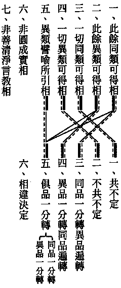
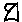

# 解深密经疏（补篇）



> **藏经**："《解深密经疏（下册）》（佛陀教育基金会，2010）"（CBETA 选集）　**册次** 第 3 册（CC003）　**编号** CC0003　**卷次** 6 卷　**篇幅** 66,882 字

> **卷／品**：0 卷 · 3 品



---



## 目录



  - [解深密经疏．圆测疏．后六卷还译序](#解深密经疏圆测疏后六卷还译序)

  - [甲一、教起因缘分——序品第一](#甲一教起因缘分序品第一)

  - [地波罗密多品第七](#地波罗密多品第七)



---



解深密经疏



内容提要



本书是佛教法相宗根本经典（解深密经．圆测疏）的最后六卷。原文早已佚失，现由观空法师依据晚唐吐蕃著名译师法成所译的藏文本还译为汉文。这一部分经文名「如来成所作事品」，内容阐述佛果三身的情况。圆测疏文根据玄奘法师的师说广引有关经论详细解释，是法相宗的重要理论著作。



------



### 解深密经疏．圆测疏．后六卷还译序



解深密经（Sandhinirmocana-Sutra）自刘宋求那跋陀罗剏翻，中经元魏菩提留支、陈真谛两家，至唐玄奘法师，凡有四译。其中宋、陈两译仅节取全经少分。魏、唐二本为全译而品目开合略别。此经境、行、果三，赅摄无餘。陀那深细，明身心之一如；如来成事，显佛地之业用；判三时之浅深，畅一乘之宗极；阐止观于瑜伽，辨了义于三性；理事悉备，要言不烦；诚大乘之纲领，法相之钤键也。昔玄奘法师于中印度那烂陀寺听戒贤法师为讲「瑜伽论」三遍，而此经除序品外，全文收入「瑜伽论（卷七十五～七十八）」中，故奘师于此经可云尽得戒贤之心传。及其周游西宇，学满还唐，所出经论，随翻随讲，弟子录记，多存口义。奘门多贤，测、基称首。圆测法师（六一三～六九六）者，以新罗之王孙，为释迦之法嗣；三龄入道，餐胜义于孩提；十五受业，扬德辉于邦域。乃以志切弘通，振锡西来，游方参学，声闻日远。贞观之末，慈恩东返，长安一遇，宛若旧知。由是瑜伽、唯识，泻瓶无隐，终始译业，倚畀良殷。测师奉侍无违，咨承无厌，竺贤深义，所得独多。所作「解深密经疏」十卷（金陵刻经处本合有四十卷），广徵教典，备存师说，持论精审，为世宝重。时令因、玄范、憬兴、元晓各家，并有疏记，遭会昌法难，散佚无存。独测师此疏，以东邦学僧赉持还国，累业传习，赖以不坠。清末石𥓏杨仁山居士曾自扶桑（日本）取回刊印，流布海内，慧炬掩千祀而复明，绝学涉万涛而还续，法相重兴，功德不朽，惜原本以祀绵远，致有残缺，其中九卷（金陵刻经处刻本当第二十七卷）失品题之释，十卷（金陵刻经处刻本当第三十五至第四十卷）成无字之章，德海汪洋，怅失舟楫。欲渡无航，学者憾焉。然西藏（丹珠藏）中译存此疏全文。译者法成法师，晚唐西蕃大德也。法师出生廓（Hgos）氏望族，为西藏佛教前宏期著名译师，精娴梵、藏、汉土文字，约于唐大和七年（八三三）来游沙州，尔后往返甘、沙两地，译经说法，垂三十年（约八三三～约八五九）。由敦煌遗书中尚可考见，其由汉译藏者有十餘部，由藏译汉者数部，经论讲疏若干部，皆为三藏要籍。所有译文，今以传本对勘，见其译义精当，属辞雅训，诚译事之上乘也。至其讲疏（瑜伽）大论，更能校汉、藏两译之异同，探弥勒、无著之深意；显微阐幽，开比较研究之径蹊；正言断辞，导科学治经之先路，稽之往史，洵属难能。测疏得其译存，全文得以不泯，谓非千古幸事耶？



兹有观空法师，幼禀道心，长怀卓志，仰奘师之景行，慕成公之高风，蜀道崎岖，不懈探骊之愿；雪岭巍峨，终获象罔之珠；住藏卅载，闻修并勤；言返首都，译述不倦；「测疏」残佚，每怀痛惜；誓译藏本，用补缺文；黾勉二载，功业毕具，杀青甫就，徵序于余。余维「深密」法门，传于弥勒，授于戒贤，译于玄奘，述于圆测，宝藏于东瀛，译存于西藏，上下千百年，广员数万里，合印、汉、藏、朝、日无数大德之力，展转授受，始得幸存天壤。今者金瓯复完，观师之功居首，远绍古德之殷勤，近慰时贤之渴望。合浦珠还，喜法宝之重归；连城璧返，庆研几之有据，岂仅佛教不思议之胜缘，抑亦竺、汉、藏、朝、日文化交流史之一胜事也。余故乐而为之序。虽然，犹有进者，汉本「测疏」传世既久，展转移录，难免鲁鱼之讹。成公译本距测师不过百餘年，去古未远，所据原文，必更近真。若能对勘汉藏全疏异同，录为校记，以饷学人，则功德更为圆满矣，此一事也。又闻「丹珠藏」中尚有无著菩萨所作「解深密经释」，文约义丰，为斯宗要典，译而出之，与此疏相辅而行，则更如畫龙点睛矣，此又一事也。质之高贤，以为何如？是为序。



例言



经疏中顶格者是经文，低二格者是疏文  

经疏中有①②等小字注，是说明二种经本或论本中字句有不同之处。例如：经疏卷三十五卷第一页中「①金陵刻经处版本（解深密经）」作「凡有几种一切如来身所住持言音差别」一段注，是说明藏文疏中所引经本与金陵经本字句次序不同。餘可类推。  

经疏中有（）符号中之注，是为便于阅读疏文所加。兹举数例说明于下：㈠如卷三十五第一页中有「（此处）请问之意指」一句，其中「请问之意指」是疏文，（此处）是译时所加。㈡卷三十五第一页中有「如彼论（顺正理论崇祯本卷四十四第十九页）」一句，其中「如彼论」是疏文，（顺正理论……）是注。㈢卷三十五第一页中有「故名引（导众）生令入圣教」一句，其中「故名引生令入圣教」一句，是「佛地经论」文，（导众）是译时所加贯注。其他亦可比知。  

经疏中有（「……」）符号者，其中（）表非圆测疏文，「」符号表是疏中所引经论中文之前半句或后一句。如卷三十五第一页中有（「如是如来」）四字，其中（）表如是如来四字疏中未引，是译者为便读时得窥全句经文而引，由于经中原文是「如是如来成所作智」故。「」符号表是佛地经文。  

经疏前之科目，是译者从疏中录出，以便阅读疏文时，心中有一纲目。



本经全文共有八品，圆测大疏科目分为三分：一、教起因缘分，二、圣教正说分，三、依教奉持分。



------



### 甲一、教起因缘分——序品第一



甲二、圣教正说分（分三）



乙一、明所观境——胜义谛相品第二，心意识相品第三，一切法相品第四，无自性相品第五。



乙二、辨能观行——分别瑜伽品第六，地波罗密多品第七（前七品科目较多，恐繁不录。下文将第八品科目录出，以便与卷第三十五至卷四十疏文对阅。）



乙三、显所得果——如来成所作事品第八（分三）



丙一、释品名义（见圆测疏卷第三十四第一页）



丙二、辨品来意（见该疏同卷第二页）



丙三、依文正释（分二）



丁一、问答正说分（分三）



戊一、明法身相（分二）



己一、曼殊室利菩萨请问（见卷第三十四第三页，以下页数从略）



己二、世尊正说（分二）



庚一、明法身（分二）



辛一、明法身相（分四）



壬一、标说听者



壬二、显法身因



壬三、正明法身之相



壬四、结尾



辛二、显不可思议（分三）



壬一、依因立宗



壬二、辨二因相



壬三、谬执有失



庚二、释解脱身（分四）



辛一、请问



辛二、如来正答



辛三、徵问



辛四、如来正释（分二）



壬一、标解脱身相



壬二、辨二身差别（分二）



癸一、约解脱身辨三乘无别



癸二、约法身辨有差别（分二）



子一、标有差别



子二、正释差别



戊二、明化身相（分三）



己一、明生起相（分二）



庚一、请问化身之相



庚二、如来正答（分二）



辛一、明化身生起之相（分三）



壬一、法



壬二、喻



壬三、合说



辛二、辨二身差别之相



己二、明示现方便善巧相（分二）



庚一、请问



庚二、如来正答（分二）



辛一、正释（分二）



壬一、明化（身之）处所（分二）



癸一、明总所行处



癸二、明别所生处



壬二、明化（身之）相



辛二、结尾



（上一段是解深密经疏卷第三十四科目）



> 己三、明言音差别相（分四）  

> 庚一、请问（分三）



> 辛二、请问数量多少………………………………………………………三五  

> 辛三、请问言音功能之利益………………………………………………三五  

> 庚二、略答……………………………………………………………………三七  

> 庚三、再徵三藏之相…………………………………………………………三七  

> 庚四、广释三藏之相（分二）  

> 辛一、广释三藏之相（分三）  

> 壬一、释契经（分三）  

> 癸一、略示契经相……………………………………………………四〇  

> 癸二、分为三门示所摄事……………………………………………四一  

> 癸三、依次解释（分三）  

> 子一、释四事（分二）  

> 丑一、请问………………………………………………………四一  

> 丑二、答示………………………………………………………四一  

> 子二、释九事（分二）  

> 丑一、请问………………………………………………………四二  

> 丑二、答示………………………………………………………四二  

> 子三、释二十九事（分二）  

> 丑一、请问………………………………………………………四四  

> 丑二、答释（分二）  

> 寅一、依杂染品说有四事（分三）  

> 卯一、（依一事）说五蕴…………………………………四五  

> 卯二、（依一事）说缘生…………………………………四五  

> 卯三、（依二事）说我法二执……………………………四五  

> 寅二、依清净品说有二十五事（分二）  

> 卯一、说四种世间清净事（分四）  

> 辰一、依一事说闻慧……………………………………四六  

> 辰二、依一事说思慧……………………………………四六  

> 辰三、依一事说加行定…………………………………四六  

> 辰四、依一事说四事定…………………………………四七  

> 卯二、说二十一种出世间清净事（分六）  

> 辰一、依一事说顺解脱分………………………………四七  

> 辰二、依四事说顺决择分（分二）  

> 巳一、说遍知苦事（分二）  

> 午一、略说遍知苦…………………………………四七  

> 午二、广释三种遍知………………………………四七  

> 巳二、说断集、证灭、修道事………………………四八  

> 辰三、依四事说见道……………………………………四九  

> 辰四、依六事说修道……………………………………四九  

> 辰五、依四事说无学道…………………………………五〇  

> 辰六、依二事说殊胜及非殊胜（分二）  

> 巳一、说二事…………………………………………五一  

> 巳二、答诤论…………………………………………五二



唐　永康寺译师　廓．法成译藏



汉藏教理院比丘　观空还译



曼殊室利菩萨复白佛言：世尊！一切如来身所加持言音差别凡有几种；由此言音，所化有情，未成熟者令其成熟；已成熟者，即由此缘，速得解脱。



以下第三、明言音差别相。其中分四：一、请问，二、略答，三、再徵，四、广释。此即第一、请问。



此显言音差别相，经文亦分为三：一、「曼殊室利」等，是标请问缘起。二、「凡有几种」，是问数量多少。三、「由此言音」等，是明言音功能之利益。



（此处）请问之意指，是请示一切如来身所加持诸圣教法凡有几种；及由此言音，于未成熟者令其成熟，已成熟者令得解脱。



此等义理，下文当说。



《阿毗达磨集论》中所说，亦与此经所说之义相同。



《阿毗达磨顺正理论》中，以广言辞说明三种言音差别。如彼论（顺正理论崇祯版本卷四十四第十九页）云：「（问：）如是三藏差别云何？（答：）未种善根及未欣胜义者，令种、欣故，为说契经；已种、已欣者，令（其成）熟及继续作所作故，为说调伏；已熟、已作者，令悟解脱正方便故，为说对法。」



《佛地经》中，亦说成所作智有三句义，即令入圣教，以及成熟、解脱。故彼经（即佛地经）云：「（如是如来）成所作智……，以是善巧方便力故，引诸众生令入圣教，及得成熟、解脱。」亲光阿阇黎《释论》中，依此差别释经三句。如彼论（佛地经论金陵刻经处版本卷六第八页）云：「（先现神通）初令生信，故名引（导众）生令入圣教，如现神通度迦叶等。」如《佛本行经》中所说。「次令调顺有所堪能，故名成熟，引令长养诸善根故。」令修顺解脱分善根，及顺决择分善根。「后令解脱三界、恶趣，有姓（有解脱种姓）、无姓（无解脱种姓），如其次第令得解脱，故名令解脱。由教化力，有种姓者，令生圣者地、道，解脱三界；无种姓者，令修世善，常生善趣。念彼善根，为说正法，令脱三界，放光息苦、令安立善趣。又令彼生闻、思、修慧故，如其次第而说三句。又令彼生顺解脱分、顺决择分，及生圣道故，如其次第而说三句。又令彼入见道、修道及无学道故，如其次第而说三句。」



《阿毗达磨集论》、《显扬圣教论》、《大乘庄严经论》、梁（真谛）译《摄大乘论》（天亲）释，及《瑜伽师地论》等中有多种解释，恐繁不述。



佛告曼殊室利菩萨曰：善男子！如来言音略有三种：一者、契经，二者、调伏，三者、本母。



此即第二、如来略答。



此段经文是举数标名。



其中，言「契经」者，谓既顺正理，又与众生根器相称，故名契经。



关于解释「经」义，诸教典中亦各不同。



《佛地经论》以二种义解释经义。如《佛地经论》（卷一第一页）云：「能贯能摄，故名为经。以佛圣教，贯穿、摄持所应摄义及所化（众）生故。」《四分律》中所释，亦与《佛地经论》所说相同。



《杂阿毗昙心论》以五种义解释「契经」。如彼论（即杂阿毗昙心论金陵刻经处版本卷十第一页）云：「修多罗者，凡有五义：一曰生处，能出生诸义故；二曰如泉，义味无尽故；三曰显示，显示诸义故；四曰如绳墨，辨诸邪正故；五曰如贯鬘，贯穿诸法故。如是五义，是修多罗义。」



《善见论》（即善见毗婆沙律之略称，下同）以七种义释修多罗，广如彼论所说。



（唐玄奘法师译）《摄大乘论世亲释》及《梁（真谛阿阇黎）译》（摄大乘论天亲释）中，对于三藏名义，一一广释，恐繁不述。



言「调伏」者，谓由诸清净律仪调伏七恶，或者调伏六根，故名调伏。如《善见论》云：「凡能调伏身语业者，为调伏义。」又《俱舍论》（常州天寗寺版本卷十五第六页）云：「言调伏者，义显律仪，由此能令根调伏故。」《显扬圣教论》及《阿毗达磨顺正理论》中所释，亦多分与《俱舍论》所说相同。



于此调伏，尚有众多名义。



如《阿毗达磨大毗婆沙论》（金陵刻经处版本卷四十四第十四页）云：「契经说戒，或名尸罗，或名为行，或名为足，或名为箧。言尸罗者，是清凉义，谓为恶能令身心热恼，戒能安适，故曰清凉。又恶能招恶趣热恼，戒招善趣，故曰清凉。……契经说戒名为行者，以诸世间说戒名行。故诸世间见持戒者，言彼有行；见破戒者，言彼无行。又持净戒是众行本，能至涅槃，故名为行。契经说戒名为足者，能往善趣，至涅槃故。如有足者，能避险恶，至安隐处；有净戒者，能越恶趣生人天中，或超生死到涅槃岸，故名为足。契经说戒名为箧者，任持一切功德法故。谓持戒者，任持功德不令退散，如箧持宝。尊者妙音作如是说：戒名不坏。所以者何？如足不坏，则能自在往安隐处；具净戒者亦复如是，能至涅槃。」广则应如彼论所说而得了知。



又《俱舍论》（卷十四第三页）云：「别解律仪名差别者，能平险业，故名尸罗；……智者称扬，故名妙行；所作自体，故名为业；……能防身语，故名律仪。」《显扬圣教论》及《顺正理论》中所说，与《俱舍论》所释相同。



《瑜伽师地论》（金陵刻经处版本卷八十三第八页）云：「言尸罗者，谓能寂静毁犯净戒罪热恼故，又与清凉义相应故。言律仪者，谓是远离自体相故。」



又《摄大乘论》云：「又能息灭诸恶，故曰调伏。」（见金陵刻经处版本摄大乘论本卷二第二十四页，字句略有不同）



如此异名虽有多种，但彼一切皆是「调伏」别称。



言「本母」者，由是能生一切法之根本，及能显示诸法，故名本母。



如《阿毗达磨顺正理论》（卷四十四第十九页）云：「（随理）辩论亦名论议，即此名曰摩怛理迦。释餘经义时，以此为本母故。」



又如字母能生诸字，及能生起一切知识，故名本母。如《瑜伽师地论》云：「为欲善辨诸契经故，当依此（杂阿笈摩）等四种契经增上所说，而正显示契经摩怛理迦，如来所说、如来所称、所赞、所美先圣契经。譬如无本母字，义不明了。如是本母所不摄经，其义隐昧，义不明了。与此相违，义即明了，是故说名摩怛理迦。」



复次，《显扬圣教论》云：「论议者，谓诸经所摄摩怛履迦。且如诸了义经，皆名摩怛履迦，所谓如来自广分别诸法体相。又诸弟子已见圣迹，依自所证，无倒显示诸法体相，亦名摩怛履迦。即此摩怛履迦，亦名阿毗达磨。犹如世间一切书算诗论，皆有本母；当知经中研究法相，所有言说，亦复如是。又如世间诸字，若无本母，字不显了。如是十二分教中，若不建立诸法体相，法不明了；若建立已，诸法自相、共相皆得显现，又复能显无杂法相故。即此摩怛履迦，亦名阿毗达磨。除此摩怛履迦，所餘解释诸经义者，亦名邬波第铄。」（本母中）



又有素怛缆摩怛履迦、毗奈耶摩怛履迦、法相摩怛履迦等三种，此等差别，当从《瑜伽师地论》详细显示中而得了知。



又此本母，具有多名。如《摄大乘论世亲释》（卷一第四页）云：「谓阿毗达磨亦名对法，此法对向无住涅槃，能说谛、菩提分、解脱门等故。阿毗达磨亦名相续不断法，于一一法相续不断数数宣说训释言词、自相、共相等无量差别故。（『阿耻达磨』）亦名胜法，由此具足论处所等完善言辞，能胜伏他论故（『阿毗达磨』）。亦名通法，由此能释通素怛缆义故。」梁（真谛）译（摄大乘论天亲）《释》中亦如此说。



世尊！云何契经？云何调伏？云何本母？



此是第三、徵问三藏之相。



曼殊室利！若于是处，我依摄事显示诸法，是名契经。



以下第四、广释三藏之相。于中分二：一、广释三藏之相；二、从「曼殊室利菩萨」至「不共陀罗尼」，是略示三藏不共陀罗尼。第一、广释三藏之相中，又分为三：一、释契经，二、释调伏，三、释本母。第一、释契经中，又分为三：一、略示契经相，二、分为三门（所示摄事），三、依次解释。此即第一、略示契经相。



其中，「是处」二字，示以契经为处；「我」指如来自己，谓于五蕴上所安立名；「事」、指体事，即四摄事等。



谓契经须由摄事乃能通达诸法，故世尊言：「我依摄事显示诸法，是名契经。」



谓依四事，或依九事，或复依于二十九事。



此即第二、分为三门（示所摄事）。



谓所摄事共有三种：即四事、九事、二十九事。



云何四事？



以下第三、明依次解释。此亦由释三事，而分为三：一、释四事，二、释九事，三、释二十九事。第一、释四事中，又分为二：一、请问，二、答示。此即第一、请问。



一者、听闻事，二者、归趣事，三者、修学事，四者、菩提事。



此即第二、答示。



于此四事之略释及广释，当如《显扬圣教论》所说而得了知。



其中，「略释」者，如彼论（卷六第七页）云：「复次，颂曰：闻十二分教，三最胜归依，三学三菩提，为有情净说。」彼论释曰：「其中，『闻』者，谓闻十二分教。……」如是十二分教中，具有三藏。此中契经、应颂、记别、讽颂、自说、譬喻、本事、本生、方广、希法，是为素怛缆藏；其中「因缘」，是为毗奈耶藏；其中「论议」，是为阿毗达磨藏。十二分教，详如彼论所说而得了知。复次，彼论（卷六第八页）又云：「『三最胜归依』者，谓佛、法、僧三种归趣。『三学』者，谓戒、定、慧等三学。『三菩提』者，谓声闻菩提、独觉菩提、无上正等菩提。『为有情净说』者，为令有情得清净故，次第宣说是三种法，谓能持、方便、果。『能持』者，谓闻及归依；『方便』者，谓三学；『果』者，谓三菩提。」



（其中）「广释」者，即彼（显扬圣教）论中对于四事所作广释，恐繁不述。



云何九事？



以下第二、释九事。于中有二：一、请问，二、答示。此即第一、请问。



一者、施设有情事，二者、彼所受用事，三者、彼生起事，四者、彼生已住事，五者、彼染净事，六者、彼差别事，七者、能宣说事，八者、所宣说事，九者、诸众会事。



此即第二、如来正答。



解释九事，当如《瑜伽师地论》所说而得了知。如彼论（《瑜伽师地论》）云：「又复应知诸佛语言，九事所摄。云何九事？……其中『有情事』者，谓五取蕴。『受用事』者，谓十二处。『生起事』者，谓十二缘生。『生已住事』者，谓四食。『染净事』者，谓四圣谛。『差别事』者，谓无量界。（藏文经疏中无『差别事』解释，可能是刻版时漏落所致。）『能宣说事』者，谓佛及诸佛弟子。『所宣说事』者，谓四念住等菩提分法。『众会事』者，谓八众：一、刹帝利众，二、婆罗门众，三、长者众，四、沙门众，五、四大天王众，六、三十三天众，七、焰摩天众，八、梵天众。」《长阿笈摩》、《增一阿笈摩》及《大智度论》等中所说八众，与《瑜伽师地论》所说相同。



《相续解脱经》及《深密解脱经》中辞虽少异，但说九事亦无不同。《显扬圣教论》中所说九事，亦与此经所说相同。



问：众会事中，以何因缘，于天及人各说四众？答：《瑜伽师地论》中，说由七种因故，建立八众。如（瑜伽师地论）云：「当知由四因故，于人趣中建立如来四众；三因缘故，于天趣中建立四众。（刹帝利众）最增上故。（婆罗门众）世间共许为福田故，（长者众）受用资财不依他故，（沙门众）弃舍一切世资财故。当知由此四因，于人趣中建立四众。（四大天王众）依地边际故，（三十三天众）依欲界边际故，（焰摩天众及梵天众）依诸行边际故。当知由此三因，于天趣中建立四众。」（上一段论文见金陵本卷十五第二页）



《大智度论》并于沙门、婆罗门、三十三天、焰摩天及梵天众，广为解说，恐繁不述。



云何名为二十九事？



以下第三、释二十九事。于中分二：一、请问，二、答示。此即第一、请问。



谓依杂染品，有摄诸行事等。



注：藏文经疏中用「等」字代替二十九事名。兹为阅读疏文便利，特从本段经疏解释二十九事文中录出二十九事名于下：「谓依杂染品有摄诸行事，彼次第随转事，即于是中作补特伽罗想已于当来世流转因事，作法想已于当来世流转因事。依清净品有系念于所缘事，即于是中勤精进事，心安住事，现法乐住事。超一切苦缘方便事，彼遍知事。此复三种：遍知颠倒所依处故，遍知依有情想于外有情生起诸邪行所依处故，遍知内离增上慢所依处故。修依处事、作证事、修习事。令彼坚固事、彼行相事、彼所缘事、已断未断观察善巧事。彼散乱事，彼不散乱事，不散乱依处事，解除修习劬劳加行事，修习胜利事，彼坚牢事。摄圣行事，摄圣行眷属事，通达真实事，证得涅槃事。于善说法毗奈耶中世间正见超升一切外道所得正见顶事，及即于此不修退事。于善说法毗奈耶中不修习故说名为退，非见过失故名为退。」（此句是答诤论）



以下第二、如来答释二十九事。于中分二：一、依杂染品说有四事，二、依清净品说有二十五事。



如《显扬圣教论》（卷二十第十三页）云：「二十九种事者，谓于遍摄九事经中，依杂染品说有四事，……又依清净品说有二十五事。……」



第一、依杂染品说，又分为四：一、说五蕴，二、说（十二）缘生，三、说我执，四、说法执。谓杂染品中有此四种，亦由杂染品体是五蕴故，诸杂染品流转生死是由（十二）缘生故，流转生死根本是（我及法）二种执故。二种执中，我执粗显，是故先说；法执微细，是故后说。我执决定是由法执生故。



又说五蕴事为「杂染品」者，是说烦恼、业及生三种杂染。



「摄诸行事」者，即指五蕴，由于五蕴摄诸行事，是故说为「摄诸行事」。有说：诸行摄蕴、界、处。虽有如此二种解释，但取前说，由于界、处二门之中，亦有不是行所摄故。



「彼次第随转事」者，是第二、说十二缘生。



谓杂染品十二缘生次第随转，如由无明为缘而有行，乃至由生为缘而有老死。有说（彼次第随转事之）「彼」字即指五蕴。如《显扬圣教论》云：「即彼次第随转事。」



「即于是中，作补特伽罗想已，于当来世流转因事；作法想已，于当来世流转因事」者，是第三、说我执及法执事。



如《显扬圣教论》（卷页同上）云：「即于此中立众生想后转因事，即于此中建立法想后转因事。」



谓由此二执，于杂染品五蕴建立我想及立法想为缘，作后流转之因事云。



「依清净品，有系念于所缘事」者以下是第二、依清净品说有二十五事。于中分二：一、宣说四种世间清净事，二、宣说二十一种出世间清净事。（第一宣说）四种（世间清净）事者，即说闻慧，说思慧，说加行定，说四事定。



其所以有此四种世间清净事者，亦由瑜伽门之次第决定。先由闻慧为缘，引起思慧，次由思慧引起加行定，再由加行定而得四事定之次第，故说四种事。



第一、说闻慧。



此中说为「清净品」者，谓所有世间及出世间，有漏及无漏诸清净法。在清净品中，此即说为世间清净品。



「系念于所缘事」者，即是欲界闻慧，谓于正法心善系念，或于所说之义及念住境心善系念。



「即于是中勤精进事」者，是第二、说思慧。



谓即于闻慧境，专一见为谛实已，殷重精进所有作意。



「心安住事」者，是第三、说加行定。



谓由思慧为缘，于加行定心善安住。



「现世乐住事」者，是第四、说四事定。



谓得六神通已，于现世中安乐而住。



「超一切苦缘方便事。」



以下，是第二、说二十一种出世间清净事。此又分六：一、明依一事说顺解脱分，二、明依四事说顺决择分，三、明依四事说见道，四、明依六事说修道，五、明依四事说无学道，六、明依二事说殊胜及非殊胜。此（「超一切苦缘方便事」）即第一、明依一事说顺解脱分。



此句经文亦有二种解释：



有一类言：「超一切苦」者，是指涅槃，谓以涅槃为缘，众生能超一切苦。又所有一切以解脱分为缘而念善法者，皆为涅槃之方便因，故曰「方便事」。



有一类言：解脱分善有二种境。一、是以超一切流转苦为所缘境，二、是以涅槃之方便为所缘境，故名「超一切苦缘方便事」云。



（「彼遍知事，修依处事，作证事，修习事」）等者，是第二、明依四事说顺决择分。此亦分二：一、说遍知苦事，二、说断集、证灭、修道事。谓依四圣谛，生起煖、顶等四善根，故说四种事。第一、说遍知苦事中，又分为二：一、略说遍知苦，二、广释三种遍知。此即第一、（略说遍知苦）：



谓由遍知三界苦谛，故曰「遍知」。（经云：）



「此复三种：即遍知颠倒所依处故；遍知依有情想于外有情生起，邪行所依处故；遍知内离增上慢所依处故」者，是第二、广释三种遍知。



（经言）「此复三种」者：即一、遍知颠倒所依处故；二、遍知依有情想，于外有情生起邪行所依处故；三、遍知内离增上慢所依处故。



于此三句经文，亦有不同解释。



有一类言：「遍知颠倒所依处故」者，谓遍知三界苦谛，是诸颠倒所依处故。「遍知依有情想，于外有情生起邪行所依处故」者，谓遍知欲界苦谛，依有情想，作断命等业，亦决定先从生有情想而起。「于外有情」者，是示造业处所；「邪行」者，即彼所起业行。谓遍知欲界苦谛，是依起有情想，对于外之有情而作邪行所依处故。下当解说。「遍知内离增上慢所依处故」者，遍知色界内身即是苦谛，谓上二界一切烦恼是依内身而生起故，说为「内离增上慢」云。



有一类言：前二遍知唯属欲界，第三遍知属上二界摄云。餘如前说。



又一类言：三种遍知，是如其次第，遍知三界苦云。



虽有如此多种解释，玄奘阿阇黎依《瑜伽师地论》释「以第二说为佳」云。



「修依处事，作证事，修习事」者，是第二、说断集、证灭及修道事。



此亦由于集谛中（烦恼及业），二种杂染，是修之违品，故名「修依处事」。灭谛是无为法，故名「作证事」。圣道是「修习事」。故诸经论中说：「苦应知，（集应断，灭应证，）道应修。」



「令彼坚固事，彼行相事，彼所缘事，已断未断观察善巧事」者，是第三、明依四事说见道。



其中，「令彼坚固事」者，是指真见道，谓由真见道为缘曰真，能令二种有相见道（即三心相见道及十六心相见道）不失坏故。又有一种解说：谓由获得见道为缘，永不退转为异生故，名为「令彼见道坚固事」云。



「彼行相事」者，即有相见道，谓三心与十六心之行相异故。



「彼所缘事」者，是说有相见道之所缘境事。



「已断未断观察善巧事」者，谓由有相见道，已断见所断烦恼；于修所断烦恼尚未断时，所有观察。



「彼散乱事，彼不散乱事，不散乱依处事，解除修习劬劳加行事，修习胜利事，彼坚牢事」者，是第四、明依六事说修道。



此段经文，亦有不同解释。



有一类言：「彼散乱事」者，是指已经超越见道，尚未趣入修道之时，于此中间，暂时所起之散乱心。彼非杂染，故曰散乱。「彼不散乱事」及「不散乱依处事」者，是指住定之时，修习断除欲界修所断烦恼之加行道。此处「不散乱事」者，是指正定行相以外，其他相应之法；「不散乱依处事」者，专指定体，由于彼为慧之所依，故名依处。「解除修习劬劳加行事」者，是指断除色、无色界修所断烦恼之无间道。「彼坚牢事」者，是指所有金刚喻心之无间道云。



有一类言：前三种事，如前所说。第四种事，是指断除三界修所断烦恼之无间道。第五种事，是色无色之根本定。第六种事，与前说同云。



有一类言：「彼散乱事」者，谓修道时，不依闻、思二慧断除三界修所断烦恼之加行远道。「彼不散乱事」及「不散乱依处事」者，谓住定已，修习断除三界修所断烦恼之加行近道。「彼不散乱事」者，谓住定时，所有其他心、心所等，皆不散乱；「不散乱依处事」者，谓专持正定行相，作慧依处，故云依处。「解除修习劬劳加行事」者，谓断除欲界修所断烦恼之无间道及解脱道。「修习胜利事」者，谓断除色界修所断烦恼之无间道及解脱道。「彼坚牢事」者，谓断除无色界修所断烦恼之无间道，亦即金刚喻定云。



问：（于此事中）何故未说解脱道？答：由于彼解脱道，是无学道所摄故云。



亦有其他《解深密经》本及《深密解脱经》中，未说「不散乱事」，是欠完满。此种（解深密）经本中，六事全说。对校梵文（解深密经）本及《相续解脱经》、《瑜伽师地论》（引解深密经）等中，皆是六事全说。故此（种解深密经本）中六事全说，洵属正本。



「摄圣行事，摄圣行眷属事，通达真实事，证得涅槃事」者，是第五、明依四事说无学道。



其中，「摄圣行事」者，谓所有由正智所摄尽智及无生智。「摄圣行眷属事」者，谓所有由后得智之所任持尽智及无生智。「通达真实事」者，谓所有将近趣入无餘位时，亦修真实。「证得涅槃事」者，谓所有将近趣入无餘位时，先入灭尽定，在住灭尽定中，即由阿赖耶识证得涅槃。



「于善说法、毗奈耶中，世间正见超升一切外道所得正见顶事，及由于此不修说为退事」者，是第六、明依二事说殊胜及非殊胜。于中分二：一、说二事，二、答诤论。（一、说二事中又分为二：一、说第一事，二、说第二事。）此即第一。（第一事）。



「于善说法、毗奈耶」者，是指三藏正法。言「善说法」者，即契经藏及对法藏；「毗奈耶」者，即调伏藏。如《瑜伽师地论》云：「善说法者，谓正理所摄故，即能总持殊胜功德。毗奈耶者，谓与息灭一切烦恼相随顺故。」此善说法、毗奈耶之广释，当如前文所说而得了知。



此中所说（「于善说法毗奈耶中世间正见超升一切外道所得正见顶事」者），是谓三藏中说：（顺）解脱分所摄世间正见虽（较见道等出世根本智为）低，但比一切外道所得正见则（甚超越而）成顶上之事。下文当说。



于此「正见顶事」一语，亦有两种解释：有一类言：顶上见地，即是正见，故曰「正见顶事」云。有一类言：此是从喻立名。由于诸经论中，所说正见至为殊胜，犹如人之头顶，故曰「正见顶事」云。



「及即于此不修退事」者，是说第二事。谓由于此善说正见之毗奈耶法，只能知为善妙而于前事（即第一事）不勤修习。由不修习，故曰退事之训释词耳。



「于善说法、毗奈耶中，不修习故说名为退，非见过失，故名为退」者，是第二、答诤论。



谓诸外道起诤论曰：若言「由不修习，即是退事」，则此一事定有过失云。因有此诤，故作答曰：此处说「退」，亦即是言「于善说法、毗奈耶中不修习故，说名为退；非于第二事见有过失故说名为退」。



（总而言之）此处是就未得、未修二种，说名为退。因此，若就此第二事观察，则彼亦是「超越一切外道所有正见」之断定辞耳。



二十九事名目表一、依杂染品说有四事摄诸行事说五蕴事



彼次第随转事十二缘生事



即于是中作补特伽罗想已于当来世流转因事说我执事



作法想已于当来世流转因事说法执事



二、依清净品说有二十五事㈠依四事说世间清净事①系念于所缘事说闻慧



②即于是中勤精进事说思慧



③心安住事说加行定



④现世乐住事说四事定



㈡依二十一事说出世间清净事①超一切苦缘方便事㈠依一事说顺解脱分



②彼遍知事分三遍知颠倒所依处故  

遍知依有情想于外有情生起诸邪行所依处故  

遍知内离增上慢所依处故



③修依处事  

④作证事  

⑤修习事㈡依四事说顺决择分



⑥令彼坚固事  

⑦彼行相事  

⑧彼所缘事  

⑨已断未断观察善巧事㈢依四事说见道



⑩彼散乱事  

⑪彼不散乱事  

⑫不散乱依处事  

⑬解除修习劬劳事  

⑭修习胜利事  

⑮彼坚牢事㈣依六事说修道



⑯摄圣行事  

⑰摄圣行眷属事  

⑱通达真实事  

⑲证得涅槃事㈤依四事说无学道



⑳于善说法毗奈耶中世间正见超升一切外道所得正见顶事（第一事）  

㉑及即于此不修退事（第二事）㈥依二事说殊胜及非殊胜



「于善说法毗奈耶中不修习故说名为退」，非见过失故名为退——（此句是答外诤论）



（此表是译者为便于阅读该段疏文而从解深密经疏中录出）



> 壬二、释调伏分（分二）  

> 癸一、略示其相………………………………………………………………六一  

> 癸二、问答分析（分二）  

> 子一、请问…………………………………………………………………六四  

> 子二、答示（分二）  

> 丑一、略示数目…………………………………………………………六四  

> 丑二、分别宣说（分七）  

> 寅一、宣说受轨则事相………………………………………………六四  

> 寅二、宣说随顺他胜事相……………………………………………六五  

> 寅三、宣说随顺毁犯事相……………………………………………六五  

> 寅四、宣说有犯自性相………………………………………………六五  

> 寅五、宣说无犯自性相………………………………………………六六  

> 寅六、宣说出所犯相…………………………………………………六六  

> 寅七、宣说舍律仪相…………………………………………………六七  

> 壬三、释本母（分二）  

> 癸一、标数略答………………………………………………………………六九  

> 癸二、请问及答释（分二）  

> 子一、请问…………………………………………………………………七〇  

> 子二、世尊答释（分二）  

> 丑一、如数标名…………………………………………………………七〇  

> 丑二、依次解释（分十一）  

> 寅一、解释世俗相（分二）  

> 卯一、标数…………………………………………………………七〇  

> 卯二、列名解释……………………………………………………七〇  

> 寅二、解释胜义相……………………………………………………七一  

> 寅三、解释菩提分法所缘相…………………………………………七二  

> 寅四、解释八行观相（分三）  

> 卯一、略举数目……………………………………………………七二  

> 卯二、如数标名……………………………………………………七二  

> 卯三、依次解释（分八）  

> 辰一、解释谛实相………………………………………………七三  

> 辰二、解释安住相（分三）  

> 巳一、明安立我法二执………………………………………七三  

> 巳二、明安立四种授记………………………………………七三  

> 巳三、明安立隐密显了………………………………………七四  

> 辰三、解释过患相………………………………………………七五  

> 辰四、解释功德相………………………………………………七六  

> 辰五、解释理趣门（分三）  

> 巳一、略举数目………………………………………………七六  

> 巳二、依数标名………………………………………………七六  

> 巳三、疏依显扬圣教论由略广二门分析（分二）  

> 午一、略说由后二理趣随释前三理趣（分三）  

> 未一、由离二边理趣随释真义理趣……………………七六  

> 未二、由不思议理趣随释证得理趣……………………七七  

> 未三、由意乐理趣随释教导理趣………………………七七  

> 午二、广释六种理趣（分六）  

> 未一、释真义理趣………………………………………七八



曼殊室利！若于是处，我依声闻及诸菩萨，显示别解脱及别解脱相应之法，是名调伏。



以下第二、释调伏。于中分二：一、略示其相，二、问答分析。此即第一、略示其相。



（此段经中）言「是处」者，示（调伏正法）所依之处；「我」是如来自称，即于五蕴上所安立名。



谓如来为诸声闻及菩萨等，所有显示别解脱及别解脱相应之法（皆名调伏）。



凡是七众所受律仪戒法，皆名别解脱。其中差别，即二乘所受，唯于身语七支安立为体；菩萨则总于身等三业安立为体。



其中，「别解脱」一名，亦有不同解释。



如说一切有部诸教典中，是以八众初受律仪时之表色，别别弃舍各种恶故，立别解脱及业道名。如《俱舍论》（卷十四第三页）云：「别解律仪名差别者，颂曰：俱得名尸罗，妙行、业、律仪，唯初表、无表，名别解、业道。论曰：能平险业，故名尸罗。训释词者，谓清凉故。如伽陀言：『受持戒者，身无热恼，故名尸罗。智者称扬，故名妙行。训释词者，所作自体……能防身语，故名律仪。』如是应知，别解脱戒通初后位，无差别名；唯初刹那表及无表得别解脱及业道名。谓受戒时，初（刹那之）表及无表，别别弃舍种种恶故，依初（刹那）别（别弃）舍（诸恶之）义，立别解脱名；即于尔时所作究竟，依业畅（明显）义，立业道名。故初刹那（之无表色）名别解脱，亦得名曰别解律仪，亦得名为根本业道。从第二刹那乃至（律仪）未舍，不名别解脱，名别解律仪；不名业道（业不明显，故），名为后起。」详如彼论所说。



《显扬圣教论》及《阿毗达磨顺正理论》中所说，亦多分与《俱舍论》所说相同。其中有差别者，谓由三种义，立别解脱名。初一种解释，与《俱舍论》所说相同；中一种解释，谓「又是初所修，故名别解脱」云；后一种解释，谓「又彼（律仪）初起，即能最初超越危险恶趣，故名别解脱」云。



复有一说。谓由七支大种为因，各别解脱，故名别解脱。此与静虑（生）及道生律仪共以七支为因之义不同，（别解律仪）以一大种为体故。如《俱舍论》（卷十三第十二页）云：「于中，欲界所有无表等流、有受有漏别异大生。『异大生』言，显身语七支一一是别大种所造。定生无表差别有二，谓诸静虑（律仪及道所生）、无漏律仪。此二（律仪）俱依定所长养，无受、无异大种所生。『无异大』言之断定辞，显此无表七支以同一具四大种为因所生。所以者何？所依大种如心唯一，无差别故。」《阿毗达磨顺正理论》及《显扬圣教论》中，亦与《俱舍论》所说相同。



复次，《阿毗达磨顺正理论》（卷三十六第十六页）云：「（于前所说三律仪中，何等律仪随心而转？唯后二种：）谓静虑生及道生二种律仪，是随心转律仪；别解脱律仪，非随心转律仪故。」（姑苏论本字句与此略异）。



复次，由散乱心所作之善，由于身语是与心异行共有之等流因，故亦名为别。



又戒是涅槃之初因故（名为解脱）。如《显示别教经》云：「戒是真正随顺解脱之法，故名别解脱。」又「别解脱」者，别谓各别，解脱即涅槃果。静虑生及道生二种律仪，是能证得真正解脱（之因）；「别解脱律仪」者，谓身语善虽为散心所造，然是属於涅槃究竟果品，故名别解脱。又静虑生及道生二种律仪，由是与心俱行，亦即同是趣向涅槃究竟果位；此别解脱律仪虽与心异，由是趣向寂灭果故，从远而得别解脱名。又别解脱律仪，唯是现在若止若行，及属根本遮止所摄；静虑生及道生二种律仪，既属遮止三世，亦唯根本遮止，故名别解脱云。



大乘教典中说，七众正受各种律仪，由是别别防恶，即与静虑生及道生二种律仪相同。七众正受律仪，即防恶非异，故得别解脱。言「解脱」者，谓解脱七恶，证得涅槃解脱果故，名曰解脱。并未曾说从异大种立别解脱名。



此经中所言「别解脱相应之法」，亦有两种解释。有一类言：正戒之因、缘，及其随顺，皆名相应之法云。有一类言：身等三业是戒自性，与心相应之心所法，即名相应之法云。「法」之圣言，即指调伏。



世尊！菩萨别解脱，几相所摄？



以下第二、问答分析。于中分二：一、请问，二、答示。此即第一、请问。



由以主要所问为缘，故唯言「菩萨别解脱」。



善男子！当知七相。



以下第二、如来正答。此又分二：一、略示，二、分别宣说。（此即第一、略示）。



一者、宣说受轨则事故等。（「二者、宣说随顺他胜事故，三者、宣说随顺毁犯事故，四者、宣说有犯自性故，五者、宣说无犯自性故，六者、宣说出所犯故，七者、宣说舍律仪故。」）



以下第二、分别宣说七相。由于宣说七相，而分为七：其中言「一者、宣说受轨则事故」者，即是第一、宣说受轨则事相。



由于此是宣说受戒轨则，故第一名受轨则事。《相续解脱经》中作「宣说受威仪」，《深密解脱经》中作「说受持法」。



若广说此受律仪法，当如《瑜伽师地论》〈菩萨地〉中所说而得了知。



又受律仪轨则者，如《瑜伽师地论》（卷二十二第三页）云：「云何名为轨则圆满？谓如有一，或于威仪路，或于所作事，或于善品加行处所，成就轨则。随顺世间，不越世间；随顺毗奈耶，不越毗奈耶。故名轨则圆满。」广如彼论所说。《显扬圣教论》中亦如是释。



「二者、宣说随顺他胜事故」者，是第二、宣说随顺他胜事相。



谓若有违犯四种重罪，则彼定为他胜烦恼之所制伏。



他胜处法共有四种，如《瑜伽师地论》中云：「（若诸菩萨，）为欲贪求利养恭敬，自赞毁他；及性悭吝故，于诸有情不施财法；由忿恨故，捶打有情；发粗恶言，谤菩萨藏，宣说邪法等四种他胜处法。」详如彼论（卷四十第十八页）所说，（字句略有不同。）



复有十种他胜处法，即于前说四种之上，再加断命、不与取、邪淫、妄语、酤酒，及说他过失等，当如《梵网经》及《指鬘经》中所说而得了知。



「三者、宣说随顺毁犯事故」者，是第三、宣说随顺毁犯事相。



此指前说重罪以外其他轻罪。如《梵网经》所说四十八种轻罪，及《瑜伽师地论》所说各种轻罪。详如彼等经论所说。



「四者、宣说有犯自性故」者，是第四、宣说有犯自性相。



言「有犯自性」者，《瑜伽师地论》中说为「（有犯）有所违越」等罪。如彼论（瑜伽师地论卷四十一第一页）云：「若诸菩萨安住菩萨净戒律仪，于一日中，若于三宝，若不以其或少或多诸供养具而为供养，下至以身一拜礼敬，下至以语一四句颂赞佛法僧真实功德，下至以心一清净信随念三宝真实功德，空度日夜，是名有犯有所违越。」乃至广说。



「五者、宣说无犯自性故」者，是第五、宣说无犯自性相。



即是无制罪。或如《瑜伽师地论》（卷四十一第十九页）云：「又一切处无违犯者，谓若彼心增上狂乱，若重苦受之所逼切，若未曾受净戒律仪，当知一切皆无违犯。」又《瑜伽师地论》云：「云何无犯？略有四种：」三种已如上文所说，再加初修业者。



「六者、宣说出所犯故」者，是第六、宣说出所犯相。



谓即发露忏罪及出所犯之法。如《瑜伽师地论》（卷四十一第十九页）云：「若诸菩萨，以上品缠违犯如上他胜处法，（失戒律仪）应当更受。若中品缠违犯如上他胜处法，应对于三补特伽罗，或过是数，应如发露除恶作法。……若下品缠违犯如上他胜处法，及餘违犯，应于一补特伽罗，发露悔法，当知如前。若无合法补特伽罗可对发露，悔除所犯，尔时菩萨以净意乐，起自誓心：我当决定防护当来，终不重犯。若如是作，是名于犯还出还净。」详如彼论所说。



「七者、宣说舍律仪戒故」者，是第七、宣说舍律仪相。



《瑜伽师地论》〈菩萨地〉云：「菩萨若用软中品缠，毁犯四种他胜处法，不舍所受净戒律仪；上品缠犯，即名为舍。若诸菩萨毁犯四种他胜处法，数数现行，都无惭愧，深生爱乐，见是功德，当知说名上品缠犯。非诸菩萨暂一现行他胜处法，便舍菩萨净戒律仪；如诸苾刍犯他胜法，即便弃舍别解脱戒。若诸菩萨由此毁犯，弃舍菩萨净戒律仪，于现法（即现世）中堪任更受，非不堪任；如苾刍住别解脱戒，犯他胜法，（则）于现法中不任更受。略由二因，舍诸菩萨净戒律仪，一者、弃舍无上正等菩提大愿，二者、现行上品缠犯他胜处法，若诸菩萨……不舍无上菩提大愿，亦不现行上品缠犯他胜处法。若诸菩萨转受餘生，上中下三，一切生中，于所正受菩萨净戒律仪皆不弃舍。若诸菩萨转受餘生，忘失本念，值遇善友，为欲增长菩萨戒念，虽复重受，而非新受……。」



复次，《瑜伽师地论》中，说由四缘舍此律仪。如彼论云：「复次，若有不舍如是律仪，当知餘生亦得随转，彼戒非舍。又舍因缘，略有四种：一者、决定发起（与）受（戒）心不同之心；二者、若于领会语言人前，故意发起弃舍语言；三者、总别毁犯四种他所胜法；四者、若以增上品缠，总别毁犯随顺四种他所胜法。由此因缘，当知弃舍菩萨律仪。若有还得清净受心，复应还受。」（以上几段论文均见金陵论本，但字句略有不同）



至于舍声闻戒缘有多少，诸教典中所说亦各不同。



说一切有部教典中，言舍戒因略有五种。如《俱舍论》（卷十五第五页）云：「且云何舍别解律仪？颂曰：舍别解调伏，由故舍、命终，及二形俱生，断善根、夜尽。……论曰：言调伏者，意显别解律仪，由此（律仪）能令根调伏故。唯除近住（律仪），所餘七种别解律仪，由四缘舍：一、由（决定）意乐，对有解人发有表业，舍学处故；二、由弃舍众同分故；三、由二形俱时生故；四、由（彼）所（依之）因善根断故。舍近住戒，由前四缘及由夜尽。是故总说别解律仪由五缘舍。（问：）何故舍戒由此五缘？（答：一）与受（戒）相违表业生故，（二、）所依之身舍故，（三、）所依（之身）变故，（四、）所（依之）因（善根）断故，（五、）过期限故。」《阿毗达磨顺正理论》、《显扬圣教论》及《大毗婆沙论》等中所说五种舍学处因，亦与《俱舍论》所说相同。



《杂阿毗达磨心论》（金陵刻经处版本卷四第十七页）云：「谓住律仪而犯律仪者，是犯戒（非舍戒），当知彼人仍住持戒，只是犯戒。彼若悔者，即舍犯戒而住持戒。如富人负债，名富者，亦名负债者。若还债已，唯名富者。（彼亦如是。）」《俱舍论》及《大毗婆沙论》亦如是说。



法密部（即法藏部）师言，由六种因舍别解律仪。其中五种，与《俱舍论》所说相同；又说正法灭时，（亦能舍戒）。如《俱舍论》（卷十五第六页）云：「有餘部言：由正法灭，亦能令舍别解律仪。以法灭时，一切学处、结界羯磨皆止息故。」



经部师论典中说，由五因舍戒。亦与《俱舍论》所说相同。虽然未说夜尽一种，但其餘重罪皆已说故。又《俱舍论》（卷十五第六页）云：「有餘部说：于四极重感堕罪中，若随犯一，亦舍勤策（即沙弥）、苾刍律仪。」



若就大乘教典中说，则声闻律仪由五因舍，此与经部师所说相同。如《瑜伽师地论》（卷五十三第十二页）云：「问：有几因缘，苾刍律仪受已还舍？答：略有五因。或由舍所学处故，或由犯根本罪故，或由形没二形生故，或由善根断故，或由弃舍众同分故，苾刍律仪受已还舍。若正法毁坏、正法隐没，虽无新受苾刍律仪，然先已受得，当知不舍。」广如彼论所说。



曼殊室利！若於是处，我以十一种相，决了、分别、显示诸法，是名本母。



以下第三、释本母。於中有二：一、标数略答，二、请问及答释。此即第一、标数略答。



何等名为十一种相？



以下第二、请问及答释。此亦有二：一、请问，二、答释。此即第一、请问。



一者、世俗相，二者、胜义相，三者、菩提分法所缘相，四者、行相相，五者、自性相，六者、彼果相，七者、彼领受开示相，八者、彼障碍法相，九者、彼随顺法相，十者、彼过患相，十一者、彼胜利相。



以下第二、世尊答释。於中有二：一、如数标名，二、依次解释。此即第一、如数标名。



《相续解脱经》及《深密解脱经》中所说之名，与此略有不同。《瑜伽师地论》及《显扬圣教论》中，与此经所说相同。



世俗相者，当知三种。



以下第二、依次解释十一种相。由於解释十一种相，而分为十一。第一、解释世俗相中，又分为二：一、标数，二、列名解释。此即第一、标数。



一者、宣说补特伽罗故，二者、宣说遍计所执自性故，三者、宣说诸法作用、事、业故。



此即第二、列名解释。



即依三种相解释世俗相。如《显扬圣教论》（卷五第四页）云：「复次，颂曰：初说我、法、用，为随餘故说。……论曰：初世俗谛，说我、说法及说作用。『说我』者，谓说有情、命者、生者、补特伽罗、人、天、男、女、佛友、法友，如是等。『说法』者，谓说色、受，如是等。（『说作用者，谓说能见、能闻、能生、能灭如是等。是谓世俗谛应知。此虽非实有，然依世俗故说有。』）问：若世俗谛非胜义有，为何义故说？答：为随餘故说。谓欲随顺胜义谛故，说世俗谛。」



又《三无性论》（天津刻经处版本卷上第十五页）云：「问曰：俗谛何相？答曰：俗谛有三相，谓说我、说法、说事。说我者，谓（说）我、众生、寿者、行者、天、人、男、女等。说法者，谓（说）色、受、想、行、识等。说事者，谓（说）见、闻、生、灭等。名世俗谛。」



胜义相者，当知宣说七种真如故。



此即第二、解释胜义相。



《显扬圣教论》（卷十六第十一页）云：「颂曰：当知胜义谛，谓七种真如。……论曰：……胜义谛者，谓七种真如。已如上文〈摄事品〉中所说。」问：何因缘故，真如有七种？何为胜义谛？答：是二种胜智所行境故，谓根本出世智及后得世间智。此种胜义，无戏论故，非其餘（智）所行之境。



又《三无性论》云：「胜义谛者，谓七种真如。」详如彼论所说。



菩提分法所缘相者，当知宣说遍一切种所知事故。



此即第三、解释菩提分法所缘相。



谓即念住等三十七菩提分法所缘之境。已如前说。



行相相者，当知宣说八行观故。



以下第四、解释八行观相。於中分三：一、略举数目，二、如数标名，三、依次解释。此即第一、略举数目。



此中，「行相」者，谓识行相；「相」者，谓体相。由於正说道品及能缘识之相，故曰「行相相」。



问：何故于（说）真如等（已，复）说行相相？答：谓宣说八种境已，显示瑜伽观察故。



云何名为八行观耶？一者、谛实故，二者、安住故，三者、过失故，四者、功德故，五者、理趣故，六者、流转故，七者、道理故，八者、总别故。



此即第二、如数标名。



下当一一显示，此处故未详说。



《显扬圣教论》（卷二十第十四页）云：「一、观察谛行，二、观察建立行，三、观察过失行，四、观察功德行，五、观察理趣行，六、观察流转行，七、观察道理行，八、观察广略行。」彼论虽於一一名中首置「观察」，尾置「行」字，然其义理皆与此经所说相同。



谛实者，谓诸法真如。



以下第三、依次解释。由於解释八行观相，而分为八。此即第一、解释谛实相。



谓由根本智现观真如，不弃自性，故名为「谛」；非属虚妄，故名为「实」。因此说为「谛实」。



安住者，谓或安立补特伽罗，或复安立诸法遍计所执自性。



以下第二、解释安住相。於中分三：一、明安立我法二执，二、明安立四种授记，三、明安立法及分别。此即第一、明安立我法二执。



谓由遍计、执我及法为实有者，是由妄心，於无胜义，但随妄心执为实有，故名安立。如《成唯识论》（卷一第二页）云：「愚夫所计实我、实法都无所有，但随妄情而施设故，说之为假。」



或复安立一向、分别、反问、置记。



此即第二、明安立四种授记言论。



谓依答辩方法，安立四种授记，故曰「安立」。



如《佛地经论》（卷六第十五页）云：「言四记者，一、一向记，二、分别记，三、反问记，四、默置记。一向记者，如有问言：一切生者决定灭耶？佛法僧宝良福田耶？如是等问，应一向记：此义决定。分别记者，如有问言：一切灭者定更生耶？佛法僧宝唯有一耶？如是等问，应分别记：此义不定。反问记者，如有问言：菩萨十地为上为下？佛法僧宝为胜为劣？如是等问，应反问记：汝望何问？默置记者，如有问言：实有性我为善为恶？石女儿色为黑为白？如是等问，应默置记，不应记故，长戏论故。」



若广分别，当如《瑜伽师地论》、《大智度论》、《十地经》、《大般涅槃经》、《俱舍论》、《阿毗达磨顺正理论》及《大毗婆沙论》等中所说而得了知。



或复安立隐密、显了记别差别。



此即第三、明安立隐密显了。



谓诸如来为随根器而饶益故，有时安立隐密，有时安立显了，而为说法。如《显扬圣教论》（卷二十第十四页）云：「若建立隐密、显了记论。」



於此二种教言，亦有不同解释。



有一类言：凡是辞近而旨远者，即名隐密。如《妙法莲华经》云：「设若有人礼佛一拜，或者称赞一句，彼等一切皆得成佛」云。若辞与旨皆长远者，即名显了。如《善戒经》（即菩萨善戒经）等中说：「须经三无数劫始得成佛」云。



有一类言：如《般若波罗密多经》说：「一切诸法空而寂静」者，即名隐密。《解深密经》中三性全说，谓空与不空二种皆有者，即名显了云。



有一类言：小乘正法即为隐密，大乘正法即为显了。如《显扬圣教论》（卷六第十二页）云：「九、隐密教，谓多分声闻藏教；十、显了教，谓多分大乘藏教。」



有一类言：意指不同，名曰隐密。如《大乘阿毗达磨杂集论》云：「隐密意指者，谓以名、句、文身诠说此义，而隐密转变，更显餘义。如经言：『逆害于父母，王及二梵志，诛国及随行，是人说清净。』今此颂中，诠表世间共许极重罪恶文字，转变密显餘清净义。」何等名为世间共许极重罪恶文字？谓所有逆害父母、王及二种多闻梵志，诛戮国人及随行牲畜等恶业，皆名不清净。其中所言「转变（此文字）密显餘清净义」者，谓（转逆害父母等言，变为密显永断爱若业。所以者何？）「若爱，若业，若有取识，戒、见二取，眼等六处，及所行境等为缘（流转生死），如其次第，名父母等，法相似故。」广如彼论所说。又文义相顺者，即名显了。谓如「逆害父母」等言，由是极重罪业，名不清净；「侍奉父母」等言，名为清净云。



过失者，谓我宣说诸杂染法，有无量门差别过患。



此即第三、解释过患相。



谓所有显示三漏、四结、九缚、十缠等多种烦恼差别过患。



功德者，谓我宣说诸清净法，有无量门差别胜利。



此即第四、解释功德相。



谓所有显示神通、解脱、等持、力、无畏等各种功德差别。



理趣者，当知六种。



以下第五、解释理趣门。於中有二：一、略举数目，二、依数标名。（此即第一、略举数目）。



一者、真义理趣，二者、证得理趣，三者、教导理趣，四者、远离二边理趣，五者、不可思议理趣，六者、意趣理趣。



此即第二、依数标名。



《相续解脱经》中作「一者、真实义通达，二者、得通达，三者、说通达，四者、离二边通达，五者、不可思议通达，六者、意通达」。《深密解脱经》中作六种通达相，多分与《相续解脱经》所说相同。



三、六种理趣，在《显扬圣教论》中，由略广二门分析。



（论中所言「略」者，即下文所说「前三理趣由后三理趣随释」。「广」即「广释六种理趣」）此中（第一）「略说」者，如彼论云：「依理趣者，略有六种。谓真义理趣，乃至意乐理趣。此中前三理趣，由后三理趣随释（『应知』）。」



「（一、）由离二边理趣，随释真义理趣。」（上一段文见显扬圣教论卷六第九页）「离二边理趣者，略有六种（『应知』）：一、远离於不实有（而妄执为真实有之）增益边，二、远离於真实有（而妄执为不实有之）损减边，三、远离执常边，四、远离执断边，五、远离受用欲乐边，六、远离受用自苦边。」（上一段文见显扬圣教论卷六第十三页。）离二边已，而顺中道者，即名真义。



「（二、）由不思议理趣，随释证得理趣」（此一句文见显扬圣教论卷六第九页）（「不可思议理趣者，略有六种不可思议事」）者，谓一、我不可思议，二、有情不可思议，（「三、世间不可思议，四、一切有情业报不可思议，五、证静虑者及静虑境界不可思议，」）乃至「（六、）诸佛及诸佛境界不可思议。」（上一段文见显扬圣教论卷六第十三页，但文句有详略）修因得果，说为证得。



「（三、）由意乐理趣，随释教导理趣」（此一句文见显扬圣教论卷六第九页）者，谓由开示意乐乃至坚固意乐（等十六种意乐），随释教导理趣。开示意乐乃至坚固意乐之义理，当如（唐玄奘阿阇黎所译）《摄大乘论世亲释》及《无性释》，又《梁（真谛阿阇黎所）译（摄大乘论天亲释）》以及《大乘庄严经论》、《大乘阿毗达磨集论》、《大乘阿毗达磨杂集论》、《瑜伽师地论》等中所说而得了知。



又「此中，真义即是理趣，故名真义理趣；乃至意乐即是理趣，故名意乐理趣。于彼彼处无颠倒性，是理趣义。」（此一段文见显扬圣教论卷六第九页。）其中，「于彼彼处无颠倒性是理趣义」者，谓由各各体相所依之处无颠倒性，即是理趣义。



此中（第二）「广说」（即广释六种理趣义）者，如彼（显扬圣教）论云：「（一）、真义理趣者，略有六种（『应知』）。谓世间真实，（『道理真实，烦恼障净智所行真实，所知障净智所行真实及安立真实，』）乃至非安立真实。」（上一段文见显扬圣教论卷六第九页。）其中「世间真实者，谓一切世间，于诸事中，由串习所得，悟入智见，共施设世俗性。如於地谓唯是地，非火等。……又若略说者，谓此是此，非彼；如是谓彼是彼，非餘。若事，世间一切有情决定胜解所行，一切世间，自昔传来，名言决定，自他分别，共为真实，非邪思搆观察所取，是名世间真实。道理真实者，谓诸正智者有道理义，……依现、比、至教三量，极善思择决定智所行所知事，以如实因缘证成道理所建立故，是名道理真实。烦恼障净智所行真实者，谓一切声闻、独觉无漏方便智、无漏正智、无漏后所得世间智等所行境界，是名烦恼障净智所行真实。……所知障净智所行真实者，谓于了解所知，能作障碍，故名所知障。若真实性，是解脱所知障智所行境界，是名所知障净智所行真实应知。」（此一段文见显扬圣教论卷六第二页至第三页）广如彼论所说。《瑜伽师地论》中亦如是说。



复次，彼（显扬圣教）论又云：「安立真实者，谓四圣谛，苦真苦故，安立为苦；乃至道真道故，安立为道。问：何因缘故名为安立？答：由三种俗所安立故：（『一、由世间俗，二、由道理俗，三、由证得俗。』）一、世间俗者，谓安立田、宅、瓶（『盆』）、军、林、数等，及安立我、有情等。二、道理俗者，谓安立蕴、界、处等。三、证得俗者，谓安立预流果等，及安立彼（预流果等）所依住法。复有四种安立，谓前三种，及由胜义安立。胜义谛性虽不可安立，然是内自所证故，为欲随顺及引生彼智，而依世俗安立。非安立真实者，谓一切法真如实性。」（上一段文见显扬圣教论卷六第十页，文句亦有不同。）《瑜伽师地论》（卷六十四第十四页）亦云：「云何非安立真实？谓诸法真如、圆成实自性，圣智所行，圣智境界，圣智所缘。」



> 未二、释证得理趣…………………………………………………………八九  

> 未三、释教导理趣…………………………………………………………九〇  

> 未四、释离二边理趣………………………………………………………九二  

> 未五、释不可思议理趣……………………………………………………九三  

> 未六、释意趣理趣…………………………………………………………九四  

> 辰六、解释流转相…………………………………………………………………九六  

> 辰七、解释四种道理（分三）  

> 巳一、略举数目…………………………………………………………………九七  

> 巳二、如数标名…………………………………………………………………九七  

> 巳三、依次解释（分四）  

> 午一、解释观待道理（分二）  

> 未一、解释…………………………………………………………………九七  

> 未二、结尾…………………………………………………………………九七  

> 午二、解释作用道理（分二）  

> 未一、解释…………………………………………………………………九八  

> 未二、结尾…………………………………………………………………九八  

> 午三、解释证成道理（分二）  

> 未一、先解释经文…………………………………………………………九九  

> 未二、次解释证成道理（分四）  

> 申一、略标数目………………………………………………………一〇〇  

> 申二、依数列名………………………………………………………一〇〇  

> 申三、总示其相………………………………………………………一〇〇  

> 申四、徵问及答释（分二）  

> 酉一、释五种清净相（分二）  

> 戌一、徵问………………………………………………………一〇〇  

> 戌二、如来答释（分二）  

> 亥一、释五相（分二）  

> 地一、正释五相（分二）  

> 水一、略标五相………………………………………一〇一  

> 水二、依次广释（分五）  

> 火一、释现见所得相（分三）  

> 风一、略标………………………………………一〇一  

> 风二、正释（分二）  

> 空一、先解释经文……………………………一〇一  

> 空二、正释现见所得相………………………一〇二  

> 风三、结尾………………………………………一〇三  

> 火二、释依止现见所得相（分三）  

> 风一、略标………………………………………一〇三  

> 风二、正释（分三）  

> 空一、示依止现见所得相之三性……………一〇三  

> 空二、示成为现见所得相之因（分三）  

> 识一、依粗无常示现可得相………………一〇四  

> 识二、依粗苦示现可得相…………………一〇四  

> 识三、依粗无我示细无我…………………一〇四  

> 空三、由正理门比知极细……………………一〇五  

> 风三、结尾………………………………………一〇五  

> 火三、释自类譬喻所引相（分三）  

> 风一、略标………………………………………一〇五  

> 风二、正释（分四）  

> 空一、示无常喻………………………………一〇五  

> 空二、示苦喻…………………………………一〇六  

> 空三、示无我喻………………………………一〇六  

> 空四、示盛衰喻………………………………一〇六  

> 风三、结尾………………………………………一〇六  

> 火四、释圆成实相（分三）  

> 风一、略标………………………………………一〇六  

> 风二、正释………………………………………一〇六  

> 风三、结尾………………………………………一〇六  

> 火五、示善清净言教相（分三）  

> 风一、略标………………………………………一〇七  

> 风二、正释………………………………………一〇七  

> 风三、结尾………………………………………一〇七  

> 水三、总结……………………………………………一〇七



「（二）、证得理趣者，略有四种：一、一切有情业报证得，二、声闻乘证得，三、独觉乘证得，四、大乘证得。」



「一切有情业报证得者，谓一切有情造作净不净业，依自业故于五趣流转中，感种种异熟，受种种异熟。」（此段论文见显扬圣教论卷六第十页）此中，以取果为感，以出果为受。又因义已成，定感果者曰「感」；果已出生，起受用心者曰「受」。



「声闻乘证得者，谓初受三归，乃至依止闻及沙门庄严故，得五证得。」（此段论文见显扬圣教论卷六第十页）其中，闻及庄严者，闻谓闻正法；庄严者，《瑜伽师地论》中说为沙门庄严。「其中，五证得者：一、地证得，二、智证得，三、净（信）证得，四、果证得，五、功德证得。地证得者，谓得三地：一、见地，二、修地，三、究竟地。智证得者，谓得九智：一、法智，二、类智，三、苦智，四、集智，五、灭智，六、道智，七、此后所得俗智，八、尽智，九、无生智。净证得者，（『谓四证净』）」（上一段文见显扬圣教论卷六第十页）即於佛、法、僧、戒等四种起清净信。广如《显扬圣教论》中所说应知。「果证得者：谓四沙门果。功德证得者：谓无量、解脱、胜处、遍处、无诤、愿智、无碍解、神通等功德。……」



「独觉乘证得者，略有三种：一、由先已得顺决择分善根故。」谓由先世之业，已得顺决择分善根，后身唯于一坐得独觉果。「二、由先已得无漏真证故。」谓前世已得圣者之身，现世得独觉果。《瑜伽师地论》中亦说：「二、先世已得」。「三、由次第得故。」谓由一身一坐得果，即先世生起顺决择分四善，乃至最后次第获得尽智、无生智等。《瑜伽师地论》亦说，「三、先世未得」。「此中，由前二证得者，名独胜觉；由后证得者，名犀角喻独觉。」



「大乘证得者，谓大悲证得，发心证得，不思议威力证得，波罗密多证得，摄事证得，地证得，不共佛法证得，彼一切如前分别（即『分析』义）应知。」（上一段中有「　」符号者皆是显扬圣教论卷六第十页至第十一页中论文，字局略有不同）其中大悲者，当如《瑜伽师地论》所说而得了知。发心者，当如《广释菩提心论》中所说二种发心，及《瑜伽师地论》（发心品）中说由五种相发心而得了知。不可思议威力者，谓六神通力，亦可于《瑜伽师地论》〈威力品〉中所说而得了知。其他名词，容易了解。



「（三）、教导理趣者，……略有十二种教：一、事教，谓宣说各别色等、眼等一切法教。二、想差别教，谓宣说蕴、界、处、缘起、是处、非处、诸根、诸谛、念住、有色、无色、有见、无见、有对、无对等，如是广说无量佛薄伽梵想差别教。三、自宗观察教，谓契经、应颂、记别等教。……」「四、他宗观察教，谓依七种因明，摧伏他论，成立自论教。」七种因明者：当如《显扬圣教论》及《瑜伽师地论》中所说而得了知。「五、不了义教，谓契经、应颂、记别等中，薄伽梵略标其义，未广分别，应更开示教。六、了义教，谓翻前应知。七、俗谛教，谓诸所有言路显示，彼一切皆名俗谛；又依名、想、言说增上所起，谓相、名、分别，亦是俗谛。八、胜义谛教，谓四圣谛教，及其真如、真实、实际、法性教等。九、隐密教，谓多分声闻藏教。十、显了教，谓多分大乘藏教。十一、可记事教，如四种法嗢陀南教，谓一切行无常，乃至涅槃寂静，如是等教。十二、不可记事教，谓有问言：世间为常、为无常耶？（『如来尔时默然不记。但告彼言：我说此事不可记别。』）如是乃至问言：如来寂灭后有耶、无耶？如来尔时默然不记，但告彼言：我说此事不可记别。此中四因缘故，不可记事，应知。一、无体性故，不可记别。如有问言：我与诸蕴为异、不异？（『为常、无常？』），如是等。二、能引无义利故，不可记别。如《升摄波叶喻经》说：『有无量法我已证觉，而不宣说。何以故？彼法能引无义利故。』三、甚深故，不可记别。谓有问言：我为有、为无耶？此不可记别。何以故？若如来记别我有者，彼人或执蕴中有我，或执离蕴有我；若记别我无者，彼人或谤世俗言说我亦是无。……四、（『彼相』）法尔故，不可记别。谓诸法真如与彼诸法若一若异不可记别，由彼（真）如相，法尔不可安立若异性、若不异性故。复有四种因缘，（『如来宣说』）不可记别事应知：一、由此事是外道所说故，二、不如理故，三、不具义故，四、唯能发起诤论缠故。……」（以上一大段文可阅显扬圣教论卷六第十一页至第十三页）



「离二边理趣者，略有六种应知。一、远离于不实有（而妄执为真实有之）增益边，二、远离于真实有（而妄执为不实有之）损减边，三、远离执常边，四、远离执断边，五、远离受用欲乐边，六、远离受用自苦边。」（上一段文见显扬圣教论卷六第十三页）



此中，谓于遍计所执自性执为有者，名增益边；于依他起及圆成实执为无者，名损减边；又执我为决定有者，名增益有情边；执我为决定无者，名损减有情边，由彼于假名安立之有情亦拨为无故；又执心为真实有者，是增益法边；执心为真实无者，是损减法边。此等应如《辩中边论》所说而得了知。



又于色等执为常住者，是外道边；执为无常性者，是声闻边。此亦应如《辩中边论》所说而得了知。



复次，见诸行为无常性者，是断边；见涅槃为常性者，是常边。此亦应如《胜鬘夫人经》（即胜鬘狮子吼经）所说而得了知。



又耽著五欲乐者，为乐边；忍受自饥等苦行者，为苦行边。此亦应如《瑜伽师地论》所说而得了知。



若能远离如上所说互相观待三种二边，而行中道者，即名远离二边理趣。



「不可思议理趣者，略有六种不可思议事：一、我不可思议，二、有情不可思议，三、世间不可思议，四、一切有情业报不可思议，五、证静虑者及静虑境界不可思议，六、诸佛及诸佛境界不可思议。」（上一段文见显扬圣教论卷六第十三页）



此等（名义）当如《瑜伽师地论》中所说次第解释。如彼论（瑜伽师地论卷六十四第八页）云：「㈠我思议者，谓如有一，依止身见（即萨迦耶见），如是思议：我于过去为曾有耶？为复无耶？于现在及未来二世亦复如是。㈡有情思议者，谓如有一，即依身见，如是思议：今此有情从何而生？是诸有情谁之所作？乃至有情当何所往？是诸有情何处灭尽？㈢世间思议者，谓如有一，即依身见，如是思议：世间是常，乃至广说。或依法性，如是思议：此我法性、有情法性、世间法性从何而生？不能唯依法尔道理，是故说此名为思议不（可）思议处。㈣有情业果思议者，由四种相不可思议，谓处所差别故、事差别故、因差别故、异熟果差别故。㈤诸修静虑静虑境界，由三种相不可思议。谓真如甚深义故、自在转故、无漏界证得故。㈥诸佛世尊诸佛境界，由五种相不可思议。即由如上所说三相，复由二相，谓无障故，成立有情所作事故。」



又《显扬圣教论》（卷十七第七页）云：「论曰：有九种事不可思议。谓于前六，（一、我，二、有情，三、世界，四、业报，五、静虑者境界，六、诸佛境界）之上，再加三种，即七、十四不可记事，八、非正法，九、一切烦恼之所引摄。」此论（卷页同上）又云：「问：何因缘故，如是九事不应思议？答：五因缘故：一、我及有情无自相故，不应思议；二、世界（本）现成相故，不应思议；三、业报及二境界甚深相故，不应思议；四、不可记事非一定相故，不应思议；五、非正法及诸烦恼之所引摄，能引无义相故，不应思议。若有思议如是等事，当知能引三种过失：一、起心乱过失，二、生非福过失，三、不得善妙过失。若不思议，能引三种功德，翻此应知。」广如彼论所说。



「意乐理趣者，略有十六种意乐：一、开示意乐，二、离欲意乐，三、劝导意乐，四、奖励意乐，五、赞悦意乐，六、令入意乐，七、除疑意乐，八、成熟意乐，九、入定意乐，十、解脱意乐，十一、依别义意乐，十二、发证行者无过及欢喜意乐，十三、令闻行者于说法师起尊重意乐，十四、法眼流布意乐，十五、善增广意乐，十六、制伏一切相意乐。」（此一段文见显扬圣教论卷六第十三页）



《瑜伽师地论》中解释六种理趣相，多分与《显扬圣教论》所说相同。



复次，《瑜伽师地论》（卷六十四第九页）云：「（问曰：）云何真义理门，由远离二边理门应随决了？……」（彼论卷六十四第十四页）（答曰：）「若于依他起自性、或圆成实自性中，所有遍计所执自性妄执，当知名增益边。……若于依他起自性及圆成实自性（『诸有法中，』）谤其自相，言无所有者，当知名损减边。如是真义理门，由远离二边理门应随决了。又证得、教导二种理门，由不可思议理门及意趣理门应随决了。……复次，此中于真义理门，由远离二边理门随决了已，便能证得所应得义。……」详如彼论所说。



又《阿毗达磨杂集论》中显示六种理趣义，与《瑜伽师地论》所说略有不同。如彼论（阿毗达磨杂集论卷十五第五页）云：「理趣门者，谓若处显示六理趣义。何等为六？一、真义理趣，二、证得理趣，三、教导理趣，四、离二边理趣，五、不思议理趣，六、意乐理趣。如是六种理趣，前三如其次第，应随后三理趣决了。如《爱味经》中，『佛告诸比丘曰：诸比丘！于色有味』等，是显示由远离增益、损减二边理趣，决了真义理趣。『有（爱）味、有（过）患（即是染）、有出离』者（即是净，即有染净，即是依他，非毕竟无），显离损减边；『于色乃至于识』者（非有实我），显离增益边，由显示染污、清净、唯依诸蕴，不依我故。乃至『告诸比丘：我自证知由此（不思议理趣）故』，乃至『已证觉无上正等菩提』者，显『由不思议理趣，决了证得理趣。』此显真正内自所知故。如是一切经皆是。『教导理趣，应随意乐理趣决了』（者）；谓依所遍知事、所遍知义、遍知（自性）、遍知果、彼证知意乐而说此经。『所遍知事』者，谓色等。『所遍知义』者，谓有味等，由此差别义，遍知色等事故。『遍知』（自性）者，谓于五取蕴，由如是三转（即有味、有患、有出离），如实遍知。『遍知果』者，谓从此诸天世间，乃至并天人，皆得解脱（谓烦恼解脱），乃至极解脱（谓苦解脱）。『彼证知意乐』者，谓自证知；我已证觉无上正等菩提。」



流转者，所谓三世、三有为相、及四种缘。



此即第六、解释流转相。



谓诸有为法，于三世中，由生、住、灭为缘，而有有为三相及四缘故，流转世间。



如《显扬圣教论》（卷十五第十六页）云：「前后相续展转不断恒现在前，显了可见，有因不住而复变异，说名流转。」



当知于三世中，由三有为相为缘，而有四缘及业生起。



《相续解脱经》中作「生者，谓三禅、三有为相及四缘。」《深密解脱经》（卷五第九页）中作「形相者，所谓三世、三有为相及四种因缘。」（其中「生者谓三禅」及「形相」）等辞，是由译者笔误。



道理者，当知四种。



以下第七、解释四种道理。于中分三：一、略举数目，二、如数标名，三、依次解释。此即第一、略举数目。



一者、观待道理，二者、作用道理，三者、证成道理，四者、法尔道理。



此即第二、如数标名。



《相续解脱经》中作「成者，有四种：一者、以有成，二者、所作事成，三者、助成，四者、法成。」《深密解脱经》（卷五第九页）中作「相应相者，有四种应知。（『何等为四？』）谓彼此相待相应、能作所作相应、生相应、法体相应。」



观待道理者，谓若因、若缘，能生诸行，及起随说，如是名为观待道理。



以下第三、依次解释。其中依解释四种道理，而分为四。此即第一、解释观待道理。于中有二：一、解释，二、结尾。当知后三种道理，亦是如此分析。此即第一、解释。



谓诸行法，观待诸因诸缘，及名、句、文身，始得明显，是故名等名为观待。如《瑜伽师地论》中〈声闻地〉（卷二十五第九页）云：「（『云何名为观待道理？』）谓略说有二种观待，一、生起观待，二、施设观待。生起观待者，谓由诸因、诸缘势力，生起诸蕴，此蕴生起要当观待诸因、诸缘。施设观待者，谓由名身、句身、文身，施设诸蕴，此蕴施设，要当观待名身、句身、文身。是名于蕴生起观待、施设观待。即此生起观待、施设观待，生起诸蕴、施设诸蕴，说名道理。」详如彼论所说。



《相续解脱经》及《深密解脱经》、《显扬圣教论》中，亦多分与此经所说相同，故未多述（经中所言：「如是名为观待道理。」者，即是第二结尾）。



作用道理者，谓（由）若因、若缘，能得诸法，或能成办，或复生已，作诸业用，如是名为作用道理。



此即第二、解释作用道理。



对於此段经文，亦有不同解释。



有一类言：诸由六根见六境者，皆名为「得」。四大为因而成色等，即为「成办」。诸法生起，各有作用，如眼能见色，乃至意能了法云。



又一类言：由修善行而「得」涅槃，以及功德圆满「成办」。见及闻等即名作用。



如〈声闻地〉（瑜伽师地论卷二十五第九页）中：「（『云何名为作用道理？』）谓彼诸蕴，由自因缘而生，有自作用，各各差别。谓如眼能见色，耳能闻声，乃至意能了法。色为眼境，声为耳境，如是乃至法为意境。或复与此相同诸法，于彼彼法，别别作用（『当知亦尔。即此诸法各别作用』），所有道理，瑜伽、方便，皆说名为作用道理。」



证成道理者，谓若因、若缘，能令所立、所说、所标义得成立，令正觉悟，如是名为证成道理。



以下第三、解释证成道理。于中分：（一、先说对於此段经文之二种解释，二、解释证成道理）此即第一、先说对於此段经文之二种解释。



有一类言：「若因、若缘」者，谓立宗时，凡是所观待之因、喻，皆名因缘。言「所立」者，即是安立所立宗义。言「所说」者，即是说明所立义之依据。言「所标义得成立」者，即是解释先所立义获得成立。言「令正觉悟」者，即由解释先之所说及所标义已，能令他人生起正确觉悟云。



有一类言：「若因、若缘」者，指三种量，即与所立、所说、所标三者义同。其中差别，谓凡是观待彼能建立三量者，名为「所立」；凡是观待彼能说明（所立义）之言说者，名为「所说」；凡是观待彼能广为解释（所立义）者，名为「所标」。由诸因缘，使所立义得成立已，能令他人于所立之「无常」义等正确觉悟者，名为「令正觉悟」。



如〈声闻地〉（瑜伽师地论卷二十五第九页）中：「云何名为证成道理？谓（『于』）一切蕴皆是无常，或众缘所生，或苦、空、无我等义。由三量故，谓由至教量故，由现量故，由比量故，如实观察。诸有智者，于证成道理，心正喜悦，由三量故，能于诸蕴皆无常性，或众缘生性，或苦性、空性及无我性，安置成立。如是等名证成道理」云。（上段论文与金陵本中字句略有不同）



又此道理，略有二种。



以下第二、解释证成道理。于中分四：一、略标数目，二、依数列名，三、总示其相，四、徵问及答释。此即第一（略标数目）。



一者、清净，二者、不清净。



此即第二、依数列名。



谓由因明成立其义，无过失故，名为清净；有过失故，名不清净。下当广说。



由五种相名为清净，由七种相名不清净。



此即第三、总示其相。



谓由五相及七种相为缘，分别名为清净及不清净之断定辞。



此段经文尚有一种分段方式。即从第二、解释证成道理中，又分为二：一、略示，二、徵问及答释。一、略示中，又分为三：一、略标数目，二、依数列名，三、总示其相。



云何由五种相名为清净？



以下第二、徵问及答释。于中分二：一、释清净，二、释不清净。一、释清净中，又分为二：一、徵问，二、答释。此即第一、徵问。



一者、现见所得相，二者、依止现见所得相，三者、自类譬喻所引相，四者、圆成实相，五者、善清净言教相。



以下第二、如来答释。于中有二：一、释五相，二、释五相结尾。一、释五相中，又分为二：一、正释五相，二、再徵及重释。一、正释五相，亦分为三：一、略标五相，二、依次广释，三、总结。此即第一、略标五相。



现见所得相者。



以下第二、依次广释。此亦由释五相，而分为五：一、释现见所得相。此又分三：一、略标，二、正释，三、结尾。此即第一、略标。



谓一切行皆无常性，一切行皆是苦性，一切法皆无我性，此为世间现量所得。



此即第二、正释。



此段经文，亦有两种解释。



第一种解释云：「一切行皆无常性」等，是举事正释。「此为世间现量所得」者，是分析量之分际，如言：「世间观察唯是现量而已」。由是现量（所得），故名现量。谓依粗无常、比知细无常等，故名「依止现见所得相」。下当宣说。



问：此事如何？答：此处暂依一世粗无常义，即能现见无常性者，名无常现量。自身领受各种损恼故，名为苦现量。言说寻求等中无自在故，了知无我者，名为无我现量。此等是由闻、思二慧散乱心之所推度，故非现量（指非出世现量）；此等唯是世间现量云。



第二种解释云：此中所言，「一切行皆无常性」者，是总摄诸有为法。言「一切行皆是苦性」者，是指诸有漏行。言「一切法皆无我性」者，是摄一切法。此等即名三法。如《瑜伽师地论》（卷十五第十三页）云：「决定义者，如一切行皆是无常，一切有漏皆性是苦，一切诸法皆空无我。」



无常等理具有二义：一者、自相，谓无常等理，具有现量所得各各自体。二者、共相，譬如以线贯穿花鬘，谓无常一法，遍及诸蕴。苦及无我，亦复如是。



此中现量，是依后之共相而说，故唯就观察，说名世间现量，然非真正（出世）现量。



《瑜伽师地论》中，是依真正出世现量说（此）名世间现量。如彼论（卷十五第十页）云：「问：如是现量，当言谁之现量？答：略说有四种：一、色根现量，二、意受现量，三、世间现量，四、清净现量。色根现量者，谓五色根所行境界，如先所说现量体相。意受现量者，谓诸意根所行境界，如先所说现量体相。世间现量者，谓于彼二，总说为一世间现量。清净现量者，谓诸所有世间现量，亦得名为清净现量；或有清净现量，非世间现量，谓出世智，于所行境，有知为有，无知为无，有上知（为）有上，无上知（为）无上，是名不共世间清净现量。」《显扬圣教论》中亦如此说。



依《瑜伽师地论》所说，非无漏故，应名世间；非现量故，亦名世间。



设若如此，则现量以何为体？答：玄奘阿阇黎说：「前五根识皆是现量，散心位时五俱意识及第一刹那意识亦是现量，定中独头意识唯是现量所摄云。」《集量论》作者陈那阿阇黎亦说：「一切定心唯是现量云。」



如是等类，是名现见所得相。



此即第三、结尾。文易了知。



依止现见所得相者：



以下第二、释依止现见所得相。于中分三：一、略标，二、正释，三、结尾。此即第一、略标。



谓依粗无常，而说刹那极细无常等。



谓一切行皆刹那性，他世有性，净、不净业无失坏性。



以下第二、正释。于中分三：一、示依止现见所得相之三性；二、「由彼」以下，示成为现见所得相之因；三、「由此因缘」以下，示由正理门比知极细。此即第一。



（示依止现见所得相之三性）。谓依止现见所得相，有三种性，即一切行皆刹那性，他世有性，净不净业无失坏性。如言：「由粗无常等为缘，比知有此三性。」下当宣说。



由彼能依粗无常性现可得故。



以下第二、示成为现见所得相之因。此亦由说三因，即分为三。（一、依粗无常示现可得相，二、依粗苦示现可得相，三、依粗无我示细无我。）此即第一（依粗无常示现可得相）。



谓由于依止粗无常性现见可得，故能比知定有刹那生灭细无常境。此即是说，由依现量及比量故得生起。



由诸有情种种差别，依种种业现可得故。



此即第二、依粗苦示现可得相。



谓现在时所有各种苦逼，皆依过去所作诸业现见可得，故能比知未来亦决定有苦果。



由诸有情若乐、若苦，净不净业以为依止现可得故。



此即第三、依粗无我示细无我。



谓诸有情现在所受若乐、若苦，皆依善不善业现见可得，净不净业决定引果并不失坏，因此了知受乐、受苦之实我完全非有。



由此因缘，于不现见可为比度。



此即第三、示由正理门比知极细。



谓由如上所说三种因缘，即从粗无常等义，比知极细难见之事。



如是等类，是名依止现见所得相。



此即第三、结尾。应当了知。



自类譬喻所引相者：



以下第三、释自类譬喻所引相。于中分三：一、略标，二、正释，三、结尾。此即第一、略标同法喻。



谓于内外诸行聚中，引诸世间共所了知，所得生死以为譬喻。



以下第二、正释。于中分四：一、示无常喻，二、示苦喻，三、示无我喻，四、示盛衰喻。此即第一、示无常喻。



此中所言「内外」者，是依有情及非有情而说内外之喻。谓即于此内外二种行聚，引诸世间共所了知生及死等（粗无常）事，示为了知细无常之喻故。或者不分粗细，唯说总喻。



《显扬圣教论》（卷二十第十五页）中，说为「生灭」，未说「生死」。



引诸世间共所了知，所得生等种种苦相以为譬喻。



此即第二、示苦喻。



谓以世间所有（生等）八苦（之相）作为自己受苦之喻。



引诸世间共所了知，所得不自在相以为譬喻。



此即第三、示无我喻。文易了知。



又复于外引诸世间共所了知，所得衰盛以为譬喻。



此即第四、示盛衰喻。



如是等类，当知是名自类譬喻所引相。



此即第三、结尾。文易了知。



圆成实相者。



以下第四、示圆成实相。于中有三：一、略标，二、正释，三、结尾。此即第一（略标）。



谓即如是现见所得相，若依止现见所得相，若自类譬喻所得相，于所成立决定能成。



此即第二、正释圆成实相。



谓由现见所得相，及依止现见所得相、自类譬喻所得相等，于所立义决定能成，故名圆成实。



《显扬圣教论》（卷二十第十五页）中，作「成就（相）」。（未说圆成实相）



当知是名圆成实相。



此即第三、结尾。文易了知。



善清净言教相者：



以下第五、示善清净言教相。于中分三：一、略标，二、正释，三、结尾。此即第一（略标）。



谓一切智者之所宣说。如言：涅槃究竟寂静。



此即第二、正释。



如是等类，当知是名善清净言教相。



此即第三、结尾。



善男子！是故由此五种相故，名善观察清净道理。由清净故，应可修习。



此即第三、总结。



> 地二、再徵及重释（分二）  

> 水一、再徵一切智者相………………………………………………一一三  

> 水二、如来重释（分三）  

> 火一、举数略答……………………………………………………一一八  

> 火二、依次解释（分五）  

> 风一、释普闻相…………………………………………………一一八  

> 风二、释大丈夫相………………………………………………一一九  

> 风三、释具十力相………………………………………………一二一  

> 风四、释四无畏相………………………………………………一二一  

> 风五、释道果现可得相…………………………………………一二一  

> 火三、结尾（分二）  

> 风一、释五相结尾………………………………………………一二二  

> 风二、释五相总结（亦可作「释一切智者相总结」）………一二二  

> 亥二、依三量示五相为清净相总结…………………………………………一二二  

> 酉二、释七种不清净相（分二）  

> 戌一、请问………………………………………………………………………一二三  

> 戌二、如来答示（分二）  

> 亥一、略标……………………………………………………………………一二三  

> 亥二、广释七相（分四）  

> 地一、释第三一切同类可得相…………………………………………一二七  

> 地二、释第四一切异类可得相…………………………………………一二八  

> 地三、总释第一、第二、第六、三相非圆成实相及摄彼论俱品一分  

> 转（分二）  

> 水一、总释三相非圆成实相（分二）  

> 火一、释第一相非圆成实相（分二）  

> 风一、释第一此餘同类可得相…………………………………一三〇  

> 风二、释非圆成实相……………………………………………一三一  

> 火二、释第二相非圆成实相（分二）  

> 风一、释第二此餘异类可得相…………………………………一三一  

> 风二、释非圆成实相……………………………………………一三一  

> 水二、教诫不应修习…………………………………………………一三一  

> 地四、总释第五及第七相………………………………………………一三二



曼殊室利菩萨复白佛言：世尊！一切智者相，当知有几种？



以下第二、再徵及重释。谓上文第五、示善清净言教相时，有「谓一切智者之所宣说」一语。不知一切智者有几种相，是故重申请问及答释。于中分二：一、再徵，二、重释。此即第一、再徵一切智者相。



问：此中说一切智，他处说一切种智，二者有何差别？答：依据此方诸阿阇黎相传所说，凡是缘真如之智，皆名一切智；凡是缘世俗之智，即名一切种智云。



真谛阿阇黎所著《金光明经记》（此书已佚）中说：「若依大乘教典，则凡是缘空性之智，即名一切种智；缘心等之智，即名一切智。当知小乘师所许，则与上文所说相反」云。



复次，《金光明经》（北凉三藏法师昙无谶译金陵刻经处版本卷一第一页）云：「一切种智而为根本，无量功德之所庄严。」真谛阿阇黎《记》中云：「一切种智而为根本」者，示先生智。「无量功德之所庄严」者，谓生功德。其中，言「一切种智」者，是指空性慧，由空性慧而生起智，故名为「种」。言「一切」者，是指（与空慧）相应之智，由于智之差别亦不相同，故曰「一切」。小乘教典则说为「一切空性智」。其中「空」者，是「一切」之根本；言「一切」者，是「空」之支分。由于不是从根本得，故于空立一切种名。「相应之智」者，是说相应智中各种行相不相同故云。



诸教典中释二种智，亦有不同。



如犊子部师说，由于补特伽罗能知一切法，而名一切智。故《俱舍论》中〈破我品〉（卷二十九第十七页犊子部难）云：「若不别立实有补特伽罗我，世尊应非一切智，心及心所不能知一切法，刹那刹那异生灭故。」说一切有部教典中，许依相续名一切智，非是依我。如《俱舍论》（卷页同上。俱舍论主对犊子部）云：「我等不言：佛于一切（一刹那中）能顿遍知，故，名一切智者。」若依此说，则犊子部师（依据上文，应是说一切有部师）云：「我只说一切智者，不说我知。」如（俱舍论）云：「但约（前后）相续（多时），有堪能故。谓得佛名，诸蕴相续成就如是殊胜堪能，（一切智者）才作意时，于所『欲』知境生起无倒知故，名一切智；非于一刹那顷能顿遍知（者），（名一切智）。故于此（相续）中有如是颂：由（约前后）相续有能，如火烧一切；（非一刹那顷，能顿遍知，）如是（而许）一切智，（由相续遍知）非由顿遍知。（犊子部问：）如何得知约相续（智）说知一切法，非我遍知？（俱舍论主答：我闻如是）说佛世尊亦有三世故。（犊子部问：）于何处说？（论主答：）如有（经）颂言：若过去诸佛，若未来诸佛，若现在诸佛，皆灭众生忧。（故约相续，名佛遍知，）汝（犊子部）宗唯许蕴有三世，非许数取趣（有三世），故定应尔。」（谓定应说，约三世法，许约相续，遍知一切，非数取趣。）



问：说一切有部诸教典中所说一切智，于胜义智及世俗智中，依何智为缘而说？答：是依缘胜义及世俗二者（之智）而说，故名一切智。否则，二乘亦应名一切智故。（上文是述）契经言教。



复次，《俱舍论》（卷二十七第五页）中，「智（圆德）有四种：一、无师智，二、一切智，三、一切种智，四、无功用智。」（问：）若作简明解释，此等有何差别？（答：）有一类言：「一切智」者，是缘胜义之智；「一切种智」者，是缘诸事之智云。



大众部及一说部、慈氏部等，谓一刹那心通达一切，一刹那心相应之慧知一切法，尽智及无生智恒常相续转云。应如各宗论典所说而得了知。



若依大乘教典，亦有各种不同解释。



《摄大乘论无性阿阇黎释》中，说二乘所得是一切智，非一切种智。如彼释（卷一第二十一页）云：「不善通达如是言教理趣。颂曰：由彼相续有堪能，当知如火尽一切；如是应许一切智，非顿了知于一切。是故于此阿赖耶识有知、不知者，于一切智者之智有难证、易证。当知彼宗如是而许。问：非知一切法无我者名一切智耶？答：虽是一切智，然非一切种智。」广如彼论所说。若依此释，则说一切智其相各异，既通达一切法，又摄无分别智，亦不相违。复次，若依此等解释，则许如来于一刹那通达与自体相应诸法之说，亦多分与大众部所许相同。其中有差别者，即是彼宗（指大众部）教典不立四分义，此中是依《成唯识论》（立四分义）。如此，亦可说为除见解外，并无其他不同因由。



《大智度论》中有二阿阇黎之解释。有一类言：二智无别。有一类言：二智有别。如彼（大智度）论（姑苏刻经处版本卷二十七第九页）云：「问曰：一切智与一切种智有何差别？答曰：有人言：无差别，或时言一切智，或时言一切种智。有人言：总相名一切智，别相名一切种智。因名一切智，果名一切种智。略说名一切智，广说名一切种智。一切智者，破于一切法普遍迷惑之无明；一切种智者，破于各种法分别寻思之无明。」乃至广说。（又大智度论卷二十七第十页云：）「复次，（般若经）后品中佛自说：『一切智，是声闻、辟支佛事，道种智是菩萨事，一切种智者，是佛事。』声闻、辟支佛唯有一切智，无一切种智。复次，声闻、辟支佛虽于别相有分别寻思之行，而不能尽知，故得总相之名（指一切智）。（又）佛之一切智、一切种智、一切种智性皆是真实；二乘唯有安立（一切智）之名（非能真实知一切法）。问曰：何等是一切智所知之法？答曰：……是十二入。」广如彼论所说。复次，彼论（卷二十七第十五页）云：「问曰：佛陀得道时，是以道智获得一切智及一切种智，此中何故（唯）言：具足一切智耶？答曰：佛陀得道时，虽以道智圆满获得一切智及一切种智，但未用一切种智；如大国王得王位时，虽于宝藏等已得权力，但尚未开启受用。谓欲以一切种智，断除烦恼习气已，习行般若波罗密多故。问曰：若以一心得一切智及一切种智已，即应断尽烦恼习气。此中何故尚说：以一切智得一切种智已，断除烦恼习气？答曰：固是一时所得，此中为令他人于般若波罗密多生起净信，故尔次第差别而说。又欲令诸众生得清净心，故作如是说。复次，虽是一心所得，然亦有初、中、后次第。如于一心而有三相：生因缘住，住因缘灭。」



《成唯识论》中所说，当知与此相反。



《佛地经论》中，唯依大圆镜智说一切智，一切时中恒常证知一切法故云。广如彼论所说。



《瑜伽师地论》中说（一切智）是证知一切之智故云。如彼论（卷三十八第一页）云：「于一切界、一切事、一切品、一切时智无碍转，名一切智。界有二种：一者、世界，二者、有情界。事有二种：一者、有为，二者、无为。即此有为、无为二事，无量品别，名一切品，谓自相展转种类差别故，共相差别故，因果差别故，界、趣差别故，善、不善、无记等差别故。时有三种：一、过去，二、未来，三、现在。即于如是一切界、一切事、一切品、一切时如实知故，名一切智。」《善戒经》及《地持论》中亦如是说。此即《大智度论》及《增一阿含》、《杂阿含》内十一种护牛法等中所说一切智相。



复次，《大智度论》中，授记一鸽子经过极长时期当得成佛等教导，皆可说为成立一切智之依据。（上一段文所引经论可按各书卷页查阅。）



佛告曼殊室利菩萨曰：善男子！略有五种。



以下第二、如来重释。此亦分三：一、举数略答，二、依次解释，三、结尾。此即第一、举数略答。



一者、若有出现世间，一切智声无不普闻。



以下第二、依次解释。此亦由相有五，释即分五。（一、释普闻相，二、释大丈夫相，三、释具十力相，四、释四无畏相，五、释道果现可得相）此是第一释普闻相。



如《显扬圣教论》（卷二十第十六页）中：「若佛出现世间，一切智者正实声名，流布世间」云。



二者、成就三十二种大丈夫相。



此即第二、释大丈夫妙相。



《阿毗达磨大毗婆沙论》（卷一百七十七第六页）中云：「问：相是何义？答：标帜义是相义，殊胜义是相义，祥瑞义是相义。问：何故大丈夫相唯三十二，不增不减耶？答：若以三十二相庄严佛身，则于世间最胜无比，若更减者便为阙少，若更增者则亦杂乱，皆非殊妙，故为如是。如佛说法不可增减；佛相亦尔，无阙可增，无餘可减故。」



（大毗婆沙论第一百七十七卷中又云：）「问：菩萨所得三十二相与轮王所得相有何差别？答：菩萨所得有四事胜：一、纯净，二、分明，三、圆满，四、得处。复次，有五事胜：一、得处，二、极端严，三、文象深，四、随顺胜智，五、不随顺杂染。」



问：菩萨何故用相庄严？……（彼论同卷答曰：）「欲与阿耨多罗三藐三菩提作所依器故。所以者何？殊胜功德决定依止殊胜之身。彼未来阿耨多罗三藐三菩提义语菩萨言：汝欲令我在身中者，先令汝身清净殊胜，以诸相好而庄严之；若不尔者，我亦不能于汝身生。譬如有人欲聘王女，迎至室宅，彼（指王女）密遣使而语之言：汝欲令我至舍宅者，先应洒扫除去鄙秽，悬缯幡盖，烧香散花种种庄严，吾乃可往；若不尔者，我亦不能至汝舍宅。是故菩萨庄严其身」云。



《大智度论》中，亦多分与《大毗婆沙论》所说相同。



复次，《大智度论》中亦曾显示相之密意。如彼论中：「问曰：十方诸佛及三世诸法皆无有相，今何以故说三十二相？一相尚不实，何况三十二？答曰：佛法有二谛：一者、世俗谛，二者、胜义谛。世俗谛故，说三十二相；胜义谛故，说无相。又有二种道：一者、令众生增福道，二者、令众生修慧道。为福道故，说三十二相；为慧道故，说无相。为生身故，说三十二相；为法身故，说无相。谓生身以三十二相、八十种随形好而自庄严；法身以十力、四无所畏、四无碍解、十八不共佛法等而自庄严。众生有二种因缘：一者、福德因缘，二者、智慧因缘。为欲以福德因缘引导众生故，用三十二相身；为欲以智慧因缘引导众生故，用法身。有二种众生：一者、知诸法假安立名，二者、耽著名字。为耽著名字众生故，说无相；为知诸法假安立名众生故，说三十二相。（……）复次，为于一切众生中显示最殊胜故，现三十二相，亦不破无相法。」（此段论文见姑苏本卷二十九第十六页，但文字间略有不同。）



广释三十二相，当如显示相之教典中所说而得了知。



三者、具足十力，能断一切众生一切疑惑。



此即第三、释具十力相。



四者、具足四无所畏宣说正法，不为一切他论所伏，而能摧伏一切邪论。



此即第四、释四无畏相。



此经中略示四十六种如来功德，《瑜伽师地论》中说一百四十种如来功德，《无上依经》（真谛阿阇黎译）中说一百八十种如来功德，详则应如显示相之教典中所说而得了知。



五者、于善说法、毗奈耶中，八支圣道、四沙门等皆现可得。



此即第五、释道果现可得相。



谓如来出世，善说法故，而有八圣道分，及由彼现证四沙门果，以及二十七种等各种圣果皆现可得。若佛不出世，则一切不现。



故《大智度论》（卷四第三十页）云：「复次，人虽具有福德、智慧，若佛不出世，惟受异熟果报，不能得道；若佛出世，乃能得道。譬如人虽有目，日不出时，不能有所见；要须日明，方有所见。因此，不得言：我有眼，何用日为！如佛说：由内外因缘，能生正见：一、从他闻法，二、内自如理思维。由福德事，生起善心；由智慧事，生起如理思维。故须从佛闻法。」（此段论文见姑苏本卷四第三十一页）详如彼论所说。



四沙门果，如显示相等教典中所说。



如是生故，成就相故，断疑网故，非他所伏能伏他故，圣道、沙门现可得故。



以下第三、释五相结尾。于中分二：一、释五相结尾，二、释五相总结。此即第一、释五相结尾。



谓当依其次第，与五相结合。



此中，「生故」者，是指上文所说「若有出现世间」等义。



《显扬圣教论》（卷二十第十六页）中作「如是出现故」，其餘与此经所说相同。



如是五种，当知名为一切智相。



此即第二、释五相总结。



善男子！如是证成道理，由现量故，由比量故，由圣教量故，由五种相名为清净。



此即第二、依三量示五相为清净相（总结）。



谓从证成道理示五相，亦为三量所摄。即第一相为现量所摄，中间三相为比量所摄，后一相为圣教量所摄之断定辞。



《瑜伽师地论》及《相续解脱经》中亦与此经所说相同。《显扬圣教论》中是与前五相各各结合而说。如彼论（卷二十第十六页）云：「如是于证成道理中，由现量故，比量故，譬喻故，成就故，至教量故，由此五相，名为清净。」《深密解脱经》中亦如是说。



云何七种相名不清净？



以下第二、释七种不清净相。于中分二：一、请问，二、答示。此即第一、请问。



一者、此餘同类可得相，二者、此餘异类可得相，三者、一切同类可得相，四者、一切异类可得相，五者、异类譬喻所引相，六者、非圆成实相，七者、非善清净言教相。



以下第二、如来正答。于中分二：一、略标，二、解释。此即第一、略标。



此等七相有过失故，名不清净。



《因明入正理论》中说有过失因略有十四种，名相似因。谓不成有四种，即「随一不成」等；不定有六种，谓「共」（不定）及「不共」（不定）等；相违有四种，谓「法自相相违因」等。详则应如彼论所说而得了知。



此经所说七种相中，前五种相，即《因明正理门论》所说「六不定」中前五种是，除「第六相违决定」故。



上文已举《因明入正理论》中所说六不定相，下文当将彼论与此经结合而说。



《因明入正理论》中所说六种不定，即共、不共、同品一分转异品遍转、异品一分转同品遍转、俱品一分转、相违决定。



此中「共」者，如言：声是常，是所量性故。由于常及无常二品皆共此因，故是不定。谓为如瓶等是所量性故，声是无常？为如虚空等是所量性故，声是其常？



言「不共」者，如（声论师对胜论师）说：声是常，所闻性故。由于常（虚空）无常（电等）品，皆离此（所闻性故）因。常无常外，餘非有故，（常无常外，更无餘法是所闻性故。）是犹豫因。此所闻性，其犹何等？



「同品一分转异品遍转」者，如说：声非勤勇无间所发，是无常性故。此中非勤勇无间所发宗，以闪电及虚空等为其同品，此无常性，于闪电等有，于虚空等无；又非勤勇无间所发宗，谓以瓶等为异品，此因于彼遍有。此因以闪电、瓶等为同品故，亦是不定。谓为如瓶等是无常性故，彼是勤勇无间所发？为如闪电等是无常性故，彼非勤勇无间所发？



「异品一分转同品遍转」者，如立宗言：声是勤勇无间所发，无常性故。此勤勇无间所发宗，谓以瓶等为同品，其无常性，于此瓶等遍有；以闪电及虚空等为异品，于彼一分闪电等是有，于虚空等是无。是故如前亦为不定。



「俱品一分转」者，如说：声常，无质碍故。此种常宗，以虚空、极微为同品，无质碍性，于虚空等有，于极微等无；以瓶、乐等为异品，于乐等有，于瓶等无。是故此因，以乐及虚空为同法故，亦名不定。



「相违决定」者，如（胜论师对声生论师）立宗言：声是无常，所作性故，譬如瓶等。有（声生论师亦立一量驳胜论师而）立声常，所闻性故，譬如声性。此二（宗中之因）皆是犹豫因故，俱名不定。



以上是依《因明正理门论》中所说义而述，餘则恐繁且止。



七不清净相中前五相摄六种不定因中前五因表



（此表是译者为便于阅读疏文所录）







注：（表中实线是前一个「有一类言」（甲）之解说；表中的虚线是后一个「有一类言」（乙）之解说。）



以彼（因明入正理）论所说，与此经文辞结合，亦有二种解释。



有一类言（甲）：以此经所说二种（相），摄彼论所说三种（不定）。谓以（此经所说）「此餘同类可得相」，摄彼论所说第三、「同品一分转异品遍转」，及第五、「俱品一分转中同品一分转」。又以（此经）「此餘异类可得相」，摄彼论第四、「异品一分转同品遍转」，及第五、「俱品一分转中异品一分转」云。以此经「一切同类可得相」，摄彼论所说第一、「共不定」。以（此经）「一切异类可得相」，摄彼论所说第二、不共不定云。依此所说，则对於（此经）所说「异类譬喻所引相」亦有二种解释。有一类言：唯有异喻而已，无有同喻，例如为成立声常性而说所作性故云。有一类言：喻有十种过失（即五种似同法喻及五种似异法喻）云。（经中所说）「非圆成实相」者，谓如上所说有过之宗义皆不能成立。（经中所说）「非善清净言教相」者，谓凡是由非圣教量之所成立云。



有一类言（乙）：以经中所说前五相中第一相（此餘同类可得相）摄彼论所说第三、「同品一分转异品遍转」。以经中所说第二相（此餘异类可得相），摄彼论所说第四、「异品一分转同品遍转」。以经中所说第三相（一切同类可得相），摄彼论所说第一、「共不定」。以经中所说第四相（一切异类可得相），摄彼论所说第二、「不共不定」。以经中所说第五相（异类譬喻所引相），摄彼论所说第五、「俱品一分转」云。此阿阇黎（乙）之解释，谓异类譬喻法上，有少分因法可得。因此，若完整而说，应作：「异类譬喻法上各有一分因法可得」，此经为简略故，仅说「异类譬喻所引相」。其餘二相（第六非圆成实相，第七非善清净言教相），应如上文所说而得了知。



「此餘同类可得相」之「此」字，是指此经；「餘」字，是指同类。谓与此经同类法中少分因法可得。因此，若完整而说，应作「同品一分转异品遍转」，经中为简略经文故仅说同品一分转（即此餘同类可得相）。「此餘异类可得相」之「此」字是指此经；「餘」字，是异类。谓与此经异类法中少分因法可得。因此，若完整而说，应作「异品一分转同品遍转」，经辞简略故，仅说为「异品一分转」（此餘异类可得相）。



「相」字名义，应如前说而得了知。



若一切法，意识所识性，是名一切同类可得相。



以下第二、广释七相。



此亦各有不同解释。



有一类言，于中有四：一、（此段经文是）解释第三、一切同类可得相；二、（下文）「若一切法，相」以下，是解释第四、一切异类可得相；三、「善男子」以下，是总释第一、第二、第六，三相非圆成实相；四、「又于此餘」以下，是释第五「异类譬喻所引相」，及第七「非善清净言教相」。此即第一、解释第三，一切同类可得相。



此中，「一切法」者，是指宗法以外一切喻法。量者，如云：声是常，是意识所识性故，如虚空等之宗。由于此因为常及无常二品所共，故名不定。谓为如瓶等是所识性故，声是无常？抑如虚空等是所识性故，声是常？宗体以外其餘诸法，是因同品，故彼名「一切同类可得相」。



此在《因明入正理论》中说为「共不定」。但彼论中说为「所量」，此经中说为「所识性」。辞虽不同，义仍一致。



若一切法，相、性、业、法、因、果异相，由随如是一一异相，决定展转各各异相，是名一切异类可得相。



此即第二、解释第四、一切异类可得相。



由於此句经文较难了解，故先解释「相、性」等名词，然后诠释经义。



《相续解脱经》说：「若复形、自性、业、法、因、果异熟。」《深密解脱经》云：「谓一切法，相、体、业、法、因、果异熟相。」（此段文见常州本《深密解脱经》卷五第十一页，字句略有不同。）乃至广说。



《瑜伽师地论》中略为五相而说。如彼论（卷十五第十一页）云：「比量者，谓与思择俱，已思、应思所有境界。此复五种：一、相比量，二、体比量，三、业比量，四、法比量，五、因、果比量。



「相比量者，谓由现在，或先所见，随其所有相状相属，推度境界。如见幢故，比知有车；由见烟故，比知有火；如是以王比国；以夫比妻；以角犎等，比知有牛。……」乃至广说。



「体比量者，谓现见彼自体性故，比类彼物不现见体；或现见彼一分自体，比类餘分。如以现在比类过去，或以过去比类未来，或以现在近事比远，或以现在比于未来。」乃至广说。



「业比量者，谓以作用比业所依。如见远物无有动摇，鸟巢居其上，由是等事，比知是杌；若有动及肢摇等事，比知是人。由手足迹，比知是象；由身行迹，比知是蛇；若闻嘶声，比知是马；若闻哮吼，比知狮子；若闻咆勃，比知牛王。……」乃至广说。



「法比量者，谓以此相邻相属之法，比餘相邻相属之法。如由属无常者，比知有苦；以属苦者，比空、无我；以属生故，比有老法。」乃至广说。



「因果比量者，谓以因果展转相比。如见有行，比至餘方；见至餘方，比先有行；若见有人如法事王，比知当获广大禄位；见大禄位，比知先已如法事王；……若见修道，比知当获沙门果证；若见有获沙门果证，比知修道。」广则应如彼论所说而得了知。《显扬圣教论》中亦如是说。



以下诠释经义。



一切法，相、性、业等互相观待，彼此不同，故名「一切异类」。例如声上之所闻性等，惟是声上有，非是（宗）法上有，故彼不能名因。彼所闻声，唯是宗法上有，无有同喻。因之异类（如闪电）上有非所闻相，故名一切异类可得相。此即《因明入正理论》所说「不共不定」。如《因明入正理论》云：「言不共者，如说声常，所闻性故。常无常品，皆离此因。常无常外，餘非有故。（常无常外，更无餘法是所闻性故）」



善男子！若于此餘同类可得相，及譬喻中有一切异类相者。



以下第三、总释第一、第二、第六，三相非圆成实相，及摄彼论中所说俱品一分转。于中分二：一、总释三种相非圆成实相；二、「非圆成实相」以下，教诫不应修习。一又分二：一、释第一相非圆成实相，二、释第二相非圆成相。一又分二：一、释第一相（此餘同类可得相），二、释非圆成实相。此即第一、释此餘同类可得相。



「此餘同类可得相」一词，若完整而说，应作「同品一分转异品遍转」。经中所言「此餘同类可得相」者，即是「同品一分转」之义；「及譬喻中有一切异类相」者，即「异品遍转」之义。由是义故，此句经文是摄《因明入正理论》中「同品一分转异品遍转」，及「俱品一分转」中「同品一分转」之义。如此，则下文释「此餘异类可得相」时，当知与上文所说解释「此餘同类可得相」相反。



由此因缘，于所成立非决定故，是名非圆成实相。



此即第二、释非圆成实相。



谓凡是「此餘同类可得相」，皆「非圆成实相」者，是说所立宗义决定不能成立故。



又于此餘异类可得相，及譬喻中有一切同类相者。



以下第二、释此餘异类可得相及非圆成实相。（于中分二：一、释此餘异类可得相，二、释非圆成实相）。此即第一、释此餘异类可得相。



此一名词若完整而说，亦应作「异品一分转同品遍转」，及「俱品一分转」义，应如上文所说（「此餘同类可得相」义）而得了知。



由此因缘，于所成立不决定故，是名非圆成实相。



此即第二、释非圆成实相。应如上文所说（非圆成实相义）而得了知。



非圆成实故，非善观察清净道理。不清净故，不应修习。



此即第二、教诫不应修习。



问：若与上文所说道理结合，则「一切同类可得相」亦「非圆成实」，何故经中未如是说？答：理应如此。而未说者，为略摄故，未曾详说。



又由此经文，已概括说前五种相非圆成实。（谓在上文释第一此餘同类可得相非圆成实相之经文中）「此餘同类可得相」者，是说第一相。「及譬喻中」者，是说第五相。「有一切异类相」者，是说第四相。又（释第二相非圆成实相之经文中）「此餘异类可得相」者，是说第二相。「及譬喻中」是复说第五相。「有一切同类相」者，是说第三相。由此义理，即是依前五相说「非圆成实相」。若如此说，则前文释五清净相时，由「现见所得相」等三种说为「圆成实相」，亦极随顺。



若异类譬喻所引相，若非善清净言教相，当知体性皆不清净。



此即第四、总释第五、及第七相。



其中，「异类譬喻所引相」者，是不共因。如说「声是常」之宗，所作性故，此中虚空等喻是其同品（同喻），瓶等是其异品（异喻）。由于此因（所作性因）唯异品（瓶等）有，故名「异类譬喻所引相」。又喻有十种过失。此中，「非善清净言教相」者，谓诸外道邪说等，或是有过宗、因、喻等。



有一类言：此四种相（即指七种不清净相中前四种相），多分与前说相同。其有差别者，亦唯第四相不摄「俱品一分转」而已；第五相中「异类譬喻所引相」者，是「俱品一分转」。其餘如前所说云。



有一类言：此四种相与前说同。其有差别，即「异类譬喻所引相」是属第三及第四中摄。餘如前说云。



虽有如此三种解释，若依《显扬圣教论》与此经所说二者结合。则「异类譬喻所引相」在第三、第四以外，无「异类譬喻」之辞故。



《瑜伽师地论》与《显扬圣教论》所标之名同，解释略异。如《瑜伽师地论》（卷七十八第二十二页）云：「若一切法（其），相、性、业、法、因、果异相，由随如是一一异相，决定展转各各异相，是名一切异类可得相。」《显扬圣教论》中亦如是说。其餘诸相，亦与此经所说相同。若与此释结合，亦可了知「相、性」等五种一一异相，皆是一向异相。



> 午四、释法尔道理………………………………一三九  

> 辰八、释总别相………………………………………一四〇  

> 寅五、解释自性相…………………………………………一四一  

> 寅六、解释彼果相…………………………………………一四一  

> 寅七、解释彼领受开示相…………………………………一四二  

> 寅八、解释彼障碍法相……………………………………一四二  

> 寅九、解释彼随顺法相……………………………………一四二  

> 寅十、解释彼障碍法之过患相……………………………一四二  

> 寅十一、解释彼随顺法之胜利相…………………………一四二  

> 辛二、略说不共陀罗尼义（分二）  

> 壬一、请说（分二）  

> 癸一、启请宣说……………………………………………………一四三  

> 癸二、明请说意指…………………………………………………一四四  

> 壬二、如来正答（分二）  

> 癸一、嘱听允说（分二）  

> 子一、允予解说…………………………………………………一四四  

> 子二、示解说利益………………………………………………一四四  

> 癸二、如请正说（分二）  

> 子一、先说长行（分二）  

> 丑一、正说（分三）  

> 寅一、示正义………………………………………………一四四  

> 寅二、示愚痴所执之过患…………………………………一四六  

> 寅三、示通达之利益………………………………………一四七  

> 丑二、结尾……………………………………………………一四八  

> 子二、复说重颂（分二）  

> 丑一、说颂因由………………………………………………一四八  

> 丑二、正说重颂（分三）  

> 寅一、重说正理（分二）  

> 卯一、重示补特伽罗空之理趣…………………………一四八  

> 卯二、示法空之理趣……………………………………一四八  

> 寅二、重示为痴所执之过患………………………………一四九  

> 寅三、重示通达之利益……………………………………一四九  

> 戊三、明如来受用身相（分七）  

> 己一、明如来受用身之心生起相（分二）  

> 庚一、正明受用身之心生起相（分四）  

> 辛一、请问受用身之心生起相…………………………………………一五〇  

> 辛二、如来答示（分二）  

> 壬一、示如来无心意识之寻思加行…………………………………一五〇  

> 壬二、示如来虽无加行然有心法生起………………………………一五一  

> 辛三、重申徵问…………………………………………………………一五二  

> 辛四、正说（分三）  

> 壬一、正示其义………………………………………………………一五三  

> 壬二、举喻比知（分二）  

> 癸一、以睡眠为喻…………………………………………………一五三  

> 癸二、以灭尽定为喻………………………………………………一五三  

> 壬三、喻义合说………………………………………………………一五五



法尔道理者：谓如来出世、若不出世，法性安住、法住、法界，是名法尔道理。



此即第四、释法尔道理。



《瑜伽师地论》中依缘起义，说经三句，即安住法性、法住、法界义。如彼论（瑜伽师地论卷十第十七页）中：「问：如世尊言：是诸缘起，非我所作，亦非餘作。所以者何？若佛出世、若不出世，安住法性、法住、法界。云何法性？云何法住？云何法界？答：是诸缘起，无始时来，理成就性，是名『法性』。如成就性，以无颠倒文句安立，是名『法住』。由此法住，以彼法性为因，是故说彼名为『法界』。」



又《瑜伽师地论》中〈声闻地〉（卷二十五第十页）云：「云何名为法尔道理？谓何因缘故，即彼诸蕴如是种类，诸器世间如是安布（成立义）？何因缘故，地坚为相，水湿为相，火暖为相，风用轻动以为其相？何因缘故，诸蕴无常，诸法无我，涅槃寂静？何因缘故，色质碍相，受领纳相，想等了（即了知义）相，行造作相，识了别相？答：由彼诸法法性应尔、自性应尔、本性应尔，即此法尔说名道理。」



复次，《大乘阿毗达磨杂集论》（卷十一第八页）中：「问：若欲於诸法，正勤审观察，由几种道理，能正观察耶？答：由四种道理观察：谓观待道理、作用道理、证成道理、法尔道理。观待道理者，诸行生时，要待众缘。如芽生时，要待种子、时节、水、田等缘；诸识生时，要待根、境、作意等缘。如是等。作用道理者，谓异相诸法，各别作用。如眼根等，为眼识等所依作用；色等境界，为眼识等所缘作用；眼等诸识，了别色等；金（银）匠等，善修造金银等物。如是等。证成道理者，谓为证成所应成义，宣说诸量不相违语。『所应成义』者，谓自体、差别所摄、所应成义；『诸量不相违语』者，谓现量等不相违之立宗等言。法尔道理者，谓无始时来，於自性、共相所住法中，所有成就法性法尔。如火能烧、水能流动，如是等诸法，成就法性法尔。如经言：眼虽圆净，空、无有常，乃至无我。所以者何？其性法尔。」



若广分别，应如《大乘阿毗达磨杂集论》及《瑜伽师地论》、《大乘庄严经论》、《显扬圣教论》等中所说而得了知。



总别者：谓先总说一句法已，后后诸句差别分别，究竟显了。



此即第八、释总别相。



《显扬圣教论》中作为「略广」。如彼论（卷二十第十七页）云：「略广」者，谓先说一句法，后以无量句展转分别，显了究竟。



又《大乘阿毗达磨杂集论》（卷十五第三页）云：「总别分门者，谓若处显示，先以一句总标，后以餘句别释。」



《大智度论》（卷三十第二十八页）云：「总相者，如无常等。别相者，诸法虽皆无常，而各有相不同，如地有坚相、水有湿相等。」



自性相者，谓我所说，有行（行相）、有缘（能缘），所有能取菩提分法，谓念住等，如是名为彼自性相。



上文广释本母相时，共分为十一种相中，已释前四相门，今当解释第五、自性相。



谓如上所说「菩提分法四念住」等，是能任持自性。此处有缘境、行相，及能缘自体。四念住等三十七菩提分法，即是能取自性。



彼果相者，谓若世间、若出世间诸烦恼断，及所引发世、出世间诸果、功德，如是名为得彼果相。



此即第六、解释彼果相。



谓由世间道制伏烦恼，及由出世间道永断烦恼、证得涅槃，并由彼等引发有为功德，此即名为彼果相义。



彼领受开示相者，谓即于彼，以解脱智而领受之，及广为他宣说、开示，如是名为彼领受开示相。



此即第七、解释彼领受开示相。



谓即由彼菩提分法能断烦恼之智，领受有为、无为功德，及广为他宣说开示。



彼障碍法相者，谓即於修菩提分法，能作障碍诸染污法，是名彼障碍法相。



此即第八、解释彼障碍法相。



谓即我、法二执，以及二障。



彼随顺法相者，谓即於彼多所作法，是名彼随顺法相。



此即第九、解释彼随顺法相。



谓由解脱品善根等能於三十七菩提分多所作法，即是彼随顺法相云。



彼过患相者，当知即彼诸障碍法所有过失，是名彼过患相。



此即第十、解释彼障碍法之过患相。谓於修菩提分法能作障碍诸染污法所有过失。当知，是名彼过患相。



彼胜利相者，当知即彼诸随顺法所有功德，是名彼胜利相。



此即第十一、解释彼（随顺法之）胜利相。



《显扬圣教论》中作「称赞相」。如彼论（卷二十第十七页）云：「（此称赞相者：）谓随顺法所有功德，是名此称赞相。」



曼殊室利菩萨复白佛言：惟愿世尊，为诸菩萨略说契经、调伏、本母不共外道陀罗尼义。



上文第四、广释三藏中，分二：一、广释三藏之相，二、略示不共陀罗尼义。第一、广释三藏之相，上文已说。以下第二、略示不共陀罗尼义。於中分二：一、请说，二、正示。第一、请说中，亦分为二：一、启请宣说，二、明请说意指。此即第一、启请宣说。



此中，「陀罗尼」者，即念及慧体。



由於在启请宣说之前，世尊已广释三藏，故于此处启请如来略说三藏。



曼殊室利菩萨为欲令诸菩萨，於佛所说甚深密意明记不忘，及断粗重身，证得无为，而宣说不共外道邪说之陀罗尼，故名「不共陀罗尼义」。



复有一种解释。谓由补特伽罗及法二者皆空之理趣，生起了知补特伽罗及法二者皆空之智，即是不共陀罗尼义。由于通达彼（不共陀罗尼义）故，即得趣入如来所说诸法甚深密意。



如《瑜伽师地论》云：「（复次善说法律）略由三支义故，不共外道，堕善说数（即列入善说一类）。言三支者：一者、宣说真实究竟解脱故，二者、宣说即彼方便故，三者、宣说即彼自内所证故。」（此段论文，见金陵论本卷八十五第四页，文句略有不同。）广如彼论所说。



由此不共陀罗尼义，令诸菩萨得入如来所说诸法甚深密意。



此即第二、明请说意指。



谓由佛略说（不共陀罗尼义）之力，（令诸菩萨）得入如来所说诸法甚深密意。



佛告曼殊室利菩萨曰：善男子！汝今谛听，吾当为汝略说不共陀罗尼义。



以下第二、如来正答。于中分二：一、嘱听允说；二、「善男子！」以下，是如请正说。一又分二：一、允予解说，二、示解说利益。此即第一、允予解说。



令诸菩萨于我所说密意言辞，能善悟入。



此即第二、示解说利益。



善男子！若杂染法，若清净法，我说一切皆无作用，亦都无有补特伽罗。以一切种离所为故，非杂染法先染后净，非清净法后净先染。



以下第二、如其所请而正宣说。于中分二：一、先说长行，二、复说重颂。一、又分二：一、正说，二、结尾。一、正说，亦分为三：一、示正义；二、「凡夫异生」以下，是示愚痴所执之过患；三、「若有」以下，是示通达之利益。此即第一、示正义。



此段经文亦有两种解释。



有一类言：从「若杂染法」至「亦都无有补特伽罗」，是明有情空义。谓如世尊言：「我说杂染以及清净一切法上皆无各各异体作用，如见色等，补特伽罗上都无有我」云。又「皆无作用」者，如作遮止词云：「除最胜语言之教法外别无所有」。所有此类义理，皆是有情空义。「以一切种离所为故」等，是明法空义。谓一切法远离所取、能取等各种戏论作用故，诸杂染法既非先染后净，诸清净法亦非后净先染。所以者何？由於遍计所执诸杂染法及清净法，皆是随心而有（心之所安立故），非胜义有。是故非先杂染，后成清净。



问：此经文中，未说遍计所执性之辞，如何得知唯是遍计所执自性？答：若与上文所示总相空义结合，则此处唯是示遍计所执，非指餘二自性，故知此句经文是说遍计所执自性。又经既说「以一切种离所为故」，则上文所说诸杂染法及清净法，亦皆远离我所有执等一切戏论作用故。



有一类言：经言「若杂染法、若清净法」者，是总说诸杂染法及清净法。「我说一切皆无作用」者，是说法无我。「亦都无有补特伽罗」者，是说补特伽罗无我。「以一切种离所为故」者，是总说二无我。谓诸杂染及清净法，远离所取及能取作用故，非先杂染后成清净。



如《辩中边论》（卷五第三十九页）云：「有情及法俱非有故，彼染净性亦俱非有，谓以染净义俱不可得故。」



此中，言：「杂染」者，谓即苦、集；「清净」者，谓即灭、道。或者（「杂染」）是指杂染品之遍计及杂染品之依他，（「清净」）是指清净品之依他及圆成实性。或者，「杂染」者，是指烦恼、业及生三种杂染；「清净」者，谓即世间及出世间二种清净。



凡夫异生于粗重身，执著诸法、（及）补特伽罗自性、差别，随眠妄见，以为缘故，计我、我所。由此妄见，谓我见、我闻、我齅、我尝、我触、我知、我食、我作、我染、我净，如是等类邪加行转。



此即第二、示愚痴所执之过患。



此中「凡夫异生」者，示为痴所执之补特伽罗。又「异生」者，谓由执各种异见而生，故名异生。



「粗重身」者，示痴所缘境，谓有漏五蕴是由二障所引，粗重随行，故名粗重身。



「执著诸法及补特伽罗自性、差别」者，是示二执。谓于粗重身，生起所有执著法之自性、差别，及生执著补特伽罗之自性、差别，彼即名我及法二执。



「随眠妄见以为缘故」者，「随眠」是种子异名，即于二执种子立随眠名。如《成唯识论》（卷九第三页）云：「二取习气，名彼随眠，随逐有情，眠伏藏识。或随增过，故名随眠。即是所知、烦恼障种。」若望集谛，则能遍熏我、法二执云。



「计我我所」等者，谓由往习集谛种子之力，令于现世计我、我所。由计我、我所故，而生「我见」，乃至「我净」等邪寻思。



若有如实知如是者，便能永断粗重之身，获得一切烦恼不住，最极清净，离诸戏论，无为（作）依止，（获得）无有加行。



此即第三、示通达之利益。



经中言：「若有如实知如是者」，谓如上所说，若有能于有情及法二种空性善为了知。由于如实了知二空性义，即能获得利益。



「便能永断粗重之身，获得一切烦恼不住」者，谓如其次第，获得众苦息灭、烦恼寂静。如《瑜伽师地论》（卷四十六第四页）云：「当知涅槃其体寂静，一切众苦毕竟息故，一切烦恼究竟灭故。」又《瑜伽师地论》（卷五十第二十一页）云：「所有当来后有众苦皆悉永断，……由得当来不生法故，是名众苦寂静。……一切烦恼皆悉永断，最后获得毕竟不生法故，是名烦恼寂静。」



「最极清净，离诸戏论」者，即是涅槃转依之相。如《瑜伽师地论》（卷八十第二十页）云：「问：于无餘依（涅槃）界中般涅槃已，所得转依，……当言何相？答：无戏论相。」又《瑜伽师地论》（卷六十五第十五页）云：「涅槃相者，谓寂灭相、无戏论相，当知唯是内所证相。」



「无为依止，无有加行」者，谓得无为法身。如《显扬圣教论》（卷二十第十二页）云：「依止无为法身，虽无加行功用，由昔愿力之所引故，任运发起一切如来所应作事。譬如行者（指瑜伽师）从灭定起。」又《瑜伽师地论》（卷八十第二十一页）云：「问：若此无餘涅槃界中永无有障，如诸如来离一切障，阿罗汉等亦应无障。何因缘故，阿罗汉等不同如来作诸佛事？答：彼阙所修本弘愿故，又彼非如是种姓故，阿罗汉等决定无有还起意乐而般涅槃，是故不能作诸佛事。……问：何时离诸戏论，由此因缘不堕众数，云何复能起现在前？答：由先发起正弘愿故，又由修习与彼相似道势力故。譬如正入灭尽定者，虽无是念：我于灭定当可还出，或出已住。然由先时加行力故，还从定出，依有心行而起游行。当知此中道理亦尔。」



《金光明经》中所说义，亦与此经所说相同。



善男子！当知是名略说不共陀罗尼义。



此即第二、结尾。文易了解。



尔时，世尊欲重宣此义，复说颂曰：



以下第二、复说重颂。于中分二：一、说颂因由，二、正说重颂。此即第一、说颂因由。



一切杂染清净法，皆无作用、数取趣，  

由我宣说离所为，染污、清净非先后。



以下是第二、正说重颂。此亦由颂有三，即分为三：一、第一颂重说正理，二、第二颂重示为痴所执之过患，三、第三颂重示通达之利益。此即第一（重说正理）。



此颂文义亦分为二：一、上半颂，示补特伽罗空之理趣；二、下半颂，示法空之理趣。



复有一说：谓此颂文义可分为三：即第一句，是总说杂染及清净法；第二句，是分说二种空；后二句，是俱说二种空。



若与长行结合，当如上文所说，随其所应而得了知。



于粗重身随眠见，为缘，计我及我所，  

由此妄谓我见等，我食、我为、我染净。



此即第二、重示为痴所执之过患。



若如实知如是者，乃能永断粗重身，  

得无染净、无戏论，无为依止、无加行。



此即第三、重示通达之利益。此四句颂，依文可知。



尔时，曼殊室利菩萨摩诃萨复白佛言：世尊！云何应知诸如来心生起之相？



以下第三、明如来圆满受用身相。此又分七：一、明如来受用身之心生起相，二、明如来所行及境界差别相，三、明成等正觉等三种无二之相，四、明如来为诸有情作缘之差别，五、明如来法身与二乘解脱身之差别，六、明由如来、菩萨加持之力众生得身圆满，七、明净土及秽土中何事难得、何事易得之相。第一又分为二：一、正明圆满受用身之心生起相，二、明化身中有心无心。第一亦分为四：一、请问，二、答示，三、徵问，四、正说。此即第一、请问圆满受用身之心生起相。



问：如何知此是说圆满受用身？答：由于下文是说化身有心无心故，当知此处说心是指受用身。



佛告曼殊室利菩萨曰：善男子！夫如来者，非心、意、识生起所显。



以下第二、如来答示。于中分二：一、示如来无心、意、识之寻思加行，二、示如来虽无加行然有心法生起。此即第一（示如来无心、意、识之寻思加行）。



此中，心、意、识义，亦有二种，谓有漏及无漏。



彼有漏心复有二种：一、于差别名，说心、意、识，谓阿赖耶识名心，染污意名意，前六识等名识；二、于总名中，则八识皆可名心、意、识。



如《成唯识论》（卷五第五页）云：「谓薄伽梵处处经中，说心、意、识三种别义。集起名心，思量名意，了别名识，是三别义。如是三义，虽通八识，而随胜显，第八名心，集诸法种，起诸法故；第七名意，缘藏识等，恒审思量为我等故；餘六名识，于六别境，粗动、间断、了别转故。」如《入楞伽》伽他中说：「藏识说名心；思量性名意；能了诸境相，是说名为识。」



又《如来功德庄严经》云：「如来无垢识。」有经中云：「出世之意。」有经中云：「心者，谓即周遍寻思。」因此，在佛地时，亦有识等名。



此（解深密）经是依有漏寻思之心、意、识为缘而言，故说：「夫如来者，非心、意、识生起所显。」非依无漏心、意、识（为缘）而说。



如《法集经》云：「心、意、识者，即寻思心。」



复次，《菩提资粮论》中「心、意、识者，是取相寻思」云。



然诸如来有无加行心法生起，当知此事犹如变化。



此即第二、示如来虽无加行，而有心法生起。



谓诸如来虽无寻思作意，然由往昔因位慧力，虽无加行而心法生，犹如变化。由定力故，现似从心密意生起，并非作意寻思之力。



复有一种解释。谓正住定时，虽无作意，由入定前，有作意力，示现变化。此亦如是，即由因位慧力生起心法。



又梁（真谛）译《摄大乘论》（天亲）释云：「世尊于利他事，无论将作、已作，虽作诸事，然于三时之中，无有作事密意，虽无作事密意，而利他事悉皆成办。譬如摩尼珠，以及天鼓音，虽无作事意，而事皆成办」云。



又《摄大乘论无性释》（卷八第十八页）云：「且辨无分别智成所作事。无分别智修成佛果，（问：）既无分别，云何能作利有情事？答：如摩尼、天鼓，无思成自事，种种佛事成，常离思亦尔。今此颂中，引彼摩尼、天鼓二喻，成立所得无分别智，虽无分别，不作功用，成种种事。如如意珠及以天鼓，虽无是念：『我当放光，我当出声。』并无思故，然由生彼有情福业意乐势力，不待击奏，放种种光，出种种声。诸佛菩萨无分别智，当知亦尔，虽离分别，不作功用，而能随彼所化有情福力、意乐，现作种种利乐事转。」（玄奘法师所译）《世亲阿阇黎释》及梁（真谛阿阇黎所）译（天亲阿阇黎）《释》中亦如是说。



曼殊室利菩萨复白佛言：世尊！若诸如来法身远离一切加行，既无加行，云何而有心法生起？



此即第三、徵问。



「法身」一词，亦有两种解释。



有一类言：圆满受用身者，即名法身。因此，圆满受用法身虽无加行密意，而心亦生起。



但是，云何如来虽无不同密意，而有圆满受用身所摄心（法）生起？此中所问即是此意。谓请问：云何（如来）无有作意，而心亦生起？



佛告曼殊室利菩萨曰：善男子！先所修习方便、般若加行力故，有心生起。



以下第四、正说。于中分三：一、正示其义，二、举喻比知，三、喻义结合。此即（第一）正示其义。



谓十地中，由（方便）及般若加行之力，虽无密意，心亦生起。



此中「加行」者，谓因位加行，及正智、后得智等三种，总名加行，有勤勇故。



《相续解脱经》云：「本所修习智慧起故。」《深密解脱经》（卷五第十三页）云：「依本方便、般若修行，自然而生。」



善男子！譬如正入无心睡眠，非于觉悟（即觉醒）而作加行。由先所作加行势力，而复觉悟。



以下第二、举喻比知。於中，分举二喻而说。此即第一（以睡眠为）喻。



谓如在无心睡眠位时，虽无后当醒悟加行，然由先心力故，即在未睡前，已有「我后当起」此一加行之力，醒悟之心得以生起。



又如正在灭尽定中，非于起定而作加行。由先所作加行势力，还从定起。



此即第二（以灭尽定为）喻。



谓如正在灭尽定中，虽无「从灭尽定起」想之加行，而由先心（所作加行）之力，谓在未入灭尽定前，已有「我后当起」之想以为加行之力，而从定起。



如《阿毗达磨大毗婆沙论》（卷一百五十三第七页）云：「问：住灭尽定得经几时？答：欲界有情诸根大种由段食住，若久在定，则在定时，身虽无损，后出定时，身便散坏，故住此定但应少时，极久不得过七昼夜，段食尽故。（问：）云何知然？（答：）曾闻於一僧伽蓝中，有一苾刍已得灭尽定，朝食时将至，著衣持钵，诣僧众食堂中，是日打楗椎少晚（稍迟），彼苾刍以精勤故，便作是念：『我何为空过此时，不修於善。』遂不观后际，只思：『我闻楗椎声时，即当出定。』立誓愿已，入於灭定。当时，彼僧伽蓝有难事起，诸苾刍等散往他处。经於三月难事方解，苾刍还集僧伽蓝中才打楗椎，彼苾刍从定而出，即便命终云。复有一苾刍得灭尽定，而常乞食，於日初分著衣持钵，方欲诣村，遇天大雨。恐坏衣色，少时停住，即作是念：『我何为空过此时，不修於善。』遂不观察后际，只思：『直至雨未止时，暂入灭定；雨止之时，方才出定。』立誓愿已，即入灭定。有说：尔时已经半月，其雨方止。有说：一月，其雨方止。彼从定出，即便命终。由此故知，生於欲界，若久在定，则在定时身虽无损，后出定时身便散坏，故住此定但应少时，极久不得过七昼夜。色界有情诸根大种，不由段食之所任持，故住此定，或经半劫，或经一劫，或复过此。问：若有苾刍不立誓愿入灭尽定，当如何出？答：法尔应出，如有心定。又彼苾刍或欲饮食，或欲便利（即粪及尿），以彼在定虽不为损，出则致患。故由此因，必应出定。」



复次，《大智度论》云：「问曰：若诸菩萨入微妙三昧中，谁能令起？答曰：诸瑜伽师初入定时，自作时间限齐，然后入定。若时已至，其心自然从三昧起。如说：有一苾刍，将入灭尽定时，自期：『闻楗椎声时，即从定起。』作期望已，而入灭尽定。时僧房失火，诸苾刍众惶遽，不打楗椎即便散去。十一年后，由诸檀越复集僧众，为建僧房，而打楗椎，入定苾刍闻楗椎声，出定立即身散命终。」（此段论文与姑苏刻经处版本大智度论卷九十九第十九页中字句略有不同。）



如从睡眠及灭尽定心更生起。如是如来由先修习方便般若加行力故，当知复有心法生起。



此即第三、喻义合说。



谓如有在无心睡眠之前，曾作（醒悟）加行之力，后来心得生起。如是如来虽亦未作加行，然由往昔因位已作加行之力，心得生起云。



如《佛地经论》（卷三第二十页）云：「复次，含容一切、智所变化、利众生事者，谓净法界含容一切圆满受用、变化二身，所作利众生因。」乃至「尔时，如来虽无如是分别：『我於如是如是事业当作、不作。』而由往昔愿力，一切所作如愿而成。如入睡眠，及入灭定（时），虽无出定作意，然随先所要期之力而觉悟、出定。如《海慧经》作如是说：『如有苾刍（在入定前），要期加持至闻楗椎声时（方才出定，作誓愿已），而入灭定。彼耳未闻楗椎声，固应无分别；然由先要期力，应时出定。』」（此段论文与金陵本略有不同）



《佛地经论》中引作依据之《海慧经》即是《大集经》中〈海慧菩萨品〉。如彼（大集）经云：「善男子！如有苾刍欲入灭尽定，先思：『我闻楗椎声时，方从定起。』作要期已而住定时，在楗椎声未响，固无出定之心；然由先所要期之力，敲楗椎时，即从定起」云。



> 庚二、明如来化身有心无心（分四）  

> 辛一、请问…………………………………………………………一六三  

> 辛二、如来略答……………………………………………………一六三  

> 辛三、再徵原因……………………………………………………一六三  

> 辛四、如来正说……………………………………………………一六三  

> 己二、明如来所行及境界差别相（分二）  

> 庚一、请问……………………………………………………………一六四  

> 庚二、如来答示（分二）  

> 辛一、解释（分二）  

> 壬一、释如来所行………………………………………………一六五  

> 壬二、释如来境界（分二）  

> 癸一、略示数目………………………………………………一六五  

> 癸二、依数解释………………………………………………一六五  

> 辛二、结尾…………………………………………………………一六七  

> 己三、明成等正觉等三种无二之相（分四）  

> 庚一、请问……………………………………………………………一六七  

> 庚二、如来答示（分二）  

> 辛一、总答…………………………………………………………一六七  

> 辛二、别示…………………………………………………………一六八  

> 庚三、再徵……………………………………………………………一六八  

> 庚四、重释……………………………………………………………一六八  

> 己四、明如来为诸有情作缘之差别（分二）  

> 庚一、请问……………………………………………………………一六九  

> 庚二、如来答示………………………………………………………一七〇  

> 己五、明如来法身与二乘解脱身之差别（分二）  

> 庚一、请问……………………………………………………………一七一  

> 庚二、如来答示（分二）  

> 辛一、举喻说明（分二）  

> 壬一、举第一、日月放光喻（分二）  

> 癸一、示日月放光……………………………………………一七一  

> 癸二、示放光原因……………………………………………一七二  

> 壬二、举第二、巧匠雕寳喻……………………………………一七三  

> 辛二、喻义结合……………………………………………………一七三  

> 己六、明由如来菩萨加持之力令诸众生得身圆满（分二）  

> 庚一、请问……………………………………………………………一七三  

> 庚二、如来正答（分二）  

> 辛一、解释（分二）  

> 壬一、明密意言教………………………………………………一七四  

> 壬二、示依教修行及违教轻毁之益损（分二）  

> 癸一、示依教修行之利益……………………………………一七四  

> 癸二、示违教轻毁之过患……………………………………一七五  

> 辛二、结尾…………………………………………………………一七五  

> 己七、明净土及秽土中何事难得、何事易得（分二）  

> 庚一、请问……………………………………………………………一七五  

> 庚二、如来正答（分二）  

> 辛一、示秽土中八事易得、二事难得（分二）  

> 壬一、举数略答…………………………………………………一七五  

> 壬二、分别解释（分二）  

> 癸一、示八事易得（分二）  

> 子一、徵问…………………………………………………一七六  

> 子二、答示…………………………………………………一七六  

> 癸二、示二事难得（分二）  

> 子一、徵问…………………………………………………一七六  

> 子二、如来答示……………………………………………一七六  

> 辛二、示净土中八事难得、二事易得……………………………一七七  

> 甲三、明依教奉持分（分二）  

> 乙一、请问圣言名称及依教奉行法则………………………………………一七九  

> 乙二、如来正答（分二）  

> 丙一、示圣言名称已勉励弟子依教奉持…………………………………一八〇  

> 丙二、示闻教利益…………………………………………………………一八一



曼殊室利菩萨复白佛言：世尊！如来化身，当言有心？为无心耶？



以下第二、明如来化身有心无心。於中分四：一、请问，二、答示，三、再徵，四、解释。此即第一、请问。



其中，言「化身」者，概括他受用身及化身，以同是变化故。



此段请问二身是有心耶？抑是无心？



佛告曼殊室利菩萨曰：善男子！非是有心，亦非无心。



此即第二、如来略答。



谓既不可名为有（心），亦不可名为无（心）。



何以故？



此即第三、再徵原因。



谓虽已蒙佛指出有（心）无（心）都不可说，但未示其原因，故尔重申徵问。



无自依心故，有依他心故。



此即第四、如来正说。



其中，「自依心」者，指见分心，是依自己缘虑见分种子而生起故。「依他心」者，指相分心，是依见分心而得生起，不作缘虑故。



此处答示之密意，谓无真实见分心故，而说「无自依心」；然有依他相分心故，亦不能说为「无」（故说「有依他心」）。



如《成唯识论》（卷十第十六页）云：「然变化身及他受用身，虽无真实心及心所，而有化现心、心所法。无上觉者神（通）力难思，故能化现无形质法。若不尔者，云何如来现贪、瞋等？久已断故。云何声闻及傍生等知如来心？如来定心，等觉菩萨尚不知故。由此经说化（现）无量类皆令（现似）有心。」《大般涅槃经》等中亦如是说。复次，「如来成所作智示作三种佛事」。如《佛地经》等中所说。又佛说化身有依他心，谓由依他之真实心而现似相分故。如此（解深密）经等中所说。又说化身无（净色）根，及心等，亦是依他密意而说，非依如来而说。又由化现之有色根及心、心所法，皆无根等功能，故未说为有云。《佛地经论》中多分如此而说。



《相续解脱经》中亦多分如此而说。如《相续解脱经》云：「如来化身为是有心？抑为无心？佛告文殊师利：无心，心不自在故。」



《深密解脱经》云：「如来应化所作化身，为是有心？为是无心？佛言：不得言有心，亦不得言无心。何以故？以自心不得自在，故言无心；从依他力，故言有心。」（此段经文，见常州本《深密解脱经》卷五第十三页，字句略有不同。）



曼殊室利菩萨复白佛言：世尊！如来所行、如来境界，此之二种有何差别？



以下第二、明如来所行及境界差别相。於中分二：一、请问，二、答示。此即第一、请问。



佛告曼殊室利菩萨曰：善男子！如来所行，谓诸如来于一切种共有不可思议，无量功德之所庄严清净佛土。（注：此段经文与金陵经本字句略有不同。）



以下第二、如来答示。於中分二：一、解释，二、结尾。第一、解释，又分为二：一、释（如来）所行，二、释（如来）境界。此即第一、释（如来）所行。



谓诸如来共有不可思议力及无畏等无量功德之所庄严，所有清净佛土，皆是如来所行。



如《佛地经论》（卷一第二页）云：「即十八种圆满庄严。」又《佛地经》云：「住最胜光曜七宝庄严……大宫殿中」等。如彼广说。



如来境界，谓一切种五界差别。



以下第二、释如来境界。於中分二：一、略示数目，二、依数解释。此即第一、略示数目。



何等为五？一者、有情界，二者、世界，三者、法界，四者、调伏界，五者、调伏方便界。



此即第二、依数解释。



此五无量，当如《瑜伽师地论》所说而得了知。



如彼论云：「云何有情界无量？谓六十四诸有情众。（『名有情界。』）如前『〈意地〉』，已具条列。……



「云何世界无量？谓於十方无量世界、无量名号（『各各差别』）。如此世界名曰索诃，索诃之主名曰梵王。……



「云何法界无量？谓善、不善、无记诸法，如是等类差别道理，应知无量。



「云何所调伏界无量？谓（『或有一种所调伏界，』）一切有情可调伏者，同一类故；或有二种所调伏界，一、具缚，二、不具缚。」如是从「或有三种所调伏界」，乃至「如是略说品类差别有五十五；若依相续差别道理，当知无量。」（此段论文，见金陵本卷四十六第十六页，但字句间略有不同。）详如彼论所说。



复次，彼论又云：「问：有情界无量与所调伏界无量，有何差别？答：一切有情，若住种姓、不住种姓，无有差别，总名有情界无量；唯住种姓，彼彼位转，乃得名为所调伏界无量。



「云何调伏方便界无量？谓如前说，当知此中亦有无量品类差别。



「问：何故总说此五无量如是次第？答：以诸菩萨专精修习饶益有情，是故最初说有情界无量。是诸有情依于处所可得受化，是故第二说世界无量。是诸有情在彼彼（世）界，由种种法或染、或净差别可得，是故第三说法界无量。即观如是有情界中，为诸有情有所堪任，堪能究竟解脱众苦，是故第四说所调伏界无量。要由如是方便善巧，令诸有情究竟解脱，是故第五说调伏方便界无量。是故说言菩萨于此五种无量，能起一切善巧作用。」（此段论文，见金陵本瑜伽卷四十六第十七页）



《显扬圣教论》、《大乘庄严经论》、《地持经（即菩萨地持经之略名）、善戒经》（即菩萨善戒经）等中，亦如是说。



如是名为二种差别。



此即第二、结尾。



曼殊室利菩萨复白佛言：世尊！如来成等正觉，转正法轮，入大涅槃，如是三种当知何相？



以下第三、示成等正觉等三种无二之相。于中分四：一、请问，二、答示，三、再徵，四、重释。此即第一、请问，此等三种各具之相。



佛告曼殊室利菩萨曰：善男子！当知此三皆是无二之相。



以下第二、如来正答。于中分二：一、总答，二、别说。此即第一、总答三种是无二之相。



谓非成正等觉，非不成正等觉；非转正法轮，非不转正法轮；非入大涅槃，非不入大涅槃。



此即第二、别示。



由于此三种是无二相故，非成等正觉，非转正法轮，非入大涅槃；亦非无此三种。辞虽不同，义是一故。



《深密解脱经》（卷五第十四页）云：「不证菩提，非不证菩提」等。餘二经（即相续解脱经及解节经）中亦作「非」辞，故此「非」辞是决断说无二相义。



何以故？



此即第三、再徵原因。



由于佛虽已总说无二，然未解释其义，是故再徵。



如来法身究竟清净故，如来化身常示现故。



此即第四、重释。



谓真如法身最极清净故，无彼三相；化身随众生根机普示现故，亦非无彼三相。



《相续解脱经》中亦与此经所说相同。《深密解脱经》（卷五第十四页）云：「应化身普示现故」者，是说化身普遍化现。



《能断金刚般若波罗密多经释》亦云：「化现非真佛，亦非说法者。」



问：自受用身及他受用身具此三相否？答：佛圆满自受用身决定具有一相，谓成等正觉。于餘二相则有二种解释。有一类言：不转法轮、不入涅槃，大地菩萨不见不闻故，（不作转法轮）及不作身灭以后入无餘涅槃事故云。有一类言：具足二相，为令众生得现法乐而说法故；又虽非身灭，然亦示现入寂灭故云。



复次，说圆满受用身具有三相亦不相违。如说：阿弥陀佛成等正觉（转正法轮）及入涅槃，观自在菩萨为其补处故。



若广分析，当如宣说八相成等正觉等言教中而得了知。



曼殊室利菩萨复白佛言：世尊！诸有情类，但于化身见、闻、奉事，生诸福德。如来于彼有何因缘？



以下第四、明如来为诸有情作缘之差别。于中分二：一、请问，二、答示。此即（第一）请问。



关於此请问事，亦有不同解释。



有一类言：此处是问：化身如来为所调伏有情，于四缘中作何因缘，令生福德？



有一类言：此处是问：法身及圆满受用身二种如来化身，于所化众生作何因缘？



有一类言：此处是问：法身及圆满受用身二种如来，为所调伏有情作何因缘，令生功德？



若与下文答示之辞结合，则请问中有此三种意指。



佛告曼殊室利菩萨曰：善男子！如来是彼等增上、所缘故，又彼化身是如来力所加持故。



此即第二、如来答示。



此处答示，若与上文请问中三种解释结合，则如其次第，此处亦有三种解释。



有一类言：化身如来於诸众生作二种缘，即增上缘及所缘缘。所以者何？由诸众生获得化身作增上缘及所缘缘，能生福德；非作因缘及等无间缘。由于诸异身者互相观待，非因缘故；诸同劫者之心等法是同时生，非等无间缘故。「又彼化身是如来力所加持故」者，是重说化身令诸有情生起福德。因此，（说化身）是由二身所加持故，生起福德云。



有一类言：此处答示密意，是说若法身及圆满受用身；观待化身，则法身为增上缘，圆满受用身为因缘。非说作餘二缘，由于化身非心故云。结合此一解释而释经文，则法身及圆满受用身二种如来，是化身之增上缘及因缘，由依二身之力而生起化身故。又彼化身是由二种如来所加持故，彼二种身是诸化身之生起因及住持因。此处言「因缘」者，是就有亲生起义，故而说因缘，非真因缘。



有一类言：法身及圆满受用身二种如来，於所教化众生作增上（缘）及所缘（缘）二种缘故，令生福德。由此二种疏缘之力，而说二种如来令诸众生生起福德。又变化身，是由二种如来之力所加持故云。



虽有如此三种解释，然以第三为正，彼与经文相随顺故。



曼殊室利菩萨复白佛言：世尊！等无加行，何因缘故，唯有如来法身为诸有情放大智光，及出无量化身影像；声闻、独觉之解脱身无如是事？



以下第五、明如来法身与二乘解脱身之差别。于中分二：一、请问，二、答示。此即第一、请问。



谓若佛法身与二乘解脱身皆有加行，及解脱意皆无加行。何故如来法身放四智大光，及出化身影像；而二乘解脱身无此等事？



佛告曼殊室利菩萨曰：善男子！譬如等无加行，从日月轮，水火二种颇胝迦宝放大光明，非餘水火颇胝迦宝。



以下第二、如来正答。于中分二：一、举喻说明，二、喻义结合。一、举喻说明中，由说二喻，而分为二：（一、举第一喻，二、举第二喻。）一、举第一喻中又分为二：一、示日月放大光明，二、示日月放光之因。此即第一（示曰月放大光明）。



言日月相者，如《俱舍论》（卷十一第八页）云：「颂曰：日月迷卢半，五十一、五十。」彼论又云：「日月径量，几逾缮那？日五十一，月唯五十。……日轮下面，颇胝迦宝火珠所成，能热、能照。月轮下面，颇胝迦宝水珠所成，能冷、能照。……日等宫殿何有情居？四大天王所部天众。」广如彼论所说。《阿毗达磨顺正理论》中，与《俱舍论》所说相同。



《大智度论》中说：「日月径量各有五十由旬。」如彼论中：「水珠等宝虽无寻思，然从日月放大光明，其他宝中则不如是」云。下当宣说。



谓大威德有情所加持故，诸有情业增上力故。



此即第二、示日月放光之因。



谓从日月宝中放大光明，由二种因，即具大威力日光天子与月光天子加持力故，及诸有情共业之力所感召故。如是法身，亦由如来具大威力所加持故，及由有情见佛之共业力所感召故，放大智光，化现影像。



其他珍宝，非具大力所加持故，亦非有情共业之力所感召故，不能放大光明。如是二乘之解脱身，既非如来大威德力所加持故，亦非有情共业之力所感召故，不能放大光明及现化身影像。



又如从彼善工业者之所雕饰末尼宝珠出印文像，不从所餘不雕饰者。



此即第二、举第二喻。



谓如由巧匠之所雕饰末尼宝珠出印文像，非从其餘不雕饰者。



如是缘於无量法界（之）、方便，般若极善修习磨莹集成如来法身，从是（法身）能放大智光明，及出无量化身影像；非唯从彼解脱之身有如斯事。



此即第二、喻义结合。



「缘於无量法界」者，谓真如法身是无量法身之因，故名法界。



「方便、般若」者：由缘法界之智而修习善行，永断烦恼已，能令法身明显，故名「方便」。



如云：由缘真如之方便、般若极善净治烦恼，依六度行而成就法身。从法身中放智光明、示现化身影像；非从见补特伽罗空智之解脱身中放大光明、示现化身影像。下当宣说。



《相续解脱经》云：「解脱身中无如是事。」《深密解脱经》亦说：「非从解脱身中，出生如是之事。」



曼殊室利菩萨复白佛言：世尊！如世尊说：如来、菩萨威德加持，令诸众生于欲界中，生刹帝利、婆罗门等大宗叶业（即世家大族），人身圆满；或欲界天、色、无色界、天身圆满，一切具足。世尊！此中有何密意？



以下第六、明由如来、菩萨加持之力，令诸众生身得圆满。于中有二，一、请问，二、答示。此即请问。



其请问之意指，有说：是由如来宣说十善业道及三乘行等，令如佛说而修行者，身及受用悉皆圆满；诸违佛说而作者，身皆衰劣，已得亦失云。理应如是（完满）宣说，而（有处）唯说获得身圆满，未说衰劣，不知有何密意？特申请问。



复有一种解释。谓若诸众生，是由自业力得身圆满，为何诸经中又说：「是由如来、菩萨加持之力，令诸众生得身圆满。」不知其中有何密意？是故请问云。



佛告曼殊室利菩萨曰：善男子！如来、菩萨威德加持，何道何行，于一切处，能令众生得身圆满者，即随所应，为彼宣说此道此行。



以下第二、如来正答。于中分二：一、解释，二、结尾。第一、解释，亦分为二：一、明密意言教；二、「若有」以下，明依教修行及违教轻毁之益损。此即第一（明密意言教）。



谓佛及菩萨大悲加持，宣说十善业道及三乘正行，令三界众生得身圆满者，佛即为说此道此行。然违教者亦非全无，故隐密言：「真正修行」。



若有能于此道此行正修行者，于一切处所获之身无不圆满。



以下第二、明依教修行及违教之益损。于中分二：一、明依教修行之利益，二、明违教之过患。此即第一。经文易知。



若有众生，于此道、行，违背轻毁，又于我所起损恼心，及瞋恚心，命终已后，于一切处所得之身，无不下劣。



此即第二、明违教之过患。



谓若有众生，于十善业道违背，于三乘行轻毁，犹如天授（即提婆达多）于佛起损恼心，及如指鬘于佛起瞋恚心等，一切生中当获身不圆满。



曼殊室利！由是因缘，当知如来及诸菩萨威德加持，非但能令身财圆满；如来、菩萨加持威德，亦令众生身得下劣。



此即第二、结尾。



是以显示依教修行之利益，及违教之过患结尾。经文易知。



曼殊室利菩萨复白佛言：世尊！诸秽土中何事易得，何事难得？诸净土中何事易得，何事难得？



以下第七、明净土及秽土中何事难得，何事易得。于中分二：一、请问，二、答示。此即第一、同时请问秽土及净土中，何事难得？何事易得？



佛告曼殊室利菩萨曰：善男子！诸秽土中，八事易得，二事难得。



以下第二、如来正答。于中分二：一、示秽土事，二、示净土事。第一、示秽土事，亦分为二：一、标数略答，二、分别解释。此即第一、标数略答。



何等名为八事易得？



以下第二、分别解释。此亦分二：一、示八事易得，二、示二事难得。第一、示八事易得，又分为二：一、徵问，二、答示。此即第一、徵问。



一者、外道，二者、有苦众生，三者、种姓、家世兴衰差别，四者、行诸恶行，五者、数犯尸罗，六者、恶趣，七者、下乘，八者、下劣意乐加行菩萨。



此即第二、如来答示八事易得。



谓未受律仪补特伽罗，所有罪行，皆曰「行诸恶行」。已受律仪补特伽罗，所有违犯戒律者，皆曰「数犯尸罗」。地前所有初发低劣心者，曰「下劣意乐」。餘辞易知。



何等名为二事难得？



以下第二、示二事难得。于中分二：一、徵问，二、答示。此即第一、徵问。



一者、增上意乐、加行菩萨之所游、集，二者、如来出现于世。



此即第二、如来正答。



谓初地以上菩萨之所游行、集会，及如来恒常出现世间，极为难得。



曼殊室利！诸净土中与上相违，当知八事，甚为难得，二事易得。



此即第二、示净土八事难得、二事易得。



即与上文所说秽土中事相反，经文易知。



《相续解脱经》及《摄大乘论释》中亦与此经所说相同。



问：诸净土是三界所摄耶？答：非三界所摄。如此（解深密）经（卷一第一页）中云：「（『超过三界所行之处，』）胜出世间善根所起。」



又《大智度论》云：「问曰：生诸佛刹土者，是属欲界摄耶？抑非欲界所摄？答曰：其他佛土，各类交杂，所有秽土，名为欲界。所有净土，无三恶趣及三毒名，亦无二乘及男女名，具三十二相，放无量光遍照世界，一刹那顷化无量身，至恒河沙数世界，度无数众生已，还归本处。如是世界不住地故，不名色界；无贪欲故，不名欲界；以有色故，不名无色界。」（上段论文，可阅姑苏刻经处版本，该论卷三十八第十四页。）



复次，《瑜伽师地论》云：「问：如说五种无量，谓有情界无量等。彼一切世界，当言平等平等，为有差别？答：当言有差别。彼复有二种，一者、清净，二者、不清净。于清净世界中，无那落迦、傍生、饿鬼可得，亦无欲界、色界、无色界，亦无苦受可得，纯菩萨僧于中止住，是故说名清净世界。其中多分是已入第三地菩萨，由愿自在力故，于彼受生，彼处无有异生，及非异生（之）声闻、独觉，以及异生菩萨得生于彼。问：彼处若无异生菩萨，及非异生声闻、独觉得生彼者，何因缘故，菩萨教中作如是说：若菩萨等意愿于彼（净土），如是一切皆当往生？答：为欲教化懈怠种类、未集善根所化众生，故，密意作如是说。所以者何？彼由如是蒙劝励时，生起欣乐，便舍懈怠，于善法中勤修加行，从此渐渐法尔获得能于彼生之堪能故。应知是名此中密意。」（此段论文见金陵版本瑜伽师地论卷七十九第一页）。



（问：）若谓诸净土中无有恶趣，如何而有天龙等类？《佛地经论》中亦有此类问答。如彼（佛地经论）云：「问：净土若是超过三界所行之处，应无天等，由于天等皆以三界为所行处故？答：由于如来净识如是变现，是为庄严佛土，及为成熟所化有情故。……或诸菩萨化作天龙等身，以为供养故。或自化身为天龙等，翼从如来故。」（此段论文见金陵本佛地经论卷一第十四页中，但字句略有不同。）详如彼论所说。《摄大乘论无性释》，及《梁（真谛）译》（摄大乘论天亲释）中亦如是说。



问：若净土中无有小乘，则《大智度论》中所说：「诸佛土中悉皆清净，超出三界，阿罗汉等亦生彼土」之语，如何领会及解释耶？答：此是为令不定种姓、无学声闻，生起转入大乘之心，得转依身，安住圆满无量宝宫诸菩萨众。依据此事，密意说为阿罗汉等亦生净土。实则净土非有二乘。



问：设若如此，何故《阿弥陀经》中云：「声闻弟子无量无边，一切皆是大阿罗汉。」又《显示修行经》（即修行道地经）亦云：「三种中品补特伽罗，于彼佛土始得四果。」答：阿弥陀佛净土有二种，即他受用身土及化身土。如《大智度论》云：「当知释迦牟尼佛刹土中，更有清净世界，如阿弥陀佛净土；阿弥陀佛刹土，亦有严净世界，如释迦牟尼佛净土。」（此段论文见姑苏版本大智度论卷三十二第二十三页，惟字句略有不同。）此（解深密）经中是依他受用身土为缘而说无小乘。



复次，《往生佛净土论》中，亦依此经说二乘种姓不生净土。《阿弥陀经》等中依化身土为缘，密意说有声闻，谓「由彼如来往昔誓愿力故」。



又《大智度论》中：「问曰：阿弥陀佛及阿閦佛等若不于五浊世中出生，何以有三乘？答曰：佛初发心时，由见诸佛以三乘度众生，遂自发愿言，『我亦当以三乘度众生』云。」（此段论文见姑苏大智度论本卷九十三第九页）由此教理，比知化身净土亦有三乘。



尔时，曼殊室利菩萨摩诃萨白佛言：世尊！于是解深密法门中，此名何教？我当云何奉持？



以下第三、示依教奉持分。



此段经文，亦有两种解释。



有一类言：此经有二分，即「教起因缘分」及「圣教正说分」，无第三「依教奉行分」云。依此解释，则此第八品有二分，即「问答正说分」及「依教奉行分」。上文已将「问答正说分」说毕，以下即说第二「依教奉行分」。



有一类言：此经有三分。谓第一品，是「教起因缘分」；餘七品，是「圣教正说分」；餘七品中，有四品末，是第三「依教奉行分」，即〈无自性相品〉、〈分别瑜伽品〉、〈地波罗密多品〉、〈如来成所作事品〉之末。上文已说前三品末之「依教奉行分」，此处当说第四〈如来成所作事品〉（末之「依教奉行分」）云。



有一类言：前二分与上面二种解说相同。第三「依教奉行分」，是别有说明，如《深密解脱经》（卷五第十六页）云：「文殊师利法王子菩萨摩诃萨，及诸一切天、人、阿修罗大众，欢喜奉行。」其他经（即指相续解脱经及解节经等）中未说此语者，是二种梵本不同故，或是诸位译师意趣有别故云。



虽有如上三种解释，此处是与第二种解释相同。



此（依教奉行分），亦分为二：一、请问，二、答示。此即第一、请问圣言名称及依教奉行法则。



佛告曼殊室利菩萨摩诃萨曰：善男子！此名如来成所作事了义之教，汝当奉持。



以下第二、如来正答。于中分二，一、示圣言名称已，勉励弟子依教奉持；二、示闻教利益。此即第一。



说是如来成所作事了义教时，于大会中，有七万五千菩萨摩诃萨，皆得圆满法身，证无碍解。



此即第二、示闻教利益。



谓大会有七万五千菩萨由闻教言，获得十地因圆满法身，尚未获得微妙正遍觉果圆满法身，非他受用土正遍觉位故。



其他二经（深密解脱经及相续解脱经），皆说「七万五千菩萨得满足法身」云。



《解深密经大疏》唐圆测阿阇黎著已完。校勘译师苾刍廓．法成奉吉祥天赞普之命，从汉本中译出并校订毕。



（作者及译者名同前）



解深密经疏卷第二十七，地波罗密多品第七品题下一段还译疏文。



金陵刻经处本汉文解深密经疏卷第二十七第一页上面第四行中小字注云：「品题下疏文缺失可惜」。为使疏文恢复完整，又从德格版本藏文解深密经疏（藏文论藏



函第二百四十二页下面第一行至第二百四十三页下面第五行）中还译于下。



------



### 地波罗密多品第七



此品亦分三门解释：一、释品名，二、明品来意，三、依文正释。第一、释品名者，梵语步弭，此译曰地，谓具生起极喜地等十一地义，故名为地。诸教典中于此「地」义亦有各种不同解释。有由一义解释「地」名，如人王请问经（卷上）中说：「如理般若名为住，住生德行名为地」云。又十住论中：「善根次第所依之处即名为地」云。无性阿阇黎所著摄大乘论释（金陵刻经处本卷七第十七页上面第七行）中「法无我智分位名地」云。瑜伽师地论中「摄持涅槃故名为地」云。有由二义解释「地」名，如显示先业经中说：「佛地者，由能任持百千无数功德故名为生，由能成办一切因果故名为地」云。成唯识论（卷九第十三页）中「与所修行，为胜依持，令得生长故名为地」云。此亦由作依处故名为生，由能任持故名为长。有由三义解释「地」名，如佛地经论中：「地者，是所依、所行、所摄，谓即真如，四智受用、密意一味等事，是佛所依、所行、所摄，故名佛地」云。其中言「所依」者，即指真如。言「所行」者，即指四智受用故。言「所摄」者，即指与四智相应之心心所等。有由四义解释「地」名，如瑜伽师地论释（第八页）中说：「地谓境界、所依、所行及所摄义。是瑜伽师所行境界故名为『地』，如驰马地，唯此中行不出外故。或瑜伽师依此处所增长自法故名为地，如稼穑生长之地。或瑜伽师地所摄智行，依此现行，依此增长故名为地，如珍宝出生之地。或瑜伽师行在此中，受用自法故名为地，如牛王地。（中略）是彼所摄故名为地。」详如彼论所说。若广分析，当如大乘庄严经论、梁（真谛）译摄大乘论（天亲）释及佛地经论等中所说而得了知。诸教典中所有此等不同解释，亦由世间之「地」具有如上所说诸义，从喻立名，故称为「地」。



梵语波罗密多，译为到彼岸。谓由布施等力，能从生死此岸到达涅槃彼岸，故名到彼岸。由於此品广说地及波罗密多义，故名地波罗密多品。



第二、明品来意，由於上文说明二种无等行义，谓即明止观及明地波罗密多。以上说明止观门已，下当阐明地波罗密多门。谓修瑜伽之门有二：一、依止及波罗密多而起观者为总相门是故先说，二、依地而起波罗密多者为别相门是故后说。或可止观略故先说，依地起度广故后释。来意已说，今当释文。



第三依文正释。……

