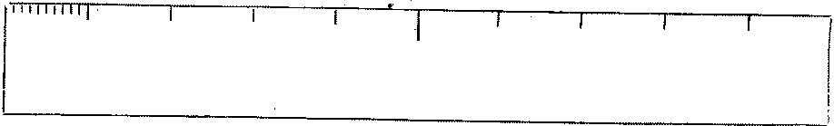
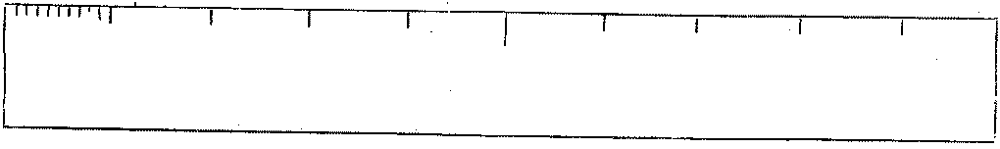
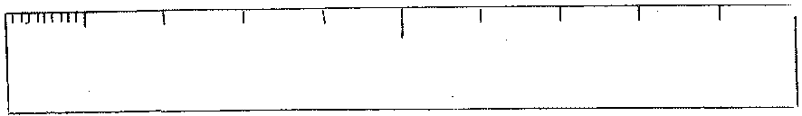
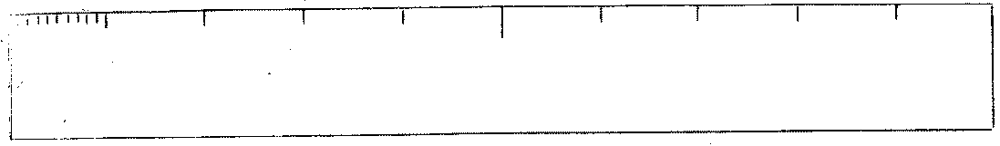
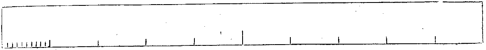
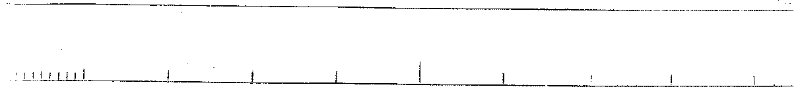
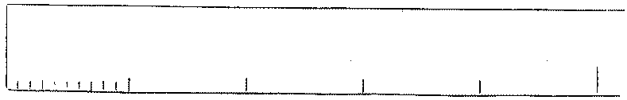
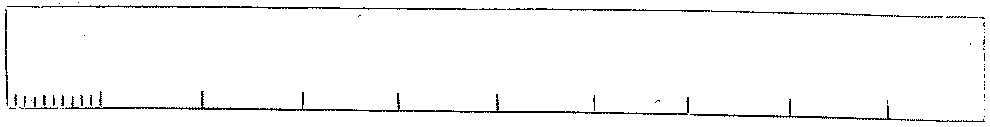

# 南山律在家备览略编



> **藏经**：佛教大藏经（佛教大藏经）　**册次** 第 104 册（G104）　**编号** G2250　**卷次** 4 卷　**篇幅** 165,856 字

> **卷／品**：4 卷 · 0 品



---



## 目录



- [重轻次列、比之自见。』(已上皆见事钞记卷二十六](#重轻次列比之自见已上皆见事钞记卷二十六)

- [事即制罪、理谓业道、方便究竟皆兼两业。境即四异、心谓想疑。』(见戒疏记卷四](#事即制罪理谓业道方便究竟皆兼两业境即四异心谓想疑见戒疏记卷四)

- [└为畜为杌、下罪』(见戒疏记卷七](#为畜为杌下罪见戒疏记卷七)

- [└─三无主物替───疑为有主物为无主物（同上）』(已上皆见戒疏记卷六](#三无主物替疑为有主物为无主物同上已上皆见戒疏记卷六)



---



南山律在家备览略编例言



数年已来、欲於南山律中摭挈其为在家居士所应学者、辑为一部、名曰南山律在家备览。老病因循、卒未成就。今先辑略编、别以流通。虽文不具足、义未详释。而大途略备、即此亦可闚见广本之概致焉。  

所云南山律者。唐道宣律师居终南山、后世因称其撰述曰南山律。南山以法华涅槃诸义、而释通四分律。贯摄两乘、囊包三藏、遗编杂集、攒聚成宗。其撰述最著者、为四分律删繁补阙行事钞(略云事钞)四分律含注戒本疏(释南山所集含注戒本　略云戒疏)四分律随机羯磨疏、(释南山所集随机羯磨　略云业疏)世称为南山三大部。虽正被僧众学习、而亦兼明三归五戒八戒等。又法体持犯等诸义章、亦多通於五八戒也。逮及北宋、元照律师居钱塘灵芝寺、中兴南山律宗。撰资持记以释事钞、撰行宗记以释戒疏、撰济缘记以释业疏。今辑南山律在家备览、即据已上诸书而为宗本。并采撷南山拾毗尼义钞释门归敬仪、灵芝芝苑遗编等、以为辅助。　是编兼收南山灵芝二家撰述、而唯标云南山律者。以灵芝撰述皆依南山遗笵、发扬光大、缵述相承、故唯标云南山律也。　若尔、何以榑桑学者谓南山宗唯识、灵芝宗法华耶。答。是盖唯闚一斑、未及全豹也。南山三观、虽与唯识近似。然如戒体显立正义中云是故行人常思此行即摄律仪等、又云今识前缘终归大乘等、如是诸文、实本法华开显之义、盖无可疑。惟冀学者虚怀澄心、於南山灵芝诸撰述等精密研寻、穷其幽奥。未可承袭榑桑旧说、轻致诽评。  

南山撰述中引文、多以略称。其仅标律云或四分者、即四分律。十诵者、即十诵律。僧祇者、即僧祇律。五分者、即五分律。善见者、即善见律毗婆娑。母论者、即毗尼母论。了论者、即二十二明了论、或此论疏。多论或婆论者、即萨婆多毗尼毗婆沙。伽论者、即萨婆多摩得勒伽。五百问者、即五百问论。以上皆为律部重要之典籍。此外如善生、即优婆塞戒经。智论、即大智度论。成论、即成实论等。其所引文、每与现今流传藏本稍有不同。或是古藏异本、或转录他师撰述中文。或为随宜删节、或以释义参入。恐后之学者於是致议、故预辨明以遮疑难。  

南山灵芝所释法相名义、颇有与常途异者。是或别有所据、或随宜会通。学者於此、未可胶执成见、应善分别观之。  

是编分为四篇、一宗体篇二持犯篇三忏悔篇四别行篇。於篇中复分为门、再分为章节项支类端目、以示次第。其标分之名目、或依钞疏原文、或随宜酌定。  

是编所录诸文、虽或加删节、而不失原文大意。　於诸文末、注明出处。所指卷数、三大部及记据津刊会本、其他亦据津刊者言。  

录写诸文、皆於上下用『』记号、以示起讫。记号之中、若有双行小注、皆是原文。或须别附以说明者、则於记号之外、以小字另行书写。  

诸文上端皆冠以▲△记号。冠以▲者、示此文别起。冠以△者、示与前义有所关系。其△记号下、有续云又云之别。续云者、示此文与前段相续。又云者、示此文与前不相续、而义有关系。  

凡记文释上钞疏文者、又戒疏释上含注戒本文业疏释上随机羯磨文者、皆与上文连写、不冠以记号。或有旁引他文以释者亦尔。  

诸文有稍难识别者、或数段文相续者、则於记中略录科文。於大科旁加＝＝记号、於小科旁加——记号。(大科者总括一段之文小科者於一段文中复加分析)　若有数段文相续、而科文繁杂未易分辨者。别录科表、以小字列於文后、俾备对阅。  

凡记中牒钞疏文者、用◇记号。但易见者不标。　又戒疏牒含注戒本文、或业疏牒随机羯磨文者、用○号记。  

凡别编录图表或附以说明等、皆低格小字而示区别。  

南山之文古拙、而义赜隐。后之学者、未可畏难、浅尝辄止。宜应习览、自易贯通。  

养疴山中、勉辑是篇。偶有疑义、无书可攷。益以朽疾相寻、昏忘非一。舛譌脱略、应所未免。率为录出、且存草稾重治校订、愿俟当来。



谨案例言之末、泉州所藏原稿附记云、「二十九年岁次寿星　月　日、辑录宗体篇竟、并识。沙门善梦、时年六十有一、居毗湖山中。」例言所谓养疴山中勉辑是篇者、即指宗体篇而言。其后续辑持犯忏悔别行三篇、一依宗体篇例。故大师写定原稿寄沪时、删此附记。兹仍依泉稿补识、俾可考见大师辑成是篇之时地。又原稿寄沪后未即印行、大师复就泉州藏稿、加以补正。故编校是书、参合沪泉两稿、互相补充。例如八一八二两页依事钞所列二表、即从泉稿增入者。餘详别行篇末附记。惟五页十六行无妨福善下、泉稿空一格、於例尤合。因已从沪稿制版、难以改正、并识於此。



大藏经会谨识



南山律在家备览略编目表



宗体篇(一)第一门戒法(二)第一章通叙戒法(二)第一节示相彰名(二)第一项正示(三)  

第二项杂简(三)第一支化制(三)  

第二支戒善(五)  

第三支遮性(五)



第二节略辨教体(六)  

第三节显知由径(八)第一项圣道本基(八)  

第二项戒有大用(九)  

第三项略解名义(九)  

第四项优劣有异(一一)  

第五项重受通塞(一二)



第二章归戒仪轨(一三)第一节翻邪三归(一三)第一项归意(一四)  

第二项显相(一四)  

第三项功益(一六)  

第四项忏悔(一七)  

第五项作法(一八)  

第六项料简(一九)



第二节五戒(二〇)第一项戒德高胜(一〇)  

第二项简人是非(二一)  

第三项豫习发戒(二一)第一支所受法体(二二)  

第二支发戒境量(二二)  

第三支依境发心(二四)  

第四支用心承仰(二七)



第四项叹功问相(二七)  

第五项忏悔清净(二八)  

第六项作法差别(二八)第一支临时开导(二九)  

第二支正纳戒体(三〇)  

第三支示相教诫(三〇)



第七项料简杂相(三一)



第三节八戒(三四)第一项释名(三四)  

第二项功益(三四)  

第三项简人(三五)  

第四项忏悔(三五)  

第五项作法(三六)第一支正纳戒体(三六)  

第二支说相发愿(三六)



第六项料简(三八)第一支对简多宗(三九)  

第二支迟受开成(四〇)  

第三支独受离过(四〇)  

第四支断恶摄净(四〇)



第二门戒体(四一)第一章戒体相状(四二)第一节能领心相(四二)  

第二节所发业体(四三)第一项辨体多少(四三)  

第二项立两解名(四三)第一支立两所以(四四)  

第二支并解名义(四四)



第三项依论出体(四六)第一支作戒体(四七)  

第二支无作戒体(四八)



第四项显立正义(五〇)第一支实法宗(五一)  

第二支假名宗(五二)  

第三支圆教宗(五三)



第五项先后相生(六三)  

第六项无作多少(六五)



第二章受随同异(六八)第一节释两名(六八)  

第二节辨同异(六九)第一项解二作(六九)第一支先释二名(七〇)  

第二支正辨同异(七〇)



第二项解二无作(七一)第一支先释二名(七二)  

第二支正辨同异(七二)



第三章缘境宽狭(七四)第一节列释(七四)  

第二节别简(七五)



第四章发戒数量(七六)第一节明境徧一切(七六)  

第二节明发戒多少(七九)



第三门戒行(八二)第一章正明随行(八三)  

第二章因示舍戒(八五)



第四门戒相(八七)



持犯篇(八八)第一门持犯总义(八九)第一章持犯名字(九〇)  

第二章持犯体状(九二)  

第三章成就处所(九三)第一节约三心明止持(九三)  

第二节约行心明四行(九四)  

第三节约三业明四行(九四)



第四章辨犯优劣(九六)第一节约三性辨犯(九七)第一项明起业之源(九七)  

第二项约三性示相(九九)第一支善心(九九)  

第二支不善心(九九)  

第三支无记心(一〇〇)



第三项结示伤叹(一〇一)



第二节将心望境辨犯(一〇二)  

第三节单心辨犯(一〇六)  

第四节有心无心辨犯(一〇八)



第五章方便趣果(一一〇)第一节前方便(一一一)  

第二节中根本(一一一)  

第三节后方便(一一二)



第六章阙缘不成(一一二)第一节显相(一一二)第一项阙缘(一一二)  

第二项境强(一一三)  

第三项缘差(一一三)  

第四项境差(一一四)第一支明人异境(一一四)第一类正明(一一四)  

第二类问答(一一四)第一端问异境无心(一一五)  

第二端问因果差别(一一五)



第三类指广(一一六)



第二支明餘异境(一一七)第一类通示(一一七)  

第二类释疑(一一七)第一端释人异境难(一一八)  

第二端释律境想难(一一八)



第五项想差(一二一)  

第六项疑心(一二一)  

第七项善心息(一二二)



第二节校量(一二二)



第七章境想分别(一二三)第一节明制意(一二四)  

第二节明有无(一二四)  

第三节定四五句(一二五)  

第四节互四五句(一二六)  

第五节轻重(一二六)



第八章别简性重(一二七)第一节剋漫(一二七)第一项婬(一二八)  

第二项盗杀(一二八)  

第三项妄(一二八)



第二节错误(一三〇)第一项婬(一三〇)  

第二项盗(一三〇)  

第三项杀(一三一)  

第四项妄(一三一)



第三节身口互造(一三四)第一项婬(一三五)  

第二项杀盗(一三五)  

第三项妄(一三六)



第四节教遣(一三六)第一项教人(一三六)  

第二项遣人(一三七)



第五节重犯戒(一三七)



第九章广斥愚教(一三九)



第二门持犯别相(一四一)第一章性罪(一四一)第一节杀(一四二)第一项犯境(一四二)  

第二项犯相(一四三)第一支列缘(一四三)第一类正明犯缘(一四三)  

第二类别示阙缘(一四三)第一端阙初缘(一四四)  

第二端阙第二缘(一四五)  

第三端阙第三缘(一四九)  

第四端阙第四缘(一四九)  

第五端阙第五缘(一四九)



第二支随释(一五〇)第一类广辨杀相(一五〇)第一端自作教人(一五〇)  

第二端用语破国(一五一)  

第三端赞死(一五一)  

第四端自杀(一五一)



第二类别明非畜(一五二)



第三项不犯(一五二)



第二节盗(一五三)第一项犯境(一五三)  

第二项犯相(一五四)第一支列缘(一五四)第一类正明犯缘(一五四)  

第二类别示阙缘(一五四)第一端引疏犯缘(一五五)  

第二端依示阙缘(一五六)第一目阙初缘(一五六)  

第二目阙第二缘(一五七)  

第三目阙第三缘(一五九)  

第四目阙第四缘(一五九)  

第五目阙第五缘(一五九)



第二支随释(一五九)第一类有主物(一六〇)第一端三宝物(一六〇)第一目佛物(一六一)  

第二目法物(一六二)  

第三目僧物(一六二)



第二端别人物(一六四)第一目掌主损失(一六四)  

第二目明被贼(一六五)  

第三目明盗相(一六五)



第三端非畜物(一六六)



第二类有主想(一六六)  

第三类有盗心(一六七)  

第四类是重物(一六八)第一端明物体(一六八)  

第二端列义门(一七〇)



第五类离本处(一七一)



第三支结示(一七四)



第三项不犯(一七四)



第三节婬(一七五)第一项犯境(一七五)  

第二项犯相(一七七)第一支列示犯缘(一七七)第一类正明犯缘(一七七)  

第二类别示阙缘(一七八)



第二支料简杂相(一七九)第一类通简犯相(一七九)  

第二类别示邪婬(一八〇)



第三项不犯(一八〇)



第四节妄(一八〇)第一项明大妄(一八〇)第一支犯相(一八一)第一类列缘(一八一)第一端正明犯缘(一八一)  

第二端别示阙缘(一八一)



第二类随释(一八三)



第二支不犯(一八四)



第二项示四过(一八四)第一支小妄语(一八五)  

第二支恶口(一八五)  

第三支两舌(一八六)  

第四支绮语(一八七)



第二章遮罪(一八七)第一节饮酒(一八七)第一项制意(一八八)  

第二项犯相(一八八)第一支列缘(一八八)  

第二支随释(一八八)



第三项不犯(一八九)



第二节过中食(一八九)第一项制意(一九〇)  

第二项犯相(一九一)第一支列缘(一九一)  

第二支随释(一九一)



第三项不犯(一九一)



第三节高大床(一九二)  

第四节严身(一九三)  

第五节歌舞(一九三)



忏悔篇(一九四)第一门略分化制通局(一九五)第一章明化教(一九五)  

第二章明制教(一九五)



第二门别明化教二忏(一九六)第一章对显二忏(一九七)  

第二章重广理忏(一九九)第一节标示用心(一九九)  

第二节别列三观(二〇〇)  

第三节结示(二〇一)



别行篇(二〇二)第一门敬佛仪相(二〇二)第一章先示敬仪(二〇二)  

第二章正明敬和(二〇五)第一节总斥非法(二〇五)  

第二节坐立差异(二〇六)  

第三节修供时节(二〇七)



第二门入寺法式(二〇八)第一章中国旧法(二〇八)第一节入寺法(二〇九)第一项清净士法(二〇九)第一支示正法(二〇九)  

第二支斥非法(二一〇)



第二项清净女法(二一一)



第二节出寺法(二一二)



第二章今师要术(二一二)



第三门造像塔寺(二一四)第一章造像塔法(二一四)第一节造像(二一四)第一项通叙经像意(二一四)  

第二项正明造像(二一四)第一支中国造立元缘(二一五)  

第二支此方制度渐失(二一五)



第二节造塔(二一六)第一项示名(二一七)  

第二项显报(二一七)  

第三项敬护(二一七)  

第四项造处(二一八)  

第五项供养修治(二一八)  

第六项造毁二报(二二〇)



第二章造寺法(二二〇)第一节应法生善(二二一)  

第二节无法致损(二二一)



第四门瞻视病人(二二三)第一章制意(二二三)  

第二章简人(二二四)  

第三章安置处所(二二四)  

第四章说法敛念(二二五)第一节餘人劝导(二二六)  

第二节瞻病劝导(二二六)



第五门离诸非法(二二七)第一章别请僧众(二二七)  

第二章受僧食物(二二九)第一节明用与(二二九)  

第二节约缘开(二三〇)  

第三节示污家(二三一)



第三章谪罚可否(二三一)第一节别列(二三二)第一项劝俗敬护(二三二)  

第二项劝俗治恶(二三二)



第二节会通(二三三)



第四章食肉(二三四)第一节引大废小(二三四)  

第二节引小急制(二三五)  

第三节通禁诸物(二三六)



第五章畜养猫狗(二三七)



第六门出家宗致(二三七)第一章出俗本意(二三八)第一节出家元缘(二三九)第一项出家文证(二三九)  

第二项引诫劝修(二四〇)



第二节劝出有益(二四二)  

第三节障出有损(二四二)  

第四节明出家已行凡罪行(二四二)  

第五节明出家已行凡福行(二四四)  

第六节明出家已行圣道行(二四五)  

第七节大小乘相决同异(二四七)第一项小乘三学(二四七)  

第二项大乘三学(二四八)



第二章先说苦事(二五〇)  

第三章应知五德(二五一)



> 南山律在家备览略编(学者宜先详览卷首之例言及目表然后再阅正文)



宗体篇



　　宗体中分为四门─┬─一戒法  

　　　　　　　　　　├─二戒体  

　　　　　　　　　　├─三戒行  

　　　　　　　　　　└─四戒相



▲事钞云『今略指宗体行相、令后进者兴建有托。』



资持释云『兴谓发心。建即立行。识体进行、成因感果、故云有托。』



△事钞又云『但戒相多途、非唯一轶。心有分限、取之不同。若任境彰名、乃有无量。　且据枢要、略标四种。一者戒法、二者戒体、三者戒行、四者戒相。』



资持释云『初叙广。上二句据法明广、五八十具四位不同。次二句约心明广、即上四位各有三品。若下二句就境明广、情及非情不可数故。　且下示要。枢即门枢、亦取要义。』



(三品者、见后归戒仪轨五戒中依境发心文。)



▲资持云『欲达四科、先须略示。圣人制教名法、纳法成业名体、依体起护名行、为行有仪名相。　有云、未受名法、受已名体。今谓不然。法之为义贯彻始终、安有受已不得名法。须知下三从初得号、是故一一皆得称戒、或可并以法字贯之、方显体及行相非餘泛善。』



(为行有仪名相者。戒相有二义。一约行为相、如今所云。二以法为相、如后持犯篇所示。)



▲资持云『问、所以唯四、不多少者。答。摄修始终、无阙賸故。随成一行、四义整足。言有次第、行不前后。』



▲资持云『问、法之与体、同异云何。答。业疏云、体者戒法所依之本。是则法为能依、体是所依、不可云同。又云、戒体者、所谓纳圣法於心胸、即法是所纳之戒体。据此不可云异。应知言法未必是体、言体其必是法。不即不离、非同非异。』



济缘云『问、即法是体、法体何分。答。若望未受、但名为法、体是无情。若加期誓、要缘领纳、依心成业、此法有功乃名为体。如药丸喻。药味各别如戒法也、和合成丸如戒体也。丸非他物、即药成丸。虽异而同、虽同而别。如是知之。』(见业疏记卷十六)



▲资持云『问、行相何异。答、三业分之。』(已上皆见事钞记卷三)



(三业分之者、戒行属意、戒相属身口。行属意者、约能察言、见后戒体门圆教宗能忆能持能防等疏记之文、及戒行门首段钞记之文。相属身口者、见后持犯篇持犯总义门成就章就业明四行文。　若尔、何故资持又云三业造修名行耶。答、彼兼所察言也。)



第一门　戒法



　　戒法中分为二章─┬─一通叙戒法  

　　　　　　　　　　└─二归戒仪轨



第一章　通叙戒法



　　通叙戒法中分为三节─┬─一示相彰名  

　　　　　　　　　　　　├─二略辨教体  

　　　　　　　　　　　　└─三显知由径



第一节　示相彰名



　　示相彰名中分为二项─┬─一正示  

　　　　　　　　　　　　└─二杂简



第一项　正示



▲事钞云『言戒法者。语法而谈、不局凡圣。直明此法必能轨成出离之道。要令受者信知有此。』



资持释云『示相中、初标示。直下正明。法虽两通、不能委辩、但从圣论、故云直也。轨成者示法义也。出离道者圣所证也。要下出从圣所以。然此但示法之功力、文不明指何者是法、意令学者思而得之。』



△事钞续云『虽复凡圣通有此法。今所受者、就已成而言、名为圣法。』



资持释云『彰名中、初二句蹑前。今下正示。已成者初果已上所修三学名圣道故。今虽在凡亦名圣法、因中果号也。』(已上皆见事钞记卷三)



▲业疏云『问、人皆知受、所受是何。　答。相传解云、受名圣法。由此法故、奉敬守护、净如明珠、能为圣道作基址故。』



济缘释云『受者虽多、而不自知所受之体。欲警学者、故发是问。　答中。云相传者承古所解。举果目因、以其能通圣道故、复令受者不自轻故。』(见业疏记卷十五)



第二项　杂简



　　杂简中分为三支─┬─一化制  

　　　　　　　　　　├─二戒善  

　　　　　　　　　　└─三遮性



第一支　化制



(化制者、化教制教。制教亦云行教。戒疏摄教分齐中虽以行教与制教别列、但此外钞疏及记中皆行制二名互用、义盖可通。　又戒疏虽局取三轮、但此外钞疏及记中皆以化行或化制而分二教。资持云、如戒疏中或约三轮或约化行或约化制或约制听彼取三轮今用化行、随时用与、未须和会。)



▲业疏云『自古详教、咸分两途。化教则通被道俗、专开信解之门。行教则局据出家、唯明修奉之务。』



济缘释云『就文二教对明两别。道俗出家被机异也。信解修奉立法异也。戒疏云。何名化教、开演化导、令识邪正、教本化人令开慧解、本非对过而立斯教。言行教者、起必因过、随过制约、言唯持犯、事通止作、戒律一宗局斯教矣。』



▲济缘云『十善五停四弘六度一切观行、并化教业。毗尼所诠开遮轻重一切律藏、并制教业。化据理性、理有顺违。制就教法、教有持犯。』(已上皆见业疏记卷一)



▲资持云『一代时教、总归化行。开其信解、用舍任缘、故名化教。制其修奉、违反有过、名为行教。』



(钞疏及记、简别化制二教之文屡见、其义大同、未能具录。今就上文、列表於后、以示两别。)



　　┌─化教────通道俗──开其信解──(令开慧解非对过立)──十善五停等──用舍任缘  

　　└─制教〔行教〕─局道──制其修奉──(持犯楷定随过制约)──开遮轻重等──违反有过



▲资持云『问、五八二戒既是戒制、应是行摄。答、化教所摄。』(已上皆见事钞记卷二)



> (南山律中、以十戒具戒属制教、五戒八戒属化教。今案、五戒八戒与常途之化教异。正属化教、义当制教。义虽通制、而教终局化。犹如四分律宗、正属小乘、义当大乘。义虽通大、而教终局小也。〔此意於宗体篇中屡明〕所以谓五戒等义当制教者。如业疏云、如来设教类同空界、随立一相摄修皆尽、五戒被俗之法、五体通道之规持犯相扶、难遮齐则。〔於后归戒仪轨章首具录此疏文及济缘释义、宜检寻之。〕文据甚明、盖无可疑。)



第二支　戒善



▲业疏云『问、一切善作尽是戒否。答。律仪所摄善作名戒。自餘十业、但单称善、不名为戒。』



济缘释云『戒有二义、一有本期誓、二徧该生境。餘善反之、故不名戒。』(见业疏记卷十五)



▲事钞云『宜作四句。一者善而非戒、谓十中后三是也。律不制单心犯也。　二戒而不善、即恶律仪。　三亦善亦戒、十善之中前七支也。以不要期直尔修行故名善也、反此策励故名戒也。　四俱非者、身口无记。』



资持释云『初句后三者即贪瞋邪见。化教所禁故名善、律所不制故非戒。四分重缘相同十业可入戒收、若约菩萨十善俱戒、如是知之。　第三句中、初示相。以下双释。不要期者显示世善无愿体也。反此者谓有要期受体、然后如体而修。』(见事钞记卷十六)



第三支　遮性



▲戒疏云『明遮性者。由恶缘境、不可随说。以义收之、大分为二。』



△戒疏续云『言性恶者。如十不善、体是违理、无论大圣制与不制、若作违行感得苦果、故言性恶。　是故如来制戒防约。若不制者、业结三涂、不在人道、何能修善。　故因过制、从本恶以标名、禁性恶故名为性戒。』



行宗释云『初释性义。性即是体。违理之恶从心而起、不由制有、故云无论等。　是下合戒义、初叙须制。　故下明立制。於本业上复增制罪、故云因制。应知性戒之言即业制双举也。』



△戒疏续云『言遮恶者。圣未制前、造作无罪。由非正业、无妨福善。自制已后、尘染更深、妨乱修道招世讥谤、故名遮也。』



行宗释云『初示反前性恶。　自下明因制成犯。尘染更深者多违犯故。妨道招讥亦即自他两失。』



△戒疏又云『性罪三过、一违理恶行二违佛广制三能妨道业。遮罪具二体非违理、故名为遮。』(已上皆见戒疏记卷五)



(上明遮性二意、若约五八戒言、前四属性、酒等为遮。性恶可知。遮恶如业疏引俱舍文略明、今录於下。)



▲业疏云『俱舍论云。由饮酒故、即便忘失是事非事念也。离庄严者、谓非旧庄严也。若常所用庄严、不生极醉乱心也。若用高胜卧处及歌舞音乐、随行一事、破戒不远也。若依时食、离先所习非时食也。忆持八戒、即起厌离随助之心。若无第八、此二不生也。』



济缘释云『酒能乱性、不辨是非、容犯诸戒故。非旧庄严、谓华璎等俗中常习是旧庄严、今并离之但存常所服用故云非也。高床长慢、乐音动情、皆近破戒。依时食者即不过中。忆八戒者无他念故即灭恶也、起厌离者不乐世缘即生善也。若不节食饱腹嗜味故二心不生也。』(见业疏记卷十)



第二节　略辨教体



▲资持云『夫教者以诠表为功、随机为用。虽广开户牖而轨度无差、虽剋定楷模而摄生斯尽。圆音随应、情虑难求。且依业疏三宗、以示一家处判。然教由体立、体即教源。故须约体用分教相。　一者实法宗、即萨婆多部、彼宗明体则同归色聚、随行则但防七支、形身口色成远方便、此即当分小乘教也。二者假名宗、即今所承昙无德部、此宗论体则强号二非、随戒则相同十业、重缘思觉即入犯科、此名过分小乘教也。三者圆教宗、即用涅槃开会之意决了权乘同归实道、故考受体乃是识藏熏种、随行即同三聚圆修、微纵妄心即成业行、此名终穷大乘教也。　然今四分正当假宗。深有兼浅之能故旁收有部、教蕴分通之义故终会圆乘。是则大小通塞假实浅深、一代雄诠历然可见。』(见事钞记卷一)



　　假实两宗─┬─实法宗─萨婆多部─十诵律─俱舍杂心多论等─多宗  

　　　　　　　└─假名宗─昙无德部─四分律─成实论等────成宗  

　　业疏三宗─┬─实法宗─受体同归色聚──随行但防七支形身口色成远方便  

　　　　　　　├─假名宗─受体强号二非──随行相同十业重缘思觉即入犯科  

　　　　　　　└─圆教宗─受体识藏熏种──随行三聚圆修微纵妄心即成业行



(业疏三宗、为南山律中之枢要。资持所举三宗之受体与随行、文简义广、初学难解。今撮录诸文、略释如下。受体者、受戒时所发之业体。　同归色聚者、通指实法宗之作戒及无作戒二体俱色。　强号二非者、别指假名宗之无作戒以非色非心为体。　识藏熏种者、别指圆教宗之无作戒以善种子为体。　已上三宗受体之义、於后戒体门广明。随行者、既受戒已、忆持防护。　但防七支者、即十业中之前七、杀盗婬妄言两舌恶口绮语也。多宗、唯具戒防七支、五戒八戒等但防前四支。若成宗、五戒八戒等亦防七支。　形身口色成远方便者、多宗结犯不约心论、远方便罪亦须动色成犯。　相同十业、重缘思觉即入犯科者。成宗虽同大乘通於十业、但大乘约瞥尔、此约重缘、故有深浅不同。瞥尔者、即独头心念下云微纵妄心即成业行是也。重缘者、谓后念还追前事。故大乘初念即犯、成宗次念乃犯。　已上多宗成宗随行之义、於后持犯篇持犯总义门成就章广明。三聚之义、於后五戒依境发心支释。　圆修之义、於后戒体门圆教宗中委明。)



▲芝苑云『一代圣教不过大小、人理教行一一不同。然须略识浅深之相。且就一家、约本受体则分三位。一者十诵多宗、名当分小乘教也。二者四分成实、正小兼大、名过分小乘教。三者圆教、全是大乘。今正依成实、旁用多宗、终归圆教。盖取涅槃显性谈常重扶之意。　学者临文、无宜混滥。良由以小望大则大小悬殊、以大摄小则小无不大。故事钞引胜鬘经智度论并以声闻毗尼即大乘学、又戒疏所引大集经中五部虽异不妨诸佛法界涅槃、又引无量义经云法水一也江河井池分其异耳。今宗准此诸意、并以圆意用通律乘。　如昔光师直以四分判属大乘、太为浮漫。近世相承以为至说、此全不晓大小分齐。或有不许分通、专判为小、此又不了假实两宗教之优劣。过犹不及、此之谓也。』(见芝苑遗编卷一)



(如昔光师者、即北齐慧光律师)



第三节　显知由径



　　显知由径中分为五项─┬─一圣道本基  

　　　　　　　　　　　　├─二戒有大用  

　　　　　　　　　　　　├─三略解名义  

　　　　　　　　　　　　├─四优劣有异  

　　　　　　　　　　　　└─五重受通塞



第一项　圣道本基



▲戒疏云『斯乃大圣降临、创开化本。将欲拯拔诸有、同登彼岸。为道制戒、本非世福。』



行宗释云『为道者通而为语即指三乘。推佛本意、下至翻邪、终为一实而作前引。况经开会、殊途同归。涅槃重扶、无非显性。今明为道、专指佛乘、止息化城终非本意。故知化本尚非二乘、岂为世福而立斯戒。』



△戒疏续云『然烦惑难清、要由方便、致设三学用为治元。故成论云、戒如捉贼、定缚慧杀。三行相因、斯须摄济。　故初行者务先学戒、检策非违。三业清净、正定正慧自然而立。』



行宗释云『欲明三学开设之致、此略叙之、则文无所壅。夫一切众生、本来皆具真精妙性。性之为体、唯寂唯照。一迷此性、乃昏乃散。翻号无明、积成烦惑、计有人我、随境发毒。鼓身口意、造生死业。流转诸趣、亿劫无穷。大觉慈哀、将令离苦、察病设药、对分三种。内心昏动对立定慧、身口非违对立净戒。圣教虽多不越三学、三学所立唯依色心。论其起也则从本以发枝、用其治也则先粗而后细。首先制戒、意在於斯。譬夫浊水、风激波腾。风波未息、欲得清澄无有是处。三学次第、理数必然。乖越常模、去道全远。　烦即昏浊、惑谓乱动。三毒结使劫掠善财、喻之如贼。三行相因谓次第而生。斯须摄济谓不可相离。』(已上皆见戒疏记卷一)



▲资持云『五分功德以戒为初、无上菩提以戒为本。安有弃戒别求圣道。智论所谓无翅欲飞、无船欲渡。圣言深勉、可不信乎。』(见事钞记卷十五)



第二项　戒有大用



▲事钞云『夫三宝所以隆安、九道所以师训、诸行之归凭、贤圣之依止者。必宗於戒。』



资持释云『初句住持义、次句轨物义、三发趣义、四本基义。此之四句摄尽戒功。　文叙功能而首标大用者。良由有用方见功能、功由用彰所以先举。』(见事钞记卷十五)



第三项　略解名义



▲事钞云『依彼梵本具立三名。初言毗尼、此翻为律。二言尸罗、此翻为戒。三言波罗提木叉、此云处处解脱。　显三次第、即是一化始终。律则据教。教不孤起、必诠行相、戒则因之而立。戒不虚因、必有果克、故解脱绝缚最在其终。』



资持释云『一化始终者教行果三不唯戒律、一切教门次第皆尔。』



△事钞续云『次明其义。初云律者法也。谓犯不犯轻重等法、并律所明、即教诠也。　二者戒义。戒者性也、性通善恶、故恶律仪类亦通周。若此立名、戒当禁也。　三解脱义者。近而彰名随分果也、谓身口七非犯缘非一、各各防护、随相解脱。远取戒德因戒克圣、望彼绝累由遵戒本。』



资持释云『初释律义中二、上句训字。法以楷定为义。谓下释义。一切戒本大分为二前明犯。相后明不犯、犯中复二即轻与重、四义摄尽毗尼大藏。就轻重中复有因果阙缘开制之异故云等也。显示律名从教而立故云并律等。　次释戒义中。戒以性名、性通三性、且论善恶互不相容各得禁义。恶律仪亦名恶戒、屠儿猎师旃陀罗辈常行杀害、名受恶戒持恶律仪。　三释解脱中、约近远两义释之。近中、言随分者显非顿脱、即处处义也。次远义者、此以凡地所受望后圣果故云远取、即前圣道本基义故云因戒等。圣总三乘。累该五住。　问、近远两释何以分之。答。此有多异。一近约止业、远望除惑。二近是凡地、远即圣道。三近是就因、远即从果。四近是渐防、远即顿破。』(已上皆见事钞记卷十五)



　　翻名─┬─毗尼────翻为律  

　　　　　├─尸罗────翻为戒  

　　　　　└─波罗提木叉─翻为处处解脱（戒疏翻为别解脱）  

　　释义─┬─律────────法  

　　　　　├─戒────────禁  

　　　　　└─处处解脱─┬近──随分果──处处解脱  

　　　　　　　　　　　　└远──圣果───解脱



第四项　优劣有异



▲资持云『优劣中。优即胜也。前后并单论别脱、此兼道定、还欲对显别脱功胜。』



　　┌─别脱─别解脱戒〔处处解脱〕─木叉戒─依受戒之作法而受得  

　　│  

　　├─定──定共戒────────禅　戒─与禅定共生─┐  

　　│　　　　　　　　　　　　　　　　　　　　　　　　　├皆随心而发  

　　└─道──道共戒────────无漏戒─与无漏智共生┘



▲事钞云『婆论云。木叉戒佛在世有、希现故胜。禅无漏戒一切时有。　二木叉通情非情、宽故言胜。餘二局情、狭故不如。　三木叉从慈心发故胜、能为佛道作因。　四木叉戒者被及七众。绍续三乘三宝三道、住持功强。餘二无能故劣。　五木叉戒者唯佛弟子有。餘禅戒者外道亦有。』



资持释云『多论五种、初时二境三心四功五人。　初时希常者。以木叉须佛出世、制方有故。餘二纵非佛出、亦有得定证道之者、故常有也。　二境中。木叉遮性通禁。餘二但止性恶。　三约心者。慈即大心、故是佛因。论云、禅无漏戒不以慈心得、谓从智得。此专自利、即二乘心、劣可知也。　四明功有二。一摄生广、被七众故。二住持胜、绍续等故住持中三种并以绍续字贯之、初所乘法、二即所住境、三谓所成果。　五约人中。外道无无漏戒、故但举禅戒耳、以彼亦得无色定故。』(已上皆见事钞记卷十五)



第五项　重受通塞



▲资持云『重受中。意令行者审己所受、更求增胜故也。』



▲事钞云『依萨婆多宗、戒不重发、亦不重受。依本常定。』



资持释云『言不重发者。彼云、木叉戒者无有重得、若微品心受得五戒、后以中上品心受十戒、先得五戒更无增胜、於后五戒乃得增耳。　不重受者。彼计一受即定。既不重发、更受不增、故不立也。』



△事钞又云『成论云。有人言、波罗提木叉有重发否。答云。一日之中受七善律仪、随得道处更得律仪。而本得不失、胜者受名。其七善者谓五戒八戒十戒具戒禅戒定戒道共戒也。』



资持释云『成宗开重受本得不失者从前体增为后体故。胜者受名从后彰名、前名没故。　成论离禅定为二戒、色无色别故。多宗合为一、俱不动业故。　问、重发重受如何分别。答、重发据多戒、重受约一戒。　若尔、论明重发、那见重受。答、由体重发、即得重受、以彼重受一体发故。』(已上皆见事钞记卷十五)



▲芝苑云『夫戒者、截苦海之舟航、发万善之端绪、三乘圣贤之所尊敬、历代祖师之所传通。但受之者心有明昧、学有精粗、而不能一揆。故有初受者焉、重增者焉。律明发心则有三品。一者唯期脱苦、专求自利、名为下品、此二乘心也。二者为物解疑、自他兼济、名为中品、此小菩萨心也。三者忘己利生、福智双运、了达本性、求佛菩提、名为上品、此大菩萨心也。审知初受但发中下、佛开重增、转为上品。此所谓增戒也。』(见芝苑遗编补遗)



(上来戒法中第一章通叙戒法竟)



第二章　归戒仪轨



▲业疏云『古来集法、多削在家。便制疏云、律制内众、不被外部。　今据律文、通收清信。禁束三业、为道阶梯。理须明练是非通塞成败。　何以知耶。如来设教、类同空界。随立一相、摄修皆尽。五戒被俗之法、五体通道之规。持犯相扶、难遮齐则。』



济缘释云『同空界者虚空有二义、一无边义喻周徧也、二包含义喻摄机也。　且举五戒、显上一相广摄之义。被俗法者约相局也。通道规者据体通也。但婬分邪正、罪无篇聚、至於大重小轻方便趣果义则不别、故云持犯相扶。扶字或作符。羯磨注引善生经具问遮难与道不异、故云齐则。』



▲业疏云『萨婆多云。三归五戒乃至别脱、由佛出故开立此法。　但轮王梵王说世间法、惠利众生、故十善四弘劫初便有。未能清升、超越世境。　法王出世、不为世善。要断烦恼、远出界系。故明戒善、令依具修定慧等行、集生有本、此其意也。』



济缘释云『初举归戒所出。别脱即具戒也。　但下比校优劣、初明世教之劣。轮王是人主、十善化人。梵王是天主、以四弘化人、即慈悲喜舍四无量心。不待佛出故劫初即有。报在人天故未超世教。　法王下次明归戒之胜。莫非断集脱苦修道证灭也。』(已上皆见业疏记卷十)



　　归戒仪轨中分为三节─┬─一翻邪三归  

　　　　　　　　　　　　├─二五戒  

　　　　　　　　　　　　└─三八戒



第一节　翻邪三归



▲业疏云『母论云。有五种三归、一翻邪二五戒三八戒四十戒五具戒。唯具戒者不行於今、餘四通有。』



济缘释云『母论三归该通五法、足彰功胜。』(见业疏记卷十)



　　翻邪三归中分为六项─┬─一归意  

　　　　　　　　　　　　├─二显相  

　　　　　　　　　　　　├─三功益  

　　　　　　　　　　　　├─四忏悔  

　　　　　　　　　　　　├─五作法  

　　　　　　　　　　　　└─六料简



第一项　归意



▲业疏云『多论云。以三宝为所归。　所归以救护为义。　如人获罪於王。投向他国、以求救护。彼王𠡠言、汝求无畏以投我者、莫出我境、莫违我教、必当救护。　众生亦尔。系属於魔、有生死过。归向三宝、魔无如之何。』



济缘释云『初句示境。　所归下显义。　如人下举喻。　众生下合法。上三句合上获罪於王、下二句合上投向他国。魔有四种、天魔五阴魔烦恼魔死魔。未归三宝、皆系属焉。』(见业疏记卷十)



第二项　显相



▲戒疏云『有四种三宝。　一理体者。如五分法身为佛宝、灭理无为是法宝、声闻学无学功德是僧宝。二化相者。如释迦道王三千为佛宝、演布谛教为法宝、拘邻等五为僧宝。　三住持者。形像塔庙为佛宝、纸素所传为法宝、戒法仪相为僧宝。　四一体者。如常所论。唯约心体义分三相、如涅槃说三宝同性等。』



行宗释云『他宗皆阙理宝、四位分别独出今疏。　初明理宝。五分者戒定慧从因受名、解脱解脱知见从果彰号。灭理四谛灭谛涅槃。学无学者初果已去同见真谛名理和僧。然此理宝亦即同体、但望佛僧证理边为别。　化相中。三千者所化之境。谛教即四谛、法门虽多而以首者言之。又四谛统摄凡圣因果、大小教门广略异宜无出此四。　住持中。戒法是僧体、仪相即削染也。　一体中。如常论者即指经论之宗。』



芝苑云『众生妄念、天真本具、一体三宝也。诸佛果德、清净无染、理体三宝也。乘时利见、启迪群庶、化相三宝也。垂裕后世、流及无穷、住持三宝也。』(见芝苑遗编补遗)



△戒疏又云『此三益世、近拔三有、远清二死。希世独达可重名宝。　故宝性论喻分六义。一希有义。世宝贫穷所无、三宝薄福不遇。二离垢义。世宝体无瑕秽、三宝绝离诸漏三势力义。世宝除贫去毒、三宝六通难思。四庄严义。世宝严身令好、三宝能严法身。五最胜义。世宝诸物中胜、三宝诸有无上。六不改义。世宝鍊磨不变、三宝八法不动。』



行宗释云『初约义略释、上三句显益。近远二字必对因果。二死者一曰分段三乘共亡、二曰变易唯佛永尽。希下一句结名。希世者世间无故。独达者超诸有故。　故下次引文广释。今用四种三宝对此六义。初义通四。住持无信不遇。化相无缘不遇、舍卫三亿可以明之。理体局圣、凡愚不遇。一体二乘不遇。　第二义中、唯约理宝。归敬仪云、住持三宝体是有为、具足漏染。又云、化相体是无常、四相所迁、灭过千载、但可追远用增翘敬。据后一体在迷随染。故此三种皆无此义。　第三喻中、六通在人、唯对化相。毒谓苦恼。　第四通四。住持化相能发信仰、理体一体可以修证、皆是严身。　第五亦通四。餘三易解。住持佛法虽是世物、莫不表示法身、功用无极。归敬仪云、金木石土体是非情、以造像故、敬毁之人自获罪福。故知此宝得名无上。法亦准同。剃染之僧为世福田、人天中胜、破戒恶行犹过外俗、况餘持奉其胜可知。　第六唯局理宝。归敬仪云、此之三宝常住於世、不为世法之所陵慢。一体虽常、然就迷边随缘流变。餘二无常、非所论矣。八法者、智论云、衰利毁誉称讥苦乐四违四顺能动物情名为八风。理宝人法皆是出世无漏圣道、不为八法之所动故。』



△戒疏又云『四宝为言、理宝为胜。由常住故、为世所归餘三随设、体是有法。』



行宗释云『理宝胜者理通大小、生空真如是小乘理、清净心本即大乘理。今须约大以论胜劣。　若尔、与一体何异。答。一体在迷、专据凡说。理宝约证、唯从圣论。故分二矣。是故理宝独胜餘三。』(已上皆见戒疏记卷二)



▲归敬仪云『缘理三宝者。理谓至理。天真常住、还是心体。且从染说、无始有终。但为惑网、不能出障。今以三学剋翦缠结。惑业既倾、心性光显、始终性净、无始无终。　由法成立、随境分相、即号此相为五分法身。谓戒定慧解脱解脱知见也。前之三学从因受名。由戒护助、果成法身、故云戒身。定慧准此可以类知。后二从果次第受名。解脱身者、由慧剋惑、惑无之处名解脱身。解脱知见、乃以出缠破障反照观心、故云知见身也。　唯佛法中三乘圣者具此五分、能为六道作大归依。　故论云。归依於佛者、谓一切智五分法身也。归依於法者、谓灭谛涅槃也。归依於僧者、谓诸贤圣学无学功德、自身他身尽处也、即自他惑灭所无之处故云尽处也。　如世珍宝、为生所重。今此三宝、为诸群生三乘七众之所归仰、故名正归。』



△归敬仪又云『此明理宝是归依所宗。故覆详之、令心有寄。』(已上皆见释门归敬仪第二)



第三项　功益



▲归敬仪云『经云、若人得闻常住二字、是人生生不堕恶趣。斯何故耶。以知法佛本性常故。一时闻解、熏本识心、业种既成、净信无失。况能立愿归依、奉为师范。固当累劫清胜、义无陷没。如经、有人受三归依、弥勒初会解脱生死。此乃出苦海之良津、入佛法之阶位。　但以罪多恶重、轻而慢者、虽曾受归、随缘还失。是故。智人初受归时、专心缘此、得名归依。故感善神随逐护助。』(见释门归敬仪第二)



△归敬仪又云『以诸道俗有识之徒、皆须归依三宝、请求加护。所得功德无有限量。　七众约戒、前已受归。不妨重受、重感无作。善恶既尔、戒亦通之。　若未受戒、止得但受翻邪三归。日别六时、随时便受。显归三宝、自誓不回。』



△归敬仪又云『如善生经云。若人受三自归、所得果报不可穷尽。如四大宝藏、举国人民七年之中运出不尽。受三归者、其福过彼不可称计。　又校量功德经云。四大洲中满二乘果、有人尽形供养乃至起塔。不如男子女人作如是言、我某甲归依佛法僧。所得功德不可思议。以诸福中、唯三宝胜故。　又杂含经云。与须达交者、令受三归、终生天上。有怀妊者、为其胎子受三自归。生已、复受。后有知见、复教三归。设有奴婢客人怀妊生子、亦如是教。若买奴婢、受三归及以五戒、然后买之。不能、不买。乃至乞贷举息、要受三归、然后与之。若有施三宝物者、从世尊闻、称名咒愿、乃得生天。佛言、善哉、如来有无上知见、审知方便、皆得生天。』(已上皆见释门归敬仪第九)



▲事钞云『大集云。妊娠女人恐胎不安、先受三归已、儿无加害。乃至生已、身心具足、善神拥护。』(见事钞记卷三十九)



第四项　忏悔



▲事钞云『以信邪来久、妄造非法。今创归投、必翻邪业。　阿含等经并令先悔。涅槃云、发露诸恶、从生死际所作诸恶悉皆发露、至无至处。　必论设忏、随时诵习。亦得通用。』



资持释云『初叙意。但使未归三宝、皆名信邪。随顺生死皆名邪业。　阿含下引示。涅槃生死际即无始时。无至处即未来际。谓成佛果证大涅槃、即名涅槃为无至处、言其臻极更无所至故。　必下指法。随时谓逐人别述。通用谓如诸经但忏三世十恶等。』(见事钞记卷三十九)



第五项　作法



▲羯磨注云『善见论云。并须师授、言音相顺。若言不出或不具足不称名不解故不成。』(见随机羯磨第二已下所引羯磨文皆然不再注出)



(受五戒八戒时、亦应准此。文略不出。)



▲事钞云『智论云。互跪合掌。在比丘前。(五众得作)当教言、我某甲、尽形寿、归依佛归依法归依僧。(三说)即发善法。　次结云、我某甲、尽形寿、归依佛竟归依法竟归依僧竟。(三结)』



资持释云『一具仪、二对境、三作法。言某甲者称己名也、尽形寿者述所期也、归三宝者是所投也。言发善者明非戒也。　后三结者重更嘱累、不令忘失也。』(见事钞记卷三十九)



▲业疏云『多论曰。言三归者以何为性。　有论者言、教无教性。此就所发教之业、从体明性故。若淳重心、有无教也。　无教者。此明业体一发续现、不假缘办、无由教示方有成用、即体任运能酬来世、故云无教。今时经论多云无作、义例同也。』



济缘释云『引问中。性即是体。　解中三、初正定体。教无教性、彼论续云、受三归时胡跪合掌(身也)口说三归(口也)是身口教、若淳重心有身口无教。此就等者疏家断也。教为能发、由教发得无教故云所发教之业、即以无教为性也。　无教者下二释名。一发谓初念、续现即第二念。教犹使也、谓非教使之然、任运自然酬因感报故也。　今下三会异。即善生成论杂心等也。』



△业疏又云『作法之时、知三说已、无作便生。故能所不昧於作业也。』



济缘释云『三说已者此据初念已前通名为作。无作便生即约次念彻至尽报也。能授所受知业成处故不昧也。』(已上皆见业疏记卷十)



(已上疏文二段及释文、示三归所发之业体。初学难解。宜参观戒体门。)



第六项　料简



▲羯磨注云『此但受归法、无有戒法。故母论云、三归下有所加得归及戒、若无加者有归无戒。』



▲业疏云『多论。问、称於佛法不称僧者、乃至互少、得成归否。答、不成受也。』



济缘释云『乃至互少谓但称佛而不称法、或称法僧而不称佛。』



△业疏又云『又问、得从三师各受一归否。答、不得。』



济缘释云『三师各受答不得者人法俱异故。』



△业疏又云『又问、得一年半年受否。答、得随日多少受三归也。』



济缘释云『彼宗五八局时、三归通故。』



▲业疏云『五趣为言皆得受也。除报重者、自餘山间空远轻系地狱皆成三归。除不解者。』



济缘释云『修罗徧在五道故但云五趣。除报重者别简下趣、以人天二趣自可受故。文举轻狱、鬼畜类知。除不解者通简五趣、以人天不解亦不成故。』(已上皆见业疏记卷十)



第二节　五戒



　　五戒中分为七项─┬─一戒德高胜  

　　　　　　　　　　├─二简人是非  

　　　　　　　　　　├─三预习发戒  

　　　　　　　　　　├─四叹功问相  

　　　　　　　　　　├─五忏悔清净  

　　　　　　　　　　├─六作法差别  

　　　　　　　　　　└─七料简杂相



第一项　戒德高胜



▲羯磨注云『经云。有善男女布施满四天下众生四事供养、尽於百年。不如一日一夜持戒功德。以戒法类通情非情境故也。』



业疏释云『初受戒时、已行三施尽众生界。故财有量不及此也。　尽形不盗者、已施法界有情之财言不杀者、已施法界有情无畏。即用戒法行己化他、即名法施徧众生界。　财为局狭。集散之法、能开烦惑恼害之门。戒法清澄、故绝斯事。』



济缘释疏云『初总示。以初受时、立誓断恶徧生境故。财法无畏施为三施。　尽下二别列。不盗不妄取即是施财、不杀无侵恼即施无畏、此二自行令他倣之即法施也。财施济彼困穷、无畏令他安乐、此二即慈悲也、法施使彼开悟即智慧也。三者既备、其胜可知。　财下三通结、初句示财施局狭。一不具三施、二不徧生境。集下明财施生过。集则不免贪求、散则宁无取舍、得者则喜、不得则瞋、能开烦恼故不及戒。』



△羯磨注续云『论云、由戒故施得清净也。』



业疏释云『智论云。若不持戒得财施者、多贪不净、以利求利、恶求多求。故使来世受不净果、如牛羊猪狗衣食粗恶。　若持戒者、既绝恶求、清净行绝乃至佛果。』



济缘释疏云『前明破戒行施之损。　若下次明持戒行施之益。』(已上皆见业疏记卷十)



第二项　简人是非



▲羯磨注云『当於受戒前、具问遮难。故善生经云、汝不盗现前僧物否、於六亲所比丘比丘尼所行不净行否、父母师长有病弃去否、杀发菩提心众生否。』



济缘释云『注中四种乃性重中极重之者、白衣有犯、障戒不发。不列大妄、非彼犯故。见病弃去可摄杀中。』



(若有遮难者、忏净可受五戒。唯污尼或污比丘者、已后不许出家。)



▲业疏云『如成论中。五逆罪、贼住、污尼、毗尼不许者。是人为恶所污、能障圣道、故不许出家。若为白衣、得善律仪、不遮修行施慈等善、有世间戒。　准此有过、如文不合。必忏荡已、二教无违。但业重障深、不发具戒也。』



济缘释云『初引文中二、初明制出家意。若下明通在家意。且令诱接住善道故。施慈等者布施修慈皆世福故。　准下次义决。虽通五戒必约忏净为言、有过不忏如注所简故云不合。二教即世教与佛制也。恐疑忏净容可出家、故约深重释通教意。』(已上皆见业疏记卷十)



(五逆、贼住、污尼或比丘、皆十三难摄。已后不许出家。　贼住者未受具足戒人、窃入僧中共受利养、或盗听正作羯磨等、即成出家之障难。若白衣偷阅僧戒律、或但闻僧中说戒、虽非障难、亦佛制所不许。如戒疏云、下众无知、多生慢习、制令耳目不属、则重法尊人、生其钦仰。是盖恐起轻易之心、故制不许。与贼住异也。)



第三项　预习发戒



▲业疏云『将欲受戒、初须说缘境宽狭。令受者志远、见相明白。』



济缘释云『前四戒并徧有情上发、唯酒一戒亦徧无情发。并同具戒、先须开导。志远谓立誓要期。见相谓识知境量。』(见业疏记卷十)



(前四戒中盗妄二戒、亦兼无情。如下发戒境量中明。)



▲事钞云『萨婆多云。凡受戒法、先与说法引导开解、令一切境上起慈愍心。便得增上戒。』



资持释云『引论明须师教。说法语略、总下境心。言开解者解即是智、戒法深广非智不剋。一切境者即情非情。识境发心、纳体正要、不可粗略。学者至此、必须深究。多见诵语、二俱坠陷。宁无畏乎。』(见事钞记卷八)



　　预习发戒中分为四支─┬─一所受法体  

　　　　　　　　　　　　├─二发戒境量  

　　　　　　　　　　　　├─三依境发心  

　　　　　　　　　　　　└─四用心承仰



第一支　所受法体



▲芝苑云『标心期受、须识何法。谓佛出世制立戒法、禁防身口、调伏心行。十方诸佛三乘贤圣并同修故、名为圣法。今者发心誓禀此法、作法而受。因缘和集、心境相冥、发生无作领纳在心、名为戒体。故知受时弥须用意。一生大事、不可自轻。』(见芝苑遗编卷三)



第二支　发戒境量



▲芝苑云『所缘境、即法界众生依正等法。戒依境制、体从境发。境既无量、体亦无边。』(见芝苑遗编卷二)



△芝苑又云『缘境虽多、不出有二。一者情境。即十方三世恒沙诸佛及诸菩萨缘觉声闻、诸天世人修罗地狱饿鬼畜生、下至蚊虻蚤虱微细蠢动、六趣之外中阴众生。如是等类皆徧十方、并通三世、无量无边不可称数、皆发得戒。　二者非情境。谓一切世间微尘国土山河大地、草木花果、乃至一花一叶一物一尘。随其数量、亦皆发戒。　至於空有二谛、灭理涅槃、圣教经卷形像塔庙。　地水火风虚空识等。』(见芝苑遗编卷三　此文宗事钞。资持有释义、今引如下。)



资持释云『空有下四句别举二宝。据情非情摄境斯尽、为遮疑滥故须别示。上句明化相法也。佛说四谛即摄世及出世凡圣因果、苦集道三名有谛、灭即空谛。亦名真俗二谛。次句理即理体法也。异上空谛是教摄故。下二句即住持二宝。　问、此并非情、何须重举。答、恐谓圣境非戒缘故。　问、化理二法云何发戒。答、疏云俱有损坏毁谤义故、如提婆破法之类。　问、化相不明佛、住持不言僧者。答、并情收故。理中佛僧俱无别体、所以可知。　地水下别举六大。上五非情、后一是情。风空及识境相难见、故复示之、如盗戒说。　又复须知随戒多别。如婬杀等单情境也。如酒等唯非情也。如盗妄等则兼二种、谓盗分四主物兼六大、妄对所诳复规利养。』(见事钞记卷八)



(盗分四主物兼六大、妄对所诳复规利养者。若据盗戒所损之物主、妄戒所诳之人唯局有情。若论盗戒所盗之物体、妄戒所规求之利养、则兼无情。盗戒中、物主及物体最为广泛、殆摄尽一切情非情境。如下持犯篇委明。)



△芝苑又云『且现前色心、无量劫来、今生之中、造生死业不可穷数、恶心徧布充塞法界。经云、若有体相、尽虚空界不能容受。　若得戒者、则翻无量恶业、悉为清净戒体、为善种子、作成佛本基。南山祖师云。未受已前、恶徧法界。今欲进受、翻前恶境并起善心、故戒发所因还徧法界。』(见芝苑遗编卷三)



资持云『言法界者、若就教限则局三千大千、今从圆意须论十方法界。无作之体称境而发、等法界量。』(见事钞记卷八)



▲资持云『森然万境、何事非持若不先发、行自何生故知受前预须委学今时昧教、谁复知之。』



▲资持云『揽无边戒法、归无尽识藏成善种子、作圣道基翻无始恶缘俱为戒善、变有漏苦报即成法身我等云何不自珍敬佛恩深重、粉骨难酬苦海导师、朽宅慈父愿从今日、尽於未来、竭力亡身常赞三宝、广度群品、少答圣慈。』



▲事钞云『如是随机广略、令其悟解。若不知者、心则浮昧受戒不得、徒苦自他　萨婆多云、若淳重心则发无教、轻则不发。岂可虚滥、理当殷重。』



资持释云『随机者须观利钝所宜广略、大论示导取解为期浮谓不重、昧即不明。　萨下引示得否由心重轻。诫令策进必使开解。』(已上皆见事钞记卷八)



资持云『重轻二心难显其相。非谓徒然恳恻而已要在见境明白、上品要誓、方名增上重心。』(见事钞记卷十五)



▲资持云『问、所以须示境者。答、众生造恶由迷前境恶业既因境起、善戒还从境生是制法之所依、为发戒之正本若不明境、将何用心特此广张、深有远致。』(见事钞记卷八)



第三支　依境发心



▲事钞云『次令发戒。　应语言、当发上品心、得上品戒。』



资持释云『如诸律论多言上品。前引多论但云增上。彼论又於五十具中各分上中下心、则为九品。然是通论心之浓薄、亦不明示三品之相。此中欲令受者知心限量、故约文义次第明之。独此精详、餘皆不述。　劝发唯言上品、故知中下非是正意、为显上品令知优劣。』



▲事钞云『毗跋律曰。发心我今求道。当救一切众生、众生皆惜寿命。以此事受、是下品輭心、虽得佛戒犹非上胜。』



资持释云『下品中。言求道者所期果也。救众生者所修行也。　然虽救生、行有深浅。一不害彼命、二以法开导、三令得究竟度。前不得后、后必兼前。　约义推之。初但护命、不令得脱、即二乘心、前云求道正据小果。中品所修、以法开解自他两利、度非究竟、即小菩萨、虽期佛果、行处中间、望前虽胜比后犹劣。上品引导令至涅槃、同归佛道、即大菩萨行。准沙弥篇三位配之、恰然符合。学者至此、宜须明辨三心所期行果分齐。』



(准沙弥篇三位者、即今编中别行篇三观之文。)



△事钞续云『餘二就义明之。云何中品。若言我今正心向道。解众生疑、我为一切作津梁、亦能自利复利他人受持正戒。』



资持释云『中品中、初明期果须约佛乘、解下期行明兼两利。津梁是喻。众生堕疑故受生死、能为开解令彼得度。生死如津、我身如梁、法喻可见。』



△事钞续云『云何上品。若言我今发心受戒。为成三聚戒故、趣三解脱门。正求泥洹果。　又以此法引导众生令至涅槃。　令法久住。』



资持释云『上品中三、初明自利行、又下明利他行、令法下明护法行。初中。为成下明远期也。上二句大乘三学即因行也。下句求大涅槃即圆果也。　三聚戒者出璎珞经。聚即总摄为义。菩萨三聚、摄行斯尽。一摄律仪戒(律仪禁恶、结业烦恼究竟断故、即止行也。)二摄善法戒(世出世间大小修证究竟修故、即作行也。)三摄众生戒。(一切含识究竟度故、即四摄行。亦名饶益有情戒。)　三解脱者虽是观慧、非定不发、即定慧二学。绝缚证真由此得入、故号三解脱门。然名通小教、今对三聚须局大乘。一空解脱门(即性空也)二无相解脱门(即相空也)三无作解脱门。(即唯识也亦名无愿)忏篇三观别配三位、此明大行须约圆修。　泥洹果者名亦通小、取大可知。　问。今此所受、为即三聚、为非三聚。若云即者、后须更受菩萨戒否、又复大小混乱如何分别。若云非者、戒从心发、既发此心那非此戒。大见错解。故特提示、使自求之。　次明利他。此法即上因行。涅槃即上果德。　三护法中。自利利人传传相续佛种不断故得久住。　深虑词繁、略示梗概。所谓书不尽言、言不尽意。自非经远、优柔积习浅识粗心何由可解。餘广如疏。』



▲事钞云『如此自知心之分齐、得佛净戒亦有分齐。』



资持释云『良以无作假作而生。既非色心无由表示、必约能领显戒优劣。前明上品所期远大、所纳之体定知增上、故云有分齐也。』



▲事钞云『问、此教宗是何乘、而发大乘志耶。　答。此四分宗、义当大乘。　光师亦判入大乘律限。』资持释云『前明上品、越教乖宗、故须问释。　答中、初二句标示。言义当者则显教宗本非是大、有义相当疏云分通、意亦同此。　光师下攀古例。然彼所判、太成通漫。文虽引据、意不全取。四分是大、将何为小。即应梵网体行全同、菩萨声闻二戒无别。定知不尔。是以祖师所立、语意从容。义当分通、深符教旨。　问、上品心者、为全是大、为分通耶。答。扶成本宗、分通义耳。　问、分通之义、出自何人。答。如来立教、被此机缘。部主深知、还符佛意别立成宗。是以前后律序、法正所安、多伸此意。岂不明乎。』(已上皆见事钞记卷八)



(疏云分通者、见后戒体门假名宗支。)



▲芝苑云『问、此与菩萨戒体为同为异。答。体同缘异。言缘异者、大则三归四弘请师问遮三番羯磨诸餘法式、与今小宗两途迥别。言体同者、以缘为旁助、心是正因、缘疏因亲、体从因发、前既心发上品、故知今体即大乘。　问、体若同者、持犯立忏诸餘行相如何分别。答。体虽约圆、行必依受。既受从当教、故行相无差。若尔、持犯既依教限、出体何必约圆。答。体既多途故须圆会、律仪不异故得就宗。又依教奉持则受随相应、约圆开解使域心於处。既开显大解、依小律仪即成大行。岂须弃舍方曰大乎。故疏云、常思此行即摄律仪等。』(见芝苑遗编卷一)



▲事钞云『如是发戒缘境及心有增上。此之二途、必受前时、智者提授使心心相续、见境明净。不得临时方言发心。　若约临时师授、法相尚自虚浮、岂能令受者得上品耶。或全不发、岂非大事。』



资持释云『牒上二科诫令早示。使下二句即上心境。心须念念无间、境必法法无昧。毫差即失、可不慎乎。今时昧教、但知学语。岂非宿业所追、致使此生虚丧。深须责己、期遂将来。　虚浮者以临事仓卒、多容舛谬故。』(见事钞记卷八)



第四支　用心承仰



▲芝苑云『心境相应、纳体正要。正作法时、冥心运想、徧缘如上情非情境。由境广故、心亦随徧。念念现前、不得浮散。当想己身、总虚空界、容受法界尘沙戒法。当此之际、深须用意、莫缘他事。差之毫微、则徒染法流、一生虚丧。可不慎哉。』(见芝苑遗编卷三)



第四项　叹功问相



▲羯磨注云『善生经云。具问遮难已。若无者。应语言。此戒甚难、能为声闻菩萨戒而作根本。善男子。戒有五种、始从不杀乃至不饮酒。若受一戒是名一分优婆塞、具持五戒名为满分优婆塞。汝今欲受何分之戒、当随意受。尔时智者应随语为受。』



业疏释云『善生经中问戒相者。以法行务、意存始终。不取受具、致有随阙。观其志力、察其智愚、量功进法、不徒虚受。』



济缘释疏云『此明分受所以。受具谓具受五条也。随阙谓受已毁犯也。』



▲业疏云『问、前翻邪三归直尔即授、此五戒归如何简略者。　答。翻邪背邪、初心难拔。欻然回向、宜即引归。若更覆疎、容还旧迹。　五戒不尔。先以归正、心性调柔、堪思我倒。故须简略、方入道门。以五体有亏、三乘无托。　仍随分受。皆是任时能、接机布教。可准知也。』



济缘释云『前受归法不制简能、与此不同、故须问决。简谓简取、略。即略去。　答中二、初答三归不简。覆疎谓反覆疎理。旧迹即邪道。　五下次答五戒须简中、初彰异。一曾受归法、不虑退还。二为入道门、须简净器。五戒是圣道之基、有亏则三乘无托。恐有轻犯、故须简略。　仍下准例。以体净者犹须量能、听随分受。明知虑犯故制简之、故云可准知也。』(已上皆见业疏记卷十)



第五项　忏悔清净



▲羯磨注云『阿含等经云、於受前忏罪已、然后受法。』



业疏释云『阿含等下明行净纳法也。但无始无明是生死本、若理若事顺违俱罪。故须前忏、使心清净、方堪圣法。』



济缘释疏云『先忏后受、经论并然、故注云阿含等。妄起不觉谓之无始无明、业苦所依故为生死之本。动念违理、作恶违事。澄心顺理、修善顺事。违罪可知。顺有罪者以凡心学道本惑尚存、造理则取舍未忘、行事则我人难拔。所以顺违二俱有罪。义须忏净以应净法、故云故须等。』(见业疏记卷十)



第六项　作法差别



　　作法差别中分为三支─┬─一临时开导  

　　　　　　　　　　　　├─二正纳戒体  

　　　　　　　　　　　　└─三示相教诫



第一支　临时开导



▲事钞云『若至此时、正须广张示导发戒正宗。不得但言起上品心。则受者知何是上品。徒自枉问。今薄示相貌、临事未必诵文。』



资持释云『言正须者显前发戒、且令预习、未是正用。今将纳法、纵令已解、更须委曲选择要语激动蒙心。戒师当此、不可率易。策导开解纳法之本故云正宗。』



△事钞续云『应语言。善男子。深戒上善、广周法界。　当发上心、可得上法。今受此戒、为趣泥洹果、向三解脱门、成就三聚戒、令正法久住等、此名上品心。』



资持释云『初指法体。　当下正示发心。』



△事钞续云『次为开广汝怀者。由尘沙戒法注汝身中、终不以报得身心而得容受。应发心作虚空器量身、方得受法界善法。故论云。若此戒法有形色者、当入汝身作天崩地裂之声。由是非色法故、令汝不觉。汝当发惊悚意、发上品殷重心。』



资持释云『五蕴色心、宿因所感、故云报得。法既周广、劣报不容、必须运动方堪领纳、故云应发心等。虚空无边、身量亦等。心法相称、揽法归心、还依报得。』



△事钞续云『今为汝作法。此是如来所制。发得尘沙法界善法、注汝身心。汝须知之。』



资持云『初则鼓令动转、次则举集在空、后则注入身心领纳究竟。三法次第、各有所主。由心业力不思议故、随所施为无非成遂。』(已上皆见事钞记卷九)



(初次后三法者、若约受五八戒言、即三说三归誓而纳戒体、如下文所载。第一徧说归誓时、法界善法、由心业力、翻恶为善、悉皆动转。第二徧说归誓时、法界善法、聚集空中、如云如盖。第三徧说归誓时、法界善法、从空中下、注入身心、充满正报。)



▲济缘云『揽无边圣法、蕴有待凡躯。五分基成、三身体具。超凡鄙秽流、入众圣宝位者。其斯之谓乎。』(见业疏记卷十五)



第二支　正纳戒体



▲事钞云『作法者。我某甲、归依佛归依法归依僧、尽形寿、为五戒优婆塞、如来至真等正觉是我世尊。(三说)　我某甲、归依佛竟归依法竟归依僧竟、尽形寿、为五戒优婆塞、如来至真等正觉是我世尊。(三结)』



资持释云『词句分五。一陈己名。二归三宝回向境界。三尽形等显所期。文举尽寿、或一日夜或月或年随时自改。四为五戒者正立誓也。且举满分、或一分二分亦在临机。五如来等结归正本也。以三宝名通九十六种、后须显正非同前滥、由此胜号外道无故。如来者乘如实道来成佛也、至真者体悟无邪也、等正觉者道同三世也、此实我归餘非敬者故云是我世尊。　前三归誓、正发戒缘、三法才竟即纳戒体。后三归结、是嘱非体。』(见事钞记卷三十九)



△羯磨注云『三授已。告云。向授三归正是戒体。今又三结示戒所归。』



业疏释云『告令戒体者、令知得时节。不比由来说后戒相方云受戒也。』



济缘释疏云『多论云。有言三归竟、说一不杀戒、尔时得戒、以势分相著、本意受五故。有言说五戒竟得戒。恐有执此、故特拣之。彼论自云、诸说中、受三归已得者此是定义。即今所取也。』(见业疏记卷十)



第三支　示相教诫



▲事钞云『智论。戒师应语言。汝优婆塞听。是多陀阿伽度阿罗诃三藐三佛陀、为优婆塞说五戒法相。汝当听受。尽形寿不杀生是优婆塞戒、能持否。(答能)尽形寿不盗是优婆塞戒、能持否。(答能)尽形寿不邪婬不妄语不饮酒、并准上说。』



资持释云『多陀此云如、阿伽度此云来。阿罗诃此云应。(应即应供)三藐三佛陀此云正等正觉。亦举三号令生信奉。』



(五戒相释义、如后持犯篇持犯别相中具明。后八戒相亦尔。)



△事钞续云『是为在家人五戒、汝尽形受持。当供养三宝、劝化作诸功德。年三月六常须持斋。用此功德、回施众生、果成佛道。』



资持释云『是下嘱累有四、初嘱谨护二劝作福三令受斋四教回向。　年三者正五九月、冥界业镜轮照南洲、若有善恶镜中悉现。(或云、天王巡狩四天下、此三月对南洲。又云、此三月恶鬼得势之时、故令修善。)月六白黑两半各有三日。按智论、初八天王使者下、十四天王太子下、十五天王自下、观察众生善恶。二十三、二十九、三十日亦尔。(小尽准布萨应用初一)持斋者或受八戒、或但持斋。中前一食、中后不得妄噉。(今多蔬菜、不节晚食。此虽非斋、犹胜荤血。又有饮水周时为清斋者、此乃邪术。一切众生、仰食而住、但勿过中、是佛正教。)』(已上皆见事钞记卷三十九)



▲业疏云『多论。问曰、不受三归、得五戒否。答。不得也。要先授归、方得戒矣。　所以说戒名者、欲使知名令护行故。』



济缘释云『初定发体必在三归。　所以下次明说相别有所为。』(见业疏记卷十)



第七项　料简杂相



(料简中且举多宗成宗对明差别。有六种、一对趣二渐顿三延促四具支五自誓六重受。并附列表於文后。)



▲业疏云『多论云。龙畜生摄、以业障故无所晓知、无受戒法。虽经中说受八斋法、但得善心功德、不得斋也。　成实云、餘道众生得戒律仪、经说诸龙亦受一日戒故。善见中、诸龙及神得三归五戒也。　义准多论据无知者、人犹不得、何况鬼畜。如餘得者、谓有知解。』



济缘释云『虽经等者即善生中龙受八戒、论家防难以意释之。斋即八戒。然是成论所据、即如下引。　善见神者即是鬼趣。』



▲业疏云『若准多论。五戒不具分受、则不得戒。纵引经证谓持二三、不言受体。　成论云。有人言、五戒木叉唯顿无渐、此事如何。论答、随受一二三皆得律仪。善生所列一分二分少分多分满分是也。准斯明渐、五师受一得戒不疑。如薄俱罗唯受不杀例也。』



济缘释云『不具分受谓不受五而受一二、则不发戒体纵引经者论家防难、即下善生明分五受。彼谓受时具发五戒、但由随中持有多少故有一分少分等。次成论中。顿谓具受、渐即分受。以前三归不许互阙、异师别受并判不成、恐谓同彼、故准决之。薄俱罗此翻善容、以彼好容仪故。婆罗门种。天竺国人。昔毗婆尸佛时、曾作贫人、持一诃梨勒果施病比丘、服讫病愈。以此因缘、九十一劫天上人中受福快乐。今生婆罗门家。其母早亡、后母恶之、屡害不死。后求佛出家、得阿罗汉。年一百六十岁、未曾有病。盖从昔尝持一不杀戒、故受斯报。准知分受理无所疑。』



▲业疏云『如多杂二论解云、五戒一受佛制定故必须尽形、八戒必一日夜、不可乖也。　如成实中、亦随日受乃至尽形。』



济缘释云『五戒尽形不可促、八戒日夜不可延、故云佛制定也。　次引成论。二戒延促任意皆得、故云随日也。』(已上皆见业疏记卷十)



▲事钞云『智论。问、口中四过、何为但有妄语。　答。但举妄语、餘三并摄。又佛法贵实语、故在先摄也。』



资持释云『若据有部但发四支。成宗具七、与论颇同、故引示之。　答中、上二句正答举一。又下转释举妄。恐云何不於餘三中趣举一耶、故此释之。』(见事钞记卷三十九)



芝苑云『彼五八十唯发四支、比丘方具。此宗七众七支齐禁。』(见芝苑遗编卷一)



▲业疏云『如律文中皆自誓受者、多论文云听五众受。两俱得也。』



济缘释云『本律智论皆听自誓、多论俱舍并制从他。虽云两得、准下八戒无师故开、有则不许。』



△业疏又云『约此问答、从他受也。　律中云世尊我今归依佛法僧尽形不杀乃至不饮酒、此令自誓。八戒既开、此应得也。观时进否、义非抑塞。接俗之化、随机而举可也。』



济缘释云『初指上从他。　律下次明自誓。成论八戒亦通自誓、文如后引。』



▲业疏云『若准多论、不得重受。　依成实四分、俱开重受。故末利夫人第二第三重受五戒、即其证也。』



济缘释云『多宗五戒其必尽形、故但一受义无重加。　成宗不尔、任时长短、随受随增。二三重受事见本律。』(已上皆见业疏记卷十)



　　一对趣─┬─多宗───餘道众生不得戒  

　　　　　　└─成宗───餘道众生得戒  

　　二渐顿─┬─多宗───不具受不得戒  

　　　　　　└─成宗───不具受得戒  

　　三延促─┬─多宗───五戒必尽形八戒必一日夜  

　　　　　　└─成宗───延促任意皆得  

　　四具支─┬─多宗───但发四支  

　　　　　　└─成宗───皆发七支  

　　五自誓─┬─多宗───定从他受  

　　　　　　└─成宗───开自誓受  

　　六重受─┬─多宗───不重受  

　　　　　　└─成宗───开重受



第三节　八戒



　　八戒中分为六项─┬─一释名  

　　　　　　　　　　├─二功益  

　　　　　　　　　　├─三简人  

　　　　　　　　　　├─四忏悔  

　　　　　　　　　　├─五作法  

　　　　　　　　　　└─六料简



第一项　释名



▲业疏云『云戒云斋云关者、众名乃异、莫不摄净归心也。　言八戒者、八即所防之境、戒则能治之业。言八斋者、斋谓齐也、齐一其心。或言清也、静摄其虑、如世闲室亦号斋也。　言关斋者、即禁闭非逸、静定身心也。』



济缘释云『初总示三名。或处单称、或处连呼云八关斋戒、并如经律呼召不同。息缘离过、善法内增、故云摄净归心也。　言下别释三、初释戒义。所防是过、能治即行。　次释斋义有二。齐取专注、心无差别。清取离过、绝诸杂想、世中斋馆亦取闲静之意。　三释关义。从喻为名。如世门关防奸止寇、即禁闭义也。』(见业疏记卷十)



第二项　功益



▲业疏云『多云。经说、作阎浮王於人中宝一切自在、不如八戒十六分一。』



济缘释云『阎浮王即转轮王。彼国一钱重十六分、故经论中多举为比。』



▲业疏云『善生云、除五逆罪、餘罪皆灭。』



▲业疏云『智论云。譬如輭将将兵、终竟无动。健将破敌、一日之中功盖天下。五戒八戒其相同此。良由五但离邪、未能清绝。八行全净、相同无漏。约期乃少、取行则多、故功益彼。』



济缘释云『欲为生死本、绝欲则超生、故唯约婬以分胜劣。时少则不及尽形、行多则加彼三戒仍断正婬。』



▲业疏云『成实云。天王福报亦所不及。帝释说偈。佛止之曰、若漏尽人应说此偈。六斋神之日、奉持於八戒、此人获福德、则为与我等。』



济缘释云『天王即帝释、是三十三天主故。据论、帝释先说偈、佛方止之。文中引倒。偈云六斋神之日谓天神下降日也。则为与我等帝释自谓受持八戒福与己同。佛呵止之若漏尽人可说此偈则与三乘圣人无漏福等、帝释天福所不及也。』(已上皆见业疏记卷十)



▲义钞云『优婆塞受三归五戒者、闻佛说法、得下二果、不证三四。受八戒者、亦证三四。』(见拾毗尼义钞卷一)



第三项　简人



▲义钞云『八戒亦问诸难、准五戒解。』(见拾毗尼义钞卷一)



第四项　忏悔



▲事钞云『次为忏悔。智论云。我某甲、若身业口业意业不善、贪瞋痴故、若今世先世有如是罪。今日诚心忏悔、三业清净、受行八斋。是则布萨。』



资持释云『布萨翻净住、亦云清净。』



▲事钞云『增一、若受八斋、先忏悔罪后便受戒。』(已上皆见事钞记卷三十九)



第五项　作法



　　作法中分为二支─┬─一正纳戒体  

　　　　　　　　　　└─二说相发愿



第一支　正纳戒体



(受前应预习发戒及临时开导等、皆同五戒、可以例知。)



▲羯磨注云『俱舍论云。前受戒者下坐合掌、随施戒人语、勿前勿俱。若违不成。』



业疏释云『随施戒人语者师资道成、授受有仪、非轻法故。』(见业疏记卷十)



(受三归五戒时、亦应准此。)



▲事钞云『次受法者。智论云。受一日戒法。长跪合掌。应作是言。我某甲、归依佛归依法归依僧、一日一夜、为净行优婆塞。(三说)　我某甲、归依佛竟归依法竟归依僧竟、一日一夜、为净行优婆塞竟。(三结)』



资持释云『文为四段。初称名。二归境。三限期、准下成论受通长短、随人加改。四立誓。』(见事钞记卷三十九)



▲业疏云『言净行者。以所期时、奉持九支、同诸佛戒、故云净也。　何以不言如来正觉者。五戒初离邪缘、故以正隔之。今於五上重增胜行、复何须也。』



济缘释云『以同佛戒、故名净行。私释、对前五戒未断正婬、故加简之。　由五戒后具列三号、今文既阙、故此通之。　若尔、不受五戒、直受八戒、非是重增、理须加唱。私释、作法加简、非正受词、义应通得、文中且据一往释耳。』(见业疏记卷十)



第二支　说相发愿



▲事钞云『次为说相。如诸佛尽寿不杀生、我某甲一日一夜不杀生亦如是。如诸佛尽寿不盗、我某甲一日一夜不盗亦如是。如诸佛尽寿不婬、我某甲一日一夜不婬亦如是。如诸佛尽寿不妄语、我某甲一日一夜不妄语亦如是。不饮酒、不坐高大床上、不著华鬘璎珞及香涂身熏衣、不自歌舞作乐及故往观听、亦如是。已受八戒。如诸佛尽寿不过中食、我某甲一日一夜不过中食亦如是。我某甲受行八戒、随学诸佛法、名为布萨。』



资持释云『正说相中。全依智论。　准文九戒而言八者。多论云、斋以过中不食为体、八事照明故成斋体、(谓以八戒禁防非逸、方显持斋清净、故云照明。)共相支持名八支斋、故言八斋不言九也。所以不过中食在后独明。若依羯磨、则合高床歌舞为一、过中为八。又增一中、过中为第六、合严身观听为一。皆所出不同、随依并得。』



△事钞续云『愿持是布萨福报、愿生生不堕三恶道八难。我亦不求转轮圣王梵释天王世界之乐。愿诸烦恼尽、逮得萨云若、成就佛道。』



资持释云『教发愿中、初离恶趣、我下拣世报、愿下示所求。萨云若亦云萨婆若、此云一切智。』(已上皆见事钞记卷三十九)



(随机羯磨中说相发愿、皆与事钞不同。今录於下。随依并得。)



▲羯磨云『授戒相言。如诸佛尽形寿不杀生、某甲一日夜不杀生。能持否。(答言能持)如诸佛尽形寿不盗、某甲一日夜不盗。能持否。(答言能持)如诸佛尽形寿不婬、某甲一日夜不婬。能持否。(答言能持)如诸佛尽形寿不妄语、某甲一日夜不妄语。能持否。(答言能持)如诸佛尽形寿不饮酒、某甲一日夜不饮酒。能持否。(答言能持)如诸佛尽形寿离华香璎珞香油涂身、某甲一日夜离华香璎珞香油涂身。能持否。(答言能持)如诸佛尽形寿离高胜床上坐及作倡伎乐故往观听、某甲一日夜离高胜床上坐及作倡伎乐故往观听。能持否。(答言能持)如诸佛尽形寿离非时食、某甲一日夜离非时食。能持否。(答言能持)』



业疏释云『如诸佛至不杀生举胜境所行也、某甲已下引已上同。问答之相显成持誓。有本云我某甲一日夜不杀生亦尔者、直述己契上同於佛、不假问答亦成说相。餘并准此。　第三婬戒者、以自他俱远故。有人云邪婬者、此五戒相、由制他开自故。八戒云邪者误也。　第五戒相、有人加辛肴者、正文无此。既受净身、焉噉膻臭。理不可也。　第六华璎油涂者中梵以为美饰。此方所重衣服装校、脂粉涂面、以为修身。如论离旧庄严、义须准的。　第七离高胜床及观听倡伎者合二散慢缘为一戒也。』



△羯磨续云『阿含经云。如上次第授已、当教发愿言。我今以此八关斋功德、不堕恶趣八难边地。持此功德、摄取一切众生之恶。所有功德、惠施彼人、使成无上正真之道。亦使将来弥勒佛世三会、得度生老病死。』



业疏释云『二明愿中、自他两利也。　由持斋德对治恶趣者灭戒难也。八难者灭障闻思难。上明自益也。　他恶摄取己善惠人者行大道心也。使成正道者不从他方便、唯一乘法也。将来三会者缘遇慈氏、近可寄心。』



济缘释疏云『初总示。　由下别释二、初释自利。戒法唯人得受、故恶趣为戒难。闻思修慧须生善道、值佛闻法具根正信、故八难为闻思障。　他下次释他利。行大道心即菩萨行。方便是二乘权教、一乘。即佛道实教。岂唯八戒、一宗立教皆用此意。学者宜知。』(已上皆见业疏记卷十)



第六项　料简



　　料简中分为四支─┬─一对简多宗  

　　　　　　　　　　├─二迟受开成  

　　　　　　　　　　├─三独受离过  

　　　　　　　　　　└─四断恶摄净



第一支　对简多宗



(对简中且举四种、一简众二渐顿三延促四自誓。餘同五戒料简杂相中。)



▲业疏云『多论云。受八戒人、在七众中何众所摄。　虽无终身戒而有日夜戒、应名优婆塞。　若得名者又无终身戒、若言非者又有日夜戒。　止得为中间人也。即七众之外更有木叉八戒也。』



济缘释云『初标问。　虽下答通。彼宗五戒定须尽形、名终身戒。八戒唯一日夜、故名日夜戒。　若下转难。　止下重释。望非终身不当与名、望有日夜不可无名、在可否之间故云中间人也。五十具戒位通七众并须尽形、所以日夜不在其数。　若尔、受八戒者究竟何名。答、如受法云净行优婆塞、岂非名耶。　上据多宗、五八局时、故在七众之外。若取成宗、通收俗众、非七外矣。』(见业疏记卷十)



▲事钞云『成实云、亦得随受一二三、及日月长短并成。』(见事钞记卷三十九)



▲羯磨注云『多论云、若受八戒、应言一日一夜、莫使与终身戒相乱。　成实云、五戒八戒随日月长短、或一年一月乃至半日半夜、重受减受并得。』



业疏释云『一日夜者以五种三归文相丛杂、故须简定、义无混乱。故准多宗必一日夜、不通过减。　成实随力多少者接俗之教不可约之、如上说也。』



济缘释疏云『初出彼宗之局。　次准成论、二戒并通时日多少。』



▲羯磨注云『论中、令五众授之。　成实云、若无人时、但心念口言、乃至我持八戒、亦得成受。』



业疏释云『多论五众通授者皆是弘法之人。　成智二论开自受者非谓常途、故彼文云若无人时得心念受明缘开也。』



济缘释疏云『多论定从他受。彼云、夫受斋法必从他受、於何人边受、五众边受。　成智二论并开自受。文约无师、义兼缘碍。』(已上皆见业疏记卷十)



第二支　迟受开成



▲羯磨注云『俱舍论云、若先作意於斋日受者、虽食竟亦得。』



业疏释云『由观他因缘不起犯戒心故。』



▲业疏云『若将欲受、难事不得。待难解已、受者亦成。』



济缘释云『如王贼系闭等缘、心通事碍、中后开成。』(已上皆见业疏记卷十)



第三支　独受离过



▲事钞云『善生、受八戒不得多、唯独受。』



资持释云『善生不得多者恐人参混、心不专一。　泛论归戒、独受为佳。则心不他缘、法无通滥。今多众受、於理虽通、终成非便。』(见事钞记卷三十九)



第四支　断恶摄净



▲业疏云『善生云。若诸贵人常勅作恶。若欲受斋、先遮断已、后方成就。若不遮者、则不成也。　成实云。有人依官旧法、或为强力令害众生、谓无罪者。亦得杀罪、以缘具故。』



济缘释云『初引善生明成否。贵人即王大臣。常勅作恶谓行杀戮鞭捶等事。　次引成论以遮疑。依官旧法如宰官秉政依国典刑、或为官所使刑戮於人、痴人多谓自无有罪。』



▲业疏云『若已受斋。鞭打众生、虽即日不行、待明当作、皆斋不净。以要言之。若身口作非威仪事、即名不净。　若心起贪瞋害觉、虽不破斋、斋不清净。　若不修六念等、亦名不净。』



济缘释云『初身口犯。待明当作即要期业。　若心下二明意犯。违情故瞋、恼他为害。上二皆作犯。　若不下三明止犯。以受戒者当须逐日念佛法僧及天戒施故。』(已上皆见业疏记卷十)



(上来戒法中第二章归戒仪轨竟上来宗体篇中第一门戒法竟)



第二门　戒体



　　戒体中分为四章─┬─一戒体相状  

　　　　　　　　　　├─二受随同异  

　　　　　　　　　　├─三缘境宽狭  

　　　　　　　　　　└─四发戒数量



▲资持云『戒体四章。初二论体、二中兼行。三四属法、四中有相。一往粗分、委如下说。』



(标云戒体、而并明戒法戒行戒相者。以示四门互相摄故。)



▲事钞云『所以别解脱戒、人并受之。及论明识、止可三五。皆由先无通敏、不广咨询。致令正受多昏体相、盲梦心中缘成而已。及论得否、渺同河汉。故於随相之首、诸门示现。准知己身得戒成否、然后持犯方可修离。』



资持释云『盲喻无知、梦喻不实。河汉喻其茫然不知涯际。』(已上皆见事钞记卷十六)



第一章　戒体相状



　　戒体相状中分为二节─┬─一能领心相  

　　　　　　　　　　　　└─二所发业体



第一节　能领心相



▲事钞云『戒体者。若以通论、明其所发之业体。今就正显、直陈能领之心相。』



资持释云『初标指彼此。所发即无作。相谓心之相状。』



△事钞续云『谓法界尘沙二谛等法。　以己要期施造方便。善净心器、必不为恶测思明慧。冥会前法以此要期之心、与彼妙法相应。於彼法上有缘起之义。领纳在心、名为戒体。』



资持释云『二正示心相三、初二句示戒量。法界者十界依正也。尘沙者喻其多也。二谛者佛所立教也。此谓约境显戒故云等法。　以己下二正明心相。初句立誓尽一形寿。　次句通包礼敬陈词身口二业。善下明屏绝妄念。　测下明心法相应。测思者成业之本、得戒之因、三品心中随发何等。明慧者反照心境如理称教、而非倒想妄缘前境。上明用心。下明合法。由上起心必须徧缘尘沙等境、法从境制量亦普周、心随法生法广心徧、心法相应函盖相称故云冥会。法犹在境、以心对望故云前法。下云彼法义亦同然。　以此下三明纳体又三、初二句蹑上冥会。　於下明法随心起。法是无情、由心缘故还即随心、故三法纳体之时初动於境次集於空后入於心、法依心故名为法体。　领下示体所在。若据当分、体是非心、不显所依、体与心异。今言在心乃取圆意、即指藏识为所依处。』



▲资持云『问、何不直示无作、而明心相者。答。能领之心、发体正要独兹曲示、餘并无文。若乃考得法之元由、决所受之成否。苟迷此旨、餘复何言。或无记妄缘、或泛尔餘善。一生罔象、毕世迟疑无戒满洲、圣言有旨。故兹提示、义不徒然。』(已上皆见事钞记卷三)



第二节　所发业体



　　所发业体中分为六项─┬─一辨体多少  

　　　　　　　　　　　　├─二立两解名  

　　　　　　　　　　　　├─三依论出体  

　　　　　　　　　　　　├─四显立正义  

　　　　　　　　　　　　├─五先后相生  

　　　　　　　　　　　　└─六无作多少



第一项　辨体多少



▲事钞云『问、别脱之戒可有几种。　答。论体约境实乃无量。戒本防恶、恶缘多故发戒亦多。故善生云、众生无量、戒亦无量等。　今以义推、要唯二种、作及无作。二戒通收、无境不尽。』



资持释云『答中、初约境示量。　今下举要统收。今正明体、此二为要、故偏举之。通收尽者由此二戒悬防总发体中含摄故。此收法体而言境者欲明徧境之法皆归二戒故。』(见事钞记卷十六)



第二项　立两解名



　　立两解名中分为二支─┬─一立两所以  

　　　　　　　　　　　　└─二并解名义



第一支　立两所以



▲事钞云『问曰、何不立一、及以三种。』



资持释云『言不一者欲显相须、故约互废以问。及以三者业疏作何不三合、谓有作俱无作二法同时、宜应更立一合、次前为三。』



△事钞续云『答。若单立作、作休谢往不能防非、又不可常作。故须无作长时防非。　若单立无作、则起无所从、不可孤发。要赖作生。　二法相藉、不得立一。』



资持释云『初答不立一中、先明作须无作。作休不防者以作短故。不可常作者心或餘用故。　次若单下明无作须作。　二下结示。』



△事钞续云『何为不三。但由体相道理相违。一作无作别、二心非心别。性不可合、但得立二。　若就所防、随境无量。』



资持释云『次答不立三中。作无作别者动静异故。心非心别者体相违故。　若下释疑。以不许立三、恐谓戒法唯局此二、故特释之。显上且据能防故唯二也。』(已上皆见事钞记卷十六)



第二支　并解名义



▲事钞云『问曰、既知二戒、请解其名。』



资持释云『结前生后、总问三名。』



(三名者、作及无作是别名、戒即通名、共为三也。)



△事钞续云『答云。所言作者。如陶家轮动转之时、名之为作。　故杂心云。作者、身、动身方便。』



资持释云『作即方便构造为义。陶家谓土作家。轮即范土为坏器之车、运之则转、故以喻焉。　四大质体名报色、从缘动作名方便。报起方便、方便依报、二法相假、不一不异。但言报未必是方便、言方便其必具报。今以轮木喻报质、轮动喻方便、即名其动以为作耳。　故下引证。身及动身对喻可解。』



△事钞续云『言无作者。一发续现、始末恒有、四心三性、不藉缘办。　故杂心云、身动灭已、与餘识俱、是法随生、故名无作。　成论无作品云、因心生罪福、睡眠闷等是时常生、故名无作。』



资持释云『一发者一犹始也、此句明业体初成、即三法竟第一刹那与作俱圆、是体发也。作戒既谢、无作独存相继不绝、故云续现。　始即上句一发之时。末即是终、谓命终舍也、虽通四舍且约常途故餘三不举。此句明业体久长也。　四心者通举四阴。三性者别示行阴、三阴唯无记、行阴通三性故。此句显非心也。　下句正示无作义也。　若翻对作解、初句反前即谢也、次句反一念也、第三句反善行心也、第四句反缘构也。　故下引证有二、杂心中。初句蹑前作谢、生起无作。餘识即四心、后心望前作心故云餘也。俱即同时。是法即无作。随生谓任运起也。　成论中。通明业理、非局戒也。因心者示现从作发也。生罪福生即是发、罪福即善恶无作。文举无记、等取餘心。』



(一发续现等文、初学难解。今据后第五项先后相生文义列表如下。以资参考。　今文云无作者、即表中所谓形俱无作也。)



　　始登坛后────────┬作戒──────────生〔未竟〕  

　　　　　　　　　　　　　　└无作戒┬作俱无作──随作生〔未竟〕  

　　　　　　　　　　　　　　　　　　└形俱无作─因成未现〔潜发〕  

　　三法竟第一刹那〔初一念〕┬作戒─────────圆满  

　　　　　　　　　　　　　　└无作戒┬作俱无作───圆满  

　　　　　　　　　　　　　　　　　　└形俱无作───圆满〔示现〕  

　　第二刹那〔第二念〕───┬作戒──────────谢  

　　　　　　　　　　　　　　└无作戒┬作俱无作──随作谢  

　　　　　　　　　　　　　　　　　　└形俱无作───独存



(四舍者见后戒行门因示舍戒章。　四心三性显非心者、参阅下依论出体无作体中、又复意无戒律仪之释文。)



△事钞续云『云何名戒。戒禁恶法。　故涅槃云、戒者直是遮制一切恶法、若不作恶是名持戒。』



资持释云『初二句直示正义。由此二戒俱断恶故。　故下引证。遮制即禁断义。』(已上皆见事钞记卷十六)



第三项　依论出体



▲济缘云『此门陈体、且依二宗所计。至后正义三宗分别、始是今师正出体相。』(见业疏记卷十五)



▲事钞云『二论不同。今依本宗约成论以释。』



> 资持释云『二论即指多成。　然今钞中依宗明体、指略多宗。恐后学至文壅滞、故须略示。业疏广列六位分别、今但撮要引而示之。　初明二戒并是有为、非三无为。由假缘构造、四相所为故。(此有为无为分别。　三无为者、虚空择灭非择灭也。四相即生住异灭。)二诸有为法总为三聚、一色聚二心聚三非色心聚。二戒并色、非餘二聚。(此有为中三聚分别)三色有十一、总括为三。一可见有对色(即色尘也)二不可见有对色(五根四尘)三不可见无对色。(即法尘少分　法尘有二。一心法、谓诸心数法。二非心法、过去色法、无作即此色所收。)今作戒者、身作即初色、口作即第二色中声尘。身口无作并第三色。(此色聚中三色分别)四色中又有二、一本报色谓四大也二方便色谓运动造作。作戒非本报、是方便。无作非二色。(此身口色中二色分别)五作戒是善色声、非恶无记。无作戒体是善可知。(此方便中三性分别)六作业始终皆得为戒、不同餘善。无作当体是戒、非此所论。(此就善中唯约作戒始终分别)已上六位、显示彼宗二戒俱色作色即是色声两尘、无作色者法入中摄名为假色。』(见事钞记卷十六)



　　依论出体中分为二支─┬─一作戒体  

　　　　　　　　　　　　└─二无作戒体



第一支　作戒体



▲事钞云『先明作戒体。　论云。用身口业思为体。　论其身口乃是造善恶之具。』



资持释云『言作者始於坛场、终三法竟第一刹那已前、三业营为方便构造者是。　引论又二、上句正出体。身口业思者。谓行来跪礼是身作也、陈词乞戒即口作也。立志要期、希法缘境、心彻始终、统於身口、故名身口业思。即此业思是作之体。　论其下示兼缘意。言造具者显示身口自无功用、推归心故。如世造物、百工之器自不能成、必由人用、比拟可知。　问、业疏初解色心为体、此何异耶。答。身口即色、业思即心、故无异也。钞从显要、令易解耳。』



△事钞续云『所以者何。如人无心杀生、不得杀罪。故知以心为体。』



资持释云『以犯例受者、善恶虽殊、发业义一故。如律、心疑想差不至果本。又不犯中者、掷刀杖瓦木误著而死、扶抱病人往来致死、一切无害心皆不犯。此虽动色、但由无心故不成业。』



△事钞续云『文云。是三种业皆但是心离心无思无身口业。』



资持释云『引证即是成论。初二句推末归本、下二句明舍本无末。　问、今论作体、为是心王为意思耶。答。前云业思、何须疑问。若观论文三业皆心离心无思之语、似指心王。然而王数、体用以分。由体起用、用即是体。今论作业、就用为言。故业疏云、言心未必是思、言思其必是心。宜细详之。』



△事钞续云『若指色为业体、是义不然。十四种色悉是无记、非罪福性。』



资持释云『此对破有宗。五根五尘四大为十四色。』(已上皆见事钞记卷十六)



第二支　无作戒体



▲事钞云『言无作戒者。以非色非心为体。』



资持释云『非色非心者此即成论第三聚名、亦号不相应聚、此聚有十七法、无作即其一也。良由无作体是非二、故入此收。即以聚名用目其体。』(见事钞记卷十六)



▲业疏云『言非色者。既为心起、岂尘大成、故言非色。　五义来证。一色有形相方所、二色有十四二十种异、三色可恼坏、四色是质碍、五色为五识心所得。无作俱无此义、故不名色。』



济缘释云『释非色中二、初约能造对简。尘即五尘、大即四大、二并是色。非彼所成、明非色法。　五下次约色义反证。即上尘大具此五义。无作不尔、一非形方、二无差异、三不可恼坏、四非碍、五非对。十四种如前。二十种即显色十二(青黄赤白光影明暗烟云尘雾。此局无记。)形色有八。(长短高下方圆斜正。此通三性。)恼坏者论云是色若坏即生忧恼、又云有情有恼无情有坏。五识心即眼耳等五识。所得即五尘也。』



△业疏续云『言非心者。体非缘知。　五义来证。一心是虑知、二心有明暗、三心通三性、四心有广略、五心是报法。』



济缘释云『释非心中二、初句对简。谓无作业、体非觉知、不能缘虑、与心体异、故号非心。五下反证。心具五义。无作反之。初非虑知、即是上义。二谓顽善、无有愚智迷悟之异、故无明暗。三唯是善、非恶无记。四唯一定、故无广略。谓意根为略、四心六识乃至心数则为广也。五是三业造起、故非报法。』



▲业疏云『故成实云。如经中说、精进感寿长、福多受天乐。　若但善心、何能感多福。何以故、不能常有善心故。』



济缘释云『引成论文二、初证非心又二、初引初段。经文论家自引。精进是作、寿长是现报。福多谓无作增长、天乐是生报。　若下论家显示经意。人心不定、岂能常善。此显无作一发已后、任运增多、不假心作、即非心义。』



△业疏续云『又复意、无戒律仪。所以者何。若人在三性心时、亦名持戒。故知尔时无有作也。　以无作由作生。今行不善心、何得兼起作又发无作也。　由此业体是非色心。故虽行恶、本所作业无有漏失。』济缘释云『二引后段中二、初引论。谓意思中无有戒体、显是非心三性心者谓餘善心及恶无记。尔时无有作者谓意入餘性无有造作却名持戒、即知无作任运常存故名持戒。　以下疏家委释又二、初释尔时无有作义。　由下次释三性名持戒义。』



△业疏续云『故彼问曰、若无作是色相有何咎。　答。色等五尘非罪福性、不以色性为无作也。又如佛说色是恼坏相、无作非恼坏相、不可得故、不可名色。』



济缘释云『二证非色中又二、初引前问答。　答中。若立为色有二种过、一非罪福性、二是可恼坏。如五尘四大具有恼害损坏之义。』



△业疏续云『问、无作为身口业、身口业性即是色也。　答。言无作者、但名身口业、实非身口所作。以因身口意业生故、说为身口业性。　又无作亦从意生、如何说为色性。如无色界亦有无作、可名色耶。』



济缘释云『二引后问答、问中。身口是色、业性亦应是色。　答中二、初正名义。实非身口作者以三性时无有作故。因身口意生者谓从本作得名故。　又下次彰非色有二、初约能造诘其所发、如下二约空报质其因业。』(已上皆见业疏记卷十五)



(上引成论四段连续科文未易分辨。今别录科表如下、以备对阅。)



　　引成论─┬─初证非心┬─初引初段─┬─初论家自引经文  

　　　　　　│　　　　　│　　　　　　└─二论家显示经意  

　　　　　　│　　　　　└─二引后段─┬─初引论  

　　　　　　│　　　　　　　　　　　　└─二疏家委释  

　　　　　　└─二证非色┬─初引前问答┬─初问  

　　　　　　　　　　　　│　　　　　　└─二答  

　　　　　　　　　　　　└─二引后问答┬─初问  

　　　　　　　　　　　　　　　　　　　└─二答─┬─初正名义  

　　　　　　　　　　　　　　　　　　　　　　　　└─二彰非色



第四项　显立正义



(是项最为精要。学者宜致力穷研)



▲资持云『上且依论而示、克论体相未甚精详。至於业疏方陈正义乃有三宗。』(见事钞记卷十六)



　　显立正义中分为三支─┬─一实法宗  

　　　　　　　　　　　　├─二假名宗  

　　　　　　　　　　　　└─三圆教宗



▲业疏云『夫戒体者何耶。所谓。纳圣法於心胸、即法是所纳之戒体。然后依体起用、防遏缘非。　今论此法、三宗分别。』



济缘释云『初略示体貌。纳是能受心、圣法即所受戒。能所相冥、心法和合、而成於业。揽法为业、为道基本、故名戒体。体充正报、心为总主、故云心胸。初受则心为能纳法为所纳、受已则法为能依心是所依。依体起用。即随行也。　今下次标宗别释。』(见业疏记卷十六)



第一支　实法宗



▲业疏云『如萨婆多二戒同色者。』



济缘释云『萨婆多者以计标宗、杂心俱舍毗昙并同此见。』



△业疏续云『彼宗明法各有系用。戒体所起依身口成、随具办业、通判为色。　业即戒体能持能损。　既是善法分成记用、感生集业其行在随。　论斯戒体愿讫形俱、相从说为善性记业、以能起随生后行故。』



济缘释云『初依宗示体中四、初至为色叙彼所计。各有系用即三界系。欲界粗段四大、色界清净四大、所造之业所感之果皆是色法。无色界天非四大造则无有色、但无四大造色、不妨彼天亦有果色。随具办业具即身口。能造是色、所起亦色、教与无教二法同聚、故云通判为色。　业即下二句次示色义。由无教体持则肥充、犯则羸损、有增损义、故立为色。　既下三明业性。本报无记、从善恶缘方便转现、戒是善法、教无教体二并善色。既不推心造、故云分成记用。力用既弱、不能感果、故推随行能生集业。谓招生之业、体是集因、故云集业。　论下四结示体相。愿讫即作谢。形俱谓无作至於终身。望后随行得名善记故曰相从。是则由教生无教、无教起随行、随行能生集业、集行招来报。』



△业疏续云『如律明业、天眼所见善色恶色善趣恶趣、随所造行如实知之。　以斯文证、正明业体是色法也。』



济缘释云『二引律显正中二、初引文。　以下次取证。若此明色、乃佛本怀。诸论争分、未穷斯意。况弘论者、罔测可知。』



△业疏续云『如上引色、或约诸尘、此从缘说。或约无对、此从对说。　虽多引明用显业色。然此色体与中阴同、微细难知。唯天眼见、见有相貌善恶历然。岂约尘对用通色性。　诸师横判分别所由、考其业量意言如此。』



济缘释云『三斥前诸说中三、初牒前所立。或约诸尘谓无作假色判归法入、即是法尘。此对作戒色声二尘、故云此从缘说、缘即作戒。或约无对谓无作体是不可见无对。即翻作戒二种有对、故云此从对说。　虽下次斥其不达。仍举中阴例显业色、无色天报类亦同之。如来由此说业为色、诸师不晓立义强分、故云岂约尘对等。　诸下三结其妄判。即上六位分别。』(已上皆见业疏记卷十六)



第二支　假名宗



▲业疏云『二依成实当宗、分作与无作位体别者。』



济缘释云『言当宗者对前非正学宗故。位体别者对前二种体同故。』



△业疏续云『由此宗中分通大乘、业由心起、故胜前计。　分心成色、色是依报、心是正因、故明作戒色心为体。是则兼缘显正相从明体。　由作初起、必假色心。无作后发、异於前缘、故强目之非色心耳。』



济缘释云『初由宗通示中二、初叙宗胜。　分下示体相二、初明作体。分心成色若论成法则内外色报率由心造、若约成业则身口动作皆但是心。色是依报等者若内外相望则国土为依四生为正、若因果相望则色报为依心识为正。兼缘即依报之色、显正即正因之心、此明二法不相舍离故曰相从。　由下次辨无作。反作为名、不由色心造作、故异前缘。法体虽有而非色心、无由名状、且用二非以目其体、故云强也。』



△业疏续云『考其业体、本由心生。　还熏本心、有能有用。　心道冥昧、止可名通、故约色心穷出体性。各以五义求之不得、不知何目、强号非二。』



济缘释云『二约义考体中二、初正示体相二、初正示业体。上二句推发生之始。言由心者即第六识意思所造。　下二句示生已之功。六复熏六故云还熏、发体之心故云本心。若论始起、则心为能生、体是所生。若约熏习、则体为能熏、心为所熏。心与业体互为能所有能有用能谓发起后行、用即防遏缘非。　心道下推本所立。心无形貌故曰冥昧。但有名字故曰止可名通。本唯心造、心冥色显所以兼之。欲彰业体是彼所造故云穷出体性。即此乃是示体之处。恐乱宗旨、不欲指破。学者思之。如前色心各有五义、无作并无、故号非二。此明小教不可直示、且附权意别彰异名、故云强目。　问、两云强目、是何教意。答。若据本教、翻作为名。今取通意、识达体貌、即知二非附权而立、故云强耳。』



△业疏续云『问。如正义论、熏本识藏、此是种子能为后习。何得说为形终戒谢。　答。种由思生。要期是愿。　愿约尽形、形终戒谢。行随愿起、功用超前、功由心生、随心无绝。　故偏就行、能起后习。不约虚愿、来招乐果。』



济缘释云『二问答释疑中。此问所来、由后圆教决此二非以为识种、识既常存、种则无灭、即违今宗命终失义。故探取后文为难、以彰前后无违。　初四句牒后圆教文也。此是者指上二非也。下二句正难。且举命终、义通四舍。　答中三、初二句总标。思即缘境之心。愿谓剋期之誓。　愿约下二别释、初释下句。愿有始终、故有要期谢。行下次释上句。思无限齐、故种子不亡。行即思心。行起愿后故曰超前。　故下三双结。上二句结上种存、下二句结上愿谢。　问、此中后习、与前实法集业何异。答、彼明业为集因、此示种能熏习。委如下说。』(已上皆见业疏记卷十六)



第三支　圆教宗



▲业疏云『后约圆教明戒体者。』



济缘释云『三圆教中。前并小教、此是大乘、以大决小、不待受大、即圆顿义也。前二偏计空有不均、今悟教权、名殊体一、色与非色莫不皆然、即圆融义也。前既从权一期赴物、今此克实究竟显示、即圆满义也。具此诸意、故名为圆。　问、二宗谈体自足、何须别立圆教。答。两宗出体、教限各殊。若唯依彼则辨体不明、若复不依则宗途紊乱。故准二经别立一教、穷理尽性、究竟决了。使夫学者修持有托、发趣知归为诸有福田、绍众圣因种。兴隆佛法、超越生死。万劫未闻、此生获遇。除兹一道、更无餘途。若非究我祖乘、须信投心无地一生虚度、岂不误哉。呜呼。　问、依何教义、立此教耶。答。下引法华涅槃二经为证。法华开声闻而作佛、涅槃扶小律以谈常。舍此二经、餘无此义。华严隔出、方等弹诃。是以梵网斥二乘为邪见学则有违、善戒指小法为方便不学成犯。二部之异、於此自明。』



芝苑云『问、此与天台圆教为同为异。答。理同说异。何名理同。以下疏中引法华文用法华意、立此圆体。但彼教统摄、此局一事。将此入彼、即彼妙行之中戒圣行也。何名说异。今此为明戒体、直取佛意融前二宗。自得此谈、非谓取彼。但名相滥。是故异也。』(见芝苑遗编卷一)



△业疏续云『戒是警意之缘也。　以凡夫无始随妄兴业、动与妄会、无思返本。　是以大圣树戒警心。不得堕妄、还沦生死。』



济缘释云『初叙立教本致中二、初句标示。警意缘者此明一切诸戒皆我心业、世尊如业制法而警悟之、无别有戒。众生业无量故戒亦无量、业无尽故戒亦无尽。当知二百五十三千八万无量律仪非他法也。　以下正释。心为境转故随妄、心境相合故兴业。习妄既久动便随尘故与妄会、会即合也。沦历长劫愈忘其本、本即自心、若非佛教何由思返。此叙众生妄业无穷。　是下次叙如来因业立戒令息妄业。妄业已息苦果亦倾不沦生死、故能返本还悟自心也。』



△业疏续云『愚人谓异、就之起著。或依色心及非色心。　智知境缘本是心作。　不妄缘境但唯一识、随缘转变有彼有此。』



济缘释云『二根器差殊中二、初叙钝者妄计。窃详此文、正决当今所受之体。前明细色已破有宗、今此唯决四分作无作耳。作戒心造、彼兼色故。无作心种、彼谓非色心故。此由佛世机悟有殊、致使灭后分宗各计。故涅槃云、我於经中或说为色诸比丘便说为色、或说非色诸比丘便云非色、皆由不解我意。(谓不知佛方便说故)　智下次叙利根易悟二、初明因教悟解。境即情与非情二谛等境、缘即随境所制尘沙等法、二皆心。作则一切唯心。　不下次明思惟观察。既达唯心、则随所动用不缘外境。摄心反照但见一识。识即心体、不守自性、随染净缘造黑白业、成善恶报、故有生佛依正十界差别、故云有彼此也。　无始不了、徧法界境造虚妄业、出没生死。是故如来如法界境、制无边戒。戒无别体、即虚妄业。如婬盗等、岂别有戒。纵妄成业、禁业名戒。故事钞云、未受已前恶徧法界、今欲进受翻前恶境并起善心、故戒发所因还徧法界。又善生中、众生无边大地无边草木无量海水无边虚空无际、戒亦同等。并此意也。』



△业疏续云『欲了妄情。　须知妄业。　故作法受、还熏妄心。　於本藏识、成善种子。此戒体也。』



济缘释云『三所受体中三、初约圆义以示体相。前明利根未受之前已发大解、此明修证先须禀戒。文中有三、初句希求脱离。了犹尽也。妄情之言通含见思无明等惑。　次句反观往业。无始惯习、积恶时深。虽达唯心、卒难调制。若非戒法、静业无由。故云、佛所制戒如猿著锁、如马辔勒、如捉盗贼。截生死流、发定慧力。菩提基本、涅槃初门。所以三乘圣人并由斯迹。舍此修道、枉费时功。却步求前、终无所至矣。　故下三如缘纳法又二、初二句示作业。作法之言通收始终方便正受。熏妄心者假前胜境发动胜心、此心反妄即是真心、以真熏妄令妄不起。即如钞云、以己要期、施造方便、善净心器必不为恶、测思明慧、冥会前法。此即能熏、妄为所熏。此即作熏、犹如烧香熏诸秽气也。　下三句正明无作。由熏成业、业圆成种。种有力用、不假施造任运恒熏、妄种冥伏、妄念不起。此无作熏、犹如香尽餘气常存也。初句示所依处、亦是所熏也。次句显能依体、亦即能熏也。善即简恶。种子是喻。如世谷果皆有种子、略说十义一从众缘生二体性各异三生性常存四任运滋长五含畜根条华叶等物六虽复含畜相不可得七遇时开绽八子果不差九展转相续十出生倍多、无作具此故以比焉。然种子名通、义须细简。初约十界、四趣为恶、餘六是善。次就善中、人天有漏、四圣无漏。三就圣中、三乘是偏是权、唯佛是圆是实。今此戒种、文唯简恶、若望人天是无漏种、若望偏权是圆实种。行者当知本所受体、即是一体三佛之种。故萨遮尼犍云、如来功德庄严之身、以受戒为本、持戒为始。又法华云、佛种从缘起。即斯义也。下句结示正义所立唯此。　问。既发此体、后用受菩萨戒否。若不须受、即应约大判持犯耶。若云须受、则无作业为重发否。并须细求、不可相滥。』



芝苑云『天台疏云、不起而已、起则性无作假色。南山云、熏本藏识、成善种子、此为戒体。天台性之一字即能起因、无作假色即所发体。南山藏识即所依处、善种子即能依体。能起所依是本有之性、所发能依即今受之。体若此出体、文据极明。能所历然、体性不滥。则受纳无疑、修持有托。』(见芝苑遗编卷二)



芝苑又云『经论所说菩萨戒自分二体。一当体体、即是戒体、与今善种不殊。二所依体、心性是也。然则心性但是戒体所依、实非戒体。』(见芝苑遗编卷一)



△业疏续云『由有本种熏心。　故力有常。能牵后习。起功用故、於诸过境能忆能持能防、随心动用还熏本识、如是展转能静妄源。　若不勤察、微纵妄心还熏本妄、更增深重。』



济缘释云『二约随行以明持犯中二、初明谨奉二、初句蹑前受体。』　故下正叙随行三、初句明力。言有常者运运不息、生生常住故。次句明能。言后习者有其二别、一者习因彻至未来、二者习果即后三佛。今明起后且据因论。起下诸句明用。能忆谓时中不忘、能持谓执守不失、能防谓尘缘不侵。由忆故持、由持故防、一心三用、无前无后随心动用。语该始终。熏本识者此随行中熏、通作无作。展转有四、一对境差别二起心前后三来报相续四入位阶差。静妄源者语通因果、准下修显圆证三身、则究竟永尽故云静也。　若下次明慢犯二、上二句反上三用。微纵即瞥尔念。下二句反上戒熏。　问、熏有几种。答。初受作戒熏、熏成无作。次则无作熏、熏起随行。三则随中作无作熏、还资本体。若论所熏、通熏心识。



△业疏续云『是故行人常思此行即摄律仪。用为法佛清净心也。　以妄覆真、不令明净。　故须修显。名法身佛。』



济缘释云『三举因果以细劝三、初摄律仪戒二摄善法戒三摄众生戒。先知来意。众生识体本自清净、离诸尘染、由妄想故翻成烦恼。又复本来自在、具足方便智慧威神德用、由妄想故翻成结业。又复本来平等、无有彼此爱憎差别、由妄想故翻成生死。今欲反本、故立三誓。一者断恶誓、受摄律仪戒、修离染行、趣无作解脱门、复本清净、证法身佛、名为断德。二者立修善誓、受摄善法戒、修方便行、趣空解脱门、复本自在、证报身佛、名为智德。三者立度众生誓、受摄众生戒、修慈悲行、趣无相解脱门、复本平等、证应身佛、名为恩德。然此三誓三戒三行三脱三佛三德、随举一誓、三誓具足。乃至三身三德一一皆尔。言有前后、理无各别。如是心受即发圆体、如是心持即成圆行华严云、戒为无上菩提本。净名云、能如此者是名奉律。涅槃云、欲见佛性证大涅槃、当须持戒等。皆此意也。　初释律仪戒又二、初标因果。即之一字、点小为大、乃是圆宗融会之意。智论以八十诵即尸罗波罗蜜、胜鬘谓毗尼即大乘学、须得此意、可通彼文律仪。禁恶、止业破惑彻至究竟。清净心者即法身体。　以下次明所以二、初二句叙昔迷。不明净者贪染所障、失本净故。　次二句显今悟。须修显者禀戒破障即能显之因、法身即所显之果。』



△业疏续云『以妄覆真、绝於智用　故勤观察、大智由生即摄善法名报身佛。』



济缘释云『二摄善法戒二、初二句叙迷。绝智用者愚痴所障、遗本明故。　故下显悟勤观察者修善破障、此即是因、报佛是果。』



△业疏续云『以妄覆真、妄缘憎爱、故有彼我生死轮转。　今返妄源、知生心起不妄违恼、将护前生是则名为摄众生戒。　生通无量、心护亦尔能熏藏本、为化身佛。随彼心起无往不应、犹如水月任机大小。』



济缘释云『三摄众生戒二、初叙迷。憎爱即障、忘本平等故。由有彼我分别、故受生死杂报。　今下显悟二、初修因三、初二句开平等解。知生心起亦唯识变、彼我同体无高下故。次二句修平等行。将护之言通含四弘誓四等心四摄行。是下二句结名。　生通下次感果三、初二句心境相应。次二句慈熏成果。次四句明随缘起应。如水月者水喻机感、月喻垂应、月不入水、水不溷月、随器大小波澄影现、慈善根力感应难思。』



(已上业疏文、由戒是警意之缘起、至此段止、共七段连续、科判繁杂。今别录科表於下、以备对阅。)



　　┌初叙立教本致┬初标示  

　　│　　　　　　└二正释  

　　├二根器差殊─┬初叙钝者妄计  

　　│　　　　　　└二叙利根易悟  

　　└三所受体──┬初约圆义以示体相┬初希求脱离  

　　　　　　　　　│　　　　　　　　├二反观往业  

　　　　　　　　　│　　　　　　　　└三如缘纳法┬初示作业  

　　　　　　　　　│　　　　　　　　　　　　　　└二正明无作  

　　　　　　　　　├二约随行以明持犯┬初明谨奉─┬初蹑前受体  

　　　　　　　　　│　　　　　　　　│　　　　　└二正叙随行┬初明力  

　　　　　　　　　│　　　　　　　　│　　　　　　　　　　　├二明能  

　　　　　　　　　│　　　　　　　　└二明慢犯─┬初反上三用└三明用  

　　　　　　　　　│　　　　　　　　　　　　　　└二反上戒熏  

　　　　　　　　　└三举因果以细劝─┬初摄律仪戒┬初标因果  

　　　　　　　　　　　　　　　　　　│　　　　　└二明所以─┬初叙昔迷  

　　　　　　　　　　　　　　　　　　│　　　　　　　　　　　└二显今悟  

　　　　　　　　　　　　　　　　　　├二摄善法戒┬初叙迷  

　　　　　　　　　　　　　　　　　　│　　　　　└二显悟  

　　　　　　　　　　　　　　　　　　└三摄众生戒┬初叙迷  

　　　　　　　　　　　　　　　　　　　　　　　　└二显悟──┬初修因  

　　　　　　　　　　　　　　　　　　　　　　　　　　　　　　└二感果



(三举因果以细劝中、济缘於释文之前先明来意。今依其文、列表於下。)



　　众生识体─┬─本自清净─离诸尘染───────由妄想故翻成烦恼  

　　　　　　　├─本来自在─具足方便智慧威神德用─由妄想故翻成结业  

　　　　　　　└─本来平等─无有彼此爱憎差别───由妄想故翻成生死



(今欲反本)



　　故立三誓─┬─一者断恶誓─受摄律仪戒─修离染行─趣无作解脱门─复本清净─证法身佛─名为断德  

　　　　　　　├─二者修善誓─受摄善法戒─修方便行─趣空解脱门──复本自在─证报身佛─名为智德  

　　　　　　　└─三者度生誓─受摄众生戒─修慈悲行─趣无相解脱门─复本平等─证应身佛─名为恩德



▲济缘云『问、三聚三身为同为别。答。语异义一。随举一戒、三聚具足。随举一聚、互具亦然。故知初受圆发三誓、随中奉持圆修三行、成因感果圆证三身。三誓即是三聚三身、三聚亦即三身三誓、三身亦即三誓三聚。心佛无差、因果不二。能如此者、始名圆戒、是波罗蜜、即究竟木叉也。是知行人若发此心、若获此体、当知即是三佛之种。如何自轻、不加珍敬。然虽三戒彼此互具、至於修奉恒用摄生、则能任运含摄一切、岂止餘聚耶。　问、教有分齐、何须此示。答。为成本宗分通义故。何以然耶。如善戒经、五十具等迭为方便、是故受五习十受十习具受具习大、故前三戒并名方便。假宗知权、不住方便。符通深之部意、为禀大之先容。所以钞叙发心为成三聚、此明随行次对三身。愿行相扶、彼此交映。彼则期心后受、此乃即行前修。方见圆宗深有来致。　若尔、既显分通、何须别立。答。义虽通大、教终局小、不可滥通。故须别立、随意尽理、不乱宗途。请观前明实宗无一心字、次述假宗无一种字、始见圣师深体权实。自餘凡愚、未足拟议也。』



▲业疏云『此门略辨三宗戒体少异。由来涉言语矣。』



济缘释云『言略辨者示不尽故。言少异者若据教宗名义不滥、论其业体毕竟常同。当知细色及以二非无非种子、但是如来随宜异说耳。涉言语者言其繁也。』



(由第四项显立正义之初业疏云夫戒体者何耶、至此段由来涉言语矣、乃业疏历示三宗之文。为南山撰述中最精湛者。古今中外学者颇盛传诵。但以记文与疏厘会、分割间隔、致令疏文散碎、不能融合贯通。惟冀读者别录此文、合为一卷、时以诵持。庶可窥见此文精妙、俾不负律祖示导之圣意耳。)



▲业疏云『今识前缘、终归大乘。故须域心於处矣。　故经云、十方佛土唯有一乘、除佛方便假名字说。既知此意。当护如命如浮囊也。故文云、我为弟子结戒已、宁死不犯。又如涅槃中罗刹之喻。』



济缘释云『初示所归。识前缘者尘沙万境、无边制法、无始颠倒迷为外物故受轮转。今知唯识、无有外尘。故正受时、徧缘法界、勇发三誓、翻昔三障、由心业力结成种子自为戒体。应知能缘所缘、能发所发、能熏所熏、无非心性。心无边故体亦无边、心无尽故戒亦无尽。当知即是发菩提心、修大慈行、求无上果。此名实道、此即大乘。三世如来、十方诸佛、示生唱灭、顿开渐诱、百千方便、无量法门、种种施为、莫不由此。故曰、虽说种种道、其实为佛乘。此即行人域心之处。　然而浊世障深、惯习难断、初心怯懦、容退菩提。故须期生弥陀净土。况复圆宗三聚、即是上品三心。律仪断恶即至诚心、摄善修智即是深心、摄生利物即回向发愿心。既具三心、必登上品。得无生忍不待多生、成佛菩提了无退屈。此又行人究竟域心之处矣。　故下引证。即法华开显文也。经云。我此九部法、随顺众生说。入大乘为本。(十二部中九部属小乘同归一佛乘故)又云。声闻若菩萨、闻我所说法、乃至於一偈、皆成佛无疑。十方佛土中、唯有一乘法。(十方皆尔不独释迦)无二亦无三。(大小相对为二三乘相对为三)除佛方便说。但以假名字、引导於众生、说佛智慧故。(餘乘修证因果色非色等皆方便假名耳)　既下劝修二、初句蹑上开悟。由识前缘、若起毁犯、即是犯自心故、增妄业故、沦生死故、污佛种故、退菩提故、失功德利故。大小经论广劝奉持、虽不显彰、圣意在此。若不知此、得失尚微。既知此已、所获既深、所失亦大。理须谨摄、不可微纵。　当下结劝奉持。命与浮囊世人所重、且举为喻。诸经论说鹅珠草系海板比丘皆忘生护戒、则寿命浮囊亦未足为重也。文云即本律文。宁死不犯不啻命故。涅槃罗刹乞浮囊乃至尘许、菩萨不与、譬护小罪。』(已上皆见业疏记卷十六)



▲芝苑云『夫戒体者、律部之枢要、持犯之基本、返流之源始、发行之先导。但由诸教沈隐、道理渊邃。是以九代传教、间出英贤、虽各逞异途、而未闻旨决。逮於有唐、独我祖师穷幽尽性、反覆前古、贬黜浮伪、剖判宗旨、斟酌义理、鼎示三宗。诚所谓会一化之教源、发群迷之慧日者也。　初多宗。作无作体二俱是色、可知。二成宗。作戒色心为体、亦可知。无作以非色非心为体者。然非色非心止是摄法之聚名、实非体状、遂令历世妄说非一。今依疏文、即名考体、直是密谈善种。但以小宗、未即径示、故外立名非色非心也。故疏云、考其业体本由心生、还熏本心有能有用、乃至云不知何目强号非二。细详此文、未即言善种、而曰熏心有用。密谈之意、灼然可见。应知此即考出非色非心之体耳。　三圆教者。谓融会前宗、的指实义。前宗两体即善种子、(揽本从末)此善种子即前二体。(摄末归本)是则约此圆谈、任名无在。故疏云、於此一法、三宗分别。故知分别有三、体实不二。　问。若言体唯是一、分别有三者。则前二宗中但有虚名、竟无实体耶。答。宗虽各计、体岂乖殊。由彼谓异、强构他名。应知多宗计种为色、成宗计种为非色心、但后圆教指出前二耳。故疏云、愚人谓异、就之起著等。更以喻陈。如世美玉。或人无知谓玉为石、或名非石未能显体、后人得实指破前二。若无玉体、何有不识。喻今三宗相似法也。　问。何因缘故名为善种。答。善则是法体、种是譬喻。谓尘沙戒法纳本藏识、续起随行、行能牵来果犹如谷子投入田中、芽生苗长、结实成穗。相对无差。故得名也。』



△芝苑又云『所受法体、依羯磨疏三宗分别。　一者多宗。作无作戒二体俱色。身口方便相续善色声、作戒体也。法入假色、无作体也。今祖师究体、乃谓善恶业性、天眼所见历然可分、与中阴同、微细难知、异彼肉眼所见粗色、故云细色。　二者成宗。作与无作二体则异。身口业思、能造色心、作戒体也。非色非心、五义互求了不可得、无作体也。祖师考体、即心造业、熏习有用能起后习。心不可状、假色以显。所发业量异前作戒、与心与色两不相应、强名二非以为戒体。　三约圆教宗明体。但以两宗各随所计、义说动静、终非究竟。故跨取大乘圆成实义、点示彼体乃是梨耶藏识随缘流变造成业种。能造六识即是作戒。作成之业梨耶所持即号无作、所蕴业因名善种子。业虽心造、一成已后与餘识俱、性非对碍。复是四大所造体有损益、天眼所见善恶可分。是以如来随机赴物、或说非色非心、或说为色。小机未达、计为色者不许空宗、执非色非心者斥他有部。如涅槃中皆由不解我意、故使诤计殊途。然今所宗、并以涅槃终穷之说、统会异端使归一致。可谓体一化始终、裂后昆疑网。故业疏云、终归大乘、故须域心於处。如斯明训、广在彼文。　今人所受正当成实假宗、非色非心是其法体。约圆以通、即善种也。　然此所述、略知端绪。至於业理极为深细、自非积学良恐茫然。摸象纷纭於今众矣。』(已上皆见芝苑遗编卷一)



第五项　先后相生



▲资持云『若论作戒则无先后。独兹无作有多解释、故须辨定。』



▲事钞云『初解云。如牛二角、生则同时。故多论云、初一念戒俱有二教、第二念中唯有无教。』



资持释云『初同时解二、上二句举喻。故下引证。初念俱有可验齐生。』



△事钞续云『后解云。前后而起。故善生云。世间之法、有因则有果。如因水镜、则有面像。故知作戒前生、无作后起。　论云作时具作无作者。此是作俱无作、并是戒因。至三法竟其业满足、是二戒俱圆、故云具作无作。不妨形俱无作仍后生也。亦是当一念竟时、二戒谢后、无作生也。』



资持释云『二前后解二、初立义中四、初句标义。故下引证。世间法者缘构成故。因即作戒、果谓无作。如下喻显。故下准定。　论云下二释妨。由立前后、违上论文初念俱有、故须释之。文中分二、初牒妨。此下释通二、初明作俱齐起不下示形俱后生。上云仍后、在言未显、犹恐滥同初念之时、故重遣之云亦是等。』



(作俱无作与形俱无作之区别、参观前立两解名项中之表。)



▲资持云『已前二解并是古义。若准业疏即取初解。但不明三时、义未尽耳。』(已上皆见事钞记卷十六)



(此项科文亦稍繁杂。今依古义今解、各录科表、分列於后、以备对阅。)



　　古义─┬─初同时解─┬─初举喻  

　　　　　│　　　　　　└─二引证  

　　　　　└─二前后解─┬─初立义─┬─初标义  

　　　　　　　　　　　　│　　　　　├─二引证  

　　　　　　　　　　　　│　　　　　├─三喻显  

　　　　　　　　　　　　│　　　　　└─四准定  

　　　　　　　　　　　　└─二释妨─┬─初牒妨  

　　　　　　　　　　　　　　　　　　└─二释通



▲业疏云『今解一时、非先后起。　岂有作绝无作方生。　由本登坛愿心形限、即因成也。　至后刹那、二戒俱满。故云作时具无作是也。』



济缘释云『示今解中二、初约同时以通前三、初取前师。　岂下斥后师。　由下申所以二、初叙始生。愿心形限即形俱也。　至下次明成就。后刹那即三法竟第一念也。二戒满足即作戒与形俱无作也。』



△业疏续云『且约一受三时无作。　初因时无作。此与作俱非乖俱体、不妨形俱因成未现。　二果时无作有二。一还与作俱、同上明也。二是形俱、方为本体以三法竟示现之时。　三果后无作。以通形终。』济缘释云『二约三时以示相、初通标。三时者即前多论初二两念、但初念中取其尔前为因时耳。　初下别列。因时有二、作俱未竟、形俱潜发、二并为因。　二果时者即上二种第一念时皆究竟故。　三果后者即第二念已去、作俱随谢、止有形俱耳。』(已上皆见业疏记卷十六)



　　今解─┬─初约同时以通前─┬─初取前师  

　　　　　│　　　　　　　　　├─二斥后师  

　　　　　│　　　　　　　　　└─三申所以─┬─初叙始生  

　　　　　│　　　　　　　　　　　　　　　　└─二明成就  

　　　　　└─二约三时以示相─┬─初通标  

　　　　　　　　　　　　　　　└─二别列



第六项　无作多少



▲业疏云『通叙诸业、依多论中大纲有八。』



济缘释云『通叙者总明一切作无作业。一通善恶、二通化制、三通定散、四通漏无漏、故云诸业。多论八种而非次列、但括略前后所有名相、故云大纲有八。至下判释亦兼餘论。』



△业疏续云『一者作俱无作。随作善恶、起身口顷、即有业相随作同生。作休业止、能牵於后。　不由起心、任运相感、故即号曰作俱无作。餘七例尔。』



济缘释云『初示业相。作休业止示分齐故。能牵后者彰功力故。　不下释名义。问、既随作有、即不由心。答。此言正示无作义也。起心属作、业力任运不由作故。如世树影可以比焉。餘下指例、下七事别、无作名义莫不皆然。』



△业疏续云『二者形俱无作。如今所受善恶律仪。　必限一生、长时不绝。　即有业量随心任运。』济缘释云『必下示名。由本要誓、期一形故。　即下显体。　今明受体、正用前二两门。餘皆类引。』



△业疏续云『三者要期无作。如十大受及八分斋。要心所期、如誓而起。　亦名愿也。故彼论云、又此无作亦从愿生、如人发愿设会施衣、无作常生、扶助愿者。』



济缘释云『初释名相。十大受即胜鬘十愿。八分斋即八戒、前引成论通自誓故。　亦下示异名。』



△业疏续云『四者异缘无作。如身造口业、发口无作等。』



济缘释云『彼宗七支不互故有异缘。身造口业。如现相妄语、口造身业如深河诳杀、虽假异缘还发本业。成论不尔、身造发身、口造发口、随具发业、则无异缘。』



△业疏续云『五者助缘无作。如无作品云、教人杀生、随所杀时、教者获罪。即其事也。』



济缘释云『引文即是成论。彼约教人、所教行事、助成能教。文明造罪、善亦如之。』



△业疏续云『六者事在无作。论云、施物不坏、无作常随。多云。若作僧坊及以塔像旷路桥井、功德常生。除三因缘。一前事毁坏、二造者命终、三起大邪见。便善业断。　翻善例恶、可以相明。如畜鞭杖弓刀苦具、随前事在、恶业恒续。』



济缘释云『初明善业。论云即成实文。多云即多论。旷犹大也。三因缘者初即所造事坏、二三即能造缘灭。应有四句、初人物俱在此句不失、二物坏人在三物在人丧四人物俱丧三句并失。　若尔、事坏命终、应无福报。答。下云便善业断非谓永无。前业恒在、但不相续耳。　翻下次例恶业。对翻可知。』



△业疏续云『七从用无作。论云、著施主衣、入无量定、更令本主得无量福。　如是随其善恶、从用皆尔。』



济缘释云『引文亦即成论。入无量定即四无量定。　随善恶者示通说也。』



△业疏续云『八者随心无作。入定慧心、无作常起。　成论云。出入常有、常不为恶、善心转胜。虽在事乱、无作不失。言随心者不随定慧、随生死心恒有无作。』



济缘释云『八中、即明定慧心中所发无作两宗不同、故须并出初依多论释。随定慧者入定发慧则有、出则皆无。　二引成论释出入常有者不局入定入道也。随生死者死此生彼恒不失故。』



▲业疏云『问、此从用业、与前作俱有何等异。　答。业相虚通、不相障碍。间杂同时、随仪而别。　且如持鞭常拟加苦。既无时限、即不律仪、为形俱业。要誓常行、即名愿业。口教打扑、即是异缘。前受行之、又是助业。随动业起、即是作俱。鞭具不亡、即名事在。随作感业、岂非从用。恶念未绝、又是心俱。　故举一缘、便通八业。餘则例准知有无也。』



济缘释云『问中。欲彰业相、故蹑相滥以为问端。　答中三、初通示。动念成业、业体皆心、故曰虚通等。瞥起不定、故曰间杂同时。下文且举一缘以明间杂。若知心念随缘起灭、动变不恒。则善恶邪正、或离或合、刹那万异、何止於此哉。　且下列示。前则作俱在初、此归第五。餘并同前、寻文自见。然下随心、本据定慧、此云恶念未绝。乃是随义明之。　问、随动起业与随作感业毕竟相滥、如何以分。答。作俱通一切、从用局事物。由局物故或用不用、是以用时必兼二业。故知作俱未必有从用、从用其必兼作俱。莫非具此二心、致使业随心发。　故下指例。上明八业且据全具为言、须知业理随念不定、故云知有无也。且今受体、初具作俱、形俱同起、亦有要期、须师秉法即是助缘、能牵后习亦即随心。若论随行、作俱定有、互造教他异缘助缘、衣钵资具事在从用、功成不灭莫非随心。如是类举、多少可见。』(已上皆见业疏记卷十六)



资持云『准此以明、或单或具、间杂不定。精穷业理、在斯文矣。』(见事钞记卷十六)



(上来戒体中第一章戒体相状竟)



第二章　受随同异



　　受随同异中分为二节─┬─一释两名  

　　　　　　　　　　　　└─二辨同异



第一节　释两名



▲业疏云『问曰、何名受随。』



△业疏续云『答曰。言受戒者。创发要期、缘集成具、纳法在心、名之为受。　即此受体能防非义、故名为戒。　谓坛场起愿、许欲摄持。未有行也。』



济缘释云『释受名中三、初释受义。要期是心。缘集即境。纳法在心即心境相应。　即下次示戒义。　谓下结断分齐。』



△业疏续云『既作愿已。尽形已来、随有戒境、皆即警察护持无妄毁失。　与愿心齐。　因此所行、故名随戒。　受局净法、兼染不成。随通持犯、皆依受故。』



济缘释云『释随名中四、初叙戒义。警察即能防、护持即能持、无妄即能忆。　与下次示随义。　因下合名。　受下双判通局。』



▲业疏云『问。愿行相依、犹如轮翅。持可顺受、犯岂名随。　答。随有两种、持犯乃异、俱从受后而生。行兼善恶、皆由受故、相从目之为随戒也。』



济缘释云『问中。难前随中通犯。车轮鸟翅两不可亏、可喻愿行必须相副。　答中。顺违虽异、同望本受、俱名随戒。』



▲业疏云『问。无作名者、可是戒收。随作乃是后时缘护、但应名善、何得名戒。　答。戒是警心、始终缘具。愿行成就、方便圆德。　要从始心及终行副皆符戒禁。顺成受故。不名独善、由境周统也。』



济缘释云『问中。意以受作可名为戒、随作但名为善。此难受作不专戒名。　答中二、初通示戒义。始终之言通收二作及二无作、无非警心。该周法界、不容少阙、故号圆德。　要下正通来问。始心谓受作、及终行副即随作。顺受故名戒、境周故非善。』(已上皆见业疏记卷十六)



第二节　辨同异



　　辨同异中分为二项─┬─一解二作  

　　　　　　　　　　　└─二解二无作



第一项　解二作



　　解二作中分为二支─┬─一先释二名  

　　　　　　　　　　　└─二正辨同异



第一支　先释二名



▲业疏云『何名二作。　一者受中作戒。如初请师及三法未竟已前、运动方便、名之为作。即此作时、心防过境、名之为戒。　二者随中作戒。既受戒已、依境起行、为护受故、名之为随。於境起护、顺本受愿、名之为作、不作不有、要由作生。正对境持、故名戒也。』



济缘释云『初总徵。　一下列释二、初释受作。运动名作、防过名戒。　次释随作。起护名作、对持名戒。』(见业疏记卷十六)



第二支　正辨同异



▲业疏云『就初二作、有五同四异。　一者名同。俱名作戒故。　二义同。俱防非境。　三体同。俱以色心故。　四短同。对别彰时故。　五狭同。唯约善性故。』



济缘释云『五同中。第四云对别彰时者唯局色心运动之顷、不通餘时故。』



△业疏续云『言四异者。　一者总别异。受作总断、发心过境普愿遮防。随作别断、以行约境生、境通色心不可缘尽、心所及处方有行生、即名此行号之随作、以心不两缘境无顿现故也。　二根条异。受为行本。随后而生、目为末也。　三悬对异。受始坛场、可即非现、但悬遮约故也。随作对境起治严防、由其观能不为陵践故也。　四一多异。受作心因一品定也。随作多品者、以境有优劣心有浓淡、故随境对起心轻重。』济缘释云『四异、初中。受作总断由心起愿可徧发故。随作别断者由行随境不容并为故。境通色心者色通情非情、心局有情。　三中。悬是受体、对即随行。可即非现谓未有非也。观能谓对治力也。陵践即是毁犯。　四中。受作一定更无改故、上中下品义不同时。』(已上皆见业疏记卷十六)



资持云『第四云受一品者。问、多宗可尔、成宗戒得重受那云一品定耶。答、虽开重受、三品不俱故。　若尔、无作何以受分三品。答。无作非色心故、虽有三品、增为一体。作是色心、纵增三品、初后各异、故无多品。』(见事钞记卷十六)



(受随同异章、义钞有文甚简明、今下列表中多据之。)



　　二作有五同─┬─名同───二作同名作戒  

　　　　　　　　├─义同───二作同防身口七支  

　　　　　　　　├─体同───二作同以色心为体  

　　　　　　　　├─短同───二作同限於色心运动之顷  

　　　　　　　　└─狭同───二作同局善性  

　　二作有四异─┬─总别异─┬─受作总断  

　　　　　　　　│　　　　　└─随作别断  

　　　　　　　　├─根条异─┬─受作是根本  

　　　　　　　　│　　　　　└─随作依受而起是枝条  

　　　　　　　　├─悬对异─┬─受作悬防  

　　　　　　　　│　　　　　└─随作现防  

　　　　　　　　└─一多异─┬─受作一品  

　　　　　　　　　　　　　　└─随作三品



第二项　解二无作



　　解二无作中分为二支─┬─一先释二名  

　　　　　　　　　　　　└─二正辨同异



第一支　先释二名



▲业疏云『何名受无作耶。即是行者愿於惑业断相续意。无始妄习、随念难隔。故对强缘、希求业援、自发言诚、是其因也。三法之期、动发戒业、业成志意、是其缘也。即此缘业、是行愿本、名受无作。　随无作者。刹那已后、随境对防、名作戒。作息业成、即名此业为随无作。』



济缘释云『初受无作三、初徵。即下次释又二、初叙开悟。故下次明纳法。仍分因缘、二法和合乃成受体。三法期者即法就也。即下三结名体。　次明随无作中。刹那后者示分齐也。随业依作、故重举作以明无作。』(见业疏记卷十六)



第二支　正辨同异



▲业疏云『今详二业、初有五同。　一名同。俱称无作故、莫非是业任运而起。　二义同。俱防七非故。　三体同。如上三宗故。　四敌对同。以受体形期随非防过为护体故、即名本体有防非能。能实随行、行起护本、相依持也。随无作者、对非兴治与作齐等。此无作者、非是作俱无作也。谓起对防、即有善行随体并生、作用既谢此善常在、故名此业为随无作。与非敌对、故与受同。　五多品同。以受可重发故、无作有强羸。随心则浓薄、业理亦浇淳也。依多论中受一随多者、以彼宗中不通重故、止约随行通优劣也。』



济缘释云『三中。指上三宗者若实法宗二并是色、若假名宗二并非色非心、若后圆宗二皆心种。　四中有二、初明受体。据受无作无防非能、而不能自防故假随行、如戈矛虽利要由持用方陷前敌、故云相依持也。次明随中三、初通示。此下简滥。谓下显相。准此对防同时多业、一是本受无作、二即随中作俱、三即随行无作与非敌对。　五中二、初准成论明同二、初明受体。本受许重增、一体有三品。谓初受是下、次增为中、复增为上。若但一增则有二品、若本不增亦止一品。随下明随行。如前随过约心各分三品故云浓薄。业理即无作也。依下次引多论显异。彼不立重受。仍自难曰、若尔、何故戒有羸不羸耶。答、此对随行、不论受体是也。』



资持云『四敌对同。由有本体方起防护、即名本体能防非也。　五中。受体有三品、随体亦三也。以业随心发、受随二戒各具三心、故使无作各有三品。』(见事钞记卷十六)



△业疏续云『次明四异。　初总别异。受但虚愿、欲於万境不造恶也。法界为量、可一念缘、岂非总发。随约实行、非顿唯渐、故别如上。　二长短异。受体形期、悬拟防故、说之为长随无作者、从行善生、与方便俱、心止则住、故名短也。　三宽狭异。受体相续、至命终来、四心间起、本戒不失、故名宽也。随无作者、唯局善性、防非护本、彼恶无记不顺受故义说非有、故名狭也。　四根条异。如前二作可以除疑。』



济缘释云『二中。以随无作与作同时、故心止则住。　若尔、何以前云此善常在。答。此望不复对防、前据已作不失。既不能防、则非随戒、但名为善。不同受体终身能防、由本期故。　三中。四心通三性、三心无记、行分善恶。文中受约四心、随简三性、上下互举耳。　四中。指前受根随条不殊二作故。』(已上皆见业疏记卷十六)



资持云『初中。受但起心故可总发、随是造修止得别发。　二中。言随无作事止则无者。非无无作。但由随戒、随作防非。作谢善在、无防非能、不名随戒、故云无耳。前疏云此善常在、文证明矣。』(见事钞记卷十六)



　　二无作有五同─┬─名同────二无作同名无作戒  

　　　　　　　　　├─义同────二无作同防身口七支  

　　　　　　　　　├─体同────二无作同以非色非心为体  

　　　　　　　　　├─敌对同───二无作同能对事防非  

　　　　　　　　　└─多品同───二无作同有三品  

　　二无作有四异─┬─总别异─┬─受无作总发  

　　　　　　　　　│　　　　　└─随无作别发  

　　　　　　　　　├─长短异─┬─受无作悬发拟於一形、形存戒在  

　　　　　　　　　│　　　　　└─随无作与方便色心俱、事止则无  

　　　　　　　　　├─宽狭异─┬─受无作三性恒有  

　　　　　　　　　│　　　　　└─随无作唯局善性、恶无记无  

　　　　　　　　　└─根条异─┬─受无作根本  

　　　　　　　　　　　　　　　└─随无作枝条



(上来戒体中第二章受随同异竟)



第三章　缘境宽狭



　　缘境宽狭中分为二节─┬─一列释  

　　　　　　　　　　　　└─二别简



第一节　列释



▲事钞云『就中有四。　一能缘心。现在相续心中缘。　二所缘境。境通三世。如怨家、境虽过去、得起恶心斩截死尸。现在怨家子、有可坏义。未来诸境、可以准知。故缘三世而发戒也。　三发戒。现在相续心中得。四防非者。但防过去未来非、现在无非可防。』



资持释云『本说所缘而分四科者。心随境起、故先明心。心境相应、即发受体、故三明戒。戒必有用、故后明防。四义相绾、不可孤立故。　初能缘心中。现在简过未、相续简一念。业疏云、念念虽谢、不无续起、即以此心为戒因本。　二所缘境中又二、初示境。如下举事显相。如与己为怨、其怨已死、即过去也。怨或有子、即现在也。孙虽未生、生必为雠、即未来也。於此三境俱能起害。欲成净戒、必息恶心、故所缘境徧该三世。　三发戒者。问、与上能缘何异。答。前是能缘心、此即所发戒。由彼受体无可表示、还约能缘以彰所发。　又前二作戒、后二无作。又三局受体、四落随行。　四防非中。现在无非者。此约对治心行以论三世。防是预拟、不令起非。对治现前则防未非、才失正念即落过非、故知现在无有防义。』(见事钞记卷十六)



济缘云『三所发戒中。若论发业通於未来、且据初得故局现在。盖约能缘以彰分齐也。』(见业疏记卷十六)



第二节　别简



▲事钞云『然则缘境三世、得罪现在、过未二境唯可起心。说言三世发也。　若据得戒、唯在现在一念。』



资持释云『前简所缘。得罪现在者随中持犯必对实境故。过未唯起心者境非对现、止可心缘故。说言者显非皆实故。　若下次简所发。一念者局三法竟、一刹那时。　以前明缘、境通三世。发戒通相续。此须重简、局示分齐。』



▲事钞云『问、戒从三世发、唯防二世非者。　答。若论受体、独不能防、但是防具。要须行者秉持、以随资受、方成防非。不防现在、以无非也。若无持心、便成罪业。若有正念、过则不生故也。　然又以随资受、令未非应起不起、故防未非。若无其受、随无所生。既起恶业名曰过非、为护受体不令尘染、忏除往业、名防过非。』



资持释云『问中。缘防相并。欲显防非不通现在之义。　答中二、先约随行明不防现在二、初直定无非。若无等释无非所以。上二句显成过非、下二句明即属未非。　然下次望受体说防过未二、初明防未起非。既下次明防过去非。』



△事钞续云『若尔、戒必防非、非何故起。　答。要须行者随中方便、秉持制抗、方名防非。如城池弓刀、拟捍击贼之譬。』



资持释云『转难中。上明受体能防过未。欲推能防功归随行、故此徵之。　答中二、初正示。如下喻显。城池弓刀喻受体、拟捍击贼喻随行。业疏云。戒实能防、遮断不起。常须随行策持临抗、方游尘境不为陵侵。如世弓刀深能御敌、终须执持乃陷前阵。』(已上皆见事钞记卷十六)



(上来戒体中第三章缘境宽狭竟)



第四章　发戒数量



　　发戒数量中分为二节─┬─一明境徧一切  

　　　　　　　　　　　　└─二明发戒多少



第一节　明境徧一切



▲事钞云『俱舍云。戒从一切众生得定、分因不定。　何以故。不得从一种众生得故。』



资持释云『初总标。　学者多昧、先须略示。分即是支、谓七支业。因即戒因、谓能受心。此文欲明五八十具四位之戒并徧生境、故举支心两相比校。谓戒支受心有尽不尽容可得戒、生境不徧定不发戒。　谓三戒但发四支、具戒全发七支、此明七支多少皆是得戒、即分不定也。又若约三善则三心同时、若约三品则随得一品、此明三心全阙皆可发戒、即因不定也。独众生境不可不尽、故云定也。　何下徵释定义。不得从一种者言必须徧也。』



　　分┬杀─┐  

　　　├盗　│  

　　　├婬　│　┌五八十戒从四分得───┐  

　　　├妄言├─┤　　　　　　　　　　　├分不定  

　　　├两舌│　└具戒从一切分〔七分〕得┘  

　　　├恶口│  

　　　└绮语┘  

　　因┬约三善心─┬无　贪　心┐  

　　　│　　　　　├无　瞋　心├从一切因得─三心同时─以三善心必不相离故┐  

　　　│　　　　　└无　痴　心┘　　　　　　　　　　　　　　　　　　　　│  

　　　│　　　　　　　　　　　　　　　　　　　　　　　　　　　　　　　　├因不定  

　　　└约三品发心┬上品发心─┐　　　　　　　　　　　　　　　　　　　　│  

　　　　　　　　　├中品发心　├不从一切因得─一品心定─以三品发心不俱故┘  

　　　　　　　　　└下品发心─┘



(是表依上段记文及下段钞记文而立、对阅可知。)



△事钞续云『分不定者。有人从一切分得戒、谓受比丘戒。有人从四分得、谓受所餘诸戒、即五八十戒也。　因不定者有二义。若立无贪瞋痴为戒生因、从一切得、以不相离故。若立上中下品意为戒生因、则不从一切得。』



资持释云『二别释二、初释不定二、初分不定中。一切谓七分也。俱舍即有部计、谓比丘戒方得七支是具戒故、餘三四支以非具故。若准成宗、四戒并发七支、即皆从一切得定也。今依彼引、宗计须知。　二因不定中二、先明三善。一切者三心俱时也。若起三毒则有单具、若起三善必不相离故。次明三品。不从一切者三心不俱故。』



△事钞续云『若不从一切众生得、戒则无也。　何以故。由徧众生起善方得、异此不得。　云何如此。恶意不死故。』



资持释云『二释定中。比前分因不从一切皆发得戒、缘境反之、故云若不从等。　何下释无戒所以。　云下转释不得之意死息也。』



△事钞续云『若人不作五种分别、得木叉戒。　一於某众生我离杀等。　二於某分我持。　三於某处能持。　四某时能持。　五某缘不持、除鬬战事。　如此受者、得善不得戒。』



资持释云『五种分别者谓初受时发心断恶、於此五事有能不能、故生取舍。　初简生类有能不能。　二简戒支。彼宗五八局数定故、若受一二但得善行。成论不尔、分满皆得。　三谓国土郡县。　四即年月日时。五戒尽寿以论、八戒日夜中说、彼部时定。成宗二戒尽形半日、随机长短。　五中自释除鬬战者谓遇此缘不能持故。　如下通结。准知戒善徧不徧异耳。』(已上皆见事钞记卷十六)



▲业疏云『夫论戒者、普徧生境俱无害心、方成大慈行、群行之首。岂随分学、望成大善。义不可也。』济缘释云『大慈即佛行。群行首者即发趣义。分学者谓持少分而不徧境。大善即上大慈行首。』(见业疏记卷十六)



▲资持云『准知得戒之心、不容毫发之恶。高超万善、轨导五乘。众圣称扬、良由於此。』(见事钞记卷十六)



第二节　明发戒多少



▲业疏云『初就在家士女五戒所获多少。　如多论云。五戒相者。於一切众生可杀不可杀乃至可欺不可欺、一切众生下至阿鼻上至非想傍及三千大千世界、乃至如来有命之类、皆得四戒。以三因缘得十二戒。　并以形期、三千界内一切酒上咽咽三戒、以初受时一切是酒皆不饮故。　纵使入般酒尽、戒常成就而不失也。』



济缘释云『先别列两境二、初明情境。不可杀不可欺者或约境强如佛圣人等、或是境弱如蠕动微物不可婬妄等、或不可亲如诸天餘洲餘趣等。乃至者须云可盗不可盗可婬不可婬。阿鼻非想约竖论、傍及大千据横说、小教境量齐此而已。四戒即前四支、依情境发。三因缘者单历三毒。　并下次非情境。咽咽三戒兼前共发十五戒。　纵下总示境灭戒存。入般对情、酒尽即非情。』



(入般谓入般涅槃。　盗妄亦兼非情、如前发戒境量中所明。)



△业疏续云『今以义推。贪等诸毒间杂不定、三单三双一合为七。　用历过境约文为五、对境为七、就业非情为八为十。　且以七毒就文历之、随一一境得三十五戒。徧生有四、非情有一。如是类推。』



济缘释云『初离七毒。三单可解。三双者一贪瞋二贪痴三瞋痴。一合即三毒并起。　用下次历戒二、初列位。约文五者据列相文。对境七者五中开婬三境。就业非情七支外加酒为八、开婬则为十。　且下正历。合数可见。』



▲业疏云『二明八戒。有情同四、非情得五。以七毒历缘、一一境上六十三戒。』



济缘释云『有情同四。同上五中前四支也。非情五者八戒实九。合数如文。准前、对境为十一、就业非情则十二十四。』(已上皆见业疏记卷上明五戒八戒依论与义准二数不同。今综合疏记之文、列表如下。　又事钞义准之文与业疏异。今亦综合钞记之文、列表附后、以资参考。　八戒依论无明文。今准五戒例推、并据资持记总数、编辑成表。)



　　五戒┬依论─三毒─就五戒以历┬情境得十二戒──┐  

　　　　│　　　　　　　　　　　│　　　　　　　　├共得十五戒  

　　　　│　　　　　　　　　　　└非情境得三戒──┘  

　　　　└义准─七毒─就五戒以历┬情境得二十八戒─┐  

　　　　　　　　　　　　　　　　│　　　　　　　　├共得三十五戒  

　　　　　　　　　　　　　　　　└非情境得七戒──┘  

　　八戒┬依论─三毒─就九戒以历┬情境得十二戒──┐  

　　　　│　　　　　　　　　　　│　　　　　　　　├共得二十七戒  

　　　　│　　　　　　　　　　　└非情境得十五戒─┘  

　　　　└义准─七毒─就九戒以历┬情境得二十八戒─┐  

　　　　　　　　　　　　　　　　│　　　　　　　　├共得六十三戒  

　　　　　　　　　　　　　　　　└非情境得三十五戒┘  

(下依事钞列二表。其义准中、以三毒配者为事钞本文、以七毒配者为资持记私约准开之文。)



　　五戒┬依论─同前  

　　　　└义准┬三毒─就五戒以历┬情境─┬对女六戒┬杀───┐  

　　　　　　　│　　　　　　　　│　　　│　　　　├盗　　　│  

　　　　　　　│　　　　　　　　│　　　│　　　　├婬处有三├─得十八戒┐  

　　　　　　　│　　　　　　　　│　　　│　　　　└妄───┘　　　　　│  

　　　　　　　│　　　　　　　　│　　　└对男五戒┬杀───┐　　　　　├对女共得二十一戒  

　　　　　　　│　　　　　　　　│　　　　　　　　├盗　　　│　　　　　│  

　　　　　　　│　　　　　　　　│　　　　　　　　├婬处有二├─得十五戒├对男共得十八戒  

　　　　　　　│　　　　　　　　│　　　　　　　　└妄───┘　　　　　│  

　　　　　　　│　　　　　　　　└非情境────────────各得三戒┘  

　　　　　　　└七毒─就五戒以历┬情境─┬对女六戒………………得四十二戒┐  

　　　　　　　　　　　　　　　　│　　　│　　　　　　　　　　　　　　　├对女共得四十九戒  

　　　　　　　　　　　　　　　　│　　　└对男五戒………………得三十五戒│  

　　　　　　　　　　　　　　　　│　　　　　　　　　　　　　　　　　　　├对男共得四十二戒  

　　　　　　　　　　　　　　　　└非情境───────────各得七戒─┘  

　　八戒┬依论─同前  

　　　　└义准┬三毒─就九戒以历┬情境─┬对女六戒………………得十八戒─┐  

　　　　　　　│　　　　　　　　│　　　│　　　　　　　　　　　　　　　├对女共得三十三戒  

　　　　　　　│　　　　　　　　│　　　└对男五戒………………得十五戒　│  

　　　　　　　│　　　　　　　　│　　　　　　　　　　　　　　　　　　　├对男共得三十戒  

　　　　　　　│　　　　　　　　└非情境───────────各得十五戒┘  

　　　　　　　└七毒─就九戒以历┬情境─┬对女六戒………………得四十二戒┐  

　　　　　　　　　　　　　　　　│　　　│　　　　　　　　　　　　　　　├对女共得七十七戒  

　　　　　　　　　　　　　　　　│　　　└对男五戒………………得三十五戒│  

　　　　　　　　　　　　　　　　│　　　　　　　　　　　　　　　　　　　├对男共得七十戒  

　　　　　　　　　　　　　　　　└非情境──────────各得三十五戒┘



(上列诸表、且依多宗、五八戒唯有四支而计数。若依成宗五八戒皆有七支可准此例而增加其数也。)



(上来戒体中第四章发戒数量竟)



(上来宗体篇中第二门戒体竟)



第三门　戒行



　　戒行中分为二章─┬─一正明随行  

　　　　　　　　　　└─二因示舍戒



第一章　正明随行



▲事钞云『戒行者。既受得此戒、秉之在心。　必须广修方便。检察身口威仪之行。克志专崇、高慕前圣。持心后起、义顺於前、名为戒行。』



资持释云『初蹑前科。　必下示行相。方便有二即教行也、教谓律藏必依师学、行谓对治唯在己修。由本兴心、禀教期行以为受体、今还如体而学而修。文明检察似偏约行、然离过对治非学不立、广修之语理必兼含。　检察即心、心即行体。准业疏具三、能忆能持能防、一心三用、无非顺受、方成随行。此谓能察、身口威仪即所察。此二句须明成就二持、远离两犯。而云身口且据粗非、约准今宗义通三业。　上云检察正示修行、下云慕圣明其标志。克犹定也。崇重也。前圣通目三乘已成道者。　持下结示名义。持心即行后起顺前示随行义。』(见事钞记卷三)



▲事钞云『然则受是要期思愿、随是称愿修行。　譬如筑营宫宅。先立院墙周帀、即谓坛场受体也。后便随处营构尽於一生、谓受后随行。』



资持释云『初对体辨行中二、前约法明。要期即尽形断恶决绝之誓、思即缘境周徧慈愍之心、合此二心混为一愿、即受体也。称愿者合上要思、即随顺义。　譬下次约喻显。初营宫宅喻求圣道。下喻受随可知。营构谓造立屋宇。』



△事钞续云『若但有受无随、直是空愿之院、不免寒露之弊。若但有随无受、此行或随生死、又是局狭不周、譬如无院屋宇、不免怨贼之穿窬也。　必须受随相资、方有所至。』



资持释云『二互显相须中二、初叙互阙又二、先明阙随。寒露者喻无善盖覆。弊谓困死、喻沈恶道。若下明阙受。随生死者但是世善、非道基故。又局狭者缘境不徧、恶心存故。穿窬谓穿壁、窬墙也。由无外院、其间房室容彼穿窬。此明无受防约、虽修善行、还为尘扰、丧失善根。如贼穿窬、盗窃财宝也。　必下次示相须。』



▲事钞云『问、今受具戒、招生乐果为受为随。』



资持释云『问中。上明相须其功一等、招生感果必有亲疏、故须显示。』



△事钞续云『答。受是助缘、未有行功。必须因随对境防拟、以此随行至得圣果、不亲受体。　故知一受已后、尽寿已来、方便正念、护本所受、流入行心、三善为体、则明戒行随相可修。　若但有受无随行者、反为戒欺、流入苦海。不如不受、无戒可违。　是故行者明须善识。业性灼然、非为滥述。』



资持释云『答中二、初对显亲疏二、上二句明受疏也。必下明随亲也。以坛场初受顿起虚愿、对境防约渐修实行、行即成因、因能感果。故业疏云、故偏就行能起后习、不约虚愿来招乐果。然受随二法义必相须、但望牵生功有强弱。随虽感果全自受生、受虽虚愿终为随本。是则悬防发行则受胜随微、起习招生则随强受弱。教文用与、学者宜知。　故下二别彰行相又三、初成随之相。一受等者举始终也。方便者对治智也。正念者摄妄缘也。护本受者随顺义也。入行心者即示二持成业处也。三善体者明业性也。则明等者示必修也。以知感果功在随中、则知徒受不持无益矣。　若下明无随之失。为戒欺者功业深重、犯致大罪故不如不受者激励之切、非抑退也。　是下结诰。行者之言通嘱末代也。令善识者诫精学也。一须识教教有开制、二须识行行有顺违、三须识业业有善恶、四须识果果有苦乐、必明此四始可摄修。业性等者如向所明顺持违犯善恶因果、皆如业理、非妄抑扬、令生信故。灼明也。』(已上皆见事钞记卷十六)



▲资持云『圆修者。既知受体、当发心时、为成三聚。故於随行、随持一戒、禁恶不起、即摄律仪。用智观察、即摄善法。无非将护、即摄众生。因成三行、果获三佛。由受起随、从因至果。故业疏云、是故行人常思此行即三聚等。又云、终归大乘故须域心於处。又云、既知此意当护如命如浮囊。略提大纲、餘广如彼。咨尔后学、微细研详。　且五浊深缠、四蛇未脱。与鬼畜而同处、为苦恼之交煎。岂得不念清升、坐守涂炭。纵有修奉、不得其门、徒务勤劬、终无所诣。若乃尽无穷之生死、截无边之业非、破无始之昏惑、证无上之法身者、唯戒一门最为要术。诸佛称叹徧在群经、诸祖弘持盛於前代。当须深信、勿自迟疑。固当以受体为双眸、以随行为两足。受随相副虽万行而可成、目足更资虽千里而必至。自非同道、夫复何言。悲夫。』(见事钞记卷十六)



▲芝苑云『每以两端开诱来学。一者入道须有始、二者期心必有终。　言有始者。即须受戒、专志奉持。令於一切时中、对诸尘境常忆受体。著衣吃饭行住坐卧语默动静、不可暂忘也。　言其终者。谓归心净土、决誓往生也。以五浊恶世末法之时、惑业深缠、惯习难断。自无道力、何由修证。故释迦出世五十餘年、说无量法、应可度者皆悉已度、其未度者皆亦已作得度因缘。因缘虽多、难为造入。唯净土法门、是修行径路。故诸经论偏赞净土。佛法灭尽、唯无量寿佛经百年在世。十方劝赞、信不徒然。』(见芝苑遗编卷三)



第二章　因示舍戒



▲戒疏云『泛列经论舍相不同。如杂心说、若舍命终断善二形生也。善生经、加受恶戒时舍善戒。俱舍论、八戒期心尽夜分终故舍。且列如此。』



行宗释云『杂心四舍、言若舍者即作法、断善即起邪见。善生恶戒即恶律仪。上五通五八十具。俱舍期心唯局八戒、义兼五戒。言且列者示未尽故。』



(断善即起邪见者、邪见语通、未能的指。考行宗别文云、断善失戒、四舍之一、即生邪见远舍三宝。见戒疏记卷五。)



▲戒疏云『问、今舍戒者、为舍已生随行为因之业、为舍初愿本受无作体耶。　答。已生为因、不可舍也。得圣无漏、方倾善习。　今所舍者、止是本体更不相续。故杂心云、言舍戒者、戒身种类灭也。』



行宗释云『未舍之前、所有随中持行、名已生善。后未修者、名未生善。今明舍戒、为舍何者。问中乃约行愿两审、答文方见已未存亡。　答中二、初答因业不失。结业在心、行功不灭、故不可舍。及证初果、无漏智力达罪福性、漏业方倾。(习合作集谓集因也)　今下次明无作体失。本体即无作、不相续者失未生善也。故下引证戒身即受体无作、种类即相续善行、二皆云灭、证上可知。』



▲戒疏云『作法舍中、具缘有五。　初是住自性者。　二所对人境。如多论云、若无出家人、随得白衣外道相解者成。　三有舍心。　四心境相当。如律、中边不领、前人不解、并不成舍。　五一说便成。』



行宗释云『初云住自性者即具本受体也。』



▲戒疏云『所以开者。凡夫退位、知何不为带戒犯非、业则难拔。　故开舍戒、往来无障。　即是大圣善达机缘、任物垂教、号法王也。』



行宗释云『初叙机劣。内凡以上不羸不舍、已前皆容有退、故云退位、即外凡也。　故下显开意。往谓开舍、来谓再受。善恶两通故云无障。　即下结叹权巧。王者得其自在、於法自在故称法王。』(已上皆见戒疏记卷六)



(上来宗篇中第三门戒行竟)



第四门　戒相



▲事钞云『戒相者。威仪行成。随所施造、动则称法、美德光显、故名戒相。』



资持释云『初即承前。随下正示。　问、事钞随戒释相篇中以戒本为相、与此异者。答。此约行明、彼就法辨。然行必循法、法必轨行。文云动则称法、岂不明乎。』(见事钞记卷三)



(戒相有二义、一约行为相、二以法为相。事钞标宗显德篇中、约行为相、即此略文也。事钞随戒释相篇中、以法为相、即今编持犯篇所引据也。)



(上来宗体篇中第四门戒相竟)



(上来第一宗体篇竟)



> 南山律在家备览略编(学者宜先详览卷首之例言及目表然后再阅正文)



持犯篇



▲事钞云『然戒是生死舟航、出家宗要。　受者法界为量、持者麟角犹多。良由未晓本诠、故得随尘生染。　此既圣贤同有钦序。何得抑忍不论。故直笔舒之、略分四别。一者戒法、此即体通出离之道。二者戒体、即谓出生众行之本。三者戒行、谓方便修成、顺本受体。四者戒相、即此篇所明、通亘篇聚。』



资持释云『初二句标叹戒功。依此净戒得越苦海、故如舟航。凡入道门无不禀戒、故是宗要。　受下明多犯所以。受时徧境俱发、故通法界。随中一行犹难、故如麟角。(麟是瑞兽国君有道乃现。止有一角、举此喻其少耳。)受多持少、患在迷教、故云良由等。本诠。即目律教。尘染即是毁犯。　此下示意列章、上句引圣为况。何下显今须述。故下列示章门。通出离者贯彻因果故。生众行者基址义故。顺本受者是随行故。通篇聚者属教诠故、亘即徧也。』



(通亘篇聚者、是即以戒本为相、就法而辨。　文举篇聚、局具戒言。若五八戒、如济缘云、罪无篇聚、至於大重小轻方便趣果义则不别也。)



(事钞中、标示戒法戒体戒行戒相四种、前后文凡两出。其中戒法戒体戒行、前后文义大同、今并编入宗体篇内。唯戒相一种、前后有异、前约行言、后就法辨。就法中、广示持犯、卷帙繁重、故今别立持犯篇具明此义。前宗体篇中第四门戒相、仅明约行一义耳。)



▲资持云『问、何者为相。答。如后释戒、三科束之、一所犯境、二成犯相、三开不犯、总为相矣。更以义求、亦为三别、一犯与不犯、二犯中有轻重不同、三有方便根本差别。统论其相、不出心境。如下更解。』



　　相─┬─所犯境───境───┐  

　　　　│　　　　　　　　　　　├─犯─┬─┬─轻  

　　　　├─成犯相───心境合─┘　　　│　└─重  

　　　　│　　　　　　　　　　　　　　　└─┬─方便（因）  

　　　　└─开不犯───心境互缺──不犯　　└─根本（果）



▲资持云『问、何以不但释相而总论四戒者。答。戒是一也、轨凡从圣名法、总摄归心名体、三业造修名行、览而可别名相。由法成体、因体起行、行必据相。当知相者即是法相、复是体相、又是行相、无别相也。若昧餘三、直尔释相、既无由序、不知所来。徒自寻条、终难究本。』(已上皆见事钞记卷十五)



▲资持云『前明戒法但述功能、次明戒体唯论业性、后明戒行略示摄修。若非辨相、则法体行三一无所晓。何以然耶。法无别法即相是法、体无别体总相为体、行无别行履相成行。是故学者於此一门、深须研考。然相所在、唯指教诠。举要示相不出列缘、缘虽多少不出心境。罪无自体、必假缘构、非境不起、非心不成。若晓此意、类通一切皎如指掌。餘更如文。』(见事钞记卷十七)



　　持犯中分为二门─┬─一持犯总义  

　　　　　　　　　　└─二持犯别相



▲资持云『以总收别、由别显总前后相照、持犯方明。』(见事钞记卷十五)



第一门　持犯总义



　　持犯总义中分为九章─┬─一持犯名字  

　　　　　　　　　　　　├─二持犯体状  

　　　　　　　　　　　　├─三成就处所  

　　　　　　　　　　　　├─四辨犯优劣  

　　　　　　　　　　　　├─五方便趣果  

　　　　　　　　　　　　├─六阙缘不成  

　　　　　　　　　　　　├─七境想分别  

　　　　　　　　　　　　├─八别简性重  

　　　　　　　　　　　　└─九广斥愚教



第一章　持犯名字



▲资持云『名即是字、连绵为语、无劳强分。持犯两名、并望受体违顺为名。寻文可见。』



　　┌─二持─┬─止持　　　　　　　　　　　　┌─止持………………………作犯  

　　│　　　　└─作持　　　　　　　　　　　　└─作持………………………止犯  

　　└─二犯─┬─作犯  

　　　　　　　└─止犯



(俗众所受五戒八戒、唯有止持作犯二义。)



▲事钞云『先解二持。言止持者。　方便正念、护本所受、禁防身口、不造诸恶、目之曰止。　止而无违、戒体光洁、顺本所受、称之曰持。　持由止成、号止持戒。』



资持释云『初牒名。　方下释义、初释止义。方便者起对治也、正念者离邪染也。身口者且据七支、必通三业。　止而下释持义。　持由下双结。』



△事钞续云『二明作持。　策勤三业、修习戒行、有善起护、名之为作。　持如前解。』



资持释云『初句牒名。　策下释义、初释作义。　持下指略。三节同前。应以前文续之、但改止为作。』



△事钞续云『次释二犯。言作犯者。　内具三毒、我倒在怀、鼓动身口、违理造境、名之为作。　作而有违、污本所受、名之曰犯。　犯由作成、故曰作犯。』



资持释云『初牒名。　内下释义、初释作义。初二句起业本也。鼓下所造业也。　作而下释犯义。　犯由下结合。』



△事钞续云『言止犯者。　良以痴心怠慢、行违本受、於诸胜业厌不修学、故名为止。　止而有违、反彼受愿、故名为犯。』



资持释云『初句牒名。　良下释义、初释止义。　止而下释犯。』(已上皆见事钞记卷二十六)



行宗云『作犯造恶则通三毒、止犯慢法偏对痴心。』(见戒疏记卷四)



(依上事钞二持二犯之文、分配对照、列表如下。)



　　┌止持─方便正念─禁防身口（记云必通三业）─不造诸恶、护本所受─止而无违戒体光洁─顺本所受  

　　├作持─修习戒行─策勤三业───────────有善起护────作而无违戒体光洁─顺本所受  

　　├作犯─三毒我倒─鼓动身口（疏作三业）─────造境违理────作而有违─────污本所受  

　　└止犯─痴心───怠慢───────────不修胜业、行违本受─止而有违─────反彼受愿



(已上分释持犯四种名义竟。　戒疏中别明单双持犯义。今撮略疏记诸文、附示其概。)



(疏中所明单双持犯义、略分二意。初约心用、后约教行。　初约心用者。此乃持奉用心、非正简判。故一切诸戒皆有双持双犯。俗众所受五戒八戒悉具此义。以凡持一戒必起护心、望离恶边即成止持、望起护边复是作持。两犯亦尔、违教作恶即作犯、不思对治即止犯。此谓二持二犯各自相通、非谓持中有犯。以善恶行别、违顺心乖故也。　后约教行者。简判诸戒、正用此义。是须有教令行者方具双持双犯、自餘杀盗等无教开作者并属单持单犯耳。故教行双持双犯、唯道众戒中有之。（比丘戒本二百五十戒中有二十六戒具双持犯）例如某事教制须行者、依教而作为作持、望无违犯是止持、不依教而作为止犯、望有违犯是作犯。若俗众所受五戒八戒、唯是单持单犯、与此教行双持犯不相涉也。)



(上来持犯总义中第一章持犯名字竟)



第二章　持犯体状



▲事钞云『二明体状。餘义废之。　直论正解、出体有二。一就能持、二就所持。』



资持释云『初删古。疏引云、有人立十善为止持体、十恶为作犯体、行檀礼诵头陀四弘等为作持体、违此名止犯体。不明化行、於理颇疏。委如彼破。　直下标今。正解者能所二体并依本宗制教而立。文中能所例略犯字、义须具之。』



行宗云『非谓施慈等行都不修之、但非持犯体耳。』(见戒疏记卷四)



△事钞续云『言能持者。　用心为体。身口是具。　故论云、是三种业皆但是心。又律云、备具三种业、当审观其意等。如后更解。』



资持释云『初牒名。　用下出体、上句正示。疏云、若不思虑、不成持犯、故以意思为能持犯体。下句简非。以身口色但是成业之缘、非正业本疏云、身口是具、不名为业。　故下引据、初即成论。推业之本。彼又续云、离心无思无身口业。次引本律。意业是主、身口由成、故偏审。之以明成否。而言等者如律结犯并问何心、诸不犯中例开忘误。下指如后即第三章。　问、论云三业皆但是心此即心王、那得上定意思为体。答。心王意思、体用分耳。论推三业之本故就体论、此定成业之能故从用说。　若尔、何不如论从本明者。答。体通四阴、用局行心。舍通从局、论业弥显。又复心未必是思、思必是心。体不兼用、用必得体。今云意思、则体用齐收、义无乖异。』(已上皆见事钞记卷二十六)



行宗云『成论由是当宗、故可为证。皆是心者此指意识犹通四阴、若据成业须至行心。行即意思。以思从心起、身口二业复由思成。今从业本故言心耳。』



行宗云『问。受中作戒、色心为体。今此能持、即是随作、但云思心。受随应等、那不同者。答。受取缘成必须兼色、随取成业但约心论。学者深思、方见远致。』(已上皆见戒疏记卷四)



▲芝苑云『一切事法为所持犯体。此正义也。　言事法者、各具善恶二种。於善恶事法、心起顺违、故有二持两犯生焉。违顺之心即能持犯体、善恶事法即所持犯体。持犯既因事法而生、故今以一切事法为所持犯体。岂不然乎。』(见芝苑遗编卷一)



(上来持犯总义中第二章持犯体状竟)



第三章　成就处所



　　成就处所中分为三节─┬─一约三心明止持  

　　　　　　　　　　　　├─二约行心明四行  

　　　　　　　　　　　　└─三约三业明四行



(是章分为三节、悉依钞疏原科。若详审是章文义、或可分为两科、一就四心以明、二就三业以明。就四心以明中又分为二、初约三心明止持、二约行心明四行。如是较为明晰也。)



第一节　约三心明止持



▲戒疏云『前将止持对心以明。　若无染污以明止持、行前三心得有持义。　谓识想受、此之三心非业非记。流入行心方成别业。故分四阴以为二分。　岂非本有戒体、外无染污、光洁纯净、名之为持。三心非记、受体是记、故得持也。』



行宗释云『上句标举。　若下正释为三、初通示。据此非持、取本受体说名为持、故云有义。古人目为端拱止持、以非造作、任运成故。　谓下别简四心分二所以。统论四行、止持有二、餘之三种并局行心故也。　岂下结显。三心下释疑。　问、三心何分。答。了别所缘境名识(即通指六识。)取所领之相名想(谓取所领六尘之相则为六想。)领纳所缘名受(谓六触因缘生六受、一一各有苦乐不苦不乐三受之异、皆从违顺非违非顺而生。)造作之心能趣於果名为行。(谓六受之后、各起善不善不动业等。亦名六思、思即是业。)若大乘经则受想行识、列次不同。(由受生想、从想起行、由行成识。)今依小论则识想受行、以取最初一念了别之心名识、次起想像名想、复次领纳名受、后起业思造作名行。　问、破毁之人有此持否。答。据事钞中、犯一重戒、餘戒常净俨然。是则持毁皆有持义、今文且从持说故云无耳。』(见戒疏记卷四)



资持云『谓分四心以明二止、三心中止此科所明、行心中止则如后述。　三心非业、本不名持、但望受体说有持义。以持是记业、无记非持故。(此由古谓但不作恶、即名止持。今约四心分为二别、则无前滥。)』(见事钞记卷二十六)



第二节　约行心明四行



▲戒疏云『二就治行明止持者、必入行心方得成就、前之三心不名为持。善性便有、恶无记无。如欲离过、作意遮约、或对境防、或起心护、岂彼无记而得成持。　若据作持、例同后止。既就境论、三心非分。』



行宗释云『初明二持中、初明止持。以非思虑不成事业、故云必入等。前下拣三心。善下拣二性。如下举事显相。　若下二明作持。同后止者简前三心止故。』



△戒疏续云『若据二犯、行心成就、(前言持者三善为行。今言犯者三毒为行)前三亦无。(识想受等通善恶行)局不善性、善无记无。』



行宗释云『二明两犯中。亦约四心三性以定行体、寻文可了。　注中、以行通善恶故须简异。』(已上皆见戒疏记卷四)资持云『注分善恶者、以行心语通恐相滥故。三善同时而不相离。三恶相别其性相违、作犯多是贪瞋、止犯率由痴慢、一往大判、非不互兼。』(见事钞记卷二十六)



第三节　约三业明四行



▲事钞云『后三业明成就。身二持者、离杀等过名身止持、受食食等名身作持。口二持者、离口四过名止、知净语等名作。　身口各二犯、反上应知。』



资持释云『初明身口业中二、初明二持。　次明二犯。言反上者行杀盗等名身作犯、不受食名身止犯、为口四过名口作犯、不作净语名口止犯。并略举事配、餘者例说。』



(於制教中、俗众唯有止持作犯。其作持止犯、依原文具录而示四行、应知受食净语等事与俗众无涉。)



△事钞续云『单意业中、不成持犯。　若动身口思、亦成持犯。』



资持释云『二明单意业中意至身口名身口业、未至身口则名单意。初判不成。　若下次明通成。筹度所为事名身口思。虽未动相、即属身口、不妨上文。』



资持云『律制身口思者、谓计度身口所作事故。此心粗著、判属身口。』(见事钞记卷二十七)



(戒疏中释此科义有两解、一约身口思释、二约重缘释。事钞撰述先成、止有初解。故事钞言戒相时、每唯举身口者、即依此释也。逮后撰戒疏时、乃列两释。其第二释、如下段记文所引。)



▲资持云『若准戒疏、上是初解。后复解云。独头心念、忽起缘非、不名为犯。重缘向念、可得思觉、而不制约、即入犯科。又云、任情两取、后为正义。(顺今宗故)』(已上皆见事钞记卷二十六)



▲行宗云『问、意已成犯、何以前约身口明成就耶。　答。就意辨成皆远方便。心念果罪少分有之、大论趣果须至身口。』



▲行宗云『问、世云小乘不制意地、今那制耶。　答。此由不辨假实两宗制限深浅故也。小乘实宗定不制意、动色成犯。假宗制意、但约重缘、简非瞥尔。是则三宗历然、大小无滥。学者至此、宜须精究。』(已上皆见戒疏记卷四)



(简非瞥尔者、瞥尔单意制限大乘。瞥尔亦名独头、即前资持引疏所云独头心念也。)



(第三章成就处所大意、撮录列表如下。)



　　┌约三心明止持──三心（无记非业善恶未著）─────止持┬三心无记本不名持  

　　│　　　　　　　　　　　　　　　　　　　　　　　　　　　└望受体是记业说有持义  

　　├约行心明四行──行心（流入行心思心成业善恶乃异）┬止持┐〔行心通三性〕  

　　│　　　　　　　　　　　　　　　　　　　　　　　　│　　├三性中唯局无贪等三善为行  

　　│　　　　　　　　　　　　　　　　　　　　　　　　├作持┘  

　　│　　　　　　　　　　　　　　　　　　　　　　　　├作犯┐  

　　│　　　　　　　　　　　　　　　　　　　　　　　　│　　├三性中唯局贪等三恶为行  

　　│　　　　　　　　　　　　　　　　　　　　　　　　└止犯┘  

　　└约三业明四行─┬身  

　　　　　　　　　　├口  

　　　　　　　　　　└意┬无犯  

　　　　　　　　　　　　└有犯（有二释）┬约身口思释  

　　　　　　　　　　　　　　　　　　　　│　（发心筹度、将由身口、尚未动相。  

　　　　　　　　　　　　　　　　　　　　│　　此心粗著、判属身口、而非单意。）  

　　　　　　　　　　　　　　　　　　　　└约重缘释  

　　　　　　　　　　　　　　　　　　　　　　（谓以后念还追前事、自不制约。  

　　　　　　　　　　　　　　　　　　　　　　　是为重缘向念、而非瞥尔单意。）



(上来持犯总义中第三章成就处所竟)



第四章　辨犯优劣



　　辨犯优劣中分为四节─┬─一约三性辨犯  

　　　　　　　　　　　　├─二将心望境辨犯  

　　　　　　　　　　　　├─三单心辨犯  

　　　　　　　　　　　　└─四有心无心辨犯



▲资持云『化制两教、辨业天乖。制则从教重轻。化则论心浓薄。教唯楷定、缘具则例入刑科。心既不常、动发则须分体性。因果既异、化制斯分。必昧宗途、未穷业本。故先料简、委示来蒙。』(见事钞记卷十四)



(第四章中、有四节。初二兼明化制、三局化教、四局制教。　若犯性戒、具受化制二罪。若犯遮戒、唯受制罪。)



第一节　约三性辨犯



　　约三性辨犯中分为三项─┬─一明起业之源  

　　　　　　　　　　　　　├─二约三性示相  

　　　　　　　　　　　　　└─三结示伤叹



第一项　明起业之源



▲事钞云『起业要托三毒而生。然毒之所起、我心为本。此义广张、行人须识、如忏法中具明业相。』资持释云『前示业本。业无自性、必假缘生。缘虽众多、不出心境、由境发毒构造成业。境是外缘、毒从内发、故明起业惟推三毒。毒从我生、我即妄计、即斯妄计是业之本、故名妄业。经云、一切业障海、皆从妄想生。谛求妄本毕竟无依、但是一心随缘不觉、以不觉故硁然计我。由我起毒。因毒生业。业成感果、果全是苦、苦即生死、流浪出没、造受更资、如是亿劫莫知所止。从本至末、就果推因、少识妄源、粗知苦本。诸贤览此、岂不自思。悲夫。此下指广、请寻后篇、不复烦引。』



△事钞续云『今略述起罪必约三性而生、受报浅深并由意业为本。　故明了论解云。破戒得罪轻重不定。　有重心破轻戒得罪重。无惭羞心、作无畏难。或由见起、谓无因果。或由不信生、谓非佛制此戒、或不信破此戒得此报。或由疑生、为定佛制为非佛制、为定得报不定得报。若由如此心破、得罪便重。　若不由如此心、偶尔破戒、重翻成轻。』



资持释云『次正叙重轻又二、初示犯报分齐。上二句明犯从心起示因差也、下二句明报约心分示果异也。三性者性即心体。心虽万状、论体唯三、二是有记一号无记。然据善心应受福报、由心愚痴、损境义一、业道制教二俱有犯、但业有少轻制还依教。意业谓能造之主、总上三性、但性据始起业取已成。　故下引文显相、上二句通示。　有下别释、前明制轻业重为三、初标。二无下列相为四。初二句无惭心、无畏难者释无惭相。次二句邪见心。或下四句不信心又二、一不信圣教二不信果报。或疑下五句疑惑心、同上二种。三若由下结示。　次若不下明制重业轻。反上四心可解。』(已上皆见事钞记卷十四)



(事钞引了论解、显重轻相。资持释文至为明晰。今依其文列表如下。)



　　制轻业重（以重心破轻戒得罪重）┬无惭心  

　　　　　　　　　　　　　　　　　├邪见心  

　　　　　　　　　　　　　　　　　├不信心─┬不信圣教  

　　　　　　　　　　　　　　　　　│　　　　└不信果报  

　　　　　　　　　　　　　　　　　└疑惑心─┬疑圣教  

　　　　　　　　　　　　　　　　　　　　　　└疑果报  

　　制重业轻（以轻心破重戒得罪轻）┬有惭心  

　　　　　　　　　　　　　　　　　├无邪见心  

　　　　　　　　　　　　　　　　　├有信心─┬信圣教  

　　　　　　　　　　　　　　　　　│　　　　└信果报  

　　　　　　　　　　　　　　　　　└无疑惑心┬不疑圣教  

　　　　　　　　　　　　　　　　　　　　　　└不疑果报



第二项　约三性示相



　　约三性示相中分为三支─┬─一善心  

　　　　　　　　　　　　　├─二不善心  

　　　　　　　　　　　　　└─三无记心



第一支　善心



▲资持云『初善心者、虽非粗恶、然是无知。结业乃轻、违制无别。』



▲事钞云『如僧祇中。知事暗於戒相、互用三宝物。随所违者、并结上罪。　或见他厌生、与其死具。看俗杀生、教令早与、勿使苦恼。此并慈心造罪、而前境违重。　不以无知便开不犯、由是可学皆结根本。』



资持释云『初明好心犯盗。　或下次明慈心犯杀。　不以下示犯所以。』(已上皆见事钞记卷十四)



第二支　不善心



▲资持云『次不善心者、谓贪瞋痴三毒所起单复等分、鼓发七支故。』



▲事钞云『识知戒相、或复暗学。轻慢教网、毁訾佛语。　如明了论述云。有四种粗恶意犯罪。一者浊重贪瞋痴心、二者不信业报、三者不惜所受戒、四者轻慢佛语。故心而造、则得重果。　以此文证。由无惭愧、初无改悔、是不善心。』



资持释云『初通叙。上二句别举犯人学不学故、下二句合明心相。　如下引示。四中、初是总相、摄一切故。浊重难显、且约三时无悔名上品心。下三别相、开痴心故。二是邪见心、三即放逸心、四即憍慢心。故下二句总示业报。　以下钞家结示。无惭无愧即是不善始终二心、该前四种一一相兼。初无者古记云初犹都也。』(已上皆见事钞记卷十四)



第三支　无记心



▲资持云『三无记多别。一、无情局无记、有情通三性。二、就情中、报色是无记、心则通三性。三就心中、三心局无记、行心通三性。下明二种、初纵放者谓泛尔无记、次约睡狂即昏迷无记。』



▲事钞云『元非摄护、随流任性。意非善恶、泛尔而造并通摄犯。　唯除恒怀护持、误忘而造。此非心使、不感来果。』



△事钞续云『非即如上。前为方便、后眠醉狂遂成业果、通前结正并如论中无记感报。』



资持释云『初句指前未尽、即犹止也。前方便者或教他犯如杀盗等、或自业相成犯如自安杀具等。若据果成虽在无记、由假方便故云通。前等如论即下成实。』



(自业相成者、自起方便、后趣正果。)



△事钞续云『问、无记无业、云何有报。　答。解有二。初言感报者。谓先有方便、后入无记、业成在无记心中、故言感报。而实无记非记果也。　二者不感总报、非不别受。如经中、头陀比丘不觉杀生、彼生命过堕野猪中、山上举石即因崩下还杀比丘。如成论中、睡眠成业、是无记业。』



资持释云『初问中。徵上指论。答中、先约方便释。即上睡狂无记也。初明因前故感报、而下明正成则非报。　二约总别两报释。此义通前两种无记。总报谓地狱总受、别报谓餘趣别受。如下引证、前证上纵放、后证上睡狂。如经者未详何经。不觉是无记心。』



△事钞续云『问、如前无记有不犯者、其相如何。　答。谓学知戒相、善达持犯。心常兢厉。偶尔忘迷、由非意缘、故开不犯。如扶持木石、失手杀人。如是等缘、并非结限。　反上所怀、并结正犯。』



资持释云『次问中。徵前开忘。　答中、初叙学人。　反下谓非学人。翻对可解。』(已上皆见事钞记卷十四)



(依上钞文之意、唯有学人可开迷忘、若不学人虽於境迷忘亦结正罪。事钞记卷二十七中广明不学无知、其叙结本意文与此大同、但后例开句法中则不学亦可开迷。资持记有问答释疑文、附录於下、以资参考。　问、前云随戒境想唯开学人、今不学人何以开耶。答。前文叙结且据大判、不妨不学准例同开。若以义求则迷事不别、若取文证则戒疏显然、此不繁引。)



第三项　结示伤叹



▲事钞云『然则业苦绵积、生报莫穷。　虚纵身口、污染尘境。既无三善可附、唯加三恶苦轮。　以此经生、可为叹息。』



资持释云『初二句示生死长久。业苦通举因果。緜谓出没久远、积谓造受众多。生报别示苦果穷尽也。　虚下嗟毁犯陷坠。随妄兴业故云虚纵。无三善者多恶因也、加三恶者无善果也。附凭也、加增也。　以下正叹经生犹度世也。息即是气。』



资持云『且夫心缘境发、果自因成。造受更资沈流长劫、因缘遇会形影无差。至於火烁汤煎痛非可忍、霜寒冰冻声不可闻、万苦冲心如镕铁聚、翻思往业虽悔何追。矧乃戴角披毛、飞空潜水、气命系於屠猎、血肉委於庖厨。或复炬口针咽饥虚切体、臭脓秽屎食啖聊生。信乎祸福无门、升沈由己。呜呼。含灵蠢蠢、生死悠悠。方便多门、其谁一悟。辞虽繁费、意复何穷。』(已上皆见事钞记卷十四)



第二节　将心望境辨犯



▲事钞云『如母论云。犯必托境、关心成业。心有增微、境有优劣故也。　或心境俱重、人作人想杀。或境重心轻、人作非人想。或境轻心重、非人人想。　论通一切、不局一戒。』



资持释云『初引论通示三、初准文通示。以罪假缘成、缘即心境。境是外缘故云托也、心是内缘故云关也。心起不常故有增微、境缘非一故有优劣。　或下历句别简。初句俱优。下二句互有优劣。义立俱劣一句、如非人作畜杌想之类。　论下点上语通。』



△事钞续云『婬中自有轻重。　畜生及人。人中有在家出家。在家中持戒破戒、出家五众持戒破戒。乃至圣人。　重同报异。』



资持释云『二对戒别明四、初婬中、初句通标。　畜下别简有四、初句简异类。理加非人、次於畜趣。二人中简道俗。三道俗中各简持破。在家更简无戒有戒、持中复有士女五八。出家先简五众、大僧最重、五中各有持破。四持中简凡圣。薄地持戒外凡已去、乃至无学、陵辱极重。　末句总示。重同谓制罪、婬不简境皆犯重故。报异谓业道、业有优劣受报不同。后三制报俱异、可知。』



△事钞续云『第二盗重者。天及人。乃至圣人。三宝差别、僧物最重。』



资持释云『二盗中三、初简趣。亦合加畜为首。二人中简凡圣。三简三宝。佛轻、法次、僧重。』



△事钞续云『第三杀戒。成论云。如六足毗昙中说。杀邪见人、轻杀虫蚁。此人污染世间、多损减故。』资持释云『三杀中。引论唯简邪正。人轻蚁重、且据业论、不约制教。　准义、亦合约趣道俗持毁凡圣简之。文略不出。』



△事钞续云『第四妄戒。向在家人说重、向出家人说轻。』



资持释云『四妄中。三趣同盗、人则反之如文所显。又出家中五众、乃至圣人、渐轻可解。若如五分、僧中妄语、重百罗汉前。故知诳僧极重。』



(对戒别明中、依钞记文义具列表如下。)



　　婬──────────┬简趣─────┬人  

　　　约制罪言、同犯重罪。│　　　　　　　├非人  

　　　约业道言、各有优劣、│　　　　　　　└畜  

　　　皆前优后劣可知。　　├人中简道俗──┬出家  

　　　　　　　　　　　　　│　　　　　　　└在家  

　　　　　　　　　　　　　├道俗中各简持破┬出家┬比丘比丘尼┬持戒  

　　　　　　　　　　　　　│　　　　　　　│　　│　　　　　└破戒  

　　　　　　　　　　　　　│　　　　　　　│　　├式叉摩那─┬持戒  

　　　　　　　　　　　　　│　　　　　　　│　　│　　　　　└破戒  

　　　　　　　　　　　　　│　　　　　　　│　　└沙弥沙弥尼┬持戒  

　　　　　　　　　　　　　│　　　　　　　│　　　　　　　　└破戒  

　　　　　　　　　　　　　│　　　　　　　└在家┬有戒───┬八戒┬持戒  

　　　　　　　　　　　　　│　　　　　　　　　　│　　　　　│　　└破戒  

　　　　　　　　　　　　　│　　　　　　　　　　│　　　　　└五戒┬持戒  

　　　　　　　　　　　　　│　　　　　　　　　　│　　　　　　　　└破戒  

　　　　　　　　　　　　　│　　　　　　　　　　└无戒  

　　　　　　　　　　　　　└持中简凡圣──┬无学人  

　　　　　　　　　　　　　　　　　　　　　├三位果人  

　　　　　　　　　　　　　　　　　　　　　├内凡  

　　　　　　　　　　　　　　　　　　　　　├外凡  

　　　　　　　　　　　　　　　　　　　　　└薄地  

　　盗──────────┬─简趣────┬人  

　　　约制罪言、唯简趣有　│　　　　　　　├天〔非人〕  

　　　异、简凡圣同、简三宝│　　　　　　　└畜  

　　　稍异。　　　　　　　├─人中简凡圣─┬无学人  

　　　约业道言、各有优劣、│　　　　　　　├三位果人  

　　　皆前优后劣可知。　　│　　　　　　　├内凡  

　　　　　　　　　　　　　│　　　　　　　├外凡  

　　　　　　　　　　　　　│　　　　　　　└薄地  

　　　　　　　　　　　　　└─简三宝───┬僧  

　　　　　　　　　　　　　　　　　　　　　├法  

　　　　　　　　　　　　　　　　　　　　　└佛  

　　杀────────────钞文唯简邪正。  

　　　约制罪言、唯简趣有　　　准义亦合约趣道俗持破凡圣简之如婬中所列。  

　　　异、餘皆同。  

　　　约业道言、各有优劣、  

　　　皆前优后劣可知。  

　　妄──────────┬─简趣────┬人  

　　　与杀同　　　　　　　│　　　　　　　├天〔非人〕  

　　　　　　　　　　　　　│　　　　　　　└畜  

　　　　　　　　　　　　　├─人中简道俗─┬在家  

　　　　　　　　　　　　　│　　　　　　　└出家  

　　　　　　　　　　　　　├─道中简五众─┬沙弥沙弥尼  

　　　　　　　　　　　　　│　　　　　　　├式叉摩那  

　　　　　　　　　　　　　│　　　　　　　└比丘比丘尼  

　　　　　　　　　　　　　└─简凡圣───┬薄地  

　　　　　　　　　　　　　　　　　　　　　├外凡  

　　　　　　　　　　　　　　　　　　　　　├内凡  

　　　　　　　　　　　　　　　　　　　　　├三位果人  

　　　　　　　　　　　　　　　　　　　　　└无学人



▲资持云『上四但出境之优劣。心随境故、重轻可知。若约互论、如前作句、无不通晓。』(已上皆见事钞记卷二十六)



第三节　单心辨犯



▲事钞云『单心三时辨犯轻重。如善生经、且约杀戒、轻重八句、位分四别。』



资持释云『前科对境、此独论心、故云单也。三时初方便时、二根本时、三成已时。且约杀者餘可准也。心念不常、前后具缺、不出八句括之斯尽。』



△事钞续云『初一句三时俱重。谓方便举尤害心、根本起尤快心、成已起随喜心。』



资持释云『初句历示三心重相。尤即训甚、但非极甚即是轻心。　然极甚难明、略须示相。但约起心、念念不间、色心躁闷不愧旁人、神思昏迷都忘善事、奔趋前境、畅悦己情。或邪见居怀拨无因果、向亲姻作秽、对塔殿行非。凡此用心、皆名定业。能牵来报、纵忏不亡。以此自量、何容轻动。识心之士、岂不畏乎。』



△事钞续云『第二三句、二重一轻。初方便根本重、成已轻。中云方便轻、根本成已重。后云方便成已重、根本轻。』



△事钞续云『第三三句、一重二轻。初根本重、初后轻。中云方便重、中后轻。三云成已重、初中轻。』



△事钞续云『第四一句、三时俱轻。善生、十诵中。啼哭杀父母。畏苦痛故、害父母命等是。』



资持释云『引诸经律、举事显相。虽怀怜愍、非无杀意。俱轻可知。』



△事钞续云『律据人想、八业皆重。业随心故、牵报不同。』



资持释云『若依律制则无轻重、今取心业故分八句。』



▲资持云『文中句数交络。欲令新学易晓、为图示之。



　　初有一句三时俱重────┬方便─重  

　　　　　　　　　　　　　　├根本─重  

　　　　　　　　　　　　　　└成已─重  

　　第二有三句二重一轻┬初句┬方便─重  

　　　　　　　　　　　│　　├根本─重  

　　　　　　　　　　　│　　└成已─轻  

　　　　　　　　　　　├中句┬方便─轻  

　　　　　　　　　　　│　　├根本─重  

　　　　　　　　　　　│　　└成已─重  

　　　　　　　　　　　└后句┬方便─重  

　　　　　　　　　　　　　　├根本─轻  

　　　　　　　　　　　　　　└成已─重  

　　第三有三句一重二轻┬初句┬方便─轻  

　　　　　　　　　　　│　　├根本─重  

　　　　　　　　　　　│　　└成已─轻  

　　　　　　　　　　　├中句┬方便─重  

　　　　　　　　　　　│　　├根本─轻  

　　　　　　　　　　　│　　└成已─轻  

　　　　　　　　　　　└后句┬方便─轻  

　　　　　　　　　　　　　　├根本─轻  

　　　　　　　　　　　　　　└成已─重  

　　第四有一句三时俱轻───┬方便─轻  

　　　　　　　　　　　　　　├根本─轻  

　　　　　　　　　　　　　　└成已─轻  

若以四位分之、上句最优、下句至劣、中二通优劣。　若约八句论之、则句句相降。中间二位各有三句、并依



------



## 重轻次列、比之自见。』(已上皆见事钞记卷二十六



第四节　有心无心辨犯



▲事钞云『有心无心相对八句、四位如前。』



资持释云『有心通含轻重、无心与前为异。历句并同。』



(已下且约性重四戒显相、餘可准也。)



△事钞续云『初一句。三时有心。』



△事钞续云『次三句。一、初中有心、后则无心、犯四重。二、初则无心、中后有心、亦犯四重。三、初后有心、中间无心、犯初重、下三戒中罪下罪。』



△事钞续云『后三句。一、中间有心、初后无心、犯四重。二、初便有心、中后无心、犯初重、餘三戒或中罪下罪。三、后便有心、上二无心、婬戒犯重以出时乐故、若餘三犯下罪。』



△事钞续云『次一句。三时无心不犯。』



▲资持云『



　　初有一句三时俱有心────┬方便─有心┐  

　　　　　　　　　　　　　　　├根本─有心├─四戒俱重  

　　　　　　　　　　　　　　　└成已─有心┘  

　　第二有三句二有一无─┬初句┬方便─有心┐  

　　　　　　　　　　　　│　　├根本─有心├─四戒俱重  

　　　　　　　　　　　　│　　└成已─无心┘  

　　　　　　　　　　　　├中句┬方便─无心┐  

　　　　　　　　　　　　│　　├根本─有心├─四戒俱重  

　　　　　　　　　　　　│　　└成已─有心┘  

　　　　　　　　　　　　└后句┬方便─有心┐┌初戒重  

　　　　　　　　　　　　　　　├根本─无心├┤  

　　　　　　　　　　　　　　　└成已─有心┘└餘三戒方便中罪成已下罪  

　　第三有三句一有二无─┬初句┬方便─无心┐  

　　　　　　　　　　　　│　　├根本─有心├─四戒俱重  

　　　　　　　　　　　　│　　└成已─无心┘  

　　　　　　　　　　　　├中句┬方便─有心┐┌初戒重  

　　　　　　　　　　　　│　　├根本─无心├┤  

　　　　　　　　　　　　│　　└成已─无心┘└餘三戒方便中罪或下罪  

　　　　　　　　　　　　└后句┬方便─无心┐┌初戒重  

　　　　　　　　　　　　　　　├根本─无心├┤  

　　　　　　　　　　　　　　　└成已─有心┘└餘三戒成已下罪  

　　第四有一句三时俱无心───┬方便─无心┐┌初戒怨逼禁心无罪  

　　　　　　　　　　　　　　　├根本─无心├┤  

　　　　　　　　　　　　　　　└成已─无心┘└餘三戒始终迷忘无罪  

优劣之义亦如上明。若八句相望者、但以第二位中后句在下、第三位中初句在上、则次第义便。　问、下句  

无罪、岂名犯劣。答、但望教开故无有罪、非不造事故入犯中。』



▲事钞云『后之八句由心有无故犯不犯别、不同前八莫不有心。』



资持释云『料简中、初简前单心。可解。应知前约化业、此据制教。』



△事钞续云『后明无心者。　或无心受乐。及杀盗等、心或狂乱不觉者。』



资持释云『二重示无心二、初牒前。对上轻重故云后明。(或可别点第四俱无)　或下示相、初句别简婬戒。此门明婬、并据怨逼三时有无。若约自造、境合即犯、不约三时、境想不开、无心亦重、故非所论及下合示三戒。通约迷心不了前境。　又复婬戒、於三时中、随有一时无非皆重、俱无方开。餘之三戒、重轻不定。初有餘无、或中罪或下罪、并方便故。中有餘无皆重、并根本故。后有餘无皆下罪、并随喜故。』(已上皆见事钞记卷二十六)



(上来持犯总义中第四章辨犯优劣竟)



第五章　方便趣果



▲事钞云『然造修前境、必有三时。　是以大圣随时而制、意令智士剋志不为。』



资持释云『初示三时。即方便根本成已也。　是下显制意。剋犹约也。』(见事钞记卷二十七)



　　方便趣果中分为三节─┬─一前方便  

　　　　　　　　　　　　├─二中根本  

　　　　　　　　　　　　└─三后方便



第一节　前方便



▲资持云『通三方便、望后根本、俱名为前。』



▲事钞云『今约婬戒以明。如内心婬意、身口未现、名远方便。此犯下罪。　二动身口、未到前境、名次方便。犯中罪。　三者临至境所、身分相交、未至犯处已来、名近方便。是重中罪。』



△事钞续云『已下虽轻重多少不同、大相可准。』(已上皆见事钞记卷二十七)



(上罪皆有三方便、例前可知。　若独头中罪下罪、准诸记文、止分远近二方便。远方便同前。又合前次近、总名曰近方便。皆结下罪、无有区别。)



▲戒疏云『言方便者、乃是趣果之都名。　业未成前、诸缘差脱、故令此罪壅住方便。』



行宗释云『前示名。　业下释义。』(见戒疏记卷四)



第二节　中根本



▲事钞云『本相如何。　谓入如毛头名婬、举离本处名盗、断其命根名杀、言章了知名妄。　若结罪之时、并揽前因、共成一果。不同他部、因成果已、更有本时方便。』



资持释云『前明根本之相二、初句通问。　谓下别释。　若下明揽因成果。简异他宗、使无滥用。』(见事钞记卷二十七)



第三节　后方便



▲事钞云『何者后方便。谓所造事畅决称怀、发喜前心、未思悔改。复结其罪、通得下罪。』



资持释云『不论本罪重轻、并制一下罪、故云通也。翻前方便、二三不同、中罪下罪有异故也。』(见事钞记卷二十七)



(上来持犯总义中第五章方便趣果竟)



第六章　阙缘不成



　　阙缘不成中分为二节─┬─一显相  

　　　　　　　　　　　　└─二校量



第一节　显相



▲戒疏云『阙缘方便、随相众多。且以事约分为七种、所谓阙缘乃至心息。』(见戒疏记卷四)



　　显相中分为七项─┬─一阙缘  

　　　　　　　　　　├─二境强  

　　　　　　　　　　├─三缘差  

　　　　　　　　　　├─四境差  

　　　　　　　　　　├─五想差  

　　　　　　　　　　├─六疑心  

　　　　　　　　　　└─七善心息



第一项　阙缘



▲戒疏云『初明阙缘、泛解有三。　一通名阙缘。七方便者阙不至果、并为缘来、岂非通也。』



△戒疏续云『二别名阙缘。如诸戒下各有阙缘、不可以盗而开杀戒、各不相通、故名别也。』



行宗释云『上二泛论总收一切、第三两亦正示初缘。』



△戒疏续云『三者亦通亦别。何者是耶。　凡是犯戒、体是婆塞。　若造罪未果。或自命终、舍戒、邪见、二形生等。或病狂痴。　但有二缘不名犯戒、俱为造因、未成至果、故名阙婆塞缘。望下六别、对戒并通、故兼二号。』



行宗释云『初标徵。　凡下示相三、初标缘。　若下次明阙相。罪未果者方便义也。列相有二、初列四舍体坏无法、后病狂等自不了知。初则体相俱坏、后谓体具相乖。钞中仍加受戒不得等。　但下三总结、初结阙缘。望下次结两亦。　问、已下六缘可例此否。答。亦可例也。以互望皆别、对戒并通。但境强一种不必尽通。如是思之。』(已上皆见戒疏记卷四)



第二项　境强



▲戒疏云『二境强者。如欲行杀、前境反强、倒欲害我。差此进趣、壅住在因、故曰方便。　然境强非中罪、中罪由强而生。餘之上下、类此可释。』



行宗释云『初叙缘。　然下定罪。强非罪缘故曰非中罪、因强壅住故云由生也。餘下指例。如云、阙缘非中罪、中罪由阙缘而生等。　问、境差中亦有境强、与此何别。答。此本境强、下异境强。故不同也。』(见戒疏记卷四)



第三项　缘差



▲戒疏云『三者缘差方便。如欲杀盗。往逢异人、或恐有事、或刀杖毁坏、或要期未遂。　总号缘差。就义通名、七缘皆是。随相取别、唯此第三。』



行宗释云『初列相有四。一非本所期、二虑他所获、三杀具有阙、四如不见前境等。　总下结名。以名通七缘、相局四位。』(见戒疏记卷四)



第四项　境差



▲戒疏云『四境差者。随戒并有。　且据大杀、四境来差。谓人、非人、畜生、杌木。』



行宗释云『初示缘通。　且下次标所出。人是同类、非畜是异趣、杌木即无情。』(见戒疏记卷四)



　　境差中分为二支─┬─一明人异境  

　　　　　　　　　　└─二明餘异境



第一支　明人异境



　　明人异境中分为三类─┬─一正明  

　　　　　　　　　　　　├─二问答  

　　　　　　　　　　　　└─三指广



第一类　正明



▲戒疏云『如欲杀人、剋心在张、王人异境而代张处。　缘王张解、望人不殊、究竟成重。　由异境来、张人不死、杀意又息、壅住方便、故曰境差。』



行宗释云『初明差相。且举张王两姓、以分本异二境。　缘下二结犯又二、初结异境。　由下结本境。罪是中罪、号阙缘方便也。』(见戒疏记卷四)



第二类　问答



　　　问答中分为二端─┬─一问异境无心  

　　　　　　　　　　　└─二问因果差别



第一端　问异境无心



▲戒疏云『问、本杀王时、但作张解、无杀王心、何因得重。　答。张王非罪缘、人是杀境。虽无王心、然有人想、杀缘既具、何得非重。　是故律云。男想、杀女。佛言、上罪。可以类之。』



行宗释云『初问。以心境既差、理非结重。　答中、初正答。望张境差、望王心差、故云非罪。张王是别、人趣是通、今就通结故成杀重。　是故下例证。』(见戒疏记卷四)



(准上疏文、似杀戒於人异境不开剋心。若据下别简性重章辨错误文、错者亦开、误者乃犯。)



第二端　问因果差别



▲戒疏云『问、杀王重罪、乃取张因而成极果、为望张边别有方便。』



行宗释云『初叙问。意谓果成因没、应无方便。古有异解、故问以决之。』



△戒疏续云『解云。张王姓别、人境不殊。重果位同、轻因相等。故揽张因、用成王重。　如律本中、列过五因、用成五重。』



行宗释云『二引解二、初古解为二、初立理。谓本异并人、因果无别、故揽相成。　如下引例。如律、盗戒有四句。一方便求过五钱、得过五钱、上罪。二若方便求过五钱、得五钱、上罪。三方便求过五钱、得减五钱、中罪。四方便求过五钱、不得、中罪。今引第二过五方便、能成五果。此亦因果两别、相揽而成、可为今例。』



△戒疏续云『问。既揽张因成王果者。本立境差方便。今因成果、无境差矣。』



行宗释云『二今解三、初难破。以揽因成果、果成因灭、境差不立。故知非矣。』



△戒疏续云『今正解云。人趣乃同、形者有异、不揽相成。　与王未交、属前张因。对王已去、别起方便、即揽王因还成正果。　本境张因、壅住方便、号此方便名王境差。』



行宗释云『二立义中二、初通示因果各异。　与下二释成二、初明王果。　本下释张因。言王境差者以张是本境不得名差、故从异境以彰差义。』



△戒疏续云『问、不揽张因以成王果、何故律文揽过五因成五重果。　答。彼以同损一主、元来有心、故得相成。张王既别、何得例也。』



行宗释云『三释妨中。以向古师执此为例、须为通之、令无后惑。　答中。显示境有一异、不例可知。』(已上皆见戒疏记卷四)



第三类　指广



▲戒疏云『昔来诸师、於人异境、更立诸相。通列六缘、中加疑想用分多句。事理境心、不无其致。』



行宗释云『诸相即下六缘及餘句法。一是人二人想三有杀心四兴方便五命断更加第六疑想、以杀但五缘故言中加也、复於疑想分出句法。且依首疏、三趣各有五句、杌木非情无境强义但有三句、总十八句。文中但云人异境、至於作句则通四境、今备列之。



　　一人趣五句┬想心二句─┬一境不强而杀　张人境差中罪  

　　　　　　　│　　　　　│　　　　　　　王人根本上罪  

　　　　　　　│　　　　　└二境强杀不得　张人境差中罪  

　　　　　　　│　　　　　　　　　　　　　王人境强中罪  

　　　　　　　└疑心三句─┬一境不强而杀　同上  

　　　　　　　　　　　　　├二境强杀不得　同上  

　　　　　　　　　　　　　└三疑故善心息　张人境差中罪  

　　二非人五句┬┬想心二句┬一境不强而杀　张人境差中罪  

　　三畜生五句┘│　　　　│　　　　　　　非畜无罪  

　　　　　　　　│　　　　└二境强杀不得　张人境差中罪  

　　　　　　　　│　　　　　　　　　　　　非畜无罪  

　　　　　　　　└疑心三句┬一境不强而杀　张人境差中罪  

　　　　　　　　　　　　　│　　　　　　　非畜疑心下罪  

　　　　　　　　　　　　　├二境强杀不得　张人境差中罪  

　　　　　　　　　　　　　│　　　　　　　非畜疑心下罪  

　　　　　　　　　　　　　└三疑故善心息　张人境差中罪  

　　　　　　　　　　　　　　　　　　　　　非畜疑心下罪  

　　四杌木三句─┬想心一句─境不强而杀　　张人境差中罪  

　　　　　　　　│　　　　　　　　　　　　杌木无罪  

　　　　　　　　└疑心二句┬一境不强而杀　张人境差中罪  

　　　　　　　　　　　　　│　　　　　　　杌木无罪  

　　　　　　　　　　　　　└二疑故善心息　张人境差中罪  

　　　　　　　　　　　　　　　　　　　　　杌木无罪



------



## 事即制罪、理谓业道、方便究竟皆兼两业。境即四异、心谓想疑。』(见戒疏记卷四



(首疏、即隋智首律师所撰之律疏、有二十卷、为南山所师承者。)



第二支　明餘异境



　　明餘异境中分为二类─┬─一通示  

　　　　　　　　　　　　└─二释疑



第一类　通示



▲戒疏云『餘有非人畜杌来作异境。通望本境不死、中罪若望异境无心、无罪。』(见戒疏记卷四)



第二类　释疑



　　释疑中分为二端─┬─一释人异境难  

　　　　　　　　　　└─二释律境想难



第一端　释人异境难



▲戒疏云『问、王人异境、亦是无心、何为结重。　答。人想而杀、境心相应、是故成重。不起非人想、故无罪也。』



行宗释云『初蹑前人异境、相并为难。　释中。以餘三境、趣类全乖、不可相例。』(见戒疏记卷四)



第二端　释律境想难



▲戒疏云『问。若无罪者。云何律中、非人人想、中罪者。』



行宗释云『初叙难。引律者即杀戒境想第四句。』



(此段疏文与上端连续、故先牒上文而后徵难。)



(已下疏文六段共有三释、初二为古解、后一为今义。文六段中、第一段为初师释、第二三四段先示次师释后由初师斥辨、第五六段为今义先诘破初师后详申正解。文繁义密、故先预明大意、学者自易贯通。)



▲戒疏续云『答。此由境差、方便罪也。　由非人来、人想不舍、杀张心成而境乖异。望张方便、望非人边本无罪也。　具足五缘杀非人者、但中罪。如何其因已是中罪、义不然也。』



行宗释云『二引释二、初引他师约本境释二、初约想心解又三、上二句定罪。　由下释所以。彼谓律结中罪、还从本境、不望非人。　具下引杀非人罪质成上义。五缘者一是非人、二非人想、三有杀心、四兴方便、五命断。如何等者以非人作人想、在人为境差、望非人为想差、故是杀非人因也。谓果罪但中罪、岂得因罪即结方便中罪耶、以非人方便但下罪故。此明律结中罪、不望非人。斥他异解、故云不然也。』



△戒疏续云『有人言。上立异境想疑心中。想则决彻、人差结重、餘则无心但属本境。疑则不尔、缘两境生、故就两境双结二罪。』



行宗释云『二斥疑心解三、初示他解。彼谓想心同上。疑心不同、以未决彻、本异二境并有心故。云二罪者本境方便中罪。人异境是上罪、餘三异境并疑心中罪。』



△戒疏续云『今解不然。但列本境纵使四异来差本境、若强若疑、皆列本境。　何以明之。畜是小愆、杌非生罪、如何来差俱犯中罪。岂不望人从本境结。』



行宗释云『次约义斥。还即古义、对破前解故云今耳。下云今明正解始是今义。文中、初判定。云但列者即指律文境想句中。　何下徵释。且举畜杌难破前义。据此破词、则知前解异境皆中罪。』



△戒疏续云『问、异境有强、方便属何。　答。强想犹怀本境、故知此强不望异结。如是类例、若疑若想皆从本境。』



行宗释云『三引强为例。据上已明强从本境、更欲别示、故问所属。　答中、强是异境、想缘本境、故云强想。如下例通。据此立义、不问想疑、异境之上永无罪也。(前门境强乃约本境、此明异强。须知两别。)』



△戒疏续云『问。异境若强、差我不杀。强是本境、异非罪者。　异境忽弱、而被我害。未害之前、方便属谁。若见异已去、别有方便、此则本境方便自立。若见异已去、无别方便、害异果罪、因还本境、若此立义则无境差。』



行宗释云『二明今释约两境难二、初蹑境强难破又三、初牒前义。　异下反以境弱为问。　若见下双难、初约有方便难。则本异两境皆有罪故。次以无方便难。则异境果成、本境因没、故云无境差也。』



△戒疏续云『今明正解。本境一品齐是中罪。　异境来差、人境缘人、有强有疑、莫不杀心、皆结中罪。　若至非畜、例有强疑。　以怀人想、强从本境、非畜异境一向无罪。若兼疑心、从两境生、本境疑中罪、非畜疑下罪。若至杌木并结本境、以杌异境非生罪缘。』



行宗释云『二申今正解中二、初明本境通结。　异下明异境别结又复为二、初明人异境。　若至下次明非畜境又二、初通标强疑。　以下别释、初释境强。若兼下释疑心。非畜二异、正犯中罪下罪、疑故并下罪。杌非罪缘故无所犯。　初师局就本境、异则不结。次师疑心两缘、异境皆中罪、不简轻重。观今所判、文理精详、比前可鉴。』(已上皆见戒疏记卷四)



(上释律境想难中科文、别录於下、以便对阅。)



　　┌初叙难  

　　└二引释┬初引他师约本境释┬初约想心解  

　　　　　　│　　　　　　　　└二斥疑心解┬初示他解  

　　　　　　│　　　　　　　　　　　　　　├二约义斥  

　　　　　　│　　　　　　　　　　　　　　└三引强为例  

　　　　　　└二明今释约两境难┬初蹑境强难破┬初牒前义  

　　　　　　　　　　　　　　　│　　　　　　├二反以境弱为问  

　　　　　　　　　　　　　　　│　　　　　　└三双难┬初约有方便难  

　　　　　　　　　　　　　　　│　　　　　　　　　　└二约无方便难  

　　　　　　　　　　　　　　　└二申今正解┬初明本境通结  

　　　　　　　　　　　　　　　　　　　　　└二明异境别结┬初明人异境  

　　　　　　　　　　　　　　　　　　　　　　　　　　　　└二明非畜异境┬初通标强疑  

　　　　　　　　　　　　　　　　　　　　　　　　　　　　　　　　　　　└二别释┬初释境强  

　　　　　　　　　　　　　　　　　　　　　　　　　　　　　　　　　　　　　　　└二释疑心



第五项　想差



▲戒疏云『第五想差方便、义张八位。　初、心差境、方便。如律、人非人想等。　二、境差心、方便。如律、非人人想等。　三、心差境、究竟。如律、婬酒戒、若怀非道非酒想疑、但是正境皆结究竟。　四、境差心、究竟。如欲杀诳张人、张去王来、缘王张解、若诳若杀、是境俱差、齐成究竟。　五、心境俱差、成方便。　六、即此互差、成究竟。以事思取。　七、心境不差、成方便。如出佛身血、境强缘差之类。　八、心境不差、成究竟。诸戒并是。』



行宗释云『此门八位、前四互历、后四具兼。一三全是想差、五六心境兼差、此门唯收四句二四属前境差、七八即境想初句、故此四句皆非科意、句法相从故为八位耳。　五六二句令以事思者。五中、如欲杀张、王人替处是境差、心复转想谓为非人即想差、成方便。第六、如欲杀张、王人替处、心作李想、还成究竟。言互差者互即是俱。承上第五故云即此。　七中。出血一罪永无根本。境强缘差事不究竟、心境无改。』



(疏中四云杀诳张人等、如别简性重章错误节委释。)



△戒疏续云『就此想中。或有从轻向重。如杀盗畜生、转想向人者是。　或从重至轻。即反上句是。　或互转者。如彼婬酒、俱是正境、想疑或生无非究竟。』



行宗释云『初杀畜盗畜、方便但下罪。转作人想、杀盗皆中罪。　二杀人盗人、转为非畜后心并下罪、故云反上。　三互转俱重。如婬、前作非道想后作正道想、或前正后非、无非果本。　私释。更立互转俱轻。如非人畜生、心想互差、可以明之。』(已上皆见戒疏记卷四)



第六项　疑心



▲戒疏云『第六疑心方便者、相对义张八位方尽。　我疑他、方便。人非人疑也。　他疑我、方便。身现妄语相、前疑不了是。　他疑我、究竟。我疑他、究竟。如口造语业、但使言章了了、不问自他疑也。』



行宗释云『前四互句。初即境想中第二句。　问、与前境差中疑心何别。答、前对异境、此就本境。　餘三俱约妄语配对。』



△戒疏续云『上四句单疑也。今此双举、何者是耶。　自他俱疑、成方便。如身口互造也。　即成究竟者。妄语言了也。　自他俱不疑、成方便。如出血在佛也。　即成究竟者。一切戒是也。』



行宗释云『后四俱句。前二还约妄戒、但具两疑与前为异。言互造者亦即如上身造口业。　后二亦是相从而出。』(已上皆见戒疏记卷四)



第七项　善心息



▲戒疏云『第七善心息方便者。如欲造罪、身口虽发、未邻究竟、忽起善心便止前业、壅碍不畅但居方便。』



行宗释云『初正明。邻近也。云忽起者或因他勉、或遇胜缘、或思佛戒、或畏因果。若非此类、善心宁发居方便者前心中罪。』



△戒疏续云『问、此乃善心生、今何言息。　答。实如来问。向若不生、恶必趣果。由此善心能息恶想、即所息处号为方便。　又如律文、舍者中罪。舍时非罪。由能舍故、前恶不至后果、故号前因为方便也。』



行宗释云『二释难中。此即善生恶息、於义易知。欲生下答、故此为问。　答文为二、初正答。　又下引例。能舍则同善生、所舍可类恶息。』(已上皆见戒疏记卷四)



第二节　校量



▲行宗云『二校量者即总料简前七位也。』



▲戒疏云『初以自身造境、对置杀具、明方便多少者。　身自造境、具七方便。　设置悬拟、既非自身、故阙想疑、但五方便。』



行宗释云『初明多少宽狭二、初自造置具多少又二、初标示。　身自下别释、初明自造故多。　设下次释置具则少。以想差疑心必约到境、悬拟相成不可论故。』



△戒疏续云『剋心辨差、其境则宽。以元在张。王非畜杌、后来差故。　漫心辨差、其境则狭。以通三趣、有境齐害。唯有杌境、用分轻相。』



行宗释云『二剋漫宽狭。言宽狭者谓异境多少也。初明剋心宽。王非畜杌即四异境。　次明漫心狭。杌境轻者非情无过、止有方便。　上据大漫。若约小漫、如欲通害人趣、望剋为狭、对大犹宽。』



△戒疏续云『二心境分别。境差、境强、缘差、据前境论。阙婆塞缘、想、疑、心息、据自心辨。』



行宗释云『二心境分别。三种属境、四种属心。阙婆塞缘或约四舍、或是狂痴、故属心也。』(已上皆见戒疏记卷四)



(上来持犯总义中第六章阙缘不成竟)



第七章　境想分别



　　境想分别中分为五节─┬─一明制意  

　　　　　　　　　　　　├─二明有无  

　　　　　　　　　　　　├─三定四五句  

　　　　　　　　　　　　├─四互四五句  

　　　　　　　　　　　　└─五轻重



第一节　明制意



▲戒疏云『初明制意。若无境想、不可定罪轻重。』



行宗释云『以心有是非、境有错误。婬酒、前三句重、后二句轻。餘戒、初句相应故重、后四句乖差故轻。』(见戒疏记卷六)



第二节　明有无



▲戒疏云『二明有无者。准律约戒、不必具有。今解、无者是略无也、无别所以。』(见戒疏记卷六)



(五戒八戒中、律出境想句者、有杀盗婬妄饮酒非时食六戒。今依资持记中引律四重戒句法、具录如下。餘可准知。)



　　婬戒五句────────┬─道作道想上罪  

　　　　　　　　　　　　　　├─道作非道疑上罪  

　　　　　　　　　　　　　　├─道作非道想上罪  

　　　　　　　　　　　　　　├─非道道想中罪  

　　　　　　　　　　　　　　└─非道非道疑中罪  

　　盗戒二重─┬─过五四句─┬─有主有主想上罪  

　　　　　　　│　　　　　　├─有主有主疑中罪  

　　　　　　　│　　　　　　├─无主有主想中罪  

　　　　　　　│　　　　　　└─无主无主疑中罪  

　　　　　　　└─减五四句─┬─有主有主想中罪  

　　　　　　　　　　　　　　├─有主有主疑下罪  

　　　　　　　　　　　　　　├─无主有主想下罪  

　　　　　　　　　　　　　　└─无主无主疑下罪  

　　杀戒五句────────┬─人作人想上罪  

　　　　　　　　　　　　　　├─人作人疑中罪  

　　　　　　　　　　　　　　├─人作非人想中罪  

　　　　　　　　　　　　　　├─非人人想中罪  

　　　　　　　　　　　　　　└─非人非人疑中罪  

　　妄戒五句────────┬─人作人想上罪  

　　　　　　　　　　　　　　├─人作人疑中罪  

　　　　　　　　　　　　　　├─人作非人想中罪  

　　　　　　　　　　　　　　├─非人人想中罪  

　　　　　　　　　　　　　　└─非人非人疑中罪



第三节　定四五句



▲戒疏云『三定四五句者。』



行宗释云『以律中列句、四五不定。如婬杀妄三戒并五句、盗戒四句。但由第三一句结罪有无、故句法不定。如杀戒、人非人想、转想中罪、本迷下罪。(以作非人杀故)盗戒无第三句者、以有主无主想、转想亦中罪、本迷无罪。(以无主物非罪缘故)』



△戒疏续云『若轻重相望、境是可学、生不可学迷、同是五句。』



行宗释云『初轻重明定五。迷重为轻、如人作非畜杀、有主作非畜盗等。皆缘罪境、定有第三句、故同五句。』



△戒疏续云『若犯不犯相形、则四则五。　谓前后俱迷、非缘罪境、即定四句、除第三位如无主想等。　迷虽是定、而缘罪境、即定五句。如非道想、非人想、减五想等。』



行宗释云『二犯不犯明四五中、初标举。　谓下别释、初明定四。无主想者律无此句。　迷虽下次明定五。此即总收轻重二位。减五想者此谓盗戒若作无主则是四句、若盗满五迷为减五亦随结犯故入五句。意显随义不定、不必依文。』(已上皆见戒疏记卷六)



第四节　互四五句



▲戒疏云『四互四五者。由是可学生不可学迷、即互轻重。　或从四以至五。如实无主体唯四句、后转为主即为五也。　若本缘人、转想当杌、约从后心则唯四句。』



行宗释云『初标。　二随释二、初从四至五。即约前心本迷、后心转入罪境故。　二从五至四。亦合标云从五至四。谓本是心境相当、后转缘非罪境、故云转想。当杌即人作杌木想。』(见戒疏记卷六)



第五节　轻重



▲戒疏云『五轻重者。如文次第。前疑重。后疑轻、以境是异、轻本境故。　前想重、结本方便、心境相当故后想轻、以正犯时、有心无境。』



行宗释云『初约疑想分二、前释两疑后释两想。制教同罪、心业重轻、故分两异前疑重下准钞应云、以本缘人、人境不舍、临杀有半缘人心故。后疑双阙、故轻。　后释两想中。有心无境者阙本境也。』



资持云『两疑中、疑心不别、境分本异、故说重轻。后想亦尔。　前想中云本方便者取前心也、望后正对心不当境。』(见事钞记卷二十七)



(杀戒五句。此文前释两疑、约第二句及第五句。后释两想、约第三句及第四句。)



△戒疏续云『又就本境中、疑重想轻。以疑半心、不舍本境、故重想则舍本从异、故轻。　就后异境、想重疑轻。以想缘本、但是境差、故重以疑减半、缘於异境、故轻。』



行宗释云『二约本异分二、初明本境二句。　次明异境二句。疑减半者以疑犹豫、半涉是非。是於异境复减半心、故轻於想。』



△戒疏续云『此判轻重、据本重异轻为言。若本轻异重、例之即是。　如杀非畜、人为异境。可以例诸。』



行宗释云『三明本异重轻中、初立义。　如下显相。』(已上皆见戒疏记卷六)



(上来持犯总义中第七章境想分别竟)



第八章　别简性重



　　别简性重中分为五节─┬─一剋漫  

　　　　　　　　　　　　├─二错误  

　　　　　　　　　　　　├─三身口互造  

　　　　　　　　　　　　├─四教遣  

　　　　　　　　　　　　└─五重犯戒



第一节　剋漫



▲戒疏云『言其剋者、本情专注唯在一境。若言漫者、通涉无准。』



行宗释云『剋唯有一、漫通大小。剋即训定、漫犹徧也。』(见戒疏记卷五)



资持云『剋谓情专一境、漫谓心涉多缘。漫复有二。一者大漫、如本标心徧通三趣、俱是所期、随作成犯。二者小漫、但该人道、不兼非畜。』(见事钞记卷二十七)



　　剋漫中分为三项─┬─婬  

　　　　　　　　　　├─盗杀  

　　　　　　　　　　└─妄



第一项　婬



▲戒疏云『约婬为言。犯无剋心、同成极重。　何以明之。　但有染心将欲成犯、初期在此而后会彼。或男女境乱张王者别、或人畜趣乖境心双转、但使境交无非大重。』



行宗释云『初判犯。　何下二释成。初句徵。　但下释有二、初四句通示。染心将欲即起方便、期此会彼即至果本。或下别显。餘人非畜为境转想疑名心转、或境心俱转。』(见戒疏记卷五)



第二项　盗杀



▲戒疏云『盗杀剋心相当、方成重罪。心境俱违、但结方便。』



行宗释云『盗杀中略示剋心。以剋有重轻、漫唯通犯。但明剋异、漫则可知。』(见戒疏记卷五)



资持云『盗杀二戒。大漫则随境成犯。小漫则异趣非犯。剋定一人、三趣非犯。』(见事钞记卷二十七)



(剋定一人三趣非犯者、盗戒可尔。杀戒张去王来、缘王张解、误亦成重。如下节委明。)



第三项　妄



▲戒疏云『若三趣齐现、内知历然、犯无剋心、通境随犯。三趣不现、随剋随犯。』



行宗释云『妄语论剋、不同杀盗。但有多境则不成剋。单对一境方成剋义、如本期人、畜现非犯。』(见戒疏记卷五)



(据上剋漫别配四戒文义、并参用下节文、列表如下。　大漫标心徧通三趣、小漫且约唯期人趣、剋心且约唯期张人或张人某物。下节列表亦尔。)



　　婬───不论剋漫──三趣──────────通犯  

　　盗─┬─大漫────三趣物─────────通犯  

　　　　├─小漫──┬─人物───────────犯  

　　　　│　　　　　└─非或畜物────────非犯  

　　　　└─剋心──┬─张人某物─────────犯  

　　　　　　　　　　├─张人他物─┐  

　　　　　　　　　　│　　　　　　├──────非犯  

　　　　　　　　　　└─王人等物─┘  

　　杀─┬─大漫────三趣──────────通犯  

　　　　├─小漫──┬─人趣───────────犯  

　　　　│　　　　　└─非或畜趣────────非犯  

　　　　└─剋心──┬─人趣─┬─错──────非犯  

　　　　　　　　　　│　　　　└─误───────犯（通人趣结犯不论张王）  

　　　　　　　　　　└─非或畜趣────────非犯  

　　妄─┬─大漫────三趣──────────通犯  

　　　　├─小漫──┬─三趣俱现────────通犯（与大漫同）  

　　　　│　　　　　│　（或二趣现）  

　　　　│　　　　　└─仅一趣现─┬─人趣────犯  

　　　　│　　　　　　　　　　　　└─非或畜趣─非犯  

　　　　└─剋心────同上小漫  

(统观已上四戒、於大漫小漫剋心三义、唯有盗戒最为完备。婬戒一概不论。妄戒剋心、与小漫全同。又小漫中三趣俱现通境随犯、与  

大漫同。杀戒於剋心中人趣误者亦通结犯、与小漫同。　下节错误二义别配四戒表例此可知。)



第二节　错误



▲戒疏云『夫立错误义者、并是不当本心之谓也。　错就现缘境差为义。误就不现缘境差、心谬忘为义。　所以然者。现缘二境相别显然、及至造趣事容舛错、即名众境交涉为错。若论误者、心通前后不可双缘、如前心谓此后心谓彼、心想谬忘故谓之误。』



行宗释云『初通示。　错下二别释、初略分。　所下委释、初释错义。若下释误义。准文显相、不出境心论境有二、一现不现别、二多与少别。心亦有二、一忙乱迷谬、二临机前后。如是寻之、不更繁释。』(见戒疏记卷五)



　　错误中分为四项─┬─一婬  

　　　　　　　　　　├─二盗  

　　　　　　　　　　├─三杀  

　　　　　　　　　　└─四妄



第一项　婬



▲戒疏云『初之一戒、无论错误。患起内心、通皆障道。　但是正道、不问迷误。或此彼男女非畜诸境、缘此谓彼、误亦犯重。　境虽交涉、错亦犯重。』



行宗释云『初示不立。　但下显犯二、初明误犯。　境下明错犯。』(见戒疏记卷五)



第二项　盗



▲戒疏云『语盗而言。漫心无寄、三趣有物皆欲盗夺。及至往趣、纵境差舛心有迷忘、皆称欲心、错误齐重。』



行宗释云『初约三趣二、初明大漫。不论错误、三趣随犯。』



△戒疏续云『若先剋定要取人物、不盗餘趣。　及往盗时、境交想转、虽举离处不成罪摄。　不称本心。犹属本主、以於此物元无盗心。心境既非、何过之有、故错与误俱不名犯。　后知错误、即应还主。不还起盗、后方成重。』



行宗释云『二明小漫中有二、初示起心。　及下二明造境三、初判非犯。境交是错、想转即误。若得人物犯重无疑、若非畜物则开无犯。　不称下次释所以、初句示心非。言不称者本期在人故。犹下三句明境非。属本主者犹是非畜物故。心等四句双结。　后下三明后犯。前开离处、后知起盗则非所开。非畜中罪下罪、望盗云重。』



△戒疏续云『二对人趣辨错误者、俱亦非犯。　如欲盗张、忽得王物。既非所期即是境差。物非本物又是想差。　据此为异、境不称心。后物无心、心不当境。　故错与误并同不犯。』



行宗释云『二对人趣中三、初标示。　如下次显相又二、初示心境俱差。　据下二明开犯所以、初二句蹑上境差。据此为异者本期张人故。境不称者得王物故。次二句蹑上想差。　故下三结示。』



△戒疏续云『三对同主辨错误者、俱非犯也。　故善生云、盗金得银、还置本处、不得盗罪。　如律、男想盗女物者犯。据漫心也。』



行宗释云『三对同主中三、初通标。　故下引示。得银许还、则知离处不即成犯。知银不还、后心自结。　如下点异。律文结重、似不开误、故须引决与上无违。据漫心者谓小漫也。』



▲行宗云『前之三门。初是漫心兼含大小、后二剋心别开自他。又前对异趣、二对异人、三约异物。』(已上皆见戒疏记卷五)



第三项　杀



▲戒疏云『论杀戒者。漫无所寄、三趣同害。及至行事、不称初期、虽有少乖、不妨本有害意、故使错误同成一重。　若论剋局、但是一缘。造趣行害、相应成重。　若非本期、则非杀境。及往加害、境则交涉或以迷忘、非畜虽死、不称本期、又无杀心、错误不犯。』



行宗释云『初明三趣中二、前明大漫。同上无开。　若论下次明小漫。而云剋者对大为言。文中二、初明本趣成犯。　若非下二明异趣俱开、初示乖期。及下明开犯。交涉是错、迷忘即误。』



△戒疏续云『二就人趣以论错误。　如剋心害张、不欲害王。现境历然、心缘亦别。及以杀具害张之时、而彼王人忽然与我刀轮相应、王命虽断、由非心故、错则不犯。　若论其误、张去王来、缘王张解、加害者犯。若望后王、虽非本期、以心不了、缘此谓彼、既人想不差、杀缘具故、虽误犯重。如上方便已为分别。』



行宗释云『二就人趣中二、初总标。　如下二别释又二、前释开错为三、初明标心。现下明对境。张王并现故云历然。期意在张故云心别。及下示错相。　若论下次释误犯为三、初文断犯。若下释犯所以。如下指广。即境差方便中。』(已上皆见戒疏记卷五)



(即境差方便中者。见本篇前阙缘不成章、显相中、第四境差文。)



第四项　妄



▲戒疏云『论妄语业、异趣通辨。错犯、误非。　漫心无简、错误随犯。』



行宗释云『初明三趣二、初明小漫。本欲诳人、非畜境交、错亦随犯。前后互差、境想开迷、故误非犯。　下二句明大漫。』



△戒疏续云『二对人趣、错误俱犯。由诈显道德谋诳在人、表圣招利境损义一、但使言竟、错误同重。』



行宗释云『二对人趣中。亦即小漫。准知大妄不开剋心。』



△戒疏续云『三就所称凡圣二法。　心欲说圣、口错称凡。既非圣法、前无所损、故错非重。　若就圣法明於错误。如善见云、错说三四禅皆同一重。』



行宗释云『三约所称法中二、初总标。　心下二别释又二、初约凡圣互论。文唯明错、误亦应开。　若下二单就圣法以辨。心虽错误、说圣不殊、故无差降。』(已上皆见戒疏记卷五)



(已上错误别配四戒大科附录於下、以备对阅。)



　　┌婬  

　　├盗┬初约三趣────┬初明大漫  

　　│　│　　　　　　　　└二明小漫  

　　│　├二对人趣  

　　│　│　　　　（剋心）  

　　│　└三对同主  

　　├杀┬初明三趣────┬初明大漫  

　　│　│　　　　　　　　└二明小漫  

　　│　└二就人趣（剋心）  

　　└妄┬初明三趣────┬初明小漫  

　　　　│　　　　　　　　└二明大漫  

　　　　├二对人趣（剋心）  

　　　　└三约所称法



(据上错误别配四戒文义、并参用前节文、列表如下。)



　　婬─不论剋漫─不论错误─三趣─────────通犯  

　　盗┬大漫───不论错误─三趣物────────通犯  

　　　├小漫──┬错────非或畜物───────非犯  

　　　│　　　　└误────非或畜物───────非犯  

　　　└剋心──┬错───┬王人等物─┐  

　　　　　　　　│　　　　│　　　　　├─────非犯  

　　　　　　　　│　　　　└张人他物─┘  

　　　　　　　　└误───┬王人等物─┐  

　　　　　　　　　　　　　│　　　　　├─────非犯  

　　　　　　　　　　　　　└张人他物─┘  

　　杀┬大漫───不论错误─三趣─────────通犯  

　　　├小漫──┬错────非或畜趣───────非犯  

　　　│　　　　└误────非或畜趣───────非犯  

　　　└剋心──┬错────王人等────────非犯  

　　　　　　　　└误────王人等─────────犯　通人趣结犯不论张王  

　　妄┬大漫───不论错误─三趣─────────通犯  

　　　├小漫──┬错────三趣俱现────────犯　若准前剋漫节文、通境随犯、与大漫同。不待错故。  

　　　│　　　　│　　　　　　或二趣现  

　　　│　　　　└误────仅一趣现─┬人趣────犯  

　　　│　　　　　　　　　　　　　　　└非或畜趣─非犯  

　　　└剋心───同上小漫　若依此节疏文、统论错误、而云在人。实则误唯人趣、错亦通结、与小漫同。



第三节　身口互造



　　身口互造中分为三项─┬─一婬  

　　　　　　　　　　　　├─二杀盗  

　　　　　　　　　　　　└─三妄



第一项　婬



▲戒疏云『婬戒成犯、事在形交、故唯在身。口非犯意、由无语故。』



行宗释云『由无语者非口能成故。律中、教他作婬、他作犯中罪、不作但下罪。』(见戒疏记卷五)



第二项　杀盗



▲戒疏云『杀盗二戒。身口互造、两得相成。然身为根本、口为枝条。　所以然者。损财害命、身自独成、不待语助、故知身本。　口语教死、言了未成、待前命断方得重罪、要由彼身助口成业、故知枝条。』



行宗释云『初明不互造二、初立义。上二句明造成通互、容相助故。下二句明结业不互、局本枝故。本即正位、枝谓旁兼。　所下二徵释所以、初释根本。　口下释枝条。』



△戒疏又云『若依多杂等论、三业不互　所以者何。业性异故　事不究竟言虽了了、未得成业、要由身助。』



行宗释云『二明互造二、初出前所计为二、初示宗。多杂等论皆有部所计。　所下二出不互所以则有二意、初约业异释。若约能造色、身是可见有对、口即不可见有对。若据所造过、身造婬盗杀、口作诳妄。若约所发、业性不混。若取来报、感果不同。　事下次约事不竟释、初句立意。言下释成。』



△戒疏续云『若依本律、成论所通。三业互造、各自成业　故彼文云。杀不善业、身亦可造、随以自身杀害众生。口亦可造、或教人死、或以呪杀。心亦可造、有人发心能令他死。　故彼论云。如和利经说、外道神仙起一瞋心、杀那罗国。如檀特等诸险难处、皆诸仙人瞋心所作。』



行宗释云『二正示今宗中为二、初示宗。各自成者随约能造、结业成罪不同多杂、从所作事、判定身口。　故彼下二引示。且明杀业、餘可准知。文中二、初通明三业。身口意三、如文次列。而身是正、口意为互。云教死者论云教勅、即是遣使。文无叹死、义亦同之。　故下二别示心造论文二节、初引经证。那罗国者具云那罗千陀罗国。如下次举事证。言檀特者即西土山名。经音义云、或言单多罗迦山、此云荫山。此明仙人心业强猛、证上起心即能害故。』(已上皆见戒疏记卷五)



第三项　妄



▲戒疏云『妄语一戒。本希名利、非言不成。　亦有身现、无疑成重。比前互造可以类之。』



行宗释云『初明正业。　亦下明互造。现相必约前信、故须无疑。』(见戒疏记卷五)



第四节　教遣



　　教遣中分为二项─┬─一教人  

　　　　　　　　　　└─二遣人



第一项　教人



▲戒疏云『先明教人。言婬戒者、自作成重。教人为非、乐染前人、於我无预、不得同犯。』



行宗释云『初婬中。於我无预言能教人不预其乐也。』



△戒疏续云『杀盗二戒、过通损益。自作教人、损境畅思、期契相同、彼我同犯。　或能教者剋所使意异、或时节早晚坐立乖契。或互颠狂舍戒、缘阙。但有少差、於此犯法、教者不犯。　漫心无寄、随作相应、皆名为犯。』



行宗释云『二杀盗中二、初通明犯相。损益者谓损他益己。以婬唯适己而非恼他、杀盗两兼故通损益。　或能下二别简剋漫、初科中。或时等者且列五异。时节坐立缘阙此三并约所教、颠狂舍戒则通能所故云互也。　问、如教杀坐人、彼立即害、云何非重。答。既云剋心、能教应言、见坐可害、立不应害。此则不犯。若不指定、同下漫心。时节早晚亦同此释。　此明漫心者即不定早晚等也。』



△戒疏续云『大妄语者、自说成重。教人称圣、名利拥彼、於我无润、故不同犯。』



行宗释云『三妄语中。问文云教他不犯者。如教他称己、自得名利、岂不犯重。答、此落后遣、非此所明。』(已上皆见戒疏记卷五)



第二项　遣人



▲戒疏云『教者利己义疏、遣者向己义亲。　何以明之。且如戒中。遣人就己行婬、遣人说己得圣、利乐是我、犯齐究竟。杀盗两戒无有遣义、故非所论。』



行宗释云『初分示。　何下推释。可解。　问、杀盗何以无遣义耶。答。遣人杀己、罪不至果。岂有令他盗取我物。是则婬妄二戒遣重教轻、杀盗两戒有教无遣。』(见戒疏记卷五)



第五节　重犯戒



(此节文中重字、有平呼去呼二别、宜细分之。平呼者如重犯是、去呼者如四重戒是。)



▲事钞云『若论重犯、律自明断、随犯多少一一上罪。　婬众多重犯、餘盗杀妄重犯亦尔。』



资持释云『重犯有二、一同名之罪谓四重互望、二同种之罪谓四戒各论上通十诵、下局本宗文约四戒各别论重、即明今宗同种之义。』



△事钞续云『此说别解脱戒、由境缘别、得戒不同。故后犯时、还随别犯。　如萨婆多云、宁可一时发一切戒、不可一时犯一切戒。　且如婬戒、女人身上发得二十一戒、男子身上得十四戒。餘法界中男女亦尔。今或贪心、犯一女一道、但名污一婬戒。自餘诸婬、戒体光洁、无行可违、称本受体。』



资持释云『初叙宗意。律仪从境故名别脱、道定从心即是总脱。　如下引论委释二、初举文。受是悬拟故可总发、犯是临境故唯别犯。　且下二历示、初明总发。文中别举婬支以明、餘可例显。婬境约道、女三男二。婬心三毒、三单三复一具。随缘间起、以心历境、故发多戒、如文所列。今下明别犯。』



△事钞又云『世中有人、犯一婬戒、初乃惶慑。后复思审、谓言失戒、遂即雷同随过皆犯。　岂不由愚於教网、自陷流俗。　焉知但犯一婬、诸婬并皆不犯。餘杀盗等常净俨然。』



资持释云『初叙非。　岂下正斥。　焉下重示。』



△事钞续云『故同法之俦、理须明察。　若先严净识。托对五尘、欲染不生、由前方便。　若先非摄虑、对境不能不犯。既犯业成、必须无覆早忏、还成本净。』



资持释云『初二句嘱其所告。受随一等故名同法。　若下二正劝又二、初示持行。严谓谨摄、净识即心、五尘皆境。所谓方便正念、常拟对治也。呜呼。末世凡流沈溺滋久、摄念离染未见其人。自非宿善资熏、明师训匠。勤求圣教、精择良明。志慕孤高、行希清卓。时时不懈、日日如新。或体达前尘反求欲本、或冥心所受专意通持。故得对境萧然、遇缘确尔翔而后集、默而识之。其犹挥手於空了无滞矣、著铠入阵何所畏乎。然惑业未销、生死可惧。岂唯言说、即是清升。在欲远尘良恐非尔所及、居凡学圣故且抑而为之勿事悠悠、宜应切切。因兹言及、一为深思。　若下次劝犯悔、上二句明成犯。既下示忏益。大慈博爱、於物无遗。虽恶行下愚、亦苦加提引。祖恩所及、无得而知。』(已上皆见事钞记卷十四)



(上来持犯总义中第八章别简性重竟)



第九章　广斥愚教



▲事钞云『今时不知教者、多自毁伤。云此戒律所禁止、是声闻之法。於我大乘弃同粪土。犹如黄叶木牛木马、诳止小儿。此戒法亦复如是、诳汝声闻子也。』



资持释云『初叙倚滥毁伤。自毁者身为佛子、反毁佛教故。又自身禀戒、反毁戒律故。　如黄叶等此明倚滥、即佛经中有此言故。涅槃云。婴儿啼哭之时。(喻小机也)父母即以杨树黄叶而语之言、莫啼、我与汝金。(喻如来施权也)婴儿见已、生真金想、便止不啼、(谓得涅槃)然此杨叶实非金也。(非大涅槃)木牛木马木男木女、婴儿见已、亦复生於男女等想。(喻亦同上)此明如来追述尔前施小之意。至涅槃时、决了权疑、同归常住、宁复有小耶。此所谓不知教也。』



△事钞续云『原夫大小二乘、理无分隔。　对机设药、除病为先。　故鹿野初唱、本为声闻、八万诸天便发大道。双林告灭、终显佛性、而有听众果成罗汉。　以此推之。悟解在心、不唯教旨也。』



资持释云『二约理正破三、初教逐机分又四、初二句叙教本融。若据大小、理教实异。今约从本施出、或约开会有归、故云无分隔耳。　对下明因机故异。　故下引证、初证说小悟大。即无量义经。双下证说大悟小。即涅槃经。　以下准经显意。此谓如来一音演法、众生随类得解。然此但望言教是一、至於佛意不无密赴、故使随类得益也。此明不以所学、即判大小。但达其大者、一切归大、何妨学律。志之小者、所为皆小、徒自穷经。故曰。在心不唯教也。』



△事钞续云『故世尊处世、深达物机。凡所施为、必以威仪为主。　但以身口所发事在戒防、三毒勃兴要由心使。今先以戒捉、次以定缚、后以慧杀、理次然乎。　今有不肖之人、不知己身位地、妄自安托云是大乘。轻弄真经、自重我教。即胜鬘经说、毗尼者即大乘学。智论云、八十部者即尸波罗蜜。如此经论、不入其耳、岂不为悲。』



资持释云『二三学次第为二、初推戒功二、先叙佛偏弘。施为者通语一期化物轨度。威仪即目戒学。主犹尊也。　但下次出所以、初明对病。身口即业、心使是惑。勃卒也。今下明次治。显戒学居初、释成为主耳。　今有下二斥诳妄三、初叙所计。位地谓薄地凡夫。安托谓无疑畏。轻真经者毁律教也、重我教者党所习也。即下据教反质。二文并约开会之义。由本小教、归一佛乘、故两皆云即八十即目段数、部即指根本一部。声闻但云尸罗、菩萨则加波罗蜜、即六度之一。如下伤其愚暗。教虽显了、闻而不信、故云不入耳。』



△事钞又云『故百喻经云。昔有一师、畜二弟子、各当一脚随时按摩。其大弟子、嫌彼小者、便打折其所当之脚。彼又嫌之、又折大者所当之脚。　譬今方等学者非於小乘、小乘学者又非方等。故使大圣法典、二途兼亡。　以此证知、今自目覩。』



资持释云『三相非灭法、初引经。师喻如来、弟子喻学者。脚喻两乘、按摩喻寻究。其下喻学大毁小、彼下喻学小毁大。　譬下法合。可解。方等即大乘之通名。　以下显验。』



△事钞又云『恐后无知初学、为彼尘蒙。故曲引张。　犹恐同染悲夫。』



资持释云『三示意结劝中、初示广斥之意。彼即滥大不肖之者。尘蒙谓邪言恶见坏信丧道、犹如尘垢、秽於净物故也。　犹下嘱累。所谓素丝易染、朱紫难分。虽委曲指陈、犹未能知返。岂非禁情节欲举世之所难、纵意为非是人之所欲。且祖师之世、其风尚然。况及於今、无足怪矣。』(已上皆见事钞记卷十四)



(此章大科别录如下。)



　　┌─初叙倚滥毁伤  

　　├─二约理正破───┬─初教逐机分  

　　└─三示意结劝　　　├─二三学次第  

　　　　　　　　　　　　└─三相非灭法



(上来持犯总义中第九章广斥愚教竟)



(上来持犯篇中第一门持犯总义竟)



第二门　持犯别相



　　持犯别相中分为二章─┬─一性罪  

　　　　　　　　　　　　└─二遮罪



第一章　性罪



(已下所列性罪、重轻不同。今列略表、预示其概。餘如文中委明。)



　　┌─杀──杀人、上罪──杀非人、中罪──杀畜生、下罪  

　　├─盗──五钱、上罪──减五钱、中罪──一钱、下罪  

　　├─婬──正道、上罪──非道、中罪  

　　└─妄──大妄、上罪──────────小妄、下罪（两舌恶口绮语并同）  

　　性罪中分为四节─┬─一杀  

　　　　　　　　　　├─二盗  

　　　　　　　　　　├─三婬  

　　　　　　　　　　└─四妄



第一节　杀



▲戒疏云『经明性重、多以此戒为初。岂非身为业先故、杀业因首故也。　言性重者、以性含轻重也、重则人道、轻则非畜。约境分心、故罪阶三位。』(见戒疏记卷七)



(杀戒所摄、人及非畜。已下诸文、多约杀人而言。非人畜生、可以例知。)



　　杀中分为三项──┬─一犯境  

　　　　　　　　　　├─二犯相  

　　　　　　　　　　└─三不犯



第一项　犯境



▲事钞云『人者。律云、从初识至后识、而断其命也。(初识者、谓初识在胎、犹自凝滑、是识所依。乃至命终最后一念未舍执持、随煖坏者是也。)』



资持释云『注中初至所依释上初识。大集经云。歌罗逻时、(此云杂秽。入胎七日状如凝酥即凝滑也。)即有三事、一命二煖三识。出入息为命、不臭不烂为煖、(业持火大色不臭烂)此中心意识为识。若坏凝滑、即坏识之所依、命煖随谢、便名犯杀。　乃至下释上后识。谓四大将解、识神未去、害亦成重。疏云、随有煖处、识在其中、即识住处、为命根摄。』(见事钞记卷十八)



第二项　犯相



　　犯相中分为二支─┬─一列缘  

　　　　　　　　　　└─二随释



第一支　列缘



　　列缘中分为二类─┬─一正明犯缘  

　　　　　　　　　　└─二别示阙缘



第一类　正明犯缘



▲事钞云『犯缘具五。一是人、二人想、三起杀心、四兴方便、五命断。』(见事钞记卷十八)



▲戒疏云『上明人趣。非人畜生加害等同、但罪轻为别耳。』



行宗释云『非畜二杀并五缘犯、具阙同之。』



第二类　别示阙缘



　　别示阙缘中分为五端─┬─一阙初缘  

　　　　　　　　　　　　├─二阙第二缘  

　　　　　　　　　　　　├─三阙第三缘  

　　　　　　　　　　　　├─四阙第四缘  

　　　　　　　　　　　　└─五阙第五缘



第一端　阙初缘



▲戒疏云『若阙初缘。小漫心起、但得三中罪、以非人畜杌三境替故。大漫心起、但得一中罪、三趣随犯俱无差故。若对剋心加王异境来替张处、则有四句可准上思。』



行宗释云『初阙三别、即大小二漫及剋心也。　大漫一中罪者以三趣齐害、杌境来差、心期虽漫、望人从重、故得中罪。必对杌木起非畜想、应得下罪、非此所明、在文盖阙。　此中结句。大漫一句杌作人想。小漫三句一非人人想二畜生人想三杌木人想。剋心中但加一句王作张想杀则同重、餘三同前故云四句、通前二漫总有八句。』(见戒疏记卷七)



(此中结句、列表如下。)



　　┌大漫一句──杌作人想──中罪　杀人方便罪────────────────┐  

　　│　　　　　〔杌作非畜想─下罪　杀非畜方便罪今文阙略不明〕　　　　　　　　│  

　　├小漫三句┬─非人作人想─中罪　杀人方便罪　　　　　　　　　　　　　　　　│  

　　│　　　　├─畜生非人想─同　　　　　　　　　　　　　　　　　　　　　　　│  

　　│　　　　└─杌作人想──同　　　　　　　　　　　　　　　　　　　　　　　├─总有八句  

　　└剋心四句┬─王作张想──上罪　行宗云张王是别人趣是通、今就通结故成杀重。│  

　　　　　　　│　　　　　　　　　　　此约误言。若错不犯重、唯结杀张方便中罪。│  

　　　　　　　├─非人作张想─中罪　杀张方便罪　　　　　　　　　　　　　　　　│  

　　　　　　　├─畜生作张想─同　　　　　　　　　　　　　　　　　　　　　　　│  

　　　　　　　└─杌作张想──同───────────────────────┘



(错误之义。见前持犯总义、别简性重、第二节错误中委明。)



第二端　阙第二缘



▲戒疏云『二阙想缘。亦有大小两漫及一剋心。』



行宗释云『初通举三位。一一位中各有想疑单双之别、如指略中。』



△戒疏续云『且对剋心生想有四句、一上罪三中罪也。　剋心生疑有十句、一上罪九中罪也。谓直疑有四、互疑有六。亦可准知也。　剋心双阙二缘四十句、如王境差心对有十、乃至杌木例可解也。』



行宗释云『二别释剋心中。句法交乱、须作图相。三位不同。



　　初阙想四句─┬──────────────张作王想、上罪  

　　　　　　　　├──────────────张作非想、中罪  

　　　　　　　　├──────────────张作畜想、中罪  

　　　　　　　　└──────────────张作杌想、中罪  

　　二疑心十句─┬──────直疑四句───┬张作王疑、上罪  

　　　　　　　　│　　　　　　　　　　　　　├张作非疑、中罪  

　　　　　　　　│　　　　　　　　　　　　　├张作畜疑、中罪  

　　　　　　　　│　　　　　　　　　　　　　└张作杌疑、中罪  

　　　　　　　　└──────互疑六句───┬为张为非、中罪  

　　　　　　　　　　　　　　　　　　　　　　├为张为畜、中罪  

　　　　　　　　　　　　　　　　　　　　　　├为张为杌、中罪  

　　　　　　　　　　　　　　　　　　　　　　├为非为畜、中罪  

　　　　　　　　　　　　　　　　　　　　　　├为非为杌、中罪  

　　　　　　　　　　　　　　　　　　　　　　└为畜为杌、中罪  

　　三双阙四十句┬初王人来差十句─┬直疑四句┬张疑、上罪  

　　　　　　　　│　　　　　　　　│　　　　├非疑、中罪  

　　　　　　　　│　　　　　　　　│　　　　├畜疑、中罪  

　　　　　　　　│　　　　　　　　│　　　　└杌疑、中罪  

　　　　　　　　│　　　　　　　　└互疑六句┬为张为非、中罪  

　　　　　　　　│　　　　　　　　　　　　　├为张为畜、中罪  

　　　　　　　　│　　　　　　　　　　　　　├为张为杌、中罪  

　　　　　　　　│　　　　　　　　　　　　　├为非为畜、中罪  

　　　　　　　　│　　　　　　　　　　　　　├为非为杌、中罪  

　　　　　　　　│　　　　　　　　　　　　　└为畜为杌、中罪  

　　　　　　　　├二非人来差十句─┬直疑四句┬张疑、中罪  

　　　　　　　　│　　　　　　　　│　　　　├非疑、中罪  

　　　　　　　　│　　　　　　　　│　　　　├畜疑、中罪  

　　　　　　　　│　　　　　　　　│　　　　└杌疑、中罪  

　　　　　　　　│　　　　　　　　└互疑六句┬为张为非、中罪  

　　　　　　　　│　　　　　　　　　　　　　├为张为畜、中罪  

　　　　　　　　│　　　　　　　　　　　　　├为张为杌、中罪  

　　　　　　　　│　　　　　　　　　　　　　├为非为畜、中罪  

　　　　　　　　├三畜生来差十句┐　　　　　├为非为杌、中罪  

　　　　　　　　│　　　　　　　├并同上非人└为畜为杌、中罪  

　　　　　　　　└四杌木来差十句┘  

通前三心、总五十四句、三上罪五十一中罪。图中可见。但知前二心差境定、后一复加境差故号双阙耳。』



△戒疏续云『餘大小漫、心境阙相可以准知。』



行宗释云『三指略二漫。小漫但除王人、则想有三句疑但九句。双阙除王境差、但存三境、亦各九句。总前三位、共有三十九句。大略同上图相、唯直疑中各除第一句为异、又通改张字为人字读之。准前易见、不复重出。　大漫三境通害、但有杌为异境。止有一十三句。复恐难晓、故须列示。



　　初阙想三句──────────┬人作杌想、中罪  

　　　　　　　　　　　　　　　　　├非作杌想、下罪  

　　　　　　　　　　　　　　　　　└畜作杌想、下罪  

　　二疑心六句┬─────直疑三句┬人作杌疑、中罪  

　　　　　　　│　　　　　　　　　├非作杌疑、下罪  

　　　　　　　│　　　　　　　　　└畜作杌疑、下罪  

　　　　　　　└─────互疑三句┬为人为杌、中罪  

　　　　　　　　　　　　　　　　　├为非为杌、下罪  

　　　　　　　　　　　　　　　　　└为畜为杌、下罪  

　　三双阙四句─杌木来差┬直疑一句─杌疑、一中罪二下罪  

　　　　　　　　　　　　└互疑三句┬为人为杌、中罪  

　　　　　　　　　　　　　　　　　├为非为杌、下罪



------



## └为畜为杌、下罪』(见戒疏记卷七



(小漫句法图表、记中阙略不出。今依其文义、为之补出、附列如下、以资学者参攷。)



　　初阙想三句────────────────┬人作非想、中罪  

　　　　　　　　　　　　　　　　　　　　　　　├人作畜想、中罪  

　　　　　　　　　　　　　　　　　　　　　　　└人作杌想、中罪  

　　二疑心九句─┬──────────直疑三句┬人作非疑、中罪  

　　　　　　　　│　　　　　　　　　　　　　　├人作畜疑、中罪  

　　　　　　　　│　　　　　　　　　　　　　　└人作杌疑、中罪  

　　　　　　　　└──────────互疑六句┬为人为非、中罪  

　　　　　　　　　　　　　　　　　　　　　　　├为人为畜、中罪  

　　　　　　　　　　　　　　　　　　　　　　　├为人为杌、中罪  

　　　　　　　　　　　　　　　　　　　　　　　├为非为畜、中罪  

　　　　　　　　　　　　　　　　　　　　　　　├为非为杌、中罪  

　　　　　　　　　　　　　　　　　　　　　　　└为畜为杌、中罪  

　　三双阙二十七句┬初非人来差九句─┬直疑三句┬非疑、中罪  

　　　　　　　　　│　　　　　　　　│　　　　├畜疑、中罪  

　　　　　　　　　│　　　　　　　　│　　　　└杌疑、中罪  

　　　　　　　　　│　　　　　　　　└互疑六句┬为人为非、中罪  

　　　　　　　　　│　　　　　　　　　　　　　├为人为畜、中罪  

　　　　　　　　　│　　　　　　　　　　　　　├为人为杌、中罪  

　　　　　　　　　│　　　　　　　　　　　　　├为非为畜、中罪  

　　　　　　　　　├二畜生来差九句┐　　　　　├为非为杌、中罪  

　　　　　　　　　│　　　　　　　│并同上非人└为畜为杌、中罪  

　　　　　　　　　└三杌木来差九句┘



第三端　阙第三缘



▲戒疏云『三阙杀心。或无罪、如开缘中。或得中罪、谓苦治人、过与病药、近死方便、但无杀心。』



行宗释云『苦治即有过因罚而死。与病药即不好心看、反令增病。』(见戒疏记卷七)



▲事钞云『伽论。病人不欲起不欲舒、若起者当死、看病人强与食药死者、中罪。痈未熟、强破命终、亦尔。不与食、不治疗、因而死者、亦中罪。』



资持释云『明不善看病因而致死、但无害意故并中罪。初与食破痈两犯并谓不合与而与。　次不下谓合与而不与。』



资持云『上引伽论皆结中罪者。若无害心不合有犯、若有害心结犯复轻、进退难定。今以义求。但看病者心有强弱。若怀慈济、因而致死、如律所开。泛尔为之、不顾得失、失治死者、由本无心故不结重、近於杀业缘阙故有中罪。思之。』(见事钞记卷十八)



第四端　阙第四缘



▲戒疏云『四阙方便。由未起故、不制单心。　或得下罪。虽心缘杀、以未动身、寻悔故也。　或得中罪。如十诵中、厌患懈怠不好看病致死、但结中罪、以无方便故。』



行宗释云『初约无犯明阙。言未起者未至。重缘也。　次犯下罪明阙。即约重缘远方便罪。　三犯中罪明阙无方便者反有方便即摄上罪。』(见戒疏记卷七)



第五端　阙第五缘



▲戒疏云『阙第五缘未断命。如上七方便、则具七中罪。　如十诵云、杀人未死、则狂发戒舍、但结中罪。』



行宗释云『阙命断中、指上七缘。　下引十诵、略证初缘。』(见戒疏记卷七)



(指上七缘者、见前持犯总义阙缘不成章。)



第二支　随释



　　随释中分为二类─┬─一广辨杀相  

　　　　　　　　　　└─二别明非畜



第一类　广辨杀相



　　广辨杀相中分为四端─┬─一自作教人  

　　　　　　　　　　　　├─二用语破国  

　　　　　　　　　　　　├─三赞死  

　　　　　　　　　　　　└─四自杀



第一端　自作教人



▲事钞云『四分云。杀有二种。一者自杀。　谓身现相、口赞死相、阬陷、倚拨、若安杀具、及以与药等。』资持释云『先明自杀、初句标。　谓下列相。准含注戒本有八、今阙二种、下引足之。身现相(或令怖畏坠堕、或示死相等。)口赞死相(含注戒本作口现相。谓以言说劝教、或以大声恐喝。今钞语局初解。)阬陷(知人行从此道、故设阬陷令堕死也。)倚拨(审彼倚拨其处、便施刀杖、彼依而死。)安杀具(安置绳索刀杖、令其取死。)与药(可解。)文云等者谓自杀(谓自行杀、若身若杖、随死者是。)身口俱现相(身兼口叹。)』



(上段记文中所含小注、皆撮略戒疏文义、分释杀相。宜与大字连合读之。次段记文中小注亦尔。)



△事钞续云『二教他而杀。随其前使。　若教叹、教遣使、往来使、重使、展转使、求男子、教求男子、遣书、教遣书等。　并任方便、但令命终称本期者。三性之中、能教犯重。』



资持释云『教人中、初标示。　若教下二列相。含注戒本具列十一、今钞亦阙二种。教叹。(含注戒本作遣使叹。谓遣人语彼也。)教遣使(指示所教、令遣人往害。)往来使(受语往害。还来重往。)重使(随续使人乃至百千、令害一人。)展转使(彼使不去、转使他往乃至百千、最后人杀、随前所使皆同一重。)求男子(选择有勇、令往害之。)教求男子(使他求也。)遣书(表於纸墨、令用死者。)教遣书(使他代作。)等取餘二谓求持刀人(谓能杀者。)教求持刀人也。　并下总示。欲显上文列相未尽、又遮恶人避此造彼、故用此语通而摄之。能教犯者且据本犯之人、若论所教则通道俗、若是道人能所皆犯。』(已上皆见事钞记卷十八)



(所教若是俗人已受五八戒者、亦犯。)



第二端　用语破国



▲事钞云『萨婆多。比丘知星历阴阳吉凶。由比丘语、征破异国、杀害得财、皆犯盗杀二上罪。优婆塞例同。』



资持释云『由比丘语者即教他业。兼犯盗者以攻击刧掠、损彼物故。优婆塞同者五八并制故。』(见事钞记卷十八)



第三端　赞死



▲事钞云『萨婆多。若为一人赞死、此人不解。边人解用此法死者、无犯。』



资持释云『谓剋心专缘一境、无意於他。若心通漫、随死皆犯。』



△事钞续云『今多有人自焚。多有愚丛七众赞美其人、令生欣乐、并如律本结重。』



资持释云『如律重者同叹死故。』(已上皆见事钞记卷十八)



第四端　自杀



▲事钞云『五分四分、自杀者中罪。谓结其方便。』



资持释云『以命断戒失、无可犯故。』(见事钞记卷十八)



行宗云『今亦有人、不知所以、自投焚溺、欲冀超升。苦因未除宁亡三有之报、死而无悔实唯一勇之夫。将谓永灭不生、焉知此没彼出。固当勤修三学、广运四弘。诵持方等大乘、系念诸佛嘉号。冀龙华而得度、指安养为所归。深厌死生、善识因果。欲除苦本、其要在兹。』(见戒疏记卷七)



▲事钞云『十诵、不得自伤毁形、乃至断指犯罪。』



资持释云『断指犯罪者相传并云下罪。』(见事钞记卷十八)



第二类　别明非畜



▲戒本注云『若杀非人、若畜生有智解於人语若能变形、方便杀者并中罪。不死者下罪。　畜生不能变形、若杀者下罪。』(见含注戒本卷上)



戒疏释云『智变有胜、加害犯中罪者。以相同人、心非重者何能害也。　若知而害义依法科、不知而害亦从律结。』



行宗释疏云『初明犯意。　若下断犯。还约知论依法科者即结中罪、不知从律如常犯下罪。』(见戒疏记卷七)



(若知水中有虫、或用或饮者。亦应准此而结下罪、随所用所饮一一犯也。)



第三项　不犯



▲事钞云『不犯中。律云。若掷刀杖瓦石材木、误著彼身而死。　及扶抱病人而死。或以药食及以来往出入而死者。一切无害心、不犯。』



资持释云『前开误失。　及下次开看病。以药食者因与而死也。往来出入者含注戒本云扶将病人入房往反、此释滥上扶抱、但上约卧起下据往还耳、或可约看病者出入阙事释之。一切无害者上文略举此句通收、但约无心不唯此二。』(见事钞记卷十八)



行宗云『然此误者由於他事、全无害心。不同前明错误之误。学者知之。』(见戒疏记卷七)



(前明错误者、见前持犯总义别简性重章。)



第二节　盗



▲资持云『疏云、非理损者为盗、公白取者曰劫、畏主觉知为偷。盗名通摄、故特标之。』



▲事钞云『性戒含轻重也。性重之中、盗是难护。　故诸部明述、餘戒约略总述而已。及论此戒、各并三卷五卷述之。必善加披括、方能免患。　有人别标此盗、用入私钞。抑亦劝诫之意也。』



资持释云『初示相难护。上句总示性戒、次句局就四重、下句独显今盗。　故下二据诸文显难、前示律论。僧祇释盗涉五卷、十诵四卷、善见三卷。　有下次指别钞。未详何人。』(已上皆见事钞记卷十七)



　　盗中分为三项─┬─一犯境  

　　　　　　　　　├─二犯相  

　　　　　　　　　└─三不犯



第一项　犯境



▲事钞云『初犯境之中。谓六尘六大、有主之物、他所吝护。非理致损、斯成犯法。　若无主物、及以己物。或为缘差、境夺、心想疑转。　虽有盗取之心、而前非盗境、并不结犯。唯有本心方便。』



资持释云『初示境。六尘六大摄尽一切、如下自释。　若下二明阙缘又二、初别示阙相。上二句及下境夺并名阙境、非畜物替故云夺也。言缘差者互阙不定、或心息物移前事阻碍等。言想疑者即阙心也、於人物上异想有三谓非人畜生及无主也、疑亦同之。　虽下通结非犯。一往观文、似结阙境。然据阙心、前境虽定、若望正作非畜物疑想时、心不相当、亦非盗境。故下总云唯有本心方便、验非偏判也。』(见事钞记卷十七)



(如下自释者。见下犯相、随释、有主物、别人物、明盗相文。)



(明阙缘中。参阅前持犯总义、阙缘不成、列名显相文。及下犯相、列缘、别示阙缘文。)



第二项　犯相



　　犯相中分为三支─┬─一列缘  

　　　　　　　　　　├─二随释  

　　　　　　　　　　└─三结示



第一支　列缘



　　列缘中分为二类─┬─一正明犯缘  

　　　　　　　　　　└─二别示阙缘



第一类　正明犯缘



▲事钞云『二成犯相中、总缘具六种。一有主物、二有主想、三有盗心、四重物、五兴方便、六举离本处。必具成犯。』



资持释云『准疏但有五缘、无今第五。今钞不释、意亦可见。　总括犯缘、不出心境。一四即境。二三及五是心。六中兼二、心境合故。』(见事钞记卷十七)



第二类　别示阙缘



　　别示阙缘中分为二端─┬─一引疏犯缘  

　　　　　　　　　　　　└─二依示阙缘



第一端　引疏犯缘



(戒疏盗戒犯缘、与事钞稍异。故须别录戒疏犯缘、俾与阙缘互对。)



▲戒疏云『此戒五缘。初是人物。以盗餘趣不成重故。』



行宗释云『虽通三宝、至於结重多从主掌、是以初缘通云人物。对简非畜、如后自分。』



△戒疏续云『物虽人主。及至盗损、还须人想。若生餘想、疑谓别境、则是轻犯。是以第二作人物想。』行宗释云『文明疑想即境想中二三两句。』



△戒疏续云『问、想知二心有差别否。　答。有同异也。了境无疑曰知、当境意谓为想。俱能了境、想与知同。然知唯了境、想通迷悟故与知异。　若以此心知是人物、於下阙缘转想不便、谓实达境、非迷忘故。若谓人物想、即顺阙缘、不乖律文境想互义。』



行宗释云『问中。或有立云知是人物、故问决之。　答中、初答知想差别、上句通标。了下分示。俱下显同异。　若下次明立缘是非、前叙立知有滥。意谓若具缘中标云知者、则人谓后阙缘中转想皆是明了之心、故不可立。若下次明立想顺教。以律但有想差、不言知故。互即差也。』



△戒疏续云『想虽当境。若盗轻物、不成重罪。故次第三明是重物。』



△戒疏续云『财虽满五。若无盗心、本自无咎。故次第四明有盗心。』



△戒疏续云『心虽起盗。财未离处、损主未就、属己不显、亦未成重。故次第五明举离处。』



△戒疏续云『问。前后诸戒、缘具方便。今此盗缘无方便者。　答。损财明盗、便成重罪。　有盗成重、不假方便、恐涉滥故。纵有方便亦俱不明、但知未离已前并方便摄。』



行宗释云『初问。可见。若准事钞、须具六缘、五兴方便。今此除之、故发此问。　答中、初示成犯齐限。　有下次明避滥不出。如互用三宝烧薶坏色寄借抵拒之类、但使亏损即成盗业、不必方便。然非一向都无、故云纵有不明等。』(已上皆见戒疏记卷六)



第二端　依示阙缘



　　依示阙缘中分为五目─┬─一阙初缘  

　　　　　　　　　　　　├─二阙第二缘  

　　　　　　　　　　　　├─三阙第三缘  

　　　　　　　　　　　　├─四阙第四缘  

　　　　　　　　　　　　└─五阙第五缘



第一目　阙初缘



▲戒疏云『若阙初境、得三中罪。初非人物替人物处作人想取、二畜生物、三无主物。俱作人想。望本人物不得、境差方便中罪。后之三物、本自无心、则非罪也。如前义门、可以通之。　此据小漫、人物并取为言。若据剋心、王物替张亦同前判、阙境还立。如此识相、举一千从。可谓达持犯者。』



行宗释云『前约小漫。以大漫随犯、故非所论上二句总标。初下别示。三种异境替人物处、而非本境、故名阙境。俱下示犯。如下指广。即境差方便中。　此下次明剋心、初蹑前以示。同前判者张物不得境差方便中罪、王物无心则无所犯。对上小漫人趣无阙故云还立。如下结叹。』(见戒疏记卷六)



(即境差方便中者。见前持犯总义、阙缘不成、列名显相、境差文。)



　　┌─大漫───随犯、故非所论  

　　├─小漫─┬─非人物作人想──中罪（盗人物方便罪）  

　　│　　　　├─畜生物作人想──同  

　　│　　　　└─无主物作人想──同  

　　└─剋心───王物作张想───中罪（盗张物方便罪）



(上列之表、且据疏记文而录写稍有阙略。宜检前杀戒阙初缘中结句列表、对阅可知。)



第二目　阙第二缘



▲戒疏云『阙第二缘、据小漫者、九句中罪。谓转想疑心双阙各三、故有九也。』



行宗释云『阙第二中、即阙人想。想疑境定心差、双阙心境俱差。用此三种各历三句、故成九句。』



△戒疏续云『言转想者。初须人想可得同境、临欲取时乃作非人物想。据后心时俱得下罪。然律但结前心之罪、盗人方便、故云人物非人物想取中罪。此句既尔、诸句诸戒例同此解。　二人物畜生物想。　三人物无主物想。罪或有无。若先知人物、后作无主想、则有前心罪。若本作无主、无心故无罪也。』



行宗释云『转想三中、初非人物想又三、初明心转。须人想者示本想也。心境相当故云同也。临欲等者明后心也。据下次辨罪相。此下三例通。诸句即下八句。诸戒指杀妄等。若据杀戒亦列句数、但不叙前后心想结罪之义耳。　二畜生物想。　三无主物想。罪有无者即约转想本迷为言。今此正明转想、旁示本迷。』



△戒疏续云『二明疑心者。初是人物、对境生疑、为人非人物。　为人畜生物。　为人无主物。』



△戒疏续云『三明双阙者。初盗人物、非人物替、阙境缘也。就非人物复生疑心、为人物为非人物、阙心缘也。　二畜物来替、为人为畜耶。　三无主物替、为主无主耶。并例准知。』



行宗释云『疑及双阙同是疑心、但前疑据境定、双阙约境转耳。』



▲行宗云『作图示之。



　　初转想三句─┬─一人物、非人物想（前心中罪后心下罪）  

　　　　　　　　├─二人物、畜生物想（前心中罪后心下罪）  

　　　　　　　　└─三人物、无主物想（前心中罪后心无罪）  

　　二疑心三句─┬─一人物、疑为人物为非人物（前心中罪后心下罪）  

　　　　　　　　├─二人物、疑为人物为畜生物（同上）  

　　　　　　　　└─三人物、疑为人物为无主物（同上）  

　　三双阙三句─┬─一非人物替───疑为人物为非人物（前心中罪后心下罪）  

　　　　　　　　├─二畜生物替───疑为人物为畜生物（同上）



------



## └─三无主物替───疑为有主物为无主物（同上）』(已上皆见戒疏记卷六



(上录行宗图表、依戒疏盗戒文出、故仅有九句。若准前杀戒句数、应不止此。宜检前杀戒阙第二缘中附补之小漫句法表、对阅可知。)



第三目　阙第三缘



▲戒疏云『阙第三缘。重物作轻想、结前方便中罪。』



行宗释云『如取满五、意谓不满。』(见戒疏记卷六)



第四目　阙第四缘



▲戒疏云『阙第四缘。有盗无盗心、前心下罪。　本无、非罪。』



行宗释云『初约先有后无。前心下罪者远方便也。　下句次约始终无心。如开缘中、粪扫亲厚等取也。　由前具缘不列方便、故此阙中须分二种、当知先有后无即阙方便、始终无者正是阙心。　问、前心犯下罪、那云阙心。答、望未动身、犹非盗等、故名阙心。　若尔、至次方便转入无心、名阙心否。答、身色才动、盗业已彰、但物未离未成根本、是以拥住次近并名阙第五耳。　问、前心后转、与阙想何异。答。阙想有心、此据无心。又前约动身后转、此约初心即转。如是思之。』(见戒疏记卷六)



第五目　阙第五缘



▲戒疏云『阙第五缘。未离处二中罪、随相分别。』



行宗释云『二中罪未与物交次方便也、相交未离近方便也、或次或近有阻不成拥住方便。次近不定故令随分。』(见戒疏记卷六)



第二支　随释



　　随释中分为五类─┬─一有主物  

　　　　　　　　　　├─二有主想  

　　　　　　　　　　├─三有盗心  

　　　　　　　　　　├─四重物  

　　　　　　　　　　└─五举离处



(随释中、悉依事钞所列犯缘次第解释。唯初有主物中钞记之文、至为繁广、亘於一卷。今别依戒疏总明物主之文写录。二有主想已下、悉录事钞。)



第一类　有主物



　　有主物中分为三端─┬─一三宝物  

　　　　　　　　　　　├─二别人物  

　　　　　　　　　　　└─三非畜物



第一端　三宝物



▲戒疏云『初明三宝。谓知事者掌用此物、罪福大深。　如大集中、非圣非净、何能监护无有疮疣。』行宗释云『上叙罪福。二皆深者由境胜故。　如下准教简人。彼经云。僧物难掌、佛法无主。我听二种人掌三宝物、一者阿罗汉、二者须陀洹。(此二圣人)复有二种、一能净持戒识知业报、二畏后世业有诸惭愧及以悔心。如是二人自无疮疣。(此二清净人　疮疣喻破戒恶业)』



△戒疏续云『初盗三宝、总而为言、有守护者、随盗满五皆是极重。佛物无护、如鼻柰耶断施主故。』行宗释云『初望护主、佛下二断施福、并犯上罪。鼻柰耶云、若盗佛塔声闻塔等幡盖、皆望断施主福边、得弃损不受。(即上罪)』(已上皆见戒疏记卷六)



　　三宝物中分为三目─┬─一佛物  

　　　　　　　　　　　├─二法物  

　　　　　　　　　　　└─三僧物



第一目　佛物



▲戒疏云『言佛物中有四差别。』



△戒疏续云『初佛受用物者。如堂宇衣服及以金石泥土曾为佛像之所受用者、不得差互。常拟供养、生世大福。　故律云、若是佛园坐具等者、一切天人供养同塔事故。　所以不许者。莫不即体法身之相、表处是深、不得轻故。』



行宗释云『初示物相。　故下引律证。　所下徵所以。法身无相、随物以彰、故此诸物即法身体。』



(疏言不得差互者。虽此等物朽烂破坏、不许卖此、转制他物而供养佛。惟应别制新物供佛受用。於其烂坏之物仍旧存奉、不可弃毁或取贩卖。故事钞引宝梁经云、乃至风吹雨烂、不得贸宝供养。)



△戒疏续云『二属佛物。所以得转者、由本施主通拟佛用、故得货易。不同前者曾为胜相、故唯一定也。』



行宗释云『属佛物者即钱宝人畜等物。』



(疏言得转得货易者。於此属佛之钱宝田园人畜等物、可以随宜贩卖、买取供养具等而供养佛。)



(此云属佛物、与前段所云佛受用物有异。因钱宝田园人畜等物、不堪受用、但可系属、故云属佛物耳。　西竺布施者、或通施三宝、或别指施佛施法施僧。别指施者、各有所属、不得互用。今云属佛物、即是别施佛者。虽许转贸、而所易得者仍属於佛、不容有滥。)



△戒疏续云『三供养物。以幡华等得货易者、事同属佛、可以义求。』



(供养物者即是香灯华幡供具之物。　疏言以幡华等得货易者、此亦有别。华等可以转贸他物供佛、与前属佛物同。若幡等唯可转变、不可转贸。故资持云、若佛幡多得作餘佛事者、谓改作缯盖幢幔等物、然曾供佛体不可变、不同前华可持转贸。)



△戒疏续云『四献佛物者。开侍卫者用之、义同佛家之所摄故。』



行宗释云『物即饮食果实等。今时掌佛庙人、义通道俗。善见云、佛前献饭、侍佛比丘食之、白衣侍佛亦得食之。　古记问云、若用常住僧食供佛、通彼用否。答、法苑云、后还入常住。』(已上皆见戒疏记卷六)



第二目　法物



▲戒疏云『言盗法物亦有其四。』



△戒疏续云『一法所受用者。谓纸素竹木上书经像、或箱函器襆曾经盛贮、剋定永施、不许改转。此则一定、敬同圣教。　皆是灭理之所依持。故有损益、并望涅槃而生罪福。』



行宗释云『前出物体。　皆下示所以。纸素函器止是世物、但望所诠至真无价故。』



△戒疏续云『有人无识、烧毁破经。我今火净、谓言得福。　此妄思度。半偈舍身著在明典、两字除惑亦列正经。何得焚除、失事在福也。』



行宗释云『前出谬见。世中妄传、说偈得烧故经。不见此疏、焉知误他。　此下次据文斥。上引半偈舍身者一彰如来求法之勤、二示如来重法、三显正法难闻。下引经证两字除惑。显佛法功深、举少况多、其过弥甚。倘畏来苦、勿逐魔徒。二缘并出涅槃经。』



资持云『准此明诫、足验前非。必有损像蠹经、净处藏之可矣。』(见事钞记卷十七)



(事在福者即事在无作。见前宗体篇、戒体、戒体相状、所发业体、无作多少、六者事在无作中委释。)



△戒疏续云『餘之三相、可以准前。』



行宗释云『前二转易、后与侍人、并同前判。』(已上皆见戒疏记卷六)



第三目　僧物



(僧物有四。一常住常住物、亦名四方僧物。二十方常住物、亦名现前常住物。三现前现前物、亦名当分现前物。四十方现前物。)



▲戒疏云『就僧物中则有四别。』



行宗释云『僧物中。前二属处永定、通名常住。但前无分义、后是可分、故加常住十方以简之。　后二俱是即施、通名现前但前局当处、后通内外、故加现前十方以别之。』



△戒疏续云『一常住常住物。如堂宇田园人畜米面。　属处已定、不可分割。必欲惠给餘寺、羯磨和与、若直送者是名盗损。　或有主掌自盗、不望十方不满、随取计五便与极重。』



行宗释云『初出物体。属下示名义。　或下明结犯。餘盗望主此义易知、故文但出主自盗耳。』



资持云『主自盗者即知事辄用互用等。或无主掌、餘人亦同。』(见事钞记卷十七)



△戒疏续云『二十方常住物。如饭饼等现熟之食。　本拟十方闻声同饭。　有盗此食、望护结重。望僧结轻、以僧分业无满五故。』



行宗释云『初列物体。　本下示别名。通名同上、故不重出。　有下明犯相有二。望主重者谓餘人盗望僧轻者即犯中罪、或主客同盗、或主自盗。』



资持云『有疑酱豉为熟物、判在十方者。今以意分、不问生熟。但使未入当日供僧限者并归前摄、如贮畜盐酱、是常住常住。取入日用、即十方常住。』



资持云『问、常住常住亦无满五、何以重耶。答、分不分异、重轻致别。』(已上皆见事钞记卷十七)



△戒疏续云『问。声钟告集、是僧皆饭。未知他寺奴畜得否。　答。不合也。　僧具六和、随处皆是。人畜别属、义非通使、使既是局、食亦如之。』



行宗释云『问中。意谓他寺奴畜、彼此通僧、应得食故。　答中、初句判定。　僧下释所以、初示僧通之义。人下明奴畜不通。钞云。行至外寺、私有人畜、用僧物犯重。以施主拟供当处僧、不供别类非福田故。僧家人畜、犯下罪。(今多私务、将带人仆、食彼僧食。明文犯重。诫之。)』



资持云『僧家人畜结轻者、又须所营同是僧事。虽云僧仆、私干亦重。』(见事钞记卷十七)



△戒疏续云『三现前现前物。如今诸俗以供养僧、无问衣药房具、并同现前僧也。』



△戒疏续云『四十方现前物。如僧得施及五众亡物。』(已上皆见戒疏记卷六)



▲事钞云『然盗通三宝、僧物最重。　随损一毫、则望十方凡圣一一结罪。　故诸部五分中。多有人施佛物者。佛并答言、可以施僧、我在僧数、施僧得大果报。』



资持释云『上二句推过重。　随下示重相。十方凡圣总收五众三乘因果也。一一结者非谓多罪、但一上罪总望多境故云一一耳。　故下引文示。四分、瓶沙施佛园、末利夫人施佛衣、佛答同此。』



△事钞续云『又方等经云。五逆四重我亦能救、盗僧物者我所不救。　餘如日藏分僧护传等经广陈。』



资持释云『初引经文。特举逆重以彰极恶。我不救者以佛威神不可加故、非舍弃也。　餘下指略。』(已上皆见事钞记卷十七)



第二端　别人物



　　别人物中分为三目─┬─一掌主损失  

　　　　　　　　　　　├─二明被贼  

　　　　　　　　　　　└─三明盗相



第一目　掌主损失



▲戒疏云『初中。妙同钞引。　善见论中。若守护财物、谨慎不懈、而有盗者私窃而取、或强逼取、皆望本主结者、以非护主能禁之限故也。　若反此者、守物须偿、以本盗人欺守护故、是须还他。若不还犯。』



行宗释云『上句指广。彼约二主分为七种、一掌护损失主二寄附损失主三被盗物主四贼施比丘物主五收囚缚贼主六狂人施物主七守视人作主。并广如彼、须者寻之。　下引善见即彼初位、论中初明守护谨慎。望本主者有二义故、一非能禁二无填偿。本主索偿、反成盗故。　若下次明慢藏。反上二义、故从守护。』(见戒疏记卷六)



第二目　明被贼



▲戒疏云『二被贼夺者。如钞所引、义张二位、谓现不现。结罪时、当随二主心绝已否。　若财主已绝、贼主得定、此不可夺、如律贼复夺贼。二财主虽定、贼主不定、此则可夺、以缘不具故。三财主迟疑、贼主已定、此不得夺、以缘成故、何问本主。四俱不定、此则收得、由心不定、业非通畅故也。今以四句可约判之。』



行宗释云『初总举。现不现者即对面现前盗及不现前盗。二主谓财主贼主。　若下别列。初后、二俱可解。次句以贼心犹豫盗业未成故云缘不具也。第三反之故不得夺。』(见戒疏记卷六)



第三目　明盗相



▲戒疏云『三就所盗。略举通收、情非情道并摄尽矣。』



△戒疏续云『如明了论解云。盗义极多。且约六根起非法行、若偷六大亦犯重罪。』



行宗释云『六根即约能盗以摄所盗、六大即括所盗以显能盗。故知盗境该通无穷。』



△戒疏续云『如诸仙人是胷行师、有人蛇螫、作仙人书见者皆愈、然须价直。比丘被害偷看、不问损与不损、看时即犯。以此例诸秘方要术不许人传、偷见违恼、何啻在五。所谓眼盗。　下根例之。如诵咒治病、欲学须直、比丘密听计直犯重。偷齅尝触亦例此知。若要方术病缘即差、得直方与得直听写、比丘受学心缘得差不与价直故犯重也。』



行宗释云『六根中、初委释眼根。胷行师准论合云胷行蛇毒药师。(谓蛇以胷而行)螫施亦反、谓虫行毒也。　下下例餘五根。』



资持云『初眼盗色也、如诵下耳盗声也、偷下略指三尘、若要下意盗法也。』(见事钞记卷十八)



△戒疏续云『次约六界。前地水火可知。　如律中。有呪扇药涂、比丘偷摇不与价直、是谓盗风。若起阁斜临、妨他起造、是名盗空。智者识界也、人有伎俩不空度他得直方与、比丘方便就他学得不与价直、即盗识也。识不可盗、以无形故、但可从缘盗其智用耳。』



行宗释云『次六大中。大谓六皆广徧、界谓六相差别、体同名异、前后各标。就文初略指前三。　如律下引释后三、初明盗风。若下次明盗空。智下后明盗识。伎俩谓艺能也。识不可盗者谓不可盗去、但其机巧为人所学故云盗耳。』(已上皆见戒疏记卷六)



第三端　非畜物



▲戒疏云『三明非畜物者。如上立义已明。　可寻钞中罪轻重也。』



行宗释云『指上立义者近指当戒具缘阙缘、远指篇前境差方便。　下指钞者彼明盗非人物、有主望主结上罪、无主望非人结中罪。盗畜生物、古谓犯上罪、今师准十诵多论但结下罪。』(见戒疏记卷六)



(远指境差方便者。见持犯总义、阙缘不成、列名显相、第四境差中。)



第二类　有主想



▲事钞云『二明有主想。　若作无主想、始终不转、无罪。前后互转、互得轻重。』



资持释云『律有四句、有主想犯上罪、(初句)若疑中罪、(次句)无主物有主想疑中罪。(三四两句)略无第三无主想句、义必具之。文中初标成犯缘即第一句。　若下简阙缘即第三句、初约本迷无犯。前下据转想。前作有主想后转无主犯中罪、前作无主想后转有主结上罪、故云互得轻重也。』(见事钞记卷十八)



第三类　有盗心



▲事钞云『三明有盗心。然此一门、实德之人未免。　但世盗由心结、不望境之是非。　故僧祇、寺主好心互用三宝物、是盗上罪。谓愚痴犯也。』



资持释云『初明难护。以贪染积深、触物起念。粗心不觉、岂识邪缘。不体妄情、终罹罪网实德尚当未免、庸流没在其中。凡在同心、弥须励志。　但下示结业。不望境是非者境即前物、三宝互用物无私涉为是、入己恶用为非、二皆结重故知不简也。　故下引证。望为三宝故言好心、若论愚教还是贼心。』



△事钞又云『四分。十种贼心。一黑暗心。谓痴心愚教、生可学迷、随作结重。僧祇寺主即是其事。　二邪心者。谓贪心规利、邪命说法以财自壅。　三曲戾心者即瞋心也。与少嫌恨、假瞋得财。或虚示威怒、意存财利、得物犯重。　四恐怯心。或以迫喝。或说法怖取。或自怀疑怖而取财也。　五常有盗他物心。恒怀规夺也。六者决定取。内心筹虑、方便已成。因必克果、动物成犯。　七寄物取。或全觝突。或以少还他。　八恐怯取。谓示身口相、畏敬故与物也。　九见便取。伺求他慢、因利求利也。　十倚托取。或倚名闻威德。或以名字方便也。或依亲友强力者、谓假他威势而取也。或以言辞辩说者、托於论端浮华引接、令前异望而取财利。言诳惑而取者、非法言法、法言非法、但规前利、幻惑群情。』



资持释云『疏云。律中具出二五盗心。前是五心、后名五取。取是其业、对境行事也。　一中。可学迷者教是可学、不学故迷。　二中。规求也。壅犹积也。　三中。两释虚实分之。　四中。准疏又云、或说王官势力。此与第八名同相别、但约心取两以分之、言心未必取言取必兼心。　十中。五相释之、前三身业、后二口业。又前三中、一是倚自、二倚他名、三倚他力。后二中、前但巧言、后是虚诳。』



行宗云『邪命谓邪求养命。　曲谓非理、戾即忿怒。嫌恨约内心、威怒约色相。　迫谓以事逼切。喝谓说时作其大声、或可作遏谓抑遏也。』



行宗云『前五约心、不出三毒。若就通说、莫非希物、五并贪心。若约别论、如文乃异、初二及四并是痴心、三即瞋心、五是贪心。　又前五种、外相非盗、故约心论。后之五种、内外俱盗、故从外事。』(已上皆见戒疏记卷六)



△事钞续云『以此诸文、证知心业、其相略显。足得垣墙、防拟妄境。』



资持释云『妄情逐境、计校万端、岂唯上列而能括尽。然举一例诸、触类而长、则前虽略示亦足防心。既知教相、少识妄心、能遮不起、故如垣墙。心逐境生、心妄则境妄、故云妄境。』(已上皆见事钞记卷十八)



第四类　是重物



　　是重物中分为二端─┬─一明物体  

　　　　　　　　　　　└─二列义门



第一端　明物体



▲事钞云『四重物。谓五钱。若直五钱、即餘杂物。』



资持释云『初通示钱物。五钱即钱体也。直五钱物准钱法也。所以限五者以彼王法满五至死、佛随王法盗满制重。』



△事钞续云『萨婆多。问曰。盗五钱成重、是何等之钱。　答。有三解。初云、依彼王舍国法、用何等钱、准彼钱为限。　二云、随有佛法处、用何等钱、即以为限。　三又云。佛依王舍国盗五钱得死罪、依而结戒。今随有佛法处、依国盗几物断死、即以为限。　虽有三释、论师以后义应是。』



资持释云『二别定钱体二、初引诸论解。　答中。初二两解并限五钱、后解随死不局物数。初同十诵、二符本宗、三即论家所取。　戒疏云。如多论中、盗相通滥。初释本钱、何由可晓。(此破初解)后解随国现断入死、言亦泛滥、难可依承。(此破第三解)』



行宗云『以钱体多别、故问定之。初解依王舍者以佛在彼国制此戒故、彼是大铜钱一当十六、则盗小钱须满八十。次解随国用者无论物体、但满五数。后解不约多少、但随国死刑为准。论取后义、今依次解耳。』(见戒疏记卷六)



△事钞续云『然五钱之义、律论互释不同。判罪宜通、摄护须急。故律云、下至草叶不盗。』



资持释云『二约义定夺三、初示意。律论不同者律如后引、论即前文。判罪谓犯已处断、摄护谓专精持奉。今从摄护以定钱体。』



△事钞续云『今诸师盛行、多依十诵。彼云、盗五钱者古大铜钱得重、若盗小钱八十文。』



资持释云『二出滥用。舍急从缓、未体教意。古钱一当十六、五钱则成八十。』



△事钞续云『随其盗处、所用五钱入重。　僧祇。王无定法、断盗不定。当取瓶沙古法、四钱三角结重。　四分但云五钱。准此、废上律论、以后为胜。　纵四钱三角、善见解之亦同五钱。』



资持释云『三明正判中、初二句依论次解以定今义。　僧下引据。王无定法者通指诸国也。瓶沙古法者佛依结戒、可以为准也。此取盗五之法、不定古钱。四钱三角即入五钱之限、两角半钱犹属盗四。钱论角者恐彼钱模畟方、此间往古亦铸方钱、今时圆者但约四字论之。　四下准本宗以决。废律论者律即十诵、论即多论初后二解。以后胜者即第二解、望初为后。疏云、可如多论中间一解、随国用钱准五为限、则诤论自息也。　纵下会同。然善见僧祇并约古大铜钱、乃是取本王舍古法以释五钱之义。至於断盗、还随国用。即彼论云、乃至草叶不得取。故知急护、颇合今宗矣。』(已上皆见事钞记卷十八)



第二端　列义门



▲事钞云『义门六句不同。一。十诵伽论云。钱有贵贱时。不妨钱贵盗一入重、遇值贱时百千犯轻。』资持释云『钱贵贱者谓物有重轻、时有丰约故。贵者一当多用、贱者多当少用、如文可解。』



△事钞续云『二。四分五分善见云。贵处盗物、贱处卖。还依本盗处估价。』



资持释云『三文皆尔、故尽标之。此谓就本盗处损主以论、不约后卖不满也。』



△事钞续云『三。善见云。贵时盗得、贱时卖。若定罪者还依本时。　上三句互反、皆同得轻降也。』



资持释云『意亦如上。如春时直十、夏但直一之类。　上下总点三句。初句文中已具。次句应云贱处盗物贵处卖、三贱时盗物贵时卖、并依本断。』



△事钞续云『四。摩得伽中。取五千不犯重。数数取四钱、数数作断心。　或不得物而入重。如四分、烧薶坏色教他等。』



资持释云『盗多犯轻、不至果故。　不得物犯重、但损他故。』



△事钞续云『五。不满五犯重。如四分。众多人遣一人盗五钱、多人共分。或多人共盗、通作一分。但使满五、一切同盗结重。　或盗过五结轻。如十诵、盗众多人未分物者是。』



资持释云『减五得重、过五犯轻。前引四分。两释并约人多物少、故不满五。通望彼物、齐入重刑。　后引十诵。通望彼众、无满五义。十方常住类此说。』



△事钞续云『六。盗五人各一钱、结重。如僧祇。五人各以一钱、遣一人守掌。若盗、望守护人结。　善见云。欲知盗相。如师徒四人互相教、共盗一人六钱。各得一上罪、一中罪。自业不合教他业、但得一中罪。此义应知。』



资持释云『六中谓盗少成重。初引僧祇。　次善见中。互相教者如师教三弟子云、彼有六钱、大者取三、小各取一、(教人满五)我自取一。(自业不满)乃至小弟子云、和尚取三、同学各一、我自取一。(罪亦同上)一上罪者教他犯也、一中罪者自作犯也。自下释结中罪义、恐疑共盗应须犯重故。』(已上皆见事钞记卷十八)



行宗云『僧祇且从本主以立句义。然望护主成重、自是盗五耳。　善见四人互教乃约异时为言。若一时中、止可一人为能教、三为所教。能教取一即是盗一成重之义。』(见戒疏记卷六)



第五类　离本处



▲事钞云『离处义、十句分之。』



行宗云『盗戒成犯虽约离处、然其离相不必物离、故以十门括示差别。』(见戒疏记卷六)



△事钞续云『一文书成辨离处。如律师非法判用僧物之类。善见云、书地作字、一头时轻、书两头时重。』



资持释云『初句约判断明犯。非法判用者妄书簿历之类。善见下如作契书、分判地界。一头轻者如书所从处时、方便中罪也。两头重者复书所至处时、究竟上罪也。』



△事钞续云『二言教立者。善见。若盗心唱云、定是我地。地主生疑中罪。决定失心者重。　若共争园田、违理判与、违理判得。乃至口断多端。皆重。　即如四分、若以言辞辩说、诳惑而取、皆重。』



资持释云『次句但约口断即犯。善见二节、初约盗地。　若下二约断诤。违理判与者能判犯也、违理判得者所判犯也。下引四分即约辩说。文如前引。』



行宗云『口断多端谓强词巧辩、非理而断。律中诳惑即邪心劝诱。并望发言决得无疑、皆成上罪。』(见戒疏记卷六)



△事钞续云『三移标相者。善见。标一举时中罪、举二标时重。(谓量地度)乃至得一发一麦皆重、地深无价。绳弹亦尔。』



资持释云『标者下注显相、如今丈尺之类。文中且引盗二标犯。准论、若盗三标、一举下罪、二举中罪、三举重。乃至盗十标、前八并下罪、九中罪、十重。』



△事钞续云『四堕筹者。四分、盗隐记数筹、分物筹。致令欠少也。』



资持释云『堕筹者谓下筹多而令物少。或不下筹而取多物、虽非文意、世有其事。』



△事钞续云『五异色者。十诵萨婆多云。毡褥氍毹、上有树枝叶华。今从树叶上、盗牵至树华上、犯重。谓异本色故。　或如借他衣钵、非理用损、减他五钱、亦结重罪。律云、若坏色故。』



资持释云『初引十诵律论约异色犯。如毛緜杼织以成华朵鸟兽之物、而牵挽移易、损彼物故。　或如下次准本律约损色犯。』



△事钞续云『六转齿者。如十诵、摴蒲移棋子等。』



资持释云『转齿如世赌博、多用齿骨掷采博物、盗心移转、随物成犯。』



△事钞续云『七离处明不离处。如僧祇、盗他牛马未作得想、虽举四足不成重罪。』



资持释云『彼明盗四足者、驱向所期、足徧犯重、不随所向者轻。(虽离、但得中罪。)本期不定、举徧即重。本主来逐、心未得者轻。(即文中所谓未作得想也。)』



△事钞续云『八不离处明离处。如善见。空静处盗、决得无疑。如掷杖空中、必无不下。故动即成重。』资持释云『善见得心已决、微动即犯、不待离处。如下举喻可解。』



△事钞续云『九无离处辨离处。如四分、盗他田宅、攻击破村烧薶坏色、皆犯重等。』



资持释云『田宅等物永不可离、不同上句可离不离。』



△事钞续云『十杂明离处。如空中吹物盗鸟、曲弋、断流水注等。并不具述。广如本疏。』



资持释云『第十且出空弋水注三相。律中明处则有十三、疏中次解。今略引示。初地中(即是伏藏。　有主、望主结。佛僧地、属佛僧。)二地上(如今道地得物。)三乘(谓象马等乘。　若盗乘上物、离乘方犯。若兼乘盗、乘离即犯。)四担(同乘两分。)五空(谓衣物鸟等、从风所吹、而欲盗取。即此空处以辨离处。　善见。盗空中鸟。左翅过右翅、尾处至头、上下亦尔、俱得重罪。)六架(即曲弋也。　若盗物者、物离方犯。若连架者、架离即犯。)七村(或盗村物。或盗村体、击破坏等。)八阿练若(村外空地。同村可知。)九田(十诵。若为田故、相言得胜者重。不胜者轻。若作异相过分胜者重。)十处所(如店肆作处。盗物盗体、同上村中。)十一船处(盗物、即以船为处。盗船体者、断绳离处方犯。)十二盗水(即断水注也。　僧祇。溉灌水。或一宿、直一文、或至四五。若坏彼渠、得下罪。水入田、中罪。满五者、上罪。)十三私度关(如律、比丘无税、白衣应税、为彼过物重。　十诵、比丘应税不税、亦重。　餘广如疏。)』(已上皆见事钞记卷十八)



行宗云『五空中。左翅过右约横飞说、尾至头处约直飞论、上下可解。以空无分齐、还约鸟之飞动以明离处之相。　九田中。相言谓诣官词讼。得胜重者谓非理而得。若作异相者彼云、若不胜已、更作相、若所得地乃至满五、得上罪。(谓作标相取也)　十处所中。处所语通。律云、若家、若市肆、果园菜园、庭前舍后、若复有餘处等。』(见戒疏记卷六)



第三支　结示



△事钞云『然盗戒相隐、极难分了。若广张体貌、徒盈卷轴、至於披检取悟必繁。故略列犯缘、粗知梗概、意存省事知足。　忧心念道者、缘境既局、少应清洁。若多众务而欲高升者、必罗盗网、终无有出。何者。由心怀胜劣、倒想未倾。初果无学、方可营事。　有心怀道者、细读附事、深思乃知。犹恐不肖者谓繁、余心实未言尽。约略如前、故且削也。』



资持释云『初示前略意。　忧下二明人有顺违、初明知足之人惧犯退藏。言忧心者心之可畏难可禁制、微纵成业、殃及累世、是可忧故。念道者慕出离也。缘境局者为教所禁也。若下明多事求进为盗所陷。多众务者或好为人师、或乐营世福也。欲高升者名位过人也。罗盗网者结业成也。无有出者苦报无穷也。何下徵示其意、如前大集所拣人也。　有下三劝修。初句召后人也、细读者劝寻教也、附事者以教照境也、深思者以境观心也、乃知者自省心行也。犹下遮后妄谓、以彰略意。』(见事钞记卷十八)



▲戒疏云『此戒人多潜犯、不谓重罪、但是粗心。　钞疏虽繁、犹恐未悟、可例此斟酌犯罪相也。　故善见云。戒中宜从急护。此第二戒、事相难解、不得不曲碎解释。其义理分别、汝当善思。　论文如此。临事可不勉耶。』



行宗释云『初叙数犯所以。　钞下指撰述劝修。　故下引论文勉学、前引论文。　后二句指文以劝。』(见戒疏记卷六)



资持云『引论中初句通示教意、此下别指今戒必须繁文。曲碎解释者论涉三卷故也。其义理等者劝详审也。』(见事钞记卷十八)



第三项　不犯



▲事钞云『三明不犯中。四分云。与想取、己有想、粪扫想、暂取想、亲厚意者。皆无犯。　律中。具七法名亲厚。一难作能作、二难与能与、三难忍能忍、四密事相告、五互相覆藏、六遭苦不舍、七贫贱不轻。　如是七法、人能行者、是善亲友。准此量之。』



资持释云『初引五想。皆谓无盗心也。与想者意谓他与也。已有者谓非他物也。粪扫者谓无主也。暂取者即持还也。亲厚者无彼此也。　律下别释第五。七法中。一竭力代劳、为之不厌。二己所重物、与之不悋。三极相违恼、了无所恨。四吐露私心、而无所隐。五掩恶扬善、恐伤外望。六囚系患难、多方拯济。七贵贱贫富、终始一如。　如是下结显。故知诚实方入开位、自餘滥托皆陷刑名。』(见事钞记卷十八)



行宗云『不犯中五、前三约心明开、后二就事明开。』(见戒疏记卷六)



第三节　婬



(五戒唯制邪婬。八戒正邪俱制、全同道众。今文唯於犯相料简中、略示邪婬之义。餘皆泛明婬相、不简邪正。学者宜善分别观之。)



　　婬中分为三项─┬─一犯境  

　　　　　　　　　├─二犯相  

　　　　　　　　　└─三不犯



第一项　犯境



▲事钞云『初明犯境者。僧祇云。可畏之甚、无过女人。败正毁德、莫不由之。染心看者下罪、闻声起染亦尔。』



资持释云『初示过相。上二句示来报。次二句彰现损。　言可畏者诃欲经云。女色者世间之枷锁、凡夫恋著不能自拔。女色者世间之重患、凡夫因之至死不免。女色者世间之衰祸、凡夫遭之无厄不至。行者既得离之、若复顾念、是为从地狱出还复思入。又云。女人之相、其言如蜜、其心如毒。譬如清渊澄镜而蛟龙居之、金山宝窟而师子处之。当知此害、不可近也。　败正者立事公正、苟荒女色则无所成。即彼经云。室家不和、妇人之由。毁宗败族、妇人之罪。　毁德者修身立行、或著女色则皆丧失。即经云、凡夫重色、甘为之仆、终身驰骤为之辛苦。净心观云、贪色者憍、贪财者悋、既憍且悋、虽有餘德亦不足观。　染下明制急。　然心行微细、粗情不觉。纵知违戒制御犹难、岂况悠悠终无清脱。请临现境、自审狂心。或宛转回头、或殷勤举眼、或闻声对语、或吸气缘根、虽未交身、已成秽业。大圣深制、信不徒然。谅是众苦之源、障道之本。是以托腥臊而为体、全欲染以为心。漂流於生死海中焉能知返、交结於根尘网里实谓难逃。当自悲嗟、深须勉强。或观身不净即是屎囊、或谛彼婬根实唯便道。或缘圣像、或念佛名、或诵真经、或持神咒。或专忆受体、或摄念在心。或见起灭无常、或知唯识所变。随心所到著力治之、任性随流难可救也。』



△事钞续云『四分中。犯境。谓人非人(天子鬼神等)畜生三趣。据报则男女二形。据处则女人三道谓大小便道及口、男子二道。　此等婬处。若觉、睡眠。若死未坏、少坏。但使入婬处如毛头、皆上罪。　律云。牛马猪狗雁鸡之属。莫问心怀想疑、但是正道皆重。』



资持释云『二列诸境中三、初列境相又三、一以趣摄。注云等者即修罗地狱、四合为一。二约报有三、该上六趣。三约处亦三、须通三报。　此下二定犯分齐。文列四相、二生二死、相别可见。如毛头者断犯处也。　律下三明不开疑想。律云、若道、作道想若疑若非道想、并上罪。文举畜趣、餘趣同然。』



△事钞续云『然婬过粗现、人并知非。　及论问犯、犯皆结正。　约相示过。耳不欲闻、或致轻笑、生疑、生怪。』



资持释云『三诫轻笑中二、初叙情见、上二句纵其所知。　及下示其制重。问犯谓究问教法也。约下述其愚暗。此有四过。一生厌恶、不欲闻故。二无尊重、生轻笑故。三无深信、疑非佛说故。四不正见、怪作是说故。』



△事钞续云『故善见云。法师曰。此不净法语、诸闻说者勿惊怪。　生惭愧心。志心於佛。何以故。如来慈愍我等。佛是世间王、离於爱染得清净处、为愍我等、说此恶言、为结戒故。又观如来功德、便无嫌心。若佛不说此事、我等云何得知上罪。　有笑者驱出。』



资持释云『二引诫。法师即论主、将集此戒故先约勒。文中三、初遮众情。　生下教观察。生惭愧者克己自责也。世间愚人、谁能反照。身行鄙秽殊不省非、及闻教说反生惊怪。汝必恶闻、何如不作。汝既自作、何得恶闻。此由不知於大慈门、说毗尼藏、全是指出众生恶业。若能知业、岂复有教。呜呼凡愚、迷倒至此。志下令观胜境。初观佛慈、又下次观佛德、若下后观佛教。　有笑下明立制。』(已上皆见事钞记卷十七)



第二项　犯相



　　犯相中分为二支─┬─一列示犯缘  

　　　　　　　　　　└─二料简杂相



第一支　列示犯缘



　　列示犯缘中分为二类─┬─一正明犯缘  

　　　　　　　　　　　　└─二别示阙缘



第一类　正明犯缘



▲事钞云『次成犯相有二缘。一自有婬心向前境、纵有裹隔互障、但入如毛头、结成大重。具四缘成。一是正境、(男则二道女则三处)二兴染心、(谓非餘睡眠等)三起方便、四与境合便犯。』



资持释云『以自造他逼、犯相有异、故列两缘。前约趣境论缘、由本有心、故就身明犯。后约境合辨缘、既开身交、故就心明犯。初自造。第二注云等者即不犯中一切无婬意、痴狂心乱等。』



行宗云『自造缘四种、不出心境。前二离明。后二合辨。三即心为境发、四谓境与心会。』(见戒疏记卷五)



△事钞续云『二者若为怨逼、或将至前境或就其身、佛开身会、制令不染。亦具四缘。一是正境、(不问自他)二为怨逼、三与境合、四受乐便犯。　善见云。婬不受乐者、如以男根内毒蛇口中及以火中、是不染之之相。』



资持释云『二怨逼中、初示相有二。一逼己婬他、二为他婬己。开身免难、制心护体。遭婬尚易、持往尤难。自非久习净心、直恐未逃刑网。　善下示护心法。本谓女根故生染著、今为蛇火乃生厌惧。以心随境转、其必然乎。』(已上皆见事钞记卷十七)



第二类　别示阙缘



△戒疏云『一阙初缘。非道、道想及疑、得二中罪。　阙第二缘。无染心者、则无有犯、谓入无记及明观故。阙第三缘。未起方便、威仪不破、但犯下罪若动身相、则有次近二方便耳。　阙第四缘。未与境合、有二中罪。从破容仪去至对境、犯轻中罪。从境交对、毛分未侵、便止心者、得重中罪。』



行宗释云『初即境差、境想后二句。非道如餘身分。　二中。无记开前自造、如睡眠是。明观开后怨逼、如蛇口火中等。　三四两阙、即三方便、随止之处、阙不成犯。三中、初明犯远。未起方便谓未动身、不妨心犯。若下次明次近。以显所阙。　四中。但犯次近、阙不至果。破容即动身。止心语通境强疑心及善心息、并如前说。』(见戒疏记卷五)



第二支　料简杂相



　　料简杂相中分为二类─┬─一通简犯相  

　　　　　　　　　　　　└─二别示邪婬



第一类　通简犯相



▲事钞云『问。此婬戒结犯、通戏笑否。如以小儿根、内口中弄、故无婬心。　答。婬心难识。准律云、爱染污心。是婬欲意。　并犯重罪。　五分。若刺者是戏中罪、非戏者重。受刺者亦尔。』



资持释云『问中、上申疑问。如下示戏笑之相。　答中。初示婬心。　并下断犯。　五分下引证。则通两判。刺者即毛头、相同今宗。非戏者即有欲心、同上所判。受刺亦尔约比丘言之。』



(约比丘言之者。若在家人已受五八戒、亦例此结犯。)



△事钞续云『四分云。若为怨家、强持男根、令入三犯境。於三时、心无有乐、皆不成犯。随始入、入已、出时、一一时中、有婬意皆重。　若为怨家强捉、二处行不净。初入觉乐犯重。　脱有其事、内指口中啮之、唯觉指痛则免重罪。如前论说蛇口火中可也。』



资持释云『初示犯相又二。前明逼己造他。律中但据初入觉乐、今约三时受始终故。　若下二约为他造己。文依律引、不云三时、准前类解。　脱下后教对治方法。』



△事钞又云『若相教、作者、能教犯中罪。不作、犯下罪。』



资持释云『中下二罪皆结能教、所教可知。　通论四重、能教不同。婬则乐在前人、妄则名利拥彼、二犯并轻。杀盗二戒损通自他、能所皆重。』(已上皆见事钞记卷十七)



第二类　别示邪婬



▲业疏云『云邪婬者、此五戒相、由制他开自故。八戒云邪者、误也。』



济缘释云『五戒断他妻、八戒二俱断。』(见业疏记卷十)



▲资持云『邪婬者、俱舍有四、一他妻、二自妻非道、(大道口道)三非处、(非房室中)四非时。(怀胎乳子受八斋时)』(见事钞记卷三十九)



第三项　不犯



▲事钞云『三明不犯中。若睡眠无所觉知、(谓开怨来逼己身分)不受乐、(谓开怨家将造他境)一切无有婬意、(无爱染污心故)并不犯。』资持释云『初开无记。二开对治、觉知造遭亦此所摄。三开非意、如上戏笑非重之类。文云一切通收众缘。』(见事钞记卷十七)



第四节　妄



(五八戒中妄语戒、括有大妄小妄恶口两舌绮语。如下分列可见。　戒名唯标妄语、而兼摄恶口两舌绮语者。如前宗体篇、戒法、归戒仪轨、五戒、料简杂相中委明。)



　　妄中分为二项─┬─一明大妄  

　　　　　　　　　└─二示四过



第一项　明大妄



▲资持云『妄语名通、加大简小、唯局称圣。』(见事钞记卷十八)



　　明大妄中分为二支─┬─一犯相  

　　　　　　　　　　　└─二不犯



第一支　犯相



　　犯相中分为二类─┬─一列缘  

　　　　　　　　　　└─二随释



第一类　列缘



　　列缘中分为二端─┬─一正明犯缘  

　　　　　　　　　　└─二别示阙缘



第一端　正明犯缘



▲事钞云『具九缘。一对境是人、二人想、三境虚、四自知境虚、五有诳他心、六说过人法、七自言已证、八言章了、九前人解。』



资持释云『缘中、初后属所对、中七属能犯。七中、前四是心、后三属口。言境虚者实无所知也。过人法者无漏圣道、出过凡法故。』(见事钞记卷十八)



行宗云『初后是境、二五并心、餘皆妄法。』(见戒疏记卷七)



第二端　别示阙缘



▲戒疏云『若阙初缘。小漫三句。正剋四句。异境来替、相同前戒。』



行宗释云『初缘。不明大漫。若对杌木合有三句、即杌作人想杌作非人想杌作畜想。』



(相同前戒者即同杀戒。今据疏记之文、列表如下。)



　　┌大漫三句┬杌作人想──中罪（向人说方便罪）  

　　│　　　　├杌作非人想┐  

　　│　　　　│　　　　　├下罪（向非畜说方便罪）  

　　│　　　　└杌作畜想─┘  

　　├小漫三句┬非人作人想─中罪（向人说方便罪。　此约误言。若错者、异趣非畜亦结上罪。）  

　　│　　　　├畜生作人想─同  

　　│　　　　└杌作人想──同  

　　└剋心四句┬王作张想──上罪（行宗云、大妄不开剋心。）  

　　　　　　　├非人作张想─中罪（向人说方便罪。　此约误言。若错者、异趣非畜亦结上罪。）  

　　　　　　　├畜生作张想─同  

　　　　　　　└杌作张想──同



(错误之义。见前持犯总义、别简性重、第二节错误中委明。)



△戒疏续云『阙第二缘。漫心想转有三。剋心转想有四、加王人想故。　漫心辨疑有六。剋心辨疑有十、双阙二缘有四十。作句并如上可解也。』



行宗释云『二中、前明转想。漫心三句即约小漫。一人作非人想二作畜生想三作杌木想。剋心四句加张作王想。　次明疑心。漫心有六者亦约小漫、直疑有三一非人疑二畜生疑三杌木疑、互疑亦三一为非为畜二为非为杌三为畜为杌。剋心十句及下双阙并同前戒。』



(阙第二缘中、若列图表、准前杀戒可知。今不复出。)



△戒疏续云『阙第三缘境虚。今谓实者全无罪。』



△戒疏续云『阙第四缘知己虚。即增慢者无罪。』



(增慢於下不犯中委释。)



△戒疏续云『阙第五缘有诳心。今不作究竟意、戏故下罪。』



△戒疏续云『阙第六缘说过人法。今说人法。如多论云。自言持戒清净、婬欲不起。不诵四含不坐禅、而言我诵。我是。并中罪。』



行宗释云『说人法者据是小妄、但虚称功行即大妄阙缘、故结中罪。』



△戒疏续云『阙第七缘自言已证。今不言自证。　或有功德、叹三宝故。或得下罪、我师是故。或得中罪、虚说他得、以谋名利邪命活故。』



行宗释云『初示阙义。　或下明阙相。叹三宝者即说僧宝、通圣贤故。称师下罪者但虚称美、不为利故、必谋名利同下犯中罪。』



△戒疏续云『阙第八缘。言不辨了、轻中罪。』



△戒疏续云『阙第九缘。前人不闻或不了、但中罪耳。』(已上皆见戒疏记卷七)



第二类　随释



▲事钞云『四分十诵多论云。从得不净观已上、至四果来。若云我得、皆犯重。　若现身相、前人不疑、同重。疑则中罪。』



资持释云『前引犯相。然律论所明圣法多种、文中举要总而收之。自外凡已去、彻至极果、所修观行皆名圣法。即五停心总别相念四禅四空等、例是凡法、并通圣门、故同一犯。三十七品四向四果、即是圣法。　若现下简互造。上是正业、出口成犯、不约他疑。此由身造、业相不显、故约前人疑信两判。』



△事钞续云『又四分云。天龙鬼神来供养我等、亦同犯重。』



资持释云『戒疏。问、天龙来供、凡尚感发、有何罪故乃入圣中。答、相与圣通故齐一重、又过常人之所有故。』



△事钞续云『又云、欲向此说乃向彼说、一切皆重。』



资持释云『错互此戒不开。若就所称之法、误错则开、如下欲说此而错说彼是也。』



△事钞续云『摩得伽云、自称是佛、天人师等、中罪。』



资持释云『如彼论解。称佛犯中罪有二义。一、世间一佛、更无第二故。二、具足相好异於世人、无人信受故。　今时即佛、便谓已是、不复进求、准同此犯。经云、一切众生皆有佛性。此指理同、须知事异。如冰即水、冰岂成流。似鑛即金、鑛无金用。岂得僭同上圣、惑彼下愚、恣懒慢以谓无修、作鄙秽而言妙用。若此即佛、何止汝徒、经说遮那徧一切处、则山河大地全法王身、輭动翾飞皆如来藏。此盖都迷阶渐、一混圣凡。灭法坏人莫甚於此、自非达者谁复鉴哉。』(已上皆见事钞记卷十八)



第二支　不犯



▲事钞云『不犯中。律云、若戏笑、若疾疾说、屏处独说、欲说此而错说彼等。　皆不犯重。而犯下罪、以非言说之仪轨故也。』(见事钞记卷十八)



▲戒本云『除增上慢。』(见含注戒本卷上)



戒疏释云『除增上慢者无漏正道、出过相有、名为增上。然於增上之法、未得谓得、名之为慢。　十诵云。久在山林、不覩妙色、暂伏烦恼、自谓永无、故生慢告。后近城傍、见色起染、知己是凡。更加精进、果成罗汉。佛言、犯下罪。』



行宗释疏云『初正释中。初释增上、即目圣道。然下释慢、谓不进求。　二引缘。妙即好也。境虚心实、但乖言议、故得下罪。若据本律、则不结罪。』(见戒疏记卷七)



第二项　示四过



　　示四过中分为四支─┬─一小妄语  

　　　　　　　　　　　├─二恶口  

　　　　　　　　　　　├─三两舌  

　　　　　　　　　　　└─四绮语



(已下所列四过、皆结下罪。)



第一支　小妄语



▲资持云『小者对大为言。但离圣法已外、一切皆归此摄。大局小通、寻之可解。』



▲事钞云『此戒人多喜犯者。良由妄业熏积、识种尤多。故随尘境、动便虚构。不思反流之始、但愿毕世之终。以此安生为要、当死定非排业。良可悲夫。　加以犯无定境、起必依心。但使违内想心、不论外缘虚实一切皆犯。』



资持释云『初叙数犯以兴叹有二、上句牒示。良下释所以、上二句明惑重。六识构造为能熏、藏识含受即所熏。识中之种故名识种。故下二句明起业。尘境即见闻等、虚构事无稽实即是妄语。不下二句明迷苦。上句谓不念生死、下句明悠悠度世。以下三句伤叹。上句蹑上虚度、下句示后苦报。安生犹言居世也。纵妄守愚自以为要、临终神昧任业牵生、故云当死等。当将也、排遣也。对治智胜、业则可排。对治有二、一者事行抑制则能伏业、二者理观明照则能灭业。以人之将死、善恶相现、恶强善弱神随业往、况无少善岂能排之。　二明心境以劝修、上二句标定。下二句配释。但使等者释上次句、不论等者释上初句。律云、若不见不闻不触不知、是中见想闻想触想知想、彼便言我不见不闻不触不知、知而妄语者犯。若论妄语、境虚成犯、於义易知。今此境实、违想亦犯。教唯约心、制急可见。虚实俱犯故言一切。』



▲事钞云『四分、不犯中、但称想说故不犯。文如注戒本中。』



资持释云『指注戒者彼云、不见言不见、乃至知言知等。今云称想在言虽略、无不摄矣。』(已上皆见事钞记卷二十二)



第二支　恶口



▲事钞云『智论。一人生国中、皆共作因缘。谓内法与外法为因缘。如恶口业故、地生荆棘等。不作上诸恶者、地则平正。如弥勒佛时、人行十善、地多珍宝。』



资持释云『内法是业即善不善、外法是报即所依器界、报由业感故云与也。引此文者、意彰恶口过重、感报不净。令自勉也。』



△事钞续云『律云。佛言。凡有所说、当说善语、不应恶语便自热恼。乃至畜生闻毁惭愧、况於人也。』资持释云『束彼广文故云乃至。彼具云。刹尸罗国婆罗门有牛、与一长者牛鬬力、共驾百车、赌金千两。婆罗门於众前作毁呰云、一角可牵。时牛惭愧、不肯出力、遂即输金。乃至牛语婆罗门言、汝於众前毁呰故尔。又令主倍赌二千两、当於众前赞言端正好角。主依牛语、乃得胜彼。(多论云、劫初未有三恶道众生、尽从人天中堕、以宿习近是以能语。)』



▲事钞云『不犯中。相利故说、为法故说、为律故说、为教授故说、为亲友故说。(上皆内无嫌恨、慈济故示恶语。)　或因语次失口、或误说等。皆不犯。』



资持释云、『前五皆据师友匠成、语虽粗恶、内无瞋怒、故在开位、如注显之。疏云、片涉讥嫌即是正犯。然瞋心难状、非智莫晓。弥须审悉、不可自欺。初言相利即泛尔同学、异下亲友。四云教授谓直示时事、异上说法说律也。　餘约掉散遗失。失口谓心知语失、异下忘误。』(已上皆见事钞记卷二十二)



第三支　两舌



▲资持云『两即所说之境、舌乃成言之具。疏云、此本翻译颇是质陋、现翻为离间语斯为得矣。』



▲事钞云『律云、两舌者彼此鬬乱令他破也。』



▲事钞云『律不犯者、破恶知识、恶伴党等。』



资持释云『世有滥浊之人、反为众首。俗愚无识、妄相亲厚。护法利他、故破无犯恶伴。同之。』(已上皆见事钞记卷二十二)



第四支　绮语



▲资持云『言绮语者。古德释云、如世锦绮交错成文。或云绮侧语、言乖道理故名绮侧。亦名无义语。』



▲事钞云『成论。语虽是实语、以非时故、即名绮语。或虽是时、以随衰恼、无利益故。虽复利益、以言无本、义理不次。皆名绮语。』



资持释云『成论实语、次第三相、俱有过故。非时者语不合宜、即名不义。衰恼谓令他不乐。无本谓师心也。』



▲事钞云『不犯者、若小语错误等一切不犯。』



资持释云『失口非意、如常所开。』(已上皆见事钞记卷二十二)



(上来持犯别相中第一章性罪竟)



第二章　遮罪



(已下所列遮罪有五、皆结下罪。)



　　遮罪中分为五节─┬─一饮酒  

　　　　　　　　　　├─二过中食  

　　　　　　　　　　├─三高大床  

　　　　　　　　　　├─四严身  

　　　　　　　　　　└─五歌舞



第一节　饮酒



　　饮酒中分为三项─┬─一制意  

　　　　　　　　　　├─二犯相  

　　　　　　　　　　└─三不犯



第一项　制意



▲事钞云『律云。若以我为师者。　乃至不得以草木内酒中、滴口。　因说酒有十过。』



资持释云『初示严敕。以为资者必禀师教、不可违故。　乃下明急制也。今时学法、率多嗜酒、临此慈训、那不自惭。　因下显过。一颜色恶、二少力、三眼视不明、(此三及六损色)四现瞋恚相、(此一与九乱神)五坏业资生、(破家)六增疾病、七益鬬讼、(长业)八无名称、(丧德)九智慧少、十命终堕三恶道。(上九现恶十即来苦)观斯十过、现事灼然。世愚反云益力治病者、不亦谬哉。』(见事钞记卷二十四)



第二项　犯相



　　犯相中分为二支─┬─一列缘  

　　　　　　　　　　└─二随释



第一支　列缘



▲戒疏云『三缘一是酒、二无重病缘、三饮咽便犯。』



行宗释云『第二重病缘开、如后自判。三饮咽犯须论咽咽。』(见戒疏记卷十五)



(饮咽犯须论咽咽者、随一咽结一罪、多咽结多罪。)



第二支　随释



▲事钞云『四分中。但使是酒乃至草木作者无酒色香味、若非酒而有酒色香味、并不合饮。若酒煑和合食饮一切犯。若甜醋酒、食曲、酒糟、亦犯。』



资持释云『初示物体。甜醋酒者律作甜味酒醋味酒、今文合之。』



资持云『此方多有糟藏之物、气味全在、犹能醉人。世多贪噉、最难节约。想西竺本无、故教所不制。准前糟曲、足为明例。有道高士、幸宜从急。』



△事钞又云『四分。若酒、作酒想若疑、若无酒想。皆犯。(莫非取境犯。谓前有方便。)』



资持释云『二明疑想。引律境想、事同婬戒。　注中、初句示律文、次句明今释。谓先有方便欲饮、至后饮时乃生非酒想疑、后心无犯、成前方便故须结犯。必先无意、迷忘须开。疏云。诸师约心从境制。余意不同、圣制有以、文少不了。岂有智人由来不齅、须浆误饮、可结提耶。』(已上皆见事钞记卷二十四)



第三项　不犯



▲事钞云『律不犯者。若病、餘药治不差、以酒为药。若用身外涂创。一切无犯。』(见事钞记卷二十四)



▲戒疏云『餘药不治、酒为药者。非谓有病即得饮也。故须徧以餘药治之不差、方始服之。』



行宗释云『恐谓病开而辄尔妄饮。故示文意、不容倚滥。』(见戒疏记卷十五)



第二节　过中食



　　过中食中分为三项─┬─一制意  

　　　　　　　　　　　├─二犯相  

　　　　　　　　　　　└─三不犯



第一项　制意



▲事钞云『智论。问曰。若法无时。云何听时食、遮非时食为戒。　答曰。我已说世界名字法有非实、汝不应难。亦是毗尼中结戒法、是世界中实有、为众人诃责故。亦欲护佛法使久存、定佛弟子礼法故。　佛世尊结诸戒、不应求有何名字相应不相应等。』



△事钞续云『若尔、云何但说假名时。　答。实时毗尼中说。以白衣外道不得闻、闻生邪见故。　说假名时、以通多分故。』



资持释云『智论释六成就中、时成就文。彼明天竺说时有二、一名迦罗、(此云实时。谓年月日时四时节气等、世俗皆计为实故。)二名三摩耶。(此云假时。谓随事缘长短不定、无有实故。)佛随世谛说三摩耶、不说迦罗、为除外道俗人邪见故。(俗人著有、外道计常、若说实时更增彼计。此亦大分为言、非俱不说。)论中、先破彼计实时皆无有实。然毗尼制法多依实时、则显如来亦说实时、岂是无时。故以为问、如钞所引。　答中为二、初约义释通二佛下遮其来难、初中三义初从假释。论中难破时已、乃云见阴界入生灭假名为时无别时。(谓时经及餘经等亦说实时、乃是随世名字故云假名、此与俗说假名言同义别。又准佛说则彼二皆是假名、随彼而言故云实耳。)文云我已说者即指上文、世界法有故不妨说时非时、非实故不妨无时。立论已明、不审重问、故反责之云不应难。亦是下次随世释。世界实者俗所计也。众人诃者即指缘起、由彼计实而致讥诃、律附世相遮讥故制。亦欲下三护法释。谓受戒时分定上中下、互相敬事、令法不灭、故云使久存等。(初义约假从道以释、后二约实从俗而释。)　遮来难中。以毗尼制教随顺世谛从权建立、不可横以真理而难俗事、以化就荡相制是建立、故云不应求等。』



资持释云『次难中。论文前云、如来为除邪见、不言迦罗、说三摩耶。谓餘经中多说假时、如上引律乃说实时、义有相违、故以为难。　答中为二、初明毗尼说实意。上句正示、以下显意。谓毗尼不许白衣外道闻故可说实时、以道众自知非实不生邪执故。　说下次明餘经说假意。通多分者道俗俱可闻故。』



△事钞续云『今有妄学大乘者、多贪著非时食。故具引诫之。』



资持释云『以学语者、耻己贪嗜、滥谓大乘无时非时。故今还引大论以诫邪执。』(已上皆见事钞记卷二十三)



第二项　犯相



　　犯相中分为二支─┬─一列缘  

　　　　　　　　　　└─二随释



第一支　列缘



▲事钞云『四缘。一是非时、二非时想、三时食、四咽咽犯。』(见事钞记卷二十三)



第二支　随释



▲事钞云『律云。时者、明相出乃至日中。非时者、从日中乃至明相未出。　僧祇。日正中时、名时非时、若食亦犯。时过如一瞬一发、食者正犯。』



资持释云『云至中者此明极限、食必中前。　正中亦犯故知受食必在中前。　经中食时、乃当辰巳。古德卯斋、护之弥急。有闻诸佛日中食、便谓中前非法、盖不知教也。』



(日中之义、如附录中日中攷委明。)



(前列缘中、云时食者、如疏钞所谓豆谷乳酪饼果饭菜及米汁粉汁等、从明相出至於日中、圣教所许、故名时食、非时不许妄服。若清澄之果汁、及蜜等、并一切咸苦辛甘不任为食之药如胡椒黄芪等、以上三类不名时食、若有病者、以水和合、非时开服。)



△事钞云『五百问云、食已、用杨枝、若灰嗽口。』(已上皆见事钞记卷二十三)



第三项　不犯



▲事钞云『律不犯者。若作黑石蜜、和米作。　有病者、煑麦令皮不破、漉汁饮。　若喉中𠯟出、还咽不犯。善见、出喉还咽、犯。』



资持释云『黑石蜜者古记云、用蔗糖和糯米煎成、其坚如石。虽兼时食、过中开服。　有病开麦汁者以清澄故。　𠯟音演、呕吐也。开文不显、故引论决之。』(见事钞记卷二十三)



▲事钞云『僧祇、一切豆谷麦、煑之头不卓破者之汁。』



资持释云『豆等头不破者若破、非时不得饮。』(见事钞记卷三十三)



(准此、非时开饮、不唯麦汁、兼及豆谷。煑之须皮不破、漉汁清澄、病者开饮。若皮微破、汁稍浓浊、即属时食。慎之。)



第三节　高大床



▲事钞云『律云、高如来八指。多论、高大悉犯、俗人八戒亦同。　八指者、一指二寸。姬周尺一尺六寸、唐尺一尺三寸强。』



资持释云『初引律示量。多论明高广俱制、大即是广。高量如下、广者准业疏方三肘者不合坐。(五尺四寸)疏文又引阿含八种胜床俱不合升。(金银牙角严饰故胜佛师父母从人故胜。)　八指下定尺数。周一尺二寸为唐一尺、其餘四寸以三寸六分为三寸、餘四分在故云强也。』(见事钞记卷二十五)



(床者、凡坐卧诸床皆属之。　床足用佛指量、佛指者每一指计周尺二寸。后段钞文开搘脚木用人指量、人指者每一指计周尺一寸。　周尺体量、如附录中周尺攷委明。)



▲行宗云『律云除入梐孔上、谓入孔栒头不在数也。』(见戒疏记卷十五)



▲事钞云『僧祇、若下湿处、用八指木搘脚得。(上开搘脚木、用人八指量。准此下湿处搘床者、应开得在上礼佛、若搘高者不合也。)』



资持释云『搘谓承藉之物。　注明礼佛世多处床可开湿处、餘处不得。又止八寸、不得更高。』(见事钞记卷二十五)



(礼佛世多处床者、今称为拜凳也。)



第四节　严身



▲资持云『西土以华结鬘贯首及用香油涂身、以为美饰。此方须除带佩华璎脂粉涂面等。』(见事钞记卷三十九)



第五节　歌舞



▲业疏云『作倡伎乐者。倡谓俳优、以人为戏弄也。乐谓金石八音之所奏也。伎通男女、即奏乐者。』济缘释云『金石丝竹匏土革木谓之八音。奏进也。』(见业疏记卷十)



(上来持犯别相中第二章遮罪竟)



(上来持犯篇中第二门持犯别相竟)



(上来第二持犯篇竟)



> 南山律在家备览略编(学者宜先详览卷首之例言及目表然后再阅正文)



忏悔篇



▲资持云『梵云忏摩、此翻悔往。有言忏悔、梵华双举。准业疏云、取其义意谓不造新、忏谓止断未来非、悔谓耻心於往犯。有将忏字训首训鉴、义虽通得、华梵须分。』



▲事钞云『夫结成罪种、理须忏除、则形清心净。　故萨婆多云、无有一法疾於心者。不可以暂恶、便永弃之。故须忏悔。』



资持释云『初叙忏意、上句明造业。结业成因、必招来果、故如种焉。次句明须忏。以犯从妄起、罪假缘生。妄体本空、缘生无性。了知妄本则犯相何依、识达缘生则罪根叵得。是以忽追所犯、深恨前非。仰对胜缘、尽披肝胆。罪从心起、还逐心亡。既伏现因、不牵后果。犯而不悔、业苦何穷。有智识非、义无隐覆故也。则下彰益。　故下二引劝。初引论、不下申劝。彼论问曰、何法重於地、何法高於空、何法多於草、何法疾於风。答曰、戒德重於地、我慢高於空、烦恼多於草、心念疾於风。今略引后句。以明昔心造恶、今忽追悔、刹那翻善、不待终日。意令有犯速须求忏。』



▲事钞云『涅槃云。犯四重者、生报即受。　若披法服、犹未舍远。常怀惭愧、恐怖自责。其心改悔。生护法心。建立正法、为人分别。我说是人不为破戒。　若犯四重、心无怖畏惭愧发露。於彼正法、永无护惜建立之心。毁呰轻贱、言多过咎。若复说言、无佛法僧。并名趣向一阐提道。　云何是业能得现报、不未来受。谓忏悔发露、供养三宝、常自呵责。以是善业、今世头目等痛横罹死殃鞭打饥饿。若不修身戒心慧、反上诸法、增长地狱。』



资持释云『初示罪报。　若下二明犯心有二、初约护法说破为不破。善业胜故、犯心轻故。亦欲进彼护法者。故未舍远者谓於佛法犹恋慕故。　若犯下次约坏法说为犯。言多过咎即说佛法中多过失故。一阐提此云无信。　云下三示悔法、初标问。谓下答释、初明忏者现报即受。所谓转重为轻也。横谓非横、罹犹堕也。若下明不忏者生报方受。彼经云。若不观身无常、名不修身。不观戒是善梯隥、名不修戒。不观心躁动制伏、名不修心。不观智慧有力能断、名不修慧。』(已上皆见事钞记卷二十八)



　　忏悔中分为二门─┬─一略分化制通局  

　　　　　　　　　　└─二别明化教二忏



第一门　略分化制通局



　　略分化制通局中分为二章─┬─一明化教  

　　　　　　　　　　　　　　└─二明制教



第一章　明化教



▲事钞云『今忏悔之法大略有二、初则理忏二则事忏。此之二忏通道含俗。』



资持释云『化教具兼两忏、通被二众、如文所叙。又复二忏通大小乘。又所犯罪通悔三世、总牒十业。』(见事钞记卷二十八)



(上来略分化制通局中第一章明化教竟)



第二章　明制教



▲事钞云『若论律忏、唯局道众。　由犯托受生、污本须净。　还依初受、次第治之。』



资持释云『制中反成五局。言律忏者局小宗也、如文自述局道众也、托受生者局事行也、依初受者局现犯也、次第治者局名体也。上且分对、次释文相。初二句标局。言道众者总收出家五位。　由下释局所以。文叙犯忏皆依本受。受是禀制、於制顺违遂成持犯、则彰律忏与经天别矣。初句示犯起之本、次句明制忏之意。　还下示立忏之法。』(见事钞记卷二十八)



(化制二教、通局互对。今依记文列表如下。)



　　┌化教─二忏通大小乘─通被二众─具兼两忏─所犯罪通悔三世─总牒十业  

　　└制教─局小宗────局道众──局事行──局现犯─────局名体



(上来略分化制通局中第二章明制教竟)



(上来忏悔篇中第一门略分化制通局竟)



第二门　别明化教二忏



　　别明化教二忏中分为二章─┬─一对显二忏  

　　　　　　　　　　　　　　└─二重广理忏



第一章　对显二忏



▲事钞云『若据通忏、理事二别。』



资持释云『标云通忏者如上五对、通义可知。』



△事钞续云『理据智利。　观彼罪性。　由妄覆心便结妄业、还须识妄本性无生。念念分心、业随迷遣。』



资持释云『理忏者。此约观慧推穷业性明见真理、罪得伏灭、故云忏也。文中初标根性。且望修事通明利根、若对三观智用浅深自分利钝如后可见。　观下二示观行、初句示所观境。　由下明能观智。上四句明达妄见理、下二句明行成罪灭。分谓分辨、即观照也。此中通示理观、无生之言总下大小三种之理。』



△事钞续云『若论事忏属彼愚钝。　由未见理、我倒常行、妄业翳心随境缠附、动必起行行缠三有。为说真观、心昏智迷。　止得严净道场称叹虔仰或因礼拜或假诵持旋绕竭诚心缘胜境。　则业有轻重、定不定别。或有转报、或有轻受。　并如佛名方等诸经所明。』



资持释云『次事忏中、初标机宜。　由下二示忏法又二、初叙不堪理观。　止下二正明事忏二、初明事行。　则下明成益、上二句示先业。言轻重者就过为言、五逆谤法用僧物等为重、餘则为轻。又凡造罪、具足三时俱起猛心为重、或二时一时为轻。定不定者复简重业、定业极重纵忏不亡、不定犹轻或容转易。下二句彰益。转报谓易夺不受、对上轻及不定业也。轻受谓转重为轻、即上重中定业也。　并下指广。虚空藏经占察经等并明悔法。若准业疏须具五缘、一请佛菩萨为证(即奉请众圣也)二诵经咒(即诵经讽咒)三说己罪名(即说忏悔)四立誓言(即今发愿)五如教明证。(即今求相简择邪正)』(已上皆见事钞记卷二十八)



(今据上段资持释业有轻重定不定别或有转报或有轻受钞文之义、并会通业疏四句、列表如下。其中依业疏增入者、上下用〔〕记号。)



　　业有轻重┬就过轻重言┬五逆谤法用僧物等为重─┬─重业有定不定别┬定业极重纵忏不亡────或有轻受  

　　　　　　│　　　　　└餘则为轻───────┼────┐　　　│〔具足三时俱起猛心〕　　谓转重为轻  

　　　　　　└就初中后─┬具足三时俱起猛心为重─┘　　　　│　　　└不定犹轻或容转易───┐  

　　　　　　　心轻重言　│〔具足三时非俱起猛心亦为重业〕　│　　　　〔具足三时非俱起猛心〕├或有转报  

　　　　　　　　　　　　│　　　　　　　　　　　　　　　　├───────────────┘谓易夺不受  

　　　　　　　　　　　　└或二时一时俱起猛心为轻─────┘  

　　　　　　　　　　　　　〔二时一时非俱起猛心愈轻〕



(初中后心三时者、谓方便时、根本时、成已时。猛重心相者、谓方便举尤害心、根本起尤快心、成已起随喜心。　其中轻重有无、列示句数。如前持犯篇、持犯总义、辨犯优劣章、单心辨犯及有心无心辨犯二节广明。宜检阅之。)



(业疏释忏六聚法篇、引他解中、分列四句、至为明晰。今准其义、附列表如下、以资参考。　文见业疏记卷二十二。)



　　┌时报俱定（三时俱有心并俱重心）─────────不可不受、则转重令轻。  

　　├时定（三时俱有心）报不定（虽俱有心容有重轻）──忏悔可转、则有相除。  

　　├时不定（非三时俱有心）报定（有心者俱重心）──┐  

　　│　　　　　　　　　　　　　　　　　　　　　　　├此造业轻、易忏伏也。  

　　└时报俱不定（非三时俱有心有心者非俱重心）───┘



▲济缘云『问、修理忏人须礼诵否。　答。愚智两分、事理无二。上智达理不碍修行、中下昧空故存渐诱。应为四句、总摄群机。一得理失事、一心禅观、外阙庄严、如有目无足不能前进。二逐事迷理、计功分课、不了缘生、如有足无目不知所从。三事理双运、目足相资、万行圆修、必至彼岸。四理事俱昧、盲而无足、愚痴惰慢、终无出期。是知理事各立未免偏邪、空有一如是真修习。故曰、实际理地不受一尘、佛事门中不舍一法。诸佛菩萨历劫熏修、华竺祖师终身苦行。此理深密、何可尽言。略示大途、粗分缁素耳。』(见业疏记卷二十二)



资持云『今时愚者、错解佛乘。皆谓理观寂尔无思、空然无境。取舍不得、能所俱亡。顽然寂住便是真如、放荡任情即为妙用。由是不礼圣像、不读真经。毁戒破斋、嗜酒噉肉。夸为大道、传化於人。恶业相投、率多承习。此乃虚妄臆度、颠倒论回。岂知达法皆真何妨泯净、了真即用岂碍修行。是知悟理则万行齐修、涉事则一毫不立。自非通鉴、餘复何言。』(见事钞记卷二十八)



(上来别明化教二忏中第一章对显二忏竟)



第二章　重广理忏



　　重广理忏中分为三节─┬─一标示用心  

　　　　　　　　　　　　├─二别列三观  

　　　　　　　　　　　　└─三结示



第一节　标示用心



▲事钞云『言理忏者。既在智人、则多方便。随所施为、恒观无性。　以无性故、妄我无托。事非我生、罪福无主。分见分思、分除分灭。　如人醒觉、则不眠醉。』



资持释云『初示所修观相。无性即空理。　以下明罪灭所以。诸世间业皆从我生、我为业主我既无托、故所造善恶不从我倒而生、妄业无依、故得除灭。见谓达理、思谓起修、除谓能观智、灭即所观业、破妄显真而非顿证故皆云分。若约位判、分见分思即内凡人、分除分灭即初果已去。　如下喻显。眠醉喻迷醒觉喻悟、眠觉醉醒相似法故。』(见事钞记卷二十八)



第二节　别列三观



▲事钞云『然理大要不出三种。』



资持释云『理本是一、何有三者。若权实往分、前二是权、后一是实。若大小相对、前一是小、后二属大。若约开权会小、终归一理。若对三宗、性空局小、唯识局大、相空通小大如是分之。』



△事钞续云『一者诸法　性空无我。　此理照心、名为小乘。』



资持释云『性空中分三、初示所观境即诸法二字。诸法之言总包一切。诸经论中或约依正因果、或世出世间、或有漏无漏、或色心非色心、或善恶无记、或阴界入等。若据通论总观诸法、今就忏悔且指罪业而为观境。　性空无我一句即能观智。罪从缘有、本无自性。缘即心境、虚妄心境和合成业。业性自空、非使之空。由存妄计故受轮转、但破妄计觅罪叵得、叵得之处强名空理。言性空者小机智劣、不能即法见空。必待推析、穷法体性、然后方空。　此下判位。小乘通收声闻缘觉。据所乘法谛缘虽殊、若论断证同见空理。』



△事钞续云『二者诸法　本相是空、唯情妄见。　此理照用、属小菩萨。』



资持释云『相空中亦三、示境同前　能观中。言相空者了法无相。犹如幻化昧者谓真、亦如空华眼病谓实、故云唯情妄见。　判位中。小菩萨者虽发大心、未穷心本、故设此观空诸尘境、如诸般若所被初心。言照用者二乘住寂故但照心、菩萨涉事故云照用。　若对三宗、即当四分。同观空理故云小也、志慕佛乘故云菩萨。』



△事钞续云『三者诸法　外尘本无、实唯有识。　此理深妙、唯意缘知。是大菩萨佛果证行。故摄论云、唯识通四位等。』



资持释云『唯识中三科同上、观境可解。　能观中。外尘谓一切境界也。言本无者有二义、一者境即心故、二者虚妄见故。实唯有识者言唯则遮於外境、言识则表於内心。　判位中。上二句彰胜。对前粗浅故云深妙。次二句正判。大菩萨者初地已去也。故下引证。彼以五十二位总为四位。论云。一切法以识为相、真如为境。(境即是体)依此境界、随心信乐、入信乐位。(此收加行十信十住十行十回向四十位)如理通达、得入见位。(即初地也)能对治一切障、得入修位。(二地至七地)出离障垢、得入究竟位。(八地至佛地)初位所修名影像唯识、后三所修名真唯识。(有人将前小菩萨对加行者不知观行不同也)　问。有人云、唯识观、南山判位太高。又云、深位无罪、岂须忏悔。其意云何。答。论文自云唯识通四位、那责南山判耶。此盖特举深位以彰理妙、当知悔法正为下凡、故下劝令任智强弱随事观缘、岂令果佛而悔罪耶。前修率尔不无小疵、后进狂简便生轻谤。寄言有识、详而慎之。』(已上皆见事钞记卷二十八)



第三节　结示



▲事钞云『以此三理、任智强弱、随事观缘、无罪不遣。』



资持释云『据理深浅、由机强弱、当量己分随力修之。然末世情昏、鲜逢利器。尚未堪於事行、况克意於玄门。三观微言、於兹殆绝呜呼。』(见事钞记卷二十八)



(上来别明化教二忏中第二章重广理忏竟)



(上来忏悔篇中第二门别明化教二忏竟)



(上来第三忏悔篇竟)



> 南山律在家备览略篇(学者宜先详览卷首之例言及目表然后再阅正文)



别行篇



　　别行篇中分为六门─┬─一敬佛仪相  

　　　　　　　　　　　├─二入寺法式  

　　　　　　　　　　　├─三造像塔寺  

　　　　　　　　　　　├─四瞻视病人  

　　　　　　　　　　　├─五离诸非法  

　　　　　　　　　　　└─六出家宗致



第一门　敬佛仪相



　　敬佛仪相中分为二章─┬─一先示敬仪  

　　　　　　　　　　　　└─二正明敬相



第一章　先示敬仪



▲事钞云『若塔庙支提受用之物、乃至拟造堂殿床座材石等已经佛像受用者。纵使风吹雨破、当奉敬之如形像无异。　故四分中。王以园施佛。佛不受、当令奉僧。何以故。若佛园及园物、房舍房舍物、衣钵坐具针筒、便是塔庙。一切诸天世人沙门魔梵不能受用、应恭敬如塔。若施僧者、我在僧中。』



资持释云『初受用功胜中、初正明。准前盗戒、佛受用物、乃至为佛亦不得卖易支提亦翻为庙。　故下引证。王即瓶沙王。施佛则永不通僧、施僧则兼通於佛。』



△事钞续云『增一云。告诸比丘。礼佛承事有五功德。一者端正。以见佛像、发欢喜心。二者好声。由见形像、口自称号南无如来无所著至真等正觉。三多财报。由以华香供施故。四生长者家。由见形已、心无染著、志心礼故。五命终生天。此即诸佛常法、当如是学。』



资持释云『二承事感报。五功德前四别报并列因果、后一总报通前为因故但示果。南无经音义中翻为归礼、或云归敬、或云度我。此即下劝修。诸佛所行、下凡宜学。』



△事钞续云『智论。礼法有三。一者口礼。二屈膝、头不至地。三头至地、是为上礼。　地持、当五轮至地作礼。阿含云、二肘二膝顶、名轮也。亦云五体投地。　先正立已、合掌、右手褰衣、屈二膝已、次屈两肘、以手承足、然后顶礼。后起顶头、次肘、次膝、以为次第。(不相乱也)』



资持释云『三设礼仪式中、初引三礼。口即言相审问、名下礼。屈膝即跪、为中礼。头至地即稽首也。　地下示五轮。地持语通、故引阿含续释。五处皆圆故名五轮、四支及首名为五体。轮则别指五处、体则通目一身。　先下正示礼仪。正立者摄身仪也。合掌者定心想也。两掌相抵、指掌齐合、今人但合指耳。屈则先下后上、起则先上后下、故注云不相乱也。手承足者舒手仰承、表敬之极。今人有结印者、不知法也。世衰法丧、不识礼仪。或览此文、宜须依准。』



△事钞续云『智论云。若闻诸佛功德心敬、尊重恭敬赞叹。知一切众生中、德无过上、故言尊也。敬畏之心、过於父母师长君王、利益重故、故云重也。谦逊畏难、故云恭。推其智德、故云敬。美其功德、为赞。赞之不足、又称扬之、为叹。　又云。植佛福田者、植谓专心坚著也。随以一善、礼诵香华等、至佛无尽。由智胜故。』



资持释云『四对境用心中引论两段、前段、初三句总标。知下牒释。六义通是敬心。别分三业、恭敬二字义必兼身。又通约能敬、尊重二字则兼所敬。　又云下引次段、上举喻。佛如肥田、专心如好种、坚著如投种於田。随下法合。一善等是因、至佛是果。由下显意。』



△事钞续云『毗尼母。不得着革屣入塔绕塔。富罗不得入塔者、彼土诸人著者皆起慢心、故不听著。寒雪多处听著靴富罗。　三千云。绕塔法。一低头视佛、二不得蹈虫、三不左右视、四不唾地、五不与人语。　又当念佛恩大难报、念佛智慧、念佛经戒、念佛功德、念佛精进乃至泥洹。又念僧恩师恩父母恩同学恩。又念一切人、皆使解脱离苦。又念学慧、除其三毒、求出要道。见塔上草、念手去之。有不净、即分除之。若天雨、当脱履塔下、乃上礼佛。』



资持释云『五入塔法中、母论。西国以跣足为敬故不得入塔。此方以穿著为礼、或著袜履亦须洁净。寒雪处听者谓开边国。　三千中、初明绕法。一现卑下、二示慈心、三离轻掉、四离触秽、五离愦闹。　又当下次明用心。念佛恩者无量劫来、为度我等、不惜身命、求菩提故。念佛智者权巧方便、不思议故。念经戒者三藏教法、开发我故。念功德者威神相好、无与等故。念精进者乃至无一芥子地、非舍身处故念泥洹者示现灭度、令诸众生、追慕勤修故。乃至者略降生成道转法轮故。僧是福田、师则摄诱、(上即三宝)父母生育、同学琢磨、皆思报故。念一切人即利他。念学慧即自利。念除草即营福。天雨脱履者即知天晴亦通著上、但须净耳。如上所念、不出三宝亲友慈悲福慧自利利他、寻之可见。』



△事钞续云『五百问云。比丘绕塔、女众随者、不得。有优婆塞、不犯。　大论、如法供养法、必应右绕。　善见云。辞佛法。绕佛三帀、四方作礼而去。合十指爪掌、叉手於顶上、却行。绝不见如来。更复作礼、回前而去。』



资持释云『六旋绕法中。五百问息嫌疑。智论示绕法。善见明礼辞。』(已上皆见事钞记卷三十七)



(上来敬佛仪相中第一章先示敬仪竟)



第二章　正明敬相



　　正明敬相中分为三节─┬─一总斥非法  

　　　　　　　　　　　　├─二坐立差异  

　　　　　　　　　　　　└─三修供时节



第一节　总斥非法



▲事钞云『佛像经教住持灵仪、并是我等所尊敬、则至真齐观。　今多不奉佛法。　并愚教网、内无正信、见不高远。致亏大节。　或在形像之前、更相戏弄出非法语、举目攘臂偏指圣仪。或端坐倨傲、情无畏惮、虽见经像不起迎奉。　致令俗人轻笑、损灭正法。』



资持释云『初通斥轻慢之相二、初斥非致毁中二、初叙合敬。我等者通指末代。敬像同真佛、敬经同真法、故云齐观。　今下次正斥又四、初指非。　并下示所以。初句无智、次句无信、三即无识。由无此三、不守礼度、故云亏大节也。　或下出非相。文叙多事、不出三业。攘谓揎袖出臂。惮难也。　致下明过状。』



△事钞续云『故僧祇中。礼人不得对於佛法。乃至悬施旛盖、不得蹈像、别施梯隥。以此文证、明敬处别。既知多过、弥须大慎。至堂殿塔庙、如履冰临深。覩形像经教、必慑然加敬。此则道俗通知奉法、贤圣达其信心。且如对王臣令长、事亦可会。凡情难任、圣法宜遵。』



资持释云『二引教伸诫中二、初引文。礼人悬幡。俱非恶事、犹诫轻侮。良由对圣、更无所尊、故云敬处别也。蹈谓足践。　既下次申诫、初勉慎。至下示法。履冰临深喻其悚惧。(诗云、战战兢兢、如临深渊、如履薄冰。今借用之。)此下彰益。上句规他、下句感圣。且下举况。令长即郡县官典。凡下劝依。任信也。』



△事钞续云『比世中、多有在下床上礼佛者。　此全无楷模。敬人尚自被责、敬佛自心在慢。有心存道者、必不行之。　余亲问天竺诸僧。诸国无有此法、来此方见。』



资持释云『二别斥居床设礼中、初指非。下床即低床。今时愚徒、多习讹风。有识苟闻、幸宜悛革。　此下正斥。祖师尝游晋魏、亲覩其事、乃於床上与僧设礼、彼反责之、故云敬人等。楷模即指法律。　余下引亲传以验。既非西竺之法、显是此土滥行。』(已上皆见事钞记卷三十七)



(准事钞释高大床戒注、於下湿处、应开得在搘床上礼佛。见前持犯篇、遮罪、高大床节。)



第二节　坐立差异



▲事钞云『智论云。外道是他法、故轻佛、来至佛所自坐。白衣如客、故命坐。一切出家五众、身心属佛、故立。若得道罗汉、如舍利弗等、皆坐。三道已下、并不听坐、以所作未办结贼未破故。』



资持释云『前二俗众俱坐、命不命别。后明道众或坐不坐、学无学分。三道即三果、凡夫可知。未办谓所证道、未破谓所断惑。』



归敬仪云『今有安坐像前、情无敬让。可谓无事受罪、枉坏身心。如上三果尚立、况下凡乎。像立而坐、弥是不敬。比今君父、可以例诸。此言易矣、临机难哉。常志在心、努力制抑、方可改革。不尔虽读、不救常习。思之惟之。』(见释门归敬仪第一)



(案白衣已受归戒者、似应同道众、立而不坐。与论云白衣如客者异也。)



▲事钞云『十诵、得对佛加趺坐。』



资持释云『或为瞻想、或复禅诵故。』(已上皆见事钞记卷三十七)



第三节　修供时节



▲事钞云『僧祇、佛生日乃至涅槃日、为大众说法称扬佛德。　萨婆多云、二月八日成佛亦以此日生、八月八日转法轮亦以此日取涅槃。若依瑞应等经、多云四月八日生。涅槃初云、二月十五日临涅槃复度十仙、云过三月已入涅槃。月德太子经、八月十五日入灭。　此并由众生见闻不同、故时节不等。智论云、舍婆提城九亿家、尚三亿见或闻、由慢业故。佛世犹尔。何况末法转轻、心业最重。』



资持释云『前引僧祇通示四时。文略成道转法轮二日故云乃至。(今时但知降生涅槃二时供养、餘二举世未闻。闻者行之。)　萨下次定日月又二、初引文示异三、初多论总明四日。但二日重叠。今取下瑞应四月八日降生、复准涅槃二月十五日灭度。则四日各异、修供可行、复是此方机缘所乐。故一年四日、释门时节。二月八日成道、二月十五日涅槃、四月八日降生、八月八日转法轮。适时之义、勿事专隅。次引瑞应别示降生。具云太子瑞应本起经、有二卷。后引涅槃月德别明入灭。涅槃初云者即第一卷序分中文、简后三十故。(一经前后自别、今时即用后文。)月德中与上多论相近。阿含亦云如来八月八日涅槃。　此并下二约义会通、初正明。二引证。舍婆提即是舍卫。文中且举见闻。准论具云、舍卫九亿家、三亿家眼见佛、三亿家耳闻有佛而眼不见、三亿家不闻不见。佛在舍卫二十五年而此众生不闻不见、何况远者。由慢业者出不见及不闻之所以。我辈生不值佛、岂非慢重。抚膺自责、深痛沈沦。呜呼。佛下举况。灭后正法不及现在、像不及正、末不及像、故云转轻、谓奉佛之心薄也。心业即慢习也。』(见事钞记卷三十七)



(上来敬佛仪相中第二章正明敬相竟)



(上来别行篇中第一门敬佛仪相竟)



第二门　入寺法式



▲事钞云『俗人士女入寺法。先出文意。息心静默非喧乱所集、轨法施训岂漏慢所践。　且心栖相表、形异世仪。归奉凭趣、理存规则。故应其俯仰、识其履行。是敬事仪式、如法亲觐。　岂可足蹈净刹、心形懈慢。非唯善法无染、故得翻流苦业。可不诫哉。』



资持释云『初叙寺处清严。僧居有二、一者慕静即自行、二者施训即化他。居静不宜喧、禀训不当慢。此四句即约行显处也。　且下次叙入须法式二、初明所应为。上二句标境胜、下六句示须法所以。应合也。俯仰即仪貌。履行即所为事。　岂下次示不应为。蹈履也。形见也。非唯等者谓无益有损。流坠也。』(见事钞记卷三十九)



　　入寺法式中分为二章─┬─一中国旧法  

　　　　　　　　　　　　└─二今师要术



第一章　中国旧法



　　中国旧法中分为二节─┬─一入寺法  

　　　　　　　　　　　　└─二出寺法



第一节　入寺法



　　入寺法中分为二项─┬─一清信士法  

　　　　　　　　　　　└─二清信女法



第一项　清信士法



　　清信士法中分为二支─┬─一示正法  

　　　　　　　　　　　　└─二斥非法



第一支　示正法



▲事钞云『今依祇洹旧法出。中国士民、凡至寺门外整服一拜、入门复礼一拜。安详直进、不左右顾眄。先至佛所、礼三拜竟、围绕三帀、呗赞三契。(若未见佛供养、设见众僧不先与语。)　礼佛已。方至僧房户外、礼一拜。然后入见上座、次第至下、各礼一拜。　若见是非之事、不得讥诃。若发言嫌责者、自失善利、非入寺之行。(僧中亦不可识。事似俗阙、检意则殊。今以俗情检道、意诚非易。若以见僧之过、则不信心生、生便障道、终无出期。)且初入寺、背僧取异、云何得作出家因缘。经云、夫入寺者、弃舍刀仗杂物、然后乃入。　顺佛而行、不得逆行。设缘碍左绕、恒想佛在我右。入出之时、悉转面向佛。』



资持释云『初礼敬舍恶等法有五、初入寺门二拜总礼三宝。　先下次礼佛。　礼佛下三礼僧。户外总礼如今众堂之处。　若下四诫守慎、初叙诫。注中俗阙者谓同俗流、阙於道行。背僧即不信心生、取异谓求见僧过。经下引证。　顺佛下五示行法。顺佛行即右绕、西入东出、佛在我右、偏袒右肩示有执作之务。逆行即左绕、反上可知。缘碍左绕者示权开也。入出向佛者假事表心、归依不背也。』



△事钞续云『礼拜佛法僧者、常念体唯是一。何者。觉法满足、自觉觉他名佛。所觉之道名法。学佛道者名僧。则一体无别矣。(始学时名僧、终满足名佛。僧时未免诸过、佛时一切恶尽一切善满也。今我未出家学道、名俗人、回俗即是道器。如此深思、我亦有道分、云何轻侮。宜志心归依、自作出家因缘者。是名围绕念佛法僧之大意矣。)低头看地、不得高视。见地有虫、勿误伤杀。不唾僧地。　当歌呗赞叹。若见草土、自手除之。』



资持释云『二想念慎护等法有三、初念三宝。佛僧能觉、因果虽分、所觉道同、故云一体。道即诸佛果源、众生心本。极证名佛、始学名僧。僧现学法、终至佛果。若此待僧、岂容轻侮。注中初教念僧、则三宝备矣。今下次令念己、与僧不殊。尚当尊己、岂敢慢人。　低下次离诸过。初二句舍憍慢、次二句止杀害、后一句离触秽。　当下三修净福。』



△事钞续云『若有因缘寺中宿者、不得卧僧床席、当以己物藉之。亦勿卧沙门被中。(应自设供、供养於僧。岂损他供、自害善器。)　并调戏言笑、说非法事。　沙门未眠、不得先寝。为除憍慢故。　又勿坐僧床席、轻侮僧故。俗中贵士之座、犹不许贱人升之。况出世高僧、辄便相拟。是以经中、共僧同床半身枯也。如是因缘、如别广说。　若至明晨、先沙门起。(修恭敬之行)』



资持释云『三有缘暂宿等法有五、初护毁损。注云他。供即卧具等皆他所施故。善器即自身堪受道故。　并下除调戏。　沙门下不先卧。　又下敬僧坐处。举况引证、寻文可了。经中即宝印手经。又文殊问经云、死坐铁床上。　若下不后起。』(已上皆见事钞记卷三十九)



第二支　斥非法



▲事钞云『凡入寺之行、与俗人作入道之缘。建立寺者、开净土之因。供养僧者、为出离之轶也。』



资持释云『初示入寺本意。入道缘者善根由发故。净土因者心清净故。出离轶者期解脱故。轶即是辙、车所从之道也。』



△事钞续云『今末法中、善根浅薄、不感圣人示导、仅知有寺而已。不体法意。都无敬重佛法超生因缘、供养福田、而来入寺也。(如此者多、非谓全无敬信者。)　多有人情来往、非法聚会。又在寺止宿、坐卧床褥、随意食噉。乞索取借、如俗去还、逐意则喜、违心必瞋。系缀胸抱、望当图剥、犹牛羊之牴突、恣顽痴之鄙情。或用力势逼掠、打扑抄夺。具造恶业、必死何疑。一旦横骸、神何可灭、随业受苦、永无救护。可共悲哉。(非三宝不能救由此人不可拔)　若有智之人、终不行此敬重寺法、准而行之。护惜三宝、諮请法训、自招大益。　故经云、众僧良福田、亦是蒺藜园。斯言实矣。当知衰利由心、非前境咎。』



资持释云『二明非法之相二、初叙无知。仅犹略也。不体法意者总迷上三也。都无下二句反上因缘也、供养福田反上出离轶也。　多下次出非法三节、初叙无智造业又四、前斥聚会。今世多然。又下斥侵毁。图剥谓谋害。牴突即触犯。恣顽痴者即不畏因果。或下斥规夺。具下总示因果。　二明有智获益。　三引经合证。经文双喻、下云衰利即合田园。蒺藜有刺、如菱而小。前境谓僧寺。』(已上皆见事钞记卷三十九)



第二项　清信女法



▲事钞云『清信女人入寺、仪式同前。　唯不得在男子上坐。形相语笑。脂粉涂面、畫眉假饰。非法调戏、共相排荡、持手𢴤人。　必须摄心整容、随人教令、依次持香、一心供养。忏悔自责、生女人中常成碍绝、於此妙法修奉无因。不得自专、由他而办、一何苦哉。应深生鄙悼。若见沙弥、礼如大僧、勿以位小而不加敬。(此於大僧为小、於俗为尊。出家受具、便入僧数。不得以小儿意、轻而持接。设有说法、当谨听受。勿复唤名而走使。)』



资持释云『初指同。　唯下次彰异又二、初指过。排谓推排、即牵推等。荡谓纵放。𢴤触也。　必下示法。碍绝谓系属於人、不自在故。鄙谓厌恶、悼即悔恨。敬沙弥者恐谓未具、不加敬故。』(见事钞记卷三十九)



第二节　出寺法



▲事钞云『如此等、在寺中竭力而行。　所为事讫。辞出寺门、如法作礼。(佛前三拜、至门一拜、门外又一拜。若僧少时次第各礼一拜、多者总礼三拜。)凡以秽俗之身入寺、践金刚净刹法地、自多乖於仪式。若去时、须自赎其过。随施多少、示有不空。(若布绢香油澡豆华水、下至扫地除粪)』



资持释云『初结前。　所下二正示、初教礼辞。　凡下令舍施。金刚坚利之宝、伽蓝福业之地、故以喻焉。』(见事钞记卷三十九)



(上来入寺法式中第一章中国旧法竟)



第二章　今师要术



▲事钞云『此入寺法、中国传之矣。余更略出护过要术。谓一切天人龙鬼、是出家人修道之缘。一切出家人、为天人龙鬼生善境界。出家人既为四辈生善之处、不得对彼幽显轻有所失。彼四辈既是出家修道之缘、又不得辄便见过。佛已敕竟、假使道人畜妻挟子、供养恭敬如舍利弗大目连等莫生见过、自作失善境之缘也。』



资持释云『初明道俗相资。修道缘者假彼外护故。生善境福智由生故。四辈即天人龙鬼。幽通三趣、显则唯人。』



(假使道人等文出贤愚经、如下第五门第一章中具引。)



△事钞续云『凡出家者、长标远望、必有出要之期。始尔出家舍俗、焉能已免瑕疵也。　智士应以终照远度、略取其道。不应同彼愚小、拾僧过失。　所以天龙鬼神、具有他心天眼、而护助众僧者。非僧无过、以剋终照远耳。　今人中、无察情鉴失之见。情智浅狭、意无远达。暂见一过、毁辱僧徒。自障出要、违破三归失於前导、常行生死不受道化。可谓惑矣、小儿痴矣。』



资持释云『二诫拾僧过失中、初叙道众志远行薄。智下次教俗士取志舍行。终照。即深识不责目今、远度。即大量不见小过。略谓拣略。　所下示幽灵同赞。剋犹究也。剋照皆龙天之心、终远即出家之志。如感通传、韦天告祖师云。天竺诸国、不及此方。此虽犯戒、大涂惭愧、内虽陵犯、外犹慎护。故使诸天见其一善、忘其百非。若见造过、咸皆流涕、悉加守护、不令魔恼。　今下斥凡俗多讥。初叙其愚迷。自下彰过失。上句障圣道、次二句失善利、后二句招苦报。可谓下结叹。』(已上皆见事钞记卷三十九)



(上来入寺法式中第二章今师要术竟)



(上来别行篇中第二门入寺法式竟)



第三门　造像塔寺



　　造像塔寺中分为二章─┬─一造像塔法  

　　　　　　　　　　　　└─二造寺法



第一章　造像塔法



　　造像塔法中分为二节─┬─一造像  

　　　　　　　　　　　　└─二造塔



第一节　造像



　　造像中分为二项─┬─一通叙经像意  

　　　　　　　　　　└─二正明造像



第一项　通叙经像意



▲事钞云『造经像法意者。如来出世有二益。一为现在生身说法。二未来经像流布、令诸众生於弥勒佛闻法悟解、超升离生。此大意也。』



资持释云『现在即化相佛法一期益近、未来即住持佛法三时益远。即经云、应可度者皆悉已度、其未度作得度缘是也。』(见事钞记卷三十七)



第二项　正明造像



　　正明造像中分为二支─┬─一中国造立元缘  

　　　　　　　　　　　　└─二此方制度渐失



第一支　中国造立元缘



▲事钞云『恐后生造像无所表彰。故目连躬将匠工、上天图取。如是三反、方乃近真。　至於下天、此像垂地来迎。世尊命曰、汝於来世广作佛事。　因垂敕云。我灭度后、造立形像一一似佛。使见者得法身仪则。乃至幡华供养、皆於来世得念佛三昧、具诸相好。如是造立是佛像体。』



资持释云『先叙目连图写。以佛生七日、摩耶命终、生忉利天。佛后成道、思报母恩、升天说法、经於一夏。按造像经、时优填王思念如来、命目连引三十二匠往彼天中、以栴檀木各图一相、如是至三方得圆足。文云恐者若论图写似指目连、取后垂诫须推佛意。虽缘在优填、意存来世。　后引如来垂诫中二、初明授记。即优填王闻佛下天、将像至宝堦所、像即迎佛自行七步。佛为摩顶授记、辞如钞引。低首曲身故云垂地。　因下次正诫敕。法身仪则者威容相好、法身之表故。得念佛三昧者由见色像、三昧易成故。具相好者由生欣慕、能感胜报故。如是者即指檀像、敕后効之。』(见事钞记卷三十七)



第二支　此方制度渐失



▲事钞云『所以中国传像在岭东者。并皆风骨劲壮、仪肃隆重、每发神瑞、光世生善。　逮於汉世髣髴入真、流之晋宋颇皆近实。并由敬心殷重、意存景仰、准圣模样。故所造灵异。』



资持释云『初前代近真中二、初引西土传来。岭东即此震旦、在葱岭之东。风骨劲壮言其体貌、劲即直也。仪肃隆重言其威势。每发神瑞言其灵异。光世生善言其动人。　逮下次引此土创制。汉世佛法初来、至於晋宋已前也。髣髴犹似像也。并下总出所由。初句心重、次即追慕、三谓法古。故下结成所引。』



△事钞续云『今随世末、人务情巧。得在福敬、失在法式。　但问尺寸短长、不论耳目全具。或争价利钝、计供厚薄。酒肉饷遗、贪婬俗务、身无洁净、心唯涉利。致使尊像虽树、无复威灵。　乃至钞写经卷、唯务贱得。弱笔粗纸、恶匠鄙养。致使前工无敬、自心有慢。彼此通贱、法仪灭矣。』



资持释云『二后世失法三、初明非法中二、先叙得失。与之且言福敬、夺之过在无法。　但下次列非相又二、初斥造像。上四句是营勾人非、酒下四句即匠者之非、致下二句显其无功。　乃至下次明造经。』



△事钞续云『致令经像训世为诸信首、反自轻侮、威灵焉在。　故致偷盗毁坏、私窃冶铸、焚经受用、多陷罪咎。　并由违背世出世法。现在未来受无量苦、皆由失法之所致也。』



资持释云『二示过患中三、初叙无灵。经像住持功高故为信首。　故下显过。偷盗是遭夺失、毁坏即风火所损、私窃冶铸谓金铜等像镕为别物、焚经受用即金银字经烧取餘用。多陷罪咎谓累他也。　并下出意。薄贱轻侮、乖俗礼教、非佛严敕、故云违背世出世法。现未两报因像而致、后之制造可不慎耶。』



△事钞续云『若使道俗存法、造得真仪。鸟兽不敢污践、何况人乎。　但能奉圣像仪、佛亦垂形示迹。』



资持释云『三明应法中、初明合法有灵。　但下次明至诚感圣。』(已上皆见事钞记卷三十七)



第二节　造塔



　　造塔中分为六项─┬─一示名  

　　　　　　　　　　├─二显报  

　　　　　　　　　　├─三敬护  

　　　　　　　　　　├─四造处  

　　　　　　　　　　├─五供养修治  

　　　　　　　　　　└─六造毁二报



第一项　示名



▲事钞云『杂心云、有舍利名塔、无者名支提。　塔、或名塔婆、或云偷婆。(此云冢也亦云方坟)支提云庙。(庙者貌也)』



资持释云『初示名。舍利及塔、名通凡圣。今明造立、多是佛塔、亦通餘圣。无名支提谓安形像、故下释云庙貌也。　塔或下翻释。』(见事钞记卷三十七)



第二项　显报



▲事钞云『增一阿含云。初起偷婆、补治故寺、并受梵福。　云何梵福。如阎浮一洲人功德、不如一转轮王功德。如是西东北天下、乃至四天六欲初禅总多、比一梵主功德。　此为梵福量。当如是学。』



资持释云『初示因果。初起谓新创也。梵福谓梵天王福最胜也。　次校量梵福。　此下劝修。』(见事钞记卷三十七)



第三项　敬护



▲事钞云『四分。若起塔者、应四方若圆若八角。以石墼、木。作已、用黑泥乃至石灰白土等。应安基。四边作阑楯、安香华著上。听安悬幡盖物。　不得上塔上阑楯上、护塔神瞋。若有所取与、开。彼安幡盖、不得蹈像上、作餘方便梯凳安之。　若塔露地供养具、雨渍风飘、鸟乌不净者、作种种舍覆之。　地有尘、种种泥泥之。须洗足器、安道边、外作墙门安置。　若上美饮食、用金宝等器盛之。令白衣伎乐供养。若饮食、当与比丘沙弥优婆塞。经营塔作者应食。　舍利安金宝塔中、若缯緜中。若持行者、若畜生若头上肩上担戴。　若拂、应用树叶孔雀尾拂。　多有香华、罗列基上阑上。杙上。向中、绳贯悬屋簷前。有香泥、作手轮像。乃至有餘、泥地等。』



资持释云『初明造立。安基为坚牢故。作阑为外护故。悬幡盖物即梯凳也。　不得下次制践污。　若塔下明覆盖。　地下明泥治。　须下明器具。以西国俗风多跣足故。安道边者登上便故。外作墙者恐触秽故。　若上下明献供养。饮食得与道俗即守塔人。经营即造立者。　舍下明护舍利。　若下明箒拂。但可去尘、餘物皆得。　多下明庄严。手轮者旧云佛手中千辐轮。』(见事钞记卷三十七)



第四项　造处



▲事钞云『僧祇。塔事者。起僧伽蓝时、先规度好地、作塔处。　其塔不得在南在西、应在东在北。(中国、伽蓝门皆东向、故佛塔庙宇皆向东开。乃至厨厕亦在西南、由彼国东北风多故。神州尚南为正阳、不必依中土法也。)　不得僧地侵佛地、佛地不得侵僧地。』



资持释云『初明择地。规谓看视。　其下指方所。须东北者以寺门向东、即在前面左边二方为之。　注中、前示西土。亦合作并。东北风多则秽气不至殿塔、此示寺门向东所以。下明此方应在南西。今此厨厕多在东北、亦以南西风多故也。　不得下制侵犯。西土佛法僧地各有分齐、不相混滥。』(见事钞记卷三十七)



第五项　供养修治



▲事钞云『善生经云。善男子。如来即是一切智藏。是故智者应当志心勤修、供给生身灭身形像塔庙。若於空野无塔像处、常当系念尊重赞叹。　若自力作、若劝人作、见作生喜。如其自有功德力者、要当广教众多之人而共作之。既供养已、於己身中莫生轻想、於三宝所亦应如是。　凡所供养、不使人作、不为胜他。作时不悔、心不愁恼合掌赞叹恭敬尊重。　若以一钱一线一华一香一偈一礼一帀一时、乃至无量宝无量时。若自独作、若共他作。善男子。若能如是志心供养佛法僧者、若我现在若涅槃后等无差别。　若见塔庙、应以金银铜铁绳锁幡盖伎乐香油灯明而供养之。』



资持释云『初劝化供养五段、初劝修。一切智者总收十界世出世智无不圆足、含蕴无穷出生无尽故喻如藏。生身即现在、灭身即舍利。　若自下明营办。自有功德者谓富於道行、人所信重者。於己莫轻者以能供养、获大福德故。　凡下明用心。　若以下明施物。现在灭后无差别者谓所得福、存没正等故。　若见下明供具。』



△事钞续云『若见鸟兽践蹋毁坏、要当涂治、扫除令净。暴风水火人所坏处、亦当自治。自若无力、当劝人治。或以金银铜铁土木。若有尘土、洒扫除拂。若有垢污、以香水洗。』



资持释云『二见塔涂治。自作劝人、随力所构。』



△事钞续云『若作宝塔及作宝像、当以种种幡盖香华奉上。若无真宝、力不能办、次以土木而造成之。成讫、亦当幡盖香华伎乐种种供养　若是塔中草木不净、鸟兽死尸及其粪秽、萎华臭烂、悉当除去。蛇鼠孔穴、当塞治之。铜像木像石像泥像金银瑠璃颇梨等像、常当洗治。　任力香涂。随力造作种种璎珞、乃至犹如转轮圣王塔。精舍内、当以香涂、若白土涂。作塔像已、当以瑠璃颇梨真珠绫绢锦彩铃磬绳锁而供养之。　畫佛像时、彩中不杂胶乳鸡子。　应以种种华贯散华、妙拂明镜、末香散香烧香、种种伎乐歌舞供养、昼夜不绝。　不如外道、烧酥大麦而供养之。终不以酥涂塔像身、亦不乳洗。』



资持释云『三造立庄严中、初明造立。　若是下明净治。　任下严饰。　畫下明杂秽。此土多用鱼牛等胶、虽复腥鳣、且图久固。　应下明供养。　不下示非法。酥涂乳洗皆外道法故。』



△事钞续云『不应造作半身佛像。若有形像身不具足、当密藏覆、劝人令治、治具足已然后显示。见毁坏像、应当志心供养恭敬、如完无别。如是供养、要身自作。自若无力、当为他使、亦劝他人令作助之。』



资持释云『四接续毁损。令密藏者不生善故。令恭敬者恐生慢故。今时有作涌壁、或畫佛首相、并宜藏之。』(已上皆见事钞记卷三十七)



第六项　造毁二报



▲事钞云『无垢清信女问经云。未知扫佛塔地、有何善报。佛告女言。扫佛地得五福。一自心清净、他人见已亦生净心。二为他爱。三天心欢喜。四集端正业。五命终生善道天中。　涅槃云。不犯僧佛物、涂扫佛僧地、造像若佛塔、常生欢喜心。皆生不动国。』



资持释云『初扫治善报二、初无垢女经。五福一是内感。二三即外应。四五即来报、四是别报、五即总报。　二涅槃偈。彼云。东方有佛世界名不动、佛号满月光明。无畏菩萨白佛、此土众生造何等业、得生彼国。佛以偈答、如钞引。上四句即四种因、正取中二。下一句示果。言不犯者谓不侵损也。』



△事钞又云『十轮。若破寺、杀害比丘。其人欲终、支节皆疼、多日不语。堕阿鼻狱、具受诸苦。』



资持释云『二毁坏恶报。破寺报重、反明造立功深。』(已上皆见事钞记卷三十七)



(上来造像塔寺中第一章造像塔法竟)



第二章　造寺法



▲事钞云『有盛德法师造寺诰十篇。　具明造寺方法。祇桓图样、随有所造必准正教。并护持匡众僧网纲要等。　事繁不具、略引宗科造寺一法。』



资持释云『初标人法。即灵裕法师。称美道行故云盛德。寺诰即彼文通题。　具下示其所述。　事下明今所引。』(见事钞记卷三十七)



　　造寺法中分为二节─┬─一应法生善  

　　　　　　　　　　　└─二无法致损



第一节　应法生善



▲事钞云『谓处所须避讥涉、当离於尼寺及市傍府侧等。佛殿经坊极令清素、僧院厨仓趣得充事。如此、则后无所坏。　祇桓图中、凡立木石土宇并有所表。令人天识相、知释门多法。故能影覆邪术、禽兽畏威。形仪隐映、为世钦仰。』



资持释云『讥谓讥嫌、涉即干涉。经坊即今经藏。　木石等者植树、表其生长。立石、表其坚贞。戒坛居东、表发生之义。无常院在西、表倾没非久。立刹、表迷者知归。楼观、表道品阶渐。池沼、表魔外洗心。栽莲、表行人心净。餘如彼说、须者寻之。(图经、近日本将至、文有两卷。即祖师撰者。)影覆邪术谓使魔外无其威势、影犹闭也。禽兽畏威谓令异类不敢侵犯。形仪隐映谓像设可观。为世钦仰即士庶生善。』(见事钞记卷三十七)



(资持注云图经等者。宋时由日本赍还、旋复佚失。今再由日本请归。天津刻经处刊本、名祇桓寺图经、与戒坛图经合为一册。)



第二节　无法致损



▲事钞云『但历代緜积、秉教陵迟。事存法隐、错举意旨。俗人既不晓法、众僧未解示导。但相倣敩、虚费财物、竞心精妙、力志胜他。房廊台观务令高显、过彼便止、都不存法。』



资持释云『初造立非法。緜积犹言长久。秉即执也。错举谓每事废立皆任意耳。倣敩谓互习讹风。竞心谓鬬竞为怀、力志即竭力用意。高显即副竞妙之心、过彼乃称胜他之志。』



△事钞续云『又还自腾践、如己庄宅。众僧房堂、诸俗受用。毁坏损辱、情无所愧。屈道承俗、如奴事主。是名寺法灭也。(其甚者、打骂众僧、种种非法。取要言之。从僧强力抑夺、贷借乞请。乃至停尸僧院、举哀寺内、置冢澡浴等。并非法也。)』



资持释云『二腾践毁坏。明俗人愚暗。文叙本主、义通餘人。毁坏约物、损辱约僧。承即奉事。此科大字并引寺诰、故注以助之。乞请即求索。　请观诸事、彼时尚然、今何足怪。更有殿堂饮醼、僧厨宰杀。寄著杂物、贮积粮储。或射作衙庭、或编为场务。婚姻生产、杂秽难言。斯由道众之非才、岂独俗儒之无识。每恨法门之覆灭孰为扶持、更嗟狱报之艰辛谁当救疗。必怀深识、岂不再思。是知祸福无门、唯人所召。有力能济、传而勉之。』



△事钞续云『若改往修来、追法更新、慎敬无犯者、是则护持寺法也。(俗人造寺、本为求福、作出家之因、得道之缘。唯应礼拜供养、为法諮请、时时觐问、如法往来。彼此利益、自他无恼、名护持也。)　故增一云、阿阇世王得信已后、敕国中、无令事佛之家赀输迎送。　岂非僧传正法、得信於人乎。』



资持释云『三引劝俗流中、初正劝。改往谓悔上诸过、修来谓期后超升。追法即依教、更新即起敬。　次引经证。阇王造逆邪见、后方归佛求悔、故行此敕。赀输谓科配财物也、迎送即祇奉官僚、事佛之家俱令免放。　岂下推得信所以。』(已上皆见事钞记卷三十七)



(上来造像塔寺中第二章造法竟)



(上来别行篇中第三门造像塔寺竟)



第四门　瞻视病人



　　瞻视病人中分为四章─┬─一制意  

　　　　　　　　　　　　├─二简人  

　　　　　　　　　　　　├─三安置处所  

　　　　　　　　　　　　└─四说法敛念



第一章　制意



▲事钞云『制意者。夫有待之形、多诸婴累。四大互反、六府成病。　若不假相提接、薄命则无所托。　然则世情流变、始终难一。健壮则亲昵、病弱则捐舍。鄙俗恒情、未能忘此。　故如来深鉴人物、知善未崇、恶必相遵、故亲看病。』



资持释云『初叙意中、初叙病患。多婴累者通目众苦也。四大等者别示病恼也。　若下次明瞻视。　然下三示凡情。　故下彰圣引导。按西域记、祇桓东北有塔、即如来洗病比丘处。如来在日、有病比丘含苦独处。佛问、汝何所苦、汝何独居。答曰、我性疏懒不耐看病、故今婴疾无人瞻视。佛愍而告曰、善男子、我今看汝。』



△事钞续云『故律中。佛言、汝曹不相看视、谁当应为。乃至世尊为病人洗除大小便已、扫治卧处极令清净、敷衣卧之。　便立制云。自今已去、应看病比丘、应作瞻病人。若有欲供养我者、应供养病人。　佛为极地之人、犹励诸比丘、亲自下接。况同法义重、如何相弃。』



资持释云『二引证中、初引缘。　便下立制。佛下结劝。』



△事钞续云『问、供养病者等佛何耶。　答。谓悲心看病、拔苦与乐、慈行同佛故也。　又论云、随顺我语、名供养佛。』



资持释云『三释疑中、徵上律文、欲彰功行。　答中、初约心行同佛。　又下次约随顺法制。』(已上皆见事钞记卷四十)



(上来瞻视病人中第一章制意竟)



第二章　简人



△事钞云『二简人中。四分。若有病者、听和尚乃至弟子、从亲至疎。若都无者、众僧应与瞻病人。若不肯者、应次第差。　若无比丘沙弥优婆塞者。比丘尼式叉摩那沙弥尼优婆夷随所可作应作、不应触比丘。』



资持释云『初制本众有三、一亲属自看。二僧与。三僧差。准无比丘、应令沙弥净人看。　若无下次开女众。』(见事钞记卷四十)



(上来瞻视病人中第二章简人竟)



第三章　安置处所



▲事钞云『三安置处所。若依中国本传云、祇桓西北角日光没处为无常院、若有病者安置其中。堂号无常、来者极多、还反一二。即事而求、专心念法。　其堂中置一立像、金薄涂之。面向西方。其像右手举、左手中系一五彩幡、脚垂曳地。当安病者在像之后、左手执幡脚、作从佛往净刹之意。瞻病者烧香散华、庄严病者。乃至若有屎尿吐唾、随有除之、亦无有罪。传云。原佛垂忍土、为接群生、意在拔除烦恼、不唯粪除为恶。如诸天见人间臭秽、犹人之见屏厕、臭气难言。尚不以为恶、恒来卫护。何况佛德而有爱憎、但有归投者无不拔济。乃至为病者随机说法。命终恒在佛所、不得移之。』



资持释云『中国本传戒坛图经所谓别传是也。日光没处者坛经云、西方为无常之院、由终殁於天倾之位也。今寺亦有、但方隅不定、不知法故。　其堂中下次明设像。立弥陀者归心有处也。然十方净土而偏指西方者、系心一境、想念易成故。西方诸佛而独归弥陀者、誓愿弘深、结缘成熟故。是以古今儒释、靡不留心。况浊世凡愚、烦恼垢重、心猿未锁、欲马难调、舍此他求、终无出路。请寻大小弥陀经十六观经往生论十疑论等诸文、详究圣言、必生深信矣。像面向西病者在后谓将终之时已前、常须瞻像、令其系心。忍土者梵语娑婆、此云堪忍、大悲经云此界众生忍受三毒及诸烦恼故。人间臭秽者感通传、天人云。人中臭气、上熏於空四十万里、诸天清净无不厌之。但以受佛付嘱、令护於法。佛尚与人同止、诸天不敢不来。恒在佛所者恐心无系、念世事故。』(见事钞记卷四十)



(上来瞻视病人中第三章安置处所竟)



第四章　说法敛念



　　说法敛念中分为二节─┬─一餘人劝导  

　　　　　　　　　　　　└─二瞻病劝导



第一节　餘人劝导



▲事钞云『四说法劝善者。十诵。应随时到病者所。为说深法、是道非道、发其智慧。先所习学、或阿练若、诵经、持律、法师、阿毗昙、佐助众事。随其解行而赞叹之。』



资持释云『深法但是佛教、通得云深。是道谓出世法、非道即世间法。』



△事钞又云『传云。中国临终者。不问道俗亲缘、在边看守。及其根识未坏、便为唱读一生已来所修善行。意令病者内心欢喜、不忧前途。便得正念不乱、故生好处。』



资持释云『令唱读者准此、生前所修一切功德并须记录。凡为看病、常在左右、策其心行、恒令念善。以舍报趣生、唯在临终心念善恶。』(已上皆见事钞记卷四十)



第二节　瞻病劝导



▲事钞云『其瞻病者、随其前人病有强弱、心有利钝、业有粗细、情有去取、当依志愿随后述之。　或缘西方无量寿佛。或兜率弥勒佛。或灵鹫释迦本师。　或身本无人、妄自立我。或外相似有、实自空无、如至𦦨处则无水相。或为说唯识无境、唯情妄见。　各随机辩而诱导之。』



资持释云『初明说法中二、前明量机。病强弱者观其健困也。心利钝者智明昧也。业粗细者粗如营福、细如禅讲等。情取舍者所乐异也、如下西方兜率等是。此四观察、义无不尽。随宜方便、临事自裁。　或下次明说法三、初令缘佛。或教称名、或令观相、或叹功德令生欣乐。　或身下次示心观。即性空相空唯识三观。至𦦨处者喻相空也。谓如渴鹿逐於阳𦦨、遥见似水、至彼元无。　各下后示随缘。不必如上故。』



△事钞又云『应以经卷手执示其名号。又将佛像对眼观瞩。恒与善语、勿传世事。　华严偈云。又放光明名见佛、彼光觉悟命终者、念佛三昧必见佛、命终之后生佛前。见彼命终劝念佛、又示尊像令瞻敬、又复劝令归依佛、因是得成明净光。』



资持释云『二示经像中、初示经像。　次引华严为证。』(已上皆见事钞记卷四十)



(上来瞻视病人中第四章说法敛念竟)



(上来别行篇中第四门瞻视病人竟)



第五门　离诸非法



　　离诸非法中分为五章─┬─一别请僧众  

　　　　　　　　　　　　├─二受僧食物  

　　　　　　　　　　　　├─三谪罚可否  

　　　　　　　　　　　　├─四食肉  

　　　　　　　　　　　　└─五畜养猫狗



第一章　别请僧众



▲事钞云『五分。僧次请者。凡夫、圣人、坐禅、诵经、劝佐众事、并为解脱出家者、得入僧次。唯除恶戒人。　若言次第上座者是僧次摄、又不知齐几为上座。佛言、上无人者皆名上座。以法取人、或言禅师等、是别请。若言禅师十人、便除法师律师、甄简异故、不名僧次。　十诵善生中、以罗汉法请人、不称名字、犹名别请、为佛所诃。』



资持释云『初简能受人。文列五种、并堪预数、不可拣择。　若下二示僧次法又二。初正示。以下显非。以法取者虽不定名、简其所学即非僧次。此谓虽通而别、非平等故。　十诵下三引文证。彼云。有人请佛五百罗汉。佛言。不名请僧福田。若能於僧中请一似像极恶比丘、犹得无量果报。与下增一意同。』(见事钞记卷二十三)



▲事钞云『梵网云、别请物者即盗四方僧物。仁王经、亦呵责别请过。　既僧次福大。有凭请者、应说僧次功能、开悟俗心、勿令别请。』



资持释云『初引文示。仁王亦呵责者彼云、诸恶比丘受别请者、是外道法、都非我教等。　既下二令劝赞僧次。』(见事钞记卷三十八)



▲事钞云『增一云。师子长者别请五百罗汉。佛言、不如僧次一人、福不可量。因说如饮大海、则饮众流。师子言、自今已后、当不别请。佛言、我亦不令别施、以无有福。师子便平等施、亦不言此持戒犯戒。佛赞善哉、平等之施获福无量、平等施者施中第一。　贤愚经。以㲲施佛、佛让与僧、义意同此。正使将来法垂灭尽、比丘畜妻挟子、四人已上名字众僧漫请供养、应当敬视如舍利弗等。』



资持释云『前引增一。彼云、佛在罗阅城、长者请舍利弗目连等五百人。佛诃如钞。饮大海者由心通僧宝、无所简择、虽得一人则为供养十方凡圣故。　贤愚中。姨母自纺绩作一端金色㲲上佛。佛言、可以施僧、得福无量。挟抱也。名字僧无实德者。』



▲资持云『问、前引五分除恶戒者、此何相违。　答。疏云。五分简人、精也。贤愚取人、粗也。破戒受施、且取外生物信、令於僧海自感施福。非谓行缺能消信施。(疏中意也)　私谓。五分除恶戒等、并谓极诫内众、使自策勤。增一贤愚十诵善生、皆据导俗、恐忽慢僧徒自招枉坠。是知受须戒净、不净则自陷无疑。施必普周、不周则所施无福。用斯往判、谅无所违。』(已上皆见事钞记卷二十三)



(上来离诸非法中第一章别请僧众竟)



第二章　受僧食物



(此章诸文多诫道众不得妄与。而俗众亦可因是了知於僧食物、不得妄索妄受也。)



　　受僧食物中分为三节─┬─一明用与  

　　　　　　　　　　　　├─二约缘开  

　　　　　　　　　　　　└─三示污家



第一节　明用与



▲事钞云『佛法中无贵贱亲疏。唯以有法平等、应同护之。人来乞索、一无与法。若随情辄与、即坏法也。』



资持释云『初劝依法。一无与者谓不非用也。心能依法、如下则听。』



△事钞续云『俗人本非应斋食者。然须借问。能斋、与食。不能斋者、示语因果、使信罪福、知非为吝、怀欢而退。(此中非生人好处、非生人恶处。不得一向瞋人、一向任人不斋者而食。必须去情存道、善知处量也。)　是以谨守佛教、慎护僧法、是第一慈悲人。现在未来一切众生离苦得乐故。』



资持释云『二示损益二、初守教之益中、初明善用。注云非生好者以任情故、非生恶者以依法故。　是下结益。』



(上云斋者、如宗体篇八戒中委明。　白衣能受斋者得食、出五分律。)



△事钞续云『若不守佛教、随情坏法。(谓听俗人不斋而食。有来乞请、随请辄与。)　令诸众生不知道俗之分、而破坏僧法、毁损三归。既无三归、远离三宝。令诸众生沈没罪河、流入苦海、失於利乐。皆由坏法。　是以不守佛教、不闲律藏、缺示群生、自昏时网、名第一无慈悲人也。』



资持释云『二违教之损中、初明非用。　令下二示过、初明失利。后令诸下明堕苦。道俗分者道修智分为俗福田、俗修福分当供道众。今则反乱故云不知。毁三归者失彼信心、侵陵三宝故。　是下三结损。』(已上皆见事钞记卷七)



第二节　约缘开



▲事钞云『五分。若白衣入寺、僧不与食、便起嫌心。佛言、应与。便持恶器、盛食与之、又生嫌心。佛言、以好器与之。　此谓悠悠俗人见僧过者。若在家二众及识达俗士、须说福食难消、非为悭吝。』



资持释云『初引文。　此下义决、初指前文且据无信。悠悠谓远离三宝、无所归者。若下次明有信。福食谓檀越求福、施众僧故。』



△事钞续云『十诵。供给国王大臣薪火灯烛、听辄用十九钱不须白僧、若更索者白僧给之。恶贼来至、随时将拟、不限多少。　僧祇、若恶贼檀越工匠乃至国王大臣、有力能损益者、应与饮食。多论云、能损者与之、有益者不合即是污家。若彼此知法、如律亦得。』



资持释云『初引十诵明用分齐、初给王臣。十九钱者彼土大铜钱、一当十六、当今三百也。下明贼难。不可约数。　次僧祇中。通列五人、上三可解。下示王臣须论势力、必无力者应非所开。多下引决。由上律云损益皆与、既是有益理不当与、在文不了故续决之。若下通上律意。俗知僧物难消必无虚受、僧知污家非法必无妄与。但有缘须给、微亦通之十诵通开、谅在於此。』(已上皆见事钞记卷十七)



第三节　示污家



▲事钞云『比丘凡有所求、若以种种信施物、为三宝自身乃至一切、而与大臣俗人等、皆名污家。　由以信施物与白衣故、即破前人平等好心。於得物者欢喜爱乐。不得物者、纵使贤善、无爱敬心、失他前人深厚福田。　又倒乱佛法故。凡在家俗人常於三宝求清净福、割损血肉以种善根。今出家人反持信物赠遗白衣、俗人反於出家人所生希望心。　又若以少物赠遗白衣、因此起七宝塔造立精舍乃至四事满阎浮提一切圣众。亦不如静坐清净持戒、即是供养真实法身。』



资持释云『凡所求者总收多事、不问公私善恶皆不许之。　纵贤善者据比丘言之。』



△事钞又云『律不犯中。若与父、母、病人、小儿、妊娠妇女、牢狱系闭、及寺中客作者、不犯。』(已上皆见事钞记卷十九)



(与父母者准母论、须父母贫苦而先受归戒者乃可施与。)



(上来离诸非法中第二章受僧食物竟)



第三章　谪罚可否



　　谪罚可否中分为二节─┬─一别列  

　　　　　　　　　　　　└─二会通



第一节　别列



　　别列中分为二项─┬─一劝俗敬护  

　　　　　　　　　　└─二劝俗治恶



第一项　劝俗敬护



▲事钞云『十轮经云。若诸比丘护持戒者、天人供养、不应谪罚。　除其多闻及持戒者。若有破戒而出家者、能示天龙八部珍宝伏藏。应作十种胜想、佛想乃至礼足。后生豪贵、得入涅槃。是以依我出家、持戒破戒、不听轮王宰相谪罚。况餘轻犯。　破戒比丘虽是死人、是戒餘力、犹如牛黄麝香眼药烧香等喻。破戒比丘为不信所烧自堕恶道、能令众生增长善根。以是因缘、一切白衣皆应守护、不听谪罚。』



资持释云『初四句明持戒。　除下明破戒为二、前约报劝、上二句拣除如法。若下明破者功能。此明破戒、必约犯重。天龙下彼具列夜叉乃至人非人等、今文束之。应下劝俗恭敬。后下示报。是下结意。　破戒下次约喻劝、初举喻。牛黄下经云、是牛虽死人故取之、亦如麝香死后有用。又云、譬如估客入於大海、断无量众生命挑其两眼和合成药、若盲冥无目乃至胞胎生盲者以此药涂其眼明净。(彼人虽死其药有功)又云、譬如烧香、香体虽坏熏他令香。破下合法。上三句合牛麝人死及香体坏、能下合香药有用香气熏他。以是下结意。』(见事钞记卷七)



第二项　劝俗治恶



▲事钞云『涅槃云。今以无上正法、付嘱诸王大臣宰相及於四众。应当劝励诸学人等、令学正法。　若懈怠破戒毁正法者、大臣四部应当苦治。』



资持释云『初令劝学。四众即僧尼士女、下云四部亦同。正法者经作定慧。　若下二劝苦治。』



△事钞续云『大集云。若未来世、有信诸王若四姓等、为护法故、能舍身命宁护一如法比丘、不护无量诸恶比丘。是王舍身生净土中。　若随恶比丘语者、是王过无量劫不复人身。』



资持释云『初明护如法之益。四姓者西土姓种统之唯四、一刹帝利(王种)二婆罗门(净行)三毗舍(商贾)四首陀。(农人)　若下二明随恶人之损。』



▲事钞云『大集云。若末世中、有我弟子多财多力、王等不治。　则为断三宝种、夺众生眼。虽无量世修戒施惠、则为灭失。广如第二十八卷护法品说。』



资持释云『初明国王纵彼造恶。　则下显过。断三宝者翳障正法也。夺众生眼者损他正见也。戒施灭失者损自功德也。』(已上皆见事钞记卷七)



第二节　会通



▲事钞云『问、前十轮经不许俗治、涅槃大集令治恶者。』



资持释云『问中。二经相违、故须和会。』



△事钞续云『答。十轮不许治者、比丘内恶、外有善相、识闻广博、生信处多、故不令治。必愚暗自缠、是非不晓、开於道俗三恶门者、理合治之、如后二经。　又涅槃是穷累教本、决了正义。纵前不许、依后为定。　两存亦得。废前又是。』



资持释云『答中、初两存释。　又下废前释。穷即训极、累谓嘱累。一代所归故云教本。决前不了故是正义。　两下双结。』(已上皆见事钞记卷七)



(上来离诸非法中第三章谪罚可否竟)



第四章　食肉



　　食肉中分为三节─┬─一引大废小  

　　　　　　　　　　├─二引小急制  

　　　　　　　　　　└─三通禁诸物



第一节　引大废小



▲事钞云『诸律并明鱼肉为时食、此是废前教。　涅槃云。从今日后、不听弟子食肉。观察如子肉想。夫食肉者、断大慈种、水陆空行有命者怨。故不令食。广如彼说。　经云。前令食肉、谓非四生之肉、但现化耳、为度众生。』



资持释云『初引涅槃制断中二、初示前废教。　涅槃下次引后制断。尔前虽断、如楞伽等、但通指其过。涅槃终穷、正为开会、故特引之、出如来性品。初引废前文三、初二句立制。次一句教观厌。经云。如夫妻二人、共携一子、同行旷野。险难粮尽、杀子而食。垂泪而飧、不得滋味。今若观一切众生肉如子之肉、作是想时、必不贪食。夫下显过患。大慈是佛心、即於己他断佛种故。水陆空行者举处摄物、沈潜飞走无所不收。今食肉者、由害彼命、即彼怨雠。　经下次引决前文。欲彰前教无诸过故。四生胎卵湿化。经云、为度众生故、示现食肉、而实不食。』



△事钞续云『楞伽云。有无量因缘、不应食肉。略说十种。一者一切众生无始已来常为六亲、以亲想故不应食肉。二狐狗人马、屠者杂卖故。三不净气分所生长故。四众生闻气悉生怖故。五令修行者慈心不生故。六凡愚所习、臭秽不净、无善名称故。七令呪术不成就故。八以食肉、见形起识、以染味著故。九诸天所弃、多恶梦、虎狼闻香故。十由食种种肉、遂噉人肉故、如斑足王经说。』



资持释云『二引楞伽示过。楞伽中十过、最须观察。　初恐食噉父母、成恶逆故。梵网经云、一切男女皆是我父母、我生生无不从之受生、而杀而食者即杀我父母是也。　二恐食其同类、非仁心也。　三谓禽畜交合精血所成。腥臊秽物、自内於口、深可恶也。　四者由多噉肉、易其血气。众生闻之、知是杀者。　五即涅槃所谓断大慈种也。　六中由是愚痴不净者所为。故有食噉、无善名称。　七谓或持咒术、必须精洁。尚诫荤辛、何况肉食。　八谓凡遇畜形、即思其味故。　九中三过。天报清净、所以舍弃。不习善法、故多恶梦。身同畜气、故为虎狼所食。　十谓由此相因、遂噉同类。斑足王者其父游猎至山、染师子而生、人形斑足。后绍王位。一日掌膳者阙肉、求得小儿肉以充之。王觉味殊、因勅常供。杀害既多、众欲杀王。王变为飞行罗刹、十二年中常食人肉。』



△事钞续云『今有凡愚多嗜诸肉。罪中之大、勿过於此。　故屠者贩卖、但为食肉之人必无食者、亦不屠杀。故知食者、同屠造业、沾杀生分可不诫乎。』



资持释云『三伸诫中、初明过重。如向列故。　故下次明业深。同屠杀故。』(已上皆见事钞记卷三十三)



第二节　引小急制



▲事钞云『僧祇云。若为比丘杀者、一切七众不应食。乃至为优婆夷杀、七众不食亦尔。』



资持释云『初引僧祇急制。为一众杀而制七众者、以同沾佛戒、意所通故。彼律得食三种净肉、谓不见不闻不疑为我故杀者。是知虽云得食、还同禁断。下引四分、其意益明。』



△事钞续云『今学戒者多不食之、与中国大乘僧同例。　有学大乘语者、用酒肉为行解。则大小二教不收、自入屠儿行内。天魔外道尚不食酒肉、此乃阎罗之将吏耳。』



资持释云『二斥学罔时、初明学戒。中国学大乘者、皆依梵网楞伽涅槃等制。既修大行、慈济为先、安有大乘方行杀戮。　有下指斥。行谓为之无耻、解谓执之不疑。二教不收者以大小俱制、反不依行、教所不被故。教既不被、非佛弟子、无慈好杀宜入屠行。天魔报胜净因所克、外道苦行飧风自饿等。故知噉肉未及魔外、阎罗将吏信是同伦。将吏谓夜叉鬼卒之类。』



△事钞续云『四分云、若此杀者行十恶业、为我故杀乃至大祀处肉、不得食之。以办具来者心无定主故。今屠者通杀、则依教无肉可食、正断食肉也。　律云、若持十善、彼终不为我故断众生命、如此应食。准此、何由得肉而噉。』



资持释云『三显四分密断中、初明制断。为我大祀二皆不净。今下显意。　次明开食。前与肉者须行十善。岂有行十善者而有肉耶、故云何由得肉等。』(已上皆见事钞记卷三十三)



第三节　通禁诸物



▲事钞云『楞伽云、酒肉葱蒜韮薤之属、悉不尝之。』



资持释云『酒肉兼五辛、文缺兴渠。或谓阿魏、或云自有兴渠、根如萝卜。蒜音算、韮音久、薤胡介反、并荤菜也。梵网云、一切食中不得食。楞严云。熟食发婬、生噉增恚。如是世界食辛之人、纵能宣说十二部经、十方天仙嫌其臭秽咸皆远离、诸饿鬼等因彼食次䑛其唇吻。常与鬼住、福德日消、长无利益等。』(见事钞记卷三十三)



(又南山律中、严禁蚕衣。乳蜜唯开重病、不许辄饮。如南山释门章服仪云。囚犊将乳。劫蜂贼蜜。过之大者、无越蚕衣。比夫屠猎之量、万计倍之。诸文至繁、今不委引。)



(上来离诸非法中第四章食肉章竟)



第五章　畜养猫狗



▲事钞云『或畜猫狗、专拟杀鼠。是恶律仪。　杂心云、恶律仪者、流注相续成也。善生成论、若受恶律仪、则失善戒。』



资持释云『初显过。　杂下引示。流注者恶业徧也。相续者念念增也。所以然者、由彼害心非止一境、复无时限故。　善生成论失善戒者恶势强也。恶业顺惑、势力猛盛、一切善戒并绝相续故。有云、且望一类鼠上、善戒不续、非谓餘戒俱无。又云、此乃诫勒之切耳。』(见事钞记卷七)



▲轻重仪云『养畜猫狗、专行杀害。经论断在恶律仪、同畜便失善戒。出卖则是生类、业障更深。施他还续害心、终成缠结。宜放之深薮、任彼行藏。必系之显柱、更增劳役。但依前判、彼我夷然。便息生杀怨家、新树慈悲圣宅。』(见量处轻重仪卷上)



(上来离诸非法中第五章畜养猫狗竟)



(上来别行篇中第五门离诸非法竟)



第六门　出家宗致



(问、今辑在家备览、何以最后列出家宗致门耶。答。凡俗士尚未出家、而欲出家者。须先了知出家之后、如何发心、如何苦行、自量己力、以定可否。若其力有未能、应即知难而退、不须率尔出家、免致将来忧悔。以是之故、出家宗致、为在家者所应预知。因以此门、殿於卷末焉。)



　　出家宗致中分为三章─┬─一出俗本意  

　　　　　　　　　　　　├─二先说苦事  

　　　　　　　　　　　　└─三应知五德



第一章　出俗本意



▲事钞云『沙弥建位、出俗之始。创染玄藉、标心处远。自可行教、正用承修。滥迹相济、世涉多有。』



资持释云『初叙本示滥中四、上二句示位。此中须分形法二同、若但剃发名形同沙弥、若受十戒名法同沙弥。次二句明本志。上句言其始、下句示其终。玄藉通目佛教、处远直指佛果。复次二句示律可依。后二句斥世无训。』



△事钞续云『然信为道原功德之母、智是出世解脱之因。夫出家者必先此二。　如未晓此。徒自剃著、内心无道、外仪无法、纵放愚情、还同秽俗。　所以入法、至於皓首、触事面墙者。良由自无奉信、圣智无因而生。但务养身、宁知出要胜业。』



资持释云『次明信智二门中二、初叙二法之要。道由信立故为道原、德自信生故云德母。治业由智之力、破惑在智之照、故为解脱因也。非信道德无以发、非智业惑无以除、出家之人为道求脱、故云必先此二也。　如下叙不明之失、初明形心混俗。　所下次显愚法所以。皓首即白头也、面墙无所见也。无信则智不发、无智则不慕道、饱食暖衣悠悠卒世、故云但务养身等也。』(已上皆见事钞记卷四十一)



　　出俗本意中分为七节─┬─一出家元缘  

　　　　　　　　　　　　├─二劝出有益  

　　　　　　　　　　　　├─三障出有损  

　　　　　　　　　　　　├─四明出家已行凡罪行  

　　　　　　　　　　　　├─五明出家已行凡福行  

　　　　　　　　　　　　├─六明出家已行圣道行  

　　　　　　　　　　　　└─七大小乘相决同异



▲资持云『标列七科、前三明功、次三明行、后一决疑。』(见事钞记卷四十一)



▲济缘云『次列七科、统明出家始终行相。学者至此、当须自检。若唯徒说、於己何益。说食数宝、目击多矣。』(见业疏记卷十一)



第一节　出家元缘



　　出家元缘中分为二项─┬─一出家文证  

　　　　　　　　　　　　└─二引诫劝修



第一项　出家文证



▲业疏云『如华严偈。若有不识出家法、乐著生死不求脱。是故菩萨舍国财、为之出家求寂静。　五欲所䌸不离家。欲令众生解脱故。　以此文证。众生无始缠著家属、无思解脱。故大士引出於世。』



济缘释云『华严二偈、前偈为不识故立法示之、后偈为著欲故方便引之。初偈、上二句示不识之过。下二句明立法之相。云菩萨者即指释迦因行为言。舍国财者菩萨在家为王太子、次绍王位、国城财宝一切自在、欲明难舍犹须舍之、况餘凡庶不足恋矣。寂静即涅槃果。　后偈、初句示著欲。下三句明方便。文略下二句、具云、示现不乐处五欲、是故出家求解脱。　以下疏家结显推功归佛。』



△业疏续云『广如郁伽长者、涅槃经中。家及非家相比显过、方起欣厌、得预法门。』



济缘释云『郁伽长者经、秽居品云。居家菩萨当知在家秽污之事常念作故名为居家、断诸善根本是名居家。乃至居家如罗网如毒蛇如火烧身等。　涅槃云。居家迫窄犹如牢狱一切烦恼由之而生、出家宽旷犹如虚空一切善法由之增长。若在居家不得尽寿净修梵行、我今应当剃除须发出家学道。』(已上皆见业疏记卷十一)



资持云『净住子说出家有十八法难行能行。父母是孝恋难遣、而能辞亲。妻子是恩染难夺、而能割爱。势位是物情所竞、而能弃荣。饥苦是人所难忍、而能节食。滋味是人所贪嗜、而甘噉蔬涩。翘勤是人所厌倦、而能精苦。七珍是人所悋惜、而能舍离。钱帛是人所畜聚、而能弃散。奴僮是人所资侍、而自给不使。五色是人所欣覩、而弃之不顾。八音人所竞闻、而绝之不听。饰玩细滑人所保著、而能精粗无碍。安身养体人所共同、而能忘形舍命。眠卧是人所不免、而昼夜不寝。恣口朋游人所恒习、而处静自检。白衣饮馔不知绝极、而近口如毒。白衣日夜无所不甘、而己限以晷刻虚腹。白衣则华屋嫓(匹诣切配也)偶、而己以冢间离著。(此齐文宣王萧子良撰、要故录之。)』(见事钞记卷四十一)



第二项　引诫劝修



▲业疏云『然世浊惑深、厌苦求乐。　初虽欣出、终坠欲海。不修行业。故徒行也。』



济缘释云『初斥浊世不修二、初示时机。谓厌在家营趁之苦、求出家供给之乐。即涅槃云为衣食而出家者。　初下次明退堕。诗云、靡不有初、鲜克有终。即斯类矣。徒行谓出家无益也。』



△业疏续云『如智论云。六情根完具、智鉴亦明利。而不求道法、唐受身智慧。　禽兽皆亦知、欲乐以自恣。而不知方便、为道修善事。　既已得人身、宜勉自利益。不知修道行、与彼亦何异。　龙树引诫、为极言也。闻而不行、犹是不闻。今重引告、何得不用。』



济缘释云『二引圣论极诫二、初论文三偈、初偈。上二句明报胜、下二句嗟不学。六情根者情即是识、谓根识无缺也。智能鉴物故云智鉴。唐虚也。身对初句、智慧对次句。　次一偈举况。畜是痴报但知欲乐。即经所谓但念水草餘无所知也。　后一偈中。上半合初偈、下半合次偈。　龙下结告劝依。必应此偈出在他经故云引诫。以畜况人、为诫深切、故云极言。』



△业疏续云『道行何耶。一切无染者是也。　良由众生无始封著、是此是彼是得是失。因之起染、缠缚有狱。　故世钝者多著财色、少有利者多贪名见。四科束之、尠不收尽。　终归死去何事迷乎。』



济缘释云『三示所修行相二、初示道行。以偈文未显、故特徵示用开心路。一切之言通收善恶尘境、染恶则增业、染善则成障。能於日用所行所学触境无染、无染之智即是般若、背尘合觉绝缚入道必始於此。深可体究、慎勿诵文。　良下反释所以又三、初示染本。封著是贪爱、此彼得失即分别。由斯二种轮回不息、能离此者即名道行、非别有道、故下云道在虚通达累为本是也。　故下次举世情。财收八秽、色乃荒婬、名谓虚声、见即妄执。上二常流所著故为钝、下二学者所求故为利。此且一往分之、然有具四或复互轻不必一定。尠犹无也。　终下重诫。凡在同徒、用斯自照、有一於是、未脱轮回。积财荒色、诤见沽名、迹混世尘、不思出要、形出心没、何所利乎。』(已上皆见业疏记卷十一)



(形出心没者、业疏云虽形附道而心沈世也。)



第二节　劝出有益



▲业疏云『如出家功德经。若能放人出家受戒、功德无边。　譬如四天下满中罗汉、百年供养。不如有人为涅槃故、於一日夜出家受戒。谓由前施虽多有竭、是欲界系。为法出家、非三界业、故说过前。　又云、纵起宝塔至忉利天、亦劣出家功德者。一时欣出、虽未可数、然其积微是高胜本。』



济缘释云『初叹德。譬下次引喻有二、初供圣喻、前引经。谓下出意。有漏有竭、无漏无穷、优劣可见。　又下二宝塔喻、前引经。一下示意。』(见业疏记卷十一)



第三节　障出有损



▲业疏云『如出家经。为出家者而作留碍抑制、此人断佛种故、诸恶集身犹如大海。现得癞病、死在暗狱无有出期。』



济缘释云『诸恶集身等谓业深广、故喻如海。癞病堕狱即现生两报。』(见业疏记卷十一)



资持云『出既有功、障则损大。留碍如亲里不听、抑制如王臣禁断。』(见事钞记卷四十一)



第四节　明出家已行凡罪行



▲业疏云『据论罪本、皆由事缚。不思厌背、师心妄造。　如大宝积经。出家二缚、谓诸见利养也。　如律缘制由名利故、便生有漏。因制诸戒、为防罪业、障三涂也。』



济缘释云『初明罪本中二、初正示。言事缚者即上四科。因之生罪故为罪本。　如大下引示。宝积诸见即人法两执、利养谓所须四事。　律缘即舍利弗请佛制戒、佛言我自知时、未得利养过漏未起。后须提那等皆由利养丰盈、向道心薄、遂生过漏。故知名利毁戒之缘、欲脱死生深须远离。』



△业疏续云『今世出家、翻种苦本。不畏沈溺、多起下业。　故彼文云。又有二痈、谓求见他过、自覆己罪。向诸行者、知来实苦、决定现世不造苦因。如知火烧汤烂、无有纳手足者。　佛说罪事、深宜远离。以不信所烧、随心造罪、更增俗人。』



济缘释云『次明造恶中二、初指世垂诫三、初伤时众。业能生苦故云苦本。出家脱苦、今既造业故云翻种。下业即三途因。　故下次引文示。即是宝积、前已标名故此略之。求他覆己於心为患、故喻痈疮。　向下三正垂诫二、初劝知果断因。向谓语告。纳犹入也。　佛下次明违教造业。不信能丧善根功德、故如烧焉。』



资持云『宝积二缚喻不自在、二痈喻不清净、并喻自心。智者幸宜自照。慎勿自谩、谓是他也。』(见事钞记卷四十一)



△业疏续云『故十诵云、未来世中、出家人入地狱、白衣生天者。　以俗人无法在身、但专信故得生天也。　出家有法、为世福田、乃反毁犯。妄受信施、开诸恶门。令多众生习学放逸故。』



济缘释云『二引教转证三、初十诵二、初引文。　以下显意、前明白衣生天。　后明出家入狱。一反道法、二妄受施、三令他习学。白衣无此、故升沈异焉。』



△业疏续云『四分中。为说利养难消。六十比丘得无学也、六十比丘热血从面孔而出、六十比丘畏佛语故便退还俗。』



济缘释云『二四分。六十得果即清净者。六十流血谓毁犯者。六十退道即初入者。』



△业疏续云『餘如涅槃、为利出家、驱逐净行等。』



济缘释云『三涅槃。彼云。我涅槃后、浊恶世时、多有为饥饿故发心出家、名为秃人。见有持戒威仪具足清净比丘护持正法、驱逐令出、若杀若害。』(已上皆见业疏记卷十一)



资持云『涅槃为饥饿者、以出家人衣食易得故。见有持戒驱逐杀害者、自无戒德、恐相形比失於利养、生嫉忌故。』(见事钞记卷四十一)



(已上明出家已行凡罪行业疏文科表、别列於下、以备对阅。)



　　┌初明罪本┬初正示  

　　│　　　　└二引示  

　　└二明造恶┬初指世垂诫┬初伤时众  

　　　　　　　│　　　　　├二引文示  

　　　　　　　│　　　　　└三正垂诫┬初劝知果断因  

　　　　　　　│　　　　　　　　　　└二明违教造业  

　　　　　　　└二引教转证┬初十诵  

　　　　　　　　　　　　　├二四分  

　　　　　　　　　　　　　└三涅槃



第五节　明出家已行凡福行



△业疏云『凡出家者出有为家、为解脱者谓脱缠缚。此为本也。』



济缘释云『出家求脱经律通言、牒以释之示其行本。有为总目三界、缠䌸且论二惑。』



△业疏续云『今有行者、但知持戒、无心在道。道在虚通达累为本、此而不思、但持戒善、自餘讲解修习观务悉为非道。内多瞋忿、久污净心。　此戒取结、谓为最胜。又是见取。体是欲界、增生下业。』



济缘释云『明凡福行相中四、初持戒二、初叙持戒昧道。言虚通者道之体也、言达累者道之用也。餘为非道者是此非彼也。内多瞋者怒他不从己欲也。　此下结示行果。凡夫具十使、贪瞋痴慢疑五钝使也、身见边见邪见戒取见取五利使也。今此执戒为胜、即二种结使烦恼耳。既无禅观、未脱欲有、故是下业。』



△业疏续云『若修世禅、缘色缘心。虽经上界、终还生死、未有出期。』



济缘释云『二修禅。世禅即四禅四空定也。缘色故生色界、缘心故生无色界。』



△业疏续云『若修多闻讲诵经典、不为解脱。并增欲有、未成无漏。』



济缘释云『三多闻。多闻讲诵多为名闻利养、驰骋见解、是非相胜。皆是下业。学者闻之、宜乎自省。』



△业疏续云『若营世事、供养三宝塔寺等相。心无欣道、最是我所。或沦下趣。　由造善时、自爱憎他、行谄行诳、杂惑成树、故受鬼趣相似果报。以心非实生在恶道、以福事成故受胜处。』



济缘释云『四营事二、初明行果。　由下次推心因。以强胜故自爱憎他、以追求故行谄行诳。此等不一故云杂惑、积集既众故喻如树。恶道是总报、胜处即别报。』



▲济缘云『愚者见此、便谓持戒多闻皆不足为。而不知徒行无诣故为世福、若真求脱无非圣道。但心有通塞、事岂替废耶。』(已上皆见业疏记卷十一)



△资持云『准知修道、事行难分。自非达人、何由可识。』(见事钞记卷四十一)



第六节　明出家已行圣道行



▲业疏云『但出世道、无始未经。皆由著世、惯习难断。　今既拔俗、智鉴明利。若不行者、禽兽无别。』济缘释云『初叙难行所以。　今下次劝励力须修。即用上文智论偈意。』



△业疏续云『然圣道行、经说乃多、并随机缘故药无准。要而言之、不过三种。』



△业疏续云『一者小乘人行。观事生灭。知无我人善恶等性。　二小菩萨行。观事是空。知无我人善恶等相。　三大菩萨行。观事是心。意言分别。故摄论云、从愿乐位至究竟位、名观中、缘意言分别为境。』



济缘释云『三种观法并云观事者事即观境、统收诸法。文中且举我人善恶、故云等也。　初则见相如实、观性本空。次则见相如幻、空华水月、当相即空、不待观性。后则观一切法唯心所变、心外无法。　初观生灭、灭已见空。次观幻化、生处见空。后观唯心、生灭幻化无非心变。以心生法生心灭法灭、生灭有相相如幻化、二乘小圣见之为空。而不知生灭去来本如来藏。故大菩萨但了唯心、圆修三观、不偏性相故名中道。　意言分别者谓观一切诸法、皆由心思口议分别前事、故有差别。万法皆归思议、思议不出自心、摄末归本、故云唯心。　下引摄论即摄大乘论。愿乐位通收加行三贤也、究竟位别指最后妙觉。行虽浅深、皆观唯识、即是中道、故云观中。缘谓能观、意言分别即所观故云境也。』(已上皆见业疏记卷十一)



资持云『三观并云观事者、事即是境。心依境起、随境立观、谓色心阴入界有情无情善恶无记等。　若论智解须达诸法、若於时中观心为要。随心所起、起即是事若善若恶。三理照之、乃知颠倒、但有妄计、本无所有、随心动用一切皆空。　或推相见性谓之性空、即相知幻谓之相空、达相是心谓之唯识。犹如梦事、或推梦想从何生灭、或知睡梦当相不实、或知唯心所变无别梦事、喻上三观略知浅深。　然行位有三、观境唯一所谓事也。见理有二、前二性相虽殊皆以空为理也、后一以心为理。前二为权、后一是实。然出家超世、通学三乘。今依业疏、准开会意、专指佛乘为出家本矣。　性空中、初句标位。次句示行。观即能观智、事即所观境。下二句见理。以我人善恶性本自无、缘会故生缘散即灭、生灭灭处名为空理、即是二乘所至之极。　次小菩萨中、位行理三同上分之。三大菩萨中、初句标位。次句明理。观法唯心、即事显理故。下句示行。以一切诸法本唯一识、一识之外更无别法。无始妄动、横计心境、有彼有此内外差别。穷此差别、皆是意思妄起取著、由取著故妄构名言。是故智者欲观唯识、必以意言为所观境、由此意言皆一识故。是则不离思议了非思议、即於差别达无差别。故下引证。』(见事钞记卷四十一)



▲资持云『上之三科总论十界之因故并名行。凡罪即三途行、凡福即修罗人天行、圣道即三乘佛果行。历示心行、令识因果。舍罪修福、革凡成圣、厌小慕大趣一佛乘。是故业疏专指大乘为出家学本。即戒本云、若有自为身、欲求於佛道、是也。』(见事钞记卷四十一)



第七节　大小乘相决同异



▲资持云『相决同异。同谓进修方便唯是三学、无别途故。异乃心志广狭故分二乘、用与别故。』



▲事钞云『三乘道行、如上已明。　今通决正、不出三学。一切圣人无不行此。』



资持释云『上二句蹑前。　今下正示。』(已上皆见事钞记卷四十一)



　　大小乘相决同异中分为二项┬一小乘三学  

　　　　　　　　　　　　　　└二大乘三学



第一项　小乘三学



▲事钞云『若据二乘戒缘身口、犯则问心。执则障道是世善法、违则障道不免三涂。』



资持释云『初戒中。缘身口者谓制法也。犯问心者推业本也、此据四分空宗为言。执下二句明持失也、或专慕人天则滞於凡福、或计为至道则堕於利使。违下二句明犯报也。』



△事钞续云『定约名色、缘修生灭为理。故佛性论云、二乘之人、约虚妄观无常等相以为真如。　慧取观照、与定义别体同。』



资持释云『二定慧二、前明定学。名色即所观境。一蕴是色四蕴是心、心道冥昧止可名通故总云名。缘修即能观心、生灭即所见理。以色心二法念念生灭、生灭故无常、无常故无性、无性故空寂、空寂即灭谛涅槃真如之理。故下引证、彼明小乘所证非真见佛性故也。虚妄即名色、无常即生灭、真如即空理。　次慧学中。定是澄寂、慧取照用、动息不同故云义别。同一心体故云体同。水澄物现、镜净像生、定慧一异喻之可解。』(已上皆见事钞记卷四十一)



第二项　大乘三学



▲事钞云『若据大乘戒分三品。律仪一戒不异声闻、非无二三有异、护心之戒更过恒式。』



资持释云『初戒二、初标示同异。三品即三聚。　准智论中二乘但有断恶一聚、虽有作持还归离过。不修方便教化众生故无摄善、自调自度故无摄生。是以今文但举律仪比校同异。　言不异者准业疏圆宗谓同三聚。彼云。戒分三品、约义收缘不异诸律。(由非明制故云约义)如杀一戒具兼三位、息诸杀缘即摄律仪、常行慧命即摄善法、护前生命即饶益有情。此一既尔、餘戒例然。(已上疏文)性戒并例此说。若论遮戒、如酒宝等、离畜饮过即摄律仪、常行对治即摄善法、息世讥嫌即摄众生。　若取大小戒本以分、则小教四夷大乘十重、四夷大同餘六并异。以至畜宝然身等异相极众。且云二三、意显同多异少故也。　护心戒者防瞥尔也。如梵网制不悭不瞋等、又涅槃隔壁闻镮钏声分别男女心染净戒之类。』



济缘云『若准智论、声闻戒但有断恶一聚。今用大意决於小宗、约义明同、莫不齐具。疏中且举杀戒、餘并例作。如婬息诸染缘、常修梵行、不污前生。如盗则离侵损缘、常行惠施、不恼前生。如妄则离虚妄缘、常行实语、不诳前生等。』(见业疏记卷十一)



(三聚之义。於宗体篇、五戒、豫习发戒、依境发心支中、委释。)



△事钞续云『智论。问云。菩萨住於实相、不得一法。得破戒否。　答曰。以住於实相故、尚不作福、何况作罪。虽种种因缘、不破戒人。』



资持释云『二广示异相。中三、初智论住实相者心冥妙理、空无所有故不得一法。既无所得则无善恶、既无善恶则无持破、既无持破则无有戒、既无有戒则应任意施为不须守戒。世多邪见、故问决之。　答中、以福况罪。不作福者不取福相故云不作。种种因缘谓方便化导、随所动用皆离过故。』



△事钞又云『摄论云。菩萨得无分别智、一切尘不显现、由有胜智方便、具行杀生等十恶。由前有利益故、自无染浊过失。纵有利益、有过失不应行。　准此。初地已上方得用此无分别智、故地前不合。』



资持释云『二摄论中。胜智即无分别。方便谓诱化众生。　准下判位。初地已上者故知十圣方许行之。地前三贤犹制不合、况餘凡愚安可僭滥。』



济缘云『无分别智谓观诸法如实平等、故无分别。唯一真体、外尘本无、故尘不显现。方便即权巧。有利益者谓利他也、自无染者谓自利也。具此二利虽行无犯、互有所缺亦不行之。故云纵有等。　今时愚人、不量位地、不知权行。作恶无耻、妄引为例。自误误他、难可救也。』(见业疏记卷十一)



△事钞续云『涅槃。持息世讥嫌戒、与性重戒无别。　因说菩萨持戒相、罗刹乞浮囊喻。』



资持释云『三涅槃中、初明持相。息世讥嫌即目遮戒。遮性等持故云无别。　次以喻显。渡海人喻菩萨、罗刹喻三毒、浮囊喻具戒。』



▲事钞云『若论定慧。小观相空、深观唯识。　钝见空时不分别色、利知唯识不分别空。』



资持释云『次定慧中。由小菩萨涉於大小、小据观智大约志求、小大虽异并菩萨乘故。且一往通收大中。初示观别。如上所明。　次校浅深。钝即小菩萨、在大为钝望小则利、不分别色异上二乘析色故。利即大菩萨、不分别空超过小菩萨故。由观唯识住於中道、了一切法无非心识、识非色空非不色空、尚不分别识何况分别空、若知唯识则住实相无分别故。』(以上皆见事钞记卷四十一)



(上来出家宗致中第一章出俗本意竟)



第二章　先说苦事



▲羯磨注云『僧祇云。若初欲出家者、为说苦事一食、一住、一眠、多学问。答能者、度。』(见随机羯磨第三　次科亦尔)



业疏释云『为说苦事者以世网苦辛、多厌求乐、初虽慈许、终有退败。　一食者佛教之中、一食为本。托缘开二、不是长途。至今西域、统五天竺、常行一食。希见东华寺别两顿。　一住者一坐跏趺、周时方起、自非味重何以致斯。　一眠者中夜之时、暂尔倚卧、分星月次、寻起缘念。　多学者慧心常运、不许浮散也。』



济缘释疏云『世网苦辛谓工商士农经营求趁不容自安、人多厌之求安闲乐、故反说苦事知其志愿。初慈许者谓师辄受也、终退败者谓资疲厌也。　一食中、初二句明本制。托下示缘开、因病开粥故。至下引据希下斥非。今时见便进噉、岂止两顿。律崩法坏、一至於此。悲夫。　周时谓尽一日。味重谓禅定乐。　倚卧谓倚身而已。分星月次不使长久故。　慧心常运即遗教云常自省察不令有失是也。』(见业疏记卷十一)



△资持云『僧祇、先说苦事。欲令知难、免后悔故。　四分、则有十种。谓能耐风、雨、寒、热、饥、渴、毒虫、恶言。一食。持戒。』(见事钞记卷四十一)



(上来出家宗致中第二章先说苦事竟)



第三章　应知五德



▲羯磨注云『如请僧福田经。沙弥应知五德。一者发心出家、怀佩道故。二者。毁其形好、应法服故。三者。永割亲爱、无适莫故。四者委弃身命、遵崇道故。五者志求大乘、为度人故。』



业疏释云『初德发心怀道者创发蒙俗、情厌诸有。唯欣出要、常怀佩也。佩谓带持之者也。　二德毁形应法者道俗路乖、反形易性。故割其所重、服彼所轻。明志绝奢靡、与世违也。　三德割爱怀舍者以无始所亲、慈恋难断、终归死别、然不早悟。今近割俗缘、远成济度、且从道业两舍亲疎也。故善见云、瓦钵贯肩、以四海为家居。知谁可爱憎也。　四德委命遵道者明崇奉三学、死而有已也。　五德志大度人者奉行极教、兼济於他。』



济缘释疏云『初德中、初释上句。唯下释下句。　二中、初通示。故下别释。上二句释反形、下二句释易性。奢则华侈、靡谓美丽。　三中、初叙情爱。世俗贪生不知有死故不早悟。今下释永割。两舍亲疎谓无适莫、适字音嫡。故下引证。　四中。奉崇三学释下遵道、死而有已释上委命。　五中。大乘穷理尽性谓之极教。』(见业疏记卷十一)



▲资持云『此之五德、出家大要。五众齐奉、不唯小众。终身行之、不唯初受。疏云、斯德始终通於五众、俱堪物养、人天师范、故使诵持、无轻受体及形服也。』(见事钞记卷四十一)



(上来出家宗致中第三章应知五德竟)



(上来别行篇中第六门出家宗致竟)



(上来第四别行篇竟)



弘一大师晚岁辑南山律在家备览略编、费时二载、极费苦心、稿凡三易、方得告成。原拟全部写成现代文言、俾浅显易读、而未果遂。据持犯篇注、本书应有附录、而手稿中无之。妙莲法师检大师遗稿、有戒体章名相别攷、日中攷、古今尺略图、受十善戒法等、酌取以充附录。犹恐未尽契合大师本意、嘱为附带声明如上。案持犯篇末注云、周尺体量、如附录中周尺攷委明。今检古今尺略图后、附有周尺别形、及南山律尺量、因合编为周尺攷。又沪泉两地所藏手稿、微有出入。沪稿经校勘后、再寄晋江、由慧容法师就泉州藏稿覆校。遇异同处、往复函商、斟酌取舍。原稿偶有笔误或疑问时、则以所引原书为准。(例如二一三页六行拾僧过失．同页十行诫拾僧过失．两拾字原稿均作舍。检大正藏续藏．及大师亲校津刊钞记会本．皆作拾。舍字系笔误。又如一七七页八行岂复有教．有字原稿作□。检四分律戒相表记．及亲校津刊会本．扶桑古刊本．大正藏本．续藏本．均作有。惟心灿法师所录大师校正钞记副本．批注云．有字疑是误写。足徵备览作□．系表阙疑俟考之意。盖大师先编戒相表记．次乃校正津刊钞记会本．后始编辑在家备览。编备览时虽疑有误．而未考定。兹仍从原书作有。)犹虑校对不无疎忽。倘续发见讹误、当俟再版修订、期臻完善。



大藏经会谨识



戒体章名相别攷(匆促写录．未及详攷。或有讹误．俟后改正。又分类编辑．亦多未妥．俟后整理重辑。第二次草藁．己卯十二月二十二日录竟敬装．时居蓬峰掩室习律．年六十。　弘一)



诸法五位



　　　　　　　┌一小乘俱舍宗┐　　　　┌一色法　有物质之形者．又以物质为因而生者。  

　佛家建立诸法│立七十五法　│　　　　├二心法　了识事物者。　亦名心王。  

　有三门───┼二小乘成实宗├总以之收┼三心所法　随附於心法而起者。　是为心法所有之法．故名心所法。  

　　　　　　　│立八十四法　│束於五位├四不相应法　不附随於心法者。  

　　　　　　　└三大乘法相宗┘　　　　└五无为法　常住．而不自因缘生者。  

　　　　　　　　立百法  

▲小乘成实宗八十四法．无一一记载之明文．今略。  

▲小乘俱舍宗．为物心两实之宗。  

　　故其次第为色．心．心所．不相应．无为。  

　　於此中摄七十五法。┬色法……………十一┐  

　　　　　　　　　　　├心法………………一│  

　　　　　　　　　　　├心所法………四十六├七十五法  

　　　　　　　　　　　├不相应法………十四│  

　　　　　　　　　　　└无为法……………三┘  

▲大乘法相宗．为唯心无物之宗。  

　　故其次第为心．心所．色．不相应．无为。  

　　於此中收百法。──┬心法………………八┐  

　　　　　　　　　　　├心所法………五十一│  

　　　　　　　　　　　├色法……………十一├百法  

　　　　　　　　　　　├不相应法……二十四│  

　　　　　　　　　　　└无为法……………六┘  

　┌色法　　　　　有质碍．而无知觉（缘虑）之用。──────┐  

△│　　　　　　　　　　　　　　　　　　　　　　　　　　　　├在於诸法．谓之色心。在於有情．谓之身心．身即色也。  

　└心法（心王）　无质碍．而有知觉之用。或为缘起诸法之根本。┘



　┌心王（心法）　为心之主作用。　总了别所对之境。  

△│  

　└心所　　　　　为心之伴作用。　为心王之所有．而起贪瞋等之别作用也。　旧译曰心数。



　┌心法（心王）─┐  

△│　　　　　　　├─皆名相应法　同时而起之一聚心心所．有五平等之义．故名相应法。─┐  

　└心所法────┘　　　　　　┌─────────────────────────┘  

　　　　　　　　　　　　　　　　│┌一所依平等　谓心王依眼根．则心所亦依眼根也。  

　　　　　　　　　　　　　　　　│├二所缘平等　谓心王缘青境．则心所亦缘青境也。  

　　　　　　　　　　　　　　　　└┼三行相平等　谓心王了解青色．则心所亦了解青色也。  

　　　　　　　　　　　　　　　　　├四时平等　　谓心王此时起．则心所亦此时起也。  

　　　　　　　　　　　　　　　　　└五事平等　　谓心王其体为一个．则心所之体亦各为一个也。



三有为法



　此三聚．皆有因缘之作为．故名有为法。  

　┌色法┬小乘俱舍───┬──五根────┐  

　│　　│　　　　　　　├──五境　　　　├─共十一法  

　│　　│　　　　　　　└──无表色───┘  

　│　　└大乘法相───┬──五根────┐  

　│　　　　　　　　　　├──五境　　　　├─共十一法  

　│　　　　　　　　　　└──法处所摄色─┘  

　├心法┬小乘俱舍──┬──心法（心王）一┐  

　│　　│　　　　　　│　　　　　　　　　├─共四十七  

　│　　│　　　　　　└──心所法四十六─┘  

　│　　└大乘法相──┬──心法（心王）八┐  

　│　　　　　　　　　│　　　　　　　　　├─共五十九  

　│　　　　　　　　　└──心所法五十一─┘  

　└非色非心法─┬小乘俱舍───────不相应法十四  

　　　　　　　　└大乘法相───────不相应法二十四



七十五法



　小乘俱舍宗．立一切法为七十五．摄为五类。  

▲第一．色法十一。┬一五根。┬眼根┐  

　　　　　　　　　│　　　　├耳根│  

　　　　　　　　　│　　　　├鼻根├此五法能发识  

　　　　　　　　　│　　　　├舌根│取境．故名根。──┐  

　　　　　　　　　│　　　　└身根┘　　　　　　　　　│  

　　　　　　　　　├二五境。┬色境┐　　　　　　　　　├─五根五境．有质碍之用．故名色。  

　　　　　　　　　│　　　　├声境│　　　　　　　　　│  

　　　　　　　　　│　　　　├香境├此五法能为五根　　│  

　　　　　　　　　│　　　　├味境│所对之境．故名境。┘  

　　　　　　　　　│　　　　└触境┘  

　　　　　　　　　└三无表色─依身口发动之善恶二业．生於身内之一种无形色法．感苦乐果之业因也。  

　　　　　　　　　　　　　　　无表色．自体无质碍之用．以存於质碍之四大为因而生．故亦名色。  

▲第二．心法一。　於根境相对之时．依根而生．能觉知境界之总作用也。  

　　　　　　　　　是从於所依之根故．虽为六识．而其心体是一。  

　　　　　　　　　此心法必领有他之心所法．犹如国王之於臣民．故亦名曰心王。  

▲第三．心所有法四十六。　此四十六法．皆为心王所领有．而与心王皆为对於境界之别作用．故云心所有法．常略称心所法．  

　　　┌一．徧大地法。┐此十法．随逐善不善无记之一切心王而起．故名徧大地法．略称曰大地法。  

　　　│　　　　　　　└┬受　领纳苦乐舍三境之作用也。  

　　　│　　　　　　　　├想　想像事物之作用也。  

　　　│　　　　　　　　├思　造作身口意三业之作用也。  

　　　│　　　　　　　　├触　触对境界之作用也。  

　　　│　　　　　　　　├欲　希求之作用也。  

　　　│　　　　　　　　├慧　简择之作用也。  

　　　│　　　　　　　　├念　记忆之作用也。  

　　　│　　　　　　　　├作意　警觉他心心所之作用也。  

　　　│　　　　　　　　├胜解　印决事理之作用也。  

　　　│　　　　　　　　└三摩地　译为定。使心心所注住於一境之作用也。  

　　　├二．大善地法。┐此十法．与一切善心相应而起．故名大善地法。  

　　　│　　　　　　　└┬信　使心心所澄净之作用也。  

　　　│　　　　　　　　├不放逸　於诸善法不使放逸之作用也。  

　　　│　　　　　　　　├轻安　使身心轻妙安稳之作用也。  

　　　│　　　　　　　　├行舍　使身心舍离执著诸法之念．而住於平等之作用也．  

　　　│　　　　　　　　│　　　是行蕴所摄之舍。故拣别於彼受蕴所摄之舍受．而谓之行舍。  

　　　│　　　　　　　　├惭　於所造之罪．自耻之作用也。（於过自厌）  

　　　│　　　　　　　　├愧　於所造之罪．他耻之作用也。（於过羞他）  

　　　│　　　　　　　　├无贪　於顺境无贪著之作用也。  

　　　│　　　　　　　　├无瞋　於逆境不瞋恚之作用也。  

　　　│　　　　　　　　├不害　不损害他之作用也。  

　　　│　　　　　　　　└勤　於修善法．使心勇悍之作用也。  

　　　├三．大烦恼地法。┐此六法．常与恶心及有覆无记心相应．故名大烦恼地法。  

　　　│　　　　　　　　└┬无明　愚痴为性．反於上之慧之作用也。  

　　　│　　　　　　　　　├放逸　反於上之不放逸．於善法放逸之作用也。  

　　　│　　　　　　　　　├懈怠　反於上之勤．於善法不勇悍之作用也。  

　　　│　　　　　　　　　├不信　反於上之信．使心不澄净之作用也。  

　　　│　　　　　　　　　├惛沉　使心惛重之作用也。  

　　　│　　　　　　　　　└掉举　使心轻浮之作用也。  

　　　├四．大不善地法。┐此二法．与一切不善心相应．故名大不善地法。  

　　　│　　　　　　　　└┬无惭　反於上之惭．不自耻之作用也。  

　　　│　　　　　　　　　└无愧　反於上之愧．不他耻之作用也。  

　　　├五．小烦恼地法。┐此十法．名小烦恼地法者．有三义。  

　　　│　　　　　　　　│一．虽与恶心及有覆无记心相应而起．而唯为修道所断．不通於见道所断。  

　　　│　　　　　　　　│二者．但与意识之无明相应．不通於他识。  

　　　│　　　　　　　　│三者．此十法现行各别．而必非十法俱起。  

　　　│　　　　　　　　└┬忿　使起忿怒相之作用也。  

　　　│　　　　　　　　　├覆　隐藏己罪之作用也。  

　　　│　　　　　　　　　├悭　使於财施法施悭悋之作用也。  

　　　│　　　　　　　　　├嫉　妬忌他人盛事之作用也。  

　　　│　　　　　　　　　├恼　坚执恶事而恼乱身心之作用也。  

　　　│　　　　　　　　　├害　反於上之不害．而行打骂他人等之作用也。  

　　　│　　　　　　　　　├恨　於忿境．结怨不舍之作用也。  

　　　│　　　　　　　　　├谄　使心心所邪曲不定之作用也。  

　　　│　　　　　　　　　├诳　欺他之作用也。  

　　　│　　　　　　　　　└憍　染著於自法．使心贡高之作用也。  

　　　└六．不定地法。┐此八法．不入前之五地．为特殊之法．故名不定地法。  

　　　　　　　　　　　└┬寻　寻求事理之粗性作用也。  

　　　　　　　　　　　　├伺　伺察事理之细性作用也。  

　　　　　　　　　　　　├睡眠　使心心所暗昧之作用也。  

　　　　　　　　　　　　├恶作　思念恶作之事．而使心追悔之作用也。  

　　　　　　　　　　　　├贪　反於上之无贪．而贪爱顺境之作用也。  

　　　　　　　　　　　　├瞋　反於上之无瞋．而瞋恚逆境之作用也。  

　　　　　　　　　　　　├慢　对於他人．使心高举之作用也。  

　　　　　　　　　　　　└疑　於谛理．使犹豫之作用也。  

▲第四．心不相应行法十四。┐此十四法．为非色非心之法．而非与心相应之法．故名心不相应行法。  

　　　　　　　　　　　　　│所以名行者．有为法之总名。又此十四法．为五蕴中行蕴所摄．故名行也。  

　　　　　　　　　　　　　├得　使诸法获得於身之实法也。  

　　　　　　　　　　　　　├非得　使诸法离身之实法也。  

　　　　　　　　　　　　　├同分　如人趣者．使人趣之果报同一等。各随其趣其地．而使得同一果报之实法也。  

　　　　　　　　　　　　　├无想果　於无想天中．使心心所都灭之实法也。此是一种外道所执之湼槃。  

　　　　　　　　　　　　　├无想定　欲得外道之无想果．所修得之无心定也。  

　　　　　　　　　　　　　├灭尽定　不还或阿罗汉之圣者．为止息暂时所入之无心定也。  

　　　　　　　　　　　　　├命根　维持寿之实法也。  

　　　　　　　　　　　　　├生　使法生之实法也。  

　　　　　　　　　　　　　├住　使法住之实法也。  

　　　　　　　　　　　　　├异　使法衰异之实法也。  

　　　　　　　　　　　　　├灭　使法坏灭之实法也。  

　　　　　　　　　　　　　├名身　色声等之名也。  

　　　　　　　　　　　　　├句身　诸法无常等之章句也。  

　　　　　　　　　　　　　└文身　名与句所依之文字也。  

▲第五．无为法三。┐此三法．无生住异灭四相之作为．故名无为法。  

　　　　　　　　　├择灭无为　　依正智简择力而得之寂灭法．即湼槃也。　此法能使烦恼寂灭．故名灭。  

　　　　　　　　　├非择灭无为　非依择力．但依缺生缘而现之寂灭法也．　此法能使生法不更生．故名灭。  

　　　　　　　　　└虚空无为　　无碍为性．得通行於一切之碍法中也。  

　　七十五法┬有为法─┬色法十一  

　　　　　　│　　　　├心法一  

　　　　　　│　　　　├心所有法四十六  

　　　　　　└无为法三└心不相应行法十四



三科



▲五蕴┬色─色　有一  

　　　├受┐  

　　　├想├心　有四  

　　　├行│  

　　　└识┘  

▲十二处┬六根┬眼根（眼处）　　色　有十  

　　　　│　　├耳根（耳处）  

　　　　│　　├鼻根（鼻处）  

　　　　│　　├舌根（舌处）  

　　　　│　　├身根（身处）  

　　　　│　　└意根（意处）─┐  

　　　　└六境┬色境（色处）　│  

　　　　　　　├声境（声处）　│  

　　　　　　　├香境（香处）　│  

　　　　　　　├味境（味处）　│  

　　　　　　　├触境（触处）　│  

　　　　　　　└法境（法处）─┴心　有二  

▲十八界┬六根┬眼根（眼界）　　色　有十  

　　　　│　　├耳根（耳界）  

　　　　│　　├鼻根（鼻界）  

　　　　│　　├舌根（舌界）  

　　　　│　　├身根（身界）  

　　　　│　　└意根（意界）─┐  

　　　　├六境┬色境（色界）　│  

　　　　│　　├声境（声界）　│  

　　　　│　　├香境（香界）　│  

　　　　│　　├味境（味界）　│  

　　　　│　　├触境（触界）　│  

　　　　│　　└法境（法界）─┤  

　　　　└六识┬眼识（眼识界）┤  

　　　　　　　├耳识（耳识界）┤  

　　　　　　　├鼻识（鼻识界）┤  

　　　　　　　├舌识（舌识界）┤  

　　　　　　　├身识（身识界）┤  

　　　　　　　└意识（意识界）┴心　有八  

　┌五识　　蕴者．积集之义．旧译曰阴．荫覆之义。  

　│　　　　为迷於心偏重者．合色而为一．开心而为四。  

　├十二处　处者．根与境为生心心所作用之处。旧译曰入．根与境相涉入也．  

　│　　　　为迷於色偏重者．合心而为二．开色而为十。  

　└十八界　界者．差别之义。  

　　　　　　　为色心共迷者．开色而为十．开心而为八。  

　┌根　有取境之作用者．谓之根。　　　　　　　　　　　┐  

△├境　为根所对所缘者．谓之境。　亦名曰尘．染污义也。│眼识．以眼根为所依．缘色境。乃至意识．以意根为所依．缘法境。  

　└识　能缘者．谓之识。　　　　　　　　　　　　　　　┘  

　　┌扶尘根　扶．又作浮。五根之外形．眼可见者。　是为扶助胜义根之五尘．故谓之扶尘根。  

△根┤　　　　此扶尘根为所依。别有净色之眼根等．谓之胜义根．有发识取境之实用也。  

　　└胜义根　又名正根．乃眼等五根之实体也。　依之而有发识取境之作用．为四大种所成之净色。  

　　　┌据小乘．则以前念之意识为意根。  

△意根┤  

　　　└据大乘法相．则以第七末那识为意根。  

　　　┌大乘法相及小乘俱舍．皆谓六识体别。  

△六识┤  

　　　└小乘成实．则谓六识体一．谓众生唯有一识．以一识依於六根而缘六境。



五蕴



蕴者积集之义．谓色心之法．大小前后等积集而成自体也。旧译曰阴．荫覆之义。



　┌一色蕴　总该五根五境等有形之物质。  

　├二受蕴　对境而承受事物之心之作用也。  

　├三想蕴　对境而想像事物之心之作用也。  

　├四行蕴　其他对境关於瞋贪等善恶一切之心之作用也。  

　└五识蕴　对境而了别识知事物之心之本体也。  

　┌色─色  

△└心┬受┐此三者．心性上各为一种特别之作用．  

　　　├想┼故名之曰心所有法．（略云心所）即心  

　　　├行┘王所有之法。  

　　　└识─此一者．为心之自性．故名之曰心王。



色蕴



▲俱舍十一色┬能造　以四大．为能造作一切色法。┐  

　　　　　　│　　　　┌───────────┘  

　　　　　　│　　　　├地大┐  

　　　　　　│　　　　├水大├─实色  

　　　　　　│　　　　├火大│　其体．为触境所摄。  

　　　　　　│　　　　└风大┘  

　　　　　　└所造　依四大．而造五根五境无表色之十一。┐  

　　　　　　　　　　　┌───────────────┘  

　　　　　　　　　　　├眼根┐  

　　　　　　　　　　　├耳根│  

　　　　　　　　　　　├鼻根│  

　　　　　　　　　　　├舌根│  

　　　　　　　　　　　├身根├─实色  

　　　　　　　　　　　├色境│  

　　　　　　　　　　　├声境│  

　　　　　　　　　　　├香境│  

　　　　　　　　　　　├味境│  

　　　　　　　　　　　├触境┘  

　　　　　　　　　　　└无表色─假色  

▲成实十四色┬能造　以色等四境．为能造作一切色法。┐  

　　　　　　│　　　　┌─────────────┘  

　　　　　　│　　　　├色境┐  

　　　　　　│　　　　├香境├─实色  

　　　　　　│　　　　├味境│  

　　　　　　│　　　　└触境┘  

　　　　　　└所造　色等四境和合．方成四大。依此四大．而成声境及五根。┐  

　　　　　　　　　　　┌───────────────────────┘  

　　　　　　　　　　　├地大┐  

　　　　　　　　　　　├水大│  

　　　　　　　　　　　├火大├───────假色  

　　　　　　　　　　　├风大┘  

　　　　　　　　　　　├声境　四大相触为声┐  

　　　　　　　　　　　├眼根　　　　　　　│  

　　　　　　　　　　　├耳根　　　　　　　├假色  

　　　　　　　　　　　├鼻根　　　　　　　│  

　　　　　　　　　　　├舌根　　　　　　　│  

　　　　　　　　　　　└身根───────┘  

▲法处所摄色　总括诸法为十二处．摄属於法处．而为意处之所对者．有五种。┐  

　┌─────────────────────────────────┘  

　├一极略色　分析色声香味触．眼耳鼻舌身等．有质之实色．而令至极微者。  

　├二极逈色　分析虚空青黄等．无质之显色．而令至极少者。达见为难．故名极逈色。  

　├三受所引色　即无表色也．是为依受戒．而引发於身中之色．故名受所引色。  

　├四遍计所起色　遍计一切法之意识前所显现之五根五境等影像是也。如空华水月等．皆为此所摄。  

　└五定所生自在色　禅定所变之色声香味等境也。以胜定力之故．於一切之色变现自在．故名定所生自在色。



色义



　┌变坏义　转变破坏也。变者．有形之物．异其相也。坏者．对於外物不得抵抗．而忽变形体也。  

　├变碍义　变坏质碍也。  

　├质碍义　有形质而互为障碍也。───┐  

　│　　　　是从五根五境等之极微而成。├色尘有此两义。故诸色法中．独取五境中之色尘而名为色．以色之义胜故也。  

　└示现义　─────────────┘  

　　　　　┌内色　眼耳鼻舌身之五根也。是属於内身．故名内色。  

△色有二种┤  

　　　　　└外色　色声香味触之五境也。是属於外境．故名外色。



　　　　　┌显色　青黄赤白之四种也。　　　　　　此约小乘俱舍论说。  

△色有二种┤  

　　　　　└形色　长短方圆高下正不正之八种也。　若大乘法相．於此外加表色．如行住坐卧取舍屈伸等．显然可表示於人者．名为表色。



　　　　　┌可见有对色　　对者．对碍之义。色法之自性．具对碍之自性．而眼可见者。青黄等之色尘是也。  

△色有三种├不可见有对色　具对碍之自性．而不可眼见者。声等之四尘．眼等之五根是也。┤  

　　　　　└不可见无对色　无对碍之自性．亦不可眼见者．无表色是也。  

　　　　　　　　　　　　　无对碍之自性而摄於色者．以其为有对碍之四大所生之法故也。



行蕴



　造作於有为法之因缘．迁流於三世．谓之行。故行蕴有造作迁流二义也。  

　　若约此义．餘四蕴亦应名行．但餘蕴虽应名行．以摄行少．故各别受名。行蕴摄行多．故偏得行名。  

　五蕴中．除色受想识四者．其他之有为法．通名行蕴。如下表记。  

　七十五法┬有为法┬色法十一──────────────色  

　　　　　│　　　├心法一───────────────识  

　　　　　│　　　├心所有法四十六┬徧大地法十─┬受──受  

　　　　　│　　　│　　　　　　　│　　　　　　├想──想  

　　　　　│　　　│　　　　　　　│　　　　　　└思等┐  

　　　　　│　　　│　　　　　　　├大善地法十　　　　│  

　　　　　│　　　│　　　　　　　├大烦恼地法六　　　│  

　　　　　│　　　│　　　　　　　├大不善地法二　　　├行　共有五十八法  

　　　　　│　　　│　　　　　　　├小烦恼地法十　　　│  

　　　　　│　　　│　　　　　　　└不定地法八　　　　│  

　　　　　│　　　└心不相应行法十四─────────┘  

　　　　　└无为法三



识蕴



　┌俱舍成实．以为眼等之六识心王。┐  

　│　　　　　　　　　　　　　　　│此等心王．有种种差别．集於一所．而为识蕴。  

　└唯识．以为八识心王。─────┘



心意识



　┌俱舍宗．以之为一体之异名。　论云．集起故名心．思量故名意．了别故名识．（中略）心意识三名．所诠虽有异．而体是一如。  

　└法相宗有通别二门┬通门．　许三名互通。  

　　　　　　　　　　└别门．　其实体各别。┬第八名心．集诸法种．起诸法故。  

　　　　　　　　　　　　　　　　　　　　　├第七名意．缘藏识等．恒审思量为我等故。  

　　　　　　　　　　　　　　　　　　　　　└餘六名识．於六别境．粗动间断了别转故。  

△楞伽三种识┬真识　如来藏也。又自性清净心也．离生灭相之真如也。  

　　　　　　│　　　起信论名之为心．亦名如来藏．即是摄论宗所立之第九识。唯识不立此识。  

　　　　　　├现识　又名藏识．真心与无明和合而生染净法之识体也。  

　　　　　　│　　　起信论谓为阿梨耶识之业转现三细。唯识论所谓阿赖耶识．但彼论不立真妄和合之义。  

　　　　　　└分别事识　亦名转识。缘现识而生之眼等六识也。  

　　　　　　　　　　　　起信名同。



业



业为造作之义．身口意善恶无记之所作也．其善性恶性．必感苦乐之果．故谓之业因。



　　　过去者谓为宿业．现在者谓为现业。  

△业体有二种　即业之自体也。　业体．又云业性。正招苦乐异熟之异熟因也。┐  

　┌─────────────────────────────────┘  

　│　　　　　　　　　　　　　　　　　┌如身之取舍屈伸等造作．名为身业。  

　├一．直指身或语之造作为业─────┤　　　　　　　　　　　　　　　　小乘俱舍．以第一种为实业．  

　│　　　　　　　　　　　　　　　　　└如音声之屈曲造作．名为语业。　　为正感果之异熟因。  

　│  

　│　　　　　　　　　　　　　　　　　┌动作身之思．为身业。　　　　　　大乘法相．以第一种为假业．  

　└二．以思心所之造作为业──────┼动起语之思．为语业。　　　　　　以第二种正发动身语之现行思心所．  

　　　　即与第六意识相应而起之心所中．└作动意之思．为意业。　　　　　　为招当果之实业。  

　　　　思之心所也。  

　　　　思之心所．以造作为性。故以之为业体。  

　　　　　　　　　　　　　　　　　　　┌为业　业为身语之二业．自体是业。  

　　　　　　　　　┌身语二业之杀等七支┤  

　　　　┌小乘俱舍┤　　　　　　　　　└为业之道　业之道为思心所游履之处。  

△十业道┤　　　　└意业之贪等三支───唯为业之道　以彼非自体是业．唯为思心所游履之处故也。  

　　　　└大乘法相─十支────────皆为业又为业之道　意业亦自体是业故也。  

　　　　┌小乘俱舍─立身语二业为实业体  

▲三业─┤　　　　　　　　　　　　　　┌假法　为取舍屈伸等身形之表色．摄於色处之中。  

　　　　│　　　　　　　　　　　┌─身┤　　　此是无记法．故不立此为业体。  

　　　　│　　　　　　　　　　　│　　└实法───────────────┐  

　　　　│　　　　　　　　　　　│　　┌假法　为音声之屈曲．摄於声处。　　│  

　　　　└大乘法相─三业分假实─┼─语┤　　　此是无记法．故不立此为业体。│  

　　　　　　　　　　　　　　　　│　　└实法───────────────┤  

　　　　　　　　　　　　　　　　└─意─实法───────────────┤  

　　　　　　┌──────────────────────────────┘  

　　　　　　└身语意三业之实法．为意识相应之思心所．思有三种┐  

　　　　　　　　┌─────────────────────┘  

　　　　　　　　├一审虑思　将发身语．而先审虑之思也。─────┬取此为意业之体。  

　　　　　　　　├二决定思　起决定之心．而将欲作（发动）之思也。┘  

　　　　　　　　└三动发胜思　正发身语．而动作善恶事之思也。───取此为身语二业之体。  

△思　心所法名。以使心造作之作用而名。  

　　　俱舍云．思谓能令心有造作。唯识云．思谓令心造作为性．於善品等役心为业。



作戒无作戒



　┌作戒　　受戒时．如法动作身口意三业．　可见闻之业体。  

　│　　　　新译曰表戒。受戒时．受者造作身口．而表示受戒之相於外．谓之表戒。  

　└无作戒　依作戒之缘．而生於身中不可见闻之业体。  

　　　　　　此业体初发之缘．虽由於身口意动作。（即作戒）而一旦生了．则不假身口意之造作．恒常相续．故称为无作。  

　　　　　　作戒．於身口动作息时．即灭．而无作戒．则一生之中．恒常相续．堪发防非止恶之功能．是之谓无作戒体。  

　　　　　　无作戒为能防之体．二百五十戒等为所防之境。  

　　　　　　新译曰无表戒。依表戒之缘．身内生一种有防非止恶功能之实物。　以此於外相无表示故．名曰无表戒。  

　　　　　　表戒者．受戒时竣．亦即断绝．无表戒者．永於身内相续．以护身口之恶也。  

　┌约戒　　作戒．无作戒。　作者．身口造作之义。成实论等。  

　│　　　　身口教．无教。　教者．教示人身口作业之义。萨婆多论。  

　│　　　　表戒．无表戒。　表者．身口表示之义。俱舍论等。  

△├约业　　作业．无作业。　表业．无表业。  

　└约色　　作色．无作色。　表色．无表色。



戒体义



▲约三业  

　┌小乘俱舍──局於身语二业有表业无表业　不立意表业无表业  

　└大乘法相──三业皆有表业无表业┐  

　　┌──────────────┘  

　　├表　业┬身表业　他可见之动作．取舍伸屈等是也。  

　　│　　　├语表业　他可闻之言语．名句文是也。  

　　│　　　└意表业　起贪瞋等之念是也。　意业虽不表示於他人．然犹於心内自表示．故名为表业。  

　　└无表业┬身无表业　与身表业．共於身中．生不可表示於他之一种业体也。  

　　　　　　├语无表业　与语表业．共於身中．生不可表示於他之一种业体也。  

　　　　　　└意无表业　与意表业．共於身中．生不可表示於他之一种业体也。  

▲约表色无表色义  

　┌小乘俱舍─谓表业无表业．皆为四大所生实之色性．谓之表色无表色。  

　│　　　　┌表业．以现行之思之心所为体。─┐  

　└大乘法相┤　　　　　　　　　　　　　　　├┐  

　　　　　　└无表业．以思之心所之种子为体。┘│  

　　　　　　　　┌──────────────┘  

　　　　　　　　其实业性虽为心法．而现行之思．发起色法之身表业语表业．有防色法之身表语表过非之用．  

　　　　　　　　故且就所发所防之色．而假名为表色无表色。  

　　　　　　　　於现行之思心所上．假立表色之名。於思心所之种子上．假立无表色之名。  

▲约色心  

　┌小乘俱舍─业体即色法　立思之心所造作之身表业语表业．为善性恶性无记性之实法。  

　│　　　　　　　　　　　故直以所发之身语二业为业体。以其中善恶之业体．为感苦乐之果。  

　│　　　　　　　　　　　是以业体即色法也。  

　└大乘法相─业体正属心法┬身语二业非业体┬身表业．为色处中之表色。──┐  

　　　　　　　　　　　　　│　　　　　　　│（色处．有显色形色表色之三。│  

　　　　　　　　　　　　　│　　　　　　　│　取舍屈伸等．谓之表色。）　├┐  

　　　　　　　　　　　　　│　　　　　　　└语表业．属於声处之声屈曲。─┘│  

　　　　　　　　　　　　　│　　　　　　　　　┌─────────────┘  

　　　　　　　　　　　　　│　　　　　　　　　此二共是无记法．而不能招当果．故不立为业体。  

　　　　　　　　　　　　　└思心所为业体　论其业体．定为能发之思心所．但就所发所防之色．  

　　　　　　　　　　　　　　　　　　　　　而假付以色之名．盖业体正为心法也。  

△戒体通大小乘有三种  

　┌色法─小乘俱舍所立　受戒之时．身口二业有发显之表色．其表色为依四大而生之一种色法。  

　│　　　　　　　　　　依此而有防非止恶之功能．名为无表色．又名无作色．是为四大所生．故为色法．而摄於色蕴之中。  

　├心法─大乘法相所立　受戒之时．有发动於思之心所。　依此之种子相续．而有防非止恶之功能．假名为无表色．  

　│　　　　　　　　　　是为依於受戒时之表色作用而起者．故附以色之名．然实为心法也。  

　└非色非心法─小乘成实所立　是为成实宗之无作戒体．无形质故非色．无缘虑故非心。



无表色



　　　　　　┌小乘俱舍　受戒时．以强盛之身口表业为缘．满身四大制造之一种色体也。  

　　　　　　│　　　　　此色体有防非止恶之功能．恒防止身口之过非．故以之为戒体。  

　　　　　　│　　　　　其物体外相不显．故名无表。又为由身内之地水火风四大而生者．故名为色。  

　　　　　　│　　　　　是非如他色有物质．有障碍。然由四大之色法而生．故摄於色法之中。  

▲三宗无表色┼大乘法相　受戒时以第六识之思心所之隆盛势力．於第八识熏其种子。  

　　　　　　│　　　　　此思心所之种子．有防非止恶之功能．故以之为戒体。  

　　　　　　│　　　　　此戒体於外相无表示．故名无表。假名为色．正摄於心法也。  

　　　　　　└小乘成实　此宗之义．非色非心也。无质碍之性用故非色．无缘虑之性用故非心。  

▲三种无表色┬律仪无表色　依受善戒之表业而发．或以禅定共发．  

　　　　　　│　　　　　　或与无漏智共生．有防非止恶之功能者。…………极善  

　　　　　　├不律仪无表色　为正作杀生等恶戒之表业．  

　　　　　　│　　　　　　　有防善止善之势用者。……………………………极恶  

　　　　　　└非律仪非不律仪无表色　非依善戒或恶戒。乃依其他之善恶  

　　　　　　　　　　　　　　　　　　表业而生者。此中摄善与恶二种。……中善中恶  

　　　　　　　　　　　　　　　　　　　　　　　　　　　　　　　　　　　下善下恶　唯有善恶之表业．而不生无表色。  

△表无表色之功能  

　┌表色一功能　表色．即表业之善性恶性。　唯有成业道．为感未来异熟果之异熟因之一功能。  

　│  

　└无表色二功能　无表色．即无表业之功能。有二┐  

　　　　　　　　　　┌────────────┘  

　　　　　　　　　　├一．成业道。  

　　　　　　　　　　└二．别有防非止恶之功能。　此功能自未舍戒以来．其功能念念倍增。  

　　　　　　　　　　　　　　　　　　　　　　　　若舍戒时．失其念念倍增之防非止恶功能．  

　　　　　　　　　　　　　　　　　　　　　　　　而不失感异熟业道之功能也。



成实四假



　┌因生假　一切有为法．由因而生．皆为无性。　如六因四缘生诸法。  

　├缘成假　如揽五蕴成人。  

　├相待假　如长短等相待而立。  

　└相续假　如一念色声不成身语业．相续色声方成身语业。



成实论



　成实者．成立修多罗中实义也。  

　观我法俱空．故超越於萨婆多宗之我空法有观。但不知空即不空．故称之为偏空观。  

　成实宗．为印度小乘中最后所立之宗．即小乘中之空宗．酷似大乘。



南山三教三观



▲三教┬性空教　分析小乘教诸法之性分．唯观其自性之空无．  

　　　│　　　　尚许因缘生之假相者。  

　　　├相空教　观大乘浅教诸法之自性．为本末如幻即空．  

　　　│　　　　不许其假相者。  

　　　└唯识圆教　见大乘深教万法唯识之圆理者。  

▲三观┬性空观　阿含经所说小乘之观法也。  

　　　│　　　　观诸法为因缘生．性空无我也。  

　　　│　　　　许因缘生之相为实有．而观性之空无．故名性空观。  

　　　├相空观　般若经所说大乘之初门也。  

　　　│　　　　观诸法之相为空也。  

　　　│　　　　若许因缘生之相为实有．犹是妄见。此更进而空无诸法之相．故名相空观。  

　　　└唯识观　华严经等所说．大乘至极之观法也。  

　　　　　　　　观万法皆自识所变．故万法惟为心识之影像．所归唯一心识。



戒之四科



　┌戒法　如来所制之法。  

　├戒体　由於授受之作法而领纳戒法於心胸．生防非止恶之功能者。  

　├戒行　随顺其戒体．而如法动作三业也。  

　└戒相　其行之差别．即十戒乃至二百五十戒等也。



日中攷



持非时食戒者应注意日中之时



比丘戒中有非时食戒。八关斋戒中亦有之。日中以后即不可食。又依僧祇律日正中时、名曰时非时。若食亦得轻罪。故知进食必在日中以前也。



日中之时、俗称曰正午。常人每用日晷仪置於日光之下、俟日晷仪标影恰至正午。即谓是为日中之时。因即校正钟表以此时为十二点钟也。然以此方法常常核对、则发见可怀疑者二事。一者虽自置极精良正确之钟表。常尽力与日晷仪核对。其正午之时每与日晷仪参差少许、不能符合。二者各都市城邑之标准时钟如上海江海关大自鸣钟等、其正午之时亦每见其或迟或早茫无一定也。今说明其理如下。



依近代天文学者言。普通纪日之法皆用太阳。而地球轨道原非平圆。故日之视行有盈缩。而太阳日之长短亦因是参差不齐。泰西历家以其不便於用。爰假设一太阳。即用真太阳之平均视行为视行。称之曰平太阳。平太阳中天时谓之平午。校对钟表者即以此时为十二点钟。若真太阳中天时则谓之视午。就平午与视午相合或相差者大约言之。每年之中、唯有四天、平午与视午大致相合。餘均有差。相差最多者、平午比视午或早十五分、或迟十六分。其每日相差之详细分秒、皆载在吾国教育部中央观象台所颁发之历书中。



若能了解以上之义。於昔所怀疑者自能祛释。因钟表每日有固定同一之迟速、决不许其参差。而真太阳日之长短则参差不齐。故不能以真太阳之视午而校正钟表恒定为十二点钟也。其各都市城邑之标准时钟皆据平午、以教育部历书核对即可了然。



吾人持非时食戒者、当依真太阳之视午、而定日中食时之标准。决不可误据平午而过时也。至於如何校正钟表可各任自意。或依平午者、宜购求教育部历书核对、即可知每日视午之时。若如是者、倘自置精良正确之钟表、则可不必常常校正拨动。否则仍依旧法以日晷仪之正午而校正钟表、恒定是为十二点钟。此亦无妨。但须常常核对日晷仪、常常拨动钟表时针。因如前所说真太阳日之长短参差不齐。未能如钟表每日有固定同一之迟速也。又近代天文学者以种种之理由而斥日晷仪所测得者未能十分正确。此说固是。但其差舛甚微无足计也。



周尺考



南山律尺量皆用周尺。今考周尺一尺二寸当唐尺一尺。事钞谓唐朝用尺、五种不同。必以姬周尺秤以定。官市衡量、无事不平。资持记释云、五种者、旧云南吴尺、(短周二寸。)姬周尺、(十寸为定。)唐尺、(加周二寸．尺二为尺。)山东尺、(加唐二寸．尺四为尺。)潞州罗柯尺。(加山东二寸．尺六为尺。)国家不禁、致此多别。至於公用、还准周尺。(参看资持记第十册第十九卷二十一页及下附古今尺略图并周尺别形。)古今尺略图(自清吴宪斋大澂所撰权衡度量实验攷摹写)



> 周镇圭尺璧羡度尺同(以镇圭等古玉二十四器证之．悉合。)







周黄钟律琯尺(以黄钟律琯等古玉二十九器证之．悉合。是尺九寸合镇圭尺一尺。)







周剑尺(以古剑四证之．悉合。是尺一尺合镇圭尺九寸六分强。合黄钟律琯尺八寸六分。)







汉虑俿铜尺(建初六年造)(阮文达公谓此尺与周尺同。近今攷古家多以此为周尺。　较镇圭尺长一寸六分。较黄钟律琯尺长六分。)







唐开元尺







宋三司布帛尺(长於唐开元尺八分)







清工部营造尺(长於宋三司布帛尺一寸二分强。)







是书为榑桑阿井荃庐旧藏清季上虞罗振玉覆刊。书中专据实物考验、与摭拾陈言者异也。



> 丁丑二月演音并记南阤别院



周尺别形一(此为清冯云鹏著金石索中载。彼云周尺一尺当宋三司布帛尺七寸五分弱。当今营造尺六寸四分强。)







周尺别形二



　　┌─────────────────────────────────────────┐  

　　│近人马衡著戈戟之研究云三公分当周尺一寸三分．依此例推。　　　　　　　　　　　　　　│  

　　│　　　　　　　　　　　　　　　　　　　　　　　　　　　　　　　　　　　　　　　　　│  

　　│　　　　　　　　　　　　　　　　　　　　　　　　　　　　　　　　　　　　　　　　　│  

　　└─────────────────────────────────────────┘



周尺别形三



　　┌──────────────────────────────────────┐  

　　│此图见正仪编图（扶桑版）中引武夷清碧杜氏刻本蔡传通考　　　　　　　　　　　　│  

　　│　　　　　　　　　　　　　　　　　　　　　　　　　　　　　　　　　　　　　　│  

　　│　　　　　　　　　　　　　　　　　　　　　　　　　　　　　　　　　　　　　　│  

　　└──────────────────────────────────────┘



此外如日本古代学者所考据、有种种异说、今不具录。



受十善戒法　(南山三大部中不载。唯南山晚年所撰释门归敬仪中、略明。)



归敬仪云受十善法者、谓身三口四意三善行。此之十业、戒善之宗。　今多依相、罕有受者。今谓不然。先须愿祈不造众恶、依愿起行、有可承准。若不预作、辄然起善、内无轨辖、后遇罪缘、便造不止。由先无愿、故造众恶。大圣知机、故令受善。



又云。次明受法。有师从受、无师自誓。如上三归。三自归已、口自发言、我某甲尽形寿於一切众生起慈仁意、不起杀心。如后九善例此、而不复繁文。



案。受十善戒者、别有受十善戒经委明。今未及检寻、且依归敬仪文酌定受法如下。其示相文、依灵峰选



佛谱十善文录写。可暂承用。俟后检寻受十善戒经、再为改订可耳。



我某甲。归依佛、归依法、归依僧、尽形寿、受持十善戒法。　(三说)



我某甲。归依佛竟、归依法竟、归依僧竟、尽形寿受持十善戒法竟。　(三结)



我某甲。尽形寿。救护生命、不杀生。



我某甲。尽形寿。给施资财、不偷盗。



我某甲。尽形寿。遵修梵行、不婬欲。　(若在家人、改为不邪婬)



我某甲。尽形寿。说诚实言、不妄言。



我某甲。尽形寿。和合彼此、不两舌。



我某甲。尽形寿。善言安慰、不恶口。



我某甲。尽形寿。作利益语、不绮语。



我某甲。尽形寿。常怀舍心、不悭贪。



我某甲。尽形寿。恒生慈愍、不瞋恚。



我某甲。尽形寿。正信因果、不邪见。



(已上各一说)



回向。　如常可知。



南山律谓、意三者、大乘初念即犯、成宗次念乃犯。次念者、所谓重缘思觉、即是后念还追前事也。今初心受持者、宜先依成宗次念之例行之。



南山道宣律祖弘传律教年谱　(附修学遗事　僧传阙略之事迹亦补记之)



惠安瑞集大华严寺沙门演音撰



> 隋文帝开皇十六年丙辰一岁



是年四月八日，律祖生於京兆，即都城也。有云湖州长城或吴兴丹徒者，为祖宗所出，非生处也。



曾祖陈朝驸马都尉；祖陈留太守；父名士申，吏部尚书；母姚氏。



> 十七年丁巳二岁



> 十八年戊午三岁



> 十九年己未四岁



> 二十年庚申五岁



> 二十一年辛酉六岁



> 二十二年壬戌七岁



> 二十三年癸亥八岁



> 二十四年甲子九岁



> 炀帝大业元年乙丑十岁



徧览群书。



> 二年丙寅十一岁



> 三年丁卯十二岁



善闲文藻。



> 四年戊辰十三岁



> 五年己巳十四岁



> 六年庚午十五岁



昔在童稚，即有信心。年十有五，喟然叹曰：「世间荣禄，难可常保。」因往事日严寺慧𫖳和尚。寺在京师，隋炀帝造。



> 七年辛未十六岁



两旬之间，诵法华经一部。



> 八年壬申十七岁



是年剃落。



> 九年癸酉十八岁



> 十年甲戌十九岁



> 十一年乙亥二十岁



奉诏，依智首律师受具。顶戴宝函，绕塔行道，感舍利降函，乃进受具戒。



> 十二年丙子二十一岁



於时佛法梗塞，寺门常闲，致於律教无处师寻。但在守文，持犯不识。



> 恭帝义宁元年丁丑二十二岁



唐高祖武德元年戊寅　二十三岁



大唐御世，时遭俭约；乍欲投听，志不自由。



> 二年己卯二十四岁



> 三年庚辰二十五岁



> 四年辛巳二十六岁



是年，依首律师听习律藏。才得一徧，便欲归山坐禅。和尚教曰：「戒净定明，慧方有据；始听未闲，持犯焉识。」又往听律十徧，复欲坐禅。和尚曰：「更听十徧，可遂汝心。」又往律筵，依位伏业。时首律师命令覆讲，始不敢受，辞不获已，方乃覆文。听二十徧，时经六载。



> 五年壬午二十七岁



> 六年癸未二十八岁



> 七年甲申二十九岁



是年高祖废日严寺，僧徒散乱，律祖等七人配住崇义寺。寺在左卫长寿坊，旧为桂阳公主及驸马居，驸马亡后，公主舍宅为寺。以妻为夫造，恩深义重，勅名崇义。是年制释门集僧轨度图经一卷，宋时犹存，今逸。



> 八年乙酉三十岁



> 九年丙戌三十一岁



因高祖沙汰僧尼，遂隐居终南山丰德寺苎蔴兰若。



六月，创制行事钞。钞首标崇义寺者，因取本系之寺以标名焉。



> 太宗贞观元年丁亥三十二岁



思往关表，以广闻见，於和尚前跪陈行意。和尚流涕，逮贞观十一年七月卒於所住。律祖撰续高僧传中，京师崇义寺释慧𫖳传云：「不谓风树易喧，逝川难静，往还十载，遂隐终天，悲哉！」



是年周游讲肆。所造钞三卷，未及覆治，人遂抄写。准诸钞疏卷尾批文，律祖造钞，应是始於武德九年，成於贞观元年。有谓九年六月为绝笔时者，良恐非是。



又出拾毗尼义钞三卷，助释行事钞，草稿才成，即流新罗，此方绝本。至宣宗大中四年，彼国附还。元有三卷，下卷已逸，后以两卷开为四卷。



日本古目录，屡云律钞料简一卷，道宣述。此土久逸，不详制作年代，附记於此。



> 二年戊子三十三岁



> 三年己丑三十四岁



> 四年庚寅三十五岁



远观化表，北游并晋，东达魏土。律祖初作事钞，未题制作人名。后有一本流到相州，法砺律师叹为的当，恒披看之，疑是首律师作。后律祖至相州，见砺律师，因叙问律宗之事，乃云：「近收得一本行事钞，甚被时机，未审何人制作？」以示律祖。祖云：「余所作也。」砺律师惊异，遂请题名。律祖乃於三卷首，皆书京兆崇义寺等云云。砺律师於法题之下，名题之上，中间空处，皆注八字赞美之词，即是「作者非无标名显别」等也。



砺律师於贞观九年十月卒，戒疏卷尾批文云：「法砺律师，当时峰岫，远依寻读，始得一月，遂即物故，抚心之痛，何可言之！」律祖往依，未审何年，附记於此。



> 五年辛卯三十六岁



> 六年壬辰三十七岁



> 七年癸巳三十八岁



> 八年甲午三十九岁



吴越景霄简正记云：「事钞重修时处者，贞观八年河中府隰州益词谷，因游灵迹，暂道幽岩，栖禅寂定，观前述作，审定文词，遂乃重修。」今解，据戒疏卷尾批文云：「贞观四年，远观化表，北游并晋，东达魏土，依砺律师，始得一月，遂即物故，乃返泌部山中，为择律师又出钞三卷，乃以前本，更加润色，筋脉相通。」若据此文，重修事钞乃在砺律师卒后，为贞观九年后也。但古德传说，皆云八年重修，故记於此。



是年出随机羯磨一卷，含注戒本一卷，戒本疏三卷，教诫新学比丘行护律仪一卷。



> 九年乙未四十岁



九年春，因游方次，於泌部绵上县鸾巢村僧坊，出随机羯磨疏两卷。



是年四月，智首律师卒。律祖撰续高僧传中，京师宏福寺释智首传云：「余尝处末尘，向经十载，具观盛化，不觉谓之生常，初未之钦遇也，乃发愤关表，具觌异徒，溢目者希，将还京辅，忽承即世，行相自崩，返望当时，有逾天岸，呜呼可悲之深矣！」於时母氏尚存，乃返隰列，出尼注戒本一卷。贞观中出，未详年代，附记於此。今亦逸矣。



> 十年丙申四十一岁



> 十一年丁酉四十二岁



是年春末，於隰州益词谷中撰量处轻重仪一卷。



> 十二年戊戌四十三岁



> 十三年己亥四十四岁



> 十四年庚子四十五岁



> 十五年辛丑四十六岁



> 十六年壬寅四十七岁



是年母卒。性不狎喧，乐居山野，乃往终南。



> 十七年癸卯四十八岁



> 十八年甲辰四十九岁



> 十九年乙巳五十岁



出比丘尼钞三卷。



宋时所传比丘尼钞，疑为唐西明寺道世又名玄恽所撰。彼并出毗尼讨要，与尼钞对校，甚相符合，惟广略异耳。若以尼钞与事钞较，歧异颇多。故日本古德多判为道世所撰。今所传者，即此本也。



> 二十年丙午五十一岁



是年始隐终南山丰德寺，摈影不出。



> 二十一年丁未五十二岁



重修随机羯磨，分为二卷。仲冬，删定僧戒本一卷。



> 二十二年戊申五十三岁



重出随机羯磨疏，二月二十七日读讫，增为四卷。



> 二十三年己酉五十四岁



> 高宗永徽元年庚戌五十五岁



重修教诫新学比丘行护律仪一卷。



重修含注戒本并疏，至二年九月十九日方讫，含注戒本二卷，疏四卷。



> 二年辛亥五十六岁



出删定尼戒本一卷，已逸。



> 三年壬子五十七岁



> 四年癸丑五十八岁



> 五年甲寅五十九岁



> 六年乙卯六十岁



> 显庆元年丙辰六十一岁



> 二年丁巳六十二岁



> 三年戊午六十三岁



以贞观二十年摈影山林，终於显庆二年，十有二载。三年，高宗为皇太子建西明寺，诏为上座，乃居京师。



> 四年己未六十四岁



制释门章服仪一卷，此年重修。



制护僧物制一卷，宋时尚存，今逸。



制教俗士设斋仪一卷，已逸。



护三宝物仪一卷，不详撰集年代，已逸。



又净心诫观法一卷，在隋州兴唐伽蓝夏安居撰，不详年代。并附记於此。



> 五年庚申六十五岁



> 龙朔元年辛酉六十六岁



於京师西明寺，出释门归敬仪一卷。



> 二年壬戌六十七岁



> 三年癸亥六十八岁



> 麟德元年甲子六十九岁



居终南山北，沣福二水之阴，清官乡净业寺。



> 二年乙丑七十岁



> 乾封元年丙寅七十一岁



> 二年丁卯七十二岁



二月八日，创筑戒坛於终南山净业寺。四方岳渎沙门，寻声远集者，二十餘人。至於夏初，众侣更集。重受具戒，多是远人。为出戒坛图经一卷。



二月十四日，於净业寺结大界净地；并出净厨诰一卷，宋时尚存，今逸。



二月末，数感人天相寻，撰律相感通传一卷。



季春，感灵，出祇洹寺图经二卷。唐季已逸，北宋中叶自日本将至。



重修量处轻重仪一卷。



十月三日，设无遮大会。午时，道俗咸闻天乐异香，律祖敛容迁化。



初窆於坛谷；至三年，高宗勅问。丰德寺主具事奏闻，请依西国法茶毗。得舍利，立塔三所，一在丰德寺，一在安丰坊，一在灵感寺。



懿宗咸通四年，并安丰坊舍利入灵感寺同起一塔。咸通十五年勅谥及塔号，僧传作十年也。



谨案此谱旧稿题云：「南山大师撰集时代略谱，附修学遗事。」即再版四分律戒相表记附录南山律苑丛书出版豫告中之第十三种是也。旧稿末有案语及跋记云：「案南山大师撰集如上列者，其中惟有随机羯磨入藏流传，删定僧戒本感通传世有刊本。其他悉於南宋之季，佚失不传。近乃得自东瀛，由天津刻经处刊板，汇为一帙，名曰南山律要。学者读之，当如何欢忻踊跃而生难遭之想耶。　后二十二年，岁次癸酉。九月十九日编录，二十日录讫。匆遽握管，不无舛讹。俟后重修而订正焉。　演音书时春秋五十四初度。」新稿增修之处甚多，改题今名。但无案语跋记。原稿朱标句读，二埋法师录寄弘化月刊，为便排版，改新式标点。其说明亦自各岁下方移至次行。兹依弘化月刊款式。并承二埋法师。以所录新稿副本寄示，俾得与弘化月刊互校，勘正讹字。复承圆拙法师见告，晚晴书简中，有拟将南山灵芝二谱附於南山律在家备览之计畫。因将两谱收入附录。灵芝年谱，大师仅誊清至三十五岁，遂即示寂。所幸以后各岁，草稿中均已写明要事，并标记所根据书目卷页。二埋法师依草稿逐次检出，赓续编成。录登弘化月刊，阅者咸皆赞喜。案灵芝著述，我国久佚，近始得自日本。惟杂著芝园集二十卷仅存三卷。其餘均由天津刻经处刊出。大师将日刊南山三大部及灵芝疏记诸本，校订天津刊本，补列科文，体例详明，标点精密，极便研究。倘遇机缘，拟随时编校，收入大藏，以弘律化。



癸巳中秋大藏经会谨识



灵芝律师年谱



> 宋仁宗庆历八年戊子一岁



师名元照，字湛然，自号安忍子；餘杭唐氏。



> 皇祐元年己丑二岁



> 二年庚寅三岁



> 三年辛卯四岁



> 四年壬辰五岁



> 五年癸巳六岁



> 至和元年甲午七岁



> 二年乙未八岁



> 嘉祐元年丙申九岁



> 二年丁酉十岁



> 三年戊戌十一岁



> 四年己亥十二岁



> 五年庚子十三岁



> 六年辛丑十四岁



> 七年壬寅十五岁



> 八年癸卯十六岁



> 英宗治平元年甲辰十七岁



> 二年乙巳十八岁



本传云：「初依祥符寺慧鉴律师。十八通诵妙法莲华经，试中得度；遂专学毗尼。」



案：考上权府书，谓「自龆龀出家，冠年比试获中，洎落发禀戒」云云。应是七八岁出家，而未落发；十八比试获中乃落发，书中所谓冠年者，应是十八，非二十也。



> 三年丙午十九岁



> 四年丁未二十岁



> 神宗熙宁元年戊申二十一岁



案：依天台神悟法师，是此后数年中事。净土礼忏仪自序云：「自下坛来，便知学律。但秉性庸薄，为行不肖。后遇天台神悟法师，苦口提诲，始知改迹。遂乃深求祖教，博究佛乘。」



本传云：「后见神悟谦公讲天台教观，遂摄衣出其门。博究群宗，以律为本。悟曰：近世律学中微，汝当明法华以弘四分。」



> 二年己酉二十二岁



> 三年庚戌二十三岁



戒体章云：「熙宁三年后安居日。於南山祖师羯磨疏，录出戒体章，顾眄前贤后进，议论递作，得失亘见；故直叙大略云。」



> 四年辛亥二十四岁



> 五年壬子二十五岁



> 六年癸丑二十六岁



> 七年甲寅二十七岁



> 八年乙卯二十八岁



> 九年丙辰二十九岁



> 十年丁巳三十岁



案：自温台还祥符，是此前数年中事。上权府运使论增戒书云：「熙宁间，自温台游方还本受业院。在祥符寺之东南隅，闭户专业，谢去人事。乘闲挥麈，赞述戒律。无何，谬为人所知，遂有远方之朋，负笈日至而就学焉。每患正法下衰，人情鄙薄，僧纲解纽非一日矣。辄不自料，颇有意於扶持。故夫来者，必博之以禅智，约之以法律，持盂丐食以充其口腹，疏布裁衣以蔽其形苦。日加溯引，夕增励修，出处语默，率遵於佛制。如是数年间，罔敢自怠。」



> 元丰元年戊午三十一岁



本传云：「元丰元年春三月，从广慈慧才法师受菩萨戒於雷峰。方羯磨，观音像放光明，初贯宝燄，渐散讲堂，灯炬月光，皆为映夺。净慈法真禅师为作戒光记。师乃博究顿渐律仪。南山一宗，蔚然大振。」



南山律师撰集录云：「在昔尊道辅教之士，尝揽诸名题，集为别录。但搜括未详，时代差误，布厝紊杂，不足披检。今以内典开元等录，及戒疏后序诸文批志，看详对会，重纂一本。时皇宋元丰改号之岁后安居日重录。」



秀州普照院多宝塔记云：「逮於元丰改元戊午仲秋，跨一十六载，役工方毕。………余以经从，获究始末。辄复命笔为之记云。」



> 二年己未三十二岁



> 三年庚申三十三岁



受戒方便云：「元丰三年，为诸沙弥出。」



> 四年辛酉三十四岁



上权府运使论增戒书云：「贫道自龆龀出家，冠年比试获中。洎落发禀戒，潜心於佛乘十有六载。………然将行古道，必反常情。往往同俦辈以为矫异骇众，而窥伺短失者有矣。………以致彼徒率因行事有所不同，夙怀忿愠；乃乘是增戒之势，以致斗讼。其意无他，直欲以无辜之人、陷於缧絏之中耳。自念与时寡合，一无势援，独力不能加众，厥或枉遭刑戮，固无惜於一身，但恐遏绝律风，使无闻於后世耳。」



案：增戒者，因已受之戒未能优胜，再令其重受也。律论并明其法，古德亦有行之者。时人不知，谓为诡异，因致构讼；详见原文。



上书之年，依「落发禀戒十有六载」之言，而推计之，约在此岁，或前岁。



> 五年壬戌三十五岁



> 六年癸亥三十六岁



> 七年甲子三十七岁



> 八年乙丑三十八岁



为义天僧统开讲要义序云：「高丽王子弘真祐世广智僧统义天，同弟子寿良，航海求法，首登师门，元丰八年十二月二十八日借馆伴主客学士杨杰就寺请师升座，发扬纲要；义天矍然避席作礼，请所著书，归辽东摹板流通。」



> 哲宗元祐元年丙寅三十九岁



> 二年丁卯四十岁



台州慈德院重修大殿记云：「元祐二年仲冬月，予以结界之命，因过是院；而仲元者，具状本末，丐文为记，辞不获已，试复叙云。」



> 三年戊辰四十一岁



行宗记序云：「於是载思载览，随说随钞，弥历岁华，遽盈卷帙；考名责实，搜古评今，俾得利钝以兼资，冀说行而两遂，尤惭寡薄，莫尽玄微，或所未安，以俟来裔！时元祐三年夏安居竟，在东安碧沼兰若绝笔，因题序云。」



> 四年己巳四十二岁



> 五年庚午四十三岁



> 六年辛未四十四岁



> 七年壬申四十五岁



> 八年癸酉四十六岁



> 绍圣元年甲戌四十七岁



临安无量院弥陀像记云：「元祐八年上元日，集众瞻礼，渊乃述诚说偈，发大弘誓，寘像腹中，是日供五百罗汉，设会饭僧以落之。越明年四月八日，庄严圆备，仪相妙好，辉彩焕发。由是一方之人，得以归向，百世之下，得以流通。………渊闻予属意此道，累以记文为请，遂援亳直书，以塞其命。」



> 二年乙亥四十八岁



> 三年丙子四十九岁



上权府朝奉论慈愍三藏集书云：「贫道少小辞亲，冠年从道，寻师务学，负笈横经，於兹三十一腊矣。不料寡薄，谬为师首，在处养徒，晨夕讲训，上酬佛祖开悟之恩，次报王臣存护之德。顷以前任太守王公修撰持遣公符，邀命至此，俾於南寺重建戒坛，方欲纠募豪族，发首兴工。无何，诸师见忌，异论锋起，以谓慈愍集乃贫道自撰，假彼名字，排我宗门；曾不知此文得於古藏，编於旧录，不省寡闻，辄怀私忿；以至讼於公府，干我长吏。」



上书之年，依「少小辞亲………於兹三十一腊矣。」之言，而推计之，约在此岁。台州顺感院转轮藏记云：「台城顺感院，石晋天福中郡人胡都使舍宅为之，始名报国；今朝祥符初，改赐今额。师徒继世，甲乙住持，久不得人，寥落滋甚。熙宁十年，郡吏临华，寺僧希湛，相与募缘建转轮经藏，洎法堂僧堂三门钟鼓台房廊厨库等，於兹仅二十年，然犹兴葺未已，所费无虑一千万钱。………故为书其始末，以告同道云。」



作记之年，依「熙宁十年，………於兹仅二十年。」之语，而推计之，约在此岁。



> 四年丁丑五十岁



> 元符元年戊寅五十一岁



建明州开元寺戒坛誓文云：「绍圣五年二月十五日沙门元照谨誓。」



案：哲宗绍圣五年，改为元符元年。



> 二年己卯五十二岁



> 三年庚辰五十三岁



> 徽宗(建中靖国)辛巳五十四岁



> 崇宁元年壬午五十五岁



> 二年癸未五十六岁



> 三年甲申五十七岁



> 四年乙酉五十八岁



> 五年丙戌五十九岁



> 大观元年丁亥六十岁



越州龙泉寺弥陀宝阁记云：「越州餘姚龙泉寺，经始於东晋咸康中，逮今大观丁亥，凡八百五十载。………大观改元仲秋晦记。」



> 二年戊子六十一岁



> 三年己丑六十二岁



> 四年庚寅六十三岁



> 政和元年辛卯六十四岁



授大乘菩萨戒仪云：「政和元年，岁在辛卯，安居中为众僧录出。」



> 二年壬辰六十五岁



> 三年癸巳六十六岁



> 四年甲午六十七岁



> 五年乙未六十八岁



> 六年丙申六十九岁



大小乘论云：「律师临终口授，门弟子守倾执笔。」



本传云：「政和六年秋九月一日，集众讽普贤行愿品，趺坐而化；湖上渔人，皆闻天乐声。寿六十九岁，僧腊五十一夏。葬於寺之西北，谥曰大智，塔曰戒光。」



弘公律师撰大智律祖年谱，缮清至三十五岁，乃竟生西；以下但有草稿，写明要事，附记出处。展读兴悲，历经三载，同学一再怂恿，谨依原稿录出，俾成其全。噫！蝇附骥尾，终有未安；同道辱教，为幸甚焉！



辛卯前安居日雪峰寺二埋谨识



功德题名



乘愿法师以印弘一法师手书弥陀经普门品合刊餘款助印本书三百三十部　大乘信愿寺一百部　蔡敦福一百部　王竹径一百部　张荣旭一百部　董徧彻黄徧美合一百部　张文彬蔡慈良合六十六部　庄慧中三十六部　吴心光三十三部　王东元三十三部　黄则珍三十二部　董培基董培璋合三十三部　性愿善契二师香资合十四部　妙门师　宿燕寺　蔡红菜　吴秀玉　吴世椒(上五名)各十部　吕碧莲五部　忏因　黄慧诚　杨嘉捷(上三名)各三部(以上乘愿法师经手)　杨嘉捷　蔡慧流　陈丽高　吴起迎　苏满治(上五名)各二十部　施性统　王东元　董光垤　王瑞琴　蔡宗圆　苏盛助　陈素莲　林意熟　卢云岩(上九名)各十部　宝藏寺　柯燕治　朱玉杯　范淑慧　董培基　李红圆　王秀莲　王莲妙　蔡悦治(上九名)各五部　许友超　刘文雁　施慈本　董培璋　林承慈　张荣华　张荣国　张荣旭　洪我氆　施四果　蔡金钟　叶永成　颜受扳(上十三名)各四部　施慈堂　王慈音(上二名)各三部　施宗莲　黄安莲　吴慈和　苏西蜀　蔡荷圈　李开莲　陈秀琴　杨慧庄　黄秀琴　李萌芽　陈荷好　许书慰　施性赏　张振昌　张振兴(上十五名)各二部　施慈和　张善九　吴荷琴　刘梅芳　李荷盏　蔡慈昭　李昭通　吴荷聘　曹毓琼　李昭镇　林慧云　郭秀端　洪宽晋　邱于勤　洪介莲　蔡荷片　施荷格(上十七名)各一部(以上卢云岩居士经手)　林张慧诚二十部　吴陈慧华十部　吴陈宽汝十部　吴李宽淑八部　吴许宽玉五部　吴黄宽省四部　吴谢宽琼三部　吴黄巧绸二部　吴宗道二部(以上宿务埠陈慧华居士经手)　上来共收乘愿法师四千〇七十七万三千二百元　福林寺二百四十万元　卢云严四十万元　广空师二十万元(以上传贯法师经手)　二埋法师二十一万三千元　莲池团一百四十六万元　厦门居士林五十六万七千元　厦门佛学会诸居士助印三十六万元　(洪子晖　蔡吉堂　袁慧藏（各拾万元）　陈朝基二万元　林注姑　石来姑　汪根慧（各一万元）　杨根凤　林丽志（各五千元）)　又附印十四万元　(黄子蓥　汪心源　林一清　群华工业社　陈蜜治　陈瑞坚　𤆬　姑　（各二万元）)　觉星法师二万元(以上二埋法师经手)　谢镜澄三十万元　吴觉常十七万六千元　陈金良十万元　张宗玉十万元　谢志豪十万元　黄家声六万元　陈翠兰五万元　汤昌玉三万元　汤秋荣三万元　王金莲　黄三姑　郭金兰　魏任科　汤德成各二万元　李连玉　傅带娣各一万二千元　廖金兰　林夏莲　汤品珍　汤泮林各一万元(以上吴觉止居士经手)　林觉朗十五万元　詹觉优三万元　陈觉福　俞觉彬　黄觉恒　黄觉寰　黄觉咸各二万元　朱觉随　林觉凝　詹觉兴　吴觉恩　詹觉时　陈觉昌　俞觉周　揭起娣　林觉昙各一万元　陈觉乘　黄觉膺　黄觉崇　苏觉家各五千元(以上林觉定居士经手)　上来吴觉止林觉定两居士经手合共一百五十万元其中以一百万元作为助印以五十万元作为附印　丰子恺一百万元　广洽法师二百三十九万四千四百元　倓虚法师七十七万六千元　妙莲法师附印十二万元　曾立群四万八千元　周用五万元　倪宝华附印十五万元　刘静牕附印十九万二千元　王兆基五万元　二觉二万四千元　盛圣教四万八千元　定妙法师四万八千元

