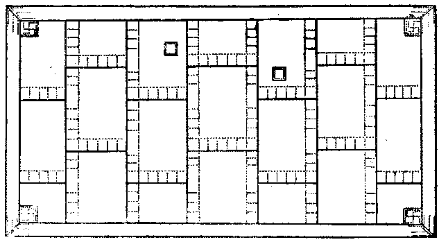
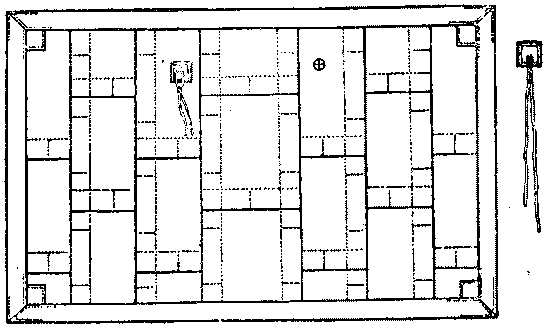
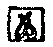
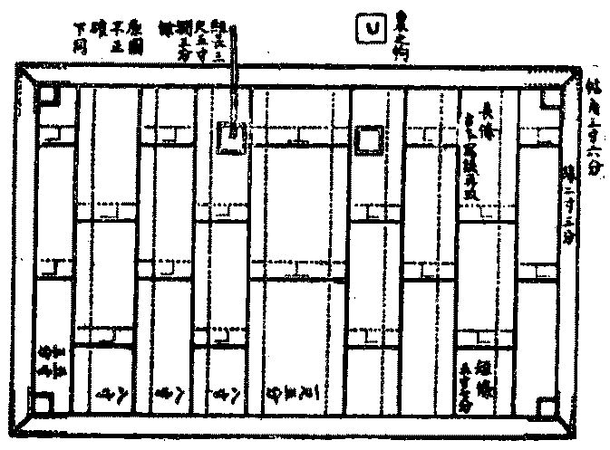
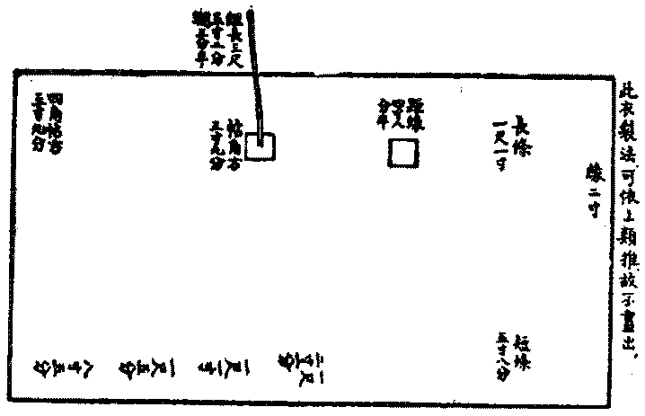

# 榑桑国藏古袈裟图



> **藏经**：佛教大藏经（佛教大藏经）　**册次** 第 104 册（G104）　**编号** G2284　**卷次** 1 卷　**篇幅** 1,157 字

> **卷／品**：0 卷 · 0 品



---



榑桑国藏古袈裟图



释弘一



依三宝物具钞古本写。原图尺寸有不正确处、皆未改正、冀存古本之旧形。其中图形、不尽与别记尺寸符合、唯可见其大略。又𢂁纽应安帖角中间、乃适宜也。



丁丑八月十日居齐州湛山并记



榑桑国圣德太子（当此土隋代）亲护粪扫郁多罗僧图



法隆寺藏衣



高井田寺写图







题辞(略录)



（前略）粤宝历六年（此土清乾隆二十一年）丙子四月、亲验此衣。其制造缝缀、事事合符毗尼、同辙经论。加之三道刺缘、信义净寄归之梵仪。四角押万、□南山感通之天说。叶缘齐序、明暗相当。𢂁纽得处、马齿精缝。谓之决律藏残缺、发新学迷朦也、亦宜矣。此衣陈故财体、断为三四段。叶缘处处残坏、帖角唯餘一处、𫄧𫄟色脱、𢂁失纽断。今举一隅复三隅、推右例左、亦足徵而得其正。阙疑於不可识、假令律文可徵、不敢妄以彼补此、所以𢂁纽不加也。



> 财体、布绢𫄟䌷等杂刺。缘、三道却刺。里、安著餘物总三重。  

> 押叶、马齿缝。帖角、押万字。



> 短条纵一尺二寸四分餘。长条纵一尺九寸八分餘。上二并横一尺四寸四分餘。  

> 缘叶广狭相当二寸五分许。帖角方三寸九分半。𢂁纽处帖方二寸半许。



> 总合得长八尺六寸餘。广四尺七寸餘。



𢂁　古本又作钩、絇。



榑桑国旧藏白㲲郁多罗僧图



法隆寺藏衣



彼寺传称。达磨大师西来、见南岳慧思禅师、告之云。汝□生东方日本国、弘通正法、救济群生。因付此衣为信。后圣德太子遣使臣妹子(人名)至隋取还。即此衣也。



高井田寺写图







缘、二道却刺。  

押叶、一道缝。  

木兰色、近口赤。



> 短条纵一尺一寸许。  

> 横一尺五寸半许为中条、  

> 一尺二寸许为餘条。  

> 长条纵二尺一寸许。  

> 横准短条量。  

> 缘叶相当广三寸许。  

> 四角帖方三寸半。  

> 后纽处帖三寸半弱。  

> 纽、中折安之、当心去一寸二分为结。(原图不正确、别绘如右、以资参考。)  

> 一边条二尺六寸五分、一边条二尺三寸。但取量於当心。  

> 𢂁处帖二寸半强。  

> 𢂁长七寸、中折刺著两端、於当心去四分为结、即成两𢂁。  

> 总合长七尺二寸许、  

> 广四尺五寸许。



㊉今案此处、依彼文所示、应畫此图。



於里（即背面）应畫此图。



（此图、依古本、误畫於前粪扫衣上。今详考、前衣不应畫𢂁纽。若移置於此、则符合矣。）



榑桑国旧藏鉴真律师九条衣（鉴真、为唐扬州大明寺僧。玄宗天宝十年、渡榑桑、为彼邦律宗始祖。）







> 财体白㲲。色木兰。缘二道却刺。押叶鸟足类缝。  

> 总横七尺三寸七分、竖三尺二寸二分五。



榑桑国旧藏鉴真律师七条衣（此衣制法、可依上类推、故不畫出。）







> 同上总横七尺五寸、　竖三尺一寸八分。  

> 上二衣唐招提寺藏老比丘宝静写图　(文化四年写)



已上所记尺量、未明应用何尺。今以意度之、或是用日本尺量。附绘五寸如下。





