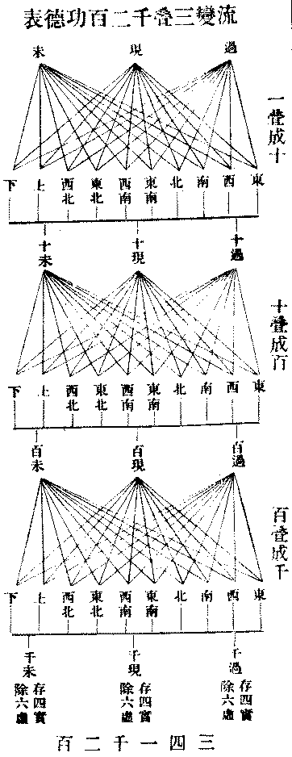
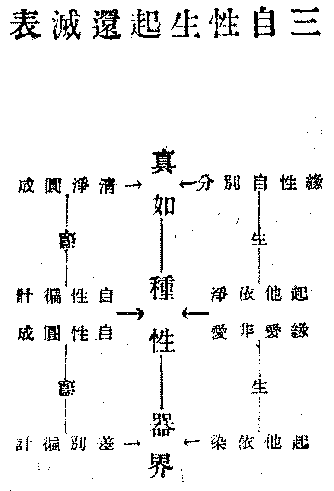
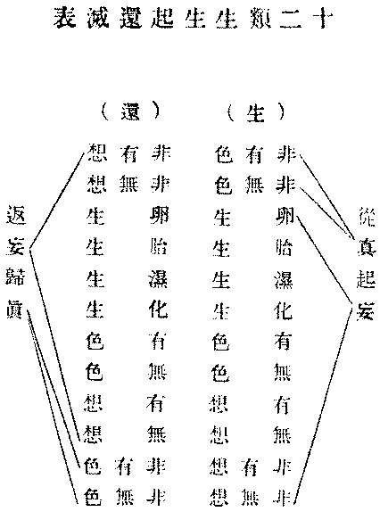
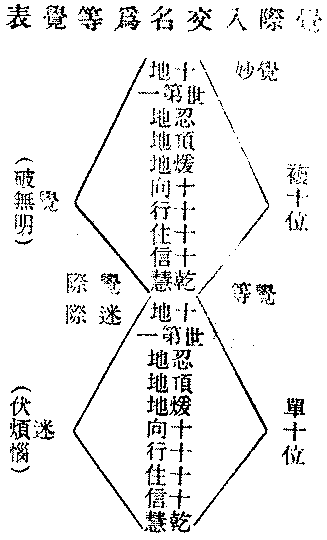
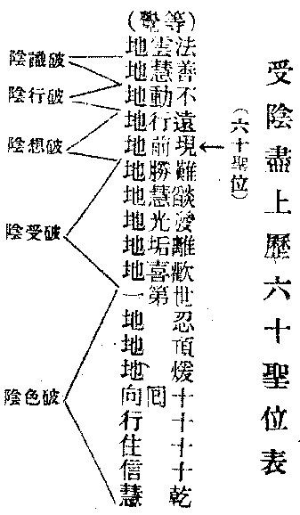

# 楞严经妙心疏



> **藏经**：佛教大藏经

> **作者（译者）**：镇江玉山沙门守培疏

> **卷／品**：10 卷 · 2 品



---



## 目录



  - [楞严经妙心疏自序](#楞严经妙心疏自序)

  - [民国二十四年四月佛诞日沙门守培印光疏后序](#民国二十四年四月佛诞日沙门守培印光疏后序)

- [大佛顶首楞严经妙心疏卷第一](#大佛顶首楞严经妙心疏卷第一)

- [大佛顶首楞严经妙心疏卷第二](#大佛顶首楞严经妙心疏卷第二)

- [大佛顶首楞严经妙心疏卷第三](#大佛顶首楞严经妙心疏卷第三)

- [大佛顶首楞严经妙心疏卷第四](#大佛顶首楞严经妙心疏卷第四)

- [大佛顶首楞严经妙心疏卷第五](#大佛顶首楞严经妙心疏卷第五)

- [大佛顶首楞严经妙心疏卷第六](#大佛顶首楞严经妙心疏卷第六)

- [大佛顶首楞严经妙心疏卷第七](#大佛顶首楞严经妙心疏卷第七)

- [大佛顶首楞严经妙心疏卷第八](#大佛顶首楞严经妙心疏卷第八)

- [大佛顶首楞严经妙心疏卷第九](#大佛顶首楞严经妙心疏卷第九)

- [大佛顶首楞严经妙心疏卷第十](#大佛顶首楞严经妙心疏卷第十)



---



### 楞严经妙心疏自序



释迦如来。应化世间。不为别事。为欲令众生识得自己本来面目而已。我等众生。迷失自己本来面目。认妄遗真。将奴作郎。妄起贪嗔。自招罪业。如蚕作茧。自缚自缠。无解脱时。愚者安愚。不求解脱。智者求解。不得其门。如古之外道六师。今之科学哲学。研究万物之本原曰。唯心唯物。曰一元。二元。无有是处。吾佛教中。言万物之本原。言之烂矣。但则。欲买无处买。欲卖无人要。良可慨耶。首楞严经。显密圆通。顿渐俱备。印度国王。秘为至宝。禁止外传。我国古德。谓之教网宏纲。禅门要关。余谓此经。非但是教网禅关。亦是破无始黑暗之明灯。照本来面目之宝镜也。为本经详明二种根本。一者无始生死根本。二者菩提湼槃元清净体。乃至人之五阴身。如何组织而成。人身之六根性。如何分别而有。如是种种奇谈。要闻。非佛不能说。他教无所闻。诸经虽说。略而不详。非若此经详细分明譬喻而解说也。以此经对於世界众生根本问题。有切体之关系故。古今诸大德沙门居士。咸喜研究。由唐迄今。注释此经者。其人数百。其书数千。广说略说。总说别说。节要说。谈玄说。横说竖说。顺说逆说。无说不有。无微不至。更有何义而复著此疏耶。大藏之中。未疏之经。多且众矣。不疏他而独疏此。使繁者益繁。而缺者任缺。智者用心。宜如此乎。然乎此经之疏多矣。但已阐之经义固多。未阐之经义亦不少。尝闻一字之义。海墨书而不能尽。况此十卷灵文。岂可疏尽乎。诸疏中非特阐扬经之微义不能尽。而经之大义亦未能尽。又不独大义未能尽。而谬解经义者有之。疑而不能决者亦有之。经云。阿难见佛。殷勤启请。十方如来。得成菩提妙奢摩他。三摩。禅那。最初方便。是为阿难请问三大问题。如来答复此三。而成此经。楞严十卷。不外此三问题明矣。从何至何为答妙奢摩他。从何至何为答三摩。从何至何为答禅那。如是大义。是经之纲要。首当发明。从阿难请示起。至第四卷尚留观听止。此中佛答阿难最初方便。妙奢摩他之问。发明九法界虚幻不实之理。此即理经也。从阿难请赐华屋之门起。至第九卷即魔王说止。此中佛答阿难三摩之问。发明十法界造因感果之事。此即行经也。从罢座再来起。至第十卷不恋三界止。此中佛答阿难禅那之问。发明破五阴之魔境。此即证经也。以上理。行。证。三经中。各有主要。理经妙奢摩他为主。其中虽说三摩禅那。乃奢摩他中所具之三摩禅那也。行经中以三摩为主。其中虽说奢摩禅那。乃三摩中所具之奢摩禅那也。证经中以禅那为主。其中虽说奢摩他三摩。乃禅那中所具之奢摩他三摩也。如是妙奢摩他。三摩。禅那。三即一。一即三。其中主宾。非明眼者不能分别。如是经义。求於诸注。尠有发明者。以是余谓经之大义。犹未显尽也。阿难七求心处。诸注谬为如来七处徵心。十二类生与十类生。乃生起与还灭之不同也。非有色。非无色。为众生之真元。从此起妄。即生非有想。非无想。由有妄想。而有卵胎湿化。由卵胎湿化。而有有色。无色。有想。无想。故有十二类生也。众生还灭。非有色。非无色不起妄。即无非有想。非无想。想无故。卵胎湿化亦无。胎卵湿化无。故有色无色。有想无想亦无。非有色非无色。离妄归真。名为成佛。是故还灭。只有十类生也。诸注不解此义。谬除无色无想。而成十类也。经云。流变三叠。一十百千。六根功德。各有一千二百。诸注不解流变之义。所解皆谬也。经云。如来逆流如是。菩萨顺行而至觉际入交。名为等觉。此解等觉所居之地位也。诸注谬为如来出湼槃。菩萨入湼槃。出入相交。名为等觉。如来不动道场。周徧十方。有何出入耶。如来出湼槃。与菩萨断惑证真。有何关系乎。经云。重重单复十二位。方尽妙觉。此释妙觉义也。诸注不解单十。复十。二位之义。谬为单复合成十二种位次。经云。上历六十圣位。经中只有五十五位。诸注不明六十之义。谬以非位为位。凑成六十之数。如是等谬。诸注皆然。以是余谓谬解经义者有之。三渐次增进。有时以他为圣位。有时以他为非圣位。究竟是位非位。诸注不能决定。五十五位菩提路。考其修行位次。实有五十七位。诸注加减。疑惑不定。等觉妙觉。有时以为位次。有时以为非位次。究竟是位非位。诸注不能决定。诸大乘经。凡言菩萨修证位次。皆以十地为尽位。别说等觉妙觉。略露重修。义不明显。是以学教者。对於等妙二觉。含含糊糊。不能切实明了。天台智者大师说。十地后有等觉。等觉后有妙觉。菩萨地尽於妙觉。贤首教亦学此说。后来学者。皆依此说。而忽略诸经。本经对於等妙二觉。有分明指示。曰。觉际入交。名为等觉。重重单复十二位。方尽妙觉。义是从乾慧。十信。十住。十行。十向。煖。顶。忍。世第一。十地。此单十位之果地觉。名为等觉。复由金刚乾慧。金刚十信。乃至金刚十地。此复十位之果地觉。名曰妙觉。是故经云。重重单十复十二种位次尽。名为妙觉。璎珞经云。等觉报修凡夫事。亦言等觉重修凡夫所修之圣位也。仁王经云。等觉以前伏烦恼。等觉后。以金刚智。方能断烦恼。皆同此经等觉复修前位义也。诸家注疏。明知此经文义。不合台贤教义。而依台贤教义。强释此经。以致百病丛生。余疏此经。不但欲纠正此经文义。亦欲纠正佛教全体教义也。如是等经文。诸注疏者。不得真像。乱起猜疑。聚讼纷纷。莫衷一是。此余所谓疑而不决者亦有之也。又法相宗学者。以此经文义多反彼宗。而谤此经是伪造。其实法相宗。不但反对此经。乃反对全体佛教也。以佛说一切法皆空。彼说一切法皆有故。有相法。是生死的根源。为佛法之大障碍。我佛出世。专为破此。今之佛徒。提倡法相。毁谤楞严。实即是提倡邪宗。毁谤正法。衲子不识邪正。以正作邪。以邪为正。而望佛教兴盛。呜呼悲哉。或问。佛教一切法空。不立一法。我观一切经文。以及一切注疏。皆是名相。何言佛教反法相耶。答。佛经常说。佛法离一切相。离文字相。离言说相。此即表示佛法之真实相也。今人即以经文为佛法。而不知经文是佛法之注解。非佛法也。经文与佛法相差甚远。而经之疏。则於佛法又远之远矣。佛说经文。表示佛法。犹如标月指。今人以经文为佛法。岂但不识佛法。亦复不识名相。犹如执指为月。岂但不识月。亦复不识指。自己执指迷月。而复毁舍指认月者。余於此者。安忍缄默而无言乎。经文既非佛法。然则。古人为何而解经文远离佛法耶。爰上根利智者。终日行藏。语默动静。无非佛法。不须经文解说。自然与佛法不相违背。若中根之士。不能亲见佛法。必须经文说明。从经文而悟明佛法。若下根之人。非特不能亲见佛法。亦复不能领会经文。於是古德曲垂方便。注解经文。俾下根者流。从注疏而会经文。从经文而悟明佛法。佛法以经文为门户。经文以注疏为先导。则注疏於佛法不无小补焉。但注疏者。不了佛法。即不能解经文。是以注疏者。欲解经文。先须了知佛法。若畫竹者。胸有成竹。乃可畫竹。若胸无成竹。任笔成形。是竹非竹。自不能知。焉名为之畫竹者乎。至若未会经文。而强作注解者。此又不但不能阐明佛法。而反为经文作障碍。如畫竹者。不知竹是何物。濡笔涂鸦。示人曰竹。知者固不值一笑。而不知者即以彼为竹。转以竹非为竹。迷人正见。莫胜於此。观今之法相宗。多与此经相抵触。然人不非法相。而独非此经者。即不识真竹之类也。然法相虽非楞严。而楞严终不为所非。惟误解楞严者。障碍楞严。又一人误者。其障犹轻。一误众误。其障至甚。是故余著此疏。以补前人之未备。而作后学之阶梯。正为楞严除障碍。而显佛法之真象。破世间之昏暗。见自己之本来也。若见真象者。吾疏亦非矣。此如佛说之经。如标月指。见佛法者必舍经文。若执经文为佛法者。犹如执指为月。读者依疏而求经。见经者当舍疏。若执疏为经者。亦如执指迷月。殊违余愿矣。夫余虽明诸疏之非。非欲废弃诸疏也。如於长材指其寸朽。不以寸朽而弃长材。余之所得。亦从诸经中来也。古人开荒。余耕熟地。难易若此。不得谓余之智逾古人也。至余不疏他经者。以他经未生障碍。或已生障碍。未若此经之多故尔。此经疏於镇江玉山超岸寺妙心精室。因以名妙心疏焉。



------



### 民国二十四年四月佛诞日沙门守培印光疏后序



## 大佛顶首楞严经妙心疏卷第一



**译者**：镇江玉山沙门守培疏



皈依弟子云常忍校刊



将释此经。大义分三。初解释名题。二悬示纲要。三正解经文。今初。



大佛顶。如来密因。修证了义。诸菩萨万行。首楞严经。



此一经之名题也。名从体立。体由名彰。今欲显楞严之理体。故先释楞严之名题也。此经本有五名。译者截取五名之要义。总成一名。以便称也。所谓五名者。一大佛顶。悉怛多般怛啰。无上宝印。十方如来清净海眼。此名依体而立也。大佛顶。总喻一经之理体也。悉怛多般怛啰。呪名也。无上宝印。显呪之功用也。十方如来。果人也。清净海眼。显果人之功用也。此十四字义。在从体起用。今将用摄归於体故。但取大佛顶三字。而略去其餘也。二救护亲因。度脱阿难。及此会中性比丘尼。得菩提心。入徧知海。此名依事而立也。阿难。性比丘尼。皆所度之人。今摄入诸菩萨中。得菩提心。即所证之道。今摄入首楞严中。入徧知海。是所明之理。今摄入大佛顶中。是故此名全略也。三亦名如来密因。修正了义。此名依解而立也。谓解如来之密因。而了修证之大义。依解起行。是一经之关要。故此名全取也。四大方广。妙莲华王。十方佛母陀罗尼呪。此名依呪而立也。大方广。表理体之周徧也。今摄入大佛顶中。餘皆摄入如来密因中。以显摄密故。此名亦全略也。五亦名灌顶章句。诸菩萨万行首楞严。此名依证而立也。诸菩萨修行万行。而证入首楞严之妙定。此是一经之结果。故取之。灌顶章句。亦密呪义。故略之。於此五名之中。要者取之。繁者略之。总其所取。共成今名。今名虽一。义实该五。原名虽五。义实同一。释此一名。即释彼五名也。释此名题。义分二类。初别名。二通名。别名者。上十九字。别於诸经。故名别也。下经之一字。通於诸经。故名通也。初释别名又分二。初分释。二合释。分释又分三。初释大佛顶如来密因。二释修证了义诸菩萨万行。三释首楞严。初又二。初释大佛顶。二释如来密因。今初。



大佛顶。



大者。状法之词。佛是果中之人。顶乃最高之处。然一切法。莫不有顶。有在此为顶。在彼则不能为顶者。非其顶也。诸顶之中。以佛顶为最。华严九地菩萨。欲见佛顶。终不可得。故称佛顶名无见顶。即无法能高过佛顶也。取此以为经名者。有义存焉。考检古今解释此大佛顶者。约有五释。一约法释。谓此法是大觉世尊最胜顶法也。二约事释。谓由如来顶中化佛说咒。故名大佛顶也。三约理释。谓大即法身。佛即般若。顶即解脱也。四直指法释。谓大即众生心。佛顶乃显胜之义。五约喻释。谓喻之佛顶。不滞於见相也。此五种释法。初观之。各有所得。细察之。有得有不得。且试言之。初约法释曰。此法是大觉世尊最胜顶法。其义虽可。不切经文。有理无事。有实无权。摄义不尽故。二约事释曰。佛顶化佛说咒。故名大佛顶。事实固然。有事无理。义亦未足。三约理释。曰大即法身。佛即般若。顶即解脱。此系果上三德。无关修行。不唯义不相合。且又割裂句义。大佛顶。乃一名词。非三名词。纵许三字各立。而亦不合三德之义。如大字。本是状法之词。有名无实。何以合符法身德耶。佛是万德具足之人。何以但合般若德耶。顶乃最上之义。何以合其解脱德耶。此解过於穿凿。不合经文。而又割裂句义。不可依据。四约直指释曰。大即众生心。佛顶乃最胜之义。以大为众生心。无有考据。五约喻释曰。喻之以佛顶。不滞於见相也。此义甚然。以众生不生不灭为本修因之心。实有而不可见。不可见而决定是有。正是佛顶义故。余於此五种解释中。兼取事释。正取喻释。何以故。此经名题。含因行果三义。大佛顶因名也。佛顶化佛说咒。是本经重要之事实也。佛说此经。发明众生本具之真心。为本修因。义如佛顶。虽有而不可见。虽不可见而确实是有。故喻之以大佛顶也。如是二释。理事俱到。显密皆圆。是故此经以大佛顶为名。正义如此。○二释如来密因。



如来密因。



如来。是佛之德号也。依古释有三义。初依金刚经云。如来者。无所从来。亦无所去。故名如来。此系法身如来也。二依转法轮经云。第一义谛名如。正觉名来。此系报身如来也。三依成实论云。乘如实道。来成正觉。故名如来。此系应身如来也。依本经明如来义。亦有三曰。性真常中。求於去来迷悟生死了无所得。此法身如来也。又曰。明极即如来。此报身如来也。又曰。自觉已圆。能觉他者。如来应世。此应身如来也。此如来乃该括三身而言也。密者。秘而不可见也。因者。果之对称。能生义也。以此生因。不同世物之生因。可以相见。故曰密因。密因者。谁耶。即众生本具之心。经云。以不生不灭为本修因。然后圆成果地修证。此因能结如来之果故。非九法界之密因。乃如来之密因也。此句释大佛顶。以大佛顶是因名。此系因名之实事也。问。密因云者。为在众生一边言密耶。为始终皆密耶。答曰。此法究竟不可见。故名为密。若今不见而后见者。或愚不见而智见者。皆非真密也。古说。密因有三义。初曰妙密。始终皆见也。即诸佛常见自心故。余谓既曰常见。何以名密耶。若曰。众生不见。故名之曰密者。然则。当云众生密因。何以云如来密因耶。二曰微密。始虽不见。而终必见也。即菩萨因中不见。而果上能见故。义如物之初生。微细故不见。长大故见也。余谓此乃大小之关系。非显密义也。三曰秘密。始终皆不见也。如凡小之人。始终皆不能见自心故。余谓此如杳然绝迹。亦非密义也。当知。所谓密者。如人有物。藏之於家。不使他人知得。是名为密。若他知自不知。此名为失。非密也。若自他皆知。此名为显。非密也。若自他俱不知。此即无物。何密之有也。问。若此密因。始终皆不可见者。云何经中说。众生有明心见性时也。答。明心见性之见。非寻常之见。诸佛见自性。即以不见为见故。须知自性非所见。性是能见故。若以自眼求见自性。虽万劫千生。终无得见之理。假使见得。亦非真自性。自性非所见故。此义本经辨见文中详明。此不多述。所谓见自性者。以众生有所见故。不见自性。诸佛无所见故。名为见性。可知见是自性之障。远离诸见。即名见性。所以古人说。若人识得心。大地无寸土。又经云。若见诸相非相。即见如来。可知见性之见。离诸妄见也。如是以自性作为物见者错矣。是以欲见自性者。当除诸见。诸见若除。无见亦不存。此即名为见自性。不可以智知。不可以识见。故名之曰密耳。言密因。有时可见者。不但有违自性。密义亦不成。近有痴人。闻彼说自性有时可见故。即千方百计求见自性。犹如水中捉月。徒劳可愍。乃至因此妄求而遭邪魔者。皆不了见性之义之所误也。若智者求见自性。而不直接见自性。知自性不可见故。但了目前境界。了得境空。则自性不见而自见。亦不认昭昭灵灵以为自性。以有所认识者。皆不是故。必待大地无寸土时。方是自性现前时。若目前有一法存在。而云见自性者。皆自欺欺人。成大妄语。此系修行之关要。学佛者不可不知也。



二释修证了义。诸菩萨万行。亦分二。初释修证了义。二释诸菩萨万行。今初。



修证了义。



修者。整治身心。断除无明烦恼。及诸习气也。证者。亲入其境。彻悟真如自性。及大湼槃也。心境各别。谓之迷失真如。心境融通。谓之证得真如。众生妄起烦恼。迷失真如。是故如来有修证之教也。修有二义。一曰缘修。即以缘虑心而修也。如三贤菩萨。从初信自心。不生不灭。远离妄想诸生灭法。以缘心去取。故名缘修。即缘境而修也。二曰真修。亦名性修。即以真心而修也。如十地菩萨。已见性故。从性起修。远离外境故。无不生灭之可求。亦无生灭之可舍。无修而修。故名真修也。其所修。即伏断无明烦恼。成就如来密因也。以此密因。众生迷失已久。虽经发明。非修而不能成就故。证亦有二义。一曰偏证。即三贤菩萨断枝末无明。证偏真之理也。二曰圆证。即十地菩萨断根本无明。证究竟法身也。又说初地分破无明。分证法身。十地菩萨满证法身。其所证之法身。亦即如来密因也。此密因在众生望佛即名果。在诸佛望众生即名因。其实因即果。果即是因。非果外有因。亦非因外有果。因果之实体。即众生之自性。初修名因。修成名果。无二法也。了此密因之义而修而证者。即名修证了义。第一时说。舍生死。证湼槃。是不了义。第二时说。无生死。本来湼槃。亦是不了义。第三时说。无生死。本来湼槃。无自性性。是了义。不了此密因而修而证者。即名修证不了义。亦名为盲修瞎练。此句专明修证。故定此为行名也。○二释诸菩萨万行。



诸菩萨万行。



诸者。众也。菩萨。略梵语。具云。菩提萨埵。此翻觉有情。义谓虽已觉悟。未了缘情。故名觉有情。此单约当体释也。又义。以菩提道。觉悟诸有情。故名觉有情。此单约利他释也。又义。上求佛道曰觉。下化众生曰有情。此兼自他而释也。又翻大道心众生。及大士。开示等。义亦同上。菩萨有初心。及三贤十地等之别。故曰诸菩萨。众生从初发菩提心。广修六度万行。自利利他。由乾慧至四加行尽。皆名为权修。从初地至十地尽。皆名为实行。其中经过三大阿僧祗刦。所积集之功行。实不可数计。故名之曰万行。万字举最多数而言。非止万而已也。又此行。非人天小乘之行。故曰诸菩萨万行。行。谓施行六度之德行也。行。亦有二义。一曰正行。二曰助行。前五波罗密属外境。是所修法。假彼之法。成我之功。故名助行。亦名行行。是所行故。第六波罗密属内智。是能行前五波罗密之心。以前五行皆由此而行。故名正行。亦名慧行。以离前五。则有慧而无福故。若依本经而论。顿教以禅那。及反闻自性为正行。持戒。诵呪等。为助行。渐教以持戒为正行。亦以诵呪为助行。此句释上修证了义。以诸菩萨之万行。即了义之修证故。修证了义。依理而名也。诸菩萨万行。依事而名也。理事虽异。同是行名也。○三释首楞严。



首楞严。



此果名也。由诸菩萨万行。而证入首楞严故。湼槃经释首楞严云。首楞者。一切事竟。严者。坚固。谓一切事竟而得坚固之理体。曰首楞严。所言一切事者。即本经所明五阴。六入。十二处。十八界。七大等。众生於一切事未曾竟。故有生灭去来。成住坏空等。种种不坚固之相。诸佛已了四科七大等事。非因缘。非不因缘。非自然。非不自然。非和合。非不和合。本如来藏妙真如性。清净本然。周徧法界。毕竟无一事相可得。而常住坚固之地。是为入首楞严三昧。亦名住常寂光土。又即本经所谓。圆满菩提。归无所得义也。是故余谓。首楞严。是果名也。或以首楞严连属上文。作修行解。彼不知修行是迁流变化。正是不坚固之相。任尔修至金刚心后。亦不得名为一切事竟坚固。竟。即不行故。如是以首楞严作修行事解。则有与名义相违过。是故将首楞严另作一句。不同他释曰。诸菩萨万行首楞严也。又此经程次。先明理。次明行。后明果。若将首楞严连上作一句读。则此名题。有理有行。而无效果。则名题与文义不相符。岂不又成一大谬点乎。经题义该全经故。不可无果名也。以上分释别名竟。○二合释。



大佛顶。如来密因。修证了义。诸菩萨万行。首楞严。



总上因行果三。合成此经之别名。此别名中。含摄两重因行果。即显教因行果。与密教因行果也。显教又分顿渐二教。此经显（经文）密（呪）圆融故。名题亦具显密二义也。所言密教因行果者。大佛顶。密因名也。修证了义。密行名也。首楞严。密果名也。显教因行果者。如来密因。显因名也。诸菩萨万行。显行名也。首楞严。显果名也。显密同一首楞严果者。显密虽殊。证果不异。殊途同归也。又所谓方便有多门。归元无二路也。若将经文合此名题。从阿难见佛起。至第四卷尚留观听止。此中专谈如来因地之心理。故名如来密因也。从第四卷阿难请入华屋起。至第七卷所作如意止。此中专谈修行法门。故名诸菩萨万行也。从第七卷阿难请示行位起。至第九卷即魔王说止。此中专谈证果之位次。及邪行之妄果。故名首楞严。此渐教之首楞严果也。从第九卷如来将罢法座起。至第十卷不恋三界止。此中专谈禅那中魔事。直指人心。不假方便。举心即错。动念即乖。此即顿教之果也。顿教因该果海。果彻因原。发心究竟二不别。果中含摄因行故。但言顿教果。不另言顿教因行也。亦因不落因果及诸位次。故名顿教也。至於密教之因行果。大佛顶是密因。能化佛说呪故。化佛说神呪是密行。持诵此呪。能断一切惑障故。呪后表示呪功。即密果。能得一切善果故。呪之道理。及功用。不可思议。故名密也。经文道理及功用。皆可解说。故名显也。总而言之。显密皆不外断惑证真。原无显密之可分别也。此名义该全经。全经不外此名。名为大纲。经为细目。名实相符。了得名义。亦可了其经义矣。然名虽有因行果之别。其实即一众生本具自心而已。以初明此心故曰因。趣向此心故曰行。证入此心故曰果。如是可知名虽三。而体实一。大佛顶。是成因也。修证了义。是坏因也。首楞严。是空因也。又如来密因。预行也。诸菩萨万行。正行也。首楞严。已行也。又大佛顶。始生果也。修证了义。分成果也。首楞严。究竟果也。又大佛顶。般若德也。以能化佛说法即佛母故。修证了义。解脱德也。以能断除诸障碍故。首楞严。法身德也。以为因行之体故。又如来密因。相大也。以能具足性功德故。诸菩萨万行。用大也。以能出生世出世间善因果故。首楞严。体大也。以能一切法真如平等无增减故。名三体一。举一即三。言三即一。亦一亦三。非三非一。三一圆融。不可思议。斯为大佛顶首楞严经之别名也。以上略释名题竟。○二释通名。



经。



梵语修多罗。正翻线。谓能贯摄诸法故。又翻契经。谓能契理契机故。以线不尊重故。舍而不用。遂依此土圣人之言。名之曰经也。古解经义。有五种拣别。一曰法本。二曰微发。三曰涌泉。四曰绳墨。五曰结鬘。然经义在贯摄。言教有结鬘一义已可了矣。以世间亦有典籍如经之结鬘者。但不如经指归正道。故加绳墨以拣别之。绳墨。即规正人心义也。世间亦有规正人心之言论。似经绳墨者。但义理不能深入。不如经之义理无穷。故更加涌泉以拣别之。涌泉。即出生无穷义也。世间亦有义理幽邃深远似经者。但不如经之深入微细。故复加微发以拣别之。然世间亦有深入精微之言论似佛经者。但不如经之能究竟法本。故又加法本以拣别之也。然经名虽贵。犹是总称。必具足此五义者。方名佛经也。天台教於此五法。各以教行理三配合之。未免过於繁琐。而反失五法之原义也。又有历法明经之说。谓经之一法。不但以色尘名。六尘皆可名经也。然此思想虽深。无乃反失经之正义也。如本经别题。即所诠之教行理。通题。即能诠之文字。今讲经字。不应再涉及教行理。以教行理应在别题中讲。不应在通题中讲故。通题中讲教行理。即混乱通别故。如能贯摄者经也。所贯摄者理也。经与理。如花与线。能贯摄者名线。所贯摄者名花。花线既分。不得以花作线。亦不得以线作花。即能诠经。与所诠理既分。不可以经作理。亦不可以理作经也。如彼曰。某佛以光明为佛事。即以光明为经。某佛以香饭为佛事。即以食味为经。吾佛以音声为佛事。以音声为经。今不以音声为经。而以代表音声之文字为经。此文字不但代表音声。色香味触等尘无不代表也。文字为六尘之总代表。已明文字之经。更不得於文字经外再有历法明经矣。须知解事与解理不同。解理愈深愈妙。解事有一定的标准。若有太过不及。皆失其标准也。如此经之一字。实是指文字而言。离开文字更言经。岂不反失其经之真相乎。以上略释名题竟。



二悬示纲要。大义分九。初能说教主。二说经时间。三所说教体。四所被根机。五说教宗旨。六修行妙用。七乘分大小。八教判顿渐。九东流历程。今初。



古云。经通五人共说。谓佛说。弟子说。化人说。天说。仙说。佛说又有三。谓法身佛说。报身佛说。应身佛说。此经总名曰佛说。未知法身佛说耶。报身佛说耶。应身佛说耶。或三身共说耶。或三身外更兼谁说耶。如此问题。更请说之。尝闻。法身无相。不说诸法。说法者。唯报应二身。又说。报化非真佛。亦非说法者。当知。三身佛。各有能说不能说。若全不说法。何以名佛。若一佛能说诸法。何须分别三身也。如报身说真不说假。应身说假不说真。法身真假俱不说。即以不说为说。是故三身各有能说不能说也。所谓报身真说者。报身以身说法。不同应身以口说。如经云。法法头头皆演妙音者是也。又如佛放光现瑞。显示妙法者。皆报身说也。报身即智身。即佛之智慧光明故。法身以不说为说者。法身以心说。金刚经云。无法可说。是名说法。此法唯许意会。不可言传。此身常说。无不说时。应身说法者。如世人以言语而演说妙法也。但有言说。都无实义故。应佛不说真法也。报身不用言说故。不说假法也。法身不用言说。亦不用身说。故不说真假也。考此经中第六卷。观音圆通后。佛从五体同放宝光。远灌十方微尘如来及法王子诸菩萨顶。彼诸如来。亦於五体同放宝光。从微尘方来灌佛顶。并灌会中诸大菩萨及阿罗汉。林木池沼。皆演法音。此林木池沼演法。即报身佛说也。情与无情。皆是如来法身所现之相故。五体同放宝光。以及餘处放光演法者。皆报身佛说也。其餘经文。皆应身佛说。当知应身。即法报身之代表。如林木池沼。皆演法音。若非应身代表。世人那知如此也。顶光化佛说呪。此化人说也。二十五圆通。及文殊选圆。阿难富楼那等说。皆弟子说也。如是此经。是三佛共说。於五人说中。具佛说。化人说。弟子说。缺仙说天说。有谓摩登伽女。用先梵天呪。亦可说具仙说天说。但彼呪不载此经。故不可说有仙说天说也。○二说经时间。



吾佛成道已后。说法四十九年。三百餘会。所说经法。义理有浅深。时间有先后。未知此经说於何时。考华严经云。吾佛说法。大概有四种时间。所谓譬如日出。先照须弥等诸大高山。即说华严时也。次照黑山。即说阿含时也。次照高原。即说方等时也。然后普照大地。即说般若湼槃时也。如此四时。乃因众生机感。自然而成四重程次。非因年月而分也。以上是一往而论。若普通而论对机说法。无有定时。如对菩萨说华严时。即对小乘说阿含时。如对小乘说阿含时。亦可对初心菩萨说方等。或说般若。如此四时。各通前后。所言华严通后者。华严云。如来常放无碍智慧光明照诸菩萨。乃至穷未来际。亦无间断故。阿含通后者。从鹿野苑。至湼槃城。无时不说小乘经故。方等通前后者。华严湼槃皆归方等摄故。般若通前者。经云。从得道夜。至泥洹夜。常说般若故。言此四时。虽无一定之年月。而四时决定是有。考证此经。当在第三照高原时。即方等时。方等是大乘初门。阿难问佛。十方如来得成菩提。妙奢摩他。三摩禅那。最初方便。斯知此经是大乘初门也。若依年限考此经。当说在如来成道后三十二年。以因缘经云。如来与波斯匿王同年生。波斯匿王。年当六十有二。吾佛亦六十二岁时说此经。依如来三十成道而论。故知此经说在成道后三十二年也。此说时部有异他教。辨如起信论悬义。此不复述。○三所说教体。



已明说法之时间。次明所说之教体。佛教无量。其体止二。一偏真。小乘教体也。二真如。大乘教体也。所谓体者。本质也。如世间人物。咸以四大合成之身为体。世间器具。皆以物质为体。此皆借他为体。非自有之体也。所谓自体者。不假他成。本自如然。无名无相。不增不减。其大无外。其小无内。不可心思。不可言议。方便名之曰真如。或名实相。即大乘之教体也。所以起信论云。真如者。即是一法界大总相法门体。离名字相。离言说相。离心缘相。毕竟平等。无有变异。不可破坏。故知真如是教之本质也。古云。诸大乘经。皆以实相为体。实相。即真如之变名也。然真如既为一切法之总体。如是能说所说言语文字无不是教体。法法全真故。何须分别所说教体耶。但众生迷真逐妄。若不假妄。不能显真。若不显真。不能知妄。是故随顺众生。於无真妄中而分真妄也。今於此经假言说中而显示真体者。其示有二。一在五十五位真菩提路后。如是重重单复十二方尽妙觉成无上道。此从事修而得体也。亦即显教之体也。二在罢座再来。说禅那中五十种阴魔后。圆满菩提。归无所得。此从理悟而得体也。亦显密教之体也。然显体之处虽二。其体则一。体若有二。即非真体故。义如二路还家。路虽有二。其家则一故。不同他教。谓成佛有高低。得体有浅深也。如本经云。理虽顿悟。乘悟并消。事非顿除。因渐次尽。因断惑有理事之别故。佛教有顿渐之分。若理若事。皆以惑尽为止。故证真无二。体无差别也。问二教之体。一曰成无上道。一曰归无所得。一空一有。显然不同。云何无差别耶。答。成无上道者。渐教之人。因中不了体义。由断惑而证真。惑尽体成。故曰成无上道。归无所得者。顿教之人。因中即了体义。任运断惑。全妄即真。故曰归无所得。所言有者。有其体。所言空者。空其境。境空体必露。体露境必空。言虽不同。义实无别也。若谓成佛有差别。则违佛说。佛佛道同。学者思之。问。有云此经以三如来藏为教体。今何不然耶。答。如来藏性。是体之外相。非体之实质也。如阿难等。虽悟如来藏性。不可谓已得教体。何以故。阿难悟后。请入华屋之门。可证阿难只得体之外相。未得体之内容也。若谓见如来藏性。即名得体者。后来入华屋。成无上觉。反成赘文矣。须知悟如来藏性。如初见华屋。圆满菩提。如入华屋见主人。又如来藏。由四科七大。一切生灭之相之所显示。当知但凡藉他物而显示者。绝非实体。体不可表示故。起信论云。心真如相。即示摩诃衍体故。心生灭相。能示摩诃衍自体相用故。是故如来藏。非摩诃衍体。起信论以如来藏为相大。以真如为体大故。教体为学佛之目标。必须认清。若稍有错讹。即违佛教。落於邪道矣。若人了知教体。然后听闻。乃至受持读诵。句句体会真如。不落语言文字之相。则功德不可思议。是故凡讲佛教。皆应先明教体。否则。听者无目标。虽讲佛教。等与世间讲语言文字。○四所被根机。



教从机兴。既有能诠之教。必有所被之机。不知此教被何等根机耶。华严经云。如来智慧鉴机说法。有四种阶级。譬如日出。初照高山。此被宿世根熟菩萨机也。次照黑山。此被二乘机也。次照高原。此被决定善根众生机也。然后普照大地。此被将来发心一切众生及邪定等机也。此经於此四种机中。合第三决定善根众生。以阿难等虽得小果。已决定发大心故。阿难非根熟菩萨。故非第一种机。又非未发心及邪定等。故非第四种机也。○五说教宗旨。



已闻所说之教体。及所被之机宜。未知说此经者。是何宗旨。次当发明。宗犹主也。即作事者之主意也。凡立一法作一事。乃至一言一行。无不先有主动之意。若无主意。决不能发现事相。如射箭也。必先有中的之主意。若无中的之主意。决无射箭之事。故其未射箭之前。所具中的之心。即名为之宗旨。亦名为之主意。宗旨虽不可见。察其所事之始末。而宗旨自现矣。考察此经之宗旨。由阿难自淫室归来。急求吾佛开示。十方如来得成菩提。妙奢摩他。三摩。禅那。最初方便。可见阿难请佛之宗旨。在得成菩提。得成菩提之发原。在误堕淫室。原始要终。而定此经之宗旨。在空不空如来藏。众生由认假迷真而堕苦海。欲救众生出苦。必须破妄显真。本经会一切法归如来藏。是说此经之宗旨也。依此修行。能证无上之果。是故宗旨即因地心也。若分而言之。在理解。则以止诸恶莫作为宗旨。在修行。则以观众善奉行为宗旨。在证果。则以止观不二。归无所得为宗旨。前以归无所得为体。此复以为宗者。在因为宗。在果为体。体宗不二故。吾佛对阿难徵心辨见四科七大。皆欲令阿难等离幻化相。成就理解之宗旨也。明五蕴之来原。六根之生起。解结选通。反闻闻性。皆欲令阿难等见真实性。成就修行之宗旨也。说三渐次。五十五位单复十二位等。皆欲令阿难成无上道。成就证果之宗旨也。以上乃依渐教论宗旨。若论顿教宗旨。则不如是。顿教无生死可了。无湼槃可证。无佛无众生法法皆空。若起一念。即乖自宗。真可谓举心即错。动念即乖。况云立宗旨乎。此教直可以无所宗为宗。无所宗之宗。是佛教之真宗。以凡有所宗。皆落偏见故。如是可知显教之宗。乃随众生情见而有。非吾佛之本怀也。近有言佛教非宗教。有言佛教是宗教。如此二说。皆未了佛教之真宗旨。何以故。佛教无所宗故。不应言佛教是宗教。佛教以无宗为宗故。不应言佛教非宗教。若言佛教是宗教者。则与外道等。若言佛教非宗教者。无宗即无主。无主则如无舵之舟。随流而流。无有定旨。佛教岂是此乎。○六修行妙用。



已知此经是摄一切法。归如来藏为宗旨。犹不知此经有何妙用。能成就此宗旨。此当明之。用谓力用。即能成就其宗旨之事功之力也。如武人射的。则以矢为用。如匠人成器。则以斧凿为用。若有宗旨而无功用。则成虚愿矣。论此经之力用。有正有兼。正者。即文殊所选耳根圆通。所谓此根初解。先得人空。空性圆明。成法解脱者是也。兼者。即持戒诵呪等是也。此依渐教而论功用也。若论顿教之用。则有异於此。顿教功用者。离诸功用。以无功用为真功用也。若方便名之。即深妙禅定。经云。理虽顿悟。乘悟并消。又云。何假劬劳肯綮修证。此皆显顿教无功用之真功用也。总而言之。破妄显真。修因证果。是本经之功用也。有谓此经以离爱得脱为功用。当知。此非功用。乃功用之结果也。如阿难离爱得脱。乃仗如来神呪之功能也。若无神呪之功用。阿难不能离爱得脱。是故余谓离爱得脱非功用。乃功用之结果也。若谓此经有离爱。即以离爱为用者。亦不然。何以故。以上明体论宗。皆超极地。离爱得脱。乃人间小事。如此功用。何能相应体宗欤。而且阿难离爱得脱。事在经前。得脱已后。方闻经法。如是离爱得脱。乃启经之因缘。非经之功用明矣。此经当时能令阿难获法身。性比丘尼证四果。迨至后来。能令无量无数众生成就无上菩提。皆此经之功用也。若专指阿难离爱得脱为此经之功用。未免小视此经甚矣。○七乘分大小。



佛教有大小二乘。未知此经属於何乘。次当拣别。佛教所以分大小乘者。以众生根机有大小不同。如来随机设教。故教亦有大小也。所谓小乘教者。以众生善根不深。智慧不大故。佛对彼说半教。即但说人空。不说法空也。又名偏教。即说三界苦空无常无我。偏於空边也。以说法不圆故。名小乘也。大乘教者。以众生善根具足。智慧宏深故。佛对彼说满教。即空与不空俱遣也。又名圆教。即人法双亡。不落二边。圆融中道也。以说法圆满故。名大乘也。若论此经。则属大乘。不属小乘。何以故。经云。此根初解。先得人空。空性圆明。成法解脱。人法俱空。故属大乘也。此大乘中。又有二义。一方等大乘。如先人空。后法空。即由小乘转入大乘也。所以方等会上。多弹偏斥小。回小向大义也。二般若最上乘。人法双亡。不分前后。此教之人。不由小而大。始发心即大故。般若经云。不垢不净。不增不减。又云。无法可说。是名说法。又云。众生本来寂灭。更无灭可灭。此皆双遣二边义也。此经於此两种大乘兼有之。但正属方等。兼属般若最上乘。亦即显密双彰也。问。经中言阿难。性比邱尼。皆证小果。及二十五圆通。多有小乘法。何专属大乘。不兼小乘耶。答。二十五圆通中虽说有小乘法门。此经不取故。不得谓此经兼属小乘也。阿难等证果虽小。发心是大。不得以中途作结论。如行路者以目的地为标准。不可以中途小憩为定论也。又如人从远地归家。中途兼顾亲眷。小休小息。然后至家。此可云到家兼到某处。若直至其家。中途虽经过亲眷之处。不休不息。何得云兼到某处耶。又若云。经中谈及小乘。即兼属小乘。若经中谈及三途魔外等法。此经即兼属三途魔外。岂非大笑话乎。又如是兼带杂乱之法。何能独名大佛顶经乎。如是须知。佛经大乘。决定是大乘。小乘决定是小乘。无兼带理也。○八教判顿渐。



佛教有大小二乘。大小乘中复分顿渐二教。未知此经於大乘中是顿是渐。次当判之。佛乘中又分顿渐教者。此亦随机而立。如大乘中有佛乘。（或云最上乘。）菩萨乘。小乘中有声闻乘。缘觉乘。吾佛随机设教。即对佛机说大乘顿教。对菩萨机说大乘渐教。对缘觉说小乘顿教。对声闻说小乘渐教。或云众生机本同。因学教而别。非也。然则。对机说教。应病下药之说。应改为应药生病。对教生机。岂不谬之甚乎。然则。众生同一生性。云何而有渐顿之差别耶。经云。从无始来。一念不觉而妄动。动是生之因。以动即有妄境界发现故。心境对缘。妄起分别。或执能缘之心为我。或执所缘之法为我所。重能轻所者为顿根性。重所轻能者为渐根性。顿渐之别。由生性不同。非本性不同也。顿渐修行虽异。归元无二。故本经兼大乘顿渐二教。五十五位菩提路。大乘渐教也。五阴魔尽。顿超十地。大乘顿教也。又经云。理虽顿悟。乘悟并销。事非顿除。因次第尽。又狂心顿歇。歇即菩提。何假劬劳肯綮修证。皆顿教义也。



九东来历程。四。初译经人。



唐中天竺沙门般剌密谛译。



本经原出印度。为彼国之秘宝。禁止外传。译师欲利此土众人。冒禁特来。按译经图记载。此经译於唐朝。则天罢政。中宗嗣位。神龙元年。故曰唐。此表东来之时间也。中天竺。国名也。此云月邦。此国三面垂海。北背雪山。南广北狭。形如半月。又云。此国圣贤继轨。导凡御物。如月照临。故曰月邦。地当赡部之中。周九万餘里。分东西南北中。皆名天竺。即今之印度。此表译师之生处也。沙门者。释子之通称。此翻勤息。谓勤修戒定慧。息灭贪嗔痴。此表译师之德行也。般剌密谛。翻极量。或云到彼岸。谓自行化他。皆极尽其量。不留餘地。是为译师之德号也。译谓翻易。翻天竺之梵语。为中夏之华言也。此经未来。盛名先至。智者大师。欲见此经。向西礼拜十八年。竟未满愿。或谓译师。因国禁故。以密绢细书此经。藏於膊中而来。译书不载。理想亦不能。盖好奇者谣言。而显异也。其不知因异而疑。反为此经之障。欲高而反堕矣。○二译语人。



乌苌国沙门。弥伽释迦译语。



乌苌。此云苑。阿输迦王之苑囿也。地在北天竺境内。弥伽释迦。此云能降伏。谓能降伏烦恼诸魔怨也。译语者。即是翻音。西竺言语文字。皆异此土。译经者。先翻字。即以此土之文字。诠西竺之梵音。等如咒语。然后须通两国言语者。再译梵音为华言。是为译语。即考订言语。裁成章句。此显译经者。但通华文。不通华言。故另有译语人也。○三证译人。



罗浮山。南楼寺。沙门怀迪证译。



罗浮山。在广东。增城县。瑰奇灵秀。粤中之名山也。迪师循州人。因住罗浮山南楼寺。故连带称之。名怀迪者。迪者启也。谓怀正法。启迪后人也。证译者。谓於字音二者之中。参详校正。以前二师。皆外国籍。虽通中国文言。难免无讹。迪师地近南海。常与梵师接见。久习经论。备谙梵音。故於译场中充任此任也。



此经译於广州制止寺。彼时南北交通不便。又非奉诏之译。传闻不一。记译之书。有载有不载。加之天台教益以神秘之语。以致后人疑此经来历不明。误为伪造者。盖由此也。○四笔授人。



菩萨戒弟子。前正议大夫。同中书门下平章事。清河房融笔授。



菩萨戒。即优婆塞戒经六重二十八轻戒也。又可说。是梵网经十重四十八轻戒。此戒匪但出家人受。人人皆得受之。梵网经云。国王百官受位之时。应先受菩萨戒。以戒有一切鬼神救护故。房相遵从佛教。故受菩萨戒也。以佛为师。故曰弟子。正议。官名也。史称正谏。谓以正言进谏於王也。大夫者。谓此官能大正风化。扶树人材。进贤退不肖。有维持世道之任。即人中大人义也。中书。与门下。二俱内省。即左右相府也。中书省。多掌王言。门下省。多出政事。融职兼二省。故曰同中书门下。平章事者。书经云。平章百姓。平者均也。章者显也。谓平均国政。章显法度等事也。融笔授此经时。已罢免此职。故曰前政议大夫云云也。清河。地名。融相之生处也。融相谪高州。适逢此事。此经得房相之笔。成就最胜庄严。以致世人称赞经文。胜过诸经。此甚深功德。难遭难遇。余谓房相被谪之不幸。乃不幸中之大幸也。



三正释经文。将释此经。大科分三。初序分。二正宗分。三流通分。初序又二。初通序。二别序。通序又二。初标说法时处。二引大众同闻。今初。



如是我闻。一时佛在室罗筏城。祗桓精舍。



所谓序分者。序述此经发起之因缘也。通序者。与诸经相通。不独此经而然也。古人讲经。随文释义。不分科判。自晋道安法师。始分三科。始则咸谓割裂经文。后有清光十地论来此。亦有序正流通三分。人始信之。而复赞曰。弥天高判。雅合清光。由此凡讲经者。皆遵行之。又此通序。亦名经后序。佛临湼槃而说此故。佛将入灭时。阿难悲哀。阿那律陀尊者。令阿难问佛四事。一问佛灭后。以何为师。佛曰。以波那提木叉为师。二问佛灭后以何为住。佛曰。依四念处住。三问佛灭后。恶行比丘。如何调伏。佛曰。默而摈之。四问一切经首安何言句。以别外道。佛曰。如是我闻。一时佛在某处。与某某众云。是故阿难集结经藏。一切经首。皆安如是我闻。故名此为通序也。又名证信序。凡经首有如是我闻。即知是佛经。否则即非佛经故。古德判此通序。名为六种成就。如是二字允可之义。即信成就也。又是指法之词。指全经而言也。古将如是二字。分开解释。有种种解法不同。余思如是二字。实是指法之词。代表全经。若将二字分释。未免穿凿过当。反失正义。故不取也。我闻。即闻成就也。我是阿难自称。谓如是之经。是我阿难亲从佛闻也。我是主宰之义。小圣无我。无我之我。是为小圣之我。亦即法我也。一时。时成就也。时乃不相应法。与色与心。皆不相应故。佛教以明心为主要。不重时事。故不立年月也。此以师资会合。说听始终。名曰一时。佛者。主成就也。梵语佛陀。此云觉者。能觉诸法之本元故。即本师释迦牟尼。娑婆教主也。佛所以称觉者。有三义。一自觉。拣凡夫迷而不自觉也。我等凡夫。自以为能知能觉。若问其人物宇宙之本源。则茫然不知。故曰不觉也。二觉他。拣小乘虽能自觉。不能觉他也。小乘虽觉三界如幻。五阴无我。不了众生同一体性。故曰。不觉他也。三觉满。拣菩萨觉他不满也。菩萨虽能自觉觉他。不能周徧法界。穷尽有情。故曰。觉不满也。惟佛三觉圆满。远离长夜。如梦已惺。故曰觉者。在室罗筏城。祗桓精舍。处成就也。在者住也。佛住室罗筏城。此依应身而言。以法身周徧法界。无住无不住故。室罗筏。旧云舍衞。华言丰德。谓五欲。圣贤。解脱。财宝。四德丰盛故。又名闻物。以国内人财货物之盛。远闻他国故。祗桓精舍者。即给孤独长者。布金买祇陀园。建精严之舍。请佛说法。感祗陀太子施桓。桓即园内林木也。精舍。即孤独长者所建筑之堂宇也。梵语祇陀。此云战胜。波斯匿王之太子也。须达多长者。布金买园。事出湼槃经。此不重录。



二引大众同闻。三。初声闻众。二缘觉众。三菩萨众。初又三。初标数。二叹德。三列名。今初。



与大比丘众。千二百五十人俱。



前文已明五种成就。此下明众成就也。与者共也。与佛共住祗桓精舍者。有诸大众。大者赞美之词。比丘。是梵语。此翻有三义。一云乞士。外乞食以资身。内乞法以资心也。二云破恶。破三界见思诸烦恼也。三曰怖魔。比丘受具时。白四羯磨尽。地行那刹唱善。空行那刹转唱。声闻魔宫。魔乐生死。闻世人受佛戒。展转化他。了脱生死。出离三界。魔子减少。故生恐怖也。多人为众。梵语僧伽。此云和合众。谓事理和合。无分彼此也。若但身口和合。未足以名僧众也。千二百五十人。略标僧众之大数也。有云。佛成道后。初度陈如等五人。次度耶舍等五十人。次度优楼频螺迦叶及弟子等五百人。次度伽耶迦叶及弟子等三百人。又度那提迦叶及弟子等二百人。复度身子等一百人。又度目连等一百人。共有一千二百五十五人。去零从趸。故曰一千二百五十人。俱者皆也。谓此诸人皆在其会也。以此诸人常随於佛故。又名常随众。余谓千二百五十人。乃举大数而言。不必专指三迦叶等千二百五十人。如大迦叶。阿难。难陀等。皆不在千二百五十数内。若此千二百五十人专指三迦叶等而言。则大迦叶阿难等诸大弟子皆不应与其会。若与其会。云何不在数耶。是故余谓千二百五十人。乃举其大数而已。不必指定。○二叹德。



皆是无漏大阿罗汉。佛子住持。善超诸有。能於国土。成就威仪。从佛转轮。妙堪遗嘱。严净毘尼。弘范三界。应身无量。度脱众生。拔济未来。越诸尘累。



梵语阿罗汉。此云应供。因中为人天福田。果上应受人天供养。即乞士果也。又名杀贼。修四谛行。杀烦恼贼。即破恶果也。又名无生。证偏真湼槃。了分段生死。即怖魔果也。不受三界生死烦恼之所流转。故名阿罗汉。罗汉而名大者。略具三义。一者多义。谓内典外籍无不博通故。二者胜义。以智慧超胜九十五种外道故。三者大义。谓天王大人皆敬仰故。此等大阿罗汉。皆不受三界因果流转。故名无漏。我等凡夫。终日无明熏真如。变生成熟。造因感果。前灭后生。相续不断。生死无穷。故名有漏。罗汉之枝末无明已破。不取著外境。即不熏真如。以不造生死因故。生死果亦断。不生不灭。不增不减。故名无漏也。古有人问禅师云。如何是有漏。禅师曰。笊篱。又问如何是无漏。禅师曰木杓。此皆借物明心也。又漏有三义。谓欲漏。有漏。无明漏也。欲漏。即欲界见思烦恼也。有漏。即色无色界烦恼。因果不亡故名有。无明漏。即三界痴惑。此皆依小乘释无漏也。阿罗汉之法身慧命。皆从佛法而生。故曰佛子。经所谓从佛口生。从法化生。得佛法分也。住持者。谓此僧宝。住於世间。传持佛法也。诸有者。谓三界九有。或云二十五有。然三界中众生不能忘我。故皆名有也。罗汉修八背舍。观五阴空无我。不受后有。故曰善超诸有。以超有而不离有。不超而超。故名善超。若沉空滞寂之阿罗汉。不住持世间。传持佛法。则不得名为善超矣。比丘有三千威仪。八万细行。名为律仪戒。若於行住坐卧。身口七支。时时谨守不犯。名为成就威仪。威仪具。则鬼神钦仰。威仪不具。则世人讥嫌。钦仰是福之因。讥嫌是罪之本。威仪虽是外表。具则令人得福。缺则令人造罪。其关系亦大矣。比丘为世间福田。为比丘者。可不谨慎威仪乎。比丘失威仪。皆由於散乱心。若摄心常在定。则自然不犯一切威仪矣。以上叹定德也。从佛转轮者。轮谓法轮。佛法圆融。无始无终。犹如车轮。展转不穷。又能运载众生。离生死苦。得湼槃乐。故喻佛法如轮也。又轮有摧碾义。佛法能摧碾众生烦恼壳。现真实相。故名轮也。妙堪遗嘱者。谓有大智力。能担负佛法。佛所遗嘱。一一能如法守持。不致散乱遗失也。如般若会上。须菩提等。能转教菩萨。即其事也。以上叹智德也。毗尼。义翻调伏。谓调练三业。制伏过非也。正翻为律。律者法也。吾佛所制。轻重开遮持犯等法。名为律。即戒之总名也。轻重等法。不令有犯。戒行无亏。名曰严净毘尼。如此者。即为出欲界色界无色界之大轨范也。以上叹戒德也。总上三德。皆名自利德。佛法利众生。不独以僧像教化众生。乃如观音随类现身。普度一切。故曰应身无量。尤不但度现前众生。而欲拔济未来一切众生。又不但度一处众生。而度十方一切众生。是为度脱众生。众生义有三。一生生不已。名曰众生。二五蕴四大和合而生。故名众生。三世间生相无量。故名众生。出烦恼坑曰拔。渡生死海曰济。越诸尘累者。谓佛教济人。匪但救衣食度贫穷之苦而已。而欲度越六根。出离六尘。不入色声香味触法。六根清净。故曰越诸尘累。以上叹利他德也。此中阿罗汉。皆已回小向大。故有自利利他等德也。或有以此罗汉回心向大。而证明此经说在法华之后。文句则不许。又有以耶输陀那等受记作证。谓此经说在法华之后。文句辨曰。此经言耶输等已受记。乃在阿含方等中所受之记。非在法华会上受记也。噫。授记何等尊重。可授而再授乎。楞严与法华。前后自有定论。何必强辨也。盖台教说。法华与湼槃同部。若法华后。再说楞严。则法华湼槃同部之说不成。故不容不强辨也。其实吾佛说法。或大或小。或浅或深。无一定程次也。若法华与湼槃义同。虽异时说。亦不妨说同部。若法华与湼槃旨趣不一。虽说在一时。亦不得谓之同部。学者思之。○三列名。



其名曰。大智舍利弗。摩诃目犍连。摩诃拘𫄨罗。富楼那。弥多罗尼子。须菩提。优波尼沙陀等。而为上首。



梵语舍利。此云身。母名也。母身相好端严。故以身名。梵语弗。此云子。舍利所生之子。连母而名。故名身子。父名优波提舍。姓拘栗陀。婆罗门种。佛弟子中智慧第一。故称大智。增一云。我佛法中。智慧无穷。决了诸疑者。舍利弗第一。摩诃。此云大。目犍连。此云采菽氏。是采菉豆仙之苗裔。母姓也。名尼拘律陀。此云无节。树名也。因祷此树而生。故名也。佛弟子中神通第一。增一云。我弟子中。神通轻举。飞到十方者。目连第一。拘𫄨罗。此云大膝。依形状而名也。即身子之舅。性好辨论。常与姊论。姊不能胜。姊孕身子后。论不能胜姊。知甥有大智也。乃发愤游学。誓不剪爪。读十八种经。学讫还家。问姊。外甥何在。姊曰。已投佛出家。长爪轻佛。遂往佛处索甥。欲与佛论议。佛令彼立宗。长爪曰。我以一切法不受为宗。佛问曰。是见还受否。是见。指所立之宗。若云受。即违自宗。若云不受。即自破其宗。两边负堕。自知智不如佛。故投佛出家。佛弟子中。问答第一。增一云。我弟子中。得四辨才。触问能答。拘𫄨罗第一。南方天王。常来随侍。富楼。此云满。那。乃男子之通称。父名也。弥多那。此云慈。尼。乃女子之都名。母名也。依父母而名。故曰满慈子。佛弟子中。说法第一。增一云。善能广说。分别义理。满慈子最第一。须菩提。此云空生。又云善现。生时家中库藏皆空。故名空生。相师占之云。是善相现。故名善现。即不久库藏复现也。佛弟子中解空第一。优波尼沙陀。此云尘性。观尘性空而悟道。故名也。又云近少。观白骨微尘。近空故少也。等者。餘名众多。不能尽述。故以等字该之也。以上诸人。才德俱尊。为大众之首领。法会之标帜。故称为上首。○二独觉众。



复有无量辟支无学。并其初心。同来佛所。属诸比丘。休夏自恣。



前是随佛结夏之众。此是夏外之众。已敍结夏之众。再敍夏外之众。故曰复有。梵语辟支迦罗。此云独觉。亦云缘觉。若出无佛时。独宿孤峰。观物荣枯而悟无生。故名独觉。以由观物变易因缘而悟道故。又名缘觉。又从佛闻法。悟因缘所生法空者。但名缘觉。不名独觉。古谓独觉有二类。一名麟角。谓乐独善寂。不利他人也。二名部行。谓随缘利生。如鹿同行。回顾后部也。又说独觉有愿见佛者。有不愿见佛者。不愿见佛者。佛出世时。即先入灭。或避入深山。或被佛徙入他土。愿见佛者。随缘赴感。亦不常随佛住。是故佛出世时。有五百独觉。从山中来。又仁王经云。八百万亿大仙缘觉。皆来集会。此皆愿见佛之缘独觉也。无学者。见思俱尽。已证阿罗汉果。所作皆办。故曰无学。初心。即初发心之独觉也。同来佛所。附属比丘。休夏自恣者。佛制四月十五日结夏。禁足。七月十五日解夏。亦名休夏。以夏日地多虫蚁。佛慈悲故。结足禁行。免伤虫蚁。夏事已毕。故名休夏。休夏已后。任意参求。故曰自恣。即自由参访也。或谓自恣者。一夏以来。若有过非。或知不知。一任他人举示。故名自恣。世法以隐人之过非为有德。佛法以覆藏人之过非为有罪。罪宜露而不宜藏。如世间草木之根。露则枯灭。藏则增长故。惟於善人则可。於恶人则不可。以防祸也。休夏自恣之恣。与咨决心疑之咨不同。余说自恣。乃恣纵之恣。亦兼咨问之咨。若云自恣。是任人举过。如诸独觉。从他方来。此不知彼过。彼亦不知此过。云何而成自恣耶。是故余谓。诸独觉从他方来。随意参请。亦名自恣也。



问。声闻证果。名阿罗汉。独觉证果。何亦名阿罗汉耶。答。声闻断见思。出三界。证无生。独觉亦断见思。出三界。证无生。所证之果既同。果名焉能不同欤。声闻无生之梵语曰。阿罗汉。独觉无生之梵语不曰阿罗汉。而曰谁耶。声闻缘觉因地修法不同故。因名亦不同。证果无别故。果名亦无别。又佛因地有八万四千法门不同。成佛则一。若因名异。果名亦异者。则有八万四千佛果之名。岂有此理乎。是故阿罗汉。不独属声闻。亦兼缘觉也。或谓此时阿难受别请。有破夏之过。余谓无量辟支。同来佛所。休夏自恣。正可证明此时系解夏之后。非正解夏之日也。以他处之僧。不经解夏。不应来佛所故。若谓阿难受请是破夏。此会来众。皆破夏而来耶。



三菩萨众。二。初夏终自恣。二闻音远来。今初。



十方菩萨。咨决心疑。钦奉慈严。将求密义。即时如来。敷座宴安。为诸会中。宣示深奥。法筵清众。得未曾有。



菩萨散处十方。随机设化。今来集会。所为有二。一决疑。二求密。然菩萨虽有智慧。无明未尽故。遇事不能决定无疑。凡有所疑。当咨决於如来。夏期之中。严禁出入。今夏期已毕。故来集会。咨决心疑也。咨者问也。疑者。是非不能判决也。钦者敬也。奉侍也。与乐曰慈。止过曰严。慈严父道也。佛爱菩萨如子故。菩萨敬佛如父也。将求密义者。心疑已决。将欲求佛开示。深入密门也。密义即心法也。以自心之外。所有境界。皆可测量。惟有自心。深妙不测。故曰密义。如来知彼等有所请求。故敷设法座。宴然安坐。为诸菩萨宣示深奥法门。不可测量曰深。难到之处曰奥。如是深奥妙法。但标其名。而不说明如何深奥者。如来说法。有以身说。有以光明说。有以口说。如此密义。非口所能言。当知如来敷座宴安时。息灭诸缘。独露真诠。正是圆音演唱。宣示深奥密义。若是手便眼快者。一见便知落处。惟愚痴著相者。𥩟待如来开口。宣说深奥。噫。曾可谓三级浪高鱼化龙。痴人犹戽夜塘水也。筵者席也。清众者。离诸尘累之人也。闻所未闻曰。得未曾有。读清众得未曾有。可想见如来宴安之间。非宴安而已。含有深义也。惟未具法眼者。只见宴安。而不见宴安中之密义也。若谓宴安中有所言说。集结者略而不言者。则不得称为密义矣。○二闻音远来。



迦陵仙音。徧十方界。恒沙菩萨。来聚道场。文殊师利。而为上首。



迦陵。略梵语。具云迦陵频伽。此云妙声。鸟名也。此鸟音声微妙。和雅不伦。含义无穷。故曰仙音。似佛音声。故假喻也。声之曲折曰音。吾佛以通身之口。出圆满之音。宣示深奥之密义。响徧十方世界。震动十方菩萨清净耳鼓。是故寻声赴感。来聚道场也。恒沙者。恒河之沙也。恒河之沙。其细如面。吾佛说法。每逢其数之多者。辄以其沙而比之。道场者。宣示道义之场也。文殊师利。此云妙德。又云妙首。又云妙吉祥。菩萨中智慧第一。故为菩萨众之上首也。以上众成就竟。总上六种。成就法会。凡一切法会。皆具此六种。缺一不可。故此六种通於诸经。以上通序竟。



二别序。二。初示堕因缘。二神呪护摄。初三。初佛僧应供。二阿难等乞。三淫室误堕。今初。



时波斯匿王。为其父王讳日营斋。请佛宫掖。自迎如来。广设珍羞。无上妙味。兼复亲延诸大菩萨。城中复有长者居士。同时饭僧。伫佛来应。佛敕文殊。分领菩萨及阿罗汉。应诸斋主。



时字。古疏多指自恣之日。即解夏日。谓自恣之时。诸佛欢喜之日。此日荐亲。功倍寻常。余谓此时。定非自恣之日。前文如来宴坐。宣示深奥。时间延促不定。又匿王之父讳日。非选择之日也。又若此是自恣之时。阿难破夏受别请。不但阿难有过。佛亦有过。阿难常为佛之侍者。若听其犯过而不制止。即养成阿难之罪过也。余谓佛绝无此事。而阿难亦不敢如此放逸。是故余谓此时。定系解夏后日也。梵语波斯匿。此云胜军。谓此王军旅强胜。诸国不能胜也。讳日者。父丧之日也。此日隐讳不言。言之痛心故。又此日忌举吉事。故曰讳日也。兹当父王忌辰之日。欲以报答亲恩。故设斋请佛。以资冥福也。营。谓设备也。斋。谓洁净之饮食也。宫掖者。内宫之左右掖庭。表地之尊也。自迎其佛。又延其伴。表请主之恭敬也。珍羞之广。妙味之上。表供养之贵也。年高德重曰长者。好谈名言。清净自居。曰居士。伫者立候也。佛已受王宫之请。不能再应其他斋主。故敕遣文殊。领众分应也。



二阿难等乞。三。初等乞因由。二思维等乞。三正行等乞。今初。



唯有阿难。先受别请。远游未还。不遑僧次。既无上座及阿阇黎。途中独归。其日无供。



别请者。别受施主请。非普请也。亦非次第请也。大乘律。禁受别请。及别请僧。毗尼律中。别请与别请僧。有戒有开。开者。病时。行时。作衣时。施衣时无犯。餘皆不得受别请。及别请僧。但令僧次通请一人。餘别请无犯。今值休夏已后。时当施衣。故阿难得受别请也。遑者暇也。又及也。因归途遥远。故不及僧众之次序。而受斋主之请也。上座有三。一生年上座。即齿尊也。二福德上座。即德重也。三法性上座。即智广戒先也。梵语阿阇黎。此云轨范师。四分律云。阇黎有五。一剃度。二教授。即受具时之乞戒师也。三羯磨。即受具时禀白羯磨之师也。四授经。即教授一切经典之师也。五依止。即参学处之主人也。律制一僧远出。必有二师翊从。所以严行止也。阿难受别请。不同远出。故无伴侣。途中独归也。僧众悉皆受请。故阿难是日无供。○二思维等乞。



即时阿难。执持应器。於所游城。次第循乞。心中初求最后檀越。以为斋主。无问净秽。刹利尊姓。及旃陀罗。方行等慈。不择微贱。发意圆成一切众生无量功德。阿难已知如来世尊。诃须菩提。及大迦叶。为阿罗汉。心不均平。钦仰如来。开阐无遮。度诸疑谤。



梵语钵多罗。此云应量器。应自食量大小而成其器也。又体色量三。皆应法故。名应器。游城者。游化之城。即舍衞大城也。次第者。不越贫富也。循乞者。依顺大乘法律。平等次第而乞也。阿难思维。先前施主已请佛僧。若有最后之施主。即为我阿难之斋主也。但我所求之施主。不论梵志之净姓。旃陀之秽姓。皆得为我斋主也。檀越。此云施主。即行施修福之主也。刹利。此云王种。亦云田主。尊姓也。旃陀罗。此云杀者。屠割为业。卑秽之家也。印度有四姓。举首尾以摄中二也。方者法也。依法而行平等之心也。不择贵贱者。即平等义也。为欲圆满成就一切众生无量功德故。所以不问净秽。次第循乞也。若有拣择。即不能圆满成就一切众生无量功德。阿难平常行乞。盖不如此。今日特作此举也。须菩提。舍贫乞富。谓富家食多。乞之无妨也。大迦叶。舍富乞贫。谓贫人无福。令种福田也。二尊者虽各有所见。亦各有所遮。失其平等。而且偏贫。令人致疑。谓别有所感。偏富令人生谤。谓有爱富之心。故皆被佛诃。心不均平等。阿难钦仰如来平等之法。背弃贫富偏别之乞。开阐大乘无遮之行。度越世人疑谤之心。阿难思维已定。以下依计而行乞。○三正行等乞。



经彼城隍。徐步郭门。严整威仪。肃恭斋法。



经者。过也。隍者。城外乾壍也。徐步。缓急得宜。如法而行也。郭门。城之外门也。行将与人市交接故。严肃整顿身形。免失威仪。致人轻毁。而招无故之罪也。恭谨诚肃。令人钦仰。而从无意中得福也。然严整威仪。有生善灭恶之功。非阿难故作异态。邀人恭敬也。○三淫室误堕。



尔时阿难。因乞食次。经历淫室。遭大幻术。摩登伽女。以娑毘迦罗先梵天咒。摄入淫席。淫躬抚摩。将毁戒体。



幻者。变化之义。作幻化法曰术。如空中花。水中月。此乃天然之幻境也。若幻师者。能以非人幻人。非马幻马。变幻一切。惑乱无知之人。名为幻术。凡一切幻术。但迷无知之人。不知幻者。幻即是真故。若了知是幻。则了无能为矣。登伽经云。有摩登伽。神语符咒。能移日月堕地。能咒梵天使下。咒力怪大。故称大幻术。摩登伽。此云小家种。亦云下贱种。女。即登伽所生之女也。女名钵吉归。此云本性。然其多生为淫女。不失本性。故名性女。出家后。名性比丘尼。娑毗迦罗。此云金头。发黄如金故。即冥性外道也。咒。即术法也。外道谬谓此咒。是先梵天所传。故名先梵天咒。性女用此咒。摄取阿难。以遂私欲。阿难未证道果。不知其幻。故遭其术。然虽遭彼幻术。以持戒之功已深。自有护戒之心。而感佛救援。彼时阿难若无护戒之心。必随流而去。佛亦不救。佛由感而应。无感则不应故。以阿难遭幻术时。秪知护戒。餘无所念故。虽入淫席。被性女之淫躬抚摩。而阿难如痴如醉。无应念之心故。一时不能损坏彼之戒体也。戒体。即定慧之基础。由受具时。羯磨师白四羯磨。得成妙善无漏之心。此心从受所引而发现。不假造作。故名无作戒体。此体非戒。而能发生戒心。故名戒体。若犯根本戒时。戒心即坏。戒体亦隐。不复更生。如人断头。不更复活故。小乘戒中犯根本戒者。不通忏悔也。凡夫常为淫欲所迷。阿难以堕淫室而发起大教者。良有以也。淫为万恶之首。众苦之原。欲出苦海。必先断淫。所以经云。一切众生。皆以淫欲而证性命。再则。后世众生。尚於多闻。言不能顾行。终成说食数宝。阿难以多闻而堕淫室。一鼓两响。诚可谓善於起教矣。后世读此经者。不可以阿难作他人会。直以阿难作我。及我闻性。以先梵天咒作美音声。以性女作美色相。我人闻美音声时。即被先梵天呪所摄。我人见美色相时。即被性女淫躬抚摩。如是我人时时被幻术所摄。刻刻被女色所迷。而不自知。悲哉。若欲脱离此幻术者。当熟读此经。若读经之念起时。即佛勅文殊往救。念与经相应时。即为出离淫室。归来佛所。如此者可谓善读此经。利益无量矣。若以阿难认为他人。自己是傍观者。则自他各别。虽终日手不释卷。亦徒自辛苦。无实利益。以不识经之正义故。世人贪求美声美色者。即自投淫室。非但不识堕落。而反以为乐。较之阿难。其愚智可知矣。我人闻说阿难堕淫室。以为多闻无用。当知世人终日遭幻术。堕淫室。而不自知者。皆为无多闻之功故也。



二神呪护摄。三。初应感还园。二放光说呪。三文殊往救。今初。



如来知彼淫术所加。斋毕旋归。王及大臣长者居士。俱来随佛。愿闻法要。



阿难堕於淫室。虽经登伽之门者。亦不得而知。如来应供王宫。云何而知耶。有他神报告否。佛有神通否。非。以阿难有护戒之善念。自然感动佛心故。如来於人皆不知处。而独知之也。有谓如来大圆镜智无处不瞩。自然而知。余谓如来妙智。虽周徧法界。无感而不能应。何以故。若无感而应者。则如来之智慧。同凡夫之妄想。无故而生知觉故。又如来无感而能应者。十方一切众生。受苦无量。皆应往救。若往救者。世间苦事何不息耶。若知而不救。则非佛心。如世间火性。周徧法界。无处不有。若无因缘接触。毕竟不能发现。佛性亦复如是。佛虽有普度之心。非有感而不能应也。佛食之常仪。斋后为施者说法。令得法益。以报施恩。今斋毕旋归。异夫寻常。因此众知别有因缘。故俱随佛而往。愿闻法要也。○二放光说呪。



於时世尊。顶放百宝无畏光明。光中出生千叶宝莲。有佛化身。结跏趺坐。宣说神咒。



凡欲破彼者。必反对於彼若不反对於彼。即不能破彼。吾佛以正呪。破彼邪呪。亦对治义也。如来顶。即肉髻相。从顶放光。为神呪之本源。表至极高上。胜彼仙呪之源出於梵天也。顶光化佛说呪。对彼冥性外道说呪。即以明破暗义也。明能破暗。暗不能破明。故称无畏光明也。百宝光明。即具足一切光明。能破一切暗冥也。彼呪由冥谛传於登伽。登伽处於淫室卑秽之地。此呪由佛放光化佛。化佛处於千叶宝莲极净之地。兹以至净而对彼至秽也。彼呪是由登伽有为心所说。此呪是由化佛无为心所说。此以无漏化有漏也。如是此呪相反彼呪。而复相胜彼咒故。两相对峙。如杲日消霜。所以能解阿难之危也。此神咒。不但能解阿难淫室之危。乃至一切众生。一切厄难。咸能解除。於下文说咒之后自见。此不重录。○三文殊往救。



敕文殊师利。将咒往护。恶呪消灭。提奖阿难及摩登伽。归来佛所。



神咒既能消除恶咒。何更敕文殊往护耶。盖梵天恶呪虽消。性女之痴爱不解。性女焉肯轻弃阿难而回乎。又焉能与阿难同来佛所乎。是故佛敕文殊。将咒往护。以如来神咒。消先梵恶咒。以文殊智慧。化性女痴爱。故能提拔阿难出於淫室。奖劝性女归来佛所也。前文已说。将阿难作为自己。邪咒淫室。即现前美声美色。见色即堕淫室。闻声即遭邪咒。偶然觉照。即佛斋毕旋归。放光化佛。求出离声色之方法。即化佛说咒。起出离之心。即佛勅文殊。了声色空无所有。即归来佛所。简直而言。佛即真心也。文殊即正智也。阿难即妄心也。恶咒即幻声也。性女即妄色也。可叹世人谁不是遭大幻术。堕於淫室之中耶。有几人如阿难具护戒之正念。感佛护救欤。观今之人。不惟不求出淫室。犹恐不得入淫室。此吾佛所谓可怜愍者也。以上为发起此经之因缘。即别序竟。



二正宗分。三。初如来密因名信解分。二菩萨万行。名修行分。三首楞严。名证果分。初三。初阿难请求方便法门。二世尊显示如来藏性。三合破因缘圆成密因。初二。初阿难启请。二大众愿闻。今初。



阿难见佛。顶礼悲泣。恨无始来。一向多闻。未全道力。殷勤启请。十方如来得成菩提。妙奢摩他。三摩。禅那。最初方便。



阿难自恨。一向多闻。未全道力。偶遭幻术。不能自救。阿难与佛。同时发心。佛喜实行。阿难尚多闻。佛已证果。阿难犹未了道。故自恨也。解此文者。多谓多闻为招祸之端。其实不然。多闻非真能招祸也。观今之世人。自入淫室。不但不畏其苦。而反以为乐。敌体反与阿难者何耶。即不如阿难多闻故也。若阿难无多闻之功。恐亦求之不得。何恨误堕乎。是以多闻。不但不招祸。而且能离祸。又不但能离祸。而且为入正道之因缘。若多闻果能招祸。无闻比丘。可为出世之表率矣。然则。何自恨多闻耶。以一向多闻。未能从闻思修。以致道力未全。徒闻无益。故自恨耳。如此恨多闻。因多闻而障道。禅宗禁学者看经。亦恐成多闻障。非欲隔绝文字。不通道理也。今阿难知过能改。故启请上乘禅定法门。若非多闻。焉知有此哉。菩提。此云觉道。即成正觉之道也。诸佛已成就此觉道。众生正迷此觉道。阿难欲效十方如来成就觉道故。所以殷勤启请。最初方便。方便者。以初学智浅。不能直达觉道。假设一法。以便初学。故曰方便。方即法也。奢摩他。此云止。即定也。三摩。此云观。即慧也。禅那。此云静虑。即止观不二也。妙止者。不止而止。灭一切妄心。即空如来藏也。如二次徵心。心境俱空是也。又云。世间一切诸修学人。现前虽成九次第定。不得漏尽成阿罗汉。皆由执此生死妄想。误为真实。亦破有成空义也。妙观者。不观而观。显示一切见性。即不空如来藏也。如后文十番辨见。无非是见是也。又汝等声闻。狭劣无识。不能通达清净实相。亦显空中有不空义也。止观不二者。即非空非有。离二边。显中道。即空不空如来藏也。如后文四科文中。非因缘。非自然。七大文中。非和合。非不和合。皆二边俱非是也。以上三法圆明。即得不生不灭之如来密因。本经喻此。如天王赐与华屋。是为如来答阿难问。成就菩提最初方便也。以明如来藏性。故名信解分。以下如来明二决定义。选耳根圆通。修行真菩提路。乃至持戒诵咒等。总是如来答阿难发觉初心之实行也。此中所明。皆修行法门。故名修道分。由罢座再来。明五十种阴魔。是为如来特示阿难圆满菩提。即示证真之义。故名证道分。其实修行圆满。即名证道。修行分外。别无证道分。此另立证道分者。本经证道有二义。一渐教证道。即五十五位后。妙觉果是也。二顿教证道。即今所立是也。渐教以修该证。故无证道分。顿教以证该修。不立位次。故有证道无修道也。以上第一信解分中。虽具言妙奢摩他。三摩。禅那。三义。其实秪具妙奢摩他一义。第二修道分中具三摩义。第三证道分中具禅那义。如是三问题。为全经之纲要。全经皆说明此三问题也。○二大众愿闻。



於时复有恒沙菩萨。及诸十方大阿罗汉辟支佛等。俱愿乐闻。退坐默然。承受圣旨。



大众闻阿难请佛说无上大法。犹如饥人见美膳。无不乐受。故曰。俱愿乐闻。虚心而待。故退坐默然。乐闻佛说。故承受圣旨。



二世尊显示如来藏性。五。初二次徵心。显空如来藏。二十番辨见。显不空如来藏。三四科七大。显空不空如来藏。四结述大众。领悟如来藏性。五更除诸疑。圆成如来密因。初二。初以相徵心处。二以握拳徵心体。初五。初探入道。知妄想之生处。二斥妄想。为徵处之缘因。三令直心。为徵处之关要。四以身相徵心目之在处。五令指处破阿难之妄计。初二。初如来探问因心。二阿难用诸妄想。今初。



佛告阿难。汝我同气。情均天伦。当初发心。於我法中。见何胜相。顿舍世间深重恩爱。



阿难与佛同一祖父。一脉所生。故曰同气。情均同胞。天伦兄弟。非义交道合可比。此敍人伦之情。以安阿难之心也。复问见何胜相。以探阿难入道之源也。言世间深恩重爱。莫过父母。今汝舍父母而投我出家。必於我出家法中。见有超胜之相。否则。必不肯舍父母而出家故。出家虽是好事。因地不正。亦不能感受好果。是故世尊问阿难出家之因缘也。此如医士诊病。必先探病之来因。然后方可下药也。○二阿难用诸妄想。



阿难白佛。我见如来三十二相。胜妙殊绝。形体映彻。犹如瑠璃。常自思惟。此相非是欲爱所生。何以故。欲气麤浊。腥臊交遘。脓血杂乱。不能发生胜净妙明紫金光聚。是以渴仰。从佛剃落。



如来由顶至踵。有三十二种福德相。皆由因中修福德而成也。三十二相。备明法数。胜妙殊绝者。赞美之词也。超一切曰胜。好至极曰妙。无比对曰殊。迈今古曰绝。六根分张曰形。四大和合曰体。血肉莹净於内。而映现於外。皮肤光明於外。而彻见於内。内外映彻。故如琉璃。此赞身之好也。阿难爱佛相好。常自思惟。如来身相如此之好。此相不同常人之身相。从欲爱所生。以淫欲之气。猥亵麤浊故。父精母血。和合成身。从尿道出。故曰腥臊交遘。男女会合曰交遘。如是脓液精血杂乱之本质。只可成下劣不净麤浊浑暗之凡夫身。焉能成胜净妙明紫金光聚之如来身哉。因渴爱仰慕如来之相好故。是以从佛剃落须发。而出家焉。阿难出家之心。贪佛相好。犹似世间之贪心。以心著外相故。虽身出家。心不入道也。此系阿难出家不入道之病。已为如来所探得矣。○二斥妄想。为徵处之缘因。



佛言。善哉。阿难。汝等当知。一切众生。从无始来。生死相续。皆由不知常住真心。性净明体。用诸妄想。此想不真。故有轮转。



善哉。赞叹之词也。言好者。阿难自能说出生死之根源也。自性本具。故无有始。由一念妄想而成众生。故曰



众生从无始来。即由始初成众生而有生死。以至如今。相续不断。其生死不断之原因。皆由迷失不生不灭。无去无来之常住真心。自性清净光明之体。用诸生灭无常之妄想心。以为自己。如思惟如来相好。非欲爱所生等。皆妄想也。虚而不实曰妄。缘尘分别曰想。不知此想由不觉而起。如空花水月。非自性中本有之物。故曰不真。以迷真逐妄故。妄复生妄。故六道轮转。无有已时。阿难以妄想心为出家之本因。纵有修行。亦增生死。以妄想是生死因。非菩提本故。如来已将真妄表示分明。阿难等皆以妄想为心。而不知有真心。如来欲示阿难之真心故。先破阿难之妄想。是为下文徵破之缘因也。○三令直心为徵处之要关。



汝今欲研无上菩提。真发明性。应当直心酬我所问。十方如来。同一道故。出离生死。皆以直心。心言直故。如是乃至终始地位。中间永无诸委曲相。



如来已发明阿难所用之心不真。阿难亦知自用之心是妄。正是欲舍妄求真。所以世尊诫令阿难曰。汝欲研求无上菩提。真实发明自性者。应当直心酬我所问。酬谓答复也。直心。即真心。如有则言有。无则言无。真实不虚也。否则。成委曲心。破妄而反生妄。犹如医士已得病原。将欲施药治病。必先预诫病者。汝欲求健全身体者。当依我所忌。否则。治病而反生病。虽药亦无效。故世尊欲治阿难心病。乃令阿难将心中所有知解。直心吐露。不得私藏曲隐。若有丝毫隐藏。即不得谓之直心。如是直心。即返妄归真之心。起信论云。真心者。正念真如法故。正念者。离诸念也。真如是心之体。一念未生前。无诸委曲相。名为直心。一念无明起。即心体上生起之委曲相。可知现前念念皆是心体上之委曲相。无非委曲相者。必至大地平沉。虚空粉碎。七处皆非。可云离诸委曲。现正直心矣。即此直心二字。世尊已将阿难所问。妙奢摩他三摩禅那。最初方便。和盘托出。奈阿难不解领取何。又净名经云。随其直心。则能发行。言非直心。不能行菩提路也。正同此经。十方如来同一道故。出离生死。皆以直心义也。若以直心行菩提道。由始至终。一超直入。故曰中间永无诸委曲相。此言顿超法门。不堕诸数故如此。若依渐次法。则有三贤十地位次。即菩提路中之委曲相也。湾环曰委。折叠曰曲。即非直路也。



四以身相徵心目之在处。二。初牒前起徵。二徵心在处。今初。



阿难。我今问汝。当汝发心。缘於如来三十二相。将何所见。谁为爱乐。阿难白佛言。世尊。如是爱乐。用我心目。由目观见如来胜相。心生爱乐。故我发心。愿舍生死。



如来初闻阿难渴仰胜相。从佛剃落。即知阿难之病矣。而不即除阿难之病者。以阿难妄病已久。以妄想为心。犹如以病为身。更不知有真身在矣。若顿与以法药治病。恐阿难不知治病。反以为丧身。故预示曰真心。曰妄想。真心体也。妄想病也。更诫令直心酬问。恐隐留病根。体不健全。如是处处安排已定。正欲阿难将病来受药。故牒问曰。当汝发心。缘於如来三十二相。将何所见。谁为爱乐。此问犹如顶门之针。直欲阿难起死回生。阿难若解回光自照。直下觅爱乐之心了不可得。则改头换面。诸病皆痊。全体显露矣。无奈阿难随人舌根所转。不了言中的旨。乃曰。如是爱乐。用我心目。却不审以何为目。更以何为心。是以引起下文无限纠纷也。阿难若了心目假名无实。当下瓦解冰消。则十卷灵文。无由生起。然非阿难不智也。乃世人病都如是。若阿难不发如是病。如来不施如是药。则众生之病。将如何救疗乎。目是眼识。心是意识。凡是外境。必先以目覩。目摄境影。入於心中。心缘境影。（法尘。）故起爱乐。法相宗说。意识与前五识。同缘外境。则违佛说。六识缘六尘。若意识缘外境。则十八界皆紊乱。不能成界矣。○二徵心在处。



佛告阿难。如汝所说。真所爱乐。因於心目。若不识知心目所在。则不能得降伏尘劳。譬如国王。为贼所侵。发兵讨除。是兵要当知贼所在。使汝流转。心目为咎。吾今问汝。唯心与目。今何所在。



古解此经。从此向后。谓之七处徵心其实此文不是徵心。乃徵心之在处也。经云。唯心与目。今何所在。又曰。是兵要当知贼所在。乃至后文阿难所计。皆言心之在处。何得误认为徵心耶。七处之后。佛问阿难。汝目可见。以何为心。阿难答曰。如来徵心。即能推者。我将为心。彼处方是徵心之文。如是徵心与徵心之在处。了了分明。古解以徵处为徵心。以徵心为餘波。谬甚矣。夫众生心。本来常住不动。由六根对六尘。引起六识。贪著六尘。为六尘之所劳动。而造种种业。随业流转六道。推其流转之原因。心目为咎。咎病也。今欲息其生死之尘劳。必先知心目之所在。国王。喻心王也。贼喻心目。能刼夺故。侵占也。谓心目之贼。侵占真如之心地。而为六尘之境界故。兵喻修因之心。亦即法药。将欲施药。必先知病之在处。若不知病之在处。则药无处用。若不知病而乱用药者。则旧病未除。必将引起新病。是故愿舍生死。必先知心目所在也。



五令指处破阿难之妄计。七。初破内计。二破外计。三破根里计。四破转内计。五破合处计。六破中间计。七破无著计。初二。初阿难计内。二如来破计。今初。



阿难白佛言。世尊。一切世间十种异生。同将识心。居在身内。纵观如来青莲华眼。亦在佛面。我今观此浮根四尘。秪在我面。如是识心。实居身内。



阿难示同愚痴。只知有妄。不知有真。宛同蠢夫无知。随人起倒。不知性真常中。心目之名。皆不可得。说心说目。已示迷情。更於心目上分内分外。可谓曲尽愚态矣。十种异生者。卵。胎。湿。化。有色。无色。有想。无想。非有想。非无想也。缺非有色。非无色者。以此二种。即正智真如。此二为根本。生前十种异生。总名为之十二类生。此依末而言曰。十种异生。异谓生法不同也。古解十种异生。谓於十二类除去空散消沉。及精神化为土木金石二类。故成十种。以此二类。落於非情。故除之也。此解不确。以此二类。正在十种之内故。此义明於后文十二类生中。此不多辨。阿难以十种异生。心咸在内。取证自心亦在内。正所谓一迷为心。决定惑为色身之内也。如来眼。清净光明。形似莲华瓣。在於佛面。复以佛眼。证明自己之眼。亦在面上浮根四尘。即地水火风。以此四尘。浮托见性。而成眼根也。或谓四尘。是色香味触。非也。眼根明是四大结成故。色香味触。乃四根所对之尘。非独眼根所有故。阿难不审如来问意所在。直以浮根在外。识心在内答之。果如是。人皆知之。何须问汝耶。阿难但随如来舌头。不顾自己脚跟。世尊无可如何。只得将错就错。随其所计而破之。直将阿难逼拶到山穷水尽处。无计可施而后已。



二如来破计。三。初审境立例。二预示正路。三按例破计。今初。



佛告阿难。汝今现坐如来讲堂。观祇陀林。今何所在。世尊。此大重阁。清净讲堂。在给孤园。今祗陀林。实在堂外。阿难。汝今堂中。先何所见。世尊。我在堂中。先见如来。次观大众。如是外望。方瞩林园。阿难。汝瞩林园。因何有见。世尊。此大讲堂。户牖开豁。故我在堂。得远瞻见。



此先预设一种譬喻。为下文破计之定例。要令阿难不能出於所破之定例。以阿难之身例心。以堂阁例身。以如来例身内之脏腑。以大众例筋脉。以户牖例眼根。以园林例外尘。阿难只解随如来所问而答。而不知自己所计。已堕在自己所答之中矣。○二预示正路。



尔时世尊。在大众中。舒金色臂。摩阿难顶。告示阿难及诸大众有三摩提。名大佛顶。首楞严王。具足万行。十方如来一门超出妙庄严路。汝今谛听。阿难顶礼。伏受慈旨。



世尊在大众中。伸出金色之臂。摩阿难顶。表示慈爱不舍义也。又欲令其开顶门正眼义也。三摩地。乃禅定之总名也。亦即总阿难所问之三义而言之也。梵语三摩提。此云徧摄受。谓摄持一切诸法。令不失故。又智论云。一切禅定摄心。皆名三摩地。大佛顶。因心也。首楞严。果觉也。因该果海。果彻因源。因果不二。表此三昧。三昧中王。随解随证。因果一如。入此三昧。即入一切三昧。无功不成。无德不具。故曰具足万行。十方如来。皆从此门而超出。更无别路。故曰一门。庄严。谓福慧两种庄严也。不同小乘有限量之福慧。一即一切。故曰妙庄严门与路。皆能通义。超出者。不落阶级。拣别渐次修证。有诸阶级也。谛听者。令阿难除其麤浮之气。诚实而听也。阿难顶礼。表示遵从也。伏受者。折伏妄心。承受佛法也。慈旨。即慈尊所说佛法之旨趣也。正在破阿难妄计之时。夹叙楞严妙定。是何故耶。盖世尊老婆心切。处处望阿难返照回光。恐阿难於破计之间。忽尔回光。无有落处。故预开此通天之路。以待阿难也。无奈阿难竟不如斯何。若不然者。观其下文。亦不接说。如何为三摩地。前无来龙。后无续脉。前后不相关。特然而说此。等若闲文。若反观所破之境。处处皆示三摩地。以破内外诸境。即不受诸受。名为正受故。唯於语言上取分消者。只作寻常看过。若具眼之士。自知绵里有针。言中有的矣。如是下文处处破计。即处处显示三摩地。前文问心目所在。亦欲阿难当下识取三摩地。因阿难不解离妄观真。故此直言之也。阿难若於所破之下。息心观之。无不是入三摩地之处矣。吾佛恐阿难当面错过。故於未破计前。预言之也。



三按例破计。三。初引例自非。二将非破计。三结破内计。今初。



佛告阿难。如汝所言。身在讲堂。户牖开豁。远瞩林园。亦有众生。在此堂中。不见如来。见堂外者。阿难答言。世尊。在堂不见如来。能见林泉。无有是处。



此引前定之例。以遗内见外之事问阿难。令伊自定其非。然后将伊之非。破伊之计。要令阿难不能不甘伏其破也。○二将非破计。



阿难。汝亦如是。汝之心灵。一切明了。若汝现前所明了心。实在身内。尔时先合了知内身。颇有众生。先见身中。后观外物。纵不能见心肝脾胃。爪生发长。筋转脉摇。诚合明了。如何不知。必不内知。云何知外。



此将阿难之所非。复破阿难之所计。破曰。阿难。汝言灵明了知之心。实在身内者。当如人在堂中。先见如来。次观大众。后观林泉。如是世人。应当先见脏腑。次见外根。后见外物。适今颇有众生。先见身中脏腑。后见外物否。若曰脏腑迫近於心。如眉在眼上。因太近故不见者。然而指端之爪生。皮外之发长。骨间之筋转。肤里之脉摇。此皆於心不近不远。诚合明了。云何不知耶。既不内知。何言心在身内也。若心在内。而不内知。应如盲人。处於暗室。内外皆无所知。今既能见外。而不见内。则心不在内明矣。如汝前言。在堂不见如来。能见林泉。无有是处。不亦然乎。○三结破内计。



是故应知。汝言觉了。能知之心住在身内。无有是处。



如上辨论结果。心不在身内。阿难妄计心在身内。故曰。无有是处。



二破外计。二。初阿难计外。二如来破计。今初。



阿难稽首。而白佛言。我闻如来如是法音。悟知我心。实居身外。所以者何。譬如灯光。然於室中。是灯必能先照室内。从其室门。后及庭际。一切众生。不见身中。独见身外。亦如灯光。居在室外。不能照室。是义必明。将无所惑。同佛了义。得无妄耶。



稽首。以首稽留於地。即顶礼之异名也。法音者。如来说法之音声也。如前说心。不在身内等。悟者。明了义。众生皆说心在身内。故我亦说心在身内。今闻如来说心不在内。是故另起一种思想。以不见内故。不在身内。能见外故。在身外也。因此悟知我心实在身外。更表其所以不在内而在外义曰。譬如灯光。然於室中。乃至后及庭际等。此喻明前文在内之非。以成下文在外之必是也。灯光居於室外。不能照室。正喻心在外也。此从计外生计。众生向不计心在外故。以室喻身。以灯喻心。阿难自谓以此喻义。必能明心。必无如前惑为身内之失也。佛亦说心不在内。可以同佛了明心义矣。自计如此。不知世尊以为何如。故曰。得无妄耶。若知得心之本义。自然知得心之落处。心之本义尚不知。从何而知落处欤。望空计议。焉有是哉。



二如来破计。四。初立喻定例。二按例破计。三验境明非。四结破外计。今初。



佛告阿难。是诸比丘。适来从我室罗筏城。循乞抟食。归祇陀林。我已宿斋。汝观比丘。一人食时。诸人饱否。阿难答言。不也。世尊。何以故。是诸比丘。虽阿罗汉。躯命不同。云何一人。能令众饱。



佛说食有四种。谓触食。思食。识食。抟食也。抟食者。即世人之饮食。有分段形式。可抟取故。宿谓过去也。佛斋食已毕。名曰宿斋。众人正食斋时。所以问阿难曰。汝观诸比丘。一人食时。众人心中。能知饱否。佛以此义问阿难。欲令阿难知其身心各别。身心各别故。不能相知。如自他各别。他人吃饭。自不知饱。故阿难答曰。阿罗汉虽了五蕴是空。究竟身躯性命不同。云何一人吃饭。能令众饱耶。各人吃饭各人饱。正是身心相外。不能相知义也。阿难何明於此。而暗於彼耶。○二按例破计。



佛告阿难。若汝觉了知见之心。实在身外。身心相外。自不相干。则心所知。身不能觉。觉在身际。心不能知。



立喻既明。即以阿难所明之喻。而破阿难所计之处曰。汝言能知能见之心。实在身外者。应如自他相外。不相干涉。如他人吃饭。我不知饱。如此则心之所知。身不知觉。身之所觉。心不能知。身心相外。如自他各别故。阿难所计。自以为然。以喻例之。则淆讹自显矣。○三验境明非。



我今示汝兜罗绵手。汝眼见时。心分别不。阿难答言。如是世尊。佛告阿难。若相知者。云何在外。



佛手柔輭。故喻之以兜罗绵。佛复以手显验阿难心不在外曰。汝眼见我手时。心分别否。眼即身也。果如阿难所计。身心相外。当眼见手时。心不应分别。若眼见时。心生分别。则身心不相外。则阿难所计非矣。阿难答曰。如是身心。非不相知。然则。身心相外。而复相知者。则应一人食时。能令众饱。此言汝自不许。身心相外。各不相知。如各人食时各人饱。此非汝所计。如是互相违背。是故佛责阿难曰。汝既云身心相知。云何又言心在身外耶。○四结破外计。



是故应知。汝言觉了能知之心。住在身外。无有是处。



是故指上所破之言。身心相外。各不相干。可知汝计心在身外。无有是处矣。



三破根里计。二。初阿难妄计。二如来破计。初三。初泛计。二审实。三喻明。今初。



阿难白佛言。世尊。如佛所言。不见内故。不居身内。身心相知。不相离故。不在身外。我今思惟。知在一处。



计内计外。皆被佛破。今舍内外。别转一计。此则泛言一处。未曾指定。○二审实。



佛言。处今何在。阿难言。此了知心。既不知内。而能见外。如我思惟。潜伏根里。



阿难泛言一处。故世尊审实阿难曰。处今何在。阿难复作如是思惟。既不知内。而又能知外。不在内外。而又不离内外。盖潜藏隐伏在眼根之里。可内可外也。眼能生识。故名眼根。前文所谓浮根四尘者是也。或谓眼根。指胜义根。非也。胜义根。即根中之见性。见性所依。谓之浮根尘。四尘为根性所依。故曰。潜伏根里。若以胜义为根。更说谁潜伏欤。○三喻明。



犹如有人。取瑠璃碗。合其两眼。虽有物合。而不留碍。彼根随见。随即分别。然我觉了能知之心。不见内者。为在根故。分明瞩外。无障碍者。潜根内故。



瑠璃。色净体明。内外照彻。瑠璃合眼。不碍於眼。喻眼根笼心。不碍於心也。瑠璃照境。眼即随见。喻根见境。心随分别也。以在根故。不见内也。潜根里故。能见外也。内外之过已离。根里之计成矣。



二如来破计。三。初就喻立例。二按例破计。三结破根里。今初。



佛告阿难。如汝所言。潜根里者。犹如瑠璃。彼人当以瑠璃笼眼。当见山河。见瑠璃不。如是世尊。是人当以瑠璃笼眼。实见瑠璃。



眼见境。心生分别。心虽分别。实不见眼。彼喻瑠璃笼眼。眼见山河。亦见瑠璃。已呈法喻不齐之相。法喻不齐。在随义不成。以心眼皆能见。故能成随也。瑠璃是境。故不能与眼成随也。阿难只解瞻前。不知顾后。据理直答。曰实见瑠璃。不知已与自计相矛盾矣。○二按例破计。



佛告阿难。汝心若同瑠璃合者。当见山河。何不见眼。若见眼者。眼即同境。不得成随。若不能见。云何说言。此了知心。潜在根内。如瑠璃合。



当见山河。何不见眼。以此义显法喻不齐。眼若同境。则不得成随。眼若非境。则不同瑠璃。见与不见。两边俱堕。故结破曰。云何说言。了知之心。潜伏根里。如瑠璃合耶。○三结破根里。



是故应知。汝言觉了能知之心。潜伏根里。如瑠璃合。无有是处。



此总结第三计。潜伏根里。义不能成。



四破转内计。二。初阿难妄计。二如来破计。今初。



阿难白佛言。世尊。我今又作如是思惟。是众生身。腑脏在中。窍穴居外。有藏则暗。有窍则明。今我对佛。开眼见明。名为见外。闭眼见暗。名为见内。是义云何。



阿难妄心不歇。前三既非。又起思惟。如是。指下文所计。思惟者。计较忖度之义。灵枢素问云。人身中有五脏六腑。五脏者。心。肝。脾。肺。肾。六腑者。大肠。小肠。胆。胃。膀胱。三焦也。脏藏精气。腑传水谷。脏腑相维表里。所谓心与小肠相表里。肺与大肠相表里。肝与胆相表里。脾与胃相表里。肾与膀胱相表里。心属火。肝属木。脾属土。肺属金。肾属水。五行相生而复相剋。是故人身生灭变易。无时休歇也。窍穴者。眼耳鼻舌七孔。内外通气。故曰窍穴。脏腑居於身内。有所隐藏故暗。此明前文。在内不见内之故也。窍穴浮於面上。无所遮拦。故明。此明前文。在内而能见外之故也。以上表述前文。内计非而不非。以下出计云。开眼见明。名为见外。此如户牖开豁。远观林园也。闭眼见暗。名为见内。此如我在堂中。先见如来也。如是思惟。转计在内之计已成。请示於佛曰。是义云何。



二如来破除。三。初正破其计。二防其转变。三结破转内。今初。



佛告阿难。汝当闭眼见暗之时。此暗境界。为与眼对。为不对眼。若与眼对。暗在眼前。云何成内。若成内者。居暗室中。无日月灯。此暗室中。皆汝焦腑。若不对者。云何成见。



开眼见明。名为见外。此与现实相符。故不申破。此所破者。惟闭眼见暗。名为见内一句。破此一句。要在所见之暗。为与眼对。为不对眼。暗若对眼。暗在眼前。眼前之暗。非汝焦腑。内义不成。若不对眼。暗与眼相违。见义不成。二边俱非。转内之计。又穷矣。



二防其转变。三。初防转外。二防转空。三防二觉。今初。



若离外见。内对所成。合眼见暗。名为身中。开眼见明。何不见面。若不见面。内对不成。见面若成。此了知心。及与眼根。乃在虚空。何成在内。



心在身内。暗在眼前。内对不成。若转心在外。与面相合。离於外见。眼前之暗。名为身中。如是转变。义亦不成。何以故。合眼见暗。名为身中。开眼见明。当见汝面。面在心前故。若不见面。面即不在眼前。如是内对。亦不能成。纵许阿难异於常人。能见汝面。内对虽成。而汝了知之心。及与眼根。反处於虚空。何得名为在内耶。如是内对成与不成。皆不得谓心在身内。○二防转空。



若在虚空。自非汝体。即应如来今见汝面。亦是汝身。汝眼已知。身合非觉。



若阿难再转邪计曰。我心即在虚空。有何不可乎。世尊转破曰。汝心若在虚空。汝身即非汝身。己为汝所见之物故。若虚空能见汝面。虚空即汝之身。如来见汝面。如来亦应是汝之身。汝之知觉。既在虚空。汝之自身。应合非觉。然人无二知觉故。今观虚空。及与如来。实非汝身。汝身亦非无知无觉。是故汝心。不在虚空也。○三防二觉。



必汝执言身眼两觉。应有二知。即汝一身。应成两佛。



阿难曰。我身我眼。各有感觉。云何只许眼见。不许身觉耶。是故世尊。再破曰。汝必执言。身眼两觉。则汝一人。应有二个了知之心。若一身有二心。即一人成二佛。世无一人成二佛故。即无一身有二觉也。一身无二觉。则身不离心。心不离身。即心不在虚空也。亦即心不在外也。如是内对之说。终不能成。○三结破转内。



是故应知。汝言见暗。名为见内者。无有是处。



已明内对不成。故结破曰。汝言闭眼见暗。名为见内。无有是处。



五破合处计。二。初阿难妄计。二如来破除。今初。



阿难言。我常闻佛开示四众。由心生故。种种法生。由法生故。种种心生。我今思惟。即思惟体。实我心性。随所合处。心则随有。亦非内外中间三处。



以上四计。皆从世间法上起思惟。此下三计。皆从佛法上起思惟。四众者。比丘。比丘尼。优婆塞。优婆夷。即出家二众。在家二众也。如来常为四众弟子说如是法。阿难为佛侍者。故常闻也。心生种种法生者。心与法互待相生。绝无有心无法。亦无有法无心。生必俱生。灭必俱灭。然心与法生起。亦有二种差别。所谓心生法生者。指七识而言。法生心生者。指六识而言。非心法反复无区别也。起信论云。无明熏真如起妄心。妄心即七识。以有妄心。复熏无明。起妄境。此即心生种种法生义也。由妄境熏妄心。起诸差别见。差别见。即六识。六识从妄境生。故曰法生种种心生也。此破六识心。但取法生种种心生。阿难云。随所合处。心则随有。即法生心生义也。思惟体。即六识心性也。此心无一时无一处不有。故非但内外中间三处也。



二如来破除。三。初按定所计。二正破合处。三结破合处。今初。



佛告阿难。汝今所言。由法生故。种种心生。随所合处。心随有者。



此文按定阿难所计。以起下文破斥也。



二正破合处。二。初破无体。二破有体。今初。



是心无体。则无所合。若无有体。而能合者。则十九界因七尘合。是义不然。



凡言合者。一要有自体。体有则可合。无则无处合故。二要性相同。如六根合六尘。眼根合色尘。耳根合声尘。眼不合声。耳不合色。性不同故。今阿难以思惟为心体。思惟即六识。如水月空花。故世尊曰。是心无体。则无所合。阿难以意识心。合外五尘。即种种法。外五尘合外五根。不与思惟心合。故曰。则无所合。倘若阿难必谓思惟无体之心有可合者。则於六根六尘六识十八界外。另加无体根。故成十九界。於六尘外。另有种种法尘。故成七尘。方成合义。今观世间只有六根合六尘。故曰。是义不然。



二破有体。二。初破后来体。二破本有体。今初。



若有体者。如汝以手自挃其体。汝所知心。为复内出。为从外入。若复内出。还见身中。若从外来。先合见面。阿难言。见是其眼。心知非眼。为见非义。佛言。若眼能见。汝在室中。门能见不。则诸已死。尚有眼存。应皆见物。若见物者。云何名死。



有。有二义。一本有。二后来有。今破后来有也。凡言有者。必有来处。若无来处。有义不成。是以破此有体者。先问来处也。挃者击也。心之来处。不出内外二处。故问曰。为从内出。为从外来。若从内出。当见身中脏腑。今不然故。内出不成。若从外来。先合见面。今不然故。外来亦不成。来处且无。从何而知有体耶。阿难解救曰。眼能见。心能知。不可以眼见。而浑心知也。如眼从外来。先合见面。则可。心从外来。先合见面。则不可。心非能见故。是以。佛再破眼见曰。人之有眼。如室之有门。汝在室中。门能见否。门因人而能见外。如眼因心而能见物也。门是无情。见与不见。无从考究。眼是能见。不无依据。若无心而眼能见者。则诸已死之人。尚有眼存。应皆见物。死人之眼。见与不见。他人虽不得而知。但有一死字。可以判断眼不能见。何以故。死者无知觉也。若有知见。则不名死故。



二破本有体。二。初总问。二别破。今初。



阿难。又汝觉了能知之心。若必有体。为复一体。为有多体。今在汝身。为复徧体。为不徧体。



世尊恐阿难曰。我心本有。故无来处。何得以无来即谓无心体耶。故世尊又对阿难曰。汝心若必有体者。当可表示。若无表示。空言其有。谁信汝也。我今问汝。汝心之体。是一体耶。是多体耶。汝心之体。在汝身中。为徧身耶。为不徧身耶。於此四问之中。能表示一种。则可云心有体矣。○二别破。



若一体者。则汝以手挃一支时。四支应觉。若咸觉者。挃应无在。若挃有所。则汝一体自不能成。若多体者。则成多人。何体为汝。若徧体者。同前所挃。若不徧者。当汝触头。亦触汝足。头有所觉。足应无知。今汝不然。



一体者。谓四支同一体也。故曰挃一支时。四支咸觉。若不咸觉。不名一体故。若咸觉者。则挃不应有所在。若挃有所在。即有所不在。是故一体不成。若多体者。即四支各有体也。然一人只有一体。若有多体。即成多人。则又不知那一体是汝阿难之体。那一体是他人之体矣。徧体者。周徧身体。即一体也。故曰。同前所挃。不徧体者。即半有半无也。如头有脚无。或脚有头无。故曰。当汝触头。亦触汝足。头有所觉。足应无知。方成不徧。今汝头足。咸皆有觉。是故非不徧体也。以此四种体相。都不相应故。有体之说不成。体尚不有。何云乎合哉。○三结破合处。



是故应知。随所合处。心则随有。无有是处。



已明心体有无。义皆不成。故结破曰。汝心随合随有。无有是处。



六破中间计。三。初阿难妄计。二如来破除。三结破中间。初三。初阿难泛计。二如来驳斥。三阿难指中。今初。阿难白佛言。世尊。我亦闻佛。与文殊等诸法王子。谈实相时。世尊亦言。心不在内。亦不在外。如



我思惟。内无所见。外不相知。内无知故。在内不成。身心相知。在外非义。今相知故。复内无见。当在中间。



实相者。诸法本具之相也。不生不灭。无去无来。不同幻相生灭变异。故曰实相。金刚经云。是实相者。即是非相。谓远离诸幻化相也。是故佛说实相心体曰。不在内。不在外。以此离内外诸相。正显实相也。阿难虽闻佛说实相。而未了实相真理。故舍内外。而立中间。其不知舍却二边。即无中间也。若舍边立中。依然成为幻妄之相。有中可表。即名有相故。又佛说心不在内等。亦不同阿难但指身内身外。乃不在一切法内。不在一切法外。即一切无在也。若在法中。岂不依然在内乎。阿难於此又起思惟曰。若心在内。则脏腑应当窥见。若心在外。则身心不应相知。我今不能知内。故在内不成。正同佛说。心不在内也。身心非不相知故。在外非义。正合佛说。心不在外也。我今身心虽然相知。而复不能见内。不内不外。故曰当在中间。○二如来驳斥。



佛言。汝言中间。中必不迷。非无所在。今汝推中。中何为在。为复在处。为当在身。若在身者。在边非中。在中同内。若在处者。为有所表。为无所表。无表同无。表则无定。何以故。如人以表。表为中时。东看则西。南观成北。表体既混。心应杂乱。



依内说外。依外说内。皆名相待假。依内外说中间。亦名相待假。阿难虽说中间。实未了中间之真理。故世尊驳斥曰。汝既言中间。中间之义必明了而不迷。迷即不解说故。汝既明中。必有所在。考世人言中。大概不外二处。一在正报之身。二在依报之处。今汝推求所立之中。为在身耶。为在处耶。若在身中。即同在内。已如前破。若在处者。必有表示。若无所表。云何为中。若有所表。中体混乱。何以故。如人立表。测验晷影。以表中时。南人观表。则表成北。东人观表。则表成西。表无定位。故曰混乱。能表之体。既然混乱。所表之中。焉能不混。汝今以中表心。故曰心应杂乱。○三阿难指中。



阿难言。我所说中。非此二种。如世尊言。眼色为缘。生於眼识。眼有分别。色尘无知。识生其中。则为心在。



我所说中。非此二种。避前所破也。眼色为缘。识生其中。是为阿难指定之中间。其实中道不存拣择。唯了中道者。无不是中道也。不了中道者。任何拣择。皆不得中也。智度论心法四缘生。谓因缘。所缘缘。增上缘。等无间缘也。因缘即六根也。所缘即六尘也。眼识之增上缘。谓空明等也。等无间缘。即前识后识互相酬引相续不断也。四缘聚。而识生焉。今云。眼色为缘者。盖省文也。阿难谓识生於眼色之中间。即名为心之在处也。阿难所说。与佛所说。其餘皆同。祗多中间二字。可谓差之毫厘。失之千里矣。或谓眼色为缘。心生其中。有眼意二识不分过。非也。识谓了别之义。六识皆能了别。皆能名心。非独意识名为心故。今举眼识。以该其餘。亦非单指眼识。不关其餘也。



二如来破除。二初双牒根尘。二分验中间。今初。



佛言。汝心若在根尘之中。此之心体。为复兼二。为不兼二。



兼二者。兼根兼尘。即联合根尘名为中间也。不兼二者。离根离尘。别有中间也。以此二问。皆牒於根尘。若离根尘。即无中间之可言故。亦可知中非真中矣。



二分验中间。二。初验兼二。二验不兼。今初。



若兼二者。物体杂乱。物非体知。成敌两立。云何为中。



兼二者。一半是色。一半是根。根是有情。色是无知。知与不知。和合为体。故曰物体杂乱。以物为心体。物非体之有知。以根为心体。根同体之有知。如是兼根则相成。兼尘则相敌。成敌两立。正成二边。故责问曰。云何为中。○二验不兼。



兼二不成。非知不知。即无体性。中何为相。



兼二不成。即不兼二也。不兼根故非知。不兼尘故非不知。离却知与不知。则心之体性无。故曰非知不知。即无体性。若有体性。可以表中。体性且无。以何而表中相欤。○三结破中间。



是故应知。当知中间。无有是处。



以上已明有体无体皆无中间可得。故结破曰。无有是处。



或谓。前云亦非内外中间三处。此复云。当在中间。应知经文错𥳑。须将第六易为第五。则有多种妙处云云。彼谓自拣中间。复又自计中间。似乎自相违背。若先计后拣。即为文顺。是故须五六颠倒也。其实非经文错简。乃彼误解经文也。何以故。第五计云。随所合处。心则随有。亦非内外中间三处。观此文义。可知非内外中间之非字。不是拣弃内外中间三处。言其非但内外中间三处。乃至随所有处。皆心之合处也。若拣弃内外中间三处。则处有限制。何成随所合处。心则随有乎。而且阿难所计之中。各有不同。如第三计根里。即根中。此计根尘之中。中中不同。何错简之有乎。



七破无著计。三。初阿难妄计。二如来破除。三结破无著。今初。



阿难白佛言。世尊。我昔见佛。与大目连。须菩提。富楼那。舍利弗。四大弟子。共转法轮。常言觉知分别心性。既不在内。亦不在外。不在中间。俱无所在。一切无著。名之为心。则我无著。名为心不。



大弟子者。此四为众中之上首故曰大。学在师后曰弟。法从师生曰子。共转法轮者。大品般若云。如是种种法门。汝当为菩萨说。般若会上。有二乘替佛宣说。转教菩萨。故云共转也。亦即共说义也。般若专谈实相妙理。故常言非内非外非中间。俱无所在。一切无著也。又金刚经云。应生无所住心。若心有住。即为非住。是故佛说菩萨心。应无所住。阿难据此。故以无著为心。问佛是乎否耶。



二如来破除。二。初释一切。二破无著。今初。



佛告阿难。汝言觉知。分别心性。俱无在者。世间虚空。水陆飞行。诸所物象。名为一切。



一切者。该括之词也。世间所有者。水中有鱼鳖等。陆上有人畜等。空间有飞鸟等。总名为之有相。更兼与有相对之空相。该括空有。名为一切。○二破无著。



汝不著者。为在为无。无则同於龟毛兔角。云何不著。有不著者。不可名无。无相则无。非无则相。相有则在。云何无著。



汝言汝心无著。我当问汝。汝心为在为无。在即有也。汝心若无。则同龟毛兔角。有名无实。心且不有。说谁无著耶。汝心若有。不应名无著。何以故。汝心非无。则必有相。既然有相。必有处所。如鸟飞空。即以空为处。如鱼入水。即以水为处。如人物住地。即以地为处。统观世间一切有情无情。无不著之相。汝心既有相。云何无著耶。然则。佛云何说心无所住耶。当知。佛说心无所住者。佛观一切法空。故心无所住也。不同阿难舍弃一切法不住。而住於虚无。谓之无著也。○三结破无著。



是故应知。一切无著。名觉知心。无有是处。



如来七处破计。无非破阿难分别心。分别心是万恶之本。学者破此为最初方便。阿难分别至此。已到水尽山穷。对於外境不能再起分别矣。以上七种计破。总破心之处所也。前六破有处。后一破无处。有有差别。故用六破。无无差别。故一破即已也。世间处所。不出有无二处。破尽有无。即破尽心之处所也。如来於破计之初。曾许阿难云。有三摩提。名大佛顶首楞严。十方如来一门超出妙庄严路。观此七处破计。毫未提著三摩地。好似所说非所许。若从七处所破之后而观之。一切处所俱破。即一切散乱心无。正是显出常住不动之心体。非大佛顶首楞严之三摩地而何耶。阿难只知在如来口边讨消息。而不解回头自顾。故犹有以下诸问也。然如来何不直将三摩地指示阿难。而用此隐示耶。须知三摩地。本身无言可说。不得不如是也。



古解此文。咸名七处徵心。今不然者何耶。余谓徵者问也。如来徵问阿难心目所在。非徵问阿难如何为心。是故余谓此系徵心处。非徵心也。由佛一问。阿难答出七处。如是不但徵心与徵心处不同。而七破与七徵。亦不无分别。是以余改七处徵心。为初次徵处也。正实徵心。尚在后文故。然所以徵心处者。要引出阿难妄计。藉破妄境。而显真空。即空如来藏性。读此文者。当总七处所破。作一种观境。自见真空妙理。若泥於一计一破。是不但不显真理。则如来与阿难相等尔。以一计一破。皆不免於是非故。有何道理可显欤。是故善读经者。当於言下取义。不徒学语而已也。前破七处。是破贼之窠巢。以下破缘心。是擒贼也。



二以握拳徵心之本体。二。初阿难再请妙定。二如来二次徵心。初二。初自责前非。二请示妙定。今初。



尔时阿难。在大众中。即从座起。偏袒右肩。右膝著地。合掌恭敬。而白佛言。我是如来最小之弟。𫎇佛慈爱。虽今出家。犹恃娇怜。所以多闻。未得无漏。不能折伏娑毘罗咒。为彼所转。溺於淫舍。当由不知。真际所诣。



礼云。请益则起。阿难请佛开示。故从本座而起。以行请益之礼仪也。袒者露也。偏露右肩。西土之服式也。右膝著地。示卑己而尊佛也。合掌。表诸心合一也。无散慢之心曰恭。无傲堕之气曰敬。下告上曰白。以上皆经家敍请益之仪式也。四王八子。阿难居后。故曰最小之弟。佛以阿难岁小。虽然出家。未以严厉管束。故曰蒙佛慈爱。乃至如今。犹恃佛怜爱。而娇泰之习不脱。所以只知多闻。不修无漏。以无无漏之功故。所以不能折伏娑毗罗咒。而为彼邪术所转。以致没溺於淫舍也。推其没溺之由。当在不识真际所诣。阿难因尚多闻。不能造诣真如实际。而今已觉其非矣。○二请示妙定。



惟愿世尊。大悲哀愍。开示我等奢摩他路。令诸阐提。隳弥戾车。作是语已。五体投地。及诸大众。倾渴翘伫。钦闻示诲。



阿难虽受如来七番破斥。仍然不识如来所破斥之用意。故又请示奢摩他。能诣真如实际理地。故曰路。亦即众生成佛之门路也。阐提。此云不具信。弥戾车。此云恶知见。隳者坏也。阿难初请如来开示妙奢摩他。三摩。禅那。融三为一。是为最极圆融。乃顿超法门也。如来开示至此。莫知其妙。故今重请。单示奢摩他。盖期渐次而进也。倾者自下其心。以输诚也。渴者爱慕圣道。谓景仰也。翘者。起足也。伫者。立待也。倾渴翘伫。皆表示求佛诲示之心。至极勤恳。有若大旱之望云霓。



二如来二次徵心。二。初密示。二显说。今初。



尔时世尊。从其面门。放种种光。其光晃曜。如百千日。普佛世界。六种震动。如是十方微尘国土。一时开现。佛之威神。令诸世界。合成一界。其世界中。所有一切诸大菩萨。皆住本国。合掌承听。



发际以下名为面门。六根都会之处也。从此放光者。表示六根离六尘。如镜离垢。故放净光明也。种种光。如百千日者。以离一染心。即有一光明。种种染心俱离。故有种种光明也。如百千日。表光明最超胜也。六种震动者。动。踊。起。震。吼。击。表此法能惊觉一切昏迷也。十方国土一时开现者。表一心所成之万法。即下文一切因果世界微尘。因心成体义也。诸世界合成一世界者。表万法还归一心。即行奢摩他路义也。菩萨皆住本国承听者。菩萨表净心人也。本国。表本有心地也。谓闻此法者。必须还归本有心地之人。若流落他乡。妄心未了者。未能闻也。如来将欲破阿难妄心故。预示此妄心之尽相也。凡如来放光现瑞。皆是智身说法。智即光明故。智身说法。唯上根人能了。中下之士。茫然无知。故曰密示。为中下之根不了。复以应身显说。如是显说与密示虽异。义必是一。若放光与说法不相应。则放光与显说。有何异乎。古有解此文者。表示此光。有种种奇特之境界。与所说之法不相关。是皆私臆所测。无本可据。未足信也。



二显说。五。初引徵。二正徵。三破妄。四除疑。五责误。初二。初认妄迷真。二分别真妄。今初。



佛告阿难。一切众生。从无始来。种种颠倒。业种自然。如恶叉聚。诸修行人。不能得成无上菩提。乃至别成声闻缘觉。及成外道诸天魔王。及魔眷属。皆由不知二种根本。错乱修习。犹如煑砂。欲成佳馔。纵经尘刼。终不能得。



众生本性无始。由无始起不觉而成众生。故曰。众生从无始来。由不觉故。认假为真。迷己为物。将物为己。故曰种种颠倒。颠倒即无明。亦名为惑。以不了前境。为境所迷惑。故起种种贪嗔。作种种善恶。善恶。即因惑所生之业也。以有业故。感受将来六道之报。报即因业所生之苦也。由惑招业。由业受苦。惑业苦三。不相舍离。故为恶叉聚。梵语恶叉聚。此云线串珠。西域有树。名恶叉聚。以此树之果。三为一聚故。惑业苦三。相聚不离。相似此果。故比之耳。凡欲脱离世间苦者。总名修行人。脱苦之道不一。故有诸修行人。既然修行。而不能成无上菩提者。概因无明未破。认法不真故耳。惑是苦因。故不成菩提之乐果。所谓认法不真者。或谓菩提是空。故别成声闻缘觉之果也。或有不了无生之理。妄拟生理者。故成外道。或有取他人之功行。为自己之功行者。故成天魔等。或有欲脱苦趣。而不舍有相者。故生天上。彼等因有修行。故得上生。因著相故。成外道魔王。及魔眷属。功力深者。为魔王。功力浅者。为魔眷属。彼等虽生天上。业尽下堕。故非真果。梵语魔罗。此云杀者。能断人慧命故。佛魔相反。一欲生人慧命。一欲断人慧命故。佛欲破魔。魔欲害佛也。以上诸修行人。皆未得修行之正因。故不得菩提之正果。犹如不识馔本。以砂作馔。砂非馔本故。纵经尘刦。终不能得。彼等以生灭心修行。欲成不生灭果。故曰。错乱修习。今人动辄曰。我修行。其实修行法门。全未理会。观此可知。不解道理而修行者。唐伤光阴。空费精神。盲修瞎练而已。阿难二次问奢摩他。如来皆未开示用功法门。亦未说明如何为奢摩他。而反问阿难心之在处。又问如何为心。不知者。以为如来迂於阿难。实不知如来速成阿难也。何以故。所谓成菩提者。即明自心也。心明则菩提成矣。如来徵心处。以及后文徵心。正是菩提最初方便也。若舍此而另说其他法门。如怎样念佛。怎样参禅等。总是煑砂之徒。未足以名道也。○二分别真妄。



云何二种。阿难。一者无始生死根本。则汝今者。与诸众生。用攀缘心为自性者。二者无始菩提湼槃元清净体。则汝今者。识精元明。能生诸缘。缘所遗者。由诸众生。遗此本明。虽终日行。而不自觉。枉入诸趣。



六识攀缘六尘。故名攀缘心。此心缘境而生。亦随境而灭。从缘而生无自体性。众生不知。认为自性。复於诸尘分别好丑。造诸恶业。随业流转。众生生死。皆由彼造。故名无始生死根本也。烦恼即菩提。生死即湼槃。本来无生死烦恼。我等菩提湼槃之体。初无垢染。故曰元清净。此体者谁。识精是也。识即心也。精者纯一之义。众生分中。生灭与不生灭和合。名为杂心。亦名染心。即不纯净也。若尽其生灭。成为不生灭。离诸杂染。纯一不杂。是为识精。即众生本具绝对之真性。亦即诸佛所证觉体也。元明者。本有之明。非后生之明。即非明非暗之真明。非明暗对待之明也。一切缘虑之心。皆从此起。故曰能生诸缘。若准唯识解。识精。即八识体。所生诸缘。即六七识。然其识精全体是明。更无所明。由一念不觉。妄起明相。即意根。名为七识。由意根起六识。即分别事识。即今之能生诸缘义也。攀缘之心。无所不缘。但不能缘於元清净体。为缘心之所遗。故曰缘所遗者。者字。指定元清净体而言也。凡被所缘者。即名为染。此体非但六识不能缘。即七识亦不能缘。以从来未为缘心所缘故。名元清净也。若息诸缘。方会此体。众生缘心不息。故遗此本明也。本明者。即元明之本也。本明之明。不同元明之明。一真一妄故。元明之明。又不同凡夫之明。一凡一圣故。圣谓小圣也。凡夫对於本明。犹如生盲人对於颜色。任佛如何发明。众生毕竟不能明了。必须息灭诸缘。方有会本明之希望。若不如是。任尔如何修行。不能出生死。念念修行。念念造生死。因修行。入诸趣。而不自知。不亦枉哉。



二正徵。二。初握拳试问。二追徵心体。今初。



阿难。汝今欲知奢摩他路。愿出生死。今复问汝。即时如来。举金色臂。屈五轮指。语阿难言。汝今见不。阿难言见。佛言。汝何所见。阿难言。我见如来举臂屈指为光明拳。曜我心目。佛言。汝将谁见。阿难言。我与大众。同将眼见。



初徵心处。是阿难之心趣於如来胜相之境。此徵心体。是如来之拳曜於阿难之心。心趣境故。迷之在境。故破境。（即处。）境曜心故。迷之在心。故破心。破境如破贼窠巢。破心如获贼之本身。徵心处与徵心体不同之如此。其轻重亦可知矣。古解。谓此文是徵心之餘波。未知心与心处之别也。下文明说。如来现今徵心。何得认为徵心之餘波耶。屈指为拳。申指为掌。可知拳是假名。如来以此试问阿难。意欲阿难知幻而离幻也。阿难曰见。这一见字。不带粘纤。煞有可观。虽如来亦不能辨他是非。果能於此见取。则菩提不从人得。恐阿难口是心非。故再问曰。汝何所见。这是试金之炉锤。阿难言。见如来屈指为光明拳。曜我心目。阿难不是真金。一经炉锤。假相现矣。如来虽知阿难落於前尘。若回光返照。心境俱空。亦可得奢摩他路。故复问曰。汝将谁见。谁字是令返照义。无乃阿难自己不妙。犹欲钝致他人。故曰。我与大众。同将眼见。大众之中。未必竟同阿难也。如来处处举示。阿难头头错过。苦哉。虽然如是。若於眼下见取。犹可为人天之师。恐阿难口虽言眼。而心实不在眼也。不信且看下文。○二追徵心体。



佛告阿难。汝今答我。如来屈指为光明拳。曜汝心目。汝目可见。以何为心。当我拳曜。阿难言。如来现今徵心所在。而我以心推穷寻逐。即能推者我将为心。



世尊老婆心切。推寻阿难之妄心。著著逼近。直将阿难追穷到底。阿难前云。同将眼见。然眼犹不尽非。若是元明心眼。方便言见。亦可成就菩提。若是凡夫之肉眼。著於前尘。则生死不了。故又追问曰。汝目可见。以何为心。当我拳曜。阿难言。即能推求寻逐者。我将为心。阿难果不以眼根照境为心。而以逐根中影者为心。於此可见阿难所认之心。至极之妄矣。如来徵心。至此已得阿难之病源矣。○三破妄。



佛言。咄。阿难。此非汝心。阿难矍然。避座合掌。起立白佛。此非我心。当名何等。佛告阿难。此是前尘虚妄相想。惑汝真性。由汝无始至於今生。认贼为子。失汝元常。故受轮转。



如来蓦然而咄。正似狮子一吼。百兽潜踪。又如平空霹雳。雨霁云消。意欲阿难停息缘心。凝睛正见。而曰此非汝心。此系金刚剑。斩断阿难之缘心。众生无量刼来。皆以之妄想。想者。於无名无相之真性上。施设种种名相。故名曰想。以真性为名相。故曰惑汝真性。以妄想为自心。故曰认贼为子。妄想劫夺功德法财。故曰贼。真心能绍佛家业。故曰子。以真性为外境。故曰失汝元常。元者。本也。即本有实性也。常者无起灭。即本有之真心也。失元常。即失不动之主宰。认妄想。即随名相之流变。以流变六道。或上或下。无有停止。故曰受轮转。



四除疑。二。初阿难疑问。二如来破疑。今初。



阿难白佛言。世尊。我佛宠弟。心爱佛故。令我出家。我心何独供养如来。乃至徧历恒沙国土。承事诸佛。及善知识。发大勇猛。行诸一切难行法事。皆用此心。纵令谤法。永退善根。亦因此心。若此发明不是心者。我乃无心。同诸土木。离此觉知。更无所有。云何如来说此非心。我实惊怖。兼此大众。无不疑惑。惟垂大悲。开示未悟。



偏爱曰宠。以衣服。饮食。卧具。汤药。奉事於佛。曰供养。通达理事曰善知识。於无过非处说过非曰谤。作善作恶皆用此心。若无此心。则不能作善作恶。故同诸土木。阿难如坐井观天。而不知心量之广大无边。故曰离此觉知。更无所有。以所知不出三界所有。故常在三界。流转生死。殊不知离此觉知。大有好消息在也。以其不知真故。不肯离妄。夫众生之有妄知也。犹牛鼻之有绳索。以牛鼻有绳故。随人牵使。以众生有知故。随业流转。若牛鼻无绳。则辽於天外。任意逍遥。若众生无知。则脱离生死。随心自在。众生不肯离觉知。可谓大惑矣。若於觉知上更求奇巧。以为争人夺我之准备。则迷倒无可言喻矣。世间之人。不论男女。智愚贤不肖。无不以能知能觉者为自心。终日用此心作善作恶。争名夺利。总没有检点过此心之在处。乃至临死。亦不知检点。诚可谓迷之极矣。我佛欲破世人之迷。故假阿难发表之。



二如来破疑。二。初明心体。二绝众疑。初二。初因心成物。二以物验心。今初。



尔时世尊。开示阿难。及诸大众。欲令心入无生法忍。於师子座。摩阿难顶。而告之言。如来常说。诸法所生。唯心所现。一切因果。世界微尘。因心成体。



不拒来者曰忍。即可义也。凡事可於心。即不拒绝故。如凡夫闻说。人有生死。则忍可於心。而不拒绝。若闻说人无生死。则不忍可於心。必拒绝而不承认。此未明无生之理。故不能忍也。若能於法法上亲见无生之理。闻说无生。自然忍可。而不拒绝。是为入无生忍。得此忍者。即名入定。不为生灭所牵流故。如来欲令阿难入无生忍。故摩顶而告之也。诸法所生。唯心所现者。诸法无体。唯心之所变现。生唯心生。灭唯心灭。如种种瓦器。唯微尘所现。生唯尘生。灭唯尘灭。即诸法无生义也。诸法者。即一切有因有果之法。因唯是心。果成诸法也。所谓因果法者。大而世界。小而微尘。中括万有。皆有因有果。故曰。因心成体。离心则无万法故。如种种瓦器。因尘成体。离尘则无种种瓦器故。○二以物验心。



阿难。若诸世界。一切所有。其中乃至草叶缕结。诘其根元。咸有体性。纵令虚空。亦有名貌。何况清净妙净明心。性一切心。而自无体。



叶由草生。即以草为性。结因缕起。即以缕为体。此世界中最微末之法。究问其根元。咸皆有体性。纵令无体性之虚空。尚有虚空之名。空洞之貌。亦不致无从稽考。况成一切诸法之心。反自无体。有是理乎。以上总要阿难信得自心。是有体性之法。非空泛不实之物也。清净者。本来无染也。此依心体言。妙净者。在染而不染也。此依心用言。以无染故。灵鉴不昧。故曰明心。此性即一切诸法之性。一切法性从心而起。故曰性一切心。所生诸法尚有体性。何况能生之自性。岂有无体之理乎。



二绝众疑。四。初明有所非心。二指无所亦事。三示尘影无常。四大众知非。今初。



若汝执恡。分别觉观。所了知性。必为心者。此心即应离诸一切色香味触诸尘事业。别有全性。如汝今者。承听我法。此则因声而有分别。



执恡者。不舍旧习也。初见法曰觉。起思量曰观。分别觉观。即缘尘之心有所了知故。若以有所了知觉观之性。必为心者。依前文所明。心不无体。若离前尘。别有全性则可。无如此分别觉观。缘尘则有。离尘则无。如汝今者。承听我法。此则因声尘而有分别也。设我不说法。而汝分别。则无有处。此心离尘别无全性。非可执恡也。凡有所作。皆名曰事。凡事已成。皆名曰业。世间之事。不离五尘。故曰尘事。业由事成。故曰事业。此明凡有所知。皆觉性不全。非真心也。○二指无所亦事。



纵灭一切见闻觉知。内守幽闲。犹为法尘。分别影事。



前曰。分别觉观。诸尘事业。非是真心。今再推进一层说曰。不但有事业非真心。纵灭尽一切事业。内守幽闲。亦非真心。然此无事。非真无事故。见闻觉知。总该六识而言。见属眼。闻属耳。觉属鼻舌身。知属意。六识不分别六尘。故曰内守幽闲。世人以幽闲为无事。殊不知守幽闲亦事也。此幽闲之事。从法尘中分别而来。若无法尘。幽闲亦不可得故。法尘是前五尘之影。故曰犹为法尘分别影事。亦非真心也。总而言之。凡夫皆以前尘为心。离却前尘。无心可得。若了不可得中这麼得。则舍却前尘矣。否则。前尘是命根。焉肯舍却哉。○三示尘影无常。



我非勅汝执为非心。但汝於心。微细揣摩。若离前尘。有分别性。即真汝心。若分别性。离尘无体。斯则前尘分别影事。尘非常住。若变灭时。此心则同龟毛兔角。则汝法身。同於断灭。其谁修证。无生法忍。



如来一再斥阿难所执非心。非如来有意非汝所执也。然汝所执。实在非心也。不信。汝自於心。微细揣摩。揣摩者。测度心之有无也。如眼识离前色尘。可能再分别否。若能分别。即真汝心。若离前尘。分别都无。然汝所执。非尘影而何耶。若汝即以尘影为心者。则有断灭过。何以。尘非常住故。若前尘变灭时。汝心亦随之变灭。而成有名无实之心。故同龟毛兔角也。心是法身之慧命。心断灭故。法身同断灭。身心俱断。其谁修证无生法忍耶。汝有如是非执。焉能不斥耶。○四大众知非。



即时阿难。与诸大众。默然自失。



阿难至此。已知缘尘非心。无由再辩。但默默无言。莫知所之。自失其向日所守而已。然阿难虽未见真心。已将前尘及缘尘之心。悉知非真。心境俱寂。即六识心空。故明得空如来藏性之理也。○五责误。



佛告阿难。世间一切诸修学人。现前虽成九次第定。不得漏尽成阿罗汉。皆由执此生死妄想。误为真实。是故汝今。虽得多闻。不成圣果。



诸修学人。指声闻而言也。九次第定者。四禅四空。及灭受想定也。声闻人修此。从欲界至初禅。乃至非非想。渐次而入。故名次第。至灭受想定成。三界九地思惑尽。名为无学。思惑尽。尽智现前。故成无学。见惑未尽。无生智未现。故不成无生果。故曰。不得漏尽成阿罗汉。漏不尽。即生死不尽也。其不成之故。皆由执此生死根本。缘尘妄想不舍也。认假违真。即见惑。见惑不破。前尘不舍也。或云。声闻先破见惑尽。后破思惑。於此可知其非矣。以上对已证初二三果。未成阿罗汉者言也。阿难是初心声闻。因见惑不破。执生死妄想。误为真实故。所以不得圣果也。或谓阿难。於楞严会前。已成小乘初果。於此亦可知其非矣。以上二次徵心。破心法及心所法。显空如来藏性。成就奢摩他路初分已竟。攀缘心息。不随尘境散动。即入奢摩他。问。前云。见道分中。总是答三摩之问。何云此处奢摩他路竟耶。答。此三法中。各具三法。不同凡小偏见之法。不能融通也。如见道分。初见奢摩。次见三摩。次见禅那。总此三法为一妙慧。故名见道。证道亦复如是。



  二次徵心表  

　　　　　唯心与目　　　　　　　　　　┌内  

　第一徵处　　　　阿难答─────┐　├外  

　　　　　今何所在　　　　　　　　│　├根里  

　　　　　　　　　　　　　　　　　└在┼转内  

　　　　　汝目可见　　　即能推者　　　├合处  

　第二徵心　　　　阿难答　　　　　　　├中间  

　　　　　以何为心　　　我将为心　　　└无著



世尊初次徵问阿难心之在处。阿难答处有七。古解误以徵「处」为徵「心」。故不曰。七徵心处。而曰。七处徵心。反将徵心之正文。作为徵心之餘波。复将七答为七徵。有违经义。故改为二次徵心。即第一徵处。第二徵心也。



二。十番辨见显不空藏性。三。初阿难请开道眼。二如来开示道眼。三破餘疑显不空。初二。初悲感自悔。二正请开示。今初。



阿难闻已。重复悲泪。五体投地。长跪合掌。而白佛言。自我从佛。发心出家。恃佛威神。常自思惟。无劳我修。将谓如来惠我三昧。不知身心本不相代。失我本心。虽身出家。心不入道。譬如穷子。舍父逃逝。今日乃知。虽有多闻。若不修行。与不闻等。如人说食。终不能饱。



阿难淫室归来。悲泪求佛。此复悲泪。故曰重复。哀昔伤心曰悲。水从眼出曰泪。五体投地者。两手。两足。及头。皆投於地也。头手俱起。两膝在地曰长跪。合掌白佛。此是经家敍仪也。阿难曰。由我随从於佛。发心出离家室。倚恃佛之威德神力。时常自作思惟。无须劳我修行。修指定而言也。将谓如来惠与我三昧也。三昧。此云正定。却不知各人身心。本不可以相替代。今已失我出家之本心。以致身虽出家。而心不入道也。一向伤失本具性德。故喻如穷子。背觉故。如舍父。合尘故。如逃逝。以上一说一喻。是自敍不行。故有失也。今日乃知多闻不行。与不闻等。喻如说食不饱。此敍出家非修行不能成功也。阿难曲尽凡情。宛同近日之愚夫妇。烧香拜佛。求惠功利。自不修行。然阿难已知自失矣。不知近日之愚夫妇。何日知自失耶。余谓愚夫妇烧香求佛。终有知自失之日。若不烧香求佛者。恐无知自失之日矣。我闻杨子。拔一毛利天下人而不为。盖亦深知身心本不相代。故如此也。惜乎。不遇知者。竟为人呼为异端也。夫智者。生不逢时。每不若常人之得意。其何故哉。盖不遇知己而已也。生逢知己。其幸会大焉。○二正请开示。



世尊。我等今者。二障所缠。良由不知寂常心性。惟愿如来。哀愍穷露。发妙明心。开我道眼。



二障者。所知障。烦恼障也。所知障湼槃。而有生死缠也。烦恼障菩提。而有爱染缠也。先有所知。后有烦恼。二障在一法上见。如见一物。不了本自其然。而起法见。有所知故。名为所知障。起信论云。无明义者。名为智碍。能障世间自然业智故。不了法即真如。而於法见上起爱染。爱染者。即缘虑也。扰乱本智。故名为烦恼障。起信论云。染心义者。名烦恼碍。能障真如根本智故。以妄起法见。名所知。以缘境故。名烦恼。无所知。不生烦恼。有烦恼。必有所知。以二障同生一境。不得相离故也。所知障生在最前。一念不觉。即无明故。灭亦在最后。成佛时。顿破无明。成一切种智。即所知尽故。良犹诚也。寂常心性者。寂即不生。常即不灭。不生不灭之心。是诸法之性。故名寂常心性也。诚由不知寂常心性。故被二障所缠。若了寂常心性。则二障之缠可免矣。以此寂常心性。不能不知。故请如来哀我无法性功德之穷子。愍我不识家乡之露人。发妙明心。妙明心。即明暗不昏之见性。能了此妙明之理者。名为道眼。道眼。乃见道之眼。即三摩观慧也。道眼开。则见妙明心。见妙明心。则知寂常性。知寂常性。则脱二障矣。故此科要在开道眼也。亦即前文已成奢摩他路。此下要求三摩妙观。为行奢摩他路之道眼也。



二如来开示道眼。二。初密示总许。二显示别说。今初。



即时如来。从胸卍字。涌出宝光。其光晃昱。有百千色。十方微尘。普佛世界。一时周徧。徧灌十方所有宝刹诸如来顶。旋至阿难。及诸大众。告阿难言。吾今为汝建大法幢。亦令十方一切众生。获妙微密。性净明心。得清净眼。



卍字。即梵书万字也。如来胸前有卍德吉祥相。此相由清净眼之所修成。今欲令阿难得清净眼。故从此放光也。光表见性。昱曜。表见性之妙明威胜也。有千百色。表见性随缘有种种相也。世界周徧。表见性横徧十方也。灌如来顶。表见性竖穷无际也。旋至阿难等。表以此竖穷横徧之见性。转示阿难。及诸大众也。若也如是会得。无须下文十番之劳矣。奈阿难不解光中妙义。故世尊明告曰。吾今为汝建大法幢。幢者。摧邪立正也。即摧阿难之邪见。而立正见也。获者得也。妙微密性者。自性之於万法。无不具之。常在诸人目前显示。而诸人不能知。故曰妙微密。此心一尘不染。明暗不昏。故曰净明心。获此性心。即名得清净眼。远离诸幻相。



二显示别说。十。初明暗不昏显见性非眼。二如来光手显见性不动。三匿王观河显见性不灭。四轮手上下显见性无失。五寄宿旅亭显见性无去。六还前八尘显见性无还。七万物非见显见性是汝。八器有方圆显见无舒缩。九不即不离显见物不二。十无是无非显见性无侣。初三。初定例。二破迷。三结成。初二。初引前破见。二比较成例。今初。



阿难。汝先答我见光明拳。此拳光明。因何所有。云何成拳。汝将谁见。阿难言。由佛全体阎浮檀金。赩如宝山。清净所生。故有光明。我实眼观。五轮指端。屈握示人。故有拳相。



阎浮檀。树名也。须弥山南有此树。其树之果汁入水。沙石成金。故名阎浮檀金。赩音锡赤光𦦨也。如来身色如之。世尊问将谁见。阿难答以眼观。阿难以眼为见。故世尊显见非眼也。○二比较成例。



佛告阿难。如来今日。实言告汝。诸有智者。要以譬喻而得开悟。阿难。譬如我拳。若无我手。不成我拳。若无汝眼。不成汝见。以汝眼根。例我拳理。其义均否。阿难言。唯然。世尊。既无我眼。不成我见。以我眼根。例如来拳。事义相类。



有智者。指世间智也。世人言见即眼。言眼即见。眼与见𢘙恫不分。今欲分别眼见故。要以譬喻开悟。凡事单见不明。喻则淆讹必显。如以眼喻手。以拳喻见。拳是假名。见有实义。阿难不知。而曰事义相类。阿难真假不分。已显然於此矣。



二。破迷。二。初破拳见不类。二显见性不昏。今初。



佛告阿难。汝言相类。是义不然。何以故。如无手人。拳毕竟灭。彼无眼者。非见全无。所以者何。汝试於途。询问盲人。汝何所见。彼诸盲人。必来答汝。我今眼前唯见黑暗。更无他瞩。以是义观。前尘自暗。见何亏损。



无手毕竟无拳者。手是拳之本。无本。故末不能生。犹如无水。毕竟无波也。无眼非见全无者。眼是见之末。无末故。本不必无。犹如无波。不毕竟无水也。是故拳见相类。义不能然。若无手。毕竟无拳。例无见。毕竟无眼。则事义类矣。又无眼。非见全无。例无拳。非手全无。则事义亦类矣。无眼曰盲。世人以无眼即为无见。及询其如何无见。曰见暗。将言无见。又言见暗。此系千古之颠倒梦。无人勘破。於此可朗然大觉矣。前尘自暗者。尘性本暗。明非自有。今虽不见明。於前尘性质上。并无缺见之处。尘自暗也。我之见性何亏损哉。



二显见性不昏。二。初以盲显。二以灯喻。今初。



阿难言。诸盲眼前。唯覩黑暗。云何成见。佛告阿难。诸盲无眼。唯观黑暗。与有眼人。处於暗室。二黑有别。为无有别。如是世尊。此暗中人。与彼群盲。二黑校量。曾无有异。



众生由结声色成根以来。一向迷物为己。故常在声色明尘之中。偶违明尘。即名无见。殊不知此见性。历然超出明暗二尘之外。毕竟不随明暗而有而无。故世尊以有眼人。处於暗室之见黑。比较盲者之见黑。所有二黑。既然无异。能见二性。焉能不同有哉。见黑既不关於眼。见明何独关於眼乎。○二以灯喻。



阿难。若无眼人。全见前黑。忽得眼光。还於前尘。见种种色。名眼见者。彼暗中人。全见前黑。忽获灯光。亦於前尘。见种种色。应名灯见。若灯见者。灯能有见。自不名灯。又则灯观。何关汝事。



无眼人。得眼则能见种种色。暗中人。得灯亦能见种种色。如是灯与眼同。人与见同。然则暗中无人。虽有灯而不见种种色。例如盲人无见。虽有眼而亦不见种种色。今不然故。显然盲者有见。如暗中有人也。若谓盲者得眼见种种色。是眼见。非见见者。例暗中人。得灯见种种色。应是灯见。而非人见耶。眼不名见。世所共迷。灯不名见。世所共知也。若汝必谓灯能见者。灯既能见。应名曰见。不应名灯。既已名灯。非能见也。若谓灯名。另有见义者。则又灯观。何关汝事耶。四面八方。审察推寻。终无眼见之理。则见性非眼之义成矣。○三结成。



是故当知。灯能显色。如是见者。是眼非灯。眼能显色。如是见性。是心非眼。



灯眼同名显色。各有所显不同。灯即明。眼识之增上缘也。眼即浮尘根。见性之增上缘也。十番显见。非显见识。乃显见性也。见即眼识。前文已徵破故。见性是末那识。是心非眼之心字。即指七识心也。见精是八识。见性之体也。此十番显见。但显见性。不显见识。不显见精。今依通名。故曰显见。以下文中。或曰见。或曰见性。或曰见精。各有用意不同。读者须知。不可混然而不分也。云何而知显见性。不显见识。不显见精耶。见是常人所知。无须显故。又前文破缘尘心。即破见故。见精是体。非所显故。四科七大文中。方即物示体故。惟见性。众生不知。故需显也。见性真而非真故。显后而复破。如后文云。见见之时。见非是见。此即破所显之见性也。见犹离见。见不能及。此系示见精也。以所显之见性可破故。亦可证非显见精矣。精体不可破故。



二如来光手显见性不动。二。初大众默感。二。如来慈示。今初。



阿难虽复得闻是言。与诸大众。口已默然。心未开悟。犹冀如来慈音宣示。合掌清心。伫佛悲诲。



前文辨别眼见。阿难已理穷辞尽。无再辨之能力。秪得默然而已。如来虽显明见性非眼。犹未显如何之为见性。故阿难等。心未开悟。犹望如来慈音宣示也。慈与乐。悲拔苦。伫立待也。



二如来慈示。三。初立义。二验解。三责迷。初二。初如来舒指问悟。二陈那陈悟客尘。今初。



尔时世尊。舒兜罗绵网相光手。开五轮指。诲勅阿难。及诸大众。我初成道。於鹿园中。为阿若多五比丘等。及汝四众。言一切众生。不成菩提。及阿罗汉。皆由客尘烦恼所误。汝等当时。因何开悟。今成圣果。



佛手有网幔相。故曰网相光手。鹿园。在波罗柰国。先王养鹿之园也。佛於此园。初转四谛法轮。阿若多。此云最初解。名也。姓憍陈那。此云火器。先世事火。故命族也。阿若多。十力迦叶。頞鞞。跋提。拘力。是为五比丘。頞鞞。又云马胜。跋提。此云小贤。拘力。此云摩诃男。前二母族。后三父族。如来初出家。父王命此五人伴修。后以不耐苦行。自奔鹿园。各修异道。佛观因缘。乃先度之。菩提。此云正觉。大乘果也。阿罗汉。小乘果也。客尘烦恼。即小乘见思惑也。误即迷惑也。误认客尘。迷失主空。故不成圣果耳。佛欲以客尘之义。破阿难之迷。令众中已悟者说之。以昭信实也。



二陈那陈悟客尘。二。初总陈。二别解。今初。



时憍陈那。起立白佛。我今长老。於大众中。独得解名。因悟客尘二字成果。



陈那年德俱尊。故称长老。如来说法。陈那最初得解。故独得以解为名也。五尘生灭不停。故如客义。五根见性。不生不灭。故如主义。法尘浮动不息。故如尘义。意根见性常静。故如空义。因悟六尘如客尘故。舍客尘而得主空。名证小乘圣果也。此依陈那所悟而言也。若以来去客义。比分段生死。以浮动尘义。此变易生死。则大小二乘。皆具矣。



二别解。二。初解客义。二解尘义。今初。



世尊。譬如行客。投寄旅亭。或宿或食。宿食事毕。俶装前途。不遑安住。若实主人。自无攸往。如是思惟。不住名客。住名主人。以不住者。名为客义。



行客。且以幻身而言。旅即客也。亭者。停也。旅客停息之处。故曰旅亭。投寄旅亭。喻生於世间也。或宿或食。喻一生之事业也。宿食事毕。喻宿业报尽。新业已成也。俶装前途。喻随新业而去也。不遑安住。喻随业牵流不息也。主人。喻偏真法身也。无攸往。喻无分段生死也。幻身无住。故喻名客。法身常住。故喻名主人。是以不住者。名为客义也。凡不住者。皆名客义。非但幻身而已也。此预示下文轮掌开合义也。○二解尘义。



又如新霁。清旸升天。光入隙中。发明空中诸有尘相。尘质摇动。虚空寂然。如是思惟。澄寂名空。摇动名尘。以摇动者。名为尘义。佛言。如是。



雨后初晴。谓之新霁。喻初伏烦恼也。雨后无尘昏之相。故曰清旸升天。喻始觉智也。光入隙中。喻小乘之智。照见万象生灭不停也。空中尘相。喻所见之幻相。生灭不停也。空寂。喻幻相之真性不动也。真性澄寂故。喻名空。幻相摇动故。喻名尘。是故以摇动之幻相。名为尘义也。故佛证解曰。如是。此预示下文宝掌飞光义也。



二验解。二。初以轮指开合验客义。二以宝手飞光验尘义。今初。



即时如来。於大众中。屈五轮指。屈已复开。开已又屈。谓阿难言。汝今何见。阿难言。我见如来百宝轮掌。众中开合。佛告阿难。汝见我手。众中开合。为是我手有开有合。为复汝见有开有合。阿难言。世尊宝手众中开合。我见如来手自开合。非我见性有开有合。佛言。谁动谁静。阿难言。佛手不住。而我见性尚无有静。谁为无住。佛言。如是。



佛之手足。皆有千辐轮相。故名佛手曰轮掌也。佛以手指开而复屈。屈而复开。如客往来不停。以验阿难之见解。阿难曰。佛手有开有合。我见无开无合。阿难亦了然客与主矣。然客有行客住客之不同。若以暂住之客为主。依然迷於真主也。故又问曰。谁动谁静。动静即住不住也。阿难言。佛手不住。如客不遑安住也。我见性尚无有静。谁为无住。如主人尚无来相。谁成去相也。阿难见解。正合客主之义。故佛证解曰。如是。○二以宝手飞光验尘义。



如来於是。从轮掌中。飞一宝光。在阿难右。即时阿难回首右盼。又放一光在阿难左。阿难又则回首左盼。佛告阿难。汝头今日。因何摇动。阿难言。我见如来。出妙宝光。来我左右。故左右观。头自摇动。阿难。汝盼佛光。左右动头。为汝头动。为复见动。世尊。我头自动。而我见性。尚无有止。谁为摇动。佛言。如是。



光飞左右。令头摇动。如尘旋绕。以验阿难之见解。阿难曰。左右观光。头自摇动。阿难了然尘与空矣。此处虽未问见。见亦暗在其中。无空相不显尘相故。然尘有动有静。若以暂止之尘为空者。则未识真空也。故又呼阿难问曰。为汝头动。为复见动。阿难答世尊曰。我头自动。如尘由静而自然动也。以我见性尚无有止。谁为摇动。如空本来不动。故无止相。止相尚无。何成摇动。阿难见解不违尘空义。故世尊证解曰。如是。○三责迷。於是如来。普告大众。若复众生。以摇动者。名之为尘。以不住者。名之为客。汝观阿难。头自动摇。



见无所动。又汝观我手自开合。见无舒卷。云何汝今。以动为身。以动为境。从始洎终。念念生灭。遗失真性。颠倒行事。性心失真。认物为己。轮回是中。次取流转。



上来数问数答中。所解不动之见性。已显然可见矣。故如来普告大众曰。众生既知摇动者是尘。不住者是客。宛然陈那无异。非若愚昧无知矣。何以知其外。而不知其内。知其他。而不知其己耶。观阿难头自动摇。见无所动。尘空分明。汝何只知其尘不知其空耶。观如来手自开合。见无舒卷。宾主历然。汝何只知其宾不知其主耶。不知主空且已。云何汝今反以来去之动客而为根身耶。云何反以摇动之尘而为真境耶。观此则可知众生之过。不在不识主人翁。而在反客为主也。众生之过。不在不识真境。而在反妄为真也。以反客为主。反妄为真故。从一念不觉成众生之始。以至忽破无明成正觉之终。随逐客尘。念念生灭。遗失澄寂真性之空。认取摇动幻相之尘。故曰颠倒行事。遗失法性心之真主人。揽取假合身之伪客者。故曰认物为己。以颠倒行事故。轮回尘境中也。以认物为己故。轮回客身中也。轮回此客尘之中者。非客尘使汝流转耶。而汝随逐客尘。自取流转耶。众生作业。自作自受。如蚕作茧。自缠自缚。世人每遇祸乱。不怨天。必尤人。而不知自责。其愚甚矣。



　教网宏纲  

　　　　　　　　　　　　　　　　　　　　　　　　　人天  

　　　　　　┌渐次──声闻──四　　谛──阿　含────劣应身（初说）  

　　　　　　│　　　　　　　　　　　　　　　　　　摄此  

　　　┌小乘┤  

　　　│　　│  

　　　│　　└顿超──缘觉──十二因缘──起世因────偏真身（中说）  

　　　│  

　　　│  

　佛教┤　　（教）　（机）　（法）　　　（经）　　　　（教主）  

　　　│  

　　　│　　　　　　　　　　　　　　　　　　　　　华严  

　　　│　　┌渐次──菩萨──六　　度──方　等────胜应身（后说）  

　　　│　　│　　　　　　　　　　　　　　　　　　摄此  

　　　└大乘┤  

　　　　　　│　　　　　　　　　　　　　　　　　　湼槃  

　　　　　　└顿超──佛乘──无　　门──般　若────法　身（常说）  

　　　　　　　　　　　　　　　　　　　　　　　　　摄此



------



## 大佛顶首楞严经妙心疏卷第二



**译者**：镇江玉山沙门守培疏



皈依弟子云常忍校刊



三匿王观河显见性不灭。四。初阿难问二明性。二匿王陈疑更请。三如来反令自说。四大众闻法得益。今初。



尔时阿难。及诸大众。闻佛示诲。身心泰然。念无始来。失却本心。妄认缘尘分别影事。今日开悟。如失乳儿。忽遇慈母。合掌礼佛。愿闻如来显出身心。真妄虚实。现前生灭与不生灭。二发明性。



泰然。舒畅貌。开悟者。明了现前身之与境。是客是尘。非主非空也。从无始来。失却本心。颠倒行事。妄认缘影。认物为己。直至於今。其迷可谓极远矣。今日开悟。其乐可知。如乳儿遇母者。乳儿非遇母不能得活。众生非遇佛不能明心。喜其逢佛。非常得意也。阿难虽了身心有真有妄。有虚有实。有生灭。有不生灭。却不知此身心由无始来。如何而真耶。如何而妄耶。亦不知此境界。如何为虚耶。如何为实耶。及现前何为生灭耶。何为不生灭耶。愿闻如来显示何为真耶。妄耶。虚耶。实耶。生灭耶。不生灭耶。二发明性者。即以其生灭不生灭二边等法。发明我之真性也。○二匿王陈疑更请。



时波斯匿王。起立白佛。我昔未承诸佛诲勅。见迦㫋延。毗罗胝子。咸言此身死后断灭。名为湼槃。我虽值佛。今犹狐疑。云何发挥。证知此心不生灭地。今此大众。诸有漏者。咸皆愿闻。



迦旃延。此云剃发种。姓也。名迦留鸠陀。此云牛领。毗罗胝。此云空城子。依母名也。自名删阇耶。华言园胜。此外道六师中二师也。二师皆宗断见。谓人死后断灭。不复更生故。湼槃。此云大灭度。又云。不生不灭。即常住真心也。诸佛证真常。故名湼槃。外道误以断灭为湼槃也。匿王闻外道说湼槃名。未得湼槃不生灭地之实义。今虽逢佛闻法。犹未解湼槃之实义。故曰狐疑。狐疑者。狐性多疑。人之疑情不决者似之。故曰狐疑。今阿难请示不生灭性。触我疑情。不知如来发何妙理。指挥湼槃。令人证知此湼槃心之不生灭地也。证无漏者。已到不生灭地。唯有漏者。只知生灭。不知不生灭。故皆愿闻也。



三如来反令自说。二。初问身令说灭义。二问见令说不灭义。初二。初说灭理。二说灭相。今初。



佛告大王。汝身现在。今复问汝。汝此肉身。为同金刚常住不朽。为复变坏。世尊。我今此身。终从变灭。佛言大王。汝未曾灭。云何知灭。世尊。我此无常变坏之身。虽未曾灭。我观现前。念念迁谢。新新不住。如火成灰。渐渐销殒。殒亡不息。决知此身。当从灭尽。佛言。如是。



肉身者。肉质之身。拣非法身也。金刚常住。指法性身也。世尊兼性相而问。匿王但以身相而答。故曰。终从灭尽。王只知此身。不知彼身也。王虽说身灭。未说灭之理由。故又问曰。汝未曾灭。云何知灭耶。众生预知前事有三种。一推理而知。二经验而知。三比量而知。三知之中。以推理为最。此指未经验而问也。王以推理比量而答之曰。念念迁谢。前身渐去也。新新不住。后身渐来也。如炭火迎风。层层剥落。灰飞炭尽。火自销灭。以此故知。决定灭尽。佛曰。如是。证说不谬也。



二说灭相。二。初说空间灭相。二说时间灭相。今初。



大王。汝今生龄已从衰老。颜貌何如童子之时。世尊。我昔孩孺。肤腠润泽。年至长成。血气充满。而今颓龄。迫於衰耄。形色枯悴。精神昏昧。发白面皱。逮将不久。如何见比充盛之时。



王年已过花甲。故曰。已从衰老。颜貌。即形相也。灭本无相。欲以童年老年比较。而显出种种灭相也。情欲未生曰童。人之初生曰孩。始行曰孺。皮里曰肤。肉外曰腠。光润而滋泽。幼年。童子之相也。身壮力强。血满气充。中年。长成之相也。形枯色悴。精昧神昏。颓年衰耄之相也。迫者。逼近也。王年虽未耄。已去耄不远故。人自生来。相貌不常。中年虽强。比童子之相。亦衰矣。至六十以外。乌发变白。润肤生纹。逮将不久。衰已殆极。灭相现矣。将死之衰。初成之盛。一老一幼。如何见比哉。以上是空间之变化相也。○二说时间灭相。



佛言大王。汝之形容应不顿朽。王言。世尊。变化密移。我诚不觉。寒暑迁流。渐至於此。何以故。我年二十。虽号年少。颜貌已老初十岁时。三十之年。又衰二十。於今六十。又过於二。观五十时。宛然强壮。世尊。我见密移。虽此殂落。其间流易。且限十年。若复令我微细思惟。其变宁唯一纪二纪。实为年变。岂唯年变。亦兼月化。何直月化。兼又日迁。沉思谛观。刹那刹那。念念之间。不得停住。故知我身。终从变灭。



忽然而坏曰顿朽。寒暑迁流曰渐灭。人皆有生老死。但不知如何而生。如何而老。如何而死。曾怪事也。变化密移。密者。微也。微微而移。人所不知。故曰。我诚不觉。寒暑迁流。渐至於此。既曰。我诚不觉。何以故。而知渐至於此耶。以近虽不知。远而则知也。如年二十。则老於初十。三十之年。又衰於二十。於今六十。又不如五十。非今突然而老。故曰。我见密移。生相渐隐曰殂。灭相渐著曰落。其我身间。迁流变易。暂且限以十年。然人身十年之一大变化。任何粗心之人。皆能知其衰老。非实十年一变也。若细心推求。不唯一纪至二纪才变化。实是年年变化也。一纪者。十二年也。若更细心察之。则又岂独年年变化。实兼月月变化也。若再细审。又何止月月变化。兼又日日迁流也。若沉静其思。谛实而观。则又非止日日迁流。实则刹那刹那。念念之间。不得停住。刹那。时之最短也。仁王经云。一念之间九十刹那。一刹那中九百生灭。以上由纪而年。由年而月。由月而日。由日而刹那。时到刹那。无得再言。如此生灭。犹不停止。然则。时间之中。凡所有法。皆归变灭。我身不离时间。故知终从变灭也。以上是时间迁流相。



二问见。令说不灭义。三。初牒前引起。二令说不灭。三指见责迷。今初。



佛告大王。汝见变化迁改不停。悟知汝灭。亦於灭时。汝知身中有不灭耶。波斯匿王。合掌白佛。我实不知。



变化。指前空间灭相。迁改。指前时间灭相。佛曰。汝因空间时间之变灭。悟知汝身是变灭性。汝知身中有不灭耶。大王不异凡情。贪於外面所观之境。不顾内里能观之人。所谓贪看天上月。失却手中篙。故曰。我实不知。此不生灭性。由无始来。亦如生灭相。未曾与人片刻相离。而人知於生灭。不知不生灭者。盖人只知贪生恶死。而不求不生不死也。不生不死。非不能知也。乃不求知也。○二令说不灭。



佛言。我今示汝不生灭性。大王。汝年几时。见恒河水。王言。我生三岁。慈母携我谒耆婆天。经过此流。尔时即知是恒河水。佛言。大王。如汝所说。二十之时。衰於十岁。乃至六十。日月岁时。念念迁变。则汝三岁见此河时。至年十三。其水云何。王言。如三岁时。宛然无异。乃至於今年六十二。亦无有异。佛言。汝今自伤发白面皱。其面必定皱於童年。则汝今时。观此恒河。与昔童时。观河之见。有童耄不。王言。不也。世尊。



不生灭性。即见性也。谒朝拜也。耆婆。此云长寿。天神也。携子谒之。以求长命也。显见性必假。河水者。水相不变。见性易显也。汝身年变月迁。生灭境也。河水老幼不异。不生灭境也。以此二境发明见性。曰汝身有童耄。见汝身之见。无童无耄。如河水无今无昔。故知见河水之见性不变。无童无耄也。○三指见责迷。



佛言大王。汝面虽皱。而此见精。性未曾皱。皱者为变。不皱非变。变者受灭。彼不变者。元无生灭。云何於中受汝生死。而犹引彼末伽梨等。都言此身死后全灭。



如上所明。如面虽皱。而汝见精体中所具之见性。未曾皱也。汝面皱者是变。见性不皱者非变。变者有生有灭。故曰受灭。非变者无生无灭。故曰。元无生灭。以上生灭与不生灭。双方在汝身中。明显如此。汝何不知耶。下责迷曰。云何不生灭之见性。於汝身中同受生死耶。而犹引。痛加深责也。末伽梨。此云不见道。外道六师之一也。谓众生罪福不由修得。盖自然外道也。○四大众闻法得益。



王闻是言。信知身后舍生趣生。与诸大众。踊跃欢喜。得未曾有。



王与大众。闻如来二发明性。信知身灭。见性不灭。不灭者。舍此身。趣向彼身。非如外道说身后断灭也。踊跃者。踊身跳跃。言喜之甚也。从来不知身中有不生灭者。今日始闻。故曰。得未曾有。



四轮手上下显见性无失。二。初阿难承前疑问。二如来随问释答。今初。



阿难即从座起。礼佛合掌。长跪白佛。世尊。若此见闻。必不生灭。云何世尊。名我等辈。遗失真性。颠倒行事。愿兴慈悲洗我尘垢。



客尘文中。佛说阿难遗失真性。颠倒行事。认物为己等。观河文中。佛说众生身中有不生灭性。一说遗失。一说存在。故阿难於见闻起疑曰。我等现前之见闻。真是不生灭性者。则我等真性俱在。云何佛说我等遗失真性耶。我等日用。不离见闻。云何复言我等颠倒行事耶。我实不知。如来说失真。说颠倒。不知是何真也。是何倒也。愿兴慈悲之法水。洗我狐疑之尘垢焉。



二如来随问释答。三。初以臂喻示。二正说遗真。三喻遗责迷。初二。初垂臂令说正倒。二竖臂表示颠倒。今初。



即时如来垂金色臂。轮手下指。示阿难言。汝今见我母陀罗手。为正为倒。阿难言。世间众生。以此为倒。而我不知谁正谁倒。佛告阿难。若世间人以此为倒。即世间人将何为正。阿难言。如来竖臂。兜罗绵手上指於空。则名为正。



如来臂。喻见性。以正喻得。以倒喻失。如来以见性求佛道。凡夫以见性著凡情。求佛道。著凡情。皆不离见性。犹如正倒不离佛手。众生迷失见性之正用。专行倒用。故曰。迷失真性。颠倒行事。轮手本无正倒。众生识情。以首上尾下者为正。以尾上首下者为倒。首尾相换。而倒正生焉。倒正虽生。而如来手臂。终不稍异。此喻真性本无得失。诸佛随顺世说。以背尘合觉者为得。以背觉合尘者为失。尘觉相换。而得失生焉。得失虽生。而众生真性终不稍异。众生虽具真性而不知。故曰迷失。诸佛了本具之真性。故曰悟得。阿难不了此义。闻如来说失。即谓真性消灭也。闻如来说在。即谓真性出生也。是故以臂喻示焉。母陀罗。此云印。如来手有印纹故。阿难言。世间众生。以此为倒。而我不知谁正谁倒。此显众生之知识。随人起倒。全无主宰。如众人言倒。我亦言倒。不论是与否也。余谓世间之法。无定是非。风俗所尚者。虽非亦是。风俗所不尚者。虽是亦非。尚人情而迷正理。故佛说众生颠倒行事。又曰。迷中倍人。然乎其言也。



二竖臂表示颠倒。二。初从喻出法。二勅令分别。今初。



佛即竖臂。告阿难言。若此颠倒。首尾相换。诸世间人。一倍瞻视。则知汝身。与诸如来清净法身。比类发明。如来之身。名正徧知。汝等之身。号性颠倒。



佛身众生身。同一法性。众生不得佛身。不失而失也。犹如佛手下垂。虽无正可失。不能不说失正也。臂以指端为首。以於身相接处为尾。下垂则首下尾上。故为倒。上竖则首上尾下。故为正。如此颠倒。不过首尾相换而已。并无颠倒之自相也。此发明众生真性之得失。认物为己。亦不过真妄相换而已。非另有得失之自相也。一倍瞻视。犹言从生至死。不改此颠倒之瞻视。此正此倒。是决定无疑之谓也。然则。汝身是认物为己。佛之法身。是即己成物。真性与物相换。亦同我臂首尾相换。如此佛身汝身。依世间瞻视。以我臂上下颠倒比类发明。如来之身背尘合觉。应名正徧知。汝等之身背觉合尘。应号性颠倒。正徧知。即觉义也。觉性颠倒。即成不觉。即尘义也。此以汝身佛身之法。合首尾相换之喻也。○二勅令分别。



随汝谛观。汝身佛身。称颠倒者。名字何处。号为颠倒。於是阿难。与诸大众。瞪瞢瞻佛。目睛不瞬。不知身心颠倒所在。



众生於无正倒中起正倒见故。佛於无得失中说得失。在众生眼光中。如来身与阿难身。自然是一迷一觉。颠倒不同。但不知汝身佛身称颠倒者。指身之何处而号为颠倒耶。阿难只知分别名相。一经问著名相之实义。则目瞪口呆。罔知处所。不但阿难如此。世间众生无不如此也。此以如来之臂。无颠倒中妄起颠倒见。发明众生於真性。无得失中而有得失相也。众生之见闻。与如来之见闻。本是一体。佛依顺世间说故。汝等遗失真性。颠倒行事。佛依顺法性说故。汝等身中。各各具有不生灭性。汝於我言起颠倒疑。非我言颠倒也。乃汝不识真性也。我言得言失。皆不离於真性。如汝言正言倒。皆不离於我臂也。汝认正认倒。遗失我臂。与汝执身执境。遗失真性。有何异乎。



二正说遗真。二。初从真起妄。二认妄遗真。今初。



佛兴慈悲。哀愍阿难。及诸大众。发海潮音。徧告同会。诸善男子。我常说言。色。心。诸缘。及心所使。诸所缘法。唯心所现。汝身汝心。皆是妙明真精妙心中所现物。



阿难自说颠倒。而不知颠倒何在。迷昧错乱。真堪哀愍也。佛兴慈悲。指示迷途。海潮音者。海潮应时而发。如佛音对机而说。感应无差也。湼槃明海有八不思议。第四潮不过限。如佛赴感无差违也。色心诸缘者。色谓根身。心谓六识。诸缘。是色心之生缘。即七识也。或云。色即十一色法。心即八识心王。我不知彼。下文唯心所现之心。又指何心耶。当知唯心之心。是八识心王。色心之心。是六七识心王也。心所使者。即五十一心所。偏行五。别境五。善十一。根本烦恼六。随烦恼二十。不定四。从心王生起。为心之用也。诸所缘法。即世间五尘所起诸差别法。为心所之所缘。故名诸所缘法也。如此色心诸法。唯八识心体中所发现。色心诸法从心生。全体是心。心外无法。不同成唯识云。色心相依。名为唯心也。又不同成唯识云。心色诸法。各有自体各有本因。非唯心现也。故曰。汝身汝心。皆是真心中所现物。汝身。即四大合成身也。汝心。即六识缘影心也。妙明者。无时无处不明。心之大用也。真精者。纯真绝对。心之全体也。体用和合。寂照不二。故曰妙心。在众生分中。即含藏识也。如来果上。即湼槃妙心也。此心在诸经。各各称谓不同。如真如。自性。大觉。正智等。皆此心之异名也。



二认妄遗真。二。初遗真。二认妄。今初。



云何汝等遗失本妙圆妙明心。宝明妙性。



此舍佛手上竖。喻失真也。云何。是怪问之词。问起下文遗真取妄义也。圆妙。即七识心也。总观境体。故曰圆。不同六识别缘诸相故。本妙。即八识心也。为七识之生因。故曰本。此二心皆有灵光。故曰明心。宝明者。即真如法身。如如意宝。无定色。能随缘现一切色。故曰妙性。阿难以六尘缘影为心。非遗失本妙圆妙明心乎。以四大假合为身。非遗失宝明妙性乎。○二认妄。



认悟中迷。晦昧为空。空晦暗中。结暗为色。色杂妄想。想相为身。聚缘内摇。趣外奔逸。昏扰扰相。以为心性。一迷为心。决定惑为色身之内。不知色身。外洎山河虚空大地。咸是妙明真心中物。



此取佛手下垂。喻取妄也。认。即取也。悟。即觉也。迷。不觉也。认取觉性中不觉之法。曰认悟中迷。不觉法者。内而身心。外而世界。皆是觉性中物。以不知为身。为心。为世界。为空色。乃至为种种法。此句总明。以下别说。晦昧者。无明相也。於空洞黑暗之中。不能起妄想处。作为空想。以无明业力故。久则空相成。故曰。晦昧为空。空中之暗相。凝结而成色。即地水火风四大种也。揽取少分四大种色。杂以妄想。而成六根之相。即以想相而为身。此遗失真身取幻身也。聚缘内摇者。心法四缘生。七识为因缘。前心后心相续不断。为等无间缘。六根为增上缘。外境为所缘。四缘聚。则妄心内摇。摇即生起也。趣缘外尘。曰奔。逐尘不舍。曰逸。即六种识心也。不见其形曰昏。趣缘不休曰扰扰。众生昏迷。即取此昏扰扰相。以为自己之心性。此遗失真心取妄心也。不迷则已。一迷为心已后。又疑惑心在身内。殊不知心包太虚。量周沙界。内而色身。外及山河虚空大地。咸是妙明真心中物。今说心在物内。颠倒如此。诚是迷中倍人矣。○三喻遗责迷。



譬如澄清百千大海弃之。唯认一浮沤体。目为全潮。穷尽瀛渤。汝等即是迷中倍人。如我垂手。等无差别。如来说为可怜愍者。



凡夫虽用见性。只用於千万分中一分。故喻弃海认沤。即以一分之见性为全见性。故曰。目为全潮。众生遗真认妄。譬如人将澄渟清净百千里之大海弃之。而唯认大海中一浮沤。名为全海之体。瀛渤。海之最大者。穷尽者。言浮沤外更不知有海也。如人以色身为全体。色身以外。更无身体也。众生有两重迷。初七识认悟中迷。如弃海认沤。二六识认昏扰扰相为心性。如以沤为全潮。迷而又迷。故曰。即是迷中倍人也。惑心为身色。如我垂手。将首作尾。将尾作首。颠倒行事。惑手为正倒等无差别。是故如来说为可怜愍者。



五客寄旅亭显见性无去。二。初阿难再起疑问。二佛答真心无去。今初。



阿难承佛悲救深诲。垂泣叉手。而白佛言。我虽承佛如是妙音。悟妙明心。元所圆满。常住心地。而我悟佛现说法音。现以缘心。允所瞻仰。徒获此心。未敢认为本元心地。愿佛哀愍。宣示圆音。拔我疑根。归无上道。



阿难承佛悲心救援。深义教诲。复垂泣叉手。现此自恨无可奈何之相而呈疑也。妙音者。指前说身心非身心之妙法音也。妙明心。即见性。元者。众生之始也。见性生。始名众生故。见性所见。一见一切见。故曰圆满。见性始从一念不觉。终至成佛。相续不断。不同妄见时生时灭。故曰常住。为六识心之根本。故名心地也。悟佛现说法音。即觉了见性。与妄见不同也。虽得真心。不能受用。现前仍以缘影心瞻仰於佛。徒获真心。无所作用。故不敢认为本元心地也。阿难疑佛前说义理未圆。以有疑在。仍落邪知。故此请佛宣示圆音。不留餘义。拔我疑根。成其正信。舍我邪知。归无上道也。



二佛答真心无去。二。初责误认缘心。二示真心无去。三出认缘迷真。今初。



佛言阿难。汝等尚以缘心听法。此法亦缘。非得法性。如人以手指月示人。彼人因指当应看月。若复观指以为月体。此人岂唯亡失月轮。亦亡其指。何以故。以所标指为明月故。岂唯亡指。亦复不识明之与暗。何以故。即以指体为月明性。明暗二性。无所了故。汝亦如是。



众生有三种心。谓心。意。识。心之所缘。亦有三种境。谓性境。带质境。独影境。三境即是一境。因心而成三也。如以佛眼观。无法不是真如。若以肉眼观。无法不是幻相。缘心听法。此法亦缘。即六识缘独影境也。佛法本圆。以缘心听故。只得所缘之声尘。而不得所诠之法性也。如人以手指月示人。合佛以言说心示阿难。彼人因指当应看月。合阿难因言当应观心。若复观指以为月体。此人亡月。亦亡其指。以所标指为明月故。合若复以言为心体。阿难亡心亦亡其言。以所说言为真心故。岂唯亡指。亦复不识明之与暗。合岂唯亡言。亦复不识知与无知。即以指体为月明性。明暗二性无所了故。合即以无知之言体。为有知之心性。知与无知二性无所了故。阿难执言为心。如执指为月。故曰。汝亦如是。一错则无所不错。所谓差之毫厘。失之千里也。○二示真心无去。



若以分别。我说法音。为汝心者。此心自应离分别音。有分别性。譬如有客。寄宿旅亭。暂止便去。终不常住。而掌亭人。都无所去。名为亭主。此亦如是。



旅亭如人身。客如六识。主为七识。若汝不信。必欲以分别法音为汝心者。今再为汝抉择之。汝既知常住心地。应知心无生灭去来之相。汝心於我说法音。而有分别性。离我说法音。亦有分别性。方合常住无生灭去来之相。若遇音有分别。离音无分别者。则随音生灭去来。非常住心地明矣。分别法音之心。譬如寄宿旅亭之客。暂止便去。终不常住。如法音暂有故。分别心不得常住。而掌亭人。都无所去。如执持身心之心。都无所去。众生只知有六识心。不知有七识心。虽承如来说明。而但认指为月。终不信指外有月。迷之甚焉。如人重睡时。六识俱息。身无知觉。且道。此时有心耶。无心耶。若谓无心。应同死人。不应复觉。若复觉者。不同死人。既非死人。不可谓无心耶。当知此执持身心之心。无去无来。常住心地。如掌亭之真主人也。旅亭有客有主。正似汝心有真有妄。故曰。此亦如是。



三出认缘迷真。二。初离尘无心。二结成过失。今初。



若真汝心。则无所去。云何离声无分别性。斯则岂唯声分别心。分别我容。离诸色相。无分别性。如是乃至分别都无。非色非空。拘舍离等。昧为冥谛。离诸法缘。无分别性。



以上比喻分明。真心无去。妄心有去。若分别音声。真是汝心者。则分别心应无所去。而常远分别。云何有声则有分别心。离声则无分别心耶。岂唯耳识离声无分别性。即汝眼识分别我容颜。离诸色相。亦无分别性耶。乃至超略之词。此下应有鼻舌身三识。超略故不言。乃说意识。於法尘有分别性。若离法缘。亦无分别性耶。拘舍离。此云牛领。外道师也。此师得宿命通。能观八万刼事。八万刼后。则冥然无知。非空非色。分别都无。彼不自揣智慧暗短。即以冥然无知之处。惑为众生之本原。真实性地。故曰冥谛。如拘舍离。分别之深远如此。亦离缘无性。总言分别之心非常住。不可恃也。○二结成过失。



则汝心性。各有所还。云何为主。



则汝六识之心。随六尘而出。亦随六尘而还。正似旅亭中之客人也。汝认客而为主。客若去时。何者而为亭主耶。如汝以六识为心。若六识随尘灭时。则汝岂不成无心之人乎。认客为主。则有有亭无主之过。以识作心。则有有人无心之过。是故佛说。缘心听法。其法亦缘。未得法性。然哉言也。



古疏以下八还。与此文共成一番显见。此疏分为两番者。有三故。一此番文义。以分别客主为宗旨。客主既明。公案应了故。二阿难十番申请。如来十番显见。八还既另有申请。应另番显见故。又一种义理。不应有两番申请故。三此番见性无去。如亭中主人无所去故。彼番见性无还。如本是外人。无所归故。无去无还。似乎相同。实则。一是由内向外。一是由外向内。迥然不同故。



六还前八尘显见性无还。二。初阿难请问。二如来示答。今初。



阿难言。若我心性。各有所还。则如来说妙明元心。云何无还。惟垂哀愍。为我宣说。



六识缘六尘。如客出去。六识离六尘。如客还来。是以六识心。各有所去。各有所还。如来所说妙明见性。元起之心。无所去。无所还。已了见性。如亭主无所去义。不知云何为见性无所还义。是以请佛垂哀。为我宣说。



二如来示答。四。初以月喻明见性。二分明八尘有还。三正示见性无还。四结责自丧妙明。今初。



佛告阿难。且汝见我见精明元。此见虽非妙精明心。如第二月。非是月影。



众生见性不显故。且以如来见性言之。见精者。心体也。精即纯一之义。谓纯是不生灭。无生灭相杂。故曰见精。明元者。从体所起之用也。即见性。为六识妄明之元始。故曰明元。借体明用。故曰。见精明元。见性是心体所起之用。不是心体。故喻如捏目所成之第二月。然虽非第一心体。亦非众生妄想心。故曰。非是月影。天上真月。喻八识心体。捏目所成。真而不真之第二月。喻七识见性。水中月影。全体虚妄。喻六识妄见。以上虽显见性。皆浑然不明。此处始分别明之。以免误认见性而为心体也。



二分明八尘有还。二。初示八尘。二示还处。今初。



汝应谛听。今当示汝无所还地。阿难。此大讲堂。洞开东方。日轮升天。则有明曜。中夜黑月。云雾晦暝。则复昏暗。户牖之隙。则复见通。墙宇之间。则复观壅。分别之处。则复见缘。顽虚之中。徧是空性。郁𡋯之象。则纡昏尘。澄霁敛氛。又观清净。



黑月者。月当晦时。日月相近。阴为阳掩。光芒不显。故成黑月也。或谓月本无光。因日照而有光。非也。月是太阴之精。纯光成体。与日相同。但阴阳别月耳。若无光。因日照而有光者。日照餘物则亦应发光。日既不能令餘物发光。何独能令月发光耶。黑月者。即无月也。如月之初旬。中夜之时。片月已落。故成黑夜也。壅者。塞碍不通也。缘者。所见之色相也。气结曰郁。尘飞曰𡋯。纡犹环绕也。郁气消曰澄霁。飞尘息曰敛氛。此中八法。合成四对。明与暗对。色与空对。通与塞对。清与浊对。世间诸法。不外此八。八法可还。即无法不可还矣。眼识随八尘起。还归於八尘。见性不从八尘起。故不还於八尘。○二示还处。



阿难。汝咸看此诸变化相。吾今各还本所因处。云何本因。阿难。此诸变化。明还日轮。何以故。无日不明。明因属日。是故还日。暗还黑月。通还户牖。壅还墙宇。缘还分别。顽虚还空。郁𡋯还尘。清明还霁。则诸世间。一切所有。不出斯类。



无而忽有曰变。有而忽无曰化。世间所有。皆有生灭。故曰。诸变化相。因者。因彼而生。即诸法出生之本处。故曰。本所因处。又名本因。凡物从何处出生。还归於何处。如明生於日轮。还归於日轮。何以故。日出则明生。日入则明灭。明之生因。属於日轮。故知明还於日也。明生於日。而还於日。则暗生於黑月。亦还於黑月。通生於户牖。亦还於户牖。壅生於墙宇。亦还於墙宇。缘生於分别心。亦还於分别。顽虚生於空。亦还於空。郁𡋯之浊气生於尘。亦还於尘。清明之清气生於霁。亦还於霁。世间法虽多。不出此八类。还此八法。即还尽世间一切诸法矣。○三示见性无还。



汝见八种见精明性。当欲谁还。何以故。若还於明。则不明时。无复见暗。虽明暗等。种种差别。见无差别。



以上八法。各有还处。唯见精生起能见八法之明性。无有还处。何以无还。若还於明。则世间无汝见性。应於暗。通。塞。等。皆无所见。若还暗。还通。还塞等。皆如还明之过。以所见之法。有种种差别。能见之性。无有差别。若有所还。则别无能见故。今则明灭。犹能见暗。可证见不随明灭。乃至不还於一切法也。○四结责自丧妙明。诸可还者。自然非汝。不汝还者。非汝而谁。则知汝心。本妙明净。汝自迷闷。丧本受轮。於生死中。



常被漂溺。是故如来。名可怜愍。



分别六尘之心。随尘而还。如亭中旅客。故非汝主人。惟此不随诸尘往还之见性。如亭中主人。若言非汝。而是谁耶。我今已将汝真心分明指示。则汝可知汝心。从本以来。妙明而清净。无生死烦恼之垢染。为汝自己迷闷无知。丧失本有之心。妄受轮回之苦。於生死海中。或上漂而生於天堂。或下溺而堕於地狱。无有出期。常被漂溺。此非天灾汝。亦非人祸汝。唯汝自生颠倒。舍见性取缘心。乃致如此。汝虽舍於见性。而见性终不舍汝。随汝受轮。故曰。可怜愍哉。问。佛说心外无法。名为佛法。心外有法。名为外道法。今云。有所还者。非汝心。无所还者。是汝心。岂不心外有法乎。答。见性非真心。前文如第二月。正防此难也。问。既非真心。何须再再显示耶。答。为破众生妄见。故如此说。如无甜瓜。不能换苦李故。



七万物非见显见性是汝。二。初阿难请问。二如来答示。今初。



阿难言。我虽识此见性无还。云何得知是我真性。



佛说不汝还者。非汝而谁。责令阿难承认见性。实是淆讹不少。何以故。是心自然是心。无须责承。一责承。即落境界故。唯阿难以此为非心故。我佛不得不说是心也。若阿难不曰。未敢认为本元心地。如来绝不作此说也。佛虽如此说。非欲阿难认见性为心。实欲阿难歇下否认之心。不否认。不执取。则真心得。而如来休矣。惜阿难妄见不歇。终置见性於度外。故又追问曰。云何得知是我真性。众生以妄想为心故。反觉真心在心之外。若欲证得真心。非歇得妄心不可。若欲歇得妄心。非明得真心不可。是以阿难问。而如来答也。



二如来答示。六。初示见性无边。二拣是物非汝。三明是汝非物。四表见是物过。五显非我是汝。六结汝自妄疑。今初。



佛告阿难。吾今问汝。今汝未得无漏清净。承佛神力。见於初禅。得无障碍。而阿那律见阎浮提。如观掌中庵摩罗果。诸菩萨等。见百千界。十方如来。穷尽微尘清净国土。无所不瞩。众生洞视不过分寸。



见性本无限量。随人执情而分远近。执情愈重。所见愈近。执情愈轻。所见愈远。阿难未证无漏圣果。本同凡夫。承佛力故。见於初禅。初禅者。欲界以上。色界第一层天也。阿难何不承佛神力。见於微尘国土耶。当知承佛神力。亦必有可承之道。若极迷凡夫。虽有佛力。未可承也。阿难欲情已伏。故可承佛神力。见於欲界之外。以未证得故。不能自见初禅也。阿那律。此云无贫。天眼第一。天眼者。天人之眼。不为相法所碍。故能远瞩阎浮提。即南赡部洲。须弥山南。咸水海中有洲三千。总名赡部。赡部洲虽大。天眼观之。明如掌中之果。极其易见。极其清晰也。庵摩罗。此云难分别。此果似桃似柰。无定相故。诸菩萨见百千界。此约而言之也。菩萨位次不定故。所见亦不一。如仁王经云。初地化百国土。二地化千国土。乃至十地。於亿恒土化群生。诸佛执情清净。尽见量之本源。故能穷尽微尘国土。乃至凡是所见者。无不见故。众生洞视不过分寸者。此约极下等众生说。如蜎蠕等类。所见只分寸而已。若以人类言之。虽不如天眼之无碍。亦能仰观天文。平视万物。此处非比较见量近远。乃欲知见性无近远也。



二拣是物非汝。二。初示物。二拣汝。今初。



阿难。且吾与汝。观四天王所住宫殿。中间徧览水陆空行。虽有昏明种种形像。无非前尘分别留碍。汝应於此分别自他。



佛说世界体是须弥山。山是众宝所成。半腰间。四面有四天王宫殿。东方黄金埵。名持国天王。南方瑠璃埵。名增长天王。西方白银埵。名广目天王。北方水晶埵。名多闻天王。四王各掌管一部洲。不许鬼神侵犯人民。由四天至下地。徧览则有江海之水。洲岛之陆。中间则有杳冥之空。行者。水中有鱼鳖等行。陆上有人畜等行。空间有众鸟之行。明则日月星辰。昏则种种物像。如此上天下地。一切所有。无非目前之尘。是可分别。而有留碍。不同见性不可分别。而无留碍也。我今将世间所有诸物。尽示与汝。汝应於此诸物中。分别自他。谓谁物是自己谁物是他人。若物中有自己。则可说见性不是自己。若物中无自己。则不可说见性非汝自己矣。○二拣汝。



今吾将汝择於见中。谁是我体。谁为物像。阿难。极汝见源。从日月宫。是物非汝。至七金山。周徧谛观。虽种种光。亦物非汝。渐渐更观。云腾鸟飞。风动尘起。树木山川。草芥人畜。咸物非汝。



阿难。汝疑无还之见性非汝。汝既不在能见性之中。当在所见物中。今吾将汝择於所见之中。择谓拣择也。谁所见是汝体。谁所见是物像。从汝所见之源本择起。上自日月宫。是物非汝。以下七金山。周徧谛观。持双。持轴。担木。善见。马耳。象鼻。鱼嘴。纯是金体。虽有种种光明。亦物非汝。渐渐再下。更观山头之云腾。空中之鸟飞。乃至地上风动尘起。树木山川。草芥人畜。尽世所有。咸是物像。非汝体也。物中既无汝。显然汝在见中矣。



二明是汝非物。二。初示见。二拣物。今初。



阿难。是诸近远。诸有物性。虽复差殊。同汝见精清净所瞩。则诸物类。自有差别。见性无殊。此精妙明。诚汝见性。



由天至地。所有诸物。各各差别殊异。同为汝清净见精之所照瞩。诸物之类。自然而有差别。汝见之性。自然而无殊异。此从有差别物类中。指出无殊异之见性也。○二拣物。



若见是物。则汝亦可见吾之见。若同见者。名为见吾。吾不见时。何不见吾不见之处。若见不见。自然非彼不见之相。若不见吾不见之地。自然非物。云何非汝。



有差别曰杂。无殊异曰精。妙明。即见性。世间唯有情与无情不同。无情者是物。有情者非物。是物者可见。非物者不可见。此精妙明。非所见故。诚汝见性。若此见性非汝。亦是物者。汝我同一见性。汝见是物。我见亦是物。若见是物者。汝应当见我之见。然见本不可见。若阿难强辨曰。佛若见山。其见即在山。我亦见佛所见之山。岂不见佛见乎。故曰。若同见山者。名为见吾之见。若我闭眼不见山时。汝何不见我不见之处。谓我不见物之见性。决定不能知其处所故。若阿难再强辨曰。佛闭眼时。我即知佛不见。岂非见佛不见乎。佛曰。若见我不见。我见已离诸物。诸物自然非我不见之相矣。汝安见我之见哉。汝既不见我不见之地。则见非物明矣。见既非物。非汝而谁耶。○四表见是物过。



又则。汝今见物之时。汝既见物。物亦见汝。体性纷杂。则汝与我。并诸世间。不成安立。



若如汝言。见非汝而是物者。则物汝无异。同具能见故。然则。汝今见物。物亦见汝。如是有情之体性与无情之体性。纷乱夹杂而不分矣。见既是物。物亦是见。即物不成物。见不成见。如是则我即汝。汝即我。我不成我。汝不成汝。并诸世间一切法相俱坏。不成安立。岂不成大过乎。○五显非我是汝。



阿难。若汝见时。是汝非我。见性周徧。非汝而谁。



以上已明见性。决定非物。情与无情。界限分明。此明有情与有情。亦有界限。如汝阿难见物时。与我无关。是汝见。非我见也。若我见物时。与汝无关。是我见。非汝见也。如是我见与汝见。亦不纷杂。各有见性。周徧法界。如是汝之见性。非汝而谁耶。辨论至此。决将阿难之见。责承阿难身上。更不容其逃脱矣。○六结汝自妄疑。



云何自疑汝之真性。性汝不真。取我求实。



云何。责问之词。见性本来是汝。而汝於真性妄起猜疑。谓见性与我不真。而来取我之假言。求汝之实性耶。阿难可谓忘却衣里明珠。反来街头求乞矣。



八器有方圆显见无舒缩。二。初阿难请问。二如来答示。今初。



阿难白佛言。世尊。若此见性必我非餘。我与如来。观四天王胜藏宝殿。居日月宫。此见周圆。徧娑婆国。退归精舍。秪见伽蓝。清心户堂。但瞻簷庑。世尊。此见如是。其体本来周徧一界。今在室中。唯满一室。为复此见缩大为小。为当墙宇夹令断绝。我今不知斯义所在。愿垂弘慈。为我敷演。



前云。见性周徧。阿难即疑见性如有相之法。大则决定是大。不能小。不知见性不同有相。乃有此问也。佛说日宫。纵广五十一由旬。月宫。纵广四十九由旬。皆摩尼宝成。故有胜大光明也。四天王宫。於日月相齐。故云。胜藏宝殿。居日月宫也。言我之见。观至日月宫。而如来之见。则周徧圆满娑婆国土。娑婆。此云堪忍。三千大千之总名。一佛所化之地也。精舍。即祗园中屋舍也。伽蓝。众僧之居处也。精舍与伽蓝。名异义同。清心户堂。指伽蓝之一处而言也。屋之边垂曰簷。廊上之宇曰庑。言归精舍。秪见伽蓝。则见不如外观之大也。至户堂。但见簷庑。则更小矣。外观。分日月宫。娑婆国两等。内观。亦分伽蓝。簷庑两等。内外两种见中。各分大小。写尽阿难之疑情矣。阿难问曰。佛说见性。本徧一界。一界。谓三千大千世界。今在室中。唯满一室。一室与一界。大小相去远矣。为此大小。是见性自己缩大为小欤。为当墙宇夹令断绝欤。我今不知见性大小之义。是自缩小耶。是夹令断耶。愿垂敷演者。求为抉择也。



二如来答示。四。初明见无舒缩。二喻器有方圆。三破所问非义。四责自被物转。今初。



佛告阿难。一切世间。大小内外。诸所事业。各属前尘。不应说言。见有舒缩。



佛告阿难曰。外观娑婆之大。内观簷庑之小。又外观日月宫是大中之小。内观众僧园是小中之大。乃至一切世间。诸所观瞻。大小之事。大小之业。皆是目前之尘像。非能见之性。有种种差别大小之像也。故曰。不应说言。见有舒大缩小等义也。○二喻器有方圆。



譬如方器中见方空。吾复问汝。此方器中所见方空。为复定方。为不定方。若定方者。别安圆器。空应不圆。若不定者。在方器中。应无方空。汝言不知斯义所在。义性如是。云何为在。



见无舒缩。但破大小。是一往而言也。若回环而言。体用双彰。则见性不但无舒缩。而亦不方舒缩。如方器中见方空。不可谓方空定方。亦不可谓不定方。若谓定方者。别安圆器。则方空即成圆空故。若谓不定方者。现前正方故。亦不可谓圆空定圆不定圆。若谓定圆者。圆器中别安方器。圆空即成方空故。若谓不定圆者。现已成圆故。空无方圆。而能随方随圆。随圆时。不定是圆。随方时。不定是方。空之义性如是。见性亦如是。娑婆国中见大。不可谓见定大。亦不可谓见不定大。谓定大者。别见簷庑。不应成小故。若不定大者。现已是大故。亦不可谓小见定小不定小。若定小者。更观娑婆。又成大故。若不定小者。现已是小故。见无大小。而能随大随小。随大时不定是大。随小时不定是小。汝言不知见义大小之所在。我今答汝见义大小如此。若云。在与不在。两边俱非。故曰。云何为在也。○三破所问非义。



阿难。若复欲令入无方圆。但除器方。空体无方。不应说言。更除虚空方相所在。若如汝问。入室之时。缩见令小。仰观日时。汝岂挽见齐於日面。若筑墙宇。能夹见断。穿为小窦。宁无续迹。是义不然。



上说见义随大随小。若舍大小之义。而入於无大小之见者。如除方圆之器。入无方圆之空。若欲除空方。但除器方。若除器方。空体无方。不应说言。器夹空断。方器虽除。方空犹在。更除夹断之方空。是义不然。虚空非可除故。如入室见小。若欲除见小。但除室小。若除室小。见体无小。若谓不然。汝见已小。仰观日时。应挽汝见齐於日面。今汝见日无须挽故。见无舒相也明矣。不应说言。墙夹见断。室小虽除。见小犹在。更续见体。方除小相。若如是者。汝见已断。穿墙为小洞。洞即窦也。当续汝见。见於室外。汝见既续。不无续迹。今汝见无续迹故。见无缩相也明矣。见无舒缩故。总非曰。是义不然。○四责自被物转。



一切众生。从无始来。迷己为物。失於本心。为物所转。故於是中观大观小。若能转物。则同如来。身心圆明。不动道场。於一毛端。徧能含受十方国土。



自心本周法界。由一念不觉。迷自心为外物。从此失於本有心体。以有物我之别故。常於物上起分别心。物大则心大。物小则心小。物有则心有。物无则心无。物有种种变态。心亦有种种变态。是为随物所转。以此之故。有观大观小之分别。而身心不得圆明矣。若以所转之心。转来转物。世界虽大而不大。微尘虽小而不小。物灭非无。物有非生。心无种种变态。物亦无种种变态。随心转物。同於如来身心圆明。而无观大观小之分别矣。若无大小分别。则法法周徧。故成不动道场。以所动者。皆不周徧故。瓶中之水。不满则摇。满则不动故。於一毛端。徧能含受十方国土。此亦无大小分别之故也。若有大小分别。则大能容小。小不能容大。不然。不名分别故。若无大小分别。则法法平等。大能含小。小亦能含大。不然。不名无分别故。世人闻说小能含大。以为怪谈。或谓神变。若歇下分别心。再来观之。自系法尔如然。非神力变现。亦非奇怪之谈也。为众生有分别心在故。大不能小。小不能大。大小隔碍。含摄不成也宜矣。



九不即不离显见物不二。二。初阿难请问。二如来答示。今初。



阿难白佛言。世尊。若此见精。必我妙性。今此妙性。现在我前。见必我真。我今身心复是何物。而今身心分别有实。彼见无别。分辨我身。若实我心。令我今见。见性实我。而身非我。何殊如来先所难言。物能见我。惟垂大慈。开发未悟。



见精即见体。以见之本体。为我之妙性。现在我前。阿难终以见性与自己分为两法。不能成不二法。故有此问。此问中具有三疑。一疑见既是我。我今身心复是何物。二疑我今身心能分别见性。见性反不能分别我身心。三疑见性是我。我身是物。则成物能见我。此三疑中。实则有二。后一即前二故。



二如来答示。四。初破见在汝前。二破无是见者。三失昔日所守。四结安慰劝信。初四。初斥非及述非义。二勅令历物寻见。三阿难无见可指。四如来印证所说。今初。



佛告阿难。今汝所言。见在汝前。是义非实。若实汝前。汝实见者。则此见精既有方所。非无指示。



见在汝前。是义非实。此总斥其非也。既有方所。不无指示。此别明非义也。前文言见性。是在作用上言也。此云见精。是在体质上言也。言作用。则见与物各别。言体质。则见与物不二。此番与前诸番提高一层。非一概而论也。○二勅令历物寻见。



且今与汝坐祗陀林。徧观林渠。及与殿堂。上至日月。前对恒河。汝今於我师子座前。举手指陈。是种种相。阴者是林。明者是日。碍者是壁。通者是空。如是乃至草树纤毫。大小虽殊。但可有形。无不指著。若必其见。见在汝前。汝应以手确实指陈。何者是见。阿难当知。若空是见。既已成见。何者是空。若物是见。既已是见。何者为物。汝可微细披剥万象。析出精明净妙见元。指陈示我。同彼诸物。分明无惑。



林是树林。渠是池沼。林渠殿堂。指横徧诸物也。日月恒河。指竖穷诸物也。横徧竖穷。种种诸相。其中有空有色。有大有小。有通有塞。有明有暗。形虽不同。各有定位。皆可指著。汝言见在汝前。应同汝前诸物。可以确切实在指陈。分明无惑。则见在汝前。真实不虚。若无所指。云何而言见在汝前耶。○三阿难无见可指。



阿难言。我今於此重阁讲堂。远洎恒河。上观日月。举手所指。纵目所观。指皆是物。无是见者。世尊。如佛所说。况我有漏初学声闻。乃至菩萨。亦不能於万物象前剖出精见。离一切物。别有自性。



眼前万象。人人皆能指陈。眼中见性。不但有漏初学声闻不能指陈。乃至诸大菩萨。亦不能於万象中剖出精明见性之体。若再进一层说。虽诸佛亦不能於万象中剖出见体。以见非所指故。以离一切物。别无自性故。○四如来印证所说。



佛言。如是如是。



阿难一口说两边话。先曰。见在我前。此曰。见无所指。既曰。见无所指。何言见在我前耶。既曰。见在我前。又何言见无所指耶。见在我前。其言不实故。如来斥曰。是义非实。见无所指。其言是实故。如来印证曰。如是如是。凡事允可曰如是。如是复如是者。极其赞成也。



二破无是见者。四。初牒前无是见者。二转令历物寻非。三阿难悟无非见。四如来印证所说。今初。



佛复告阿难。如汝所言。无有见精离一切物。别有自性。则汝所指是物之中。无是见者。



若依前说。诸物象中无是见者。则见体空虚。以上诸说见性是汝。亦成虚言。故此复牒前说。显诸物象中无非见者。圆成见性。不即物。不离物。见物不二之旨。○二转令历物寻非。



今复告汝。汝与如来坐祗陀林。更观林苑。乃至日月。种种象殊。必无见精。受汝所指。汝又发明。此诸物中。何者非见。



此文。至必无见精受汝所指。牒前说也。以下转令指非见者。启下文无非见者之端也。○三阿难悟无非见。阿难言。我实徧见此祗陀林。不知是中何者非见。何以故。若树非见。云何见树。若树即见。复云



何树。如是乃至若空非见。云何见空。若空即见。复云何空。我又思惟。是万象中。微细发明。无非见者。



阿难答曰。我实徧见祗陀林。祗陀林中。无不是我见者。若令我指出非见。我实不能。以下略出树空二法。以该万象。皆非非见。故曰。无非见者。○四如来印证所说。



佛言。如是如是。



阿难所说见性与诸物。不即而不离。甚合正理。故印证曰。如是。以上无是见者。无非见者。二法合观。方显见性微妙不可思议。远离诸过。若将二法分开。则无是中有非过。无非中有是过。皆不得见性之妙理矣。读者思之。阿难既了见性与诸物不二。则物能见我。及我能分别见。见不能分别我之疑。可以冰释矣。○三失昔日所守。



於是大众。非无学者。闻佛此言。茫然不知。是义终始。一时惶悚。失其所守。



得无学之阿罗汉。皆知心物是空。故不惊惶悚惧。唯有未得无学之声闻。一向皆计心物各别。今闻此说。心物无是无非。如人临於大海。水天一色。渺渺茫茫。无所分别。故一时惶悚。失昔日所守之物我。故莫知所之也。○四结安慰劝信。



如来知其魂虑变慴。心生怜愍。安慰阿难。及诸大众。诸善男子。无上法王。是真实语。如所如说。不诳不妄。非末伽黎。四种不死。矫乱论议。汝谛思惟。无忝哀慕。



魂。即心也。虑。即思也。心思变其常情。而怔忡不安。故曰。魂虑变慴。此中所示见性。不即不离。无是无非。令人无所分别。失其所守。有似末伽梨。亦变亦恒。亦生亦灭。亦增亦减。亦有亦无。令人遗失章句。恐阿难疑佛。等与外道。徒生信仰。故安慰阿难等。於法自在曰法王。三乘不能过曰无上。如其所证。如理而说。不自欺欺人曰不诳。有则言有。无则言无。曰不妄。如所如说。不诳不妄。是为如来真实语。非若末伽梨等。未曾证得。不如理说。诳妄世人。不真实语也。四种不死矫乱者。第一种。凡有人问。不论所问是何。皆答曰。亦变亦恒。亦生亦灭。亦有亦无。亦增亦减。一切矫乱。无容穷诘。以下三种。如十卷行阴魔中说。此不尽录。不死者。语义圆活。不死在一处。可以在此。可以在彼。故曰不死。凡所答语。皆持两可。或以一字徧答一切所问。故曰不死矫乱。无忝者。不负也。哀。谓苦心也。慕。谓仰慕佛道也。佛圆满菩提。足堪仰慕。不负苦心。故无忝哀慕。不同外道徒有虚名。而无实德。辜负人之苦心仰慕也。



问。佛说无是无非。与外道说亦有亦无。义实相近。异在何耶。答。外道言非有非无者。非有即无。非无即有。名是双非。实则双立。有无双立。即是亦有亦无。皆表词也。佛说无是无非者。如见性不在是。不在非。双遣是非。故曰。无是无非。皆遮词也。双立。则矫乱人心。双遣。则诸妄皆息。其差别如此。每有不了其义者。以外道语。认为佛法。故略辨之。又佛法中。亦说亦有亦无等者。名虽同。而义迥别。言亦有者。破无也。言亦无者。破有也。亦双遮有无。不同外道。有有有无也。当知。佛法不立一法。凡所说者。或述众生之所见。或破众生之所见。佛法本身无言说也。外道有所说故不同也。



十无是无非显见性无侣。二。初文殊愍众代请。二如来随机答示。初二。初敍仪。二正请。今初。



是时文殊师利法王子。愍诸四众。在大众中。即从座起顶礼佛足。合掌恭敬。而白佛言。



文殊。表实智也。阿难与佛辨见至此。真象欲露。大众茫无所措。盖有学之智已尽。无再辨之能力也。亦由精见妙性。非权智所能尽知。故以文殊代明之。此文是经家敍仪。后文方是文殊之言。○二正请。



世尊。此诸大众。不悟如来发明二种精见色空是非是义。世尊。若此前缘。色空等象。若是见者。应有所指。若非见者。应无所瞩。而今不知是义所归。故有惊怖。非是畴昔善根轻鲜。惟愿如来大慈。发明此诸物象。与此见精。元是何物。於其中间。无是非是。



首敍大众惊怖失守之故。非是善根轻鲜。鲜。少也。疑佛矫乱其语。退失仰慕之心也。乃为不悟如来发明精见。是色空。非色空。二种是与非是之义也。以下述明是非是义曰。色空等象。若是见者。应有所指。若非见者。应无所瞩。世间义理。不彼即此。不是即非。唯此不是不非之义。不知所归。故有惊怖也。以下申请物之象。与见之精。元是何物。此系作家之语。如倒树寻根。不同阿难於枝叶上觅求也。以於枝叶上求故。不能离是非窝。若於根本上发明。自然不落是非矣。枝叶与根本者。唯识云。心有三分。自证分。能生见相故。根本也。见分相分。从自证生故。枝叶也。此中色空诸象。相分也。能见诸象者。见分也。见相同为心体所生。以见相体同故。诸象无非见者。以见是有情。相是无情。用不同故。诸象又无是见者。此在枝叶上言也。若归根本。见相全体是真如。以无能见故。无是。以无所见故。无非是。文殊请佛发明其中无是非是。首先追究诸相与见精。元是何物。良有以也。



二如来随机答示。三。初见性无侣。二比例精成。三结明是非。今初。



佛告文殊。及诸大众。十方如来及大菩萨。於其自住三摩地中。见与见缘。并所想相。如虚空华。本无所有。此见及缘。元是菩提妙净明体。云何於中有是非是。



此文分两层说。先说诸佛菩萨见与见缘。本无所有。无是非之可言。三摩地。此云徧摄受。即总摄一切三昧也。自住者。住自本位。拣别随缘也。见与见缘。外五根尘也。想相。内意根尘也。诸佛菩萨。六根解脱。故如空华。第二层说。众生有见与见缘。此见与缘。究其元本。同是菩提。既同一体。云何於中有是非是耶。菩提。此云正觉。能生见分故。名妙明体。能生相分故。名妙净体。体用不二。生无所生。故曰。妙净明体。



二比例释成。二。初立例。二比法。今初。



文殊。吾今问汝。如汝文殊。更有文殊。是文殊者。为无文殊。如是世尊。我真文殊。无是文殊。何以故。若有是者。则二文殊。然我今日。非无文殊。於中实无是非二相。



欲明菩提妙体。无是非二相。且以文殊比之。如来问中有三义。第一如汝文殊是一法。不成是非也。第二更有文殊是文殊者。是二法。则成是非也。第三为无文殊。是断灭法。亦不成是非。文殊答亦分三。我真文殊。承认第一问也。无是文殊。不承认第二问也。非无文殊。不承认第三问也。第二问有是必有非。故不承认也。第三问虽不落是非。乃是断灭。故亦不承认也。唯第一问。虽有文殊之体。实无是非之相。故承认也。○二比法佛言。此见妙明。与诸空尘。亦复如是。本是妙明无上菩提。净圆真心。妄为色空。及与闻见。如第



二月。谁为是月。又谁非月。文殊。但一月真。中间自无是月非月。



见与见缘。亦复如是。如汝文殊。非二文殊。非无文殊也。本是妙明无上菩提。清净圆满真心。净缘真心。众生不知。妄为色空之相分。与见闻之见分。如於真月上分出第二月。故有是非相。其实有谁是月耶。又有谁非月耶。但一月真。如菩提真心。又如真文殊。无是月。如无见分。又如无是文殊。无非月。如无相分。又如无文殊。



三结明是非。二。初妄故有是非。二真故无是非。今初。



是以汝今观见与尘。种种发明。名为妄想。不能於中出是非是。



如是无是无非之见性。终始之义已明。再告阿难曰。汝今观能见与尘相。不得见相之元真体。如摘叶寻枝。虽经九番辨见。种种发明。总名为之妄想。以汝未得妙觉明性故。终落於见相之中。不能超出见相之外。至无是非是之境也。○二真故无是非。



由是真精妙觉明性。故能令汝出指非指。



由是。指第十番显见。仗文殊实智。发问见与见缘。元是何物。如直彻根源。故能扫除戏论。而发明真体也。真精。体也。妙觉。智也。体智不二曰明性。即菩提妙净明体。由此真体无是非是。故能令阿难等。超出指与非指也。指者。阿难云。是万象中无非见者。有见可指也。非指者。阿难云。指皆是物。无是见者。无见可指也。阿难落於指与非指之二边。除此则无言可辨。如人走入夹道。进出不能。幸得文殊智剑。斩除二边荆棘。成阿难四面通衢。阿难自此得见性之本元。明见性之真相矣。故余疏以此为显见之终竟也。以下虽然说见。非显见性。乃阿难之傍疑。破外道之似法也。若阿难於无是无非之见性外。更有能辨之力。则文殊之智。反不若阿难矣。若谓前深后浅。则佛说有颠倒之过。若依古疏。流演显见之文至别业同分二见后。及诸群塞。亦复如是止。如此有种种不安详。此不俱述。临文辨之。



三破餘疑以成不空。二。初阿难疑问。二如来破疑。初三。初疑外道说。二疑如来说。三请佛决疑。今初。



阿难白佛言。世尊。诚如法王所说。觉缘徧十方界。湛然常住。性非生灭。与先梵志娑毗迦罗。所谈冥谛。及投灰等诸外道种。说有真我徧满十方。有何差别。



觉缘。即能缘之见性也。佛说见性周徧。湛然常住。性不生灭。此阿难自敍十番显见。得益如是。已於佛说决定无疑。故曰。诚如法王所说。以上已了结显见之事。以下餘疑。虽於见性不相关。而欲分别外道似见法。以免滥竽正见。所云似见者。佛说觉缘徧十方界。外道说真我亦徧满十方。若不分别。则正法似邪。邪法似正。学者无所适从。故阿难特有此问也。先梵志者。或云净行。或云净裔。即梵天苗裔。婆罗门种。娑毗迦罗。此云黄发。六师之祖故称先。二十五冥谛者。乃外道之所计也。外道有神通力。知八万劫中事。八万刼前冥然无知。谓之冥谛。从冥初自性生智大。乃至神我。开成二十五谛。一冥初自性。二智大。三我心。四五微。即五尘。五五大。即五大种性。六五知根。即外五根。七五作业根。即口手足大便小便。八心平等根。即意根。九神我。徧满十方。能生诸法。常住不坏。西印外道。凡有九十五种。如投灰。裸形。拔发。卧刺。炙身。熏鼻等类。诸苦行外道也。此诸外道。共计自在天体实徧常。能生诸法。真我者。二十五谛之后一谛也。所计之我有四种。一我小色大。我在色中。二我大色小。色在我中。三即色是我。四离色是我。此云真我徧满十方。即我大色小之一种也。因此故问外道真我与如来觉缘。有何差别。○二疑如来说。



世尊。亦曾於楞伽山。为大慧等。敷演斯义。彼外道等。常说自然。我说因缘。非彼境界。



楞伽。山名。此云不可往。山在海中。下小上大。非神通不能往。佛於此说楞伽经。大慧菩萨。是楞伽当机众也。无因论师。计一切法自然而生。自然而灭。无因无缘。如彼偈云。谁开河海堆山岳。谁削荆棘畫兽禽。一切无有能生者。是故我说为自然。因此拨无因果。不立修证。佛乃别说因缘以破之。因缘即世间法。世间有情无情。莫不仗因托缘而生故。外道亦说因缘。但不同佛说缘生无性。生即不生。故曰非彼境界。为破自然而说因缘。因缘是过度之法。非究竟本怀。若不破除。亦滥正见。故阿难疑而问之耳。○三请佛决疑。



我今观此觉性自然。非生非灭。远离一切虚妄颠倒。似非因缘。与彼自然。云何开示不入群邪。获真实心。妙觉明性。



因缘。是佛昔日之所说。自然。是佛昔日之所破。今观觉性。远离虚妄颠倒。虚妄。即一切假名相也。颠倒。即一切是非之分别也。似乎不是昔日之因缘。而反同彼外道之自然。是以阿难疑而不能解。不知如来云何开示。而能令我等不致入於外道群邪之中。得如来所说真实心中之妙觉明性也。真实心。体也。妙觉明。用也。性。即见性也。



古疏以此文为第九番显见。观阿难所疑。非是疑见不明。乃疑见外之相似外道见也。再则前文已说见与见缘。如虚空花。本无所有。虽阿难更有非理之辨。而吾佛再为彼显见。岂非自相矛盾者乎。是以余疏以下。非显见之文也。又显见。与徵心。文势相同。何以故。徵心已后。阿难疑我无心。是成空性也。如来开示真心不无。因不无故。引起十番显见也。显见后。阿难疑见自然。是成不空性也。如来结示见非是见。以见非见故。引起下文四科七大等也。徵心文中。破一切心而成空性。以彼未契真理故。夺空而说心有。显见文中。立一切见。而成不空性。以彼未契真理故。夺见而说见非是见。此依前文考察。此文是疑见之文。非显见之文也。又显见之文。即示真性。四科之文。是双破真妄。此下非因缘非自然。正是四科之发引。故余疏此文。是结前引后也。此以后文考察。此文非显见也。又此文中。虽以见为说。而主旨在破因缘自然。不在见也。如显见之文。虽以前尘为说。而主旨在显见。不在前尘也。此依本文考察。此文非显见也。余有此诸义。遂不依古疏也。



二如来破疑。三。初破外道疑。二破内法疑。三成前引后。初四。初正破自然。二兼破因缘。三结示见性。四责滞名相。今初。



佛告阿难。我今如是开示方便。真实告汝。汝犹未悟。惑为自然。阿难。若必自然。自须甄明。有自然体。汝且观此妙明见中。以何为自。此见为复以明为自。以暗为自。以空为自。以塞为自。阿难。若明为自。应不见暗。若复以空为自体者。应不见塞。如是乃至。诸暗等相。以为自者。则於明时。见性断灭。云何见明。



自然者。自指物之自己。然者。成也。凡物不藉他成。曰自然。此有二义。一者如胜论师。观八万刦外。冥然无知。诸法於此无故而生。名曰自然。二者如世间鸽白乌玄。松直棘曲。不借造作。无故而成。曰自然。自然二字。和合成名。如后文云。本自其然。无然非自。言其说自不离然。说然不离自。梁潄冥见此经。以何为自。以明为自等。谓为望文生义。即谓将自然二字分解。以致谓此经是伪造。不知此经略其然字。而说自字。其说自字。即说然字。果将二字分解。当於自外。另解然字。如下文因缘二字。方是分解。此但言自。不言然。可证然在自中。何谓为望文生义耶。汝只凭此自字判断。不顾后文。如此昧失经义。凭空妄断。其罪甚矣。而有自无见识。随人舌根者。附和其说。盲引众盲。呜呼。谨言慎行。何其忘诸。阿难疑见是自然。故世尊问曰。以何为自。为复以明见为自耶。乃至以塞见为自耶。问已即破曰。以明见为自。应不见暗。暗即非自故。以暗为自。应不见明。明又成非自故。以空以塞。亦如上破。此文中明暗空塞。皆借尘名见。不可以尘解。若依尘解。即违问义。阿难疑自然是见性。非疑自然是尘故。读者思之。



二兼破因缘。二。初阿难转疑。二正破因缘。今初。



阿难言。必此妙见。性非自然。我今发明。是因缘生。心犹未明。咨询如来。是义云何。合因缘性。



阿难明知见性非因缘生。以破自然故。逼不得已而说因缘。阿难意谓。世间法非因缘。即自然。非自然。即因缘。是故破因缘后而计自然。今破自然后。复计因缘。但不知不生不灭之见性。云何而合因缘。是以咨意询问於如来耳。



二正破因缘。二。初破因。二破缘。今初。



佛言。汝言因缘。吾复问汝。汝今因见。见性现前。此见为复因明有见。因暗有见。因空有见。因塞有见。阿难。若因明有。应不见暗。如因暗有。应不见明。如是乃至因空因塞。同於明暗。



因缘有二义。一者因是能生义。缘是助生义。因缘和合而万物生焉。无情之物。以种子为因。水土为缘。有情以宿习与自性为因。父母为缘。湿生众生。则以暖气为缘。化生众生。则以业感为缘。是故佛说世间法。无不从因缘生。二者因即宿习。因彼而生今身。故曰因缘。此以因为缘也。阿难因见物之缘。而得见性现前。是义不成。何以故。依世谛而论。当以见性为见之因缘。今反以见为见性之因缘故。世尊先问曰。因明见有见性耶。乃至因塞见有见性耶。问已而破曰。若因明见而有见性。此见性之体性是明。不应更起暗见。若因暗见而有见性。此见性之体性是暗。不应更起明见。因空因塞。同於明暗而破。以义同故。不重言也○。二破缘。



复次阿难。此见又复缘明有见。缘暗有见。缘空有见。缘塞有见。阿难。若缘空有。应不见塞。若缘塞有。应不见空。如是乃至缘明缘暗。同於空塞。



此如上破。以明暗空塞为见。以见为见性。但此以空塞该明暗。前文以明暗该塞空。前后反复。错杂成文。并无他义。○三结示见性。



当知如是精觉妙明。非因非缘。亦非自然。非不自然。无非不非。无是非是。离一切相。即一切法。



此文专破自然。兼破因缘。下文因缘另有正破故。结局亦略说因缘。详说自然。非自然。即无是也。非不自然。即无非也。无非不非。即非与不非皆无也。无是非是。即是与不是皆无也。离一切相。即无一切是。即一切法。即无一切非。总而言之。无是无非而已。无是无非。是见性之真相。此真相已於文殊问中发明。此复说者。专对外道真我。真我有自然相。非我者。即不自然相。有我与非我。即有是非是相。无我与非我。即有非不非相。如是见性与外道真我。虽皆云徧满十方。其实敌体相反。恐后人以假为真。认邪为正。故复明之耳。○四责滞名相。



汝今云何於中措心。以诸世间戏论名相而得分别。如以手掌撮摩虚空。秪益自劳。虚空云何随汝执捉。



措心者。著想也。言我已与汝发明见性。无是非是。云何汝今犹於自然因缘诸名相上著想耶。若见性是自然。岂不有是乎。若是因缘。岂不亦有是乎。若是自然非因缘。岂不即有是非是乎。若非自然非因缘。岂不即有非不非乎。以诸世间名相。系儿戏之论。非真实法故。分别名相。如人以手撮摩虚空。虚空无体。不可执捉。执捉即撮摩。名相戏论。不可分别。分别即戏论也。



二破内法疑。二。初复问。二答示。今初。



阿难白佛言。世尊。必妙觉性。非因非缘。世尊云何常与比邱。宣说见性具四种缘。所谓因空。因明。因心。因眼。是义云何。



心是见体。见从彼生。心是生因缘也。眼是见之依处。眼是依因缘也。见因空明而得增上。空明是增上因缘也。此经云。因於明暗二种妄尘。於妙圆中。黏湛发见。见精映色。结色成根。妙圆即心也。暗即空也。唯识云。眼识九缘生。九缘者。空缘。明缘。根缘。境缘。作意缘。根本缘。染净缘。分别缘。种子缘也。此九缘非生见性之缘。乃生见识之缘也。而此九缘。不但生识。识之作用。亦在其中。如作意。染净。缘境。分别。皆识生后之事故。眼识九缘生不确。当依佛说。○二答示。



佛言阿难。我说世间诸因缘相。非第一义。



觉体本具。不从缘生。为第一义。觉体为因。起大种性。为第二义。大种为缘生世间一切法。为第三义。故曰。说世间诸因缘相。非第一义也。诸因缘。又不但指见性而言。乃普为世间有情无情。凡从缘生者。皆非第一义也。近有人言。佛亦从因缘而生。此以方便为究竟也。以上破疑竟。



三成前引后。二。初破妄示见以成前。二夺见示心以引后。初二。初破妄示见。二成前所显。初二。初问见而出尘。二破尘以示见。今初。



阿难。吾复问汝。诸世间人。说我能见。云何名见。云何不见。阿难言。世人因於日月灯光。见种种相。名之为见。若复无此三种光明。则不能见。



佛问阿难。云何名见。阿难答以日月灯三种光明为见。光明前尘也。非见也。无光明之暗相。亦前尘也。非不见也。世人不识见性故。妄於前尘起种种分别也。○二破尘以示见。



阿难。若无明时。名不见者。应不见暗。若必见暗。此但无明。云何无见。阿难。若在暗时。不见明故。名为不见。今在明时。不见暗相。还名不见。如是二相俱名不见。若复二相。自相陵夺。非汝见性。於中暂无。如是则知二俱名见。云何不见。



世人以明为见。无明即无见。更不知明外有真见。不随明尘有无也。若见随明而无。明去见亦去。云何而能见暗耶。以见暗故。显明自去。而见不从明去也。世人以暗为不见。无暗即有见。更不知暗中有真见。不随暗尘去来也。若暗时无明。名为不见者。明时无暗。亦应名不见。如是则明暗二相俱名不见。理方平等。此反破暗中非不见也。陵者。侮也。夺者。取也。明为暗陵。暗为明夺。互相有无。而见性常远如是。无暂时之无。明时不随暗去。暗时不随明去。如是明时名见。暗时亦名见。明暗俱见。云何而言暗时不见耶。○二成前所显。



是故阿难。汝今当知。见明之时。见非是明。见暗之时。见非是暗。见空之时。见非是空。见塞之时。见非是塞。四义成就。



阿难以前尘为心。离尘乃谓无心。是以世尊有十番显见。要令阿难知离尘有心也。至此已将前尘与见性显示分明。更无疑义。故世尊总结曰。汝等见明之时。以明为见。汝今当知。明外有见。见非是明也。乃至汝等见塞之时。以塞为见。汝今当知。塞外有见。见非是塞也。汝等四义既破。我之四义成矣。



二夺见示心以引后。二。初夺见性示真心。二责迷误以斥进。今初。



汝复应知。见见之时。见非是见。见犹离见。见不能及。



如来显见。本非己怀。因阿难说无心。故显见耳。至此已知阿难明得离尘有心。即见见矣。若执所见之见为是。俨如四尘无异。非真心也。故再夺见性。以示真心曰。不但见前尘非汝之真见。即如见见性。见性亦非汝之真见。若云真见。犹欲离去见性。惟此真见。非汝见所能见及也。及即到也。见前尘之见。众生妄见也。见见性之见。二乘真见也。见不能及之见。见体也。见体不但众生妄见不能见。即二乘真见亦不能及。见体无名无相。非所见故。由此见体。引起后文四科七大。故名此文为引后也。如徵心文后。有世界微尘。因心成体之文。为十番显见之发引也。○二责迷误以斥进。



云何复说因缘自然。及和合相。汝等声闻。狭劣无识。不能通达。清净实相。吾今诲汝。当善思惟。无得疲怠。妙菩提路。



云何。怪责之词也。言我所显之见性。尚非见体。况复从见性生起之因缘相。自然相。及四缘和合之相。岂能是哉。狭劣。言心量不高广也。无识。即无真知识也。实相。即见体也。不垢不净。故名曰清净。不迁不变。故名曰实相。前徵心文后。皆由执此生死妄想。误以为实。结破妄想。成空义也。此显见文后。不能通达清净实相。结显真相。成不空义也。徵心与显见。理事不同。文义相应。识徵心之结局义。亦知显见之结局义矣。下文别业妄见。即六根之妄见。同分妄见。即六识之妄见。双破二见。是空不空义。与前单言徵心之空。与显见之不空。逈不相同矣。古疏犹以破见之文。为显见之文。我不知取义何在。盖取言见而已乎。殊不知以下虽言见。不同以上之言见。以上言见。是显见也。以下言见。是破见也。见虽不二。义实相反。云何而不察耶。



三四科七大显空不空藏性。二。初阿难请示觉心明净。二如来显示空不空理。今初。



阿难白佛言。世尊。如佛世尊。为我等辈。宣说因缘。及与自然。诸和合相。与不和合。心犹未开。而今更闻见见非见。重增迷闷。伏愿弘慈。施大慧目。开示我等觉心明净。作是语已。悲泪顶礼。承受圣旨。



因缘相。是世间法。自然相。是反因缘法。和合相。是世法。即因缘。不和合是出世法。即自然。心犹未开。即未明瞭也。见见之理且未明。再云见见非见。则迷闷复迷闷。故曰重增。慧目。即了真空之眼也。彻法源底。名大慧目。觉心明净者。觉心即佛心。亦即众生本心也。明即妙用。鉴物也。净即妙体。生相也。体用如如。不可思议。名觉心明净。亦即常住真心也。下文二种妄见。显觉心明也。非和合非不和合。显觉心净也。四科七大显觉心也。阿难此问。圆满真心。体用双彰。不同显见文中。但问妙明也。於此问端。亦可知以下之文。非显见。乃双显空不空之如来藏性也。读者思之。



二如来显示空不空理。三。初经家敍仪。二如来诫许。三分别开示。今初。



尔时世尊。怜愍阿难。及诸大众。将欲敷演大陀罗尼。诸三摩提。妙修行路。



陀罗尼。此云总持。谓觉体周徧。总一切法。持一切义也。见性已显。见体再示。故曰。将欲敷演。四科七大等。法法全真。法法皆是三摩提。随得一法。皆可超最上乘。故曰。诸三摩提。妙修行路也。○二如来诫许。



告阿难言。汝虽强记。但益多闻。於奢摩他。微密观照。心犹未了。汝今谛听。吾当为汝。分别开示。亦令将来诸有漏者。获菩提果。



阿难闻佛说法。如瓶泻水。点滴不差。故曰强记。但得言词。不悟真理。故曰但益多闻。微密观照者。徵心显见。已安定二边。故名奢摩他。惟於定中未能起观照。观照。即静极发光。照中道妙理也。中道妙理。最极精微。见不能及。故曰微密观照。开示者。开二种妄见。示本觉常住。开和合不和合。示本觉随缘之相。开四科七大。示如来藏性。故曰。分别开示。



三分别开示。三。初以同分别业示觉心明。二以和合不和合示觉心净。三以四科七大示觉心体。初二。初总标二见。二别释二见。今初。



阿难。一切众生。轮回世间。由二颠倒。分别见妄。当处发生。当业轮转。云何二见。一者众生别业妄见。二者众生同分妄见。



此中二种众生。即指一人而言。言一人皆具两种生死。即分两次生起也。从依他起性。起自然不和合颠倒妄见。即别业妄见。从徧计执性。起因缘不自然颠倒妄见。即同分妄见。此二见。总由分别实相而成。无有实义。故名妄见。当处发生者。随其所分别处。若善若恶。发生其业。随其善恶业。而轮转六道也。见即惑。分别境界即业。随业轮转即苦。妄见是苦之根本也。欲灭苦果。故破妄见耳。别业妄见者。即前十番所显之见性也。此由众生一念不觉。起分别见。所造之业。变易生死。不同凡夫。故名别业。所分别之境。即五大种性。亦即八识的相分。（种子。）同分妄见者。即前文二次所徵之缘影心也。此由众生於前别业境上。再起计度分别所造之业。分段生死。六凡皆同。故名同分。所缘之境。即根身器界。此二种见。皆於真体上妄生分别。如空花水月。虚而不实。故如来皆以妄见称之也。於种性上起分别。即小乘修偏空者。世所稀有。故以一人比之。於根身器界起计度。即六道凡夫。著有相者。众生皆然。故以一国人比之。见性即七识。缘心即六识。七识随性分别。缘总相。故以圆影比之。六识计度分别。缘差别相。故以种种不祥比之也。又同分妄见。即六识缘六尘。人人皆然。故名同分。别业妄见。即六识反缘自性。别於六凡。故名别业。



二别释二见。三。初释别业妄见。二释同分妄见。三示本觉明心。初四。初立喻显妄。二反复辨明。三以喻合法。四以法明喻。今初。



云何名为别业妄见。阿难。如世间人。目有赤眚。夜见灯光。别有圆影。五色重叠。



赤眚。眼中之红翳也。眼有翳故。夜见灯光有五色圆影。见异常人。一人独见。故名别业。目喻正智。眚喻见性。灯喻真如。影喻大种性。地水火风空。



二反复辨明。二。初总问。二别辨。今初。



於意云何。此夜灯明。所现圆光。为是灯色。为当见色。



问此圆影。为从灯有。是灯之色耶。为从见有。是见之色耶。若有所从来。则名实有。若无所从来。则名妄想。此喻真如起大种性。此种性无而忽有。为从真如来耶。为从无明来耶。



二别辨。五。初辨是灯色。二辨是见色。三辨非灯色。四辨非见色。五成就所喻。今初。



阿难。此若灯色。则非眚人。何不同见。而此圆影。唯眚之观。



影若在灯。当人人可见。唯眚者观之。可证影不在灯也。此喻真如本无大种。眚人喻众生。非眚人喻诸佛。○二辨是见色。



若是见色。见已成色。则彼眚人。见圆影者。名为何等。



影若在见。见已成影。不应再能见影。今见影故。可证影不在见也。此喻见性本非大种。见性是能见大种之人故。○三辨非灯色。



复次阿难。若此圆影。离灯别有。则合旁观屏帐几筵。有圆影出。



影若不在灯。舍灯而观屏上之帐幔。几下之筵席。合有影出。今离灯外。更无有影。可证影非不在灯也。此喻种性虽非真如。而又不离真如也。○四辨非见色。



离见别有。应非眼瞩。云何眚人。目见圆影。



影若不是见。则眼不应见影。今眚人自见圆影。餘皆不见。可证影非不在见也。此喻种性虽不是见性。而又非不见性也。○五成就所喻。



是故当知。色实在灯。见病为影。影见俱眚。见眚非病。终不应言。是灯是见。於是中有。非灯非见。



五色圆影。实是在灯。喻大种实在真如。见病为五色之影。喻心起而生相。圆影与见。俱是眼眚。喻大种与见大种之见。俱是心病。见眼眚之见非病。喻觉心病之觉非眚。终不应言是灯是见。喻不应言觉病之心。是大种是见性。於是中有非灯非见。喻於是色。是心中。又有非色。非心之觉性也。见影之见。是翳眼。故名眚。见眚之见。是净眼。故非病。病眼喻见性。净眼喻正智。○三以喻合法。



如第二月。非体非影。何以故。第二之观。捏所成故。诸有智者。不应说言。此捏根元。是形非形。离见非见。



第二月。即见性。非体非影。言见性非正智。亦非妄心也。解其非真非妄之义云。因心动而实相有二。如因捏目。而天上之月有二也。有智者。合见眚之人。此捏根元。根即六根。元谓生之始也。又即见性。为六识之本元也。是形是非形。合是灯非灯。离见离非见。合是见非见也。是形。即体也。非形。即影也。离见。即非真真也。离非见。即非妄见也。言是形者。真如也。言非形者。妄相也。离见。离正智也。离非见。离妄心也。○四以法明喻。



此亦如是。目眚所成。今欲名谁。是灯是见。何况分别。非灯非见。



若有一物。可言是彼是此。目眚所成之圆影。空幻不实。圆影且虚。名谁是灯是见耶。何况从是灯是见。转计非灯非见。则又妄中生妄矣。总言。见性非实有。不应言是境是心。更不应言非境非心也。



二释同分妄见。二。初立喻。二合明。今初。



云何名为同分妄见。阿难。此阎浮提。除大海水。中间平陆。有三千洲。正中大洲。东西括量。大国凡有二千三百。其餘小洲。在诸海中。其间或有三两百国。或一或二。至於三十四十五十。阿难若复此中有一小洲。秪有两国。唯一国人同感恶缘。则彼小洲。当土众生。覩诸一切不祥境界。或见二日。或见两月。其中乃至晕适珮玦。彗孛飞流。负耳虹蜺。种种恶相。但此国见。彼国众生。本所不见。亦复不闻。



水环四面曰洲。海中大小诸洲。及洲中诸国。统喻十法界。唯一国人。同感恶缘。覩诸不祥。喻人道一类。所见二日。两月。皆不祥之兆也。杂气环月曰晕。日影蚀月曰适。白气环月曰珮。半环曰玦。此月之灾象也。光芒徧指曰彗。光芒四出曰孛。横去曰飞。下注曰流。此星之灾象也。恶气在日上曰负。恶气在日傍曰耳。雨后对日有红绿带色曰虹蜺。有云。虹为雄。蜺为雌。单现为虹。双现。明者为虹。淡者为蜺。此日之灾象也。天地间灾象甚多。略此以别祸福也。当土众生。恶缘所现。比人类依正等象。皆由众生同业所感。举国同见。故名同分。餘国不现。比非人类别有业缘。故依正不同也。或有云。别业同分。即依正二报。若此同分。但比依报者。彼国人不见。即彼国人无依报耶。别业但比正报者。眚人有身躯。无眚人即无身躯耶。如此同分别业。未可分作依正解也。若云别业同分各具依正。则可矣。



二合明。二。初总标。二分合。今初。



阿难。我今为汝。以此二事。进退合明。



别业是眼根知见。同分是眼识知见。此之二见。一高一低。退别业之高。合同分之低。进同分之低。合别业之高。故曰进退合明。



二分合。二。初以见眚合见见。二以见影合见尘。初三。初显见眚。二例见见。三示妄见。今初。阿难。如彼众生别业妄见。瞩灯光中所现圆影。虽似前境。终彼见者目眚所成。眚即见劳。非色所造。然见眚者。终无见咎。



退别业合同分。言灯上圆影。宛如外境。是见圆影者。目眚所成。眚者。见久成劳之相也。不同外境是色尘所造。故曰。似境也。然见圆影者。是有所见。故有见咎也。见眚者。无所见故。无见咎也。咎病也。见眚者。即自觉眼中有眚病也。不同以眚为所见。故无咎耳。有所见者。即有影相熏於心。成将来种。故有咎也。以上虽明别业。而作同分解。故名合同分也。○二例见见。



例汝今日。以目观见山河国土。及诸众生。皆是无始见病所成。见与见缘。似现前境。元我觉明见所缘眚。觉见即眚。本觉明心。觉缘非眚。觉所觉眚。觉非眚中。此实见见。云何复名觉闻知见。



以妄见例真见曰。目为能见。国土众生为所见。能见所见。皆非本有。是无始见病所成也。如彼圆影。非灯本有。目眚所成也。见病之见。即见性。如第二月。非见体。亦非见影也。见与见缘。如灯上之圆影。故似现前境。见。即众生妄见。如月影也。见缘。即明暗诸尘也。见与见缘。本是我觉明见性所生之眚。如见圆影者。自觉圆影。即我眼中之眚也。觉我昔日能见之国土及众生。今已非是国土众生。即我见性之眚。故曰。觉见即眚。如见圆影即眚也。本觉。即本有之觉。不同妄见是后生也。明心。即见性。觉缘。即妄见。为本觉明心所缘。故曰觉缘。拣别尘缘也。见尘缘者。是眚。见觉缘者。非眚也。如见圆影者。有见咎。见眚者。无见咎也。为觉之所觉者。谓之眚。能觉此眚者。非在眚中。如所见之圆影。是眚。能见圆影之眚者。不在眚中也。昔日见闻觉知。为今日之所见。故曰见见。能缘六尘。名见闻觉知。见见闻觉知是觉体。云何复名觉闻知见耶。此明前文见见非见义。此责阿难不能分别觉体与见性不同。误认觉体为见性。是故如来破妄见。显如来藏性。诸注犹以此为显见之文。误甚矣。如人对自己之子名曰父。若对自己之父则不得名为父。而亦名为子矣。此言见性。对众生妄见。即名真见。对诸佛真见。犹名妄见也。如是见性。可真可妄。○三示妄见。



是故汝今见我及汝。并诸世间。十类众生。皆即见眚。非见眚者。彼见真精。性非眚者。故不名见。



如上合明。可知汝见世间依正。皆汝见性中所成之病。非见真性中之病者也。惟彼见真精心体之正智。非是眚者。故不名见。能所绝对故。若是能见。即名为眚故。



二以见影合见尘。三。初显见影。二例见尘。三示真见。今初。



阿难。如彼众生。同分妄见。例彼妄见别业一人。一病目人。同彼一国。彼见圆影。眚妄所生。此众同分所见不祥。同见业中。瘴恶所起。俱是无始见妄所生。



进同分合别业。此中以同分合别业。即以同分妄。显示别业妄也。知别业是妄。亦知同分是妄。彼此互相发明。瘴恶者。众生同作恶业。缠结虚空。障蔽日月星光。故名瘴恶。可知种种不祥之相。非日月星辰自生。众生恶业为障也。乃至风云雷雨。无不因众生业感而有也。见妄者。无始来一念不觉。见妄境也。由见妄故。起念攀缘。妄事取舍。是为恶业。众人之业共成。故曰同分业。追此同分。莫不由众生无始见妄所生也。此中同分。且指人之一类。所见不祥。即根身器界也。人之所见皆同。故名同分。○二例见尘。



例阎浮提三千洲中。兼四大海。娑婆世界。并洎十方诸有漏国。及诸众生。同是觉明无漏妙心见闻觉知。虚妄病缘。和合妄生。和合妄死。



此以妄见例见性。令知同分之妄见。亦知别业之妄见也。觉明无漏妙心如灯之光。见闻觉知如灯外之圆影。总而言之。须知同分是六识之境界也。合别业是六根之境界也。四大和合名为生。本无所生。故曰妄生。因和合有生相。亦因和合而有死相。本无所死。故曰妄死。○三示真见。



若能远离诸和合缘。及不和合。则复灭除诸生死因。圆满菩提。不生灭性。清净本心。本觉常住。



诸和合缘。即众缘和合所生之法。谓四科诸法。是分段生死因也。不和合。即不假众缘。自然之法。谓七大诸种。是变易生死之因也。远离二法。故灭除诸生死因也。以二死尽故。圆满菩提。成不生灭性。则清净本有之心。本其觉性。而常住不动矣。众生自心本来常住。一念不觉。动念缘境。即别业妄见也。於境更起分别。即同分妄见也。灭此二见。故复本觉耳。



二破和合不和合显觉心净。二。初牒前标相。二破相显净。今初。



阿难。汝虽先悟本觉妙明。性非因缘。非自然性。而犹未明如是觉元。非和合生。及不和合。



本觉妙明者。本觉体也。妙明用也。此句借体而明用。觉元者。觉是见闻觉知。用也。元谓元本。体也。此句借用而明体。二名一体也。非因缘。不从他生也。非自然。不自生也。非和合。不共生也。非不和合。不无因生也。显此觉心。离诸生相。清净无染也。因缘自然。依见之性质而言也。和合不和合。依见之形相而言也。



二破相显净。二。初牒疑。二徵破。今初。



阿难。吾今复以前尘问汝。汝今犹以一切世间妄想和合。诸因缘性。而自疑惑。证菩提心。和合起者。



一切世间。谓二乘世间。众生世间也。众生妄想心与四大和合。成诸因缘性。世间一切法。无不从因缘生。阿难疑惑证菩提之心。亦从因缘而生。阿难未了世间有生之法。故有因缘和合之生相。菩提是无生法。故无因缘和合之生相。若有生相。即不得名菩提矣。



二徵破。二。初破和合。二破非和合。初二。初破和。二破合。初二。初徵问。二正破。今初。



则汝今者。妙净见精。为与明和。为与暗和。为与通和。为与塞和。



体上带有生相曰染。脱离生相曰净。虽生而无生相曰妙净。见精。即见性之体也。见虽生而无生相。故曰妙净见精。和者。如水乳相投。阿难疑见精是和合起者。我今问汝。此见精为与明和耶。为与塞和耶。○二正破。若明和者。且汝观明。当明现前。何处杂见。见相可辨。杂何形像。若非见者。云何见明。若即见者。



云何见见。必见圆满。何处和明。若明圆满。不合见和。见必异明。杂则失彼性明名字。杂失明性。和明非义。彼暗与通。及诸群塞。亦复如是。



若见与明和者。当明现前。明中何处杂见。见之与相皆可以辨别。如红与黑二色各别。杂则变为紫色。不知明见相杂。是何形像耶。若明不是见者。应当如火不能和水。云何见明耶。若明即是见者。应当如水既已和火。不应更和水。云何见见耶。谓见已与明和。不应更与见和故。若必见性圆满法界。更有何处容和见之明耶。若明性圆满法界。何更有餘地容见与明相和耶。如此推寻。无见和明之处。见必异於明矣。而且明见若杂。则失彼性明名字。应当更有别名。不应名明故。如水土相和名为泥。则失水土之原名故。以见杂明。则失明性。故曰和明非义。义者宜也。和明既不相宜。和暗。和通。和塞。亦复如是。



二破合。二。初徵问。二正破。今初。



复次阿难。又汝今者。妙净见精。为与明合。为与暗合。为与通合。为与塞合。



和与合。或为一义。或分二义。如和者必合。合者不和。故有二义也。和者。如水乳相投。彼此和杂也。合者。如函盖相合。彼此各立也。○二正破。



若明合者。至於暗时。明相已灭。此见即不与诸暗合。云何见暗。若见暗时。不与暗合。与明合者。应非见明。既不见明。云何明合。了明非暗。彼暗与通。及诸群塞。亦复如是。



世间之法。凡与方合。定不与圆合。与圆合者。又不应与方合。此自然之理也。若见与明合者。明若灭时。则不应与暗合。明暗相反。如方圆不投故。今既见暗。可证见不与明合矣。若云虽见暗而不合暗。惟与明合者。则以不合为见耶。如此见与明合。亦应不能见明。见既不合。合应不见故。若云与明合而不见明。惟见暗者。如函不见盖。盖於函相背。无相合之理。故曰既不见明。云何而言与明合乎。既了以明而非暗矣。则以暗非通。以通非塞。亦复如是。



二破非和合。二。初转计。二徵破。今初。



阿难白佛言。世尊。如我思惟。此妙觉元。与诸缘尘。及心念虑。非和合耶。



妙觉元。是果觉之初心。即七识之自证分也。诸缘尘。相分也。心念虑。见分也。非和合耶。是阿难惊疑之词。言佛既不许觉元是和合生。然必是非和合耶。阿难本不疑觉元是非和合。此不得已而问之耳。



二徵破。二。初徵问。二正破。今初。



佛言。汝今又言。觉非和合。吾复问汝。此妙见精。非和合者。为非明和。为非暗和。为非通和。为非塞和。



见精。即觉元。指体而言也。两法并立曰不和。觉体无外。独一无侣。对谁而言不和耶。



二正破。二。初破非和。二破非合。今初。



若非明和。则见与明。必有边畔。汝且谛观。何处是明。何处是见。在见在明。自何为畔。阿难。若明际中。必无见者。则不相及。自不知其明相所在。畔云何成。彼暗与通。及诸群塞。亦复如是。



非和者。如二物相合。界限分明。故今谛观。何处是明。何处是见。为此边畔在见耶。在明耶。明见之间。自何为畔耶。若明际中无见和杂者。则明与见相离。而不相及。见自不知明相所在。畔云何成。今明见相及。而无边畔非和之相安在哉。暗通塞三。亦如是破。



二破非合。二。初徵问。二正破。今初。



又妙见精。非和合者。为非明合。为非暗合。为非通合。为非塞合。



非合者。如二物相离。而不相近也。见精以外。更无有法。言谁非合耶。○二正破。



若非明合。则见与明性相乖角。如耳与明。了不相触。见且不知明相所在。云何甄明合非合理。彼暗与通。及诸群塞。亦复如是。



若见与明不合者。则见之方物。投於明之圆孔。方见之角。与明圆之孔性相乖违。而不能入。犹如耳根本合声尘。若以明尘合之。则了不相触。而耳根且不知明相所在。如此而欲甄别合与不合之理。云何而能得哉。以上和合与不和合。两种相。皆不与觉元之体相杂染。斯余谓此文。是显示觉心净相也。古疏以此为十番显见竟。此文上无结局。下无起头。将一贯之文分为两节。不但不了教义。亦未了文义耶。



三以四科七大示觉心体。二。初以四科示。二以七大示。初二。初总标。二别示。初二。初标体。二责迷。今初。阿难。汝犹未明一切浮尘诸幻化相。当处出生。随处灭尽。幻妄称相。其性真为妙觉明体。如是



乃至五阴六入。从十二处。至十八界。因缘和合。虚妄有生。因缘别离。虚妄名灭。



同分别业。显觉心见无见相。成为妙明。非和合非不和合。显觉心生无生相。成为妙净。惟此觉心之本体。究竟是何物。犹未发明。故谓阿难曰。汝犹未明。或有云。四科之文。是不请自说。非也。前文阿难请示觉心明净。明净二相已答。觉心之本体未明。次当说之。故非不请自说也。一切浮尘诸幻化相。通指三界中万相而言。浮尘者。指四大之相。为人身之表面。拣非根本也。浮尘结合之相。无有自体。故曰幻化相。当处出生。则来无来处也。随处灭尽。则去无去处也。无来无去。则常住之体显矣。众生妄生计度。以常住体称为幻化相。其不知幻化之性。真为妙觉明体耶。有人以此即谓相妄性真。以致舍生灭之妄相。而求不生灭之真性。其不知相外无性。性外无相。舍妄即是舍真。求真不异求妄。相即性。性即相故。若舍相而求性。如舍波而求水。迷之甚矣。所谓妄相者。相本不妄。因众生妄计而称妄。众生若离妄计。其相即不妄矣。如人谓云似白衣。而忽为苍狗。其云岂真是白衣苍狗哉。若人无白衣苍狗之计。则云之真相。即白衣苍狗之妄相。白衣苍狗之妄相。即云之真相。若舍白衣苍狗之妄相。而另求云之真相。岂不如舍波而求水乎。是故欲舍妄相者。无妄相可舍。舍妄心则妄相自舍矣。若舍妄相而不息妄心。则妄相不但不能舍。而必妄中生妄矣。又生灭相中有生灭性。不生灭相有不生灭性。绝无生灭相能显不生灭性之理。如相本无情。无生灭之能力。因性生故。而相亦生。因性灭故。而相亦灭。所谓性生灭者。众生业发现为生。业尽不现为灭。其实性无生灭也。如人见日。谓日出。不见日。谓日入。其日实无出入也。不了生灭之理者。即以不生灭性为生灭相。若了生灭之理者。即以生灭相为不生灭性。是故圆觉经云。知幻即离。离幻即觉。即无幻相可离。更无真性可求也。以下五阴六入。十二处十八界。四科之诸法。皆因缘会合谓之生。生无所生。故曰虚妄有生。因缘别离。谓之灭。灭亦无所灭。故曰虚妄名灭。○二责迷。



殊不能知生灭去来。本如来藏。常住妙明。不动周圆。妙真如性。性真常中求於去来迷悟生死。了无所得。



殊不能知。深责之词也。如来藏。即如来法身。以身能藏无量相好。故曰如来藏。起信论云。具足如是。过於恒沙。不离不断。不异不思议佛法。乃至满足无所少义。故名如来藏。亦名如来法身。无生灭去来曰常住。明暗不昏曰妙明。离动静相曰不动。徧一切法曰周。互徧互融曰圆。不落二边曰妙。不变异曰真。随众缘曰如。能具如上之德者曰性。此性现。众生即以为生。此性隐。众生即以为灭。生亦谓之来。灭亦谓之去。计生灭去来者谓之迷。了生灭去来即真性者谓之悟。其实性真常中。求於去来迷悟生死。了不可得。



问。真性既曰常住。又曰不动。又曰周徧。谁成无而忽有。有而忽无之变化相欤。既有有无。不即来去相乎。有来去相。云何而常住耶。不动耶。周徧耶。答。所谓性常住者。不得於断外求常。当於无断无常处求常住。是为真常。若常断之常。则终不免於断矣。岂真常哉。不动者。亦不得於动外求不动。当於动处求不动。是为真不动。若动外之静。则终不免於动矣。真性如大海。幻相如波浪。波浪有生有灭。故曰无常。大海无生无灭。故曰常住。生灭即动。不生灭即不动。大海周徧。波浪不周徧。再则。求一切法。当於心中求。不得於相上求。何以故。心是相之枢纽故。心动则一切相皆动。有动故有静。心不动。则一切相皆不动。无动故亦无静。无动无静。是为妙心。若有静而无动。则成偏枯心矣。若有动而无静。则成生灭心矣。



二别示。四。初示五阴。二示六入。三示十二处。四示十八界。初二。初总徵。二别示。今初。



阿难。云何五阴。本如来藏。妙真如性。



色受想行识。阴覆妙真如性。众生只知色受想行识。不知有妙真如性。故名五阴。亦名五蕴。蕴者含藏义。谓此五法含藏妙真如性也。本如来藏妙真如性者。如微尘成种种瓦器。谓瓦器本是微尘性也。明眼人见瓦器即见微尘性。不待瓦器坏而后见也。如来见五阴即见妙真如性。不同众生待五阴尽方见妙真如性也。即性成相。处处是妄。即相是性。头头是真。前依众生言。故云一切浮尘诸幻化相。此依如来言。故云。本如来藏妙真如性。



二别示。五。初示色阴是真性。二示受阴是真性。三示想阴是真性。四示行阴是真性。五示识阴是真性。初三。初喻明。二辨妄。三结成。今初。



阿难。譬如有人。以清净目。观晴明空。唯一晴虚。迥无所有。其人无故。不动目睛。瞪以发劳。则於虚空别见狂华。复有一切狂乱非相。色阴当知。亦复如是。



人喻觉体。清净目。喻本明心。晴明空。喻实相。实相无相。故云。唯一晴空。更无所有。此喻众生未迷以前之境界也。其人无故。喻一念不觉。成无明业相也。不动目睛。喻由不觉而妄动。成转相也。瞪以发劳。喻由动而起能见相也。（即现相。）瞪。谓直视不瞬也。劳。即眼病也。以目劳故。於虚空别见狂华。喻本明心起能见。故於实相别现五尘境相。此喻众生初迷之境界也。（即小乘境。）复有因一切狂华之乱相。更起狂乱非相。喻复由五尘妄境。更起世间种种差别相。即由三细生六麤相也。凡有形色之法。总名色阴。虚幻不实。犹瞪目见狂乱华相。故曰。色阴当知。亦复如是。色阴之虚妄如此。而众生以为实有。牢不可破。此众生之所以为众生也。



二辨妄。二。初标题。二别辨。今初。



阿难。是诸狂华。非从空来。非从目出。



空中之狂华。目劳者。明明是有。有形有色。净眼者。明明是无。彼劳目者。不信无华。必待考其华无来处。方信是幻。如世间之色阴。众生眼中明明是有。有形有色。佛眼观之。明明是无。无阴之言。众生不能信。亦必待考其色阴无来处。方信是幻。是故表示色阴是幻之后。犹要辨其所以幻之缘由。如狂华处於虚空。为劳目所覩。不从空来。不从目出。除此之外。别无生处。故标此两种问题。辨明空华之不实耳。喻法如上。



二别辨。二。初辨不从空来。二辨不从目出。今初。



如是阿难。若空来者。既从空来。还从空入。若有出入。即非虚空。空若非空。自不容其华相起灭。如阿难体。不容阿难。



云何而知狂华不从空来耶。空非出华之处故。若空许华出。还许华入。若有出入。则空中有实。不名虚空。无实不显来去故。若空中有实。华应常住。自不容其华起华灭。以华之起灭。全凭於空故。又凡是实处。不见狂华故。如汝阿难之体。阿难常在其中。不容阿难有出有入也。若阿难从体出。则体即非阿难之体矣。若非阿难之体。自不容阿难出入。既明狂华不从空来。色阴不从实相生。亦明矣。○二辨不从目出。



若目出者。既从目出。还从目入。即此华性。从目出故。当合有见。若有见者。去既华空。旋合见眼。若无见者。出既翳空。旋当翳眼。又见华时。目应无翳。云何晴空。号清明眼。



云何而知狂华不从目出耶。此有二义可凭。既从目出。还从目入。此二句立定规格。若不依此。下文二义不成故。一从目出者。应当同目有见性。如人生人。物生物故。若狂华有见性。从眼出。而华於空。从空旋来。应当见眼。今狂华无见性。则狂华不从目出。一证也。二虽从目出。不同目有见性。是无知之物者。出则翳於空。旋当翳於眼。今狂华灭时。眼无翳故。则狂华不从目出。又一证也。又若狂华从目出者。目中之华已出。现於空中。见空中华时。目应无翳。何以见空华时。目反有翳耶。若空中之狂华已旋归於目。空应无华。何以见空中无华时。目反无翳耶。空无华。名为晴空。目无翳。名为清明眼。如此反复辨明。目无出华之理。即真心无出色阴之理也。○三结成。



是故当知。色阴虚妄。本非因缘。非自然性。



若实相中本有色阴。不假因缘。自然而来者。如空中自有华来。是为自然性。今空无华来。故非自然性也。若真心因妄缘而出色阴。则非自然。如目因翳缘而出狂华。是为因缘性。今目不出狂华。故非因缘性也。既非因缘。亦非自然。则色阴只从真如体上妄计一种假名而已。如是我言色阴本如来藏。妙真如性。其义成矣。



二示受阴是真性。三。初喻明。二辨妄。三结成。今初。



阿难。譬如有人。手足晏安。百骸调适。忽如忘生。性无违顺。其人无故。以二手掌於空相摩。於二手中妄生涩滑。冷热诸相。受阴当知。亦复如是。



六根领纳前境曰受。所受之境略有三义。苦受。乐受。舍受。更加忧喜。名为五受。苦乐是外五根所受之境。忧喜是意根所受之境。舍受六根共有。舍受。即不苦不乐受。又可名不忧不喜受。总此诸受。名为受阴。余谓忧喜非受。何以故。外五根领纳五尘。意根领纳。法尘。名为受。至於忧喜。乃由思想五尘影子而生。当名想阴。不应名受阴也。又离苦乐。别无忧喜故。是以古人言受有三也。后人添二为五。其未了受义乎。晏安。调适。皆喻清净心。不受诸受也。手空相摩。喻心境相触。领纳之因缘也。涩滑冷热。喻所受苦乐之境也。涩滑冷热。在众生分中。谓之因缘所生。实则生无所生。但有假名而已。众生不解。以为实有。作种种趋避。而成善恶业。故受种种苦乐果也。



二辨妄。二。初总标。二别辨。今初。



阿难。是诸幻触。不从空来不从掌出。



二手相摩。忽有冷热诸境触於掌中。以此触境。不从空来。不从掌出。无有来处。故名幻触。譬如巧幻师。幻出诸男女。幻出之男女。不从父母而来。无有实体。故名幻。若父母所生之男女。则非幻矣。



二别辨。二。初辨不从空来。二辨不从掌出。今初。



如是阿难。若空来者。既能触掌。何不触身。不应虚空选择来触。



此诸幻触。从何而来耶。若从虚空而来冷热。触於我掌者。虚空周徧我身。此冷热何以不触我身。而但触我掌耶。虚空无知。又不应有选择心而来触耶。如此甄别。虚空无来冷热之理。此喻苦乐诸受。不从实相来也。○二辨不从掌出。



若从掌出。应非待合。又掌出故。合则掌知。离则触入。臂腕骨髓。应亦觉知入时踪迹。必有觉心知出知入。自有一物身中往来。何待合知。要名为触。



既不从空来。莫非从掌而出耶。若掌能出冷热。应时时可出。何必待二掌相合而后出耶。又若从掌出。二掌相合。而后知冷热出者。二掌相离。则冷热复入。此冷热入内。必由手腕而至臂膊。由臂至骨。由骨入髓。亦应觉其入之踪迹。必有觉心知冷热之出入者。自然有一物在汝身中往来。时时觉触。又何必要待二掌合。而后知冷热之来触耶。如此辨明。手掌亦无出冷热诸触之理。此喻真心。不出苦乐诸受也。○三结成。



是故当知。受阴虚妄。本非因缘。非自然性。



若从空来。即名自然性。不从空来故。非自然性。若从掌而出。名为因缘性。不从掌出故。非因缘性。非因缘自然性故。生即无生。则妙真如性义成矣。以无生名生。则受阴虚妄之义成矣。



三示想阴是真性。三。初喻明。二辨妄。三结成。今初。



阿难。譬如有人。谈说酢梅。口中水出。思蹋悬崖。足心酸涩。想阴当知。亦复如是。



境未至而预虑。境已过而思索。悬想前境。取相立名。总名曰想。譬如有人。喻真心。酢梅。喻实相。谈说。喻未来之想阴。口中水出。喻从想中生忧喜境也。思蹋悬崖。亦喻实相。足心酸涩。喻过去的想阴。想阴。即计度分别心。世间一切假名假相。皆从此立。众生无想。则三世妄断。十方亦空。则分段身尽。意生身生。随念能遍十方世界。供养诸佛。是故余言。受阴专对五识言。想阴专对意识言。受阴之中无意识。想阴之中无五识也。



二辨妄。二。初总标。二别辨。今初。



阿难。如是酢说。不从梅生。非从口入。



酢。酸味也。酢名之说。不从梅生。不从口入。无故而口水出。喻法尘不从实相生。不从真心入。无故而起诸妄想也。



二别辨。二。初辨不从梅生。二辨不从口入。今初。



如是阿难。若梅生者。梅合自谈。何待人说。



梅子之酸名。从何而来耶。若从梅生。其梅理合自谈其酸。何必待人而说酸耶。既待人说。则酸不从梅生明矣。○二辨不从口入。



若从口入。自合口闻。何须待耳。若独耳闻。此水何不耳中而出。想蹋悬崖。与说相类。



既不梅生。而从口入乎。若从口入者。自合口闻其酸名。何须待耳而闻酸名耶。若酸名独从耳根入。其酸水应从耳中而出。何以又从口而出酸水耶。蹋悬崖。与说酢梅相类。故不复说。○三结成。



是故当知。想阴虚妄。本非因缘。非自然性。



从梅自生酸名。名自然性。不从梅生。故非自然性。从口入酸名而生水。名因缘性。不从口入故。非因缘性。既非因缘。亦非自然。想阴虚妄成矣。生即无生。想阴本如来藏性亦成矣。



四示行阴是真性。三。初喻明。二辨妄。三结成。今初。



阿难。譬如暴流。波浪相续。前际后际。不相逾越。行阴当知。亦复如是。



行者。如大江东去。无有停歇。即人身中血脉流行。形相变迁。皆行阴之相也。山崖之水下注。名为暴流。流喻行阴。波浪喻果报身。今身生尽。复生后身。生生不尽也。前际后际。不相逾越。喻一身中由小而大。由大而老。后际之老。不逾越前际之大。即绝不先老而后大也。行阴如流。故曰。亦复如是。



二辨妄。二。初总标。二别辨。今初。



阿难。如是流性。不因空生。不因水有。亦非水性。非离空水。



如是暴流之性。体即无生。何以故。虽流於空中。而不因空生。虽附於水中。而不因水有。亦非水之本有性。以上明流性不在空水。而又不离於空水。若离空水。即无处觅流。而成断故。



二别辨。二。初辨不因空生。二辨不因水有。今初。



如是阿难。若因空生。则诸十方。无尽虚空。成无尽流。世界自然俱受沦溺。



如是流性。因何而有耶。若因空生。空无边际。无有二体。此空生流。彼空亦应生流。然则十方无尽虚空。应成无尽流。世界无不空处。即无不流处。如此世间之众生。自然俱受沉沦没溺矣。今不然故。所以云。流不因空生也。○二辨不因水有。



若因水有。则此暴流。性应非水。有所有相。今应现在。若即水性。则澄清时。应非水体。若离空水。空非有外。水外无流。



不因空生。而因水有乎。若因水有。则流性应非水。如子母相生。各有其体故。如是水外之流。有处所。有形相。今应现在人前。为人所见。今不然故。流不因水有明矣。若云即水性而成流性者。水已成流。则澄静清渟不流时。应是流体。不应是水体。如烧木成炭。复转炭成木。定无此理故。若云。离空水以外。别有流性者。空外无餘地。水外无流性。义亦不成。○三结成。



是故当知。行阴虚妄。本非因缘。非自然性。



因空因水而有流性。即因缘性。今不因空水有故。非因缘性。若离空水而有流性。即名自然性。今不离空水故。非自然性。既非因缘。亦非自然。不生而生。虚妄义成矣。生而不生。妙真如性义成矣。



五示识阴是真性。三。初喻明。二辨妄。三结成。今初。



阿难。譬如有人。取频伽瓶。塞其两孔。满中擎空。千里远行。用饷他国。识阴当知。亦复如是。



了别名识。频伽鸟名。瓶形似鸟。故曰频伽瓶。瓶喻色身。塞其两孔。喻迷失理智二门。满中擎空。喻识阴。千里远行。喻背真觉。用饷他国。喻合妄尘也。识性周徧。本无方所。众生迷谓身内。遗海认沤。如舍十方虚空。取瓶中之空。故曰。识阴当知。亦复如是。



二辨妄。二。初总标。二别辨。今初。



阿难。如是虚空。非彼方来。非此方入。



瓶中之空。但有假名。而无实义。非彼方来。非此方入。无有来处故。彼方。喻真觉世间。此方。喻有情世间。谓识阴不从真觉世间带来。亦不从有情世间注入。若具有彼此。则佛心与众生心各别。又若从彼方带来。则佛界有减。众生界有增。若从此方注入。众生将来成佛。则众生界有减。诸佛界有增。佛说诸佛众生。各无增减。故不从彼来。不从此入。



二别辨。二。初辨非彼来。二辨非此入。今初。



如是阿难。若彼方来。则本瓶中既储空去。於本瓶地。应少虚空。



如是瓶中之空。从何而有耶。若从彼方带来。瓶之本地。应少虚空。彼方之空不少。不成彼方带来也。此喻众生识心。不从真觉世间带来。诸佛不减故。○二辨非此入。



若此方入。开孔倒瓶。应见空出。



既不从彼来。而从此入乎。若从此入。还从此出。开孔倒瓶。不见空出。则空非此入亦明矣。开孔。则内空外空相通。喻转迷成觉也。倒瓶。喻转众生成佛也。不见空出。喻众生成佛。不舍众生心也。○三结成。



是故当知。识阴虚妄。本非因缘。非自然性。



若从彼来。此入。即名因缘性。非彼来。非此入。故非因缘性也。离瓶有瓶空之相。即名自然性。离瓶无瓶空之相故。非自然性。既非因缘。亦非自然。则无生而谓生。虚妄之义成矣。生即无生。则妙真如性义亦成矣。



以上五阴。总是色心二法参杂而成。相宗云五阴。一色四心。谓之合色开心。对迷心重者而言也。又云。十二处。一心十一色。谓之合心开色。对迷色重者言也。十八界七心十一色。谓之心色俱开。对迷心色俱重者言也。余谓五阴。色心平等。无开合之可言。何以故。色为色法。识为心法。受。想。行。三。皆色心相合。如受阴。能受名心。所受名色。必具能所方成受故。想行二阴。亦复如是。开合安在哉。当知。非心不能成色。非色不能显心。有心决定有色。有色决定有心。心色二法。万无分开之理。若离色言心。即色外有心。离心言色。即心外有色。皆成外道法。不名佛法。再则。众生迷心即迷色。迷色即迷心。绝无迷色不迷心者。亦无迷心不迷色者。验之世人。亦可知矣。又十二处中之六入。相宗谓意入为心法。餘五皆名色法。亦违佛法。如眼耳鼻舌身意。若依根言。同能生识。皆可名心。若依入言。同能领纳前境。亦皆可名心。并无高低之可分别。若依五根四尘言。同为识所依处。皆可名色。若名心。六皆名心。若名色。六皆名色。何独以意根名心。而餘根皆名色耶。岂意根但心无尘耶。五根但尘无心耶。若但尘无心。不得名根。但心无尘。亦不得名根。是故佛说。六根及六尘。名十二处。不言十一处也。相宗说十一色法。不知意根与外五根无异。同是四大所成故。同有知识故。如下文六入。但指根中之知识而言。十二处。是指根而言也。以尘根作心意。则有根缺过。以十二处为十一色法。则有处缺过。以相宗与佛说相违故略辨於此。以待识者。



------



## 大佛顶首楞严经妙心疏卷第三



**译者**：镇江玉山沙门守培疏



皈依弟子云常忍校刊



二示六入是真性。二。初总徵。二别示。今初。



复次阿难。云何六入本如来藏。妙真如性。



云何。徵问之词也。六入。谓眼。耳。鼻。舌。身。意。此六皆名入者。能吸取色。声。香。味。触。法。六尘故。又名六根。能生六识故。此文不取能生。故不名根。而名入。



二别示。六。初示眼入。二示耳入。三示鼻入。四示舌入。五示身入。六示意入。初三。初正明眼入。二辨无生处。三结成虚妄。今初。



阿难。即彼目睛。瞪发劳者。兼目与劳。同是菩提瞪发劳相。因於明暗二种妄尘。发见居中。吸此尘象。名为见性。此见离彼明暗二尘。毕竟无体。



五阴文中。明色尘如劳目所见之狂华。此云。兼目与劳。同是菩提瞪发劳相。然则。不但所见之色尘是狂华。而能见之见性。亦是狂华而已。菩提。即觉心。从觉心发生见相二分。见相无体故。同是菩提瞪发劳相。觉心中清净无相。如清明眼观晴明空。以瞪久故。发现明暗二种妄尘之劳相。以有妄尘故。发妄见居於明暗二种妄尘之中。明即火之清净相。暗即水土风之清净相也。所谓由明暗等二种相形。於妙圆中黏湛然之觉心而发见。见精映色。色即四大之浊相。结色成根。根元目为清净四大。因名眼体如葡萄朵。如是眼根。非尽四大合成。而有见精湛然之性居於其中也。见非四大而不能发现。四大非见而不能集合。色见杂和。而能吸取尘相。故名见性也。见即眼入。亦名眼根。此见离彼明暗二尘毕竟无体者。见性如水中之波。随风而起。离风则波相毕竟不可得故。



二辨无生处。二。初总标。二别辨。今初。



如是阿难。当知是见。非明暗来。非於根出。不於空生。



如是眼入。云何而是菩提瞪发劳相耶。以此见性。虽能见明见暗。而不从明暗来。虽依於眼根。而不於眼根出。亦不於虚空生。以无来处故。但有其名。而无实义。是为劳相耳。



二别辨。三。初辨非明暗来。二辨不於根出。三辨不於空生。今初。



何以故。若从明来。暗即随灭。应非见暗。若从暗来。明即随灭。应无见明。



云何而知见性不从明暗来耶。若从明来。见性属明。逢暗即应消灭。不应能见暗相。若从暗来。见性属暗。明相现前。即应消灭。不应能见明相。以见明故。见不从暗来也。以见暗故。见不从明来也。○二辨不於根生。



若从根生。必无明暗。如是见精。本无自性。



根指浮尘而言。若从根生者。根非明暗。从根出生之见性。亦必无明暗。如是无明无暗之见精。本无能见之自体。见体且无。言谁生乎。见精。即见性之自体。非本体也。○三辨不从空生。



若於空出。前瞩尘象。归当见根。又空自观。何关汝入。



若空出见。而瞩前尘之象者。若见归空。当见眼根。以不见根故。非空出也。又若空中有见。见汝眼根。则空自观。当名空入。何关汝入。三处辨见。见不可得。非劳相而何欤。○三结成虚妄。



是故当知。眼入虚妄。本非因缘。非自然性。



三处辨见。见无来处。当知眼入。虚妄其名。而无实体。本来非因缘所生。亦非自然而有。无所有故。名为虚妄。



二示耳入。三。初正明耳入。二辨无生处。三结成虚妄。今初。



阿难。譬如有人。以两手指。急塞其耳。耳根劳故。头中作声。兼耳与劳。同是菩提瞪发劳相。因於动静二种妄尘。发闻居中。吸此尘象。名听闻性。此闻离彼动静二尘。毕竟无体。



塞耳则耳劳。故头中作声。声即耳之劳相也。菩提心塞则心劳。故实相中作声。声黏湛心而发听。听精映声。卷声成根。是以耳根与声尘。同是菩提心之劳相也。声起名动。声消名静。以有动静二种妄尘。故发闻性居於动静之中。常吸此动静之声尘。因能吸声尘故。名为听闻性。听即耳入。能吸尘故。亦名耳根。能生识故。此听闻性。离彼动静二种妄尘。毕竟无体者。如劳眼见空华。眼若无劳。空华毕竟不可得故。耳入。亦云瞪发劳相。而不云听发劳相者。菩提心中。本无六根之分别。惟一妙明普照一切。有似眼义。故总以眼言。亦非真心中有如众生之眼根也。前文显见。不显餘五。亦此义也。



二辨无生处。二。初总标。二别辨。今初。



如是阿难。当知是闻。非动静来。非於根出。不於空生。



如是耳入。云何而是菩提瞪发劳相耶。以此闻性。虽能闻动闻静。而不从动静来。虽依於耳根。而不於耳根出。亦不於虚空生。以无来处故。假名无实。是为劳相耳。



二别辨。三。初辨非动静来。二辨不於根生。三辨不从空出。今初。



何以故。若从静来。动即随灭。应非闻动。若从动来。静即随灭。应无觉静。



云何而知闻性非从动静来耶。若从静来。闻性属静。逢动即应消灭。不应能闻动。若从动来。闻性属动。当静之时。即应消灭。不应能觉静。以闻动故。闻不从静来也。以觉静故。闻不从动来也。闻声名动。闻无声名静。○二辨不於根生。



若从根生。必无动静。如是闻体。本无自性。



根指浮尘耳根而言。若从根生者。根无动静。根非声故。从根所生之闻性。亦必无动静。方合相生之理。如是无动静之闻体。本无能闻之自性。闻性且无。言谁生乎。○三辨不从空出。



若於空出。有闻成性。即非虚空。又空自闻。何关汝入。



若於空出。有闻成性。即非虚空者。空不出闻。有闻即不空故。又纵许空能生闻。而能闻在空。当名空入。何关汝入耶。三处辨闻。闻不可得。是故谓之瞪发劳相也。○三结成虚妄。



是故当知。耳入虚妄。本非因缘。非自然性。



以上种种辨明。无闻性之生处。虚妄其名。无有实体。可知耳入本非因缘所生。亦非自然而有矣。以无所有故。而名虚妄耳。



三示鼻入。三。初正明鼻入。二辨无生处。三结成虚妄。今初。



阿难。譬如有人。急畜其鼻。畜久成劳。则於鼻中闻有冷触。因触分别通塞虚实。如是乃至诸香臭气。兼鼻与劳。同是菩提瞪发劳相。因於通塞二种妄尘。发闻居中。吸此尘象。名齅闻性。此闻离彼通塞二尘。毕竟无体。



鼻根急急畜气。失其安舒之态。故成劳相。以鼻劳故。则有劳境发现。所谓劳相者。初则鼻中觉有冷气触鼻。从此冷触而起分别。息出入者名通。不出入者名塞。有触时名实。无触时名虚。闻冷如是。乃至闻香闻臭种种诸气。莫不如是。总名谓之香尘。即鼻之劳相也。兼鼻与劳。同是菩提瞪发劳相者。菩提心纯静无瑕。以趣尘故。失其静相。而成劳相。以心劳故。而有劳境。发现劳境者。初即通塞二相。於妙圆心中。黏湛发齅。齅精映香。纳香成根。是以鼻根与香尘。同是菩提心之劳相也。因由通塞二种妄尘。发闻性於通塞之中。常吸种种香尘。以能吸香尘故。名齅闻性。齅即鼻入。亦名鼻根。能生识故。此齅闻性。因通塞而起。若离通塞。毕竟无体。如因火而发光。火灭光必沉故。



二辨无生处。二。初总标。二别辨。今初。



当知是闻。非通塞来。非於根出。不於空生。



当知是齅闻性。虽能齅通塞。而不从通塞来。虽依於鼻根。而非於根出。亦不於虚空生。以无生处故。是为菩提心之瞪发劳相也。



二别辨。三。初辨非通塞来。二辨不於根生。三辨不从空出。今初。



何以故。若从通来。塞则闻灭。云何知塞。如因塞有。通则无闻。云何发明香臭等触。



何以而知齅性不从通塞来耶。若从通来。齅性属通。逢塞应灭。云何而能齅塞耶。若从塞来。齅性属塞。逢通应灭。云何而能发明香臭等触耶。齅通故。非塞来也。齅塞故。非通来也。○二辨不於根生。



若从根生。必无通塞。如是闻机。本无自性。



若从根生者。根无通塞。从根出生之齅性。亦必无通塞。如是无通无塞之齅闻机。机即体也。本无能齅之自性。齅性且无。言谁出生乎。○三辨不从空出。



若从空出。是闻自当回齅汝鼻。空自有闻。何关汝入。



由鼻出闻。故能外齅香尘。若从空出。则应回齅汝鼻。纵许空能齅汝鼻根。则空自有其闻。当名空入。何关汝入乎。○三结成虚妄。



是故当知。鼻入虚妄。本非因缘。非自然性。



以上种种辨明。无齅性生处。虚妄其名。无有实体。可知鼻入本非因缘所生。亦非自然而有。非虚妄而何也。



四示舌入。三。初正明舌入。二辨无生处。三结成虚妄。今初。



阿难。譬如有人。以舌舐吻。熟舐令劳。其人若病。则有苦味。无病之人。微有甜触。由甜与苦。显此舌根不动之时。淡性常在。兼舌与劳。同是菩提瞪发劳相。因甜苦淡二种妄尘。发知居中。吸此尘象。名知味性。此知味性。离彼甜苦及淡二尘。毕竟无体。



以舌取物曰舐。吻。嘴唇也。熟舐者。舐而复舐也。舐之不休。故成劳。以有劳根故有劳相。劳相者。即苦甜等味也。复以劳相苦甜之浓味。而显不动之淡味。甜苦及淡。皆舌根之劳相也。有人云。病人之苦味。喻众生苦境。无病甜味。喻三乘乐境。不动淡味。喻诸佛常住真境。可不必如此分配。以此淡味。分明是劳相故。又此文实说舌根尘相。而显虚妄故。兼舌与劳。同是菩提瞪发劳相者。菩提心。如清明眼。纯一精真。远离诸相。无故妄动。而有甜淡二种相形。於妙圆心中黏湛发尝。尝精映味。绞味成根。如是根尘皆非实有。有似舌之劳相。故云。同是菩提心之劳相也。因甜苦及淡二种妄尘。发知居中。尘知杂和。而成舌入。常吸甜苦及淡种种尘像。故名知味性。又名舌根。能生舌识故。此知味性。离诸味尘。毕竟无体者。正显其所以为劳相也。亦显其劳相全体即真如性也。劳相无体。即以真如为体故。



二辨无生处。二。初总标。二别辨。今初。



如是阿难。当知如是。尝苦淡知。非甜苦来。非因淡有。又非根出。不於空生。



当知是知味性。虽能尝苦及淡。而不从苦淡而来。虽依於根。而非於根出。亦不於空生。以无生处故。岂非菩提心中之瞪发劳相者乎。



二别辨。三。初辨非苦淡来。二辨不於根生。三辨不从空出。今初。



何以故。若甜苦来。淡则知灭。云何知淡。若从淡出。甜即知亡。复云何知甜苦二相。



云何而知知味根不从苦淡而来耶。若从甜苦来。则尝性亦是甜苦。遇淡应灭。云何而能知淡耶。若从淡来。则尝性即淡性。逢甜苦即当消灭。云何而能知甜苦二相耶。知甜故。不从淡来。知淡故。不从甜来。如是甜苦及淡。皆非尝性之来处也。○二辨不於根生。



若从舌生。必无甜淡。及与苦尘。斯知味根。本无自性。



若从根生者。舌无甜淡。从根出生之能尝性。亦必无甜淡。如是无甜苦无淡之知味体。本无能尝之自性。尝性且无。言谁为出生者乎。○三辨不从空出。



若於空出。虚空自味。非汝口知。又空自知。何关汝入。



若从虚空生出知味性。则虚空自知其味。非汝口知矣。口即舌根。虚空知味。口不知味。绝无此理。又姑如此说。生亦不成。何以故。虚空知味。虚空自知。何关汝之舌入乎。○三结成虚妄。



是故当知。舌入虚妄。本非因缘。非自然性。



以上种种辨明。无知味性之来处。虚妄其名。无有实体。以无体故。本非因缘。非自然性。以非因缘非自然故。是为虚妄之相也。



五示身入。三。初正明身入。二辨无生处。三结成虚妄。今初。



阿难。譬如有人。以一冷手。触於热手。若冷势多。热者从冷。若热功胜。冷者成热。如是以此合觉之触。显於离知。涉势若成。因於劳触。兼身与劳。同是菩提瞪发劳相。因於离合二种妄尘。发觉居中。吸此尘象。名知觉性。此知觉体。离彼离合违顺二尘。毕竟无体。



冷手热手相触。冷多。则牵涉热者。离热而合於冷。热胜。则牵涉冷者离冷而合於热。冷热相涉。各有离合之相。热者以热为顺。以冷为违。冷者以冷为顺。以热为违。则离合之中。又各具违顺二相。是则身根合觉之触尘。显於离知。非离不显合故。如是冷热。牵涉之势若成。因於劳触。非冷热劳触。涉势不成故。是为身根之劳相也。如是身根。兼与劳相。同是菩提心之劳相。菩提心之劳相者。即离与合。不离不合。即非劳相故。以有离合二种妄尘故。於妙圆中黏湛发觉。觉精映触。抟触成根。觉杂触尘。名为居中。以身根中有觉性故。常吸触尘之象。以能吸尘故。名知觉性。此知觉体。因於离合违顺而有故。离於离合违顺。则毕竟无体。如因薪有火。离薪则毕竟无火故。



二辨无生处。二。初总标。二别辨。今初。



如是阿难。当知是觉。非离合来。非违顺有。不於根出。又非空生。



如是身入。云何而知是菩提瞪发劳相耶。当知此知觉性。虽知离合违顺。而不从离合违顺来。虽依於身根。而不於身根出。不但不从有生。亦复不从空生。以无生处故。非劳相而何耶。



二别辨。三。初辨非离合来。二辨不於根出。三辨不从空生。今初。



何以故。若合来时。离当已灭。云何觉离。违顺二相。亦复如是。



何以而知知觉性。不从离合违顺而来耶。若合时来。则应合时有觉。离合则觉性当灭。云何汝身能觉离耶。不言离来者。省文也。违顺。义同离合。故曰。亦复如是。○二辨不於根出。



若从根出。必无离合违顺四相。则汝身知。元无自性。



根。但指浮尘而言。若从根出者。根无离合违顺之相。从根出生之知觉。亦必无离合违顺之相。若汝身之知。无离合违顺之相。云何而名知觉性耶。汝知觉之自性。且不可得。言谁出乎。○三辨不从空生。



必於空出。空自知觉。何关汝入。



若於虚空出生知觉性。而觉离合之触。则空知触。当名空入。何关汝入乎。○三结成虚妄。



是故当知。身入虚妄。本非因缘。非自然性。



以上种种辨明无知觉性之生处。当知身入虚妄其名。无有实体。以无体故。本非因缘。非自然性。以非因缘非自然故。是为虚妄。



六示意入。三。初正明意入。二辨无生处。三结成虚妄。今初。



阿难。譬如有人。劳倦则眠。睡熟便寤。览尘斯忆。失忆为忘。是其颠倒生住异灭。吸习中归。不相逾越。称意知根。兼意与劳。同是菩提瞪发劳相。因於生灭二种妄尘。集知居中。吸撮内尘。见闻逆流。流不及地。名觉知性。此觉知性。离彼寤寐生灭二尘。毕竟无体。



意根本无生住异灭等相。以劳倦而眠。故名为灭。正眠时为住相。欲寤时为异相。睡熟便寤为生相。由寤至眠。复成生住异灭。览取法尘。斯名为忆。即生相也。失其所忆。名之为忘。即灭相也。忆忘之间。亦有住异之相。是皆於意根起颠倒见。而有生住异灭之劳相也。吸取外五根之习染。而归於意中。次序而吸。前不侵后。后不犯前。故曰。不相逾越。以能吸习中归故。名意知根。即身内之肉团心也。不但生灭法尘是劳相。兼知劳相之意根。同是菩提心起之劳相。何以故。菩提心本不动。以无故而揽尘是为劳。以心劳故。有生灭二种劳相。复因生灭二种妄尘。於妙圆心中黏湛发知。知精映法。揽法成根。知法杂和。名曰集知居中。集知者。集外五根之知也。以意根中居有觉知性故。而能吸撮内尘。即五尘影子。对外五尘。故名内尘。又名法尘。见闻吸外尘。名为顺流。转缘内尘。故名逆流。见闻虽忘所而内流。但至意根。而不能至於心地。故曰流不及地。虽不及地。有似背尘合觉。故名觉知性。此性由尘缘而有故。离尘毕竟无体。此中见闻。该五根而言。非但见闻逆流。餘三不逆流也。据此则外五内一。原是一识。反复而成内外。又先有外五根。后成内意根。五根即意根之根也。起信论云。三者现识。随其五尘对至即现。无有前后。以一切时任运而起常在前故。此即外五根也。四者智识。谓分别染净法故。此即内意根也。无外五尘。不成内法尘。即无外五根。不成内意根故。此六根。又有浮尘胜义之别。清净四大为浮尘根。见闻觉知为胜义根。此从六根分别而言。其实浮尘胜义。合则成根。分则不成根。不得谓众生有二种根也。法相家於六根外。谈胜义根。却无指处。口谈而已。又以五根为色法。意根为心法。以此经文。可以证彼之非。



二辨无生处。二。初总标。二别辨。今初。



如是阿难。当知如是。觉知之根。非寤寐来。非生灭有。不於根出。亦非空生。



当知如上觉知根。所以云是菩提之劳相者。虽觉寤寐。而不从寤寐来。虽依尘根。而不於根出。亦不於空生。无生处故。是以谓之劳相也。此处生灭。即前忆忘也。



二别辨。三。初辨非寤寐来。二辨不於根出。三辨不从空生。今初。



何以故。若从寤来。寐即随灭。将何为寐。必生时有。灭即同无。令谁受灭。若从灭有。生即灭无。谁知生者。



云何而知非寤寐来。非生灭有耶。若从寤来。觉知性寤。若遇寐时。当无觉知。将何而成寐乎。既然成寐。非寤来耶。若生时有者。觉知性生。若逢灭时。即同无觉。若觉已无。令谁受灭耶。若从灭有者。觉知性灭。若值生时。觉即灭无。若觉已灭。谁知生者耶。知生故。不从灭来耶。知灭故。不从生来耶。○二辨不於根出。



若从根出。寤寐二相。随身开合。离斯二体。此觉知者。同於空华。毕竟无性。



云何而知不从根出耶。意根状若莲花。开则成寤。合则成寐。随身开合者。即随外五根而有开合也。如外五根不取尘。则意根亦合。而人寐焉。若外根有一取尘。则意根亦开。而人寤焉。世人皆谓人眠时。意根先觉。亦未必然。如欲令眠者觉。或以触动身根而后觉。或以声动耳根而后觉。若离五根。则不能令眠者觉故。因寤寐而显觉知性。若离寤寐。则意根体上别无所有。此觉知者。同於空华。毕竟无觉。知性觉性且不可得。言谁出耶。○三辨不从空生。



若从空生。自是空知。何关汝入。



云何而知不从空生耶。若从空生觉。觉在空际。空本无生觉之理。纵许空生觉。则空自知。何关汝入乎。○三结成虚妄。



是故当知。意入虚妄。本非因缘。非自然性。



以上种种辨明。无意入之生处。当知意入。虚妄其名。无实体性。本非因缘。非自然性故。



以上六入。但指六根中见闻知觉性而言。不取浮根四尘者。以内尘与外尘无异。同归六尘开示故。一切经中。凡言六根者。同此六入。皆名心法。非色法也。若以六根为色法则有种种过。如根能吸尘。以根为色。即以尘吸尘故。又如根能生识。以根为色。即无情生有情故。若谓根中无心。必待根尘为缘。生於六识。而后为心者。然则。众生惟有六识而已。更无所谓七识八识矣。若云六识以上有七识。而不在根中者。在何处耶。当知六根。即见闻觉知之根性。即十番所显之见性也。亦即末那识也。六根生识。名缘尘心。即前二次所徵之心也。亦即意识也。若於六根以外。另有生心处。即阿难所谓心在身外耶。唯识云。眼识九缘生。九缘者。因空。因明。因根。因境。因作意。因分别。因染净。因根本。因种子。空明境根四缘且止。第五作意。试问谁作意耶。依唯识家解。即作意心所。噫。心王尚未生。心所从何而来耶。第六分别缘。依唯识解。即意识。佛说意识缘法尘而生。试问前五识未生。五尘未具。法尘从何而有耶。法尘未有。而云意识分别。为五识之生缘。谬也甚矣。就唯识家说。眼识见境。同时意识分别。则可以见为意识之生缘。何得以意识为眼识之生缘耶。第七染净缘。依唯识解。即意根。试问眼根不生眼识。而从意根生眼识。何异冬瓜藤上结瓠子乎。第八根本缘。依唯识解。即八识。八识是七识之根本。七识生六识。如父生子。又何必关及祖父乎。第九种子缘。依唯识解。种有能生之义。其实种子即六根。六根生六识。即种子生现行故。若离六根外。再言种子。则吾不知种子。是何物也。当知六根之四大。与外尘之四大不同者。即多结习而已。但此结习是已熟之结习。非未熟之结习。若六根中结习已尽。则四大还彼本性。人之身体。与水土无异矣。根与种子有何异乎。七识即根性。故佛说眼色为缘。生於眼识。其义切当。不可增减。而唯识家谓眼识九缘生。未免穿凿过当。反谓佛说简漏。学彼者不加意体究。以致轻佛而重彼。舍正而归邪。余欲尊佛。而归正法。故赘述之於此。眼识如是。其他可知。



三示十二处。二。初总徵。二别示。今初。



复次阿难。云何十二处。本如来藏。妙真为性。



六根更加六尘。名十二处。处者处所。谓此十二法。各有处所也。此科借六根破六尘。其重在境。故云处。六根六尘。即妙圆心之见相二分。如蜗牛二角。伸则有。缩则无。其体如蜗牛。此十二处。从妙圆心起。其体即心。故曰本如来藏。妙真如性。古谓十二处是开色合心。对愚於色者言也。以意根为心法。餘十一皆为色法。如是则有五根七识。岂不错乱佛法乎。今观下文六根。皆以心言。非独意根是心也。凡有一境。必有一心相对。无境不生心。无心不成境故。如佛说六根对六尘。确切无疑。虽后佛出世。亦不能增减一丝毫。相宗又云。法尘无表色半分。合意根为一处。如是根尘浑合。亦无道理。我愿学佛者。从佛是好。佛说十二处十八界。有事有理。何必改作耶。众生之知见。想超过於佛。万无此理。



二别示。六。初示眼色二处。二示耳声二处。三示鼻香二处。四示舌味二处。五示身触二处。六示意法二处。初三。初试问眼色。二辨其生处。三结成虚妄。今初。



阿难。汝且观此祇陀树林。及诸泉池。於意云何。此等为是色生眼见。眼生色相。



眼为见之处。色为相之处。汝且观。即眼处之见也。林树泉池。即色处之相也。如此二处。在众生分中明明是有。在诸佛分中明明是无。如林树泉池。皆色体所成之相。观林树泉池者。不见色体。观色体者。不见林树泉池。色体是真。林树是妄。众生以妄为真故。世尊试问阿难曰。此所观之林泉。及能观之见性。若实有者。必有生处。为是色生汝眼见耶。为是汝眼见生彼色相耶。若生义成。即因缘性。或自然性。若生义不成。即非自然性。非因缘性。○二辨其生处。



阿难。若复眼根生色相者。见空非色。色性应销。销则显发一切都无。色相既无。谁明空质。空亦如是。若复色尘生眼见者。观空非色。见即销亡。亡则都无。谁明空色。



若眼根生色相者。当生有相时。不能生空相。若生空相即不能生有相。空有相反故。是故见空非色。色性应销。色若不销。生义不成。销则空中显发一切色相都无。因空显色。因色显空。无色不成空。故曰。色相既无。以谁而发明空质乎。观空如是。观色亦然。眼生色相。义不能成。若复色尘生汝眼见者。见从色生。离色应无见。故曰。观空非色。见即销亡。若见不亡。生义不成。亡则见性都无。无见而谁能发明空色乎。如是色生眼见。义亦不成。○三结成虚妄。



是故当知。见与色空。俱无处所。即色与见。二处虚妄。本非因缘。非自然性。



以眼见与色相皆无生义故。曰见与色空。都无处所。以无处所故。名为虚妄。以虚妄故。本非因缘性。非自然性。非因缘。故无生。非自然故无不生。无生无不生故。本是如来藏妙真如性。文中或云眼。或云见。或云眼见。名称不定。总指眼色言也。下文同此。



二示耳声二处。三。初试问耳声。二辨其来处。三结成虚妄。今初。



阿难。汝更听此祗陀园中。食办击鼓。众集撞钟。钟鼓音声。前后相续。於意云何。此等为是声来耳边。耳往声处。



钟鼓是僧众之号令。如今丛林之梆板。食办开梆。众集敲板。众生咸谓耳根声尘。各有处所。其实无处亦无不处。若云不然。汝且听此钟鼓之声。前后相续。各各具闻。於汝意中以为云何。为是声来耳边耶。为是耳往声处耶。若有往来。即有处所。若无往来。即无处所。若二俱不成。即无处无不处。无处。即非因缘性。无不处。即非自然性。二处都无。非妙真如性而何耶。○二辨其来处。



阿难。若复此声来於耳边。如我乞食室罗筏城。在祗陀林。则无有我。此声必来阿难耳处。目连迦叶应不俱闻。何况其中一千二百五十沙门。一闻钟声。同来食处。若复汝耳往彼声边。如我归住祇陀林中。在室罗城则无有我。汝闻鼓声。其耳已往击鼓之处。钟声齐出。应不俱闻。何况其中象马牛羊种种音响。若无来往。亦复无闻。



凡物有在处。必有不在处。因不在处。而成在处故。譬如如来。既已来城内。而不再来园中。若声有来处。应同如来有来有不来。若声来阿难耳边。不应再来目连迦叶耳边。今不但阿难耳边闻声。目连迦叶俱闻。乃至园中一千二百五十沙门各各皆闻。其声无有来处可知矣。若汝耳根往於声处者亦不然。何故。耳若有来处。应如佛已归祗园。便无佛来城中。今汝耳已往钟声。亦往鼓声。乃至象马牛羊种种音响。各各俱闻。往义不成。处安在哉。若耳声各坐本位。皆无来往者亦非。何故。如火不至薪。绝不成烧。声不入耳。焉成闻乎。○三结成虚妄。



是故当知。听与音声。俱无处所。即听与声。二处虚妄。本非因缘。非自然性。



以耳往声来。义不成故。则无动处。以已成听故。不无来往。则无不动处。故曰。听与音声。俱无处所。以无处无不处故。即耳声二处皆虚妄也。以无来往故。本非因缘性也。以无不来往故。本非自然性也。以非因缘非自然性故。是为如来藏妙真如性。



三示鼻香二处。三。初试问鼻香。二辨其生处。三结成虚妄。今初。



阿难。汝又齅此炉中栴檀。此香若复然於一铢。室罗筏城。四十里内。同时闻气。於意云何。此香为复生栴檀木。生於汝鼻。为生於空。



众生计鼻根与香尘。一内一外。各有处所。其实二俱虚妄。本是如来藏妙真如性。不然汝齅此炉中栴檀香气。於汝意云何。此香为生於栴檀木耶。为生於汝鼻耶。为生於虚空耶。若有生处。即有在处。若无生处。云何为处耶。栴檀香木也。产於西域。释论云。一切香木中。栴檀为第一。一铢者。言其少分也。二十四铢为一两。汉武帝时。西域献香四枚。大如鸡卵。后长安染疫。使者奏请焚香一枚。四十里内民间疫病皆愈。又张华志亦云。西国使献香者。汉制贡物不满斤者不得受。使乃私去。著香如大荳许在宫门上。香闻长安四十里。经月乃歇。经云。然於一铢。室罗筏城四十里俱闻。西域实有此香。盖非喻法而已也。



二辨其生处。三。初辨鼻生。二辨空生。三辨木生。今初。



阿难。若复此香。生於汝鼻。称鼻所生。当从鼻出。鼻非栴檀。云何鼻中有栴檀气。称汝闻香。当於鼻入。鼻中出香。说闻非义。



鼻能闻香。人所共知。香鼻有关。故设辨之。曰若香生於鼻。香为鼻所生。香应从鼻出。鼻非香体。云何出生香气。若鼻生香。闻义不成。今人称汝闻香。香从鼻入。闻义乃成。若鼻不出香。则生义不成。总言之。鼻出香。而成生义。则非闻义。香入鼻。而成闻义。则非生义。今鼻既有闻香之义。则生香之义不成明矣。○二辨空生。



若生於空。空性常恒。香应常在。何藉𬬻中𦶟此枯木。



空不生香。亦为人所共知。为从空闻香。香从空来。故设辨之。若空生者。空性常恒不变。香应常生。无不生时。何须藉此枯木𦶟而生香耶。香不常在。则非空生明矣。○三辨木生。



若生於木。则此香质因𦶟成烟。若鼻得闻。合蒙烟气。其烟腾空。未及遥远。四十里内。云何已闻。



木不生香。因𦶟而香。故设辨之。曰。𦶟木生烟。未见生香也。若烟即香。闻香者合蒙烟气。云何烟腾未远。而四十里已闻香耶。香不在烟。即香不从木生也明矣。○三结成虚妄。



是故当知香鼻与闻。俱无处所。即齅与香。二处虚妄。本非因缘。非自然性。



以根。空。木。三法皆不生香故。香无出生之处。离此三法毕竟无香。故香无常住之处。闻与香相待而起。此文虽不辨闻。知香义。即知闻义故。香鼻与闻。俱无处所。以无处无不处故。即齅与香。二处虚妄也。以无生处故。非因缘性也。以无不生处故。非自然性也。以非因缘非自然故。香体虚妄。本是如来藏妙真如性义成矣。此中说无生处无不生处者。凡有物。则可说生处。亦可说不生处。以无物故。无从说生处。亦无从说不生处。是故说无生无不生。二边俱遣。



四示舌味二处。三。初试问舌味。二辨其生处。三结成虚妄。今初。



阿难。汝常二时。众中持钵。其间或遇酥酪醍醐。名为上味。於意云何。此味为复生於空中。生於舌中。为生食中。



众生计舌根与味尘。一内一外。各有处所。以佛眼观之。二俱虚妄。本如来藏。妙真如性。若不为然者。且问汝於持钵乞食时。或遇上味。於汝意云何。此味为生於空中耶。为生於舌中耶。为生於食中耶。若有生。即有在处。若无生。言谁在耶。二时者。早时。中时也。佛制过午不食。故持钵只有二时也。



二辨其生处。三。初辨舌生。二辨食生。三辨空生。今初。



阿难。若复此味。生於汝舌。在汝口中。秪有一舌。其舌尔时已成酥味。遇黑石蜜。应不推移。若不变移。不名知味。若变移者。舌非多体。云何多味。一舌之知。



一舌知一味。如人在此而必不在彼。又如桃树结桃。必不结李故。若舌已成酥味。更不移於蜜味。则处义方成。今舌遇酥知酥味。遇蜜知蜜味。处安在哉。若云舌根虽遇蜜味。仍在酥味。而不变移者。云何而名知味耶。若云。知酥之舌外。另有知蜜之舌。而舌不变移者。今舌又非多体。一舌而知多味。即一舌而生多味。如一树结桃而复结李。结杏。世无此理。舌生味尘。义不能成。○二辨食生。



若生於食。食非有识。云何自知。又食自知。即同他食。何预於汝。名味之知。



若味生於食。处在食中。於舌无关。食是无情。故非有识。不应食自知味耶。纵食中有味。谁能辨哉。又若食自知其味。即同他食。则无干预於汝。云何名汝为味之知耶。知味在舌。则味不生於食中明矣。○三辨空生。



若生於空。汝噉虚空。当作何味。必其虚空。若作咸味。既咸汝舌。亦咸汝面。则此界人。同於海鱼。既常受咸。了不知淡。若不识淡。亦不觉咸。必无所知。云何名味。



味既不生舌。亦不生食。莫非生於空乎。若空生味。汝噉虚空。当作何味。设若虚空出生咸味。则徧空皆咸。既咸汝舌。亦咸汝面。若汝舌面俱咸。人处咸中。则此界人。岂不同海中之鱼乎。人常在空间。了不知空外是何境界。如海鱼常处咸中。了不知咸外是何境界也。咸对淡而名。如鱼既不知淡味。亦应不知咸味也。咸淡皆不知。云何而名味耶。○三结成虚妄。



是故当知。味舌与尝。俱无处所。即尝与味。二俱虚妄。本非因缘。非自然性。



以根。食。空。三法皆不生味故。味无出生之处也。而味常随三法之有无。故味无常住之处也。尝与味相待而起。此文虽不辨尝。若知味义。即知尝义。故曰。味舌与尝。俱无处所。以无处无不处故。即尝与味。二处虚妄也。无生处。即非因缘性也。无不生处。即非自然性也。以本非因缘非自缘故。舌味虚有其名。本体即如来藏。妙真如性也然矣。



五示身触二处。三。初试问身处。二辨其生处。三结成虚妄。今初。



阿难。汝常晨朝以手摩头。於意云何。此摩所知。谁为能触。能为在手。为复在头。



众生计身根与触尘。一内一外。各有处所。以佛眼观之。二俱虚妄。本如来藏。妙真如性。若不为然者。且问汝於晨朝以手摩头。於汝意云何。此摩所知。谁为能触耶。谁为所触耶。能为在手耶。在头耶。若有能所。即为有触。若其无触。言谁在处耶。既无在处。对谁而言不在处耶。律制比邱。一日三摩其头。示不忘出家之形也。此触尘。若以外物为能触。身为所触。则能所分明。其妄难伸。今以自手触自头。头手同体。本无触处。众生妄起触想。由触而分冷热滑涩种种幻境。我人无始来。一念不觉。於真如体上自生分别。而有根身器界。并无外来之境。正如此义。不信万法一体者。及不信一体上起种种幻境者。於此宜深思之。○二辨其生处。



若在於手。头则无知。云何成触。若在於头。手则无用。云何名触。若各各有。则汝阿难。应有二身。若头与手。一触所生。则手与头。当为一体。若一体者。触则无成。若二体者。触谁为在。在能非所。在所非能。不应虚空与汝成触。



若身根在手。则手知触。头应无知。如人触木。木不知触。故曰。云何成触。若身根在头。则头知触。手应无用。如木不能自触其人。故曰。云何成触。若头手各各有知。即各各能触。既有二触。应有二身。若头手共生一触。即头手一体。如孤掌难鸣。故曰。触则无成。若二体者。触谁为在。若头手同为触。则无所触之身根。若头手同为身根。则又无能触之触尘。故曰。在能非所。在所非能。头手之外。只有虚空。虚空无体。不应与汝成触。触义不成。处安在哉。○三结成虚妄。



是故当知。觉触与身。俱无处所。即身与触。二处虚妄。本非因缘。非自然性。



头手皆不生触故。触无出生之处也。头手皆能受触故。触无本住之处也。既无出生之处。又无本住之处。故曰。觉触与身。俱无处所。无处。并无不处。即身触二处虚妄耶。以无出生处故。非因缘性也。以无本住处故。非自然性也。因缘自然俱非故。本是如来藏。妙如性真。



六示意法二处。三。初试问意法。二辨其生处。三结成虚妄。今初。



阿难。汝常意中。所缘善恶无记三性。生成法则。此法为复即心所生。为当离心。别有方所。



意根缘法尘。法尘即前五尘之影子。落谢於藏识之中。为意根之所吸取。虽无实质。而能为心之轨持。令心生解。故名法尘也。此法略有三种性。凡於自他心相顺者。名为善性。凡於自他心相逆者。名为恶性。不顺不逆无可记别者。名为无记性。若顺己逆人者。名为善中恶性。顺人逆己者。名为恶中善性。众生计意根法尘。各有处所。佛眼观之。二俱虚妄。本是如来藏。妙真如性。若不为然者。且问。此法尘为复即心所生耶。为当离心别有方所耶。若有生处。即有在处。若无生处。法尘且无。处从何有乎。



二辨其生处。二。初辨即心是法。二辨离心有法。今初。



阿难。若即心者。法则非尘。非心所缘。云何成处。



钟鼓之声。惟耳能知。醍醐之味。惟舌能知。五尘之影。惟意能知。外五根。有尘而有心。无尘则无心。内意根。因心而起境。无心则无境。外五根。只有了别义。无思量义。意根。只有思量义。无了别义。了别现在境也。思量过来境也。法尘不同五尘有实质。有似心法。故辨曰。若法即心者。是心即能缘。则非尘矣。既非心之所缘。处云何成哉。



二辨离心有法。二。初总徵。二别辨。今初。



若离於心。别有方所。则法自性。为知非知。



即心是法。义不能成。若离心外别有方所。当复二问。知耶。非知耶。



二别辨。二。初辨有知。二辨无知。今初。



知则名心。异汝非尘。同他心量。即汝即心。云何汝心。更二於汝。



若有知者。即非尘性。则名为心。虽异於汝心。而亦非尘义。同他心量故。若非他心。即是汝心。云何汝心之外。更有二汝之心耶。唯识宗。有以心缘心之说。正似此计。○二辨无知。



若非知者。此尘既非色声香味。离合冷暖。及虚空相。当於何在。今於色空。都无表示。不应人间更有空外。心非所缘。处从谁立。



若无知者。是为尘性。既是尘性。必同外五。有其方所。此尘既非色。声。香。味。及离合冷暖。五种有实之尘。又非虚空无实之尘。处当何在。人间只有色空二处。今於色空都无表示。不应虚空之外。更有藏法之处耶。纵空外有藏法之处。非众生心所能缘。则法尘之处。谁为安立乎。○三结成虚妄。



是故当知。法则与心。俱无处所。则意与法。二俱虚妄。本非因缘。非自然性。



以是心。而无知识。以是尘。而无方所。故曰。法则与心。俱无处所。以意根与法尘。俱无处所。故曰虚妄。以无出生处故。非因缘性也。以无本住处故。非自然性也。以因缘自然俱非故。本如来藏。妙真如性成矣。



四示十八界。二。初总徵。二别示。今初。



复次阿难。云何十八界。本如来藏。妙真如性。



六根六尘。更加六识。名为十八界。十二处与十八界。次第而成。非平等性也。古云。十二处是开色合心。十八界是心色俱开。谓此中有六识及意根。共有七种心法。十一种色法故。其实开心不在此。六入文中。及十二处中。皆已开心故。经云。元依一精明。分成六和合。即开成六根心也。由六根而有六尘。六根缘六尘总相。未起分别心。根境合言。故名十二处。乃十八界之根本也。於六尘中。起差别相。於六根中。起差别心。（即六识。）差别相与差别心。各各隔绝不能融通。六种能缘心。及所缘十二处。故名十八界。十八界乃十二处之枝末也。是以十二处与十八界。心相各别。非止一种心境开合其说而已也。古解界者。因也。根尘为缘。能生识故。又种族也。根尘识各有种族故。观今经云。因眼所生。以眼为界。因色所生。以色为界等。又云。无所表示。从何立界等。界是界限义。是隔断义。是毗连义。并无因义。种族义也。而且界字无因等之解释。今且作平常界字解。此科重在六识。根尘前已示明故。今带说根尘者。以六识离根尘。则无分畔故。如田地离梗岸。则区域不分故。此故虽说根尘。实为表示六识。如立梗岸。实为分明田亩也。田亩本无区域。同为大地故。六识亦无界限。同是真如上假立名目故。为除众生妄计。故曰本如来藏妙真如性。



二别示。六。初示眼识界。乃至第六意识界。初三。初总徵。二别辨。三结成。今初。



阿难。如汝所明。眼色为缘。生於眼识。此识为复因眼所生。以眼为界。因色所生。以色为界。



阿难前云。昔闻佛说。眼色为缘。生於眼识。故曰。如汝所明。眼见托於色尘而生眼识。识为所生。根尘为能生。此一往而言也。若进步而言之。则三相皆不可得。故此徵问阿难曰。此识为复因眼根所生。以眼为界耶。因色所生。以色为界耶。世间诸法。凡从彼生者。必同彼性。因色所生。只应识色。色外无识故。以根为界也。因眼所生。只应识眼。眼外无识故。以眼为界也。



二别辨。三。初辨从眼生。二辨从色生。三辨眼色合生。今初。



阿难。若因眼生。既无色空。无可分别。纵有汝识。欲将何用。汝见又非青黄赤白。无所表示。从何立界。



若眼根能生识心。则无须色空之尘。既无色空之尘。谁表分别之识乎。此如无梗岸。不成田亩。纵有汝识。而无色空。欲将以何为作用乎。此如纵有无梗岸之田地。亦不成田用。而汝之见。（即眼根。）又无青黄赤白之色可以表示。从何而立界乎。此如田地非特无彼岸。而此岸亦无。则界从何而立欤。○二辨从色生。



若因色生。空无色时。汝识应灭。云何识知是虚空性。若色变时。汝亦识其色相迁变。汝识不迁。界从何立。从变则变。界相自无。不变其恒。既从色生。应不识知虚空所在。



若色尘能生识心。则识性属色。遇虚空时。识心应灭。空不生识故。云何今之众生。而能分别虚空性耶。若色相生住异灭迁变时。汝亦识知色相迁变。而汝识性不迁不变。此如田地不动。而梗岸无定处。故曰。界从何立。若汝识心从色而变。亦成变性者。此如梗岸无定处。田地亦无定处。故曰。界相自无。若汝识心不从相变。而成恒常性者。既从色生。则始终皆色。不应识知虚空所在。识空则违色。违色即非恒故。如此识心。变与不变。界相不成。色生眼识。义不能成。○三辨眼色合生。



若兼二种。眼色共生。合则中离。离则两合。体性杂乱。云何成界。



眼生识。色生识。皆不能成。若眼色共生。有二问题。一者。眼色浑合一处而生。必离中间之识界。如两岸合成一气。必离中间之田地。非离中不能合故。合则中界不成矣。二者。眼色离间而生。一半属根。则合有知。一半属色。则合无知。如有田地。一面朝山。一面朝水。从山生者则合於山。从水生者则合於水。故曰。离则两合。如此识心。既属有知。又属无知。无知与知浑然杂乱。如田地既属山性。又属水性。山水杂乱。云何而成界畔乎哉。○三结成。



是故当知。眼色为缘。生眼识界。三处都无。则眼与色。及色界三。本非因缘。非自然性。



以上辨明。不从眼生。不从色生。不从眼色合生。故曰。当知眼色为缘。生眼识界。三处都无。不从眼生。即不自生也。不从色生。即不他生也。不从眼色合生。即不共生也。离此三处。毕竟无识。即不无因生也。不自生。不他生。不共生。故非因缘性也。不无因生。故非自然性也。三处都无。识心虚妄明矣。非因缘性。非自然性。自是如来藏妙真如性矣。色界之界字。即识义。眼与色。皆成就界义也。兼能与所。故名三也。以下准此。



二示耳识界。三。初总徵。二别辨。三结成。今初。



阿难。又汝所明。耳声为缘。生於耳识。此识为复因耳所生。以耳为界。因声所生。以声为界。



耳闻托於声尘。而生耳识。识为所生。耳声为能生。此识与餘五识隔断。不通消息。外以声为限止。内以耳为限止。而成中间之识界。此一往而言。若进步研究。则三界皆不可得。故此徵问阿难曰。此识为复因耳所生。以耳为界耶。因声所生。以声为界耶。世间诸法。凡从彼生者。性必同彼。因耳所生之识。只应识耳。耳外无识故。以耳为界也。因声所生。只应识声。声外无识故。以声为界也。



二别辨。三。初辨从耳生。二辨从声生。三辨耳声合生。今初。



阿难。若因耳生。动静二相。既不现前。根不成知。必无所知。知尚无成。识何形貌。若取耳闻。无动静故。闻无所成。云何耳形杂色触尘。名为识界。则耳识界。复从谁立。



耳根若能生识。则无须动静二种声尘矣。动静二相既不现前。耳根不能成知。知即闻性。耳离声别无能知故。必无所知。亦无能知。能所对待故。知尚无成。识何形貌乎。如稻麦之种能生芽。则无须水土之缘。水土二缘不现前。稻麦种不能生。种离水土。别无能生故。既无能生必无所生。生尚不成。芽何形貌耶。若取耳中闻性而为识界者。若无动静之声。闻无所成。云何而取耳之形状。而生识界也。形状是身根。故遇杂色。则为触尘。所生名为身识界。然则。耳识界。复从何立耶。如是辨明耳生识界。无有是处。○二辨从声生。



若生於声。识因声有。则不关闻。无闻则亡声相所在。识从声生。许声因闻而有声相。闻应闻识。不闻非界。闻则同声。识已被闻。谁知闻识。若无知者。终如草木。



若识生於所闻之声。识因声有故。则无关於能闻之闻。若无能闻之闻。则失声相所在。声相且无。云何生识耶。纵许声因闻而有声相。而云识从闻生者。然则。声在闻中。声若生识。闻必得知。故曰。闻应闻识。若闻声而不闻识。则识非声之种类。即非声界矣。若闻识者。则识同为所闻之声。既已被闻所闻。谁知他是能闻之识耶。若识同声。而无知者。终如草木。识非草木故。声生识义。无有是处。○三辨耳声合生。



不应声闻杂成中界。界无中位。则内外相。复从何成。



以上内根外尘。皆无生识之理。分虽不生。合恐能生。故试问而辨之云。不应声尘与耳闻和杂而成中间之识界耶。杂成之中。中即无中。如两物离间。方成中相故。今根尘杂和。内不内。外不外。故无识界之中位。若无识界之中位。内根外尘之相。从何而成乎。以有中。故有内外。无中故。内外不成。○三结成。



是故当知。耳声为缘。生耳识界。三处都无。则耳与声。及声界三。本非因缘。非自然性。



以上辨明。非耳生。非声生。非耳声合生。故曰。当知耳声为缘。生耳识界。三处都无。不从耳生。即不自生也。不从声生。即不他生也。不从耳声合生。即不共生也。离此三处。毕竟无识。即不无因生也。非自生。非共生。故非因缘性也。非无因生。故非自然性也。三处都无。识心虚妄明矣。根尘识三。非因缘自然性。即如来藏妙真如性。明矣。



三示鼻识界。三。初总徵。二别辨。三结成。今初。



阿难。又汝所明。鼻香为缘。生於鼻识。此识为复因鼻所生。以鼻为界。因香所生。以香为界。



鼻根托於香尘而生识。识为所生。鼻香为能生。此识为鼻香隔断。不与餘五识通消息。外以香为界止。内以鼻为界止。而成中间之香识界也。此随世情而言。若究竟考实。则三界皆不可得。故复徵问阿难曰。此识为复因鼻所生。以鼻为界止耶。因香所生。以香为界止耶。因鼻所生之识。只应识鼻。鼻外无识故。以鼻为界止也。因香所生之识。只应识香。香外无识故。以香为界止也。



二别辨。三。初辨从鼻生。二辨从香生。三辨根尘合生。今初。



阿难。若因鼻生。则汝心中以何为鼻。为取肉形双爪之相。为取齅知动摇之性。若取肉形。肉质乃身。身知即触。名身非鼻。名触即尘。鼻尚无名。云何立界。若取齅知。又汝心中以何为知。以肉为知。则肉之知。元触非鼻。以空为知。空则自知。肉应非觉。如是则应虚空是汝。汝身非知。今日阿难。应无所在。以香为知。知自属香。何预於汝。若香臭气。必生汝鼻。则彼香臭二种流气。不生伊兰。及栴檀木。二物不来。汝身齅鼻。为香为臭。臭则非香。香应非臭。若香臭二俱能闻者。则汝一人。应有两鼻。对我问道。有二阿难。谁为汝体。若鼻是一。香臭无二。臭既为香。香复成臭。二性不有。界从谁立。



若香识界。因鼻而生者。鼻当自有实体。若鼻无自体。则生识之说。可不攻而自破矣。是故问汝。以何为鼻。为取肉形双垂爪之浮根尘为鼻耶。为取齅知闻性为鼻耶。若取肉形。肉质是身根。非鼻根也。身根之知。是为触尘。非香尘也。若取齅知。且复问汝。以何为知。若以浮尘之肉形为知。则肉之知。元是触尘。非鼻根也。鼻体且不可得。言谁生识耶。垂爪之中有二空。若以空为知者。空在身外。空则自知。肉应非觉。空若有知。空即是汝。汝身非知。身即非汝。空无在处。今日阿难应无所在。汝今有在。虚空非汝也。鼻空以外。更有香尘。若以香为知。香尘亦在汝外。知自属香。何干预於汝耶。若香臭二气。不外於汝。而从汝鼻生者。则彼流行之臭气。不生伊兰。流行之香气。不生栴檀木。设若伊兰及栴檀木。二物不来。汝自齅其鼻。为香耶。为臭耶。设若汝鼻是香则不能闻臭。是臭。则不能闻香。无二鼻故。若香臭二气俱能闻者。则汝一人应有二鼻。一鼻闻香。一鼻闻臭故。如此对我问道有二阿难。既有二鼻。即有二身故。身若有二。则不知谁为汝之真体耶。是二不成。若鼻是一者。则香臭杂入一鼻。应无二体。臭既可以为香。而香亦可以成臭。即香不香。臭不臭。二性不有。则香识之界。从谁而立耶。以上之香。即香为识。以下之香。从香生识。香虽重出。而义不同也。○二辨从香生。



若因香生。识因香有。如眼有见。不能观眼。因香有故。应不知香。知即非生。不知非识。香非知有。香界不成。识不知香。因界则非从香建立。



若香生识。识不知香。何以故。如眼生见。见不见眼故。是故因香有识。应不知香。若知香者。识即非香所生。不知香者。即不名为识。结果则只能知香。不从香生。决不能不知香。而从香生也。若香非鼻识所知。而识外有香者。则香界不成矣。若识不能知香。而香外有识者。则汝云。因香所生之识界。非从香建立可知矣。○三辨鼻香合生。



既无中间。不成内外。彼诸闻性。毕竟虚妄。



两边皆无生识之理。则中间之识界不成。无中故。则内根外尘亦无从成立。则汝所明鼻香为缘。生鼻识界。义不能成。而彼诸闻香之性。毕竟成虚妄矣。○三结成。



是故当知。鼻香为缘。生鼻识界。三处都无。则鼻与香。及香界三。本非因缘。非自然性。



结成之文。与前眼色耳声。秪换鼻香二字。餘义皆同。故不复述。



四示舌识界。三。初总徵。二别辨。三结成。今初。



阿难。又汝所明。舌味为缘。生於舌识。此识为复因舌所生。以舌为界。因味所生。以味为界。



舌味为舌识之生缘。识生於味故。识不出味。故以味为界。餘如前说。



二别辨。三。初辨从舌生。二辨从味生。三辨舌味合生。今初。



阿难。若因舌生。则诸世间。甘蔗。乌梅。黄连。石盐。细辛。姜桂。都无有味。汝自尝舌。为甜为苦。若舌性苦。谁来尝舌。舌不自尝。孰为知觉。舌性非苦。味自不生。云何立界。



甘蔗味甜。中央之味也。乌梅性酸。东方之味也。黄连性苦。南方之味也。石盐性咸。北方之味也。细辛姜桂性辛。西方之味也。此五为正味。若五味参杂。则有无量味。总名为之味尘也。若舌根能生识界者。则无须味尘。若此五味都不现前时。汝自尝舌根。为甜耶。为苦耶。若不知甜苦。焉名生识哉。设若舌根是苦。舌已成尘。谁来尝舌之苦味耶。舌不自尝。如味不自味。眼不见眼。不知舌外孰为尝舌之知觉也。设若舌性非苦。而又无姜桂等。则味等不应自己而生耶。味不自生。则识界从何建立耶。是故舌生识界。无有是处。○二辨从味生。若因味生。识自为味。同於舌根。应不自尝。云何识知是味非味。又一切味。非一物生。味既多生。



识应多体。识体若一。体必味生。咸淡甘辛。和合俱生。诸变异相。同为一味。应无分别。分别既无。则不名识。云何复名舌味识界。不应虚空生汝心识。



若识界因味尘而生者。则无须舌根为缘。识从味生。识即是味。故曰。识自为味。味无舌根。同於舌根无味。舌不自尝。味亦不自尝。味因尝而后有。若无尝。云何而知是味非味耶。又一切味非一物所生。味既多。生识亦多。故曰。识应多体。识无多体故。生义不成。识若一体。而体必从一味生者。不应知多味。如咸淡甘辛。及众和合之味。或一物俱生多味之味。和合即造成之味。俱生乃生成之味。如此诸变异之味。相同为一味。应无分别。以识体是一。无多知之能力故。分别既无。则同无情。又不应名为识矣。识名且不可得。云何复名舌根味尘之识界耶。有法皆不能生识。虚空又非能生之处。故曰。不应虚空生汝识心耶。如此从味生识。无有是处。○三舌味合生。



舌味和合。即於是中元无自性。云何界生。



舌味和合所生之识。生即无生。无自性故。离舌味毕竟无识故。识体且无。两边之界。从何而生乎。○三结成。



是故当知。舌味为缘。生舌识界。三处都无。则舌与味。及舌界三。本非因缘。非自然性。



舌味为缘。生舌识界。是为世间之见解。今依佛法究竟。则了然无生。



五示身识界。三。初总徵。二别辨。三结成。今初。



阿难。又汝所明。身触为缘。生於身识。此识为复因身所生。以身为界。因触所生。以触为界。



身根与触尘。为身识之生缘。识生於触故。识不出触。故以触为界。餘如前。



二别辨。三。初辨从身生。二辨从触生。三辨身触合生。今初。



阿难。若因身生。必无合离二觉观缘。身何所识。



若身根能生识界者。则无须离合二种触尘矣。触尘是发觉观之缘。若离触尘。身虽有觉。发起无由。设许身能发觉。将何为所识乎。若无所识。但有能识。未之有也。○二辨从触生。



若因触生。必无汝身。谁有非身。知合离者。



若触尘能生识界者。则无须汝身。识在触尘。汝身无知。不知谁有身而不知离合耶。又不知谁有非身而能知离合耶。○三辨身触合生。



阿难。物不触知。身知有触。知身即触。知触即身。即触非身。即身非触。身触二相。元无处所。合身即为身自体性。离身即是虚空等相。内外不成。中云何立。中不复立。内外性空。则汝识生。从谁立界。



物不触知。即物不知触也。身知有触。即身能知触也。此二句标明触本无触。因知而有也。如二物相触。无知触者。即不名触故。知身即触。知触即身。此二句标明身触互成。离身必无触。离触即无身故。即触非身。即身非触。此二句标明身触互夺。如一物不应有二名。今一肉质上。负身触二名。是故夺之。名触更不能名身。此以触夺身也。名身更不能名触。此以身夺触也。互相陵夺。二俱不成。故曰。身触二相。元无处所。合身即为身自体性者。如将触头之手。合归於一身。则皆是身之自体性。并无二相也。离身即是虚空等相者。言离头手以外。只有虚空等相。更无能触所触也。内根身。外触尘。皆不成立。中间之识界。云何成立乎。此上由二边不立。而显中界不成也。中不复立。内外性空。此由中界不立。而显二边不成也。如此生识之说。可以知其虚妄矣。○三结成。



是故当知。身触为缘。生身识界。三处都无。则身与触。及身界三。本非因缘。非自然性。



身触为缘。生身识界。是为方便之说。此依究竟而论。三处都无。



六示意识界。三。初总徵。二别辨。三结成。今初。



阿难。又汝所明。意法为缘。生於意识。此识为复因意所生。以意为界。因法所生。以法为界。



法相宗云。法尘有五种色相。一极迥色。二极略色。三定自在所生色。四受所引色。五徧计所执色。六根对六尘。各有界限。不容紊乱。彼以色尘。而作法尘。已妄谬矣。更将非色而作色。谬之甚矣。今将五种法处色。分别明之。以待识者。极迥色者。迥远也。如鸟飞於空中。飞至极远处。则眼不能见。惟意想中似觉鸟飞。故名极迥色。其实非极迥色。乃意识缘过去境也。若意识真能缘极迥色相者。当知飞去之鸟。或高或低。或飞或止。若不知者。何言意识缘极迥色耶。极略色者。略小也。如一大物。渐分析而至极小。眼不能见。意想犹觉有此分析之相。故名极略色。其实非意识能缘极略色。乃意识思想过去境也。若意识真能缘极略色者。且问。此极略之色。作何形状耶。若有形色。依然眼家之境。若无形色。即名虚空。空相亦是眼家之境。非意识所能缘也。又极略色。不论略至何处。终是外尘。绝非意识所知。知即越界故。三定所生色者。即定中所见之境也。世间之境。由业力所生。种种违碍。不能自在。定中之境。由定力所成。身心无碍。故曰定自在所生色。此色更非意识所能缘。以入定时。意识不起故。意识不歇。决不能定故。又定中境界。亦由眼知。非由意知也。如人入梦。六识虽不起。而梦中之境。终因眼而见也。定境虽非凡夫所知。以此类推。可想见矣。四受所引色者。谓比邱受具时。眼观坛仪。耳听羯磨。作法后。名为得戒。因受戒之词。而引起自心中无作戒体。故曰。受所引色。此亦非意识所缘之境。戒体即心。非所缘故。若云。受戒之词。是声尘。耳根之境。亦非意识所缘也。五徧计所执色者。於五尘境上。计长短方圆。青黄赤白。大小高低等相也。此亦非意识所缘之境。如於色尘上起青黄赤白相。是眼家之相也。无眼定不能分别众色故。如於声尘上起远近高低等相。是耳家之境也。无耳定不能分别音声远近高低故。当知外五根。是内意根之门户。意家所有之法。无不由五根而来。如生盲人眼不见青黄赤白等色。意决定不能起青黄赤白等思想故。是故佛说法尘。是前五尘落谢的影子。即过去境。离五尘外。更无法尘。彼於法尘外。另立法处五色。荒谬无根。违背佛说。故略辨之。免误后学云尔。



二别辨。二。初辨从意生。二辨从法生。今初。



阿难。若因意生。於汝意中。必有所思。发明汝意。若无前法。意无所生。离缘无形。识将何用。又汝识心。与诸思量。兼了别性。为同为异。同意即意。云何所生。异意不同。应无所识。若无所识。云何意生。若有所识。云何识意。唯同与异。二性无成。界云何立。



若意能生识者。识在汝意中。必有所思想。当能发明汝意是何状况。若不能发明。识不在意中也。若无前法尘。意无所生之识。则识不在意外也。纵然意外有识。离所缘之法尘。识无形相。将作何用乎。以上明识无在处也。又汝识心。谓识性也。与诸思量。谓意根也。兼了别性。谓意识也。为同为异者。心意与意识比较。是同是异也。意识若同意根。则识即意。云何而意能生识。识为意所生耶。若意识异於意根。则识不同意。应无所识。有识即同意故。若无所识。则同外尘。不是意所生。有情不应生无情故。若有所识。则同内根。云何而有识与意之分别耶。同则。无界可立。异则有界可立。无同无异故。有界无界。皆不可立也。○二辨从法生。



若因法生。世间诸法。不离五尘。汝观色法。及诸声法。香法。味法。及与触法。相状分明。以对五根。非意所摄。汝识决定。依於法生。汝今谛观。法法何状。若离色空。动静。通塞。合离。生灭。越此诸相。终无所得。生则色空诸法等生。灭则色空诸法等灭。所因既无。因生有识。作何形相。相状不有。界云何生。



若识因法而生者。能生之法必有自体。无体不能生故。考世间诸法。不离五尘。汝观眼界有色法。耳界有声法。鼻界有香法。舌界有味法。身界有触法。如是五法。对於五根。相状分明。毫不杂乱。皆非汝意根所收摄。然汝不信此说。而决定谓识依於法生者。当如色法声法。相状分明。汝今谛观法法是何形状耶。然法法非不有也。但不真实耳。所谓不真实者。前五尘是相。法尘是影。离相必无影故。如色法。有色空二相。声法。有动静二相。香法。有通塞二相。味法。有甜淡二相。触法。有离合二相。由此五法。而有法法生灭二相。当知生灭二相。非是实有。何以故。生即色空诸法等生。离色空外别无生法故。灭即色空诸法等灭。离色空外别无灭法故。以上总明法法是假名。无有实体故。结云。识界所依之因既无。因之而生之识作何形相耶。能生既无。所生安有乎。形相且无。界从何生哉。以下无合生之辨。简文也。合生本是重文故。无须辨也。读经者。当以义求。不可以文生执。此经明说意识不缘外五尘。言意识缘色法者。其非可知。○三结成。



是故当知。意法为缘。生意识界。三处都无。则意与法。及意界三。本非因缘。非自然性。



以上五阴。六入。十二处。十八界。总是众生生起之历程也。其中法法显示非因缘非自然性。双遣二边也。前徵心之空。与显见之不空。而成此空不空也。若对后七大。此系双遣二边。以此文法法皆云虚妄故。彼是独显中道。七大文法法皆云周遍法界故。七大之不空义。合四科空义。成空不空如来藏性。四科与七大。其名虽异。其实非二。何以故。七大是单纯法。四科是组织法。如纱与布。名二体一故。所谓四科是众生生起之历程者。一念未生以前。离诸名相。忽起一念能觉之心。即名识阴。识初趣境。名为行阴。识起境想。名为想阴。想结成相。识生领纳。名为受阴。对识之相。名为色阴。略言之。即一念不觉起心色二法。亦名见相二分。唯识云。五阴是合色开心。其实此时初立心色。未到开时也。虽云行。想。受。即识趣色。中间经过之形相。非识外另有行想受也。常言受想行三。皆为心法。其实此三。不但心法。亦兼色法。以无色法不成受想行故。总而言之。五阴是色心对立。色是色法。识是心法。受想行是心色和合法故。以下六入。方是开心。如谓元依一精明。分成六和合是也。六尘。方是开色。开色时。必定开心。开心。必定开色。如云。开色不开心。开心不开色。万无此理。心色相待而起。无色不能成根。无根不能显色故。即无独生之色。亦无独生之心也。所谓开色者。以一色法为体。如击色则有声。闻色则有香。尝色则有味。以色加身则有触。总此五尘名之为法。六尘从一色法而有。故名开色。六根对六尘名十二处。若再开六根之心。则有种种差别心。（即六识。）若再开六尘之色。则有种种差别相。十二处加六识。名十八界。心色至此更无所开。众生之法尽矣。是故余谓四科是众生生起之历程也。若众生还灭。亦须经历此程。灭六识。即转凡夫成小乘也。灭六根。即转小乘向大乘也。灭五阴。即转众生成佛也。此系竖论四科也。若横论四科。则各具三义。众生是有。二乘是空。菩萨不有不空。此经谈大乘妙理故。四科皆不有不空也。是故小乘虽破五阴。其实但破有。（色身。）不破空。（意身。）究竟所破者。但六识而已。是故佛说小乘。但得人我空。法我不空也。小乘若了六根之空相亦非实有。即能回心向大。六根有无之相皆不可得。则五阴究竟空。名为成佛。以离六根别无五阴故。五阴是心色之总相。可名八识。十二处是七识。十八界是六识也。法相宗。建立十八界。谓一切法有。成立有宗。此经大破十八界。反对彼宗。彼宗就此谓本经是伪造。余谓佛教破十八界不独此经。经经皆然。如诸小乘经。无不说世间一切法无常苦空。如诸部般若经。无不说一切法空。如楞伽经说。五法三自性皆空。如华严经说。三界若空华。乃至吾佛说法四十九年。无非是空诸所有。未曾建立一字。是故余说。法相宗是破坏佛教的魔法。我等学佛者不可不知也。



二以七大示。二。初阿难疑问。二如来开示。今初。



阿难白佛言。世尊。如来常说和合因缘。一切世间种种变化。皆因四大和合发明。云何如来。因缘自然。二俱排摈。我今不知斯义所属。惟垂哀愍。开示众生。中道了义。无戏论法。



如来於小乘法中。常说四大和合成一切法。一切法是因缘所生。非自然而有。云何今说一切法。非因缘生。亦非自然有。因缘自然。二俱排遣摈斥。我知世间一切诸法。不属因缘。即属自然。离却因缘自然二义。我实不知何处归属。惟求如来哀愍开示。中道了义。不落二边。无戏论法。了义。即究竟义理。不同小乘谈理不尽也。戏论。即儿戏之论。非真实说也。



二如来开示。二。初责许。二正示。初二。初责迷。二许说。今初。



尔时世尊。告阿难言。汝先厌离声闻缘觉。诸小乘法。发心勤求无上菩提。故我今时。为汝开示第一义谛。如何复将世间戏论。妄想因缘。而自缠绕。汝虽多闻。如说药人。真药现前。不能分别。如来说为真可怜愍。



世尊因阿难厌小乘求大乘。故将世间一切浮尘诸幻化相破尽。离世间因缘自然之戏论。不落二边。显示妙真如性第一义谛。怪哉阿难。汝何复将世间戏论妄想（即自然。）因缘。而自缠自绕。真第一义谛现前。不知采取。复求如来开示第一义谛。阿难虽多闻法名。不识真法。犹如世间之人。口说甘草黄蓍。他人以甘草黄蓍投之。彼不知取。反向他人求甘草黄蓍。此人只知药名。不知药体。如阿难说第一义。不知第一义是何物。迷倒如斯。如来说为真可怜愍者。○二许说。



汝今谛听。我当为汝分别开示。亦令当来修大乘者。通达实相。阿难默然。承佛圣旨。



实相。即中道了义无戏论法。亦即诸法真性。凡夫所缘。皆独影境。二乘所缘是带质境。惟大乘通达性境。即实相也。



二正示。二。初总示。二别示。初二。初牒前所问。二发明中道。今初。



阿难。如汝所言。四大和合。发明世间种种变化。



四大。即地水火风也。无而忽有曰变。有而忽无曰化。言四大合成之法。皆不免生住异灭。故曰。种种变化。○二发明中道。



阿难。若彼大性。体非和合。则不能与诸大杂和。犹如虚空。不和诸色。若和合者。同於变化。始终相成。生灭相续。生死死生。生生死死。如旋火轮。未有休息。阿难。如水成冰。冰还成水。



大性。即地水火风等七大之性也。地等而称大者。其性周徧故。其量无涯故。包含一切故。又大种性。能生一切物故。世人谓地等七大。聚则万物生。散则万物灭。有和合有不和合义。其实不然。何以故。若彼大性。体不和合者。则不能与诸大杂和成万物。犹如虚空。不与诸色杂和。今不然故。无不和合性也。若和合则同於世间诸变化相。终而复始。始复成终。始终相成。无有了期。生灭相续。生而复死。死而复生。生之又生。死之又死。如旋火轮。未有休息。如水成冰。比四大合成万物。冰还成水。比万物散而还成四大。今不然故。无和合性也。如是诸大。非和合。非不和合。远离二边。即中道了义无戏论法也。



古解四科与七大云。前四科近取诸身。后七大远取诸物。又有云。前悟一身。后融万法。彼不知四科中。不但是身。亦有尘故。七大中。又不但是物。亦有心故。所以正脉皆非之也。正脉云。四科即七大之别相。七大是四科之总相。余谓七大是种子。四科是现行。四科是同分妄见。七大是别业妄见。四科是因缘和合性。七大是自然不和合性。和合是因缘之现相。因缘是和合之种性。自然是不和合之种性。不和合是自然之现相。和合与因缘。自然与不和合。各有用意。非一概而论也。如世间稻麦种子。得水土为缘。则生根发芽。种子。是自然性。是不和合相。芽。是因缘性。是和合相。七大与四科。亦复如是。七大是自然性。是不和合相。四科是因缘性。是和合相。此因缘性与自然性不同。即四科与七大不同也。自然是性中之性。不和合是性中之相。因缘是相中之性。和合是相中之相。然此诸法。皆因一念不觉而有。虽非本性之所有。而实本性之所成。故后文云。离即离非。是即非即。盖此义也。不了此义者。说和合即因缘。说不和合即自然。又说四科是内身。七大是外物。不知自然是七大之性。因缘是四科之性也。不和合是七大之相。和合是四科之相也。离四科则无因缘之可说。离因缘亦无四科之可说。离七大则无自然之可说。离自然亦无七大之可说。四科有性有相。有心有境。七大亦有性有相。有心有境。是故不可说和合即因缘。不和合即自然。四科是内身。七大是外物也。



二别示。七。初示地大。二示火大。三示水大。四示风大。五示空大。六示见大。七示识大。初三。初示地性。二破妄计。三责迷执。今初。



汝观地性。麤为大地。细为微尘。至邻虚尘。析彼极微。色边际相。七分所成。更析邻虚。即实空性。



地性即色性。粗观似合成。可分析故。细究则非合成。何以故。观色之麤相即大地。色之细相即微尘。如先将大地分成七份。再将每份分七份。乃至分至微尘。更将一微尘分七。则成牛毛头尘。将牛毛头尘再分七。则成羊毛头尘。羊毛头尘更分七。则成兔毛头尘。兔毛头尘更分七。则成邻虚尘。邻虚者。与虚空相邻。言色之最极之微。至於色之边际也。若更析邻虚。则成空性矣。如此大地。既可以分成虚空。虚空亦可以合成大地。若虚空不能合成大地。大地亦不能分成虚空明矣。此正示地性非和合。非不和合义也。



二破妄计。三。初依计立论。二牒定所问。三正破妄计。今初。



阿难。若此邻虚。析成虚空。当知虚空。出生色相。



色析成空。空应能出色。如水成冰。冰还成水。此世间自然之理也。此系借易破难之法。如说邻虚不能析成虚空。人必不信。若说虚空不能合成邻虚。人必信故。○二牒定所问。



汝今问言。由和合故。出生世间。诸变化相。



此系阿难请问之词。欲破其计。故牒言之。



三正破妄计。五。初破色非合成。二破空非合成。三色不合空。四空不合色。五决定非合。今初。



汝且观此一邻虚尘。用几虚空和合而有。不应邻虚合成邻虚。



虚空无体。不堕诸数。而问用几虚空者。明知故问。令悟色相。非虚空合成也。虚空之外。只有邻虚。更无别物。不应邻虚合成邻虚耶。言其已有邻虚。何须用合。若无邻虚。谁为合者。故曰。不应邻虚合成邻虚也。世间合法。只可以小合成大。以多合成一。绝无以自合成自。即不应邻虚合成邻虚也。亦无以无合成有。即不应虚空合成邻虚也。即此一辨。可知和合成色是妄计。非实事也。○二破空非合成。



又邻虚尘析入空者。用几色相合成虚空。



此明虚空亦非色相合成。益显邻虚析成虚空。乃是妄计。非真有色相能成空也。不可合。即不合析。可析。决可合故。世间法不外色空。此二皆非和合。可知阿难所问。世间和合诸变化相。皆是妄计矣。○三色不合空。



若色合时。合色非空。



色本不可合。纵使可合。亦秪合色成色。决无合色成空之理。○四空不合色。



若空合时。合空非色。



空亦不可合。设使可合。亦秪合空成空。决无合空成色之理。○五决定非合。



色犹可析。空云和合。



色犹可析。言色法虽不可合。而犹可分析也。若虚空者。且不可析。云何而合耶。此决定非合。即决定合色是妄计也。



三责迷执。二。初责迷真。二责执妄。今初。



汝元不知。如来藏中。性色真空。性空真色。清净本然。周徧法界。随众生心。应所知量。



阿难从无始来。迷失本性。更不复见。故曰。汝元不知。如来藏中。性的色。离一切相。故曰。性色真空。性以空为色。故曰。性空真色。色即空。空即色。不同相法具一切相。以相为色也。凡和合而成者。名因缘性。非和合者。名自然性。此二各有所依之缘。非清净性也。非和合。非不和合者。不假造作。无所依缘。所谓灵光独曜。迥脱根尘。故曰。清净本然性也。世间有情无情。凡所有法。无不同具此性。故曰。周徧法界。性色本无形相。故能随众生心现种种相。如众生见大地是土沙。小乘见大地是虚空相。菩萨见大地是七宝所成。佛见大地是不可思议境界。故曰性色本无相。乃应众生心量而现相。众生心净则土亦净。众生心垢则土亦垢。心大则土大。心小则土小。心有则土有。心无则土无。故曰随众生心。应所知量。○二责执妄。



循业发现。世间无知。惑为因缘。及自然性。皆是识心分别计度。但有言说。都无实义。



当知世间众生心。本无差别。而有种种不同者。乃由众生业报所感。众生之善恶业。由渐渐造成。亦由渐渐受报。报而又作。作而又报。所作所报。不得停留。是故世间诸相亦变化不停。众生业尽。则变化相亦尽。故曰循业发现。无知识者。不了变化之义。惑为因缘。或自然性。然此皆是众生攀缘六识心。不了性色真义。妄为计度。而有因缘自然之分别计度也。又不但因缘自然是假名。乃至但凡有所说者。都是无实义。如古之外道说。天生。时生。方生。尘生等。今之科学发明。唯心。唯物。一元。多元。原子。电子。素子等。皆未得诸法之真义。七大是随众生心量所发现。十法界各各不同。是名别业妄见也。人人所见皆同。是名同分妄见也。循业发现之业。即三细相中之业相。四大是本有种性。业识是习气。四大之种性受业识之习气熏。而成能生之种子。生起万物之现行。故曰。循业发现。世人说。现行是因缘生。种性是自然有。识心分别计度者。七识分别而有大种。六识计度而有现行。大种是依他性。现行是徧计性。唯识三十论云。依他起自性。分别缘所生。即七识分别生起诸大种性也。



二示火大。三。初示火性。二破妄计。三斥迷执。今初。



阿难。火性无我。寄於诸缘。汝观城中。未食之家。欲炊爨时。手执阳燧。日前求火。



我者。自主之义。火无自立之能。故曰无我。依於柴薪而现。故曰寄於诸缘。阳燧。取火镜也。炊。煑也。爨。烟囱也。



二破妄计。二。初标和合。二破和合。今初。



阿难。名和合者。如我与汝。一千二百五十比丘。今为一众。众虽为一。诘其根本。各各有身。皆有所生氏族名字。如舍利弗。婆罗门种。优楼频螺。迦叶波种。乃至阿难。瞿昙种姓。



多人合为一众。如四大合为一身。此定其和合之格式也。众中之人各有姓氏名字。如一身中具有四大也。今火是镜日等合成。火中亦应有镜有日可辨。若火中无镜日。如众中无人。身中无四大。则合义不成矣。婆罗门。此云净行。姓也。优楼频螺。此云木瓜林。名也。迦叶波。此云大龟氏。姓也。瞿昙。此云地最胜。姓也。



二破和合。二。初总徵。二分破。今初。



阿难。若此火性。因和合有。彼手执镜。於日求火。此火为从镜中而出。为从艾出。为从日来。



镜即阳燧也。今之老光眼镜。亦能取火。艾叶揉细成绒。经火即著。以镜照於日下之艾。艾即成燃。究竟此火从镜出耶。从艾出也。从日来耶。不得而知。若有来处。可名和合而有。若无来处。可名不和合而有。离此二则。显然是清净本然性矣。



二分破。四。初破日来。二破镜出。三破艾生。四破自生。今初。



阿难。若日来者。自能烧汝手中之艾。来处林木皆应受焚。



若火从日而下来人间者。则汝手中之艾当日即烧。无须藉镜。若火自能烧艾。则来处之林木皆应受焚。不应但烧手中之艾。而不烧林木。火从日来者。无有是处。○二破镜出。



若镜中出。自能於镜出然於艾。镜何不镕。纡汝手执。尚无热相。云何融泮。



玻璃镜。是结晶体。火炙即镕。镜若出火然艾。镜体何不镕化耶。镕。冶也。纡。屈曲萦绕也。谓屈曲手指。萦绕镜柄也。手执镜柄。尚无热相。然恐镜於日下。虽暂时不镕。久可镕化者。亦应先有热相。热相且无。云何融泮。融。和也。泮。流动也。即坚体镕成液体也。○三破艾生。



若生於艾。何藉日镜。光明相接。然后火生。



若火生於艾。艾自生火。何藉日镜光明相接而后火生耶。艾不自烧。何言火从艾生耶。○四破自生。



汝又谛观。镜因手执。日从天来。艾本地生。火从何方游历於此。日镜相远。非和非合。不应火光无从自有。



日镜艾三。来处不同。皆非生火之地。汝且谛观。火从何方游行经历於此。此问火之生处也。日镜相远。非和非合。此明不共生也。不应火光无从自有。此明火不自生也。火无生处。可名无生。无生即清净本然性也。



三斥迷执。二。初斥迷真。二斥执妄。今初。



汝犹不知如来藏中。性火真空。性空真火。清净本然。周徧法界。随众生心。应所知量。阿难。当知世人。一处执镜。一处火生。徧法界执。满世间起。起徧世间。宁有方所。



性火真空。言真火无形也。性空真火。言真空即火也。真空。拣顽空也。真火。拣有形之火也。离诸名相。故曰清净。不生不灭。故曰本然。无处不有。无时不然。故曰。周徧法界。火既周徧法界。云何世间有处有火。有处无火耶。当知火无方所。随众生心量而有。众生心量有。火亦因之而有。众生心空。火相亦空。十法界众生心量不同。十法界火相亦不同。故曰。随众生心。应所知量。阿难。且以人之一类验之。一处执镜。一处有火。徧法界执。满世间起。其火宁有方所乎。○二斥执妄。



循业发现。世间无知惑为因缘。及自然性。皆是识心分别计度。但有言说。都无实义。



解如前地大。



三示水大。三。初示水性。二破妄计。三斥迷执。今初。



阿难。水性不定。流息无恒。如室罗城。迦毗罗仙。斫迦罗仙。及钵头摩。诃萨多等。诸大幻师。求太阴精。用和幻药。是诸师等。於白月昼。手执方诸。承月中水。



水性不定。遇冷气。则凝而下降。遇热气。则散而上升。处高则流。处卑则息。故曰。流息无恒。迦毗罗。此云金头。以形而名也。斫迦罗。此云轮。自谓理圆如轮。能摧他宗也。钵头摩。此云赤莲花。以住处而名也。诃萨多。此云海水。亦依住处而名也。仙者。超脱尘俗也。此诸人修道得通。故称仙人。大幻师者。能作幻术之师也。幻术者。采取人物之精华。以太阴水精和之。食之者。长生不死。或以阴精之水和成幻药。以眩惑人之心目。能令有者无。无者有。大者小。小者大等。故称幻师也。白月昼。即有月光之中夜也。方诸。即取月中之水之珠也。王充论云。以十一月。壬子日。中夜北方。炼五方石为之。其状如盂。向月则得津。即阴燧也。方诸。其即此乎。水为人所共知。知其来源者鲜矣。



二破妄计。二。初总徵。二分破。今初。



此水为复从珠中出。空中自有。为从月来。



此总问水之来处也。珠。即方诸也。



二分破。四。初破月来。二破珠出。三破空生。四破自生。今初。



阿难。若从月来尚能远方令珠出水。所经林木。皆应吐流。流则何待方珠所出。不流明水非从月降。



水从月来。能令方诸出水。亦应能令林木出水。方诸林木同一物故。若物物流水。何待此方之珠而出水欤。若不能令林木流水。亦可以明了水非从月降矣。○二破珠出。



若从珠出。则此珠中。常应流水。何待中宵。承白月昼。



若珠出水。水应常从珠中流出。无须白月。今不然故。水不从珠出明矣。○三破空生。



若从空生。空性无边。水当无际。从人洎天。皆同滔溺。云何复有。水陆空行。



若空生水。空无边际。所生之水亦应无边际。若水无边际者。从人间以暨天上。皆为波滔没溺。云何复有陆地及空行耶。以有陆地虚空不尽是水。故空不生水明矣。○四破自生。



汝更谛观。月从天陟。珠因手持。承珠水盘。本人敷设。水从何方。流注於此。月珠相远。非和非合。不应水精。无从自有。



陟。登也。月出。如由海而登天也。月。珠。盘。三。来处不同。皆非出水之地。不知水从何方流注於此。此言三法不生水也。月珠相远。非和非合。此言三法不共生水也。不应水精无从自有。此言水不自生也。



三斥迷执。二。初斥迷真。二斥执妄。今初。



汝尚不知。如来藏中。性水真空。性空真水。清净本然。周徧法界。随众生心。应所知量。一处执珠。一处水出。徧法界执。满法界生。生满世间。宁有方所。



阿难只知世间相水假有。假有相水。有方有所。不知如来藏中性水真空。性空真水。周徧法界。故佛开示也。真水。拣有相之水。真空。拣无体之空。离诸名相曰清净。本来无生曰本然。无处不有。无时不然。曰周徧法界。餘义如前。○二斥执妄。



循业发现。世间无知惑为因缘。及自然性。皆是识心分别计度。但有言说。都无实义。



解如前地大。



四示风大。三。初示风性。二破妄计。三斥迷执。今初。



阿难风性无体。动静不常。汝常整衣入於大众。僧伽黎角。动及旁人。则有微风。拂彼人面。



风性无体者。风以清气为体。无质碍之形。故曰无体。或起或灭。故曰动静不常。此明风之形相也。僧伽黎。此云杂碎衣。又名福田衣。即大衣也。衣动风生。拂彼人面。此明风生之因缘也。



二破妄计。二。初总徵。二分破。今初。



此风为复出袈裟角。发於虚空。生彼人面。



袈裟。即僧伽黎。此总问风之生处也。



二分破。四。初破衣出。二破空生。三破面生。四破自生。今初。



阿难。此风若复出袈裟角。汝乃披风。其衣飞摇。应离汝体。我今说法。会中垂衣。汝看我衣。风何所在。不应衣中有藏风地。



若袈裟中有风出。衣在风外。风衬汝衣。汝今披衣。即披风也。风著汝身。衣被风吹应离汝体。汝今衣不离体。即明风不出於衣中也。衣必出风。应时时出风。我今说法。会中之人。各各垂衣。风何所在。不应披衣时出风。垂衣时藏风耶。衣中岂有藏风之处乎。○二破空生。



若生虚空。汝衣不动。何因无拂。空性常住。风应常生。若无风时。虚空当灭。灭风可见。灭空何状。若有生灭。不名虚空。名为虚空。云何风出。



衣不出风。虚空生风乎。若空生风。无关汝衣。因何汝衣不动。即无风拂耶。又空性常住。风亦应常生。时生时不生。即无常性故。又风若灭时。空亦应灭。如日生明。无明即无日故。若空有灭。灭风可见。灭空何状。空若生灭。不名虚空。既名虚空。必不生灭。风有生灭。空无生灭。其性不同。风非空生也明矣。○三破面生。



若风自生。被拂之面。从彼面生。当应拂汝。自汝整衣。云何倒拂。



既不出於衣。亦不生於空。生於被拂之面乎。若风生於被拂之面者。风必拂汝。如东风西拂。西风东拂故。今由汝整衣。倒拂生风之面。如西风拂西。无此理故。面不生风明矣。○四破自生。



汝审谛观。整衣在汝。面属彼人。虚空寂然。不参流动。风自谁方鼓动来此。风空性隔。非和非合。不应风性。无从自有。



整衣在汝。面属彼人。虚空寂然。不参流动。此重审前文也。风自谁方来此。此明衣空各不生风也。风空性隔。非和非合。此明衣空不共生风也。不应风性无从自有。此明风不自生也。



三斥迷执。二。初斥迷真。二斥执妄。今初。



汝宛不知。如来藏中。性风真空。性空真风。清净本然。周徧法界。随众生心。应所知量。阿难。如汝一人。微动衣服。有微风出。徧法界拂。满国土生。周徧世间。宁有方所。



此言风性周徧。无处不有也。众生迷风之真性。但认循业发现之假相。故有方所也。○二斥执妄。



循业发现。世间无知。惑为因缘。及自然性。皆是识心分别计度。但有言说。都无实义。



解如前地大。



五示空大。四。初示空性。二破妄计。三例前大。四斥迷执。今初。



阿难。空性无形。因色显发。如室罗城。去河遥处。诸刹利种。及婆罗门。毗舍首陀。兼颇罗堕。旃陀罗等。新立安居。凿井求水。出土一尺。於中则有一尺虚空。如是乃至出土一丈。中间还得一丈虚空。虚空浅深。随出多少。



空非长短方圆。大小高低。故无形相。其所以见空者。因色相之所显发。若无色相。则空不可见矣。如无本无形。因有而显无。无有亦无无故。刹利。此云田主。王种族也。婆罗门。此云净行。谈道论德之种族也。毗舍。此云商贾。贸易之类也。首陀。此云农夫。耕种之类也。颇罗堕。此云利根。艺术之类也。旃陀罗。此云屠者。亦云严帜。淫杀之类也。西方淫杀。目为恶人。国法严令执帜。以别善恶也。印度贵贱种分四等。颇罗堕。盖婆罗门之分类也。旃陀罗。是首陀之分类也。民无水不能居。新立安居。故必凿井求水。因凿井而出土。土出则空生。故出尺土。则有尺空。出一丈土。则有一丈空。色空相待而有。二边俱假。故随出多少。而分浅深也。



二破妄计。二。初总徵。二分破。今初。



此空为当因土所出。因凿所有。无因自生。



若空非如来藏性。而是有法者。当有来处。且看此空。从土来耶。从凿出耶。无因自有耶。



二分破。四。初破自生。二破土出。三破凿有。四破无因生。今初。



阿难。若复此空。无因自生。未凿土前。何不无碍。唯见大地。迥无通达。



若此空性。不假因缘。而自出生者。於未凿土前。应有空在。云何地中无不碍窒之处。而唯见地大。迥无通达之空相耶。空不自生也明矣。○二破土出。



若因土出。则土出时。应见空入。若土先出。无空入者。云何虚空因土而出。若无出入。则应空土元无异因。无异则同。则土出时。空何不出。



若因出土而生空者。则出土时。应见空入。今见土出。而不见空入。云何而云虚空因土而出耶。若空杂土。常处地中。无出无入者。则空与土同一体致。无有异因。无异即同。如水波同体。取波即取水故。难曰。土出时。空何不出。空不随土而出。空土非无异也。如是因土出空。无有是处。○三破凿出。



若因凿出。则凿出空。应非出土。不因凿出。凿自出土。云何见空。



若因凿而出空。则凿既出空。不应更出土。若不因凿出。则凿既出土。云何亦见空。出与不出。二俱不成。○四破无因生。



汝更审谛。谛审谛观。凿从人手。随方运转。土因地移。如是虚空。因何所出。凿空虚实。不相为用。非和非合。不应虚空无从自出。



我已审谛。无空出处。恐有遗漏。汝更谛审谛观。此凿从人手执。随方运转。无出空之处也。此土因地移动而有。地亦非生空之处也。此空究竟因何所出耶。凿与空。一虚一实。不能互相作用。非和非合。无共生义也。举世所有之法。各有所从。不应虚空独是无因从自而有耶。



三例前大。二。初引前均大。二藉此明前。今初。



若此虚空。性圆周徧。本不动摇。当知现前地水火风。均名五大。性真圆融。皆如来藏。本无生灭。



虚空在天地之间。圆满周徧。无欠无餘。如瓶注水。满则不动。不满则摇。空满世间。故曰。本不动摇。人皆知空与境不偶。计境是因缘有。计空是自然生。其不知空与境。同一性质。周徧法界。皆自性中之物也。故示阿难曰。当知虚空与现前地水火风。均名五大。莫挥虚空於四大之外。非由心生耶。其虚空之性。即真如之性。故曰性真。四大周徧法界。虚空亦徧法界。各各周到。各各不相妨。空中有四大。四大中有空。色入空即空。空入色即色。故曰圆融。圆融。即融一切法为一法。若有一法隔碍。则不称圆融矣。其一切法所以能圆融者。五大之本。皆如来藏。同一不生灭性故。若异性相处。则终不能融和矣。○二藉此明前。



阿难。汝心昏迷。不悟四大。元如来藏。当观虚空。为出为入。为非出入。



心昏者。不能鉴物也。心迷者。不辨真伪也。因此不了四大是如来藏。不生灭性。而妄计和合。非和合性等。汝观今日发明之虚空性。无出无入。亦可例知。前四大性。非和合。非不和合性矣。无出无入。即非和合。无不出入。即非不和合故。地水火风。似有出入。难明性空。空与性空相似。易於明了。故以例之也。



四斥迷执。二。初斥迷真。二斥执妄。今初。



汝全不知。如来藏中。性觉真空。性空真觉。清净本然。周徧法界。随众生心。应所知量。阿难。如一井空。空生一井。十方虚空。亦复如是。圆满十方。宁有方所。



灵明之觉性。即真空性。真空性。即真觉性。不同顽冥之空有相。幻妄之觉有知。两相反也。顽空有方有所。真空无方无所。何知然耶。随众生心。应所知量。凿一井。即一井空。凿十井。即十井空。凿满十方。即空满十方。如是圆满之空。宁有方所乎。○二斥执妄。



循业发现。世间无知。惑为因缘。及自然性。皆是识心分别计度。但有言说。都无实义。



解如前地大。



六示见大。四。初示见性。二破妄计。三例前大。四斥迷执。今初。



阿难。见觉无知。因色空有。如汝今者。在祗陀林。朝明。夕昏。设居中宵。白月则光。黑月便暗。则明暗等。因见分析。



见者。六根中之根性也。故有称见大名根大者。根尘对起。性若交芦。色空。眼根之尘也。根本无知。因尘相而有知。尘本无相。因根知而有相。尘若无相。根即无知。根若无知。尘亦无相。相待而有。全是假名。如汝在祗陀林中。朝则见明。夕则见昏。中夜之宵。或明或暗。如此明暗。皆因见分析而有。且看此见。因何而有耶。



二破妄计。二。初总徵。二别破。今初。



此见为复与明暗相。并太虚空。为同一体。为非一体。或同非同。或异非异。



凡所有法。与他法比较。不同即异。不异即同。或同而不同。或异而不异。於此四义。有一相应。则法是实有。若於此四义概不相应。则法成假名矣。欲明见性有无。故以四义辨之。



二别破。五。初破同一体。二破非一体。三破同非同。四破异非异。五破非自出。今初。



阿难。此见若复与明与暗。及与虚空。元一体者。则明与暗。二体相亡。暗时无明。明时无暗。若与暗一。明则见亡。必一於明。暗时当灭。灭则云何见明见暗。若明暗殊。见无生灭。一云何成。



若与明暗空同一体者。明暗体异。若和明暗为一体。则明不成明。暗不成暗。明暗互相相亡。若不和者。明时无暗。暗时无明。若与暗一体。则遇明时。应当无见。若与明一体。则遇暗时。应当无见。无则云何见明见暗耶。若明暗体虽殊。而见性遇明遇暗。皆不生灭者。明暗体二。见性体一。同一体者。云何能成。○二破非一体。



若此见精。与明与暗。非一体者。汝离明暗。及与虚空。分析见元。作何形相。离明离暗。及离虚空。是见元同龟毛兔角。明暗虚空。三事俱异。从何立见。



若与明暗空非一体者。当於明暗空外。另有纯一之见体。汝今於明暗虚空中分析见元。作何形相。汝其不知。见性离於明暗空。则如龟毛兔角。有名无实。汝观明暗空。三事俱异。皆可成立。汝於何立见。而言与明暗等异体耶。○三破同非同。



明暗相背。云何或同。离三元无。云何或异。



明暗互违。何与见性或同哉。见性离明暗空三则无体。何与彼三非同哉。○四破异非异。



分空分见。本无边畔。云何非同。见暗见明。性非迁改。云何非异。



见在空中。既不能分何者是空。何者是见。云何言异耶。既能见暗。又能见明。明暗互换。而见性不改。以一性而见两境。云何言非异耶。○五破非自出。



汝更细审。微细审详。审谛审观。明从太阳。暗随黑月。通属虚空。壅归大地。如是见精。因何所出。见觉空顽。非和非合。不应见精。无从自出。



我已发明见性。无同无异。汝更细心审察。明从太阳而出也。微细审详。暗随黑月而有也。审谛。通属虚空而来也。审观。壅归大地而生也。凡是所见。各有生处。如是能见之精体。因何所出耶。此言明暗空。各不生见也。见是觉明性。空是顽冥性。故非和非合。此言明暗空。不共生见也。不应见精无从自出。理无自生。故曰不应。



三例前大。二。初例前均大。二指迷令悟。今初。



若见闻知。性圆周徧。本不动摇。当知无边不动虚空。并其动摇。地水火风。均名六大。性真圆融。皆如来藏。本无生灭。



见闻知。皆根性也。见性与色空明暗。非同非异。故曰。性圆周徧。见不迁改。故曰。本不动摇。如是见性。与地水火风空。均名六大。地水火风。或隐或现。故名摇动。见性本真。处於色空之间。各不妨碍。故曰圆融。其不妨碍者。以此六大。同是如来藏。本不生灭故。○二指迷令悟。



阿难。汝性沉沦。不悟汝之见闻觉知本如来藏。汝当观此。见闻觉知。为生为灭。为同为异。为非生灭。为非同异。



阿难。为世相所惑。没溺於声色之中。故曰。汝性沉沦。不悟见闻觉知。本是如来藏。而谓四大变化所成。汝当观此见闻觉知。六根之性。为生为灭之因缘性耶。为同为异之和合性耶。为非生灭之自然性耶。为非同异之非和合性耶。四性俱非。非如来藏而何耶。



四斥迷执。二。初斥迷真。二斥执妄。今初。



汝曾不知。如来藏中。性见觉明。觉精明见。清净本然。周徧法界。随众生心。应所知量。如一见根。见周法界。听齅尝触。觉触觉知。妙德莹然。徧周法界。圆满十虚。宁有方所。



性见觉明。言见从觉起。见即觉也。觉精明见。摄见归觉。觉即见也。觉见不二。故曰清净。无有出处。故曰本然。听性。耳根也。齅性。鼻根也。尝触性。舌根也。觉触性。身根也。舌身二根。根尘相触。方能知觉。故二皆名触也。觉知性。意根也。并见性眼根。为之六根。妙德者。言六根各有照境之功德。以能明能暗。能动能静。能通能塞。能苦能淡。能离能合。能生能灭。功能不一。故曰妙德。莹然。清净而有光明也。无所不见。无所不闻。故曰。周徧法界。圆满十方虚空。无在无不在。故曰。宁有方所。○二斥执妄。



循业发现。世间无知。惑为因缘。及自然性。皆是识心分别计度。但有言说。都无实义。



见性本来周徧法界。循众生业感而发现。世人无知。惑为因缘生。或为自然有。皆是妄想计度。未得见性之真相也。问。前文已经十番显见。云何更言见大耶。答。十番显见。但显其见性是有。以破阿难离缘尘识心。则我无心也。此文见大。明见之本源。发於何处也。前浅后深。非同也。问。前云见与见缘。元是菩提妙净明体。非明见之来源乎。答。十番显见后。虽标见性之来源。而未发明如何而来。故阿难请示觉心。而如来发明藏性也。亦可云见与见缘。元是菩提妙净明体。为正文。四科七大是解释也。



古解根大。会归八识。不会归藏性。谓根大即八识见分故。有批此解。违背经文。云汝曾不知如来藏中。性见觉明等。有云。八识是生灭法相。如来藏。是不生灭真性。不可浑然也。有云。前五大是色法。后识大是心法。前五浮尘胜义二根。及六浮根。皆五大色摄。胜义意根。归识大摄。又前五根不取浮胜二色根。但取任运照现量境。一种功能。於第六根。不取浮根色法。但取胜义。默容诸法。一种功能。当知即是八识见分。寄在六根门头。缘彼现量六尘。立为根大。有云。性宗浮尘胜义二种色根。同有五精明。名真精性。亦不的指八识见分。此文有种种解释不同。难以枚举。其不同之基础。在未了如来藏。与阿赖耶之同异点。及浮尘根。与胜义根之同异点。若了此两种问题。则一切纠纷自息矣。请试言之。如来藏。与阿赖耶。同一体质。无二法也。其所以立二名者。因位置不同。位置者何。真如未随缘。名如来藏。已随缘。名阿赖耶。亦即在诸佛名如来藏。在众生名阿赖耶。如人行於正道。名为君子。行於邪径。名为小人。一体二名。义如是也。若云。如来藏与阿赖耶。体性各别。即诸佛与众生体性各别。然则。诸佛外有众生。众生外有诸佛耶。若如来藏外有阿赖耶。则如来藏不能周徧法界。与赖耶对立故。若阿赖耶中无如来藏。则众生无佛性。若阿赖耶亦如来藏所有法。云何此经四科七大摄尽色心诸法。而不摄阿赖耶。如来藏不摄阿赖耶。从可知阿赖耶非如来藏所生。亦可知如来藏即阿赖耶也。起信论云。依如来藏有生灭心。所谓不生不灭与生灭和合。非一非异。名为阿赖耶识。此中不生不灭。即如来藏。为赖耶体。亦名自证分。生灭心。即六根性。为赖耶用。亦名见分。若云六根。从如来起。非赖耶见分者。且问。如何是赖耶见分耶。众生妄心虽多。不出六根。妄境虽多。不出六尘。若云六根外。另有赖耶见分。即六根外另有心。六尘外。另有境。我恐举世无有信者。六根既为赖耶见分。应会六根归赖耶。云何今经会六根皆如来藏性耶。当知六根。虽为赖耶见分。实赖耶因六根而得名。非六根由赖耶而起也。是以起信论云。依如来藏有生灭心。非依赖耶有生灭心也。有生灭心。而后变如来藏为阿赖耶。赖耶与生灭心相因而成。亦与生灭心相因而灭。故收摄六根时。即赖耶变为如来藏性时。赖耶名灭故。此所以会六根归藏性。不归赖耶也。如是言见大是八识见分。会见大归八识者。及言见大非八识见分。会见大归藏性者。各有一是一非。故余谓未了藏性。与赖耶同异点也。本经云。由明暗等。二种相形。於妙圆中。黏湛发见。见精映色。结色成根。如是众生之眼根。因见与色结合而成。更无他缘也。根之元始。即明暗二尘。目此二种相形。名为清净四大。火大是明性。地水风皆暗性故。四大是根之外表。故名浮尘。见精有照境之胜用。故名胜义。浮尘与胜义结合。则成根。浮尘与胜义分。则皆不成根。彼云。浮尘胜义。皆色法。另有照境功能。又有云。浮尘胜义。同有五精明。如此二说。皆谓浮尘外另有胜义。然则。众生有十二根耶。六根。为佛所说。人亦共知。胜义六根安在哉。若无所表示。有名无实。何名胜义。且问。今之见大。是浮尘耶。是胜义根耶。是浮尘。则失胜义。是胜义。则失浮尘。二俱有过。又浮尘六根。照六尘境。不知胜义六根。照何境耶。浮尘六根。生六识。不知胜义六根生何识耶。若无所照。无所生者。何以为之根耶。再则。众生有两种根。即有两种见性。岂有此理乎。彼等又云。外五根。浮尘。胜义。皆色法。内意根。浮尘是色法。胜义是心法。观今经所明。六根皆心色结成。并无如彼分别。总之未了浮尘胜义之同异点。故有如许是非。若了浮尘胜义合而为根者。群讧自冺矣。



七示识大。四。初示识性。二破妄计。三例前大。四斥迷执。今初。



阿难。识性无源。因於六种根尘妄出。汝今徧观此会圣众。用目循历。其目周视。但如镜中。无别分析。汝识於中。次第标指。此是文殊。此富楼那。此目犍连。此须菩提。此舍利弗。



根尘为缘而生识。识从缘生。幻妄而有。故无本源。其目周视。但如镜中。无别分析。此明眼根也。次第标指。此文殊等。此明眼识也。根能现境。故如镜照相。无别分析。即了境之总相也。识能别境。故能分别一切。即了境之别相也。六根与六识。其差别如此。法相云。眼识初起。如镜照相。不滞名言。无别分析。同时意识。分别计度。标指一切。彼以意识作眼识。复以眼识为眼根。我不知彼置眼根於何地耶。我又不知彼意识。云何能缘色尘耶。彼观此经。不悟自谬。反谬佛经。又恐违佛。故谓经是伪造。此经可云伪造。不可云一切经皆伪造。可云一切经皆伪造。不可云现前事实是伪造耶。学佛者之用心。何如此耶。



二破妄计。二。初总徵。二别破。今初。



此识了知。为生於见。为生於相。为生虚空。为无所因。突然而出。



此总问识之生处也。



二别破。五。初破见生。二破相生。三破空生。四破无因。五破自有。今初。



阿难。若汝识性。生於见中。如无明暗。及与色空四种必无。元无汝见。见性尚无。从何发识。



若从见生识。则於相无关。明暗色空。是见之生缘。离明暗色空。见无所存。见不自存。云何发生识性。○二破相生。



若汝识性。生於相中。不从见生。既不见明。亦不见暗。明暗不瞩。即无色空。彼相尚无。识从何发。



若相能生识。於见无关。相即明暗色空之相也。见是相之生缘。相离见。如见离相。亦无所存。相自无存。识从何而发生耶。○三破空生。



若生於空。非相非见。非见无辨。自不能知。明暗色空。非相灭缘。见闻觉知。无处安立。处此二非。空非同无。有非同物。纵发汝识。欲何分别。(现行本。（空则同无。）宋本。（空非同无。）)



若生於空。而非见生。亦非相生者。非见。则无能辨之心。无能辨之见性故。自不能知明暗色空之相。非相。则灭所缘之境。无所缘之境故。见闻觉知之心无处安立。处此二非之间之空性。谓此空是空也。则非同无。空之空。不同无之空故。谓此空是有也。则非同物。空之有。不同物之有故。如此空中。纵然发生汝识。而无见相。欲於何处起分别乎。无分别。不名识故。空不生识明矣。○四破无因。



若无所因。突然而出。何不日中。别识明月。



凡有所识。必有所因。如因日故。识日。因月故。识月。若无因而有识者。如午间既不因日。而能识日。何不不因月。而能识月耶。日中既不识月。而识日者。识非无因而识明矣。○五破自有。



汝更细详。微细详审。见托汝睛。相推前境。可状成有。不相成无。如是识缘。因何所出。识动见澄。非和非合。闻听觉知。亦复如是。不应识缘。无从自出。



我已发明汝之识缘。无有生处。恐有遗泄。汝更细审。微细详审此见性。则依托於汝之眼睛。境相则推之於前尘。可以状况者。则成有相。无所相形者。则成空无。皆非生识之处。如是汝之能缘之识心。因何而出耶。此明根尘皆不生识也。识心攀缘一切。是为动性。见性静鉴一切。是为澄性。一动一澄。故非和非合。此明根尘不共生也。眼识如是。餘识亦皆如是。不应识缘无从自有。理无自生。故云不应。



三例前大。二。初例前均大。二指迷令悟。今初。



若此识心。本无所从。当知了别见闻觉知。圆满湛然。性非从所。兼破虚空。地水火风。均名七大。性真圆融。皆如来藏。本无生灭。



本无所从。按定所辨也。无所从故。非因缘。非自然。非和合。非不和合。则显然是圆融真性矣。当知此了别识。及见闻觉知六根性。兼空地水火风。均名七大。何以故。其性真。而能於前六大圆融。非同非异。以其皆如来藏。不生灭性。故如此耳。○二指迷令悟。



阿难。汝心麤浮。不悟见闻。发明了知。本如来藏。汝应观此六处识心。为同为异。为空为有。为非同异。为非空有。



心麤故。不能察细境。心浮故。不能照深理。是故不觉悟从见闻性发明之了知识心。本是如来藏。不然。汝应观此。眼耳鼻舌身意。六处识心。各有缘境。故非同。同为识性。故非异。有能缘。故非空。无形相。故非有。境异识同。故非非同异。体无用有。故非非空有。如是远离一切诸幻化相。非如来藏而何耶。



四斥迷执。二。初斥迷真。二斥执妄。今初。



汝元不知。如来藏中。性识明知。觉明真识。妙觉湛然。徧周法界。含吐十虚。宁有方所。



性识者。性中之识。未发生於外也。明知者。言性中之识。即了了常知离能所绝对待也。觉明真识者。觉体之明。即是真识也。非空非有。离尘之觉。名曰妙觉。无去无来。故曰湛然。无法不可了别。故曰徧周法界。十虚。即十方虚空也。十方虚空。皆因识心分别而有。识灭。则十虚灭。灭即含义。生即吐义。十虚随识有无。故曰。含吐十虚。宁有方所耶。前六大。皆归此心之所缘。故有随众生心。应所知量等云。此识即众生心。故不云随心等也。○二斥执妄。



循业发现。世间无知。惑为因缘。及自然性。皆是识心分别计度。但有言说。都无实义。



问。识由根生。应於根次第而立。云何於根均大耶。又根大。由藏性生。故会归藏性。识大。由根性生。应会归根性。云何亦会归藏性耶。答。识虽托根而生。非根所亲生。识实由藏性而生也。如树枝生叶。叶虽托枝而生。非枝能生叶。叶实由根本而发也。是故识是如来藏性。非六根性也。由根发识。准形相而言也。言识本如来藏。依究竟而言也。古解。会识归根。违佛意也。



古解识大。正脉有云。识大。唯约前六。无七八识者。以八即前根大。而七即意根。文句云。七八二识。摄前意根。引证云。思量兼了别性是也。会释云。根大中惟六根性。故会七八於识大也。犹有种种议论。不能一一尽述。然皆未了识义。故有此互相是非。无休歇时也。咦。彼等既了六识为六识。何以不了六根为七识耶。六识为六根所生。六识为六。六根不为七。而为何耶。若不以余说为然。且问。六根是心耶。非心耶。若非心者。为名何物。若是心而非是七识心者。然则。八种心外另有六根心耶。言六根心外有七识心。我不知何者为七识心。何者是七识所缘境。若有所指。方为真实。若无所示。则成妄谈而已矣。问。六根是心。云何不以为八识。而决定是七识耶。答。八识是根本识。理应先生七识。后生六识。若以六根为八识。而亲生六识。此如祖父生孙。万无此理。再则六八相接。七识何安耶。问。既以六根为七识。更以何为八识耶。答。八识即如来藏。何以故。六根出於如来藏。所谓元依一精明。分成六和合。未闻其中更有何心。若云。如来藏外有八识。则藏性不圆。心外有心。即同魔说。此经三如来藏。古解亦纷纷不一。续法灌顶疏谓。参合诸家。而云。徵心显见。共为空如来藏。四科。为不空如来藏。七大。为空不空如来藏。余谓亦是私意安排。未得经之正旨。何以故。徵心无处。固是空义。既曰显见。云何亦是空义耶。四科文中非因缘非自然双破二边。云何是不空义耶。七大义同四科破相显性。既以七大为空不空。云何以四科为不空耶。是故余不取诸家。亦不取灌顶。而别立二次徵心。为空如来藏。以二次徵心。但云心妄。不云妄即是真。故成空性也。十番显见。为不空如来藏。以显见文中。但显见性是有。不说见性即空。故成不空性也。四科七大。同为空不空如来藏。以四科七大。法法皆是虚妄。即空性也。法法皆是如来藏性。即不空性也。即妄而真。故成空不空性也。问。四科七大。既同是即妄而真。云何而分两节欤。答。四科与七大。所显之理虽同。所空之相不同。故分二。如七大是单纯法。四科是组织法。四科是因缘性。七大是自然性。七大是七识所缘之境。四科是六识所缘之境。故分示也。



由初卷阿难请法以来。总是显示佛性之理。至此示理已至其极。我等众生皆从此而来。修因证果。还归此去。所谓无不从此法界流。无不还归此法界。不增不减。平等普徧。无去无来。湛然清净。不可思议哉。其为此首楞严之妙理乎。悟此理者。即成如来密因。成如来种性。如来之妙果。皆基於此。



四结述大众领悟如来藏性。二。初经家敍意。二当机呈偈。初三。初妄穷真露。二真心照境。三具赞佛仪。今初。



尔时阿难。及诸大众。蒙佛如来。微妙开示。身心荡然。得无罣碍。是诸大众。各各自知。心徧十方。



上来徵心。显见。四科。七大。发明世间诸法。即妄而真。圆融无碍。故云。微妙开示也。如此慧风。扫荡一切浮尘诸幻化相。迷云已尽。故得身心荡然也。昔日心境之罣碍既无。大众之心目开朗。故能各各自知心徧十方也。此因领悟清净本然。周徧法界之如来藏性。故如是耳。



二真心照境。三。初外照空色。二内观自身。三悟如来藏。今初。



见十方空。如观手中所持叶物。一切世间。诸所有物。皆即菩提妙明元心。心精徧圆。含裹十方。



空相本无。循业发现。随众生心量。而分大小。虚空本如来藏中一物。今以如来藏心。观虚空之相。故眇而小。犹如林间一叶。海中一沤而已。夫如来藏发现一切幻相。犹如大海之水。为日光所蒸。散而上升则为气。凝而下降则为雨。为露。结则为霜。为雪。愚者执雨露霜雪为实有。智者谓雨露霜雪是假名。本是大海水。愚之甚者。闻说雨露霜雪是假名。非特不以为然。而复谤为妄说。今此大众。亲见如来藏化成四科七大。犹如海水。化成雨露。是以观极大之空。如手中叶物也。世间所有。尽由菩提心中之所化发。是故一切物即菩提妙明元心也。以心之精体。周徧圆满。故能含裹十方世界也。菩提。此云觉。心之总名也。妙明元心。即见性。心之用也。心精。心之体也。○二内观自身。



反观父母所生之身。犹彼十方虚空之中吹一微尘。若存若亡。如湛巨海。流一浮沤。起灭无从。



观自己幻化之身。起於如来藏中。如虚空中起一微尘。起则若存。而非真存也。息则若亡。而非真亡也。又如大海中起一浮沤。起即海起。沤无从起。灭亦海灭。沤无从灭。故曰。起灭无从。观此可知前文四科七大。一一皆辨驳到起灭无从。非勉强而然。乃自然如是也。○三悟如来藏。



了然自知。获本妙心。常住不灭。



在会大众。闻微妙开示。身心荡然。能见所见。今昔迥异。故了然自知。获得本有妙心。即如来藏心。亦即成如来之密因也。常住不灭。言非所生法也。如上境界。众生闻者。如堕五里雾中。宜乎不知所之。须知佛语不虚。当生净信。我等从无始来。不忘身心。故不得见此境。阿难等。於开示之后。忽忘身心。乃得见此。然亦非实证。不过逼拶身心。偶尔而得。如昙华一现。以无始习气未消故。众生从无始以来。未增见过此境。今日始见。故名见道。从来以妄为真。今日始觉非真故。又名始得智。但此见道。非真见道。以从解得故。虽非真见道。即此观念。萌於心中。为成佛之根本。故又名如来密因也。○三具赞佛仪。



礼佛合掌。得未曾有。於如来前。说偈赞佛。



偈。亦云伽陀。此翻赞。或翻颂。谓赞功颂德也。



二当机呈偈。五。初赞佛叹法。二获益报恩。三对佛发誓。四祈加速成。五誓愿不退。今初。



妙湛总持不动尊。首楞严王世希有。销我亿刼颠倒想。不历僧祗获法身。



水无波澜。亦不流荡。名之曰湛。虽经沙土染污而水性终不浑浊。名曰妙湛。佛心如之。佛无分段生死。如水无波澜也。佛无变易生死。如水不流荡也。二死永亡。名为湛。今来三界。教化众生。不为三界生死之所染污。故曰妙湛。大地载尽世间所有之法。名为总持。佛心如之。尽十方世界所有之法。无不在佛心之中。总持无尽功德藏。故曰总持。太虚空。充满十方。古今不变。无去无来。名为不动。佛心如之。历千刦而不古。运百福以常今。不生不灭。无去无来。圆满太虚。无欠无餘。常住妙明。故曰不动。具此三义。为九法界之所钦崇。故曰尊。妙湛。表心之相大也。总持。表心之用大也。不动。表心之体大也。妙湛。虚表其相。空如来藏也。总持。普载一切。不空如来藏也。不动。具足相用。空不空如来藏也。如此三义。表法无穷。不能尽述。此赞佛功德不可思议也。首楞严。总持一切三昧故称王。即上来所开示妙奢摩他。三摩。禅那等法也。世希有。乃赞法之词也。亿刦。言其久远也。由一念不觉以来。认假迷真。贪著外相。无不是颠倒想。今仗首楞严王妙法之力。销除我亿刦颠倒之想。此述所除之惑也。僧祗。此云无央数。常言得法身须经三阿僧祗刦。今一生即得获法身。不须经历僧祗。此序得益之速也。法身者。本具之法性身也。起信论云。信成就发心者。则得少分见於法身。阿难闻佛开示。疑惑消除。信心初成。故获少分法身。又大乘初成信心。与小乘初果相应。麤垢先落。细惑未除。初见五分法身。阿难闻大证小得成初果。盖亦由此也。○二获益报恩。



愿今得果成宝王。还度如是恒沙众。将此深心奉尘刹。是则名为报佛恩。



宝者。物之贵者也。宝王。则又贵中之贵也。佛为九法界之尊。故喻如宝王。愿我得证菩提之果。成宝王佛。此愿自度也。还来三界度恒沙众生。此愿度人也。自度度人。皆获宝王。是菩萨之深愿也。即将此深愿之心。奉敬於尘沙刹土诸佛。以报吾佛之恩。佛恩广厚非此不报。然凡欲酧人之恩者。不论何物。总不过博得人一喜而已。纵有至贵之酧。彼若不喜。未可云酧也。佛无不具。佛无所好。欲令佛心欢喜。惟有度生而已。阿难以度生而报佛恩。深得佛心欢喜。阿难可谓善知报恩者也。有欲报佛恩者非效此不可。○三对佛发誓。



伏请世尊为证明。五浊恶世誓先入。如一众生未成佛。终不於此取泥洹。



低首下心曰伏。具此恭敬。请佛证明我之誓愿也。誓愿而欲证明者。事无人知。可进可退。明之於人。以示坚绝不退也。五浊恶世。人所不愿到也。而阿难誓愿先入。则度生心切。不畏艰苦可知矣。如一众生未成佛。终不於此取泥洹。此愿度尽众生。方证菩提。此愿深而且大也。众生不尽。不出恶世。入恶世虽难。暂入犹可。常愿处於恶世。具坚忍卓绝之力。岂泛常之士所能具耶。泥洹。即湼槃之异音也。但此泥洹。不作证果解。此言度生后。安处无为。名为取泥洹也。○四祈加速成。



大雄大力大慈悲。希更审除微细惑。令我早登无上觉。於十方界坐道场。



生死不能缚。名为大雄。魔外不能扰。名为大力。能令众生离苦得乐。名为大慈悲。此句表佛也。微细惑。以小乘论。即三界思惑。以大乘论。即俱生烦恼。言颠倒之粗妄想虽除。微细妄想犹在。希佛更为销除也。烦恼不尽。觉道不圆。不能登无上觉。是故欲登无上之觉。非除细惑不可。欲分身十方。普度众生。非坐十方道场不可。是以欲度众生。而求早登无上觉也。可知阿难希除细惑。明为自利。暗实利人也。○五誓愿不退。



舜若多性可销亡。铄迦罗心无动转。



舜若多。此云空性。铄迦罗。此云坚固。世间最不可坏者空也。纵使有大势力。可以将虚空销亡。惟我坚固誓愿之心。终不动转。经云。假使热铁轮。於汝顶上悬。终不为此苦。退失菩提心。



------



## 大佛顶首楞严经妙心疏卷第四



**译者**：镇江玉山沙门守培疏



皈依弟子云常忍校刊



五更除餘疑圆成如来密因。二。初疑问。二破疑。初四。初赞佛德。二述自情。三申所疑。四请开示。今初。



尔时富楼那弥多罗尼子。在大众中。即从座起。偏袒右肩。右膝著地。合掌恭敬。而白佛言。大威德世尊。善为众生。敷演如来第一义谛。



降伏魔外曰大威。拔济人天曰大德。两边不著。直指中道。曰第一义谛。即如来藏。离即离非。是即非即也。善演者。即以世法而演佛法。若离世法而演佛法。则不足为善矣。○二述自情。



世尊常推说法人中。我为第一。今闻如来微妙法音。犹如聋人逾百步外。聆於蚊蚋。本所不见。何况得闻。佛虽宣明。令我除惑。今犹未详斯义。究竟无疑惑地。世尊。如阿难辈。虽则开悟。习漏未除。我等会中。登无漏者。虽尽诸漏。今闻如来所说法音。尚纡疑悔。



增一云。善说诸法。广别义理。诸弟子中满慈第一。善说法者。必善闻法。善说法者闻此法尚不能知。餘可知矣。是以满慈子於此文有为众人代问之必要也。蚊蚋。小飞虫也。虫小声微。逾百步外聆之。则杳然若无。聋人。喻小乘不聪也。逾百步外。言小乘人於大乘法相远也。蚊蚋。喻大乘微细法也。本所不见。喻小乘人不闻大法之名也。何况得闻。言小乘人既不闻大乘之名。何况能知大乘之道乎。换言之。小乘不但不闻大乘之法。亦复不闻大乘之名。今虽得闻。犹未详细。故曰。未详斯义。究竟无疑惑地。此敍疑情之因由也。阿难虽悟。习漏未除。言阿难闻前妙法。已知法法皆如。故曰悟。无始以来习气犹在。故曰。未除也。如已了色声本是真如。而见声色时。不知不觉自然而说声色。此即惯习之气未消之一证也。习漏若销。则往昔所分别之诸名相皆空矣。无漏者。小乘已了分段生死也。虽是无漏大阿罗汉。闻此大乘妙理。亦只知其大概而已。总未能明白晓畅。故曰。尚纡疑悔。委曲曰纡。於法不能直接了当也。法理未明。故生疑也。闻法不切。故自悔也。



三申所疑。二。初疑诸相发生。二疑诸大相融。今初。



世尊。若复世间一切根尘。阴处界等。皆如来藏。清净本然。云何忽生山河大地。诸有为相。次第迁流。终而复始。



如来藏。清净本然。即一念未萌。万法未生以前之如来藏也。忽然发生山河大地诸有为相。如无中生有。正是可疑之处也。设如水上之泡。忽然而生。灭不复起。则已可疑矣。今之诸世间相。生住异灭。次第迁流。灭而复生。终而复始。似有人主使之势。而实无主使者。此更可疑也。○二疑诸大相融。



又如来说。地水火风。本性圆融。周徧法界。湛然常住。世尊。若地性徧。云何容水。水性周徧。火则不生。复云何明水火二性。俱徧虚空。不相陵灭。世尊。地性障碍。空性虚通。云何二俱周徧法界。而我不知是义攸往。



从来陆地必无水。有水非陆地。地水不相容。有水必无火。有火必无水。火水不并立。并立必相陵灭。有实必无空。有空必无实。实空不俱徧。此系世间不易之理也。今云。四大本性圆融。周徧法界。湛然常住。大异常情。故曰。我今不知是义攸往。攸往。即所归属也。言上来所疑之理。不知归属於何处也。○四请开示。



惟愿如来。宣流大慈。开我迷云。及诸大众。作是语已。五体投地。钦渴如来。无上慈诲。



上来所举之疑。疑即迷也。迷蒙心光。如云阴天日。愿假如来大慈之风。荡开我等迷惑之云。就此钦敬渴望我佛如来慈悲教诲。



二如来破疑。二。初许说。二正破。今初。



尔时世尊。告富楼那。及诸会中。漏尽无学。诸阿罗汉。如来今日。普为此会。宣胜义中真胜义性。令汝会中。定性声闻。及诸一切未得二空。回向上乘。阿罗汉等。皆获一乘寂灭场地。真阿练若。正修行处。汝今谛听。当为汝说。富楼那等。钦佛法音。默然承听。



已证四果。不受后有。故曰漏尽。三界已超。所作皆办。故曰无学。漏尽无学。皆阿罗汉之别名也。以下所说之法。不但为初心者说。亦不但为小乘人说。其说者乃三乘俱备。上下兼收。故曰。普为此会。胜义者。即义理之最胜也。小乘出世法。对世间法名为胜义。以对待而成故。非真胜义。今舍小乘而说最上乘。离却二边。灵光独曜。法无再上。故名真胜义也。沉空滞寂。不发大心。名曰。定性声闻。此等声闻。住於偏真。不求进取。又名法执未亡。著於湼槃。然皆智劣之故也。二空者。人我空。法我空也。小乘了五阴无我。名人我空。趣於寂灭。名法我未亡。此即未回心之罗汉也。今云未得二空者。如阿难等。小果未圆。才发大心。二我皆未了也。上乘。即大乘。大乘为诸乘之上故。罗汉。乃小乘之通名也。一乘即上乘。又名菩萨乘。以声闻为第三乘。缘觉为第二乘。故以菩萨为第一乘也。寂灭场地。即成佛处。言生死烦恼皆寂灭故。阿练若。此云寂静处。谓万缘皆息之地也。小乘见诸缘而不究竟。故非真阿练若。大乘了诸缘即真。息无所息。无处不是真阿练若处也。以不落偏真。从性起修。全修在性。性外无修。故名正修行处。以上如来所许。皆大乘妙法。为破小乘之迷执。令归於清净宝所也。



二正破。三。初破妄缘以除诸疑。二破妄因以断疑根。三合破因缘圆成密因。初四。初因迷生妄。破空性疑。二觉不生迷。破不空性疑。三万法一体。破空不空性疑。四结明三如来藏之说意。初四。初误认觉明。为生妄之因。二迷己为物。为成妄之缘。三因缘和合。故诸妄不断。四总结前文。了忽生之问。今初。



佛言。富楼那。如汝所言。清净本然。云何忽生山河大地。汝常不闻如来宣说。性觉妙明。本觉明妙。富楼那言。唯然。世尊。我常闻佛宣说斯义。佛言。汝称觉明。为复性明。称名为觉。为觉不明。称为明觉。富楼那言。若此不明。名为觉者。则无所明。佛言。若无所明。则无明觉。有所非觉。无所非明。无明又非觉湛明性。



此科文。有四小段。由初至云何忽生山河大地。此牒前问也。自汝常不闻。至宣说斯义。此举昔法也。自佛言。汝称觉明。至则无所明。此验今解也。由佛言。至又非觉湛明性。此显妄因也。性觉者。性中之觉。未起相分也。本觉者。妄觉之本。已起相分也。其觉虽一。时处不同。故分性本也。性觉无所缘之相。以妙体彰明。故曰妙明。本觉以妙体而为所明之相。故曰明妙。性觉妙明。谓能明之心不可思议。本觉明妙。谓所明之境不可思议。此灵知之心。知於自体。则名为觉。故下云。有所非觉。知於外相。则名为明。故下云。无所非明。觉明虽二。体即是一。众生不知。以明明觉。或以觉觉明。皆成妄因也。为复性明。称名为觉。此问以明为明觉也。为觉不明。称为明觉。此问以不明为明觉也。满慈答曰。若此不明。名为觉者。则无所明。满慈不了迷情。故同众生。以有明为觉。不以无明为觉也。殊不知有明正是无明之妄本耶。又明者。有有所明。有无所明。且不知满慈所云之明。指何明而言。故再问云。汝言明觉。此明觉为有处所而明耶。为无处所而明耶。若无所明。则同不明。成无明之觉。故曰。无所非明。若有所明。则同外物。不名觉义。故曰。有所非觉。如是有所明。无所明。二俱不成。若云无明。则同暗昧。又非觉湛明性。有明无明。义皆不成。此明妙觉明性。离诸名相。不可思议。而显满慈妄称明觉。由此一念之差。世界众生。皆从此起。若问山河大地云何发生。即问汝明觉云何而起。了得明觉起处。即了得山河大地起处矣。



二迷己为物。为成妄之缘。二。初迷真。二成妄。今初。



性觉必明。妄为明觉。



性觉必明者。明即觉。觉即明。觉明一体。本无是非也。妄为明觉者。妄谓觉是所明也。所明既立。则是非生矣。以不知觉外无明。而於明外立觉。故曰妄也。言到妙觉明性。不但凡小无开口处。即三世诸佛亦无开口处。以举心即错。动念即乖故。满慈不解此义。信口而答。故被佛诃为妄为明觉也。须知此错。不在觉明明觉之颠倒。而在明外有觉。觉外有明。明觉对待。皆成妄也。有觉即明。明即觉。觉外无明。明外无觉。绝待圆融。谓觉明为是。明觉为非。实不知明觉觉明。皆不免是非也。佛说性觉必明。不落是非。善解者。要得义亡言。若执佛言为是。亦成法病。祈善思之。



二成妄。三。初成细相。二成麤相。三总结成。初二。初细中细相。二细中麤相。今初。



觉非所明。因明立所。所既妄立。生汝妄能。



觉是本体。故非所明。因於觉体。妄起所明。故曰。因明立所。此立所明即业相。因有所明之妄相。故有能明之妄心。故曰。生汝妄能。此能明。即转相也。○二细中麤相。



无同异中。炽然成异。



一念未生前。全体是性。故无同异。由一念妄明。生於无同异之性中。即於觉起明想。故於空起暗相。能明所明不同。故曰炽然成异。炽。明胜也。能所相对。即现相也。又名境界相。即五大种性。现於七识心中。如镜照相。未起分别也。



二成麤相。二。初麤中细相。二麤中麤相。今初。



异彼所异。因异立同。同异发明。因此复立无同无异。



异彼所异者。於世界之异相。复立虚空之同相。异中生异。故曰异彼所异。因世界之异相。立虚空之同相。故曰因异立同。此即分别智相也。又於同相中发明无同相。如於虚空中复分东西南北四维上下等。故曰无同。又於异相中发明无异相。如有情与有情同。无情与无情同。故曰无异。此无同无异。即由同异上相续生起。是为相续相也。此二相。为六麤中之细相。故曰麤中细相。○二麤中麤相。



如是扰乱。相待生劳。劳久发尘。自相浑浊。由是引起尘劳烦恼。



如是。指前同异诸相也。诸相浑杂。於分别智中生灭相续不断。故曰扰乱。即执取相也。因执取而心为之扰乱故。两两相待。而生劳相。即计名字相。相待即有有无生灭。大小高低等。种种对待之名相故。劳久发尘。自相浑浊。即起业相也。尘劳烦恼。即业系苦相也。以上麤细相。名义出起信论。○三总结成。



起为世界。静成虚空。虚空为同。世界为异。彼无同异。真有为法。



起。即动也。世界迁变不停。故曰。起为世界。静。即不动也。虚空无生灭去来。故曰。静成虚空。虚空无分别。故曰。虚空为同。世界有千差。故曰。世界为异。此皆生相也。彼无同异。即从虚空世界中分别而出。对待而成。别无他法也。然此差别之相。皆由一念妄动造作而成。故曰真有为法。此有为法。推其本源。皆因认明为觉。和迷觉为物而成。以上已答云何忽生山河大地之问。以下再明次第迁流。终而复始。



三因缘和合故诸妄不断。三。初明世界相续。二明众生相续。三明业果相续。初三。初生四大成世界。二四大变化成万物。三万物互助成不断。今初。



觉明空昧。相待成摇。故有风轮执持世界。因空生摇。坚明立碍。彼金宝者。明觉立坚。故有金轮保持国土。坚觉宝成。摇明风出。风金相摩。故有火光为变化性。宝明生润。火光上烝。故有水轮。含十方界。



真空性中。本无明暗之相。由於觉性妄起明相。望於顽空。则成昧相也。由有觉明空昧相对待故。觉实於空虚之中而摇动。则风大生焉。执持世界者。世界立於空中。而不下坠者。风力所持也。觉明因空而生摇。坚执明相而成碍。碍即有质之色法。世界有相。皆因坚固妄想凝结而成。如结水成冰等。金宝。指五金玉石等。乃凝之最坚固者。以明觉而成立此坚固之相。故有金轮。然觉体本无坚相。由执明之念久久熏成。如炼土砂而成金铁也。保持国土者。国土处於水轮之上。而不散失者。金轮保持之功也。国土之有金轮。如人身之有筋骨。保持血肉。而能成立也。此即地大。坚觉宝成。此反照地大一句。摇明风出。此反照风大一句。因风鼓金。金金相摩。而火大生焉。变化性者。万物非阳不生长。非阴不消灭。世间生灭变异。阴阳消长。皆火大烝发之力也。宝明得火光之烝而生润。故有水大。含十方界者。十方世界在华藏海中。如江海之含洲潬也。此四大生。则世界种成矣。○二四大变化成万物。



火腾水降。交发立坚。湿为巨海。乾为洲潬。以是义故。彼大海中。火光常起。彼洲潬中。江河常注。水势劣火。结为高山。是故山石。击则成燄。融则成水。土势劣水。抽为草木。是故林薮遇烧成土。因绞成水。



大而世界。细而微尘。皆由四大和合变化而成。其变化而有种种差别不同者。皆由四大多少正助不同而成。如火性上腾。水性下降。以水助火。则成洲潬。以火助水。则成巨海。互相资助。故曰。交发立坚。坚即巨海洲潬之体质也。海虽水性。由火助成。故海中有火光常起也。洲潬虽是燥性。由水助成。故洲潬有河常注也。又火胜水劣。火挟水土而腾。故成高山。山是火水所成故。击石成𦦨。融石成水也。如水胜而土劣者。水抽土性而成草木。草木是水土所成。故烧木则成土。绞木则成水也。以上所成。虽曰二性胜劣。实则四大全俱。以多兼少。故略之耳。如草木多分水土。少分火风。非全无火风也。何以故。如木中之水。虽甚寒而不冰。故知兼有火性也。草木见风而摇动。故知兼有风性也。又草木无阳性。及条达性。必不生长故。○三万物互助成不断。



交妄发生。递相为种。以是因缘。世界相续。



四大互相资助。而发生一切妄境。复由妄境助发妄业。故曰交妄发生。妄业因也。复生妄境。果也。由因成果。果复为因。果果因因。递相不绝。以是因缘。世界相续不断。



古解此文。有以金木水火土五行配合者。正脉斥为大违经义。近有毁此经者。藉为口实云。五行。乃此土方士之言。非印度所有故。又云。佛经皆言四大。独此经言五行。故知此经。乃中国伪造也。正脉虽明此经。不应配合五行。而未指出非五行之实义。更为辨之曰。五行中有木行。此经虽云草木。却不得与风金水火同日语。何以故。四大是单纯性。草木是组织性故。如经云。土势劣水。抽为草木。可知草木是四大组织所成之法。非大种性也。若以四大组织之草木。与四大合为五行者。然则。江海洲潬山石等。均四大组织而成。皆可与四大平论。如是千行万行亦有。何止言五行耶。从此可知言五行者。实是附会其说。非此经实有五行也。此经风金火水亦如他经四大。金即地大故。言此经有五行者。乃不识五行之真义也。



二明众生相续。三。初分开妄明成六根。二六根造业成四生。三四生轮转成不断。今初。



复次富楼那。明妄非他。觉明为咎。所妄既立。明理不逾。以是因缘。听不出声。见不超色。色香味触。六妄成就。由是分开见觉闻知。



明妄非他者。言明之妄。其过非他。即认明为觉之咎也。咎。过也。所见之妄境既立。能见之妄心不能逾越所明之理。以是因缘。眼止能见色。耳止能听声。乃至意止能知法。六根不能超越六尘。六根依六尘而生。离尘则无根故。以有六种妄尘成就故。由此分妄明而成见觉闻知。即六根性也。见属眼根。闻属耳根。知属意根。觉属鼻舌身三根故。若无觉明。则六尘无由成就。六尘不成。六根何具。六根不具。何明妄境耶。以此可知明妄非他。觉明为咎矣。○二六根造业成四生。



同业相缠。合离成化。见明色发。明见想成。异见成憎。同想成爱。流爱为种。纳想成胎。交遘发生。吸引同业。故有因缘生羯罗蓝。遏蒲昙等。胎卵湿化。随其所应。卵唯想生。胎因情有。湿以合感。化以离应。



众生相续不断者。虽由自业为因。然必有同业之助缘。如同声相应。同气相求。又如磁石吸铁。两不相离。故曰同业相缠。同业者。彼此皆有人道业。或同有三途业等。故名同业。合离成化者。离故身。合新身。故成变化也。佛说人死后。故身已舍。新身未得之间。名中有身。若生缘未成时。所见如墨。若生缘熟时。则有业光发明。以有光明故。则有色相可见。故曰。见明色发。色即同业之父母。以有所见故。即趋其所。彼时中有生。男者爱母。女者爱父。起淫欲想。故曰。明见想成。男者见父。女者见母。异自所欲而发嗔。故曰。异见成嗔。男者见母想男。女者见父想女。同其所想而成爱。故曰。同想成爱。父流之精。计为己有。故成生身之种。母纳其精。想为容身之处。故成受生之胎也。如是父母交遘之事发生。而能吸引同业之中有受生也。羯罗蓝。此云凝滑。初七日之胎像也。遏蒲昙。此云疱。二七日之胎像也。经云。住胎七七日。人形始成。此略言二种也。若三七日。名闭尸。此云輭肉。四七日。名健南。此云坚肉。五七日名钵罗奢佉。此云肢节。六七日发毛爪齿位。七七日具诸根。则人形成矣。卵胎湿化。四种生像也。随其众生所有之业而应之。如想多则受卵生。情重则受胎生。多交合。则受湿生。喜离散。则受化生。情想合离之四业。感受胎卵湿化之四生。然世间生像虽有种种不同。其出发点。只有二。一者有情境。二者无情境。心与情境未会合。但生悬想者。此为卵生。故曰。卵唯想生。心与情境已会合而生情爱者。此为胎生。故曰。胎因情有。心与非情境合而未离者。则感湿生。故曰。湿以合感。心与非情境合而已离者。则应化生。故曰。化以离应。胎卵二生著於情境。故有父母。湿化二生。著於非情境。故无父母也。情非情境虽异。能生之心不出情想。以合感亦情故。离应亦想故。总而言之。四生之生。不外一念妄动而已。想即念之生相。情即念之住相。合即念之异相。离即念之灭相故。○三四生变化成不断。



情想合离。更相变易。所有受业。逐其飞沉。以是因缘。众生相续。



情。想。合。离。即四种生缘也。更相变易者。或胎生转变为卵湿化。或化生转为胎卵等生。四生更互转变。皆由业所感。如情多於想。则沉下水轮。若想多於情。则飞於空中。故曰。随有受业。逐其飞沉也。以此四生。展转流变。是故众生相续不断。



三明业果相续。三。初妄起三事成业因。二互相还报成业果。三因果循环成不断。今初。



富楼那。想爱同结。爱不能离。则诸世间父母子孙相生不断。是等则以欲贪为本。贪爱同滋。贪不能止。则诸世间卵化湿胎。随力强弱递相吞食。是等则以杀贪为本。以人食羊。羊死为人。人死为羊。如是乃至十生之类。死死生生。互来相噉。恶业俱生。穷未来际。是等则以盗贪为本。



彼此互相联络。曰想爱同结。情结不休。曰爱不能离。如父母子孙。世间情爱最深者是也。相生不断者。其父生子。子复生孙。故生生不已也。父子相生。惟淫欲是成。故曰。则以欲贪为相生之本也。欲而云贪者。即想爱同结。爱不能离。以致生生不已也。因贪爱而有身。故一切爱中莫过於爱身。是以一切众生。同有滋身之思想。因滋自身而欲杀他身。滋不能止。即杀不能止。是故四种众生。随其强弱。递相吞噉。如此弱肉强食。因贪而杀。是杀以贪为本也。人强羊弱。故人能食羊。羊死则复为人。人死则复为羊。即强不终强。弱亦不终弱也。因果循环。非但人羊如是。十生之类。无不如是也。恶业俱生。言因此盗食。影响他恶。乃至无恶不作也。穷未来际。言还报亦无了时也。由贪滋自身。故盗食他肉。如是盗食。亦以贪为本也。盗者。不与而取也。由有贪心。而起杀盗淫。三业成。而生死之因遂成。○二互相还报成业果。



汝负我命。我还汝债。以是因缘。经百千刦。常在生死。汝爱我心。我怜汝色。以是因缘。经百千刦。常在缠缚。



汝负我命。汝转生来。当还我命。此为杀果也。我负汝债。我转生来。当还汝债。此为盗果也。如是展转相杀相盗。故经百千刦。常在生死。无有了期也。汝爱我心。言女爱男之厚待心也。我怜汝色。言男爱女之好颜色也。此为淫果也。如是互相绸缪。故经百千刦。常在缠缚。无解脱时也。○三因果循环成不断。



唯杀盗淫。三为根本。以是因缘。业果相续。



众生生死烦恼之果报。唯杀盗淫三为根本。以前世三业之因。而感报今身之果。复以今身之杀盗淫。为将来之业因。因果循环。以是因缘。众生业果相续。无有断日也。○四总结前文了忽生之问。



富楼那。如是三种颠倒相续。皆是觉明明了知性。因了发相。从妄见生。山河大地。诸有为相。次第迁流。因此虚妄。终而复始。



以上三种相续。众生自性中初无此事。因於自觉。妄起明想。如前富楼那云。若此不明。名为觉者。则无所明。而成明了知性。即见性。因有能明了之妄见。而发生所明了之妄相。此所以云山河大地。诸有为相。从妄而有也。复由妄相。熏染觉性。转发妄见。生住异灭。次第迁流。如是因缘。山河大地。诸有为相。终而复始。无断绝时。世间众生。昧失本来。流荡忘返。反以山河大地诸有为相。为本来有。为绝不可少之物。为最快乐之场。甘受生死烦恼之苦。才闻山河大地。诸有为相。非是实有。即谤为邪说。或责以破坏世间相。如是贪著世间之心。牢不可破。苦哉苦哉。俗人不明真相。情犹可原。学佛之人以相为宗。反对真性。大可哀也。



二觉不生迷。破不空性疑。二。初承前起疑。二立喻复破。今初。



富楼那言。若此妙觉。本妙觉明。与如来心。不增不减。无状忽生。山河大地诸有为相。如来今得妙空明觉。山河大地。有为习漏。何当复生。



若此妙觉。指众生本具之妙空明觉而言也。本妙觉明者。言此妙觉。不因有相而有明。亦不因无相而无明。本来是妙觉明性也。若此众生妙觉。与诸佛妙觉。不增不减。众生妙觉。既然无状忽生山河大地诸有为相。如来妙觉。亦应无状忽生山河大地。诸有为相。否则。不应云无增减故。如来今时。已了万物皆空。得妙空明觉。不知山河大地。有为习漏。当於何时而复生耶。彼不知山河大地之生。由於妄为明觉。妄为明觉。即不明本觉。谓之无明也。若无此问。无明之理不明。或谓无明是本有。由修行而灭。故佛不再生。如此解说。无明与觉性并立。则有认妄为真之过。或谓无明是后生。有生故有灭。如此解说。觉性能生无明。如来定有生无明时。殊不知无明非本有耶。非后生耶。生相全无。是故谓之妄想也。明此妄想。即为破无明。其实无所破也。无明是假名而已。言生已错矣。言再生更错矣。



二立喻复破。五。初立迷方喻。二立空华喻。三立金鑛喻。四立木灰喻。五合无生法。初二。初立喻。二合法。初二初迷无本。二觉不迷。今初。



佛告富楼那。譬如迷人。於一聚落。惑南为北。此迷为复因迷而有。因悟而出。富楼那言。如是迷人。亦不因迷。又不因悟。何以故。迷本无根。云何因迷。悟非生迷。云何因悟。



迷。喻无明也。人。喻众生也。聚落。喻真如也。惑南为北。喻迷真认妄也。如来问迷。因迷因悟而有。即问无明。因妄而有。因真而有也。彼答亦不因迷。又不因悟。显无明无生处。故非真实。有生处。即非虚妄故。迷自无根。云何能生哉。悟与迷相反。云何能相生哉。○二觉不迷。



佛言。彼之迷人。正在迷时。倏有悟人。指示令悟。富楼那。於意云何。此人纵迷。於此聚落。更生迷不。不也。世尊。



迷人不识南北。一经悟人指示。从此更不复迷。如众生正在不识真如时。忽逢如来指示。此人既破无明。从此更不复有无明。此显众生迷而有觉。诸佛觉而不迷。觉是本有。虽然暂失。终有得时。迷是虚妄。一觉便了。何能复生耶。若能复生。即同本觉。何名虚妄耶。○二合法。



富楼那。十方如来。亦复如是。此迷无本。性毕竟空。昔本无迷。似有迷觉。觉迷迷灭。觉不生迷。



迷无来处。故曰无本。如空中华。故性毕竟空。众生一念未生以前。清净觉性中。本来无迷。如迷方之人。本无颠南倒北之心。迷南为北之时。似乎有迷。其实正在迷时。迷人心中并未增迷。既悟已后。悟人心中亦未减迷。如是而迷。而非真迷。迷而不迷。故曰似有迷觉。以非真迷故。一觉其迷。迷即消灭。觉何曾生迷哉。岂但觉不生迷。一切处皆不生迷。迷毕竟空故。言谁生不生耶。



二立空华喻。二初立喻。二责问。今初。



亦如翳人。见空中华。翳病若除。华於空灭。忽有愚人。於彼空华。所灭空地。待华更生。汝观是人。为愚为慧。富楼那言。空元无华。妄见生灭。见华灭空。已是颠倒。勅令更出。斯实狂痴。云何更名如是狂人。为愚为慧。



翳喻无明。华喻诸有为相。翳除华灭。如无明灭。而诸相空。愚人於华灭处。更待华生。如富楼那。问佛已灭有为习漏。何时复生。为愚为慧者。乃欲问者自审也。富楼那言。空元无华。如真如中元无山河大地。诸有为相。而众生妄见。有诸生灭。见诸佛灭相。众生生相。已是颠倒妄见。若问诸佛灭相。何时复生。则狂妄痴人而已。如此狂人。愚且不足称。云何为慧耶。富楼那秪知依理任性而论。不知其已将自己陷於狂痴之中矣。○二责问。



佛言如汝所解。云何问言。诸佛如来。妙觉明空。何当更出。山河大地。



问者。明於空华。而昧於诸相。问山河更出。诚如狂痴。解空华不生。则宛同智人。明於彼而暗於此。明於小而暗於大。怪哉。故世尊责而问之曰。云何问言诸佛如来。妙觉心中。明相已空。何当更出山河大地耶。汝何异彼於空华所灭之地。待华更生耶。○三立金鑛喻。



又如金鑛。杂於精金。其金一纯。更不成杂。



金在鑛中。与土沙夹处。如真心在众生中。与诸有为相夹处。一经煆炼。成为精金。更不与土沙复杂。如众生一经修炼。成为纯真之心。更不与诸有为相复杂也。○四立木灰喻。



如木成灰。不重为木。



草木一炼。则成灰烬。不重为木。喻诸佛将诸有相。修观成空。更不复生诸有为相。○五合无生法。



诸佛如来。菩提湼槃。亦复如是。



上来立喻以成。次当合法。前立四种譬喻。总显更无复生之理。如来菩提之正智。湼槃之真理。一离有为。诸幻化相。亦不复生。故曰。亦复如是。然此一法。而立四种譬喻者。有义存焉。如木成灰。不重为木者。此喻声闻人。转生死成湼槃。不复成生死也。其金纯一。更不成杂。此喻缘觉人。观缘生性空。成一真性。不复成诸法也。空华已灭。不复更生。灭翳去花。此喻大乘菩萨。渐修断证无上菩提。不复成二边也。迷人已悟。不复更迷。一指便悟。不落痕迹。此喻最上乘人。顿证菩提。破无所破。证无所证。此四喻。粗看似同。细玩则浅深迥异。不得一概而论之也。



三万法一体破空不空疑。二。初牒问。二破疑。今初。



富楼那。又汝问言。地水火风。本性圆融。周徧法界。疑水火性。不相陵灭。又徵虚空。及诸大地。俱徧法界。不合相容。



陵者。侵夺也。徵。问也。此按定问端。申下答义也。



二破疑。三。初立喻。二责迷。三合法。今初。



富楼那。譬如虚空。体非群相。而不拒彼诸相发挥。所以者何。富楼那。彼太虚空。日照则明。云屯则暗。风摇则动。霁沉则清。气凝则浊。土积成霾。水澄成映。於意云何。如是殊方。诸有为相。为因彼生。为复空有。若彼所生。富楼那。且日照时。既是日明。十方世界。同为日色。云何空中更见圆日。若是空明。空应自然。云何中宵云雾之时。不生光耀。当知是明。非日非空。不异空日。



虚空。喻真妙觉明也。群相。喻色空诸法也。日照则明等。略出不拒之事实也。於意云何下。问其诸相之生处也。且日照时下。假明发挥诸相。无有生处。全是假名。无有实体。喻水火地空。有名无实。全体是心也。以无实故。不成陵灭。体即心故。无不容耳。当知是明下。双标性相也。非日非空。喻诸法之相非真心也。不异空日。喻诸法之性。即真心也。同是相妄。故无陵夺也。同是性真。故无不容也。○二责迷。



观相元妄。无可指陈。犹邀空华。结为空果。云何诘其相陵灭义。观性元真。唯妙觉明。妙觉明心。先非水火。云何复问。不相容者。



如上非日非空之喻。已了空地诸相。元是虚妄。无有来处。不可指实矣。认虚妄之法为实有者。已不智矣。更问陵灭不陵灭。有似认空华者。更望空华结为实果。何不智之甚哉。如上不异空日之喻。已了诸法之性本真。同归於妙觉明心。而妙觉明心本不是水火。水火元是假名。认火水为实有者。已不智矣。更问相容不相容。可谓不智甚矣。○三合法。



真妙觉明。亦复如是。汝以空明。则有空现。地水火风。各各发明。则各各现。若俱发明。则有俱现。云何俱现。富楼那。如一水中。现於日影。两人同观。水中之日。东西各行。则各有日随二人去。一东一西。先无准的。不应难言。此日是一。云何各行。各日既双。云何现一。宛转虚妄。无可凭据。



真妙觉明。即众生本心。此心含一切相。犹如虚空不拒诸相。故曰亦复如是。以空明下。略出不拒诸相之义。心本不现相。因明而现。所谓觉明为咎也。是以空明。则有空相发现。地水火风齐明。则地水火风齐发现。乃至世出世间所有诸相俱明。则俱发现。如是发现之义。不易明了。故以喻明。水中日影。喻在潜之真如。两人同观。喻两种妄心。一东一西。喻二妄心趣向各别。故有两种妄境发现也。若无人即无日。若有无量人。即有无量日。故曰先无准的。如是一日。可发挥无量日。即一真如。可发挥无量相也。若了日随人现。则不应难日是一是二矣。若了诸相随心发现。亦不应难言。真如一相多相。多相一相。宛转虚妄。无可凭据也。



四结明三如来藏之说意。四初背觉合尘故有妄相。二背尘合觉故有真性。三明三如来藏之现像。四结责妄测佛所说意。今初。



富楼那。汝以色空相倾相夺於如来藏。而如来藏随为色空。周徧法界。是故於中。风动空澄。日明云暗。众生迷闷。背觉合尘。故发尘劳。有世间相。



众生由迷已后。心常在境。故曰背觉合尘。以心在境故。而有倾夺之相。倾夺者。空来则倾色。色来则夺空。互相陵灭。两不相容也。以众生心在色空。而如来藏随其心而为色空。心徧法界。色空亦徧法界。风动空澄。日明云暗。正示倾夺之境也。众生迷昧於色空之尘。闷绝於净明之觉。由此发起尘劳。而有世间诸相。此如天地之气。闷郁而发生万物也。○二背尘合觉故有真性。



我以妙明。不灭不生合如来藏。而如来藏唯妙觉明。圆照法界。是故於中。一为无量。无量为一。小中现大。大中现小。不动道场。徧十方界。身含十方。无尽虚空。於一毛端。现宝王刹。坐微尘里。转大法轮。灭尘合觉。故发真如。妙觉明性。



妙明。即离诸幻相之心。不生不灭。即不倾不夺也。如来藏。亦不生灭。故曰合。唯妙觉明。即无诸妄想心也。圆照法界者。无前无后。无彼无此。等观一切法。不同众生见彼不见此。顾前则遗后也。一为无量。无量为一。如观一世界。即观无量微尘。见无量微尘。即观一世界。二边等观。不落偏见。不同众生境。互相陵灭也。小中现大。大中现小。如大世界中现小微尘也。小微尘中。现大世界。二边互容。无大无小。不同众生境。大小各别。互不相容也。以法法融通故。十方世界在一心中。故曰。不动道场。徧十方界。即不离此地。周徧十方也。身含十方。无尽虚空。此言一即一切也。刹中之毛端微尘。言其大中之小也。毛端现刹。尘里转轮。复言小中之大也。诸佛一即一切大小互容的境界。与众生境界不同。即在尘觉反复而已。以觉随尘。尘有相故。乃多塞碍。成世间小不容大之相也。以尘随觉。觉无形故。乃多融通。成真如妙觉明性。即无大小之相也。须知一多大小等相。咸依众生法比较而有。若夫诸佛心中。远离妄想。故能大小相容。一多无碍。连相容无碍之心亦不有。若有一相不离。即同众生背觉合尘。则大小不能相容。一多不能无碍矣。是故不可谓诸佛实有大小无碍等心也。由世间相。而说妙觉明性。是为吾佛说法之因缘也。若有世间相。无妙觉明性。则无能说者。若有妙觉明性。无世间相。亦无从说起。以此二法展转变化。乃有三如来藏之现像也。



三明三如来藏之现像。三。初现空如来藏。二现不空如来藏。三现空不空如来藏。今初。



而如来藏。本妙圆心。非心。非空。非地。非水。非风。非火。非眼。非耳鼻舌身意。非色。非声香味触法。非眼识界。如是乃至非意识界。非明无明。明无明尽。如是乃至非老。非死。非老死尽。非苦。非集。非灭。非道。非智。非得。非檀那。非尸罗。非毗梨耶。非羼提。非禅那。非般剌若。非波罗密多。如是乃至非怛闼阿竭。非阿罗诃。三耶三菩。非大湼槃。非常。非乐。非我。非净。



由背尘合觉。而发真如妙觉明性。尘渐背而觉渐合。约有三阶。初合如来藏。本妙圆心。本者。指众生未动念以前而言。彼时其心。圆满太虚。无欠无餘。心外无一法可得。所谓本然清净也。以此之故。二次徵心。处处皆非。即本此而说也。此中所非之法。由非心。至非意识界。此系非世间凡夫法也。自明无明。至老死尽。此系非缘觉法也。自非苦。至非道。此系非声闻法也。自非智。至非波罗密多。此系非菩萨法也。自非怛闼阿竭。非我非净。此系非佛法也。檀那。此云布施。尸罗。此云止得。即戒也。羼提。此云忍辱。毗梨耶。此云精进。禅那。此云正定。般剌若。此云智慧。波罗密多。此云彼岸到。怛闼阿竭。此云如来。阿罗诃。此云应供。三耶三菩。此云正徧知。大湼槃。此云灭度。又云。圆寂。即不生灭义也。以上离有边。○二现不空如来藏。



以是俱非世出世故。即如来藏。元明心妙。即心。即空。即地。即水。即风。即火。即眼。即耳鼻舌身意。即色。即声香味触法。即眼识界。如是乃至即意识界。即明无明。明无明尽。如是乃至即老。即死。即老死尽。即苦。即集。即灭。即道。即智。即得。即檀那。即尸罗。即毗梨耶。即羼提。即禅那。即般剌若。即波罗密多。如是乃至即怛闼阿竭。即阿罗诃。三耶三菩。即大湼槃。即常。即乐。即我。即净。



如来藏。本无非相。以破众生有执故。说世出世间俱非。众生不解如来说义。即谓如来藏俱非一切相。不知一切相即如来藏。故此复说即如来藏。以破前非。此节重在妙字。即心成相。不相而相。故曰。元明心妙。此一切心。从非一切相而有。即非去一相。增得一心。犹如世间除一有。必生一空。以若众生除去有相。不生空心。则吾佛必无即相之说矣。阿难於徵心后曰。吾乃无心。故有十番显见。头头是见。即本此而说也。以上离空边。○三现空不空如来藏。



以是俱即世出世故。即如来藏妙明心元。离即离非。是即非即。



如来藏。本无即相。以破众生空执故。说世出世间俱即。众生不解如来说义。复谓如来藏俱即一切相。不知如来藏。妙明心元。离即离非是即非即也。此节重於元字。如来藏。元本之体。本无即相。亦无非相。不即二边。故曰。离即离非。而又不离於二边。故曰。是即非即。此复由妙明心。即一切相。而有此元本之体。即由前二边。而显出此中道也。如世间法。既有二边。必有中道。若众生除去二边。当下歇心。复本心圆。不著於即。吾佛可无此是即非即之说矣。由二处徵心。心不可得。故成俱非如来藏。由十番显见。无非是见。故成俱即如来藏。由四科七大。非因缘非自然。故成离即离非是即非即如来藏。如是三如来藏。皆随众生而言。而如来藏本无言说。莫谓如来藏。本有此三义也。以上三如来藏。明三种境界。一人间。二化城。三宝所。空如来藏。即离人间入化城。即如来藏。明化城虽不是人间。亦不离人间。离即离非。即离化城入宝所。是即非即。明宝所虽不是化城。亦不离化城。不离化城故曰是即。不是化城。故曰非即。以上显中道也。○四结责妄测佛所说意。



如何世间三有众生。及出世间声闻缘觉。以所知心。测度如来无上菩提。用世语言。入佛知见。譬如琴瑟。箜𥱌琵琶。虽有妙音。若无妙指。终不能发。汝与众生。亦复如是。宝觉真心。各各圆满。如我按指。海印发光。汝暂举心。尘劳先起。由不勤求无上觉道。爱念小乘。得少为足。



如来藏心。非有相。非无相。非亦有亦无相。非非有非无相。离四句。绝百非。不可心思。不可言议。云何汝等。以有所知心。测度如来无上觉道耶。觉道即如来藏心。有所知心者。凡夫以一切有相为所知。二乘以一切空相为所知。以有所知。即有能知。凡所测度。皆不离二边。虽测度如来无上菩提。亦成非相。或成即相。所以陵夺不容等也。如来知见。圆融无碍。一知一切知。一见一切见。无前无后。无思量分别。故能如此。而众生语言。说空则遗有。说有则忘空。不能圆融无碍。有思量分别。故如是。世间语言。只可以表示世间相。不能入佛知见。虽说佛法。无上菩提。亦成世间相。终不能入佛之知见。无了相之智故。譬如琴瑟。箜𥱌。琵琶。诸乐器。虽有妙音。若粗鲁之人弹之。只发粗鲁之声。终不能发妙音。非乐器无妙音。乃汝无妙指也。汝等与众生。不能入佛法圆融无碍之境者。非境界不能圆融。乃汝无妙智也。故曰。亦复如是。汝等宝觉真心。各各圆满。与我无异。如我之举动。无不是佛事。假若按一指。海印三昧中。亦能发生光明。而汝等之作为。无不是生死因。假若妄心暂举。则尘劳已先起矣。何况更加思量为作哉。此何故也。由爱恋小乘。得少为足。不发大心。勤求佛道耳。如禅宗。同一句话。悟者说即是。不悟者说即非。话同而说者不同。即如同一乐器。有妙指无妙指故音别。



二破妄因以断疑根。二。初问妄因。二破因疑。今初。



富楼那言。我与如来宝觉圆明。真妙净心。无二圆满。而我昔遭无始妄想。久在轮回。今得圣乘。犹未究竟。世尊诸妄。一切圆灭。独妙真常。敢问如来一切众生。何因有妄。自蔽妙明。受此沦溺。



觉而称宝者。言觉之尊贵也。觉徧十方。故曰圆明。此句重在圆明。显心之大用也。远离二边。纯一不杂。曰真妙净。此句重在净字。显心之妙体。不与诸尘相伍也。心者。兼体用而言也。如此妙心。我与如来共秉。不分上下。故曰无二圆满。此从本来而言。非富楼那现在之心。与如来之心无二圆满也。无始妄想。即根本无明。无明无始。故曰无始妄想。我当初遭逢无明。常在轮回。妄想相续。无有出期。今幸逢佛。得成小乘圣果。然只证偏真。未能满证。故曰犹未究竟。以修证未究竟故。所以不能知妄想之因由也。世尊功圆果满。诸妄圆灭。独露真常。妄想之始末。悉已阅历。定能知其妄想之本因也。是以敢问如来曰。一切众生。宝觉圆明。真妙净心。何因有妄耶。此疑从前妄明。继续而起。谓已明山河大地等。从妄想起。而妄想又不知因何而起。蔽觉心之妙明。受生死之沦溺。故有此问耳。妄因若明。疑根冰释矣。



二破因疑。二。初明妄本无因。二明真性常住。初三。初立喻明因。二显妄无生。三结成无因。今初。



佛告富楼那。汝虽除疑。餘惑未尽。吾以世间现前诸事。今复问汝。汝岂不闻。室罗城中。演若达多。忽於晨朝。以镜照面。爱镜中头。眉目可见。嗔责己头。不见面目。以为魑魅。无状狂走。於意云何。此人何因。无故狂走。富楼那言。是人心狂。更无他故。



已了山河大地无状忽生。觉明为咎之义。故曰除疑。不知妄之所因。疑根未断。故曰餘惑未尽。亦小乘证果未至无餘之义也。梵语演若达多。此云祠授。祷祠而生也。镜喻能生。无明分别心之境也。镜中头。喻佛也。眉目可见。喻佛有智慧光明也。己头。喻自心佛也。不见面目。喻自心佛智慧光明未发也。魑魅者。山泽之怪。以喻众生也。无状狂走。喻无故起妄想也。以此而问满慈。满慈曰。是人心狂。更无他故。以此无故而狂。欲其自省。无故而妄也。心狂者。由心而狂。狂即心也。心外无狂故。狂歇即心。狂外无心故。心起即狂。正狂之时。心亦不失。狂歇之时。心亦不得。何因之有哉。问。演若达多。以镜照面。因此怖头而狂。若不照镜。则狂无由生。如斯镜也。不亦狂之因乎。何谓无因而狂耶。答。因有二义。一亲因。即能生之种子。二疎因。即助生之外缘。此因云者。第一亲因。非疎因也。以无能生自种。而妄作生想。故曰妄想。若无外缘而有妄者。则妄自本有。妄即非妄矣。若镜真是狂因者。当人人照镜。人人皆狂。今独彼狂。而餘人不狂。可知彼之心狂。非镜能生狂矣。若再追求。餘心皆不狂。独彼心狂。是何故者。餘人已了镜中之头。即我之头。故不狂。惟彼不了镜中之头。即自之头。故无状狂走。是故狂即自狂。无他故也。以是观之。狂与不狂。亦非全然无故。毕竟经验不同。众生无始以前。觉性圆明。於真如自体上妄起分别。无经验故也。诸佛由妄复真。觉性圆明。於真如自体上不复妄生分别。有经验故也。无经验者。智慧即无明。有经验者。无明成智慧。此众生与诸佛不同之故也。识得镜中之头是影。则狂心不起。认镜中头是真。则狂心生。合法。识人身是幻。则妄心不起。认人身是真。则妄心生。认影为真。无因而成因。因因相续。无有已时。○二显妄无生。



佛言。妙觉明圆。本圆明妙。既称为妄。云何有因。若有所因。云何名妄。自诸妄想。展转相因。从迷积迷。以历尘刦。虽佛发明。犹不能返。如是迷因。因迷自有。识迷无因。妄无所依。尚无有生。欲何为灭。得菩提者。如寤时人。说梦中事。心纵精明。欲何因缘取梦中物。况复无因。本无所有。



觉非真妄。而不离於真妄。故曰妙觉。以能觉真妄。故曰圆明。此句标心体也。心体本具之圆明。能徧照不思议之妙境。故曰本圆明妙。此句显心之用也。不识心之本体。妄生分别。故名曰妄想。又名无明。以此体用双彰之心。今已称为妄矣。云何而有因哉。若有所因。即有根本。云何而名妄哉。如此反复显明。妄无所因。然诸妄虽无因。以不了无因故。妄以为实有。即以无因之因。展转相因。不了无因。名之曰迷。因因成果。果复为因。故曰从迷积迷。因因果果。经历尘沙之刦。无有了期。众生处於生死之中。固不能自觉无生之理。虽佛发明。本来无生之理。犹执迷而不能返妄归真。以此迷因。因迷而有。求迷因者。愈求愈迷。故如此耳。若识迷本无因。则妄无所依。如火离薪。尚无有妄可生。欲何而为灭哉。诸佛离妄。而得菩提者。为众生说诸妄想。如寤时人说梦中事。梦中非真有事。如诸佛非真有妄可离也。向如来求妄想之因。如向寤时人求梦中物。任尔心之精明。欲何因缘取梦中物哉。梦中之事。因梦而有。有因之事。尚不能取。况复妄本无因。本无所有。汝今向我求取。何能得哉。○三结成无因。



如彼城中演若达多。岂有因缘。自怖头走。忽然狂歇。头非外得。纵未歇狂。亦何遗失。富楼那。妄性如是。因何为在。



演若之无因而狂。犹众生之无故而迷也。正狂之时。头本不失。狂歇之时。头亦不得。以无得无失故。无因而狂也。众生迷时。心本不失。悟时心亦不得。以无得无失故。无因而妄也。妄性如是。因何为在哉。



二明真性常住。二。初缘断真显。二衣珠喻明。今初。



汝但不随分别。世间。业果。众生。三种相续。三缘断故。三因不生。则汝心中演若达多。狂性自歇。歇即菩提。胜净明心。本周法界。不从人得。何藉劬劳肯綮修证。



欲究竟圣果者。无须向外驰求妄因。汝但於世间。业果。众生。三种境上。不随分别。随分别者。即七识随性分别心。拣六识计度分别也。世间。指一切万物而言。於世间分别好丑。则起盗心。业果。指自身而言。於业果分别苦乐。则起淫心。众生。指一切有情而言。於众生分别人我。则起杀心。是名计度分别。为六道之生因。若无此分别。则六道之三因不生。三缘之根断故。则汝心中六识狂心歇。则了三界生死。证偏真菩提。於世间。业果。众生。三种境上。不随分别者。於世间不作世间想。於业果不作业果想。於众生不作众生想。无世间。无业果。无众生。是名不随分别。心於境不起分别。即不相熏染。以不熏染故。则九法界之三因不生。三因不生。即三缘不相续。则汝心中七识狂心歇。歇则世出世间二种生死皆了。即证究竟菩提。而汝胜净胜明之心。本来周徧法界。不从人得。即不从外来也。何藉劳苦修证哉。肯者。骨间肉也。綮者。筋络连结处也。劬劳肯綮。言切骨之劳苦也。以此观之。佛法八万四千法门。无非教人歇分别心而已。狂心若歇。菩提自得。是为正修行。不了正义者。起种种分别心。忆得菩提。徒劳辛苦。诚可谓盲修瞎练矣。○二衣珠喻明。



譬如有人。於自衣中。系如意珠。不自觉知。穷露他方。乞食驰走。虽实贫穷。珠不曾失。忽有智者。指示其珠。所愿从心。致大饶富。方悟神珠。非从外得。



贫者。喻众生。衣喻无明。珠喻菩提。智者。喻佛。得珠者。喻歇心人也。



三合破因缘圆成密因。二。初疑问。二破诫。今初。



即时阿难。在大众中。顶礼佛足。起立白佛。世尊。现说杀盗淫业。三缘断故。三因不生。心中达多。狂性自歇。歇即菩提。不从人得。斯则因缘皎然明白。云何如来顿弃因缘。我从因缘心得开悟。世尊。此义何独我等年少有学声闻。今此会中。大目犍连。及舍利弗。须菩提等。从老梵志。闻佛因缘。发心开悟。得成无漏。今说菩提不从因缘。则王舍城。拘舍梨等。所说自然。成第一义。惟垂大悲。开发迷闷。



如来发明山河大地。惟因众生妄想无状忽生。复明妄想无因而有。至此其问者之疑根已断矣。当机复於如来破疑言中。而复生疑。由此一问。不但明因缘之根本。亦且不落自然之边见。因缘自然。二俱排摈。妄缘断尽。妄因不生。则如来密因成矣。阿难。从闻佛说法因缘而悟道。目连等。先学外道法。自知法不究竟。后因乞食次。遇阿舍婆耆。威仪庠序。即便问言。汝师何人。有所教诫。演说何法。比丘答言。我师是甘蔗种。天人之师。相好智慧。及以神通。无与等者。我既年幼。学道日浅。岂能宣说如来妙法。言以所知。当为汝说。即说偈言。一切诸法本。因缘生无主。若解此法者。则得真实道。舍利弗闻已。即於诸法。远尘远垢。得法眼净。领徒投佛。故亦从因缘开悟也。



二破诫。二。初破疑。二诫劝。初二。初就喻推破。二结合正法。初二。初立例。二破妄。今初。



佛告阿难。即如城中演若达多。狂性因缘。若得灭除。则不狂性自然而出。因缘自然。理穷於是。



因缘自然。相待而成。如本来不狂。由因缘故而狂。此狂性。即因缘性也。若灭除其狂。而还归於不狂。此不狂性。即自然性也。因缘自然。事相虽多。理穷於此。立此二义。以为破例也。



二破妄。三。初约头破因缘。二约狂破自然。三结二执俱非。今初。



阿难。演若达多。头本自然。本自其然。无然非自。何因缘故。怖头狂走。若自然头。因缘故狂。何不自然。因缘故失。本头不失。狂怖妄出。曾无变易。何藉因缘。



头本自然者。本来如是。非今始然也。自指头之本体言。然指头上所具之眉目言。本自其然者。言如是头。自有如是眉目也。无然非自者。言其头之全体皆自然无不自然也。此句为下文何不自然。因缘故失伏线。何因缘故。怖头狂走。此怪问之词也。若自然之头。以因缘故。失其眉目。变为狂性。何不自然之头。以因缘故。而失头之本体而成狂耶。然其头与眉目皆是自然。眉目既可失。头亦应当失。无眉目即非头故。此句应上无然非自义。自然之头若失。因缘之狂义成。今自然之头不失。则狂怖是无因妄出也。明矣。非特本头不失。亦且头上之眉目曾无变易。有何事而藉乎因缘哉。○二约狂破自然。



本狂自然。本有狂怖。未狂之际。狂何所潜。不狂自然。头本无妄。何为狂走。



若云。狂怖不从因缘出。本狂自然。如本头自然者。是则本有狂怖矣。狂既本有。当有在处。不知未狂之时。此狂潜藏於何处耶。若无潜狂之所。则本狂自然。何足为凭哉。若本来不狂。而名自然者。头本无妄。何为而狂走哉。既有狂走。则不狂自然。亦不能成矣。○三结二执俱非。



若悟本头。识知狂走。因缘自然。俱为戏论。



若悟本头。则非因缘。若识狂怖妄出。则非自然。若本有狂怖。而无潜狂之所。则又非不因缘。若本无狂怖。而今狂走。则又非不自然。以是非因缘。非不因缘。非自然。非不自然。故曰。因缘自然。俱为戏论耳。若夫合法。则悟本头。即悟自心。识狂怖。即识无明。因无明妄出故。说所出为因缘。复说能出为自然。若了能出之自心。与所出之无明。本无二致。则因缘自然。岂不俱成戏论者乎。



二结合正法。三。初会合前言。二重拣非法。三结示正法。今初。



是故我言三缘断故。即菩提心。



三缘即戏论法。故须断也。断即菩提心。非三缘断外。另有菩提心生耶。亦可知非菩提心外。另有三缘可断耶。三缘即菩提故。非因缘也。菩提即三缘故。非自然也。○二重拣非法。



菩提心生。生灭心灭。此但生灭。灭生俱尽。无功用道。若有自然。如是则明自然心生。生灭心灭。此亦生灭。无生灭者。名为自然。犹如世间。诸相杂和。成一体者。名和合性。非和合者。称本然性。



菩提心生。生灭心灭。有生有灭。故曰。此但生灭。非不生灭也。若生灭心。即菩提心。无菩提心生。无生灭心灭。菩提心即生灭心。是为生灭俱尽。无功用道。此真不生灭。真菩提心也。若生灭心外。而有自然心者。如是则明自然心生。生灭心灭。此亦有生有灭。非真无生灭也。若以无生灭。名为自然者。此如世间诸相杂和成一体者。名和合性。如砖瓦木石和合。成屋室等。名和合性。非和合。称本然性者。如水土木石等。名本然性。如是和合与本然。同为世间法。无高下也。皆戏论法。非不戏论也。○三结示正法。



本然非然。和合非合。合然俱离。离合俱非。此句方名无戏论法。



木石之本然。非真本然。乃对和合而说本然也。人身之和合。非真和合。乃对本然而说和合也。本然与非本然。和合与非和合。四句俱破。故曰。本然非然。和合非合。和合性。与本然性。二性俱离。离性亦离。离合俱非。离尽戏论。方名无戏论法。无戏论法。即正法。亦即菩提心。众生得此。即名如来密因。诸佛证此。即名无上湼槃。



二诫劝。二初诫徒闻。二劝修真。今初。



菩提湼槃。尚在遥远。非汝历刦辛勤修证。虽复忆持十方如来。十二部经。清净妙理。如恒河沙。祗益戏论。汝虽谈说因缘自然。决定明了。人间称汝多闻第一。以此积刦多闻熏习。不能免离摩登伽难。何须待我佛顶神呪。摩登伽心。淫火顿歇。得阿那含。於我法中。成精进林。爱河乾枯。令汝解脱。



菩提湼槃。乃诸佛智断二德也。明了性理。才得如来因心。故曰。菩提湼槃。尚在遥远。必须历刦辛勤修证。方到菩提湼槃果地。非徒说闻而已也。如汝阿难。虽能记忆持守。十方如来十二部经中清净妙理。如恒河沙数之多。但增益戏论而已。别无利益。如汝谈说因缘自然。决定明了。因而称汝多闻第一。以汝历刦多闻熏习之功。不能免离登伽之难。则多闻无功可自知矣。然汝历刦多闻熏习。又非一时多闻可比。果然多闻有功。何须待我佛顶神呪。令登伽顿歇淫心。得证小乘第三阿那含果。於我法中。成精进林。顿令爱河之水乾枯。令汝出离淫缚。而得解脱哉。○二劝修真。



是故阿难。汝虽历刦忆持如来秘密妙严。不如一日修无漏业。远离世间憎爱二苦。如摩登伽。宿为淫女。由神呪力。销其爱欲。法中今名性比丘尼。与罗睺母耶输陀罗。同悟宿因。知历世因。贪爱为苦。一念熏修。无漏善故。或得出缠。或蒙授记。如何自欺。尚留观听。



秘密妙严。即甚深妙法也。无漏业者。不於善恶诸缘起分别也。善亦不爱。恶亦不嗔。不作善恶之苦因。故不受嗔爱之苦果。阿难历刦多闻。不能离憎爱。正是不如一日修无漏。能离憎爱也。罗睺罗。此云覆障。佛之子也。耶输陀罗。此云华色。佛之妃也。皆已出家成道。法华会上。蒙佛授记。当来作佛。号具足千万光相如来。十号具足。佛寿无量。阿僧祗刦。今之登伽。由神呪力故。销其爱欲。同悟宿世历刦受苦。皆由贪爱。如是积刦贪爱之人。一念熏修无漏善。尚获出缠证果。汝阿难历刦忆持如来秘密妙严。其宿因高低。天壤不同。汝今不舍声色。尚留观听之心。未成圣果。不修无漏之善。汝非不如登伽也。是汝自欺也。汝何自欺。尚留观听哉。由开卷至此。广谈如来密因之理性。性理既明。必须依性起修。知而不行。与不知等。是故欲令阿难。从闻思修。不得徒闻而已。欲令修行正法。故此先令发心也。问。前云狂心歇。歇即菩提。何藉劬劳肯綮修证。此云湼槃。尚在遥远。非汝历刦辛勤修证。前后相违。是何意耶。答。歇狂心。即修行也。但於歇狂心外。不得盲修瞎练耳。如修无漏业。离嗔爱苦。非歇心而何耶。若不知歇心。另起修行。是为徒劳辛苦。



以上正宗分第一大科如来密因名信解分已竟。



二诸菩萨万行名修行分。四。初入门方法。二觉路程次。三文殊请名。四阿难疑问。初二。初阿难得益复请方法。二如来教审心法二义。初三。初敍益。二述义。三伏请。今初。



阿难。及诸大众。闻佛示诲。疑惑销除。心悟实相。身意轻安。得未曾有。



由二次徵心。十番辨见。四科七大等。种种开示教诲。至此已知即妄即真。无真无妄。从前疑妄疑真。真妄之惑。悉皆消除。心悟离诸戏论。无相之实相。离诸妄想。如卸重担。故得身意轻安。如是轻安。自为众生以来。所未曾有。今始得之。故曰得未曾有。○二述义。



重复悲泪。顶礼佛足。长跪合掌。而白佛言。无上大悲。清净宝王。善开我心。能以如是种种因缘。方便提奖。引诸沉冥。出於苦海。世尊。我今虽承如是法音。知如来藏。妙觉明心。徧十方界。含育如来十方国土。清净宝严。妙觉王刹。如来复责多闻无功。不逮修习。我今犹如旅泊之人。忽蒙天王。赐与华屋。虽获大宅。要因门入。阿难虽悟实相。可见而不可即。回思自入尘劳以来。心迷实相。认假迷真。妄作妄为。如蚕作茧。自缠自缚。昏



倒如是。不禁悲泪。为欲亲证实相故。重复白佛也。种种因缘者。指上种种开示也。方便提奖。指上种种劝修也。众生失却妙觉明心。常侣无明。故曰沉冥。冥即无明也。生死烦恼。无有边际。其苦如海。故曰苦海。众生不知心境一如。误谓心外有境。心为境囿。今承示诲。乃知心境不二。即境即心。名为妙觉明心。能含摄十方国土。亦能生育十方国土。十方诸佛清净妙宝庄严之佛刹。无不从此心中流出也。亦无不还归此心中也。旅泊人者。言客羁他方。未到家乡之人也。众生背觉合尘。背家散走。故如旅泊。天王者。人天之法王也。赐与华屋者。言阿难蒙佛指示。如来藏性。如旅客得家也。家必须要因门而入。犹如来藏必须要因修而证也。是以阿难既悟如来藏性。必需复求修行之法也。所谓悟者。有二义。一反观自心。亲见本来。此为真悟。又名圆悟。一悟一切悟。智同诸佛。悟后无功用道。无生死可了。无湼槃可证。张拙所谓。随顺世缘无罣碍。湼槃生死等空华者也。二依事推寻而悟者。藉事明心。此名相似悟。亦名解悟。如无风荷叶动。必定有鱼行。虽然悟得确是。终不若亲见一面为当。是以悟后必须修证也。阿难依事解悟。非圆悟也。是以有下文修证之请求。蕅益文句谓。阿难圆悟。非也。若真圆悟者。则无所不知。又何得有下种种请问哉。既有所不知。非圆悟明矣。教师每以禅宗之圆悟。认为圆解。又以己之解悟。作禅宗之圆悟。因此轻视禅宗。谤佛心印。误甚。○三伏请。



惟愿如来。不舍大悲。示我在会诸蒙暗者。捐舍小乘。毕获如来无餘湼槃。本发心路。令有学者。从何摄伏畴昔攀缘。得陀罗尼。入佛知见。作是语已。五体投地。在会一心。伫佛慈旨。



有学声闻。有家不知归。故如蒙暗之人也。无餘湼槃者。生死烦恼净尽无餘。是如来究竟湼槃。拣别二乘有餘湼槃也。有言小乘见思惑尽。名有餘湼槃。灰身冺智。名无餘湼槃。此说妄谬。入湼槃。即证果。不能有二。今言一乘证二果。谬极。灰身冺智。即入有餘湼槃。入湼槃之旨。不在灰身冺智。而在证偏真法身也。若不证偏真。虽灰身冺智。非特不是无餘湼槃。亦不是有餘湼槃。以身体本非自有。不关湼槃故。若灰身名为湼槃者。凡夫亦灰身也。亦可谓湼槃耶。本发心路者。即回小向大之心路也。攀缘。即六识。谓攀缘六尘境也。六识缘六尘。造诸恶业。为生死之因。欲了生死。故须折摄降伏也。陀罗尼。此云总持。即七识心也。总持万法。全归一真。七识缘一真境故。佛知见者。即无所知。无所见也。非折伏六识。不能离凡夫境。得陀罗尼。非得陀罗尼。不能入佛知见。由陀罗尼入佛知见。即回小向大也。若凡夫折伏攀缘。得陀罗尼。入佛知见。即顿发大乘。行无上道。阿难请示修行大乘法门已。为佛作礼。大众立待慈诲。



二如来教审心法二义。二。初经家敍意。二如来正说。今初。



尔时世尊。哀愍会中。缘觉声闻。於菩提心。未自在者。及为当来佛灭度后。末法众生。发菩提心。开无上乘。妙修行路。宣示阿难。及诸大众。



如来将欲开示。已发心未发心的最上乘的修行路。经家先为标名。以下正说。



二如来正说。二。初总说。二分审。今初。



汝等决定发菩提心。於佛如来。妙三摩提。不生疲倦。应当先明。发觉初心。二决定义。



绝意舍小。名为决定发菩提心。坚志向大。名为於三摩提不生疲倦。三摩提。即阿难首请之第二义也。修行。乃为发明觉性。觉性圆明。名为行满。修行第一步。名为发觉初心。二决定义者。一为能修之因心。二为所修之法门。此二如行人之足目。非此不足以言行。故首当明之。



二分审。二。初审能修心。二审所修法。二。初总徵。二别审。今初。



云何初心。二义决定。



二别审。三。初审生灭非因。二审无作是因。三示无作因心。今初。



阿难。第一义者。汝等若欲捐舍声闻。修菩萨乘。入佛知见。应当审观因地发心。与果地觉。为同为异。阿难。若於因地。以生灭心为本修因。而求佛乘不生不灭。无有是处。



生灭因。感生灭果。不生灭因。感不生灭果。如是因。如是果。系佛教之定例也。若以生灭因心。求不生灭果觉。如种瓜而求得荳。故曰。无有是处。○二审无作是因。



以是义故。汝当照明。诸器世间。可作之法。皆从变灭。阿难。汝观世间可作之法。谁为不坏。然终不闻烂坏虚空。何以故。空非可作。由是始终。无坏灭故。



可作之法。即有生之法。有生故。终从变灭。凡世间可作之法。无有不归坏灭者。此证明有为心。不成无漏果也。惟虚空非可作之法。而虚空终不烂坏。此证明无为心。可成无漏果也。前云。汝但不随世间分别。何藉劬劳肯綮修证等。亦谓凡於一切法起心动念。不论善恶。皆成有为。皆成生灭因也。惟有於一切法不起分别。远离作为。是为不生灭之因也。



三示无作因心。二。初以无作成有作。二从有作还无作。初二。初起四大。二起五浊。今初。



则汝身中坚相为地。润湿为水。煖触为火。动摇为风。由此四缠。分汝湛圆。妙觉明心。为视为听。为觉为察。



地是质碍性。故以身中筋骨皮肉等坚相为地大。水是润湿性。故以身中血涎涕泪等润湿相为水大。火是热燥性。故以身中煖热相为火大。风是摇动性。故以身中摇动相为风大。由此地水火风。四大缠缚湛圆妙觉明心。而成现前之人身也。湛圆妙觉。如清水也。四大如土沙也。由地大沾黏湛心成身根。湛心则成身中之觉性。地大成鼻根。湛心则成鼻中之齅性。地大成舌根。湛心则成舌中之尝性。此三根。同为合中知。故同归地大。同名觉性也。水大沾黏湛心。则成耳根。湛心则为耳中之听性。火大沾黏湛心。则成眼根。湛心则成眼根中之见性。风大沾黏湛心。则成意根。湛心则意中之察性。此即所谓元依一精明。分成六和合也。风大而成意根者。意主生灭。风性也。火大而成眼根者。眼主明暗。火性也。水大而成耳根者。耳属肾。肾主便道故。水性也。地大而成身根者。身统诸根。如地载万物身是质碍之相故。是为地大也。舌为脾之苗。脾属土。地大也。鼻属肺。肺属金。金是土之坚相。故鼻根亦属地大也。总而言之。六根皆具四大。为主伴不同。故成六根耳。



二起五浊。二。初通喻浊义。二别解浊名。今初。



从始入终。五叠浑浊。云和为浊。阿难。譬如清水。清洁本然。即彼尘土灰沙之伦。本质留碍。二体法尔。性不相循。有世间人。取彼土尘。投於净水。土失留碍。水亡清洁。容貌汩然。名之为浊。汝浊五重。亦复如是。



精明之心。分成六合。非一时顿成。乃由五次叠积组织而成。此根身浑浊之相。所谓浊者。凡二物或多物杂和。失其本然之相者。皆名为浊。未成众生以前。心本湛然。境本无相。由心境组织和杂。而成根身。故名为浊。此中清水。喻湛圆妙觉明心也。尘土灰沙。喻四大也。境是有相。心是无相。境是无知。心是有情。喻水土二体。法尔性不相循也。循。即顺也。一念不觉。无明心起。揽取四大。投於湛心。叠积而成浑浊之根身。如世间人。取彼尘土。投於清水。土失留碍。喻四大变为身相。水亡清洁。喻湛心变为根性。水土之本相失。故曰容貌汩然。心境之本相。汩没於幻身之中。亦如水土失其容貌。故曰亦复如是。是为心境和成众生浊相之由来也。



二别解浊名。五。初刦浊。二见浊。三烦恼浊。四众生浊。五命浊。今初。



阿难。汝见虚空。徧十方界。空见不分。有空无体。有见无觉。相织妄成。是第一重。名为刦浊。



刦。具云刦波。此云时分。即年月日时也。以世界成住坏空为一刦。此以时之最长者名为刦。凡一切物。莫不有成住坏空。即莫不有刦。此刦非本来有。所以成此刦浊者。由空与见。二法相织而成。空即诸法之空性。非顽空也。见即六根互用。六用不行之真见。非见闻觉知之见也。织者。如纱织布。纵经横纬。穿杂浑一也。空徧十方。见亦徧十方。空见不分。见未分者。未分见闻觉知也。空未分者。未分地水火风也。空即见。见即空。空外无见。见外无空。此境入心。如尘土初入净水。失留碍体。以体失故。空相现前。故曰。有空无体也。此心入境。失其觉性。如水得尘土。失其清洁之相。以觉性失故。妄见现前。故曰。有见无觉。由此空见二法穿织。而刦浊之相成焉。此第一叠而成刦浊。刦浊在人身。即生老病死。在外境。即成住坏空。○二见浊。



汝身现抟四大为体。见闻觉知。壅令留碍。水火风土。旋令觉知。相织妄成。是第二重。名为见浊。



根尘对照。名为见浊。众生之身。乃抟取四大而为体。见闻觉知。同是湛然之心。本无留碍。由水火风土所壅塞。而成留碍。留碍。即六浮根尘。各各不能融通。水火风土。同是无情之境。本无觉知。由见闻觉知於中活动旋转。而成觉知。觉知。即六根中见闻性。亦即七识。此由第一叠中之空觉。再分空为六根。再分觉为六根性。由根与性穿织。而见浊成焉。是为第二叠而成见浊。○三烦恼浊。



又汝心中。忆识诵习。性发知见。容现六尘。离尘无相。离觉无性。相织妄成。是第三重。名烦恼浊。



根尘发识。妄想丛生。昏烦恼乱。名为烦恼浊也。忆者。记忆过去境也。识者。了别现在境也。诵习。未来境也。此皆六识记忆力也。其忆识诵习。即由第二重六根性中发生之知见也。知见者。即於六尘境上分别种种名相之知见。与根性之见闻觉知不同也。其烦恼之形容。现於六尘。离尘则无烦恼相矣。其烦恼之性体。由於六根之觉性。离觉则无烦恼性矣。由知见与名相穿织。而烦恼之浊相成焉。是为第三叠。而成烦恼浊。○四众生浊。



又汝朝夕生灭不停。知见每欲留於世间。业运每常迁於国土。相织妄成。是第四重。名众生浊。



众生之身。朝夕变迁。生灭不停。生生不已。故名众生浊。又轮回六道。生生不已。故名众生浊。众生之浊相。由第三重知见与名相。更起贪恋。即六识攀缘情非情境不舍。故曰。知见每欲留於世间。所作善恶事业。运转不停。牵引识性死此生彼。故曰。业运每常迁於国土。识因与业果。互相组织。而众生之浊相成焉。是为第四叠成众生浊也。○五命浊。



汝等见闻。元无异性。众尘隔越。无状异生。性中相知。用中相背。同异失准。相织妄成。是第五重。名为命浊。



色心连持。一期未散。名之为命。生灭无常。名为命浊。命非本有。乃由第四重识因与业果所起之浊相也。见闻觉知。同一觉性。故曰。见闻元无异性也。众尘隔越。即前四大壅令留碍也。心性本一。由众尘隔越而成六根。故曰。无状异生。六根缘六尘。惟一觉性所知。故曰。性中相知。六根分缘六尘。互不相通。故曰。用中相背。於一体上而现同异二相。同中有异。异中有同。同而不同。异而不异。故曰。同异失准。同则相生。异则相灭。生灭无常。由此同异相织。而命浊之相成焉。是为第五叠而成命浊也。以上由湛圆妙觉明心。五叠而成众生四大和合之身。是故现前身之与土。皆是有作之相。



二从有作还无作。二。初令反妄为因。二以比喻合明。今初。



阿难。汝今欲令见闻觉知。远契如来常乐我净。应当先择死生根本。依不生灭圆湛性成。以湛旋其虚妄灭生。伏还元觉。得元明觉。无生灭性。为因地心。然后圆成果地修证。



见闻觉知。乃因中四心也。常乐我净。乃果上四德也。欲因中心。契果上德者。必先审择生灭根本。生灭根本者。湛圆。妙觉明心也。依不生灭圆湛性。而成生灭故。即以圆湛之性。旋转其虚妄生灭。伏其生灭。而还其元本之湛圆觉性。得元明觉无生灭性。此可为因地修证之心。如是不生灭因心可得不生灭果觉。故曰。然后圆成果地修证。自依不生灭。至伏还元觉。此系地前三贤之修。所谓缘修也。得元明觉后。为十地之修。所谓性修也。以此观之。学佛法者。首要明了人身根本是无生。然后旋其现前之生灭心。生灭心伏。始得元明觉。由元明觉起修。方可证妙觉果。否则。盲修瞎炼。枉费工夫。吾佛经三大阿僧祗刦修行。方成佛果。修行之事非容易也。破刦浊得真常。破见浊得真我。破烦恼浊得真净。破众生浊命浊得真乐。○二以比喻合明。



如澄浊水。贮於静器。静深不动。沙土自沉。清水现前。名为初伏客尘烦恼。去泥纯水。名为永断根本无明。明相精纯。一切变现。不为烦恼。皆合湼槃清净妙德。



歇妄心。犹如澄浊水。浊水储於静器。（戒。）喻妄心缘於生灭之根本也。静深不动。（定。）喻以湛旋其生灭。亦即缘久妄歇也。沙土沉。清水现前。（慧。）喻生灭伏。还元觉也。至此三界见思惑尽。名为初伏客尘烦恼。小乘圣果齐此。又名断枝末无明。根本犹在。故名伏而不名断也。去泥纯水。喻四大离於湛心。依正二报皆空。成圆明觉。故名永断根本无明。此为究竟成佛。至此静器净水。明相精纯。虽有搅扰。终不复现浊相。皆合清净之体。喻成佛以后。清净眼缘真如境。虽变现九法界身。随愿受生度脱众生。非为业感。故不为烦恼。而皆合湼槃清净常乐我净之妙德也。众生如浊水故。动静常在烦恼之中。二乘如沉沙土之净水故。静虽合於清净。动即烦恼。诸佛如去泥纯水。动静皆不成烦恼。故常合清净妙德也。此敍第一决定能修之心。非旋其虚妄生灭。得元明觉。不足以为因地心也。决定。即不可游移也。观此可知发菩提心。修大乘法者。必先明得大乘妙理。方得元明觉。得元明觉。始可起修。今之学大乘者。不解真理。即以凡夫生灭心。修世间法。名曰。即妄即真。妄外无真。真妄不二。名为大乘妙道。闻说歇妄。即斥为小乘。呜呼。如此说者。不识真妄。口是而心非。其自误误人甚矣。



二审所修法。二。初正修。二助修。初三。初详审六根先示修法之都会。二详示结解预定下手之处所。三选择圆根以契行者之机宜。初五。初令详审。二示结根。三审优劣。四令选择。五释一六。今初。



第二义者。汝等必欲发菩提心。於菩萨乘。生大勇猛。决定弃捐诸有为相。应当详审烦恼根本。此无始来发业润生。谁作谁受。阿难。汝修菩提。若不审观烦恼根本。则不能知虚妄根尘。何处颠倒。处尚不知。云何降伏取如来位。



凡发菩提心。修大乘法者。决定捐除。弃舍。凡夫诸有为相。有为相者。即有心所为之事也。欲除有为者。应当详细审察烦恼根本。烦恼根本。即初起无明业相。润生三界之元始也。谁作者。即谁作无明业也。谁受者。即谁受三界生死也。作是六根。受亦六根。凡夫以六根为实有故也。若烦恼根本不明。则不能知根尘虚妄。颠倒知见。起於何处。处尚不知。云何而能降伏烦恼心取如来位哉。此故取如来位。所以须详审烦恼根本也。无始发业润生。即是水土相合。为烦恼的根本。欲解生死。必须心境相离。所谓离境者。对境作空观。是为入佛第一要门。



二示结根。二。初立喻。二示结。今初。



阿难。汝观世间解结之人。不见所结。云何知解。不闻虚空被汝隳裂。何以故。空无形相。无结解故。



凡夫有为色相。有结有解也。诸佛无为如虚空。无结无解也。有结而欲解者。必知结之所以然。而后方可解。不见所结。云何知解。亦即不知烦恼根本。不能除烦恼义也。○二示结。



则汝现前眼耳鼻舌。及与身心。六为贼媒。自刼家宝。由此无始众生世界。生缠缚故。於器世间。不能超越。



眼耳鼻舌身心。六根也。六根为烦恼贼之媒。勾引烦恼刦家中之真性而为外尘。由无始精明之心。与四大相织。即结之始生处也。亦即沙土初入净水时也。由有六根成众生。即有六尘成世界。根身器界。咸是真心中之宝。今日虽成根尘。犹缠缚不能暂离。是故众生於器世间。不能超越也。以上已明生死之结。始於六根。欲解六根之结。当从一根下手。而根又有优劣不同。是故后有分优劣之文。



三审优劣。二。初总明功位。二别分优劣。今初。



阿难。云何名为众生世界。世为迁流。界为方位。汝今当知。东。西。南。北。东南。西南。东北。西北。上。下。为界。过去。未来。现在。为世。方位有十。流数有三。一切众生。织妄相成。身中贸迁。世界相涉。而此界性。设虽十方。定位可明。世间秪目东西南北。上下无位。中无定方。四数必明。与世相涉。三四四三宛转十二。流变三叠。一十百千。总括始终。六根之中。各各功德。有千二百。



众生世界。拣别诸佛世界也。世为迁流者。过现未来。三世常流而不住也。界为方位者。东西南北四方。立定界限。不移易也。东西南北。四隅上下。方位有十。过去现在未来。流数有三。此世界自性中。本无此事。随众生织妄相成。众生之身。贸易变迁。世界之万物。亦随之变易。涉者。互相合从也。所谓有众生。世界亦从之而有也。世界众生。两不相离。彼此依赖。名曰相涉。其界虽曰十方。定方只有东西南北四位而已。何以故。离东西南北。无上下之可言。故曰。上下无位。四隅在东西南北相去之中。无一定之界限。故曰。中无定位。十方除六。故曰四数必明。以东西南北四方。与过现未来三世相涉。以三世涉四方。则成十二数。以四方涉三世。亦成十二数。故曰。宛转十二也。流变者。如一东方过去。流行至於南方。则变为南方过去。流至西方。则变为西方过去等也。三叠者。即三次流变也。如一过去。流变十方。则一过去。变成十过去。以一变十。此一叠也。再以十过去。各各流变十方。十十则成百过去。以十变百。此二叠也。复以百过去。各各再流变十方。十百则成千过去。以百变千。此三叠也。如是以一变十。以十变百。以百变千。故曰流变三叠。一十百千也。过去如是。现在未来亦如是。初一叠。单过去三世。流变十方。共成三十方位。每世折去虚位六数。各存四位。三四成十二位也。第二叠。复现在十三世。流变十方。共成三百方位。每十世折去虚位六十数。各存四十位。三四成一百二十位也。第三叠。具足未来百三世。流变十方。共成三千方位。每百世折去虚位六百。各存四百位。三四成一千二百位也。以上三世十方。为六根之所缘故。六根之中。各各功德有千二百也。不立第四叠者。以三世相加。第三已具足三世。第四则无以复加故。诸家注释。不解除虚存实。种种凑合。不能确当。楞严文句云。流变三叠。古无的解。幽溪之释。似为近理。幽溪云。第一叠。约四方各论三世。三四共成十二。第二叠。於东方三世。变一为十者。约刹那九世言之。如根本中过去一世。既变三世矣。各各又成三世。三三九世。所谓过去过去。过去现在。过去未来。现在过去。现在现在。现在未来。未来过去。未来现在。未来未来。加前根本中一世。故成十世。现在未来二世。各具十世亦然。共三十世。第三叠。於东方三十世。一一变十。共成三百。四方总千二百。蕅益大师。谓此解似近理。余亦未为然。经文明言。方位有十。世数有三。彼开世数为十。合方位之四。违经可知矣。而又不合流变三叠。一十百千文义。兹再以表示之。







二别分优劣。六。初眼劣。二耳优。三鼻劣。四舌优。五身劣。六意优。今初。



阿难。汝复於中。克定优劣。如眼观见。后暗前明。前方全明。后方全暗。左右傍观。三分之二。统论所作功德不全。三分言功。一分无德。当知眼唯八百功德。



已总明六根功德。各有一千二百。然六根作用不同。功有优劣。故此於六根中复分优劣。优者功全。劣者三分缺一。如周围四方。四方各二百。四维各一百。三四成一千二百。眼观前面左右三方。计功六百。及前二维二百。共成八百。后方及后二维全暗。四百无功。故曰统论所作。功德不全。三分言功。一分无德。当知眼唯八百功德也。○二耳优。



如耳周听。十方无遗。动若迩遥。静无边际。当知耳根。圆满一千二百功德。



耳听十方声。无有遗餘。闻动。则可迩可遥。闻静。则无有边际。是故耳根圆满一千二百功德。○三鼻劣。



如鼻齅闻。通出入息。有出有入。而阙中交。验於鼻根。三分阙一。当知鼻唯八百功德。



鼻以出入息为功能。一出一入。各言其功。唯出入相交之中。缺一分功能。故功止八百。○四舌优。



如舌宣扬。尽诸世间出世间智。言有方分。理无穷尽。当知舌根。圆满一千二百功德。



舌以言说为功能。世出世间之理。无不能言。言虽有方有分。理则无穷无尽。是故舌根。圆满一千二百功德。○五身劣。



如身觉触。识於违顺。合时能觉。离中不知。离一合双。验於身根。三分阙一。当知身唯。八百功德。



身能觉触。其所触者。有违有顺。识知违顺。是身之功能。违者。如打击等。身受痛苦。故云违也。顺者。如摩柔等。身受快乐。故云顺也。合则能知。是有功也。离中不知。是无功也。触之离时。能触之物虽不知。而所触之身仍有知。故曰离一。触之合时。能触所触皆知。故曰合双。合双则二分有功。离一则一分无功。如是验於身根。秪有八百功德。○六意优。



如意默容十方三世。一切世间出世间法。唯圣与凡。无不包容。尽其涯际。当知意根。圆满一千二百功德。



意根以默然容纳为功能。十方一切世间出世间法。显包容之广大无涯也。三世一切世间出世间法。显包容之深远无涯也。意根之量深远。而且广大。包括圣凡。正所谓心包太虚。量周沙界也。是此意根。圆满一千二百功德。



四令选择。二。初示选法。二明选意。今初。



阿难。汝今欲逆生死欲流。反穷流根。至不生灭。当验此等六受用根。谁合谁离。谁深谁浅。谁为圆通。谁不圆满。若能於此悟圆通根。逆彼无始织妄业流。得循圆通。与不圆根。日刦相倍。我今备显六湛圆明。本所功德。数量如是。随汝详择。其可入者。吾当发明。令汝增进。



众生生死不停。故喻之以流。然流非本流。因离源而成流。欲流之归源者。当验地之高低。众生欲逆生死欲流。反穷其流之根源。而至於不生灭之地者。当验其六根之优劣。耳。眼。意。三。离中知。鼻。舌。身。三。合中知。故令彼验谁合谁离也。外五根浅显。内意根深秘。故令彼验谁深谁浅也。眼。鼻。身。三。功德不全。非圆根也。耳。舌。意。三。功德圆满。是圆根也。故令彼验谁为圆通。谁不圆根也。前云。四大与圆湛组织而妄成根尘。由根尘熏习业果相续不断。故名业流。若悟圆通根。而逆妄业流。如顺水行舟。不难即到。若未得圆通根。而欲逆妄业流者。如逆风鼓棹。大非易事也。如是圆通根。与不圆通根。较其力能。不啻日刦相倍。日最短时也。刦最长时也。即所谓迟速不同论也。我今备显六根中湛然圆明之性。本来所具之功德作用。有八百者。有千二百者。或全或缺。数量如是。随汝於我所显根中。详细拣择其可修入者。我当发明。令汝增进也。○二明选意。



十方如来。於十八界。一一修行。皆得圆满。无上菩提。於其中间。亦无优劣。但汝下劣。未能於中圆自在慧。故我宣扬。令汝但於一门深入。入一无妄。彼六知根。一时清净。



智慧圆满者。头头是道。故十八界一一修行。皆得满证菩提。於一一法中。无优无劣。唯根性下劣者。不无拣择也。阿难根性下劣故。於十八界中。无圆融自在之智慧。故我宣扬六根。备显优劣。令汝於六根中详择一根。但於一门深入。入者。返还义。谓远离外尘。返缘自性也。入其一根。令无缘尘之妄。则六知根。一时清净。所谓一根返缘。六根解脱也。阿难悟如来藏性。乃从因缘渐次悟入。虽知十八界。一一皆如来藏性。非圆悟也。故此曰。未能於中圆自在慧。蕅益大师文句特云。阿难圆悟如来藏性。盖未了圆悟与缘悟之异也。缘悟者。从一一法。悟入如来藏。即藉一切法显如来藏。是比量而知。非亲见故。不能圆自在也。圆悟者。直从如来藏悟入。不假借外缘。亲见如来藏。是现量境也。从如来藏发明一切法。则一切无不圆融自在矣。如此渐悟与圆悟。天壤不同。岂可浑说哉。



五释一六。二。初阿难疑问。二如来释疑。今初。



阿难。白佛言。世尊。云何逆流深入一门。能令六根。一时清净。



六根外流。缘於六尘。名为顺流。六根内返。缘六根自性。是为逆流也。深入者。直达其性之本元也。六根作用。犹如机器。一动则处处皆动。一停则处处皆停。故一根清净。六根皆清净也。



二如来释疑。五。初一六俱妄。二一六因缘。三粘脱差别。四证明根脱。五结示真常。初二。初明小果无知。二明一六妄义。今初。



佛告阿难。汝今已得须陀洹果。已灭三界众生世间见所断惑。然犹未知根中积生无始虚习。彼习要因修所断得。何况此中生住异灭。分齐头数。



须陀洹。此云入流。小乘初果也。小乘之惑。有见思两种。见有八十八使。思有八十一品。又云。思有十使。见思共成九十八使。初果伏思惑。更不作生死业故。断三界苦谛下二十八使。即三界众生。世间见所断惑也。众生的世间见。即现前华报。故是苦谛。根中积生无始虚习。即将来果报。是为集谛也。生住异灭。即出世间变易生死也。初果不知根中积习。即不知集谛理也。以不知集谛理故。集谛下思惑未修。集谛下十九使见惑未断也。天台教云。声闻初果断三界八十八使尽。彼不知见理不明名为惑。见惑若尽。谛理分明。则无所不知矣。此云然犹未知根中积习。非见惑而何耶。见即理惑。思即事惑。理无所修。事尽则理彰。故彼积习要因修所断得。世间分段生死之理。尚未周知。何况此六根中生住异灭之变易生死。分齐头数。焉能知得哉。



二明一六妄义。二。初总标。二别明。今初。



今汝且观。现前六根。为一为六。



二别明。三。初明一妄。二明六妄。三遣妄计。今初。



阿难。若言一者。耳何不见。目何不闻。头奚不履。足奚无语。



六根若一者。则根根可互相融通。故难云。耳何不见。是耳为耳。不能与眼通也。目何不闻。是目为目。不能与耳通也。头奚不履。是头为头。不能与足通也。足奚无语。是足为足。不能与头通也。如是六根各别。非一明矣。而云六根是一者。不即成为妄言乎耶。○二明六妄。



若此六根。决定成六。如我今会。与汝宣扬。微妙法门。汝之六根。谁来领受。阿难言。我用耳闻。佛言。汝耳自闻。何关身口。口来问义。身起钦承。



根性本无名相。不但言一是妄。言六亦是妄。何以故。如今日之法会。阿难以口来问法。世尊宣扬法门。阿难则以耳闻佛言。身来承受。口。耳。身。三。合成一事。如是六根。有互相关系。非独立性也。若果然六根互不相通。则口来问法。当口闻法。口领受。何关身耳耶。此故言根是六者。亦是妄立假名。非实义也。○三遣妄计。



是故应知。非一终六。非六终一。终不汝根。元一元六。阿难。当知是根。非一非六。由无始来。颠倒沦替。故於圆湛。一六义生。汝须陀洹。虽得六销。犹未亡一。



以上发明根性一六。俱成妄计。是故应知。非一者。终落於六。非六者。终落於一。言六言一。皆非究竟确论。而汝之根性。元来非一。亦复非六。而所以名一名六者。由无始来。一念不觉。认假违真。真沦妄替。如是颠倒。故於圆满湛然之真性。分而成六。此凡夫境也。从众生之六。起小乘出世行。转六而成一。此声闻境也。须陀洹。名为入流。不入色声香味触法。故名六销。反流全一。故云一犹未亡。六。即识也。一。即根也。又六。即六识。一即七识也。凡夫以六识为心。小乘以七识为心故。



二一六因缘。二。初喻明一心生因。二别说六根依缘。今初。



如太虚空。参合群器。由器形异。名之异空。除器观空。说空为一。彼太虚空。云何为汝成同不同。何况更名是一非一。则汝了知六受用根。亦复如是。



虚空如圆湛性。群器如四大种。群器入空。故空有异。四大入圆湛。故圆湛成六根。除群器而观空。则空成一体。除四大而观圆湛。则圆湛成一性。因六成一。一亦非真。是故凡小虽云一六。而圆湛终不成一。亦不成六。如彼太虚空。本非同异。世人虽说同与不同。而太虚空终不随彼成同与不同也。如是除器观空。说空为一之一。且非实有。何况更说是一非一哉。众生之六根。反流全一之一。亦非实有。亦无非一之可说。故曰。汝之六根。亦复如是。



二别说六根依缘。六。初眼根。二耳根。三鼻根。四舌根。五身根。六意根。今初。



由明暗等。二种相形。於妙圆中。黏湛发见。见精映色。结色成根。根元目为清净四大。因名眼体如蒲萄朵。浮根四尘。流逸奔色。



见则为明。不见为暗。明与暗。是色尘也。色本无明暗。由明而形成暗。由暗而形成明。明暗由互相形容而有。即此明暗二种妄尘。为眼根之依缘也。以有明暗二尘故。於妙湛圆明心中。黏其湛然之性。而发见精。见精转映於明暗二种色尘。结其色相而成眼根。黏者。染著也。是此色黏心而发见。心映色而成根。心色互织而成眼根也。眼根之本元。即四大明暗之性。以未经染心所缘。未带假相。故目为清净。名眼体如蒲萄朵。依形式而名也。浮根四尘。即地水火风。藉此四尘。浮根於外面。因此见精发识。而能外流奔於色尘也。眼之奔色。而不奔於餘尘者。眼根本於色尘。同气相求故也。四大。四尘。皆地水火风。循业发现。有分段形式。故名尘。未发现时。无分段形式。周徧法界。故名大。若此四尘。是声香味触。则眼根可闻声。可齅香。可尝味。可觉触。体所具故。今不然者。故知非也。有云。眼体如蒲萄朵。是胜义根。浮根是浮尘根。六根各有浮尘胜义二种。又云。胜义根。凡夫虽不见。得天眼通者能见。余谓根决无有二。经云。浮根四尘。谓藉此四尘。浮出根性。不得以四尘再作根说也。若依彼说。则众生各有十二根。吾佛於大小乘典。只说六根。未闻有说十二根故。佛既未说。吾不知彼之所说。根据何来也。如此经说六根。由初生至完成。由完成转至本元。一结一解。此经解说。最为微细。亦未曾云有胜义浮尘二根也。胜义根。即清净四大之根元也。现前色根。乃浮根之尘。非根也。为识之增上缘非亲因缘也。本经前云。眼坏。眼识犹生。可证现前肉眼是浮根之尘。非生识之根也。识若从肉眼生。肉眼坏。识无所依。应即消灭故。总之。根性是一。决不能说根有二种。○二耳根。



由动静等。二种相击。於妙圆中。黏湛发听。听精映声。卷声成根。根元目为清净四大。因名耳体。如新卷叶。浮根四尘。流逸奔声。



动静。即声尘也。自性中本无声尘。因二物相击而有声也。声起名动。声销名静。耳根即依此动静二种妄尘而起也。初则以动静二尘。投於妙湛圆明心中。黏其湛然之性。湛性与声尘黏结而发听精。听精转映於动静二种声尘。而成耳根。是此声黏性而发听。性映声而成根。性声交相组织。而成耳根也。耳根之本元。即四大动静之性。以未现假相故。目为清净四大。以根是四大所成故。不无形式。因名耳体。如新卷叶。新生之叶。卷而未全放也。今以四尘浮此耳根。乃能流逸而奔於声。不奔餘尘者。性不同故也。○三鼻根。



由通塞等。二种相发。於妙圆中。黏湛发齅。齅精映香。纳香成根。根元目为清净四大。因名鼻体如双垂爪。浮根四尘。流逸奔香。



四大之中。各有气味。总名曰香。气之通塞二相。黏於妙圆。则妙圆变为齅性。齅性映於香尘。香尘纳於齅性。互相交织。而根成焉。鼻之体相。两孔下垂。故如双垂爪。餘义如前。○四舌根。



由恬变等。二种相参。於妙圆中。黏湛发尝。尝精映味。绞味成根。根元目为清净四大。因名舌体。如初偃月。浮根四尘。流逸奔味。



四大本具甜苦及淡等味。味未生时。则有恬静之性。味生。即变其恬静。而成种种异味也。以此恬变二种味尘。相参於圆妙性中。黏其湛然之性。而成尝性。尝性映於味尘。绞其味尘。而成舌根。舌之体相。湾而环。故如初生之偃月。○五身根。



由离合等。二种相摩。於妙圆中。黏湛发觉。觉精映触。抟触成根。根元目为清净四大。因名身体。如腰鼓颡。浮根四尘。流逸奔触。



四大各有离合。总名曰触。正触名合。触已名离。由此离合二种触尘。相摩於妙性中。黏其湛然之性。而成觉精。觉精映於触尘。抟取其触尘。而成身根。身根之体相。上下微大。中间较细。故如腰鼓颡。○六意根。



由生灭等。二种相续。於妙圆中。黏湛发知。知精映法。揽法成根。根元目为清净四大。因名意思。如幽室见。浮根四尘。流逸奔法。



四大各有生灭。总名曰法。法即前五尘影也。诸法现前名生。诸法隐藏名灭。以此生灭二法。於妙圆性中。黏其湛然之性。而发知精。知精映於法尘。揽取法尘。而成意根。成意根之本元。即清净四大。因名意思如幽室见。前五根对现在境。故皆明见。意根对过去未来二境。故如暗见。以是意根处於身内。如人处於暗室中。外五根如室中牕户。假牕户而能见诸五尘影。故名意思。如幽室见。以上明六根生起之本末缘由如此。



三黏脱差别。二。初黏缘偏局。二脱尘互用。今初。



阿难。如是六根。由彼觉明。有明明觉。失彼精了。黏妄发光。是以汝今。离暗离明。无有见体。离动离静。元无听质。无通无塞。齅性不生。非变非恬。尝无所出。不离不合。觉触本无。无灭无生。了知安寄。



六根中之本性。由彼觉明而成。以有有明之明觉。（即六根性。）则失彼精了之觉明。（即圆湛性。）黏四大之妄尘。发六根之识光。此明众生六根中之光明。由黏妄尘而成。离尘则光亦无。不能缘於尘外。是故六根黏缘。则偏局於一边也。例如眼根离於明暗二尘。则无见体。耳根离於动静二尘。则元无听质。鼻根无通塞二尘。则齅性不生。舌根非恬变二尘。则尝无所出。身根无离合二尘。则觉触本无。意根无生灭二尘。则了知无处安寄。此言离尘即无根。根不超尘也。○二脱尘互用。



汝但不循。动静合离。恬变通塞。生灭明暗。如是十二诸有为相。随拔一根。脱黏内伏。伏归元真。发本明耀。耀性发明。诸餘五黏。应拔圆脱。不由前尘。所起知见。明不循根。寄根明发。由是六根。互相为用。



循者。随顺也。不循动静等十二尘缘。即脱离尘缘也。六尘对待而成十二相。如是十二相。非本来有。由变化而成。故名有为相也。於六根中。随便拔出一根之湛性。脱去四大之沾黏而内伏。内伏者。不流逸奔尘也。伏则必归於元有之真性。以离妄明故。发本有之明耀。即正智也。众生因不了尘缘是妄。故受沾黏也。正智发明。则了一切尘缘皆成虚妄。故餘五根。亦脱其沾黏也。如是随应拔出六根之湛性。即成圆满解脱也。圆明湛性。性自本然。不因前尘而有。亦不因前尘而灭。是为无生无灭之常住真性。以体不由前尘故。所起知见。亦不由前尘。即离尘而知。离尘而见。故曰明不循根。寄托幻根。而真明发现。真明即圆明。六尘十二相。一时发现。不前不后。是即六根互相融通。无有隔碍。故能如斯也。众生只知六根各别。以六根各别为自然之理。闻说互通。以为怪事。故有后文种种证明。以除其疑也。



四证明根脱。二。初引圣证。二引凡证。初二。初引脱根诸圣。二喻圆拔之相。今初。



阿难。汝岂不知。今此会中。阿那律陀。无目而见。跋难陀龙。无耳而听。殑伽神女。非鼻闻香。骄梵钵提。异舌知味。舜若多神。无身觉触。如来光中。映令暂现。既为风质。其体元无。诸灭尽定。得寂声闻。如此会中。摩诃迦叶。久灭意根。圆明了知。不因心念。



跋难陀。翻贤喜。殑伽。翻天堂来。骄梵钵提。翻牛呞。此中六圣。各缺一根。其无根之作用。反胜於有根百倍。可证六用。不在根之有无也。灭尽定。又云灭受想定。即灭六识心也。声闻证寂。必入此定。迦叶尊者。已证罗汉果。法空心亦空。故云久灭意根。即六识攀缘心灭。由圆明心而圆了一切故。不因六识妄心而念事物也。以上六圣。各缺一根。即证明不循根也。餘根虽在。亦能圆明者。即证寄根明发也。如是诸圣。证罗汉果者。皆得反流全一。六用不行。可无疑矣。○二喻圆拔之相。



阿难。今汝诸根。若圆拔已。内莹发光。如是浮尘。及器世间。诸变化相。如汤销冰。应念化成无上知觉。



圆拔者。圆满拔出六根中之湛性。不循十二缘尘。而反缘自性也。以圆离诸尘故。内心莹净。发生光曜。此光即正智。能照空三界依正故。正智如汤。诸浮尘及器世间如冰。冰由水结。冰销成水。妄由真生。妄灭归真。故应念化成无上知觉也。



二引凡证。二。初合眼辨物。二自发圆明。今初。



阿难。如彼世人。聚见於眼。若令急合。暗相现前。六根黯然。头足相类。彼人以手。循体外绕。彼虽不见。头足亦辨。知觉是同。



世人。即凡夫也。凡夫聚森罗万象之见於眼根。离眼即无所见故。假令世人。急合其两眼。则暗然之相现前。乃至自身之六根。亦不能辨别。凡夫於此。以为目无所见矣。其实不然。何以故。如头与足。同是皮肉之类也。令此合目之人。以手依循身体外绕。彼虽目无所见。绕至头者。自然知是头。绝不误以为足。绕至足者。自然知是足。亦不误以为头。手之辨头足。与目之辨头足。无少差谬。故曰知觉是同。此恐阿难疑前六圣。根缺而能圆明。乃修行功力所致。非本然之性。故此再以世人验之。而令生信也。夫众生本具圆明。概为六根所覆。若人能舍六根。不须外求圆明。而圆明自发。谓余不信。请观下文。○二自发圆明。



缘见因明。暗成无见。不明自发。则诸暗相。永不能昏。根尘既销。云何发明。不成圆妙。



缘见者。有所缘之见。即众生妄见也。此见因於明缘之所发生。若无明缘。则见不能生故。暗成无见也。惟不明之见。不假明缘。自然而发。以不假明缘故。有明无明。常常如斯。任何诸暗。永不能昏。缘此自发之见。可知缘生之见是妄见也。不从缘生之见是真见也。若人根尘之缘全销。而缘尘之觉明。焉能不转成圆妙心哉。



五结示真常。二。初阿难疑问。二如来开示。今初。



阿难白佛言。世尊。如佛说言。因地觉心。欲求常住。要与果位名目相应。世尊。如果位中。菩提。湼槃。真如。佛性。庵摩罗识。空如来藏。大圆镜智。是七种名。称谓虽别。清净圆满。体性坚凝。如金刚王。常住不坏。若此见听。离於明暗。动静通塞。毕竟无体。犹如念心。离於前尘。本无所有。云何将此毕竟断灭。以为修因。欲获如来七常住果。世尊。若离明暗。见毕竟空。如无前尘。念自性灭。进退循环。微细推求。本无我心。及我心所。将谁立因。求无上觉。如来先说。湛精圆常。违越诚言。终成戏论。云何如来。真实语者。惟垂大慈。开我蒙恡。



阿难对於正见。如生盲对於颜色。不惟自不能见。虽经他人种种喻明。而盲者终不知如何为颜色。如阿难不了正见。虽经如来种种譬喻发明。终不知如何为正见。是以至此。犹疑离根尘无见。故如此问也。从佛说言。至名目相应。是按定如来前说。因地心要与果地觉相应也。从如果位中。至常住不坏。是明果地觉常住不坏也。从若此见听。至本无所有。是明如来后说因地心。断灭不常也。从云何将此。至七常住果。是反责如来前后相违也。从世尊下。至真实语者。是反复推求。决定如来有前后相违之过。不成真实语者。而如来又非不实语之人。是以请问其详。七菩提果者。非菩提有七种果。乃名异体同也。菩提即正智。别九法界众生之烦恼也。湼槃者。不生不灭。别九法界众生之生灭也。真如者。不变不异。别九法界之妄境也。佛性即自性。别九法界众生之共生性也。庵摩罗即白净识。别九法界众生染污心也。空如来藏者。非前三如来藏中之空如来藏。乃空前三种如来藏之空如来藏。别九法界众生之身相未空也。大圆镜智。即圆明真心。别九法界智未圆也。以此七种。皆是如来果上所得。如金刚王常住不朽。故名七常住果。蒙恡者。不明如来所说曰蒙。不舍自己旧习曰恡。



二如来开示。二。初责迷许示。二击钟验常。今初。



佛告阿难。汝学多闻。未尽诸漏。心中徒知颠倒所因。真倒现前。实未能识。恐汝诚心。犹未信伏。吾今试将尘俗诸事。当除汝疑。



未尽诸漏者。阿难虽证初果。未出三界。生死未了也。徒知颠倒所因者。已知前文妄为明觉也。真倒现前。实未能识者。以前尘为实有。离尘即谓断灭也。此总责阿难之迷也。以下许以开示。以阿难虽有诚心请法。而平常之信世间法之心。未能降伏。故将击钟舂捣等之尘俗事。以除阿难离根无觉之疑也。



二击钟验常。二。初矫乱闻声自取断灭。二分别闻声以示性常。初三。初击钟问闻。二击钟问声。三责其矫乱。今初。



即时如来。勅罗睺罗击钟一声。问阿难言。汝今闻不。阿难大众。俱言我闻。钟歇无声。佛又问言。汝今闻不。阿难大众。俱言不闻。时罗睺罗。又击一声。佛又问言。汝今闻不。阿难大众。又言俱闻。佛问阿难。汝云何闻。云何不闻。阿难大众。俱白佛言。钟声若击。则我得闻。击久声销。音响双绝。则名无闻。



此中两次击钟。两次问闻。大众不了闻与声各别。以声作闻。故云击则有闻。不击则无闻。岂知闻与声一内一外。一真一妄。声有有无。闻无有无。迥不相同哉。以闻声不分故。前云若此见听。离於明暗动静。毕竟无体。犹如念心。离於前尘。本无所有也。众生认假迷真。验於此矣。○二击钟问声。



如来又勅罗睺击钟。问阿难言。尔今声不。阿难大众。俱言有声。少选声销。佛又问言。尔今声不。阿难大众。答言无声。有顷。罗睺更来撞钟。佛又问言。尔今声不。阿难大众。俱言有声。佛问阿难。汝云何声。云何无声。阿难大众。俱白佛言。钟声若击。则名有声。击久声销。音响双绝。则名无声。



此中两次击钟。两次问声。阿难大众。回答同前。此问与前问各别。此答与前答相同。异问而同答。已显阿难等将闻与声。矫乱不分矣。闻声矫乱。即心境不分。实则。众生终日著境。不知有心。以迷心故失其自己本来面目。以著境故常受生死轮回之苦恼。此系众生通常之大病。我等学佛者。於此深切注意。痛加改悔。○三责其矫乱。



佛语阿难。及诸大众。汝今云何自语矫乱。大众阿难。俱时问佛。我今云何名为矫乱。佛言。我问汝闻。汝则言闻。又问汝声。汝则言声。唯闻与声。报答无定。如是云何。不名矫乱。



如是彰明较著。以闻为声。以声为闻。闻声矫乱。自不能知。经佛发明。犹不自审。而反难於佛。呜呼。众生昏迷之源如此。皆由终日对境。不加觉察。迷境为心。随众起倒。故如此也。



二分别闻声以示性常。四。初拣别闻声。二牒责迷常。三引梦示常。四会通断常。今初。



阿难。声销无响。汝说无闻。若实无闻。闻性已灭。同於枯木。钟声更击。汝云何知。知有知无。自是声尘。或无或有。岂彼闻性。为汝有无。闻实云无。谁知无者。是故阿难。声於闻中。自有生灭。非为汝闻。声生声灭。令汝闻性。为有为无。



闻性处於耳根中。犹如人处於室中。人在室中。则室中有事。人必知之。人若离室。室中空虚。则无知者。是故闻性在耳。有声则闻。闻性离耳。则无闻者。钟声再击。理应无闻。今则不然。声起则知有。声销则知无。可知闻性未曾离耳也。闻性若实离耳。则耳如枯木。试问人之初生。乃至命终。何曾有一时一刻。如枯木杳无知觉哉。自然是声尘或有或无。非彼闻性为汝有无也。若云声有闻有。声无闻无。闻随声消者。当此闻随声销之时。谁知无声者耶。以闻性知声有。亦知声无故。可知闻不随声销也。声在闻中。自生自灭。非为汝闻。而生而灭也。声生声灭。令汝闻性为有为无。非汝闻性。自有有无也。○二牒责迷常。



汝尚颠倒。惑声为闻。何怪昏迷。以常为断。终不应言。离诸动静。闭塞开通。说闻无性。



声之与闻。明明各别。汝尚颠倒。惑声为闻。若夫闻之真性。渊渊莫测。何怪汝昏迷。以常为断耶。然终不应言。离於动静之声尘。及於闭塞开通之耳根。而无闻性也。总言之。内根外尘。皆可云有云无。绝不可於闻性云有无也。○三引梦示常。



如重睡人。眠熟床枕。其家有人。於彼睡时。捣练舂米。其人梦中。闻舂捣声。别作他物。或为击皷。或为撞钟。即於梦时。自怪其钟。为木石响。於时忽寤。遄知杵音。自告家人。我正梦时。惑此舂音。将为皷响。阿难。是人梦中。岂忆静摇。开闭通塞。其形虽寐。闻性不昏。纵汝形销。命光迁谢。此性云何。为汝销灭。



熟睡。即重睡也。捣练。即浣纱声也。舂米。即杵臼声也。遄。音浅。反复之速也。言才知是钟鼓声。陡然成捣舂声也。梦中六识不起。故不能记忆声尘之动摇。耳根之通塞也。形寐者。即六识不缘六尘也。闻性不昏者。即七识不随根尘分散也。然此闻性。又不但形寐之时。根尘暂分而不昏。乃至汝之身形销灭。四大迁流。命光落谢之时。汝之闻性。亦不销灭。阿难以真常作断灭。误甚也哉。若此断灭。谁续后有耶。夫闻性者。虽非湛圆明性。乃湛圆之少分也。此性起。则为众生。此性灭。则为诸佛。由众生直至成佛。此一期中。皆随此性流转。所谓去后来先作主翁也。惟唯识宗云。此是八识。非也。八识即在染之圆明性。无来去故。又七识全是生灭性。但不同六识随形生灭。此直至成佛而灭也。八识是生灭与不生灭和合性。八识之半分生灭性。即六根性。餘半分不生灭性。即湛圆真性。湛圆真性。常住不动。不随业果迁流即八识。非去后来先也。随业果迁流者。即六根性。即去后来先也。是以闻性。不随形消灭。此闻性。从湛圆中发起。若还归湛圆时。即名成佛。从此永无来去。可证众生来去。皆随六根性。（即七识。）非随八识来去也。



四会通断常。二。初认尘故断。二守性故常。今初。



以诸众生。从无始来。循诸色声。逐念流转。曾不开悟。性净妙常。不循所常。逐诸生灭。由是生生。杂染流转。



众生从无始来。循顺外尘。随逐妄念。（即七识。）故迁流六道。转变生死。从来不曾开兹声色妄念之迷云。悟彼妙常之净性也。由不循所有妙常之净性。而逐诸生灭之妄念故。由是生而复生。皆随杂染而流转也。杂染。即六识心。亦名妄念。以念念染於六尘中。种种差别境故。六根性。各缘一尘。以不杂故。但名染性。离此二者。名为净性。不同众生。随形有无。故名妙常。众生只知有杂染之识心。而不知有清净之识性。故断而不常也。○二守性故常。



若弃生灭。守於真常。常光现前。根尘识心。应时销落。想相为尘。识情为垢。二俱远离。则汝法眼。应时清明。云何不成。无上知觉。



若弃生灭之杂染。守於真常之净性者。则断相销灭。常光现前矣。弃染守净。即入流忘所也。断灭常现。即转识成智也。根尘识从无明起。暗来明去。故众生无智慧光。明来暗消。故根尘识应时销落也。妄想结成之色相。名为尘。妄识留恋之爱情。名为垢。情想杂染於常性。故名尘垢也。二俱远离。即远离六识之尘相。七识之清垢也。尘垢俱离故。法眼清明。法眼者。观清净法。了诸尘空也。清明者。即无外尘内垢之染污也。如此云何而不成无上知觉哉。从弃生灭。守真常。其中常光现前。尘垢销落。则为缘修。乃三贤菩萨事也。法眼清明。见道位也。从法眼清明。至无上知觉。则为性修。乃十地菩萨事也。此中不修而修。更无歧途。毕竟流入萨婆若海。故而怪问。云何不成无上知觉也。



------



## 大佛顶首楞严经妙心疏卷第五



**译者**：镇江玉山沙门守培疏



皈依弟子云常忍校刊



二详示结解。喻明下手之处所。二。初阿难申请。二如来详示。今初。



阿难白佛言。世尊。如来虽说第二义门。今观世间解结之人。若不知其所结之元。我信是人终不能解。世尊。我及会中有学声闻。亦复如是。从无始际。与诸无明。俱灭俱生。虽得如是多闻善根。名为出家。犹隔日疟。惟愿大慈。哀愍沦溺。今日身心。云何是结。从何名解。亦令未来苦难众生。得免轮回。不落三有。作是语已。普及大众。五体投地。雨泪翘诚。伫佛如来。无上开示。



修道门中。已蒙如来择定能修之心。及所修之法。若上根利智。即可以不生灭心。从六根门入华屋矣。唯阿难示同下愚。虽闻如来第二义门。但了六根是生死结根。不识云何而结。亦不识如何而解。所谓知其然。而不知其所以然也。又虽知六根是生死结根。而又不知六根中。以谁为根中之根也。是故诸有学者。与修行法门。不知法源。无处起修。如世间人。不了结元者。终不能解结也。其所以不能解者。由无始际。与诸无明俱生俱灭。言其自有生死以来。未曾暂离生死。不生死事。从未见过也。如隔日疟者。疟病时发时止。言其与道念不能自主。忽有而忽无也。如孔子弟子之为仁。或日一至焉。或月一至焉。总之对於道理。见解不真。故有如是似是而非之相。是以请佛剋定此身心中。云何是结。从何名解。非得水落石出处。不为切实工夫。吾佛慈悲。允如所请。不但令今日会中大众。得决定下手工夫。此法流传。亦可令未来苦难众生。得免轮回。不落三有。其利益如此之广之深。故翘伫如来。无上开示也。三有者。欲有。色有。无色有。欲界众生。由贪欲而有生死。故曰欲有。色界四禅天人。由贪色相而有生死。故曰色有。无色界四空天人。由著空而有生死。故曰无色有。无色。即空也。



二如来详示。二。初诸佛同说。总示结解之由。二如来亲宣。别释结解之义。初二。初现瑞表法。二同说结因。今初。



尔时世尊。怜愍阿难。及诸会中。诸有学者。亦为未来一切众生。为出世因。作将来眼。以阎浮檀。紫金光手。摩阿难顶。即时十方。普佛世界。六种震动。微尘如来。住世界者。各有宝光。从其顶出。其光同时於彼世界。来祗陀林。灌如来顶。是诸大众。得未曾有。



出世因者。未来众生。可因此法而出三界也。将来眼者。佛为人天眼目。佛入灭后。以佛法为人天眼目。佛为人天眼目者。凡有不知。请佛开示。无不明了。犹如开眼。普见一切。无不明了也。佛将人物究竟本源。悉皆发明。留传於后世。后人对於人物之本源。不能明了。犹如盲人无眼。若得此经。了解人物之根源。岂非如盲人得眼乎。佛手摩阿难顶。表示真妄相接。引妄归真也。事关至重。故天地为之震动。六种震动者。大乘同性经。及智度论云。一东涌。二西没。三南涌。四北没。五中涌。六边没。涌没。即动相也。十方如来。表诸根性。本土如来。表湛圆性体。十方如来出光灌本地如来顶。表诸根性还归湛圆性体。即六根反缘自性。亦即摄用归体之相也。此时若有上根利智之士。眼便手快。当下即可见清净体。证无上觉。唯下根钝智。不知绵里有针。徒观其迹相而已。故累诸佛如来。有拖泥带水之重说也。○二同说结因。



於是阿难。及诸大众。俱闻十方。微尘如来。异口同音。告阿难言。善哉阿难。汝欲识知俱生无明。使汝轮转。生死结根。唯汝六根。更无他物。汝复欲知无上菩提。令汝速证安乐解脱。寂静妙常。亦汝六根。更非他物。



俱生无明。即根本无明。由有身形。即有无明。无明与身同生。故名俱生。众生无始来。一念不觉。妄取六尘。结成六根。而有生死。故六根为生死结根。除六根外。更无有物受生死。故曰。唯汝六根。更无他物。无上菩提。即大圆镜智。离生死烦恼。曰安乐解脱。得菩提湼槃。曰寂静妙常。转生死为湼槃。转烦恼成智慧。皆因六根反缘之功。舍六根别无能转。故曰。亦汝六根更非他物。解铃还须系铃人也。识得来时路。即知得还家路。六根是成众生与成诸佛之枢纽。结亦由之。解亦由之。是名结解之由也。诸佛同宣者。取决定信此法。义谓十方薄伽梵一路湼槃门也。世间每每众生。虽得正法。更起狐疑。以为此法外。另有妙法也。心不定。则道不成。欲令众生绝疑生信。故诸佛同音而说也。众生见者闻者。若更狐疑不信。辜负十方诸佛甚矣。亦负自心甚矣。



二如来亲宣。别释结解之义。二。初阿难再问。二如来详释。今初。



阿难虽闻如是法音。心犹未明。稽首白佛。云何令我生死轮回。安乐妙常。同是六根。更非他物。



世间众生。作善作恶。必须根尘识交相会合。方能成就。今云六根。更非他物。违背常情。故请解释。又世间之良药。能却病。则不生病。毒药。能生病。则不能却病。今曰六根能成生死。亦能了生死。成菩提。一点水墨。两处成龙。甚深难解。故请如来重加解释也。



二如来详释。二。初释结解之由。二释一六亡义。初二。初长行释。二重颂释。今初。



佛告阿难。根尘同源。缚脱无二。识性虚妄。犹如空华。阿难。由尘发知。因根有相。相见无性。同於交芦。是故汝今。知见立知。即无明本。知见无见。斯即湼槃无漏真净。云何是中。更容他物。



根。尘。皆是清净四大所成。故曰同源。在诸佛之解脱。亦如是根尘。在众生之缠缚。亦如是根尘。缚脱皆在根尘。故曰缚脱无二。根尘识之性。即七识。虚妄不实。故如空华也。由外尘而发根中之知见。因内根而有尘上之假相。即依根身而有器界。依器界而发知见也。相与见。由根尘互相发起。同空华无质。不能自立。若无相。决定无见。若无见。亦决定无相。未有无见之相。亦未有无相之见。是故同於交芦。交芦异卉也。二干同根。生则同生。灭则同灭。相也。见也。亦复如是。知见立知者。知见即本具之知。立知之知。即六根性。包闻觉齅尝在内。知见本身即是知见性。无须於知见性上更立知见也。若於知见上立知见。则将假知见盖覆真知见。反将真知见成为无明本矣。如心色本是一体。净色常在圆明知见心中。偶然不觉。於净色上起明暗见。名知见立知。亦即由尘发知。明暗即相。又名因根有相也。知见无见者。即圆明心中。无明暗之见也。有明暗动静等。十二种尘见。见与尘组织不分。则失无漏真净之体。随尘生灭。则失湼槃本相。若人将圆明知见心中。十二种尘见除去。是名知见无见。此妄知见无。则不随尘生灭。是名湼槃。不与妄尘为伍。故名无漏真净。总之众生生死。根於妄见而起。见病若无。万事皆休。知见一起。百病丛生。好歹唯有一见。云何此中更容他物哉。



二重颂释。二。初经家敍意。二如来重颂。今初。



尔时世尊。欲重宣此义。而说偈言。



经文每有长行后而重颂者。有三义。一为根钝者。闻未清楚。故重颂之。二为后来者。此义未闻。故重颂之。三偈语简便。易於记诵。总是如来悲心。欲人深明此理也。偈者。西印之赞颂。如中国之诗歌也。



二如来重颂。九。○初有为六根。



真性有为空。缘生故如幻。



此颂根尘同源。缚脱无二。有为。谓有作为也。真性。是根尘之本源。根尘是真性随缘所成之境。无自体故名空。从缘生故如幻。此解释有为之根尘。是空义也。真性与根尘。犹如巾与结。巾缚即名结。结解即名巾。巾结无二体。真性随缘。即为根尘。根尘返本。即为真性。是故缚脱无二也。然究竟则真性是实。根尘是空。真性能生根尘。根尘不生真性故。○二无为一性。



无为无起灭。不实如空华。



此颂识性虚妄。犹如空华。无为对有为而言。同是真性之幻相也。无为指大种而言。大种性常。故无起灭。但种子对现行而立名。虽有而不真实。故如空华也。○三一六皆妄。



言妄显诸真。妄真同二妄。犹非真非真。云何见所见。中间无实性。是故若交芦。



此颂由尘发知。至同於交芦。妄指有为。真指无为。真本无真。因妄而显。故曰。言妄显诸真。妄本不真。真亦是妄。故曰。妄真同二妄。此二句牒颂有为无为虚妄不实。下文颂相见似交芦曰。真与非真且非。何况能见所见。缘相见从有为而起。是妄中之妄。相待而起。相待而灭。故喻若交芦。○四结解之由。



结解同所因。圣凡无二路。汝观交中性。空有二俱非。迷晦即无明。发明便解脱。



此藉知见立知。知见无见发明结解之由也。於尘相上立知。是为结。於尘相上不立知。即名解。结与解。皆因於尘相。故曰。结解同所因也。结则成凡。解则成圣。故曰。圣凡无二路。汝观有知与无知相交之中。皆无实性。可知立知与无知。二俱成非矣。若迷晦正知。更立妄知者。妄知即无明。若发明相见虚妄。不立知见。则无明之缚。便成解脱矣。解脱。即湼槃。无漏真净义也。○五解结之法。



解结因次第。六解一亦亡。根选择圆通。入流成正觉。



此从知见无见上开演一偈。发明解结之方法也。解结。即除见也。妄知见。略说有两种。一。六识。凡夫知见也。二。七识。小乘知见也。欲解除此见结者。当依次第而解。不能紊乱先后。先除凡夫知见。后除二乘知见。是为有次第。若先除小乘知见。后除凡夫知见。则失其次第。事无成矣。凡夫之六识解。二乘之七识亦亡者。因六说一。无六。一亦不可说故。然欲解六者。又必须选择圆通之根。从圆通根入流。入流。即亡所知。一根反源。六根解脱。六解一亡。则次第可成正觉矣。此对大乘人说。与小乘不同。小乘但解六。不解一故。○六示无明本。



陀那微细识。习气成暴流。真非真恐迷。我常不开演。



此颂知见立知之知。六解一亡之一。不轻为人说。以示慎重。故另演一偈。陀那。此翻执持。唯识所谓。七识执八识见分为我也。即长行知见立知义也。亦即后颂自心取自心也。七识以种性为所见之境。六识以尘相及万事万理为所缘境。万事万理。可以指承。是为粗显识也。种性不可指承。故曰微细识也。又佛说六识如波浪。七识如暴流。八识如大海。波浪易见。暴流难知。故曰。微细识也。夫陀那识者。即无始以来。初动之习气。成藏识中之暴流。於人身中为行阴。於天地万物中为密移。此明陀那识之元由。及其形相也。对六识之妄心。名为真心。对八识之真心。又非真心。以真而非真故。恐凡愚者迷以为真。故我佛常不开演。此为发大心者。乃为之说也。多有人说。陀那是八识。余不为然。何以故。陀那识。似真。非真也。楞伽经云。藏识海常住。又云。藏识即如来藏。正是真心。非似真也。岂可以暴流为海常住乎。吾佛出世。特为教人明白常住心海。正欲世人领取。何反秘而不开演耶。此文正说六根中见闻觉知之性。根中之性。岂是八识欤。若夫陀那识。非根中性者。於此正说六根时。岂有突说别法之理乎。又八识是识体。为七识之所执。故说执持是七识。若以八识为执持识。不知所执者是谁也。若谓八识外更有法。即非佛法。○七知见立知。



自心取自心。非幻成幻法。不取无非幻。非幻尚不生。幻法云何立。



此颂结成知见立知。知见无见也。自心取自心。即从真知见上立妄知见也。以妄知立故。必有所知之处。所知处。即真性随缘成根尘。故曰。非幻成幻法。非幻即真性。幻法即根尘故。亦即首颂真性有为空。缘生故如幻也。此结成前颂。迷晦即无明。亦结成长行之知见立知也。设若自心不生取著。即不立知。则真性且不可说。故曰。无非幻。非幻之真性尚且无。从真性生起之幻法。云何而能成立哉。此结成前颂。所谓发明便解脱。亦结成长行之知见无见也。观此而知佛法之关要在取与不取。取即凡夫。不取即诸佛。佛法至简至便之如此。谁谓佛法深奥也。广大也。难知也。难行也。○八知见无见。



是名妙莲华。金刚王宝觉。如幻三摩提。弹指超无学。



此颂称赞知见无知之法之高超也。妙乃赞美之辞也。莲华。华果同时。比此法因地得果也。若人一念不立知取相。当下即同诸佛故。金刚王宝觉。即坚固觉体。谓由真知见上不立知见。所得之觉体。如金刚王宝。永远不坏也。如幻者。众生本来是佛。无法可修。无法可证。今修三摩地。乃从无中生有。故名如幻。如幻二字。须到觉悟后。如梦初觉。始知所修三摩。乃幻梦也。赵州所谓。空费草鞋钱也。众生心之所以不定者。概为不知相是幻。心常流逸奔相故耳。若识得相是幻者。心逸不流。则无时无处不成妙定矣。入如斯定者。只须弹指之间。能超到无学之位也。无学者。学之究竟。更无所学也。菩萨无明未尽。见理未明。总名有学。今经知见无见。破无明本。见彻湼槃元清净体故。非但超有学。而亦超无学也。禅宗所谓一念顿悟。智同诸佛。即超无学义也。○九无漏真净。



此阿毗达磨。十方薄伽梵。一路湼槃门。



此颂末后云何是中。更容他物也。阿毗达磨。此云无比法。谓此转六根之法最胜。无法与比也。薄伽梵。义含六种。自在。炽胜。吉祥。端严。名称。尊贵。即佛之别名也。十方诸佛入湼槃者。皆从背尘合觉而入。舍此更无他路。十方诸佛同此一路。故曰。一路湼槃门。



二释一六亡义。二。初阿难敍请。二如来答示。初二。初敍益。二申请。今初。



於是阿难。及诸大众。闻佛如来。无上慈诲。祇夜伽陀杂糅精莹。妙理清彻。心目开明。叹未曾有。



祗夜。此云重颂。又云应颂。重颂前文也。伽陀。此云讽颂。又云孤起颂。以偈说法。不重颂前文也。此经之偈。於重颂前文偈中。夹有讽颂偈。二偈和合。名曰杂糅。精光莹彩。赞偈之微妙也。偈中所发之理。清明而透彻。令人心目开明。故叹未曾有。○二申请。



阿难合掌。顶礼白佛。我今闻佛无遮大悲。性净妙常。真实法句。心犹未达六解一亡。舒结伦次。惟垂大慈。再愍斯会。及与将来。施以法音。洗涤沉垢。



根性离尘曰净。不与浮根同朽。曰妙常。吾佛以无遮拦的大悲心。说性净妙常真实法句。此承上而启下也。六解一亡。舒结伦次。皆偈中佛说之语。长行中所未有。故再请解释也。



二如来答示。二。初结巾喻生妄。二解结喻证真。初三。初次第绾成六结。二结不同而名同。三以六结合六根。今初。



即时如来。於师子座。整湼槃僧。敛僧伽黎。揽七宝几。引手於几。取刼波罗天所奉华巾。於大众前。绾成一结。示阿难言。此名何等。阿难大众。俱白佛言。此名为结。於是如来。绾叠华巾。又成一结。重问阿难。此名何等。阿难大众。又白佛言。此亦名结。如是伦次。绾叠华巾。总成六结。一一结成。皆取手中所成之结。持问阿难。此名何等。阿难大众。亦复如是。次第酬佛。此名为结。



湼槃僧。此云里衣。即下裙也。僧伽黎。此云杂碎衣。亦云作法衣。即今之祖衣也。整与敛。谓理直而收摄也。人之坐久。衣衫不无委靡不整之相。故须整敛也。刼波罗。此云时分。即欲界第三夜摩天也。华巾者。宝叠华。缉绩而成之华巾也。华巾。喻湛圆明性。六结喻六根。前文明暗二种相形。於妙圆中黏湛发见。见精映色。结色成根等。即此第一结也。乃至第六意根。即此第六结也。



二结不同而名同。二。初根有定数。二名位不紊。今初。



佛告阿难。我初绾巾。汝名为结。此叠华巾先实一条。第二第三。云何汝曹复名为结。阿难白佛言。世尊。此宝叠华。缉绩成巾。虽本一体。如我思惟。如来一绾。得一结名。若百绾成。终名百结。何况此巾秪有六结。终不至七。亦不停五。云何如来秪许初时。第二第三。不名为结。



佛问第一名结。第二第三复名为结者。为欲阿难自说。凡巾所成。皆名为结。更无别名。抑显凡是结者。总是巾所成。如湛圆明性。本具有六根性。所以不至七。亦不停五。其所成皆名根。而不别名。凡是根者。皆是心成也。又若湛圆性中。无六根性。则终不能成根。否则成无因生故。如华巾本有成结之性质。故可成结。设若木石。无成结之性质。则不能成结。纵有所成。亦不名结。是结总是巾成。表示是根皆是心成。心外更无有法也。○二名位不紊。



佛告阿难。此宝华巾。汝知此巾。元止一条。我六绾时。名有六结。汝审观察。巾体是同。因结有异。於意云何。初绾结成。名为第一。如是乃至第六结生。吾今欲将第六结名。成第一不。不也。世尊。六结若存。斯第六名。终非第一。纵我历生尽其明辩。如何令是。六结乱名。



表示六结不乱者。为欲显示六根虽同一体性。其六根次第。不得紊乱。如眼根不能作耳根。乃至意根不能作眼根也。世人意谓。一巾所成之结。结结是巾。无少差谬。实不知结结体同中。结结体别。何以故。第一结之巾体。终在第一结身下。绝不能移至第二结身下来。第二结身下之巾体。亦不得移於第一结身下去。乃至第六。各各不能游移。何得曰同哉。如众生眼根。是湛圆性中明暗二相结成。乃至意根。是湛圆性中生灭二相结成。如是六根。粗观是同。细究各别。以体质次敍不同故。作用亦别。又如世人父子孙之伦次。任何人不能紊乱也。○三以六结合六根。



佛言。如是。六结不同。循顾本因。一巾所造。令其杂乱。终不得成。则汝六根。亦复如是。毕竟同中。生毕竟异。



佛言如是。即证阿难所说。尽其明辨。不能乱此六结也。阿难已了喻义。故世尊总结曰。现前六结。历历分明。丝毫不能减少。若循顾六结本因。秪一巾所造。观夫本巾。则毕竟是同。观夫六结。则毕竟是异。从毕竟同。生毕竟异。毕竟异。终归於毕竟同。汝之六根。亦复如是。吾人只知有异。不复知同。舍本逐末。故不出生死流也。



二解结喻证真。三。初六解一亡。喻妄灭真空。二解结由心。喻下手处所。三选择圆根。契行者机宜。初二。初立喻。二合法。今初。



佛告阿难。汝必嫌此六结不成。愿乐一成。复云何得。阿难言。此结若存。是非锋起。於中自生此结非彼。彼结非此。如来今日若总解除。结若不生。则无彼此。尚不名一。六云何成。



世尊问阿难曰。若人不识六结。本於一巾则已。若知之者。必嫌其六结。不愿六结之成。而愿乐一巾之成也。但六结已成。而欲解此六结者。复云何得耶。阿难答言中。是非锋起。言此结彼结如锋刃对峙。此答嫌六结义也。若总解除下。答六结不成义也。观此众生之六根存在。彼此是非。终无了日。是非不了。即罪业不了。生死不了。必须将六根还归於一心。一对六而言。六解故一亦亡。心得自在。离诸缘故。相宗云。六根因缘生法。即非断非常之佛法。舍因缘法。更无佛法。彼如此说。简直教众生常住生死。禁止解脱。呜呼。哀哉。以世间法。搅乱佛法。学佛者。不可不知。此经。以一巾成六结。比一精明成六根。六根非本有。即缘生法。一巾成六结。必须解六结成一巾。即灭因缘法也。本经明言。缘生如幻。岂以缘生法为佛法乎。○二合法。



佛言。六解一亡。亦复如是。由汝无始心性狂乱。知见妄发。发妄不息。劳见发尘。如劳目睛。则有狂华。於湛精明。无因乱起。一切世间。山河大地。生死湼槃。皆即狂劳。颠倒华相。



因一成六。因六名一。六结解而一名亡。汝之六根解。一心之名亦亡。故曰。亦复如是。心性狂乱。知见妄发。即知见立知也。发妄不息。劳见发尘。即见精映色。结色成根也。根中之见精。是劳目之睛。非清净眼也。对见之尘境。是空中之狂华。非晴明空也。湛精明性。无因乱起。一切山河大地等相。如晴明空中无因乱起一切杂色狂乱之华也。又如华巾无因乱起一切结相也。现前生死。和将来湼槃。皆即湛精明性中之狂劳颠倒华相也。若狂心歇。则颠倒见不生。而华相自息矣。反此则如结不解。是非终不免矣。



二解结由心。喻下手处所。二。初立喻。二合法。今初。



阿难言。此劳同结。云何解除。如来以手。将所结巾。偏掣其左。问阿难言。如是解不。不也。世尊。旋复以手偏牵右边。又问阿难。如是解不。不也。世尊。佛告阿难。吾今以手左右各牵。竟不能解。汝设方便。云何解成。阿难白佛言。世尊。当於结心。解即分散。



左掣不解。喻凡夫有边。不能解生死结也。右牵不解。喻二乘空边。亦不能解生死结也。当於结心。解即分散。喻菩萨非空非有。不落二边。能解生死结也。阿难识得结之本元。故知解结之下手处。亦知非下手处。若知六根之本元。即知修证之下手处。亦能知非下手处。唯不了元由者。不但不知下手处。亦复不知非下手处。盲修瞎练。皆此故也。左是内六根。右是外六尘。中是中六识。六识观内根外尘如幻。则生死因不造。生死结可解矣。认根尘为真者。名为识。认根尘为幻者。即名转识成智。



二合法。三。初知法本因。无法不解。二选根解结。以教阿难。三解结次第。喻历事修证。今初。



佛告阿难。如是如是。若欲除结。当於结心。阿难。我说佛法。从因缘生。非取世间和合麤相。如来发明世出世法。知其本因。随所缘出。如是乃至。恒沙界外。一滴之雨。亦知头数。现前种种。松直棘曲。鹄白乌玄。皆了元由。



如是如是。许可之词也。结心。即结之元起处也。佛法从缘生。又法华经云。佛种从缘起。世人不了佛所说义。妄谓佛法如世间法。从因缘和合而生。但不知缘生之法。皆是假名。暂有还无。佛法岂同此哉。此文佛教阿难。设方便而解结。解结因缘是佛法因缘。成结因缘是世法因缘。因缘同。而生法不同。恐其误会。故世尊特为说明曰。我说佛法从因缘生。非取世间和合麤相。所谓和合麤相者。如世间草木种子。得水土因缘。则植物发生。此为人所共知。显而易见。故曰和合麤相。若再深研。种子得几何水土。生几何枝叶。云何枝叶而因水土发生。云何而成种子。如是始初因缘。是为佛法因缘。知斯因缘者。是为知佛法。所言本因者。巾为结之本因也。随所缘出者。随如来手绾之缘而结出生也。以知结之本所因故。结之形式情由无不知也。是故如来发明世出世间之法。若能知其本所因处。及随所缘出。则生法之形式情由。无一不知矣。例如草木之本因。世人不知故。其草木发几何枝。生几何叶。开几何华。结几何果。存几何年。如是形式情由。概不得而知。若了草木之本因。及随所从缘。则生枝发叶。开华结果。明如观火。不须求知。无有不知之理。若了一切法之元因。则恒沙界外。一滴之雨。亦知其头数多少。现前之松树而直。棘木之曲。鹄之白。乌之玄。皆了元由。必不同外道云。鹄自然白。乌自然玄。而含糊了事矣。诸佛了知诸法之本元。故名正徧知。故名大觉。如是因缘。岂可与世间和合麤相同日语哉。知一切法之本因者。名根本智。知一切法。随所缘出者。名差别智。根本智易得。差别智难明。何以故。一切法同以一心为本因。故易知也。如圆湛明心。随明暗缘。则成眼根。随动静缘。则成耳根。乃至发毛爪齿。一一皆本自心。唯随缘不同。所以别耳。以此类推。则世间微细差别。皆随所缘之所致。非根本不同也。此所以说差别智难明也。○二选根解结以教阿难。



是故阿难。随汝心中。选择六根。根结若除。尘相自灭。诸妄销亡。不真何待。



准上有情无情。世出世法。各有本因。及随所缘出不同故。还灭之时。亦各有缘。是故教阿难选择六根。解除根结。然虽根根皆能入道。而各有因缘不同。随其自所欢喜者。名为有缘。是故随汝心中选之。六根之结若除。六尘之相自亡。根尘皆销。不归於真际。更有何待欤。



三解结次第。喻历事修证。二。初立喻。二合法。今初。



阿难。我今问汝。此刦波罗巾。六结现前。同时解萦。得同除不。不也。世尊。是结本以次第绾生。今日须当次第而解。六结同体。结不同时。则结解时。云何同除。



众生之六根。虽同一体性。而成根之时间不同。如一色相。耳先闻之。次近则见其色。次近则齅其气。次近则尝其味。最近则触其身。五尘落谢。则成其法。是以六根六尘。同一法性。唯时节因缘不同。所以各别耳。是故古德云。时至理彰。又云。欲见实相。须待时节因缘。即此结不同时。解亦不同时之义也。此言巾与结不同时解。是巾与结。本以次第绾生。今日须当次第而解。六结同体。结与巾不同时。则结解时。云何本巾而得同除也。○二合法。



佛言。六根解除。亦复如是。此根初解。先得人空。空性圆明。成法解脱。解脱法已。俱空不生。是名菩萨从三摩地。得无生忍。



此根。且指闻根而言。若人以耳根返闻自性。远离动静之声。此声先於他尘远离。故名为初解。人身共有六根。先解耳根。餘根亦解。六根互相助成。犹如机器。一处发动。则处处皆因之而动。一处停顿。处处亦因之停顿。所谓一根既返元。六根成解脱也。若至六根皆解。人身全空。是为先得人空。即此空性谓之法执。即法不空也。若执法而不舍者。是为定性声闻。此依菩萨根性言。随舍空法。空性圆。而法亦解脱也。虽曰法解脱。然此法。亦非一时所能亡。必经常远刼数。乃能亡尽。由人空进入法空时。名为俱空。即人法俱空也。至法解脱尽时。俱空亦不生。至此心言路绝。入诸佛不可思议境界。是为菩萨修证之伦次。如解结之不同除也。三摩地。此云等持。乃三昧之总名也。不受诸受。名为入三昧。从此根初解。乃至到俱空不生。皆菩萨入三摩地之时也。得无生忍者。於此三昧定中。观内身外境。正当生灭不停时。无生相可得。是为得无生。忍即忍此生相。心不为生相所动也。若境生心亦生。则不得谓之忍矣。此忍亦渐次而得。如此根初解。得少分无生忍。俱空不生。则得究竟无生忍矣。此中人空法空。人空。即空有法。小乘所得也。法空。即空空法。大乘所得也。今人依法相宗说我法二空曰。我为主观。法为客观。比较此经其错可知矣。但今人依从法相。违背此经。呜呼。邪正不分。是非不辨。魔强法弱。於此可知矣。无生。是佛教的特长。一切宗教。一切学说。皆言有生。谓一元生。二元生。乃至一切生法。皆未得人物之真相。不攻而自破。唯佛说无生。得人物之真源。故成颠扑不破之正法也。



三选择圆根契行者机宜。二。初阿难请问圆根。二如来勅令选择。今初。



阿难。及诸大众。蒙佛开示。慧觉圆通。得无疑惑。一时合掌。顶礼双足。而白佛言。我等今日。身心皎然。快得无碍。虽复悟知一六亡义。然犹未达圆通本根。世尊。我辈飘零。积刦孤露。何心何虑。预佛天伦。如失乳儿。忽遇慈母。若复因此际会道成。所得密言。还同本悟。则与未闻。无有差别。惟垂大悲。惠我秘严。成就如来最后开示。作是语已。五体投地。退藏密机。冀佛冥授。



六解一亡之理已明。故曰。慧觉圆通。得无疑惑。明了六根之义。不为身心所迷。故曰。身心皎然。知得六根同一体性。故曰。快得无碍。虽知一六亡义。犹未知从那一根用功。可以得六解耶。於是述情。而再申请。曰飘零者。如秋叶离枝。随风飘落。无一定之处。喻众生流转六道。无一定之依处也。积刦孤露。言无始至今。舍家散走。孤露於尘劳之中也。如是最贫最苦之人。有何心而预想到为佛之弟子耶。又有何虑而知到於佛同天伦耶。今生之儌幸斯遇。犹如失乳之孤儿。忽遇慈母。绝处而逢生。若复能因此际会。令我道成。则成无量幸庆矣。但我所得如来微密法言。虽能明白。悟得生死之理。而生死之事实。还同本来未悟。则闻佛之妙言。与未闻有何差别乎。不闻则已。闻而不得受用。犹如珍馐陈设於饥人之前。无从下咽。实令人难堪。是以不得不请末后之开示也。秘严者。秘密之庄严。阿难此时法身全素。故祈惠彼秘严。以饰法身也。严者净也。惠我法水。洗我尘垢。净我法身也。退藏密机者。众生机巧变诈之心。发於幽暗隐微之中。是名密机。如是机心。与正法相违。故退藏之也。冥授者。阿难已知正法非可言传。要在心领神会。不思而得。不勉而中。故冀佛於无所授中。令我省觉也。



二如来勅令选择。二。初令诸圣陈证。二勅文殊选根。初三。初如来垂问诸圣。二诸圣各说圆通。三世尊放光印证。今初。



尔时世尊。普告众中诸大菩萨。及诸漏尽大阿罗汉。汝等菩萨及阿罗汉。生我法中。得成无学。吾今问汝。最初发心。悟十八界。谁为圆通。从何方便。入三摩地。



六根。六尘。六识。十八界。及七大。共二十五法。法法皆为圆通。均可入三摩地。但各有机缘不同。各有入道方便法门。如来普令说之者。盖为现在未来无量众生。开方便门。各随机宜。而适行之也。阿难机宜耳根。故文殊为彼拣耳根圆通。不得以文殊之拣耳根。废弃一切圆通也。佛前曾云。随汝自心。选择六根。即随其自心。与何根有缘。即依之而行。必得速入三摩地。若夫心之不喜。勉强而行之。其不相宜也必矣。果能人人共行一根。则又何须选择哉。学者祈善思之。



二诸圣各说圆通。五。初说六尘。二说五根。三说六识。四说七大。五说耳根。初六。初陈那声尘。二沙陀色尘。三香严香尘。四药王味尘。五贤护触尘。六迦叶法尘。今初。



憍陈那五比丘。即从座起。顶礼佛足。而白佛言。我在鹿苑。及於鸡园。观见如来。最初成道。於佛音声。悟明四谛。佛问比丘。我初称解。如来印我。名阿若多。妙音密圆。我於音声。得阿罗汉。佛问圆通。如我所证。音声为上。



鹿苑。鸡园。皆古先王之牲囿也。后为仙人修道之处。五比丘舍佛。而来此学仙人之道。故居此园。佛初成道。即往化之。为彼三转四谛法轮。三转者。初示转云。此是苦。逼迫性。此是集。招感性。此是灭。可证性。此是道。可修性。二劝转。此是苦。汝应知。此是集。汝应断。此是灭。汝应证。此是道。汝应修。三证转。此是苦。我已知。不复更知。此是集。我已断。不复更断。此是灭。我已证。不复更证。此是道。我已修。不复更修。如来如是三转已。问诸比丘解否。陈那初呈解。故佛名彼阿若多。而所悟者。闻如来法音。起无起处。灭无归处。曰密。十方同闻。义理周足。曰圆。佛音密而且圆。故曰妙音。即声尘也。佛声而称妙音者。拣别凡夫之声也。凡夫之声。令人生心。染污自性。故称声尘。佛声令人妄想消灭。自性清净。故不曰声尘。而曰妙音也。佛音深入幽微。能令人妄念全消。故曰。妙音密圆。陈那。即於此妙音密圆。消灭见思烦恼。而得阿罗汉果。若佛问我圆通。我以声音为上。○二沙陀色尘。



优波尼沙陀。即从座起。顶礼佛足。而白佛言。我亦观佛最初成道。观不净相。生大厌离。悟诸色性。以从不净。白骨微尘。归於虚空。空色二无。成无学道。如来印我名尼沙陀。尘色既尽。妙色密圆。我从色相。得阿罗汉。佛问圆通。如我所证。色因为上。



优波泥沙陀。此云尘性。又云近少。言近於自性。尘性渐少也。不净观。观想自身。种种不净。即五停心之第一。多贪众生不净观也。略有五种不净相。一种子不净。揽父母精血为体故。二生处不净。胎中与粪秽杂处。生从尿道而出故。三相不净。头足九孔。常流不净故。四性不净。身常出垢。洗之不净故。五究竟不净。谓死后胮胀。青瘀。坏想。血涂漫。脓烂。虫噉。分散。白骨。烧毁也。如是观身。从生暨死。皆呈不净之相。以此於自身不生贪爱。而反生大厌离。因而悟诸色性。观彼始从不净。观至白骨。由白骨而烧毁。乃成微尘。而归於虚空。空由色显。色无故。空亦不生。故曰。空色二无。性离尘垢。故成无学。以见尘性故。如来印名泥沙陀。以有形之色尘既空。无形之色性圆满现前。色性无形。故曰密。周徧法界。故曰圆。虽周法界。而无相可见。故曰妙色。因观色尘而悟道。故以色因为上。○三香严香尘。



香严童子。即从座起。顶礼佛足。而白佛言。我闻如来。教我谛观诸有为相。我时辞佛。宴晦清斋。见诸比丘。烧沉水香。香气寂然。来入鼻中。我观此气。非木。非空。非烟。非火。去无所著。来无所从。由此意销。发明无漏。如来印我得香严号。尘气倏灭。妙香密圆。我从香严。得阿罗汉。佛问圆通。如我所证。香严为上。



诸有为相。泛指六尘而言。香即诸有为相之一也。宴者。安然静坐也。晦者。韬匿身形也。清斋者。清净之静室也。香严。正在清斋宴坐。作有为相之观时。见诸比丘。烧沉水香。香气寂静幽然。来入鼻中。香严因而观香焉。木者木也。香非木也。空者空也。香非空也。烟者烟也。香非烟也。火者火也。香非火也。木空烟火。各有形色可据。唯兹香。来无所从。去无所著。香尘既不可得。观香之意。亦由是而销。心境俱空。更无可空之法。故发明无漏。而如来乃印我名香严。谓以香光庄严也。以香尘之气倏灭。木空烟火皆消。则香之本性现前。无形故曰密。十方俱闻故曰圆。香不生尘。而能除垢。故名妙香也。我从香严得阿罗汉。故以香严为上。童子者。人在八岁以上。名为童子。又不坏男身。淳朴未散者。亦名童子。○四药王味尘。



药王药上二法王子。并在会中五百梵天。即从座起。顶礼佛足。而白佛言。我无量刦。为世良医。口中尝此娑婆世界。草木金石。名数凡有十万八千。如是悉知。苦醋咸淡。甘辛等味。并诸和合。俱生变异。是冷是热。有毒无毒。悉能徧知。承事如来。了知味性。非空非有。非即身心。非离身心。分别味因。从是开悟。蒙佛如来。印我昆季。药王药上二菩萨名。今於会中。为法王子。因味觉明。位登菩萨。佛问圆通。如我所证。味因为上。



药王药上经云。过去有佛。号瑠璃光。比丘日藏。宣布正法。时有长者。名星宿光。闻说法故。将诃黎勒诸药奉日藏。大众。愿我来世。能治众生身心两病。举世欢喜。立名药王。弟名电光明。以醍醐上妙之药。供养佛僧。立名药上。法王子者。佛为法王。菩萨从佛法所出。获如来藏。绍法王位。故名法王子。五百梵天。同行此道。故同时起座也。丸散膏丹。和合味也。姜桂之辛。黄连之苦等。本来之味。名俱生味也。煨炙炮制等。变异味也。大黄蕉根等。是寒冷性也。细辛附子等。是暖热性也。砒霜硫黄等。是有毒也。甘草参术等。是无毒也。如是种种诸药。是何味道。是何性质。悉能徧知。此为世之良医也。自承事如来。又了知味之真性。以味即草木金石。故非空。味非草木金石。故非有。以草木金石著舌。而心知有味。故味非即身心也。虽有草木金石。而无身心。则不知有味。故味非离於身心也。以此分别。味之本因。微密圆妙。而得开悟。乃蒙如来印证。名我药王药上之号也。昆季。即兄弟也。当初发心。以利人为事。故得法后。位登菩萨也。因味觉明。故以味因为上。○五贤护触尘。跋陀婆罗。并其同伴。十六开士。即从座起。顶礼佛足。而白佛言。我等先於威音王佛。闻法出家。



於浴僧时。随例入室。忽悟水因。既不洗尘。亦不洗体。中间安然。得无所有。宿习无忘。乃至今时。从佛出家。令得无学。彼佛名我跋陀婆罗。妙触宣明。成佛子住。佛问圆通。如我所证。触因为上。



跋陀婆罗。此云贤护。亦云善护。又云善守。盖能护持所得之法。久远而不忘失也。忽悟水因者。谓了明水之本因也。以水触身故。即以水为触尘。体为浮尘。浮尘即水。水体不二。故曰尘不洗尘也。水为浮尘。浮尘即体。体水一如。故曰。体不洗体也。尘体两空。洗无所洗。故曰。中间安然。得无所有。然虽悟了触尘无所有。而无始习气不忘。亦不能入道。准法华经云。尔时常不轻菩萨者。则我身是。尔时四众常轻是菩萨者。今此会中。跋陀婆罗等是。自悟水因后。初为慢众。以嗔恚心。轻贱不轻菩萨。以此之过。经二百亿刦。常不值佛。不闻法。不见僧。又经千刦。於阿鼻地狱。受大苦恼。经如是刦。犹能不失其所悟之水因。诚可谓善护善守矣。因妙触宣明。而消灭妄心。得成佛子。住持世间。今问圆通。我则以触因为上。○六迦叶法尘。



摩诃迦叶。及紫金光比丘尼等。即从座起。顶礼佛足。而白佛言。我於往刦。於此界中。有佛出世。名日月灯。我得亲近。闻法修学。佛灭度后。供养舍利。然灯续明。以紫金光涂佛形像。自尔已来。世世生生。身常圆满。紫金光聚。此紫金光比丘尼等。即我眷属。同时发心。我观世间。六尘变坏。唯以空寂。修於灭尽。身心乃能度百千刦。犹如弹指。我以空法。成阿罗汉。世尊。说我头陀为最。妙法开明。销灭诸漏。佛问圆通。如我所证。法因为上。



摩诃迦叶。此云饮光。又云大龟氏。先代学道。灵龟负仙图而应。后德命族。故言龟氏。大者。别餘迦叶也。增一阿含云。罗阅祗。大富长者。名迦毗罗。妇名檀那。子名毕钵罗。即迦叶。子妇名婆陀。其家千倍胜平沙王。日月灯者。表佛智慧光明普照也。有二万佛。相同一字。姓颇罗堕。此云利根。尊者。往昔亲近此佛。生前闻法修学。灭后兴诸供养。舍利者。佛之灵骨也。付法藏云。毗婆尸佛灭后。塔像金色缺坏。时有贫女。丐得金珠。倩匠为箔。金师欢喜。治莹佛毕。誓为夫妇。九十一刦。人中天上。身恒金色。心恒受乐。最后托生摩竭提国。尼拘律陀。婆罗门家等。盖彼毗婆尸。即此日月灯之异名也。法尘。即前五尘影。前五尘变坏。即法尘变坏。总兼前后。故曰六尘变坏。唯以空寂也。身心随六尘而变坏。身心离尘。则无变坏。故曰。修於空寂。身心乃能度百千刼。犹如弹指。弹指言其时之最短也。然时之长短。即因尘境转变而成。尘境空寂故。时无长短也。我以空寂六尘诸法。而成阿罗汉。增一阿含云。佛言。汝年老大。志衰根弊。可舍乞食。及十二头陀。亦可受请。并受长衣。迦叶曰。佛不出世。我作支佛。终身行头陀行。又为当来作明。亦当难行苦行。佛言善哉。我佛法中。头陀苦行。大迦叶第一。大品名十二杜多。（即头陀。）一住阿兰若。二冢间坐。三树下坐。四露地坐。五常坐。六常乞食。七日中一食。八节量食。九中后不饮浆。十次第乞。十一粪扫衣。十二但三衣。凡夫观六尘。唯有而不空。落在一边。不得称妙。若了诸法有而非有。空而不空。则成妙法矣。妙法未明。法法变坏。妙法开明。故销灭诸漏耳。



二说五根。五。初律陀眼根。二继道鼻根。三牛呞舌根。四餘习身根。五空生意根。今初。



阿那律陀。即从座起。顶礼佛足。而白佛言。我初出家。常乐睡眠。如来诃我为畜生类。我闻佛诃。啼泣自责。七日不眠。失其双目。世尊示我。乐见照明金刚三昧。我不因眼。观见十方。精真洞然。如观掌果。如来印我成阿罗汉。佛问圆通。如我所证。旋见循元。斯为第一。



阿那律陀。此云无贫。佛之堂弟。白饭王之子也。贤愚经云。弗沙佛末法时。人世饥馑。辟支佛。名利咤。行乞。空钵无获。有一贫民。见而悲悼。白言。胜士。能受稗否。即以所噉稗饭奉之。食已。作十八变。遂感九十一刦果报充足。受如意乐。增一阿含云。佛在给孤园。为众说法。那律眼睡。佛诃云。咄咄何为睡。螺蛳蚌蛤类。一睡一千年。不闻佛名字。以此诃故。痛切愤责。七日不眠。因斯丧目。盖目以眠为食。七日不食。眼命绝矣。乐见照明金刚三昧者。乐者。享受之义。凡夫乐於眼根而照明。今眼根已坏。故教乐见性而照明也。根有迁变。见无亏损。故曰。金刚三昧。凡夫六根中。各有根性。凡夫但知有根。而不知有性。唯知以根为乐。而不知更有性之乐。既不知性。而亦不求知性之方。是以性之与凡夫。等与无用之物。性既不能显其功能。凡夫亦不能享其受用。於是凡夫终老於六根。仅有六根所照之幻相而已矣。岂得见十方。精真洞然。如观掌果之事哉。以此三昧成故。见一切法精真之性。不随幻相迁流漏落。故得如来印证。成阿罗汉。旋见。即入流。循元。即缘自性。反见见自性。即如反闻闻自性也。○二继道鼻根。



周利槃特迦。即从座起。顶礼佛足。而白佛言。我阙诵持。无多闻性。最初值佛。闻法出家。忆持如来一句伽陀。於一百日。得前遗后。得后遗前。佛愍我愚。教我安居。调出入息。我时观息。微细穷尽。生住异灭。诸行刹那。其心豁然。得大无碍。乃至漏尽。成阿罗汉。住佛座下。印成无学。佛问圆通。如我所证。反息循空。斯为第一。



周利。此云大路边生。兄名也。槃特迦。此云小路边生。亦翻继道。弟名也。本行经云。长者之女。随夫他国。二度生子於路边。故名也。大小。以别兄弟也。增一阿含云。朱利槃兄。先入佛道。怪弟无知。语曰。汝不能持诵。还作白衣。槃特诣祗桓门泣泪。佛曰。怜愍成觉。不由汝兄。以手牵诣净室。教执扫箒。今日诵之。诵扫忘箒。诵箒忘扫。经百日后。扫箒更名除垢。槃特思念。灰土瓦石若除。即清净也。结缚是垢。智慧是除。我今以智慧箒扫。除结缚也。又法句经云。槃特出家。禀性暗塞。佛令五百罗汉。日日教之。三年之中。不得一偈。伽陀即偈之梵语也。无多闻性。阙诵持者。尊者。过去时。为大法师。解通三藏。有徒五百。悋惜法门。不肯教习故。今感愚钝之果。佛因暗钝。不能诵偈故。乃教安居静处。修数息观。调出入息。收拾散乱。融成一心。我时观息者。即观鼻根中之出入息。初起名生。起已为住。渐灭为异。灭尽为灭。此从一息。观为四种相。复於起时之中。更观生时。住时。异时。灭时。住异灭时。亦如是观。愈观愈微。乃至穷尽生住异灭。乃知诸行。刹那变灭。无少实义。诸法皆空故。其心豁然。得大无碍。从兹违反幻息。循观空性。得成漏尽阿罗汉。佛问圆通。我以反息循空是为第一。○三牛呞舌根。



憍梵钵提。即从座起。顶礼佛足。而白佛言。我有口业。於过去刦。轻弄沙门。世世生生。有牛呞病。如来示我一味清净心地法门。我得灭心。入三摩地。观味之知。非体非物。应念得超。世间诸漏。内脱身心。外遗世界。远离三有。如鸟出笼。离垢销尘。法眼清净。成阿罗汉。如来亲印。登无学道。佛问圆通。如我所证。还味旋知。斯为第一。



憍梵钵提。此云牛呞。一云牛迹。往昔见老比丘。无齿而食。诮谓如牛转哨。以故常堕牛道。增一云。牛迹。昔五百世。曾为牛王。牛食后。恒事虚哨。餘报未夷。唼唼常嚼。时人称为牛呞。佛恐见者诽谤。遣居天上。受天供养。故云。受天供第一。又佛一夏。受阿耆达王请。五百比邱。皆噉麦。憍梵独在天上。尸利沙园。受天王供。一味清净心地法门者。一味。即无味。诸味之根本也。於一切味。不起分别。味而已矣。故名一味。以离诸味。故名清净。无味之味。是为心地。依此消灭分别味心。而入三摩地。故名法门。其修行此法门者。初则观尝味之知觉性。即尝性也。非体。即非浮尘舌根也。非物。即非所食之味尘也。以根尘俱空故。应念得超世间诸漏。内脱身心者。即根脱也。根脱故。根识亦脱也。外遗世界者。即六尘空也。尘空故。尘相亦空也。远离三有。即超诸漏也。自心不为根尘之所缠缚。故如鸟出笼也。以离识情之垢。销想相之尘。如空华俱灭。故法眼清净也。我因还味旋知。而成阿罗汉。故以还味旋知。为圆通之第一。温陵解一味曰。佛为遮谤。赐以数珠。令常念佛。是为一味。如此解说。只图一时方便。以快适其口。而不顾经文反味旋知之正义。若此笔之於书。遗笑后世。何不自慎之如此耶。○四餘习身根。



毕陵伽婆蹉。即从座起。顶礼佛足。而白佛言。我初发心。从佛入道。数闻如来。说诸世间。不可乐事。乞食城中。心思法门。不觉路中。毒刺伤足。举身疼痛。我念有知。知此深痛。虽觉觉痛。觉清净心。无痛痛觉。我又思惟。如是一身。宁有双觉。摄念未久。身心忽空。三七日中。诸漏虚尽。成阿罗汉。得亲印记。发明无学。佛问圆通。如我所证。纯觉遗身。斯为第一。



毕陵伽婆蹉。此云餘习。智论云。长老毕陵。常渡恒河。到河水边。弹指咄言。小婢住流。恒河之神。断流令过。以彼口呼小婢。高慢无礼。故来诉佛。佛令忏谢。伽婆蹉。合掌语言。小婢莫嗔。今忏谢汝。大众笑之。忏而骂也。佛语恒神。此人於五百世。生婆罗门。常自憍贵。本习如此。实无高心也。佛对小乘。常说世间生老病死。故数闻世间不可乐事。因闻而思。以心在道故。更无心於外境。以致毒刺伤足也。古人行坐住卧。念念在道。所以能触处成悟也。今人偶尔提著。即欲悟道。不能如愿。即便舍之。或以善根不足。自解叹之。总不自思行道之功。为如何也。且看古人非特行坐自在之时。不忘道。即举身疼痛。极困苦时。犹不为苦境所转。而亦思道曰。我念有知。知此深痛。然我清净之觉性。觉其痛觉之身根。而痛觉之身根。终不能痛我之觉性。我又思惟。觉痛者觉也。痛者亦觉也。如是一身。宁有双觉。以此疑团大起。诸念销亡。疑愈紧。而念愈销。乃至身心亦不知有。纯然一觉。故曰摄念未久。身心忽空。此即纯觉遗身也。如是者。三七日。诸有漏之妄想心。悉皆空尽。成阿罗汉。乃蒙如来亲记。我得无学。尊者因纯觉遗身而成道故。以纯觉遗身为第一圆通也。灌顶疏曰。觉者。能觉之根性。痛者。所觉之触尘。以痛为尘。万无此理。痛是苦受也。非尘也。当知内身根。外毒刺。两相击触。名触尘。从尘而发痛觉。如眼根对美色。而生喜心。还能以喜心为色尘乎。彼又解双觉曰。知痛之觉心。兼不动之本觉心也。我又不知彼云本觉者。为有所觉耶。为无所觉耶。若无所觉。何知觉者。若有所觉。所觉是谁。当知受痛之觉者。妄觉也。知痛之觉者。不受其痛。即真觉也。若此二觉以外。更有觉者。则成三觉矣。佛法之要。觉而已矣。故赘辨之。○五空生意根。



须菩提。即从座起。顶礼佛足。而白佛言。我旷刦来。心得无碍。自忆受生。如恒河沙。初在母胎。即知空寂。如是乃至十方成空。亦令众生证得空性。蒙如来发性觉真空。空性圆明。得阿罗汉。顿入如来宝明空海。同佛知见。印成无学。解脱性空。我为无上。佛问圆通。如我所证。诸相入非。非所非尽。旋法归无。斯为第一。



须菩提。此云空生。生时库藏皆空故也。亦名善现。又名善吉。生后库藏复现故也。经云。须菩提。乃过去青龙陀佛。权现声闻也。故说因地曰。我旷刦来。心得无碍。即了六根诸法空也。自忆受生。如恒河沙。以宿命不忘。即意根力也。初在母胎。即知母胎空寂。无隔阴之昏也由近之远。乃至十方成空。即内根外尘俱空。心得无碍也。是以尊者。常修空定。常说空法。般若会中。共转空轮。故曰。亦令众生证入空性也。然虽已了诸法空寂。犹未了空即觉性。觉性即空。能所不二故。要待佛发明。乃能悟空性圆明。成阿罗汉也。宝明者。即如来宝觉明心也。空海者。谓如来真空性中。含藏一切。如海包容也。如来智了诸法性空。而空生亦能了法性皆空。故智同如来。以有如来之智。故於般若会上。转化菩萨也。诸弟子中。亦皆了空性。盖由彼而致此。不如空生专心於此。能究竟彻底。故曰。解脱性空。我为无上。诸相入非。是从有入空。即法尘空也。非所非尽。即根尘俱空也。如是旋法归无。斯为我之第一圆通也。



三说六识。六。初身子眼识。二普贤耳识。三艳喜鼻识。四满慈舌识。五上首身识。六目连意识。今初。



舍利弗。即从座起。顶礼佛足。而白佛言。我旷刦来。心见清净。如是受生。如恒河沙。世出世间。种种变化。一见则通。获无障碍。我於路中。逢迦叶波。兄弟相逐。宣说因缘。悟心无际。从佛出家。见觉明圆。得大无畏。成阿罗汉。为佛长子。从佛口生。从法化生。佛问圆通。如我所证。心见发光。光极知见。斯为第一。



舍利弗。此云身子。又云鹫鹭子。又云珠子。母名身。以母名子。故名身子。生有智慧。辨论无双。师事梵志沙然。自谓师道学穷。师逝时而笑。乃问其故。师曰。我见金国王没。夫人投火。愿生一处。后遇金国商人。询之果有此事。於是而知师术未穷。乃更兴求师之念。后遇迦叶。乃得见佛。成就道果也。然尊者之智慧。非偶尔得之。彼自说宿因曰。我旷刦来。心见清净。心见者。即眼根中见性也。不同寻常之人。带有眼识。故曰清净。如是不用眼识者。受生已如恒河沙数之多矣。寻常之人。以眼识见一切法。但见法之枝末。不见法之根本。故各各差别。不能贯通。若夫心眼。彻见法源。故种种变化。一则见通。获无障碍。即法法融通。无诸差别也。然虽如是。心境对照。总是熏成有漏种子。不成无生之果。增一阿含云。舍利弗。目犍连。同事沙然。后因乞食。中途遇佛弟子頞䫌。五比丘之一也。舍利。见其威仪异常。乃问所师何人。师何所法。頞䫌。遂为说佛因缘。及佛所说法曰。诸法从缘生。亦复从缘灭。如是灭与生。我师常是说。舍利闻之。即证初果。乃求佛出家。今经云。迦叶波。盖同时相遇。互出其名耳。迦叶波兄弟者。谓优楼频螺迦叶。伽耶迦叶。那提迦叶。兄弟三人也。逐。即随从也。因闻诸法缘生。缘生无性。全体是心。即心见发光。故曰。悟心无际。从佛出家。乃得见觉明圆。见觉明圆者。即眼根中之见性。光明圆满。光极知见也。凡人於法。见不究竟者。对人表示。必有畏惧。若见圆明者。则无所畏。教说无畏有四。一能持。二知根。三决疑。四答报。又四。一切智无畏。漏尽无畏。说障道无畏。说尽苦道无畏。前四。菩萨无畏也。后四。诸佛无畏也。长子者。小乘之长也。佛法以智慧为尊。身子智慧第一。故为长子。佛教法身。不同人身骨肉相生。从佛口生。从法化生。因说法教化而法身生也。我因心见发光。光极知见而证果。故以此为第一圆通。○二普贤耳识。



普贤菩萨。即从座起。顶礼佛足。而白佛言。我已曾与恒沙如来为法王子。十方如来。教其弟子。菩萨根者。修普贤行。从我立名。世尊。我用心闻。分别众生。所有知见。若於他方。恒沙界外。有一众生。心中发明。普贤行者。我於尔时。乘六牙象。分身百千。皆至其处。纵彼障深。未得见我。我与其人。暗中摩顶。拥护安慰令其成就。佛问圆通。我说本因。心闻发明。分别自在。斯为第一。



行愿无边曰普。利益有情曰贤。此菩萨以行为事。一切诸佛。咸不离行故。为恒沙如来法王子。是以诸佛不离行。若诸菩萨。凡专心行行者。悉名普贤。可知普贤。是行之通名也。我用心闻者。心即耳根性。以心代识。不用耳识闻也。耳识闻动。而不闻静。闻近而不闻远。心闻无碍。动静近远。无处不闻。故能分别众生所有知见。言一切众生。举心动念。彼以闻而能知也。他方恒沙界外。有一众生发明普贤行。以远该近。以一该多也。彼亦能知此即心闻之功也。乘六牙象。表六度功能之大也。凡人发心行菩萨行者。六度即现其前。六度中所具行义。名为普贤。六度。即六牙白象。广行六度之心。即普贤也。一人发心。有一人之六度。现其人前。有百千万人发心。亦有百千万人之六度。现其人前。乃至举世人发心。亦有举世之六度现前。是所谓分身百千。皆至其处也。若人未发行心者。不能实行六度。即六牙象不现前也。若发行心者。障深慧浅。虽行六度。而不见六度中所具之行性。即不见普贤也。然人而行六度。虽不见六度中之行性。而六度中之行。自与其人相近。非不见即无行也。即浑然行之。自然能满其所愿。成其功行。是即普贤暗中摩顶。拥护安慰。令其成就也。呜呼。今有人发心行行。即望普贤现身。若不现者。谓菩萨不灵。其不知普贤常现在前。自不能见耳。或有魔王。乘其所欲而现身。彼即成为魔子矣。岂不闻佛云。凡所有相。皆是虚妄。若见诸相非相。即见如来乎。佛问圆通。我说我之本因。由心闻发明。而能分别自在。我即以斯圆通为第一也。○三难陀鼻识。



孙陀罗难陀。即从座起。顶礼佛足。而白佛言。我初出家。从佛入道。虽具戒律。於三摩地。心常散动。未获无漏。世尊教我。及拘𫄨罗。观鼻端白。我初谛观。经三七日。见鼻中气。出入如烟。身心内明。圆洞世界。徧成虚净。犹如琉璃。烟相渐消。鼻息成白。心开漏尽。诸出入息。化为光明。照十方界。得阿罗汉。世尊记我当得菩提。佛问圆通。我以消息。息久发明。明圆灭漏。斯为第一。



孙陀罗。此云好爱。又云艳。妻名也。难陀。此云善喜。合翻艳喜。以妻名加上者。以别餘难陀也。此难陀即佛之亲弟也。容貌挺特。与世殊异。具三十相好。矮佛四指。若入众中。有不识者。即疑佛来。杂宝藏经。有佛度难陀出家事。此不俱载。我初出家。从佛入道。言其不同舍利目连等。初从外道出家。后入佛道也。虽具戒律。但能束身成戒也。於三摩地。心常散动。未能因戒生定也。有戒无定。佛法不能现前。故未获无漏。拘𫄨罗。此云大膝。舍利弗之舅也。观鼻端白。令观自己鼻头所出之白气也。鼻端本无白。虚作此想。欲令消除现前浊恶之气息。还成洁白之气息也。三七日后。气息如烟。此浊气渐消。将白而未白之象也。以浊气消故。乃得身心内明。以身心明故。乃得圆洞世界。徧成虚净。犹如琉璃之清净也。再观则烟相渐消。鼻息成白。白即息中浊气消尽之相。心开。即脱尘缚。漏尽。即息尘尽。净极光生。故出入息化为光明。照十方界。成阿罗汉也。世尊记我。当得菩提。印证所悟不谬也。佛问圆通。我以消除鼻息。息尽而身心内明。光明圆满。而得灭漏证果。我以此圆通为第一也。周利调出入息。是反息循空。以反息归根。故属鼻根也。此观鼻端白。消息发明。明是心相。故属鼻识也。○四满慈舌识。



富楼那弥多罗尼子。即从座起。顶礼佛足。而白佛言。我旷刦来。辩才无碍。宣说苦空。深达实相。如是乃至恒沙如来。秘密法门。我於众中。微妙开示。得无所畏。世尊知我有大辩才。以音声轮。教我发扬。我於佛前。助佛转轮。因师子吼。成阿罗汉。世尊印我说法无上。佛问圆通。我以法音。降伏魔怨。消灭诸漏。斯为第一。



富楼那。此云满。父名也。弥多罗尼。此云慈。母名也。依父母而名。故曰满慈子。立名因缘。纷说不一。未知谁是谁非。然人之名。固有一定的因缘。后人不知者。各自任意分别。反致以伪乱真。令人无所适从。甚可恶也。夫人之立名也。元为标记。分别彼此。可以呼使。非专表功能也。亦何过兴穿凿哉。发明事理曰辨才。无疑难阻滞。曰无碍。今人以识用事。所发明者。皆物之枝末而已。至於根本。毫未见到。是非不明。谓之无辩才。所辩之事理多疑难阻滞。故非无碍。尊者旷刦以来。收转舌识。以舌根性用事。发明一切法之根本条理分明。是之谓辩才无碍也。以故宣说五阴是苦。三界是空。能达有情与无情之实相也。犹不独於世间法。宣说实相。乃至恒沙如来。秘密法门。亦能开示。众中得无所畏。秘密法门者。不可心思。不可言议。即第一义谛也。此法本不可以言语开示。於无可开示之法。而能巧以言说表示。令人自悟实相。故曰微妙开示。自於开示。有不清彻处。自然於众生畏。恐人辩难也。自彻法源。脚踏实地。如狮子叫吼。故无所畏惧也。世尊知我本因。有大辩才故。教我以音声轮。替佛发扬。於般若会上。转教菩萨。音声轮者。教谓佛有三轮。身业现化。名神通轮。意业鉴机。名记心轮。口业说法。名正教轮。音声轮。即口业之正教轮也。以此三皆能摧碾众生惑业。故喻轮也。尊者身意二业。未能如佛。口业与佛无异。故独教以音声。助佛转轮也。师子吼。是譬喻。师子一吼。百兽潜踪。喻大法宣扬。诸惑解脱。故成阿罗汉也。以是之故。世尊印证我。於说法人中。最为第一。我以说法之音。降伏魔怨。魔怨者。非必天魔。凡扰害正念者。不论有情无情。总名魔怨。阻我好事曰怨。伤我法身曰魔。以无魔怨之扰害故。心常清净。故诸漏消灭。佛问圆通。我以法音降魔消漏为第一也。○五上首身识。



优波离。即从座起。顶礼佛足。而白佛言。我亲随佛。逾城出家。亲观如来。六年勤苦。亲见如来。降伏诸魔。制诸外道。解脱世间。贪欲诸漏。承佛教戒。如是乃至。三千威仪。八万微细。性业遮业。悉皆清净。身心寂灭。成阿罗汉。我是如来。众中纲纪。亲印我心。持戒修身。众推为上。佛问圆通。我以执身。身得自在。次第执心。心得通达。然后身心。一切通利。斯为第一。



优波离。此云上首。亦云近执。佛为太子时之近侍人也。以常随佛故。佛出家。苦行。降魔。成道等事。悉皆亲见也。佛成道后。乃度为弟子。故教以戒法。即比丘二百五十戒等也。三千威仪者。谓持戒之人。不但持戒而已。乃至终日行坐住卧。在在处处。无粗浮之意气。无恶俗之态度。风规莫犯。有威可畏。品格清华。有仪可相。如是威仪。实繁难举。总名三千。后人以行坐住卧。各配二百五十戒。共成一千。再分过现未来三世。共成三千。如是配合。数目虽符。义理不合。如威仪。乃指身外之形相而言也。非指杀盗淫妄等言也。又如淫戒。及高广大床戒等。但可於坐卧中有。行住中决无此戒也。又有诸多戒相。可於行住中有。坐卧中决无此戒者。如是行坐住卧。各有所具。各有所缺。不能各各具足二百五十戒相。勉强凑合。故非所宜。八万细行者。即戒之微末事也。如戒杀。非特不杀彼身命。乃至一毛一发。亦不损伤。如盗戒。不但不取人财物。乃至至轻至贱之物亦不取。如淫戒。不惟不淫。乃至执手共坐亦无。情容媚态亦不生。是为戒品中之微细事也。如是细事。随人随境。生相不定。数目极多。且无处指定。故广言之曰八万。后人又以三千威仪。配身口七支。成二万一千。更以贪。嗔。痴。等分分配。成八万四千。如是支配。不但违背戒义。亦复数目不符。如身三支。即杀盗淫戒也。口四支。即妄语戒也。三千威仪中。已有杀盗淫戒。以杀盗淫。而又配合杀盗淫。以妄语戒。而又配合妄语。实属不成事体。又如杀为身支之一也。云何能具三千威仪耶。余谓三千威仪。八万微细。乃约数而言。无境可指也。若有实境可指。戒律必具故。今於无可指处。勉强支配。无怪诸多违理也。性业者。即犯根本戒之业也。如杀盗淫妄等。生性应戒。不待佛制。犯即是恶。故云性业。遮业者。即枝末戒。所犯之业。如饮酒等。虽是佛制。有开有遮。开时饮不犯。遮时饮者。名为犯遮罪。性遮俱持。故曰悉皆清净。因持戒而身心寂灭。成阿罗汉果。自戒清净。亦教人戒清净。为众中之纲领。为戒法之维纪。故得如来亲印其心。为众生持戒修身之第一也。佛问圆通。我初则执身。不许触尘犯。而得自在。次则执心。不许身根犯。而心得通达。执身即持身戒。执心即持心戒。后则根身识心空寂。故一切通利。我则以此圆通为第一也。尝观一切法。本无好丑。人心亦无喜恶。概因习惯而成自然。如持戒者。初则以戒为妨碍。为不自在。待其持之已久。则得自然。而复以不持戒为不自在矣。世间一切事。亦无不以初学为苦。习惯而乐也。○六目连意识。



大目犍连。即从座起。顶礼佛足。而白佛言。我初於路乞食。逢遇优楼频螺。伽耶。那提。三迦叶波。宣说如来因缘深义。我顿发心。得大通达。如来惠我袈裟著身。须发自落。我游十方。得无罣碍。神通发明。推为无上。成阿罗汉。宁唯世尊。十方如来。叹我神力。圆明清净。自在无畏。佛问圆通。我以旋湛。心光发宣。如澄浊流。久成清莹。斯为第一。



目犍连。此云采菽氏。姓也。名拘律陀。以树名也。优楼频螺。此云木瓜林。伽耶。此云城。亦云山。即象头山也。那提。此云江。亦云河。皆依住处而名也。乞食因缘。如舍利弗文中说。然因缘虽同。而闻因缘之心不同。舍利弗闻因缘性空。但得色尘空。故心见清净。成智慧第一也。目连闻缘生性空。但得法尘空。故心意得大通达。成神通第一也。袈裟著身。须发自落。盖袈裟是如来惠与。须发是我自己剃落也。若须发自然而落。不待剃除。则近於神奇矣。然佛之神通。未尝不可。但此事无须用此也。众生之心意。皆为法尘所累。故不得游行自在。目连了法尘空故。心无所累。如鸟出笼。故能游行十方。得无罣碍也。目连即以神通发明。内根外尘因之空寂。而得成阿罗汉果。目连之神通。如增一阿含云。焚天王得胜之殿。报恩经云。止耆婆之车。杂阿含云。压调达五百之徒。密迹经云。寻佛声西方光明王佛之土。乃至度母亲生化乐。托释种於梵天。种种因缘。不能尽举。非特世尊推为神通第一。而十方如来。亦赞叹我神力。圆明清净。自在无畏也。佛问圆通。我则以旋转其浊心归於湛然元明之觉性。如沉浑浊之流。而成清莹之水。即法尘沉。而心水清也。水净而发明。心净而光宣。宣谓疎畅无障碍也。我则以此圆通为第一也。目连舍利等。皆从因缘入道。虽名声闻人。实缘觉性也。



四说七大。七。初火头火大。二持地地大。三月光水大。四琉璃光风大。五虚空藏空大。六慈氏识大。七势至根大。今初。



乌刍瑟摩。於如来前。合掌顶礼。佛之双足。而白佛言。我常先忆久远刦前。性多贪欲。有佛出世。名曰空王。说多淫人。成猛火聚。教我徧观百骸四肢。诸冷暖气。神光内凝。化多淫心。成智慧火。从是诸佛。皆呼召我。名为火头。我以火光三昧力故。成阿罗汉。心发大愿。诸佛成道。我为力士。亲伏魔怨。佛问圆通。我以谛观。身心暖触。无碍流通。诸漏既销。生大宝燄。登无上觉。斯为第一。



乌刍瑟摩。此云火头。即火首金刚。观火性得道故也。金刚神。常侍立佛侧故。不言从座起。正法念处经云。昔有国王。第一夫人。生一千子。皆愿成佛度生。欲试当来成佛之次第故。以筹记之。拘留孙。探得第一筹。释迦得第四筹。乃至楼至当千筹。第二夫人。生二子。一愿为梵王。请千兄转法轮。二愿为密迹金刚神。护千兄法。不知是否是此金刚神也。历刦贪淫。积习成性。淫是暖性。暖极则成火。故贪欲多而成大火聚。如宝莲香。因淫火而烧身。故空王说多淫人。成大火聚也。生贪淫欲。死受火报。后文云。淫习交接。发大猛火。故有火床等。空王如来。应病与药。对机设教。故令徧观百骸四肢。诸冷暖气。贪欲之人。心常著於女色。以著色故。百骸四肢。则有暖气生。若未著色时。则徧体清冷。今反贪色之心。内观自身。诸冷暖气。是对治法也。亦入流亡所义也。欲心外逸。积淫成性。化清凉心。而成大火聚。神光内凝。积净成性。故化淫欲心而成智慧火也。智慧有照了之功。斯则真火发光。照了外境内身皆空。故名智慧。而火头之名。亦由斯而立也。而阿罗汉果。亦因火光三昧之力而成也。虽证小果。不乐寂灭。故发大愿心。其所愿者。凡诸佛将成道时。魔怨扰害。我则为金刚力士。亲伏魔怨。令其道成也。佛问圆通。我始则谛观身心暖触。即火大。无碍流通。即性火真空。清净本然。周徧法界也。终则诸漏既销。即淫欲性灭。生大宝𦦨。即成智慧火也。登无上觉。即小乘无学慧也。罗汉在小乘。亦称无上故我则以此圆通为第一也。



二持地地大。三。初平器界。二平根身。三结圆通。今初。



持地菩萨。即从座起。顶礼佛足。而白佛言。我念往昔。普光如来。出现於世。我为比丘。常於一切要路津口。田地险隘。有不如法。妨损车马。我皆平填。或作桥梁。或负沙土。如是勤苦。经无量佛出现於世。或有众生。於阛阓处。要人擎物。我先为擎。至其所诣。放物即行。不取其直。毗舍浮佛。现在世时。世多饥荒。我为负人。无问远近。唯取一钱。或有车牛。被於泥溺。我有神力。为其推轮。拔其苦恼。



持地者。平治道路之事。常持於心。因此成道。故名持地也。往来必由之处曰要路。水陆交际之处曰津口。农人种植之处曰田地。危峻不平曰险。窄狭不宽曰隘。以此通行之处。若有不如法者。不利行人。妨损车马。故为平填。即高者平之。低者填之。沟渠之处。则架以桥梁。缺洼之处。则补以土沙。总之不辞劳苦。便利行人。如此者。经无量佛。出现於世。其勤苦远矣。其功德深矣。市垣曰阛。市门曰阓。即往来经商之处也。擎者。担负之事。即今之工作类也。要人擎物。我先为擎。以义为利。不同今之以利而为利也。放物即行。不取其直。直。即工价也。既不取直。为何而擎耶。为结人缘而擎欤。为好善名而擎欤。为修自德而擎欤。皆非也。为彼需擎。故擎之。非有所图也。夫如此者。非打破人我界限者。不能如此。因如是故。所以得界尘空也。今人而不肯为此者。概为分别心。和人我心之所禁阻。所谓尔为尔。我为我。界限分明。因如是故。所以界尘永不能空也。毗舍浮。此云徧一切自在。即得大解脱。逆行顺行无阻无碍义也。世多饥荒。乞食维艰。为人负物。唯取一钱。以资口食。观僧之与钱财。非不可取也。必至不得已而取之。而舍者不为伤财。取者亦不失廉。是为无过。北地旱道多。以牛马牵车。运载重物。车辙成沟。雨水蓄之。愈摅愈深。以致车轮陷溺而不能出者。一车陷溺。则后车皆为所阻而不能行。车夫鞭牛。急欲出陷。其苦非常。此时若有力者。推而出之。诚感激无尽矣。以此观之。佛教修行。不专在安禅入定。看经念佛。凡世间所有之事。若无私利之心。无不是修行。佛说八万四千法门。门门皆可入道。诚非虚语也。今人谓作事有碍修行。盖未了修行之理。故作此说耳。○二平根身。



时国大王。延佛设斋。我於尔时。平地待佛。毗舍如来。摩顶谓我当平心地。则世界地一切皆平。我即心开。见身微尘。与造世界所有微尘。等无差别。微尘自性。不相触摩。乃至刀兵。亦无所触。我於法性。悟无生忍。成阿罗汉。回心今入菩萨位中。闻诸如来。宣妙莲华佛知见地。我先证明而为上首。



此菩萨。以无分别心。待一切众生。今复平地待佛。劳苦功高。甚可钦羡。故为摩顶。而安慰之也。佛曰。当平心地。则世界地一切皆平者。地本无高低。高低由心所造。心若无高低。则一切平等故。虽然如是。不得谓治地徒劳。治心有功也。当知心无可平。平地即平心。平心即平地。地外无心可平。心外亦无地可平。未有心不平。而能平地者。亦未有地不平。而能平心者。若夫菩萨。一闻开示。即便心开。心地俱平。未可谓非平地之功也。然吾等虽闻而再闻。终不能心开者。未有平地之功。故心不能平。以心不平故。亦不肯为平地之事也。身尘与界尘。以外相观。非特身尘与界尘各别。即界尘与界尘。身尘与身尘。亦各各差别不同。如皮肉筋骨。水土沙石。各有形相故。若以尘性观。则同本於一心。是故等无差别。众生迷法性。而尚法相。故有种种不平等之知见。互相抵触。互相是非。乃至彼此伤害。圣人悟法性。而舍法相故。世出世间。凡所有法。不论有情无情。悉皆平等。无分彼此。以无彼此故。虽有抵触。而不为抵触。虽有伤害。而不为伤害。皆同一体故。如人自以其手。或触其足。或触其头。皆无嗔恨。若他人触之。恼怒必生。即体同与体别之故也。然此犹在相上立喻。若见法性者。虽处生灭相中。了无生灭相可得。虽刀兵相触不见有灭相。或长生万年。亦不见有生相。是於法性。悟无生忍。以身界俱空故成阿罗汉。虽证空性。而不住於空。回心向大。度诸有情。同证此道。故舍罗汉果。入菩萨位中。妙莲华。是非染非净之境。即非凡夫知见之染境。亦非二乘知见之净境。离染离净。是为佛知见地也。持地已超凡小。进趣佛地。故诸佛宣扬佛地者。我先证明实有。非染非净之佛地。以绝听众之狐疑。故为上首也。○三结圆通。



佛问圆通。我以谛观。身界二尘。等无差别。本如来藏。虚妄发尘。尘销智圆。成无上道。斯为第一。



根身器界。同是四大变化所成故。身界二种尘相。等无差别。其二尘之根本。同发生於如来藏。即前文所谓。循业发现。随众生心。应所知量也。尘销。即根身器界空也。众生执著身界。障蔽妙明。尘销翳除。故妙智圆明。成无上道也。不了佛法心理者。於佛法中。妄立相宗。谓一切色法。心法。决定实有。常住不灭。以分别名相为佛事。以排斥性宗为功能。主张明性者。亦排相宗。互相推排。印度佛法消亡。实肇始於斯也。我国现有主张性相双立者。然虽不排性。若而相在。性终不显。相是生死之根本故。相是性之障碍故。如云翳不去。而求见天日。有斯理乎。观此经文。尘销智圆。盖可知矣。犹非持地一人如此。乃至二十五种圆通。谁不由尘销而觉圆净哉。吾佛专为众生著相而来。四十九年。专为破众生著相心。彼反谓佛教以相立宗。佛说末法时。有魔王著如来衣。为佛弟子。破如来道。盖即此辈耶。



三月光水大。四。初修习水观。二观中波折。三成观因缘。四终陈圆通。今初。



月光童子。即从座起。顶礼佛足。而白佛言。我忆往昔。恒河沙刦。有佛出世。名为水天。教诸菩萨修习水观。入三摩地。观於身中。水性无夺。初从涕唾。如是穷尽津液精血。大小便利。身中旋复。水性一同。见水身中。与世界外。浮幢王刹。诸香水海。等无差别。我於是时。初成此观。但见其水。未得无身。



月是水之精也。观得水精。照了诸尘。故名月光。年幼之人。纯朴未散。杂染不生。故名童子。佛名水天者。天即大义。观水大而成道也。水观者。专心於彼曰观。以心注水。以水摄心。故名水观。心水契合。名为入三摩地。观於身中。水性无夺者。身中四大。虽有相剋相生之相。而水之真性。终不为他所侵夺也。初则由外而观涕唾。进而观舌下之津。腹中之液。骨髓里之精。筋肉间之血。再则身中遗出之大小便利。如是诸水。旋复身中。名相各别。湿性是同。更由身中。观於身外。川河江海之水。湿性亦同。乃至界外之香水海。其性亦等。无有差别。所谓有水皆湿性。无湿不是水也。观心与水。不散不乱。名初成此观。但见身中水。而未能全身是水。故曰。未得无身也。浮幢王刹者。按华藏世界海下。有大莲华。名种种光明蕊香幢。此华生於普光摩尼香水海中。海下有十层须弥山微尘数风轮所持。此华内有十佛刹微尘数香水海。一一海中。各有一一刹种。每一刹种。皆有二十层佛刹。累高如幢。幢浮於大莲华内之海中。故云浮幢。浮幢王刹。即指华藏世界。以总持诸世界故。○二观中波折。



当为比丘。室中安禅。我有弟子。窥窗观室。唯见清水。徧在室中。了无所见。童稚无知。取一瓦砾。投於水内。激水作声。顾盼而去。我出定后。顿觉心痛。如舍利弗遭危害鬼。我自思惟。今我已得阿罗汉道。久离病缘。云何今日忽生心痛。将无退失。尔时童子捷来我前。说如上事。我则告言。汝更见水。可即开门。入此水中。除去瓦砾。童子奉教。后入定时。还复见水。瓦砾宛然。开门除去。我后出定。身质如初。



众生之病。因於风寒暑湿之外缘。外缘之侵入人身。必由心引。罗汉心离外缘。故无病缘也。身习未忘。故觉心痛也。舍利弗。於恒河岸入定。遭鬼打头。出定头痛。其事类此。故引喻之也。身本无身。水亦无水。心与身相应。故现身相。心与水相应。故现水相。佛说万法唯心。一切唯心造。於此益深信矣。○三成观因缘。



逢无量佛。如是至於山海自在通王如来。方得亡身。与十方界诸香水海。性合真空。无二无别。今於如来。得童真名。预菩萨会。



佛名山海自在通王者。表诸法融通也。山与海通。则海山各得自在。凡物不能融通。彼此隔碍。故不自在也。月光逢此因缘。故得身水融通。融通者。水通於身。则全身是水。故身相亡。身相亡故。内水外水一如。内水外水融通。水相亦空。故云与十方诸香水海。性合真空。无二无别。今於如来得童真名。即性水真空。诸妄不生。故名童真也。预菩萨会。即回小向大。参预菩萨类中也。○四结陈圆通。



佛问圆通。我以水性。一味流通。得无生忍。圆满菩提。斯为第一。



心观水故。全水是心。水应心故。全心是水。心成水故。普天匝地无不是水。故曰。我以水性。一味流通。生唯水生。灭唯水灭。水外更无有法可生。故曰。得无生忍。圆满菩提。即心智圆满也。如是水性。斯为我圆通第一也。



四琉璃光风大。三。初逢佛教观。二修习观法。三结陈圆通。今初。



琉璃光法王子。即从座起。顶礼佛足。而白佛言。我忆往昔。经恒沙刦。有佛出世。名无量声。开示菩萨。本觉妙明。观此世界。及众生身。皆是妄缘。风力所转。



梵语吠琉璃。此云青色宝。内外洞彻。而有光明。身心发光。洞彻无碍。有似琉璃。故名琉璃光。佛名无量声者。世间之声。虽有无量。总是因动而发。动即风也。无风毕竟无声。声是风之果。风是声之因。观风正果。故名无量声。众生当初一念妄动。迷却本觉妙明。贪缘外境。成邪知邪见。心妄动故。风大生焉。妄心不歇。风大亦不歇。所以世界与人身。常动而不歇。流转而不停。古之众生。只知动转而已。而不知所以动转之原。而亦不求知动转之原。今之科学。乃谓大地如球。为太阳吸力而转。此即迷本之邪见也。乃至种种分别思量。竭尽智力。亦不能得宇宙人身之真相。何以故。人之所求。不外宇宙人身。而宇宙人身。全是假相。於假相中。而求真体。如於火中而求水。岂有得水之理哉。是以无量声佛。开示菩萨。本觉妙明。先令观此世界人身。皆是妄缘。风力所转。妄缘即缘尘之妄心。妄心歇。则宇宙人身流转变化之相亦歇。妄相歇。则真相现前。妄穷真露。则本觉不求而自得矣。妙明者。本觉缘於真相。真相即无相。无相无处不相。本觉即无所明。无明无处不明。故曰本觉妙明。○二。修习观法。



我於尔时。观界安立。观世动时。观身动止。观心动念。诸动无二。等无差别。我时觉了此群动性。来无所从。去无所至。十方微尘。颠倒众生。同一虚妄。如是乃至三千大千一世界内。所有众生。如一器中。贮百蚊蚋。啾啾乱鸣。於分寸中。鼓发狂闹。逢佛未几。得无生忍。尔时心开。乃见东方不动佛国。为法王子。事十方佛。身心发光。洞彻无碍。



上下四方。各有定位。故名界。过现未来。递互相成。故名世。界有定相。世常变迁。故曰观界安立。观世动时。由界之静相。而成世之动相。抑因世之动相。而成界之静相。若无静相。则无动相。若无动相。亦无静相。此显风之动静之相。皆因妄缘而有。无自实体也。世界如此。人身亦如此。人心亦如此。故曰诸动无二。等无差别。凡有自体者。必有来处。有来处。必有去处。当时觉了诸群动性。皆由妄缘有无自体故。来无所从。去无所至。如水中月。镜中影。体且不有。况云来去哉。十方微尘众生。无不自谓我能活动。计我为实有。其实自生颠倒。而不知同一虚妄也。以不知虚妄故。於宇宙间。争国争家。争名争利。争人争我。以致互相残杀。彼此是非。无有了时。明眼观之。不啻如百千蚊蚋。储一器中。啾啾乱鸣。於分寸中。鼓发狂闹而已。逢佛未几。观念成功。群动不生。得无生忍。妄动消灭故。不动性现。故见东方不动佛国。东方为动元。南西北皆动用之地。返本归元。故见东方不动耳。心存不动故。孕生於不动法王之家。而为不动佛之法王子也。由承事十方诸佛。以致业障消亡。身心发光。慧日独朗。洞彻无碍。犹如琉璃。故名琉璃光也。○三结陈圆通。



佛问圆通。我以观察风力无依。悟菩提心。入三摩地。合十方佛。传一妙心。斯为第一。



风力无依。即来无所从。去无所至也。识破妄缘无性。即了体是真如。故悟菩提心。入三摩地也。合十方群动。归於不动真如。是即合十方佛。传一妙心也。若了真常。法法全真。乃至微尘。亦佛世界故。斯即以观察风力。为圆通第一也。



五虚空藏空大。三。初明得道。二明观法。三结圆通。今初。



虚空藏菩萨。即从座起。顶礼佛足。而白佛言。我与如来定光佛所。得无边身。尔时手执四大宝珠。照明十方微尘佛刹。化成虚空。又於自心现大圆镜。内放十种微妙宝光。流灌十方。尽虚空际。诸幢王刹。来入镜内。涉入我身。身同虚空。不相妨碍。身能善入微尘国土。广行佛事。得大随顺。



观身如虚空。虚空藏万有。身亦藏万有。故名虚空藏。定光佛或谓即燃灯佛。但古佛同名甚多。不可拘泥。得无边身。此总提所得。以下明得无边身之义云。观四大合成之身如虚空。复以内身四大。例明身外种种四大。亦同虚空。故曰手执四大宝珠。照明十方微尘佛刹。化成虚空。内身四大。能例明十方佛刹。故喻如宝珠。执珠之手。喻能观之智也。以能观之智。观及十方微尘佛刹。故十方佛刹。悉现其中。如大圆镜。内放十种宝光。即十法界之智。照於十法界之境也。四圣六凡。名十法界。境十故。光亦十也。尽虚空际。诸幢王刹。来入境内。此显圆光普照。有境皆来。无法不照也。涉入我身。身同虚空。不相妨碍。此正呈虚空藏义也。身能善入微尘国土。广行佛事。得大随顺者。十方佛刹。涉入一身。一身徧入十方佛刹。互徧互容。重重无尽。佛刹不大。生身不小。世人闻此。不曰怪异。即曰神妙。其实非怪异。亦非神妙。乃诸法本来如此也。众生於本然境上。分大分小。分内分外。种种思量分别。乃成种种障碍。境而不能融通也。众生若离分别心。则诸法隔碍自无。自然互徧互容。成不可思议境矣。此有身刹互容。犹是菩萨境界。若入佛境。身刹亦无。所谓离名字相。离心缘相。毕竟平等。无有变异。不可破坏。唯是一心。广行佛事者。自离障碍。亦令众生离诸障碍。各各皆成虚空藏也。得大随顺者。顺从诸法。自然而行。更不自立主张。妄作妄为也。众生违诸法自性。随自己好恶而行。故成种种恶业也。○二明观法。



此大神力。由我谛观。四大无依。妄想生灭。虚空无二。佛国本同。於同发明。得无生忍。



此大神力。指前身摄尘刹。尘刹现身而言也。四大无依。指自身来无来处。去无去处也。生本无生。妄作生想。灭本无灭。妄作灭想。无生无灭。故与虚空无二。内身如是。外境亦如是。同是四大种成。故曰。佛国本同。於内身外界同明无生。故得无生忍。其有大神力。而能身涉尘刹。尘刹现身。即由谛观四大无依等而来也。○三陈圆通。



佛问圆通。我以观察虚空无边。入三摩地。妙力圆明。斯为第一。



有情无情。同归一空。空外无物。故心常静。乃得入三摩地也。观察功成。色空无二。是为妙力圆明也。斯观察虚空。为我圆通之第一也。



六慈氏识大。三。初承佛授法。二依法修行。三结陈圆通。今初。



弥勒菩萨。即从座起。顶礼佛足。而白佛言。我忆往昔。经微尘刦。有佛出世。名日月灯明。我从彼佛而得出家。心重世名。好游族姓。尔时世尊。教我修习唯心识定。入三摩地。



弥勒。此云慈氏。姓也。名阿逸多。此云无能胜。慈心济生。无有再胜故。佛名日月灯明者。以智慧名也。重世名。游族姓。皆贪恋外境。未了缘生性空故也。教以唯心识定。破除外境。应病与药也。入三摩地。即证入唯识性也。○二依法修行。



历刦已来。以此三昧。事恒沙佛。求世名心。歇灭无有。至燃灯佛出现於世。我乃得成。无上妙圆识心三昧。乃至尽空如来国土。净秽有无皆是我心。变化所现。世尊。我了如是唯心识故。识性流出无量如来。今得授记。次补佛处。



唯者。独也。唯有心识。心识之外。更无有法。故名唯心识。唯心识。义含两层。唯心。观三界空也。唯识。观万法空也。论云。三界唯心。万法唯识。唯心识观。双空一切也。历刦以此三昧。事恒沙佛。言功深也。求名心歇。言观力之功效也。至燃灯佛时。得成三昧者。内根外尘。晴器世间。空无所有。识性独曜。是为唯心识三昧成就。更无有法可空。故曰无上。不离根尘。而迥脱根尘。故曰妙圆。人心如水。尽虚空中所有净国土。秽国土。如水底月影。月影因水而化现。无水决无月影。人心与世界。亦复如是。故曰。乃至尽空国土。净秽有无。皆是我心识变化所现。世人观水底月。虽见幻影。实无真月。亦曰唯水。绝不言水底有月。吾佛观世间相。虽见幻相。实无真体。故曰唯识。不言识中有相也。今人不信唯识。谓心外有法相。何异痴人说水底有月。而不信水底无月者乎。弥勒已了唯心识故。昔日随心所变现之幻相。一一皆成识性。即转无量幻相。成无量如来也。是故经云。若见诸相非相。即见如来。今於释迦如来会中。得蒙授记次补佛处。授记之事。载阿含经。此不赘述。现在贤刦。於住刦中。有千佛出世。自第一小刦。至第八小刦。此中无佛出世。第九小刦。有四佛。即拘留孙佛。拘那含牟尼佛。迦叶佛。释迦佛也。第十小刦。即弥勒佛出世。十一小刦。至十四小刦。亦无佛。十五小刦。有九百九十四佛相续出兴。十六至十九小刦。亦无佛。第二十小刦。楼至佛出。此佛灭后。则三灾起。世界坏矣。法相宗亦说。色法唯识所变。常不离识。但则。只许变。不许空。有异弥勒。乃至尽空如来国土。犹如痴人。只许空华生。不许空华灭。只许有翳眼。不许有净眼。法相宗解唯识曰。色不离识。名为唯识。假借弥勒之名。欺诳世人。观此弥勒所陈之唯识。尽空国土。名为唯识。可以知其是非矣。问。既曰。尽空如来国土。又曰次补佛处。国土尽空。更有何处可补欤。答。尽空如来国土者。了知国土。皆我心之所变现。国土全是我心。我心之外。更无国土。是为尽空如来国土。实无国土可空也。不是毁坏如来国土。成为虚空。名为尽空如来国土也。譬如从水起诸波。全波是水。水外无波。是为尽空诸波。实无波可空也。不是毁灭诸波。成为断灭。名为尽空诸波也。众生观国土。不知是心。故有国土。诸佛观国土。唯是心现。故无国土。至於补处佛位。乃随众生而言也。诸佛的国土。土即是心。心即是土。心土不二。非有而有。有而不有。离诸空有。正是诸法真如识性也。未委识心变现净秽诸法者。请观左表。



　净秽有无皆我心现表  

　　　　　　　　　　　　　　自证分  

　　┌─真如门───────────────────八识  

　　│　　　　　　　　┌业──┐自证分┐　　　　　　││  

　　│　　　　　┌三细┤转──┤亲见分┤　　　亲见分││  

　心┤　　　　　│　　└现──┘亲相分┼──七识──┘│  

　　│　　　　　│　　┌分别智┐疎见分│　　　　　　　│  

　　│　　　　　│　　│　　　├───┼┐自证分　　　│  

　　└─生灭门─┤　　├相　续┘疎相分┘│　　　　　　│  

　　　　　　　　└六麤┼执　取┐亲见分─┤　　疎见分　│  

　　　　　　　　　　　├计名字┤亲相分─┼─六识───┘  

　　　　　　　　　　　├起　业┤疎见分─┤  

　　　　　　　　　　　└业系苦┘疎相分─┘



世间出世间所有色法。皆从一心生起终必还归於一心。弥勒菩萨云。尽空如来国土。净秽有无。皆我心所现。法相宗亦说。心之所缘。唯心所变。但彼不许所变之色。还归一心。而云生死无有了期。今借起信论三细六麤。显净秽唯心现义。古解唯识之识。虽曰阿赖耶。唯依生灭门论八识。有违生灭不生灭和合名阿赖耶。○三结陈圆通。



佛问圆通。我以谛观十方唯识。识心圆明。入圆成实。远离依他及徧计执。得无生忍。斯为第一。



谛者。审实义。观万法唯识。则分别计度心不起。故远离徧计执性。得世间法无生忍也。观三界唯心。则随性分别亦不起。故远离依他起性。得出世无生忍也。二观圆成。二性远离。故入圆成实性。圆成实性。对前二而起。前二无。圆成亦不立。所谓依彼三自性。立此三无性也。斯唯识心观。为我圆通之第一也。此总观前六种识。不同前单观一识。故名识大也。法相宗言三自性。大异於此。彼以依他起为中枢。破徧计显圆成。生徧计灭圆成。圆成与徧计有生有灭。依他起性。常住不动。徧计生。名为染依他。圆成生。名为净依他。彼不觉悟。二性并存。即自破唯识宗也。三自性大义。见左表。







三自性。各有真似两种。真如。真圆成。种性。似圆成。似圆成。即小乘圣果。真圆成。是佛果故。种性。真依他。器界。似依他。器界假名无实。无所起故。器界。真徧计。种性。似徧计。种性是一。无所谓周徧故。此三自性即一法。从生起而名依他起。从所缘而名徧计执。从还灭而名圆成实。舍似从真故。各有专名。古德於此三自性。种种揣测。未得真像。学者无所适从。特表示之。（名义出摄大乘论。）



七大势至根大。三。初值佛授法。二说明念义。三结陈圆通。今初。



大势至法王子。与其同伦五十二菩萨。即从座起。顶礼佛足。而白佛言。我忆往昔恒河沙刦。有佛出世。名无量光。十二如来相继一刦。其最后佛。名超日月光。彼佛教我念佛三昧。



梵语摩诃那钵。此云大势至。观经云。见此菩萨。一毛孔光。即见十方无量诸佛净妙光明。是故名无边光。以智慧光。普照一切。令离三涂。得无上力。是故名大势至。又思益云。我投足处。震动三千大千世界。及魔宫殿。故名大势至。无量寿经云。无量光。无边光。无碍光。无对光。𦦨王光。清净光。欢喜光。智慧光。不断光。难思光。无称光。超日月光。盖即此十二如来也。念佛三昧。约有四种。一持名念。二观像念。三观想念。四实相念。此盖第三观想念。念即忆故。非口念也。不同观经。观诸相好。非观像念也。无所念。名实相念。此有所忆。故非实相念也。三昧。此云正受。即专心一处。不起餘念。所谓不受诸受。名为正受也。大势至。是阿弥陀佛极乐国中的众生。无须再念阿弥陀佛。求生净土。念佛三昧。是念自心佛。生自心净土也。念佛的念字。属心不属口。是忆念之念。非口念之念也。○二说明念义。



譬如有人。一专为忆。一人专忘。如是二人。若逢不逢。或见非见。二人相忆。二忆念深。如是乃至从生至生。同於形影。不相乖异。十方如来。怜念众生。如母忆子。若子逃逝虽忆何为。子若忆母。如母忆时。母子历生。不相违远。若众生心。忆佛念佛。现前当来。必定见佛。去佛不远。不假方便。自得心开。如染香人。身有香气。此则名曰香光庄严。我本因地。以念佛心。入无生忍。今於此界。摄念佛人。归於净土。



念佛之法。非徒口称佛名而已。惟要志心观念於佛。譬如二人相忆。自然常在一处。犹如形影相随。不相乖异。若一忆一忘则相反。忆者。虽欲常逢常见。而忘者常自乖违。以致虽逢而不逢。虽见而不见。忘者不与忆者相亲近故。众生念佛。亦犹此也。诸佛常念众生。无不念时。如慈母忆子。众生一念不觉。远离诸佛。随逐妄缘。流荡忘返。如子逃逝。违背慈母。一在净土。一在浊世。以致两相乖异。虽或佛出世间。以彼众生。无心於佛。故虽逢而不逢。或见而非见也。此明众生。若不忆念於佛。则终无见佛之日。若子忆母。如母忆子。子母同心。则历生相近。不相违远。子如妄念。母是真心。回光返照。名为见佛。此如众生念佛。犹佛念众生。生佛同念。现前当来。自得见佛。与佛不相违远。以佛现前故。自得心光开朗。亲见如来。无须方便也。所谓方便者。即自不能见。假借他法而见之。如人无见物之能力。必借光於日月灯。而后能见也。或虽有日月灯光。而目力不足。必假光於眼镜。然后能见。是则日月灯光。即众生见物之方便法。眼镜。则又方便中之方便法也。不假方便者。如反观自心。不假外缘。若有外缘。反成隔碍。此表念自心佛也。若众生生於佛前与佛无间。是故无需方便也。众生所谓迷者。即迷於佛而已。佛既现前。迷云咸消。不即自得心开乎。又如人身染香。身有香气。此则名为香光庄严。人心染佛。心有佛光。不即自得心开。去佛不远乎。因地以念佛心而入无生。有异今人以念佛心。求生西方。今於极乐世界。摄念佛人归於净土。净土。即无生灭之心地也。同声相应。同气相求。以此自利。还以此利人。不假思维。自然之道也。○三结陈圆通。



佛问圆通。我无选择。都摄六根。净念相继。得三摩地。斯为第一。



以上阿那律陀等。於六根中。各选一根。而证圆通。今於六根无有拣择。一齐总摄之。都摄六根者。如舌根知味如幻。即名念佛。耳根闻声如幻。即名念佛。眼根见色如幻。即名念佛。意根知法如幻。即名念佛。鼻根齅香如幻。即名念佛。身根觉触如幻。即名念佛。如是六根。对於六尘反缘。在在处处。无不是念佛。是名无选择都摄六根。名为念佛。若但以舌根。念佛名。则同舌识圆通。何名根大圆通欤。何名都摄六根欤。六根缘六尘。名为染念。观六尘性空。名为净念。如是净念相续无间。名为入三摩地。佛问圆通。我以都摄六根。斯为第一。问。观外尘如幻。何以即名念佛耶。答。所谓佛者觉也。众生贪恋六尘。背觉合尘。而入生死苦海。众生不恋六尘。背尘合觉。而入极乐净土。背尘合觉。如子忆母。背觉合尘。如舍父逃逝。是以余谓背尘合觉。名为念佛。若以舌根执持佛名。耳闻佛声。鼻齅佛香。舌尝佛味。身觉佛触。心想佛国。如是六根贪恋六尘。背觉而合尘。是名放六根。非摄六根。是念假佛。而违真佛。余不取也。



------



## 大佛顶首楞严经妙心疏卷第六



**译者**：镇江玉山沙门守培疏



皈依弟子云常忍校刊



五说耳根。二。初敍因缘。二陈圆通。初二。初自行。二利人。初二。初值佛闻教。二从闻思修。今初。



尔时观世音菩萨。即从座起。顶礼佛足。而白佛言。世尊。忆念我昔。无数恒河沙刦。於时有佛。出现於世。名观世音。我於彼佛发菩提心。彼佛教我从闻思修。入三摩地。



耳根。依次序当在六根中第二。因是当选。特别尊严。故另立一科耳。观世音者。观谓观照。心眼也。音谓意思。如人有意思。藉声尘而表示曰声音。藉光而表示曰光音。藉书信而表示曰信音。若人能解他人意思者。是为知音人。孔明吊周瑜云。从此天下。更无知音。钟子期死。伯牙绝弦。谓天下无知音者。士为知己者死。都谓世间知音者无多也。观世音。观世间人的意思。即世间人的知音者也。此观。乃耳根观照声音之观。非眼根观见之观也。有谓以眼观音。六根互用。在果上元无不可。若在因地。初发心则不可也。初发心无互用之理故。而且此是自修法门。非专在利生。故尤不可作眼观讲。若作眼观。即成眼根圆通故。佛名观世音者。今古道同。师资不二也。菩提心者。起信论云有三义。一直心。正念真如法故。二者深心。欲作一切诸善行故。三者大悲心。欲拔一切众生苦故。即上求佛道。下化众生。自利利他之菩萨心也。闻思修。乃修行之历程。始则闻佛说法。次则从闻思义。再则依义修行。然此三不与平常概论。闻思修。各兼有慧心。如闻若无慧。即落邪闻。思若无慧。亦成邪思。修若无慧。即成邪行。故此三。亦名三慧。此名虽三。其义则一。所闻即所思。所思即所修。离闻无思。离思无修。如造宫室。先有宫室之名。次则畫图打样。然后按图修造。三层目的。在一宫室而已。闻。思。修。三。在一断妄证真而已。故一即三。三即一。三一具足。妙用难思。阿难只一而不三。故不能自了也。



二从闻思修。三。初修世间空。二修出世空。三结示所获。初三。初返闻自性。二动静尘空。三闻尘俱空。今初。



初於闻中。入流亡所。



发心之始曰初。闻中者。闻性之中。即能闻声尘之识也。众生闻识。常入於尘之中。不相舍离。以声尘为依托之所。尘有识有。尘无识无。随尘流转。生灭不停。今欲舍生灭。求不生灭故。当弃生灭之依所。转依於不生灭之自性。故将闻尘中之识心。入流於自性亡声尘之处所也。修行工夫。全在入流。众生从无量刦来。识心皆向外奔逸。要想入流。大非易事也。非将全力注此。不能牵转。若能入流。则尘空心空。皆现成事也。有初发心。不知道理者。专心於境。谓外境是尘。染污自心。力求破坏。此正如蚕作茧。自缠自缚。安有解脱之日哉。后文云。解结从心。入流。即结心也。心。境。即左右也。○二动静尘空。



所入既寂。动静二相。了然不生。



耳根之声尘有动有静。动即有声之声也。静即无声之声也。依小乘法论。自五停心。别相念。总相念。暖。顶。忍。世第一。此七方便中。皆学入流。至七方便位尽。始得初入流。由初果向后正行入流之事。至四果圆成。为入流尽。以所入既寂。故动静二种声尘。了然不生。以尘不生故。修行事毕。为得无学。果成尽智。○三闻尘俱空。



如是渐增。闻所闻尽。



闻。即能闻之识心也。所闻。即差别之声尘也。心与境。互相成立。犹如交芦。以尘不生故。心亦不生。不生则灭。灭相渐增。故终归於尽。是为世间心境俱空。亦名人我空。成无生智。证究竟大阿罗汉。以上所空心之与境。但六识。及六识所缘之差别境。至於六根性。及六根性所对之六尘总相犹未空。以总相即无相之相。非世间法故。菩萨修证。虽无心於小果。然断惑证真。亦必由之路也。有修大乘。而耻小乘者。犹如舍阶而欲登堂。未免自阻。回观上文。二十四种圆通中。诸大菩萨。莫不由罗汉而进入菩萨位也。又有解闻所闻尽者。谓耳根中闻性尽。非也。所谓闻性者。即成耳根之体性。如六结之巾体。根性若尽。则众生根本解决矣。下文尽闻不住。觉所觉空等。对谁说耶。若六根外。另有觉与所觉可空。则我不知依据何典而言也。若觉。即后得智者。则不应云空。若修得之智可空。则修非正修。所证非真故。当知闻所闻尽。正是六解而未亡一之像。即六识已尽。生六识之根性未亡也。亦即已得人空。未得法解脱也。



二修出世空。三。初不住根性。二耳根性空。三空极圆明。今初。



尽闻不住。



尽闻者。谓闻识之尽处。即闻之根性也。亦即世间心境之空性也。又名偏真性。小乘住此。名为入偏真湼槃。又名住化城。大乘不住偏真。直入究竟。又名不住化城。直入宝所。小乘功用在入流。大乘功用在不住。此大小工夫之区别也。又入流。即不住之初步。不住。即入流之后程。无二法也。○二耳根性空。



觉所觉空。



以不住故。迳过化城。虽未至宝所。而化城已离。故名空。觉。即小乘贪住湼槃之心。亦即七识心。所觉。即出世偏空法。亦即声尘所依之大种性。种性者。如世间钟铃锣鼓等声。此声之差别相也。此差别相之总发生处。无有差别。名为声性。此声之总性。非耳识所能缘。乃耳根性所觉照之境。故名所觉也。根与尘对待生起。各有两种次序。如始从湛圆真性。分成六根性。此一起也。复从六根性。各各生诸分别识心。此又一起也。对六根性而起者。为六尘。对分别识心起者。为六尘上生起诸差别相。如是心境各有所对。不得紊乱。如众生六识差别心。只见六尘差别相。六尘总性。决不能缘也。六根性只见六尘总相。亦不见六尘之差别相也。以此心相各别故。乃分世间法。出世间法也。世间法。即凡夫法。出世法。即小乘法。世间法。有无量相。是为俗谛。出世法。唯一法。是名真谛。二谛究竟。即中道第一义谛也。○三空极圆明。



空觉极圆。空所空灭。



大乘无住之工夫。亦非偶然成就。亦同小乘。有方便修习位。如三贤四加行。皆修习不住之位次也。至初地。始得实行无住。即空觉与所觉也。自初地向后。渐离妄觉。空一分妄觉。显一分真空觉性。即名见法身。又名始觉。当此妄觉未空尽。空觉未极圆时。空觉性上有未极圆之空相在。亦有知未极圆之空心在。是为空与所空。至十地位。空觉高极圆满时。空相则灭。知空相之心亦灭。故曰空觉极圆空所空灭。至此出世法我亦空。二种生死俱尽。觉等如来。故名等觉。又等觉者。以断惑论。则位高至极。与佛相齐。以集习未尽。差佛一等。故名等觉。即现惑虽不复生。宿习犹未除也。有以此文作究竟妙觉解者。非。何以故。下文云。与诸众生。同一悲仰。可知未得究竟矣。又。此名如幻闻熏闻修金刚三昧。与佛如来同慈力。据此同字。可证非真如来也。是故以此作究竟妙觉解者。与下文诸多不能会通。而观音现身菩萨。敍说因行。亦不应敍至究竟妙觉。妙觉即佛。非菩萨故。识者谅之。○三结示所获。



生灭既灭。寂灭现前。忽然超越世出世间。十方圆明。获二殊胜。一者。上合十方诸佛本妙觉心。与佛如来。同一慈力。二者。下合十方一切六道众生。与诸众生。同一悲仰。



寂灭现前。即观音大士真像现前。要见观世音者。当於此处著眼。常人谓观世音是女人像。错也。或谓是男像。亦错也。乃至三十二应身。皆观音假现之像。非真像也。真像是寂灭相。亦即无相之像。以一切像无故。能现一切像也。世出世间。两种生灭俱灭。不生不灭之真性发现。故曰生灭既灭。寂灭现前。寂灭。即不生灭性。亦即佛性。以世出世法。俱解脱故。超世出世间。空觉极圆故。十方圆明。断惑虽经无量刦。见性只在一念间。故曰。忽然超越。於此断惑证真间。获得二种殊特超胜之概况。等觉位次。在众生最高处。在诸佛最低处。生佛交际之间。亦即迷觉交际之间。往上则与诸佛相合。往下则与众生相合。犹如人坐於门限上。往外则是门外人。与外无异。故与众生同一悲仰。往内即为门内人。与内相同。故与诸佛同一慈力。故后文云。觉际入交。名为等觉。又云。从乾慧心。至等觉已。始获金刚心中初乾慧地。乾慧未出凡境。是下合众生。与诸生同一悲叹仰慕也。金刚心已超十地。是上合诸佛。本妙觉心。与佛如来同一慈力也。唯等觉有此二种殊胜。等觉已下。同众生悲仰。无诸佛慈力。等觉以上。同诸佛慈力。无众生悲仰。皆不具足也。等觉独具。是故名为殊胜。



二利人。二。初明能利之法。二明所利之人。今初。



世尊。由我供养观音如来。蒙彼如来。授我如幻闻熏闻修金刚三昧。与佛如来同慈力故。令我身成三十二应。入诸国土。



由供养观音如来。而得观音法门。可谓感应而道交矣。观音之功用。全在耳根。闻熏者。以反闻之功。熏成净种也。闻修者。复以反闻。修成净果也。熏。即思也。始终不离於闻。以闻而熏。以闻而修。不假方便。直达觉际。故曰闻熏闻修金刚三昧。觉际。而云金刚者。觉即实智也。实智能断根本无明。一切无明不能坏实智。故喻如金刚也。又云。如幻者。世出世间。一切诸法。全体是真如变化而成。虽熏而无所熏。虽修而无所修。无熏而熏。无修而修。故名如幻。若有所熏。有所修者。是为缘修。不得称金刚三昧。从缘而成。必从缘而坏故。是故佛说无修而修。乃名真修也。以与如来同慈力故。故能现佛身。教化众生。佛身既能现。自佛以下。无身不可现。无国土不可入。无众生不可度矣。如此应化。皆由如来之慈力所感。故曰。令我身成三十二应。入诸国土。



二明所利之人。三。初三十二应。二十四无畏。三四种妙德。初六。初应圣类。二应天身。三应人界。四应八部。五总应一切。六结明应由。初四。初应佛身。二应独觉。三应缘觉。四应声闻。今初。



世尊。若诸菩萨。入三摩地。进修无漏。胜解现圆。我现佛身而为说法。令其解脱。



若大乘菩萨根机之人。欲入三摩地。进修无漏者。必先求解真如妙理。理是修行之路。无路不能出有漏境故。当解真如妙理。现前圆满时。我即现佛身而为说法。菩萨法理。全归中道。现身说法。即说中道妙理也。令其解脱者。即脱离二边。自由中道也。问。现佛身。不早不迟。必待胜解现圆时现。何耶。答。胜解现圆。即佛智现前。若无此智。佛虽现前。亦不能见。无佛眼故。起信论云。复次初发意菩萨等所见者。以深信真如法故。少分而见。知彼色相庄严等事。无来无去离於分齐。唯依心现。不离真如等。起信中之深信真如法。即胜解现圆也。是知菩萨不入真如理。不能见佛也。如吾佛丈六之身。乃凡夫小乘所见。若现大身。对菩萨说。则凡小及初心菩萨。不能见矣。又。以下於何类。现何身。唯此菩萨类。不现菩萨身。而现佛身者。何耶。当知现身说法。无非令彼果满其愿。菩萨是佛之因名。佛即菩萨之果号。菩萨愿在成佛。故现佛身。满彼所愿也。菩萨是本身故无须现也。菩萨现身。不假作意。自然而现。如月映水。不然而然也。是以众生见菩萨现身。必有胜缘。若无胜缘。菩萨虽现前。众生不能见。犹如水清月现。水不清虽月现前亦不现影故。若菩萨生心动念。现身度众。则同凡情外道。非菩萨也。现身说法者。现身即说法。以身说。不以口说也。观世音。入流亡所。凡是舍妄归真之心发现。即观音现身。莫作心外求也。知所舍是妄。知所归是真。即观音为彼说法。令其解脱。○二应独觉。



若诸有学。寂静妙明。胜妙现圆。我於彼前。现独觉身而为说法。令其解脱。



小乘未证阿罗汉果者。通名有学。学即断惑证真。阿罗汉。真穷妄尽。故名无学。独觉出无佛世。乐独善寂。独宿孤峰。观物荣枯。悟因缘理。故名独觉。独处空闲。故曰寂静。深知寂静之乐。故曰妙明。悟缘生无性。生即不生之理成。曰胜妙现圆。当此之时。我现独觉身。常在彼前。时时对彼说无生法。令其解脱缘生。诸妄结习。问。经中秪云。现某某身。不云说某某法。是何意耶。答。现何身。即说何法。解得此身。即闻得此法。唐文宗好嗜蛤蜊。一日御馔中有劈不开之蛤。帝以为异。祷之乃开。见菩萨形仪具足。因问群臣。是何祥也。或奏。太一山惟政禅师。深明佛法。乞诏问之。帝诏师至。政曰。臣闻佛无虚应。此乃启陛下之信心也。经云。应以此身得度者。即现此身而为说法。帝曰。菩萨身已现。且未闻说法。政曰。陛下覩此事。为常耶。非常耶。帝曰。奇特之事。朕深信焉。政曰。陛下已闻说法竟。大凡菩萨现身即说法。莫於现身外再求口说也。口说非真法。经云。但有言说。都无实义。○三应缘觉。



若诸有学。断十二缘。缘断胜性。胜妙现圆。我於彼前。现缘觉身而为说法。令其解脱。



缘觉与独觉。同一根性。唯遇佛不遇佛之别。此逢佛出世。从佛闻法。悟因缘理。故名缘觉。十二因缘者。无明缘行。行缘识。识缘名色。名色缘六入。六入缘触。触缘受。受缘爱。爱缘取。取缘有。有缘生。生缘老死。老死缘忧悲苦恼。此为生起门。若断此十二缘者。名还灭门。缘断则转生灭劣性。成无生胜性。观智现前。名为胜妙现圆。以道眼开明故。我则随处现缘觉身。自然说无生法。令其解脱缘生之苦也。缘觉与声闻根性有利钝之别。缘觉闻佛说法。悟缘生无性。顿成慧解脱。声闻闻佛说法。依法修行。渐次断惑证真。又可同名声闻。皆闻佛声而悟道故。佛弟子中。多缘觉性。如舍利。目连等。凡顿证四果者。皆缘觉性也。不必闻十二因缘。方名缘觉也。如法华经云。若有众生。从佛闻法。深知诸法因缘。是名辟支佛乘。如彼诸子。为求鹿车。可知不必闻十二因缘。方名缘觉也。经中都以声闻称之。盖取闻声义也。观音菩萨。即各人的慈心。及悲仰心。若人对於所观之境。发生慈心或悲仰心者。即观音现身。於此现身而生感觉者。即闻观音说法。佛法莫向心外驰求。以下仿此。概不重述。○四应声闻。



若诸有学。得四谛空。修道入灭。胜性现圆。我於彼前。现声闻身。而为说法。令其解脱。



声闻根钝。不了世间法缘生性空。得四谛法。依之修行而空。四谛者。苦集灭道也。苦是现前逼迫相。集是宿世招感因。慕寂灭乐。修出世道。以根钝故。不能直即了道。故假因缘而修也。胜性现圆。即灭寂现前也。以寂灭之胜智发现故。现声闻身。为彼说法。令其解脱三界之苦。



二应天身。七。初梵王。二帝释。三自在天。四大自在天。五天大将军。六四天王。七天太子。今初。



若诸众生。欲心明悟。不犯欲尘。欲身清净。我於彼前。现梵王身。而为说法。令其解脱。



梵王者。色界天主也。梵者。净也。离欲染。通禅定。故名梵王。欲者。淫欲也。欲情缠缚。下堕之因也。知欲为苦本。是为明悟。欲界分六天。欲愈轻而位愈高。不犯欲尘。欲身清净。即超脱欲界也。以欲染离故。净智现前。乃现梵王身说法。令脱欲苦也。○二帝释。



若诸众生。欲为天主。统领诸天。我於彼前。现帝释身。而为说法。令其成就。



天主者。欲界第二天。居须弥山顶。四方各有八天并列。中名忉利。为帝释所居。统领四方诸天。故名天主。帝释。具云。释迦提桓因罗陀。此云能天主。杂阿含云。何名释提桓因。本为人时。行於顿施。堪能作主故。忉利天主。以上品十善化他为因。为彼说法。即说十善法也。凡观音应身。必至行者胜性现圆时。即行者胜智现前时也。如求佛者。胜智现前时。所见之人。无不是佛。所见之世界。即佛世界。所闻之声。即佛声。随其所行。自能成就佛果。求帝释者。胜智现圆时。所见所闻。皆成帝释天宫。乃至求非人者。胜智现圆时。所见所闻。皆成非人境界。所谓观音现身。即各人心中随其自所修业而发现也。如此何名观音现身耶。观音上於诸佛同一慈力故。即与诸佛同一法身。周徧法界。圆融无碍。随应众生心之所变现。各各不同。在观音。则一切众生所见之身。无不是观音所现之身。在诸佛。则一切众生所见之身。无不是诸佛所现之身。在当人。则一切所见之身。无不是自心所现之身。如是谓观音现身亦可。谓诸佛菩萨同时现身亦可。谓自心发现之身。亦无不可。以下应身皆如是。不得谓观音以神通力。随众生欲心所求而变现。为应身耶。如我偶然。欲求成佛。观音应皆现身说法。今何不然耶。若果随众生欲心所求而现。则徒增众生贪欲。毫无利益。观音岂若此哉。若了此理者。自不妄求。亦不谤观音有求无应。而亦知观音应众生心现。如月应水。无不应之理也。○三自在天。



若诸众生。欲身自在。游行十方。我於彼前。现自在天身而为说法。令其成就。



梵语婆舍跋提。此云。他化自在天。即欲界顶天也。假他所作。以成己乐。无为而成。故名自在。即魔天也。又云。第六天上。别有魔罗所居。名魔王天。他化天摄。此说为正。不可以他化自在。尽作魔王耶。此天之人。欲心最微。障碍极轻。故得身心自在。游行十方。○四大自在天。



若诸众生。欲身自在。飞行虚空。我於彼前。现大自在天身而为说法。令其成就。



梵语魔醯首罗。此云。大自在。色界顶天也。亦名阿迦尼咤。又名色究竟。诸佛成道於此。起信论云。菩萨功德成满。於色究竟处。示一切世间最高大身。谓以一念相应慧。无明顿尽。名一切种智。盖唯四禅天王能如此。非四禅天人皆如此也。前文欲身自在。乃尽身外之障。谓欲爱。此云欲身自在。身色亦空。故名大自在。以内障外障俱空故。飞行虚空。得无阻碍也。○五天大将军。



若诸众生。爱统鬼神。救护国土。我於彼前。现天大将军身而为说法。令其成就。



金光明经云。散脂。为诸天大将。统领二十八部。巡游世间。赏善罚恶。鬼神。谓夜叉罗刹等。国土。即世间诸国土也。然天将非散脂一已。如韦䭾等。皆天将也。○六四天王。



若诸众生。爱统世界。保护众生。我於彼前。现四天王身而为说法。令其成就。



四天王者。谓四方天王。居须弥山腰。东方名提头赖咤。此云持国。居黄金埵。主乾闼婆。富单那。二部鬼。保护东胜神洲。诸众生也。南方名毗留勒叉。此云增长。居琉璃埵。主鸠槃茶。薜荔多。二部鬼。保护南赡部洲。诸众生也。西方名毗留薄叉。此云广目。居白银埵。主诸毒龙。毗舍阇。二部鬼。保护西牛货洲。诸众生也。北方名毗沙门。此云多闻。居水晶埵。主夜叉。罗刹。二部鬼。保护北俱卢洲。诸众生也。此四王。为帝释外臣。各领二部鬼神。不许恶鬼恼害世间众生。故名护世。○七天太子。



若诸众生。爱生天宫。驱使鬼神。我於彼前。现四天王国太子身而为说法。令其成就。



爱生天宫者。谓爱生四天王宫。为四天王之太子也。驱使鬼神者。谓驱使八部。护持世间也。太子佐父行道。故亦护世也。大吉义经云。护世四王。各有九十一子。姿貌端正。有大势力。皆名曰帝。唐天宝间。西番三国来寇西安。玄宗诏不空三藏入内。持念护国仁王陀罗尼。方二七徧。忽见神将五百。荷戈殿前。对曰。北方天王。第二子独健。往救西安。寇见神将於城上。惧而退。随表奏。因勅诸道府县西北隅。置四天王像。永护国土。



三应人界。十二。初人王。二长者。三居士。四宰官。五婆罗门。六比丘。七比丘尼。八优婆塞。九优婆夷。十女主。十一童男。十二童女。今初。



若诸众生。乐为人王。我於彼前。现人王身而为说法。令其成就。



人王。人间之国主也。人王有阶级五。一金轮王。具足七宝千子。王四天下。二银轮王。统御三洲。三铜轮王。威服二洲。四铁轮王。争定一洲。五粟散王。即各国之主。如此土夏商周及诸侯王等是也。四轮王。以十善法。化行世间。粟散王。以道德仁义。平治国土。一切仁王。皆有普护之心。即菩萨应世。仁王经云。佛言。我今五眼明见。三世一切国王。皆由过去侍五百佛。得为帝王。以有此善根福德故。能安居国土。利乐世人也。○二长者。



若诸众生。爱主族姓。世间推让。我於彼前。现长者身而为说法。令其成就。



主族姓。即一族姓之主。为族姓之主者。必亲亲仁人。好善乐施。乃得世间推以为尊。让以居左也。○三居士。



若诸众生。爱谈名言。清净自居。我於彼前。现居士身而为说法。令其成就。



名言者。名贵之言也。不求禄位。韬光晦迹。清净自居。虽然居家。而以文章化行世间。故曰居士。○四宰官。



若诸众生。爱治国土。剖断邦邑。我於彼前。现宰官身而为说法。令其成就。



爱治国土。辅君修政也。剖断邦邑。牧化万民也。修齐治平。有生杀之权。故名宰官。○五婆罗门。



若诸众生。爱诸数术。摄卫自居。我於彼前。现婆罗门身而为说法。令其成就。



数术者。天地之阴阳造化。人身之祸福吉凶。各有定数。能推算此数。故名数术。自谓数术能摄伏世人。而衞护自身。故曰。摄衞自居。婆罗门。此云净裔。谓自从梵天口生。是梵天之苗裔也。或曰梵志。志在生梵天也。又名净行。别有经书。代代相传。以清净道学为行业也。○六比丘。



若有男子。好学出家。持诸戒律。我於彼前。现比丘身而为说法。令其成就。



薙发染衣。舍诸俗事。净修梵行。名为出家。比丘有二百五十戒。所谓四波罗夷。二不定。十三僧伽婆尸沙。三十尼萨耆。波逸提。九十波逸提。四波罗提。提舍尼。一百种应当学。七种灭争法。能持以上诸戒者。名为比丘。○七比丘尼。



若有女人。好学出家。持诸禁戒。我於彼前。现比丘尼身而为说法。令其成就。



诸禁戒者。尼有三百四十八戒。详如律部。此不俱述。尼者方便善见律云。女也。女人出家。远离尘俗。受具。称比丘尼。比丘。亦云苾𫇴。香草名。含五义。一体性柔輭。喻僧能折伏身语粗犷也。二引蔓旁布。喻僧传法度生不绝也。三馨香远闻。喻僧戒香芬馥也。四能疗疼痛。喻僧能断烦恼毒害也。五不背日光。喻僧常向佛日。通达佛慧也。比丘具此五德。为世福田。故又称比丘名五德师。○八优婆塞。



若有男子。乐持五戒。我於彼前。现优婆塞身而为说法。令其成就。



虽未出尘。而有出尘之心。故乐持五戒也。五戒。谓杀。盗。淫。妄。酒。前四是性罪。生性是罪。不待戒后方为罪故。酒是遮罪。犯戒则罪。不戒则无罪故。酒虽无伤於道。而为犯戒之媒。故当戒也。有云。五戒似五常。仁即不杀。杀即不仁。义即不盗。盗即不义。礼即不邪淫。邪淫即非礼。信即不妄语。妄语即不信。智即不饮酒。贪酒即不智故。优婆塞。亦名邬波索迦。华言近事男。谓亲近奉事三宝也。居家奉佛。不舍尘劳。而作佛事。不离妻子。而修梵行等。成就五戒也。○九优婆夷。



若有女子。五戒自居。我於彼前。现优婆夷身而为说法。令其成就。



五戒同前。自居者。遵守佛戒。自愿居於五戒之地位也。优婆夷。亦云邬波斯迦。华言近事女。○十女主身。



若有女人。内政立身。以修家国。我於彼前。现女主身。及国夫人。命妇大家。而为说法。令其成就。



内政者。家庭内之政也。如未成人之男女。母先教以洒扫应对等法。以为将来社会国家之用也。指掌曰。贞静勤俭。以修女德。名曰立身。谓德无玷而自身可立故。正脉云。闺门为万化之源。故关於家国之治乱。家通大夫以下。国通诸侯以上。孤山曰。女主。即天子之后。国夫人。即邦君之妻。命妇。谓妻因夫荣。有诰命者。大家。谓才德兼备。为内师者。如后汉扶风班彪之女。曹世叔之妻。和帝数诏入宫。令皇后贵人师事之。世称曹大家也。女人有三从四德。助夫教子。端风正己。成就内政。立身以修家国之道。○十一童男身。



若有众生。不坏男根。我於彼前。现童男身而为说法。令其成就。



不坏男根者。保守元贞。不事婚娶。终生不染女色也。贪欲之苦。离欲之乐。抱璞守真。固精保元。成就童真也。○十二童女身。



若有处女。爱乐处身。不求侵暴。我於彼前。现童女身而为说法。令其成就。



处女者。闺处之女。未出嫁之称也。爱乐处身。不愿从夫也。男女同生天地间。各有自主。男子娶女。以为自有。随自所欲。是故为侵占女身也。女子从男。不自其主。任其所欲。是故为暴。弃其身也。男大求婚。女大出嫁。人之常情也。今则深厌婚嫁。坚贞自守。故曰。不求侵暴。离欲之乐。增益坚贞。矢志自守。成就清净处女身也。



四应八部。八。初应诸天。二应诸龙。三应勇犍。四应饮香。五应无端正。六应疑神。七应蟒神。八应人身。今初。



若有诸天。乐出天伦。我现天身而为说法。令其成就。



诸天。统摄三界诸天也。天人虽乐。有五衰之苦。故乐脱伦。想出三界也。又诸天著乐。不得闻法。愿生人间。成就人伦。可以整心虑。趣菩提也。厌离世间。修出世法。或植人间因。脱离天趣之愿也。○二应诸龙。



若有诸龙。乐出龙伦。我现龙身而为说法。令其成就。



龙有四种。一守天宫殿。二兴云降雨。三开渎决江。四守护伏藏。类复有异。故云诸也。僧祇律说。龙有五时现本形。一生时。二眠时。三瞋时。四淫时。五死时。此五时不能变化。皆现蛇形也。长阿含经云。龙有三患。一热砂炙身。二风坏宫衣。三金翅鸟啖。有此诸苦。故乐出伦也。骂意经云。生龙有四种缘。一布施。二瞋恚。三轻人。四自高。以布施福力故。有七宝宫殿。以瞋恚轻人自高故。有诸苦也。远离瞋恚。轻人自高。修行布施。恭敬慈和。成就善因。得出龙类也。○三应勇犍。



若有药叉。乐度本伦。我於彼前。现药叉身而为说法。令其成就。



药叉。又云夜叉。此云捷疾。又云勇犍。勇猛强健。其行捷疾。有地行。空行。天行之不同。其形暴恶。常行杀害。以闻正法故。知暴恶非正因。故乐度其伦。度。脱义也。远离暴恶。修诸慈善。成就善因。出离苦趣也。○四应香阴。



若乾闼婆。乐脱其伦。我於彼前。现乾闼婆身而为说法。令其成就。



灌顶云。乾闼婆。此云香阴。不啖酒肉。惟以香资阴故。或云寻香。谓此是帝释乐神。天欲作乐。烧沉水香。此神寻香而至故。此皆因中修善不果。感此报身。虽得参天道。而无天趣之乐。故欲脱其伦。一心行善。不生退悔。成就善因。脱彼伦类也。○五应无端正。



若阿修罗。乐脱其伦。我於彼前。现阿修罗身而为说法。令其成就。



阿修罗。此云无端正。谓此类女相虽美。男貌极丑恶故。亦云非天。谓此类虽有天福。无天德故。据本经云。有胎卵湿化。四种修罗。见七趣文中。此不复述。又长阿含经云。南洲金刚山中。有修罗宫。六千由旬。栏楯行树。乐如天人。惟一日一夜。三时受苦。苦具自来。入其宫中。是故欲脱其伦也。此类因中修善。兼怀嫉妬。我慢自高之心。故感此趣。远离我慢自高。实行善行。成就正因。脱其彼类也。○六应疑神。



若紧罗那。乐脱其伦。我於彼前。现紧罗那身而为说法。令其成就。



指掌云。紧罗那。此云疑神。其形似人。头有一角。见者生疑故。又翻歌神。亦是帝天乐神也。菩萨处胎经云。须弥山北。十宝山间。有紧罗那。於中治化。由昔布施之力。居十宝殿。寿命甚长。天欲奏乐。腋下汗流。便自上天。帝释请佛。诸天弦歌而颂法门者。即此神也。此亦因中行善不果。故感报如此。修诸功德。成就善因。脱其彼类也。○七应蟒神。



若摩呼罗伽。乐脱其伦。我於彼前。现摩呼罗伽身而为说法。令其成就。



摩呼罗伽。此云地龙。亦云蟒神。腹行之类也。由痴恚而感此身。聋𫘤无知。故乐脱伦。修慈修慧。挽回前因。脱彼伦类也。○八应人身。



若诸众生。乐人修人。我现人身而为说法。令其成就。



诸众生。指一切有情。不但谓人也。人谓人间。平常之人也。与前人王宰官等不同。愿生生常在人道。故乐人修人。地狱极苦。天上极乐。皆不能整心虑。趣菩提。惟人道苦乐相间。能趣菩提。故乐人耳。常行十善。成就人道之因。常得人道之果。○五总应一切。



若诸非人。有形。无形。有想。无想。乐度其伦。我於彼前皆现其身。而为说法。令其成就。



非人一科。统收三界人伦之外。一切有情。可知观世音菩萨。非但三十二应。乃无生不度。所谓无刹不现身也。长水云。有形。如休咎精明等。无形。如空散消沉等。有想。如鬼神精灵等。无想。如精神化为土木金石等。一切众生之报身。皆非本有。久必生厌。故皆有乐脱其伦之时。别趣新因也。三十二应。与普门品各有增减。盖大士妙应无方。神妙不测。二经随意收取。以成三十二数。实无身不现也。○六结明应由。



是名妙净三十二应。入国土身。皆以三昧。闻熏闻修。无作妙力。自在成就。



一身能应无量身。故曰妙。虽入国土。普应诸类。非业所感。不为诸类所染污。入如不入。故曰净。如上三十二类。妙净之神应。皆由修闻根三昧之功力。乃能如此。无作者。即反闻自性。不著外尘。以此闻功。熏除习气。修治自性。故曰闻熏闻修。无作妙力。即不除妄想不求真。不同别种修行时。有所希求。有所作用也。以无作故。心无偏向。圆照一切。以此无作力故。成就普应身。自在无碍也。因中修行。若有心可用。则有所偏倚。纵能应现。不得如是妙应无方矣。是故善用心者。即不用心。若起心动念而曰修行。则与俗人营缘尘事。有何异乎。若心无作。虽行尘事。亦妙法也。是故修心者。要在心无所著。不在事之好丑也。



二明十四无畏。三。初总明起处。二别明用相。三结成福利。今初。



世尊。我复以此闻熏闻修。金刚三昧。无作妙力。与诸十方三世。六道一切众生。同悲仰故。令诸众生。於我身心。获十四种无畏功德。



无作妙力。靡特普应色身。复能令十方三世。六道一切众生。远离怖畏。以与众生同悲仰故。众生有恐怖者。皆因於内身外境。不能澈底明了。以不明了内身外境性空故。常恐外境伤害内身。故生怕怖。观音大士。以反闻自性。远离外尘故。无诸怖畏也。以此身心。远离怖畏故。众生闻此离怖畏之名。或见离怖畏之形相。皆获无畏功德也。三十二应。功在普与一切众生之乐。故与诸佛同一慈力也。十四无畏。功在尽拔一切众生之苦。故曰。与诸众生。同一悲仰也。与乐拔苦。皆由闻熏闻修金刚三昧。无作妙力之所成就也。



二别明用相。十四。初脱苦无畏。乃至十四持名无畏。今初。



一者。由我不自观音。以观观者。令彼十方苦恼众生。观其音声。即得解脱。



不自观音者。亡外尘也。以观观者。反闻闻性也。七大三毒未脱。名为苦恼众生。观念观音。七大三毒已空。我亦如是而空七大三毒。感应道交。故得解脱一切苦恼。远离怖畏也。此如近日之无线电话。发音机与收音机。要同一气。收音机与发音机。自然同一声。所发之音。普徧於十方。而求同气者。但非同声者。不能应其所求。此所谓同气相求。同声相应义也。如是观音。虽有普度之心。惟应於同声者。若今之观念观音。求离苦者。数不胜数。其相应者之寥寥。非观音之违本誓也。乃众生观念之心不真。不能与观音之观念众生之心相应。故不成感应耳。由众生观念之心不真。不能感观音之应故。无知识者。即谓佛教是迷信。非真灵应。此如无线电台。本能普应一切无线电机。若人以别类之电器。要求无线电相应。无线电不能如彼所求。而彼不知自为不善。反谓无线电不灵。亦犹此也。此之解脱苦恼。是无畏之总相也。以下十三无畏。别明苦恼之细事。○二火难无畏。（火大。）



二者。知见旋复。令诸众生。设入大火。火不能烧。



众生之知见。由火大种。黏湛觉性而成。知见身中。内含火性故。乃受外火烧炙。知见旋复。即湛然觉性。远离火大种也。以内身无火性故。外火不能烧炙。且不知何者为火。如世间万物。皆由四大所成故。皆受火烧。虚空非四大成故。不受火大所烧也。凡一切法。能两相和合者。必有同性。若无同性。必不沾染故。众生虽未能离火性。以观念观音。得观音知见旋复相应。故能入火不烧也。今人被火所烧。而念观音以求灭火。火不能息。谓观音不灵。以致外人谤佛法迷信。或谓之神话。此皆不明佛法之正义也。明佛法正义者。首当认清观音。二要认识自己。观音度众生。非度四大所成之幻身。以幻身无性。无须度故。观音所度者。众生之自性也。如众生一念嗔心起。而彼自性即堕入火坑。若能起观音之念。而息嗔心。则彼自性即离火坑而入清凉池。以此故称观音寻声救苦。无求不应。○三水难无畏。（水大。）



三者。观听旋复。令诸众生。大水所漂。水不能溺。



众生之听闻。由水大黏湛觉性而成。听闻身中。内含水性。故能见外水。亦被外水所溺。观听旋复。即水大与觉性分离。以内无水性故。则不知水为何物。是以水不能溺也。众生起贪念。自性即被水漂。若念观音而息贪念。即登觉岸。○四风难无畏。（风大。）



四者。断灭妄想。心无杀害。令诸众生。入诸鬼国。鬼不能害。



妄想。即意知根。由风大黏湛觉性而成。妄想身中。内含风性故。忽起忽灭。有杀害性故。常见杀害。亦受外物所杀害。断灭妄想。即风大与湛然觉性分离也。以自无杀害性故。入鬼国。不为鬼所杀害也。众生观念观音。得观音无杀害性相应故。亦不受鬼杀害也。○五地难无畏。（地大。）



五者。熏闻成闻。六根销复。同於声听。能令众生。临当被害。刀段段坏。使其兵戈。犹如割水。亦如吹光。性无摇动。



藉熏闻之功。复成闻性。六根同一觉体。耳根反复故。餘五亦同反复。故曰。六根销复。同与声听。众生统摄六根之身根。由地大黏湛觉性而成。以身含地性故。常为外尘之所侵害。兵戈。亦坚固之尘属也。身根销复。即地大种。与湛然觉性分离。以身根四大分散故刀段段坏也。是以兵戈加身。如刀割水。水不留痕。刀不损锷。如风吹光。光不摇动。风无阻碍也。○六空难无畏。（空大。）



六者。闻熏精明。明徧法界。则诸幽暗。性不能全。能令众生。药叉罗刹。鸠槃茶鬼。及毗舍遮。富单那等。虽近其旁。目不能视。



众生觉性。本来明徧法界。由於六尘染污。变成昏浊之相。以致有暗害之事。如人忽然头疼。无故腰痛。或负其身。此皆妖魔鬼怪。暗害於人。人不能觉也。今以反闻之功。熏伏六尘。使精贞湛然之明性。明徧法界。则身中幽暗之性不能全。夫鬼怪阴隐性成。背明向暗。如罗刹背日而行是也。如俗说。人有三年旺。鬼神不敢伤。是故明性发现之人。诸鬼虽近身旁。目不能视也。又非可视而不敢视也。简直无所视也。鬼神见暗不见明。如人见有相不见无相故。人作鬼事。都在空暗之处。是为鬼因。业感鬼果。是故鬼身形空。常处幽暗。若人於暗室欺心时。转念观音。即变空暗为光明。是故此文名空难也。灌顶云。药叉男鬼。罗刹女鬼也。皆以人为食。人尸若臭。咒养令鲜。多闻天辖。鸠槃茶。此云瓮形。餍魅鬼也。增长天辖。毗舍遮。此云噉精气。能噉人。及五谷之精气故。持国天辖。富单那。此云臭饿鬼。主热病者。广目天辖等者。该一切暗害也。○七根难无畏。(根大。)



七者。音性圆销。观听返入。离诸尘妄。能令众生。禁系枷锁。所不能著。



音性圆销。即声尘全空也。观听返入。即耳根听闻性。返归本觉性也。离诸尘妄。即六根离尘也。众生湛然觉性。为清净四大分黏而成六根。觉性处於四大之中。如人被禁系枷锁。不能脱离。以身具系缚性故。常受外尘系缚。或伤害。今以闻熏之功。音性圆销。如枷锁脱落也。观听返入。如囚人归家也。以内无禁系性。外尘亦不能禁系也。若众生观念观音。观音以离诸尘妄之正念而应。故能令众生禁系枷锁。所不能著也。○八识难无畏。（识大。）



八者。灭音圆闻。徧生慈力。能令众生。经过险路。贼不能刦。



灭音圆闻者。灭尽音尘。闻性圆满也。众生觉性。为四大所分隔。众生只见尘相。故有人我之别。不见觉性。故不了众生一体。以自他各别故。刦夺他人。利益自己。今尘相灭。闻性圆故。人我之相不可得。损他人。即是损自己。利他人。即是利自己。是故不但不刦夺。而徧生慈力也。慈即与人之乐。以六识之贼。不刦家宝故。外贼亦无所侵犯矣。众生观念观音。故不被贼刦。可以窝藏盗贼之处曰险路。刦人财物之人。曰盗贼。六尘原是自心。因六识而变为外尘。是故佛说六识是六贼。自刦家宝。众生求佛法。如商人入海取宝。若经六识缘虑。即变佛法为外尘。如商人经过险路。为贼所刦。所谓缘心听法。其法亦缘是也。○九贪毒无畏。



九者熏闻离尘。色所不刦。能令一切多淫众生。远离贪欲。



由熏闻自性故。能远离诸尘。诸尘不能吸引自性。故曰色所不刦。无始以来。由四大吸撮觉湛明性。而成众生。是故众生。见色则贪。即为色所刦也。今觉性离尘故。贪根已断。於色不相应。则如初生之孺子。不知色为何事。故不受外色所刦也。多淫众生者。谓习欲偏重。对境数起。不能自止。若观念观音。得观音离尘之应。则欲境烟销。欲心不起。故曰。能令多淫众生。远离贪欲。凡於外境起贪爱心者。皆名欲。非但淫欲而已也。人之对於外境。取之有道。不名为贪。不当取而取者。名为贪也。淫者乐之过。不以乐为淫。是故淫即贪也。贪嗔痴。是三涂之因。能伤失人身。故名三毒。三毒之害。胜於七难。贪婪胜者心常不满。是饿鬼因。业感饿鬼果。是故饿鬼常忍饥虚。○十嗔毒无畏。



十者。纯音无尘。根境圆融。无对所对。能令一切忿恨众生。离诸嗔恚。



纯音无尘者。众生之根尘同源。本是一体。由妄想分别。而立一切名相。今反闻自性。自性之真音亡外境之声尘。音外无法。故曰纯音无尘。以法相观。则各各差别不同。以法体观。则举一法。法法皆通。所谓一法徧含一切法。一切法即一法也。以得音体离诸分别故。根境圆融。无对所对也。根境相对。为起忿恨之本源。以有嗔源故。常出嗔恚。若根境圆融。无对所对。则嗔源塞矣。从此不知有嗔恚事。众生嗔习偏重。对境莫治者。观念观音。得观音纯音无尘之应。虽刀杖相加。亦不知有嗔矣。若解脱嗔恚。现前则无烦恼交煎。亦免他人起烦恼。恶毒之因不下识田。将来不受嗔恚之报。此皆观音福被众生也。○十一痴毒无畏。



十一者。销尘旋明。法界身心。犹如琉璃朗彻无碍。能令一切昏钝性障。诸阿颠迦。永离痴暗。



觉性圆明。本周法界。四大杂染。而成昏浊之相。以自性昏浊故。外境成障。不能明鉴理事。四大之尘相消灭故。旋复本有之圆明。故外而法界。内而身心。犹如琉璃。光朗照彻。无有障碍也。阿颠迦。此云无善心。谓偏重痴习。迷正知见。成昏暗鲁钝性。障诸智慧。迷失善念。欲求明达。而不能者。观念观音。得观音销尘旋明之应。故能永离痴暗。愚痴胜者。心常暗昧。是为畜生因。业感畜生果。是故畜生常受痴暗之苦。若人常念观音。即转痴暗为光明。○十二求男无畏。



十二者。融形复闻。不动道场。涉入世间。不坏世界。能徧十方。供养微尘诸佛如来。各各佛边。为法王子。能令法界无子众生。欲求男者。诞生福德智慧之男。



若人宿世。恭敬供养。承事於人者。今生即得贤良男女。若前世不肯恭敬供养承事於人者。今生即得无子报。观音以闻熏之功。融法界万象之形。复归於闻性。言闻性。即法界。言法界。即闻性。世间与闻性。相涉相融。二而一。一而二故。不动闻性之道场。而涉入十方世间。虽将世间。涉入闻性。而闻性自闻性。世间自世间。故曰不坏世界。此如以尘沙陶成瓦器。虽将诸尘涉入瓦器。而尘沙自尘沙。不坏诸尘之象。此后若举一瓦器。即一时徧举一切尘沙。尘沙皆在瓦器之中故。如供养一闻性。承事闻性。为闻性之弟子。即一时普徧供养十方微尘数诸佛如来。承事诸佛。为法王子。十方微尘世界。皆在闻性之中故。以一时普徧供养十方诸佛。为诸佛法王子故。假使十方微尘数无子众生。一时同求观音。则观音乃能不离当处。一时普应。不前不后。各各皆令诞生福德智慧之男。生福德智慧。即所生之男。莫著外求也。世间儿女。如水月空华。人虽求之。菩萨不应。以有名无实故。真实男女者。维摩经云。智度菩萨母。方便以为父。善心诚实男。慈悲心为女。此从本性生权智。名为生男。以权智代佛宣扬。下化众生。名为承事诸佛。为诸佛法王子。从本性生实智。名为生女。以实智承顺诸佛。上求佛道。领受秘密法门。男主外事。女主内守。男女共成如求家业。绍隆佛种。是为真男女也。世人只知求假。不知求真。甚可哀也。华严宗解。涉入世间。不坏世界。不动道场。周徧十方。谓周徧含摄。事事无碍。不可思议。诸佛之境界也。观夫此经。是法王子的境界。即等觉。非佛境界也。云何等觉。是此境界耶。等觉大士。上同诸佛慈力。下同众生悲仰。上同诸佛故。涉入世间。不动道场。下同众生故。不坏世间。周徧十方。故知此是等觉境。非诸佛境也。若诸佛境。不说不动。亦不说周徧。非心所测。非口所宣。不得已曰常寂光土。若有不动。周徧。涉入。不坏等诸说。焉得名常寂光耶。焉得名不思议境耶。华严宗。以帝网重重。事事无碍。为最上一乘。错矣。最上一乘。诸佛犹无开口处。帝网重重。名相未空。何是最上一乘哉。○十三求女无畏。十三者。六根圆通。明照无二。含十方界。立大圆镜。空如来藏。承顺十方。微尘如来。秘密法门。受



领无失。能令法界无子众生。欲求女者。诞生端正福德柔顺。众人爱敬有相之女。



男女。犹阴阳也。阳刚健。能成外事。阴柔顺。能守内务。男实女虚。实故。能吐露大义。虚故。能领纳一切。若人夙世不能承顺於人。不受人付托者。今生感无女报。若欲求女者。必观念观音。观音云何能令人得女耶。以闻熏三昧故。六根圆通。六根圆通者。谓一根具足六根。根根圆照六尘。不同众生。根根各别。故曰。明照无二。众生元是一精明。由四大分隔而成六和合。从此精明之觉性。常在六尘之中。为六尘之所笼罩。不能超出。今反六和合。而复归一精明。则六尘常在精明觉性之中。故曰含十方界。以精明能含摄十方故。乃立大圆镜智之名也。空如来藏者。空诸所有也。胸有餘境。则不能领纳故。胸无一物故。而能承顺十方诸佛。於诸佛秘密法门。领受无失也。秘密法门者。即心心相印之法。非口传耳受之法也。以此承顺诸佛即子义也。领纳法门即女像也。故能令无女众生。诞生端正有相之女。有相。福德柔顺。即所生之女。莫作外求。世人无嗣。求观音送子而不得者。即谓观音无灵。或谓自己不诚。皆非也。当知。观音但随顺人之心理。不随顺人之私情。人间的后嗣。乃由业感。非无故而有也。如农人。春天下种。秋来收谷。正理也。后有农人。春不下种。而望秋获。此私情也。或有农人。今日下种。即望收获。此皆以私情而背真理。名为妄求。故不成也。○十四持名无畏。



十四者。此三千大千世界。百亿日月。现住世间。诸法王子。有六十二恒河沙数。修法垂范。教化众生。随顺众生。方便智慧。各各不同。由我所得圆通本根。发妙耳门。然后身心微妙含容。周徧法界。能令众生持我名号。与彼共持六十二恒河沙诸法王子。二人福德正等无异。世尊。我一名号。与彼众多名号无异。由我修习。得真圆通。



持名者。持观音圣号也。持名有何畏乎。法门无量。初学之者。不知浅深。不辨邪正。如行人身临歧途。不无畏也。三千大千世界中。有百亿须弥山。百亿四天下。百亿日月。是为一佛所化之刹土也。现住世间。拣过去未来之世间也。法王子。即等觉大士。受佛灌顶。绍佛家业。分化众生也。一刹土中之众生。根机和法门。有六十二恒河沙数之多。此以方便智而论也。世间凡有一法。皆有究竟之处。即皆可依之成佛。六十二恒河沙数法王子。各依一方便法。修行垂范。以方便慧。教化众生。各不兼带。故曰不同。此明不圆通之法门也。由我观音。得耳根根本圆通。圆则法法具足。通则各各互涉。以一音贯通诸法。诸法不出一音。故曰妙耳门。先以此圆根修行故。后得身心微妙含容。周徧法界。即於一身现无量身。随众生机感而现也。以耳门具足一切法门故。修此一门。即具足一切福德智慧也。是以称念观音一德号。与持六十二恒河沙法王子名号。所得之福德。正等无异。更对世尊结明曰。我一名号。与众多名号无异者。由我修习得真圆通。若展转发明。别持一名号。不能与众多名号无异者。由彼修习。未得真圆通耳。圆通与不圆通。其损益有天壤之别。修行者。可无畏乎。○三结成福利。



是名十四施无畏力。福备众生。



灌顶云。十四无畏者。八难。畏现在遭苦报。三毒。畏当来感苦果。二求。畏自身无承事。持名。畏无胜益。反此得十四种无畏。无苦是为福。无尽诸苦。是为福备。言此无畏之福。不同平常之福也。又不但令一众生得至极之福。能令十方世间一切众生。同时得福。故曰福备众生。



三四种妙德。二。初总明。二别说。今初。



世尊。我又获是圆通。修证无上道故。又能善获四不思议。无作妙德。



获者。得也。得此耳根圆通。修证无上佛道。不但能三十二应。十四无畏。又能得四种不思议。无作妙德。不思议。非心所测。非口所宣也。无作妙德。即不假作为。所成之德。故曰妙德。然此种种神妙功德。皆由耳根圆通所获。若不获此耳根圆通法门。修证无上之道。未必有此种种功德也。



二别说。四。初现容不思议。二说呪不思议。三受供不思议。四感应不思议。今初。



一者。由我初获妙妙闻心。心精遗闻。见闻觉知。不能分隔。成一圆融清净宝觉。故我能现众多妙容。能说无边秘密神咒。其中或现一首。三首。五首。七首。九首。十一首。如是乃至一百八首。千首。万首。八万四千烁迦罗首。二臂。四臂。六臂。八臂。十臂。十二臂。十四。十六。十八。二十。至二十四。如是乃至一百八臂。千臂。万臂。八万四千母陀罗臂。二目。三目。四目。九目。如是乃至一百八目。千目。万目。八万四千清净宝目。或慈。或威。或定。或慧。救护众生。得大自在。



妙妙二字。是该括一切妙。无妙不备。如前二十四圆通。亦皆称妙。但彼之妙。唯在本门称妙。与餘门无关。唯此耳根之妙。含摄一切妙。又可为妙中之妙。故曰妙妙。闻心。即反闻之心也。以反闻自性故。外遗闻尘也。外闻遗尽。则内心精纯。故曰心精遗闻。见闻觉知。总指六根性。闻尘既销。闻根不隔。餘五尘亦随之而消。故六根皆不分隔也。六和合既反。一精明复成。故曰。成一圆融。清净宝觉。表此宝觉。是融涉一一根尘而成。即含摄无量根尘在其中。所以能现无量妙容。能说无边神咒也。根尘诸法。旋归於妙明觉心。犹如百川汇归於大海。海水一滴。具足众味。妙明觉心。具足众像。故能现诸形也。明此道理。以下现首。现目。现臂。皆自然之理。非奇事也。现首。现目。现臂。皆止於八万四千者。八万四千。言其数之极多。非止八万四千而已也。如此土说。千秋万古等。若以八万四千为定数。则八万五千。即不能现耶。果如是。云何谓救护众生。得大自在欤。观音而现多首眼者。益显耳根法门之超胜。如一众生现前。则现一首。二目。二臂结印。为之说咒救护。若十众生现前。则现十首。二十目。二十臂结印。各各为其说咒救护。乃至无量恒河沙数众生现前。即现无量恒河沙数首目。为其说咒救护。若无量众生同时现前。亦同时现无量首目救护。总之随应机宜。绝无乏少。故云救护众生得大自在也。若修方便法门。一门只能对一机而已。焉得如此妙妙哉。或慈或威。或定或慧。亦约略而言。实则无相不具。非止四相也。烁迦罗。此云坚固。表此首无坏时也。母陀罗。此云印。即以手结印。而作法事也。○二说咒不思议。



二者。由我闻思。脱出六尘。如声度垣。不能为碍。故我妙能现一一形。诵一一咒。其形其咒。能以无畏施诸众生。是故十方微尘国土。皆名我为施无畏者。



由闻熏之功。令我闻思之根性。脱出六尘之缚。此后根性於六尘中出入。犹如音声度於墙垣。不能为碍。非昔日如鸟在笼。不能外出也。以根性不为尘缚。随其自在故。我妙能现一一形。诵一一咒。如脱出色尘。不为色碍。故能现一一形。脱出味尘。不为味碍。故能诵一一咒。现一一形。包十二类生之形言。一一咒。包十二类生之音言。非但现人类而已也。其所现之形。与所诵之呪。一一皆能令众生离诸怖畏。（即离苦。）是故十方国土。号观音曰。施无畏者。现形诵呪。如前三十二应。施无畏。如前十四无畏。前是有求而应。此是无求自化。○三受供不思议。



三者。由我修习本妙圆通。清净本根。所游世界。皆令众生。舍身珍宝。求我哀愍。



众生本具之妙圆通。为结习所覆。不得现前。故须修习。根尘对偶。名为染污。根离四尘。故名清净本根。本根之尘。正似著身珍宝。最不易舍。观音舍本根之尘故。所游世界。皆令众生舍身珍宝。著身之宝。即清净四大。求我哀愍。恐我不受。而彼功不成也。○四感应不思议。



四者。我得佛心。证於究竟。能以珍宝种种。供养十方如来。傍及法界。六道众生。求妻得妻。求子得子。求三昧得三昧。求长寿得长寿。如是乃至求大湼槃。得大湼槃。



佛心。即离垢心。反闻自性。离诸外尘之功成。故曰我得佛心。尘尽性圆。故曰证於究竟。众生本有之家珍。为外尘所刦。今驱逐外尘。昔日之家珍还归本主。故以珍宝供养十方如来。傍及六道众生也。供养十方如来。以真正法供养也。供养六道众生。以方便法供养也。家珍满足。无所乏少。故能随其所求。皆令如愿。非止妻。子。三昧。长寿。湼槃而已也。求妻得妻。求子得子等。依理而论。随感随应。依事而论。必须经过相当时间。求妻子乃至求大湼槃。犹如种菓树。必须经过相当时间。才能开花结果。若种因时。即望得果。非不满愿。理所不能也。今人求子而不得者。谓菩萨不灵。亦有求子即得子者。谓菩萨有灵。余谓求子不得。非菩萨不灵。时未至也。求子即得子。非菩萨灵。乃应有也。若求子即得子。则世间无绝嗣人。而菩萨即同神怪矣。须知。观音是无作妙力。非有意施为也。○二陈圆通。



佛问圆通。我从耳门。圆照三昧。缘心自在。因入流相。得三摩提。成就菩提。斯为第一。世尊。彼佛如来。叹我善得圆通法门。於大会中。授记我为观世音号。由我观听十方圆明。故观音名徧十方界。



反闻自性。性周法界。故成圆照三昧。以所缘之境圆通故。能缘之心自在。我以耳门入流。得金刚三昧。成就无上觉道。斯为第一圆通。以下兼敍观音名号之来历。曰。我以如是修行故。观音如来。叹我善得圆通法门。乃於众会之中。为我授记。并赐我观音名号。又由我耳门观听。十方圆明。无处不徧故。我之名号。徧十方界。一法圆。则无处不圆。观音耳根圆通。成佛不离当处。真是顿超法门。较之不圆通者。诚可谓日刦相倍矣。○三世尊放光印证。



尔时世尊。於师子座。从其五体。同放宝光。远灌十方微尘如来。及法王子诸菩萨顶。彼诸如来。亦於五体同放宝光。从微尘方。来灌佛顶。并灌会中诸大菩萨。及阿罗汉。林木池沼。皆演法音。交光相罗。如宝丝网。是诸大众。得未曾有。一切普获金刚三昧。即时天雨百宝莲华。青黄赤白。间错纷糅。十方虚空。成七宝色。此娑婆界。大地山河。俱时不现。唯见十方微尘国土。合成一界。梵呗咏歌。自然敷奏。



五体同放宝光者。显示二十五圣。同说圆通。五体该地水火风空五大。及从五大幻起之根尘。二十五圣法门。亦该尽全身故。此土一如来。及诸菩萨。显示各人本体。及体上本具之法性。十方微尘如来。及诸菩萨。表十方一切诸法之本体。及体上所具之法性。此土如来为体。十方微尘如来为用。从体起用。用即体故。以此佛彼佛别之。此土如来。放光灌十方微尘如来。及诸菩萨顶。显示二十五圣。各从本性。发方便智。照破诸幻相。见十方国土之性体。及国土中诸法之性体也。十方如来。亦从五体放光。灌此土佛顶。及诸菩萨者。五体表五微。及五微幻成之共性。放光灌佛。即摄用归体。亦诸圣入流义也。林木池沼。皆演法音者。显示真性随缘所成一切幻法。摄归於体。成诸佛法身。故能各演妙音也。此妙音。非凡夫所能闻。唯六根反元者能闻之。二十五圣。皆成反缘。故闻林木池沼之演妙音也。彼此交光。罗於空中。如宝丝网。显示真妄一如。体用不二也。普获金刚三昧。显示一切众生。皆具能断之智。非真得金刚三昧也。青黄赤白四种宝花。表果上常乐我净。四种庄严也。间错纷糅者。谓此四德。各各互徧於法身也。虚空成七宝色者。表依他起自性之七大真像也。大地山河不现。表徧计性空也。十方世界。合成一界。表会合诸依他起。而成一圆成实性也。梵呗咏歌。皆乐事也。诸法归元。如穷子还乡。自然而然有一种喜声喜色也。此一节文。诸家解释。皆谓后文选通之预兆。非前文之印证也。余谓选通无须预兆。何以故。凡佛放光现瑞者。必有非常之事。非言语所能道者。故以实相显之。如选通。但於二十五圆通中。选择一种优胜者。而优胜之事。已明於前文。文殊所拣。已成为现成之事。何希奇之有哉。再者。此文既为选通预兆。此现瑞之相。当於选通文意相符。今观光中之瑞。千差一贯。且无异相。何拣别之有。所现之瑞既与选根之义不相符。以何而言。是选通之预兆耶。佛说二十五无学。皆言修习真实圆通。实无优劣。前后差别。所现之瑞。五体同放宝光。正与处处圆通之文相应。故余谓放光。是印证二十五圆通也。非独印耳根耶。文殊选根。特为当机方便。非六根实有优劣耶。如是方便之为。何须放光现瑞为哉。



二勅文殊选根。三。初印证诸圣。二佛令选择。三文殊承旨。今初。



於是如来。告文殊师利法王子。汝今观此二十五无学。诸大菩萨。及阿罗汉。各说最初成道方便。皆言修习真实圆通。彼等修行。实无优劣。前后差别。



文殊智慧第一。拣择之事。非智不行。故勅文殊选通。不勅餘众也。二十五圣。内有菩萨。皆称无学者。以最初成道方便言也。然人六根之性。本因缘尘而有差别。若论修道。则舍尘缘性。性无差别。同行入流之门。入流之门。为出世唯一之门。所谓一路湼槃门者是也。是以佛说彼等修行。实无优劣。前后差别。○二佛令选择。我今欲令。阿难开悟。二十五行。谁当其根。兼我灭后。此界众生。入菩萨乘。求无上道。何方便门。



得易成就。



论佛法。法法圆通。本无拣择。唯众生习有偏重。如阿难专於耳闻。若令修别根。则境界深疎。机教不投。闻习不忘。难得成就。是故须当拣别。如习重於闻者。以闻而闻闻。闻境习熟故。易成就也。兼此娑婆世界之众生。耳根便利。尚於闻声。选根虽为阿难。法门亦欲流於后世。



三文殊承旨。二。初敍仪。二选根。今初。



文殊师利法王子。奉佛慈旨。即从座起。顶礼佛足。承佛威神。说偈对佛。



文殊既闻佛勅。为阿难拣择圆根。师资之道。不无礼节。是以从座而起。顶礼佛足。承佛威德神力。说偈对佛。



二选根。五。初标妄引选。二正选圆根。三赞胜劝行。四复旨请加。五大众获益。初三。初从真起妄。二明妄非真。三申明选意。今初。



觉海性澄圆。圆澄觉元妙。元明照生所。所立照性亡。迷妄有虚空。依空立世界。想澄成国土。知觉乃众生。



众生之觉性。如诸佛之觉性。至深至广。无边无涯。犹如大海。容纳一切。故曰觉海。其性圆满周徧。离诸幻相。澄渟静洁。无诸浊相。此澄圆之觉性。元来心境圆融。无人我相。无内外相。不可思议。由一念不觉。而起照境之心。由能照之心。带起所照之境。故曰。元明照生所。所照之境既成立。被覆生照之本性。故曰。所立照性亡。吾人由此违背觉性矣。既背觉性。则合妄尘。妄者。无而忽有。如空中华。水中月。有非实有。即觉性之背景。所立之妄相也。以不知妄之本空。故曰迷妄。以迷妄故。则有虚空。虚空即暗昧相。所谓晦昧为空也。凝结空暗。而成色相。所谓想澄成国土也。复於不动之空中。分东西南北之界相。复於迁流之色上。起过现未来之世相。色空相涉。而世界成。故曰。依空立世界。色杂妄想。则有情生。故曰。知觉乃众生。此是从真起妄之小因缘也。○二明妄非真。



空生大觉中。如海一沤发。有漏微尘国。皆依空所生。沤灭空本无。况复诸三有。



如上所明。现前之虚空。非本来有。乃从觉性所生。且生非真生。虚空生於大觉之中。如浮沤生於大海。似有而非有也。现前之国土。转变无常。名曰有漏。微尘。言其多也。有漏之国土。生於浮沤式之虚空中。则又幻中之幻矣。若如沤之虚空消灭。还归於本无。则微尘国土。绝无存在之理矣。国土尚不能生存。何况国土上之有情众生。安能存在哉。三有者。根有。色有。识有。即三界内之众生法也。众生。各有三有。故曰诸三有。此总明从真所生之幻相。皆不真实也。众生不了妄相非真。执以为实。贪著不舍。妄受诸苦。故吾佛有舍妄归真之教也。舍妄归真之法。有巧拙不同故。所以有拣择也。以上虽非拣择。实为拣择之由致也。○三申明选意。



归元性无二。方便有多门。圣性无不通。顺逆皆方便。初心入三昧。迟速不同伦。



二十五圣。同证觉性。故曰。归元性无二。二十五圣。所修之法门各别。故曰。方便有多门。圣性。即佛性。无不通者。如国之京都。四面八方。处处可至。来路虽别。到处皆同也。顺逆皆方便者。然人各有熟习。依熟习而修者为顺。背熟习而修者为逆。如阿难素习於闻。若从闻根而入。则顺其所习。故名顺方便。若舍闻根。从餘根而入。则逆其所习。故名为逆方便。虽耳根与餘根。皆可为证圣性之方便门。但顺者速。逆者迟之不同伦耳。如世之作事者。一向所熟习。一舍其熟习而求其他事。则成事之迟速。自然不能同伦矣。此申明选根之缘由也。有解顺逆皆方便曰。顺性而修。逆性而修。皆成方便法门。彼不思顺於性者必逆於尘。逆於性者必顺於尘。逆性顺尘。正合生死。云何得成方便法门耶。又云。依六根修者为顺。依六识修者为逆。我不知六根何以为顺耶。六识何以为逆耶。此皆未了佛说顺逆之意也。



二正选圆根。二。初拣别不圆。二选取耳根。初四。初拣六尘。二拣五根。三拣六识。四拣七大。初六。初拣沙陀色尘。



色想结成尘。精了不能彻。如何不明彻。於是获圆通。



尘者。染污之义。染污者。凡一法自立。不与他法相杂者。名为不染污。即名净。凡二法相依。如因缘和合所成之法。皆名染污。是故世间之法。无一非染污者。总名曰尘。此色法与想心相黏结。故名色尘。色尘为眼根所缘之境。不独眼识不能明了。虽眼根之见精明了之心。观彼色尘。犹不能照彻无碍。彻即内外通达。不彻。即为障碍也。云何於此不能明彻之色尘上。而欲获得圆通耶。○二拣陈那声尘。



音声杂语言。但伊名句味。一非含一切。云何获圆通。



此但依佛说法之音声而言。音声即语言。语言即音声。语言音声不能相离。故曰杂。伊者。即指彼音声中所铨之法而言。名铨法性。句诠差别。味即名句中之义味也。如言水名。则名下诠有水性之义味。如言江水海水等句。则句下诠有水性差别之义味也。如言水。则含水味而已。不能含地火风空等味。故曰一非含一切。彼此不能相融。故名为障碍。非圆通也。云何於此障碍不融之声尘上。而能获证圆通耶。○三拣香严香尘。



香以合中知。离则元无有。不恒其所觉。云何获圆通。



香为鼻根所缘。根尘相合。方生觉知之心。不同眼耳离尘能知。故曰离则元无有。谓香尘若不与鼻根相合。则不知有香尘也。如是合则有觉。离则无觉。故曰不恒其所觉。即拣离合不能圆通也。云何於此忽有忽无之香尘。而能获证圆通耶。○四拣药王味尘。



味性非本然。要以味时有。其觉不恒一。云何获圆通。



味性。非本然性。言舌上本无味性。要待味尘合於舌根时。方知有味。若离味尘。则不知何者为味。故曰其觉不恒一。此拣味尘或有或无。非是圆通。何於不恒一之味尘。而求圆通耶。○五拣跋陀触尘。



触以所触明。无所不明触。合离性非定。云何获圆通。



触尘与身根。亦合中知。尤不如香味二尘之有自体。必藉眼根之色尘。为所触之物。方能与身成触。若无所触之色法。则触尘无发明之处矣。而且又是合则触。离则无触。离合之触性不定。云何於此似有非有之触尘。而求获证圆通耶。○六拣迦叶法尘。



法称为内尘。凭尘必有所。能所非徧涉。云何获圆通。



法尘无实质。即外五尘之影子。落於五根之内。为意识所缘。故名内尘。此根内之法尘。若无外尘。毕竟不可得。必须凭於外尘而有所。此拣法尘独影无实。而又能观之心。观所观之法。观一不能徧涉一切。非等观一切法。故曰能所非徧涉。云何於此不徧涉之法尘。而求获证圆通耶。以上六尘。色则不彻。声则不含。香则不恒。味则不一。触则不定。法则不徧。故并拣去而不取也。○二拣五根。五。初拣那律眼根。



见性虽洞然。明前不明后。四维亏一半。云何获圆通。



见性朗照一切法。故曰洞然。但能明其前方。而不能明其后方。前云统论功德一千二百。以四方四维配之。方二维一。眼观三方二维。后一方二维不能及。故眼具八百功德。今云四维亏一半。即缺后方二维也。云何於此亏缺之眼根。而求获证圆通耶。○二拣周利鼻根。



鼻息出入通。现前无交气。支离匪涉入。云何获圆通。



鼻息者。即鼻根中之出入息气也。鼻根能通过去之出息。亦能通未来之入息。惟无出入之间现前相交之气。故不能圆满功德也。而出息入息。两相支离。不能互相涉入。此又无通功德也。云何於此不圆不通之鼻根。而求获证圆通耶。○三拣憍梵舌根。



舌非入无端。因味生觉了。味亡了无有。云何获圆通。



舌之入味。非无端由。必须因味。始生觉了。味若亡时。觉了亦无。此拣舌根之觉性。不能自立。随味尘而有无。同前所谓觉不恒一。云何获圆通耶。○四拣毕陵身根。



身与所触同。各非圆觉观。涯量不冥会。云何获圆通。



身根与所触。同是色尘。各有分段形相。不能融通。故非圆觉观。初心照理名为觉。与理留恋名为观。圆觉观者。无始无终。无彼无此。此身根乃有限量。有分段之幻躯。其边涯限量。不能冥会圆觉。故曰涯量不冥会。云何於此非圆觉观之身根。而求获圆通耶。○五拣空生意根。



知根杂乱思。湛了终无见。想念不可脱。云何获圆通。



知根。即意根。意即能知之心故。意以思量为性。杂乱思者。忽然思善。忽然思恶。或彼或此。思无定处也。思量虽多。悉是有漏幻境。至於湛洁明了之实性。终无见时。意知以想念为相。离想念则无有意。是故想念不可脱。此拣意根。是妄而不真。乱而不一。云何於此获圆通耶。○三拣六识。六。初拣舍利眼识。



识见杂三和。诘本称非相。自体先无定。云何获圆通。



识。即眼识。见。即眼根。杂即诸色尘。根尘识三法和合。乃有眼识。所谓眼色为缘。生於眼识也。若穷诘其识之本身。则了不可得。以内只有根。外只有尘。根尘之外。空而已矣。更无别物。故称非相。自体先无定者。谓眼识生於根尘之间。若定生於根。则无尘亦应能生。若定生於尘。则无根亦应能生。今皆不然。故不定属根。亦不定属尘。故曰无定。识之自体且先无定。依何修行。而获圆通耶。○二拣普贤耳识。



心闻洞十方。生於大因力。初心不能入。云何获圆通。



心。即耳识。耳识闻声。洞达十方。所谓十处俱击皷。十处一时闻也。生於大因力者。然此法门。一时普应群机。唯大乘菩萨因中。有大愿力。专为利生。不求自悟者。能行此法。如普贤大士曰。我用心闻。分别众生所有知见。若於他方恒沙界外。有一众生心中发明普贤行者。我於尔时乘六牙象。分身百千。皆至其处是也。若初心求获圆通。证自性者。不能入此法门。以求获自性。在专诚静取。若十方洞闻。则杂乱无章。如入火求凉。焉能得哉。○三拣孙陀鼻识。



鼻想本权机。只令摄心住。住成心所住。云何获圆通。



鼻能齅香。若观想鼻端之白气。则是权设机宜。对治孙难陀之散心。非鼻真能想也。而且鼻想。只能收摄散心。住於一境。不能住於无所住。若心有所住。则成妄想。而又非妙心矣。如是鼻识。权而不实。妄而不真。云何获圆通耶。○四拣富那舌识。



说法弄音文。开悟先成者。名句非无漏。云何获圆通。



富楼那。以舌识善说法要。总是播音声与文字而已。闻法而得开悟者。皆先世功成之者。若非先世修成。虽闻不能悟也。以所说之名句。皆有漏之法。非无漏故。於此有为之舌识。云何获圆通耶。○五拣波离身识。



持犯但束身。非身无所束。元非徧一切。云何获圆通。



波离持戒。但约束此身。至於无此身。则无所戒矣。只束有身。不束无身。此身识元来仅偏一身。非周徧一切物。云何於此偏束之身识。而获圆通耶。○六拣目连意识。



神通本宿因。何关法分别。念缘非离物。云何获圆通。



尊者之神通。非意识本具。乃宿世因中修成。何关乎法尘分别也。然意念。虽能攀缘於过去未来十方种种诸法。而不能离於外物。无物即无法故。法且无。从何而有意念哉。有物有念。无物无念。云何而获圆通耶。○四拣七大。七。初拣持地地大。



若以地性观。坚碍非通达。有为非圣性。云何获圆通。



若观地性。地性坚凝。碍塞不能通达。且又是有为凡夫之法。非无为之圣性。云何获圆通。○二拣月光水大。



若以水性观。想念非真实。如如非觉观。云何获圆通。



指掌云。若以水性观者。如月光童子。初观身中水性无夺。次观与香水海等无差别。如是皆由想念成境。及乎出定。唯身无水。足知其非是真实。当知如如之理。非有觉有观之所能到。以离诸觉观。方得如如故。云何於觉观之水大。而能获圆通耶。○三拣乌刍火大。



若以火性观。厌有非真离。非初心方便。云何获圆通。



若观火首。修习火观。厌外有相之淫色。观内身之暖气。如是由厌而无。即著於空。好似避溺而投火。故曰非真离。言终有所著也。而且观火。非是初学之事。火性无定处故。不得以此为初心之方便也。纵使厌欲。亦非真离。故不能获圆通也。○四拣琉璃风大。



若以风性观。动寂非无对。对非无上觉。云何获圆通。



若以风性为观。风性动静无常。既有动寂。则非无对之法。既是对待之法。乃世间之虚幻相。非出世之无上觉也。云何於此对待之风相。而求获圆通耶。○五拣空藏空大。



若以空性观。昏钝先非觉。无觉异菩提。云何获圆通。



若以空性为观法。空是昏钝之相。先非觉义。顽冥之空。异乎菩提觉性。於无觉之空。而求觉知之果。故曰。云何获圆通。○六拣弥勒识大。



若以识性观。观识非常住。存心乃虚妄。云何获圆通。



若以识性为观法。识是依境而生。境灭心亦空。故曰非常住。若境空而心存。则名虚妄之心。所缘不实故。云何於生灭不实之识。而能求获圆通耶。○七拣势至根大。



诸行是无常。念性元生灭。因果今殊感。云何获圆通。



六根缘六尘。随尘迁流。故曰诸行。一涉迁流。则非常住。故曰无常。念佛之念性。元来念念生灭不停。要以生灭之因。感不生灭之果。因果殊异。云何获圆通。



以上所拣。二十四种法门。皆不圆通。而二十四圣。已从中证。是何故耶。正脉云。通论二十四圣深证。必等观音。而原其入门。略有四义当拣。一者不对方宜。二者不便初心。三者别有资藉。四者非常修学。反显耳根。对方宜。便初心。不劳资藉。通常可修。余谓此四义中。未合拣义。何以故。一不对方宜。二十四圣。非尽他方之人耶。二非初心方便。二十四圣。谁非从初修习耶。三别有资藉。如阿那律陀。旋见循元。有何资藉乎。又如憍梵钵提。还味旋知。与反闻自性。有何异乎。四非常修习。二十四法。岂皆非常人能修习也。当知经之要义。在对机设教。非二十四法不如闻也。亦非通教娑婆众生皆从闻而入也。凡机之所宜。法即为妙。若此闻性。对舍利弗。目犍连等。则又不得圆通矣。多闻人宜从闻而入。非多闻者。不必从此而入。如是可知。文殊所拣。乃依阿难而拣。阿难於二十四法不得圆通。非二十四法不圆通也。阿难宜於闻根。非二十四圣皆宜於闻根也。



二选取耳根。二。初出耳根。二赞修人。今初。



我今白世尊。佛出娑婆界。此方真教体。清净在音闻。欲取三摩提。实以闻中入。



非圆既拣。圆根必现。故复白世尊。而出圆根。言佛出娑婆界者。表耳根圆通之处所也。然耳根但圆通於娑婆。非十方世界皆圆通。故出娑婆界以拣之曰。此方真教体。清净在音闻。教体者。教义附音声而出。故以音声为教之体质。如人依於四大。故以四大为身体。真教体者。拣别邪伪之教也。亦拣前二十四偏对一机之法门也。清净者。唯以音声。不资藉於餘法也。音是说教之教体。闻是受教之教体。有说无受不成教。有受无说亦不成教。师资会合而教乃成。是故教体在音与闻也。若人欲离诸散乱。入三摩提者。实从闻根而入。若舍闻根。毕竟不能领受佛法故。如前二十四法。亦必先闻佛说。然后方能依法修行。未有不闻佛说。而能自行者。是则佛教。以闻为第一关节。非唯阿难宜从闻入。而娑婆世界众生。凡入佛法者。无有不从闻而入也。问。无佛之世。有观物荣枯而入道者。云何欲取三摩提。实以闻中入耶。答。道与教。不得一概。夫观物悟道。非悟教也。此以教言。非闻不能成真教。非非闻不能成正道也。观夫教家明教体曰。实相。其实实相是道之体。为教之所指。非教之体也。音闻是教之体。能指以道。非道之体也。教与道。一为能指。一为所指。岂可不分哉。世间有相之幻教。可以手示。不用音传。唯出世无相之真教。非用音传不可。故曰此方真教体。清净在音闻。问。文句云。随其机宜。六尘为教。此方偏用三尘。黄卷赤轴。色为教体。闻法得悟。声为教体。历法观察。法尘为教体。云何独以音声为教体耶。答。黄卷赤轴。以文字令人发悟。只可为教。不可为教体。何以故。文字非藉音声传授不能识。必由音声而识文字。由文字而明道理。正以音闻为文字教之本体也。世间一切诸法。皆可为教。但非初心方便。故不名教体。例此可知。正脉云。常途但以音声为教体者。是随相假体。而非真实教体。不知此方真实教体。清净本然。周徧法界者。不在於音。惟在听音之闻性耳。如此解说。违背经文。何以故。文殊曰。真教体。在音闻。彼曰。音声是随相假体。非真实教体。文殊说真。彼偏说假。如是解经。非违经乎。又曰。教体不在音。唯在听音之闻性。异哉。吾闻文殊智慧第一。为七佛之师。而不知教体。正脉见超文殊。能捉文殊之错。可为文殊之师矣。余曰。正脉非可为文殊师也。乃不识教义。妄事揣测。违背经文。遗误后学也。且为闻性。云何而为教体耶。若是教体。当能令人发觉。若无所发。云何名教。当知闻性非教也。乃依如来教。而始知有闻性也。教为能发。闻性为所发。以所为能。颠倒也哉。余先前不知教与所教。亦依彼而说之曰。某经以某为教体。今日始知此方真教体。清净在音闻。从此再不事前说矣。○二赞修人。



离苦得解脱。良哉观世音。於恒沙刦中。入微尘佛国。得大自在力。无畏施众生。妙音观世音。梵音海潮音。救世悉安宁。出世获常住。



上来已出圆通教体。此敍承教修证之人。夫众生处於世间。为六尘所缚。受种种诸苦。若得法门修行。可以远离诸尘。离苦而得解脱。然离苦得脱之法。有良有不良。良犹好也。如二十四圣。虽能离苦得脱。不若观音之超胜。故曰良哉观世音。下明超胜之点曰。於恒沙刦中。入微尘佛国。即前三十二应身也。得大自在力。无畏施众生。即前十四无畏也。妙音者。妙名不可思议。观音得音之本源。世间万法。无不贯通於一音。从音原观万法。则普天匝地无不是音。从万法之原观音。则一音中具足普天匝地之法。以一音该徧十方法界。圣凡情与无情。故曰妙音观世音。此句总扬音之妙。梵音海潮音。别显音之妙义也。梵者。清净之义。谓音之纯一不杂。音外无法也。海潮比音之众多而广大。能含摄一切也。救世悉安宁。谓能普利众生也。出世获常住。谓得利之究竟也。如是自利利他。种种极功极德。非观者之本能。皆由得圆根修行之所致。此文虽曰赞人。实则赞法也。



三赞胜功行。二。初赞胜。二劝行。初三。初赞圆真实。二赞通真实。三赞常真实。今初。



我今启如来。如观音所说。譬如人静居。十方俱击皷。十处一时闻。此则圆真实。



静居。拣闹时也。闹时闻性亦圆。或有听而不闻故。十处击皷。一时同闻。正显闻性之圆也。权借闻皷一事。以例一切诸闻也。圆而又云真实者。然圆有二义。一如观一人。由首至足。无不周到。亦可名圆观。然观一人。而遗一切人。是假圆也。非真实圆也。若观一人如是。同时观一切人亦如是。无所遗漏。是则方名圆真实也。真实。即究竟义。十处击皷。闻无先后。非圆一处之闻。故曰圆真实。拣前二十四法。圆而不圆也。○二赞通真实。目非观障外。口鼻亦复然。身以合方知。心念纷无绪。隔垣听音响。遐迩俱可闻。五根所不齐。是



则通真实。



由此而达於彼曰通。六根六尘。皆有通达之义。若正通时。途中有所阻碍。则通而不真实也。如眼虽能通於诸色。而隔纸即不能观。故曰目非观障外。口鼻亦有通香味之作用。若稍离间。即不能通。身根必与触合方知。离亦无知。意念虽不为有相所碍。而杂念纷然。茫无头绪。然此五根皆通而不通。非通真实也。唯耳根则不然。虽隔垣墙。亦能听音响。此胜眼根。隔纸不能观外物也。不论遐远近迩。俱可闻声。此胜口鼻身意根之能近而不能远也。眼鼻舌身意五根。不能与耳根并齐。是则唯耳根独具通真实也。○三赞常真实。



音声性动静。闻中为有无。无声号无闻。非实闻无性。声无既无灭。声有亦非生。生灭二圆离。是则常真实。纵令在梦想。不为不思无。觉观出思惟。身心不能及。



音声之性。有动有静。出没於闻性之中。而为有为无。寻常谓无声。号曰无闻。实则无所闻之声。非无能闻之性也。声无闻既不灭。声有闻亦不生。若但离灭。或但离生。则不名圆离。今不但离灭。而复离生。故曰圆离。圆离生灭。故名常真实。若以声之动静。显闻性之无生灭。似乎餘五根皆具此常义。何以故。如眼根见色。色有来去。见无生灭。又如鼻根齅香。香有来去。齅性无生灭等。岂非六根性。皆具常义乎。当知六根性。虽同具常义。然作用有胜劣不等。何以知之。如人睡眠。欲彼醒时。以色以香以味等。皆不能令眠者觉。唯有声尘。能令睡者觉寤。可知耳根灵於诸根。而胜於诸根也。故曰纵令在梦想。不为不思无。睡而梦想。谓睡之熟也。凡人梦寐之间。思心不起。诸根亦因之而休伏。唯耳根则不为不思而无也。如前梦中闻捣舂声。如是闻性之觉照和观察。乃超出於思惟之外。非身心所能及也。身心不能及者。言人睡眠时。不唯呼名之声能令人觉。若触其身。亦能令觉也。但触与身合。能令人发觉。离则不能令人发觉。终不若耳根遐迩俱可闻。岂非身之心。不能及闻之心乎。末后四句。虽在常真实之外。实是满足常义。故不另科。上已赞耳根胜妙。以下劝行其道。



二劝行。三。初明循声之过。二劝舍声入流。三敍反闻利益。今初。



今此娑婆国。声论得宣明。众生迷本闻。循声故流转。阿难纵强记。不免落邪思。岂非随所沦。旋流获无妄。



以上已明娑婆国土。耳根最利。一切道理。皆以声音言论而得宣明。然人人有耳。何以不明道而脱苦耶。盖由众生虽终日闻。而不思闻者是谁。以迷於本闻之者。而随於声尘。有则有之。无则无之。顺则喜之。逆则嗔之。随声流转。违远菩提。是以不特不能脱苦。而念念趋向於苦境也。阿难纵能强记。佛言。与他所闻不同。然而迷於本闻则一。亦不得正思。故落於邪思也。邪思者。如闻佛言。不计有即计无。或计非有非无。或计亦有亦无。如是皆为落邪思。若离於四句。歇下思心。则成正思惟矣。众生不解斯义。以斯众生或有或无。或生或灭。岂非随其所闻而沉沦。邪若旋转其诸有相思惟之心。可获无妄。无妄谓离邪思也。○二劝舍声入流。



阿难汝谛听。我承佛威力。宣说金刚王。如幻不思议。佛母真三昧。汝闻微尘佛。一切秘密门。欲漏不先除。畜闻成过误。将闻持佛佛。何不自闻闻。



初诫以谛听者。示此法之不易闻也。我是文殊自称。承佛威力者。表此法之不易说也。谓我文殊。不承仗佛之威德神力。不能如斯宣说也。此法能断一切尘垢烦恼。故如金刚王。本无三昧而说三昧。故曰如幻。无修而修。是为真修。不同虚度。故曰不思议。一切诸佛。皆从此出。故曰佛母。能到究竟彼岸。故曰真三昧。此即耳根圆通。亦即首楞严定也。闻。既有如是胜妙之功。法华经云。我与阿难。同於空王佛所发心。我常勤精进。阿难常乐多闻。据此则阿难闻佛之多。数若微尘矣。然佛说一切法。皆是秘密不可思议之法。因何欲漏而不先除耶。阿难。汝虽闻微尘佛一切秘密门。但畜积所闻之法。而不思能闻之者。是此过误耶。欲漏者。因乐欲。而漏落於生死也。然闻闻尘。与闻闻性。同一闻也。与其将汝闻心。持於佛所说之佛法。何不将汝闻心。倒闻汝之闻性耶。闻佛与闻闻。秪在转念间。而利害远若天渊。何乐而不为哉。



三敍反闻利益。四。初脱幻根尘。二得净智慧。三离诸尘累。四立喻显明。今初。



闻非自然生。因声有名字。旋闻与声脱。能脱欲谁名。一根既返源。六根成解脱。



觉性上本无闻名。亦复无声相。闻名对声而生。声相对闻而有。因声而有闻名。因闻而有声相。闻名非自然而有。声相亦非无因而生也。今若旋闻。则与声尘脱离关系。声因闻名。离闻故声名脱。所闻之声名既脱。能脱声名之闻性。欲随而名耶。此但敍闻根闻尘。互成而复互夺。一根如是。餘五皆然。故曰。一根既返源。六根成解脱。源指觉性而言。解脱。即卸根尘名也。○二得净智慧。



见闻如幻翳。三界若空华。闻复翳根除。尘消觉圆净。



见闻该六根而言。非但言眼耳也。圆湛明心。如净明眼。见闻等根。如净明眼中之幻翳。六尘。犹如翳眼所缘空中之狂华。众生不知根尘等若空华。计为实有。贪恋不舍。因幻生幻。翳复成翳。不复更有净明眼矣。若旋复其六根性。则净明眼中。翳根除矣。眼翳既除。则六尘之空华亦消矣。此时还成净明眼。观於晴明空。净洁堂堂。迥无所有。则觉源净矣。○三离诸尘累。



净极光通达。寂照含虚空。却来观世间。犹如梦中事。摩登伽在梦。谁能留汝形。



翳根除故。心眼净。空华消故。光通达。如斯寂然之照。含於虚空。禅宗所谓。净裸裸。赤洒洒。万念俱空寸丝不挂之境也。亦即教宗所谓。大圆镜智。无所照而无所不照也。至此真境现前。如大梦初觉。昔日认世间六尘。及六尘分成差别等法。以为实有。此时再观世间。杳然莫知所之。犹如梦中之事。宛然是真。醒来则空无所有也。汝若如是。虽诸佛亦不能如尔何。摩登伽。梦中之人也。高卧房中。自身且不觉。谁能留汝之身形哉。如是阿难。虽为登伽所留。实是自生障碍也。推此可知。世间诸苦乐事。皆是庸人自扰而已。



四立喻显明。三。初立喻。二合法。三引证。今初。



如世巧幻师。幻作诸男女。虽见诸根动。要以一机抽。息机归寂然。诸幻成无性。六根亦如是。



幻师。作幻术之人也。喻众生心。诸男女。是所幻之事也。喻众生身也。幻成之诸男女。本无觉知。而能手舞脚蹈。诸根发动者。要藉一机抽牵。非幻男女之自动也。此喻众生之动作。是心使之动。非身自动也。机关若歇。则男女诸根。皆寂然不动。顿成无性之木人矣。此喻众生命根断。身心分离。六根闭息。顿成死尸。可知幻身是假。觉性是真。今人只知有身。不知有心。保衞其身。不顾其心。要此幻身长生不老。而终不能满其欲望。徒费辛苦。可怜愍哉。○二合法。



元依一精明。分成六和合。一处成休复。六用皆不成。尘垢应念消。成圆明净妙。餘尘尚诸学。明极即如来。大众及阿难。旋汝倒闻机。反闻闻自性。性成无上道。圆通实如是。



元者。始也。精明者。精纯不杂之明。即湛然清净心也。此如巧幻师。分成六和合者。清净四大。分湛净心成六根性。所谓净心合明暗二尘。则成眼根。净心合动静二尘。则成耳根。乃至净心合生灭二尘。则成意根。此合幻成诸男女也。六根随心作用。合虽见诸根动。要以一机抽也。一处成休复者。休谓休於外尘。复谓复还本处。谓一根返源也。此合歇机归寂然。六用皆不成者。用谓六根随心所用。即缘尘生灭等。人身如一部机器。根因生识而名。识既不生。根名亦脱。根脱故。浮根四尘亦应念消亡。复成圆明净妙之心。六根皆有连带关系。一处停息。处处不行。六根互用。明具足六明。故曰圆明。缘尘而不染尘。故曰净妙。此合诸幻成无性也。众生作业。皆由六根。六根不用。新业不复更生矣。惟八识田中无始以来熏习之旧染尚在。今谓之餘尘。即想相为尘也。尚诸学。谓随缘消旧业也。业即尘垢。障蔽妙明。业尽。则明极矣。即如来所谓成佛也。此如幻成之男女。虽机息成为无性之物。此无性之物。即幻男女之餘躯。欲灭此餘躯。尚待他时也。以上总合六根竟。以下别合耳根。结成圆通。大众及阿难。谓耳根非独宜於阿难。现前大众。无不相宜也。旋汝倒闻机。机谓枢机。即心也。旋其闻心。倒闻闻性。即歇机归寂然。不复更抽机关。作诸恶业也。反闻闻自性。反此闻声之闻。闻其自性。闻性成。则无上之道亦成矣。即诸幻成无性也。耳根圆通。实能如是。餘根不及。○三引证。



此是微尘佛。一路湼槃门。过去诸如来。斯门已成就。现在诸菩萨。今各入圆明。未来修学人。当依如是法。我亦从中证。非惟观世音。



此反闻之功。是微尘诸佛之所共修。由此一路而入湼槃门。更无第二路也。过去诸佛。已成就反闻之法门矣。现在菩萨。今各从此耳根。离声尘而入圆明之闻性。未来修学之人。当依如是耳根法门而修。而我文殊。亦从耳门中证得实智。非特观音一人。从耳根圆通而入也。过去现在未来。皆从此门而入。曾所谓一路湼槃矣。若观音一人所修。则同前二十四门。各有机缘。非众人共修之普通法门矣。今微尘诸佛。皆从此门而入。是则我等众生。从此耳根入湼槃门。可决定无疑矣。问。前二十四圣。各有门路不同。何云一路湼槃门耶。答。一路湼槃门。指反闻之功用而言。非指闻性而言也。反闻为路。闻性为家故。二十四圣法门虽异。旋尘归性。未尝不同也。



四复旨请加。二。初复旨。二请加。初二。初陈圆根。二陈非圆。今初。



诚如佛世尊。询我诸方便。以救诸末刦。求出世间人。成就湼槃心。观世音为最。



诚者实也。世尊以救末刦求出世人之诚心。询问我二十五方便门。何方便门得易成就湼槃妙心。我今所选。惟以观音耳根为最。○二陈非圆。



自餘诸方便。皆是佛威神。即事舍尘劳。非是长修学。浅深同说法。



自耳根以外。其餘二十四种方便法门。虽亦可入道。实非长修之法。而二十四圣所以成功者。皆是吾佛威德神力。即以彼所好之事。而舍彼尘劳之累。如律陀失明。而教彼修眼根。憍梵钵提舌病。而教伊修舌根等。此皆即事成法。而舍尘劳也。然虽可舍尘劳。而非通常之法。如律陀之眼。憍梵之舌。若交相互换。则二俱不成矣。以彼法门。只合一机。非若耳根。浅深同说。普被一切之法门也。



二请加。二。初令断疑。二令生信。今初。



顶礼如来藏。无漏不思议。愿加被未来。於此门无惑。



文殊陈述圆根已竟。虑此法门深妙。未来众生。难以生信。故又顶礼於佛。求慈光加被。於未来众生。於此法门。生实信心。勿生疑惑也。如来藏。即如来法身。法身不生不灭。故曰无漏。不生不灭之理。非心所能测。非口所能宣。故曰不思议。初句标法身。二句赞法身德。有谓此二句。含佛法僧三义。余思可不必强分。现前文殊。只有求佛。无求法僧之必要故。起信论云。如来藏。亦名如来法身。若以如来作佛。以藏为法。以无漏不思议为僧。未免强作主宰。非如法之谈耶。○二令生信。



方便易成就。堪以教阿难。及末刦沉沦。但以此根修。圆通超餘者。真实心如是。



非但求佛加被末刦众生。於此门无惑。而亦求佛加被。现前众等。深信此耳根。是最易成功之方便法门也。足堪以教阿难。能令阿难开悟。及末刦沉沦者。但以此根修。非此不能出沉沦。信此耳根圆通。是超餘圆通者。信文殊所拣。耳根所具三真实。心实如之。并无不是之处也。○五大众获益。



於是阿难。及诸大众。身心了然。得大开示。观佛菩提。及大湼槃。犹如有人。因事远游。未得归还。明了其家。所归道路。普会大众。天龙八部。有学二乘。及诸一切新发心菩萨。其数凡有十恒河沙。皆得本心。远尘离垢。获法眼净。性比丘尼。闻说偈已。成阿罗汉。无量众生。皆发无等等阿耨多罗三藐三菩提心。



阿难大众。闻说偈已。觉得身心上了了然。得一种大开示。开示者。开其迷障。示以正理也。昔日迷障未开。不知佛之菩提湼槃。是恁样一回事。今时迷障已消。得观佛之菩提。及佛之大湼槃。人所共有。及了佛修习之方。证入之由。我等今者。犹如有人。因事远游。未得还归者。众生一念未动以前。本具菩提常住湼槃。如人安住家乡也。一念妄动。随境界缘。打失菩提。违背湼槃。流落轮回。如人因事远游也。久滞轮回。贪著境缘。不知舍妄归真。如游子未得还归也。今日得大开示。虽不能一时远尘离垢。还归湼槃之家乡。然已明了其归家之道路矣。前四卷云。如遇天王赐以华屋。彼时已明了其家矣。随请入门之路。乃有解结选根等文。至此开示入华屋之门路。详说已竟。故曰明了其家。所归道路。道理虽明。尚未实证。故曰未得归还。又不独阿难获此利益。普会大众。总标得益之众也。天龙八部。有学二乘。新发心菩萨。别明得益之类也。十恒河沙。总标得益之数也。不言无学二乘。久发心菩萨者。盖已得本心。无须更得也。本心。即本有之家也。远尘离垢。破除想相与识情也。情想破故。法眼净。得法眼净。即明了归家之路也。以上皆获大乘益。犹有登伽获小乘益。所谓性者。是摩登伽之华言也。已出家具戒。故名比丘尼。前闻佛顶神呪。淫火顿歇。证阿那含果。今闻说偈。得证阿罗汉果。登伽之证果。何其易耶。盖往日学外道法。断除一切思惑。专念於淫。外道不求断见。故不成正果。以思惑已归於一故。一闻神呪。淫念消而正见显。故成阿那含。若未具修练。虽闻神呪。不但不能证果。淫念亦不能消也。然此登伽证果。虽仗佛力。实由其往日修习之功也。又有一类未发心者。其数无量。闻偈发心。无等等者。此心非九界所能及。故曰无等。与佛相齐。故曰等。阿耨多罗。此云无上。三藐。此云正等。三菩提。此云正觉。拣凡夫之邪觉也。正等。拣二乘之自觉。而不觉他也。无上。拣菩萨之觉而未圆也。



二助修法。二。初阿难请益未来。二如来宣示修法。今初。



阿难整衣服。於大众中。合掌顶礼。心迹圆明。悲欣交集。欲益未来诸众生故。稽首白佛。大悲世尊。我今已悟成佛法门。是中修行。得无疑惑。常闻如来说如是言。自未得度。先度人者。菩萨发心。自觉已圆。能觉他者。如来应世。我虽未度。愿度末刦一切众生。世尊。此诸众生。去佛渐远。邪师说法。如恒河沙。欲摄其心。入三摩地。云何令其安立道场。远诸魔事。於菩提心。得无退屈。



古云。大事未明。如伤考妣。大事已明。更伤考妣。阿难正似之也。昔日误堕淫室。虽悲伤。只一人自悲而已。今者。心之变化迹相。业已圆明。再观大地众生。无一不在误堕之中。而无一时不误堕。虽欣自悟。实悲他不已。是为悲欣交集。以是因缘。欲益未来也。稽首白佛。至得无疑惑。此敍自解也。常闻以下。至如来应世。此引佛说。为发心之依据地也。依此乃愿自留生死。而先度末刦一切众生也。末刦。谓正法像法之后。即此末法之时也。正法之时。行解相应也。像法之时。相似行解也。末法之时。互相是非。或以邪破正。假作说者。虚图名闻利养。是为去佛渐远。邪师说法。彼此是非。愈演愈歧。故数如恒沙。当此之时。虽有正法。玉石难分。观夫今之时。以一佛教。裂为十宗。宗复派别。各私其是。纷然起作。世云。一国三公。无所适从。今之佛教。派别如是。学者能无因路歧。而兴亡羊之叹乎。以是阿难。为末刦众生设想。恳请世尊。於诸道理之外。立一不可移易之方法。为修行决定之标准。以助正修。乃问佛曰。若有众生。欲收摄散乱之心。入於三摩不动之地。云何能令安立於道场。不为魔说之所扰乱。令菩提心。得以增长。得无中途之退屈耶。道场者。修道之坛场也。（即后楞严坛。）贪著生死。名为魔。凡与正念相违者。总名曰魔事。



二如来宣示修法。二。初赞许。二正说。今初。



尔时世尊。於大众中。称赞阿难。善哉善哉。如汝所问。安立道场。救护众生。末刦沉溺。汝今谛听。当为汝说。阿难大众。唯然奉教。



佛出世间。专为众生。沉溺苦海。而来救护。难得阿难发问此事。故称赞善哉善哉。此说有关众生生死重要。故诫曰。汝今谛听。谓除其杂想。专一於此也。当为汝说。是许其为说也。唯然奉教。是遵佛所诫也。



二正说。二。初说根本戒法以远魔。二示佛顶心呪以除习。初二。初总说三学以戒为本。二别示四重以远魔事。今初。



佛告阿难。汝常闻我毗奈耶中。宣说修行。三决定义。所谓摄心为戒。因戒生定。因定发慧。是则名为三无漏学。



毗奈耶。此云戒律。又云善治。又云调伏。谓调练三业。制伏过非。即律藏之通名也。决定者。任何人不容变更。如世间之礼。非天子不能议也。三者。谓戒定慧也。戒有大小乘之别。小乘以束身为戒。大乘以摄心为戒。摄心者。心不著於外境。住於无所住处。禁止其心。不外妄动。故名为戒。不妄动。即定。离外尘垢。则光明生。明生即慧。虽曰。由戒生定。因定发慧。实则能戒即定。能定即慧。定慧即戒。举一即三。言三即一。戒外更无定慧。故后文只说四戒。而不更言定慧也。一戒中具足三义。故曰三无漏学。此三但摄心而已。心外无所得。亦无所失。无得无失。故名无漏。不同他法。缘境生心。有生有灭。成有漏因也。



二别示四重以远魔事。二。初总徵前文。二分示四重。今初。



阿难。云何摄心。我名为戒。



摄心则摄心。而我云何名为戒耶。因此一徵。引起下文。



二分示四重。四。初说淫戒。二说杀戒。三说盗戒。四说妄语戒。初四。初别持犯利害。二辨魔佛教义。三定菩提成坏。四结决定邪正。初二。初戒出生死。二犯堕魔道。今初。



若诸世界。六道众生。其心不淫。则不随其生死相续。



六道众生。皆以淫欲而证性命。淫为生因。因断故。果不能相续。其心不淫者。不但身不作淫事。心亦不起淫念。身心清净故。生因断也。或谓大乘戒心不戒身。此正魔说也。岂有心不动。而身能作哉。当云。小乘戒身不戒心。大乘身心俱戒。二犯堕魔道。



汝修三昧。本出尘劳。淫心不除。尘不可出。纵有多智禅定现前。如不断淫。必落魔道。上品魔王。中品魔民。下品魔女。彼等诸魔。亦有徒众。各各自谓。成无上道。



三昧。且指耳根闻熏闻修金刚三昧。尘劳者。众生本静。唯因不识前尘是幻。妄起贪嗔。奔波不休。皆为前尘所劳。故曰尘劳。由此尘劳。转受诸苦。汝今修学三昧。即为出尘劳也。当知女色。即尘也。贪著。即劳也。欲出尘劳。而不持淫戒。犹如抱冰而求暖。岂能得乎。或有虽不戒淫。而能断除其餘一切尘劳妄想。亦能发多智禅定。祗落魔道而已。魔虽有福德。智慧神通。但不能离生死苦。即不断欲故也。落魔道。亦有功行浅深不同。上品则落魔王。中品则落魔民。下品则落魔女。对佛道而名魔道。当道自己亦谓正道。广化众生。故有眷属徒众。超生欲界之顶。故自谓成无上道。或谓四禅天中。亦有魔王天。不确。魔不断淫。不能超欲界故。如无想天。非非想天。皆外道所生。虽不得正智。不同魔道贪欲不舍。故能上生。此与魔道不同也。



二辨魔佛教义。二。初魔教。二佛教。今初。



我灭度后。末法之中。多此魔民。炽盛世间。广行贪淫。为善知识。令诸众生。落爱见坑。失菩提路。



吾佛灭度久矣。末法之中。即此时也。正法衰微。邪见炽盛。如今有多数人。赞成僧家婚娶者。谓持戒束身。是小乘法。大乘不拘於小节。或引佛经。说淫怒痴。即戒定慧。此非魔民炽盛。广行贪淫。为善知识乎。吾佛虽有如此明教。而世间愚迷。不辨邪正。从彼所化。男女亲爱。成爱见坑。而菩提之正路。永不复见矣。要知淫是世法。戒淫是佛法。学者须明。不可以佛法坏世法。亦不可以世法坏佛法。○二佛教。



汝教世人修三摩地。先断心淫。是名如来先佛世尊。第一决定清净明诲。



佛教违前所说。汝阿难若发心行道。教人修三摩地。首当断淫。不但身不作猥亵之事。心亦不生淫欲之念。心淫断。则三摩地可登。非独今佛如此说。而过去之先佛世尊教人。亦以断淫为第一决定清净明诲。决定者。不可变更。不同他戒可开也。终生不犯。故谓清净。确定条例。颁布众人。故曰明诲。不同侧击傍敲。藉此说彼。令彼自悟之秘密教也。



三定菩提成坏。二。初淫则道坏。二断淫则道成。今初。



是故阿难。若不断淫。修禅定者。如蒸沙石。欲其成饭。经百千刦。祗名热砂。何以故。此非饭本。砂石成故。汝以淫身。求佛妙果。纵得妙悟。皆是淫根。根本成淫。轮转三涂。必不能出。如来湼槃。何路修证。



如是因。如是果。非因不能剋果。灭果必先断因。此自然之理也。是以以淫之生因。而求菩提不生之果。如蒸砂石而作佳饭。淫心不断。本无悟道之理。纵或悟之。必不能如悟而证。何以故。如土木本不能成人。或有智巧。能成其人。必不能为人而言语。此皆根本各异之故也。此剋定淫因。不能成道果。○二断淫则道成。



必使淫机。身心俱断。断性亦无。於佛菩提。斯可希冀。



淫机。即无始来习成之淫性也。淫习未断。能发淫心。作诸淫事。此习若断。不但身不作淫事。心亦不起淫念。如无种子。必不能发芽故。断性亦无者。犹如未开知识之童子。冥然不知淫之为何事。有何断与不断乎。淫戒如是。则佛果菩提。可希望矣。○四决定正邪。



如我此说。名为佛说。不如此说。即波旬说。



末法之世。佛虽入灭。若能如上而说淫戒者。虽是凡夫。即名佛说。若不如此而戒淫者。虽是圣人。即波旬说。（即魔。）所谓依法不依人也。此为修行决定的标准。学佛者极宜尊重。



二说杀戒。四。初说持犯利害。二辨神佛道义。三定菩提成坏。四结依正违邪。初二。初持出生死。二犯落神道。今初。



阿难。又诸世界。六道众生。其心不杀。则不随其生死相续。



伤害生命曰杀。一切生命。同生天地之间。同有好生之心。杀则成仇。故佛戒杀。乃至伤一虫蚁。皆犯杀戒。若论因果。皆当轮报。欲出生死者。能不戒诸。持杀戒者。则彼此各安其命。无牵缠之关系。则可随其自愿而出生死。故不随其生死相续也。○二犯落神道。



汝修三昧。本出尘劳。杀心不除。尘不可出。纵有多智禅定现前。如不断杀。必落神道。上品之人。为大力鬼。中品则为飞行夜叉。诸鬼帅等。下品当为地行罗刹。彼诸鬼神。亦有徒众。各各自谓成无上道。



神。即福德之鬼也。修禅定。故感神通。好杀害。故堕鬼类。修三昧者。本为出尘劳。因杀心不除。尘不可出。杀即尘劳之本故。纵能持得餘戒。感发多智慧。多禅定现前。而独不持杀戒者。必落神道。禅定胜於杀业者。为上品之人。则感为大力之鬼。即天行夜叉。及诸鬼主岳神等类是也。禅定於杀业相齐者。为中品之人。则感为飞行夜叉。诸鬼帅等。飞行。即空行。鬼帅。即鬼之将佐也。禅定劣於杀业者。为下品之人。则感为地行罗刹。即魍魉魑魅。牛头狱卒。及山林海岛等神。此等诸神。皆以神通惑人。杀生奉祀。灵验昭著。令人倾心归向。彼亦有徒众。彼之所修。以神力为道。今得神力。故谓成无上道。世之邪宗伪教。自言证道。自欺欺人。亦此类也。



二辨神佛道义。二。初神教。二佛教。初三。初神道。二预难。三斥非。今初。



我灭度后。末法之中。多此鬼神。炽盛世间。自言食肉。得菩提路。



末法之时。圣贤隐世。佛道幽微。邪正莫辨。是非纷起。或托乩砂显灵。或附人身现异。种种邪魔外道。皆鬼神使然也。自言食肉无碍於道。令人杀生奉祀。以恣贪欲。呜呼悲哉。自误误人。何所为耶。○二预难。



阿难。我令比丘食五净肉。此肉皆我神力化生。本无命根。汝婆罗门。地多蒸湿。加以砂石。草菜不生。我以大悲。神力所加。



此预难有二义。初难肉食。二难化生。难肉食者。既言肉食非正道。佛教应当严禁肉食。何以如来亦许比丘食五净肉耶。故发明曰。此五净肉。皆我神力变化所生。不同平常有生命之肉。无命根故。不招报也。又恐再难云。如来既能变化净肉。何不变化蔬菜。免令后之食肉者。有所借口。岂不更愈耶。乃再发明曰。许食五净肉者。非一概论之。唯有地多蒸热。或多潮湿。加以砂石之处。草菜不能发生。故我佛如来。以大悲神力加被。得食五净肉。若不蒸不湿。亦无砂石草菜发生之处。不得食五净肉也。佛不索隐行怪。若不生草菜之地。变化令生。则成怪事。故佛不为也。五净肉。谓不见杀。不闻杀。不疑为我杀。及鸟残。自死之肉。此肉中不含性命。故名净肉。昔日佛及比丘。遇世饥荒。不得饮食。目连尊者。欲以神通翻取地味。或取北洲自然粳米以供佛。及诸比丘。佛皆不许。而曰。后世若无目连。又将奈何。佛法不图儌幸。福不苟得。祸不苟免。悉听自然。以消旧业。乐天知命。故不招新殃。若趋吉而避凶。则业障生。而苦报定矣。○三斥非。



因大慈悲。假名为肉。汝得其味。奈何如来灭度之后。食众生肉。名为释子。汝等当知。是食肉人。纵得心开。似三摩地。皆大罗刹。报终必沉生死苦海。非佛弟子。如是之人。相杀相吞。相食未已。云何是人得出三界。



言彼净肉。乃一时之方便。因大慈悲之力。拔汝饥馑之苦。非常法也。神力化现。令汝得味。本无命根。非真肉也。凡有草菜之处。即不当食。况复如来灭后。谁为变化。奈何末法之世。贪味之徒。食众生肉。自不知惭。仍名释子。破坏佛教。其过弥天。是食肉人。虽修三昧。不得心开。明了自性。假使心开。亦似三摩地。如像龙畫饼。非真禅定也。是大罗刹。杀贪不除。非大菩萨也。报尽必沉生死苦海。毕竟不成无上正觉。故非佛弟子。佛弟子者。志在出三界。今此肉食之人。互相残杀。互相吞噉。正食他肉。未受他食。酬偿不休。相食未已。云何得出三界哉。是知非佛弟子者。非佛绝人太甚。乃彼自绝。与佛何与焉。○二佛教。



汝教是人。修三摩地。次断杀生。是名如来。先佛世尊。第二决定。清净明诲。



修三昧者。必尽其心。有一不除。终为道累。故於断淫心后。次当断杀。心断淫而不断杀。犹非真定。故断杀。是先佛世尊第二决定清净明诲。义如前释。



三定菩提成坏。二。初犯杀定不成菩提。二持杀戒定成菩提。今初。



是故阿难。若不断杀。修禅定者。譬如有人。自塞其耳。高声大叫。求人不闻。此等名为欲隐弥露。清净比丘。及诸菩萨。於歧路行。不蹋生草。况以手拔。云何大悲。取诸众生。血肉充食。



以上已明杀之为害之甚。故能於此断定杀生。必定不成菩提。修禅定者。原为求出生死。杀生则反作生死因。是愈求而愈不能出。犹如塞耳原为怕闻。高叫则反作填耳之声。是愈怕闻。而愈不能不闻。岂非扬声而止响。欲隐而弥露耶。是知修禅定者。决定不可杀生。杀生者。决非修禅定之士。试观不犯淫杀之清净比丘。及诸大菩萨。两种真修禅定之人。不特不杀害生命。乃至於分歧小路之中。无情之生草。犹爱惜春意。不忍践蹋。况夫用手折拔。益知不为。不忍手拔无情之草木。况忍口食众生之血肉耶。儒教尚云。春夏不以刀斧入山林。见其生。不忍见其死。况佛子大慈。焉能食众生肉耶。血肉虽非自杀。亦为杀者作因。自作教他。其罪相等。亦不可不断也。○二持杀戒定成菩提。



若诸比丘。不服东方丝绵绢帛。及是此土靴履裘毳。乳酪醍醐。如是比丘。於世真脱酬还宿债。不游三界。何以故。服其身分。皆为彼缘。如人食其地中百谷。足不离地。必使身心。於诸众生。若身。身分。身心二涂。不服不食。我说是人。真解脱者。



东方。指震旦国。丝绵绢帛。皆震旦国之产物也。此丝绵等。虽非众生之身肉。亦众生身之一分也。思其煑茧。服之亦足伤慈。此土。指印度国。裘毳乳酪等。亦众生身之一分也。乳酪等。虽不同丝绵裘毳等。伤害生命。然皆众生之身分。食之者。必於彼牵连不解。亦成助生之缘。不食不服。则远离生缘。故得真解脱。宿债既还。后因不续。故不复游行三界也。何以故。下重复徵明。人皆谓食众生肉者。还众生命。如食乳酪醍醐等。既非物命。云何不能出三界耶。当知服其彼之身分。皆为彼有缘。汝虽可出三界。以彼因缘牵累。故不能出。如世界初成。光音天下为人种。光音天人。本能飞行。因食地中产生之物。足乃不能离地。百谷。总指地上产生之物也。以是求出三界者。必使身心。於诸众生身与身分。脱离关系。不惟身无杀业。心亦无杀念。身心二途。不食众生身肉。不服众生身之所出。皮毛乳酪等。冤亲俱离。孑然一身。毫无羁绊。随心自在。是为真解脱者。○四结依正违邪。



如我此说。名为佛说。不如此说。即波旬说。



三说盗戒。四。初明持犯升沉。二辨邪正道义。三定菩提成坏。四结依正违邪。初二。初持盗出生死。二犯偷堕邪道。今初。



阿难。又复世界。六道众生。其心不偷。则不随其生死相续。



不与而取。名之为盗。亦名为偷。若论因果。毫厘无差。是故盗人者。必为人盗。若禁守不偷。无盗因则不感盗果。更有修行之功。是故生死不续。○二犯偷堕邪道。



汝修三昧。本出尘劳。偷心不除。尘不可出。纵有多智禅定现前。如不断偷。必落邪道。上品精灵。中品妖魅。下品邪人。诸魅所著。彼等群邪。亦有徒众。各各自谓。成无上道。



众生心。为六尘之所劳碌。修禅定者。本为远离外尘。以免劳碌耳。若偷心不除。纵修禅定。尘不可出。所偷之物。即尘故。起心而偷即劳故。偷盗而想出尘。如扬声而止响。自生障碍。故知尘不可出也。纵多有智慧。能令禅定现前。如能断杀淫等。而不断偷者。定非真道。偷是邪行。敲墙挖洞。行不由径。故落邪道。指掌云。上品精灵者。盗日月之精华。窃天地之灵秀。附山托水。惑人祭祀。妖精类也。中品妖魅者。盗物之精液。窃山林之气润。为魍为魉。伺便作孽。邪鬼类也。下品邪人者。赋性险曲。居心邪僻。诸魅所著者。为精灵之所附。被妖魅之所迷。妄言欺世。异行惑俗。外道类也。异行惑众。故有徒属。穷尽偷之伎俩。彼即以此邪行。谓成无上道也。



二辨邪正道义。二。初邪道。二正道。今初。



我灭度后。末法之中。多此妖邪。炽盛世间。潜匿奸欺。称善知识。各自谓已得上人法。炫惑无识。恐令失心。所过之处。其家耗散。



妖魅炽盛者。正教不兴。邪道纷起。妖邪之言。炽盛世间。潜匿者。暗行不轨。奸欺者。心存不良。掩其不善。而著其善。自称善知识。夸张己能。谓已得菩提之道。或说已得初果二果。及诸天神通等。上人之法。炫者。自卖其能。诳惑无知识者。预说祸福苦难之事。恐吓愚昧之人。令其失自本有之心。熏成魔邪之见。随彼贪求。不知爱惜。世之财物。虽愚必好。迷惑失心故。不顾倾家荡产。是以妖邪之徒。所过之处。其人民之家。皆耗费散失。纵有真善知识。为说正法。亦不能回其所惑。其何故哉。盖妖邪之言。曲顺私情。故多乐从。虽威逼而不舍也。正直之言。大逆私情。故多不信。



二正道。三。初明教义。二斥假冒。三扶正道。今初。



我教比丘。循方乞食。令其舍贪。成菩提道。诸比丘等。不自熟食。寄於残生。旅泊三界。示一往还。去已无返。



悭贪不舍。自生缠缚。违远菩提。不能得出三界。故我佛教诸比丘。衣钵之餘。不畜分寸。遵循方法。乞食资身。令其舍悭贪之心。获菩提之道也。诸比丘不自熟食。又表示天地如逆旅。人生如过客。而且光阴残餘。寄生不久。好似旅客飘泊於江湖。或一宿二宿。即远离他去。更不复还。故暂寄食於人。不同长住久居。故不自造锅作食也。世人以三界为永远存身之所。作千古不磨之计。於所衣食。精益求精。求其所得。只益自劳而已。可慨也哉。○二斥假冒。



云何贼人。假我衣服。裨贩如来。造种种业。皆言佛法。却非出家。具戒比丘。为小乘道。由是疑误。无量众生。堕无间狱。



贼人者。偷窃佛法之人。指出家邪众也。假我衣服者。著如来衣。形似佛子。身行非道也。裨贩者。即贸易求财之小贩。买贱卖贵。以图裨益也。此以如来佛法作货物。贸易他人利养。违背如来慈悲利物之心。故曰。裨贩如来。惟利是求。故不顾伤失正道。损害他人。故曰造种种业。又自不能守出家规戒故。却言佛法。不在出家。谓诸佛菩萨。普现一切色身。和尘浑俗。而行佛道。谨守戒律之比丘。乃小乘之道也。愚昧众生。听此贼言。不之思察。由此疑误。毁戒破斋。返正归邪。自己邪行其过犹小。以邪毁正。其罪极大。故堕无间狱。狱名无间者。谓此狱中。受苦五无间断。一受报无间。二苦无间。三时无间。四命无间。五处无间。言此狱中之苦。胜一切狱之苦也。○二扶正道。



若我灭后。其有比丘。发心决定。修三摩提。能於如来形像之前。身燃一灯。烧一指节。及於身上。𦶟一香炷。我说是人。无始宿债。一时酬毕。长揖世间。永脱诸漏。虽未即明无上觉路。是人於法已决定心。若不为此舍身微因。纵成无为。必还生人。酬其宿债。如我马麦。正等无异。汝教世人。修三摩地。后断偷盗。是名如来先佛世尊。第三决定清净明诲。



燃指燃灯者。必先勘破此身。本非我有。此身从无始来。所作债欠。今日仅其所有。尽力酬还。即於佛前。燃香燃指等。表示舍身酬债之心。则无始宿债。一时还毕。长别苦恼世间。永脱生死诸漏。此人虽未明无上觉路。而於佛法。已决定无疑矣。不然。绝不肯舍身故。云何无始宿债。因此燃香等微事。即能一时还毕耶。如世间诸债累累之人。破家荡产。不餘一文。仅其所有。悉皆还之。虽有未还之债。更从何讨乎。世间讨债。讨其钱也。无钱则毕其讨矣。轮回讨债。苦其身也。无身亦毕其苦矣。如是燃灯燃指者。若不了身非己有。不但燃指等。徒受痛苦。纵使将全身烧尽。复投他身。亦当酬宿债。毫无益处也。此如世之债人。虽将此处家产荡尽。犹另有家产在。债户绝不饶汝也。若爱惜色身不舍。更作生死业因者。固当酬还宿债。虽不作生死业因。修无为法者。亦当酬还宿债。以有身在故。如世之欠债者。若有还债之餘地。债户不能不向汝讨也。如世尊。早修无为。不作生死业因。兴起经云。昔舍衞国。毗兰邑。阿耆达王。请佛与五百比丘。三月供斋。时有魔惑王心。躭荒五欲。供六日止。又值邑内饥馑。乞食不得。时有马师。减马麦半。供佛及僧。至九十日。王乃醒悟。向佛求忏。舍利询缘。佛言。过去毗婆尸佛时。有王请佛。及僧。佛僧食已。为病比丘请一分食。过梵志山。梵志闻香。诟曰。此髠头沙门。应食马麦。何与甘馔。所教五百童子。亦如是说。尔时梵志者。今我身是。五百童子者。今五百罗汉是。口过如是。餘过可知。是故教人修三摩地。不但戒淫戒杀。尤欲戒偷盗。偷盗之戒。是先佛世尊。第三决定清净明诲。



三定菩提成坏。二。初偷坏禅定。二戒成三昧。今初。



是故阿难。若不断偷。修禅定者。譬如有人。水灌漏巵。欲求其满。纵经尘刦。终无平复。



以上偷盗之害。和戒盗之益。已明。此更加一喻。以资决断。修禅定者。决定断偷。别无假借。巵。即水杯也。水灌漏巵。不能满。偷心修禅。焉能成乎。○二戒成三昧。



若诸比丘。衣钵之餘。分寸不畜。乞食餘分。施饿众生。於大集会。合掌礼众。有人捶詈。同於称赞。必使身心。二俱捐舍。身肉骨血。与众生共。不将如来不了义说。回为已解。以误初学。佛印是人。得真三昧。



衣钵是资身之具。故暂不舍。衣钵之外。与身无关。虽分寸之微物。亦不贪畜。乞食所餘。则施与饿者。此不贪外物也。集会礼众。是为归命於人。捶詈同赞。是知身非己有。故无荣辱。此不贪内身也。内身外物。皆非自有。执他物为自有者。亦类盗也。内身外物俱舍。贪心尽矣。身心二俱捐舍。血肉与众生共矣。然众生生来。本无一物。若存一物於心。皆犯盗戒故。必使身心俱舍。血肉与众生共。方名真持盗戒也。若将如来不了义说。回转作为己解。以误初学。即名盗法。是自误而复误人也。正言之。必要将如来了义之说。转化众生。自利利他也。以了正义即明实相之理。故佛印是人。得真三昧。不了义者。如对有说空。对空说有。说空说有。皆落二边。故非了义。夫了义者。不落空有。远离二边。故名了义。○四结依正违邪。



如我所说。名为佛说。不如此说。即波旬说。



四说妄语戒。四。初明妄之利害。二辨邪正道相。三定持犯得失。四结依正违邪。初二。初蹑前陈害。二释明害义。今初。



阿难。如是世界。六道众生。虽则身心无杀盗淫。三行已圆。若大妄语。即三摩地。不得清净。成爱见魔。失如来种。



妄语者。不实语也。以有说无。以无说有。无非由贪求自己利养而起。有此贪求之妄念故。虽戒淫杀。而三昧不得清净。久之。则爱见之魔成。而如来之种失矣。犯一妄语。而殃及前三。其妄语之害如此。



二释明害义。二。初明妄语。二释害义。今初。



所谓未得谓得。未证言证。或求世间尊胜第一。谓前人言。我今已得须陀洹果。斯陀含果。阿那含果。阿罗汉道。辟支佛乘。十地。地前诸位菩萨。



未得佛法。而妄谓已得佛法。未证道果。而妄谓已证道果。是为大妄语成。世间尊胜。莫过於道果。欲求尊胜之荣故。对现前之人。妄谓我今已得道果。秪知妄窃尊胜。而不知从窃尊胜中。反打失尊胜也。须陀洹。此云预流。斯陀含。此云一来。阿那含。此云不来。阿罗汉。此云无生。以上总名声闻乘。辟支佛乘。即缘觉乘。地前诸位。谓十地之前。即三贤。十地三贤。总名菩萨乘。三乘诸圣。分证道果。故总名曰。妄窃圣果。○二释害义。



求彼礼忏。贪其供养。是一颠迦。销灭佛种。如人以刀断多罗木。佛记是人。永殒善根。无复知见。沈三苦海。不成三昧。



是人妄窃圣果。何所为也。盖圣果最为难得。得则最为人所敬仰。因欲希求彼等无知之人。礼拜求忏故。未得谓得。未证言证也。因彼来求忏故。乘隙而贪其供养。可知妄语是供养之生因。供养是妄语之结果也。证圣要在善根。亦名佛种。今不求善根。而反藉证圣之名义。贪求世间之利养。以自坏善根。故名一颠迦。消灭佛种。一颠迦。又名一阐提。此云不具信。又名断善根。多罗木。亦云贝多树。出南印土。木叶长广光润。无纸时。多以此叶代书写。盖即贝叶也。此木若以刀断。则不复更生。圣果。犹如无上法药。欲治世间一切贪病。生长无上善根。今从法药。而成贪病。如是贪病。更无药可医。是为绝症。不复更生。故如刀断多罗木也。佛亦因之记是人。永殒出世善根。无复发生佛知佛见。沉沦於三涂苦海。不能成就真正三昧也。佛说一阐提。消灭佛种。永殒善根。此警诫妄语之人。约大妄语而言。妄语不止。佛种不生。若改过自新。脱离妄语。佛种自然发生。非一经妄语后。永不可修善。永不生佛种也。若如是。则塞断阐提善路。任性为非。其害甚矣。



二辨邪正道相。二。初藉正道拣邪道。二除邪道成正道。今初。



我灭度后。敕诸菩萨。及阿罗汉。应身生彼末法之中。作种种形。度诸轮转。或作沙门。白衣。居士。人王。宰官。童男。童女。如是乃至淫女。寡妇。奸偷屠贩与其同事。称赞佛乘。令其身心入三摩地。终不自言。我真菩萨。真阿罗汉。泄佛密因。轻言未学。唯除命终。阴有遗付。云何是人。惑乱众生。成大妄语。



佛勅菩萨。罗汉。应生世间。作种种形。浑迹一切世间。用心不在谋利。而在称赞佛乘。熏习善种。令彼身心。入三摩地。无须自说是菩萨。是罗汉也。是故菩萨住世。终不自言是菩萨泄漏佛之密因也。事形未张前曰密因。预先言之曰泄漏。人之祸福吉凶。以因果论之。自有定数。是故智者。不趋吉。亦不避凶。惟末学无知之人。常怀趋吉避凶之心。若闻有菩萨住世。必生意外之求。或乱人心。反成恶业。此又不自言之故也。命中而阴有遗付者。此亦为道之计。为无知之人。不识圣贤之言行可贵。以临终暗暗表示。令人感觉。其人虽逝。追想其所言所行。必生尊重。为世之轨范。菩萨住世。虽至临终。秪略露其锋。犹不明言。云何是悭贪偷盗之人。自言证果耶。如是惑乱众生。岂不成大妄语者乎。○二除邪道成正道。



汝教世人。修三摩地。后复断除诸大妄语。是名如来先佛世尊。第四决定清净明诲。



汝阿难。欲行菩萨之正道。当教世人。修三摩地。断淫杀盗后。断大妄语。不自称圣。是为先佛第四决定明诲。



三定持犯得失。二。初犯失菩提。二持得正觉。今初。



是故阿难。若不断其大妄语者。如刻人粪。为栴檀形。欲求香气。无有是处。我教比丘。直心道场。於四威仪。一切行中。尚无虚假。云何自称得上人法。譬如穷人。妄号帝王。自取诛灭。况复法王。如何妄窃。因地不真。果招纡曲。求佛菩提。如噬脐人。欲谁成就。



以上已明大妄语。是不善的行为。若以修善之形。行不善之因。而求极善之果。岂异刻人粪似旃檀。而求其香气者乎。无有是处者。此断定恶因。绝不成善果。臭质中绝无香气也。直心者。知之为知之。不知为不知也。如此直而不委曲之心。即是道场也。四威仪者。谓行住坐卧。尚虽率真。不得虚假其威仪。以惑世人。譬如穷人。妄自号称一国之帝王。国法不容。自取诛灭。况天上人间所尊重之法王。云何而能妄窃耶。因地不真。多妄语也。果招纡曲。来世必多磨折也。噬脐者。麝爱脐中有香。人因取香而害麝。麝临死时。自知因脐香而致死。乃噬其脐。已无济矣。如人因妄语不得真道了生死。至於死时。乃知被妄语所误。那时悔除妄语。欲成其道。已无济矣。故曰。如噬脐人。欲谁成就。○二持得正觉。



若诸比丘。心如直弦。一切真实。入三摩地。永无魔事。我印是人。成就菩萨。无上知觉。



心如直弦。一切真实。断诸妄语。守持净戒也。魔本是邪。因邪而入邪。心若不邪。魔无由入。心正故无魔事也。无上知觉。即真实无妄之心。生心不直。故迷正觉。是以佛印直心者。成就无上知觉。○四结依正违邪。



如我所说。名为佛说。不如此说。即波旬说。



四戒结论。皆如此切嘱者。以末法多邪。谓淫杀盗妄不碍禅。以致禅未成。魔已入。是故如来。深切明诲耳。



------



## 大佛顶首楞严经妙心疏卷第七



**译者**：镇江玉山沙门守培疏



皈依弟子云常忍校刊



二示佛顶心呪以除习。二。初结前戒法。二劝诵神呪。今初。



阿难。汝问摄心。我今先说入三摩地。修学妙门。求菩萨道。要先持此四种律仪。皎如冰霜。自不能生一切枝叶。心三口四生必无因。阿难。如是四事。若不遗失。心尚不缘色香味触。一切魔事。云何发生。



阿难。欲发大心。早知世人修禅定者。心不能摄。皆为外魔所扰。心不能收摄故。定不能成功。阿难以为摄心必先远魔。是故前卷问佛云。此诸众生。去佛渐远。邪师说法。如恒河沙。欲摄其心。入三摩地。云何令其安立道场。远诸魔事。於菩提心。得无退屈。其实世人欲摄其心。未得摄心之方。故心不能摄。非魔乱也。是故世尊。不说远魔之法。而说四种律仪。宛如所答非所问故。於此重复申明曰。欲入三摩地。修学妙门。求菩萨道者。要先持戒。戒有根本枝叶之别。所谓根本戒者。即杀盗淫妄。此根本戒。能持守清净。皎如冰霜。丝毫无犯。则一切枝叶戒。生必无因。枝叶戒者。即心三。贪。嗔。痴。口四。妄言。绮语。恶口。两舌。此七枝戒。以身三杀。盗。淫。为本。本断故。枝叶不生。如是四种律仪。精进持守而不遗失。虽现前六尘。亦不攀缘。贪缘外尘。即犯盗戒故。心被尘染。不得皎如冰霜故。是故持净戒者。心尚不缘外尘。尘外一切魔事。云何发生。如是戒虽不远魔。而魔自远。此阿难问远魔。而如来答以四律仪。其义如斯。



二劝诵神呪。四。初持呪除习。二指示坛场。三正说神呪。四述功劝持。初二。初教持神呪。二证盟除习。今初。



若有宿习。不能灭除。汝教是人。一心诵我佛顶光明。摩诃萨怛多般怛啰无上神呪。斯是如来无见顶相。无为心佛。从顶发辉。坐宝莲华。所说心呪。



自性清净。本无贪染。今日之嗜好成性。皆宿世之习惯也。宿习亦是障道之缘。宿习深厚。最不易除。如淫欲一戒。人人皆知其非是好事。每多身当其境。不能自主。此宿习深厚。道力不胜业力故也。若遇宿习不除之人。当教彼一心。慎勿异缘。持诵佛顶神呪。假此呪力。助彼戒力。可收全功。是则呪有成戒之功。戒有助定之缘。闻性三昧为正修。四种律仪为助修。佛顶神呪。是助修之助修。反言之。神呪为助修。戒仪为正修。三昧为正修之正修。成功虽假於三昧。基础实由於神呪。是则神呪为入道之要门欤。佛顶光明。标呪之出生之本源也。摩诃萨怛多般怛啰。此云大白伞盖。标呪之名也。无见顶相。无为心佛。坐宝莲华。此标说呪之人也。佛顶光明者。言光明之最尊贵。能破至极之昏暗也。大白伞盖者。大以呪体言。白以呪相言。伞盖以呪用言。呪即心也。心体之广大无边。清净洁白。离诸垢染。包含一切诸法。如天之普盖。故名大白伞盖也。无见顶相。解如名题。无为心佛。远离一切有为。得大解脱。得大智慧。复本心原。念不复起。不同应身有所作为。故曰无为心佛。坐宝莲华。表示清净离尘义也。所说心呪。则揭示摩诃萨怛多般怛啰非他。即心也。诵此离诸有为之心呪。故能灭除诸宿习也。○二证盟除习。



且汝宿世与摩登伽。历刦因缘。恩爱习气。非是一生。及与一刦。我一宣扬。爱心永脱。成阿罗汉。彼尚淫女。无心修行。神力冥资。速证无学。云何汝等在会声闻。求最上乘。决定成佛。譬如以尘扬于顺风。有何艰险。



历刦恩爱习气。言习气之最深也。最深之习气。一闻神呪。即得消除。若一生一刦之习气。不待言而可知矣。不修行之淫女。一闻神呪。宿习顿除。而证无学果。若精修比丘。所餘之宿习。持诵此呪。能不如尘扬於顺风。轻而且易。何艰难险阻之有乎。此恐大众疑於神呪不灵。故给此证也。



二指示坛场。三。初简择主坛人。二略示所修法。三广说建坛仪。今初。



若有末世。欲坐道场。先持比丘清净禁戒。要当选择戒清净者。第一沙门。以为其师。若其不遇真清净僧。汝戒律仪。必不成就。戒成已后。著新净衣。然香闲居。诵此心佛所说神呪。一百八徧。然后结界。建立道场。求於十方现住国土。无上如来。放大光明。来灌其顶。



欲住道场。先持佛戒。欲得佛戒。先求戒师。若得清净戒师。始成清净戒品。不然。戒名徒具。无实益也。所以为人戒师者。必先自戒清净。自具一戒。乃能授人一戒。戒成已后。诵呪一百八徧者。对治百八烦恼也。摧灭一切诸魔怨也。内外严净。然后结界者。以此道场之地。上下四方。结成界址。不许魔外侵犯也。於此界中。建立修道之场。必欲戒僧。求佛冥加者。戒为诸佛之本。得戒者。即得诸佛之本。始於诸佛相应。故能感诸佛放光灌顶也。若未得戒之人。虽求不应也。然非诸佛有拣别心。乃求者无佛性也。如木中有火。以钻求之。火乃得出。若以别物求火。终不出也。非火有拣别。乃求火者无火性故也。○二略示所修法。



阿难。如是末世。清净比丘。若比丘尼。白衣檀越。心灭贪淫。持佛净戒。於道场中。发菩萨愿。出入澡浴。六时行道。如是不寐。经三七日。我自现身。至其人前。摩顶安慰。令其开悟。



持佛净戒。远离一切诸恶作也。发菩萨愿。培植一切诸善根也。出入澡浴。以洗涤其身也。六时。昼夜六时也。行道。谓返闻诵呪等。以磨练其心也。行道之时。须明明不寐。寐则功断。烦恼不能伏矣。经三七之久。用功无间。则身心净矣。众生之烦恼障虽重。以精进不断之功治之。不过七日。必得停止。纵使下根之人。烦恼极重。三七日。亦必停止。烦恼止。心光发现。乃得见佛。如镜光而影现也。求佛而见佛者。心自安矣。昔日认四大以为身。今日见自本具之佛身。其迷梦惺。而悟心开矣。此中三七日。不拘行坐。但以用功无间为准。能用功无间者。虽卧亦何妨。幽溪正脉。言坐言行。皆不足为标准也。



三广说建坛仪。三。初请问。二正说。三结成。今初。



阿难白佛言。世尊。我蒙如来无上悲诲。心已开悟。自知修证。无学道成。末法修行。建立道场。云何结界。合佛世尊。清净轨则。



阿难一经选根。已悟修行之法。虽未修证无学。无学之道已自知矣。兹为末法之时。未知修法者。代请建坛之仪轨。结界之法则也。



二正说。三。初说建坛法。二明庄严法。三示修行法。今初。



佛告阿难。若末世人。愿立道场。先取雪山大力白牛。食其山中肥腻香草。此牛唯饮雪山清水。其粪微细。可取其粪。和合栴檀。以泥其地。若非雪山。其牛臭秽。不堪涂地。别於平原穿去地皮。五尺已下。取其黄土。和上栴檀。沉水。苏合。薰陆。郁金。白胶。青木。零陵。甘松。及鸡舌香。以此十种。细罗为粉。合土成泥。以涂场地。方圆丈六。为八角坛。



佛在世时。修道之人。道心坚固。宿习微薄。易於入道。故无须建坛。唯末法之世。道心不坚。宿习深厚。难於入道。故须建坛也。坛内涂地。而取雪山牛粪者。盖取其细丽而清洁也。建坛之旨。在离宿垢。故取相皆以离垢也。和以栴檀者。亦取香能避垢义也。乃至穿地取土。和以众香。无非取其净洁也。其坛之相方而圆。为八角式。其中径过空量。一丈六尺。八角表八法。丈六表十六相。以八法显中道妙智。以妙智照破十六相也。如后文八方各一镜。即转八法成八妙智也。十六香炉。十六莲华。即转十六相。成十六香华庄严也。



二说庄严法。二。初修设供品。二供奉圣像。今初。



坛心置一金银铜木所造莲华。华中安钵。钵中先盛八月露水。水中随安所有华叶。取八圆镜。各安其方。围绕华钵。镜外建立十六莲华。十六香炉。间花舖设庄严。香炉纯绕沉水。无令见火。取白牛乳。置十六器。乳为煎饼。并诸砂糖。油饼。乳糜。苏合。蜜姜。纯酥。纯蜜。於莲华外。各各十六。围绕华外。以奉诸佛。及大菩萨。每以食时。若在中夜。取蜜半升。用酥三合。坛前别安一小火炉。以兜楼婆香。煎取香水。沐浴其炭。然令猛炽。投以酥蜜。於炎炉内。烧令烟尽。享佛菩萨。令其四外。徧悬幡华。



坛中之心。或金或银。或铜或木。随其力量置之可也。心上安华。以备承钵。华中安钵。以备盛水。钵中安水。以备养华。表此现前因行之花。结成将来菩提之果也。莲华。钵。露水。皆取清净义也。露水而欲八月者。以秋露之多。易於取也。再则秋空无尘。净之至也。取八圆镜。安八方。背中而向外者。表摄八邪法。成八正智。趋向中道也。十六香华。间杂舖设者。表由中道反观一切外相。互相相照。重重无尽。皆成清净庄严也。纯绕沉水。无令见火。取其纯静。而无猛厉之相也。以下食物供养。取白牛乳。而不取於牛乳者。亦取洁净义也。置十六器。每方各二。亦取重重无尽义也。乳为煎饼者。煎乳而成饼也。沙糖者。其形似沙。而味甘也。油饼者。以油和面而作饼也。乳糜者。以乳和米而煑粥也。苏合者。和合众香。煎汁成膏也。又云。苏合树名。破皮取汁煎膏。名苏合香。蜜姜者。以蜜浸姜也。纯酥者。乳乾粹而成酥。不杂餘物也。纯蜜者。蜂采花芯。酿而成蜜。亦不杂餘物也。如是种种清净食品。亦各各置十六器。绕设华外。以奉诸佛菩萨。每以食时者。佛以日中为食。即每日以午时。皆如是设供也。诸佛菩萨。於中夜。本不受食。故唯以香炭。烧以酥蜜之烟气。而享献之也。兜楼婆。此云白茅香。坛之外四面诸处。则悬以彩幡鲜华。以表内外俱严净也。○二供奉圣像。



於坛室中。四壁敷设。十方如来。及诸菩萨。所有形像。应於当阳。张卢舍那。释迦。弥勒。阿閦。弥陀。诸大变化观音形像。兼金刚藏。安其左右。帝释。梵王。乌刍瑟摩。并蓝地迦。诸军茶利。与毗俱胝。四天王等。频那夜迦。张於门侧。左右安置。又取八镜。覆悬虚空。与坛场中。所安之镜。方面相对。使其形影。重重相涉。



坛场内外庄严已毕。此再供奉圣像。像有雕塑绘畫不同。此概兼有之。张及敷设。即张挂绘像也。安置等。即安奉雕铸等像也。当阳。即坛之正中面南也。卢舍那。此云光明徧照。他受用身佛也。此佛应诸大菩萨机。凡小所不见也。安正中。释迦。此云能仁。现在应身佛也。安南面。弥勒。此云慈氏。当来佛也。安北面。阿閦。此云不动。东方佛氏。安东面。弥陀。此云无量寿。西方佛也。安西面。即五方五佛也。诸大变化者。谓观音与金刚。一显一密。护持经呪法宝。皆有变化不测之神妙。此二为护佛法之主要故。安置於五佛之左右。帝释。忉利天主也。梵王。四禅天主也。乌刍瑟摩。此云火首。金刚神也。蓝地迦。此云青面。亦金刚神也。军茶利。此云解怨结。亦金刚神也。毗俱胝。此云徧满千万。四天王者。须弥山腰。四方有四王。东方曰持国。西方曰广目。南方曰增长。北方曰多闻。以上诸天诸神。皆护持三宝之神。由内而外。依次而设。频那。此云猪头。夜迦。此云象鼻。二使者之名。盖即诸天诸神之使者也。如军警之守衞者。故安置门侧。即坛场门内之两傍也。供像已毕。再取八镜。悬坛室上。背墙向中。垂头而安与前背中向外。仰面之镜相对。一镜摄多镜。多镜摄一镜。各各镜中。皆有重重无尽之圣像。及供品庄严之形影。成不可思议之妙境界。以此重重无尽不可思议之妙境。起行者重重无尽不可思议之妙心。以此现前不可思议之因心。感将来不可思议之妙果。妙哉法欤。



三示修行法。三。初示行法。二拣人非。三明获益。初二。初助行除习。二习尽正修。今初。



於初七中。至诚顶礼十方如来。诸大菩萨阿罗汉号。恒於六时。诵呪围坛。至心行道。一时常行。一百八徧。第二七中。一向专心。发菩萨愿。心无间断。我毗奈耶。先有愿教。第三七中。於十二时。一向持佛般怛啰呪。至第七日十方如来。一时出现。镜交光处。承佛摩顶。



修行而以七日为期者。凡一切法生。一切法灭。皆以七日为究竟。即七日一变化也。如人初入胎。由初日至七日。羯罗蓝像成。由八日至十四日。頞部昙像成等。今修佛道。是入圣胎故。亦以七日为一期。即妄念以七日一减。正念以七日一增也。初七日中。每日分六时。即六次行道。每次遶坛至心诵呪一百八徧。至心二字要紧。至心者。至极之诚心。不容一点杂念也。否则不成功効。诵呪之外。称三乘圣号。至诚顶礼。修行之要。最重在心。故礼拜曰至诚。诵呪曰至心。若有至诚之心。一念可格诸佛心。不诚者。虽七月。七年。顶礼诵呪。亦何益之有哉。二七日中。发菩萨愿。不发凡夫小乘等愿。故曰专心。七日不改。故曰一向。菩萨愿者。一切菩萨。虽各有愿心不同。总不外於四宏誓愿。愿即志向也。心之向於四宏。而未实行者。谓之愿。已行者。谓之行。愿为行之先导也。凡受佛戒者。不论在家出家。皆令先发愿。故曰我毗奈耶先有愿教。二七日而发愿者。以初七日中。将诸散念。克成一念。即正念。念必有所趋向。若此一念趋向。无一定标准。或向於邪径。则成大恶。故於二七日中。定其念之趋向。不使向於邪径也。愿心初成。愿力未充。故於三七日中。专诵佛般怛啰呪。以此咒功。增长愿力。不使宿习侵犯愿心。除习之功。即在於此。至第七日愿力充满。与诸佛愿力相通。故得心光开朗。一时见十方诸佛。於镜镜交光之处。承佛摩顶。佛摩顶者。安慰行者。苦心摩练。道器成也。○二习尽正修。



即於道场。修三摩地。能令如是末世修学。身心明净。犹如琉璃。



修三摩地。即修耳根圆通也。修正定者。本无需结坛。诵咒等事。因行者宿习深厚。常扰定行故。先结坛持呪。以除宿习。助成正定。是以结坛等行为助行。以修三摩地为正行也。先除宿习。无扰正定。定功既成。大慧必发。故能令末世学者。身心明净。犹如琉璃。琉璃内外通彻。明而净。身心如之也。身净持呪之力也。心明修定之功也。非身净而不能明心。论功定赏。持咒为最。○二拣人非。



阿难。若此比丘。本受戒师。及同会中十比丘等。其中有一不清净者。如是道场。多不成就。



授戒之师。即法流之源。源不净。而望流之清理所不能。戒师戒根不清净。受戒弟子。亦不得清净戒。纵结坛诵呪修行。不能感佛现身摩顶。身心亦不得净如琉璃。故曰道场多不成就。四分律云。弟子知和尚犯戒。不应求受。虽授亦不得戒。警亲师择友也。○三明获益。



从三七后。端坐安居。经一百日。有利根者。不起於座。得须陀洹。纵其身心。圣果未成。决定自知。成佛不谬。



前文即於道场。修三摩地等。是预设之词。此为行者断定功果也。须陀洹。此云入流。小乘初见道位也。身净心明。故见圣道。纵使身心不得决定净明。抑相去不远。相似见道。非若学语之流。身心蒙昧。不知成佛之理。谓无成佛之事。或信成佛。而不知如何成佛也。○三结成。



汝问道场。建立如是。



总结上文。结坛之义。



三正说神呪。二。初阿难请问。二化佛说呪。今初。



阿难顶礼佛足。而白佛言。自我出家。恃佛憍爱。求多闻故。未证无为。遭彼梵天邪术所禁。心虽明了。力不自由。赖遇文殊。令我解脱。虽蒙如来。佛顶神呪。冥获其力。尚未亲闻。惟愿大慈。重为宣说。悲救此会。诸修行辈。末及当来。在轮回者。承佛密音。身意解脱。於时会中。一切大众。普皆作礼。伫闻如来。秘密章句。



阿难闻佛说呪之功用。不可思议。乃为顶礼佛足。求佛宣说。然前如来。为救护误堕。已说神呪。今再请说。故将前说未闻之故。略述一番。以为再请之义曰。阿难为佛之最小之弟。出家以来。蒙佛收为侍者。常亲近佛。不使远离。故曰恃佛憍爱。以常侍佛故。凡佛所说。皆得亲闻。然阿难多闻。亦环境如是。非无故也。以常闻故。无暇思修。故未证无为。无为者。在小乘则心不外缘。不同众生。心常缘境。故名无为。若在大乘。有为与无为皆不为。名为无为。有心不为。还成有为故。以心常住於境。不能成无为故。所以遭彼梵天邪术时。不能出其范围。若心离境。则不为邪境所禁矣。邪术禁人。犹如魇昧之鬼。令人精疲力竭。欲动而不能。故曰心虽明了。力不自由。彼时佛已说神呪。勅令文殊。将呪往护。故曰赖遇文殊。令我解脱。凡一切呪。皆能役使鬼神。唯邪呪。役使邪鬼邪神。正咒。役使正鬼正神。正能剋邪故。神呪一到。邪呪消灭也。彼时阿难。在昏迷之中。虽蒙神呪。於冥冥之中而加护。但尚未亲闻如来说呪。以未亲闻故。而重请宣说。犹不但阿难乐闻。此会诸修行辈。皆望如来慈悲说呪。救拔其苦。乃至末世当来未了生死者。既在轮回。宁无宿习。故亦须承佛密音。密音者。言神呪之义。妙不可言。幽微弥密。非心想所能到也。呪力遣魔。定能成就。身不犯戒。心无垢染。身净心明。故曰。身意解脱。有此莫大利益。不负所请。如来亦必应其请也。阿难请已。大众普礼。伫听如来说呪。如来之教。有显有密。经有义趣。故曰开示。呪无理解。故曰秘密。章句者。章即章段。句谓句逗也。



二化佛说呪。二。初如来化佛。二正说神呪。今初。



尔时世尊。从肉髻中。涌百宝光。光中涌出。千叶宝莲。有化如来。坐宝华中。顶放十道百宝光明。一一光明。皆徧示现。十恒河沙。金刚密迹。擎山持杵。徧虚空界。大众仰观。畏爱兼抱。求佛哀祐。一心听佛。无见顶相。放光如来。宣说神咒。



如来。受阿难大众之请。乃为说呪。欲显神呪尊特故。不由有为身口说。而从无为心佛说。於是有肉髻放光等事。肉髻者。如来顶上。有肉特起。其形如髻。万螺围遶。似若青云半吐红日。从此放光。表其无上也。涌百宝光。言光之精彩异常也。千叶宝莲。言莲之微密特色也。化如来。即无为心佛。心而曰无为者。以如来之身。似同凡夫有为。如来之心。心外无法。无所作为。至极清净。是为呪之本。以本清净无为故。能破一切诸有为法也。以上化光化莲。皆为化佛而化。均为化佛所依故。化佛顶上。更放十道宝光。表示呪力充满十法界。皆成妙用也。一一光中。徧示十恒河沙。金刚密迹者。表示十法界众生。各各皆蒙金刚拥护。不为魔怨之所扰乱也。金刚而名密迹者。密其形迹。不使外人知也。擎其山。持其杵。显其威力无边也。如此威力之可畏也。如此化境之可爱也。故曰。大众仰观。畏爱兼抱。畏爱兼抱。其心二。而正念失矣。传云。有所恐惧。则不得其正。有所好乐。则不得其正。心而不一。难闻章句。故求佛哀愍护祐。出其畏爱。而一其心。听佛宣说也



南无萨怛他苏伽多耶。阿啰诃帝三藐三菩陁写。萨怛他。佛陀俱胝瑟尼钐。南无萨婆。勃陀勃地。萨哆鞞弊。南无萨多南。三藐三菩陀。俱知喃。娑舍啰婆。迦僧伽喃。南无卢鸡阿罗汉哆喃。南无苏卢多波那喃。南无娑羯唎陁伽弥喃。南无卢鸡三藐伽跢喃。三藐伽波啰。底波多那喃。南无提婆离瑟赧。南无悉陁耶。毗地耶。陀啰离瑟赧。舍波奴。揭啰诃。婆诃娑啰摩他喃。南无跋啰诃摩泥。南无因陀啰耶。南无婆伽婆帝。卢陀啰耶。乌摩般帝。娑醯夜耶。南无婆伽婆帝。那啰野。拏耶。槃遮摩诃三慕陀啰。南无悉羯唎多耶。南无婆伽婆帝。摩诃迦啰耶。地利般剌那。伽啰毗陀啰。波拏迦啰耶。阿地目帝。尸摩舍那泥。婆悉尼。摩怛唎伽拏。南无悉羯唎多耶。南无婆伽婆帝。多他伽跢俱啰耶。南无般头摩俱啰耶。南无跋阇啰俱啰耶。南无摩尼俱啰耶。南无伽阇俱啰耶。南无婆伽婆帝。帝唎茶输啰西那。波啰诃啰拏啰阇耶。跢他伽多耶。南无婆伽婆帝。南无阿弥多婆耶。跢他伽多耶。阿啰诃帝。三藐三菩陀耶。南无婆伽婆帝。阿刍鞞耶。跢他伽多耶。阿啰诃帝。三藐三菩陀耶。南无婆伽婆帝。鞞沙阇耶俱卢吠柱唎耶。般啰婆啰阇耶。跢他伽多耶。南无婆伽婆帝。三补师毖多。萨怜捺啰剌阇耶。跢他伽多耶。阿啰诃帝。三藐三菩陀耶。南无婆伽婆帝。舍鸡野母那曳。跢他伽多耶。阿啰诃帝。三藐三菩陀耶。南无婆伽婆帝。剌怛那鸡都啰阇耶。跢他伽多耶。阿啰诃帝。三藐三菩陀耶。帝瓢。南无萨羯唎多。翳昙婆伽婆多。萨怛他伽都瑟尼钐。萨怛多般怛㘕。南无阿婆啰视耽。般啰帝。扬岐啰。萨啰婆。部多揭啰诃。尼羯啰诃。揭迦啰诃尼。跋啰毖地耶。叱陀你。阿迦啰。密唎柱。般唎怛啰耶。儜揭唎。萨啰婆。槃陀那。目叉尼。萨啰婆。突瑟咤。突悉乏。般那你。伐啰尼。赭都啰。失帝南。羯啰诃。娑诃萨啰若阇。毗多崩娑那羯唎。阿瑟咤冰舍帝南。那叉刹怛啰若阇。波啰萨陀那羯唎。阿瑟咤南。摩诃羯啰诃若阇。毗多崩萨那羯唎。萨婆舍都𠰷。你婆啰若阇。呼蓝突悉乏。难遮那舍尼。毖沙舍。悉怛啰。阿吉尼。乌陀迦啰若阇。阿般啰视多具啰。摩诃般啰战持。摩诃叠多。摩诃帝阇。摩诃税多阇婆啰。摩诃跋啰槃陀啰。婆悉你。阿唎耶多啰。毗唎俱知。誓婆毗阇耶。跋阇啰摩礼底。毗舍𠰷多。勃腾罔迦。跋阇啰制喝那阿遮。摩啰制婆。般啰质多。跋阇啰擅持。毗舍啰遮。扇多舍。鞞提婆。补视多。苏摩𠰷波。摩诃税多。阿唎耶多啰。摩诃婆啰阿般啰。跋阇啰。商揭啰制婆。跋阇啰俱摩唎。俱蓝陁唎。跋阇啰喝萨多遮。毗地耶。乾遮那。摩唎迦。啒苏母。婆羯啰跢那。鞞𠰷遮那俱唎耶。夜啰菟。瑟尼钐。毗折蓝婆摩尼遮。跋阇啰迦那迦波啰婆。𠰷阇那。跋阇啰顿稚遮。税多遮。迦摩啰。刹奢尸。波啰婆。翳帝夷帝。母陀啰羯拏。娑鞞啰忏。掘梵都。印兔那。麼麼写。乌𤙖。唎瑟揭拏。般剌舍悉多。萨怛他。伽都瑟尼钐。虎𤙖。都𠰷雍。瞻婆那。虎𤙖。都𠰷雍。悉耽婆那。虎𤙖。都卢雍。波啰瑟地耶。三般叉。拏羯啰。虎𤙖。都𠰷雍。萨婆药叉。喝啰刹娑。揭啰诃若阇。毗腾崩萨那羯啰。虎𤙖。都𠰷雍。者都啰。尸底南。揭啰诃。娑诃萨啰南。毗腾崩萨那羯啰。虎𤙖。都𠰷雍。啰叉。婆伽梵。萨怛他。伽都瑟尼钐。波啰点。阇吉唎。摩诃娑诃萨啰。勃树娑诃萨啰。室唎沙。俱知娑诃萨泥。帝[口*隸]。阿弊提视婆唎多。咤咤甖迦。摩诃跋阇𠰷陀啰。帝唎菩婆那。曼茶啰。乌𤙖。娑悉帝薄婆都。麼麼。印兔那。麼麼写。啰阇婆夜。主啰跋夜。阿祗尼婆夜。乌陀迦婆夜。毗沙婆夜。舍萨多啰婆夜。婆啰斫羯啰婆夜。突瑟叉婆夜。阿舍你婆夜。阿迦啰。密唎柱婆夜。陀罗尼部弥剑。波伽波陀婆夜。乌啰迦婆多婆夜。剌阇檀茶婆夜。那伽婆夜。毗条怛婆夜。苏波啰拏婆夜。药叉揭啰诃。啰叉私揭啰诃。毕唎多揭罗诃。毗舍遮揭啰诃。部多揭啰诃。鸠槃茶揭啰诃。补丹那揭啰诃。迦咤补丹那揭啰诃。悉乾度揭啰诃。阿播悉摩啰揭啰诃。乌檀摩陀揭啰诃。车夜揭啰诃。醯帝婆帝揭啰诃。社多诃唎南。揭婆诃唎南。𠰷地啰诃唎南。忙娑诃唎南。谜陀诃唎南。摩阇诃唎南。阇多诃唎女。视比多诃唎南。毗多诃唎南。婆多诃唎南。阿输遮诃利女。质多诃唎女。帝钐萨鞞钐。萨婆揭啰诃南。毗陀夜阇。嗔陀夜弥。鸡啰夜弥。波唎跋啰者迦。讫利担。毗陀夜阇。嗔陀夜弥。鸡啰夜弥。茶演尼。讫唎担。毗陀夜阇。瞋陀夜弥。鸡啰夜弥。摩诃般输般怛夜。𠰷陀啰。讫唎担。毗陀夜阇。瞋陀夜弥。鸡啰夜弥。那啰夜拏。讫利担。毗陀夜阇。瞋陀夜弥。鸡啰夜弥。怛埵伽𠰷。茶西。讫利担。毗陀夜阇。瞋陀夜弥。鸡啰夜弥。摩诃迦啰。摩怛唎伽拏。讫利担。毗陀夜阇。瞋陀夜弥。鸡啰夜弥。迦波唎迦。讫唎担。毗陀夜阇。瞋陀夜弥。鸡啰夜弥。阇夜羯啰。摩度羯啰。萨婆啰他娑达那。讫利担。毗陀夜阇。瞋陀夜弥。鸡啰夜弥。赭咄啰。婆耆你。讫利担。毗陀夜阇。瞋陀夜弥。鸡啰夜弥。毗唎羊讫唎知。难陀鸡沙啰。伽拏般帝。索醯夜。讫利担。毗陀夜阇。瞋陀夜弥。鸡啰夜弥。那揭那舍啰婆拏。讫唎担。毗陀夜阇。瞋陀夜弥。鸡啰夜弥。阿罗汉。讫唎担。毗陀夜阇。瞋陀夜弥。鸡啰夜弥。毗多啰伽。讫唎担。毗陀夜阇。瞋陀夜弥。鸡啰夜弥。跋阇啰波你。具醯夜具醯夜。迦地般帝。讫利担。毗陀夜阇。瞋陀夜弥。鸡啰夜弥。啰叉罔。婆伽梵。印兔那。麼麼写。婆伽梵。萨怛多般怛啰。南无粹都帝。阿悉多那啰剌迦。波啰婆。悉普咤。毗迦萨怛多钵帝唎。什佛啰什佛啰。陀啰陀啰。频陀啰频陀啰。瞋陀瞋陀。虎𤙖。虎𤙖。泮咤。泮咤泮咤泮咤泮咤娑诃。醯醯泮。阿牟迦耶泮。阿波啰提诃多泮。婆啰波啰陀泮。阿素啰。毗陀啰。波迦泮。萨婆提鞞弊泮。萨婆那伽弊泮。萨婆药叉弊泮。萨婆乾闼婆弊泮。萨婆补丹那弊泮。迦咤补丹那弊泮。萨婆突狼枳帝弊泮。萨婆突涩比𠾆。讫瑟帝弊泮。萨婆什婆利弊泮。萨婆阿播悉摩𠾆弊泮。萨婆舍啰婆拏弊泮。萨婆地帝鸡弊泮。萨婆怛摩陀继弊泮。萨婆毗陀耶。啰誓遮𠾆弊泮。阇夜羯啰。摩度羯啰萨婆啰他娑陀鸡弊泮。毗地夜。遮唎弊泮。者都啰。䌸耆你弊泮。跋阇啰。俱摩唎。毗陀夜。啰誓弊泮。摩诃波啰丁羊。乂耆唎弊泮。跋阇啰商羯啰夜。波啰丈耆啰阇耶泮。摩诃迦啰夜。摩诃末怛唎迦拏。南无娑羯唎多夜泮。毖瑟拏婢曳弊。勃罗诃牟尼曳泮。阿耆尼曳泮。摩诃羯唎曳泮。羯啰檀迟曳泮。蔑怛唎曳泮。唠怛唎曳泮。遮文茶曳泮。羯逻啰怛唎曳泮。迦般唎曳泮。阿地目质多。迦尸摩舍那。婆私你曳泮。演吉质。萨埵婆写。麼麼印兔那。麼麼写。突瑟咤质多。阿末怛唎质多。乌阇诃啰。伽婆诃啰。𠰷地啰诃啰。婆娑诃啰。摩阇诃啰。阇多诃啰。视毖多诃啰。跋略夜诃啰。乾陀诃啰。布史波诃啰。颇啰诃啰。婆写诃啰。般波质多。突瑟咤质多。唠陀啰质多。药叉揭啰诃。啰刹娑揭啰诃。闭[口*隸]多揭啰诃。毗舍遮揭啰诃。部多揭啰诃。鸠槃茶揭啰诃。悉乾陀揭啰诃。乌怛摩陀揭啰诃。车夜揭啰诃。阿播萨摩啰揭啰诃。宅袪革。茶耆尼揭啰诃。唎佛帝揭啰诃。阇弭迦揭啰诃。舍俱尼揭啰诃。姥陀啰。难地迦揭啰诃。阿蓝婆揭啰诃。乾度波尼揭啰诃。什佛啰。堙迦醯迦。坠帝药迦。怛隶帝药迦。者突托迦。昵提什伐啰。毖钐摩什伐啰。薄底迦。鼻底迦。室隶瑟密迦。娑你般帝迦。萨婆什伐啰。室𠰷吉帝。末陀鞞达𠰷制剑。阿绮𠰷钳。目佉𠰷钳。羯唎突𠰷钳。揭啰诃。揭蓝羯拏输蓝。惮多输蓝。迄唎夜输蓝。末麼输蓝。跋唎室婆输蓝。毖栗瑟咤输蓝。乌陀啰输蓝。羯知输蓝。跋悉帝输蓝。邬𠰷输蓝。常伽输蓝。喝悉多输蓝。跋陀输蓝。娑房盎伽。般啰丈伽输蓝。部多毖跢茶。茶耆尼。什婆啰。陀突𠰷迦建咄𠰷吉知。婆路多毗萨般𠰷。诃凌伽输沙怛啰娑那羯啰。毗沙喻迦。阿耆尼。乌陀迦。末啰鞞啰。建多啰。阿迦啰。密唎咄。怛敛部迦。地栗剌咤。毖唎瑟质迦。萨婆那俱啰。肆引伽弊。揭啰唎药叉。怛啰刍。末啰视。吠帝钐。娑鞞钐。悉怛多钵怛啰。摩诃跋阇𠰷。瑟尼钐。摩诃般赖丈耆蓝。夜波突陀。舍喻阇那。辫怛隶拏。毗陀耶槃昙迦𠰷弥。帝殊。槃昙迦𠰷弥。般啰毗陀。槃昙迦𠰷弥。跢姪他。唵。阿那隶。毗舍提。鞞啰。跋阇啰。陀唎槃陀槃陀你。跋阇啰谤尼泮。虎𤙖都𠰷瓮泮。莎婆诃。



或谓。呪语可以解释也。如灌顶疏云。解呪有种种利益。余则不然。呪是如来之秘藏也。秘者。非秘藏不许人知也。乃人不能知也。凡一切呪语。皆对神鬼而言。神鬼之心量及境界。与人隔别。故其言语。非人所能解。如鹦鹉学人言。终不解言中之义。纵使能解。亦不得其实义。心量境界不同故。其呪既非对人言。亦非发明义理之经文。何必强解耶。又呪若可解。则秘藏之名成为妄语矣。又呪以秘密为作用。经以显扬为作用。呪若可解。经呪不分。亦失呪之作用也。



古语。此呪有五会。由初至掘梵都。印兔那。麼麼写。为第一会。由乌𤙖唎瑟揭拏。至麼麼印兔那。麼麼写。为第二会。由啰阇婆夜。至婆伽梵。印兔那。麼麼写。为第三会。由婆伽梵。萨怛多般怛啰。至演吉质。萨埵婆写。麼麼印兔那。麼麼写。为第四会。由突瑟咤质多。至般啰毗陀。槃昙迦𠰷弥。为第五会。观如来说此神呪。乃一气呵成。并无五会之分。分五会者。未免割断章句。有碍诵持。有谓五会非呪。五会以下。乃名心呪。考其依据。谓哆姪他。翻即说呪曰。於是乃谓呪曰之下。方为呪也。考哆姪他。或云怛姪他。呪中常见之。或在呪前。或在呪中。或在呪后。等等不一。如大悲呪中。亦有怛姪他。而乃不说怛姪他前非呪。或云。大悲呪。句句皆神号。怛姪他。亦神号。其何故耶。解咒者。又说娑婆诃。翻结成。如大悲呪中有许多娑婆诃。云何一呪用许多结成耶。盖梵音变化万端。不可谓音同即义同也。如十二分教中优陀那。翻无问自说。尼陀那。翻因缘。阿波陀那。翻譬喻。同是一个陀那。三种翻义不同。若一概而论。则误甚矣。续法解释此呪。多将呪句拆开。分而释之。能免无讹乎。又如中国文章。其中多有转变。亦用承上启下之语。如夫如是。其所以等。可谓转接之前。非文章乎。夫如是持呪者。贵乎一心诵持。不得望文生解。亦不得分段分节。分是呪。非呪等。假使解得十分真实。亦与持呪者。有损而无益。何以故。解即另生枝见。枝见生。则心不一。心不一。则效验从何而得乎。总之。知之为知之。不知为不知。是为确切。若不知而强作知者。未免自误误人。若真知呪义。即知呪功能。试问口持神呪。即能降魔。是何道理。若不知此义者。勿生妄解好。



四述功劝持。三。初果上自行化他功能。二因中灭恶生善功能。三诸神发愿护持呪者。初三。初略明呪力。二广显功能。三总结无尽。今初。



阿难。是佛顶光聚悉怛多般怛啰。秘密伽陀。微妙章句。出生十方一切诸佛。



佛顶。即无见顶相。言呪之出处。最尊最上也。光聚。即诸光聚会。言呪之体。最净最明也。悉怛多般怛啰。呪之名也。解如前。秘密。言呪之幽深不可测不可识识。不可智知也。伽陀。此云讽颂。如来宣说之词也。与下章句。皆指能诠体。秘密与微妙。皆指所诠呪。微妙。言呪之微细不可测。小中有大。大中有小也。众生本有觉性。皆为无始习气所埋没。呪能除习。除一分习气。显一分觉性。觉性因呪除习而生。觉性即佛。是故此呪能出生十方诸佛也。○二广显果上功能。九。



十方如来。因此呪心。得成无上正徧知觉。



初成正觉功能。呪心者。呪为心佛所说。全心是呪。全呪是心。故曰呪心。十方诸佛。由此呪心。觉性乃能现前。无此呪心。不成无上正徧知觉。知觉而曰无上正徧者。拣别三种人。徧知觉者。空有俱到。拣二乘偏空知觉也。正知觉者。远离一切妄见。拣凡夫贪著一切邪知觉也。无上知觉者。横徧竖穷。拣菩萨正徧而未究竟之知觉也。诸佛超越一切众生之知觉。远离偏邪。无所不知。无处不觉。故曰无上正徧知觉。



十方如来。执此呪心。降伏诸魔。制诸外道。



二伏魔怨功能。执此呪心时。心徧法界。诸魔外道。不外此心。心即诸魔外道。诸魔外道至此。虽有通天彻地之法术。亦无处施其伎俩矣。如此诸魔。不降而降。外道不制而制。何等自在耶。



十方如来。乘此呪心。坐宝莲华。应微尘国。



三住道场功能。佛心徧一切处。如月在空。有水皆现。故乘坐此呪心。能於十方微尘国土。坐宝莲华。同时现身。应诸有情。



十方如来。含此呪心。於微尘国。转大法轮。



四转法轮功能。含乃韫蓄之义。佛心是一切法之种子。随缘而生一切法。故能於微尘国。转大法轮也。大法轮者。对诸众生。说最上乘。普度一切也。



十方如来。持此呪心。能於十方摩顶授记。自果未成。亦於十方蒙佛授记。



五授佛记功能。持者。持以示人也。授记者。授彼成佛之记也。自果已圆者。持此呪心。示於一切众生。令诸众生。亦持呪心。种成佛因。当来成佛。故能於十方有情。授成佛记也。若自己佛果未圆成。能持此呪心者。自种成佛因。将来必成佛果。亦蒙十方诸佛而与授记也。



十方如来。依此呪心。能於十方。拔济群苦。所谓地狱。饿鬼。畜生。盲聋瘖痖。怨憎会苦。爱别离苦。求不得苦。五阴炽盛。大小诸横。同时解脱。贼难。兵难。王难。狱难。风火水难。饥渴贫穷。应念消散。



六离诸苦功能。依者仗也。仗此呪心。拔诸群苦也。呪心。云何而能拔一切苦耶。呪心离一切相。即一切法。离一切相故。无诸苦事。即一切法故。所求皆遂。群苦者。地狱有种种刀杖之苦。饿鬼有饥渴之苦。畜生有愚痴暗冥之苦。盲者。有不见相好之苦。聋者。有不闻音声之苦。瘖痖有不能言语之苦。怨家会遇。有互相争斗之苦。亲朋别离。有两不相舍之苦。妻财子禄。有求而不得之苦。五阴之身。为众苦之本。五阴炽盛。即众苦炽盛。横逆之事。不意而来。小则辱身。大则伤命。以此持呪之心。离一切苦相。故曰同时解脱。又或黑夜遇贼。国乱逢兵。或犯王法。身系牢狱。或行舟遇风。或住居失火。或淫雨为灾。或饥而缺食。或渴而无饮。贫乏困穷。种种诸难。以此持呪之心。离一切相。即一切法故。所求皆遂。所怨皆离。故曰应念消散。如此灵验。必遂持呪者之心。与呪相应。心呪不二。方能如此。若心与呪不能一如。未必如此灵验也。今之持呪者。心在呪外。妄想夹杂。不成全呪是心。欲求灵验而不能。是心不能。非呪不能也。难曰。我心同呪。然则。自心自离苦耶。非神呪能令人离苦耶。答。心若无呪。终无离苦之日。如人遇难。三面刀杖逼来。后面大河。神呪如渡河之舟。若人舍岸登舟。则诸苦皆离。舍岸登舟。如自心离苦。若无渡舟。将何所归乎。不肯登舟者。自罹其苦。非舟不能渡人也。持呪而未与呪相应者。如人虽见舟。而未解登舟。故不能离苦也。此如初心凡夫。持呪而与呪相应者。如人见舟而又解登舟。是故能离苦也。此如已成诸佛。又曰。既有诸佛依此呪心。拔济群苦。云何世间众生。依然而受种种苦难耶。答。诸佛济生。犹如渡海舟航。世间诸苦。犹如岸上毒薮。众生秪解向毒薮中前进。不解回头登舟。众生不肯离苦。诸佛无可奈何。现前众生。若能一时放下身心。一时离苦。时时放下身心。时时离苦。若解回头修行。即能究竟离苦。呜呼。众生后面之路。即诸佛度生之心。人人后头有路。即人人有诸佛跟随济渡。若肯回头。即登诸佛慈舟。无奈众生祗图前进。不肯回头何。岂可以众生不肯回头。即谓诸佛不渡生耶。



十方如来。随此呪心。能於十方事善知识。四威仪中。供养如意。恒沙如来会中。推为大法王子。



七修供养功能。随谓随顺。不相违背也。随此呪心。即随事十方善知识。事十方善知识。即随此呪心。呪心即佛心。具足智慧故。曰威仪。谓行住坐卧。一一威仪中。各有应用之物。皆令无乏。故曰供养如意。恒沙如来。推为大法王子者。王子随顺法王。亦随此呪心义也。



十方如来。行此呪心。能於十方摄受亲因。令诸小乘。闻秘密藏。不生惊怖。



八闻妙法功能。行谓推行。广为众生宣说神呪也。一切众生。唯心所生。故曰亲因。摄受者。众生得此神呪加持。即转生死向湼槃。故曰摄受。秘密藏。即最上乘。凡小不知。故曰秘密。小乘一向舍生死趋湼槃。闻说生死即湼槃。故生惊怖。法华经中。佛说一乘法。身子惊疑曰。将非魔作佛。恼乱我心耶。是也。小乘持此神呪。心与呪相应。即与佛心相应。故闻佛法。而不惊怖也。



十方如来。诵此呪心。成无上觉。坐菩提树。入大湼槃。



九证极果功能。诵。谓讽诵。背本而念也。呪心。即佛心。心诵呪心时。诵者之心即成为佛心。故曰。成无上觉。无上觉。即佛陀之译音也。坐菩提树。入大湼槃。亦成佛事也。



十方如来。传此呪心。於灭度后。付佛法事。究竟住持。严净戒律。悉得清净。



十持净戒功能。传谓流传。以此呪心。传流於后世也。如吾佛末后。传心印与迦叶尊者是也。迦叶尊者。所得之湼槃妙心。不异此呪心。而此呪心。能发起一切人之佛心。故能令后世代代相传。付嘱佛法之事。究竟住持。究竟。谓不虚假也。若无此呪心。众生本具之佛心无由生起。则佛法虽传。实无所传矣。佛灭度后。严净戒律者。亦须此呪心。消除积习。令得戒根清净。不然。虽持净戒。难免不犯戒也。以上种种功能。皆由十方如来发现。故曰。果上功能。○三总结无尽。



若我说是佛顶光聚。般怛啰呪。从旦至暮。音声相联。字句中间。亦不重叠。经恒沙刦。终不能尽。



从旦至暮。谓终日无间也。音声相联。谓说无暂息也。字句不重。谓发义不同也。说经恒沙。谓时刦长远也。说尽恒沙而呪不尽者。呪心即佛心。心无穷故。呪亦无穷。上求诸佛种种福德。种种智慧。种种庄严。种种神通。下度一切菩萨。一切缘觉。一切声闻。一切人天。乃至一切地狱饿鬼畜生。无不由此心而作。如此呪心。非言说之所能尽。非虚语耶。然则呪不止於此。义犹未竟也。



二因中灭恶生善功能。三。初略显呪力。二广显功能。三结功证信。初二。初明无呪得害。二明有呪得益。今初。



亦说此呪。名如来顶。汝等有学。未尽轮回。发心至诚。取阿罗汉。不持此呪。而坐道场。令其身心。远诸魔事。无有是处。



以上立坛诵呪。唯因初心凡夫。集习深厚。不能持呪者而设。此恐阿难等。误谓设坛诵呪。秪有初心凡夫。餘人无须於此。是以佛曰。此呪亦名如来顶。言下从初心凡夫。上至如来之顶。其中一切人等。皆须此呪。非止初心凡夫而已也。如汝等。虽证初果。匪比初心凡夫。而终是有学之人。未尽生死轮回之苦。饶你发心至极诚恳。求证阿罗汉果。一坐道场。群魔皆至。若不持此神呪。而欲身心远诸魔事。无有是处。何以故。众生之心。全部是烦恼魔。欲遣烦恼魔。而求罗汉果。犹如遣人投火坑。万无服从之理。遣急必反攻其心。是为重增魔事。若先持呪心。令烦恼心顺服。然后求之。不难得矣。是故求阿罗汉果。不持此呪。无有是处。如是求菩萨果。求佛果。而不持此呪。更无是处矣。○二明有呪之益。



阿难。若诸世界。随所国土。所有众生。随国所生。桦皮贝叶。纸素白𬇇。书写此呪。贮於香囊。是人心昏。未能诵忆。或带身上。或书宅中。当知是人。尽其生年。一切诸毒。所不能害。



若诸世界者。不论上方下方也。随所国土者。不论中边。所有众生者。无问贵贱也。随其国中所有。可充书写之具。而书写此呪。如中国以纸。以绫。以绸。以绢。以布疋等。皆可作书写之具。如印度。古以贝叶为书。或以𬇇花绩织成巾。亦可为书写之具。或以桦树之皮而代纸。乃至凡可书写者。皆可书之。又如此土勒之於白石。书之於粉壁者。亦无不可。所书之呪。贮於囊袋之中。以避灰尘也。陪之以香。以免污渎也。是人心昏。未能诵忆者。然其赋性暗冥。无智慧性也。则将所书之咒。带於身上。或书於所住之宅中。或张贴於墙壁。或直书於粉壁皆可。总之不离此呪者。则从生至死。一切诸毒。所不能害。皆是呪之功力也。诸毒者。谓蛇虫。百足。砒鸩等类。乃至凡有害於身命者。皆是也。以上但亲近於呪。而未能持诵者。其呪力有如此之胜。盖此呪。是佛之清净心。如大光明藏。与之共处者。群暗皆消。故一切暗毒不能害也。



二广显功能。二。初总标。二别说。今初。



阿难。我今为汝。更说此呪。救护世间。得大无畏。成就众生。出世间智。



前已说十方如来果上功能。此复说一切众生因中利益。故曰更说。然而法法平等。本无畏处。众生迷失法本。妄起怖畏。呪为智炬。能发人之真智。了诸法空故。得大无畏。大无畏。即究竟无畏。不同世间暂灭还有也。出世间智。即了一切法空之心也。因有此智。乃能大无畏故。



二别说。八。初得免诸难。二助发神识。三不堕恶道。四福业自成。五灭现恶业。六除夙罪报。七能满众愿。八能护国土。今初。



若我灭后。末世众生。有能自诵。若教他诵。当知如是持诵众生。火不能烧。水不能溺。大毒小毒。所不能害。如是乃至龙天鬼神。精祗魔魅。所有恶呪。皆不能著。心得正受。一切呪诅。厌蛊毒药。金毒银毒。草木虫蛇。万物毒气。入此人口。成甘露味。一切恶星。并诸鬼神。碜心毒人。於如是人。不能起恶。频那夜迦。诸恶鬼王。并其眷属。皆领深恩。常加守护。



呪心。即佛心。持诵呪心。即诵佛心。与佛心相接。受佛气分。佛心远离诸过故。一切恶毒不能加害於佛。如虚空远离诸相。故一切相不能碍於虚空。是故火不能烧。水不能溺。大毒不能伤其命。小毒不能致其病。乃至龙王。天仙。鬼。怪。诸神。妖精。地祗。邪魔。魑魅。此等皆能为呪。以呪害人。彼等之呪。从有为心出。可著有为之法。於无为心呪。如仰面唾天。无有著处。以上功能。皆由呪心。令心得其正受。故乃不受彼一切诸受也。一切诸毒。皆禀天地恶逆之气而成。能伤和顺之气。呪诅者。如彼怨家。无法加害。唯以恶言毒语。每日呪诅之。呪力所致。怨家身亡。或生病等。厌蛊者。或云尸毒。死者之病气传染於人也。又说聚诸毒虫。於一器中。令彼互相残食。毒气炽胜。食厌之餘。名为厌蛊。能毒害人命。毒药者。如砒霜鸩酒等。皆能立毙人命。金毒银毒。该括五金之毒也。草木之毒。包植物之毒而言也。虫蛇之毒。总摄一切毒虫而言也。如是种种诸毒。入诵呪者之口。则成甘露之味。甘露味之最美者也。以上诸毒。多由自误。以呪力故。不成灾也。恶星者。凶恶之星。遇之成灾。鬼神者。邪恶之神。无故作祟。碜心毒人者。包藏祸心。暗计伤人者也。此等皆由他人所与之灾也。以有频那夜迦。诸恶鬼王。如夜叉罗刹等。并其眷属。皆领受诸佛深恩。发愿常加守护。诵呪之者。故恶星鬼神。及碜心之人。皆不得便。碜。参上声。含沙射影类也。然虽如是。而诵呪之人。亦必有相当诚恳之心。诵者之心。与呪心相应。感应道交。方得灵验。否则未必然也。○二助发神识。



阿难。当知是呪。常有八万四千那由他恒河沙俱胝。金刚藏王菩萨种族。一一皆有诸金刚众而为眷属。昼夜随侍。设有众生。於散乱心。非三摩地。心忆口持。是金刚王。常随从彼诸善男子。何况决定菩提心者。此诸金刚菩萨藏王。精心阴速发彼神识。是人应时心能记忆。八万四千恒河沙刦。周徧了知。得无疑惑。



经典所在。即如来舍利之身。故常有神圣随侍。又如来圣教。为众生出生死之津梁。故有菩萨及其眷属守护。勿使魔外侵损也。那由他。此云万亿。俱胝。此云百亿。以八万四千那由他计恒河。以恒河沙计俱胝。以河沙俱胝计金刚藏王。极言其数之多也。金刚藏王。守护密藏之主神也。藏王之多如是。眷属之众。岂可思议哉。昼夜随侍。言无时暂离也。散乱心者。念头不死。思想不一也。心散乱。不能入正定。故曰非三摩地。设有众生。於非三摩地。心忆神呪。口持密语。是护呪之金刚藏王。亦常随从彼持呪之诸善男子。以此偶尔持呪之者。尚得神圣护持。决定发菩提心。安住三摩地者。神圣随从。更无疑议矣。然金刚藏王。又非但随从护持外难。令其无畏而已。亦能助发诵呪者之神识。神识。即宿命通。亦即出世间智也。精心者。纯一之心也。阴速者。突然而至。莫知来处。所谓是人应时心能记忆者也。八万四千恒河沙刦。言时之长远也。如是刦中所有之事。无不明了。故曰。周徧了知。无不清爽。故曰得无疑惑。此呪入中国以来。千有餘年。持此呪者。亦众矣。持呪者。必念金刚藏菩萨。未闻有一发神识。能记忆八万四千刦中事者。不信之人观此。必谓神话鬼语。不足信。即信佛者。於此虽不敢云。佛语不足信。然终不免中心狐疑。此事究竟如何耶。若谓佛不妄语。何以无一相应者。呜呼。世人祗知向呪边讨寻灵验。不灵验。而不知向持呪者之心究专一不专一。如俗说。星星之火。能烧万里长城。不知者。亦谓言之太过。以星星之火。触彼城墙。触而复触。终不能然。试问此不然也。火之故耶。薪之故耶。若谓火不能烧。请以星星之火。触於硝磺。且看烧之不烧。如是匪特能烧万里长城。即烧徧三千大千世界。亦不为过也。末法根机不熟。不能顿发神识。如以火触於城墙。故一时不能著也。若触之久。终有著烧之时。如性比丘尼。一闻神呪。顿悟宿因。如以火触於硝磺。一触即发。智者须知。火无二火。烧与不烧。薪之故也。呪无二呪。灵与不灵。持者之故也。再则。呪与神。虽能保护持呪者。绝不逆爱持呪者。如持呪者有宿业。应当受报。呪神不私心护持。如人民犯国法。应受刑事处分。若人以私情救之。亦犯国法故。呪神所谓保护者。此人本无过。而他人诬陷之。呪神必令诬陷者不能成其事。此之谓保护也。能知前因后果者。自知神呪保护不保护矣。再者。佛度众生脱苦。是以心而言。非以身而言也。身是假名无所保护故。诸神只见人心。不见人身故。凡夫贵身而贱心。是故诸神时时保护众生。而众生不知。反谓佛说不灵。若将保护之事会归於心。则丝毫不爽矣。如人一心持呪。嗔心息灭。即火不能烧也。贪心息灭。即水不能溺也。如是一心持呪。万德具足。诸恶消灭。岂不自然之理乎。何疑之有耶。○三不堕恶道。



从第一刦。乃至后身。生生不生药叉。罗刹。及富单那。迦咤富单那。鸠槃茶。毗舍遮等。并诸饿鬼。有形无形。有想无想。如是恶处。



第一刦。从发神识为始也。后身至最后成佛之身也。如是中间。舍身受身。生生不堕以下之诸恶趣。盖有神识。故常觉而不迷。不同寻常看因果不真者。於恶作不生坚绝之心。以不作恶因故。不受恶果也。药叉。或云。夜叉。此云捷疾鬼。罗刹。此云可畏。食人鬼也。富单那。此云臭恶鬼。主热病者。迦咤富单那。此云奇臭恶鬼。主热病之甚者。鸠槃茶。此云瓮形。魇魅鬼也。毗舍遮。亦云毗舍阇。此云噉精气。以能噉人精气。及一切生物之精气故。饿鬼有三品九类。谓多财。少财。无财等。有形。即有形色之类。如休咎精明等。无形。即无形色之类。如空散消沉等。有想者。即有心想之类。如鬼神精灵等。无想者。即无心想之类。如精神化为土木金石等。如是等类。皆违正道。各有其苦。故名恶处。已入正道故。不再生此诸趣也。○四福业自成。



是善男子。若读若诵。若书若写。若带若藏。诸色供养。刦刦不生。贫穷下贱。不可乐处。此诸众生。纵其自身。不作福业。十方如来所有功德。悉与此人。由是得於恒河沙阿僧祇。不可说不可说刦。常与诸佛同生一处。无量功德。如恶叉聚。同处熏修。永无分散。是故能令破戒之人。戒根清净。未得戒者。令其得戒。未精进者。令得精进。无智慧者。令得智慧。不清净者。速得清净。不持斋戒。自成斋戒。



无量功德。自心本具。为因业障不能发现。持呪消业。故无量功德不求自得。诸佛功业。唯心所造。不离於心。持呪之者。以呪为心。即以佛心为心。即以佛功德为已功德。是故持呪者。自身不作福业。十方如来所有功德。悉与是人也。又如来修福业时。本有回向一切众生之心。而乃众生心与如来心。不相应故。未能接受耳。阿僧祗。此云无央数。不可说不可说。乃大数之最大数也。言其此人与佛共处之时分。最极长久也。无量功德。言无功不具也。恶叉聚。西方果名。生必有三。喻诸功德。聚集於此人也。与诸佛共处者。持呪之者。与呪共处。即与诸佛共处故。熏修者。以呪心熏馥持者之心也。愈熏而愈微密。故永无分散。以与诸佛共处。永无分散故。乃能令破戒者。戒根清净。乃至不持斋戒。自成斋戒。如是功业。即如来所与也。○五灭现恶业。



阿难。是善男子。持此呪时。设犯禁戒於未受时。持呪之后。众破戒罪。无问轻重。一时消灭。纵经饮酒。食噉五辛。种种不净。一切诸佛菩萨。金刚。天仙。鬼神。不将为过。设著不净。破弊衣服。一行一住。悉同清净。纵不作坛。不入道场。亦不行道。诵持此呪。还同入坛。行道功德。无有异也。若造五逆无间重罪。及诸比丘。比丘尼。四弃。八弃。诵此呪已。如是重业。犹如猛风吹散沙聚。悉皆灭除。更无毫发。



持呪之人。非特持呪之后。成就净戒。即於未受持此呪之前。所犯之戒。仗此呪力。无论重轻。悉得清净。重谓大乘十重。小乘四根本戒也。轻谓大乘四十八轻。小乘二百四十六戒也。然呪虽能灭罪。亦须持者改过自新方可。若以仗呪力灭罪。而任意毁犯。以呪而造罪。则罪益重矣。酒罪虽轻。能引犯重戒。故宜深戒。五辛乃不净之味。亦非道人所宜食。假使饮酒。饮噉五辛。乃至食种种不净。亦可持呪。诸佛诸神。不将为过。何以故。饮酒食辛之人。偶得闻此神呪。深心信仰。不得以饮酒食辛塞其持呪之善路。以有深信心故。诸佛诸神不将为过。若持呪者。藉此饮酒食辛。其过甚矣。前云。持呪之人。当著新净衣。六时行道。七日为期。此云设著不净破弊衣服。一行一住。悉同清净。此亦有缘由。前云著新净衣。以表恭敬。非尚衣服也。设无新净衣服。而有至诚持呪之心。不得以无新净衣。而阻其持呪之净因。此人衣虽破弊不净。而心清净。已有餘裕。故曰悉同清净。若有意著不净衣。则亵慢甚矣。一行一住。亦是不得已如是。亦不得以六时七日。妨一行一住。又不得以一行一住。坏六时七日。一行一住。为他缘所逼。持呪虽已。持心不已。故得同六时七日也。若无他缘所逼者。必以六时七日为准。不得以一行一住。虚然了事也。纵不作坛。不入道场。亦不行道。诵持此呪。还同入坛。行道功德。无有异也者。此亦万不得已而如是。非可作坛。而不作坛。可行道。而不行道也。可作坛。可行道。而不作坛。而不行道。是自弃其功德也。欲作坛。而不能作坛。欲行道。而不能行道。此坛虽不作。道虽不行。而作坛行道之心已具。故同入坛行道功德。无有异也。如上种种方便。概为财力不足。事务冗烦。不能如法修行者。而特开之。以免失其持呪之胜益耳。若力充足。闲暇有餘者。当如常法而行。幸勿以权为常。捐弃正法。而失其利益也。五逆者。一弑父。二弑母。三弑阿罗汉。四破和合僧。五出佛身血。造此五逆。当堕无间。罪之重者无过於此。故曰无间重罪。比丘於杀盗淫妄四重。若犯一者。清净僧中不共住。永弃佛法。故曰四弃。比丘尼八弃者。前四同比丘。外加触八覆随。触。谓与染心男子身相触也。八。谓与染心男子捉手。捉衣。入屏处共住。共语。共行。相依。相期也。覆。谓覆他重罪也。随。谓随彼被举大僧。供给衣服饮食等也。比丘尼於此八事。犯其一者。皆为佛法所弃。故曰八弃。四弃八弃。皆戒之根本。故曰重业。重业可消。轻业可知矣。业如众沙。呪如猛风。言呪之消业。如汤消雪。并非难事也。以呪力有餘故。业之不遗留毫发也。消业有二义。心业可消。身业不可销。凡佛经说消业者。皆消心业。非销身业也。如后文十因六交报。堕三涂者心业也。还宿债者身业也。心业关於自己。自心痛改。故可消除也。身业关及他人。故非自能消除也。如佛受金鎗马麦等报。可信身业不可悔矣。凡夫只知有身。不知有心。一闻消业。即望身业消除。不知身业不可消除。而谓佛法无灵验。岂知佛法度心不度身耶。以上所消之罪业。皆属今生所作。故科题曰灭现业。○六除夙罪报。



阿难。若有众生。从无量无数刦来。所有一切轻重罪障。从前世来。未及忏悔。若能读诵书写此咒。身上带持。若安住处。庄宅园馆。如是积业。犹汤销雪。不久皆得悟无生忍。



众生罪障。皆由身口意所造。意三。贪嗔痴。为业之根本。曰重罪。身三口四。为业之枝末。故曰轻罪。梵语忏摩。此云悔过。华梵并举曰忏悔。人之犯过而忏悔者。如身染垢秽。以水洗之则净。若其不洗。则永为垢秽矣。忏悔之法有二。一事忏。二理忏。事忏者。或对众发露。自改前非。更不复作。或对佛礼拜。求乞忏悔。以见瑞像为期。理忏者。独坐观心。心空罪亦空。所谓罪从心起将心忏。心若灭时罪亦忘。心忘罪灭两俱空。是则名为真忏悔。持此心呪。不异观心。真心与罪障相对治。如沸汤对治霜雪。故速能灭除也。障消故。无生之真性现前。如开门见山。故悟无生忍。忍谓忍可之义也。悟无生忍。当在乾慧之地。非八地菩萨。以悟与证不同故。○七能满众愿。



复次阿难。若有女人。未生男女。欲求孕者。若能至心忆念斯咒。或能身上带此悉怛多般怛啰者。便生福德智慧男女。求长命者。即得长命。欲求果报速圆满者。速得圆满。身命色力。亦复如是。命终之后。随愿往生十方国土。必定不生边地下贱。何况杂形。



女人。谓本具法身。男女。谓权实二智。谓法身未生权实二智。如女子未生男女也。男事於外。故如权智。女主於内。故如实智。绳祖宗。光门第。皆赖於后人。是故无后者。必求其孕。孕者。人之处胎时之谓也。好生恶死。人之常情也。命之短者。故求其长。如是求者。若以至诚之心持诵此咒。皆得果遂。所谓人之智愚贵贱。虽由宿业所感。然必遇助缘方遂其生。善则招善。恶则招恶。所谓同声相应。同气相求。如有善缘。方招善因。缘谓母也。因谓自性也。母以至诚心持佛心咒。则心可谓最善矣。以此最善之缘。必招最善人之来生。故曰便生福德智慧之男女也。世间亦有胎教之说。若胎已成而后教之。若恶性来生。虽教亦不成。不若未胎以前。自善其身心。是为根本教育。无有不成善人矣。况持佛心咒者乎。求长命得长命者。人之寿命本长。皆为自作不良。而夭伤身命。若至心持咒。远离恶作。清其心。寡其欲。自无夭折之理。凡信因果者。自知今生之种种不如意。皆是宿业之果报。不可逃避。故不求免苦。但求其受苦之时间缩短。以速圆满。早遂安乐。乃至身命色力。亦复求其早得圆满。舍此五浊恶世。得生清净国土。以咒力故。如其所求。命终之后。而又能随其自愿。欲往生何佛国土者。即得随愿往生。所生之地。皆中部之处。富贵之家。决定不生边僻之地。下贱之家。至於地狱饿鬼畜生。杂形异类。自必不生其中矣。○八能护国土。



阿难。若诸国土。州县聚落。饥荒疫疠。或复刀兵。贼难鬭诤。兼餘一切厄难之地。写此神呪。安城四门。并诸支提。或脱阇上。令其国土。所有众生。奉迎斯呪。礼拜恭敬。一心供养。令其人民。各各身佩。或各各安所居宅地。一切灾厄。悉皆消灭。阿难。在在处处。国土众生。随有此呪。天龙欢喜。风雨顺时。五谷丰殷。兆庶安乐。亦复能镇一切恶星。随方变怪。灾障不起。人无横夭。杻械枷锁。不著其身。昼夜安眠。常无恶梦。阿难。是娑婆世界。有八万四千灾变恶星。二十八大恶星而为上首。复有八大恶星。以为其主。作种种形。出现世时。能生众生种种灾异。有此呪地。悉皆消灭。十二由旬。成结界地。诸恶灾祥。永不能入。



此科总名。能护国土。兼天地人而言也。国土是州县之总称。州县是国土之分治。市聚村落。又为州县管辖之地也。饥荒者。五谷不熟。衣食无资。即饥馑灾也。疫疠者。冷热不均。四大失调。即疾疫灾也。刀兵者。外邦侵犯。国界不宁。贼难者。世欲乱时。萑苻滋扰。斗诤者。刦火洞然。是非纷起。皆刀兵灾也。兼餘一切厄难者。如风雨失时。飞蝗伤禾。旱涝成灾。及水火风灾等难也。若於此灾难之地。写此神咒。安城四门。并诸支提。即寺庙等。或脱阇上。即经幢咒幢等。於此诸处。各安神咒者。欲令此地所有人民。皆得至心奉迎礼拜。恭敬供养也。复令人民各各身上。佩带此咒。或各各安所居宅中。总要在在处处。皆有此咒。人民时时於此咒相近。则一切灾厄。悉皆消灭矣。一切灾难。皆众生恶业所致。心向呪故。恶业不生。故灾难灭也。今人逢遇灾难。以少数人持此呪。而作恶者。仍然作恶。希图消灾。如以杯水而救车薪。故不灵也。在在处处者。无论何国。凡有众生所在之处。皆宜有此呪。然国土众生。亦当随顺此呪。谓恭敬供养。方感天龙欢喜。若不生敬信。反轻贱而污渎者。且致天龙嗔怒。何欢喜之有乎。以天龙喜故。风雨顺时。谓宜风则风。宜雨则雨也。风雨顺故。五谷丰殷。谓稻麦荳菽黍等。丰盛殷厚。成实之多且繁也。五谷丰故。衣食有餘。兆庶安乐也。十亿为兆。民众为庶。兆庶即百姓万民也。能镇者。谓能镇压恶星。不令变现怪异之象也。异其常象曰变。与众不同曰怪。是以为之恶星。然星本不恶。由国中人民所作恶业。而感现恶相。恶相现。恶因已熟。故人民有不祥之果报也。以呪力故。改人民之恶念。恶业不作故。恶相不现。灾障不起。灾不起故。各终天年。故人无横夭。死於非命曰横。死於幼年曰夭。此皆恶气为灾之故也。障不起故。所为如理。故杻械枷锁。不著其身。人之日有所事。夜有所梦。以常无恶事故。常无恶梦也。昼不见恶事。则昼无不安。夜不有恶梦。则夜无不眠。故曰昼夜安眠。常无恶梦也。娑婆世界。众生有八万四千烦恼。故世界有八万四千灾变恶星。灾变者。因恶星变而成灾也。星有吉凶。皆为人心善恶之所变。恶星。即凶星也。此但言消灾。故不言吉星也。二十八大恶星。该四方而言。佛经世典。大同小异。大同者。名数无异。小异者。位置不同。东方七星。世典谓角亢氐房心尾箕。孔雀经云。昴毕觜参井鬼柳。南方七星。世典谓井鬼柳星张翼轸。孔雀经云。星张翼轸角亢氐。西方七星。世典谓奎娄胃昴毕觜参。孔雀经云。房心尾箕斗牛女。北方七星。世典谓斗中女虚危室壁。孔雀经云。虚危室壁奎娄胃。盖星无定位。四时交错。故说有异也。而为上首者。为八万四千之头首。统属八万四千。故名大恶星。复有八大恶星者。长水谓金。木。水。火。土。罗睺。计都。彗也。为其主者。此八。复为二十八大恶星之根本也。如众生之烦恼。根本有八。谓贪。嗔。痴。慢。疑。身见。邪见。戒禁取。不言边见。见取者。古云。身摄边见。戒摄取也。如应八大主星加随烦恼二十。则应二十八大上首星。更广言之。则有八万四千烦恼。上应八万四千灾变恶星。古云。上列天象。下应人事是也。人心无定相。或善或恶。种种变态。倏忽万端。故星亦作种种形。星象现时。业果已熟。故能生众生种种灾异。如是人间之祸凶诸不吉祥事。非天之所与。乃人之自作。而自受也。有此咒地。则众生改恶从善。故诸恶星。悉皆消灭也。十二由旬。成结界地者。言此咒之在处。非仅咒之所在地。不起恶星也。而咒之四方。皆以十二由旬为界址。界址之内。诸神呵护。不容恶星侵犯也。以此乃曰诸恶灾祥。永不能入。大论云。由旬有三。大者八十里。中者六十里。小者四十里。祥者预兆也。灾祥。即不吉祥。灾之预兆也。以上言咒之功能。虽然如是。当知此咒。只能改良人心。免诸灾难。若倚仗咒力。任意妄为。谓咒能消。则误之甚矣。若此咒。果为作恶之护身符。则说此咒者。亦罪甚矣。○三结功证信。



是故如来。宣示此呪。於未来世。保护初学诸修行者。入三摩地。身心泰然。得大安隐。更无一切诸魔鬼神。及无始来。冤横宿殃。旧业陈债。来相恼害。汝及众中。诸有学人。及未来世。诸修行者。依我坛场。如法持戒。所受戒主。逢清净僧。於此呪心。不生疑悔。是善男子。於此父母所生之身。不得心通。十方如来。便为妄语。



於未来世者。拣现在世。有佛保护。可无须咒也。保护初学。拣久学功深。自能远魔。亦可无须咒也。唯未来初学之人。必须仗此咒力。入三摩地。方可身心泰然。不为业障所逼恼。得大安隐。不为魔外所扰乱也。冤横者。冤枉横逆。宿世之灾殃也。旧业陈债者。前因之果报也。以咒力故。诸障消除。当知旧业陈债以此咒力。秪可解心业。不能解身业。纵然可解。不过一时。久必定还。不然。因果律失准。如悟达国师。十世为高僧。以道力故。避免宿债。终当受报。又古云。随缘消旧业。更不招新殃。可知道明已后。非不还旧债也。或说定业不可转。三昧加持力。无始诸障碍。一切皆消灭。如世尊成道已后。犹受报。不得谓佛无三昧加持力耶。是知咒力。三昧等力。能消心业。而身业纵免不过一时终当酬报也。但明道后受报。与未明道时受报。大有分别。未明道者。若遇加害。身心恸苦。必起嗔恨。还成未来之报。如是展转相因。无有已时。明道者。了知四大本空。永嘉云。纵遇风刀常淡淡。假饶毒药也闲闲。报犹不报。无人我心。不起嗔恨。不成未来之因。一报而已。如是神咒。虽免一时之业障。实拔万刦之苦本。谓此咒能破定业亦可。以上总结咒功。以下断疑证信。云持诵之道。其义有四。一要筑坛如法。二要如律持戒。三要戒主清净。四要於咒断疑。於此四者。一一无犯。即於现前父母所生之身。心地开通。不待他世也。果如法而行。而心地不能开通者。则诸佛所说之法。便成妄语。此句反激。以绝其疑。言诸佛绝无妄语。持此咒者。定能心通。无须迟疑也。当知咒凭信仰。不容理解。有一分信心。即有一分灵验。有十分信心。即有十分灵验。若狐疑而持咒者。则自坏灵验。非咒不灵也。



三诸神发愿护持咒者。二。初诸神王愿护。二诸菩萨愿护。初五。初诸金刚神愿护。二诸天王愿护。三诸鬼王愿护。四诸空神愿护。五诸地神愿护。今初。



说是语已。会中无量百千金刚。一时佛前。合掌顶礼。而白佛言。如佛所说。我当诚心保护。如是修菩提者。



金刚。盖金刚藏王以下之金刚力士也。彼等有威德神力。志在护法。闻说神咒功深。心为耸动。先不让人。故於一时同诣佛前。合掌顶礼。而发愿曰。审如佛说。咒益无穷。我当成就如是利益。任何人不能破坏修此法者。故曰。我当诚心保护如是修菩提者。○二诸天王愿护。



尔时梵王。并天帝释。四天大王。亦於佛前。同时顶礼。而白佛言。审有如是修学善人。我当尽心至诚保护。令其一生所作如愿。



梵王。色界天主也。天帝释。忉利天主也。四天大王。欲界初天。四方天王也。彼等宿有护法之心。今闻此说故。亦至佛前发愿。而曰。果有如法修学。持诵此咒之善人者。我当至其诚心保护。令其一生修持妥善。不为魔外所扰。而违本愿也。○三诸鬼王愿护。



复有无量药叉大将。诸罗刹王。富单那王。鸠槃茶王。毗舍遮王。频那夜迦。诸大鬼王。及诸鬼帅。亦於佛前。合掌顶礼。我亦誓愿护持是人。令菩提心。速得圆满。



统制众兵曰将。排布兵将曰帅。主持将帅曰王。分而言之。皆统率之义也。善性天成。见他人愿护此咒故。彼等亦发愿护持此发菩提心者。不许魔外有所妨碍。而令彼菩提心速得圆满也。○四诸空神愿护。



复有无量日月天子。风师。雨师。云师。雷师。并电伯等。年岁巡官。诸星眷属。亦於会中。顶礼佛足。而白佛言。我亦保护是修行人。安立道场。得无所畏。



日月有照临世界之德。如世间人王。受命於天。故曰天子。风雨云雷。各以其法。下临人间。善司其法。故名曰师。电伯者。伯长也。长於此法。亦师之义也。年岁者。值年之太岁也。巡官者。巡察人间善恶。四直功曹等也。星名甚多。不能一一举示。故曰诸星。眷属。即星之支派也。如是等众。亦於会中。礼佛发愿。而曰我亦保护此修行人。建设道场时。令其安然。各事顺适。不致有危险之现相。故得无所畏。○五诸地神愿护。



复有无量山神。海神。一切土地。水陆空行。万物精祗。并风神王。无色界天。於如来前。同时稽首。而白佛言。我亦保护是修行人。得成菩提。永无魔事。



依山而住。主持其山者。谓之山神。依海而住。主持其海者。谓之海神。家宅田园。城市旷野。一切诸土神。水行。谓龙鱼等神。陆行。谓人畜草芥等神。空行。谓飞禽等神。如是等类。无量无边。故总名曰万物精祗。练杂成纯曰精。地上之神曰祇。风神王者。风之主神也。无色界天。四空天众也。愿护同上。或云。无色无形。凭何稽首。所谓无色者。了色是幻。即破色阴也。若谓无身。何表此天之众耶。如鬼界。人虽不见其形。而彼自有身相。是故阿含经云。舍利弗灭。无色天泪下如雨。可知非无身也。乃彼知身是空也。○二诸菩萨愿护。



尔时八万四千那由他。恒河沙俱胝金刚藏王菩萨。在大众中。即从座起。顶礼佛足。而白佛言。世尊。如我等辈。所修功业。久成菩提。不取湼槃。常随此呪。救护末世修三摩提。正修行者。世尊。如是修心。求正定人。若在道场。及餘经行。乃至散心游戏聚落。我等徒众。常当随从侍卫此人。纵令魔王大自在天。求其方便。终不可得。诸小鬼神。去此善人。十由旬外。除彼发心。乐修禅者。世尊。如是恶魔。若魔眷属。欲来侵扰是善人者。我以宝杵。殒碎其首。犹如微尘。恒令此人。所作如愿。



金刚藏王。随顺此呪。依呪而住。护呪之主神也。常行利他。故名菩萨。亦至佛前。表述护呪之义曰。如我等辈。辈谓同类。言非一金刚王也。久远刦来。所修无漏功业。以功论位。应当久成菩提之果。而所以不取证湼槃。随顺生死流者。以常随此呪。救护末世修三摩提。正修行者也。正修行。谓持戒诵呪。修圆通者。拣小乘偏修。及外道邪修也。修心求正定人。即正定未成。先诵神咒之人也。言持咒求正定者。方得如是护持。若持神咒。不求正定。而作种种不正之求者。不得如是护持也。求正定者。不但在道场中正修行时。有神侍衞。及修行之餘。经行之处。亦有神侍衞。乃至修行以外。散心游於城邑聚落之间。亦有王之徒众。随从侍衞。总之求正定者。无一时无神侍衞。非特邪鬼神等侵犯此人不得其便。纵令欲界顶天之魔王。色界顶天自在天之外道。求其一时侵扰之方便。终不可得。至於诸小鬼神。去此善人十由旬外。且不得近於善人。况云扰乱乎。除彼诸小鬼神。无侵犯之意。而有乐禅之心者。得近善人。世尊。如是恶魔。假使违我本愿。强欲侵犯扰乱是善人者。我则以金刚杵。殒碎其首。由上坠下曰殒。犹如微尘。言其碎之至也。恒令此修善者。所作如愿。犹非一时而已也。或曰。菩萨当行慈悲。何亦有此恶行耶。当知善者赏之。恶者罚之。是慈悲之道也。若恶者不惩。是纵其为恶。如是忍心害理。妇人之慈。非真慈也。若吾佛之无缘大慈。或慈或威。或折或摄逆行顺行。非常人所能测也。从四卷中。至此。咸示入门方便。修行法则已觉。即诸菩萨万行。第一科。决定心法。至此能修之心。与所修之法。二皆完备。如行路之人。资粮齐备。即待束装首途矣。



三明首楞严名证果分。二初明渐次果。二明顿超果。初三。初觉路程次。二请给经名。三疑问七趣。初三。初请问。二赞许。三开示。今初。



阿难。即从座起。顶礼佛足。而白佛言。我辈愚钝。好为多闻。於诸漏心。未求出离。蒙佛慈诲。得正熏修。身心快然。获大饶益。世尊。如是修证佛三摩提。未到湼槃。云何名为乾慧之地。四十四心。至何渐次。得修行目。诣何方所。名入地中。云何名为等觉菩萨。作是语已。五体投地。大众一心。伫佛慈音。瞪瞢瞻仰。



从我辈愚钝。至获大饶益。此自敍一向不务正业。空过光阴。今闻正法。急欲进行。惟觉路中之程次。还未清晰。故复有下文之请问云。修佛三摩提。拣外道小乘之三摩提。未到湼槃以前。至何名为乾慧之地。乾慧之后。至何名为四十四心。四十四心。即十信。十住。十行。十回向。四加行也。加行之后。至何渐次。得修行名目。四十四心。皆方便权行。不名正修。直至初地。始得修行名目。故古德谓此二句。前后错简。应移於三摩提下。盖未了修行之名义也。真修以后。诣何方所。名为入地中。地中者。第十地中。十地有三分。初分名十地。中分名等觉。后分名圆觉。十地之中。云何名为等觉菩萨。不问圆觉者。圆觉即湼槃。路尽更无分歧。故无须问也。如是问已。作礼复位。眼目大开。曰瞪。瞪久发劳曰瞢。所谓目不转瞬。一心瞻佛。以待开示。其渴仰之极。故有此愚诚之相也。○二赞许。



尔时世尊。赞阿难言。善哉善哉。汝等乃能普为大众。及诸末世一切众生。修三摩提。求大乘者。从於凡夫。终大湼槃。悬示无上正修行路。汝今谛听。当为汝说。阿难大众。合掌刳心。默然受教。



悬示。即预示。谓未曾修行。先明其路径也。正修行路。拣二乘偏修行也。谓下文三渐次。及五十五位菩提路。皆成佛之正道也。刳心者。剔其虚妄。唯存一真。待受佛教也。



三开示。二。初总明修证大义。二别示生还细情。初二。初妄有生灭。二舍妄依真。今初。



佛言。阿难当知。妙性圆明。离诸名相。本来无有世界众生。因妄有生。因生有灭。



性。谓真如性海。万法之本源也。随缘不变。不变随缘。故曰妙。圆明者。圆满光明。无处不照也。明为性之用。性为明之体。体即用。用即体。体外无用。用外无体。体用如如。不可思议。故曰妙性圆明。离诸名相。名者。相之名号也。相者。名之相形也。相常迁变。无有定所。即缘生诸法也。缘生之法。无有边际。略则为二。即世界众生。世界众生。由因缘变化而生。故曰本来无有。本来是无。而妄以为有。故曰因妄有生。生即有也。有不常有。故曰因生有灭。灭即无也。无非真无。转复有生。是为妄生妄灭。展转相续。无有已时。众生常在生死。而永迷妙性。生死不真。故须弃舍也。妙性靡妄。故须修证也。吾佛修证之说。其故如此。非若世间之法。不当舍而舍。不当取而取。成庸人自扰也。○二舍妄依真。



生灭名妄。灭妄名真。是称如来无上菩提。及大湼槃。二转依号。



真妄无二体。由真性而起生灭相者。名之曰妄。灭生灭相而还真性者。名之曰真。生灭含二义。一色法生灭。二心法生灭。众生以心色二种生灭为归依。今舍生灭心法。而转依於无上菩提。舍生灭色法。而转依於大湼槃。是称如来无上菩提。及大湼槃。二转依号。



二别示生还细情。二。初从真起妄明其来路。二断妄证真就路还家。初二。初总标颠倒。二别释生路。今初。



阿难。汝今欲修真三摩地。直诣如来大湼槃者。先当识此众生世界。二颠倒因。颠倒不生。斯则如来真三摩地。



如来大湼槃者。即究竟不生不灭。不来不去之地也。欲直诣此地者。必修真三摩地。真。拣小乘和外道之偏之邪也。然真定。非有心可做到。以举心动念。皆乖此定故。是以外道小乘。有心入定。有入有出。非真定也。然心非无因而动。欲心不动。而入真三摩地者。当先识其心之动因。动因。即颠倒也。颠倒者。将自性颠而倒之。作世界众生。迷己为物。将奴作郎。故曰颠倒。颠倒故动。是以颠倒为动之因也。若转世界众生。还归自性。不颠不倒。颠倒不生。则无有动。是为真三摩地。今之修定者。不解方便。直欲压制其心。要令不动。不知以心制心。愈制愈动也。犹如火车之驶行。不知者。以为车轮活动。欲止其行。即止其轮。饶你有力能止其轮。终不能停车。松则仍动故。智者欲止其轮。先寻动轮之机关。机关一闭。则轮之不止而自休歇矣。凡夫谓妄心能动。不知妄心之动。由於外境牵引。外境不空。妄心终不能歇。如发动机不停。车轮终不能止。若了外境空。妄心自歇。如发动机停。车轮自止故。或问。即将世界众生。作自己观。如何能令世界众生不活动欤。假使转归自己后。仍然活动。云何成真定耶。答曰。众生将自己作世界众生。是不动而动也。诸佛将世界众生转归自己。是动而不动也。何为动而不动。不动而动欤。如人静坐不动。而觔转脉摇。虽觔转脉摇。而人自谓我不动。此即以身之总相观。与别相观之差别也。总观即不动。别观即动。以总观别。即不动而动。以别观总。即动而不动。凡夫分人分我。有外有内。但观别境。秪有动而无静。若对诸佛法身。自是不动而动矣。诸佛无人无我。无内无外。但观总境。则有静而无动。若对凡夫万法。自是动而不动矣。此事又非口说即已。必须终日以世界众生作自心观。久而观成。亲证法身。则动而不动之妙自得矣。



二别释生路。三。初释众生颠倒。二释世界颠倒。三释生界变化。初二。初徵问。二正释。今初。



阿难。云何名为众生颠倒。



欲解众生颠倒。先发问端。为解释之因由。



二正释。三。初起倒因缘。二展转相生。三结成颠倒。今初。



阿难。由性明心。性明圆故。因明发性。性妄见生。从毕竟无。成毕竟有。此有所有。非因所因。住所住相。了无根本。本此无住。建立世界。及诸众生。



真常不变曰性。了了常知曰明。由於性体上发生明心。盖覆本明。性明之心圆成故。因明而发现性境。以有所见之性境发现故。能缘之妄见亦生。能所未分。毕竟是无。能所已分。毕竟是有。是为从毕竟无。成毕竟有。即由心而现境也。非境为境。名为妄想。妄想是世界众生的本。此因明发性。即起信论之业相也。性妄见生。即起信论之转相也。从毕竟无。成毕竟有。即起信论之现相也。亦即唯识宗。所谓从自证分。起见相二分也。此有。是二乘偏真湼槃。即带质境。非凡夫缘生之有之独影境也。亦即依他起自性。从自性分别而起少分自性。不同徧计无自性也。亦即大种性。未具形相也。有。谓心也。所有。谓境也。此为现在世。追想『此有所有』之来因。则了无所得。故曰。『非因所因。』此为过去世。再思此有所有。将来归於何地。亦无处所。故曰。『非住所住。』此为未来世。三世迁流。生住异灭。四相随生。则世界众生成矣。为来无所因。去无所住。故曰了无根本。即本此无住之『有。』建立诸众生。本此无住之『所有。』建立世界。其世界众生颠倒之因缘如此。此释众生而兼说世界者。以世界与众生并起。非世界不显众生。故并言耳。



二展转相生。三。初因迷起惑。二因惑造业。三因业受报。今初。



迷本圆明。是生虚妄。妄性无体。非有所依。将欲复真。欲真已非真真如性。



从圆明本体。别起一见。如捏目生华。障自本明。故曰迷。迷本圆明。而虚妄生。虚妄者。谓有法迁流不停也。生灭不停。无有定相。故曰。妄性无体。如石火电光。不同灯火有所寄托。故曰。非有所依。以知妄无体故。将欲复真。如久动必思静。妄有不常。若任其消灭。不起复真之念。则自归真际矣。所谓一念不生。即如如佛。此如水上之泡。势力尽。自然歇灭。泡灭即归真水故。即此妄性无体。非有所依。故欲舍妄归真。其不知真非取而得。妄非舍而离。舍妄取真。如避溺投火。从迷积迷。展转成妄。妄性本真。即此一念欲真之心。妄上生妄。故曰。欲真已非真真如性。众生生死不断。皆由舍妄取真。离苦趋乐之所致。当知真真如性。非取能得。亦非舍能得。不可得中这麼得。○二因惑造业。



非真求复。宛成非相。非生非住。非心非法。展转发生。生力发明。熏以成业。



非真求复。（分别智相。）宛成非相。（相续相。）非生非住至展转发生。（执取相。）生力发明。（计名相。）熏以成业。（起业相。）非真求复者。即於现前已生之法。求其不生。生而未灭。暂住之法。求其不住。於能缘之心。求其不心。於所缘之法。求其不法。其乃生住心法。虽非圆真。却是分真。於分真上。复起不生不住。不心不法。其不知不生不住。不心不法。即非生非住。非心非法。故曰。宛成非相。此处但言生住。不言异灭。古德云。以生住摄异灭。以心法摄身受。可不必如此。须知从毕竟无。成毕竟有。此为生相。本此无住。建立世界及诸众生。此为住相。此处非生。即灭相也。非住。即异相也。自己识法不真。反怪经文缺落。又非心非法。即从心法转生之妄心妄境。认为四念处之身受心法。又错矣。此处敍世界众生生起。非敍修行之法故。舍生住心法。而求非生非住非心非法。即从生住心法。展转发生非生非住非心非法。故曰。展转发生。生力者。即生非生住心法之念得力。习气充足。发现非生住心法。故谓之明。此非相熏於八识真性。转成将来非生住心法之业种。非生住心法。即缘生法。缘生即不生。缘生无性故。曰非生非住非法非心。众生之生因成於此。熏以成业。即起信论之起业相也。○三因业受报。



同业相感。因有感业。相灭相生。



业因虽具。若无业缘。不生现行。如种子。非水土缘。不生芽故。同业者。非真求复之业也。感。谓吸引义。即同气相求。同声相应也。人与人同业。畜与畜同业。是以人生人。畜生畜。皆同业相感也。有此感业。如磁石吸铁。如蚁赴膻。自然相应。即中阴趋同业之父母而受生也。相灭相生。谓此生灭。复成后生也。此即起信论之业系苦相。众生颠倒至此成矣。○三结成颠倒。



由是故有。众生颠倒。



众生颠倒。分两节而成。先成生住心法。后成非生住心法。诸佛转依。亦分两节而转。由凡夫至小乘。由小乘向大乘。如是而来。如是而去。名为就路还家。



二释世界颠倒。二。初徵问。二正释。今初。



阿难。云何名为世界颠倒。



欲释世界颠倒。先自徵问。欲令闻者得其头绪。有所注意也。



二正释。二。初释界倒。二释世倒。今初。



是有所有。分段妄生。因此界立。



是。为指法之词。有。谓心也。所有。谓法也。心於法境上。妄生东西南北之见。东西各别南北不同。故曰。分段妄生。因此四方之界立。无中生有。故曰颠倒。○二释世倒。



无因所因。无住所住。迁流不住。因此世成。



因。谓生因也。住。谓住处也。非因所因者。察其能有之心。与所有之法。皆无来处。如水上之起泡。不从外来。故曰。非因非所因也。无住所住者。再思其能有之心。与所有之法。将来所止之处。亦不可得。如旋火轮。无有尽处。有。无住。所有。亦无住。故曰。无住所住也。无生因。即过去世无穷也。无住处。即未来世无穷也。有所有。即现在世迁流不住也。以不住故。昔日之过去。即后日之未来。昔日之未来。即今日之现在。昔日之现在。即今日之过去。后日之过去。即今日之现在。后日之现在。即今日之未来。后日之未来。即昔日之过去。如是过去。复有过去。未来犹有未来。三世无穷。皆因现在之有所有。迁流不住。而成三世。四方。十二种境界也。众生颠倒有总结。世界颠倒有别结。以有别结故。无须总结。此是文法变化。未可谓此文有缺也。



三释生界变化。四。初世界涉变成十二妄想。二妄想流变成十二业种。三业种轮转成十二类生。四详释十二类生因缘。今初。



三世四方。和合相涉。变化众生。成十二类。



三世与四方交相组织。而生变化。变化者。从无变有。以一化多也。以方涉世。则有东方过现未。南方过现未。西方过现未。北方过现未。如此变化。成十二境界。以世涉方。则有过去东南西北。现在东南西北。未来东南西北。亦变化成十二境界。云何世界变化。而成十二类生欤。从十二种世界。生十二种妄心。为十二类生之真因。○二妄心流变成十二业种。



是故世界因动有声。因声有色。因色有香。因香有触。因触有味。因味知法。六乱妄想。成业性故。十二区分。由此轮转。



由十二世界。生十二知见。则知见满於世界矣。亦各世界中。皆有知见心矣。因此世界动。则知见心即觉得有声。寻声则见色。染色则有香。取香则有触。合触则有味。恋味则思前五而知法。一世界如是。一一世界皆如是。各别纷起。无有头绪。故曰六乱。世界中本无六尘。而妄起此想。故曰妄想。由有此六尘故。於妙圆中。黏湛净性。成六根业性。业性者。业即尘垢也。六根是六尘而成故。常与六尘相应。为业报之主。前业正报。后业又生。展转无尽。故曰业性。业性由十二区分成故。於十二区分中轮转不息。六乱妄想。熏净性成业性。业果相续。轮转不息。十二区分。即下文虚妄轮回。杂染轮回。乃至怨害轮回是也。灌顶疏。谓六境六情。共成十二区。非也。○三业种轮转成十二类生。



是故世间。声香味触。穷十二变。为一旋复。乘此轮转。颠倒相故。是有世界。卵生。胎生。湿生。化生。有色。无色。有想。无想。若非有色。若非无色。若非有想。若非无想。



本有之法。唯正智真如。圆融无碍。正智即色之性。真如即心之性。由心色而起声香味触。共成六尘。声香味触。六尘之略言也。色是实有。法心是虚无。皆无变化。其变化者。即声香味触。十二变者。谓此六尘。随十二区分而变。即有十二种六尘。即十二类生所见六尘各各不同也。穷即尽也。十二相变尽。复转头来。故曰旋复。如世间之十二生属。亥尽复转子。有如车轮十二齿。一旋有十二相。乘此轮转之相。成十二种众生。此十二种相。即一法。於一法妄计十二相。有十二类生。故有十二种六尘。故曰颠倒。以下卵胎等。即十二生相也。卵以想生。想谓虚想。未曾交会也。凡属卵生。皆无阳器。以气分交结而生。但有交想。实不能交故。胎因情有。互相滋染。绸缪不解。曰情。想已成就。正交会时也。凡属胎生者。皆以阴阳器会。精血交结而成故。湿以合感。阴阳气合。而有情无想。感此湿气而成生。谓情想已尽。而交未散时。惟此合相。感其同业而成湿生故。化以离应。化谓变化。以此身而变成彼身。谓前想情合皆无。唯交会分离之时。厌故趣新之相。招引同业而应生故。此为现在四生相也。四生相。以情想为本。情即色。世人谓情爱曰好色故。湿以合感。即想之尽相。未交合时名想。已交合时即不想故。化以离应。即情之尽相。已合为情。分离时即情尽故。於是复於已过去之四生。分起两种妄想。一心。二色。心即想也。谓色是有色。想是无色。复谓心是有想。色是无想。是为第二过去四相。复於过去四相。对待未来。生起四种非相。本无此相。而作此想。故为非也。此为第三未来四相。即非有色。非无色。非有想。非无想。未来虚无。故不复有第四叠也。又四方不动。是阴相也。三世迁流。是阳相也。以阳涉阴。则成十二男相。以阴涉阳。则成十二女相。三四四三。各成十二类。是以十二生中。各有男女二相也。



四详释十二类生因缘。二。初别释。二总结。初十二。初卵生因缘。乃云非无想。今初。



阿难。由因世界。虚妄轮回。动颠倒故。和合气成八万四千飞沉乱想。如是故有卵羯逻蓝。流转国土。鱼鸟龟蛇。其类充塞。



世界。即心所有法也。三世四方流变有十二种区分。起十二种妄心。成十二类生之生缘。虚妄轮回。即第一区分也。虚妄者。世界由众缘和合而成。将合。未合之间。世界未成。故曰虚妄。轮回者。即虚妄之相。迁流不住。以由世界。有此虚妄轮回之相。故妄心於相作想。妄心者。前文非真求复。宛成非相之心也。下皆同此。想者。想其众缘欲合。先从本位而动。於动生想。动无所动。故名动颠倒。然众缘虽未合。而众缘之气分已交结。动心和合此气分。复生乱想。气体轻浮。始则乘虚上飞。终则力尽下沉。飞非顿飞。渐次而飞。则有种种飞相。沉非顿沉。渐次而沉。则有种种沉相。飞中有飞。沉中有沉。沉而飞。飞而沉。如是总有八万四千飞沉乱想。凡一种妄想心。与一种气分交结。则成一种卵羯逻蓝。此云凝滑。即卵之初生相也。由有此卵。而生卵生。生复生卵。生生不已。故曰。流转国土。卵生有八万四千种。不能一一尽说。略出数种。以资表率。鱼是下沉之卵生也。鸟是上飞之卵生也。龟蛇是沉而未沉之卵生也。鹅鸭等。是飞而未飞之卵生也。如是卵生。竖穷横徧。故曰充塞世间。○二胎生因缘。



由因世界。杂染轮回。欲颠倒故。和合滋成八万四千横竖乱想。如是故有胎遏蒲昙。流转国土。人畜龙仙。其类充塞。



杂染者。众缘聚合曰杂。互相滋助曰染。缘生第二相也。妄心得众缘聚合。自谓遂其所欲。其实欲无所欲。故曰欲颠倒。欲即情也。胎因情有。其义在此。以此欲心。和合於滋润之相故。复起种种横竖乱想。滋。谓精液也。初由上而下。是为竖相。下则舖张。成为横相。竖非顿竖。渐次而竖。则有种种竖相。横非顿横。渐次而横。则有种种横相。横中有横。竖中有竖。有横而竖。竖而横。总成八万四千横竖乱想。凡一种妄想。与一种滋相结合。成一种胎遏蒲昙。此云庖。即胎之初相。对卵则成第二相。由有胎故。而生胎生。生复成胎。生生不已。故曰流转国土。人为胎之竖相也。畜为胎之横相。龙仙为可横可竖之胎相也。大地无处不有胎生。故曰充塞世间。○三湿生因缘。



由因世界。执著轮回。趣颠倒故。和合煖成八万四千翻覆乱想。如是故有湿相蔽尸。流转国土。含蠢蠕动。其类充塞。



执著者。众缘合而正有势力之时。各不相舍。缘生第三相也。妄心於众缘合久。而煖气生。遂为乐趣。趣无所趣。故曰趣颠倒。以妄心和合於煖。煖即阳气也。暖有种种翻覆之相。翻覆。即升降回环之义。翻非顿翻。渐次而翻。故有种种翻相。覆非顿覆。渐次而覆。故有种种覆相。总则有八万四千。故成八万四千翻覆乱想。凡一妄想。与一暖气交结。成一湿生蔽尸。此云凝结。即湿生之初相也。生而复死。死而复生。生死不已。故曰流转国土。含蠢者。蜎飞之类。乘暖气翻转向上而生也。蠕动者。蠕蠕而动。无足之虫。常处泥土之中。乘暖气覆反向下而生也。如是湿生。生满国土。故曰。其类充塞。○四化生因缘。



由因世界。变易轮回。假颠倒故。和合触成八万四千新故乱想。如是故有化相羯南。流转国土。转蜕飞行。其类充塞。



变易者。执著力尽。变成分离。缘生第四相也。妄心已知众缘之合非真合。而作假想。假无所假。故名假颠倒。以此假心。离故合新。和合新法谓之触成故。复生种种新故乱想。故触已去。新触复来。来不顿来。渐次而来。故有种种趋新之相。去不顿去。渐次而去。故有种种厌故之相。总则有八万四千。故成八万四千乱想。凡一种妄想。与一种触相交结。成一种化生羯南。此云凝厚。即化生初相也。如是故有化生。流转国土。转蜕飞行。即其类也。如雀入水化为蛤。蜣脱壳化为蝉。飞化为行。行化为飞也。舍故从新。故曰转蜕。化生数多。举其所知者。以该其餘耳。以上四生。乘世界缘。生现在四相。卵为将生相。胎为正生相。湿为生已相。化为分离相。世界之相。至此已尽。以下有色无色。有想无想。四生。属缘离相。即从现在而想未来也。○五有色生因缘。



由因世界。留碍轮回。障颠倒故。和合著成八万四千精耀乱想。如是故有色相羯南。流转国土。休咎精明。其类充塞。



此於境界生有色想也。留碍者。欲离而未能。缘散之初相也。众缘初散。欲散未能。妄起障念。障无所障。故曰颠倒。以此障心和合昭著之障相。故有种种精华耀彩之乱想。八万四千心想交结。乃有有色羯南。即有色生之初相也。展转相生。故曰流转国土。福吉曰休。祸凶曰咎。善知吉凶。故曰精明。古德谓精明是日月星辰。蚌珠萤火等类。余谓未脱身形。一切仙家。亦是类也。○六无色生因缘。



由因世界。销散轮回。惑颠倒故。和合暗成八万四千阴隐乱想。如是故有无色羯南。流转国土。空散销沉。其类充塞。



此於心上生无色想也。销散者。众缘分散。相去已远。莫知所之。此缘散第二相也。妄心於境生想。谓先前为有。今日忽无。为彼所惑。惑无所惑。故曰颠倒。以此惑心和合此暗无所见之相故。乃有种种阴隐之相。从初至著。变化万端。总成乱想八万四千。心境交结。成无色生之羯南。即无色之初生相也。生生不已。故曰流转国土。空散消沉。谓空亡滞寂之徒也。略举一二。以该其餘。或谓无色。不应称羯南。有谓无色。但无显明之色。而有幽暗之色。凡眼不见。非真无也。余谓空散消沉。各呈其相也。以空有空相。散有散相故。不得以空散消沉作断灭想。亦不得谓另有他色。空散消沉之生。与诸有色之生无异。凡夫著有故。只见色中诸相。不见空中诸相也。此类色相虽无。心想不无。缘尽转生故。又此十二类生。凡是生法。皆在其中。乃至虚空大地。皆是生法。非本来有者。统归十二类生。非但有情也。○七有想生因缘。



由因世界。罔象轮回。影颠倒故。和合忆成八万四千潜结乱想。如是故有想相羯南。流转国土。神鬼精灵。其类充塞。



此於心上生有想想也。罔象者。法之遗迹也。谓色相虽无。遗迹尚存心中。此缘散第三相也。妄心於罔象作影相想。其实影无所影。故曰颠倒。以此影心和合此所忆之境。故有八万四千潜结不解之相。成八万四千乱想。想相交结。成有想生羯南。即有想之初生相也。生生不已。故曰流转国土。神鬼精灵。略举其类也。人死。精神不散。曰神。鬼。畜物年久不死曰精灵。神鬼以想为身。无分段相故。凡夫不能见。而彼自谓有身。如人梦中意往他方。其实已离自身。而自犹觉有身也。○八无想生因缘。



由因世界。愚钝轮回。痴颠倒故。和合顽成八万四千枯槁乱想。如是故有无想羯南。流转国土。精神化为土木金石。其类充塞。



此於境上生无想想也。愚钝者。无知曰愚。呆滞曰钝。际此法尘影相亦无。空牢牢而没捞摸。既无所知。而又未能转变。故曰愚钝。此缘散第四相也。心於无知而作痴想。痴无所痴。故曰颠倒。顽。亦冥顽无知之相。以此痴心和合顽相。故有种种枯槁乱想。枯槁。谓知识衰落之义。如此乱想。由始至终。分齐头数。八万四千。故成八万四千枯槁乱想。想相交结。则成无想羯南。即无想之初生相也。生复续生。故曰流转国土。精神化为土木金石者。此如外道修行。专意压治妄想不起。心如枯槁。如是枯槁之精神坚凝而成土木金石之类。如华表生精。望夫成山。众缘分散之相。至此已竟。更无相可现。亦无想可生。此何时耶。非妄性无体。非有所依。将欲复真之时乎。此时若将无所知之念放下。则去佛不远矣。无奈悬岩不敢撒手。别寻他路去也。以下四生类。即从生灭法上。回顾生前。更起非生非灭之法。亦即於情想之初。生非情非想之心也。此四生虽说在末后。义实在先前。即过去四相。由现在而未来。由未来而过去。先前而说在末后者。过去无相。必假未来之相。相待相引而生故。如人之生后。从此人身。而说生前非人身也。○九非有色生因缘。



由因世界。相待轮回。伪颠倒故。和合染成八万四千因依乱想。如是故有非有色相成色羯南。流转国土。诸水母等。以虾为目。其类充塞。



此於非境上。生有色想也。相待者。互相对待也。以未来有相之心境。待起过去无相之心境。无相本无。相待而有。此为过去第一相也。妄心於此相待不实之相。而作伪想。伪无所伪。故曰颠倒。染。谓恋著不舍之相。以此伪心和合染著之相。故有种种因依乱想。因依。即附托义也。如是乱想。始终分齐。有八万四千。成八万四千因依乱想。想相交结。非有色相成色之类生。羯南。即非有色之初生相也。世界相待不已。非有色生亦不已。故曰流转国土。水母。以水沫为身。非有色而成色也。以虾为目。相待而行也。非此一种。其类甚多。故曰充塞。此即正智上带妄知。正智本非生相。因带妄故。非生而成生也。○十非无色生因缘。



由因世界。相引轮回。性颠倒故。和合呪成八万四千呼召乱想。由是故有非无色相。无色羯南。流转国土。呪咀厌生。其类充塞。



此於非心上生无色想也。世界相续。前引后随。故有相待轮回。此为过去第二相也。由因世界。有相引轮回之相故。妄起性想。谓此相引即是生性也。性无所性。故曰颠倒。呪谓怨言。不欲生也。以此咒心和合於相引之相。故有八万四千前呼后召之乱想。呼召。即呪咀也。想相交结。故有色相。无色羯南。谓无色之色羯南。即非无色之初生相也。八万四千相续生起。故曰。流转国土。呪咀厌生。谓中阴众生。未见同业之时。暗冥之苦难受。故呪咀厌生也。此类甚多。故曰充塞世间。中阴生。前身已去。后身复来。正是相引轮回也。指掌云。书符来仙。念咒催鬼。皆此类摄。试问来仙催鬼。与生类有何关涉乎。此即真如上带生相。真如熏无明。名为咒诅厌生。无明力强故。无可如何耳。○十一非有想生因缘。



由因世界。合妄轮回。罔颠倒故。和合异成八万四千回互乱想。如是故有非有想相。成想羯南。流转国土。彼蒲卢等。异质相成。其类充塞。



此於非心上生有想想也。合妄者。诸法合成妄性也。如五大种性。合成一性。合成之性非真。故曰妄。即前文将欲复真。宛成非相义也。亦起信论。从三细成六粗之时也。此为过去第三相。以世界有合妄轮回之相故。妄心从之起罔想。罔谓有影无形也。罔无所罔。故曰颠倒。以罔心和合於诸性异合之相。故有种种回互乱相。回互。谓互相回环相掩映也。如是回互。从始至终。有八万四千相。成八万四千乱想。想相交结。故有非有想相成想羯南。此谓初生相也。偏真之见未成其想。故曰非有想。今得妄相。乃成其想。众生之妄想始於此。相生不已。故曰流转国土。蒲卢。亦名蜾蠃。细腰蜂也。诗曰。螟蛉有子。蜾蠃负之。注云。螟蛉。青桑虫也。蜾蠃。运泥作房。负桑虫於其中。呪祝七日。化为己子。此曰异质相成。即其义也。此类甚多。故曰充塞。举一以该餘也。此从正智起妄想。非生而成生。故曰异质相成。○十二非无想生因缘。



由因世界。怨害轮回。杀颠倒故。和合怪成八万四千食父母想。如是故有非无想相。无想羯南。流转国土。如土枭等。附块为儿。及破镜鸟。以毒树果抱为其子。子成。父母皆遭其食。其类充塞。



此於非境上生无想想也。怨害者。由真合妄。以妄夺真。如四大性合成草木身。草木成。则不见四大。以草木身夺四大性也。喻如朱墨合而成紫。紫色成。则不见朱墨。以紫夺朱墨也。此为过去第四相。即缘生种性成时也。由因世界。有此怨害轮回相故。妄起杀想。杀无所杀。故曰颠倒。怪。谓奇异也。素无此事。今忽有之。故曰怪。以杀心和合於怪相。故有食父母相。食不顿成。故有种种差别分齐乱相。成八万四千乱想。想相交结。非无想类生焉。无想之幻相。包隐想心。乃成其想羯南。此初生相也。相续而生。故曰流转国土。指掌按孟康曰。土枭鸟名。食母。破镜兽名。食父。黄帝欲绝其类。使百祀皆用之。破镜如䝙。而虎眼。䝙。音宇。猛兽也。今云鸟者。或传译成误耳。此从真如起幻相。幻相盖覆真如。故成食父母相。



以上四相。乘世界因相而成。相待轮回。即前文生力发明义。相引轮回。即前文熏以成业义。合妄轮回。即前文同业相感义。怨害轮回。即前文相灭相生义。由此因义已成。接前胎卵等四。即世界现生相也。有色等四。即世界未来相也。以是可知。卵胎湿化。因於非有色等四。非有色等四。又因於有色等四。有色等四。又因於卵胎等四。是为前文声香味触。穷十二变。为一旋复。乘此轮回颠倒相。是有十二类生也。观此十二类生。似无终始。若依凡夫。则以非有色非无色为始。以有想无想为终。是故凡夫修行。返妄归真。首断妄想。即非有想。非无想。不从非有色非无色断起者。以非有色非无色。是凡夫真因。非可断。亦无由断故。乃至有想无想断时。妄心顿歇。则非有色非无色二生。复成是有所有。若自度住此不进。则名小乘湼槃。若自他俱度。至此则名十回向菩萨。若更向前进。即为登地菩萨。将此有所有融通。复成毕竟无。是为等觉。复以金刚智。断前所断之无相尽。是为成佛。此有所有。本是真如。因分而成妄。灭妄故。还成真。是故本经前文说。众生十类。即依还灭说也。此说十二类。乃依生起说也。金刚经云。若卵生。乃至若非无想。我皆令入无餘湼槃。其中无非有色。非无色二类。即从还灭而说也。或云。十类者。除空散消沉。与精神化为土木金石二类。非。空散消沉。即以空散消沉为生。非不生故。土木金石。亦以土木金石为生。非不生故。又空散消沉。是无色类。土木金石是无想类。经除非有色。非无色二类。彼除与经文不同。是未了十类与十二类不同之要点也。○二总结。



是名众生十二种类。



经云。一切业障海。皆从妄想生。观此十二类生。益信矣。此十二类生。该尽三界有情无情生相。不得但谓有情也。无情亦生相故。不可置无情於生相之外。世界是众生依报。众生是世界正报。离众生别无世界。离世界别无众生。是故依世界。则名十二区分。依众生。则名十二种类。是以十二种类。该尽三界生相。又有情可化成无情。如精神化为土木是也。无情亦可化为有情。如土块成枭是也。如是有情无情。唯妄想升降之异。其体无异也。再表示之。







生从想起。卵由想生。想为十二类生之本。想心不歇。生死流转。周而复始。无有了期。是故佛度众生出生死。先灭妄想。想灭。则生因断。灭至无想。则生相尽。生相尽。则非有色非无色转成不生之真如正智。名为成佛。是故生起。转真成妄。成十二类生。还灭。转妄成真。只有十类生。



古德解此十类与十二类。谓除无色。无想。非也。



------



## 大佛顶首楞严经妙心疏卷第八



**译者**：镇江玉山沙门守培疏



皈依弟子云常忍校刊



二断妄证真就路还家。二。初结前生生互具。二起后重重位次。今初。



阿难。如是众生。一一类中。亦各各具十二颠倒。犹如捏目。乱华发生。颠倒妙圆。真净明心。具足如斯虚妄乱想。



由一尘生。发现生住异灭。过现未来。十二区分颠倒见。每一区分。起一妄想。成一类生。如是十二类生。亦各各发现生住异灭。过现未来十二区分颠倒见。每一区分。复起一妄想。成一类生。亦以十二类尽。为一旋复。如是横竖二种十二类。各各皆具十二颠倒。而又每一类中。具足八万四千差别相。如是颠倒无穷无尽。故如捏目。乱华发生。以此颠倒将无阶级。无分段之妙圆。制成不妙不圆。复将无妄相。无染污。无障蔽之真净明心。变成不真不净不明之心。如斯虚妄乱想。为颠真成妄之因由也。此犹医师说病原。为后用药之标准。此生起处。一类具足十二类。后文还复。亦有重重单复十二位次。



二起后重重位次。三。初立三种渐次以为因心。二分单复十位以成果觉。三总结前文以标法数。初三。初敍义。二总标。三别示。今初。



汝今修证佛三摩提。於是本因元所乱想。立三渐次。方得除灭。如净器中。除去毒蜜。以诸汤水。并杂灰香。洗涤其器。后贮甘露。



元始妄想有二。一因於明。即前文因明发性。而见性之妄见生是也。二因求复真。即前文将欲复真。宛成非相之妄见是也。观此元所乱想。盖第二因也。初想虽妄。秪一真境。犹未乱故。乱想之元。在十二类中。第十一非有想成想。及十二非无想成想。因此二想成。乃有卵胎等生故。若此想除。众生之源断。可以除其积习矣。不然。前仆后起。如水灌漏巵。终无平满之日。是以修佛三摩提者。先究其元所乱想之本因也。净器。比清净身心也。毒蜜。比乱想也。汤水灰香。比三渐次法也。洗涤其器。以三渐次法熏习身心。除颠倒见也。颠倒见。为乱想之生因。比毒蜜之餘气。餘气不除。转成他毒。妄因不除。转生成妄。前云。缘心听法。其法亦缘。是故修佛法者。不但除乱想。犹须除乱想之元。然后佛法始可修。如毒气尽。始可贮甘露。○二总标。



云何名为三种渐次。一者修习。除其助因。二者真修。刳其正性。三者增进。违其现业。



三法渐次加增。故曰渐次。修习。谓初习修行也。助因者。助贪淫嗔杀之心生起也。然人淫杀之心。本自有生因。若无帮助。自力薄弱。难以久立。此助因。如恶人之羽党。欲除恶人。先除羽党。以孤其势。然后除恶人。则不难矣。真修者。正实修行也。刳。谓剔而割之也。正性。谓淫杀之恶性也。五辛。为助淫杀之生因。故以淫杀为五辛之正性也。此如正除恶人。增进者。於淫杀更进一层著想也。现业者。六识缘六尘。熏成现在之业。为来报之种也。然淫杀不自淫杀。必由於有身。人身为淫杀之根元。欲除人身。故违现业也。此为绝恶人之本元。斩草而除根。是为除乱想之元。如此乱元而除。无漏之道可修矣。



三别示。三。初除助因。二刳正性。三违现业。初三。初令除辛。二明辛过。三成增进。今初。



云何助因。阿难。如是世界。十二类生。不能自全。依四食住。所谓段食。触食。思食。识食。是故佛说一切众生。皆依食住。阿难。一切众生。食甘故生。食毒故死。是诸众生。求三摩提。当断世间五种辛菜。



十二类生。不能自己保全身命。须仗饮食助生。若无饮食。则不能住世。是故佛说一切众生。皆依食住。食乃资益之义。凡有资益於身心者。皆名食。段食者。有分段形式之食也。又名抟食。谓人间饮食。皆有分段形式。可抟取而食也。触食者。谓鬼神非分段食。但欲触即饱。故名触食。思食者。禅天以禅思资长身命。故名思食。又如悬沙止饥。思梅止渴等。皆有助生义也。识食者。四空天。惟以识定续命。又如饿鬼地狱。历刦不食。而不死者。即以业识资命也。余谓舌根以分段为食。意根以思为食。鼻根身根以触为食。眼耳二根离中知。以识为食。眼耳不了别。则眼耳死。意不思。则意死。舌不尝。则舌死。鼻身不触。则鼻身死。是故众生皆依四食住。余思天人既有六根。亦非一食所能资生也。经云。十二类生。皆依四食住。五辛者。葱。蒜。韭。薤。兴渠。此五菜。其味皆辛臭秽恶。辛辣味也。甘味者。凡适口之味皆名甘。不但指甜味也。毒味者。凡有损而无益之味皆名毒。非但指砒鸩为毒也。以食甘生。食毒死故。可知饮食之於人。不但资生。亦能损生。饮食能变换人之气质。其生死乃依大略而言也。若细分别之。则饮食有种种益处。亦有种种损处。如五辛。虽不能如毒药顿断人命。实能发生暴恶之气。损人平和之气。虽不修行者。亦不得多食。是故求三摩提者。当断五辛。○二明辛过。



是五种辛。熟食发淫。生啖增恚。如是世界食辛之人。纵能宣说十二部经。十方天仙。嫌其臭秽。咸皆远离。诸饿鬼等。因彼食次。䑛其唇吻。常与鬼住。福德日销。长无利益。是食辛人。修三摩地。菩萨天仙。十方善神。不来守护。大力魔王。得其方便。现作佛身。来为说法。非毁禁戒。赞淫怒痴。命终自为魔王眷属。受魔福尽。堕无间狱。



熟食者。用火烧煑。变生成熟而食也。未经火熏。生气未消者。为之生食。发淫增恚。正是助恶之因也。五辛。皆得西方金气而成。其性坚强。食之令人刚而不顺。故能助淫杀。其过一也。十二部。谓长行。重颂。并授记。孤起。无问。而自说。因缘。譬喻。及本事。本生。方广。未曾有。论议。共成十二部。十二部。为诸经之元素也。天仙。性之正者。闻五辛气。臭恶而不正。其性相违。故嫌而远离也。饿鬼等。性之邪者。闻五辛臭恶之气。正得其所。故喜而近之也。食辛者之唇吻。常为鬼所䑛。鬼喜辛臭故。䑛谓用舌取物也。常与鬼同住。其人福德之威光。被邪气之所侵夺。故而日消。此过之二也。修三摩地者。菩萨天仙。不来守护。魔得其便。得入其人之身。夺彼正念。魔佛相反。佛所持之禁戒。反毁而坏之。佛所戒之淫怒痴。反助而成之。以致三昧不成。反成魔业。魔福尽。而堕无间地狱。此过之三也。五辛之过如此。是故修佛菩提者。首先断之。凡是生法。皆依食住。欲得不生。故须断食。助淫怒痴者。非但五辛而已。眼色耳声。皆为淫怒痴之生因。是故佛说。依四食住。段食中有五辛。思触识食中各有五辛。亦当如是断之。○三结增进。



阿难修菩提者。永断五辛。是则名为第一增进。修行渐次。



增进者。退背生死。进趋湼槃也。此为三贤位之因心。



二刳正性。四。初令戒淫杀。二断淫方法。三持戒利益。四结成增进。今初。



云何正性。阿难。如是众生。入三摩地。要先严持清净戒律。永断淫心。不餐酒肉。以火净食。无啖生气。阿难。是修行人。若不断淫。及与杀生。出三界者。无有是处。



正性者。众生宿习所成之淫杀性。对前助因。故名正性。又淫杀。是众生之生因。故名正性。不修行者。甘愿流浪生死。固不必言。若有众生。欲舍生死。入三摩地者。要先严持戒律。永断淫杀。持而且严。断而又永。不容稍有干犯也。又不特身不行淫事。心亦不起淫念。是为清净戒律矣。淫为诸戒中一戒也。其餘杀盗妄语酒等。悉亦如是。以火净食。无啖生气者。天有好生之德。人亦当好生。儒教有春不伐木之戒。吾佛所以不忍食生气。是故律云。凡生鲜之品。火净方食。不经火触。则为不净。生气。而曰不净者。以物质上带有生气故。以火触之。令尽生气。仅存残质。而后食之也。淫为生因。杀为生债。一切有情。皆从此生。修行人。若不断淫杀。而求了生死者。犹如日中逃影。故曰。无有是处。○二断淫方法。



当观淫欲。犹如毒蛇。如见怨贼。先持声闻四弃八弃。执身不动。后行菩萨清净律仪。执心不起。



淫习深厚。有欲罢而不能者。必以方法远离之。一切法皆由妄想而成。如淫欲始於情爱之想。情爱厚。而成淫欲。解此淫欲。必於淫欲起怨贼想。谓能损我体。能伤我命故。如此想成。则情爱之想歇。如是可持佛戒矣。然戒亦有先后。声闻四弃八弃。但执其身。不为淫欲之所动。以身戒是有相。可以勉而行之。故先持也。菩萨律仪。身心俱戒。心是无相。不可勉强。必待身安而行之。故后持也。若依此方法而行。则淫欲必可断矣。四弃八弃。如前说。○三持戒利益。



禁戒成就。则於世间永无相生相杀之业。偷刦不行。无相负累。亦於世间不还宿债。是清净人。修三摩地。父母肉身。不须天眼。自然观见十方世界。覩佛闻法。亲奉圣旨。得大神通。游十方界。宿命清净。得无艰险。



持淫戒之人。若能如三五岁之孩子。见於女人。不解淫事。是戒成矣。淫戒成。则世间永无相生之业。杀戒成。则世间永无相杀之业。盗戒成。无相负累。则世间永无宿债。诸业不生。是为清净之人。以此清净之身心。而入如来之正定。身心净故。诸障消。正定入故。真境现。即此肉身。包含十方法界。不离当处。故见十方世界。不须天眼通也。覩十方诸佛。闻诸佛说法。不须天耳通也。亲奉十方诸佛圣旨。圣旨。谓所说法义。游十方界。神足通也。知宿世事。清净明了。无诸艰难险阻。持戒之利益如此。然我等众生。本具如斯神通。因业障而失之。业净故复现也。非戒能增人神通也。○四结成增进。



是则名为第二增进。修行渐次。



刳淫怒痴之邪性。发清净之正性。此为四加行之因心也。



三违现业。四。初违外尘。二获妙智。三尽凡位。四结增进。今初。



云何现业。阿难。如是清净持禁戒人。心无贪淫。於外六尘。不多流逸。因不流逸。旋元自归。尘既不缘。根无所偶。反流全一。六用不行。



现业者。现身之业。拣宿业也。现业。由於六识所造。欲违现业。必转六识。凡夫之六识。常奔流放逸於六尘。以禁戒故。不多流逸。以舍外尘故。旋其妄元。归於自性。自即六根。六识不缘六尘。六尘无能缘。六根无所偶。偶。对待也。是为六识反流。六根全一。以六识反故。不趣外奔逸。故曰。六用不行。此时初违现业。暂得六识不行。不可认为究竟也。本经第十卷。六根互用后。如净琉璃。内含宝月。或谓义同此。其实非也。当知反流全一。六用不行。是渐次法门。六解一不亡故。先六后一故。次第尽也。六根互用。是顿超法门。六一俱泯。无先后次第故。一超直入也。此处六用不行。成乾慧心。彼处六根互用。成金刚乾慧心。是为大异。渐次与顿超。分别在此。学佛者不可不知。○二获妙智。



十方国土。皎然清净。譬如琉璃。内悬明月。身心快然。妙圆平等。获大安隐。一切如来。密圆净妙。皆现其中。是人即获。无生法忍。



皎谓洁净而无垢染也。国土之垢染者。即一切幻相也。幻相由根识分别而有。众生六识不行故。六尘上之种种差别相尽。六根全一故。六尘之分别亦无。心一境亦一。离诸杂染之幻相。故曰清净。琉璃。喻其净而无碍也。明月喻其明而通彻也。此由持戒清净。业障不起。故见此妙境。以事障虽歇。理障犹在故。喻琉璃笼月。然终有隔碍也。众生从无始来。未见此境。今得见之。故身心快然。宇宙万有。皆呈真性。故曰妙。惟一真性。故曰圆。法法皆然。故曰平等。昔日求真之心。於此安然休歇。故曰。获大安隐。十方如来。密圆者。密谓切近其体。无少间隙。言切体之圆。更无不圆之处也。亦即究竟之圆。究竟之净。究竟之妙。无以复加也。十方如来。所证之圆妙。不异此圆妙。故曰。皆现其中。无生忍者。忍谓忍可。言昔日闻佛说诸法无生。皆不能忍可。以眼见诸法有生有灭故。今悟圆妙之理。不见一法生。亦不见一生灭。於无生之说。实能忍可。故曰。无生忍。诸经说初地分证无生。八地满证无生。此处但能忍可无生。未能亲证无生。不得谓此有异诸经也。又此非但不是真证无生。亦非真见无生。此如初见华屋。未曾入门见主人故少分见。其人心想。於无生之理。不生疑惑。从此修行进趣。方入华屋之门。乃至世第一位后。方才亲见屋中主人。是为见道。以此为相似见道亦可。又云。一悟无生。智同诸佛。此亦少分相似。非究竟相同也。此系解悟。非证悟也。此处初解佛智。见虽与佛无异。全未实行。但有其慧。亦即有慧无福也。从此发心修行。成就福德庄严。方能究竟同佛。乃至等觉。尚差佛一等。其乾慧可知矣。乾慧与佛慧。大概相同。犹如说星光与月光相同。其实光虽同。大小迥异也。○三尽凡位。



从是渐修。随所发行。安立圣位。



自获无生之后。无生之境。虽不常在。无生之心。永不能忘。以此无生之心。随其所发一切事业。皆得成就圣果。前文所谓。以不生灭心为本修因。然后圆成果地修证。即此义也。未获无生以前之生灭心。随其所发之事业。皆成生灭之果。前文所谓。以生灭心为本修因。如蒸砂作馔。终不能成。世有以生灭心求证圣位者。圣位不成。反入魔境。是故欲入圣位者。必先求悟无生。然后乃可修证圣果。此因果自然之理。不可强求也。智为出世之眼。无智而求出世。如无眼而行路。难免不堕落也。问。此渐教悟无生。得佛智。与顿教悟无生。有何分别乎。答。渐教远离六尘。反流全一。而悟无生。此人於佛法有决定信心。依信而行。有修有证。故名渐教。顿教则不然。忘一忘六。无内无外。顿悟无生。依法而行。无法可修。无法可证。智与佛齐。位同等觉。非乾慧之可比也。顿渐所以不同者。一依法行。一依信行。一持戒。一修定持戒者。屏弃外境。由外而内也。修定者。究明心地。由内而外也。内如根本。外如枝末。是故修定胜持戒也。此三渐次。依戒而行。故名渐教。后破五阴。依定而行。故名顿教。渐教初心名乾慧。顿教初心名金刚乾慧。○四结增进。



是则名为第三增进。修行渐次。



违生死之业。顺湼槃之业。此为十地之因心也。此三渐次。其重要在获无生忍。为以下五十五位之因心。无此因心。不成五十五位之果。欲成五十五位之果故。先成三渐次之因心也。古云。工欲善其事。必先利其器。三渐如利器。圣位如善事。故此三渐。不在圣位之中。有以此作圣位论者。非也。以上三渐次。是修行的理解。不可以解作证。以下圣位。始起修行故。



二分单复十位以成果觉。二。初别立单十位。二总说复十位。初二。初明因地。二明果觉。初十。初乾慧。二十信。三十住。四十行。五十回向。六煖位。七顶位。八忍位。九世第一位。十十地。今初。



阿难。是善男子。欲爱乾枯。根境不偶。现前残质。不复续生。执心虚明。纯是智慧。慧性明圆。蓥十方界。乾有其慧。名乾慧地。



由持戒而离欲爱。由欲枯而根境不偶。此复敍前文也。众生之果报身。由根尘对偶。熏习而成因。因熟而生现行果。现行复熏习成因。如是相续。生生不断。今之根尘不偶。则生因断矣。生因断故。后果不续。秪餘现前之残质而已。昔日执我执法之心。空虚而明了。转成智慧。即转六识成妙观察智也。此智观察十方。情与无情。法法圆妙。更无不圆妙者。是为纯是智慧。慧性圆明。蓥十方界也。蓥。即照也。三渐之理已明。三渐之事未修。故曰乾慧。即有慧而无福也。乾慧即三渐之果。莫於三渐外说乾慧。



二十信。二。初承前起后。二正说十信。今初。



欲习初乾。未与如来法流水接。即以此心。中中流入。圆妙开敷。



欲习初乾。谓根境初不偶。众生生因初断也。未与如来法流水接。谓慧心未起妙用。亦即未行如来法事也。此复敍乾慧初成。即以此心。中中流入。谓以下圣位。皆用此心。中。谓不落凡夫之有边。不落小乘之空边也。非止一位如此。位位皆以此中道妙观而修进。故曰。中中流入。入谓证入圆妙之境。中观之心。圆妙境者。从初信至十地。皆圆妙境也。渐渐流入。圆妙之境渐渐开敷。可知圆妙之境。亦有浅深不同。未可一概。故余谓前文妙圆平等。止略见外面大概。未可名真见。从此渐入。至世第一后。乃能亲见圆妙内容。始可名见道也。



二正说十信。十。初信心住。



从真妙圆。重发真妙。妙信常住。一切妄想。灭尽无餘。中道纯真。名信心住。



由妙性圆明之真心。一念不觉。幻出诸妄境界。从此只知有妄。不知有真。纵经佛说真妙。亦不生信。今以三渐之修。已将妄境扫开。见得妙圆。成其乾慧。复以乾慧。流入妙圆。见妙圆中真妙之境。以见真妙之境故。真妙之疑断。真妙之信生。真妙之境常住不变。真信之心亦常住不变。以心入真境故。明知诸相是妄。是以一切妄想灭尽无餘。惟一中道纯真之信心。故名信心住。此即六识见相二分不起。故曰。诸妄想灭。惟一自证分。故曰。中道纯真。可知此中道对世间而言。若对出世。秪是偏真而已。非真正中道也。○二念心住。



真信明了。一切圆通。阴处界三。不能为碍。如是乃至过去未来无数刦中。舍身受身。一切习气。皆现在前。是善男子。皆能忆念。得无遗忘。名念心住。



真信之心。明了真境。真境者。无分别之境也。不同妄相各各差别。故名真。一切圆通者。妄相各各差别。故不能圆融通达。真境无分别故。随举一法。徧含一切法。如举一山。则普天匝地无不是山。举一水。则普天匝地无不是水。乃至举一微尘。普天匝地皆成微尘。是为一切圆通。以是五阴。十二处。十八界。三法无有阻碍。以法无碍故。随举一法。具足一切法。如是举一念习气。则无数刦中舍身受身一切习气。皆现在前。以能忆念一切习气。得无遗忘。故名念心住。念即明记不忘也。○三精进心。



妙圆纯真。真精发化。无始习气。通一精明唯以精明。进趣真净。名精进心。



妙圆之性。重发纯真之心。则不能见容一切习气。即以真精之心。发育消化无始习气。通成一精明之心。唯以精明之心。进趣真净之境。故名精进心。○四慧心住。



心精现前。纯以智慧。名慧心住。



习气渐消。故心精现前。全是智慧之功。故名慧心住。○五定心住。



执持智明。周徧寂湛。寂妙常凝。名定心住。



执持智慧之明。十方周徧。寂静湛然。此寂静真妙之心。常凝不动。故名定心住。○六不退心。



定光发明。明性深入。唯进无退。名不退心。



从定发光。明复增明。曰明性深入。心愈定而不散。明唯进而不退。故名不退心。○七护法心。



心进安然。保持不失。十方如来。气分交接。名护法心。



真心进趣真境。安然常往。皆由保持之功。故能不失其道。十方如来。气分交接者。如来谓觉义也。十方如来。拣当体如来。由保持正定。六用不行。即六识不行。与相似觉心相近。相似觉。即七识心王。以彼依正觉而起故。依觉而起。觉非真觉。故云十方如来。非当体如来也。此时六识渐转。七识渐现。故云气分交接。有此觉明。护持正定。故名护法心。○八回向心。



觉明保持。能以妙力。回佛慈光。向佛安住。犹如双镜。光明相对。其中妙影。重重相入。名回向心。



觉明。即佛光也。保持。即照我也。我复以妙定之力。回转佛光。转照於佛。故曰。回佛慈光。向佛安住。言行者。得佛光加被。而行者之心光常注於佛。行者之心光。与佛光相对照。互相涉入。故如双镜相对。妙影重重回彼向此。回此向彼。互相涉入。故名回向心。○九戒心住。



心光密回。获佛常凝。无上妙净。安住无为。得无遗失。名戒心住。



心光绵密。回照於佛故。获见佛之常凝不动之威德。无上妙净之相好。安然静住。而无所为。常如此照。故无遗失。以心常如佛故。诸恶不作。过非不起。故名戒心住。○十愿心住。



住戒自在。能游十方。所去随愿。名愿心住。



心住无为之戒。不为人欲所累。故得安然自在。以心无束缚故。能游十方。凡所去处。皆随愿行。不同他人随业所牵。故名愿心住。以上十位修行。别无进境。唯追想三渐次中所破之妄。即六识缘境。所见之真性。即七识所缘一真。生十分决定信心。信自性量同法界。更无疑惑。故此十位。皆名信。又此十信。与后三贤。断妄相同。但十信自断。不能令他断。三贤自他俱断。起信论云。一者执相应染。依二乘解脱。及信相应地远离故。论中信相应地。即第十回向位。以十信包括三贤故。言第十回向。始能与所信相应。故名信相应。此经十信。但能信而已。未能与所信相应。以十信外。别立三贤故。此十信与三贤可分可合者。如人作一事。先研其理。后行其事。理事分二。是此先立十信。后立三贤也。事依理成。理外无事。是以起信论但有十信。而无三贤也。理因事显。事外无理。是以华严经。但有三贤。而无十信也。以上说虽有三。其义则一。知此义者。於佛教自不分彼此。而亦不论浅深矣。



三十住。十。初发心住。



阿难。是善男子。以真方便。发此十心。心精发晖。十用涉入。圆成一心。名发心住。



真方便者。拣别世间假方便也。十心。即十信心也。言上十种信心。从妙圆真心中。重发之真境而生。此真妙境。即出世真境。非世间假境也。虽非假境。亦非真真。故曰真方便。方谓方法。便谓随便。即随众生之便。而假设此真法也。谓非宝所。亦非虚妄。故名真方便。由真方便。发此十种信心。为十住之基础。心精。即不杂之心体也。十用。即从十信所起之用也。心体起用。故曰发晖。体外无用也。用不离体。故曰涉入。用外无体也。体用和合。不一不异。圆成一心。故曰发心住。发心者。发菩提心行菩萨道也。谓前信心已具。此下发心行道也。住者。住於如来之家也。谓欲作法王事。必先生如来家。为法王子。而后可也。如来家者。如来以无家为家。即以无住为住。若令自他出得人天小乘之家。即住得如来之家也。○二治地住。



心中发明。如净琉璃。内现精金。以前妙心。履以成地。名治地住。



第一住名发心。第二从所发之心上生光明。如净琉璃。言不碍而碍。即见而未证也。精金即前圆成之一心。从心发明。还照自心。故曰内现。以前所发之妙心。成此光明履行之地址。言光明履於心上。故以心喻为地也。治者。理也。理处其心地。故名治地住。○三修行住。



心地涉知。俱得明了。游履十方。得无留碍。名修行住。



心。指第二治地住心。即能修之菩萨也。地。指第一发心住。即所度一切众生之心体也。两相交涉而知。彼此俱得明了。以明了故。得游履无碍。游履无碍。即随方设化。自度度人。无有留碍。故名修行住。○四生贵住。



行与佛同。受佛气分。如中阴身。自求父母。阴信冥通。入如来种。名生贵住。



佛以度生为行。此亦发心度生。故曰。行同佛行。心近於佛故。受佛气分。既受佛之气分。必损无始妄习之气分。如此损益。不知不觉。於自然中。受无形之感化。如此故喻如中阴身求父母。业缘发现。随业牵引。不论千百万里。如在目前。不知不觉。自然而至。故云。阴信冥通。自己失其故身。受他之胎身。自虽入胎。问其如何而入。自不觉知。此喻菩萨行菩萨行时。潜移默化。自己不觉失其凡夫之种性。而入於如来之种性。故名生贵住。古人修行。意在度生。度生功圆。佛果自满。是不得而得也。今人修行。志在证果。以度生为外事。终日望果。而果终不成。岂知佛果非从求得耶。纵然求得。亦非真果。○五方便具足住。



既游道胎。亲奉觉胤。如胎已成。人相不缺。名方便具足住。



从入如来种。乃至成就如来形。始终徧历。故曰。游道胎。亲为佛子。续佛慧命。故曰。亲奉觉胤。觉即佛。胤即后嗣也。此菩萨度生之权智成就。乃喻胎成。人相不缺。非证果之实智成就。故曰。方便具足住。方便。谓权也。○六正心住。



容貌如佛。心相亦同。名正心住。



度生之智已成。故容貌如佛。度生之心已发。故曰。心相亦同。内外皆合於如来之正道。远离凡小之邪心。故名正心住。○七不退住。



身心合成。日益增长。名不退住。



度生之身。与权智之心。两相合成。日益增盛。如笋出土。进而不退。故名不退住。○八童真住。



十身灵相。一时具足。名童真住。



菩提。法。威势。愿。化。力持身。意生。并福德。相好。庄严智。此佛之十身。纯以智言。故云灵相。一时具足。言生无前后。如人坐胎。十月期满。身相完具。成无先后也。身相虽具。纯朴未散。情识未开。故名童真住。○九法王子住。



形成出胎。亲为佛子。名法王子住。



菩萨养成方便智身。至此身相已圆满。精神具足。宛然有出世度生之气概。故喻如形成出胎。言脱尽凡情。预入圣流。亲为佛子。佛为法王。故名法王子住。○十灌顶住。



表以成人。如国大王。以诸国事。分委太子。彼刹利王。世子长成。陈列灌顶。名灌顶住。



以上信住所修。菩萨体具已成。此依灌顶。表以成人。然以上所修。但成利生之器具。实未能行佛道。利众生也。以下十行。方是正行佛事。於未行佛事之先。有一种表示。如人世国王。欲以国事分委太子。先以金瓶取四海水。陈列灌顶之仪式。以水灌太子顶。表受四海之职。代行王事。刹利。印度之王种也。世子。即太子之长者。以历世相承为王。故名世子。吾佛欲以佛事分委法王子。亦先以智慧水灌其顶。或为摩顶授记。表受佛职。代佛度生。故名灌顶住。佛教灌顶授记。有权实二种。等觉菩萨受灌顶。是实行佛事也。此十住受灌顶。是权行佛事也。天台教云。圆教初住。八相成道。百界作佛。又引华严经证明。以惑学者。查华严经。初地有八相成道。百界作佛之明文。初住文中。并无此说。即以名义论。十住才受灌顶。为法王子。假使初住作佛。十住受灌顶。则十住反不如初住。如此颠倒非佛之所说。又说华严经云。初发心时。便成正觉。此圆顿教义。非别教可比。此言菩萨初发菩提之心。即将来成菩提之心。以佛眼观。实无二无别。此但依心言。心虽同佛。庄严未具。焉能现佛身。作佛事哉。若以神通变现。则同魔王。未可云作佛也。又既云。圆顿教。有何位次之可言。有心可发。有佛可成。早落渐次矣。总言之。凡经论言成佛之位次。皆依修得而言。不以理解而言。初发心时。便成正觉。是依理解也。非从修得也。余欲纠正旧讹。故不避烦。略述於此。以告后世学者。



四十行。十。初欢喜行。



阿难。是善男子。成佛子已。具足无量如来妙德。十方随顺。名欢喜行。



前文表以成人。故次曰成佛子已。太子成人。谓年龄才学皆具也。修者成佛子。谓福慧具备也。慧具。则无量法门悉皆了解。能如十方众生所求。福具。则无量财宝悉皆满足。能令十方众生所求如意。以此菩萨。能随顺十方众生。凡有所求。悉皆如意。自种福田。亦得如意。故名欢喜行。以上十信。十住。虽行菩萨行。以福慧未具。不能如自愿。亦不能满众生愿。故不名佛子。亦不名行行。实则行行已久。非今始行也。○二饶益行。



善能利益一切众生。名饶益行。



初以布施。令其欢喜。后以戒法。止其恶业。所谓先以欲钩牵。后令入佛智也。如是教化。可谓善能利益众生。故名饶益行。○三无嗔恨行。



自觉觉他。得无违拒。名无嗔恨行。



菩萨以忍辱临於众生。知嗔恨非善行也。欲令他人无嗔。亦非难事。若觉得自己所欢喜者。切勿求於人。求则必嗔。自己所勿欲者。亦勿施与人。施亦必嗔。如是以自觉而觉他人者。凡所施求。必无违拒。无违拒。即随顺领受。故名无嗔恨行。○四无尽行。



种类出生。穷未来际。三世平等。十方通达。名无尽行。



十二种类。随类出生。表行心广大。普度群生也。穷未来际。表行心深远。精进不退也。三世平等。表行心深远。非一世之深远也。十方通达。表行心广大。非一方之广大也。如是尽虚空。徧法界。穷过去。尽未来。精进不歇。故名无尽行。○五离痴乱行。



一切合同。种种法门。得无差误。名离痴乱行。



随所说法。皆合众生之机。随所现身。皆同众生之形。故曰。一切合同。然虽随机而说。亦皆合符教理。故曰。种种法门。得无差误。此由禅定而离散乱。乃得此自然之智。故名离痴乱行。○六善现行。



则於同中。显现群异。一一异相。各各见同。名善现行。



同谓菩萨。与众生同一体性也。於一体性。随类众生。现诸群异。一一众生。所见异相。皆同己形。如是同中有异。异中有同。同异不二。以兹巧慧。现身度生。故名善现行。○七无著行。



如是乃至十方虚空。满足微尘一一尘中。现十方界。现尘现界。不相留碍。名无著行。



如是。指善现而言。谓不独於一处现身。乃至十方虚空。所有之处。皆现其身。又不惟於世界现身。於一一微尘中。亦各各现身。现尘而不著尘。现刹而不著刹。尘现刹现。互不相碍。如是方便。故名无著行。我等众生。有界尘之执见。故不能如是变现也。○八尊重行。



种种现前。咸是第一。波罗密多。名尊重行。



大至世界。小至微尘。凡一切法。现在前时。咸说第一波罗密。闻者无不尊重。众生尊重菩萨。菩萨亦尊重众生。如法华之常不轻。谓众生皆当作佛。乃至翠竹黄花。无非般若。皆尊重也。波罗密多。此云。彼岸到。彼岸。指湼槃而言。谓离生死此岸。而到湼槃彼岸也。亦即成佛之义。即以一切有情无情诸法皆作佛看待。不敢轻视。行者以愿心。不轻诸法。故名尊重行。○九善法行。



如是圆融。能成十方诸佛轨则。名善法行。



如是。指前法法皆归第一义。故云。圆融。不同众生法法差别。於诸法上起差别行。则成众生之轨则。於诸法上起圆融无碍之行。则成诸佛之轨则。轨则。即方法。谓法法皆是成佛之法。若有拣别。则不足称善。力行。此法垂训后世。故名善法行。○十真实行。



一一皆是清净无漏。一真无为。性本然故。名真实行。



一一指前九行。皆令众生离烦恼生死。故云。皆是清净无漏。随顺一真。别无所为。故曰。一真无为。凡有施为。皆违本然之性。名之妄行。无所施为。则合性之本然。菩萨以本然之智。行此无妄之行。故名真实行。以上十位。皆是佛子行佛之事。故名十行。



五十回向。十。初离众生相回向。



阿难。是善男子。满足神通。成佛事已。纯洁精真。远诸留患。当度众生。灭诸度相。回无为心。向湼槃路。名救护一切众生离众生相回向。



上文十行。作大佛事。皆随神通之所为。不无度生之相。此时神通圆满。佛事完毕。追想前途。虽无有为之心。犹留度生之患。非纯洁精真。若要纯洁精真。当远诸留患。欲远留患。当度众生而无度生之相。欲灭度相。当回无为之真心。向湼槃之道路。然行者之心。久驰真境。境虽真妙。终非本体。故欲回真妙无为之心。向湼槃元净之体。以顾本体故。必弃生相。以所度生相空故。能度之心必回。故名救护一切众生离众生相回向。○二不坏回向。



坏其可坏。远离诸离。名不坏回向。



於度生相法上起离心。是为坏其可坏。有相是可坏法故。更於离相心上起远离。是为远离诸离。离尽可坏之相。向於不坏之性。故名不坏回向。○三等一切佛回向。



本觉湛然。觉齐佛觉。名等一切佛回向。



本觉离坏。故曰湛然。湛然之觉。与佛相等。故名等一切佛回向。○四至一切处回向。



精真发明。地如佛地。名至一切处回向。



精真之觉心发光。明照十方之地。清净无染。虽非佛地。而不异佛地。觉光无处不徧。故名至一切处回向。○五无尽功德藏回向。



世界如来。互相涉入。得无罣碍。名无尽功德藏回向。



世界。即上文之佛地也。如来。即上文之精真也。世界。即如来法身。则世界在如来之中。如来即世界之真体。则如来在世界之中。故曰。互相涉入。如来不碍世界。世界不碍如来。故曰。得无罣碍。以世界有藏无尽如来之功德。如来有藏无尽世界之功德。故名无尽功德藏回向。○六随顺平等善根回向。



於同佛地。地中各各生清净因。依因发挥。取湼槃道。名随顺平等善根回向。



前文已得地同佛地。一切杂染已净。生死因断。此处由清净佛境。各各熏起平等清净善因。（即善根。）成就情与无情。同我一体。依因发挥者。依此净因。发挥无生之理。随顺善因。取湼槃道。以不违此平等善因。故名随顺平等善根回向。○七随顺等观一切众生回向。



真根既成。十方众生。皆我本性。性圆成就。不失众生。名随顺等观一切众生回向。



平等善根。即情非情境之本源。达此源者。即为成佛之真根。以得此自性之根源故。观十方一切众生。无不从此流出。故曰。皆我本性。本性分而为一切众生。必欲摄取一切众生。无一遗失。方得性圆成就。若有一众生未度。本性终不能圆成。以回其自他各别之相。向於自他不二之性。故名随顺等观一切众生回向。○八真如相回向。



即一切法。离一切相。唯即与离。二无所著。名真如相回向。



依众生而观本性。则本性即一切法。依本性而观一切众生。则众生离一切相。同一本性故。有即有离。是依二边而论。若依中道。则唯即与离。二无所著。以回二边之幻异。向中道之真如。故名真如相回向。○九无缚解脱回向。



真得所如。十方无碍。名无缚解脱回向。



真心得如所。能所不二。所行自由。故曰。十方无碍。不同昔日心境各异。境常碍心。心被境缚。不得解脱。以回其阻碍之异境。向於自由之如所。故名无缚解脱回向。○十法界无量回向。



性德圆成。法界量灭。名法界无量回向。



上来法法皆回向於自性。致令显性之德圆成。不可认为自性圆成。当初由自性变而成世界。世界量成。则自性阴隐。今复回世界向自性。自性显现故。世界量灭。以法界分齐限量灭故。名法界无量回向。以上十位。皆回假事向真理。回妄相向自性。回因心向果觉。故总名回向。至此助因已除。见思惑伏。性德圆成。正性未刳修德未具。修德未具者。以上所修之行。皆缘境而修。外缘尽。而修心亦尽。故无修德。以离外缘故显性德。属有为法。成有漏果。若从性起修。性无尽故。修亦无尽。是为具修德。



六煖位。二。初结前启后。二正明煖位。今初。



阿难。是善男子。尽是清净四十一心。次成四种妙圆加行。



四十一心者。乾慧。十信。十住。十行。十回向也。此四十一心。皆行出尘之事。至此外缘已尽。故名清净心也。妙圆者。境空曰妙。不落空有曰圆。助因已除。妙圆本觉显现。正性未刳。故须加行也。○二正明煖位。



即以佛觉。用为己心。若出未出。犹如钻火。欲然其木。名为煖地。



佛觉者。即前所显之性德也。用为己心者。以之为性修之因心也。已知身中有觉性。故曰若出。觉用未彰。故犹未出。譬如木中有火。而火相未现。若有而非有也。钻取其火。以烧其木。如修取其觉。以忘其心也。此当初步。火虽未出。煖相已现。故名煖地。○七顶位。



又以己心。成佛所履。若依非依。如登高山。身入虚空。下有微碍。名为顶地。



前文欲出自心之佛觉。用为己心。煖位中若出而未出。此时虽出而未脱离。佛觉佛现於己心之上。佛觉下履己心。故曰。又以己心。成佛所履。佛觉未离己心。故曰若依。已出己心之上。故曰非依。如人登高山。身入虚空。谓佛觉已出己心之上。不埋没於妄想之中也。下有微碍。谓犹未与妄想相舍离也。古所谓已到百尺竿头。但未能更进一步。故名顶地。○八忍位。



心佛二同。善得中道。如忍事人。非怀非出。名为忍地。



己心佛觉。融涉一处。心同佛觉。觉同己心。心佛二边。皆不可得。如火烧木。火木不二。故曰。善得中道。此时无佛觉可求。亦无己心可舍。古谓取不得。舍不得。不可得中恁麼得。故如忍事人。不怀之於心。不出之於口。了然无事。故名忍地。唯识此位。入印顺定。发下如实智。印前顺后。立印顺名。印前。即印己心也。顺后。即随顺佛觉也。正同心佛二同义。○九世第一位。



数量销灭。迷觉中道。二无所目。名世第一地。



万象纷立名为数。大小不同名为量。真体不一不二故。数目销灭。无大无小故。限量消灭。迷觉之二边。圆融之中道。二种名目亦无所立。直是寸丝不罣。独露真常。世出世间。无如此者。故名世第一。修行至此。生因已刳。以下违染业。随顺净业。即为修行。更不假作为。自然流入萨婆若海。即不修而修。名为从性起修也。



十十地。九。初欢喜地。



阿难。是善男子。於大菩提。善得通达。觉通如来。尽佛境界。名欢喜地。



大菩提。即大圆镜智。此善男子。虽未证得。於此因心。已能了了常知。而无阻隔。故曰。善得通达。以此妙圆之因心。能通於如来之果觉。尽其佛之境界。更无不通之处。无始以来。从未见此。今日初得。庆快平生。故名欢喜地。地指性而言。性能发生一切。故名地。不得更作外境看。三贤位中。世界之量己灭故。以下所修。皆依性言。初地名见道位。亦名通达位。华严经云。初地分身百界。八相成道。○二离垢地。



异性入同。同性亦灭。名离垢地。



异即世间染性。同即出世净性。三贤位中。转世间之染性。入於出世之净性。因染而净。净亦是染。此时净性亦灭。染净俱离。而成清净自性。故名离垢地。○三发光地。



净极明生。名发光地。



染净俱离。更无有染。名为净极。如镜出尘。光明焕发。故名发光地。○四燄慧地。



明极觉满。名燄慧地。



明达极点。觉满三千。众生心光本满法界。为尘所染。故无所照。尘垢渐消。如火发光。垢尽体露。如火出现。故名燄慧地。○五难胜地。



一切同异。所不能至。名难胜地。



见真如之智成於此。一切同异。指诸二边法也。俗智止於三渐次。真智止於三贤。然皆不能至此。唯此中道妙圆。二边莫及。故名难胜地。○六现前地。



无为真如。性净明露。名现前地。



此地初见真如。三渐是有为法。三贤是无为法。如是有为无为。咸是有为。以皆有心可用故。有心无为。还成有为故。至於初地。无为亦无。行真无为法。惟此无为。乃能与真如法相应。真如是天真本然。非为作而成。故众生用尽伎俩。而求真如。如弄波而寻静水。愈求而愈远也。此因歇尽求心。不求真如。乃得无为真如。性净明露。初地如始休弄波之心。至此静水现前。故名现前地。○七远行地。



尽真如际。名远行地。



此地初入真如。前文初见。此处初入。故名尽真如际。际。谓边也。此依见真如者而有边际。非真如之有边际也。历尽尘边。而入如际。故名远行。华严经云。七地菩萨。非声闻缘觉所能及。然从初地来。所有无为身语意业。岂不超过二乘耶。初地以志愿超二乘。七地以自智观察之力超二乘。初心胜二乘。如初生太子。贵极群臣。是由王力。非由自力。胜而不胜也。七地胜二乘。如太子长大。身才悉成。乃以自力超过一切。是为真胜。七地已前。虽行无为。实杂有为。至此有为心尽。以下诸地。纯成无为。○八不动地。



一真如心。名不动地。



无始以来。一念不觉。起诸妄心。今将妄心。悉皆消灭。还成一真如心。妄心有生有灭。有来有去。故名动。真如无生无灭。无来无去。故名不动。



九善慧地。二。初正明善慧地。二兼示修习位。今初。



发真如用。名善慧地。



发真如用者。自得真如之心。即将此心。转示於人。不假方便。如是作用。全体真如。故名真如用。不同众生。违背真如。於妄境上起作用也。然真如本无所用。以大地无一法不是真如故。即以真如表示真如。大用现前。无一众生不在普渡之中。同禅宗直指人心。众生原来是佛。不同言教。有诸委曲。有诸缺漏。如是善用佛慧。故名善慧地。○二兼示修习位。



阿难。是诸菩萨。从此已往。修习毕功。功德圆满。亦目此地名修习位。



上来一真如心。自度已毕也。发真如用。度人已毕也。自他俱度。故曰。修习毕功。无所缺漏。故曰。功德圆满。从乾慧以来。已将世出世间一切妄境妄心。悉皆伏灭清净。圆成真如一体。更无可修之餘地。故亦目此九地名修习位。然修功既圆。何不名究竟位耶。以尘垢虽尽。尘迹未消。如人作事虽毕。作事之心未忘。亦即转垢成净。净垢未除。还待以下金刚智断除。故不名究竟位。又修习以断惑言。究竟以证真言。故分二位也。



二明单位果觉。二。初明单位果地。二释单位觉名。今初。



慈阴妙云。覆湼槃海。名法云地。



慈者。谓与众生乐。慈云。依真如用言。湼槃海。依真如心体言。以真如用。覆真如体即内秘己德。化形度生之义。正显慈心如云。阴覆一切。故名法云。九地修习毕功。十地当然是究竟位矣。究竟位。是修行之总果。此位无惑断。九地功德已圆满故。但此究竟。非真究竟。此以伏尽无明烦恼为究竟。非断尽无明烦恼之究竟也。是故此地为单位果地。以下犹有复位果地也。此地如仁王经分上下两品。下为等觉。上为妙觉。仁王经云。复次寂灭忍者。佛与菩萨同依此忍。金刚喻定住下忍位。名为菩萨。至於上忍。名一切智。更释等觉及一切智云。观胜义谛。断无明相。是为等觉。一相无相。平等无二。为第十。一切智地。仁王下忍位。即本经单位果觉。（即等觉。）仁王上忍位。即本经复位果觉。（即妙觉。）○二释单位觉名。



如来逆流。如是菩萨顺行而至。觉际入交。名为等觉。



此总结前文五十五位也。逆流者。逆生死流也。言上五十五位。由乾慧心。至於十地。是为逆生死流之如是。不同小乘逆流。而流不及地也。如是二字。总指前五十五位。是故应属上句。菩萨能依顺此法而行。至於觉际入交。名为等觉。觉际入交者。众生为迷。诸佛为觉。行者。出众生之迷。入诸佛之觉。迷觉相交之处。名为觉际入交。等觉位在众生极高处。诸佛最低处。经云。上与诸佛同一慈心。下与众生同一悲仰。由乾慧至十地。计有十种位次。此十位对后复十位。故名单十位。入等觉后。复从金刚乾慧修至金刚十地。此系复涉前十位。故名复十位。等觉是单位之极果。妙觉是复位之极果。其义相等。故名等觉。此等觉对乾慧。为因中之果。对妙觉。为果中之因。乾慧为因中之因。妙觉为果中之果。古解此文。多将如来逆流为句。如是二字属下句。似欠安庠。考古经。都不标点。盖因解而误。故更正之。又诸家解如来逆流云。如来度生。谓之逆生死流。菩萨入灭。谓之顺湼槃流。彼不思众生趣湼槃。由下而上。如返流归源。正是逆流。何以谓之顺流耶。诸佛度生。不动道场。正是顺便之事。何以谓之逆流耶。又云。如来出湼槃。菩萨入湼槃。一出一入。中路相交。谓之觉际入交。按五十五位。皆入湼槃路也。但以相交为位次。且不指定交於何处。似近滑稽。又修行圣位。当以断惑证真为次序。何得以出入相交为位次耶。又如来出湼槃。入生死。更属荒谬之谈。此皆未明教理。随意强解。不可以为标准也。







经云。如来逆流如是。菩萨顺行而至觉际入交。名为等觉。如是如来逆生死流之法门。菩萨依顺而行。至觉际入交。名为等觉。古解云。如来出湼槃。谓之逆流。菩萨入湼槃。谓之顺行。出入相交。名为觉际入交。五十五位。皆湼槃路。但不知於何处相交耶。而且如来出湼槃。未免门外。以如来不动道场。而游十方故。觉际入交者。觉与不觉二际相交也。等觉位在「不觉」最高处。「觉」最低处。



二总说复十位。二。初明复位因地。二明复位果觉。今初。



阿难。从乾慧心。至等觉已。是觉始获金刚心中。初乾慧地。



从乾慧至等觉。中间经历五十五位。而获得等觉之果。是等觉。始成就金刚心中初乾慧地。金刚。是世间物也。最利。最坚。最明。等觉大士心。亦最利。最坚。最明。最明故。能澈法源之底。最利故。能断一切烦恼。最坚故。不为一切烦恼之所坏。是以金刚喻等觉心也。金刚乾慧者。拣别单位中之乾慧心。单位乾慧心。能伏一切烦恼。不能断一切烦恼。是故复有金刚乾慧心。复修五十五位。断前单位中所伏一切烦恼之根本也。等觉始获得第一位。金刚乾慧地。从此进行。应有金刚十信。金刚十住。乃至金刚十地。亦具五十五位。经文免繁故。略而不言。金刚心。即等觉心。不得於等觉外另说金刚心。○二明复位果觉。



如是重重单复十二。方尽妙觉。成无上道。



诸家解此文。纷纷不一。多数以乾慧为单位。十信。十住。十行。十回向。为复位。煖。顶。忍。世第一。又为单位。十地又为复位。等觉。妙觉。亦为单位。如是单复共成十二位。又有除妙觉。加金刚为十二位者。又有除金刚。加三渐次为十二位者。后之学者。无所适从。我今不依诸家。另作一解。如是。指前单十复十两种位次而言也。单十位者。一乾慧。二十信。三十住。四十行。五十回向。六煖。七顶。八忍。九世第一。十十地。此十种位。初修名单。再修名复。略说只有单十复十。二种位次。若微细发明。每一位中皆具十位。每十位皆具单复二位。如是重重单复十二。方尽妙觉。成无上道。妙觉。成佛之果名也。妙名不可思议。是觉离诸名相。言说不出。思想不到。不是虚无。方便名曰妙觉。无上道。即佛道。拣别九法界之道而言也。何以故。三渐次与等觉。皆非修行之位次。三渐次后。佛指乾慧而言曰。从此渐修。随所发行。安立圣位。可知圣位以乾慧为第一。三渐次在圣位之外也。又十回向后。经云。阿难。是善男子。尽是清净四十一心。次成四种妙圆加行。此指乾慧。十信。十住。十行。十回向。为四十一位。又不以三渐次为圣位也。十地后。经又云。从乾慧心至等觉已。始获金刚心中初乾慧地。此又以乾慧为初位。不以三渐次为位次也。本经九地后。即云。修习毕工。功德圆满。十地是究竟位。何得更以等觉为修行之位次耶。考诸大乘经。未见有一以等觉为修行位次者。又以一数为单位。以十数为复位。中国字义无如是解说者。诸注。未解单复。望文生解。故有如是种种误会之说也。



　重重单复十『二位』表  

　　　　　　（单十位）　　　　（复十位）  

　　　　　　┌乾　慧┐　　　　┌乾　慧┐  

　　　　　　│十　信│　　　　│十　信│  

　　　　　　│十　住│　　　　│十　住│  

　　（因心）│十　行│（因心）│十　行│  

　　三渐次─┤十　向│　金刚心┤十　向├─妙　觉  

　　　　　　│煖　地├─等　觉│煖　地│（果觉）  

　　　　　　│顶　地│（果觉）│顶　地│  

　　　　　　│忍　地│　　　　│忍　地│  

　　　　　　│世第一│　　　　│世第一│  

　　　　　　└十　地┘　　　　└十　地┘  

　　　　　　（伏烦恼）　　　　（破无明）



经云。「从乾慧心。至等觉已。是觉始获金刚心中初乾慧地。」因此而知修行位次之有重复。古解以乾慧等一数为单位。以住行等十数为复位。加等妙二觉。为单复十二位。观十住十行等程次井然无重复之义。不合经文。而且等妙二觉。有时为位。有时为非位。自相矛盾。仁王经云。等觉前伏烦恼。等觉后破无明。



三总结前文以标法数。三。初示法门。二结位数。三别邪正。今初。



是种种地。皆以金刚观察。如幻十种深喻。奢摩他中。用诸如来毗婆舍那。清净修证。渐次深入。



复十位。不异单十位。若无所别。则有重复之过。其所别者。单位用真妙心伏烦恼。复位用金刚心断无明。其别在此。仁王经亦云。等觉以前伏烦恼。金刚心后破无明。斯所以明曰。是种种地。皆以金刚观察。种种地。指复十位也。金刚观察如幻者。即以如来智慧眼观诸众生。与诸如来。不增不减。今以禅定断惑证真。犹如水月空华。毫无实义。故曰如幻。十种深喻者。言前十种位次。渐次深入。位位如幻。无一不幻者。有以大品十喻。解此十种深喻者。所谓观一切业如幻。一切法如𦦨。一切身如水月。妙色如空。妙音如响。诸佛国土如乾城。佛事如梦。佛身如影。报身如像。法身如化。以十位配十喻。亦无不可也。若以十喻配十二位。则我不解如何合法。若以每位各配十喻。则未免太繁重。不若以一如幻。分配十种圣位为确切。阇摩他中。用诸如来毗婆舍那者。毗婆舍那。此云正见。即远离二边。不立中道见也。谓此定中。用如来正见清净修证。清净者。斩尽烦恼。不同单十位。伏而不断。有所遗留也。由金刚乾慧至金刚十地。拾级而上。故曰渐次深入。○二结成位数。



阿难。如是皆以三增进故。善能成就五十五位真菩提路。



三增进者。分三次进尽菩提路。初除助因。从乾慧进至十回向。为第一增进。次刳正性。修四加行。为第二增进。后违现业。从初地进至十地。为第三增进。故曰。如是五十五位。以三增进。善能成就也。五十五位者。乾慧。十信。十住。十行。十回向。四加行。十地。此五十五位为趣菩提之路。等妙二觉。为菩提之结果也。诸家解云。从乾慧至等妙二觉。有五十七位。除乾慧及妙觉为五十五。谓乾慧是路而非真。妙觉是真而非路。余谓。妙觉非路。固然矣。乾慧不真。则不然。本经释乾慧云。即以此心。中中流入。圆妙开敷。若此非真。则三贤诸位皆非真。若究真真。独有妙觉。餘皆可拣。何以独拣乾慧非真耶。又有将四加行为一位。三渐为一位。等觉。妙觉。乾慧。为五位。更加信。住。行。向。地。五十。为五十五位。而非乾慧是路非真。妙觉是真非路者。此以非而非非。何以故。等妙非位。前文已明。楞严会解云。温陵曰。信。住。行。向。地。为五十。并金刚心。四加行。等。妙。有五十七位。为菩提路者。等妙乃菩提之果。由是路以趣证也。吴兴曰。三增进者。即三渐次也。前三文下结示云。是名增进修行渐次。又云。从是渐修。随所发行。安立圣位。或指金刚。奢摩。毗婆。为三者。非也。五十五位者。除前乾慧。由信至等觉是也。问。何故除乾慧。而又不取妙觉耶。答。既言真菩提路。则显乾慧非真。妙觉非路。补注曰。环师前解单复十二。既云十二为因。妙觉为果。今解真菩提路。乃兼等觉为果。又以金刚心路插於等妙间。故余谓难配合者此也。诸家注解。对於单复十二。与五十五位。种种配合欠详。或以三渐为位。或以三渐为非位。或以乾慧为真。或以乾慧为非真。或以等妙同为果。或以等妙同为路。或以等觉为路。妙觉为果。如是解说。纷纷不一。无所适从。问。由来诸家。皆从十地后立等觉。等觉后立妙觉。学佛者。莫不知教位如此。此言十地之后更无圣。又云。位有单复。此土有佛法以来。未见有此说者。答。诸祖立教。不外佛经。谓十地外有等妙二觉。为断证之位次者。根据何经。仁王经云。复次寂灭忍者。（十地。）佛与菩萨同依此忍。金刚喻定住下忍位。名为菩萨。至於上忍。名一切智。十地即等妙二觉之一证也。仁王经以五忍为位。前四忍尽於九地。以十地寂灭下忍为结果。名为等觉。复以金刚心复修前四忍。再至九地尽。又以十地寂灭上忍为结果。名为妙觉。是故十地有上下二忍。等妙二觉同依十地也。又重颂偈云。寂灭忍中下忍观。一转妙觉无等等。不动善慧法云地。除前所有无明习。乃至三十生尽智圆明。彼经十地。每地分三生。三十生是十地上品。此可证十地以外更无位次也。偈中一转妙觉。此言等觉复修前位也。除前所有无明习。此言金刚心前伏无明。金刚心后除无明习气也。缨络经云。等觉报修凡夫事。亦言复修也。胜天王经。金光明经。华严经等。凡大乘经论言修证位次。无不以十地为尽位。更有本经明文如是。非敢私逞一己之见。而非前人也。释此五十五位。诸家相去无多。唯文句一解。用天台圆教。释此位次。言初住破无明。证法身。经文并无证法身之说。初住以下。皆无功用行。经文。亦非无功用道。须知一一经文。凡言位次者。皆渐教摄。定非顿教。顿教者。如般若经。无有少法可得。是名阿耨菩提。是法平等。无有高下等。会万法归一体。体外无法。所谓一中一切中。无空无假无不中。是为无对法。若有位次。则有离此趣彼。二法相待。则不得称顿矣。况有许多位次乎。当知圆顿教。是最上一乘。不可思议。生佛绝迹。离诸名相。是故余言。圆顿之教。位次无。无位次亦无。众生本来是佛。无生死可了。无佛可成故。若有佛可成。即非顿教。或云。理虽顿悟。事要渐除。圆悟已后。必须历事修证。此言亦谬。所谓圆悟者。一悟一切悟。更无不悟处。是为真圆悟。圆悟已后。万妄俱休。智同诸佛。今人所谓圆悟者。从文理上会得己心。有实相义。至於烦恼仍然如常。究其烦恼起处。茫然不知。究其生死归处。亦茫然不知。实则一无所悟。而妄称圆悟。如此经前。阿难心悟实相等。乃解悟如来言教而已。至於自己本分上。未曾悟得丝毫。故要历事修证也。若真圆悟者。一了百当。无佛无生。言思路绝。当下休去歇去。修证且不可说。何位次之有乎。问。卷首云。如是众生。一一类中。亦各各具十二颠倒。菩萨修证。破除无始颠倒见。当然亦有单复十二位。此云单十位。复十位。何来路与归程不同耶。答。众生起颠倒见虽有十二类。众生还灭。秪有十类。何以故。众生生起必先有能起之心。与所起之境。心境为颠倒见之根本。心境本来圆融。不觉念起。心境对照。心於境作想。则成卵生。心境会合。则成胎生。情尽而合未离。则成湿生。离故趣新。则成化生。如此四颠倒见。成胎卵湿化四生。复於心上起有想见。境上起无想见。又於境上起有色见。心上起无色见。此四种颠倒见。又成四类众生。再对有想者。起非有想见。对无想者。起非无想见。对有色者。起非有色见。对无色者。起非无色见。此四种颠倒见。又成四类众生。如是十二种颠倒见。分三次增进。成十二类生。还灭时。亦分三次。经云。如是皆以三增进故。善能成就五十五位真菩提路。此十二类中。以心境为主体。心境变化成十二类。此十二类中。秪心境两类有体。餘皆有名无实。众生生起如是。还灭者。乾慧心断非无想。十信断非有想。十住断有色。十行断无色。十回向断有想。煖地断无想。顶地断化生。忍地断湿生。世第一断胎生。十地断卵生。至此心亦无想。境亦无色。心境圆融。非合非离。成似妙觉果。（即等觉。）如是非有色之心。非无色之境。是本有之体。故不更断。是此十二类生还灭。只有十类。此以单十位断单十类倒见。本经前文。及他经说十类生者。依还灭说也。说十二类者。依生起说也。以上所证十种位次。始得金刚心中初乾慧地。只证得非无色之真境。复由金刚乾慧至金刚十地。则证得非有色之真心。是为重重单十复十二位。断得一一类中各各具十二颠倒见。证得非有非无心境圆融之妙体。方尽妙觉。成无上道。如是生起还灭。钩心鬬角。合符无差。疑者可生信矣。诸注於众生生起之道。未能认清。故於十类生。十二类生。不能相当了解。以至修行还灭之位次。亦无正确之解释。是以此经古今百家注释。於此修证之位次。种种猜疑。合於此则违於彼。合於彼则又违於此。未见有一前后皆合者。其实一处违。则处处皆违。所谓差以毫厘。失之千里。果能一处合。则处处皆合矣。此事不容稍忽。故赘述之。



> 　三增进成就五十五位表  

> 欢喜地



> 离垢地



> 乾慧（除抟食）发光地  

> 煖　地  

> 十信（除触食）执身（刳五识）𦦨慧地  

> 顶　地  

> 　第一增进　十住　第二增进第三增进难胜地  

> 忍　地  

> 十行（除识食）执心（刳意识）现前地  

> 世第一（六用不行）  

> 十向（除思食）远行地



> 不动地



> 善慧地  

> （一真完全）  

> 法云地



> 除助因刳正性违现业  

> （六尘）（六识）（六根）



三渐次。是五十五位的理解即因心。等妙二觉。是五十五位的果觉。五十五位。是修因证果的位次。明了此三义。论修证位次。不致再有错误。古解不了此义。置因心於五十五位次之外。位次与因心。无所关系。



○三别邪正。



作是观者。名为正观。若他观者。名为邪观。



此总结生起还灭两大科。如来设教。非徒口谈而已。要令名其教理者。依教起观。以观熏心。害二障种。成无漏因。若有教而无观。如说食数宝。徒劳无益。所谓观者。非安禅入定。於一法上作观。而终日对於一切有情无情所起之思想。即观也。我等凡夫。於根身作我观。於器界作我所观。乃至一切有情作有情观。一切无情作无情观。或於情无情境上。起贪嗔等观。此皆邪观。熏成有漏种子。感生死果。或有外道邪教。於宇宙人身。起一元生。多元生。唯物生。唯心生。梵天生。时生。方生。一因生。多因生。自生。共生。因缘生。乃至凡有所生之观想。总名邪观。总是造生死业。所谓正观者。如本经云。阿难当知。妙性圆明。离诸名相。本来无有世界众生。因妄有生。因生有灭。又云。汝今欲修真三摩地。直诣如来大湼槃者。先当识此众生世界二颠倒因。颠倒不生。斯则如来真三摩地。颠倒者。本无世界众生。而妄作世界众生想。以无为有。故云颠倒。因此妄想。而有世界众生。因有世界众生。打失妙性圆明。欲返妙性圆明。当歇诸妄想。歇妄想者。於世界众生不起有想。不起无想。乃至不起一切思想。是为金刚智。亦名如来毗婆舍那。断除一切染心。消灭一切无明。如此观者。是即名为正观也。学佛者。终日遇境随缘。常不违此观想。久则无漏因成。非此不能断有漏因。以凡是举心动念。皆有生灭。唯此不起诸念。是无生灭故。若不能顿起金刚智者。当依次第观。先起空观。伏世间一切有相。及出世空相。后起金刚心。破非空非有相。此智二边不著。中道不安。如杲日当空。十方无依。前二皆有所依。故皆可破坏。惟此无所依之智。无可破坏。故名金刚心也。以上觉路程次一科已竟。



三文殊请名。二。初文殊请问。二如来命名。今初。



尔时文殊师利法王子。在大众中。即从座起。顶礼佛足。而白佛言。当何名是经。我及众生。云何奉持。



文殊。是众中上首。法系攸关。审思阿难所请。妙奢摩他。三摩。禅那。最初方便。如来一一答示已竟。妙旨彰著。若无名字。难以奉行持守。久不提起。必为湮没。若失如来之正法。何开末世之道眼。故请世尊从体彰名。俾后来闻名顾体。又问。云何奉持者。谓既得洪名。当有修行持守之方。乃不负其名。不然。如获石田。不能生产。抑何益之有哉。



二如来命名。二。初依法立名。二依名奉持。初五。初立体名。二立事名。三立解名。四立呪名。五立定名。今初。



佛告文殊师利。是经名大佛顶悉怛多般怛啰。无上宝印。十方如来清净海眼。



大佛顶。是从体而彰名也。此名为一切名之总纲。所谓大者。赞美之词也。佛顶者。喻其体义也。言此极大之体。如佛顶。虽有而不可见。虽不可见。而能总持一切相也。悉怛多般怛啰。此翻大白伞盖。依义翻也。谓白净之体。盖覆一切法。义如伞盖。显其体之量度。最极宏大也。无上宝印者。印谓合符之义。谓以无上之名。彰无上之体。如印印泥。无不合符。故曰无上宝印。清净海眼者。清净。谓离诸垢染也。海眼。谓普照一切也。言此经广明一切法义。离诸障碍。如佛之清净海眼也。此总扬经体。故号体名。○二立事名。



亦名救护亲因。度脱阿难。及此会中性比丘尼。得菩提心。入徧知海。



常相近曰亲。同脉生曰因。阿难佛之堂弟。故曰亲因。或谓亲指阿难。因指性比丘尼。性尼虽非眷属。亦有宿因也。救护。指前淫室事。得菩提。谓性尼获罗汉果。入徧知海。谓阿难闻此大法也。此全彰经事。故号事名。○三立解名。



亦名如来密因。修证了义。



如来之密因。修证之了义。皆解经理。从阿难请问起。至四卷半。此中专解如来密因之妙理。从四卷半起。至八卷中。专解修证之大义。故此名解名。○四立呪名。



亦名大方广妙莲华王。十方佛母陀罗尼呪。



大字是赞词。方广。亦名方等。即大乘法。竖穷横徧。无微不至也。莲华喻前法也。此花有因果同时之妙。喻大乘因该果海。果彻因原。又有在尘不染之妙。喻大乘在生死海。而不为生死所累。此唯喻持此呪者。常与诸佛同生一处。是因果同时义。又此呪在处。诸恶消灭。是在尘不染义。故如妙莲花王。十方佛母者。表此呪。能出生诸佛义。经云。十方如来。因此呪心。得成无上正徧知觉。陀罗尼。此云总持。表此呪能总持一切法。所谓未得戒者。令其得戒。未精进者。令得精进。无智慧者。令得智慧。乃至持此呪者。无功不具。无罪不消也。呪是密部之通名。亦言词之一类也。无义理之可解。惟神鬼之可通。此惟名本经之呪。故称呪名。对餘四显名。亦可称密名。○五立定名。



亦名灌顶章句。诸菩萨万行首楞严。



等觉菩萨。受如来记。补处当来。名为灌顶。此为五十五位等立名也。又此经罢座再来。说五十种阴魔之文。即最上乘法。顿超补处。故名灌顶章句。又密呪亦称灌顶章句。凡入此定者。具足一切波罗密。无行不成。故曰诸菩萨万行首楞严。此专彰首楞严。故称定名。以上五名分彰全经要义。最后一名。为要中之要义。故今称经者。独以首楞严称之也。○二依名奉持。



汝当奉持。



经本非文言。持不在念诵。经即理也。顾名而思义。依义而行。是为奉持之法。故世尊说名后。随即嘱曰。汝当奉持。奉谓捧之於胸。持谓守之不失也。读文。为勤求义理。恐义理忘失。故常读之。今人不依义行。但读经文。谓之为奉持。错矣。



四阿难疑问。三。初经家敍益。二当机赞问。三如来开示。今初。



说是语已。即时阿难。及诸大众。得蒙如来开示密印般怛啰义。兼闻此经了义名目。顿悟禅那。修进圣位。增上妙理。心虑虚凝。断除三界修心。六品微细烦恼。



开示密印。般怛啰义。此敍神呪之功益也。密印者。谓持呪之人。不求理解。而自合至理。是以神呪为密印也。般怛啰义如上。兼闻此经了义名目。此敍闻经名之功益也。了义。谓五名皆诠尽义理。更无餘遗也。顿悟禅那等。此敍修证诸位之功益也。顿悟者。谓一朝之间。能闻尽修证圣位也。禅那。谓金刚定也。此但悟禅那之义。未实行也。修进圣位。增上妙理。谓诸圣位。由浅之深。真妙之理。亦渐增上也。以得闻种种开示之益故。使彼心内如冰凝之虑。涣然虚释矣。其虑者何。即下六品。微细烦恼也。小乘烦恼有二。一见惑。二思惑。见惑见道断。思惑修道断。断除三界修心。即修断也。微细烦恼。即思惑也。思惑。是俱生烦恼。不同见惑显然易见。故曰微细。三界各有思惑九品。亦说三界修断。共有十使。小乘。有声闻缘觉二类。缘觉根利故。初果顿断八十八使见惑。名慧解脱阿罗汉。后修断三界十使。证无学果。名俱解脱阿罗汉。声闻根钝故。初果断二十八使。修道断六十使。阿难。慧通大乘。盖缘觉类也。断三界六品烦恼。位齐二果。智同罗汉。问。阿难顿悟禅那。增上妙理。云何断惑止於六品。果齐斯陀含耶。答。悟理断惑。其事两途。如大心凡夫。顿悟妙理。智同诸佛。位等凡夫。断惑非息妄不可。阿难慧多定少。故如此也。问。若因息妄而断惑者。性比丘尼。何因闻法而证三果耶。忽而又证四果耶。答。性尼虽属外道。早有息念之功。不然。先梵天呪。何成效果欤。但外道息心。不得息心之法。所以不能成圣。必须闻佛说正理。顿歇邪心。即随所有之功力而证果。若功力满足。即证四果。如目连等是也。性尼闻法得果。退而修持。所以即证四果也。阿难闻心不息。正理不能发现。所以圣果不成也。然阿难虽不专心禅定。亦非全无禅定。以定功不深故。虽悟妙理。心虑不能大开。证果不能深造也。



二当机赞问。二。初赞益。二问疑。今初。



即从座起。顶礼佛足。合掌恭敬。而白佛言。大威德世尊。慈音无遮。善开众生微细沉惑。令我今日身心快然。得大饶益。



能破诸惑。故曰大威。能施大智。故曰大德。此为总赞。以下别赞。慈音无遮。能说众生生起还灭之理。无丝毫遮隐也。微细沉惑。即根本无明。如阿难等。本无知根本无明之智。而能令彼预知。故曰善开众生。阿难等。今日得如此饶裕之益。是故身心快然。



二问疑。三。初问七趣生缘。二问业报定否。三请决定开示。今初。



世尊。若此妙明真净妙心。本来徧圆。如是乃至大地草木。蝡动含灵。本元真如。即是如来成佛真体。佛体真实。云何复有地狱。饿鬼。畜生。修罗。人。天。等道。世尊。此道为复本来自有。为是众生妄习生起。



明暗不昏名为妙明。垢净不染名为真净。明净圆真。名为妙心。如此妙心。本来周徧圆满。并非修治而成也。如是一切情与无情。乃至大地草木。无情最小者。蝡动含灵。情之最小者。根本元来皆是真如。真如即是如来成佛之体。然则佛体生体。无二体也。佛体真实。生体亦真实。佛佛皆同。众生不应有诸变化。云何而有地狱。饿鬼。畜生。修罗。人。天等道耶。等指仙道。以上敍明疑之来处。此下疑问曰。不知此等七道。为复本来自有耶。为是众生妄习生起耶。○二问业报定否。



世尊。如宝莲香比丘尼。持菩萨戒。私行淫欲。妄言行淫。非杀非偷。无有业报。发是语已。先於女根。生大猛火。后於节节。猛火烧然。堕无间狱。琉璃大王。善星比丘。琉璃为诛瞿昙族姓。善星妄说一切法空。生身陷入阿鼻地狱。此诸地狱。为有定处。为复自然。彼彼发业。各各私受。



准下文。常人造淫业。则堕铁床铜柱等狱。持戒者犯淫。则犯波罗夷罪。更加妄言行淫无业报。谤乘毁戒。现遭猛火。后堕阿鼻。宜矣。琉璃王经云。波斯匿王。新绍王位。使臣求亲於迦毗罗国。释种家。时摩诃男有婢女。颜貌端正。婚与匿王。后生子。名琉璃。年及八岁。与梵志之子好苦。诣舅家时。适诸长者。为世尊新造讲座。琉璃戏升之。贵姓骂曰。婢子。敢於中坐。催逐令出。琉璃语好苦记之。若我绍位。誓报此辱。后琉璃乘父出。潜入宫。杀祗陀太子。自据王位。禁父母归。死於城外。乃集兵往坑释种。佛记琉璃。却后七日。当入地狱。琉璃怖。乘舟入海避之。水中自然出火烧灭。按琉璃谋杀亲兄。迫死父母。坑害释种。其恶已极。死堕地狱无疑。善星。佛堂弟之子也。或云。即提婆达多之子。能说十二部经。获四禅果。妄谓得阿罗汉果。因狎邪友。退失四禅。妄说四果退堕。佛法不真。无佛无法。无有湼槃。大妄语成。又遥见佛来。即生邪恶之心。故生身陷入阿鼻地狱。事出湼槃经。生身陷入者。谓不待死后。即此生身。陷下阿鼻也。如此现报。皆业力强胜故如此耳。阿难。又问此诸地狱。为有定处。谓先有地狱。造业者堕。人人有份也。为复自然。彼彼发业。各各私受。谓本无地狱。恶业自感而然。自己发业。自己私受。无关他人也。为有定处。即前文本来自有也。为复自然。即前文妄习生起也。阿难发此问者。为真不知七趣之生义欤。为真不知地狱之因缘欤。非也。世尊於未谈圣位以前。先谈持戒。阿难已知戒为成佛之先导也。而不知犯戒。是成众生之先导也。不持戒。不能成佛。不犯戒。不能成众生。是则犯戒。为佛法之所最忌。可以阻止佛法。可以破坏佛法。是故说法之后。不能不提倡之。有如医师切脉。开方已后。另嘱所忌。如热病忌热。寒病忌寒。犯则非特旧病不减。必增新病。此亦如之。是为还灭文后。说此之缘因也。○三请决定开示。



惟垂大慈。开发童蒙。令诸一切持戒众生。闻决定义。欢喜顶戴。谨洁无犯。



是非不辨。邪正不分。故类童蒙。请决定者。若七趣是本有。则轮回不能免。本有不可灭故。若七趣是妄习生起。众生无真体。云何成佛。若地狱是有定处。则堕地狱者。命皆如此。若地狱是自造。则堕地狱者。是犯戒之所致。为兹请求决定。令持戒者。除犹豫心。得决定义。犯戒有过。欢喜顶戴。谨洁无犯矣。



三如来开示。二。初赞许。二正示。今初。



佛告阿难。快哉此问。令诸众生。不入邪见。汝今谛听。当为汝说。



所问之义。正合佛心。故快然喜之。其所快者。若众生执七趣是自有。地狱有定处。皆落邪思。有此一问。则邪见可除。戒法可兴矣。乃喜而说之。并嘱其谛听也。



二正示。三。初示七趣生缘。二示七趣果报。三结前劝修。初二。初约迷真双标二分。二约情想别示七趣。今初。



阿难。一切众生。实本真净。因彼妄见。有妄习生。因此分开内分外分。



实本真净者。言众生体无妄。由彼真体。而起妄见。身心与境。互相染著。名为妄习生。如此妄习。由心而有者。名为想。由身而有者。名为情。情在内。而想在外。因此分开。内分外分也。



二约情想别示七趣。二。初总明情想。二别示七趣。初二。初明内情。二明外想。今初。



阿难。内分。即是众生分内。因诸爱染。发起妄情。情积不休。能生爱水。是故众生。心忆珍馐。口中水出。心忆前人。或怜或恨。目中泪盈。贪求财宝。心发爱涎举体光润。心著行淫。男女二根。自然流液。阿难。诸爱虽别。流结是同。润湿不升。自然从坠。此名内分。



内分外分。即在情想之分别。情之与想。其别者何。情由爱染而发。想因渴仰而生。生因不同。得果故异。爱染者。爱取外物。染著自身。故名内分。渴仰者。渴慕外物。仰望他好。故名外分。其情想之分别如此。心忆珍馐。与心存佛国似夫同想。其实不然。忆是爱取外物。存是心驰外物。又忆珍馐。是取物归内。存佛国。是流心於外。是故不同也。情积不休。则发而成爱水。爱是水因。故感水果。心忆珍馐。口中水出等。是其验也。人之爱情。非止於所举之数种。然诸爱情。虽种种差别。而流结是同。流谓众爱之物归於身。如万流之水归於海也。结谓结合於身也。情既属水。性是润湿。不能飞动上升。自然从於下坠矣。情境著於自身。故此名为内分。情欲外境投於自身。想以自心趋於外境。是又情想之所异也。诸爱是别业。流结是同业。同业是自有。别业是妄生。如是自有与妄生。不得偏废。非自有不能起妄生。非妄生不能显自有。故地狱之有定处。与自然。亦复如是。即此可知众生本具真净之体。由妄习而成染污。宜辞妄习。而反真净也。○二明外想。



阿难。外分。即是众生分外。因诸渴仰。发明虚想。想积不休。能生胜气。是故众生。心持净戒。举身轻清。心持呪印。顾盼雄毅。心欲生天。梦想飞举。心存佛国。圣境冥现。事善知识。自轻身命。阿难。诸想虽别。轻举是同。飞动不沉。自然超越。此名外分。



外分者。即身分之外。一切境界也。由仰慕前境。故发清虚之想。想而复想。想积不休。想不能止。则发而为胜气。气性上升。本来自胜。由情累而遏其本能。今想极神飞。脱诸情累。故成本然之胜气也。如心持净戒。脱诸淫杀盗妄之累故。举身轻清也。如心持呪。手结印。脱诸邪思之累故。能顾盼雄毅。谓目有神威也。心欲生天。谓厌下苦粗重。欣上净妙离故。能梦想飞举也。心存佛国。则脱离浊土。故有佛国於梦中定中冥然显现。事善知识。则远离恶友。及诸眷属。故能自轻身命。如百城烟水。不辞劳倦。如此诸事。皆胜气使然也。以上诸想虽别。业别也。轻举远到是同。性同也。想性既是飞动不沉。自然能超越情累矣。想境在身外。故此名为外分。以上发明想升情坠。此乃发明升降之理。然人亦不得废情而著想。当知想实即情。情虚即想。想非尽善。情非尽恶。如不明佛理者。心忆诸佛。或怜或恨。目中泪盈。此亦情也。如心存美女梦临彼室。此亦想也。如鸟鹊之思想。本不如人。而人反不能如彼之高飞。人之情本多於鸟鹊。而鸟鹊又不如人之智胜。何也。盖人之想虽多。为情所累。故不能飞也。禽之情虽少。为想所愚。故无智也。是故情虽下坠。若得善佐。亦可上升。想虽上升。若为恶累。亦可下堕。在为之者善与不善耳。



二别示七趣。三。初明临终现相。二明随业升沉。三结因同业别。今初。



阿难。一切世间。生死相续。生从顺习。死从变流。临命终时。未舍煖触。一生善恶。俱时顿现。死逆生顺。二习相交。



一切世间者。总括十二类生而言。以此众生。皆有生死相续不断故。众生所以生者。四大从顺於妄习也。众生所以死者。四大逆於妄习也。众生本无生死。因缘和合。虚妄有生。因缘变离。虚妄有灭。随因缘而生灭者。唯有六识。随因缘而去来者七识。法相云。八识去后来先。非八识如海。真常不动。人之所作善恶业。（种子。）藏於八识。为七识之所守持。生时所不见者。六识之所碍。业种之未熟故耳。当六识欲灭。七识将离身时。善恶业种。顿时发现於死生相交之间。死逆生顺者。人之习惯。爱生恶死。此生将灭。后生将生。故曰。二习相交。



二随业升沉。三。初想多情少。二情想均等。三情多想少。今初。



纯想即飞。必生天上。若飞心中。兼福兼慧。及与净愿。自然心开。见十方佛。一切净土。随愿往生。情少想多。轻举非远。即为飞仙。大力鬼王。飞行夜叉。地行罗刹。游於四天。所去无碍。其中若有善愿善心。护持我法。或护净戒。随持戒人。或护神呪。随持呪者。或护禅定。保绥法忍。是等亲住如来座下。



十分净想。全无染情。则不受中阴。即飞天上。若此纯想心中。兼有布施等之福德。般若等之智慧。及与生净土之愿者。则飞心中。自然心光开朗。见十方诸佛清净国土。随其愿心。皆得往生。若情少想多。拣非纯想。只能轻举。而不能远到。非远者。即不能升上天佛国等处也。如九想一情。则为飞仙。八想二情。则为大力鬼王。七想三情。则为飞行夜叉。六想四情。则为地行罗刹。此总名想多情少。游於四王天。所去无碍。是为轻举。不能上升忉利。故名非远。其中若兼有护持三宝之善愿。崇奉三宝之善心者。或愿护佛法。或愿护佛戒者。则随持戒之人。或愿护神呪者。则随持呪之人。或愿护禅定者。则保绥法忍。绥安也。谓保其安於佛法。不生退念也。是等以有护持善愿故。不但飞行四天。而能亲住如来座下。则可随如来升降矣。○二情想均等。



情想均等。不飞不坠。生於人间。想明斯聪。情幽斯钝。



五情五想。情想平均。情故不飞。想故不坠。斯生中间人道。想以心光照境。故果中得聪灵之报。情以外境染心。故果中得暗钝之报。人中有智愚者。盖亦情想之不齐也。○三情多想少。



情多想少。流入横生。重为毛群。轻为羽族。七情三想。沉下水轮生於火际。受气猛火。身为饿鬼。常被焚烧。水能害己。无食无饮。经百千刦。九情一想。下洞火轮。身入风火二交过地。轻生有间。重生无间。二种地狱。纯情即沉入阿鼻狱。若沉心中。有谤大乘。毁佛禁戒。诳妄说法。虚贪信施。滥膺恭敬。五逆十重。更生十方阿鼻地狱。



六情四想。则下流於横生。横生者。谓身横。首尾相平。不同人道。头上足下也。此道类别甚多。且以禽兽二类说之。其情之重者。则为毛群。谓走兽之类。其情之轻者。则为羽族。谓飞禽之类也。此情之重轻。即在六情中较之。谓情有善恶轻重不等也。七情三想。想不胜情。故沉下水轮。华严等经皆云。世界依空而住。空中有风轮持水轮。水上结地轮。今经说水下有火轮。具足五大种。此盖详略之异耳。生於火际者。水火相交之间也。与火相近。故常受猛火之气。逼炙身心。悭贪业感。身为饿鬼。腹内饥火煎逼。口中烟𦦨常出。不但常被火烧。水亦能害己。婆沙论说。此阎浮下五百由旬。有饿鬼界。又云。饿鬼恒常饥渴。累岁不闻浆水之名。设值大河。欲饮即变为大炬火。入口焦燃腹烂。如是无食无饮。经百千刦。长阿含经云。鬼以人间一月为一日。积月成年。寿五百岁。鬼道之苦如是。若至八情二想。九情一想者。则下洞火轮。谓火轮之下。於风轮相交过地。轻生有间。谓八情二想也。有间者。谓狱中受苦有间歇。如八寒八热等狱。重生无间者。九情一想。较前又重。无间者。狱中受苦有五种无间。一趣果无间。谓不受中阴。直入地狱也。二命无间。谓狱中一日一夜。万死万生。生死相续不断也。三苦无间。谓狱中受苦之具。无间时也。四形无间。谓狱广八万由旬。一人亦满。多人亦满。无间隙也。五时无间。谓受苦之时间无穷尽也。纯情即沉入阿鼻地狱。湼槃经云。阿者。名无。鼻者。名间。假使一人独堕是狱。其身长大。八万由旬。徧满其中。间无空处。其身周匝。受种种苦。设有多人。身满受苦。亦复如是。不相妨碍。若此沉心之中。更有谤大乘经。谓佛法是迷信。非正法等。毁佛禁戒。谓破斋破戒等。诳妄说法。谓不依佛说。随顺私情等说也。虚贪信施。谓不应得而得也。滥膺恭敬。谓自本无德。随附有德。受人恭敬。不自耻也。五逆。谓弑父。弑母。弑阿罗汉。破和合僧。出佛身血也。十重。谓身三。口四。意三。十恶之最重也。则生十方阿鼻。谓此界坏时。转寄他方也。如此受苦。不但最重。而又深远。其苦极矣。地狱处於地之最下。不得过於风际。以情性虽下。必有所依。无依。情不能起故。然想性虽上。亦不得超於风际。想亦必有所依故。欲超真空妙境。则又非除情想而不可矣。○三结因同业别。



循造恶业。虽则自招。众同分中。兼有元地。



循顺情欲。而造恶业。业非本有。故曰自招。虽曰自招。亦非无因而有。非从空结构。故曰。众同分中兼有元地。元地者。本有之境也。（即四大。）为六根之本。故依境而起情想之同分心。依情想心而造善恶业。由善恶业而招天堂地狱之报。是知本有之境为自造别业之元地也。阿难。将本有与妄生分为两处问。本有七趣。毋须修证。妄生七趣。又无处修证。故两边皆不免过。世尊将本有与妄生合为一处。答。除妄生。即本有故。二过俱离也。正脉问此意有二。一别业别报。二别业同报。此中第一问近理。第二问非也。何以故。所云同分业者。即情与想。二种心业也。以此二心。众生皆有。故曰同分。同分招业。同分感果。是为正理。别则因果有差。如地狱中众生。是同业所感。故同受地狱之身。是为同业同报。造地狱业之情心。有轻有重。时间有长有短。所受之苦具。亦有轻重。时间亦有长短。此别业别报也。若别业同报。因果之理安在哉。



二示七趣果报。七。初地狱趣。二鬼趣。三畜生趣。四人趣。五仙趣。六天趣。七修罗趣。初三。初总标因报。二别明因报。三总结虚妄。今初。



阿难。此等皆是彼诸众生。自业所感。造十习因。受六交报。



此等。指前七趣而言。谓此七趣之果报。虽有定处。亦皆由众生自作之业之所招感。所谓自业者。有十种妄习之因。受六种交报之果。



二别明因报。二。初明十因。二明六报。初二。初总徵。二别明。今初。



云何十因。



云何。徵问之词也。牒前问。而起后文也。



二别明。十。初淫因。二贪因。三慢因。四嗔因。五诈因。六诳因。七怨因。八见因。九枉因。十讼因。初四。初行淫事。二发淫业。三受淫果。四警远离。今初。



阿难。一者淫习交接。发於相磨。研磨不休。



淫谓外缘。习谓内因。因缘交接。则发研磨。研磨不休。则淫事成焉。○二发淫业。



如是故有大猛火光。於中发动。如人以手。自相摩触。煖相现前。



研磨不休故。有大猛火光。於男女淫根中发动。夫一切火。皆由击触而发。如人自以二手相摩触。亦有煖相现前。淫根相摩。发生淫火。亦自然之理也。淫火为受苦之因。淫事既遂。淫业成焉。○三受淫果。



二习相然。故有铁床铜柱诸事。



男女二种淫习。互相烧然。女根发火。有似热铁之床。男根发火。有如热铜之柱。正相交时。名为造淫业。将来受地狱之苦。故名淫果。铁床铜柱。是淫者之所造成。待自受报。所谓自作自受也。○四警远离。



是故十方一切如来。色目行淫。同名欲火。菩萨见欲。如避火坑。



凡夫以淫为乐。而不顾然烧之苦。以淫即火故。十方如来。以色目观众生行淫。并非行乐。纵行欲火。投火自烧也。同名者。言诸佛皆同此说。非今一佛如此也。菩萨见众生行淫欲。如自投火坑。故急避之也。诸佛菩萨。於此淫事。尚无法抵抗。急欲回避。我等凡夫。可以觉悟。而必须远离矣。问。前云心著行淫。二根流液。此何云猛火发动耶。答。火为淫之初相。水为淫之终相。所谓火光上蒸。水气下降也。



二贪因。四。初行贪事。二发贪业。三受贪果。四警远离。今初。



二者贪习交计。发於相吸。吸揽不止。



妄取外境。是为贪缘。心具贪染。是为习因。贪习相交。则计较之心生。心境相投。则吸取之事发。吸揽不止。贪作其事也。吸揽。皆取义也。○二发贪业。



如是故有积寒坚冰。於中冻冽。如人以口。吸缩风气。有冷触生。



正贪取时。即受一种贪业之报。贪取外境。如人以口。吸缩风气。则口中自有冷触生。可知心贪外境。心中亦自有寒触生矣。寒积不止。而成坚冰。是为造成贪业。如是坚冰。冻冽心中。即现前华报也。将来受地狱之苦。果报也。报由此成。故名此为贪业也。○三受贪果。



二习相陵。故有咤咤波波罗罗。青赤白莲寒冰等事。



能贪之心。与所贪之境。二种妄习。互相侵陵。如寒气入水。水结成冰。则有咤咤波波罗罗等之寒苦声发也。寒苦不止。则有青赤白莲等。冻裂之相现也。寒冰狱。有八种。此不尽言。故云等事。○四警远离。



是故十方一切如来。色目多求。同名贪水。菩萨见贪。如避瘴海。



贪本於水故。一切如来以色目视多求者。同是自纵贪水。自招冻冽。菩萨见彼贪者。如投身瘴海。故急避之。瘴。毒气也。瘴海者。言入贪境。不但溺没色身。且能毒害慧命也。诸佛菩萨。畏贪如此。凡夫能不远而离之乎。



三慢因。四。初行慢事。二发慢业。三受慢果。四警远离。今初。



三者慢习交陵。发於相恃。驰流不息。



心高气满。下视於人曰慢。心为慢染。宿慢未忘曰习。慢习相交。则憍气陵人。此陵人之慢气。发於相恃。恃谓倚仗也。言慢人自必有所倚仗。或倚势力。或倚才能。或倚钱财。若无所恃。慢必不生。是故慢者。志必满。谦者。心必虚。恃气驰流不止。则慢事成矣。○二发慢业。



如是故有腾逸奔波。积波为水。如人口舌自相绵味。因而水发。



慢者令心高举。故有腾逸奔波之相。波积而为水。慢性本空。何成慢水耶。如人之口与舌。本无所味。自相绵密。作取味之势。则涎水因之而发焉。众生慢心高举。妄作胜人之势。而慢业之水。亦因之而发矣。因此而感慢果。故名为慢业也。○三受慢果。



二习相鼓。故有血河灰河。热沙毒海。融铜灌吞诸事。



二习者。习业与习心相鼓荡。故有血水之河。灰汤之河。热沙之毒海。及烊铜灌吞诸苦具也。○四警远离。



是故十方一切如来。色目我慢。名饮痴水。菩萨见慢。如避巨溺。



众生自以慢水浸没自己而不知。是故诸佛见我慢者。如饮痴水。没溺自心。菩萨见我慢。如避巨溺也。我等凡夫。能不远而避之乎。



四嗔因。四。初行嗔事。二成嗔业。三受嗔果。四警远离。今初。



四者。嗔习交冲。发於相忤。忤结不息。心热发火。铸气为金。



恚怒曰嗔。於事两不相容也。如逆境对心。必起冲突之相。其嗔心发始於忤逆之境。忤者。境与心相反对也。忤逆之气结於心中。逼於心中则发火。以火陶铸其气。则成坚金。如是世间金石之属。皆由众生嗔火所结成也。○二成嗔业。



如是故有刀山铁橛。剑树剑轮。斧钺鎗锯。如人衔冤。杀气飞动。



嗔气结成之金。金复成此杀身之具。刀山铁橛等。皆杀身之器具也。此金何以但成杀器耶。嗔气成金。金含嗔气。故如人衔冤。杀气飞动也。○三受嗔苦。



二习相击。故有宫割斩斫。剉刺槌击诸事。



习业与习心相击触。即前刀山铁橛等。与心相触也。宫割。断其阳器也。刀斩。斧斫。错剉。锥刺。锤击。皆身心所亲受之苦报也。○四警远离。



是故十方一切如来。色目瞋恚。名利刀剑。菩萨见瞋。如避诛戮。



众生瞋恚之气。外则触犯於他人。内则伤害於自心。是故如来见瞋。即名利刀剑。菩萨见瞋。犹如避诛戮也。刀剑。皆杀器也。诛戮。皆谓杀也。



五诈因。四。初行诈事。二成诈业。三受诈果。四警远离。今初。



五者。诈习交诱。发於相调。引起不住。



诈者欺也。背信藏巧谓之诈。即虚造其事。欲以误人也。诱者引进。以言惑人也。调者。戏弄也。此谓世间不正之事。人所不为。而彼欲人同为之。故诈言不正事之利益。以引诱愚者。故曰。诈习交诱。发於相调者。言不正之事。人皆恶之。终非空言能发动人心。故用金钱等买弄而调戏之。无知者。见利而忘义。久则惯习已成。虽欲止而之不可。故曰引起不住也。○二成诈业。



如是故有绳木绞校。如水浸田。草木生长。



绳谓绳索。绞人之具也。木谓木校。禁人之处也。以诈诱人为非。由渐而著。乃至於不可逃脱。犹如以绳木绞人。由松而紧。乃至於死也。业随事成。行诈事时。即成诈业时。故如水浸田。草木生长也。水浸田。比行诈事也。草生长。比长诈业也。○三受诈果。



二习相延。故有杻械枷锁。鞭杖檛棒诸事。



杻械枷锁。皆系缚人之具也。鞭杖檛棒。皆拷打人之具也。由习业与习心相延过久而不断绝。有如枷锁缚人。无由解脱。故乃有此杻械等诸苦报也。○四警远离。



是故十方一切如来。色目奸伪。同名谗贼。菩萨见诈。如畏豺狼。



以诈习而受此苦果。故十方如来见诈者。犹如见谗夫贼子。一切菩萨见诈者。犹如见毒兽豺狼。皆畏苦因也。我等凡夫。能不远而离之乎。内贼曰奸。不真曰伪。坏人声名曰谗。盗人财物曰贼。豺狼皆恶兽也。其性多诈。为人获之。而行诈死。诈人似之。故以喻也。



六诳因。四。初行诳事。二成诳业。三受诳果。四警远离。今初。



六者。诳习交欺。发於相罔。诬罔不止。飞心造奸。



心怀异谋。多现不实曰诳。彼此相诳。曰交欺。虚无曰罔。如自无其德。而矫现有德。因之而诳人。故曰发於相罔。如是以无为有。希获利誉。或以有为无。而隐人之德。或者以有为无。而掩己之恶。或者以无为有。而陷人於恶。引以为常事。故曰诬妄不止。以无故而进恶。故曰飞心造奸。奸。即恶也。○二成诳业。



如是故有尘土屎尿。秽污不净。如尘随风。各无所见。



以有诳妄污人之事故。而成尘土屎尿不净之业。如是不净之业。污辱其身。而自不觉知从何而来。以诳言污人。人不知觉。有似灰尘随风。飞入人身。而人无所知见也。○三受诳果。



二习相加。故有没溺腾掷。飞坠漂沦诸事。



诳业与诳心相交。诳果熟矣。诈者之身。或没溺於尿河沸屎之中。或腾掷於秽尘浊土之内。飞坠漂沦。言其反复上下。皆不离秽污。因中污人。果成自污。果报如此。○四警远离。



是故十方一切如来。色目欺诳。同名刦杀。菩萨见诳。如践蛇虺。



如来以色目见世间互相欺诳之者。同名刦夺杀害之人。菩萨见诳者。犹如践踏於蛇虺之上。蛇虺皆毒虫也。螫人则死。诳者如之。诸佛菩萨。畏诳如此。我等凡夫。能不远而离之乎。



七怨因。四。初行怨事。二成怨业。三受怨果。四警远离。今初。



七者。怨习交嫌。发於衔恨。



互相仇雠曰怨。二怨相见。则彼此交嫌。嫌。即不愿相见也。其怨之发始。由於往日之衔恨。为昔日因事两不满意。含恨在胸。相遇之时。必生怨嫌也。若智者能互相谅解。亦可化怨为亲矣。观下之结果。又必当学其智者。不可与人结怨也。○二成怨业。



如是故有飞石投礰。匣贮车槛。瓮盛囊扑。如阴毒人。怀抱畜恶。



由昔日之衔恨。而生今日之怨嫌。事由远来。业亦从远至。故成飞石投礰之业。礰。小石也。交嫌者。有不愿见面之意。故成匣贮车槛。瓮盛囊扑之业。怨恨者。畜恶在心。常思报复。故如阴毒人。怀抱畜恶也。瓮盛囊扑等。亦畜恶义也。○三受怨果。



二习相吞。故有投掷擒捉。击射抛撮诸事。



二习相吞者。怨心与怨业相并合也。如前投礰著身。故有投掷之事也。匣床贮身。囚车槛身。故有擒捉之事也。飞石著身。故有射击之事也。抛者。弃身於瓮。以盛之也。撮者。囊掇其身。以扑杀之也。怨业会遇。故有如此诸事。○四警远离。



是故十方一切如来。色目怨家。名违害鬼。菩萨见怨。如饮鸩酒。



违害鬼者。违背正理。无故害人也。昔日身子。曾遭此鬼打击。鸩。毒鸟也。蛇蝮为食。雄名运目。雌名阴谐。羽毛有毒。浸酒饮之。立令肠断。诸佛菩萨。畏怨如此。我等凡夫。何不远离其怨耶。



八见因。四。初行见事。二成见业。三受见果。四警远离。今初。



八者见习交明。如萨迦耶。见戒禁取。邪悟诸业。发於违拒。出生相反。



眼根缘色尘。总名曰见。十使之中。五利使也。心与境交。则明相现前。眼根惯习於此。故曰见习交明。不了境空。妄生取著。名为邪见。梵语萨迦耶。此云有身。即身见也。身本无身。因四大和合而有。众生妄计为身。故名身见。更於身中妄计断常等。则名边见。戒禁取者。於诸邪禁。而生取著。即非因计因。如牛狗等戒。禁取。即不当禁而禁也。若於非果计果。则名见取。即不应取证而取证也。如无知识者禁人吃素。禁人念佛皆名戒禁取。邪悟。即邪见。见理不正。故名邪也。如是诸见。发於违拒者。真如性中。心境和合。本无见事。众生分中。心境相违拒。乃有诸见也。如人与境并立一处。则不见有境。若人与境相对。则见境矣。出生相反者。见从内根出。相从外境生。内外相遇。故成见也。若六根反缘。内外一如。则不成见矣。众生不明此理。反以有所见为正。以无所见为邪。以邪为正。故成颠倒也。以不舍邪见故。不能出轮回也。○二成见业。



如是故有王使主吏。证执文籍。如行路人。来往相见。



王使主吏。此系由心王生心所。乃见之业也。证执文籍。此系由尘发相。乃明之业也。根从内生。尘由外来。相对成见。故如行路人。来往相见也。○三受见果。



二习相交。故有勘问权诈考讯。推鞫察访。披究照明。善恶童子。手执文簿。辞辩诸事。



二习相交。业果现前也。因中见境。於境考究审察。辨别是非。认明好丑等。故果上感勘验盘问。或以权其轻重。诈其是否。考其虚实。讯其真伪。推其情理。鞫其事实。察其形色。访其证据。然后披判究办。照理分明等果。皆见业之果也。文簿辞辨等。乃明业之果也。○四警远离。



是故十方一切如来。色目恶见。同名见坑。菩萨见诸虚妄徧执。如临毒壑。



见坑者。如人偏执己见。始终不改。犹堕深坑。不能逃脱。故以恶见比深坑也。虚妄徧执。即不了一切法空。妄生执著也。总名恶见。著此恶见者。则陷於轮回苦海。伤失正见。故喻如毒壑也。



九枉因。四。初行枉事。二成枉业。三受枉果。四警远离。今初。



九者枉习交加。发於诬谤。



谄曲不直。无故加害曰枉。此枉事。而枉与他人者。其发始於诬言毁谤。即无故加害与人。令人受冤枉也。非诬谤不足以冤枉与人。故曰发於诬谤。○二成枉业。



如是故有合山合石。碾硙耕磨。如谗贼人。逼枉良善。



因中有以恶事加於人。令人无处回避者。故有合山合石等业。碾硙耕磨。皆是弱被强陵。欲分皂白。破心裂胆。反覆申明。故如谗贼之恶人。威逼冤枉於良善之人也。○三受枉果。



二习相排。故有押捺搥按。蹙漉衡度诸事。



枉身与枉业会遇。互相排挤。押捺搥按。即合山合石等加罪於人之果也。蹙。谓逼迫。要承认其罪也。漉。谓捞漉。要得其所失也。衡。谓衡其轻重。度谓度其多寡。如是诸事。皆由往昔枉逼与人。非满自愿而不已。故感此果也。○四警远离。



是故十方一切如来。色目怨谤。同名谗虎。菩萨见枉。如遭霹雳。



以恶言加害於人。令人无处逃避曰谗。如来见怨家。互相毁谤。其猛厉而又毒恶。故名谗虎。霹雳。即雷也。菩萨见有无故冤枉与人者。犹如当头霹雳。令人胆颤心惊。无处回避。总言枉之与人。其害之甚。不可不远离也。功疑当偿。罪疑当恕。常忆此二句。可以不造枉因矣。



十讼因。四。初行讼事。二成讼业。三受讼果。四警远离。今初。



十者。讼习交諠。发於藏覆。



诉罪於官厅曰讼。互相辩非曰諠。言凡事诉讼於官。必各执一是。以致互相諠哗。而不能已。其讼之始。必因於藏覆。藏覆者。或自己隐没他人之财物。或他人令自己冤屈不能发露。由兹而起诉讼故。○二成讼业。



如是故有鉴见照烛。如於日中。不能藏影。



以有諠露覆藏之事故。而成鉴见照烛之业。交讼之时。各露其过。丝毫不容隐藏。犹如人在日中。不能藏影。业境现前。亦如是也。○三受讼果。



二习相陈。故有恶友。业镜。火珠。披露宿业。对验诸事。



习业与习心两相陈列。宿业昭彰。有如恶友言其罪。业镜照其罪。火珠明其罪。各此宿业昭彰。比验分明。不能隐覆。皆由前世揭露人过所感之报也。○四警远离。



是故十方一切如来。色目覆藏。同名阴贼。菩萨观覆。如戴高山。履於巨海。



如来以形式目世间覆藏。及发露人之覆藏者。同名阴谋贼害之人也。如戴高山。履巨海。言其上下皆是自取没身也。世人以为能藏其过者为儌幸。无自露其过者。乃至他人发露犹不肯承认。岂知过非露而不能消。隐藏其过。即保存其过。以待将来受重报。世人岂知之乎。



二明六报。三。初总标。二徵别。三别示。今初。



云何六报。阿难。一切众生。六识造业。所招恶报。从六根出。



报。即果也。言上十因。每一因皆受六报。如人作恶。必须六识齐心。若单独一识。则恶作不成。如讼因。虽以舌识为主。必须眼见耳闻。意思身行。鼻齅相助而能成讼事。故曰。六识造业。以业由六识造故。所以报亦从六根出。不从一根出也。然六根虽齐受报。而有主犯从犯之别。如淫因。以身识为主犯。餘五识为从犯。若见因。以眼识为主犯。餘五识为从犯等。六根互相交报故。又名六交报。○二徵别。



云何恶报从六根出。



此从总标中发生问题。以起下文六报。



三别示。六。初见报。二闻报。三齅报。四味报。五触报。六思报。初二。初明见业。二明交报。今初。



一者见报。招引恶果。此见业交。则临终时。先见猛火满十方界。亡者神识。飞坠乘烟。入无间狱。发明二相。一者明见。则能徧见种种恶物。生无量畏。二者暗见。寂然不见。生无量恐。



见系眼根也。眼以火为体。以明暗为相。以见为用。眼识所招之业报果。发现於见根。故名见报。此见报。总包前十因。非单指一因也。惟作业之时。六识用力。有轻重之分。重者先牵。世人临终之时。宿业已尽。新业现前。所谓未舍煖触。一生善恶。俱时顿现也。眼以明为见。其体是火故。见业与见心相交。故有猛火满十方界。神识。即七识。或谓八识。非。此时六识已尽。七识现前故。乘此火烟。或上飞。或下坠。随其所作之业。入於无间地狱。此系恶业极重之人。故无中阴身。将入之间。有两种恶相不同。即明暗二相。以眼识作业时。有明中作恶。暗中作恶之不同故。感果亦如是。若明中作恶者。临命终时。则明见诸恶。如镬汤炉炭。恶鬼恶兽等。亡者见此。则生无量怖畏。若暗中作恶者。则暗相现前。不见一物。寂然无见。不知身之所在。则有无量恐惧。如此境况。思之已觉胆寒。身当其境者。不知如何处治耶。○二明交报。



如是见火。烧听。能为镬汤洋铜。烧息。能为黑烟紫燄。烧味。能为焦丸铁糜。烧触。能为热灰炉炭。烧心。能生星火迸洒煽鼓空界。



见火烧於听。听即耳根。耳根属水。水火相交。故有镬汤洋铜等报。见火烧於息。息即鼻根。鼻根。水火相成之气。气火相交。故有黑烟紫𦦨之报。见火烧於味。味即舌根。舌根属地之少分。地火相交。故有焦丸铁糜。五金即地之少分。分者。铁镕而成。即铁汁也。见火烧於触。触即身根。身根属地。地火相交。故有热灰炉炭之报。见火烧於心。心即意根。意根属风。风火相交。故感星火迸洒煽鼓空界报。此以见根为主。交於餘五根之象也。



二闻报。二。初明闻业。二明交报。今初。



二者闻报。招引恶果。此闻业交。则临终时。先见波涛。没溺天地。亡者神识。降注乘流。入无间狱。发明二相。一者开听。听种种闹。精神愗乱。二者闭听。寂无所闻。幽魄沉没。



耳识招业。报出於闻根。故曰闻报。闻根即耳根。耳根以水为体。以开闭即动静为相。以闻为用。人於临终之时。旧业已尽。新业现前。若闻业与闻性相交。水遇业风鼓荡。故有波涛没溺天地之相。亡者神识。降注。即心业相交也。乘此闻业之流。而入无间之狱。即受报果也。闻识作业时。有闻而作。有不闻而作。故感果时。亦有二相。开听者。耳门开。有声可闻也。有种种闹闻。如啼哭愁叹。暴裂惊惧之恶声也。亡者闻之。精神愗乱。愗者愚也。愗乱。谓莫之如何。无措手足也。闭听者。耳门闭塞。寂无所闻也。幽魄沉没。如人闷绝。杳无所知也。魄属阴。故曰幽魄。魂属阳。故曰精神。总之即七识动静之别耳。○二明交报。



如是闻波。注闻。则能为责为诘。注见。则能为雷为吼。为恶毒气。注息。则能为雨为雾。洒诸毒虫。周满身体。注味。则能为脓为血。种种杂秽。注触。则能为畜为鬼。为粪为尿。注意。则能为电为雹。摧碎心魄。



闻业之波。流注於闻根。二水相击。故有责斥诘问之报。闻波注於见根。见火蒸水。热气申腾。沸声振响。故有雷吼等声。恶毒之气之报。闻波注於鼻息。水得息气。上腾为云。变生雨雾。下降为湿。变生诸虫之报。闻波注於味根。味土得水。成为泥浆。故有脓血杂秽之报。闻波注於触根。身地为波浪所拍击。故有恶鬼恶畜之报。身地为水浸湿。故又有粪尿不净之报。闻波注於意根。风吹水流。故能为电。风鼓水腾。故能为雹。雹降复击其身。故有摧碎心魄之报。



三齅报。二。初明齅业。二明交报。今初。



三者齅报。招引恶果。此齅业交。则临终时。先见毒气。充塞远近。亡者神识。从地踊出。入无间狱。发明二相。一者通闻。被诸恶气。熏极心扰。二者塞闻。气掩不通。闷绝於地。



鼻识所造之业。报出齅根。亦名鼻根。鼻根以地大之香气为体。以通塞为相。以齅为用。命终之时。旧业已尽。新业现前。故见毒气充塞远近。神识。即七识。舍故身而去。故曰从地踊出。入无间狱。即受恶果也。鼻识造恶。有通塞二种。故感果亦有二相。通闻者。谓鼻息开通。诸恶气者。谓腥膻臭恶之气也。亡者被诸恶气。熏至其极。则心神扰乱。不遑安处。塞闻者。鼻息不通也。即被诸恶气掩闭。不能开通。故郁闷而绝。仆倒於地。齅业之报。其象如此。○二明交报。



如是齅气。冲息。则能为质为履。冲见。则能为火为炬。冲听。则能为没为溺。为洋为沸。冲味。则能为馁为爽。冲触。则能为绽为烂。为大肉山。有百千眼。无量咂食。冲思。则能为灰为瘴。为飞砂礰。击碎身体。



齅业之气。冲交於息根。气塞於根。故成质碍。气加於息上。故有践履之报。毒气冲於见根。火得气则彰著。故能为火为炬。毒气冲於听根。气为水浸。故能为没为溺。水为气鼓。故能为洋为沸。毒气冲於味根。昧物为毒气所遏。其味必变。故能为馁为爽。鱼坏曰馁。羹坏曰爽。毒气冲於触根。身地为毒气所侵。皮破肉烂。故能为绽为烂。身生疮为烂。疮结疤为绽。身肿大如肉山。有百千眼孔。流出脓血。为诸虫之所咂食。毒气冲於思根。即意根。意风鼓荡毒气。故能为灰为瘴。瘴。谓山峦之毒气也。为飞砂礰。砂礰旋落。自击其身。故曰击碎身体。鼻之齅香。世人以为泛常之事。岂知受报。亦如此之甚也。



四味报。二。初明味业。二明交报。今初。



四者味报。招引恶果。此味业交。则临终时。先见铁网。猛燄炽烈。周覆世界。亡者神识。下透挂网。倒悬其头。入无间狱。发明二相。一者吸气。结成寒冰。冻裂身肉。二者吐气。飞为猛火。焦烂骨髓。



舌识造业。报出於味根。即舌根。舌根以地大之气味为体。以吸吐为相。以尝为用。人命终时。旧业报尽。新业现前。故见铁网。昔日因贪口味。而网取生灵。故有此恶现象。昔日为贪口味。而烹煑牲命。故於铁网。见有猛𦦨炽烈之象。网捕牲灵时。绝其生路故。有铁网周覆世界。无处逃避之象。亡者神识。见此恶象。有似鱼鼈遭逢网罗。透身欲出。头出网外。身陷网中。进出不得。故有下透挂网之象。就此倒悬其头。而入无间地狱。当入狱时。发现二种恶相。一者吸气。即口中吸进之气也。吸收外面冷气。身受冷气。故结成寒冰。乃有冻裂身肉之象。二者吐气。即口中吐出之气也。吐出身内之热气。故飞为猛火。口出猛火故。周身骨髓。皆成焦烂也。世人只图自己一时之口福。不知生灵无限之痛苦。当此之时。可以知宰杀生灵之痛苦矣。○二明交报。



如是尝味。历尝。则能为承为忍。历见。则能为然金石。历听。则能为利兵刃。历息。则能为大铁笼。弥覆国土。历触。则能为弓为箭。为弩为射。历思。则能为飞热铁。从空雨下。



如是所尝物精之味业。经历交於尝根。即舌根。因缘会遇。果报自受。不能不承认之。忍受之也。味业历於见根。物精遇火。故能为然金石。昔日所见之牲命血肉。口欲流涎。今日所见之然金石。眼欲吊泪矣。味业历於听根。物精遇水。故能为利兵刃。兵刃刺身。正是血水与兵刃交合之时故。刃。为刀剑之锋芒也。昔日牲肉入口。美味贲入舌窍之味水。与今日利刃加身。锋芒刺入心窍之味水。是同是异。可自知矣。味业历於息根。物精蒙於气内。故能为大铁笼。弥覆国土。盖昔日畜养鱼鸟之报也。味业历於触根。物精刺入身土。故能为弓为箭。为弩为射。弩为发箭之机。故又名弩机。射。即发箭也。昔日以物精之味为滋身。今以物精之箭而伤身。果报无差也。味业历於思根。物精遇风。故能为飞热铁。昔日思想美味下肚。故感热铁从空而下也。有昔日之快心。故有今日之伤心。早知今日之伤心。可回昔日之快心矣。



五触根。二。初明触业。二明交报。今初。



五者触报。招引恶果。此触业交。则临终时。先见大山。四面来合。无复出路。亡者神识。见大铁城。火蛇火狗。虎狼狮子。牛头狱卒。马头罗刹。手执鎗矟。驱入城门。向无间狱。发明二相。一者合触。合山逼体。骨肉血溃。二者离触。刀剑触身。心肝屠裂。



身识造业。报出於触根。即身根。此触业交遇身根。在人临命终时。以彼时旧业已尽。新业乃得发现故。身根以地大为体。以离合为相。以触为用。是故触业现前。先见大山。第一身之造业。重於淫欲。乃至庄严器具。以合为乐。故报感四面来合。无复出路。第二身之造业。重在杀生。即以恶具逼触他身。驱他身入於鼎镬故。又见铁城。恶兽恶鬼等。驱入无间地狱。身识造业。离合不同。故感果亦有二相。一合触。即大山四面来合。四山逼体。如入榨箱。故骨肉中之血崩溃而出。此淫欲之报也。二离触。刀剑触身。刀剑之具。不乐於身。故喜离。以刀割棒击等。暂合即离。故名离触。心肝屠裂。屠。谓宰割也。裂。谓破碎。此杀生之报也。○二明交报。



如是合触。历触。则能为道为观。为厅为案。历见。则能为烧为𦶟。历听。则能为撞为击。为剚为射。历息。则能为括为袋。为考为缚。历尝。则能为耕为钳。为斩为截。历思。则能为坠为飞。为煎为炙。



身有二触。单言合触者。盖身业以淫为重。故以合触论交报也。合触之业。经历交会於身根。即地上加以营造。故能为道路。为衙观。为官厅。为公案。昔日淫会之处。今变为问罪之处也。触业历於见根。即以质物投於火中。故能为烧为𦶟。触业历於听根。如水触金石。有澎湃之声。故能为撞为击。撞。如硙捣等。击。如鞭笞等。水灌涧壑。故能为剚。剚插刀声也。刀插於身。故血水流注也。水涌泉穴。故能为射。射发箭声也。箭著於体。故血水涌流也。按其细情。皆为昔日淫欲之报也。触业历於息根。即质物发生气味。昔日行淫。流露不净之气。深恐泄漏於外。必加秘密隐藏。故感报能为括。括包也。为袋。囊藏也。为考。谓考察。加意防护也。缚。谓捆缚。不使活动也。括袋考缚。皆隐藏淫秽风气之报也。触业历於尝根。即舌味加於身地。如淫欲之事。不许人言。言者即欲摘其舌。故感报能为耕为钳。为斩为截。此四皆拔舌之具也。触业历於思根。即地土遇风。故能为飞为坠。风金相磨。乃能生火。故能为煎为炙。沉思昔日所为。不论巨细精粗。皆为后日之报。恶事如此。善事亦然。地藏经云。阎浮众生。举足动步。无非是罪。



六思报。二初明思业。二明交报。今初。



六者思报。招引恶果。此思业交。则临终时。先见恶风。吹坏国土。亡者神识。被吹上空。旋落乘风。堕无间狱。发明二相。一者不觉。迷极则荒。奔走不息。二者不迷。觉知则苦。无量煎烧。痛深难忍。



意识造业。报出思根。故名思报。思根。即意根。意根以风大为体。以觉与不觉为相。以意思为用。人将临终之时。旧业已尽。新业现前。故见恶风。即思业也。吹坏国土。旧业尽也。神识被吹上空。旋落乘风。堕无间狱。随业牵流也。思为造业之主动。餘五根为被动。故如风动物也。又人之思心。无所而不为。如风无微而不入也。此思识作业。有知而作者。有不知而作者。故感报亦有二相。一者不觉。如无知妄作。或随人所使。不知利害。故感昏迷不觉之相。迷之至极。则心荒不能自主。随他所动。故有奔走不息之相也。二者不迷。即觉也。如知其不可为而任意为之。故感觉知之相。知身入地狱。知身受苦。思前虑后。无量烦恼。煎烧心田。痛深难忍。昔日有意令人受苦。故今感报如此。○二明交报。



如是邪思。结思。则能为方为所。结见。则能为鉴为证。结听。则能为大合石。为冰为霜。为土为雾。结息。则能为大火车。火船。火槛。结尝。则能为大叫唤。为悔为泣。结触。则能为大为小。为一日中。万生万死。为偃为仰。



邪思之业。结交於思根。思根之风。本无方向所处。今得业境。则风生有地。故能为方为所。即得起思之方向处所也。造业之有方所。故感报亦有方所也。思业结於见根。即明见风之起处。故能为鉴为证。鉴。谓鉴定所造之业。证。谓证明所造之业也。思业结於听根。如水被风逼。故能为大合石。风鼓水塞。故能为冰为霜。风尘裹水。故能为土。土乾为尘。尘湿为土故。水气郁风。故能为雾。思业结於息根。气为风鼓。流动火速。故能为火车。火船。火槛。槛。谓槛车。车上架栏。以禁罪人也。思业结於尝根。如风鼓簧。故能为大叫唤。为悔为泣。悔。谓悔恨前非也。泣。谓哭泣痛苦也。思业结於触根。风鼓土散。而为微尘。故能为小。风鼓尘聚。积极如山。故能为大。感果在狱中。一人亦满。则身大。多人亦满。则身小。故风吹尘散。如身分散。谓之死。风息尘聚。如身复成。谓之生。是以生而死。死而生。如是一日之间。可以万生万死。风吹尘舞。反复不定。故能为偃为仰。



三总结虚妄。三。初结妄造。二分重轻。三答问义。今初。



阿难。是名地狱十因六果。皆是众生迷妄所造。



地狱本空。唯心所造。於前十因六果。可以知矣。旷而言之。九法界中。所有善善恶恶。奇奇怪怪之相。无不是唯心所造也。所谓众生心。犹如摄影机。对何境。摄何影。丝毫不爽。众生心。凡对外境。一起缘虑。即熏习成种。善种生善。恶种生恶。亦丝毫不爽。凡夫不解此理。故谓迷也。外境由四大合成。其性本空。众生妄起贪嗔。故谓妄也。因一是迷妄。而造十因。由有十因。而感六报。以上十因六报。皆从极恶一边论。故皆曰入无间狱。若细分之。不止於此矣。观此经者。可知了生死者。不但不可造恶业。善业亦不可造。不善不恶之业。亦不可造。凡心趣境。皆成因果故。若心不缘外境。返缘自性。是为无因。则无果报。是为了生死。又名不生灭因。感不生灭果。是为成佛。世人以缘境为乐。不肯一念间息缘虑心。是故生死常转也。○二分重轻。



若诸众生。恶业同造。入阿鼻狱。受无量苦。经无量刦。六根各造。及彼所作。兼境兼根。是人则入八无间狱。身口意三。作杀盗淫。是人则入十八地狱。三业不兼。中间或为一杀一盗。是人则入三十六地狱。见见一根。单犯一业。是人则入一百八狱。



以上十因六报。总言大概。未分重轻。故此分之。恶业者。总则杀盗淫三。略分则有十因。广则有无量诸恶。同造者。造业之处亦三。谓身口意。亦名六识。同时造杀盗淫。其罪极重。莫过於此。故入阿鼻地狱。梵语阿鼻。此云五无间。谓趣果。受苦。身量。经刦。寿命无间也。此狱为诸狱之本。其数独一。其处极下。其苦极重。其时极长。十种法界。以佛为极高。以此为最下。此虽与下八无间同名。盖数有多寡。罪有轻重也。六根六识各造者。各作一业。不同前六。同造一业也。兼境兼根者。言非六识造业。六根六尘共造一业也。六根分造十因。与六根同造十因。自应相降一等。故入八无间狱。即八寒八热地狱。此狱由前阿鼻一狱。分为八狱。同造故同受。分造故分受也。身口意三。作杀盗淫者。六根不具。十因不全。其罪又轻。故入十八地狱。泥犂经云。火狱有八。寒狱有十。火在地下。寒在天际。即空际。地藏经云。三海之内。是大地狱。所谓大者。具有十八等。地狱之名号。诸说不一。盖狱因罪名。众生罪无定。狱亦无定名耳。三业不兼者。谓杀盗淫三不俱作也。或为一杀。或为一盗。或为一淫等。身口意三根。虽同上。三业不俱。其罪又轻。故入三十六狱也。见见一根者。上见字作现。谓现见一根。一根者。或身根。或舌根。或意根不一。一业者。或淫。或盗。或杀。亦不一。此一根犯一业。与上三根同造一业。自应又轻一等。故入一百八狱也。○三答问义。



由是众生。别作别造。於世界中。入同分地。妄想发生。非本来有。



以上佛承阿难问。六道众生。为复本来自有。为是众生妄习生起。及问诸地狱。为有定处。为复自然。彼彼发业。各各私受。以上地狱一趣已答尽。故此总答之。如是地狱之苦。是众生别作别造而受苦。非人人皆应受苦也。同分地。即众生共业所成之依报世界。恶业众生。於此世界。妄作妄造。故发生地狱之苦报。此地狱是彼彼发业。各各私受。非本来有也。



二示鬼趣。三。初总标来由。二别分十类。三结明报缘。今初。



复次阿难。是诸众生。非破律仪。犯菩萨戒。毁佛湼槃。诸餘杂业。历刦烧然。后还罪毕。受诸鬼形。



三恶道中。第二为鬼道。高地狱一等。斯道亦有来由。非本来有。所谓来由者。即由地狱而来也。地狱报尽。来生鬼道。亦非一概。但有非破律仪者。地狱报尽。来生鬼趣。律仪者。即小乘戒。谓三千威仪。八万细行也。犯此律仪者。则不能来鬼道。以永处无间。无有出期故。非犯菩萨戒者。亦可来生鬼趣。菩萨戒。即梵网经中。十重四十八轻戒也。犯此戒者。亦不能来生鬼道。以永堕无间。无出期故。非毁佛湼槃者。亦可来生鬼道。若毁佛法者。则不能来生鬼道。亦永堕无间故。除上三者外。若犯其他诸餘杂业。既处地狱。受历刦烧然之苦后。还罪已毕者。则出地狱。来生诸鬼趣中。受诸鬼形。此系一往而论。若广而言之。五趣皆可入鬼道。不但地狱罪消入鬼道。若天若人。但作悭惜不舍者。亦堕鬼道也。○二别分十类。



若於本因。贪物为罪。是人罪毕。遇物成形。名为怪鬼。贪色为罪。是人罪毕。遇风成形。名为魃鬼。贪惑为罪。是人罪毕。遇畜成形。名为魅鬼。贪恨为罪。是人罪毕。遇虫成形。名蛊毒鬼。贪忆为罪。是人罪毕。遇衰成形。名为厉鬼。贪傲为罪。是人罪毕。遇气成形。名为饿鬼。贪罔为罪。是人罪毕。遇幽为形。名为餍鬼。贪明为罪。是人罪毕。遇精为形。名魍魉鬼。贪成为罪。是人罪毕。遇明为形。名役使鬼。贪党为罪。是人罪毕。遇人为形。名传送鬼。



若於本因一句。贯下十类。本因者。往昔所作之十习。为今日之生因也。贪者。好要之义。贪取非理之财物。悭惜不舍也。贪为鬼道之因。故下十类。皆因贪而生也。观此经义。世间贪惜者。不但堕鬼趣。且先堕地狱受苦。地狱苦尽。方生鬼道。如因贪取外物。感受地狱之报。今虽报尽。贪物之习犹在。遇物即贪。附物成形。此类依草附木。显异惑众。以无情而成有情。故名怪鬼。贪色为罪者。色即淫习也。由贪美色而受罪。罪已毕。而习未忘。故遇风生贪。附风为形。俗云。男女好色。谓之风流故。魃鬼出。必大旱。盖亦淫火故也。贪惑为罪者。即诳习也。由诳惑而招罪。罪毕故出狱。习未忘。故遇畜即贪。附畜为形。诳惑之人。心常横逆。故今犹喜横身。而为魅鬼也。魅鬼者。迷昧世人。失其正路。亦惑习所致也。贪恨为罪者。恨即嗔习也。嗔罪消故出狱。嗔习未忘。故遇毒虫即贪。附以成形。蛊毒鬼者。灌顶疏去。两广习妖术。令人成蛊胀者。即此鬼也。贪忆为罪者。忆即怨习。怨恨结心。永久不忘故也。怨罪已了故出狱。怨习不忘。故遇衰即取。附之成形。衰。谓败坏也。怨者常欲败坏所怨之人。故遇衰成形也。疠鬼者。疫疠之思。散瘟行疫。令人衰败也。贪傲为罪者。即慢习也。慢罪了故出狱。慢习未忘。即胜人之气不息。故遇气生贪。附之成形也。饿鬼者。常受空腹之苦。无财鬼也。慢人空腹高心。故如此也。贪罔为罪者。即枉习也。枉罪已了。故出地狱。枉习未忘。即阴谋不轨之习未忘。故遇幽即贪。附以成形。餍鬼者。乘人睡时。餍其气息。暗中逼人。亦枉习之故也。贪明为罪者。即见习也。恶见之人。以不知而强作知者。故曰贪明。贪明之罪已了。故出地狱。明习犹在。故遇精即贪。附以成形。显灵异於川泽。故名魍魉。抱朴子曰。魍魉山精。形如小儿。独足善犯人。又好学人声。贪成为罪者。即诈习也。诈诱他人。皆贪成己事故也。诈罪已了。故出地狱。诈称聪明之习未忘。故遇明即贪。附以成形。昔日诱引人。今成役使鬼。亦宿习故也。贪党为罪者。即讼习也。结交衙役。以为党羽。揭露人之过非。故曰贪党。党罪已了。故出地狱。党习未忘。故遇人即贪。附以成形。如关亡。阴差等类。依附人身。传送冥事。故名传送鬼。以上十类鬼趣。皆因不忘所贪而成。若贪心不起。鬼趣不生。此鬼趣亦众生之迷妄所造。非本来有也。○三结明报缘。



阿难。是人皆以纯情坠落。业火烧乾。上出为鬼。此等皆是自妄想业之所招引。若悟菩提。则妙圆明。本无所有。



是等堕於鬼趣之人。皆因纯情而堕落於地狱之中。历刦以来。情爱之水。已被业火烧乾。故得上生。妄想未尽。故生鬼趣。此系成鬼之缘也。其鬼道之根本问题。系由众生不识本有菩提之觉体。於自体上妄生贪想。由此贪业。招引鬼报之苦果。若辈能一念回光。返照菩提。悟明觉体。则妙心圆明。诸妄自亡。妙圆明心中本无所有。诸鬼类。此明鬼之本因非有也。



三示畜生趣。三。初总标生因。二别分十类。三结明报缘。今初。



复次阿难。鬼业既尽。则情与想二俱成空。方於世间。与元负人。怨对相值。身为畜生。酬其宿债。



情与想。即贪著十习之妄念也。欲作而未作。是名想。正作贪事。是为情。以正作之情。而堕地狱。以未作之想。而上生鬼趣。鬼狱二报已尽。故曰情想二俱成空。大凡人之作恶。先起恶念。污渎自心。后作恶事。损害他人。是故受报。亦先受心报。后受身报。地狱鬼趣。即自心受报也。生畜生道。怨对相逢。酬还元负债人之宿债。即身报也。受狱鬼之报。与元负人无关。故更生畜道还偿。如世人。损坏他人财物。一方面依国法定罪。一方面赔偿他人之损失。非但受罪而已也。观此作恶者。还债犹是细事。受苦是为重要。即作恶者。以心作为重。以身作为轻也。孔子曰。君子戒慎乎其所不覩。恐惧乎其所不闻。亦戒心也。世人不知戒心。徒戒其事。以心不戒。必犯事故。○二别分十类。



物怪之鬼。物消报尽。生於世间。多为枭类。风魃之鬼。风消报尽。生於世间。多为咎徵。一切异类。畜魅之鬼。畜死报尽。生於世间。多为狐类。虫蛊之鬼。蛊灭报尽。生於世间。多为毒类。衰厉之鬼。衰穷报尽。生於世间。多为蛔类。受气之鬼。气销报尽。生於世间。多为食类。绵幽之鬼。幽销报尽。生於世间。多为服类。和精之鬼。和销报尽。生於世间。多为应类。明灵之鬼。明灭报尽。生於世间。多为休徵。一切诸类。依人之鬼。人亡报尽。生於世间。多为循类。



枭类者。枭为怪鸟。母附土块而成。子成。父母皆遭其食。异乎常情。犹附物成形之怪鬼也。咎徵者。凶兆也。如二头蛇。白颈鸦等。人见不吉。犹魃鬼现。而有灾也。狐类者。狐好媚人。或现男媚女。现女媚男等。犹魅鬼迷人也。毒类者。蜈蚣百足。蛇虺等类。常怀毒伤人。犹蛊鬼害人也。蛔类者。蛔。食虫也。回转肠腹。坏人身体。犹厉鬼衰败与人也。食类者。虎豹豺狼等。多食生命。犹饿鬼乘饥求食也。服类者。牛马等类。为人服劳。犹餍鬼服人也。应类者。如春燕秋雁及子规等鸟。应时而现。犹魍魉鬼。或隐或显也。休徵者。吉兆也。如喜鹊凤麟等。为人报喜。犹役使鬼也。循类者。循。谓依从。如猫狗等。常依从於人。犹是贪党之餘习也。以上畜类。高於鬼类一等。即往昔罪业又轻一等也。○三结明报缘。



阿难。是等皆以业火乾枯。酬其宿债。傍为畜生。此等亦皆自虚妄业之所招引。若悟菩提。则此妄缘。本无所有。如汝所言。宝莲香等。及琉璃王。善星比丘。如是恶业。本自发明。非从天降。亦非地出。亦非人与。自妄所招。还自来受。菩提心中。皆为浮虚妄想凝结。



业火乾枯。谓十习之因心已报尽也。酬其宿债。十习业缘正受其报也。傍为畜生者。畜生身傍行。即不正行为之报也。总言三涂之报。皆由自己从虚幻妄境上作诸恶业。感诸苦果。若从幻境悟达菩提本性。则虚妄业缘。本非自有。如阿难所问。宝莲香之淫业。琉璃王之杀业。善星比丘之妄语业。均是自招。非从天上降来。亦非从地下出生。亦非由他人加与。自作而自受。如是罪业招引。在菩提心中。如浮云凝结在虚空中。虚空本来无云。若经慧风扫荡。则性空清净。罪云消灭矣。



四示人趣。三。初总标生因。二别分十类。三结明报缘。初二。初酬偿越分。二转报无期。今初。



复次阿难。从事畜生。酬偿先债。若彼酬者。分越所酬。此等众生。还复为人。反徵其剩。如彼有力。兼有福德。则於人中不舍人身。酬还彼力。若无福者。还为畜生。偿彼餘直。



畜生生於世间。其苦甚众。或为人所使用。或为人所打骂。或为变卖。或为杀害。虽系前因所感。吾人亦当有所节制。不得以彼无抵抗力。任性逼恼。若彼不服使用。而强为使用。或不当杀。而硬行杀害。此等皆分外越占所酬偿也。在畜生时。口不能言。智蠢力微。虽不能抗人。而含怨於心。转眼为人。能不反徵其剩乎。越酬者。若彼宿有愿力。兼有福德。虽负他债。不失人身。酬彼餘直。如冤家讹诈。败子破家等。皆反徵宿债也。若负债而无福德者。则转为畜生身。照样而还。观此者。可知为人。不但不能以强陵弱。以众暴寡。乃至一切畜生。皆当依理而对待。不可任兴而欺侮。纵彼负我前债。亦当与彼解结为佳。○二转报无期。



阿难当知。若用钱物。或役其力。偿足自停。如於中间。杀彼身命。或食其肉。如是乃至经微尘刦。相食相诛。犹如转轮。互为高下。无有休息。除奢摩他。及佛出世。不可停寝。



众生无知。不知因果。妄作妄为。酬还不息。故世尊晓谕阿难。警诫后世曰。当知。或用他人钱财。或役使其气力。皆当有分寸。不可过分使用。如彼宿债酬足。自然停息。不可强取也。若於役使之后。又杀其身命。复食其身肉。如此极量残害。越过债分。转负彼债。如是辗转偿还。经微尘数刦。相食相诛。人死为畜。畜复生人。如车轮旋转。互为上下。无有已时。若欲停止此轮报者。非自入奢摩他（定）不可。以入定者。则知前因后果。或彼当还我。免其所应还。则报可止矣。或自当还彼。当还报时。不生冤恨。而起慈忍之心。则报亦可停矣。或逢佛出世时。佛为明示。宿世因果。使彼此两相谅解。亦可停止轮报。非此二法。辗转酬报。无有止期。停寝。谓止息也。我等皆在轮回酬报之中。今逢佛法。当遵佛嘱。以德报冤。不可以冤报冤也。以冤报冤且不可。若无故与人结冤。则更不可。我人当自慎之。○二别分十类。



汝今应知。彼枭伦者。酬足复形。生人道中。参合顽类。彼咎徵者。酬足复形。生人道中。参合愚类。彼狐伦者。酬足复形。生人道中。参於庸类。彼毒伦者。酬足复形。生人道中。参合很类。彼蛔伦者。酬足复形。生人道中。参合微类。彼食伦者。酬足复形。生人道中。参合柔类。彼服伦者。酬足复形。生人道中。参合劳类。彼应伦者。酬足复形。生人道中。参於文类。彼休徵者。酬足复形。生人道中。参合明类。彼诸循伦。酬足复形。生人道中。参於达类。



贪物之习。故感顽类。顽者。愚冥无知。任意恶作。不受训诲之人也。好淫之习。故感愚类。愚者。痴愚。不知伦礼之人也。好淫不顾伦礼。故感愚报也。往昔诳惑无知。故感庸报。庸类者。无高尚之志。平常之人也。往昔嗔毒之习。故感很类。很类者。刚暴不纯。强梁无知之人也。怨嫌之习。故感微类。微类者。卑微下贱之人也。轻慢之习。故感柔类。柔类者。柔弱不能振作之人也。诈逼良善。故感劳类。劳类者。服役辛劳。自食其力之人也。枉诱之习。故感文类。文类者。有文无质之使人也。明见之习。故感明类。明类者。鉴貌辨色。趋炎赴势之人也。好讼之习。故感达类。达类者。明达世理。辨是论非之人也。以上十类人伦。本从人道作业。而堕入地狱。渐次上升。业因业缘。悉皆报尽。复成人形。故曰酬足复形。细想人生作业。秪在顷刻之间。受苦则不知其刦数。读此经者。心为之寒。作业者。何不之思耶。○三结明报缘。



阿难。是等皆以宿债毕酬。复形人道。皆无始来。业计颠倒。相生相杀。不遇如来。不闻正法。於尘劳中。法尔轮转。此辈名为。可怜愍者。



是十类人。宿世业债完毕。复还故形。得生人道。考其宿债之由来。则由於无始已来。迷真逐妄。无我计我。妄执己见。排斥他人。以此业计颠倒故。不知物我一体。起诸嗔爱。作诸恶业。辗转酬报。相杀相生。从迷积迷。业习深厚。无能止者。於此尘寰劳苦之中。相杀相生。轮报不穷。以为法尔如然。应该如是。不可停息。所谓常在苦中。恬不知苦。或有为尔脱苦者。反以为不然。有若愚极。不知人事。是故吾佛呼为可怜愍者也。



五示仙趣。三。初总标生因。二别分十类。三结明后果。今初。



阿难。复有从人。不依正觉。修三摩地。别修妄念。存想固形。游於山林人不及处。有十种仙。



人道为六趣之中心点。可上可下。作善则升。作恶则降。人道为发生善恶之处。其上其下。皆为消耗善恶之处。所以地狱报尽。还生人道。天宫报尽。亦堕人道。人道为修行适当之处。是故佛常居人道也。复有从人者。谓有从人道而发心修仙者也。言学仙之人。虽非正道。然必须无宿业。不然障碍丛生。如服饵成病。则非仙骨。志不坚固。即业障牵连故。惜此无宿业者。而不依正觉修行。入三摩地。乃别起一种修仙妄念。存想固形。即妄念也。身是集合之法。久必散坏。此辈於散坏之身。而作坚固不坏之想。故曰妄念。学仙之人。意在厌离尘俗。故多游於深山林木之间。人不到处。以人事往来。损精耗神。所作事业。终归无常。以欲坚固身形故。有修仙之举。修仙之法不一。略分十种。○二别分十类。



阿难。彼诸众生。坚固服饵而不休息。食道圆成。名地行仙。坚固草木而不休息。药道圆成。名飞行仙。坚固金石而不休息。化道圆成。名游行仙。坚固动止而不休息。气精圆成。名空行仙。坚固津液而不休息。润德圆成。名天行仙。坚固精色而不休息。吸粹圆成。名通行仙。坚固呪禁而不休息。术法圆成。名道行仙。坚固思念而不休息。思忆圆成。名照行仙。坚固交遘而不休息。感应圆成。名精行仙。坚固变化而不休息。觉悟圆成。名绝行仙。



坚固服饵者。谓以地饵。坚固身形也。地饵。掘取地下草木根实。以为食饵也。藉彼地饵之精。延自身形之寿。久服不息。食道圆成。凡修一切法。贵在恒常。久必有效。若时有时无者。则百无一成。故此十类。修法虽别。不休息则一也。饵得地中之气。服此道成。故名地行仙。○坚固草木者。以草果木实。坚固身形也。草果木实。得陵空之气。炼治以成药。久服成仙。故名飞行仙。○坚固金石者。以五金五石。炼丹服之。坚固身形也。久服不息。可以转凡体成仙骨。亦可点白石成黄金。是为变化之道圆成。此辈变化身形游戏人间。故名游行仙。○坚固动止者。动以运气调身。止以养精安神。气满精足。曰气精圆成。此辈修行。以自身动止。不藉有相之法。故名空行仙。○坚固津液者。津液。即口中涎水。以此滋润丹田。久而能令身形坚固。长远不坏。是为润德圆成。仙道有咽津之法。以舌抵上腭。津液自生。名为鼓天池。咽玉液。是以名为天行仙。○坚固精色者。取万物之精华。餐日月之彩色。或取人之精髓。以坚固身形也。久吸精色。不杂渣滓。是为吸粹圆成。粹。谓纯粹。即精华也。此辈吸取精华。不为物质所碍。故名通行仙。○坚固呪禁者。呪谓呪诅。仗此呪力。坚固身形也。禁。谓禁止。阻止身形。不参造化。呪禁不息。则术法之道圆成。此辈修行。保全身体。常行术道。不妄作为。故名道行仙。○坚固思念者。思念顶门。可以出神。思念丹田。可以运气。思念神气。坚固身形也。久远不忘。是为思忆圆成。此辈常以观照工夫。照顾顶门与丹田。是故名为照行仙。○坚固交遘者。交遘。谓会合也。或谓男女交遘。用女子为鼎器。采阴助阳。坚固身形也。或谓以肾水为坎男。以心火为离女。取坎填离。降火提水。令其交合。以成仙胎。女感男应。遘精成形。是为感应圆成。此辈以遘精为修行。故名精行仙。○坚固变化者。观此身形。迁变不停。要令此身停止迁变。坚固身形也。悟得变化真理。是为觉悟圆成。此辈拒绝变化。随顺真理。故名绝行仙。○凡为仙者。皆得五种神通。若未得神通者。虽修仙法。不名为仙。此类仙人。西乾中国皆有。中国仙者。如吕洞宾。韩湘子等。西乾仙者。如鸠留仙人。瞿昙仙人等。凡物之变坏。人之死亡。皆为客气所侵。客气者。外来之气也。凡一切气。皆可为客气。如在本处则为主。至於他方则为客故。若欲避免此客气者。不外两种方法。一防预坚固。如食物装於罐头。不受外气侵犯。则可常远不坏故。二精纯坚固。如金玉之物。自体纯一不杂。虽处客气之中。而客气无从侵犯。故得永远不坏也。人之长寿不死者。亦不外此两种方法也。凡夫之人。心常杂乱。防预不固。故长变坏也。○三结明后果。



阿难。是等皆於人中鍊心。不修正觉。别得生理。寿千万岁。休止深山。或大海岛。绝於人境。斯亦轮回。妄想流转。不修三昧。报尽还来。散入诸趣。



以上仙类一趣。系由人道中分出。仙即是人。别无生趣。故他经言六趣也。他经言六趣。依生趣而言也。此经言七趣。依修行而言也。故此云。是等皆於人中炼心。所言炼心者。凡夫之心。贪染外境。杂秽不净。如坏铜烂铁。杂污周徧。易於剥蚀。若将此等坏铜烂铁。置於火炉之中。煆炼杂染。成为精纯之金刚。故能永久不坏也。世人若能将心中所有之尘劳妄想。煆炼清净。成为一心。则仙道成矣。此辈虽然炼心。而不修正觉。即不觉此身本非我有。终归坏灭也。别得生理者。虽然不觉此身是假。而於此身中。觉得别有一种生理。所以与常人之生理不同也。寿千万岁。即别得生理之验也。深山海岛。绝於人境。仙人休止於此。免尘劳之扰心也。此避喧趣寂。亦系妄想营谋。未得自然之道。是为不修正觉。不出轮回之验也。不修正定。不得不灭之理。凡所修行。终归於尽。犹如仰箭射空。力尽即堕。故曰报尽还来。散入诸趣。修仙。亦非易事也。报尽还来。唐捐其功。未免可惜。修心者。於法可不慎乎。



六示天趣。四。初示欲界天。二示色界天。三示无色界天。四总结天趣。初七。初四天。二忉利。三𦦨摩。四兜率。五变化。六他化。七结界。今初。



阿难。诸世间人。不求常住。未能舍诸妻妾恩爱。於邪淫中。心不流逸。澄蓥生明。命中之后。邻於日月。如是一类。名四天王天。



诸世间人。已觉人道是苦。不求常住世间。而欲求生天上也。以不能舍妻妾之恩爱故。不能超出欲界。唯於邪淫中。心不流荡放逸。故能超出人间。众生之心。本来清净光明。皆为欲情染污。故下堕浊世。若人能减去一分欲染。即发生一分光明。此人禁绝邪淫故。心生一分澄清蓥洁之光明也。由此净业。引生於四天王天。此天在须弥山腰。邻近於日月。有东西南北四大天王。故名四王天。○一忉利。



於己妻房。淫爱微薄。於净居时。不得全味。命终之后。超日月明。居人间顶。如是一类。名忉利天。



於己妻房。虽不能禁绝。然淫爱之情。已微薄矣。虽独宿一处。远离爱情。而名净居。犹有与妻合时。故不得一味全净。此人比前不邪淫者。又高一等。故於临命终时。超生於人间之顶。即须弥山顶。忉利。此云三十三。此天四方。各有八天。帝释居中。故名三十三。又名帝释天。即俗说玉皇大帝也。○三𦦨摩。



逢欲暂交。去无思忆。於人间世。动少静多。命终之后。於虚空中。朗然安住。日月光明。上照不及。是诸人等。自有光明。如是一类。名须燄摩天。



逢欲暂交。不异前人。去无思忆。离欲进增。於人间世事。动少静多。厌离人世故也。已觉人世无意味故。命终之后。生处於虚空中。离地无障。故曰朗然安住。日月光明。下照人间。上照忉利。忉利以上。故照不能及。𦦨摩天人。自有身光。常照昼夜。大集经云。此天用莲花开合。以明昼夜。须𦦨摩。此云时分。即以莲花开合。而知时分也。又云。此天受五欲境。而有时分。故名时分。此天依空而住。故又名空居天。以下三天亦然。或云此天依云而住。至色界无云天。方名空居。其实十方虚空。与地无二。各有因缘果报显现不同耳。如心经云。色不异空。空不异色。色即是空。空即是色。以世人之心。有塞碍故。结空成色。如得五通者。行於地下。则无碍故。空居天人。心无塞碍故。能依空而住。彼处虚空。犹人处地。果报不同。故居有异耳。○四兜率。



一切时静。有应触来。未能违戾。命终之后。上升精微。不接下界。诸人天境。乃至刼坏。三灾不及。如是一类。名兜率陀天。



欲心不起。故能一切时静。或己妻妾。要彼应触者。则不能违戾。戾者。背也。虽应其触。亦了无意味矣。命终上升精微者。地上阴阳气候。最微薄之处也。不接下界。诸人天境。即气候不交接也。佛言世界。有成住坏空四大刦。至坏刦时。有火水风三大灾。令此世界坏散。直至三禅。而不及此天者。盖此天有内院外院之别。外院为天人所居。内院为等觉菩萨所居。等觉大士。喜乐俱无。故三灾不及。若云外院。亦有三灾也。兜率陀。或云覩史都。此云知足。谓此天於五欲。皆知足也。○五变化。



我无欲心。应汝行事。於横陈时。味如嚼蜡。命中之后。生越化地。如是一类。名乐变化天。



我无欲心。应汝行欲事。虽有千娇百媚之美态。横陈於前。了无意思。故曰味如嚼蜡。总言此人。欲心极淡。故命终生越化地。越化者。谓超过阳阴造化之地也。阴阳不造。无五欲之乐。此天之人。变化五欲而自乐之。故名乐变化天。○六他化。



无世间心。同世行事。於行事交。了然超越。命终之后。徧能出超化无化境。如是一类。名他化自在天。



无世间之欲心。同行世间婚娶之事。欲境交会时。了然超越欲境之外。如手与物触。无欲思想。命终故超生化无化境。化。谓兜率以下诸造化境也。无化。谓乐变化天无造化境也。以超化故。无五欲之乐。超无化故。自不变化五欲之乐。此天之人。借取他化五欲之乐。为自己之乐。故名他化自在天。○七结界。



阿难。如是六天。形虽出动。心迹尚交。自此已还。名为欲界。



以上六天。以淫欲轻重而分高下。由具足欲事。乃至欲事全离。然形虽出动。身分不交。而心迹当有交时。由此诸天。皆不起离欲之心。故总名欲界。欲界的欲字。其害甚深。凡入此欲界范围之内者。犹猛兽入於陷穽。无复出之日。欲界内所有众生。无不因淫欲而证性命。细入蚊虻。亦解淫欲。乃至无情之草木。亦有公母之不同。若人而能节欲者。可以上生天道。天有六重。由欲之轻重而使然。俱舍颂云。『六受欲交抱。执手笑视淫。』谓四王天男女受欲为淫。忉利天男女相交为淫。夜摩天男女相抱为淫。兜率天男女执手为淫。化乐天男女相笑为淫。他化自在天男女相视为淫。天愈高而欲愈轻。我人处於最下之地者。即欲之最重故也。我人欲高生上天者。非轻欲不可。欲出欲界者。非离欲不可。



------



## 大佛顶首楞严经妙心疏卷第九



**译者**：镇江玉山沙门守培疏



皈依弟子云常忍校刊



二示色界天。五。初初禅。二二禅。三三禅。四四禅。五结名色界。初四。初梵众天。二梵辅天。三大梵天。四结名初禅。今初。



阿难。世间一切。所修心人。不假禅那。无有智慧。但能执身不行淫欲。若行若坐。想念俱无。爱染不生。无留欲界。是人应念。身为梵侣。如是一类。名梵众天。



以上六天。诸修心人。但持五戒。修十善。而不修禅定。故曰无有智慧。以持戒故。但能执身不行淫欲。以无定故。不能执心不交。若戒定兼修。则福慧双足矣。以上敍欲界六天。有戒无定。故不能出欲界。下以敍色界。有戒有定。故能若行若坐。想念俱无。所谓不但身不淫欲。心亦不淫欲也。身心俱净。故曰爱染不生。爱染。是欲界之生因。生因断故。不能留於欲界。乃应其净念。而生於梵天。为梵众之俦侣。梵者。净也。离诸爱染。故名梵天。众。谓梵天之民众也。○二梵辅天。



欲习既除。离欲心现。於诸律仪。爱乐随顺。是人应时能行梵德。如是一类。名梵辅天。



由除欲习。而生初禅。於初禅中。更发离欲之心。即离离欲心也。诸律仪。谓五戒之威仪也。爱乐随顺。即不犯戒律。与威仪也。能行净戒威仪。转化他人。是为行梵德。而不知律仪之所以然。以能应时而行梵德故。则生梵辅天。辅。谓辅佐梵王。而行梵德也。持戒於心。谓之戒律。德表於外。谓之威仪。○三大梵天。



身心妙圆。威仪不缺。清净禁戒。加以明悟。是人应时能统梵众。为大梵王。如是一类。名大梵天。



欲界。身心俱粗而不妙。梵众梵辅。身心虽妙而不圆。惟至梵王。乃能圆妙身心。戒不清净。不名为妙。威仪有缺。不名为圆。威仪不缺。即圆也。清净禁戒。即妙也。加以明悟者。谓明悟戒律威仪之道理。非但能行而已也。行解俱到。威德充满。故能统率梵众。为大梵王。所居之天。名大梵天。○四结名初禅。



阿难。此三胜流。一切苦恼。所不能逼。虽非正修真三摩地。清净心中。诸漏不动。名为初禅。



以上三天。渐次增胜。能行禅定。超出欲界。故名胜流。欲界。以五欲为乐。即为一切物所逼恼。此之三天。已离一切五欲之物。故一切苦恼所不能逼。但禅天之净。乃对染之净。非绝对之净。犹有所偏。故非正修真三摩地。然虽非真净。对世间之染。亦可为清净心耳。诸漏不动。即欲漏不生也。欲念生灭。功德消散。是名为漏。欲念初歇。未能决定不生。忧悬未了。故名初禅。九地之中。名此为定生喜乐地。具觉。观。喜。乐。一心。五支功德。



二二禅天。四。初少光天。二无量光天。三光音天。四结名二禅。今初。



阿难。其次梵天。统摄梵人。圆满梵行。澄心不动。寂湛生光。如是一类。名少光天。



圆满梵行。承接上文。离欲净心而言。净心如水。物欲如风尘。尘沉则水澄。风静则水不动。不动故名寂。无尘故名湛。水离风尘。则本有之静净光明复生。净光初复。故名少光。○二无量光天。



光光相然。照耀无尽。映十方界。徧成琉璃。如是一类。名无量光天。



尘垢渐伏。光明渐生。前光后光。光光相然。相续不断。光势扩张。照耀无尽。映照於十方世界。净光照处。徧成清净。犹如琉璃。是故此天。名无量光。○三光音天。



吸持圆光。成就教体。发化清净应用无尽。如是一类。名光音天。



吸谓收摄也。持乃不失之义。圆光者。圆满光明。上下四方。远近高低。法法头头。无所不至也。如欲界之语言。法法皆可以生语言。言言皆能表示情理。是以言语为教体也。此天以光发音。故以光为教体。光圆故。无音不发。光能表述自己之意志。能发生教化。令他人生清净心。故曰发化清净。欲界之语言。出生无尽。运变不穷。此光如之。故曰应用无尽。欲界以声持音。此天以光持音。音由心现。覩其音。故能知人心中之情节也。此天以光发音。故名光音天。○四结名二禅。



阿难。此三胜流。一切忧悬所不能逼。虽非正修真三摩地。清净心中。粗漏已伏。名为二禅。



此上三天。以光增胜。故名胜流。忧悬者。忧心悬而未放下也。初禅诸漏不动。如尘停於水中。未能沉伏。故有忧悬之逼迫。此天诸漏已伏。如尘沉於水底。故一切忧悬所不能逼也。粗漏者。分别烦恼也。由不动。而进於隐伏。故名二禅。初禅之觉观。至此变成内净。并前喜。乐。一心。故有四支功德。



三三禅天。四。初少净天。二无量净天。三徧净天。四结名三禅。今初。



阿难。如是天人。圆光成音。披音露妙。发成精行。通寂灭乐。如是一类。名少净天。



圆光成音。承上文而言也。分披光音。显露妙境。即净境也。以见妙境故。发心取证。故曰发成精行。即发精进心修行也。心中了无一物。曰寂灭。乐无所乐。是为寂灭乐。将与此乐相通。未能圆满成就。故曰少净。此天以喜为垢。喜心寂灭。即名离垢。非同初禅。以离欲为净也。○二无量净天。



净空现前。引发无际。身心轻安。成寂灭乐。如是一类。名无量净天。



净妙之境现前。精进修行不已。扩张妙净。成无边际。身心离喜。如释重担。故得轻安。而成就寂灭之乐。至此乐境圆成。故名无量净天。○三徧净天。



世界身心。一切圆净。净德成就。胜托现前。归寂灭乐。如是一类。名徧净天。



世界。指此天依报而言也。身心净故。国土亦净。依正俱净。故曰一切圆净。净德成就。胜托者。谓殊胜依托之处。即净妙乐境也。乐境现前。可以依托身心。以净心而安处於净境。内外俱净。故曰徧净天。○四结名三禅。阿难。此三胜流。具大随顺。身心安隐。得无量乐。虽非正得真三摩地。安隐心中。欢喜毕具。名为



三禅。



随顺者。心与境互不相违也。心不违境。境不违心。不同人间。心与境违。境与心违。是为具大随顺。身心安隐於乐境。犹非安於一心一境。乃至心心境境。皆得随顺。故曰得无量乐。然此有乐之乐。虽非真常之乐。即此安隐净乐心中。已乐至极处。更无超此乐者。故曰欢喜毕具。此欢喜。即乐也。不得谓乐外更有欢喜。此天名离喜妙乐地故。此乐从二禅伏漏而得。较二禅更进一步。故名三禅。此天有舍。念。慧。乐。一心。五支功德。



四四禅天。二。初明凡居四天。二明圣居五天。初五。初福生天。二福爱天。三广果天。四无想天。五结名四禅。今初。



阿难。复次天人。不逼身心。苦因已尽。乐非常住。久必坏生。苦乐二心。俱时顿舍。麤重相灭。净福性生。如是一类。名福生天。



初二离苦。故不逼身心。三禅得乐。故苦因已尽。乐对苦生。苦尽故乐不能常。是以苦乐二心。俱时顿舍。顿舍者。不同苦心渐次舍也。苦与乐虽舍。舍心不舍。即此舍心。离苦乐之粗重。故名净性。即净福。苦乐相灭故。净福性生。性相一体。相显故性隐。相灭故性生。净福者。苦乐俱舍。故名净。远离苦乐。故名福。此天能生净福性故。名福生天。○二福爱天。



舍心圆融。胜解清净。福无遮中。得妙随顺。穷未来际。如是一类。名福爱天。



苦乐俱舍。是名舍心。无苦无乐。即苦乐不二。是为圆融。能知苦乐不二者。名为胜解。永离苦乐。故名清净。如是清净。广大周徧之福。无有遮障。於福无遮中。得微妙之境。而随顺自心。随顺。是福的现相。穷未来际者。表示胜境之久远。不同人间之境无常也。此福可爱。故名福爱天。○三广果天。



阿难。从是天中。有二歧路。若於先心。无量净光。福德圆明。修证而住。如是一类。名广果天。



二歧路者。支岔之路也。言从福爱天上生。有二支路。一住於福者。生广果天。二不住福者。生无想天。生广果者。不生无想。生无想者。不生广果。广果无想。二天并立。不分高下。如一麦双岐。故曰岐路。不同以上诸天。上下相承也。先心者。谓生此天者。由始初发心。於无量清净光中。能圆明福德。依此胜解。起心行证。由修证而安住广大福德之果。故名广果天。若先心修无想定者。则不生此天矣。○四无想天。



若於先心。双厌苦乐。精研舍心。相续不断。圆穷舍道。身心俱灭。心虑灰凝。经五百刦。是人既以生灭为因。不能发明不生灭性。初半刦灭。后半刦生。如是一类。名无想天。



此天之人。始初发心。弃舍福果。故不生广果天。而於先心。不但厌苦。亦复厌乐。专精研求此舍苦舍乐之舍心。如是舍心。相续不断。毕竟要圆满穷极其舍之道。乃至身心俱灭。舍心亦舍。心中之念虑。如死灰凝结而不得其果。如是灰凝之心。经五百刦而不生灭。修无想定者之心。可谓坚且切矣。但嗟此修无想定者。以生灭心为因。终感生灭之果。不能发生不生灭性。此天之无想。非真无想。乃因定力所伏。定力尽时。想亦如常。如冰夹鱼。鱼虽不动。非真不动。冰消之时。鱼仍如常。故入无想定者。初二百五十刦。渐渐灭想。后二百五十刦。渐渐生想。如是五百刦中。初半刦灭。后半刦生。一入一出。共五百刦。无妄想作用。故名无想。想。即六识心。常言入无想定。六识心不起。是也。○五结名四禅。



阿难。此四胜流。一切世间。诸苦乐境。所不能动。虽非无为真不动地。有所得心。功用纯熟。名为四禅。



初禅离苦。二禅舍苦念。三禅舍喜。四禅舍乐。然苦乐本无。由众生妄念而生。念为苦乐之生因。若舍苦乐而不舍念者。苦乐境至。必定复生。终不免苦乐所逼。今苦乐之念俱舍。虽逢诸苦乐境。亦不为诸苦乐之所动。以此禅定。从世间有为而得。故非出世无为真不动地也。然虽非真不动地。舍念之功用纯熟。已得世间不动之心。超出三禅之乐。故名四禅。此天有不苦。不乐。舍净。一心。四支功德。



二明圣居五天。二。初总标。二别示。今初。



阿难。此中复有五不还天。於下界中。九品习气。俱时灭尽。苦乐双亡。下无卜居。故於舍心众同分中。安立居处。



以下五天。皆为三果阿罗汉所居。故名圣居。三果已断欲界习气。不再生欲界。故名不还。此文下界。即指欲界而言也。小乘思惑。分三界九地。每地九品。共成八十一品。欲界一地。有九品思惑。二果断前六品。三果断九品尽。七番生死已毕。习气即思惑。下界已无卜居之处。苦乐双亡。初二三禅。亦无安处之地。餘惑未尽。不能超出三界。故於四禅。众同分中。安立居处也。众同分。即众人同业所感之地也。四禅舍念清净。故名舍心众同分也。



二别示。六。初无烦天。二无热天。三善见天。四善现天。五色究竟天。六结名胜妙。今初。



阿难。苦乐两灭。鬬心不交。如是一类。名无烦天。



苦乐逼心。曰鬬。苦乐两灭。故曰鬬心不交。名无烦天者。热甚曰烦。无苦乐之煎逼。故曰无烦。断下界思惑烦恼。上二界思惑未断。故得居此。○二无热天。



机括独行。研交无地。如是一类。名无热天。



发动所由曰机。矢末曰括。机括。即识之根也。六识已尽。六根犹在。故曰机括独行。虽有六根之心。已无研交之地。即有心无境也。无热者。餘烦曰热。下界思惑之餘烦已尽。故曰无热。○三善见天。



十方世界。妙见圆澄。更无尘象。一切沉垢。如是一类。名善见天。



见无所见。曰妙见。六尘皆伏。故曰圆澄。伏尘亦除。故曰更无尘象一切沉垢。所谓去泥纯水。清净无垢。澈见本然。故曰善见。○四善现天。



精见现前。陶铸无碍。如是一类。名善现天。



前三天已将六识相分灭尽。此天灭六识见分。以此见相二分。摄归於自证之见体。色心杂染之垢全尽。故得纯精之见体现前。随其所见。皆成微妙境界。如陶师之范土为瓦。铸匠之模金作像。心之所至。手之所到。得心应手。任运成就。故曰陶铸无碍。以能显现妙精见性。故名善现。○五色究竟天。



究竟群几。穷色性性。入无边际。如是一类。名色究竟天。



研究色相。至於极微。曰群几。几。即微也。群。即众也。言色相。皆众微合成也。穷色性性者。色本无色。从空幻起。空即色性之性也。入无边际者。即入空无边处。天之边际也。凡所有相。皆有边际。唯空无边际故。又空处边际。即色界之顶。色界之顶。於空处天相连。於是穷色性性。名色究竟天也。以上五天。总是三果所居。若论断惑。亦有程次。小乘修集谛。断下界九品思。则生无烦天。进断初禅九品思。则生无热天。进断二禅九品思。则生善见天。进断三禅九品思。则生善现天。进断四禅九品思。则生色究竟天。文句引幽溪。谓此五天。皆由广果天上生。从广果中。杂修五品法。其法先以无漏心。次以有漏心。再起无漏心。二无漏夹一有漏。有无相杂。故名杂修。又名杂熏禅。五品者。下品。中品。上品。上胜品。上极品。从广果天中修下品者。生无烦天。乃至修上极品者。生色究竟天。余谓三果非从广果天来。是由下界上生。经明云。下无卜居。故於舍心。众同分中。安立居处故。又考无烦天。苦乐两灭。与福生天。苦乐二心。俱时顿舍相应。可知无烦之功。尚在广果之下。何得由广果天生无烦天耶。又有漏无漏。本无二心。有漏心息。即名无漏。无漏心起。即名有漏。彼言先起无漏念。次起有漏念。我不知无漏之念。如何起耶。当知凡有念起。皆成有漏。万无起无漏念者。以有起必有灭。有起有灭。无论善念恶念。总名有漏故。然则所谓夹修者。何耶。三果圣人。从有漏至无漏。有漏未尽。无漏未全。在有漏无漏之间。修行故名杂修也。○六结名胜妙。



阿难。此不还天。彼诸四禅四位天王。独有钦闻。不能知见。如今世间。旷野深山。圣道场地。皆阿罗汉所住持故。世间麤人。所不能见。



此五不还天。虽参於四禅天中。此天之人。不知其所在。乃至四种禅天之王。亦止钦闻其名而已。至於依正受用。不惟不见。亦复不知其所以。盖凡圣各别故也。犹如世间。深山僻壤。人不及处。罗汉之所修行处。此等胜道场地。虽在人间。世人不得而知。虽在四禅。四禅之人不知所在。义亦如此。此亦显明五不还天。不在广果之外也。○五结名色界。



阿难。是十八天。独行无处。未尽形累。自此已还。名为色界。



以上初禅。三天。二禅三天。三禅三天。四禅四天。及五种不还天。计共十八天。总名色界天。其所以名色界者。此天男子。独身无侣。不同下界。有夫妻配偶。情欲交合之事也。虽脱五欲之苦乐。未尽色身之形累。不同无色界。五欲身形俱空故也。此界之人。皆由化生。故独行不交也。



三示无色界天。三。初顿超四空。二渐生四空。三结拣圣凡。今初。



复次阿难。从是有顶。色边际中。其间复有二种岐路。若於舍心发明智慧。慧光圆通。便出尘界。成阿罗汉。入菩萨乘。如是一类。名为回心大阿罗汉。



从色究竟天。上出有二岐路。一系顿超四空。即出三界。二系渐历四空。或出不出。顿超者。於穷色性性。色空交际之处。发明色即空。空即色之智慧。以此智慧之光。圆融通达。色空不二。便出色空二种尘界。不受三界分段生死。成阿罗汉果。梵语阿罗汉。此云无生。即不受三界生死也。小乘一向弃有著空。正到空界时。而不入空界。知空亦有故。如是空有俱空。故入中道。向菩萨乘。是名回心大阿罗汉。



二渐生四空。四。初空处。二识处。三无所有处。四非想非非想处。今初。



若在舍心。舍厌成就。觉身为碍。销碍入空。如是一类。名为空处。



舍心者。四禅之人。舍外色尘。从粗至细。乃至邻虚。名为色顶。更无所舍。故名舍厌成就。外色虽舍。内色犹存。故觉身为碍。於是再销有碍之色身。而生空处。故名空处天。○二识处。



诸碍既销。无碍无灭。其中唯留阿赖耶识。全於末那半分微细。如是一类。名为识处。



诸碍既销。外色内色俱空也。幻质既空。迁变亦停。故曰无碍无灭。色法已空。心法未尽。故曰其中唯留。其中。指此天之中也。他解其中。谓六识之中。秪闻赖耶含藏六识。岂有六识藏赖耶之理乎。阿赖耶。此云含藏。末那。此云染污意。泛常之人。阿赖耶识中。含藏两种生灭心。即七识与六识。此天之人。六识粗分已灭。细分尚在。七识全在。故曰全於末那。半分微细。六识亦名分别事识。托根而生。分别外尘。境空故心亦空。唯有空境之心犹在。境易见。故名粗分。空难明。故名微细。此天依此微细之识而处。故名识处。六识全无。即出三界故。或有解此半分微细云。末那外缘六识。内缘八识。内细外粗。合为全分。外缘六粗半分已灭。内缘八细半分尚存。故曰半分微细。此义不然。唯识云。六识全灭。即出三界。可知非想非非想处。六识尚未尽。假使三界之内。已灭六识。不应更受轮转。非想。有下生之时。即六识复生。可证三界之内。只伏六识。不断六识也。六识且未断。七识缺半分。万无此理。若云。八识体。以七识为细半分。以六识为粗半分。此天六识全伏。七识全在。故曰全於末那。半分微细。如是解释。亦合文理。○三无所有处。



空色既亡。识心都灭。十分寂然。迥无攸往。如是一类。名无所有处。



空处亡色。识处亡空。色空俱亡。识无依处。亦不能立。故曰识心都灭。即六识心伏而不起。非断灭也。以心境俱空故。十方寂然。迥无攸往。攸者。所也。迥。谓孤独。无依怙也。此迥无攸往者。即六识之自证分。唯识所谓独头意识是也。以孤独无依。故名无所有处。○四非想非非想处。



识性不动。以灭穷研。於无尽中。发宣尽性。如存不存。若尽非尽。如是一类。名非想非非想处。



六识之生相虽灭。六识之本性犹存。以不起识心。故曰不动。以无理可穷。无事可研。故曰灭穷研。从凡夫起。穷研三界之理。至此心境俱空。自以为极其穷研。更无用心之处矣。岂知三界之理。本无穷尽。於无穷尽中。发宣穷尽之性。此即为穷空不尽空理。住於偏空。若穷尽空理。即归於色际矣。此天之识心伏而不断。似有似无。故曰如存不存。若尽非尽。以识伏故。有想无想皆不起。故名非想非非想。想根犹在。故有尽非尽义也。



三结拣圣凡。二。初拣钝圣。二拣凡夫。今初。



此等穷空。不尽空理。从不还天圣道穷者。如是一类。名不回心钝阿罗汉。



四空天中。皆穷空之人也。若不从空入中道妙有。以空为尽性。故曰穷空不尽空理。此显智慧之钝也。以下分明四空之来处。若从五不还天而来者。系由圣道而穷空。不能穷尽空际。故名不回心钝阿罗汉。以住於空寂故。名不回心。不能出空故。名钝根。唯由圣道而来。已断结使。故不受轮回。而名阿罗汉也。此阿罗汉。若逢佛教。亦得回心。非终不回心也。○二拣凡夫。



若从无想诸外道天。穷空不归。迷漏无闻。便入轮转。



无想天。修无想定者所居。修无想定者。灭心求法。即心外求法。故名外道。由无想天而升四空天。住於偏空。而不归於中道者。此等迷於有漏。不闻无漏妙理。无断结之功。故於报尽。便入转轮。即转生下界也。以此可证非想非非想处。六识伏而不断。断即出轮故。广果天。与无想天并立。既有从无想生四空。何无广果生四空耶。盖广果。即四禅之结果处。此天安住福果。无希进之心。故不上生也。又有前进。不得名果故。



四总结天趣。三。初分欲色民王。二明无色定果。三结责迷沦。今初。



阿难。是诸天上。各各天人。则是凡夫业果酬答。答尽入轮。彼之天王。即是菩萨。游三摩提。渐次增进。回向圣伦。所修行路。



欲界色界诸天之人。以凡夫心。为戒定之修因。感生欲界色界诸天之业果。由因感果。故曰酬答。凡夫之心有尽。感天之果亦有尽。如是因。如是果。果报答尽。故入轮回。此言欲色二界之人民也。欲色两界诸天之王。不同诸天之人民。由凡夫业感而来。乃系游三摩提之菩萨。游。谓游行。从此至彼。由浅至深也。此等菩萨。化生天王。自利利他。行菩萨道。故曰游三摩提。菩萨入定。不同小乘身心不动。以历境验心。心不为境转。是为定耳。菩萨游历欲色诸天。即以欲色诸天。由下而上之境界。为三摩提之工夫。故曰渐次增进。可知诸天。即菩萨回凡心入圣伦之道路也。学佛者。每以生天为非。亦误会也。如仁王经云。十信为粟散王。十住为铁轮王。十行为铜轮王。十回向为银轮王。初地即四王天。为金轮王。二地为忉利天王。三地为夜摩天王。四地为兜率天王。五地为化乐天王。六地为他化天王。七地为初禅王。八地为二禅王。九地为三禅王。十地为四禅王。又华严。缨络等经。皆有菩萨寄报天王之说。菩萨不落空见。故不於空界论菩萨。四空亦不言天王。凡言王者。不论天上人间。地狱鬼畜。皆菩萨发心。○二明无色定果。



阿难。是四空天。身心灭尽。定性现前。无业果色。从此逮终。名无色界。



身心灭尽。指凡夫身心而言。即六识心。分段身尽也。凡夫之身心。从诸大种变化而成。变化不动。故名定性现前。已成定果色。故无下界之业果色。业果也者。（即分段身。）由善恶业果结成之色也。定果色者。由定力变现之色也。定果色。（即意生身。）非肉眼所能见。故名四空。以业果色空。故名无色。非毕竟无色也。从此逮终。逮及也。总其四空而言也。○三结责迷沦。



此皆不了妙觉明心。积妄发生。妄有三界。中间妄随七趣沉溺。补特伽罗。各从其类。



此字。指三界之人而言。谓三界之内。一切众生。皆不了妙觉明心。（即本具真心。）由迷本心故。妄起分别。积集妄想。则发生情非情境。此三界及与有情。皆由妄想而有。故曰妄有三界。三界之中。又分七种趣类。众生不解。执以为真。生心趣取。妄中生妄。随趣沉溺。不能超出。补特伽罗。此云数取趣。即三界中之有情也。言众生六道轮转。舍此趣。取彼趣。於诸趣中。舍此趣。取彼趣。取趣不休。故曰数取趣。此诸趣中。各以其类而取。趣取虽异。其妄是同。



七示修罗趣。二。初总标种类。二别分胜劣。今初。



复次阿难。是三界中。复有四种阿修罗类。



阿修罗。此云无端正。因中修善。不存正心。故感貌丑。女貌虽端。令人起邪。亦不正之因而感也。又云非天。有天福。无天德故。又云无酒。为妒天故。采花酝海为酒。鱼龙业力。久酿不成。嗔恨不饮酒。因中修善。怀猜忌心。而好争胜。故生此类。常与梵释争权。修罗居三界中。其处甚广。上至梵释二天。下至鬼狱二道。皆有彼类。类分胎卵湿化四种。瑜伽论。译非天。不如诸天。为净法器。由其不知诸天道法故也。



二别分胜劣。四。初卵生鬼摄。二胎生人摄。三化生天摄。四湿生畜摄。今初。



若於鬼道。以护法力。乘通入空。此阿修罗。从卵而生。鬼趣所摄。



善中有恶。故生鬼道。此鬼类之阿修罗。以有善因故。护持佛法。或护经呪。戒坛。塔庙等。修罗因中虽修善事。而好争胜。由争胜故。堕落鬼伦。以有善因故。入修罗中。虽在鬼道。而福胜於鬼矣。修罗有五通。故能乘通入空。从卵而生。神通类鬼。居於鬼道。故归鬼道摄。婆沙云。妙高山中。空缺之处。如覆宝器。修罗所居。又。三界安立图云。自须弥山根。上去一万由旬。有坚手天。再上有持鬘天。更上有恒憍天。此三天。皆鬼神所居。乘通入空。盖即入此天也。此三天在四天之下。在人间之上。故名空也。○二胎生人摄。



若於天中。降德贬坠。其所卜居。邻於日月。此阿修罗。从胎而出。人趣所摄。



此等修罗。本生於天上。以无天德。常好争鬬故。贬其无天之德。降坠於须弥山腰。有天之福故。於日月为邻。无天之德故。为人趣所摄。卵生修罗。虽生地下。而能乘通入空。卵从想生。故轻举也。胎生修罗。虽生天上。而降德贬坠。胎因情有。故下沉也。正法念处经云。有阿修罗。住须弥山侧。於欲界中。化身大小。随意所作。即此类也。○三化生天摄。



有修罗王。执持世界。力洞无畏。能与梵王。及天帝释四天争权。此阿修罗。因变化有。天趣所摄。



王者。往也。众修罗之所归往。故曰修罗王。世界本有统属。如四天王。各执一部洲。天帝统一小世界。梵王持一小千世界。此修罗王。性好争胜。嫉贤妬能。故有执持世界之思想。其神力洞达。无所畏故。能与梵王帝释四天争权。权。谓执持世界之主权也。化生者。化以离应。舍故趣新。随意变化而有身也。此修罗生於天。而处於天。与天共战。与天联姻。故归天趣收摄也。○四湿生畜摄。



阿难。别有一分下劣修罗。生大海心。沈水穴口。旦游虚空。暮归水宿。此阿修罗。因湿气有。畜生趣摄。



福力不足曰下劣。生处卑下亦名下劣。海心者。海底之心也。水穴者。世典名尾闾。即泄水之处也。沉水穴口。言其处身最卑下也。日出曰旦。日入曰暮。朝则游行於虚空。此善力所感也。暮归水宿。此恶业所致也。生於水中。故从湿气生。等与虫鱼。故归畜生趣摄。四种修罗。皆因善恶杂修所致。如恶业当堕畜生。以有善力故。生畜趣修罗。如恶业当堕鬼趣。以有善力故。则生鬼趣修罗。人趣天趣。亦复如是。以上七趣果报已竟。



三结前劝修。四。初结业果不实。二明业因循环。三示灭妄三昧。四劝断惑修真。今初。



阿难。如是地狱。饿鬼。畜生。人及神仙。天洎修罗。精研七趣。皆是昏沉诸有为相。妄想受生。妄想随业。於妙圆明。无作本心。皆如空华。元无所著。但一虚妄。更无根绪。



阿难问佛。佛体真实。云何复有地狱饿鬼畜生。修罗人天等道。世尊。此道为复本来自有。为是众生妄习生起。由此一问。故世尊发明七趣因缘。精研七趣。非本来有。皆是昏沉。妄想所成。诸有为相。由诸有为妄想。而成七趣生死。由有为妄想相续不断。故随七趣业果流转。此等七趣。在妙性圆明。无作本心之中。犹如空中之华。无从著落。虽有种种虚妄之相。考其本末头绪。则无有考处。是故谓之妄有也。以上七趣推寻结果。是属众生妄习生起。非本来有。然众生性中。兼有元地。若无七趣之元性。则妄想无由生起故。若无元地。无因而生。则生无规定。不应有七趣之限止。今不然故。可信七趣皆有元地也。○二明业因循环。



阿难。此等众生。不识本心。受此轮回。经无量刦。不得真净。皆由随顺杀盗淫故。反此三种。又则出生无杀盗淫。有名鬼伦。无名天趣。有无相倾。起轮回性。



此等众生。不识本具真净之心。妄起分别。作诸恶业。故受轮回。前果未尽。后因复生。因果循环。经无量刦。常在妄染。不能还复本具真净。妄业虽多。总其大要。不外杀盗淫三。随顺杀盗淫者。则下堕於鬼伦。违背杀盗淫者。则升於天趣。一上一下。皆不离於杀盗淫。此三界中。皆以杀盗淫之有无。相倾相夺。而起轮回之生性也。杀盗淫。为生死之根本。不识本心。又为杀盗淫之根本。是故欲了生死。当识本心。○三示灭妄三昧。



若得妙发三摩提者。则妙常寂。有无二无。无二亦灭。尚无不杀不偷不淫。云何更随杀盗淫事。



三界生死根本在杀盗淫。欲断杀盗淫者。非定不克。若得不有不无妙理。发尔「等持」之定心。则妙而常寂。所谓终日事无别。惟我自偶偕也。有无两种杀盗淫皆无。无有无两种杀盗淫心。如此常寂光中。不但杀盗淫无。不杀盗淫亦无。云何更有杀盗淫事也。杀盗淫。皆由於心之妄动而有。是故定能断杀盗淫也。杀盗淫断。则生因尽而三界出矣。○四劝断惑修真。



阿难。不断三业。各各有私。因各各私。众私同分。非无定处。自妄发生。生妄无因。无可寻究。汝朂修行。欲得菩提。要除三惑。不尽三惑。纵得神通。皆是世间有为功用。习气不灭。落於魔道。虽欲除妄。倍加虚伪。如来说为可哀怜者。汝妄自造。非菩提咎。作此说者。名为正说。若他说者。即魔王说。



人人恶嫌生死。而无法可治。前文已出治生死之方法。此更劝而行之曰。不断杀盗淫三业者。则各各有私。私者。自心所好。不与他人共也。因各各之私业。为将来私受之因。众私同分者。众即公也。如人类以山河国土为众同分。众人有分。同得受用故。富贵贫贱等。为私同分。私人享受。众人无分故。公业私业。前因后果。丝毫不爽。故曰非无定处。此总别之报。皆由妄想而发生。妄为果报之因。若再寻其妄之生因。则了不可得。故曰生妄无因。无可寻究。汝今勗勉修行。断除生死。冀复菩提妙心者。首要断除三惑。三惑。即杀盗淫。世人於杀盗淫。无相当之知识。为彼杀盗淫之所迷乱。故曰三惑。三惑不尽。即生因不断。故不得成菩提。纵然苦行功高。得五神通。皆是世间有为之功用。报尽还来。唐捐辛苦。假使修行者。三业习气不灭。即以三业为功用。功成则落於魔道。是则善因而成恶果矣。此皆以妄除妄。故曰倍加虚伪。本来无事。庸人自扰。是故如来呼为可怜愍者。又谓此七趣之生死。是汝妄自造作。非菩提心之咎也。咎过也。佛依亲验实证而说。故名正说。若舍此别作他说者。则失其正理。故名魔王说也。此经於修证已后。而有阿难问此七趣之文者。与前密因已后。有富楼那问。云何忽生山河大地之文。遥遥相似。前文显示诸佛升而不降。此文显示众生降而不升。前文之疑。从三如来藏起。此文之疑。从四律仪起。言戒。虽非成佛之正修行法。其关系正修行法甚重。以戒为菩提本故。如人有病。未用药治。虽病不好。而亦不至於加坏。若食药已后。而不忌犯。则病必加重。生死是病也。修行是服药也。杀盗淫是药之犯忌也。此杀盗淫。关於修行之重要。於此可知矣。前文虽略明不戒。不成圣果。此复详明不戒。不但不成圣果。且有沉沦三涂之大害。以为后来重修法。而轻戒行者之深诫也。又如医士看病。开方已后。又嘱以忌食。以免反治正药。复增他病也。阿难既得耳根正法。复问犯戒之过。此世尊所以详细发明也。不了此义者。以为此文不与奢摩他相关。视若闲文。亦误甚矣。



正宗分第三科首楞严名证果分。第一渐次果竟。



二明顿超果。六。初结前启后。二大众待诲。三正为垂示。四结名顿超。五普劝遵行。六更断餘疑。初二。初结前。二启后。今初。



即时如来。将罢法座。於师子床。揽七宝几。回紫金山。再来凭倚。普告大众。及阿难言。汝等有学缘觉声闻。今日回心。趣大菩提。无上妙觉。我今已说。真修行法。



如来已将第二决定修行渐次。宣示告蒇。故罢法座。将罢之间。忽忆第一决定修行。不落阶级。其中魔事。尚未发明。故於师子床上。手揽七宝之几。回转紫金之身。再来凭倚而告之也。我今已说正修行法。即第二决定所修之法也。第一决定能修之心中魔事。尚待后说。此文。古解不一。或谓是助道。或谓大法之餘波。或谓是详辨五阴魔等。余谓如来罢座再来。非故作虚态。必有妙用也。妙用者。正欲写出楞严大定之真像。为修行者作榜样。此文去五阴魔。显觉圆心体。智者当观其心体。莫注意於魔。如拣砂显金。智者当观其金。不可以砂为然也。砂去而金现。犹如舍指而观月。是故此文名首楞严定。不以阴魔为然。意欲行者。因指而见月也。五十种魔。皆楞严定中之傍事。湼槃经云。首楞严。即是佛性。不坏一切法。而成菩提心。圆融无碍。生佛不二。无修无证。不增不减。是故名为一切事究竟坚固。禅宗所谓。直指人心。离诸名相。此之谓也。又入此定者。因地心与果地觉。无二无别。初发心时。不异成正觉时。所谓发心究竟二不别。即顿超一切。无高下阶级之位次。与前五十五位。言说名相渐次之教不同。此定中举心即错。动念即乖。举动心念无不是魔。故与有修有证之法不可同日语也。如来罢座再来。正欲显此圆顿。与渐次之不同也。又非罢座再来。不足以显此圆顿法也。此处又可名为教外别传。以言说教后。再传此无言说法故。传此首楞严定者。犹如畫师滃云托月。笔笔滃云。笔笔托月。而月体不能著笔。著笔即不成月故。此文驱魔显定。处处说魔。处处显定。而妙定不能发一言。发一言即不成妙定故。是故首楞严定。名无言说法。禅宗不立文字。亦此义也。教中人多不肯禅宗不立文字。谓不立文字。即文字故。此为执文而迷义也。若得义忘言者。绝无不肯不立文字之理也。佛法圆融。本无门户之可分。若再进一层言之。禅即不立阶级之圆教也。教即分立阶级之渐次禅也。顿渐不同。俱超极果。故此经前文。如来说发觉初心。有二决定义。第一以四大分汝湛圆。妙觉明心。而成五浊。如此妙觉。失其本明。是为迷理。故如来说第一决定圆明妙心而破迷。所谓理则顿悟。乘悟并消。故不立阶级。是为顿教之发原也。第二决定。审择烦恼根本。由十二种妄尘。黏湛而成六根。如是真境。失其本相。是为迷事。故如来说第二决定真修行法。历境而破事。所谓事非顿除。因次第尽。故有种种位次。是为渐教之发原也。如是二法。有一即可。以理悟事必空故。事空理必显故。有谓圆悟之后。犹要历事修证。此言谬甚。圆悟者。一悟一切悟。眼前全体成为实相。更有何事之可修乎。若所悟之外。更有妄事可修者。则非圆悟。当知妄性本空。随妄心而有。若心悟实相。妄境必消。若妄境不消。焉有悟实相之理乎。今人所谓圆悟者。乃解文理而已。妄想心中。似有实义。平常烦恼仍然纷飞。即其烦恼起处。则茫然不知。再问其生死落处。亦茫然不知。如是而称圆悟。是为自欺欺人。成大妄语。此经前。阿难心悟实相等。虽知其然。而不知其所以然。亦非圆悟。乃解如来言教而已。自己本分上。未曾悟得一丝毫。故要历事修证也。若真圆悟者。无佛无生。言思路绝。有何修证之可言哉。顿渐之别。为佛教之要旨。故赘敍之。○二起后。



汝犹未识。修奢摩他。毗婆舍那。微细魔事。魔境现前。汝不能识。洗心非正。落於邪见。或汝阴魔。或复天魔。或著鬼神。或遭魑魅。心中不明。认贼为子。又复於中。得少为足。如第四禅。无闻比丘。妄言证圣。天报已毕。衰相现前。谤阿罗汉。身遭后有。堕阿鼻狱。汝应谛听。吾今为汝。子细分别。



奢摩他。此云定。毗婆舍那。此云慧。定慧齐行。即妙禅那。此圆妙禅那中。无正无邪。举心动念皆成为魔境。此中之魔。非指天魔而已。凡心外之法。总名为魔。魔名杀者。能伤慧命故也。微细魔事者。举心动念。皆成魔事。非粗显之事。可见可闻。始为魔事也。如是魔事。未经辨析。故虑其不识也。汝等修定者。原为洗心。若不正之魔境现前。不能辨别。反落於污染。欲净而反垢。太可惜矣。阴魔者。即自心之魔。识法不真。自成邪见也。天魔。即欲界顶天之魔王。乘定者之邪见而入人心腑也。或鬼神附著定者之身。或遭遇魑魅诸精怪等。如此诸魔现前。定者不识。而反认为证圣。有似认贼为子。自招盗刦。又复实未证圣。而以为证圣。不识圣境。得少为足。如无闻比丘。入四禅天定。舍念清净。妄谓证阿罗汉果。日后天定报尽。五衰相现。不知自已错误。反谤阿罗汉有生死。乘此谤法之罪业。下堕阿鼻。修定者。得少为足。不识邪正。有如此之危险。是故世尊为汝仔细分别定中之魔事也。但汝亦当审实而听之。不可忽略也。○二大众待诲。



阿难起立。并其会中。同有学者。欢喜顶礼。伏听慈诲。



如此魔事。其害非浅。世尊不请而自说。大众能不欢喜异常。甘伏承教。虚心待诲乎。



三正为垂示。二。初总明魔因。二别示魔境。初六。初生佛一如。二迷理起妄。三发真消妄。四修禅惊魔。五降魔方法。六结示道场。今初。



佛告阿难。及诸大众。汝等当知。有漏世界。十二类生。本觉妙明。觉圆心体。与十方佛。无二无别。



众生皆曰。佛道难成。常生退悔之想。岂知佛道人人本具。个个不无。本有之觉。具足妙明。觉徧一切。如是心体。与诸佛无二无别。此亦欲明归途。先谈来路也。佛道既是本具。岂能任其迷失而不修取乎。此文亦明众生本体。本无魔事。魔从外来。故须除也。○二迷理起妄。



由汝妄想。迷理为咎。痴爱发生。生发徧迷。故有空性。化迷不息。有世界生。



众生心。本同诸佛。寂光常照。由一念不觉。妄想心起。即迷却真理。起心造境也。迷理为咎之句。为首楞严之发原。破五十种魔之眼目也。亦顿教之缘启也。若众生元始。由迷事而起妄。返妄则历事修证。魔不扰事故。渐修无魔也。若众生元始。由迷理而起妄。返妄则乘悟并消。魔扰人心故。顿悟有魔也。痴即无明。逐境不舍。故曰痴爱。因迷理体。而有痴爱也。痴爱生。则徧体俱迷。故有空性。所谓迷妄有虚空也。迷境变化不息。凝空成色。故有世界生。所谓依空立世界也。渐次之机。根本起於色法。所谓从毕竟无。成究竟有。圆顿之机。根本起於空理。所谓迷妄有虚空。依空立世界。此顿渐二教根机。元始之不同也。○三发真消妄。



则此十方。微尘国土。非无漏者。皆是迷顽妄想安立。当知虚空生汝心内。犹如片云点太清里。况诸世界。在虚空耶。汝等一人发真归元。此十方空。皆悉销殒。云何空中所有国土。而不振裂。



贪恋外境。久而不返。曰迷顽。因迷顽妄想。而有十方国土。国土迁变不停。故曰非无漏。片云。比虚空。太清。比自心。显虚空之大。而实不大也。虚空既小。国土则更微矣。若人发明真心。归於本元。则迷妄销也。虚空因迷而有故。亦随迷而销殒。殒坠落也。虚空既销。则虚空中所有之国土。不振裂而何待耶。此亦顿悟者。乘悟并销。无须历事修证之明文也。○四修禅惊魔。



汝辈修禅。饰三摩地。十方菩萨。及诸无漏大阿罗汉。心精通脗。当处湛然。一切魔王。及与鬼神。诸凡夫天。见其宫殿。无故崩裂。大地振坼。水陆飞腾。无不惊慴。凡夫昏暗。不觉迁讹。彼等咸得五种神通。唯除漏尽。恋此尘劳。如何令汝摧裂其处。是故鬼神。及诸天魔。魍魉妖精。於三昧时。佥来恼汝。



由清净本体而起迷妄。由迷妄而有虚空国土。由坏国土而惊扰魔王。是故魔王而扰汝禅定。此总敍遭魔之因由也。上观妙圆。福慧双足。依正皆严。故曰饰三摩地。十方菩萨。及无漏大阿罗汉。皆出尘界。无诸隔碍。故曰心精通脗。脗合也。言心之精体。互相通合。不同凡夫。互相隔碍也。当处湛然者。言一切空色。皆定者心中之尘垢。色空消殒。故得当处湛然。清净无染也。魔王鬼神。及诸天之人。皆有他心通。见定者心中之世界国土。忽然崩倒破裂。振动分坼。以致水中之鱼鳖。陆上之走兽。空间之飞鸟。悉皆惊恐。怕慴不安。但凡夫之人。未得五通。尘界隔碍。如处昏暗。不能觉彼定者世界之迁讹。迁讹。即消化也。魔鬼妖精。皆有五通。惟无漏尽通。彼等贪恋尘劳。眼见定者。坏裂世界。众生惊惶。心乃热恼。故於汝入三昧时。佥来恼汝。佥。众也。坏汝三昧。即保彼尘界也。人人各有一份全世界。彼彼互涉。各不妨碍。虽不相碍。而互成主伴。坏定者之主世界。即坏彼伴世界。以坏彼伴世界故。魔王惊慴。此诸魔王等。皆定者心内之魔王。非心外之魔王。故诸佛道成。天魔之宫无恙也。



五降魔方法。三。初喻明邪正。二正示降法。三深明魔害。今初。



然彼诸魔。虽有大怒。彼尘劳内。汝妙觉中。如风吹光。如刀断水。了不相触。汝如沸汤。彼如坚冰。煖气渐邻。不日销殒。徒恃神力。但为其客。



诸魔未达本心。全在妄想。妄想纷乱。如尘不息。故曰彼尘劳内。定者诸念消亡。已达本心。本心寂静。如月当空。故曰汝妙觉中。真心常住。妄想不停。妄欲坏真。无奈真何。故如风吹光刀断水。了不相触也。然真虽不破妄。而妄久则自破。以正剋邪。故如沸汤而销坚冰。煖气渐邻。不日消殒也。彼魔徒恃一时之神力。不能坚固久远。故曰但为其客。犹如客人。暂住便去也。○二正示降法。



成就破乱。由汝心中。五阴主人。主人若迷。客得其便。当处禅那。觉悟无惑。则彼魔事。无奈汝何。阴销入明。则彼群邪。咸受幽气。明能破暗。近自销殒。如何敢留。扰乱禅定。



以上已明魔义。此正示破魔之法。所谓知彼知己。百战百胜也。上文既曰如风吹光。理应魔王终不能破坏定者。云何魔者。亦有成就破乱之事耶。当知成就破乱。非魔之能力。乃由汝五阴主人昏迷之故。魔客得便而入。如家主熟睡。贼乘其便而入也。若当处禅那之时。五阴主人。觉悟无惑。则魔无奈何。如家主惺惺。贼不敢入也。所谓觉悟者。魔来扰乱。或现美好之像。令汝生喜。或现丑恶之像。令汝惊怕。识得彼意。即名觉悟。不被魔惑。即此觉悟无惑。是为降魔方法。无须神通妙力也。如是降魔。不降而自降矣。若定者五阴未销时。如水中有尘。水动尘生。故多魔事也。若五阴已销。如去泥纯水。则成妙觉明心。故无魔事也。至此不但无魔事。而亦不见有魔。然彼魔邪。咸受幽暗之气而成。若见明心。如暗遇明。故曰近自销殒也。是故魔者。不敢留此。而为扰乱定者也。○三深明魔害。



若不明悟。被阴所迷。则汝阿难。必为魔子。成就魔人。如摩登伽。殊为眇劣。彼为呪汝。破佛律仪。八万行中。祇毁一戒。心清净故。尚未沦溺。此乃隳汝宝觉全身。如宰臣家。忽逢籍没。宛转零落。无可哀救。



上明五阴主人觉悟。则不被魔惑。设若五阴主人。一时失其觉悟。则被阴魔所迷。所谓成就破乱也。魔入定者之心。则成佛之因转为成魔之因。故汝定人。不为佛子。而为魔子。不成正觉。而成魔人也。此关系之大。非若小小。如摩登伽。殊为眇小之辈。其先梵天呪。亦劣而无力。纵彼呪力成功。亦不过毁汝律仪。八万行中。一淫戒而已。而且汝心清净。尚不为彼呪之所沉沦陷溺。彼之眇劣之呪。且不能容彼侵犯。若此阴魔。一入汝心。则隳坏汝宝觉之心全体。若不深心防护。此魔入汝心境。则佛法中无汝立足之处。纵有善知识。亦不能回汝魔心。只好听其流转三涂。空怀悲哀而已。犹如宰臣之家。犯叛逆之罪。则销没其版籍。国中无此人民。流转他国。无容身之处。纵有亲朋。哀其没籍。亦难挽此罪逆。故曰无可哀救。如此极重之害。汝侪岂可不知。而任彼侵犯也。○六结示道场。



阿难当知。汝坐道场。销落诸念。其念若尽。则诸离念。一切精明。动静不移。忆忘如一。当住此处。入三摩地。



道场者。修道此处所也。（即指当人本有湼槃妙心。不可作禅堂看。）入此妙心。则一切诸念。悉皆销落。断惑证真。故名入道场。若有念起。即出道场。诸佛永离诸念。故名常住道场。众生与诸佛不同。即念与无念而已。起信论云。不觉心起。而有其念。此念若消。即同诸佛。又经云。若有能观无念者。即为向佛智故。然此念初落时。名为伏客尘烦恼。五阴尽时。即去泥纯水。永断根本无明。凡众生心中有一念。觉体上即有一暗相。众念若尽。诸暗皆消。故一切精明。离念即觉。又可知觉体离诸名相。名相离故。无所谓动。亦无所谓静。动静不移其念。有动有静。谓之忆。无动无静谓之忘。忆忘皆不离此觉体。故曰忆忘如一。如是者。名为入首楞严定。故曰当住此处。入三摩地。此处。即指离诸念之妙觉心也。入一切三昧。无非离念。惟不若首楞严离念之究竟也。是故以首楞严为三昧王焉。以上已将魔之因缘。及安禅之处所说明。以下别示魔境。



二别示魔境。五。初色阴魔境。二受阴魔境。三想阴魔境。四行阴魔境。五识阴魔境。初三。初色阴总相。二色阴别境。三结劝转示。初三。初色阴生相。二色阴尽相。三色阴本相。今初。



如明目人。处大幽暗。精性妙净。心未发光。此则名为。色阴区宇。



众生常住五阴之中。而不知有五阴。以不知自心本来清净故。如无眼人。处於幽暗。不觉其暗也。今闻佛说。自心本来清净。始觉心外之法。皆心之垢染也。是故谓此文。为色阴生相。非实有色阴从此而生也。餘阴准此。自心之理已明。如明目人。色阴未消。故如处幽暗。即精纯觉性。离念妙净之心。为客尘所伏。不能发光。如浪未平。水中之尘不息。水不能发光。即此客尘。盖覆心光。不能发现。故名色阴。犹有眼人。处大幽暗也。区宇者。心如大地。为色等五。分为五区。即将一心地。分为五分也。宇如屋之四垂。即区之阴覆也。○二色阴尽相。



若目明朗。十方洞开。无复幽黯。名色阴尽。是人则能超越刦浊。



众生之眼。见明则不见暗。见暗则不见明。处处成障。同是昏暗之相。即色阴未破也。色阴若尽。明暗俱消。障碍已尽。如目明朗。明暗等现。更无不见之处。是为色阴尽。刦浊者。由色相迁流。现成住坏空四大刦相。色相尽故。成住坏空不可得。故超刦浊。刦浊。是五浊中第一浊。今从根本破起。故为顿超法门也。○三色阴本相。



观其所由。坚固妄想。以为其本。



色本无色。观其成色之来由。乃从一念迷妄而有虚空。空与见相织。有空无体。有见无觉。见欲所见。其念坚固。不可破坏。由坚固妄念。凝结而成色。是故色阴。以坚固妄想为根本也。



二色阴别境。十。初外境无碍。二内身无碍。三内外涉入。四澄心化佛。五抑成宝色。六细心洞幽。七尘并无知。八想成佛土。九逼极心飞。十魔附说法。今初。



阿难。当在此中。精研妙明。四大不织。少选之间。身能出碍。此名精明流溢前境。斯但功用。暂得如是。非为圣证。不作圣心。名善境界。若作圣解。即受群邪。



以上已明。色阴始末缘由。此下分明破阴之程序。色阴破一分。必有一分新相现前。若执新境为是。即招魔矣。总之凡所有想。皆是虚妄。任何好景。不以为然。是为主人惺惺。魔不得便。色阴未破。如处幽暗。定者不耐处此暗境。故起心离暗。而研求非明非暗之妙明。此时四大之尘。与湛然之性。相离散而不相组织。此精明之见性。不与色身相组织故。流溢於前境。即此少选之间。流溢之见精不与色性杂合。故能出身碍也。得此者。可能入地如水。众生之见性。常在色尘之中。不能超出尘境。故常为身碍也。斯但功用。暂得如此。非圣证之常住也。不作圣心。即名善境者。谓此虽非圣证。而亦进趣圣证之善境界也。若作圣解。犹认贼为子。故即受群邪也。可知入魔邪。不在境界。而在起心恋境。善入定者。任何好丑境界现前。不得起心恋著。亦不得起心推却。凡一起心。即违正定。违正定。即落於魔邪。若心不与尘杂。是为灵光独耀。迥脱根尘。才是定者之面目也。此圆顿之教。无修无证。与渐次教。渐渐取证之不同。於此可见。○二肉身无碍。



阿难。复以此心。精研妙明。其身内彻。是人忽然。於其身内。拾出蛲蛔。身相宛然。亦无伤毁。此名精明流溢形体。斯但精行。暂得如是。非为圣证。不作圣心。名善境界。若作圣解。即受群邪。



复以离诸尘垢之精明心。精进研求。妙明真性。外境已明。转研内身。精明之心如灯。能破色暗。现前内外色相。皆自心中之暗相。精明流溢於前境。前境无碍。精明流溢於形体。内身亦无碍。身无碍故。内外一如。故能於内身中拾出蛲蛔。蛲蛔。腹内食虫也。身相宛然如故。亦无伤毁之痕。是为无碍之证也。此由精进之行。暂得如此。餘同前文。○三内外涉入。



又以此心。内外精研。其时魂魄意志精神。除执受身。餘皆涉入。互为宾主。忽於空中。闻说法声。或闻十方。同敷密义。此名精魄递相离合。成就善种。暂得如是。非为圣证。不作圣心。名善境界。若作圣解。即受群邪。



心之上升曰魂。心之下降曰魄。心内守曰意。心外趣曰志。心之至小曰精。心之至大曰神。此六法成为三对。魄意精为内。魂志神为外。六为能执受。身为所执受。今将所执受身除去。六法涉入。互相交研。如魂涉入魄。则魄为主。魂为宾。涉入意志精神。亦复如是。乃至神涉入魂。则魂为主。神为宾。涉入魄意志精。亦复如是。互相涉入。互为主宾。若魂魄等。不相涉入。则各居一边。迷失中道之善种。今魂魄等。互相涉入。即各离二边。成就中道之善种。不二之法现前。故闻空中说法声。盖即不二法声也。若精神与魂魄。递相离合。即涉入成就圆融不思议之善种。圆融妙法现前。故闻十方同敷密义。即六法重重涉入。圆融不可思议之法也。此亦因精进参究。故暂得如此。非圣证也。○四澄心化佛。



又以此心。澄露皎彻。内光发明。十方徧作阎浮檀色。一切种类。化为如来。於时忽见毗卢遮那。踞天光台。千佛围绕。百亿国土。及与莲华。俱时出现。此名心魂灵悟所染。心光研明。照诸世界。暂得如是。非为圣证。不作圣心。名善境界。若作圣解。即受群邪。



前文双照二边。此文双遮二边。二边遮故。无障无碍。乃有澄清显露。皎然透彻之相。内心之光发明。一切闲色不显。故十方徧作黄金正色。一切有情种类妄相皆消。故皆化为如来。此所谓心净故。无法不净也。毗卢遮那。此云徧一切处。所谓法身充满於法界也。踞者。盘坐也。天光台者。天然之光。化为宝华之台也。台外有千叶。一叶有一佛。故有千佛围绕。一国土。有如是主伴之佛。及与莲华。乃至百亿国土。一时同现。主伴诸佛。及与莲华。此由定者之心魂为灵悟所染。灵悟。即心光也。返光照心。故为所染。心光研明。故照诸世界。暂得如是。谓非实证也。前文精魄离合。二边互用。是在用边。故只闻说法。而不见佛。此处心魂灵悟。摄用归体。是在体上。故能进见佛身也。○五抑成宝色。



又以此心。精研妙明。观察不停。抑按降伏。制止超越。於时忽然十方虚空。成七宝色。或百宝色。同时徧满。不相留碍。青黄赤白。各各纯现。此名抑按功力逾分。暂得如是。非为圣证。不作圣心。名善境界。若作圣解。即受群邪。



前文离诸遮障。故心光超越。此处定者。厌其观察浮动不停。故用抑按之功。禁止超越。因抑按心光故。於虚空现众宝色。各各周徧。不相妨碍。如梵网互涉互容。青黄赤白。略言众宝之光色。即四大种色也。各各纯现。无夹杂之色。即无四大和合之色也。此中抑按逾分。逾过也。成众宝之色。犹如捏目生华。皆非实事。故非圣证。著则成邪也。○六细心洞幽。



又以此心。研究澄彻。精光不乱。忽於夜半在暗室内。见种种物。不殊白昼。而暗室物。亦不除灭。此名心细。密澄其见。所视洞幽。暂得如是。非为圣证。不作圣心。名善境界。若作圣解。即受群邪。



前以定心。抑按其观察。而成澄清彻照之心。又复以此定心。研究澄彻。故能精光不乱。而於夜半。见暗室中种种物。如同白昼。见物无异。种种物者。无物不有也。虽有种种诸物现前。而室中本有之物。亦不除灭。此名心细。拣粗心也。众生六识缘六尘名粗心。六根缘大种性。名细心。密澄其见。即以微密观照。澄渟其六识见分也。众生只见尘相。不见种性。粗心未澄故也。今以定力。澄其粗见。故能洞幽。以性见不二。故见种种物。而不碍室中本有物也。此由定力。暂得如此。非圣证也。若作证圣解者。即受群邪矣。○七尘并无知。



又以此心。圆入虚融。四体忽然同於草木。火烧刀斫。曾无所觉。又则火光不能烧𦶟。纵割其肉。犹如削木。此名尘并。排四大性。一向入纯。暂得如是。非为圣证。不作圣心。名善境界。若作圣解。即受群邪。



由尘相而研入种性。此复排遣种性。圆入虚融。圆入虚融者。根尘不二曰圆。以不二故。根不成根。尘不成尘。故曰虚。尘中有根。根中有尘。故曰融。四。体即地水火风四大体质也。众生之身。所以知痛痒者。即因自心中含有四大性。今已将四大性排遣。内身与外尘合并。故如草木无知觉也。虽火烧刀斫。犹如削木。亦无所知。此种境界。名为尘并。即内尘外尘并合不分。故不能发生知觉也。如众生之身。与水火为二故。水著身即发冷觉。火著身即发热觉。若水与水并。火与火并。故无所知觉也。其尘所以并者。乃由定力排遣心中四大种性。一向排遣。已致於纯一不杂。故暂得如是尘并之相。非真得性色真空。故不可作圣解也。○八想成佛土。又以此心。成就清净。净心功极。忽见大地。十方山河。皆成佛国。具足七宝。光明徧满。又见恒沙



诸佛如来。徧满空界。楼殿华丽。下见地狱。上观天宫。得无障碍。此名欣厌凝想日深。想久化成。非为圣证。不作圣心。名善境界。若作圣解。即受群邪。



色相已离。故能成就清净。色性亦离。故净心功极。心净故。国土亦净。故大地山河皆成佛国。所谓佛国者。即离垢之净土也。具足七宝庄严。即七大种性。光明徧满。拣非众生五浊秽恶之土也。上观天宫。下观地狱。不为色空所碍。亦清净义也。此种境界。乃系定者。欣佛国。厌秽土。久久凝想。变化而成。非真佛土。故若作圣解。即受群邪也。○九逼极心飞。



又以此心。研究深远。忽於中夜。遥见远方。市井街巷。亲族眷属。或闻其语。此名迫心。逼极飞出。故多隔见。非为圣证。不作圣心。名善境界。若作圣解。即受群邪。



初成净心。浅而不深。近而不远。为欲求其深远故。逼迫其心。逼极外出。乃於中夜。遥见远方市井等。贸易之处曰市。群居之乡曰井。市道曰街。里路曰巷。时常接近曰亲。同一种姓曰族。眷谓爱也。属谓归属。属我所爱者。谓之眷属。又分异姓。谓之亲眷。同姓谓之家眷。不但见其形。且或闻其语。此远近一如。由定力迫极心出。故隔多程而能远见也。由定力之所成。故曰善境界。非自然之妙有。故不可作证圣解也。○十魔附说法。



又以此心。研究精极。见善知识。形体变移。少选无端。种种迁改。此名邪心含受魑魅。或遭天魔入其心腹。无端说法。通达妙义。非为圣证。不作圣心。魔事销歇。若作圣解。即受群邪。



研究精极者。研究色阴已至精微至极之处也。色阴将破。世界振坼。定者之心。变其常态。境随心变。故见善知识。形体变移。少选。谓顷刻。时之极短也。无端。谓无故也。此种种迁改之相。名为邪心。邪心者。众生之心由无始来。皆以色为住处。今初离色。恍惚不定。无一定之趣向。故有种种迁改。未得真正之住处。故名邪心。此邪心中。含受有魑魅之心。即迷惑他人之心也。或者天魔。乘其定者心虚。而入心腹。是故无端说法。其所说法。亦能通达妙义。宛然有心开证圣之象。其实是魔力使然。非真心开也。此时定者。自不以说法为然。则魔事不久自然销灭。若作圣解者。即受群邪矣。此处不名善境界者。此文惟添魔事。别无增进。故不名善也。○三结劝转示。



阿难。如是十种禅那现境。皆是色阴用心交互。故现斯事。众生顽迷。不自忖量。逢此因缘。迷不自识。谓言登圣。大妄语成。堕无间狱。汝等当依如来灭后。於末法中。宣示斯义。无令天魔。得其方便。保持覆护。成无上道。



以上十种禅那所现之境。皆由无始虚妄色阴。与现前所用之心。心境交互。故现斯十事。众生由一念不觉。迷惑前境。至今顽迷不改。惟境是尚。不自忖度。自性中本无境界。是故逢此禅那中发现因缘。虽善於泛常之境。迷不自识。亦系妄想发现。而反谓登圣。是故大妄语成。即未证为证。故堕无间狱。当知首楞严定。体自如如。无心可用。起心动念。皆落邪径。此上十过。不在境界。而在妄计登圣。夫入定者。凡遇定中境界。不论好丑。皆不应认取。自性清净。无诸境界故。世尊嘱付。闻此法者。辗转传於末世。俾修定者。得此不妄取境界之妙法。保持覆护。不使魔得其便。成就无上之道。



二受阴魔境。三。初受阴总相。二受阴别境。三结劝转示。初三。初受阴生相。二受阴尽相。三受阴本体。今初。



阿难。彼善男子。修三摩提。奢摩他中。色阴尽者。见诸佛心。如明镜中显现其像。若有所得。而未能用。犹如魇人。手足宛然。见闻不惑。心触客邪。而不能动。此则名为受阴区宇。



色阴尽。即诸幻相空也。心离幻相。即名佛心。见诸佛心之见字。作显现之现字看。言自诸佛心现前。非诸佛心为彼所见也。然佛心虽现前。而不得诸佛妙用。犹有受想等阴。无形之障碍在故。故如镜中之现像。似有所得。而不能取用。此喻色阴破后之境相。佛说三界空华。视之似有。取则实无。故如此也。又如魇人者。有人卧时。为鬼所魇。或为鼠魇。人之活动。全由气运。鼠掩人之气吸故。人心虽明白。而不能动作。此喻色阴破后之心相。心以缘境为用。无所缘故曰无用。可证前文见佛心。非见佛心。若真见佛心。则心有所缘。何得谓之无用也。即此无用之见心。是为受阴区宇。若此欲见之心消灭。即为受阴消。则见浊破矣。○二受阴尽相。



若魇咎歇。其心离身。返观其面。去住自由。无复留碍。名受阴尽。是人则能超越见浊。



魇咎歇。即缘境之心不起。缘境之心不起。即受阴消也。色受二阴。即见相二分。见相连合故。身心不分。色阴尽时。即相分灭。心欲离身。而有所未能。即见分未灭。若受阴尽。即见分亦灭。如释二重累。故心能脱离身壳。去住自由。无复留碍也。此心即意根。亦名意生身。此身本能自由。因贪外尘故。埋身於色法之中。今破外尘。贪外之心亦歇。故得出离色累。非心得也。返观其面。离色身之验也。众生之见起於身。由内身而有外尘。则有边见。今之身见已离。边见亦破。故能超越见浊。前文云。汝身现抟四大为体。见闻觉知。壅令留碍。水火风土。旋令觉知。相织妄成。是为第二重名为见浊。是故余谓受阴。即心体之见分也。○三受阴本体。



观其所由。虚明妄想。以为其本。



回观其受阴之所由来。是从识性上妄起虚明。领纳前境。由兹而受阴成。是故受阴。以虚明妄想为根本。虚明者。拣真明。真明即无所明。此虚有其所明。故曰虚明。因明发见。亦见浊之根本也。



二受阴别境。十。初过抑生照。二感激生勇。三智衰成忆。四慧胜成劣。五失守生忧。六轻安成喜。七见胜成慢。八因慧成清。九空解成断。十爱极成欲。今初。



阿难。彼善男子。当在此中。得大光耀。其心发明。内抑过分。忽於其处。发无穷悲。如是乃至。观见蚊蝱。犹如赤子。心生怜愍。不觉流泪。此名功用抑摧过越。悟则无咎。非为圣证。觉了不迷。久自销歇。若作圣解。则有悲魔。入其心腑。见人则悲。啼泣无限。失於正受。当从沦坠。



受阴之虚明。向为色阴所包含。不显其大。今破色阴。虚明显露。故曰得大光曜。自心发明。如同佛心。因有受阴盖覆。不能同佛作用。是故内抑。抑即剋责自心。不能同佛度生也。意欲同佛度生。虽是好事。在无心定中。犹为妄想。若一味如是妄想。则必忘其正受。是为抑摧过分。因时时存同佛度生念故。於其所见。处处生无穷悲。即欲拔其苦也。乃至观见蚊蝱之微细含灵。亦爱如赤子。赤子者。谓人之初生。赤身无物。此时若无人保养。定不生存。定者以一切含生。作赤子想。故生怜愍。怜愍而不能。故不觉流泪。其爱见之深。於此可见。此名於无功用中妄起功用。摧伤正念。抑责越分。乃现斯相。若悟其失。犹可无咎。久则自然消歇。不然若作证圣。则爱见丛生。悲魔乘此入心。广作悲事。正受伤失。讵不从悲魔而沦坠乎。○二感激生勇。



阿难。又彼定中。诸善男子。见色阴销。受阴明白。胜相现前。感激过分。忽於其中。生无限勇。其心猛利。志齐诸佛。谓三僧祗。一念能越。此名功用。陵率过越。悟则无咎。非为圣证。觉了不迷。久自销歇。若作圣解。则有狂魔入其心腑。见人则夸。我慢无比。其心乃至上不见佛。下不见人。失其正受。当从沦坠。



受阴明白。心同佛心。故曰胜相现前。即超胜一切。无有过者也。因此胜相。感激其心。顿欲成佛。故於其中。生无限勇。志过诸佛。谓诸佛三祗之功用。於一念间可以超越。冒艰历险。赴火踏汤。亦所不辞。此名功用陵逼督率过越其分。故有此相。悟知感激过分。则无过咎。不以此为圣证。正觉了了不迷。久则猛心自歇。若以此勇为圣证。自负勇气。则狂魔从此勇气而入心腑。由兹见人则夸。张自功能。超过诸佛。我慢高心。无可比喻。上不见佛。下不见人。由狂而致。以狂为事。则失其自修之正定。久当从狂魔而沦坠矣。○三智衰成忆。



又彼定中。诸善男子。见色阴销。受阴明白。前无新证。归失故居。智力衰微。入中隳地。迥无所见。心中忽然生大枯渴。於一切时。沉忆不散。将此以为勤精进相。此名修心。无慧自失。悟则无咎。非为圣证。若作圣解。则有忆魔入其心腑。旦夕撮心。悬在一处。失於正受。当从沦坠。



受阴未破。故曰前无新证。色阴已尽。故曰归失故居。此在进退维谷之间。乃由智力衰微。故不能前进。徘徊於中途。入於隳坏之地。前后皆呈虚相。故曰迥无所见。其身处此渺茫之间。宁不生大枯渴乎。枯者。如枯木待润。渴者。如渴人待饮。皆谓无智水也。於一切时。溺心於渴忆。无时获释。即将以此渴忆。为精勤用功。此者名为定功胜慧。定境现前。无智自持。即不得新证。乃现此相。若悟其失。则无过咎。若作为圣解。自以为得。则忆魔承此而入彼心腑。从此魔力。朝夕撮聚其心。悬在一处。不释其忆。置正受於不顾。故当从忆魔而沦坠也。○四慧胜成劣。



又彼定中。诸善男子。见色阴销。受阴明白。慧力过定。失於猛利。以诸胜性。怀於心中。自心已疑。是卢舍那。得少为足。此名用心。妄失恒审。溺於知见。悟则无咎。非为圣证。若作圣解。则有下劣易知足魔。入其心腑。见人自言。我得无上第一义谛。失於正受。当从沦坠。



有慧无定。是为狂慧。此由定者。只顾前途。不思退步。故曰失於猛利。其故在受阴明白时。更不修定。即以所见之胜性。怀於心中。以为自心之大光耀。是卢舍那。其实五阴才破一阴。与佛相差甚远。得此少分。即以为足。此由偏用慧心。没溺於知见。不修定力。忘失於恒审。故现斯相。若悟其失。久自消灭。无有过咎。若作圣解。则有下劣魔。入其心腑。得少为足。故遭下劣魔也。从此广行魔事。终当从魔沦坠。○五失守生忧。



又彼定中。诸善男子。见色阴消。受阴明白。新证未获。故心已亡。历览二际。自生艰险。於心忽然生无尽忧。如坐铁床。如饮毒药。心不欲活。常。求於人。令害其命。早取解脱。此名修行失於方便。悟则无咎。非为圣证。若作圣解。则有一分常忧愁魔。入其心腑。手执刀剑。自割其肉。欣其舍寿。或常忧愁。走入山林。不耐见人。失於正受。当从沦坠。



新证未获。失其前也。故心已亡。失其后也。历览前后二际。皆不可得。故生艰险。犹如前不遘村。后不迭店。无尽之忧。在所不免。如坐铁床者。外身不安也。如饮毒药者。内心不安也。内外不安。生不如死。死不得死。故求人害命。早遂解脱。此名定者。失於方便权智。若以权智观察。色阴虽尽。而实无所尽。受阴虽存。而实无所存。以无此方便智故。现此前后落空之相。愁从此生。若悟此失。则无过咎。若作圣解。则有忧魔入其心腑。舍寿逃世之行现前。正受之定已失。当然从魔而沦坠矣。○六轻安成喜。



又彼定中。诸善男子。见色阴销。受阴明白。处清净中。心安隐后。忽然自有无限喜生。心中欢悦。不能自止。此名轻安。无慧自禁。悟则无咎。非为圣证。若作圣解。则有一分好喜乐魔。入其心腑。见人则笑。於衢路傍。自歌自舞。自谓已得无碍解脱。失於正受。当从沦坠。



色阴破后。如人卸却重担。如人出於暗室。故得轻净安隐。快乐异常。当此之时。要有智慧照破轻安。更修正定。进取真境。以无智慧故。即以轻安为乐。乃生无限欢喜也。欢悦不能自止。即无慧之故也。此境名为轻安。轻安本系乐境。正定之中。不容有此。以无慧自禁。故成过耳。若悟其过。久自消灭。故曰无咎。以轻安为证圣。则好喜乐魔。入其心腑矣。见人则笑。魔使然也。衢路。四达之道也。自歌自舞。乐之过也。终日以乐为事。无所忌惮故。自谓得无碍解脱。以著喜乐。故失正受。正道既伤。是故当从沦坠。○七见胜成慢。



又彼定中。诸善男子。见色阴销。受阴明白。自谓已足。忽有无端大我慢起。如是乃至慢与过慢。及慢过慢或增上慢。或卑劣慢。一时俱发。心中尚轻十方如来。何况下位声闻缘觉。此名见胜。无慧自救。悟则无咎。非为圣证。若作圣解。则有一分大我慢魔。入其心腑。不礼塔庙。摧毁经像。谓檀越言。此是金铜。或是土木。经是树叶。或是𬇇华。肉身真常。不自恭敬。却崇土木。实为颠倒。其深信者。从其毁碎。埋弃地中。疑误众生。入无间狱。失於正受。当从沦坠。



自谓色阴销后。受阴之胜相具足佛道。无复更进。故起大我慢。慢者。恃己胜人也。因我起慢。如言我即是佛。无有慢过此者。故名大我慢。若有实证。则慢起有端。实无所证。是为无端起慢。有如是我慢。则有种种慢生。乃至见劣者。计我胜。是名为慢。见等者。计我胜。於胜者计我等。是为过慢。於胜者反计我胜。是为慢过慢。未得谓得。未证为证。是为增上慢。於彼有德有智。不敬不求。自甘卑劣。是为卑劣慢。诸慢齐举。即邪慢也。如是诸慢。皆从『自谓已足』生起。无前无后。故曰一时俱发。见超色外。故名见胜。虽见胜相。而不知胜相所以然。妄作具足之想。起大我慢。故曰无慧自救。若以慧照。则诸法平等。何胜之有乎。若悟其失。久即消灭。故曰无咎。若作圣解。则有慢魔入心。不礼塔庙。摧毁经典。佛像。皆慢魔所为也。谓檀越言下。自作教他。毁佛谤法。自误误人。其罪极重。故入无间狱。正受既失。邪业已成。故从沦坠。○八因慧成清。



又彼定中。诸善男子。见色阴销。受阴明白。於精明中。圆悟精理。得大随顺。其心忽生无量轻安。已言成圣。得大自在。此名因慧获诸轻清。悟则无咎。非为圣证。若作圣解。则有一分好轻清魔。入其心腑。自谓满足。更不求进。此等多作无闻比丘。疑误众生。堕阿鼻狱。失於正受。当从沦坠。



此於受阴。玄悟精明之理。理即缘由也。已明受阴精明之缘由。即名为悟。处处不违精理。曰得大随顺。随顺精理。则一切无碍。故生无量轻安。不知轻安虽善。犹是心上之尘垢。即以此为证圣。得大自在。不亦谬乎。此因慧心。获得轻清。非本然之轻清也。若以此为证圣。则有好轻清魔。入其心腑。即以轻清为证圣故。自谓满足。更不求进。此同无闻比丘。未证谓证。自误误人。成阿鼻因。正受既失。邪业已成。故从沦坠。○九空解成断。又彼定中。诸善男子。见色阴销。受阴明白。於明悟中。得虚明性。其中忽然。归向永灭。拨无因果。



一向入空。空心现前。乃至心生长断灭解。悟则无咎。非为圣证。若作圣解。则有空魔入其心腑。乃谤持戒。名为小乘。菩萨悟空。有何持犯。其人常於信心檀越。饮酒噉肉。广行淫秽。因魔力故。摄其前人。不生疑谤。鬼心久入。或食屎尿与酒肉等。一种俱空。破佛律仪。误入人罪。失於正受。当从沦坠。



此於精明玄悟中。得其受阴根本虚明妄性。即以虚明灭处为究竟。故欲归向永灭。已了诸生灭法。皆不真实。故拨无因果。即前无业因。后无报果。归於断灭也。因此一向以入空为事。故曰空心现前。此由见虚明妄性。以致永灭心生。断心增胜。故曰长断灭见。若悟其非。久自销灭。故曰无咎。若作为证圣之解。则有空魔入心。谤持戒者。是小乘。谓菩萨悟一切法空。无戒可持。亦无戒可犯。鬼心久入者。阴谋欺人。曰鬼心。即强饮屎尿。与酒肉等。意欲令知。饮酒食肉淫秽。诸恶作。与修道等。以免他人生疑谤也。自破佛戒律仪。亦令人误入其罪。如是魔行。失於正受。故当沦坠也。○十爱极成欲。



又彼定中。诸善男子。见色阴销。受阴明白。味其虚明。深入心骨。其心忽有无限爱生。爱极发狂。便为贪欲。此名定境安顺入心。无慧自持。误入诸欲。悟则无咎。非为圣证。若作圣解。则有欲魔入其心腑。一向说欲为菩提道。化诸白衣。平等行欲。其行淫者。名持法子。神鬼力故。於末世中。摄其凡愚。其数至百。如是乃至一百二百。或五六百。多满千万。魔心生厌。离其身体。威德既无。陷於王难。疑误众生。入无间狱。失於正受。当从沦坠。



味其虚明者。谓虚明可爱而有味也。爱之极深。故曰深入心骨。虚明妄见。深入骨髓。无可医救故。忽有无限爱生。谓犹不止於爱虚明。乃至无物而不爱。以物物皆含有虚明性故也。由爱极而发狂。由狂而乱行贪欲。此名定中安然顺适之境入心。若有慧持。则不违其正受。以无慧自照故。误於安顺境上起诸爱欲。若悟其非。久自销灭。故曰无咎。若作圣解。则有欲魔。入其心腑。广行淫欲。一向说自行欲。即为行菩提道。与彼行欲者。即为彼持法之子。白衣。谓在家众也。平等行欲。谓僧与俗不分也。此等邪行。众所皆知。本不能愚人。以仗魔鬼之神力故。能惑末世愚昧之人。犹不止惑动少数之人。乃至能惑千万人。倾向於彼。与彼行欲。魔虽贪欲。久亦厌繁。故舍人身。其人既失邪魔之威德。则自己凡夫之像现前。一遭王难。无法逃避。故陷身也。此为现生之报。以此欲法。为菩提道。疑误众生。当入无间地狱。正受失时。即从沦坠矣。○三结过劝转。



阿难。如是十种禅那现境。皆是受阴用心交互。故现斯事。众生顽迷。不自忖量。逢此因缘。迷不自识。谓言登圣。大妄语成。堕无间狱。汝等亦当将如来语。於我灭后。传示末法。徧令众生。开悟斯义。无令天魔。得其方便。保持覆护。成无上道。



参禅之士。要於十字街头闹浩浩的不见一人。是名真入正受。若有所见。总名邪境。是故此十种禅那所现之境。总名魔境也。此禅之中。所以现境者。由禅者於受阴上用心。心境交互。故现斯十种魔事。又可知参禅者。不可於境上著想。著想即为用心。用心则妄相现矣。妄相现前。众生顽迷不知。认为圣境现前。其不知圣境只可以证知。不可妄见。不同凡境。心境对照。若取心外境。而欲证圣者。如缘木求鱼。焉有相应之理乎。



三想阴魔境。三。初想阴总相。二想阴别境。三结过劝转。初三。初想阴生相。二想阴尽相。三想阴本相。今初。



阿难。彼善男子。修三摩提。受阴尽者。虽未漏尽。心离其形。如鸟出笼。已能成就。从是凡身。上历菩萨六十圣位。得意生身。随往无碍。譬如有人。熟寐寱言。是人虽则无别所知。其言已成音韵伦次。令不寐者。咸悟其语。此则名为想阴区宇。



五阴破尽。名为漏尽。今破受阴。故曰未漏尽。然漏虽未尽。而心已出色阴。不为形累。故如鸟出笼。已能成就飞行自在矣。从是未曾漏尽之凡夫身。能上行经历到菩萨第六十圣位。即现前地。言上历者。显此定者。虽能至六地。未能亲证。犹如菩萨能至佛地。亲近於佛。非成佛也。故此定者。但能游行至於六地。不能常住六地。故不名菩萨也。考渐次教中。识心尽於初地。由二地至五地。得三昧乐正受意生身。六地至八地。得觉法自性性意生身。九地十地得种类俱生。无行作意生身。初由乐正受而得。二由觉法性而得。三由了诸佛所证。一法具足一切法。无须行动作意。自然而亲见一切法而得。此云得意生身。即第一意生身也。想阴未破。以未得诸法自性性。故知未得第二第三意生身也。意生身者。凡夫以六识为心。识从缘起。故常为形累。不能随行自在。今破色受二阴。即破六识六尘。惟有六根自性。根性脱离形累。故得随往无碍。根性即意。故名意生身。是人虽得意生身。而不能常得。得时亦不能自主。惟能亲到他方。知他方现在之事。故喻如熟寐寱言。即梦中之言。不意而得。自无所主。然梦者。虽不自知其所言。而言不异常人。有音韵伦次。能令不寐者。皆悟知是人之言语。不同雷鸣风吼。无音韵伦次也。常人妄想他方。不能亲到他方。犹如梦者之呼声。无音韵伦次。故不名意生身。若想阴破后之意生身。则不但三昧中能发生。犹如觉者之言。随时随处。皆能发生。此熟寐之相。（即三昧）名为想阴区宇。若想阴破。则如熟寐觉矣。诸家解上历六十圣位云。三渐次。乾慧。十信。十住。十行。十回向。四加行。十地。等觉。妙觉。是为六十圣位。如此解说。其过有六。○一。三渐次。是凡夫位。经文明说。从三渐次后。渐次修行。随所发行。安立圣位。即以乾慧为第一圣位。此以凡位作圣位。其过一也。○二。等觉妙觉。是果名。非修行位次。此以果名作因位。其过二也。○三。经文除三渐次。及等妙二觉。说五十五位菩提路。此说六十圣位。有违经文。其过三也。○四。经云。诸阴若尽。则汝现前诸根互用。从互用中。能入金刚乾慧。据经明文。五阴破尽。秪能超到金刚心。犹不能至妙觉。此处想阴未破。即能上历妙觉。前后颠倒。其过四也。○五。经云。上历六十圣位。是由本位向上经历。故曰上历。彼连本位以下之位次亦收入其中。有违上历文义。其过五也。○六。若能经历至於妙觉者。既入佛境。不应更入魔境。不应更堕外道见。经文说此定者。入魔境。堕外道见。不能会通经文。其过六也。







破受阴尽。上历第六『十圣』位。成意生身。楞伽经云。初地至五地。成三昧乐正受意生身。正与此经相同。古解未了此义。误谓想阴上历六十圣位曰。三渐次。乾慧。十信。十住。十行。十向。煖。顶。忍。世第一。十地。等觉。妙觉。此六十位是非且不论。假若破受阴上历至妙觉。且问破行阴。上历至何位耶。经文明言。五阴破尽。上超至金刚心。初至想阴。即超妙觉。岂有此理。○二想阴尽相。



若动念尽。浮想销除。於觉明心。如去尘垢。一伦生死。首尾圆照。名想阴尽。是人则能。超烦恼浊。



遇境不起攀缘。名为动念尽。无事不想过去未来之境。名为浮想销除。动念与浮想。皆是觉明心上之障碍物。今已销灭故。犹如古镜磨垢。光明重生。故能於一伦生死。首尾圆照。言圆照者。谓生与死。始终不二。生之首。即死之尾。死之尾。即生之首。是故生死不二。昔为想心所覆。不知生死之首尾。误谓是二。已知生死一如故。是则名为想阴尽。烦恼浊者。前言烦恼生起云。又汝心中。忆识诵习。离尘无相。离觉无性。根尘相织。而成烦恼浊。今浮想已除。动念已尽。根不与尘偶。组织停顿。故超烦恼浊也。○三想阴本相。



观其所由。融通妄想。以为其本。



观其想阴之根由。心中无境。不能成想。境中无心。亦不能成想。必须心境融通。始成妄想。想谓想境之过去。或想境之未来。是故融通妄想。为想阴之本也。



二想阴别境。十。初求善巧遭怪鬼。二求经历遭魃鬼。三求契合遭魅鬼。四求辨析遭蛊鬼。五求冥感遭厉鬼。六求静谧遭大力鬼。七求宿命遭诸土神。八求神力遭诸精魅。九求深空遭诸精灵。十求永岁遭二天使。初四。初起念。二遭魔。三魔事。四受报。今初。



阿难。彼善男子。受阴虚妙。不遭邪虑。圆定发明。三摩地中。心爱圆明。锐其精思。贪求善巧。



受阴既虚。则境界妙矣。受阴。即凡夫之见分。凡夫之见破。故不遭邪虑。邪虑。即邪知见也。如前受阴中。十种现境。皆邪虑也。邪见销故。圆定发明。即明一切法空也。於圆明空性上。起爱慕心。但此圆明空性。一味平等。离诸善巧方便。彼不知此义。乃坚锐其思。专精不杂。贪求善巧。贪求善巧者。无始以来。常在差别境中。偶然入於无差别界。於此寂静。嫌无捞摸。不堪耐守。故求善巧。异於寻常。远胜他人。殊不知贪心一起。即招魔之旗帜也。而况锐其精思者乎。○二遭魔。



尔时天魔。候得其便。飞精附人。口说经法。其人不觉是其魔著。自言谓得无上湼槃。



天魔者。非必是欲界天顶之魔王。佛说天魔有魔王。魔民。魔女。魔眷属。魔之徒众等。凡妖精鬼怪。能以挠害与人者。总名天魔。即天魔之徒众也。本经云。纵有多智禅定现前。如不断偷。必落邪道。上品精灵。中品妖魅。下品邪人。此诸天魔。专於惑乱道者。若道者正念专精。魔不得便。正念稍间。魔即乘间而入。是为候得其便。飞精附人者。不同受阴十种魔。全身入於人之心腑。受阴已破。脱其形累。即无心腑。以无心腑可入故。但飞其精神。附於他人身。他人得其魔之精神。故口能说法说经。其人不觉是魔所著故。谓自得无上湼槃之法。问。或有从定发慧。真能说法者。於此有何别乎。答。正法与邪法。自然不同。正法者。破除人之私欲。邪法者。增长人之私欲。不同可知。进问云。有经说生死即湼槃。淫怒痴即戒定慧。较之魔说。以欲为法。有何异乎。答。佛说淫怒痴。即戒定慧者。非对凡夫说。乃对小乘圣人说也。意欲令二乘众生於一切法。非但不可取著。亦复不可厌恶。不即不离。法法皆成无上法也。若魔说欲为法。则直接以贪欲为法。与佛说迥不同矣。佛说地狱即天堂。汝处地狱不异天堂。即可以淫怒痴为戒定慧。若地狱不是天堂。即不可以淫怒痴为戒定慧。若对凡夫说淫欲法者。其魔无疑矣。○三魔事。



来彼求巧善男子处。敷座说法。其形斯须或作比丘。令彼人见。或为帝释。或为妇女。或比丘尼。或寝暗室。身有光明。是人愚迷。惑为菩萨。信其教化。摇荡其心。破佛律仪。潜行贪欲。口中好言灾祥变异。或言如来某处出世。或言刦火。或说刀兵。恐怖於人。令其家资。无故耗散。



天魔因彼求巧而附人身。既附人已。故来彼求巧善男子处。敷座说法。斯须。即须臾。言其时间最短也。於此最短时间。能变现种种奇异之像。惑人倾向也。稍有智者。於此可以知其魔矣。若真正说法者。绝不现异惑众故。愚者不知。专於欣奇好异。惑为菩萨。信其教化。邪魔之言。本不足动人。藉以奇怪。摇荡人心。心为摇荡故。不能坚守律仪。潜行贪欲。即破根本律仪也。口中好言人之祸灾。或言人之吉祥。或言时事变异。魔有五通。故能如其所说。愚人因此言出既从。故能令人将家中资财。尽情施与。其实说如来出世。乃至刦火刀兵。皆藉以恐怖失心。诈欺取财。并非实事。故曰。令其家资。无故耗散。○四受报。



此名怪鬼。年老成魔。恼乱是人。厌足心生。去彼人体。弟子与师。俱陷王难。汝当先觉。不入轮回。迷惑无知。堕无间狱。



前云。贪物为罪。遇物成形。名为怪鬼。幼年之鬼。通力不足。不能搅扰於人。故不成魔。老年之鬼。采精集华。精力具足。能扰害人。故名魔众也。去彼人体。弟子与师。俱陷王难。此现前之报也。堕无间狱。乃当来之报也。修定者。本为离苦。一念失觉。翻成苦因。修定者。觉照之功。最为紧要。



二求经历遭魃鬼。四。初起念。二遭魔。三魔事。四受报。今初。



阿难。又善男子。受阴虚妙。不遭邪虑。圆定发明。三摩地中。心爱游荡。飞其精思。贪求经历。



圆定发明。十方国土。顿现於三摩地中。故有爱游荡之念生。以爱游荡故。飞起其精一之思。贪於国土。一一经历。以贪经历故。正受间断。故魔得便。○二遭魔。



尔时天魔。候得其便。飞精附人。口说经法。其人亦不觉知魔著。亦言自得无上湼槃。



此义同前。○三魔事。



来彼求游善男子处。敷座说法。自形无变。其听法者。忽自见身。坐宝莲华。全体化成紫金光聚。一众听人。各各如是。得未曾有。是人愚迷。惑为菩萨。淫逸其心。破佛律仪。潜行贪欲。口中好言诸佛应世。某处某人。当是某佛。化身来此。某人即是某菩萨等。来化人间。其人见故。心生倾渴。邪见密兴。种智销灭。



前文说法者。自变其形。眩惑听者。此变其听者之身。成为佛身。皆为惑乱人心。魔不为此。则不足以为魔。亦不能令听者深信。余谓魔本不魔。听者令其魔也。魔若不如此神变。听者安能尊彼为菩萨乎。好奇之士。何不鉴诸。淫逸其心者。心安於淫。无所忌惮。无恶不为。故破佛律仪。此皆恃师道甚深。故敢如此。听者既已倾心皈向。肆口乱道。某人是释迦化身。某人是弥勒应世。听者随其所说。无不钦信。见其某人。即以为佛。为菩萨。倾心依怙。渴仰遵从。终日与魔为伍。潜移密化。令人消灭佛种。成就邪见。而不自知也。○四受报。



此名魃鬼。年老成魔。恼乱是人。厌足心生。去彼人体。弟子与师。俱陷王难。汝当先觉。不入轮回。迷惑无知。堕无间狱。



经云。贪色为罪。遇风成形。名为魃鬼。依风即喜。经历贪色。即好游荡。业性相同。故遭遇也。餘义同前不赘。



三求契合遭魅鬼。四。初起念。二遭魔。三魔事。四受报。今初。



又善男子。受阴虚妙。不遭邪虑。圆定发明。三摩地中。心爱绵脗。澄其精思。贪求契合。



圆定发明。起心爱著。绵绵脗合。是为澄其精思。贪求契合圆定。但此圆定。不可契合。一求契合。即失正受。失正受。即魔得便。○二遭魔。



尔时天魔。候得其便。飞精附人。口说经法。其人实不觉知魔著。亦言自得无上湼槃。



○三魔事。



来彼求合善男子处。敷座说法。其形及彼听法之人。外无迁变。令其听者。未闻法前。心自开悟。念念移易。或得宿命。或有他心。或见地狱。或知人间好恶诸事。或口说偈。或自诵经。各各欢娱。得未曾有。是人愚迷。惑为菩萨。绵爱其心。破佛律仪。潜行贪欲。口中好言。佛有大小。某佛先佛。某佛后佛。其中亦有真佛假佛。男佛女佛。菩萨亦然。其人见故。洗涤本心。易入邪悟。



前二在外身上变现。此於外身无迁变。而於内心念念移易。移易。即迁变也。未闻法前。心自开悟。可知魔鬼作怪矣。悟。即明了以下之事也。宿命通。谓通宿世寿命也。他心通。谓通他人心中之事也。知世间好事恶事。能预知前事也。说偈诵经。能通达事理也。此皆魔力所使。非真有所得也。显此怪异。正是魔像发现。其人愚迷不知。反惑为菩萨。绵爱其心。甘入魔网。随彼戏弄。乃至无恶不作。口中好言。佛有大小。先后。真假。男女。皆妖惑言众。其人不知。佛离一切相。见魔为佛。反将本具之真心。掩藏罄尽。故易於入彼邪悟也。邪法奇异。易於染人。大都皆因自心倾向太深。故易入也。正法平坦。难以动人。人心倾向不深。故难入耳。○四受报。



此名魅鬼。年老成魔。恼乱是人。厌足心生。去彼人体。弟子与师。俱陷王难。汝当先觉。不入轮回。迷惑不知。堕无间狱。



经云。贪惑为罪。遇畜成形。名为魅鬼。贪惑而感遇畜形。皆显愚痴之义也。今此定者。为圆定所惑。爱求契合。亦愚痴义也。故感此。



四求辨析遭蛊鬼。四。初起念。二遭魔。三魔事。四受报。今初。



又善男子。受阴虚妙。不遭邪虑。圆定发明。三摩地中。心爱根本。穷览物化性之终始。精爽其心。贪求辨析。



世间之人。止知万物变化。不知变化之根本。今於圆定三昧中。见变化之根本。於此根本而生贪爱。穷览万物变化性之终始。岂知物之变化。循环不断。无始无终。虽精爽其心。贪求辨论分析。焉有始终之可穷乎。贪求万物之根本。原非恶事。然於正受。亦成异念。○二遭魔。



尔时天魔。候得其便。飞精附人。口说经法。其人先不觉知魔著。亦言自得无上湼槃。



○三魔事。



来彼求元善男子处。敷座说法。身有威神。摧伏求者。令其座下。虽未闻法。自然心伏。是诸人等。将佛湼槃。菩提法身。即是现前我肉身上父父子子。递代相生。即是法身常住不绝。都指现在。即为佛国。无别净居及金色相。其人信受。忘失先心。身命皈依。得未曾有。是等愚迷。惑为菩萨。推究其心。破佛律仪。潜行贪欲。口中好言。眼耳鼻舌。皆为净土。男女二根。即是菩提湼槃真处。彼无知者。信是秽言。



求元者。即求根本也。魔鬼身有威神。能摧伏求元者之正念。自然服从魔鬼。听其邪说。不敢违逆。忘失先前正受之心。乃至将身命倾向皈依。维命斯听。自无主宰。随魔所为。破佛律仪。潜行淫欲。颠倒净秽。迷乱妄真。湼槃是不生不灭之处也。菩提是不生不灭之道也。法身是不生不灭之体也。以不生灭故名常住。彼以生灭之肉身为法身。以父子相生生灭相续为常住。以五浊恶世为诸佛国土。除浊土外。别无净土。除色身外。别无金色之身。以男女二根。为菩提湼槃真处。如是颠倒迷惑之言。而信受者。皆为魔力。迷失先心故耳。佛说生死即湼槃。烦恼即菩提。幻身即法身者。此对法外求法者言。如舍生死求湼槃者。则无湼槃可求。即於生死上求湼槃。则可得湼槃故。不同魔说。即以生死作湼槃也。○四受报。



此名蛊毒魇胜恶鬼。年老成魔。恼乱是人。厌足心生。去彼人体。弟子与师。俱陷王难。汝当先觉。不入轮回。迷惑不知。堕无间狱。



经云。贪恨为罪。遇虫成形。名为蛊鬼。贪罔为罪。遇幽成形。名为魇鬼。此二鬼。皆与求元相应。贪恨。即追忆过去事也。贪罔。亦追求已往之事也。虫在腹中。常处幽暗之乡。作无形之事。犹彼求元者。穷览物化性之始终也。此二鬼。随遇一种。非一行者。遇二魔也。



五求冥感遭疠鬼。四。初起念。二遭魔。三魔事。四受报。今初。



又善男子。受阴虚妙。不遭邪虑。圆定发明。三摩地中。心爱悬应。周流精研。贪求冥感。



圆定发明。圣境现前。但可见而不可即。可见故。心爱悬应。悬谓远也。圆定虽远。已与心相应矣。不可即故。周流精研。周流。谓上下四方。无一不至也。惟此圆定。无法求得。只得求诸佛冥中加被。感而得之也。岂知此念一起。正定已违。故魔得便也。○二遭魔。



尔时天魔。候得其便。飞精附人。口说经法。其人元不觉知魔著。亦言自得无上湼槃。



○三魔事。



来彼求应善男子处。敷座说法。能令听众。暂见其身。如百千岁。心生爱染。不能舍离。身为奴仆。四事供养。不觉疲劳。各各令其座下人心。知是先师本善知识。别生法爱。黏如胶漆。得未曾有。是人愚迷。惑为菩萨。亲近其心。破佛律仪。潜行贪欲。口中好言。我於前世。於某生中。先度某人。当时是我妻妾兄弟。今来相度。与汝相随。归某世界。供养某佛。或言别有大光明天。佛於中住。一切如来。所休居地。彼无知者。信是虚诳。遗失本心。



魔者变现千百岁之怪像。令听者见。听者一见此像。心生爱染。如油入面。深入骨髓。又如陷入千百丈深坑。虽佛来亦救不出。从此与魔爱著。刀斧不能劈开。甘愿为奴为仆。不觉疲劳。以衣服饮食。卧具汤药。四事供养。亦不惜护。呜呼。魔力之摄人大矣哉。又不但以生年之大。令人贪爱。亦复诈现善知识相。令人别生法爱。以此人法两种贪爱著心。故黏如胶漆。不能分离。其人不识是魔。反惑为菩萨。从心亲近。无不钦崇。不辨魔之邪事。不顾佛之律仪。潜行贪欲。口中常说妖言。惑彼听者。某人前世为彼妻妾兄弟。全是惑乱人心。今来相度。归某世界。供养某佛。正是牵汝入魔坑。为魔子。亲近魔王。大光明天。即指常寂光土。但常寂光土。虽为如来所住。不得言别有。言别有。即落魔境矣。彼不知佛境界者。不能辨别邪正。信彼虚诳。认为真实。遗失自己本心。成就魔者之邪念。魔愿遂矣。前以威伏。此以道摄。前以即身是佛。此以身外有佛。各落一边。皆失中道。故咸为魔道也。○四受报。



此名厉鬼。年老成魔。恼乱是人。厌足心生。去彼人体。弟子与师。俱陷王难。汝当先觉。不入轮回。迷惑无知。堕无间狱。



经云。贪忆为罪。遇衰成形。名为厉鬼。此中心爱悬应。即贪忆也。贪求冥感。即厌故欣新。新未成。故未舍。是即衰形也。行者之心。与此相应。故此魔应彼而来也。



六求静谧遭大力鬼。四。初起念。二遭魔。三魔事。四受报。今初。



又善男子。受阴虚妙。不遭邪虑。圆定发明。三摩地中。心爱深入。尅己辛勤。乐处阴寂。贪求静谧。



圆定发明。起心爱著。欲令深入定境。故尅责己躬。辛苦勤求。乐住於阴隐寂寞之处。以免散乱。妨害圆定也。心中贪求静谧。谧。沉寂也。心若静谧。违背正受。魔得便矣。○二遭魔。



尔时天魔。候得其便。飞精附人。口说经法。其人本不觉知魔著。亦言自得无上湼槃。



○三魔事。



来彼求阴。善男子处。敷座说法。令其听人。各知本业。或与其处。语一人言。汝今未死。已作畜生。勅使一人。於后蹋尾。顿令其人。起不能得。於是一众。倾心钦伏。有人起心。已知其肇。佛律仪外。重加精苦。诽谤比丘。骂詈徒众。讦露人事。不避讥嫌。口中好言。未然祸福。及其至时。毫发无失。



本业者。本生所造之业也。本生报尽。次当受报。即未来事也。正脉。合辙。文句。皆谓此文是宿命之文。下章宿命之文。是静谧之文。疑译人误倒。不知宿命求知。前生之事也。静谧求知。后生之事也。经文未倒。解者误解。经文也。语一人言。语告也。今生未死。宿业未尽也。已作畜生。本业已熟也。於后蹋尾。起不能得。证其言之不虚也。此系魔力行怪。令人倾心。若不如此。则不足以为魔。亦不能令人钦伏也。有人起心。已知其肇。肇创始也。言他人起心。彼知缘由也。佛律仪外。重加精苦。此倒行逆施。凡佛所行者。彼则不行。佛所禁止者。彼偏行之。精苦者。精进其心。苦行其身。如拔发熏鼻。断食投灰。诸苦行也。诽谤比丘。坏其正道。尚彼邪行也。骂詈徒众。形人之短。显己之长也。讦露人事。露己之能也。不避讥嫌。魔心露矣。魔之所为。无非令人背正向邪。更说未然之祸福。丝毫无爽。此又令人生信之秘诀也。亦令人失心之秘障也。○四受报。



此大力鬼。年老成魔。恼乱是人。厌足心生。去彼人体。弟子与师。俱陷王难。汝当先觉。不入轮回。迷惑无知。堕无间狱。



大力者。有大威力。能深入远到也。按十习因。当是贪傲为罪。遇气成形。名为饿鬼。贪傲。即空腹高心。有深入独处。不与众人为伍。即贪求静谧义也。盖年老成魔。名大力耳。



七求宿命遭诸土神。四。初起念。二遇魔。三魔事。四受报。今初。



又善男子。受阴虚妙。不遭邪虑。圆定发明。三摩地中。心爱知见。勤苦研寻。贪求宿命。



前文求知生后之事。此文求知生前之事。其求知虽同。所知各异。解者未详。故於经文生颠倒见也。圆定发明。三摩地中。见前生事。於是心爱知见。勤苦研寻。宿命犹有宿命。宿命不已。寻求不休。由此贪求。违背正受。魔得其便。○二遭魔。



尔时天魔。候得其便。飞精附人。口说经法。其人殊不觉知魔著。亦言自得无上湼槃。



○三魔事。



来彼求知。善男子处。敷座说法。是人无端於说法处。得大宝珠。其魔或时化为畜生。口衔其珠。及杂珍宝简册符牍。诸奇异物。先授彼人。后著其体。或诱听人。藏於地下。有明月珠。照耀其处。是诸听者。得未曾有。多食药草。不餐佳馔。或时日餐一麻一麦。其形肥充。魔力持故。诽谤比丘。骂詈徒众不避讥嫌。口中好言他方宝藏。十方圣贤。潜匿之处。随其后者。往往见有奇异之人。



宝珠者。如水珠。火珠。夜明珠。如意珠等。珠为世人所好。魔乃以之惑人也。其实宝珠。与佛法无所关系。不值智者一笑。惟愚者乃为奇耳。化畜生者。如狮象龟麟等。衔珠宝物。先授彼人。以悦其心。为著体之媒介也。珍谓珍珠。宝物。如金银珊瑚玛瑙等。简册者。古无纸笔。削竹为简。刻字记事。简集成册。故名简册。符谓符命。天子遣将。有铜符。虎符。或以竹为之。书命於上。劈为两开。半付半存。以为后来合验无讹。牍以木片为之。皆古之记事物也。今之书信。亦称简册。符牍。今之衔来者。盖皆载奇异惑人之简牍也。其奇异之物。皆世之稀有物类也。又诱惑听者。藏於地穴。人所不能见处。魔以明月之珠照之。幽穴洞明。以显明珠之宝贵。於是听者信以为真。得未曾有也。或时日餐一麻一麦。言饮食之最少也。以理论之。此人应当消瘦。然彼不但不消瘦。而反肥充。此皆魔力保持故如此也。骂詈不避讥嫌。如言宝藏。乃至圣贤潜匿之处。总是求知之应也。往往。犹常常也。○四受报。



此名山林土地城隍川岳鬼神。年老成魔。或有宣淫。破佛戒律。与承事者。潜行五欲。或有精进。纯食草木。无定行事。恼乱是人。厌足心生。去彼人体。弟子与师。多陷王难。汝当先觉。不入轮回。迷惑无知。堕无间狱。



土地城隍等。皆善知当方之事。是故求知者。感彼来应。若依十习。此当第七。贪罔为罪。遇幽成形。名为餍鬼。此中无故得珠等。无而忽有。皆贪罔之旧习也。发明深藏。及潜匿之处。即遇幽成形也。年老故。成山林等神耳。又此文中。破佛戒律。与承事者。潜行五欲。前六皆敍於魔事中。此又经文一变化也。



八取神力遭诸精魅。四。初起念。二遭魔。三魔事。四受报。今初。



又善男子。受阴虚妙。不遭邪虑。圆定发明。三摩地中。心爱神通。种种变化。研究化元。贪取神力。



圆定发明。於圆定中。发现神通。及种种变化。不知神通变化。犹是幻事。心起爱著。又不知神通变化。无穷无尽。意欲求其神通。变化之根元。由是贪取神通力用。有违正定。魔乃得便。○二遭魔。



尔时天魔。候得其便。飞精附人。口说经法。其人诚不觉知魔著。亦言自得无上湼槃。



○三魔事。



来彼求通善男子处。敷座说法。是人或复手执火光。手撮其光。分於所听四众头上。是诸听人。顶上火光。皆长数尺。亦无热性。曾不焚烧。或水上行。如履平地。或於空中。安住不动。或入瓶内。或处囊中。越牖透垣。曾无障碍。唯於刀兵。不得自在。自言是佛。身著白衣。受比丘礼。诽谤禅律。骂詈徒众。讦露人事。不避讥嫌。口中常说神通自在。或复令人。傍见佛土。鬼力惑人。非有真实。赞叹行淫。不毁麤行。将诸猥媟。如为传法。



此中撮火。履水。坐空等。皆魔力变化。迷惑听者。非真水火也。若真能入火不烧。入水不溺。又何畏於刀兵乎。若同罗汉。真得神变者。水火刀兵。皆能自在无碍。罗汉内身外境皆空故。如此魔鬼。只能空外境。不能空内身。而复贪恋内身。故不得真自在也。梵网经云。白衣高座。比丘地立。佛法灭相。诽谤禅律。以邪夺正。讦露他人之暗事。表示自己之神通。骂詈徒众。不避讥嫌。此皆魔之真相。不知者。以为神通自在。不假装束。岂知真圣者。则不语怪力乱神也。口中常说神通自在。是为自憍而诳惑他人。傍见佛土。自是诳惑不真。佛土无边。非可傍见故。赞叹行淫。更系魔事。不毁麤行。即不禁止诸无礼之恶作也。猥。谓鄙猥。媟与亵通。狎也。慢也。猥媟。即淫事也。以行淫而谓之传法。真可谓之魔法矣。○四受报。



此名天地大力山精。海精。风精。河精。土精。一切草木积刦精魅。或复龙魅。或寿终仙。再活为魅。或仙期终。计年应死。其形不化。他怪所附。年老成魔。恼乱是人。厌足心生。去彼人体。弟子与师。多陷王难。汝当先觉。不入轮回。迷惑无知。堕无间狱。



此为天地之间。有大威力之精魅。世间一切万物。久受日精月华。结孕生精。如山精。以山石为体。积集精华。遇缘则生。名为山精。海精。以海水受精而成。乃至草木积刦精华。而生草木之精。龙魅者。龙化人形。作祟於人也。寿终仙者。仙由凡体修成。功力小者。寿五百岁。功力大者。寿数万岁。然仙之寿数虽不定。皆有终时。但仙死。如人离家。故可再活。不同凡夫身坏命终。不可复活也。或仙死形存。他怪附之。此等精魅。皆属求通之类。年老成魔。故应彼求通者之所感。若以十习推之。此当第八。贪明为罪。遇精成形。名魍魉鬼。贪明。即求通也。海精。山精等。皆遇精成形也。此文可为今之修密求通者。作大棒喝。



九求深空遭诸精灵。四。初起念。二遭魔。三魔事。四受报。今初。



又善男子。受阴虚妙。不遭邪虑。圆定发明。三摩地中。心爱入灭。研究化性。贪求深空。



圆定发明。於圆定中。见诸法相。变化不停。非是真实。欲离化相。故爱入灭。研究变化之性。犹若虚空。惟此空性。不变不化。是故贪求深空。岂知贪空。则心有所在焉。心有所在则失其正矣。想阴尽相现前。故有入灭求空等心。○二遭魔。



尔时天魔。候得其便。飞精附人。口说经法。其人终不觉知魔著。亦言自得无上湼槃。



○三魔事。



来彼求空。善男子处。敷座说法。於大众内。其形忽空。众无所见。还从虚空。突然而出。存没自在。或现其身。洞如琉璃。或垂手足。作栴檀气。或大小便。如厚石蜜。诽毁戒律。轻贱出家。口中常说无因无果。一死永灭。无复后身。及诸凡圣。虽得空寂。潜行贪欲。受其欲者。亦得空心。拨无因果。



以彼求空故。於空中存没自在。显此怪异。以投其机。身洞如琉璃。亦空相也。若但显空。则无所贪。故复垂手足。作栴檀气。大小便如厚石蜜。意谓此身终归於空。若不即时行乐。有负人生。故诽谤戒律。以遂私心。轻贱出家。而重贪欲。常说无因无果。则诸恶可作。无所忌惮。一死永灭。无圣无贤。则作善之士。徒守淡泊之苦。魔作此说者。无非要遂自己私欲。若他人心存因果。则贪行善事。不能作恶。即彼无所遂其私欲。是故打破他人心中因果。克己成仁。亦无后果。即时行乐。死后亦空。如是他人可以随彼贪欲。无所违拒。以受其欲者。亦得心空。拨无因果故也。○四受报。



此名日月薄蚀精气。金玉芝草。麟凤龟鹤。经千万年。不死为灵。出生国土。年老成魔。恼乱是人。厌足心生。去彼人体。弟子与师。多陷王难。汝当先觉。不入轮回。迷惑不知。堕无间狱。



日为太阳之精。月为太阴之精。薄谓消耗。蚀谓残食。古云。日月周流。与恶星相值。掩夺精气。谓之薄蚀。今之科学发明。谓日月同行一经纬线。若会在朔时。月在日与地球之间。日月成一直线。故月掩日光。而为日食。若会於望时。地在日与月之间。亦成一直线。故地蔽日光。而生锥影之暗虚。月入其中。则为月食。如科学说日月食。秪遮蔽人之所见而已。毫无薄蚀之义。观夫日月食时。日月之气象。与平常不同。似有所侵犯之相。非止遮蔽而已也。金玉芝草。麟凤龟鹤。其寿皆长。可经千万年不死。久受日月之精华。聚精集曜。出生国土。则成草木禽兽之精灵。更经年老。则成魔魅。若依十习。此是贪成为罪。遇明为形。名役使鬼。此中心爱入灭。研究化性。即贪成也。受日月精气而成。即遇明成形也。行者之贪。与彼相同。故能魔此行者。而行者亦能接受彼魔也。若道不同。则不相为谋矣。



十求永岁遭天使。四。初起念。二遭魔。三魔事。四受报。今初。



又善男子。受阴虚妙。不遭邪虑。圆定发明。三摩地中。心爱长寿。辛苦研几。贪求永岁。弃分段生。顿希变易。细相常住。



圆定发明。於圆定中。见诸法自相。辗转变易。无有尽时。不同共相。有生有灭。迅速无常。故舍无常。而贪於常。是之谓心爱长寿。自相微密。变化无穷。故用辛苦。研求几微。以贪求永岁故。弃分段身。即四大和合之共相身。亦名麤相。有形式可见。有段落可分故。顿希。亦贪求义也。变易者。即诸法自性。辗转生灭之相。犹如流水。前去后来。相续不断。无有尽时。相续故名变易。不断故名常住。对外麤相。故名细相。舍分段生死。求变易常住。虽非邪虑。实违正受。魔从此入。想阴尽故。弃分段生死。行阴现前故。有变易生死。○二遭魔。



尔时天魔。候得其便。飞精附人。口说经法。其人竟不觉知魔著。亦言自得无上湼槃。



○三魔事。



来彼求生善男子处。敷座说法。好言他方往还无滞。或经万里。瞬息再来。皆於彼方。取得其物。或於一处。在一宅中。数步之间。令其从东诣至西壁。是人急行。累年不到。因此心信。疑佛现前。口中常说。十方众生。皆是吾子。我生诸佛。我出世界。我是元佛。出世自然。不因修得。



此中魔术。在往还无滞。无滞者。即不滞著於长短。能促长为短。延短为长。有此奇异惑人。故人信之。疑佛现前也。口中常说。众生皆是我子。我生诸佛。我出世界。我是元佛。此极显其长寿。更无寿长过我也。一切有情无情。皆从我生。惟我自然而有。不从他生也。我是元佛。不从修得也。此真可谓自然外道矣。○四受报。



此名住世。自在天魔。使其眷属。如遮文茶。及四天王。毗舍童子。未发心者。利其虚明。食彼精气。或不因师。其修行人。亲自观见。称执金刚。与汝长命。现美女身。盛行贪欲。未逾年岁。肝脑枯竭。口兼独言。听若妖魅。前人未详。多陷王难。未及遇刑。先已乾死。恼乱彼人。以至殂殒。汝当先觉。不入轮回。迷惑无知。堕无间狱。



欲界顶天。别有魔王居处。亦他化自在天摄。妄执世界众生。皆从彼生。彼常住世。无有灭时。故名住世自在天魔。魔佛相反。故遣眷属。恼乱行者。魔眷无量。且言其二。遮文茶。此云嫉妬女。毗舍。此云噉精气。四天王。本是护持世界之王。何为遣使扰乱善人耶。考毗舍。又名毗舍阇。又名毗舍遮。西方广目天所辖。一部鬼使也。以彼未发护世之善心故。为魔所遣。非天王所遣也。利其虚明者。谓魔王遣遮文茶等。不独扰乱行者。亦欲令彼使者。自益其虚明。虚明即邪识也。如食精贪欲等。皆助彼发生邪识也。令毗舍童子。食彼精气。而助养邪神。行者身坏。而使者利成。是为一举而两得也。凡受邪者。多因邪师。今则不然。彼修行者。亲自观见。称执金刚者。与以长命之术。此为投行者之机。满行者之愿也。然后复现美女身。盛行淫欲。恃其长命。乃敢盛欲也。岂知盛欲是真。长命匪真也。行者不解魔意。任情纵欲。以致未逾本具之年岁。而肝血枯。脑精竭矣。因贪长命。而致短寿。魔之害人。甚矣乎哉。口兼独言者。谓彼时常自言自语。旁者听之。犹若妖精鬼魅。异乎常人也。前人。指上被惑者。未详。即未知是魔。而误为圣也。厌生去人。故多陷王难。未及遇刑。而身已乾死。此炽欲之过。魔采人之精华已尽也。魔之扰乱行者。极至於身殂命殒而后已。恶者。其魔也。是故佛戒阿难。汝当先觉。不被魔害。可超生死。不入轮回。若不知觉。则为魔所迷惑。必堕无间地狱矣。若依十习。此当第十。贪党为罪。遇人成形。名传送鬼。聚党诈财。犹吸取人之精髓故也。



三结过劝传。四。初结明魔过。二嘱度众生。三责众无知。四劝传末世。今初。



阿难。当知是十种魔。於末世时。在我法中。出家修道。或附人体。或自现形。皆言已成正徧知觉。赞叹淫欲。破佛律仪。先恶魔师。与魔弟子。淫淫相传。如是邪精。魅其心腑。近则九生。多逾百世。令真修行。总为魔眷。命终之后。必为魔民。失正徧知。堕无间狱。



正法像法。道心坚固。魔不著便。末法之时。根机狭劣。道心不坚。邪魔炽盛。或有魔投佛门。著佛衣。坏佛法。此如彻骨之病。无法医救。或附托他人之体。说邪法。破正道。或自现身。另立教门。毁谤佛法。此皆自称正徧知觉。反说佛法非正徧知觉。赞叹行淫。魔师与魔弟子。以行淫而为之传道。如是邪魔。迷魅人心。乃愿随其所行。而不以邪习为怪也。九生者。九返人生也。百世者。生世百回也。言魔力虽大。不能将佛法一时坏尽。速则须待九生。迟则须待百世。而后乃能令真修行佛子。化归魔类。为魔民。而行魔事。将本具正徧知觉。全体迷失。如是舍正归邪。将来不堕无间。而归何耶。我等为佛子者。际此末法之时。魔群夹杂其间。不可不加意提防。以免误堕也。○二嘱度众生。



汝今未须先取寂灭。纵得无学。留愿入彼末法之中。起大慈悲。救度正心。深信众生。令不著魔。得正知见。我今度汝。已出生死。汝遵佛语。名报佛恩。



佛念末法众生。障深慧浅。魔强法弱。不能自衞。故此切嘱阿难尊者。不须先取小乘湼槃。以图自了。而不顾人。阿难已证二果。将证三果。未得无学。纵然后来得证四果。入无学时。亦不可取证小果。当留餘愿。住持世间。入末法中。救度正信众生。令不著於魔之邪知。成就佛之正见。阿难由出家已来。承佛种种开导引诱。现已得出生死见坑。受佛之德泽靡浅。欲报深恩。当遵佛语。辗转教化。其恩乃报。言凡报人之恩德者。或以力报。或以财物报。总不过令施恩者遂其意而已。佛无私欲。无意可遂。惟有度生。是佛之本愿。非度众生。不能遂佛之意。是故转化众生。名报佛恩也。○三责众无知。



阿难。如是十种禅那现境。皆是想阴用心交互。故现斯事。众生顽迷。不自忖量。逢此因缘。迷不自识。谓言登圣。大妄语成。堕无间狱。



众生由妄见而招生死。虽学正定。妄习不能顿除。故於三摩地中。时起恋境之心。心境交互。故於禅那中现十种魔事。要知楞严真境。远离诸念。凡有起念。皆违正定。违正即邪。何须魔来耶。众生习惯。以取境为乐。如是顽迷。不然而然。虽圆定发明。犹不能自己忖度。外境不可贪著。动念即乖正定。起念随缘。皆成魔事。是故逢此禅那因缘显现妄境。迷不自识。而反谓之登圣。未证谓证。是大妄语。报堕无间地狱。呜呼。魔虽有扰乱之心。行者若不起念招引。魔焉能奈何行者哉。○四劝传末世。



汝等必须将如来语。於我灭后。传示末法。徧令众生。开悟斯义。无令天魔。得其方便。保持覆护。成无上道。



如来远知末法众生。非假如来之语。不能了悟离念之旨。若不离念修行。道行愈高。魔力愈强。俗说道高一尺。魔高一丈。是故必须保持覆护如来之语。转传末世众生。令悟离念之旨。远离邪魔之事。得正徧知。成无上道。为此如来苦口叮咛。切嘱阿难。我等末法弟子。虽未亲见如来。而我等早在世尊大慈悲父爱念之中矣。我等愚昧而不自知。辜负佛恩不鲜。亦辜负阿难不鲜矣。



------



## 大佛顶首楞严经妙心疏卷第十



**译者**：镇江玉山沙门守培疏



皈依弟子云常忍校刊



四行阴魔境。三。初行阴总相。二行阴别境。三结过劝转。初三。初行阴生相。二行阴尽相。三行阴本相。今初。



阿难。彼善男子。修三摩提。想阴尽者。是人平常梦想销灭。寤寐恒一。觉明虚静。犹如晴空。无复麤重前尘影事。观诸世间。大地山河。如镜鉴明。来无所黏。过无踪迹。虚受照应。了罔陈习。惟一精真。生灭根元。从此披露。见诸十方十二众生。毕殚其类。虽未通其各命由绪。见闻生基。犹如野马。熠熠清扰。为浮根尘。究竟枢穴。此则名为行阴区宇。



想以分别为能事。想灭。则分别亦灭。分别不生。境界则一。境界之一多。皆由想心而有。人若无想。妄境不生。寤中境起名为想。寐中境生名为梦。梦想消灭。故曰。寤寐恒一。所谓梦者。由终日见闻。缘取外境。影留於心中。寐时意缘影相。以意为自身。影相为外境。故成梦也。人若无想。影相不生。故梦不成。此云无梦。未曾究竟。盖初成也。金光明最胜王经云。十地菩萨皆有梦兆。惟佛独称觉者故。或谓梦中想心。即觉时想心。非也。何以故。觉时想心。即意识之心所也。人之意识不息。不能转觉成寐。意识若起。寐即转觉。是故寐时。无起想之理也。又心缘过去未来之境名曰想。缘现前之境则不名想。梦中所缘。皆现前之境。不能缘过未。又可证明梦中之心。非想心也。或说梦中是独头意识。此说虽是。义实不然。彼谓独头意识者。不与外五同时。名曰独头。余谓独头意识者。六识俱不起。独有意根为识。名为独头意。唯识三十颂云。意识有五种不起。无想天。无想定。灭尽定。睡眠。闷绝。可知常说定中独头。梦中独头等。皆非意识也。但想心不起。与想心消灭。非一概而论。想心不起。於诸境中。来无所黏。过无踪迹。梦境亦如是也。想阴灭后。觉明心中。清虚寂静。无复粗重之五尘。及五尘之影事。此与梦境不同也。五尘粗重。是性天中之云翳。五尘空。性天晴朗。观诸万物。同一体性。无所去取。故如镜鉴物。物来则现。无所留滞。物去则空。而无痕迹。不过虚受其照应而已。了无昔日取著之陈习也。此时唯有纯一不杂之真性。一切生法之根元。披露於独头意中。以境独故心亦独。见十方十二类生。皆从此精真性中生起。此外别无生者。故曰。毕殚其类。殚尽也。以色。受。想。阴破故。见十二类之生元。以行识二阴犹在故。不知十二类生命之由绪。即不知生命之因由头绪也。众生同生之基。即无始之习气。如来藏中本具众性。即种性。若无习气之缘不能独生。若遇习气之缘相熏。即为能生之种子。起诸现行。是故习气为众生之生基也。野马。亦名阳𦦨。即春阳浮动之气也。发现於春朝旷野之间。远观似有。近之则无。众生生基之习气如之也。熠熠。流光也。清扰。浮动也。犹如闪电。无著落处。浮根尘者。即四大合成之根身也。枢者。动之机也。穴者。承受枢机之处也。枢比根身。穴比生基。言此习气之生基。能生十二类之身根。根身之转变。发机於此也。根身。无习气则不能存。犹如枢之无穴。不能成立也。然此习气。又非近日之习气。乃无始之习气。故曰。究竟枢穴也。即此生基。为行阴区宇。行阴是动之元。所以名生基也。常谓众生无始者。众生自性无始。非根身无始也。又可知众生本来不动。由不觉而始妄动。此依生法而论也。若究生法。当体即空。始云何有乎。○二行阴尽相。



若此清扰。熠熠元性。性入元澄。一澄元习。如波澜灭。化为澄水。名行阴尽。是人则能超众生浊。



清扰者。清性扰动。即无始来一念初动。未有所著。即未染尘。故曰清扰。熠熠。谓流动之相也。动之元始。名曰元性。此元动之性。起於藏识海中。藏海本来澄清。因有动尘。而现浊相。此时色受想阴皆破。根身器界皆空。即性海中波澜灭。行阴破。流性亦灭。还复本来清净性海。故曰。性入元澄。一澄元习。如波澜灭。化为澄水。是为行阴之尽相也。超众生浊者。由一念妄动而众生生。即此生相。扰动清净性海。故名众生浊。行阴灭。即生相灭。故曰。超众生浊。又既悟行阴之流。即性海之水。亦了众生之生性。即诸佛之不生性。是名超众生浊。不同舍生性。趣不生性之渐次法也。○三行阴本相。



观其所由。幽隐妄想。以为其本。



观其行阴由来。乃由於幽隐妄想。幽隐者。动念将萌。即欲动而未动之念也。非见非闻。见闻不及。故曰幽隐。行阴在人身中。幽隐而动。即发生甲长。筋转脉摇。不知不觉。故曰幽隐。夫动者非妄。欲动者妄也。若无欲动之心。则不成行。是故幽隐妄想。为行阴之本也。



二行阴别境。十。初计圆元。堕无因论。二计圆常。堕偏常论。三计自他。堕常无常论。四计分位。堕有无边论。五计知见。堕偏计虚论。六计无尽流。堕有相颠倒论。七计过去阴。堕无相颠倒论。八计现存去灭。堕俱非颠倒论。九计后后无。堕断灭论。十计后后有。堕湼槃论。初三。初起念。二分释。三结成。今初。



阿难当知。是得正知奢摩他中。诸善男子。凝明正心。十类天魔。不得其便。方得精研穷生类本。於本类中。生元露者。观彼幽清。圆扰动元。於圆元中。起计度者。是人堕入。二无因论。



想阴破后。分别不起。惟一精真。无诸散乱。是为正知。奢摩他中。诸善男子。凝明正心者。凝谓不散也。凝诸散乱。成一精真。明此精真者。是为正心。精真未凝时。妄境未了。每有魔怨。随其妄想而扰定者。真精已凝。妄想消灭。是故天魔不得其便。十类。指想阴中十种魔。由魔无故。乃能专精研究。穷十二类本。即欲通达各命之由绪也。穷本者。且从本身类中。生元已露者。下手研穷。已离粗重故。观彼幽清。十二类生。皆发生於此。此为十二类之都会。故曰。圆扰动元。幽清。即行阴。於圆明心中。为扰动之元。修定者。於此觉圆中之元动。未能发明。故计度生。计度生故。正定违。乃堕於二无因论。二无因论。皆古之外道论也。○二分释。



一者。是人见本无因。何以故。是人既得生机全破。乘於眼根八百功德。见八万刦。所有众生。业流湾环。死此生彼。秪见众生轮回其处。八万刦外冥无所观。便作是解。此等世间。十方众生。八万刦来。无因自有。由此计度。亡正徧知。堕落外道。惑菩提性。二者。是人见末无因。何以故。是人於生。既见其根。知人生人。悟鸟生鸟。乌从来黑。鹄从来白。人天本竖。畜生本横。白非洗成。黑非染造。从八万刦。无复改移。今尽此形。亦复如是。而我本来不见菩提。云何更有成菩提事。当知今日一切物象。皆本无因。



见本无因者。见众生本来无因而有也。生机者。谓从同分生基。发生生死之枢机也。生机不破。常被生死蒙蔽。不能明见宿世之生。事机破故。眼识无用。由眼根缘境。故能见八万刦中生死之事。八百功德。已见前文。六根未互用。不见生死本源。众生流转六道。皆随世间善恶业转。众生善恶不定故。生处亦不定。或上或下。或好或丑。故曰随业湾环。秪见八万刦内之生处。八万刦外不得而知。故曰冥无所观。此者。不省自见不究竟。而妄作究竟解。故有十方众生。本无因之言论也。由计本无因故。而违正定。堕於外道。迷失菩提之正性也。此於生元上计无因。故曰见本无因。二者。末无因。即於现前假相上计无因。对本故名末。於一切法。溯本穷源。本不异末。故曰。见末无因。即人毕竟生人。鸟毕竟生鸟。人不生鸟。鸟不生人。乌从来黑。鹄从来白。白非洗成。黑非染造。人天形竖。畜生形横。万古不变。自然而然。非因何而何也。鹄似雁而大。亦名天鹅。既从八万刦来生像不变。推之於后。亦可知不变鹄为黑。改乌为白。移人天为横。易畜生为竖。故曰亦复如是。观此现前诸法。推后审前。不变不改。既无菩提前因。焉有菩提后果。是故谓人曰。当知一切物象。皆本无因。无本无末。常常如是。○三结成。



由此计度。亡正徧知。堕落外道。惑菩提性。是则名为第一外道。立无因论。



由上本末无因。两种计度。已失正徧知。堕落外道见。正徧知者。心外无法。法法唯心。外道见者。心外求法。心行於道外也。外道见自失菩提之真因。立无因论。永遗邪见於后世。其害甚矣。外道本无次序。此因初破行阴。故曰第一外道立无因论。



二计圆常。堕徧常论。三。初起计。二分释。三结成。今初。



阿难。是三摩中。诸善男子。凝明正心。魔不得便。穷生类本。观彼幽清。常扰动元。於圆常中。生计度者。是人堕入四徧常论。



破行阴者。於三摩中。观彼动元。不知动元。本来非常。亦非无常。以众生法。是无常故。而计动元。是圆是常。由此计度。亡失正定。堕落圆常。圆即徧也。○二分释。



一者。是人穷心境性。二处无因。修习能知二万刦中。十方众生。所有生灭。咸皆循环。不曾散失。计以为常。二者。是人穷四大元。四性常住。修习能知四万刦中。十方众生。所有生灭。咸皆体恒。不曾散失。计以为常。三者。是人穷尽六根。末那执受。心意识中。本元由处。性常恒故。修习能知八万刦中。一切众生。循环不失。本末常住。穷不失性。计以为常。四者。是人既尽想元。生理更无。流止动转。生灭想心。今已永灭。理中自然。成不生灭。因心所度。计以为常。



穷心境性者。穷谓追求也。心谓六识。境指六尘。心性境性。皆从因缘所生。即共相种性。二处无因。谓心境二处之性。由来共成。非有所因而然也。心境浅显。穷追不深。其所见量。刦止二万。此二万刦中所有众生。生来死去。循环相续。皆是共相种性。无稍变更。心境虽常分散。而心境之性未曾变更散失。故计为常。二者。是人穷四大元。四大。谓地水火风。性周法界。故名大。为一切法之种。故名元。又可谓穷四大之根元也。四大。性周法界。无来无去。故曰常住。依此修习者。能知四万刦中一切众生。生来死去。体恒不失。体即清净四大。六根揽取四大以为身故。相常变更。体恒如是。故计为常。三者。是人穷尽六根。末那执受者。谓清净四大。黏湛妙圆真性而成六根。而此六根。从无始来。不散不失者。因有末那执受。末那。翻染污意。即第七识。执持所受之四大。以为我体也。末那处於心识之中。为众生本元由处。由七识起。即有生死。至七识灭。方了生死。七识恒审思量。为生死之元本。从始至终。其间生年最长。无有变更。故曰性恒常。依此修习。能知八万刦中一切众生。生灭循环。而末那之识未曾散失。是故认为本来常住。如是穷此不失之性。乃计为常。古解此文。谓六根是六识之误。又谓执受是八识。皆与此解不同者。第一穷心境性之心是六识心。何得再穷六识欤。吴兴曰。楞伽经谓。阿黎耶识。除佛及八地菩萨。诸餘二乘外道修行者。皆不能知。观今行阴未尽。岂能於此计常。空印评曰。楞伽说。八识乃地上转。灭有漏。洞见其源。今虽观识。依之妄计。正是所迷。不应以彼例此。评者。不审妄计与妄想不同。若未见八识。而计八识者。谓之妄想。已见八识。而计八识者。谓之妄计。既见而名妄者。八识。对前七而立名。本非八识故。凡众生所见所闻。皆名为妄计故。此文正是计七识恒审。即执受为常也。又执受有二。一八识为所执受。二七识为能执受。八识外更无有法为所执受。亦无有心为能执受。假使以八识为能执受。即心外有所执之法。则有违自宗之过。四者。是人既尽想元云云者。想元尽者。谓想之本元已尽。不复更生。不同平常一时歇想也。一切理由皆从想生。想无故理不生。故曰生理更无。流止动转。谓生机已歇也。生灭与不生灭对待。如明暗相承。明。则不暗。暗则不明。此一定之理也。生灭想心。今已永灭。虽未证得不生灭。而情理之中。自然已成不生灭矣。即因此心推广不生灭理。计以为常。此文。四种圆常。第一依缘生法计常。第二依四大种计常。第三依七识心计常。第四依无明计常。此四种法上。本无常与不常。妄起计度。故落外道中也。○三结成。



由此计常。亡正徧知。堕落外道。惑菩提性。是则名为第二外道。立圆常论。



计常故落偏。落偏故亡正。亡正故堕外。成外道故惑菩提。迷菩提故立圆常。究其过处。只在一计字而已。



三计自他。堕常无常论。三。初起计。二分释。三结成。今初。



又三摩中。诸善男子。坚凝正心。魔不得便。穷生类本。观彼幽清。常扰动元。於自他中起计度者。是人坠入四颠倒见。一分无常。一分常论。



欲穷生类之本。故观扰动之元。以未了生命之由绪故。乃於自他起计度。自谓自己。已破想阴。生性已灭。故计为常。他谓他人。未破想阴。生性未灭。故计无常。此中自他。兼一切二边法。不独指人而已也。由此计度。失正徧知。堕入四颠倒见。於一物上起两种见。故名颠倒。如今之法相宗说。因缘所生法。即究竟佛法。谓之不断不常。以生故不断。灭故不常。正同此一分常。一分无常论。○二分释。



一者。是人观妙明心。徧十方界。湛然以为究竟神我。从是则计我徧十方。凝明不动。一切众生。於我心中。自生自死。则我心性。名之为常。彼生灭者。真无常性。二者。是人不观其心。徧观十方恒沙国土。见刦坏处。名为究竟。无常种性。刦不坏处。名究竟常。三者。是人别观我心。精细微密。犹如微尘。流转十方。性无移改。能令此身。即生即灭。其不坏性。名我性常。一切死生。从我流出。名无常性。四者。是人知想阴尽。见行阴流。行阴常流。计为常性。色受想等。今已灭尽。名为无常。



妙明心者。明暗不昏。能暗能明。即七识心。亦即八识见分也。所缘大种。周徧十方故。能缘之心。亦徧十方。此当六尘粗重不起。四大种性湛然。观者不了湛然之性。乃生死之本元。妄计以为神妙之我。以我周十方故。十方众生在我心中。自生自灭。惟我不灭。故计为常。彼生灭者。故计为无常。二者。恒沙国土。随众生业报迁变。皆有坏时。但坏不尽坏。见其坏者。计为无常种性。见不坏者。计为究竟常住。或於一世界中。三禅以下。为刦所坏者。计为无常。四禅以上。刦所不坏者。计以为常。三者。别观我心。精细微密者。心本无相。因境而显。知入境之微细。即知心之微细。微尘者。细之最也。微尘流转十方。集聚而成国土。国土有成坏。微尘无成坏。我心流转十方。遇缘而成一切众生。众生有生灭。我心无生灭。无移改。即无生灭也。心虽无生灭。而流转之力。能令所成之身即生即灭。我心不坏故。名之为常。从我心流出一切生死之法。故名无常。四者。知想阴尽者。此於五阴计常与无常也。色受想三阴已破。故计为无常。行阴流转未息。故计为常。○三结成。



由此计度。一分无常。一分常故。堕落外道。惑菩提性。是则名为第三外道一分常论。



此中虽云一分无常。一分常。以舍断取常故。结总曰。一分常论。



四计分位。堕有无边论。三。初起计。二分释。三结成。今初。



又三摩中。诸善男子。坚凝正心。魔不得便。穷生类本。观彼幽清。常扰动元。於分位中。生计度者。是人坠入四有边论。



分位者。於一法上。分过去。现在。未来。三位也。所分之位。各有边际。故名有边论。此有边之有字。非但言有边。亦兼无边。所谓有有边。有无边也。又无边之边。有两种。一广大无有边涯。二虚空无有边际。有有。有无。故总名有边论。○二分释。



一者。是人心计生元。流用不息。计过未者。名为有边。计相续心。名为无边。二者。是人观八万刦。则见众生。八万刦前。寂无闻见。无闻见处。名为无边。有众生处。名为有边。三者。是人计我徧知。得无边性。彼一切人。现我知中。我曾不知彼之知性。名彼不得无边之心。但有边性。四者。是人穷行阴空。以其所见。心路筹度。一切众生。一身之中。计其咸皆半生半灭。明其世界。一切所有。一半有边。一半无边。



是人心计。生身之本元。从体起用。流转不息。即现在法也。过去者已过。不复再来。未来者未来。不得现在。皆有边际。唯现在之心。念念相续。无有间断。故名无边。二者。观外境界。於八万刦内。见有众生。及一切法。观八万刦外。则冥然无所见。故曰。寂无见闻。无见闻处。则无界限可分。故计无边。有众生处。界限分明。故计有边。三者。计我徧知者。此於自他共生计度。自谓已破想阴。我心徧知法界。故计我心无有边际。彼法界一切众生。皆现於我心之中。而我不见彼之知性徧於我心。彼之知性不周徧故。名有边性。四者。穷行阴空者。现前之身。五阴合成。前阴已破。故名有边。后阴未破。故名无边。以此一身。有破有不破故。乃计一身半生半灭。由此计度。世间一切众生。及一切物象。咸是一半有边。一半无边。○三结成。



由此计度。有边无边。堕落外道。惑菩提性。是则名为第四外道立有边论。



於一法计有计无。自非正见。昧行阴之本。见不周徧。不正不徧。故落外道。惑菩提之真性。立有边之邪论也。



五计知见。堕徧计虚论。三。初起计。二分释。三结成。今初。



又三摩中。诸善男子。坚凝正心。魔不得便。穷生类本。观彼幽清。常扰动元。於知见中。生计度者。是人坠入四种颠倒。不死矫乱徧计虚论。



欲穷类本。故观动元。於此所知所见之动元。而生计度者。迷失正受。坠入颠倒不死矫乱。不死。即活也。语近滑稽。捉摸不定。不死於一处也。禅宗谓。语落一边。名为死句。两边不著。如珠走盘。名为活句。但禅宗活句。非如彼也。资中引婆沙云。外道计天常住。名为不死。计不死者。得生彼天。余则不然。何以故。不死二字。形容矫乱也。如以伪乱真。亦名矫乱。此则名为真伪矫乱。非不死矫乱也。此不死矫乱。或是或非。不死於是。不死於非。倘有千问万问。唯答一字。以此一字。应变无穷。故名不死矫乱。若将不死二字。认为天名。不但文义不顺。且无此天名。而天又非真不死也。徧计虚者。周徧计度。三界梦幻。无一实法。故立徧计虚论也。○二分释。



一者。是人观变化元。见迁流处。名之为变。见相续处。名之为恒。见所见处。名之为生。不见见处。名之为灭。相续之因。性不断处。名之为增。正相续中。中所离处。名之为减。各各生处。名之为有。互互亡处。名之为无。以理都观。用心别见。有求法人。来问其义。答言。我今亦生亦灭。亦有亦无。亦增亦减。於一切时。皆乱其语。令彼前人。遗失章句。二者。是人谛观其心。互互无处。因无得证。有人来问。唯答一字。但言其无。除无之餘。无所言说。三者。是人谛观其心。各各有处。因有得证。有人来问。唯答一字。但言其是。除是之餘。无所言说。四者。是人有无俱见。其境枝故。其心亦乱。有人来问。答言。亦有即是亦无。亦无之中不是亦有。一切矫乱。无容穷诘。



变化元。即动元也。迁流。即生灭也。忽生忽灭。故计为变。生灭连续不断。故计为恒。见现前所见之境。故计为生。不见过去之境。故计为灭。见相续之善恶业因。生生不已。故计为增。见业因正相续中。前业渐渐消殒。故计为减。见一切万物各各相生。故计为有。见一切万物互互亡处。故计为无。以理都观。则一法而已。以心别见。则种种差别。是故有人来问其义者。答言。亦生亦灭。亦有亦无。亦增亦减。凡来问者。皆如是答。以诸二边。互相矫乱。令彼前人。遗失章句者。如亦有亦无。则有不成有。无不成无。令彼问者。遗失生灭之章句也。亦生亦灭。亦增亦减。亦复如是。佛经中。亦有时说亦有亦无者。此双遣二边。显示中道。不同此。於生处见有。亡处见无。二边对待也。名同义异。不可不辨也。二者。谛观其心。生心中无灭心。灭心中无生心。乃至增心中无减心。减心中无增心。故曰。互互无。若生中有灭。则可舍生证灭故。於此互互无处。无所证也。因无所证。故有人来问。唯答一字。但言其无。即以无所证为究竟也。湼槃经云。外道计无有四。一未生名无。如泥无瓶。二灭已名无。如瓶破已。三异相互无。如牛马互无。（牛性中无马性。马性中无牛性。）四毕竟名无。如龟毛兔角。此文互互无。即第三无也。三者。谛观其心。生有生处。灭有灭处。乃至增有增处。减有减处。故云。各各有处。因有处故。乃有得证。因有所证故。有人来问。唯答一字。但言其是。不言其有。而言其是者。以但凡有处。无非是心也。除是之餘。无所言说。而头头是道。无非道也。佛经云。头头是道者。不但有处是。无处亦是。不同此。但以有为是也。四者。有无俱见者。於一法上。双见有无。如一本生二枝。其境枝故。其心亦乱。乱即不一。无主宰也。是故有人来问。答曰。亦有即是亦无。如有有。必定有无也。亦无之中不是亦有者。如已无。不能再有也。此乃虚论。断灭之见。加之有无夹杂。故名一切矫乱。凡是穷究诘问者。无非要明白是非。此将是非浑合一处。是而非。非而是。无容穷诘。其何是何非也。此文若将亦有即是亦无。亦无即是亦有。有无融通。乃成无是无非之正法矣。无容穷诘。亦可谓塞断义路矣。或谓经文有缺。盖未审邪正也。○三结成。



由此计度。矫乱虚无。堕落外道。惑菩提性。是则名为第五外道四颠倒性。不死矫乱徧计虚论。



前云。亦有即是亦无。亦无之中不是亦有。反复皆无。故成徧计虚论。



六计无尽流。堕有相颠倒论。三。初起计。二分释。三结成。今初。



又三摩中。诸善男子。坚凝正心。魔不得便。穷生类本。观彼幽清。常扰动元。於无尽流。生计度者。是人坠入死后有相。发心颠倒。



无尽流者。流即行阴。行阴相续不断。故名无尽流。生计度者。谓行阴中有我及我相。色受想。是过去我相。行阴是现在我相。又色受想已过。如死后之我相。行阴现在。如生前之我相。行者所计。与死后有相外道相似。故云。坠入死后有相。此於我心上计有相。故曰。发有相心颠倒论。○二分释。



或自固身。云色是我。或见我圆。含徧国土。云我有色。或彼前缘。随我回复。云色属我。或复我依。行中相续。云我在色。皆计度言。死后有相。如是循环。有十六相。从此或计毕竟烦恼。毕竟菩提。两性并驱。各不相触。



或自固身。云色是我者。此从色阴生计度也。谓此色身。即我之识性。坚固保护。勿令散失。此计即色是我也。或见我圆。含徧国土。云我有色者。此从受阴生计度也。我含国土。即领纳义也。我圆者。谓我识性徧圆。含摄一切也。云我有色者。此计我大色小。色在我中。色为我所有也。或彼前缘。随我回复。云色属我者。此从想阴生计度也。前缘。指想心所缘之境也。想心起。则所缘之境亦起。想心灭。则所缘之境亦灭。故云。随我回复。云色属我者。此计离我有色。色我并立。谓色属我所有。非他人之色也。或复我依行中相续。云我在色者。此於行阴生计度也。谓此色身。生灭变异。相续不断。我亦随於行中流转相续。行中相续。即行阴也。云我在色者。此计色大我小。我在色中也。我在色中。故随色流转。以上四种妄计。是四种外道所计。非一人具足四计也。所计不定。故以或字代之也。此四外道。咸因生前有相。而计死后亦有相。故云。皆计度言。死后有相。相即色我之相也。色受想行四阴中。皆具我相。色相。共成八相。生前死后。循环故有十六相。或云。以上四计。但在色阴。受。想。行。各有四计。共成十六相。然则生前死后。循环则有三十二相矣。云何相应经文乎。须知受想行三阴。皆依色而立。离色即无受想行。是故外道计我。只云色大我小。我大色小等。不云受大我小。我大受小等也。问。但於前四阴计我。不言识阴者。或谓。行阴未破。识不当情。故不言耳。此义如何。答。非也。须知。我即指识阴而言也。又不独外道计识神为我。凡夫亦无不以能知识者为我也。以识性分别前四。故成四种我。外道以相计我。离相即谓无我。是故名为外道。若离前四。但以识性为我者。则我相已无。即见我之真性。不得谓之外道矣。问。色受想三阴已破。复於此三计我。古解於此议论不一。或云。但破其计。不破其法。或云。五阴前后粗细二义不同。或云。徧计虽忘。依他之性未忘。或云。观中虽破。但约观法增胜。不破阴迷。善巧安忍。不生过患。岂可都无。谓之破耶。如是诸说。未审何是。答。四我之计。皆引外道。非行者有四种我计也。经文明云。於无尽流。起计度者。即於行阴起我计。与外道四我计相同。故云。坠入也。诸家议论。未谙文义。亦违法理。如言。但破其计。不破其法。岂色受想皆有实法乎。须知。色受想。本无实质。凡夫妄立假名。故云。妄计。若有色受想法体。而安色受想名。则名实相符。如实而知。何得谓之妄计耶。计未破时。且无实法。计已破后。焉得更有色受想之实法存在耶。问。人之死后。四大分散。何得更言有相耶。答。我有二。相亦有二。四大分散。人我相空。法我相不空。故云。死后有相。如人眠时。色身遗忘。梦中不无其身。可信此身亡后。不无身相也。若依小乘法修。五阴破尽。只得人我相空。若依大乘双亡人法。五阴破尽。则无我相矣。此行者。行阴未破。故於身中见无尽流相。色受想阴破故。坚碍等相皆无也。於此行阴未尽之际。谓毕竟烦恼。即谓烦恼无尽也。毕竟菩提。亦谓菩提无尽也。烦恼未尽。菩提未圆。故云。二性并驱。其不知烦恼菩提。对待而起。皆非实法也。破色受想。即破烦恼。烦恼破。菩提生。烦恼是生前有相。菩提是死后有相。是故成死后有相论。○三结成。



由此计度。死后有故。堕落外道。惑菩提性。是则名为第六外道。立五阴中死后有相。心颠倒论。



菩提本无相。於无相而计有相。故曰堕外道。惑菩提。依前次第。则名第六外道。前言四外道。计四阴有相。今言立五阴中。死后有相者。五阴指身而言。谓此五阴之身。死后有相。非分别五阴也。自性中本无死与不死。亦无相与不相。妄起死后有相心。故名心颠倒论。



七计过去阴。堕无相颠倒论。三。初起计。二分释。三结成。今初。



又三摩中。诸善男子。坚凝正心。魔不得便。穷生类本。观彼幽清。常扰动元。於先除灭色受想中。生计度者。是人坠入死后无相。发心颠倒。



此於已破三阴上生计度。谓色受想。阴相已破。现前且无其相。死后焉得有相耶。由此计度。生起死后无相心。坠入无相心颠倒论。颠倒。即错乱也。前三阴已破。后二阴犹在。故有生前死后之计度也。○二分释。



见其色灭。形无所因。观其想灭。心无所系。知其受灭。无复连缀。阴性销散。纵有生理。而无受想。与草木同。此质现前。犹不可得。死后云何更有诸相。因之勘校。死后相无。如是循环。有八无相。从此或计湼槃因果。一切皆空。徒有名字。究竟断灭。



见色阴灭。形无所因者。谓色为身形之生因。无色。即身形无生因之处也。观其想灭。心无所系者。想为妄心之系缚处。无相故。心无所系也。知其受灭。无复连缀者。谓受心纳境。境连缀於心。无受故。心境各别。无复连缀也。人之有受想。故异木石之无知。今观色受想三阴之相已销散。纵有现前行阴生长之理。而无受想之知识。岂非同与木石乎。此言行阴虽在。无受想之知识。谁知其在乎。有亦若无也。以上别言四阴无相。此复总言身质。现前既然无相可得。死后焉得有相耶。因兹勘辩比校。而得死后无相之定论也。如是生前四无相。与死后四无相。循环反复。而有八无相也。此八无相。校前十六相。少八我相。此但言色法也。从此或计湼槃因果。究竟断灭者。谓从现身无相。死后亦无相。由斯而知生死是空。湼槃亦是空。因既无因。果岂有果。是故一切徒有名字。而无实义。故曰。究竟断灭。又现前身形是空。将来佛果亦空。转识成智。转生死成湼槃。皆假名也。○三结成。



由此计度。死后无故。堕落外道。惑菩提性。是则名为第七外道。立五阴中死后无相。心颠倒论。



妄计阴无。故非正觉。而堕落於外道也。以断灭为究竟。惑菩提真性。故於五阴身中。立死后无相心颠倒论。



八计现存去灭。堕俱非颠倒论。三。初起计。二释义。三结成。今初。



又三摩中。诸善男子。坚凝正心。魔不得便。穷生类本。观彼幽清。常扰动元。於行存中。兼受想灭。双计有无。自体相破。是人坠入死后俱非。起颠倒论。



欲穷类本。故观动元。於现存之行阴起有相计。於已灭之受想起无相计。是为双计有无。计有而复计无。则有不成有。计无而复计有。则无不成无。是为自体相破。如是计度。亡正徧知。堕入死后俱非。故起有无俱非颠倒论。○二释义。



色受想中。见有非有。行迁流内。观无不无。如是循环。穷尽阴界。八俱非相。随得一缘。皆言死后有相无相。又计诸行。性迁讹故。心发通悟。有无俱非。虚实失措。



从已灭之色受想。而观现前行阴之有。则色受想名为非有。从现前行阴。而观已灭色受想之无。则行阴名为非无。从生前而推之於死后。循环研穷阴界。有八种俱非相。即有。非有。无。不无。生死循环。反复而成八种俱非相也。由此随得一种所缘之境。皆言死后有相无相。又於行阴迁流变化之性。心发通悟。谓因一而知一切也。了知一切法有而非有。无而非无。而起有无俱非之颠倒见。以致已灭之虚无。现存之实有。皆失其处所。而莫知所之。故曰。虚实失措。失措。谓失其一定之处所也。○三结成。



由此计度。死后俱非。后际昏瞢。无可道故。堕落外道。惑菩提性。是则名为第八外道。立五阴中死后俱非。心颠倒论。



有无俱非。有似清净真如。后际昏瞢。则成颠倒妄想。故堕外道也。后际。指识阴而言。行阴未尽。识阴不明。故曰昏瞢。昏瞢不明。故不可以言语道也。此於五阴计有无俱非。皆是自心颠倒。故名心颠倒论。



九计后后无。堕断灭论。三。初起计。二释义。三结成。今初。



又三摩中。诸善男子。坚凝正心。魔不得便。穷生类本。观彼幽清。常扰动元。於后后无。生计度者。是人坠入。七断灭论。



后后无者。由此身灭后归无。乃至最后灭身亦归无。此身灭后。名为死后。最后身灭。名为后后。总言五阴之身。不论前后。毕竟归於无而已。由此计度。坠入断灭外道。○二释义。



或计身灭。或欲尽灭。或苦尽灭。或极乐灭。或极舍灭。如是循环。穷尽七际。现前销灭。灭已无复。



或计身灭者。谓现身死后。归於断灭也。或欲灭尽者。谓初禅离欲。天中报尽。归於断灭也。或苦尽灭者。谓二禅离苦。此天报尽。归於断灭也。或极乐灭者。谓三禅具大随顺。身心安隐。得无量乐。从此身后。归於断灭也。或极舍灭者。谓四禅双舍苦乐。及四空天双舍心色。故名极舍。从此身后。归於断灭也。由现前人身。而欲界天身。而初禅。而二禅。而三禅。而四禅。而四空。由是循环。穷尽七种五阴身相边际。皆同现前五阴之身。毕竟消灭。无复更生。是为三界七种断灭见。阿含经云。有婆罗门。於末刦中。起断灭论。有七末见。於此经稍异。彼合色天。开空天。此开色界。合空界故。楞伽经云。外道有七无常。一作已而舍名无常。二形处坏名无常。三即色是无常。四色转变名无常。五性无常。六性无性无常。七一切法不生无常。名虽异此。总计一切法同归灭。义亦同此也。○三结成。



由此计度。死后断灭。堕落外道。惑菩提性。是则名为第九外道。立五阴中死后断灭。心颠倒论。



死后断灭。即阴尽后。不复更生也。此文计身灭等。际虽有七。阴则同五。竖论虽穷於七际。横论只一身而已。从此一身。而循环於七际之身。皆如是断灭。以凡是五阴身。皆死后断灭。故云。立五阴中死后断灭。以发如是颠倒见故。名心颠倒论。



十计后后有。堕五湼槃论。三。初起计。二释义。三结成。今初。



又三摩中。诸善男子。坚凝正心。魔不得便。穷生类本。观彼幽清。常扰动元。於后后有。生计度者。是人坠入五湼槃论。



后后有者。谓此五阴身尽后。另有清净依处。不但此身尽后。有净依处。乃至最后身尽。皆有净依处。净依。谓常乐我净。即湼槃也。由此计度。忘正徧知。故坠入外道五湼槃论。○二释义。



或以欲界为正转依。观见圆明。生爱慕故。或以初禅。性无忧故。或以二禅。心无苦故。或以三禅。极悦随故。或以四禅。苦乐二亡。不受轮回生灭性故。迷有漏天。作无为解。五处安隐。为胜净依。如是循环。五处究竟。



或者。不定之词。或以此身死后。生於欲天。即以欲天为正转依处。正转者。众生舍真入妄。谓之邪转。舍妄归真。故名正转。观见圆明者。谓凡夫肉眼。见近不见远。见内不见外。今得天眼。远近皆见。内外通明。故云观见圆明。非真圆明也。因此而生爱慕。以彼为胜妙清净之依处也。或以初禅。初离欲苦。性无忧恼。即以彼为安隐净妙之依处也。或以二禅。离苦已远。苦心亦离。即以彼为安隐净妙之依处也。或以三禅。身心之苦皆离。随顺极喜悦故。即以彼为安隐净妙之依处也。或以四禅。不仅无苦。亦复无乐。苦乐二亡。三灾不到。不受轮。回。无生灭性故。即以彼为安隐净妙之依处也。如是五处。皆是有漏之天。生灭之处。非不生灭处。行者迷此。而妄作无为之解。以彼五处。皆属有为。非是无为故。如初禅离生。二禅定生。三禅离喜。四禅舍念。皆有为故。欲天本是生死轮回。非可依处。妄谓此处安隐无为。不受轮回。为胜妙清净之依处。如是循环。辗转推求。乃有五处究竟湼槃。安隐净依之处。总之。彼处下界而观上天。故皆有安隐净依之相。其实非真湼槃。故名妄计也。或谓经前云。初禅一切苦恼所不能逼。应知初禅离苦受矣。二禅一切忧悬所不能逼。应知二禅离忧受矣。今云。初禅无忧。二禅无苦。译人传写。倒文而误。余谓。前文系佛说。此文是外道所计。外道所计。原不能以之为然。或者。不谓外道计讹。而谓译人传误。其言岂其然乎。又一切苦恼所不能逼。正是性无忧也。一切忧悬所不能逼。正是心无苦也。何误之有哉。○三结成。



由此计度。五现湼槃。堕落外道。惑菩提性。是则名为第十外道。立五阴中五现湼槃。心颠倒论。



五现湼槃。谓於欲天。四禅。五处显现湼槃之相也。此五处。亦即五阴破后之现相。如观见圆明。即色阴尽相也。初禅性无忧。谓性中无附带。即受阴尽相也。二禅心无苦。谓心无外缘。即想阴尽相也。三禅极悦随。谓心不妄动。即行阴尽相也。四禅苦乐二亡。谓前四阴尽。不受轮回生灭。即识性现前。所谓於湼槃天。将大明悟也。故此结云。立五阴中五现湼槃也。此皆行者心生颠倒。故名心颠倒论。楞伽经云。外道湼槃。妄想都无。我湼槃者。觉知自心不著外性。离於四句。见於实处。离心意识。名佛湼槃。可知外道虽同佛说湼槃。而实义不同之如此。



三结过劝转。二。初结过。二劝转。今初。



阿难。如是十种禅那狂解。皆是行阴用心交互。故现斯悟。众生顽迷。不自忖量。逢此现前。以迷为解。自言登圣。大妄语成。堕无间狱。



此善男子。既入三摩。已得正念。云何复有此十种妄境。令生狂解耶。下明云。皆是行阴用心交互。故现斯悟。言行者。於三摩中。用心销落诸念。忆忘如一。行阴自然层层剥落。移步换形。用心剥落於行阴。行阴现相於用心。行阴与用心交相回互。故於禅那中。现此十种妄境。众生迷境。以为常事。故成顽迷。虽入正受。犹不自忖量此境是否。逢此妄境现前。直接以迷为解。解。即悟也。以为明了真境也。是故自言登圣。未证而谓证。故名大妄语成。堕无间狱。入三昧者。於三昧中所见之境。无论是正是邪。概不得贪著。著即违正念。成魔境。思之。○二劝转。



汝等必须将如来语。於我灭后。传示末法。徧令众生。觉了斯义。无令心魔。自起深孽。保持覆护。销息邪见。教其身心。开觉真义。於无上道。不遭枝歧。勿令心祈。得少为足。作大觉王。清净标指。



想著外境。於想阴上用心计度。故有心外之天魔来扰。行阴是自体迁流。不著外境。於行阴上用心计度。故不遭天魔。而堕自心之魔也。自心而言魔者。心。即六识心也。破受想二阴。即破六识枝见心。行阴中。本无此枝见之心。由於行阴上用心起计。故令枝见之心复生。为行阴作障碍。故名心魔。此从行阴退入想受。故曰坠入外道。欲升反坠。故名心颠倒。古解。多疑及受阴尽。已超见浊。云何行识二阴。又发诸见耶。於是乃有种种揣摩。未能一是。概未能於坠入堕落等文中注意也。若行阴中原有诸见。则成家常事。何得名之为魔耶。佛令将此魔事。传示末世。徧令众生。觉了斯义。即令行者。不可於行阴上用心起计度也。行阴生计。心魔即起。自作深孽。即成大妄语。堕无间狱。故名深孽。孽。谓罪孽也。若能保持覆护。不许於行阴上用心。则可以销息邪见。邪见。即心魔。心魔不起。无诸障碍。则可教令其身心。开示正觉之真义。直趋於无上之道。不遭於枝歧之径。则外道之坠可免矣。总之。行者勿令自心有所祈求。即不於行阴上用心求得。或有所得。亦不得以为究竟。不以为究竟。得非真得。故不成魔。如此法门。可为觉路之指南针。故曰。作大觉王之清净标指也。



五识阴魔境。三。初识阴总相。二识阴别境。三结过劝转。初三。初识阴生相。二识阴尽相。三识阴本相。今初。



阿难。彼善男子。修三摩提。行阴尽者。诸世间性。幽清扰动。同分生机。倏然隳裂。沉细纲纽。补特伽罗。酬业深脉。感应悬绝。於湼槃天。将大明悟。如鸡后鸣。瞻顾东方。已有精色。六根虚静。无复驰逸。内外湛明。入无所入。深达十方十二种类。受命元由。观由执元。诸类不召。於十方界。己获其同。精色不沉。发现幽秘。此则名为识阴区宇。



行阴迁流。为世间一切生灭法之根基。行阴尽。体不流动。则生灭性断。故生机隳裂。深脉。悬绝也。幽清扰动者。指行阴而言。前三阴尽。已无粗浊之相。故曰幽清。扰动。即行阴也。同分生机者。言此行阴。为一切众生。共同分段身之生机。机。谓发动之枢机。即生之根本也。倏然。谓不知其故。而隳坏裂破也。以上谓生死之根本断也。沉细纲纽者。谓维系一切生命之总纲。结合一切生身之枢纽。深沉微细。而不可见。故曰。沉细纲纽。补特伽罗。此云。数取趣。谓数数取於六道诸趣而受生也。六道之报生。皆为酬偿业因。行阴为业报流转之脉络。亦如火车之轨道。行阴尽。则因不感果。果不酬因。故曰。感应悬绝。悬绝。即因果隔断。不能通达。此言六道轮回之路断也。亦言结合四大之筋络断也。总言行阴尽。即生死停歇。不复更续生因也。湼槃天者。常住不动之性天也。生死喻长夜。五阴喻五更。四更已尽。长夜将晓。天日欲出。故曰。将大明悟。喻如世间鸡之后鸣。天将明亮。但红日未出。犹有识阴未破故。东方精色者。清晨之曙光也。六根虚静者。远离四大曰虚。不外流逸曰静。无复驰逸。亦不缘外尘义也。四浊已超。根尘不黏。故曰。内外湛明。从此内无能入之根。外无所入之尘。根尘泯合也。此文内外湛明。入无所入。与前三渐次文。反流全一。六用不行义不同。六用不行。即六识不起。此六根虚静。六七二识皆不起也。彼是有尘而不缘。出於有心。此是缘无所缘。出於无意。有心不缘。乃内外未曾湛明。故须历诸圣位。此是缘无所缘。故不假修证。而超诸位。顿渐之异在此。学者不可不知也。行阴尽。而生理穷。故能深达十方。十二种受生命之元由。由无始一念妄动。执取外境。境本无境。妄生执取。执取之念。由始至终。有十种阶差。及能取所取。共有十二相。为十二类之生因。若观能执所执。则十二类呼召汝心。入十二类。若观能执所执之本元。则无诸类之相。故诸类不召。观其执元之元字。为十二类生之通体。以凡有所执。皆从此生故。於此乃获十方十二类生之同一体性。至此大事明矣。但旭日未升。精色不沉。於此同体。发现幽秘之相。即此幽秘。是识阴之区宇。幽秘者。知有此事。但未明了。不同杳然无知也。五阴有二义。若依小乘破识阴。即破六识。以七识为湼槃天日。此依大乘破识阴。即破六七二识。以八识真体为湼槃天日。大乘小乘。名同义异。不可不知也。○二识阴尽相。



若於群召。己获同中。销磨六门。合开成就。见闻通邻。互用清净。十方世界。及与身心。如吠琉璃。内外明彻。名识阴尽。是人则能超越命浊。



此言识阴尽相。若於群召者。言从於一切生相呼召起。今已获得诸类不召也。同中。即生相之元体。谓一切生相。同於此中而生也。获得同中。即不为群生之所呼召。六根入於六尘。即为六尘呼召。以不召故。六根之性不出不入。所以六根之门亦销灭也。合开成就者。若开则成六。合则成一。开则不合。合则不开。开合不能成就。今则。六而常一。一而常六。开即合。合即开。开合同时。是为开合成就。眼可闻。耳可见。是为见闻通邻。六门销磨。无隔无碍。六根互用。清净无染。根身器界。如吠琉璃。内外明彻。则精色沉。幽秘销。识阴尽矣。禅宗至此。谓之大彻悟。位同等觉。智齐诸佛。是之谓圆顿法门。若渐次法门。反流全一。六用不行。则落於有为矣。又一而不能六。合而不能开。心虽明。而根隔不开。故如琉璃内含宝月。必须修证。乃能内外明彻。此之谓渐次法门也。古解。於此未深究。误谓前后相同。互相引证。如此解者。顿渐不分。前后重复。又三渐次后。经过五十五位。方到金刚乾慧。此文识阴尽后。从互用中。入金刚乾慧。超过五十五位。顿渐不同。如此明显。不可不知。故略辨之。一切众生。由色心连持。而成命浊。识阴尽故。命浊超也。命浊超。则无身命之可言。生不知谁生。死亦不知谁死。所谓了知生死不相关也。○三识阴本相。



观其所由。罔象虚无。颠倒妄想。以为其本。



观其识阴之所由来。则知识阴不是本具。凡不是本具者。皆从妄想所生。妄想者。无实体性。从幻妄之相上著实想。故名妄想。惟此识阴之妄想。靡但无实性。亦无幻妄之相。体相俱无。故名罔象虚无。此为妄想之始。即起信论。三细相中之业相也。一念初萌。谓之业相。心境未交。有心无境。故名罔象虚无。再念流动。谓之转相。心趣境而未至境。故名幽隐。即行阴之本也。第三念。心与境相交。谓之现相。即前三阴之本也。此依大乘顿教论。若依小乘。则以六粗相为五阴之本。此罔象虚无。亦名根本无明。谓迷失本性也。迷本逐末。故名。颠倒妄想。识从此起。故为识阴之本也。



二识阴别境。十。初计所得心。堕外道种。二计能为心。堕徧圆种。三计因依心。堕倒圆种。四计圆知心。堕倒知种。五计著崇事。堕颠化种。六计虚无心。堕断灭种。七计固妄因。堕妄延种。八发邪思因。堕天魔种。九计精应心。堕缠空种。十计圆觉心。堕不化种。初三。初从阴生见。二堕邪亡正。三结名外道。今初。



阿难当知。是善男子。穷诸行空。於识还元。已灭生灭。而於寂灭精妙未圆。能会己身根隔合开。亦与十方诸类通觉。觉知通脗。能入圆元。若於所归。立真常因。生胜解者。



当知。是警诫之词。穷诸行空。是了结前阴。於识还元。是引起识阴。前四阴皆是识之作用。识阴是前四阴之本元。为识行。即行阴。识想。即想阴。识领受。即受阴。识之影相。即色阴。四阴已尽。还成识之本相。如水起波。波灭还成静水。离诸作用。静而不动。故曰。已灭生灭。因动而静。静亦是妄。静妄未销。如水初静。昏扰之相尚在。湛寂之光未圆。故曰寂灭精妙未圆。即此静水澄清之间。为之销磨六门。能令己身根隔合开。令一根放旷。周徧於六根。是为开。令六根归并於一根。是为合。则六根之隔相磨灭矣。磨灭之间。有十种阶差。此其一也。今初於六根通邻。则六尘合一。即十二类生。同归一体。是故亦与十方诸类通觉。所谓自觉。即是觉他。一切众生。咸归一觉。无人我之隔碍也。一切众生觉知之心。既能通达脗合。则万法圆融。成为一识。所谓惟此一是实。能知诸法圆融之元体。故曰。能入圆元。圆元。即指识阴。此识普为一切众生之本元也。若於所归者。亦指识阴。为前四阴之所归宿也。谓前四。是幻妄无常。此是真实常住。故立真常因。因。种子。能生前四阴故。生胜解者。自谓明此因。为超胜之了解。不同常人。以幻妄无常为生因也。○二堕邪亡正。



是人则堕因所因执。娑毗迦罗。所归冥谛。成其伴侣。迷佛菩提。亡失知见。



如上所解。识阴如前四阴之因。前四阴为识阴之所因。是故是人。堕因所因执。执。即见。有因所因之可见也。既知识阴是真常。应当远离一切生灭等相。生灭且无。何得有因所因耶。如此邪见。有类娑毗迦罗。所归冥谛。故成彼之伴侣也。娑毗迦罗。此云金头。亦名黄发外道。彼观八万刦前。冥然无知。故以冥为谛。八万刦后。一切诸法。俱从此生。故计冥谛为因。一切法为所因。与此计同也。诸佛菩提。本来无生。此计生故。迷佛菩提。亡失无生之知见也。问。佛说一切法从因缘生。既从因缘生。当然有因所因。何以不许此见耶。答。佛说一切法从因缘生。正显生无所生也。如因水生波。岂真有波从水所生乎。波即是水。水即是波。本无因。亦无所因。於一水体上见因所因。非妄见而何耶。○三结名外道。



是名第一立所得心。成所归果。违远圆通。背湼槃城。生外道种。



立所得心者。谓凡夫迷失真常之心。依法修行。有真常之心可得也。识阴现前。即为所得心。成所归果者。即以识阴。为修行归真之结果也。成所归果。则违远圆通。圆通。即无始终。有所归宿。即有终。故不圆通也。立所得心。即背湼槃城。湼槃无去无来。不生不灭。此有所得即生。有生必有灭。故於湼槃相背也。湼槃而喻如城者。城所以别内外也。诸佛舍幻相。证实体。如从外入内。故名入湼槃城。著识阴者。反背实体。而著外相。如从内出外。故名背湼槃城。其所得心。所归果。及因所因等。皆从外相上得来也。以外相为究竟。故生外道种。种有能生之义。外道皆从此生也。凡从外相上计道理者。总名外道。诸佛究竟内体为道理。故名正道也。



二计能为心成徧圆种。三。初从阴生见。二堕邪失正。三结成异种。今初。



阿难。又善男子。穷诸行空。已灭生灭。而於寂灭精妙未圆。若於所归。览为自体。尽虚空界。十二类内。所有众生。皆我身中一类流出。生胜解者。



穷诸行空等如前。以前四阴。皆归宿於识阴。故以识阴为归所。即揽取寂灭未圆之识阴为自本体。此为能执。尽虚空界。十二类内。所有众生。是穷尽所有众生。皆从我身中一类流出。我身但指识阴而言。此言我能流出於彼。彼不能流出於我。以我为能。故以彼为非能。是为非能执。斯乃一种著相之邪见。行者反生胜解之心。是以堕於执见也。○二堕邪失正。



是人则堕能非能执。摩醯首罗。现无边身。成其伴侣。迷佛菩提。亡失知见。



能非能者。以非能为能也。识阴将破之时。实见我能流出一切众生。但此是过度之相。不得以为究竟。於此生胜解者。则堕能非能执。若不生胜解者。则不堕能非能执。胜解。即执也。其病在执。不在能非能也。摩醯首罗。即大自在天。三目八臂。居色界顶。诸天之尊。外道所宗。谓此天能现无边身。正类此者。我能流出一切众生。是故与彼成其伴侣。诸佛菩提。绝诸对待。此於菩提。计能非能。故曰迷。而以能为菩提心。故失其绝对之知见也。○三结成异种。



是名第二。立能为心。成能事果。违远圆通。背湼槃城。生大慢天。我徧圆种。



立能为心者。谓我能为一切众生之因心也。成能事果者。谓我能成一切事果也。总之。我为一切众生之心。我能成为一切众生之事。除我之外。则一切众生无心。不能成办一切事果。通盘皆以我为能。餘皆非能也。能与非能各异。故违远圆通。向生死路。故背湼槃城。以我为能。下视一切故生大慢天。即摩醯首罗天。我能周徧法界。我能圆具众生。故成我徧圆种。



三计因依心。生倒圆种。三。初从阴生见。二堕邪失正。三结成异种。今初。



又善男子。穷诸行空。已灭生灭。而於寂灭精妙未圆。若於所归。有所归依。自疑身心。从彼流出。十方虚空。咸其生起。即於都起所宣流地。作真常身无生灭解。在生灭中。早计常住。既惑不生。亦迷生灭。安住沉迷。生胜解者。



已将生灭。归於寂灭。故以寂灭为所归依。又疑自己身心。从寂灭中流出。十方虚空。亦咸从寂灭生起。即以寂灭为都起。所宣流地。都。谓总也。宣流地。即出生处也。以宣流地。作真常之身体。以真常身。作无生灭之解释。即自处於识阴生灭之中。而早作常住无生之解会也。妄以生灭作无生灭解。故曰。既为不生所惑。亦被生灭所迷也。以现身为常住。不求出离。故曰。安住沉迷。不知堕於沉迷之流类。而反作超胜之解者。故生倒圆种也。○二堕邪失正。



是人则堕常非常执。计自在天。成其伴侣。迷佛菩提。亡失知见。



以识阴为常。常非真常。故堕常非常执。即以非常为常也。自在天。即欲界顶天。外道计自在天能生一切。为万物因。湼槃经。迦栴延说。一切众生。悉是自在天之所作。彼此所计相似。故成伴侣。以生灭为常住。故迷菩提也。不知有真不生灭故。亡失知见也。○三结成异种。



是名第三。立因依心。成妄计果。违远圆通。背湼槃城。生倒圆种。



以识阴为所归依。故曰。立因依心。在生灭中。早计常住。故曰。成妄计果。立因依心。则有始。故违远圆通。成妄计果。则有终。故背湼槃城。前计我心圆满。能生一切。此计识阴圆满。我从彼生。颠倒圆满。故名倒圆种。



四计圆知心。堕倒知种。三。初从阴生见。二堕邪失正。三结成异种。今初。



又善男子。穷诸行空。已灭生灭。而於寂灭。精妙未圆。若於所知。知徧圆故。因知立解。十方草木。皆称有情。与人无异。草木为人。人死还成十方草树。无择徧知。生胜解者。



或计我能生一切法。或计我与一切法皆从彼生。总之。一切法同一生处。同一体性也。既了万物同体。故此转计有情能知一切物。一切物亦应能知有情。同一体故。有情无情。咸有知觉。如是知觉。乃能周徧圆满也。因有此知。而立此解。故曰。十方草木。皆称有情。与人无异。然有情之四大。与无情之四大。虽同一四大。但有情之性。与无情之性。各别不同。不可互相回换。今日草木为人。人死还成十方草树。故成妄计也。无择徧知者。言有情无情。各各徧知。无所拣择也。如此妄见。反作超胜之解者。故堕外道也。○二堕邪失正。



是人则堕知无知执。婆咤霰尼。执一切觉。成其伴侣。迷佛菩提。亡失知见。



知无知者。以无情为知。知即无知。故堕知无知执。即以无知为知也。婆咤。亦云婆私咤。名义集云。跋阇。此云避。善见律云。初为牧童。毗舍离王。幼小未登位时。共相游戏。童为王蹋。泣诉父母。答曰。汝应避去。因此立名。曰避。霰尼。亦云先尼。名义集云。西你迦。此云有军。此二外道。皆执一切情与无情。皆有觉知。今所妄计。正与彼同。故成伴侣也。草木为人。迷佛菩提也。人成草树。亡失知见也。○三结成异种。



是名第四计圆知心。成虚谬果。违远圆通。背湼槃城。生倒知种。



圆知心者。世人以有情为知。以无情为无知。则知不能圆。今谓情与无情各有知。故名圆知心也。虚谬果者。虚。谓空虚也。谬。谓误会也。即草木为人。人死还成十方草树。各成虚谬之果也。倒知种者。草木为人。即以无知为有知之本也。人死还成草树。又以有知为无知。颠倒觉知。故生倒知种。问。佛与祖师。皆说有情无情同一体。又云。有情无情。悉皆成佛。又云。觉性圆满。今云。无情有觉知。正合佛说。何言堕外道耶。答。佛说一切法。破众生一切执著心。但有言说。都无实义。若执佛言为实者。即堕法执。此佛经言之预矣。何得更疑也。当知。上来因非因。能非能。常非常。知无知等。皆不违正知。惟一执字。是外道邪见。若於一切法。不生执心。则粗言及戏语。皆归第一义。一起执心。则第一义亦成邪见。思之。古解未了此义。申种种义解。皆不免於邪思。



五计著崇事。生颠化种。三。初从阴生见。二堕邪失正。三结成异种。今初。



又善男子。穷诸行空。已灭生灭。而於寂灭。精妙未圆。若於圆融。根互用中。已得随顺。便於圆化一切发生。求火光明。乐水清净。爱风周流。观尘成就。各各崇事。以此群尘。发作本因。立常住解。



六门消磨。六根合开。故成圆融根。根根互用。此系识阴尽相。此时识阴未尽。合开虽未成就。已能於互用随顺。随顺。谓不违逆也。六根系清净四大变化而成。世人违背四大。故建立六门。今之随顺四大。故消磨六门。便於随顺中。圆化一切。发生圆化者。四大成根。从始暨终之变化相。皆於此互用中发生也。世人只知有六根。而不知有四大性。故无爱乐也。今之六根消磨。四大性发。故有求火光明。光明。即火性发生也。乐水清净。清净。即水性发生也。爱风周流。周流。即风性发生也。观尘成就。成就。即根性发生也。各各崇事者。於此四大。各各生尊崇奉事之心。以此群尘即四大。为发作六根之本因。所谓木本水源。故所以崇事也。六根生灭不停。清净四大常住不坏。故立常住之知解也。○二堕邪失正。



是人则堕生无生执。诸迦叶波。并婆罗门。勤心役身。事火崇水。求出生死。成其伴侣。迷佛菩提。亡失知见。



六根四大。元无二体。於此计生。生即无生。故堕生无生执。即以无生为生也。迦叶波。此云饮光。姓也。如三迦叶。向以事火为道。婆罗门。此云净行。乃印土外道之总称也。勤心役身。即诸苦行外道也。如拔发熏鼻。投灰裸形等。或事奉於火。或崇重於水。妄计事火崇水。功可超升。是以欲出生死者。事崇之也。此等外道。正与崇事四大相同。故成其伴侣。生与无生。是二边法。故迷佛菩提。亡失中道。正知见也。○三结成异种。



是名第五计著崇事。迷心从物。立妄求因。求妄冀果。违远圆通。背湼槃城。生颠化种。



计著四大。为能生之因。崇事四大。冀得无生之果。四大是心外之物。不求自心。而求四大。是为迷心从物。认贼为子。四大是外缘。非是内因。於非因而求因。故曰。妄求因。四大本非常住。而亦非果觉。於非果而冀果。故曰。妄冀果。冀。谓希望也。冀果。则违远圆通。非果为果。则背湼槃城。生颠化种者。四大本从自心发化。今反谓自心从四大发化。颠倒化元。故生颠化种。



六计虚无心。生断灭种。三。初从阴起见。二堕邪失正。三结成异种。今初。



又善男子。穷诸行空。已灭生灭。而於寂灭。精妙未圆。若於圆明。计明中虚。非灭群化。以永灭依。为所归依。生胜解者。



渐破识阴。渐增圆明。於圆明中。十二类生。皆依他变化而有。虚幻不实。是为计明中虚。以虚故。而欲灭之。谓非灭其群化之幻法。不得真实之法。即欲永远灭其所依之内身。以及外境。复以所灭之处为归依。此本是断灭见。而妄作胜解者。故成断灭外道也。○二堕邪失正。



是人则堕归无归执。无想天中。诸舜若多。成其伴侣。迷佛菩提。亡失知见。



归无归者。灭有依。依於无依。归於无所归。故云。归无归执。无想天者。修无想定。伏六识者。生此天。舜若多。此云虚空。谓身空也。无想天。谓心空也。此计身心俱空。与彼二相应。故成伴侣。觉性非空。故曰。迷佛菩提。以空为觉性。故曰。亡失知见。○三结成异种。



是名第六圆虚无心。成空亡果。违远圆通。背湼槃城。生断灭种。



圆虚无心者。不但自心虚无。一切群生心皆虚无。故曰圆虚无心。归於无所归。故成空亡果。以有所结果。故违圆通。以虚无为果。故背湼槃城。身心俱空。相续已断。故生断灭种。



七计命元。生妄延种。三。初从阴生见。二堕邪失正。三结成异种。今初。



又善男子。穷诸行空。已灭生灭。而於寂灭精妙未圆。若於圆常固身常住。同於精圆。长不倾逝。生胜解者。



识阴为各命由绪。一言其常。则无处不常。故曰圆常。以识阴常住故。意欲牢固其身。亦令常住。同与精纯圆满之识阴。长不倾颓。长不迁逝。不倾不逝。永恒常住。然幻化之身。常倾常逝。无时停顿。而冀其常住。已属妄计。而又认为超胜之见解。是故失正知见也。○二堕邪失正。



是人则堕贪非贪执。诸阿斯陀求长命者。成其伴侣。迷佛菩提。亡失知见。



固著身形而不舍。是之谓贪。然此身形。如空华水月。梦幻泡影。又非其所贪。贪非其所贪。故堕贪非贪执。阿斯陀。此云无比。谓寿命长远。无有比譬也。此如阿斯陀仙。坚固身形。长生不老。故成其伴侣。贪著身形。故迷佛菩提。身本无常。妄计常住。故失正知见。○三结成异种。



是名第七执著命元。立固妄因。趣长劳果。违远圆通。背湼槃城。生妄延种。



识阴为生命之元。识煖息三连持为命。三法分散。命成乌有。行者於此。立坚固妄想之因心。趣长远劳苦之果报。是故违无始终之圆通。背不生灭之湼槃也。妄延种者。延谓延长寿命。而寿命本有分限。纵饶延至百千万刦。终归於坏。此不当延而延。故曰妄延。



八发邪思因。生天魔种。三。初从阴生见。二堕邪失正。三结成异种。今初。



又善男子。穷诸行空。已灭生灭。而於寂灭。精妙未圆。观命互通。却留尘劳。恐其销尽。便於此际。坐莲华宫。广化七珍。多增宝媛。纵恣其心。生胜解者。



众生之命。起於识阴。既了识阴。故知各命互相通达。此际渐破识阴。已知识阴必有尽时。识阴尽。即命根尽。恐尘世之快乐不能久享。故却留尘劳。不令其销尽。趁其桑榆晚景。以饱其乐。是故庄严莲花宫殿。广化七珍宝物。多增美丽之女。媛。即美女也。纵意恣情。穷奢极欲。免负人生。以此而作超胜之解。不知已沉酣於尘劳烦恼窟中矣。○二堕邪失正。



是人则堕真无真执。咤枳迦罗。成其伴侣。迷佛菩提。亡失知见。



真非真者。以留滞尘劳。享受欲乐为真。此实非真。故堕真非真执。咤枳迦罗。天魔之异名也。梵语咤枳。此云结缚。梵语迦罗。此云我所作。谓生死结缚。种种欲乐。唯我所作。即变化欲境。自享其乐也。今之却留尘劳。广化七珍。以图娱乐。正类於彼。故成其伴侣也。○三结成异种。



是名第八发邪思因。立炽尘果。违远圆通。背湼槃城。生天魔种。



发邪思因者。不知识尽得真净之乐。而反留尘劳以欲染为乐。故曰。邪思。由此邪思。而感当来之果。对当来之果。故以邪思为因也。炽尘果者。炽。谓最显著义。即最胜之尘身也。如自在天魔。依正之超胜。无有过者。以邪思为因。故远圆通之因。以炽尘为果。故背湼槃之果。天魔种者。此正所谓修禅而不断欲。必落魔道也。种。谓种类。谓魔民魔子等。



九计精应心。生缠空种。三。初从阴生见。二堕邪失正。三结成异种。今初。



又善男子。穷诸行空。已灭生灭。而於寂灭。精妙未圆。於命明中。分别精麤。疏决真伪。因果相酬。唯求感应。背清净道。所谓见苦断集。证灭修道。居灭已休。更不前进。生胜解者。



识阴将尽。各命由绪已明。於此命明之中。而起计度。分别精麤。所谓分别者。谓过去四阴有相可见。故为粗。现前识阴无相可见。故为精。又於精粗。复分疏决择。谓粗者是伪。精者为真。真伪亦非自然。乃由因果相酬。有为因。则酬粗伪之果。无为因。则酬精真之果。今修无为。是舍粗伪而求精真。故曰惟求感应。岂知有所求应。即有所染污。故曰。背清净道也。其所舍之粗因。伪果。即见苦断集。此二为世间因果。谓集烦恼之染因。感生死之苦果也。其所求之精因。真果。即证灭修道。此二为出世因果。谓修寂灭之道品。证偏真之道果也。是为因果相酬。然出世因果虽胜。既落因果。即不免於染污。故曰。背清净道。真清净道。以无因为因。无果为果。所谓归无所得。是为清净。然此清净。亦由不净致於净。若证灭者。不以灭为究竟。连灭亦舍。则入清净道矣。奈居灭已休。更不前进何。是故於证灭而生胜解者。则堕定性声闻。於此可知声闻坐果者为定性。不坐果者为回心。○二堕邪失正。



是人则堕定性声闻。诸无闻僧。增上慢者。成其伴侣。迷佛菩提。亡失知见。



定性声闻者。定谓不动义。即坐於偏空。而不前进也。无闻僧者。不闻真正佛法也。或以世间法为佛法。如无闻比丘。入四禅定。妄言证圣等。增上慢者。未得为得。亦认佛法不真。以假为真。犹似声闻。贪恋化城。不求宝所。故成其伴侣也。以坐於声闻故。迷佛菩提。以假为真故。亡失知见。○三结成异种。



是名第九圆精应心。成趣寂果。违远圆通。背湼槃城。生缠空种。



圆精应心者。圆谓不缺。精谓不杂。应谓随缘而生。此随缘而生之心。已离四阴之妄。故称圆精。虽圆而精。然非真常之心。故曰应心。亦可云识阴之心。虽非真心。然已於圆精之心相应。故曰。圆精应心。趣寂果者。空诸所有曰寂。趣此空寂为止境。故曰果。即偏真湼槃也。以应心为因心。故违圆通。以趣寂为果觉。故背湼槃。生缠空种者。缠谓著义。声闻。著空。成空寂种性也。



十计圆觉心。生不化种。三。初从阴生见。二堕邪失正。三结成异种。今初。



又善男子。穷诸行空。已灭生灭。而於寂灭。精妙未圆。若於圆融清净觉明。发研深妙。即立湼槃而不前进。生胜解者。



识阴将尽。识性发明。圆观十方一切类生。各各周徧。同归识性。故曰圆融。彻见众生由绪。离诸异见。故曰。清净觉明。於此觉明识性之中发生研究。穷而不能见其底。故曰深。随顺诸缘而不变。故曰妙。即以其处为究竟。故曰。立湼槃而不前进。悟彻缘起之理。生胜妙之解。不知缘起。亦非真实。故堕定性辟支。○二堕邪失正。



是人则堕定性辟支。诸缘独伦。不回心者。成其伴侣。迷佛菩提。亡失知见。



梵语辟支迦罗。此云独觉。亦名缘觉。闻佛说因缘性空而悟无生。故名缘觉。出无佛世。独宿孤峰。观物荣枯而自觉悟。故名独觉。其名虽二。其机无二也。此修大乘者。误堕小乘。故与缘独之伦。不回心者。成其伴侣。是人误入缘独。不得与修缘独者。一概而论也。以坐於小果故。迷佛菩提也。以小果为究竟故。亡失正徧知见也。○三结成异种。



是名第十圆觉脗心。成湛明果。违远圆通。背湼槃城。生圆觉明不化圆种。



彻悟世间缘生之理。曰圆觉。彷佛与圆妙觉心相合。故曰圆觉脗心。离诸幻相。湛然清明。以为究竟。故曰。湛明果。以有结果。故不圆通。果非真果。故背湼槃。自了生死。故曰。觉圆明。不利众生。故曰。不化圆。即生小乘种类也。与前缠空种。同一小果。而今声闻缘觉者。声闻从事修证。缘觉从理悟入。从理悟入。理无二致。故无位次。所谓顿超也。从事修证。事相千差。故有四果。所谓渐次也。修因虽异。同出三界。同证偏真。所谓方便多门。归元无二也。教家谓缘觉更侵习气。超过声闻。断惑异。而证果同。因异果同。违背因果。万无此理。问。如此经说。小乘破五阴不尽。云何得出三界耶。答。五阴有二。一分段身五阴。二变易身五阴。分段身五阴。罗汉破尽。变易身五阴。直至成佛方破尽。此经言五阴。乃言变易身五阴。此经受阴尽。分段身即了矣。此时识阴将尽。已去分段身远矣。是故此云。堕入辟支。非识阴将尽。与辟支相齐也。又经言。某阴尽。实是伏尽。非断尽也。至下金刚心。圆精发化。乃断五阴。此言下堕。即伏而复起也。若真断尽。则不能下堕矣。祈善思之。



三结过劝转。二。初结责众过。二劝转末世。今初。



阿难。如是十种禅那。中涂成狂。因依迷惑。於未足中。生满足证。皆是识阴用心交互。故现斯位。众生顽迷。不自忖量。逢此现前。各以所爱先习迷心。而自休息。将为毕竟所归寗地。自言满足。无上菩提。大妄语成。外道邪魔所感业终。堕无间狱。声闻缘觉。不成增进。



虽修禅那。未证极果。故曰中途。於此途中。叠起十种邪解。故曰成狂。依此十种迷惑。而失知见。故於未足中。生满足证。考其十种狂解之元因。皆由行者於识阴上用心。心阴交互。故现斯相。所谓交互现相者。如识阴有圆明。圆常。圆精等相。故起圆明。圆常。圆精等心。又若无圆明。圆常。圆精等心。则又不知识阴有圆明圆常圆精等相。是故心。阴。交会。互相显现。而成此十种狂解。其过如此。若行者於识阴上。不起心动念。任他识阴变现。随现随灭。则不成狂。可以直趣无上。归无所得矣。无乃众生常情好善恶恶。厌故欣新。此无量刦来。先习所成。受此先习。而迷自心。是故识阴剥落。所现新相。不知不觉。自生爱著。有此顽迷之固习。而自然不自忖量。现境虽好。终不究竟。只以随其所好。为修习毕功。功德圆满。而自休息。将以此投机之境。为毕竟归家安宁之地。乃成邪业。又不但得之於心。而又发之於言。曰满足无上菩提。而成大妄语。先受邪业之报。故堕魔外。后受大妄语报。故堕无间地狱。此依前八种而言。前八种皆从有相生执。有相迁变。故报尽复受轮回。后二种著空。空相常住。功业不亏。故不复受生死也。惟以著空故。不得增进至於无上菩提。故名定性。法相宗言。定性二乘。永不成佛。余不然。如上种种外道。若遇佛受教。顿改前非。即归正道。岂有二乘。反不如外道能改邪归正。而永为小果耶。言定性者。乃依当时而言。以别不定。若定性永远不变。则定性即同真性矣。佛说。大地众生皆有佛性。悉当作佛。佛说。众生不尽不成佛。○二劝转末世。



汝等存心。秉如来道。将此法门。於我灭后。传示末世。普令众生。觉了斯义。无令见魔。自作沉孽。保绥哀救。销息邪缘。令其身心。入佛知见。从始成就。不遭岐路。



末世众生。不闻此法。魔境现前。必为所惑。而自作沉沦之业。若闻此法。则有先知。魔境现前。必不为其所惑。然则此法。可以保绥禅那。哀救学者。销息邪缘。入佛知见。从始至终。直趋宝所。不遭岐途。是故如来叮咛切嘱。辗转劝传。无令断绝也。行阴之后。折衷曰心魔。识阴之后。折衷曰见魔。此心魔与见魔。有何分别乎。心魔者。心谓六识。想阴尽。即六识尽。复起於行阴中。令行者不能增进。而反堕落。故名为魔。见魔者。见谓六根。即见闻觉知性也。行阴尽。即六根尽。尽谓根之作用尽。即不起妄见。非根相尽也。复起於识阴。令行者不能增进。而反堕落。故名曰魔。又见。即前文十番显见之见也。心。即前文两番徵心之心也。不知者。以见为心之见分。则颠倒甚矣。智者思之。



四结名顿超。二。初由凡夫超至等觉。二由等觉超至妙觉。今初。



如是法门。先过去世。恒沙刦中。微尘如来。乘此心开。得无上道。识阴若尽。则汝现前。诸根互用。从互用中。能入菩萨金刚乾慧。



如是禅那法门。乃十方三世诸佛开悟心地得无上道之法门。修行若舍此别无开悟之法。汝修此法者。识阴若尽。则汝现前六根。互相通用。即一根圆见六尘。一尘普应六根。无彼无此。无障无碍。妙哉不可思议也。众生六根各别。境界亦别。生死不同。苦乐悬殊。受差别境熏。结差别之果。今得六根互用。万法圆融。性相一如。生佛平等。生死烦恼皆空。菩提湼槃叵得。故能入於金刚乾慧。金刚最利。喻其能断也。乾慧。谓初心也。等觉能入此定。故知金刚初心即等觉初心也。又金刚乾慧。以别凡夫乾慧也。或谓金刚乾慧。即始初一位。然则凡夫心与等觉心无异矣。不知顿超法门。不立阶级。一念顿悟。智齐诸佛。一超直入如来地者。此之谓也。问。经解乾慧云。未与如来法流水相接。故名乾慧。等觉。位等如来。何得复名乾慧欤。答。乾慧。最初一位也。如来。最后一位也。其中隔历种种位次。故云不相接。此总而言之也。若分别言。则有二意。一初伏烦恼。名乾慧。伏尽烦恼名等觉。二初断烦恼名乾慧。断尽烦恼名妙觉。乾慧心。如上第一层楼的初级。金刚乾慧。如上第二层楼的初级。第一层。名为单十位。第二层。名为复十位。名虽同。而义不同。以竖穷论。等觉虽齐妙觉。以横徧论。等觉与妙觉。犹如凡夫与等觉。差之甚矣。法流焉能不隔乎。○二从等觉超至妙觉。



圆明精心。於中发化。如净琉璃。内含宝月。如是乃超十信。十住。十行。十回向。四加行心。菩萨所行金刚十地。等觉圆明。入於如来妙庄严海。圆满菩提。归无所得。



阴相全销。故得圆明。融万殊归一体。更无所偶。故曰精心。即金刚心。亦名始觉智。若论自利。已超极顶。如竖穷三际。无复再上矣。惟於利他。未能普及。如横徧十方。犹在初步。故曰於中发化。即以此圆明精心。化导一切群生。同得此心。若有一未得。即是发化未全。所谓众生度尽。方证菩提。圆满十虚。无欠无餘。还复本有自性。自性本具。故曰归无所得。於此可知。众生成佛。不独无诸位次。超之一字。犹属方便也。顿教菩萨。圆光普照。一切众生全是自心所具。虽度众生。而无众生可度。庞居士曰。终日事无别。惟我自偶偕。头头非取舍。处处没张乖。云云。修无所修。证无所证。自然流入萨婆若海。故曰乃超十信。十住。十行。十回向。四加行。直至菩萨所行金刚十地。而等觉精心。始得圆明。於此可知金刚乾慧。至金刚十地。是等觉所修之位次。与凡夫所修之位次。名同义异也。凡夫从乾慧至十地。入於等觉金刚心中。等觉从乾慧至十地。入於如来妙庄严海中。如是单位复位。一一经历。始得圆满菩提。经之前后明文若此。古解。不识单复之义者。异论纷纭。煞费心机。终不能与经文相符。苦哉。具足福慧二严。故曰妙庄严海。渐教。以乾慧为因心。从因感果。故以妙觉为果地。顿教。始初坐道场。销落诸念。以离念为因。因无所因。故果中归无所得。即果无所果也。不解顿超妙理者。妄於圆顿教中安立种种位次。违背教理而不知。及至见此经文。『乃超诸位』之说。犹知过不改。反将经文牵合彼教。如文句云。从互用中。超入金刚乾慧。从金刚乾慧。超入妙庄严海。则重重单复十二义亦成。譬如利刀。一截千张。大鹏一举九万。直是迅速。然非总废诸位云云。彼以迟速分顿渐。可知不知顿渐之真义也。所谓顿教者。顿悟诸法。当处成佛。无来无去。故无阶级。不立位次。犹如千年暗室。一火顿消。可谓一火消千年暗。亦有渐次耶。总之。凡举一足。动一步。便有来有去。即落阶级。不得谓之顿超矣。况一截千张。一举九万。阶级重重。岂能是哉。彼曰。非废诸位。不知超字怎讲。是故余谓顿渐。不在迟速之分。乃在有迟速。与无迟速之不同耳。我等众生。由一念不觉。迷自心为万法。虽迷自心。而无所失。一念顿悟。转万法成自心。虽悟自心。亦无所得。又迷者。眼前万象森罗。时时熏染。所以辗转成众生也。悟者。眼前色空俱灭。时时清净。所以渐渐成诸佛也。如是顿教。虽然顿悟。亦未必成佛速於渐教也。或谓顿教大悟已后。犹要历事修证。此亦未了顿义。所谓修者。破惑消业也。古云。了即业障本来空。未了应须还宿债。顿悟已后。惑业俱空。故无法可修也。顿悟已后。法法唯心。无人无我。无佛无众生。心境俱空。更有何事可修。更有何理可证乎。岂知修证。乃迷者之言也。渐教之事也。如前五阴魔事。皆因起心修证而遭。岂有五阴尽后。更起修证之妄心耶。明此义者。便知顿悟后。不但不起心修证。乃至不修不证之心亦不起。诚可谓绝学无为闲道人矣。以起心即错。动念即乖。故如此也。如此一著。不可心思。不可言议。吾佛犹不能正眼窥觑。四十九年。只能侧击傍敲而已。於正面上未曾说著一字。今於顿教上说有位次无位次。有修证与无修证。皆妄生分别也。顿教渐教。乃吾教大体攸关。故略辨於此。



五普劝遵行。二。初行显法。二行密法。今初。



此是过去先佛世尊。奢摩他中。毗婆舍那。觉明分析微细魔事。魔境现前。汝能谙识。心垢洗除。不落邪见。阴魔销灭。天魔摧碎。大力鬼神。褫魄逃逝。魑魅魍魉。无复出生。直至菩萨。无诸少乏。下劣增进。於大湼槃。心不迷闷。



此是。指前阴魔而言。谓此系过去诸佛。从正定之中。用圆融妙观。分析觉明。所成微细之魔事。此诸魔事。乃从经验得来。真实不虚。非拟意思想可比。汝当敬信也。若诸魔事。现在前时。汝能谙识。则不被所惑。汝之心垢。可从此洗除。正见分明。不落邪见。则五阴之魔境。自然销灭。然后以正破邪。如汤销冰。故天魔亦摧碎。大力鬼神。是天魔所使。天魔既摧。其使不能存在。故褫丧魂魄。而逃逝他方也。魑魅魍魉。又为鬼神所使。宜夫扫踪灭迹。无复出生矣。如是降伏诸魔。无须别法。只须识得魔而已。若辨邪魔。万事寝矣。故曰。直至菩提。无诸少乏。至於下劣之定性。亦可向大。而增进於湼槃天。然心目开朗。正道堂堂。更无枝岐之径。迷闷之事矣。以上为有智之士。能行禅定者言也。○二行密法。



若诸末世。愚钝众生。未识禅那。不知说法。乐修三昧。汝恐同邪。一心劝令。持我佛顶陀罗尼呪。若未能诵。写於禅堂。或带身上。一切诸魔。所不能动。汝当恭钦十方如来。究竟修进。最后垂范。



愚痴钝根。无智之人。故不识禅那也。亦不知如来所说却魔之法。但有善根。故乐修三昧焉。岂知无智修定者。犹如盲人走路。危险万分。汝阿难。恐彼同与邪行。惟可劝令一心。持佛顶神呪。此特为无智下愚。开一方便法门也。或有不能熟诵此呪者。或将此呪书於禅堂。或带身上。亦可却魔。我佛之法不可思议。我佛为众生之心。亦可谓无微不至。平等普徧。佛恩广大。岂虚语哉。阿难尊者。已恭钦佛嘱。将此最后垂范。传流末世矣。我等末世众生。不见不闻此经则已。若见闻此经。而不生信者。我不知辜负佛祖之恩如何也。若不生信。而反毁谤者。我又不知彼之罪过如何也。信与不信者。请自思之可也。



六更断餘疑。二。初阿难请问。二如来释答。今初。



阿难。即从座起。闻佛示诲。顶礼钦奉。忆持无失。於大众中。重复白佛。如佛所言。五阴相中。五种虚妄。为本想心。我等平常。未蒙如来微细开示。又此五阴。为并销除。为次第尽。如是五种。诣何为界。唯愿如来。发宣大慈。为此大众。清明心目。以为末世一切众生。作将来眼。



问义有三。初请释五阴根本妄想。二请决五阴尽相。三请示五阴界相。此三。前已略标名义。未蒙细释。故此复请解释。其餘文义。如文可知。



二如来释答。三。初别答五阴本相。二超答五阴界相。三追答五阴尽相。初三。初总明妄义。二别答阴本。三总结阴本。初三。初妄生诸法。二说妄因缘。三结说所以。今初。



佛告阿难。精真妙明。本觉圆净。非留死生。及诸尘垢。乃至虚空。皆因妄想之所生起。



精真妙明者。精纯。真实。言觉之体也。微妙。光明。言觉之用也。如此觉性。本来圆满清净。非是留滞生死之处。亦非染著尘垢之地。不但根身器界。非觉性所有。乃至虚空。亦非觉性所有。然则。现前生死尘垢。虚空等事。从何而有欤。皆因妄想之所生起。妄想者何。无中作有曰妄。施设名言曰想。如虚堂夜声。疑为有鬼。无鬼疑鬼。名之曰妄。当疑鬼时。心中必作鬼想。如是久想。无鬼而成有鬼。鬼即自心妄想而成也。是故虚空世界。本来是无。由坚固妄想凝结而有。如虚空华。是故一切法皆从妄想生起。○二说妄因缘。



斯元本觉。妙明真精。妄以发生诸器世间。如演若多。迷头认影。妄元无因。於妄想中。立因缘性。迷因缘者。称为自然。彼虚空性。犹实幻生。因缘自然。皆是众生妄心计度。



前文由精真之体。出妙明之用。从体起用。体用一如。故曰。本觉清净。此由妙明之用。回照精真之体。体用对待。故曰。妄以发生诸器世间。然则。诸器世间之元本。出於本觉可知矣。兹犹演若达多。迷自本头。认镜中头。复嗔己头。此喻从体起用。用还照体。反责体无用也。若追其迷头认影之妄因何而起。则了不可得。故曰。妄元无因。以无因故。乃名曰妄。若有所因。则不名妄故。众生不了妄义。以妄为真。是为从迷积迷。因妄生妄。妄妄不已。妄成因缘。吾佛欲令众生。舍妄故。从末后方便立言。曰诸法从缘生。此因缘性。从妄想法中成立。是不得已而言之也。若依第一义。非但因缘不可说。自然亦不可说。外道不了佛说缘生即无生。故曰因缘中求生不得。而说自然生。如鹄本来白。乌本来黑等。彼虚空性。虽非因缘所有。实是变幻而生。有而不有也。其餘虚空中所有有相之法。岂实有生乎。此因缘自然。皆是众生妄心计度。非实事也。此文说明缘生来意。众生常情。不说因缘。即说自然。今欲了诸法是妄。本是无生。故先破其成见也。○三结说所以。



阿难。知妄所起。说妄因缘。若妄元无。说妄因缘。元无所有。何况不知。推自然者。是故如来。与汝发明。五阴本因。同是妄想。



知其妄之所起。乃说妄之因缘。若了妄元无。则妄之因缘元无所有。因缘且不有。况不知因缘。而推说自然者乎。因此之故。所以我与汝发明。五阴之本因。非自然。非因缘。同是妄想。



二别答阴本。五。初色阴本。二受阴本。三想阴本。四行阴本。五识阴本。今初。



汝体先因父母想生。汝心非想。则不能来想中传命。如我先言。心想醋味。口中涎生。心想登高。足心酸起。悬崖不有。醋物未来。汝体必非虚妄通伦。口水如何因谈醋出。是故当知。汝现色身。名为坚固第一妄想。



汝体。指阿难现身。此色阴之身。由父精母血而成。故曰。因於父母。想生者。前云。心著行淫。男女二根自然流液。心著行淫。即想也。假若惟有父母之想。无汝想心。则父精母血。依然是父精母血。不能成汝之体。即不能成汝之色阴。无汝之想故。汝心不能来此精血中传命。假使无想而能传命。则人人可生。何必成汝耶。可知由汝想心。与父母想心。感应和合。汝心想时。汝心即入於精血之中。故能於精血中传命。成汝之体也。前文云。同想成爱。留爱为种。纳想成胎。即此义也。又如心想醋味时。醋虽未来。然汝之心已入於醋味之中。故能令汝口中涎生。此喻想於精血。即入於精血。故能令汝色涎生也。心想登高。足心酸起。义亦同此。恐人难信。故双引之。假使汝体必非虚妄。不与虚妄通为一伦者。悬崖醋味。未入汝口。如何令汝口中涎生欤。以此证明。不能不信。汝体是与虚妄通为一伦矣。想醋涎生。又可证明汝体。是想淫而生矣。是故当知。汝现色身。名为坚固第一妄想。色阴塞碍。不能融通。本是坚固妄想所成。故如此也。○二受阴本。



即此所说。临高想心。能令汝形真受酸涩。由因受生。能动色体。汝今现前。顺益违损。二现驱驰。名为虚明第二妄想。



此就前喻发明。受阴虚妄。受谓领纳前境也。临高想心。非有悬崖。此喻虚妄也。能令汝形。真受酸涩。此喻受阴也。酸涩。即领纳之境也。由有受阴生。则能动汝之色体。动。即生灭也。汝今现前领纳顺境。则能令汝色体增益。即生也。领纳违境。则能令汝色体减损。即灭也。如是顺违二种现相。皆能令汝色体驱驰。即动也。於无所受中。而知有所受。故名虚明。由色而生受。故名第二妄想。○三想阴本。



由汝念虑。使汝色身。身非念伦。汝身何因随念所使。种种取像。心生形取。与念相应。寤即想心。寐为诸梦。则汝想念。摇动妄情。名为融通第三妄想。



明记不忘曰念。恐其遗忘曰虑。念虑皆想之别境也。身本不动。为想所使。身是不觉。念属有知。故非念伦。身既非念伦。不应随念所使。既为所使。则身与念融通可知矣。所谓身随念使者。念色则眼开。念声则耳侧。念取则手起。念行则足运等。如是随念所使。种种取相。皆因心境融通。心生形取。与念相应。即心境融通义也。以身念各别。决不能相应故。融通者。即色心连持义。心念於色。色染於心。是为众生成身受命之始。至於日用之间。寤时心念於色。则名为想。寐时心念於色。则名为梦。然想与梦。同一妄耳。但想时之境。自亦知其不实。梦时之境。则宛然是真。何也。盖寤时内外门转。内外牵涉。色连於心。故心不能亲到想所。所以不成事实。寐时独转内门。色不牵心。故心能亲到想所。所以成现量境也。斯则汝之一念想起。即能摇动汝之妄情。即六情根身也。身念融通。故名融通第三妄想。五阴同以妄想为本。此阴独得想名。是何义也。盖识行二阴。想念初生而未成。故不名想。第三想念成就。故名想阴。色受二阴。又从想起作用。故不名想也。○四行阴本。



化理不住。运运密移。甲长发生。气销容皱。日夜相代。曾无觉悟。阿难。此若非汝。云何体迁。如必是真。汝何无觉。则汝诸行。念念不停。名为幽隐第四妄想。



行阴是变化之理体。其性迁流。故曰不住。即生灭变易也。密移者。移而不知其所以。故曰密。如甲长不知如何长。发生不知如何生。气如何销。容如何皱。概不知其所以然。所谓运运密移。日夜相代。曾无觉悟。皆所谓密移也。此密移之行阴若非汝体。不应随彼迁流。若此行阴必是汝之真性。汝为何不觉彼之迁移也。二边叵得。是则诸行念念不停。名为幽隐第四妄想也。运运密移。而不知觉。故曰幽隐。非真非不真。故曰妄想。○五识阴本。



又汝精明湛不摇处。名恒常者。於身不出见闻觉知。若实精真。不容习妄。何因汝等。曾於昔年。覩一奇物。经历年岁。忆忘俱无。於后忽然覆覩前异。记忆宛然。曾不遗失。则此精了湛不摇中。念念受熏。有何筹算。阿难当知。此湛非真。如急流水。望如恬静。流急不见。非是无流。若非想元。宁受妄习。非汝六根互用开合。此之妄想。无时得灭。故汝现在见闻觉知。中串习几。则湛了内。罔象虚无。第五颠倒微细精想。



识阴纯明之性。故称精明。前阴未尽。如水有波。或起或灭。名为不常。前阴尽故。如湛然不动之水。无起无灭。故曰恒常。然此恒常明性。在汝身中。不出见闻觉知六根之性。以此六根之性。皆能了境。故曰精明。如此精明。乃对六识而言。实非精真之明性。若实精真。自不容其习妄。以杂妄习故。绝非精真。所谓妄习者。何因汝等。曾於昔年。覩一奇物。是为习妄。经历年岁。忆忘俱无。此言六识不能容留习妄。习妄即不存。而於后忽然覆覩前异。记忆宛然。曾不遗失。此言六根性。能容留习妄也。众生终日对境。念念熏於六根性中。根中有留影。故离境复忆也。餘所见闻。以此异物类推。可想而知矣。以此故曰。则此精了湛不摇中。念念受熏。有何筹算。有何筹算。言其受熏之多。不可数算也。以上总显识阴虽异寻常。以容留妄习故。真而非真。以下更以喻显。如急流水。望如恬静。流急不见。非是无流。流即喻妄习也。水喻精真也。急流不见。喻微细精想。非如波浪之粗妄想也。再总结之曰。若此精明。非是妄想之根元。宁能容受此妄习耶。以下复言灭妄之法曰。由汝六根。熏染习妄。必须解除六根。此妄方能消灭。故曰。非汝六根互相开合。此之妄想无时得灭。六根不解。前去后来。故无灭时也。中串习几者。言汝见闻觉知六根性中。贯串妄习。不知其几多数也。惟此湛了识阴之内。罔象虚无之妄想。为第五颠倒微细精想也。一念不觉。迷己为物。故曰颠倒。想念初起。无名无相。故曰。微细精想。罔象虚无。亦无名无相之义也。此想在起信论。即三细中之业相。为妄想之根元。未於前境相对。但有能想之心。未见所想之境。故曰。罔象虚无也。○三总结阴本。



阿难。是五受阴。五妄想成。



五受阴者。言真性受五种妄想熏覆。而成五阴。故曰五受阴。五妄想成。五妄想成五阴。是故妄想为五阴之根本也。○二超答五阴界相。



汝今欲知因界浅深。唯色与空。是色边际。唯触及离。是受边际。唯记与忘。是想边际。唯灭与生。是行边际。湛入合湛。归识边际。



界。谓界限。即五阴分齐之处也。色阴从色相之边际。以至於空之边际。是为色阴之界限。色空之外。即非色阴。故曰唯色与空。是色边际。以色边为浅。以空边为深。餘仿此。初与前境相接。名为触边际。终与前境相离。名为离边际。是为受阴之界相也。初见境形。是记边际。境影消灭。是忘边际。是为想阴之界相也。境相初动。是生边际。动已而止。是灭边际。是为行阴之界相也。湛然之性初入境界。是湛入之边际。湛然之性与境界𭰞合。是合湛之边际。是为识阴之界相也。据此五阴各有边际。生则由深之浅。灭则从浅之深。若坐於浅。而不求其深者。道不圆成。欲令众生圆满菩提。离诸障碍。故有此问答也。



三追答五阴尽相。二。初总答。二别明。今初。



此五阴元。重叠生起。生因识有。灭从色除。



五阴元始。是由重叠生起。谓初有识。由识而行。由行而想。由想而受。由受而色。前云五浊。五叠浑浊是也。依自心立名曰五阴。依外境立名曰五浊。五浊是五阴之事相。五阴是五浊之理体。二而不二也。若依理言。本无生灭之可言。如起一念缘境心。即具足五阴。识心即识阴。起即行阴。念前境即想阴。领纳前境即受阴。前境即色阴。摄念归体。即灭五阴。其实生无所生。灭无所灭。若依事而言。则有五叠生起。生是从微至著。灭是由著归微。故曰生因识有。灭从色除。此总答五阴灭相也。



二别明。二。初顿尽。二渐尽。今初。



理则顿悟。乘悟并销。



理。即心也。参禅之士。求其明心。忽然明心。则顿悟五阴当体即空。本无阴可言。因迷而说阴也。五阴且无。有何次第耶。乘悟并销者。心空境亦空也。如前云。破色阴。超刦浊。乃至破识阴。超命浊。皆乘悟并销义也。又云。一根返元。六根解脱。亦并销义也。○二渐尽。



事非顿除。因次第尽。我已示汝刦波巾结。何所不明。再此询问。



事。即境也。修观之士。历事修证。如观色空。只能空色。不能空及受想。必须次观受。次观想。乃至观识。故曰事非顿除。因次第尽也。然色事空。色理亦显。并非先空事。然后再悟理也。以事与理。互相成立。不可偏废。悟理者。事相必空。非空事。不名悟理故。空事者。必悟理。非悟理不名空事故。如此事修。次第而尽。我於前文。已以刦波巾结。解结因次第。六解一亦亡。明示於汝。何所不明。而再此询问也。阿难问意在顿悟。而兼及次第。前文虽示巾结巾解。皆次第之事。若无此问。则顿悟之理不显。不可因此而谓阿难有重问之过也。古解此文曰。已得圆通。即齐佛果。故曰理则顿悟。五阴妄想。顿然俱空。故曰乘悟并销。但无始习气。遇事便兴。要必令遇事不兴。非可顿除。是须安立圣位。历事造修。方可灭除。故曰因次第尽。知此意者。自然不滞妙悟。不拨禅那圣位。而解行俱圆矣。此者虽曰妙悟。实未曾悟。亦未解顿悟之旨。何以故。顿悟者。即明自心也。明得自心。则无事不明。故曰顿悟。禅宗云。若人识得心。大地无寸土。经云。一人发真归元。十方虚空悉皆销殒。若人识得心。佛亦不可得。更有何事可修。何理可证欤。彼所谓顿悟者。盖指从言语生解者而言。如佛言。众生心即佛心。彼亦曰。众生心即佛心。若究问如何为佛心。则哑口无言。或指东划西。如此而谓之顿悟。抚心自问。五阴可能并销否。若五阴不能乘悟并销。焉得谓之顿悟耶。若五阴乘悟并销者。色心俱空。有何事可造。有何心可修耶。彼以次第解。谓之顿然悟。复执次第解。而拨无顿然悟。故反责顿悟者。滞於妙悟。拨无圣位也。若此自误误人。成大妄语。悲乎。然则顿悟已后。即成佛欤。亦非也。顿悟者。虽有无始积习。不假修持。随缘而了。若起心修除。即复造生死之因矣。所以香岩云。一击忘所知。更不假修持。动容扬古路。不堕消然机。又有古德云。修证则不无。染污则不得。修证不无。即不堕消然机也。染污不得。即更不假修持也。此所谓不修而修。修而不修也。明得此义。可不复说顿悟之后。历事修证矣。亦可不说滞於妙悟矣。又台贤教中。以顿渐同诸位次。只以断惑早迟分顿渐。岂知佛立圣位。至何位。断何惑。有一定之规则。彼随意安排。或已断惑而未证真。或已证真而未断惑。如是扰乱圣位。罪亦不鲜矣。读者思之。○四结劝传世。



汝应将此妄想根元。心得开通。传示将来。末法之中。诸修行者。令识虚妄。深厌自生。知有湼槃。不恋三界。



众生以六识心。贪著六尘。六尘隔别。不得开通。由不了妄想根元。故如是也。若了妄想根元。则五阴顿破。六根互用。故曰心得开通也。从此自修有据。应思利他。故劝转传末世也。以末世无佛说法。知识亦稀。非此不得真修。诸修行者。得此妙法。自识身心。唯是妄想。知虚妄故。贪恋可止。深厌自生。菩提心发矣。众生贪恋三界。皆以五阴为真。五阴妄想不歇。故湼槃真境不得现前。若了五阴是妄。即知湼槃是真。则不恋三界矣。由将罢法座至此。特示首楞严王禅那妙定。按首楞严。翻一切事究竟坚固。所谓凡所有相。皆即真如妙体。不动不坏也。若有所取舍。有所修证。皆不得名为一切事究竟坚固。即违首楞严之名义矣。识得首楞严之名义。自知此法是顿超。不同渐修也。是故此文。首则销落诸念。名为入道场。其中虽言破五阴而远离取舍。及不取不舍。非取非舍。离四句。绝百非。稍有落处。即堕邪外。违背正定。故直至六根开合。悟妄想根元。亦无所得。亦无所失。乃至入妙庄严海。亦无所得。亦无所失。无得无失。不增不减。是为一切事究竟坚固。是故不同渐次位中。反流全一。六用不行。全一。即有所得也。不行。即有所失也。又不同事修。有诸圣境。所谓静深不动。沙土自沉。清水现前。名为初伏客尘烦恼。去泥纯水。名为永断无明。此中若作圣解。即受群邪。故首楞严妙旨不同渐修。大抵如是。是故余谓。世尊说渐次教尽。罢座再来。显示首楞严妙旨。有似世尊说一代教尽。末后拈花。别传心印。可说此文是楞严正旨。亦可说此文是教外别传。诸家谓此是教外餘波。未免金沙颠倒。以上正宗分竟。



三流通分。二。初佛劝流通。二大众欢喜。初二。初明化他功益。二明自行功益。初三。初如来立例。二阿难叹福。三例显功益。今初。



阿难。若复有人。徧满十方所有虚空。盈满七宝。持以奉上微尘诸佛。承事供养。心无虚度。於意云何。是人以此施佛因缘。得福多不。



正法已尽。复劝流通。故曰若复有人。十方虚空。言其地方之最广也。盈满七宝。言其财物之最贵也。奉上诸佛。言其受者之最多。而又最高尚也。供养心无虚度。言其施心专。而又恒常也。如此施功。可谓最胜无比。得福亦应最胜无比。而佛不自说福胜。假以问阿难者。可见借此显彼。另有用意也。○二阿难叹福。



阿难答言。虚空无尽。珍宝无边。昔有众生。施佛七钱。舍身犹获转轮王位。况复现前虚空既穷。佛土充徧。皆施珍宝。穷刦思议。尚不能及。是福云何更有边际。



虚空无边。珍宝无尽。是按定前施。阿难早知此施之功。无可比喻。故引劣以显胜也。施佛七钱。言其施之最少也。舍身获轮王位。言其得果最大也。七钱之施。本不能获轮王之报。此中显其供佛。与供常人不同也。达磨显宗论云。无灭尊者。（即阿那律。）昔於殊胜福田。（即供支佛。）因以七钱施设食供。异熟报。七返生於三十三天。七生人中。为转轮王。最后生在大贵释种。以七钱供一支佛。尚获轮王之福。若此十方虚空珍宝。供事微尘诸佛。虽穷刦思之。尚不能知其福之分量。云何更有边际哉。○三例显功益。



佛告阿难。诸佛如来。语无虚妄。若复有人。身具四重十波罗夷。瞬息即经此方他方阿鼻地狱。乃至穷尽十方无间。靡不经历。能以一念将此法门。於末刦中。开示未学。是人罪障。应念消灭。变其所受地狱苦因。成安乐国。得福超越前之施人。百倍。千倍。千万亿倍。如是乃至算数譬喻。所不能及。



立例已成。正显功益。以此法施功德。异於寻常。恐人难信。故先曰诸佛如来。语无虚妄。欲令深信不疑也。欲彰其功。先举其罪者。显此法施之功。不但得福。亦能销罪也。更有一人。无恶不作。已犯小乘杀盗淫妄。四种根本重罪。更犯大乘十种波罗夷。此云极恶。律云。犯一重罪。即堕无间地狱。此人众罪俱犯。自应速堕阿鼻。此方坏时。转寄他方。乃至经历十方阿鼻。无有出期。如此罪业。可谓至极之罪矣。若此人能以一念之间。将此楞严法门。开示未学。是人罪业。应念而销。应念。谓念起即销。不待他时。未学。言其被机之最下也。一念。言其时间之最短也。以最少之法施。销极重之罪业。亦可谓奇矣。而尤能变苦为乐。其乐尤超财施百千万亿倍。最多之财施。不如最少之法施。其何故耶。盖财施有尽。法施无穷。财施免一时之苦。法施究竟离苦。财施离身苦。法施离心苦故。犹如初生太子。贵过百岁老臣。是故法施非算数所能及。亦非譬喻所能及也。呜呼大哉。此法施也。重罪之人。一念法施。能灭罪得福之如此。若轻罪。或无罪。或有少福者。长时流通此经。开示一切众生。我不知其福之如何矣。吾人何乐而不为哉。然抑必须明了其法。方能法施。若以鱼目混珠。瞎人正眼。其过之甚亦可知矣。○二明自行功益。



阿难。若有众生。能诵此经。能持此呪。如我广说。穷刦不尽。依我教言。如教行道。直成菩提。无复魔业。



如上较量。已知化他功能。此复约自诵。自持。自行功胜。能诵此经者。谓能明了经义。口诵心维。不忘不失也。能持此呪者。谓三业清净。诵持佛顶神呪。或如前结坛诵持。以清净之深心。契究竟之妙法。以因验果。功德难思。故曰。如我广说。穷刦不尽。於此可知宏法者。得福无量。依教奉行者。亦得福无量。又能依我言教。如教而行道者。可以直至菩提。於中无诸难事。即可以能究竟离苦。究竟福慧。前言得福之多寡。犹賸事也。吾佛苦口叮咛。如是切嘱。吾等能置若罔闻。而不思一报佛恩乎。○二大众欢喜。



佛说此经已。比丘。比丘尼。优婆塞。优婆夷。一切世间。天人。阿修罗。及诸他方菩萨。二乘。圣仙童子。并初发心大力鬼神。皆大欢喜。作礼而去。



佛说法已竟。此系结集者言。由阿难误堕归来。以至於此。其中佛说心法。相法。世间法。出世间法。苦法。乐法。由本觉演绎。而到於地狱。复由地狱还灭。而至於佛果。其演绎中。有迷心迷境之别异。其还灭中。有顿教渐教之不同。如是因。如是果。处处分明。无复餘蕴。故曰。佛说经已。在会大众。闻此未曾有法。知三界之可出。有佛道之可成。并闻流通功德。不可思议。故皆大欢喜。作礼谢恩。而去修行。楞严法会。因以告终焉。



守培少福少慧。仰仗佛力加被。敬疏此经圆满搁笔於民国二十四年。夏历三月初一日。礼谢三宝曰。



> 顶礼无上觉。及法贤圣僧。  

> 仗承三宝力。所作已成就。  

> 愿以此功德。觉悟诸有情。  

> 远离空有边。入不思议境。

