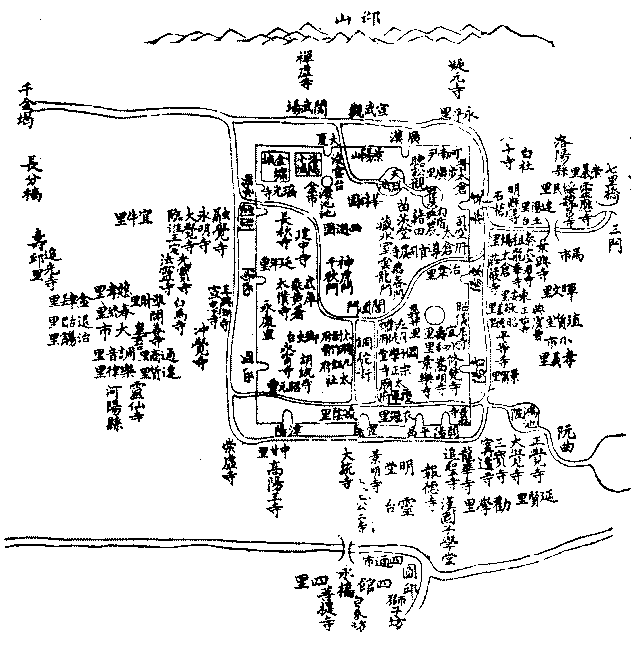

# 洛阳伽蓝记钩沈



> **藏经**：中国佛寺史志汇刊（佛寺志汇刊）　**册次** 第 1 册（GA001）　**编号** GA0003　**卷次** 5 卷　**篇幅** 37,338 字

> **卷／品**：5 卷 · 2 品



---



## 目录



  - [洛阳伽蓝记钩沈序](#洛阳伽蓝记钩沈序)

- [洛阳伽蓝记钩沈卷一](#洛阳伽蓝记钩沈卷一)

  - [原序](#原序)

- [洛阳伽蓝记钩沈卷二](#洛阳伽蓝记钩沈卷二)

- [洛阳伽蓝记钩沈卷三](#洛阳伽蓝记钩沈卷三)

- [洛阳伽蓝记钩沈卷四](#洛阳伽蓝记钩沈卷四)

- [洛阳伽蓝记钩沈卷五](#洛阳伽蓝记钩沈卷五)



---



吴若准既闻顾广圻改定洛阳伽蓝记本注之说於其舅，而有「集证」之作。唯吴本正文太简，子注过繁，其所分析疑与杨记旧观相去甚远，唐晏因是有「洛阳伽蓝记钩沈」之作。晏本满州人，姓瓜尔佳氏，淸社既屋，始改氏唐，光绪八年（一八八二）进士，精於词章书畫金石考据之学。民国四年（一九一五）避居沪上，因嫌吴氏集证『限域未淸，混淆不免，虽少胜於旧编，犹未尽夫尘障』，乃『信手钩乙，数则以后，迎刄而解，都已尽卷。』成此「钩沈」一编。唐氏此书全用水经注体裁，涉及寺事市里第宅，例高一格书；附注概低一格；衒之案语，则作夹行。误字意定，以△别之；考订之字，旁以圈别之。又衒之此书，意在借伽蓝而存时事，故搜采「魏书」、「北史」诸书，於记中人物，皆略注大概，而它有足以引证此书者，亦附焉。吴氏集证附图，亦为改订，仍冠篇首。唯就唐氏凡例案之，亦不无可议者，张宗祥「合校本后记」云：（钩沈本）第五卷原本注文，且误入正文，则亦未为尽合也。』「续修四库全书提要」更擧数例以证其误：如卷一永宁寺浮图一节之「衒之常与河南尹胡孝世共登之下临云雨信哉不虚」等二十一字，应作夹行，而唐本误为注文。又如卷五禅虚寺条「所谓永平里也注即汉太上王广处」，唐本列为正文，张氏则以为『此处「注」字幸存，「即汉太上王广处」六字（彬案：应为七字），明系注文，不得误入正文。』诸如此例，可议尚多。要之衒之此书，本文子注不易别析，苟无如隐以前之古本，强为分析，终不免於千虑之失耳。唐氏钩沈上继吴氏集证而作，下启张氏合校本出，因据民国六年潮阳郑氏刋本景印。因系仅供学者比阅，故「集证」与「钩沈」两本，皆以四合一缩印之。



洛阳伽蓝记总图







------



### 洛阳伽蓝记钩沈序



昔唐刘知几谓洛阳伽蓝记定彼榛楛列为子注斯言已逾千岁而世行本皆刊於明代子注已杂入正文无复分别亦竟无人为料理出之此书遂不可读矣近者之江吴氏创始为之畫分段落正文与注甫得眉目然究嫌其限域未清混淆不免虽少胜於旧编犹未尽夫尘障鄙人索居海上偶展此书觉有会於心乃信手钩乙数则以后迎刃而解都已尽卷未敢谓足揆原编然较各本则有间矣录而存之以备一家之说云尔嗟乎衒之良史才也彼盖身丁元魏之季见夫胡后贪权废长立少诸王酣豢纵欲养骄大臣无元良之佐宦寺逞城社之威文士优柔武夫跋扈遂以酿成河阴之祸故此书於尔朱之乱三致意焉逮夫銮辂西行邦圻迁邺元氏之局告终渤海之基方肇而衒之又所目覩黍离之悲无可寄慨乃於洛阳伽蓝托其怀旧之思焉岂真为彼教之助乎宜其寥寥一篇孤行殆将千二百年而莫之能废也杀青既竟更为条例叙之左方



古人箸书必有一定体裁北魏人箸述在者惟此暨水经注耳故今刊定此书全用水经注体裁  

书记伽蓝自应以寺为主而时事辅之故凡涉及寺事例高一格书而餘文坿之  

名称洛阳则凡市里亦概入正文高一格书之官寺亦然  

凡涉及时人第宅亦高一格然必由里及居不复特出  

此外坿注概为低一格书若坿注之外有杨氏案语则作夹行书所谓注中有注也  

此书误字极多有可考订则再三斟酌而从其一若竟无可从而灼见其为某字间有以意定之者然必以△别之  

此书各本互有不同吴氏别为考异今仿阮氏刻经疏例凡遇考订之字旁以圈别之  

杨氏此书意在借伽蓝而存时事故於元氏诸王及公卿多述其行事而河阴一役言之尤详今搜采魏书及北史凡书中人物皆略注其大概而它有足以引证此书者亦坿焉  

吴氏书有图一纸而小有未合今改订而仍以冠於其首焉



乙卯春二月漯川居士唐晏叙於海上飞尘小住



------



## 洛阳伽蓝记钩沈卷一



### 原序



魏抚军府司马杨衒之譔



三坟五典之说九流百代之言并理在寰区而义兼天外至於一乘二谛之原三明六通之旨西域备详东土靡记自顶日感梦满月流光阳门饰豪眉之像夜台图绀发之形迩来奔竞其风遂广至晋永嘉惟有寺四十二所迨皇魏受图光宅嵩雒笃行弥繁法教逾盛王侯贵臣弃象马如脱屣士庶豪家舍资财若遗迹於是招提栉比宝塔骈罗争写天上之姿竞摹山中之影金刹与灵台比高宫殿共阿房等壮岂直木衣绨绣土被朱紫而已哉暨永熙多难皇舆迁邺诸寺僧尼亦与时徙至武定五年岁在丁卯余因行役重览洛阳城郭崩毁宫室倾覆寺观灰烬庙塔邱墟墙被蒿艾巷罗荆棘野兽穴於荒阶山鸟巢於庭树游儿牧竖踯躅於九逵农夫耕稼蓺黍於双阙麦秀之感非独殷墟黍离之悲信哉周室京城表里凡有一千餘寺今日寥廓钟声罕闻恐后世无传故撰斯记然寺数最多不可徧写今之所录止大伽蓝其中小者取其详世谛事因而出之先以城内为始次及城外表列门名以远近为五篇余才非箸述多有遗漏后之君子详其阙焉



〔魏书〕孝武帝纪永熙三年冬十月高欢推清河王亶子善见为主徙都邺是为东



〔又〕东魏孝静帝第三改元曰武定凡八年武定五年正月高欢死



〔按〕法苑珠林杨衒之官衔作期城郡守而广宏明集则作秘书监右北平人



太和十七年后魏高祖迁都洛阳诏司空公穆亮营造宫室洛阳城门依魏晋旧名东面有三门北头第一曰建春门



汉曰上东门阮籍诗曰步出上东门是也魏晋曰建春门高祖因而不改



〔魏书〕太和十七年冬十月朔世祖如金墉城徵穆亮使与尚书李冲将作大匠董爵经营洛邑



次南曰东阳门



汉曰东中门魏晋曰东阳门高祖因而不改



次南曰青阳门



汉曰望京门魏晋曰青明门高祖改为青阳门



南面有三门东头第一门曰开阳门



初汉光武迁都雒阳作此门始成而未有名忽夜中有柱自来在楼上后瑯琊郡开阳县言南门一柱飞去使来视之则是也遂以开阳为名自魏及晋因而不改高祖亦然



次西曰平昌门



汉曰平门魏晋曰平昌门高祖因而不改



次西曰宣阳门



汉曰津阳门魏晋曰宣阳门高祖因而不改



〔按：水经注〕谷水又南东屈迳津阳门南又东迳宣阳门南又东迳平昌门南又东迳开阳门南是魏时洛阳南面有四门而考之晋书地理志亦云有四门但西头作建阳门疑为津字之误然为四门则无异词此云三门当存疑



西面有四门南头第一门曰西明门



汉曰广阳门魏晋因而不改高祖改为西明门



次北曰西阳门



汉曰雍门魏晋曰西明门高祖改为西阳门



次北曰阊阖门



汉曰上西门上有铜旋玑玉衡以齐七政魏晋曰阊阖门高祖因而不改



次北曰承明门



承明者高祖所立当金墉城前东西大道迁京之始宫阙未就高祖住在金墉城城西有王南寺高祖数诣沙门论义故通此门而未有名世人谓之新门时王公卿士迎驾於新门高祖谓御史中尉李彪曰曹植诗云谒帝承明庐此门宜以承明为称遂名之



〔魏书孝文帝本纪〕太和十九年八月金墉宫成引群臣宴殿堂



北面有二门西头曰大夏门



汉曰夏门魏晋曰大夏门魏明帝造三层楼去地十丈高祖世宗造三层楼去地二十丈洛阳城门楼皆两重去地百尺惟大夏门甍栋干云



东头曰广莫门



汉曰谷门魏晋曰广莫门高祖因而不改自广莫门以西至於大夏门宫观相连被诸城上也



一门有三道所谓九逵



城内



永宁寺



熙平元年灵太后胡氏所立也在宫前阊阖门南一里御道西



其寺东有太尉府西对永康里南界昭玄曹北邻御史台



〔魏书〕宣武帝灵皇后胡氏司徒国珍女也



〔又按〕魏书释老志先是立监福曹太和二十一年改昭元曹备具官属以断僧务世宗即位诏僧犯杀人以上罪者仍依俗断餘付昭元断之



阊阖门御道东有左衞府府南有司徒府司徒府南有国子学堂



内有孔丘像颜渊问仁子路问政在侧



〔魏书本纪〕高祖太和十九年八月立国子太学四门小学於洛阳



〔又〕肃宗正光二年春正月车驾幸国子学讲孝经祠孔子以颜渊配



国子南有宗正寺寺南有太庙庙南有护军府府南有衣冠里御道西有(右卫府府南太尉府府南)有将作曹曹南有九级府府南有太社社南有凌阴里



即四朝时藏氷处也



中有九层浮图一所架木为之举高九十丈有刹复高十丈合去地一千尺去京师百里已遥见之



初掘基至黄泉下得金像三十躯太后以为信法之徵是以营建过度也刹上有宝瓶容二十五石宝瓶下有承露金盘三十重周匝皆垂金铎复有铁锁四道引刹向浮图四角锁上亦有金铎铎大小如一石罋子浮图有九级角角皆悬金铎合上下有一百二十铎浮图有四面面有三户六窗户皆朱漆扉上有五行金钉合五千四百枚复有金环铺首殚土木之功穷造形之巧佛事精妙不可思议绣柱金铺骇人心目至於高风永夜宝铎和鸣铿锵之音闻及十餘里



〔魏书释老志〕肃宗於太社西起永宁寺灵太后亲率百僚表立刹浮图九层高四十餘丈费用不可胜计



浮图北有佛殿一所



形如太极殿中有丈八金像一躯人中长金像十躯绣珠像三躯织成五躯作功奇巧冠於当世僧房楼观一千餘间雕梁粉壁青琐绮疏难得而言括椿松柏扶疏拂簷翠竹香草布护阶墀是以常景碑云须弥宝殿兜率净宫莫尚於斯也



外国所献金像皆在此寺



〔魏书释老志〕大安初有师子国沙门难提等五人奉佛像三到京又沙门赴京师致佛钵并畫像



寺院墙皆施短椽以瓦覆之若今宫墙也四面各开一门南门楼三重通三道去地二十丈形制似今端门



图以云气畫彩仙灵绮钱青琐□赫丽华拱门有四力士四师子饰以金银加之珠玉装严焕炳世所未闻



东西两门皆亦如之所可异者唯楼二重北门一道不施屋似鸟头门



四门外树以青槐亘以绿水京邑行人多庇其下路断飞尘不由奔云之润清风送凉岂籍合欢之发



〔按：水经注云〕永宁寺是曹爽宅经始之日於寺院西南隅得爽窟室下入土可丈许地壁悉垒方石砌之石作细密都无所毁自非曹爽庸匠亦难复制此



诏中书舍人常景为寺碑文



景字永昌河内人也敏学博通知名海内太和十九年为高祖所器拔为律学博士刑法疑狱多访於景正始初诏刊律令永作通式敕景共治书侍御史高僧裕羽林监王元规尚书郎祖莹员外散骑侍郎李琰之等譔集其事又诏太师彭城王勰青州刺史刘芳入预其议景讨正科条商搉古今甚有伦叙见行於世今律二十篇是也又其芳造洛阳宫殿门阁之名经涂邑里之号出除长安令时人比之潘岳其后厯位中书舍人黄门侍郎秘书监幽州刺史仪同三司学徒以为荣焉景入参近侍出为侯牧居室贫俭事等农家惟有经史盈车满架景所著文集数百餘篇给事封𬀩伯作序行於世



〔魏书〕高绰字僧裕渤海蓨人允之孙也厯尚书右丞豫并二州刺史谥文简



〔又〕祖莹字元珍范阳遒人也官至车骑大将军封文安县子以文学知名



〔又〕刘芳字伯文彭城丛亭里人官太子左庶子员外散骑常侍



〔又〕彭城王勰字彦和献文第六子太和九年封始平王改彭城王



〔又〕常景字永昌河内温人爽子



〔又〕李琰之字景珍小字默蠡陇西狄道人车骑将军仪同三司赠司徒谥文简



装饰毕功明帝与太后共登之视宫内如掌中临京师若家庭以其目见宫中禁人不听升



衒之尝与河南尹胡、世孝共登之、下临云雨信哉不虚、时有西域沙门菩萨达摩者、波斯国胡人也起自荒裔来游中土见金盘炫日光照云表宝铎含风响出天外歌咏赞叹实是神功自云年一百五十岁厯涉诸国靡不周徧而此寺精丽徧阎浮所无也极佛境界亦未有此口唱南无或合掌连日



至孝昌二年中大风发屋拔树刹上宝瓶随风而落入地丈餘复命工匠更著新瓶



建义元年太原王尔朱荣总士马於此寺



荣字天宝北地秀容人也世为第一领氐酋长博陵郡公部落八千餘家马有数万匹富等天府泰武元年二月中帝崩无子立临洮王世子钊以绍大业年三岁太后贪秉朝政故以立之荣谓并州刺史元天穆曰皇帝晏驾春秋十九海内士庶犹曰幼君今奉未言之儿以临天下而望升平其可得乎吾世荷国恩不能坐看成败今欲以铁骑三千赴哀山陵兼问侍臣帝崩之由君竟谓如何穆曰明公世跨并土雄才杰出部落之民控弦一万若能行废立之事伊霍复见於今日荣即日共穆结异姓兄弟穆年大荣兄事之荣为盟主穆亦拜荣於是密议长君诸王之中不知谁应当璧遂於晋阳人各铸像不成惟长乐王子攸象光相具足端严特妙是以荣意在长乐遣苍头王丰入洛约以为主长乐即许之共刻期契荣三军皓素扬旌南出太后闻荣举兵召王公议之时胡氏专宠王宗怨望入议者莫肯致言唯黄门侍郎徐纥曰尔朱马邑小胡人才凡鄙不度德量力长戟指阙所谓穷辙拒轮积薪候燎今宿衞文武足得一战但守河桥观其意趣荣悬军千里兵老师敝以逸待劳破之必矣后然纥言即遣都督李神轨郑季明等领众五千镇河桥四月十一日荣过河内至高头驿长乐王从雷陂北渡赴荣军所神轨等见长乐王往遂开门降十二日荣军於邙山之北河阴之野十三日召百官赴驾至者尽诛之王公卿士及诸朝臣死者二千餘人十四日车驾入城大赦天下改号为建义元年是为庄帝於是新经大兵人物歼尽流迸之徒惊骇未出庄帝肇升太极解纲垂仁唯散骑常侍山伟一人拜恩南阙加荣使持节中外诸军事大将军开府北道大行台都督十州诸军事领左右太原王其天穆为侍中太尉公世袭并州刺史上党王起家为公卿牧守者不可胜数二十日洛中草草犹自不安死生相怨人怀异虑贵室豪家弃宅竞窜贫夫贱士襁负争逃於是出诏滥死者普加褒赠三品以上赠三公五品以上赠令仆七品以上赠州牧白民赠镇郡於是稍安帝纳荣女为皇后进荣为柱国大将军录尚书事进天穆为将军餘如故



〔魏书〕尔朱荣字天宝北秀容人也略与此同



〔又〕元天穆高凉王孤之裔长生之子也



〔又〕徐纥博昌人官给事黄门谄附清河王怿又附元乂尔朱入洛奔梁



〔又〕李神轨小名青肫顿邱人荣之子也袭陈留侯征东将军死於河阴



〔又〕山伟字仲才洛阳人官至衞大将军封东阿伯



〔按〕雷陂魏书作高渚



永安二年五月北海王元颢复入洛在此寺聚兵



颢庄帝从兄也孝昌末镇汲郡闻尔朱荣入洛阳遂南奔萧衍是年入洛庄帝北巡颢登皇帝位改元曰建武元年颢与庄帝书曰大道既隐天下匪公祸福不追与能义绝朕犹庶几五帝无取六军正以糠粃万乘锱铢大宝非贪皇帝之尊岂图六合之富直以尔朱荣往岁入洛顺而勤王终为魏贼逆刃加於君亲锋镝肆於卿宰元氏少长殆欲无遗已有陈恒盗齐之心非无六卿分晋之计但以四海横流欲簒未可暂树君亲假相拜置害卿兄弟独夫介立遵养待时臣节讵久朕睹此寒心远投江表泣请梁朝誓在复耻风行建业电复三川正欲问罪於尔朱出卿於桎梏恤深怨於骨肉解苍生於倒悬谓卿明眸击节躬来见我共叙哀辛同讨凶羯不意驾入成皋便尔北渡虽迫於凶手势不自由或䜣生素怀弃劒猜吾闻之永叹抚衿而失何者朕之於卿兄弟非远连枝分叶兴灭相依假有内阋外犹御侮况吾与卿睦厚偏笃其於急难凡今莫如弃亲即讐义将焉据也且尔朱荣不臣之迹暴於旁午谋危社稷愚智同见卿乃明白疑於必然托命豺狼委身虎口弃亲助贼兄弟寻戈假获民地本是荣物若克城邑绝非卿有徒危宗国以广寇仇快贼莽之心假卞庄之利有识之士咸为惭之今国家隆替在卿与吾若天道助顺誓兹义举则皇魏宗社与运无穷脱天不厌乱胡羯未殄鸱鸣狼噬荐食河北在荣为福於卿为祸岂伊异人尺书道意卿宜三复义利是图富贵可保徇人非虑终不食言自相鱼肉善择元吉勿贻后悔此黄门侍郎祖莹之词也时帝在长子城太原王上党王来赴急难六月帝围河内太守元桃汤车骑将军宗正珍孙等为颢守攻之弗克时暑炎赫将士疲劳太原王欲使帝幸晋阳至秋更举大义未决召刘助筮之助曰必克於是至明尽力攻之如其言桃汤珍孙并斩首以徇三军颢闻河内不守亲率百僚出镇河桥特迁侍中安丰王延明往守硖石七月帝至河阳与颢隔河相望太原王命车骑将军尔朱兆潜师渡河破延明於硖石颢闻延明败亦散走所将江淮子弟五千人莫不解甲相泣握手成别颢与数十骑欲奔萧衍至长社为村民斩其首传送京师二十日帝还洛阳进太原王天柱大将军餘官如故进上党王太宰餘官亦如故



〔魏书〕北海王颢详之子也



〔又〕安丰王延明猛之子也与中山王熙及临淮王彧等以才学令望并有名於时元颢败奔梁



〔又〕刘灵助燕郡人卖卜於市尔朱荣信卜筮灵助所占屡中被亲信官至尚书仆射后起兵为高欢所诛



永安三年逆贼尔朱兆囚庄帝於寺



时太原王位极心骄功高意侈予夺臧否肆意帝怒谓左右曰朕宁作高贵乡公死不作汉献帝生九月二十五日诈言产太子荣穆并入朝庄帝手刃荣於光明殿穆为伏兵鲁暹所杀荣世子部、落、大、人、亦、死、焉荣部下车骑将军尔朱阳都等二十人随入东华门亦为伏兵所杀唯右仆射尔朱世隆素在家闻荣死总荣部曲烧西阳门奔河桥至十月一日世隆与荣妻北乡郡长公主至芒山冯王寺为荣追福荐斋即遣尔朱侯讨伐尔朱那律归等领胡骑一千皆白服来至郭下索太原王尸丧帝升大夏门望之遣主书牛法尚谓归等曰太原立功不终阴图衅逆王法无亲已依正刑罪止荣身餘皆不问卿等何为不降官爵如故归曰臣从太原王来朝陛下何忽今日枉致无理臣欲还晋阳不忍空去愿得太原王尸丧生死无恨发言雨泪哀不自胜群胡恸哭声震京师帝闻之亦为伤怀遣侍中朱元龙赍铁券与世隆待之不死官位如故世隆谓元龙曰太原王功格天地造济生民赤心奉国神明所知长乐不顾信誓枉害忠良今日两行铁字何足可信吾为太原王报仇终不归降元龙见世隆呼帝为长乐知其不欵具以言帝帝即出库物置城西门外募敢死之士以讨世隆一日即得万餘人与归等战於郭外凶势不摧归等娄涉戎场便利击刺京师士众未习军旅虽皆勇义力不从心三日频战而游魂不息帝更募人断河桥有汉中人李苗为水军从上流放火烧桥世隆见桥被焚遂大剽生民北上太行帝遣侍中源子恭黄门郎杨寛引步骑三万镇河内世隆至高都立太原太守长广王晔(何本作瓮子)为主改号曰建明元年尔朱氏自封王者八人长广王都晋阳遣颖州尔朱兆举兵向京师子恭军失利兆自雷陂涉渡擒庄帝於式乾殿帝初以黄河奔急谓兆未得猝济不意兆不由舟楫凭流而渡是日水浅不没马腹故及此难书契所记未之有也(衒之曰昔光武受命冰桥凝於滹水昭烈中起的卢踊於泥沟皆理合於天神祇所福故能功济宇宙大庇生民若兆者蜂目豺声行穷枭獍阻兵安忍贼害君亲皇灵有知鉴其凶德反使孟津由膝赞其逆心易称天道祸盈鬼神福谦以此验之信为虚说)时兆营军尚书省建天子金鼓庭设刻漏嫔御妃主皆拥之於幕锁帝於寺门楼上时十二月帝患寒随兆乞头巾兆不与囚帝送晋阳缢於三级寺帝临崩礼佛愿不为国王又作五言曰：



权去生道促　忧来死路长  

怀恨出国门　含悲入鬼乡  

隧门一时闭　幽庭岂复光  

思鸟吟青松　哀风吹白杨  

昔来闻死苦　何言身自当



至太昌元年冬始迎梓宫赴京师葬帝靖陵所作五言诗即为挽歌词朝野闻之莫不悲恸百姓观者悉皆掩涕而已



〔魏书〕尔朱兆字万仁荣从子



〔又〕世隆字荣宗荣从弟



〔又〕李苗字子宣梓潼人兼尚书右丞西北道行台死后谥忠烈



〔又〕长广王晔字华兴小字盆子南安王桢孙



〔又〕朱瑞字元龙代郡桑乾人尔朱荣引为大行台郎中官至侍中封乐陵郡公虽为尔朱所重乃心帝室为世隆所害



〔又〕源子恭字灵顺西平乐都人贺之曾孙也屡争伐立功封临汝县子除中书监谥文献



〔又〕杨寛字蒙仁华阴人华州大中正除澄城县伯尔朱兆入洛奔梁复还魏为大将军



永熙三年二月浮图为火所烧



帝登凌云台望火遣南阳王宝炬录尚书长孙稚将羽林一千救赴火所莫不悲惜垂泪而去火初从弟八级中平旦火发当时雷雨晦冥杂下霰雪百姓道俗咸来观看悲哀之声震动京邑时有三比邱赴火而死火经三月不灭有入地柱火寻柱周年犹有烟气其年五月中有人从象郡来云见浮图於海中光明照耀俨然如新海上之民咸皆见之俄然雾起浮图遂隐至七月中平阳王为侍中斛斯椿所使奔於长安十月而京师迁邺



〔魏书〕文帝宝炬永安二年封南阳王从孝武入关拜太宰录尚书事孝武崩宇文泰率群臣劝进在位十七年



〔又〕长孙嵩曾孙冀归高祖以其幼承家学赐名稚字承业灵太后时除尚书右仆射雍州刺史



建中寺



普泰元年尚书令乐平王尔朱世隆所立也本是阉官司空刘腾宅屋宇奢侈梁栋逾制一里之间廊庑充溢堂比宣光殿门匹乾明门博敞宏丽诸王莫及也在西阳门内御道北所谓延年里



刘腾宅东有太仆寺寺东有乘黄署署东有武库署即魏相国司马文王府武库东至阊阖宫门是也



〔魏书〕刘腾平原人灵太后临朝封长乐公与领军元乂害清河王怿废太后於宣光殿生段之柄决於二人之手内外属请公然受纳逼夺邻居广开室宇腾之治宅也周特筮之不吉止之腾不听特告人曰必困於三月正光四年三月腾死听事甫成陈尸其下



西阳门内御道南有永康里里内复有领军将军元乂宅掘故井得石铭云是太尉荀彧宅



正光年中元乂专权太后幽隔永巷腾为谋主乂是江夏王继之子太后妹壻熙平初明帝幼冲诸王劝上太后拜乂为侍中领军左右令总禁兵委以腹心反得幽隔永巷六年太后哭曰养虎自啮长虺成蛇至孝昌元年太后反政遂诛乂等没腾田宅元乂诛日腾已物故太后追思腾罪发墓残尸使其神灵无所归聚以宅赐高阳王雍建明元年尚书令乐平王尔朱世隆为荣追福题以为寺朱门黄阁所谓仙居也以前厅为佛殿后堂为讲室金华宝盖徧满其中有一凉风堂本腾避暑之处凄凉常冷经夏无蝇有万年千岁之树也



〔魏书〕元乂小字夜叉道武裔孙也乂妻灵太后之妹为太后所信委声势日盛清河王怿裁之以法乂遂杀之遂幽胡太后乂与高阳王辅政肃宗呼为姨父后为高阳王解其兵柄乂解侍中为人告谋反赐死



长秋寺



刘腾所立也腾为长秋令卿因以为名在西阳阳门内御道北一里亦在延年里



即是晋中朝时金市处



〔水经注〕引故洛阳记曰凌云台西有金市金市北对洛阳垒



寺北有蒙泛池



夏则有水冬则竭矣



中有三层浮图一所



金盘灵刹耀诸城内作六牙白象负释迦在虚空中庄严佛事悉用金玉作工之异难可具陈四月四日此像常出辟邪师子导引其前吞刀吐火腾骧一面彩幢上索诡谲不常奇伎异服冠於都市像停之处观者如堵迭相践跃常有死人



瑶光寺



世宗宣武皇帝所立在阊阖门御道北东去千秋门二里



千秋门内道北有西游园园中有凌云台即是魏文帝所筑者台上有八角井高祖於井北造凉风观登之远望目极洛川台下有碧海曲池台东有宣慈观去地十丈观东有灵芝钓台累木为之出於海中去地二十丈风生户牖云起栋梁丹楹刻桷图写列仙刻石为鲸鱼背负钓台既如从地踊出又似空中飞下钓台南有宣光殿北有嘉福殿西有九龙殿殿前九龙吐水成一海凡四殿皆有飞阁向灵芝台往来三伏之月皇帝在灵芝台以避暑



〔三国志文帝纪〕黄初二年筑凌云台



〔太平御览〕引晋宫阁名曰灵芝池广长百五十步深二丈上有连楼飞观四出阁道钓台中有鸣鹤舟指南舟以此考之则灵芝之名不始元魏也



有五层浮图一所去地五十丈



仙掌凌虚铎垂云表作工之妙美埒永宁讲堂尼房五百餘闲绮疏连亘户牖相通珍木香草不可胜言牛筋狗骨之木鸡头鸭脚之草亦悉备焉椒房嫔御学道之所掖庭美人竝在其中亦有名族处女性爱道塲落发辞亲来依此寺屏珍丽之饰服修道之衣投心八正归诚一乘永安三年尔朱兆入洛阳纵兵大掠时有秀容胡骑数十人入寺淫秽自此后颇获讥讪京师语曰洛阳男儿急作髻瑶光寺尼夺作壻



瑶光寺北有承明门有金墉城



即魏氏所筑晋永康中惠帝幽於金墉城城东北角有魏文帝百尺楼年岁久远形制如初高祖在城内作光极殿因名金墉城门为光极门又作重楼飞阁徧城上下从地望之有如云也



〔水经注〕皇居创徙宫极未就止跸於此搆宵榭於故台南曰乾光门夹建两观观下列朱桁於堑以为御路东为含春门北有趯门城上东西列观五十步一睥睨屋台置一钟以和漏鼓西北连庑函荫墉比广榭炎夏之日高祖常以避暑为渌水池一所在金墉者也



东有洛阳小城



永嘉中所筑



〔水经注〕谷水径洛阳小城北因阿旧城凭结金墉故向城也永嘉之乱结以为垒号洛阳垒故洛阳记曰西有金市凌云台北对洛阳垒者也



景乐寺



太傅清河文献王怿所立也



怿是孝文皇帝之子宣武帝之弟



〔魏书〕怿宇宣仁太和二十一年封为孝文及彭城王所器后为元乂刘腾所害



阊阖南御道东西望永宁寺正相当寺西有司徒府东有大将军高肇宅北连义井里



义井里北门外有丛树数十株枝条繁茂下有甘井一所石槽铁罐供给行人饮水庇荫多有憩者



〔魏书外戚传〕高肇北海人文昭皇后之兄也父飏自高丽入国肇封平原郡公尚世宗姑官大将军顺宗崩世言肇为之又杀北海王详搆京兆王愉愉遂举兵反又杀彭城王勰后为高阳王雍拉杀之



有佛殿一所像辇在焉



雕刻巧妙冠绝一时堂庑周环曲房连接轻条拂户花蕊被庭至於六斋常设女乐歌声绕梁舞袖徐转丝管寥亮谐妙入神以是尼寺丈夫不得入得往观者以为至天堂及文献王薨寺禁稍宽百姓出入无复限碍后汝南王悦复修之悦是文献之弟召诸音乐逞技寺内奇禽怪兽舞忭殿庭飞空幻惑世所未覩异端奇术总萃其中剥驴扳并植枣种瓜须臾之闲皆得赐食士女观者目乱睛迷自建义以后京师频有大兵此戏遂隐也



昭仪尼寺



阉宦所立也在东阳门内一里御道南东阳门内御道北太仓导官二署东南治粟里仓司官属住其内



太后临朝阉寺专宠宦者之家积金满堂是以萧忻云高轩升斗者尽是阉宦之嫠妇胡马鸣珂者莫非黄门之养息也忻阳平人也爱尚文籍少有名誉见阉寺宠盛遂发此言因即知名为治书侍御史



有一佛二菩萨



塑工精绝京师所无也四月七日常出诣景明景明三像恒出迎之伎乐之盛与刘腾相比



堂前有酒树面木昭仪寺有池



京师学徒谓之翟泉也(衒之按杜预春秋注云翟泉在晋太仓西南按晋太仓在建春门内今太仓在东阳门内此地今在太仓西南明非翟泉也)后隐士赵逸云此地是晋侍中石崇家池池南有绿珠楼於是学徒始寤经过者想见绿珠之容也



池南有愿会寺中书舍人王翊舍宅立也



佛堂前有桑树一株直上五尺枝条横绕柯叶㫄布形如羽盖复高五尺又然凡为五重每重叶椹各异京师道俗谓之神桑观者成市布施者甚众帝闻而恶之以为惑众命给事中黄门侍郎元纪伐之其日云雾晦冥下斧之处血流至地见者莫不悲泣



〔魏书〕王翊字士游肃次兄深子也好学有文才结婚於元乂为济州刺史入为金紫光禄大夫卒赠司空史不言为中书舍人



寺南有宜寿里内有苞信县令段晖宅



地下常闻钟声时见五色光明照於堂宇晖甚异之遂掘光所得金像一躯可高三尺并有二菩萨趺上铭曰晋太始二年侍中中书监荀勗造晖遂舍宅为光明寺时人咸云此荀勗旧宅其后盗者欲窃此像像与菩萨合声喝贼盗者惊怖应即殒倒众僧闻像呌声遂来捉得贼



胡统寺



太后从姑所立也入道为尼遂居此寺在永宁南一里



宝塔五重金刹高耸洞房周匝对户交疏朱柱素壁甚为佳丽其寺诸尼帝城名德善於开导工谈义理常入宫与太后说法其资养缁流从无与比也



修梵寺



在青阳门内御道北嵩明寺复在修梵寺西并雕墙峻宇比屋连甍亦是名寺也



修梵寺有金刚鸠鸽不入鸟鹊不栖菩提达摩云得其真相也



寺北有永和里汉太师董卓之宅也



里南北皆有池卓之所造今犹有水冬夏不竭



里中太傅录尚书长孙稚尚书右仆射郭祚吏部尚书邢峦廷尉卿元洪超衞尉卿许伯桃凉州刺史尉成兴等六宅



皆高门华屋斋馆敞丽楸槐荫途桐杨夹植当世名为贵里掘此地者辄得金玉宝玩之物邢峦家常掘丹砂及钱数十万铭云董太师之物后卓夜中随峦索此物峦不与之经年峦遂卒矣



〔魏书〕郭祚字季祐太原人尚书右仆射领太子少师谥文贞



〔又〕邢峦字洪滨河间人官殿中尚书谥文定



〔又〕元洪超辽西公意烈之元孙也北军将军光禄大夫本传不言为廷尉卿



〔又〕尉聿字成兴代人尉古真之族元孙官武衞将军见元乂长揖不拜出为凉州刺史



景林寺



在开阳门内御道东



讲殿曡起房屋连属丹槛炫日绣桷迎风实为胜地寺西有园多饶奇果春鸟秋蝉鸣声相续



有禅房一所内置泜洹清舍



形制虽小巧构难比加以禅阁虚静隐室凝邃嘉树夹牖芳杜匝阶虽云朝市想同岩谷静行之僧绳坐其内餐风服道结跏数息



有石铭一所国子博士卢白头为其文



白头一字景裕范阳人也性爱恬静邱园放傲学极六经说通百氏普泰初起家为国子博士虽在朱门以注述为事注周易行之於世也



〔魏书〕卢景裕字仲儒小字白头元族孙



建春门内御道南有句盾典农籍田三署籍田南有司农寺御道北有空地拟作东宫晋中朝时太仓处也太仓南有翟泉周回三里即春秋所谓王子虎晋狐偃盟於翟泉也



水犹澄清洞底明净鳞甲潜藏辨其鱼鳖



高祖於泉北置河南尹晋中朝时步广里也泉西有华林园高祖以泉在园东因名苍龙海



华林园中有大海即汉天渊池池中犹有文帝九华台高祖於台上造清凉殿世宗在海内作蓬莱山山上有仙人馆上有钓台殿并作虹霓阁乘虚来往至於三月褉日季秋己辰皇帝驾龙舟鹢首游於其山



〔魏书〕世祖游华林园观故景阳山郭祚请修之帝曰魏明以奢失之於前朕岂可袭之於后乎



海西有藏冰室



六月出冰以给百官



海西南有景山殿东有羲和岭岭上有温风室山西有姮娥峰峰上有寒露馆并飞阁相通凌山跨谷山北有元武池山南有清暑殿殿东有临涧亭殿西有临危台景阳观山南有百果园果列作林林各有堂



有仙人枣长五寸把之两头俱出核细如针霜降乃熟食之甚美俗传云出昆仑山一曰西王母枣又有仙人桃其色赤表里照彻得严霜乃熟亦出昆仑山一曰王母桃也



△果林南有石碑一所魏明帝所立也题曰苗茨之碑高祖於碑北作苗茨堂



永安中年庄帝马射於华林园百官皆来读碑疑苗字误国子博士李同轨曰魏明英才世称三祖公干仲宣为其羽翼但未知本意如何不得言误也衒之时为奉朝请因即释曰以蒿覆之故言苗茨何误之有众咸称善以为得其旨归



〔按：水经注〕作茅茨堂与此不同或是道元所改耶



〔按：赵一清注水经注云〕公干仲宣羽翼明帝亦未是刘王皆丕客至叡时二人之骨朽久矣



△果林西有都堂有流觞池堂东有扶桑海



凡此诸海皆有石窦流於地下西通谷水东连阳渠亦与翟泉相连若旱魃为虐谷水注之不竭离毕㫄润阳渠泄之不盈至於鳞甲异品羽毛殊类濯波浮浪如似自然也



------



## 洛阳伽蓝记钩沈卷二



城东



明县尼寺



彭城宣王勰所立也在建春门外石桥南



谷水周围绕城至建春门外东入阳渠石桥桥有四柱在道南铭曰汉阳嘉四年将作大匠马宪造逮我孝昌三年大雨颓桥柱始埋没道北二柱至今犹存(衒之按刘澄之山川古今记戴延之西征记并云晋太康元年造此失之远矣按澄之等并生在江表未游中土假因行役暂来经过至於旧事多非亲览闻诸道路便为穿凿误我后学日月已甚)



〔水经注曰〕桥首建两石柱铭云阳嘉四年乙酉壬申诏书以城下漕渠东通河济南达江淮方贡委输所由而至使中谒者魏郡清渊马宪监作石桥梁柱敦敕工匠尽要妙之巧云



〔又按〕道元以此桥水南即刑稽康处亦合二桥为一



有三层塔一所未加庄严寺东有中朝时常满仓



高祖令为租场天下贡赋所聚蓄也



龙华寺



宿衞羽林虎贲等所立也在建春门外阳渠南寺南有租塲里阳渠北有建阳里里有土台高三丈上作二精舍



赵逸云此台是中朝旗亭也上有二层楼悬鼓击之以罢市



有钟一口撞之闻五十里太后以钟声远闻遂移在宫内置凝闲堂前与内讲沙门打为时节孝昌初萧衍子豫章王综来降闻此钟声以为奇异遂造听钟歌词三首行传於世



综字世务伪齐昬主宝卷遗腹子也宝卷临政淫乱吴人苦之雍州刺史萧衍立南康王宝融为主举兵向秣陵事既克捷遂杀宝融而自立宝卷有美人吴景晖时孕综经月衍因纳景晖及综生认为己子小名缘觉封豫章王综形貌举止甚似昬主其母告之令自方便综遂归我圣阙更改名曰赞字世务始为宝卷追服三年丧明帝拜综太尉公封丹阳王永安年中尚庄帝姊寿阳公主字莒犂公主容色美丽综甚敬之与公主语尝自称下官后除齐州刺史加开府及京师倾覆综弃州北走时尔朱世隆专权遣取公主至洛阳世隆逼之公主骂曰胡狗敢夺天王女乎我宁受劒而死不为逆奴所污世隆怒遂缢杀之



〔魏书〕萧赞字德文本名综为南齐东昬遗腹梁武帝子之及长奔魏封丹阳王官至齐州刺史尔朱之乱弃州为沙门按此作世务异乎魏书



璎珞寺



在建春门外御道北所谓建阳里也



即中朝时白社地董威辇所居处



〔按〕董威辇名京晋初逸民晋书有传



里内有璎珞慈善晖和通觉晖元宗圣魏昌熙平崇真因果等十寺



里内士庶二千餘户信崇三宝众僧刹养百姓所供也



宗圣寺



有像一躯高三丈八尺端严殊特相好毕备士庶瞻仰目不暂瞬此像一出市井皆空炎光辉赫独绝世表妙伎杂乐亚於刘腾城东士女多来此寺观看也



崇真寺



比邱惠凝死一七日还活经阎罗王检阅以错名放免惠凝具说过去之事时有五比邱同阅一比邱云宝明寺智圣坐禅苦行得升天堂有一比邱是般若寺道品以诵四十卷涅槃亦升天堂有一比邱云是融觉寺昙谟最讲涅槃华严领众千人阎罗王云讲经者心怀彼我以骄凌物比邱中弟一麤行今惟试坐禅诵经不问讲经其昙谟最曰贫道立身以来惟好讲经实不谙诵阎罗王敕付司即有青衣十人送昙谟最向西北门屋舍皆黑似非好处有一比邱云是禅林寺道宏自云教化四辈檀越造一切经人中金象十躯阎罗王曰沙门之体必须摄身守道志在禅诵不干世事不作有为虽造作经象正欲得他财物既得他物贪心即起既怀贪心便是三毒不除具足烦恼亦付司仍与昙谟最同入黑门有一比邱云是灵觉寺宝明自云出家之前尝作陇西太守造灵觉寺成即弃官入道虽不禅诵礼拜不缺阎罗王曰卿作太守之日曲理枉法劫夺民财假作此寺非卿之力何劳说此亦付司青衣送入黑门太后闻之遣黄门侍郎徐纥依惠凝所说即访宝明寺城东有宝明寺城内有般若寺城西有融觉禅林灵觉等三寺问智圣道品昙谟最道宏宝明等皆实有之议曰人死有罪福即请坐禅僧一百人常在殿内供养之诏不听持经像沿涂乞索若私有财物造经像者任意凝亦入白鹿山小隐修道自此以后京师比邱悉皆禅诵不复以讲经为意



出建春门外一里餘至东石桥西北而行晋太康元年造桥南有魏时马市刑嵇康之所也桥北大道西有建阳里大道东有绥民里里内有河间刘宣明宅



神龟年中以直谏忤旨斩於都市讫目不瞑尸行百步时人谈以枉死宣明少有名誉精通经史危行及於诛也



魏昌尼寺



阉官瀛州刺史李次寿所立也在里东南角即中朝牛马市处也



刑嵇康之所临东石桥此桥南北行晋太康元年中朝时市南桥也澄之等盖见此桥铭因而以桥为太康所造也



石桥南道有景兴尼寺亦阉官等所共立也



有金像辇去地三尺施宝盖四面垂金铃七宝珠飞天伎乐望之云表作工甚精难可扬搉像出之日常诏羽林一百人举此像丝竹杂伎皆由旨给



建阳里东有绥民里里内有洛阳县临渠水



县门外有洛阳令杨机清德碑



〔魏书〕杨机字显畧天水冀人少有志节为京兆王中尉王甚敬惮之为洛阳令京辇伏其威风希有干犯凡诉讼者一经其前后皆识其姓名并记其事理世咸异之官至度支尚书为高欢所害



绥民里东崇义里里内有京兆人杜子休宅



地形显敞门临御道时有隐士赵逸云是晋武时人晋朝旧事多所记录正光初来至京师见子休宅叹息曰此宅中朝时太康寺也时人未信遂问寺之由绪逸曰龙骧将军王濬平吴之后始立此寺本有三层浮图用甎为之指子休园中曰此是故处子休掘而验之果得甎数十万兼有石铭云晋太康六年岁次乙巳九月甲戌朔八日辛巳仪同三司(襄阳侯王濬敬)造时园中果菜丰蔚林木扶疏乃服逸言号为圣人子休遂舍宅为灵应寺所得之甎还为三层浮图好事者寻逐之问晋朝京师何如今日逸曰晋时民少於今日王侯第宅与今日相似又云自永嘉以来二百餘年建国称王者十有六君皆游其都邑目见其事国灭之后观其史书皆非实录莫不推过於人引善自向符生虽勇而好酒亦仁而不杀观其治典未为凶暴及详其史天下之恶皆归焉符坚自是贤主贼君取位妄书生恶凡诸史官皆此类也人皆贵远贱近以为信然当今之人亦生愚死智惑已甚矣人问其故逸曰生时中庸之人耳及其死也碑文墓志莫不穷天地之大德尽生民之能事为君共尧舜连衡为臣与伊皋等迹牧民之官浮虎慕其清尘执法之吏埋轮谢其梗直所谓生为盗跖死为夷齐佞言伤正华词损实当时搆文之士慙逸此言步兵校尉李澄问曰太尉府前甎浮图形制甚古犹未崩坏未知早晚造逸曰晋义熙十二年刘裕伐姚泓军人所作汝南王闻而异之拜为义父因而问何所服饵以致长年逸曰吾不闲养生自然长寿郭璞尝为吾筮云寿年五百岁今始逾半帝给步挽车一乘游於市里所经之处多记旧迹三年已后遁去莫知所在



〔魏书〕汝南王悦好读佛书览书史为性不伦有崔延夏者以左道干悦教服松术之剂冀以得仙悦惑之遂断酒肉梁稻惟啖麦饭



崇义里东有七里桥以石为之



中朝时杜预之荆州出顿之所也



七里桥东一里郭门开三道时人号为三门



离别多云相送三门外京师士子送去迎归常在此处也



庄严寺



在东阳门外一里御道北所谓东安里也北为租场里内有驸马都尉司马悦济州刺史介宣幽州刺史李真奴豫州刺史公孙骧四宅



〔魏书〕司马悦字庆宗晋宣帝弟馗之八世孙也官至豫州刺史封渔阳子



〔又按〕悦子朏官驸马都尉尚华阳公主



〔又〕李䜣字元盛小名真奴范阳人也为湘州刺史迁司空封范阳公以罪诛



秦太上君寺



胡太后所立也在东阳门外二里御道北所谓晖文里



当时太后正号崇训母仪天下号父为秦太上公母为秦太上君为母追福因以名焉中有五层浮图一所修刹入云高门向街佛事庄饰等於永宁诵室禅堂周流重曡花林芳草遍满阶墀常有大德名僧讲一切经受业沙门亦有千数



〔魏书〕胡国珍灵太后父太后追崇其母为秦太上君



里内有太保崔光太傅李延实冀州刺史李韶秘书郑道昭等四宅



竝丰堂崛起高门洞开赵逸云晖文里是晋马道里延实宅是蜀主刘禅宅延实宅东有修和宅是吴王孙皓宅李韶宅是晋司空张华宅太傅李延实者庄帝舅也永安年中除青州刺史临去奉辞帝谓实曰怀甎之俗世号难治舅宜好用心副朝廷所委实答曰臣年迫桑榆气同朝露人间稍远日近松邱臣已久乞闲退陛下渭阳兴念宠及老臣使夜行罪人裁锦万里谨奉明敕不敢失坠时黄门侍郎杨宽在帝侧不晓怀甎之义私问舍人温子升子升曰闻至尊兄彭城王作青州刺史问其宾客从至青州云齐土之民风俗浅薄虚论高谈专在荣利太守初欲入境皆怀甎叩首以美其来及其代下还家以甎击之言其向背速於反掌是以京师谣语曰狱中无系囚舍内无青州假令家道恶腹中不怀愁怀甎之义起在於此也颍川荀济风流名士高鉴妙识独出当世清河崔叔仁称齐士大夫曰齐人外矫仁义内怀鄙吝轻同羽毛利等锥刀好驰虚誉阿坿成名威势所在侧肩竞入求其荣利甜然浓泗譬於四方慕势最甚号齐士为慕势诸郎临淄官徒布在京邑闻怀甎慕势咸共耻之惟崔孝忠一人不以为意问其故孝忠曰营邱风俗太公餘化稷下儒林礼义所出今虽凌迟足为天下模楷荀济人非许郭不识东家虽复莠言自口未宜荣辱也



〔魏书〕崔光字长仁清河人官至侍中封平恩侯赠太傅



〔又〕又李延实字禧陇西人尚书仆射冲之子袭父爵清泉侯庄帝即位封濮阳郡公司徒出为青州刺史为尔朱兆所害



〔又〕又李韶字元伯宝之孙也官至冀定二州刺史



〔又〕郑道昭字僖伯荥阳人羲之子官至秘书监



〔又〕崔叔仁清河人休子骠骑将军　州刺史



〔又〕崔孝忠博陵安平人修子官秘书郎



〔又〕温子升字鹏举太原人为广阳王渊贱客常景见其文而善之始知名永熙中为侍读兼舍人后为高洋饿死於狱



〔又〕荀济字子通颍川人世为梁人与梁武为布衣交后奔魏为高澄所杀



〔戴延之西征记曰〕东阳门外道北吴蜀二主弟宅去城二里墟基犹存



正始寺



百官等所立也正始中立因以为名在东阳门外御道南所谓敬义里也里内有典虞曹



簷宇精净美於景林众僧房前高林对牖青松绿柽连枝交映多有枳树而不中食有石碑一枚背上有侍中崔光施钱四十万陈留侯李崇施钱二十万自餘百官各有差少者不减五千以下后人刊之



〔魏书〕李崇字继长顿邱人袭爵陈留公官侍中



敬义里南有昭德里里内有尚书仆射游肇御史尉李彪七兵尚书崔休幽州刺史当景司农张伦等五宅



彪景出自儒生居室俭素唯伦最为豪侈斋宇光丽服玩精奇车马出入逾於邦君园林山池之美诸王莫及伦造景阳山有若自然其中重岩复岭嵚崟相属深谿洞壑逦迤连接高林巨树足使日月蔽亏悬葛垂萝能令风烟出入崎岖石路似壅而通峥嵘涧道盘纡复直是以山情野性之士游以忘归天水人姜质志性疏诞麻衣葛巾有逸民之操见偏爱之如不能已遂造亭山赋行传於世其辞曰今重偏重者爱(按此有缺字)昔先民之重由朴由纯然则纯朴之体与造化而梁津濠上之客柱下之史悟无为以明心托自然以图志辄以山水为富不以章甫为贵任兴浮沈若澹兮无味今司农张氏实鍾其人巨量接於物表夭矫洞达其真青松未胜其洁白玉不比其珍心托空而栖有情入古以如新既不专流宕又不偏华尚卜居动静之闲不以山水为忘庭起半邱半壑听以目达心想进不入声荣退不为隐放尔乃决石通泉拔岭岩前斜与危云等并危与曲栋相连下天津之高雾纳沧海之远烟纤列之状如上△古崩剥之势似千年(若乃绝岭悬坡蹭嶝蹉𧿶泉水纡徐如浪峭山石高)下复危多五寻百援十步千过则知巫山弗及未审蓬莱如何其中烟花雾草或倾或颓霜干风枝半耸半垂玉蕋金茎散满阶墀绮目之色列鼻之馨既共绿春等茂复与白雪齐青或言神明之骨阴阳之精天地未解生此异人焉识其名羽徒纷泊色杂苍黄绿头紫颊好翠连芳白鹤生於异县丹足出自它乡皆远来以臻此籍水木以翱翔不忆春於沙漠遂忘秋於高阳非斯人之感至何候鸟之迷方岂下俗之所务实神怪之异趣能造者其必诗敢往者无不赋或就饶风之地或入多云之处□菊岭与梅岑随春秋之所悟远为神仙所赏近为朝士所知求解脱於服珮预参次於山陲子英游鱼於玉质王乔系鹄於松枝謌方丈不足以妙咏此处态多奇嗣宗闻之动魄叔夜听此惊魂恨不能钻地一出醉此山门别有王孙公子逊遁容仪思山念水命驾相随逢岑爱曲值石矜欹庭为仁知之田故能种此石山森列兮草木长育兮风烟孤松既能却老半石亦可留年若不坐卧於其侧春夏兮共游陟白骨兮徒自朽方寸心兮何所忆



〔魏书〕游肇字伯始广平人明根子官至侍中高肇以与己名同欲令改易肇不可元乂杀清河王怿独不下署



〔又〕李彪字道固顿邱人孝文以有史才故赐名官秘书丞参著作



〔又〕崔休字思盛清河人逞元孙官度支七兵殿中三尚书



〔又〕张伦字天念上谷温人衮子官大司农卿



平等寺



广平武穆王怀舍宅所立在青阳门外二里御道北所谓孝敬里也



堂宇宏美林木萧森平台复道独显当世



〔魏书〕广平王怀孝文弟三子大和二十一年封



寺门外有金像一躯高二丈八尺相好端严常有神验国之吉凶先炳祥异



孝昌三年十二月中此像面有悲容两目垂泪徧体皆湿时人号曰佛汗京师士女空市里往而观之有比邱以净緜拭其泪须臾之闲緜湿都尽更换以它緜俄然复湿如此三日乃止明年四月尔朱荣入洛阳诛戮百官死亡涂地至永安二年二月此像复汗士庶复往观之五月北海王入洛庄帝北巡七月北海大败所将江淮子弟五千尽被俘虏无一得还永安三年七月此像悲泣如初每经神验朝野惶惧禁人不听观之至十二月尔朱兆入洛阳擒庄帝崩於晋阳在京宫殿空虚百日无主唯尚书令司州牧乐平王尔朱世隆镇京师商旅四通盗贼不作建明二年长广王从晋阳赴京师至郭外世隆以长广本枝疏远政行无闻逼禅位於广陵王恭是庄帝从父兄也正光中为黄门侍郎见元乂秉权政归近习遂佯哑不预世事永安中遁於上洛山中州刺史泉企执而送之庄帝疑恭奸诈夜遣人盗掠衣物复拔劒欲杀之恭张口以手指舌竟乃不言庄帝信其真患放令归第恭常住龙华寺至时世隆等废长广而立焉禅文曰皇帝咨广陵王恭自我皇魏之有天下也累圣开辅重基衍业奄有万邦光宅四海故道溢百王德渐无外而孝明晏驾人神乏主故柱国大将军大丞相太原王荣地实封陕任惟外相乃心王室大惧崩沦故推立长乐王子攸以续绝业庶九鼎之命日隆七百之祚惟永然群飞未宁横流且及皆狼顾鸱张岳立棋歭丞相一麾大定海内而子攸不顾宗社讐忌勋德招聚轻侠左右壬人遂虐甚剖心痛齐钳齿岂直金版告怨大鸟感德而已於是天下之望俄然已移窃以宸极不可久旷神器岂容无主故权从众议暂驭兆民今六军南迈已次河浦瞻望帝京赧然兴愧自惟寡薄本枝疏远岂宜仰异天情俯乖民望唯王德表生民声高万古往以运属殷忧时遭多难卷怀积载括囊有年今天眷明德民怀奥主厯数允集歌讼同臻乃徐发枢机副兹𥩟属便敬奉玺绶归於别邸王其寅践成业允执厥中虽休勿休日慎一日敬之哉恭让曰天命至重厯数匪轻自非德协三才功济四海无以入选帝图允当师锡臣既寡昧识无先远景命虽降不敢仰承乞收成言以允愚衷又曰王既德应图箓佥属攸归便可允执其中入光大麓不劳挥逊致爽神人恭凡让者三於是即皇帝位改号曰普泰黄门侍郎邢子才为赦文叙述庄帝枉杀太原王之状广陵王曰永安手翦强臣非为失德直以天未厌乱故逢成济之祸谓左右将笔来朕自作之直言门下朕以寡德运属乐推思与亿兆同兹大庆肆省之科一依恒式广陵杜口八载至是始言海内士庶咸称圣君於是封长广为东海王世隆加仪同三司尚书令乐平王餘官如故赠太原王相国晋王加九锡立庙於芒岭首阳上旧有周公庙世隆欲以太原王功比周公故立此庙庙成为火所灾有一柱焚之不尽后三日雷雨震电霹雳击为数段柱下石及庙瓦皆碎於山下复命百官议太原王配飨司直刘季明议曰不合世隆问其故季明曰若配世宗於宣武无功若配孝明亲害其母若配庄帝为臣不终为庄帝所戮以此论之无所配也世隆怒曰卿亦合死季明曰下官既为议臣依礼而言不合圣心俘翦唯命议者咸叹季明不避彊御莫不叹伏焉世隆既有忿言季明终得无患初世隆北叛庄帝遣安东将军史仵龙平北将军杨文义各领兵三千守太行领侍中源子恭镇河内及尔朱兆马首南向仵龙文义等率众先降子恭见仵龙文义等降亦望风溃散兆遂乘胜逐北直入京师兵及阙下矢流王室至是论功仵龙文义各封一千户广陵王曰仵龙文义於王有勋於国无功竟不许时人称帝刚直彭城王尔朱仲远世隆之兄也镇滑台表用其下都督□瑗为西兖州刺史先用后表广陵答曰已能近补何劳远闻世隆侍宴帝每言太原王贪天之功以为己力罪有合死世隆等愕然自是已后不敢复入朝辄专擅国权凶慝滋甚坐符省掾家总万机事无大小先至隆第然后施行天子拱己南面无所干预



〔魏书〕尔朱仲远荣之从弟颇知书计封彭城王性最贪纵后为高欢所败奔梁



永熙元年平阳王入纂大业始造五层塔一所



平阳王武穆王少子



诏中书侍郎魏收等为寺碑文至二年五月土木毕工帝率百僚作万僧会



其日寺门外有石象无故自动低头复举竟日乃止帝躬来礼拜怪其诡异中书舍人卢景宣曰石立社移上古有此陛下何怪也帝乃还宫七月中帝为侍中斛斯椿所使奔於长安至十月终而京师迁邺焉



〔齐书〕魏收字伯起鉅鹿下曲阳人魏代官中书侍郎入齐官右仆射



〔又〕斛斯椿字法寿广牧富昌人也厯位司徒太傅封恒山郡公谥文宣



〔又〕孝武帝纪帝内图高欢增置勋府庶子厢别六百人骑厢别二百人阁内部曲千人以斛斯椿为领军使军谋朝政皆决於椿下诏伐梁实谋讨欢己丑帝亲统六军次河桥欢引军东度丙午帝奔长安



景宁寺



太保司徒公杨椿所立也在清阳门外三里御道南所谓景宁里也



高祖迁都洛邑椿创居此里遂分宅为寺因以名之制饰甚美绮柱珠帘椿弟慎冀州刺史慎弟津司空竝立性宽雅贵义轻财四世同居一门三从朝贵义居未之有也普泰中为尔朱世隆所诛后舍宅为建中寺



〔魏书〕杨椿字延寿华阴人厯位太保征东将军为尔朱天光所害弟津字罗汉官至司空



出清阳门三里御道北有孝义里里西北角有苏秦冢冢旁有宝明寺



众僧常见秦出入此冢车马羽仪若今宰相也



孝义里东即是洛阳小市北有车骑将军张景仁宅



景仁会稽山阴人也正光年初从萧保夤归化拜羽林监赐宅城南归正里民闲号为吴人坊南来投化者多居其内近伊洛二水仕其习御里三千餘家自立巷市所卖口味多是水族时人谓为鱼鳖市也景仁住此为耻遂徙居孝义里焉时朝廷方欲招怀荒服待吴人甚厚褰裳渡於江者皆居不次之位景仁无汗马之劳高官通显永安二年萧衍遣主书陈庆之送北海入洛阳僭帝位庆之为侍中景仁在南之日与庆之有旧遂设酒引邀庆之过宅司农卿萧彪尚书右丞张嵩竝在其座彪亦是南人惟有中大夫杨元慎给事中大夫王㫬是中原士族庆之因醉谓萧张等曰魏朝甚盛犹曰五胡正朔之承当在江左秦皇玉玺今在梁朝元慎正色曰江左假息僻居一隅地多湿蛰攒肓虫蚁疆土瘴疠蛙黾共穴人鸟同群短发之君无杼首之貌文身之民禀丛陋之质浮於三江棹於五湖礼乐所不沾宪章弗能革虽复秦餘汉罪△难以华言复闽楚△杂△音不可变改虽立君臣上慢下暴是以刘劭杀父於前休龙淫母於后背逆人伦禽兽不异加以山阴请壻卖夫朋淫於家不顾讥笑卿沐其遗风未沾礼化所谓阳翟之民不知瘿之为丑我魏膺受图箓定鼎崧洛五山为镇四海为家移风易俗之典与五帝而竝迹礼乐宪章之盛凌百王而独高宜卿鱼鳖之徒慕义来朝饮我池水啄我稻粱何为不逊以至於此庆之等见元慎清辞雅句纵横奔发杜口流汗含声不言於后数日庆之遇病心上急痛访人解治元慎自云能解庆之遂凭元慎元慎即口含水噀庆之曰吴儿之鬼住居建康小作冠帽短制衣裳自呼阿侬语则阿㫄菰稗为饭茗饮作浆呷啜鳟羹唼嗍蟹黄手把豆蔻口嚼槟榔乍至中土思忆本乡急手速去还尔丹阳若其寒门之鬼□头犹修网鱼漉鳖在河之洲咀嚼菱藕捃拾鸡头蛙羹蚌臛以为膳羞布袍芒屦倒骑水牛沅湘江汉鼓櫂遨游随波溯浪𪡋喁沈浮白纻起舞扬波发讴急手速去还尔扬州庆之伏枕曰杨君见辱深矣自此后吴儿更不敢解语北海寻伏其诛庆之奔还萧衍衍用为司州刺史钦重北人特异於常朱异怪而问之曰自晋宋以来号洛阳为荒土此中谓长江以北尽是夷狄昨至洛阳始知衣冠士族竝在中原礼仪富盛人物殷阜耳目所识口不能传所谓京邑翼翼四方之则如登泰山者卑培𪣻涉江海者小沅湘北入安可不重庆之因是羽仪服式悉如魏法江表士庶竞相模楷褒衣博带被及秣陵元慎宏农人晋冀州刺史峤六世孙曾祖泰从宋武入关为上洛太守七年背伪来朝明帝赐爵临晋侯广武郡陈郡太守赠凉州刺史谥烈侯祖抚明经为中博士父辞自得邱壑不事王侯叔父许河南令蜀郡太守世以学行著闻名高州里元慎清尚卓逸少有高操任心自放不为时羁乐山爱水好游林泽博识文渊清言入神造次应对莫有称者读老庄善言元理性嗜酒饮至一石神不乱常慷慨叹不得与阮籍同时生不愿仕宦为中散常辞疾退闲未尝修敬诸贵亦不庆吊亲知诸贵为交友故时人弗识也或有人慕其高义投刺在门元慎称疾高卧加以意思深长善於解梦孝昌元年广阳王渊初除仪同三司总众十万讨葛荣夜梦著衮衣倚槐树而立以为吉徵问於元慎曰三公之祥渊甚悦之元慎退还告人曰广阳死矣槐字是木㫄鬼死后当得三公广阳果为葛荣所杀追赠司空公终如其言建义初阳城太守薛令伯闻太原王诛百官立庄帝(弃郡东走忽梦射得)雁以问元慎元慎曰卿执羔大夫执雁君当得大夫之职俄然令伯除为谏议大夫京兆许超梦盗羊入狱问於元慎曰君当得阳城令其后有功封阳城侯元慎解梦义出万途随意会情皆有神验虽令与侯小乖按令今百里即是古诸侯以此论之亦为妙著时人譬之周宣及尔朱兆入洛阳即弃官与华阴隐士王腾周游上洛山



〔南史〕陈庆之字子云义兴国山人也官至南北司州刺史封永兴县侯



〔魏书〕广阳王渊嘉之子也



〔南史〕朱异钱塘人以荐为通事舍人至侍中劝纳侯景遂以亾梁



孝义里东市北植货里



里有太常民刘胡兄弟四人以屠为业永安年中胡杀猪猪忽唱乞命声及四邻人谓胡兄弟相敺鬬而来观之乃猪也即舍宅为归觉寺合家人入道焉普泰元年此寺金象生毛眉发悉皆具足尚书右丞魏季景谓人曰张天锡有此事其国遂灭此亦不祥之徵至明年而广陵被废死焉



〔魏书〕魏季景鉅鹿下曲阳人有文才与子才子收齐名洛中号两邢二魏厯大司农卿魏郡尹



------



## 洛阳伽蓝记钩沈卷三



城南



景明寺



宣武皇帝所立也景明年中立因以为名在宣阳门外一里御道东



其寺东西南北方五百步前望嵩山少室却负帝城青林垂影绿水为文形胜之地爽垲独美山县台观光盛一千餘闲复殿重房交疏对霤青台紫阁浮道相通虽外有四时而内无寒暑房簷之内皆是山池松竹兰芷垂列阶墀含风团露流香吐馥



至正光年中太后始造七层浮图一所



去地百仞是以邢子才碑文云俯闻激电㫄属奔星是也妆饰华丽侔於永宁金盘宝铎焕烂霞表



〔魏书〕释老志永宁寺浮图高四十丈景明寺亦其亚也



寺有三池△雈蒲蔆藕水物生焉



或黄甲紫鳞出没於蘩藻或青凫白雁沈浮於渌水𪿵硙舂簸皆用水功伽蓝之妙最为称首



时世好崇福四月七日京师诸象皆来此寺尚书祠部曹录象凡有一千餘躯至八日以次入宣阳门向阊阖宫前受皇帝散花



於是金花映日宝盖浮云幡幢若林香烟似雾梵乐法音聒动天地百戏腾骧所在骈比名僧德众负锡为群信徒法侣持花成薮车骑填咽繁衍相倾时有西域胡沙门见此唱言佛国



至永熙中始诏国子祭酒邢子才为寺碑文



子才河闲人也志性通敏风雅润朗下帷覃思温故知新文宗学府腾班马而孤上英规胜范陵许郭而独高是以衣冠之士辐辏在门怀道之宾去来满室升其堂者犹登孔氏之门沾其赏者若得东吴之句藉甚当时声驰遐迩正光末解褐为世宗挽郎奉朝请寻进中书侍郎黄门子才洽闻博见无所不通军国制度罔不访及自王室不靖虎门业废复迁国子祭酒谟训上庠子才罚惰赏勤专心劝诱青领之生竞怀雅术洙泗之风兹焉复盛永熙末年以母老辞帝不许之子才辞请恳至涕泪俱下帝乃许之诏以光禄大夫归养私庭所在之处给事力五人岁一朝以备顾问王侯祖道若汉朝之送二疏暨皇居徙邺民讼殷繁前格后诏自相予夺法吏疑狱簿领成山乃敕子才与散骑常侍温子升撰麟趾新制十五篇省府以之决疑州郡用为治本武定中除骠骑大将军西兖州刺史为政清静吏民安之复徵为中书令时戎马在郊朝廷多事国朝礼仪咸自子才出所制诗赋诏策章表碑颂赞记五百篇皆传於世邻国钦其模楷朝野以为美谈也



〔按〕邢子才传在北齐书



〔又按〕魏书彭城王勰为高肇所搆无罪见害景明报德二寺千餘僧鸣钟将斋闻勰薨皆嗟叹不食饮水而罢



大统寺



在景明寺西所谓利民里寺南有三公令史高显略宅



每於夜见赤光行於堂前如此者非一向光明所掘地丈餘得黄金千斤铭云苏秦家金得者为吾造功德显略遂造招福寺以是△人谓此地是苏秦旧宅当时元乂秉政闻其得金就略索之以二十斤与之(衒之按苏秦时未有佛法功德者不必是寺应是碑铭之类颂其声迹也)



东有秦太上公二寺在景明南一里西寺太后所立东寺皇姨所造竝为父追福因以名之时人号为双女寺



竝门邻洛水林木扶疏布叶垂阴各有五层浮图一高五十丈素彩布工比於景明至於六斋常有中黄门一人监护僧舍衬施供具诸寺莫及焉



东寺有灵台一所



基址虽颓犹高五丈餘即是汉光武所立者灵台东辟雍是魏武所立者至我正光中造明堂於辟雍之西南上圆下方八窗四▆



汝南王复造甎浮图於灵台之上



孝昌初妖贼四侵州郡失据朝廷设募征格於明堂之上从戎者拜旷野将军偏将军裨将军当时甲胄之士号明堂队时有虎贲骆子渊者自云洛阳人昔孝昌年戍在彭城其同营人樊元宝得假还京师子渊附书一封令达其家云宅在灵台南近洛水卿即是至彼家人自出相看元宝如其言至灵台南了无家人可问徙倚欲去忽见一老翁来问何从而来㫄皇於此元宝具向道之老翁云是吾儿也取书引元宝入遂见馆阁崇寛屋宇佳丽既坐命婢取酒须臾见婢抱一死小儿而过元宝初甚怪之俄而酒至色甚红香美异常兼设珍羞海陆具备饮讫辞还老翁送元宝出云后会难期以为凄恨别甚殷勤老翁还入元宝不复见其门巷但见高岸对水渌波东倾唯见一童子可年十四五新溺死鼻中出血方知所饮酒是其血也及还彭城子渊已失矣元宝子渊同戍三年不知是洛水之神也



报德寺



高祖孝文皇帝所立也为冯太后追福在开阳门外三里开阳门御道东有汉国子学堂堂前有三种字石经二十五碑



表里刻之写春秋二部作篆科蚪隶三种字汉右中郎将蔡邕笔之遗迹也犹有十八碑餘皆残毁复有石碑四十八枚亦表里隶书写周易尚书公羊礼记四部又赞学碑一所竝在堂前魏文帝作典论六碑至太和十七年犹有四碑



高祖题为劝学里里有大觉三宝宁远三寺武定四年大将军迁石经於邺



〔魏书〕释老志太和四年诏以鹰坊为报德寺



〔又〕世宗二年於恒农郡荆山造珉玉丈六像迎置洛滨报德寺世宗躬亲致敬



〔通鉴〕东魏武定四年丞相欢如邺高澄迁洛阳石经五十二碑於邺



周回有园珍果出焉有大谷棃重十斤从树著地尽化为水如承光之柰承光寺亦多果木柰味甚美冠於京师



劝学里东有延贤里里内有正觉寺尚书令王肃所立也



肃字恭懿琅邪人伪齐雍州刺史奂之子也赡学多通才辞美茂为齐秘书丞太和十八年背逆归顺时高祖新营洛邑多所造制肃博识旧事大有禆益高祖甚重之常呼王生延贤之名因肃立之肃在江南日聘谢氏为妻及至京师复尚公主其后谢氏入道为尼亦来奔肃见肃尚主谢作五言诗以赠之其诗曰：



本为簿上蚕　今作机上丝  

得路逐胜去　颇忆纒緜时



公主代肃答谢云：



针是贯线物　目中恒任丝  

得帛缝新去　何能纳故时



甚有愧谢之色遂造正觉寺以憩之肃忆父非理受祸常有子胥报楚之意毕身素服不听乐时人以此称之肃初入国不食羊肉及酪浆等常饭鲫鱼羹渴饮茗汁京师士子见肃一饮一斗号为漏卮经数年已后肃与高祖殿会食羊肉酪粥甚多高祖怪之谓肃曰卿中国之味也羊肉何如鱼羹茗饮何如酪浆肃对曰羊者是陆产之最鱼者是水族之长所好不同竝各称珍以味言之是有优劣羊比齐鲁大邦鱼比邾莒小国惟茗不中与酪作奴高祖大笑因举酒曰三三横两两纵谁能辨之赐金鍾御史中丞李彪曰沽酒老妪瓮注瓨屠儿割肉与称同尚书右丞甄琛曰吴人浮水自云工伎儿掷绳在虚空彭城王勰曰臣始解此是习字高祖即以金鍾赐彪朝廷服彪聪明有知甄琛和之亦速彭城王谓肃曰卿不重齐鲁大邦而爱邾莒小国肃对曰乡曲所美不得不好彭城王重谓曰卿明日顾我为卿设邾莒之飧亦有酪奴因此复号茗饮为酪奴时给事中刘缟慕肃之风专习茗饮彭城王谓缟曰卿不慕王侯八珍好苍头水厄海上有逐臰之夫里内有学颦之妇以卿言之即是也其彭城王家有吴奴以此言戏之自是朝贵燕会虽设茗饮皆耻不复食唯江表残民远来降者好之后萧衍子西丰侯萧正德归降时元乂欲为之设茗饮先问卿於水厄多少正德不晓乂意答曰下官虽生长水乡而立身已来不遭阳侯之难元乂与举座之客大笑焉



〔魏书〕王肃传与此大同



〔又〕甄琛字思伯中山无极人少敏悟学览经史颇有刀笔官至车骑将军侍中谥孝穆



〔梁书〕萧正德文帝子临川王宏之此云萧衍子盖缘正德入北自称梁太子也



龙华寺



广陵王所立也追圣寺北海王所立也竝在报德寺之东



法事僧房比秦太上公京师寺皆种杂果而此二寺园林茂盛莫与之争



〔北史〕广陵王欣传欣字庆乐初封沛王好营产业多所树艺京师名果皆出其园



〔又〕北海王详字季豫献文帝弟七子太和九年封



宣阳门外四里至洛水上作浮桥所谓永桥也



神龟中常景为勒铭其辞曰：



浩浩大川　泱泱清洛  

导源熊耳　控流巨壑  

纳谷吐伊　贯周淹亳  

近达河宗　远朝海若  

兆惟洛食　实曰土中  

上应张柳　下据河崧  

寒暑攸叶　日月载融  

帝世光宅　圅夏同风  

前临少室　却负太行  

制岩东邑　峭峘西疆  

四险之地　六达之庄  

恃德则固　失道则亾  

详观古昔　列见邱坟  

乃禅乃革　或质或文  

周餘九裂　汉季三分  

魏风衰晚　晋景雕曛  

天地发辉　图书受命  

皇建有极　神功无竞  

魏箓仰天　元符握镜  

玺运会昌　龙图受命  

乃睠书轨　永怀保定  

敷兹景迹　流美洪谟  

袭我冠冕　正我神枢  

水陆兼会　周郑交衢  

爰勒洛汭　敢告中区



南北两岸有华表举高二十丈华表上作凤皇似欲冲天势



〔魏书〕常景传萧综降附徐州清复遣景兼尚书持节驰与行台都督观机部分景行经洛汭乃作铭曰



永桥以南圆邱以北伊洛之闲夹御道有四夷馆道东有四馆一名金陵二名燕然三名扶桑四名崦嵫道西有四里一曰归正二曰归德三曰慕化四曰慕义吴人投国者处金陵馆三年已后赐宅归正里



景明初伪齐建安王萧宝夤来降封会稽公为筑宅於归正里后进爵为齐王尚南阳长公主宝夤耻与夷人同列令公主启世宗求入城内世宗从之赐宅於永安里正光四年中萧衍子西丰侯萧正德来降处金陵馆为筑宅归正里正德舍宅为归正寺



〔南史〕萧宝夤字智亮齐明帝六子也封鄱阳王齐亡奔魏后以反诛



北夷来降者处燕然馆三年已后赐宅归德里



正光年芮芮主郁久闾阿那肱来朝执事者莫知所处中书舍人常景议云咸宁中单于来朝晋世处之王公特进下可班那肱蕃王仪同之闲朝廷从其议又处之燕然馆赐宅归德里北(夷酋长遗子入)侍者常秋来春去避中国之热时人谓之雁臣



〔魏书〕正光元年九月壬辰蠕蠕王阿那瓌来奔十一月封朔方郡公十二月诏送北归



东夷来坿者处扶桑馆赐宅慕化里西夷来坿者处崦嵫馆赐宅慕义里



自葱岭已西至於大秦百国千城莫不款坿商胡贩客日奔塞下所谓尽天地之区已乐中国土风因而宅者不可胜数是以坿化之民万有餘家门巷修整阊阖填列青槐荫陌绿柳垂庭天下难得之货咸悉在焉别立市於洛水南号曰四通市民闲谓之永桥市伊洛之鱼多於此卖士庶须鲙皆诣取之鱼味甚美京师语曰洛鲤伊鲂贵於牛羊



永桥南道东有白象狮子二坊



白象者永平二年乾罗国胡王所献皆施五彩屏风七宝座床容数人真是异物常养象於乘黄曹象常坏屋败墙走出於外逢树即拔遇墙亦倒百姓惊怖奔走交驰太后遂徙象於此坊师子者波斯国胡王所献也为逆贼万俟丑奴所获留於寇中永安末丑奴破灭始达京师庄帝谓侍中李彧曰朕闻虎见师子必伏可觅试之於是诏近山郡县捕虎以送巩县山阳竝送二虎一豹帝在华林园观之於是虎豹见师子悉皆瞑目不敢仰视园中素育一盲熊性甚驯帝令取试之虞人牵盲熊至闻师子气惊怖跳踉曳锁而走帝大笑普泰元年广陵王即位诏曰禽兽囚之则违其性宜放还山林师子亦令送归本国送师子胡以波斯道远不可送达遂在路杀师子而返有司劾罪以违旨论广陵王曰岂以师子而罪人也遂赦之



菩提寺



西域胡人所立也在慕义里



沙门达多发冢取甎得一人以进时太后与明帝在华林都堂以为妖异谓黄门侍郎徐纥曰上古以来颇有此事否纥曰昔魏时发冢得霍光女壻范明友家奴说汉朝废立与史书相符此不足为异也后即令纥问其姓名死来几年何所饮食死者曰臣姓崔名涵字子洪博陵平安人也父名畅母姓魏家在城西阜财里死时年十五今满二十七在地下十有二年尝似醉卧无所食也时复游行或遇饭食如似梦中不甚辨了后即遣门下录事张秀隽诣准财里访涵父母果得崔畅其妻魏氏秀隽问畅曰卿有儿死否畅曰有一息子涵年十五而死秀隽曰为人所发今日苏活在华林园中主上故遣我来问畅闻惊怖曰实无此儿向者谬言秀隽还具以实陈闻后遣隽送涵向家畅闻涵至门前起火手持刀魏氏把桃枝谓曰汝不须来吾非汝父汝非吾子急手速去可得无殃涵遂舍去游於京巷常宿寺门下汝南王赐黄衣一具涵性畏日不敢仰视又畏水火及兵刃之属常走於逵路遇疲则止不徐行也时人犹谓是鬼洛阳大市北奉终里多卖送死之具及诸棺椁涵谓曰作柏木棺勿以桑木为榱人问其故涵曰吾在地下见人发鬼兵有一鬼诉称是柏棺应免主兵吏曰尔虽柏棺桑木为榱遂不免兵京师闻此柏木涌贵人疑卖棺者货涵为此言也



高阳王寺



高阳王雍之宅也在津阳门外三里御道西雍之为尔朱荣所害也舍宅以为寺



正光中雍为丞相给羽葆鼓吹虎贲班劒百人贵极人臣富兼山海居止第宅匹於帝宫白壁丹楹窈窕连亘飞簷反宇𫐖轕周通童仆六千妓女五百随珠照日罗衣从风自汉晋以来诸王豪侈未之有也出则鸣驺夹道文物成行铙歌发响笳声哀转入则歌妓舞女击筑吹笙丝管迭奏连宵尽日其竹林鱼池侔於禁苑芳草如积珍木连阴雍耆口味厚自奉养一食必以数万钱为限海陆珍羞方丈於前陈留侯李崇谓人曰高阳一食敌我千日崇为尚书令仪同三司亦富倾天下僮仆千人而性多俭恡恶衣麤食常无肉味止有韭薤崇客李元祐语人曰李令公一食十八种人问其故元祐曰二九一十八闻者大笑世人即以为讥骂雍薨后诸伎悉令入道或有嫁者美人徐月华善弹箜篌能为明妃出塞之歌闻者莫不动容永安中与衞将军原士康为侧室宅近清阳门徐鼓箜篌而歌哀声入云行路听者俄而成市徐常语士康曰王有二美姬一名修容一名艳姿竝蛾眉皓齿洁貌倾城修容亦能为绿水歌艳姿善么凤舞竝爱倾后室宠冠诸姬士康闻此遂常令徐渌水么凤之曲焉



〔魏书〕高阳王雍献文帝弟四子也北史称雍岁禄至四万石伎侍盈房荣贵之盛兄弟莫及



高阳宅北有中甘里



里内颍川荀子文年十三幼而聪辨神情卓异虽黄琬文举无以加之正光初广宗潘崇和讲服氏春秋於城东昭义里子文摄齐北面就和受道时赵郡李才问子文曰荀生住在何处子文对曰仆住在中甘里才曰何为住城南城南有四夷馆才以此讥之子文对曰国阳胜地卿何怪也若言川涧伊洛峥嵘语其旧事灵台石经招提之美报德景明当世富贵高阳广平四方风俗万国千城若论人物有我无卿才无以对之崇和曰汝颖之士利如锥燕赵之士钝如锤信非虚言也举学皆笑焉



〔按〕北史儒林传於服氏春秋有潘叔虔当即崇和之字



崇虚寺



在城西即汉之跃龙园也



延熹九年桓帝祠老子於跃龙园设华盖之座用郊天之乐此其地也高祖迁京之始以地给民憩者多见妖怪是以人皆去之遂立寺焉



〔按〕跃龙园后汉书作濯龙苑



------



## 洛阳伽蓝记钩沈卷四



城西



冲觉寺



太傅清河王怿舍宅所立也在西明门外一里御道北



怿亲王之中最有名行世宗爱之特隆诸弟延昌四年世宗崩怿与高阳王雍广平王怀竝受遗诏辅翼孝明时帝始年六岁太后代总万几以怿名德茂亲体道居正事无大小多咨询之是以熙平神龟之际势倾人主第宅丰大逾於高阳西北有楼出凌云台俯临朝市目极京师古诗所谓西北有高楼上与浮云齐者也楼下有儒林馆退宾堂形制竝如清暑殿土山钓台冠於当世斜峰入牖曲沼环堂树响飞嘤阶丛花药怿爱宾客重文藻海内才子莫不辐辏府僚臣佐竝选隽民至於清晨美景骋望南台珍羞具设琴笙竝奏芳醴盈罍嘉宾满席使梁王愧兔苑之游陈思惭雀台之燕正光初元乂秉权闭太后於后宫薨怿於下省孝昌元年太后还总万几追赠怿太子太师大将军都督中外诸军事假黄钺给九旒鸾辂黄屋左纛辒辌车(前后部羽葆鼓)吹虎贲班劒百人挽歌二部葬礼依晋安平王孚故事谥曰文献图怿像於建始殿拔清河国郎中令韩子熙为黄门侍郎从王国三卿为持戟者近代所无也



〔魏书〕清河王怿孝文帝弟五子太和二十一年封正光中为元乂所害



〔又〕韩子熙字元雍昌黎棘城人怿死子熙屏居田野太后反政子熙伏阙诉怿之冤后官祭酒加大将军



为文献追福建五层浮图一所工作与瑶光寺相似也



宣忠寺



司州牧城阳王徽所立也在西阳门外一里御道南



永安中北海入洛庄帝北巡自餘诸王各怀二望唯徽独从庄帝至长子城大兵阻河雄雌未决徽愿入洛阳舍宅为寺及北海败散国道重晖遂舍宅焉永安末庄帝谋杀尔朱荣恐事不果谋计於徽徽曰以生太子为辞荣必入朝因以毙之庄帝曰后怀孕未十月今始九月可尔已不徽曰妇人产子有延月者有少月者不足为怪帝纳其谋遂唱生太子遣徽驰诏至太原王第告云皇储诞育值荣与上党王天穆博戏徽脱荣帽欢舞盘旋徽素大度量喜怒不形於色绕殿内外欢叫荣遂信之与穆并入朝庄帝闻荣来不觉失色中书舍人温子升曰陛下色变帝连索酒饮之然后行事荣穆既诛拜徽太师司马餘官如故典统禁兵偏被委任及尔朱兆擒庄帝徽投前洛阳令寇祖仁祖仁一门刺史皆是徽之将校以有旧恩故往投之祖仁谓子弟等曰始闻尔朱兆募城阳王甚重擒获者千户侯今日富贵至矣遂斩送之徽初投祖仁家赍金一百斤马五十匹祖仁利其财货遂行此事所得金马缌亲之内均分之所谓匹夫无罪怀璧其罪信矣哉兆得徽首亦不勋赏祖仁兆忽梦徽云我有金二百斤马一百匹在祖仁家卿可取之兆悟觉即自思量城阳禄位隆重未闻清贫常自入其家采掠本无金银此梦或真晓掩祖仁徵其金马祖仁谓人密告望风款服云实得金一百斤马五十匹兆疑其藏隐依梦徵之祖仁诸房素有金三十斤马三十匹尽送致兆犹不充数兆乃发怒捉祖仁悬首高树大石坠足鞭箠之以及於死时人以为交报(杨炫之云崇善之家必有餘庆积恶之门餘殃所集祖仁负恩反噬贪货杀徽徽即托梦增徵金马假手於兆还以毙之使祖仁备经楚挞穷其涂炭虽魏其侯之笞田蚡秦王之刺姚苌以此论之不能加也)



〔魏书〕城阳王徽字显顺长寿之子景穆曾孙也与彧等劝帝图荣及尔朱兆之入庄帝步出云龙门见徽呼之徽不顾而去



〔又〕寇弥谦之之弟赞之孙为尚书郎害徽时论深责之后殁关西



宣忠寺



东王典御寺阉官王桃汤所立也



时阉官伽蓝皆为尼寺惟桃汤独造僧寺世人称□英雄



〔魏书〕阉宦传王温字桃汤赵郡人车骑将军武阳县男



门有三层浮图一所



工逾昭仪宦者昭提最为入室至於六斋常击鼓歌舞也



白马寺



汉明帝所立也佛入中国之始寺在西阳门外三里御道南



帝梦金人长丈六项背日月光明胡神号曰佛遣使向西域求之乃得经象焉时白马负经而来因以为名明帝崩起祗洹於陵上自此以后百姓冢上或作浮图焉寺上经圅至今犹存常烧香供养之经圅时放光明耀於堂宇是以道俗礼敬之如仰真容



浮图前柰林蒲萄异於餘处枝叶繁衍子实甚大



柰林实重七斤蒲萄实伟於枣味竝殊美冠於中京帝至熟时常诣取之或复赐宫人宫人得之转饷亲戚以为奇味得者不敢辄食乃厯数家京师语曰白马甜榴一实直牛



〔按〕柰无重至七斤之埋下云白马甜榴此疑当作榴



有沙门宝公者不知何处人也形貌丑陋心识通达过去未来预覩三世发言似谶不可得解事过之后始验其实胡太后闻之问以世事宝公曰把粟与鸡呼朱朱时人莫之能解建义元年后为尔朱荣所害始验其言时有洛阳人赵法和请占早晚当有官爵宝公曰大竹箭不须羽东厢屋急手作时不晓其意经十餘日法和父丧大竹箭者苴杖东厢屋者倚庐初造十二辰歌终其言也



〔按〕此段与前后文不属未知当在何条下



光宝寺



在西阳门外御道北



有三层浮图一所以石为基形制甚古畫工雕刻隐士赵逸见而叹曰晋朝石塔寺今为光宝寺也人问其故逸曰晋朝三十二寺尽皆湮灭惟有此寺独存指园中一处曰此是浴堂前五步应有一井众僧掘之果得屋及井焉井虽填塞甎口如初浴堂下犹有石数十枚当时园地平衍果菜葱青莫不叹息焉园中有一海号咸池葭菼被岸菱荷覆水青松翠竹罗生其㫄京邑士子至於良辰美日休沐告归徵友命朋来游此寺雷车接轸羽盖成阴或置酒林泉题诗花圃折蕅浮瓜以为兴适



普泰末雍州刺史陇西王尔朱天光总士马於此寺



寺门无故都崩天光见而恶之其年天光战败斩於东市也



〔魏书〕尔朱天光荣从祖兄子少勇决荣特爱之及向京师委以后事封广宗王为高欢所杀



法云寺



西域乌伤国胡沙门昙摩罗所立也在光宝寺西隔墙竝门



摩罗聪慧利根学穷释氏至中国即晓魏言隶书凡所闻见无不通解是以道俗贵贱咸归仰之作祗洹一所工制甚精佛殿僧房皆为涂饰丹青炫彩金碧垂辉摹写真容似丈六之见鹿苑神光壮丽若金刚之在双林伽蓝之内珍果蔚茂芳草蔓合嘉木被庭京师沙门好胡法者皆就摩罗受持之戒行真苦难可揄扬秘咒神验阎浮所无也咒枯树能生枝叶咒人变驴马见之莫不忻怖西域所卖舍利骨佛牙经像皆在此寺



寺北有侍中尚书令临淮王彧宅



彧博通典籍辨慧清悟风仪详审容止亦观至三元肇庆万国齐臻貂蝉耀首宝玉鸣腰负荷执笏逶迤复道观者忘疲莫不叹服彧性爱林泉又重宾客至於春风扇扬花树如锦晨食南馆夜游后园寮采成群俊民满席丝桐发响羽觞流行诗赋竝陈清言乍起莫不领其元奥忘其褊恡焉是以入彧室者谓登仙也荆州秀才张裴裳常为五言有清拔之句云异林花共色别树鸟同声彧以蛟龙锦赐之亦有得绯绸绯绫者唯河东裴子明为诗不工罚酒一石子明八斗而醉眠时人譬之山涛及尔朱兆入京师彧为乱兵所害朝野痛惜焉



〔魏书〕道武五王临淮王谭元孙彧少有才学与兄安丰王延明中山王熙并以宗室博古文学齐名尔朱入洛遂奔梁



〔按〕魏书於彧传诋其所进举止於亲娅为识者所讥今观此记则史为无徵魏收檅史此亦一端



出西阳门外四里御道南有洛阳大市



周回八里



市东南有皇女台



汉大将军梁冀所造犹高五丈餘景明中比邱道恒立灵仙寺於其上



台西南有河阳县台中有侍中侯刚宅市西北有土山鱼池



亦冀之所造即汉书所谓采土筑山十里九坂以象二崤者



〔魏书〕侯刚洛阳人以善鼎俎得进除侍中衞尉卿封武阳公而掌尚食典御三十餘年后以罪废



市东南有通商达货二里



里内之人尽皆工巧屠贩为生资财巨万有刘宝者最为富室州郡都会之处皆立一宅各养马一匹至於盐粟贵贱市价高下所在一例舟车所通足迹所履莫不商贩焉是以海内之货咸萃其庭产匹铜山家藏金穴宅宇逾制楼观出云车马服饰拟於王者



市南有调音乐律二里



里内之人丝竹讴歌天下妙伎出焉有田僧超者善吹笳能为壮士歌项羽吟征西将军崔延伯甚爱之正光末高平失据虎吏充斥贼帅万俟丑奴寇暴泾岐之闲朝廷为之旰食延伯总步骑五万讨之延伯出师於洛阳城西张方桥即汉之夕阳亭也时公卿祖道车骑成列延伯危冠长劒耀武於前僧超吹壮士笛歌曲於后闻之者愞夫成勇劒客思奋延伯胆略不群威名卓著为国展力二十餘年攻无牢城战无横阵是以朝廷倾心送之延伯每临阵常令僧超为壮士声甲胄之士踊跃延伯单马入阵㫄若无人勇冠三军威镇戎竖二年之闲献捷相继丑奴募善射者射僧超亾延伯悲惜哀恸左右谓伯牙之失鍾期不能过也后延伯为流矢所中卒於军中於是五万之师一时溃散



〔魏书〕崔延伯博陵人也少以武壮闻仕至征西将军



市西有退酤治觞二里



里内之人多酝酒为业河东人刘白堕善能酿酒季夏六月时暑赫曦以罂贮酒暴於日中经一旬其酒不动饮之香美醉而经月不醒京师朝贵多出郡登藩远相饷馈逾於千里以其远至号曰鹤觞亦曰骑驴酒永熙年中南青州刺史毛鸿宾赍酒之藩路逢劫盗贼饮之即醉皆被禽获因此复命为擒奸酒游侠语曰不畏张弓拔刀唯畏白堕春醪



市北有慈孝奉终二里



里内之人以卖棺椁为业赁轜车为事有挽歌孙岩娶妻三年不脱衣而卧岩因怪之伺其睡阴解其衣有毛长三尺似野狐尾岩惧而出之妻临去将刀截岩发而走邻人逐之变成一狐追之不得其后京邑被截发者一百三十餘人初变妇人衣服靓妆行於道路人见而悦之近者皆被截发当时有妇人著彩衣者人皆指为狐魅熙平二年四月有此至秋乃止



别有准财金肆二里富人在焉



凡此十里多诸工商货殖之民千金比屋层楼对出重门启扇阁道交通迭相临望金银缇绣奴婢裳衣五味八珍仆隶毕□神龟年中以工商上僭议不听衣金银缇绣虽立此制竟不施行



准财里内有开善寺京兆人韦英宅也



英早卒其妻梁氏不治丧而嫁更纳河内人向子集为夫虽云改嫁仍居英宅英闻梁嫁白日来归乘马将数人至於庭前呼曰阿梁卿忘我也子集惊怖引弓射之应弦而倒即变为桃人所乘之马亦变为茆马从者数人尽化为蒲人梁氏惶惧舍宅为寺南阳人侯庆有铜象一躯高可尺餘庆有牛一头拟货为金色遇急事遂以牛它用之经二年庆妻马氏忽梦此像谓之曰卿夫妇负我金色久而不偿今取卿儿丑多以偿金色马氏觉悟心不遑安至晓丑多得病而亾庆年五十唯有一子悲哀之声感於行路丑多亾日像自然金色光照四邻一里之内咸闻香气道俗长幼皆来观覩尚书右仆射元稹闻里内频有怪异遂改准财里为齐谐里也



自退酤里以西张方沟以东南临洛水北达芒山其东西二里南北十五里竝名为寿邱里皇宗所居也民闲号为王子坊



当时四海晏清八荒率职缥囊纪庆玉烛调辰百姓殷阜年登俗乐鳏寡不闻犬豕之食茕独不见牛马之衣於是帝族王侯外戚公主擅山海之富居川林之饶争修园宅互相夸竞崇门丰室洞户连房飞馆生风重楼起雾高台芳榭家家而筑花林曲池园园而有莫不桃李夏绿竹柏冬青而河闲王琛最为豪首常与高阳争衡造文柏堂形如徽音殿寘玉井金罐以金五色绩为绳伎女三百人尽皆国色有婢朝云善吹篪能为团扇歌陇上声琛为秦州刺史诸羌外叛屡讨之不降琛令朝云假为贫妪吹篪而乞诸羌闻之悉皆流涕迭相谓曰何为弃坟井在山谷为寇也即相率归降秦民语曰快马健儿不如老妪吹篪琛在秦州多无政绩遣使向西域求名马远至波斯国得千里马号曰追风赤其次有七百里马十餘匹皆有名字以银为槽金为锁环诸王服其豪富琛尝语人云晋室石崇乃是庶姓犹能雉头狐腋畫卵雕▆况我大魏天王不为华侈造迎风馆於后园窗户之上列钱青琐玉凤衔铃金龙吐珮素柰朱李枝条入簷伎女楼上坐而摘食琛常会宗室陈诸宝器金瓶银罋百餘口瓯檠盘合称是自餘酒器有水晶钵玛瑙琉璃盌赤玉卮数十枚作工奇妙中土所无皆从西域而来又陈女乐及诸名马复引诸王按行府库锦罽珠玑氷罗雾縠充积其内绣缬绸绫丝彩越葛钱绢等不可胜△计琛忽谓章武王融曰不恨我不见石崇恨石崇不见我融立性贪暴志欲无限见之惋叹不觉生疾还家卧三日不起江阳王继来省疾谓曰卿之财产应得抗衡何为叹羡以至於此融曰常谓高阳一人宝货多於融谁知河闲瞻之在前继笑曰卿欲作袁术之在淮南不知世间复有刘备也融乃蹶起置酒作乐于时国家殷富库藏盈溢钱绢露积於廊庑者不可较数及太后赐百官绢任意自取朝臣莫不称力而去惟融与陈留侯李崇负绢过任蹶倒伤踝侍中崔光止取两匹太后问侍中何少对曰臣有两手唯堪两匹所获多矣朝贵服其清廉经河阴之役诸元歼尽王侯第宅多题为寺寿邱里闲列刹相望祗洹郁起宝塔高凌四月八日京师士女多至河闲寺观其殿庑绮丽无不叹息以为蓬莱仙室亦不是过入其后园见沟渎蹇𡶴石磴嶕峣朱荷出池绿萍浮水飞梁跨树层阁出云咸皆啧啧虽梁王兔苑想之不如也



〔魏书〕河闲王琛文成帝孙拜定州刺史还朝胡太后诏曰琛在定州唯不将中山宫来



〔又〕章武敬王太洛无子以南安惠王弟二子彬为后彬子融字永兴谥庄



〔又〕京兆王黎子吐根改封江阳王无子以南平王霄弟三子继袭继字世仁



〔又〕释老志河阴之酷朝士死者其家多舍宅以施僧尼京师第舍略为寺矣



追光寺



侍中尚书令东平王略之宅也



略生而歧嶷幼则老成博洽群书好道不倦神龟中为黄门侍郎元乂专政虐加宰辅略与其兄相州刺史中山王熙欲起义兵问罪君侧雄规不就衅起同谋略兄弟四人竝罗涂炭惟略一身逃命江左萧衍素闻略名见其器度宽雅文学优赡甚敬重之谓曰洛中如王者几人略曰臣在本朝之日承乏摄官至於宗庙之美百官之富鸳鸾接翼杞梓成阴如臣之比赵咨所云车载斗量不可数尽衍大笑乃封略为中山王食邑千户仪比王子又除宣城太守给鼓吹一部劒卒千人略为政清肃甚有治声江东朝贵侈於矜尚见略入朝莫不惮其进止寻迁信武将军衡州刺史孝昌元年明帝宥吴人江革请略归国江革者萧衍之大将也萧衍谓曰朕宁失江革不得无王略曰臣遭家祸难白骨未收乞还本朝叙录存殁因即悲哀衍哀而遣之乃赐钱泣百万金二百斤银五百斤锦绣宝玩之物不可称数亲帅百官送於江上作五言诗赠者百餘人凡见敬礼如此略始济淮明帝拜略侍中义阳王食邑千户略至阙诏曰昔刘苍好善利建东平曹植能文大启陈国是用声标磐石义郁维城侍中义阳王略体自藩华门勋夙箸内渊外朗兄弟伟如既见义忘家捐生殉国永言忠烈何日忘之往虽弛担为梁今便言旋诣阙有志有节能始能终方传美丹青悬诸日月略前未至之日即心立称故封义阳王然国既边地寓食他邑求之二三未为尽善宜比德均封追芳曩烈可改封东平王户数如前寻进尚书令仪同三司领国子祭酒侍中如故略从容闲雅本自天资出南入北转复高迈言论动止朝野师模建义元年薨於河阴赠太保谥曰文贞嗣王景式舍宅为此寺



〔魏书〕东平王略字隽兴南安王桢之孙由梁归国封东平王尔朱荣略之姑夫略素所轻忽又党於郑俨徐纥荣之入洛见害於河阴



〔又〕中山王熙字真兴好学隽爽然性轻躁浮动袭封中山王及元乂杀青河王怿熙起兵讨之为乂所诛



〔梁书〕江革字休映考城人为豫王长史彭城失守为魏所得返梁官都官尚书



融觉寺



清河文献王怿所立也在阊阖门外御道南有五层浮图一所与冲觉寺齐等佛殿僧房充溢一里



比邱昙谟最善於禅学讲涅槃华严僧徒千人天竺国胡沙门菩提流支见而礼之号为菩萨流支解佛义知名西土诸夷号为罗汉晓魏言及隶书翻十地楞伽及诸经论二十三部虽石室之写金言草堂之传真教不能过也流支读昙谟最大乘义章每弹指赞叹唱言微妙即为胡书传之於西域西域沙门常东向遥礼之号昙谟最为东方圣人



大觉寺



广平王怀舍宅也在融觉寺西一里许



北瞻芒领南眺洛汭东望宫阙西顾旗亭神皋显敞实为胜地是以温子升碑云面水背山左朝右市是也环所居之堂上置七佛林池飞阁比之景明至於春风动树则兰开紫叶秋霜降草则菊吐黄华名僧大德寂以遣烦



永熙年中平阳王即位造甎浮图一所



是土石之工穷精极丽诏中书舍人温子升以为文也



永明寺



宣武皇帝所立也在大觉寺东



时佛法经像盛於洛阳异国沙门咸来辐辏负锡持经适兹乐土宣武故立此寺俾以憩之房庑连亘一千餘闲庭列修竹檐拂高松奇花异草骈阗阶砌百国沙门三千餘人西域远者乃至大秦国尽天地之西垂绩纺百姓野居邑屋相望衣服车马拟仪中国南中有歌营国去京师甚远土风隔绝世不与中国交通虽二汉及魏亦未尝至也今始有沙门菩提拔陀至焉自云北行一月至勾稚国北行十二日至孙典国从孙典国北行三十日至扶南国方五千里南夷之国最为强大民户殷富多出明珠金玉及水晶珍异饶梹榔从扶南北行一月至林邑国出林邑至萧衍国拔陁至扬州岁餘随扬州比邱法融来至京师沙门问其南方风俗拔陁云古有奴调国乘四轮马车斯调国出火浣布以树皮为之其树入火不然凡南方诸国皆因城郭而居多饶珍丽民俗涥善质直好义亦与西域大秦安息身毒诸国交通往来或三方四方浮海乘风百日便至率奉佛教好生恶杀



〔按〕纺绩百姓野店邑房相望十字绝不可解疑当作纺绩徧野店屋相望八字



寺西有宜牛里里内有陈留王景皓侍中安定公胡元吉二宅



景皓者河内刺史陈留庄王祚之子立性虚豁少有大度爱人好士待物无遗夙善元言道家之业遂舍半宅安置僧徒演唱大乘数部竝进京师大德超光𣆴荣四法师三藏胡沙门菩提流支等咸预其席诸方技术之士莫不归赴时有奉朝请孟仲晖者武城人也父宾金城太守晖志性聪明学兼释氏四谛之义穷其指归恒来造第与沙门议论时号为元宗先生晖遂造人中夹纻像一躯相好端严希世所有置皓前听□须弥宝座永安二年中此像每夜行绕其座四面脚迹隐地成文於是士庶异之咸来观瞩由是发心者亦复无量永熙三年秋忽然自去莫知所之其年冬京师迁邺武定五年晖为洛州开府长史重加采访寥无影迹



〔魏书〕陈留王祚字龙寿初兄建以罪失王爵祚欲求本封有司不许听袭公卒於河州刺史



〔又〕胡祥字元吉安定临泾人国珍子袭封安定公



〔又〕释老志当时名僧有僧暹惠光道希法荣此云超光𣆴荣疑当作暹光晞荣



出阊阖门城外七里长分桥



中朝时以谷水浚急注於城下多坏民家立石桥以限之长则分流入洛故名曰长分桥或云晋河间王在长安遣张方征长沙王营军於此因为张方桥也未知孰是今民闲语讹号为张夫人桥朝士送迎多在於此



长分桥西有千金堰



计其水利日益千金因以为名昔都水使者陈勰所造今备夫一千岁恒修之



〔水经注〕引洛阳记曰千金堨旧堰谷水魏时更修此堰谓之千金堨堨之东首立一石人腹上刻勒云太和五年二月八日庚戊造筑此堨



------



## 洛阳伽蓝记钩沈卷五



城北



禅虚寺



在大夏门御道西寺前有阅武场



岁终农隙甲士习战千乘万骑常在於此羽林马僧相善觝角戏掷戟与百尺树齐等虎贲张车渠掷刀出楼一丈帝亦观戏在楼恒令二人对为角戏中朝时宣武场在大夏门东北今为光风园苜蓿出焉



〔按〕出字何作在吴作生今从御览



凝玄寺



阉官济州刺史贾粲所立也在广莫门外一里御道东所谓永平里也注即汉太上王广处



迁京之初创居此里直母亾舍以为寺地形高显下临城阙房庑精丽竹柏成林实是净行息心之所也王公卿士来游观为五言者不可胜数



〔魏书〕贾粲酒泉人为光禄大夫灵太后之废粲与元乂为党太后反政出为济州刺史遣刁宣驰驿杀之



〔按〕太上王广疑当作汉太上皇庙又水经注阳渠水又东径汉广野君郦食其庙南庙在北山上此记所言或指此庙未可知也



洛阳城东北有上高里殷之顽民所居处也高祖名闻义里



迁京之始朝士住其中迭相讥刺竟皆去之惟有造瓦者止其内京师瓦器出焉世人歌曰洛城东北上高里殷之顽民昔所止今日百姓造罋子人皆弃去住者耻唯冠军将军郭文远游憩其中堂宇园林匹於邦君时陇西李元谦乐双声语尝经文远宅前过见其门阀华美乃曰是谁第宅过佳婢春风出曰郭冠军家元谦曰凡婢双声春风曰儜奴慢骂元谦服婢之能於是京邑翕然传之



闻义里有敦煌人宋云宅云与惠生俱使西域也



神龟元年十一月冬太后遣崇立寺比邱惠生向西域取经凡得一百七十部皆是大乘妙典初发京师西行四十日至赤岭即国之西疆也皇魏关防正在於此赤领者不生草木因以为名其山有鸟鼠同穴异种共类鸟雄鼠雌共为阴阳即所谓鸟鼠同穴发赤领西行二十三日渡流沙至吐谷浑国路中甚寒多饶风雪飞沙走砾举目皆满唯吐谷浑城左右煗於餘处其国有文字□况同魏风俗政治多为夷法从吐谷浑西行三千五百里至鄯善城其城自立王为吐谷浑所吞今城内主是吐谷浑第二息宁西将军总部落三千以御西胡从鄯善西行一千六百四十里至左末城城中居民可有百家土地无雨决水种麦不知用牛耒耜而田城中图佛与菩萨乃无胡貌访故老云是吕光伐胡所作从左末城西行一千二百七十五里至末城城㫄花果似洛阳唯土屋平头为异也从末城西行二十二里至捍庆城南十五里有一大寺三百餘众僧有金像一躯举高丈六仪容超绝相好炳然面恒东立不肻西顾父老传云此像本从南方腾空而来于阗国王亲见礼拜载像归中路夜宿忽然不见遣人寻之还来本处即起塔封四百户供洒扫人户有患以金箔帖像所患处即得除愈后人於像边造丈六像者及诸□塔乃至数千悬彩幡葢亦有万计魏国之幡过半矣幅上隶书多云大和十九年景明二年延昌二年唯有一幅观其年号是姚兴时幡从捍庆城西行八百七十八里至于阗国王头著金冠似鸡帻头后垂二尺生绢广五寸以为饰威仪有鼓角金钲弓箭一具戟二枝槊五张左右带刀不过百人其俗妇人袴衫束带乘马驰走与丈夫无异死者以火焚烧收骨葬之上起浮图居丧者剪发剺面以为哀戚发长四寸即就平常唯王死不烧置之棺中远葬於野立庙祭祀以时思之于阗王不信佛法有商胡将一比邱名毘卢旃在城南杏树下向王伏罪云今辄将异国沙门来在城南杏树下王闻忽怒即往看毘卢旃旃语王曰如来遣我来令王造覆罋浮图一区使王祚永隆王言令我见佛当即从命毘卢旃鸣钟声告佛即遣罗侯罗变形为佛从空而见真容王五体投地即於杏树下置立寺舍畫作罗侯罗像忽然自灭于阗王更作精舍笼之令覆罋之影恒出屋外见之者无不回向其中有辟支佛𫖇於今不烂非皮非彩莫能审之案于阗国境东西不过三千餘里神龟二年七月二十九日入朱驹波国人民山居五谷甚丰食则麦麸不立屠杀食肉者以自死肉风俗言音与于阗相似文字与波罗门同其国疆界可五日行徧八月初入汉盘陁国界西行六日登葱领山复西行三日至钵盂城三日至不可依山其处甚寒冬夏积雪山中有池毒龙居之昔有商人止宿池侧值龙忿怒咒杀商人盘陀王闻之舍位与子向乌苌国学婆罗门咒四年之中尽得其术还复王位就池咒龙龙变为人悔过向王王即徙之葱领山去此池二千餘里今日国王十三世祖自此以西山路欹侧危坂千里悬崖万仞极天之阻实在於斯太行孟门匹兹匪险崤关陇坂方此则夷自发葱领步步渐高如此四日乃得至领依约中下实半天矣汉盘陀国正在山顶自葱领以西水皆西流入西海世人云是天地之中人民决水而种闻中国田待雨而种笑曰天何由可与期也城东有孟津河东北流向沙勒葱领高峻不生草木是时八月天气已寒北风驱雁飞雪千里九月中旬入钵和国高山深谷崄道如常国王所住因山为城人民服饰惟有毡衣地土甚寒窟穴而居风雪劲切人畜相依国之南界有大雪山朝融夕结望若玉峰十月初旬入厌达国土田庶衍山泽弥望居无城郭游军而治以毡为屋随逐水草夏则随凉冬则就温乡土不识文字礼教俱阙阴阳运转莫知其度年无盈闰月无大小用十二月为一岁受诸国贡献南至牒罗北尽敕勒东被于阗西及波斯四十餘国咸来朝贡王居大毡帐方四十步周囘以氍毹为壁王著锦衣坐金床以金凤皇为床脚见大魏使人再拜跪受诏书至於设会一人唱则客前后唱则罢会唯有此法不见音乐嚈哒国王妃亦著锦衣长八尺垂地三尺使人擎之头戴一角长八尺奇长三尺以玫瑰五色装饰其上王妃出则舆之入坐金床以六牙白象四狮子为床脚自餘大臣妻皆随伞头亦佀有角团圆下垂状佀宝葢观其贵贱亦有服章四夷之中最为强大不信佛法多事外神杀生血食器用七宝诸夷奉献甚饶珍异按嚈哒国去京二万餘里十一月初入波斯国境土甚狭七日行过人民山居资业穷煎风俗凶慢见王无礼国王出入从者数人其国有水昔日甚浅后山崩绝流变为二池毒龙居之多有灾异夏喜暴雨冬则积雪行人由之多致艰难雪有白光照耀人眼令人闭目茫然无见祭祀龙王然后平复十一月中旬入赊弥国渐出葱领土田峣埆民多贫困峻路危道人马仅通一直一道从钵卢国向乌场国铁锁为桥悬虚为渡下不见底㫄无挽捉倏忽之闲投躯万仞是以行者望风谢路耳十二月初入乌伤国北接葱领南连天竺土气和煗地方数千里民物殷阜匹临淄之神州原田膴膴等咸阳之上土鞞罗施儿之所萨埵投身之地旧俗虽远土风犹存国王精进菜食长斋晨夜礼佛击鼓吹贝琵琶箜篌笙箫备有日中以后始治国事假有死罪不立刑杀唯徙空山任其饮啄事涉疑佀以药服之清浊则验随事轻重当时即决土田肥美人物丰饶百谷尽登五果繁熟夜则闻钟遍满世界土饶异花冬夏相接道俗采之上佛供养国王见大魏使宋云来拜受诏书闻太后崇奉佛法即面东合掌遥心顶礼遣解魏语人问宋云曰卿是日出人也宋云答曰我国东界有大海水日出其中实如来旨王又问曰彼国出圣人否宋云具说周孔庄老之德次序蓬莱山上银堂金阙神仙圣人竝在其上说管辂善卜华陁治病左慈方术如此之事分别说之王曰若如卿言即是佛国我当命终愿生彼国宋云於是与惠生出城外寻如来教迹水东有佛晒衣处初如来在乌伤国行化龙王瞋怒兴大风雨佛僧伽棃表里通湿雨止佛在石下东面而坐晒袈裟年岁虽久彪炳若新非直条缝明见至於细缕亦彰乍往观之如似未彻假令刮削其文转明佛坐处及晒衣所竝有塔记水西有池龙王居之池边有一寺五十餘僧龙王每作神变国王祈请以金玉珍宝投之池中在后涌出令僧取之此寺衣食待龙而济世人名为龙王寺王城北十八里有如来履石之迹起塔笼之履石之处若似践泥量之不定或长或短今立寺可七十餘僧塔南二十步有泉石佛本清净嚼杨枝植地即生今成大树胡名曰婆楼城北有陁罗寺佛事最多浮图高大僧房逼侧周匝金像六千躯王年常大会於此寺国内沙门咸来云集宋云惠生见彼比邱戒行精苦观其风范特加恭敬遂舍奴婢二人以供洒扫去王城东南山行八日如来苦行投身饿虎之处高山巃嵸危岫入云嘉木灵芝丛生其上林泉婉丽花彩矅目宋云惠生割舍行资於山顶造浮图一区刻石隶书铭魏功德山有收骨寺三百餘僧王城南一百餘里有如来昔作摩休国剥皮为纸折骨为笔处阿育王起塔笼之举高十丈折骨之处髓流著石观其脂色肥腻若新王城西南五百里有善持山甘泉美果见於经记山谷和煗草木冬青当时太簇御辰温风已扇鸟鸣春树蝶飞花丛宋云远在绝域因瞩此芳景怀归之思独轸中肠遂动旧疹纒緜经月得婆罗门咒然后平善山顶东南有太子石室一□两房太子室前十步有大方石云太子常坐其上阿育王起塔记之塔南一里太子草庵处去塔一里东北下山五十步有太子男女遶树不去婆罗门以杖鞭之流血洒地处其树犹存洒血之地今为泉水室西三里天帝释化为狮子当路蹲坐遮嫚𡛠之处石上毛尾爪迹今悉炳然阿周陁窟及门子供养王父母处皆有塔记山中有昔五百罗汉床南北两行相向坐处其次弟相对有大寺僧徒二百人太子所食泉水北有寺恒以驴数头运粮上山无人驱逐自然往还寅发午至每及中餐此是护塔神渥婆仙使之然此寺昔日有沙弥常除灰因入神定维那挽之不觉皮连骨离渥婆仙代沙弥除灰处国王与渥婆仙立庙图其形象以金箔贴之隔小岭有婆奸寺夜叉所造僧徒八十人云罗汉夜叉常来供养洒扫取薪凡俗比邱不得在寺大魏沙门道荣至此礼拜而去不敢留停至正光元年四月中旬入乾陁罗国土地亦与乌塲国相似本名业波罗国为厌达所灭遂立敕懃为王治国以来已经二世立性凶暴多行杀戮不信佛法好事鬼神国中人民悉是婆罗门种崇奉佛教好读经典忽得此王深非情愿自恃勇力与罽宾争境连兵战鬬已厯三年王有鬬象七百头一负十人手持刀揸象鼻缚刀与敌相击王常停境上终日不归师老民劳百姓嗟怨宋云诣军通诏书王凶慢无礼坐受诏书宋云见其远夷不可制任其倨傲莫能责之王遣传事谓宋云曰卿涉诸国经过险路得无劳苦也宋云答曰我皇帝深味大乘远求经典道路虽险未敢言疲大王亲统三军远临边境寒暑骤移不无顿弊王答曰不能降伏小国愧卿此问宋云初谓王是夷人不可以礼责任其坐受诏书及亲往复乃有人情遂责之曰山有高下水有大小人处世间亦有尊卑厌达乌场王竝拜受诏书大王何独不拜王答曰我见魏主则拜得书坐读有何可怪世人得父母书犹自坐读大魏如我父母我亦坐读书於理无失云无以屈之遂将云至一寺供给甚薄时跋提国送狮子儿两头与乾陁王云等见之观其意气雄猛中国所畫莫参其仪於是西行五日至如来舍头施人处亦有塔寺二十餘僧复西行三月至辛头大河河西岸上有如来作摩竭大鱼从河而出十二年□以肉济人处起塔为记石上犹有鱼鳞纹复西行十三日至佛沙伏城川原沃壤城郭端直民户殷多林泉茂盛土饶珍宝风俗湻善其城内外凡有古寺名僧德众道行高奇城北一里有白象宫寺内佛事皆是石象庄严极丽头数甚多通身金箔眩燿人目寺前系白象树此寺之兴实由兹焉花叶佀枣季冬始熟父老传云此寺灭佛法亦灭寺内图太子夫妻以儿女乞婆罗门像胡人见之莫不悲泣复西行一日至如来挑眼施人处亦有塔寺寺石上有伽叶佛迹复西行一日乘船渡一深水三百餘步复西南行六十里至乾陁罗城东南七里有雀离浮图道荣传云城东四里推其本源乃是如来在世之时与弟子游化此土指城东曰我入涅槃后三百年有国王名迦尼色迦此处起浮图佛入涅槃后二百年来果有国王名迦尼色迦出游城东见四童子累牛粪为塔高可三尺俄然即失道荣传云童子在虚空中向王说偈王怪此童子即作塔笼之粪塔渐高挺出於外去地四百尺然后止王始更广塔基三百餘步道荣传云三百九十步从此构木始得齐等道荣传云其高三丈悉用文石为陛阶砌栌栱上构众木凡十三级上有铁枨高三丈金盘十三重合去地七百尺道荣传云铁柱八十八尺八十围金盘十五重去地六十三丈二尺施功既讫粪塔如初在大塔南三步婆罗门不信是粪以手探看遂作一孔年岁虽久粪犹不烂以香泥填孔不可充满今天宫笼葢之雀离浮图自作以来三经天火所烧国王修之还复如故父老云此浮图天火七烧佛法当灭道荣传云王修浮图木工既讫犹有铁柱无有能上者王於四角起大高楼多置金银及诸宝物王与夫人及诸王子悉在楼上烧香散花至心精□然后辘轳绞索一举便到故胡人皆云四天王助之若其不尔实非人力所能举塔内佛事悉是金玉千变万化难得而称旭日始升则金盘晃朗微风渐发则宝铎和鸣西域浮图最为第一此塔初成用珍珠为罗网覆於其上於后数年王乃思量此珠网价值万金我崩之后恐人侵夺复虑大塔破坏无人修补即解珠网以铜镬盛之在塔西北一百步掘地埋之上种树树名菩提枝条四布密叶蔽天树下四面坐像各高丈五恒有四龙典掌此珠若兴心欲取则有祸变刻石为铭属语将来若此塔坏劳烦后贤出珠修治雀离浮图南五十步有一石塔其形正圆高二丈甚有神变能与世人报吉凶触之若吉者金铃鸣应若凶者假令人摇撼亦不肯鸣惠生既在远国恐不吉反遂礼塔神乞求一验於是以指触之铃即鸣应得此验用慰私心后果得吉反惠生初发京师之日皇太后敕付五色百尺幡千口锦香囊五百枚王公卿士幡二千口惠生从于阗至乾陁所有佛事悉皆流布至此顿尽唯留太后百尺幡一口拟上尸毘王塔宋雪以奴婢二人奉雀离浮图永充洒扫惠生遂减割行资妙简良匠以𨱎摹写雀离浮图仪一躯及释迦四塔变於是西北行七日渡一大水至如来为尸毘王救鸽之处亦起塔寺昔尸毘王仓库为火所烧其中粳米焦然至今犹在若服一粒永无疟患彼国人民须药日取之道荣传云那迦罗诃国有佛顶骨方圆四寸黄白色下有孔受人手指闪然似仰蜂窠至耆贺滥寺有佛袈裟十三条以尺量之或短或长复有佛锡杖长丈七以木桶盛之金箔其上此杖轻重不定值有重时百人不举值有轻时一人胜之那竭城中有佛牙佛发竝作宝函盛之朝夕供养至瞿罗罗鹿见佛影窟入山十五步回面向户遥望则众相炳然近看暝然不见以手摩之唯有石壁渐渐却行始见其相容颜挺特世所希有窟前方石石上有佛迹窟西南百步有佛浣衣处窟北一里有目连窟窟北有山山下有六佛手作浮图高十丈云此浮图陷入地佛法当灭并为七塔塔南石铭云如来手书胡字分明於今可识焉惠生在乌伤国二年西胡风俗大同小异不能具录至正光二年二月始还天阙(衒之按惠生行记事多不尽录今依道荣传宋云家记故竝载之以备缺文)



京师东西二十里南北十五里户十万九千餘庙社宫室府曹以外方三百步为一里里开四门门置里正二人吏四人门士八人合有二百二十里寺有一千三百六十七所天平元年迁都邺城洛阳餘寺四百二十一所北芒山上有冯王寺齐献武王寺京东石关有元领军寺刘长秋寺嵩高中有闲居寺栖禅寺嵩阳寺道场寺上有中顶寺东有升道寺京南阙口有石窟寺灵岩寺京西瀍涧有白马寺照乐寺如此之寺既郭外不在数限亦详载之

