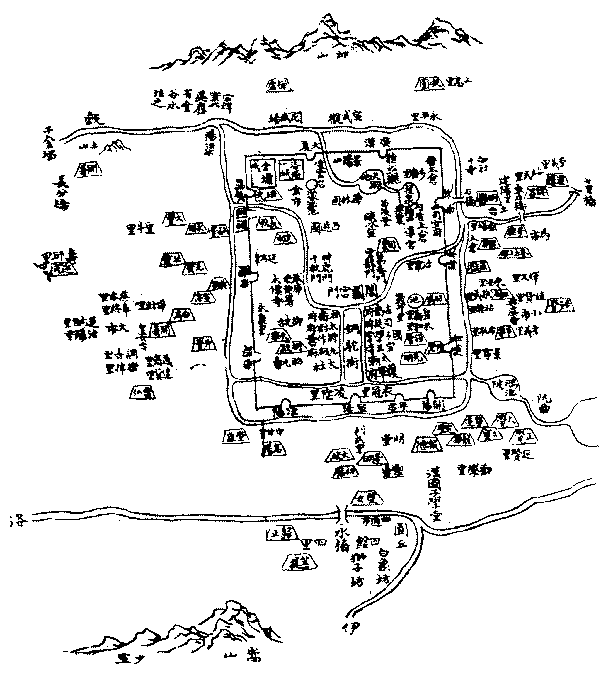

# 洛阳伽蓝记合校本



> **藏经**：中国佛寺史志汇刊（佛寺志汇刊）　**册次** 第 1 册（GA001）　**编号** GA0004　**卷次** 8 卷　**篇幅** 46,919 字

> **作者（译者）**：魏抚军府司马杨衒之撰

> **卷／品**：10 卷 · 4 品



---



## 目录



  - [洛阳伽蓝记合校本序](#洛阳伽蓝记合校本序)

- [洛阳伽蓝记卷第一](#洛阳伽蓝记卷第一)

- [洛阳伽蓝记卷第二](#洛阳伽蓝记卷第二)

- [洛阳伽蓝记卷第三](#洛阳伽蓝记卷第三)

- [洛阳伽蓝记卷第四](#洛阳伽蓝记卷第四)

- [洛阳伽蓝记卷第五](#洛阳伽蓝记卷第五)

  - [道光十三年十二月既望钱塘吴若准自序](#道光十三年十二月既望钱塘吴若准自序)

  - [洛阳伽蓝记钩沉序](#洛阳伽蓝记钩沉序)

  - [序](#序)

- [城内卷第一](#城内卷第一)

- [城东卷第二](#城东卷第二)

- [城南卷第三](#城南卷第三)

- [城西卷第四](#城西卷第四)

- [城北卷第五](#城北卷第五)



---



杨衒之「洛阳伽蓝记」今存以明刋如隐堂本、吴琯本为最古。吴氏「集证」、唐氏「钩沈」，大率衍顾广圻之依水经注改析本文子注之绪论，以改明刻本，分析本文子注，且据各本，校正文句，补注事实。唯吴氏所定本文，仅得子注廿分之一；唐氏正之，本文子注，亦不过十与一之比。近人张宗祥因谓：『集证本遂起而分之，然极简略，恐非杨氏之旧，如杨氏旧文，果如吴氏所述，则记文寥寥，注文繁重，作注而非作记矣！杨氏具史才，当不如此。唐氏复因吴氏之简，钩沈本起而正之，……亦未为尽合也。』张氏以为『此书子注之难分，实非水经注之比，……苟无如隐以前之古本可以勘正，实不必泥顾氏之说，强为分析，致蹈明人窜改古籍之覆辙也。』於是有「合校」之作。张氏此书，即依旧第，唯取各本，记注文字异同，间加考释；附录序跋一卷，录四库全书总目提要、毛晋、王谟、毛扆、顾广圻、朱赀贵、吴若准、李葆恂、袁廷梼、唐晏诸人关於伽蓝记之序跋；又附吴若准「集证」一卷，於衒之自序，别为补正数事；又附正文二卷，则集吴、唐二氏书所析出之本文而成，间加案语，以纠其失。张氏以本文子注厘析不易，吴唐二书俱有违失，乃循旧本篇第，校正文句而已，有此而后各本得失，展卷瞭然矣！张氏所取校者，大率限於伽蓝记各本，有如隐堂本、吴琯本、绿君亭本、照旷阁本、汉魏丛书本、集证本、钩沈本等互校，又旁取水经注、晋书、魏书、太平寰宇记、开元释教录等参校。所取校诸籍，未能广采六朝旧籍及释经、僧传、金石文字，为阙憾焉。张氏此稿成於民国十九年（一九三〇），商务印书馆据张氏铁如意馆原稿本影印，兹据影本景印，俾学者比观焉。



------



### 洛阳伽蓝记合校本序



此书以如隐本为最古然尚有吴琯本绿君照旷从如隐出汉魏从吴琯本出汉魏缺字较少则亦似据吴本校补付梓者故明刻二种各有渊源以今校之正譌互见清代诸刻皆据如隐传钞於是大宗存而小宗亡矣



如隐本第二卷崇真寺条下自即有青衣十人至若有私财物造经像者为第四页秦太上君寺条下自花林芳草之芳字起至阿附成名之阿字止为第九页平等寺条下自无所干预之干字起至若今宰相也之今字为第十八页三页皆缺余所见本系据真意堂本钞补即毛氏所谓第二卷中缺三纸者也此本既不敢据一本认为定本亦不敢据他书妄改本书今合校诸书择其长者傥有异义下注某刊作某存而不论但使学者不愿妄断故名之曰合校本



庚午正月立春后五日海寜张宗祥记



洛阳伽蓝记序(吴琯本无洛阳二字序下有一例字)



魏抚军府司马杨衒之撰(吴琯本魏上有后字)



三坟五典之说九流百代之言并理在人(吴若准集证本寰)区而义兼天外至於一乘二谛之原三明六通之旨西域备详东土靡记自顶日感梦满月流光阳门饰毫(如隐堂绿君亭豪)眉之像夜台图绀发之形尔(吴琯本迩)来奔竞其风遂广至晋永嘉惟有寺四十二所逮皇魏受图光宅嵩洛笃信弥繁法教逾盛王侯贵臣弃象马如脱屣(汉魏丛书履)庶士豪家舍资财若遗迹於是招提栉比宝塔骈罗争写天上之姿竞模(如隐照旷阁摸)山中之影金刹与灵台比高广(汉魏宫)殿共阿房等壮岂直木衣绨绣土被朱紫而已哉暨永熙多难皇舆迁邺诸寺僧尼亦与时徙至武定五年岁在丁卯余因行役重览洛阳城郭崩毁宫室倾覆寺观灰烬庙塔坵(如隐丘)墟墙被蒿艾巷罗荆棘野兽穴於荒阶山鸟巢於庭树游儿牧竖踯躅於九逵农夫耕稼艺黍於双阙(如隐绿君𨵗)麦秀之感非独殷墟黍离之悲信哉周室京城表里凡有一千餘寺今日寥(如隐寮)廓钟声罕闻恐后世无传故撰斯记然寺数最多不可遍写今之所录止(如隐绿君上)大伽蓝其中小者取其详(汉魏详有异字)世谛事因而出之先以城内为始次及城外表列门名以远近为五篇余才非著述多有遗漏后之君子详其阙焉



大和十七年后魏高祖迁都洛阳诏司空公穆亮营造宫室洛阳城门依魏晋旧(汉魏旧下有门字)名



东面有三门北头第一门(汉魏无门字)曰建春门汉曰上东门阮籍诗曰步出上东门是也魏晋曰建春门高祖因而不改次南曰东阳门汉曰东中门魏晋曰东阳门高祖因而不改次南曰青阳门汉曰望京门魏晋曰清(如隐照旷青)明门高祖改为清(如隐照旷青)阳门



南面有四(如隐照旷三)门东头第一(集证一下有门字)曰开阳门初汉光武迁都洛阳作此门始成而未有名忽夜中有柱自来在楼上后瑯琊郡开阳县言南门一柱飞去使来视之则是也遂(汉魏因)以开阳(汉魏阳下有县字)为名自魏及晋因而不改高祖亦然次西曰平昌门汉曰平门魏晋曰平昌门高祖因而不改次西曰宣阳门汉曰津门(汉魏津下有阳字照旷注一本多一阳字六字)魏晋曰津阳(汉魏宣阳绿君津下注云一作宣照旷宣下注云一作津)门高祖因而不改(宗祥案水经谷水注谷水又南东屈迳津阳门又东迳宣阳门南又东迳平昌门南又东迳开阳门南是魏时南面四门了无疑义又案晋书地理志亦云南有四门又案太平寰宇记南面凡三门开阳门在巳上次西汉有小苑门在午上晋改曰宣阳门引述征记曰謻门即宣阳门也引华延隽洛阳记曰即汉之宫门次西汉曰津门在未上是宣阳门汉名小苑门不名津阳而津门汉又另是一门非即宣阳门也依此文则南面三门平昌居中东为开阳西为宣阳然宣阳实在午上为中门则洛阳南面已上一门己午之间一门午上一门未上无门亦不可通是知此条中有阙文宣阳津阳本系两门一在午上一在未上因中有夺误遂连为一各本见下文三门因而据改首句四字为三字汉魏仍为四字虽非善本亦可贵矣)



西面有四门南头第一门曰西明门汉曰广阳门魏晋因而不改高祖改为西明门(宗祥案太平寰宇记作晋改曰西明门)次北曰西阳门汉曰雍门魏晋曰西明门高祖改为西阳门次北曰阊阖门汉曰上西门上(如隐照旷无上字)有铜璇玑玉衡以齐七政魏晋曰阊阖门高祖因而不改次北曰承明门承明者高祖所立当(汉魏无当字)金墉城前东西大道迁京之始宫阙未就高祖住在金墉城城西有王南寺高祖数诣寺沙门论义(如隐照旷议)故通此门而未有名世人谓之新门时王公卿士常(汉魏当)迎驾於新门高祖谓御史中尉李彪曰曹植诗云谒帝承明庐此门宜以承明为称遂名之



北面(汉魏无面字)有二门西头曰大夏门汉曰夏门魏晋曰大夏门帝(如隐照旷尝)造三层楼去地二(汉魏无二字)十丈(汉魏丈下有高祖世宗造三层楼去地二十丈十三字)洛阳城门楼皆两重去地百尺惟大夏门甍栋干云东头曰广莫门汉曰谷门魏晋曰广莫门高祖因而不改自(如隐照旷无自字)广莫门以西至於大夏门宫观相连被诸城上也



一(照旷无一字)门有三道所谓九轨(汉魏逵照旷注云一作九逵　宗祥案寰宇记引陆机洛阳记云城内皆三道公卿尚书从中道凡人左右出入不得相逢夹道中植榆柳以荫行人)







------



## 洛阳伽蓝记卷第一



魏抚军府司马杨衒之撰(汉魏作后魏杨衒之著)



城内



永寜寺



熙平元年灵太后胡氏所立也在宫前阊阖门南一里御道西(宗祥案开元释教录作东)其寺东有太尉府西对永康里南界昭玄曹北邻御史台阊阖门前御道东有左衞府府南有司徒府司徒府(汉魏三字不重)南有国子学堂内有孔丘像颜渊问仁子路问政在侧国子南有宗正寺寺南有太庙庙南(汉魏无南字)有护军府府南有衣冠里御道西有右衞府府南有太尉府府南有将作曹曹南有九级府府南有太社社南有凌隂里即四朝时藏冰处也中有九层浮屠一所架木为之举高九十丈(宗祥案释教录作九十餘丈魏书释老志肃宗熙平中於城内太社西起永寜寺佛图九层高四十餘丈)有刹(释教录刹上有金字)复高十丈合去地一千尺去京师(释教录作去台)百里已遥(汉魏遥已)见之初掘基至黄泉下得金像三十(如隐千照旷注云一作千释教录作三十二)躯太后以为信法之徵是以营建过度也刹上有金宝瓶容二十五石(释教录作斛)宝瓶下有承露金盘三十(释教录作一十一)重周匝皆垂金铎复有铁鏁四道引刹向浮图四角鏁上亦有金铎铎大小如一石瓮子浮图有九级角角皆悬金铎合上下有一百二(释教录三)十铎浮图有四面面有三户六窗(此句释教录作四面九间六窗三户)户皆朱漆扉上有五行金铃(如隐照旷钉释教录亦铃)合有五千四百枚复有金环(释教录铎)铺首(如隐首下有布字)殚土木之功穷造形之巧(汉魏力)佛事精妙不可思议绣柱金铺骇人心目至於高风永夜宝铎和鸣铿锵之声(汉魏音)闻及十餘里浮图北有佛殿一所形如太极殿(照旷重殿字)中有丈八金像一躯(汉魏躯下有人字)中长金像十躯绣珠像三躯织成五躯作功奇巧冠於当世(中有以下六句释教录作中设诸像金玉珠绣作工巧绮冠绝当世)僧房楼观一千餘间雕梁粉壁青璅(如隐缫)绮疏难得而言栝柏松椿(汉魏栝椿松柏释教录栝柏桢松)扶疎拂檐藂(汉魏翠)竹香草布护(汉魏濩)堦墀是以常景碑云须弥宝殿兠率净宫莫尚於斯也外国所献经像皆在此寺寺院墙皆施短椽以瓦覆之若今宫墙也(寺院墙三句释教录作院墙周匝皆施椓瓦)四面各开一门南门楼三重通三道去地二十丈形制似今端门图以云气畫彩仙灵绮钱(如隐绮下空格)青璅(如隐缫)辉(汉魏无辉字如隐空格)赫丽华拱(汉魏拱下有夹字释教录拱作夹)门有四力士四狮子饰以金银加之珠玉装严焕炳(释教录作庄严焕烂)世所未闻东西两门亦皆(汉魏皆亦)如之所可异者惟楼二重北门一道不施屋似乌头门四门外树以青槐亘以绿水京邑行人多庇其下路断飞尘不由奔云之润清风送凉岂藉合欢之发诏中书舎人常景为寺碑文景字(汉魏无字字)永昌河内人也敏(汉魏繁)学博通知名海内太和十九年为高祖所器拔为律学博士刑法疑狱多访於景正始初诏刊律令永作通式敕景共治书侍御史高僧裕羽林监王元龟尚书郎祖莹员外散骑侍郎李琰之等撰集其事又诏太师彭城王勰青州刺史刘芳入预其议景讨正科条商搉古今甚有伦序见行於世今律二十篇是也又共芳造洛阳宫殿门阁之名经途里邑之号出除长安令时人比之潘岳其后歴位中书舎人黄门侍郎秘书监幽州刺史仪同三司学徒以为荣焉景入参近侍出为侯牧居室贫俭事等农家惟有经史盈车满架(汉魏架下有景字)所著文集数百餘篇给事封𬀩伯作序行於世装饰毕功明帝与太后共登之视宫内如掌中临京师若家庭以其目见宫中禁人不听升衒之常与河南尹胡孝世共登之下临云雨信哉不虚时有西域沙门菩提达摩者波斯国胡人也起自荒裔来游中土见金盘炫日(照旷注云一作目)光照云表宝铎含风响出天外歌咏赞(汉魏赞)叹实是神功自云年一百五十岁歴涉诸国靡不周遍而此寺精丽遍(如隐照旷无遍字)阎浮所无也极佛(如隐物)境(汉魏无境字)界亦未有此(释教录作讫佛境界亦无有比)口唱南无(汉魏无下有或字)合掌连日至孝昌二年中(汉魏无中字)大风发屋拔树刹上宝瓶随风而落入地丈餘复命工匠更铸(汉魏著)新瓶建义元年太原王尒(汉魏尔下同)朱荣总士马於此寺荣字天宝北地秀容人也世为第一领民酋长博陵郡公部落八千餘家有马(汉魏马有)数万匹富等天府武泰元年二月中帝崩无子立临洮王世子钊以绍大业年三岁太后贪秉朝政故以立之荣谓并州刺史元天穆曰皇帝晏驾春秋十九海内士庶犹曰幼君况今奉未言之儿以临天下而望升平其可得乎吾世荷国恩不能坐看成败今欲以铁马五(汉魏三)千赴哀山陵兼问侍臣帝崩之由君竟谓如何(汉魏何如)穆曰明公世跨并肆(汉魏世夸英武)雄才杰出(汉魏雄上有志字照旷作英武志略雄才杰出)部落之民控弦一万若能行废立之事伊霍复见於(如隐照旷无於字)今日荣即共穆结异姓兄弟穆年大荣兄事之荣为盟主穆亦拜荣於是密议长君诸王之中不知谁应当璧遂於晋阳人各(汉魏令别)铸像不成惟长乐王子攸像光相具足端严特妙是以荣意在长乐遣苍头王丰入洛约(如隐询)以为主长乐即许之共剋期契荣三军皓素扬旌南出太后闻荣举兵召王公议之时胡氏专宠皇宗怨望(如隐照旷望下有假字)入议者莫肯致言惟黄门侍(如隐汉魏无侍字)郎徐纥(如隐统照旷注云旧作统案徐纥见魏书恩幸传不当作统)曰尒朱荣马邑小胡人才凡鄙不度德量力长(汉魏张)戟指阙所谓穷辙拒轮积薪候燎今宿衞文武足得一战但守河桥观其意趣荣悬军千里兵老师敝(如隐照旷弊)以逸待劳破之必矣后然纥言即遣都督李神轨郑季明(汉魏无明字)等领众五千镇河桥四月十一日荣过河内至高头驿长乐王从雷陂(汉魏陵)北渡赴荣军所神轨季明等见长乐王往遂开门降十二日荣军於芒山之北河隂之野十三日召百官赴驾至者尽诛之王公卿士及诸朝臣死者三(汉魏二)千餘人十四日车驾入城大赦天下改号为建义元年是为庄帝於时新经大兵人物歼尽流迸之徒惊骇未出庄帝(以上二十字汉魏无)肇升太极解网垂仁惟散骑常侍山伟一人拜恩南阙加荣使持节中外诸军事大将军开府北道大行台都督十州诸军事大将军领左右太原王其(如隐共)天穆为侍中太尉公世袭并州刺史上党王起家为公卿牧守者不可胜数二十日洛中草草犹自不安死生相怨人怀异虑贵室豪家弃(如隐并)宅竞窜贫夫贱士襁负争逃於是出诏滥死者普加褒赠三品以上赠三公五品以上赠令仆七品以上赠州牧白氏赠郡镇於是稍安帝纳荥女为皇后进荣为柱国大将军录尚书事餘官如故进天穆为大将军餘官皆如故永安二年五月北海王元颢复入洛在此寺聚兵颢庄帝从兄也孝昌末镇汲郡闻尒朱荣入洛阳遂南奔萧衍是年入洛庄帝北廵颢登皇帝位改年曰建武元年颢与庄帝书曰大道既隐天下匪公祸福不追与能义绝朕犹庶几五帝无取六军正(汉魏故)以糠粃万乘锱铢大宝非贪皇帝之尊岂图六合之富直以尒朱荣往岁入洛顺而勤王终为魏贼逆刃加於君亲锋镝肆於卿宰元氏少长殆欲无遗已有陈恒盗齐之心非无六卿分晋之计但以四海横流欲篡未可暂树君臣假相拜置害卿兄弟独夫介立遵养待时臣节讵久朕覩此心寒远投江表泣请梁朝誓在复耻风行建业电赴三川正欲问罪於尒朱出(汉魏出下有公字)卿於桎梏恤深怨於骨肉解苍生於倒悬谓卿明眸击节躬(汉魏供)来见我(汉魏吾下同)共叙哀辛(汉魏悴)同讨凶羯不意驾入成臯便尔北渡虽迫於凶手势不自由或贰(如隐空格汉魏䜣)生素怀弃剑猜我闻之永叹抚衿而失何者朕之於卿兄弟非远连枝分叶兴灭相依假有内阋(如隐闚)外犹御侮况我与卿睦厚偏笃其於急难凡今莫如弃亲即讐义将焉据也且尒朱荣不臣之迹暴於旁午谋魏社稷愚智同见卿乃明白疑於必然托命豺狼委身虎口弃亲助贼兄弟寻戈假获民地本是荣物若克(汉魏剋)城邑绝非卿有徒危宗国以广冦仇快贼莽之心假卞庄之利有识之士咸为惭之今家国(汉魏国家)隆替在卿与我若天道助顺誓兹义举则皇魏宗社与运无穷傥(汉魏脱)天不厌乱胡羯未殄鸱鸣狼噬荐食河北在(汉魏朱)荣为福於卿为祸岂伊异人尺书道意卿宜三复(汉魏覆)义(如隐兼照旷注云一作兼字)利是图富贵可保狥人非虑终不食言自相鱼肉善择元吉勿贻后悔此黄门郎祖莹(如隐荣案魏书亦莹)之词也时帝在长子城太原王上党王来赴急难(照旷无难字)六月帝围河内太守元桃汤(魏书尒朱荣传作元袭此举其字)车骑将军宗正珍孙等为颢守攻之弗克时暑炎赫将士疲劳太原王欲使帝幸晋阳至秋更举大义未决召刘助筮之助曰必克於是至明尽力攻之如其言桃汤珍孙并斩首以殉三军颢闻河内不守亲率百僚出镇河桥特迁侍中安丰王延明往守硖石七月帝至河阳与颢隔河相望太原王命车骑将军尒朱兆濳师渡河破延明於硖石颢闻延明败亦散走所将江淮子弟五千人(照旷重人字)莫不解甲相泣握手成别(如隐列)颢与数十(如隐千)骑欲奔萧衍至长社为社(汉魏村)民斩其首传送京师二十日帝还洛阳进太原王天柱大将军餘官亦如故进上党王太宰餘官亦如故永安三年逆贼尒朱兆囚庄帝於寺时太原王位极心骄功高意侈与(照旷予)夺臧否肆意帝怒(如隐恐)谓左右曰朕寜作高贵乡(如隐卿)公死不作汉献帝生九月二十五日诈言产太子荣穆并入朝庄帝手刃荣於光明殿穆为伏兵鲁暹(案魏书作鲁安)所杀荣世子部落大人亦死焉荣部(如隐无部字)下车骑将军尒朱阳都等二十人随入(汉魏照旷人)东(汉魏朱)华门亦为伏兵所杀(如隐煞下同)惟右仆射尒朱世隆素在家闻荣死总荣部曲烧西阳门奔河桥至十月一日隆与荣妻北(如隐汉魏无荣北二字)乡郡长公主至芒山冯王寺为荣追福荐(如隐无荐字)斋即遣尒朱侯讨伐尒朱那(汉魏弗)律归等领胡骑一千皆白服来至郭下索太原王尸丧帝升大夏门望之遣主书牛法尚谓归等曰太原王立功不终隂图衅逆王法无亲已依正刑罪止荣身餘皆不问卿等何为不降官爵如故归曰臣从太原王来朝陛下何忽今日枉致无理臣欲还晋阳不忍空去愿得太原王尸丧生死无恨发言雨泪哀不自胜群胡恸哭声振京师帝闻之亦为伤怀遣(汉魏无遣字)侍中朱元龙赍铁券与世隆待之不死官位如故世隆谓元龙曰太原王功格天地道(如隐造)济生民赤心奉国神明所知长乐不顾信誓枉害忠良今日两行铁字何足可信吾为太原王报仇终不归降元龙见世隆呼帝为长乐知其不欵且以言帝帝即出库物置城西门外募敢死之士以讨世隆一日即得万(照旷万下有餘字)人与归等战於郭外凶势不摧归等屡涉戎场便(汉魏照旷便下有利字)击刺京师士众未习军旅虽皆义勇力不从心三日频战而游魂不息帝更募人断河桥有汉中人李荀为水军从上流放火烧桥世隆见桥被焚遂大剽生民北上太行帝遣侍中源(汉魏原)子恭黄门郎杨宽领步骑三万镇河内世(汉魏无世字)隆至高都立太原太守(汉魏照旷子)长广王(绿君上)晔为主(汉魏作等瓮子为王)改号曰建　元年(照旷汉魏建元如隐建下空一格案魏书作号年建明)尒朱氏自封王者八人长广王都(如隐空格)晋阳遣颍川王(丛书无王字)尒朱兆举兵向京师子恭军失利兆自雷陂(如隐波)涉渡擒庄帝於式乾殿帝初以黄河奔急谓兆未得猝济(如隐作未谓兆得济)不意兆不由舟楫凭流而渡是日水浅不没(汉魏及照旷注云一作及)马腹故及此难书契所记未之有也衒之曰昔光武受命冰桥凝(如隐宜)於滹水昭烈中起的卢踊於泥沟皆理合於天神祗所福(汉魏将)故能功济宇宙大庇生民若兆者蜂目豺声行穷枭獍阻兵安忍贼害君亲皇灵有知鉴其凶德反使孟津由膝赞其逆心易称天(如隐大)道祸滛(汉魏盈)鬼神福谦以此验之信为虚说时兆营军尚书省建天子金鼓庭设漏刻嫔御妃主皆拥之於幕鏁帝於寺门楼上时十二月帝患寒随兆乞头巾兆不与遂囚帝送(如隐照旷还)晋阳缢於三级寺帝临崩礼佛愿不为国王又作五言曰：



权去生道促　忧来死路长  

怀恨出国门　含悲入鬼乡  

隧门一时闭　幽庭岂复光  

思鸟吟青松　哀风吹白杨  

昔来闻死苦　何言身自当



至太昌元年冬始迎梓宫赴京师葬帝靖(案魏书静)陵所作五言诗即为挽歌词朝野闻之莫不悲恸百姓(汉魏姓下有闻者二字)观者悉皆掩涕而已永熙三年二月浮图为火所烧(释教录作为天所震)帝登凌(汉魏临)云台望火遣南阳王宝炬录尚书长孙稚(如隐椎)将羽林一千救赴火所莫不悲惜垂泪而去火初从第八级中平旦大(汉魏火)发当时雷雨晦冥杂下霰雪百姓道俗咸来观火悲哀之声振动京邑时有三比丘(释教录作二道人)赴火而死火经三月不灭有火入地寻柱(汉魏作有入地柱火寻柱)周年犹有烟气其年五月中有人从象郡(宗祥案太平御览六百五十八引作东莱郡释教录同又案隋唐有象县唐宋有象州从未有象郡)来云见浮图於海中光明照耀俨然如新海上之民咸皆见之俄然雾起浮图遂隐至七月中平阳王为侍中斛斯椿所逼(如隐汉魏使释教录作挟)奔於长安十月而京师迁邺



建中寺



普泰元年尚书令乐平王尒朱世隆所立也本是阉官司空刘腾宅屋宇奢侈梁栋逾制一里之间廊庑充溢堂北宣光殿门匹乾明门博敞弘丽诸王莫及也在西阳门内御道北所(汉魏无所字)谓延年里刘腾宅东有太仆寺寺东有乘黄署署东有武库署即魏相国司马文王府(汉魏府下有武字)库东至阊阖宫(汉魏无宫字)门是也西阳门内御道南(如隐汉魏无南字)有永康里里(汉魏不重)内复有领军将军元乂(如隐绿君义汉魏义)宅掘故井得石铭云是汉太尉荀彧宅正光年中元乂专权太后幽隔永巷腾为谋主乂是江阳王继之子太后妹婿熙平初明帝幼冲诸王权(汉魏照旷劝)上太后拜乂为侍中领军左右令总禁兵委以腹心反得幽隔永巷六年太后哭曰养虎自啮长虺成蛇至孝昌二(汉魏无二字)年太后反政遂诛乂等没腾田宅元乂诛日腾巳物故太后追思腾罪发墓残尸使其神灵无所归聚(如隐绿君趣)以宅赐高阳(汉魏无此二字)王雍建义元年尚书令乐平王尒朱世隆为荣追福题以为寺朱门黄阁所谓仙居也以前厅为佛殿后堂为讲室(汉魏堂)金花宝葢遍满其中有一凉风堂本腾避暑之处凄凉常冷经夏无蝇有万年千岁之树也



长秋寺



刘腾所立也腾初为长秋令卿因以为名在西(汉魏南)阳门内御道北一里亦在延年里即是晋中朝时金市处寺北有蒙汜池夏则有水冬则竭矣中有三层浮图一所金盘灵刹曜诸城内作六牙白象负释迦在虚空(汉魏无空字)中庄严佛事悉用金玉工作(汉魏作工)之异难可具陈四月四日此像常出辟邪师子导引其前吞刀吐火腾骧一面彩幢(汉魏童)上索诡谲不常奇伎异服冠於都市像停之处观者如堵迭相践跃常有死人



瑶光寺



世宗宣武皇帝所立在阊阖(如隐照旷阖下有城字)门御道北东去千秋门二里千秋门内道北有西游园园(汉魏不重)中有凌云台即是魏文帝所筑者台上有八角井高祖於井北造凉风观登之远望(汉魏望远)目极洛川台下有碧海曲池台东有(汉魏无有字)宣慈观去地(汉魏地下有一字)十丈观东有灵芝钓台累木为之出於海中去地二十丈风生户牖云起梁栋丹楹刻桷图写列仙刻石为鲸鱼背负钓台既如从地踊出又似空中飞下钓台南有宣光殿北有嘉福殿西有九龙殿殿前九(汉魏有)龙吐水成一海凡四殿皆有飞阁向灵芝(汉魏芝下有台字)往来三伏之月皇帝在灵芝台以避暑有五层浮图一所去地五十丈仙掌凌虚铎垂云表作工之妙埒美永寜讲堂(如隐殿)尼房五百餘间绮疏连亘户牖相通珍木香草不可胜言牛筋狗骨之木鸡头鸭脚之草亦悉备焉椒房嫔御学道之所掖庭美人并在其中亦有名族处女性爱道场落发辞亲来依(如隐仪)此寺屏珍丽之饰服修道之衣投心入正归诚一乘永安三年中尒朱兆入洛阳纵兵大掠时有秀容胡骑数十人(如隐照旷无人字)入寺(如隐照旷寺上有瑶光二字)滛秽自此后颇获讥讪(汉魏诮)京师语曰洛阳男(汉魏女)儿急作髻瑶光寺尼夺作(汉魏女)婿瑶光寺北有承明门有金墉城即魏氏所筑晋永康中惠帝幽於金墉城东有洛阳小城永嘉中所筑(照旷无以上二十二字)城东北角有魏文帝百尺楼年虽(汉魏岁)久远形制(汉魏制)如初高祖在城内作北极殿因名金墉城门为光极门又作重楼飞阁遍城上下从地望之有如云也



景乐寺



太傅清河文献王怿所立也怿是孝文皇帝之子宣武皇帝之弟阊阖南御道西望永寜寺正相当寺西有司徒府东有大将军高肇宅北连义井里义井里北门外有桑(汉魏丛)树数株(照旷株上有十字)枝条繁茂下有甘井一所石槽铁罐供给行人饮水庇隂(汉魏荫)多有憩者有佛殿一所像辇在焉雕刻巧妙冠绝一时堂庑周环曲房连接轻条拂户花蘂被庭至於大(汉魏六)斋常设女乐歌声绕梁舞袖徐转丝管寥亮谐妙入神以是尼寺丈夫不得入得往观者以为至天堂及文献薨寺禁稍宽百姓出入无复限碍后汝南王悦复修之悦是文献之弟召(汉魏诏)诸音乐逞伎寺内奇禽怪兽舞抃殿庭(汉魏亭)飞空幻惑世所未覩异端奇术总萃其中剥驴投(汉魏扳)井植枣种瓜须臾之间皆得赐(如隐无赐字)食(照旷食下有之字亦无赐字)士女观者目乱睛(汉魏精)迷自建义(汉魏空格)已后京师频有大兵此戯遂隐也



昭仪尼寺



阉官等所立也在东阳门内一里御道南东阳门内道北太(如隐照旷太下有北字)仓导官二署东南治栗里仓司官属住其内太后临朝阉寺专宠宦者之家积金满堂是以萧忻云高轩斗升者尽是(如隐汉魏无此二字)阉官之(汉魏无之字)嫠妇胡马鸣珂者莫非(照旷不)黄门之养息也忻阳平人也爱尚文籍少有名誉见阉(如隐阍)寺宠盛遂发此言因即知名为治书侍御史寺有一佛二菩萨塑工精绝京师所无也四月七日常出诣景明景明三像恒出迎之伎乐之盛与刘腾相比堂前有酒树面木昭仪寺有池京师学徒谓之翟(寰宇记狄)泉也衒之按杜预注春秋云翟泉在晋太仓西南按晋太仓在建春门内今太仓在东阳门内此地今在太仓西南明非翟泉也后隐士赵逸云此地是晋侍中石崇家池池南有绿珠楼於是学徒始寤经过者想见绿珠之容也池西南有愿会寺中书舎人王翊舍宅所(汉魏无所字)立也佛堂前生(汉魏有)桑树一株直上五尺枝条横遶柯叶傍布形如羽葢复(汉魏覆)高五尺又然凡为五重每重叶(汉魏叶下有生字)椹各异京师道俗谓之神桑观者成市(如隐汉魏市下有布字)施者甚众帝闻而恶之以为惑众命给事中黄门侍郎元纪伐杀(照旷无杀字)之其日云雾晦冥下斧之处血流至地见者莫不悲泣寺南有宜寿里内有苞信县令叚晖宅地下常闻钟声时见五色光明照於堂宇晖甚异之遂掘光所得金像一躯可高三尺有二菩萨趺(汉魏照旷趺下有坐字)上铭云(照旷曰)晋太和二年五月十五日侍中中书令(照旷监)荀朂造晖遂舍宅为光明寺时人咸云此荀朂旧宅其后盗者欲窃此像像(如隐汉魏不重)与菩萨合声唱贼盗者惊怖应即殒(照旷陨)倒众僧闻像呌声遂来捉得贼



胡统寺



太后从姑所立也入道为尼遂居此寺在永寜南一里许宝塔五重金刹高耸洞房周匝对户交疏(汉魏窗)朱柱素壁甚为佳丽其寺诸尼帝城名德善於开导工谈义理常入宫与太后说法其资养缁流从(如隐徒)无比(汉魏此)也



修梵寺



在(汉魏无在字)清(如隐照旷青)阳门内御道北嵩明寺复在修梵寺西并雕(汉魏墁)墙峻宇比屋连甍亦是名寺也修梵寺有金刚鸠鸽不入鸟雀不栖菩提达摩(绿君磨)云得其真相也寺北有永和里汉太师董卓之宅也里南北皆有池卓之所造今犹有水冬夏不竭里中太傅录尚书长孙稚尚书右仆射郭柞吏部尚书邢鸾(魏书峦)廷尉卿元洪超衞尉卿许伯桃凉(如隐照旷（梁）案魏书尉成兴名聿亦作凉州刺史)等六宅皆高门华屋斋馆敞丽楸槐荫途桐杨夹植当世名为贵里掘此地者輙得金玉宝玩之物邢鸾家常掘丹砂及钱数十万铭云董太师之物后卓夜中随鸾索此物鸾不与之经年鸾遂卒矣



景林寺



在开阳门内御道东讲殿叠起房庑连属丹槛炫日绣桷迎风实为胜地寺西有园多饶奇果春鸟秋蝉鸣声相续中有禅房一所内置祗洹精舎形制虽小巧构难比加以(如隐无比字加下空格)禅阁虚静隐室凝邃嘉树夹牖芳杜匝阶虽云朝市想同岩谷静行之僧绳坐其内飧(照旷飡)风服道结跏数息有石铭一所国子博士卢白头为其文白头一(汉魏无一字)字景裕(北史卢景裕字仲孺小字白头)范阳人也性爱恬静邱园放敖(汉魏傲)学极六经说(汉魏疏照旷注云一作疏)通百氏普泰初起家为国子博士虽在朱门以注述为事注周易行於世也



建春门内御道南有句盾典农籍田三署籍田南有司农寺御道北有空地拟作东宫晋中朝时太仓处也太仓南(寰宇记作西南)有翟泉周廻三里即春秋所谓王子虎晋狐偃盟於翟泉也水犹澄清洞底明静鳞甲濳藏(汉魏泳照旷注云一作泳)辨其鱼鳖高祖於泉北置河南尹(汉魏尹下有晋字)中朝时歩广里也泉西有华林园高祖以泉在园东因名苍龙海华林园中有大海即汉天渊池池中犹有文帝九华台高祖於台上造清凉殿世宗在海内作蓬莱山山上有仙人馆上(汉魏山)有钓台殿并作虹蜺阁乘虚来往至於三月褉日季秋己(汉魏良照旷九)辰皇帝驾龙舟鹢首游於其上(汉魏山)海西有藏冰室六月出冰以给百官海西南有景山殿山(汉魏无山字)东有羲和岭岭上有温风室山西有姮娥峰峰上有露寒(汉魏寒露)馆并飞阁相通凌山跨谷山北有玄武池山南有清暑殿殿东有临涧亭殿西有临危台景阳观(如隐无观字)山南有百果园果列作林林各有堂有仙人枣长五寸把之两头俱出核细如针霜降乃熟食之甚美俗传云出昆仑山一曰西王母枣又有仙人桃其色赤表里照彻得严霜乃熟(如隐作得霜即熟照旷注云一作得霜即熟)亦出昆仑山一曰王母桃也柰林南有石碑一所魏明帝所立也题云苗茨之碑高祖於碑北作苗茨堂永安中年庄帝马射於华林园百官皆来读碑疑苗字误国子博士李同轨曰魏明英才世称三祖公干仲宣(如隐作三公祖干宣云云)为其羽翼但未知本意如何不得言误也衒之时为奉朝请因即释曰以蒿覆之故言苗茨何误之有众咸称善以为得其旨归柰林西有都堂有流觞池堂东有扶桑海凡此诸海皆有石窦流於地下西通谷水东连阳渠亦与翟泉相连若旱魃为害谷水注之不竭离毕滂润阳谷泄之不盈至於鳞甲异品羽毛殊类濯波浮浪如似自然也



------



## 洛阳伽蓝记卷第二



**译者**：魏抚军府司马杨衒之撰



城东



明悬尼寺



彭城武宣王勰所立也在建春门外石楼南谷水周围遶(汉魏廻绕)城至建春门外东入阳渠石桥(汉魏槛无下桥字)桥有四柱在道南铭云汉阳嘉四年将作大匠马宪造逮我孝昌三年大雨颓桥(汉魏无桥字)柱始埋没道北二柱至今犹存衒之按刘澄之山川古今记戴延之西征记并云晋太康元年造此则失之远矣按澄之等并生在江表未(汉魏来)游中土假(汉魏暇)因征役暂来经过至於旧事多非亲览闻诸道路便为穿凿误我后学日月已甚有三层塔一所未加庄严寺东有中朝时常满仓高祖令为租场天下贡赋所聚蓄也



龙华寺



宿衞羽林虎贲等(汉魏无等字)所立也在建春门外阳渠南寺南有租场阳渠北有建阳里里有土台高三丈上作二精舎赵逸云此台是中朝旗亭也上有二层楼悬鼓击之以罢市有钟一口撞之闻五十里太后以钟声远闻遂移在宫内置凝(汉魏凝)闲堂前讲内典(三字汉魏作所与内讲四字)沙门打为时节孝昌(如隐照旷无此二字案综以孝昌元年降魏)初萧衍子豫章王(汉魏有萧字)综来降闻此钟声以为奇异遂造听钟(如隐无钟字)歌三首(歌下汉魏有词字)行(汉魏无行字)传於世综字世(汉魏务照旷赞如隐空格案魏书萧赞传云字德文本名综)伪齐昏主宝卷遗腹子也宝卷临政滛乱吴人苦之雍州刺史萧衍立南康王宝融为主举兵向秣陵事既克捷遂杀宝融而自立宝卷有美人吴景晖时孕综经月衍因幸(汉魏纳)景晖及综生认为己子小名缘觉封豫章王综形貌举止甚似昏主其母告之令自方便综遂归我圣阙更改名曰赞(魏书赞)字世务始为宝卷追服三年丧明帝拜综太尉公封丹阳王永安年中尚庄帝姊(汉魏妹魏书亦姊)寿阳公主字莒犂公主容色美丽综甚敬之与公主语常自称下官后(如隐照旷授)除齐(如隐徐)州刺史加开府及京师倾覆综弃州北走时尒朱世隆专权遣取公主至洛阳世隆逼之公主骂曰胡狗敢辱天王女乎我寜受剑而死不为逆胡所污(如隐汉魏无以上十二字)世隆怒之遂缢杀之(汉魏遂缢死之矣)



璎珞寺



在建春门外御道北所谓建阳里也即中朝时白社地(如隐照旷池)董威辇(如隐照旷辈寰宇记亦辇)所居处里内有璎珞慈善晖和通觉晖玄宗圣魏昌熙平崇真因果等十寺里内士庶二千餘户信崇三宝众僧刹(汉魏利)养百姓所供也



宗圣寺



有像一躯(如隐照旷有举字)高三丈八尺端严殊特相好毕备士庶瞻仰目不暂瞬此像一出市井皆空炎光辉赫(如隐照旷炎光辉腾赫赫)独绝世表妙伎杂乐亚於刘腾城东士女多来此寺观看也



崇真寺



比邱惠凝死一七日还活经阎罗王捡阅以错名放免惠凝具说过去之时有五比丘同阅一比丘云是宝明寺智圣坐禅苦行得升天堂有一比丘是般若寺道品以诵四十卷(如隐无十卷字)湼槃亦升天堂有一比丘云是(汉魏无是字)融觉寺昙谟最讲湼槃华严领众千人阎罗王云讲经者心怀彼我以骄凌物比丘中第一(汉魏无一字)麄行今惟试坐禅诵经不问讲经其昙谟最曰贫道立身以来惟好讲经实不谙(如隐绿君暗)诵阎罗王𠡠(汉魏曰)付司即有青衣十人送昙谟最向西北门屋舎皆黑(汉魏异)似非好处有一比丘云是禅林寺道弘自云教化四辈檀越造一切经人中像十躯阎罗王曰沙门之体必须摄心守道志在禅诵不干世事不作有为虽造作经像正欲得他人财物既得他物贪心即起既怀贪心便是三毒不除具足烦恼亦付司仍与昙谟最同入黑门有一比丘云是灵觉寺宝明自云出家之前尝作陇西太守造灵觉寺成即弃官入道虽不禅诵礼拜不缺阎罗王曰卿作太守之日曲理枉法劫夺民财假作此寺非卿之力何劳说此亦付司青衣送入黑门太后闻之遣黄门侍郎徐纥依惠凝所说即访宝明寺城东有宝明寺城内有般若寺城西有融觉(如隐汉魏觉下有寺字)禅林灵觉等(汉魏寺)三寺问智圣道品昙谟最道弘宝明等皆实有之议曰人死有罪福即请坐禅僧一百人常在殿内供养之诏不听持经像沿路乞索若私有财物造经像者任意凝亦入白鹿山居(汉魏小)隐修道自此以后京师(如隐照旷邑)比丘悉皆禅诵不复以讲经为意出建春(如隐照旷有南字)门外一里餘至东石桥西(如隐汉魏南)北而行晋太康元年造桥南有中朝时牛马市(如隐有魏朝时马市汉魏即中朝牛马市案水经注作马市寰宇记云三市洛阳记云大市名金市在大城西南羊市在大城南马市在大城东旧置丞马皆无牛字)刑嵇康之所也桥北大道西有建阳里大道东有绥民里里内有河间刘宣明宅神龟年中以直谏忤旨斩於都市讫目不瞑尸行百步时人谈以枉死宣明少有名誉精通经史危行及於诛死(汉魏也)



魏昌尼寺



阉官瀛洲刺史李次寿所立也(案次寿名坚)在里东南角即中朝牛马市处也刑嵇康之所东临(汉魏临东)石桥此桥南北行晋太康元年中朝时市南桥也澄之等葢见此桥铭因而以桥为太康初(汉魏所)造也



石桥南道有景兴尼寺亦阉官等所共立也有金像辇去地三尺施宝盖四面垂金铃七宝珠飞天伎乐望之云表作工甚精难可扬搉(如隐推汉魏确)像出之日常诏羽林一百人举此像丝竹杂伎皆由旨给



建阳里东有绥民里里内有洛阳县临渠水县门外有洛阳令杨机清德碑绥民里东崇义里里内有京兆人杜子休宅地形显敞门临御道时有隐士赵逸云是晋武时人晋朝旧事多所记录正光初来至京师见子休宅叹息曰此宅中朝时太康寺也时人未信遂问寺之由绪逸云龙骧将军王濬平吴之后始立此(汉魏无此字)寺本有三层浮图用甎为之指子休园中曰此是故处子休掘而验之果得甎数十万兼有石铭云晋太康六年岁次乙巳九月甲戌朔八日率已仪同三司襄阳侯王濬敬造时园中果菜丰蔚林木扶疎乃服逸言号为圣人子休遂舍宅(汉魏无宅字)为灵应寺所得之甎还为三层浮图好事者遂寻(二字如隐作寻逐之三字)问晋朝京师(汉魏民)何如今日逸曰晋时民少於今日王侯第宅(汉魏无宅字)与今日相似又云自永嘉已来二百餘年建国称王者十有六君皆游其都邑目见其事国灭之后观其史书皆非实录莫不推过於人引善自向符生虽好勇嗜酒亦仁而不杀观其治典未为㐫暴及详其史天下之恶皆归焉符坚自是贤主贼君取位妄书生(汉魏君)恶凡诸史官皆是(汉魏此)类也人皆贵远贱近以为信然当今之人亦生愚死智惑已甚矣人(汉魏无人字)问其故逸曰生时中庸之人尔(如隐照旷耳)及其(汉魏无其字)死也碑文墓志(如隐志)莫不(二字汉魏作必字)穷天地之大德尽生民之能事为君共尧舜连衡为臣与伊臯等迹牧民之官(汉魏臣)浮虎慕其清尘执法之吏埋轮谢其梗(绿君楩)直所谓生为盗跖死为夷齐妄言伤正华辞损实当时构文之士惭逸此言歩兵校尉李澄问曰太尉府前甎浮图形制甚古犹未崩毁未知早(照旷蚤)晚造逸云(汉魏曰)晋义熙十二年刘裕伐姚泓军人所作汝南王闻(汉魏有之字)而异之拜为义父因而问何所服饵以致长年逸云吾不闲(汉魏绿君闲)养生自然长寿郭璞尝为吾筮云寿年五百岁今始逾(如隐汉魏餘)半常(如隐照旷帝)给歩挽车一乘游於市里所经之处多记旧迹三年以后遁去莫知所在崇义(如隐汉魏绿君仪)里东有七里桥以石为之中朝杜预之荆州出顿之所也七里桥东一里郭门开三道时人(汉魏无此二字)号为三门离别者多云相送三门外京师士子送去迎归常在此处(汉魏处下有也字)



庄严寺



在东阳门外一里御道北所谓东安里也北为租场里内有驸马都尉司马恍(汉魏洗案魏书有司马悦不尚主司马氏尚主者无恍名不知名误抑官误)济州刺史介(如隐分)宣幽州刺史李真奴(案魏书李䜣小字真奴为徐州非幽州)豫州刺史公孙骧等(汉魏无等字)四宅



秦太上君寺



胡太后所立也在东阳门(集证本补外字)二里(汉魏无此二里)御道北所谓晖文里里内有太保崔光太傅李延实冀州刺史李韶(如隐诏汉魏空格魏书亦韶)秘书监(汉魏无监字)郑道昭等四宅并丰堂崛起高门洞开赵逸云晖文里是晋马道里(此句汉魏在下亦有千数句之下)延实宅是蜀主刘禅宅延实宅东有修和宅是吴主(如隐汉魏绿君王)孙皓宅李韶(汉魏空格)宅是晋司空张华宅当时太后正号崇训母仪(如隐汉魏无仪字)天下号父为秦太上公母为秦太上君为母追福因以名焉中有五层浮图一所修刹入云高门向街佛事庄饰等於永寜诵室禅堂周流重叠花林芳草徧满堦墀常有大德名僧讲一切经受业沙门亦有千数(数下汉魏有赵逸云晖文里是晋马道里十一字)太傅李延实者庄帝舅也永安年中除青州刺史临去奉辞帝谓实曰怀甎之俗世号难治舅宜好用心副朝廷所委实答曰臣年迫桑榆气同朝露人间稍远日近松邱臣已久乞闲退陛下渭阳兴念宠及老臣使夜行罪人裁锦万里谨奉明敕不敢失坠时黄门侍郎杨宽在帝侧不晓怀甎之义私问舎人温子升子升(如隐汉魏不重)曰闻至(照旷子)尊兄彭城王(汉魏无此五字)作青州刺史问其賔客从至青州云齐土之民风俗浅薄虚论高谈专在荣利太守初欲入境皆怀甎叩首以美其意及其代下还家以甎击之言其向背速於反掌是以京师谣语曰狱中无系囚舎内无青州假令家道恶(汉魏空格)腹中不怀愁怀甎之义起在於此也颍川荀济风流名士高鉴妙识独出当世清河崔叔仁称齐士大夫曰齐人外矫仁义内怀鄙吝轻同羽毛利等锥刀好驰虚誉阿附(汉魏空格)成名威势所在侧肩竞入求其荣利甜然浓(汉魏浓下有泗譬二字)於四方慕势最甚号齐士子为慕势诸郎临淄官徒布(如隐照旷有)在京邑闻怀甎慕势咸(汉魏惑)共耻之惟崔孝忠一人不以为意问其故孝忠曰营立风俗太公餘化稷下儒(汉魏孔)林礼义所出今虽凌迟足为天下模楷荀济人非许郭不识东家虽复莠言(汉魏苗莠)自口未宜荣辱也



正始寺



百官等所立也正始中立因以为名在东阳门外御道西(汉魏南照旷注云一作南)所谓敬义里也里内有典虞曹(汉魏空格)簷宇清(如隐精)净美於丛(汉魏景)林众僧房前高林对牖青松绿(汉魏青)柽连枝交映多有枳树而不中食有石碑一枚背上(汉魏无上字)有侍中崔光施钱四(照旷注云一作七)十万陈留侯李崇施钱二十万自餘百官各有差少者不减五千已下后人刊之敬义里南有昭(汉魏招)德里里内有尚书仆射游肇御史尉李彪兵部尚书(四字汉魏作七兵书三字)崔林幽州刺史常景司农张伦等五宅彪景出自儒生居室俭素惟伦最为豪侈斋宇光丽(汉魏空格)服玩精奇车马出入逾於邦君园林山池之美诸王莫及伦造景阳山有若自然其中重岩复岭嵚崟相属深谿洞壑逦逶(如隐照旷递)连接高林巨树足使日月蔽亏悬葛垂萝能令风烟出入崎岖石路似壅而通峥嵘涧道盘纡复直是以山情野兴之士游以忘归天水人姜质志性疎诞麻衣葛巾有逸民之操见偏爱之如不能已遂造亭山赋行传於世其辞曰：



今偏重(汉魏干童)者爱(汉魏无爱字)昔先民之重由朴由纯  

然则纯朴之体　与造化而津梁(如隐勉)  

濠上之客(如隐空格)　柱下之吏  

悟(如隐卧)无为以明心　托自然以图志(汉魏治)  

輙以山水为富　不以章甫为贵  

任性浮沉　若淡兮无味  

今司农张氏　实鍾(汉魏踵)其人  

巨量焕(如隐接)於物表　夭矫洞达其真  

青松未胜其洁　白玉不比其珍(汉魏称)  

心托空而栖(如隐拪)有　情入古以如新(汉魏心)  

既不专流荡(汉魏宕)　又不偏华尚(如隐上)　卜居动静之间　不以山水为忘  

庭起半𠀌半壑　听以目达心想  

进不入声(汉魏为身)荣　退不为隐放  

尔乃决石通泉　拔岭簷(如隐照旷岩)前  

斜(汉魏空格)与危云等并(如隐曲)　危与曲(汉魏典)栋相连  

下天津之高雾　纳沧海之远烟  

纤列之状如一(如隐绿君一如)古　崩剥之势似千年  

若乃绝岭悬坡(汉魏波)　蹭蹬蹉跎  

泉(如隐无泉字)水纡徐如浪峭　山石(如隐无石字)高下(汉魏不高)复危多  

五寻百拔(汉魏援)　十步千过　则知巫山弗及　未审(如隐无此二字)蓬莱如何  

其中烟花露(汉魏雾)草　或倾或倒(汉魏照旷颓)  

霜干风枝　半耸半垂  

玉叶(汉魏蕋)金茎　散满堦墀  

燃目之绮　裂(汉魏作然绮目之色列)鼻之馨　既共阳(汉魏绿)春等茂　复与白雪齐清  

或言神明之骨　隂阳之精　天地未觉生此　异人(汉魏人鬼)焉识(汉魏职)其中  

羽徒纷(汉魏分)泊　色杂苍黄  

绿头紫颊　好翠连芳  

白𪈝(汉魏鹤)生於异县　丹足出自(汉魏於)他乡  

皆远来以臻此　藉水木以翱翔  

不忆(汉魏意)春於沙漠　遂忘秋於高阳  

非斯人之感至　伺候鸟之迷方  

岂下(汉魏不)俗之所务　入(汉魏入下有有字)神怪之异趣(绿君趋)  

能造者其必诗　敢往者无不赋  

或就饶风(汉魏尧封)之地　或入多云(照旷云多)之处  

气(汉魏空格)岭与梅岑　随春之所悟(汉魏空格)  

远为神仙所赏　近为朝士所知  

求解脱於服佩　预参次於山陲(预汉魏务陲如隐垂)  

子英游鱼於玉质　王乔系鹄於松枝(汉魏有歌字)  

方丈不足以妙咏歌(汉魏无歌字)此处态多奇  

嗣宗闻之动魄　叔夜听此惊魂  

恨不能钻地一出(汉魏出一)　醉此山门  

别有王孙公子　逊遁容仪　思山念水　命驾相随  

逢(汉魏峰)岑爱曲　值石陵欹  

庭(如隐无庭字)为仁智之田(汉魏由)　故能种此石山  

森罗(汉魏列)兮(汉魏兮下空一格)草木　长育兮风烟  

孤松既能却老　半石亦可留年  

若不坐卧兮於其侧　春夏兮其游陟  

白骨兮徒自朽　方寸心兮(汉魏无此二字)何所忆



平等寺



广平武穆王怀舍宅所立也(汉魏无王怀也三字)在青阳门外二里御道北所谓孝敬里也堂宇宏美林木萧森平台复道独显当世寺门外金像一躯高二丈八尺相好端严常有神验国之吉凶先炳祥异孝昌三年十二月中此像面有悲容两目垂泪遍体皆湿时人号曰佛汗京师士女空市里往而观之有比丘以净绵拭其泪须臾之间绵湿都尽更换以他绵(汉魏更以他绵换)俄然复湿如此三月乃止明年四月尒朱荣入洛阳诛戮百官死亡涂地永安二年三月此像复汗士庶复往观之五月北海王入洛庄帝北廵七月北海王大败所将(汉魏陁)江淮子弟五千尽被俘虏无一得还永安三年七月此像悲泣如初每经神验朝夕惶惧禁人不听观之至十二月尒朱兆入洛阳擒庄帝崩(汉魏无崩字)於晋阳在京宫殿空虚百日无主惟尚书令司州牧乐平王尒朱世隆镇京师商旅四通盗贼不作建明二年长广王从晋阳赴京师至郭外世隆以长广本枝疎远政行无闻(汉魏无疎字政字闻作间)逼禅与(汉魏位)广陵王恭恭(如隐不重)是庄帝从父兄也正光中为黄门侍郎见元乂秉权(汉魏有辅字)政(汉魏有多字)归近习遂佯哑不语(汉魏无此二字)不预世事永安中遁於上洛山中(汉魏无此二字)州刺史泉企执而送之庄帝疑恭奸(照旷姧)诈夜遣人盗掠衣物复(汉魏无复字)拔刀剑欲杀之恭张口以手指舌竟乃(汉魏无乃字)不言庄帝信其真患放令归第恭常住(汉魏往从)龙华寺至是(汉魏无是字)世隆等废长广而立焉禅文曰皇帝咨广陵王恭自我皇魏之有天下也累圣开辅重基衍业奄有万邦光宅四海故道溢百王德渐无外而孝明晏驾人神乏主(如隐乏空格主作王)故柱国大将军大丞相太原王荣地实封陕任惟外相乃心王室大惧崩沦故推立长乐王子攸以续绝业庶九鼎之命日隆七百之祚惟永然群飞未寜横流且及皆狼顾鸱张岳立基趾(汉魏址)丞相一麾大定海内而子攸不顾宗社讐忌勲德招聚轻侠左右壬(汉魏王)人遂虐甚剖心痛齐钳齿(汉魏剖作割钳齿作齿剑)岂直金版(如隐照旷板)告怨大鸟感德而已於是天下之望俄然已移窃以宸极不可久(如隐以)旷神器岂容无主故权从众议暂驭兆民今六军南迈已次河浦瞻望帝京赧然兴愧自惟薄寡(汉魏寡薄)本枝疎远岂宜仰异(汉魏冀)天情俯乖民望惟王德表生民声高万古往以运属殷忧时遭多难(如隐无遭字多下空格)卷怀积载括囊有年今天眷明德民怀奥主历数允集歌讼(汉魏词)同臻乃徐发枢机副兹𥩟属便敬奉玺绶归於别邸王其寅践成业允执其(汉魏厥)中虽休勿休日慎一日敬之哉(汉魏照旷绿君重此三字)恭让曰天命至重历数匪轻自非德协三才功济(汉魏齐)四海无以入选帝图允当师锡臣既寡昧识无先(如隐光)远景命虽降不敢仰承(汉魏忝)乞收成旨以允愚衷又曰王既德应图箓佥属攸归便可允执其中入光大麓不劳挥逊致爽神人凡恭(神人如隐照旷人神凡恭汉魏恭凡)让者三於是即皇帝位改号曰普泰黄门侍郎邢子才为赦文叙述庄帝枉杀太原王之状广陵王曰永安手翦强臣非为失德直以天未厌乱故(如隐无故字)逢成济之祸谓左右将诏(汉魏笔)来朕自作之直言门下朕以寡德运属乐推思与亿兆同兹大庆肆(照旷赐)眚之科一依恒式广陵杜口八载至是始言海内庶士咸称圣君於是封长广为东海王世隆加仪同三司尚书令乐平王餘官如故赠太原王相国晋王加九锡立庙於芒岭首阳上旧有周公庙世隆欲以太原王功比周公故立此庙庙成为火所灾有一柱焚之不尽后三日雷雨震电霹雳击为数段柱下石及庙瓦皆碎於山下复命百官议(汉魏设)太原王配飨司直刘季明议云不合世隆问其故季明曰若配世宗於宣武无功若配孝明亲害其母若配庄帝为臣不忠为庄帝所戮以此论之无所配也世隆怒曰卿亦合死季明曰下官既为议臣依礼而言不合圣心俘翦惟命议者咸叹季明不避强御莫不叹伏焉世隆既有忿言(汉魏无以上十七字照旷注云一本无季明不避强御十七字)季明终得无患初世隆北叛庄帝遣安东将军史仵(照旷五注云一作仵案魏书尒朱兆传作下都督史仵龙官异)龙平北将军杨(照旷注云一作羊)文义各领兵三千守太行岭(如隐领)侍中源(汉魏原)子恭镇河内及尒朱兆马首南向仵龙文义等率众先降子恭见仵龙文义等降亦望风溃散兆遂乘胜逐北直入京师兵及阙下矢流王屋至是论功仵龙文义各封一千户广陵王曰仵龙文义於王有勲於国无功竟不许时人称帝刚直彭城王尒朱仲远世隆之兄也镇滑台表用其下都督瑗(照旷瑗上无空格)为西兖州刺史先用后表广陵答曰已能近补何劳远闻世隆侍宴帝(如隐照旷无帝字)每言太原王贪天之功以为己力罪亦(如隐有)合死世隆等愕然自是已后不敢复(汉魏无复字)入朝輙专擅国权凶慝滋甚坐持台省(汉魏持作符省下有掾字)家总万机事无大小先至隆第然后施行天子拱己南面无所干预永熙元年平阳王入纂大业始造五层塔一所平阳王武穆王少子诏中书侍郎魏收等为寺碑文至二年二月五日土木毕功帝率百僚作万僧会其日寺门外有石像无故自动低头复举竟日乃止帝躬来礼拜怪其诡异中书舎人卢景宣(汉魏无宣字)曰石立社移上古有此陛下何怪也帝乃还宫七月中帝为侍中斛斯椿所逼(如隐汉魏使)奔於长安至十月终而京师迁邺焉



景寜寺



太保司徒公杨椿所立也在清(如隐照旷绿君青)阳门外三里御道南所谓景寜里也高祖迁都洛邑椿创居此里遂分宅为寺因以名之制饰甚美绮柱珠帘椿弟慎冀州刺史慎弟津司空并立性宽雅贵义轻财四世同居一门三从朝贵义居未之有也普泰中为尒朱世隆所诛后舍宅为建中寺出青阳门外三里御道北有孝义里里西北角有苏秦冢冢傍有宝明寺众僧常见秦出入此冢车马羽仪若今宰相也孝义里东即是洛阳小市(如隐照旷寺)北有车骑将军张景仁宅景仁会稽山隂人也正光年初从萧保夤(照旷寅)归化拜羽林监赐宅城南归正里民间号为吴人坊南来投化者多居其内近伊洛二水任其习御里三千餘家自立巷市(如隐照旷寺照旷注云一作市)所(所上如隐照旷有市字)卖口味多是水族时人谓为鱼鳖市(如隐绿君寺)也景仁住此以为耻遂徙居孝义里(汉魏无里字)焉时朝廷方欲招怀荒服待吴儿(汉魏人)甚厚褰裳(汉魏衣)渡於江者皆居不次之位景仁无汗马之劳高官通显永安二年萧衍遣主书陈庆之送北海入洛阳僭帝位庆之为侍中景仁在南之日与庆之有旧遂设酒引邀庆之过宅司农卿萧彪尚书右丞张嵩并在其座彪亦是南人惟有中大夫杨元慎给事中大夫王㫬是中原士族庆之因醉谓萧张等曰魏朝甚盛犹曰五胡正朔之(如隐照旷相)承当在江左秦皇玉玺今在梁朝元慎正色曰江左假息僻居一隅地多湿蛰(照旷热)攒育虫蚁壃土瘴疠蛙黾(汉魏龟)共穴人鸟同群短发之君无抒首之貌文身之民禀丛陋之质浮於三江棹於五湖礼乐所不沾(如隐沽)宪章弗能革虽复秦餘汉罪杂以华音(汉魏言)复闽楚难言不可改变(汉魏变改)虽立君臣上慢下暴是以刘劭杀父於前休(汉魏空格)龙滛母於后悖(如隐汉魏见)逆人伦禽兽不异加以山隂请壻卖夫朋滛於家不顾讥笑卿沐其遗风未(汉魏来)沾(如隐沽)礼(汉魏言)化所谓阳翟之民不知(汉魏如)瘿之为丑我魏膺箓受图定鼎嵩洛五山为镇四海为家移风易俗之典与五帝(如隐常)而并迹礼乐宪章之盛陵(如隐照旷凌)百王而独高岂(汉魏宜)卿鱼鳖之徒慕义来朝饮我池水啄我稻粱何为不逊以至於(汉魏无於字)此庆之等见元慎清辞雅句纵横(汉魏有於字)奔发杜口流汗含(如隐合)声不言於后数日庆之遇病心上急痛访人解治元慎自云能解庆之遂凭元慎(汉魏遇病作遂凭下空四格又无访人解治等十六字)元慎即口含水噀庆之曰吴人之鬼住居建康小作冠帽短制衣裳自呼阿侬语则阿傍菰稗为饭茗饮作浆呷啜莼(汉魏鳟)羹唼嗍蟹黄手把豆蔻口嚼梹(汉魏槟)榔乍至中土思忆本乡急急(如隐照旷手照旷注云一作急下同)速去还尔丹阳若其寒门之鬼　头(鬼下汉魏空二格无头字)犹修网鱼漉鳖(漉汉魏洒)在河之洲咀嚼菱藕(汉魏藕)捃拾(汉魏舍)鸡头蛙羹蚌臛以为膳羞布袍芒履倒骑水牛沅(如隐洗)湘江汉鼓棹遨游随波溯浪𪡋喁沉浮白纻(如隐照旷苎)起舞扬波发讴急急速去还尔扬州庆之伏枕曰扬君见辱深矣自此后吴儿更不敢解语(二字汉魏空格)北海寻伏诛其庆之还奔萧衍衍(如隐不重)用为司州刺史(用下汉魏有其字)钦重北人特异於常朱异(汉魏忌)怪而(如隐汉魏复)问之曰自晋宋以来号洛阳为荒土(汉魏中)此中(汉魏无中字)谓长江以北尽是夷狄昨至洛阳始知衣冠士族并在中原礼仪富盛人物殷阜耳目所识(如隐照旷目所不识)口不能传所谓帝京翼翼四方之则如(如隐始)登泰山者卑培𪣻涉江海者小湘沅北人安可不重庆之因此羽仪服式悉如魏法江表士庶竞相模楷褒衣博带被及秣陵元慎弘农人晋冀州刺史峤六世孙曾祖泰从宋武入关为上洛太守七年背伪(汉魏魏)来朝明(汉魏无明字)帝赐爵临晋侯广武郡陈郡太守赠凉(汉魏宋)州刺史谥烈(汉魏空格)侯祖抚明经为中博士父辞(汉魏甜)自得立壑不事王侯叔父许河南令蜀郡太守世以学行著闻名高州里元慎清(如隐情)尚卓逸少有高操任(如隐仁)心自放不为时羁乐山爱水好游林泽博识文渊清言入神造次应对莫有称者读老庄善言玄理性嗜酒饮至一石神不乱常慷慨叹不得与阮籍(汉魏藉)同时生不愿仕宦为中散常辞疾退闲未尝修敬诸贵亦不庆吊亲知诸(如隐无诸字)贵为交友故时人弗识也或有人慕其高义(汉魏仪)投刺在门元慎称疾高卧加以意思深长善於解梦孝昌元(如隐汉魏无元字)年广陵王元(汉魏此二字空二格)渊初除仪同三司总众十万讨葛荣夜梦著衮衣(汉魏衣下空一格)倚槐树而立以为吉徵问於元慎曰三公之祥渊甚悦之元慎退还告人曰广陵死矣槐字是木傍鬼死后当得三公广陵果为葛荣所杀追赠司空公终如其言建义初(如隐无初字)阳城太守薛令伯闻太原王诛百官立庄帝弃郡东走忽梦射得雁以问元慎元慎曰卿执羔大夫执雁君当得大夫之职俄然令伯除为谏议大夫京兆许超(绿君兆)梦盗羊入狱问於元慎曰君当得阳城令其后有功封阳城侯元慎解梦义出万(如隐方)途随意会情皆有神验虽令与侯小乖按令今百里即是古诸侯以此论之亦为妙著时人譬之周宣及尒朱兆入洛阳即弃官与华隂隐士王腾周游上洛山孝义里东市北殖(汉魏植)货里里有太常民刘胡兄弟四人以屠为业永安年中胡杀猪猪忽唱乞命声及四邻邻(汉魏不重)人谓胡兄弟相殴(汉魏无殴字)鬬而来观之乃猪也即舍(如隐照旷舍)宅为归觉寺合家人入道焉普泰元年此寺金像生毛眉发悉皆具足尚书左丞魏季景谓人曰张天锡有此事其国遂灭此亦不祥之徵至明年而广陵被废死



洛阳伽蓝记卷之二



------



## 洛阳伽蓝记卷第三



**译者**：魏抚军府司马杨衒之撰



城南



景明寺



宣武皇帝所立也(汉魏无也字)景明年中立因以为名在宣阳门外一里御道东其寺东西南北方五百步前望嵩山少室却负帝城青林垂影绿水为文形胜之地爽垲独美山悬堂光观(汉魏作县台观光照旷亦同)盛一千餘间复殿重房(如隐无此四字)交疏(汉魏疎)对霤青台紫阁浮道相通虽外有四时而内无寒暑房簷之外皆是山池松竹(如隐照旷竹松)兰芷垂列堦墀含风团露流香吐馥至正光(汉魏元)年中太后始造七层浮图一所去地百仞是以邢子才碑文云俯闻(汉魏仰)激电傍属奔星是也妆饰华丽侔於永寜金盘宝铎焕烂霞表寺有三池雈蒲菱藕水物生焉或黄甲紫鳞出没於蘩藻或(如隐无或字)青凫白雁沉浮(照旷浮沈)於绿水𪿵硙舂簸皆用水功伽蓝之妙最为(如隐照旷得)称首时世好崇福四月七日京师诸像皆来此寺尚书祠(汉魏有部字)曹录像凡(汉魏名)有一千餘躯至八日(二字如隐作八月节三字)以次入宣阳门向阊阖宫前受皇帝散花於时金花映日宝盖浮云旙幢若林香烟似雾梵乐法音聒动天地百戯腾骧所在骈比名僧德众负锡为群信徒法侣持花成薮车骑填咽繁衍相倾时有西域胡沙门见此唱言佛国至永熙年中始诏国子祭酒邢子才为寺碑文子才河间人也志性通敏风情雅润(汉魏作风雅润朗)下帷覃思温故知新文宗学府䠮(汉魏跨)班马而孤上英规胜范陵(如隐照旷凌)许郭而独高是以衣冠之士辐辏其(汉魏在)门怀道之賔去来满室升(如隐照旷升)其堂者若登孔氏之门沾其赏者犹听(汉魏得)东吴之句藉甚当时声驰遐迩正光末(如隐照旷中)解褐为世宗挽郎奉朝请寻进中书侍郎黄门子才洽闻博见无所不通军国制度罔不访及自王室不靖虎门业废后(汉魏复)迁国子祭酒谟训上庠子才罚惰赏勤专心劝诱青领之生竞(如隐竟)怀雅术洙泗之风兹焉复盛永熙年末以母老辞帝不许之子才恪请恳至辞(汉魏辞请恳至涕绿君辞情恳至涕)泪俱下帝乃许之诏以光禄大夫归养私庭所在(如隐生)之处给事力五人岁一朝以备顾问王侯祖道若汉朝之送二疏暨皇居徙邺民讼殷繁前格后诏(汉魏前革后沿照旷格下注云一作革诏下注云一作沿)自相与(照旷予)夺法吏疑狱簿领成山乃敕子才与散骑常侍温子升撰麟趾新制十五篇省府以之决疑州郡用为治本武定中除骠骑大将军西兖州刺史为政清静吏民安之后(汉魏复)徵为中书令时戎马在郊朝廷多事国礼朝仪咸(汉魏或照旷注云一作或)自子才出所制诗赋诏策章表碑颂赞(汉魏赞)记五百篇皆传於世邻国钦其模楷朝野以为美谈也



大统寺



在景明寺西即(汉魏无即字)所谓利民里寺南有三公令史高显略宅(案寰宇记作尚书高显业)每(汉魏每下有於字)夜见赤光行於堂前如此者非一向光明所掘地丈餘得黄金百(汉魏千照旷注云一作千)斤铭云苏秦家金得者为吾造功德显略遂造招福寺(汉魏有以世二字)人谓此地是苏秦旧宅当时元乂秉政闻其得金就略(如隐洛绿君落)索之(汉魏无之字)以二十(汉魏十二)斤与之衒之按苏秦时未有佛法功德者不必是寺应是碑铭之类颂其声迹也(如隐照旷连下条)



东有秦太上(如隐师)公二寺在景明南一里西寺太后所立东寺皇(汉魏黄)姨所建(汉魏造)并为父追福因以名之时人号为双女寺并门(汉魏有俱字)邻洛水林木扶疎布叶垂隂各有五层浮图一所高五十丈素彩畫(如隐照旷布)工比於景明至於六斋常有中黄门一人监护僧舎衬施供具诸寺莫及焉寺东有灵台一所基址虽颓犹高五丈餘即是汉光武所立者(如隐照旷作汉武帝)灵台东辟雍是魏武所立(汉魏有作字)者至我(汉魏无我字)正光中造明堂於辟雍之西南上圆下方八牕四闼汝南王复造甎浮图於灵台之上孝昌初妖贼四侵州郡失据朝廷设募征格於堂之北从戎者拜旷掖(汉魏夜魏书野)将军偏将军裨将军当时甲胄之士号明堂队(汉魏无队字)时虎贲骆子渊者自云洛阳人昔孝昌年戍在彭城其同营人樊元宝得假还京(汉魏有师字)子渊附书一封令达其家云宅在灵台南近洛河卿但(二字汉魏作水乡即三字)是至彼家人自出相看元宝如其言至灵台南了无人家可问徙倚欲去忽见一老翁(汉魏公照旷注云一作公下同)来问从何而来徬(汉魏傍)徨於此元宝具向道之老翁云是吾儿也取书引元宝入遂见馆阁崇宽屋宇佳丽坐命婢取酒须臾见婢抱一死小儿而过元宝初甚怪之俄而酒至色甚红香美异常兼设珍羞海陆具备(汉魏备具)饮讫辞还老翁送元宝出云后会难期以为凄恨别甚殷勤老翁还入元宝不复见其门巷但见高岸对水渌波东倾(汉魏绿水涟漪)惟见一童子可年十五新溺死鼻中出血方知所饮酒是其血也及还彭城子渊已失矣元宝与子渊同戍三年不知是洛水之神也



报德寺



高祖孝文皇帝所立也为冯太后追福在开阳门外三里开阳(汉魏道)门御道东有汉国子学堂堂前有三种字石经二十五碑表里刻之写春秋尚书二部作篆科斗隶三种字汉右中郎将(汉魏无将字)蔡邕笔之遗迹也犹有十八碑餘皆残毁复有石碑四十八枚亦表里隶书写周易尚书公羊礼记四部又赞学(如隐绿君读书)碑一所并在堂前魏文帝作典论六(如隐绿君云)碑至太和十七年犹有四存(如隐空格汉魏无存字)高祖题为劝学里里内(如隐汉魏无内字)有大(如隐文)觉三宝寜远三寺武定四年大将军迁石经於邺(如隐颖照旷注云一作颍)周(汉魏周)廻有园珍果出焉有(照旷注云一作如)大谷(汉魏无此二字照旷作含消)梨重十斤从树著地尽化为水(如隐汉魏无此十二字)如(如隐无如字)承光之柰(汉魏无此四字)承光寺亦多果木柰味甚美冠於京师(如隐照旷连下条)



劝学里东有延贤里里内有正觉寺尚书令王肃所立也肃字恭懿琅琊人也(照旷无也字)伪齐雍州刺史奂之子也赡学多通才辞美茂为齐秘书丞太和十八年背逆归顺时高祖新营洛邑多所造制(如隐论照旷制)肃博识旧事大有裨益高祖甚重之常呼王生延贤之名因(汉魏无因字)肃立之肃在江南之日聘谢氏女为妻及至京师复尚公主谢作五言诗以(照旷无以字)赠之其诗曰：



本为箔(汉魏簿)上蚕　今(照旷注云一作无)作机上丝  

得路逐胜去　颇忆缠绵(照旷注云一作丝)时



公主代肃答谢云：



针(汉魏针)是贯线(汉魏绵)物　目中恒任丝  

得帛缝新去　何能纳故时



肃甚(汉魏有有字照旷注云一本多有字)愧谢之(如隐有色字照旷注云一本多色字)遂造正觉寺以憩之肃忆父非理受祸常有子胥报楚之意毕(如隐卑)身素服不听音(如隐无音字)乐时人以此称之肃初入国不食羊肉及酪浆等物(汉魏无物字)常饭鲫鱼羹渴饮茗汁京师士子见(如隐道)肃一饮一斗号为漏巵经数年已后肃与高祖殿会食羊肉酪粥甚多高祖怪之谓肃曰卿(汉魏即)中国之味也羊肉何如鱼羹茗饮何如酪浆(汉魏作鱼羹何如茗饮酪浆何如)肃对曰羊者是陆产之最鱼者乃(汉魏是)水族(绿君旌)之长所好不同并各称珍以味言之是有(如隐照旷甚是)优劣羊比齐鲁大邦鱼比邾莒小国惟茗不中与酪作奴高祖大笑因举酒曰三三横两两纵谁能辨之赐金鍾御史中丞李彪曰沽酒老妪瓮(汉魏瓮)注𤬪屠儿割肉与秤(汉魏称)同尚书右丞甄琛曰吴人浮水自云工妓儿掷绳(如隐绝)在虚空彭城王勰曰臣始解此字(汉魏无字字)是习字高祖即以金钟赐彪朝廷服彪聪明有智(汉魏知)甄琛和之亦速彭城王谓肃曰卿不重齐鲁大邦而爱邾莒小国肃对曰乡曲所美不得不好彭城王重谓曰卿明日顾我为卿设邾莒之食亦有酪奴因此复号茗饮为酪奴时给事中刘镐(如隐照旷缟下仝)慕肃之风专习茗饮彭城王谓镐曰卿不慕王侯八珍好苍头水厄海上有逐臭(汉魏臰)之夫里内有学颦之妇以卿言之即是也其彭城王家有吴奴以此言戯之自是朝贵䜩(汉魏燕)会虽设茗饮皆耻不复食惟江表残民远来降者好之(汉魏饮焉)后萧衍子西丰侯萧正德归降时元乂欲为之(汉魏无之字)设茗先问卿於水厄多少正德不晓乂意答曰下官虽(如隐照旷无虽字)生於水乡而立身已来未遭阳侯之难元乂与举坐之客皆(汉魏大)笑焉



龙华寺



广陵王所立也追圣寺北海王所立也并在报德(如隐恩)寺之东法事僧房比秦太上公京师寺皆种杂果而此三(照旷二)寺园林茂盛莫之与(汉魏与之)争(汉魏连下条)



宣阳门外四里至洛水上作浮桥所谓永桥也神龟中常景为勒铭(如隐汭颂)其辞曰：



浩浩大川　泱泱(如隐绿君决决)清洛  

道源熊耳　控流巨壑  

纳谷吐伊　贯周淹亳  

近达河宗　远朝海若  

兆(汉魏非)惟洛食　实曰(如隐绿君同)土中  

上应(汉魏映)张柳　下据河嵩  

寒暑攸叶　日月载融  

帝世光宅　函夏同风(如隐照旷□函下风汉魏函夏□风)  

前临少室　却负太行  

制岩东邑　峭峘西疆  

四险(汉魏验)之地　六达之庄  

恃德则固　失道则亡  

详观古昔　列见邱坟(如隐照旷详观古列考见邱坟汉魏古下空一格)  

乃禅乃革　或质或文  

周餘九裂(如隐绿君列)　汉季三分  

魏风衰晚　晋景雕曛  

天地发挥(汉魏辉)　图书受命  

皇建有极　神功无竞  

魏箓仰天　玄符握镜  

玺运会昌　龙图受命  

乃睠书轨　永怀保(如隐宝)定  

敷兹景迹　流美洪谟(汉魏模)  

袭我冠冕　正我神枢  

水陆兼会　周郑交衢  

爰勒洛汭　敢告中区



南北两岸有华表举高二十丈华表上作凤凰似欲冲天势永桥以南圜(汉魏圆)立以北伊洛之间夹御道有四夷馆道东有四馆一名金陵二名燕然三名扶桑四名崦嵫道西有四馆(如隐无以上二十一字)一曰归正二曰归德三曰慕化四曰慕义吴人投国者处金陵馆三年已后赐宅归正里景明初伪齐建安王(汉魏无王字)萧宝夤(如隐照旷寅)来降封会稽公为筑宅於归正里后进爵为齐王尚南阳长公主宝夤耻与夷人同列(如隐空格)令公主启世宗求入城内世宗从之赐宅於永安里正光四年中萧衍子西丰侯萧正德来降处金陵馆为筑宅归正里正德舍宅为归正寺北夷来附者处燕然馆三年已后赐宅归德里正光元(汉魏无元字)年蠕蠕主郁久闾阿那肱(如隐□□至都久闾阿那肱汉魏年下作芮字芮下空一格照旷肱下注云史作环下同案魏书蠕蠕传姓郁久闾氏肱作瓌)来朝执事者莫知所处中书舎人常景议云咸寜中单于来朝晋世处之王公特进之(汉魏无之字)下可班那肱蕃王仪同之间朝廷从其议又处之燕然馆赐宅归德里北夷酋长遣子入侍者常秋来春去避中国之热时人谓之雁臣东夷来附者处扶桑馆赐宅慕化里西夷来附者处(汉魏有之字)崦嵫馆赐宅慕义里自葱岭已西至於大秦百国千城莫不欵(如隐照旷欢)附商胡贩客日奔塞下所谓(汉魏无谓字)尽天地之区已(汉魏矣)乐中国土风因而宅者不可胜数是以附化之民万有餘家门巷修整阊阖填列青槐荫栢绿柳(如隐树)垂庭天下难得之货咸悉在焉别立市於洛(如隐乐)水南号曰四通市民间谓(汉魏为)永桥市(汉魏寺)伊洛之鱼多於此卖士庶须脍皆诣取之鱼味甚美京师语曰伊洛鲤鲂(如隐照旷洛鲤伊鲂)贵於牛羊永桥南道东有白象狮子二坊白象者永平二年乾罗国胡王所献皆施五彩(汉魏彩)屏风七宝坐床容数人真是异物常养象於乘黄曹象常坏屋败墙走出於外逢树即拔遇墙则(如隐汉魏亦)倒百姓惊怖奔走交驰太后遂徙象於此坊狮子者波斯国胡王所献也为逆贼万俟(如隐侯)丑奴所获留於寇中永安末丑奴破灭(如隐照旷无灭字)始达京师庄帝谓侍中李或(集证改彧)曰朕闻虎见狮子必伏可覔试(如隐诚)之於是诏近山郡县捕虎以送巩县山阳并送二虎一豹帝在华林园观之於是虎豹见狮子悉皆瞑目不敢仰视园中素有(汉魏育下无盲字)一盲熊性甚驯帝令取试之虞人牵盲熊(汉魏育罴)至闻狮子气惊怖跳踉曳鎻(汉魏鏁)而走帝大笑普泰元年广陵王即位诏曰禽兽囚之则违其性宜放还山林狮子亦令送归本国送狮子者(如隐胡)以波斯道不可送(汉魏无送字)达遂在路杀(汉魏却)狮子而返有司𫄙劾罪以违旨论广陵王曰岂以狮子而罪人也遂赦之



菩提寺



西域胡人所立也在慕义里沙门达多发塜取甎得一人以进时太后与明帝在华林都堂以为妖异谓黄门侍郎徐纥曰上古以来颇有此事否纥曰昔魏时发塜得霍光女壻范明友家奴说汉朝废立与史书相符此不足为异也后即(如隐照旷无即字)令纥问其姓名死来几年何所饮食死者曰臣姓崔名洪字子涵(如隐照旷名涵字子洪)博陵(汉魏令)安平人也父名畅母姓魏家在城西准(如隐阜)财里死时年十五今满二十七在地下有十二年(如隐照旷无下字有十作十有)常似醉卧无所食也时复游行或遇饭食如似梦中不甚辨了后即遣门下录事张秀擕诣准财里访涵父母果得崔畅其妻魏氏秀擕问畅曰卿有儿死否畅曰有一息字子涵(如隐照旷无一字字字)年十五而死秀擕曰为人所发今日苏活在华林园中主人故遣我来相问畅闻惊怖曰实无此儿向者谬言秀擕还具以实陈闻后遣擕送涵回(汉魏向)家畅闻涵(汉魏无涵字)至门前起火手持刀魏氏把桃枝谓曰汝不须来吾非汝父汝非吾子急急(如隐照旷急手)速去可得无殃涵遂舍去游於京师(汉魏巷)常宿寺门下汝南王赐黄衣一具涵性畏日不敢仰视又畏水火及刀兵(汉魏兵刃)之属常走於逵路遇(汉魏无遇字)疲则止不徐行也时人犹谓是鬼洛阳大(如隐绿君太)市北奉终里里内之人多(汉魏无多字)卖送死人之具及诸棺椁涵谓曰作柏木棺勿以桑木为欀人问其故涵曰吾在地下见人发鬼兵有一鬼诉称是柏棺应免主兵吏曰尔虽柏棺桑木为欀遂不免(汉魏有兵字)京师闻此柏木踊贵人疑卖棺(汉魏无棺字)者货涵发此(如隐照旷有等之二字)言也



高阳王寺



高阳王雍之宅也在津阳门外三里御道西(汉魏有傍字)雍为尒朱荣所害也舍宅以为寺正光中雍为丞相给舆(汉魏无舆字照旷注云一本多一舆字)羽葆鼓吹虎贲班剑百人贵极人臣富兼山海居止第宅匹於帝宫白殿丹楹(如隐照旷槛)窈窕连亘飞簷峻(如隐反照旷仄注云一作峻)宇𫐖轕周(汉魏周)通僮仆六千妓女五百随(如隐隋)珠照日罗衣从风自汉晋以来诸王豪侈未之(汉魏无之字)有也出则鸣驺御道文物成行铙吹响发(汉魏发响)笳声哀转入则歌姬舞女击筑(汉魏繁竹)吹笙丝管迭奏连宵(汉魏霄)尽日其竹林鱼池侔於禁苑芳草如积珍木连隂雍嗜口味厚自奉养一食(如隐日)必以数万钱为限海陆珍羞方丈於前陈留侯李崇谓人曰高阳一食(如隐照旷日)敌我千日崇为尚书令仪同三司亦富倾天下僮仆千人而性多俭恡恶衣麤食常无肉味(如隐亦常无肉)止有韭菹(汉魏薤)崇客李元佑(汉魏祐)语人云李令公一食十八种人问其故元佑曰二九(汉魏韭)一十八闻者大笑世人即以为(汉魏无为字)讥骂雍薨后诸妓悉令入道或有嫁者美人徐月华善弹箜篌能为明妃出塞之曲(汉魏无曲字)歌闻者莫不动容永安中与衞将军源(如隐汉魏原)士康为侧室宅近青阳门徐鼓箜篌而歌哀声入云行路听者俄而成市徐常语士康云王有二美(汉魏无美字)姬一名修容二名艳姿并蛾眉皓齿洁貌倾城修容亦能为绿水歌艳姿善(照旷作尤善作三字)么(如隐火下同)凤舞并爱倾后室宠冠诸姬士康(如隐原)闻此遂常令徐鼓绿水么凤之曲焉高阳宅北有中甘里里内颍川荀子文(如隐作里内荀颖子文)年十三幼而聪辨神情卓异虽黄琬(汉魏婉)文举无以加之正光初广宗(照旷注云一作文)潘崇和讲服氏春秋於城东昭义里子文摄齐北面就和受道时赵郡李才(汉魏予)问子文曰荀生住在(汉魏无在字)何处子文对曰仆住在中甘里才曰何为住城南(如隐作何往曰往城南照旷注曰一作才曰何往曰往城南)城南(汉魏无南字)有四夷馆(汉魏夷下有里字)才以此讥之子文对曰国阳胜地卿何怪也若言川涧伊洛峥嵘语其旧事灵台石经招提之美报德景明当世富贵高阳广平四方风俗万国千城若论人物有我无卿才无以对之崇和曰汝颍之士利如锥燕赵之士钝如锤信非虚言(汉魏无言字)也举学皆笑焉



崇虚寺



在城西即汉之跃龙园(如隐阁)也延熹九年桓帝祠老子於跃龙园设华葢之座(汉魏坐)用郊天之乐此其地也高祖迁京之始以地给民憩者多见妖怪是以人皆去之遂立寺焉



洛阳伽蓝记卷之三



------



## 洛阳伽蓝记卷第四



**译者**：魏抚军府司马杨衒之撰



城西



冲觉寺



太傅清河王怿舍宅所立也在西明门外一里御道北怿亲王之中最有名行世宗爱之特隆诸弟延昌四年世宗崩怿与高阳王雍广平王怀并受遗诏辅翼孝明时帝始年六岁太后代总万几以怿名德茂亲体道居正事无大小多諮询之是以熙平神龟之际势倾人主第宅丰大逾於高阳西北有楼出凌云台俯临朝市目极京师古诗所谓西北有高楼上与浮云齐者也楼下有儒林馆退賔堂形制并如清暑殿土山钓台(汉魏池)冠於当世斜峰入牖曲沼环堂树响飞嘤堦丛花药怿爱賔客重文藻海内才子莫不辐辏府僚臣佐并选隽俊(汉魏民)至於清晨美(如隐照旷明)景骋望南(汉魏祖)台珍羞(汉魏奇)具设琴笙并奏芳醴盈罍嘉(如隐佳)賔满席使梁王愧兎园(汉魏苑)之游陈思惭雈台之䜩(如隐照旷燕)正光初元乂秉权闭太后於后宫薨怿於下省孝昌元年太后(如隐子)还总万机追赠怿太子太师大(如隐太)将军都督中外诸军事假黄𫓰给九旒鸾辂黄屋左纛辒辌车前后部羽葆鼓吹虎贲班剑百人挽歌二部葬礼依晋安平王孚故事谥曰文献图怿像於建始殿拔清河国郎中(如隐照旷无郎中二字)令韩子熙为黄门侍郎徙(如隐从)王国三(汉魏无三字)卿为执戟者近代所无也为文献追福建五层浮图一所工作与瑶光寺相似也



宣忠寺



侍中司州牧城阳王徽(如隐无徽字)所立也在西阳门外一里御道南永安(如隐康)中北海入洛庄帝北廵自餘诸王各怀二望惟徽独从庄帝至长子城大兵阻河雄雌(如隐雌雄)未决徽愿入洛阳舍宅为寺及北海败散国道重晖遂舍宅焉永安末庄帝谋杀尒朱荣恐事不果请(汉魏谋)计於徽徽曰以生太子为辞荣必入朝因以毙之庄帝曰后怀孕未(如隐照旷於)十月今始九月可尔以(如隐照旷已)不徽曰妇人生产(如隐妇生产子照旷妇人产子)有延月者有少月者不足为怪帝纳其谋遂唱生太子遣徽驰诏(如隐照旷特无诏字照旷注云一本作持诏)至太原王第告云皇储诞育值荣与上党王天穆博戯徽脱荣帽欢舞盘旋徽素大度量喜怒不形(汉魏盈)於色遶(汉魏兼)殿内外欢呌荣遂信之与穆并入朝庄帝闻荣来不觉失色中书舎人温子升(如隐升)曰陛下色变帝连(汉魏无连字)索酒饮之然后行事荣穆既诛拜徽太师司马餘官如故典统禁兵偏被委任及尒朱兆擒庄帝徽投前洛阳令冦祖仁祖仁(汉魏不重)一门刺史皆是徽之将校以有旧恩故(如隐无校字以作少汉魏无故字)往投之祖仁谓子弟等曰始(如隐照旷时)闻尒朱兆募城阳王甚重擒获者千户侯今日富贵至矣遂斩送之徽初投祖仁家赍金一百斤马五十疋祖仁利其财货故行此事所得金马缌亲之内均分之所谓匹夫无罪怀璧其罪信矣(汉魏有哉字)兆得徽首亦不勲赏祖仁兆忽梦徽云我有黄(汉魏无黄字)金二百斤马一百疋在祖仁家卿可取之兆悟觉即自思量城阳禄位(汉魏位望)隆重未闻清贫常自入其家采掠(汉魏迹)本无金银此梦或真至晓掩祖仁徵其金马祖仁谓人密告望风欵服云实得金一百斤马五十疋兆疑其藏隐依梦徵之祖仁诸房素有金三十斤马三十(如隐照旷五十)疋尽送致兆犹不充数(汉魏无致字充作满)兆乃发怒捉祖仁悬首高树大石坠足鞭捶之以及於死时人以为交报杨衒之曰崇善之家必有餘庆积恶(如隐汉魏祸)之门殃所毕集(汉魏餘殃所集)祖仁负恩反噬贪货杀徽徽即托梦增(汉魏增下有徽字照旷增作徽)金马假手於兆还以毙之使祖仁备经楚挞穷其涂炭虽魏其(如隐照旷无其字)侯之笞田蚡秦主之刺姚苌以此论之不能加也



宣忠寺



东王典御寺阉官(如隐有杨字)王桃汤所立也时阉官伽蓝皆为尼寺惟桃汤独造(如隐照旷所建)僧寺世人称之(如隐无之字)英雄门有三层浮图(如隐屠下同)一所工逾昭义宦者招提最为人实(如隐照旷入室)至於六斋常击鼓歌舞也



白马寺



汉明帝所立也佛入中国之始寺在西阳门外三里御道南帝梦金神(汉魏人)长丈六项背(汉魏皆)日月光明金(汉魏胡)神号曰佛遣使向西域求之乃得经像焉时白马负经(如隐无经字)而来因以为名明帝崩起祗洹於陵上自此以(如隐从)后百姓冢上或作浮图焉寺上经函至今犹存常烧香供养之经函时放光明耀於堂宇是以道俗礼敬之如仰真容浮图前柰林蒲萄异於餘处枝叶繁衍子实甚大柰林实重七斤蒲萄实伟於枣味并殊美冠於中京帝至熟时常诣取之或复赐宫人宫人得之转饷亲戚以为奇味得者不敢輙食乃歴数家京师语曰白马甜榴一实直牛有沙门宝公者不知何处人也形貌丑陋心机(汉魏识)通达过去未来预覩三世发言似(汉魏言下空二格)谶不可解事过之后始验其实胡太后闻之问以世事宝公曰把栗与鸡呼朱朱时人莫之能解建义元年后为尒朱荣所害始验其言时(如隐照旷有亦字)有洛阳(汉魏无阳字)人赵法和请占早晚当有官爵(如隐照旷作爵否)宝公曰大竹箭不须羽东厢屋急手作时不晓其意经十餘日(汉魏经月餘)法和父丧大竹者杖东厢屋者倚庐初(如隐照旷无初字)造十二辰歌终其言也



光宝(如隐照旷宝光下同)寺



在西阳门外御道北有三层浮图一所以石为基形制甚古畫工雕刻隐士赵逸见而叹曰晋朝石塔寺今为光宝寺也人问其故逸曰晋朝三十二寺尽皆湮(汉魏埋)灭惟(汉魏有有字)此寺独存指园中一处曰此是浴室(汉魏堂)前五步应有一井众僧掘之果得屋及井焉井虽填塞甎口如初浴堂下犹有石数十枚当时园地(如隐绿君池)平衍菓菜葱青莫不叹息焉园中有一海号咸池葭菼(汉魏芙)被岸菱荷覆水青松翠竹罗生其旁(汉魏傍)京邑士子至於良辰美日休沐告归徵友命朋来游此寺雷(汉魏云)车接轸羽盖成隂或置酒林泉题诗花圃折藕浮瓜以为兴适普泰末雍州(如隐西)刺史陇西王尒朱天光总士马於此寺寺门无何都崩天光见而恶之其年天光战败斩於东市也



法云寺



西域乌塲(汉魏阳)国胡沙门昙(如隐照旷僧)摩罗所立也在光宝寺西隔墙并门摩罗聪慧利根学穷释氏至中国即晓魏言隶书凡所(如隐无所字)闻见无不通解是以道俗贵贱同归仰之作祗洹(如隐照旷有寺字)一所工制(照旷制)甚精佛殿僧房皆为胡(汉魏涂)饰丹素(照旷青)炫(汉魏发)彩金碧(如隐照旷玉)垂辉摹写真容似丈六之见鹿苑神光壮丽若金刚之在双林伽蓝之内珍(如隐照旷花)果蔚茂芳草蔓合嘉木(照旷树)被庭京师沙门好胡法者皆就摩罗受持之戒行真苦难可揄扬秘呪神验阎浮所无(汉魏有也字)呪枯树能生枝叶呪人变为驴马见之莫不忻怖西域所赍(汉魏卖)舍利骨及佛牙经像皆在此寺寺北有侍中尚书令(汉魏无令字)临淮王彧宅彧博通典籍辨慧清悟(如隐恬)风仪详审容止可观至三元肇庆万国齐臻貂蝉耀首(如隐照旷齐珍金貂曜首)宝玉鸣腰负荷执笏逶迤复道观者忘疲莫不叹服彧性爱林泉(汉魏山林)又重賔客至春风扇柳(如隐照旷杨)花树如锦晨食南馆夜游后园僚采成群俊民满席丝桐发响(如隐绿君响)羽觞流行诗赋并陈清言乍起莫不领(如隐照旷饮)其玄奥忘其褊恡焉是以入彧室者谓登仙也荆州秀才张裴裳(汉魏有常字)为五言有清拔之句云异林(如隐秋照旷注云一作秋)花共色别树鸟同声彧以蛟龙锦赐之亦有得绯䌷绯绫者惟河东裴子明为诗不工罚酒一石子明八斗(如隐日照旷注云一作日)而醉眠时人譬之山涛及尒朱兆入京师彧为乱兵所害朝野痛惜焉出西阳门外四里御道南有洛阳大市周廻八里市东(如隐无东字照旷注云一多一东字)南有皇女台汉大将军梁冀所造犹高五丈(汉魏尺)餘景明中比邱道恒立灵仙寺(汉魏无寺字)於其上台西有河阳县台中有侍中侯刚(如隐照旷钊)宅市西北有土山鱼池亦冀之所造即汉书所谓采土筑山十里九坂以象二崤者市东有通商达(汉魏逵)货二里里内之人尽皆工巧屠贩为生资财巨万有刘宝者最为富室州郡都会之处皆立一宅各养马一疋至於盐粟贵贱市价高下所在一例舟车所通足(汉魏人)迹所履莫不商贩焉是以海内之货咸萃其庭产匹铜山家藏金穴宅宇逾制楼观出云车马服饰拟於王者市南有调音乐律(汉魏肆)二里里内之人丝竹讴歌天下妙伎出焉有田僧超者善吹笳能为壮士歌项羽吟征西将军崔延伯甚爱之正光末高平失据虎(如隐虐照旷注云一作虐)吏充斥贼帅万俟(如隐绿君侯)丑奴冦暴泾岐之间朝廷为之(如隐无之字)旰食延伯总歩骑五万讨之延伯出师於洛阳城西张方桥即汉之夕阳亭也时公卿祖道车骑成列延伯危冠长剑耀武於前僧超吹壮士笛歌(如隐无歌字)曲於后闻者懦夫成勇剑客思奋延伯胆略不群威名卓(如隐照旷早)著为国展力二(汉魏三)十餘年攻无全(汉魏牢)城战无横阵是以朝廷倾心送之延伯每临阵(如隐场)常(如隐照旷无常字)令僧超为壮士声甲胄之士踊跃延伯(如隐无此二字)单马入阵旁(汉魏傍)若无人勇冠三军威枨戎竖二年之间献捷相继丑奴募善射者射(汉魏中)僧超亡延伯悲惜哀恸左右谓伯牙之失鍾子(汉魏无子字)期不能过也后延伯为流矢所中卒於军中於是五万之师一时溃散市西有退酤治觞二里里内之人多酿酒为业河东人刘白堕善能酿酒季夏六月时暑赫晞(汉魏羲)以甖贮酒曝(如隐暴)於日中经一旬其酒不动饮之香美醉而(如隐而醉)经月不醒京师朝贵多出郡登藩远相饷馈逾於千里以其远至号曰鹤觞亦名骑驴酒永熙年中南青州刺史毛鸿賔赍酒至藩(汉魏番)路逢刦贼盗(如隐绿君逢路贼盗照旷无刦字)饮之即醉皆被擒获因此复为(如隐因复命照旷因复名)擒奸酒游侠语曰不畏张弓拔刀惟畏白堕春醪市北有(如隐汉魏无有字)慈孝奉终二里里内之(汉魏无之字)人以卖棺椁为业赁輀(汉魏轜)车为事有挽歌孙岩娶妻三年不脱衣而卧岩因怪之伺其睡隂解其衣有毛(汉魏毛上有三字)长三尺似野狐尾岩惧而出之妻临去将刀截岩发而走邻人逐(汉魏追)之变成一狐追之不得其后京邑被截发者一百三十餘人初变妇人衣服靓妆行於道(如隐照旷无此二字)路人见而悦近之皆被截发(汉魏悦之近者被截发)当时有妇人着(汉魏著)彩衣者人皆指为(汉魏其)狐魅熙平二年四月有此至(汉魏至此)秋乃止别有准财金肆二里富人在焉凡此十里多诸工商货殖之民千金比屋层楼对出(对出如隐空格)重门启扇阁道交通迭相临望金银锦绣奴婢缇衣(锦汉魏缇缇汉魏裳)五味八珍仆隶毕口神龟年中以工商上僭议不听衣(如隐照旷无议字衣字)金银锦(汉魏缇)绣虽立此制竟不施行(如隐绿君连下条)



准财里内有开善寺京兆人韦英宅也英早卒其妻梁氏不治丧而嫁更纳(如隐绿君约)河内人向子集为夫虽云改嫁仍居英宅英闻梁氏嫁白(汉魏向)日来归乘马将数人至於庭前呼曰阿梁卿忘我也子集惊怖张弓射之应弦(汉魏箭)而倒即变为桃人所骑之马亦变(汉魏化)为茅马从者数人尽化为蒲人梁氏惶惧舍宅为寺南阳人侯庆有铜像一躯可高丈餘庆有牛一头拟为金色遇急事遂以牛他用之经二年庆妻马氏忽梦此像谓之曰卿夫妇负我金色久而不偿今取卿儿丑(汉魏丑下同)多以偿金(汉魏无金字)色焉(照旷无焉字)马氏悟觉(汉魏无马氏二字悟觉作觉悟)心不遑安至晓丑多得病而亡庆年五十惟有一子悲哀之声感於行路丑多亡日像自然(汉魏有)金色光照四邻一里之内咸闻香气僧(汉魏道)俗长幼皆来观覩尚书右仆射元稹(绿君慎案魏书作瑱)闻里内频有怪异遂改准财里(如隐照旷无里字)为齐谐里也自退酤以西张方沟水(如隐照旷以)东南临洛水北达芒山其间东西二里南北十五里并名为寿邱里皇宗所居(汉魏立)也民间号为王子坊当时四海晏清八荒率职缥(汉魏珠)囊纪庆玉烛调辰百姓殷阜年登俗乐鳏寡不闻犬豕之食茕独不见牛马(汉魏羊)之衣於是帝族王侯外戚公主擅山海之富居川林之饶争修园宅互相夸竞崇门丰室洞户连房飞馆生风重楼起雾高台芳榭(汉魏树)家家而筑花林曲池园园而有莫不(汉魏无此二字)桃李夏绿竹柏冬青而河间王琛最为豪首常与高阳争衡(汉魏行)造文柏堂形如徽音殿置玉井金罐以五色丝绩为绳(如隐以金五色绩为绳汉魏以金五色续为绳)妓女三百人尽皆国色有婢朝云善吹箎能为团扇歌垄上声琛为秦州刺史诸羗外叛屡讨之(照旷无之字)不降琛令朝云假为贫妪吹箎而乞诸羗闻之悉皆流涕迭相谓曰何为弃坟井在山谷为冦也即相率归降秦民语曰快马健儿不如老妪吹箎琛在秦州多无政绩遣使向西域求名马远至波斯国得千里马号曰追风赤骥(汉魏其)次有七百里者(汉魏马)十餘疋皆有名字以银为槽金为琐(汉魏鏁)环(照旷镮)诸王服其豪富琛常(如隐照旷无常字)语人云晋室(汉魏无此二字)石崇乃是庶姓犹能雉头狐腋(如隐汉魏掖)畫卵(如隐卯汉魏茆)雕薪况我大魏天潢(如隐汉魏王)不为华侈造迎风馆於后园窗户之上列钱青鎻玉凤衘铃金龙吐珮素柰朱李枝条入簷伎女楼上坐而摘食琛常会宗室陈诸宝器金瓶银瓮百餘口瓯檠盘盒称是自餘酒器(汉魏以上十五字在西域而来句下又无酒器二字)有水晶钵玛瑙杯琉璃(汉魏无杯字琉字璃作[王*禽])碗赤玉巵数十枚作工奇妙中土所无皆从(汉魏自)西域而来又陈女乐及诸名马复引诸王按行府库锦罽(如隐𦋺)珠玑冰罗雾縠充积其内绣缬(汉魏缇)䌷(如隐照旷油)绫丝彩越葛钱绢等不可数计(汉魏越葛作葛越绢下有布字数作胜)琛忽谓章武王融曰不恨我不见石崇恨石崇不见我融立性贪暴志欲无限见之惋叹不觉生疾还家卧三日不起江阳王(汉魏无王字)继来省疾谓曰卿之财产应得抗衡何为叹羡以至於此融曰常谓高阳一人宝货多於(如隐照旷无於字)融谁知河间瞻之在前继笑曰卿欲作袁术之在淮南不知世间复有刘备也融乃蹶起置酒作乐於时国家殷富库藏盈溢钱绢露积(汉魏无积字)於廊者不可较(汉魏校)数及太后赐百官绢(如隐照旷绢上有负字)任意自取朝臣(汉魏廷)莫不称力而去惟融与陈留侯李崇负绢过性(汉魏空格)蹶倒伤踝侍中崔光止取两疋(汉魏无以上八字)太后问侍中何少对曰臣有两手惟堪两疋所获多矣朝贵服其清亷经河隂之役(汉魏投)诸元歼尽王侯第宅多题为寺寿邱里间(如隐绿君闾)列刹相望祗洹郁起宝塔高凌四月初八日(汉魏凌作临八上无初字)京师士女多至河间寺观其廊(汉魏殿)庑绮丽无不叹息以为蓬莱仙室亦不是(汉魏足)过入其后园见沟渎蹇产石(汉魏空格)磴嶕峣朱荷出池(如隐也汉魏地)绿萍浮水飞梁跨阁高树出云(如隐树上空格汉魏作飞梁跨树层阁出云)咸皆唧唧(照旷啧啧)虽梁王兎苑想之不如也



追光寺



侍中尚书令东平王略之宅也略生而岐嶷幼而(如隐绿君则)老成博洽群书好道不倦神龟中为黄门侍郎元乂专政虐加宰辅略密与其兄相州刺史中山王熙欲(汉魏故)起义兵问罪君侧雄规不就衅起同(汉魏周)谋略弟兄四人并罹涂炭惟略一身逃命江左(如隐右)萧衍素闻略名见其器度宽雅文学优赡甚敬重之谓曰洛中如王者几人略对曰臣在(汉魏无在字)本朝之日承乏摄官至於宗庙之美百官之富鸳鸾(汉魏鸯)接翼杞梓成隂如臣之比赵咨所云车载斗量不可数尽衍大笑乃封略为中山王食邑千户仪比皇子又除宣城太守给鼓吹一部剑卒千人略为政清肃甚有治声江东朝贵侈於矜尚见略入朝莫不惮其进止寻迁信武将军衡州刺史孝昌元年明帝宥吴人江革请略归国江革者萧衍之大将也萧衍谓曰朕寜失江革不得无王略(汉魏重略字)曰臣遭家祸难白骨未收乞还本朝叙(汉魏收)录存没因即悲泣衍哀而遣之乃赐钱五百万金二百斤银五百斤锦绣(汉魏绣锦)宝玩之物不可称数亲帅百官送於江上作五言诗赠者百餘人凡见礼敬(汉魏敬礼)如此比(如隐如亲比□)略始济淮明帝拜略侍中义阳王食邑千户略至阙诏曰昔刘苍好善利建东平曹植能文大启陈国是用声彪盘(汉魏磐)石义郁维城侍中义阳王略体自藩华门勲夙著内润外朗兄弟伟如既见义忘家捐生殉(汉魏狥)国永言忠烈何日忘之往虽施担为梁今便言旋阙下(汉魏诣阙)有志有节能始能终方传美丹青悬诸日月略前未至之日即心立称故封义阳然国既边地(汉魏阳下有王字国下无既字)庽食他邑求之二三未为尽善宜比德均封追芳曩烈可改封东平王户数如前寻进尚书令仪同三司领国子祭酒侍中如故略从容闲雅本自天资出南入北转复高迈言论动止朝野师模建义元年薨於河隂赠太保谥曰文贞嗣王景式舍宅为此寺



融觉寺



清河文献王怿所立也在阊阖门外御道南有五层浮图一所与冲觉寺齐等佛殿僧房充溢一(汉魏无一字)里比邱昙谟最善於禅(汉魏义)学讲湼槃华(如隐花)严僧徒千人天竺国胡沙门菩提流支见而礼之号为菩萨流支解佛义知名西土诸夷号为罗汉晓魏言及隶书翻十地楞伽及诸经论二十三部虽石室之写金言草堂之传真教不能过也流支读昙谟最大乘义章(汉魏义在大上)每弹指赞(汉魏赞)叹唱言微妙即为胡书写之传之(照旷无之字)於西域西域(如隐不重)沙门常东向遥礼之号昙谟最为东方圣人



大觉寺



广平王怀(汉魏环)舍宅也(汉魏无也字)在融觉寺西一里许北瞻芒岭南眺洛汭东望宫阙西顾旗亭神(如隐照旷禅)臯显敞实为胜地是以温子升(如隐升下同)碑云面水背山左朝右市是也怀所居之堂上置七佛林池飞阁比之景明至於春风动树则兰开紫叶秋霜降草则菊吐黄华(如隐照旷花)名僧大德寂以遣烦永熙年中平阳王即位造甎浮图一所是土石之工穷精极丽诏中书舎人温子升以为文也



永明寺



宣武皇帝所立也在大觉寺东时佛法经像盛於洛阳异国沙门咸来辐辏负锡持经适兹乐(如隐药汉魏洛)土宣武(如隐照旷世宗)故立此寺(汉魏有俾字)以憩之房庑连亘一千餘间庭列修竹簷拂高松(汉魏樬)奇花异草骈阗堦砌百国沙门三千餘人西域远者乃至大秦国尽天地之西陲耕耘(如隐陲作垂下空一格汉魏无耕耘二字)绩纺百姓野居邑屋(居汉魏店屋汉魏房)相望衣服车马拟仪中国南中有歌营国去京师甚远风土(汉魏土风)隔绝世不与中国交通虽二汉及魏亦未曾(汉魏尝)至也今始有沙门菩提拔陁至焉(如隐沙门焉子善提拔陁汉魏善作菩皆无至焉字)自云北行一月(如隐照旷有日字)至勾稚国北行十一(汉魏二)日至孙典国从孙典国北行三十日至扶南国方五千里南夷之国最为强(汉魏无强字)大民户殷富(如隐绿君无富字)多出明珠金玉及水晶珍异饶槟(如隐梹)榔从扶南国北行一月至林邑国出林邑入萧衍国拔陁至扬(如隐绿君杨)州岁餘随扬州比邱法融来至京师京师(如隐不重)沙门问其南方风俗拔陁云古(集证改占)有奴调国乘四轮马为车斯调国出火浣布以树皮为之其树入火不燃凡南方诸国皆因城郭而居多饶珍丽民俗淳善质直好义亦与西域(如隐国)大秦安息身毒诸国交通往来或三方四方浮海(如隐照旷浪)乘风百日便至率奉佛教好生恶杀寺西有宜牛里里内有陈留王景皓侍中安定公胡元吉等二宅景皓者河内刺史陈留庄王祚之子立(汉魏无以上十八字)性虚豁少有大度爱人好士(如隐绿君事)待物无遗夙(汉魏尤)善玄言道家之业遂舎半宅安置佛(汉魏僧)徒演唱大乘数部并进京师大德超光挻荣(汉魏药)四法师三藏胡沙门菩(如隐善)提流支等咸预其席诸方伎(汉魏技)术之士莫不归赴时有(汉魏有时)奉朝请孟仲晖者武城人也父賔(照旷有为字)金城太守晖志性聪明学兼释氏四谛之义穷其旨归恒(汉魏前)来造第与沙门论议时号为玄宗先生晖遂造人中夹(汉魏侠)纻(如隐照旷贮)像一躯相好端严希世所有置皓前厅(汉魏听)须臾弥宝座(如隐照旷坐)永安二年中此像每夜行遶其座四向脚迹隐地成文於是士庶异之咸来观瞩由是发心者亦复无量永熙三年秋忽然自去莫知所之其年冬而(汉魏无而字)京师迁邺武定五年晖为洛州开府长史重加采访寥无影迹出阊阖门城外七里长分桥中朝时以谷水浚急注於城下多坏民家立石桥以限之长则分流入洛故名曰长分桥或云晋河间王在长安遣张方征长沙王营军於此因为张方桥也未知孰是今民间语讹(如隐照旷讹语)号为张夫人桥朝士送迎多在此处长分桥西有千金堰计其水利日益千金因以为名昔都水使者陈勰(如隐照旷勰)所造令备夫一千岁恒修之



洛阳伽蓝记卷之四



------



## 洛阳伽蓝记卷第五



**译者**：魏抚军府司马杨衒之撰



城北



禅虚寺



在大夏门御道西寺前有阅武场岁终农隙甲士习战千乘万骑常在於此有(汉魏无有字)羽林马僧相善觝角戯掷戟与百尺树齐等虎贲张车渠(如隐无渠字)掷刀出楼一丈帝亦观戯在楼恒令二人对为角戯中朝时宣武场在(如隐无在字)大夏门东北今为光风园苜蓿生(汉魏在)焉



凝圆(汉魏疑玄)寺



阉官济州刺史贾璨(汉魏灿案魏书作粲)所立也在广莫(汉魏无莫字)门外一里御道东所谓永平里也注(案史通补注篇云遂乃定彼榛楛列为子注若萧大圜淮海乱离志羊衒之洛阳伽蓝记是也则衒之此记本自有注不知何时并入正文遂至不能分别此注字之幸存者自此至下文不可胜数句当是凝圆寺注文钩沉本以此下一句为正文)即汉太上王广处迁京之初创居此里值(汉魏直)母亡舍以为寺地形高显下临城阙房庑精丽(汉魏丽精)竹柏成林实是净行息心之所也王公卿士(汉魏无士字)来游观为五言者不可胜数洛阳城东北有上高里(如隐景)殷之顽民所居处也高祖名闻义里迁京之始朝士住其中迭相讥(如隐几)刺竟皆去之惟有造瓦者止其内京师瓦器出焉世人歌曰洛城(照旷曰上有之字如隐绿君城上有阳字)东北上高里殷之顽民昔所止今日百姓造瓮(汉魏瓮)子人皆弃去住者耻惟冠军将军郭文远游憩其中堂宇园林匹於邦君时陇西李元谦乐(汉魏能照旷注云一作能)双声语常经文远宅前过见其门阀(汉魏阙合)华美乃曰是谁第宅过佳(汉魏遇值)婢春风出曰郭冠军家元谦曰凡(汉魏此照旷注云一作凡)婢双声春风曰儜奴慢骂元谦服婢之能於是京邑翕然传之闻义里有炖煌人宋云宅云(案汉魏无云字)与惠生俱使西域也神龟元年十一月冬太后遣崇立寺比邱惠生(以上二十三字汉魏无)向西域取经凡得一百七十部皆是大乘妙典初发京师西行四十日至赤岭即国之西疆也皇魏关防(汉魏闻访)正在於此赤岭者不生草木因以为名其山有鸟鼠同穴异种共类鸟雄鼠雌共为隂阳即所谓鸟鼠同穴发赤岭西行二十三日渡流沙至吐谷浑国路中甚寒多饶风雪飞砂走砾举目皆满惟吐谷浑城左右煖於餘处其国有文字况同魏风俗政治(汉魏治政)多为夷法从吐(如隐土下同)谷浑西行三千五百里至鄯善城其城自(汉魏无至字自字)立为王为吐谷浑所吞(汉魏居)今城内主(如隐无此二字)是吐谷浑第二息寜西将军总部落三千以御西胡从鄯善西行一千六百四十里至左末城城中居民可有百家土地无雨决水种麦不知用牛耒耜而田城中图(如隐中上空一格图作国)佛与菩萨乃无胡貌访古老云是吕光伐胡所作从左末城西行一千二百七十五里至末城(汉魏有末字)城傍(照旷旁)花果似洛阳惟土屋平头为异也从末城西行二十二里至捍𡡉(汉魏麽)城南十五里有一大寺三百餘众僧有金像一躯举高丈六仪容超绝相好炳然面恒东立不肯西顾父老传云此像本从南方腾空而来于阗国王亲见礼拜载像(汉魏像载)归中路夜宿忽然不见遣人寻之还来本处即起塔封四百户供洒扫户人(汉魏人户)有患以金箔贴像所患处即(汉魏无即字)得隂愈后人於此(如隐照旷无此字)像边造丈六像者及诸宫(汉魏像照旷注云一作像)塔乃至数千悬彩幡葢亦有万计魏国之幡过半矣幡上隶书多(如隐幡作幅下同无多字)云太和十九年景明二年延昌二年惟有一幡观其年号是姚兴(如隐照旷秦)时幡从捍𡡉城西行八百七十八里至(汉魏无至字)于阗国王头著金冠似鸡帻头后垂二尺生绢广五寸以为饰威仪有鼓角金钲弓箭一具戟二枝槊五张左右带刀不过百人其俗妇人袴衫束带乘马驰走与丈夫无异死者以火焚烧收骨葬之上起浮图居丧者剪发剺(如隐汉魏劈)面以为哀戚发长四(汉魏五照旷注云一作五)寸即就平常惟王死不烧置之棺中远葬於野立庙祭祀以时思之于阗王不信佛法有商胡(如隐无胡字)将一比丘名(如隐汉魏石)毘卢旃(汉魏毘作昆旃作旃下同)在城南杏树下向王伏罪云今辄将异(如隐吴)国沙门来在城南杏树下王闻忽怒即往看毘卢旃旃语王曰如来遣我来令王造覆盆浮图一躯使王祚永隆王言(照旷曰)令(汉魏使)我见佛当即从命毘卢旃鸣钟(汉魏有声字)告佛即遣罗睺罗变形为佛从空而现(汉魏见)真容王五体投地即於杏树下置立寺舎畫作罗睺罗像忽然自灭于阗王更作精舎笼之令覆瓮之影(汉魏今之覆瓦之影)恒出屋外见之者无不囘向其中有辟支佛靴於今不烂非皮非缯(汉魏非皮彩如隐非皮非□)莫能审之案于阗国(如隐无国字)境东西不过三千餘里神龟二年七月二十九日入朱驹波国人民山居五谷(汉魏果)甚丰食则面麦(汉魏麦麸照旷曲麦)不立屠杀食肉者以自死肉风俗言音与于阗相似文字与婆(如隐照旷波)罗门同其国疆界可五日行遍八月初入汉盘陀国界西行六日(汉魏月)登葱岭山复西行三日至钵盂(汉魏猛)城三日至不可依山其处甚寒冬夏积雪山中有池毒龙居之昔有商人止宿池侧值龙忿怒呪杀商人盘陀王闻之舍位与子(汉魏无位与二字)向乌场(汉魏苌)国学婆罗门呪四年之(照旷无之字)中尽(汉魏善)得其术还复王位就池呪龙(如隐绿君复呪池龙)龙变为人悔过向王王(如隐不重)即(汉魏有位字)徙之葱岭山去此池二千(汉魏十)餘里今日国王十三世祖自此以西山路欹侧长(汉魏危照旷注云一作危)坂千里悬崖万仞极天之阻实在於斯太行孟门匹兹非(汉魏匪)险崤关垅(汉魏陇)坂方(汉魏对)此则夷自发葱岭歩歩渐高如此四日乃得至岭依约中下(汉魏夏)实半天矣汉盘陀国正在山顶自葱岭已西水皆西流(汉魏有入西海三字照旷注云一本多入海二字)世人云是天地之中人民决水以(汉魏而)种闻中国田待雨而种笑曰天何由可共期也城东有孟津河东北流向沙勒葱岭高峻不生草木是时八月天气已冷(汉魏寒)北风驱雁飞雪千里九月中旬入钵和国(案北史亦钵和)高山深谷崄道如常国王所住因山为城人民服饰惟有毡衣地土甚寒窟穴而居风雪劲切人畜相依国之南界有大雪山朝融夕结望若玉峰十月初旬入嚈(如隐照旷十月之初至嚈如隐绿君嚈)哒国土田庶衍山泽弥望居无城郭游军而治以毡为屋(汉魏衣)随逐水草夏则随凉冬则就温乡土不识文字礼教俱阙隂阳运转莫知其度年无盈闰月无大小用十二月为一岁(汉魏无为字岁作藏)受诸国贡献南至牒罗北尽𠡠勒(尽绿君书勒如隐[勒/心]绿君懃汉魏勤)东被于阗西及波斯四十餘国皆来朝贺(汉魏贡)王居(如隐照旷张)大毡帐方四十歩周廻以氍毹(汉魏毡数)为壁王著锦衣坐金床以四(汉魏无四字)金凤凰为床脚见大魏使人再拜跪受诏书至於设会一人唱则客前后唱则罢会惟有此法不见音乐嚈哒国王妃亦著锦衣垂地三尺使人擎之头戴一角长八尺奇长三尺以玫瑰五色装饰其上王妃出则舆之入坐金床以六牙白象四狮子为床自餘大臣妻皆随伞头亦似有角团圆下垂(如隐垂下)状似宝葢(汉魏重葢字)观其贵贱亦有服章四夷之中最为强大不信佛法多事外神杀生血食器用七宝诸国奉献甚饶珍异按嚈哒国去京师(汉魏无师字)二万餘里十一月初入波斯国境土(如隐汉魏无土字)甚狭七日行过人民山居资业穷煎风俗凶慢见王无礼国王出入从者数人其国有水昔日甚浅后山崩截(汉魏绝)流变为二池毒龙居之多有灾异夏喜暴雨冬则积雪行人由之多致艰难(如隐难艰)雪有白光照耀人眼令人闭目茫然无见祭祀龙王然后平复十一月中旬入赊弥国此国(汉魏无此二字)渐出葱岭土田峣崅民多贫困峻路危道人马仅通一直一道从钵卢勒国向乌场国(汉魏无国字)铁鎻为桥悬虚为渡下不见底旁无挽捉倐忽之间投躯万仞是以行者望风谢路(如隐照旷有耳字)十二月初入乌场国北接葱岭南连天竺土气和暖地方数千(集证加里字)民物殷阜匹临淄之神州(汉魏洲)原田膴膴等咸阳之上土(照旷上汉魏下)鞞罗施儿之所萨埵投身之地旧物虽远土风犹存(汉魏大风犹从)国王精进(如隐食)菜食长斋晨夜礼佛击鼓吹贝琵琶箜篌笙箫备有日中已后始治国事假有死罪不立杀刑惟徙(如隐从)空山任其饮啄事涉疑似以药服之清浊则验随事轻重当时即决土地(汉魏田)肥美人物丰饶百谷尽登五果繁熟夜闻钟声遍满世界土饶异花冬夏相接道俗采之上佛供养国王见宋云云大魏使来膜拜受诏书(汉魏作国王见大魏使宋云来拜受诏书)闻太后崇奉佛法即面东合掌遥心顶礼遣解魏(汉魏无以上十九字)语人问宋云曰卿是日出处(汉魏无处字)人也宋云答曰我国东界有大海水日出其中实如来旨王又问曰彼国出圣人否宋云具说周孔庄老之德次序蓬莱山上银阙金堂神仙圣人并在其上说管辂善卜华陀治病左慈方术如此之事分别说之王曰若如卿言即是佛国我当命终愿生彼国宋云於是与惠生出城外寻如来教迹水东有佛晒衣处初如来在乌场国行化龙王瞋怒(汉魏恚)兴大风雨佛僧伽梨表里通湿雨止佛在石下东面而坐晒袈裟年岁虽久彪炳若新非直条缝(汉魏纵)明见至於细缕亦彰(於照旷如彰如隐新)乍往观之如似未彻假令刮削其文转明佛坐处及晒衣所并有塔记水西有池龙王居之池边有一寺五十餘僧龙王每作神变国王祈请以金玉珍宝投之池中在后涌出令僧取之此寺衣食待龙而济世人名曰龙王寺王城北八十里(汉魏十八里)有如来履石之迹起塔笼之履石之处若水(汉魏以)践泥量之不定或长或短今立寺可七十餘僧塔南二十歩有泉石佛本清净嚼杨枝植地即生(汉魏生即)今成大树胡名曰婆楼城北有陀罗寺佛事最多浮图高大僧房逼侧周匝金像六千(汉魏十照旷注云一作十)躯王年常大会皆在(二字汉魏作于一字)此寺国内沙门咸来云集宋云惠生见彼比丘戒行精苦观其风范特加恭敬遂舍奴婢二人以供洒扫去王城东南山行八日如来苦行投身饿(照旷喂)虎之处高山巃嵸危岫入云嘉木灵芝丛生其上林泉婉丽花彩曜目宋云与惠生割舍行资於山顶造浮图一所(汉魏躯)刻石隶书铭魏功德山有收骨寺三百餘僧王城南一百餘里有如来昔作摩休(绿君𠇲)国剥皮为纸拆(汉魏折下同)骨为笔处阿育王起塔笼之举高十丈拆骨之处髓流著石观其脂色肥腻若新王城西南五百里有善持山甘泉美果见於经记山谷和暖草(汉魏山)木冬青当时太簇御辰温风(如隐炽)已扇鸟鸣春树蝶舞(汉魏飞)花丛宋云远在绝域因瞩(汉魏属)此芳景归怀之思独轸中肠遂动旧疹纒绵经月得婆罗门呪然后平善山顶东南有太子石室一口两房太子室前十歩有大方石云太子常坐其上阿育王起塔记之塔南一里太子草庵处去塔一里东北下山五十歩有太子男女遶树不去婆罗门以杖鞭之流血洒地处其树犹存洒血之地今为泉水室西三里天帝释化为师子当路蹲坐遮嫚𡛠(汉魏妘)之处石上毛尾爪迹今悉炳然阿周陀窟及门子供养盲(汉魏绿君育绿君注云一作盲照旷盲注云一作育)父母处皆有塔记山中有昔五百罗汉床南北两行相向坐处其次第相对(汉魏无对字)有大寺僧徒二百人太子所食(照旷注云一作养)泉水北有寺恒以驴数头运粮上山无人驱逐自然往还寅发午至每及中餐(如隐照旷飡)此是护塔神渥婆仙使之然此寺昔日有沙弥常除灰因(如隐目)入神定维那挽(汉魏挽)之不觉皮连骨离渥婆仙代沙弥除灰处国王与渥婆仙立庙图其形像以金傅(汉魏金箔贴)之隔小(如隐照旷山)岭有婆奸寺夜义所造僧徒八十人云罗汉夜义常来供养洒扫取薪凡俗比丘不得在寺大魏沙门道荣至此礼拜而去不敢留停至正光元年四月中旬入乾陀罗国土地亦与乌场国相似本名业波罗国为嚈哒所灭遂立𠡠勒(同上)为王治国以来已经二世立性凶暴(汉魏暴凶)多行杀戮不信佛法好祀(汉魏事)鬼神国中人民悉是婆罗门种崇奉佛教好读经典忽得此王深非情愿自恃勇力与罽(如隐罽)賔争境连兵战鬬已歴三年王有鬬象七百头一负十人手持刀楂(汉魏手捉刀楂)象鼻缚刀与敌相击王常停境上(汉魏山)终日不归师老民劳百姓嗟怨宋云诣军通诏书王凶慢无礼坐受诏书宋云见其远夷不可制任其倨傲未(如隐照旷莫)能责之王遣传事谓宋云曰卿渉诸国经过险(汉魏崄)路得无劳苦也宋云答(汉魏无答字)曰我皇帝深味大乘远求经典(汉魏论)道路虽险未敢言(汉魏告)疲大王亲总三军远临边境寒暑骤移不无顿弊(汉魏损敝)王答曰不能降服小国愧卿此问宋云初谓王是夷人(汉魏谓作见人下有谓字)不可以礼责任其坐受诏书及亲往复乃有人情遂责之曰山有高下水(如隐氷)有大小人处世间亦有尊卑嚈(如隐照旷绿君嚈案当从上文作嚈)哒乌场王并拜受诏书大王何独不拜王答曰我亲(如隐照旷无亲字)见魏主则拜得书坐读有何可怪世人得父母书犹自坐读大魏如我父母我亦坐读书於理无失云无以屈之遂将云至一寺供给甚薄时跋跋(汉魏不重)提国送狮子儿两头与乾陀罗(汉魏无罗字)王云等见之观其意气雄猛中国所(汉魏素)畫莫参其仪於是西行五日至如来舍头施人处亦有塔寺二十餘僧复西行三月(汉魏日照旷注云一作日)至辛(汉魏卒)头大河河西岸上有如来作摩竭大鱼从河而出十二年中(如隐年下空格)以肉济人处起塔为记石上犹有鱼鳞纹复西行十(汉魏无十字)三日至佛沙伏城川原沃壤城郭端直民户殷多林泉茂盛土饶珍宝风俗淳善其城内外凡有古寺名僧德众道行高奇城北一里有白象宫寺内佛事皆是石像装严极丽头数甚多通身金箔眩耀人目寺前系白象树此寺之兴实由兹焉花叶似枣季冬始熟父老传云此树灭佛法亦灭寺内图太子夫妻以男(汉魏儿)女乞婆罗门像胡人见之莫不悲泣复西行一日至如来挑眼施人处亦有塔寺(汉魏有石字)寺石上有伽叶佛迹复西行一日乗船渡一深水三百餘歩复西南行六十里至乾陀罗城东南七里有雀离浮图道荣(汉魏药下同)传云城东四里推其本源乃是如来在世(汉魏此)之时与弟子游化此土指城东曰我入湼槃后三百年有国王名迦尼(汉魏有迦字)色迦此处起浮图佛入湼槃后三(如隐汉魏二)百年来果有国王字迦尼色迦出游城东见四童子累牛粪为塔可高三尺俄然即失道荣传云童子在虚空中向王说偈王怪此童子(汉魏有即此童子四字)即作塔笼之粪塔渐高挺出於外去地四百尺然后止(汉魏无止字)王始更广塔基三百餘歩道荣传云三百九十歩从此构木始得齐等道荣传云其高三丈悉用文石(如隐照旷木)为陛阶砌栌(照旷栌汉魏楹)栱上构众木凡十三级上有铁柱(汉魏枨)高三尺金盘(如隐照旷槃)十三重合去地七百尺道荣传云铁柱八十八尺八十围金盘十五重去地六十三丈二尺施功既讫粪塔(汉魏垢)如初在大塔南三歩婆罗门不信是粪以手探看遂作一孔年岁虽久粪犹不烂以香泥填孔不可充满今天宫笼葢之雀离浮图自作以来三经天火所烧国王修之还复如故父老云此浮图天火所烧佛法当灭道荣传云王修浮图木工既讫犹有铁柱无有能上者(汉魏无由能上)王於四角起大高楼多置金银及诸宝物王与夫人及诸王子悉在楼(如隐无楼字)上烧香散花至心精神然后辘轳绞索一举便到故胡人皆云四天王助之若其不尔实非人力所能举塔内佛(如隐物)事悉是金玉千变万化难得而称旭日始升(如隐绿君开)则金盘晃朗微风渐发则宝铎和鸣西域浮图最为第一此塔初成用珍(如隐真)珠为罗网覆於(汉魏无於字)其上(汉魏有於字)后数年王乃思量此珠网价值万金我崩之后恐人侵夺复虑大塔破坏无人修补即(汉魏一)解珠网以铜镬盛之在塔西北一百歩掘地埋之上种树树名菩提枝条四布密叶蔽天树下四面坐像各高丈五恒有四龙典掌此珠若兴心欲取即(如隐照旷则)有祸变刻石为铭嘱语将来若此塔坏劳烦后贤出珠修治雀离浮图南五十歩有一石塔其形正圆高二丈甚有神变能与世人表(汉魏报)吉凶触之若吉者金铃鸣应若凶者假令人摇撼亦不肯鸣惠生既在远国恐不吉反遂礼神塔乞求一验於是以指触之铃即鸣应得此验用慰私心后果得吉反惠生初发京师之日皇太后敕付五色百尺幡千口锦香囊(如隐绿君袋)五百枚王公卿士幡二千口惠生从于阗至乾陀所有佛事处(如隐无处字)悉皆流布至此顿尽惟留太后百尺幡一口拟奉尸毘(汉魏昆)王塔宋云以奴婢二人奉雀离浮图永充洒扫惠生遂减割行资妙简良匠以铜(汉魏𨱎)摹写雀离浮图仪一躯及释迦四塔变於是西北行七日渡一大水至如来为尸毘(如隐汉魏毘)王救鸽之处亦起塔寺昔尸毘(同上)王仓库为火所烧其中粳米燋然至今犹在若服一粒永无疟患彼国人民须禁(汉魏药)日取之道荣传云至那迦罗阿(汉魏诃)国有佛顶骨方圆四寸黄白色下有孔受人手指闪然似仰蜂窠至耆贺滥寺有佛袈裟(如隐装)十三条以尺量之或短或长复有佛锡杖长丈七以水筩盛之金箔贴(如隐汉魏无贴字)其上此杖轻重不定值有重时百人不举值有轻时一(如隐二)人胜之那竭城中有佛牙佛发并作宝函盛之朝夕供养至瞿罗罗鹿见佛影窟入山(如隐照旷有窟字)十五歩四面(汉魏无面字)向户遥望则众相炳然近看瞑然不见(汉魏无此二字)以手摩之惟有石壁渐渐却行始见其相容颜挺特世所希有窟前有(汉魏无有字)方石石上有佛迹窟西南百歩有佛浣衣处窟北一里有目连窟窟北有山山下有大(如隐六)佛手作浮图高十丈云此浮图陷入地佛法当灭并为七塔(如隐照旷有七字)塔南石铭云如来手书胡字分明於今可识焉惠生在乌场国二年西胡风俗大同小异不能具录至正光(如隐照旷元)二年二月始还天阙衒之按惠生行记事多不尽录今依道荣传宋云家记故并载之以备缺文(汉魏连下条)



京师东西二十里南北十五里户十万九(汉魏六)千餘庙社宫室府曹以外方三百歩为一里里开四门门置里正二人吏四人门士八人合有二百二十里寺有一千三百六十七所天平元年迁都邺城洛阳餘寺四百二十一所北邙山上有冯王寺齐献武王寺京东石阙有元领军寺刘长秋寺(如隐汉魏无寺字)嵩高中有闲(如隐阙)居寺栖(绿君栖)禅寺嵩阳寺道场寺上有中顶寺东有升(如隐照旷升)道寺(汉魏有栖道寺三字)京南关口有石窟寺灵岩寺京西瀍涧有白马寺照乐寺如此之寺既郭外不在数限亦详载之



洛阳伽蓝记卷之五终



钦定四库全书提要



洛阳伽蓝记五卷后魏杨衒之撰刘知几史通作羊衒之晁公武读书志亦同然隋志亦作杨与今本合疑史通误也其里贯未详据书中所称知尝官抚军司马耳魏白太和十七年作都洛阳一时笃崇佛法刹庙甲於天下及永熙之乱城郭邱墟武定五年衒之行役洛阳感念废兴因捃拾旧闻追叙故迹以成是书以城内及四门之外分叙五篇叙次之后先以东面三门南面三门北面三门各署其新旧之名以提纲领体例绝为明析其文秾丽秀逸烦而不厌可与郦道元水经注肩随其兼叙尔朱荣等变乱之事委曲详尽多足与史传参证其他古迹艺文及外国土风道里采摭繁富亦足以广异闻刘知几史通云秦人不死验苻生之厚诬蜀老犹存知葛亮之多枉蜀老事见魏书毛修之传秦人事即用此书赵逸一条如几引据最不苟知其说非凿空也他如解魏文之苗茨碑纠戴延之之西征记考据亦皆精审惟以高阳王雍之楼为即古诗所谓西北有高楼上与浮云齐者则未免固於说诗为是书之瑕颣耳据史通补注篇称除烦则意有所恡毕载则言有所妨遂乃定彼榛楛列为子注若萧大圜淮海乱离志羊衒之洛阳伽蓝记是也则衒之此记实有自注世所行本皆无之不知何时佚脱然自宋以来未闻有引用其注者则其刊落已久今不可复考矣



(宗祥案四库提要予所见者文渊文津文澜三阁各有异同以坊刻校之亦多不合不知坊刻当时据何阁疑是文宗也此篇据刻本录出北面三门当系西面三门北面二门之譌脱又引古诗西北有高楼者乃清河王怿之楼在冲觉寺条下非高阳王雍也)



魏自显祖好浮屠之学至胡太后而滥觞焉此伽蓝记之所繇作也铺扬佛宇而因及人文著撰园林歌舞鬼神奇怪兴亡之异以寓其褒讥又非徒以记伽蓝已也妙笔葩芬奇思清峙虽衞叔宝之风神王夷甫之姿态未足以方之矣顾高宗以北地质鲁迁都洛阳立国子太学四门小学如李冲李彪高闾王肃郭祚宋弁刘芳崔光辈皆以文雅见亲制礼作乐蔚然可观有魏一百四十九年间最为希有又未可以永平以后专尚释氏而少之也



湖南毛晋识



右杨衒之洛阳伽蓝记五卷文献通考作二卷陈氏云衒之以尒朱之乱城郭邱墟追述斯记晁氏亦云后魏迁都洛阳一时王公大夫多造佛寺或舍其私第为之故僧舎多为天下最衒之载其本末及事迹甚备石林燕语乃谓东汉以来九卿官府皆名曰寺与台省并称鸿胪其一也本以待四夷賔客故摩腾竺法兰自西域以佛经至舎于鸿胪今洛中白马寺或云即汉鸿胪旧地摩腾初来以白马负经既死尸不坏因留寺中后遂以为浮屠之居因名白马今僧居概称寺本此摩腾真身至今不枯朽漆棺石室扃锁甚固藏其钥于府廨有欲观者请钥秉烛乃可详视然杨衒之洛阳伽蓝记载当时经函放光事而不及摩腾不可解予又攷高僧传载汉明帝于城门外立精舎以处摩腾即白马寺是也名白马者相传天竺国有伽蓝名招提其处大富有恶国王利于财将毁之有一白马绕塔悲鸣即停毁自后改招提白马诸处多取此名焉其说白马名寺又不同故并录之以补斯记之阙



汝上王谟识



洛阳伽蓝记世传如隐堂本内多缺字第二卷中脱三纸好事者传写补入人各不同余昔年於市肆购得抄本取而校之知从如隐板影写者行间字面为朱笔改窜大都参以御览广记诸书其书无可考者以意为之空白处妄自填补大失本来面目矣后又得何慈公抄本则又从改本录出真伪杂投竟无从辨三本之中此为最劣大抵古人著书各成一家言所见异辞所闻异辞所传闻异辞故爵里姓氏互有不同鲁鱼后先焉知孰是士生千百世后而读古人流传转写之书苟非有善本可据亦且依样胡卢须在心领神会不可擅加涂乙也顾寡薄自用致误非浅恃才妄作贻害更深恶似而非者葢以此也家刻原稿更从慈公所来似是处亦宜增入注一作者即肊改字也惜乎付梓之时未见点窜笔迹遂致泾渭不分深痛此书之不幸而今日者又仍入余手得以从流溯源考其致误之由则不幸之中又有深幸焉校毕漫识於此并戒后之读我书者



柔兆执徐之岁如月十日镫下毛扆识



予尝读史通补注云亦有躬为史臣手自刊补虽志存该博而才阙伦叙除烦则意有所恡毕载则言有所妨遂乃定彼榛楛列为子注若某书云云羊衒之洛阳伽蓝记即所举之一也知衒之原用大小字为分别今一概连写是混注入正文矣意欲如近者全谢山治水经注之例改定一本旋因袁寿皆所手校者去未得施功此临毛斧季校续得诸书贾斧季多见旧刻名钞亦懵然不知有大小字之说可见其误已久惜予牵率乏暇汗青无日聊标识于最后愿世之通才依斯例以求之



嘉庆十三年正月思适居士顾广圻记



曩者顾文涧萍尝病今世通行本伽蓝记纲目混淆子注羼杂谓紫贵曰子多暇日能重为分晰一如刘氏知几之所云乎从事经季悉心推究中间辍业未有所成吴甥次平乞假南旋娱亲之暇兼治此书岁籥一周定本遂出大略所据者如隐堂本所参考者何氏毛氏本复旁及于御览广记法苑珠林所引只字片言咸为比校疑文讹句论断独伸遂廼条举件系成集证一卷复绘图一篇列诸简端余既自悼无成又惜顾文病废不出无由商确义例而甚喜次平好学深思有功於古人匪浅也爰识数语以为缘起云



道光甲午三月朔日长兴朱紫贵书于吴门枫江草堂



元魏崛起朔漠奄有中原高祖贤明卜宅洛土声明文物用夏变夷洵乎轶符秦而跨江左世宗忘其国恤崇尚释氏太和政教为之一衰洎乎母后临朝阉人用事外藩首祸变故迭兴始则尒朱氏张卓莽之凶焰继则贺六浑效曹马之故智至永熙迁邺而魏祚移矣抚军府司马杨衒之慨念故都伤心禾黍假佛寺之名志帝京之事凡夫朝家变乱之端宗藩废立之由艺文古迹之所关苑囿桥梁之所在以及民间怪异外夷风土莫不鉅细毕陈本末可观足以补魏收所未备为拓跋之别史不特遗闻逸事可资学士文人之考核已也其叙录伽蓝始于阊阖宫前西则永寜胡统逶而西则为建中长秋瑶光也东则景乐逶而东则为昭仪修梵嵩明也其南则景林也其中小寺则愿会光明司农也由是而及城外建春门则明悬龙华璎珞也而宗圣崇真魏昌景兴太康以次记焉东阳门则庄严秦太上君正始也青阳门则平等景寜也而归觉附记焉由东而南开阳门则报德也龙华追圣在其东而文觉三宝寜远正觉以次记焉宣阳门则东有景明大统而西有高阳王寺也而招福双女永桥之归正菩提城西之崇虚以次记焉由南而西西明门则冲觉也西阳门则宣忠白马光宝法云也而王典御开善以次记焉寿邱里中则又有追光寺也阊阖门则永明也大觉在其西而凝觉在其东也由此而北则大夏门有禅虚也广莫门有凝圆也此其次第也昔刘知几言衒之此记定彼榛楛列为子注后人合并不可复辨暇日流览意存复古忘其浅陋重为分析古本既无由见未必一如旧观而纲目麤具读是书者或有取乎图一篇集证一卷附於简端卷末世之君子纠其谬焉



------



### 道光十三年十二月既望钱塘吴若准自序



洛阳伽蓝记无好本惟道光甲午钱塘吴氏若准校刻本为最善乱后板佚印本罕传光绪初余客大梁得一本於周穉圭中丞家欲刻未果适若准族弟抱仙刺史若烺署洛阳令方据汉魏丛书本重刻是书工既拙劣校者复以意窜改讹夺殆不可读余以吴本寄之仍与书曰君家自有佳刻曷不覆之而刻何镗本耶刺史得书喜甚乃因循未付梓人未几受代去竟不果刻余索还原本则曰吾终当重刻以竟吾兄之志书暂留不遗失也又数年刺史卒此书遂不可复得壬寅冬遇缪筱珊太史於武昌语次偶及此书太史藏有二册遂以一册贻余乃亟刻之以饷学者抚军陶斋尚书藏有袁绶阶手校古今逸史本及汪梅坪校璜川吴氏本并假归对校一过汪本谬不足据袁氏以士礼居所藏毛校如隐堂本雠勘与吴本同出一原虽小有异同不敢輙改惧失真也仍录袁氏所录毛跋於后以备参考刻既成识其缘起於右独惜刺史之不及见也



光绪二十九年癸卯六月既望义州李葆恂跋



嘉庆丁卯新正雨窗无聊借士礼居所藏毛斧季手校本雠勘之始能句读并录毛跋於后又借千里阅本覆校一过



二十有三日袁廷梼记



顾千里云案史通补注篇曰亦有躬为史臣手自刊补虽志存赅博而才阙伦叙除烦则意有所恡毕载则言有所妨遂乃定彼榛楛列为子注若萧大圜淮南乱离志杨衒之洛阳伽蓝记云云依此是在唐时有正文有子注今本全为正文绝非其旧矣(毛跋已录在前)



杨衒之结衔称抚军府司马吴氏此本集证引法苑珠林作邺都期城郡守足广闻见以余考之则衒之终秘书监北平人也见广宏明集第六卷史通作羊衒之当是传写之误通考又误袭之耳光绪十二年十二月十九日从筱珊编修假阅偶识於卷端右顺德李约庵侍郎所题余读传镫录云达摩住禹门千圣寺止三日有期城太守杨衒之早慕佛乘问祖西天五印师承为祖其道如何祖曰明佛心宗行解相应名之曰祖又问此外如何祖曰须明他心知其今古不厌有无於法无取不贤不愚无迷无悟若能是解故称为祖又曰弟子归心三宝亦有年矣而智慧昏蒙尚迷真理适听师言罔知攸措愿师慈悲开示宗旨祖悉恳到即说偈曰亦不覩恶而生嫌亦不观善而勤措亦不舍智而近愚亦不抛迷而就悟达大道兮过量通佛心兮出度不与凡圣同躔超然名之曰祖衒之闻偈悲喜交并曰愿师久住世间化导群有祖曰吾即逝矣不可久留根性万差多逢愚难衒之曰未审何人弟子为师除得否祖曰吾以传佛秘密利益迷途害彼自安必无此理衒之曰师若不言何表通变观照之力祖不获己乃为谶曰江槎分玉浪管炬开金锁五口相共行九十无彼我衒之莫测礼辞而去衒之言行不概见录之以资谈助又御览引逸文二条并录於后俟后有治此书者采焉



癸卯七月十三日葆恂记



僧肇法师制四论合为一卷曾呈庐山远大师大师叹仰不已又呈刘遗民叹曰不意方袍复有叔平方袍之语出遗民也(御览六百五十五)



佛耶舎此云觉明日诵三万言洞明三藏与罗什法师情好共出毗婆沙论及四分律为人髭赤时号为赤髭三藏(仝上)



国朝诸儒鉴明季轻改古书之弊所刻书凡字句各异介在疑似者别为札记不改本书葢其慎也吴氏集证与札记同余刻是书凡集证已出如范明友作友明高贵乡公作高贵卿公祖莹作祖荣虽灼知其谬俱仍之以存其旧集证不出庸是梓人之误则元乂径改元义集证高贵乡公误作贵高卿公则贵高互乙而卿字仍之其他类此者多有为举其例如此



八月十二日猛堪校集证毕又记



------



### 洛阳伽蓝记钩沉序



昔唐刘知几谓洛阳伽蓝记定彼榛楛列为子注斯言已逾千岁而世行本皆刊於明代子注已杂入正文无复分别亦竟无人为料理出之此书遂不可读矣近者之江吴氏创始为之畫分段落正文与注甫得眉目然究嫌其限域未清混淆不免虽少胜於旧编犹未尽夫尘障鄙人索居海上偶展此书觉有会於心乃信手钩乙数则以后迎刃而解都已尽卷未敢谓足揆原编然较各本则有间矣录而存之以备一家之说云尔嗟乎衒之良史才也彼葢身丁元魏之季见夫胡后贪权废长立少诸王酣豢纵欲养骄大臣无元良之佐宦寺逞城社之威文士优柔武夫跋扈遂以酿成河隂之祸故此书於尔朱之乱三致意焉逮夫銮辂西行邦圻迁邺元氏之局告终渤海之基方肇而衒之又所目覩黍离之悲无可寄慨乃於洛阳伽蓝托其怀旧之思焉岂真为彼教之助乎宜其寥寥一篇孤行殆将千二百年而莫之能废也杀青既竟更为条例叙之左方



古人箸书必有一定体裁北魏人箸述在者惟此暨水经注耳故今刊定此书全用水经注体裁  

书记伽蓝自应以寺为主而时事辅之故凡渉及寺事例高一格书而餘文坿之  

名称洛阳则凡市里亦概入正文高一格书之官寺亦然  

凡渉及时人第宅亦高一格然必由里及居不复特出  

此外坿注概为低一格书若坿注之外有杨氏案语则作夹行书所谓注中有注也  

此书误字极多有可考订则再三斟酌而从其一若竟无可从而灼见其为某字间有以意定之者然必以△别之  

此书各本互有不同吴氏别为考异今仿阮氏刻经疏例凡遇考订之字旁以圈别之  

杨氏此书意在借伽蓝而存时事故於元氏诸王及公卿多述其行事而河隂一役言之尤详今搜采魏书及北史凡书中人物皆略注其大概而它有足以引证此书者亦坿焉  

吴氏书有图一纸而小有未合今改订而仍以冠於其首焉



乙卯春二月漯川居士唐晏叙扵海上飞尘小住



洛阳伽蓝记集证



钱塘吴若准譔



海寜张宗祥补



------



### 序



抚军府司马(各本皆同惟法苑珠林作邺都期城郡守　宗祥案广宏明集作秘书监右北平人)杨衒之(杨史通通考皆作羊隋志与此同)理在寰区(寰毛斧季本丛书何镗本并作人)汉曰东中门(案水经注曰东阳门故中东门也此二字倒御览作中东门是也)次南曰青阳门(案水经注阳渠水於城东隅枝分北迳清阳门故清明门也则凡青阳青明之青字皆当作清字各本俱脱书水旁惟何氏本於城内修梵寺作清阳门不误)遂以开阳为名(遂何本作因)魏晋曰津阳门(津何本作宣毛本注曰津一作宣桉下句云高祖因而不改则何本作宣是也　宗祥案宣阳为南面中门津阳为南面西门已引水经注太平寰宇记证之在前此节本文疑当作次西曰宣阳门汉曰小苑门晋改曰宣阳门高祖因而不改次西曰津阳门汉曰津门魏晋曰津阳门高祖因而不改云云各本皆有脱文而杨氏叙门自东而西郦氏注谷水所歴城南各门自西至东昔人不察遂至宣阳津阳莫能断为二门)有铜璇玑玉衡(有字上何本有上字)当金墉城前(何本无当字)尝造三层楼去地二十丈(桉李善文选注引陆机洛阳记曰大夏门魏明帝所造有三层高百尺又水经注谷水又东歴大夏门下故夏门也陆机与弟书云门有三层高百尺魏明帝造据此则尝字当从何本作帝其上脱去魏明二字二字当从何本衍何本此下又有高祖世宗造三层楼去地二十丈十三字误多宗祥案龙谿精舎钩沉本据吴氏此说作魏明帝造三层楼去地十丈下从何本作高祖世宗造三层楼去地二十丈)广莫门以西(广字上何本有自字)所谓九轨(轨何作逵毛本注曰轨一作逵)



------



## 城内卷第一



在宫前阊阖门(桉水经注曰魏明帝上法太极於洛阳起南宫太极殿之故处改雉门为阊阖门此言宫前明非西面次北之阊阖门也)阊阖门御道东(各本门字下有一前字)司徒府南有国子学堂(何本无司徒府三字)已遥见之(已遥何作遥已)金象三千躯(千何本作十毛本注云十一作千御览引亦作十)布殚土木之功(各本皆无布字此疑衍)穷造形之巧(巧何作力)铿锵之声(声何作音)中有丈八金象一躯(中字上各本多一殿字误八字当是六字之讹)中长金象十躯(中字上何本有一人字误)丛竹香草(丛何作翠)布护阶墀(护何作濩)绮□青琐(□各本作钱)□赫丽华(□毛作辉)皆亦如之(皆亦各本作亦皆)拱门有四力士四师子(何本拱字下有一夹字)惟楼二重(二各本作两)景字永昌(字字何本脱去)为律学博士(桉魏书官氏志有律博士景本传亦言公孙良举为律博士高祖亲得其名此学字疑衍)治书侍御史高僧裕(桉魏书袁翻传作高绰此举其字也)譔集其议(议何作事误)所箸文集(所上何本有一景字)胡世孝(各本俱作胡孝世)阎浮所无也(句上何多一徧字)极物境界(物当从各本作佛)合掌连日(合字上何本多一或字)至孝昌二年中(何本无中字)更铸新瓶(铸何本作著非是)今欲以铁骑五千(骑各本作马误五何本作三)世跨并肆(毛本此句下有英武志略四字臆加)人各铸象(人各何本作令别非是)苍头王丰(丰魏书尒朱荣传作相)询以为主(询各本作约)假八议者(何本无假字八各本作入皆误)惟黄门侍郎徐统(侍字何本无统当从各本作纥)长戟指阙(长何本作张误)死者三千餘人(桉魏书孝庄本纪云公卿以下二千餘人则此三字当从何本作二也)惊骇未出庄帝(何本脱以上二十字)并宅竞窜(并各本竝作弃此殆因弃而误)录尚书事(各本此句下有餘官如故四字桉下文有餘官皆如故句则此句明系后人臆加)正以穅粃万乘(正何本作故)出卿於桎梏(出字下何本多一公字误)共叙哀辛(辛字何本作悴)或□生素怀(□何本作䜣毛本作贰)兼利是图(兼各本作义非是)此黄门郎祖荣之词也(荣当从各本作莹郎字上各本有一侍字)来赴急(急字下何本有一难字)握手成列(列各本作别)颢与数千骑(千当从各本作十)为社民斩其首(社何本作村误)帝恐(恐当从各本作怒)朕寜作高贵卿公死(卿当从各本作乡)荣下车骑将军尒朱阳都等(荣字下各本俱有部字)隆与妻乡郡长公主(毛本妻字上有荣字乡字上有北字按魏书孝庄纪是夜仆射尒朱世隆荣妻乡郡长公主率荣部曲焚西阳门出屯河隂则毛本有荣字是也又荣本传荣妻北乡郡长公主则毛本有北字是也)为荣追福斋(斋字上各本有一荐字)尒朱那律归(那何本作弗纲目作拂)造济生民(造当从各本作道)一日即得万人(万字下毛本有一餘字)便击刺(便字下各本有一利字误)李荀为水军(桉孝庄纪通直散骑常侍假平西将军都督李苗以火船焚河桥此荀字或是苗字之误或另一人无以辨之又桉苗本传梓潼人则与此言蜀人合也)建□元年(□各本作元又桉孝庄纪世隆推太原太守行并州刺史长广王晔为主大赦所部号年建明则□当是明字各本作元非也)长广王□晋阳(□各本作都)未谓兆得济(各本竝作谓兆未得猝济)不没马腹(没何作及)冰桥宜於滹水(宜当从各本作凝)神祗所福(福何本作将)孟津由膝(由膝何本作由漆桉二字疑有差譌)天道祸淫(淫何作盈)遂囚帝还晋阳(还何作送)录尚书长孙椎(椎当从各本及魏书作稚)有火入地寻柱(何本作有入地柱火寻柱)　(永寜寺)



所谓延年里(所字何本脱)库东至阊阖宫门是也(库字上何本有一武字宫字何本脱)西阳门内御道□(□各本作南是也)至孝昌二年(何本无二字桉纲目太后反政在元年此作二疑缺误也)无所归趣(趣各本竝作聚)建义元年(义当作明)　(建中寺)



负释迦在虚空中(空字何本无)　(长秋寺)



在阊阖城门御道北(桉此言城门所以别宫前之阊阖门也各本俱脱去城字误也)东去千秋门二里(桉水经注千秋门右宫门也)登之远望(远望各本竝作望远)台东有宣慈观(有字何本无)去地十丈(十字上何本有一一字)殿前九龙吐水(九何本作有)向灵芝往来(芝字下何本有一台字)来仪此寺(仪各本作依)投心入正(桉大品经说八正曰正见正思维正语正业正命正精进正念正定则此入字当作八)时有秀容胡骑数十(十字下何本有人字)颇获讥讪(讪各本竝作诮)洛阳男儿急作髻(男何本女)即魏氏所筑(各本此句下皆多晋永康中惠帝幽于金墉城东有洛阳小城永嘉中所筑二十二字)　(瑶光寺)



阊阖南御道西(桉此处疑有脱误子注言望永寜寺正相当则阊阖宫前之门也子注言西有司徒府则御道西当作御道东也)井里北门外有桑树数株(各本井字上有义字数字下有十字)饮水庇荫(荫毛本作隂)至於大斋(大何本作六误)舞抃殿庭(庭何本作亭)剥驴投井(投何本作扳)皆得食(食字下各本俱有之字)目乱睛迷(睛各本竝作精字)　(景乐寺)



东阳门内道北(内字下疑脱去御字)太北仓导官二署(北字当从何本衍)阉官之厘妇(阉字上各本俱有尽是二字厘当从各本作嫠)阍寺宠盛(阍各本作阉)佛堂前生桑树一株(生何本作有)命给事中黄门侍郎元纪伐杀之(杀字毛本无)晖其异之(其字各本及太平广记所引皆作甚此当从之)有二菩萨(广记引有字上有一并字)趺上铭曰(趺字下何本有一坐字误也广记所引与此合曰广记作云)晋太始二年(太广记引作泰)中书监(监何作令误广记所引与此合)时人咸云(广记引无时人二字)荀勗旧宅(旧广记引作故)应即殒倒(广记引作即时殒倒)　(昭仪寺)



对户交疏(疏何作窗)徒无比也(徒当从各本作从)　(胡统寺)



蒿明寺(蒿各本作嵩)菩提达磨(磨各本作摩)尚书右仆射李祚(李当从各本作郭魏书有郭祚无李祚也)尚书邢鸾(鸾魏书纲目竝作峦)掘此地者(广记引无者字)辄得金玉宝玩之属(属广记引作物)邢鸾家(邢字上广记引有一时字)　(修梵寺)



巧构难加(难字下何本有一比字加字下何本有一以字)白头一字景裕(桉景裕一字白头见魏书本传此句疑有倒误)说通百氏(说何作疏)洞底明静(静毛作净)鳞甲潜藏(藏何作泳谬)中朝歩广里也(中字上何本有一晋字朝字下各本俱有一时字)池中犹有文帝九华台(文字上疑脱去魏字)季秋巳辰(巳何本作良毛本作九桉古人春秋修禊皆用上巳各本误也)峰上有露寒馆(露寒何作寒露)景阳山南(阳字下何本有一观字)得霜即熟(各本竝作得严霜乃熟)公干仲宣□其羽翼(□各本竝作为桉明帝时刘王二人已殁衒之不应谬误至此桉水经注池南直魏文帝茅茨堂前有茅茨碑是黄初中立此当是刊本误以文帝为明帝也陈耀文天中记据此以正善长之误谬实失之矣)以蒿覆之故言苗茨(桉魏书任城王澄传次之凝闲堂高祖曰此葢取夫子闲居之义不可纵奢以忘俭自安以忘危故此堂后作茅茨堂则苗字是茅字之误也桉说文茨以茅苇葢屋衒之葢据之以释碑蒿疑茅字之讹蒿𦱽也即香蒿也不可以覆屋也)若旱魃为虐(虐各本作害误)阳谷泄之不盈(谷当作渠)　(景林寺)



------



## 城东卷第二



在建春门外石楼南(楼当作桥各本俱误)假因行役(假何作暇行各本作征非是)天下贡赋所聚也(聚字下各本有一蓄字)　(明悬尼寺)



宿衞羽林虎贲等所立也(各本脱等字)寺南有租场里(各本无里字)初萧衍子豫章王综来降(初字上何本有孝昌二字)遂造听歌三首(听字下当从各本补一钟字歌字下何本有一词字)行传於世(行字何本无)综字世□(□各本作赞)衍因幸景晖(幸何本作纳)更改名曰讃(讃魏书作賛)尚庄帝姊寿阳公主(姊何本作妹桉魏书賛本传作姊为是)后除徐州刺史(据賛本传徐疑齐字之譌)胡狗敢辱天王女乎(此句下各本有我寜受剑而死不为逆奴所污十二字)遂缢杀之(何本作遂缢死之矣)　(龙华寺)



即中朝时白社池(池当从何本作地)众僧刹养(刹各本作利)举高三丈八尺(举字各本竝无)炎光腾辉赫赫(何本作炎光辉赫)比邱惠凝(惠凝法苑珠林作慧嶷)死一七日(一法苑珠林作经广记引无一字)还活经阎罗王检阅(法苑珠林作时与五比邱次第於阎罗王所阅过经字广记作云字)以错名放免(法苑珠林作嶷以错召放令还活)惠凝具说过去之时有五比邱同阅(法苑珠林作具说王前事意如生官无异五比邱亦是京邑诸寺道人与嶷同簿而过)云是宝明寺智圣(圣法苑珠林作聪)坐禅苦行(法苑珠林坐字上有自云生来四字行字下有为业二字)有一比邱(法苑珠林作复有比邱)是般若寺道品(是字上法苑珠林及广记引俱有一云字寺字下法苑珠林有一僧字)以诵四湼槃(各本作以诵四十卷湼槃法苑珠林作自云诵湼槃经四十卷广记引作以诵湼槃四十卷此系脱落)有一比邱(法苑珠林作复有比邱)云是融觉寺昙谟最(寺字下法苑珠林有一僧字)讲湼槃华严(法苑珠林作状注云讲华严湼槃)领众千人(法苑珠林领字上有恒常二字)阎罗王云(法苑珠林作王言句上有解释义理四字)讲经者(者字法苑珠林作众僧下有我慢贡高四字)以骄凌物(法苑珠林作骄已凌物)比邱中(中字上法苑珠林有之字)今惟试坐禅诵经不问讲经(法苑珠林无此十一字)其昙谟最曰贫道立身以来惟好讲经实不暗诵(法苑珠林作最报王言立身以来实不憍慢惟好讲经立身广记引作立道)阎罗王敕付司(法苑珠林作王言付司)送昙谟最向西北门(法苑珠林作送最向於西北入门)居舎皆异(异字各本及广记引皆作黑)有一比邱(法苑珠林作复一比邱)云是禅林寺道宏(寺字下法苑珠林有一僧字)造一切经人中象十躯(中字下法苑珠林有一金字)阎罗王曰(法苑珠林无阎罗二字曰作云)志在禅诵(在法苑珠林作念)不干世事(于法苑珠林作预)虽造作经象正欲得它人财物既得它物(法苑珠林无此十六字祗有教化求则四字)既怀贪心(法苑珠林及广记引俱无此四字)便是三毒不除具足烦恼(法苑珠林无便是具足烦恼六字)亦付司(法苑珠林作付司依式)仍与昙谟最同入黑门(法苑珠林作还与最同入一处)有一比邱(法苑珠林作又有比邱)云是灵觉寺宝明(寺字下法苑珠林有僧字明作真)自云出家之前(法苑珠林出字上有一未字)尝作陇西太守(此句下法苑珠林有自知苦空归依三宝割舎家资十二字)即弃官入道(即字法苑珠林无弃作舎)曲理枉法(理法苑珠林作情)劫夺民财(民法苑珠林作人)假作此寺(此句上法苑珠林有以充己物四字)亦付司(法苑珠林作付司准式)青衣送入黑门(此句下法苑珠林有似非好处慧嶷为以错召免问放令还活具说王前过时意时人闻已奏胡二十九字)太后闻之(法苑珠林作太后以为灵异)遣黄门侍郎徐纥依惠凝所说(法苑珠林作即遣黄门侍郎徐纥依嶷所陈)即访宝明寺(法苑珠林作访问聪等五寺此句疑有差讹)城东有宝明寺(法苑珠林此句上有竝云二字)城内有般若寺(内广记作中)问智圣(问字上广记有并字)议曰人死有罪福(广记无此七字)殿内供养之(内广记作中)若私有财物(有广记作用)居隐修道(居法苑珠林作小)出建春南门外一里餘(桉南字当从何本衍)至东石桥西北而行晋太康元年造桥南有魏时马市刑嵇康之所也(西何作南有魏时马市何本作即中朝牛马市桉此石桥即水经注所谓马市石桥也言东所以别建春门外马宪所造之桥也毛斧季谓世传如隐堂刊本此卷内脱三纸好事者传写补入晋太康元年至刑嵇康之所也二十三字以下文校之当是重文复出也)危行及於诛死(死字何本作也)瀛州刺史李次寿所立也(案阉官传次寿李坚之字此称字而不称名殆以字行耶)东临石桥(当从何本作临东石桥)难可扬推(推各本作确)时有隐士赵逸(逸字下广记有一者字)此宅中朝时(广记作此是晋朝)时人未信(广记未字下有之字)遂问寺之由(广记作问其由)果得甎数十万(广记无十字)遂舎为灵应寺(广记舎字下有一宅字)还为三层浮图(还为二字广记祗一造字)好事者寻逐之问(何本作好事者遂寻问广记作好事者问)晋时民少於今日(时广记作朝)皆游其都邑(邑广记作鄙)妄书生恶(生何作君误)人问其故(广记无人字)莫不穷天地之大德(莫不二字何作必字)尽生民之能事(广记无尽字)为臣与伊皋等迹(伊皋广记作伊尹)侫言伤正(侫各本作妄讹)搆文之士(搆广记作作)李澄问曰(澄广记作登)犹未崩毁未知早晚造(广记作未知何年所造)因而问何所服饵以致长年(广记无而字长作延)今始餘半(餘各本作逾)帝给歩挽车一乘(帝何本作尝误)崇义里(义各本作仪误)时人号为三门(何本无时人二字)常在此处(处字下何本多一也字)　(璎珞寺)



司马恍(洸各本作洸案魏书有司马悦悦之子朏尚世宗妹华阳公主拜驸马都尉)幽州刺史李真奴(案魏书真奴李䜣小名范阳人终官徐州刺史此作幽疑传刻之误)公孙骧等四宅(等字何本无)　(庄严寺)



正号崇训母天下(母字下各本有一仪字桉纲目魏延昌四年魏尊太妃胡氏为太后居崇训又桉当时太后至因以名焉三十二字各本俱在下文司空张华宅句下今移於此子注)在东阳门外二里御道北(何本无二里两字)冀州刺史李诏(诏以魏书考之当从各本作诏)晖文里是晋马道里(各本俱在下文亦有千数四字下明系错简今移於此)花林芳卉(卉何本草)永安中(中字上各本有一年字)临去奉辞(临去广记作将行)私问舎人温子升(句下毛本及广记俱重有子升二字)闻至尊兄彭城王(至毛作子误何本脱去尊兄彭城王五字广记闻字上有一吾字案此彭城王谓勰之嫡子劭也见本传故曰至尊兄也)皆怀甎叩首(广记皆字上有百姓二字)以美其意(意字李璧王荆公诗注引广记作来字义似长)齐人外矫仁义(外矫广记作庶几)侧肩竞入(此句至慕势最甚十八字广记作促共归之苟无所资随即舎去言嚣薄之甚也)甜然浓於四方(浓字下何本多泗譬二字)有在京邑(有何本作布)咸共耻之(咸何本作或)稷下儒林(儒何本作孔)苗莠自口(苗莠各本作莠言)　(秦太上君寺)



在东阳门外御道西(西何本作南毛注一作南)檐宇精净(精各本作清)美於丛林(丛当从何本作景)施钱四十万(四毛本注一作七)陈留李崇(毛本崇字下有一侯字案魏书崇袭爵陈留公侯字或是公字之讹据高阳王寺子注则当作陈留侯李崇也)兵部尚书崔林(兵部尚书何本作七兵书案魏书百官志无兵部尚书官名列传中亦无崔林其人惟列传第五十七有崔休肃宗朝进号抚军将军七兵尚书据此当作七兵尚书崔休各本误休为林何本又脱尚字也)张伦等五宅(伦续古文苑作纶)逦迤连接(迤何本作逶毛本作递)爱昔先民之重由朴由纯(何本无昔字古文苑谓重字是衍文应删)与造化而津勉(勉字当从各本作梁案津梁当作梁津协韵)濠上之客□柱下之吏(□各本无吏各本作史)卧无为以明心(卧当从各本作悟)实鍾其人(鍾何作踵)巨量接於物表(接各本作焕)又不偏华上(上各本作尚)进不入声荣(何本入作为声作身)拔岭岩前(岩何本作檐)斜与危云等曲(曲字各本作竝)纤列之状如一古(如一各本作一如)水纡徐如浪峭山□高下复危多(何本作泉水未徐如浪峭山石不高复危多毛本作泉水纡徐如浪峭山石高下复危多此水字上疑脱一字)五寻百拔(拔何作援)□□蓬莱如何(□□各本作未审)或倾或倒(倒各本作頺误此与上草字协韵)玉叶金茎(叶何本作蕋)散满堦墀(墀续古文苑校作坪以协韵)然目之绮(绮何本作色)既共阳春等茂(阳何作缘)异人焉识其中(中续古文苑校作名)羽徒纷泊(纷何作分)丹足出自它乡(自何作於)伺候鸟之迷方(伺当从续古文苑作何)实神怪之异□(□何作趣毛作趋)气岭与梅岑随春之所悟(续古文苑校云气字乃菊之讹上当脱一字今无以补之春字下当脱一秋字)预参次於山垂(预何作务续古文苑作须垂当从何本作陲)□为仁智之田(□各本作庭续古文苑校作廼)森罗兮草木(罗何作列)春夏兮其游陟(其续古文苑校作共)方寸心兮何所忆(心兮二字何本无)　(正始寺)



寺门外有金象一躯(有字各本无)孝昌三年十二月(月字下各本有一中字)更换以它绵拭(拭字各本无)京邑士庶(京邑二字何本无)北海大败(海字下各本有王字)此象悲泣如初(悲字下法苑珠林有一复字)朝夕惶惧(夕当从法苑珠林作野)崩於晋阳(崩字上法苑珠林有帝字)在京宫殿空虚(法苑珠林无在京二字)是庄帝从父兄也(是字上何本有恭字)遂佯哑不语(何本无不语二字)复拔刀剑欲杀之(各本无复字)恭常住龙华寺(常住二字何作往)人神□主(□各本作乏)岳立基趾(趾各本作址基趾二字疑是棋峙之误魏书李骞释情赋中亦有既云扰而海沸亦岳立而棋峙之语)丞相一挥大定(挥各本作麾)招散轻侠(散当从各本作聚)痛齐钳齿(钳齿何本作齿剑)宸极不可以旷(以各本作久)时多□难(各本作时遭多难)敬之哉(各本重有三字)功齐四海(齐各本作济)识无光远(光各本作先)不敢仰承(承何作忝)凡恭让者三(凡恭何本作恭凡)逢成济之祸(逢字上各本有故字)谓左右将诏来(诏何作笔非)为臣不终(终何作忠)季明不避彊御莫不叹伏焉世隆既有忿言(何本无此十七字)史仵龙(仵毛作五)杨文义(杨毛注云一作羊案魏书忤作五杨作羊毛本殆据书以校此也又源子恭传作仵)表用其下都督□瑗(桉魏书列传有窦瑗裴瑗二人未知孰是未敢臆补)帝每言太原王(毛本无帝字)罪有合死(有何作亦)不敢复入朝(复字何本无)土木毕工(工何本作功非)奔长安(奔字下各本竝有一於字)　(平等寺)



即是洛阳小寺(寺当从何本作市)自立巷寺市(寺字当从何本衍)时人谓是鱼鼈寺也(寺当从何本作市)遂徙居孝义里焉(何本无里字)待吴儿甚厚(儿何作人)蛙黾共穴(黾各本作龟误)礼乐所不治(治各本作沾)杂以华音(音何作言)与五常而竝迹(常当从毛本作帝)岂卿鱼鼈之徒(岂何作宜)急手速去(急手何作急急下同)还奔萧衍(衍字下何本重一衍字属下句)朱异怪复问之(复毛本作而)始登泰山者卑培𪣻(始当从何本作如)仁心自放(仁当从各本作任)亦不庆吊亲知贵为交友(知字下何本有诸字)孝昌年(年字上各本俱有元字)元慎退还告人曰(毛本无退字)建义(义字下当从各本有一初字)京兆许超(超毛本作兆)义出方途(方当从各本作万此因万而误也)邻人谓胡兄弟相殴斗(何本无邻字殴字广记无斗字下句无而字)即舎宅为归觉寺(即字上广记有胡字)合家人入道焉(广记无人字)广陵被废死(死字下广记有焉字)　(景寜寺)



------



## 城南卷第三



山悬堂光观盛一千餘间(案此十字疑有脱误各本俱作山县台观光盛一千餘间)交疏对霤(此句上各本有复殿重房四字)竹松兰芷(竹松何作松竹)青凫白雁(青字上各本有或字)最得称首(得何作为)至八月节(月节二字各本俱作曰字以上句四月七日校之当从各本为长)腾班马而孤上(腾何作跨)犹听东吴之句(听何作得)正光末(末毛本作中)复迁国子祭酒(复毛作后)竟怀雅术(竟当从各本作竞)子才恪请恳至(恪请各本作辞情)辞泪俱下(辞各本作涕)所生之处(桉所生谓母也各本作所在误矣)前格后诏(各本作前革后沿误)咸自子才出(咸何作或误)　(景明寺)



即所谓利民里(各本无即字)人谓此地(人字上何本有以世二字)以二十斤与之(二十何本作十二)东有秦太师公二寺(桉纲目神龟元年司徒胡国珍卒追号太上秦公葬以殊礼迎太后母皇甫氏之柩合葬谓之太上秦孝穆君则师字当从各本作上)东寺皇姨所建(建何作造)素彩布工(布何作畫)即是汉武帝所立者(案水经注阳渠水又迳灵台北望云物也汉光武所筑高六丈方二十步则武帝二字当从各本作光武也)至我正光中(我字何本无)造明堂於辟雍之西南(案纲目魏作明堂在太和十五年又六年始祀明堂)设募征格於堂之上(上字各本作北)旷掖将军(案魏书百官志第九品有旷野将军从第九品有偏将军褊将军此旷掖二字疑是旷野之讹也)时虎贲骆子渊者(时字下何本有有字)孝昌年(孝字上各本有昔字年何作初广记作中)戍在彭城(在广记作於)近洛河(河何作水)忽见一老翁来(翁何作公)问何从而来(广记作云从何而来各本作从何而来)坐命婢取酒(坐字上广记有既字)元宝初甚怪之(广记无初字)海陆具备(备广记作有)饮讫辞还(辞还广记作告退)渌波东倾(东倾何本作涟漪)唯见一童子(广记无唯见二字)可年十五(五字上广记有四字)鼻中出血(出血广记作血出)　(大统寺)



御道东(案此三字各本俱在开阳门三字下今移正於此)汉右中郎将(何本无将字)又读书碑一所(读书二字何本作讃学顾炎武石经考引作讃学案水经注陆机言太学賛别一碑在讲堂西下列石龟载蔡邕韩说堂谿典等名太学弟子賛复一碑在外门中今二碑竝无又云石经东有一碑是汉顺帝阳嘉元年立汉石经北有晋辟雍行礼碑是太始二年立凡四碑竝无所谓读书讃学碑也)魏文帝作典论云碑(云当从何本作六案魏志明帝太和四年二月戊子以文帝典论刻石立於庙门之外水经注魏明帝又刊典论六碑附於其次则此云字乃六字之误也)犹有四□(□各本俱作存)里有文觉三宝宁远三寺(里字下毛本有内字文各本作大案此十字疑在武定四年大将军迁石经於颍十二字下刊本误倒也)迁石经於颍(桉魏孝静帝纪武定四年八月迁洛阳汉魏石经於邺隋书经籍志后魏之末齐神武执政自洛阳徙於邺都此颍字当从各本作邺)有大谷梨承光之柰(大谷毛作含消梨别有重十斤从树著地尽化为水如十二字何本无大谷二字亦无承光之柰四字下句承光寺三字上有如字疑此当作有大谷梨如承光之柰)公懿(公各本作恭)瑯琊人也(也字何本无)多所制论(制论各本及广记俱作造制)复尚公主(句下广记有其后谢氏入道为尼亦来奔肃见肃尚主十六字)谢作五言诗以赠之(以字毛本无)其诗曰(诗毛作词)无作机上丝(无字当从各本作令)颇忆纒丝时(丝字当从各本及广记作绵)针是贯锦物(锦各本及广记俱作线)自中恒任丝(自当从各本及广记作目)何能衲故时(衲何本及广记作纳)肃甚有愧谢之色(广记作谢甚怅恨)卑身素服(卑各本俱作毕)不听乐(听字下各本有一音字)道肃一饮一斗(道各本作见)鱼者乃水族之长(乃何作是)甚是优劣(甚是何本作是有)沽酒老妪瓮注𤬪(𤬪当是瓨字之误说文瓨罂长颈受十升读若洪从瓦工声此与上下句韵协也)妓儿掷绝在虚空(绝当从各本作绳广记作袖)臣始解此是习字(始广记作思)时给侍中刘缟(缟各本作镐)远来降者好之(好之各本作饮焉)元乂欲为之设茗(之字何本无)下官虽生於水乡(虽字毛本无)　(报德寺)



常景为汭颂(汭颂何本作勒铭)实同土中(同当从何本作曰)□夏下风(续古文苑引作圅夏同风)详观古列考见邱坟(何本古字下缺一字考见作列见续古文苑引作详观古昔列见邱坟)周餘九列(列当从何本作裂)天地发挥(挥何作辉)玺运会昌龙图受命(续古文苑以此八字当衍)永怀保定(保毛作宝)流美洪模(模毛作谟)道东有四馆一曰归正二曰归德三曰慕化四曰慕义(案归正等皆里名也不得言馆案纲目魏於洛水桥南御道东作金陵燕然扶桑崦嵫四馆道西立归正归德慕化慕义四里以处四方降者则此当从各本作道东有四馆一名金陵二名燕然三名扶桑四名崦嵫道西有四馆一曰归正二曰归德三曰慕化四曰慕义道西有四馆之馆字当作里)宝夤耻与夷人同□(□各本作列)□□至都久闾阿郍[肱-月+舟]来朝(此十一字毛本作蠕蠕主郁久闾阿那肱来朝郍当从何本作那案蠕蠕国名也郁久闾三字姓也阿那肱三字名也当作蠕蠕主郁久闾阿那肱来朝案魏书肃宗纪阿那肱作阿那瓌)单于来朝(单字上疑当有南字)莫不欢附(欢何作欵)绿树垂庭(树各本作柳)别立市於乐水南(乐当从各本作洛)民间谓永桥市(谓市何作为寺非是)遇墙亦倒(亦毛作则)丑奴破(破字下各本有灭字)可觅诚之(诚当从各本及广记作试)园中素有一盲熊(有何作育无盲字)虞人牵盲熊至(盲何本作育误)送师子胡(胡各本作者)杀师子而返(杀何本作却误)西域胡人所立也(法苑珠林广记无胡字)发冢取砖(冢广记作墓)华林都堂(广记无都字)黄门侍郎(广记无侍字)范友明家奴(友明广记作明友)死者曰(广记作答曰)家在城西阜财里(阜何作准)无所食也(广记无也字)或遇饭食(饭广记作饮)如似梦中(广记无似字)门下录事张秀携(秀携二字当从法苑珠林广记作隽字下仝)诣准财里(准广记作阜)果有崔畅(有何作得)有息子涵(何本作有一息字子涵毛本无一字)年十五而死(死法苑珠林广记作亡)在华林园中主人故遣我来问(广记作主上在华林园遣我来问案人字当从各本及法苑珠林广记作上字)秀携还以实陈闻(还广记作具)后遣携送涵回家(广记无携字)谓曰(广记作拒之曰)急手速去(急手何本作急急广记无手字)游於京师(京师何作京巷法苑珠林作游於京师巷内)黄衣一具(具广记作通法苑珠林同)不敢仰视(广记作不仰视天)及兵刃之属(兵刃毛本作刀兵)遇疲则止(各本无遇字)奉终里(奉字上广记有一有字)多卖送死人之具(何本无多字广记无人字)勿以桑木为欀(欀当从法苑珠林及广记作榱)见人发鬼兵(广记无人字法苑仝)诉称是柏棺(法苑珠林广记无诉字)主兵吏曰(广记无主字法苑珠林有)货涵发此等之言也(何本及法苑珠林无等之二字)　(龙华寺)



给舆羽葆鼓吹(舆字各本及广记皆无)白殿丹楹(殿广记作壁楹各本作槛)飞檐反宇(反何作峻毛作仄广记作华)罗衣从风(衣广记作绮)诸王豪侈未之有也(何本无之字)鸣驺夹道(夹广记作御)雍嗜口味(味广记作食)性多俭恡(恡广记作吝)亦常无肉(各本及广记作常无肉味)止有韭菹(菹何作薤有字下广记有韭茹二字)崇客李元祐(客字上广记有家字)二九一十八(二九何作二韭广记无一字)世人即以为讥骂(何无为字)善弹箜篌(广记作能弹卧箜篌)能为明妃出塞之曲歌(曲字各本无广记无能字歌字曲作声)艳姿善火凤舞(火各本作么善字上各本有尤字下有为字广记作善为逐凤舞)竝爱倾后室(室疑宫字之误)常令徐鼓绿水火凤之曲焉(常字上各本俱有遂字火广记作文)荀颍子文(各本竝作颍川荀子文)荀生住在何处(何无在字)问才曰何往曰往城南(各本俱作才曰何为住城南)城南有四夷馆(夷字下何本有里字)信非虚言也(何无言字)即汉之跃龙阁也(阁各本作园字)室华葢之座(室当从各本作设)　(高阳王寺)



------



## 城西卷第四



土山钓台(台何作池)斜峰山牖(牖何作墉)竝选隽俊(俊何作民)至於清晨明景(明何作美)使梁王愧兎园之游(园何作苑)太子还总万几(子当从各本作后)拔清河国令(何本国字下有郎中二字案魏书百官志有侯伯国郎中令何本殆据之以增此也)从王国三卿为执戟者(从当从各本作徙)　(冲觉寺)



侍中司州牧城阳王所立也(王字下各本有徽字)永康中(康当从各本作安)妇生产子(何本作妇人生产毛本作妇人产子)遣徽特至太原王第(特何本作驰诏毛作特诏)连索酒饮之(何无连字)祖仁一门刺史(何无祖仁二字)皆是徽之将(将字下各本有校字)少有旧恩(少各本作以)故往投之(何无故字)时闻尒朱兆募城阳王甚重(时何作始)我有黄金二百斤(何无黄字)禄位隆重(禄位何作位望)尽送致兆(何无致字)犹不满数(满毛作充)积祸之门(祸何作恶)殃所毕集(何作餘殃所集)徽即托㝱增金马(增字下各本有徽字)虽魏侯之笞田蚡(魏字下何本有其字)阉官杨王桃汤所立也(案魏书阉官传王温字桃汤杨字当从各本衍)惟桃汤所建僧寺(所建何作独造)世人称□英雄(□何作之)工逾昭义(义字疑仪字之讹)最为入室(入室各本作人宝)　(宣忠寺)



寺在西阳门外(寺字当衍)背日月光明金神(金何作胡)时白马负而来(负字下何本有经字)自此从后(从当从各本作以)形貌丑陋(丑广记作寝)不可解(解字上广记有得字)胡太后闻之(广记无闻之二字)时亦有洛阳人(各本及广记无亦字)当有爵否(何本作当有官爵广记无否字)经十餘日(各本及广记作经月餘)法和父丧(丧广记作亡)大竹者杖(当从广记作大竹箭者苴杖)造十二辰歌(造字上何本及广记有一初字)　(白马寺)



尽皆湮灭(湮何作堙)惟此寺独存(惟字下何本有有字)此是浴室(室何作堂)当时园池平衍(池当从何本作地)葭菼被岸(菼何作芙)雍西刺史(西各本作州)　(光宝寺)



僧摩罗所立也(僧各本作昙)隔苑竝门(苑各本作墙)凡闻见(凡字下各本有所字)作祗洹寺一所(何无寺字)丹素发彩(素毛作青发毛作炫)花果蔚茂(花何作珍)嘉木被庭(木毛作树)阎浮所无(无字下何本有也字)侍中尚书令(何无令字)辨慧清恬(恬各本作悟)万国齐珍(珍何作臻)金貂耀首(金貂何作貂蝉)春风扇扬(扬毛作柳误)莫不饮其元奥(饮何作领)荆州秀才张裴裳(裳字下各本有常字)异秋花共色(秋当从各本作林)子明八日而醉眠(日当从各本作斗)市南有皇女台(南字上何本有东字)台中有侍中侯钊宅(钊考魏书当从各本作刚)足迹所履(足何作人)市南有调音乐律二里(律何作肆)有田僧超者(广记无者字)善吹笳(善广记作能)能为壮士歌(广记无能字)虐吏充斥(虐当从各本作虎)朝廷为旰食(为字下各本有之字)僧超吹壮士笛曲於后(笛字下何本有歌字)威名早著(早何作卓)二十餘年(二何作三)攻无全城(全何本作牢误)延伯每临场(场何本作陈广记作敌)单马入陈(句上何本有延伯二字)威镇戎竖(镇何作振)射僧超亡(射何作中)谓伯牙之失鍾子期(何本无子字)善能酿酒(能广记作於)时暑赫晞(晞何作曦广记作刘属下句)其酒不动(其酒广记作酒味)饮之香美而醉(而字各本在醉字下属下句读)经月不醒(广记作而不易醒)京师朝贵多出郡登藩(广记作京师朝贵出郡者)以其远至(广记作以其可至远)亦曰骑驴酒(曰各本及广记皆作名)永熙年中(广记无年字)赍酒之藩(藩广记作任)逢路盗贼(何本作路逢劫盗贼贼字属下句广记作中夜逢劫盗)饮之即醉(广记作盗饮之皆醉)皆被禽获(被广记作备)因复命禽奸酒(因字下何本及广记皆有一此字命何本作为广记作名)市北慈孝奉终二里(北字下毛本有有字)里内之人(何无之字)有挽歌孙岩(歌字下广记有者字)岩因怪之(因广记作私)似野狐尾(广记无野字)妻临去(妻广记作甫)邻人追之(追毛作逐广记仝)变成一狐(成广记作为)行路人见而悦近之(行字下广记有於道二字无近字何本作行於道路人见而悦之)皆被截发(何本及广记皆字上有行者二字广记无皆字)当时有妇人著彩衣者(广记无有字)皆指为狐魅(广记无皆字)四月有此至秋乃止(至字何本在此字上)层楼□□(□□各本作对出)不听金银锦绣(不字上何本有议字)更纳河内人(法苑珠林引无人字)英闻梁氏嫁(法苑珠林引无氏字)卿忘我也(也法苑珠林引作耶)子集惊怖(怖法苑珠林作怪)亦变为茅马(为法苑珠林作成)尽化为蒲人(法苑珠林无化字)舍宅为寺(舍宅法苑珠林作遂舎)可高丈餘(丈法苑珠林及广记作尺)儗为金色(为字上法苑珠林及广记有货字)今取卿儿丑多(丑何作丑)以偿金色焉(偿法苑珠林及广记作充焉毛本及广记作马氏法苑仝二字属下句)心不遑安(法苑珠林及广记作而心不安)庆年五十(十字下法苑珠林及广记有餘字)象自然生色(然何作有广记作象忽自然金色)一里之内(一广记作邻法苑仝)皆来观覩(覩广记作瞩下有焉字)遂改准财里(毛无里字)皇宗所立也(立毛作居)缥囊纪庆(缥各本作居)擅山海之富(擅广记作阻)洞户连房(洞广记作阿)高台芳树(树当从毛本作榭)常与高阳争衡(衡何作行)以金五色绩为绳(绩何作续毛本无金字色字下有丝字广记作以五色丝为绳)在山谷为冦也(也广记作耶)即相率归降(广记无即字)琛在秦州(州广记作中)号曰追风赤骥(何无骥字)其次有七百里者(其字各本无广记仝者何本作马)琛常语人(各本俱无常字广记有)晋室石崇(何无晋室二字)畫卵雕薪(卯各本作茆桉杜台卿玉烛宝典寒食城市多斗鸡卵之戏出古之豪家食称畫卵今代犹梁蓝茜加雕镂递相饷遗此卯字当从广记作卵)金瓶银瓮百餘口瓯檠盘盒称是自餘(此十五字何本错简在皆从西域而来句下)自餘酒器(自广记作其何本无酒器二字)绣缬油绫丝彩越葛钱绢等不可胜计(广记无此十五字缬何作缇绢字下有布字计何作数)三日不起(起字上广记有能字)江阳王继来省疾(何本脱王字)谓曰(广记作论之曰)宝货多融(多字下何本及广记有一於字)继笑曰(广记无笑字)钱绢露积於廊者(者广记作庑间)赐百官负绢(何本无负字)任意自取(取广记作量)负绢过性(性当从广记作任)蹶倒伤踝(此句下广记有太后即不与之令其空出时人笑焉十四字)太后问侍中何少(问字下广记有曰字)宝塔高凌(凌何本作临广记作壮)四月初八日(初当从何本及广记衍)京师士女(师广记作都)亦不是过过(字下广记有也字)□树出云(□各本作高)　(法云寺)



欲起义兵(欲何作故)逃命江右(右各本作左)臣在本朝之日(在字何本无)鸳鸾接翼(鸾何作鸯)叙录存殁(叙何作收)凡见敬礼如亲比(亲各本作此句断以比字属下句非是)今便言旋阙下(阙下何作诣阙)然国既边地(何本无既字)　(追光寺)



传之於西域(毛无之字)沙门常东向遥礼之(沙字上各本有西域二字)　(融觉寺)



禅皋显敞(禅当从何本作神)是以温子升云(升字下当从各本有碑字)　(大觉寺)



适兹药土(药当从何本作乐毛作洛非)故立此寺以憩之(寺字下何本有一俾字)檐拂高松(松何作樬)尽天地之西垂(垂当从何本作陲)今始有沙门焉子善提拔陁(善各本作菩毛本无焉子二字陁字下有至焉二字)自云北行一月日(何本无日字)北行十一日(一何作二)最为强大(何本无强字)民户殷多(殷字下何本有富字以多字属下句)沙门问其南方风俗(沙门二字上何本重有京师二字)亦与西国大秦安息身毒诸国(西国之国字当从各本作域)浮浪乘风(浪何本作海)爱人好事(事何本作士)夙善元言(夙何本作尤)安置佛徒(佛何本作僧)晖遂造人中夹贮象一躯(贮当是纻之讹)其年冬而京师迁邺(何本无而字)　(永明寺)



------



## 城北卷第五



有羽林马僧相善觝角戯(何本无有字)虎贲张车(车字下何本有渠字桉魏书灵后补传太后从子都统僧敬与备身左右张车渠等数十人谋杀乂复奉太后临朝则此当从何本补一渠字也)宣武场(场字下何本有在字)　(禅虚寺)



凝圆寺(圆何作玄)阉官济州刺史贾璨所立也(璨何作灿桉魏书阉官传作粲)注即汉太上王广处(此处疑有脱误)洛阳城东北有上高景(景字各本作里字此误也)洛阳城东北上高里(阳字当从各本衍)李元谦乐双声语(乐何作能)是谁第宅过佳(过佳何作遇值毛作遇佳皆误)凡婢双声(凡古音芃故曰双声何本作此误)神龟元年(案释老志惠生使西域在熙平十年)唯土谷浑城左右(土当从各本作吐下仝)土谷浑所吞(吞何作居误)今城是土谷浑第二息(城字下各本俱有内主二字)□中国佛与菩萨(□各本作城国各本作图)户人有患(户人何作人户)即得隂愈(何无即字)及诸宫塔(宫何作象)幅上隶书(幅各本作旙)云太和十九年(云字上各本有多字)唯有一幅(幅各本作旙)是姚秦时旙(秦何作兴太平御览亦作兴)居丧者翦发劈面以为哀戚发长四寸(劈当是剺字之讹四何本作五广记无劈面以为哀戚发七字)有商将一比邱(商字下何本有胡字)石毘卢旃(石当从各本作名)今辄将吴国沙门来(吴各本作异)王言令我见佛(言毛作曰)令覆瓮之影(何作今之覆瓦之影)非皮非□(何本作非皮彩□毛作绘)案于阗境(境字上各本有国字)五谷甚丰(谷何作果讹也)食则曲麦(曲麦何作麦麸)文字与波罗门同(波何作婆)入汉槃陀国(汉李延寿北史西域传作淐)至钵盂城(桉北史西域传钵盂作钵和下波斯国作波知国乌场国作乌苌国乾陀罗无罗字又上朱驹国作朱居国殆梵音无定字也)复呪池龙(何本作就池呪龙)即徙之葱岭山(即字上何本有王字)长坂千里(长何作危)方此则夷(方何作对)依约中下(下何作夏)水皆西流(此句下何本有入西海三字广记与此仝)人民决水以种(人字上广记有其上二字以何作而)闻中国(国字下各本有田字)天何由可共期也(广记无共字)天气已冷(冷何作寒)十月之初(之初何作初旬)至𠿒哒国(至何作入𠿒当从何本及魏书作嚈)以氊为屋(屋何作衣)皆来朝贺(贺何作贡)王张大氊(张何本作居)以四金凤皇为床脚(何无四字)头带一角(带各作戴)团圆垂下(垂下各本作下垂)境土甚狭(何无土字)多致难艰(难艰当从各本作艰难)此国渐出葱岭(何本无此国二字)望风谢路耳(何无耳字)国王精食(食各本作进)唯从空山(从当从各本作徙)国王见宋云云大魏使来(璜川吴氏本作国王见大魏使宋云来)龙王瞋怒(怒何作恚)非直条缝明见(缝何作纵)至於细缕亦新(新当从各本作彰)王城北八十里(八十何作十八)若水践泥(水何作以)金象六千躯(千何作十)如来苦行投身饿虎之处(饿毛作喂)温炽已扇(炽何作风)瞩此芳景(瞩何作属)目入神定(目当从各本作因)以金傅之(何作以金箔帖之)隔小岭(小毛作山)遂立敕[勒/心]为王([勒/心]当从各本作勒)好祀鬼神(祀何作事)手持刀(持何作捉)莫能责之(莫何作未)宋云曰(曰字上各本有一答字)远求经典(典何作论)未敢言疲(言何作告)不无顿弊(顿何作损)宋云初谓王是夷人不可以礼责(何本谓作见不字上有谓字)冰有大小(冰当从各本作水)我见魏主则拜(我字下何本有一亲字)我一坐读书(一各本作亦)时跋跋提国(各本少一跋字)与乾陀罗王(何无罗字)复西行三月(月何作日)至辛头河(头下各本有大字)十二年□(□各本作中)复西行十三日(何无十字)推其本源(源法苑珠林引作缘)与弟子游化此土(弟上法苑珠林有一诸字)我入湼槃三百年(三何作二)此处起浮图(此上法苑珠林有一在字)二百年来(二何作三)累牛粪为塔(累当从法苑珠林作垒)王怪此童子(句下何有即此童子四字)然后止(法苑珠林作然后始定)王始更广塔基(法苑珠林无始字)从此构木(此法苑珠林作地)阶砌栌栱(栌何作楹)上有铁柱(柱何作枨)高三尺(法苑珠林作高三百尺)粪塔如初(塔何作垢)在大塔南三歩(三歩法苑珠林作三百歩)婆罗门不信是粪(法苑珠林婆字上有时有二字)以手探看(看法苑珠林作之)天火所烧(所当从法苑珠林作七)无有能上者(有何作由无者字)悉在上(在下何有楼字)塔内物事(物当从何本作佛)旭日始开(开何作升)覆於其上(於字何本在下句后字上)则有祸变(则何本及御览竝作即)其形正圆(圆法苑珠林作直)高二丈(高字上法苑珠林有举字)能与世人表吉凶(表何作报表字下法苑珠林有作字凶字下有之徵二字)触之若吉(触字上法苑珠林有以指二字)锦香袋五百枚(袋当从何本作囊)王公卿旛(卿下何有士字)以铜摹写(铜何作𨱎)须禁日取之(禁何作药误)至那迦罗阿国(阿何作诃)值有动(各本竝作重时)二人胜之(二当从何本作一)见佛影入山窟十五歩(入山二字何本在窟字下)近看暝然不见(何无不见二字)始见容颜挺特(见字下何本有其相二字)窟前有方石(何无有字)山下有六佛(六各本作大)并为七塔(七何本作大)塔南石铭云(塔字上毛本有七字)　(凝园寺)



正光二年(桉魏书释老志惠生於正光三年冬还京师)户十万九千餘(九何作六)刘长秋□(□毛本作寺)嵩高中有阙居寺(阙当从何本作闲)



洛阳伽蓝记正文(集证本)



大和十七年后魏高祖迁都洛阳诏司空公穆亮营造宫室洛阳城门依魏晋旧名东面有三门北头弟一门曰建春门次南曰东阳门次南曰青阳门南面有三门东头弟一门曰开阳门次西曰平昌门次西曰宣阳门西面有四门南头弟一门曰西明门次北曰西阳门次北曰阊阖门次北曰承明门北面有二门西头曰大夏门东头曰广莫门一门有三道所谓九轨



城内



永寜寺熙平元年灵太后胡氏所立也在宫前阊阖门南一里御道西外国所献经象皆在此寺建中寺普泰元年尚书令乐平王尒朱世隆所立也在西阳门内御道北长秋寺刘腾所立也在西阳门内御道北一里瑶光寺世宗宣武皇帝所立在阊阖城门御道北景乐寺太傅清河文献王怿所立也阊阖南御道西昭仪尼寺阉官等所立也在东阳门内一里御道南胡统寺太后从姑所立也在永寜南一里许修梵寺在清阳门内御道北蒿明寺复在修梵寺西景林寺在开阳门内御道东



城东



明悬尼寺彭城武宣王勰所立也在建春门外石楼南龙华寺宿衞羽林虎贲等所立也在建春门外阳渠南璎珞寺在建春门外御道北庄严寺在东阳门外一里御道北秦太上君寺胡太后所立也在东阳门外二里御道北正始寺百官等所立也在东阳门外御道西平等寺广平武穆王怀舎宅所立也在青阳门外二里御道北景寜寺太保司徒公杨椿所立也在清阳门外三里御道南



城南



景明寺宣武皇帝所立也在宣阳门外一里御道东大统寺在景明寺西报德寺高祖孝文皇帝所立也在开阳门外三里御道东龙华寺广陵王所立也追圣寺北海王所立也竝在报德寺之东高阳王寺高阳王雍之宅也在津阳门外三里御道西



城西



冲觉寺太傅清河王怿舎宅所立也在西明门外一里御道北宣忠寺侍中司州牧城阳王所立也在西阳门外一里御道南白马寺汉明帝所立也寺在西阳门外三里御道南光宝寺在西阳门外御道北法云寺西域乌场国胡沙门僧摩罗所立也在光宝寺西西域所赍舎利骨及佛牙经象皆在此寺追光寺侍中尚书令东平王略之宅也融觉寺清河文献王怿所立也在阊阖门外御道南大觉寺广平王怀舍宅也在融觉寺西一里许永明寺宣武皇帝所立也在大觉寺东



城北



禅虚寺在大夏门御道西凝圆寺阉官济州刺史贾璨所立也在广莫门外一里御道东京师东西二十里南北十五里户十万九千餘庙社宫室府曹以外方三百歩为一里里开四门门直里正二人吏四人门士八人合有二百二十里寺有一千三百六十七所天平元年迁都邺城洛阳餘寺四百二十一所北芒山上有冯王寺齐献武王寺京东石关有元领军寺刘长秋□嵩高中有阙居寺栖禅寺嵩阳寺道场寺上有中顶寺东有升道寺京南关口有石窟寺灵岩寺京西瀍涧有白马寺照乐寺如此之寺既郭外不在数限亦详载之



洛阳伽蓝记正文(钩沉本)



太和十七年后魏高祖迁都洛阳诏司空公穆亮营造宫室洛阳城门依魏晋旧名东面有三门北头第一曰建春门次南曰东阳门次南曰青阳门南面有三门东头第一门曰开阳门次西曰平昌门次西曰宣阳门西面有四门南头第一门曰西明门次北曰西阳门次北曰阊阖门次北曰承明门北面有二门西头曰大夏门东头曰广莫门一门有三道所谓九逵



城内



永寜寺熙平元年灵太后胡氏所立也在宫前阊阖门南一里御道西阊阖门御道东有左衞府府南有司徒府司徒府南有国子学堂国子南有宗正寺寺南有太庙庙南有护军府府南有衣冠里御道西有右衞府府南太尉府府南有将作曹曹南有九级府府南有太社社南有凌隂里中有九层浮图一所架木为之举高九十丈有刹复高十丈合去地一千尺去京师百里已遥见之浮图北有佛殿一所外国所献金像皆在此寺寺院墙皆施短椽以瓦覆之若今宫墙也四面各开一门南门楼三重通三道去地二十丈形制似今端门东西两门皆亦如之所可异者唯楼二重北门一道不施屋似乌头门(宗祥案东西两门皆亦如之者言与南门图以云气云云种种相同也今图以云气四十一字作注文则皆亦如之一语无归宿矣)诏中书舎人常景为寺碑文装饰毕功明帝与太后共登之视宫内如掌中临京师若家庭以其目见宫中禁人不听升至孝昌二年中大风发屋拔树刹上宝瓶随风而落入地丈餘复命工匠更著新瓶建义元年太原王尔朱荣总士马於此寺永安二年五月北海王元颢复入洛在此寺聚兵永安三年逆贼尔朱兆囚庄帝於寺永熙三年二月浮图为火所烧建中寺普泰元年尚书令乐平王尔朱世隆所立也本是阉官司空刘腾宅屋宇奢侈梁栋逾制一里之间廊庑充溢堂比宣光殿门匹乾明门博敞宏丽诸王莫及也在西阳门内御道北所谓延年里西阳门内御道南有永康里里内复有领军将军元乂宅掘故井得石铭云是太尉荀彧宅长秋寺刘腾所立也腾为长秋令卿因以为名在西阳门内御道北一里亦在延年里寺北有蒙汜池中有三层浮图一所瑶光寺世宗宣武皇帝所立在阊阖门御道北东去千秋门二里有五层浮图一所去地五十丈瑶光寺北有承明门有金墉城东有洛阳小城景乐寺太傅清河文献王怿所立也阊阖南御道东西望永宁寺正相当寺西有司徒府东有大将军高肇宅北连义井里有佛殿一所像辇在焉昭仪尼寺阉宦所立也在东阳门内一里御道南东阳门内御道北太仓导官二署东南治粟里仓司官属住其内寺有一佛二菩萨堂前有酒树面木昭仪寺有池池南有愿会寺中书舎人王翊舍宅立也寺南有宜寿里内有苞信县令叚晖宅胡统寺太后从姑所立也入道为尼遂居此寺在永寜南一里修梵寺在青阳门内御道北嵩明寺复在修梵寺西并雕墙峻宇比屋连甍亦是名寺也寺北有永和里汉太师董卓之宅也里中太傅录尚书长孙稚尚书右仆射郭祚吏部尚书邢峦廷尉卿元洪超衞尉卿许伯桃凉州刺史尉成兴等六宅景林寺在开阳门内御道东有禅房一所内置泜洹精舎有石铭一所国子博士卢白头为其文建春门内御道南有句盾典农籍田三署籍田南有司农寺御道北有空地拟作东宫晋中朝时太仓处也太仓南有翟泉周廻三里即春秋所谓王子虎晋狐偃置於翟泉也高祖於泉北置河南尹晋中朝时歩广里也泉西有华林园高祖以泉在园东因名苍龙海海西有藏冰室海西南有景山殿东有羲和岭岭上有温风室山西有姮娥峰峰上有寒露馆并飞阁相通凌山跨谷山北有元武池山南有清暑殿殿东有临涧亭殿西有临危台景阳观山南有百果园果列作林林各有堂果林南有石碑一所魏明帝所立也题曰苗茨之碑高祖於碑北作苗茨堂果林西有都堂有流觞池堂东有扶桑海



城东



明县尼寺彭城宣王勰所立也在建春门外石桥南有三层塔一所未加庄严寺东有中朝时常满仓龙华寺宿衞羽林虎贲等所立也在建春门外阳渠南寺南有租塲里阳渠北有建阳里里有土台高三丈上作二精舎有钟一口撞之闻五十里太后以钟声远闻遂移在宫内置凝闲堂前与内讲沙门打为时节孝昌初萧衍子豫章王综来降闻此钟声以为奇异遂造听钟歌词三首行传於世璎珞寺在建春门外御道北所谓建阳里也里内有璎珞慈善晖和通觉晖元宗圣魏昌熙平崇真因果等十寺宗圣寺崇真寺(宗祥案此二句不复成文)出建春门外一里餘至东石桥西北而行晋太康元年造桥南有魏时马市刑嵇康之所也桥北大道西有建阳里大道东有绥民里里内有河间刘宣明宅魏昌尼寺阉官瀛州刺史李次寿所立也在里东南角即中朝牛马市处也石桥南道有景兴尼寺亦阉官等所共立也建阳里东有绥民里里内有洛阳县临渠水绥民里东崇义里里内有京兆人杜子休宅崇义里东有七里桥以石为之七里桥东一里郭门开三道时人号为三门庄严寺在东阳门外一里御道北所谓东安里也北为租场里内有驸马都尉司马悦济州刺史介宣幽州刺史李真奴豫州刺史公孙骧四宅秦太上君寺胡太后所立也在东阳门外二里御道北所谓晖文里里内有太保崔光太傅李延实冀州刺史李韶秘书郑道昭等四宅正始寺百官等所立也正始中立因以为名在东阳门外御道南所谓敬义里也里内有典虞曹敬义里南有昭德里里内有尚书仆射游肇御史尉李彪七兵尚书崔休幽州刺史常景司农张伦等五宅平等寺广平武穆王怀舍宅所立在青阳门外二里御道北所谓孝敬里也寺门外有金像一躯高二丈八尺相好端严常有神验国之吉凶先炳祥异永熙元年平阳王入纂大业始造五层塔一所诏中书侍郎魏收等为寺碑文至二年五月土木毕工帝率百僚作万僧会景寜寺太保司徒公杨椿所立也在清阳门外三里御道南所谓景寜里也出清阳门三里御道北有孝义里里西北角有苏秦冢冢旁有宝明寺孝义里东即是洛阳小市北有车骑将军张景仁宅孝义里东市北植货里



城南



景明寺宣武皇帝所立也景明年中立因以为名在宣阳门外一里御道东至正光年中太后始造七层浮图一所寺有三池雈蒲蔆藕水物生焉时世好崇福四月七日京师诸象皆来此寺尚书祠部曹录象凡有一千餘躯至八日以次入宣阳门向阊阖宫前受皇帝散花至永熙中始诏国子祭酒邢子才为寺碑文大统寺在景明寺西所谓利民里寺南有三公令史高显略宅东有秦太上公二寺在景明南一里西寺太后所立东寺皇姨所造竝为父追福因以名之时人号为双女寺东寺有灵台一所汝南王复造甎浮图於灵台之上报德寺高祖孝文皇帝所立也为冯太后追福在开阳门外三里开阳门御道东有汉国子学堂堂前有三种字石经二十五碑高祖题为劝学里里有大觉三宝寜远三寺武定四年大将军迁石经於邺劝学里东有延贤里里内有正觉寺尚书令王肃所立也龙华寺广陵王所立也追圣寺北海王所立也竝在报德寺之东宣阳门外四里至洛水上作浮桥所谓永桥也永桥以南圆邱以北伊洛之间夹御道有四夷馆道东有四馆一名金陵二名燕然三名扶桑四名崦嵫道西有四里一曰归正二曰归德三曰慕化四曰慕义吴人投国者处金陵馆三年已后赐宅归正里北夷来降者处燕然馆三年已后赐宅归德里东夷来坿者处扶桑馆赐宅慕化里西夷来坿者处崦嵫馆赐宅慕义里永桥南道东有白象狮子二坊菩提寺西域胡人所立也在慕义里高阳王寺高阳王雍之宅也在津阳门外三里御道西雍之为尔朱荣所害也舍宅以为寺高阳宅北有中甘里崇虚寺在城西即汉之跃龙园也



城西



冲觉寺太傅清河王怿舍宅所立也在西明门外一里御道北为文献追福建五层浮图一所工作与瑶光寺相似也宣忠寺司州牧城阳王徽所立也在西阳门外一里御道南宣忠寺东王典御寺阉官王桃汤所立也门有三层浮图一所白马寺汉明帝所立也佛入中国之始寺在西阳门外三里御道南浮图前柰林蒲萄异於餘处枝叶繁衍子实甚大光宝寺在西阳门外御道北普泰末雍州刺史陇西王尔朱天光总士马於此寺法云寺西域乌伤国胡沙门昙摩罗所立也在光宝寺西隔墙竝门寺北有侍中尚书令临淮王彧宅出西阳门外四里御道南有洛阳大市市东南有皇女台台西南有河阳县台中有侍中侯刚宅市西北有土山鱼池市东南有通商达货二里市南有调音乐律二里市西有退酤治觞二里市北有慈孝奉终二里别有准财金肆二里富人在焉准财里内有开善寺京兆人韦英宅也自退酤里以西张方沟以东南临洛水北达芒山其东西二里南北十五里竝名为寿邱里皇宗所居也民间号为王子坊追光寺侍中尚书令东平王略之宅也融觉寺清河文献王怿所立也在阊阖门外御道南有五层浮图一所与冲觉寺齐等佛殿僧房充溢一里大觉寺广平王怀舍宅也在融觉寺西一里许永熙年中平阳王即位造甎浮图一所永明寺宣武皇帝所立也在大觉寺东寺西有宜牛里里内有陈留王景皓侍中安定公胡元吉二宅出阊阖门城外七里长分桥长分桥西有千金堰



城北



禅虚寺在大夏门御道西寺前有阅武场凝玄寺阉官济州刺史贾粲所立也在广莫门外一里御道东所谓永平里也注即汉太上王广处(宗祥案此处注字幸存即汉太上王广处六字明系注文不得误入正文)洛阳城东北有上高里殷之顽民所居处也高祖名闻义里闻义里有敦煌人宋云宅云与惠生俱使西域也京师东西二十里南北十五里户十万九千餘庙社宫室府曹以外方三百歩为一里里开四门门置里正二人吏四人门士八人合有二百二十里寺有一千三百六十七所天平元年迁都邺城洛阳餘寺四百二十一所北芒山上有冯王寺齐献武王寺京东石关有元领军寺刘长秋寺嵩高中有闲居寺栖禅寺嵩阳寺道场寺上有中顶寺东有升道寺京南阙口有石窟寺灵岩寺京西瀍涧有白马寺照乐寺如此之寺既郭外不在数限亦详载之



张宗祥曰昔顾涧苹先生欲仿全民治水经注之例分别此书注文而未果吴氏闻斯言於其舅朱氏集证本遂起而分之然极简略恐非杨氏之旧如杨氏旧文果如吴氏所述则记文寥寥注文繁重作注而非作记矣杨氏具史才当不如此唐氏复因吴氏之简钩沉本又起而正之然第五卷原本注文且误入正文则亦未为尽合也葢此书子注之难分实非水经注之比水经经注出自两人文笔绝异此书则自撰自注文笔相同一也全民所见水经注自大典本出故经注混淆其实宋刊本分经注明刊亦然明初且有单刊经文无注本此书则如隐以前未见他刊如隐而后注尽不分但凭想象一无取证二也故苟无如隐以前之古本可以勘正实不必泥顾氏之说强为分析致蹈明人窜改古籍之覆辙也第吴唐二家用心甚勤且仅提写本文并未颠倒原书故亦录其所定为本文者以备参考



庚午元宵记

