# 七塔寺志



> **藏经**：中国佛寺史志汇刊（佛寺志汇刊）　**册次** 第 15 册（GA015）　**编号** GA0013　**卷次** 8 卷　**篇幅** 70,077 字

> **卷／品**：0 卷 · 15 品



---



## 目录



  - [七塔报恩寺志序](#七塔报恩寺志序)

  - [七塔寺志序](#七塔寺志序)

  - [七塔报恩寺志序](#七塔报恩寺志序-1)

  - [七塔寺志序](#七塔寺志序-1)

  - [鄞县七塔寺志序](#鄞县七塔寺志序)

  - [七塔报恩禅寺志序](#七塔报恩禅寺志序)

  - [七塔寺志序](#七塔寺志序-2)

  - [七塔报恩禅寺志序](#七塔报恩禅寺志序-1)

  - [七塔寺志序](#七塔寺志序-3)

  - [勅赐报恩七塔寺方丈，皈依大和尚七秩开寿序](#勅赐报恩七塔寺方丈皈依大和尚七秩开寿序)

  - [大和尚岐昌法师六十大寿之序](#大和尚岐昌法师六十大寿之序)

  - [溥常老和尚七秩大寿序](#溥常老和尚七秩大寿序)

  - [报恩堂宗谱序](#报恩堂宗谱序)

  - [民国二十四年春，报恩退隐圆瑛宏悟谨序](#民国二十四年春报恩退隐圆瑛宏悟谨序)

  - [报恩堂宗谱序](#报恩堂宗谱序-1)



---



七塔寺位於浙江鄞县宁波市东五里，南海之北，与延庆、阿育王、天童并峙，称四明四大丛林。寺始创於唐大中十二年（八五八），时有分宁令任景求者，舍宅为寺，号「东津禅院」，敦请心镜奂禅师居之，即本寺开山第一代也心镜奂禅师原主天童寺，咸通元年（八六〇），浙东剡寇裘甫，掠夺四明，纵兵昼入，心镜晏坐禅定，神色不动，贼众惊愕，作礼而退明年（八六一），郡绅奏请改名「栖心寺」，以旌其德焉宋大中祥符元年（一〇〇八）赐额「崇寿寺」明洪武二十年（一三八七），因南海梅岺山宝陀寺悬於海边，乃徙建於本寺空地，奏请改栖心为「补陀寺」，故宁俗尚有本寺即南海普陀之说永乐年间，僧寺俱废，旋复建栖心寺明永乐、宣德、天顺三朝，各有增建；淸初顺治、康熙两朝，亦各有营修咸丰十一年（一八六一），寺殿悉遭兵毁迨光绪十六年（一八九〇）慈运慧禅师为主席，辛苦经营，大力复建殿宇，阅三十餘载始竣事，渐复淸初之旧观，是为本寺中兴第一代复於光绪二十一年（一八九五）进京请领龙藏，并勒赐寺额「报恩寺」以康熙时建七浮图於寺前，俗人乃呼为「七塔寺」，本寺全称为「七塔报恩禅寺」者以此民国以还，传戒讲经，设藏经楼，立佛学院，大振临济宗风民国二十四年（一九三五）溥常长老倩陈寥士居士纂修寺志，博引旁徵，成志八卷，分门为八：图记、金石、沿革、建置、僧谱、法要、产业、艺文，书前有题辞五篇、序九家、图像七幅，后附以补正。寺之建置沿革分记於图记、沿革与建置三门；佛教文献则分编於金石、僧谱与法要三门，收罗弘富，可与天童寺志并列矣！兹据民国二十六年（一九三七）排印本景印。



七塔寺志题辞



泱泱海水　杳杳苍穹  

巍巍七塔　兀兀灵鍾  

东津禅院　肇唐大中  

初祖心镜　拈花正宗  

威镇毒蟒　德感神龙  

入那伽定　剡寇潜锋  

崇寿题额　补陀鸠工  

宋元逮明　兴废重重  

迭经刦火　绀宇尘封  

迄於清季　法运再隆  

中兴慈祖　略伟图宏  

高建法幢　式焕金容  

五百罗汉　镇山之雄  

奏请龙藏　募铸大钟  

弥陀宝殿　万缘喜同  

百废俱举　群材集中  

颉颃育王　媲美观宗  

辉扬雪窦　法流天童  

灯灯续焰　继绍芳踪  

化被四明　名闻崆峒  

弈弈灵光　今推溥公  

诞降湘南　卓锡甬东  

戒坛法座　华雨漫空  

台瀛缅印　十方云从  

凡兹盛业　宜标管彤  

不有寺志　曷垂无穷  

仗斯众擎　成其大功  

披图按册　指掌罗胸  

勒之金石　昭示纤洪  

藏之名山　垂迹梵宫  

播之艺文　江笔花浓  

按之谱牒　支派衍通  

传镫光远　寿世文鸿  

万禩千秋　丕振宗风



粤东许圣妙



次水月上人〈感怀〉原韵，题七塔寺志



勤磨古镜发新明　幻作人寰一化城  

尽导迷流归觉海　更凭仙笔助文情  

废兴旧事殷殷记　缁素遗闻细细评  

珍重甬东留七塔　天童雪窦共长庚



丙子初夏，雪窦山人太虚



七塔寺志赞



南海之北　甬江之东  

寺名七塔　始唐大中  

观宗延庆　育王天童  

名蓝楚楚　并峙称雄  

观音徙迹　临济遗风  

弘宗演教　与药施功  

怜斯病苦　导彼群蒙  

虚空有尽　厥志无穷



丙子夏，观宗弘法沙门宝静



题七塔报恩寺志并赠溥常上人



忍将岁月任蹉跎　蒿目中原感慨多  

救国无能惭学子　洁身有意羡头陀  

入山渐觉尘心澹　出世方知壮志磨  

咫尺浮图凭寄托　甬东胜迹博君呵



梦麟金鼎



罗汉五百浮屠七　佛法无边信唯一  

声教功教两可传　寥士作志写其实



寥士先生纂《七墖寺志》原题



梁寒操



------



### 七塔报恩寺志序



七塔报恩寺，初名东津禅院，建於唐大中十二年，迄今已历千有七十餘年矣。住持溥常上人以佛事不可不传，故嘱陈寥士居士作志以传之。举凡寺之如何创立，如何中兴，以及历代古德之言行，莫不详载靡遗，俾后之读者，能有所则效。余读此志，於其历代古德中，得可师可法者两人焉：曰心镜禅师、曰慈运禅师。心镜禅师，唐代人。咸通元年有寇入寺，欲加以焚掠。师方宴坐入定，不惊不怖。寇异之，作礼而退，寺赖以全。夫众生之所以轮廻六道，不得止息者，心动故也。欲息轮廻，必须先息动心；欲息动心，则非禅定不为功。师能精修禅定，获证三昧，宜其为刀兵水火之所不能惊，危急存亡之所不能动也。慈运禅师，清朝人，光绪庚寅入主是寺。知佛法非多闻薰习，不能悟入，乃赴都请得大藏经，藏之於寺，寺遂改称报恩寺。自是而后，学人乃得从闻而思，从思而修，不至空腹高心，盲修瞎练。寺之得以中兴者，慈运禅师之力也。此二禅师非特於寺为难能可贵，抑亦佛法东渐以来，所不可多遘者也。余之得知有此二师，使余能有所则效者，寥士居士作志之功德也。噫！寥士居士之功德不朽矣。寥士居士之功德不朽，亦溥常上人之功德不朽也。是为序。



民国二十五年丙子冬，豫章梅光羲



------



### 七塔寺志序



今何时乎？天地晦冥，贤人否塞，百无可述，伦纪荡然。惟有一事差强人意者，则邦国志乘、地方文献，远绍旁搜，规抚百绪；钩沈汇逸，荡郁千芳。如各处县志、寺志之修辑，皆其例也。吾友陈子寥士，蓄其精锐，若朝气之奔腾；遭厥蹇屯，类夜郎之流放。夙好丹铅，雅耽禅悦，久更忧患，弥多述作。迩徇溥常上人之请，有《七塔寺志》之作。吉光片羽，莫非异珍；暮磬晨钟，皆成逸响。识梵宫之掌故，贝叶频翻；听沧海之潮音，天花初散。摩挲唐塔，枯劫未湮；供养湘珉，传灯无恙。称小补陀，记华鬘之色界；宣大乘教，著衣钵之声闻。三千大千，佛光永被；一尘一刹，慧业纯昌。诵般若之经，迹符南海；续伽蓝之记，纸贵洛阳。七塔之影颉䀪，俯临佛地；四明之山崒嵂，遥接禅天。斯寺也，在唐曰栖心，在宋曰崇寿，在明曰补陀，在清曰报恩。一脉绵延，香火未绝；十方称赞，圣善频生。名德高僧，发扬光大；棒喝拈花，各参体要。而钩稽沿革，夷考源流；不有志书，无以传信。可谓寿世之作，抗手古人；按图而游，盟心息壤者矣。是为序。



民国二十五年三月，萧山朱鼎煦



------



### 七塔报恩寺志序



寺之有志，犹家之有乘，国之有史也。甬江之东，七塔报恩寺，为唐大中戊寅、分宁宰任公景求、舍宅所建。初名东津禅院，嗣改栖心寺。迄今已历千有十九年矣，余顾未尝一履其地。然余之亲教师圆瑛法师，为余言之綦详。寺之开山祖师，号心镜禅师。其推为中兴第一代者，则为慈运大师；圆瑛法师，其弟子也。清光绪庚寅，大师徇江东绅耆之请，入主是寺。适值凋敝之餘，佛殿、僧寮悉毁於红羊劫火。大师具大愿力，惨淡经营，重建大雄殿、三圣殿、天王殿、玉佛阁、华严阁、藏经楼、云水堂及寮舍等三十餘所，规模庄严，灿然大备。乙未，入都请领龙藏，始蒙勅赐今名，曰七塔报恩寺。先是，大师受事伊始，即开海单以安众。常住三百餘僧，念佛坐香，双修禅净。大众中，得领导而悟入第一义谛者，颇不乏人。宣统庚戌，大师示寂，法门弟子次第相承，继往开来，绵宗风於不坠。是亦煅凡炼圣，得曹溪一脉之真传者。民国二十四年乙亥冬，溥常长老虑及历代祖师之言行、堪为缁素模范者，向无纪录，人多忘之，因以纂述寺志为急务。倩陈寥士居士董其役，又得圆瑛、智圆、谛闻三法师，暨胡蒙子、赵百辛、王宇高、黄梦度、王玄冰诸居士襄助，博引旁徵，爬罗剔抉，殚精竭虑，而后成志。凡八卷，以图记、金石、沿革、建置、僧谱、法要、产业、艺文分类。洪纤毕举，朗若列眉。以史乘之体例，阐佛法之高深，俾后之读者，不啻闻广长舌之说法矣。是为序。



中华民国二十五年，岁次丙子，仲冬月，皈依三宝弟子王淮琛谨撰



------



### 七塔寺志序



粤稽吾国之有志乘，肇源於晋之乘，楚之梼杌，鲁之春秋，由来旧矣。降及近代，凡属名山大刹，亦皆风起云涌，灿然大备。诚以志乘之关系於史地人文者至鉅，而未可或缺也。鄞县七塔禅寺，开山於唐，迄今千有餘载。文物彬彬，古迹历历，殿庑禅室，既宏既丽，佛制清规，亦严亦整，堪为一方之名胜。然则往事旧闻，水源木本，讵可略而不著，使后之人无所考哉？溥常长老初膺七塔主席，即建纂志之议。周折几经，竟观厥成。所有古迹、法物、文艺、建置等，可以藏之名山、垂之不朽者，均在搜编之列。科分类别，细大不捐；藉绍前猷，用规来轸。洵七塔之宏图，佛教之壮观也。谨序。



民国丙子，滇南梦梦道人谛闻，书於报恩佛学院教务室



------



### 鄞县七塔寺志序



宁波旧称佛地，鄞县附郭一隅，寺庵以千计，今存者犹七百餘焉。四乡之寺，以天童、育王为称首。县治之寺，以七塔、观宗为称首。二寺皆盛於民国以来，而观宗尤后起。七塔之为寺，唐时号东津禅院，厥后其名屡更。曰七塔报恩者，自慈运慧祖得名也。光绪初，祖至七塔，年已六十有三。中兴之功，志载略备。法派之盛，共得四十有八人，而岐昌法师为之巨擘焉。慧祖示寂，歧昌法师绍隆其业，以大以充，遂有今日之崇奂。今四十八支之法派，虽各有屈伸增减，而乳流益蕃。住持三岁一易人，皆以法派充之，大抵以维持常住为己责。七塔之兴，盖未有艾也。前住持溥常老和尚，以龙象力作人天师，於全寺规模，既整既饬，乃喟然叹曰：「寺之有志，犹国之有史也。二典以前，茫昧无稽。司马迁不作《史记》，则伏羲以至汉武事将不存，而后人亦无从效法。自大法东来，古刹名蓝，辄历千年而不废，视有国者孰与长短？而卓绝瓌异之行，往往杰出其间；不有纪述，将如浮云之过眼。虽千奇万变，有不能道其髣髴者矣。」吾滋惧焉，乃属其事於陈君。阅数月而毕事。书成，徵序。无住以为溥公之言足以示后，遂次其语，以告夫千百世之居是寺者，使知夫古刹之宜保，中兴之烈不可忘。其必有继起而光大之、倍蓰於今日者乎！此序。



民国丙子冬，不缁头陀无住，谨序於报恩佛学院教授室



------



### 七塔报恩禅寺志序



甬江之东，有古刹焉。始自唐大中十二年戊寅，为民国纪元前一千零五十四年，分宁宰任景求，舍宅为东津禅院，敦请心镜禅师居之。师住天童，曾有徙神龙、镇毒蟒之神异。至是，咸通元年庚辰，民国前一千零五十二年，会剡寇裘甫掳劫四明，纵兵昼入。师宴坐禅定，神色不动。寇众惊悸，作礼而退。明年辛巳，郡绅奏旌师德，请以「栖心」名寺，是为本寺创建之始。宋大中祥苻元年戊申，民元前九百零四年，赐额崇寿。明洪武二十年丁卯，民元前五百二十五年，昌国宝陀寺内徙，奏请改栖心为补陀寺。清光绪二十一年乙未，民元前十七年，住持慈运老和尚请藏经，改寺额名报恩。以门外向有七浮图，俗呼七塔，而七塔报恩禅寺之名由此始。民国二十一年壬申之夏，宁波防守区成立，暂假该寺办公。余住居是寺，一年乃迁。寺有溥常长老，一头陀行之德行僧也。讲经远及日本，阐化行於缅滇，束包行脚，游遍国中。余固留心访道，乃咫尺竟等天涯。意者机缘未熟，无感故不应耳。盖其时余於簿书之暇，正从事编集《佛学借镜》一书，未遑参问。迨二十三年甲戌春，全书告成，欲求有道而就正之。适长老於是年任该寺主席，大树法幢。合十座下，相见恨晚。荷蒙几经审查，并为之序。四月八日，释迦圣诞，余与内子禅心，即於是日䖍诚皈依。因缘时会，盖非偶然也。长老乘大愿船，泛般若海，以济度为心，开堂传戒，复兴禅那。虽年逾古稀，而宏法之志愿弥笃，尤拳拳於首创寺志，汇编佛史，以完其未竟之志。惟时以精力不逮、主持乏人为憾。余不自度量，慨允佛史汇编；寺志又有邑人陈寥士居士担任。有志者事竟成，非长老之大愿力，曷克臻此？兹幸寺志付印，而余之《佛史编年统纪》亦近杀青，因略述其因缘而为之序。



中华民国二十五年



佛生二千九百六十三年



公元一千九百三十六年



丙子春，梦度居士．江宁黄煃元谨撰



------



### 七塔寺志序



道本无言，以文言而通载；事兴易谢，必纪籍以流传。故凡先贤往行、当世规范，以及地址形胜有可纪录者，皆当铭诸简牍而昭垂久远，有所遵循。夫道也者，体空而用繁。体空则虑绝思亡，不可拟议；用繁则穿衣吃饭，资生事业，罔有一法而能例外。故曰：二谛双融，真俗一如。所以上堂秉拂、说法谭禅，理也，真谛也；游兴纪载、清规法则，事也，俗谛也。合之同一体也，俱为要端，故不可以不纪。四明山辉川媚，人物荟萃之地，刹竿相望，称为东南佛国。大江之东，有七塔报恩寺。开建以来，隆替遗迹，载诸史乘，故不多述。今溥常老和尚，以寺正志尚付缺如，思有以创之，乃聘本城陈寥士居士主其事。阅二载，志成，请序於余。余曰：「寺有志书，犹国家之有鉴史。敍递代之兴亡，详古德之实事，触目警心，有所徵劝。且其中非唯文章之斐嬗，又可与道术相感发者也。扶宗翼教，岂曰小补之哉？」是为序。



民国丙子岁孟夏月，观宗寺式昌谨撰



------



### 七塔报恩禅寺志序



旷观宇宙间万事万物，形形色色，悉皆唯心本具，亦属唯识所现，莫不由於文言之形容传写，昭垂千古而不磨灭者。至矣哉！文字般若，有不可思议也。近时欧西物质发达，东方文化演进，博学志士攷古精密，图志史学最为重要。本寺唐代心镜奂祖开山以来，鄞县、天童两志，历历可稽；而本寺志乘，竟付缺如。大抵时代湮远，兴替重叠。县志所云，咸丰十一年兵毁净尽；古迹等等，何处搜罗？溥常住此多年，蓄意已久。於民国二十四年冬，发起禅堂坐香时，已辑宗谱付梓。复以寺志商确法门诸公，幸遇陈寥士居士，乃蒙欣然赞许，总其大成。圆瑛、智圆、谛闻、赵百辛、王宇高、黄梦度、王玄冰、胡蒙子诸君，共襄斯举。猗欤休哉！太上以立德，其次以立功，其次以立言。此三者，是仁人君子所乐为赞襄而唱导之。窃自思念，继往开来，世出世法，同本此心。惟前人有未了之事，而后人有继起之责。后人当以前人之心为心，前后人心均得安慰。在同志者，固知积渐搜考，苦心集成，诱进后来；不知者，未免眼中着屑。若论法门，但愿空诸所有，慎勿实诸所无。如诃斥文字语言诸相落第二义，余亦只唯唯而退。是为序。



民国二十六年仲春之月，报恩退居溥常宏鉌谨识



大雄宝殿观音菩萨像



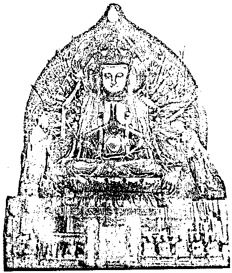



大雄宝殿观音菩萨像赞(并序)



《鄞县志》云：「明洪武二十年，本昌国梅岑山宝陀寺悬海，信国公汤和起遣海岛居民迁入江东，奏改寺名栖心为补陀。」嗣后就地人民，每逢观音圣诞，熙来攘往，拥挤进香，至今相续不断，即是华严所说南方补怛洛迦也。谨稽首对像作赞曰：



稽首妙智观世音　娑婆世界真教体  

应机而现为说法　信心起处说法竟  

我今见境得成就　亦同音闻获圆通  

千手千眼虽不齐　要是一真妙精明  

愿今持此妙法门　於此刹土为佛事  

一切声色𤍠恼中　常与众生作清凉  

皈依救世大悲者　愿赐威光加被我  

令我获无作妙力　令我亦名无所畏  

令我具无碍辩才　令我入一切种智  

我与一切诸有情　皆如观音得自在



民国二十六年春，退隐宏鉌溥常敬题



五百罗汉石刻之一



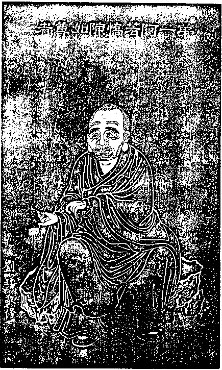



------



### 七塔寺志序



佛之为教，广大悉备，遍十方界，其视大地之一隅，若一沤之於大海也。其为观也，刹那之间，万劫过焉；其视数十百年兴废递嬗之迹，若目之一瞬也。然则就一寺一塔而纪其始末，以吾属视之，诚伟矣、劳矣！自佛观之，其无过一沤之微、一瞬之顷而已。虽然，十方界之大，一沤之所积也；亿万劫之久，一瞬之所累也。则其广也、其久也，又安得薄此一沤一瞬之微哉？且佛之灭度久矣，其教之所能广庇众生、以至今日者，岂非藉传衍之力？而古刹名山，则结集之场、说法传戒之所也。其系佛说，推布递嬗之大如此，则其考其废兴成坏之迹以行世，亦皈佛者所有事也。甬上，故道场胜地，僧俗薰修，梵宇相望。而七塔寺创自有唐，千百年以还，虽名数易，而宏法之旨，则无少异也。独寺迄无志，缁白欲考其事迹，乃无所据，识者憾焉。四明陈君寥士，念末劫之方来，而宗风之不可不振也，缀辑是编，以广宏教之旨。书成，请序於余。余虽学佛，而所得於教义者至浅。姑推论广微久暂之义，序以归之。



民国廿六年六月，番禺叶恭绰



开山祖塔



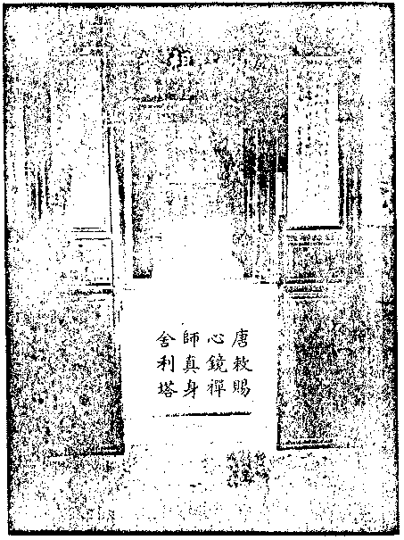



开山祖塔碑文



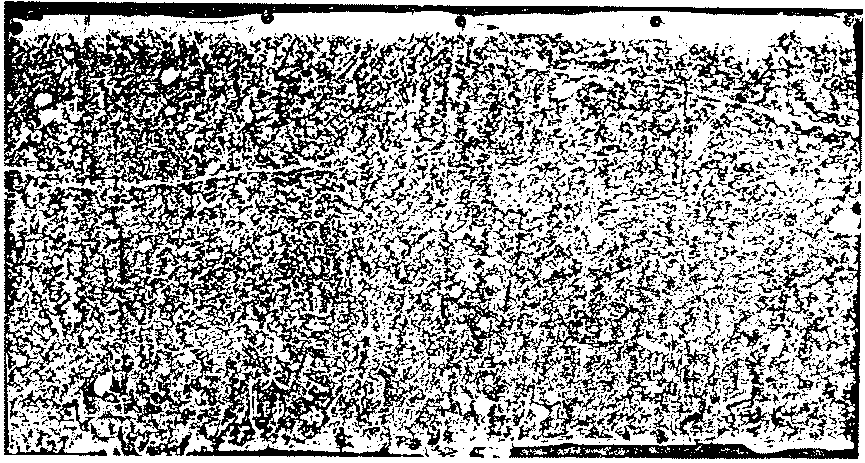



> 栖心寺  

> 故禅　德和尚焚身五  

> 色舍利三十粒  

> 时咸通年十一月四日进　七粒入内  

> 廷次年九月唐勅赐　号心镜大师  

> 寿相勅奉为  

> 至仁大圣广孝  

> 皇帝延庆节建造此塔伏资  

> 景福时咸通十四年岁次癸巳六月甲午朔  

> 廿八日立右塔僧志中  

> 知造舍利殿僧  

> 失  

> 他唵毗输耶娑  

> 娑啰拏褐底诃  

> 苏跋析罗  

> 瑜散陀罗　输  

> 瑟　毗逝耶  

> 怛他揭多阿  

> 析啰迦耶  

> 拏毗　钵罗底  

> 地瑟耻帝　末祢末  

> 毗　普咤勃地  

> 萨末　萨婆勃  

> 析啰揭鞞跋  

> 迦耶毗秣提  

> 怛他褐多三摩魂婆娑  

> 蒲驮耶三澷  

> 咤那类地瑟　帝



(右百八十有六字，为「唐勅赐心镜禅师真身舍利塔」文字中之尚可辨者。句文断蚀，不可卒读。原文尚无旁本发见，可资校证。爰付影写，以存其真。何日得窥全豹，俟诸来者。寥士记。)



(原刻字样，大小不等。共剥蚀若干字，亦不敢臆断。右所誊录者，略存原形而已。寥士又记。)



慈运慧祖遗像



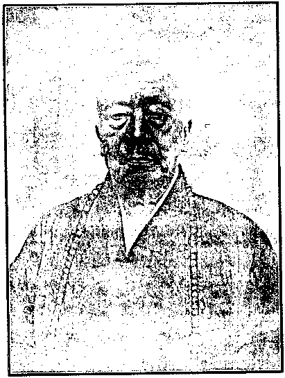



慈运老和尚像



如如不动



王震题



七塔寺志凡例



《七塔寺志》草创伊始，溥常长老敦促至殷。不揣剪陋，几加考量，爰订凡例，以挈纲目。取材非宏，挂漏难免，后有述者，此其蒿矢。乙亥初霜，陈寥士识。



了了方位，可稽丘索。万象在图，尺楮已足。志图记第一。



云何寿世，唯金与石。现兹三宝，有像有塔。志金石第二。



唐宋明清，寺名屡易。薪尽火传，法眷则一。志沿革第三。



梵宫禅宇，光大发扬。甬东佛地，方兴未央。志建置第四。



闲云卓锡，法雨传灯。声闻广被，人仰高僧。志僧谱第五。



庄严佛门，崇兹戒律。井井有条，比丘矜式。志法要第六。



资生事业，不违实相。安此钵盂，千秋供养。志产业第七。



高文疥壁，云璈嗣响。偶留雪鸿，且证微尚。志艺文第八。



七塔寺志卷之一



四明陈寥士纂



志图记



七塔报恩禅寺记



浙江宁波市东五里许，有七塔报恩禅寺者，鄞县志乘，历历可考。溯自唐大中十二年戊寅，分宁令任景求君，舍住宅为寺，号东津禅院；敦请心镜奂禅师居之，即本寺开山第一代也。初，禅师主持天童寺时，徙神龙，镇毒蟒，种种神通妙用，详载《天童寺志》，兹不赘述。咸通庚辰元年，浙东剡寇裘甫掠夺四明，纵兵昼入。禅师晏坐禅定，神色不动。贼众惊愕，作礼而退。辛巳二年，郡绅奏请改名栖心寺，以旌其德焉。宋大中祥符元年，岁次戊申，赐额崇寿寺。山门前河岸石桥尚存斯名，至民国廿三年，河填而桥始毁。明洪武二年己酉，延毁内法堂。所烧隙地，并开山祖塔后餘地，改创养济院，现仍旧。二十年丁卯，因梅岺山宝陀寺（即普陀山前寺）悬於海边；徙建寺内餘地，改名补陀寺。殿前香炉镌名，尚存古迹，故宁俗尚有「本寺即南海普陀」之说。大殿观音为主，每逢圣诞日，进香觐礼不绝。直至永乐年间，僧寺俱废。后并原留东首空地三分之一，复建栖心寺。永乐二十二年甲辰，建圆通宝殿。宣德壬子七年，建毘卢阁。天顺戊寅二年，建藏经阁、大悲殿、弥勒殿及两廊等屋。满清顺治年间，建方丈。康熙间，重修佛殿及钟楼。二十二年癸亥，建大悲殿。寺前有七浮图，俗人皆呼七塔寺者，始於此。其最不幸者，咸丰辛酉十一年，悉遭兵毁。至同治辛未十年，里人周文学君母子，募赀重建大殿与山门；寺中功德堂奉祀牌位，以留纪念。光绪十六年庚寅，江东绅董耆老等公，请本师慈运慧祖为主席，时年六十有四。自接住后，开海单以安众，常住三百餘僧。具大愿力，辛苦经营。寺门前七塔古迹，中央改造天王殿、大雄殿、三圣殿、中兴祖堂，新建法堂、藏经楼及方丈。后有开山祖塔，楼上庄严寮。东边慈荫堂，楼上玉佛阁。又有谷仓、工作寮、小厕所、小厨房、新库房、新新库房、老库房、老虎灶、上官厅、大客厅、地藏殿、大钟楼、念佛堂。西边云水堂，楼上华严阁。又有浴堂、行堂寮、化身窰、坭水工作房、大厨房、监斋殿、五观堂、如意寮、大厕所、祖堂、客堂、禅堂。禅堂西有餘地，为僧塔、僧坟等。近今添设佛学院於藏经楼，施医药所於三圣右厢。其工程浩大，阅三十餘年始竣事。复於光绪二十一年乙未，进京请颁龙藏，并勅赐寺额，名「七塔报恩禅寺」。於丙申及丙午二年，两次传授大戒；民国二十三年，又传戒一次。每年夏季，请法师讲经。平日禅堂坐香，随时诵经、礼忏、念佛。宣统二年庚戌，本师慈老人西逝，世寿八十有四。住持事付嘱法门，克绍家业；皈信辈拥护大法，广种福田。丛林规模粗具，堪壮仁人观瞻，而与育王、天童并峙。回忆我本师慈运慧祖，俗姓朱氏，适与始祖同宗。自同治十三年甲戌住持天童，又与开山始祖同出一辙。及由镇海李衙桥万善寺住持，而来主持斯寺，推为中兴第一代。递传临济正宗，心心相印。四十八员法嗣，悉皆分化诸方。子孙绵绵，大振宗风。惟愿后来贤哲报恩，当记念天童法脉而弗忘也。追溯本寺历史，由唐代大中十二年戊寅岁起，经五代，洎宋元明清四朝，至民国廿五年岁次丙子止，约计一千零七十九年矣。时值国民政府通令调查僧寺古迹，为述其崖略如此。



佛历二千九百六十三年，国历民国二十五年仲春，住持溥常述於丈室



七塔报恩禅寺平靣全图



民国念四年十月　日，四明胡惠章绘量



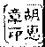



备注



坐落鄞县甬东(三四)图江东忠介街地方



1.民国九年，史悠德来计，面积六分。



2.光绪二十四年，张有庆来计，面积七厘三。



3.民国九年，史致容来计，面积五分二厘六。



4.光绪二十五年，张有庆来计，面积二亩四分五厘八。



5.旧有基地，计面积十六亩四分。



6.民国七年，陈贤房张氏来计，面积五厘六。



7.民国七年，徐友根来计，面积二亩二分八厘八。



总共计面积二十四亩三分九厘八



8.民国七年，徐友根来计，面积公行地一分二厘二。



9.百丈小学借用操场，计面积六分八厘九。



10.僧坟地，计面积六分七厘七。



11.焚纸地，面积二厘七。



12.民国七年，王闰生来计，面积四厘八。



13.民国七年，王沈氏来计，面积一分二厘一。



14.民国七年，王沈氏与王闰生来计，面积公行路一厘八。



又公有地共计面积一分四厘



15.东首四塔基地，计面积一分九厘四。



16.东首餘地，计面积四厘六。



17.西首餘地，计面积一厘八。



18.西首三塔基地，计面积一分一厘七。



19.民国二年，收回街楼屋三间，计面积六厘。



比例尺六百分之一，系英尺计算。



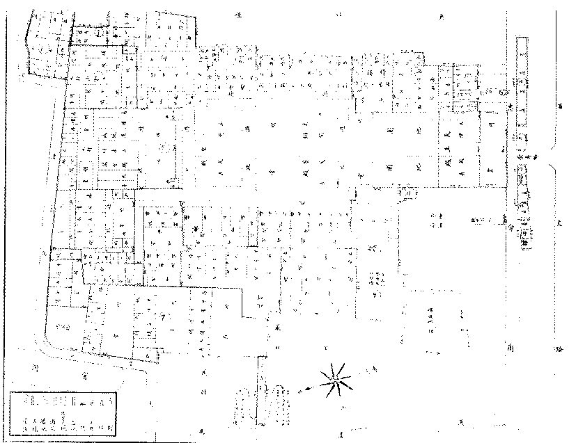



七浮图



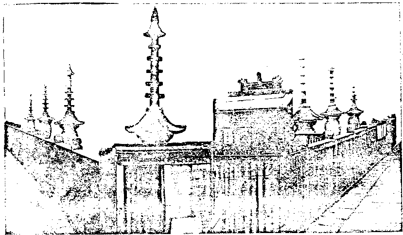



山门及天王殿



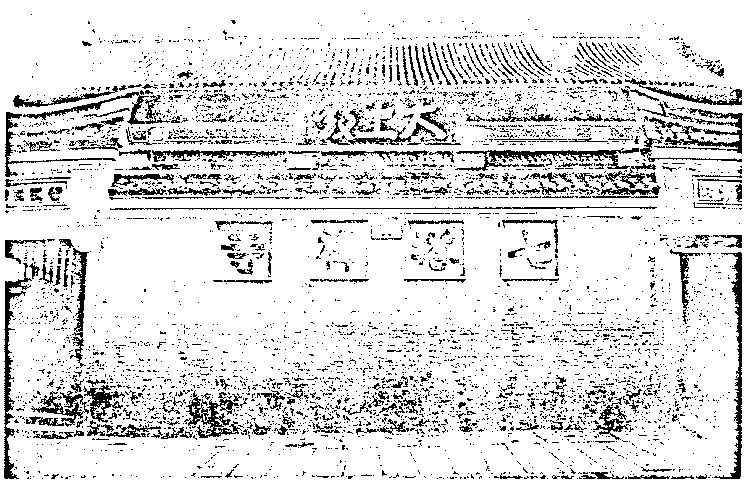



大雄宝殿正面



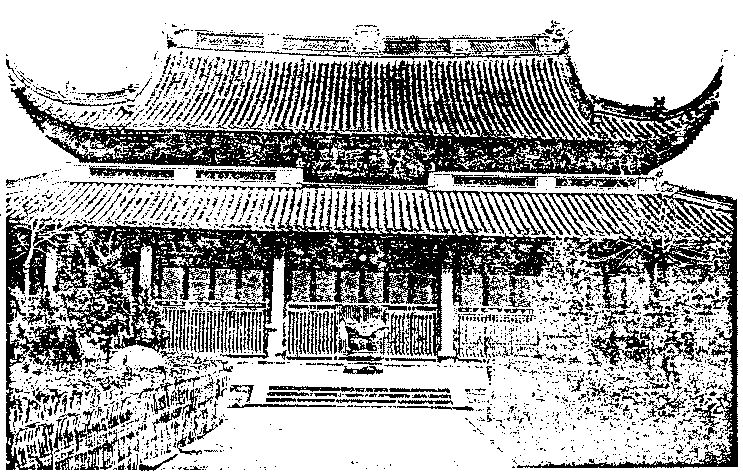



钟楼



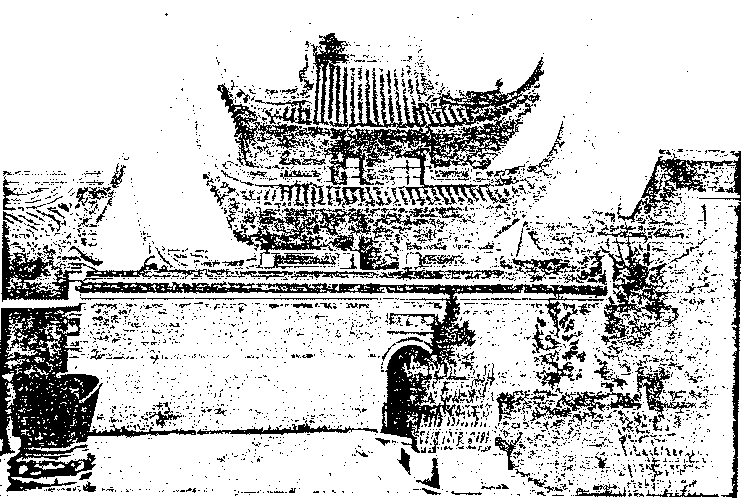



三圣殿



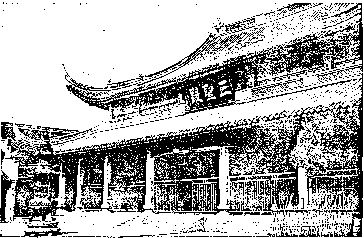



藏经楼及法堂



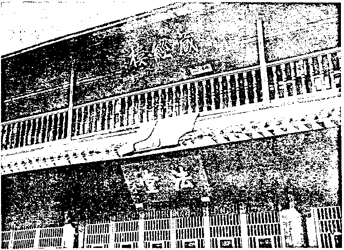



七塔寺志卷之二



四明陈寥士纂



志金石



一、开山祖塔



开山祖塔，即唐心镜奂禅师之塔也。在方丈室中央，上刻「唐勅赐心镜禅师真身舍利塔」十二字，其下碑文多漫漶不可读，惟立碑年月则为「时咸通十四年岁次癸巳六月甲午朔廿八日立」犹可识也，其餘断碎文字见插图中。



二、补陀寺钟题字



《鄞县志》(卷六十页十一)云：补陀寺钟题字，在七塔寺，天顺六年二月十九日造。



三、补陀寺铁磬



《鄞县志》(卷六十页二十二)云：补陀寺铁磬，在七塔寺，泰昌元年仲冬。



四、崇寿寺额



《鄞县志》(卷六十页二十八)云：崇寿寺额，在鄞县，唐相裴休书。(舆地碑目)



五、七塔



《鄞县志》(卷六十六页三十一)云：门外有七浮图，俗名七塔。



六、五百罗汉



湘刻五百罗汉，嵌於大殿壁上，碑文及名号如下。



五百罗汉像赞



应真五百　殊相堂堂  

少丛显迹　震旦流芳  

神通具足　变化靡常  

图模杖履　笔审阴阳  

朗同星列　次比雁行  

有瘦而削　有颀而长  

有白而皙　有老而苍  

有示游戏　有现端庄  

有麟其车　有云其裳  

种种会意　作作生芒  

非空非有　能隐能彰  

忽语忽默　或存或亡  

诸漏已尽　三昧谁详  

度人出世　说法开场  

天风浩浩　海水茫茫  

龙降虎伏　鱼跃鸟翔  

去来现在　声味色香  

半丝不挂　万籁俱忘  

川含月印　花茁莲房  

成妙胜果　具智慧囊  

八部拱手　三千宝装  

须弥是握　芥子中藏  

遍洒甘露　普设慈航  

门传不二　寿纪无量  

除彼烦恼　任我徜徉  

亿且可衍　一亦何妨  

篆刻工巧　神彩飞扬  

金身丈六　放大毫光



嘉庆戊午仲夏，星沙刘权之撰并书



二刻五百阿罗汉敍



大觉世尊以悲愿力，敕诸阿罗汉应供人间，不得入灭，将使无边众生，结无上胜缘，出二死海而后已。阿罗汉石碑，向刻奉常州天寗寺，遭发逆毁尽。湖南心月上人，以旧拓本初刻於衡岳祝圣寺；复儗刻供江浙诸名刹。无何，以疾卒。抄见大德以其志不可没，乃勉其徒惠安继而刻之。经始於光绪甲午秋，越丙申夏而工竣。噫！其勷继之功，实有不可得而思议也与！因摭其缘起，书而传之。



南岳默庵谨撰



五百罗汉名号录



第一阿若憍陈如尊者  

第二阿泥楼尊者  

第三有臤无垢尊者  

第四须跋陀罗尊者  

第五迦留陀夷尊者  

第六闻声得果尊者  

第七栴檀藏王尊者  

第八施幢无垢尊者  

第九憍梵般提尊者  

第十因陀得惠尊者  

第十一迦那行那尊者  

第十二婆苏槃豆尊者  

第十三法界四乐尊者  

第十四优楼频螺尊者  

第十五佛陀密多尊者  

第十六那提迦叶尊者  

第十七那延罗目尊者  

第十八佛陀难提尊者  

第十九末田底迦尊者  

第二十难陀多化尊者  

第二十一优波鞠多尊者  

第二十二僧迦耶舍尊者  

第二十三教说常住尊者  

第二十四商那和修尊者  

第二十五达摩波罗尊者  

第二十六迦耶伽叶尊者  

第二十七定果德业尊者  

第二十八庄严无优尊者  

第二十九忆持因缘尊者  

第三十迦那提婆尊者  

第三十一破邪神通尊者  

第三十二坚持三字尊者  

第三十三阿㝹楼䭾尊者  

第三十四鸠摩罗多尊者  

第三十五毒龙皈依尊者  

第三十六同声稽首尊者  

第三十七毗罗胝子尊者  

第三十八伐苏密多尊者  

第三十九阇提首那尊者  

第四十僧法耶舍尊者  

第四十一悲密世间尊者  

第四十二献华提记尊者  

第四十三眼光定力尊者  

第四十四伽耶舍那尊者  

第四十五莎底苾𫇴尊者  

第四十六波阇提婆尊者  

第四十七解空无垢尊者  

第四十八伏陁密多尊者  

第四十九富那夜舍尊者  

第五十伽耶天眼尊者  

第五十一不看世间尊者  

第五十二解空第一尊者  

第五十三罗度无尽尊者  

第五十四金刚破魔尊者  

第五十五愿护世间尊者  

第五十六无忧禅定尊者  

第五十七无作慧善尊者  

第五十八拾劫慧善尊者  

第五十九旃檀德香尊者  

第六十金山觉意尊者  

第六十一无业宿尽尊者  

第六十二摩诃刹利尊者  

第六十三无量本行尊者  

第六十四一念解空尊者  

第六十五观身无常尊者  

第六十六千劫悲愿尊者  

第六十七瞿罗那含尊者  

第六十八解空定空尊者  

第六十九成就因缘尊者  

第七十坚通精进尊者  

第七十一萨陀波仑尊者  

第七十二乾陁诃利尊者  

第七十三解空自在尊者  

第七十四摩诃注那尊者  

第七十五见人飞腾尊者  

第七十六不空不有尊者  

第七十七周利槃持尊者  

第七十八瞿沙比丘尊者  

第七十九狮子比丘尊者  

第八十修行不著尊者  

第八十一毕陵伽蹉尊者  

第八十二摩利不动尊者  

第八十三三昧甘露尊者  

第八十四解空无舌尊者  

第八十五七佛难提尊者  

第八十六金刚精进尊者  

第八十七方便法藏尊者  

第八十八观行月轮尊者  

第八十九阿那邠提尊者  

第九十拂尘三昧尊者  

第九十一摩诃俱𫄨尊者  

第九十二辟支转智尊者  

第九十三山顶龙众尊者  

第九十四罗网思惟尊者  

第九十五劫宾覆藏尊者  

第九十六神通亿具尊者  

第九十七具寿俱提尊者  

第九十八法王菩提尊者  

第九十九法藏永劫尊者  

第一百善注尊者  

第一百一除忧尊者  

第一百二大忍尊者  

第一百三无忧自在尊者  

第一百四妙惧尊者  

第一百五严土尊者  

第一百六金髻尊者  

第一百七雷德尊者  

第一百八雷音尊者  

第一百九香象尊者  

第一百十马头尊者  

第一百十一明首尊者  

第一百十二金首尊者  

第一百十三敬首尊者  

第一百十四众首尊者  

第一百十五辨德尊者  

第一百十六羼提尊者  

第一百十七悟达尊者  

第一百十八法灯尊者  

第一百十九离垢尊者  

第一百二十境界尊者  

第一百二十一马胜尊者  

第一百二十二天王尊者  

第一百二十三无胜尊者  

第一百二十四自净尊者  

第一百二十五不动尊者  

第一百二十六休息尊者  

第一百二十七调达尊者  

第一百二十八普光尊者  

第一百二十九智积尊者  

第一百三十宝幢尊者  

第一百三十一善慧尊者  

第一百三十二善眼尊者  

第一百三十三勇宝尊者  

第一百三十四宝见尊者  

第一百三十五慧积尊者  

第一百三十六慧持尊者  

第一百三十七宝胜尊者  

第一百三十八道仙尊者  

第一百三十九帝网尊者  

第一百四十明网尊者  

第一百四十一宝光尊者  

第一百四十二善调尊者  

第一百四十三旧迅尊者  

第一百四十四修道尊者  

第一百四十五大相尊者  

第一百四十六善住尊者  

第一百四十七持世尊者  

第一百四十八光英尊者  

第一百四十九权教尊者  

第一百五十善思尊者  

第一百五十一法眼尊者  

第一百五十二梵胜尊者  

第一百五十三光曜尊者  

第一百五十四直意尊者  

第一百五十五摩帝尊者  

第一百五十六慧宽尊者  

第一百五十七无胜尊者  

第一百五十八昙摩尊者  

第一百五十九欢喜尊者  

第一百六十游戏尊者  

第一百六十一道世尊者  

第一百六十二明照尊者  

第一百六十三普等尊者  

第一百六十四慧作尊者  

第一百六十五助欢尊者  

第一百六十六难胜尊者  

第一百六十七善德尊者  

第一百六十八宝涯尊者  

第一百六十九观身尊者  

第一百七十华王尊者  

第一百七十一德首尊者  

第一百七十二憙见尊者  

第一百七十三善宿尊者  

第一百七十四善意尊者  

第一百七十五爱光尊者  

第一百七十六华光尊者  

第一百七十七善见尊者  

第一百七十八善根尊者  

第一百七十九德顶尊者  

第一百八十妙臂尊者  

第一百八十一龙猛尊者  

第一百八十二弗沙尊者  

第一百八十三德光尊者  

第一百八十四散结尊者  

第一百八十五净正尊者  

第一百八十六善观尊者  

第一百八十七大力尊者  

第一百八十八电光尊者  

第一百八十九宝仗尊者  

第一百九十善星尊者  

第一百九十一罗句尊者  

第一百九十二慈地尊者  

第一百九十三庆友尊者  

第一百九十四世友尊者  

第一百九十五满宿尊者  

第一百九十六阐陀尊者  

第一百九十七月净尊者  

第一百九十八大天尊者  

第一百九十九净藏尊者  

第二百净眼尊者  

第二百一波罗密尊者  

第二百二俱那含尊者  

第二百三三昧声尊者  

第二百四菩萨声尊者  

第二百五吉祥咒尊者  

第二百六钵多罗尊者  

第二百七无边身尊者  

第二百八贤劫首尊者  

第二百九金刚味尊者  

第二百十乘味尊者  

第二百十一婆私咤尊者  

第二百十二心平等尊者  

第二百十三不可比尊者  

第二百十四乐覆藏尊者  

第二百十五火燄身尊者  

第二百十六颇罗堕尊者  

第二百十七断烦恼尊者  

第二百十八薄俱罗尊者  

第二百十九利婆多尊者  

第二百二十护妙法尊者  

第二百二十一最胜意尊者  

第二百二十二须弥灯尊者  

第二百二十三没特伽尊者  

第二百二十四弥沙塞尊者  

第二百二十五善圆满尊者  

第二百二十六波头摩尊者  

第二百二十七智慧灯尊者  

第二百二十八栴檀藏尊者  

第二百二十九迦难留尊者  

第二百三十香焰幢尊者  

第二百三十一阿湿卑尊者  

第二百三十二摩尼宝尊者  

第二百三十三福德首尊者  

第二百三十四利婆弥尊者  

第二百三十五舍遮独尊者  

第二百三十六断业尊者  

第二百三十七欢憙智尊者  

第二百三十八乾陁罗尊者  

第二百三十九莎伽陀尊者  

第二百四十须弥望尊者  

第二百四十一持善法尊者  

第二百四十二提多迦尊者  

第二百四十三水潮声尊者  

第二百四十四智慧海尊者  

第二百四十五众具德尊者  

第二百四十六不思议尊者  

第二百四十七弥遮仙尊者  

第二百四十八尼驮伽尊者  

第二百四十九首正念尊者  

第二百五十净菩提尊者  

第二百五十一梵音天尊者  

第二百五十二因地果尊者  

第二百五十三觉胜解尊者  

第二百五十四精进山尊者  

第二百五十五无量光尊者  

第二百五十六不动意尊者  

第二百五十七修善业尊者  

第二百五十八阿逸多尊者  

第二百五十九孙陀罗尊者  

第二百六十圣峰慧尊者  

第二百六十一曼殊行尊者  

第二百六十二阿利多尊者  

第二百六十三法轮山尊者  

第二百六十四众和合尊者  

第二百六十五法无住尊者  

第二百六十六天皷声尊者  

第二百六十七如意轮尊者  

第二百六十八首光焰尊者  

第二百六十九无比校尊者  

第二百七十多伽楼尊者  

第二百七十一利婆多尊者  

第二百七十二普贤行尊者  

第二百七十三持三昧尊者  

第二百七十四威德声尊者  

第二百七十五利婆多尊者  

第二百七十六名无尽尊者  

第二百七十七阿那悉尊者  

第二百七十八普胜山尊者  

第二百七十九辨才王尊者  

第二百八十行化国尊者  

第二百八十一声龙种尊者  

第二百八十二誓南山尊者  

第二百八十三富伽耶尊者  

第二百八十四行传法尊者  

第二百八十五香金手尊者  

第二百八十六摩拏罗尊者  

第二百八十七光普现尊者  

第二百八十八慧依王尊者  

第二百八十九降魔军尊者  

第二百九十首焰光尊者  

第二百九十一持大医尊者  

第二百九十二藏律行尊者  

第二百九十三德自在尊者  

第二百九十四服龙王尊者  

第二百九十五阇夜多尊者  

第二百九十六秦摩利尊者  

第二百九十七义法胜尊者  

第二百九十八施婆罗尊者  

第二百九十九阐提魔尊者  

第三百王住道尊者  

第三百一无垢行尊者  

第三百二阿婆罗尊者  

第三百三声皈依尊者  

第三百四禅定果尊者  

第三百五不退法尊者  

第三百六僧伽耶尊者  

第三百七达摩真尊者  

第三百八持善法尊者  

第三百九受胜果尊者  

第三百十心胜修尊者  

第三百十一会法藏尊者  

第三百十二常欢喜尊者  

第三百十三威仪多尊者  

第三百十四头陀僧尊者  

第三百十五议洗肠尊者  

第三百十六德净悟尊者  

第三百十七无垢藏尊者  

第三百十八降伏魔尊者  

第三百十九阿僧伽尊者  

第三百二十金富乐尊者  

第三百二十一顿悟尊者  

第三百二十二周陀婆尊者  

第三百二十三住世间尊者  

第三百二十四灯导首尊者  

第三百二十五甘露法尊者  

第三百二十六自在王尊者  

第三百二十七须达那尊者  

第三百二十八超法雨尊者  

第三百二十九德妙法尊者  

第三百三十士应真尊者  

第三百三十一坚固心尊者  

第三百三十二声响应尊者  

第三百三十三应赴供尊者  

第三百三十四尘劫空尊者  

第三百三十五光明灯尊者  

第三百三十六执宝炬尊者  

第三百三十七功德相尊者  

第三百三十八忍心生尊者  

第三百三十九阿氏多尊者  

第三百四十白香象尊者  

第三百四十一识自生尊者  

第三百四十二赞叹颠尊者  

第三百四十三定拂罗尊者  

第三百四十四声引众尊者  

第三百四十五离净语尊者  

第三百四十六鸠舍尊尊者  

第三百四十七郁多罗尊者  

第三百四十八福业除尊者  

第三百四十九罗餘习尊者  

第三百五十大药尊尊者  

第三百五十一胜解空尊者  

第三百五十二修无德尊者  

第三百五十三喜无著尊者  

第三百五十四月葢尊尊者  

第三百五十五栴檀罗尊者  

第三百五十六心定论尊者  

第三百五十七庵罗满尊者  

第三百五十八顶生尊尊者  

第三百五十九萨和坛尊者  

第三百六十直福德尊者  

第三百六十一须那刹尊者  

第三百六十二憙见尊尊者  

第三百六十三韦蓝王尊者  

第三百六十四提婆长尊者  

第三百六十五成大利尊者  

第三百六十六法首尊者  

第三百六十七苏频陀尊者  

第三百六十八众德首尊者  

第三百六十九金刚藏尊者  

第三百七十瞿伽梨尊者  

第三百七十一日照明尊者  

第三百七十二无垢藏尊者  

第三百七十三除疑网尊者  

第三百七十四无量明尊者  

第三百七十五除众忧尊者  

第三百七十六无垢德尊者  

第三百七十七光明网尊者  

第三百七十八善修行尊者  

第三百七十九坐清凉尊者  

第三百八十无忧眼尊者  

第三百八十一去盖障尊者  

第三百八十二自明尊尊者  

第三百八十三和陯调尊者  

第三百八十四净除垢尊者  

第三百八十五去诸业尊者  

第三百八十六慈仁尊尊者  

第三百八十七无尽慈尊者  

第三百八十八飒陀怒尊者  

第三百八十九那罗达尊者  

第三百九十行颠持尊者  

第三百九十一天眼尊尊者  

第三百九十二无尽智尊者  

第三百九十三徧具足尊者  

第三百九十四宝盖尊尊者  

第三百九十五神通化尊者  

第三百九十六思善识尊者  

第三百九十七喜信静尊者  

第三百九十八摩诃南尊者  

第三百九十九无量光尊者  

第四百金光慧尊者  

第四百一伏龙施尊者  

第四百二幻光空尊者  

第四百三金刚明尊者  

第四百四莲华净尊者  

第四百五拘那意尊者  

第四百六贤首尊尊者  

第四百七利亘罗尊者  

第四百八调定藏尊者  

第四百九无垢称尊者  

第四百十天音声尊者  

第四百十一大威光尊者  

第四百十二自在主尊者  

第四百十三明世界尊者  

第四百十四最上尊尊者  

第四百十五金刚尊尊者  

第四百十六蠲慢意尊者  

第四百十七最无比尊者  

第四百十八超绝伦尊者  

第四百十九月菩提尊者  

第四百二十持世界尊者  

第四百二十一定华至尊者  

第四百二十二无边身尊者  

第四百二十三最胜幢尊者  

第四百二十四弃恶法尊者  

第四百二十五无碍行尊者  

第四百二十六普庄严尊者  

第四百二十七无尽慈尊者  

第四百二十八常悲愍尊者  

第四百二十九大尘障尊者  

第四百三十光焰明尊者  

第四百三十一智眼明尊者  

第四百三十二坚固行尊者  

第四百三十三澍云雨尊者  

第四百三十四不动罗尊者  

第四百三十五普光明尊者  

第四百三十六心观净尊者  

第四百三十七那罗德尊者  

第四百三十八师子尊尊者  

第四百三十九法上尊尊者  

第四百四十精进辨尊者  

第四百四十一乐说果尊者  

第四百四十二观无边尊者  

第四百四十三师子翻尊者  

第四百四十四破邪见尊者  

第四百四十五无忧德尊者  

第四百四十六行无边尊者  

第四百四十七慧金刚尊者  

第四百四十八义成就尊者  

第四百四十九善住义尊者  

第四百五十信证尊尊者  

第四百五十一行敬端尊者  

第四百五十二德普洽尊者  

第四百五十三师子作尊者  

第四百五十四行忍慈尊者  

第四百五十五无相空尊者  

第四百五十六勇精进尊者  

第四百五十七胜清净尊者  

第四百五十八有性空尊者  

第四百五十九净那罗尊者  

第四百六十法自在尊者  

第四百六十一师子颊尊者  

第四百六十二大贤光尊者  

第四百六十三摩诃罗尊者  

第四百六十四音调敏尊者  

第四百六十五师子臆尊者  

第四百六十六坏魔军尊者  

第四百六十七分别身尊者  

第四百六十八净解脱尊者  

第四百六十九质直行尊者  

第四百七十智仁慈尊者  

第四百七十一具足仪尊者  

第四百七十二如意杂尊者  

第四百七十三大炽妙尊者  

第四百七十四劫宝那尊者  

第四百七十五普焰光尊者  

第四百七十六高远行尊者  

第四百七十七得佛智尊者  

第四百七十八家静行尊者  

第四百七十九悟真常尊者  

第四百八十破冤贼尊者  

第四百八十一灭恶趣尊者  

第四百八十二性海通尊者  

第四百八十三法通尊者  

第四百八十四愍不息尊者  

第四百八十五摄众心尊者  

第四百八十六导大众尊者  

第四百八十七常隐行尊者  

第四百八十八菩萨慈尊者  

第四百八十九拔众苦尊者  

第四百九十寻声应尊者  

第四百九十一数劫定尊者  

第四百九十二注法水尊者  

第四百九十三得定通尊者  

第四百九十四慧广增尊者  

第四百九十五六根尽尊者  

第四百九十六拔度罗尊者  

第四百九十七思萨埵尊者  

第四百九十八注茶迦尊者  

第四百九十九钵利罗尊者  

第五百颠事众尊者



以上各罗汉像，左下方均附刻修者姓氏，从略。



七、补陀寺铁香炉



补陀寺铁香炉，现置大雄宝殿前。清同治十二年癸卯仲秋造。



八、琉璃会碑



琉璃会碑，清光绪二十八年春，住持慈运老人立。碑文如左。



琉璃会碑记



窃维六度妙行，布施为先；十供良因，灯光最胜。若夫琉璃灯者，能除怖畏，善破无明，度长夜之迷津，开昏衢之觉路。在昔药王身灯，照十方佛土，佛赞：「善哉！是名真法供养。」而今檀护资财，购胜妙福田，福利不漏，永成般若光明。自此宝殿之灯光不夜，铁城之幽喑顿消。如此功勋，岂云小善？会立恒产，事希玉成，宜勒石於现前，列芳名於永远矣。



九、铜磬



铜磬一，周沿刻「旅东法度震灾华侨亡灵日本横滨中华会馆同人敬献七塔禅寺」二十六字。



十、宝鼎



宝鼎，在西方三圣殿前。民国元年壬子冬，镇海信士阮世龙、男文忠敬助，住持岐昌率监院常西督造，僧晋同募。



十一、铜钟



铜钟一，在钟楼上。佛历二千九百五十三年，即民国十五年丙寅冬月，住持觉圆、监院溥常暨两序同募。上海南市董家渡，浦东沈元吉冶坊铸造。



七塔寺大钟记



昔罽呢咤国王贪虐无道，造作深殃。后受马鸣大士教化，以闻法力，化重报轻，殁后生大海中作千头鱼。海中忽现剑轮，时时回注，截断鱼头。以业力故，截已复生，苦不胜忍。唯闻某寺钟声，轮即暂停，苦亦少息。王致梦白维那曰：「惟愿大德垂怜，矜悯击扬，延之过七日，己罪报毕矣。」以是因缘，西域诸寺，扣钟震响，徧地咸闻。我国肇於武帝问志公曰：「朕欲息地狱苦，宜以何法？」答曰：「冥界惟闻钟声，苦能暂息。」帝遂徧诏天下，凡击钟者，宜舒其声。可知先圣后圣，其揆一也。甬东七塔寺，兴而废，废而兴，不知凡几。於前清光绪十六年，慈运长老受诸绅请，矢志重兴。从此鸠工庀材，运斤伐木。不十年，宝殿巍峨，光辉金碧。兼之龙象济济，辅弼得人，顿与太白天童、育王广利并驾齐驱矣。乃於二十一年北上奏请龙藏，渥蒙颁赐，奉旨回山。复念兴工动土，累及枯骸，并怜远近孤魂超升乏术，爰是铸造鉅钟，扬声息苦。无如造经二次，响未远闻。於是诸哲嗣流集众建议，易铁为铜，重新建造。於民国十一年为始，逐渐集资，经五载，竟称告成。洵知山河大地，无一处非道场；鳞甲羽毛，非一物无佛性。矧兹甬江为两间之鉅丽，顾斯人道为万物之最灵，讵不顿现净土而见大士法身者乎？惟斯钟也，宏声巨扣，响震重泉；将见夕梵晨钟，松风水月，皆演无尽法音，必能惊醒尘寰，奚独超拔冥界已也。是为记。



佛历二千九百五十三年夏，天台宗晚学谛闲谨记



十二、大铜锅



大铜锅二口，即大厨房之菜饭锅。民国十六年，上海南市董家渡沈元吉敬助。



十三、石香炉



石香炉，明季制，上刻「宝鼎」二字。



十四、普洽皓祖塔



普洽皓祖塔，在老天童寺东首，民国二十五年冬重修。



十五、慈运慧祖塔



慈运慧祖塔，在天童寺右，玲珑岩下。



十六、普同塔



普同塔，民国二十年建，在庾山岭。



七塔寺普同塔记



夫出家之法，割爱辞亲，离尘舍俗；参方访道，拨草瞻风。仆仆尘寰，为己躬之大事；迢迢云水，顾只影以前踪。从上诸祖建设丛林，虽为十方衲子参学起见，亦为老病死计。庶使养生就医，各得其所；安身立命，自有其处。而我七塔报恩禅寺，自前清光绪间，由地方绅耆公请先师慈运老和尚住持，遂矢志中兴十方道场。不十年，百废俱举，规模完成。虽有如意寮以为诊病之区，而养老堂、普同塔尚付阙如。(圆瑛)民国十八年接住报恩法席，遂与监院德轩议及此事。适有东乡同嶴庾山庵庄严大师与余为道义之交，闻悉此事，欲以该庵献与常住，起造普同塔。山水清明，峰峦秀丽。集议两序，均表同情。由是监院德轩努力进行，阅二寒暑而塔告成。分三间，中间安住持及诸山或班首职僧之灵骨，左右大众与客僧。民十九，(圆瑛)移主天童报恩一席，以本舟和尚为当选。迄今数载，塔院亦成。今者拟办养老堂於院内，尘氛寂静，竹木深幽；晚年乐道，实得其所，诚一举而两得也。因记缘起，用勒诸石。



民国二十四年夏，退居圆瑛宏悟撰记



住持溥常立石



附录：慈运老人沉香木像



江苏省上海县费门周氏，法名善照，年五十九岁，初皈依慈老人为本师。及民国十年来寺，对余曰：「我师虽已去世，我亦依师住处而去世。」购沉香木，倩匠雕像，虔诚焚香供奉。不数月，果得病西归。通信男儿兴宝，料理后事。斯时也，余任监院职而目覩之。华严云：「信为道元功德母，长养一切诸善根。」善照，诚女中丈夫也。三宝感化之力大矣哉！特序事实，述偈以赞之：



吾师德感动　女性信专一  

佛说皈依僧　同登菩提路



民国二十四年冬月，住持溥常谨识



七塔寺志卷之二终



七塔寺志卷之三



四明陈寥士纂



志沿革



唐



东津禅院



此为最初之寺名。《鄞县志》(卷六十八页十三)云：县东五里，旧号东津禅院。唐大中十二年，分寗令任景求舍宅建寺，(案《敬止录》云：「景求初贯苏州，曾任明州判，遂家於鄞，治第甬东。后徙丰乐乡东山下，遂舍甬东居宅为寺。」)请心镜大师居之。(《天童寺志．卷三．心镜奂禅师传》略同)



栖心寺



乃东津禅院所改也。《鄞县志》(同前)云：会剡寇裘甫掠四明，纵兵入寺。师燕坐禅定，神色不动。贼众愕眙，作礼而退。咸通二年，郡奏其事，请以「栖心」名寺，旌师之德。(《天童寺志．卷三．心镜奂禅师传》略同)



宋



崇寿寺



此为第三寺名。《鄞县志》(同前)云：宋大中祥符元年，赐额崇寿。山门前跨河石桥，亦名崇寿桥。按《鄞县志．金石门》谓，崇寿寺额为唐时裴休书。岂唐时早有此名耶？崇寿桥则于民国廿三年冬，鄞县政府填河造屋，桥亦随圮，因附记之。



神霄玉清万寿宫



此为第四寺名。是否由佛教暂改为道教，不可考。《鄞县志》(同前)云：政和八年，改建神霄玉清万寿宫。久之复旧。(《宝庆志》)



明



补陀寺



此为第五寺名。《鄞县志》(卷六十六页三十一)云：县东三里，本昌国梅岑山宝陀寺，明洪武二十年，因宝陀寺悬海，徙建于甬东之栖心寺内空址。(案《明州杂谣注》，洪武十九年，信国公汤和起，遣海岛居民迁入江东，奏改栖心寺为补陀寺。与《成化志》差一年。)《普陀山志》(卷二页二)云：明太祖洪武二十年，信国公汤，徙居民入内地，焚其殿宇三百餘间，迎瑞相供于郡东栖心寺，重建大刹，改名补陀。山中仅留铁瓦殿一所，使一僧一介守奉香火焉。



复建栖心寺



唐名之栖心寺，在洪武、永乐间曾与补陀寺同存。《鄞县志》(卷六十八页十三)云：洪武二十年，徙昌国补陀于郡城，僧惟摩舍建补陀寺。留东首三分之一，复建栖心。永乐间，僧并补陀寺，遂废。(《敬止录》)



清



七塔寺



此为第六寺名。《鄞县志》(卷六十六页三十一)云：二十一年(康熙)建大悲殿，门外有七浮图，俗呼七塔寺。



按七浮图不必始建于清，而七塔寺之名则始于此。



报恩寺



为今名，全名则为「七塔报恩禅寺」。余作慈运大师传云：「翌年(光绪二十一年)，赴都请颁龙藏，勅赐报恩寺额。」



七塔寺志卷之三终



七塔寺志卷之四



四明陈寥士纂



志建置



甲、过去之一斑



养济院



明洪武二年，延毁内法堂址并塔后地餘址，改创养济院。(《鄞县志》卷六十八页十三)今存。



圆通宝殿



永乐二十二年，建圆通宝殿。



毗卢阁



宣德七年，建毗卢阁。



藏经宝阁等



天顺二年，建藏经宝阁、大悲弥陀殿及廊庑等屋。(以上《鄞县志．卷六十八》引《成化志》)



十王殿



嘉靖间，建十王殿。(《鄞县志．卷六十》引《嘉靖志》)



方丈



清顺治间，建方丈。



佛殿等



康熙间，重修佛殿、山门及钟楼。(以上《鄞县志．卷六十六》引《朱志》)咸丰十一年，兵毁。同治十年，里人周文学母子，募资重建佛殿、山门。(同上采访)



大悲殿



二十一年(康熙)，建大悲殿。门外有七浮图，俗呼七塔寺。(《鄞县志．卷六十六》引《闻志》)



乙、中兴后之概况



天王殿



清光绪十六年庚寅，慈运长老徇地方之意，任住持之职，惨澹经营，多所兴建，修理天王殿、客堂、祖堂、斋堂、库房、禅堂、云水堂等。民国六年，住持僧晙和尚，改建天王殿五间，中三供弥勒菩萨，左右各一供四天王。后与大殿相对者，供韦驮菩萨。殿高二重，底层较广。



报恩禅寺



天王殿



皆大欢喜



韦驮殿(乙未岁长至月，镇海陈修榆敬书。)



三州感应(乙未长至月，镇悔陈修榆敬书。)



威镇天魔



东津旧院



南海真宗



(以上皆匾额)



一生补处寄诸天，普现菩萨身，当年鹿野苑中，曾助迦文传密意。  

三界轮回仍故我，誓修唯识定，他日龙华会上，愿随无著觐慈颜。(乙卯中秋，慈运私淑弟子吴嘉瑞敬撰并书。信士陈裘赓，率男亦铨、亦山，孙本初、本崇、本祥敬献。)



此四尊都是武装，勇力百倍，今朝同护法门，犹见餘风飒爽。  

得一佛立成善果，皈依三宝，昔日顿开觉路，全凭行雨宏深。(民国九年，岁次庚申，十月谷旦，里人谢行溎撰。蔡和锵谨书。护法信士柳哲衲，率男中炤、孙和尧敬献助。)



如来说般若波罗密，汝当奉持，经典所在，则为是塔。  

众生发无上菩提心，明终不尽，善法增益，乃报佛恩。(民国八年九月夏，同龢薰沐敬书。信士余葆三，率男学梁、学桢、学栋、学楣、学柟敬献。)



万劫现金身，南海祥光瞻满月。  

七重留宝塔，东郊胜迹拓栖霞。(光绪廿三年春王月吉旦，弟子董茂容，率男仁卿敬献。)



大雄宝殿



原名圆通宝殿。光绪十七年辛卯，慈运长老重修，改为今名。广五间，中奉千手观音菩萨，左文殊，右普贤。殿后又有观音像，而五百罗汉石刻，分嵌于左右及后壁上。殿为两重躐角式，周围均系方石柱，上镌各种联语。



大雄宝殿(光绪十九年六月谷旦，里人李瑞彰敬立，命子仲光沐手谨书。)



慈流海澨(同治十三年，岁在阏逢阉茂，南吕月中澣谷旦，赏穿黄马褂花翎，强勇达春巴图鲁提督，浙江全省水陆军务节制各镇加一级，黄少春敬立。)



慧海慈云(同治四年，岁在乙丑，无射月全澣吉旦，邑人陈励敬书。弟子张朝宗，率男道业、道榆、道荣、道枋、道林，孙克广、克镇、克贤、克昌、克配敬献。)



泽沛闽峤(光绪元年，岁次乙亥，孟秋月上澣谷旦，里人陈懋采敬书。厦门帮通泉号、元昌号、启兴号同敬献。)



觉路潜通(同治十二年癸酉岁，黄钟月谷旦，里人孙学庭谨书。宁帮众米商公立。)



济世慈航(同治十三年，岁次甲戌，七月谷旦，陈愈涌敬书。甬上北号众商敬献。)



慈恩似海(光绪丙子岁，林镒月、甬江木号众商敬献。)



至诚可感(光绪廿一年乙未，二月谷旦，部下弟子陈祖浩，率男烈钫、烈铭、烈钦，孙愈桐、愈梓敬立。)



慈航从南海蜚来，劫历千年，犹认补陀真面目。  

旧院合东津建复，门留七塔，何须阿育幻浮图。(光绪五年，岁在乙卯，春正月，会稽王继香撰。里人陈允升书。里人吴煊，率男显鋆、显厘、显珪，孙家梁、家桢、家楣敬立。)



建刹与阛阓为邻，缘菩萨本超凡，烦恼皆除，也可到此间立脚。  

飞锡来普陀绝顶，悯众生而救苦，沈迷果觉，庶几从彼岸回头。(同治十二年，昭阳作噩之岁，良月吉旦，邑人张庆璜题。泉州深沪帮谦泰号商敬立。)



南海传灯(壬申仲秋立，元和顾文彬。)



慈航普济(己未冬月，常住重修众姓女敬献。夏汝霖敬书。)



灵应昭垂(光绪仲冬月谷旦，补用同知候补知县钱鍾麟敬立。)



佛从海上飞来，息足小普陀，无量无边，誓愿众生超苦海。  

僧是山中习静，栖心大自在，即喧即寂，始知尘市有深山。(同治十一年孟秋之月，重修七塔寺告成，谨撰楹联题於柱石。布政使衔宁绍台海防兵备道，顾文彬敬书。)



南海渡慈航，甘露普沾千世界。  

东津开梵刹，法云长荫七浮图。(同治十一年九月中浣，里人童华薰沐谨书。)



海南久驻慈云，大菩萨照恩光，早共仰千手千眼。  

甬东聿新佛地，小普陀传圣迹，不须著一色一尘。(铁峰张恕敬书。)



胜地接虹桥，古刹重新，七宝庄严观自在。  

法轮转鹿苑，元门入妙，不通朗彻见如来。(同治十二年，岁次癸酉，嘉平月谷旦，里人赵佑宸敬撰。廖祖宪敬书。)



浩劫阅红羊，七宝装成金粟界。  

真如参白马，三明悟到铁莲洋。(同治十有一年，九秋之吉，谿上张广延书。)



古刹阅三修，问我佛西来，度苦厄经几魔劫。  

浮图辉七宝，看大江东去，放光明照彻迷津。(同治十三年长至月，甬上凌忠镇撰句并篆。)



万劫现金身，南海祥光瞻满月。  

七重留宝塔，东郊胜迹拓栖霞。(同治十年辛未岁，八月全浣，里人章鋆敬撰并书。)



紫竹蔚丛林，现大士身而说法。  

赤堇修古刹，宏众人愿以成材。(同治十年，十月上浣，里人周岱敬撰并书。)



三昧悟真修，化宇咸游，何处非西方世界。  

四明留古刹，慈航普渡，此间是南海津梁。(同治甲戌，仲夏谷旦，张家骧敬题。)



地脉接鄮山，梵宇巍峨，震旦云霞围舍利。  

道心悟清夜，禅关寂静，乾钟陀鼓应祇园。(同治甲戌，小春月榖旦，陆廷黻敬书。)



小补陀福地重开，浩劫化成金粟界。  

大菩萨慈航普渡，众生稳涉铁莲洋。(同治十有三年，岁次甲戌，杪冬之吉，弟子周晋麒敬献。)



选佛重开场，仗大慈悲，立小普陀，无量威神观自在。  

破悭同结愿，师善知识，种诸福德，不可思议契真如。(同治十有三年，岁次甲戌，六月之吉，长沙彭慰高撰句敬书。)



七塔寺重修大雄宝殿，暨装金千手观音、文殊、普贤，及满堂圣像募缘启



溯唐大中间，心镜奂禅师杯渡西江，锡飞东甬；任公舍宅，建寺居之，颜曰「东津」。后易「栖心」，旌其德也。历宋元明，代有兴替。至清光绪中叶，慈运慧祖崛起中兴，琳宫绀宇，烂焉一新；门廊殿庑，灿然大观，赐额「报恩」。又名「七塔」，以门外有七浮图也。迄今选佛场开，宗风益盛。南参北询之流，至者如归。禅诵梵典之声，不绝於耳。鸿儒白丁，无不知有七塔之胜者。据考，明洪武间，因梅岺山宝陀寺悬海，徙建於甬东栖心寺内空址；恭迎大士瑞相，亦供於此，改为补陀寺。自时厥后，寺之正殿永奉观音大士，灵感显著，屡有异徵。所以一方人士，争为植福培因之道场；各地信侣，亦为经此必朝之灵迹。洵甬江之名蓝，震旦之祇园也。虽然，既有先人以拓其基，必藉继世以传其后。或证明心性、绍往开来，或恢宏愿力、兴废举坠，庶几山门永振，法矩常晖。若仅粗衣粝食，离群索居，完山僧野衲之本分，安能使住持三宝，永作金刚不坏耶？迺者(敝寺)大雄宝殿，暨内供千手观音及诸佛圣像，建造日久，渐呈暮象。不惟有损观瞻，抑且殊失相好。(指南)职掌住持，责有兴废；誓发宏愿，庄严依正。唯是一木难支大厦，众志方可成城。普望给孤长者、韦提夫人，或匿王之再世，或阿育之重来，共秉崇佛之心，同兴护法之力。将慈悲宝筏，为子孙广植福田；以喜舍愿船，度祖宗超生莲界。「种如是因，结如是果」，经有明言，决信无疑。谨启。



住持指南率监院明校敬募



三圣殿



位於大殿之后，广七间，中供西方三圣立像，高二丈八尺有奇。光绪十七年辛卯，慈运长老重建，庄严之相甲於诸方。光绪二十年甲午，与大殿千手观音像同开灵光。民国二十五年丙子，发起三圣装金。



附记



西方殿内所供三圣立像，高二丈有八，装金工事，非集鉅资难底於成。用是拟募万佛良缘，以一佛为一缘，每缘捐认国币一元。如一人乐认多缘，或多人合认一缘者，一听随喜。但每缘请念弥陀圣号千声，以资回向菩提。如上募之缘，除装三圣金像外，复有餘欵，一部作为启建万佛水陆道场之用，专为信施檀那祈福荐亡，及超拔民国以来所有中外南北阵亡将士之灵，并祈祷世界和平，人民安乐。一部作为扩充如意寮之费，普结十方僧众病苦之缘。因附记於此。



三圣殿(壬子冬月景辰，长沙萧荣爵书。)



果证菩提(光绪二十九年，一阳月吉立，邑人周振翰敬书。张门顾氏善莲敬献。)



圆通妙谛(光绪丁酉岁，嘉平月吉旦，里人王振钰谨书。甬三境弟子屠益哉、王明远、张维新敬献。)



香光庄严(民国廿五年十月，重修殿宇，三圣装金开光。溥常述句，东光陈宝麟书，张崇黼敬献。)



由来号崇寿，历劫重新，喜佛光普照十方，长为熙朝资圣寿。  

何处觅栖心，随缘且住，愿僧众静参三昧，直从觉路证禅心。(光绪辛卯，仲春月谷旦，里人陈烈镛谨撰并书。)



自悬海有宝陀寺名，普渡慈航作津逮。  

仿灵山为诸大众说，宏开梵宇广灯传。(里人林鼎梅撰并书。)



号为小普陀，依旧慈灯辉宝塔。  

奉有大菩萨，重新法苑现珠林。(里人张世训撰并书。)



鄮山本维衞生乡，负郭访丛林，听百杵钟声，似否西游海会。  

明代为宝陀故址，频年餘劫火，揽七重塔势，依然南拱天封。(里人徐隆圻谨撰并书。)



十方来，十方去，十方共成十方事。  

万人施，万人舍，万人同结万人缘。(光绪甲午年，孟秋谷旦，弟子李庭芳，率男名煊、名炯，孙广善、广书敬立。)



释迦对韦提夫人，说十六妙观，专观极乐慈父，见身实相出苦海。  

弥陀为法藏乞士，发四八誓愿，惟愿娑婆众生，念佛洪名坐金莲。(民国二十四年仲冬月，皈依童男圆吉、徐孟楣，随喜住持溥常撰句。金峨七十老樵卓梵敬书。)



南海真宗，四明佛地，历千餘年，沧桑变易，自得慈老中兴，竟与天童育王同称鼎足。(民国廿五年秋月，信女朱门冯氏式慧敬助。)



东津古迹，七塔道场，建三圣殿，栋宇庄严，俨然弥陀示现，仍并观音势至共作慈航。(方丈属澜撰书。)



西方三圣装金万缘启



我佛於过去无量劫中，以巨大牺牲之精神，修种种之福德智慧。及至最后，豁然大悟，亲证本有之真如妙性。复以其所觉之道，不辞辛瘁以觉悟众生，俾一切众生，皆得证其所证之妙性，以共享其不生不灭之胜乐。其予众生之恩惠，与众生之被其感化者，亦既深而且厚矣。故佛陀为利自利他之伟大人物，绝非其他宗教之教主所可望其项背也。假令佛不说法以觉悟众生，众生在迷，有如盲者无相，怅怅乎其何以行乎哉？兹虽佛陀涅槃已久，而其所遗流之教法，迄今尚存，理应香花灯乐，恭敬供养，常为纪念。夫教法为佛陀住世摄化精神之所寄，而代表其伟大人格者。教法有二，声教、行教是矣。声教者何？依据佛陀一代摄化补特伽罗之语言、结集而成之文字，所谓素怛缆藏、毗奈耶藏、阿毗达摩藏等，三藏十二分教也。行教者何？根据佛陀一代摄化补特伽罗所现之行为，融结而成一种精神寄托瞻仰，所谓塑造、雕刻以及彩畫、铜铸等，藉以表现其威仪相好、功德庄严之塔像也。是以教法所在，即如来舍利之身。如能起塔塑像，广为供养，则所得之福德，靡有涯际。试观贫女丐珠，金师为箔，各发欢心，共装塔像，九十一劫，报感大富。良以庄严塔像，非夸一时之富美；檀那功德，实为永劫之资粮。阿育王之造舍利塔，岂徒然哉？优填王之刻旃檀像，良有以也！(敝寺)为浙省名蓝，甬江古刹；佛化之兴隆，僧伽之繁衍，直与天童、育王、观宗三大丛林相伯仲，且有过之无不及者。寺之西方殿内，供有西方三圣，丈六金身，塑自有清光绪年间。中兴七塔，慈祖之手，艺术精致，巧夺天工，相好庄严，堪称杰作。拟云岗之石佛，比龙门之石像，不为过也。第以岁月迁流，金身掩紫磨之光，圣像失玉毫之曜，此为(敝寺)美中之缺陷，而亟亟宜装修者。溥常承乏主席，责无旁贷，拟募万人之缘，庄严三圣之相，庶几玉毫重增色彩，金身再放光明。唯是事功浩大，需费孔多。徒怀移山之愿，终乏点石之功。伏冀缁林上座，白社高贤，以及护法长官，信心居士，不住於相而行布施，玉成斯举，匡济其艰。买园布金，长者即生天上；聚沙成塔，童子终证菩提。功不虚捐，福有攸归。谨启。



中兴祖堂



位於三圣殿后，木质雕刻慈运长老像。



中兴祖堂(丙子春，住持溥常立，鄮西范文虎书。)



我佛所宗，真如贝叶。  

众经之长，妙法莲花。(慈运大和尚法鉴，叔平翁同龢。)



法堂



在三圣殿后，广五间二弄。光绪十七年，慈运长老募造。



法堂(民国二十五年春月，林森。)



寿世传灯(光绪柔兆敦牂阳月，为八十寿僧慈运长老传戒颂，浙东观察使者喻兆蕃题。)



寿世灯传(光绪三十二年，岁次丙午，孟冬月谷旦，赐进士出身、翰林院编修加三级，族姪朱卓英顿首书，为慈运老和尚八旬开庆志喜。法晚：寄禅、因静、淡云、正明、真常、妙见、悟真、好心、超有、道阶顶礼同祝。)



有寿者相(光绪三十二年，岁次丙午，阳月上浣良辰，蛟川董思曾书，恭祝本师慈运老和尚上寿。嗣法人：宏教、宏绪、宏演、宏训、宏莲、宏晋、宏纲、宏明、宏净、宏成、宏信、宏法、宏修、宏寿、宏权、宏化、宏道、宏圣、宏满、宏觉、宏一、宏灿、宏杨、宏达、宏瑞、宏深、宏引、宏得、宏海、宏圆同顶祝。)



有古德风(民国十四年十二月，县人陈磬裁识，童第锦书。常西法师与余交廿年，未尝见其有喜愠之色，盖其得於道者深矣。爰书四言遗之，以志景仰。)



圆融无碍(圆瑛大和尚主席天童寺，禅定育王寺。源龙暨两序恭贺。)



我佛重来(觉圆大禅师慈鉴。天台山农书，弟子杨莲生、常春恒和南敬献。)



当知是处恭敬供养，不可以百千万劫说其功德。  

若复有人受持读诵，已非於三四五佛种诸善根。(丙子仲秋，汉阳关炯敬题。)



气秉湘江，戒圆章水，教普浙瀛，福报比诸宗，记卓锡传衣，三宝尊严宏法脉。  

如来愿力，弥勒含容，普门慈善，涅槃留妙相，合缁徒白屋，四时展拜极追思。(慈运老和尚净德千古。壬子冬，萧荣爵敬书。)



藏经楼



在法堂上层。光绪二十一年请颁龙藏，供释迦牟尼佛像。



藏经楼(民国廿五年，戴传贤书。)



湛然真应(光绪戊申岁吉立，蛟川胡元钦、胡和卿敬立。)



龙藏目录提要



慈运大师所请龙藏，系清同治九年冬十一月，依乾隆三年十二月原刻本重刻于金陵刻经处者。现藏本寺藏经阁中，完好无缺。全目浩繁，兹举其纲要数量，以资稽考。



经藏



大乘经般若部



宝积部



大集部



华严部



涅槃部



五大部外重译经



小乘阿含部



已上经藏，天字号至芝字号，计二百八十四字零七卷，计板二万九千零九十九块，计连五万六千七百三十七连。



律藏



大乘律



小乘律



已上律藏，辞字号至受字号，计五十二字零七卷，计板五千八百六十五块，计连一万一千四百七十六连。



论藏



大乘论



小乘论



已上论藏，傅字号至通字号，计一百二十八字零六卷，计板一万三千块，计连二万五千三百三十五连。



续藏



西土圣贤撰集



此土著述



已上续藏，书字号至机字号，计二百三十九字，计板二万八千四百十一块，计连五万五千六百三十二连。



内原续藏一百五十四种，一千二百六十三卷，计板一万四千九百块，计连二万九千一百七十五连。



新续入五十四种一千一百二十七卷，计板一万三千五百十一块，计连二万六千四百二十七连。



天字号至机字号共七百二十四字，计板七万八千六百十五块，计连十五万三千三百七十四连。



天字号内加序及目录经签等板，计四百二十一块，八百三十七连。



方丈



在法堂之后进。



方丈(民国戊辰年吉立，镇海陈修榆书。)



开山祖塔



在方丈中央，楼上为庄严寮。



高风可仰(光绪三十有四年仲春，游七塔寺，见高僧慈运长老，暨令法徒自真方丈大和尚，领众行道，大有古德高风。因留四字，以为后进钦颂云。仁和高邕书并跋。)



慈荫堂



在法堂东首，广五间。民国八年，住持智圆建。



慈荫堂(民国十二年四月谷旦，安化陶思曾题，本寺住持弘一敬立。)



贝叶传经(民国丙寅年春三月，觉圆方丈和尚法鉴。弟子王紫光敬赠，邗江颜湘泉书。)



正法昌明(岐昌法兄大和尚六旬志庆，长沙萧荣爵拜书。癸丑阳月，法弟：友法、果如、僧晋、莲生、贤兆、蓬莱、自真、智圆、常西、圆瑛、道阶同祝。)



戒灯续燄(中华民国二十三年冬月吉立。溥常大和尚宏扬戒法，圆瑛敬书。法晚：本舟、式堂、德轩、励深、大智、明校、宽明、鉅镛、锦堂、可亮、宝泉、法舟、宝池、见云、惺悟、清奇、勋明、空观、常慧、自空、瑞岩、竹林、果成、妙洁、怀远、玉亮、嘉善、攸久、慈航、苾法、月定、指南、密庵、明性、乐天、圆明、空印、法源、善智、能安、静明、法悟、新山、同荣、得一、嵩庭、妙胜、大亮、妙安、智根、哲明、宝成、常空、瑞莲、普周、性源、云谷、常学、华光、莲度、明峰、梵云、碧林同敬贺。)



玉佛阁



在慈荫堂上，中供玉佛。民国八年，住持智圆老和尚募建。



玉佛阁(癸亥春月谷旦，孙啸洲书。)



常乐我净(民国九年五月日，二等大绶、三等宝光嘉禾章、四等文虎章，调署会稽道尹黄庆澜敬立。)



妙庄严域(民国十一年十月谷旦，浙海关监督袁思永献。)



新库房



光绪二十五六年间建。



新新库房　小厨房



民国十四年建。



老库房



与上官厅、大客厅连接。



地藏殿



在大钟楼之下。



念佛堂



在大钟楼旁。



大钟楼



位於大殿东，三层躐角式，钟悬於最高层。光绪二十四年，慈运长老向湘购生铁铸造。至民国十一年创始集资，改铸铜质，阅五年而告成。中供普庵祖师像。



云水堂



在法堂西首，广五间。民国六年，住持道亨建。



华严阁



在云水堂之上。



华严阁(溥常法师弘演《华严》於七塔寺者有年，今主持报恩、长佛学院，乃为题此以留纪念。乙亥初夏，雪山太虚。)



监斋殿　五观堂　大厨房



以上三处，民国六年住持道亨建。



如意寮



陈庆裁督造。



祖堂　客堂　禅堂



慈运长老建。



报恩佛学院



民国十七年成立，院址设藏经楼，法门公推溥常首座主办。著有《华严纲要浅说》行世。



七塔寺募建延寿堂佛学院启



昔者西伯养老，夷望来归；东汉谈经，王公就学。岂非以高年耆德，景迫桑榆；髦士英才，日升东旭；以养以教，仁政所先？是以事著简册，芳流缣素，千载而下，侈为美谈。况夫佛法高深，慈悲居首。惠徧于六道四生，而恩忽于腹心眉𥈤。慈悲之义，不其歉欤？是以延寿堂开，遗制曾传於往代；作人化启，学苑纷立於民初。古固宜循，今尤可法。况精修黄耇，实多我法之典型；英俊狮儿，不少他年之柱石。先务之急，孰有急於斯二者哉？七塔自慈祖中兴，於鄞治褎然冠首。十方辐辏，其食指常满数千。缔造之功伟矣，宏扬之业骎矣。顾高勋重望，仍旅进於清众之班；寝舍讲堂，尚寄寓於藏经之阁。其於教养之典，或未足以言备欤！(指南)以椎钝之才，膺神人之选，谬承祖席，深切覆𫗧。独是敬礼老成，栽培后进，根诸夙性，未敢辞劳。是以愿竭愚公移山之心，上续前人未竟之业。於延寿则欲臻爽垲，於学院则意主宽宏。惟时丁物力艰难，工则期以伟大。狐裘灿烂，决非一腋之可成；大厦巍峨，又岂一木所可就？是以呼号檀越，共种福田。伏祈推博爱之仁，惠兹骀背；本甄陶之意，众植良材。一椽片瓦，孰非功德之山？老安少怀，况符先圣之训。谨缀缘起，弁言册端。慨助芳名，请列於左。



施医药所



民国十七年成立，设三圣殿右厢。



七塔寺志卷之四终



七塔寺志卷之五



四明陈寥士纂



志僧谱



法嗣线图



（七佛）毗婆尸佛→尸弃佛→毘舍浮佛→拘留孙佛→拘那含牟尼佛→迦叶佛→释迦牟尼佛→（西天初祖）摩诃迦叶尊者→阿难尊者→商那和修尊者→优波毱多尊者→提多迦尊者→弥遮迦尊者→婆须蜜尊者→佛陀难提尊者→伏驮蜜多尊者→脇尊者→富那夜奢尊者→马鸣尊者→迦毘摩罗尊者→龙树尊者→迦那提婆尊者→罗睺罗多尊者→僧伽难提尊者→伽耶舍多尊者→鸠摩罗多尊者→阇夜多尊者→婆修盘头尊者→摩拏罗尊者→鹤勒那尊者→师子尊者→婆舍斯多尊者→不如蜜多尊者→般若多罗尊者→（西天二十八祖即东土初祖）菩提达摩尊者→慧可大祖禅师→僧璨鉴智禅师→道信大医禅师→弘忍大满禅师→慧能大鉴禅师→（六祖下第一世）南岳怀让禅师→马祖道一禅师→百丈怀海禅师→黄檗希运禅师→（第五世即临济第一世）临济义玄→兴化存奖→宝应慧颙→风穴延昭→首山省念→汾阳善昭→石霜楚圆→杨岐方会→白云守端→五祖法演→圆悟克勤→虎邱绍隆→天童昙华→密庵咸杰→卧龙祖先→径山师范→雪岩祖钦→高峰原妙→中峰明本→千岩元长→万峰时蔚→宝藏普持→东明慧旵→海舟普慈→宝峰明瑄→天奇本瑞→绝学正聪→月心德宝→禹门正传→密云圆悟→林野通奇→无碍行彻→纪安大经→悟性源达→界清远信→云光化正→纯经导琇→普洽英皓→



(报恩堂上)第一代→  

第二代→  

第三代→  

第四代→  

第五代



慈运灵慧→  

玉忠宏传→  

果建戒清→  

妙珑定朗→  

戒常慧明



月波宏源→  

善清戒净→  

性悟定慧→  

德源慧镜



有法宏演→  

绍来戒成



歧昌宏莲→  

常静戒能→  

梵云定悟



念性戒



勤修戒



成妙戒



可亮戒性



本舟戒济→  

妙胜定慧



本慧定观



大乘定能



瑞莲定智



谛慧定光



圆安戒



体明戒瑶→  

永真定传



莲斋戒



清远戒



成法戒住→  

悟静定安



信善戒



慧性戒



无逸戒→  

性超定



善定戒成→  

妙安定观



静修宏济



了善宏法



道清宏净→  

式堂戒惠→  

普周定祥



莲芳宏秀→  

月良戒明



续源宏教→  

修圆戒



森演戒



瑞林戒成→  

宝莲定修



励逊戒



本来宏淳→  

雪峰戒慧→  

万德定



慧甄定



普峰定



大喜定



谷庵宏训→  

本性戒明→  

可𠫵定光→  

修峰慧清



一禅宏禅→  

海云戒



达光宏辉→  

定法戒



源巃戒隆→  

如海定开



谛道戒德→  

善智定禅→  

宗风慧莲



果如宏绪→  

达慧戒



朗云戒→  

宝静定



摩法戒



原了戒



祥林戒



宝莲戒



文鹤戒



莹照戒



华林戒



透禅戒



常定戒心→  

灯清定莲



雨成定圆



则宽戒



灵聪戒→  

最培定



摩尘戒



朗清戒→  

常学定智



僧晋宏晋→  

德轩戒慈→  

妙道定悟→  

了悟慧镕



常空定如



宝成定觉



智根定修



照顺定开



指南戒利→  

明峰定德



碧林定禅



妙安定照



守真定熙



御三定觉



法舟戒悟



见云戒觉



妙禅戒慧



澄溪宏清



文海宏光



妙宗宏纲→  

从有戒禅→  

静莲定



锦堂戒德→  

湘源定𠫵



常西戒三



莲生宏成→  

明性戒本→  

演法定禅



智曦戒智



蓬莱宏道→  

别尘戒



瑞岩戒



锦西宏寿



献惠宏化



贤兆宏修→  

妙旨戒圆→  

法悟定道→  

朝安慧灯



宽融慧静



果润慧宗



修怀戒清



得一戒净



法光宏耀→  

普洲戒严→  

皓明定环→  

法忍慧旭



圣瑄慧纶



妙洁戒本→  

常乐定悦



德宗定得



月峰戒慧→  

能圣定圆



演化宏诠



自真宏权→  

大智戒道



兴道戒



青干宏扬→  

清禅戒澄→  

性慧定如



竹林定慧



乾元戒



体贤宏圣



智圆宏一→  

真理戒定→  

性圆定方→  

信德慧清



超凡戒本



自悟戒清→  

佛禅定修



碧霞定慧



永泉定法



月照定严



密庵戒严



空观戒空



如惠戒心→  

海霞定智→  

性定慧荣



妙理慧润



止于慧澄



野僧慧泽



明悟慧清



宏善慧济



圣修戒心



觉福戒定



道增戒净



发心戒藏



松年戒源



自空戒法→  

净心定安



安清定心



天喜定祥



苾法戒如→  

宽忍定源



新善定善



守静戒生



培明戒心



乐天戒德



静源戒光



英才戒性



雪峰戒心



息凡宏真



觉圆宏满→  

远尘戒清→  

载通定



常林戒相



荣池戒品



静明戒德



圆明戒远



嵩庭戒高



慈航戒渡



常静戒明



妙悟戒明



固源戒明



广种戒田



永明戒慧



光明宏开



僧晙宏灿→  

宽明戒明→  

新山定圆



果静定慧



能辉定觉



鉅镛戒演



宽厚戒谦



海莲戒



乐道宏来



介石宏觉→  

果成戒明→  

现权定修



西复定勋



万缘戒岸



竹筠戒荫



妙梵戒成



能悟戒乘



道亨宏达→  

明校戒道→  

梵行定行



常信定慧



佳衍定



大伦定



了埃宏引



龙海宏珠



慧源宏琛



行规宏圆



如意宏定→  

世复戒藏



常西宏宗→  

常慧戒恒



月潭戒浪



玉亮戒源



智明戒慧



念真戒诠



悟恺戒广



碧岩戒松



妙德戒良



彻修戒兴



圆瑛宏悟→  

义明戒智→  

深意定会



灵光戒寂



法源戒定



颂莱戒定



善悟戒本



慧源戒法



炼成戒珠→  

宝归定心



开林戒根



白圣戒光



显正戒幢



慧命戒香



溥常宏鉌→  

攸久戒志→  

宝峰定明



守源戒法



大量戒慈



妙祥戒守



瑞开戒圆



圆修戒正→  

光明定修



圣真戒贤



莲度戒莲



了达戒法



脱尘戒慧



觉一戒宗



量虚戒辉



禅定戒德



道阶宏戒→  

月定戒宗



空印戒青



甫照宏忝



甫融宏慧



甫荫宏云



慈运大师传



陈寥士



大师讳灵慧，字慈运，号皈依，湖南湘潭朱氏子。母郭氏，兄弟三人，师其次也。少时贩米湘鄂间，舟出洞庭，遇盗。盗惊其魁梧，欲胁为羽属，师不可。盗壮之，反其货，且戒群盗曰：「朱某奇男子，他日邂逅，慎勿害。」年十八，忽触宿愿，投义宁昌明禅师披薙。越二年，就野禅声和尚受具戒，咨决法要。和尚指示宗门向上一著，师即於此决信无疑。嗣后参访诸方知识，益明禅净不二之旨。清道光三十年庚戌，朝南海观音大士，是为师来浙之始。咸同以还，卓锡鄞镇间。初莅接待寺，值红羊之役，市井荒墟，鸡犬无闻。比寇至，见师独在，叱之曰：「诸僧皆逸，汝敢独留？」师从容曰：「舍佛以求苟生，不如誓死以维香火。」寇感其义，授黄旗一，并戒众勿犯。时邑中精蓝均遭焚劫，而此寺独无恙。寇退，移锡於镇之永宁寺。同治二年癸亥，改主万善寺。庚午，受云龙寺普洽皓公祖灯，是为临济第三十九世正传。甲戌，主席天童寺，葺殿宇，装佛像，治水利，讲农殖，功德美满，十方称赞。他如开佛光，给佛牒，建水陆等，胥师所首倡。光绪三年丁丑，出钵资修万善寺。庚寅，徇地方之请，住持七塔报恩寺。时寺遭兵燹，法器荡然。周文学医师母子，苦行募化，仅建一二。雅志未偿，賷恨西归。及迎师至，惨淡经营，始复旧观。古刹中兴，师之力也。初修客堂、库房、禅堂、云水堂、钟楼，并设监院、知客、维那各职，规模略具。次年，重塑大殿千手观音圣像，以湘刻五百罗汉供於周壁。又次年，传授友法、月波、岐昌、一禅、本来、玉忠等为法徒，令肩各寮执事，修筑三圣殿。新塑三圣，法身高二丈八尺有奇，庄严妙相，甲於诸方。又三年，为西方三圣像及千手观音圣像开点灵光。翌年，赴都请颁龙藏，勅赐报恩寺额。翌年丙申，师世腊七十，传授三坛戒法。翌年建藏经阁，重修开山心镜祖塔。又翌年，向湘购置大钟一口，重一万八千餘斤。厥后造自流井，建香积厨，凡百工事，不一而足。至岁丙午，师年登八十，复传寿戒，成就衣钵具及海青，四方前来乞戒者甚众。宣统二年庚戌八月二十九日圆寂，世寿八十有四，僧腊六十有七。筑塔於天童玲珑岩下。门下法眷，化及四方，远至南洋、印度、日本、台湾，声闻广大。余少时常见师，又数从岐昌、圆瑛、智圆、溥常诸上座游，备闻行谊。因次其要者，为之传。



皈依大师传



王宇高



师讳灵慧，字慈运，皈依其号，四明七塔报恩寺主僧也。寺为唐代古刹，再被火，废焉。清光绪间，师为营度建置，凡浮屠所宜有者，无不粲然完具。僧徒来归日益众，遂复唐时旧观，世称七塔中兴第一代云。师故湘潭朱姓，母氏郭，兄弟三人，师次仲。稍长，诣义宁福田庵为僧。既受具戒，走南北参访。道光间，来浙谒普陀观音大士。咸丰时，至四明居接待寺。同治癸亥，徙万善寺。庚午，得云龙寺普洽皓公之法，实为临济正宗第三十九世也。甲戌，主天童寺。逾三年，复居万善。最后为七塔主僧，光绪庚寅迄宣统庚戌，凡二十年。以八月廿九日卒，葬於天童玲珑岩之下。年八十四，为僧六十有六年。初，师於接待为泛扫香灯时，洪杨之党入境，寺僧奔窜无一人，独师留。众兵见师洁除已，焚香佛后拜跪，气度闲静，异焉。围观良久，乃问：「汝不去，独不畏死乎？」师笑曰：「出家儿，不知有死生也。」其魁出黄旗一，树寺门，兵遂不复来。是时四明诸寺多被劫，或焚而毁矣，而接待赖师以全。其居万善，万善故圮陋不可居。师诛葺其中，有终焉之意。既得临济宗传，道行益高。天童有僧数百人，群欲保师。师以天童为东南名刹，既遭水灾，时人又唱言废佛，日益亟，乃入主天童。天童宁谧如故，其兴七塔之功为尤多。绀宫妙相，极庄严於废败间。而临济之教，造就无算；玉忠等四十八人名尤著，宗风被海内外矣。而四明天童、育王、观宗、雪窦、施祥、接待、总持、龙圣、看经、德云、大隐等大小数十百寺，其主僧迄於今，大抵师之门弟子也。



赞曰：余未尝见师，而与师门弟子圆瑛、智圆、觉圆、常西、溥常、僧晋及本舟、宝静、指南辈往还闻道。其师未弃家时，尝贩米，过洞庭湖；湖中盗劫持之，欲与昆弟盟。师从容开说，盗皆感泣，卒为良民。既主七塔，数数归湘潭，省父母坟墓。其季佑琳读书能文。余观佑琳所为颂师八十文，其笃於父子兄弟间，为尤可慕也。呜呼！有为者，不择地而成。若师之建树，尚得以空门寂灭而视之哉？



------



### 勅赐报恩七塔寺方丈，皈依大和尚七秩开寿序



朱佑琳



世俗於人耆艾以上，往往即其诞辰，召戚友设筵宴以为庆会；而又必有寿之之文，张之壁间，相与赞扬美德。至於释氏之法，则无取乎此。然家人兄弟之间，藉以达其惓惓之情，非世之徒侈虚文比也。(佑琳)世居湘潭，仲兄皈依大和尚，去家四十年，邈然不通音问。一日邮书自浙来，道已祝发为僧，见主甬之万寿寺。(琳)乍闻之，喜极而涕。盖(琳)兄弟三人，(琳)幼出后季父。伯仲无禄，兄远游。经洪杨之乱，干戈阻绝，零丁一门。岁时烝尝，顾念凄痛。洎(琳)有子三，遂以其次者还后伯兄小宗，而季者立为兄后；岂复意天壤内尚有兄踪迹耶！当兄出家时，先考妣固无恙也；而别父母、离手足，孑然孤往游方之外，此於世一切情缘，宜痛断之，毋少顾惜；何兄若犹几幸其亲之存，而必一得当於家而已耶？(琳)又以痛先人之不及知也。以(琳)观兄之所为，自主席天童，以至恢复七塔，凡所设施，具有端绪。教授徒众，常数百人；修持律仪，毋敢违迕。过人之才，亦可想见。设使兄终老乡井，主持家政，当必承先启后，赫有光耀，非若(琳)之碌碌者。然自俗情测之，未必不以是为佛氏之幸，而朱氏之不幸。虽然，驰逐於利欲，萦回於富贵，嗟素志之难偿，穷白首而不息，以至丧失本来，全汩性始者，固凡人之通患也。然则捐嗜屏爱，薰修戒行，如兄之入佛，知见所得，要为独多也。嗟夫！禀天地之灵，体父母之德，儒家之教，亦以率性为宗。虽释氏清净妙觉，与所为明善复初，大旨稍殊；然能独葆天真，无或陷溺，实为不忝所生。而世俗之所谓孝养，又不足言也。故兄虽万类皆空，独时时不忘其所生。精气感通，乖隔逾久，卒能有以致之，然后叹(琳)之於兄为可愧也。笃翰飞之思，感令原之谊，(琳)虽撑支门户，艰苦万状；而清夜返躬，茫无主宰，兄岂能分其孤照，以发我微明耶？乃知人之全其所受，固在此不在彼也。戊子之春，(琳)访兄於慈谿；逾岁庚寅，兄始一返里门。相与聚处，久者逾月，近者兼旬。遽尔分离，不可合并。楚山浙水，魂梦往还，又已七更寒暑矣。寥廓天涯，茫茫来日；握手欢笑，能复几回？今岁丁酉十月六日，为兄年七十一诞辰。(琳)故道其思慕之私，特为文负之来祝。灵岩风雨，白发连床；兄其拔之尘俗，而毋使终迷则幸矣。回忆幼时侍先人侧，思兄嗟叹，情事如昨。然则今之得重逢，晋觞为寿，当非(琳)之所及料也。兄既入京师请藏经，并蒙御赐寺额；而雪窦、灵岩诸名刹，又皆其法嗣住持。由此大倡宗风，传其衣钵，绵传千百世而无或衰息。若使家道之兴，亦若是焉，则尤兄之福荫也乎！



祭慈运先师文



呜呼！先师降生於湖南之湘潭朱氏，年仅十八，辞亲出家。二十受具，徧参有道。吾师天性慈善，定力难思。溯同治壬戌岁，发逆犯境，人多避难。吾师是年三十有六，朝山进香南海，旋甬，挂锡於城外接待寺。其寺僧骇闻贼势凶涌，畏难而散。维吾师不忍弃佛，立志独守。锋烟不能乱其心，兵刃不足挫其志。佛火供事，仍然无缺，此则吾师之大雄也。既而贼退地安，吾师移单于镇乡之永寗寺。初，该寺香火萧条，佛事寥落，十方檀越无从皈依。吾师晨钟暮鼓，寒暑不休；诵经礼佛，昼夜无间。于是十方善信慕道而来，远近檀那闻名而至。一时声振，百里风归，此则吾师之大悲也。当时李𧘅桥有万善寺者，败椽破瓦，斜立三间；矮柱低檐，高可八尺；名僧难住，佛子同悲。吾师见而忻然，蓄意改造；苦无施主，力难措手。低头曲躬者非一日，抱足半眠者亦有年，此则吾师之大忍也。同治甲戌，师年四十有八，忽尔宿缘感发，胜事遥临。太白天童推为主席，四房两序，坚请莫辞。及至升堂，百废具举。适洪水横流，淹没田稻，坌土拔木，崩裂桥石。一经水退，修复如故。所苦香火清淡，僧众数百；法轮可转，食轮难调。时兼当道宰官，就地绅董，禁行佛事，停止水陆。吾师情恳护法，运动广文，始可转行佛事，渐广香火。远来近悦，日日增茂。三载期满，靡不赞美，此则吾师之大愿也。然而天童退院，万善栖身，奈何栋宇低矮而更陋，僧众愿住而难留。於是吾师自倾囊钵，并募世缘，经营改造，革故鼎新。其间善信，说三皈之礼，或来护法，助粟帛之缘。陆续改造，岂仅一载？百苦忍辱，奚止万端？每逢开光胜会，水陆道场，有波旬主唆而禁牒，有阐提兴祸而索财。重重逆境，指不胜屈。至今功堪告竣，人已老我。虽非为名山之列，聊可安行脚之僧，此则吾师之大力也。维人生立命，必有其地；地方当兴，必有其人。甬江有七塔寺者，古之一大丛林也。迁年越世，叠经兵燹。寺毁僧空，腐败不堪。初有就地医生周氏母子，立愿重建。昼夜鸣[木*魚]，寒暑不断。嗟乎！苦行已极，功成一二，母子中道相继云亡。时光绪十六年庚寅岁，吾师法腊六十有四。地方绅董，请为住持。吾师力难推却，事亦当肩。入寺后，筑地兴工，开单接众。僧有百外，米无两月。逐时设法，借贷檀越。虽饔餐不继，而经营续续其间。完西方殿，供三世尊，筑钟楼，铸大钟，建两廊，立禅堂，请龙藏，造藏经阁，开戒度僧於五处，讲经说法有六期。凡所至要，尽行备毕。叠叠工事，不胜枚举。捍劳忍苦，迄今二十餘年。将见丛林规模，扩然维新。慧炬高悬，光明彻於海内；法衣远播，恩泽及於林间，此则吾师之大勋也。呜呼！功成万代，人无百年；竟然一旦而归净土者，使弟子辈有身莫贘，无肠不断。原夫死生同幻，真性常存。吾师在白毫光中，洞然寂然而无间隔。呜呼悲哉！如吾师之精力殆尽於此，则吾师之志愿历千百劫而不磨矣。凡弟子辈，入吾师之室者，能不酌水思源，报功颂德於万一耶？今届灵龛将起，化佛遥临，直达松关，高登莲国。栖心自在，任岁月之去来；说法无生，犹浮云之聚散。太白从兹有主，玲珑永为低头。呜呼悲哉！吾师竟弃弟子等而寂灭已。而弟子等，箴言在耳，孝悃难陈。愧无鹙子之先知，仰效纯陀之后供。呜呼悲哉！伏维尚飨。



慈运老和尚塔铭



从来国家鼎革之际，必有杰出之人。徵之历史，莫不皆然。有清入关以来，二百六十餘年，其间治世人材，炳焕中华，盛埒唐宋；而方外宗乘，亦极一时之盛。降及中叶浸衰，季世更属式微，大阐宗风者，希乎其渺。良以国家多故，崇尚无人；慧命悬丝，几乎一息。惟我皈依慈运慧公老和尚，潜修浙水，密行默化，守以诚朴，持以忍辱柔和，化以慈悲敬信。始也士女皈崇，继也缙绅维护。居甬五十餘年，长幼尊卑，中外商贾，乃至劳动工役，无不知有皈依长老者。每一见之，顶礼问讯，供养如活佛。然其恭敬尊崇之心，发於中，形於外，不自知其膝之屈也。感化之诚，有如此者。且也人天密护，大用现前；开堂太白，戒徒万指；说法七塔，法众千僧。其得法入室者四十餘人，皆能建白，各擅所长。随机应化者若干，开堂秉拂者数十，谈经宏教者五六，精通禅奥者二三，其他建立刹竿、敷扬海外者七八，诛茅辟地、异类中行者尤多。噫！法筵之众，何其盛也！法侣之胜，何其极也！和尚生於道光丁亥十月初六日，顺寂於宣统二年庚戌八月廿九日，或者预示鼎革之徵欤？入民国来，其门人化及四方，若湘、若滇、若蜀、若陕、若闽、浙、苏、赣、皖、豫、南洋、印土、日本、台湾，皆有法幢光明，是殆胜清末一叚光明乎！民国建始之法幢种子乎！异日者，法遍全球，化周海外，吾将於七塔禅寺法众高人，企予望之。语云：「莫为之先，虽美勿彰；莫为之后，虽美勿传。」其斯之谓乎？爰记其实而铭其塔。后之览者，可读作真身塔铭，可视作大光明幢。乃为铭曰：



维岳降神　诞彼三楚  

湘南潭北　朱氏巨族  

厥生大德　豫章剃度  

大菩提寺　潜修默悟  

化缘甬上　说法天童  

中兴七塔　道化邳隆  

中外信仰　缁素皈崇  

灵山法侣　雨霈云从  

清朝民国　继续兴隆  

化被海外　道播寰中  

法灯晃耀　彻照无穷  

光光回互　法法宏通  

临济妙旨　踞地称雄  

慈力三昧　弥塞苍穹  

光明幢子　永曜浙东  

分映沙界　如日之中



前清勅赐七塔报恩寺方丈慈运大师塔铭



前资政议员．简任政事堂法制局参事．罗杰撰文



临济第三十九世，有法器曰隆安大师者，湖南湘潭朱氏子。初从昌明禅师披薙，受具戒於野禅声和尚。已而徧参江浙善知识，普洽长老契其根利，为传法印，遂以号为止念法门。久之，法席宏展，外护交崇，推主天童、七塔、万善等寺。以清之宣统二年八月二十九日示寂於七塔寺，安骨於宁波太白山右。世岁八十四，僧腊六十有六矣。其未祝发时也，尝贸米湖北，道洞庭，为盗所掠。盗喜师魁梧有智略，昂然美丈夫，胁籍其党，要以不义之利，否则必之死。师誓死不允，盗壮其志，自反所夺，且曰：「厥后朱某经此，有加害者，必罚之。」初莅宁波，充接待寺苦役。时洪杨之乱，鸡犬无存，住持等弃而先遁。寇至，谓师曰：「诸僧已逸，汝胡独留？」对曰：「我非不欲求生。我去，谁侍佛香火者？心不忍耳。」盗义之，与以黄旗，且戒众曰：「犯此者，杀毋贷！」当是时，全邑精蓝焚劫一空，而是寺赖以无恙。难平，住持等归，疑师恃功而恋，赠金速行，师一无所需而去。越五十餘年，寺主子孙衰落。典是席者，为其法徒。盖亦天之报施善僧也耶！其卓锡天童、七塔也，甫驻天童，百废俱振。未几，大水，田淹桥裂，损及庙貌。虽旋规复，而檀越希踪；重以吏绅阻行法会，停建水陆道场，四来苾𫇴𫗴粥不继。师口苦心诚，感孚学官，得弛前禁。自是礼佛者不绝於道，而衣单实赖焉。七塔寺者，唐季丛林，兵燹迭撄，宇圮僧散。虽有周氏母子苦行倡募，厥功未竟，赍愿偕亡。师主是寺，贫迈天童，缁流闻风，来以百计。於是举债新营，庄严诸佛，请藏布法，宣戒度僧，信施日众。水陆道场，同期竞建，岁以为常。旧俗凡尸离者，携眷入聚，茹荤款客，歌姬杂沓。师乃撰规痛革，肃肃至今，世称七塔中兴云。师字慈运，号皈依。生平为人，临祸不怖，义利区明。住万善垂二十年，艰难创复，大率类是。至其慈怀济物，不讦不矜。在他人所不易能者，其次焉已。法徒四十餘人，或性相澄通，或专勤顶佛，或禅智默照。净土趋心，僧俗钦愉。长方丈者，已过半矣，呜呼盛哉！民国戊午秋，余供阿育王寺释迦舍利，道经七塔。其弟子方丈僧晙等，述先师事状，且曰：「方君延龄，尝为先师建窣堵矣。今同门诸友，醵金广造，请状乞铭。」余既阐其大凡，用贞诸石，以告来际，乃为铭曰：



猗法王之苗裔兮　濒险变而不惧  

贪嗔痴不可毒兮　寺既完而退故  

住禅侣翩其腹枵兮　感财施於功德  

主树与鸟共演佛音兮　神栖迟於西土  

播巨德於兹铭兮　并住劫而悠久  

四大倘其坏空兮　文与石兮何有  

性无生惺惺其不灭兮　岂与质相者俱朽



慈运慧祖百岁纪念撮影赞



谛闲



十界一心　凡圣同居于法会  

万年七塔　主宾共聚於祇园  

当慧祖百岁寿辰　作报恩千秋佛事  

常光寂照　彻证心源  

携我迷流　同游觉海  

噫　法界藏身随处现　虚空张口石点头



------



### 大和尚岐昌法师六十大寿之序



董思曾等



大江以东，有崇寿寺焉。枢四明，镇勾甬，居斗嫠上络以持丑纽。寺之旧名曰栖心。明时迁南海之灯传於此，颜寺曰补陀寺。外有浮图七，俗又呼寺曰七塔。其曰报恩、崇寿寺者，则自寺慈运长老北取藏经而始名也。今之主寺者为岐昌师，年登六十矣。下元之日，其生辰也，里中故交以为盛事，将顶礼敬祝，爰贡一言以序之。师鄞人，少时祝发於永丰庵中，为庵主安法师之再传弟子。从读邨塾书，过目辄不忘，同堂不之如也。稍长，学诗取法六朝，而端庄过之。书法宗赵，姿媚中有苍劲气。生平事佛，以名理取胜，上乘者采而发明之。若因果之说，则勿道也。性亢爽，喜与学士文人交。纵论今古事，永朝夕，不少厌。好游，之楚，之蜀，之吴越，足迹半天下。名山大川，久深阅历，获於心者多，见於道者宏，修於己者真，信於人者实。以故隐居斗室中，而名之传於外者，无论识与不识，莫不啧啧称之曰岐昌师。宣统庚戌，崇寿寺慈运圆寂。主任之人，经大众开议，佥云非师不可。师亦以慈运长老为付法师，情不得却，如所请。进院之日，送者塞途，道路观者共赞叹而羡其贤。夫崇寿寺为勾东巨刹，飞锡挂单，僧人众多。一食约尽粟数石，而榖册之所有，又仅仅无几。量入为出，溢出甚巨；苦心焦虑，维持少策。爰大开道场，广延坛越。师取信於人久，闻风麋集，堂为之满。事后，而所得累累矣，此非孳孳者比也。盖舍是不足以搘拄常住耳。至於复湮没之故迹，新澷漶之旧观，可仍者因之，可除者革之，无侈於前，无废於后。此琐屑之事，尤不足为师殚述也。前清变法，创学校以化僧徒。民国肇基，立佛教分会以襄理大事。夫释家凌夷，於今有年，一经有力者之振作，而大发其光，俾穷乡间古庵旧院，得以信教自由，不为人所占夺者，非师之力，焉得而至此？余等多方外交，或潜修一室，不予人相近；或奔走风尘，不知老将至。求其行止有定，动静有常，而执适中之道者，旷观沙门中，殆难其人。而师则巍然一老，表正众界，温而厉，宽而严，垂暮精神，依然少壮。天留此灵山寿相，为法门生色，是亦西圣一线之系也。故大书之，以为大千之世界告。



中华民国二年，阳历十一月中旬，宜寿之辰，方外弟董思曾、谢行溎、张世谟、姜永赓、陈冠云上颂



岐昌老和尚八十冥寿启



太虚



宁波七塔报恩崇寿寺，岐昌老和尚，乃太虚之授经师也。本年夏初，展礼授经故居永丰寺，距师圆寂垂十年矣。寺由师再传法孙妙安住持，已焕然一新。求师之手迹遗文而不可得，为怅然久之。顷师之法子，七塔寺方丈本舟和尚等，以十二月二日，即古历十月十五日，为师八十冥寿之辰，将於七塔寺礼佛称庆，嘱为文以彰先德。顾太虚虽以八指头陀之介，亲炙於师者几二年，亦祇识得师无疾言、无遽色，温文尔雅、恭穆渊懿之品德而已；於师生平事迹，殆茫乎其未有知。无己，姑摭采所传闻者以述之。师，鄞县东乡钱氏子，幼作沙弥於永丰寺。读书塾中，与故邑绅董淡生等同窗，咸叹为弗如。诗文学六朝而能端庄，书法赵松雪而姿媚，中有苍劲气，故甬中文学士，靡不推重。具戒后，与八指头陀谛闲法师等为友，乃於宗禅教理，亦深入玄奥，尤擅音声佛事。逊清光绪间，川湘苏皖、遥及晋冀之修建水陆道场者，皆礼聘师为内坛正表。师以之遍游长江、黄河流域。朝四峨、五台，登览衡匡、金焦诸胜。若夫普陀、雪窦、天台、天竺、天目、天童之近在浙东西者，更不待言。因此遐迩识与不识，皆慕水月法师名。水月，乃师之别号也。余固知名佛教缁素之诣四明者，必造访师居；师乃能潜养斗室中，遍参当代之善知识，德望亦以日隆。师一生功业之荦荦大端，首为辅佐且继承慈运老人之中兴七塔。七塔旧名栖心，明时分南海之灯，曰补陀寺。至清季，颓废已久。师既嗣法慈老，以慈老自天童、雪窦退而住持七塔，新立丛林规制，僧众云集，饔餐维艰。师既慨然斥永丰寺所有田，充七塔斋粮，於是七塔寺始稍有恒产，渐蔚成与天童、育王鼎足而三之一大刹。宣统二年，慈老示寂，顾其寺内既绌财，而外又多故。慈老嗣法数十人，咸以为非师不足继承慈老，以竟中兴鸿业。师不获辞，搘拄其间者数年，遂安奠七塔之基石，迄今蒸蒸日上而未已。次为辅佐且继承八指头陀之护弘佛教。光宣至民初间，八指住持天童，适值全国提僧产、兴学校之风起，时各地设僧教育会，为护持教产、弘扬佛化之图。八指身任全甬全浙以至全国之重，而根据地之寗波，则多藉师臂助。民元，八指辞世，宁波之僧教育会，改组为中华佛教总会分部，既举师为之长，凡七八年。今甬佛寺僧业之盛，冠全国者，师与有其力。而寗波之佛教孤儿院及三宝经房，亦师之手剏而垂续迄今者也。师诗笔俱富，而书扎尤精妙，身后竟荡然无存。使今日已无可徵录以传后者，斯则最堪遗憾者也。第师之学行粹美，德业俊玮，固昭然照耀丹山赤水间，当与如来寂光同其金刚不坏，岂惟足以寿世而已哉！



民国二十二年十月二十五日，受经学人太虚拜撰



僧晋首座禅行略



无住



师法名宏宾，字僧晋，湖南永兴县宋氏子。父忠仁，母李氏，祷白衣大士而生师。师生三岁丧父，贫不能就学。稍长，闻里人讲《孝经》及古人嘉言善行，好之；浸及佛典，乃大好之，遂翛然有出世想。年二十，请于母，诣南岳极乐堂，礼觉否上人为师。默庵法师，其师祖也。默公以宏法名东南，门风高峻；师以失学故，艰于讲习。默公曰：「舍俗出家，或禅，或教，或苦行，尔宜自择其一；反是者，非吾徒也。」师毅然请以苦行自任。旋受具于祝圣淡公。逾年，礼金钱碧公，请问苦行如何？碧告以百丈「一日不作，一日不食」语。师自是确守其说，至老不敢自佚也。光绪辛卯，礼普陀，遂留七塔。时慈运老人自天童移主七塔，年六十餘矣，褴褛启山，昕夕无暇。察师真实，付以法印，旋委管钥。自是以常住自任者四十餘年，所历胼胝拮据，不可殚述。光绪戊戌，兼任铜盆浦白龙庵住持。寺残废已久，至师乃亟谋力兴。经营十餘年，大功方竟，巍然为鄞南名刹。民国丁巳，忽毁于火，师号痛自责。善信感动，争醵金重修。师扩其制，而轮奂乃逾于前，乃易其名为龙圣寺。师虽致力于白龙，而精神常注于七塔；尽以生平撙栉所餘钵资数千元，助七塔斋粮。师自奉极约，粗衣淡食，终岁不耗一钱。虽疾病不御医药，而急公则不惜巨款，大率类此。七塔自慈祖中兴，嗣为住持者多法门英俊，故久益炽昌。师以资望功绩，数被推为住持，皆峻拒之。而擘畫大计，实总持于师，隐若长城之寄焉。门下剃度者五，多不寿，惟式堂今为镇海普庆寺住持；于七塔历任都监、监院，劳绩最著。得法者五：德轩，重兴水月寺，后於小白岭诛茅开山，结德云精舍居之。为七塔监院最久，又尝为天童监院。其淡泊任劳，绰有师风焉。指南，现为七塔寺住持，事迹另详。法舟，今为上海心安寺住持。见云，为鄞东云龙寺住持。妙禅，为杭州开元寺住持。自师以苦行助慈祖兴七塔，门下皆效师行持，故诸方多请为住持。廿五年秋，师寿晋七十，法剃徒等为师营寿塔于小白岭德云精舍之右，明年刻石而铭之，文多，不录。



莲生法师传



林德祺



法师，湖北夏口县人，俗姓刘。自幼聪颖，有宿根。年甫八岁，依夏口关帝庙崇道法师为沙弥，法名果增。其师课以文字，过目辄成诵。高僧见之，佥谓异日必能大弘法教。师亦昕夕自励，无或怠荒。七年后，度为比丘。是岁仲冬，受戒于夏口归元寺，法名湛然。潜心经典，不遗餘力。暇则精研岐黄术，以奉行我佛救世本旨而济众生。又七年，朝四大名山，遍历南北诸省，访师问道，风餐露宿，备尝艰辛（晚年痰疾，盖潜伏於此云）。旋住锡於镇江金山寺。年三十有二，至鄞，入七塔报恩寺，受皈依老和尚法，更名宏涌。於是精参内典，深悟上乘佛理。四明，文物之邦，士夫多信三宝。七塔寺为著名古刹，问经旨者，户外屦常满，师辄善为讲授。且工书畫，与都人士益相契。平时佐皈依老和尚重整寺规，以中兴佛门为己任。光绪甲午，年三十有六。师以城市喧嚣，不适净修，移锡城西集士港广善寺。寺无恒产，破屋数椽，聊庇风雨；青灯古佛，景象萧条。师则茹苦含辛，广行方便。善男信女染病，来寺求诊，靡不为之悉心调治，而力却其酬；赤贫者且馈药饵，盖本我佛慈悲之旨也。由是病者纷至沓来，不远千里。或住寺中，师辄以佛法相点化，俾清心而寡欲，则摄生而保身。闻者感悟，指不胜搂。事后或就寺布施，以结善缘。数十年来，广殿宇，添佛像。乡僻小寺，焕然一新，且具大丛林规模。非师之以善化人，曷克臻此？附近俗家子弟，有敏而好学、无力求深造者，辄助以资，俾成大器，受惠者亦历历可数。爱护老弱疲癃之僧侣，更觉无微不至。近年拟募化斋田数十亩，以充寺产；迺于民国十八年仲春某日示寂，所愿未遂，惜哉！弥留时，神志清明，异香满室，口宣佛号，讵不异欤？俗寿六十有九，僧腊六十有一。涅槃以后，遐迩僧俗，念师生前韬晦，僻处乡陬，佐如来以阐教利生，而活人无算，其出家之雄乎！属余传之，以为真实修行之模楷云。



澹禅和尚塔铭



大壑



有魁梧奇伟之姿，必具经纶拔萃之行。故我佛释迦，相好无伦，而说法利生，亦不可思议。证之历祖，比比皆然。《法华》深谭，莫过十如，而首揭橥，即曰「如是相也」。以是观之，形好一端，盍可忽乎哉？澹禅和尚者，即俊伟大人之相也。讳宏绪，别号诛道人，定海金藏薛氏子。母孕师时，梦行脚僧托宿。师诞之后，志行迈於常儿。七八岁时，蛸飞蠕动，微生之物，悉知爱护。间有僧侣过门，师必牵裾弄袖，乐与攀谈而莫能释焉。有识者知师性之所近，且曰：「此儿非薛氏之千里驹，乃佛门之大龙象也。」年方志学，见东隣少妇染病忽卒，即慨然曰：「世相无常，一至於此；吾若不他谋，将何异於是耶？」弃俗之心由是决。哀白於母，母忆其托胎之朕，知有夙根，许之。诣里中普济寺松公上人乞度，上人窥其六根端秀，形貌异常，他日必为法器，欣然诺。薙发之后，佛前执扫，诚恳端庄，如事生佛。继为授戒，闻阇黎训诲律范有戒杀等条，始恍悟幼时护生厌杀，及母言梦僧投胎，盖有由矣。师秉戒后，洞识开遮，精持梵行，秋霜冬雪，无以喻之。虽多年耆宿，一见而敬且惮焉。未几松公圆寂，众遂公举住普济寺。经营未久，山门增辉，远近善信，翕然向化。嗣闻雪窦慈公为当代宗匠，卓锡甬江，栖神七塔，法轮大转，海陬驰名；羡道之心，油然勃发。遂蹑𪨗担簦，赶趋百里。一至席前，即叩道要。慈公知为不凡品也，语多激发，命入禅堂而参究焉。师精进心现，昼夜不懈。一日，闻击板声，豁然有省，始识慈公之道越寻常，名不虚也。次日，陈述所见，慈公笑而领之曰：「住行向地，同悟此体。而位位修证，功用相差，不啻天渊。纵如大鹏，一举九万，而中间寻尺，亦自历然。尔宜深修极证，莫作得少为足人也。」遂授心印，录副寺事。无何，慈公入灭，及门诸子，惟师道貌两俱逾恒，顾命继席雪窦。师面承属授，铭感殊深；力扩前规，大兴土木。而举世绝无之说法堂，𪸩𪸩煌煌，嶐嶐岗岗，高矗云际，有若与天人而争丽也。前后殿廊，凡稍圮者，次第重建，巍然为一代中兴主焉。厥后如京师请大藏，供奉崇楼，以表一寺三宝具足。清皇嘉悦，特赐紫衣。人中之荣，法中之盛，至此殆蔑以加矣。呜呼伟哉！八年仲夏，骤示微疾，语诸子曰：「吾机薪已烬，应火当亡。尔等宜知人命无常，出息不保，努力加修，资粮备足。吾一生修造太多，缘念过甚。到此风刀解体之时，定力缺乏，颇有不自由在。尔等及早图之，莫作堕宗风人也。」言讫，奄然而逝。世寿五十八，僧腊四十餘。余曩游名山，一涉雪窦，初到法堂，惊未曾有。再覩师像，拍案称奇。问诸净侣，曰：「斯堂即斯人造也。」呜呼！殆所谓貌行相符者欤？至若师之游艺，工行草、精点染，寸缣尺素，重若拱璧。是年某月日，寺众瘗师於寺之东南若干步。门人朗云、性庵等，均余旧好，以师之行状相属。余不敢以谫陋辞，谨将师之荦荦大者，诠其次第，勒诸贞珉，光耀未来云尔。铭曰：



雪山千仞兮　中有至人  

瑰貌琦行兮　罕与其伦  

精持梵纲兮　皎若冰霜  

悟道甬江兮　毛骨清凉  

法堂崇嶐兮　高若天隣  

三藏供奉兮　尊越七珍  

末后垂范兮　如遗环浆  

藻翰游戏兮　宝逾旃香  

衰世执顽兮　单凤只麟  

吁嗟茫茫兮　谁知师因



道阶法师行述



邵章



距今二百年以上，闵忠寺改为法源寺，传天下僧徒千佛大戒，迎文海法师於江南宝华山，继法席，阐宗风，十传而至道阶。道阶生当清季，佛法中替，废寺兴学之说蠭起；道阶集缁白之流，以一手障之。余之来京师也，识道阶久。迄乎戊辰之夏，京师濒南迁矣。道阶航海求法於印度、南洋之间。临行与余握手为别，庸讵知道阶之一去而无东归之日耶？按略。师讳常践，道阶其字也；号晓钟，别号八不头陀。俗许氏，湖南衡山人，生於清同治九年，庚午七月十五日。幼读书，成童即茹素。光绪十五年，二十岁，出家，礼衡州东一堂智胜寺真际为师。冬，从耒阳金钱山碧崖律师受具足戒。次年春，即听律师讲《法华授手》。一日三座，五阅月始毕。夏囘衡州，濒行，乞律师指示了生脱死法，遂授以「狗子无佛性话头」。参究半载，因禁语坐禅七，得一入处。请律师证明，谓此是入手工夫，稍有相应之象；再坐七日，方有消息。至六日，忽心地开朗。质之律师，谓是暂现之境，亦未了当。再用工夫，自有著落处。未几，改住岐山仁瑞寺，与田静、觉明二长老参云门桃花及古来大善知识话头。次年，诗僧寄禅（即自号八指头陀者）来山坐禅七，便请开示，遂参「念佛是谁话头」。经四七日，闻禅堂开静木鱼声，觉身如云飞，心如月朗，半日绝无妄念，一段白光，照彻无碍。寄禅劝入关，谓抱著话头不轻放手，自有打成一片时。及入关二载，心中开大悟境八次，小悟境数十次。暇则看经，而各宗教观尚未深究。次年春，南岳默庵长老来书云：「参禅与教观皆宜深究。吾老矣，传未得人。俟汝出关，尽可传授。」遂从默公阅大藏经，学台贤慈并律、禅、净各宗奥旨。一日坐次，默公云：「今之山河大地高下不平者，实是我心不平；若心平，一切山河大地皆平。」随默公语声，得大彻悟。回顾禅教诸宗典籍，廓然一贯。口有所辩，如流水之莫御矣。先是出家时，立有四愿，曰十年读书，十年治事，十年注书，十年念佛。光绪二十一年，二十六岁，出家已逾六载，遂开讲《法华经授手》於衡州西禅寺。学徒盈室，日讲不暇。旋在永兴县龙角山讲天台教观，并注《心经玄义》详略各一卷证之。默公呵曰：「注书一事，谈何容易！古人数十年用心，只得一二部，便将大藏全书理事融成一贯。如天台、清凉、永明诸大老，辄数十年后方事箸述。汝年未及，言不足法，自宜将平日戒幢高立，行解相应，禅教相融，不立一字，不舍一字。在行止坐卧处，扬眉瞬目处，见个明白，左之右之。俟纯净光境现前，毫无间断，其时方可下笔。此则事事皆是，否则事事皆非。戒力不坚，龙天不护；即著书行世，亦是世间狂慧，与了生脱死全无关属。出家为了生脱死而来，若不详参及此，转眼无常一到，如落汤之蟹，又空来一次矣。」师听毕，毛骨为悚。每日祇静默看经，不敢他涉。二十七岁，总理衡州罗汉寺戒坛，为教授师。二十八岁，总管西禅寺修造，并戒坛为教授师。二十九岁，总理鴈峰寺戒坛为教授师。三十一岁，为南岳上封寺戒坛教授师，又为培元寺教授师。冬受请为金钱山住持。三十二岁，在寺讲《弥陀要解》及《二时课诵》，凡九十日。冬开坛传授千佛大戒，得度僧众三百餘人。三十三岁，为永兴县西竺庵戒坛教授师。又因建造大殿山门，需资綦巨，募款浙江，受寗波天童寺请，讲《弥陀便蒙钞》。三十四岁，受寗波七塔寺请，讲《成唯识论》。冬回金钱山传千佛大戒。三十六岁，又受天童寺请，讲《法华经》。三十六岁，复在天童讲《楞严经》，听者千餘众。自光绪三十一年至三十三年，在此三年内，既发起为金钱山请大藏经，又为保护各地寺产计，协助寄禅创设杭州、寗波、南京、湖南各佛教教育会。嗣矢志周游印度求舍利，经南洋群岛，如槟榔屿、新嘉坡、缅甸、锡兰等处，得玉佛六尊，佛牙、佛骨各一尊，贝叶经一函，舍利一瓶（都四十八粒），经年返国。三十四年，年三十九，入京师请颁大藏经。时颇欲遁迹云山，践十年注书之誓；而为清一长老力挽护教，谓虽有光绪丙午保教之谕，然各省教案叠起。非在京师建立佛法，不能尽护教之责。于是登五台山，燃顶香九炷，立四大誓：「一愿保护天下佛像不毁，我愿即了，否则尽命不退。二愿保护天下寺庙不毁，我愿即了，否则尽命不退。三愿保护天下寺产不毁，我愿即了，否则尽命不退。四愿化导天下人民不骂僧徒，我愿即了，否则尽命不退。」宣统元年，清公为引缘，接北京弘慈广济寺志果老人法座。秋，大藏印毕，回金钱山传千佛大戒。次年春，受衡州南云寺请，讲《弥陀疏钞》。夏，尽辞湘省传戒讲经事业及金钱山住持，一心北上护教。时志果移座法源寺，遂在弘慈广济寺立僧自治研究会。又与李翊灼等数十人，立佛学研究会於象坊桥观音寺，讲《大乘起信论》，募设佛经流通所。三年夏，受龙泉寺请，讲《大乘起信论义记》，凡九十日。旋发起中央佛教公会、佛教僧林会。冬，志老退位，即由僧录司呈内务府，奏请钦定为法源寺住持，年已四十二矣。民国元年秋，立佛教会於法源寺，寄禅为总会会长，师为机关部理事长。仅九日，而寄禅圆寂寺中，师亲送灵骨回天童安塔。二年夏，与严复、梁启超、王式通、孙毓筠、罗惇曧等数十人，发起佛诞二千九百四十年纪念大会。会期七日，大众欣赞。复受七塔寺请，讲《楞严经》。冬，回金钱山传千佛大戒。三年春，回法源寺创办法师养成所，成就学僧二十餘人。四年秋，接南岳祝圣寺住持。冬，为耒阳云山天中寺教授师，又为罗汉寺教授师、清凉寺教授师。五年冬，在祝圣寺传千佛大戒，又接罗汉寺住持。六年夏，在寺讲《法华经授手》、接花药寺住持，又受北京宛平县选请为天宁寺住持。七年，受南京毗卢寺请，讲《楞严经》。八年春，在法源寺发起：为欧战阵亡将士建三年普济水陆道场。夏，在罗汉寺讲《法华经授手》。九年冬，传千佛大戒，接天中寺住持。仍回法源寺主修《续高僧传》，三年成书六十卷。十年春，领北五省灾民数百人，在京师周城募化三日。又为佛教筹赈会总务长，领灾民代表数十人，往江浙普陀等处募集赈款。夏，在七塔寺讲《梵网经》。冬，回法源寺传千佛大戒，并作圆满欧战水陆道场。十一年，复在天中寺传戒。十二年春，约熊希龄、廖名缙、王式通、庄蕴宽等，在法源寺发起二千九百五十年佛诞大会。会期二十五日，感化世俗，更胜於前十三年在法源寺传千佛大戒。冬，在宝庆点石寺传千佛大戒。十四年秋，赴日本东亚佛教大会，举为副会长，周游日本、台湾。十五年夏，在弘慈广济寺讲《法华经》。冬，又在点石寺传千佛大戒。凡此皆在我土之卓卓可纪者。迨十七年秋，师年五十九矣，重发大愿，游印度南洋各地，考寻佛迹，搜译遗经，以期回国后宣扬大化，利益群生。不幸功业未竟，於本年二月初一日圆寂於南洋怡保三宝洞。世寿六十有五，僧腊四十有六。总其生平住持道场八处，传大戒十一坛，讲经十四座，各大刹戒期任教授师二十餘座，设维持佛教会及创办教育共十处。其他特殊灵异事迹，书不胜书。噫嘻伟已！余於辛未之夏，南游金陵，宿宝华山隆昌寺，礼铜殿，观石戒坛，穆然於志公之遗风，与文海之胜迹，诚为凡僧寺戒律发源之地。故传戒莫盛於宝华，而旁衍於法源。虽藉世间法之宣扬，要为夙缘所定，不可强也。道阶承其绪而光之，适当毁寺灭法之交，其艰苦殆有百倍於文海者；而卒能本大无畏之愿力，使危者复安，倾者复正。固宜人天共仰，垂声称於无穷。惜乎其晚年之宏誓，有所未践也。昔元明间，觉源禅师住持金陵天界寺，洪武三年奉使西域。行一载，至僧迦罗国，国王馆师于佛山寺。未几示寂，五日颜貌如生。王大敬叹，筑坛荼毗之。有白烟一道，上烛於天；舍利不可胜数。金华宋潜溪先生为其衣塔铭。师之行迹，毋乃类是。余不文，重其法孙梵月之请，爰徵其行事，与夫关系于法源寺者，告之世人焉。



建国二十有三年，岁在甲戌，仲秋之纪，古杭邵章撰



道阶法师行解相应，清末以来，巍然为佛门泰斗。其于维持佛法，关系至大，功绩至伟。此文敍述详尽，其言少时用功得力处，更为真切。不惟大笔如椽，抑且深入法海，晚近以来巨制也。惟道公以宣统庚戌来甬，留住七塔者数月，得传慈祖法印。嗣于民国丙辰复来甬，留住七塔者又数月，且开讲《楞严》法会。庚午，法门敦请来续祖席，时方驻锡南洋，不克来甬。凡此，文皆未及，故谨注于此，以志与七塔关系本末云。(指南谨注)



智圆禅师藏真寿塔铭



陈寥士



师名弘一，字智圆，谱名普达，号了悟，别署真常，湖南衡阳人。俗姓谭，父讳香芸，母袁氏，育子五女二，师其少子也。师生于清同治十有二年，癸酉闰六月四日。自幼不食荤𫗴，喜匿就僧人。读书，目数行下。年十二，母氏因难产弃养，悲恸逾恒。痴心自思，如何能免此厄，辄用惘惘。翌年入衡州吉丰泉肆学业，与同学梁交綦笃。阅《唐传西游记》、《香山传》等书，心大感动，叹曰：「欲求长生之道，非山深林密、虔心修炼，安能成就乎？」尝与梁穷究其理，娓娓不倦。每中夜，就肆中人熟睡后，辄潜起趺坐，终年不懈。年十五，由梁导游罗汉寺，见明果心老和尚，如有夙缘。告以佛之从弟难陀尊者出家因缘故事，即动出家之念。潜赴衡山觉海寺披剃为僧。弥月之后，始被家人侦悉，劝令回家。越五年，复潜往湘阴达摩山，依明果心老和尚，再度披剃。旋至南岳上封寺，从寄禅安老和尚受具戒。次年，随度师赴湘阴之神鼎山披阅龙藏，并受觉意三昧坐禅方法；诵《楞严》诸经，始觉前念灭、后念生之旨趣。越三载餘，赴长沙总佛寺晤因静长老，授以瑜伽观印之法。翌年，与西竺普悟等同谒九华、普陀诸名山。旋至四明七塔寺，慈运老人见而大器之，授以法印，留寺中，迭任监院、知客、纠察各职。后十餘年，鄞之施祥寺、方广寺、宝严寺、宝福寺，餘姚之隐云庵，均聘师兼住持之职，一意宏法，十方称颂。清宣统元年，佐戒师寄禅长老创设寗波僧教育会。入民国后，组织中华佛教总会，及鄞、慈、镇、奉、象五县分会，保产兴学，为之枢导。其所设僧氏小学各一所，至民国六年，邀请诸山会议，改为寗波佛教孤儿院，选岐昌和尚、陈屺怀居士为院长，而师总其成。又三年，任七塔寺方丈，建玉佛阁，寺之规模益形壮阔。任满，回施祥寺，复建观音阁、方丈殿、净业堂及两廊禅房；同时任佛教孤儿院常务董事，三宝经房经理。复就寺中创办大乘佛学社。嗣又改办明心实业公司，制软席草垫，出品精美，亦济贫惠工之意也。厥后历任宁波市佛教会、鄞县佛教会及浙江省佛教会主席委员，中国佛教会常务委员。民国二十一年，力与政府交涉，收回鄞县都神殿旧址，奠定佛教机关之基础。他如创办永明小学、觉民小学、觉民民众夜校、中西医施诊所，并建觉民校舍。凡百兴造，不胜条举。度世济人，力之所逮，惟恐不赴，其勇猛精进有足多者。剃徒八，法徒十二，皆一时龙象。二十四年冬，营寿塔于鄞东童嶴庾山之巅，额曰藏真，时年六十有三矣。既蒇事，属余为之铭。铭曰：



是为真常大师藏真之塔  

大慈大悲　拯众生于苦厄  

昔孔子谓不知老之将至　是语也足以铭师之禅德  

后之人兮过庾山而瞻拜　永保其圆觉之宅



僧晙老和尚传



溥常



僧晙长老，籍居湘省郴县，法名宏灿，满清同治年间人也。时年二十四岁，厌世心切，偕堂弟僧晋投觉否大师薙发，福严寺受具足戒。亲近默庵老法师座下（为嫡亲师公），听讲经义，有所心得，募刊《楞严易知录》行世。祝圣、罗汉等诸大名刹，充当纲领要职。其为人刚正，处事严厉，时号「僧晙鉄匠」，有似南华智昺禅师，丛林中人呼名为「昺鉄面」也。自后参访长江一带名山大刹，朝普陀，礼观音；转来宁波，卓锡七塔，为慈老人所器重，授受心印。当时老人一志创造，臂助需人。及余朝山来此，道阶法师讲《唯识论》，自真和尚代理住持，相见如旧相识，有知遇之感。光绪三十二年，余由日本回国，过天童，留阅藏经，亦蒙老人授记。诸兄弟辈雍雍肃肃，欢聚一堂，均以常住为己任。会有豪富斋主作福荤食，自老见之怒，抛弃於地，人号之曰火神。晙老一见不守清规者，举手便打，人称曰鉄匠不错。七塔规模日加清严，四方衲子云游往来，道风於以远播，足与育王、天童古刹并峙，皆诸兄弟辅治之力。林下参学者，皆知是寺有鉄匠、火神之名也。民国七年，晙老为七塔主席，建造慈祖塔院，改修天王殿，焕然一新。是时见余由南洋回，住持事将告退，相约同上湖南。晙老先去，再任岐山仁瑞寺住持。於民国十一年五月十九日溘然西逝，世寿五十有九，筑塔於南岳广济寺右。法嗣二：宽明，潮江寺住持；鉅镛，法王寺住持。法孙二：能辉，回向寺住持；新山，在本寺。剃徒二：勋明，地藏殿住持；道明，在祝圣寺。法姪宽明，於坐谈间谓予曰：「师叔与吾师相交厚，今修寺志，何不於吾师之行状，发挥片言只字乎？」余曰：「唯！自愧年老心弱，此亦义所不容辞。」自余主持是寺以来，常以未得鉄匠、火神再世为憾。追念故旧，因濡笔为之传。



道亨和尚传



谛闻



师，宏达其名，道亨其字，湖南衡阳清泉县陈氏子也。幼习商，有异秉。喜闻善言，尤躭禅悦。年弱冠，投衡州东一堂智胜寺，依真际禅师披薙。拾薪汲水，侍师颇挚。八指头陀阐毘尼於衡州罗汉寺，遂受具焉。出堂后，往南岳参默庵。老法师一见，知非凡器，教以止观法门，复传曹溪微旨。自后芒鞋竹杖，周游名山，遍访宗匠。旋诣七塔，亲近慈公，朝夕参究，精进不怠。慈公观其语默动静，迥异寻常，因厚遇之，授以心印。继在白衣寺僧教育会任要职多年。后往天童叩禅机於八指头陀，深有契悟。已而被请为该寺纲领要职，管理出纳者数载。洞澈因果，秋毫不苟。珍视伽蓝物如掌珠，众皆敬惮之。后返七塔销假，亦被坚邀襄理常住。师一日喟然叹曰：「所事非本分，出家岂为是耶？」遂辞职，回至南岳祝圣寺，潜心自修，宵旰不辍，兢兢以己躬大事为务。民国三年，被神人双选，任七塔住持。内肃清规，外严佛事。增造斋堂、云水堂、大寮等，建设殊多，功绩逾恒，一时称为法门特色。门下法子一人：明校，现住持慈谿饭佛寺，兼任七塔监院。剃徒一人：圆成，现任七塔客堂要职。皆富于参学，为法门所器重者。民国七年，师圆寂於七塔寺，瘗灵骨於天童青龙岗冷香塔院云。



常西上人传



陈寥士



上人讳常西，法名宏宗，字真如，湖南衡阳人，俗姓刘。幼具异禀，夙根未昧。年十九，诣衡山南峰寺出家，师事妙相禅师。旋受具戒于南岳祝圣寺。时默庵法师为教授，独器重之，令任职寺中。既住衡阳罗汉寺，复游粤东白云山，宏襄佛事，所至有建树。光绪甲辰，浮海至普陀山礼观音大士。抵鄞，留七塔寺，受慈运长老心印，为报恩堂第四十二支正宗。其随默庵法师住大善寺也，劳绩最著，民国初元遂被推为住持。既满任，与道阶法师朝五台，留旧都法源寺。未几南返，仍拄锡七塔。岁癸亥，任住持，三年后退居，虔心净土。日诵佛号五六万声，旦夕顶礼，十餘年如一日。以民国二十五年丙子，十二月十三日端坐圆寂。世寿六十有九，僧腊五十，焚化后，瘗骨於庾山岭普同塔。法徒戒恒等九人。



赞曰：自白马驮经，佛教东渐，薪火緜延，代有名德。迄至挽近，沙门人数之众，以江浙为首屈；而浙东名刹，号称尤盛。七塔慈祖，蔚然为中兴巨擘。座下高僧，法脉宏展；常西上人，其一也。壮岁轮蹄南北，投老苦行虔修。其枯澹纯美，卓然为浮屠氏表率，有足多者。余经世多忧患，常诣上人证禅理，忽忽得悬解。别几何时，竟以寂灭闻。执笔凄然，次其行藏传于世。



圆瑛法师事略



王浩然



法师讳宏悟，号鞱光，原籍福建古田，吴氏子。其母祷观音大士而生，生时室有祥光。自幼聪颖非常，乡党目为神童。十九岁弃儒学佛，二十岁依鼓山涌泉寺妙莲地华律师受具足戒，二十四岁参常州天寗寺冶开长老，有省。偈云：



狂心歇处幻身融　内外根尘色即空  

洞澈灵明无罣碍　千差万别一时通



二十六岁参明州天童寺寄禅敬安师，禅师甚器之。二十八岁嗣七塔报恩禅寺、慈运灵慧老人法。三十一岁开座讲经。三十二岁住持鄞县接待寺，重兴古刹。民国光复后，涉俗利生，创办宁波佛教孤儿院、泉州开元慈儿院。重兴开元寺、福州法海寺。住持闽侯县大雪峰寺、林阳寺，鄞县七塔报恩禅寺、天童宏法禅寺。时以国家内忧外侮，惄然忧之，有联云：「出世犹垂忧国泪，居山恒作感时诗。」民国十九年，佛教多难，发起组织中国佛教会，主持会务六载。讲经海内外垂三十载，著述宏富，有《圆瑛法汇》、《经论讲义》十餘部行世，缁素多沾法益。有国府林子超主席、戴季陶院长、林璧予部长、张咏霓部长各要人为之序。并有《一吼堂诗集》，恒以诗说法，善能启发人心。浩然为法师信徒，见闻所及，略记於是。送圆瑛法师主持报恩禅寺法席序



杨树庄



夫学佛乃豪杰所为，出家本丈夫之事。若非久培德本，宿具灵根，岂易摆脱红尘，诞登白社耶？爰有圆瑛大和尚者，法门龙象也。幼怀贞敏，学富五车；长悟妙明，智通三藏。到处随机施化，一朝乘愿再来。以坚固心，宏法南洋群岛；出广长舌，谈经北部燕京。宗说双通，缁素竞仰。本我佛慈悲妙行，创孤儿院(宁波佛教孤儿院、福建泉州开元慈儿院)而教养兼施；念先哲建设苦衷，兴僧伽蓝(重兴鄞县接待寺，闽开元寺、法海寺)而禅讲并重。吹无孔笛，弹没弦琴。棒喝森严，於开口不得处说法；机锋迅捷，於下手不得处施为。接引宗徒，提携学者；法缘溥洽，道化崇隆。和尚其出家之雄乎！故能运慈悲、佐定慧，如来以阐教利生也。迩者人神双选，龙天推出，为七塔主人，续报恩法脉。将见高提祖印，振刷佛教精神，大展宗猷，为作人天眼目，即请圆瑛大和尚喝正。盖闻具一切智，如来所以称尊；得三摩提，菩萨故能入世。智悲并运，真俗等观；为巨夜之明灯，作迷津之宝筏。至矣哉，佛教之有裨於世道人心也！或谓近於消极，但求出世；此实未达深源，讵为确论？夫释迦阐平等慈悲学说，人我一如，视大地众生皆如一己；亡身救世，舍己利他。如地藏云：「众生度尽，方证菩提。」其积极为何如耶！即质之革命主义，曰牺牲个人者，即舍己利也；曰益群众者，即利他也。则佛教又何尝不适合於潮流？惟在乎善用与不善用耳。如我圆瑛大法师，应机示现，乘愿再来。丱岁穷经，志综百家之学；华年入道，心超六欲之天。拨草瞻风，担囊负钵。初参本来面目，洞明直指之宗；次研圆顿教乘，复得见月之益。由是建法幢於处处，破疑网於重重。宏法为怀，利生不倦。创恤孤之院，泉甬诸孤赖其生；成设疗病之局，闽侯贫病蒙其救济。曩者太白争迎，去岁雪峰公聘。其道学感人之深，有如此也。东津七塔报恩禅寺，为法师得法祖庭。前则公举住持，时在南洋讲经，力辞不赴。此次时机既熟，人神双选；群情慰悦，四众懽腾。钧等谊关桑梓，有不能已於言者，乃为颂曰：



得正法眼　主梵王宫  

衲子云集　万派朝东  

频施棒喝　启瞆发聋  

心灯续燄　丕振宗风



圆瑛大法师荣任七塔寺方丈志庆



发弟(陈钧　王建三　辜耀德　陈伯臣　章衔青　丁则餘　许道生　陈铼　欧阳轸　蔡维符)仝谨颂



------



### 溥常老和尚七秩大寿序



曹作昭



无泥则通，有泥则塞。通则不凝滞於物，而能寿世寿民。晋释惠远集缁素百二十，有三人结白莲社。其间誉望尤著者，如刘遗民、周续之等，为当世推重，号社中十八高贤。所谓墨名而儒行者，非与？晋谢灵运，才学为江左冠，而负才傲物，少所推挹；一见惠远，遽改容致敬。所谓儒名而墨行者，非与？求其不泥於儒，不泥於墨，通儒与释为一贯，上下与天地同流，可以养生、可以延年者，於浮屠中得一异人焉。释子溥常，原籍湖南湘乡人士。父武庠生森蔚公，曾在台湾统兵，阵亡。母罗氏，有子桂秋，早夭。世居邑南之西亨湖洲里，本曹氏子，与(作)同出大高祖殷也公之来孙也。年少参禅，离乡远游四十餘年。际古稀时，垂念先人邱墓，扶杖南旋。家严原少同里居、长同学游；唔谈时均须发颁白，两不相识。杜工部诗云「乍见翻疑梦，相悲各问年」者，可作二老注脚也。小住旬日，邀家严周览邻封名胜几遍。苦心孤诣，卜定乃祖乃亲宅兆，皆厚封而铭志之，不遗餘力。旋奉先人栗主，入族祠享祀。族中亲而困穷者温恤之，老而贤明者分润之，不少吝。生妻下堂，已垂老矣，呼来话旧，馈赠多金，俾终餘年。凡兹行谊，揆古来仁人孝子，何以加焉？世俗每称佛门中，弃而君臣，去而父子，禁而相生相养之道。今释子反此，较墨名而儒行者，有过之无不及也。盖通则仁，仁则亲，亲亲仁民，所自来也。其获高年，享遐龄，而康宁考终，可左券操也，总之不出乎尼山氏所谓「仁者寿」，近是。且观其所著《华严纲要浅说》一书，主办报恩佛学院，运慈悲心，伸妙手眼，纯是一片救世婆心。更观其出家行脚，参访善知识、金山、高旻诸大名刹等。及充毘卢寺住持，坐香传戒讲经；亲近赤山法老人，讲《楞伽》；受聘扬州僧学校及湖北莲溪等处，血笔汗文，婆心热语，不分疆域，因才而教。子舆氏称「教人以善谓之忠」者，亶其然乎！亶其然乎！再观其与同志月霞法师、留学生桂伯华君，往日本讲经，考察各国宗教异同；游历南洋群岛，朝觐大金佛塔；云南僧界虚云长老等邀请，组织佛教滇藏支部，开办学校与演说团；省会笻竹、大理观音二次传戒；最后主席宁波七塔报恩禅寺，发起禅堂坐香，亦讲经传戒。不论中华、异域，有教无类。韩子曰：「知而不以告人者，不仁也；告而不以实者，不信也。」又曰：「孔子之作春秋也，诸侯用夷礼，则夷之；夷而进於中国，则中国之。」释子教本多术，推诸先圣后贤，若合符节。假令韩子而在，不惟不辟之；不以为严师，必以为畏友也。噫！谢康乐自命曰：「成道须慧业文人。」非虚语也。(作)见释子能於同分源流、人易世疏之中，独念厥初，愧无话言赠贻。忆先祖银潢公赠瘦虎上人诗有句云：「不为书所囿，未必佛能缠。」今释子事理通达如此，(作)不能道其万一。兹际七旬大寿庆典，宏阐毗尼，四众弟子，中西贤流，称词满院。谨随诸君子后，持此二语为心香之祝，俾如冈陵山阜云尔。是为序。



中华民国二十三年，岁次甲戌，孟冬月，俗家弟曹作昭筹增氏谨撰



溥常老法师七秩大庆传戒记



学僧了达



原夫我佛之垂化也，道济百灵，慈育万有，故法说四十九年，经谈三百餘会，法门无量，教义重要，以宏道利物为旨归耳。而其修习次第，则以三学为要素。三学者，戒、定、慧是也。由戒而定而慧，则道无不宏，物无不利矣。戒者何？防非止恶之义也。定者何？息虑静缘之义也。慧者何？破惑断疑之义也。此三者，实入道之门户，成佛之关要也。而三者之中，尤以戒为最要。此世尊之所以始自鹿苑、终至鹤林，谆谆教诫、叮咛咐嘱者也。吾国初无传戒之说，至唐麟德二年，勅命道宣律师於净业寺开坛说戒，利乐群黎，而传戒之名，於是乎始焉。其后海内丛林继起效法，大阐戒旨，至今益盛。然一观其传戒日期，或一月、两月者有之，十日、八日者有之。但无论期之长短，时之暂久，惟然香之日，必依佛诞良辰，其揆一也。考其然香之意，所以本药王菩萨焚身供佛之诚，而表己之诚敬也。故当春夏传戒然香者，必在四月初八释迦诞日；秋季传戒然香者，必在九月三十药师诞日；冬季传戒然香者，必在冬月十七弥陀诞日。兹我七塔择期腊八传戒然香者，良有以也。余曾考七塔寺，自中兴慈祖老和尚，於光绪丙申、丙午两次传授大戒后，迄今几三十年，不复举行传戒之盛典矣。民国甲戌之秋，本寺檀越戴氏皈依三宝，笃信佛法。覩七塔之宗风，欣然生慕；瞻溥公之道范，油然起敬。於是乐施鉅金，倡演毗尼，恭祝溥公七旬大庆，藉以广种福田，普利人天。溥公见其供佛心殷，为法心切，义不容辞，允其所请，始备报单，通告四方。凡有发心来寺求戒者，无论缁素，免纳戒费，并成就三衣钵具。於是求戒之四众弟子纷至沓来，云水之大德高僧源源不绝。偌大丛林，几有人满之患。斋堂宿舍，遂成问题。特将斋堂前之阶道，与大寮后之空屋，改作临时斋堂。又将土木工匠之卧室，及佛学院讲堂寝室，概作求戒四众之宿舍。迨至冬月一日开堂，延请普陀后寺住持学老和尚为正训，觉梵诸师等为副训。从此每日领导新戒，演毗尼，教仪规；出恭入敬，威仪整肃，井井有条，见者无不欢喜赞叹。并请智圆老和尚为羯磨阿阇黎、圆瑛老法师为教授阿阇黎。念六日，三师临坛，传授沙弥净戒。是日银灯玉烛，灿烂辉煌；奇香异花，微妙清洁。而三师之圆音，妙味无穷，有如灵山一会，俨然未散，诚盛举矣。次日，五观堂内，乞戒弟子习食钵饭；善信男女前来参观者，人山人海，颇形热闹。腊月三日，请三师及七证阿阇黎在法堂用十师斋。旋於三圣殿内礼请十师升座，传说比丘大戒。四壁悬挂满堂佛像，陈列各种法物。种种庄严，眩目赏心。初六、初七两夜，然香供佛。是时新戒六百餘人，胡跪合掌，仰对佛前，无不诚诚恳恳，一心称念南无本师释迦牟尼佛，忏悔业障，希增福慧。次晨又请三师上坛，说圆满菩萨大戒。毕即齐诣观堂应供，食七宝五味之粥，即俗所谓腊八粥是也。至此三聚净戒於以演毕，一场胜会告一段落。回忆开戒期间，历时数旬，虽在隆冬之际，而天色清朗，气候温和，似乎天其有意助此胜缘也。全寺僧众计有千餘，护法男女数百人，而内外安宁，上下和睦。苟非溥公道行高隆，曷克臻此？羯磨、教授、尊证、开堂诸大德，皆属当代高僧、一时上座，咸能惠然莅临，辅佐法会，岂非溥公之德不孤必有邻者耶？窃以本寺二十餘年来未经传戒，一旦场开选佛，大阐毗尼，匪特七塔宗风为之一振，即甬江之佛化，增添无限光彩。余於是喜而为之记，以志不忘云。



溥常长老事略



陈寥士



溥常长老，法名宏鉌，别字梦忍行者，湖南人也。俗姓曹，母罗氏。自髫龄即常曰：「为僧不易南面王乐。」父森蔚公怒之，欲淹诸池中，问其尚欲为僧否？邻家为之缓颊曰：「其速立誓不做，可贷死。」终不肯一言。年十五，患眼疾，父命疏诸观音像前，许愿吃斋，持之甚虔。夜梦近荤食，即惊觉悔恨。状魁梧，出语往往有哲理，因有神童之称。年十七，随父应童子试，文武兼考，府试得㑺。院试时，父因替其名，得中武庠生。先是，父已取列第五，及榜发落第。适学使逝世，其中玄虚，不可问矣。其父夙精韬略，为国効命，清光绪癸未阵亡于台湾基隆之役。师既痛父丧，又愤国难，丙戌赴闽投军，以继先人之志。而中法议和，荏苒数年，用武无地，乃复动出世之念。投鼓山薙度，时年二十有七也。翌年受具。喜研《云栖法汇》，私淑莲池老人，循诵西方愿文，力行不渝。因东包行脚，访善知识。东南名刹，次弟参谒。壬寅，亲炙金陵赤山法忍老人。老人为当代禅门宗匠。开示永明四料简，遂悟禅净双修之旨。从游终南山，于翠微寺基结茅礼佛，大兴善寺坐香打七。徧历香山、五台，转旧都，下江宁。甲辰，任金陵毘卢寺监院。己巳，赤山法忍老人示寂，遗言命师与月霞法师继老人讲席，阐扬《楞伽笔记》，听者欢喜受持。丙午，主讲《楞严》于扬州天宁寺普通僧学堂及湖北莲溪寺，由是无岁不有讲经之会。未几渡日讲演《楞伽》，扶桑人士，莫不悦服。归国后，应天童寄禅长老、天台谛闲讲主，及江宁李梅庵方伯之请，住持毘卢寺，声教日宏。民初，应虚云和尚之邀，卓锡滇中五六载，创办僧校，立佛教滇藏支部；大理之观音、省会之笻竹，两次传戒。旋以槟榔屿极乐寺本忠和尚之约，游南洋群岛，觐仰光大金塔。至岁戊午，回甬上七塔寺，屏绝外缘，禁足静修，凡六载。甲子，日本震灾纪念会，我国代表孔云生，请师再度东渡弘法。师率法侣三十餘人抵东京，日僧团欢迎于浅草金龙山、会于灾区观音殿前。师见昔日殿前纸灯一对，依然高悬，岛民称异，我侨胞亦均目击之。师赞叹说偈曰：



金龙浅草　劫火洞天  

寺像灵爽　如在梵天



会毕，返七塔。戊辰，主办七塔报恩佛学院，兼讲《华严》。仰体莲池老人遗训，洞彻毗卢性海为进修，归宿弥陀净土。而日以稳健，三年圆满。夫《华严》大经，释之者惟枣柏李长者之《合论》、清凉观国师之《疏钞》，高义玄旨，贯通不易。师为启示学人，汲引后觉，掬其纲要，撰作浅说。民国十八年双十之节，适值己巳重九，正讲〈贤首品〉时，会主文殊，名妙吉祥，而院中吉祥草忽开花呈瑞，天然感应，叹为希有。复三年，回湘修治故茔，奉先人栗主入祠。孝思不匮，佛所许也。癸酉，公推为七塔主席。甲戌，开堂传戒，会者千六七百人，得戒者僧俗六百有奇。法席之盛，号称空前。法徒攸久等十三人，剃徒淳清等八人。乙亥，师以纂辑寺志见属，丈室麈谈，因得闻其行谊，而次其大略如上。



指南和尚述略



无住



和尚法名戒利，字指南，湖南邵阳李氏子。父濬生，有儒行。师幼颖悟而多病，依父读，父怜之，尝宽其读。师昆弟七人，伯兄中岁出家，道行高洁。归觐时，师辄就兄询出世法，大乐之。清嘉道间，邵阳多朴学之儒，咸同朝士多以武功显。父语以乡先辈之所为，师曰：「世相无常，人生难得，安用逐世俗虚名浮利乎？」年十七，父母将为之完婚，师跪辞。遂诣本邑福寿庵，礼志高上人求披薙。其冬，受具足戒於毗卢寺。旋诣点石庵，依尊美和尚。尊公，禅宗老宿，曾得桶底脱落者，湘中耆宿皆推重之。师依住二年，於本分事多所启悟。又从指月老人受经论，历参祝圣无凡、高安两上人。诣衡州西禅寺，听耳西法师讲《楞严》，於是禅教皆有根底。宣统元年己酉岁，以朝海来甬，遂留七塔。历事慈运老人及岐昌法师，皆任以要职。凡住七塔者八年，与僧晋首座有缘，得传法印。鄞南看经寺者，古名刹也，久颓废，请师住持。师以全力重兴，前后役款鉅万。凡一瓦一石，必使位置安好，故看经今有弥勒楼阁之称。师戒律精严，行持卓越，曾朝礼四大名山，遍参宗匠。而於培养人才，出自天性。后进志学者，皆独力资助之。所成就者，多佛门法器。法徒五人，剃度徒一人，皆分别遣之求学。或远至数千里外，所费岁甚巨，师无少惜。民国念五年冬，继溥常和尚为七塔主持。七塔旧有报恩佛学院，以款绌故，常从简略。师喟然叹曰：「佛法之盛衰，关於教育之得失。今何世也，而可以简略误青年乎？」遂一切详悉考虑，变更整理之。或以支绌为言，师毅然以筹款自任。学僧闻风，自远方云集者接踵。师预计三年中，将重修大殿，创造延寿堂，改造学院。盖欲以经营看经之心力，移之七塔也，其志愿可谓宏矣。师为人慷慨有大略，凡举事必期於成。有困难者，虽千金贷之，不复追问。而局度雍容，虚怀善下，尤为圆领中所仅见云。



------



### 报恩堂宗谱序



圆瑛



夫拈花一笑，妙契佛心；面壁九年，高提祖印。不立语言文字，教外别传；直接上根利智，当下顿证。由是一花现瑞，五叶流芳；宗风振丕於中华，法乳远注於临济。而我七塔报恩禅寺，传临济正宗第三十九世。先师慈运老和尚，从光绪十六年入寺，中兴甫拾稔，而丛林之规模全具。传法四十八人，或主持法席，多皆为匠、为师；或分化诸方，到处宏宗、宏教。法门既广，须溯流源；宗谱未成，莫知系统。何幸而有溥常法兄，不惜精神，发心登记，编成宗谱，印发执持；俾同系共仰祖庭，常住尽明支派。本寺既定为法门选贤丛林，而宗谱为不可少之事。兹既编成，嘱余为序，祇得略敍缘起如此。



------



### 民国二十四年春，报恩退隐圆瑛宏悟谨序



### 报恩堂宗谱序



智圆



夫日星之光，俱丽天上；江河之水，同归海中。是故树大分枝，终不离乎根本；人多分派，当勿亡其法源。而我七塔报恩寺，创始於唐代心镜禅师，初名东津禅院，继号栖心禅寺。宋祥符元年复赐额崇寿，明洪武年间又更名补陀。历千数百年，兴衰靡一。废而复举者，不知凡几。迨至清季光绪十六年，我师慈运老人授住以来，力图建设，百废俱举；并亲诣都中请颁龙藏，蒙恩赐额「报恩禅寺」。自此规模宏伟，足增东浙之美；宗风远播，悉种西方之因。法门鼎盛，甲於诸方。衣钵传继，已达四十八人；子孙蕃衍，实逾数千百众。散处他方，各兴法席。道德之隆替不一，人物之代谢孰稽？若无正当之系统，难期永久之荣誉。此固宗谱之待修，实有不容稍缓也。今者本寺住持溥常法兄，道行高远，学业宏富，历主诸方法席，久为法门钦戴。因有鉴於斯，乃毅然兴起，集法众而会议，行登记之方法。历时既久，始告成功。复立法规以杜流弊，俾后进之贤者，有所依据；而邪疵放癖之徒，勿容混迹。斯诚法门之善举也。余喜本寺宗谱之成立，复感溥兄之伟德，爰不揣鄙陋，略敍数语，以纪其大概云尔。



民国二十四年春月，智圆宏一谨述



报恩堂宗谱绪言



溥常



溯吾教主释迦牟尼佛应机示现，诞生西域。十九出家，三十成道。始从鹿野苑，终至跋提河，经历四十九年，演说十二分教，随根利导，顿渐兼收。迨至法华，普与授记，极畅本怀。复於灵山会上，拈花示众。迦叶尊者，领悟心宗，传持正法眼藏，为西天第一祖。直至二十八代菩提达摩大师，航海而来，宏扬教外别传之旨。不立语言文字，直指人心，见性成佛。以为东土第一祖，名曰宗门。传至六世，而有曹溪大鉴惠能禅师，其法特盛，分为两支。其一青原行思，思传石头希迁，迁传天皇道悟，悟传龙潭崇信，信传德山宣鉴，鉴传雪峰义存，存传云门匡真文偃禅师，为云门宗。玄沙师备（为偃同门友）传地藏桂琛，琛传清凉法眼文益禅师，为法眼宗。迁之支出药山惟俨，俨传云岩昙晟，晟传洞山良价，价传曹山本寂，为曹洞宗。其二南岳怀让，让传江西马祖道一，一传百丈怀海，海传黄檗希运，运传临济慧照义玄禅师，法运更昌，为临济第一代祖。海之支出沩山灵佑，佑传仰山本寂，父唱子和，为沩仰宗。以上自曹溪而来，宗门为五家派别。兹浙江鄞县江东七塔报恩禅寺，嫡传临济正宗。自临济初祖第一世，传至三十世明州天童密云悟禅师，传林野奇祖为第三十一世，述〈法派偈〉「行大源远」等十二句。传至三十九世，我先师慈运慧老人，为本寺中兴。光绪间，进北京请藏经，赐寺额，名报恩禅寺。自此报恩堂上，传「宏」字四十八支法嗣，各各宏化一方，分灯续燄，绵绵不已。而报恩祖庭，留名登记，为不可少之事，因立报恩堂宗谱。百丈云：「见与师齐，减师半德；见过於师，方堪传授。」斯时也，法道垂秋，人心不古。其或趋向偏邪，师徒授受，难免有混乱法门处。不得已，於民国二十三年，夏正十月初六日慈祖诞辰，召集诸法门，成立宗谱登记，议决法规，杜绝流弊。令后之贤者遵守毋忽，特述颠末云尔。



报恩堂法规



第一条　报恩堂上，嫡传临济正宗，由天童分派递传第三十八世云龙堂上普洽皓祖承嗣而来。



第二条　凡求法者，师徒授受，以心印心，相敬相爱，尊崇道德节义，始终诚信不二。经云：「信为道源功德母，长养一切诸善根。」



第三条　凡求法者，既付与法卷，当索取报恩堂法规一卷，俾知法派源流，慎重保留，敬遵祖规。



第四条　凡受法者，当向祖庭登记，於中兴慈祖像前上供，设如意菜，通白大众。丰啬随便，不可缺少。至若办斋几筵，费用太重，有心发心结缘，亦不妨随喜。



第五条　或有远方他处授受者，须请代表寄上如意菜上供等费，及四寸小照片，写明通讯处，请方丈登记，付给报恩堂法规一卷，当保留敬重，以为凭证。



第六条　既得本堂法卷，不敬师尊，再行转拜；本堂法亲，擅自收录，紊乱秩序，失信生嫌，授者受者，悉皆开除法籍。



第七条　得法后有不守清规、违犯国法者，各自承当，与法门无涉。倘受刑事处分，应由法门审察，从严办理。



第八条　凡有侮慢本师及法派尊长等，当报告方丈，召集法门，秉公理处。轻则议罚，重则开除法籍。



第九条　法门一家发生细故误会者，当请公正法长劝解调停，无伤和气。或有恃强欺压良善者，各法长当合力援助。



第十条　法眷中有被外界欺侮侵害者，审其事实情理，尊崇公正，当为援助而保护之，藉此团结，保障法规。



第十一条　本寺方丈召集法门公选，凡入门者，均有选举、被选举之权。倘有品行不端，亦得公议而停止之。



第十二条　凡法门中有随时发生弊端，损坏祖庭名誉，得由方丈召集法门公同决议而处分之。



第十三条　本法规於民国二十三年，古历十月初六日慈祖诞辰，成立宗谱，全体通过，发生効力。如有未尽事宜，得由法门会议增改之。



以上法规各宜慎重。



中华民国二十三年国历十一月十二日（古历十月初六日）公布实行。



> 第代法嗣谨遵



> 民国年国历月日（古历月日）给



历任住持年表



慈运长老，于清光绪十六年入院，是为中兴第一代。寺务之设施与策划，悉躬任之。住持一职，则由法子代理。迄至宣统二年，长老圆寂，嗣后住持之地位始真除矣。



清光绪十六年　本来



清光绪十七年　本来



清光绪十八年　一禅



清光绪十九年　一禅



清光绪二十年　一禅



清光绪二十一年　达光



清光绪二十二年　达光



清光绪二十三年　达光



清光绪二十四年　本来



清光绪二十五年　贤兆



清光绪二十六年　贤兆



清光绪二十七年　贤兆



清光绪二十八年　蓬莱



清光绪二十九年　蓬莱



清光绪三十年　蓬莱



清光绪三十一年　自真



清光绪三十二年　自真



清光绪三十三年　自真



清光绪三十四年　行规(在位八天圆寂)　谷葊



清宣统元年　谷葊



清宣统二年　谷葊(以上均代理住持)



清宣统三年　岐昌



民国元年　岐昌



民国二年　岐昌



民国三年　道亨



民国四年　道亨



民国五年　道亨



民国六年　僧晙



民国七年　僧晙



民国八年　僧晙



民国九年　智圆



民国十年　智圆



民国十一年　智圆



民国十二年　常西



民国十三年　常西



民国十四年　常西



民国十五年　觉圆



民国十六年　觉圆



民国十七年　觉圆



民国十八年　圆瑛(四月上任)



民国十九年　圆瑛(冬月改就天童寺方丈，选举本舟继任)



民国二十年　本舟



民国二十一年　本舟



民国二十二年　本舟



民国二十三年　溥常



民国二十四年　溥常



民国二十五年　溥常



民国二十六年　指南



〔附记〕宗谱源流，详记各法眷年籍、出家、受具、授记、事略、唱灭、法嗣七项，已成《七塔报恩寺宗谱》一书。是卷则略其表系而重于文字，可互相印证也。



七塔寺志卷之五终



七塔寺志卷之六



四明陈寥士纂



志法要



宋



天目礼禅师重装心镜禅师像，开光法语



心镜僧伽饰旧容，分明五彩畫虚空，要知空作何形段，只在如今一点中。且道是那一点？（以笔作点势云）开眼也著！合眼也著！



清



八指头陀为慈老人起棺法语



八十年中海内师，赵州古佛德堪追；秋风忽动西归兴，黄菊无情也泪垂。恭维长庚退席七塔中兴慈公老和尚，诞质湘潭，披缁江右；徧参烟水，久历风霜；卓锡甬东，浮杯海上；庄严万善，总持一心；道俗翘诚，人天推出；宏法太白，中兴报恩；清澄碧海，光应彤庭。颁请龙藏还山，光扬象教；四众欢腾，八部交赞。此犹是世谛流布，未足为老人颂。惟其为法为人，慈心济物；四来不拒，一粒同餐；有求皆应，无愿不从。年逾八秩，道播十方。义龙律虎，俱出其门，春兰秋菊，各擅其美。真所谓喜舍慈悲皆具足，福德寿考悉俱圆。生荣死哀，举世无匹。第当此魔强法弱之时，僧宝云亡之际，耆旧雕谢，诚我法门之不幸也。虽然如是，祇今起棺归天童入圹，又作麼生？更无黄叶随风舞，惟有青松夹道迎。(（卓柱云）)起！



又入圹法语



这座无缝塔，谁能请样描？浮根俱已谢，神理岂能超？幽坑一以闭，千年不复朝。惟有无影树，千条复万条。



又对灵小参法语



如《华严经》所明，十地菩萨於六波罗密各有偏多；餘非不修，但随力随分。(敬安)则谓我慈老和尚於万行门中，惟德最胜。更难得者，一生不矜己长，不谈人短；喜成人以德，济人之困；为人忘己，损自益他；处逆若顺，遇险而安。其肚量宽宏，若太虚之广；不拒诸有，如大海之深。不拒众流，故能建大道场，作大佛事。福寿全归，唯德所至。回忆(敬安)在跨塘庵闭关时，持过午不食戒，时过不吃。惟老人来庵，即为取表定时，时至，亲持钵饭碗羹送入关房。有病为调汤药，慰问备至，此犹令人铭心刻骨不能忘者。今秋七月，至七塔问疾，老人含笑谓(敬安)曰：「与尔相交四十载，今将长别。」呜呼！不意竟成谶语。桑梓情深今已矣，云水年迈更何依！



又祖堂入牌位法语



一切法无生，一切法无灭，我佛大沙门，常作如是说。於此会得，慈老人八十年前未曾生，八十年后不曾灭；既不曾生，又不曾灭，则昨日灵柩入山，全身入塔，乃成虚设。是故当知，圣人於无生灭中示现生灭，求其生灭之迹，了不可得。譬如日生於东而没於西，日果东生而西没乎？仲尼川上叹曰：「逝者於斯，未尝往也。」肇法师又曰：「江河竞注而不流。」即不生灭，亦成剩语。（良久云）万古碧潭空界月，再三捞漉始知休。伏维尚飨！



民国



谛闲老法师上堂法语



（师拈柱杖云）百岁韶华一刹那，无边烦恼尽消磨；惟公亲证无生忍，大用繁兴海涌波。诸上座！须知中兴报恩堂上，慈运慧祖老和尚，原非生而现生。住世八十四年，继往开来，悲兴慈运，太白拈搥；竖拂甬东，法幢高悬。令未种者种，已种者熟，已熟者脱。堪称根深果茂，源远流长。本不灭而示灭，待机一十六载，摄用归体，入定安禅。先游方便有餘，次臻实报庄严，后入常寂光土。可云惺寂双流，真常妙乐。今逢百龄寂庆，诸龙象大德，为建法界圣凡水陆普度大斋，所集殊勋，均资恩有。唯冀寂光常照，返驾慈航，接引迷流，同游觉海。兹当降诞良辰，乞本上座举扬个事，众中也曾委悉者麼？（良久，拈拄杖云）老和尚现身了也！（卓一卓云）法界藏身随处现，溪光山色尽遮那。(（掷杖下座）)



圆瑛和尚冬至升座法语



一阴增极一阳回，气候循环任运推；变化密移人不觉，但看律管动飞灰。诸上座！阴阳递改，一物不迁；岁序如流，一真不动。即此不动不迁，为诸佛之本源，乃众生之慧命，万化靡不资始乎此！古德云：「有物先天地，无形本寂寥；能为万象主，不逐四时凋。」若向这里会得，始信江河竞注而不流，日月经天而不动。其或未然，但见云驶月运，舟行岸移，以轮回心起轮回见，彼圆觉性即同流转。然既如是，即今冬至升座一句，又什麼生说呢？(（卓拄杖云）)当初只道茅长短，斫去原来地不平。



又除夕升座法语



忙忙又是一年周，内外勤劳未暂休；祇见事从眼底过，不知全在此中收。有说每日从朝至暮都是空过，与本人分上有何交涉？有说平时烧香换水都是禅机，本地风光何处不现？据山僧检点起来，许他各具一只眼。何以故？动也得，静也得，动静双离恁麼得。若向这里见个亲切，可谓灵光独耀，法眼双明。既然如是，即今除夕一句，又什麼生道？(（卓拄杖云）)今岁今宵尽，明年明日来；不生分别见，新旧绝安排。



又天童上堂法语



太白巍巍冠海山，红尘飞不到禅关；天然景物玄机露，水自流兮云自闲。诸上座！水也，云也，与衲僧分上有何交涉𫆏？（顾左右云）如若宗眼未明，法身未见，则水是水，云是云，自然打成两橛。如若摸著向上巴鼻，了知水即性中之水，云亦心内之云。肇法师云：「天地与我同根，万物皆吾一体。」在这里见得亲切，始信古人老婆心切，将无价宝藏和盘托出。今者护法特请上堂，举扬法要，且道作麼生指陈？(（卓拄杖云）)白云岂在青山外，青山常在白云中。



又七塔禅堂起七法语(民国廿四年十二月十五晚)



今朝七塔寺，重振旧家风；不落言思路，单提向上宗。葛籐都斩断，但觅主人翁；忽於无觅处，觌面恰相逢。(（卓香板云）)起！



溥常和尚升座法语(民国二十二年古历十一月十七日进院)



（和上拈香祝圣毕，敛衣就座，举如意云）是日弥陀圣诞节，大地善信皆欢悦；新举住持才升座，且将如何对众说？忆前金陵毗卢露丑，今住宁波七塔报恩，未免又作一场卖弄了。古人道：「法随法行，法幢随处建立。」殊属自笑其不量耳。昔日法灯和尚云：「山僧卑志，本欲栖身岩窦，隐遁过时。缘因先师有不了底公案，出来为他了却。」时有僧问：「如何是先师未了底公案？」和尚打云：「祖祢不了，殃及儿孙。」请问诸上座，且道过在甚麼处？还有能检点得出麼？溥常老朽自愧，既承来宾道贺，两序珍重久立。据此座，行此令，单单只卖死猫头，无知咬著冷汗流。将此深心奉尘刹，是则名为报佛恩。(（下座）)



又上禅堂起香法语



民国廿四年，古历九月廿一日，早二板，智圆、常西两退居，佛舟首座，嘉善后堂，圆成、深悟、智禅三堂主，并两序僧俗近二百餘众，分班站立，维那呼悦众师鸣引磬，迎请和尚。



（和上进堂，站中央，举香板云）般若如大火聚，触之便烧；又如清凉池，四面皆可入。七塔禅堂今日宏开般若红炉，煅炼法界圣凡，正所谓：「十方同聚会，个个学无为。此是选佛场，心空及第归。」惟愿两序大众，同心努力，竖精进幢，披忍辱铠，举起金刚王宝剑，一超直往菩提正路行将去。



又贴单法语(十月十四日)



（和上拈单条云）前月开始坐香，今朝期头贴单；禅堂围炉打坐，十方高人聚会；不分人我彼此，同是一真法界。虽然如是，即今贴单成为世谛流布，又作麼生？《法华经》云：「是法住法位，世间相常住。」（和上分东西贴毕，复位，举如意云）恭喜两序大众，谨遵六和遗训，奋发无畏精神，豁开顶门正眼。(（下座）)



又结制法语(十月十五日)



（和上拈拄杖云）今朝十月十五日，七塔寺里结冬，比较往年大不相同。禅堂既已起香，须与大众决议，不用诸位兄弟参禅，不用诸位兄弟会理，单单的不欲瞌睡。若也瞌睡，远承滹陀嫡旨，近遭天童橛头一顿痛棒打出骨髓，莫言不道。果然能得如是，恭喜两序大众，一超直入如来地。世界尔，众生尔，尘尘尔，刹刹尔，念念尔，於恁麼时，更无有异法。（良久云）动静闲忙，遮那妙体。（卓拄杖下座）



又解七法语(十二月廿一日)



（和尚云）腊月梅花开，经过霜雪来；七塔红炉鞲，煅凡成圣胎。今日选佛场，苦行不容易；天童一橛头，痛打这个贼。刀刀见痕，条条见血，贼贼看破汝。即今解七又作麼说？雪山山下拥蓑人，白牛一掣芒绳断。大家辛苦，好洗脚去。



又腊八升座法语



雪岭六年，弄巧成拙；出得身来，天空地阔。好事大家知，今朝腊月八，正觉山前，明星现时，释迦与大地众生一时成佛。祖师门下，蹉口道著佛字，漱口三日。先行不到，末后太过，各与二十拄杖。旁有不甘者汉出来，本觉与人判断，也合与二十拄杖。老僧今日与现前上座说，二边不立，中道不居。正恁麼时，作麼生会？要了就要了，瞿昙讨烦恼；入山出山，自起自倒；夜来斗转玉绳横，不觉全身堕荒草。喝！（下座）



又元旦升座法语(民国二十五年)



（和上执如意云）今朝正月初一日，大家都说弥勒生日，请唱一曲太平歌，摩诃般若波罗密。诸佛与众生，本无优与劣；祇因迷不觉，妄心生分别；分别若不生，冷煖自知得。所以道，弥勒真弥勒，化身千百亿，时时示时人，时人自不识。请问诸上座，那个是弥勒？若能识得，当下安恬；如其未然，请听七一老僧说些之乎也者。新年新月新日新时，恭喜两序大众，行住坐卧，吉祥如意。



又解制法语(正月十五日)



（和尚拈拄杖云）今朝新正十五日，且喜日轮正当户；昼夜明明无间断，只因时人不解顾。若能解顾，廓彻乾坤全体露，东西南北任纵横，那事应须没差互。丛林下，衲僧家，值此解制时，南天台，北五台，游历参访，听其自由。且作麼生没差互去？古人道，「一寸光阴一寸金，寸金难买寸光阴」，光阴本是非他物，青天白日笑吟吟。恭喜两序大众，各自珍重。



又退居辞众，升座法语(民国二十五年十二月十四日)



（和尚执如意云）念尽智明，玉壶引步；神虚鉴远，宝镜含辉。应万化而无当，不堕诸数；湛一真而独照，不外餘尘。衲僧不慧，偶堕夤缘出应时，去就无非水云姿。今日告退归林壑，得便宜了且便宜。诸上座！且作麼生是得便宜处？（良久云）此后专为自己事，年老不为别人忧。



万年规约目次



万年规约，释家宪律；量事区分，博约折中。后列诸目，成於溥常长老任内，并经智圆、圆瑛二退居之参酌，终於粲然大备。条文浩繁，不及备载；欲窥全豹，待刊单本。撮其目录，亦可知其梗概也。



一、绪言



二、鄞县政府立案布告



三、立法议案



四、同住规约



五、丈室规谏



六、库房规约



七、客堂规约(附客堂同事规约)



八、禅堂规约



九、衣钵寮规约



十、净业堂规约



十一、如意寮规约



十二、云水堂规约



十三、大厨房规约



十四、浴堂规鉴



十五、普同塔规约



十六、选举法



十七、拈阄法



十八、进院法



十九、退院法



二十、看单法



二十一、安置退居法(并序)



二十二、禅堂打七基金缘起(附募化序文、助捐鸿名、禅堂基金息用细则、公议禅堂坐香纪事录)



二十三、报恩宗谱开会成立纪事录



二十四、功行堂、寂光堂缘起



二十五、七塔报恩佛学院简章(附逐日细则、严禁条例)



二十六、盂兰盆会发起说明书



二十七、开山中兴及历代住持、班首、书记，上供、供众细则



二十八、助斋僧田功行纪事



二十九、常年举行佛事历



七塔寺志卷之六终



七塔寺志卷之七



四明陈寥士纂



志产业



产业表



慈运老人接管以前之所有产业



置产年  

产别  

坐落地方  

亩分（亩）  

附记



失考  

宅地  

甬东三四两图忠介街  

〇一八、三〇〇  

本寺



田  

鄞县打石弄  

〇〇三、五〇〇



田  

鄞县横石桥黄龙港  

〇〇六、〇〇〇



田  

鄞县大河沿  

〇〇四、〇〇〇



共计  

地



〇一八、三〇〇



田



〇一三、五〇〇



慈运老人接管以后之添置产业



置产年  

产别  

坐落地方  

亩分（亩）  

附记



光绪三年  

田  

鄞县新塘沿  

〇一一、九五〇  

此田系光绪三十三年由岐昌法师助入



田  

鄞县周家埭何家门口  

〇〇九、〇〇〇  

同上



田  

鄞县永南乡诰嘉桥  

〇一二、七〇〇  

同上



光绪四年  

田  

同上  

〇〇四、一〇〇  

同上



光绪二〇年  

田  

鄞东余隘  

〇〇一、〇〇〇



光绪二二年  

田  

鄞东金价桥  

〇〇七、五〇〇



田  

鄞东大封桥  

〇〇三、〇〇〇



田  

鄞东三眼桥  

〇〇四、〇〇〇



田  

鄞县二都四图俞浪岸  

〇〇四、〇〇〇



田  

鄞县二都六图河图廿港  

〇〇三、〇〇〇



田  

鄞县二都三图杨家漕  

〇〇三、〇〇〇  

（以上大封桥至杨家漕共一契）



光绪二五年  

宅地  

甬东四图张官房门内后园  

〇〇二、八〇〇  

本寺



光绪二六年  

田  

鄞县三都七图打网嶴  

〇〇四、〇〇〇



光绪二八年  

田  

甬东七图杨家垫  

〇〇三、七五〇



田  

甬东七图叶家漕  

〇〇五、三七〇  

民国二四年建平房二九间，占地一、〇，汽车路占地约八分（以上杨家垫、叶家漕共一契）



光绪二九年  

田  

鄞东舒江岸  

〇二二、五〇〇



田  

又长漕  

〇〇三、〇〇〇



田  

鄞东上洋  

〇一一、二五〇



田  

鄞东界牌  

〇〇四、〇〇〇  

（以上舒江岸至界牌共一契）



田  

鄞东福明桥  

〇〇四、〇〇〇



田  

鄞东史家坝  

〇〇四、〇〇〇



光绪三〇年  

田  

鄞东低田下  

〇〇三、〇〇〇



民国三年  

田  

鄞东泗港  

〇一〇、二五〇



田  

鄞东童家横  

〇〇八、〇〇〇



田  

鄞东葛家漕  

〇〇二、〇〇〇



田  

鄞东泗港前漕  

〇〇五、〇〇〇  

（以上童家横至泗港前漕共一契）



田  

鄞东四港  

〇二一、〇〇〇



田  

鄞东洞桥港  

〇〇八、八〇〇



田  

鄞东田野王  

〇〇三、〇〇〇



民国四年  

田  

鄞东渔郎岸严家漕  

〇〇二、五〇〇



田  

鄞东嶴汤何家漕  

〇〇八、〇〇〇



田  

鄞东大才  

〇〇九、五〇〇



田  

鄞东樟树桥  

〇〇七、五〇〇



田  

鄞东冯家漕  

〇〇三、〇〇〇



田  

鄞东四泽桥  

〇〇一、五〇〇



田  

鄞东高隘乐家漕  

〇〇四、〇〇〇  

（以上嶴汤何家漕至高隘乐家漕共一契）



民国五年  

宅地  

甬东一图下灰街  

〇〇〇、一九〇



民国六年  

田  

鄞县二十都四图长漕头  

〇一三、七〇〇



民国七年  

宅地  

甬东一图百丈街  

〇〇〇、一〇〇



宅地  

甬东四图忠介街本寺东首  

〇〇〇、一〇〇



宅地  

甬东三图筲箕漕  

〇〇〇、一〇〇  

本寺



宅地  

同上  

〇〇〇二、〇〇〇  

本寺



宅地  

甬东四图忠介街本寺东首  

〇〇〇、一〇〇



民国九年  

宅地  

甬东四图状元坊屋后  

〇〇〇、六〇〇  

本寺



宅地  

甬东一图新河头  

〇〇〇、一〇〇



宅地  

甬东四图状元坊后  

〇〇〇、三七三  

本寺



民国一〇年  

宅地  

甬东一图百丈街  

〇〇〇、一〇〇



民国一一年  

宅地  

甬东一图新河头教场弄口  

〇〇〇、二〇〇



民国一二年  

宅地  

甬东一图小江桥下左首  

〇〇〇、一八〇  

朝东



田  

鄞东南张家堰  

〇六八、五〇〇



民国一四年  

宅地  

甬东一图天后宫后街  

〇〇〇、一〇〇



民国一五年  

田  

鄞东南庙跟董  

〇〇七、一四八



田  

鄞东南南浦庵  

〇〇三、〇〇〇



田  

鄞东南应袁潘  

〇一〇、〇〇〇



田  

鄞东南毕家埭  

〇〇五、七〇〇



田  

鄞东南毛家漕  

〇〇六、九三〇



田  

鄞东南三桥  

〇一一、一〇八



田  

鄞东南大河沿  

〇〇二、一八〇  

（以上庙跟董至大河沿共一契）



民国一八年  

田  

鄞东宝幢镇东嶴庾山  

〇一五、六一〇  

本寺普同塔



地  

同上  

〇〇二、四三〇  

同上



山  

同上  

一八〇、〇〇〇  

同上



民国二〇年  

宅地  

甬东一图小江桥  

〇〇〇、二〇〇  

朝西



宅地  

甬东一图下灰街教场弄口汇角  

〇〇〇、二〇〇



民国二二年  

田  

鄞东童家横  

〇一二、〇〇〇



民国二四年  

河基  

甬东一图百丈街  

〇〇〇、〇二五



宅地  

甬东大河路  

〇〇〇、一〇〇



田  

甬东大墩徐  

〇〇六、〇〇〇



田  

鄞东宝幢镇横嶴  

〇一〇、九〇〇



田  

鄞东殷隘  

〇〇五、二五〇



田  

鄞东妙胜桥  

〇〇六、五〇〇



田  

鄞东泗港口  

〇〇五、九五〇



田  

鄞东陶家漕  

〇一〇、六〇〇



田  

鄞东五都王  

〇〇二、五〇〇



田  

鄞东徐村  

〇〇二、七五〇



田  

鄞东漕河头  

〇〇二、五〇〇  

（以上大墩徐至漕河头共一契）



地  

甬东杏杨东巷  

〇〇〇、一〇三



地  

同上  

〇〇〇、三〇〇



田  

鄞东殷隘  

〇〇六、〇〇〇



民国二五年  

地  

甬东杏杨东巷  

〇〇〇、二五四



宅地  

甬东四图忠介街本寺东首  

〇〇〇、一〇〇



田  

鄞东泗港  

〇一八、三〇〇



田  

鄞东田野王  

〇〇二、四〇〇



田  

鄞东童家横  

〇〇七、五〇〇  

（以上泗港至童家横共一契）



田  

鄞东泗港鹅胫汇  

〇〇五、五〇〇



田  

鄞东丁家弄童王  

〇〇六、五〇〇



田  

鄞东田野王  

〇〇八、七〇〇  

（以上鹅胫汇至田野王共一契）



田  

鄞东鹅胫汇泗港  

〇一九、五〇〇



田  

鄞东童家横  

〇〇四、〇〇〇  

（以上鹅胫汇泗港至童家横共一契）



田  

鄞东鹅胫汇  

〇〇六、〇〇〇



宅地  

甬东三图筲箕漕  

〇〇〇、九四六  

本寺



民国二六年  

田  

鄞东石山弄  

〇〇五、三五〇



田  

鄞东鹿山头  

〇〇三、九〇〇



田  

鄞东鍾家沙  

〇一五、三〇〇



田  

鄞东田洋村下车桥  

〇一三、〇〇〇  

（以上石山弄至下车桥共一契）



田  

鄞东五乡碶  

〇一七、四〇〇



田  

鄞东迈龄  

〇一〇、〇〇〇  

（以上五乡碶至迈龄共一契）



宅地  

鄞县一都十图  

〇〇二、二六九



共计  

地



一九三、九七〇  

内山一八〇、〇〇〇



田



五八〇、三四六



管有外埠之产业



置产年  

产别  

坐落地方  

亩分（亩）  

附记



光绪二〇年  

宅地  

江苏上海县南市二四保方一二图陈家港  

〇〇二、八六五  

名紫竹庵，又名七塔寺下院，即现在半淞园之右首



民国二年  

田  

本省奉化县忠义乡武举洞弥陀庵  

〇二〇、〇〇〇



共计  

地



〇〇二、八六五



田



〇二〇、〇〇〇



三表统计  

地



二一二、八六六  

内山地一八〇、〇〇〇



田



六一三、八四六



> 民国二十六年五月日



七塔寺志卷之七终



七塔寺志卷之八



四明陈寥士纂



志艺文



重阳后一日，偕水月上人登慈谿骠骑山



敬安(寄禅)



重阳后一日　结伴此登临  

万壑白云满　千山红叶深  

寒潮明远浦　疏磬散空林  

凭眺斜阳里　茫茫愁古今



怀明州皈依长老



太白峰前听法回　寒梅二十度花开  

何时七塔桥边寺　重礼明州布袋来



寄水月法师



忆昔天台访赤城　与师芒屦踏云行  

何堪一返衡山锡　草木苍黄十二更(以上三首见《八指头陀诗集》)



丁丑春，太白慈运长老退归镇海万善寺，因赠



芒鞋竹杖归来日　山色泉声怅别时  

但愿人天更推出　长庚依旧侍吾师



戊寅春日怀慈运长老



春风吹雨日凄凄　风雨怀师欲寄题  

遥忆青青江岸上(用白句)　幽斋新筑与云齐(时师重修万善寺)



代皈依和尚挽陈建科先生(三首)



陈抟本是地行仙　小谪人间七十年  

忽听秋风动归思　骑龙飞上太华巅



苔芩谊重最难忘　倚著斜阳欲断肠  

曾记黄梅细雨节　为余亲到白云乡



尚有行踪在绿苔　一回相见一回哀  

茅堂昼静松风起　犹似先生杖履来(以上五首见《嚼梅唫藳》)



寄水月法师



一别明州岁屡更　湘云海月若为情  

思君直到无聊处　醯利摩诃唱几声(此为《八指头陀集》外稿)



感怀



岐昌(水月)



六十年前一息孩　今辰初次出娘胎  

嗷嗷待哺餘无晓　嗳嗳如言孰可猜  

转眼光阴人面老　回头世事我心灰  

弥陀若现西方境　下品下生亦善哉



吾人惟寿小阳天　花甲云周月正圆  

漫道李君还在腹　若论颜回尚寿延  

彭殇由命更何说　顺逆自召莫问禅  

为报高明须著意　莲池多种池中莲



娑婆堪忍苦众生　谁把将身比老彭  

得意能经几岁月　却情不隔一毛茎  

眼前未悟刀头蜜　事后始知暗里兵  

从此是非请莫辩　弥陀句句作章程



当初一念失圆明　众苦因缘若作城  

顺耳惟闻半句好　累身多被三分情  

人尊人辱何须论　我是我非仔细评  

了觉浮生如幻梦　毋劳济济祝长庚



生日书感



岐昌(水月)



高贤为我庆长庚　谁识长庚此日生  

还望吾翁臻福寿　法门永永作干城



静意焚香拜地藏　为先考妣托生方  

少时课读功堪竣　行超尊前晋玉觞



多生轮迹苦娑婆　何必区区废蓼莪  

能把此身归净土　莲胎九品寿弥陀



原夫生灭本虚空　法性真如体自同  

怎奈幻人多说幻　梦中犹唱大江东



和岐昌大和尚感怀



向锦峰



秋风萧飒为谁来　惊觉乡思梦一回  

最爱虚心如淡竹　调和圣水作盐梅  

慈悲有愿惟明性　忠恕无违亦化灾  

今得清癯除癖法　自惭乏报益徘徊



题自绘达摩祖师像



莲生(湛然)



西来谁信渡江难　波浪萧萧一苇寒  

面壁十年缘底事　这回丢掉破蒲团



题自绘观音像



莲生(湛然)



妙圆通体超诸碍　量等虚空含法界  

尽十方空一普门　尘尘大悲观自在



恭步水月法兄原韵



圆瑛



只钵孤身西复东　祇图及第悟心空  

未知那日能如愿　翻悔平时少用功  

多藉熏陶沾化雨　常承照拂感春风  

欲询岁月蹉跎事　卅度青山绿树丛



谢水月法师惠狼毫



无名氏



纵横笔阵向称雄　曾扫千军立大功  

多少披坚执锐士　未传不律不能通



怀才抱异虽堪夸　恃在中书会一家  

莫笑毛锥无用处　古人尚有梦生花



养得才高道亦高　文情吐馥在挥毫  

此时若遇知音赏　能使将军解佩刀



谢水月法师惠茶，次原韵



无名氏



偶傍深山买树栽　栽成香味胜於梅  

欲知何处名茶采　但见云迷百尺台



多情惠我莫能酬　洗盏深尝忆蜀州  

道是麦颗为上品　诗人趁此话风流



恭祝岐昌老人八十冥寿（七绝四首）



(洛阳白马寺)德浩



古刹谪居数十秋　为传衣钵且勾留  

年来只恐尘氛染　佛国急归不掉头



屈指归真已十年　水光月色两悠然  

一篇贝叶千声佛　留与名山弟子传



人世沧桑几度更　依稀江左梵钟声  

茫茫苦海横流急　愿化慈航度众生



愧我轮回堕劫灰　神州莽莽等闲来  

平生未遂从游愿　聊向圆灵献寿杯



祝岐昌老和尚八秩冥寿



(北京法源寺)梵月



四明鍾秀　挺生岐昌  

灵根夙具　颖悟异常  

从闻思修　动静安庠  

声音和雅　梵韵铿锵  

醒人迷梦　水月道场  

慈运高足　刹海津梁  

慷慨输金　七塔发光  

提倡教育　建立经房  

救济贫困　视民如伤  

宏宣佛化　整顿僧纲  

法音远播　万古流芳  

十方钦敬　四众称扬  

八秩冥寿　一瓣心香  

瞻彼道景　佛寿无量



追怀岐昌法师



陈寥士



法师参玄奥　了了明真义  

出家永丰庵　拄锡报恩寺  

吾斋近咫尺　麈座常随侍  

冀晋川皖湘　云游无不至  

涉江复渡河　五岳横胸次  

苏浙佳山水　更与通寤寐  

光气被四表　出言有清致  

渊渊魏晋文　朗朗苏赵字  

所笃在道行　凡此皆餘事  

圆寂忽十年　遗物惟经笥  

我苦撄世网　精灵倘启示



送溥常和尚住持七塔寺



陈寥士



古刹往经过　高僧旧识多  

三江流㳌渫　七塔影嵯峨  

衣钵传薪火　声闻出薛萝  

檀烟浮宝座　说法未蹉跎



赠溥常法师



陈寥士



阿师本湘人　湘水琉璃碧  

携筇上衡山　孤云曳双屐  

静观水帘洞　去住了无迹  

闻昔初发愿　春秋二十七  

一声阿弥陀　劫消八十亿  

金陵去毗卢　滇藏赖筹划  

窅𥥆𪻤瑯屿　衣上波痕白  

弘法来四明　驻锡到七塔  

华严极微妙　宝如连城璧  

九会说四分　奥窔尽宣斁  

善我参法喜　招我饭香积  

大年登古稀　讲座笑谭剧  

形狮行可师　谛公赞不易(谛闲上人曾作〈溥常法师玉照赞〉，云「其形如狮，其行可师」。)  

法门比龙象　白毫光四射  

峨峨吉祥光　玄相慰虚寂



与寥士、采泉同游七塔寺，访溥常老人，率赠



(永嘉)赵柏庼(百辛)



尘尘刹刹现圆通　不见鱼龙护梵宫  

虚费草鞋钱可惜　海南了不异江东(寺旧名补陀，虔礼观世音，亦如南海诸刹。)



性海心光处处融　宗风能畅辩能雄  

千门万户从渠指　都在重重帝网中(师通《华严》，常以十玄六相课门徒，博辩宏通，在南北法筵中当为希有事也。)



水有源头莲有根　砂盆无底养儿孙  

分来滴滴曹溪乳　始信僧家解报恩(师方创宗谱寺，内设报恩佛学院，即师所主持。)



沧海横流辨道难　栖心何处觅心安(寺旧名栖心)  

劳师拈出金刚眼　重向毫端竖刹竿(时有创修寺志之议)



南朝多少名蓝尽　塔影頺然恐未知  

劫罅光阴原弹指　一千年后我题诗(唐大中十二年，分宁令任景求始舍宅为寺，至是千七十年矣。)



和作



陈寥士



緜密人天消息通　谁能舍宅矗禅宫  

佛光照彻三千界　赞叹何须吾道东



偶携二客证圆融　参到华严大乘雄  

一寸心波光弈弈　真如便出客尘中



七塔峨峨石作根　传灯都是佛儿孙  

緜延一脉源流远　中兴从渠说报恩



传记荒疎考证难　钩沈搜逸意初安  

一编草创丛林志　迈进当如百尺竿



壁间五百阿罗汉　刻自沅湘宝可知  

文字馨香缘法在　摩挲唐碣共题诗



和作



溥常



法法圆融无不通　真风扇动饭王宫  

赵州草履钱虚费(君今应迹赵氏，或者古佛再来。)　谶记大乘让震东



华严法界尽圆融　参透观音道更雄(明朝普陀观音移此，名补陀寺。)  

深入一门能澈底　尘尘刹刹在其中



学佛原来重信根　门庭设施见儿孙  

大王肴膳充禅悦　檀护皈依报四恩



大海浮沤休话难　身心看破定知安  

天龙一指深深意　重进直超百尺竿



伽蓝兴替莫奔驰　业感众生亦自知  

文字因缘时节至　请君才笔赋新诗(本寺志乘正在集议起草)



和作



(鄞)周湜(采泉)



四望清流与海通　黄金为阙玉为宫  

当年纵被红羊劫　塔影依然夕照东



手注华严一贯融　精神矍铄道方隆  

此生悟到前身事　舍利应留石鼓中(寺中有唐代石塔一，形如石鼓，旁列款识，云是补陀寺前身。师既重新佛殿，筑龛奉塔，参拜甚勤。舍利事详〈心镜禅师传〉。)



枝枝叶叶护灵根　输与幽禽长子孙  

共托佛门沾雨露　谁言花木未知恩



自笑芸芸觉世难　心无罣碍尚清安  

何当脱去三千劫　妙谛潜参百尺竿



永嘉居士明州客　待诏风流举世知  

佳句争传齐唱和　纱笼应护纪游诗



胸中超豁参寥子　颊上苍髯苏长公  

莫怪老来忘岁月　壁间禅杖已如龙(意有未尽，附呈一首。)



和作



(永嘉)郑伯烺(碧琅)



行树明霞处处通　楼台七宝梵王宫  

悠悠千载庄严地　依旧崔巍浙水东



一颗心光万炬融　玅莲舌压百夫雄  

翛然省识阇黎面　宛在毗卢庄海中(师能《华严》玄旨，其诠释精到处，一时奉为圭臬。)



漫计仲尼真弟子　达摩毕竟有儿孙(昔饶德操祝发后赠人诗，有「要做仲尼真弟子，须参达摩的儿孙」句。)  

报恩七塔分明在　我媿平生未报恩



我道支持事却难　更谁盗次觅心安(寺之初祖心镜奂禅师，当剡寇肆掠，祖安坐入定不为动，盗因惊悸而退，嗣寺更名为栖心。)  

相看一点传薪火　又仗阿难竖刹竿(师近方纂修寺志)



前世德云今我是　为言来去渺难知  

山僧定罢还长啸　笑指东坡壁上诗(百辛夙耽禅悦，而牢愁绮思又往往托诸吟咏，脍炙人口，不啻今之东坡。)



和作



澹云



圣境无门道可通　行来处处琉璃宫  

楼台百八钟声里　七佛道场彼岸东



一念精明万法融　惺惺寂寂观心雄  

三千妙境宛然具　生佛同居空假中



色身虚幻死生根　无量劫来作子孙  

骨肉皮毛徧世界　教人何处报亲恩



下手工夫诚所难　时长月久易心安  

西风扫尽秋云影　慧日高悬百尺竿



心灯到处任人续　祖意从来非我知  

秋水长天明月夜　不胜千遍读君诗



余与溥常长老邀同胡蒙子、朱别宥、杨端虚、童次布、赵百辛、王玄冰、王式墉、袁孟纯、周岐隐、周采泉、宋少芬、谢岐山、杨蝉潜，集七塔寺，即席分韵得明字。



陈寥士



前宵已失中秋月　古刹还同佛火明  

遯世高踪问瓶钵　漫天凉意透帘旌  

早供隔海观音像　试叩开山祖塔名  

文字他年留掌故　曹溪分乳拓源闳



集七塔寺，分韵得侵字



(镇海)宋少芬



梵宫花木閟秋阴　入室同聆微妙音  

法界能空人我相　词流合献短长吟  

拟修寺志生宏愿　崇阐华严见苦心  

一醉上方懽喜甚　归程何虑夜凉侵



集七塔寺，分韵得机字



(象山)谢凤鸣(岐山)



风尘回首欲忘机　偶到禅房叩竹扉  

悟彻水云无去住　看来狮象有神威  

听经尚恐天花著　挥麈常闻玉屑飞  

此是东南吉祥地　零文坠献得朝晖



集七塔寺，分韵得尤字



(奉化)孙诒(兆梅)



已过中秋徒月朗　自孤佳约欲谁尤(是夕余因事未到)  

因缘已许追莲社　文字相期托缁流  

千载东津风未歇　一航南海迹仍留  

乱离何处栖心著　还问稀年老比丘



集七塔寺，分韵得青字



(鄞)周湜(采泉)



亭亭塔影长无恙　穆穆丛林想旧型  

再世中兴初发愿　七旬弘法自延龄  

举头明月琼楼冷　独立苍茫宇宙青  

翰墨姻缘千古事　文星常护老人星



集七塔寺，分韵得中字



(鄞)周利川(岐隐)



几日秋风秋雨中　萧条诗意寄疏桐  

忽逢胜会招多士　更喜清徽接远公  

满座灵龛藏舍利　玉毫金粟拥禅宫  

东津觉岸犹堪识　七塔斜阳立古红



集七塔寺，分韵得灰字



(鄞)杨贻诚(菊庭)



须弥弹指见楼台　一偈能呼石壁开  

十二因缘真亦幻　三千世界坐成灰  

心空八垢山同寿　花雨诸天春自来  

选佛场中添鹤算　东津七塔共崔嵬



春信先传岭上梅　戒灯续焰不生灰  

高山仰止乘风注　流水清潺破浪来  

觉路金绳开彼岸　迷川宝筏渡蓬莱  

慈悲即是长生术　何必铜盆露一杯



集七塔寺，分韵得筵字



(奉化)杨受乾(九一子)



胡意今宵也列筵　拈来韵字我居先  

无心茹素难成佛　有酒放狂且学仙  

变化无穷身五百　阴阳不测界三千  

相随一剑凌空去　冲向句东万里烟



人到知几始学禅　坡翁心事我知先  

金山玉带遗元老　丹井银砂亦散仙  

梅月初升标塔影　楼台直上与云连  

檐前鸟雀常相聚　为听真言绕法筵



集七塔寺，分韵得萧字



(萧山)朱鼎煦(别宥)



天风吹叶影萧萧　道侣招邀破寂寥  

薏苡当珠记遗事　琉璃胜月共秋宵  

依然金碧补陀寺　莫念沧桑崇寿桥  

鸿雪偶同香积饭　清言便觉俗尘超



集七塔寺，分韵得元字



(鄞)王玄冰



道场花雨散缤纷　历劫如何报佛恩  

杯渡锡飞知有自　海南一脉溯根源



塔影玲珑涌寺门　眼前突兀现崐仑  

开山古迹分明在　始信灵光鲁殿尊



远公入座留高躅　文畅能文豁智门  

缁素品流原一气　因缘如是梦堪温



丈室留宾茗椀温　笋蔬餘味齿龈存  

南衡法席莲花社　定作华严会上论



集七塔寺，分韵得鱼字



溥常



且看中秋月影虚　文人邀请𫏐停车  

素筵畅敍逃禅者　冷句高吟本性如  

唐代神僧留古刹　甬东名士续新书  

报恩修志时当至　静听云间响木鱼



集七塔寺，分韵得灯字



赵柏庼



眼明初见唐朝寺　欲下南询拜未能(寺为初唐古刹，旧名补陀，主僧溥常长老精究《华严》，玄相重重，愧未能津逮也。)  

公案从头翻一宿(长老因询里居，因及永嘉真觉禅师化迹)　毗卢弹指拥千层(溥公曾主金陵毗卢寺)  

深忧错铸微尘劫　法喜真传无尽灯(寺有法喜社)  

辛苦闭门分佛火　胸中海岳尚棱嶒(寥士所居与寺隣，修志之议，君倡之最力。)



集七塔寺，分韵得虞字



(嘉善)胡蒙子



朱霞一片飞天半　禅悦调和香积厨  

毕竟元龙有豪气　拓开丈室灌醍醐



交游方外见真吾　敢说参禅学大苏  

最是云居元长老　诗坛相与共驰驱



般若有三文字一　从知翰墨梵华俱  

庄严古刹千秋史　结集因缘熟也无



金相巍巍丈六躯　现千手眼绕璎珠  

心殷皈命身膜拜　恍入天南示迹图



弈叶相承迅似驹　梵宫依旧列康衢  

慢云数典先忘祖　灵塔巍然峙德隅



蜩螗世事付嘻吁　逃墨逃儒作佛徒  

学到空王空色相　自他化度两无虞



在报恩佛学院观《南岳志》，题一绝句



陈寥士



云开七十二芙蓉　谁曳昌黎去后筇(韩昌黎有至衡山晦冥默祷开云故事)  

万古南天擎一柱　祝融峰上更无峰



在报恩佛学院观《九华山志》，题三绝句



陈寥士



九华四万三千岁　不遇长庚有若无  

自锡佳名成胜境　白云无际涌浮屠



九十九峰青未了　考工曾记驻池阳  

白绫半臂今何在　日对烟鬟作澹粧(往岁在池州办鑛，日对九华山。)



奇秀当年惊梦得　良知於此发阳明  

高僧大哲遗踪在　一杵钟声度化城(寺名)



禅堂发起坐香(并引)



民国廿四年，古历九月廿一日，早二板起香，智老等二百餘禅僧云集一堂。偶咏七律，录呈寥士先生赐和。



溥常



大冶红炉是日开　圣凡煅炼脱尘埃  

栖心寺额明今古　选佛场中识去来  

禅定幽深梭路细　智光澄照夜船回  

木樨花放闻香晓　梅子阿谁话熟哉



七塔寺坐香法会，溥常长老有诗索和，因次原韵



陈寥士



三宝庄严法相开　非非镜树绝尘埃  

谁同古刹参禅去　欲拜高僧入定来  

玄味静闻香细细　圆光初现影回回  

此身寂寞无人我　方外联吟亦快哉



溥常上人发起坐香会，出示大作，文情并茂，爰次原韵奉和，并祈溥老指针。



(镇海)张崇黼



古刹栖心胜会开(唐时寺名栖心)　天风吹尽法堂埃  

蒲团趺坐从今日　莲座高登期后来  

闻觉花香知佛近　行成路转悟峰回  

待观八万四千窍　豁放光明大矣哉



和溥师方丈禅堂坐香原韵



(江宁)黄煃元(梦度)



山门弥勒笑颜开　选佛场中绝点埃  

身似菩提非有树　心如明镜又谁来  

惺惺看破娘生面　莫莫了知母梦回  

语默法门真不二　报恩禅坐叹奇哉



忆七塔寺自真和尚



(慈豁)钱三照(古灵)



三生石畔认前缘　一别光阴已六年(庚午秋，自老曾至文溪净圆寺，为定华书记封关。)  

此后相逢不相识　方袍大袖顶圆圆(近闻自老已圆寂矣，因作此诗吊之。)



咏七塔寺轶闻



钱三照



木鱼声彻五更天　踏遍江东破晓烟  

六十年前七塔寺　周婆护法最心坚(江东迎春衖内，周文学之母，每夜五更，沿路敲木鱼，为七塔寺募缘。)



母贤子孝更难为　风雨鸡声持伞随(周母敲木鱼，其子持伞，随后护之。)  

十八伽蓝添一个(伽蓝神计十八位，今七塔寺当再添一位周婆。)　还祈秉笔记芳规(忆余十四五岁，在江东亲戚家，每至五夜，亲闻周婆敲木鱼声。又曾至周宅取外科药，适其隣人大争闹，而周文学呵呵大笑劝解之，此吾所目睹者。里人皆啧啧称赞其贤孝，因其籍隶丐户，无人为之呈请旌表。)



题塔乘（三首）



(黄岩)王念劬(松渠)



御沟来登胜妙堂　法音朗朗阐萧梁  

永熙散乱前闻佚　谁为伽蓝记洛阳



普同七级旧嵯峨　一炬宏袾椎也无  

高杞不来常显死　帑金五百费支梧



文字不遭秦火劫　昆明倘有未寒灰  

天人一切皆欢喜　曾侍玉皇香案来



四明七塔寺志敍略



(七塔寺即补陀寺，寺前有七塔，遂呼之以为名。其方丈溥常上人，湘籍，年逾古稀，居甬，与余大姪孙伯昻相友善，出《寺志》节略相示，徵文於余。余阅之，因知此寺即栖心寺也，爰作诗一章以应之。)



(诸暨)陈锦文



甬江之东有古寺　心镜大师所创置  

师从生时禀慧智　早岁出家抱大志  

道旷佛门隆师事　朝岳受戒三摩地  

母念其远常含泪　一目丧明疾难治  

及师归省来奉侍　瞽而复明若天使  

谁谓人伦佛门弃　哀毁庐墓孝思至  

院侧妖神肆无忌　煽惑渔人任横恣  

师传诫谕至再四　患绝湖中无他异  

身诣五泄受秘记　千秋道统马祖嗣  

节度杨公为疆吏　请师归林者数次  

建筑精舍云房备  

任公舍宅推高谊　预兆异僧将远莅  

异日迎师询所自　果与预兆无异致  

剡寇率众二千骑　执兵昼入漫尝试  

师惟冥心参禅义　众皆悸慑共退避  

远从神龙感异类　威镇毒蟒泽广被  

天童山僧前生示　长寿宫中证果位  

异香满室天花坠　荼毘山下获舍利  

舍利若干显圣瑞　白光上贯兼红翠  

弟子述状请法谥　申奏九重沐恩赐  

由是灵迹传奇异　香烟繁盛从此始  

自唐迄今宏布施　历代勅封章累累  

溥常上人承师意　托钵补陀高踪寄  

德行高超工文字　创辑寺志求精致  

嘱予姪孙书下贲　予也不文深自愧  

足不能至心倍企　谨书尺幅相餽贻



吊崇寿桥(并序)



溥常



本寺宋朝赐额崇寿，清赐报恩，俗名七塔。民国廿三年冬，寺前崇寿桥拆毁，填河造屋，余於是时年近七十，曾过此桥，偶占四句以留纪念。



崇寿桥中意自闲　两边塔涌列仙班  

河沟弹指成街道　独对华严解笑颜(对面街名华严弄，余於此寺讲是经三年。)



过崇寿桥遗址，和溥常上座



陈寥士



桥名本与寺名同　寺改桥平万劫空  

惟有金刚身不坏　沧桑都在刹那中



和溥师〈吊崇寿桥〉原韵



黄煃元



崇寿桥名莫等闲(宋大中祥符元年赐寺额曰崇寿)　两边七塔列成班  

而今河塞关新政　梵宇犹存也改颜(今名七塔报恩寺)



溥常老法师、寥士老友招集七塔寺方丈室，即席赋示同座诸子



王玄冰



暮云飘瞥过城阴　缁素无嫌共盍簪  

丈室茗谈圆慧梦　法堂灯味沁禅心  

给孤祇树求多福(寺内附设报恩佛学院)　觉世迦陵自好音  

欲为灵山搜史实　追随愧我力难任



余与梦忍行者邀梦度、百辛、玄冰集七塔寺，玄冰即席赋诗，余次其韵。



陈寥士



春旸无计破春阴　坎坷生涯笔暂簪  

为七浮图寻旧献　从三摩地证初心  

醉骚病易真孤寄　瘦岛寒郊自好音  

物外欣同香积饭　荒凉坠绪孰能任



题禅堂起七(民国廿五年古历十二月十五日)



溥常



曹溪一滴水清凉　大地众生不肯尝  

但把尘缘都放下　管教般若自馨香  

拈花笑处心灯续　击竹声中古路扬  

今日报恩开巨冶　煅凡炼圣振禅纲



丙子暮秋，圆明讲堂落成，圆瑛老法师宣讲〈观世音圆通章〉，出示《七塔寺志》，命题。



许圣妙



七塔巍巍峙甬东　香云华雨护天龙  

名蓝圣迹昭唐代　新志雄文纪溥公  

圆照十方瞻化日　华拈一笑振宗风  

喜闻法座雷音震　胜会灵山俨未终



《七塔寺志》辑成，孙厚均居士持〈节略〉来徵诗於余，爰集悲华老人句以应。



诸方禅悦浩浩地　围坐今餘十八贤  

嵩山蒲团依石壁　赵州拄杖指苍天  

三传衣钵无南北　一喝机锋有后先  

撕打任他菩萨闹　搬柴担水自年年



赠溥常长老



芝峰



长老菩提偏解空　夜深浩浩月明中  

安禅不计天花落　弹指能教顽石聪  

佛性无分南与北　水波不别异还同  

今人尚作古人事　一喝犹餘三日聋



题七塔寺



式昌(瑞庵)



万井阗阗轨辙通　长虹横驾甬江东(灵桥改造铁质，今始落成。)  

声闻远彻前朝寺　阛阓争传古佛宫(传称小普陀)  

梵宇庄严钦哲匠(光绪年间慈祖重兴)　修词垂范记群公(今年溥常和尚等发起创成志书)  

刹竿南北遥相望　无限兴亡感慨中



七塔住持告退感言（七首）(民国二十五年冬月)



溥常



报恩七塔满三年　楖𣗖横担去欲前  

仰效高庵成古范(安置退居，公推起艸，载万年部。)　山非我有且争先(庾山退居寮，我先去住。)



江东七塔呼声高　寺宇巍峨独笑敖  

三圣装金开胜会　那时退隐谢同袍(十一月初八日，开光圆满日退位，十七佛诞日，新方丈接事。)



丛林兴学说都难　经过八年出院刊  

休话僧材容易得　自从主办亦心寒



追寻始祖是宗门　廿四年冬复本原  

古寺栖心开大冶　典型了了至今存



慈老冥言不速来(余在七塔寺梦见慈老人二次，另行写出。)　自号梦忍愧通材  

万年规约今成立　宗谱志乘也已该



传戒未思震浙东(十三年冬，新戒六百有奇，及僧俗护法一千二三百多。)　可怜病苦始终穷  

陈君有意难如愿(余与陈磬裁君拟修如意寮，未果。)　储款希期重德充(开光餘款存库房，候新方丈发心。)



住持佛事站人头　嗔喜交加任去留  

秉著良心何所畏　吟风啸月共悠悠



五十寿辰口占



圆瑛



自出娘胎五十年　幼专鲁诰冠逃禅  

未生面目何时悟　如幻身心半世迁  

爱国犹垂忧国泪　悲时恒作感时篇  

有人问我西来意　云在青山月在天



次寄禅长老〈登太白山〉韵



圆瑛



振衣临绝顶　四顾落群峰  

亲历云间境　谁探物外踪  

诗情生远黛　禅意入孤松  

湛湛灵源水　千年有卧龙



参禅



圆瑛



参禅直下达根源　圣解凡情两不存  

大道休从心外觅　湛然寂照便归元



返照心源万境空　冷湫湫地起清风  

忽然摸著娘生鼻　一窍通时窍窍通



用心切忌妄追求　老实单提死话头  

任运施为皆这个　骑牛何必去寻牛



山穷水尽转身来　迫得金刚正眼开  

始识到家无一事　涅槃生死绝安排



春日



圆瑛



万象森罗本一心　分明直截报知音  

堂堂露出真消息　春满人间花满林



夏日



绿树阴浓夏日长　薰风殿阁起微凉  

荷香扑鼻灵光耀　大道分明不掩藏



秋日



梧桐叶落始知秋　佛法休抛世法求  

消息不须旁处觅　直於落处究根由



冬日



梅影横窗夜气清　轻风入户暗香生  

一帘月色当空净　静里天机见物情



《七塔禅寺宗谱》告成，为溥常法师志喜



(鄞县)陈云汀



古刹开山溯唐代　鄞志东津禅院在  

经历五季并四朝　计年於今千百载  

开山师来自天童　徙龙镇蟒显神通  

禅定晏坐折狂寇　寺改栖心旌德功  

大中祥符纪元首　敕书赐额曰崇寿  

自宋迄明沿革纷　古迹犹堪寻其旧  

永乐宣德迄康熙　大兴建筑整风规  

寺前矗立浮图七　七塔之名始此时  

不幸阨运起洪杨　寇如蜩螗如沸羹  

佛舍庄严遭洗劫　劫后空餘瓦砾场  

善男信女重正始　周氏檀越贤母子  

募建宝殿与山门　报功崇德配以祀  

天使宝刹创中兴　慈运慧祖继传灯  

海单安众拓常住　贝叶经繙三百僧  

宏愿经营大缔造　寺前七塔复完好  

房廊殿宇次第新　三十餘年工程浩  

丛林选贤广法系　四十八人传临济  

绪统源流谱未成　慧祖大耋旋西逝  

溥常上人继法席　正本清源负其责  

宏化分灯各留名　祖庭宝守连城璧  

法船大愿及吾儿　方便慈悲颂父师  

不计工拙抒崖略　珍重长留纪念辞



送指南和尚住持七塔



竹林圣真



夫夷水自越城来　武纬文经产异才  

咸同之际何雄哉  

道人有道别有怀　少薄轩冕超尘埃  

誓闻大法亲如来　四明奇峰绕四围  

佛光充满音如雷　道人东来应化机  

看经廿载功巍巍　楼阁绝出兰江隈  

往来衲侣欢声恢　猗欤七塔精蓝魁  

祖席赓续需良材　惟公天眷人所推  

西来大法今式微　要凭龙象大力回  

愿公一展平生怀　高提祖印登春台



赠指南和尚住持七塔寺



(奉化)袁惠常(孟纯)



僧侣孰风流　指南第一俦  

看经皈佛法　七塔继前修  

雨霁云藏钵　天清月满楼  

莫论谈禅意　鸟雀亦幽幽



前题



王宇高



释氏知儒者　於今得指南  

谈玄心自寂　习静味能覃  

贝叶晨霜秀　昙华宿露涵  

钟声与梵语　随意入云龛



前题



孙诒



体魄谁无念　指南独忘身  

菩提成善果　弥勒证前因  

放唾天花落　挥风野草春  

众生望彼岸　急待渡迷津



前题



杨受乾



谁氏知途径　沙门有指南  

白云垓下驻　明月塔尖含  

清净尘根六　皈依摩地三  

八功池里水　应与众同甘



前题



陈寥士



名著看经　光增七塔  

继武高僧　其仪不忒  

心镜开山　代有明德  

我为之志　略具典则  

愿公光大　永传衣钵



前题



式昌



宝座高悬待若人　栴檀香透紫衣新  

登台一喝云来集　花雨霏霏大地春



指南和尚住持七塔，进院，为赋长歌



(报恩佛学院)谛闻等



院长来　歌棫朴　得人有庆馨香祝  

歌棫朴　院长来　莘莘学子心怀开  

学子寒　院长煦  

学子饥　院长哺  

学子迷　院长导之  

楩楠杞梓一一亲锄栽　郁为他年栋梁材  

恢宏大法徧九垓　千秋祖席甬之涯　继兹席者需雄才  

院长出世缁门魁　峨峨七塔生光辉  

岂独学子欢如雷　𥩟看法雨洒作潮声豗



《七塔寺志》题后(调寄沁园春)



大悲



福地明州　心镜禅师　始飞锡来  

仍慈云古刹　东津宝盖　香烟大士　南海莲台  

赤水灰飞　丹山石老　云梵年年海宇开  

领乾净栖心精舍　不染尘埃  

崔巍七宝安排　历唐宋明清迹未衰  

喜千年数典　时多圣迹　一灯传道　代有人才  

临济正宗　天童分派　百八钟声甬水涯  

长僧众往来云水　太白天台



七塔寺志卷之八终



七塔寺志跋



李佩秋



鄞之七塔报恩寺，与延庆、天童、阿育王称四大丛林。而开山於唐大中间心镜大师，详载《乾道四明图经》，乃古道场也。顾寺志阙如，溥常上人誓发弘愿，请於陈君寥士为之秉笔，成书八卷，以授剞氏。余读其例言，简而有体，尝一滴水知大海味，寥士其今之闻蕊泉乎！蕊泉撰辑天童、大慈、延福、寿昌、海会、保庆诸寺志，传本仅存，为世称重。盖其时丁易代，身为遗民，耽从方外之游，习作伽蓝之记。寥士所遭遇，稍稍不同，而浣心净域，染笔香林，视蕊泉无𢙏色，逸情雅尚，倜乎远矣。余旧游句甬，未礼支提。他日手此一编，为随喜之导。文字斐亹，引人入胜，必不遥闻钟声，攒眉遽去，则又寥士之益我多也。



丁丑二月，湖外李洣



七塔寺志跋



葛夷之



吾友镇海陈君寥士，渊思雅才，风神遒上。少工诗词，及游慈谿冯君木先生之门，学乃益邃，称高第弟子。宦游归来，息影里居；冥搜幽讨，日课一诗，诗名满天下。一时畤士流人、野老名宿，皆折节与交，诗简往还无虚日。君居密迩七塔寺，为宁波一大丛林。寺僧请君厘定寺志，邮寄示余。义例整赡，考证赅洽，足为志乘者之式，不苐为丛林掌故增重而已。敬跋数语，以志服膺。



丙子岁不尽三日，同学弟葛旸谨记



七塔寺志补正



丁丑重九日马契西



卷之二志金石



> 栖心寺  

> 故禅大德藏奂和尚焚身五色  

> 色舍利三千粒  

> 时咸通十三年十一月四日进上七粒入内  

> 道场廿九日唐勅赐谥号心镜大师  

> 塔额寿相之塔　𠡠奉为  

> 睿文英武明德至仁大圣广孝  

> 皇帝延庆节建造此塔伏资  

> 景福时延通十四年岁次癸巳六月甲午朔  

> 廿八日立知造石塔僧惠中  

> 知造舍利殿僧



丁丑重九日，予至七塔寺，住持指南和尚赐寺志一册。阅至开山祖塔塔文，覩影印真迹与誊录之文颇多不符，知必有脱文误字者在。因拈香礼祖，侍者执蜡炬照读，重将石刻文字抄下。塔文正面计十一行，凡一百一十七字，每行字数虽多寡不同，然文义具足，字迹分明可识。惟末后一行僧字下，被石质残损，已失名矣。予阅竟，和尚及诸僧同来审阅，所见佥同。谨照原文行数，录书如上。其背刻梵语，实为〈佛顶尊胜陀罗尼咒〉。其石塔因格於龛门，不便检视。览其所录，虽非全文，亦可知也。此咒出《佛顶尊胜陀罗尼经》，乃世尊告帝释消灭业障、增益寿命之法，亦得书写此陀罗尼，安高幢上，或安高山，或安楼上，乃至安置窣堵波中云。今将此咒全文录后，藉存参考。



佛顶尊胜陀罗尼咒



那谟薄伽跋帝(一)啼隶路迦。钵啰底。毗失瑟咤㖿。勃陀耶(二)薄伽跋底(三)怛姪他(四)唵(五)毗输驮耶。娑摩三漫多。皤婆娑(六)娑破啰拏。揭底伽诃那(七)娑婆皤输秫地。阿鼻诜者。苏揭多。伐折那(八)阿𪢗㗚多。毗晒鸡(九)阿诃啰。阿诃罗(十)阿瑜散陀罗尼(十一)输驮耶。输驮耶(十二)伽伽那。毗秫提(十三)乌瑟尼沙。毗逝耶秫提(十四)娑诃娑啰喝啰湿弭。珊珠地帝(十五)萨婆怛他揭多。地瑟咤那。頞地萨耻帝。慕𭉐隶(十六)跋折啰迦耶。僧诃多。那秫提(十七)萨婆伐罗拏。毗秫提(十八)钵罗底。你伐怛耶。阿瑜秫提(十九)萨末那。阿地萨耻帝(二十)末祢末祢(廿一)怛闼多。部多俱胝。钵唎秫提(廿二)毗萨普咤。勃地秫提(廿三)社耶社耶(廿四)毗社耶毗社耶(廿五)萨末啰萨末啰。勃陀頞地萨耻。多秫提(廿六)跋折梨。跋折啰揭鞞(廿七)跋折滥。婆伐都(廿八)麼麼。萨婆萨埵泻迦耶。毗秫提(廿九)萨婆揭底。钵唎秫提(三十)萨婆怛他揭多。三摩湿婆娑。遏地瑟耻帝(卅一)勃陀勃陀。蒲驮耶蒲驮耶。三漫多。钵唎秫提(卅二)萨婆怛他揭多。地萨咤那。頞地萨耻帝(卅三)娑婆诃(卅四)



卷之四志建置



甲、过去之一斑



圆通宝殿



明永乐十二年建圆通宝殿(《浙江统志．卷二百三十》引《成化四明郡志》)，志作二十二年，相差十年。



藏经宝阁等



天顺三年建藏经阁、大悲殿及廊庑(同上)，志作二年，未知孰是。



乙、中兴后之概况



开山祖塔



大清光绪丙午，住持慈云重修。



按祖塔石碑，正中刻「唐敕赐心镜禅师真身舍利塔」十二字外，其上款尚有「大清光绪丙午」、下款「住持慈云重修」两行文字，照相既未摄入，志中亦未载明，录之以见慈公报本敬祖之意。



卷之五志僧谱



唐明州栖心寺藏奂传



释藏奂，俗姓朱氏，苏州华亭人也。母方娠及诞，常闻异香。为儿时，尝堕井，有神人接持而出。丱岁出家，礼道旷禅师。及弱冠，诣嵩岳受具。母每思念涕泣，因一目不视。迨其归省，即日而明。母丧，哀毁庐墓间，颇有徵祥。孝感如是，由此显名。寻游方访道，复诣五泄山，遇灵默大师，一言辨析，旨趣符合。显晦之道，日月之所然也。会昌、大中衰而复盛，唯奂居之，荧不能惑，焚不能热，溺不能濡者也。洎周洛再构长寿寺，敕度居焉。时内典焚毁，梵夹煨烬，手缉散落，实为大藏。寻南海杨公收典姑苏，请奂归於故林以建精舍。大中十二年，鄞水檀越任景求舍宅为院，迎奂居之。剡寇裘甫率徒二千，执兵昼入。奂瞑目宴坐，色且无挠。盗众皆悸慑，叩头谢过。寇平，州奏请改额为栖心寺，以旌奂之德焉。凡一动止，禅者必集；环堂拥榻，堵立云会。奂学识泉涌，指鉴岐分。诘难排疑之众，攻坚索隐之士，皆立褰苦雾，坐泮坚冰。一言入神，永破沈惑。以咸通七年秋八月三日现疾告终。享年七十七，僧腊五十七。预命香水鬀发，谓弟子曰：「吾七日在矣。」及期而灭，门人号慕，乃权窆天童岩。已周三载，一日异香凝空，远近郁烈。弟子相谓曰，昔师嘱累：「令三载后，当焚我身。」今异香若此，乃发塔视之，俨若平生。以其年八月三日，依西域法焚之，获舍利数千粒，其色红翠。十三年，弟子戒休赉舍利、述行状，诣阙请谥。奉敕裒诔，易名曰「心鉴」，塔曰「寿相」。奂在洛下长寿寺谓众曰：「昔四明天童山僧昙粹，是吾前生也，有坟塔存焉。」相去辽远，人有疑者；及追验事实，皆如其言。初，任生将迎奂，人或难之，对曰：「治宅之始，有异僧令大其门，二十年之后，当有圣者居之」。比奂至止，果二十年矣。又奂将离姑苏，为徒众留拥，乃以㯶拂与之曰：「吾在此矣，汝何疑焉？」暨乎潜行，众方谕其深旨。又令寺之西北隅，可为五百墩以镇之。或曰：「力何可致？」奂曰：「不然，作一墩，植五株柏可也。」凡微言奥旨，皆此类也。刺史崔琪撰塔碑，金华县尉邵朗题额焉。(《宋高僧传．三集．卷十二》)



按《浙江统志．卷二九九》、《天童寺志．卷三》传文并引此，惟《天童志》中添其遗迹，则徙清关之神龙於太白峰顶、镇毒蟒於小白岭上一段因缘云。大师为七塔开山之祖，天童秉法之宗。其大光明藏，照澈今古。今志中於僧谱内略此传文，图记、金石语焉不详，使大师得法行化、种种神通妙用湮没无闻，未免数典忘祖之失。后之修志者，宜将此传冠於僧谱之首则得矣。



明智中立法师传



法师中立，鄞之陈氏，赐号明智。母梦日轮入怀，遂有娠。夜不三浴，则啼号不止。九岁，出家於甬东之栖心，受经一诵，永忆不忘。治平中，试经开封府，中选得度。初依广智学教观，及神智继主南湖，复依之。熙寗中，神智开帏设问，答者二百人，无出师右，乃举居座元。久之去，谒扶宗於永嘉。将归，宗曰：「子行必绍法智之席。」及神智谢事，乃俾师为继。元祐初，高丽僧统义天远来问道。甫济岸，遇师升堂，叹曰：「果有人焉！」遂以师礼见。倾所学，折其锋竟不可得。师令门徒介然始作十六观室，以延净业之士。已而辞去曰：「吾年六十，当再来。」即退处东湖之隐学。数年，郡太守王公勉主宝云，一新栋宇，於伽蓝神腹得愿文云：「后百年，当有肉身菩萨重兴此地。」闻者异之。后退隐白云庵，日宣止观，至不思议境，叹曰：「吾道至此极矣！」文慧正师亡，郡请再主延庆，果符六十再来之言。岁忏行江浙，延庆为最盛，择其徒修《法华忏》者七年。行法将圆，禅观中见一大舟，众欲乘不可，唯师坐其中以行。政和五年四月辛亥，谓门人法维曰：「吾闻异香，心甚适悦。」谓观堂行人曰：「吾当与汝辈长别。」即面西坐逝，塔於崇法祖塔之东。陈莹中尝赞师曰：「严奉木叉，坚持静虑，以身为舌，说百亿事。」(《佛祖统纪．卷十四》节录)



按师出世说法，虽在延庆、宝云两刹，於栖心并无建树；然既为出家之地，录之亦可见其来有自。师於延庆为第四代住持，声光所播，远及异域。又令其徒介然辟十六观堂，成今日观宗弘法之盛，师诚大善知识也哉！《净土圣贤录》三并引此文。



卷之八志艺文



唐明州栖心寺藏奂和尚舍利塔碑，刺史崔琪撰。(碑文亡)



按此碑所述，必有大可记处，待考。



勘误表



正  

误  

卷  

页  

行  

字



黼  

黻  

四  

五  

十二  

三四



裁  

载  

四  

十  

十二  

六



隐  

灵  

五  

九  

七  

十七



𧘅  

衙  

五  

十一  

二  

七



圣  

座  

五  

十四  

十二  

六



固  

国  

五  

十六  

六  

廿七



〇  

五  

廿一  

六  

十一



郴  

柳  

五  

廿五  

十  

九



湖  

浅  

五  

廿六  

廿一  

十三



后  

复  

五  

廿七  

三  

八



(发心结缘者)  

(心发心结缘)  

五  

卅六  

十三  

廿一



虚  

灵  

六  

二  

十  

一



祢  

称  

六  

四  

八  

廿二



上  

六  

四  

十二  

二



黼  

黻  

八  

九  

十  

五



楖  

榔  

八  

十二  

七  

八



担  

檐  

八  

十二  

七  

十一

