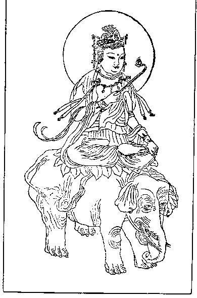

# 峨眉山志



> **藏经**：中国佛寺史志汇刊（佛寺志汇刊）　**册次** 第 45 册（GA045）　**编号** GA0049　**卷次** 8 卷　**篇幅** 161,959 字

> **卷／品**：8 卷 · 7 品



---



## 目录



  - [重修峨眉山志流通序](#重修峨眉山志流通序)

- [峨眉山志卷一](#峨眉山志卷一)

  - [峨眉山志图说序](#峨眉山志图说序)

- [峨眉山志卷二](#峨眉山志卷二)

- [峨眉山志卷三](#峨眉山志卷三)

  - [附录：慈云忏主《往生净土决疑行愿二门》序](#附录慈云忏主往生净土决疑行愿二门序)

- [峨眉山志卷四](#峨眉山志卷四)

- [峨眉山志卷五](#峨眉山志卷五)

- [峨眉山志卷六](#峨眉山志卷六)

  - [续莲社序](#续莲社序)

  - [铁罗汉颂并序](#铁罗汉颂并序)

  - [峨眉大佛寺落成颂并序](#峨眉大佛寺落成颂并序)

- [峨眉山志卷七](#峨眉山志卷七)

  - [《译峨籁》自序](#译峨籁自序)

- [峨眉山志卷八](#峨眉山志卷八)



---



峨眉山位於四川峨眉县西南。山脉由岷山伸展而出，岗峦叠起，气势如虹，蜿蜒三百多里，周圆一千餘里，直逼峨眉县境。突起三主峰，称大峨、中峨、小峨，一脉相连。两山相对如峨眉；又此山状若云鬟凝翠、鬒黛遥妆，真如螓首峨眉，细而长，美而艳也，故名。三峨中之中峨，即二峨，古绥山，一名覆篷，上有天池。小峨即三峨，一名铧刄山，距二峨九里，高半之。大峨周千里，高二百二十里。南北有台，前即二峨、三峨；然二山俱以大峨得名。峨山在蜀，为最高峻，盖众山盘礡而成。李白有诗：「峨眉高出西极天，罗浮直与青冥齐。」宋人有诗云：「蜀山天下奇，三峨压岷石；谁谓孤剑下，名出嵩华后。」世人尊之为中国佛教四大名山之一也。峨山本普贤菩萨应化之道场也。历代王臣，悉从事於建设，致使琳宫绀殿，棋布云岩；草舍茅篷，星罗幽岫。其寺之较著者，有光相寺、圣积寺、伏虎寺、华严寺、中峰寺、黑水寺、后牛心寺、万年寺、灵岩寺等七十餘所；庵、堂、殿、院、阁，更不计其数，蔚为佛国。明代末年，胡菊潭著《译峨籁》。清康熙十一年（一六七二）蒋超据之，并增益《四川总志》、《峨眉县志》、《蜀中广记》等之所载，为编《峨眉山志》。康熙二十六年（一六八七），曹熙衡重加修饰。民国二十三年（一九三四）释印光重修四大名山志，《峨眉山志》即据蒋超旧志加以订正。厘为八卷，分门十一：星野图说、菩萨圣迹、全山形胜、寺庵胜概、感应灵异、历代高僧、王臣外护、仙隐流寓、古今艺文、动植物产、蒋编志餘。唯多据蒋超旧志为之订正耳，於有清一代之此山名德及新建寺庵，概不阑入。兹据民国二十三年（一九三四）排印本景印。



------



### 重修峨眉山志流通序



普贤菩萨，道证一真，德圆两足。住寂光而兴慈运悲，辅善逝而带果行因。具遮那之全体，示居补处；结《华严》之大义，指归西方。虽尽十方法界，无非所住真境；而此大光明山，实为应化道场。溯其立名之意，盖以佛光昼现，圣镫夜来；亘古今而无或隐灭，尽来际以启牖群生。由是之故，致此峨眉宝山，亦称大光明焉。一以形势立名，一以圣迹取号，固无别种因缘也。而一班不知菩萨德相者，欲借经言以见重，谬引《华严经．菩萨住处品》云：「西南方有处，名光明山，从昔已来，诸菩萨众，於中止住。现有菩萨，名曰贤胜，与其眷属诸菩萨众三千人俱，常在其中，而演说法。」夫如来在天竺之中，摩竭提国，成等正觉，说《华严经》，凡历七处，而有九会。初会，即在菩提场说，二会、七会、八会，皆在普光明殿说，此殿亦在菩提场中。〈菩萨住处品〉乃第七会所说之一品。先说东、南、西、北之四方，次说东北、东南、西南、西北之四维，方位次第，井然不乱。彼见有「光明山」三字，遂谓此西南方，指震旦国之峨眉，在中国之西南。於「现有菩萨，名曰贤胜」，妄加注曰「即普贤也」。普贤亦名徧吉，未见又名贤胜也。援经而深悖於经，是欲令人生信，而反致人起疑也。不知普贤之德相，以如来智慧，穷劫莫宣。《华严经》八十一卷，其发挥普贤菩萨神通智慧、道德功业者，有十餘卷经。若稍加研究，则何肯谬引？譬如轮王驻处，即是王都；光明到处，了无黑暗。由是，今志特立〈菩萨圣迹〉一门，於中分为六章：一、释名，略释普贤名义。二、修证，节录《悲华》、《楞严》二经，以明菩萨因地修证工夫。然据《如来不思议境界经》，则菩萨久已成佛，其本地非佛莫知也。三、德相，略引《华严经》，称赞菩萨不可思议神通道力。四、法要，略明菩萨所说法要。而〈普贤行愿品〉，以十大愿王导归极乐；普劝善财及华藏海众，一致进行，回向往生西方极乐世界，以期圆满佛果，而为《华严》一经之归宿。是知此一卷经，大开净土法门，实为十方三世一切诸佛，上成佛道，下化众生，成始成终之总持法门。三根普被，圣凡齐摄；末世行人，皆当依止。故录其全文，以期同登莲邦焉。五、利行，节录《法华经》、《观普贤菩萨行法经》，略明菩萨卫护行人之事。六、应化，明菩萨证穷法界，故於十方法界，随类现身，应以何身得度者，即现何身而为说法。故十方法界，皆可作菩萨道场。然欲众生投诚有地，故特於峨眉山，示应化焉。须知菩萨应化，有普有专；普则大众咸得亲见，专则唯己自心明了。例如云端现相，众目同观；圆光摄身，纵齐肩并立有许多人，而人人各见己身，不见他身。於此二者，可知菩萨神应无方，非凡夫、二乘所能测度。具此不思议义，又何必谬引经文以自诬，而贻人笑柄耶？旧志所载，殊多讹谬。如千岁宝掌，於卷二诸经发明云：「汉永平癸亥之前已住此山。蒲公见鹿迹如莲华，径投宝掌问之；掌令往洛阳问摩腾、法兰二师。蒲公于甲子往洛阳谒二师。」不知甲子即明帝七年，始遣蔡愔、秦景、王遵等往西域寻佛法。至十年丁卯，二师随诸人始来洛阳。按：传镫录本传云：「东汉献帝建安二十四年来中国。魏晋间，入蜀礼普贤，留大慈。」旧志本传，只略「东汉献帝」等一句。何不以此证前之讹，而竟两存之；亦不说其孰是孰非耶？於一生不至西蜀之智者大师，亦为立传；且日与茂真尊者、孙真人弈棋於呼应峰下之棋盘石上。又建呼应庵以居。均以「相呼相应以弈棋」为峰名、庵名。作此说者，不但不知智者，且绝不知佛法。智者一生以身为法，作后学模范；何得日与闲僧旷道常行犯佛禁戒、玩物丧志之事乎？玄奘，生於隋文帝仁寿四年甲子，其兄长捷法师令其出家，居洛阳净土寺。十五岁，因隋室丧乱，至长安。时唐室初立，尚事翦削，无暇弘法，遂与其兄往成都求学。未几，声闻远著。武德五年，於成都受具。思欲入京，以期闻所未闻。为兄所留，遂私遁，由三峡达汉阳，至相州，沿途求学弘法。后至长安，欲追法显、智严之迹，结侣上表，往游西域，求所无经。斯时世始太平，中外尚未交通，故诏不允许。众咸退心，师独不屈，乃於贞观三年八月私去。历一十七年，始回中国。及至于阗，即遣使上表太宗。太宗优诏答之，且令沿途有司各为护卫迎送。师闻帝欲问罪辽滨，恐稽迟不遇，遂兼程而进。由流沙，至沙州，是由甘肃而来者。帝勅有司备仪仗相迎。忽至京城之西漕，有司莫知所措。(以按程备仪，师兼程而进，故致有失。)此后日事翻译，未及卒业而寂。何得有履西域，至峨眉九老洞，值圣真说偈授经之事乎？但以世远人亡，屡经沧桑，志乘轶失，无所依据。遂致以讹传讹，无由考正，故致然也。当明季时，胡世安公好游山而信佛，未息心以研究。故其博采艺文，辑《译峨籁》，实为清蒋虎臣山志之权舆。虎臣自谓於《译峨籁》一字不遗。然其所录，总以敍述山峰之耸峻、岩壑之幽秀、风云之变态、寺宇之兴废而已。至於普贤兴慈运悲、四众竭诚尽敬之所以然，尚不能稍为形容。况菩萨之本地风光、四众之心契觉海者，又何能一为形容耶？又此山昔有道教，自大法昌明后，渐次归真。明果灭妖，乾明作中峰之寺；羽流感德，黄冠为缁衣之僧。自后一致进行，归依三宝。道教绝响已千餘年。旧志於普贤及古高僧有经传可考证者，尚多错讹；况於绝响已久之道教事实，能无讹谬乎？黄帝往空同山，问道於广成子，载於《庄子．在宥篇》。何得又往峨眉，复问道於天皇真人乎？天皇真人即广成子。黄帝系有天下之责任者，非闲旷僧道随意云游者比。空同已去两次，而有所悟。即广成子移居峨眉，黄帝何得又往峨眉？况蜀道之难，今尚兴叹；当黄帝时，不比今更难百千倍乎？故知此诸记载，悉属虚设。即的确之极，亦无关紧要。以此所说之法，乃佛法中人乘、天乘两闲之法。峨眉道教久已绝响，又何犹立此法，以致后世惑於两歧，莫知去向乎？故将此种记载，多为删去。揭佛日以普照三根，亦天皇真人之赞许者。印光一介庸僧，何敢妄充通家，修辑四大名山之山志？但以挂搭普陀三十餘年，民十一年定海知事陶在东公倡修《普陀山志》，请邑儒王雅三先生主其事。王君於儒可称博洽，於佛未涉门径。志成，而山中耆宿命光重修。光以近来刻排各书，了无有暇。至十九年，掩关苏垣，始得出书。一弟子李圆净，热心公益，谓：「普陀、五台、峨眉、九华，为中国四大名山。师既将《普陀志》修妥印行，《五台》、《峨眉》、《九华》三山志，亦不得置之不理。」於是特祈前著《观音菩萨本迹感应颂》及《历史感应统纪》、《佛学救劫编》之江西彭泽皈依弟子许止净居士，标示纲要；光但任其割贴安顿与印行。校对则归於现遥领𫎬州寿量寺住持德森法师，与陈无我居士。《五台志》去年已出书，《峨眉志》不久亦可付印，《九华志》或於明年春夏间可出。四山旧志，唯《五台》最嘉，《普陀》次之，《峨眉》又次之，《九华》最居其下。良以三山志，皆属不通佛学之儒士所修，故致买椟还珠，敬卒隶而慢主人；只在山之形势变幻处致力，不在菩萨兴慈运悲、拔苦与乐处形容。志山而不志佛，颠倒行事。虽有其志，不能令见者闻者增长善根，种菩提因。此今志之所深致意者，故为略示其意。然以未曾亲历其境之人，不能详加询访，故只按旧志及诸经传而为证订。至於近来名德及新建筑，概不加入，以免逸轶名德之咎、挂一漏万之讥。具眼知识，当能谅之。民国二十三年甲戌孟秋，古莘常惭愧僧释印光撰



峨眉山志旧序一



尝读《冀越通》云：「地脉向中国来者三支。南络发崐仑，迤东南而行，至大峨山。直南折而东为五岭，复折而东北，大尽於建康。其支络於吴、闽、越。」是峨山为崐仑之次，明矣，故有伯仲之称。又读《书记洞诠》云：「三峨高出五岳，秀甲九州，震旦国第一山也。」顾其山不入五岳，而列於四大名山之一。其初为天皇真人，即广成子所居，轩辕黄帝问道於此，授「三一五牙」之经。继为普贤菩萨道场，设化城，居大众三千人；有佛光、圣镫之现。而琳宫梵刹，踵事增华；遐方瓣香，重茧远进，遂化而为释氏区宇矣。要之，峨眉固自峨眉也。善乎胡菊潭先生之言曰：「斯山真面目，不随蓬海三浅。」知言哉！然往古来今，事迹变幻，如骑牛而仙，歌凤而隐，刺蟒以救黄冠，跨虎而渡溪涨，人之异也。龙子可掬，桫椤灿烂，雷鸣於山腰，雪积於盛夏，物之异也。洞传伏羲、鬼谷，径险鹁鸽钻天，空树老僧定数百年，兜罗緜云铺几千丈，景之异也。其他幽奇奥邃，莫可殚述；题咏记赞，累案盈缃。不有山志，乌乎稽考？自明代己卯，菊潭先生游峨，已云：「索山志旧著，罕有存者」。唯喻广文志祥有山志脱稾，菊潭谓其「搜罗博而未精，考核详而不要，去取臆而附会多，尤劣於山史一卷」。经菊潭评驳，其书遂不传矣。乃菊潭先生三次登峨，著《译峨籁》。后三十餘年，金陵蒋太史虎臣寓峨山，始取《峨籁》稍加增益为山志。然太史被二竖相侵，草草卒业，伦次欠楚，未付剞劂而捐馆。因是尚阙焉有待，其稾藏於可闻禅师之笥。余以今上之二十有五年，奉命分巡建南，峨眉乃吾隶也。念境内名山大川，不有以表彰之不可。况修废举坠，尤关职业；失今不志，后将无述。爰取虎臣太史脱稾，与宿士商订，重加修饰。分条析项，淆讹者正之，紊乱者清之，繁芜者裁之，迹无与於兹山者去之，事可纪於近今者增之。一笔墨间而峨之山水形胜、宫观殿刹、人物古迹、词翰艺文，暸如指掌，灿若列眉；可以备穷搜，可以供卧游，盖自是而峨乃有山志矣。亦以成菊潭先生、虎臣太史二公未竟之绪；而余且得邀灵於名山，以逭旷事之讥云尔。清康熙二十六年岁次丁卯季夏之吉，中议大夫．分巡建昌道．按察司副使．今升贵州等处提刑按察使司按察使．锦州曹熙衡素徵题



峨眉山志旧序二



西蜀之有峨眉，坤舆一巨镇也。北控三川，南界百蛮；井鬼之所照临，神仙之所窟宅。虽祀典不在五岳之列，而功实过之。〈禹贡〉纪载而后，常璩、任豫、张华、郦道元辈，表章精奥，不一其人，宜矣。余奉命抚蜀，职在奠安，常惧一物失所，贻山灵羞。甫下车，值有采办枏木之役，单骑邛郲，探寻运道，因得一登初地。而军务旁午，信宿言旋，其中谿谷之幽异，风云之变幻，恍惚一寓目耳。然以险远崎岖，缮疏陈请，蒙恩罢采，民获休息。虽皇仁覃敷，不可谓非兹山之灵默相而呵护之也。余性耽山水，而拘牵官署。每凭栏送目，觉三百里外，雪光云影，遥遥袭人襟袖。欲寻古人纪载，以当卧游，而兵燹之餘，毁失殆尽。一日，川南宪副曹君，持《峨眉山志》相示，则宪副启其事。而余首阅〈图说〉，出近代胡菊潭相国手；修志凡例，断自蒋虎臣太史。嗟乎！兹山之在西南，讵止比肩於嵩、岱、衡、庐、武夷、雁宕之胜？登兹山者，讵无有好游如尚平、康乐其人者乎？往哲无闻，歌咏中绝，河山之变，增人凄感。然所载古迹胜境，若光若镫，若台若榭；以迄於艺文、志餘，列诸几案，绰然如陵岚雾之幽深、沆瀣之芬洌也。宗少文曰：「竖划三寸，当千仞之高；横墨数尺，体百里之远。」余无俟笋舆筇杖，而坐收兹山之奇秀焉，又为之一快矣。抑峨眉有屏翰之功於蜀，而禋祀逊五岳；说者以为名山之隐逸者也。清康熙二十七年戊辰岁仲春之吉，赐进士第．通议大夫．巡抚四川等处地方．提督军务．都察院右佥都御史．楚黄姚缔虞撰



峨眉山志旧序三



昔逸少先生志游峨而卒不果，恒太息缘之未足。衲每服膺其言，及成《峨志》，而益感慨系之。夫山之於人，与人之於山，洵有缘也哉。太史虎臣蒋先生，木天顾辅；一旦尘视轩冕，扶舁来峨。止蒲榻於山寺，出其奚囊所贮《峨山志》稾，与衲订以见闻。风雨晦明，两易寒暄，成帙一十八卷。而〈志餘〉一卷尤叮咛旨趣，言言金石，字字醍醐，起兹山从前之所未有，而一一开其面目。山顾於太史有前缘耶？不然，太史初未涉於峨，而乃敛其散逸，以集其成。寸寸而累，早已脱稾於燃藜天禄，度日花砖，珥笔不遑之秋。且卒如其意，来止忻忻也。观其〈回首〉一偈，谓兹山之老衲再来，而前缘为益信矣。嗟乎！衲昔当蜀经灰劫餘，吴帆万里，来礼愿王。山水羁人，若逢吾故。于伏虎古迹，不惜顶踵，薙草开林，为愿王广大行。数十年间，未敢少懈。招提大概，始观厥成。溯洄壮游，曾几何日？而今且倏近桑榆，质衰蒲柳矣。读太史遗编，兢兢然唯恐以缘为太史羡者，徒亦以缘为太史谢之也。幸荷护法诸大檀越，善太史之胜因，觅以枣梨，授之剞劂，俾与山灵同贞不朽。窃幸太史有愿克谐矣。然则太史岂仅与山为缘？而山又岂仅与太史为缘哉？今而后，后戒禅身、广象教力者，欲有以各证其缘，即以斯志为龟鉴也可。清康熙二十八年己巳菊月谷旦，伏虎寺住持海源谨识



修山志说



名山可以神会，不可以目穷；可以心契，不可以言传。言传者其迹耳，而山之精灵不与焉。要其迹亦不可以不传，则言固未可废也。肄樟栖霞饮谷，方外自遣，素奉教於梅庄何先生。一旦先生以宪副素徵曹先生之命，举《峨眉山志》下商。樟愧谫劣，罔所识知。然闻工人之治器也，遇大器，必专心致志，毕思殚虑以治之，故器可成，而不忧其窳败。《峨志》之役，大器也。於是细加参考，字斟句酌，厘正伦次，汰黜影附，分别条项，校订讹舛，增益新闻。每条以小序数语引其端，俾便省览。凡以敬慎厥事，庶几以言传者，不至言之过而流於溢、言不及而失於隘焉耳。古戎后学宋肄樟谨识



补遗：峨眉山志记



峨山为坤舆具瞻，昔人言之详矣。予幸承乏斯邑，得以循其麓而跻其巅，陟险穷幽，登峰造极，真极天下之大观。然而名山形胜，以心契，不以目穷；公餘之暇，尝取志书而卒读之，神之所游，不啻足之所履。惜乎书多脱𥳑，不能徧观而尽识也。爰博访都人士，得家藏旧志一部，悉心校阅。闲有后人添入诗章，错讹残缺者，旧本不载，未敢妄增，仍阙以待补焉。其餘字迹之模糊、书目之失次、篇章之遗亡，悉照旧本，一一更订增入。统计原板及添刻，共三百二十六块，刷印成编。俾后之游峨山者，可以按籍冥搜。即不游峨山者，亦得开卷而揽全胜也，是为记。清道光十四年甲午四月之吉，赐进士出身．知峨眉县事．粤东胡林秀识



峨眉山旧志凡例



修山志，与郡邑志不同。是编凡关系山中形胜、僧家典故，虽细必书。其有高山大川、琳宫宝刹，不系峨山地界者，一概不敢妄入。  

是编原本井研胡阁老《译峨籁》。兵火之餘，山中片纸只字俱无。其书所载，不忍一字遗失。所辑前人诗赋，俱经寿梓。其餘凭仗别集网罗，及各寺僧抄录名贤题咏者，僭妄删去十之一二。非敢立异，亦以成美云尔。  

志以徵信，不可贪图怪异，捃摭成编。如上林橘柚、芳洲杜若，取快一时，贻讥千古。是编凡禅宗仙伯，非确在峨眉修真养性，及投筇飞锡、过化此方者，不敢妄入。其餘土产方物，除茶笋之外，如雪蛆、空青、放光石、雷威琴之类，古有是名，今无是物，必后人传讹袭响，重为地方累。特为剖白纤悉，识者辨之。  

是编除原本《译峨籁》外，止据《四川总志》及《嘉定州峨眉县志》、《蜀中广记》等书。取裁不广，考订不精，止可为名山留一影像耳。  

峨眉山道，前后名贤游记，开载甚详。然亦有蜡屐所过，亲携笔札登记者。亦有事后默识，记一遗十者。又有旁询住僧，及舆徒皂侲者。言语错乱，头尾倒置。或将归路认为去路，或即一处指为两处。今皆一一咨询，考订详明。以后登山，如聚米书裙，免致车中指视，颇称快事。  

旧志遗史，无从考订。谨据《峨眉县志》，所列山水无多。至山中老僧传说，半多附会。如一青莲峰分为二峰，曰大尖，曰莲华。一井络泉，称为五处，曰圣水，曰观音，曰通精，曰半月。又名贤游记中，有本无是山，偶凭耳食。又登掌记者，如大欢喜亭，八十四盘上有桫椤坪。查桫椤坪在千佛顶后，与师子、罗汉等坪同列。若初登顶时，并无所谓桫椤坪者。如以桫椤得名，此花徧满山顶，如秦庐粤镈，何处无之？华严阁、圆通庵，全无影响，今皆一一改正。前人有知，想亦喜称起予耳。  

山中旧有庵堂寺院，名目极多。沧桑后，金璧瓦砾，楩梓梧丘，不敢尽为淹没，仅留虚名於楮墨间。在愚见，不问孤居侣处，现前佛屋连椽接栋，尽可为容众栖身之地。不必又拘兴复之说，再图募化，徒费精神。是在高明毅然作一竖刹。竟义也可。  

志成，每苦上台檄取，为往来应酬之用。僧家拮据，楮蜡供给、工匠酒食之类，转成大累。今当预启当事，凡欲取志，乞携纸墨及工匠饭食入山，自行印刷。似此功德，胜比寻常供佛饭僧十倍也。



清康熙十一年壬子仲秋望后四日，华阳山人蒋超谨识



新订凡例四则



旧凡例第一条，谓「山中形胜、僧家典故，虽细必书」，是矣。唯普贤菩萨为此山之主，仅於〈形胜门〉，列诸经发明半纸餘。其中多系臆说讹传，唯《楞严．圆通章》为实录。殊多遗憾。故今略引《华严》、《法华》各大乘经，及僧传所载确实可据者，将普贤菩萨本迹感应，表彰出之，为〈圣迹门〉。俾阅者得生信仰，而有所遵行，以获受用实益耳。  

山中形胜，旧志将峰、岩、台、石等分类录之，绝少贯串，令人茫然於前后上下各位置。求之游记中，又嫌过多。且各人所记不同，莫衷一是。今於卷首，列新增〈图说〉，阅者按图探路，恍如身入其境，足增卧游之兴。而原有游记，酌加删削，免繁多寡味。  

峨眉虽非必为《华严》之光明山，而光镫示现之奇特，实为诸名山首屈一指。诚如观音大士所谓「现种种不思议色，净光明网，摄取众生」者。岂非普贤之大愿力有以致之欤？故特辟〈灵异〉一门，将游记中之见光、见镫，及其他感应事迹，汇入之。示所以尊仰菩萨，而导引众生也。  

山志求阅者身心获益，以宏扬佛法为主要；形胜寺院，已为餘绪。至於艺文益末矣。宏扬佛法，首重高僧。而王臣护法，使僧众安居修道，即俾黎庶消灾得福，亦最当崇饰，为后人矜式。故旧志〈艺文〉内，僧家塔铭，概改入〈高僧〉内。而皇家颁赐，及建修寺庙各记，另辟〈外护〉一门收之。以示此等纪载，关於三宝，非徒以文字见长也。



总目



上册



卷一(十九页)



一、星野图说



卷二(二十九页)



二、菩萨圣迹(分六小目)（一）释名（二）修证（三）德相（四）法要（五）利行（六）应化



卷三(二十八页)



三、全山形胜



卷四(十一页)



四、寺庵胜概



五、感应灵异



下册



卷五(二十九页)



六、历代高僧



卷六(二十一页)



七、王臣外护



八、仙隐流寓



卷七(二十五页)



九、古今艺文



卷八(二十一页)



十、动植物产



十一、蒋编志餘







大方广佛华严经普贤菩萨行愿品（节要）



普贤菩萨告善财言：善男子，如来功德，假使十方一切诸佛，经不可说不可说佛刹极微尘数劫，相续演说，不可穷尽。若欲成就此功德门，应修十种广大行愿。何等为十？一者礼敬诸佛，二者称赞如来，三者广修供养，四者忏悔业障，五者随喜功德，六者请转法轮，七者请佛住世，八者常随佛学，九者恒顺众生，十者普皆回向。若诸菩萨，於此大愿，随顺趣入，则能成熟一切众生，则能随顺阿耨多罗三藐三菩提，则能成满普贤菩萨诸行愿海。是故若人诵此愿者，行於世间，无有障碍，如空中月，出於云翳。诸佛菩萨之所称赞，一切人天皆应礼敬，一切众生悉应供养。又复是人临命终时，最后刹那，一切诸根，悉皆散坏；一切亲属，悉皆舍离；一切威势，悉皆退失；辅相大臣，宫城内外，象马车乘，珍宝伏藏，如是一切，无复相随。唯此愿王，不相舍离，於一切时，引导其前，一刹那中，即得往生极乐世界。



------



## 峨眉山志卷一



第一、星野图说(初星野，次图说。)



星则在天成象，野则在地成形。郡邑诸志皆以星野定方位。况峨眉乃普贤菩萨应化之圣道场地、为全省之巨镇、作人民之具瞻，其广踞数百里、其高耸数千仞乎！山不能一目徧观，览图则即知其概。图不能向背悉见，视说则全体圆彰。虽广数百里，高数千仞，持图而阅之，即可心领山势于方寸间，缅想佛化于亿万世。故志星野图说。



初星野者，常璩云：「西崦峨嶓，地称天府，其精灵上应井络。」《河图括地象》云：「峨嶓上值天井，故多雨潦。占候井明大盛，多风雨；月犯井，多风雨；日晕井，多阴雨大风，是也。」张子家《峨山志》谓：「峨山在九囿中，下镇梁益，上应鹑首，为南戒(同界)之宗，与秦同分。」熊南沙过跋云：「志敍分野，既引夹漈之说，明常璩以为井络者无据矣。其稽南戒而定峨嶓，以为在井络之南，亦终未能晓然自解乎夹漈之疑。而又曰：『星应舆鬼，君子精敏，小人诡黠。』则疑于口给夸多，自变井络之说矣。」按：井络，宫曰巨蟹，辰曰未，方曰西南，在地坤维。值坤，故多文章；值未，故尚滋味。德在少昊，又尚辛香也。峨位西南，物产相符。则井络之说近之，熊跋亦未尽也。《天文志》谓：「嘉定属东井、舆鬼分野。」今州治峨山，上当井络，故山顶有井络泉。



次图说者，旧志图甚𥳑略，止标大概，亦无有说。自清光绪十一年奏列祀典，遂徧探山势，而为图说。今欲广传，篇幅多则难於流通。故于图只取其总，而去其别。悉存其说，庶阅者仍得其详。原书序跋，悉录如下。



------



### 峨眉山志图说序



凡志，首重图说，而山志为最。盖郡县志计里开方，纪其广轮嬴缩、方隅绣错，详其山川险要、道路津梁。俾守土者展卷瞭如。备寇则阨要设防，捕盗则刻期立至，此其大略也。而山志则叠嶂层峦，横峰侧岭，峭壁撑空，激湍截地，緜亘数百里，或足迹不能到，亦目力不能穷。倘以意揣，则差之毫厘。后有识者，徒滋訾笑。峨为蜀名山，而不列祀典，光绪乙酉，总督丁公疏请春秋致祭，奉旨俞允。明年，护理总督游公乃遣候补道黄君绶芙，有事於峨。至则坛场寺庵，皆奉佛像，而山神之庙阙然。搜求旧志，则缺略惟多。於是游公筹款，建庙於山麓，并制祭器，以供望祀。而黄君毅然以纂修山志为己任。谭君晴峰，工绘事，以图委之。廖君笙堂，俾辑说。又明年，而黄君卒。图未及半，说亦未成，何志事之难耶？於是游公悯有志之未成也，复使谭穷其图，缒岩梯崄，足趼丛山者累月。凡为图六十有四，补旧志所未及者十之七八。廖仍为之说，按新图，稽旧闻，亦数月而竣事。而游公尤虞其未善也，谓余分巡建南，峨为属境，总修之责无可辞。嘻，其难也！盖其慎矣。余於是披图索瘢，详加考证，删订其说，衷诸一是。不敢自以为功，特不方游公之命而已。既刻，而使余为之序。余惟山祀始於丁公，而游公为之庙。山志始於黄君，而游公落其成。图则谭之劳，说亦廖之绩，余何力之有焉？然余窃喜图说成，而愿往者可为先导，未至者可当卧游，既往者如逢故境，岂非一大快事哉，余故乐为之序。光绪十四年戊子十月，善化黄锡焘书於建昌道署



此序作於建南，因游公书来，谓谭图廖说，勤劳莫没，故序并及之。余旋省后，同乡诸君，皆谓说本黄君绶芙原稿，廖特修饰之耳。序言失实，是则游公之故也。兹识於序后，以补余过，且免后来作刊谬，多著议论也。十五年二月初吉，锡焘又识



峨眉山图记



峨眉山者，西蜀之雄镇，高百餘里，相传为普贤菩萨道场。梵林如栉，最著者为伏虎、善觉、报国、万年、灵岩、天门、仙峰诸寺。其他如大坪、洪椿、长老、太子、雷洞诸坪。清音阁、华严顶、洗象池、沈香塔，铜、铁、锡、金、祖诸殿，莫不称大观焉。其间峰峦层叠，若玉女、若宝掌、若𬸚𬸦、若狮驼、若笋、若莲、若𬬻、若钵，备极峥嵘。石有亮光、太子、大峨、天门、鱼儿、莲华、圣钟、法船、飞剑、象鼻、牛心、仙人、罗汉、太湖等名，形似物者，不可指数。桥有双飞、仙女、七天、凉风、无怀、铁索、木栈、石梁，凡横流断壑，皆藉以通。水有黑白双溪，龙门倒峡，瀑布飞崖，诸喷泉。险有鹁鸽钻天、猴子坡、蛇倒退、长寿坡、放光坡、寿星坡、罗汉坡，陡曲而滑。洞有九老、三仙、雄黄、鬼谷、伏羲、女娲、左慈、龙门、猪肝、烂柯、紫芝、桂花、三魈，及无名号者凡千百。草木有桫椤树、浮图松、菩萨藤、木芙蓉、木凉伞，及一切奇花异草，多莫能名。禽有二迦陵异鸟，飞翔上下，佛光现时，始鸣曰：「佛现了！」兽有人熊、虎、狼，质颇小者，其鸣「陀佛」，人以「比邱」字之。虫有蛙，鸣声如琴。有大蟒，围可三尺，长十丈许，鳞甲晶莹，称之曰「龙居士」。有蜥蜴，方首五爪，藏水石间，目为龙子。气候，则阴晴不定，变幻万千。即如雪有千年积，雷有扫殿期。雷洞坪，有人声，烈风、暴雨、冰雹即至者，良可怪也。其中古迹，若轩辕访道处、涪翁习静处、蒲氏老人村、东坡摩崖字、右军河南碑，皆不足奇。所异者，金顶祖殿悬岩绝壁处，朝夕云海雾气，忽聚忽散；每至未刻，兜罗绵云，布满岩下，现圆光一团，边分五色，七层闲晕，为佛光如镜。覩者自见其形，虽并立之人，绝不能见，为摄身光。远者为水盆光。有气如虹，横亘数里。两端紫云捧之为金桥，奇观哉！夜有灯光燐燐，飞满崖壑，为万盏神灯朝普贤，此更不可思议，真福境也。余攀跻越半载，索险探幽，身历神会。尤见瓦屋、青城、天竺、雪岭、玉垒、岷江，若砺若带，数万里奔来眼底者。窃叹此山形胜，甲天下耳。遂竭耳目心思，摹其图，而并为之记。衡山谭鍾岳晴峰图并识



一、峨眉山总图说



此峨山总图也。世传大峨，为黄帝问道於广成子处。佛经称普贤道场。历建大小七十餘庙，皆奉普贤。故虽天下名山，未列祀典；揽胜游踪，爰稽志乘，而阙略维多。兹绘总图，较加详慎，然亦发其大凡。至穷原竟委，备悉分图，可按而索也。(自峨眉县出南门，至正顶，计程百二十里。凡山路、水道、寺宇、峰峦、古迹，一一缕载，灿若列眉。餘详散图。顾复初书，谭鍾岳绘。)



二、峨眉县至回龙寺图说



峨眉县治，汉南安县，后周平羌县地。隋开皇初为峨眉县。《元和志》曰：「枕峨眉山东麓，故名。」开皇十三年置，属眉郡。唐宋属嘉州，元属嘉定路，明属嘉定州。至清雍正十三年，改州为府，县属焉。东北各一门，西门二，南门二。游山者出大南门，门曰「胜峰」。诸峰相对，苍翠环照。过石桥曰「儒林」，古化龙桥，亦名胜峰。儒林街人家数十。南行至回龙寺，小而幽，比丘尼居之。前临㵎水，碧玉萦回，古树数株。西坡古刹在其间，唐武德六年建，旧名寿圣西坡寺，今就圮。



三、回龙寺至峨神庙图说



山神，旧无庙祀，至清光绪十有一年，四川总督丁文诚公宝桢，以峨为山镇，水旱疠疫，祷求辄应，有功德於民。奏请春秋致祭，部议奉旨俞允。其明年，护理总督游廉访智开，捐建峨神庙於县南城外学堂山，并制祭器。岁遣官望祀，咸於斯庙。门外有泮池故址，井研胡世安〈登峨道里纪〉云：「圣宫外，合三流为泮，澄波千顷，鼈乐莲香，亦多雅致」，即兹地矣。前瞻古塔，后倚崇山，嘉树丛篁，映带左右。游人至此，远观近瞩，苍翠纷来，飘飘然，不啻置身兜罗緜云表也。



四、峨神庙至什方院图说



由峨神庙上行，过古石坊，右为川主宫。正殿祀李二郎神，前有剧台，后邻什方院。院外歧路中，𧐖蜷樛结，有凉亭一。夏秋时，清风徐来，游人多憩於此。



五、什方院至壁山庙图说



出什方院，道途平坦，经薛家店，至壁山庙。庙古朴，中祀风云雷雨之神。一路榕木森森，荫周数亩，堪避暑雨。



六、壁山庙至菩提庵图说



由壁山庙西南行二里许，有菩提庵。在路左门对四峨，如玉屏前立。出庵左行百餘步，茅屋数椽，古致历落。连畦蜡树葱茏，居民赖以为利。



七、菩提庵至兴圣寺图说



过菩提庵，沿茅屋行百餘步，茂林修竹中，左为兴圣寺。寺宇两层，佛像尊严。山门外，路嵌𫖇石，以形似呼之。遥望金顶及众山最高处，历历可数。按旧志，兴圣庵近圣积寺，疑此即古兴圣也。



八、兴圣寺至圣积寺图说



由兴圣寺顺行，有石坊，清乾隆乙丑年，住持性琳建。路左即圣积寺，为古慈福院，明万历壬午，川南道参议高重，题篆字碑，竖寺外，相传为轩辕问道处。正德三年，内江王公重修之。万历丁酉，四川巡抚万任、布政使杨国明，重建接引殿。康熙十一年，御史董明命重建大雄宝殿。殿内铜铸普贤骑象像，金身丈六象伏地，长亦如之，两旁铜佛颇多。殿外左悬八卦铜钟，高九尺，径八尺，重二万五千斤。右峙铜塔，高二丈许，十有四层，铸佛四千七百尊，旁镌《华严经》全部，永川万华轩施制。前有楼，曰「真境」，一名「老宝」，讹呼「了鸨」，乃慧宝禅师建。额题「峨峰真境」四大字，宋魏了翁华甫鹤山书也。相传范蜀公书有𥳑板一幅，云：「半天开佛阁，平地见人家。」今佚。



九、圣积寺至文昌庙图说



由圣积寺大道行，过普安桥（一名普庵桥，又曰普贤桥）。水出铜河，即余大师坐化处。昔人称有普贤殿、普安院，今俱废。右上为文昌庙，庙后有八卦井，今废。惟源泉混混，灌注田畴，农无旱魃之患。出庙左行，经石坊，有瓦店一家，即往保宁寺之坦途也。



十、文昌庙至保宁寺图说



由瓦店平行二里许，即保宁寺，古卓锡庵。明嘉靖四十四年，僧德统建。万历辛卯，僧德佐重建。清康熙五十年，僧峨云复修葺之，因易今名。历经雍正三年连碧禅师、嘉庆十三年仁宽禅师，随废随举，代有经营，增其壮丽。潆洄水抱，平远山环，不亚圣积、真境。



十一、保宁寺至子龙庙图说



由保宁寺上走两河口，过石桥，即萧店子，茅屋数十家。再上里许，至子龙庙。庙外顺河，下为万行庄，古海会堂。右通冠峨场，后即光明坝。



十二、子龙庙至报国寺图说



由子龙庙沿河而上，渐入山径，里许，绕古树林，进报国寺（古会宗堂，一名问宗堂，又曰会宗坊），道人明光开建。有碑记，立伏虎寺。堂原在伏虎寺右山麓，虎头山之阳，嗣迁至此。初仍旧额，后易今名。按：明光著有《心经》、《楞严经解》、《八识规矩注》、《会心录》、《禅林功课》、《大乘百法注》、《峨眉传》等书行世。寺左，往龙门洞捷径也。



十三、报国寺至善觉寺图说



出报国寺，仍由大路上行，有木坊，榜「善觉寺」三字。登其峰，有二坪，前为善觉寺，即古降龙寺，明万历时，道德禅师建。清康熙间，赐元亨禅师「龙厢善觉寺」匾额，因以为名。并赐玉印一颗，其文曰「普贤愿王法宝」。御书玉音一章，至今珍藏之。寺后宋皇坪，乃天皇授道於轩辕处。寺左山麓，宋绍兴间，虎狼为患，人不敢至。士性禅师建尊胜幢以镇之，患遂绝。



十四、善觉寺至伏虎寺图说



由善觉寺下行，不数里，即合大路。路右关帝庙，庙右响水桥，为下报国寺直道也。由路左顺上，过木坊，榜曰「伏虎寺」。经兴隆桥、土地庙、玉皇楼，再前虎溪桥。桥下石子，细润如玉。屈曲上行，路左有龙神庙。渡发隆桥，经观音堂，即伏虎寺，行僧心安开建。明末毁於兵燹。清初僧贯之，率徒可闻，结茅为虎溪精舍。顺治十八年，川省大僚捐廉兴建。经营十餘载，始告成功。前后左右，凡十有三层，崇隆广大，为入峨第一大观也。光绪十年，僧静安重新之。右后为龙凤辉室。康熙壬子，蒋虎臣太史超（自称华阳山人）寓此，改名罗峰庵，藏颁赐御书「法宝」匾额。由伏虎寺左，过木桥，即无量殿。殿后太湖石，煎汤服之，可疗心气。上高洞口，过凉风桥，桥为清初四川巡抚罗公命僧可闻修。古有凉风亭，石壁峭削，中有空洞，风飕飕自口出，曰凉风洞，因以名亭。谷口旧有震旦第一山坊，今圮。



十五、伏虎寺至雷音寺图说



由凉风桥上行，半里许，至马家沟。昔有茶庵，今废。渡解脱桥，水声潺潺，听而忘倦。谓入此解脱尘凡，出此解脱险阻耳。直上，竹林陡窄滑㳠，木磴层层，约高百餘丈，为解脱坡。左即古解脱庵，又名观音堂。光绪十年，改为雷音寺。寺下有仙人会，旧传一池，入山者必沐浴而后登，今其址亦不存矣。



十六、雷音寺至华严寺图说



由雷音寺直上，为华严寺，一名会福，为唐昌福达道禅师道场。僖宗时，僧慧通易名归云阁。宋绍兴三年，僧士性重修。节棁旋螺，制极奇古，又名云篆殿，为白牛长老住持。明洪武时，僧广圆奉勅重修，掘地得宋碣，镌「华严」堠；左刻「至县十五里」，右刻「至顶七十里」。寺后有云卷石山，顶即古心坪，因昔古心禅师建有静室得名。寺左过青竹桥，有玉女池；仰望尖秀插空者，为玉女峰。相传池为天女浴器，深广四尺，岁旱不涸。宋邛州刺史冯楫结茅峰下，日诵《华严经》不辍，天女感而馈食焉。池畔有飞龙庵，每大风雨，闻石中龙吟。一夕雷劈石开，龙飞去，故名。又有凤岭庵，今俱废。路右有古枏一株，大围十餘尺，孤挺数寻，始敷枝叶，青青如圆盖，可覆亩许，俗呼「木枏繖」，古名「木凉繖」。



十七、华严寺至纯阳殿图说



由木凉繖左上，过木坊，不数十武，进纯阳殿。殿宇历级而升，重楼瑰玮，为明初御史郝卫阳所造。崇祯六年，巡按刘宗祥率峨眉令朱国柱，捐金增修，益称完美。殿后云雾缥缈间，有坪曰华严，古称赤城山，相传为赤城子隐居旧址。向有香烟、罗汉、白云等寺，今一片荆榛，无迹可寻。殿左行里许，忽逼窄异常，不容舆马。明初蜀献王游峨至此，下辇行五十三步；后人重其步，因以名其地。



十八、纯阳殿至会灯寺图说



由五十三步，度凹，平行里许，即会灯寺。寺右荒烟蔓草中，有天台庵故址。寺前陡下，过小石梁，为太平桥。前望二山中凹，称马鞍山。茅屋数椽，呼袁店子。



十九、会灯寺至大峨寺图说



从袁店下坡，过正心桥，再过万定桥（古万福桥），又称万佛桥。路右巨石壁立「大峨石」三字，吕纯阳书；「灵陵太妙之天」六字，明督学郭子章书。路左神水池，即玉液泉。隋智者禅师知此水发源西域。后卓锡荆门，龙女为引神水，并浮所寄中峰寺钵杖，自玉泉流出。旧有「神水通楚」碑，纪其事。又有巨石，刻陈图南草书「福寿」字、苏东坡「云外流春」字。上有神水阁，一名圣水阁，明巡抚安庆吴用先建，高僧化机隐此。由阁右进大峨寺（古福寿庵），明僧性天开建，后圮。清初僧智行重建，名大峨庵。康熙间，峨边参将李桢增广之，易庵为寺。光绪十一年僧圆明重修。向有九曲渠、流杯池、灵文阁、胜峰、立禅、弥陀等庵，今俱废。惟寺后古松一株，老干龙鳞，为千百年物。上有中和石，再上有归子石，一名鱼儿石。石有二孔，水常溢不涸。山顶为黄帽山，后为宝掌峰。寺外往左转右，即呵呼庵故址。有凤嘴石，俗呼鸡公石，刻「歌凤台」三字，相传为楚狂陆通隐居旧庐。明弘治间，督学王敕改今名。前即歌凤桥（古百福桥），俗名响水桥。往来听之，四山皆响，如洪涛巨浪，挟风雨而来。昔人称为「山潮」，以之验雨晴、占丰歉，为不爽云。



二十、大峨寺至中峰寺图说



由歌凤桥顺上，渡结缘桥，行二里许，即中峰寺，一名集云。在晋为乾明观，资州明果禅师除蟒患，始改为寺。隋茂真尊者重修之。相传有孙、王、宋三真人羽化於此。宋黄涪翁曾习静其中，即隋智者禅师寄钵杖处也。寺倚白云峰，一名白岩。左即呼应峰，原有呼应庵，为智者禅师道场。下有茂真尊者庵。孙思邈真人隐峨眉时，与禅师、尊者集弈於兹，常相呼应。山后有三仙洞，洞外有棋盘石，方广丈餘，至今犹存。右有雄黄石。历传唐玄宗幸蜀，梦真人乞武都雄黄石，上遣使赍送至此，烟云相隔。使者呼应，因得造焉。见一叟，幅巾被褐危坐，手指石曰：「致药於此。上有表，录上皇帝。」中使顾石有朱书百餘字，就录一行，则行灭。「呼应」之名，或曰即此。眉人程堂登峨，见菩萨竹，有结花於节外枝者，茸密如球，即写於寺壁，宛有生趣，今佚。



二十一、中峰寺至观音寺图说



由中峰寺左，上三望坡。以路险峻，行者三望乃至。或云：「昔轩辕帝访道天皇真人时，曾於此三举望祭，故名。」前有石桥一道，亦名三望。旧有茶庵，今废。层级而登，进观音寺。寺内一石蹲峙，呼鸡母，以形似也。出寺往左上丝网坡，向有怪异伤人。自修寺后，怪顿息。



二十二、观音寺至龙升冈图说



从丝网坡，策杖攀藤，盘旋里许，跻龙升冈，以冈名寺。此地稍宽衍，梵宇幽敞。回望山后，一峰独峙，圆转自如，名香𬬻峰，以形肖也。



二十三、龙升冈至广福寺图说



从龙升冈下坡，山境幽深，野屋一间，茅茨不翦。平步徐行，望烟云舒卷中，翠竹离离，即广福寺；一名慈云寺，乃前牛心别院也。寺后绿阴簇抱，蔽亏天日，为牛心岭。往石船子，下龙门洞，则从寺右小径去矣。



二十四、广福寺至清音阁图说



由广福寺左，一路顺下，石磴粼粼，苔苍藓碧，水声湍激，殷殷如雷。俯视双流，飞注斗捷，若不相下。有桥翼然，称双飞桥。相传左桥建自轩辕游胜峰时。水从黑龙潭绕白水寺而来。右桥则自古至今，几经举废。水从九老洞绕洪椿坪、黑水寺而来。出桥数十步，两水会合。一石嶟峙，为牛心石。游山者，从右桥行数十武，有瓦亭一，颇轩敞，为游人小憩之所。再过小亭，内有明御史马如蛟碑记。又数十步，由左进清音阁，阁陵空高耸，两水环抱。阁右一径通金刚坡，往大坪。阁左则仍转两亭，过左桥，往白龙洞。



二十五、清音阁至金龙寺图说



从左桥缘磴道北上，过接御亭故址，路右即古德林。绿云蔽天，空翠欲滴，为明时洪济和尚手植枏树。即高僧会宗，法号别传也。相传当日种一树，诵《法华经》一字，一礼拜。按字计株，植六万九千七百七株。天时地利，手到春生。今存十餘株，皆本长丈餘始枝叶分起；如两手捧佛，真不啻檀林祇树。从路左进白龙洞，洞久淹，毗卢僧建寺於其上，仍旧名。顺上斑箨纷披，猿鸟相逐，刹竿隐隐出青霭间者，为金龙寺。



二十六、金龙寺至万年寺图说



由金龙寺右，上灵官楼（古大峨楼），云是公输子所造。明末毁於兵火，清康熙间，川督蔡毓荣鼎新之，乃易今名。经四会亭，有铜铸接引佛像。亭前向有普同总塔，中大小数十塔，别传和尚塔在焉，今废。直上又一亭，竖「第一山」碑，进圣寿万年寺。在晋为普贤寺，唐僧慧通改白水寺，即僧广濬弹琴处。宋为白水普贤寺，明万历间，勅改今名。寺殿七层，天王、金刚、七佛、大佛，四殿毁。前毗卢，中甎砌旋螺，铜铸普贤丈六骑象像。象高长各丈许，足蹋三尺莲华，徧体为朝山者摩损。光绪十三年，署「成緜龙茂道黄沛翘捐金修补」，并砌石栏以护之。宋太宗、真宗、仁宗，俱有御赐宝供。康熙壬午，有御赐经书。后为新殿，殿右山边，有明月池，又号白水池。从四会亭左过山王庙，往慈圣庵。明万历癸巳，无穷禅师建。藏慈圣太后御赐经典、袈裟、供器，今尚有铜钟一。由庵左上海会堂，即佛牙殿。原有御赐紫衣，及丁云鹏畫历代祖师像八十八轴，今俱毁。惟佛牙尚在，重十三斤，长尺二，宽八寸，厚三寸。堂左数里，有白衣庵故址。再里许，为净水溪，有净水庙（古净业堂），黄冠居之。万年寺左，古枏一株，横围二丈三尺五寸。左上观音阁，后为正龙，山前平地突起如盂，呼钵盂峰。



二十七、万年寺至观心庵图说



从观音阁右上里许，道左有石，高丈餘，中有人形，头面手足俱备，无斧凿痕，相传为太子石。右旋数折，路左有罗汉洞，上有山王庙。横过白果树数株，均十数围，境颇清幽。稍坦处，明时空安禅师开建观心庵。清乾隆间毁於火，洪湛禅师重新之。出庵右，径陡绝，舆马不通。上为顶心坡。又名观心坡，俗名点心坡，以左右悬岩攒仰，至顶六十里，登者蹑足，膝辄点心云。



二十八、观心庵至息心所图说



循坡直上，仰望怪石嶙嶙，如排牙砺齿，剑峙森严，势欲飞走者，为鬼门关。石嘴长拖，形如象鼻，称象鼻岩。又上，石脊眠亘，左右悬岩，称大小鹅岭，以形似鹅颈名之。过关，空空洞洞，石梁数尺，天然巩固，名仙女桥。桥东北隅，昔古智禅师建有万松庵，今废。渡桥直上，结一刹，名息心所，上覆木板，以蔽风雨。右山有地藏庵故址。从左路平行，往石碑冈。冈下数百步外，一片荆榛，为庆云庵故址。



二十九、息心所至长老坪图说



下石碑冈，沿山行，过峡，道右巨石矗立，呼观音岩，朝山者皆焚香礼拜。前有石梁，呼观音桥。左右悬空为云壑，云烟常布，幽深莫测。所恃藤萝古木，丛茸遮蔽，不欲示人以险者然。僧云：「下有绿映沱，水甘美。再下有石洞，风从内出，呼风洞。」过桥上坡，甚陡峻，名放光坡，相传为普贤现瑞之所。上即长老坪，寺颇宏敞，为清康熙二年，峨澈禅师移建於兹。额仍「长老坪」者，示不忘本也。寺后万个千竿，为翠竹峰。峰左为蒲公结庐处，下为蒲氏村。由寺左而上，有万寿坡。坡下，宋绍兴间，怀古禅师创修正殿三楹，奉古佛、蒲公像。明正德初宗宝禅师重修，额曰「万寿堂」，命徒会贤理之。於坪侧元宝山别建净室，寻改永明万寿禅林。今废，故址尚存。再上山肩为骆驼岭，以形名也。



三十、长老坪至初殿图说



下骆驼岭，行半里许，路稍坦。又斜上转，至初殿。昔汉时，蒲公采药，见鹿迹现莲华，因开建此山，故额曰「初殿」。其山形若𬸚𬸦，亦名「𬸦殿」。又名「簇店」，盖原祇板屋一间，僧煑汤以俟游客蒸炊。后改店为殿，即「云窝」也。明时续恩禅师铸铜佛、弥勒、诸天像，大小三十餘尊。崇祯时，铸有铁钟。清乾隆间被火焚，南舟禅师重修之。出殿右上，即古石碑。按殿门外有琉璃牌坊，古石碑侧有木坊，为弘川禅师建，道光时圮。



三十一、初殿至华严顶图说



由古石碑直上，危磴高悬，为上天梯。历级而升，进玉皇亭。古刹云深，殿宇孤耸，额「华严顶」。顶后岩隅，泉甘如醴，名九龙井。相传建寺时患无水，老僧梦神指示，即其处凿之，水随杖涌，汪洋浩瀚，至今仰汲。顶前岩下，有桂华洞，匹练方横，一枝独占。平泉庄里，鲜此天香。出亭右顺下，路稍坦。复上，古树一株，雪枝霄干，老气横秋，呼「老僧树」。右望山峡，一片瓦砾，为九龙院故址。



三十二、华严顶至莲华石图说



由老僧树，历数坡，道平衍。左通遇仙寺，横过，山骨珠圆，云根玉立，孱颜似芙蓉坠粉；细蕊层萼，天然错理。中结以庵院，额曰「莲华石」。原名莲华社，社原在山顶，左右静室，精工绝伦，今仅存其名矣。庵右为九岭冈。冈下旧有永延寺，明周藩建，今圮。从庵中穿过，平步里许，乱峰壁立，如临绝地。横行数武，复陡上，危栈齿齿，若登天然。俗呼「鹁鸽钻天」，彷佛似之。



三十三、莲华石至洗象池图说



由钻天坡转左逆右，历石磴陡上，过月台，见寺宇轩豁，额曰「洗象池」。原名初喜亭，自白水至此，游踪稍适，因名其地曰「初欢喜」。以前去尚多险径，又曰「错欢喜」。寺近无泉，由弓背山架木引水入寺，汲饮便之。寺左有石砌六方小池，深广丈餘，即古洗象池。相传普贤乘象过此，必浴其象而后升。今涸，乱叶覆之。旁一石，高阔二尺，为升象石。石上小井，不涸，亦不溢。池下石岩，刻有「岩谷灵光」四大字。岩下大小深壑，终古云封，莫知底蕴。稍上有磐陀石，再上有左慈洞。寺后罗汉坡，有石罅数尺，呼罗汉洞。寺右岩壁层立，为狮子岩。



三十四、洗象池至大乘寺图说



由洗象池左，直上数里，横过柏林，即滑石沟。沟上有井，泉清，前即大乘寺。殿舍原覆木皮，古称木皮殿，今用木板矣。寺右数百步有化城寺故址。相传昆明施绍高、太和王荩台来此，遇白猿献果，啖之仙去。旧有碣纪其事，今失。寺左行里许，直上阎王扁。昔有胡僧，缚木架石以引行者，为胡僧梯，一名陵云梯。又有秦人刘海英、赵光明，募设木栅阑干，攀援而上，今废。右为梅子坡，疏影横斜，往来游人，望以止渴焉。



三十五、大乘寺至白云寺图说



过陵云梯，下坡转左，行半里许，路稍平。白云冉冉，弥漫山谷；素涛银海，变幻无端。中有古刹，为白云寺，又名云坛殿。三层，覆以丛篁翠筿。寺右为弓背山，山势长拖。下有分水岭，左水出雅河，右水经虎谿桥。会洗象池、黑水寺各水，合双飞桥水，绕回龙山、石船子、龙门洞，至峨眉县北门，出铜河。山产桐花凤，五色俱备。每桐花放时即来，花落不知所之。唐李德裕有〈畫桐花凤扇赋〉，详〈艺文〉。



三十六、白云寺至雷洞坪图说



由白云寺左，陡上二里许，荒烟岑樾中，为雷洞坪寺旧基。再上，有古庙一座，为雷神殿；铁像十餘尊，明万历年铸。濒岩竖铁碑，禁人语，否则迅雷惊电，风雨暴作。相传龙雷会居其下，凡七十二洞。岁旱，祷於第三洞。初投香币，不应，则投死彘及妇人衣履之类，往往雷雨交作。又上三坪，进寺，额曰「雷洞坪」。自汉时开建，至清康熙四十一年，赐御书「灵觉」二大字、《金刚经》一部。乾隆四十一年，僧闻奇、闻刚重新之。道光二十三年，僧心量移基重建。同治甲子年，僧觉圆又迁建於此。此地空蒙暗黑，长无天日。寺右悬岩绝壁间，有飞来剑，一名仙人剑。历传女娲於此炼石，伏羲於此悟道，鬼谷於此著《珞琭子》。三洞沈黑，人迹罕到。寺左峭阪险峻，盘回纡折而上，名为八十四盘。



三十七、雷洞坪至接引殿图说



从盘路曲折而上，右为接引殿。清初顺治庚子年，河间府僧年八十，见佛像卧荒丛中，乃誓饿七日募修。时大雪，已露饿六日。适蜀人赵翊凰登山，见而悯之。归白督台李公，捐金五百，命僧闻达重修之。殿右濒岩，为金刚嘴。岩下有石，形似钟，名圣钟。对岸一石，屹立十餘丈，呼仙人石，望之俨然。



三十八、接引殿至太子坪图说



由接引殿盘旋而上，道左一石壁立，高二丈餘，苔藓平铺，现「第一山」字。字畫色赤，高宽二尺许。年年必现，现未必全。若全现，则年占大有。复屈曲仰登，凡数百丈，名三倒拐，一曰三倒角。前有巨石，横亘当途，为观音岩，原有观音殿。又三济禅师建有回龙庵，今俱废。傍岩斜上，进太子坪，以坪名寺。层楼高耸，内供太子，因名。一名万行庵，古智禅师开建。闻达禅师重修之，基址屡易。从此至顶，喜无险径。昔建有大欢喜亭，今废。寺前岩下，石形如象，呼象王石。自大乘寺以上，徧山皆桫椤花，宋子京赞曰：



众葩共房　叶附花外  

根不可徙　见伟兹世



昔贤游记，指大欢喜亭、八十四盘，上有桫椤坪。蒋超辨之，实在千佛顶后，与狮子、罗汉等坪同列，详旧志凡例。



三十九、太子坪至天门寺图说



由太子坪左斜上，道左有永庆寺，原名盘龙。由寺横过，至祖师殿。殿左里许，有大觉寺故址。殿右上沈香塔，以塔名寺，明通天和尚奉勅开建，神宗赐额「护国草庵」。慈圣太后赐有珍珠繖，御书佛号金绣长旛，并九层沈香塔，高丈许。覆以层楼，雕镂金彩，工极天然，通天和尚法身在焉。万历间，赐住持本炯勅书一道。塔左，古有空树，老僧入定其中，枯干复荣，今亡。按：老僧，即晋远公禅师弟慧持也。塔右直上，天门寺，明瑞峰禅师建。寺右两石对立，划然中分。入其门，如登阊阖，名天门石。



四十、天门寺至七天桥图说



从天门石，凡三折始达山径，境极幽峭。过亭，进七天桥，以桥名寺。古文殊庵，亦名金刚寺，被焚。后光绪十年，大峨寺僧圆明重建。寺左，古七天桥，俗传为九天仙女降会处，而《道书》注：「峨山为第七洞天也」。旧有「为天一柱」坊，今圮。渡桥，上和尚塔，塔藏法身趺坐。原额误题「普贤塔」；谭鍾岳以为和尚法身不当冒普贤之名，改题「和尚塔」。



四十一、七天桥至金殿图说



由和尚塔左上，渡天仙桥，旁有仙女庵故址。进金殿，明僧妙峰建，僧惟密嗣修。清初总兵祁三升捐修铁瓦大殿以覆之。金殿之瓦柱、门櫺、窗壁，皆铜为之而渗金。高二丈五尺，广一丈四尺四寸，深一丈三尺五寸。中设普贤菩萨像，旁列万佛。门阴刻全蜀山川程途，明瀋王捐造。后以大殿火，随之而毁。光绪十二年，僧心启改砌砖殿。惟王毓宗集王羲之书、傅光宅集褚遂良书，两铜碑岿然完善，光泽可鉴。顶后悬岩，下临无地。岩左祖殿亦修砖殿，以护佛像。有覩光台居其中，佛光每现於巳午。先布兜罗緜云，平如玉地，名「银色世界」。上有圆光，外晕数重，五色斑斓，虚明若镜。观者各自见形，名「摄身光」。云散，复出大圆光，映物绚蒨，不可正视，名「清现」。又有紫云捧虹者，名「金桥」。白色无红晕者，名「水光」。形如箕，则曰「辟支光」。如铙钹，则曰「童子光」。光止一光，变态而名异。当光欲现时，二小鸟飞鸣，其语曰：「佛现！佛现！」明巡抚廖大亨有〈佛现鸟赋〉，详〈艺文〉。至夜，佛灯始见数点，若萤火飞明。渐至数千百万，俨若灯光，冉冉而来。落雪上有声，以手覆之，浮光四迸，不可掩。殿前铁阑干十餘丈，殿左铁塔矗立。塔左有石屹然，曰金刚石，又曰金刚嘴。嘴下万石嵯峨，名七宝台，又名独尊台。台下峭削六棱，多石室，石枢刻有「郁仪引日精，结璘致月神；得道处……」字。顶左铜塔、铜碑、铜钟鼎峙。藏经、观音两阁圮。金殿前有瑞星石。横过即锡瓦殿。殿右过楞严阁故址，即光相寺。往卧云庵，庵为僧性天建。明末圮，总制哈瞻令僧可闻重修。康熙壬午，赐僧照玉御书经典。右有磐陀石，石下为光明岩。绝顶无水，惟此庵下有井络泉，日饮千人。因污秽涸，寺僧诵经，泉复出。金殿左下，新凿龙泉。再下，古白龙池，深广二丈。水清，多蜥蜴，色白微黄，长数寸，四足，两额，竖角，有花文，性驯而灵，相传为龙子，遇旱祷雨辄应。有碣，刻明巡按马如蛟七绝一首云：



龙向深山学化龙　涓涓泉水自从容  

闻经想已能冥契　好去乘时惠九农



池左净土庵，明万历时，僧大智建，内竖遗愿碑。大佛坪，方广里许，铜瓦殿，僧别传建。前有扪参历井坊，以分野应参井也，今俱圮。千佛、万佛，两顶并峙，各建庵於其下。再下，明月、华藏两庵，皆结茅以奉香火焉。山后昔有「七二古德名庵」坊，今圮。



四十二、莲华石至遇仙寺图说



由莲华石下，分路，望东北隅，下遇仙寺。据高临下，寥旷欲𬸣，其坡名长寿坡。坡左尖石屹立，低昂不一，称石笋峰。坡足石梁横亘，为长寿桥。桥右高岩，瀑布飞射，水出桥下，顺山麓屈曲而行。有观音桥，直跨山㵎。右望，百尺危岩，跳珠喷雪，如惊涛怒湍，声震山谷者，呼观音岩。古苔如乱发䰐𩭹，缠挂枮木顽石，下垂十餘丈，缕缕不绝，名普贤线。《方物略》称仙人绦，赞曰：「附阳而生，垂若文绦；大概苔类，土石所交。」煎汤服之治气痛，有效，亦山灵变幻之奇也。



四十三、遇仙寺至仙峰寺图说



由观音桥依山顺行，渡仙峰桥。上有两石对屹若劈，中通一路，名仙峰石，亦呼天门石。不数十武，即仙峰寺，梵宇颇敞。寺右过坡，即往九老洞路也。寺前濒岩，古树一干，而叶分四种，即㭨瓢树。前望大、小尖峰，逼肖芙蕖，遂名莲华峰。屈曲而下，呼九十九倒拐，一名寿星坡。有寿星桥，横亘山㵎。顺岩而上，复平行数十步，为扁担岩。下视，溪水盈盈，为龙居溪。昔有疯僧百餘岁，至此遇蟒当途，默祝而去。至今山旁草木，人不敢樵采。按：九老洞在九岭冈初殿上。黄帝访天皇真人至此，遇一叟，问：「有侣乎？」答以「九人」，故名。洞深窈莫测，昔有然炬入者，行三十餘里，闻鸡犬鼓乐之声。蝙蝠如鸦，扑炬，乃出。中有观音水一勺，可资掬饮。岩下即卜应泉也。



四十四、仙峰寺至洪椿坪图说



从龙居溪沿岩而下，路右即洪椿坪，以坪名寺（古千佛庵），伏牛山楚山禅师开建，一云宝掌禅师建。明德心禅师重修，法嗣锐峰接踵，历二十餘年落成。殿宇楼阁，结构精工。清初峨云圆满禅师复鼎新之。康乾间，御赐经典字幅。寺后山顶有天成石池，因名天池峰。右为呪诅泉，相传当日大众千人，苦乏水源，老僧持呪引水，故名，亦名锡杖水。从寺左下行经木坊，渡积善桥，一名万渡。向有上中下三道。桥右小径，乃下双飞桥路也。



四十五、洪椿坪至大坪图说



由积善桥，陡上危坡，俗呼蛇倒退。其地昔多虎患，因建山王庙镇之，患乃止。道左有仙姬池，池内蛙鸣，声韵悠扬，俨然一部鼓吹，人呼「仙姬弹琴」。穿过茂林，重历月台，始达禅院。旧名净土，今榜「大坪」，以地名也。相传后殿初建时，掘地得一圆石，中空，水一盂，金鱼二尾，生机泼泼。庙右敞坪，有千年古松虬姿鹤骨，郁郁森森。昔开山老僧跏趺其下，每见龙虎当前，势欲攫人，辄默祝驯服。至今虎夜巡更，蛇不伤人，亦异矣。



四十六、大坪至会佛寺图说



由大坪转山王庙下坡，左濒危壁，迹绝人鸟。相传有猴王洞，坡呼猴子坡。路在山脊，陡甚，行者股栗。进会佛寺，寺为洪椿坪住持僧创建。右为象鼻岩，昔有静室，今圮。左为石笋沟，水出黑龙潭。寺前陡下，有坪，差堪驻足，称牛心坪。旁为杉树冈，即下牛心寺要道也。



四十七、会佛寺至牛心寺图说



牛心寺，一名延福，唐慧通禅师以山多回禄，改为卧云。乃孙真人思邈修炼处。所遗铁臼铜罐，质朴色古，今随婪吏去矣。药𬬻丹灶在峰顶石洞中。洞为药王洞，岩石碎裂，无草木，说者以为丹气熏蒸所致。方士多取煑服，以为能助精养神。洞外一石，可以箕踞宴坐，名玩丹石。寺壁，相传有张僧繇畫罗汉像，笔迹超妙，眉目栩栩欲活，颇著灵异。一云吴道子畫，今毁。寺为宋继业三藏重兴，淳祐间，僧绍才重修。明洪武时，广济禅师住持。温井涸，凉井水甘洌，合寺仰汲。寺内有卜应泉，久晴将雨，久雨将晴，前一日取供炊，白粲必赤，为雨旸之应，故名。寺右有青莲峰，峰下有黑龙江，再下石罅丈许，为祖师洞。由寺左行，仍转双飞桥去矣。



四十八、牛心寺至黑水寺图说



由牛心寺转万年、净水庙，左旋，过铁索桥两道。一虎跳桥，唐僖宗时，僧慧通至此，水泛不得渡；见一虎蹲伏其旁，跨之而济，因以名桥。后蜀人张凤羾等七人游此，又题其桥曰「七笑」。一无怀桥，以岩龛为无怀洞，名之。路右八音池，又曰「乐池」。游人鼓掌，一蛙大鸣，群蛙次第相和，其数八。将终，一蛙复大鸣，群蛙顿止。作止翕然一律，如玉振金声。池边一石，可以小憩。上有鸡公石，因作祟，被雷击之，改呼雷打石。一路曲折纡转，呼十二盘。循石磴而上，进黑水寺，古名华藏，创自晋肇公。唐僧慧通率其妹慧续尼驻锡。道闻朝廷，赐有无缝衣、玉环、供器，今无存。寺宇屡经举废，至清乾隆四十四年，僧明仙重修之。寺后对月峰，原有祖师堂，慧通肉身在焉。寺前原有慧续尼院，即续入定处。相传有黑虎巡廊之异。今堂院瓦解，仅存其名矣。出寺仍转雷打石，往白袍殿。殿小而新，比丘居之。寺后绝顶产茶，味佳；而色一年白，二年绿。地气所鍾，随时变异。



四十九、黑水寺至石船子图说



由黑水寺，仍转双飞桥、广福寺，下回龙山。山势崔巍，周围五里。自牛心石俯瞰众流，汇归成渠，甫有归宿。源来淼淼，泻去潺潺，则回龙实为砥柱矣。由兹屈曲而下，为五显冈。小店零星，参综错伍。再下濒河，逆行百餘步，见长石横卧溪中，类艅艎，若浮水面，称石船子，俗号普贤船。迫视之，微肖。纹理纵横，亦异他石。岂慈航宝筏於此示相耶？道左，昔建有「藏舟於壑」山房，今废。沿河顺下，有铁索桥一道，长二十餘丈，横亘溪中。渡桥，即往峨眉县之山径也。



五十、石船子至龙门洞图说



由铁索桥左，沿河竭蹶而下，见㵎流自两山石门中喷出，为龙门峡。峡之中，两岸岩壁千寻，色如碧玉，光润照人。有两瀑布，各出一岩顶，相对飞下。岩根有磐石承之，激而溅沫跳珠，常见箨叶随出。相传即吕纯阳剑畫十字洞旁丛篁遗坠也。越数丈，岩半有圆龛，即龙门洞，去水可二丈。游人乘槎至洞口，万壑千岩，竞来邀盼。入尺许，另透天光一线，豁然开朗。左壁刻「龙门」二大字，为宋苏东坡书；一云富春孙公双钩。石凸凹作鳞爪，名以龙床、龙枕。游人援梯而上，俯临深潭，绀碧无底，非复人寰。宋范成大云：「闻峨眉双溪不减庐山三峡。」及至龙门，则双溪又在下风。盖天下峡泉之胜，当以龙门为第一观。



五十一、龙门洞至新开寺图说



由龙门洞右，绕萧店、伏虎寺，至解脱桥。左上陡甚，度凹即旺相台。横下新开寺，明万历三年，僧大用建。后左为滴水岩，右为尖峰岭。大松一株，轮囷古致，酷似狞龙。前左对岸，桂树二株，半去皮肤，而生趣盎然。当门小坡，名以木鱼，形相似也。按：寺近旧有蟠龙寺，为唐慧觉禅师建。又有罗汉寺，初建日，梵僧赴斋，斋毕不见。西北隅有佛到寺，因开山日得石佛，故名。又传尊者曾到其间，留有佛迹焉。而孤峰绝壁，鸟道纡萦，人迹所不能到也，故又称不到寺。今俱废。



五十二、新开寺至灵岩寺图说



由新开寺下坡，经青龙场，野店二十餘家。过高桥，进接引殿。再渡观音桥，平畴沃衍，桑麻映道。上古石梯，即灵岩寺。寺为宝掌禅师结庐旧址，历朝增葺。宋绍兴五年，太尉王陵、汉州知州王陟施资重修，易名护国光林。元季毁。明洪永间，僧弘义、圆道重建之，仍曰「灵岩」。景泰间，僧宝峰增修三世佛殿。殿前为明王楼，东为伽蓝堂，西为祖师堂。凡禅堂、斋堂、静室、香积、客厅，以次告成，规模广大。天顺庚辰，颁赐藏经。成化乙酉，宝峰诣阙请额，赐名会福。弘正间，僧本印重修。寺宇昔有四十八重，今存五之一。僧众昔以千计，今寥寥矣。佛光时现，寺后有覩佛台。按：宝掌生於周威烈王十二年丁卯，至唐高宗显庆二年丁巳卒，住世一千七十一年，详旧志。



五十三、灵岩寺至二峨、三峨图说



二峨，即中峨，古绥山，一名覆篷。《方舆记》云：「绥山废县在峨眉县西四十里，高半大峨，形如覆釜，雄据南方。上有天池、葛由洞；下有猪肝洞、鱼洞。」旧志云：「天池与李仙洞相对。葛仙洞，在白岩溪上，为周成王时，羌人葛由骑木羊处。白岩溪旁有玉蟾洞，洞壁石室如云母，彷佛见肩背衣绦，传为白玉蟾尸解处。猪肝洞，一名紫芝，明督学王敕过洞前，知有异物，掘地得石碣，刻『紫芝洞』三字，旁注『一山五口道人书』，今犹竖道左。上一里，有烂柯洞，洞口刻『烂柯』二字。鱼洞下，冷水河，河畔乾洞。」《元和志》谓：「洞穴才容一人，行数里，渐宽平。蝙蝠大如箕，人不敢复进。」昔阴长生制黄表，写丹经四通。其一通，以黄金之𥳑，书而刻之，封以白银之函，置之绥山，即兹地矣。山产桃，谚曰：「得绥山一桃，虽不得仙，亦足以豪。」三峨，即小峨，一名铧刃，《山海经》所谓「西皇山」是也。在县东西六十里，距二峨九里，高半之。两山耕作，约数千人。其间草木、茶菜、荳芋，蕃膴丰熟，足当田畴十分之五。桃华白而实红，土人呼曰「蟠桃」。味甘香，惟较二峨产者颇小耳。由大峨灵岩寺，经青龙场，渡孝心铁索桥，上紫芝庙，递上清虚楼。楼后望三峨，如在目前，餘详图中，不赘。(三峨，「在县东西六十里」，「东西」二字，疑误。但多处皆然，祇好仍之。)



五十四、三峨至四峨图说



四峨，一名华山，其形棱瓣如华，因以为名。在大峨之直北，距峨眉县二十里。郦道元《水经注》云：「峨山东北有武阳、龙尾山，仙者羽化之所。」殆即此与！昔印宗禅师止锡四峨，每跏趺时，祥云结盖。遇旱延祷，甘霖立沛。有龙王受戒、猛兽调伏之异，详旧志〈高僧〉。山有圆通寺，由紫芝庙转青龙场，至其处，计程三十里而遥。按：二峨、三峨、四峨，均以大峨得名。大峨高峻，俯瞰群山，兼有三峨之胜。緜亘岌翠，环峙於前，愈显大峨雄伟，上接穹苍，为名山之祖也。



峨山十景



金顶祥光(即绝顶。金殿、祖殿后为覩光台。以下各诗，晴峰谭鍾岳撰。)



一抹祥光畫不成　峨山形势极峥嵘  

琳宫绀宇尘缘绝　直似须弥顶上行



灵岩叠翠(即灵岩寺。)



危岩固是夙鍾灵　风雨飘零常翠青  

疑是为吾标奇迹　心香一瓣荐芳馨



圣寺晚钟(即圣积寺，楼有巨钟。)



晚钟忽撞一声声　古寺犹传圣积名  

纵令凡情蔽塞极　也应入耳觉心清



象池夜月(即洗象池。)



普贤骑象杳何之　胜迹空留洗象池  

一月映池池贮月　月池感应妙难思



白水秋风(即万年寺，有白水池。)



曾闻白水出真人　此水由兹不染尘  

何遽西风吹木落　归根谁不悟玄因



洪椿晓雨(即洪椿坪，此处多雨。)



万壑千岩势不平　攀萝扪葛力难胜  

苍茫山雨天将曙　既到不忧犯夜行



双桥清音(即双飞桥，有清音阁，黑、白二水，牛心石。)



杰然高阁出清音　彷佛仙人下抚琴  

试向双桥一倾耳　无情两水漱牛心



九老仙府(即仙峰寺，有九老古洞。)



图成九老记香山　九老缘何到此间  

料是个中丹诀妙　致令九老远追攀



大坪霁雪(净土寺，即大坪。)



禅院清凉别有天　偶来净土识真禅  

晴光晃映雪光朗　心目空明照大千



罗峰晴云(即伏虎寺，有罗峰庵，蒋虎臣旧隐处。)



境幽正好学无餘　太史虎臣曾结庐  

佛圣来迎踪已渺　长空万里日光舒



附：峨山图说



(明)胡世安(大学士　井研)



西南屹然摩汉，首记峨眉。襟岷嶓而带江涪，远穷天竺，近瞩蜀都。阴壑阳岩，云谿风洞。朝暮而冬夏，降陟而晦明。花卉别鍾，禽虫畸类。琳宫玄观，错饰其间。逸客骚人，迭相盟主。洵坤舆鉅望也。意接，口得而宣之，有遗音矣；目涉，手得而绘之，有遗形矣。神契，手与口得而亿中焉。翻有出人意表者，则天机离合之因也。余既集众言以测厥蕴，先兹图以表厥仪。三百餘里郛廓，直欲尺寸规之以引游绪，可谓操约而愿奢矣。世有崇域外观者，小中见大，略处稽详，则普贤愿王法界，可决眦纳之矣。又何必策筇造极，置身兜罗緜云表也。



附：图颂



(明)李尊美(云间)



二仪分位，流峙标奇，鍾彼峨兮。上应鹑首，下带龙薮，睇岷嶓兮。权舆南戒，游踪罕届，仙隐薖兮。相霙封山，如蹯启关，侯逶迤兮。緜云冠椒，环霞映㟽，态刹那兮。莫雨匪岚，莫呗匪庵，历㟥嵯兮。耳而目之，久而倏之，引兴酡兮。吮毫图畫，聊以意逆，絓漏多兮。



峨眉图跋



无名氏



宇内名山，有名殊而实班者，峨眉之於崐仑是也。如以名，浔之德安，泉之永春，以及肃卫，且有三崐仑矣。若夫平南天门，汀之归化，邵武泰宁，粤西太平，汝之郏，黔思城南之山，莫不窃号峨眉，裒然著郡志，不仅如覆篷、铧刃，溟涬雁行，依光近附也。虽儗伦不类，有目共昭，徒按图以索骥，拔幅於拘墟，凡有一体与具体而微者，咸得以贷灵甲秀，而目眯糠粃者，又比比是。使峨竟不克以图自表矣，故正名莫要於核实。



------



## 峨眉山志卷二



第二、菩萨圣迹(分六：一释名、二修证、三德相、四法要、五利行、六应化。)



以普贤视峨眉，不啻沧海之一滴；而峨眉有普贤，则如芥子纳须弥。所以虽僻处西陲，而名高五岳。与补怛、清凉，同为朝野所崇奉者，以有大士应化故也。但徒瞻仰金容、拜伏於象王足下，而不知大士圣德神功巍巍无上，殊负大士度世之心。因略引经文，显扬大士本迹，故志圣迹。



一、释名



普贤菩萨，证穷法界，久成正觉。(见《如来不思议境界经》。)为辅弼释迦，度脱众生，隐本垂迹，现菩萨身。其德无量无边不可思议，名号亦无量无边不可思议。(如《华严经．如来名号品》所说。)今且约「普贤」二字，以示其概。梵语邲输跋陀，或作三曼多跋陀罗。嘉祥《法华疏》云：「三曼多，此云普；跋陀罗，此云贤。」《华严大疏》云：「体性周徧曰普，随缘成德曰贤，此约自体。又曲齐无遗曰普，邻极亚圣曰贤，此约诸位普贤。又德周法界曰普，至顺调善曰贤，此约当位普贤。又果无不穷曰普，不舍因门曰贤，此约佛后普贤。当位普贤，悲智双运；佛后普贤，智海已满。而运即智之悲，寂而常用，穷未来际。又一即一切曰普，一切即一曰贤，此约融摄。」又或译为徧吉。徧即普义。贤，从理体立名；吉，从事相立名也。此菩萨与文殊，为释迦佛左右二辅。文殊表智，普贤表行。又普贤表理，文殊表智。又文殊表根本智，普贤表差别智。理智合一，行解相应，寂照同时，即毗卢遮那法身。故《华严》一经所明，全归於此一佛二菩萨之法门，故称为华严三圣。《大日经疏》云：「普贤菩萨者，普是徧一切处，贤是最妙善义。谓从菩提心所起愿行，及身口意三业，皆徧一切处，纯一妙善，备具众德，故以为名。」盖此菩萨，从根本智发广大愿，以万善庄严，一一周徧法界。所谓全性起修，全修在性，圆满菩提，归无所得，故名普贤也。



二、修证



菩萨久证法身，不离寂光，垂形法界，本地修证，其何能测？即迹门示现，无量劫来所修所证种种行愿功德，以至修无可修，证无可证之圣迹，亦劫海难宣。今略引二则，以见端倪。



《悲华经》云：往昔过恒河沙等阿僧祇劫，有世界名删提岚，劫名善持，有佛号宝藏如来。时有转轮圣王，名无诤念(即阿弥陀佛)。王有千子，第一太子名不眴(即观世音菩萨)，第二王子名尼摩(即大势至菩萨)，第三王子名王众(即文殊菩萨)，第八王子名泯图(即普贤菩萨)。转轮圣王及诸王子，於宝藏佛前次第发愿，佛一一授记。(以上敍事系节略)第八王子泯图白佛言：「世尊，我今所愿，要当於是不净世界修菩萨道。复当修治庄严十千不净世界，令其严净，如青香光明无垢世界。亦当教化无量菩萨，令心清净，无有垢秽，皆趣大乘。悉使充满我之世界，然后我当成阿耨多罗三藐三菩提。世尊，愿我修行菩萨道时，要当胜於餘诸菩萨。世尊，我已於七岁之中，端坐思惟诸佛菩萨清净功德，及种种庄严佛土功德。是时即得悉见种种庄严三昧等万一千菩萨三昧，增进修行。世尊，若未来世诸菩萨等，行菩萨道时，亦愿悉得如是三昧。世尊，愿我得出离三世胜幢三昧。以三昧力故，悉见十方无量无边诸佛世界，在在处处现在诸佛，出离三世，为诸众生说於正法。世尊，愿我得不退三昧。以三昧力故，於一念中，悉见如微尘等诸佛菩萨，及诸声闻，恭敬围绕。愿我於此一一佛所，得无依止三昧。以三昧力故，作变化身，一时徧至如一佛世界微尘数等诸如来所，供养礼拜。愿我一一身，以种种无上珍宝华香，涂香末香，妙胜技乐，种种庄严，供养一一诸佛世尊。愿我一一身，於一一佛所，如大海水滴等劫，行菩萨道。愿我得一切身变化三昧。以三昧力故，於一念中，在一一佛前，知如一佛土微尘数等诸佛世界。世尊，愿我得功德力三昧。以三昧力故，於一一佛前，徧到如一佛土微尘数等诸佛世尊所，以微妙赞叹，赞叹诸佛。世尊，愿我得不眴三昧。以三昧力故，於一念中，悉见诸佛，徧满十方无量无边世界之中。世尊，愿我得无诤三昧。以三昧力故，於一念中，悉见过去、未来、现在诸佛所有净妙世界。世尊，愿我得首楞严三昧。以三昧力故，化作地狱之身，入地狱中，与地狱众生说微妙法，劝令发阿耨多罗三藐三菩提心。彼诸众生，闻是法已，寻发无上菩提之心，即便命终，生於人中。随所生处，常得值佛；随所值佛，而得听法；听受法已，即得住於不退转地。乾闼婆、阿修罗、迦楼罗、紧那罗、摩睺罗伽、人、非人等，天龙、鬼神、夜叉、罗刹、毗舍遮、富单那、迦咤富单那、屠杀魁脍、商贾淫女、畜生饿鬼，如是等众，亦复如是，皆令发阿耨多罗三藐三菩提心。有诸众生，随所生处，得诸色像我分之身。如业所作，随受苦乐，及诸工巧。愿我变化作如是身，随其所作，而教化之。世尊，若有众生，各各异音，愿我随其种种音声而为说法，各令欢喜。因其欢喜，劝发安止，令其不退於阿耨多罗三藐三菩提。世尊，我要当教十千佛土所有众生，令心清净，无有行业烦恼诸毒，乃至不令一人属於四魔，何况多也？若我庄严十千佛土如是清净，如光明无垢尊香王佛，青香光明无垢世界，所有种种微妙庄严。然后我身，及诸眷属，乃当如彼师子香菩萨之所愿也。世尊，若我所愿成就，得己利者，当令十千诸佛世界所有众生，断诸苦恼，得柔輭心、得调伏心，各各自於四天下界，见佛世尊现在说法。一切众生，自然而得种种珍宝，华香、末香及以涂香，种种衣服，种种幢旛，各各以用供养於佛。供养佛已，悉发无上菩提之心。世尊，愿我今者以悉得见种种庄严三昧力故，皆得遥见如是诸事。」作是语已，寻如所愿，悉得见之。尔时世尊赞阿弥具言：「善哉！善哉！善男子，汝今世界，周帀四面，一万佛土清净庄严。於未来世，复当教化无量众生，令心清净，复当供养无量无边诸佛世尊。善男子，以是因缘故，今改汝字，号为普贤。於未来世，过一恒河沙等阿僧祇劫，入第二恒河沙等阿僧祇劫，末后分中於北方界，去此世界过六十恒河沙等佛土，有世界，名知水善净功德，汝当於中成阿耨多罗三藐三菩提，号智刚吼自在相王如来。」(节录《悲华经》〈大施品〉及〈诸菩萨本受记品〉)



《楞严经》云：普贤菩萨即从座起，顶礼佛足，而白佛言：「我已曾与恒沙如来，为法王子。十方如来，教其弟子菩萨根者，修普贤行，从我立名。世尊，我用心闻，分别众生所有知见。若於他方恒沙界外，有一众生，心中发明普贤行者，我於尔时乘六牙象，分身百千，皆至其处。纵彼障深，未得见我，我与其人暗中摩顶，拥护安慰，令其成就。佛问圆通，我说本因。心闻发明，分别自在，斯为第一。」



三、德相



菩萨德不可思议，由德所现之相亦不可思议。若欲备知，非佛莫由。凡夫二乘，能钦仰德相而修持之，终必有亲证菩萨德相之一日。《华严经．普贤三昧品》云：尔时普贤菩萨摩诃萨，於如来前，坐莲华藏师子之座，承佛神力，入于三昧。此三昧，名一切诸佛毗卢遮那如来藏身，普入一切佛平等性。能於法界示众影像，广大无碍，同於虚空；法界海漩，靡不随入；出生一切诸三昧法，普能包纳十方法界；三世诸佛智光明海皆从此生，十方所有诸安立海悉能示现；含藏一切佛力解脱诸菩萨智，能令一切国土微尘普能容受无边法界；成就一切佛功德海，显示如来诸大愿海；一切诸佛所有法轮，流通护持，使无断绝。如此世界中，普贤菩萨於世尊前，入此三昧；如是尽法界虚空界，十方三世微细无碍广大光明，佛眼所见、佛力能到、佛身所现一切国土，及此国土所有微尘，一一尘中有世界海微尘数佛刹，一一刹中有世界海微尘数诸佛，一一佛前有世界海微尘数普贤菩萨，皆亦入此一切诸佛毗卢遮那如来藏身三昧。尔时一一普贤菩萨，皆有十方一切诸佛而现其前。彼诸如来同声赞言：「善哉！善哉！善男子，汝能入此一切诸佛毗卢遮那如来藏身菩萨三昧。佛子，此是十方一切诸佛共加於汝。以毗卢遮那如来本愿力故，亦以汝修一切诸佛行愿力故。所谓能转一切佛法轮故，开显一切如来智慧海故，普照十方诸安立海悉无餘故，令一切众生净治杂染得清净故，普摄一切诸大国土无所著故，深入一切诸佛境界无障碍故，普示一切佛功德故，能入一切诸法实相增智慧故，观察一切诸法门故，了知一切众生根故，能持一切诸佛如来教文海故。」尔时十方一切诸佛，即与普贤菩萨摩诃萨，能入一切智性力智，与入法界无边量智，与成就一切佛境界智，与知一切世界海成坏智，与知一切众生界广大智，与住诸佛甚深解脱无差别诸三昧智，与入一切菩萨诸根海智，与知一切众生语言海转法轮辞辩智，与普入法界一切世界海身智，与得一切佛音声智。如此世界中如来前普贤菩萨，蒙诸佛与如是智；如是一切世界海，及彼世界海一一尘中所有普贤，悉亦如是。何以故？证彼三昧，法如是故。……一切如来诸毛孔中咸放光明，於光明中而说颂言：



普贤徧住於诸刹　坐宝莲华众所观  

一切神通靡不现　无量三昧皆能入  

普贤恒以种种身　法界周流悉充满  

三昧神通方便力　圆音广说皆无碍  

一切刹中诸佛所　种种三昧现神通  

一一神通悉周徧　十方国土无遗者  

如一切刹如来所　彼刹尘中悉亦然  

所现三昧神通事　毗卢遮那之愿力  

普贤身相如虚空　依真而住非国土  

随诸众生心所欲　示现普身等一切  

普贤安住诸大愿　获此无量神通力  

一切佛身所有刹　悉现其形而诣彼  

一切众海无有边　分身住彼亦无量  

所现国土皆严净　一刹那中见多劫  

普贤安住一切刹　所现神通胜无比  

震动十方靡不周　令其观者悉得见  

一切佛智功德力　种种大法皆成满  

以诸三昧方便门　示己往昔菩提行  

如是自在不思议　十方国土皆示现  

为显普入诸三昧　佛光云中赞功德



尔时一切菩萨众，皆向普贤合掌瞻仰。承佛神力，同声赞言：



从诸佛法而出生　亦因如来愿力起  

真如平等虚空藏　汝已严净此法身  

一切佛刹众会中　普贤徧住於其所  

功德智海光明者　等照十方无不见  

普贤广大功德海　徧往十方亲近佛  

一切尘中所有刹　悉能诣彼而明现  

佛子我曹常见汝　诸如来所悉亲近  

住於三昧实境中　一切国土微尘劫  

佛子能以普徧身　悉诣十方诸国土  

众生大海咸济度　法界微尘无不入  

入於法界一切尘　其身无尽无差别  

譬如虚空悉周徧　演说如来广大法  

一切功德光明者　如云广大力殊胜  

众生海中皆往诣　说佛所行无等法  

为度众生於劫海　普贤胜行皆修习  

演一切法如大云　其音广大靡不闻  

国土云何得成立　诸佛云何而出现  

及以一切众生海　愿随其义如实说  

此中无量大众海　悉在尊前恭敬住  

为转清净妙法轮　一切诸佛皆随喜



〈阿僧祇品〉偈云：



以此诸尘数诸刹　一尘十万不可说  

尔劫称赞一普贤　无能尽其功德量



〈十定品〉云：尔时普眼菩萨摩诃萨承佛神力，从座而起，偏袒右肩，右膝著地，合掌白佛言：「世尊，我於如来应正等觉，欲有所问，愿垂哀许。」佛言：「普眼，恣汝所问，当为汝说，令汝心喜。」普眼菩萨言：「世尊，普贤菩萨及住普贤所有行愿诸菩萨众，成就几何三昧解脱，而於菩萨诸大三昧，或入、或出、或时安住，以於菩萨不可思议广大三昧善入出故，能於一切三昧自在，神通变化，无有休息？」佛言：「善哉！普眼，汝为利益去、来、现在诸菩萨众而问斯义。普眼，普贤菩萨今现在此，已能成就不可思议自在神通，出过一切诸菩萨上，难可值遇，从於无量菩萨行生菩萨大愿，悉已清净，所行之行皆无退转。无量波罗蜜门、无碍陀罗尼门、无尽辩才门，皆悉已得清净无碍。大悲利益一切众生，以本愿力尽未来际而无厌倦。汝应请彼，彼当为汝说其三昧自在解脱。」尔时会中诸菩萨众，闻普贤名，即时获得不可思议无量三昧。其心无碍，寂然不动，智慧广大，难可测量，境界甚深，无能与等。现前悉见无数诸佛，得如来力，同如来性，去来现在靡不明照。所有福德不可穷尽，一切神通皆已具足。其诸菩萨於普贤所，心生尊重，渴仰欲见。悉於众会周徧观察而竟不覩，亦不见其所坐之座。此由如来威力所持，亦是普贤神通自在使其然耳。



尔时普眼菩萨白佛言：「世尊，普贤菩萨今何所在？」佛言：「普眼，普贤菩萨今现在此道场众会，亲近我住，初无动移。」是时普眼及诸菩萨，复更观察道场众会，周徧求觅，白佛言：「世尊，我等今者犹未得见普贤菩萨其身及座。」佛言：「如是，善男子，汝等何故而不得见？善男子，普贤菩萨住处甚深，不可说故。普贤菩萨获无边智慧门，入师子奋迅定，得无上自在用，入清净无碍际，生如来十种力，以法界藏为身，一切如来共所护念。於一念顷，悉能证入三世诸佛无差别智，是故汝等不能见耳。」



尔时普眼菩萨闻如来说普贤菩萨清净功德，得十千阿僧祇三昧。以三昧力，复徧观察，渴仰欲见普贤菩萨，亦不能覩。其餘一切诸菩萨众，俱亦不见。时普眼菩萨从三昧起，白佛言：「世尊，我已入十千阿僧祇三昧，求见普贤而竟不得。不见其身及身业、语及语业、意及意业、座及住处，悉皆不见。」佛言：「如是如是，善男子，当知皆以普贤菩萨住不思议解脱之力。普眼，於汝意云何？颇有人能说幻术文字中，种种幻相所住处不？」答言：「不也。」佛言：「普眼，幻中幻相尚不可说，何况普贤菩萨秘密身境界、秘密语境界、秘密意境界，而於其中能入能见？何以故？普贤菩萨境界甚深，不可思议。无有量，已过量。举要言之，普贤菩萨以金刚慧普入法界，於一切世界无所行、无所住，知一切众生身皆即非身。无去无来，得无断尽、无差别自在神通。无依无作，无有动转，至於法界究竟边际。善男子，若有得见普贤菩萨，若得承事、若得闻名、若有思惟、若有忆念、若生信解、若勤观察、若始趣向、若正求觅、若兴誓愿，相续不绝，皆获利益，无空过者。」尔时普眼及一切菩萨众，於普贤菩萨，心生渴仰，愿得瞻觐，作如是言：「南无一切诸佛！南无普贤菩萨！」如是三称，头顶礼敬。尔时佛告普眼菩萨及诸众会言：「诸佛子，汝等宜更礼敬普贤，殷勤求请。又应专至观察十方，想普贤身现在其前。如是思惟，周徧法界，深心信解，厌离一切；誓与普贤同一行愿，入於不二真实之法。其身普现一切世间，悉知众生诸根差别，徧一切处集普贤道。若能发起如是大愿，则当得见普贤菩萨。」是时，普眼闻佛此语，与诸菩萨俱时顶礼，求请得见普贤菩萨。



尔时普贤菩萨即以解脱神通之力，如其所应，为现色身，令彼一切诸菩萨众，皆见普贤亲近如来，於此一切菩萨众中坐莲华座；亦见於餘一切世界一切佛所，从彼次第相续而来；亦见在彼一切佛所，演说一切诸菩萨行，开示一切智智之道，阐明一切菩萨神通，分别一切菩萨威德，示现一切三世诸佛。是时，普眼菩萨及一切菩萨众，见此神变，其心踊跃，生大欢喜；莫不顶礼普贤菩萨，心生尊重，如见十方一切诸佛。是时，以佛大威神力及诸菩萨信解之力，普贤菩萨本愿力故，自然而雨十千种云。所谓种种华云、种种鬘云、种种香云、种种末香云、种种盖云、种种衣云、种种严具云、种种珍宝云、种种烧香云、种种缯彩云。不可说世界六种震动；奏天音乐，其声远闻不可说世界；放大光明，其光普照不可说世界，令三恶趣悉得除灭；严净不可说世界，令不可说菩萨入普贤行，不可说菩萨成普贤行，不可说菩萨於普贤行愿悉得圆满，成阿耨多罗三藐三菩提。



尔时普眼菩萨白佛言：「世尊，普贤菩萨是住大威德者、住无等者、住无过者、住不退者、住平等者、住不坏者、住一切差别法者、住一切无差别法者、住一切众生善巧心所住者、住一切法自在解脱三昧者。」佛言：「如是如是！普眼，如汝所说，普贤菩萨有阿僧祇清净功德。所谓无等庄严功德、无量宝功德、不思议海功德、无量相功德、无边云功德、无边际不可称赞功德、无尽法功德、不可说功德、一切佛功德、称扬赞叹不可尽功德。」



四、法要



菩萨所说之法，无不契理契机，彻上彻下；俾上根众生，不离当念，亲证法身。即中下根人，亦令种成佛之善因，渐次修习，毕竟皆得成就无上觉道之妙果耳。《华严经》〈世界成就品〉，普贤菩萨说世界海十种事。〈华藏世界品〉，普贤菩萨说世界海中一切世界及佛名号。〈毗卢遮那品〉，普贤菩萨说往古大威光太子本行。〈十定品〉，佛敕普贤说十大三昧。〈十通品〉、〈十忍品〉、〈如来十身相海品〉，皆普贤菩萨所说。〈普贤行品〉，普贤菩萨警告大众，极陈瞋心障道，应勤修十法，能具十种清净。〈如来出现品〉，由妙德菩萨请问大法，佛口放光明，普照十方，入普贤口，因答妙德之问。〈离世间品〉，普慧菩萨致二百问，普贤菩萨酬二千答。以上具如经文，不能广引。而〈普贤行愿品〉实《华严》之归宿，大藏之纲要；十方三世一切诸佛，上成佛道，下化众生，成始成终之总持法门。无论上圣下凡，同须依之而修。故将全卷经文悉具录之，以期见闻，同生净信，则超凡入圣，了生脱死，即於现生得其实益矣。



大方广佛华严经普贤菩萨行愿品



唐罽宾国三藏般若奉诏译



尔时普贤菩萨摩诃萨称叹如来胜功德已，告诸菩萨及善财言：「善男子，如来功德，假使十方一切诸佛，经不可说不可说佛刹极微尘数劫，相续演说，不可穷尽。若欲成就此功德门，应修十种广大行愿。何等为十？一者礼敬诸佛，二者称赞如来，三者广修供养，四者忏悔业障，五者随喜功德，六者请转法轮，七者请佛住世，八者常随佛学，九者恒顺众生，十者普皆回向。」善财白言：「大圣，云何礼敬，乃至回向？」



普贤菩萨告善财言：「善男子，言礼敬诸佛者，所有尽法界虚空界，十方三世一切佛刹极微尘数诸佛世尊，我以普贤行愿力故，深心信解，如对目前，悉以清净身语意业，常修礼敬。一一佛所，皆现不可说不可说佛刹极微尘数身。一一身，徧礼不可说不可说佛刹极微尘数佛。虚空界尽，我礼乃尽。以虚空界不可尽故，我此礼敬无有穷尽。如是乃至众生界尽，众生业尽，众生烦恼尽，我礼乃尽；而众生界乃至烦恼无有尽故，我此礼敬无有穷尽。念念相续，无有闲断。身语意业，无有疲厌。



复次善男子，言称赞如来者，所有尽法界虚空界，十方三世一切刹土，所有极微一一尘中，皆有一切世间极微尘数佛。一一佛所，皆有菩萨海会围绕。我当悉以甚深胜解现前知见，各以出过辩才天女微妙舌根。一一舌根出无尽音声海，一一音声出一切言辞海，称扬赞叹一切如来诸功德海。穷未来际，相续不断。尽於法界，无不周徧。如是虚空界尽，众生界尽，众生业尽，众生烦恼尽，我赞乃尽；而虚空界乃至烦恼无有尽故，我此赞叹无有穷尽。念念相续，无有闲断。身语意业，无有疲厌。



复次善男子，言广修供养者，所有尽法界虚空界，十方三世一切佛刹极微尘中，一一各有一切世界极微尘数佛。一一佛所，种种菩萨海会围绕。我以普贤行愿力故，起深信解，现前知见，悉以上妙诸供养具，而为供养。所谓华云、鬘云、天音乐云、天伞盖云、天衣服云，天种种香，涂香、烧香、末香，如是等云，一一量如须弥山王。然种种灯，酥灯、油灯、诸香油灯，一一灯炷如须弥山，一一灯油如大海水。以如是等诸供养具，常为供养。善男子，诸供养中，法供养最。所谓如说修行供养、利益众生供养、摄受众生供养、代众生苦供养、勤修善根供养、不舍菩萨业供养、不离菩提心供养。善男子，如前供养无量功德，比法供养一念功德，百分不及一、千分不及一、百千俱胝那由他分、迦罗分、算分、数分、喻分、优波尼沙陀分，亦不及一。何以故？以诸如来尊重法故。以如说行，出生诸佛故。若诸菩萨行法供养，则得成就供养如来。如是修行是真供养故。此广大最胜供养，虚空界尽，众生界尽，众生业尽，众生烦恼尽，我供乃尽；而虚空界乃至烦恼不可尽故，我此供养亦无有尽。念念相续，无有闲断。身语意业，无有疲厌。



复次善男子，言忏悔业障者，菩萨自念，我於过去无始劫中，由贪瞋痴，发身口意，作诸恶业，无量无边。若此恶业有体相者，尽虚空界不能容受。我今悉以清净三业，徧於法界极微尘刹，一切诸佛菩萨众前，诚心忏悔，后不复造，恒住净戒一切功德。如是虚空界尽，众生界尽，众生业尽，众生烦恼尽，我忏乃尽；而虚空界乃至众生烦恼不可尽故，我此忏悔无有穷尽。念念相续，无有闲断。身语意业，无有疲厌。



复次善男子，言随喜功德者，所有尽法界虚空界，十方三世一切佛刹，极微尘数诸佛如来。从初发心，为一切智，勤修福聚，不惜身命，经不可说不可说佛刹极微尘数劫。一一劫中，舍不可说不可说佛刹极微尘数头目手足。如是一切难行苦行，圆满种种波罗蜜门，证入种种菩萨智地，成就诸佛无上菩提及般涅槃，分布舍利，所有善根，我皆随喜。及彼十方一切世界，六趣四生，一切种类，所有功德，乃至一尘，我皆随喜。十方三世一切声闻及辟支佛，有学无学，所有功德，我皆随喜。一切菩萨所修无量难行苦行，志求无上正等菩提，广大功德，我皆随喜。如是虚空界尽，众生界尽，众生业尽，众生烦恼尽，我此随喜无有穷尽。念念相续，无有闲断。身语意业，无有疲厌。



复次善男子，言请转法轮者，所有尽法界虚空界，十方三世一切佛刹极微尘中，一一各有不可说不可说佛刹极微尘数广大佛刹。一一刹中，念念有不可说不可说佛刹极微尘数一切诸佛成等正觉，一切菩萨海会围绕。而我悉以身口意业种种方便，殷勤劝请转妙法轮。如是虚空界尽，众生界尽，众生业尽，众生烦恼尽，我常劝请一切诸佛转正法轮，无有穷尽。念念相续，无有闲断。身语意业，无有疲厌。



复次善男子，言请佛住世者，所有尽法界虚空界，十方三世一切佛刹，极微尘数诸佛如来，将欲示现般涅槃者，及诸菩萨，声闻缘觉，有学无学，乃至一切诸善知识，我悉劝请莫入涅槃。经於一切佛刹极微尘数劫，为欲利乐一切众生。如是虚空界尽，众生界尽，众生业尽，众生烦恼尽，我此劝请无有穷尽。念念相续，无有闲断。身语意业，无有疲厌。



复次善男子，言常随佛学者，如此娑婆世界毗卢遮那如来，从初发心，精进不退，以不可说不可说身命而为布施。剥皮为纸，析骨为笔，刺血为墨，书写经典，积如须弥。为重法故，不惜身命，何况王位，城邑聚落，宫殿园林，一切所有。及餘种种难行苦行，乃至树下成大菩提，示种种神通，起种种变化，现种种佛身，处种种众会。或处一切诸大菩萨众会道场，或处声闻及辟支佛众会道场，或处转轮圣王小王眷属众会道场，或处刹利及婆罗门长者居士众会道场，乃至或处天龙八部人非人等众会道场。处於如是种种众会，以圆满音，如大雷震，随其乐欲，成熟众生，乃至示现入於涅槃，如是一切我皆随学。如今世尊毗卢遮那。如是尽法界虚空界，十方三世一切佛刹，所有尘中一切如来，皆亦如是，於念念中，我皆随学。如是虚空界尽，众生界尽，众生业尽，众生烦恼尽，我此随学无有穷尽。念念相续，无有闲断。身语意业，无有疲厌。



复次善男子，言恒顺众生者，谓尽法界虚空界，十方刹海所有众生，种种差别。所谓卵生、胎生、湿生、化生，或有依於地水火风而生住者，或有依空及诸卉木而生住者。种种生类，种种色身，种种形状，种种相貌，种种寿量，种种族类，种种名号，种种心性，种种知见，种种欲乐，种种意行，种种威仪，种种衣服，种种饮食，处於种种村营聚落城邑宫殿。乃至一切天龙八部，人非人等，无足二足四足多足，有色无色，有想无想，非有想非无想，如是等类，我皆於彼随顺而转。种种承事，种种供养，如敬父母，如奉师长，及阿罗汉，乃至如来，等无有异。於诸病苦，为作良医；於失道者，示其正路；於暗夜中，为作光明；於贫穷者，令得伏藏。菩萨如是平等饶益一切众生，何以故？菩萨若能随顺众生，则为随顺供养诸佛。若於众生尊重承事，则为尊重承事如来。若令众生生欢喜者，则令一切如来欢喜。何以故？诸佛如来，以大悲心而为体故。因於众生而起大悲，因於大悲生菩提心，因菩提心成等正觉。譬如旷野沙碛之中，有大树王，若根得水，枝叶华果，悉皆繁茂。生死旷野，菩提树王，亦复如是。一切众生而为树根，诸佛菩萨而为华果。以大悲水饶益众生，则能成就诸佛菩萨智慧华果。何以故？若诸菩萨以大悲水饶益众生，则能成就阿耨多罗三藐三菩提故。是故菩提，属於众生。若无众生，一切菩萨终不能成无上正觉。善男子，汝於此义，应如是解。以於众生心平等故，则能成就圆满大悲；以大悲心随众生故，则能成就供养如来。菩萨如是随顺众生，虚空界尽，众生界尽，众生业尽，众生烦恼尽，我此随顺无有穷尽。念念相续，无有闲断。身语意业，无有疲厌。



复次善男子，言普皆回向者，从初礼拜，乃至随顺，所有功德，皆悉回向尽法界虚空界一切众生。愿令众生常得安乐，无诸病苦。欲行恶法，皆悉不成。所修善业，皆速成就。关闭一切诸恶趣门，开示人天涅槃正路。若诸众生，因其积集诸恶业故，所感一切极重苦果，我皆代受。令彼众生，悉得解脱，究竟成就无上菩提。菩萨如是所修回向，虚空界尽，众生界尽，众生业尽，众生烦恼尽，我此回向无有穷尽。念念相续，无有闲断。身语意业，无有疲厌。



善男子，是为菩萨摩诃萨十种大愿，具足圆满。若诸菩萨於此大愿，随顺趣入，则能成熟一切众生，则能随顺阿耨多罗三藐三菩提，则能成满普贤菩萨诸行愿海。是故善男子，汝於此义，应如是知。若有善男子、善女人，以满十方无量无边不可说不可说佛刹极微尘数一切世界上妙七宝，及诸人天最胜安乐，布施尔所一切世界所有众生，供养尔所一切世界诸佛菩萨，经尔所佛刹极微尘数劫，相续不断，所得功德。若复有人，闻此愿王，一经於耳，所有功德，比前功德，百分不及一，千分不及一，乃至优波尼沙陀分亦不及一。或复有人，以深信心，於此大愿，受持读诵，乃至书写一四句偈，速能除灭五无闲业。所有世间身心等病，种种苦恼，乃至佛刹极微尘数一切恶业，皆得消除。一切魔军，夜叉罗刹，若鸠槃茶，若毗舍阇，若部多等，饮血啗肉，诸恶鬼神，皆悉远离。或时发心亲近守护。是故若人诵此愿者，行於世间无有障碍，如空中月出於云翳，诸佛菩萨之所称赞，一切人天皆应礼敬，一切众生悉应供养。此善男子，善得人身，圆满普贤所有功德，不久当如普贤菩萨，速得成就微妙色身，具三十二大丈夫相。若生人天，所在之处，常居胜族，悉能破坏一切恶趣，悉能远离一切恶友，悉能制伏一切外道，悉能解脱一切烦恼。如师子王摧伏群兽，堪受一切众生供养。又复是人临命终时，最后刹那，一切诸根悉皆散坏，一切亲属悉皆舍离，一切威势悉皆退失。辅相大臣，宫城内外，象马车乘，珍宝伏藏，如是一切无复相随。唯此愿王，不相舍离，於一切时引导其前。一刹那中，即得往生极乐世界。到已，即见阿弥陀佛、文殊师利菩萨、普贤菩萨、观自在菩萨、弥勒菩萨等。此诸菩萨，色相端严，功德具足，所共围绕。其人自见生莲华中，蒙佛授记。得授记已，经於无数百千万亿那由他劫，普於十方不可说不可说世界，以智慧力，随众生心而为利益。不久当坐菩提道场，降伏魔军，成等正觉，转妙法轮。能令佛刹极微尘数世界众生，发菩提心。随其根性，教化成熟，乃至尽於未来劫海，广能利益一切众生。善男子，彼诸众生，若闻若信此大愿王，受持读诵，广为人说。所有功德，除佛世尊，餘无知者。是故汝等闻此愿王，莫生疑念，应当谛受。受已能读，读已能诵，诵已能持，乃至书写，广为人说。是诸人等，於一念中，所有行愿皆得成就，所获福聚无量无边。能於烦恼大苦海中，拔济众生，令其出离，皆得往生阿弥陀佛极乐世界。尔时普贤菩萨摩诃萨，欲重宣此义，普观十方而说偈言。」



所有十方世界中　三世一切人师子  

我以清净身语意　一切徧礼尽无餘  

普贤行愿威神力　普现一切如来前  

一身复现刹尘身　一一徧礼刹尘佛  

於一尘中尘数佛　各处菩萨众会中  

无尽法界尘亦然　深信诸佛皆充满  

各以一切音声海　普出无尽妙言辞  

尽於未来一切劫　赞佛甚深功德海  

以诸最胜妙华鬘　伎乐涂香及伞盖  

如是最胜庄严具　我以供养诸如来  

最胜衣服最胜香　末香烧香与灯烛  

一一皆如妙高聚　我悉供养诸如来  

我以广大胜解心　深信一切三世佛  

悉以普贤行愿力　普徧供养诸如来  

我昔所造诸恶业　皆由无始贪瞋痴  

从身语意之所生　一切我今皆忏悔  

十方一切诸众生　二乘有学及无学  

一切如来与菩萨　所有功德皆随喜  

十方所有世间灯　最初成就菩提者  

我今一切皆劝请　转於无上妙法轮  

诸佛若欲示涅槃　我悉至诚而劝请  

唯愿久住刹尘劫　利乐一切诸众生  

所有礼赞供养福　请佛住世转法轮  

随喜忏悔诸善根　回向众生及佛道  

我随一切如来学　修习普贤圆满行  

供养过去诸如来　及与现在十方佛  

未来一切天人师　一切意乐皆圆满  

我愿普随三世学　速得成就大菩提  

所有十方一切刹　广大清净妙庄严  

众会围绕诸如来　悉在菩提树王下  

十方所有诸众生　愿离忧患常安乐  

获得甚深正法利　灭除烦恼尽无餘  

我为菩提修行时　一切趣中成宿命  

常得出家修净戒　无垢无破无穿漏  

天龙夜叉鸠槃茶　乃至人与非人等  

所有一切众生语　悉以诸音而说法  

勤修清净波罗蜜　恒不忘失菩提心  

灭除障垢无有餘　一切妙行皆成就  

於诸惑业及魔境　世间道中得解脱  

犹如莲华不著水　亦如日月不住空  

悉除一切恶道苦　等与一切群生乐  

如是经於刹尘劫　十方利益恒无尽  

我常随顺诸众生　尽於未来一切劫  

恒修普贤广大行　圆满无上大菩提  

所有与我同行者　於一切处同集会  

身口意业皆同等　一切行愿同修学  

所有益我善知识　为我显示普贤行  

常愿与我同集会　於我常生欢喜心  

愿常面见诸如来　及诸佛子众围绕  

於彼皆兴广大供　尽未来劫无疲厌  

愿持诸佛微妙法　光显一切菩提行  

究竟清净普贤道　尽未来劫常修习  

我於一切诸有中　所修福智恒无尽  

定慧方便及解脱　获诸无尽功德藏  

一尘中有尘数刹　一一刹有难思佛  

一一佛处众会中　我见恒演菩提行  

普尽十方诸刹海　一一毛端三世海  

佛海及与国土海　我徧修行经劫海  

一切如来语清净　一言具众音声海  

随诸众生意乐音　一一流佛辩才海  

三世一切诸如来　於彼无尽语言海  

恒转理趣妙法轮　我深智力普能入  

我能深入於未来　尽一切劫为一念  

三世所有一切劫　为一念际我皆入  

我於一念见三世　所有一切人师子  

亦常入佛境界中　如幻解脱及威力  

於一毛端极微中　出现三世庄严刹  

十方尘刹诸毛端　我皆深入而严净  

所有未来照世灯　成道转法悟群有  

究竟佛事示涅槃　我皆往诣而亲近  

速疾周徧神通力　普门徧入大乘力  

智行普修功德力　威神普覆大慈力  

徧净庄严胜福力　无著无依智慧力  

定慧方便威神力　普能积集菩提力  

清净一切善业力　摧灭一切烦恼力  

降伏一切诸魔力　圆满普贤诸行力  

普能严净诸刹海　解脱一切众生海  

善能分别诸法海　能甚深入智慧海  

普能清净诸行海　圆满一切诸愿海  

亲近供养诸佛海　修行无倦经劫海  

三世一切诸如来　最胜菩提诸行愿  

我皆供养圆满修　以普贤行悟菩提  

一切如来有长子　彼名号曰普贤尊  

我今回向诸善根　愿诸智行悉同彼  

愿身口意恒清净　诸行刹土亦复然  

如是智慧号普贤　愿我与彼皆同等  

我为徧净普贤行　文殊师利诸大愿  

满彼事业尽无餘　未来际劫恒无倦  

我所修行无有量　获得无量诸功德  

安住无量诸行中　了达一切神通力  

文殊师利勇猛智　普贤慧行亦复然  

我今回向诸善根　随彼一切常修学  

三世诸佛所称叹　如是最胜诸大愿  

我今回向诸善根　为得普贤殊胜行  

愿我临欲命终时　尽除一切诸障碍  

面见彼佛阿弥陀　即得往生安乐刹  

我既往生彼国已　现前成就此大愿  

一切圆满尽无餘　利乐一切众生界  

彼佛众会咸清净　我时於胜莲华生  

亲覩如来无量光　现前授我菩提记  

蒙彼如来授记已　化身无数百俱胝  

智力广大徧十方　普利一切众生界  

乃至虚空世界尽　众生及业烦恼尽  

如是一切无尽时　我愿究竟恒无尽  

十方所有无边刹　庄严众宝供如来  

最胜安乐施天人　经一切刹微尘劫  

若人於此胜愿王　一经於耳能生信  

求胜菩提心渴仰　获胜功德过於彼  

即常远离恶知识　永离一切诸恶道  

速见如来无量光　具此普贤最胜愿  

此人善得胜寿命　此人善来人中生  

此人不久当成就　如彼普贤菩萨行  

往昔由无智慧力　所造极恶五无闲  

诵此普贤大愿王　一念速疾皆消灭  

族姓种类及容色　相好智慧咸圆满  

诸魔外道不能摧　堪为三界所应供  

速诣菩提大树王　坐已降伏诸魔众  

成等正觉转法轮　普利一切诸含识  

若人於此普贤愿　读诵受持及演说  

果报唯佛能证知　决定获胜菩提道  

若人诵此普贤愿　我说少分之善根  

一念一切悉皆圆　成就众生清净愿  

我此普贤殊胜行　无边胜福皆回向  

普愿沈溺诸众生　速往无量光佛刹



尔时，普贤菩萨摩诃萨於如来前，说此普贤广大愿王清净偈已。善财童子，踊跃无量，一切菩萨，皆大欢喜。如来赞言：「善哉！善哉！」尔时，世尊与诸圣者菩萨摩诃萨，演说如是不可思议解脱境界胜法门时，文殊师利菩萨而为上首，诸大菩萨及所成熟六千比丘；弥勒菩萨而为上首，贤劫一切诸大菩萨；无垢普贤菩萨而为上首，一生补处住灌顶位诸大菩萨，及餘十方种种世界普来集会一切刹海极微尘数诸菩萨摩诃萨众；大智舍利弗、摩诃目犍连等而为上首，诸大声闻，并诸人天一切世主、天、龙、夜叉、乾闼婆、阿修罗、迦楼罗、紧那罗、摩睺罗伽、人非人等一切大众，闻佛所说，皆大欢喜，信受奉行。



《大方广佛华严经．普贤菩萨行愿品》终(（〈行愿品〉已完，此后另起）)



《大方广如来不思议境界经》云：尔时世尊为令诸菩萨及一切众生，了知诸佛深密禅定威神之力，入於三昧，名如来不思议境界。德藏菩萨问普贤菩萨三昧名字，及云何得，云何於十方世界自在示现种种佛事？普贤答已。尔时，德藏菩萨为欲利益诸众生故，复问普贤菩萨言：「其有欲证此三昧者，修何福德、施、戒、智慧？」时普贤菩萨徧於十方一切净刹现成正觉化众生者，告德藏菩萨言：「佛子，若欲证得此三昧者，先应修福，集诸善根。谓常供养佛法僧众，及以父母，所有一切贫穷苦恼、无救无归、可悲愍者，摄取不舍，乃至身肉，无所悋惜。何以故？供养佛者，得大福德，速成阿耨多罗三藐三菩提，令诸众生皆获安乐。供养法者，增长智慧，证法自在，能正了知诸法实性。供养僧者，增长无量福智资粮，致成佛道。供养父母、和尚、尊师，及世间中曾致饶益、赖其恩者，应念倍增报恩供养。何以故？以知恩者，虽在生死，不坏善根。不知恩者，善根断灭，作诸恶业。故诸如来，称赞知恩，毁背恩者。又常愍济诸苦众生，菩萨由此广大善根，永不退失。若人有能勤修福德，常念报恩，悲愍众生，则为菩提已在其手。应知佛说能随供养此三种田，一一成就无量善根。德藏当知，菩萨次应植广大种，由是故生此三昧芽，成菩提果。云何植种？谓持种种微妙华鬘、涂香末香，及众伎乐，恭敬供养现在诸佛，或佛形像。作是思惟，如上所说徧於虚空毛端量处，及微尘内无量刹中，一一所见诸佛威力及菩萨众。我悉於彼诸佛会中，一心正念，普皆供养。如所供养一佛法性，即是一切诸佛法性。若我供养一如来者，即为供养一切如来。随彼一一诸佛神力，能以几劫入於一念，亦尔所劫供养如来。若有众生信解此法，种植大种，即能得是如来不思议境界广大三昧。故善男子，应以此法日日供养。由是下至於诸佛所，但一敬礼，亦能令此种子增长，三昧芽生。又应常以布施、持戒、大愿、智慧而溉灌之。又复菩萨为灌三昧，修行施时，不𥳑福田、怨亲、善恶、持戒破戒、富贵贫穷。又复思惟，施於富者虽无所用，然我自应修习施行。菩萨又应清净持戒，见毁禁者起大悲愍，不应於彼生嫌恚心。又应深发大菩提愿，我当决定念念普於徧满虚空毛端量处，乃至一切佛刹尘中无量世界，成等正觉，转妙法轮，度诸众生。如今世尊毗卢遮那，等无有异。不起功用，摄无量劫入於一念，即於如是一一刹中，各现佛刹微尘等诸佛威仪。一一威仪各度恒河沙等众生，皆令离苦。乃至虚空众生界尽，常无休息。佛子，修智慧者，若善男子、善女人，为求无上菩提，发心欲证此三昧者，是人要须先修智慧，以此三昧由慧得故。修智慧者，应当远离妄语绮语，及诸散乱无益之事。诣精舍中，覩佛形像，金色庄严，或纯金成，身相具足，无量化佛在圆光中次第而坐。即於像前，头面礼足，作是思惟，我闻十方无量诸佛，今现在世。所谓一切义成佛、阿弥陀佛、宝幢佛、阿閦佛、毗卢遮那佛、宝月佛、宝光佛等。於彼诸佛，随心所乐，尊重之处，生大净信。想佛形像，作彼如来真实之身，恭敬尊重，如现前见，上下谛观，一心不乱。往空闲处，端坐思惟，如佛现前，一手量许，心常系念，不令忘失。若暂忘失，复应往观。如是观时，生极尊重恭敬之心，如佛真身现在其前，了了明见，不复於彼作形像解。见已，即应於彼佛所，以妙华鬘、末香涂香，恭敬右绕，种种供养，彼应如是一心系念，常如世尊现其前住。然佛世尊，一切见者，一切闻者，一切知者，悉知我心。如是审复，想见成已，还诣空处，系念在前，不令忘失。一心勤修，满三七日，若福德者，即见如来现在其前。其有先世造恶业障，不得见者，若能一心精勤不退，更无异想，还得速见。何以故？若有为求无上菩提，於一事中，专心修习，无不成办。譬如有人，於大海中饮一掬水，即为已饮阎浮提中一切河水。菩萨若能修习此菩提海，则为已修一切三昧诸忍、诸地、诸陀罗尼。是故常应勤修匪懈，离於放逸，系念一心，要令自得现前见佛。如是修习，初见佛时，作是思惟，为真佛耶？为形像耶？知所见像，随想生故。乃至虚空毛端量处一切真佛，皆亦如是。犹如虚空，平等无异。自心作佛，离心无佛。乃至三世一切诸佛，亦复如是，皆无所有，唯依自心。菩萨若能了知诸佛及一切法皆唯心量，得随顺忍，或入初地，舍身速生妙喜世界，或生极乐净佛土中，常见如来，亲承供养。」按：此段经文，与《观无量寿佛经》相发。修净业者，其毋忽也。



五、利行



修道之人，于将得未得之时，每有宿世怨家，现强輭境界，以图破坏，故菩萨於《法华》及《观普贤行法经》中，示其保护之相。果能志心归命，决定不被魔娆，自得圆证真如。



《妙法莲华经．普贤菩萨劝发品》云：尔时普贤菩萨以自在神通力，威德名闻，与大菩萨无量无边不可称数，从东方来。所经诸国，普皆震动，雨宝莲华，作无量百千万亿种种伎乐。又与无数诸天、龙、夜叉、乾达婆、阿修罗、迦楼罗、紧那罗、摩睺罗伽、人非人等，大众围绕，各现威德神通之力，到娑婆世界耆阇崛山中，头面礼释迦牟尼佛，右绕七帀，白佛言：「世尊，我於宝威德上王佛国，遥闻此娑婆世界说《法华经》，与无量无边百千万亿诸菩萨众共来听受，惟愿世尊当为说之。若善男子、善女人，於如来灭后，云何能得是《法华经》？」佛告普贤菩萨：「若善男子、善女人，成就四法，於如来灭后，当得是《法华经》：一者、为诸佛护念，二者、植众德本，三者、入正定聚，四者、发救一切众生之心。善男子、善女人，如是成就四法，於如来灭后，必得是经。」尔时普贤菩萨白佛言：「世尊！於后五百岁、浊恶世中，其有受持是经典者，我当守护，除其衰患，令得安隐，使无伺求得其便者；若魔、若魔子、若魔女、若魔民、若为魔所著者、若夜叉、若罗刹、若鸠槃茶、若毗舍阇、若吉蔗、若富单那、若韦陀罗等，诸恼人者，皆不得便。是人若行、若立、读诵此经，我尔时乘六牙白象王，与大菩萨众俱诣其所，而自现身，供养守护，安慰其心，亦为供养《法华经》故。是人若坐思惟此经，尔时我复乘白象王现其人前，其人若於《法华经》有所忘失一句一偈，我当教之，与共读诵，还令通利。尔时受持读诵《法华经》者，得见我身，甚大欢喜，转复精进，以见我故，即得三昧及陀罗尼，名为旋陀罗尼、百千万亿旋陀罗尼、法音方便陀罗尼，得如是等陀罗尼。世尊！若后世后五百岁、浊恶世中，比丘、比丘尼、优婆塞、优婆夷，求索者、受持者、读诵者、书写者，欲修习是《法华经》，於三七日中，应一心精进。满三七日已，我当乘六牙白象，与无量菩萨而自围绕，以一切众生所喜见身，现其人前，而为说法，示教利喜，亦复与其陀罗尼呪，得是陀罗尼故，无有非人能破坏者，亦不为女人之所惑乱，我身亦自常护是人。惟愿世尊听我说此陀罗尼呪。」即於佛前而说呪曰：



「阿檀地(一)檀陀婆地(二)檀陀婆帝(三)檀陀鸠舍隶(四)檀陀修陀隶(五)修陀隶(六)修陀罗婆底(七)佛驮波膻祢(八)萨婆陀罗尼阿婆多尼(九)萨婆婆沙阿婆多尼(十)修阿婆多尼(十一)僧伽婆履叉尼(十二)僧伽涅伽陀尼(十三)阿僧祇(十四)僧伽婆伽地(十五)帝隶阿惰僧伽兜略(卢遮切)阿罗帝波罗帝(十六)萨婆僧伽地三摩地伽兰地(十七)萨婆达磨修波利刹帝(十八)萨婆萨埵楼驮憍舍略阿㝹伽地(十九)辛阿毗吉利地帝(二十)」



「世尊！若有菩萨得闻是陀罗尼者，当知普贤神通之力。若《法华经》行阎浮提，有受持者，应作此念，皆是普贤威神之力。若有受持读诵，正忆念，解其义趣，如说修行，当知是人行普贤行，於无量无边诸佛所，深种善根，为诸如来手摩其头。若但书写，是人命终，当生忉利天上，是时八万四千天女作众伎乐而来迎之。其人即著七宝冠，於采女中娱乐快乐。何况受持读诵，正忆念，解其义趣，如说修行？若有人受持读诵，解其义趣，是人命终，为千佛授手，令不恐怖，不堕恶趣，即往兜率天上弥勒菩萨所。弥勒菩萨，有三十二相大菩萨众所共围绕，有百千万亿天女眷属，而於中生，有如是等功德利益。是故智者，应当一心自书，若使人书、受持、读诵、正忆念、如说修行。世尊！我今以神通力故，守护是经，於如来灭后阎浮提内，广令流布，使不断绝。」



《观普贤菩萨行法经》云：尔时普贤菩萨复放眉间大人相光，入行者心。既入心已，行者自忆过去无数百千佛所，受持读诵大乘经典。自见故身，了了分明，如宿命通，等无有异。豁然大悟，得旋陀罗尼，百千万亿诸陀罗尼门。从三昧起，面见一切分身诸佛，众宝树下，坐师子座。复见瑠璃地妙莲华丛，从下方空中涌出。一一华间，有微尘数菩萨结跏趺坐。亦见普贤分身菩萨，在彼众中赞说大乘。时诸菩萨异口同音，教於行者清净六根。或说汝当念佛，或说汝当念法，或说汝当念僧，或说汝当念戒，或说汝当念施，或说汝当念天，如此六法，是菩提心，生菩萨法。汝今应当於诸佛前，发露先罪，至诚忏悔。於无量世眼根因缘，贪著诸色。以著色故，贪爱诸尘；以爱尘故，受女人身。世世生处，惑著诸色。色坏汝眼，为恩爱奴。故色使汝经历三界。为此弊使，盲无所见。今诵大乘方等经典。此经中说，十方诸佛。色身不灭。汝今得见，审实尔不？眼根不善，伤害汝多。随顺我语，归向诸佛、释迦牟尼佛，说汝眼根所有罪咎：「诸佛菩萨，慧眼法水，愿与洗除，令得清净。」作是语已，徧礼十方佛。向释迦牟尼佛、大乘经典，复作是言：「我今所忏眼根重罪，障蔽秽浊，盲无所见。愿佛大慈，哀愍覆护。普贤菩萨乘大法船，普度一切十方无量诸菩萨伴。唯愿慈哀，听我悔过，眼根不善，恶业障法。」如是三说，五体投地。正念大乘，心不忘舍。是名忏悔眼根罪法。称诸佛名，烧香散华；发大乘意，悬缯旛盖。说眼过患，忏悔罪者，此人现世见释迦牟尼佛，及见分身无量诸佛。阿僧祇劫，不堕恶道。大乘力故，大乘愿故，恒与一切陀罗尼菩萨，共为眷属。作是念者，是为正念。若他念者，名为邪念。是名眼根初境界相。净眼根已，复更诵读大乘经典，昼夜六时，胡跪忏悔而作是言：「我今云何但见释迦牟尼佛、分身诸佛，不见多宝佛塔全身舍利？多宝佛塔，恒在不灭，我浊恶眼，是故不见。」作是语已，复更忏悔。过七日已，多宝佛塔从地涌出，释迦牟尼佛即以右手开其塔户。见多宝佛入普现色身三昧。一一毛孔，流出恒河沙微尘数光明。一一光明，有百千万亿化佛。此相现时，行者欢喜，偈赞绕塔，满七帀已。多宝如来出大音声赞言：「法子，汝今真实能行大乘，随顺普贤眼根忏悔。以是因缘，我至汝所，为汝证明。」说是语已，赞言：「善哉！善哉！释迦牟尼佛能说大法，雨大法雨，成就浊恶诸众生等。」是时行者见多宝佛塔已，复至普贤菩萨所，合掌敬礼，白言：「大师，教我忏悔。」普贤复言：「汝於多劫耳根因缘，随逐外声。闻妙音时，心生惑著。闻恶声时，起百八种烦恼贼害。如此恶耳，报得恶事，恒闻恶声。生诸攀缘颠倒听故，当堕恶道边地邪见不闻法处。汝於今日诵持大乘功德海藏，以是因缘，见十方佛、多宝佛塔。现为汝证，汝应自当说己过恶，忏悔诸罪。」是时行者闻是语已，复更合掌，五体投地而作是言：「正徧知世尊，现为我证。方等经典，为慈悲主。唯愿愍我，听我所说。我从多劫乃至今身，耳根因缘，闻声惑著，如胶著草。闻恶声时，起烦恼毒，处处惑著，无暂停时。坐此窍声，劳我神识，坠堕三涂。今始觉知，向诸世尊，发露忏悔。」既忏悔已，见多宝佛放大光明。其光金色，徧照东方及十方界。无量诸佛，身真金色，东方空中，作是唱言：「此佛世尊，号曰善德。」亦有无数分身诸佛坐宝树下，师子座上结跏趺坐。是诸世尊，一切皆入普现色身三昧。皆作是言：「善哉！善哉！善男子，汝今读诵大乘经典，汝所诵者是佛境界。」说是语已，普贤菩萨复更为说忏悔之法：「汝於前世无量劫中，以贪香欲分别诸识。处处贪著，堕落生死。汝今应当观大乘因。大乘因者，诸法实相。」闻是语已，五体投地，复更忏悔。既忏悔已，当作是语：「南无释迦牟尼佛！南无多宝佛塔！南无十方释迦牟尼分身诸佛！」作是语已，徧礼十方佛、南无东方善德佛及分身诸佛。如眼所见，一一心礼，香华供养。供养毕已，胡跪合掌，以种种偈，赞叹诸佛。既赞叹已，说十恶业，忏悔诸罪。既忏悔已，而作是言：「我於先世无量劫时，贪香味触，造作众恶。以是因缘，无量世来，恒受地狱、饿鬼、畜生、边地、邪见诸不善身。如此恶业，今日发露，归向诸佛正法之王，说罪忏悔。」既忏悔已，身心不懈，复更读诵大乘经典。大乘力故，空中有声告言：「法子，汝今应当向十方佛赞说大乘，於诸佛前自说己过。诸佛如来是汝慈父，汝自当说舌根所作不善恶业。此舌根者，动恶业相，妄言绮语、恶口、两舌、诽谤、妄语，赞叹邪见，说无益语。如是众多诸杂恶业，鬭构坏乱，法说非法。如是众罪，今悉忏悔。」诸世雄前，作是语已，五体投地，徧礼十方佛。合掌长跪，当作是语：「此舌过患无量无边，诸恶业刺从舌根出，断正法轮从此舌起。如此恶舌断功德种，於非义中多端强说，赞叹邪见如火益薪。犹如猛火伤害众生，如饮毒者无疮疣死。如此罪报恶邪不善，当堕恶道百劫千劫，以妄语故堕大地狱。我今归向南无诸佛，发露黑恶。」作是念时，空中有声：「南方有佛名栴檀德，彼佛亦有无量分身，一切诸佛皆说大乘，除灭罪恶。如此众罪，今向十方无量诸佛大悲世尊，发露黑恶，诚心忏悔。」说是语已，五体投地，复礼诸佛。是时诸佛复放光明，照行者身，令其身心自然欢喜，发大慈悲普念一切。尔时诸佛广为行者说大慈悲及喜舍法，亦教爱语，修六和敬。尔时行者闻此教勅心大欢喜，复更诵习终不懈息。空中复有微妙音声，作如是言：「汝今应当身心忏悔。身者，杀盗淫。心者，念诸不善、造十恶业及五无闲。犹如猨猴，亦如黐胶，处处贪著，徧至一切六情根中。此六根业，枝条华叶，悉满三界、二十五有、一切生处，亦能增长无明、老死、十二苦事，八邪八难无不经历。汝今应当忏悔如是恶不善业。」尔时行者闻此语已，问空中声：「我今何处行忏悔法？」时空中声即说是语：「释迦牟尼，名毗卢遮那，徧一切处。其佛住处，名常寂光。常波罗蜜所摄成处，我波罗蜜所安立处，乐波罗蜜灭受想处，净波罗蜜不住身心相处。不见有无诸法相处，如寂解脱，乃至般若波罗蜜，是色常住法故。如是应当观十方佛。」时十方佛各伸右手摩行者头，作如是言：「善哉！善哉！善男子，汝今读诵大乘经故，十方诸佛说忏悔法。菩萨所行，不断结使，不住使海。观心无心，从颠倒想起。如此想心，从妄想起，如空中风无依止处。如是法相，不生不没。何者是罪？何者是福？我心自空，罪福无主。一切诸法，皆亦如是，无住无坏。如是忏悔，观心无心，法不住法，诸法解脱，灭谛寂静。如是想者，名大忏悔，名庄严忏悔，名无罪相忏悔，名破坏心识忏悔。行此忏悔者，身心清净，不住法中，犹如流水。念念之中，得见普贤菩萨及十方佛。」时诸世尊以大悲光明，为於行者说无相法。行者闻说第一义空。行者闻已，心不惊怖，应时即入菩萨正位。佛告阿难：「如是行者，名为忏悔。此忏悔者，十方诸佛、诸大菩萨所行悔法。」佛告阿难：「佛灭度后，佛诸弟子，若有忏悔恶不善业，但当读诵大乘经典。此方等经，是诸佛眼，诸佛因是得具五眼。佛三种身，从方等生。是大法印般涅槃海。如此海中，能生三种佛清净身。此三种身，人天福田应供中最。其有读诵大方等典，当知此人具佛功德。诸恶永灭，从佛慧生。」尔时世尊而说偈言：



若有眼根恶　业障眼不净  

但当诵大乘　思念第一义  

是名忏悔眼　尽诸不善业  

耳根闻乱声　坏乱和合义  

由是起狂乱　犹如痴猨猴  

但当诵大乘　观法空无相  

永尽一切恶　天耳闻十方  

鼻根著诸香　随染起诸触  

如此狂惑鼻　随染生诸尘  

若诵大乘经　观法如实际  

永离诸恶业　后世不复生  

舌根起五种　恶口不善业  

若欲自调顺　应勤修慈心  

思法真寂义　无诸分别相  

心想如猨猴　无有暂停时  

若欲折伏者　当勤诵大乘  

念佛大觉身　力无畏所成  

身为机关主　如尘随风转  

六贼游戏中　自在无罣碍  

若欲灭此恶　永离诸尘劳  

常处涅槃城　安乐心憺怕  

当诵大乘经　念诸菩萨母  

无量胜方便　从思实相得  

如此等六法　名为六情根  

一切业障海　皆从妄想生  

若欲忏悔者　端坐念实相  

众罪如霜露　慧日能消除  

是故应至心　忏悔六情根



说是偈已，佛告阿难：「汝今持是忏悔六根观普贤菩萨法，普为十方诸天世人广分别说。佛灭度后，佛诸弟子，若有受持读诵解说方等经典。应於静处，若在冢间、若林树下、若阿练若处，读诵方等，思大乘义。念力强故，得见我身及多宝佛塔、十方分身无量诸佛。普贤菩萨、文殊师利菩萨、药王菩萨、药上菩萨，恭敬法故，持诸妙华，住立空中，赞叹恭敬行持法者。但诵大乘方等经故，诸佛菩萨昼夜供养是持法者。」佛告阿难：「我与贤劫诸菩萨等，及十方诸佛，因思大乘真实义故，除却百万亿劫阿僧祇数生死之罪。因此胜妙忏悔法故，今於十方各得为佛。若欲疾成阿耨多罗三藐三菩提者，若欲现身见十方佛及普贤菩萨，当净澡浴，著净洁衣，烧众名香，在空闲处，应当读诵大乘经典，思大乘义。」佛告阿难：「若有众生，欲观普贤菩萨者，当作是观。作是观者，是名正观。若他观者，名为邪观。」佛灭度后，佛诸弟子，随顺佛语行忏悔者，当知是人行普贤行。行普贤行者，不见恶相及恶业报。其有众生，昼夜六时，礼十方佛，诵大乘经，思第一义甚深空法。一弹指顷，除却百万亿阿僧祇劫生死之罪。行此行者，真是佛子，从诸佛生。十方诸佛及诸菩萨，为其和尚，是名具足菩萨戒者。不须羯磨，自然成就，应受一切人天供养。尔时行者若欲具足菩萨戒者，应当合掌，在空闲处，徧礼十方佛，忏悔诸罪，自说己过。然后静处白十方佛而作是言：「诸佛世尊，常住在世。我业障故，虽信方等，见佛不了。今归依佛，唯愿释迦牟尼正徧知世尊，为我和尚。文殊师利，具大慧者，愿以智慧授我清净诸菩萨法。弥勒菩萨，胜大慈日，怜愍我故，亦应听我受菩萨法。十方诸佛，现为我证。诸大菩萨，各称其名，是胜大士，覆护众生，助护我等。今日受持方等经典，乃至失命，设堕地狱，受无量苦，终不毁谤诸佛正法。以是因缘功德力故，今释迦牟尼佛为我和尚，文殊师利为我阿阇黎。当来弥勒愿授我法，十方诸佛愿证知我，大德诸菩萨愿为我伴。我今依大乘经甚深妙义，归依佛，归依法，归依僧。」如是三说，归依三宝已，次当自誓，受六重法。受六重法已，次当勤修无碍梵行。发旷济心，受八重法。立此誓已，於空闲处，烧众名香，散华供养一切诸佛及诸菩萨、大乘方等，而作是言：「我於今日发菩提心，以此功德普度一切。」作是语已，复更顶礼一切诸佛及诸菩萨，思方等义，一日乃至三七日。若出家、在家，不须和尚，不用诸师，不白羯磨。受持读诵大乘经典力故，普贤菩萨劝发行故，是十方诸佛正法眼目。因由是法，自然成就五分法身，戒定慧解脱，解脱知见。诸佛如来，从此法生，於大乘经，得受记莂。是故智者，若声闻人，毁破三归五戒、及八戒、比丘戒、比丘尼戒、沙弥戒、沙弥尼戒、式叉摩那戒，及诸威仪。愚痴不善、恶邪心故，多犯诸戒及威仪法。若欲除灭令无过患，还为比丘具沙门法者，当勤修读方等经典，思第一义甚深空法，令此空慧与心相应。当知此人於一念顷，一切罪垢永尽无餘。是名具足沙门法式，具诸威仪，应受人天一切供养。若优婆塞，犯诸威仪，作不善事。不善事者，所谓论说佛法过恶，论说四众所犯恶事，偷盗淫泆，无有惭愧。若欲忏悔灭诸罪者，当勤读诵方等经典，思第一义。若王者、大臣、婆罗门、居士、长者、宰官，是诸人等，贪求无厌，作五逆罪，谤方等经，具十恶业。是大恶报，应堕恶道，过於暴雨，必定当堕阿鼻地狱。若欲除灭此业障者，应生惭愧，忏悔诸罪。云何名为刹利居士忏悔罪法？忏悔法者，但当正心，不谤三宝，不障出家，不为梵行人作恶留难。应当系念，修六念法，亦当供给、供养持大乘者。不必礼拜，应当忆念甚深经法第一义空。思是法者，是名刹利居士修第一忏悔。第二忏悔者，孝养父母，恭敬师长，是名修第二忏悔。第三忏悔者，正法治国，不邪枉人民，是名修第三忏悔。第四忏悔者，於六斋日，勅诸境内，力所及处，令行不杀，修如此法，是名修第四忏悔。第五忏悔者，但当深信因果，信一实道，知佛不灭，是名修第五忏悔。佛告阿难：「於未来世，若有修习如此忏悔法，当知此人著惭愧服，诸佛护助，不久当成阿耨多罗三藐三菩提。」



六、应化



菩萨俯应群机，如一月当空，普印众水。举凡江海沟渠，一勺一滴，皆现圆月。月何容心哉？以其高而明故也。菩萨无心，以众生之心为心故，得随其诚之大小，而为应化摄受焉。《华严清凉疏》云：「普贤身不可思议，略有三类。一、随类身：随人天等见不同故。二、渐胜身：乘六牙象相庄严故。三、穷尽法界身：帝网重重无有尽故。」盖第三即普贤法身。如《华严．阿僧祇品》偈言：「於一微细毛端处，有不可说诸普贤；一切毛端悉亦尔，如是乃至徧法界。」又〈行愿品〉偈言：「一身复现刹尘身，一一徧礼刹尘佛。」是也。第二即普贤报身。如《观普贤行法经》言：「普贤菩萨生东方净妙国土，身量无边，色相无边。」又《华严经．寿量品》言：「最后胜莲华世界贤胜佛刹，普贤菩萨及诸同行大菩萨等充满其中。」又〈行愿品〉言：「往生极乐世界，即见阿弥陀佛、文殊师利菩萨、普贤菩萨等，色相端严，功德具足」是也。第一即普贤化身。如《法华》、《楞严》二经言：「乘六牙象，以众生喜见身，现其人前。」又〈行愿品〉言：「我为菩提修行时，一切趣中成宿命，天龙夜叉鸠槃茶，乃至人与非人等，所有一切众生语，悉以诸音而说法」是也。末法众生，垢深障重，得一瞻大士化身，已属大善根福德因缘，何敢望见法、报二身？故大士隐胜显劣，而峨山即为应化之场。旧志称：峨山应化，始於汉明帝时，里人蒲公采药，见麋迹似莲华，询诸千岁宝掌菩萨。掌令往洛阳问摩腾、法兰二尊者，兰曰：「《华严经．菩萨住处品》有文：『西南方有处，名光明山，从昔已来，诸菩萨众於中止住。现有菩萨，名曰贤胜，与其眷属三千人俱，常在其中而演说法。』所谓贤胜，即普贤也。」蒲归，乃建普光殿，供愿王菩萨像。菩萨示现始於此。



按：〈菩萨住处品〉乃佛在摩竭提国阿兰若菩提道场所说，其西南方自不在震旦。又菩萨名为贤胜，而非普贤。引经为证，岂可改易经文？故此说颇启后人之疑，而不少辨论。但普贤菩萨既以法界藏身，无往不在，又恒顺众生之愿，无感不应。峨眉从汉以来二千年，大小寺宇莫不崇奉普贤菩萨。四方信士礼敬普贤者，亦莫不指归峨眉。则此山为大士应化之地，更复何疑？正不必有经文作证也。况大士随缘赴感，如月印千江，一勺一渧无不见月；似春来大地，一草一木莫不逢春。纵有经文指菩萨住处在峨眉，岂其应化即局於峨眉？试观历史所记，大士应化事迹不限方所，故有：



降中兴以慰宋后



刘宋路昭太后，大明四年，造普贤菩萨乘白象像，供於中兴寺，因设讲于寺。其年十月八日，斋毕解座，会僧二百人。于时寺宇始构，帝甚留心，辇跸临幸，旬必数四。僧徒勤整，禁卫严肃。尔日，僧名有定，就席久之；忽有一僧预于座次，风貌秀举，合堂惊瞩。斋主与语，往还百餘言，忽不复见。列筵同覩，识为菩萨降临。



来天安以应道温



刘宋大明中，有寺统法师名道温，居秣陵县。见皇太后叡鉴冲明，圣符幽洽，涤思净场，研襟至境。固以声藻震中，事灵梵表。乃创思镕斲，抽写神华，模造普贤圣像。宝倾宙珍，妙尽天饰。所设讲斋讫，其月八日，衬会有限，名簿素定，引次就席，数无盈减。转经将半，景及昆吾，忽覩异僧预于座内。容止端严，气貌秀发。举众瞩目，莫有识者。斋主问曰：「上人何名？」答曰：「慧明。」问：「住何寺？」答云：「来自天安。」言对之间，倏然不见。合堂惊愧，徧筵肃心，以为明祥所贲，幽应斯阐云。



乘马入道冏之堂



刘宋沙门释道冏，扶风好畤人，姓马。学业淳粹，弱龄有声。元嘉二年九月，在洛阳为人作普贤斋，道俗四十许人。已经七日，正就中食，忽有一人，袴褶乘马，入至堂前，下马礼佛。冏谓常人，不加礼异。此人登马挥鞭，忽失所在。便见赤光赫然竟天，良久而灭。后三年十二月在白衣家，复作普贤斋。将竟之日，有二沙门，容服如凡，直来礼佛。众谓庸僧，不甚尊仰，聊问：「何居？」答曰：「住在前村。」时有白衣张道，觉其有异，至心礼拜。沙门出门，行数十步，忽有飞尘直上冲天。追目此僧，不复知所。冏以七年与同学来游京师，时司空何尚之始构南涧精舍，冏寓居焉。夜中，忽见四人乘一新车，从四人，传教，来在屋内，呼与共载。道冏惊其夜至，疑而未言。因闭眼，不觉升车。俄而至郡后沈桥，见一贵人，著帢被笺布单衣，坐床，焘繖形似华盖。卤簿从卫可数百人，悉服黄衣。见冏，惊曰：「行般舟道人，精心远诣，祇欲知其处耳，何故将来？」即遣人引送。冏还至精舍门外，失所送人，门闭如故。呼唤久之，寺内诸僧咸惊相报告，开门纳之。视所住房户，犹故关之。



驾象降普明之室



刘宋上定林寺释普明，姓张，临渭人。少出家，禀性清纯，蔬食布衣，以忏诵为业，诵《法华》、《维摩》二经。凡讽诵时，有别衣别座，未尝秽杂。每至〈劝发品〉，辄见普贤乘象，立在其前。诵《维摩经》，则闻空中唱乐。又善神呪，所救皆瘉。乡人王道真妻病，请明来呪。明入门，妇便闷绝。俄见一物如貍，长数尺许，从狗窦出，因此而瘉。明尝行水傍，祠巫觋云：「神见之，皆奔走。」以宋孝建中卒，春秋八十有五。(上四则，见《法苑珠林．卷十七．普贤部》。)



化女子而求宿，显昙翼之真修



晋昙翼，餘杭人。初入庐山依远公，后往关中见罗什。东还会稽，入秦望山，诵《法华经》十二年。感普贤大士化女子，身披采服，携筠笼，一白豕，大蒜两根，至翼处求宿。曰：「妾远往探亲，值天大雪，迷失道路。现日将暮，不知所往。豺狼纵横，归无生理，听托一宿。」师却之力，女复哀求不已，遂令居草床上。夜半，号呼腹痛，告求按摩。翼辞以持戒，不应手触。女号呼愈甚，翼乃以布裹锡杖，遥为按之，痛减而已。次晨，女谢而出，涌身虚空，现普贤相；采服化祥云，豕变白象，蒜化双莲。垂手摩翼顶，为其授记而灭。郡太守孟𫖮闻於朝，勅建法华寺，即今天衣寺也。(本旧志〈志餘〉)



为拾得以驱牛，示亡僧之破戒



唐天台国清寺，作务僧拾得，普贤化身，异迹甚多。一日牧牛，值寺僧布萨。拾得驱牛至，大笑曰：「悠悠者聚头。」时持律首座呵曰：「风人，何以喧碍说戒！」拾得曰：「我不牧牛也，此群牛多是此寺知僧事人也。」乃呼各亡僧法号，牛各应声而过。举众惊愕，咸思改往修来，感菩萨垂迹度脱。(《高僧传三集》)



入莲华之胜会，二圣书名



宋长芦宗赜，宗教双通，悟证深远。遵庐山之规，建莲华胜会。一夕，梦一乌巾白衣，风貌清美，可三十许。揖谓赜曰：「欲入莲华会，求书一名。」赜乃取会录，问曰：「何姓名？」答曰：「普慧。」书已，白衣又云：「家兄亦求书一名。」曰：「令兄何名？」答曰：「普贤。」言讫遂隐。既觉，询诸耆宿曰：「《华严经．离世间品》有普贤、普慧二菩萨，助扬佛法。吾今建会，共期西方，感二大士幽赞，乃以二大士为会首。」於是远近向化焉。(《净土圣贤录》)



授净梵之羯磨，圆音嘉奖



宋佛护，字净梵，主姑苏大慈，讲三大部，兼礼《法华忏》。至第三会，感普贤授羯磨法，称净梵比丘者三，洪音如撞巨钟。三昧将圆，有二僧来作礼曰：「春至天台石梁礼圣迹。」忽见空中飞华，异香非常。有一僧曰：「姑苏梵法主散华至此。」语毕即不见，某因来礼座。(《高僧传新四集》)



道潜礼忏，停象驾於三门



五代吴越，钱塘永明寺释道潜，礼阿育王佛舍利塔，见舍利在悬钟之外绕行。悲喜交集，因礼《普贤忏》三七日。忽见普贤乘象在塔寺三门停止，象鼻直枕忏室。吴越国王请入府，授菩萨戒，造永明寺以居之。(《高僧传三集》)



辨才戴经，授《华严》之玄义



唐僧辨才，不知何许人。幼事裕法师，以《华严》为业。久而不悟，乃别护净，造香函盛经，顶戴行道。凡经三载，普贤指授玄义，忽尔成诵，焕若临镜。(《华严持验记》)



则章亲证三昧，径往莲邦



宋则章与若愚友善，同修净业，广为劝导。后章既没，愚梦神人告曰：「汝同学则章得普贤行愿三昧，已生净土，彼方待汝。」觉而沐浴更衣，命众念佛诵经，端坐默听。忽云：「净土现前，吾其往矣。」书偈而逝。(《高僧传新四集》)



海云应现五台，普利含识



唐海云居清凉山南台峭绝幽僻处。其刻苦办道，俭而难遵，后没於其处。昔传载：「云是普贤菩萨应化」。盖菩萨无处不现身，与文殊互为主伴，以度众生也。(《高僧传三集》)



说乐邦之胜异，偕文殊同登莲台



唐法照礼五台，见异光。值二童子，引入化竹林寺，金地宝树，以为庄严。登讲堂，见文殊在西，普贤在东，各据狮子座；万众围绕，而为说法。照作礼问曰：「末代凡夫，去圣时遥，知识隘劣，障垢尤深，佛性无由显现。佛法浩瀚，未审修何法门最为其要？」文殊告曰：「汝今念佛，今正是时。诸修行门无过念佛、供养三宝。福慧双修，此之二门最为善要。我於过去劫中，因观佛故，因念佛故，因供养故，得一切种智。是故一切诸法、般若波罗蜜、甚深禅定、乃至诸佛，皆从念佛而生，故知念佛，诸法之王。」照问：「当云何念？」文殊言：「此世界西有阿弥陀佛，彼佛愿力不可思议。汝当继念，令无闲断。命终决定往生，永不退转。」语已，二大圣同舒金臂，摩照顶曰：「汝以念佛故，不久证无上正等菩提。若善男女等，愿疾成佛者，无过念佛，则能速证无上菩提。」照欢喜作礼，辞而退。(《净土圣贤录》)



息地狱之苦轮，与地藏共居树杪



吴门王建，死至冥，查系误勾，命回生。见地狱黑燄蔽空，号叫如霆吼。三老僧趺坐大树杪，每狱囚痛声腾沸时，以净水洒之，声即停息。询之，则观音、普贤、地藏三大士也。(《现果随录》)



证大行於普胜，尘数同名



《华严经》说〈普贤行品〉：十方刹尘菩萨，同名普贤，各从普胜世界来此作证。



住海岛之牢山，威神亦著



《华严经．菩萨住处品》云：「震旦国有一住处，名那罗延窟。从昔以来，诸菩萨众於中止住。」《大疏》云：「那罗延，此云坚牢，昔云青州。界东有牢山，现有古佛迹，此应是。」今之此山，灵迹显著，不减清凉。时称普贤所居，往往有覩。



至于竖子现普贤之相，孕妇产徧吉之身，其慈悲济度，尤为不可思议



唐开元初，陕西同州界有数百家，为东西普贤邑社，造普贤菩萨像，每日设斋。东社邑家青衣，以斋日生子於其斋次，名之曰「普贤」。年至十八，任为愚竖厮役之事。后因设斋日，此竖忽推普贤像，而坐其处。邑老观者咸怒，诟骂，复加鞭挞。普贤笑曰：「吾以汝志心，故生此中。今见真普贤，而不能加敬，何也？」於是变其身为普贤菩萨相，身黄金色，乘六牙象，飞腾空中，放大光明。天花彩云，五色相映，少顷遂灭。邑老方悟示现，大生惊惭。又西社为普贤邑斋者，僧徒方集，忽有孕妇临产，窜入菩萨堂内。人怒呵之，不能禁止，遂产一男於莲座前。污秽狼藉，人莫敢提挈，深加诟辱。忽失妇人所在，男孩变为普贤菩萨，相好端严，光明照烛。所见污秽皆成香花。乘象腾空，渐渐隐灭。诸父老自恨愚暗，不识菩萨，刺目忏悔者十餘人。(《太平广记》)



由是观之，菩萨变现，岂凡人所能识？於此足觇大士度生，本无方所。攀《华严》以证峨眉之住者，未免拘墟。而别峨眉於普贤之外者，更同梦呓也。



附录：《华严经》依普贤愿王得生极乐撮要(并释)



〈行愿品〉普贤菩萨於逝多林末会，发十大愿王。其一一愿皆云：「虚空界尽，众生界尽，我此大愿无有穷尽。是人临命终时，最后刹那，一切诸根悉皆散坏，一切威势悉皆退失；辅相大臣、宫城内外、象马车乘、珍宝伏藏，无复相随。唯此愿王，不相舍离，於一切时，引导其前。一刹那中，即得往生极乐世界。到已，即见阿弥陀佛。其人自见生莲华中，蒙佛授记。得授记已，经无数劫，普於十方不可说不可说世界，以智慧力，随众生心而为利益。乃至能於烦恼大苦海中，拔济众生，令其出离，皆得往生极乐世界。」又下偈云：「愿我临欲命终时，尽除一切诸障碍，面见彼佛阿弥陀，即得往生安乐刹。我既往生彼国已，现前成就此大愿，一切圆满尽无餘，利乐一切众生界。」



道纯法师释曰：



问：〈普贤行愿〉是《华严》流通，何故於世界海中偏指极乐？既信解圆宗，十方佛刹，皆可往生；结归西方，必有深旨？



答：普贤为善财海众说愿王已，结归西方者，盖为信解圆宗人，入文殊智，修普贤行，福慧事理，皆称法界。此大心人，虽妙悟本明，顿同诸圣。然犹力用未充，未及如来出现普利众生。所以暂依净土，亲近弥陀海众，直至成佛。故经曰：「亲覩如来无量光，现前授我菩提记。蒙彼如来授记已，化身无数百俱胝。智力广大徧十方，普利一切众生界。」即斯意也。



------



## 峨眉山志卷三



第三、全山形胜(附：峰、岩、台、石、冈、洞、坡、坪、溪、河、沟、池、泉、井、山道、水道。)



形具特拔之象，势标严峻之仪。其鍾灵毓秀、涵赜蕴奥之致，诚足令住者、游者睹境明心，触机悟道。况登峰造极，蒙光见灯，旷观宇宙之大，俯视天下之小者乎？故志形胜。



峨山高出西南。〈禹贡〉梁州之山，岷、嶓、蔡、蒙。西山皆岷，北山皆嶓，南山皆蒙；峨眉之在〈禹贡〉，则蒙山之首也。任豫《益州记》云：「峨眉在南安县界，两山相对如蛾眉。」张华《博物志》以为牙门山。《郡志》因谓：「此山云鬟凝翠，鬒黛遥妆，真如螓首蛾眉，细而长，美而艳也。」山有大峨、中峨、小峨。中峨，即二峨（古绥山），一名覆篷。《方舆记》云：「绥山废县在峨眉县西四十里，高半大峨，形如覆釜，雄据南方。上有天池、葛由洞；下有猪肝洞、鱼洞。」小峨，即三峨，一名铧刃山，在县东西六十里。距二峨九里，高半之。两山耕作，可得数千人。其间草、木、茶、菜、荳、芋，蕃膴丰熟，足当田畴十分之五。又《眉州山川志》亦载：「峨眉在州城南二百里。」五代时，眉州即嘉州。及唐，析嘉州别置眉州。宋、明既因之，纪志者犹以峨山属眉州，今实属嘉定。而峨眉县以山得名，亦旧名云。按《名山记》：「峨眉周帀千里，高二百二十里。石龛一百十二，大洞十二，小洞二十有八，南北有台。」《名胜记》云：「前之岷江，大出而尾小。背之瓦屋，上正而平章。远之雪山，纤浮而汩没。」《峨山志》云：「后有晒经、瓦屋、青城、天竺、雪山，屏峙环列。」前即二峨、三峨。然二山俱以大峨得名。大峨高峻既极，足以兼二山也。从光相寺佛殿西望，见三峰插天，皆积雪如银。每日下峰头，则殿中然灯。相传，此即西域崐仑山，即雪山也。每日月掩映，相为昼夜。夏日从北峰西下，冬日从南峰下，惟春秋间从中峰下，不爽云。西域去此尚远，恐目力难及。今省城西望，亦有雪山，晴明时可见，叠茂才三百里尔。宋白诗云：「不知立处高多少？但见星辰在下头。」宋田锡云：「高二百里作一盘，八十四盘青云端。」岂以至高求至高耶？东坡亦云：「峨眉山西雪千里。」今峨眉当省城东南三百餘里，而城楼登望不及，则言八十里、六十里者近是。唐太宗〈咏秋日〉诗有云：「还似成都望，直见峨眉前。」此语极尽山川形胜。太宗未至成都，但尝遥领益州神相所瞩耳。《国宪家猷》云：「峨眉山在蜀，为最高峻，盖众山盘礡而成。齐之泰岱，楚之武当，皆不及也。李太白所称『峨眉高出西极天，罗浮直与青冥齐』者，非妄。」(三峨，云「在县东西六十里」，恐「东西」二字，抑系「东南」或「西南」二字之误。旧志〈图说〉、〈形胜〉皆作「东西」，故今亦仍之。)



峨眉，后周所置青衣，平羌旧理。此按峨眉县，即古隋之绥山，唐之罗目，二县入焉。县西四十里，即绥山址，葛由卖木羊处。县南三十里，即罗目址，本罗蒙山，讹为「罗目」也，今之木羊镇罗目街是。李膺《益州记》云：「隋开皇九年，立峨眉县，以山为名。县在南安之西，峨眉之东。唐乾元间，獠叛，移就峨眉观东，今县理是。」



郦道元《水经注》：「峨山东北有武阳、龙尾山，并仙者羽化之所。於其处得遗咏，虽神栖白云，属想芳流，藉念泉乡。览其餘诵，匪直邈想遐踪，爱其文韵可念，故端牍抽札以诠。其咏略曰：『登武阳，观乐薮，峨岭千寻洋湖口。命𬴂螭，驾白驹，临天水，心踟蹰，千载后，不知如。』」



凡游大峨者，自县胜峰门出，至华严院十五里。前代于峨山创寺六所。惟光相居山绝顶，为游山之底极。华严居山之前峰，为游山之向导。而白水寺居其中。自白水历线径六十里至顶，即普贤示现处。屋皆以板代瓦。今庵寺数十倍於昔矣。



峰(十三峰，附四顶、三山)



香𬬻峰，在龙升冈转身，回龙山罗汉寺东。



宝掌峰，在大峨石后。



呼应峰，在白云峰左，中峰寺后。下有茂真尊者庵。庵前有温凉泉、三仙洞、雄黄石。



玉女峰，在玉女桥上，华严寺左。峰上有池，相传为天女浴器。深广四尺，岁枯不涸。宋邛州守冯楫结茅峰下，讽诵《华严》，天女馈食於此。池畔有飞龙庵，庵旁一石，有龙蛰焉。一夕雷神劈石，石开龙飞去，故名。左又有凤岭庵，今俱废。



白云峰，即白岩峰，在中峰寺后。



十七峰，在万年寺前，四围环绕。一云即宝掌峰。



钵盂峰，在万年寺前，平地突起如盂。



石笋峰，在万年寺前，双飞桥、石笋沟、黑龙潭。又名玉笋峰。一云在长老坪左。



翠竹峰，在长老坪右。



十二峰尖，在九老峰上，近后牛心寺。



天池峰，在山顶，下即洪椿坪。



齿牙峰，在山顶天启庵下。



莲华峰，在山顶呼应庵东。上有不到寺，木莲华四季俱开。一云即青莲峰与大尖峰也。



莲华顶，在初殿九岭冈上。又华严寺上有古心坪，亦名华严顶。



千佛顶，在山顶，即千佛岩。下多高人隐此。



牛心顶，在双飞桥后。(顶亦峰类，故附於此。)



弓背山，即木皮殿宾山。



马鞍山，在五十三步下，太平桥前。



花山，即四峨山，其形棱瓣如花。



(以上，山以形得名，故亦附峰后。)



岩(四岩)



象鼻岩，在后牛心寺。



观音岩，有二：一在后牛心寺，进洪椿右手；一在八十四盘，大欢喜亭下。



光明岩，在天仙桥侧。一云即覩佛台。



台(六台)



授道台，在纯阳殿后，宋皇坪上。相传轩辕访道於天皇真人，授九仙三一五牙经处。旧有道纪堂、幽馆别室三百五十间。台右有千人洞，名「虚灵第七洞天」，又有吕仙剑畫十字洞。



升仙台，在吕仙十字洞右。后汉汉安元年，为瞿君武，字鹊子，入峨眉师事天皇真人，得仙，乘白龙往来，每系龙於彭山黄龙镇滩上。庞籍诗：「巢凤阁边劳远梦，系龙滩下认前题」是也。滩，即宝磬洲，即汉绥和五年犍为人得宝磬十六上献处。



歌凤台，在大峨石前，楚狂旧庐。明弘治间，督学王敕改今名。



覩佛台，在铁瓦殿前。一名光相台。



小覩佛台，在山顶观音阁前。



七宝台，在山顶金刚石下。一名独尊台。岩下有石台石枢，刻有「郁仪引日精结璘致月神得道处」。



石(二十六石)



太湖石，有二，一在无量殿左，此石煎汤服之，可疗心气疼痛；一在太湖庵下。



宛转石，在黑水坪。



普贤石，在枏木坪下，从纯阳殿望之，可见。



大峨石，在神水侧，有吕纯阳书「大峨石」三字，陈图南书「福寿」二字。



凤嘴石，即鸡公石，在歌凤台。



牛心石，在双飞桥下，明莹照人眉目。



雄黄石、棋盘石，俱在呼应庵后。



太子石，在顶心坡中。



升象石，在洗象池侧。



莲华石，在初殿上。



善财石，在接引殿后，观音阁岩下。



象王石，在太子坪下。



天门石，在山顶老僧树旁。两石如削，中通一线，深二丈许，为天然门户。此处石壁，凡三折始达山道，至七天桥。寻常图畫，皆不能似。



瑞星石，在山顶通精泉下，锡瓦殿侧。



金刚石，有二，一即七宝台下，有石室石枢，在覩佛台岩左，峭削六棱，见者赫然；一在天柱峰，自此可至后牛心寺。



磐陀石，在七宝台下。



石笋、圣钟，俱在九老洞下。



仙人面、仙人手，俱在山顶，观音岩绝壁，人不能到。



蓬莱三岛石，直下有无缝塔。飞云霞（俱在千佛顶下），以云射朝霞得名。



东坡石，即龙门洞石壁题额处。



冈(五冈)



九岭冈，在初殿上。



黑水冈、白水冈，俱在本黑水、白水寺前。



龙升冈，在双飞桥下，中峰寺上。



飞来冈，在县北大庙后，有飞来殿。殿内有唐时家庆楼、吕纯阳仙笔，详〈古迹〉。



洞(二十二洞)



风洞，有二，一在凉风桥；一在万松山大小深坑上。



十字洞，在宋皇观右，吕纯阳以剑划之。此洞深广叵测，水自龙门对山飞作瀑布。尝见竹箨随水流出。



白龙洞，有三，二在古德林：此处分上下二洞，上洞淹没，下洞今填筑为庵。一在双飞桥北磴道上，白岩，石刻「白龙洞」三字，不知所在。



丹砂洞，洞旁旧有祠，祠板罗汉乃张僧繇畫，甚著灵异。



孙真人洞，与丹砂洞俱在后牛心寺左。孙思邈炼丹洞也。药𬬻、丹灶现存，岩石皆碎裂，无草木，说者以为丹气薰蒸所致。方士多取此石煑服，以为能助精养神云。张方平有诗载后。



无怀洞，在黑水寺前，惠续尼院旁。



三仙洞，在呼应庵后。



罗汉洞，在木皮殿下，仅石罅数尺。



九老洞，在九岭冈初殿上，相传有九仙叟居此，故名。洞深窈莫测。旧有入者，然炬行三十餘里，闻鸡犬鼓乐音。蝙蝠如鸦扑炬，乃出。中有观音水，一勺，可资掬饮。岩下即卜应泉也。



伏羲洞、女娲洞、鬼谷洞，俱在雷洞坪岩下。鬼谷於此著书，名《珞琭子》。



葛仙洞，在二峨山白岩溪上。周成王时，羌人葛由骑木羊处，详〈神仙〉。上有天池，与李仙洞相对。



李仙洞，在二峨山。



玉蟾洞，在二峨山口，仰天窝下，白岩溪旁。相传白海琼隐处。



龙门洞，离县西十里，在石家坝，即双飞桥下。二水合流至此，两山相对如合，水从中出，绀碧无底。两岩卓立，色如碧玉，刻削光润。入峡千餘尺，有两瀑布，各出一岩顶。岩根有磐石承之，激为飞雨溅沫，人过其前，衣皆沾湿。绝壁有圆龛，去水可二丈，即龙洞也。峡中石寒水清，非复人世境，人亦不能久留也。昔人云：「闻峨眉双飞，不减庐山、三峡；及至龙门，双飞又在下风。天下峡泉之胜，推龙门为第一。」有东坡大书「龙门」二字。游者乘桴而入，援梯而上，道极险峻。壁上刻古今文人词翰极多。



紫芝洞，一名猪肝洞，在罗目街对门。明督学王公敕过洞前罗目街，知有异物。掘地得石碣，上有「紫芝洞」三字，旁注「一山五口道人书」，今犹竖道左。



烂柯洞，在紫芝洞上一里，洞口刻「烂柯」二字。



鱼洞，在县南三十里，二峨山下。其水混混，夏凉冬温。下即冷水河，河畔有乾洞。《元和志》谓：「有穴，初才容一人。行数里，渐觉平坦。有蝙蝠大如箕，至此止而难进。」



坡(六坡)



解脱坡，在凉风桥上。



三望坡，在中峰侧。



金刚坡，在双飞桥，洪椿坪大路。



象牙坡，在白龙洞上。



观心坡，在万年寺上。



梅子坡，在木皮殿上。



坪(十七坪)



华严坪，在纯阳殿后。相传赤城隐士旧居，一名赤城山。有古心和尚开建静室，亦名古心坪。



宋皇坪，孤峙於伏虎寺左，乃天皇授道於轩辕处。详〈授道台〉。



洪椿坪，即千佛庵，在牛心寺后。详〈寺观〉。



圣水坪，有泉，三冬不涸，在响水坝。一云在山顶学士堂后。



太子坪，在三倒拐上，即万行庵。



大峨坪，即冷竹坪对门山。



九龙坪，即莲华石对面。



宝掌坪，在洪椿坪右。



黑水坪，在黑水寺前。



大坪，在洪椿坪左。



长老坪，在大小深坑上。



雷洞坪，在梅子坡下。有雷龙居此，凡七十二洞。



輭草坪，在山顶思佛亭前。



大佛坪，在锡瓦殿门前下坡。



桫椤坪，在千佛顶后。每见前贤游山记，俱以八十四盘大欢喜亭上为桫椤坪。询之山中耆旧，云：「坪在山后，非初登顶即有此坪也。」如以地有桫椤树拟之，此树徧满山顶，无处不可名「桫椤坪」也。



罗汉坪，在山顶，与桫椤坪相连，梵僧於此出没。



狮子坪，近罗汉坪，景最幽雅。



溪(十一溪，附一潭)



虎溪，在伏虎寺前。上通马家沟，下通瑜伽河，溪内石子细润。



梁渡溪，在双飞桥后，此可至后牛心。



双溪，有二，一即双飞桥，旧名双溪桥，二水从桥下出。溪中有五色石，白质青章，朝日射之，光彩焕发，名大士小现。一在青龙场对门，观音庵上。



虎跳溪，一名虎溪桥。晋僧慧通禅师初游黑水，因水暴涨，良久，俄有虎伏於前，师因骑而渡，故名。



宝现溪，在牛心寺前。宋僧三藏师继业，自天竺归来，登峨眉。至此桥，见两石鬭溪上。揽得其一，眉目宛然，以为宝，故名。



洗脚溪，在山顶思佛亭輭草坪上。



黑龙潭，在石笋沟上，九老洞下。



白岩溪、铜官溪，俱在二峨山下。



黄沙溪，在高桥上。过桥即灵岩寺。



种玉溪，在龙门洞下，怪石刻露如玉。



河(三河，附二水)



罗目河，出峨眉山麓。右溪自小天池以东，左溪自黄毛坪以北。至罗目废县界，合二溪之委为江水。石甚奇怪。



峨眉山有蒙水，即大渡河也。水发蒙汉，东南流与涐水合，径汶江道。吕忱曰：「涐水出蜀。许慎以为涐水也，从水、我声。南至南安，入大渡水。大渡水又东入江。」一云大渡河出嶲州界，经罗目县东南，入龙游界。



瑜伽河，在普庵桥前，三一庵上。



彝惜水，在罗目县东北五十里，源出嶲州界。中有嘉鱼，长三尺。每年二月，随水而下；八月逆水而上，入穴。〈蜀都赋〉云：「嘉鱼出於丙穴」是也。



符文水。二水出大峨山，北曰「白水」，南曰「黑水」。或云此水即流至双飞桥者。又二水俱东南流，成大河，故附河后。



沟(四沟)



马家沟，在伏虎寺后。



乾溪沟，在伏虎寺前。



母家沟，在麻子坝上。



石笋沟，在洪椿坪前。



池(十池，附温凉二泉)



神水池，在大峨石旁，即玉液泉。相传隋智者大师住荆州玉泉，偶患病，有神女取此水供养，故名。



玉女池，在华严寺左，详〈玉女峰〉。



明月池，在万年寺后。



洗象池，在欢喜亭。



温凉二泉，在后牛心寺，隔溪即呼应庵。



八音池，在黑水寺过虎跳桥。游人拍一掌，则一蛙鸣，餘蛙次第皆鸣，数皆合八。后一蛙复大鸣一声，众蛙乃止。



圣水池，在十七峰下。



天池，有二，一在大峨顶，卧云庵右，名半月池，又名观音泉，即井络泉也。池上一洼，日饮千人。人以污秽触之即涸；寺僧诵经忏谢，泉始复旧，故又名圣泉。一在二峨山上，葛由洞侧。



白龙池，在大峨山顶，近净土庵，水极甘美。中有龙子，僧以盘取示游客，甚驯。旱时祷，可致雨。



龙池，在县西南四十里，峨眉山下。四山环抱，一镜中涵，弥漫十餘里。籁静波澄，风生浪作。水深黑无底，其下有蛟龙居之。每晴明时，隐见大鲤四尾及水兽龙马，游戏其间。中多鱼，居民藉此为利。汉李膺记：「峨眉山下有龙池，广长十里。」即此。



泉井(四泉)



下应泉，在牛心寺。久雨将晴，炊米赤；久晴将雨，炊米亦赤。餘如常。



通精泉，在锡瓦殿左，今填没。



紫兰泉，在二峨罗目街对山猪肝洞下。有庵，曰「洞泉」。



温泉，在棋盘寺，近高桥灵岩寺。



附：山道



自峨眉县出南门，过儒林桥街，为马寨山、旧学基、什方院。进五里，为圣积寺，有真境楼。乃高僧慧宝所建，人呼老宝楼，今讹为「了鸨」，非也。又一里，为普庵桥，即余大师坐化处。昔人称有普贤殿、慈福、普庵二院、八卦井，今俱废。惟杨家冈向东南三里，为白水庄、独村店、瑜伽河。依山逆上二里，为大光明山，乃旧呼地名。又一里，为会宗堂。又一里，为虎谿桥。左上为龙神堂。此处多虎，宋僧士性建尊胜幢压之，虎患始息。又行僧心庵建伏虎寺，兵火灰烬。清顺治庚子，贯之大师率徒可闻禅师重建，规模宏敞，云水凑集，入峨第一丛林也。沿溪行，有无量殿（清巡抚罗公，托可闻重修），凉风桥(以上有风洞得名)。未半里，至马家沟、解脱桥，桥上行人坐听泉声甚美。上即解脱坡，有解脱庵。再进二里，青竹桥，为华严寺，寺即归云阁是也。华严顶上有古心坪，因开建僧得名。下有玉女桥，左即玉女峰。上为木凉伞，伞乃大枏树，偃覆甚广。上即枏木坪。上为纯阳殿，俯谿下有石如船，水出灌堰，即呼菩萨神船也。(殿后华岩坪，旧名赤城山。旧有香烟、罗汉、白云寺，今废。殿东北，即宋皇观旧址，名道纪堂。华严寺宾岑，伏虎寺青龙山也。观在龙门洞南，近神船下。左有千人洞、授道台、轩辕观、虚灵第七洞天。右有吕仙剑划十字洞、瞿真仙人升仙石。非登顶大路，不赘。)进一里，为五十三步、天庆庵。始伏虎寺行僧独峰开建，延高僧瞿如师居之。又一里，为太平桥、马鞍山。昔有距那、龙泉、天台等庵，俱废。山尽处，为万福桥。约里许，为大峨石。石傍有泉，曰「玉液」，亦名神水泉。有宋陈图南大书「福寿」二字。又有明督学郭公子章，大书「灵陵太玅之天」六字，遒劲似颜鲁公。此处有福寿庵、神水阁。其灵文阁、胜峰、立禅、弥陀等庵，俱废。进此二里，曹溪阁，岿然灵光。有一僧守之，欲游洪椿者，饭此。过此为歌凤台，乃楚狂接舆旧庐。台前为响水桥，四山皆响，但不见泉之来去，亦奇事也，昔人名此处为山潮。过凤嘴石，稍上为中峰寺。寺倚白云峰(一名白岩)，乃晋乾明观，明果大师至，始改为寺。出寺，为三望坡。行一里，为龙升冈、龙神殿。又三折，过樟木、牛心二岭。至前牛心寺路口，下坡为双飞桥，桥有清音阁。桥下有石，状如牛心，名牛心石。当二水交冲处，其光如鉴，照人眉目，此处景物最美。(从此湾内南入，左进为广福寺，乃宝现溪。由寺入石笋沟、宝珠溪、天柱峰、金刚石，凡数折。后牛心寺又名卧云，即古延福院，有白云、青莲二阁，乃孙真人修道处。寺左丹砂洞，遥望大峨石左，中峰寺后，即呼应峰，茂真尊者与真人弈棋处。有呼应庵、温凉池。后有三仙洞、雄黄石。由寺前下坡，旧路自观音岩、瓦厂，下至积善桥，亦可至洪椿坪。又有观音洞、十二尖峰、白云峡、淘米泉，曲行纡入，景物最佳美矣。)从双飞桥而上，有接王亭，今废。又五里，为古德林，别传和尚手植，每种一树，诵《法华经》一字，礼一拜。今延袤二里，枝叶扶疎。又一里，为白龙洞、象牙坡。又一里，为四会亭、大峨楼。元朝重修，明末毁於兵火，清总督蔡公捐俸鼎新之。楼左为慈圣庵、白衣庵、海会堂。直上为万年寺，唐僧惠通禅师建，即白水普贤寺，明万历改今名。(西去十里，为虎跳桥，山壁峭立，屈曲十二盘而上，有八音池、黑水寺，即唐勅修华藏寺，为一山祖庭。)万年寺上，为喜光堂、太子石。登顶心坡(即观心坡也)，后有庵，名妙观、空庵禅堂。过此为鬼门关、石碑冈、茅亭嘴、石子雷、大小鹅岭、息心所、仙女桥，窄甚。又过大小深坑，上长老坪。约行里许，为鹫殿，一名初殿。自万年至此，总有十五里，此处四时俱有笋，味胜常。下有蒲氏村，开山蒲公后也。殿后有峰，罗汉殿今废。又上为一盌水，昔有圣僧施茶於此。上九岭冈，五里，为华严顶，地名蛇倒退。(从此而下五里，至九老洞，景物幽胜，但路峻险为难。)山上茶庵，为九老洞僧所设，行人至此稍息。从此上九龙坪、木龙拐、莲华石。石既微甚小，如棋枰大，华劈孱颜，略似芙蓉耳。又行一里，危梯峭栈，名鹁鸽钻天。上岭，为初喜亭(一名错欢喜)。亭傍有小池，名洗象池。又上为滑石沟、木皮殿，即古化城寺，西域阿婆多开建。自九岭冈至此，凡三十里。(对门弓背山后，有观音岩。)殿后为梅子坡，一路傍岩设立木栅栏，行人扶之而上。乃秦人刘海英、赵光明募施者。从此上胡孙梯(一名陵云梯)，至高处稍平，为白云殿，今废。又上为雷洞坪，此处有禁声铁碑，犯者常致风雷暴至。(下有伏羲、女娲、鬼谷三洞，盖人迹罕到。)过雷神洞里许，为接引殿、为新殿。历八十四盘，折尽为朝阳阁、观音岩。过三倒拐，为太子坪，即万行庵。庵基屡易，今特宽广靓深，乃行僧闻达重建。旋至回龙庵（即戒坛）、圆觉庵（即护国草庵禅寺），明万历时，通天和尚开建，内有九层沈香塔。(自此横去，为通天和尚肉身塔、学士堂、普贤庵、大觉庵、中静室。)过老僧树，蹑天门石，石凡三折。天门寺倚石为门，径极幽峭。左转为七天桥、天仙桥。又上为锡瓦殿、铜瓦殿。其右为铁瓦殿，即光相寺也。寺前为覩佛台，右有小金殿、锡瓦殿。前有泉，名井络，一寺仰汲。金殿之前为藏经阁，即永延寺。迤北为楞严阁(从高桥峰下，有小刚石、覩佛台，下有冷竹坪、莲华峰、不到寺)。台左有山，为培风馆。右横为卧云庵、伏虎寺，可闻禅师重建。庵后为观音阁，今废(阁下有飞来钟)。迤北为天启庵(庵下即七天桥、文殊庵，上山来路)、锡瓦殿。左首直下为白龙池，水极甘美。有龙子，可掬起随喜。池下为净土庵，乃大智和尚开建(庵左过岭直下为华藏庵，东萍大师开建，今废。锡瓦殿左，横去为飞云霞，上顶为贤首阁、千佛顶，乃伏牛僧无心所开。岩下蓬莱三岛。右去为罗汉、师子、桫椤等坪。自此朝北而行，可至白龙池、大觉塔院、回龙大路也)。景物凑聚，不能尽述，人亦不能到也。登顶四望，瓦屋、晒经及雪山、天竺、青城一带，朗朗如在眉睫。惟山多云雾，不能久晴为怅耳。



从双飞桥至洪椿坪路：清音阁、后牛心寺、温凉二泉、石笋沟、牛心顶、观音岩、象鼻岩。洪椿坪，即千佛庵，乃明僧德心上人开建，锐峰重修。



从伏虎寺至灵岩寺路：逝多林、虎溪、普同塔、乾溪、鞠家漕、白土冈、李家店、青龙场、西禅寺、高桥(此处可至不到寺，由黄沙溪、冷竹坪)、接引殿、灵岩寺。(如从峨眉县至灵岩，由圣积寺。青龙场以下，同前。)



从峨眉县至龙门洞路：出南门、滑宝堂、石门坎、项家坝、罗家坝、龙洞。(如从伏虎寺去，由龙门坝至龙门洞，从此而上有石船子，即普贤船也。)



从峨眉县至二峨山路：圣积寺、垭子池、陈家河、白塔冈、罗目街、九里场、杨镇、冷水河、查天冈、伏芦溪、南村、茶土溪、茶土寺、天车坡、太平寺，至顶上竹公坪。(后出五渡溪，有金仓寺。)



从峨眉县至四峨山路：铁桥河、纸钱街、飞来殿、粗石河、圆通寺、中关房、花山(即四峨山，明末沙门即宗大师建。大设戒坛，后传衣钵。鞠惟大师继席，规绳至严，为一代首仪矣)。



从四会亭至雷洞坪路：西过石板磴、虎跳桥(即虎溪)、十二盘(即黑水寺，寺峰峦为峨山之最胜。但沧桑后，祖庭倾圮，有此地而不得其人，深可悲哉。凡有大沙门，此间最为胜地，可居耳)、麻子坝、牟家嘴、分水岭、(由瓦屋山路一转)、蕨坪、公馆、弓背山、雷洞坪(即峨顶新路，坦平，可通车马)。



附：水道



《水经注》：「峨眉山有蒙水，即大渡水也。水发蒙溪，东南流，与涐水合，径汶江道。」许慎云：「涐水南至南安，入大渡水，又东合入江。」则涐水之源，不从江出。今就本山细考，亦有多派。一从峰顶井络泉下圣水坪，会合本山各涧水，及白龙池以下诸水，俱至弓背山分水岭。其山以上众水，由弓背右逆行而西。山以下众水，由弓背左顺行而东。逆行一支，至蕨坪下山，高洞子、火石溪、雪水沱，至洪雅县之花溪出口，入雅河下流。皆向山后，不在本县境内。其顺行各支，一从弓背山后小鱼洞，由鱼洞内发源，其水深黑，洊数坡，出为黑水河。一从雷洞坪，至万年寺、双飞桥左出。一从九老洞，至洪椿坪、后牛心寺、双飞桥右出。两水交合牛心石出涧，至回龙山，与黑水合。一从大峨石、万定桥，下折落溪。反过中峰寺前，至回龙山尾，与黑水众水合，同出龙门洞。直洞对山，一水自石岩中迸瀑，气若白虹。相传由洪雅连山而来，下龙门坝，至沈犀坝，绕县左大佛寺，下流俱出本山之左。一从覩佛台下盘龙寺发源。一从黄茆冈发源，由佛到寺、棋盘寺，旋至卷腰石合流。一从七里冈发源，由角子底、苦竹冈而下。又前有进水洞，当涨时，山溪众流皆能纳入，不知底止。及水涸后，从洞内徐溢出，沿溪下折，入地洑流。又数里许，有出水洞，洞口汩汩外喷。每岁初夏，率多异鳞，随水而出，味极佳。此水直至灵岩寺，与卷腰石水合，同出高桥、猪肝洞、杨镇场、谢家渡口下流。一从山麓出，渐成大溪。又右一溪，自小天池以东。左一溪，自黄茆坪以北。至罗目废县之上，三溪合而为罗目江下流。一从归化牛漩堡，至太平墩，合平彝众流，出中镇铜山沫东下流。一从灵岩寺右，大鱼洞、山鱼洞内发源。其水冬温夏凉，莫测远近。中有鱼鳞可羡，东流为冷水河。一从新开寺，转罗汉寺，至香岩寺，入程家河，下彭家港，左通虹溪桥。一从高洞内发源，由华严寺、解脱桥、凉风洞、伏虎寺、圣积寺，右通虹溪桥。二水合而下流，皆出本山右，及本山前。此内水之大较也。至内外衣带，如青衣水，发源泸山徼外，绕青衣县西流，径南安境内。沫水，发源大渡河，东流径蒙山，至罗目东南，入龙游旧县界，二水合流。又罗目东北五十里，彝惜水，源出嶲州界。中有嘉鱼长三尺，每年二月随水而下，八月逆水而上。又天津水，在山之西南出徼外，入沫水。又符文水，衍黑、白水而成其名。至数大水中，更多支派，不胜疏纪。荡荡乎驰九折之洪涛，回五屼之𡾰𡶴，总宗峨眉为谷王。盖不独山与崐仑伯仲，而水亦与星宿并源也。



峨眉山行纪



(宋)范成大



峨眉有三山，为一列，曰大峨、中峨、小峨。中峨、小峨，昔传有游者，今不复有路。惟大峨，其高摩霄，为佛书所记，普贤大士示现之所。自郡城出西门，济燕渡，水汹涌甚险。此即雅州江，其源自嶲(音髓越嶲，郡名。越有嶲水，汉武帝元鼎间，始置郡)州邛部，合大渡河，穿夷界千山以来。过渡，宿苏稽镇，过符文镇。两镇市井烦遝(音沓，杂遝。又䢔遝，行相及也。䢔音合)。符文出布，村妇聚观於道，皆行而绩麻，无素手者。民皆束艾蒿於门，然之发烟。意者熏祓(音拂)秽气，以为候迎之礼。至峨眉县宿，癸巳，自县出南门，登山，过慈福、普安二院，白水庄、独村店，十二里龙神堂、伏虎寺。自是，磵谷舂淙，林樾雄深。小憩华严院，过青竹桥、峨眉新观路口、梅树垭、两龙堂，至中峰院。院有普贤阁，回环十数峰绕之。背倚白岩峰，右傍最高而峻挺者，曰呼应峰。下有茂真尊者庵，孙思邈隐峨眉时，与茂真常相呼应於此云。出院，过樟木、牛心二岭，及牛心院路口，至双溪桥。乱山如屏簇，有两山相对，各有一溪出，并流至桥下。石堑深数十丈，窈然沈碧，飞湍喷雪，奔出桥外，则入岑蔚中。可数十步，两溪合，以投大壑渊(此下有阙文)。万年寺，亦名白水寺。有宋太宗、真宗、仁宗御书百餘轴，七宝冠、金珠璎珞、袈裟、金银瓶钵、奁𬬻匙筯、果垒、铜钟鼓锣磬、蜡茶塔、芝草之类。又有仁宗御赐红罗紫绣袈裟、宝环。上有御书发愿文曰：「佛法长兴，法轮常转。国泰民安，风调雨顺，干戈永息。人民安乐，子孙昌炽。一切众生，同登彼岸。」又仁宗嘉祐七年，颁赐藏经。经纸俱碧硾纸，销银书之。卷首悉有销金图畫，各图一卷之事。经缣织轮相铃杵器物，及「天下太平」、「皇帝万岁」等字於繁花缛叶之中。今不能见此等织文矣。次至三千铁佛殿，云普贤居此山，有三千徒众共住，故作佛。铸甚朴拙。是日祷於大士，丐三日好晴以登山。乙未，果大霁，遂登上峰。自此，登峰顶光相寺七宝岩，其高六十里，大略去县中平地不下百里。又无复蹊磴，斫木作长梯钉岩壁，缘之而上。意天下登山险峻，无此比者。余以健卒挟山轿强登，以山丁三十人曳大绳行前挽之。同行则用山中梯轿。出白水寺侧门，便登点心坡，言峻甚，足膝点於胸云。过茅亭嘴、石子雷、大小深坑、骆驼岭簇店。凡言店者，当道板屋一间，将有登山客，则寺僧先遣人煑汤於店，以俟蒸炊。又过峰门罗汉店、大小扶舁、错欢喜、木皮殿、胡孙梯、雷洞坪。凡言坪者，差可以托足之处也。雷洞者，路左深崖万仞，磴道缺处，则下瞰沈黑若洞然。相传下有渊水，神龙所居，凡七十二洞。岁旱，则祷於第三洞。初投香币不应，则投死彘及妇人衣彝履之类。以掁触之，往往雷风暴发。峰顶光明岩上，所谓兜罗緜云，亦多出於此洞。过新店、八十四盘、桫椤坪。桫椤者，其木叶如海桐，又似杨梅，花红白色，春夏间开，惟此山有之。初登山半即见，至此满山皆是。大抵大峨之上，凡草木禽虫，悉非世间所有。余来以季夏，数日前雪大降，木叶犹有雪渍斓斑之迹。草木之异，有如八仙而深紫，有如牵牛而大数倍，有如蓼而浅青。闻春时异花犹多，但其时山寒，人鲜能识之。草叶之异者，亦不可胜数。山高多风，木不能长，枝悉下垂。古苔如乱发，𩭹挂木上，垂至地，长数丈。又有塔松，状似杉，而叶圆细，亦不能高。重重偃蹇，如浮图，至山顶犹多。又断无鸟雀，盖山高飞不能上。自桫椤坪，过思佛亭、輭草坪、洗脚溪，遂极峰顶光相寺。亦板屋无人居，中有普贤小殿。以卯初登山，至此未申后。初衣暑绤，渐高渐寒。到八十四盘，则最寒。比及山顶，亟挟纩两重，又加毳衲驼茸之裘，尽衣笥中所藏。系重巾，蹑毡靴，犹凛栗不自持，则炽炭拥𬬻，危坐。山顶有泉，煑米不成饭，俱碎如砂粒。万古冰霜之汁，不能熟物，余前知之。自山下携水一缶，至才自足也。移顷，冒寒登天仙桥，至光明岩。炷香小殿，止木皮盖之。王瞻叔参政尝易以瓦，为雪霜所薄，一年辄碎。后复以木皮易之，番可支二三年。人云佛现悉以午，今已申后。逡巡忽云出岩下，傍谷即中雷洞山也。云行勃勃如队仗，既当岩，则少驻。云头现大圆光，杂色之晕数重，倚立相对。中有水墨影，若大圣跨象者。茶顷，光没，而其傍复现一光如前，有顷亦没。云中复有金光两道，横射岩腹，人亦谓之小现。日暮云雾皆散，四山寂然。及夜灯出，岩下徧满，弥望以千百计。夜寒甚，不可久立。丙申，复登岩眺望，岩后岷山万重。少北，则瓦屋山在雅州；少南，则大瓦屋近南诏，形状宛然瓦屋一间也。小瓦屋亦有光相，谓之辟支佛现。此诸山之后，即西域雪山，崔嵬刻削，凡数十百峰。初日照之，雪色洞明如烂银，晃耀曙光中。此雪自古至今未尝消也。山緜亘入天竺诸番，相去不知几千里，望之俱如在几案间。瑰奇胜绝之观，直冠平生矣。复诣岩致祷，俄氛雾四起，混然一白，僧云：「银色世界也。」有顷，大雨倾注，氛雾辟易，僧云：「洗岩雨也，佛将大现。」兜罗緜云，复布岩下，纷郁而上，将至岩数丈辄止。云平如玉地，时雨点犹餘飞。俯视岩腹，有大圆光，偃卧平云之上。外晕三重，每重有素黄红紫之色。光之正中，虚明凝湛，观者各自见其形，现於虚明之处，毫厘无隐。一如对镜，举手动足，影皆随形，而不见傍人。僧云：「摄身光也。」此光既没，前山风起云驰，风云之间，复出大圆相光，横亘诸山。尽诸异色，合集成采。峰峦草木，皆鲜妍绚蒨，不可正视。云雾既散，而此光独明，人谓之清现。凡佛光欲现，必先布云，所谓兜罗緜世界，光相依云而出。其不依云，则谓之清现，最难得。食顷，光渐移，过山而西。左顾雷洞祠山，复出一光，如前而差小，须臾亦飞行过山外。至平野间，转徙得与岩正相直，色状俱变，遂为金桥，大略如吴江垂虹，而两圯各有紫云捧之。凡自午未云物净，谓之收岩。独金桥现，至酉后始没。……丁酉下山。始登山时，虽跻攀艰难，有绳曳其前，犹崄而不危。下山时，虽复以绳缒舆后梯下，舆夫难著脚，既崄且危。下山渐觉暑气，以次减去绵衲。午至白水寺，则绤𫄨如故。闻昨暮寺中大雷雨，峰顶夕阳快晴，元不知也。……食后，游黑水，过虎溪桥，奔流急湍，大略似双溪而小不及。始开山僧自白水寻胜至此，溪涨不可渡，有虎蹲伏其傍，因遂跨之，乱流而济，故以名溪。黑、白二水，皆以石色得名。黑水前对月峰，栋宇清洁，宿寺中东阁。秋七月戊戌朔，离黑水，复过白水寺。前渡双溪桥，入牛心寺，而后断路。白云峡水方涨，碧流白石，照人肺肝，如层冰积雪中。篮舆下行峡浅处以入寺，飞涛溅沫，襟裾皆濡。境过清，毛发尽竦。寺对青莲峰，有白云、青莲二阁最佳。牛心，本孙思邈隐居。相传时出诸山寺中，人数见之。小说亦载，招僧诵经，施与金钱，正此山故事。有孙仙鍊丹灶在峰顶。又淘米泉在白云峡最深处，去寺数里，水深不可涉。独访丹灶，傍多奇石。祠堂后，一石尤佳，可以箕踞宴坐，名「玩丹石」。寺有唐畫罗汉一板，笔迹超妙，眉目津津，欲与人语。成都古畫，浮屠像最多，以余所见，皆出此下。蜀畫胡僧，惟卢楞伽之笔第一。今见此板，乃知楞伽源流所自。餘十五板亡之矣。此寺即继业三藏所作。业姓王氏，耀州人，隶东京天寿院。乾德二年，诏沙门三百人，入天竺求舍利，及贝多叶书。业与遣中，至开宝九年始归……。业诣阙，进所得梵夹舍利等，诏择名山修习。登峨眉，北望牛心，众峰环翊，遂作庵居。已而为寺，业年八十四而终。出牛心，复过东峰之前，入新峨眉观。自观前山开新路，极峻陡下，冒雨以游龙门。竭蹶数里，歘至一处，涧溪自两山石门中涌出，是为龙门峡。以一叶舟櫂入石门，两岸千丈岩壁，色如碧玉，刻削光润。入峡十餘丈，有两瀑布，各出一岩顶，相对飞下。嵌根有磐石承之，激为飞雨溅沫。峡舟过其前，衣皆沾湿。越数丈，半岩有圆龛，去水可二丈。以木梯升之，即龙洞也。峡中绀碧无底，石寒水清，非复人世。舟行数十步，石壁益峻，水益湍急。回櫂，舟人云：「前去更奇。」以雨大作，加飞瀑沾濡，暑肌起粟，骨惊神𢥠，凛乎其不可以久留也。昔尝闻峨眉双溪不减庐山三峡。前日过之，真奇观。及至龙门，则双溪又在下风。盖天下峡泉之胜，当以龙门为第一。……然其路崄绝，乱石当道。将至峡，必舍舆，蹑草履，绝营倾步於嵯岈兀嵲中，方至峡口。盖大峨峰顶，天下绝观，蜀人固有罕游。而龙门又胜绝於山间，游峨眉者，亦罕能到。非好奇喜事、忘劳苦而不惮疾病者，不能至焉。复寻大路出山，初夜始至县中。己亥发峨眉，晚至嘉州。



登峨山道里纪



(明)胡世安(大学士　井研)



峨眉县治南，出郭，即古胜峰桥，今名儒林桥。稍前，转儒学街，隔右涧，有西坡古刹，溪水萦折，柽柳带绿。过圣宫前，合三山流为泮，澄波千顷，鯈乐莲香，亦多雅致。右行对后岭洪范庵，沿本山迂行度凹，则十方院。又里许，华严楼，接大悲庵。再前兴圣庵，梵舍历落，皆延憩游客邸。又四里许，圣积寺，门对古慈福院，中衢杰然一阁，志载了鸨楼。以鸨淫鸟，况僧至此，了绝淫念。俗又叫老宝，谓老僧慧宝所刱。额颜「峨峰真境」，魏了翁书。自楼而西，有普贤殿。又前，普安桥，旧有普安院、八卦井，今废。过桥西折而上，经杨家冈，平畴沃衍，嘉树阴浓。自此沿涧纡行，寒玉淙琤，名瑜伽河，有三一庵。前则白水庄，独村店。依山逆行，上有石碑处，旧名大光明山。又前，坊曰会宗，近改问宗。庵在山腰，原风道人募建，今就芜。二里龙神堂，堂外竖石幢，名尊胜塔。再上，古柏森森，饰径高峙。隔虎溪，即伏虎寺，踞山之口。沿溪而入，一径纡回。因虎肆虐，行僧建塔镇之，患遂息焉，故名。左有西域和尚静室，其和尚年九十七，康健甚，言西域事颇悉。右室龙凤庵，以地形称也，此皆引睐宾岑者。再进为无量殿，至凉风桥，其右峭壁有洞，风飕飕自口出，为凉风洞，桥以此名。谷口旧有震旦第一山坊。经茶庵稍进，过解脱桥，危磴直上，约高百丈，名解脱坡。坡上有观音堂，下有仙人会。旧传有一池，入山者於此沐浴，今废。左行跨山蹊，依两壁左右之旋行，凡十数折，层级而上。过小桥，延不数尺，名玉女。再上华严寺，今名归云。节棁盘螺，轑盖佛座，名云篆殿。制甚古，大蝠托庐。按碑，宋绍兴间建。尝掘地得一小碣，镌「华严堠」，左刻「至县十五里」，右刻「至巅七十里」，今竖寺中。由寺左行为青竹桥，桥上左望秀出者玉女峰。顶上有石池，深广四尺，岁旱不涸，相传天女浴盘。僧云：「宋邛州刺史冯楫结庵於此，日讽《华严经》，感天女馈食之异，即此处。」前有凤岭庵，今废。右有飞龙庵。转西，由青竹桥折北行，为枏木坪。树偃盖，堪避暑雨，俗呼木凉伞坡。昔陡滑，今修成路，旁建一庵。自庵前左上，为吕仙祠。祠前重楼瑰玮，奉大士於上，弥勒居中。嗣又增修新殿，及静室香厨，以栖僧众，於是仙佛同宗。祠后为华严坪，相传即赤城隐士旧居，古名赤城山。昔有香烟、罗汉、白云三寺，今废。自祠东北望，为宋皇观旧址。古有道纪堂、幽馆别室，合三百五十间。左有千人洞、授道台、虚灵第七洞天之迹，即黄帝访天真皇人，授「九仙三一五牙经」处。右有十字洞，相传吕仙游此，以剑划石成此。洞延袤广丈许，深不可测。人以石击，铿然有声。水自龙门对山，飞作瀑布。常见竹叶箨随出，即洞旁丛篁遗坠也。又右升仙台，昔有瞿武（一云瞿君武），或称皇人弟子，或称后汉汉安时人；能骑龙乘云上下，游彭山、犍为间。至今二处，有系龙遗迹。按《庄子》，瞿君，字鹊子，长梧子之弟子也。又周人，未知孰是。由祠左里许，望山下溪中一石，类艅艎，顺浮水中。名石船子，俗号普贤船。旧有「藏舟於壑」坊，竖道左。又里许，沿岩行，人呼五十三步，上有天庆庵。由庵稍下，过太平桥，上马鞍山。又稍上，距那庵。路左上，有龙泉庵。顺路过小石桥，右为天台庵。下坡为万定桥，古名万福桥。桥头一大石，方广当途，即大峨石界。左方一石，蹲小池间，体侧。上刻陈希夷草书「福寿」字，吕纯阳书「大峨」字，又「先达神水」字，俱镌石上。石后隔尺许，又一石扆之，上刻「浴衷」字；又「神水通楚」小碑竖其上。中间止容一人，下观水穴中，声汩汩，自上舂下，透前大石底而出。池中沙水晶莹，内贮圆石一块，形若磨轴，脉理旋转，宛然图中太极分两仪象。池水前溢，终岁不竭。才数武，便渗去，从无涧路，莫知所之。池左上，新刱一坊，题「水竹居」。又上小亭，题「竹月松风」。正面方亭，题「宗漏」字。池右在昔渠九曲，资游人泛觞，今废；止竖小亭，题「一卷一勺」。池后有小石塔，塔后有圣水阁，又进为福寿庵。庵前一海棠，大数围，高数丈。干直上二寻餘，始敷枝叶。春夏交，红英烂放，甚可爱也。此间去西南山，遥闻有声淜湃，疑挟风雨而来，移时乃息。及履其地，全无水踪，土人名曰山潮。久晴必雨，久雨必晴，此其验也。至潮之迟暂大小，又以卜岁入盈缩，亦异矣。登灵文阁，望别墅深处，有胜峰、弥陀、立禅诸庵。曹溪阁，诸峰错落如螺髻。前咫尺，竹林蓊蔚，为神水庵。再进，则歌凤台，楚狂遯迹所。侧涌一泉，四时不涸。又前过百福桥，俗名响水，以声潺湲故。水中石光碧，映带游裾。又前凤嘴石，西上为中峰寺，今名集云，明果大师道场。昔有孙、王、宋三真人，羽化於此。在宋有乾明观，黄鲁直习静其中。登普贤阁，群峰周遭，兹独中峙，故得胜名。左行为三望桥，又上茶庵。庵前即三望坡，以路险峻，行者三望乃至。或云轩辕帝曾三举望祭於斯。上有龙神殿，亦古迹。坡下若舂声，杳入深谷。又三折下，过樟木、牛心二岭，至前牛心寺。路口下坡，则双飞桥。周望丈人儿孙，垣霍竞秀。有两峦对出，牛心岭自中亘垂如贯珠。左一水，从雷洞坪绕白水寺而来。右一水，从九老洞绕洪椿坪而来。至此路界，作双虹跨涧。僧云：「左桥，始轩辕游胜峰时。右则自汉至宋，不知几重修。」当两桥间，有清音阁。其上小阜一亭，旧名接王亭。俯带傍溪，有同佩委。始望碧涓，驯逝於斯。峡深势束，褊急性成。偶逼风矶，辄恣豗奋。环岸树木，斜抱偻生。上突乳峰，高临两水，建有白衣观音楼。两水迸出互望，遂争雄怒搏，意不相能。赖石丈人为鲁连，诱之一气，渐就平衍。僧指：「盘涡尖锐，有微瓣者，牛心石也。」石左右各有石，如鸡冠、马鬣、碧腻涟漪。亭於合溪之上，曰瑠璃水亭。后数武，刱一大楼，名洗心台。白衣阁左少进湾内，为广福寺，乃前牛心别院。溪名宝现，即宋三藏师继业得鬭石处。由广福左入数里，石笋沟，有宝珠庵。溪上一峰，名天柱，耸立阁后。上有小庵，名异华。峰右由阁缘岩而上，遇缺陷，栈以木皮，逾金石，凡数折，至后牛心寺。继业所刱，今名卧云，即古延福院。孙真人思邈修鍊於此，所遗铁臼、铜罐，质朴色古，今随婪吏去矣。寺左丹砂洞，洞旁旧有祠。寺壁相传有张僧繇畫罗汉一板，甚著灵异，壁今毁。自寺遥望大峨石左，中峰寺后，尖秀插空者，名呼应峰。下有茂真尊者庵，相传茂真与孙真人，集寺后弈棋，於此呼应。有棋盘石，方广丈餘，有庵名呼应。庵前左右有温凉二池，今废。庵后有三仙洞，及雄黄石。相传唐玄宗幸蜀，梦真人乞武都雄黄。后遣使赍送至此，烟云相隔，使者呼应，因得造焉。见一叟，幅巾被褐危坐，手指磐石曰：「致药於此，上有表，录上皇帝。」中使顾石，有朱书百餘字。就录一行，则其行灭去。呼应之名又或以此。由寺前下坡，旧路自观音岩上瓦厂。新路顺溪至积善桥，皆可达洪椿坪。此路多熊狒猿虎之类。由牛心寺，越双飞桥，北遵磴道而上，为白岩。石色皜洁，刻有「白龙洞」字，不知洞所。又前一望，浓翠蔽岭，别传和尚手植枏也。株与《法华经》字数相等，今号「古德林」，樵苏不敢轻犯。再进象牙坡，以山石形得名。小庵二所，俗呼上白龙洞、下白龙洞，皆白水寺下院。至山凹处，望楼阁矗空。拾级累百，乃达四会亭，有接引铜像。左则慈圣庵、接引阁，上为大峨楼。再上，左竖「祇树林」坊。稍转为海会堂，藏有佛牙一具、及丁云鹏所畫八十八祖像、御赐紫衣。出堂直上，则古白水寺，即唐广濬禅师弹琴处。寺甚敞，居僧常至数百。宋初敕建铜殿、大士铜像，亦高十餘丈。历太宗、真宗、仁宗三朝，御赐宝供最多。三经回禄，尽付煨烬。明世庙重修，亦就毁。万历间，奉慈诏，新建万年寺。普贤一殿，螺结甎甃，颇称精固。乘象金身，峨然丈六，祝融稍戢峻燄。惟是寄木穴顶，导霖直注大士髻中。顷僧建阁四层，高帱其上。自县至此，历峻坂已四十餘里，说者谓「登峰顶，此犹其麓也。」寺直右肩，有净业堂，古泉清洌，足供千万人，传云「龙窝」。左逆行，穿经楼旧址，东望有万松庵。少进，不能通舆马矣。从双椶树，直上顶心坡，一举足，膝辄平心。岩畔有太子石，形甚肖，游人手摩几平。又数百级，凡十三转，稍平敞，一亭名观心。自亭右行，曲转有妙观庵。庵侧有空庵禅堂，俱据高临下，寥旷欲骞。自亭仰跻，箭括通天。左峙石丈餘，右小石结土阜小逊，俗名鬼门关。又前石子雷，单亘一脊，左右陡岩，名大小鹅岭。脊将尽，其下空洞梁度，俗呼仙女桥。又上数转，山坳微敞，结小庵，名息心所。由庵左顺山斜行过峡，复上升甚陡，为石碑冈。一碑屹然，字迹漫灭，不可读。不数武，履仄径而下，沿岩行，过峡，路不盈尺，则有大小云壑，俗名大小深坑。又前，顺岩而上，历数十折，皆仰登下视，石壁如削，不知几百仞。所恃灌木丛篁，层累蒙翳，不欲示人以险。又前长老坪，旧庵就圮，近有结茅以应乞浆者。由坪出山肩骆驼岭，漫行数里许，为初殿。昔汉蒲公采药见鹿处，后人立此殿。或云山形类𬸦，名𬸦殿。或云簇店。下有蒲氏村，居无他姓，皆蒲公后也。又前上，旧有小石埳，水清，不涸不溢，俗呼一盌水。又前九岭冈，剑脊直上，左峰劖出群岫，名华严顶。又前蛇倒退。又两折稍下，左岩口有小径，通九老洞。又前右坡下，有九龙坪。度岩直上一坪，道傍枯干、顽石皆衣苔藓，此地因名「木笼松」。又前莲华石，建有庵，榜「莲华社」。道左一石蘂劈，肖芙蕖。又前过峡，望一陡径，直上层霄，左濒危壁，名鹁鸽钻天。上有石砌小池，仅丈许，僧云「菩萨洗象池」。傍一石，仅二尺，僧云升象石。自白水至此，游踪稍适，因名其岭曰「初欢喜」。又曰「错欢喜」，以前去尚有险在。今建庵，名初喜亭。然游者必增衣易巾，斯有以制寒。再上数百级，石碑亭。又百餘级，罗汉洞。仅石罅数尺，不审何以冒兹名？或以旧有一石类应真欤？又上数百级，滑石沟。过此坪，行里许，危磴直下数百尺，有化城寺。殿舍皆用木皮覆椽。易以瓦，霜雪所薄，辄碎也。寺碣纪：「昔有昆明施绍高、太和王荩台来此，遇白猿献三果，各啖其一，仙去。」由寺左迂行，前峻坂乱石，直上三里，梅子坡。攀援而上，有猢狲梯。崱屴百转，素云冉冉不绝。道傍一殿，曰白云。从此仰望山脉，作三支。自初喜亭至是，晦明风雨，时时与山椒、山足绝不雷同，气候攸判矣。自白云殿顺行，古木连蜷，荒烟岑樾中，殷殷作砰𥔀声者，雷洞坪也。风雨雷电，自下倒射。宫岩万仞，路绝夤缘。巨石阜列，岫涂曲通。濒岩有雷神殿，路竖铁碑，禁人语。相传下有七十二洞，云涛布濩，色妒罗緜，兹洞其聚族处耳。洞傍仄径，从九岭冈岩左，螺折而行，至此与洪椿坪相望。其下多石龛古迹，最奇者，莫如九老仙人洞。昔黄帝访广成子天皇真人游此，遇一叟洞外，询：「有侣乎？」答以：「九人。」今名以此。岩栈曳练，石首崴盘如象鼻。右衽洞扃，从𫔶左入，必然炬乃谙道。闻昔有结伴欲穷其胜者，入洞内里许，岩水渗滴成泉，僧名观音水窝。止一盂，取不竭；不取亦不盈。再行十餘里，路少狭，怪石森列，若虎豹魍魉，势欲攫人。忽一溪斜逝，喷薄作声，疑鸣吠乐音，从遥递耳。蝙蝠如鸦，竞来扑炬。气且寒冽刺肌，遂逡巡不敢度而返。岩下一泉，久雨将晴，久晴将雨，前一日取供炊，白粲必赤，餘日不然，名卜应泉。洞前回瞻绝壁，云即化城寺后山，与雷洞坪共一山脉。其峰多木莲，四季葳蕤若续。从此溯伏羲、女娲诸洞，当不远。鬼谷子於此著《珞琭子》，亦有洞。但閜壑陵虚，迹绝人鸟，徒遐瞩而已。由雷洞坪曲折沿岩亘数里，过新殿，则八十四盘，名桫椤坪。桫椤树，高可三五七丈，叶似枇杷，花备黄红紫白诸色，丛蘂并蒂，大可尺许。三四月最盛，第性喜寒，不耐暄燥，移下方多不育。俗辄诡其说，谓菩萨私玩，此界多此花，故名。稍折，有接引庵。再前，路分两歧，从左陡上为旧路。一巨石横岩下，名观音岩。直至大欢喜，前至回龙庵，与新路合。从右平行里许，危岩仰登，凡数百丈，名三倒拐。复沿坡上，为太子坪。再前圆觉庵。庵左有小径，可达山后诸庵。自庵右转上行，为登顶通途。右有居庵、洪范庵。左有法慧庵。又上观音庵，又左回龙庵，与旧路合。又前圆觉庵，由左折而上，老僧树，大数抱。传云：「树存空肤，有老僧入定於中，枯干复荣。」今包裹无隙矣。再又上天门寺，两石对立若劈，中通一户，深二丈许，名天门石。又前隔涧莲华庵。右转凤凰庵，左转有茶庵。庵前七天桥，虽无灌注，遇雨成溪。又前文殊庵，左上天启庵。正行天仙桥，直跨山涧，有庵踞上。桥底积雪，经夏不消。又傍弥陀庵左折，入峨顶矣。山峰虽峻，至顶颇宽平。寺前一石名瑞星。稍进，锡瓦殿，又上天王殿。殿后左右，列祖师、龙神二堂。正中锡瓦、普贤殿，又上铜瓦殿。由此左上，敕建永延寺，一楼甚闳玮，名「华严」。又上，藏经楼。自楼左向后层梯而上，诣峰顶，有渗金铜殿，瀋王捐巨万金新建者。高二丈五尺，广一丈四尺五寸，深一丈三尺五寸。上为重簷雕甍，环以绣櫺琐窗。中坐大士，傍绕万佛。门枋空处，镂饰云栈剑阁之险，及入山道路。逶迤曲折之状，制极工丽。傍列铜窣堵波三，高下不等。此皆背岩向西，以晒经山为正对。铜殿右则铁瓦殿，古名光相寺。外为覩佛台，即放光处。左有童子台，右辟支台。此殿依山而东，嘉阳一带在其前。殿后楞严阁，复西向；又左卧云庵，亦西向。峰顶少井泉，惟此庵下有半月池，深广不数丈，水日上渗，足饮千人。偶秽，辄涸。持经呪祭之复溢，僧呼圣泉。又呼观音水，或名以井络泉。庵右有观音阁，阁前有小覩佛台，光现略早覩佛台。左有石屹然，曰金刚，若铁汁铸成，覩光者每倚藉之。石下有万石嵯岈，攒作一片，名七宝台。台下有石室，户枢甚多。小覩佛台下有磐陀石，整洁可坐。石左复有一阜隆下盘，顶若锤钮，僧呼飞来钟。又左雷山侧有二石，眉目宛然，名仙人面。又石有手痕，名仙人掌。台右回望本山来脉，自右而起，有贤首阁、华岩顶。又上，为千佛顶，旧传愿王三千眷属同来居此，故名。顺此坡左下华藏庵。又下狮子坪。从台上空霁时俯瞩，可历历指者，不到寺、刺竹坪、棋盘寺。寺侧亦有棋盘石，盘侧二小石常煖，名温石。又灵岩寺、盘龙寺及龙池等胜，紫芝、玉蟾等洞，虎皮等冈，荣径等堡，铜山一带，举集其下。正东直对洋，九龙、凌云、乌尤等胜而外，荣德、巴岳，层叠在睫。东南，则罗回以外，马湖诸山。东北，则中岩、青城、玉垒诸山。正西，则两峰高插；中一平偃而大，如供几案，曰晒经山。西南，则邛崃、雾中、大小瓦屋，巍峨并峙。西北，则火燄、宝塔，森棼罗列。惟雪山晶莹映天，玲珑屏汉，镜旭独先，移晖远烛，敻出西域诸峰表。天竺葱岭诸番界，俱在缥缈间。光相之现，有所谓摄身、清现、金桥者，详范纪。又有白色无红晕者，曰水光。如箕形者，曰辟支光。如铙钹形者，曰童子光。有光稍上映，直竖斜移者，曰仙人首、仙人掌光。皆一光变态而异名。当光欲现时，有小鸟如鸜鹆，飞止岩头鸣，僧译其语，曰：「佛现！佛现！」游人或掌粟，亦就食而去。环台，则岷江、雅泸、大渡、青衣诸水，向背绕流如线。緜云漫布，咸沈没浩气中矣。出永延寺左行，为富顺庵。又下行，绕山坡至涧，为白龙池。池水深尺餘，素沙彻映，磊石作胜。内有蜥蜴，潜近边底，僧以钵盛，驯扰可狎。往往与风雨作缘，遂冒龙籍。自池下行，上右坳，为净土庵。前有坪，亦名桫椤坪。自坪右折行，有大觉庵、永定庵。坳上有沐浴堂。右行越岭，为圣水坪庵。又前，学士堂。稍前，通天和尚塔，色身尚存，启幔视之有生气。又前，太虚庵。又前，至回龙庵，与来时新旧二路口相合。一坊岿然，上题山后七十二古德名。庵左为大佛坪诸庵，以及幽岩邃谷，人迹罕至；洞天静室，多不知名。旋四会亭右厢，至白水寺前，有钵盂峰，平地突峙。自白水逆左行，至石板凳。二里，为虎渡桥，驶流迅濑，小窃双溪。自桥径曲十二盘，至八音池，一名乐池。池中有蛙，游人鼓掌，则一蛙先鸣，群蛙次第相和。将终，则一蛙大鸣，群蛙顿止，宛然一部鼓吹。过池又西，则黑水寺。前对月峰，祖师堂有惠通肉身，及所遗藕丝无缝禅衣一领、古白玉环一枚。又有惠续尼院，尼即惠通禅师妹，从兄来峨，入定於此。遇夜，有黑虎为之巡廊。寺傍岩龛，有无怀洞。自黑水还白水，至大峨石，由万定桥头东北折，径陡且仄。初犹开豁，频历石溜互折，野竹坡陀，数里方出险林。见一长石卧溪中，即前枏木坪。俯瞷，石船子也。迫视之，甚肖，纹理纵横，亦异他石。循溪委曲而进，见涧流自两石门中喷出，是为龙门峡，瀑布修缩不一。溪南大石岌嶪，划然中开，两峰皆绝壁，高数十仞。行者缘木梯下，若猿族援降，不知其股行也。又数丈，望半岩一圆龛，则龙门洞，去水三丈许。土人编竹跨溪上，手接蟹度之。游人立洞口，万壑千岩，竞来邀盼。入尺许，另透天光一片。洞深广，二丈有餘。气象轩朗，穹盖百千，鍾乳瘿垂。左壁双钩「龙门」字，旧传宋富春孙公笔，今云东坡。石凸凹作鳞爪，名以龙床龙枕。游人坐卧其中，仰眺烟𥿮，俯临潭澄，不复知去尘阛近远。宾峦垂练，伟於峡瀑。下有种玉溪，题咏亦不减无怀洞。游踪届此，觉向之滮鸣奰溅，俱敛入谽谺中。出峡口，狂态复作，稍逊於前。自此达龙门坝，至龟子山，形类赑屭。直至瑜河，与来路合。二峨山，在本山南三十里，名覆篷，以形似；又名绥山。右有绥山县治，高减大峨之半，雄据南方。上有天池，傍有葛由洞，即骑木羊往来处。下有猪肝洞。吕仙昼游龙门，夕宿猪肝，即此。昔人游经罗目，掘得一碑，上镌「紫芝洞」三字，傍注「一山五口道人书」，今竖道傍，乃此洞别名。下有紫兰泉，亦吕仙命名。又洞有紫芝。洞上一里，洞口刻「烂柯」二字。三峨，在山东南四十里，距二峨南九里，古名铧刃山。有李仙洞，高又半减於二峨。其间洞石幽奇相伯仲云。又距峨东北有龙池，四山环抱，一鉴中涵，弥漫约十里许，深黝叵测，下有龙居。相传，每开霁则霞光上昱，隐见点额大金鲤四尾及水兽龙马等物游戏其间。或澄映处，依稀古树参差，图绘渊底，中多鱼，流氓擅利。汉李膺记：「峨眉山下有龙池，长广十里。」即此。志载峨山石龛百十二，大洞十二，小洞二十有八，大略杖履所及可记者耳。其所未及将无逸。以余己卯所游目遇，已非己未。按范至能所纪，愈迥然矣。顷罹兵革，兴替不审何景。使他时搦管，或不减此纪，或有加於此纪。邀贶山灵，菟裘称得所也。菊潭氏识。



游峨眉山记



(清)江皋(四川督学　龙眠)



峨眉为震旦第一山，天皇授道，普贤示现之所；神奇灵异，非复人间。先大夫昔宰峨眉七年，予自童子侍侧时，即闻之神往。今得奉王程，亲历其地，可不一探其胜乎？嘉州校士毕，四月戊戌，往问道焉。既入县，拜先大夫祠。遂同友人蒋子潜伯、孙子毓卿，携儿图，舁笋舆，出城南门。过胜峰桥，转儒林街。雨陌春犁，绿畴风偃。隔涧有西坡古寺，今荒废不可寻矣。前为十方院、华严楼。又四里许，圣积寺，杰阁一区。悬铜钟於上，细镂《华严经》字。老僧慧宝所建，曰老宝楼。题额「峨峰真境」四大字，魏了翁笔也。内铜浮屠七级，雕镂佛像，倍极庄严。前渡普安桥，沿瑜伽河行。溪流曲折，渐入山径。旧名大光明山，荒址佛座犹存。望群峰环抱，招提高峙木末，伏虎寺也。石梁跨涧，松径阴森，可闻禅师拥锡来迎。登佛阁少憩，饭斋厨。出寺，左折而上，至凉风桥。桥傍石壁有洞，风从洞中出。忽石磴陡绝，高百餘丈。拾级而登，名解脱坡。坡上有僧，结茅以居。自是，路益崄峭，山岩壁立，层坡数折，始达华严寺。寺有旋螺殿极奇古。宋绍兴碑犹竖寺中，日斜，未及登览。寺左为青竹桥，望娟娟秀出林表者，玉女峰也。峰顶有池，深广四尺，岁枯不涸，相传为天女浴器。由桥北折为枏木坪，青盖童童，掩映数亩，俗呼木凉伞。左上，为纯阳殿。侧有千人洞、授道台，即黄帝访天皇真人授道处。右十字洞，相传吕仙游此，以剑划石而成。昔人建此，以峨眉仙家道场，欲存天皇一脉。然今守祠皆缁流，无黄冠也。祠前山下一石横溪中，长丈餘，若浮槎，俗号普贤船。岂宝筏津梁於此示现耶？沿岩俯石壁，陟五十三步，历马鞍山，峰峦回合，水声琤琤鸣涧中。下坡为万福桥，石色苍然，巑岏如削。临桥一池，清泠澄碧。大石插池中，上镌陈希夷先生「福寿」二字，下镌「大峨神水」四字。石罅宛转，互相遮映。有小穴，注泉一勺。泉脉涓涓，透石底出，清响铿然，如戛琴瑟。坐池畔小亭，汲水饮之，寒沁心脾，尘氛尽涤矣。上大峨寺，旧有圣水阁、福寿庵，今废。有僧葺之，未成也。遥闻大声起岩壑，林樾萧森，疑广陵涛、三叠泉，震撼山谷。然水之去来踪迹，杳不可觅。或曰山潮，以之验雨晴，卜丰歉也。峰麓片石如台，蹲踞林莽中，曰歌凤台，楚狂陆通旧庐在焉。前由凤嘴石西上，为中峰寺。众峰螺髻旋绕，白云一峰中峙，故名。一名集云。本晋乾明观，明果禅师除毒蟒，改观为寺，宋茂真尊者重修。昔孙、王、宋三真人，羽化於此，又黄鲁直习静处也。历层冈，越三望坡，路险峻，行人三望乃至。下坡，山境幽深，夕阳下舂，林壑返照。烟云舒卷中，苍翠鳞鳞，牛心寺址也。双流飞注，小桥跨其上，势若双虹。水声搏激，如殷雷起地底。石峡一线，灌木苍藤，层层遮覆，惊涛喷沫。惟潺潺足下，疑挟风雨，窥之不见。僧云：「左一水，从雷洞坪绕白水寺来。右一水，从九老洞绕洪椿坪来。」至此巉岩深束，鬭捷争雄，势不相下。盘涡一石，怒当其冲，则牛心实为砥柱矣。石根圆尖锐，若牛心然。左右乱石环峙，尽与水势争奇。溪上旧多亭台，今圮为榛莽矣。双飞桥左，一径可达洪椿坪。闻有绣头和尚，住洪椿坪石洞中四十餘年，将百岁矣，发垂覆身。每昏夜，赤足行山径中，无所怖，人多异之。桥北缘磴道而上，径稍平，山花夹道，香气袭人，刹竿隐隐出青霭，僧云：「白龙洞也。」前经古德林，绿云四垂，万株浓翠，别传和尚手植枏也。相传数与《法华经》字等，真不啻檀林祇树矣。林尽，由山口望，层坡高峙，丹楹飞栋，耸出层霄，则大峨楼也。越石门直上，入万年寺，寺址甚敞，古称白水寺。创自晋，唐慧通禅师重修，即广濬禅师弹琴处。宋初敕建铜殿，历太宗、真宗、仁宗，俱有御赐宝供。明万历间，改圣寿万年寺。内殿凡七层，一甎砌旋螺，铜铸普贤乘象金身，高丈餘，今亦渐就荒落矣。寺门外近左，有海会堂，藏佛牙一具。明万历敕书一道尚存。夜宿僧寮，山雨空蒙，万籁俱寂，已觉身在云霄。登峰顶，犹未及其半也。阅二日，己亥晓，闻梵音朗朗起。出万年寺后，山云四起，半笼峰顶，雾雨霏霏湿衣。上顶心坡，一径高悬，石磴蜿蜒下缒。举步则足膝点於胸。以布绳曳舆，牵挽而上。岩畔一石森竖，名太子石，为登者所凭藉焉。经十数折，至观心亭，稍平。憩白衣庵，询住僧，知为先大夫所建，曾捐俸置香火田，石碣犹岿然道傍也。由此扳援曲折，山益高，径益险。有鹅岭脊、仙女桥、石碑冈，皆陡岩深洞，石壁巉绝，下临无地。荒丛蒙密中，侧视不知几千仞也。仄径沿岩，为大小云壑，终古云气镇之，深浅不可测。又前长老坪，右过骆驼岭，数里为初殿。登一板楼，望山形如鹫鸟，一名鹫殿。昔汉蒲公采药遇鹿处。下有蒲氏村，皆蒲公后也。前两山攒逼石间，一线陡仄，不可蹑足，名蛇倒退。岩左有径，通九老洞。出岩直上一坪，老树丛遮，绿阴蔽日；木石苔衣，缠结纷披，下垂长十餘丈。岩风拂之，缕缕如线，曰普贤线，又曰仙人绦，亦山灵变幻之奇也。又前莲华石，茅庵深闭，荒寂无人。道傍一石，细蕊层萼，类青莲华。前顾乱峰层逼，箭筈通天，若临绝境。仰指青霄，微茫鸟道，高不可扳，行者咋舌。十数人挽一舆，如猿猱升梯，移步蹑空，则防颠坠。磴皆斩木层覆，危栈齿齿。盖冰雪高寒，石则愈滑。此登山最险，俗呼鹁鸽钻天，彷佛似之。上岭，意稍适。丛篁翠筿中有方池，久涸，乱叶覆之，曰洗象池。岭畔有初欢喜亭，以历险至此，前路渐平，志喜也。逾滑石沟，直下深峡数百丈，古殿一楹，覆以木皮，化城寺也。山中气候，至此迥异，四时霜雪，寒气森森逼人。瓦屋经冻辄碎，多用木皮代之。少憩，炊饭僧厨。细雨斜风，栗栗如初冬时。肌骨凛然，急挟纩拥裘。由寺左，沿危壁，历绝磴，策杖攀藤，直上梅子坡。峻坂高岩，昔有胡僧缚木梯架石，以引行者，今名胡僧梯。过梯为白云殿。峭壑凭虚，石根云气冉冉，弥漫深谷；素涛银海，变幻顷刻。殿后濒岩一径，径左虚无所倚，乱木虬藤，连蜷蓊翳。俯视重渊深洞，岞崿崚峋，万状森列，则雷洞坪也。坪有雷神殿，路竖铁碑，禁人语。岩下为神龙所居，闻人声，则风雨暴作，疾雷惊电，倒射山足。灵异如此，舆人疾趋过之。曲折数里，盘旋纡转，则八十四盘矣。度桫椤坪，正值花时，四山如翦彩。树高六七尺，叶长深碧。花一萼十数朵，丛出树头，殷红粉白，望之微类芙蓉。性宜寒，移植山下则枯。盖优昙宝树，不作人间近玩也。稍折，有接引殿。板屋供佛，身峨然丈六，乱后寺僧募造者。今殿宇倾圮，渐为风雨侵蚀。名山荒寂，谁为布金长者耶？转观音岩，上太子坪，阴岩积雪，与野草幽花相间。经回龙庵，松杉环荫，一径宽平，无复危岩险磴矣。又前圆觉庵，内沈香塔七级，高丈餘，层楼覆之，雕镂金彩，工巧天然。僧云：「明万历时，奉慈诏特制者。」瞻礼而出，左折，过老僧树，古干数围，苍皮剥落。相传昔有老僧入定於中，树裂复合。上天门寺，两石双峙，划然中分，如排阊阖，名天门石。多游人题咏，半蚀苍苔矣。又转七天桥，以峨山为第七洞天也。上天启庵，直度天仙桥，飞梁架壑，泠泠流冰雪声。左折，已登峰顶矣。崚嶒万仞，忽焉平坦，心目顿开。瑞星石，高倚寺门，铜、铁、锡瓦三殿，巍然次第相接。予炷香殿上，默祷於大士前，耑为国泰民安，家太恭人祈寿。忽澹日微明，云雾初敛，内殿钟鸣，报佛光现矣。急趋覩佛台，凭栏俯视，兜罗緜云布岩下，渐滚滚与岩平，闪烁飞动，银浪千层，横铺玉地。有光若车轮，从云头涌出，圆晕数重，五色炫射。中如悬镜，虚明朗耀。观者摄身光内，止各见本身，毫厘无隐。虽数百人，比肩并躅，不能见也。移时渐没，风卷云驰，更相磨荡，若扶桑初日，吞吐悬岩，光华倍皎。光外复现一银桥，垂虹横亘，光旋转其下，晃晃靡定。食顷，方沈雾中，隐隐而散。临台，为光相寺。左向层梯，有渗金铜殿，高二丈五尺，广一丈四尺。梁栋簷楹，镂金错秀。中坐大士，傍绕万佛。窗櫺上下，雕饰云栈剑阁，及入山道路险阻崎岖之状，制极工丽。四隅环列铜塔，高六七尺；有铜碑，高六尺，阔三尺。古色苍翠，其光可鉴。左，王毓宗记，集王羲之书。右，傅光宅记，集褚遂良书。万历癸卯九月立，记建殿事甚悉。右下卧云庵，有老衲募修，工未竣，仅板屋数椽耳。山风大作，雾雨空蒙，登藏经阁，拥𬬻坐僧榻。日已昏黑，闻山有佛灯，至夜则现。僧云：「灯现必风止云散。今浓云漫空，恐不能见耳。」予辗转不能寐，披衣，步光相寺前，见山月将升，薄云微掩。忽一灯从山外飘空而起，渐至十数点，争相上下。顷刻数千百点，如倾万斛珠玑，历乱山谷。大风振林壑，吹人欲堕，不能久立，遂登阁宿焉。阅三日庚子，晓日初晴，万山云净。登岩眺望，远近诸山，星拱罗立。岩后岷山万重，真儿孙培𪣻耳。少近一峰，平覆如屋，与峨顶相对，瓦屋山也。又方正若案，高出天外者，晒经山也。青城、玉垒，或拱或揖。火燄、葱岭，隐现缥缈，遥相映带。诸山之后，银色插天，日光注射，如瑶峰琼壑，晃耀夺目，西域雪山也。延亘天竺诸番，不知几千里，望之俨在几席。高寒之气逼人，天地冰霜，万古如斯矣。遥睇平川，三江如带，白云片片，或笼罩峰头，或平铺大壑，俱飘飘起足下，始知身在虚空。覩佛台左有金刚石，穿空壁立，色如积铁。倚石下窥，乱石㟏岈，疑千门万户，幽奇莫测，真神仙窟宅也。僧指隔溪有不到寺、刺竹坪、棋盘寺、紫芝、玉蟾诸洞，迥绝人境，游踪不可问。山顶有泉，曰井络，炊米粒粒成沙，不能熟。予从神水，以大竹贮水携登，二日已尽，势难更留。饭罢出寺，左行，下绕山坡，过涧，寻白龙池。池方广数步，水深尺餘，沙石萦带。中有物，蠕蠕出水底，僧以钵盛之，长数寸，四足蜿蜒，居然蜥蜴也。僧云：「冬寒池水不冰，或时有风雷起池上，岂亦龙种耶？」右折，出深坳，有净土庵，供通天沙门肉身於塔。僧云：「沙门自万历甲戌居此，不下山五十年，将百岁矣而化。今遗蜕端严如生，是亦茂真、继业之流也。」寻旧路，过雷洞坪，四望诸峰，渐为烟云挟去。坐临岩片石，下瞰幽岩邃壑，人迹罕到。最奇则九老仙人洞，有皇人遗迹焉。远溯伏羲、女娲、鬼谷诸洞，层层倚伏，若相鳞比。惟指点虚无，无从御风而游也。下坡，以绳缒舆，缩身如猬。石角藤梢，钩衣刺目。舆悬空际，前人蹲伏，后人挺立，互相牵掣。稍纵，则如片叶陵风，飘空直堕矣。较之攀跻而上，险且十倍。逡巡至木皮殿，喘息稍定。湿云含雨，幽花帀树，枝上始闻鸟声。峰顶二日，鸟迹麋踪，寂无所见。惟二青鸟，每佛光将现时，飞绕殿前，呼「佛现，佛现」。仙翼灵禽，非凡鸟所能接羽。至白水寺，日已亭午。望钵盂峰、虎跳桥，山壁峭立，屈曲十二盘而上。有八音池、黑水寺，相隔二十里，屐齿不能及。趋双飞桥，徘徊石畔不忍去。僧指左径达洪椿坪。由宝现溪入石笋沟，数折，后牛心寺，即古延福院。有白云、青莲二阁，乃孙真人栖隐地。遥望大峨石左，中峰寺后，即呼应峰，茂真与真人弈棋处。景物幽深，仓卒难徧，惟付之梦游耳。



暮入伏虎寺，宿可闻禅师丈室，索山志阅之，读范石湖、胡菊潭诸先生记，殊叹兹游之草草也。笑谓儿图曰：「俟予十年后，芒鞋竹杖，呼老衲於古雪堆中，更作卧游，以醻夙愿。此时仆仆尘鞅，山灵自不肯以全身示现也。」



------



### 附录：慈云忏主《往生净土决疑行愿二门》序



维安养宝刹，大觉攸赞，三辈高升。夕孕金华，列宿犹慙於海滴；晨游玉沼，世灯彊喻於河沙。良以十方爰来，四生利往。虽腾光而普示，终稽首而偏求。故其竺国皇州，自今观古。彼则鉅贤至圣，咸舒藻以为盟。此则觉德鸿儒，尽摛毫而作誓。自兹回向緜续，唱和相寻。诚为道德之通衢，常乐之直济者也。但世多创染割截，未识方隅，忽遇问津，靡慙滥吹。或攘臂排为小教，或大笑斥作权乘。以其言既反经，人惑常典。《易》不云乎：「居其室，出其言不善，则千里之外违之，况其迩者乎？」遂辄述《往生净土决疑行愿二门》，词愧不文，理存或当。视菽麦而且辨，挹泾渭而俄分。翦伊兰之臭林，植栴檀之香干。信解行愿，原始要终，不数千言而能备举者，实兹二门矣。



------



## 峨眉山志卷四



第四、寺庵胜概(附：堂、殿、院、楼、阁、亭、桥、坊、塔。)



法王到处，法众恒随。峨眉为中国最高之山，实普贤应化之地。以故十方缁素，咸来投诚而依栖。历代王臣，悉各从事於建造，致使琳宫绀殿，棋布云岩；草舍茅篷，星罗幽岫。或参禅以冥契佛心，或宏教以启迪众智。在昔建筑甚多，晚近颓废不少。姑依旧志，略录大端。凡新建者，备诸图说。故志寺庵。



寺



光相寺，在大峨峰顶。相传汉明帝时建，名普光殿。其改名光相，当在唐宋时也。明初洪武遣僧宝昙重修，始以铁为瓦。明末倾圮，清巡抚张德地捐俸重修，有碑记。由此而下，为天王殿。殿后左右，祖师、龙神二堂。正中锡瓦普贤殿。又为铜瓦殿，僧别传开建。殿后有坊，曰扪参历井坊，旁有井络泉。由此左上为藏经阁，有旧颁龙藏，今失其半。阁一名永延寺，僧妙峰开建。峰后惟密嗣修，寿九十七。清云南援𠞰总兵祁三升捐资添造铁瓦，往来朝山者，多憩息焉。自楼左向后，层梯而上，峰顶为渗金小殿，一名永明华藏寺。殿左右有小铜塔四座(明万历间，僧妙峰募瀋王及川督等铸)。殿瓦、柱、门、櫺、窗、壁，皆铜为之而渗金。广一丈四尺五寸，深一丈三尺五寸，高二丈五尺。前安愿王像驾，四壁万佛围绕。门阴刻全蜀山川形胜，水陆程途，一览瞭然。妙峰曾募造金殿三座，分送五台、峨眉。其一座欲载送普陀，至金陵，遇普陀僧，恐招海盗，不敢受，遂送江宁宝华山供奉云。向左为覩佛台，即放光处，在光相寺前，约丈许。台下千佛岩在右，金刚石(石下即七宝台)在左。辟支、童子二台，两两对照，若龙虎然，亦山顶形势最胜处也。



天门寺，在天门石下，僧瑞峰建。石凡三折，始达山路，丹青不能似也。



护国草庵寺，明万历赐额，又名圆通庵。在天门石右，通天和尚建。有慈圣太后手书佛号金绣长旛，今失。唯所赐九层沈香塔尚存。



大佛寺，县东郊。明万历间，通天和尚之徒无穷，至京奏请慈圣太后开建。寺有千手千眼观音大士铜像。土木弘丽，赐有香灯田五百亩，载在碑记。



西坡寺，在城西南，唐武德六年建。旧名寿圣西坡寺，游山者往来多宿此。



圣积寺，离峨眉县五里，即古慈福院。正德三年内江王重修。寺内有铜塔，高二丈许，永川万华轩所施。寺前有楼，曰真境，一名老宝，乃慧宝禅师建。楼上有魏鹤山书「峨峰真境」四大字，内名贤题咏最多。旧志：「后岭有洪范庵，过岭有华严楼，大悲、兴圣二庵，今俱废。唯儒林桥隔涧西坡寺、度凹十方院无恙耳。」



伏虎寺，在伏虎山下，行僧心安开建。宋绍兴间虎狼为患，人迹罕见。有高僧士性建尊胜幢一座，据镇方隅，患遂息。明末毁於兵火，继得贯之和尚偕徒可闻禅师结茅接待，历有数稔。於清顺治十八年，督抚、司道捐俸修建。前后左右，凡列一十三层，甚为弘敞，诚峨眉之大观也。



华严寺，一名归云，在玉女峰下。唐昌福达道禅师道场。宋绍兴三年，僧士性重修。寺有旋螺殿，极奇古，初为白牛长老住持。明洪武时，僧广圆领帖焚修。成化，改为会福寺。有宋绍兴碑，及华严堠，左刻「至州十五里」(州，疑指今峨眉县)，右刻「至山顶七十里」。玉女峰顶上有池，宋有天女馈食邛州刺史冯楫故事，详〈形胜〉。



中峰寺，一名集云；在白云峰下，一名白岩，本晋乾明观。时道士惑于三月三日升仙之说，岁为毒蟒所食。有资州明果禅师至，暗伏猎人射杀之。道士感激，改观为寺事焉。宋高僧茂真尊者重修。宋时孙、王、宋三真人羽化於此。又黄鲁直习静处也。明洪武时，僧慧安、法昙长老住持。内普贤大士殿，明成化三年，蜀昭王建。



黑水寺，在对月峰，创自晋魏肇公。唐僖宗间，高僧慧通住锡，道闻朝廷，勅建永明华藏寺，并赐无缝衣、玉环、供器。沧桑无存。弘建普贤、延福、中峰、华严四刹，以山相火，易二水三云抑之。继席祖庭，位列《传灯》。承璟、义钦、黑水、昙振、洞溪、广悟，前后七代，悉宗风大振，故古今称「峨眉祖堂」。黑水、洞溪俱以山彰名也。



前牛心寺，在双飞桥上牛心岭。



后牛心寺，宋继业三藏开建。一名卧云寺；一名延福院，即孙真人修真处。有吴道子畫壁〈十八罗汉像〉，一云张僧繇畫。宋淳祐间，僧绍才重修。明洪武时，广济禅师住持。



万年寺，即白水寺，昔蒲氏事佛旧址，寺创自晋时。唐慧通禅师精修。唐人有「听广濬禅师弹琴处」，即此寺。在宋为白水普贤寺，内敕建铸大士铜像，并殿高十餘丈。太宗、真宗、仁宗，俱有御赐宝供。三经回禄，无存。明嘉靖间，旋修旋毁。万历间，敕改圣寿万年寺。寺前有大峨楼，楼前有南戒名宗坊。左竖祇树林坊。寺内殿凡七层，一毗卢、一七佛、一天王、一金刚、一大佛、一甎砌旋螺（中供铜铸普贤丈六金身骑象像）、一接引殿。殿有明末代巡黄冈梧阳刘公捐造真武祠，今废。寇乱，寺焚毁殆半。清巡抚张公捐俸庄严，载有碑记。寺有明万历颁赐藏经，今失，唯一敕尚存。



灵岩寺，在大峨山下。南进高桥，宝掌和尚结庐旧址。宝掌，周威烈王十二年生，至唐高宗显庆二年卒，寿一千七十一岁。其寺历代重兴。至宋绍兴五年，改护国光林寺。明成化元年，又改为会福寺。后天顺四年，颁赐龙藏。



棋盘寺，在城南。进高桥，经太平墩路口，茂真尊者开建。墩前有一泉，常温。



蟠龙寺，近新开寺，进黄沙溪、冷竹坪，唐慧觉禅师开建。



新开寺，在伏虎寺后，鞠家漕。万历三年，九老洞僧大用建。



香岩寺，离伏虎寺后三里，西域香岩尊者居此。



西禅寺，在县西南十五里罗目街上。寺以僧名，与医王白鹊同时。



石佛寺，在县西五里，今废。



玉屏寺，在县西十里，袁家沟。



弥陀寺，在杨镇场下，隔河即二峨山。



伽蓝寺，在杨镇场。



茶土寺，在三峨山上。



圆通寺，在四峨山下，上有花山。明印宗和尚住此，祈雨响应，感四众云集，设大戒坛。



观音寺，在经太平墩道傍，伍家坪。离城南一百里，古洞溪和尚住静处。



本寿寺，在县北二十里，深幽至极，鞠惟律师说戒所。



普贤寺，离县二十餘里，宝昙国师开建。



广福寺，即前牛心寺别院，在宝现溪侧，今废。



佛到寺，在覩佛台下。由县南转西，从盘龙寺、黄沙溪、冷竹坪。开山日得石佛，故名。今废。



罗汉寺，在新开寺下。建日有梵僧赴斋，斋毕不见，今废。



果哲寺，今废。



永延寺，在九岭冈下，明周藩建。



法华寺，今废。大隐寺，俱在二峨山下。



放光寺，在后山。宋嘉州刺史王良弼奏请开建，今废。



庵(静室、馆附)



净土庵，在桫椤坪上，明万历初，大智和尚建。师名真融，楚人。戒律精严，刻苦供众。凡建立五台、伏牛、峨眉、蓥华四常住。最后至普陀开海潮寺。有遗愿碑存本庵，切戒子孙，不得背众营私，恃强相争。庵左有白龙池，水极甘洌。庵中佛像庄严细巧，最称如法。



卧云庵，在藏经阁右，性天和尚建，后毁。清总制哈公及通省文武捐俸，命可闻禅师重建。绝顶无水，唯此庵下有半月池，各庵寺仰汲，详〈形胜〉。有碑记。



回龙庵，在太子坪上，有戒坛，僧三济开建。大觉庵，在通天塔左。



法慧庵，在太子坪后。文殊庵，在七天桥右，天仙桥左，有坊曰「为天一柱」。



白衣庵。富顺庵。永定庵。圣水庵。凤凰庵。普贤庵，在天门石。



般若庵，在锡瓦殿下。弥陀庵，在锡瓦殿前。天启庵，在山顶齿牙峰下。



禅定庵。金像庵。胜峰庵。万行庵，即太子坪，僧古智建。莲华庵。洪范庵。



华严庵。华藏庵。定慧庵。卓锡庵。毗尼庵。净居庵。法华庵。慧日庵。太虚庵。凤岭庵。解脱庵，在解脱坡上，即观音堂。



呼应庵，在大峨石右，呼应峰后。相传茂真尊者与孙真人弈棋於此。呼应庵侧，有棋盘石，有温凉二池。三仙洞庵。雄黄石庵。万公庵。今俱废。



佛会庵。白衣庵。慈圣庵。禅定庵。钵盂庵。



千佛庵，即洪椿坪。伏牛山楚山和尚开建，德心大师重修。梵宇精洁，结构弘敞，常有千人。此地曲折幽雅，最为隐僻。



大坪庵。石笋庵，在石笋沟。宝掌庵，在佛到寺右。铁峰庵。



福寿庵，在大峨石畔，僧性天果开建(此僧另是一位，非峰顶之性天)。庵旧有九曲渠、流杯池，昔人觞咏其中。庵前有海棠，大数围，高十餘丈，干直上二寻，为数百年间物。石踞神水池上，体微侧，详〈形胜〉。



龙泉庵。维那庵。月窟庵。胜峰庵。流春庵。圆教庵。白云庵。(上七庵废。)



三望坡茶庵，在中峰寺傍。妙观庵，在观心坡上。九老洞茶庵，在华严顶上。



洞泉庵，在猪肝洞下。仪凤庵，在四峨花山下。



洪范庵，有二，一在西坡寺前，一在山顶。大悲庵。石佛庵，在宋王观坝下。



三一庵，在瑜伽河下。凤岭庵。立禅庵，在曹溪洞右。宝珠庵，在石笋沟。



半月庵，兴圣庵，俱近圣积寺。



龙凤庵，即伏虎寺右静室。前蒋太史易为萝峰庵。



飞龙庵，在玉女峰下，即伏虎寺左静室。弥陀庵。圣水坪庵。定居庵，在山顶。



太湖庵，僧融虚建，庵前有太湖石。



金刚际静室。莲华社静室，在九岭冈上。九龙坪静室，在莲华石上。



象鼻岩静室。逝多园静室。牛心镇静室。培风馆，在扪参历井坊后。



堂



龙神堂，在伏虎寺左。观音堂，在解脱坡。西龙堂，在梅树垭下，今废。



喜光堂，在万年寺，今废。本尊堂，在二峨山下。三藏堂，在二峨山下，仰天窝。此处产香棃、樱桃。学士堂，在通天塔左。中静堂。



观心坡禅堂，在顶心坡后，僧空庵开建。大慈堂。沐浴堂。



会宗堂，即问宗堂，风道人明光开建。有碑记，在伏虎寺。



海会堂，在万年寺左。有御赐紫衣，及丁云鹏畫历代祖师像八十八轴，今俱毁。唯佛牙尚在，重十三斤。净业堂，在万年寺右，古泉清洌，足供万人，相传下有龙窝。



殿



无量殿。



纯阳殿，在华严寺上，明御史郝衡阳建。龙神殿，在三望坡上。



白云殿，在梅子坡上，常有白云屯聚，俗名云坛。



接引殿，在八十四盘下。清顺治十七年，有河间府僧，年八十，至此，见佛像卧荒丛中，乃誓饿七日募修。时大雪，凡露饿六日，蜀赵翊皇登山，见而悯之。归白督台李公，捐金五百，命僧闻达重修。雷神殿，在雷洞左。



木皮殿，在初欢喜亭上，五里。西域阿婆多开建，即古化城寺。昔有昆明施绍高、太和王荩台来此，遇白猿献二果，啖之，俱仙去。



𬸦殿，以山形如𬸚𬸦得名。一云「初殿」，又云「凿井初殿」。在观心坡上，骆驼岭下。昔汉蒲公采药见鹿处，后人因立此殿。殿下今尚有蒲氏村，皆公后也。



院



慈福院，在圣积寺对门。普安院，在普安桥。华林院，在青竹桥。今俱废。



龙门院，在种玉溪上。惠续尼院，在黑水寺前。即月峰禅师（惠通禅师之妹）入定处。有黑虎巡廊之异。有御赐袈裟、玉环，今失。



塔院，在学士堂右，圆觉庵下。金装通天和尚肉身在内，至今生气宛然。



楼



老宝楼，即真境楼。玉皇楼，在伏虎寺溪右。家庆楼，在飞来冈大庙后，详〈古迹〉。



大峨楼，在万年寺前，总督蔡公重建。白衣观音楼，在双飞桥上。



阁



普贤阁，在中峰寺后。归云阁，在华严寺后。普溪阁，在大峨石后，僧瑞光建。



圣水阁，在大峨石后，高僧化机隐此。明巡抚安庆吴用先筑此居之。



清音阁，在双飞桥下，琉璃亭后。有一大石，名洗心台，台上建阁，今废。



菩萨阁，在白水寺，今废。有榜曰「天下大峨山」。朝阳阁，在八十四盘上。



观音阁，在金刚台上，卧云庵后。阁前有小覩佛台。楞严阁，在山顶。



藏经阁，在山顶光相寺。万圣阁，在普贤庵下。贤首阁，在七宝台右。



亭



凉风亭，在无量殿上。宗漏亭、玉液亭，俱在大峨石。琉璃亭，在牛心石。



接王亭，在双飞桥上。四会亭，在万年寺前，有接引佛铜像。



初喜亭，在九岭冈上。大欢喜亭，在观音岩上三里。思佛亭，在桫椤坪。



桥



普庵桥(庵或作安)，在圣积寺西一里。虎溪桥，在伏虎寺前。凉风桥，在无量殿上。



解脱桥，在解脱坡下。玉女桥、青竹桥，俱在华严寺前。



虎跳桥，在万年寺左；一名七笑桥，为前贤张凤羾、安盘、程启充、徐文华、章寓之、王宣及僧瑞堂建。太平桥，在五十三步上。



万定桥，即古万福桥，在大峨石上。百福桥，即响水桥，在歌凤台侧。



三望桥，在中峰寺上。双飞桥，在牛心寺下。两山相对，出牛心岭，自中亘垂如贯珠。左一水从雷洞坪，绕白水寺来。右一水从九老洞，绕洪椿坪来。至此界作二道，双虹跨渊。凡一桥受一水，一水出一洞(水分黑白，即符文水)，势如虬龙奋舞，两不相下。过桥始驯，久之乃合。有石状如牛心，镇峡口，晶莹如镜。观察西山张能鳞改为洗心石云。相传左桥，始轩辕游胜峰时造。右则自汉至宋，不知经几何数修理。古今多以此处为峨山第一胜景。(凡黑龙潭、宝现溪水，俱从此下，始出龙门也。)仙女桥，在息心所下，窄甚。仙迹桥，在山顶。天仙桥，在山顶。七天桥，在山顶天门石上。



积善桥，在观音岩，自此可达洪椿坪。(一名万度桥，有上中下三道。)高桥，在灵岩寺前。



坊



震旦第一山坊，在凉风桥下，即今伏虎寺。南戒名宗坊，在万年寺前。



为天一柱坊，在山顶天仙桥左。扪参历井坊，在山顶铜瓦殿后。



山后七十二古德名庵坊，在山顶大佛坪右。



塔



小金塔，在圣积寺，高二丈餘，永川万华轩施。普同塔，有二：一在伏虎寺逝多林，有澄江大师藏骨；一在四会亭。小石塔，在玉泉池侧。



渗金小塔四座，在山顶铜殿侧，妙峰募造。沈香塔，在草庵寺。



肉身塔，有二：一是黑水，一是通天。大僧塔，在红珠山，即开建伏虎贯之和尚塔也。



第五、感应灵异



一心显现万法，万法不出一心。众生与佛同然，本无所谓灵异。唯众生久为业力所缚，自性功德不得受用。忽睹佛菩萨感应境界，辄诧为希有。由是返迷归悟，背尘合觉，久久必能彻证自心。故知菩萨现光，现灯及诸妙相者，乃曲垂接引之大慈悲心也。故志灵异。



光灯



诸经载佛说法时，恒放白毫光，或七宝光，是无相中之相，不可思议也。峨眉峰顶，昼则放光，夜则出灯，明由普贤示现，启人生信。不然，何以唯菩萨道场有之，他则不闻耶？故志焉。



佛光常放於光相寺前覩佛台，下为万仞深谷，临岩作栏杆。光起时，寺僧鸣钟，朝山大众闻钟齐集，凭栏而望。放光时，每在卓午。先有兜罗緜云布满岩壑，宛如玉地，名曰银色世界。云为水波、为伞盖、为楼台诸状。上得日色照之，遂现圆光，从小渐大。外晕或七重、或五重，五色绚缦。环中虚明如镜，观者各见自身现於镜中，举手动足，影亦如之。止见己身，不见傍人，以此为异，此名摄身光。光上有金桥如虹，凭空而现，若可往来。有时云气散尽，出一光，如大虹霓圆，似水晶映物，名曰清现。凡光相依云而出；其不依云，则谓之清现，最难得者。又有白色无红晕者，曰水光。如箕形者，曰辟支光。如镜钵形者，曰童子光。光皆一光，变态而异，名佛光。未发时，有鸟先飞过，作声曰：「佛现了！佛现了！」已而佛光果出。此类雀而稍大，只有二枚鸟，别无种类。飞入佛殿，常就僧食，但不见有长育耳。凡朝山者，心主诚敬，则一二日内，即遇光现。否则有候至旬日，不现而归者。七天桥、天门石岩畔，亦时有光现，与覩佛台前之光无异。观李中溪〈游鸡足山记〉，与此光正相类，可见佛菩萨境界皆同。圣灯，乃现於夜。凡千百数，明荧腾空，冉冉来朝佛台。就近拾之，一木叶耳。然四时皆然，其非枫林霜叶明矣。此真圣灯，凡夫无庸妄肆猜疑也。



佛光辩



何式恒



尝闻佛教圆通，扫去色空诸相。又闻佛教广大，时现百千万亿化身。盖有相无相之间，久欲致辩焉，而未果所愿。余癸亥初夏，偕山阴孟蕴士登峨峰，礼普贤愿王。陵晨，旭日初升，群翳尽敛，蒙首、瓦屋及塞外晒经、雪岭诸山，无不面目俱现。至午餘，兜罗云布，忽成银色世界。少顷，佛光从岩下渐起，绀彩夺目，不可迫视。仰首半空，突有五色祥光数道，隐现菩萨法相。余顶礼毕，益信化身之说不虚矣。夫世疑峨眉洞壑临渊，日色反射，宜有异光。复疑山中多晶石，映日益陆离而大。此皆臆说，不可以存。余特述所见以著辩，俾后之游峨者，知菩萨以无相为圆通之果，而有相未始不为广大之因也。然则有相无相之间，殆不可思议云。



佛灯辩



余客西蜀，峨眉咫尺，而未得措足者三载。每遇游峨者，辄津津问之。若佛灯一事，或云是古木叶也，或云是千岁积雪精莹凝结也。余疑之而未敢遽信。今於孟夏之望七，覩佛光后，益欲谛审於佛灯矣。夫诸佛菩萨，以至道度世，不难表光相示众生，何惜昏夜一炬，令大地光明耶？爰是暝钟初息，沙弥来报灯现，余急趋顶上，乍见一二荧荧处，犹然诸说横据胸中。未几，如千朵莲华照曜岩前，有从林出者、有从云出者、有由远渐近冉冉而至者，殆不可数计，始叹耳食之不如目睹也久矣。昔苏长公月夜泛舟，探石钟之胜，因作〈石钟山记〉，有曰：「事不经身历即言之，未必得其真；得其真矣，而未必尽其详。」盖笑李渤之陋，而叹郦元之𥳑也。余不敏，何能纪佛灯？然亲见种种如是，又何敢不以数言附於《峨志》之末，令后人益嗤后人也！



游峨眉山记



(清)蔡毓荣(川湖总督　三韩)



古者立国，必依山川。在礼，诸侯祭其境内名山大川。山出为云为风雨，则祭之，所以祈福禳灾，祐国庇民，非独务游观、览胜概而已。苏子瞻谓：「天下山水在蜀，蜀之山水在嘉。」盖指峨山而言也。余以康熙辛亥奉命入蜀，忝为峨山主。又读《通志》，宋范成大、明陈文烛、袁子让、曹学佺游记，所称佛光、圣灯、兜罗緜云者，心羡慕之，而未能无疑也。九月，余自蜀旋楚，道经嘉州，因念是山，为蜀之望。自兵火以来，蜀民鲜有孑遗；而嘉眉邛雅以南，获称安堵。斯山之灵，实式祐之，不可不修祀事。且以果右军之缘，遂命驾往登。自伏虎、万年诸兰若，历观心、𬸦殿、化城、雷洞诸奇险。震悼怵心骇目，见诸前贤载记，及山图详志且悉，不复缕述。余自万年晨发，晡刻抵山巅。礼普贤大士毕，登覩佛台，俯视下界，如在天上。少顷，白云嘘布，万顷一色，望之如雪、如毡、如银海，乃所谓兜罗緜云者。无何，二佛现鸟如鸜鹆，依人衣袖间，鸣曰：「佛现！佛现！」忽大云中现五色光，或黄、或赤、或紫、或绿、或碧，轮囷蓬渤，如太极晕、如大圆镜，光彩射人，重重摄入。大众欢呼，叹未曾有。迨至夜分，主僧复报圣灯现矣。余疾起往视，初见一灯二灯，旋绕虚空；已复散为百为千，若列宿海，若繁星翳天。寺僧合十向余，谓：「曩间宰官居士登山，候至数日，十餘日，求一见佛光不可得。今公甫至，三相俱现，非具大福德、至诚虔感，何遽为诸佛菩萨感应摄受，若此之神速也？」余逊谢不敢当。自念今岁仲冬，为家大人六袠诞期，余感荷大慈，获覩瑞相，不胜庆幸。私心默祷，愿此光明云，上为圣天子有道万年，受兹百福；家大人寿考康宁，永锡纯嘏。盖余至此，始信诸佛菩萨境界，不可思议。《华严经》所称大光明山、普光明殿、藏海宝网、香云徧满，皆真实语，非亲至其境者，不能知也。唯是自有此山以来，登者众矣，或旬日始见佛光，又未能悉见所谓圣灯、兜罗緜云者。余皆一朝见之，可不谓厚幸、一大奇缘也哉？是游也，同行有皖江刘灊柱。餘谟诸君子抵山稍后，仅见圣灯、緜云，未及覩光。余以王事於役，次日即下山，不及少留，方欲以是傲诸君子。灊柱笑而言曰：「佛光常住，相犹无相。若人以相见佛，佛即以相现；若人以无相见佛，佛即以无相现。凡所有相，皆是虚妄。使餘谟见犹不见，而况欲以见见乎？」余喜其言通於禅，故泚笔记之，而并录其语于后。清康熙辛亥。



佛现鸟赋



(明)廖大亨(四川巡抚)



杜宇化蜀，灵鹫开山。物无小而可忽，机有动而先传。岩攒鸽鹁，眉扫蔚蓝。光飞蝃𬟽，华发优昙。七宝台高，三生业重。灏养鸿蒙，碧倾空洞。爰有神鸟，状类伯劳。衣浣玄水，喙啄赤霄。绀缘丰领，羽点文苞。载飞载止，倏近倏遥。𦒑䎀欲转，翪翀以翘。不类潇湘叫雨，有若洪岩戏翛。机忘剥啄，智谢缯缴。作锦衣之飞使，报虹彩於神皋。言随意变，形幻舌饶。机不先而不后，缘如赴而如招。夫其崱屴峛崺之险，叆叇霠霃之交。霜鹏戢翼，雾豹歇嚎。荔披有魅，草宿无媌。而乃有羽可仪，其音载好。既山𪸩以壑媚，亦虹流而霓绕。白马黄金，琪林瑶草。草木忽而葱蒨，海云遮而绘巧。耸赤城之霞标，烜文灿於海岛。使面壁儿孙，归崇佛老。目睁乎金刚闪灼，心切乎玉象缥缈。知微知彰，倏来倏杳。清绝桐花凤，慧超秦吉了。嗟乎！楚凤不作，孙龙亦邈。人我堕相，声光谁葆。尽是皮毛误大千，可以人而不如鸟？



附录：《法苑珠林．千佛篇》述意文



盖闻九土区分，四生殊俗。昏波易染，慧业难基。久复爱河，长流苦海。不生意树，未启心灯。故三明大圣，八解至人；总法界而为智，竟虚空以作身。形无不在，量极规矩之外；智无不为，用绝思议之表。不可以人事测，岂得以处所论？将欲启愚夫之视听，须示真人之影迹。其犹谷风之随啸虎，庆云之逐腾龙。感应相招，仰惟常理。自鹿树表光，金河匿曜，故像法众生，归向有徵。虽千佛异迹，一智同途。大悲平等，随性欲而利生；宏誓庄严，运慈舟而济溺。众生有感，机缘契会也。



------



## 峨眉山志卷五



第六、历代高僧(附塔铭，附居士。)



佛法僧三宝，为世福田。佛已灭度，法不自宏。其传法道而度众生、续慧命而启后觉者，唯僧是赖耳。峨眉为普贤菩萨道场，得具大誓愿、大精进、大禅定、大智慧之高僧宏扬之，则普贤无尽之行，如来最妙之道，人人皆得修而证之矣。故志高僧。



晋千岁宝掌和尚



中印度人，周威烈王十二年丁卯降神。受质，则左掌握拳，七岁祝发乃展，因名宝掌。魏晋间，东游此土，入蜀礼普贤，留大慈。常不食，日诵《般若》等经千餘卷。有咏之者曰：



劳劳玉齿寒　似迸岩泉急  

有时中夜坐　阶前神鬼泣



一日谓众曰：「吾有愿住世千岁，今六百二十有六矣！」故人以千岁称之。旋游五台，复南历衡岳、黄梅、匡庐。寻入建业，会达磨入梁，就而叩请，悟无生忍。武帝高其道腊，延供内庭。未几如吴，述偈曰：



梁城遇导师　参禅了心地  

飘零二浙游　更尽佳山水



遂徧探两浙名山后，居浦江之宝严，与朗禅师友善。每通问，遣白犬驰往，朗则使青猿。故有题朗壁者云：「白犬衔书至，青猿洗钵回。」至唐高宗显庆二年正旦，手塑一像，经九日成。谓门人慧云曰：「此肖谁？」云曰：「与和尚无异。」即澡浴易衣趺坐，谓云曰：「吾住世已一千七十一年，今将谢世。听吾偈曰：本来无生死，今亦示生死；吾得去住心，他生复来此。」又嘱曰：「吾灭后六十年，有僧来取吾骨，勿拒。」言讫而逝。入灭五十四年，有刺浮长老，自云门至塔所，礼曰：「冀塔洞开。」少选，塔户果启，其骨连环若黄金。浮即持往秦望山，建窣堵波奉藏。以周威烈王丁卯至唐高宗显庆二年丁巳，实一千七十一年。其在此土，盖历四百餘岁云。



晋阿罗婆多尊者



西域圣僧也。来礼峨眉，观山水环合，颇同西域化城寺地形，遂依此而建道场。山高无瓦埴，又雨雪寒严，多遭冻裂，故以木皮盖殿，因呼为木皮殿。



晋释慧持



远公之弟，与远共事道安法师。及安在襄阳，远公东下，持亦俱行。初憩荆州上明寺，后适庐山，皆随远共止。持欲观瞻峨眉，振锡岷岫，乃以晋隆安三年辞远，入蜀。远苦留不住，叹曰：「人生爱聚，汝独乐离，如何？」持亦悲曰：「若滞情爱聚者，本不应出家。今既剖欲求道，正以西方为期耳。」於是兄弟抆泪悯默而别。到蜀，止龙渊精舍，四方慕德，所至成侣。刺史毛璩，耆宿惠岩、僧恭，皆望风推服。有升持堂者，号登龙门。后因谯纵之乱，杀璩及岩、恭等，持避难之郫县中寺。纵有从子道福，凶悖尤甚，将兵往郫讨戮。入寺，人马浴血，众僧惊走。持在房前盥洗，神色无忤。道福直至持边，持弹指漉水，澹然自若。福愧悔流汗，出寺门谓左右曰：「大人故与众异。」后境内清恬，还止龙渊，讲说斋忏，老而愈笃。以晋义熙八年卒，春秋八十有六。临终遗命，务最律仪。谓弟子曰：「经言戒如平地，众善由生。汝等行住坐卧，宜其谨哉！」



附考：宋时嘉州道左大树，因风吹折，穴中有一定僧，头发盖身，爪甲围腰一帀。有司以闻，迎至都下，令西僧总持，击金磬再拜，乃出定。叩之，曰：「吾远法师弟也。」再叩，曰：「吾将往陈留。」遂复入定。明万历末，四川按察曹公学佺云：「往在金陵。」同年金砺为言：「近日陈留古庙，因取土修理，掘其下，有三缸，盖底皆俯。其中仰者，有定僧坐焉，爪甲绕身。群众喧哗不已。聊一开眸，问曰：『是何时？』众答曰：『万历某年也。』曰：『吾尚早。』仍闭目。众努力摇之不动，众惧，遂覆之如初。」按《高僧传》载：「持卒於龙渊。」今山顶有老僧树，云是持入定处，未知孰是，详〈志餘〉。按明嘉靖间，灌县青城山樵阳子，亦有前身坐蜕树中事。孙柏潭先生有传，载《四川总志》。



晋释明果



资州人，幼薙发龙游山。谒秦竺法护於大兴善寺。一日闻护开示：「如来座者，一切法空是。」顿悟厥旨。回蜀，就宝掌峰卓锡。中峰始号乾明观，彼中道士，每於三月三日，效瞿武升仙之法，岁以为常。师闻，知是妖孼，请让先升。阶伏猎人，箭缀丝纶，果中之，一白蟒也。寻理其处，乃见冠簪白骨满窟。羽人悔悟，即观改为中峰寺，迎师承事焉。



宇文周释宝彖



姓赵氏，本安汉人，后居緜州昌隆之苏溪。年七岁，至巴西郡，太守杨眺问云：「闻儿人读书，因何名为老子？」彖曰：「始生头白故也。」眺密异之。冠岁出家，即受具戒。后还涪州，开化道俗。又抄集医方，疗诸疾苦。或报以金帛，一无所受。彖虽道张井络、风播岷峨，见大乘一经，未弘蜀境，为之疏记，欲使后学有归。忽感风疾，不言久之。命将绝，私心发誓：「愿诸佛护念。」作是念已，忽然能语。后卒於潼川光兴寺，即緜州振响寺也。时保定元年。



隋茂真尊者



日游呼应，夜宿棋盘，二处古迹现存。



唐昌福达道和尚



眉州人。初参晦机，回峨眉，住华严寺。僧问：「学人来问则对，不问时意旨如何？」曰：「谢师兄指示。」曰：「本来则不问，如何是今日事？」曰：「师兄此问大好。」曰：「学人不会时如何？」曰：「谩得即得。」曰：「国有宝刀，谁人得见？」曰：「师兄远来不易。」曰：「此刀作何形状？」曰：「师兄要也道，不要也道。」曰：「请师道。」曰：「师兄难逢难遇。」曰：「普贤云何驾石船？」曰：「师是这个，亘古亘今。」西禅和尚问：「佛是摩耶降，未审和尚是谁家子？」师曰：「水上。」问：「如何是密室中人？」师曰：「非男女相。」问：「国内按剑者谁？」师曰：「昌福。」曰：「忽遇尊贵时如何？」师曰：「不贵。」



唐赵州



礼峨眉於放光台，不登宝塔顶。僧问：「和尚云何不到至极处？」州云：「三界之高，禅定可入。西方之旷，一念而至。惟有普贤，法界无边。」



唐黄檗老人



礼峨眉，至覩佛台，雾气澄霁，曰：「云何不见？」僧问：「不见甚麼？」檗云：「不见普贤。」



唐南泉老人



礼峨眉，观白云光紫，曰：「还有这点霞气在。」僧问：「和尚是那一点？」泉云：「东则东，北则北。」僧便礼拜。



唐灵龛和尚



成都人，参陕西青峰禅师，回峨眉，住灵岩寺。僧问：「如何是诸佛出身处？」曰：「处处非千佛，春来草自青。」又问：「碌碌地时如何？」曰：「试进一步看。」僧曰：「不知前进处？」师曰：「步步蹋著。」



唐白水和尚



初参夹山善会禅师，回峨眉，居白水。僧问：「如何是西来大意？」曰：「四溟无窟宅，一滴润乾坤。」又问：「曹溪一路，合谭何事？」曰：「涧松千载鹤来聚，月中香桂凤凰归。」



唐洞溪和尚



初参乐普，曰：「月树无根枝覆荫。」普曰：「森罗秀处事不相依，渌水千波孤峰各异。」师有省。一日普问曰：「螺蛳为甚麼被蛇吞去也？」师曰：「几度扣关拈不出。」持锡便行。普曰：「善哉！又忆普贤回峨眉。」



唐澄照大师



初参投子，回蜀，住白水寺。每日六时，朝礼普贤大士。僧问：「诸佛有难，向火燄里藏身；衲僧有难，向甚麼处？」师曰：「水晶石上起波文，大地衲僧都在里许。」又问：「云何是初生月？」曰：「大半人不见。」



唐西禅和尚



本州人。昔参曹山，曰：「佛是摩耶降，未审和尚那家子？」山曰：「石头漂在水里。」曰：「三十六路，阿那一路最妙？」山曰：「不出第一手。」曰：「忽被出头时如何？」山曰：「脊著地也不难。」



唐慧觉禅师



谒台州胜光和尚，值光在绳床上坐，师直到身边叉手立。光问：「甚麼处来？」师云：「犹待客话在。」便下去。光乃拈拂子，下僧堂前见师，提起拂子问云：「阇黎唤这个做甚麼？」师云：「敢死喘气。」光低头便归方丈。师初参罗山，才礼拜起，山云：「甚处来？」师云：「远离西蜀，近发开元。」却近前云：「即今事作麼生？」山揖云：「吃茶去。」师拟议间，山云：「秋气稍煖，出去。」师到法堂上，自叹云：「我在西川峨眉山脚下，拾得一枝蓬蒿箭，拟拨乱天下，今日到福建道陈老师寨里，弓折箭尽去也。休！休！」山明日升堂，师又出，问：「豁开户牖，当轩者谁？」山便喝，师无对。山云：「羽毛未备，且去。」后还蟠龙寺住。



唐正性和尚



住华严寺。前朝古殿一所，重修之，以旋篆结顶，至今呼为云篆殿。



罗汉和尚



初参香林澄远禅师。回峨眉延福院，右边住一小洞，常现禅定。僧问：「如何是西来大意？」师曰：「井中红燄，日里浮沤。」曰：「如何理会？」师曰：「遥指扶桑日那边。」曰：「如何是罗汉境界？」师曰：「地连香积水，门对胜峰山。」曰：「既是罗汉，为甚麼却被人转动？」师曰：「换却眼睛，转却髑髅。」



布水岩和尚



昔参曹山曰：「宝剑未磨时如何？」曰：「触用不得。」「磨后何如？」曰：「用触不得。」又问：「如何是西来大意？」曰：「一步蹋著火光飞。」於此有省。回峨眉白岩寺居。



黄龙继达禅师



昔参晦机，回峨眉住光相寺。僧问：「如何是师作用处？」曰：「横铺四世界，竖盖一乾坤。」问：「道满来时如何？」曰：「要羹与羹，要饭与饭。」问：「黄龙出世，金翅鸟满空飞时如何？」曰：「我问你金翅疾得饱否？」僧无对。



黑水和尚



本县人。因礼峨眉，参黄龙，曰：「雪覆芦花时如何？」曰：「猛烈。」师云：「不猛烈。」黄便打。师有省，自尔契缘，游黑水峰下而居。有人来礼，问：「和尚尊号？」曰：「汝看山峰，唤作甚麼？」



大乘和尚



青神人。初参云门，回峨眉，住龙池四面峰。僧问：「如何是胜峰？」曰：「直耸烟岚际。」曰：「向上事何如？」曰：「立地三尺五。」曰：「如何是佛法大意？」曰：「兴义门前冬冬鼓。」曰：「学人不会。」曰：「朝打三千，暮打八百。」



唐东汀和尚



本县人。初参曹山，后居峨眉棋盘寺。僧问：「如何是却去底人？」曰：「石女纺麻纑。」问：「如何是却来底人？」曰：「扇车关棙良计断。」僧礼拜。



唐慧通禅师



江陵人。洛浦元安法嗣。唐僖宗时游峨眉，望山峰奇异，有古肇公道场，欲往履之。溪水泛涨，偶感一虎至，即骑虎跳过溪流，故名虎渡桥。厥后通闻朝廷，重兴六寺。以山象火，遂改三云二水，压抑火星。迄今全身供黑水祖堂，出《传灯录》。师有妹尼慧续，亦从兄阐化，有「乌鸦报晓」、「二虎巡廊」之异。



白水玮禅师，新罗金藏法嗣，曹山本寂孙，与洞山道延弟兄。



白水仁禅师，洞山良价法嗣。



「黑水和尚」有二：一黄龙晦机法嗣，岩头全奯曾孙。一沩山灵祐法嗣，与仰山兄弟，唐昭宗时人，《禅灯世谱》偶逸其名。



黑水承璟禅师，德山缘密法嗣，云门文偃孙。



黑水义钦禅师，承璟法嗣。



宋白水如新禅师



玄沙师备法嗣，雪峰义孙，宋初住白水寺。



宋慧真广悟禅师



益州人，受业於峨眉洞溪山黑水寺。参方慕道，遇云门法席，密承指喻，乃开山创院，渐成丛林。开堂日，云门和尚躬临证明。僧问：「如何是佛法大意？」师曰：「日出方知天下朗，无油那点佛前灯？」问：「如何是双峰境？」师曰：「夜听水流庵后竹，昼看云起面前山。」问：「如何是法王剑？」师曰：「铅刀徒逞，不若龙泉。」曰：「用者如何？」师曰：「藏锋犹不许，露刃更何堪？」问：「宾头卢应供四天下，还得徧也无？」师曰：「如月入水。」问：「如何是用而不杂？」师曰：「明月堂前垂玉露，水晶殿里撒珍珠。」有行者问：「某甲遇贼来时，若杀即违佛教，不杀又违王勅，未审师意如何？」师曰：「官不容针。私通车马。」至太平兴国二年三月，戒门人曰：「吾不久去世，汝可就本山顶预修坟塔。」至五月二十三日功毕，师曰：「后日子时行矣。」及期，会云门爽和尚、温门舜峰长老，七人夜话。侍者报三更，师索香焚之，合掌而逝。



宋行明禅师



长洲鲁氏子。从师历五台、峨眉，礼文殊、普贤二菩萨，菩萨皆随心应现。后栖祝融峰七宝台，誓投躯学萨埵太子，越多劫而成圣果。委身虎豹，争竞食之，须臾肉尽。同学泰布衲收其残骼焚之，得舍利焉。



宋继业三藏



耀州王氏子。薙发於东京天寿院。乾德二年，奉诏入天竺，求舍利及贝多叶。至开宝九年始归，听择名山修习。登峨眉，至双飞桥，见两石鬭溪上，揽得其一，眉目宛然，以为宝瑞，因名宝现溪。见牛心，众峰环翊，作庵以居，已而为寺。年八十四示寂，有遗锡在牛心寺。



宋茂真



居白水寺。太平兴国五年二月，奉诏入朝，太宗赐诗美之，馆于景德寺。舒王元珍以梦兆语真，真曰：「当有储嗣。」果育仁宗。既归，重兴五山六寺。后遣张仁赞赍黄金三千两，于成都铸普贤大士像，高二丈六尺，至今供养。



按：此茂真非隋茂真尊者，乃另是一人。



宋白水宗月禅师



谷隐静显法嗣，黄龙慧南之孙，与晦堂祖心兄弟。



宋密印安民禅师



嘉定州朱氏子。初讲《楞严》于成都，为义学所归。时圆悟居昭觉，师与胜禅师为友，因造焉。闻悟小参举：「国师三唤侍者因缘，赵州拈云：『如人暗中书字，字虽不成，文彩已彰。』如何是文彩已彰处？」师心疑之，告香入室。悟问：「座主讲何经？」师曰：「《楞严》。」悟曰：「《楞严》有七处徵心，八还辩见，毕竟心在甚处？」师多呈义解，悟皆不肯。师复请益。悟令「一切处作文彩已彰」会。偶僧请益《十玄谈》，方举：「问君心印作何颜？」悟厉声曰：「文彩已彰！」师闻而有省，遂求印证。悟示以本色键锤，师则罔措。一日白悟曰：「和尚休举话，待某说看。」悟诺。师曰：「寻常拈锤竖拂，岂不是经中道『一切世界诸所有相，皆即菩提妙明真心』？」悟笑曰：「汝原来在此中作活计。」师又曰：「下喝敲床时，岂不是返闻闻自性，性成无上道？」悟曰：「汝岂不见经中道『妙性圆明，离诸名相』？」师於言下释然。后悟为众小参，举「古帆未挂因缘」，师闻未领，求决。悟曰：「汝问我。」师举前话，悟曰：「庭前柏树子。」师即洞明，谓悟曰：「古人道，如一滴投於巨壑，殊不知大海投於一滴。」悟叹曰：「柰这汉何！」未几，令分座(悟有偈赠师，载诗集)。寻开法保宁，迁华藏。旋里，领峨眉中峰，上堂：「众卖华兮独卖松，青青颜色不如红。算来终不与时合，归去来兮翠蔼中。可笑古人恁麼道，大似逃峰赴壑，避溺投火。争如随分到尺八五分镢头边，讨一个半个。虽然如是，保宁半个也不要，何故？富嫌千口少，贫恨一身多。」冬至上堂，举玉泉皓和尚云：「雪雪片片不别，下到腊月。再从来年正月至十月，依前不歇。冻杀饿杀，免教胡说乱说。」师曰：「不是骂人，亦非赞叹，高出临济德山，不似云居罗汉，且道玉泉意作麼生？」良久云：「但得雪消去，自然春到来。」师后示寂於本山，阇维，舍利颇賸。细民穴地尺许皆得之，光明莹洁，心舌不坏。



宋慧远禅师



生於眉山金流镇，彭氏。年十三，投药师院僧宗辨出家。祝发受具，即往成都习经论。还峨眉灵岩寺，时徽禅师住焉。徽，黄龙南四世孙，知见甚高。师初入门，值徽饭罢，於庭庑间闲行。师才见，即放包，问曰：「文殊为七佛之师，未审甚麼人为文殊之师？」徽云：「金沙滩畔马郎妇。」时有起铁拂者为首座，师亦往亲近。起常诱掖之，两岁未有所得。一日静坐次，有僧独行，自语云：「假四大以盖覆，缘六尘而生心。忽遇六尘顿息，唤甚麼作心？」师闻之，忽有省，遽起告座，座可之。上方丈告徽，徽亦可之。明日即告行，同志挽留，师不听，曰：「吾师以为可，而我终未释然也。」时圆悟自云居归蜀，住昭觉，师造焉。每问话请益，辞旨峭硬，悟深契之。一日悟普说，举庞居士问马祖：「不与万法为侣者是甚麼人？」祖云：「待汝一口吸尽西江水，即向汝道。」师闻举，豁然大悟，仆於众中。众以为中风，共掖起之，师乃曰：「吾梦觉矣。」至夜，悟小参，师出问曰：「净裸裸，空无一物；赤骨立，贫无一钱；户破家残，乞师赈济。」答云：「七珍八宝一时拏。」师曰：「贼不入谨家之门。」答云：「机不离位，堕在毒海。」师随声便喝，悟以拄杖击禅床云：「吃得棒也未？」师又喝，悟连喝两喝，师礼拜。悟大喜，以偈赠师，有「旧铁舌转关棙」之语。众目之为铁舌。师自此机锋峻发，无所牴牾。师自发明心要，即得游戏大自在三昧。尝因开𬬻升座曰：「天无门，地无壁，葫芦棚上种冬瓜，两手扶犁水过膝。跳金圈，吞栗棘，毡柏板对无孔笛，屈屈，独脚山魈解双趯。去年冬里无炭烧，今年定是无火炙。饥时饥到眼睛黄，穷时穷到赤骨立，屈屈。且道屈个甚麼？颇柰监寺副寺维那典座直岁等，却与泥水匠商量放出两头鸱吻，𫜪杀佛殿脊。」奉诏住高亭山崇先寺。未几，再命灵隐开堂。孝宗皇帝屡诏入内，赐号佛海禅师。上堂说偈曰：「淳熙二年闰季秋九月旦，闹处莫出头，冷地著眼看，明暗不相干，彼此分一半。一种作贵人，教谁卖柴炭。向你道，不可毁，不可赞，体若虚空没岩岸，相呼相唤归去来，上元定是正月半。」於时都下喧传，师当以正月十五日迁化，遂达上听。至期无疾，升座祝圣如常仪。上亦密遣中使伺师起居，皆见师往来如常时，送归奏。斋罢，侍者与俗官同上方丈，但见门扃闭甚密。师素畜一黑猿，颇驯，能知人意，因衣以布裰，命之曰「猿行者」。至是，求师不见，因窥於窗隙中，但见猿手持一卷书，立於床前。遂亟从后路至榻前，拨开帐子，而师已化矣。取猿手中书观之，乃辞世颂曰：



拗折称锤　掀翻露布  

突出机先　鸦飞不度



留七日，颜色不变。寿七十四。



宋释道宏



峨眉人，姓杨氏。受业於云顶山，相貌枯悴，善畫山水僧佛。晚年似有所遇，遂复冠巾，改号龙岩隐者。族甚宏富，只寄迹旅店中一空榻；虽被襆之属，亦无所有。为人畫土神，其家必富。畫猫，则无鼠。往往言人心事，辄符合。又凡如厕，必出郭五里外。乡人每随而窥之，见其就溷，无复便行，但立而独语再四，乃出。比皆异事。后竟坐化店中，年八十餘。



宋纯白禅师



梓州飞乌人，姓支氏。父谦，闻法於松山道者，以死生为戏。白衣梵行，缁俗无出其右者。自尝云：「吾根钝，不得入圆顿，愿有子续佛慧命足矣。」师少闻父诲，谛听沈思，有如夙习。一日跃过溪，忽有省，不觉失笑，遂往依峨眉山华严寺落发受具。父子相与徧历成都讲肆，通「性相宗」经论。去之南游，首谒澧州太平俊禅师，俊目为真法子，付以十三条说法大衣，师逊却之。后诣黄檗山，礼真觉胜禅师。亲近岁餘，未始一顾，师奉事益勤。胜一日忽擡眸视之，师咄曰：「这老汉把不定作麼？」胜大笑，乃为印证心地。元丰末，宗室南康郡王自黄檗邀胜诣辇下，师侍行。未几，会大学生上书讼博士者，语连胜。有旨放归蜀，门人星散，独师负巾钵以从。会成都府帅奏改昭觉为十方禅院，问真觉谁可住持，觉以师应。师既领院，遵南方规范，一变律居。上堂示众有曰：「不起性海，是理事缚；不透声轮，是语言缚。」於是蜀之净侣，靡然向风。朝散郎冯敢、奉议郎段玘、天台山隐者宋放、唐安文士祖思昱，皆抠衣执弟子礼。元祐末，白水寺僧正阙，丞相蔡京时帅成都，命师住。师不乐，遂并昭觉辞之，请归旧刹，建立纲宗。久之，将示寂，颂曰：「风高月冷，水远天长。出门无影，四面八方。」怡然而寂。



宋禅惠大师



名山人，屡举不第。元符间，郡守吕由诚以僧牒戏之，师即削发，明日往天宁为僧。或问：「瓦屋道坊，何以木皮盖？」师曰：「锦府岂从机上织？剑门宁自匣中藏？」其机敏不一。有《禅惠语录》行世。



宋别峰禅师



龙游李氏子，世居峨眉。从密印禅师得法后，又事圆悟，入室，深相许可。徧参沩山、福岩、疎山，皆目击契存。至径山，大慧独扫一室待之。师出峡，住保宁、金山、雪窦，开堂升座曰：「世尊初成正觉於鹿野苑中，转四谛法轮，憍陈如比丘最初悟道。后来真净禅师初出洞山，拈云：『今日新丰洞里，祇转个拄杖子。』遂拈拄杖著左边云：『还有最初悟道者麼？若无，丈夫自有冲天志，莫向如来行处行。』遂喝一喝，下座。若是印上座则不然，今日向凤凰山里，初无工夫转四谛法轮，亦无气力转拄杖子，祇教诸人行须缓步、语要低声，何故？欲得不招无闲业，莫谤如来正法轮。」



上堂：「三世诸佛以一句演百千万亿句，收百千万亿句祇在一句。祖师门下，半句也无，祇恁麼，合吃多少痛棒！诸仁者，且道诸佛是？祖师是？若道佛是、祖不是，祖是、佛不是，取舍未忘。若道佛祖一时是、佛祖一时不是，颟顸不少。且截断葛藤一句，作麼生道？大虫戴纸帽，好笑又惊人。」复举：「僧问岩头：『浩浩尘中，如何辨主？』头云：『铜砂锣里满盛油。』」师曰：「大小岩头打失鼻孔。或有人问保宁：『浩浩尘中，如何辨主？』祇对他道：『天寒不及卸帽。』」



上堂：「六月初一，烧空赤日，十字街头，雪深一尺。扫除不暇，回避不及，冻得东村廖胡子，半夜著靴水上立。」又云：「将心除妄妄难除，即妄明心道转迂。桶底趯穿无忌讳，等闲一步一芙蕖。」



淳熙七年，勅住径山、灵隐。临终预定时日，如期而逝。有塔铭，见后。



宋黑水昙振禅师



大慧杲法嗣。



宋峨眉道者



蜀人，不详氏族名字。戒律甚严，不下山二十年。一日，有布衣青裘、昂然一伟人来，与语良久，期以明年是日，复相见於此，愿少见待。明年是日方午，道者沐浴，端坐而逝。至暮，伟人果来，问：「道者何在？」曰：「亡矣。」伟人叹息良久，书数语於堂侧壁间绝高处，云：「落日斜，西风冷。幽人今夜来不来？教人立尽梧桐影。」字畫飞动，如翔鸾舞凤，非世间笔也。或云吕洞宾作。出《竹坡诗话》。



明广济禅师



龙兴寺僧。洪武微时，与之厚。迄帝即位，师避居牛心，屡诏不出，后竟终於此。有塔在寺，蜀献王赠诗。



明宝昙国师



吴人，乃断岩禅师后身。洪武初，勅往峨峰，重建铁瓦殿，并铸普贤金像。留蜀十年，道化大行。后召还，卒天界寺，洪武寄诗二首。



明匾囤禅师



号无空，禹州陈氏子。年逾二十，忽辞父母求出家，父母曰：「此儿引舌过鼻，非常人也。任其去。」乃投少林寺，礼梵僧喇嘛为师，挂搭三年。一日，从师请求法名。师曰：「道本无形，何名之有？」固请，师授以《心经》。读至「五蕴皆空」，豁然大悟。曰：「身尚是幻，何处求名？」一日，手编大囤於师前，师指曰：「匾囤是汝名也。」答曰：「既为匾囤，为甚麼空？」师曰：「教外别传，方契此语。」一日，辞师至中条，后到峨眉绝顶，结茅以居。一日，见阿弥陀佛手执《大弥陀经》一部，曰：「藏内有经，藏外全无。付授与汝，广令传化。」禅师遂飞锡周流宇内，徧蹈九州。后到京都，居吉祥庵，前后印造《大弥陀经》若干藏。未几，复还少林。嘉靖四十二年，再之峨眉山，欲以终老。行至夔州江中，曰：「道旷无涯，逢人不尽。」登岸端坐而逝。祥云结顶，身如金色。



明无瑕禅师



蜀资县人，蓥华惠堂禅师法嗣。居圣灯峰，虎豹远避。有病者，取顶帽数𦈡，丸之令服，立效。万历初，预定时日，说偈坐化，有塔铭。



明徧融真圆禅师



西蜀营山人，姓钱氏。家世业儒，书史过目不忘。至壮龄，三十有二。一旦，天机顿发，百念灰冷，遂托峨眉之游，宗亲遮留弗止。至是，会异僧於九老洞，示授曹洞宗旨，忻然翦发。僧嘱以徧游法席，勿坐守一隅。师即下山，直抵京师。遇通、秀二师讲《华严》，听至「若人欲识佛境界，当净其心如虚空」，倏然顿悟，身超虚空，不觉屋庐为碍。私喜曰：「法界玄宗，毗卢性海，无外吾之方寸矣。且道离文字，孰衍孰听。所谓畫饼不能充饥，斯言信矣。」翌日，曳杖匡山，高栖马祖洞。同气相求者，裹粮趋风，不可胜数。尝戒众云：「圣道虚玄，要在躬履密践。至於水冷天秋之际，或有少分相应。否则，毕命寒岩，於汝何益？」众领会竟进。山中乏食，采薪贸粟九江。冒暑经寒，凡历七载，未尝惮劳，师由是道振江南矣。复往京师，寓柏林禅院，阅藏经年。一时雷动风合，公卿毕集，识者疑为弥勒再世。隆庆中，被诬入狱。讯次，刑具断裂，飞掷屋上，讯者惊沮。未几，太岳张公上章明师无罪，狱幸解。乃延请住德胜门北大千佛寺。宫中陈、李二国母，命皇亲李公送衬帛万疋。师俨坐室中，若未闻见，李公叹息而去。宗伯五台陆公见访，启师曰：「如何是文殊智？」曰：「不随心外境。」又问：「如何是普贤行？」曰：「调理一切心。」又问：「如何是毗卢法界？」曰：「事事无碍。」陆闻诲，如坐春风之中。寿八十三。



明镇沧沙弥



未薙发时，从峨眉慧宗禅师荷担甚疲，师问曰：「耐烦乎？」应曰：「诺。」行一二里，复问如前，略不少惰。乃於双飞桥为之祝发。师怜其愚，令炷香跪大士前，顶水盂，诵〈祝聪明呪〉一百徧，凡历年所，至白水寺犹如此。一日寺灾，沧遂入水观三昧，祝曰：「殿宇既空，愿保库司无恙。」遂归库房，默坐顶水，火至自灭。



明别传和尚



名会宗，楚人。光泽惠禅师法嗣，坏空成之孙，无际曾孙。明神宗赐号「洪济禅师」。生平戒行精严，愿力勇猛。始开峰顶铜瓦殿，及海会堂两处丛林。凡斋僧、造佛、铸钟、募化戒坛僧众衣钵，俱以十万八千为期。尝於古德林，手栽枏树二里，共六万九千七百七十七株。每种一树，辄礼《法华经》一字。至今蓊郁成林，号为神树。兵火时，曾有人欲窃取为兵械者，林中忽有大蛇逐之。又有拾枯枝供爨者，大石压折一足。曾於圣积寺接众，又为募铸一钟甚巨。师初礼五台道京师，参徧融和尚，嘱令持一大瓢募缘。师诣后宰门，禅定七日，感朝廷施金满中，约斗许，送千佛寺斋僧。奉诏入内庭，赐紫，仍在后宰门供养三年。圆寂后，遣大珰送灵骨还峨。三处眷属分请，造塔在白水之钵盂山，有塔铭详后。有弟子台泉，由中贵披剃，奏请重建万年寺，载碑记。



明通天大师



秦同州人。自幼弃家学道，严持戒律，所至募缘饭僧，滴水同享。后得法於铁山和尚。万历间，憩息峨眉，宣文太后为建护国草庵寺(即今圆觉庵)居之。寿七十六，辞世建塔，肉身现存山顶，有塔铭。



明无穷禅师



蜀铜梁人，通天法嗣。从师苦行，忘身供养。后至京都，感万历慈圣太后，赐金建大佛寺。又於万年寺侧，建慈圣庵一所，内赐经藏、袈裟、幡幢及香灯田地甚多。有塔铭，详后。



明大智和尚



讳真融，楚人。戒律精严，刻苦供众，凡建立五台、伏牛、峨眉、蓥华，四常住。最后至普陀，创海潮寺。今峨眉山顶净土庵，存有遗愿碑，切戒子孙不得背众营私、恃强争竞。塔在普陀。(海潮，即今之法雨寺。)



明妙峰



名福登，山西平阳人。姓续氏，春秋续鞠居之裔。生秉奇姿，唇掀齿露，鼻昂喉结。七岁失恃怙，为里人牧羊。十二岁投近寺僧出家。僧待之虐，逃至蒲坂，行乞于市，夜宿郡东文昌阁。阁系山阴王建，请万固寺朗公居之。一日，山阴王见之，谓朗公曰：「此子五官皆露，而神凝骨坚，他日必成大器，当收为徒，善视之。」未几，地大震，民居尽塌，登压其下无所伤，王益奇之。乃修中条山栖岩兰若，令登闭关，专修禅观，日夜鹄立者三年。入关未久，即有悟处，作偈呈王。王曰：「此子见处已如此，若不挫之，后必发狂。」遂取敝履割底，书一偈云：



者片臭鞋底　封将寄与汝  

并不为别事　专打作诗嘴



封而寄之。登接得，礼佛，以线系项，自此绝无一言矣。三年关满，往见王，则本分事明，具大人相。王甚喜，令其往听《楞严》，受具戒。继又令其徧参知识。北方乾燥，及到南方朝普陀，因受潮湿，徧身生疥。发愿造渗金文殊、普贤、观音三大士像，并铜殿，送五台、峨眉、普陀，以永供养。回至宁波，染时证，几死。旅宿，求滴水不可得，遂以手掬浴盆水，饮之而甘。次日见其甚秽，大呕吐。忽悟曰：「饮之甚甘，视之甚秽。净秽由心，非关外物。」即通身发汗而瘉，而疥疮仍旧。至南京大报恩寺，无极法师讲《华严悬谈》，憨山为副讲。登讨一净头单，以期养病而听经。每日于大众过堂及放养息时，打扫厕室，甚为清洁。憨山亿此净头，必是高僧，遂私访之。与登订盟为同参。不久厕室不洁，憨山知登去，遂亦去寻之。登去后，回蒲州，乃於中条最深处，结茅静修，辟谷三年，大有所悟。山阴王於南山建梵宇，请登居之。又令往北京请藏经，於京师市中，得遇憨山。及经事完毕，同至蒲州。次年同往五台，卜居於北台下龙门之妙德庵。越三年，各写《华严经》。憨山用泥金刺血和金写，其金纸皆慈圣皇太后所赐。登则刺舌血和朱写。各以此报罔极恩。及经毕，登拟建无遮大会百二十日。事已妥，慈圣太后遣官来山祈皇储，遂以此功德通归祈储。过十月，皇储生，即泰昌也。此会已毕，登与憨山以大名之下不可久居，同皆下山隐遁。憨山往牢山，登往芦芽山，结庵以居。太后命人访而得之，即为赐建芦芽华严寺，成一大道场。自此建丛林、修桥梁、铺山路者，二十餘年。凡大工程他人不能成者，一请登料理，不久即成。成则去之，不复过问。一生所兴大道场十餘处并其他工程。由登之福德智慧与其忠诚，故上自皇帝宰辅，以讫士庶，无不景仰信从而乐施之。三大名山之铜殿，亦登所亲制。初登奉勅送大藏经于鸡足山，归而礼峨眉，发愿铸三大士渗金像，而以铜殿供之。及至京禀复后，遂杖锡谒潞安瀋王，王出万金，即具资送登往荆州监制。殿成，运至峨眉。大中丞王霁宇抚蜀，为之辅助，遂建圣寿永延寺，钦赐藏经。工成，登令惟密师住持。登复往荆铸普陀铜殿，此系王霁宇出资者。及成，运至金陵，普陀僧拒不敢受。盖恐以金殿之名，致海寇之抢劫耳。因送之宝华山。时山寺衰败，登即奏恳勅修，得以中兴。又铸五台者，供显通寺，亦蒙勅修其寺。将终前，晋王请修山西省城大塔寺殿宇。工完，又修会城桥，长十里。工未完，登以疾还山，乃料理所建道场，通为十方常住，各得其人。向来辅助料理之眷属，悉令归万固，不留一人於餘处。至腊月十九日，端坐而逝。寿七十三，腊四十餘。时万历四十年。将逝之前数日，皇帝勅封「真正佛子」之勅黄到。及闻其逝，又赐金建塔，并令凡登所有未完之工，悉令完之。猗欤懿哉！如登者，可谓人天师表，法门砥柱矣。当其闭关得鞋底时，若非有大根行，当即气死，岂肯以此系之于项乎？况已通宗教后，为养病故，讨净头当。今人稍有见处，令彼打扫佛殿尚不肯，况厕室乎？又况偷空打扫，必致极其净洁乎？所兴十餘处大道场，自己眷属一人不住。其谦卑自牧，无有我相。唯知为法为人，了无自私之念。非乘愿再来，振兴法道者，能如是乎？登一生道行功业，详具《梦游集》本传，今略举其大概而已。



明归空和尚



讳明阳。自伏牛入京，能一七不食。日饮水数升，持之至五年，众号之曰水斋。自幼出家慈氏寺，后三十年行脚，不袜不席，曾跪行至五台，足膝血流，不知痛。为参古松，然一指以供文殊。再礼普陀，参大智，然一指以供观音。后礼峨眉，叩通天，然一指以供普贤。至北京时，誉者日众。孝定皇太后闻而创寺居焉。明神宗赐额曰「长椿」，并赐紫衣金顶凡三。吉水邹都宪南皋问：「十指今七，那三指何在？」曰：「十指依然。」又问：「老师徧参，所得何事？」曰：「是慈氏寺明阳。」崇祯甲戌九月朔，端坐说偈而逝，邹公赠诗二首，云：



实无一事金门客　时过长椿佛子堂  

强似渊明心不杂　清尊特许对𬬻香



尚餘七指杖能拏　乱走胡行今到家  

为问那三何处在　依然合十更无差



明万世尊者



自称峨眉山人。巴陵进士杨一鹏初任成都府推官，登峨眉，世尊踞佛座，睨杨而笑曰：「汝不记下地时，行路远，啼哭数日夜，吾抚其顶而止耶？」杨追忆儿时语，大惊，礼拜，耳语达旦。临别嘱曰：「三十年后，见汝於淮上。」杨后开府淮安，一日薄暮，有野僧击鼓，称峨眉山万世尊寄书。发函，得绝句诗七首。大索寄书僧，已不知所往矣。已而流贼焚凤阳明祖陵，杨坐失救，论死西市，其诗始传於世，而后二首秘不传。杨公子昌朝云：「公临刑无他语，但连呼好师傅数声。」世尊，名大傅，今常在峨眉，往来人间无常处，人亦时时见之。寄杨诗云：



谪向人间仅一周　而今限满恐难留  

清虚有约无相负　好觅当年范蠡舟



业风吹破进贤冠　生死关头著脚难  

六百年来今一遇　莫将大事等闲看



浪游生死岂男儿　教外真传别有师  

富贵神仙君两得　尚牵缰锁恋狂痴



难将蟒玉拒无常　勋业终归土一方  

欲问后来神妙处　碧天齐拥紫金光



颁来法旨不容违　仙律森严敢泄机  

楚水吴山相共聚　与君共跨片霞飞



澄江和尚



川西内江人。童年入道，行平等慈，徧参诸方名宿。专精戒律，深探藏海。别行一路，向上提持，一时远迩皈仰。师在内水，开两处丛林，所募书册，梵本两藏现存。说戒富邑，感有大山铺五王神从座领戒之异。寿八十，塔於峨眉伏虎寺逝多林。



印宗和尚



緜州人。龆龀披缁，制心一处。参方事毕，止锡四峨。每跏趺时，祥云结盖，猛兽柔心，无不调伏。岁逢亢旱，县令远延。蒲团刚至，甘霖充满。一夕中，有四龙王，容貌殊特，衣冠甚伟，礼拜叉手，环立四向，至诚白云：「我本龙王，现居岩后。钦师道德，故来顶授。」师为咐嘱，信受而去。次日抠衣后岩，见一石龛，四像俨然。天下衲子云骤，越千三百。每於垂训，道俗聆之，无不流涕。春秋七十有零。一日，敷坐告众云：「诸上善人，吾世缘已尽。汝等各各殷勤戒定，莫习餘业，莫恋名利。须信春深一刻值千金，临渴掘泉枉徒劳。」复厉声云：「万缘已尽，讵可再三？」召大众念佛千声，瞑目而逝。



清贯之和尚



讳性一，犍为人。自少於观音寺三济和尚座下出家。生平竭力殚心，利人济物，靡有倦怠。后偕其徒可闻开建伏虎寺，结构精工宏壮，历廿餘载乃成，遂冠峨山诸刹。临终索纸笔，书偈云：



年经七十六　自愧无长处  

弘誓深如海　道心高似佛  

生生任我行　世世人天路  

万物常围绕　那些随分足



掷笔端坐而逝。塔於寺右红珠山，有塔铭。



清紫芝和尚



讳性藏，渝城人。年十五祝发，住白水寺三十餘载，开堂说法者九，有《语录》行世。康熙癸丑，杖锡东行。乙卯岁，圆寂於扬州上方寺，书偈扇头曰：



年光五十七　世缘今已毕  

东海石头枯　大峨如铁壁



书毕沐浴，趺坐而逝。法嗣琼目，负灵骨归峨建塔。



清绣头和尚



不知何处人，亦不言其名；惟发绣成螺髻，无虮虱爬搔，人咸以绣头和尚称之。结茅於洪椿坪山左箐林中，止一锄镢，种芋菜为食。夜则念佛、经行数十里，直造峨山之顶，黎明便还。不入寺院。或邀饮食，不赴。如是十数年，习以为常。继而静坐不再出游。目不识丁，口能说偈。每食，先倾饭两堆於屋前，击竹梆数下，群蛇群鼠各出就食，食竟乃去。住山二十餘年，人皆异之。凡朝山者，往往造庐礼拜焉。



清舒光照禅师



蕲水人。避世入峨眉绝顶，影不出户者二十餘载。忽欲下山，鸣鼓上堂云：「九旬限满，巧中藏拙。昼夜殷勤，拙中藏巧。养驯一个水牯牛，头角峥嵘毛不少。今朝肆足印莓苔，笑杀平田黄大嫂。辞世，形本无形，说亦无说，尽大地人难摸索。七十九年驻娑婆，弹指光阴如梦觉。举步踢倒峨眉山，者边那畔总一个。」喝一喝，掷笔而逝。



附：塔铭



塔铭，乃《高僧传》之校详者。文体虽异，事实是同，故附之。



别峰禅师塔铭



(宋)陆游



南山自长安秦中西南驰，为嶓为岷。东行纡徐起伏，历蛮夷中，跨轶且千里。然后秀伟特起为三峰，摩星辰，蓄云雨，龙蟠凤翥，是名峨眉山。通义、犍为二郡，实在其下。人鍾其气，为秀民杰士，出而仕者固多以功业文章擅古今。至於厌薄纷华，捐弃衣冠，木食涧饮，自放於尘垢声利之外；而不幸为人知，不能遂其隐操，亦卒至於光显荣耀者，如别峰禅师是也。师名宝应，字恒寂，生为龙游李氏子，世居峨眉之麓。少而奇警，日诵千言。然不喜在家，乃从德山院清远道人得度。成童时，已博通六经及百家之说。至是，复从《华严》、《起信》诸名师，穷源探赜，不高出同学不止。论说云兴泉涌，众请主讲席，谢不可。圆悟克勤禅师有嗣法上首安民，号密印禅师，说法於中峰道场；乃挈一笠往从之。一日，密印举：「僧问岩头：『起灭不停时如何？』岩头𠮟曰：『是谁起灭？』」师豁然大悟。自是，室中锋不可触，密印恨相得之晚。会圆悟自南归成都昭觉，乃遣师往省，因随众入室。圆悟举：「从上诸圣，以何法接人？」师举起拳。圆悟曰：「此是老僧用者，孰为从上诸圣用者？」师即挥拳，圆悟亦举拳相交，大笑而罢。圆悟叹异曰：「是子他日必类我。」师留昭觉三年，密印犹在中峰。以堂中第一座致师，师辞。密印大怒曰：「我以法得人，人不我传，尚何以说法为？」欲弃众去。众惶恐，亟趋昭觉罗拜致恳，圆悟亦助之请，始行。道望日隆，学者争归之，虽悟、印二师，不能揜也。久之，南游，见沩山佛性泰、福岩月庵果、疎山草堂清，皆目击而契。或以第一座留之，师潜遯以免。最后至径山，见大慧杲，大慧问曰：「上座从何处来？」师曰：「西川来。」大慧曰：「未出剑门关，与汝三十棒了也」。师曰：「不合起动和尚。」时径山众千七百，虽耆宿名衲，以得栖笠地为幸，顾为师独扫一室，堂中皆惊。大慧南迁，师亦西归焉。始住临邛凤凰山，举香嗣密印。历住广汉崇庆、武信东禅、成都龙华、眉山中岩，复还成都住正法。道既盛行，士大夫亦喜从之游，筑都不会庵，松竹幽邃。闲日，名贤毕集，闻师一言，皆自谓意消。稍或闲阔，辄相语曰：「吾辈鄙吝萌矣。」其道德服人如此。俄复下硖，抵金陵，徙京口金山。金山自兵乱后，虽屡葺莫能成，至是始复大兴。潭帅张公孝祥，延以大沩山。师与张公雅故，念未有以却，而京口之人，自郡守以降，力争之，卒返潭使。魏惠宪王牧四明，虚雪窦来请，师度不可辞，乃入东。凡住四年，乐其山林，有终老之意。而名益重，被敕住径山，淳熙七年五月也。七月至行在所，寿皇召入禁中。以老病足蹇，赐肩舆於东华门内。赐食於观堂，引对於选德殿，特赐坐，劳问良渥。师因举古宿云：「透得见闻觉知，受用见闻觉知，不堕见闻觉知。」上悦曰：「此谁语？」师曰：「祖师皆如此提唱，亦非别人语。」上为微笑。时秋暑方炽，师再欲起，上再留，使毕其说，乃退。后十餘日，又命开堂於灵隐山中。十年二月，上制《圆觉经注》，遣使驰赐，且命作序。师老，益厌住持事。门人相与筑庵於山北。今上在东宫，书「别峰」二大字榜之。绍熙元年冬十一月，忽往见住山智策告别。策问：「行日？」师曰：「水到渠成。」归取幅纸，大书曰：「十二月七日夜鸡鸣时。」如期而化，奉蜕质返。寺之法堂留七日，颜色精明，须发皆长，顶温如沃汤。是月十四日，葬於别峰之西冈。寿八十有二，腊六十有四。得法弟子，梵牟、宗性、道奇、智周、慧海、宗灿等。得度弟子，智穆、慧宗等百四十有七人。有慧绰者，山阴陆氏子，当以荫得官，辞之，从师祝发。上为敕有司定谥曰「慈辩」，且名其塔曰「智光」。说法数十年，所至门人集为《语录》。三年三月，法孙宗愿，走山阴镜湖，嘱游铭师之塔。游与师交最久，尝相约还蜀，结茅青衣唤鱼潭上。今虽老病，义不可辞。铭曰：「圆悟再传，是为别峰。坐十道场，心法之宗。渊识雄辩，震惊一世，矫乎人中龙也。海口电目，髦期称道，卓乎涧壑松也。叩而能应，应已能默，浑乎金钟大镛也。师之出世，如日在空。升於旸谷不为生，隐於崦嵫，其可以为终乎？」



通天大师塔铭



(明)王在公(东吴)



大师讳明彻，号通天，乃陕西同州潘氏子。父名申，母郑氏。母梦日从怀中出，遂有娠，以语申。申曰：「日乃照明之意，若生子，定不凡也。」氏曰：「若生子，送之出家。」后果生师。师少时颖悟，不杂言，好礼佛。家贫，师见僧必欲布施。施得一钱，以为喜。年十四，一日语母曰：「慈母爱我，何不自爱？」母曰：「何为自爱？」师曰：「曾许子出家，今正是时，子恐母成妄语耳。」母颔之，父亦无难色，遂送至五台九龙冈，礼翠峰和尚为师。薙发秉律，笑语不苟，识者已知其为法器也。师以十事律身：一、誓愿悟道，二、誓固净戒，三、誓不攀缘，四、誓目不视美好，五、誓滴水同饷，六、誓胁不著席，七、誓不慢后学，八、誓不畜餘物，九、誓修净土，十、誓老不改行。师之十事，终身无遗。师一日告翠峰和尚曰：「阿练若处，饭僧可乎？」峰曰：「可。」师曰：「愿充此役。」即於金阁岭接待云水，不惮劳瘁。入京都，跪门化粮供众。一日见僧从镇州来，有饥色。师问曰：「镇州时俭乎？」僧曰：「然。」师遂以金阁岭接待，嘱知事者。辞大众，束装复至地名王蒯，聚粮饭僧。久之忽思，苦行以集福，非慧因也。一日，只杖单瓢，徧历诸方，参询知识，殆十餘年。闻神仙山有铁山和尚，特往参之。山曰：「子何之？」曰：「行脚。」山曰：「何不息脚？」师曰：「常行常息。」山肯之，遂授以衣法，嘱曰：「此正法眼藏，自临济至我，历二十五代，授受相资，如灯续燄。子今得之，宜韬光匿迹，保养圣胎。直得天龙推挽，方可出也。」翌日，师拜辞，入终南山，诛茅以居，不蔽风雨，食青松三载。乃往南岳，卖柴供众。礼五祖，上云南鸡足山。大理府有士夫眷属参师，师不介意，不下单。士夫怒，遂白於郡，目为妖僧，将置之法。适中丞唐公正睡，梦一老僧项带铁索，谓公曰：「可释我？」公觉而侦之，师正被窘，即言於郡释之。留住建丛林，师以因缘不在彼，即行。后往小西天，行至晒经关。山中积雪不开，寒极，落一足指。复往汾地，发长不翦，面垢不洗，和光混俗。或为乞丐於窰中，或作头陀於树下，或卧幽壑深林，或坐崄岩古洞，数十年间，了却大事。是时，悬岩撒手，啸月吟风，无欲无依，得法自在。隆庆戊辰，从滇南出蜀，礼普贤大士，默祝曰：「若与此山有缘，昼示摄光，夜现圣灯。」是日，二事皆果。师遂历阅岩峦，至千佛顶前，卜隙地栖焉。吊影孤单，宴坐终日，老熊作伴，烟雾为邻。万历癸酉，就天门石下，构一海会禅林以安众。师持水斋十年，色力愈壮。一日，夜游光相寺，见圣灯飞荧者，种种变幻。复游雷洞坪之岩下，路难措足，悬膝而下。过三宿，带一法孙，幼有惧意。师曰：「此道非险，汝不修行，三途之路，实为惧也。」师临返，以瘿瓢三衣，悬之岩下为记。半月后，石崩如雷，衣瓢复至师所。事甚异，师匿而不传。然是后道日增新，等心利物，海内英贤，参叩不绝。有内贵王公慈舟、苍明隐公等，同谒师，执弟子礼，披缁祝发，皆蒙法印。二公回燕都，闻於宫禁。万历丁亥，赐紫衣袈裟及《龙藏》一部。复遣太监本张公，持送帑金，庄严经阁，以铁为瓦。敕赐额曰「护国草庵寺」，为今之圆觉庵，即初时安众地也。梵刹凡八，草庵寺之外，有大佛寺、慈圣庵、回龙庵、莲华庵、十方院、太子坪、法慧庵，师之餘荫也。皆无穷师葺之，常聚禅侣千百餘，法道大盛。五竺梵僧，闻风踵至。辛卯岁，成都亢旱，当道以肩舆迎师。师甫及界，雷云大作，霖雨如泻。师曰：「置我雨中，待雨充足而返耳。」众愍之，舁师回。师至山中，筑坛说戒。自成戒衣五百副，随成随授，不惮劳苦。侍者曰：「师过劳矣！」师曰：「世尊尚不舍穿针之福，我何人斯，而敢言劳耶？」一生无妄语，盖其生而性成，不假誓愿而然，七十六年如一日。法腊六十二。於万历辛丑年十一月初二日，示微疾。呼法众悉集，谓曰：「我有十事律己，终身无改。当此末法，汝等依行二三，即吾徒也。」说偈云：



七十六年幻化身　东西南北苦劳生  

今朝惹得虚空笑　大地原来不是尘



掷笔而逝。弟子以龛贮之。闻於内，特遣中贵云骨公，赍金五百两，修建骨塔。三年后，启龛视之，师容如常。外加以漆，不掩龛，塔於圆觉庵左，匾曰「证涅槃门」，时常放光云。铭曰：



深山大泽　实产龙蛇  

当其未奋　如井底蛙  

师之生也　天植其性  

师之来也　大法日盛  

慧刃当权　愚痴绝命  

匿迹韬光　弗求弗竞  

时节既至　盛德已彰  

声动慈宫　恩宠异常  

帑金不惜　庄严特胜  

接物利生　人天恭敬  

世缘既谢　素志已偿  

幻泡一掷　如弃敝囊  

嗟嗟末世　尚有典型  

师其寂矣　孰不怀钦  

我闻法身　无来无去  

遗蜕禅龛　千秋永贲



别传禅师塔铭



(明)陈以勤(大学士)



余幼闻别传禅师，声迹訇然。为蜀人士所归仰。今年秋，游大峨，自白水登绝顶，覩楼殿像设，崇雄绚烂，多师所经营。归而问「道左宿草之茔」，师舍利藏焉！为停舆瞻叹久之。已而僧维峨、维静，持轴请曰：「此禅师功行之略，幸怜而赐之一言，以诏法胤。」余既早慕师，师灭度且三载，石塔之文，阙如有待。而余游适与会，似与师有少缘，因不辞而铭之。



禅师讳慧宗，字别传，姓汪氏，湖广德安府云梦县人。祖赞，父崇义，世嗜善不倦。师生而至性凝𥳑，不堕世相，见者识为龙象器。七岁，投白鹤寺僧通彻剃度。正德戊寅，入蜀綦江县海印石门永寿寺，从师宗实具戒。嘉靖甲午，游峨眉，覩普贤瑞像，圆明殊胜，因敬生悟。更从僧宗宝学究竟法，印契西来密旨。盖师所参叩，而宗宝为之印正云。峨顶旧止铁瓦殿一，岁久浸圮，登游回向之徒，无所栖止。师恻然曰：「此震旦第一奇胜觉场，忍令陨坠乎？」丁酉八月初，於大士像前发信愿，毅荷担法门为任。乙巳岁，於双飞桥饭僧，结十方净缘。自是减衣鸠食，铢积寸累，以图兴葺。会刑部徐君谳至，檄师募化远迩，乃克集事。遂饰新旧宇，创建新殿。瓦以铜者一，前为板殿七，后为板屋五，环以廊庑，铸普贤铜像一，铜佛六十五，咸奉峨顶。又於白水建伽蓝殿一，铸铜佛大像三，费数千金。先后铸铜钟三，一置白水永寿，一置老宝楼。楼钟最巨，重以斤计，二万五千。丙寅，镵辟双飞桥路，阔一丈，长二里许。隆庆丁卯，植松柏杉枏十万八千株，荫覆岩岫。盖师安住峨眉者，且四十年，诸所崇饰洞天、名蓝之胜，愿力慧利，不可思议矣。己巳，始出山，游京师，法誉弥振。内给赐金万岁牌一座，洎旛幢法物，《华严经》二十四部。万历甲戌，渡海礼观音大士。云气中，涌出金莲，白衣冉冉示现。同航者五十人，独师及成都僧翠峰见之。师镌三石像岩端，以报慈贶。曾於松江建大法会。戊寅，游五台，驻锡老焉。后虽至京师，仍入五台。己卯十二月五日，无疾示化。朝廷遣内珰张暹、刘砻，监视茶毗。弟子镇沧负骨还峨。以辛巳夏，瘗今茔，在四会亭下。世寿八十一，僧夏七十五云。师平居独持戒律，不喜作颂赞歌曲。尝曰：「吾宗本无言说，三藏法宝尚系糟粕，更饶舌何益？」告寂三日前，忽云：「吾将西归。」澡后更衣，结跏澄息，诵佛号不辍。至期升座，召诸弟子曰：「吾素不留文字，今不能无言。」因唱偈曰：



生本无所生　死亦何所有  

这具臭皮囊　今朝成腐朽



师目瞑，诸弟子鸣钟而泣。钟止目开，续唱曰：



一声吼破太虚空　烁烁禅光横大有



恬然而逝。呜乎！当此刹那顷，前后际断，妙机瞥发，不觅津航，直登觉岸。其视三界空华，如烟消冰释，了无罣碍，岂胶著教相者可同年语耶？或疑丛林古德，蒲团枯坐，堕体刳心，棒喝纵横，吻乾舌敝，尚隔真乘，渺无阶渐。师於此等，若不措意，建刱庄严，如救头然，何其大事了脱，自在乃尔？余意师体内融，证入亲切，悬解密诣，谁得而窥之？又或夙根种智，早得玄珠，特乘愿轮而来，了菩提未尽缘耳。且夫大乘法门，理事不二，即境融心，则大地山河，通达无碍。以心涉渡，观空息想，亦属尘劳。则愿心内弘，庄严外度。以无为之正觉，显妙有之机用，岂可猥云有漏之因少之？今世衲子，持钵东西，竖拂闿道，人增疑慢。师所至，王公大人，下及四众，洗心倾向，投施山积。无量净业，只手支撑，尘沙之役，咄嗟立办。斯其福慧机神，感通人天，诚有不可以意想测者。师之种树峨山也，内江赵文肃公赠之氆氇衣。其航南海，观音大士示现云间，陆宗伯为作偈言。二公近世名卿，精谙内典者，契许若此，可以观师矣。镇沧，师上首，能归骨数千里外。峨、静，又沧高弟，拳拳於譔德耀后，咸可谓铮铮者已。铭曰：



巍巍胜峰山　东旦名第一  

慧日现光明　普照大千界  

师来瞻礼初　顿生敬信心  

誓告大士前　愿广人天福  

铸作黄金相　百宝腾祥光  

镕范一鼓铜　洪钟悬万石  

崇新大道场　丹雘一何须  

俨如兜率天　劖岩成砥道　万树栴檀荫  

疑师乘愿轮　来毕净土缘  

弘此大方便　妙力无边际  

所以弹指顷　庄严具足备  

我闻真圆体　一切空万幻  

空有亦皆捐　况乃世间相  

问师何以然　法无有二故  

假相以明空　心境了无碍  

有为则有漏　无著即上果  

师传佛心印　不涉有情见  

行游与坐卧　无非真实谛  

居不阅竺典　颂赞未尝作  

不出广长舌　棒喝呈伎俩  

或疑所修为　行高而解少  

问师何以然　言语道断故  

达磨自西来　直指心体妙  

一法无亦无　何用三藏教  

师秉正法幢　峨峰显慈迹  

缘讫五台山　先期自知化  

双趺坐说偈　文字岂不谙  

不落蹄筌故　忍发师子吼  

去住本无心　瞥尔法自露  

灵骨归名区　舍利晶光浮  

我赞师功德　镌之无缝塔  

峨月有缺圆　峨雪万古在  

师名皎如雪　法同圆月轮  

性则超太虚　不起亦不灭



万历十年壬午十一月望日



无瑕禅师塔铭



(明)边维垣



无瑕禅师，名广玉，资县人，生而沈静古朴。年三十餘，遇异人，遂别家，至大足县宝顶寺，祝发受戒。戒师问曰：「僧在甚处来？」玉曰：「师在甚处问？」师曰：「慧灯高照起看。」玉曰：「威音飞进铁围城，洞游蹋破无生地。」师笑曰：「原是大手。」玉去，游峨眉山。九老洞中见白老师，师曰：「谁也？毛头将禅杖过来，我打。」玉曰：「虽在亦非在，真人超天外。这杖打空中，枉自辱四大。」师曰：「如是，如是。」玉又至蓥华山，依慧堂禅师，大悟宗旨。一日，与大众登绝顶，望见天彭九峰之胜。自负熟面三斤，径诣九峰，栖息圣灯岩洞中，趺坐四旬，采南星苗食之。夜常有一老熊，惊跳岩前。玉方摄念，熊不敢近。顷之，一虎至，咆哮踯躅，玉定寂如故，虎移时遁去。由是名振四远，沙门从方外来者，咸顶礼师事。檀越为之刱寺，名曰「雷音」。数百里内，向风虔拜。不问老幼贤愚，有病者，手为捬摩；或取顶帽敝𦈡，丸之令服，无不立效焉。万历癸未十二月朔，自言：「十二日当化去。」其徒泣留之，弗果。至甲申二月望日，又曰：「三月初一，是吾涅槃期矣。」远近闻者，登山争覩，且与其徒苦留之。乃以初七日之晨，沐浴剃发，趺坐道偈云：



反身登台化乐天　只手单拳不用船  

百万人天狮子吼　空中还有不二禅



及昧爽，即雷电风雨大作，山谷震动若崩，端坐而化。至今容体俨然若生，发亦渐长如未剃时，四方来观者，无不惊异云。



青霞外史边维垣曰：「余闻之先师云：『朝闻道，夕死可矣。』夫死生亦大矣，而以系於旦夕之间。故冥然而生匪生也，全归而死匪死也。士号称仲尼之徒者，类能力排佛老，而昧三戒之旨、叛五常之懿，寄蜗牛於蘧庐，灭蟭螟於蚊睫者，何限？以今观於玉公，其视生死旦暮，若过客之在逆旅，行止去留，一任其便。盖飘飘然太虚之风云也，是诚得道也与哉？」



无穷大师塔铭



(明)王在公(东吴)



古语云：「吾有大患，为吾有身。」是六十二见之根蒂，八万四千尘劳之窟宅，世间无有一人不受其沈锢者！智者观之，如同幻泡。无碍菩萨曰：「见身实相者，不起见身；及见灭身，身与灭身无二无分别。於其中不惊不惧者，是为入不二法门。」嗟，嗟！白衣无论，既号为释子，乃不知实相，不识因果；往往著此不净之躯，破戒造业，无所不至，况求其能行道乎？末世中，忘身为法者，得一人焉，无穷师是也。师为重庆铜梁县田氏子，讳真法，无穷其号也。於万历癸酉，忽悟人世无常，顿弃妻子，径至大峨山，礼通天和尚，祝发受具。继礼五台，然三指。回山日，倍增精进。绝人我，忘形骸。或汲水以代劳，或肩粮以供众。后为侍者，持巾瓶数年。一日，长跪於和尚前，请开示。和尚曰：「若问修行事，也奇特，也平常。制心一处，无事不办。」师点头礼谢，即向斋厨作务。运柴执爨，不惮劳苦。众食毕乃食，仅糠粃而已。一日，损一盌，遂不辞而下山。至嘉州沿门募化，得盌三千而还。早晚佛前发弘誓，身心俱竦，观者敛容。乃然身灯四十八炷，用表四十八愿。《法华经》中药王焚身烧臂，智者大师诵至是真精进。是名真法供养如来，即获旋陀罗尼。见灵山一会，俨然未散。复往九老洞，住年餘。除持钵外，趺坐不发一语，心若死灰，形如槁木，恬然不以为意。又诣荆南栖一禅寺，每日持《华严》三品，以为常课。师不善书，发心出血，请僧书《华严经》一部，以报四恩。书毕，曰：「未也。」又出血复书一部，见者无不嗫指。有广元王，捐金造渗金大士三尊，奉师供养。师复於楚、蜀二地，募造「大悲千手观音像」一尊，法身高三丈餘。载至峨眉，值李令公，以像嵬峨，乃卜东关隙地，置像作镇焉。万历辛卯，同孙性宽至北都，奏请慈宫，出帑金若干两，敕建大佛寺，及大悲正殿。前三门，进五层，巨栋雕梁，为宇内壮观。后建藏经阁，以贮大藏及水陆圣像一堂，规模严饰。又於万年寺侧，创建慈圣庵一所，楼高五级，接待云水，以作光相寺之化城也。前后钦赐五大典一十二部，百吉幡二幢；圣母亲持《华严经》一部、《法华经》一部，皆宫锦装成，非人间所有。有梵僧持金书贝叶经一函，非中华物也。后圣母复赍金若干两，置庄田百亩，以充两常住饭僧费，皆重师故，复赐师紫衣。师於癸卯年，进北都谢恩，住京师之延寿寺，示寂焉。世寿六十七岁，法腊五十一。时朝廷差内使姜公、苏公，发送灵骨回山，瘗於钵盂山之麓。今法子森然，二刹规绳秋毫无改，皆师忘身为法、制心一处之明效也。铭曰：



大道玄同　孰知其然  

一相无相　乃法之源  

处世百年　犹若闪电  

止因颠倒　妄著身见  

师念最重　无过度生  

何以表愿　然此肉灯  

肌肤焦灼　观者为恫  

师颜不动　如烧虚空  

四恩未报　日夜筹量  

惟凭法力　庶可酬偿  

两书华严　刺血为墨  

六相十玄　总在一畫  

圆融行布　剖破疑团  

重重法界　现一毫端  

有为无为　原无分别  

入此法门　红𬬻锻雪  

造像建刹　宠贲煌煌  

承前启后　法道以昌  

报缘既尽　怡然示寂  

遗范若斯　山川增色



明万历四十七年己未冬日



贯之和尚塔铭



(清)宋肄樟



从上古德，载《传灯》者多人，列散圣者亦不乏。盖其办一片实心实行，自然上契诸佛鼻孔，固不在源流拂子讨活计也。峨山为大行菩萨道场，非实行不能住；即勉住，亦不能著行迹、彰声施。惟以行承行，契菩萨心，其人始传。通天大德而后，再见贯之和尚焉。师之法嗣曰可闻，得法於昭觉丈老人。受付嘱，以师行由，嘱予为塔铭。余虽未获覩师道貌，而耳食其名已久。重以可闻禅师命，乌敢辞？谨按：师生於上川南犍为邑，父姓王，讳清，母某氏。师甫离襁褓，颖慧过人。年十二，遭父丧。虽日读儒书，而厌尘劳为苦海。每听僧说法，怡然自得，出所有以供养之。三次白母：「愿出家修大乘法，报双亲恩。」母听之，遂送嘉州金碧庵，礼三济和尚剃染，名以性一，字以贯之。自后穷研内典，遇十方云水之衲，殷勤恭敬，虚心请益。闻一妙谛，如获至宝，其勇猛精进如此。年三十，值三济师圆寂。师於辛巳岁，就夙明法师受沙弥戒。甲申蜀乱，隐於铜河狮子山，结茅以居，接待禅客，坚修净业。师逆知大兵之后必有凶年，躬率属众，垦耕积食。逮丙戌、丁亥，果荐饥馑。斗米值金三十，市竟乏粜，转沟壑者无限。师尽出所贮，饭诸方大众，全活甚夥，毫无德色，其先见而能博济如此。戊子岁，诣嘉城，请澄江和尚授具戒。庚寅岁，因峨山诸刹兵燹之餘，香火荒凉。虎狼窟穴，行人绝迹。食窘僧饥，师以为忧。竭囊籴米，运供峨山之僧，僧咸德之。因而四峨山印宗、瞿如二禅师，谋於通山耆宿，以伏虎名胜久废，请师开建。师谦让未遑，敦恳，乃诺。辛卯之春，命众诛茅。甫至桥边，白额遂伤一人。师乃亲率僧俗，以往辟草莱、觅旧址。殿基傍有卧虎惊出，摇尾而去，不敢为害。其道德足感异类如此。自是结茅山麓，为虎溪精舍。殚心尽力，接待诸方，历十餘载。凡登峨宰官，莫不高其愿力，劝修伏虎丛林。始兴工结构，历廿餘载乃就。创建前后左右殿堂楼阁，共百十餘间。巍然焕然，为峨眉第一大观。俾朝山游旅，宾至如归矣。盖师之践履纯熟，用心坚固，以利人为志，以济物为怀，不惜身命，成此因缘。故不须说法，而无处非法；不必安禅，而无时不禅也。康熙辛酉三月廿八日，示微恙。四月初三日子刻，命诸职事及大众课诵毕，请入方丈序列。索纸笔书偈云：



年经七十六　自愧无长处  

弘誓深如海　道心高似佛  

生生任我行　世世人天路  

万物常围绕　那些随分足



令众齐念大悲名号百餘声，掷笔端坐而逝。法属舁至影堂，供养旬日，颜色如生，异香满室。茶毗之日，白气冲霄。塔灵骨於寺右五里许，名红珠山，与大峨同不朽云。铭曰：



乘悲愿来　原为斯人  

七十六载　劳形苦身  

济人利物　广结净因  

不打口鼓　念念发真  

心奉尘刹　以报佛恩  

果然伏虎　摇尾吟呻  

说偈坐逝　无减无增  

红珠山下　白毫日新



可闻禅师塔铭



(清)王廷诏(翰林编修)



登峰者必造其极，则不致仰岚以行；探幽者必穷其奇，而未始不穷其奥。大道有所从入，高远有所自始，其理一也。峨眉为普贤道场，银色世界，清标震旦，鹑首井络，为南戒宗。天下之仰慕名山者，莫不摩顶踵、息妄缘，闲关峻岭之一登，览其胜而不可即至。何幸於叠嶂层峦之下，拾级升阶，缈杳空冥之中，得蒙指示。伏虎禅林，实始於晋。历代住锡其中者，非具大智慧因，不能导引群迷、解尘网而开觉路也。虎溪静衲，代有名者；今之绍衍宗乘，指南衲子者，惟可闻大师其人焉。师，金陵太平当涂赵氏子。父钦，母王氏，世笃清修，屡兆祥符。将诞之夕，母梦白莲华放，以语钦，钦曰：「莲华净洁，不被污淤泥。若生子，定不凡。」果生师，贺者听啼，而知为英物。髫龄，天姿颖异，善根夙具。一日，白椿萱出家，颔之。辛巳岁，送青山礼庆斋，祝发披缁。癸未秋，因护送普贤大士香像，峨山供奉，斋众礼毕。甲申春，庆师甫事言旋；值世运沧桑，兵火流离，惟有遥望青山而叹道阻耳。寓嘉阳金壁庵，未几，而庆师圆寂。塔师礼备，见是庵近市，朱紫混淆，难久居住。因知贯之和尚，住洪椿。阅三载，涵养纯粹，愿轮深广。通山耆旧，以大清定鼎，全川荡平；伏虎为登峰首刹，久委榛莽，请大师开建，接待遐迩缁素。但柰规模弘敞，幅员辽阔，筹量至再，欲得担荷烦剧，相与有成，而难其人。师窃有志，愿殚心力，因礼为师，更名海源，号可闻，毅然预劳，董监院事。寻当年基址，渐次开辟。朝昏竭蹶，鸠工庀材，继以规矩准绳。辛卯岁，结茅屋，蔽风雨。庚子夏，修建绀殿琼楼，璀璨𪸩煌。塑大佛三尊、诸菩萨金像，皆庄严妙好。禅堂斋所，僧寮云水，厨库仓浴，桥亭三门，局次有序，积年告成。又於路旁，竖立茶房，待行人饥餐渴饮。五十年来，而工始竣。悉赖本省文武护法宰官，捐金布施。檀那善人，共襄盛举。诚峨山丛林之大观，师苦心担荷之勋德也。徒寂玩，勤修密行，见购栋梁之艰难，发愿寺之前后左右，广栽杉枏柏树；准《法华经》，一字一株，待将来兴作之需。倏尔，树林阴翳，禽鸟和鸣，劲节万竿，凤集饮露矣。第独是山志未修，缺然於怀。壬子秋，幸逢华阳虎臣蒋太史，解组来峨，隐寺之萝峰庵。与师同梓里，有乳水之合。因得其旁搜博采，纂辑成编，付之剞劂，播传海内，师夙志遂矣。辛酉岁，贯和尚西逝。师从遗命，继至省，参昭觉丈雪和尚。昭问：「何处来？」师云：「峨眉。」昭云：「来时龙门洞水满也未？」师云：「湛湛地。」昭云：「是汝湛湛地？龙门湛湛地？」师以坐具摵一摵云：「老老大大，作这个语话。」昭留累月，徵诘多番，乃书偈付嘱曰：



万岁池深系岸固　从来不许人轻掬  

俄分一滴与愿王　徧界为霖洒甘露



弘临济正脉，慧日法流，随机设教。禅衲踵至，客过留赠。师沈厚谨慎，达官长者、缙绅文学，特加礼重，远近不殊焉。嗣於甲子岁，走门人与峨赴江浙募藏经。承命向往，言行真实，人无闲言。故立谈之顷，莫不欢喜成就。数月之间，印刷梵本大藏五千餘卷，并方册全藏，二部载归。语云：「佛化有缘人，信不虚也。」续赖大参宪傅、大参戎佟，捐竖崇楼，以贮经椟。壬申，接俗籍来书，情词敦切。念及自孩至长，双亲抚育无穷，不能忘情於怀。南旋故园，祭奠考妣先茔。焚香百拜，荐冥福幽，用报罔极之恩。从而礼补怛、历名胜，大畅宗旨，仍返虎溪。走门弟子明宗赴吴越八载，苦行募装弥勒大佛、阿弥陀佛、大悲菩萨、护法关圣，绘水陆诸圣像全堂，皆备极庄严。由舟迎归，水不扬波，安稳到寺。非大愿力，焉能如意若斯耶？寺有纸钱街、高家堰、乾坝、鸭子池，四处斋僧田亩，得供饔飧。列列护法，给示蠲差在案，永护常住於不朽矣。蓉城北关有古刹，名曰金绳，创自五代。献逆焚劫，仅存瓦砾。大中丞于公，肇建招提，为选佛之场。修书遣使，请师卓锡开法，辞未应命。再使敦请，情不容已，飞锡进院。气象一新，风幡重展。德教愚蒙，齿颊皆香。禅衲追随，杖履仰承。益智增慧者，摩肩接踵。两更寒暑，静念顿生。倦省会繁华扰扰，何异尘劳？翻然退院，归老虎溪。寸丝粒粟，悉归常住。付嘱法孙灵枢，承接住持。耳提面命，当自磋磨，方可报上宪护持佛教德意，尤足见善於继志述事。遂扶杖辞归，意愿穷岩遁迹，长谢故人。露顶趺坐，旷志怡怀，然尚未得从心所欲。庚辰中元，修盂兰会。初七日，命悬水陆圣像，午后示微恙。次日初八，曰：「生寄死归，时节已至。」集众雁堂，与峨、正安等侍侧。叮嘱身后常住诸事毕，盥洗搭衣，书偈，端坐示寂。偈曰：



七十年来　波波挈挈  

推倒普贤　唤惺弥勒  

正恁麼时　天空海阔



舁供影堂，色笑犹生。缁素奔赴者，日有千众，罗列座前。焚檀顶礼，恸哭填咽。建窣堵於双峰之阳。师生於崇祯辛未，世寿七十，法腊六十。今已三周，法嗣与峨、照裕，以塔铭未修，师德无闻，请铭於余。余与大师夙契有年，知其一生为人，光明洞达，弘慈济世。谊不敢辞，因援笔而为之铭。铭曰：



金陵闲气　笃生奇英  

来礼愿王　不远道程  

贯翁高足　颉颃经纶  

开建伏虎　担荷营营  

五十年来　岿然告成  

绀殿陵空　日月倒影  

一见昭觉　水满龙门  

以是夙缘　云集千人  

苦心开法　妙舌婆心  

直指人性　临济上乘  

道德彰闻　倾动中丞  

金绳酬对　为世典型  

退休逸老　去来分明  

唱还乡曲　弥勒惺惺  

解脱真脱　破人疑情  

芦花江上　月皎风清  

双峰之阳　窣堵坚精  

舍利斯藏　万祀垂馨



附：伏虎寺开学业禅堂缘起



(明)释海明(破山)



此文於教育后进，振兴丛林，大有关系。故附於高僧之后，俾住持丛林，教育后进者，知所本焉。



盖闻佛法无主，要假人弘。得人则兴，失人即废，所以达人不可无。是人也，非生而知之者。吾教建丛林，立规矩，意在养育贤才，陶铸后学，继往开来，如日月光明乎天下。柰何海内丛林，悉忘此意。予不得不犯天下所忌，敢以古今兴废，试一论之。上古丛林聚众，朝夕激扬，使悟本心。冀各为一方眼目，辗转传化，续佛慧灯。以故古时颖脱者，不知其数。此佛法得人所以兴也。迩来丛林虽在，古法尽亡；招贤弘教，杳绝无闻。自愚愚人，辗转蒙昧。致使初学有志者，无处栖泊，蹉跎白首，不知佛义。此佛法失人所以废也。不思丛林者，何所取义？如来无量劫中，修行难得无上菩提。演布三藏，欲后人讲诵参讨，自见本心。古人知此，所以建禅堂以安学者，使用力於此。代出高人，如林内具诸栋梁材，故曰丛林。岂如今日驱贤养愚，忘本务末，以了丛林之事。此非木之丛，实草之丛也。况诸施中，法施为最。如来为法降生，为佛子者，不知本末先后，谓之倒置。致佛日不明者，谁之咎欤？故知达人必出丛林，兴废关乎主者。唯主人权柄在手，指呼是从。莅是位不行是道，佛祖宁不皱眉耶？明自参学以来，经历多载，见今思古，每自伤叹，何今古相反若是耶？古亦人也，今亦人也，古人何增？今人何减？特因昧本忘恩，不思不行而已矣。若海内丛林，一一皆能体佛心而行佛事，则天下咸成佛国，何今古之闲然？况今教禅律流，各执一边，互相矛盾，鲜窥大全。讵知无上妙道，出於口为教，契於心为禅，轨乎身为律，三法本一人所行。今乃分疆自畫，去佛法远矣。明不揣薄劣，忧佛道之不行，虑人心之忘古。值峨眉伏虎贯之禅师，建一学业丛林，集有志缁流，究性相之深诠，穷离文之妙旨；破目前之坚碍，消历劫之固执。融五教十玄於毛孔中，会六相五宗於扬眉处。通变自在，迥异常情。达磨不向东来，释迦未曾出世。以斯先觉复教后觉，内外典籍，贵以贯融。罢参者休心无事，初进者励志向前。不计岁月，以彻为期。圆性达人，必从此出。心包法界，体合真空。即一切，非一切；虽度生而无生可度。佛即我，我即佛；虽成佛而无佛可成。佛法之兴，安有涯量？故欲佛法兴，莫先於得人；得人莫先於整丛林以教后学。舍此而欲佛法兴者，吾莫知也。由是观之，无贤主则不出达人，无达人则不兴佛法。反覆推寻，主人为最。此位任大，毋自抑小。宜去高去慢，虚心待物。视此身为天下学人之父母，视天下学人皆我一家之子弟。内则为之聚粮办衣供油，以资岁月朝夕之需；外则为之请出世名宿，以作模范。熏之陶之，日益日损，方不失为主人之实。明耳之快然，研墨运楮，以助其喜。昔世尊以佛法付嘱国王大臣，诚有见於末法之弊，非主持世道者，不能弘扬吾教。愿今举世宰官达士，世道既平，亦宜傍兴佛法。盖三宝乃世间福田，下得一种，收得一斛。谚云：「山中无老衲，朝中无宰相。」安知满朝文武，非昔修行苦行僧耶？惟冀不忘前因，各出手眼，共报佛恩。使天下丛林俱兴佛法，贤者进而愚者化。佛教则焕然一新，王道亦不教而善。此二教兼化并行而不相悖之大义也。愿与同志共勖之。



附录：冯楫、范文光、蒋超三居士传略



宋冯楫，遂宁人，号不动居士。由太学登第，初访道禅林。晚年专崇净业，作西方礼《大弥陀忏仪》。归乡郡，作净土会，感香𬬻中白光亘天，舍利隐现。靖康兵戹，名山藏经多毁。楫积俸资，造大藏经四十八藏，小藏四大藏。后以给事中出帅泸南，率道俗作系念会。及刺史邛州，预知死日，於厅事设高座，著僧衣，登座，谢官吏，横拄杖於膝上，说偈而逝。按华严寺，冯守诵《华严经》，感玉女馈餐，即此也。



明范文光，字仲暗，内江人。以孝廉，官郎中，诗文名世。初栖心禅学。晚年弃官归。值明末蜀寇乱，避於峨眉山中，约莲社，修净土业。



清蒋超，字虎臣，金坛人。始生时，其祖母梦峨眉老僧托生。及长，亦自言梦身是僧，常於山谿濯足。早年成进士，入翰林后，督学北直。事竣假归，即溯峡游峨眉，食长蔬，寓伏虎寺经年。辑《峨眉志》，甫脱稿，以疾至成都就医药。一日索纸笔，写诗八句，趺坐念佛而逝。诗曰：



翛然猿鹤自相亲　老衲无端堕孼尘  

妄向镬汤来避热　那从大海去翻身  

功名傀儡场中物　妻子骷髅队里人  

只有君亲无报答　生生常自祝能仁



此三居士，归依三宝，清净自居。身虽在家，心不染尘，彻悟禅宗，笃修净业。现宰官身，行菩萨道。是火里之青莲，为佛门之外护。故附於〈高僧〉之后，以其志同道合也。



------



## 峨眉山志卷六



第七、王臣外护(初、历朝勅赐，二、护法名文。)



昔世尊以建立正法、护持三宝，付嘱国王大臣。诚以三宝虽为人天眼目、度世津梁，倘无有力大人发心维护，则魔外必加摧残，而众生失其怙恃矣。故历朝来，佛法之隆替与夫世运之升沈，大可於护法一门卜之。故志外护。



初、历朝勅赐



唐僖宗勅建黑水寺，赐额「永明华藏」。又赐住持慧通禅师藕丝无缝袈裟一领，以黄金白玉为钩环，及诸供器。今失。



宋太宗、真宗、仁宗，勅赐万年寺(亦名白水寺)御书百餘轴、七宝冠、金珠璎珞、袈裟、金银瓶钵、奁𬬻匙箸、果垒、铜钟鼓锣磬、蜡茶塔、芝草之类。又有仁宗御赐红罗紫绣袈裟、宝环，上有御书发愿文曰：「佛法长兴，法轮常转。国泰民安，风调雨顺。干戈永息，人民安乐，子孙昌炽。一切众生，同登彼岸。」又仁宗嘉祐七年，御札颁赐经藏。经纸俱碧硾纸，销银书。卷首悉有销金图畫，各图一卷之事。经缣织轮相、铃杵、器物及「天下太平」、「皇帝万岁」等字於花叶中。又有徽宗崇宁中所赐钱旛及织成红幢。后三经回禄，无存。



明英宗勅赐峨眉山灵岩寺藏经勅书：「皇帝圣旨。朕体天地保民之心，恭承皇曾祖考之志，刊印大藏经典，颁赐天下，用广流传。兹以一藏，安置大峨眉山灵岩禅寺，永充供养。听所在僧众，看诵赞扬。上为国家祝厘，下与僧民祈福。务须敬奉守护，故谕。天顺四年五月初四日。」



明神宗勅赐海会堂，金绣千佛袈裟紫衣，及丁云鹏所畫八十八祖像，今失。惟佛牙一具，与颁赐藏经勅书，尚存。



明神宗勅赐圆通庵，慈宁宫皇太后手书佛号绣金长旛一对，及乌思藏金银书番经三本，今俱失。惟九层沈香塔尚存。



明神宗勅赐峨眉山白水寺藏经勅书：「勅谕峨眉山白水寺住持及僧众人等。朕发诚心，印造佛大藏经，颁施在京及天下名山寺院供奉。经首护勅，已谕其由。尔住持及僧众人等，务要虔洁供安，朝夕礼诵。保安眇躬康泰，宫壸肃清。忏已往愆尤，祈无疆寿福。民安国泰，天下太平。俾四海八方同归仁慈善教，朕成恭己无为之治道焉。今特差御马监右少监、汉经厂表白王举，赍请前去彼处供安，各宜仰体知悉。钦哉故谕。万历二十七年闰四月二十四日。」



明神宗勅赐峨眉山慈延寺藏经勅书：「皇帝勅谕四川峨眉山，勅赐慈延寺住持本炯。朕惟自古帝王，以儒道治天下。而儒术之外，复有释教，相翼并行。朕以冲昧，嗣承大统，迄今已四十年，天下和平，臣民乐业。仰思天眷祖德洪庇，良由大公同善之因。况国初建置僧录司，职掌厥事。盖仁慈清净，其功德不昧；神道设教，於化诱为易。祖宗睿谟，意深远矣。佛氏藏经，旧刻六百三十七函。圣母慈圣宣文明肃贞寿端献恭熹皇太后，续刻四十一函。朕既恭序其端，而又因通行印施，序其前后，勅谕护持。所以锡孝类、流慈恩也。兹者朕嘉善道之可依，念传布之未广，爰命所司，印造全藏六百七十八函，施舍在京，及天下名山寺院，永垂不朽。庶表朕敬天法祖之意、弘仁普济之诚，使海宇共享无为之福。先民有言：『一念思善，和风庆云；一念不善，灾星厉烈。』夫善念，以有感而兴，无感而懈。是以皇极敷言，不厌谆恳。圣喆所贵，善与人同。古今相传，其揆一也。且善在一人，尚萃一家敦穆。若亿兆向善，岂不四海太和？此经颁布之处，本寺僧众人等，其务斋心礼诵，敬奉珍藏。不许亵玩，致有毁失。特赐护勅，以垂永久。钦哉故谕。万历四十年六月十五日。」



明神宗勅赐峨眉山永延寺藏经勅书：「勅谕四川峨眉山万佛金殿，勅建护国圣寿永延寺住持僧福登及僧众人等。朕发诚心，印造佛大藏经，颁施在京，及天下名山寺院供奉。经首护勅，已谕其由。尔住持及僧众人等，务要虔洁供安，朝夕礼诵。保安眇躬康泰，宫壸肃清。忏已往愆尤，祈无疆寿福。民安国泰，天下太平。俾四海八方同归仁慈善教，朕成恭己无为之治道焉。今特差御马监张然，赍请前去彼处供安，各宜仰体知悉。钦哉故谕。万历四十二年月日。」



清圣祖康熙四十一年壬午季春，在京畅春苑，皇上亲赐《金刚经》、《药师经》、《心经》各一部，「卧云庵」三大字，於伏虎寺僧照裕。又赐《药师经》一部、「慈灯普照」四大字，於光相寺僧普震。是年十一月二十五日，皇上钦差内大臣海清、五哥，德其内，钦奉圣旨，峨眉山降香。赍捧御书法宝匾额、僧诗，颁赐伏虎寺僧照裕，金字《心经》、《金刚经》、《药师经》各一部，「离垢园」三大字，字幅僧诗一轴：



宿世身金粟　初因社白莲  

瞻依神八万　接引路三千  

果结菩提树　池分阿耨泉  

无生能自悟　雨似散花天



伏虎寺寓僧德果，字幅二句：



到处花为雨　行时杖出泉



善觉寺僧元亨，《金刚经》一部。



大峨寺僧常舒，《金刚经》一部，字幅二句：



洗钵泉初暖　焚香晓更清



洪椿坪僧圆瑞，《金刚经》、《药师经》各一部，「忘尘虑」三大字，字幅二句：



锡飞常近鹤　杯度不惊鸥



白龙洞僧祖元，《金刚经》一部，字幅二句：



挂衲云林静　翻经石榻凉



毗卢殿僧德敬，《金刚经》、《药师经》各一部，字幅四句：



钓艇去悠悠　烟波春复秋  

惟将一点火　何处宿芦洲



雷洞坪僧慧植，《金刚经》一部，「灵觉」二大字。



铜殿藏经阁僧照乾，《金刚经》一部，「玉毫光」三大字，字幅二句：



绝顶来还晚　寒窗睡达明



卧云庵僧照玉，「野云」二大字，字幅僧诗八句：



何所问津梁　行行到上方  

天香飘广殿　山气宿空廊  

石漱泉声细　林穿鸟路长  

疎钟沈夜雨　坐定俗情忘



峨眉开山近二千年。历代皇帝，所有勅书及所赐物，多难胜记。世远人亡，湮没殆尽。今但摭拾少分，以示端倪云尔。



二、护法名文



峨眉山普光殿记



(明)朱怀园(蜀王)



普光殿，在峨眉山之绝顶，峨眉乃普贤大士示现之所也。峨眉之胜闻天下，其山周帀千里，八十四盘於青云之端。有石龛百餘、大洞十二、小洞二十八。又有雷洞坪、飞来钟、玉泉石、金刚台之境。峰峦倚天，彩错如畫，与岷山相对，实吾封内之巨镇也。山之上，天霁则圆光大现；山之下，云开则圣灯夜明，诚为佛之境界。成化二年，旧殿戹於回禄。寺之住山了鉴，以事闻於予。予因悯古佛道场不可废毁，捐资命工重为修建。越三年，己丑而工毕。峻杰弘丽，於旧尤加。殿中以铜铸天地水府、天君侍者、雷电山王之神像，以为百千万年之香火也。夫天地之理，生生不息。成毁也，代谢也，理势相因而然。后人不继前人之为而为之，则其迹化为草莽之区矣。成而毁，毁而成，亦生生不息之意也。斯殿一新，因前人之为而为之。四方覩佛者，登斯山，上斯殿，当知普贤愿王应变无穷，而行泽无尽也。殿之规制，兹不一一焉，是为记。



峨眉大佛寺碑记



(明)范醇敬(礼部侍郎)



西来旨意，大空诸有，要以超出色界，普度众生。即言一已多，何有於千？言心已寂，何有於手目乎？然观世音大士，神通设教，夫岂其独具千手千目，而并千其心？惟其心空，故妙於神应。所谓一以贯之，即万亿可也，何千之足云？世人纷扰尔心，役尔手足，四大尔色身。即左持右攫，必有妨误；前瞻后顾，必有遗脱。由不能无，故不能一；不能一，故不能千，此众生相也。大士心若虚空，手目无有。惟其无有，是以广有。随应随妙，运而不宰。不烦摄持，不相罣碍。敛入毛孔，散满沙界。一切众生，咸归济度。以方於吾儒万殊一本之义，岂有异耶？谛观大造中形形色色，别生分汇，果物物而雕之哉？又奚疑於大士之多变也！然以一觅佛，执矣，而乃千之；以千神佛，幻矣，而乃象之。何以故？彼见相寻宗，因无彰有，下乘不废，而所谓报佛恩者如是，宁讵赘哉？矧大光明山，震旦选佛道场，范金栉比，独大悲缺如，事应有待。我皇上乘轮觉世，德布人天；圣母金粟如来，褒扬法指。宫闱俭素之餘，施此名山，作大悲果。於是知县臣李应霖、臣魏世轸，前后奉命，来令兹土，实司此山。仰承慈懿，祗襄胜事。有僧真法者，六尘不著，五戒肃如。荒度招提，谨如愿意。庄严卒业，爰寿贞珉。小臣不佞，拜手稽首，为作颂曰：



栩栩众生　沈迷苦海  

生死轮回　与化俱改  

尔时世尊　闵念众生  

神通愿力　惟观世音  

显诸神变　现千手眼  

撑持世界　永无增减  

法际虚空　诸相冥杳  

究竟慈悲　万亿犹少  

白马之东　峨眉大雄  

不逢昙华　曷构琳宫  

用奉尘刹　皈依宝相  

法力如天　功德无量  

坤维永奠　乾运遐昌  

天子万年　奉我慈皇



重修会福寺记



(明)宿进(刑部员外　漹江)



寺之显於世者，有以哉。水之润，近沃而远汔；火之光，近焯而远微。故天下名蓝，属都城孔道者，得受历朝恩待，既藏且额，而又举有僧行者嗣而尸之。其他宗散四遐荒忽之地，毋虑数万，则固不能是数数也。然一再之，非夫寺之真有殊尤爽垲之境、严苦高卓之僧，与诸收肯清叶贵达之门，盖亦难至乎尔也。考之令甲，宋赐藏书，普觉三十，福严五十，景佑二百二十。其赐额也，梁於广利八、圣者三。唐於月华、水西、能仁、大慈者四。宋於法云、慧日、光孝、慈恩、宝积、菩提、普庵、觉报、明心、开福、普化、兴圣、景德、仙林、龙德、南禅者，十有六。国朝列圣，累下勅典，如故事。然寺实祝厘禳荧之有所繄加之意。若大天界、大兴隆、大报恩、大龙、兴化、正觉、宝塔、静海、华林、普惠、永寿、光福、通善、显通、兴乐、灵圣、广惠诸寺，或颁藏经，赐御额，而至嘉之获显於世也。虽「灵岩」天下维四，一姑苏，一雁荡，一南安，而峨山之灵岩，实荷恩待之重也。天顺庚辰，赐藏经，若护勅。成化乙酉，赐额「会福」，岂非以灵岩为峨山第一境耶？抑亦以有僧行者出，而又得人以张之耶？先是，隋称宝掌滥觞是寺，第传之弘义、圆通，了贵传之本兴、本印。本兴寂，本印领祠部牒再嗣之，搴禅枝而𣂏定水者四十年。遹念寺久倾圮，衲麤蔬澹，不逾阃以自砺，复田若干亩，捐资铨度，鸠工庀材，建天王、地藏殿，修勅赐经阁、大雄宝殿、伽蓝、祖堂、庖廥、方丈若干楹，后殿貌诸佛像。又募缁流本钦、益崇、福容、淳泰、真裕等，为法堂石桥各二。穹墉峣榭，联𪸩竟爽。经始於弘治癸亥八月，讫工於正德辛未二月。落成，通途之属，罔不集观称愿，皆曰：「灵岩殊尤爽垲之境，印师严苦高卓之僧，其清叶贵达之张之也，如万公安者，顾可少乎哉？」会夹江典史王翼，礲石来请记，亟辞不获。本印，别号理源，恭州永川，遂碑。(正德六年辛未春三月既望)



勅赐会福寺碑文



(明)万安(大学士　眉山)



距峨眉县西一舍许，有山曰大峨眉山。山畔有覩佛台，台右有寺，曰灵岩，传自隋唐间创建。宋绍兴五年，太尉王陵、朝请大夫知汉州军事王陟，施资重修，改曰光林。朝奉大夫通判军事王访，赎田以赡寺用。其界东至鱼洞山背，南至卷洞溪，西至𨱕板山坡，北过石佛龛岭，中连响水滩，下抵高桥河口，载在古碑如此。元季，寺毁於兵。国朝洪武、永乐间，僧弘义、圆通相继主寺重建之，仍曰灵岩。时佛宇方丈，仅存香火，庇风雨而已。其田半为居民所侵。景泰间，了贵，号宝峰者，来主寺事。辛勤劝募，始建三世佛殿。殿前为明玉楼，殿东为伽蓝堂，西为祖师堂。凡禅堂、斋堂、僧房、庖库及宾客之位，咸以次成，而田至是悉归寺矣。寺之兴盛，殆非昔比。宝峰每顾其徒曰：「我佛教言，悉具藏经，不丐於朝，曷以得观？」天顺五年，诣阙以请之，复荷玺书护持。越四年，为成化元年。宝峰来疏曰：「圣朝於天下名山古刹，俱有锡额。窃惟大峨名山，灵岩古刹，幸一体赐与。」上念英宗睿皇帝，尝宠赉兹寺，遂更名会福。明日，宝峰谢恩讫，乃状寺始末，徵言刻石，用侈上赐於悠久。予以峨眉吾州之案山，亦因以名寺。荣荷国恩覃及，岂容默默无纪耶？夫寺有兴替，由所主者有贤愚，抑亦所据之地有显有晦也。峨眉显名天下，与五岳伍。寺实远离阛阓，又得宝峰戒行精专，不私所有者主之。寺能丕兴，良有以焉。不然，彼佛氏为学者所在，往往其寺庙又被海隅，曾几何能永迓恩宠重贲若是耶？既谨述寺之始末如右，复系之以诗云：



蜀江之西　大峨崇峙  

岩岩梵刹　实宅其域  

创自隋唐　兴於有宋  

富有赡田　助之者众  

历元乃废　今复兴之  

其兴伊谁　自宝峰师  

维彼宝峰　克振宗风  

缅怀教旨　具载经中  

迺来恳求　先皇时允  

玺书护持　龙光𪸩𪸩  

圣人践祚　爰念先志  

锡之嘉号　恩荣斯极  

而徒遭值　厥庆无疆  

受斯庆只　莫或敢忘  

而率而徒　晨钟夕鼓  

心心称诵　孰其予侮  

上祝国厘　下祈民福  

河岳效灵　皇图永固



大峨山新建铜殿记



(明)王毓宗(翰林检讨)



今上在宥六合，诞育蒸人，嘉与斯世，共臻极乐。遣沙门福登，赍圣母所颁《龙藏》，至鸡足山。登公既竣事，还礼峨眉铁瓦殿，猛风倏作，栋宇若撼。因自念尘世功德，土石木铁，若非胜，若非劣；外饰炫燿，内体弗坚，有摧剥相，未表殊利。惟金三品，铜为重宝。瞻彼玉毫，敞以金地，中坐大士，天人瞻仰，眷属围绕。楼阁台观，水树花鸟，七宝严饰，罔不具足。不越咫尺，便见西方。以此功德，回施一切众生。从现在身，尽未来际，皆得亲近供养一切诸佛菩萨，共证无上菩提。既历十年所，愿力有加。瀋王殿下文雅如河间，乐善如东平，以四方多事，痌𤸄有恤。久之，闻登公是愿，乃捐数千金，拮据经始，为国祝厘。会大司马王公，节镇来蜀。念蜀当兵侵之后，谓宜洒以法润，洗涤阴氛。乃与税监丘公，各捐资以助其经费。已，中使衔命，奉宣慈旨，赐尚方金钱，葺置焚修常住若干，命方僧端洁者主之。庀工於万历壬寅春，成於癸卯秋。还报王命，额其寺曰「永明华藏寺」。遐迩之人，来游来瞻，叹未曾有。登公谒於九峰山中，俾为之记。惟我如来，弘开度门，法华会中，广施方便。檀相甍云，徧周沙界，竹林布地，上等色天。所以使人见像起信，而为功德之母，万善所由生也。法界有情，种种颠倒，执妄为真。随因感果，堕入诸趣。当知空为本性，性中本空，真常不灭。六尘缘影，互相磨荡，如金在镕，𬬻冶煎灼，非金之性。舍彼镕金，求金之性，了不可得。十方刹土，皆吾法身。一切种智，或净或染，有情无情，皆吾法性。大觉圣人，起哀怜心，广说三乘，惟寂智用，浑之为一。然非因像生信，因信生悟；欲求解脱，若济河无筏，无有是处。故密义内熏，庄严外度。爰辟庙塔以为瞻礼，馨洁香花以为供养。财法并施，以破贪执。皆以使人革妄归真、了达本性而已。登公，号妙峰，力修梵行，智用高爽，法中之龙象，山西蒲州万固寺僧也。赞曰：



世尊大慈父　利益於众生  

功德所建立　种种诸方便  

后代踵遐轨　严饰日益胜  

如来说法相　皆是虚妄作  

云何大兰若　福徧一切处  

微尘刹土中　尘尘皆是佛  

众生正昏迷　深夜行大泽  

觌面不见佛　冥冥罔所覩  

忽遇红日轮　赫赫出东方  

三千与大千　万象俱悉照  

亦如阳春至　百卉尽发生  

本自含萌芽　因法而溉润  

亦如母忆子　形神两相通  

瞻彼慈悯相　酌我甘露乳  

唯知佛愿弘　圣凡尽融摄  

荧荧白毫相　出现光明山  

帝网日缤纷　宝珠仍绚烂  

栏楯互周遮　扃户各洞启  

天龙诸金刚　拥护於后先  

既非图绘力　亦非土木功  

於一弹指间　楼阁耸霄汉  

星斗为珠络　日月成户牖  

即过阿僧劫　此殿常不毁  

愿我大地人　稽首咸归依  

一览心目了　见殿因见性  

若加精进力　了无能见者  

佛法难度量　赞叹亦成妄  

诸妙楼观间　各有无量光  

各备普贤行　慎勿作轻弃  

我今稽首礼　纪此铜殿碑  

佛佛为证盟　同归智净海



万历三十一年癸卯九月



峨眉山金殿记



(明)傅光宅(四川提学　聊城)



余读《华严经》，佛授记震旦国中，有大道场者三：一代州之五台，一明州之补怛，一即嘉州峨眉也。五台则文殊师利，补怛则观世音，峨眉则普贤愿王。是三大士，各与其眷属千亿菩萨，常住道场，度生弘法。乃普贤者，佛之长子；峨眉者，山之领袖。山起脉自崐仑，度葱岭而来也。结为峨眉，而后分为五岳。故此山西望灵鹫，若相拱揖授受。师弟父子，三相俨然。文殊以智入，非愿无以要其终；观音以悲运，非愿无以底其成。若三子承乾，而普贤当震位；蜀且於此方为坤维，峨眉若地轴矣。故菩萨住无所住，依山以示相；行者修无所修，依山以归心。十方朝礼者，无论缁白，无闲远迩，入山而瞻相好、覩瑞光者，无不回尘劳而思至道。其冥心入理、舍爱栖真者，或见白象行空，垂手摩顶，直游愿海，度彼岸，住妙庄严域，又何可量，何可思议哉？顾其山高峻，上出层霄、邻日月、磨刚风。殿阁之瓦以铜铁为之，尚欲飞去。榱桷栋梁，每为动摇。宅辛丑春暮登礼焉，见积雪峰头，寒冰涧底。夜宿绝顶，若闻海涛震撼，宫殿飞行虚空中。梦惊叹曰：「是安得以黄金为殿乎？太和真武之神，经所称毗沙门天王者，以金为殿久矣，而况菩萨乎？」居无何，妙峰登公自晋入蜀，携瀋王所施数千金，来谋於制府济南。王公委官易铜於酆都石柱等处。内枢丘公，复捐资助之。始於壬寅之春，成於癸卯之秋。殿高二丈五尺，广一丈四尺四寸，深一丈三尺五寸。上为重簷雕甍，环以绣櫺琐窗，中坐大士，傍绕万佛。门枋空处，雕畫云栈剑阁之险，及入山道路逶迤曲折之状。渗以真金，巍峨晃漾，照耀天地。建立之日，云霞灿烂，山吐宝光。涧壑峰峦，恍成一色，若兜罗緜。菩萨隐现，身满虚空。呜呼异哉！依众生心，成菩萨道；依普贤行，证如来身。非无为，非有为；非无相，非有相。大士非一，万佛非众。毗卢遮那如来坐大莲华千叶之上，叶叶各有三千大千。一一世界，各有一佛说法。则佛佛各有普贤为长子，亦复毗卢遮那如来由此愿力成就。普贤大愿，即出生诸佛。宾主无碍，先后互融。十方三世，直下全空，亦不妨历有十方三世。华严理法界、事法界、理事无碍法界、事事无碍法界，此一殿之相足以尽摄之矣。大矣哉！师之用心也，岂徒一钱一米作福缘，一拜一念为信种哉？师山西临汾人，受业蒲之万固。后住芦芽梵刹，兴浮图。起住上谷，建大桥数十丈。兹殿成，而又南之补怛，北之五台，皆同此庄严，无倦怠心，无满足心。功成拂衣而去，无系吝心。是或普贤之分身，乘愿轮而来者耶！宅敬信师已久，而於此悟大道之无外、愿海之无穷也。欢喜感叹而为之颂曰：



峨眉秀拔　号大光明  

有万菩萨　住止经行  

普贤大士　为佛长子  

十愿度生　无终无始  

金殿陵空　日月倒影  

万佛围绕　庄严相好  

帝网珠光　重重明了  

西连灵鹫　东望补怛  

五台北拱　钟磬相和  

是一即三　是三即一  

分合纵横　彰显三密  

示比丘相　现宰官身  

长者居士　国王大臣  

同驾愿轮　同游性海  

旋岚长吹　此殿不改　寿同贤圣  

六牙香象　徧历恒沙  

威音非遥　龙华已近  

虚空不销　我愿无尽



峨山修改盘路记



(明)傅光宅



峨眉之山，四方缁白朝礼者无虚日。乃其盘道，曲折险峭，登陟艰难。虽大士神力，善士之信力，往返上下，顿忘其苦；而攀援喘息，汗溢气竭，有望山而惧，半途而止者。又有闻而心骇，欲行而不果者。至於缙绅士夫，不能徒步，肩舆拽扶，为难尤倍。布帛米盐，来自檀施；负戴顾值，浮於本价。居山者，一衣一食，岂能易得？则路之当修治改移也，审矣！顾工剧而费广，谁其任之？有觉岩居士者，登此山，遂发弘愿。岁在壬寅，遇制府司马王公、司礼太监丘公，皆乘夙愿，庄严此山。始携资鸠工，徧幽深、穷高远，而得其捷径宽衍处，修治之。起自伏虎寺，而至凉风桥、解脱坡，次至华严寺前，建坊表之。至五十三步，次至中峰寺前，再建坊表之。三望坡建凉亭，为憩息所。次至白水寺，绕弓背山后上顶，重修虎渡桥。次至黑水寺，至麻子坝、蕨坪，建公馆。上至雷洞坪，合旧路。至八十四盘，至大欢喜。盖自峨眉县城至绝顶，俱无险峻艰难之苦，厥功伟矣。夫修险为彝，改难从易，使步者、乘者、肩荷背负者，咸获便利。使远者、近者、居山而上下往来者，咸赞叹欢喜。使捐一钱、施一食、移一石、伐一木、持畚锸而效力者，咸增冥福而消积业。使禅者、讲者、诵习者、精戒律而苦行者，咸於此山发大誓愿、成大因缘，功德又何可量哉？惟居士视人之苦犹己之苦，故能以己之愿合众之愿。普贤大士十愿，尤以「恒顺众生」为第一。路之修，「恒顺」之一事也。《易》谓：「人心之险，险於山川。」夫山川之险，人心为之耳。持地菩萨，但平心地，则大地自平。故迷则以易成险，觉则以险为易。居士乃能依大光明山，开众生觉路，岂比夫寻常有为功德而已？虽然，无为者以有为为基，有为者以无为为至，是不可限也，亦不可泯也。余登山於未修路之前，当春雪未消时，身历其险且难者。故於居士功成，乐为之记。居士姓王名礼，由中贵人受戒於达观尊者，道名法经。时庄严金殿，则妙峰师。重修白水寺，则有台泉师。居士皆从之闻法要，缘会信非偶云。是役也，工始於万历三十年壬寅秋，竣於癸卯冬。助缘善信皆勒名碑阴。



------



### 续莲社序



(明)范文光(内江)



大学道人当以参悟为极则。第无始来，业缘已深，习气难化；念起念灭，未易翦除。故寿禅师著《宗镜录》百卷，深入理奥，而首以念佛为事。此净土修持，三根普被，是出世之捷径也。余在南曹已存心向往，与山中诸上人约为莲社计久矣。今登峨顶，而殿宇颓废，佛事寥落，大不称愿王胜地。而闻达大师乃欲续举净土社事，乞余一言引之，余甚喜其发心。第事以时迁，缘可义起，今当为学人酌行之。夫入道必须资粮，今约入社者，凡社中所费，或多或少，油盐米豆，尽一岁止，次岁照约。入社中人，去来增减，各从其便。但使山中佛号不断，即是莲池净业长存。而其地，则因寒暑之宜，夏在峰顶，餘时则在山下。堂中而六时之课，达观老人改为四时；盖欲休暇身心，以益精进。此皆规之可从者，故并及之。



住山说



范文光



经世出世，其事两不相谋。而古之人常兼而行之。如张子房、李邺侯，经世又复出世。陆法和、姚广孝，出世又复经世。余恒慕其为人，而才不及古人，窃有志焉。中年为南曹尚书郎，遂乞身归蜀。得闻达大师欲结茅胜峰之下，作终老计。而寇乱我蜀，大义乃迫，奋臂以起，裒集义旅，以逐逆徒。盖不惟草茅俱愤，即山中诸僧亦争执金刚杵以抗贼。闻公亦周旋其间，常以慧眼观其势，而使我大众三年以来，事得少息。公有歇心焉，复合向巉岩之下，结跏趺坐，毕此僧腊，为余道其事。然昔日之余可同公，而今余则未能也。公且往，先於孤峰绝顶处，以一茎草始其事；而其傍留一蒲团地，以待道人锦江公。所谓现天大将军身而为说法者，公可以意逆之。经世出世，皆男子事。三世诸佛，不过一血性男子，锦江公当亦有忻然者矣。



峨眉山伏虎寺碑记



(清)江皋(四川督学　龙眠)



周峨眉山，寺以百数；由山麓而登，则自伏虎始。寺踞山之口，虎溪环注。沿溪一径折而入，山谷盘纡。后一山横枕雄峙，高出寺背，蹲伏如虎，寺因以得名。或曰：「山昔多虎，宋僧士性於寺左溪上，建尊胜幢压之，虎患遂息，寺名其徵也。」寺创自宋，明末毁於兵。可闻禅师随其师贯之禅师来，结茅居之，渐图兴复。垂四十餘年，规模始备，其建造亦云劳矣。先是，寺基逼山趾，庳隘不称。殿宇僧寮，尽委荆棘。可禅师凿山数丈，拓其基，建大殿一区，表山冠林。翼以岑楼复阁，因地势高下，曲折深邃，随所扳跻。人游其上，如置身缥缈，万壑千峰，遥相拱揖。又辟寺左为藏经阁。募僧走江南，出瞿塘三峡，单舸往返万餘里，得藏经置其上。又为长廊广庑，栖十方云水。单寮丈室，斋厨浴堂，清净庄严，为兹山所未有，真大欢喜休歇地也。然师之所以殚力於斯者，有三义焉。一曰天启与缘，二曰人弘其愿，三曰地致其灵。非此三者之相需而应，则四十餘年之经营规畫，岂易观厥成哉？事之兴废，各有其机。卒然相值，若或使之。非人力所与，则因师之自致也。峨眉梵刹之盛，经千餘年，陵谷变迁，荡为灰烬；独此栴檀片址，犹然薙草开林，法云垂荫，从棘榛荒翳中，望如兜率天宫。自此拈花聚石，大振狮音，莫不由茎草以倡之。此因缘响应，岂非天哉？世传普贤愿王以三千眷属示现兹山，直欲徧大千世界，游愿海，超彼岸。白毫光中，弥漫普照，其愿力勇猛，固如是也。当师之一念坚忍，不怵於利害，亦既有成。揆其所愿，不尽峨眉之祇林精舍同归清净化城不止。且山川灵气，因时而发，镇雄峰、奠坤维。其灵奇清寂，多为仙真禅逸之所鍾，近则精灵亦稍闲矣。於此有人焉，栖身岩壑，其精神气魄日与山林相符合。安知非英华所结，藉斯人以泄其奇哉？不然，以渺焉杖笠之身，际兵戈震荡之会，虽坐冰崖，囓霜雪，谁为拓给园、林鹫岭耶？固知非缘不立，非愿不成，非灵不效也。予感兹三者，因寺之成，而重念师之劳也，为之铭：



瞻彼峨眉　乃号佛窟  

祇树丛生　香满山谷  

伏虎始登　千峰在抱  

双谿潺潺　尘迹如扫  

劫火凭陵　琳宫寂灭  

金粟再来　津梁重设  

发愿王心　具勇猛力  

茎草插地　香云变色  

楼阁陵虚　钟磬振响  

夕露朝霞　盘旋沃荡  

爰栖云水　十方云集  

龙象威仪　萧然杖笠  

瑞相光明　普徧银海  

香象行尘　慈容俨在  

因缘自天　应时则合  

维山萃灵　注兹老衲  

方石渌池　实崇相教  

磨岩不刊　过谿长啸



重建峨眉峰顶卧云庵接待十方禅院记



(清)哈点(兵部侍郎)



海内山之多，莫若蜀，即山之奇，亦莫若蜀。千岩万崿，虎踞虬连，其为谢屐之所难穷，郭《经》之所未载者，指不胜屈。要其耸秀特起，碍日干霄，巍巍屹屹，俯群峦而儿孙之，则惟峨眉为坤维具瞻云。夫峨眉之名何昉乎？考之《舆图记》，曰：「两峰对峙，宛若蛾眉。」或又曰：「脉自岷山而来，至此穹窿突峻，其势峨峨然也。」二者之说，未知孰是。然皆取象形之义，亦如水之似巴名巴，峡之类巫号巫云尔，无足深论。大约其体势敻者，则神灵必尊；其奥窔深者，则呵护必远。岂徒仙梵之窟宅，实为神皋之重镇，不可得而亵也。今上御极，十有一年，特遣一等侍卫吴公，祭告如礼；兼命绘图以进，藏之内府，不时上备睿览，猗欤重哉！余曩者专督陕右时，侧闻峨眉之胜为域中第一奇观，心窃向往久之。然地非所辖，礼不越境，则亦付诸少文之卧阅名山，青莲之梦游天姥已耳。庚申冬。



峨山伏虎寺藏经楼碑记



(清)傅作楫(四川巡道　三韩)



峨眉山麓有刹曰伏虎，盖以山形得名也。余雅慕其名胜，适癸亥年，有采木之役，偕抚军、藩臬诸公，於倥偬中，入寺一游，未遑流览也。至甲子夏，又奉檄履绘川西南一带舆图，叱驭峨眉，在所必登。及攀蹑巉岩，舍篮舆而徒步者十之七。至峰顶，则见大地山河，一望收之。言旋，途复经伏虎寺，可闻禅师迟余憩兰若。时维宿雨初晴，苔青石涩，著屐徐登，山门内外，徘徊久之。陟殿谒普贤大士，历禅堂，造方丈。观其殿宇庄严自在，岑楼远眺，苍翠纷来，飘飘然，不啻置身兜率天也。师谓余曰：「此先师贯之和尚所创修，而山衲竭蹶以终乃事。开堂会讲有年矣，皆诸檀越之德。今寺中所缺，惟全经一藏。已使徒与峨之金陵购取。会至，则如愿矣。」遂饱伊蒲、卧禅榻，翌晨始就道。洎事竣归署，拜家慈太淑人前。询游状，余举以此。因命余曰：「吾有素愿，汝知之乎？盖从兵戈抢攘而默有所期许也。」于焉卜期办香供，往叩愿王。至则见殿之西偏有若经营始基者，知为谋构藏经楼也。家慈即命捐俸以玉其成。值与峨自金陵负经至矣，楼工已竣，即以贮之。噫！寺此楼何异石室金柜也哉？余因之有感云。



重修光相寺碑记



(清)张德地(四川巡抚　三韩)



余性嗜山水，尝览〈西蜀峨眉纪〉，谓伯仲崐仑，为震旦第一山。是以李白诗云：「蜀国多仙山，峨眉邈难匹。」每一遐想，不禁神往坤维，憾不能扶筇一探峰顶烟云之胜也。迨今上甲辰岁，余奉命抚蜀。凡境内名山大川，应举祀典，以昭圣天子格百神而及河岳之意，或可藉此以慰夙好。但稽考往牒，峨之孤据西南也，髳卢暱处，历代以来，祀典鲜闻。虽古今仰止者多，而登跻或寡。盖以峨眉高标巀嶭，似於山为逸，不欲供人耳目近玩。若红尘俗吏，吾知其岸然不屑也；况封疆肩鉅，奚暇遂观之愿？逾年餘，适有嘉阳阅城之役。峨眉处在道左，始获一登眺焉。数十年寤寐之思，一旦得识面目，胸次为之豁然。乃攀援奇险，徧历名胜，真宇内大观。至鸟道中，珠林错置，凡仙掌琼峰，到处营建，不下数十百所，皆题雕越绘，禅栖清洁。山虽幽危而不荒寞，窃叹化工点染之妙。及陟峰顶光相寺，高出云表，四维绝𪩘，俯视大千，渺如蚁蛭。悬岩万丈，彩毫五色，是即普贤大士现身法界，放玉毫光，布兜罗緜之福地也。无何，而荏苒屡迁，寖至倾圮。楹桷支离，栏栅朽腐，予为怅然久之。夫峨眉以名胜甲天下，匪直巑岏矗起，轮尻磅礡，培垤太华已也。若乃雷霖初霁，荡涤清虚，俛仰之间，毫发无隐。西瞻灵鹫插天，遥对如相拱揖。空蒙沕杳，光怪陆离，遂成银色世界。如此神异，柰何苾刍僧，惟丈室是营；而游人过客，亦惟以饭僧庄严作果。此光明希有之净域，任其颓覆，何异子姓蕃昌，忍令父祖落寞？衫履丽楚，岸帻不冠；本末倒植，源流罔顾，莫此为甚。余爰捐俸金若干，及诸有司相率而助者，共若干，委峨眉邑令李庄年及县尉彭昌德，督工修葺之，阅三月告成。重修正殿三楹，立门二重，各颜匾联。复增禅室以居守僧。外置台栏数十武，新建一坊，以标覩佛台之故迹。但见日映璇题，云封雪岭，人天胥有攸赖，瞻拜得所皈依。此一役也，将以彰圣人之德，所以格百神而及乔岳。彼峨山者，岂能终逸於遐荒异域，负沈郁诡异之概，寞处蛮髳，而不与诸岳协供乃职也哉？众请余言以垂不朽，余愧不敏，爰书所见，以记其胜云。



重修万年寺碑记



(清)张德地



今上龙飞四叶，岁在乙巳九秋，余因阅嘉阳城垣之役，适望峨山处在道左，遂一登眺。所历诸刹名胜不一，多由新构。独光相、万年二寺，一为普贤大士现光之所，一为中道止宿。前代敕建梵宫，实峨山首善之地。柰何倾圮有年，卒无修葺者，无殊乎养一指而失肩背耳。余遂捐俸，及诸有司共襄，约八百餘两。半给光相寺，委峨眉尉彭昌德董之；半给万年寺，委洪雅尉、陈国斌董之。阅数月告成。光相寺已书数言志之矣。兹万年寺僧亦以记事请，余因而有感焉。海内名山，如五岳，视三公，主以五帝；盖以其吐纳云雨，施德广大，有功於民也。峨眉山，或为仙域，或为佛都，敷云涣雨，不在五岳下。予独怪登览者徒摭其林壑阴森、冈峦屼邃，以藻绘游圃。而梵刹成毁，漠不关情。山灵有知，亦应所不许。况万年寺适处峨眉之中，上而插天奇峻，历八十四盘，阅七十二洞，登天门石、太子坪，谒铜锡诸殿，由此拾级，实为瞻礼阶梯；下而乱山屏簇，两峰相对，黑、白二水，缠绵如带；猪肝洞，牛心寺，於此分途，又为风气所团聚。是以创自唐慧通禅师，至宋勅赐白水普贤寺。明万历又改为圣寿万年寺。原建有藏经阁、旋螺甎殿，坚致绝伦，巍峨壮丽，甲於天下。内有铜铸普贤骑象像一尊，高二丈。其前为毗卢殿，适当阖寺之主，实为普贤下院，安可任其颓废而不修葺耶？况普贤大士以法王子，守护如来教，现身於此，以密引世人入光明藏海，证菩提觉性，其功德关系甚大。兹山屹然镇巨蠏坤维，文章滋味之府；又为历代勅建，非等闲淫祠者比。顾名思义，将以祝圣寿於无疆，奠磐石於永固。岂同怡情山水、藻绘纪游者为哉？遂以是为记。



峨眉山万年寺真武阁碑记



(清)朱国柱(峨眉知县)



闻之古君子权舆造化，荡移阴阳，诸凡耳目所界，兴废因之，而补燮存焉。迩者黄冈梧阳刘公，奉命来按西川，百废具举。事竣，乃以便道跻峨，则癸酉秋日躔矣。人谓普贤示现，事属虚渺，而余谓不然。盖动念事佛，事神如在，感应之理，诚有不可揜者。况峨眉为坤维重镇，插空万仞，拔萃群峰，吐纳烟云，蔽亏寒暑。所谓银色世界、七重洞天者，非尽悠谬。使非有神灵呵护、法力维持，其何以至此？忆当戡定之会，戎马生郊，烽烟四望，老稚歼於干戈，村庐化为灰烬，有目所不忍观者。而峨山附近，何独保全者尚多乎？即以余论，方督飞挽于崎岖鸟道间，勍敌在前，羽檄严迫，袵金革而习钲鼓，不遑朝食矣。儌惠声灵，功成肆靖，得侍太君膝下；而尸饔无缺，子舍承欢，安知非冥冥默佑，得有今日哉？况吾太淑人，天性仁慈，喜施乐捐，其为愿王所笃祐，又可知矣。阁成请记于予，因略敍其事，勒之石，庶此阁径永垂无斁也欤。



海会堂八十八祖真像总赞



王僧芥



达法非今古，传灯无后先。不会如来意，安得祖师禅？诸祖像貌尽棱棱，看来都是无心人。法界本无人共我，性海谁论妄与真？水中月，镜中华，认得分明也大差。开口蓦然成隔碍，扬眉早已涉周遮。这般关棙子，大地无人识。除非伶俐汉，动著有得失。古人振衣千仞冈，悬岩撒手独承当。可怜漫觅西来旨，不知当下已亡羊。过去现在未来迹，大火燄中安不得。个个能操杀活机，婆心时露真消息。咄！玄路绝行踪，翻飞不在翼。幻士跨泥牛，空手荷锄立。任尔想像百千般，到此多应描不出。



------



### 铁罗汉颂并序



(宋)黄庭坚



峨眉山之下，蟆颐津之渊，有百炼刚，铸成二怖魔开士。人物表仪，随世尺度。其中空洞，不留一物。扣之铿然，应大应小。香涂刀割，受供不二。沈之水则著底，投之火则炽然。水火事息，二老相视而笑。涪翁曰：「世人称铁人石心，吾不信也。」二老者，真铁石耳。乃为之颂曰：



人言怖魔像　非金亦非铁  

若作世金铁　开士亦不现  

禅坐应念往　一钵千家供  

顺佛遗勅故　不宣示神通  

有为中无为　火聚开莲华  

无为中有为　甘露破诸热  

魔子自怖畏　我无怖畏想  

或欲坏镕之　为己富贵梯  

赖世主慈观　虎兕失爪角  

或得遇佛书　文字不能读  

罪垢若消灭　字义皆炳然  

却来观六经　全是颠倒想  

今世青云士　慎莫疑此解



息心所颂



(明)熊过(翰林　富顺)



我闻普贤菩萨，於大光明山坐莲华藏白象之座，普照十方，为说以后於阎浮提界，有一居士，现宰官身，了一切法；即与善缘，与其同学，而入此山。见诸辟支无学，居於一室。其室方丈，有一长者，善为说法。息心居士稽首而说偈云：



善哉诸众生　皆涉有为法  

菩萨入三昧　遮那之愿力  

身相如虚空　不涉善恶念  

是名息心所　菩萨方便力  

悯念於众生　无住而生心  

遂有种种法　流浪生死际  

唯愿诸处者　远离一切觉　餘者皆非是



------



### 峨眉大佛寺落成颂并序



(明)李长春(礼部尚书)



盖闻震旦国中有道场三：曰峨眉，曰五台，曰普陀，鼎立宇内，为人天津梁。顾五台、普陀，距神州甚迩，人士趾错肩摩，朝礼殆无虚日。独峨眉在西南徼，非乘轺建旄者，与单瓢只履之衲，不能一涉其巅。故人望之，宛在虚无缥渺间，视中土辽邈逖矣。迩岁，皇上奉圣母慈圣宣文明肃贞寿端献皇太后命，凡宇内名山奥区，并颁布大藏，以阐扬教典。峨眉独蒙赐金，命铸千手大悲观世音像，特缮殿阁以覆之，功德最为鸿鉅。於是令尹魏世轸嘱比丘真法法主，鸠工庀材，选地於邑之东关外。甫逾年而范冶精好，结构雄丽。煌煌哉！三峨之麓，逾益增严助胜矣。蜀以近西域，故佛化渐摩，歆向恒切。兹覩圣人作为，咸思檄蔀启迷，刮垢澄浊，以无堕障碍沈沦之习。而以观世音力，冥扶默相，上之敛福宸极，绵寿慈闱；下之锡祐蒸黎，垂庥方域。即大千未为多，万劫未为永矣。(臣)忝礼官，欣闻兹事，乃拜手稽首，而作颂曰：



我闻大士　与佛齐肩  

退处菩萨　自贬位权  

以大悲故　发弘誓愿  

阎浮众生　普度亿万  

事理无碍　机相尽融  

耳观非哲　目听非聪  

由音有闻　由闻有觉  

闻实无闻　觉实无觉  

两目两臂　散为大千  

心无思虑　随感应焉  

言观世人　心为形役  

涉境迷真　颠倒思索  

虽一手目　犹桎梏存  

况乃千变　攫攘何烦  

惟是圆通　了无滞累  

如谷受响　如镜悬视  

慈悲灵感　沙界毕周  

若光明山　尤号神丘  

於皇圣后　为万姓母  

坤德攸载　乾祚斯久  

爰乘愿力　广度生灵  

经函法像　徧施四溟  

繄兹峨眉　独沾渥泽  

范金为容　结宇为宅  

苾刍踊跃　龙象懽呼  

杨枝初拂　立现珊瑚  

稽首大悲　愿佑我后  

如月常明　如山常寿  

庆泽诞毓　天子万年  

熙熙化日　荡荡皥天  

乃溉餘波　微尘国土  

聿登春台　共乐宁宇  

天壤有尽　功德无垠  

敢用作颂　永戴皇仁



万历三十三年乙巳仲冬



海会堂募置饭僧田偈



(明)曹学佺(四川廉使)



大峨山万年寺碑文，予友聊城傅伯俊作也。序述此经费烦鉅，圣恩优渥，出内帑金钱无算。时惟中贵人料理，勿及子民。而其时当事地方，善於奉行，得以告成功者，则实仗大司礼丘公、少司马王公之力也。寺外有海会堂一区，以处僧众。有常住田亩，以资供养。庶乎居者、行者，皆获给足，斯知森然备矣。予壬子岁，与比丘惟净坐夏，具询之，乃知堂众日增，田畴尚阙。盖丘、王二公，向欲完满此缘，机犹有待。予亟合掌赞叹宣扬是役之不容已也。窃不自揣度，捐资百金，使惟净藉手而乞。二公欣然乐成之，且令予友伯俊，发为至论，因述以偈云：



大方广佛华严经　普贤菩萨为上首  

正觉世间器世间　有情世间皆聚会  

三世一切诸如来　国土庄严劫次第  

如是皆於佛身现　佛身毛孔发智光  

其光处处演妙音　说法利益无边际  

口门放光何因缘　普贤长子佛所说  

普贤品说平等因　如来所说平等果  

往昔无量劫海中　愿常供养一切佛  

随愿所行得圆满　桃李先花后果成  

普慧云兴二百问　普贤瓶泻二千醻  

凡说一法一切法　理事圆融法门中  

善财童子菩提心　五十三参差别尽  

文殊嘱令见普贤　法解已圆须行证  

普贤十愿等虚空　礼敬诸佛及回向  

十方三世微尘刹　一一微尘皆佛所  

及有菩萨摩诃萨　重重海会而围绕  

我以普贤行愿力　现诸上妙为供养  

华鬘音乐衣盖云　涂香末香烧香聚  

一一灯炷须弥山　一一灯油大海水  

以如是等最胜具　皆悉如法而供养  

虚空众生烦恼尽　我此供养无有尽  

十愿之中功德海　一皆纶贯悉无餘  

所有与我同行者　愿持诸佛微妙法　光显一切菩提行  

世间所有众福业　一切皆是佛光照  

海会堂中福田利　所有功德亦如是  

予今施助一供养　悉使修行至於果  

一法门中无量门　无量千劫如是说  

我以无量音声海　普愿功德皆圆满



第八、仙隐流寓



旧志特辟神仙一门，似觉以神仙为高贵。其实修仙者，不过存想固形，多延岁月。即真得仙者，虽能升腾变化，究是识神作用，并非断惑证真之了生死法。但其看空世事、浮云富贵、襟怀高尚、乐我天真，与唯取自适、不计其他之隐士，同足以针砭世俗嚣竞之风。故合志之，为仙隐流寓。



《列仙传》：「周陆通者，楚狂接舆也。好养生，食櫜卢、木实及芜菁子。游诸名山，住蜀峨眉山。土人世世见之，历数百年也。」费士戣《歌凤台记》云：「按皇甫谧《高士传》、葛洪《神仙传》、宋刘孝标《世说注》，皆以接舆避楚王聘，夫妻入蜀，隐於峨眉，不知所终也。」



《青神志》云：「汉光武时有史通平者，自会稽来蜀，诣峨眉，谒天皇真人，得授三一之法及五行之诀。庐於县之北平山顶，炼大丹，龙虎成形。饵之，白日升举。」



《列仙传》：「丁次卿欲还峨眉山，语主人丁氏云：『当相为作漆。』以甖十枚，盛水覆口，从次唾之。百日乃发，皆成漆也。」



《寰宇记》：「瞿君，字鹊子，后汉犍为人。入峨眉山四十年，得仙。乘白龙还家，於平冈治，白日升上。」



《神仙传》：「许碏，自称高阳人。周游五岳名山洞府，到处，於石岩峭壁人不及所，题云：『许碏自峨眉山寻偃月子到此。』」



紫阳真人，姓周讳义山，字季通，汝阴人也，汉丞相勃之七世孙。登峨眉山，入空洞金府，遇宁先生授《大丹隐书》八禀十诀。退登岷山，遇阴先生授《九赤班符》。又退鹤鸣山，遇阳安君授《金液丹经》、《九鼎神丹图》。



左慈，字元放，号乌角先生。隐峨眉山。后游邺下，曹操出郊，慈赍酒一升，脯一斤，亲手斟酌，众官皆醉饱。操怪，行视诸垆，悉亡其酒。操怒，欲因座上杀之。慈却入壁中，或见於市。慈眇一目，操令人捕之，便见市中眇一目者无数。后又遁群羊中，旋杀旋活，终不能害。



《神仙传》：「宿山图，陇西人，采药於峨之陇宁山，服之仙去。」



陈芳庆，汉季好道，隐东武山，后入峨眉，不知所终。即子昂始祖，得《墨子五行秘书》，通白虎七变法。



唐天后朝，大旱，有勅：「选洛阳德行僧徒数千百人，於天宫寺诵《大云经》，以祈雨泽。」有二人在众中，须眉皓白。僧昙林遣人谓曰：「罢后，可过某院。」既至，问其从来，曰：「予伊、洛二龙也。」林曰：「诵经求雨，二圣知乎？」答曰：「焉得不知？然雨者，须天符乃能致之，居常何敢自施？」林固求之，二老曰：「有修道人，以章疏达天，某始可效力。」林乃入启则天，发使嵩阳，宣孙思邈入内殿，飞章，其夕大雨。思邈亦不自明，退诣经筵，问曰：「吾修心五十年，不为天知，何也？」因请林代问，二老答曰：「非利济生人，岂得升天？」於是，思邈归青城山，撰《千金方》三十卷，既成，白日升举。



《酉阳杂俎》：「唐明皇幸蜀，梦孙思邈乞武都雄黄，乃命中使赍雄黄十斤，送於峨眉顶上。中使上山未半，见一人，幅巾披褐，须髻皓白。一童青衣丸髻夹侍，立屏风侧，以手指大磐石曰：『可致药於此。上有表，录上皇帝。』中使视石上朱书百餘字，遂录之。随写随灭，写毕，石上无复字矣。须臾白风漫起，忽然不见。」



宋成都府有僧，诵《法华经》有功，虽王均、李顺两乱於蜀，亦不遇害。一日，忽见山仆曰：「先生来晨请师诵经，在药市奉迎。」至则已在。引入溪岭，数里烟翠，见一跨溪山阁，乃其居也。仆曰：「先生请师诵经，老病起迟。若至〈宝塔品〉，乞见报。」师报之，先生果出。野服藜杖，两眉垂肩，默揖，焚香侧听而入。斋则藤盘竹箸，秫饭杞菊，不调盐酪，美若甘露。饭讫，下衬一锾。仆曰：「先生寄语，远来不及攀送。」仆即送行，僧於中途问曰：「先生何姓？」曰：「姓孙。」「何名？」仆即於僧掌书思邈二字。僧嗟骇，仆忽不见。凡寻三日，竟迷路踪。归视衬金，乃金钱一百。由兹一饍，身轻无疾。至宋天禧中，一百五十岁，长游都市，后隐不见。一说系王蜀时大慈寺僧事，并录俟考。



王蜀时，有僧居成都大慈寺，恒诵《法华经》。尝入青城大面山采药，沿溪越险。忽然云雾四起，不知所往。少顷，见一翁，揖之，敍寒暄。翁曰：「庄主人欲屈君一往，可否？」僧曰：「甚愿。」少顷，云散，见一宅宇阴森。既近，翁曰：「且先报庄主人。」僧入门覩，事皆非凡调。问曰：「还斋否？」曰：「未。」遂焚香请念所业，此僧朗声诵经，翁令诵彻部。所馈斋馔，皆大慈寺前食物。斋毕，青衣负竹器，以香草荐之，乃施钱五贯，为师市胡饼之费。翁合掌送出。问人，或云：「孙思邈先生。」此僧到寺，已经月餘矣。其钱将入寺，则黄金货泉也。王主闻之，收金钱，别给钱五百贯，其僧散施之。后嘉州罗目县，复有人遇孙山人赁驴不偿直，诉县乞追摄。县令惊怪，出钱代偿。其人居山下，及出县，路见思邈先生取钱二百以授之，曰：「吾原伺汝於此，何遽怪乎？」



牟罗汉，眉山人，名安。以厢兵，隶倅厅。如岷山，陟上清坡，苦饥。忽遇髯者顾笑曰：「汝饥，何不食柏子耶？」摘柏子投其口，顾髯者不复见矣。遂不火食，亦往往通老庄。偶一日，江水暴涨，舟不可行，或戏指其笠曰：「乘此渡，可乎？」牟遂置笠水面，趺坐其上，截江以济，观者异之。



宋陈抟，号希夷，普州人。初隐华山，艺祖即位召对。后远遁峨眉，自号峨眉真人。今大峨石「福寿」二大字，乃出其笔。



《感遇传》：「宋文才，眉州人。少时，与乡里数人游峨眉山。上及绝顶，偶遗其所赍巾履。步求之，去伴稍远。见一老人，引之徐行，皆广陌平原，奇花珍木。数百步，乃到一宫阙，玉砌琼堂，云楼霞馆，非世人所覩。老人引登萼台，顾望群峰，棋列於地。有道士弈棋，青童采药，清渠濑石，灵鹤翔空。文才惊骇，问老人：『此何处？』答曰：『名山小洞，有三十六天。此峨眉洞天，真仙所居，第二十三天也。』揖坐之际，有人连呼文才名，老人曰：『同侣相求，未可久住。他年复来可耳！』命侍童引至门外，与同侣相见。回顾，失仙宫所在。同侣云：『相失已半月矣！每日来求，今日乃得相见。』文才具述所遇，众异之。」



汉窦谊，居蜀峨眉山，放浪不羁。月夜子规啼竹，谊曰：「竹裂，吾可归矣。」其夕竹裂，遂遁去。武帝三徵不起。



谯秀，南充人，周之孙。隐居高尚，李雄徵之不应，逃入峨眉山中。



唐仲子陵峨眉人。读书大峨石，通后苍大小《戴礼》，以文义自怡。家惟图书及酒数斛而已。



唐胡份，不知何许人，尝隐庐山。李腾弓旌之，逃入峨眉，隐九老洞。



宋杜鹏举，崇庆人。喜游，尝奉亲挈家，徧访名山。爱峨眉之胜，因家焉。



宋梁鼎，字凝正，华阳人。入峨山，著《隐书》三卷。



明岩下老人，不知姓名。宣德间，自庐山往峨眉，各岩下每一二宿，辄迁他所。有时微吟，以指畫空。人咸以岩下老人呼之。



明韩懋，号飞霞道人。博极群书，善歌诗。游京师，大学士杨公礼重之，闻於武宗，召见与语大悦。时逆瑾有异谋，懋为医药保御，颇有力，赐建飞霞宫。后乞还峨眉。今锦江浒有竹窝，乃嘉定安彭诸公以居懋者。



------



## 峨眉山志卷七



第九、古今艺文(附：赋、诗。)



文具载道传心、承先启后之据，则文之所在，即圣贤佛菩萨道之所在。否则，纵令词义华美，亦属无益于身心世道之闲言语矣。旧志〈艺文门〉备载游山诸作。今取其要者，归于外护等各门。而择其有关事实者数篇为此门，赋与诗悉附焉。然祇存十之三四，以表圣境。故志艺文。



------



### 《译峨籁》自序



(明)胡世安(大学士　井研)



岁阅己未、甲子、己卯，峨游者三，所杂著汇成帙，题曰《译峨籁》，盖一家言也。每思自有此山，有前余游者，有后余游者；其有目击，不过阴晴之变态，祠宇之废兴。而斯山真面目，不随蓬海三浅。高明广大，伯仲昆仑，所从来矣。人具手眼，领略各殊。即余三游，且不能比而强同。固知山灵富蕴，资取日新。兹秋季入梦者，更超宿赏。陈子实庵津津卧游，至欲竭力笔墨，不令山有逋美。且嘱余述所已经，此何异逸少驰想？余不惮𫌨缕显概，先之以范纪，窃附於逸少今昔之感。又博采兹山艺文，及余旧近稾未入前录者，复汇是帙。集众解以貌峨，以庶几一得，以无负陈子津津卧游之志。忆昔癸酉春，陈明卿先辈过余，叩峨眉之胜。为述移时，促膝竟听，不觉抚掌大叫曰：「奇哉！真宇内大观。君赠我以峨眉，我当酬君以雁宕。」亦述移时。临别仍订各驱副墨子卿，以助卧游，竟未果。今遂能副实庵之命，笔墨因缘，秘阐有候，亦斯山之有以神诏与！题曰《译峨籁续集》，续之靡穷，不敢薄待后来更无一得者。



志竹变



胡世安



峨山竹品甚繁，龙竹、月竹、千岁竹，详方物矣。有所谓紫竹者，生三年而色全。墨竹，色如点漆，俱可充器具。桃枝竹，皮滑而黄，可簟，亦可书筒。太白桃竹，书筒绮绣文是也。椶竹，干实有文理可杖。濮竹，节长。孟竹，以孟月苗萌。凤尾竹、畫眉竹，以形似，簳小叶茸细娟媚。筋竹，坚韧，锋之，以桐油淬炼，可代矛用。笋欲箨时，可揉作弩弦。箭竹，一名石竹，中实若老藤，小者可矢，大者仍可扶老。凡此产，各有所至。若斑竹、慈竹、苦竹、冷竹、束竹、澹竹、白夹竹类，处处有之。以故峨笋富於他山，僧人乾之饼之，以供饷遗。崇祯元年之春，峨山上下周遭，竹大小各种，一时俱䈙，求一菉菁者不可得。至次年，枯笴盘根，渐就腐朽，人竞薪采几尽。入望寒沙芜莽而已，不复冀箨龙包丝、直节返魂，斯亦物理之有据者。三年春，斤斧未赦之区，忽射地丛出，自蜩腹蛇蚹至寻丈，其兴也勃焉。虽园亩移艺，不若是之迅以齐；抑有冥司之不介而孚与？其幽岩邃谷，所存枯竿，尽浮筠矣。再越岁，蓊林还昔观，僧复无怏怏饷遗之资。噫！黄杨戹闰，岂亦此君阳九所罹，不可逃之数耶？徵所闻，志竹变。



题喻广文《峨眉山志》



胡世安



己卯之峨，索山志旧著，罕有存者。有友人以喻广文《山志》脱稾见示。搜罗博而未精，考核详而不要，去取臆而附会多。前九卷得失参半；犹可节取，莫劣於〈山史〉一卷。其言曰：「自有天地，已有此山，於普贤何与？愿以峨眉还峨眉，普贤还普贤。」倏而阳排阴佞，又诡其说，谓佛教原空一切，普贤亦不愿人以此归之。辨驳多端，不越斯旨。夫峨眉既不以普贤显，亦何必黜普贤以显峨耶？今有第宅，氏甲则甲，氏乙则乙。昔曰天真皇人，吾与之为天真皇人；今曰普贤，吾亦与之为普贤。而峨眉自在，初未尝易名曰「普贤山」也，又何必坐普贤以独据？信其说，遇匡庐、茅山、焦山类，将作何攻击耶？至物产，有昔无而今有，或显於前而蔑没於后者，何可胜纪？如卞玉、楚珩、鲁璠玙，以及刘寄奴、丁公藤、虞美人草诸属生植，虽不识所始，而名至今存，未闻广文有所纠正。今於菩萨石、普贤茶、普贤竹、普贤线之称谓，欲一手以障道路口，何恕古而苛今乎？善乎侍御马讷斋如蛟有云：「记游可也，记峨眉不可也。」而况乎仅驳普贤以志峨？然峨眉当文献凋残后，有以镜往昭来，讨论什一，则广文之用心勤，而功亦未可尽泯矣。书以贻见广文、胡江石同年，他时晤喻广文面订之。喻，同郡内江人，名志祥。己卯孟秋既望日



游峨眉山记



(清)丁文灿(乙丑进士)



四大名山，峨居其一。其山高耸奇特，曲折回环。攀援而上，约有百里餘。沿途琳宫琼观，络绎不绝。水从崖谷中，千支百派而出，澎湃汹涛，如长虹、如瀑布，奇矫异常。及至危巅，峰峦叠翠，扼要峥嵘，令人目不暇赏。东望则嘉阳、陵云二川溶溶，形如长带，盘绕於山麓。南则罗目、马湖诸山，郁郁葱葱，回环拥护。西则雪山挺峙，半插云天，嶙峋峻拔，有迥乎其不可上之势。北则锦城、翠屏，若隐若现，令人慨然想见诸葛武侯之忠义、杜子少陵之气节焉，岂非宇宙间一大观哉！且一日之内，俄而阴云密布，时而气爽天清；佛光偕红日齐𪸩，圣镫与明星并曜。风从地起，声吼如雷，蒙雨连朝，寒岩幽谷，即炎天酷暑，亦凛栗不能久留。予聆前贤所传，疑信参半，今身历其境，以所见，印所闻，洵不我欺也，然吾因而感之。夫峨山发脉昆仑，其灵秀之气，郁结磅礡，诞生贤哲为王国桢者，政不乏人。而骚人逸士游览於兹，覩此精英霞彩，与夫百鸟之奇声杂出，烟云之变化无穷，其有裨於咏歌文章之妙者，又不少矣。他如仙侣高僧，栖真洞府通玄彻奥，白日飞升；悟道参宗，因成正觉；稽古前代，何时无之？岂真有仙则名？抑亦地灵人杰耳？故其神化所洽，广敷遐迩。上自王公大人，下及愚夫愚妇，皆不惮登山涉水，敬礼愿王。即不肖之徒，一诣灵台，举平昔魑魅魍魉之狡习，不知消归於何有？是峨山灵秀之气，因乎人之类而默启之。而人亦各得其转圆之妙用，以为身心之助。山灵欤？人心欤？其理一而已矣。人之登斯山者，岂徒快游观而已哉？乾隆戊子中秋



朝峨眉山记



(清)释彻中



诸作皆言游，唯此言朝。游则忽主而重宾，朝则略境而尊德。一字之间，心志全彰，功过自判。欲培福慧者，不可不注意焉。此篇末后，记伏虎寺现镫三夜，为最希有之事。因备录之，以为朝山者鉴。



大峨之胜甲天下，余每泛舟平羌江上，遥瞩云端，咨嗟不克赴者廿载。乙丑春，自成都昭觉寺发足，专礼普贤。至嘉阳，舍舟即陆，望峨而趋。顾骚人墨客往来言游，四方缁素怀瓣香重茧远进则言朝。余为老衲，言朝不言游。三月二日壬戌，自嘉行，出瞻峨门，十五里渡雅江。又十里许，宿苏稽东坡亭。故为苏颋读书处，即眉山始祖。后人建东坡亭於上，今废，有茅刹。癸亥，行四十里，宿峨眉县东郭大佛寺。甲子，过邑城，经十方院，望西坡寺，至了鸨楼。有铜钟铜塔甚精工。实名圣积寺，昔禅僧宝公所建，人呼为老宝楼，因譌「了鸨」。再进为会宗堂，复二里关圣堂，进抵伏虎寺。山基於此，楼阁四达，殊壮丽。憩乙丑、丙寅二日。故事登山者，多倩篮舆，约伴侣。舆夫捷足，上下迅速。遇佳境，目不再盼，或欲寻幽，则以险辞。侣不同心，行止龃龉，多弗尽兴。余力不能倩舆，亦不欲倩。适乏侣，仅偕一侍僧、二佣人，戴轻笠，衣短褐，策杖蹑履而上。缓急去留咸自由，得以尽山之性情形体，一木一石，不轻失之。三月七日丁卯，自伏虎登陟，初欲雨，少顷霁。过解脱桥，上解脱坡。或谓自山出者，从此解脱险阻。明曹能始先生曰：「余乌知乎入解脱、出解脱耶？余则过於斯，解脱尘劳，才得登山耳。」稍上为华严寺，进为纯阳殿，过五十三步。昔蜀献王於此下车行，因即所行步数名之。俯瞰涧中，有石如船，名普贤船。进为大峨石，郭青螺先生大书「灵陵太妙之天」六字，每字一碑。左为神水，出石穴中，汇方池，澄洁可爱。陈希夷先生大书「福寿」二字，吕洞宾真人大书「大峨」二字，俱在石。进数十武，为歌凤台，楚狂接舆故庐。前数武，道傍有石形类鸡公。进为中峰寺，古明果道场，灭妖蟒於此。又传黄帝於此问道广成子。进为方广院，俗呼龙神窟。下数百武，为双飞桥。两虹并峙，每桥各受一水，急湍奔流，溜入石渠数十丈，声震山谷，至前会合。有石状如牛心，砥柱中流，因名牛心石。近有竖碑，更名洗心石者，地极幽异。此处分二道：一上万年寺造顶，一循谿入洪椿坪。余徘徊於兹，欲先往洪椿坪。遇一僧谓曰：「宜及晴明达顶，覩佛光。」余然之，遂上古德林。林木皆枏，别传和尚手植，以培风水。如《法华经》字数，每唱一字，一礼拜，始植一本，誓勿翦伐。老僧苦行如此。明直指马公如蛟赋诗於石曰：



郁葱佳树拂慈云　幻出槎枒避斧斤  

老衲得知山是佛　令人同诵法华文



过林为白龙洞，刹亦新洁。稍上即万年寺，寺之辅翼曰慈圣庵、海会堂、白衣殿。其后殿曰雪螺，结甎为之，形如螺，一名甎殿。再后为新殿，即古之白水寺。此地稍宽衍，诸刹若簇锦然，余宿海会堂。戊辰晨起，睹佛牙，炷香礼诸刹。上观心坡，山路纡徐，至万年寺止。山路陡峻，自观心坡始。一名顶心坡，谓登壁之状，足膝齐心也。直上数千武，才得隙地，名息心所。旧有庵，今废。缘山脊而上，如行马鬣中。宽者丈餘，狭仅数尺。左右皆峻坂，赖竹树蓊郁，蔽行者目，得无畏。行十里许，为初殿，一说乃𬸦殿譌称。又二十里许，为莲华石。有石如莲，刹即在左，以铁为瓦。自此始，复下数十武，乃山脉断续处。始再上，号鹁鸽钻天、蛇倒退，其险可知。此际踵无停步，息无停喘，佣者掖余如升天然。上为洗象池，相传普贤浴象於此。又数十武，为上象石。再数里许，为木皮殿，盖以木为瓦云。实名化城寺，谓普贤於此设化城，同大众三千人居之。余穷日之力，抵是，暝色亦至，遂宿。寒甚，拥𬬻而坐，夜分乃寐。己巳，上梅子坡，积雪深数尺。进为雷洞坪，悬岩万仞，不可俯视。相传雷伏洞下，闻人语辄震。旧有铁碑禁语，今废。岩下传有伏羲、九老诸洞，人迹罕至。再进为接引殿，遂上八十四盘，俗呼「三倒拐」。盘尽为太子坪、回龙寺。至此陡峻既讫，纡徐达顶。过沈香塔，即勅赐护国草庵寺，通天大师旧栖也。阅老僧树，树空，昔僧入定其中。进天门石，巨石劈开如门，深广丈许。至七天桥，谓峨山为七重天，故名。至此值浓雾，咫尺不见人物。寺僧留住，拥𬬻火。距顶仅数百武，寓此有二便，清流引厨，所饮水优於绝顶。风不甚猛，遂因其留而留之。庚午，大雾竟日，至夜雪降。辛未晨起，玉山照人，湿甚，不能出户。有数僧持《楞严》相质，为之解说。是日晚霁。壬申晴明，上顶进香。过天仙桥，首诣光相寺礼普贤。寺前为覩佛台，倚栏俯眺无际。右为金殿，殿以铜成，高二丈五尺，广一丈四尺，深一丈三尺。重簷雕甍，绣櫺锁窗。中坐大士，傍绕万佛。渗以真金，极人工之巧。四隅列铜塔四座，有铜碑纪事。文字悉佳，其碑可鉴须眉。稍下数武，为藏经楼。前为铜瓦殿，再前为锡瓦殿。楞严阁、卧云庵并列於光相寺之后，藏经楼之右。峨顶如箕形，东为悬岩绝壁，西为斜坂。光相寺临岩而东面，餘刹皆西面。是日烟云尽净，西望瓦屋、晒经、象岭、雪山诸峰，如在几席，实则相距或千里、或数千里。东望平畴渺茫，山如垤，川如白练。或有云覆处，如人有物盖足然。自太子坪以上，草木竹石与下界大异。有桫椤花，徧山谷，红白相杂。地多细石，极洁，无蛇虺、蚊蚋、蚁虫之属。稍有秽物，雷电辄扫除之，洵称佛境。自华严寺至顶，盖一百二十里云。午餘，有兜罗緜云布满岩前，号「银色世界」。云中隐隐现一圆相，寺僧曰：「此名水光，尚非正光。」仍归宿七天桥。癸酉晨饭后，复由天门石、沈香塔，至学士堂，谒通天塔。盖通天大师肉身存此，趺坐塔内，身皆贴金。林中多静室，为住静之僧所居。左行二里许，为净土庵。傍有白龙池，源泉清浅。沙弥携铜盘盛水，举手於石下取置盘中，云：「白龙子。」细视，似蜥蜴。是日各刹进香毕，仍上光相寺。人云：「佛光曾三现。」怅然而返。甲戌天阴，上光相寺默祷普贤，祈三日内赐晴示光。是日浓雾，寒风谡谡，遂於普贤座右禅定半晌。少顷，持笔楮向金殿侧露坐，录铜碑文，忘寒忘雾。乙亥，望日大晴，诣光相礼普贤，倚栏立。或邀茗饮，余却之，必候覩光。近午，初现於岩石，闪烁不定。渐移虚空，现兜罗緜云上。其圆似镜，红紫绿白数层。僧鸣钟，观者云集如堵。惟见己影在光中，举手动身，无不相映。并立者彼此不见其影，谓之摄身光。光上有白虹，谓之金桥。僧属贺，谓「有候至旬餘不遇光而去者」，盖非有缘弗现云。时没时现，自巳至未，各作礼而退。余旋七天桥，沙弥报光现於此。往视，较覩佛台之光大数倍。中有小红镜，外列五色，七层金桥高布，至酉始没。志称：「张无尽至清凉山，佛光随之而现。」余何人斯，获此奇遇耶？丙子下山，宿海会堂。丁丑，憩双飞桥。戊寅，上后牛心寺，昔孙思邈修真於此。下壑，循谿行十里许，度三桥，二以板，一以石，俱屋覆之。谿尽，上数百武，为洪椿坪。楼阁四达，周帀攒簇如城者二。结构工密，境区奥僻。盖以幽胜，於峨有别是一天之意。此刹为德心禅师开建，法嗣接踵，历廿载落成。大众昔以千计，今寥寥。但律仪不废，视他处惟谨。己卯、庚辰，俱憩此。辛巳，仍出双飞桥，循旧道，遇微雨。午餘，还伏虎寺，盖三月廿一日也。是夜，僧报圣镫现，余即观之。空中隐跃得数十镫，有数镫最明，上下相承，又有渐飞至寺前者。伏虎圣镫罕现，余不及於峰顶覩镫，今补观於此，尤属异数。连现三夜，余憩五日而后行。



艺文：赋(附)



慈竹赋



(唐)乔琳



维竹称慈　几乎有知  

九族敦敍　孝友威仪　是竹必滋  

五服相残　骨肉携离　是竹必衰  

苟自家而刑国　亦触类而增思  

莽尊固护　檀栾栉比  

如束之稠　如插之密  

劲节中耸　攒根内实  

声唯戛风　影不透日  

类宗族之亲比　同朋友之造膝  

至若暮岁穷律　霜凝雪霏  

陶钧无发生之理　松柏有后凋之期  

是竹也  

丛篁劈开　牙笋怒长  

紫箨连披　青筠纷上  

有偕老之情　感馈亲之养  

如受制於篱界　不旁侵於土壤  

雨露之泽　谢尔众芳  

细叶未吐　贞心已长  

耻高标而迥出　斯褭曲而悠扬  

匪趋时於律候　宁随韵於笙篁  

保无用而以道自将　愧不才而与物俱昌  

苟成阴於隙地　作盛景之清凉  

重曰  

夫緜緜瓜瓞兮　知有子母  

邕邕鸿雁兮　如次弟兄  

於家则疏附御侮　於国则磐石维城  

田氏不分庭之荆　陈家则应天之星  

莫不郁映棠棣　急难鹡鸰  

斯竹也  

共根连茹　一本千茎  

年深转密　岁晚弥荣  

一可以厚骨肉　一可以敦友生  

於灵台而莫非尽性　彰慈孝而感通神灵



艺文：诗(再附)



登峨眉山



(唐)李白(太白)



蜀国多仙山　峨眉邈难匹  

周流试登览　绝怪安可悉  

青冥倚天开　彩错疑畫出  

泠然紫霞赏　果得锦囊术  

云间吟琼箫　石上弄宝瑟  

平生有微尚　欢笑自此毕  

烟容如在颜　尘累忽相失  

倘逢骑羊子　携手陵白日



听蜀僧弹琴



李白



蜀僧抱绿绮　西下峨眉峰  

为我一挥手　如听万壑松  

客心洗流水　餘音入霜钟  

不觉碧山暮　秋云暗几重



峨眉山月歌送蜀僧宴入中京



李白



我在巴东三峡时　西看明月忆峨眉  

月出峨眉照沧海　与人万里长相随  

黄鹤楼前月华白　此中忽见峨眉客  

峨眉山月还送君　风吹西到长安陌  

长安大道横九天　峨眉山月照秦川  

黄金狮子承高座　白玉麈尾谈重玄  

我似浮云滞吴越　君逢圣主游丹阙  

一振高名满帝都　归来还弄峨眉月



赠别郑练赴襄阳



(唐)杜甫



戎马交驰际　柴门老病身  

把君诗过目　念此别惊神  

地阔峨眉晚　山高岘首春  

为於耆旧内　试觅姓庞人



寄司马山人十二韵



杜甫



关内昔分袂　天边今转蓬  

驱驰不可说　谈笑偶然同  

道术曾留意　先生早击蒙  

家家迎蓟子　处处识壶公  

长啸峨眉北　潜行玉垒东  

有时骑猛虎　虚室似仙童  

发少何劳白　颜衰肯更红  

望云悲𫐘轲　毕景羡冲融  

丧乱形神役　凄凉信不通  

悬旌要路口　倚剑短亭中  

永作殊方客　残生一老翁  

相哀骨可换　亦遣驭清风



漫成



杜甫



江皋已仲春　花下复清晨  

仰面贪看鸟　回头错应人  

读书难字过　对酒满壶频  

近识峨眉老　知余懒是真



按：子美避地西川，咫尺峨眉，未经屐齿一过，识者以为千古缺陷。今特录公诗及此山者三首，亦见此老胸中，倾倒极至。但为戎马闲隔，未遂右军汶岭之愿耳。



望峨眉



(唐)岑参



寺南几十峰　峰翠晴可掬  

朝从老僧饭　昨日岩口宿  

锡杖倚枯松　绳床映深竹  

东豀草堂路　来往行自熟  

生事在云山　谁能复羁束



峨眉东脚临江听猨，怀二室旧庐



岑参



峨眉烟翠新　昨夜风雨洗  

分明峰头树　倒插秋江底  

久别二室间　图他五斗米  

哀猨不可听　北客欲流涕



江行夜宿龙吼滩，临眺思峨眉隐者，兼寄幕中诸公



岑参



官舍临江口　滩声人惯闻  

水烟晴吐月　山火夜烧云  

且欲寻方士　无心恋使君  

异乡何可住　况复久离群



峨眉山



(唐)郑谷



万仞白云端　经春雪未残  

夏消江峡满　晴照蜀楼寒  

造境知僧熟　归林认鹤难  

会须朝阙去　祇有畫图看



送卧云庵僧



(唐)贾岛



下视白云时　山房盖树皮  

垂枝松落子　侧顶鹤听棋  

清净从沙劫　中终日未攲  

金光明本行　同侍出峨眉



送峨僧归



(唐)曹松



师言结夏入巴峰　云水回头几万重  

五月峨眉须近火　木皮岭上祇如冬



峨眉圣镫



(唐)薛能



莽莽空中稍稍镫　坐看迷浊变清澄  

须知火尽烟无益　一夜阑边说向僧



赠伏虎僧



(唐)唐球



不知名利苦　念佛老岷峨  

衲补云千片　香焚篆一窠  

恋山人事少　怜客道心多  

日日斋钟罢　高悬滤水罗



峨眉山



(宋)苏轼



峨眉山西雪千里　北望成都如井底  

春风日日吹不消　五月行人冻如螘



白水寺



苏轼



但得身闲便是仙　眼前黑白漫纷然  

请君试向岩中坐　一日真如五百年



寄眉峰



苏轼



胶西高处望西川　兴在孤云落照边  

瓦屋寒堆春后雪　峨眉翠扫雨餘天  

治经方笑春秋学　好士今无六一贤  

且待渊明赋归去　共将诗酒趁流年



送贾讷倅眉



苏轼



当年入蜀叹空回　未见峨眉肯再来  

童子遥知颂襦袴　使君先已洗樽罍  

鹿头北望应逢雁　人日东郊尚有梅  

我老不堪歌乐职　后生试觅子渊才



峰顶卧云庵



(宋)范成大



峰顶四时如大冬　芳花芳草春自融  

苔痕新晞六月雪　石势旧偃千年松  

云物为人布世界　日轮同我行虚空  

浮生元自有超脱　地上可怜怒攓蓬



峨眉山



(宋)冯时行



岩峦皆创见　草木半无名  

翠削山山玉　光摇树树琼  

岭云随客袂　谷响答僧声  

清绝浑无寐　空山月正明



双飞桥



冯时行



巨木架虹梁　横跨惊湍上  

有如排世难　出力贵用壮  

行人知宝地　非此欲何向  

因怀济川功　作诗镵绝嶂



游峨杂咏(二首)



(宋)白约



树倒因成路　林开忽见村  

鸟音传木杪　梵语出云根  

雪色连春夏　风声接晓昏  

徘徊幽兴极　回首谢烦喧



文公太华游　惆怅无与共  

翁从二三子　泉石恣披弄  

草木被芳鲜　山岩若飞动  

朝市足纷华　不入幽人梦



寄宝昙禅师(二首)



(明)太祖



断岩知是再来身　今日还修未了因  

借问山中何所有　清风明月最相亲



山中静阅岁华深　举世何人识此心  

不独峨眉幻银色　从教大地变黄金



赠广济禅师



(明)蜀献王



高僧飞锡去人间　弘誓何年不出山  

有地尽成银色界　无心常似白云闲



送峨眉归云聪长老还山



蜀献王



山僧谈笑见天真　杯渡沧溟万里身  

老爱林泉心自足　风流宁让虎谿人



峨眉高(一首)(奉蜀王令旨，题峨山图。)



(明)释梦鋧



峨眉高　高插天　百二十里烟云连  

盘空鸟道千万折　奇峰朵朵开青莲  

黄金狮座耸岌岌　白银象驾来翩翩  

晨钟暮鼓何喧阗　风林水鸟皆谈玄  

千岩阴雾见玉佛　六时天乐朝金仙  

月轮挂树光团团　平羌影落秋波寒  

目前胜景不可状　畫图彷佛移岩峦  

吾王此地受封国　大法付嘱从灵山  

愿忆云山当日语　五十四州均花雨  

花雨慈云满锦城　佛刹王宫同按堵  

峨眉高　高万古



华严寺



(明)方孝孺



栖身丹壑总忘归　水阁频登趣不稀  

雨脚斜侵耕叟笠　苔花青帀定僧衣  

山餘积雪寒犹壮　岩堕流星晓更飞  

卜筑吾将依此地　玉堂清梦任教违



白水寺(二首)



方孝孺



寺幽名白水　金碧绚中天  

池面临三四　峰头对百千  

断碑文字缺　重译贝多全  

老衲忘尘事　栖云日晏眠



一琴随处住　半榻为僧分  

林放到池月　风驱入户云  

鹿眠行去见　鹤唳坐来闻  

底事吟诗苦　翻令思纠纷



光相寺



方孝孺



楚客随丹梯　溯流三峡逾五谿  

浙僧访佛祖　一锡陵空向西土  

江尤儒生寻谪仙　相逢共上峨眉巅  

峨眉山高气磅礡　万朵莲开青插天  

天高地远望无极　海东日出扶桑赤  

气冲衲衣举　光摇角巾明  

眼底汪洋巨鼇动　耳边髣髴天鸡鸣  

龙宫对月窟　曾闻谪仙游  

霞光凝不散　履迹今尚留  

千岩崩摧势欲堕　羽流缁侣参差坐  

七宝岩留供佛镫　万松灶起烧丹火  

风霆荡漾　云树模糊  

虎豹接迹　猨猱鬬呼  

星汉当头手可摘　灵芝甘露无时无  

云漏日兮光一线　金莲白象兮纷纷而来见  

万籁动兮天乐和　仙之人兮夜经过  

忽神惊而目眩　岂事幻而说破  

覩谪仙而无有　杳凤管与鸾珂  

尘心未断怀乡土　青鞋复蹋来时路  

行行回首语青山　石室无锁门无关  

重来有日当跻攀　肯效趦趄嗫嚅儌名势　坐令尘土雕朱颜



峰顶卧云庵(二首)



(明)杨慎(翰林修撰)



青霭红尘此地分　飞岩削壁迥人群  

穆王马迹何曾至　望帝鹃声绝不闻  

春夏未消千古雪　阴晴常见一谿云  

支筇石上宁辞倦　采药名山喜共君



峰顶散朝阳　凭高眺渺茫  

山岚银色界　宝气白毫光  

天阙尘氛净　烟霄草木香  

须知来此地　处处见空王



桫椤坪



(明)余成勋(翰林学士)



采药峨眉大士家　鸟呼佛现共惊呀  

灵光孕石千年雪　宝树敲云五色花  

涛涌岚光开法界　日浮象影蹋恒沙  

由来胜地多奇迹　乐奏天池两部蛙



入山



(明)赵渊



梦里寻山路不迷　瑶华珠树与云齐  

黄金世界参龙藏　白玉光𪸩照虎谿



宿大峨峰顶(二首)



(明)赵贞吉(大学士)



平生怀隐约　寤寐想南图  

此日登临壮　春风兴不孤  

诸天银色界　万里玉光铺  

疑有仙人到　相随种白榆



太息大峨峰　巍巍独擅雄  

谁骑六牙象　来坐七天中  

雪压巫庐瘴　山吹于阗风  

陵晨观日出　极目海云东



伏虎寺



(明)王咏(太子中允)



为爱招提数过回　喜逢僧侣卧层堆  

瑞分双壁仍前合　社结东林今又开  

清引佛香时入院　法传心印独登台  

维摩丈室窥如许　无著天亲次第来



赠灵岩寺僧



(明)尹觉



白业南州有秀师　远分新劄住峨眉  

归途桑下无三宿　到日松间礼六时  

云板放参山鹿过　鱼开静钵老龙知  

思君结社仍留偈　更遣临岐别赋诗



伏虎寺



(明)安盘(给事中)



小桥支木度回谿　万竹青青有鸟啼  

未到上方三界阔　已看幽壑万云低  

短箫吹客疑鸣凤　破衲栖禅类木鸡  

欲去又迟今夜月　满山空翠醒人迷



宿峰顶



安盘



元气开青碧　云𫐌落紫烟  

笑登天九万　别有界三千  

片月依簷度　群龙对客眠  

坐深清净理　明日望寒川



解脱坡



(明)彭汝寔(给事中)



登山常是爱新晴　竹杖芒鞋独野行  

望外青苍皆佛寺　花开喧和有谿声  

偶惊谷响闻猨啸　欲共僧闲定鹤盟  

步入远门寻觉路　昙花引入赵州城



雨宿西坡寺



(明)程启充(御史)



竹里潇潇雨　清凉入梦新  

向来投老计　今作问禅人  

野径休愁滑　山灵未洗尘  

陵晨登绝顶　云海寄闲身



游灵岩寺



(明)张寄庵



空堂烧柏子　共坐话无生  

雷雨千岩化　风泉万树鸣  

梦清人境绝　禅寂法心明  

诸有皆成幻　浮云笑此行



峨山



(明)舒观生(广济)



西极坤维势壮哉　峨眉天半列崔嵬  

虎从仄径溪边渡　人自层峦石罅来  

树内有僧常在定　山头无凤亦登台  

凭栏光相緜云里　神水灵岩辨劫灰



寄怀可闻和尚(二首)



(明)江皋(陕西平庆道)



天半峨眉路　孤筇忆旧游  

云深春更冷　花散雨空留  

僧老前朝话　人销浊世愁  

几年幽壑梦　飞不到峰头



蜀栈连秦塞　边鸿阵久虚  

谁寻莲社约　忽枉雪峰书  

老较禅心切　贫嫌官况疎  

欲抛妻子累　来傍远公居



大峨峰顶



(明)张鹏(山西巡抚)



一到绝顶上　泠然可御风  

山川幻银海　天地见洪蒙  

四海超然外　三生偶尔中  

岩前有灵洞　呼出白髯翁



桫椤花



(明)廖大亨(四川巡抚)



昨夜空王转法华　上方龙女散天葩  

火齐晃彩陵朝旭　玉树摇风薄晚霞  

只合伊蒲充供佛　不随薝卜过山家  

尘人那得拈微笑　银海茫茫五色遮



峰顶



(明)袁昌祚(四川参议)



杰阁平临北斗边　芙蓉片片褭寒烟  

珠光近向镫轮转　谷响遥从塔铎传  

静夜松涛千嶂合　崇朝雨色四天连  

茫茫下界空回首　结社何年托白莲



双飞桥



(明)富好礼(兵备副使)



天柱峰头水　惊飞树杪来  

山中奔日月　地底激风雷  

岚气千岩暝　秋声万壑豗  

泠然心独赏　何处有尘埃



峨眉山



(明)黄辉(翰林)



剑外名山聚　峨眉不可名  

祇疑盘古雪　化作佛光明  

我且歌凤去　谁当骑象行  

兜罗空世界　说法了无声



白水寺



(明)舒其志(四川副使)



宝刹千年寺　深山四月花  

客来凭短竹　僧供出胡麻  

白水澄空界　青莲问法华  

夜深寒月上　钟磬落恒沙



送清源师诗(为师请栴檀香佛像归山，所镂甚精妙。)



(明)袁宏道



师从峨眉来　往返经几宿  

兹山闻最高　几许到天竺  

师行徧天下　无乃是神足  

竦身入梵宫　镂此栴檀佛



峨眉山歌(为松谷上人作)



(明)曹学佺(四川参政)



峨眉山上月　千里若为看  

峨眉山上雪　万古逼人寒  

山青如黛雪如粉　明月镜中何隐隐  

双峰缥缈谁畫眉　挂在长空不可尽  

西域雪山绝嶙峋　此中应见西方人  

普贤菩萨行具足　三千徒众皆应真  

始信峨眉自惆怅　不作巫山神女身  

八十四盘桫椤树　花开如绘复如素  

一间板屋千重岭　正值行人问山路  

登山路转难　投寺日已晚  

古苔如发长　新松学盖偃  

冰窟炊不成　雷洞眠难稳  

真僧入定久　行脚乞食远  

钵里龙形小　岩前鸟声啭  

雨气沈如墨　云光疾似电  

应有千化身　故作百宝现  

桥梁宛虹架　楼台疑蜃变  

大士皆骑象　星光尽散燕  

奕奕九微镫　芬芬五色线  

人人为摄受　各各覩颜面  

欲知色是空　色即空中灭  

世事如幻影　讵必叹奇绝  

依旧峨眉山　明月照清彻  

君来白门秋　山月几圆缺  

浩浩江水流　尚带峨眉雪



圣镫



(明)尹伸(河南布政)



旷望不辞夜　镫从上界传  

流光时渡壑　燄影欲连天  

祇讶繁星坠　还从法力圆  

迷云开暗谷　处处见金仙



洪椿坪



尹伸



溪行每迂回　不识山深浅  

但见悬淙尽　忽复登绝𪩘  

松竹互攒映　楼阁何𬊤𬊤  

闻有西天僧　凿山度幽缅  

云根破混沌　耳目旷舒展  

从来集法侣　猛心研教典  

设林舌吐花　静者意如茧  

津梁未云倦　心迹堪双遣  

迷悟吾何知　颇觉轻蝉冕



神水



(明)邵捷春(四川巡抚)



一盂乳滴大峨胸　闻道泉源与楚通  

未必千山同此窍　世间万法尽归宗



神水



(明)李一鳌(川南道)



泉声响应松风细　谷月穿岚对客明  

坐到忘言僧又去　热肠一副似冰清



访通天国师



(明)周光镐



一住峰头四十年　茹芝饮水是真缘  

客来晨磬诸天净　坐对明镫白日悬  

绕户慈云浮贝叶　千山空翠响流泉  

远公话到无生处　灭尽空华吐白莲



题八十八祖像



龚懋贤(光禄卿)



西方尊者东土师　我闻其语未临仪  

大峨之半阿练若　八十八祖南羽写  

禅悦精神眉聚端　救世婆心口角宽  

妙真如性本常觉　圆陀陀底各珊珊  

祖宗开创多神智　所愿儿孙能解事  

丁子绝绘非等闲　生平尽在三名山  

但遣白云固封钥　莫教一像走尘寰



解脱桥



(明)胡世安(大学士)



灵卉饰丹梯　雪淙流活活  

到此利名心　一回一解脱



梅子坡(有序)



胡世安



始白云禅师，道行偶渴，索水不得。望前坡有梅树，拟此累累梅，实可以回津。至其地，无一梅树，而渴已止矣。今建有茶庵，后人援以名坡，漫作一偈：



既渴始求梅　非梅亦梅指  

宁知舌本中　原自有梅子



峰顶



胡世安



梵天色界幻瑶京　修月仙工琢不成  

鸟鼠餐霞肠已换　昆虫卧雪体俱明  

鲸钟音寂千岩答　宝塔光凝白日行  

到此圣凡无二谛　何须海外问蓬瀛



光相台和旧游



(明)王铎(礼部尚书)



瓦屋山无尽　诸番限此疆  

七天通气冷　三殿引云长  

枳术资僧业　烟云厚客装  

携君观邃古　广乐远铿锵



覩光台



(明)梁应龙



昔贤嗟未到　而我得奇观  

不陟高寒处　安知天地宽  

佛光随鸟现　优钵散花繁  

大士因相契　无心可与安



登峨说



(明)董明命(川南道)



人情山水易为眩　今信峨眉名独擅  

满空云海起蛟龙　万仞峰头看冠弁  

攀跻逡巡愧巨虚　篮舆凭御作舟牵  

绝顶一日几阴晴　彩霞尝结瞿昙面  

城郭依稀大如掌　翠微隐约小於钿  

山腰另贮一重天　晴走风雷人不见  

极目齐州九点烟　坤维至此称永奠  

闻师住山六十年　阅尽兴亡为余撰  

曾记当年全盛时　琳宫贝阙山林徧  

寇盗相寻劫乱仍　此山亦受烽烟煽  

余闻此语倍心酸　世间名境直如电  

君不见　白衣苍狗何渺茫  

又不见　桑田沧海亦更变  

至道无毁亦无名　良哉不型与不鍊



宿峰顶眺望(二首)



(明)罗森(左司马中丞)



陵烟达上方　花散雨微茫  

涧助广长韵　谭滋禅悦香  

留仙一夕枕　选佛七天场  

海峤擎霞起　光明徧大荒



万象高寒外　喧豗子夜风  

鲸音开半偈　虎啸霁长空  

梵宇金轮满　法云篆绣工  

怳然身与世　变现此山中



过万年寺怀紫芝禅师



罗森



武林忆附袁公骥　艳说峨眉老衲异  

性中龙藏彻诸天　指下鸡丸成福地  

我今信宿此精蓝　杖头白云向何处  

水田百㲲净军持　五緉一笠随去住  

寻胜或赴旧游缘　采真倍得瞿昙意  

法嗣俱堪续一镫　白石泉流不断清  

翦烛深话惊雷荚　秋圃还登玉版羹  

紫芝眉宇应重覩　为拭十年牛马尘



虎谿赠可闻禅师



罗森



岚光四照最宜人　宝阁岧峣次第新  

客向上方先问渡　僧超初地已无尘  

偶拈花竹禅中韵　夙定风旛悟后身  

愧我华颠名未净　灵山可许一逋臣



送张玉甲之官眉雅



(明)吴伟业(祭酒)



岷峨凄怆百蛮秋　路折邛崃九坂愁  

城里白云从地出　马前黑水向人流  

松番将在看高卧　雪岭僧归话远游  

欲问辟支诸佛土　贝多罗树即关头



登峨眉



(明)刘道开(翰林)



山水平生癖　烟霞到处缘  

峨眉垂老至　胜览让谁先  

披衲辞公府　骑骡践野田  

入谿青嶂合　上岭翠微穿  

歌凤人何在　降龙迹久湮  

一山称最胜　双玉挂飞泉  

触石喧豗响　争流排挤遄  

惊心观溅沫　骇目送潺湲  

擘路洪椿去　幽林古德传  

繁柯荫仄径　密叶罨生烟  

奔走疲终日　欢呼息万年  

於时方纪夏　坐此涤烦煎  

墨勅先朝赐　朱函佛骨鲜  

清供脱粟饭　老汉作家禅  

旧事谭离乱　新恩赖贷蠲  

坡高无马走　殿耸似螺旋  

诘旦支筇出　危坡压屋悬  

十梯方仰胁　百息始穷巅  

回视联床处　依然柱杖前  

喜欢初有地　苍秀迥无边  

木磴经霜滑　行童任挽牵  

云堂香寂寂　金界草芊芊  

雷洞人缄口　梅坡鸟惮𬸣  

沿岩凿路险　削木盖房坚  

绝壁现还隐　修篁断复连  

缓拖云脚重　倒挂日轮偏  

太子坪初到　先生倦欲眠  

围𬬻烧榾柮　鼾榻拥青氊  

晓起冲浓雾　徐行致肃虔  

桫椤繁似锦　杉树密还妍  

最爱天门石　疑经鬼斧镌  

晒经如斗拔　瓦屋似屏联  

遂礼龙渊树　环观金薤篇  

不辞三日苦　乃造七重天  

大士元无住　凡夫自倒颠  

朝山来路远　礼佛念头专  

以眼观白象　将心测普贤  

喟然长叹息　策杖再搜研  

铁瓦邻铜殿　金绳护宝莲  

登台轻世界　俯槛小山川  

五岳皆培𪣻　三巴在几筵  

方期旸杲杲　讵意雪翩翩  

光相缘犹待　神镫愿未圆  

奇观留后日　拙句染新笺



大峨神水



(明)董明命(上川南道)



石以山为名　水从石窍生  

暗通阿耨润　远入玉泉清  

有客曾歌凤　无人解濯缨  

谁教尘念冷　遥步向空明



万年寺



(明)张纯熙(四川提学)



斋罢经行有数遭　仰瞻绀宇万年牢  

法王座处瑠璃净　香象骑来璎珞高  

汰尽河沙餘白水　当空华月照秋毫  

尘缘未得拨金篦　怅怅迷津叹二毛



老僧树



冀应熊(成都太守)



树以僧为心　僧将树作体  

树且借僧生　僧岂依树死  

僧树不相离　生死若相倚  

久经春复秋　饱历风和雨  

千年面目存　万古灵光起  

不灭亦不生　老僧自知止



病中赠离指和尚



(明)杨思圣(四川布政)



病废苦奄然　来求避世方  

峨眉何处是　为我散清凉  

险路巴山远　尘心旅梦长  

皈依如不弃　瓶钵任徜徉



步题伏虎寺文峰回文韵



(清)程仲愚



西岩叠翠耸高峰　谷邃回流坠叶红  

题就白云飞叆叇　畫成铺雪积虚空  

栖乌夜起猨声远　落照晴留树影重  

犀劈玉胎蟾挹润　溪澄蘸笔彩嵸巃



感贯之和尚(与虎臣太史同席於萝峰，作而致感。)



程仲愚



元亮何缘两荐馨　云岩觉到资多情  

夜猨哀月犹三啸　晓磬鸣泉起九京  

钵里杨枝开次第　庭前柏树语分明  

静然歇灭还支遁　买得名山风日清



登峨眉



张注庆(巡按)



万叠凭虚上　尘坌悉可捐  

穿云睇白水　侧足倚青天  

幽咽泉声远　陆离树色鲜  

光明彻下界　尽日坐危巅  

直入万山去　身心好弃捐  

乱峰疑拔地　层阁只窥天  

松驳僧眉老　夏寒石发鲜  

愿王无私照　岩月自娟娟



丁卯春觐旋泛锦江，瞻眺峨眉



张官纪(敍州别驾)



棹箨飞来自锦官　峨眉隐隐出云端  

身经雪浪流光疾　心向琳宫世网宽  

禹帝导江丹嶂豁　愿王说法彩霞盘  

尘劳可许归莲座　化境神光饱一看



梦登峨山，作望峨吟



张官纪



欲乘五岳最高岑　偶到三峨意转深  

名胜有缘天巧合　风尘无碍佛同心  

桫椤灿烂空还色　梵刹𪸩煌雪作琛  

若论圣凡真妙谛　山灵应笑我知音



天门石



何永骏(牧伍)



灵根分劈自昆仑　并峙岩头狮象蹲  

不是愿王开觉路　何由此处说天门



解脱坡



何永骏



偶过山间寻胜迹　忽从坡上发深思  

纵饶解脱虚空外　终是尘缘未了时



莲花社



何永骏



莲岳曾经咏削成　如何僧社亦擅名  

祇因菡萏峰头见　泰华虽高不与争



石船子



何永骏



隐踞云谿障紫澜　高呼船子渡谿难  

可知普济当年行　留得慈航待我看



佛光



(清)何式恒



鸟语初来报　云緜几度铺  

佛从当面现　光向半空盱  

色相何嫌有　声闻岂碍无  

临皋徒复卧　残墨未能濡



佛灯



何式恒



梵王栖息地　向夜宝灯悬  

一点初疑叶　纷荧竟似莲  

辟支成古供　胜迹赖今传  

冉冉灵岩下　光明彻大千



赠与峨上人金陵请藏回山



房星著(峨眉令)



万里归来道已东　千函贝叶一帆风  

须知游戏仍三昧　方信灵修具六通  

飞锡疑从天上落　昙花应向箧中穷  

西川自此闻真谛　不惮时时谒志公



出胜峰门，道中望圣积、伏虎诸刹



樊星炜



策蹇穷高广衍中　云烟罨蔼隐花宫  

好将一派符文水　洗却十年尘土胸  

伏虎流淙声㶁㶁　骑羊往迹事匆匆  

计程几顿登山顶　光相台前礼大雄



老僧树偈



杨其光(宛平县令)



四大身躯皆幻　毛发爪甲自长  

老僧化去树生　僧树是一是两  

本来一物不存　岂向无情滋养  

蝉蜕已付槁木　肉皮不相痛痒  

漫道树为僧荣　色空空色非相  

啐　一脚趯倒虚空　打破沙锅自䁛



桫椤花



彭元吉(县尉)



桫椤原是佛前花　开徧峨山烂若霞  

不信佛身常住世　见花如见佛无差



登峨山



杨维孝



梵宫开胜地　绀殿结殊因  

校饰兼三品　庄严化亿身  

洗池神象浴　饮钵毒龙驯  

不是灵山子　谁乘大愿轮



铜塔



王曰曾(江左进士)



(明万历陈皇后购青铜铸成，计十五层。每层内分五层，每一层金佛数百尊，共计万尊。每层俱刻金字经卷，诸经毕备。峨眉山门一座，山顶七座。)



一塔陵霄会万灵　经传大藏又分身  

劫来不碍无边法　各现慈悲度世人



巨钟



王曰曾



万金镕铸自何年　长作龙吟散晓烟  

留镇三门开觉路　声声震醒世沈眠



过伏虎寺赠可闻和尚



王曰曾



灵山随地起　觉路自天开  

客兴披云到　梵花促雨来  

有僧翻贝叶　携我上莲台  

正拟登峰去　偏留话劫灰



解脱坡



王曰曾



谁教伏虎接飞虹　天半峨眉路不穷  

解脱欲归何处去　看来还在此山中



祇树林(旧名古德林)



王曰曾



万壑云空祇树林　霜天长见绿阴深  

偶来一憩闻清籁　领略禅门自在心



铜殿



王曰曾



皇家崇胜事　法象得𪸩煌  

玉局三霄诰　金宫百和香  

塔镕大贝乘　钟吼老龙王  

碑篆风霜古　规模起晋唐



还憩伏虎寺



王曰曾



浮沈宦海无归著　天半峨眉觉路宽  

忽过山腰探伏虎　从登峰顶欲栖鸾  

经声直向层霄彻　雪色长留群玉看  

我亦前身缑岭客　凭谁指点得心安



千手佛



(明)吴昌求



愿王法力果如何　指点迷津念普陀  

人向莲台齐合掌　羡他益善是多多



铜塔



吴昌求



洪𬬻巧铸现精灵　寸寸金刚不坏身  

十五浮图经万卷　功成还赖世间人



万年寺



窦䌹(中州)



风回萝磴散幽芬　几处勾留已夕曛  

出岭暮钟邀客屐　洗关花雨静尘棼  

四围烟绕山腰寺　一面窗收谷口云  

白夜试寻明月畔　此中清景许谁分



桫椤花



窦䌹



老干何年种　空灵自作花  

助妆应有雪　栖树已无鸦  

艳冷穿云出　英繁带月斜  

七重天上见　犹觉是飞霞



圣镫



窦䌹



烟锁高台望不分　流光冉冉破氤氲  

萤飞乱点千岩火　星坠轻摇万壑云  

祇合梵宫窥色相　未应人世照尘棼  

我来峰顶穷奇幻　故把灵膏夜夜焚



大佛殿



丁文灿(乙丑进士)



巍巍大佛镇峨城　丈六金身慧眼明  

放大毫光看世界　色空空色两无名



伏虎寺即事



丁文灿



无端牵惹果何因　百感纷纭乱性真  

大道原从静里得　毒龙怕向闹中亲  

一尘不染方为宝　万象归源即是珍  

银色兜罗成世界　灵心返照属谁人



弥勒殿楼头，访志灵和尚，见壁诗，依韵和之



丁文灿



层层叠叠万重山　识透禅机不许关  

一点慧心常自照　源头活水非人间



赠伏虎寺瓶水禅师



丁文灿



劈开迷障作沙门　一信无隳是有根  

六欲顿除抛幻海　七情净尽悟宗源  

泥涂轩冕慧心远　补衲袈裟道念纯  

徵梦已知仍佛器(师，先太夫人梦大士赐花瓶而生　)机关莫向俗人论



观心坡



丁文灿



心是菩提觉是路　澄观返照性流通  

眼前高下非空境　常守灵珠不语中



息心所



丁文灿



观心坡上息心所　朵朵云飞意甚闲  

天籁无声沈百虑　俗情多欲苦千般  

放怀著眼看将去　特地返躬复转还  

我语世人休妄恋　坡前回首自牢关



佛光



丁文灿



云成五色现奇光　形似尼珠不可方  

更有一桩奇异事　人人影在个中藏



观圣镫



丁文灿



山南山北尽云烟　忽见圣镫飞万千  

仰望峰峦同月耀　俯观岩壑胜金𬊤  

合来朵朵朝莲座　分去飘飘向普贤  

此是灵山真妙谛　阿谁领悟在机先



峨山顶(二首)



史在篽



峰顶高千仞　嘉邛指顾中  

侧身邻日月　倚杖破鸿蒙  

玉垒寒光逼　羌江树色空  

谪仙人去后　游兴有谁同



金气孤峰结　坤维独镇雄  

崖松无岁月　人语逼苍穹  

老雪凝千古　殷雷起半空  

超然尘世外　直欲御天风



艺文：僧诗



赠密印安民首座入峨眉中峰



(宋)释克勤(圆悟)



休夸四分罢楞严　按下云头彻底参  

莫学亮公亲马祖　还如德峤访龙潭  

七年往返游昭觉　三载翱翔上碧岩  

今日烦充第一座　百花丛里现优昙



圣镫



释心诚(伏虎寺僧)



飞自峭崖东　飘来点点红  

回翔分远近　掩映入空蒙  

燄冷千年火　光摇半壁风  

夜深人静后　挂满梵王宫



寄虎溪可闻



(清)释海明(破山)



瓦砾石头皆放光　无偏无正绝商量  

有时变作岩前虎　威距峨眉白象王



覩光台



(清)释行密(澹竹)



觌面明明犹不识　驰求象外亦非真  

白云几度空捞摸　杜宇频啼春草深



送华阳山人游峨眉



(清)释通醉(丈雪)



万里瞿塘杖挹春　峨眉天半一闲身  

俯观沙界如枣叶　犹是游人眼上尘



观心坡



释通醉



行人双眼幸圆明　下视阎浮等一尘  

到此一步是一步　灼然何必更观心



卧云庵



释通醉



七重天末号峨眉　树里老僧下榻迟  

八十四盘行欲尽　青山涌出象王儿



过太子坪闻达和尚旧隐



释通醉



杖藜午日蹈龙池　无限青山展笑眉  

瓦上晒经乾也未　令人常忆达闻师



山居



释行喜(云峨)



云埋绝顶几经霜　懒与愿王较短长  

秋至但观黄叶落　春来唯觉白花香  

罢游猨止洞中卧　争食禽宣岭外狂  

笃爱山居闲我老　从他尘世利名忙



双飞桥



(清)释长白(宗正)



寒响下高巅　孤桥断复连  

龙分双涧壑　云散一谿烟  

眺听声光外　徘徊翠影边  

尘心从此尽　儗证四空禅



山居



(清)释永宣(化机)



九日柴门雨乱飞　禅心无住客来稀  

西风不管黄花梦　林鸟山云各自归



洪椿坪



释永宣



穿萝觅径入椿坪　楼殿层层鹤篆清  

因共雨花看贝叶　漫随山色听谿声  

慈镫冉冉金沙暎　宝月团团梵响沈  

开士幽居成古刹　祇今龙象话三生



牛心寺避雨



释永宣



幽径荒苔寂　千嶂古木横  

云来迷洞口　雨过湿流莺  

殿僻凉生远　谿深雾到轻  

松阴聊对座　返照起新晴



古德林



(清)释性藏(紫芝)



近日生涯兴渐阑　了无个事足追欢  

但将一柄竹笤帚　古德林中扫破烟



偶题



(清)释广善(别潭)



懒散疎狂一拙僧　年来老去百无能  

虽然有个闲身在　吃饭穿衣似未曾



赠天峰禅师隐灵岩



(清)释海与(克成)



荆秀蔚蓝巅　幽人避地偏  

茶烹松吼渌　香蔼鹤腾烟  

危坐消阴劫　清眠乐梵天  

从教深立雪　无物与君传



宋王坪回文



(清)释性通(机微)



西窗绿暎锦屏空　早挂残霞带日红  

题笔彩传新赋客　耀台灵绘巧图工  

栖鸾凤处温山绕　出圣贤时协气通  

畦半落星明月夜　谿清倒影现玲珑



峨眉早春



(清)释海源(可闻)



茅庐清净地幽深　景对晴峦数点新  

疎壁尝留穿月径　垂杨偏送隔墙春  

止居不过三间屋　坦率惟捐一点尘  

慙愧谿山无个事　虚窗高卧一闲人



别乡友



释海源



多年未覩南来鴈　影落峨眉下翠微  

三笑虎谿留不住　乘风又望海天飞



登峨



(清)释元温(琼目)



不到崇高处　安知壁岫悬  

路颓山雾接　桥断野云连  

秀目青松柏　清心冷涧泉  

半轮秋夜月　千古照巴川



山居



(清)释照裕(与峨)



山中长快活　久已远尘嚣  

桃李开晴露　松筠拥翠条  

云光群卉满　鸟语万峰饶  

多少荣枯事　如何到寂寥



峨岭秋



释照裕



西风瑟瑟暮云寒　归鴈高飞鬭羽翰  

松吐清声迟洞壑　池含素影荡栏杆  

虚窗挹取林峦瘦　午夜哦成星斗残  

黄菊篱边秋意澹　空花不肯借人看



送友之峨眉绝顶



(清)释福旵(禅明)



欲上峨眉顶　化城可憩心  

千年冰度冷　五月火难禁  

树老烟霞古　僧闲花木深  

象王今说法　子去好知音



峨岭云



释福旵



去则似无心　归来全不昧  

补完万壑烟　澹点千山䨴  

横洞锁龙眠　依僧息犬吠  

恍如道者心　卓出名场内



山居次韵



(清)释元英(肖白)



抱拙林泉下　安贫任意闲  

无弦琴易操　有韵句难删  

雨过云初晓　梦回户未关  

故人何处见　梁月转青山



登峨



(清)释普佶(灵枢)



陟彼清幽处　浮生万事捐  

琳宫非色相　绀殿逼诸天  

绝壁苔痕古　悬泉漱石鲜  

遥瞻西岭雪　清净杳无边



怀峨



(清)释觉知(屡生)



谒罢峨眉岭　常怀第一峰  

台高常见月　山静独闻钟  

古雪摇琼蝶　飞泉挂玉龙  

何时重蹑屐　散步倚云松



伏虎寺



(清)释德坚(岷樵)



登峨先向虎溪游　策杖云深步更幽  

一径钟声瞻玉殿　万杉烟色绕琼楼  

石硚水隔红尘杳　台榭花飞绿树稠  

入室幸聆空妙谛　缤纷华雨孰能酬



井络泉



释德坚



蒙蒙雨润空山夕　浩浩泉声走白石  

流向人间大有功　从教万物沾膏泽



隐峨自眺



释德坚



最爱眉峰秀　偏烦车马过  

层峦连瓦屋　众水合羌波  

鹤迹餘古雪　猨声出绿萝  

旷观村廓里　烟雾晚来多



------



## 峨眉山志卷八



第十、动植物产(分十一子目：鸟、兽、花、木、果、竹、茶、菜、药、草。附珍异。)



峨眉为西蜀最大之山，又为普贤菩萨圣道场地。所蕴者深，故所发者必胜；所积者厚，故所流者自光。其间动物植物，何可胜数？凡来山者，须得此山一草一木，若飞若走，皆具普贤智慧德相之眼，庶可触境明心，闻声悟道，直下知归，不致当面错过也。故志物产。



鸟



佛现鸟：山顶光相寺有二只，绝不见其生育。大如雀形，似土畫眉。佛将放光，则鸣云：「佛现！佛现！」见人不惊，每向人手取食。山顶餘鸟俱不能到，唯此二鸟常报佛现。盖菩萨变化所作，发人信心之灵禽也。万年寺以下，则羽族俱备矣。



角鸡：大於雉，头有二毛角，好鬭。或云即鹖。



黄连鸡：五彩俱备，类锦鸡而色更烂然，脚黄色，产黄连处有之。



王母：状如燕，色绀翠，尾多而长，飞则尾开如两旗。杜诗：「王母昼下云旗翻。」



雨道士：亦鸟名，鸣则天雨。



连点七：山溪有之，或曰即鹡鸰。有僧问洪杲：「如何是连点七？」师云：「屈指数不及，地上无踪迹。」



护花鸟：《益州方物略》云：「青城、峨眉间，往往有之。至春则啼，其音若云：『无偷花果。』髣髴人言。」宋子京《方物略》赞曰：



茜首黑裳　黄驳其羽  

厥鸣嘤嘤　若禁若护  

名而不情　盗者犹惧



桐花凤：《邑志》：「弓背山桐梓坡所产。」按《朝野佥载》：「彭蜀间有此鸟，如指大，五色备具，其冠似凤。食桐花，每花放即来，花落不知所之。」



岩鹰：头似猫有翼，两耳极大，身长二尺，一名催生。昼昏夜明，喜食猫血。鸣则人家有丧，闻者恶之。亦鸺鹠枭𫛳之类。



增山雀：觜距俱红，章备五色，其声宛转悠扬可爱。唯冬月有之。



竹鸡。



黄䳺鸡。



兽



貔貅：自木皮殿以上，林间有之。形类犬，黄质白章。庞赘迟钝，见人不惊，群犬常侮之。声訇訇，似念「陀佛，陀佛」。能援树，食杉松颠，并实。夜卧高篱下。古老传名「皮裘」，纪游者易以「貔貅」。此兽却不猛，两存以备考。



虎豹：年年有迹於峰顶，不见其形。



猨、麞、熊、𪊍、岩驴、山牛、岩兔(似鼠无尾)、毫猪。



礼鼠：似鼯，毛色深黑，驯扰亲人。投以果实，则前两足捧之立啖，若拱揖。闲入厨中捕食。



花



桫椤花：生峨眉山上。数葩合房，春开，叶在表，花在中。根不可移，故人不得为玩。宋子京《方物略》赞曰：



聚葩共房　叶附花外  

根不可徙　见伟兹世



木莲华：生峨眉山谷，状似芙蓉，香亦类之。一云，叶似辛彝，木干，花夏开，枝条茂蔚，不为园圃所莳。赞曰：



葩秀木颠　状若芙蕖  

不实而荣　馥馥其敷



按《酉阳杂俎》及《老学庵》所载：「忠州溪涧，及临邛白鹤山寺，俱有之。」白乐天云：「木莲树，生巴峡山谷间，巴民亦呼黄心树。大者高五尺，涉冬不凋。身如青杨，有白文。叶如桂，厚大无脊。花如莲，香色艳腻皆同，独房蘂有异。四月初始开，自开迨谢，仅二十日。」邛僧云：「蘂坼时，有声如破竹。」白乐天诗：



如折芙蓉栽旱地　似抛芍药挂高枝  

云埋水隔无人见　唯有南宾太守知



又〈畫图寄元微之〉云：



花房腻似红莲朵　艳色鲜如紫牡丹  

唯有诗人解亲爱　丹青写出与君看



宋周濂溪先生〈巴岳观木莲〉诗有云：



枝悬缟带垂金弹　瓣落苍苔坠玉杯



此又似是白花。明王凤洲载《异物志》。



牡丹、芍药、草牡丹、蔷薇、紫荆、蜀葵、木樨花、百合、杞菊(即枸杞)、蕙、萱、菊、兰、西番菊、金钱菊。



木芙蓉：花开如椀大，树高二丈餘。



鹅毛玉凤花：蓬如钗股，秋开不蘤，而须状似禽。



锦带花：长蔓柔纤，花叶闲侧，如藻带然。花开形似飞鸟，亦号「鬓边娇」。范石湖诗：



妍红棠棣妆　弱绿蔷薇枝  

北风一再来　飘飘随舞衣  

吴下妩芳槛　峡中满荒陂  

佳人堕空谷　皎皎白驹诗



锦被堆花：即蔷薇。唐裴说诗：



一架长条万朵春　嫩红深绿小巢匀  

只因根下千年土　曾葬西川织锦人



范成大诗：



谁把柔条夹砌栽　压枝万朵一时开  

为君也著诗收拾　题作西楼锦被堆



珍珠兰：俗名鱼子兰。



海梅：高仅三尺，冬月开花，如小桃花，结实如樱桃。



月月红、石竹子花、竹叶花。



野莲华：一云野棉，外紫内白，状如五台，少林，金莲华。



杜鹃花：山顶最多，三四月开。



良姜花：香如栀子，秋间徧地有之。



扁竹花。



海棠：自万年寺至山下，沿山岩壑，到处有之，名野海棠。叶较人家所种者稍大，花亦澹红色。头皆下垂，有似深山隐士避人，不欲露其形影者。



按《益部方物略》：「海棠，有数种，又时小异。惟其盛者，重苑叠蘂可喜，无定种也。始浓稍浅，烂若锦障。北方枝强花瘠，殊不可玩，故以蜀产为天下奇艳云。」《嘉定志》云：「海棠，紫锦色者佳，餘皆棠棃耳。」又云：「海棠树，以棃接之，其木坚而多节，外白中赤，实如樱桃。」此皆木本海棠，非所尚也。余所爱者，山中自生草花。除前人咏木海棠诗不录外，附录唐薛能诗一首：



酷烈复离披　元功莫我知  

青苔浮落处　暮柳闲开时  

带醉游人狎　连阴被叟移  

晨前清露湿　晏后恶风吹  

香少传何许　妍多畫半眉  

鸟疏连水脉　庭绽粒松枝  

偶泛因沈砚　闲飘顾乱棋  

绕山生玉垒　和郡徧坤维  

负赏慙休歇　豪吟分失机  

明年愁不见　畱此赠巴儿



木



枏：有二种。一、真枏，作柱栋梁；二、闰枏，止堪供爨具耳。



梧桐、桐油树、白蜡树、椿、冬青、樟、柏。



桧：似柏有刺，叶短而动螫人。



杉：有数种，油杉、铁杉、抛杉、层子杉。



白花槿树、黄杨。



椶树：见东坡〈送长老〉诗，敍云：「椶笋，状如鱼，剖之得鱼子，味如苦笋而加甘芳。蜀人以馔佛僧，甚贵之。今以饷殊长老。」诗云：



赠君木鱼三百尾　中有鹅黄子鱼子  

夜叉剖瘿欲分甘　箨龙藏头敢言美  

愿随蔬果得自用　勿使山林空老死  

问君何事木鱼烹　只为形同无识耳



嘉树：在罗目县东南三十里，阳山江溉，两树对植，围各三二尺，上引横枝，亘二丈，相援连理，阴庇百夫，其名曰黄葛，号嘉树。苏子由诗：「予生虽江阳，未省到嘉树。」即此。



野漆树：八九月生子，叶如榧树，珠圆玉立，霜华掩映，朗润可爱。



丁树：夏日开花，初放白，将萎红。



罗汉松：结实颇肖，又名塔松。状似杉而叶圆细，生峰顶。



佛顶青：其树叶碧翠异常。生金顶者，尤具光彩。



竹柏：生山上，叶繁长而似竹。修直其干，大抵类柏而亭直。赞曰：



叶与竹类　致理如柏  

形状得名　亭亭修直



万年松：其茎最小，藏书帙中经年，得水复活。



果



橙、橘、香橼、指柑、香木瓜、蜜罗柑。



桃：出绥山者佳，今双飞桥清音阁，小而味美。



梅、石橊、海棃、栗、枇杷、榛(似栗而小)、葡萄、银杏、柿。



竹



龙竹：根有二角，高节实中，可为杖，游山者多采之。



千岁竹：生山南绝壁间。盛以竹篮，培以砂石，悬之檐前，即畅茂，夏三月开花。壅以土，则枯死。



月竹：每月一生，又名普贤竹。



对青竹：产峨山，黄鲁直有赋。



紫竹：三年始变紫色。



荆竹、冷竹、刺竹。



桃竹：皮滑而黄，可为簟席及拄杖。今山中又有桫椤树，作笔筒，更古朴可爱。李太白〈醻宇文少府赠桃竹书筒〉诗：



桃竹书筒绮绣文　良工巧妙称绝群  

灵心圆映三江月　彩质叠成五色云  

中藏宝诀峨眉去　千里提携长忆君



杜子美亦有〈桃竹杖赠章畱后〉诗。



慈竹：即子母竹，性丛产，根不外引，其密间不容笴。笋生夏秋，阅岁枝叶乃茂。蜀中此竹最多，云是岷峨分来。元微之诗云：



慈竹不外长　密比青瑶莎  

予攒有森束　玉立无蹉跎  

纤粉妍腻质　细琼交翠柯  

亭亭霄汉立　霭霭雨露多  

冰碧寒夜耸　箫韶风昼罗  

烟含胧胧影　月泛纤纤波  

鸾凤一已顾　燕雀永不过  

幽姿媚庭实　浩气爽天河  

峻节高转露　贞筠寒更和  

托身仙坛上　灵物神所呵  

时与天籁合　日闻阳春歌  

应怜孤生者　摧折成病疴



有赋，见〈艺文〉。



茶



《文选注》：「峨山多药草，茶尤好，异於天下。」今黑水寺后绝顶产一种茶，味佳，而色二年白、一年绿，闲出有常。不知地气所鍾，何以互更？



明初，赐有茶园，在白水寺。植茶万本，为云水常住之用。万历末，为僧鬻去。至康熙初年，乃以金千两赎还常住。有碑记其事。



茶为蜀中常产，蒙岭在名山，雾中在大邑，俱擅古今名品。世又谓：「峨眉味初甘终苦，不减江南春采。」又《华阳国志》：「眉州、洪雅、昌阖、丹棱茶，用蒙顶制饼法，片甲、蝉翼，味苦而甘。」白乐天云：「茶中故旧是蒙山。」文潞公诗云：「旧谱最称蒙顶味，露芽云液胜醍醐。」



菜



普贤菜、罗汉菜(叶似豆苗)。



东风菜：生山谷间，一名断续藤。行人渴，则取汁饮之。



龙巅菜：似椿，树头有刺。



白芥菜：满山自生，在九老洞尤佳。



绿菜：黄山谷有赞。



苦菜：即龙葵，三月生，六月花从叶出，茎直花紫，八月实黑而落，其根复生，陵冬不枯。



甜菜、岸边菜、嬾菜(即黄连颠)。



蕨菜：《瑯嬛记》云：「猨啼之处，蕨乃多有。每一声，遽生万茎。」此物根可为粉、为饼饦，苗可为蔬。李太白诗：「不知行径下，初拳几枝蕨。」东坡〈送蜀僧去尘〉诗：「拄杖挂经须倍道，故乡春蕨已阑干。」黄山谷亦有「蕨芽初长小儿拳」之句。



真珠菜：生水石上，翠缕纤条，首如真珠。可蔬醯煑，可携千里。



虀菜：开白花，春时广有。高力士诗：



两京作斤卖　五溪无人采  

花叶夏虽殊　气味终不改



马兰菜：叶似三漆而小，花开似小菊，澹紫色。春时嫩叶曝乾，可代旨蓄。



巢菜：叶似槐而小，子如小豆。夏时种以粪其田。苗可作蔬入羹，即薇菜也。气味似豌豆，蜀人巢元修爱之，故名巢菜。东坡赠诗云：



彼美君家菜　铺田绿茸茸  

豆荚圆且小　槐芽细而丰



公在黄州日，为元修寄巢菜感赋也。



以上诸菜，峨眉山顶徧地有之。岁在戊子己丑，蜀避乱山顶，僧众绝粮，徧采山中草根树苔食者。有团土为丸，咽取延命者，独不知采蕨法。余修志时，凡山顶有南方野菜可救饥者，皆为入之。若论诸菜中，蕨味浓气厚，少食不饥，住山人尤当以此为返魂续命耳。此外，山中尚有薯蓣、南星、石苔、石花、菌蕈、木耳可食。木耳，皮厚似羊肚石，迥胜他处，山顶在处有之。其餘过万年寺以下，姜、芋、瓜、豆、稻、麦、黍、荞，始可种莳。稍上，地寒，种多不生。山顶止可种菜，山峰石广土少，不能多种也。芋有青、紫、白、真、连禅、野六种，唯野不可食。连禅，即赤鹯，最佳，一名蛮芋。古记云：大饥不饥，为有蹲鸱。汉卓氏，致富以此。



药



石瓜：生峨眉山树端。挺叶肥滑如冬青，椹似桑，花色浅黄，实长椭，壳解而子始现。以其形似瓜，故名。煑为液，治痺。



紫荷车：药名。范石湖有诗云：



绿英吐弱线　翠叶抱修茎  

矗如青旄节　草中立亭亭  

根有却老药　鳞皴友松苓  

长生不暇学　聊冀病身轻



黄精：峨山产者甚佳。韦应物诗：



灵物出西川　服食采其根  

九蒸换凡骨　经著上世言



云云是也。又宿进〈游峨〉诗：



寂寥山寺停舆处　豁落风花到手时  

乱石窟中翻素雪　碧云堆里卧青猊  

岩龛鸟拜珠璎佛　碑阁苔笺冰柱诗  

拾得黄精须烂煑　饭侬明日上峨眉



何首乌。



南星：山中岁饥，掘得，连蒸三昼宵，可以为粮。



天门冬、苍术、王不畱行、威灵仙、山药、龙胆草、益母草、茱萸、夏枯草(煎水盥面，不皱)、白荳蔻、黄连、三七、五加皮、苍耳、栀子、常山、茵陈、金毛狗、芍药、马蹄香、升麻、川乌、紫菀、沙参、吴茱萸、独活、半夏、桔梗、草乌、青木香。



草



普贤线：树上苔须，蔓引而成，长数尺。或言深谷有寻丈者，煎汤服，治心气疼痛有效。《方物略》曰「仙人縚」，即此物。赞曰：



附阳而生　垂若文绦  

大槩苔类　土石所交



余观峨眉山，是树俱生绿苔，又有緌缍翿缀垂至数尺者。其树亦根蟠石上，藤萝窅络，不辨木石。又有一树两叶，异命同生者。总之，山灵变酿，不可方物，如此。



壁窦草：叶如萤光，或隐或现，赫日不掩。



金星草：叶似萱，背有点，双行相偶，黄泽似金星故，又曰「金钏草」。可治疽创及丹石毒。喉生乳鹅，捣水饮之。



瑞草。



长生草：山阴蕨地多有之。修茎茸叶，色似柏桧而泽，经冬不凋，故曰长生。



碧云草：似孔雀尾，山中石上多有之。



附：珍异(不可常有，故名珍异。)



《本草经》：「嘉州峨眉山出菩萨石，形六棱，锐首，色莹白明彻，若泰山狼牙，上饶水晶之类。日隙照之有五色，如佛顶圆光，俗谓菩萨光明所感。」即今所谓放光石也。在峨眉山后百餘里外，始产此石。彝人拾之，鬻与山僧，以备游客之觅。峨山中无此石也。



《蜀郡草堂闲话》：「雷威斲琴，多在峨眉、无为、雾中三山。」又《益部谈资》：「世传雷威斲琴，不必皆桐。遇大风雪之日，酣饮，著蓑笠，独往峨眉深松中，听其声，连延悠扬者，伐之，斲以为琴。有爱重，名以松雪。」



《嘉祐杂志》：「峨眉雪蛆，治内热。」陆游云：「亦产茂州雪山岭谷中。雪时得之，能蠕动，雪消蛆亦消。」《益部谈资》云：「雪蛆，产岷峨深涧。形如猬而无刺，肥白，长六寸。腹中唯水，能伸缩。取食，须在旦夕，否则化矣。」



《范子计然》曰：「空青，出於巴郡。」《本草》：「空青，生益州山谷，久服轻身。能化铜铅作金。」又云：「蜀名山县有铜处，空青出其阳。青者，铜之精也。」又云：「空青，生越嶲山有铜处，铜精熏则生空青，其腹中空。」梁江淹〈空青赋〉曰：「夫赤琼以照燎为光，碧石以葳蕤为色；咸见珍於东国，并被贵於西极。况空青之丽宝，挺山海之不测。……於是写云图气，学灵状仙，宝波丽水，华峰艳山。阳谷之树，崦嵫之泉，西海之草，炎州之烟。……曲帐畫屏，素女彩扇，锦色雰郁，绮质蔓延。点拂浓薄，如隐如现，山水万象，丹青四变。咸百鉴而可珍，亦千金而不贱。」故淹作〈扇上彩畫赋〉有：「空青出峨眉之岨，雌黄出嶓冢之阴。」今无所见矣。



第十一、蒋编志餘



〈志餘〉一篇，系蒋虎臣辑全志之外，所录之文。事宽泛而理确凿，励法属而警愚顽。如莲池、法照数段，洵长夜之慧炬，苦海之慈航。严武代巡等之狂悖，饥馑刀兵等之惨凄，皆足以警醒痴迷，启牖良善，诚为不可缺者，悉备存之。闲有考据失当，评论欠圆之处，特为删削，俾成完璧。又将旧志不便列于各门者数段，附之于后，注明起讫，两不相参，以期阅者不复致疑。故志志餘。



蜀山，岷、嶓、蔡、蒙为最大，古今闻人洽士，考核最详，然究竟不知何山为峨眉也？古云：「北山皆嶓，南山皆蒙，峨眉当为冢首。」然考〈禹贡〉蔡注：「蒙，在蜀郡青衣县；蔡，在雅州严道县。二山上合下开，沫水出焉。」则冢另是一山，非峨眉所为。不肖曾闻之先君子云：「川西皆岷，岷北流为洮，入黄河。南流入川，为大江。」此知岷峨总是一山，只横障西南二处为异耳。今江水果随岷峨至嘉眉直下，中间如嶲州之大渡、沫水，夹江之青衣，犍为之汉水，无不凑集至嘉定为一，都聚合之。〈禹贡〉「岷山导江」一语，地势惬合，不应又牵引冢山作首尾也。《总志》载：「峨眉在威州，至西五里。」《广舆记》载：「峨眉山在眉州城南，来自岷山，延袤三百里，至此突起二峰，如蛾眉然。」又曹公楷〈游蓥华山记〉云：「此山连峨岷岭，为两戒山河之首足。」知二山相连即一山也。古云：「天下名山，太华险绝，峨眉神奇。」又云：「望远则峨眉，登高则太华。」此二山，余皆亲蹑其顶，嵚崎块异，无从优劣。但华山，穷日之力尚可至顶，峨眉非两日不能至。则论高又当推峨眉耳。唯是峨眉山，凡遇悬岩峭壁处，俱有木栈铺垫，蹑之而行。两傍树木周遮，密如栏楯。又山多阴雨，白雾弥漫，人过险处，俱坐不知。只重岭杰驿，层见叠出，虽有壮夫贾勇，亦嗟力竭。华山，四围无路，险处俱就山壁。上悬铁绳下引，游人挽之而上。往往绳断，即压杀百数人。绳傍虽微凿孔窞，仅容半足，缓急何济於事？昔人称直行如上壁，横行如骑墙，良不虚也。余游二山，妄断二语云：「峨眉高而不险，华山险而不高。」同行一友又增二语云：「峨眉比华山，高而加远；华山比峨眉，险而加峭。」亦确论也。



古今名胜之地，仙佛住现，传至数世，亦有互相消息，不可测臆者。如五岳，俱天真道场，近来唯华山无僧寺，其餘四岳，亦骎骎乎解珪剥墄矣。峨山，自黄帝问道天皇真人，时未有佛祖与分席也。今则琳宫梵刹，布满岩壑。至问羽流，乃无一人。宋皇坪、轩辕观，全成虚莽。唯纯阳一殿，为明代巡衡阳赫公所建，载有碑记，欲为天皇存饩羊之意。然今住持仍是缁流，中塐弥勒、愿王等像，纯阳特一寓公耳。窃意圣贤随时度世，或为仙，或为释，原无定迹。今日禅道盛行，诸天仙众，必是弃舍本法，趋向真如。如弥遮之事提多，商那之嗣迦叶，一音阐化，接物利生，皆不可知也。



莲池大师《竹窗随笔》云：「游五台者曰文殊在，游峨眉者曰普贤在，游普陀者曰观世音在；独不曰西方极乐世界有弥陀在乎！又不曰三大士者徒仰嘉名；阿弥陀佛现在说法，亲炙休光之为愈乎！跋涉三山，累年月而后到；信心念佛，一弹指而往生。失此不为，大可叹也！」考《净土资粮》称：「有人修西方净土者，临命终时，见二大士随弥陀接引。则诚心顶礼愿王，西方亦决可至。」大师言此，特为虚头衲子假借朝山为名、奔走乞食者，作针砭耳。



又云：「或谓五台、峨眉、普陀三山，劫火不坏，游者能免三灾，此譌也。三灾起时，大千俱坏，何有於三山？若必游此免灾，则瞽目跛足不能登历者，纵修殊胜功德，终成堕落；而居近三山者，即愚夫皆成解脱耶？当知无贪乃不受水灾，无瞋乃不受火灾，无痴乃不受风灾，三山之到何与？愿念念开文殊智，行普贤行，廓观音悲，则时时朝礼三山，亲近大士。不达此旨，而远游是务，就令登七金，渡香水，何益？」按大师此语，凡在峨眉游居者，皆当日诵一徧，以当聋钲瞆鼓。至三灾之说，远不能料；以目前论，献逆流毒西川，所在屠戮，人类几绝。峨眉一山，赖菩萨慈力护持，四众安般，如卧袵席。虽谓之三灾不坏，可也。



又云：「先德示众云：『汝等出家，未曾立脚得定，忽已过三四十年。』吾闻此语，真恳痛切，心战毛竖。乃有都将青春壮色，勤勤作有为事业，或奔南走北，言我参礼名山；或装塐修造，曰我兴崇三宝；或聚众起会，曰我助扬法化。此虽名色好事，非同赏玩曲糵等比，至其为空过，一也。一朝猛省前非，已是龙鍾衰朽，悔无及矣！古云：『少年不努力，老大徒伤悲。』呜呼！更有终身安然而不伤悲者。」按大师此语，言言热血，审知朝山作福，非修行第一要务。然如今人假外势以塞中道，叠人我以隔圣途；得法传法，总非戒定慧之由生；施医施药，悉同饕餮仯人之辈；纵有达道者，亦莫如之何也已。不肖尝闻古德云：「诸上善人，若能持六度、修万行，了了如一个避尘之珠，万物不相滞碍。然欲出一头地，先发一决了汉的心。决了者，诸恶莫作，众善奉行。」所以云：「顺信佛语，天神卫护。」倘或身寓法扉，心运魔行，必是六师之再来。寄语明眼，慎心防护。欲修无上菩提者，须从实地修行，不致堕身业海，犹为彼善於此也。古偈云：「修慧不修福，罗汉应供薄；修福不修慧，象身挂璎珞。」凡事不可执著，谓朝山、接众、斋僧、造佛为非功德固不可；谓此等即是修行极则，亦不可耳。中峰大师有云：「一心为本，万行可以次之。」至哉言也！



世人竞称文殊在五台，普贤在峨眉，此是俗见，如今朝廷设官，各分疆界、各有职掌者然。其实菩萨神化，周徧法界，何尝以某处为我道场，某处为彼道场耶？蜀父老相传：「宋时有僧礼五台，不覩文殊光相。忽逢一老翁云：『菩萨出游蜀矣。今以旃陀罗身，寄笮桥南，乃其化现，非有二文殊也。』僧因归，谒屠人石长者，忽化文殊，其刀化为如意，飞出屋去。蜀人异之，因即所居为文殊院焉。」此文殊之在蜀也。读《庐山东林》及《衡岳志》唐法照大师故事，曾诣五台，亲入竹林圣寺，文殊、普贤东西向坐。此又普贤之在五台也。总之，二大士志同道合，如无著、天亲，无时不相往来聚会。又皆发愿欲生极乐国土，故弥陀所至，同来接引。所谓娑婆良弼，安养亲臣耳。



法照大师，大历三年止云峰寺，慈忍戒定，为时所宗。尝於僧堂食钵中，睹五色云中有梵刹，当东北有山涧石门，复有一寺，金书其题曰「大圣竹林寺」。他日复於钵中，见云中数寺，池台楼观，万菩萨众杂处其中。师以所见，访问知识，有嘉延、昙晖二僧曰：「神圣变化，不可情测。若论山川面势，乃五台耳。」师遂与同志远诣五台，见寺南有光贯日，师缘光而至，徘徊四顾，一如钵中所见。东北行五十里，有山，山有涧，涧北石门傍二青衣，一称善财，一称难陀，引师入门。北行，见金门楼观，金榜题曰「大圣竹林寺」。方圆可二十里，皆有金地宝塔、华台玉树。入讲堂，见文殊在西，普贤在东，踞狮子座，为众说法；菩萨万数，共相围绕。师於二菩萨前，作礼问曰：「末代凡夫，未审修何法门？」文殊告曰：「诸修行门，无如念佛。阿弥陀佛愿力难思，汝当系念，决取往生。」时二大士同舒金臂，以摩其顶，与之记曰：「汝以念佛力故，毕竟证无上觉。」文殊复曰：「汝可往诣诸菩萨院，巡礼承教。」师历请教授，至七宝园，复回至大圣前，作礼辞退。向二青衣，送至门外，师复作礼，举头俱失所在。后与五十僧往金刚窟，即无著见大圣处。忽睹众宝宫殿，文殊、普贤及万菩萨、佛陀波利。师方作礼，举首即失。夜於华严院，见寺东岩壑，有五枝灯，师曰：「欲分百灯。」既而如愿。复曰：「愿分千灯。」数亦如是，光徧山谷。又前诣金刚窟，夜半，见佛陀波利引之入寺，谓之曰：「汝华台已生，后三年华开矣。汝见竹林诸寺，何不使群生共见之？」师因命匠刻石为图，於见处建竹林寺。既毕，谓众曰：「吾事毕矣。」数日别众坐逝。推波利之言，果三年矣(当大历七年也)。师於并州，行五会教化人念佛。代宗於长安宫中，尝闻东北方有念佛声，遣使寻之。至太原，果见师劝化之盛。遂迎入禁中，教宫人念佛，亦及五会。(见柳子厚〈南岳碑〉云。)



峨眉多火灾，所以前人改华藏为「黑水」、普贤为「白水」、牛心为「卧云」、中峰为「集云」、华严为「归云」，以为二水三云可禳此戹。明末代巡黄冈刘公梧阳，又於万年筑真武祠压之。究竟祝融原未敛戢。尝窃私议，山中寺宇，上下俱铺厚板。又好作楼阁，连椽接栋，而上下止靠一梯。往来香信礼佛，好烧纸钱。山高寒重，暑月围𬬻，自然易与祖龙作缘。今不在此等处讲求趋避之法，多造祠庙，及改题云水，何益於事？



海内名山，不论远近，若欲游历，须视宿世因缘，不可勉强。如王右军生平欲游峨眉，誓墓之后，犹云奉使关蜀，无不从命。可见心驰汶岭，如此其至，然终不能遂此愿也。杜工部避地成都，元白俱官巴蜀，未得一登光相，畱题碧落，已为欠事。至东坡，家眉州，去峨眉最近，其至峨与否，俱不可知。唯白水寺有题绝句，或少年曾一著游屐耳。观其〈寄黎眉州〉云：「胶西高处望西川，兴在孤云落照边。」在湖州送人，〈河满子〉词云：「见说峨眉凄怆，还闻江汉澄清。秋来但觉归梦好，西南自有长城。」



公虽离蜀，而垂老畱连，殊有生入玉门之感。三苏，唯老泉归葬故山，公兄弟俱随地窀穸，亦可哀也。(或传公读书嘉定州苏稽寺，在州西二十里，地名尖山。查寺，乃唐苏公颋迁谪於此，非东坡也。峨山坡公笔墨最少，唯县南龙门洞，有石刻「龙门」二大字。又云富春孙公双钩。)唐太白，久居峨眉，与丹丘因持盈法师善。苏公颋为益州长史，荐之，因入长安，官翰林(载魏颢〈李翰林集序〉)。其后往来齐鲁吴越，不能即归。观其〈渡金门〉诗：「仍怜故乡水，万里送行舟。」〈送人之罗浮〉诗：「汝去之罗浮，余还憩峨眉。」又〈淮南卧病怀蜀中赵徵君蕤〉诗：「国门遥天外，乡路远山隔。朝忆相如台，夜梦子云宅。」皆寓怀乡之意。不能终老故山，客死采石，命也。唯范蜀公景仁，六十致仕，遨游峨眉、青城，下巫峡，出荆门，凡期岁乃还。真是高人奇遇也。



峨眉山覩佛台往往有舍身者。大约离三四年，即有之。前岁有喇嘛僧，年五十餘，沐浴斋戒，一跃而下。此去悬岩万丈，无从踪迹其遗骼。然亦有舍身不死者。(楚人年少，至岩端坐不死，垂絚救活。事在辛亥夏。)余在天台石梁桥，闻一老僧舍身，死时头目不损，亦无血晕。武当山昔有孝妇，姑病，发愿舍身代姑。至山，撺身岩下，如履平地。后遇伊姑携手同归。余与寺僧覶缕此事，忽有同行一友云：「如我不然，刚在山下，已舍身久矣。」众以为知言，书以纪之。然虽如是，非至人之所为。欲入般若之户扃，必投大觉之极地。恐名舍身，终成虚语。不为佛圣之援，犹恐堕落於枉死漂沈矣。唯祈达人，再思可也。



峨眉山顶，游人一到，即患胸腹胀满。人云水泉为祟，余谓不然。圣泉龙池，水极甘洌。所苦者，寺僧不暇远汲，止将大木桶或古铁锅，注天雨水，煑饭食人。此水累月停积，安得不病？亦且山至绝顶，岚气蒸人，暑六烘衾，亦有莫测。如水一法，当如华山峰顶，凿方石坎，四处雨水，引注坎中，其味浑是醍醐沆瀣。华山羽流，寿多至百岁以外，坐此故也。再或不然，山顶流泉颇多，多为埝堰潴蓄，以资汲饮，亦易事耳。



峨眉佛地，游山者自来不敢以荤酒溷香积。近来闲有缙绅携具登顶者，幸而无恙，便谓普贤大士境界，毫无憎忌。不知明末有代巡刘光沛登山，川南道李一鼇与州守冯某，特舁一猪至顶、屠宰以供厨。传刀未下，时庖人忽被雷风击倒，晕死竟日。苏时问之，云：「一大神，身披铠甲，威势无比，大喝一声，未知所事。」想即韦驮金刚护法诸神也。猪亦逸去。诸人骇然，虔诚悔过。至夜雷声暴发，犹倾海岳，一众恳苦吁祷，方止。自此无敢携酒肉入山者。审历来有犯五逆者，登陟不洗心者，多至雷殛。但既有心入山，理宜小心谨慎，不可以雷霆偶霁，遂弛敬意也。



峨山老僧树，共知为晋远公禅师弟慧持。近阅《嘉州志》，又云：「持游峨山，入定於州之道(即径山寺)古树中。」又万历某年，陈畱取土，掘出一缸，中有定僧，云即是持师，出定。余乡常州奔牛镇，相传宋高宗时，亦有枯树老僧入定故事。三处未知孰是。以生平好尚论，持爱清净，不似今人铺茵放钵、人前定帐，贪图利养，则其在峨眉绝顶无疑。或云：「圆寂在成都龙渊寺。」然至人应世，神化不一，妙在凡人莫测矣。



樵阳子者，蜀灌县青城山樵子也。本大足县人，姓云氏。方诞，有踞而募於其门者，其母因以「化缘」呼之。甫二岁，父若母死，安县民陈和养为子。十餘岁，陈父母亦死。化缘孱然，托足青城山下童翁家。童翁又贫，无所得食，则入山斫柴售灌县人以活。灌县人持升米，或盌许，来市樵子柴，尽一挑，樵子不计也。一日，入山，天大雨雪，迷失道。入山益深，雪盈六七尺许。所见唯高岩万丈，古木架阴壑，飞鸟都绝。忽一老人，须眉皓白，手执拂子，招樵子坐。顷之，又一老人，貌颀，腹便便，衣大袖紫衣，亦来共坐。如是累月，并有所指授，其语秘不传。已乃导樵子大树下，指而曰：「是中，尔前身所托也。」坐樵子石上，设十二拜，礼恭甚，号之曰「樵阳子」，以故皆称樵阳子云。二老人既去，樵子徘徊岩谷间，隐隐闻隔岩弹琴声，或人声。及迹之，无有也。结跏趺坐树下，凡百数十日，败衣揜形，颓然槁木。采药人遇而怪之，不知佛耶？仙耶？因以语灌县人。灌县人转相语，群走物色，识为童家儿。是儿陷雪窖一年久矣，曷不死寒饿？死虎狼？相与神其事，闻灌县令。令景某驾至山中问状，所对班班应占记，非童子口吻也。自言：「吾前身在树中。」令便使人斫树，树轰若雷震者，火发其腹，划然开，现委蜕焉。发重覆领，指爪绕身，其貌相则樵阳子也。令惊叹，追寻蜕坐处，掘得一石匣，匣有卷，卷有文字，亦秘不传。有布衲，有铁冠绦，樵阳子以自随。有剑，剑柔绕指，今失所在。其时令下教制龛，奉树中蜕，筑庵居樵阳子。於是名一时而倾动州郡，士庶竞来瞻谒。能谈人未来事，又能已人疾。来者愈益多，樵阳子避而匿安县之天池。士庶则亦走天池，趾相错也。其乡缙绅以迨官长，车盖相望。而独石泉有令某，憯墨吏也；问：「外丹何居？」樵阳子笑谓：「令廉而仁，是官人外丹也。」令疑诮己，嗾某弁以妖人，上变告台司，下成都张丞某逮治。樵阳子朴野，至则箕踞而谇。丞大恚骂：「何物囚？敢尔！」榜之，系囹圄三月，狱成。王观察某特廉其非辜，白艾中丞得解。久之，谭中丞来，檄所司，即向所筑庵建大通观，迎还山。厥后，凡开府及镇、藩、臬至者，率召见樵阳子。樵阳率一再往，不拒也。顾其意，忽忽不自得。会常郡参知吴公，以捧表过家，谋挟之江南，樵阳子洒然从焉。来则止常之永庆寺。亦数过锡，止龚方伯城南别业。稍一游武林西湖，就而徵未来事，若丐已疾者，麋集。初不甚应，闲露一二语，往往奇中。在山专饵黄精，出山乃火食，食止蔬素。终岁废便，若良有绝异者。晚自名曰「思道」，亦出山后事。相传，其大父孔文，进士也，与内江赵文肃同榜，友善。父鸣春，大足人。为樵阳子言如此。畱未一岁，归蜀。赞曰：「昔东老云，有僧定峨眉树中七百年。既出，求复定去。今青城树中身托樵阳子，是两也。张紫阳因折琼花事，推明阴阳性命之变，以为必得金丹，乃称上乘。余不解为二氏言，幸获樵阳子，其人冲彝恬穆，不界人我。教人只於心地上领宗旨，虽以通儒者言不谬。嗟乎！余不能极樵阳子所诣矣。」(传为孙伯潭先生作。)



峨山，有两茂真尊者。一是隋时人，日游神水，夜宿呼应。一是宋人，号茂真禅师，豫知舒王有诞仁宗之庆。今中峰寺，是其重修。唯云与孙真人弈棋，往来呼应庵者，乃隋之茂真尊者也。



明太祖亦尝遣僧至西域取经。行至岷峨，见普贤丈六金身，乘白象，现大圆光中，语僧云：「西域远甚，汝安能至？吾有真经一卷，得此可复汝主。」遂手授一经。僧拜谢归，见祖，述此语。祖以为欺己，欲杀之。开经，则祖亲书求经疏文，宫中独对佛前焚化者。祖大悦，厚赐此僧。载《金陵梵刹志》。



中峰寺，由明果大师除蟒，始改道观为寺，今寺僧俱能言之。但《开县志》亦称神仙山迎仙观，有异僧除蟒事。唯不载果师名号耳。世间奇事相同者，固不止一二也。



峨山又有二孙思邈。一是唐则天时人；一是宋人，与张乖崖善。



峨眉山无穷和尚，从师通天，一生苦行，汲水肩粮，忘身为众。迁化之后，人皆知其托生嘉定，为杨氏子，名展，字玉梁。明季丁丑武进士，毛洛镇副总兵。当甲申乙酉之时，献逆鸱张，蹂躏蜀地；展率义勇，竭力抵敌，贼锋屡衄。展收拾残疆，赈济饥溺；不论缁白，户给米麦牛种若干。川南数郡赖以延喘。后误抚土寇袁武，待以心腹，反为所杀，远近惜之。是年春，入山礼大士，忽作偈云：



四十九年别普贤　今朝又到白云巅  

非我有心辞佛去　只缘身世涅槃间



寺僧初不解其意。未几难作，适符诗谶。果是无穷再来，当欢喜领受，偿还宿债，不以孙庞、餘耳为恨也。



峨眉有伏羲、女娲等洞，乍见疑之。久思开辟圣人，半起东北；且上古无三教之分，圣贤仙佛随处示现，接物度生，理或有之。如佛经称伏羲为宝应声菩萨，女娲为宝吉祥菩萨。(《须弥四域经》)《辨正论》又云：「太昊本应声大士，老子为迦叶，仲尼即儒童菩萨，颜回为净光童子。」又道家《真诰》称孔子为太极上真公，治九嶷。一云广桑真君。颜回为明晨侍郎，后为三大司直。一云与卜商俱修文郎。圣贤分身教化，神变无方，故自不拘一时一地耳。



峨眉为轩辕问道处。所谓天皇真人，即广成子，又云即鬼容区。近阅一书，老子在上三皇时为玄中法师，下三皇时为金阙帝君，伏羲时为郁华子，神农时为九灵老子，祝融时为广寿子，黄帝时为广成子，颛顼时为赤精子，帝喾时为绿圃子，尧时为务成子，舜时为尹寿子，夏禹时为真行子，殷汤时为锡则子，文王时为文邑先生，一云守藏史。则广成即老子也。



夫子不语怪，然《论语》中，得神仙二人。其一为楚狂，其托讽夫子语，载《庄子》，约百餘字，固不止「凤兮凤兮」数语也。



附录《庄子》：「凤兮凤兮，何德之衰也！来世不可待，往世不可追也。天下有道，圣人成焉；天下无道，圣人生焉。方今之世，仅免刑焉。福轻乎羽，莫之知载；祸重於地，莫之知避。已乎已乎！临人以德。殆乎殆乎！畫地而趋。迷阳迷阳，无伤吾行；吾行却曲，无伤吾足。山木自寇也，膏火自煎也。桂可食故伐之，漆可用故割之。人皆知有用之用，而莫知无用之用也。」



其一为申枨，即施存。修长生之术，寿百餘岁。后人误以申为施耳。孔门弟子，子夏百三十岁，子思亦近百岁。此又大德必寿，不得以神仙例视之。



附考：施存，春秋时齐人，孔子弟子，自号婉盆子，人称胡浮先生。师黄卢子，得《三皇内文》，遁变化景之道、役御虎豹之术。先居南岳石廪峰，每出，则乘白豹。时步还山，豹即迎之。或隐或显，后尝在中岳少室。有云壶公者，即其人也。晋永康初，乘白豹升天。宋徽宗重和元年，赐号冲和见素真人。



旧志载：「鬼谷子、严君平、白玉蟾、张三丰，俱在峨眉。」曾见神仙《真诰》云：「鬼谷为太玄师，治青城山。」严君平尚在峨眉，然未著为何秩也？考《峨眉志》，亦无君平所住处。三丰在明初与夔府开元寺僧广海善，临别畱诗云：



深入浮屠断世情　奢摩他行恰相应  

天花隐隐呈微瑞　风叶琅琅咏大乘  

密室昼闲云作盖　虚亭夜静月为灯  

魂销影散无何有　到此谁能见老僧



畱草鞋一双、沈香三片而去。后海献与永乐，以一玉环、千佛袈裟答之。蜀惠园为张像赞云：「南游闽楚，东略扶桑。历诸天之洞府，参化人而翱翔。长绦裋褐，至於无邦。吾不知其甲子，但见毛发苍苍。知是久从赤松之徒，类圯上之子房。」味此，则三丰游蜀无疑，知来峨眉耳。(一云有扇、砚、竹杖畱巴岳寺。)



白《集》，徧查，无峨眉只字。传记，止云得道之后，过江东，憩龙虎山，游九公，自洪都入浙，被逮放还，临江，跃入江中。有人见於融州老君洞，度桂岭，逾罗浮。绍定己丑冬或传真人解化於盱江，逾年，人又见於陇蜀，莫知所终。今峨眉县南三十里，有玉蟾湾。缘岩蹑磴，上有玉蟾洞，可容千人。洞壁石色如云母，彷佛见肩背衣绦，相传为玉蟾尸解处。



《峨眉县志》载葛洪为求丹砂，乞为勾漏令。入蜀，取雄黄於武都山，色如鸡冠，喜曰：「吾丹成矣。」至洪雅之花谿，居岩洞，存神养无，往返峨眉峰顶间。考胡阁老《译峨籁》及川南道张公所修《峨眉新志》，并无葛名。或因二峨有葛仙洞，内江有大葛小葛真珉存焉，遂并及之。但不知旧志亦有葛姓氏否？附录备考。



宋峨眉令，奉议郎王湘，因观〈太上感应篇〉，焚香誓行数十事。临危，更衣而卧，男女环泣，觉身在半空。少顷，有人曰：「王湘欲行〈太上感应篇〉，真乐善者，宜速放还。」已而遂苏。(出《阴骘录》)



明弘治间，山东翰林王公讳勅，督学四川。至峨眉县罗目街，知有异物，掘地果得吕仙亲书「紫芝洞」三字。公之奇迹，非止此也。读《张公鹤鸣传》，载公少有仙骨，为诸生时，偶见一地，夜有燐火。发之，得石匣一函，书二册。读之通慧，能知未来休咎，御风出神。如同僧扃门入山采杞，僧归，公已在屋内。为河南、四川督学时，诸生见锁院窗庑，各各有一公危坐监视。一日较士，忽见白云一片起，公遣骑追至云落处，得白石如雪。细切烂煑，以徧食诸生，其甘如饴。在辉县山麓，忽令人掘地，得一大石，玲珑苍翠。今尚置之白泉山下。又於道傍古垣，开出紫石砚二枚，各有鸳鸯一只，雌雄相向，其家至今宝之。又采杞僧临终，公问：「何欲？」僧曰：「欲富贵兼之。」公曰：「不能，但堪作一藩王耳。」因批其背曰「蜀王」。比王产第二子，背上隐隐有公批笔。公预知死期，怛化时，四城门皆见公羽衣鹤氅而去。又深晓天文曲折，王阳明先生极信服之。



唐西川节度使严武，少时与京师一军使女有私，因窃以逃。军使奏闻，乃醉其女子，解琵琶弦杀之，沈於河。明日捕使至，搜武船无迹，乃已。及武为节度时，得疾甚。忽有一道士至前，云：「从峨山来，欲谒武。」武异之。及阶，呵叱，若与人论难者。道士曰：「适在阶前，冤死者见某披诉。某初谓是山精木魅，遂加呵责。」彼云：「被公枉杀，已得请矣。」武叩头请解，道士乃令洒扫堂中，彻去餘物，焚香舁武於堂门内。令清心具衫笏，畱一小童侍侧。东偏阁内，亦令洒扫垂帘。道士坐於堂外，含水喷噀。又以柳枝蘸水洒地，却坐，瞑目，叩齿。须臾阁中有一女子呼嗟而来，曰：「吾诉於帝，三十年，今始得报，期以明晚见取。」武与道士许以经功赎冤，不得。道士谢去，明日武卒。



阳平谪仙，不言姓氏。初九陇人张守珪仙居山有茶园，每岁召采茶人力百餘人，男女佣工者杂处其中。有一少年，自言无亲族，赁为摘茶，甚懃愿了慧。守珪怜之，以为义男。又一女子，年二十，亦云无亲族，愿为义男之妻。孝义端恪，守珪甚喜之。一旦，山水泛溢，市井路隔，盐酪既阙，守珪甚忧之。新妇曰：「此可买耳。」取钱出门十数步，置钱於树下，以杖叩树，得盐酪而归。后或有所需，但令叩树取之，无不得者。其术，夫亦能之。因与邻妇十数，於堋口市相遇，为买酒一盌，与妇饮之，皆大醉，而盌中酒不减。远近传说，人皆异之。守珪问：「其术受於何人？」少年曰：「我阳平洞中仙人耳。因有小过，谪於人间，不久当去。」珪曰：「洞府大小，与人间城阙相类否？」对曰：「二十四化，各有一大洞，或方千里、五百里、三百里，其中皆有日月飞精，谓之伏晨之根，下照洞中，与世间无异。其中皆有仙王、仙官，卿相辅佐，如世之职司。有得道之人，及积功迁神返生之士，皆居其中，以为民庶。每年三元大节，诸天各有上真下游洞天，以观其所为善恶、人世生死兴废、水旱风雨，预关於洞中焉。龙神祠庙，血食之司，皆为洞府所统。二十四化之外，青城、峨眉、益登、慈母、繁阳、嶓冢，皆亦有洞，不在十大洞天、三十六小洞天之数。洞中仙曹，如人间郡县聚落，不可详记。」旬日之间，忽失其夫妇。



峨眉山高，自万年以上，五谷不生。即有瓜豆荞麦等类，多遭山兽窃食，寺僧终夜干掫为难。居常赡给，止藉桐果、茶叶，易米为粮。然茶苦不多，桐果售远亦难，所以各寺闲有畜养孳生，规图蝇利。昔緜州净慧寺傍有池，居人争来捕鱼为业。寺僧慧宽劝云：「尔辈不当如此，吾能令汝等所得不失於旧。」因指池畔菌蕈，令人采贩，得利略与鱼同。今山顶茶、笋、蕨、蕈，无所不有，若设法烘制，转售远近，亦可资生。何为与俗人一例，作屠伯为也？



峨眉自乙酉、丙戌以来，饥馑荐臻，茎蔬粒米，如同拱璧。寺僧有寻山中野菜瀹煑延命者。有团黄泥为丸囫囵咽食者。迁延无术，十死八九。今蒙国家荡平之赐，佛祖垂慈，法筵重启。远近香信往来，既有施𫎪之及。僧家亦自出己力，刀耕火种，渐有生气。但屡经乐岁，粒米狼藉；少年僧雏，饱食暖衣，不知撙节。余游山顶，见各寺厨下，腐渣菜叶，委弃满地。曾几何时，不思昔年饥荒之苦，身同薜荔，万死一生；今复暴殄如此。恐菩萨虽慈仁加被，决不肯再度此一种无记性人也。据云豆渣菜叶，畱之无用。余将江南丛林制虀菜及藏渣之法示之，附录於后。而火种刀耕，伤生害物，实宜免之。



各样菜叶，洗净，先将水煑滚，后投菜下锅一过，即收起，以瓦盆盛好，入米汤水养之。放置暖处，或灶边、或锅内，釜板盖好，一宿成虀。如菜少，入灶内温养之。冬月菜多，入大镬内，滚水一过收起，养法如前。候虀冷，以大缸收之，上用石压，可用至夏月不坏。  

豆渣，用热锅炒熟，放桶内臭七日。放时用手轻轻糁下，务令虚松，勿致筑实。待发过后，以手揉捻成饼，不拘大小。择晴天大日色内，晒令极乾。用线穿，悬风口。临食时，入酱油，或油盐少许，饭上蒸熟，屡岁不坏。一云坛收亦佳。



附云栖大师〈腐渣叹〉：



水溺其体兮　磨碎其骨  

拔其精华兮　剩其滓质  

劳人力而成兮　人复厌之而不食  

暴殄天物兮　是谁之责  

不如炒作豆豉兮　物不损而人益



《蜀郡草堂闲话》载峨眉有松树，雷威取以制琴，号为松雪。今峨眉嘉树，郁若邓林，唯松独少。闻乾谿沟、高家林闲有数株，寺僧珍重若三珠然。余游武当，群木参天，亦不见有松树。唯金顶数株离立，高不过一丈，而轮囷离奇，酷似狞龙老玃，此为异耳。



书传中，载地方所出方物，亦有不可尽信者。如峨眉旧志云：「山出貔貅、雪蛆、放光石。」余询寺僧，皆云无之。据旧志云：「貔貅不猛，好诵佛号，见人不惊。」今行人往来如织，何无一遇之者？雪蛆，治痰火内热，今蜀人岂无肺渴如司马相如者？未见有贾人射利，采此售人。若放光石，山中绝少。寺僧每奉上台檄取，重价至蛮洞中购以应命。闻什邡县蓥华山，及雅州招讨司洞中，实产此石。官此地者，不可不知此苦耳。相传瓦屋山出角端，不肯伤人，但食虎豹。寺僧养之，以资卫化，恐亦峨眉貔貅之说耳。江淹〈彩扇赋〉云「峨眉出空青」，亦属荒唐，不可信为实事。(雪蛆、放光石、空青等，前〈物产门〉云珍异，亦已说明不常有。)



蜀中饶砚材，新繁有写经台石砚，巩州有西门塞砚，邛州有蒲江石砚。《嘉州志》云：「东坡遗砚，在尖山苏稽寺，后为督学王公勅取去。」《清赏录》亦云：「犍为人，得杨子云草玄砚，如今制，但无圭角耳。」黄山谷〈镜砚铭〉云：「泸川之桂林，有石黟黑，泸人不能有，而富义有之。以为砚，则宜笔而受墨。唐安任君从𥳑有砚，面为镜，而背三足，形骇天下，若山林不若，而不得访诸禹也。松煤泛之，若玄云过魄月而𥩟也。笔胥疏其上，则月宫中之兔也。握笔之指，若蛙爬沙，欲食物不能，而又吐也。」公自注云：「任君宗易从𥳑，寄乌石镜砚及屏，乞余铭。余没其屏，归其砚，更求乌石为屏。乌石，视万州之金岩，中正砦之蛮谿，兄弟中白眉也。」按峨眉，即古犍为郡中正砦，去县止百十里。峨眉出砚材，无疑。但今时无良工为之鉴别、追琢耳。闻近来虎谿龙门洞，石俱细润，确可为砚，人无知者。



《山志》脱稿后，偶遇新安汪生光翰者，乃上川南道胡公恒门客。公死献贼之难，光翰弃家冒死藏匿孤孙，避荣经山中。事平，控各宪给批，送公孤孙峨生还楚省，事载《四川总志》。其人朴讷，不识文墨，而能行世间意料外事，极可异也。翰言：「酉戌之间，亲见蜀中官绅士女，死难最多，《总志》率多遗漏。」其言：「三僧誓死守戒，尤为可敬，事在顺治甲午年。姚黄至荣经，掳僧数十、妇女数千至莲华寺，褫衵服，迫令行淫，有不从者尽杀之。内唯三僧，誓不肯为(三僧逸其名，一云是峨山寺僧)。贼令众僧劝之，又驱诸妇女巧言引诱，不从。贼怒，将三僧寸磔；其众僧妇女，亦尽杀无遗。又有雅州一妇，亡其姓氏，为袁武贼目杨某所掳，骂贼不屈。杨爱其姿美，百计劝诱不从。於州城十字街，三天使者庙前裸辱之。妇闭目低首，披发至地。三日后，贼脔斩之。」又开缙绅士民死难姓氏：双流县令李公甲，蒲圻人，升任建昌，至黎州。献贼破省城，公捐资起义，阵亡，马踹如泥。荣经县令黄儒，福建福州人，城破被擒，骂贼不屈，剐於城中开善寺。丁应选，海棠堡指挥使，首倡大义，保守上南。血战两年，兵败，死时年七十五岁。马京、马亭，黎州宣慰司土官，倡义守城，与贼相持两年，兵败死。杨之明，碉门天全招讨使司土官，倡义讨贼，半载阵亡。李华宇，黎州富庄义士，年八十，倡义，与贼战雅州对岸，兵败死。同胡公死难男女姓名：夫人樊氏、成氏、冯氏，子之骅，妾周氏，少仆京儿、弩来，义女二女，俱死。媳朱氏，守节生一子，名峨生，现存，即光翰所抚孤也。同翰抚孤义士鍾之绶，字楷士，景陵伯敬先生犹子。胡公邀同赴蜀，游峨山不归。至八月，贼陷成都，绶从瓦屋至荣经。乱兵营中遇翰，同抚胡氏孤儿。凡八年，始游滇，至昆阳死，葬州城山下。有碑纪其事。(以上蒋编原有，以下另为附入。)



附：书畫



圣积寺𥳑板，为范蜀公书「半天开佛阁，平地见人家」。其寺楼旧有「峨峰真境」四大字，乃宋魏鹤山书。县北二里，飞来冈上家庆楼，亦有魏书。楼系唐懿宗敕建，高九丈，宽十二丈。香枏木柱，两人手不能围。饰以金碧，覆以瑠璃，制度工巧，比西华岳门尤为壮丽。楼上四壁，皆唐人名畫。一壁绘海棠一株，花叶繁盛，枝干错综杂出，明目者莫能理其端绪。四围畫飞虫、羽类最多，人常见花丛中有小青鸟往来，亦仙笔也。楼下西壁有吕纯阳题诗云：



教化先生特意来　世人有眼不能开  

道童只接云游客　不识终南吕秀才



明弘治丁酉，督学王公敕游此，以刀剜其数字，俱透壁。今餘字尚存，观者旁午。魏公楷书，远近争来摹勒。嘉靖十二年楼毁扁存。



西坡寺壁有仙人畫芦凫。按寺僧某，与一道者相好有年。偶风日和丽，晨餐讫，邀同游汉嘉之乌尤山。僧以八十餘里，跋涉殊劳。道者令闭目，携其左手。俄闻水声，呼之张睫，已在乌尤对岸矣。取箬箨两片泛水上，令蹑渡。僧惧不敢承，道者遂蹑渡，倏望其跻巅。江虽隔数十里，道者遥与僧话，声最迩。少选，复见其泛箬至，仍携之还西坡寺矣。时方几午，僧始知其异，乃跪叩之。道者谓：「本欲度汝，柰缘浅何！汝欲富贵乎？欲寿乎？当副汝愿。」僧曰：「得寿足矣，富贵非所愿也。」道者於领内出药与之服，遂曰：「余不可复畱矣。幼嗜丹青，当作二幅赠汝。」僧出纸，拨墨少顷，成芦凫各态，妙有生趣。嘱以毋置水器畫下，因别去。后沙弥不戒，盥面右壁畫底，即扃户出。逮归，见数凫就盘饮。叱之，辄向外飞去。顾视壁畫，止芦存，而凫尽亡矣。便异之，不敢复置水器左壁下。后督学王公勅至此寺见之，即讶其左半边有仙气。叩所遇，僧告以故，王遂携左壁凫畫并存芦去。此僧百岁乃终，其孙徒亲述其事。井研胡阁老有诗纪之。



山顶普贤殿简板，为宋太宗书「天皇真人论道之地，楚狂接舆隐逸之乡」，载在碑目。



又一板云「昆仑伯仲地，震旦第一山」，则刘公阜题也。



龙门洞，「龙门」二字，苏子瞻笔，一云富春孙公双钩。



罗目街，「紫芝洞」三字，吕纯阳仙笔。



牛心寺，唐畫罗汉，见范至能纪。



《嘉州志》：「楚狂接舆像，古绘於三峨馆歌凤台中。」



《益州畫录》：「李升山水之妙，每含光素，必有新奇。所绘青城、峨眉山图，好事者得之，为箱箧珍。」



大圣慈寺罗汉阁上有峨眉、青城、罗浮、雾中，四山图四堵。中和年间畫，不记姓名。



黄居采，蜀人，当淮南通好日，命与父荃同时畫青城山、峨眉山、春山、秋山各图，用答国信。



《畫继》：「眉人程堂，字公明，常登峨眉山，见菩萨竹，有结花於节外枝者，茸密如毬，即写於中峰乾明寺壁，宛有生趣。」



《畫评》：「蜀人高文进，於相国寺后门里，东西二壁，畫五台、峨眉、文殊、普贤变相。宋太祖嘉其能，官以待诏。」



宋元祐四年，峨眉禾异亩同颖。又禾登一百五十二穗。

