# 云门山志



> **藏经**：中国佛寺史志汇刊（佛寺志汇刊）　**册次** 第 56 册（GA056）　**编号** GA0059　**卷次** 9 卷　**篇幅** 104,547 字

> **卷／品**：0 卷 · 5 品



---



## 目录



  - [序](#序)

  - [岁次七十八辛卯端阳节鼓山门下弟子宽贤岑学吕敬序](#岁次七十八辛卯端阳节鼓山门下弟子宽贤岑学吕敬序)

  - [一　大汉韶州云门山光泰禅院故匡真大师实性碑并序](#一大汉韶州云门山光泰禅院故匡真大师实性碑并序)

  - [二　大汉韶州云门山大觉禅寺大慈云匡圣弘明大师碑铭并序](#二大汉韶州云门山大觉禅寺大慈云匡圣弘明大师碑铭并序)

  - [四　修建云门寺大雄宝殿募化疏代碑序](#四修建云门寺大雄宝殿募化疏代碑序)



---



云门祖师真相



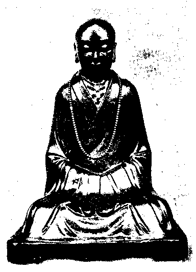



上堂：「天亲菩萨无端变作一条楖栗木杖。」畫地一下云：「尘沙诸佛，尽向这里葛藤。」下座。



偃祖法语　佛明敬录戒定慧



云公老和尚法相



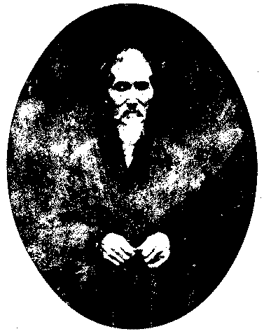



憨憨呆呆老冻脓　颠颠倒倒可怜生  

走徧天涯寻知己　未识若个是知音  

挑雪填井无休歇　龟毛作柱兴丛林  

耗费施主钱和米　空劳一生徒苦辛



幻游比丘#　虚云自题虚云



云公像赞



倔彊此老　天魔吓倒  

露刃金刚　杀人如草  

空中楼阁　没顶头脑  

多子塔前　弌领粪扫  

法华会上　分座多寳  

无相而相　善颂善祷  

先吃痛棒　再申怀抱  

不动舌头　许汝道道



弟子明一观本敬题自净其意



云门山全景



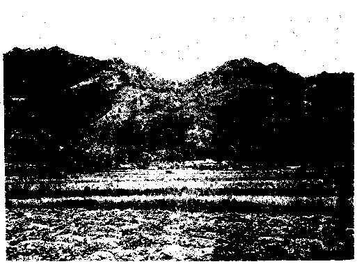



大觉禅寺全景



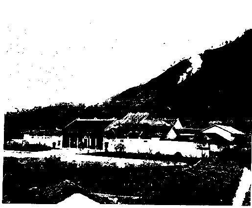



大雄宝殿



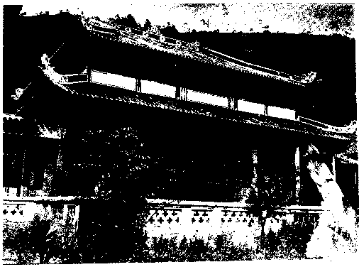



法堂



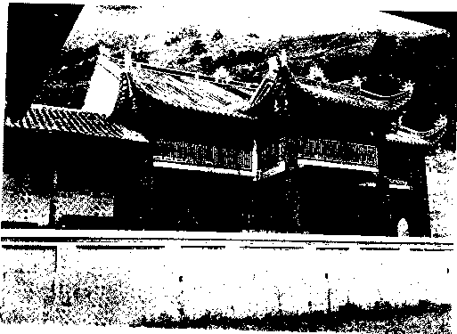



韦驮殿



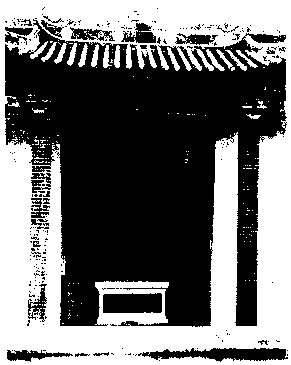



钟楼



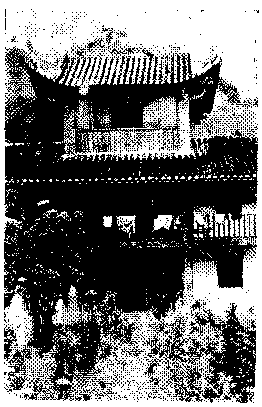



观音岭



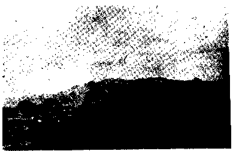



桂花潭







前山新农场全体摄影



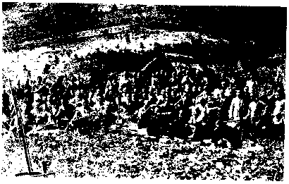



后山农林风景







农林集体工作摄影



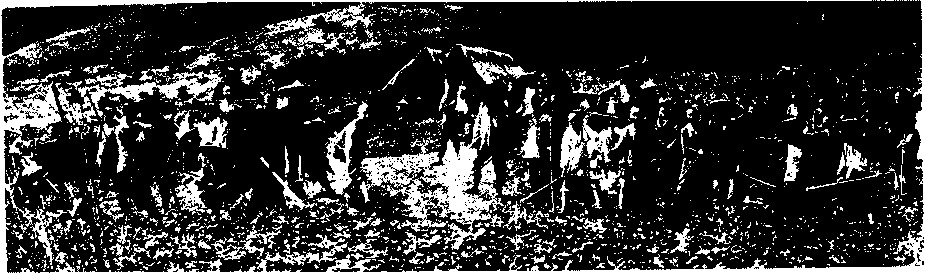



后山茅蓬



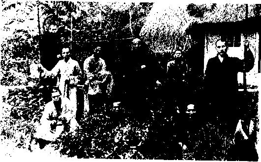



------



### 序



今年虚云老和尚一百有六岁，春三月，以云门山志初稿南来，命予编订，览志稿，已由释惟心释妙云澄圆等分类分纂，篇章有序，顾体例，则与往日诸山志稍异，论时会，又何必与往日诸山志强同，故因之，为增删考订，次第点定而已，溯云门自文偃祖师开山，为五宗之一，距今一千餘年，中间人才之消长，法运之盛衰，道场之兴废，不能不归於佛说所谓「时节因缘」，偃祖在日，大弘法化，得旨嗣法者七十六人，如白云子祥，韶州广悟，英州观音，黄龙赞，西禅钦，慈云深，等，其后传宗，如南雄地藏，五祖戒，香林信，洞山晓聪，佛日契嵩，天衣怀，云居舜，居士如刘经信，清献赵忭，等数百人，道风隆盛，甲於诸方，元明以降，法运垂秋，晚近五宗，除临济曹洞尚餘香火外，沩仰法眼已不绝如缕矣，岂独云门为然哉，即以云门道场言，偃祖未至，一荒山也，忽而涌现梵宫，忽而万指围绕，忽而古寺残灯，忽而山鬼叫跳，忽而老儒横经，忽而巨灵呵护，可谓极变幻之至，而偃祖端坐巍然，以待虚云和尚之来，和尚以十年心力，重建南华。又以十年心力，中兴云门，今殿阁宏丽，供具庄严，修辟山场，持守戒律，围绕者又数千指矣，时至则然，何足怪者，偃祖於寂光中，当曰、如是、如是。



和尚虑日久复湮，命纂述山志，使后人按籍而知名山之由来，尤重要者，志书中第五篇第二章录和尚法语「参禅法要」、「坐禅须知」、「用心难易」诸编，皆吐出心肝，作人天眼目，诚修禅之圭臬，度世之金针，窃愿当人，澄其慧目，予忝附门墙，未忘知解，不离文字，聊以解嘲，折衷群言，据闻述见，亦思取信於将来，庶无惭於面命云尔。



------



### 岁次七十八辛卯端阳节鼓山门下弟子宽贤岑学吕敬序



云门山志凡例七则



一、云门宗为中国禅宗五宗之一，云门山为云门宗之发祥地，固宜有志。云公老人，中兴云门，剏编山志，事诚重要。然探询当山。搜求古籍、旧志既缺，文献无徵。更因时会非常，采访匪易，编者祗得守株抱残，因陋就简，勉缀兹编，惟内容力求真确，慎重收入，宁缺其文，毋失其实。



二、云门山见重於世，实因云门寺，而云门寺之震烁古今中外，赖有偃祖开山於前，云公中兴於后。兹编志山略而志寺详，通例也。而於偃祖及云公之法道精神，特为发挥，以启后人景仰，斯为本志重心所在。



三、兹编与普通山志不同，不冠总论，不书星野，不列志第，仅分别编章节目，将横竖复杂之事实。作分门别类之排比，使系统分明，贯串无紊，至山水梵宇产业，住持，护法等篇敍述，皆为顾及事实，另具一格，非故与他志竞异，盖为条理清晰，便於阅览故。



四、他志各门多冠以小敍，非古今通体，陆肇域志虎丘张留一志灵岩，皆削而不用，兹编亦从之。



五、云门久历沧桑，法道中断，旧志与宗谱失存，凡历代住持，常住变迁，以及名贤艺文，多不可考，本疑者缺之之义，略而弗书。



六、古碣碑文，汇为一章，其中间有文字脱落，词句欠顺，赘署旧式长衔者，悉仍其旧，以存前人之真。



七、本志统编，承居士吴季禧林远凡许宽勤释宽慧等搜罗资料，策划印行，四方善信，同门学友，各捐净资，认领书册流通，始克出版，合并附谢！



编者谨识



云门山志目录



> 首篇　图相、序、例  

> 云门祖师真相……………………………………………………………一  

> 云公老和尚法相…………………………………………………………三  

> 云门山全景………………………………………………………………五  

> 大觉禅寺全景……………………………………………………………六  

> 大雄宝殿…………………………………………………………………七  

> 法堂………………………………………………………………………八  

> 韦驮殿……………………………………………………………………九  

> 钟楼……………………………………………………………………一〇  

> 观音岭…………………………………………………………………一一  

> 桂花潭…………………………………………………………………一一  

> 前山新农场全体摄影…………………………………………………一二  

> 后山农林风景…………………………………………………………一二  

> 农林集体工作摄影……………………………………………………一三  

> 后山茅蓬………………………………………………………………一四  

> 云门山志序…………………………………………………………一～二  

> 云门山志凡例………………………………………………………三～四  

> 云门山志目录……………………………………………………五～一五  

> 第一篇　地域  

> 第一章　形势交通………………………………………………………一  

> 一　山川形势…………………………………………………………一  

> 二　交通路线…………………………………………………………一  

> 第二章　风景名胜………………………………………………………二  

> 一　桂花潭……………………………………………………………二  

> 二　出米石……………………………………………………………三  

> 三　九仙岩……………………………………………………………三  

> 四　慈悲峰……………………………………………………………四  

> 五　云门峰……………………………………………………………四  

> 六　云门坳……………………………………………………………五  

> 七　钟鼓石……………………………………………………………五  

> 八　观音岭……………………………………………………………五  

> 第三章　民情物产………………………………………………………六  

> 一　人口生活…………………………………………………………六  

> 二　宗教习惯…………………………………………………………六  

> 三　各种物产…………………………………………………………七  

> 第二篇　寺院  

> 第一章　梵宇……………………………………………………………八  

> 一　偃祖创建之规模…………………………………………………八  

> 二　历代修建之概况…………………………………………………九  

> 三　云公重建之新猷………………………………………………一一  

> 第三篇　宗统  

> 第一章　偃祖传略……………………………………………………一六  

> 一　幼年儿童及沙弥时代…………………………………………一七  

> 二　壮年受具及参方时代…………………………………………一八  

> 三　晚年为人天眼目时代…………………………………………一九  

> 四　寂后示瑞………………………………………………………二二  

> 第二章　偃祖行录……………………………………………………二九  

> 第三章　云门宗法统…………………………………………………三一  

> 一　偃祖前历代祖师传承表………………………………………三一  

> 二　偃祖后各代法嗣一览表………………………………………三三  

> 第四章　偃祖法要……………………………………………………五八  

> 第四篇　住持  

> 第一章　开山住持……………………………………………………六七  

> 第二章　历代住持……………………………………………………六八  

> 第三章　中兴住持……………………………………………………六九  

> 第五篇　中兴  

> 第一章　云公老和尚事略……………………………………………七〇  

> 一　出生在家时期…………………………………………………七〇  

> 二　出家参方时期…………………………………………………七一  

> 三　隐居终南时期…………………………………………………七五  

> 四　宏化西南时期…………………………………………………七六  

> 五　宏化东南时期…………………………………………………八六  

> 六　宏化岭南时期…………………………………………………八九  

> 第二章　云公老和尚语录……………………………………………九九  

> 一　法语……………………………………………………………九九  

> 二　普说…………………………………………………………一〇二  

> 三　参禅的先决条件……………………………………………一〇四  

> 四　参禅法要……………………………………………………一〇五  

> 五　禅堂开示……………………………………………………一一一  

> 六　参禅警语……………………………………………………一二六  

> 七　除夕普茶示众………………………………………………一二八  

> 八　修行与不修行………………………………………………一三〇  

> 第三章　云公老和尚中兴云门实纪………………………………一三二  

> 一　因缘…………………………………………………………一三二  

> 二　事迹…………………………………………………………一三二  

> 三　感应…………………………………………………………一三六  

> 第六篇　护法  

> 第一章　开山护法…………………………………………………一三八  

> 一　南汉王刘䶮刘晟刘𬬮………………………………………一三八  

> 二　阮绍庄梁延鄂李托岳雷陈守中……………………………一三九  

> 第二章　历代护法…………………………………………………一四一  

> 一　明代护法……………………………………………………一四一  

> 二　清代护法……………………………………………………一四二  

> 第三章　中兴护法…………………………………………………一四四  

> 一　护法功德概述………………………………………………一四四  

> 二　护法芳名胪列………………………………………………一四四  

> 第七篇　产业  

> 第一章　产业………………………………………………………一四七  

> 一　偃祖开山时之产业…………………………………………一四七  

> 二　历代增减之产业……………………………………………一四七  

> 三　云公中兴时代之产业………………………………………一五二  

> 第八篇　规约  

> 第一章　规约………………………………………………………一五四  

> 一　共住规约……………………………………………………一五四  

> 二　客堂规约……………………………………………………一五六  

> 三　云水堂规约…………………………………………………一五九  

> 四　禅堂规约……………………………………………………一六〇  

> 五　戒堂规约……………………………………………………一六三  

> 六　爱道堂规约…………………………………………………一六六  

> 七　衣钵寮规约…………………………………………………一六八  

> 八　库房规约……………………………………………………一六九  

> 九　大寮规约……………………………………………………一七二  

> 十　浴堂规约……………………………………………………一七四  

> 十一　农场组织章程……………………………………………一七五  

> 第九篇　文献  

> 第一章　遗录………………………………………………………一七八  

> 一　请偃祖开堂疏………………………………………………一七八  

> 二　偃祖遗表……………………………………………………一七八  

> 三　偃祖遗诫……………………………………………………一七九  

> 第二章　碑记书牍…………………………………………………一八〇  

> 一　大汉韶州云门山光泰禅院故匡真大师实信碑铭并序……一八〇  

> 二　大汉韶州云门山大觉禅寺匡圣弘明大师碑铭并序………一八六  

> 三　云门寺山门记………………………………………………一九三  

> 四　修建云门寺大雄宝殿募化疏………………………………一九五  

> 五　云门寺重装匡真祖师金身碑记……………………………一九六  

> 六　重修云门寺记………………………………………………一九七  

> 七　重建云门寺记………………………………………………一九八  

> 八　重修云门寺并鼎建客堂韦驮殿记…………………………一九九  

> 九　鼎建祖师殿𨷿门记…………………………………………二〇〇  

> 十　云门寺田地山场碑记………………………………………二〇一  

> 十一　云门寺蠲免大差碑记……………………………………二〇五  

> 十二　云门寺免逋负记…………………………………………二〇七  

> 十三　捐奉云门寺香油田碑记…………………………………二〇八  

> 十四　附录重兴曹溪南华寺记…………………………………二〇九  

> 十五　云公老和尚答某鉅公问法书……………………………二二三  

> 十六　云公老和尚答屈映光居士问法书………………………二三三  

> 第三章　艺文………………………………………………………二三五  

> 一　偃祖十二时歌………………………………………………二三五  

> 二　偃祖偈颂……………………………………………………二三五  

> 三　圆明大师颂云门三句语……………………………………二三六  

> 四　圆明大师餘颂八首…………………………………………二三七  

> 五　云公老和尚赠林鸿超居士七律诗一首……………………二三八  

> 六　云公老和尚遇盗感怀三偈…………………………………二三九  

> 七　云公老和尚赠萧雪沧居士七律诗一首……………………二四〇  

> 跋………………………………………………………………………二四一



第一篇　地域



第一章　形势交通



一　山川形势



岭南韶州，粤北重镇也；据粤汉路中段，为湘粤赣交通枢纽。乳源县在韶州之西，万山罗列，清江、杨溪、辽水、武水，纵横流贯其间。云门山在乳源县东境，居县城之北，为岭南胜境之一。辖区甚广，东起龙王宫岭，西迄云门坳，南自雷公岭，北至大慈悲峰。云门寺即大觉禅寺也。建置於山之东南麓，后枕云门峰，前临云门洞，左靠和尚岭，右扼云门坳。龙王宫岭，鱼兰山、司大岭、四土埂、燕子岩、牛新岭、雁神咀山、雷公岭、松毛岭，环列於外，而观音岭及大小旗山，复远拱於正前方。诸山环绕，四周云合，山溪邃泉，流贯其间。昔人谓：「匼匝尽奇峰秀岭，逶迤皆泼黛堆蓝；泉幽而声激珠玑，松老而势挐空碧。」「庵罗衞之林畔，景象无殊；耆阇崛之山中，规模匪异。」良有以也。



二　交通路线



乳源县城，东至曲江县界三十华里，南至英德县界一百二十五华里，西至连州阳山县界一百四十华里，西北至湖南宜章县界二百八十华里，东北至乐昌县界一百二十华里。（韶州府志）



云门寺之交通，以曲江为总站，各方来本寺，以先到曲江为便，其主要交通路线如左：



一、由云门寺步行至乳源县城一十二华里，由乳源县城乘汽车至龙归站五十华里，由龙归站乘汽车至曲江四十华里。若由乳源县城乘木船或步行，亦一天可以达曲江。



二、由云门寺步行至一六街二十华里，由一六街步行至重阳二十华里，由重阳步行至犂市二十华里，由犂市乘汽车或火车至曲江三十华里。



三、由云门寺步行至龙归五十华里，由龙归步行至白土街十五华里，由白土街步行至马坝二十华里，由马坝步行至南华寺十五华里。



第二章　风景名胜



一　桂花潭



桂花潭在云门寺东北二里许，披棘攀蹬，始能达到。潭形如盆，直径约四五丈，深不易测。四面石壁，巉岩嵯峨，飞泉瀑流，垂悬数丈，冲激潭中，响震山谷，寒风袭袂，暑热挫消。山多桂花，清香远溢，潭之得名，或缘於此。潭水清澈，流洄麓洞，寺僧村民，饮用灌溉，胥取於此。云公老人，计划筹措经费，芟除荆棘，平治崎岖，修成坦途，建造亭阁，以利游观。



二　出米石



出米石在桂花潭东北三里许，其地有一大石，下生成一石臼。容量约一斗。相传昔有仙人，在此修真，臼中逐日出米，以供道粮云。



三　九仙岩



九仙岩在出米石东北四里许之山峰下，岩穴滴乳，幽静爽朗，可供栖止。韶州府志云：「乳源韩氏之族，生九女皆处子，曰信贞、慧贞、修贞、守贞、慕贞、静贞、妙贞、清贞、洁贞，常静室养蚕，宋太平兴国二年三月三日，往巾子峰岩畔采桑，遇暴风雷雨掩至，阴晦失道，入岩避之，忘归。其夜半，乡人共闻有乐声从西北来，自云中降於岩，次日觉有异香。时樵人苏福保等，亦以雨迷路，宿峰侧，闻乐声。次早过岩见诸女衿服若蝉蜕，然身已去矣。惟有一诗於壁间云：『共作云仙侣，俱辞世界尘，静思前日事，抛却几年身。』福保还报韩氏，其父母共往视之，岩已阖矣，号哭莫追。有一女子於岩内呼其父曰：『无忧我，汝当为土地神。』至今韶州府行院内，有韩家土地之名。初时常有仙乐彩仗，霓旌绛节，鸾鹤彩云，降於峰岭，乡民遇旱，赴岩前祈祷，辄有应。咸平四年，䂙汉始创亭名曰『会仙』，有碑记，岁久字泯莫辨。咸淳五年，韩仲保别立庙於峰下，以便祭祀。凡祈雨必沐浴斋戒，先一日巫师焚牒於庙次，诣岩傍俟其蜥蜴大小数十旋绕而出，巫师取一二置盆水，鼓乐导迎以归，官民罗拜，雨立至。后之传者，又以为韩赵罗三姓九女，要其蜕化灵验无可疑者。」



四　慈悲峰



慈悲峰又名大慈悲峰，在九仙岩正北五里许，独峙高耸，为乳源诸山之最高峰，豋其巅，不惟可以俯瞰乳源全境，且可暸望周围各县，如乐昌、曲江、南华寺各处，均历历在目中，



五　云门峰



云门峰为云门寺主山，由寺后登达山峰，高约三华里，陡峻难行。据立峰巅，乳源县境，大部瞭如指掌，曲江、乐昌两县境，亦可以望见焉。



六　云门坳



由寺西去四华里曰云门坳，为通县城必由之路，燕子岩及下岭两山，夹峙左右，中建一亭，曰云门亭，殆所谓咽喉之地也。登坳旁高阜，东可展望云门洞，西南俯视乳源城。林木繁茂，好鸟时鸣，披襟当风，纳凉亭畔，悠然怡怀，倍饶清胜。



七　钟鼓石



钟鼓石在云门寺南二里许之石鼓宾，正当寺之右前方。山不高而灵秀，石不怪而玲珑，林木灌莽，蓊郁葱翠，石笋参差，有如锋刃。中有响石两方，露出地面数尺，初视无异众石，击之，一如钟响，一如鼓鸣，洪亮清澈，悠然韵永。意者谓祖师道场，鍾灵毓秀，宜有玲珑瑰异之物，存乎其间。



八　观音岭



观音岭在云门寺正前方，相距直径约三十里，诸峰罗列，环拱云门，苍翠奇秀，泼黛堆蓝，晴辉雨雾，瑞霭虹霓，变幻无常，观玩不尽。其下大小旗山，环拱云门，成贵人护卫之象。



第三章　民情物产



一　人口生活



云门寺隶乳源县云峰镇第七保；本县八万人，本镇二万餘人，本保三百人，均业农，经营工商者甚少。人民日食三餐，以米饭为主，佐以少数红薯杂粮。衣服朴素，质料多为棉织土布。住屋多矮小旧式。行旅运输，皆肩挑步行，乘搭车船者甚少，利用驮马者更罕见。



二　宗教习惯



乳源人民，真正信仰宗教者甚少。近百年来，佛教徒寥寥无几。自云公老和尚主化云门以来，信向者渐多，然正式皈依三宝者，尚未逾三百人。佛教在中国有长期历史，岭南佛法亦曾辉煌数百年，云门祖师之流风遗化，潜润民间，仍未尽泯，故信仰恭敬之心，犹尚普遍。道耶两教信徒为数更少。惟祭祖祀神，俗仍旧。



关於风俗习惯，与粤北各地，无甚差异。凡婚丧喜庆，来往应酬，民间仍沿旧习，城市中之变革，亦甚少也。



三　各种产物



乳源产物以稻谷为大宗，每年收获早晚两造，若丰收一年，可供二年之食。杂粮如红薯、花生、豆子、芋头等，产量均少。木柴、杉树板及棕绳，出产甚多，乡民傜人，采制极易，惜运销困难，故多委弃於山野。



第二篇　寺院



第一章　梵宇



一　偃祖创建之规模



初，祖任灵树知圣长老首座，知圣迁化，祖继灵树法席。大阐雪峰宗旨，「禅河汹涌，佛日辉华，道俗数千，问答响应。」尔后祖唯恬静，「倦於迎接，志在幽栖。」遂於后唐庄宗同光元年癸未，（公元九二三年）奏准南汉王移庵，领众开云门山。因高就远，审地为基，创建梵宇，庄严净域，层轩高阁而涌成，花界金绳而化出，簷栏翼翥，高下鳞差，「晓霞低覆，绛帷微衬於雕楹；夕露散垂，珠网轻笼於碧瓦」；「邃壑幽泉，挫暑月而寒生户牗；乔松修竹，冒香风而韵杂宫商。」五载功竣，四周云合。由是庄严宝相，丰积香厨，闻风向道者。云来四表，拥锡依止者，恒逾半千。后唐庄宗天成二年丁亥（公元九二七年，）院主师傅大德，表奏造院工竣，𠡠赐额曰：「光泰禅院。」后𠡠改为「证真禅寺。」宋太祖乾德元年癸亥（公元九六三年，）祖入灭已十五年，示梦阮绍庄，托李特进奏准南汉王开塔，真身毕露，栩栩如生，放光散香，显彰灵异。奉勅封祖为「大慈云匡圣宏明大师。」并勅升「证真禅寺」为「大觉禅寺。」详见雷岳撰匡真大师实性碑铭并序，及陈守中撰云门宏明禅师铭。



二　历代修葺之概况



韶州府志载，本院梵宇：「宋建中间，僧绍资，明洪武初，僧了偈，俱重修；成化五年，僧法浩重建。」其修建情形，已不可考。按赵佑卿撰云门寺山门记：明万历十一年癸未，住持僧法传，以山门颓圮，独自募缘，重新修葺一次。芳题重修云门寺大殿募化疏：万历四十六年丁巳，芳等以大殿倾欹，募款修葺一次。（芳籍姓待考）



有清一代，修寺装像，先后大小，共约五次：



一、康熙三十一年丁卯，住持僧元才撰云门寺重装匡真祖师金身碑记略云：偃祖真身，巍据寺中，迄今八百餘载，遐迩士庶。祈晴祷雨，如响斯应。邑侯舒公倡捐廉俸十金，檀越育才坊等四十餘人，共抽净资四十四两，供祖真身，布添装金。



二、康熙四十三年甲申，乳源县令伍弈芳撰重修云门寺记略云：仅存祖殿大殿各一，栋宇飘摇，榱桷朽坏，宝像剥落，鞠为草莽！丙子冬余独捐俸金，重新祖殿。壬午春与刘君朝柱共出净资，装饰三宝金像。更募化善信，外建照壁，内砌围墙；使有规范。后复独捐俸金，修理大殿，壮其规模；并在山门内新建一殿，供奉韦驮天尊及接引圣像。至是金碧辉煌，焕然改观。



三、嘉庆五年庚申，某公撰重建云门寺碑记略云：康熙间伍君弈芳重新之云门寺宇，历年既久，自山门至大殿后，栋宇凋残，金像剥落，两廊仅存其地，堂寮诸多颓废，幸全者唯一祖师殿耳。嘉庆二年丁巳夏，邑侯朱公振翰，慨然倡修，分廉实助，序簿分募。人情踊跃，聚腋成裘，鸠工庀材，经始於丁巳冬，落成於庚申夏。自山门以至大殿，尽行革故鼎新，门内并起韦驮楼，两旁鼎建游廊，大殿柱砌以花砖。所有佛菩萨伽蓝大小圣像，重新塑造，饰彩装金。至是丹碧辉煌，焕然一新。



四、道光三十年庚戌，武举邓汉卿撰重修云门寺并鼎建客堂韦驮殿记略云：云门古刹，虽经几度重修，近复楹拆榱崩，簷倾廊颓，禅堂草茂，触景心恻：爰纠合同志一十七人，买料雇工，重行修葺。新正经始，夏蒲落成。凡廊簷栋宇，照墙丹墀，甬道拱门，神厨佛座，均予修葺。更为南修级路，东创客堂。涂饰丹艧，轮焕维新。



五、咸丰元年辛亥，邑廪生邓佩秋撰鼎建祖师殿𨷿门记略云：今春拉二三戚友，游眺云门，见夫颓者兴，废者举，莫不焕然崭然，而独於祖殿辖然，得毋有取空门之义耶？抑或经事乏人耶？尔时赞堃邱君，怃然有间曰：「此间松膏僧粒，先大父常不靳施与，恒有志焉未逮也。今兹𨷿门櫺牗，责成於恒可也。」爰纠匠氏，削墨引绳，两越月工告竣矣。此邱君善承先志，独力落成者也。



三　云公重建之新猷



本寺在清季虽有重修，然规模甚小，殿宇无多。逮及民国，历时数十年，已日就倾圮！残屋颓垣，沦於榛莽；野狐山兽，踞为巢窟。凋残荒废，难以罄述！云公老人，有大愿力，展其生平迭兴祖庭，丕振宗风之精神，於民国三十二年十二月，由曹溪移锡云门，决心重兴大觉禅寺，复振云门宗风。如是昼夜辛勤，宏规硕划，鉅细躬亲，仍复因高就远，审地为基。配合山川形势，燮理阴阳风水，更改山向，重奠地基。荡扫榛芜。大兴土木，广造梵宇，历时九年，计建殿、堂、阁、寮、厅、楼、库、塔、共一百八十餘楹连放生池及碓房，海会塔，共占地积约二十餘亩。崇楼杰阁，广厦层台，宝相庄严，梵刹清净，加以大德演化，观机说法，解黏去缚，直指人心，是故士庶瞻礼，十方云来，论圣地道场，仅亚於曹溪；而宏宗盛化，实冠於宇内也。至其新建梵宇之部署结构分中央及四路两排。中央为大雄宝殿位置，坐西北向东南，辛山乙向。大殿前后梵宇各一排，左右梵宇各两路。兹分别详述如后：



大雄宝殿据全寺之中央，高约五丈，宽三十六方丈，墙柱均系火砖砌成。前有月台，月台下有大丹墀，后有大天井，左右各有长天井，廻廊四面，通左右各路梵宇，大殿正中奉释迦牟尼佛、药师佛、弥陀佛。后奉西方三圣及文殊普贤两大菩萨。左右两序，奉十八罗汉及诸天二十四圣。



前排梵宇，分中左右三大栋，中栋即头山门、天王殿、韦驮殿、奉弥勒菩萨於中央，左右奉四大天王，后奉韦驮菩萨。宝相庄严。顺德岑学吕题山门联曰：「云覆大千界，门传不二宗。」左栋总名曰「旭日楼」，上下两层，大小厅、堂、亭、寮及厢房，共十八楹。内靠天王殿左边地下一楹，设为报恩堂，奉本寺各人宗亲父母师长之莲位。右栋总名曰「明月楼」，上下两层，大小厅堂亭寮及厢房，共十六楹。内靠天王殿地下一楹，设为西归堂，奉「本寺开山、中兴、继位、住持诸祖老和尚莲位」，及「本寺开山、中兴、前亡后化一切僧行觉灵等莲位」。在「旭日」、「明月」两楼亭中：晨夕望山光云影，四时变幻无常，中宵覩皓月明星，一真法界恒在。



后排梵宇，分中左右三大栋：中栋为法堂、戒坛、藏经阁，上下两层。下层一大楹，法堂、戒坛通用，中置狮子座，上奉释迦玉佛。上层为藏经阁，计分六楹。上有「雨花台」三字，左栋为祖堂，奉云门开宗始祖文偃禅师真身，及本宗传承历代祖师牌位。栋宇分上下两层，共约二十楹。右栋为方丈，上下两层，计堂寮厢房约二十间。内奉观音菩萨一尊。有联曰：「谁云有道有禅，任汝雨宝弥空，总是鬼家活计。这里无棒无喝，不妨拈草作药，坐令天下太平。」云公和尚自撰一联云：「两手将山河大地，捏扁搓圆，掐碎了徧撒虚空，浑无色相，一棒把千古业魔，打死救活，唤醒来放入微尘，共作道场。」



左边一路梵宇分三大栋：一曰客堂，中为厅，两旁寮房四楹，客堂上第一层楼，中为厅，两旁寮房四楹，第二层为钟楼，悬大钟一口，钟声闻十数里，足以发人深省。二曰伽蓝殿，中奉给孤长者，两旁有寮房四楹。伽蓝殿楼上，大小厅寮共五楹。三曰云水堂，楼上楼下厅寮十餘楹。



左边二路梵宇分三大栋：一曰香积厨，内建大小灶五口，石水缸一个，凡食用之水，以铁管接入锅缸。寮房五楹，住典座饭头，厨龛上供监斋菩萨，二曰斋堂，额字搨苏东坡旧书。联云：「粥去饭来，莫把光阴遮面目；钟鸣板响，常将生死挂心头。」三曰库房，楼上楼下及连同斋堂楼上，大小厅寮共十餘楹。



右边一路梵宇分三大栋：一曰功德堂，奉本寺护法檀那生莲之位及长生禄位。连同第一层楼，共厅寮十楹，暂作上客堂之用。第二层楼为鼓楼。安置大皷一面，与钟楼相对称。二曰祖师殿，奉达摩初祖及百丈禅师道宣律师。连同楼上大小堂寮共十楹。三曰禅堂，楼上楼下大小厅寮十二楹，番禺汤瑛题禅堂联云「照顾话头，不管他长庆卷帘，香严击竹。远离妄想，许会得禾山打鼓，雪峰辊球。」右边一路上通方丈拱门，悬有古联曰：「入此门，不许你七颠八倒；到这里，莫管他五蕴六通。」



右边二路梵分宇为三栋：一曰工人寮，平屋三楹。二曰如意寮，平屋三楹。三曰圊所，平屋三楹。



碾米房两栋，楼上楼下大小五楹。利用水力碾米，除碾常住粮米外，并可供附近村民应用。



山门外凿有放生池，宽逾一亩，深达一丈。水满鱼游，清波荡漾，金池柳色，桂殿香风，游人至此，已入清凉境界矣。



海会塔建於寺西二里许，上下两层，约十餘楹。绕以短垣，植以异卉。七众遗蜕，於焉是归，昼夜佛声，幽明普利。



第三篇　宗统



第一章　偃祖传略



尝考各关於偃祖之记载典籍，似尚无述及师之出生、出家、及受具等年份者。比阅现存云门大觉寺之历代碑记，其中南汉王刘𬬮大宝元年（公元九五八）雷岳所撰之实性铭述师「法龄七纪二，僧腊六旬六」，及大宝七年陈守中所撰之碑铭述师「寿龄八十六，僧腊六十六」，乃根据师示寂於南汉王刘晟乾和七年（公元九四九）推寻之，尚可按考。惟实性铭所述「法龄七纪二，僧腊六旬六」，不无疑焉，盖法龄即法腊，亦即僧腊，乃比丘受具戒之年数，若尔，则师当於十五岁及二十一岁时两度受具足戒。窃或不然？此恐是撰铭者未明佛制，误称受沙弥戒之年数为法龄耳。且各籍均载师幼投空王寺出家，碑铭则戴「才逾丱岁」，是未冠时之称。故今假定师出家及受沙弥戒之年为十五岁，确否待考。



又师受具后二十七年间，各籍仅载师禀具后还侍澄公数年研览律藏，及亲睦州数年后往雪峰外，餘似无关於年之记载；且侍澄公及亲睦州若干年，亦未有确数。考律制比丘五夏以前，专精戒律，五夏以后，方许听教参禅。澄公是律师，当倍遵律制，其令师研律最少五年必矣。故今又假定师禀具后还侍澄公为五年，亲睦州亦五年，餘十七年为参谒诸方之年。师之遗表有「困风霜於十七年间，涉南北於数千里外」之句，似不为无据。爰将偃祖传略为编年如下：



一　幼年儿童及沙弥时代（一岁至二十岁——公元八六四至八八三）——即唐懿宗咸通五年甲申至唐僖宗中和三年癸卯——



师讳文偃，晋张翰十三代孙也。翰吴人，初仕於洛，后休禄返里，徙於江浙，故胤及我师生於嘉兴（县名今属浙江省），时唐懿宗咸通五年甲申（公元八六四）也。



师面丰颊，精锐绝伦，目纤长瞳子如点漆，眉秀近睫，视物凝远，敏质生知，慧辩天纵，才数龄，读书过目不忘，谈吐与常童异，人已知其终非池中物矣。



以师夙负灵姿，为物应世，故年甫十五，（唐僖宗乾符五年戊戌——公元八七八）即投嘉兴空王寺礼志澄律师出家，并受沙弥戒焉。受十支戒后，谨遵律仪，澄公深器重之。



二　壮年受具及参方时代（二十一岁至四十七岁——公元八八四至九一〇）——即唐僖宗中和四年甲辰至后梁太祖开平四年庚午——



师年二十一（唐僖宗中和四年甲辰——公元八八四）受具足戒於常州毗陵坛，禀具后还侍澄公讲数年，穷探律部，博览无遗。



年二十六（唐昭宗龙纪元年己酉——公元八八九）以毗尼既严净，而己事尚未明，乃辞澄公往游方。初至睦州（隋置，宋废，即今浙江建德县）闻有老宿隐於古寺，织蒲屦养母，遂往谒之，老宿名道踪禅师乃黄檗断际禅师之法嗣也，知道不偶世，引远自处，潜居古刹，虽高蹈，而为世所慕，凡应接来者，关钥高险，机辩峭捷。见师才至，（碑铭则载师先与睦州来往数月）即闭却门，师乃扣门，州曰：「谁？」师曰：「某甲。」州曰：「作甚麼？」师曰：「己事不明，乞师指示！」州开门一见又闭却，师如是连三日扣门，至第三日，州开门，师乃拶入，州即擒住曰：「道！道！」师拟议，州以手推出曰：「秦时𨍏轹钻。」遂掩门，损师右足，师从此悟入，既而諮参数载，深入堂奥，州知其终为法门柱石，因语之曰：「吾非汝师，今雪峰（山名在福建福州）义存禅师，可往参承之，无复留此。」师依旨辞睦州南下。



时师年三十一（唐昭宗乾宁元年甲寅——公元八九四）策杖入关，到雪峰庄，见一僧，迺问：「上座今日上山去那？」僧曰：「是。」师曰：「寄一则因缘问堂头和尚，祗是不得道是别人语。」僧曰：「得。」师曰：「上座到山中见和尚上堂，众才集，便出握腕立地曰：『这老汉项上铁枷何不脱却？』」其僧一依师教，雪峰见这僧与麼道，便下座拦胸把住曰：「速道！速道！」僧无对，峰拓开曰：「不是汝语。」僧曰：「是某甲语。」峰曰：「侍者将绳棒来！」僧曰：「不是某语，是庄上一浙中上座教某甲来道。」峰曰：「大众去庄上迎取五百人善知识来。」师次日上雪峰，峰才见便曰：「因甚麼得到与麼地？」师乃低头，从兹契合，温研积稔，遂密以宗印付师。后雪峰迁化，学徒问峰佛法付谁，峰曰：「遇松偃处住。」学徒莫测，偃者盖师之法号也。故雪峰后不立尊宿。



师参罢出岭，徧谒诸方，历十七载，核穷殊轨，锋辩险绝，世所盛闻，备载广录中游方遗录。



三　晚年为人天眼目时代（四十八岁至八十六岁——公元九一一至九四九）——即后梁太祖乾化元年辛未至后汉隐帝乾祐二年己酉——



后梁太祖乾化元年辛未——公元九一一——时师年四十八，造曹溪（即曲江马坝南华寺）礼塔，旋行抵灵树（山名在韶州附近确址待考）知圣禅师道场，冥符灵树接首座之说。初、知圣禅师住灵树数十年，不请首座，有劝请者，树曰：「吾首座已出家。」久之又请，树曰：「吾首座已行脚，悟道。」久之又请，树曰：「吾首座已度岭矣，少待之。」一日，忽令击钟三门外接首座，众出迓，师果至。树见师即迎笑曰：「奉迟甚久，来何暮耶？」直请入首座寮解包。（相传灵树世世为僧不失神通）



后梁末帝贞明三年丁丑（公元九一七，时师年五十四）广王刘岩（后取易「龙飞在天」之义改名䶮）将兴兵，欲就灵树决可否，树前知之，乃潜书秘函中谓师及各门弟子曰：「吾灭后必有贵人来为吾荼毗，请以此函遗之。」



翌年（贞明四年戊寅——公元九一八——时师年五十五）广王刘䶮果至，树预测其至，乃升堂跏趺而寂，及王至已灭矣。王询其遗示，门人出函奉之，王启函得书云：「人天眼目，堂中上座。」乃命为树荼毗，获舍利，塑形於方丈；并诏师入见，赐紫焉。



越年（贞明五年己卯——公元九一九——时师年五十六）广王命韶州牧何希范具礼请师继灵树法席，（见广录中请疏）师於是据灵树筵，说雪峰法，凡历四载，参谒者接踵。



后唐庄宗同光元年癸未（公元九二三——时师年六十）师请移庵，广王俞允，乃领学者赴乳源云门山，鼎革废址，大新栋宇，历五载毕功，於后唐明宗天成二年丁亥（公元九二七——时师年六十四。）工竣之日，广王赐「光泰禅院」额。



后晋高祖天福三年戊戌（公元九三八——时师年七十五）师赴南汉王刘䶮诏入阙，对答有容，洞韫元机，王皈敬倍加，欲授师左右街大僧录，谦逊再三而免，翌日赐师号曰「匡真大师」，延驻浃旬，赐名香药品等送还。厥后每年频有颁赉。



后汉隐帝乾祐一年即南汉王刘晟乾和七年己酉（公元九四九——时师年八十六）四月，师示微疾，忽谓学徒曰：「吾当行矣。」乃命侍者奉汤，师付汤椀於侍者曰：「第一是吾著便，第二是汝著便。」乃修表以告别汉王，扎遗诫以嘱咐徒众，（遗表及遗诫均见广录）付法於白云山（在韶州）实性志庠大师，遂於四月初十日子时坐化。是月二十五日，诸山尊宿四众道俗千数百人，送师入塔，依师训塔於当山方丈内。



师寿龄八十六，僧腊六十六，坐道场凡三十年，风流四表，大弘法化，天下学者望风而至，登堂入室者不可胜数，得旨嗣法者七十六人。其开示法语等备载於广录内之对机室中语要垂示代语及勘辨等章。师之法道，世宗仰之，目之曰「云门宗」。



四　寂后示瑞



其后十五年（宋太祖乾德元年即南汉王刘𬬮大宝六年——公元九六三）癸亥（碑铭则云后十七年但由己酉至癸亥前后仅十五年耳）八月，有雄武节度推官阮绍庄，梦师以拂子招曰：「为我寄语秀华宫使特进李托，托他奏闻，为吾开塔。」时托奉使韶州监修营诸寺院，因得绍庄之语，奏闻汉王，王谕韶州牧梁延鄂至云门山启塔，见师颜貌如昔，髭发犹生，旋奉旨迎入内庭供养月餘送还山，因改寺为大觉禅寺谥大慈云匡圣弘明大师。



宋仁宗庆历七年（公元一〇四六）有叛寇唐和过寺，将欲为害，师现身在空，唐和感悟，寺中首僧霸因而招降。宋哲宗元祐八年（公元一〇九三，）赐师号觉化大师。



师之肉身，迄今千年有奇矣，仍栩栩欲活，趺坐云门祖堂内也。



庚寅释惟心撰



附大事年表



公元  

甲子  

历代帝王年号  

南汉年号  

偃祖年龄  

偃祖僧腊  

大事



八六四  

甲申  

唐懿宗咸通五年



一岁



师诞生於嘉兴



八六五  

乙酉  

六



二



八六六  

丙戌  

七



三



八六七  

丁亥  

八



四



八六八  

戊子  

九



五



八六九  

己丑  

十



六



八七〇  

庚寅  

十一



七



八七一  

辛卯  

十二



八



八七二  

壬辰  

十三



九



八七三  

癸巳  

十四



十岁



八七四  

甲午  

唐僖宗乾符元年



十一



八七五  

乙未  

二



十二



八七六  

丙申  

三



十三



八七七  

丁酉  

四



十四



八七八  

戊戌  

五



十五



师投空王寺出家



八七九  

己亥  

六



十六



八八〇  

庚子  

广明元年



十七



八八一  

辛丑  

中和元年



十八



八八二  

壬寅  

二



十九



八八三  

癸卯  

三



二十岁



八八四  

甲辰  

四



二十一  

一夏  

师受具毗陵坛后还侍澄。



八八五  

乙巳  

光启元年



二十二  

二



八八六  

丙午  

二



二十三  

三



八八七  

丁未  

三



二十四  

四



八八八  

戊申  

文德元年



二十五  

五



八八九  

己酉  

唐昭宗龙纪元年



二十六  

六  

师辞澄往参睦州。



八九〇  

庚戌  

大顺元年



二十七  

七



八九一  

辛亥  

二



二十八  

八



八九二  

壬子  

景福元年



二十九  

九



八九三  

癸丑  

二



三十岁  

十夏



八九四  

甲寅  

乾宁元年



三十一  

十一  

师辞睦州往参雪峰。



八九五  

乙卯  

二



三十二  

十二  

其后十餘年参谒诸方。



八九六  

丙辰  

三



三十三  

十三



八九七  

丁巳  

四



三十四  

十四



八九八  

戊午  

光化元年



三十五  

十五



八九九  

己未  

二



三十六  

十六



九〇〇  

庚申  

三



三十七  

十七



九〇一  

辛酉  

天复元年



三十八  

十八



九〇二  

壬戌  

二



三十九  

十九



九〇三  

癸巳  

三



四十岁  

二十夏



九〇四  

甲子  

唐昭宣帝天祐元年



四十一  

二十一



九〇五  

乙丑  

二



四十二  

二十二



九〇六  

丙寅  

三



四十三  

二十三



九〇七  

丁卯  

后梁太祖开平元年



四十四  

二十四



九〇八  

戊辰  

二



四十五  

二十五



九〇九  

己巳  

三



四十六  

二十六



九一〇  

庚午  

四



四十七  

二十七



九一一  

辛未  

乾化元年



四十八  

二十八  

师礼曹溪，旋谒灵树。



九一二  

壬申  

二



四十九  

二十九



九一三  

癸酉  

末帝（乾化）三年



五十岁  

三十夏



九一四  

甲戌  

四



五十一  

三十一



九一五  

乙亥  

贞明元年



五十二  

三十二



九一六  

丙子  

二



五十三  

三十三



九一七  

丁丑  

三  

南汉王刘䶮称帝於广州  

五十四  

三十四



九一八  

戊寅  

四



五十五  

三十五  

灵树迁化。



九一九  

己卯  

五



五十六  

三十六  

南汉王请师继灵树法席。



九二〇  

庚辰  

六



五十七  

三十七



九二一  

辛巳  

龙德元年



五十八  

三十八



九二二  

壬午  

二



五十九  

三十九



九二三  

癸未  

后唐庄宗同光元年



六十岁  

四十夏  

师领学者开云门山。



九二四  

甲申  

二



六十一  

四十一



九二五  

乙酉  

三



六十二  

四十二



九二六  

丙戌  

后唐明宗天成元年



六十三  

四十三



九二七  

丁亥  

二



六十四  

四十四  

云门光泰寺工竣。



九二八  

戊子  

三



六十五  

四十五



九二九  

己丑  

四



六十六  

四十六



九三〇  

庚寅  

长兴元年



六十七  

四十七



九三一  

辛卯  

二



六十八  

四十八



九三二  

壬辰  

三



六十九  

四十九



九三三  

癸巳  

四



七十岁  

五十夏



九三四  

甲午  

后唐闵帝清泰元年



七十一  

五十一



九三五  

乙未  

（潞王）二



七十二  

五十二



九三六  

丙申  

后晋高祖天福元年



七十三  

五十三



九三七  

丁酉  

二



七十四  

五十四



九三八  

戊戌  

三



七十五  

五十五  

师赴南汉王刘䶮诏入阙。



九三九  

己亥  

四



七十六  

五十六



九四〇  

庚子  

五



七十七  

五十七



九四一  

辛丑  

六



七十八  

五十八



九四二  

壬寅  

后晋出帝（天福七年）



七十九  

五十九



九四三  

癸卯  

八  

南汉刘晟乾和元年  

八十岁  

六十夏



九四四  

甲辰  

开运元年  

二  

八十一  

六十一



九四五  

乙巳  

二  

三  

八十二  

六十二



九四六  

丙午  

三  

四  

八十三  

六十三



九四七  

丁未  

后汉高祖（天福十二年）  

五  

八十四  

六十四



九四八  

戊申  

后汉隐帝乾祐元年  

六  

八十五  

六十五



九四九  

己酉  

二  

七  

八六岁  

六六夏  

四月初十日师示寂。



九五〇  

庚戌  

三



九五一  

辛亥  

后周太祖广顺元年



九五二  

壬子  

二



九五三  

癸丑  

三



九五四  

甲寅  

后周世宗显德元年



九五五  

乙卯  

二



九五六  

丙辰  

三



九五七  

丁巳  

四



九五八  

戊午  

五  

南汉刘𬬮大宝元年



雷岳撰实性铭於是年



九五九  

己未  

六  

二



九六〇  

庚申  

宋太祖建隆元年  

三



九六一  

辛酉  

二  

四



九六二  

壬戌  

三  

五



九六三  

癸亥  

乾德元年  

六



师示梦於阮绍庄



九六四  

甲子  

二  

七



陈守中撰偃祖碑铭於是年



第二章　偃祖行录



师讳文偃，姓张氏，世为苏州嘉兴人，实晋王冏东曹参军翰十三代孙也。师夙负灵姿，为物应世，故才自髫龀，志尚率己厌俗，遂依空王寺志澄律师出家为弟子，以其敏质生知，慧辩天纵，凡诵诸典，无烦再阅，澄深器美之。及长落发禀具於毗陵坛，后还澄左右，侍讲数年，赜穷四分旨。既毗尼严净，悟器渊发，乃辞澄谒睦州道踪禅师。



踪黄檗之裔也，知道不偶世，引已自处，潜居古伽蓝，虽揖世高蹈，而为世所慕，凡应接来者，机辩峭捷，无容伫思。师初往参，三扣其门，踪才启关，师拟入，踪托之云：「秦时𨍏轹钻。」因是释然朗悟。既而諮参数载，深入渊微。踪知其神器充廓，觉辕可任，因语之曰：「吾非汝师，今雪峰义存禅师，可往参承之，无复留此。」师依旨，入岭造雪峰，温研积稔，道与存契，遂密以宗仰付之，由是回禀存焉。



师参罢出岭，徧谒诸方，核穷殊轨，锋辩险绝，世所盛闻。后抵灵树知圣禅师道场，知圣夙已忆其来，忽鸣鼓告众，请往接首座，时师果至。先是知圣住灵树凡数十年，堂虚首席，众屡请命上座，知圣不许，尝曰：「首座才游方矣。」及师至，始命首座焉。



洎知圣将示灭，欲师踵其席，乃潜书秘函中，谓门弟子曰：「吾灭后上或幸此，请以遗上。」果会驾幸山，知圣预测上至，乃升堂跏趺而终。及帝至已灭矣，帝询师遗示，门人出函奉之，上启函得书云：「人天眼目，堂中上座。」帝乃敕刺史何希范具礼命师以袭法会。上於是钦美之，累召至阙，每所顾问，酬答响应，帝愈揖服，遂赐紫袍师名。



后徙居云门山，鼎革废址，大新栋宇。师自衡踞祖域，凡二纪有半，风流四表，大弘法化，禅徒凑集，登门入室者，莫可胜纪，今白云山实性大师乃其甲也。



师以乾和七年己酉四月十日顺寂，夙具表以辞帝，兼述遗诫，然后跏趺而逝。寻奉敕赐塔额，以师遗旨，令置全躯於方丈中，或上赐塔额，祗悬於方丈，勿别营作。门人乃依教瘗师於丈室以为塔焉。



师先付法於弟子实性，俾绍觉场，佥议为实性已传道育徒，乃革命，在会门人法球以继师席。



呜呼！世导云灭矣，擿植冥行者何所从适哉！岳幸参目师之餘化，知师所为之大略，敢不书之以贻方来。



时己酉岁孟夏月二十有五日集贤殿雷岳譔



第三章　云门宗法统



一　偃祖前历代祖师传承表



始祖释迦牟尼佛  

第一祖摩诃迦叶尊者  

第二祖阿难陀尊者  

第三祖商那和修尊者  

第四祖优波毱多尊者  

第五祖提多迦尊者  

第六祖弥遮迦尊者  

第七祖婆须密尊者  

第八祖佛陀难提尊者  

第九祖伏驮密多尊者  

第十祖胁尊者  

第十一祖富那夜舍尊者  

第十二祖马鸣大士  

第十三祖迦毗摩罗大士  

第十四祖龙树大士  

第十五祖迦那提婆大士  

第十六祖罗睺罗多尊者  

第十七祖僧伽难提大士  

第十八祖伽耶舍多尊者  

第十九祖鸠摩罗多大士  

第二十祖阇夜多大士  

第二十一祖婆修盘头大士  

第二十二祖摩拏罗大士  

第二十三祖鹤勒那大士  

第二十四祖师子尊者  

第二十五祖婆舍斯多尊者  

第二十六祖不如密多尊者  

第二十七祖般若多罗尊者  

第二十八祖菩提达磨尊者  

第二十九祖慧可尊者  

第三十祖僧灿尊者  

第三十一祖道信尊者  

第三十二祖弘忍尊者  

第三十三祖惠能尊者  

第三十四世青原行思禅师  

第三十五世石头希迁禅师  

第三十六世天皇道悟禅师  

第三十七世龙潭崇信禅师  

第三十八世德山宣鉴禅师  

第三十九世雪峰义存禅师  

第四十世云门文偃禅师



二　偃祖后各代法嗣一览表



偃祖下一世白云子祥禅师  

德山缘密禅师  

巴陵颢鉴禅师  

双泉师宽禅师  

香林澄远禅师  

洞山守初禅师  

泐潭道谦禅师  

奉先深禅师  

双泉郁禅师  

披云智寂禅师  

舜峰义韶禅师  

般若启柔禅师  

妙胜臻禅师  

荐福承古禅师  

清凉智明禅师  

南台道遵禅师  

双峰竟钦禅师  

资福诠禅师  

黄云元禅师  

龙境伦禅师  

云门爽禅师  

白云闻禅师  

净法章禅师  

温门满禅师  

大容𬤇禅师  

罗山崇禅师  

云门常实禅师  

林谿竟脱禅师  

韶州广悟禅师  

华严慧禅师  

长乐政禅师  

英州观音和尚  

韶州林泉和尚  

云门煦禅师  

黄檗法济禅师  

康国耀禅师  

谷山丰禅师  

罗汉匡果禅师  

沧溪璘禅师  

洞山清禀禅师  

北禅寂禅师  

天王永平禅师  

永安朗禅师  

湘潭明照禅师  

青城乘禅师  

普通封禅师  

净源真禅师  

大梵圆禅师  

药山圆光禅师  

鹅湖云震禅师  

开先清耀禅师  

奉国清海禅师  

韶州慈光禅师  

双峰慧真禅师  

保安师密禅师  

云门法球禅师  

佛陀远禅师  

慈云深禅师  

化城鉴禅师  

庐山护国和尚  

天王徽禅师  

庐山庆云和尚  

永福朗禅师  

芭蕉弘义禅师  

赵横山和尚  

西禅钦禅师  

南天王海禅师  

觉华普照禅师  

铁幢觉禅师  

延长山和尚  

福化充禅师  

黄龙賛禅师  

大圣守贤禅师  

天柱山和尚  

云门朗上座  

纂子山庵主



偃祖下二世白云祥禅师法嗣韶州大历和尚  

连州宝华和尚  

月华山月禅师  

南雄地藏和尚  

乐净含匡禅师  

后白云和尚  

白云福禅师



德山密禅师法嗣文殊应真禅师  

南台勤禅师  

德山绍晏禅师  

黑水承璟禅师  

鹿苑文袭禅师  

药山可琼禅师  

乾明普禅师  

中梁山崇禅师  

黄龙志愿禅师  

东禅秀禅师  

普安道禅师



巴陵鉴禅师法嗣泐潭灵澄散圣  

兴化兴顺禅师



双泉宽禅师法嗣五祖师戒禅师  

福昌重善禅师  

乾明居信禅师  

四祖志𬤇禅师  

兴化奉能禅师  

天睦慧满禅师  

建福智同禅师  

延庆宗本禅师  

大龙炳贤禅师  

自岩上座



香林远禅师法嗣智明光祚禅师  

灌州罗汉和尚  

香林信禅师



洞山初禅师法嗣福严良雅禅师  

开福德贤禅师  

报慈嵩禅师  

乾明睦禅师  

广济同禅师  

东平洪教禅师



泐潭谦禅师法嗣了山宗盛禅师



奉先深禅师法嗣莲花峰祥庵主  

崇胜御禅师



双泉郁禅师法嗣德山慧远禅师  

含珠山彬禅师



披云寂禅师法嗣开先照禅师  

金陵天宝和尚



舜峰韶禅师法嗣桃园曦朗禅师  

法云智善禅师



般若柔禅师法嗣蓝田县真禅师



妙胜臻禅师法嗣雪峰钦山主



荐福古禅师法嗣净戒守密禅师



清凉明禅师法嗣祥符云豁禅师



偃祖下三世文殊真禅师法嗣洞山晓聪禅师



南台勤禅师法嗣高阳法广禅师  

石霜节诚禅师



德山晏禅师法嗣德山志先禅师



黑水璟禅师法嗣黑水义钦禅师



五祖戒禅师法嗣泐潭怀澄禅师  

洞山自宝禅师  

北塔思广禅师  

四祖端禅师  

云盖志颙禅师  

海会通禅师  

洞山妙圆禅师  

义台子祥禅师  

天童怀清禅师  

宝严叔芝禅师  

五祖秀禅师  

白马辩禅师  

水南智昱禅师



福昌善禅师法嗣上方齐岳禅师  

育王常坦禅师  

金山瑞新禅师  

夹山惟俊禅师



乾明信禅师法嗣药山彝肃禅师



智明祚禅师法嗣雪窦重显禅师  

延庆子荣禅师  

百丈智映禅师  

南华宝缘禅师  

护国寿禅师  

九峰劝禅师  

云盖继鹏禅师  

黄龙海禅师  

彰法澄泗禅师  

云台省因禅师



福严雅禅师法嗣北禅智贤禅师  

衡岳振禅师



开福贤禅师法嗣日芳上座



报慈嵩禅师法嗣兴阳逊禅师



德山远禅师法嗣开先善暹禅师  

钦勤禅师  

禾山楚材禅师  

资圣盛勤禅师  

鹿苑圭禅师



偃祖下四世洞山聪禅师法嗣云居晓舜禅师  

大沩怀宥禅师  

佛日契嵩禅师  

太守许式郎中



泐潭澄禅师法嗣育王怀琏禅师  

灵隐云知禅师  

承天惟简禅师  

九峰鉴韶禅师  

西塔显殊禅师  

崇善用良禅师  

慧力有文禅师  

雪峰象敦禅师  

云居守亿禅师  

洞山永孚禅师  

令滔首座



洞山宝禅师法嗣洞山清辩禅师



北塔广禅师法嗣玉泉承皓禅师



四祖端禅师法嗣广明常委禅师



云盖颙禅师法嗣云居文庆禅师



上方岳禅师法嗣国庆顺宗禅师



金山新禅师法嗣天圣守道禅师



夹山俊禅师法嗣夹山遵禅师



雪窦显禅师法嗣天衣义怀禅师  

称心省棕禅师  

报本有兰禅师  

称心守明禅师  

承天传宗禅师  

南明日慎禅师  

投子法宗道者  

宝相蕴观禅师  

君山显升禅师  

洞庭惠金典座  

修撰曾会居士



延庆荣禅师法嗣圆通居讷禅师



万丈映禅师法嗣惠因怀祥禅师  

慧因义寍禅师



南华缘禅师法嗣兴化延庆禅师  

宝寿行德禅师  

白虎守升禅师



北禅贤禅师法嗣兴化绍铣禅师  

法昌倚遇禅师  

广因择要禅师



开先暹禅师法嗣云居了元禅师  

智海本逸禅师  

天章元楚禅师



钦山勤禅师法嗣梁山应圆禅师



偃祖下五世云居舜禅师法嗣蒋山法泉禅师  

天童澹交禅师  

崇梵餘禅师  

慈云修慧禅师



大沩宥禅师法嗣归宗慧通禅师  

兴教慧宪禅师



育王琏禅师法嗣佛日戒弼禅师  

天宫慎徽禅师



灵隐知禅师法嗣灵隐正童禅师



承天简禅师法嗣智者利元禅师



九峰韶禅师法嗣大梅法英禅师



玉泉皓禅师法嗣兴教文庆禅师



夹山遵禅师法嗣福昌信禅师



天依怀禅师法嗣惠林宗本禅师  

法云法秀禅师  

惠林若冲禅师  

长芦应夫禅师  

临安智才禅师  

天钵重元禅师  

瑞岩子鸿禅师  

栖贤智迁禅师  

净众梵言首座  

三祖冲会禅师  

资寿院接禅师  

观音启禅师  

天章元善禅师  

长芦体明禅师  

开元智孜禅师  

澄照慧慈禅师  

法雨慧源禅师  

崇德智澄禅师  

栖隐有评禅师  

定慧云禅师  

大同旺禅师  

铁佛因禅师  

报本法存禅师  

开圣栖禅师  

衡山惟礼禅师  

显明善孜禅师  

启霞惠安禅师  

云门灵侃禅师  

太平元坦禅师  

佛日文祖禅师  

望仙宗禅师  

五峰用机禅师  

佛足处祥禅师  

明因慧赟禅师  

西台其辩禅师  

侍郎杨杰居士



称心倧禅师法嗣慧日尧禅师



报本兰禅师法嗣中际可遵禅师  

法明上座



称心明禅师法嗣上蓝光寂禅师



广因要禅师法嗣妙峰如璨禅师



云居元禅师法嗣百丈净悟禅师  

善权慧泰禅师  

崇福德基禅师  

宝林怀吉禅师  

资福宗诱禅师



智海逸禅师法嗣黄檗志因禅师  

大中德隆禅师  

签判刘经臣居士



偃祖下六世蒋山泉禅师法嗣清献赵抃居士



慧林本禅师法嗣法云善本禅师  

金山善寍禅师  

资寿岩禅师  

本觉守一禅师  

投子修颙禅师  

地藏守恩禅师  

甘露仲宣禅师  

瑞岩有居禅师  

广灵希祖禅师  

净因惟岳禅师  

乾明慧觉禅师  

长芦崇信禅师  

金山法慧禅师  

灵曜𧦪良禅师  

香山延泳禅师  

道场慧印禅师  

妙慧文义禅师  

灵泉宗一禅师  

普照处辉禅师  

南禅寍禅师  

石佛晓通禅师



法云秀禅师法嗣法云惟白禅师  

保寍子英禅师  

开先智珣禅师  

甘露德颙禅师  

仙岩景纯禅师  

广教守讷禅师  

慈济聪禅师  

白兆圭禅师  

净名法因禅师  

福岩守初禅师  

德山仁绘禅师  

香积用旻禅师  

瑞相子来禅师  

真空从一禅师  

乾明广禅师



慧林冲禅师法嗣华严智明禅师  

永泰智航禅师  

寿圣子邦禅师



长芦夫禅师法嗣雪窦道荣禅师  

长芦宗赜禅师  

慧日知觉禅师



佛日才禅师法嗣夹山自龄禅师



天钵元禅师法嗣元丰清满禅师  

定慧法本禅师  

善胜真悟禅师



瑞岩鸿禅师法嗣育王昙振禅师



栖贤迁禅师法嗣崇福灯禅师



净众言首座法嗣招提惟湛禅师



偃祖下七世法云本禅师法嗣净慈楚明禅师  

长芦道和禅师  

雪峰思慧禅师  

宝林果昌禅师  

资福法明禅师  

云峰志璇禅师  

慧林常悟禅师  

道场有规禅师  

延庆可复禅师  

道场慧颜禅师  

双峰宗达禅师  

五峰子琪禅师  

云门道信禅师  

天竺从谏讲师



金山寍禅师法嗣普济子淳禅师  

禾山用安禅师



本觉一禅师法嗣越峰粹珪禅师  

天台如庵主  

西竺尼法海禅师



投子颙禅师法嗣资寿灌禅师  

崇寿江禅师  

香严智月禅师  

丞相富弼居士



甘露宣禅师法嗣妙湛尼文照禅师



瑞岩居禅师法嗣万年处幽禅师



广灵祖禅师法嗣仙岩怀义禅师



净因岳禅师法嗣鼓山体淳禅师



乾明觉禅师法嗣长庆应圆禅师



长芦信禅师法嗣慧林怀深禅师  

光孝如𪻺禅师  

天衣如哲禅师  

智者法铨禅师  

径山知讷禅师



金山慧禅师法嗣报恩觉然禅师



法云白禅师法嗣智者绍先禅师  

福圣仲易禅师  

慧林慧海禅师  

建隆原禅师



保寍英禅师法嗣广福惟尚禅师  

雪窦法寍禅师



开先珣禅师法嗣延昌熙咏禅师  

开先宗禅师



甘露颙禅师法嗣光孝元禅师



雪窦荣禅师法嗣雪峰大智禅师



元丰满禅师法嗣雪峰宗演禅师  

衞州王大夫



育王振禅师法嗣岳林真禅师



招提湛禅师法嗣华亭观音和尚



偃祖下八世净慈明禅师法嗣净慈象禅师  

雪峰隆禅师



长芦和禅师法嗣甘露达珠禅师  

灵隐惠淳禅师  

雪窦明禅师



雪峰慧禅师法嗣净慈道昌禅师  

径山了一禅师  

金山了心禅师



香严月禅师法嗣香严如璧禅师



慧林深禅师法嗣灵隐慧光禅师  

国清妙印禅师  

国清普绍禅师  

九座慧邃禅师  

圆觉昙禅师



报恩然禅师法嗣资圣元祖禅师



慧林海禅师法嗣万杉寿坚禅师



开先宗禅师法嗣黄檗惟初禅师  

岳麓海禅师



雪峰演禅师法嗣西禅慧舜禅师



偃祖下九世雪窦明禅师法嗣𡺸山寍禅师



净慈昌禅师法嗣五云悟云师



灵隐光禅师法嗣中竺元妙禅师



圆觉昙禅师法嗣灵岩圆日禅师



岳麓海禅师法嗣玉泉思达禅师



偃祖下十世中竺妙禅师法嗣光孝深禅师



第四章　偃祖法语



开堂日，广王刘䶮亲临曰：「弟子请益。」师曰：「目前无异路。」又曰：「莫道今日谩诸人好，抑不得已向诸人前作一场狼籍，忽遇明眼人见成一场笑具，如今避不得也。且问你诸人从上来有甚事？欠少甚麼？向你道无事已是相埋没也。虽然如是，也须到这田地始得，亦莫趁口快乱问，自己心里黑漫漫地，明朝后日大有事在。你若根思迟回，且向古人建化门庭东觑西觑，看是个甚麽道理。你欲得会麼？都缘是你自家无量刦来妄想浓厚，一期闻人说著，便生疑心，问佛问法，问向上向下，求觅解会，转没交涉；拟心即差，况复有言有句？莫是不拟心是麼？莫错会好！更有甚麼事？珍重！」



上堂：「我事不获已，向你诸人道，直下无事，早是相埋没了也。更欲踏步向前，寻言逐句，求觅解会，千差万别，广设问难，赢得一场口滑，去道转远，有什麽休歇时？此事若在言语上，三乘十二分教岂是无言语，因甚麼更道教外别传？若从学解机智得，祗如十地圣人说法如云如雨，犹被呵责，见性如隔罗縠。以此故知一切有心，天地悬殊。虽然如此，若是得底人，道火不能烧口，终日说事未尝挂著唇齿，未尝道著一字，终日著衣吃饭，未尝触著一粒米，挂一缕丝；虽然如此，犹是门庭之说也，须是实得恁麼始得。若约衲僧门下，句里呈机，徒劳伫思，直饶一句下承当得，犹是瞌睡汉。」时有僧问：「如何是一句？」师曰：「举。」



上堂：「三乘十二分教横说竖说，天下老和尚纵横十字说，与我拈针锋许说底道理来看！恁麼道早是作死马医。虽然如此，且有几个到此境界？不敢望汝言中有响，句里藏锋，瞬目千差，风恬浪静。伏惟尚飨！」



僧来参，师乃拈起袈裟曰：「汝若道得，落我袈裟圈䙌里；汝若道不得，又在鬼窟里坐作麼生？」自代曰：「某甲无气力。」



上堂：「举一则语，教汝直下承当，早是撒屎著汝头上也；直饶拈一毫头尽大地，一时明得，也是剜肉作疮。虽然如此，汝亦须是实到这个田地始得，若未，切不得掠虚，却须退步向自己根脚下推寻，看是个甚麼道理，实无丝毫许与汝作解会，与汝作疑惑。况汝等各各当人有一段事大用现前，更不烦汝一毫头气力，便与祖佛无别；自是汝诸人信根浅薄，恶业浓厚，突然起得许多头角，担钵囊，千乡万里受屈作麼？且汝诸人有甚麼不足处？大丈夫汉阿谁无分？独自承当得犹不著，便不可受人欺谩，取人处分，才见老和尚开口，便好把石蓦口塞。便是屎上青蝇相似，闘唼将去，三个五个，聚头商量，苦屈！兄弟！古德一期为汝诸人不奈何，所以方便垂一言半句，通汝入路，知是般事，拈放一边，自著些子筋骨，岂不是有少许相亲处？快与！快与！时不待人，出息不保入息，更有甚麼身心别处闲用？切须在意！珍重！」



上堂：「尽乾坤一时将来著汝眼睫上，你诸人闻恁麼道，不敢望你出来，性燥地把老汉打一掴，且缓缓。仔细看是有是无，是个甚麼道理。直饶你向这里明得，若遇衲僧门下，好槌折脚。若是个人闻说道甚麼处有老宿出世。便好蓦面唾污我耳目，汝若不是个手脚，才闻人举便承当得，早落第二机也。汝不看他德山和尚才见僧入门拽杖便趁，睦州和尚才见僧入门来便云：『见成公案放汝三十棒。』自餘之辈，合作麼生？若是一般掠虚汉，食人涎唾，记得一堆一担骨董，到处驰骋，驴唇马嘴，夸我解问，十转五转，饶你从朝问到夜，论劫恁麼，还曾梦见麼？甚麼处是与人著力处？似这般底有人屈衲僧斋，也道得饭吃，有甚堪共语处？他日阎罗王面前不取汝口解说。诸兄弟！若是得底人，他家依众遣日，若也未得，切莫容易过时，大须仔细！古人大有葛藤相为处，祗如雪峰道：『尽大地是汝自己。』夹山道：『百草头上荐取老僧，闹市里识取天子。』洛浦云：『一尘才起，大地全收，一毛头师子，全身㧾是。』汝把取翻覆思量看，日久岁深，自然有个入路。此事无汝替代处，莫非各在当人分上，老和尚出世，祗为汝证明，汝若有少许来由，亦昧汝不得，若实未得，方便拨汝即不可。兄弟！一等是踏破草鞋，抛却师长父母行脚，直须著些子精彩始得，若未有个入头处，遇着本色，𫜪猪狗手脚，不惜性命入泥入水，相为有可𫜪嚼，眨上眉毛，高挂钵囊，拗折拄杖，十年二十年办取彻头，莫愁不成办，直是今生不得彻头，来生亦不失人身。向此门中，亦乃省力，不虚孤负平生，亦不孤负师长父母十方施主，直须在意，莫空游州猎县，横担拄杖，一千里二千里走，这边经冬，那边过夏，好山好水堪取性，多斋供易得衣钵。苦屈！苦屈！图他一粒米，失却半年粮！如此行脚，有甚麽利益？信心檀越，把菜粒米，作麽生消得？直须自看无人替代，时不待人，忽然一日眼光落地，到前头将甚麼抵拟，莫一似落汤螃蟹，手脚忙乱，无汝掠虚说大话处。莫将等闲，空过时光，一失人身，万劫不复，不是小事。孔子尚道：『朝闻道，夕死可矣。』况我沙门，合履践个甚麼事？大须努力！珍重！」



普请搬柴次，师遂拈一片抛下曰：「一大藏教祗说这个。」见僧量米次，问「米箩里有多少达磨眼睛？」僧无对，师代曰：「斗量不尽。」



上堂：「人人自有光明在，看时不见暗昏昏，作麼生是诸人自己光明？」自代曰：「厨库三门。」又曰：「好事不如无。」



上堂：「一言才举，千车同辙，该括微尘，犹是化门之说；若是衲僧，合作麼生？若将佛意祖意，这里商量，曹溪一路平沉，还有人道得麼？道得底出来！」僧问：「如何是超佛越祖之谈？」师曰：「糊饼。」曰：「这里有甚麼交涉？」师曰：「灼然有甚麼交涉。」乃曰：「汝等诸人没可作了，见人道著祖意，便问超佛越祖之谈。汝且唤甚麼作佛？唤甚麼作祖？且说超佛越祖底道理看！问个出三界，汝把将三界来看，有甚麼见闻觉知隔碍著汝？有甚麼声尘色法与汝可了，了个甚麼椀？以那个为差殊之见？他古圣不奈何，横身为物，道个举体全真，物物觌体不可得，我向汝道直下。有甚麼事，早是相埋没了也。汝若实未有入头处，且独自参详，除却著衣吃饭屙屎送尿，更有甚麼事？无端起得如许多般妄想作甚麼，更有一般底如等闲相似，聚头学得个古人话路，识性记持，妄想卜度，道我会佛法了也，祗管说葛藤取性过时，更嫌不称意，千乡万里抛却父母师长，作这去就，这般打野榸汉，有甚麼死急？行脚去！」以拄杖趁下。



上堂：「故知时运浇漓，代干像季，近日师僧，北去言礼文殊，南去谓游衡岳，恁麼行脚，名字比丘，徒消信施，苦哉苦哉！问著黑漆相似，祗管取性过时。设有三个两个狂学多闻，记持话路，到处觅相似语句，印可老宿，轻忽上流，作薄福业，他日阎罗王钉钉之时，莫道无人向你说。若是初心后学，直须摆动精神，莫空记人说处，多虚不如少实，向后祗是自赚，有甚麼事近前？」



上堂拈拄杖曰：「天亲菩萨，无端变作一条楖栗杖。」乃畫一畫曰：「尘沙诸佛尽在这里葛藤。」便下座。



上堂：「闻声悟道，见色明心。」遂举起手曰：「观世音菩萨将钱买糊饼。」放下手曰：「元来祗是馒头。」



上堂拈拄杖曰：「凡夫实谓之有，二乘析谓之无，圆觉谓之幻有，菩萨当体即空，衲僧家见拄杖便唤作拄杖，行但行，坐但坐，不得动著。」



僧问：「万机丧尽时如何？」师曰：「与我拈佛殿来与汝商量！」曰：「岂关他事？」师喝曰：「这掠虚汉！」



上堂：「诸和尚子，莫妄想，天是天，地是地，山是山，水是水，僧是僧，俗是俗。」良久曰：「与我拈案山来！」僧便问：「学人见山是山，水是水时如何？」师曰：「三门为甚麼骑佛殿从这里过？」曰：「恁麼则不妄想去也？」师曰：「还我话头来！」



上堂：「光不透脱有两般病；一切处不明，面前有物是一，又透得一切法空，隐隐地似有个物相似，亦是光不透脱。又法身亦有两般病？得到法身，为法执不忘，已见犹存，坐在法身边是一，直饶透得法身去，放过即不可，仔细点检将来，有甚麼气息，亦是病。」问僧：「『光明寂照徧河沙』岂不是张拙秀才语？」曰：「是。」师曰：「话堕也。」僧问：「如何是法身？」师曰：「六不收。」问：「不起一念还有过也无。」师曰：「须弥山。」问：「如何是清净法身？」师曰：「花药栏。」曰：「便恁麼去时如何？」师曰：「金毛狮子。」问：「如何是尘尘三昧？」师曰：「钵里饭，桶里水。」问：「一言道尽时如何？」师曰：「裂破。」问：「如何是佛法大意？」师曰「面南看北斗。」问：「一切智通无障碍时如何？」师曰：「扫地泼水相公来。」



师到天童，童曰：「你还定当得麼？」师曰：「和尚道甚麼？」童曰：「不会则目前包裹。」师曰：「会则目前包裹。」



师到曹山见示众云：「诸方尽把格则，何不与他道却，令他不疑去？」师问：「密密处为甚麼不知有？」山曰：「祇为密密所以不知有。」师曰：「此人如何亲近？」山曰：「莫向密密处亲近。」师曰：「不向密密处亲近时如何？」山曰：「始解亲近。」师应「喏！喏！」



师到鹅湖闻上堂曰：「莫道未了底人，长时浮逼逼地；设使了得底，明明得知有去处，尚乃浮逼逼地。」师下问首座：「适来和尚意作麼生？」曰：「浮逼逼地。」师曰：「首座久在此住，头白齿黄，作这个语话？」曰：「上座又作麼生？」师曰：「要道即得见，即便见，若不见，莫乱道！」曰：「祗如道浮逼逼地又作麼生？」师曰：「头上著枷，脚下著杻。」曰：「与麼则无佛法也？」师曰：「此是文殊普贤大人境界。」



僧举灌溪上堂曰：「十方无壁落，四面亦无门，净躶躶，赤洒洒，没可把。」师曰：「举即易出也大难。」曰：「上座不肯和尚，与麼道那？」师曰：「你适来与麼举那。」曰：「是。」师曰：「你驴年梦见灌溪！」曰：「某甲话在。」师曰：「我问你十方无壁落，四面亦无门，你道大梵天王与帝释天商量甚麼事！」曰：「岂干他事？」师喝曰：「逐队吃饭汉！」



师到江洲，有陈尚书者请斋，才见便问：「儒书中即不问，三乘十二分教自有座主，作麼生是衲僧行脚事？」师曰：「曾问几人来？」书曰：「即今问上座。」师曰：「即今且置，作麼生是教意？」书曰：「黄卷赤轴。」师曰：「这个是文字语言，作麼生是教意？」书曰：「口欲谈而辞丧，心欲缘而虑忘。」师曰：「口欲谈而辞丧，为对有言；心欲缘而虑忘，为对妄想作麼生是教意？」书无语。师曰：「见说尚书看法华经是否？」书曰：「是。」师曰：「经中道：『一切治生产业，皆与实相不相违背。』且道非非想天有几人退位。」书无语。师曰：「尚书且莫草草，三经五论，师僧抛却，特入丛林十年二十年，尚不奈何，尚书又争得会？」书礼拜曰：「某甲罪过。」



师唱道灵树云门凡三十载，机缘语句，备载广录，门人识明大师集结凡四卷。右系照五灯会元节略。



第四篇　住持



第一章　开山住持



本寺开山住持为云门宗，始祖文偃禅师。公元九二三年，祖六十岁，领众开云门山，五载功成，南汉王勅额曰「光泰禅院」，后勅改为「证真禅寺」。祖住持本山，凡二十六年，座下恒逾五百人，得道者七十六人，宗风震烁岭南，法道流布天下，世宗仰之，目为云门宗。



公元九四九年，祖八十六岁，是年四月初十日子时坐化，塔於方丈内。越十五年，示梦阮绍庄，托李托奏准南汉王开塔，栩栩如生，放光散香，显彰灵瑞，承迎内庭供养月餘，礼送还山。谥曰「大慈云匡圣宏明大师」，勅升寺曰「大觉禅寺」。公元一〇四七年，宋仁宗庆历七年，有叛寇唐和过寺，欲为害，祖现身在空，唐和感悟，本寺首僧霸，因而招降之。公元一〇九三年，宋哲宗元祐八年，赐号「觉化大师」（见韶府志卷三十八）。祖真身已历千餘年，现仍趺坐祖堂，巍然如昔，息灾佑民，历有感应，永为斯土人民所仰赖，道场之废而复兴者，殆亦祖所默佑欤！（祥见第二第三第七各篇）



第二章　历代住持



云门法化，中经衰替，本寺数度无人住持，香灯有时息焰！因此文献失徵，中间住持之代数先后，莫可稽考！近经云公老人，於古籍残碑，荒山苔碣中，多方搜寻考证，亦难得次第清晰。兹查得较为可靠者，十餘人，其生平事迹，年代先后，亦多失考。兹暂胪於左，以待后来考证更补焉！



法号  

住持年代  

事迹或法语  

备考



法球禅师  

宋  

僧问如何是云门剑？师曰：「长空不匣锋铓色。」  

偃祖法嗣



爽禅师  

宋  

僧问如何是佛？师曰：「圣躬万岁。」  

偃祖法嗣



常实禅师  

宋  

僧问如何是一乘法？师曰：「日月分明。」  

偃祖法嗣「实」字有云「宝」字待考



煦禅师  

宋  

僧问如何是祖师西来意？师曰：「即今是什麽意。」  

偃祖法嗣



霸禅师  

宋庆历间  

招降叛寇唐和



绍资禅师  

宋建中间  

重修院宇



道信禅师



问如何是学人自己？师曰：「无人识者。」  

偃祖下七世法嗣



了偈和尚  

明洪武间  

重修院宇



法浩和尚  

明成化间  

重建寺院



法传和尚  

明万历十二年前后  

募化重修山门



云台陈老和尚  

明万历二十六年前后



师臣和尚  

清康熙三年前后  

办理蠲免大差



元才和尚  

清康熙三十年前后  

重装祖师金身



妙莲达老和尚  

清嘉庆十年前



福龙灼老和尚  

清道光十四年前



第三章　中兴住持



本寺历时千餘年，在宋明清数百年中，院宇之兴废修建，虽有多次，大都规模均小，在宋明时，究竟有无规模较大者，已不可考。在元代及明初，法道兴替如何？尤难覆按。自明中叶以后，日益式微，虽寺院间有修建，而法道衰微，宗风渐泯；降及清末民初，已成沦没之像！云公老人，乘愿再来，自民国三十二年冬住持本寺以后惨淡经营，规模远大，当为云门唯一中兴之一人。其新建梵宇，树立规制，重振宗风，严净毗尼，培植人材，广扬法化，以及提倡生产，扶助农村，弘法利生，兼筹并进。其所兴建，已详第二第五两篇，兹不赘述。



第五篇　中兴



第一章　云公老和尚事略



一　出生在家时期



公讳古岩字德清又号虚云，湖南湘乡萧氏子，父玉堂公、母氏颜，年逾四十无子，祷大士得孕，父母同梦一长须著青袍者顶观音跨虎而来，跃卧榻上，惊起，遂诞公，时道光二十六年丙午七月三十日也。公初堕地，为一肉团，母夫人大骇恸，以为今后无复举子望，气壅死，翌日有卖药翁过其家，剖团得男，庶母王氏抚育之，公幼不茹荤，就傅后不乐儒书，闻诵佛经则喜，玉堂公以暮年祗此子，督教颇严，咸丰中补福建泉州府知府，携公赴任，公仍不乐世典，且具出尘志，中间曾逃往福州鼓山寺，玉堂公侦知之，引归，勒令回湘乡原籍，以兼祧故，为之娶二妇，一田氏，一谭氏，皆世族女也，公益不乐，以父命故，姑与二妇同居而不染，且时为二氏说修行利益，时公年已十八矣，越年又自湘乡逃出，潜抵鼓山，落发受具，匿深山中，不令人知，家中音问，亦已断绝，又越数年玉堂公卒，庶母王氏遂领二媳为尼，田氏病肺，出家后四年卒，谭氏住湘乡观音山，法名清洁，年八十餘乃寂，庶母王氏法名妙净，以宣统元年己酉腊八示寂，时公已振滇中，王氏弥留时，犹远致偈语，以念公深也，滇人陈筱圃内翰为妙净尼留偈记，刊诸石。



云公老和尚近照



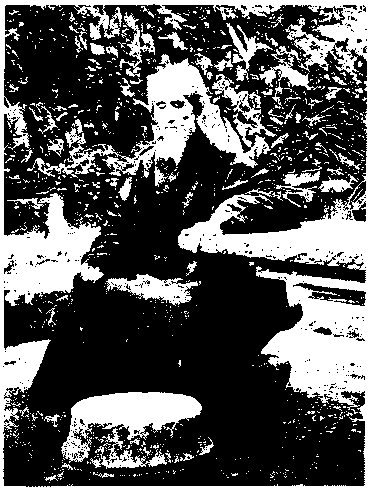



辛卯春摄於云门寺



才动眉毛，便是犯了祖师规矩。



云公法语



佛明敬录戒定慧



二　出家参方时期



公潜抵鼓山，礼妙莲长老出家后，自以生长富贵家中，非磨鍊不能除习气，迺行苦头陀行，不畜餘资，不存餘物，冬夏一衲，随身一笠，一拂，一铲，一绳床，恒处山岩树下，静坐观心，居无定址，饥则食青松毛，山草叶，渴则饮涧泉，乱发鬔松，见者骇走。清净自安，人不堪其苦也，如是者三年已二十二岁，闻天台华顶云镜老法师，道风高峻，诣谒之，师问：「来此何为？」公答：「生死未明，特来亲近。」师问：「做何工夫？」公答：「静坐念佛三年，不能明白。」师曰：「你将从前行持说与我听。」公将前情尽白，师曰：「观你作为，皆非正路，可惜数年辛苦。若来亲近我，要剃发穿衣，要吃饭，不要吃草，色力健康，才可办道。听则在此住，不听任去。」公受教，时镜清法师年已八十餘，精严戒律，宗教并通，观公语默，知为法器，初令习「天台教观」，并看「拖死尸是谁」话头，又令往国清寺参学「禅制」，至方广习「法华宝训」，至天童听「楞严宗通」，至阿育王寺拜舍利四藏，燃一指以报亲恩。



镜清法师验公践履，令参方去，公遂遍历诸山，参访毗陵天宁，清光长老，金山观心、大定、性林、诸师，焦山大水，宝华圣性，高旻朗慧，茅山朗月，宜兴显亲、仁智，杭州丰山天老人、西天目长松、会杨仁山居士於金陵，晤南岳海岸、默庵、诸公，乃回四明七塔寺听讲法华。



迩后公发愿朝山，东朝普陀，显现圣境，更发愿礼五台文殊，三步一拜，某日当由中岳下山，经铁卸渡黄河时，船泊岸，天已晚，遂於道旁一摆摊之小草棚中度宿，四无人烟，半夜大风雪，经三昼夜，来往无人，罔知所向，在棚中六日，饥寒甚，僵矣。及醒，见一丐者在旁，为之烤火煑黄米粥，令食，得煖气复生。问公何来，曰：「南海。」问何去，曰：「朝五台。」公问丐者贵姓名，曰：「姓文名吉。」问：「往何处？」曰：「来自长安，回五台去。」公问：「既是五台，寺中有来往否？」丐曰：「人皆识我。」公问：「此往五台，路经何处？」由孟县怀庆黄沙岭新州太谷太原省代州峨口即到山，若先到秘魔岩，此处有南方僧名清一者行持甚好，公问：「由此到山多少程？」丐曰：「二千零。」及至天晴，丐煑黄米粥，取雪代水，丐指釜中问：「南海有这个麼？」公曰「无。」丐曰：「吃甚麼？」公曰：「吃水。」釜中，雪溶后，丐指釜中水曰：「是甚麼？」公无语，丐曰：「你拜名山何求？」公曰：「生不见母，以报亲恩。」丐问：「你背负行李三步一拜，至多走二十餘里，那年能达！」公曰：「誓言早定，不问年月。」丐曰：「你愿难得，我助你成功，你的单行我代负，你可一心拜。」由是丐代办饮食，代负行李，日可拜四十餘里，直抵太谷县柏寺。寺僧不仁，反责丐者，丐曰：「由此至山，祇三百餘里，现今春深。我先回山，后此单行，有人代你负。」留之不得；酬以金，不受，曰：「到山再会。」越日公自独行至太原途中，遇乘马车贵官，湘人也，任武职，见公礼拜，感而问之，愿将行李代送至峨口白云寺，不多日，公到峨口，官甚敬信优待，送旅费，及差人送物件伴公至显通寺，公朝山进香，於各寺遍询丐者文吉无有知者，某老僧谓公曰、其文殊菩萨接引乎，公顶礼谢。



礼五台后，往西岳华山，至终南与觉朗，法性，冶开，法忍，诸公，结庵竟，公又西礼峨眉，於宝光寺，参真应上人，至武昌洪山参摩老和尚，授大悲法，於庐山参志老和尚，精究念佛，与自慧持力等於慈谿金山寺温州头陀寺，伴谛闲老法师分座讲经，於九华山参宝武和尚，与普照月霞印莲等结茅於九华翠峰，习贤首宗，研究华严。



杨州高旻寺，住持月朗到九华，称今年高旻有朱施主法事，连旧日四七共打十二个七，赤山法老人已回寺，仰诸位护持常住，都请回山，将届期，公下山，先至大通，荻港后，又沿江行，遇水涨，欲渡，舟子索钱六枚，公不名一钱，舟人迳鼓掉去，公又行，忽失足堕水，浮沉一昼夜，流至采石矶附近，渔者网得之，唤宝积寺僧认之，僧固赤山同住者，惊曰、此德清师也，畀至寺，救苏，然口鼻大小便诸孔流血，居数日，迳赴高旻，知事僧见公容瘁，问有病否，公曰无，乃谒月朗和尚。询山中事后，即请代职，公概不允，又不言堕水事，祇求在堂中打七，高旻家风严峻，如请职事拒不就者，视为慢众，於是表堂，打香板，公顺受不语，而病益加剧，血流不止，且小便滴精，公以死为待，在禅堂中昼夜精勤，澄清一念，不知身是何物，经二十餘日，众病顿愈，旋采石矶住持德岸送衣物来供师，见公容光焕发，大忻慰，乃举公堕水事告众，皆钦叹，禅堂内职不令公轮值，得便修行，从此万念顿息，工夫「落堂」昼夜如一，行动如飞，一夕，夜放晚香时，开目一看，忽见大光明如同白昼，内外洞澈，隔垣见香灯师小解，又见西单师在圊中，远及河中行船，两岸树木种种色色，悉皆了见，是时才鸣三板耳，翌日询问香灯及西单，果然，公知是境，不以为异，至腊月八七，第三晚，六枝香开静时，护七例冲开水，溅公手上，茶杯堕地，一声破碎，顿断疑根，庆快平生，如从梦醒，自念出家漂泊十数年，於黄河茅棚，被个俗汉一问，不知水是甚麼，若果当时蹋翻锅灶，看文吉有何言语，此次若不堕水大病，若不遇顺摄逆摄知识教化，几乎错过一生。那有今朝，因述偈曰：



杯子扑落地　响声明沥沥  

虚空粉碎也　狂心当下息



又偈：



荡著手　打碎杯　家破人亡语难开  

春到花香处处秀　山河大地是如来



三　隐居终南时期



公开悟后，深自韬晦，离高旻至焦山伴通智法师，讲楞严后，隐，铜官山结茅庵，同道知之往来日众，公厌之，拟再赴五台，时值光绪二十六年庚子八国联军入京，两宫蒙尘，公随驾同行，王公贵胄，多有相识，至西安道上，知前途益难，乃折赴终南山於章嘉五台后山狮子岩地方，结茅居焉，恐人迹之至也，改名「虚云」。岩高乏水，往返数里，乃得涓滴，恃自种乾芋，及野菜为食，时有老宿青山者湘人也，结茅后山，时与公往来。次年八月复成月霞戒尘三师至庵，一见异曰、几年不知你消息，谁知你睡在这里，公招待之，住破石山，月霞曰、赤山老人厌烦，要来北地，令我们来寻地方，你可伴往，公却之，次年法老人抵陕，结茅翠微山，月霞与体安在兴善寺办学，公独住茅蓬，时与青山及二三禅友往来，际严冬，雪将封山，公一日煑芋於釜中未熟，即趺跏静坐以待，不觉定下，殆雪解，隣山僧造公贺年，见门外虎迹遍满。进棚视之，久乃以磬开静，问食否，公曰适炊未熟，揭釜视之，则霉高寸许，度逾半月矣，自是每坐数日为恒，远近闻其事，多诣候，公厌酬答，又遁。



四　西南弘化时期



公离终南至太白山住数月，发愿入川礼峨眉，毕，经康边入西藏，见藏边僧不严戒律，遂由藏回滇，礼鸡足山，迦叶尊者道场也，介乎滇缅之间，相传数百年前，有三百六十庵，七十二大寺，今则仅存子孙庙十餘，全失僧规，山周四五百里，非山中子孙者不得住，公以迦叶道场至此，悲念生焉，乃回昆明闭关於福兴寺，至光绪二十九年癸卯，笻竹寺梦佛住持请讲楞严经，大理提督张松林请於大理三塔寺讲法华，传戒毕，皈依者数千人，李提督福兴欲留住崇圣寺，公曰吾不住城市，早有愿在鸡山挂单，而山上子孙不许，今诸位护法，能为图一片地，愿开单接众，以挽救滇中僧众，恢复迦叶道场，此衲所愿也，众称善，乃令宾川县知县办理，於山中觅得一破院，名钵盂庵，居之，虽住无房屋，餐无宿粮，然十方四众来者皆礼接之，嗣往腾冲募化，住湖南会馆，行单未卸，有穿孝服者数人来叩礼，云请和尚念经，公曰我非应赴经僧，孝子曰、为你们和尚念，公曰、此地听说无和尚，会馆首事人为之释曰、大师要去念经，事甚巧合，今日来者，为吴太史之孙曾，太史平生，修持甚谨，数十年间，皆称吴老太爷为善人，今寿八十餘矣，儿孙数十人，膺孝廉科者数人，秀士更多，日前去世时，自言是和尚，遗嘱以僧衣殓，不许哭泣，不许杀牲，不许请师巫诵经，并谓将有高僧来为之超度，盘膝坐脱，经日面目如生，今日师来，得非缘法，公许之，到其家诵经，放施食七日，阖邑官绅士庶咸来随喜，愿皈依者又千餘人，官绅拟留公住腾越，公曰，我为修鸡足山，来此募化，不能住也，众皆欢喜，踊跃乐捐鉅款，公回山备粮，建造房屋，立定规约，坐香讲经，重振律仪，传受戒法，是年春四众求戒者七百餘人，遂感老粟开优昙钵花之异，至是山中诸寺，亦渐改革，着僧衣，吃素菜，且上殿挂单矣。



初、公以重修鸡足诸寺，工鉅费多，亲往南洋募化，先到槟榔屿，礼妙莲本师，讲法华经，每一坐数日，妙老曰、南洋炎热，久定恐戕色身，而公不觉也，洎至暹罗始住数月，募缘少应，公遂挂单某寺中，踞坐蒲团，一定九日，似死非死，端坐屹然，哄动暹京，自国王大臣以及士庶，咸来瞻礼罗拜，暹王具威仪，请公入王宫诵经，遂得鉅金汇回滇中，重新鸡足山各寺，於此知公得力禅定，有不可思议者。



公自暹往吉隆坡灵山寺讲经时，接京沪滇道友来信，谓政府遍提庙产，求免未准，请公赴沪，会同挽救。公乃决定沿途考查佛寺现状，自星洲往台湾转日本，归途至沪，约寄禅和尚（即八指头陀）赴京上诉，因庚子之役，公随驾往西安时，与王公大臣相契者多，共为护持。



光绪三十二年　月　日，上谕，前因筹办捐款，叠颁谕旨，不准巧立名目，苛扰贫民，近闻各省办理学堂工厂，诸多苛扰，甚至捐及方外，殊属不成事体，着各该督抚，饬令地方官，凡有大小寺院，及一切僧众产业，一律由地方官保护，不准刁绅蠹役，藉端滋扰，至地方要政，亦不得勒捐庙产，以端政体，钦此。



自此谕颁后，各省提寺产之风，遂告平息。



公驻锡京师，商诸护法，以清朝来於云南地方未有颁发龙藏，似应奏请颁藏经全部，法惠遐陬，旋由肃亲王发起，总管内务府大臣奏曰：



为请旨事，据僧录司掌印僧人法安禀明云南省大理府宾川县鸡足山钵盂峰迎祥寺住持僧人虚云呈称本寺系为名山古刹道场，缺少藏经，愿欲请领龙藏一份，永远供奉，查此山者即迦叶尊者胜会，其寺实属古刹，请领龙藏，为崇佛法，经民政部尚书肃，柏林寺住持澄海，龙兴寺住持道兴等加结前来，谨据情奏请，如蒙谕允，应由臣衙门传知僧录司，转饬办理，为此谨奏，请旨光绪三十二年六月六日准奏，朱批奉旨依议钦此。



公道布滇中，声闻上国，王公华胄，倍致钦崇，光绪三十二年七月二十日皇恩勅赐上谕，云南鸡足山钵盂峰迎祥寺加赠名护国祝圣禅寺，钦赐龙藏，銮驾全副。钦命方丈，御赐紫衣钵具，钦赐玉印，锡杖如意，封赐住持虚云佛慈洪法大师之号，奉旨回山传戒护国佑民，内务府大臣传知虚云谨领各件回山，永镇山门，善为布教，地方官民，一体虔奉，加意保护，毋得轻亵，此谕，光绪三十二年七月二十日。



公迎藏经回滇，恭敬布化，地方官吏士民，日益钦仰，贩夫妇孺莫不知有虚云老和尚者，辛亥革命，清帝逊位，各省逐僧毁寺风动一时，时滇省掌新军兵柄者为协统李根源，恶诸方僧徒不守戒律，将亲督队伍赴诸山逐僧拆寺，又忖公以一穷和尚，何以得民心如此其盛，必有怪事，指名捕之，祸将不测，诸寺僧皆逃窜，即公寺内僧百餘人，亦皆惶惧，有劝公避者，公曰、诸君欲去则去耳，如属业报，避何益，以身殉佛耳，众遂不去，数日后，李协统根源果率兵入山，驻军悉檀寺，毁金顶鸡足大王铜像，及佛殿，诸天殿，公以事急矣，乃独自下山，诣军门，出名刺请谒，守兵及阍者识公告以速逃，祸将及，抵死不为通，公不顾迳入，见李根源，与前四川布政使赵藩同坐殿内，公前致礼，李不顾，赵与公有旧，劳之，问公从来，公陈述惟谨，时李怒形於色。厉声问曰：「佛教何用，有何益？」公曰：「圣人设教，总以济世利民，语其初基，则为善去恶……从古政教并行，政以齐民，教以化民，……佛教教人治心，心为万物之本，本得其正，万物得以宁，而天下太平。」李色稍霁。又问曰：「要这泥雕木塑作麼，空费钱财。」公曰：「佛言法相，相以表法，不以相表，於法不张，令人起敬畏之心耳。人心若无敬畏，无恶不作，无作不恶，祸乱以成。即以世俗言尼山塑圣，丁兰刻木，中国各宗族祠堂，以及东西各国之铜像等，亦不过令人心有所皈，及起其敬信之忱，功效不可思议，语其极则，若见诸相非相，即见如来。」李略现悦容。呼左右具茶点来，李又曰：「祇如和尚勿能作好事，反作许多怪事，成为国家废物。」公曰：「和尚是通称，有圣凡之别，不能见一二不肖僧，而弃全僧，岂因一二不肖秀才，而骂孔子。即今先生统领兵弁，虽军纪严明，其亦一一皆如先生之聪明正直乎！海不弃鱼虾，所以为大，佛法以性为海无所不容，僧秉佛化，护持三宝，潜移默化，其用弥彰，非全废物也。」李色喜与公再谈，俄而笑逐颜开。俄而俯首致敬。於是留公晚斋，秉烛深谈，由因果分明，说到业网交织，由业果因缘，说到世界相续，众生相续，言愈畅而理愈深，李时以温语接公，时以容貌礼公，卒乃喟然太息曰，佛法广大如此。吾已杀僧毁寺，业重矣，奈何，公曰，此一时风气使然，非公之过，愿以后极力保护，则功德莫大矣。李公大悦，翌日即移住祝圣寺随公杂众僧中，蔬食数日，迨八月四日山中忽大现金光，自山顶至山麓，草木皆作黄金色，相传山中有三种光，一佛光，二银光，三金光，佛光连年皆有，银光与金光则自开山以来，仅数现耳，李益感动，执弟子礼，请公为鸡山总住持，乃引兵去，是役也非公至道苦行，岂易转其念於刹那间哉，无何，沪上佛教会以新定章制，略与诸方抵触，公北行至沪，与寄禅冶开诸公斡旋，於南京晤孙中山，商改订会章，事毕，复与寄禅同往北京晤袁世凯，寄禅坐脱於法源寺，公为料理，及护榇南归，回滇后晤蔡锷组织滇黔佛教会支部，又办佛学院，施医布教，种种事业，皆李为之周旋赞助，后此四十年中，李根源为法门外护，用力至多，说教谈禅，时有妙谛，今居然一老居士矣。



民国九年春，公建祝圣寺大殿成，滇督军唐继尧遣官入山迎公，宾川县备舆从，公却之，一笠，一蒲团，一铲，一背架，与其徒修圆徒行九百里，修圆於途购豆腐小钱二枚，公犹诫之，达昆明唐迎公住圆通寺，盛供张，公一一却之，唐曰吾有三大愿，待上人成之，一兴丛林，二启建水陆道场，三办大学，大学事吾自有人，上二事皆以属公，公曰，某兴祝圣已心劳力瘁，兴丛林无此精力，水陆则维时暂，但云栖寺僧无多，且路远，应在省召集，但须听约束，此其一，年来囹圄充满，寃抑之气，上干天和，请大赦，此其二，自启建道场日起，至圆满，全省禁屠，人皆茹素，此其三，唐曰，皆如约，遂集僧一百二十人，假忠烈寺设坛，开经之日，大小烛炱，尽现莲花，缁素欣悦，圆满之日，空中现宝盖幢旛无数，全城目覩，罗拜於地，唐督自是举家皈依三宝，对公执弟子礼，后九载，九建水陆道场，皆有瑞应，公曰，讲经法会，感化者止於听经人，若夫水陆，不可思议矣，年来滇省土匪蠭起，为之魁者，曰黄天福，吴学显，大赦后，遣人招抚，俱归顺，西山云栖寺城外古刹也，西人爱其风景，已订约租地毁寺，得公一言而废约赎回，唐与王九龄张松仙再三礼请公重兴云栖，三请乃受帖，初至云栖之日，荒废已甚，公手胼足胝，苦心焦虑，竭数年之精力，以兴云栖，金碧嵯峨，遂为全省佛寺之冠，公初修建云栖时，将庙产次第赎回，时以地价日昂，朋兴怨讟，居数年，山中树木充满，公约居民共伐之，各得其半，民稍德之，未几省垣构兵，附近村庄多被扰，第不敢刦公寺，居民避寺者数千人，得免刦掠，始则饭，不足则粥，米尽代以菜，又尽，食糠，公率僧从同食，数千人泣下，不独旧怨顿消，且戴公如活佛矣，后公自鼓山回滇，由昆明至云栖，数十里香花夹道，皆向之怨家也。



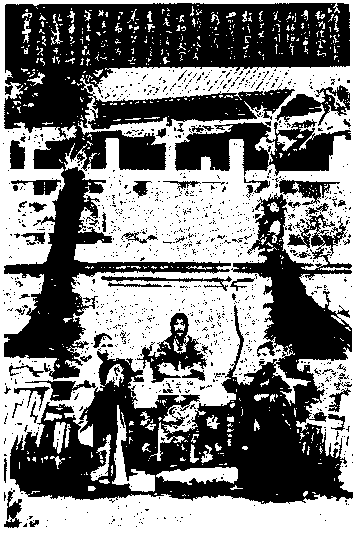



云栖寺既落成於金马碧鸡间，於民国十五年，丙寅暮春，传戒，十方缁素云集，阿阇黎正登千佛台代佛宣扬菩萨心地戒，殿外古梅二树，忽生千叶白莲花数朵，后遍树身生花，大如盂，微妙香洁，须如张盖，正惊异间，又报后园青菜地，所有青菜，尽涌青莲，现立化佛，一花一如来，万众欢腾，赞叹希有，滇人张拙仙孝廉为记，刊之石（图右）。



民国九年庚申秋滇军谋倒唐继尧，唐尚有劲旅二十餘团拟备战，以敬信公故，诣寺就决，公劝之，暂避兵戈，以俟异日，唐纳公言，逊让，过越南至香港居年餘，滇省大旱，自秋至春不雨，喉疫大作，死无数，乱起，军民大怨，相率请唐复任，唐既回，请公祷雨，坛毕，雨大降，而喉疫不止，唐曰，闻雪能止喉疫，今暮春矣，何得雪，公竭诚求祷，越日下雪数尺，喉疫顿止，滇人称公为药王菩萨云。



公於滇中弘法度生外，有数事弭巨患於无形者，略举如次：



（一）宣统末年，宾川县知县张某长沙人，精悍喜事，宾川多盗，张穷治之，杀戮甚众，而燄益张，且结党会，士绅为保家计，时挂名会籍求免，张亦穷治之，鸡山僧不法者亦系捕数十人，独於公加以敬礼，辛亥革命事起宾川先响应，群攻县署，张坚守，无外援，度必死，公下山诣县，围者见公来曰：「此张某恶极矣，公诱之出杀之，以平众忿。」公唯唯，及见群众中魁首语如前，公曰，杀张某不难，但边地谣传，大事未定。汝等围城戕官，倘有一枝救兵来，汝等赍粉矣，魁曰奈何，公曰，吾闻大理距此仅二日程，前四川布政使王公衔命至彼汝等往诉其罪，则张死於法而汝等亦无罪，魁韪之，顿兵署外，公入署见张，佩枪将出应敌，见公握手曰，吾赴义，将以遗骸累公，为我於鸡足山，覆一坏土足矣，公曰毋然，此间士绅以张静轩得人望，请来，静轩至，议竟，群众果退，静轩诣大理晤王公以兵至，围遂解，张去县，滇已独立，蔡锷任滇都督，张子某为外交司长，锷同学也，事后，张以缄告公谢曰，公非独救吾生，且造福宾川，不然，杀父之讐，吾子能不报哉，此一事也，尤要者。



（二）民国成立，西藏王公活佛，悖险远，不肯易帜，中央命滇出兵二师讨之，以殷叔桓为总司令，前锋已达宾川，公以边衅一启，祸无宁日，乃偕前锋同至大理，晤殷公曰，藏人素来信佛法，盍遣一明佛理者往说之，不劳兵也，殷以为然，乃请公为宣慰法师，公曰，某汉人也，往恐无功，此去丽川有喇嘛东保者，腊高有德，藏人敬信，曾授四宝法王，彼往事必有成，殷乃备文派员陪公谒东保，保始以衰老辞，公曰赵尔丰用兵之祸，藏人至今寒心，公宁惜三寸舌，而残数千万人生命财产乎，保立起谢曰，我去我去，保受命，以老僧法悟副之，入藏，要约而还，滇遂罢兵，民国成统一之局，频岁康藏间互相龃龉，苦战不休，经此沟通，三十年相安无事。



公於滇缅之间有一趣事，公旅暹日，定雕玉佛一尊，约三百餘斤，以程途远，顾八人舁之，所经山岭崎岖，凡数十日，有前人未经者，某日行至野人山，舁者疑玉佛中有金珠钞票，乃置佛地上，言力不胜举，要加价数倍，公慰勉之，更声势汹汹，似将不利者，公度不可理喻，瞥见道旁有一巨石，重约六七百斤，公怡然语舁夫曰，此石与玉佛孰重，众曰二三倍之，公两手举石，离地尺许，群咋舌，乃婉谢曰，老和尚活佛也，不敢言，舁佛至山，公厚赏之，公尝语人，谓自力不及此，似有神助云。然编者曾於云门山寺见工人重竖古石碑，四人力不及，将覆压，危甚，公以背承之，碑乃中，众皆咋舌。



五　弘化东南时期



公弘法西南二十年，佛宇重兴，僧习丕变，外感国王，内感将帅，使千里之内，闻法归心，千里之外，望风景仰，而於薙染初地，时复关怀，每自京沪南行，亦必一礼祖庭，图报本愿。



福州鼓山涌泉寺，海内名刹也，历史悠远，殿宇千重，为闽邦第一名胜，以其历史远，而僧习漓，以其风景优，而雅俗混，降及近代，益成为赖佛图生者所归，香客众多，又成为裨贩如来之利薮，受戒后为名字比丘，捐金若干，即尊为首座，坐享尊荣，次者为知客，亦可多润衬钱，遂至列名首座者百餘人，而知客僧亦八九十人矣，此中外丛林所无者，公悲悯之，莫如何也，会国民政府主席林森海军总司令杨树庄方声涛等回里，思整顿鼓山，非公莫属，前后函电往复多次，公始应之，迺於民国十八年己巳某月公重回鼓山，除重砌古石渠，营葺院宇诸事外，公所注意者，二事，



一、鼓山经板最多，为海内外所无者，如苏东坡为金山寺所写楞伽经，无一懈笔，每字必带笔一二圈，为东坡一生杰作，北宋椠，藏之金山寺，鼓山得初搨本，募精工寿枣梨，与金山本不辨，其餘明代所椠各经，亦至丰富，积於经坊败架若干岁矣，时粤东有老居士名张寿波者，从公薙染，公即以整理经板事属之，三年乃编补就绪，著有鼓山经藏目录记，及整理经过，千百部精妙经板，赖以保存。



（附观本法师出家事略）师俗姓张，名寿波，号玉涛，广东香山县人，家富有，中式，光绪十七年辛卯乡试第七名举人，年才二十四耳，少年科第，籍甚声华，讲求维新，东渡日本，为横滨大同学校校长多年，壮岁知有出世事，深研佛典，即以其丰裕家产，改为功德林，民国九年，遣其独子依微军老和尚薙度，未几卒，师以母老，不欲远离，至民国十九年庚午，太夫人弃养，师遂赴鼓山依云公出家，薙染法名明一号观本，年六十三矣，请曰：「弟子己事未明，不能放下，乞开示。」云公曰：「我平时教人放下，但是教你不要放下，且要挑起来。你本是富贵中人，已舍弃了，有一独子，早令出家，死了，家财尽舍作佛事了，你今日又舍身出家了，已经一切放下了，还有甚麼放不下的。你要挑起来，乃能担荷如来大事啊。」师泣涕受教，云公遂以编整鼓山宗图，及经板事属之，鼓山晚代祖师传记，多为中藏本所无，而日本大正续藏所有，赴沪上，晤岑学吕，访大正续藏，岑转语叶恭绰，叶曰，日续藏千卷，十餘箱，才寄到两月，尚未启，如云公需此，举以赠之，师得此，乃为鼓山增补各祖师传记，迨云公赴南华，师为首座，助力甚多，至民国三十四年抗战胜利，云公嘱师回粤拟接住持六榕，师病不起，至腊月初六日西归，世寿七十八，僧腊十六，前后男女弟子皈依者万人，执绋者道为之塞，荼毗得舍利无数，著述甚富，有香光阁集二十卷待刊。



二、鼓山习气浓厚，经忏事繁，公住持后，除旧布新，首座百餘人，悉取消之，仅用知客僧八人，前日禅堂只坐三枝香，公增为十四枝，一切规模，取法金山寺，故诸方老参云集，礼请某老宿为首座，请金山霞后堂主持禅堂，请苏州灵岩慈舟法师主律院，慈法师深究律宗，宏扬净土，皆巍然法门龙象也，又创办佛学社，以造就年青学子，旧日寺中经忏，每於佛殿中建台，以壮观瞻，俗乐与梵音杂奏，白衣偕缁衲同嬉，公以佛殿建台违制，俗乐非古乱声，悉禁革之，而世俗斋主好外观者，以为不闹热也，往往去之他，僧众多不乐，公独喜曰，今而后乃得谓清净佛土矣，公住持数年，成就僧伽至众，门风重肃，海内知识，以鼓山与金山高旻鼎立而三，八十老翁，其毅力有如此者。



民国二十三年甲戌春二月某夕，公於趺坐中，似梦非梦之际，见六祖大师至，语公曰，时至矣，汝当回去，翌日公告其付法弟子观本曰，吾世缘其不久乎，昨梦六祖召回去，观本以幻境慰之，岂知此一梦也，为后此二十年弘化岭南之始念。



六　弘化岭南时期



当民国七年戊午，李根源督办韶州军务，略修南华祖殿，书至滇，请公赴粤主持，公谢却之，十七年戊辰，公与王九龄过港，粤省主席陈铭枢，邀至穗垣，请主持南华，公以先应鼓山约，又谢却之，至民国二十三年甲戌四月，粤僧敬禅之清福果参礼鼓山，力向公言南华祖庭倾圮，宗风衰落，请公赴粤中兴，公意未决，忽一夜，连获三梦六祖，唤来南华，次日向诸人敍述梦缘，叹为希有。



先於本年二三月间，广东西北区绥靖主任李汉魂，拟修南华，商之粤中耆宿，当地士绅，佥以南华为禅宗发源地，非得龙象，莫能住持，咸推举公，乃函电邀约，及联同粤港佛教会同人派员诣鼓山迎请，公约以数事，李等皆称如约，遂解鼓山职，赴粤时正民国二十三年八月二日祖师诞也，道经港粤，士民欢迎者数万人，既抵寺观察，除祖殿及灵照塔与苏程庵外，均残垣败宇，荆棘蒿莱，目不忍覩，非掀翻重建，不足畅祖源而裕后昆，若作成次第如法，亦非数年工程，及数十万金不办，今初至此，不独四事俱无，即门屏，几棹，卧具，碗箸，而亦无之，他人处此，无不爽然漠然矣，公秉祖师之命，信念之坚，於不名一钱当中，即日将南华寺改作十方丛林，重悬钟板，接待诸方，一方面和合官绅便利制置，同时函令南洋四众弟子尽力匡扶，（不发捐册随缘乐助）於是一年二年三年四年五年以至十年，成就者十大事。一、更改河流，二、全寺改向，三、培高山脉，四、建设殿堂，五、驱逐流棍，六、清丈界址，七、增置产业，八、重申戒律，九、创立禅堂，十、传戒设学，於此十事，次第完成，此十年中，辛苦艰难，有不堪为外人告者，公坚忍为之，今日成为广东全省第一大丛林，其大雄宝殿建筑之宏敞，与杭州灵隐相埒，其佛像庄严伟大，与穗垣大佛无殊，兹略述其大概，自曹溪门至九龙泉，由南至北深一百五十一丈，由东边寺墙，至西禅堂壁，广三十九丈，十年中陆续重新建筑，殿堂房宇庵塔二百四十三间，塑造大小及两序佛菩萨像六百九十尊，金碧嵯峨，庄严伟丽叹观止矣，然其中一瓦一椽，一木一石，无不由公心力血汗所形成，请读「公撰重兴曹溪六祖道场记」（附见文献篇中。）



公重兴南华，其境困，其愿宏，其心苦，而其成就至大，其所感之瑞应亦至多，寻常得一二事，已足哄动世人，而公禁揑怪，谓倘事宣扬，如南岳所谓人将妖我矣，门弟子偶记其异，或寿之金石，或付之梨枣，於民国三十三年四月南华弟子曾刊「虚云老和尚事迹」一册，兹别录数事如下：



民国二十四年春，启建道场，四众云集，达官贵人多来随喜，有带兵弁者，某夜入坛时，江孔殷之子叔颖时立藏经楼上，首先发见曹溪门外有两道电光，近视之，虎也，哗然，兵弁正拟发鎗，公骤至止之，虎伏阶下，公为之行三皈依，嘱其隐深山，毋伤人，虎三叩首去，廻视犹恋恋，以后每年必出巡一二次，山猪野兽绝迹，偶闻虎啸声，公即出，善慰遣之，此老虎皈依之异。



乙亥冬期传戒，受戒者数百人，憨山以后，冷落数百年之祖庭，忽欣欣有生意，物亦感之，寺后九龙泉畔有宋代所植参天老柏三株，其一上段已枯折，其二杈枒摇落，不知几经年矣，冬月寒枝，忽发嫩叶，次第向荣，首座观本法师为长歌纪之：中有「君不见宝林山下九龙泉，流泽涓涓遍大千，曹溪一滴成漪涟，又不见一花五叶无根树，普荫人天春妪煦，葛藤岂落有无句……南华老柏半心空，寒枝百尺凌苍穹，中有三株生意尽，屹然榴杌将无同，今冬忽作欣欣意，枝柯萌蘖还青葱，如是新条占瑞应，勉哉兰桂当印证，万物一体原同根，集枯集苑何曾定。」全歌长六百餘字，岑学吕为记书丹，谢贲生篆额，刊石植南华碑林，此枯柏重生之瑞。



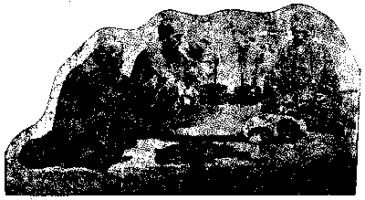



虚云老人为白狐说戒，赐名「向善」，白狐俯首恭听之情状。



民国二十五年丙子，防军团长林赓，槛送一白狐来，毛如雪，尾修然，谓其友某甲自白云山猎得，柙之家，忽遭奇厄，梦老人嘱送南华，今槛来，公见而纳之，为狐说三皈五戒，纵之后山林麓中，而时就寺求食，自受戒法，即不食肉，喜果饵，修寺工匠，戏以肉搀蔬果中，狐觉哇之，怒目爪匠，若怼其相欺者，一日为乡人逐，猱升十餘丈树上，抱枝长嘷，云公出视，狐跃下，揽衣袂，驯若佛貍，随公归寺，不复出矣。一日蒋中正忽莅寺，衞弁十餘随行，先不关白，至曹溪门见白狐，弁拟举枪，蒋制止，狐摇首掉尾，导蒋前行至大殿中，即飞跑至方丈啣公衣下楼，与蒋会晤，具说因缘，均大笑，狐每见云公坐，即伏禅榻上，见公闭目坐久，时捋公须以为戏，公开目视之，辄谓汝有灵性，勿再野也，此白狐皈依之异。



壬午春传戒忽有一行者，来求授比丘戒，问其姓张氏，问其籍曲江，问其年不知，问其剃度何师，衣单所备无有也，众鉴其诚，许之，锡法名曰常辱，戒前服役甚勤，既进戒堂，事事如律，迨三坛圆满，梵网戒毕，（入坛时点名不许外出）忽失斯人，而袈裟仍在戒堂中，遍寻不获，久亦忘之，至癸未春戒，此僧忽来入梦，索领戒牒，问其何往，曰，与山门内土地同居耳，乃知为樟树神，为设供一堂，将原戒牒焚之，是树神求戒之异。



曹溪河流，本距寺前一百四十丈，年久失修，砂石冲积，水改向北，对寺门直射，此反弓格也，二十四年乙亥夏，云公勘定水线，计挑筑新河，填补旧河。全程八百四十餘丈，需用三千工人，所费甚鉅，正拟动工，乃於七月二十夜，雷雨大作，终宵如万马奔腾，及晓水涨堤平，冲开新河，一如所定界线，旧河已为砂石淤塞，且涌起数尺，反成寺前之一字案，此神改河流之异。



民国三十三年甲申夏，南华建水陆道场，前一月，山蜂倾巢而来，巨如拇指，先在法堂左右廊各营一巢，状如大殿灯笼，其组织工致，如图案水波纹，万千重叠，无丝毫出入，且具四色，至为美观，后又於曹溪门外大树上，结一巢，尤巨，蜂不螯人，且严纪律，是时四众咸集，均谓神蜂来朝佛也，及公由云门来主持道场事，往巡视之，时首座观本，知客惟因，居士林远凡岑学吕谢贲生等随行，公视良久曰，此人头蜂也。平时栖止於深山石岩中，都市所未易见者，今来此，其将有事乎，嘿然迳去，是夕语岑曰，四方蜂动矣，此间将被兵，然无大碍，苟有事，吾当派人迎汝，道场圆满，公回云门，至腊月十二，日寇陷曲江，十八将入夜，土匪觊觎避兵客富，遂刦南华，匪徒运财物出寺，不及半句钟，由云门派来接岑之僧已踵至矣，公於格物前知者又如此。



抗战胜利，日寇称降，次年为民国三十五年丙戌，政府通令全国寺院唪经，追荐亡者，粤官绅士庶，联请公莅穗主法，於九月十七日在净慧寺设坛，寺内绯桃，忽然著花，重台璀璨，得未曾有，七日道场，随喜者数十万人曾璧山绣桃花古佛图胡毅生畫绯桃图卷，纪以诗，遍徵题咏，曰绯桃应瑞记。



民国三十七年戊子冬，有美国女士詹宁士者，慕公禅德，万里飞航，来华依止，事前已由中美两外交当局，接洽通知，公许之，女士遂专机由美航华，时公适在穗垣，詹晋谒，述修道原因，父为天主教神父，夫亦信教者，自己亦研究神教二十年，以其教不了义，遍历各国，访求佛义，后往印度闭关四年，有所得，惟疑而未决，今不远万里寻师云云，公遂挈之南华参六祖，皈依毕，赐法名宽弘，公为举禅七，四山来瞻礼者甚众，七始日，云公上堂开示曰：「若论个事，本自圆成，在圣不增，在凡不减，如来轮回六道，道道皆闻，观音流转十类，类类如是，既然如是，求个甚麼，觅他何来，祖师有云，才有是非，纷然失心，未挂船弦，正好吃捧，可怜哪，自家宝藏不开，却来茅房担草，这都是一念无明，狂心不死，所以捧头觅头，对水称渴，大德们，何苦来，何苦来，既不爱惜草鞋钱，我自不怕弄恶口，（振威一喝）释迦老子来也。」——参。诸方长老亦各有开示法语，公门下弟子有名乞士者，曾晤詹女士作如下问答，乞问：「大士远来重洋，多辛劳，为的甚麼？」詹答：「为学佛法。」乞问：「学佛必须了生脱死，大士生死分上，毕竟如何？」詹答：「本无生死，何用了脱。」乞问：「既无生死，何必学佛？」詹答：「本来无佛，学者是佛。」乞问：「佛具三十二相，足指按地，海印发光，大士能否？」詹答：「能与不能，皆是戏论。」乞问：「大士妙解，言言谛当。虽然如是，说食不饱。毕竟一句，又作麼生？」詹答：「毕竟无句，说亦本无。如不拉杂啰咤，没得思量的觉性，他就是万物之母。」乞问：「个事言之已详，句句合祖意。惟知之一字，众祸之门。大士既从解入，敢问离言绝句，如何是本来面目？」詹答：「金刚经云：阿耨多罗三藐三菩提，即非阿耨多罗三藐三菩提。」乞曰：「也似是，但命根不断，概属知见，希望大士发省。」詹曰：「我看经机会少，前以闭关四年，出关后与人语，人皆谓我说佛法。我言非从经得，似不尽属知见。」乞言：「不从经论，静坐中得，阐发夙慧，夙慧亦是知见。」詹问：「佛法重实证，不在知见，究竟如何？」乞曰：「不拘泥经论，不固执性相，头头是道，处处真理，勉强说『这个』亦是权。」詹女士复随云公赴云门，礼祖，住半月乃去，言回美国兴佛教云，初、詹女士以西方美人，研求东方极深奥之佛法，彼虽有所修证，而言语不通，幸其道经香港时，群推禅居士颜世亮伴之赴穗，又随云公赴南华，禅七中每次开示及答问等，皆赖颜居士翻译，识者谓不滥一词，不缺一义，恰到好处，以云公说法之精深，颜译言铨之妙旨，使詹以西方女士，而能领会圆宗，龙华未散，谛观谛观：於此足见公门下之龙象。



辛卯三月朔，公微感身体不适，止食，谈话多作遗嘱语，滴水粒米不进口者九日，初十日早，安详卧榻上亘一昼夜，侍者探鼻息，已全无矣，至十一日午刻，公微醒，侍者告以时间，公曰，我觉才数分钟耳，唤侍者法云至，曰，执笔为我记之，致函岑居士，嘱其勿轻与人说，启疑谤也，公从容言曰：「余顷梦至兜率内院，庄严瑰丽，非世间有。见弥勒菩萨，在座上说法，听者至众。其中有十餘人，系宿识者，即江西海会寺志善和尚，天台山镜融法师，岐山恒志公，百岁公，宝悟和尚，宝华山圣心和尚，读体律师，金山观心和尚，及紫柏尊者等。余合掌致敬，彼等指余坐东边头序第三空位。阿难尊者当维那，与余座靠近。听弥勒菩萨讲『唯心识定』未竟，弥勒指谓余曰：『你回去。』余曰：『弟子业障深重，不愿回去了。』弥勒曰：『你业缘未了，必须回去，以后再来。』并示偈曰：



『识智何分　波水一个  

莫昧瓶盆　金无厚薄  

性量三三　麻绳蜗角  

疑成弓影　病惟去惑  

凡身梦宅　幻无所著  

知幻即离　离幻即觉  

大觉圆明　镜鉴森罗  

空花凡圣　善恶安乐  

悲愿度生　梦境斯作  

刦业当头　警惕普觉  

苦海慈航　无生退却  

莲开泥水　端坐佛陀』



「以下还有多句，记不清了，尚另有开示，今不说。」此公最近境界也，虽嘱编者毋轻言，第思昔日憨山大师，亦尝梦游兜率，且大书特书於梦游集中，以其听弥勒所说偈：「有分别是识，无分别是智。依识染，依智净；染有生死，净无诸佛。」此数语度生不少，今公亲听弥勒说法示偈，并亲见宿德多人，境界至此，憨山不讳，公何讳耶，佛在世间，尚受诽谤，公又何嫌耶，编者欢喜赞叹，振笔书之，此公入佛境界之瑞。



公自披缁至今，已八十餘年，不住持现成寺院，不受人家丰腆供养，四众弟子，前后得戒度者万餘人，乞戒皈依者逾十万人，手兴大小梵刹数十，其宏丽者如云南云栖，其庄严者如粤北南华，均费百数十万银元，以现值计，几千万矣，公以一衲随身，一笠，一拂，一铲，一背架，行脚遍海内外，其建筑云栖寺，来也如是，去也如是，其重兴南华时，上山也如是，下山也如是，公於民国二十三年八月莅粤，至三十二年十二月将南华职务付弟子复仁主持，一笠，一拂，一铲，一背架，一衲随身，迳往乳源中兴云门寺，此为人人所共见者也。



公於今年届一百有六龄，世缘未尽，弥勒遣回，祝其再住世百年，或追踪宝掌和尚住世千年，弘法度生，无有穷尽，此皆四生所共祷者也，至中兴云门寺，见前后篇，兹不重述。



第二章　云公老和尚语录



一　法语



一、云门重新挂钟板



执搥云：「金钟乍起，堂开拈花遗风；木板敲来，僧秉百丈事业。禅宗即是心宗，心宗即是禅宗，所以动止云为，尽是遮那胜境；山河大地、无非性海微波、今仗佛恩祖德，重绍云门旧规，再振祖令。即今重悬钟板，一句作怎麼道？」良久云：「钟板重悬宏祖道，戒根定树慧花隆。」以槌击一板一钟。



二、元旦小参



「昨晚一众人等上方丈参请，一切都旧，头帽旧，衣履旧，袈裟旧，香炉烛台，乃至山光云影一切都旧。今朝上来，一切都新，头帽新，衣履新，袈裟新，香炉烛台新，乃至山光云影，一切俱新。在衲僧分上。有个不旧不新的，诸人当自知。但有时提得起，又放不下；有时放得下，又提不起。老僧今日不惜眉毛；提起放下，放下提起，活泼的在诸人面前。」乃击拂子云：「见麼。」



三、元旦示众



「玉户不出，尊客天然，才涉功勋，堕坑落堑，与其途中受用，何如金殿垂帘。直饶入林不动草，入水不动波，也是悬崖上走马！只如君臣道合，主宾回互，敲唱双行，水乳合同，又作怎生？」良久云：「九天阊阖开宫殿，万国衣冠拜冕旒。」



四、正月十五解制上堂



「十五日以前结起布袋头，收了拔地金刚，内不放出，外不放入，水泄不通，凡圣路绝。十五日以后，解开布袋口，放出搏天鹞子，一任南天台北五台，古庙里躱风雨，大悲院去赶斋。正当十五日，结也结他不住。放也放他不得，又作麼生？」良久云：「芍药花开菩萨面，茅庵烧掉老婆心。」



五、四月八佛诞日上堂



「今日是瞿昙老汉堕坑落堑纪念日，诸方升座，谈玄谈妙，说心说性，或夸天上天下惟我独尊，或指跛脚阿师贼后张弓，或全提半提，宗通说通。各展旗鎗，互相矛盾，总是依草附木，随邪逐恶。云门技俩都尽，口门又窄，不解谈玄谈妙，说心说性，也不解全提半提，宗通说通。只是稳首东日，高枕茅庵，衲被蒙茸万事休，此时山僧都不会。」



六、四月十五日结制



「三月安居，九旬结夏，正好尅究己躬，讨个下落，庶不负出家初志。从上老宿，说禅必有机锋问答，说教即有性相偏圆，说戒就有律仪规范，说净则究自性弥陀；皆是布缦天网，打凤罗龙，铸圣陶凡，不离当下。老僧今日举出，特为血性男儿，英灵衲子莫将有限身躯，造下无穷业海平空放下特地呈来从头一一分明，自己莫哄自己。随情逐意，触犯良朋，放旷心猿，伤风败教，因果不惧，野兽同群；因果不昧，立地解脱。凡所见闻，宜当珍重。」



七、七月十五解制



「九旬禁足，三月安居，圣制告圆，衲僧分上事作麼生看？灵山垂运慈悲，目连神通救母，幸得诸佛欢欣，赦拔冥中罪苦，且道千古闻名，如何取则？」僧问：「罪性本空，赦个甚麼？」云：「为有这个在！」进云：「恁麼则有罪也。」云：「有。」进云：「还许、忏悔也无？」打云：「寃家解脱。」问：「从天降下即不问，就地还乡事若何？」云：「寒岩枯木逢春秀。」进云：「正恁麼时如何？」云「带雪松枝色更新。」问：「如何是人中境？」云：「铁蛇横古路。」问：「如何是境中人？」云：「踏着两头忙。」进云：「人境俱忘时作麼生？」云：「脚根下好与三十棒。」乃云：「德山棒，临济喝，云门饼，雪峰杓，禾山打鼓，木人奏乐，人人有分，个个摸索，头角峥嵘，天清地浊，眼光掣电，口倾山岳，正恁麼时，如何注脚？」喝一喝云：「斩却南泉死猫头，救得赵州狗子活。」



八、中秋节上堂



中秋云散月空悬，海众同参问祖禅，赤脚头陀无个事，横拈白棒打疯癫。问：「牛头未见四祖时如何？」云：「世情偏向有钱家。」进云：「见后如何？」云：「仁义尽从贫处断。」进云：「即今𫆏。」打云：「莫妄想。」问：「参禅念佛，贵脱生死，生死到来，如何回避？」云「不用念佛参禅。」云：「不用念佛参禅，如何抵敌？」打云：「扶篱摸壁汉！」乃云：「今日中秋节，一轮光皎洁，自从威音来，古今无欠缺。」——会麼，



九、十月十五结冬



「今朝十月十五，云门搬柴挖土，东西南北高贤，都来同甘共苦，木人侧耳而听，石女怒目而覩，万象森罗点头，黧奴白牯起舞，惟有无位真人，依旧如愚若鲁。且道既是无位真人，那有闰餘成岁，寿命延促，巍巍堂堂，炜炜煌煌，离名离相，徧满十方，且道教人如何供养？——随分纳些些。」



一〇、冬至小参



「鲁史书五云，汉宫添一线、六阴剥落尽、一阳喜来生、天地否变作地天泰，小人道消、君子道长。诸兄弟未得个入头，须得个入头，已得个入头，亦须陆沉众中，不露圭角，过了五九四十五，春雷一震，——轰窿——跃过龙门，自然惊天动地去也。」



二　普说



这段大事，不是说了便休，所以中峰国师有云：「世界阔一尺，古镜阔一丈，还知蒲团上，一个呑不下，吐不出的无义味话头也未？若向这里一肩荷负得去，便可唤世界作古镜，唤古镜作世界；都无异致，如其未尔；世界与古镜；古镜与世界；相去不啻三千里，何以如此？盖能所分别；觌体障碍，便是生死根本。故楞严经云：『根尘同源，缚脱无二，识性虚妄，犹若空花。由尘发知，因根有相，相见无性，同於交芦。』这里无你动步处，无你着眼处。昔安楞严读到：『知见立知，即无明本；知见无见，斯即涅槃。』虽破句读之，其桶底子当下脱落，直得七穿八穴，洞见老瞿昙心肝五脏，只得唤古镜作世界，唤世界作古镜，洞澈森罗万象，混融大地山河，洗尽见尘，搅乾情浪，无第二念，无第二人，指南作北，敲东击西，死柴头上心花灿烂，冷灰堆里赤燄腾辉，安有一毫剩法与人为知解。近来佛法混滥，往往将根尘识妄，认作真心，说得宛然，了无交涉。谚云：『击石乃有火，不击原无烟，人学始知道，不学非自然。』」此说於做工夫上说得恰好。特为诸人重与注破石中有火。未曾施一毫智巧之力。终日只说石中有火，说到眼光落地，依前只是一块石头，要觅一星点火，了不可得，此是不肯死心做工夫，以求正悟。惟记相似言语，说禅说道者也。更有一等痴人。闻说石中有火，击碎其石，欲取其火。碎抹为尘。终不能得。却不自责。不以智巧求之。便乃不肯相信石中果有真火，此是不信自心是佛，反道佛法无灵验之凡夫也。此说且置，何为「智巧？」首以信根为石。次以无义昧话头为击石之手。又以坚固不退之志。作固火刀。用精勤猛勇不顾危亡之力。向动静闲忙中。敲之击之。使不间断。加上般若种性。乾柴一握。蓦劄相承。引起一星子延燎不已，直至三千世界化为燋焰。复何难哉。昔百丈令沩山拨火，沩拨之不得，丈躬拨得之，举谓沩曰：「你道无这个？」试问诸人，还识得百丈拨火的消息麼？其或未然，听取一偈：



十方世界火炉阔　冷灰堆里深深拨  

得一星儿血点红　今古从来无欠缺  

诸禅流　莫休歇  

燎却眉毛万丈光　若不如是遭冻杀



参去



三　参禅的先决条件



参禅的目的，在明心见性，就是要去掉自心的污染，实见自性的面目。染污就是妄想执著，自性就是如来智慧德相。如来智慧德相，为诸佛众生所同具，无二无别。若离了妄想执著，就证得自己的如来智慧德相，就是佛，否则就是众生。祇为你我从无量劫来，迷沦生死，染污久了，不能当下顿脱妄想，实见本性，所以要参禅。因此参禅的先决条件，就是除妄想。妄想如何除法？释迦牟尼佛说的很多，最简单的莫如「歇即菩提」一个「歇」字。禅宗由达摩祖师传来东土，到六祖后，禅风广播，震烁古今。但达摩祖师和六祖开示学人最紧要的话，莫若「屏息诸缘，一念不生。」屏息诸缘，就是万。缘。放。下。所以「万缘放下，一念不生。」这两句话，实在是参禅的先决条件。这两句话如果不做到，参禅不但是说没有成功，就是入门都不可能：盖万缘缠绕。念念生灭。你还谈得上参禅吗？



「万缘放下，一念不生」是参禅的先决条件，我们既然知道了，那末，如何才能做到呢？上焉者一念永歇，直至无生，顿证菩提，毫无罗索。其次则以理除事，了知自性，本来清净，烦恼菩提，生死涅槃，皆是假名，原不与我自性相干。事事物物，皆是梦幻泡影，我此四大色身，与山河大地，在自性中，如海中的浮沤一样，随起随灭，无碍本体。不应随一切幻事的生住异灭，而起欣厌取舍。通身放下，如死人一样。自然根尘识心消落，贪瞋痴爱泯灭。所有这身子的痛痒苦乐饥寒饱暖荣辱生死祸福吉凶毁誉得丧安危险夷，一概置之度外。这样才算放下，一放下一切放下，永永放下，叫作万缘放下。万缘放下了。妄想自消。分别不起。执著远离。至此一念不生。自性光明全体显露。至是参禅的条件具备了，再用功真参实究，明心见性才有分！



四　参禅法要



日来常有禅人来问话。夫法本无法，一落言诠，即非实义。了此一心，本来是佛，直下无事。各各现成，说修说证，都是魔话。达摩东来，「直指人心，见性成佛。」明明白白指示：大地一切众生都是佛，直下认得此清净自性，随顺无染，二六时中，行住坐卧，心都无异，就是现成的佛，不须用心用力，更不要有作有为，不劳纤毫言说思惟。所以说：成佛是最容易的事，最自在的事，而且操之在我，不假外求。大地一切众生，如果不甘长劫轮转於四生六道，永沉苦海，而愿成佛，常乐我净，谛信佛祖诚言，放下一切，善恶都莫思量。个个可以立地成佛。诸佛菩萨及历代祖师，发愿度尽一切众生，不是无凭无据，空发大愿，空讲大话的。



上来所说，法尔如此，且经佛祖反覆阐明，叮咛嘱咐，真语实语，并无丝毫虚诳！无奈大地一切众生，从无量劫来，迷沦生死苦海，头出头没，轮转不已，迷惑颠倒，背觉合尘犹如精金投入粪坑，不惟不得受用，而且染污不堪！佛以大慈悲，不得已，说出八万四千法门，俾各色各样根器不同的众生，用来对治贪瞋痴爱等八万四千习气毛病。犹如精金染上了各种污垢，乃教你用铲用刷用水用布等来洗刷琢抹一样。所以佛说的法，门门都是妙法，都可以了生死，成佛道，只有当机不当机的问题，不必强分法门的高下。流传中国最普通的法门为宗教律净密。这五种法门，随各人的根性和兴趣，任行一门都可以，总在一门深入，历久不变，就可以成就。



宗门主参禅，参禅在「明心见性。」就是要参透自己的本来面目，所谓「明悟自心，澈见本性。」这个法门，自佛拈花起，至达摩祖师传来东土以后，下手工夫，屡有变迁！在唐宋以前的禅德，多是由一言半句，就悟道了，师徒间的传授，不过以心印心，并没有什麽实法。平日参问酧答，也不过随方解缚，因病与药而已。宋代以后，人们的根器陋劣了，讲了做不到，譬如说「放下一切」，「善恶莫思」，但总是放不下，不是思善，就是思恶，到了这个时候，祖师们不得已，采取以毒攻毒的办法，教学人参公案，或是看话头，甚至於要咬定一个死话头，教你咬得紧紧，刹那不要放松，如老鼠啃棺材相似，咬定一处，不通不止，目的在以一念抵制万念，这实在是不得已的办法！如恶毒在身，非开刀疗治，难以生效！古人的公案多得很，后来专讲看话头。有的「看拖死尸的是谁？」有的「看父母未生以前，如何是我本来面目？」晚近诸方多用「看念佛是谁？」这一话头其实都是一样，都很平常，并无奇特。如果你要说：看念经的是谁？看持咒的是谁？看拜佛的是谁？看吃饭的是谁？看穿衣的是谁？看走路的是谁？看睡觉的是谁？都是一个样子。谁字下的答案，就是心，话从心起，心是话之头；念从心起，心是念之头；万法皆从心生，心是万法之头。其实话头，即是念头，念之前头就是心。直言之，一念未生以前就是话头由此你我知道，看话头就是观心。父母未生以前的本来面目就是心，看父母未生以前的本来面目，就是观心。性即是心，「反闻闻自性」即是反观观自心。「圆照清净觉相」，清净觉相即是心，照即观也，心即是佛，念佛即是观佛，观佛即是观心。所以说「看话头」，或者是说「看念佛是谁？」就是观心，即是观照自心清净觉体，即是观照自性佛。心即性，即觉，即佛。无有形相方所，了不可得，清净本然，周徧法界，不出不入。无往无来，就是本来现成的清净法身佛。行人都摄六根。从一念始生之处看去，照顾此一话头，看到离念的清净自心，再绵绵密密，恬恬淡淡，寂而照之，直下五蕴皆空，身心俱寂，了无一事。从此昼夜六时，行住坐卧，如如不动，日久功深，见性成佛，苦厄。度。尽！昔高峰祖师云：「学者能看个话头，如投一片瓦块在万丈深潭，直下落底，若七日不得开悟，当截取老僧头去？」同参们！这是过来人的话，是真语实语，不是骗人的诳语啊！



然而为什麽现代的人，看话头的多，而悟道的人没有几个呢？这个由於现代的人，根器不及古人，亦由学者对参禅看话头的理路，多是没有摸清！有的人东参西访，南奔北走，结果闹到老，对一个话头还没有弄明白！不知什麽是话头？如何才算看话头？一生总是执着言句名相，在话尾上用心，「看念佛是谁」呀！「照顾话头」呀！看来看去，参来参去，与话头东西背驰！那里会悟此本然的无为大道呢！如何到得这一切不受的正位上去呢！金屑放在眼里，眼只有瞎，那里会放大光明呀！可怜啊！可怜啊。好好的儿女，离家学道，志愿非凡，结果空劳一场！殊可悲悯！古人云：「宁可千年不悟，不可一日错路！」修行悟道，易亦难！难亦易！如开电灯一样，会则弹指之间，大放光明，万年之黑暗顿除，不会则机坏灯毁，烦恼转增！有些参禅看话头的人，著魔发狂，吐血罹病，无明火大，人我见深，不是很显著的例子吗？所以用功的人，又要善於调和身心，务须心平气和，无罣无碍，无我无人，行住坐卧，妙合玄机。



参禅这一法，本来无可分别，但做起功夫来，初参有初参的难易，老参有老参的难易。初参的难处在什麽地方呢？身心不纯熟，门路找不清，功夫用不上，不是心中着急，就是打盹度日。结果成为「头年初参，二年老参，三年不参」。易的地方是什麽呢？只要具足一个信心，长永心和无心。所谓信心者，第一信我此心，本来是佛，与十方三世诸佛众生无异；第二信释迦牟尼佛说的法，法法都可以了生死，成佛道。所谓长永心者，就是选定一法，终生行之，乃至来生又来生，都如此行持。参禅的总是如此参去，念佛的总是如此念去，持咒的总是如此持去，学教的总是从闻思修行去。任修何种法门，总以戒为根本，果能如是做去，将来没有不成的。沩山老人说：「若有人能行此法，三生若能不退，佛阶决定可期。」又永嘉老人说：「若将妄语诳众生，永堕拔舌尘沙劫！」所谓无心者，就是放下一切，如死人一般，终日随众起倒，不再起一点分别执著，成为一个无心道人。初发心人，具足了这三心，若是参禅看话头，就「看念佛是谁？」你自己默念几声「阿弥陀佛」，看这念佛的是谁？这一念是从何处起的？当知这一念不是从我口中起的，也不是从我肉身起的，若是从我身或口起的，我若死了，我的身口犹在，何以不能念了呢？当知此一念是从我心起的，即从心念起处，一觑觑定，蓦直看去，如猫捕鼠，全副精神集中於此，没有二念。但要缓急适度，不可操之太急，发生病障。行住坐卧，都是如此，日久功深，瓜熟蒂落，因缘时至，触着碰着，忽然大悟，此时如人饮水，冷煖自知，直至无疑之地，如十字街头见亲爷，得大安乐。



老参的难易如何呢？所谓老参，是指亲近过善知识，用功多年，经过了一番煅炼，身心纯熟，理路清楚，自在用功，不感辛苦。老参上座的难处，就是在此自在明白当中，停住了，中止化城，不到宝所，能静不能动，不能得真实受用。甚至触境生情，取舍如故，欣厌宛然，粗细妄想，依然牢固，所用功夫，如冷水泡石头，不起作用！久之也就疲懈下去，终於不能得果起用。老参上座，知道了这个困难，立即提起本参话头，抖擞精神，於百尺竿头，再行迈进。直到高高峰顶立，深深海底行，撒手纵横去，与佛祖觌体相见。困难安在？不亦易乎！



话头即是一心，你我此一念心，不在中间内外，亦在中间内外，如虚空的不动而徧一切处，所以话头不要向上提，也不要向下压。提上则引起掉举，压下则落於昏沉，违本心性，皆非中道。大家怕妄想，以降伏妄想为极难。我告诉诸位，不要怕妄想，亦不要费力去降伏他。你只要认得妄想，不执著他，不随逐他，也不要排遣他，只不相续，则妄想自离。所谓「妄起即觉，觉即妄离。」若能利用妄想做功夫。看此妄想从何处起？妄想无性，当体立空，即复我本无的心性，自性清净法身佛，即此现前，究实言之，真妄一体，生佛不二，生死涅槃，菩提烦恼，都是本心本性。不必分别。不必欣厌。不必取舍，此心清净，本来是佛，不需一法。那里有许多罗索！——参！



五　禅堂开示



甲一　引言（中有复语因在禅七中开示者）



诸位常时来请开示，令我很觉感愧，诸位天天辛辛苦。砍柴种地，挑土搬砖，一天忙到晚，也没打失办道的念头，那种为道的殷重心，实在令人感动！虚云惭愧，无道无德，说不上所谓开示，只是拾古人几句涎唾，来酧诸位之问而已。



甲二　用功的入门方法



用功办道的方法很多，现在且约略说说。



乙一　办道的先决条件



丙一　深信因果



无论什麽人，尤其想用功办道的人。先要深信因果，若不信因果，妄作胡为，不要说办道不成功，三涂少他不了。古德云：「欲知前世因，今生受者是，欲知来世果，今生作者是。」又说：「假使百千劫，所造业不亡，因缘会遇时，果报还自受。」楞严经说：「因地不真，果招纡曲。」故种善因结善果，种恶因结恶果，种瓜得瓜，种豆得豆，乃必然的道理。



谈到因果，我说两件故事来证明：



一、琉璃王诛释种的故事，释迦佛前，迦毗罗阅城里有一个捕鱼村，村里有个大池，那时天旱水涸，池里的鱼类尽给村人取吃，最后剩下一尾最大的鱼，也被烹杀，祇有一个小孩从来没有吃鱼肉，仅那天敲了大鱼头三下来玩耍。后来释迦佛住世的时候，波斯匿王很相信佛法，娶释种女生下一个太子，叫做琉璃，琉璃幼时在释种住的迦毗罗阅城读书，一天因为戏坐佛的座位，被人骂他，把他抛下来，怀恨在心，及至他做国王，便率大兵攻打迦毗罗阅城，把城里居民尽数杀戮。当时佛头痛了三天，诸大弟子都请佛设法解救他们，佛说定业难转。目犍连尊者以神通力用钵摄藏释迦亲族五百人在空中，满以为把他们救出，那知放下来时已尽变为血水。诸大弟子请问佛，佛便将过去村民吃鱼类那段公案说出：那时大鱼就是现在的琉璃王前身，他率领的军队，就是当日池里的鱼类，现在被杀的罗阅城居民，就是当日吃鱼的人，佛本身就是当日的小孩，因为敲了鱼头三下，所以现在要遭头痛三天之报；定业难逃，所以释族五百人，虽被目连尊者救出，也难逃性命。后来琉璃王生堕地狱。寃寃相报，没有了期，因果实在可怕！



二、百丈度野狐的故事：百丈老人有一天上堂，下座后，各人都已散去，独有一位老人没有跑，百丈问他做什麽？他说：「我不是人，实是野狐精，前生本是这里的堂头，因有个学人问我：『大修行人还落因果否？』我说：『不落因果。』便因此堕落，做了五百年野狐精，没法脱身。请和尚慈悲开示。」百丈说：「你来问我」那老人便道：「请问和尚，大修行人还落因果否？」百丈答道：「不昧因果。」那老人言下大悟，即礼谢道：「今承和尚代语，令我超脱狐身，我在后山岩下，祈和尚以亡僧礼送！」第二天百丈在后山石岩以杖拨出一头死狐，便用亡僧礼将他化葬。我们听了这两段故事，便确知因果可畏，虽成佛也难免头痛之报，报应丝毫不爽，定业实在难逃，我们宜时加警惕，慎勿造因。



丙二　严持戒律



用功办道首要持戒，戒是无上菩提之本，因戒才可以生定，因定才可以发慧，若不持戒而修行，无有是处。楞严经四种清净，明诲告诉我们，不持戒而修三昧者，尘不可出，纵有多智禅定现前，亦落邪魔外道。可知道持戒的重要。持戒的人，龙天拥护，魔外敬畏；破戒的人，鬼言大贼，扫其足迹。从前在罽宾国近着僧伽蓝的地，有条毒龙常时出来为害地方，有五百位阿罗汉聚在一起，用禅定力去驱逐他，总没法把他赶跑，后来另有一位僧人，也不入禅定，仅对那毒龙说了一句话：「贤善远此处去。」那毒龙便远跑了。众罗汉问那僧人什麽神通把毒龙赶跑？他说：「我不以禅定力，直以谨慎於戒，守护轻戒，犹如重禁。」我们想想，五百位罗汉的禅定力，也不及一位严守禁戒的僧人。



或云：六祖说：「心平何劳持戒，行直何用参禅。」我请问你的心已平直没有？有个月里嫦娥赤身露体抱着你，你能不动心吗？有人无理辱骂痛打你，你能不生嗔恨心吗？你能够不分别寃亲憎爱，人我是非吗？统统做得到，才好开大口，否则不要说空话。



丙三　坚固信心



想用功办道先要一个坚固信心，信为道元功德母，无论做什麽事，没有信心是做不好的；我们要了生脱死，尤其要一个坚固信心。佛说大地众生皆有如来智慧德相，只因妄想执着不能证得；又说了种种法门，来对治众生的心病，我们就当信佛语不虚，信众生皆可成佛。但我们为什麽不成佛呢。皆因未有如法下死功夫呀。譬如我们信知黄豆可造豆腐，你不去造他，黄豆不会自己变成豆腐；即使造了，石膏放不如法，豆腐也会造不成，若能如法磨煑去渣，放适量的石膏，决定可成豆腐，办道亦复如是，不用功固然不可以成佛，用功不如法佛也是不能成，若能如法修行不退不悔，决定可以成佛。故我们应当深信自己本来是佛，更应深信依法修行决定成佛。永嘉禅师说：「证实相，无人法，刹那灭却阿鼻业，若将妄语诳众生，自招拔舌尘沙劫！」他老人家慈悲，要坚定后人的信心，故发如此弘誓。



丙四　决定行门



信心既具，便要择定一个法门来修持，切不可朝秦暮楚，不论念佛也好，持咒也好，参禅也好，总要认定一门，蓦直干去，永不退悔，今天不成功，明天一样干，今年不成功，明年一样干，今世不成功，来世一样干，沩山老人所谓：「生生若能不退，佛阶决定可期。」有等人打不定主意，今天听那位善知识说念佛好，又念两天佛，明天听某位善知识说参禅好，又参两天禅东弄弄。西弄弄。一生弄到死。总弄不出半点「名堂。」岂不寃哉枉也。



乙二　参禅方法



用功的法门虽多，诸佛祖师皆以参禅为无上妙门。楞严会上佛敕文殊菩萨拣选圆通，以观音菩萨的耳根圆通为最第一。我们要反闻闻自性，就是参禅，这里是禅堂，也应该讲参禅这一法。



丙一　坐禅须知



平常日用皆在道中行，那里不是道场，本用不着什麽禅堂，也不是坐才是禅的。所谓禅堂。所谓坐禅。不过为我等末世障深慧浅的众生而设。



坐禅要晓得善调养身心，若不善调：小则害病，大则着魔，实在可惜，禅堂的行香坐香，用意就在调身心，此外调身心的方法还多，今择要略说：



跏趺坐时，宜顺着自然正坐，不可将腰作意挺起，否则火气上升。过后会眼屎多。口臭，气顶。不思饮食？甚或吐血。又不要缩腰垂头。否则容易昏沉。



如觉昏沉来时。睁大眼睛。挺一挺腰。轻略移动臀部，昏沉自然消灭。



用功太过急迫，觉心中烦燥时。宜万缘放下。功夫也放下来。休息约半寸香。渐会舒服。然后再提起用功。否则日积月累便会变成性燥易怒甚或发狂着魔。



坐禅有些受用时。境界很多，说之不了，但你不要去执着它，便碍不到你。俗所谓：「见怪不怪，其怪自败。」虽看见妖魔鬼怪来侵扰你。也不要管他。也不要害怕。就是见释迦佛来替你摩顶授记，也不要管他，不要生欢喜。楞严所谓：「不作圣心，名善境界，若作圣解，即受群邪。」



丙二　用功下手——认识宾主



用功怎样下手呢？楞严会上憍陈那尊者说客尘二字，正是我们初心用功下手处，他说：「譬如行客，投寄旅亭，或宿或食，宿食事毕，俶装前途，不遑安住，若实主人，自无攸住如是思惟。不住名客住名主人，以不住者，名为客义。又如新霁，清旸升天，光入隙中，发明空中，诸有尘相，尘质摇动，虚空寂然。澄寂名空，摇动名尘，以摇动者，名为尘义。」客尘喻妄想，主空喻自性常住的主人，本不跟客人或来或往，喻常住的自性，本不随妄想忽生忽灭，所谓但自无心於万物，何妨万物常围绕。尘质自摇动，本碍不着澄寂的虚空，喻妄想自生灭，本碍不着如如不动的自性，所谓一心不生万法无咎。



此中客字较粗，尘字较细，初心人先认清了「主」和「客」，自不随妄想迁流，进步明白了「空」和「尘」，妄想自不能为碍，所谓识得不为寃。果能於此谛审领会，用功之道思过半了。



丙三　话头与疑情



古代祖师直指人心，见性成佛，如达摩祖师的安心：六祖的惟论见性，只要直下承当便了，没有看话头的。到后来的祖师，见人心不古不能死心塌地，多弄机诈，每每数他人珍宝，作自己家珍，便不得不各立门庭。各出手眼，才令学人看话头。



话头很多，如「万法归一，一归何处？」「父母未生前，如何是我本来面目？」等等，但以念佛是谁，为最普通。



什麽叫话头？话、就是说话，头、就是说话之前，如念「阿弥陀佛」是句话，未念之前就是话头，所谓话头，即是一念未生之际，一念才生，已成话尾。这一念未生之际。叫做不生，不掉举，不昏沉，不着静，不落空，叫做不灭。时时刻刻单单的的。一念回光返照这「不生不灭」，就叫做看话头，或照顾话头。



看话头先要发疑情，疑情是看话头的拐杖。何谓疑情？如问念佛的是谁，人人都知道是自己念，但是用口念呢。还是用心念呢。如果用口念，睡着了还有口，为什麽不会念？如果用心念，心又是个什麽样子？却没处捉摸。因此不明白，便在「谁」上发起轻微的疑念，但不要粗，愈细愈好，随时随地，单单照顾定这个疑念，像流水般不断地看去，不生二念，若疑念在。不要动着他。疑念不在，再轻微提起。初用心时必定静中比动中较得力些，但切不可生分别心。不要管他得力不得力。不要管他动中或静中，你一心一意的用你的功好了。



「念佛是谁」四字，最着重在个「谁」字，其餘三字不过言其大者而已，如穿衣吃饭的是谁，疴屎放尿的是谁，打无明的是谁，能知能觉的是谁，不论行住坐卧，「谁」字一举，便有最容易发疑念，不待反覆思量卜度作意才有。故谁字话头实在是参禅妙法。但不是将「谁」字或「念佛是谁」四字作佛号念，也不是思量卜度去找念佛的是谁叫做疑情，有等将「念佛是谁」四字念不停口。不如念句阿弥陀佛功德更大。有等胡思乱想。东寻西找叫做疑情，那知愈想妄想愈多，等於欲升反坠，不可不知。



初心人所发的疑念很粗，忽断忽续，忽熟忽生，算不得疑情，仅可叫做想。渐渐狂心收笼了，念头也有点把得住了，才叫做参。再渐渐功夫纯熟，不疑而自疑，也不觉得坐在什麽处所，也不知道有身心世界，单单疑念现前，不间不断，这才叫做疑情，实际说起来。初时那算得用功。仅仅是打妄想，到这时真疑现前。才是真正用功的时候。这时候。是一个大关隘。很容易跑入歧路。（一）这时清清净净无限轻安，若稍失觉照，便陷入轻昏状态，若有个明眼人在旁，一眼便会看出他正在这个境界，一香板打下，马上满天云雾散，很多会因此悟道的。（二）这时清清净净，空空洞洞，若疑情没有了，便是无记，坐枯木岩。或叫「冷水泡石头。」到这时就要提，提即觉照，（觉即不迷，即是慧，照即不乱，即是定，）单单的的这一念湛然寂照如如不动灵灵不昧了了常知如冷火抽烟，一线绵延不断。用功到这地步，要具金刚眼睛不再提。提就是头上安头。昔有僧问赵州老人道：「一物不将来时如何？」州曰：「放下来！」僧曰：「一物不将来，放下个什麽？」州曰：「放不下挑起去！」就是说这时节。此中风光，如人饮水，冷暖自知，不是言说可能到。到这地步的人，自然明白，未到这地步的人，说也没用。所谓：「路逢剑客须呈剑，不是诗人不献诗。」



丙四　照顾话头与反闻闻自性



或问：「观音菩萨的反闻闻自性，怎见得是参禅？」我方说照顾话头，就是教你时时刻刻单单的的。一念回光返照，这「不生不灭」（话头），反闻闻自性，也是教你时时刻刻单单的的一念反闻闻自性。「回」就是反，「不生不灭」就是自性，「闻」和「照」虽顺流时循声逐色，听不越於声，见不超於色，分别显然，但逆流时反观自性。不去循声逐色，则原是一精明，「闻」和「照」没有两样。我们要知道，所谓照顾话头，所谓反闻自性，绝对不是用眼睛来看，也不是用耳朵来听。若用眼睛来看或耳朵来听便是循声逐色，被物所转，叫做顺流；若单单的的一念。在「不生不灭」中，不去循声逐色。就叫做逆流，叫做照顾话头。也叫做反闻自性。



丙五　生死心切与发长远心



参禅最要生死心切。和发长远心，若生死心不切，则疑情不发，功夫做不上。若没有长远心，则一曝十寒，功夫不成片。只要有个长远切心，真疑便发，真疑发时，尘劳烦恼不息而自息，时节一到，自然水到渠成。



我说个亲眼看见的故事，给你们听，前清庚子年间，八国联军入京，我那时跟光绪帝慈禧太后们一起走，中间有一段，徒步向陕西方面跑，每日跑几十里路，几天没有饭吃，路上有一个老百姓：进贡了一点番薯藤，给光绪帝，他吃了还问那人是什麽东西，这麼好吃。你想皇帝平日好大的架子，多大的威风，那曾跑过几步路，那曾饿过半顿肚子，那曾吃过番薯藤，到那时架子也不摆了，威风也不逞了，路也跑得了，肚子也饿得了，菜根也咬得了。为什麽他这样放。得。下？因为联军想要他的命，他一心想逃命呀。可是后来议好和，御驾回京，架子又摆起来了，威风又逞起来了，路又跑不得了，肚子饿不得了，稍不高兴的东西也吃不下咽了。为甚他那时又放不下了？因为联军已不要他的命，他已没有逃命的心呀！假使他时常将逃命时的心肠来办道，还有什麽不了，可惜没个长远心，遇着顺境，故态复萌。



诸位同参呀！无常杀鬼正时刻要我们的命。他永不肯同我们「议和」的呀！快发个长远切心，来了生脱死吧！高峰妙祖说：「参禅若要尅日成功，如堕千丈井底相似，从朝至暮，从暮至朝，千思想，万思想单单是个求出之心，究竟决无二念。诚能如是施功，或三日，或五日，或七日，若不彻去，高峰今日犯大妄语，永堕拔舌泥犂！」他老人家也一样大悲心切，恐怕我们发不起长远切心，故发这麼重誓来向我们保证。



甲三　用功两种难易



用功人有两种难易：（一）初用心的难易。（二）老用心的难易。



乙一　初用心的难易



丙一　初用心难——偷心不死



初用心的通病。就是妄想习气放不下来。无明贡高嫉妬障碍贪嗔痴爱懒做好吃，是非人我，涨满一大肚皮，那能与道相应。或有些是个公子哥儿出身，习气不忘，一些委屈也受不得。半点苦头也吃不得，那能用功办道，他没有想想本师释迦牟尼佛，是个什麽人出家的。或有些识得几个文字。便寻章摘句，将古人的言句作解会。还自以为了不起。生大我慢，遇着一场大病，便叫苦连天，或腊月三十到来，便手忙脚乱，生平知解一点用不着，才悔之不及。



有点道心的人。又摸不着一个下手处。或有害怕妄想，除又除不了。终日烦烦恼恼。自怨业障深重，因此退失道心。或有要和妄想拚命，愤愤然提拳鼓气，挺胸睁眼，像煞有介事，要与妄想决一死战，那知妄想却拚不了，倒弄得吐血发狂。或有怕落空，那知早已生出「鬼」，空也空不掉，悟又悟不来。或有将心求悟，那知求悟。道想成。佛，都是个大妄想。砂非饭本，求到驴年也决定不得悟。或有碰到一两枝静香的，便生欢喜；那仅是盲眼乌龟钻木孔，偶然碰着，不是实在功夫，欢喜魔早已附心了。或有静中觉得清清净净，很好过，动中又不行，因此避喧向寂；早做了动静两魔王的眷属。诸如此类。很多很多。初用功摸不到路头实在难，有觉无照，则散乱不能「落堂」有照无觉，又坐在死水里浸杀。



丙二　初用心的易——放下来单提一念



用功虽说难，但摸到路头又很易。什麽是初用心的易呢？没有什麽巧，放下来便是。放下个什麽？便是放下一切无明烦恼。怎样才可放下呢。我们也送过往生的，你试骂那死尸几句。他也不动气，打他几棒。他也不还手。平日好打无明的也不打了，平日好名好利的也不要了。平日诸多习染的也没有了，什麽也不分别了，什麽也放下了，诸位同参呀！我们这个躯壳子，一口气不来就是一具死尸我们所以放不下，只因将牠看重方生出人我是非。爱憎取舍，若认定这个躯壳子是具死尸不去宝贵。牠根本不把牠看作是我。还有什麽放不。下只要放得下二六时中，不论行住，坐卧动静闲忙，通身内外只是一个疑念。平平和和不断的疑下去不杂丝毫异念一句话头，如倚天长剑，魔来魔斩，佛来佛斩，不怕什麽妄想？有什麽打得你闲叉，那个去分动分静？那个去着有着空？如果怕妄想，又加一重妄想，觉清净，早已不是清净，怕落空已经堕在有中，想成佛。早已入了魔道。所谓运水搬柴。无非妙道，锄田种地，总是禅机，不是一天盘起腿子打坐。才算用功办道的。



乙二　老用心的难易



丙一　老用心的难——百尺竿头不能进步



什麽是老用心的难呢？老用心用到真疑现前的时候，有觉有照，仍属生死无觉无照，又落。空。亡到这境地实在难，很多到此洒不脱，立在百尺年头，没法进步的。有等因为到了这境地定中发点。慧领略古人几则公。案便放下疑情，自以为大彻大。悟，吟诗作偈，瞬目扬眉，称善知识，殊不知已为魔眷。又有等错会了达摩老人的「外息诸缘，内心无喘，心如墙壁，可以入道」，和六祖的「不思善，不思恶，正与麽时那个是明上座，本来面目」的意义，便以坐在枯木岩为极则。这种人以化城为宝所，认异地作家乡，婆子烧庵，就是骂此等死。汉。



丙二　老用心的易——绵密做去



什麽是老用心的易呢？到这时只要不自满，不中辍，绵绵密密做去，绵密中更绵密，微细中更微细。时节一到。桶底自然打脱。如或不然，找善知识抽钉拔楔去。



寒山大士颂云：



高高山顶上　四顾极无边  

静坐无人识　孤月照寒泉  

泉中且无月　月是在青天  

吟此一曲歌　歌中不是禅



首二句就是说独露真常。不属一切，尽大地光皎皎地。无丝毫障碍，次四句是说真如妙体，凡夫固不能识。三世诸佛也找不到我的处所，故曰无人识。孤月照寒泉三句，是他老人家方便譬如这个境界。最后两句怕人认指作月，故特别提醒我们，凡此言说，都不是禅呀！



甲四　结论



就是我方才说了一大堆，也是扯葛藤，打闲叉，凡有言说，都无实义。古德接人，非棒则喝，那有这样罗索，不过今非昔比，不得不强作标月之指，诸位同参呀！究竟指是谁？月是谁？参！



六　参禅警语



心即是佛，佛即是觉。此一觉性，生佛平等，无有差别。空寂而了无一物，不受一法，无可修证。灵明而具足万德，妙用恒沙，不假修证。只因众生迷沦生死，经历长劫，贪嗔痴爱，妄想执着，染污已深，不得已而说修说证。所谓修者，古人谓为不祥之物，不得已而用焉！



此次打七，已经三个半七，还有三个半七，下三个半七，身心较为纯熟，用功当比前容易。诸位不可错过因缘，务要在下三个半七内，弄个水落石出，发明心地，才不孤负这个难得的机缘！



这二十多天来，诸位一天到晚，起早睡迟，努力用功。结果出不了四种境界：一者、路头还有搞不清的，话头看不上，糊糊涂涂，随众打盹，不是妄想纷飞，就是昏沉摇摆！二者，话头看得上，有了点把握，但是死死握着一片敲门瓦子，念着「念佛是谁。」这个话头成了念话头以为如此可以起疑情，得开悟。殊不知这是在话尾上用心乃是生灭法，终不能到一念无生之地，暂用尚可，若执以为究竟实法，何有悟道之期？晚近禅宗之所以不出人了，多缘误於在话尾上用心，三者，有的会看话头，能照顾现前一念无生，或知念佛是心。即从此一念起处，蓦直看到无念心相。逐渐过了寂静，粗妄既息，得到轻安。就有了种种境界出现，有的不知身子坐在何处了，有的觉得身子轻飘飘的上腾了，有的见到可爱的人物而生欢喜心的。有的见到可怕的境界而生恐怖心的，有的起淫欲心的，种种不一，要知这都是魔，着即成病四者、有的业障较轻的，理路明白，用功恰当，已走上了正轨的。清清爽爽，妄想若歇，身心自在，没有什麽境界，到此地步，正好振起精神，用功向前。惟须注意枯木岩前叉路多，有的是在此昏沉而停住了，有的是得了点慧解，作诗作文，自以为足，起贡高我慢。



以上四种境界都是病，我今与你们以对治之药，第一如话头未看上，妄想昏沉多的人，你还是看「念佛是谁」这个谁字，待看到妄想昏沉少，谁字不能忘了时，就看这一念起处，待一念不起时，即是无生，能看到一念无生是名真看话头。第二关於执着「念佛是谁」，在话尾上用心。以生灭法为是的人，也可照上述的意思，即向念起处看到一念无生去，第三关於观无念已得寂静轻安，而遇到任何境界的人，你只照顾本参话头，一念不生，佛来佛斩，魔来魔斩，一概不理他，自然无事，不落群邪。第四、关於妄念已歇，清清爽爽，身心自在的人，应如古人所说：「万法归一，一归何处？」由一向至极处迈进；直至高高山顶立，深深海底行，再撒手纵横去。



以上所说，都是对末法时期的钝根人说的方法，其实宗门上上一乘，本师释迦牟尼佛在灵山会上拈花之旨，教外别传，历代祖师，惟传一心，直指人心，见性成佛，不落阶级，不假修证，一言半句即了，无一法可得，无一法可修，当下就是，不起妄缘，即如如佛，那里有许多闲话呢！



七　除夕普茶示众



诸位上座。今天又是腊月三十日了，大众都认为是过年，常住没有好供养，请诸位多吃杯茶。照历书规定，一年有春夏秋冬四季，十二个月，二十四个节气。人事上的措施，多是应着天时而来的。如农人的春耕夏耘，秋收冬藏，工人的起工停工，商人的开张结账，学校的开学放假，我们出家人的结制解制，请职退职，无一不是根据天时节令而来的。一般人认为过年是个大关节，要把一年的事作个总结，同时要休息几天。



你我有缘，侥幸今日同在云门，平安过年。这是佛祖菩萨的加庇，龙天的护持；亦由大家累劫栽培之所感。但我们自己平安过年，不可忘记那些痛苦不堪的人！我们不可贪图欢乐，要格外的省慎，深自忏悔，精进修持，自利利他，广培福慧。年老的人，死在眉睫，固要猛进，年轻的人，亦不可悠忽度日。须知黄泉路上无老少，孤坆多是少年人！总要及早努力，了脱生死，方为上计。



我们本来天天吃茶，何以今天名「吃普茶」呢？这是先辈的婆心，藉吃普茶提醒大家。昔赵州老人，道风高峻，十方学者参礼的甚众。一日有二僧新到，州指一僧问曰：「上座曾到此间否？」云：「不曾到。」州云：「吃茶去！」又问那一僧云：「曾到此间否？」云：「曾到。」州云：「吃茶去！」院主问曰：「不曾到教伊吃茶去且置，曾到为什麽也教伊吃茶去？」州云：「院主！」院主应，「喏！」州云：「吃茶去！」如是三人都得了利益。后来传徧天下，都说「赵州茶。」又如此地云门祖师，有学者来见，就举起胡饼，学者就领会了。所以天下相传「云门饼」、「赵州茶」。现在，诸位正在吃茶吃饼，会了麼？如若未会，当体取吃茶的是谁？吃饼的是谁？大抵古人念念合道。步步无生，一经点醒，当下即悟。今人梵行未清，常常在动念念生灭。覆障太厚，如何点法，他亦不化。所以诸位总要放下一切，不使凡情妄念，染污自己的妙明真心。古人说：「但尽凡情，别无圣解。」你现在吃花生，若不知花生的香味，就同木石，若知花生的香味，就是凡夫如何去此有无二途处，就是衲僧本分事，纵然超脱了这些见解，犹在鬼窰里作活计。大家仔细，放下身心，莫随节令转，直下。参。去！



八　修与不修



讲修行，讲不修行，都是一句空话。你我透彻了自己这一段心光，当下了无其事，还说什麽修与不修。试看本师释迦牟尼佛的表显，出家访道，苦行六年证道，夜覩明星，叹曰：「奇哉奇哉！大地众生，皆有如来智慧德相，祇因妄想执着，不能证得。若离妄想，则清净智，自然智，无师智；自然现前。」以后说法四十九年，而曰：「未说着一字。」自后历代祖师，一脉相承，皆认定「心佛众生，三无差别」、「直指人心，见性成佛」。横说竖说，或棒或喝，都是断除学者的妄想分别，要他直下「识自本心，见自本性」。不假一点方便葛藤，说修说证。佛祖的意旨，我们也就皎然明白了。



你我现前这一念心，本来清净，本自具足，周徧圆满，妙用恒沙，与三世诸佛无异；但不思量善恶，与麼去，就可立地成佛，坐致天下太平。如此有甚麼行可修？讲修行岂不是句空话吗？但你我现前这一念心，向外驰求，妄想执着，不能脱离，自无始以来，轮转生死，无明烦恼，愈染愈厚。初不知自心是佛，即知了，亦不肯承当，作不得主，没有壮士断腕的勇气，长在妄想执着中过日子，上焉者，终日作模作样，求禅求道，不能离於有心。下焉者，贪嗔痴爱，牢不可破，背道而驰。这两种人，生死轮转。没有已时。讲不修行，岂不又是空话。



所以大丈夫，直截了当。深知古往今来，事事物物，都是梦幻泡影，无有自性，人法顿空，万缘俱息，一念万年，直至无生。旁人看他穿衣吃饭，行住坐卧，一如常人。殊不知他安坐自己清净太平家里，享受无尽藏宝，无心无为，自由自在，动静如如，冷暖祗他自己知道。不惟三界六道的人天神鬼窥他不破，就是诸佛菩萨也奈他不何。这样还说个甚麼修行与不修行呢其次的人。就要发起志向。痛念生死。发惭愧心，起精进行，访道力参，常求善知识，指示途径，勘辨邪正。「如切如磋，如琢如磨。」「江汉以濯之，秋阳以曝之。」渐臻於精纯皎洁。这就不能说不修行了。



上来说的不免迁上就下，仍属一些葛藤，明眼人看来，要认为「拖泥带水。」然祖庭秋晚，去圣日遥，为应群机，不得已而如此罗索！究实论之。讲修行，讲不修行，确是空话直下无事，本无一物，那容开口。菩萨呀：会吗？



第三章　云公老和尚中兴云门实纪



一　因缘



民国二十九年，云公以重建曹溪六祖道场竟，偕粤僧福果往曲江乳源各地，访寻灵树道场未获，比抵云门山，见荆棘丛中，残存古寺，内肉像一尊，知为云门开宗道场，尔时见祖庭沦落至此，不禁凄然泪下，幸有僧明空一人，於民国二十七年来此，清苦自持，独倚寒岩，事祖师香火，据其陈述，困苦万端，倘不重兴，行将湮没。



公返南华，一日适李主任济深李主任汉魂抵寺，谈及云门事，旋李主任先后出巡乳源，道经云门见大觉禅寺之残破，不减公未到曹溪以前之南华，乃邀同地方名流缁素，请公再兴，公乘愿再来，生平绍隆三宝，重兴祖庭，固不惜捐糜顶踵者，慨诺之，遂将南华职务，交其徒复仁住持，由李济深李汉魂邹洪诸公，恭送至云门驻锡，重荷中兴艰巨，时民国三十二年癸未十二月公春秋已九十八矣。



二　事迹



公到云门，仍以明空比丘为当家，然事无鉅细，必亲自检点，悉心擘划，昼夜辛勤，时值抗战军兴，倭寇深入，烽火漫於全国，财力限於一隅，物质缺乏，人事周章，建设艰难，固有十百倍於南华时代者，公惟持之以定，处之以恒，日就月将，终以蒇事，综其事迹如次：



一、更改山向



本寺山向，在偃祖时如何，已不可考，云公来时，旧寺坐西北向东南，乾山巽向，大殿三门，正对雷公岭，於风水格局均属不利，左侧背受山沙溪流之冲煞，右前方遭白虎山之威胁，左前方不现青龙岭，於整个堂局，不相称合，近数百年来，日益式微，虽曰人谋不臧，而建置山向有乖，罔利安众，乃察山川形势，精研风水利害，改正山向，仍坐西北向东南，取辛山乙向，置大殿三门，正对观音岭，如此有四利焉：一者全寺靠正主山，不形偏倚，且避免左侧背山溪之冲煞，二者青龙岭高於白虎山，免除右前方之威胁，三者正对观音岭，案山佳胜，诸峰罗列，并有大小旗山，形成贵人拱衞之象，四者全寺梵宇，称合整个天然局势，后座稳靠，前面开展，左右拥护，凶煞尽避，吉向全收，自公中兴以来，大局虽然混乱，地方未尽安宁，而云门僧众安业行道，化险为夷，十方僧俗，云来四表，和合安居，唯法是宏，祖道宗风遂以丕振，中兴气象，如日方升，此固由公道德所感，而新建梵刹，形格吉利，亦重有关系焉。



二、庄严法相



塑装佛祖菩萨，诸天伽蓝等大小相，共八十餘尊，铺金饰彩，供奉各殿堂内，备极庄严，远近善男女，来寺瞻礼者，欢喜赞叹，同种善根，数年来先后请得经律论诸部。并由妙云比丘供养日本大正藏经一部，陈宽培，何宽智，供养碛砂藏，续藏经各一部，叶遐庵供养大藏遗珍一部，均安奉藏经阁，任学人请阅，其他各种法器，悉皆具备，整齐庄严。



三、救济农村



古德云：「山有玉则草木润，泉有龙则水不竭，住处有三宝则善根增长。」公中兴云门，绍隆佛祖，宏法利生，阴翊国家治化，利益过现幽明，固不可以言说，即救济农村，亦事实具在，公重建道场，大兴土木，历时八年，除少数技术匠人外，其餘工人，为数常有一二百人，多系失业乡民，均能得工资，一家数口，赖以存活，昔日委弃深山之木材石料，今山民采售云门作建筑之用，且得价较优，於农村经济之事，亦不无少补，云门附近一带，村乡数度遭遇危难，一者三十三年十二月，某高级司令部运输官兵，由一六街至乳源途中，被流匪刦杀，军政当局震怒，下令剿办云门山区附近数十乡村，一时村民被拘捕者数十人，牲畜财物悉被抄没，村民多逃避本寺，赖公三赴县城，请准当局，悉予宽宥，释回囚民，发还畜物，男女老幼，咸令回家，安居无虞，二者，三十四年二月，倭寇侵及乳源，敌骑所到，虏伕役，掠畜粮，奸淫妇女，蹂躏不堪，然其军官崇佛，入寺见公，即行礼拜，公告以严饬所属，勿扰人民，并请给布告多张，分贴各村，因得保全，不受惊扰，此外凡遇天灾人祸，及若干人士一时遭遇危难，得公慈悯解救而获安全者，难以尽述，至於施赠药品，疗治病人，更为常事，庚寅秋，公以时艰众苦，潜愿自身代消，因而重病两月，八月十六日云门附近各村耆宿士绅，及团体代表，保长等，恭诣寺中，叩首问安，代申全体村民关怀公病之忱，并云：「我们地方的人，不论男女老幼，听说老和尚病了，大家都很罣心，希望老和尚的病早好，因为自从老和尚来到云门以后。地方受惠很多，就是人畜都无瘟疫了，与早年已大不相同。」此足见公道隆化洽，感格人心。



四、生产建设



公上追百丈芳型，近察社会环境，深知今后佛教，要不被淘汰，僧伽经济必须在「劳动生产」之条件下，自给自足，以谋解决，始克有济。盖以致治变迁，经济改革，社会发展，在过去僧伽经济之来源——租息，募化，香火，经忏，皆不可复恃矣，惟「劳动生产」固我佛祖曾率先躬行，以示方来者也。云公因此在云门开办「大觉农场」凡在寺共住者，均须垦荒种植，农具种籽，由常住供给，收获时常住与各人均分之，又倡导於韶关大鉴寺开办纺织工厂，使佛徒四众，均於修行办道之外，向农工方面，从事生产，以开辟僧伽经济之新来源，适应今后政治社会之新环境，昔百丈祖师剏制：「一日不作，一日不食。」又古德称：「诸方说禅浩浩地，争如我这里种地博饭吃。」公可谓能继述也。



三　感应



民国三十三年六月间，正平地基，同时开始建筑天王殿，适当今斋堂右边房地，有古樟树一株盘根错节，据地甚广，正干围约两寻，高数丈，枝叶荫及半亩，树身重力，倾向原有祖殿，此树保留则不便新建寺宇，砍倒则於多方面均有损害，盖树之西北为旧祖殿，东北为僧寮，西南为旧大殿及三门，只有东南一方无碍，但树身重力倾向反此，砍伐此树，历时半月，愈砍愈倾西北，祖殿大殿等旧屋，愈觉危险，大众惶惧，纷献挽救之策，有云用铁练向东南拉者，有云从西北用木桩撑者，有云先拆旧屋者，公一笑置之，照原定计划，砍伐不已，毫无疑虑与踌躇，每日收坡前，公必亲砍若干斧，积日愈向西北倾，祖殿方面愈形危险，某日午斋后，公正率僧俗照常在祖殿念观世音菩萨，方绕佛毕，趺坐东西前三面长凳，忽风树声大作，响震屋瓦，众知大树正倒，虑将压焉，但见公巍然趺坐如恒，遂无有动者，且信公既如此，度亦无妨，俄而巨声震吼，地动屋摇：尘土漫空，咫尺莫辨，少焉，众知大树已倒，未压祖殿，神色稍定，出外视之，树正倒在东南方，与平日倾向相反，於各方都无碍，如是共相嗟讶，咸谓老和尚有不可思议之神力焉，当时编者与黄日光居士等均在场，为眼见之事实。



民国三十四年春，云公往南华传戒，有二僧一名古根，一名传真，同居一寮房，古根以小病，不赴夜堂念佛，传真亦懒去，俄而房门开，一巨掌伸入，几塞户，有一黑影执传真掷地，责之曰，菩萨开道场，成就汝等，汝今懒惰不出坡，不上课，不知惭愧，该打，击其臀十数，古根惊醒，见一黑影瞥然而去，众集，视传真被打处，黑瘀浮肿，医月餘乃愈，皮肉尽脱，当鬼打传真之翌晚，有一僧系军籍出身，善技击者，携一铁棒，卧传真床上，未几黑影又至，僧欲起斗，全身如被缚不能动，闻声曰，你存心不良，既出家为佛弟子，当去军人习气，吾今不打汝，待汝悔，再则受惩矣，黑影去后，僧飞遁，迨四月后，云公自南华回，夜深趺坐间，见一青袍白须老翁致敬曰，弟子住后山，数百年矣，师往南华，弟子亦适外出，孙辈不肖，扰及清众，已责诫之，今向师谢罪，云公答以既形异类，彼此相安，勿多现也，翁谢去，后不复扰，乡中耆老，谓后山有老狐云。



民国三十四年，六月二十七日上午八时，全寺僧众方在祖殿念佛毕，正回寮次，俄而声如霹雳，祖殿之椽桷瓦梁，全部倾塌，炉案瓶棹悉遭粉碎，全殿遽成瓦砾场，惟偃祖真身，赫然安坐如故，而念佛僧众，亦正出殿回寮，俱无所损，故咸叹为偃祖威灵之呵护。



第六篇　护法



第一章　开山之护法



一　南汉王刘䶮、刘晟、刘𬬮



初，偃祖任灵树知圣长老首座，知圣迁化，南汉王刘䶮请祖，继主灵树法席。越四年癸未，（公元九二三年后唐庄宗同光元年）祖奏准南汉王移庵，领众开云门山。五载功成，蒙勅额曰「光泰禅院」，后改为「证真禅寺」。其时抠衣者岁溢千人，则南汉王护持布施之功德，当无量也。公元九三八年戊戌，后晋高祖天福三年，南汉王刘䶮，诏祖入阙以朝对有容，益加钦敬，欲授祖为左右街大僧录，逊让再三而免，乃赐祖号曰「匡真大师」。延驻浃旬，赐币银绢香药物，礼送还山。「厥后常注宸衷，频加赐赉，繁不胜纪。」



后汉隐帝乾祐元年，公元九四八年戊申，南汉王刘晟，诏祖赴阙，入内经月供养，赐六珠衣一袭及香药施利等而还，并制塔额，预赐为「宝光之塔，瑞云之院」。乾祐二年，公元九四九年己酉，祖示寂，王备尽悼诚，并赐赉在京诸弟子。



后周锡德五年，公元九五八年戊午，南汉王刘𬬮继位，绍四叶之耿光，崇三宝而弗替。越六年癸亥八月，祖示梦阮绍庄托李托奏请开塔，蒙勅梁延鄂，遵照办理。以祖真身，栩栩如生，放光散香，显彰灵异，乃迎入大内，王「别注敬诚，赐升秘殿，大陈供养，叠启斋筵，排内帑之瓌珍，馔天厨之蕴藻。刊砌之骊珠斛满，盈盘之虹玉花明，浮紫气於皇城，炫灵光於清禁。」王亲临宝辇，重换法衣，谓侍臣曰：「金刚不坏之身，此之谓也。」乃许群僚士庶，四海蕃商，俱入内廷，各得瞻礼，施利钱银不可殚纪。以十月十六日下制曰：「定水澄源，火莲发艳；夙悟无生之理，永留不朽之名。万象都捐，但秘西乾之印；一真不动，惟餘南祖之灯。韶州云门山证真禅寺匡真大师，早契宗乘，洞超真觉，虽双林示灭，十七年靡易金躯，只履遗踪，数万里应还葱岭。朕显膺历数，缵嗣丕图，洎三朝而并切皈依，乃一心而不忘廻向，仰我师而独登果位，在冲人而良所叹嘉。宜行封赏之文。用示襃崇之典，可赠『大慈云匡圣宏明大师』，『证真禅寺』宜升为『大觉禅寺』。重臣将命，乳奠伸仪，太常行礼於天墀，纶诰宣恩於云陛。」祖在内一月餘日，圣泽优隆，七宝装龛，六珠裁服，颁赐所厚，今古难伦。当月二十九日宣下李托部署，却回山门。对上足弟子广悟等百餘人，均有赐赉，恩渥异常。



二　阮绍庄、李托、梁延鄂及岳雷、陈守中



先是南汉王，刘𬬮，大宝六年癸亥八月，有雄武节度推官阮绍庄，忽於梦中见祖在佛殿上，以拂子相招，报云：「吾在塔多时，汝可言於李特进，托他奏闻，为吾开塔。」绍庄应对之次，惊觉历然。是时秀华宫使特进李托，正在韶州於诸山门寺院修建道场，因此得述斯梦。修斋事毕，回京奏闻，王谓近臣曰：「此师道果圆满，坐化多年，今若托梦奏来，必有显现。」乃降勅命指挥韶州都监军府事梁延鄂，同本官吏往云门开塔，如无所坏，则奏闻迎取入京。梁延鄂遵勅致斋，然后施功开凿。「菩萨相依稀旋覩，莲花香馥郁先闻。须臾宝塔豁开，法身如故，眼半合而珠光欲转，口微启而珂雪密排，髭发复生，手足犹软，放神光於方丈，晃耀移时；兴瑞雾於周廻，氲氤永日，即道即俗，观者数千。灵异既彰，寻乃具表奏闻，勅旨宣李托部署人船，往云门修斋迎请。天吴息浪，风伯清尘，直济中流，俄达上国，勅旨於崌崃步驻泊。翌日左右两街，诸寺僧众，东西教坊，四部伶伦，迎引灵龛入於大内。」是役也，阮李梁诸公，备竭敬诚，护持我祖，其功德亦不可思议云。



后周世宗锡德五年，公元九五八年戊午，南汉王，刘𬬮大宝元年，内门使监集贤殿御书院给事郎守内侍省内常侍上柱国赐紫金鱼袋雷岳，撰大汉韶州云门山光泰禅院故匡真大师实性碑铭并序越六年甲子，西御院使集贤殿学士御前承旨太中大夫行右谏议大夫知太仆寺事上柱国赐紫金鱼袋陈守中撰大汉韶州云门山大觉禅寺大慈云匡圣弘明大师碑铭并序。两碑文各二三千餘言，洋洋洒洒典雅堂皇，允推鉅制。我云门祖师，以天纵圣智，拔萃绝伦，觉海湛寂，超今迈古；云门山寺，以天造道场，水绕山环，梵侣清净，离尘远俗。得两公雄文表扬之，益显人杰地灵之胜，询为本寺之名碑，珍贵之文献也。本寺废而复兴，宗风堕而重振，两公碑文，与有力焉！



第二章　历代之护法



一　明代护法



赵佑卿，越东华人，明万历间知乳源县正，清正廉明，深达治本，政通人和，士庶悦服。平日崇奉三宝，护持祖庭甚力。虑本寺田地山场，年久丧失，嘱率乳源县武阳巡检张文登，儒学训导蔡宗尧，典吏李越九，儒官刘潜，魏良翰，邓维新，鍾鸣韶，詹世用，胡维芳，鲍惟亮，暨合邑众信，於万历十二年甲申岁三月，建立云门寺田地山场碑记，俾垂永久。迄今本寺据以管业者，犹赖此碑之存！



有芳君者，姓氏失考，以本寺大雄宝殿倾欹，圣像莫安，曾倡募修复之。



二　清代护法



黄士学古扬真州人，顺治间知乳源县事。以本寺自顺治三四年丙戌丁亥以来，「始罹猺寇之乱，继受八营之扰，遭戮被捉，十无一存，田地悉皆荒芜，粮饷未得蠲免，致僧难安身，逃窜殆尽，寺门棘茂，佛殿苔生，钟鼓辍音，香灯敛焰，历年常盛之地，一旦冷落堪嗟！幸邑侯黄君。登临斯地，目击心悲，慨然叹曰：『佛之阙供，由无僧也，僧之逃避，由赋重也。』旋下令招回减其赋税。於是释子慧性等，得以耕而食，汲而饮，无追呼之扰，尽供奉之劳。」佛祖香灯，赖以复明，晨暮钟鼓，因而重振。凡此起废振衰之功德，皆出之於黄侯也！



吴士恒，湖北沔阳人，康熙间赐进士都察院观政，知乳县政目击本寺徭重，田荒僧散，於康熙三年甲辰，从绅耆之请，倣历免杂徭成例，蠲免本寺大差，并作记为铭，勒诸碑石。



邑侯舒公（名籍待考）康熙二十一年丁巳，捐俸十金；三十年丙寅，育才坊等四十餘人，共抽净资四十四两；交住持元才，金装偃祖真身。



伍奕芳，姑苏人，知乳源县正，康熙三十五年丙子，捐俸重修祖殿。越六年，壬午，复谋於刘朝柱，共出净资，装饰三宝金像。更募化善信，修筑照壁围墙。后复独捐俸金，修理大殿，并新建一殿，以奉韦驮及接引圣像。



江左桂，知乳源县正，乾隆间五十年乙巳，以本寺「前有住持僧，经理不善，逋负累累，十数年来，子母相权，愈积愈累，几至诸僧枵腹，寺宇倾圮，宝相剥落，不暇计及矣！」乃劝谕诸逋主，效孟尝君从冯驩焚券之计，广种福田，以希善果。诸逋主咸乐从，各发愿悉数捐舍之，本寺逋负从此乃免。



朱振翰知乳源县正，嘉庆二年，丁巳夏，倡导重修本寺，革故鼎新，多所兴建，并重装宝相，焕然为之一新。



邱景恒，号赞堃乳源人也，从九品候选典史。其先大父对本寺松膏僧粒，常不靳施与。恒承先人志，咸丰元年，独力鼎建祖师殿𨷿门。



邵汉卿武举人，於道光三十年庚戌，纠合同志十七人，重修廓簷栋宇，照墙丹墀，甬道拱门，神厨佛座；并南修级道，东创客堂。



袁广寿乳源人，光绪三年癸未，偕其子孙十四人，捐奉本寺香油田种二斗，坐落云门山下二坵，县前源头峒杉树脚大一坵。



第三章　中兴之护法



一　护法功德概述



此次云门中兴，固以云公愿力为主因，亦赖护法助缘，始得成就也。诸护法功德不一：有发起者，有赞助者，有施法者，有施财者，有随时随事护持而无疲厌者，功德无量，难以殚述。惟愿佛光普照，吉祥如意，生者福寿高增，没者咸生净土，自利利他，同圆种智。



二　护法芳名胪列



姓名  

法名  

备考  

姓名  

法名  

备考



陈培根



屈映光



邹洪



简作祯  

宽作



李济深



谢鹤年



陈铭枢



黄日光  

宽日



吴种石



伍志勤  

宽志



吴季禧  

宽乘



叶灵行



蔡敦福  

宽恕



方业元  

宽烈



叶恭绰  

宽绰



刘德谱



高深  

佛乘



曾璧山  

宽璧



岑学吕  

宽贤



王学仁



李钻铮



卓仁机



张子廉  

宽廉



余质民  

宽成



汤瑛  

宽筠



张佛性



徐学英  

宽学



卢启增  

宽启



许国柱  

宽柱



邓宽良



邹鲁



许业勤  

宽勤



梁定慧



杨季鹿



何宽智



冷荣泉



林楞真  

宽真



江锡武  

宽见



陈德威  

宽威



林远凡  

宽旭



何德馨  

宽馨



黄大白



朱铎民



关伯平



赵镜涵  

宽镜



唐竹青  

宽清



王君恪



颜世亮  

宽德



第七篇　产业



第一章　产业



一　偃祖开山时之产业



偃祖於五代后唐庄宗同光元年，癸未（公元九二三年）领众开云门山，南汉王刘䶮等为之护法。其时云门地方、土旷人稀，本寺领有田土山场极广，相传环云门山洞数十里之田野，均为本寺所有。在偃祖时，岁瞻千人，得道者七十六人，宗风震烁，法化流布，以当时云门之盛，产业之多，可想而知。



二　历代增减之产业



夫道在人宏，物极则反。云门在偃祖时，盛化之后，嗣以祖庭秋晚，法道衰落。历宋明元清，产业丧失甚多，僧粮祖灯，有时难继！幸偃祖真身，巍据寺中，恒佑斯民，凡祷雨祈晴，捍患御灾，求无不应。以是官民尊仰，檀信续施。据明万历十二年甲申岁三月，知乳源县正赵佑卿及官绅张文登等十四人所立云门寺田地山场碑记载，本寺现存田地山场如左：



头坡田种共计五十四埆零三升



二坡田种共计三十一埆零半



三坡田种共计二十一埆零半



牛皮坡田种共计八埆半



上塘、交付塘二处田种共计二埆一斗一升



鞋袜坵共田三埆



锅笃塘共田种一斗



上荒塘田种一埆三升



下荒塘田种一埆一升



长塘口田种五升



窰前塘田种半埆



老皮墩田种四埆零五升



养公湖田种一埆零三升



杨柳冲田种八埆



马鞍头田种四埆



确下坡田种一埆



右十六处田，金仙嶂[石*寨]下水源灌荫。



上下迳头，大岭排二处共田种十六埆半



架枧山，田堪坵二处共田种二埆



右三处田，架枧山水灌荫。



坳下田种九埆零三升



坡头面田种一斗



羊头田种一埆零三升



虫食岭田种一斗



上下岭头一带共田种五十一埆半



右五处田，四坡硬水灌荫。



大坑田种十埆零一斗



文古坵田种四埆



银子墩田种三埆



石子砎田种一斗



石子坝田种二埆



水头坊田种一埆



细头塘田种一埆



南山下田种一埆



蕨排岭田种二埆



瓜墩岭田种一埆



分头山下尖尾角和尚坡碧云庵前左右一带共计田种三石三埆零三分



菓子合田种三埆



台岭狗里田种四埆



山前田种九埆零半



方武赤湲水田种二埆



右十五处田，大坑水灌荫。



寺前塘二口



杨柳塘一口



里塘一口



锅笃塘一口



迳塘一口



华表峰茅岭三块



寺左上下茶园岭一带，大坑为界，



寺右杉树岭至上坪云门坳为界。



清道光三年癸未，袁广寿偕其子孙十四人，捐奉香油田种二斗，坐落云门南山下二坵，县前源头峒杉树脚大一坵。



此外乳源北乡岭背之云门庄云门圃，原辖田土山场颇多，后来丧失殆尽！其「云门庄」「云门圃」之石额，迄今犹存。



广东省佛教会於民国三十三年五月二十七日致乳源县政府文称：云门寺土地四至，东起窝子村，西迄云门坳，南自雷公岭，北迄大慈悲峰。



三　云公中兴时之产业



大约在清季民初之时，「本寺田租尚有千餘石，除被侵占外，仍存二百餘石，留作香灯。」民国二十六年前，乳源地方不靖，各寺经费更难维持，致僧众被迫散去，云门祖庭亦一时无人住持，佛龛灯火，在若有若无中有老儒林秀崐者，在此设一私塾，权收本寺田租，作该私塾一切用费。二十七年今本寺当家明空由峡山寺来云门，秀崐即将去僧留下田契，及簿据，逐一清楚点交明空，收租管业，至三十一年为乳源县立中学主持者所垂涎，乘政府举办丈量田地机会，首向明空献好，代办公文，及骗去契约权状，即强行拨充该校经费，不准本寺再行收租。及明空知。受诓骗，已诉寃无路矣！



民国三十二年冬，云公来住本山，重兴云门，认为非整理寺产，建立常住经济基础，难期维持久永，因确定整理寺产纲领及步骤如次：



（一）确立本寺土地界址，（二）拟收回乳源县立中学提去之田产，（三）收回各方霸占本寺之产业。关於确立本寺土地界址一案，经於民国三十三年七月二十日呈准乳源县政府执行。嗣以战乱频仍，政局纷更，政府人事变动，遂未实行。关於收回县立中学提去之田产一案，经迭与该校直接交涉无效后，遂於三十三年及三十八年先后向乳源县政府及广东省政府，呈请核办，虽承当局表示保障本寺产权，皆以时局变乱，迄未得到具体解决！幸各佃户深知该田为寺有，且租息甚轻，同时以受云公德化，故历年田租仍交常住。关於收回各方霸占本寺产业一案，以第一二两项均因时局关系，迄未办到，致未着手进行也。



现本寺管有收益之产业，仍以明万历十二年赵佑卿等所立云门寺田地山场碑记，清道光三年袁广寿所捐香油田碑记及一部分所有权状为基础。按碑记中之田，被侵占者有之，碑记外之田，原存后施者亦有之。三十三年三十四年经云公整理后，共有田约三百亩，每年早晚两造共收租谷约二百餘石，僧粮及常住用费，不敷甚鉅，仍须仰赖外缘。此二百餘石田中，尚有一部分被县立中学希图占有，将来均田制产，将自有宪章，僧人祗静候土地政策之实施，然为目前山粮计，不能不自行垦荒耕植，乃於庚寅年成立大觉农场，开垦荒地数十亩。实行「劳动生产，和合修行。」本此方针，以图自给。



第八篇　规约



第一章　规约



一　共住规约



栖心息影，端藉名蓝；修道循规，必须同志。久参耆宿，以游历深而百绪从生；后进时流，因知见浅而初心渐退。以至纲宗失旨，模范多乖，习以为然，积成法弊！虚云重整兹山，自愧薄德，空怀佛制，未彻法门，欲挽以往颓风，惟冀方来贤众，共遵佛说戒律，祖制规绳，调治三业，折伏过失。住斯丛林，愿为遵守，如若不然，无劳共住！



一、犯根本大戒者，不共住。



二、破口相骂，交拳相打者，不共住。



三、谈论国事，游心世俗者，不共住。



四、私收徒众，及破和合僧者，不共住。



五、不存正念不依规矩者，不共住。



六、有犯清规，不遵议罚者，不共住。



七、任意出入，不白执事者罚。



八、不持钵过堂者罚。（无者向常住借用）



九、佛制不得非时食，不听而过午私食者罚。



一〇、闲闯寮房，及吃烟酒杂话者罚。



一一、私造饮食，及私应经忏者罚。



一二、佛制服饰如法，不准戴小帽及穿短衣外行，不听者罚。



一三、公事不到，及坡事不随众者罚。



一四、动止不随众，殿堂不到，私载小菜过堂者罚。



一五、不习僧礼，粗心忽略者罚。



一六、黑白月布萨，三世诸佛仪式，令法久住；闻楗槌不到者罚。



一七、非礼责人，及私心讪谤者罚。



一八、结夏安居，不遵律制者罚。



一九、结不正之友以为朋党者罚。



二〇、侵损常住，破期告假者罚。



二一、住不满期，诱众他去，私自逃走者挂牌。



二二、以常住物私作人情者罚。



以上条约，必须遵守，如有违犯，决不循情，凡共住者，各宜慎重。



二　客堂规约



担囊负钵，本为参寻，拨草瞻风，曾无别事。既垂见访，宜禁喧嚣，诸凡安排，有事随众，动静凛夫人表，闲忙卓乎众先，有法可严，有仪可范，如此法器，可谓高流。所有规约，幸相共鉴。



一、客至茶汤点心被单一一调停，若不相识，即请问名号住处，不得疎慢失误，违者罚。



二、值日知客，不拘有事无事，须坐客堂静候，失误者罚。



三、早晚上殿，若无僧值，由知客照应路灯及大殿蒲团，并照管诸师站立行序；如不到者，问明公事有无，若误者罚。



四、闻梆声诸师过堂，若无僧值，由知客照应打大滚板及站立斋堂，若误者罚。



五、遇班首秉拂，或八节犒劳，或两序公干出寺等事，须知客自请，次后再使照客请之。



六、官员来往，帖到即差照客白住持，知客先为侍陪，奉茶随住持，误者罚。



七、凡二板客堂议事，副寺举买卖用费，悦众报堂中事，侍者白住持上下通事，知客开时节人情当作一切大小等事，议毕同白住持。



八、内外诸师有事白值日知客理问，若置之不问者罚；口角相争，白客堂，值日宜秉公直言，如不服者，请众知客公议处罚之，倘再不服公摒出院；若循私情，断事不公，一并处罚。



九、外来闲游杂人在寺闹事，知客须极力相劝，值日畏不向前坐视者罚。



一〇、知客无事，须上殿过堂出坡，除有病外，餘不到者罚。



一一、诸师出入，不到客堂告假销假，及在外闲游放逸执事不举者同罚。



一二、知客一应事务，或有专权自主，同寮互相嫉妬，及私情偏袒者，白众同寮议罚。



一三、知客虽非值日，亦不得在外闲游，违者罚。



一四、禅客至，不得一例：诸方耆宿安上客房；旧执回来，素有功於常住者，送上客房五日作客，次安贤者寮；远来禅衲及久住，三日作客，初参晚学，送上客堂随众行事；江湖混杂之流，早到一餐，晚到一宿，即令其别行；混误者罚。



一五、别刹长老至请净面吃茶，即报住持，然后领见；至斋毕送客单至尊客寮，后派一侍者侍候；彼若参堂巡寮，大众斋礼，法堂左设一座；若看两序，另看单；彼不参堂巡寮，大众不礼，惟两序看单，彼亦看两序。



一六、斋主设斋散𫎪等事，副寺协同知客公议如一，或给供小食，除客堂待宾客，内外一例散𫎪，双𫎪照规。



一七、客至或法眷及道人，俱送客寮暂住，然后再斟酌送客寮，如混送入堂者罚。



一八、凡求共住者，先令看规约，共住欲进堂者，先看禅堂共住规约，须商诸执事，察其立志系参学之人，方许安单，若邪知见或粗野顽劣之人，皆不可入堂妨众，混送者罚。



一九、客堂床帐等一切物件，俱宜检点如法，不得私借外寮及诸闲住之人，如有以旧兑新，察出双倍赔罚，不赔者迁单。



二〇、佛事命照客预先挂牌，失误者罚。



二一、凡有书信礼物至，问明送某处即登簿，当时收送交代，有回书付来手，误者罚。



二二、客堂众执事犯净闹者，即时抽单逐出，勿论是非，或恃强偏见，障碍同寮等执事，不肯同和商议，有碍常住事，倍罚出寮。



二三、凡起单必须细检物件，防错携带常住等物，如失误者罚。



二四、凡开期有求戒者来，须查其来历并经律衣钵香敬席银等齐备，书记登簿，引见住持，送堂，若不如法，误许者罚。



二五、逢各殿堂换职事，该处所有物件，知客僧值约同监院三处当众与新旧职点交清楚，如有损失，令旧职赔还原物，不如法者罚。



二六、应用人情钱物及公署礼等，须两序同为商议，若己见自行者罚。



二七、施主来往，银钱进出，多从客堂经手，善恶因果不爽，各宜慎之慎之！



二八、逢年四季告香及黑白月布萨，客堂挂牌，时至僧值巡查不到者罚之；如无僧值，知客代理。



三　云水堂规约



夫负笈担簦，为明己事，勿以形劳而少安，勿以力倦而多懈，云堂禅堂，俱要规模无二，自心自性，何妨随处提撕，其或未然，是自欺耳。所有规约，谨列於后：



一、随禅堂钳椎，坐香、上殿、过堂、出坡随众，违者罚。



二、不得出外随喜，如违者罚。



三、堂内外不得高声笑语，如违者罚。



四、凡来挂单，寮元须问有砵否？过堂须用砵，如无，由寮元代向常住借用；若去时，归寮元收回还常住，误者罚。



五、倚立门外顽视者罚。



六、吃烟酒者责摈，不整威仪者罚。



七、睡眠笑谈者罚，不在正念者重罚。



八、谈笑诸方善知识长短者罚。



九、机锋转语，前后不明，专以利舌争辩高低者重罚。



以上条约，必须谨守，参方上士，各宜珍重！



四　禅堂规约



古规失检，怠惰成风，时弊多端，提撕贵密。虽则现成公案，要须大众共知，行解相应，则无愧於先宗，道德兼资，乃有利於来学，是在同心，共相遵守。



一、钟板参差者巡寮跪香行礼，不服者出院。



二、挑唆是非，交拳破口者出院。



三、除老病公事，私自逃单者出院挂牌，不复共住。



四、禅堂内外闲谈杂话者罚，静中响动惊众者重罚，不服者出堂。



五、鸣[木*魚]钟板等参差不清者罚。



六、不顾本分，交头接耳者重罚。



七、上堂小参等，各搭衣持具，齐集法堂，次第而立，有问则出，不得参差，违者罚。



八、不满期不许出堂，除充公执事，不许私自告假，不遵者重罚。



九、偷看典章者罚，非时私睡者罚。



一〇、出不白执事者罚，止静不到者罚。



一一、行香坐香不到者罚，失误巡香散香者罚。



一二、值日交代不清者罚，破坏什物者罚。



一三、不顾本分，乱逞机锋者罚，妄作拈颂评论公案者罚。



一四、堂中出入，次第而行，违者罚，若撺单乱位，穿堂直过，并无事闯寮者罚。



一五、私借堂内什物出入者罚。



一六、滋事失仪，不听执事规谏者罚，不服者出堂。



一七、行坐，课诵，受食，出坡，不随众者罚。



一八、检点他人是非，搅乱群众者罚。



一九、警策昏沉，三香板不下位者罚。



二〇、故纵昏沉者罚，争香板者罚。不服者出堂。



二一、警策后昏沉如故立参，再三香板警策仍然昏沉者跪参，不服者出堂。



二二、经行纵横，谈笑涕唾，鞋物作声者罚，不服者出堂。



二三、出外不穿直裰，衣不过膝者罚。



二四、有事他出，归期失限者罚。



二五、尊客参堂，各依位坐，不得失仪，违者罚。



二六、擅入客堂与人杂话者重罚。



二七、开大静后语笑者，在监值寮在外寮闲闯者重罚。



二八、私造饮食者，及烟酒者重罚。



二九、闯静者罚。



三〇、巡香循情，或以公报私故打者罚，违者重罚。



三一、小恙给假三日，重病者出堂调养，不得故留妨众，违者罚。



三二、年逢七期，更深点心，祇可乾点，不得使用锅火碗筷，违者罚。



以上各条，本分攸关，如或不遵，自失善利，同居大众，戒之慎之。



五　戒堂规约



夫戒法为定慧基础，当先遵故，释迦世尊於湼槃时遗嘱弟子当依「波罗提木叉」为师，虽律有明条依法而受，然新发意者，未登法坛前，无所依凭，既同堂共住，又不可无条章以范围之，因依古今规制，订定数条，以便四威仪中有所矩矱，方不负佛祖垂训，诸师成就，及各人出家之初衷，檀那信施之缘法也。



不遵堂规破根本大戒者罚摈。  

树立朋党者摈。  

不真心求戒，只图虚名，而故犯律仪者摈。  

引礼师命行则行，命止则止，倘有执拗不遵者罚。  

出入往返均须告假销假，若不呈白师承许可，自由行动者罚。  

受罚不服重罚。  

破口相骂，交拳相打者，不分曲直，量情处罚。  

不真心学佛，谈论国事者罚。  

任意涕唾者罚。  

凡出堂外见老戒及师承，不合掌让路，并师承进堂，不起立合掌者罚。  

除病及公务，而殿堂不随众者罚。  

凡行一切佛事若不志诚恳切者罚。  

吸食三烟，饮酒食肉，私造饮食者罚。  

当监值不尽心作务交代不清者罚。  

错误犍椎，及杂语闯静者罚。  

故意毁损公物加十倍罚。  

戒期未满，不得外出，违者罚。  

小净大便不准言笑，若故违者罚。  

有故上单须先向师承告假，如未经许可，擅自上单者罚。  

上单下单不随众一律者罚。  

攅单攅位者罚。  

眼本不收者罚。  

闻犍椎声不依时集众，点名不到者罚。  

过午饮食者罚。  

佛事问答不留心学习，临事不如法者罚。  

着短衣出外及戴小帽，不绑裤脚者罚。  

上单扪虱者罚。  

擅出堂外者罚。  

殿堂偷安者罚。  

穿堂直过者罚。



六　爱道堂共住规则



佛在世时，以佛为师，佛灭度后以「戒」为师，舍戒之外，莫由出离，虽有智辩，总成魔外，故僧尼之於戒律，犹车辆之於轨道也，如少违越，立即堕坑落堑，毗尼之道，可不慎欤，今幸为人闻法受戒，若不乘此反省，精勤学法，一生所办，则一气不来，又披毛戴角去，汝等既受戒已，应当为暗世明灯，作如来使，荷负家业，勿为物质所诱惑，勿为放逸而蹉跎，勿以烦恼无量而不断，勿以众生难穷而不度，各宜精持律仪，上求下化，今为共住之便，特制规约於下：



破根本大戒者如律摈。  

违犯国法者摈。  

不奉行八敬法者罚摈。  

习学外道诽谤正法，谏至三次，再不改悔者摈。  

破口相骂，以至交拳相打者，不分曲直，罚或摈。  

二时课诵及坐香或念佛，除病及公务，不到者罚。  

朔望布萨，及教诫不到者罚。  

闻犍椎声不依次入众者罚。  

凡有宾客常住招待，若私留亲友不白常住者罚。  

不尽职务者罚。  

服装华美，易招讥嫌，穿著艳色服饰者罚。  

穿短衣外行及戴小帽散裤脚者罚。  

坡事均要随众，除病及公务，不到者罚。  

私募外缘肥己润身者罚。  

出入不告假销假者罚。  

高声惊众者罚。  

大静后任意言笑者罚。  

面是背非，刁唆彼此者，查出议罚。  

吃烟酒者罚，如有病非用酒不可时，要白众许可，违者罚。  

非时食者罚。  

如供奉佛制不许供奉之神鬼，及国令取缔之外道者罚。  

不得与男众来往语言，违者罚。  

学佛以利人利己发明自心为宗旨，而反提倡邪教宣卷打偈扶乩降神读诵恶经论者罚。  

妄论时事，擅评知识，不务本业者罚。  

收留形迹可疑未经家庭许可之妇女，及擅自剃度者罚。  

错乱犍椎，粗心动气，不受教诫者罚。  

在殿堂争前退后者罚。  

戏畜鸟兽限制动物自由者罚。



七　衣钵寮规约



衣钵寮事，乃内辅监院，外执衣钵，常理常住庄严法器财物等事，故虽老诚者为之。立心端谨，遇事通融，庶几上和下睦，轻浮之人，切不可用，所有寮规七条，当熟记之。



一、庄严法器，出入清楚登记，失记者罚。



二、银钱出入，随登账目，若有错误不清者罚。



三、菓品食物，爱惜收藏，清洁奉客，私食者罚。



四、住持外出，方丈内更须留心照应，有误者罚。



五、客至方丈，所设某事，着小老请知客查明，事白监院定夺，或需茶点饭食，见机以待，每逢礼物香敬，不可私开，违者罚。



六、同寮及行者，须严正处之，不得嬉戏，违者罚。



七、客房用物，或用或藏，不得损坏，违者罚。



八　库房规约



爱惜常住物，如护眼中珠。兴利莫如除弊，尽公自尔无私，信施膏脂，沾染便成业海；伽蓝因果，明察即是福基。铭云：



物属招提　丝毫难犯  

守在尔躬　必慎必敬  

清若澄潭　正如直干  

无曲无私　何忧何患  

一有参差　天龙较勘



一、监院乃大众所倚，须发好心扶持丛林，弊端要革，利益要兴不可糊涂度日，祗图虚名；所为悖理，大众劝不从者，罚出院。



二、众职皆有人充，监院所管何事？须总理一切，时时觉察，处处留心巡视，各职有事，俱白监院议断，亦不得自专，凡事必同两序大众共议，否则若称能，办事不妥，小则容之，大则罚出院。



三、副寺出纳常住财物等件，须登记明白，失记者罚，糊混不清者罚；以及出田收租收银，银至通知两序同看，验过封记，用时当众开封，私用者罚。



四、库司管田务各事，交付器物，必须明白，不得损坏，如有失落者令赔之，赔银仍买原物，违者罚。



五、库头管各色物件出入，当与不与，不当与而与之者皆罚。



六、发给香烛油米菓菜等，须照例而给之，如循私加减者罚。



七、买卖或收租时，暗中取利者，罚后出院。



八、米麦等收至查明登记，此系大众慧命所关，不许出还店舖债账及出粜等情，如有违者，大众公摈之。



九、各殿堂寮房在库房领取各物，库房须立簿记账。



一〇、一切财物，若以公济私，及私情假借，交代不清者罚。



一一、饮食背众，及恣意多用常住物者罚。



一二、各处香烛及一切应。用之物，须预先备妥，用时不齐者罚。



一三、监修将工人所用之物件出入随手登记，失记者罚，如偷安不查工匠，及工账不清者罚。



一四、病人需要物件，看病之轻重及需要之多少，从公给之，如违者罚。



一五、饮食不时检查，若以馊烂与众食，不当心承管者罚。



一六、若有亡僧遗物，不得误用，违者罚。



一七、每月初三日须召集两序核算上月出入账项一次，不清者罚。



一八、每年完粮税票，须呈存方丈，如私藏者罚。



一九、库房职事如有调换，旧任须一一点明，当监院交与新职事，违者或交代不清者赔罚。



九　大寮规约



寸薪粒米，当思来处之艰难，滴水残虀，须念作时之不易，既不暴殄天物，复当调和口味，咸淡适度，香软得宜，慎重烹饪，勿生轻忽，以供养为怀，不贪口腹，虽随众作务，常抱道心，粥饭二时，不可一朝失慎，晨昏二课，何妨片刻清修。铭曰：



雪峰饭头　沩山典座  

古德芳风　於今未堕  

摄尔狂心　慎尔口过  

运水搬柴　毋忘这个  

堂内坐禅　堂外禅坐  

谁知传衣　不离碓磨  

故此苦行　佛天所喜  

求福则得　造业则失  

勤谨严防　求福之本  

偏众懈怠　造业之基  

遵守规铭　为汝良师



一、厨房共住者，二时粥饭俱在厨下，同众甘苦，一概不许别处私食，及私留鲜美自食，违者罚。



二、盗取常住油盐食物者赔罚。



三、饭头煑大众二时粥饭，务要刻刻当心，不得太多太少，香到开梆，失误者罚。



四、菜头洗大众菜，必须干净，咸淡调和，食毕菜锅自洗及打火板，误者罚。



五、大寮各执事人，各宜尽心，勿得懈怠，凡典座有斋，一应相帮，不到妨误公事者罚。



六、闻叫香各处到大寮打饭，先尽斋堂，次客堂方丈等处，务报人数，打饭毋许争论，不得紊乱，违者罚。



七、所剩粥饭，必须尽心料理，不可损坏，留存后吃，违者罚。



八、大寮闲谈杂话，高声大叫，闯寮吃烟辛酒赌博，破口交拳者罚，不服者出院。



九、除公事外，皆要上殿过堂，随众出坡，懒惰偷安者罚。



一〇、不许滚汤泼地，免伤虫命，违者罚。



一一、大寮门户火烛，必须互相照应，违者罚。



一二、外寮人不许闲窜大寮饮食，搬弄是非，违者罚。



一三、外寮诸师，不得擅入大寮私食菜饭，违者罚。



一四、有公事或客到，随报客饭，不得假借客名报饭，查出者罚。



一五、云水堂本当不应非时食，因念行脚辛苦，准听初到三日，随工人方便晚粥，过限者罚。



一六、工人晚该吃粥，倘有重务则吃饭，违者罚。



一七、凡执事见有犯规矩者，应检举按罚，如有不服者，重罚出院。



以上各条，务希各人切实遵守。



一〇　浴室规约



荡涤尽也，未是本来面目，盥沐洁矣，终非无位真人，未达色空，祗道尘末；身外了知冷暖，方明自性本灵，果有一丝不挂的禅客，正好向这里摸索。铭曰：



山巍路远　致其柴薪  

瀹釜燃火　效其勤劳  

昧者不知　浴身偏紧  

年少嬉笑　沸汤交淋  

凡此暴亵　永宜自箴  

洗心涤虑　日新又新  

何以报德　忽悟水因  

其或未然　且遵规铭



一、凡浴日圊头挑水，料理燃火热水，设监浴位，少时先请住持，次请尊客，两序头首。击梆一下，禅堂诸师浴；击梆二下，列职等师浴；击梆三下，普浴。



二、凡浴者各宜听梆声依次而浴，不得蹉跎，违者罚。



三、不得高声大笑，违者罚。



四、脱衣穿衣，各宜廻护，不得放纵，违者罚。



五、在浴堂左右顾视及谈笑喧嚷涕唾者罚。



六、浴时各宜自量，不得堂中久恋，致碍后来，违者罚。



七、用香胰肥皂者罚。



八、有疥癣各宜自量在后洗浴，违者罚。



九、僧值监浴，留心照察，有犯者照例罚，失照者同罚。



一一　农场组织简章



一、本农场为适应现实环境之需要，特组织僧伽开发本寺所有荒地，努力增加国家生产，并以弥补本寺粮食之不足，且达到人人劳动自给自足之目的，用以维护祖庭为宗旨。



二、本农场定名为云门山大觉农场。



三、本农场内设总管理一人，副管理二人，监植一人，均系义务任职，不受酬劳。总管理以本寺方丈任之，副管理以首座及监院任之，监植由总管理选派；至库房人员，由总管理指派，负责办理农场一切事务。



四、凡在本寺长住之僧众，除总副管理监植可免垦种工作，及年在六十以上，体格衰弱，确不能任劳者，酌量派遣其他任务外，其餘均须一律参加垦种工作，如有好逸恶劳，苟且偷安，不肯参加者，概不留单，惟临时挂单，及年在十五龄以下者，不在此限，但遇公众出坡，则应随众工作。



五、规定每人应垦种荒地最少三十方丈，但库房大寮米头等人员，因其工作繁忙，可自由参加，免受规定之限制，而各当职人员，亦因其各有任务，时间有限，可减少规定之半数，其餘均须依照上述规定垦种。



六、如有发心加垦荒地者，甚表欢迎，但事前须将其欲加垦之数量及处所，报告监植或农场其他负责人，取得同意，以便登记。



七、分配土地以抽签法行之。



八、由总管理指派库房一人负责，将抽签所得荒地之名字号码数量分别登记清楚，至收成时并分别抽收常住应得之利益。



九、未及参加而新到本寺长住之僧人，仍须遵照本章程第五条之规定参加垦种工作。



一〇、垦种所用各种工具，概归常住办理，分配借用，由监植负责将各人借用之器具分别登记，如有损坏则借者应负赔偿或修理之责。



一一、各样种子由常住贷发，收成时如数缴还，但用何样种子及数量须事前到库房登记，以便准备。



一二、垦种人员，每日二时一粥一饭，由常住供给，不另备点心。



一三、所有收获之农作品，除种子外，种者与常住均分。



一四、在垦种期间，每日早殿及晚上坐香或普佛殿，除另有任务者外，均须齐到，但晚殿则可轮班行之。



一五、凡闻板声即是常住之公务，大众师应一齐出坡，先将公事做完，方得做私人之垦种工作。



一六、各任职人员应将其每日应做之公务，先行分别办理完竣后，方得继续其垦种工作，以免因私误公。



一七、本章程如有未尽事宜，得随时公议修改之。



一八、本章程自公布日起施行。



第九篇　文献



第一章　遗录



一　请偃祖开堂疏



弟子韶州防御使，兼防遏指挥使，权知军州事，银青光禄大夫，检校兵部尚书，御史大夫，上柱国何希范，洎阖郡官僚等，请灵树禅院第一座偃和尚，恭为皇帝陛下开堂说法，上资圣寿者。窃以伽跋西来，克兴大乘之教；达摩东至，乃传心印之宗；燃法炬以烛幽，运慈舟而济溺。伏惟和尚慧珠奋彩，心镜发辉，性海深沉，不可以识识，言泉玄奥，不可以智知，能造一相之门，迥出六尘之境。灵树禅院者，敻古灵踪，最上胜概，自知圣大师顺世，密授付嘱之词，皇帝巡狩，荣加宠光之命，足可以为祇园柱础，梵苑梯航，缁徒虔心以归依，仕庶精诚而信仰。希范叨权使命，谬治名藩，幸逢法匠之风，请踞方丈之室，愿以广济为益，无将自利处怀，少狥披榛之徒，伫集如云之众，俯从所请，即具奏闻。



二　偃祖遗表



伏闻有限色身，讵免荣枯之叹；无形实相，孰云迁变之期？既风灯炬焰难留，在水月空华何适，罔避典彝之咎，将陈委蜕之词。臣中谢，伏念臣迹本寒微，生从草莽，爰自髫龄，切慕空门，洁诚誓屏於他缘，锐志唯探於内典，其或忘餐待问，立雪求知，困风霜於十七年间，涉南北於数千里外，始见心猿罢跳，意马休驰。身隈韶石之云，头变楚山之雪，以至荣逢景运，屡沐天波，诘道谈空，誓答乾坤之德，开蒙发滞，星驰云水之徒，获扬利益之因，迥自圣明之泽。加以联叨凤诏，累对龙庭，继奉颁宣，重叠庆赐，抚躬惆怅，殒命何酬！不谓臣驽马年衰，难胜睿渥，递萦沦於疲瘵，唯待尽於朝昏。星汉程遥，遐眄而才瞻北极；波涛去速，回眸而已逐东流！伏愿凤历长春，扇皇风於拂石之劫，龙图永固，齐寿考於芥子之城。臣限餘景无时，微躬将谢，不获奔辞丹阙，祝别彤庭，臣无任瞻天恋圣，激切屏营之至，谨奉表以闻！



三　偃祖遗诫



夫先德顺化，未有不留遗诫，至若世尊将般涅槃，亦遗教敕。吾虽无先圣人之德，既忝育众一方，殆尽不可默而无示。吾自居灵树，及徙当山，凡三十餘载，每以祖道寅夕激励汝等，或有言句，布在耳目，具眼者知，切须保任！吾今已衰迈，大数将绝，刹那迁易，顷息待尽，然沦溺生死，几经如是，非独於今矣！吾自住持已来，甚烦汝等辅赞之劳，但自知媿耳！吾灭后，置吾於方丈中，上或赐塔额，祗悬於方丈，勿别营作，不得哭泣孝服，广备祭祀等，是吾切意。盖出家者，本务超越，毋得同俗。其住持等事，皆仍旧贯；接诸来者，无失常则。诸徒弟等，仰从长行训诲。凡系山门庄业什物等，并尽充本院支用，勿互移属他寺，教有明旨，东西廊物尚不应以互用，汝当知矣。或能遵行吾诫，则可使佛法流通，天神摄衞，不负四恩，有益於世。或违此者，非吾眷属，勉旃勉旃！大期将迫，临行略示遗诫，努力努力，好住，还会麼？若不会，佛有明教，依而行之。



第二章　碑文



------



### 一　大汉韶州云门山光泰禅院故匡真大师实性碑并序



详夫水月定形，觉浮生之可幻；火莲发艳，知实性之宜修；故妙果圆明，寂尔而不生不灭；真如常住，湛然而无去无来；祛其华则是色皆空，存其实则众魔咸折；亦犹山藏白玉，泥涂不能污其珍，沼出青莲，尘垢不能染其质者也。则故匡真大师业传西裔，性达南宗，戒珠朗而慧日融光，觉海扬而慈霖普润。示非法无法之说，若电翻辉；应真空不空之谈，如钟逐扣。嘉以心唯清净，道本慈悲，常挑智慧之灯，洞照昏衢之路，将俟化周有截，终期证彼无为。故我释迦如来厌绮罗丝竹之音，痛生老病死之苦，逾金城而学道，依坛持以修真，六载成功，万法俱熟，为四十九年慈父，演八万四千法门，现千百亿化身，遍娑婆世界，说多多缘起，开种种导门，誓化迷伦，令超正觉。於时求法宝者是诸沙数，得道者於意云何？小则证须陁洹，斯陁含，大则超阿罗汉，辟支佛。卷舒自在，莲花中藏十二音声；变现无穷，芥子内纳三千国土。迩后化缘将毕，示灭双林，即以法及衣传於迦叶，叶传阿难，难传商那和修，修传优波鞠多，如此转辗相传，俾令常住世不灭矣，洎至於曹溪大圆满至真超觉大师，是为第三十三祖；若祗认达摩禅师传衣法至於曹溪，则中华推为第六祖焉。故西来智药三藏驻锡曹溪云：「一百七十年后，当有无上法宝肉身菩萨於曹溪兴化，学道者如林。」故号曹溪为宝林。自祖师成等正觉后，现有一百六十九员生身菩萨遍在诸方行化，迩后得道者莫知其数，皆曹溪之裔也。故匡真大师又嗣於一叶焉。



师讳文偃，姓张氏，晋齐王冏东曹参军翰十三代孙也。翰知世将泯，见机休禄，徙於江浙，故胤及我师生於苏州嘉兴郡。师幼慕出尘，乃栖於嘉兴空王寺志澄律师下为童，凡读诸经，无烦再阅。及长落彩，具足於常州坛，后侍澄公讲数年，倾穷四分指归，乃辞澄谒睦州道踪禅师，则黄蘗之派也。一室常闭，四壁唯空，或复接人，无容伫思。师卷舒得志，径往叩门，禅师问「谁？」师曰「文偃。」禅师关门云：「频频来作什麽？」师云：「学人己事不明。」禅师曰：「秦时𨍏轹钻。」以手托出闭门，师因是发明。又经数载，禅师以心机秘密，关钥弥坚，知师终为法海要津，定作禅天朗月，因语师云：「吾非汝师，莫住。」师遂入闽，才登象骨，直奋鹏程，因造雪峰会，三礼欲施，雪峰乃云：「因何得到与麼？」师不移丝发，重印全机，虽等截流，还同戴角。由是学徒千餘，凡圣莫审。师昏旭参问，寒燠屡迁，抠衣惟切於虚心，得果莫输於实服。因有僧问雪峰云：「如何是触目不见道，运足焉知路？」峰云：「苍天！」僧不明，问师，师曰：「两斤麻，一疋布。」僧后闻於峰，峰云「噫！我常疑个布衲。」师於会里，密契玄机，因是出会，遍谒诸山尊宿，颇有言句，世所闻之。后雪峰迁化，学徒乃问峰佛法付谁？峰云：「遇松偃处住。」学徒莫识其机，偃者盖师名也。至今雪峰遗诫不立尊宿。辛未礼於曹溪，旋谒灵树，故知圣大师以心机相露，胶漆契情。岁在丁丑，知圣一日召师及学徒曰：「吾若灭后，必遇无上人为吾荼毗。」至戊寅高祖天皇大帝巡狩韶石，至於灵树，知圣迁化，果契前约。勅为𦶟之，获舍利，塑形於方丈。於时诏师入见，特恩赐紫。次年勅师於本州厅开堂。师於是踞知圣筵，说雪峰法，实谓禅河汹涌，佛日辉华，道俗数千，问答响应。郡守何公希范礼足曰：「弟子请益。」师曰：「目前无异草。」有学人问：「如何是本来心？」师云：「举起分明。」别有言句，录行於世。



尔后大师心唯恬默，奏乞移庵，勅允。癸未领学者开云门山，五载功成，四周云合，殿宇之簷楹翼翥，房廊之高下鳞差，邃壑幽泉，挫暑月而寒生户牖；乔松修竹，冒香风而韵杂宫商。近於三十来秋，不减半千之众，岁纳他方之供，日丰香积之厨，有殊舍衞之城，何异灵山之会。院主师傅大德表奏院毕，勅赐光泰禅院额及朱记。至戊戌岁，高祖天皇大帝诏师入阙，帝亲问：「如何是禅？」师云：「圣人有问，臣僧有对。」帝曰：「作麼生对！」师云：「请陛下鉴臣前前语。」帝悦云：「知师孤介，朕早钦敬？」宣下授师左右街僧录，师默而不对，复宣下左右曰：「此师修行已知蹊径，应不乐荣禄。」乃诏曰：「放师归山可乎？」师欣然三呼：「万岁！」翌日赐内帑香药施利埔货等回山，并加师号曰「匡真」。厥后每年频降颁宣，繁不尽纪。恭惟我当今大圣文武玄德大明至道大广孝皇帝，岁在单阏，运圣谟而手平内难，奋神武而力建中兴，恩拯八纮，道弘三教。乃诏师入内，经月供养，赐六珠衣一袭及香药施利等而回。并御制塔额预赐为「宝光之塔，瑞云之院」。



师自从示众，卓尔宗风，凡在应机，实当奇特。常一时见众集久，乃云：「汝若不会，三十年莫道不见老僧。」时有三僧一时出来礼足，师云：「三人一状。」有问禅者则云：「正好辩。」有问道者则云：「透出一字。」有问祖师意者则云：「日里看山。」有才跨门者则以杖打之。有时示众云：「直下无事，早是相埋没也。」迷缘不已，岂不徒然！略举大纲，将裨后代。师以法无定相，学无准常，每修一忌斋，用酧二嗣讳。师一坐道场三十餘载，求法宝者云来四表，得心印者叶散诸山。则知觉路程开，双林果满，诸漏已尽，万法皆空。虽假卧障，未少妨於参问；终云虚幻，乃示寂以韬光。侍者奉汤，师付盌子曰：「第一是吾着便，第二是汝着便，记取！」遣修表祝别皇王，乃自扎遗诫曰：「吾灭后，汝等弗可效俗教，着孝服，哭泣丧车之礼，否则违佛制，有紊禅宗也。」付法於白云山实性大师，志庠实师，会下已匡徒众。己酉岁四月十日子时，师顺世。呜呼！慈舟坏兮轮回失度，法山摧兮飞走何依？缁伦感朝薤之悲，檀信动式微之咏。宋云遇处，但携只履以无还；慈氏来时，应启三峰而再出。月二十有五，诸山尊宿具威仪，道俗千数，送师於浮图，灵容如昔。依师训塔於当山方丈内，法龄七纪二，僧腊六旬六。於日行云敛态，陇树无春，觑岳狐猿，啼带助哀之苦，穿林幽鸟，声添惜别之愁，吊客掩襟，伫立以泣。在会参学小师守坚，始终荷赞，洞契无为。门人净本大师常实等三十六人知事，皆深明佛性，雅得师宗也。在京弟子报恩寺内供奉悟明大师，都监内诸寺院，赐紫六珠。常一悟觉大师赐紫六珠，常省超悟大师赐紫，常荐等七十餘人，皆出自宫闱，素精道行，勅赐与师为弟子。法姪内僧录六通大师，教中大法师道聪，洞究本门，尤精外学也。



岳镂冰艺拙，映雪功疎，自愧斐然，滥承厚辟，编成实性，纪彼铭云：



师归何处　超然寂然  

爱河万顷　涉若晴川(其一)



思超四果　难降家魔  

迷则万劫　悟则刹那(其二)



是色非色　真空不空  

如水涵像　若烛随风(其三)



虽云有佛　难穷於佛  

如地有芽　逢春自出(其四)



菩提无种　觉花无子  

妙果如成　有何生死(其五)



是法非法　恍惚难寻  

无内无外　即心传心(其六)



劫石成灰兮丘陵潜毁　大海为田兮人伦斯改  

纪师实性兮刻於贞珉　龙华会开兮师踪如在



其本岁在重光太溯献正阳月二十有九，在武德殿进呈奉勅宣赐



内门使，监集贤殿御书院给事郎，守内侍省内常侍，上柱国赐紫金鱼袋雷岳撰



内五金使充北司都录事，银青光禄大夫，行内侍省内常侍，监集贤殿御书院，上柱国赐紫金鱼袋薛崇誉书



汉大宝元年岁次戊午十二月一日丁丑建



------



### 二　大汉韶州云门山大觉禅寺大慈云匡圣弘明大师碑铭并序



原夫真空无相，劫火销而性相何来？妙法有缘，元气剖而因缘何起？造化莫能为关键，玄黄不可为种根，观乎十号之尊，出彼三祇之劫，增莫知而减宁覩，讵究始终，望不见而名无言，孰明去住。不有中有，不空中空，匪动匪摇，常寂常乐，拘留孙之过去，释种圆明，毗婆尸之下生，玄符合契。繇是修行道著，相好业成，爰授记於定光，迺度人於摩揭。自是一音演说，二谛宏宣，开八万法门，化三千世界。大乘六而小乘九，慧业难基；欲界四而色界三，昏波易染。所以兴行六度，接引四生，求真者竞洗六尘，修果者咸超十地。尽使昏衢之内，俱萌舍筏之心，大荫人天，俾居净土。其后衣缠白㲲，屣脱金沙，示无住之身，现有终之理。於是迦叶结集，阿难澄真，递付心珠，住持法藏，象教远流於千载，觉花遍满於十方，马鸣兴护法之功，龙树显降魔之力，师师相授，法法相承，大化无穷，不可思议。而自我祖承运，明帝御乾，符圣梦以西来，图粹容而东化，金言玉偈，摩腾行首译之文，鹿苑鸡林，佛朔遂身游之化。迨於魏晋，迄至隋唐，达理者甚多，得道者非少。其如历帝历代，有废有兴，未若当今圣明，钦崇教相者也。伏惟睿圣文武隆德高明宏道大光孝皇帝陛下，德参覆载，道合照临，叶九五之龙飞，应一千之凤历，承帝喾有尧之庆，鸿业勃兴，体下武继文之基，圣功崛起。每念八弦纷扰，九土艰虞，耀干戈弧矢以宣威，救生灵涂炭，用声明文物而阐教，致寰宇雍熙。栉沐忘劳，凿大禹之所未凿，造化不测，开巨灵之所未开、庆云呈而甘露垂，嘉谷生而芝草出。其於儒也，则石渠金马，刊定古今，八索九邱，洞穷渊奥；其於道也，则探元抱朴，得太上之妙门，实箓灵符，援虚皇之秘诀。於机暇既崇於儒道，注宸衷复重於佛僧，是以奉三宝於十方，福万民於寰宇，绀宫金刹，在处增修，托钵缁衣，联群受供，而乃频彰瑞感，显应昌期。矧以韶石粤区，曹溪胜地，昔西来智药三藏驻锡於曹溪曰：「一百七十年后，当有无上法宝肉身菩萨於此兴化，学道者如林。」故号曹溪曰「宝林」也。二十八祖之心印，达摩东传，三十三代之法衣，祖师南授。自六祖大师登正果之后，所谓学者如林，天下高僧，无不臻凑者矣。



大慈云匡圣宏明大师者，则别颖一枝也。大师澄真不浑，定性自然，驰记莂之高名，蹑迦维之密行，慧灯呈耀，智剑发硎，六根净而五眼清，不染不着，四果澄而三明朗，自悟自修，启禅门而定水泓澄，搜律藏而戒珠莹彻，水上之莲花千叶，清净芬芳，空中之桂魄一轮，孤高皎洁，机无细而不应，道有请而必行，固得百福庄严，万行圆满，尽诸有漏，达彼无为。大师讳文偃，姓张氏，吴越苏州嘉兴人也。生而聪敏，幼足神风，不杂时流，自高释姓，才逾丱岁，便慕出家，乃受业於嘉兴空王寺律师志澄下为上足，披经怿偈，一览无遗，勤苦而成。依年具尸罗於常州戒坛，初习小乘，次通中道。因闻睦州道踪禅师关钥高险，往而谒之。来去数月，忽一日禅师发问曰：「频频来作什麽？」对曰：「学人己事不明。」禅师以手推出云：「秦时𨍏轹钻。」师因是发明，徵而有理，经数载，策杖入闽，造於雪峰会下，三礼之后，雪峰和尚颇形器重之色。是时千人学业，四众咸归，肃穆之中，凡圣莫测。师朝昏参问，寒燠屡迁，昂鹤态於群流，闭禅扉於方寸。因有僧问雪峰曰：「如何是触目不见道，运足焉知路？」雪峰曰：「吽！」其僧不明，举问师此意如何，师曰：「两斤麻，一疋布。」僧又不明，复问何义？师曰：「更奉三尺竹。」僧后闻於雪峰，峰曰：「噫！我常疑个布衲。」其后颇有言句，繁而不书，乃於众中密有传授，因是出会，游访诸山。后雪峰迁化，学徒问曰：「和尚佛法付谁？」峰曰：「遇松偃处住。」学徒莫测，偃者则师之法号也。遗诫至今，雪峰不立尊宿。



辛未届於曹溪，旋谒灵树，故知圣大师(如敏长老)以识心相见，静本略同，俦侣接延，仅逾八载。丁丑知圣忽一日召师及学徒语曰：「吾若灭后，必遇无上人为吾荼毗。」及戊寅岁，知圣大师顺寂，恰遇高祖天皇大帝驾幸韶阳，至於灵树，勅为焚𦶟，果契前言也。师是时奉诏对𢾙，便令说法，授以章服，次年又赐於本州为军民开堂。师据知圣筵，说雪峰法，牧守何希范礼足曰：「弟子请益。」师曰：「目前无异草。」是日问禅者接踵，其对答备传於世。



师尔后倦於延接，志在幽清，奏乞移庵，帝命俞允。癸未领众开云门山，构创梵宫，数载而毕。莫不因高就远，审地为基，层轩邃宇而涌成，花界金绳而化出。晓霞低覆，绛帷微衬於雕楹，夕露散垂，珠网轻笼於碧瓦。匼匜尽奇峰秀岭，逶迤皆泼黛堆蓝，泉幽而声激珠玑，松老而势拏空碧。由是庄严宝相，合杂香厨，抠衣者岁溢千人，拥锡者云来四表。庵罗衞之林畔，景象无殊，耆阇崛之山中，规模匪异。院主师傅表奏造院毕功，勅赐额曰：「光泰禅院。」至戊戌岁，高祖天皇大帝诏师入阙，朝对有容，因宣问曰：「作麼生是本来心？」师曰：「举起分明。」帝知师洞韫玄机，益加钦敬，其日欲授师左右街大僧箓，逊让再三而免。翌日赐师号曰「匡真大师。」延驻浃旬，赐内帑银绢香药遣回本院。厥后常注宸衷，频加赐赉。寻遇中宗文武光圣明孝皇帝，缵承鸿业，广布皇风，廓静九围，常敬三宝，复降诏旨延师入内殿供养月餘，仍赐六铢衣钱绢香药等却旋武水，并预赐塔院额曰「瑞云之院，宝光之塔。」师禅河浩淼，闻必惊人，有问禅者则云「正好辨。」有问道者则云「透出一字。」有问祖师意者则云「日里看山。」凡所接对言机，大约如此。了义玄远，法藏幽微，化席一兴，岁华三纪。师於生灭处，在色空中，来若凤仪，作僧中之异瑞，去同蝉蜕，为天外之浮云。於屠维作噩之岁，四月十日寝膳微爽，动止无妨，忽谓诸学徒曰：「来去是常，吾当行矣。」乃命侍者奉汤，师付汤椀於侍者曰：「第一是吾著便，第二是汝著便。」亟令修表告别君王，乃自扎遗诫曰：「吾灭后不得效俗家着孝衣哭泣，备丧车之礼，则违我梵行也。」付法於白云山实性大师志庠。其日子时瞑目，怡颜叠足而化。呜呼！化缘有尽，示相无生，端然不坏之身，寂尔归真之性，慧海虽乾於此界，法山复化於何方？峰云惨澹以低垂，众鸟悲鸣而不散，学徒感极，瞻雁塔以衔哀，门客恋深，拜禅龛而雪涕！以当月二十有五日，诸山尊宿，四界道俗，送师入塔。寿龄八十六，僧腊六十六。香飘数里，地振一隅，护法龙神，出虚空而闪烁，受戒阴隲，现髣髴之形容。其后诸国侯王，普天僧众，闻师圆寂，竞致斋羞。



尔后一十七年，我皇帝陛下应天顺人，垂衣御极，顺三灵而启圣，绍四叶之耿光，大振尧风，中兴佛法。至大宝六年岁次癸亥八月，有雄武节度推官阮绍庄，忽於梦中见大师在佛殿之上，天色明朗，以拂子招绍庄报云：「吾在塔多时，汝可言於李特进，（秀华宫使特进李托也，）托他奏闻，为吾开塔。」绍庄应对之次，惊觉历然。是时李托奉勅在韶州於诸山门寺院修建道场，因是得述斯梦，修斋事毕，回京奏闻。圣上谓近臣曰：「此师道果圆满，坐化多年，今若托梦奏来，必有显现，宜降勅命，指㧑韶州都监军府事梁延鄂同本府官吏往云门山开塔，如无所坏，则奏闻迎取入京。」梁延鄂於是准勅致斋，然后用功开凿，菩萨相依稀旋覩，莲花香馥郁先闻，须臾宝塔豁开，法身如故，眼半合而珠欲转，口微启而珂雪密排，髭发复生，手足犹软，放神光於方丈，晃耀移时，兴瑞雾於周回，氤氲永日。即道即俗，观者数千，灵异既彰，寻乃具表奏闻。勅旨宣令李托部署人船往云门修斋迎请，天吴息浪，风伯清尘，直济中流，俄达上国，勅旨於崌崃步驻泊。翌日左右两街诸寺僧众，东西教坊，四部伶伦，迎引灵龛入於大内，螺钹铿锵於玉阙，幡花罗列於天衢，圣上别注敬诚，赐升秘殿，大陈供养，叠启斋筵，排内帑之瓌珍，馔天厨之蕴藻，列砌之骊珠斛满，盈盘之虹玉花明，浮紫气於皇城，炫灵光於清禁。圣上亲临宝辇，重换法衣，谓侍臣曰：「朕闻金刚不坏之身，此之谓也。」於是许群僚士庶，四海蕃商，俱入内庭，各得瞻礼。瑶林畔千灯接昼，宝山前百戏联宵，施利钱银，不可殚纪。以十月十六日乃下制：曰「定水澄源，火莲发艳，夙悟无生之理，永留不朽之名，万象都捐，但秘西乾之印，一真不动，惟传南祖之灯。韶州云门山证真禅寺匡真大师，早契宗乘，洞超真觉，虽双林示灭，十七年靡易金躯，只履遗踪，数万里应回葱岭。朕显膺历数，缵嗣丕图，洎三朝而并切皈依，乃一心而不忘回向，仰我师而独登果位，在冲人而良所叹嘉，宜行封赏之文，用示褒崇之典，可赠大慈云匡圣宏明大师，证真禅寺宜升为大觉禅寺。」重臣将命，乳奠伸仪，太常行礼於天墀，纶诰宣恩於云陛，固可冥垂慈贶，密运神通，资圣寿於延长，保皇基於广大。师在内一月餘日，圣泽优隆，七宝装龛，六铢裁服，颁赐所厚，今古难伦。当月二十九日宣下李托部署却回山门。



有参学小师双峰山长老广悟大师竟钦赐紫，温门山感悟大师契本，云门山上足小师应悟大师常宝等同部署真身到阙，亦在内庭受供，恩渥异常。其诸上足门人常厚等四十餘人，各是章衣师号，散在诸方，或性达禅机，或名高长老。在京小师悟明大师都监内诸寺赐紫，常一等六十餘人，或典谋法教，或领袖沙门。



臣才异披沙，学同铸水，虔膺凤旨，纪实性以难周，愧匪雄词，勒贞珉於不朽。乃为铭曰：



於穆大雄　教敷百亿  

亭育二仪　提携八极  

不灭不生　无声无色  

卓尔神功　昭然慧力(其一)



化无不周　道无不备  

法既流兮　教既布矣  

爰示灭乐　归乎妙理  

实性真宗　枝分风靡(其二)



祖祖传心　灯灯散烛  

诠谛腾镳　圣贤交躅  

种种津梁　门门杼轴  

正觉广焉　寻之不足(其三)



厥有宝林　重芳一叶  

布无上乘　登无上檝  

法炬瞳胧　尼珠炜煜  

拯溺迷津　救焚尘劫(其四)



南北学徒　抠衣朝夕  

无醉不醒　无昏不释  

示其生焉　来彰慧绩  

示其灭焉　归圆真寂(其五)



湛然不动　塔韫宝光  

玉毫弥赫　金相弥庄  

时乎末矣　我则晦藏  

时乎至矣　我则昭彰(其六)



爰於明朝　现兹法质  

如拨障云　重舒朗日  

瑞应皇基　福隆帝室  

圣览祯祥　恩颁洋溢(其七)



三翼沿溯　千里请迎  

迎来丹阙　设在三清  

金银罗列　琼璧堆盈  

俄生紫气　潜覆皇城(其八)



日陈供席　夜奏笙歌  

施亿宝贝　舍万绮罗  

神倾薝卜　天降曼陀  

前佛后佛　显应斯多(其九)



明明圣君　仁仁慈主  

圣比和风　慈同甘雨  

祚与天长　教将地固  

勒之贞珉　永芳千古(其十)



西院使集贤殿学士，御前承旨太中大夫，行右谏议大夫，知太仆寺事，上柱国赐紫金鱼袋臣陈守中奉勅撰



大汉大宝七年岁次甲子　月　日



三　云门寺山门记



尝阅六祖坛经，以佛之教，其诸经典，多微文隐义，未易了悟，惟坛经则直指本体，尽泄秘藏，如初偈云：



菩提本无树　明镜亦非台  

本来无一物　何处惹尘埃



其终偈云：



兀兀不修善　腾腾不造恶  

寂寂断见闻　荡荡心无着



只此二偈，其真无上等等旨哉。余来尹兹邑，得以谒南华参六祖真相，知其於曹溪说法化度，得道者如林，皆曹溪之裔也。有若匡真大禅师者，独嗣一叶焉。师承六祖正印，益演法宗，乃得勅赐，开云门山为禅院，肇自后汉大宝元年，迄今垂五百餘禩，而师之真相亦埒南华并存。余礼六祖，旋谒云门，诵其碑记，悉出名公巨笔，则知其来亦甚古矣。



兹因山门颓圮，僧法传独募缘重葺之，而请余为之记。余惟师嗣南宗正脉，其问答奥义，如非法无法，真空不空等语，则知其真悟本来无物之旨，深得荡荡无着之音，坛经授受，密付此心，盖甚於师有赖，然则此地道场，乌可废而不振也。昔释迦求给孤独祗园为说法之场，六祖求曹侯溪为驻锡之所，皆据名山以普化度，则师之灵迹，宜永存之。



呜呼！禅河汹涌，佛日辉华，说多多缘法，开种种导门，凡世沉沦，宜登彼岸多矣，何如求即在目前，而对面千里，莫得其门而入。今大师之门，重以新辟，轩如也，廓如也，人人得瞻宝座，参真相，而礼佛矣，其亦知是法门从妙果入乎？从圆觉入乎？抑从顿悟入乎？上乘者不可得而求之中乘，中乘者不可得而求之下乘，今所喜舍善众，即此善念，其亦得佛之初乘。可以入教矣。尝见市井之人，为争半钱之利，虽骨肉亦不稍让，至其供佛喜舍，一无吝心，即此念推之家人，则无争於家，而一家让矣；推之国人，则无争於国，而一国让矣；一家让，一国让，则不必剖斗析衡，无俟鞭朴捶楚，黎民相逊成风，而天下平矣。然则佛法广大，不有以阴助王化者乎？是故设教之一端，要亦不可轻弃者也，特为记之。



万历十二年岁次甲申三月朔知乳源事越人东华赵佑卿撰



------



### 四　修建云门寺大雄宝殿募化疏代碑序



伏以瞿昙宗旨，虽即空而自性；释氏慈悲，必度劫以为心。谛超三界，觉悟群黎。兹云门梵刹名蓝，迺和霸禅师驻锡，距汉开基，历朝显异，道出雪峰参上乘，灯传西竺彻昏衢，佛日长辉，慧光普照，诚韶阳之胜境，实乳地之灵坛，但岁深月久，高柱危甍圮隳，而雨蠹风飘，大雄宝殿倾欹，神貌渐剥，圣像何安，檀信胡由瞻礼，苾𫇴何所皈依！盖欲恢规而重建，犹仗众力以维新，芳等不辞劝募之劳，诸君共结良缘之美，膴廉随布，银粟咸宜，遐迩风闻，祈向应市，鸠材料，乐兴工，笠覆如来，萧武已曾登帝位，浴施舍利，弗隆亦得步诸天。因成果报，福辏功能，齐筑菩提路，偕修般若台，人寄阎浮，好把金资荣佛殿，事垂不朽，须留善念在尘寰。谨疏。



万历四十六年丁巳岁吉旦天启元年岁次辛酉春吉立芳撰



五　云门寺重装匡真祖师金身碑记



儒门明德，释宗见性，以水合水，印空合空，妙在不立文字，而教外别传者也。故西天二十七祖语达摩云：「吾灭后六十年，汝往震旦行化，彼国见性者如恒沙聚。」即有一花五叶之谶矣。逮曹溪六祖流出五宗，兹山居其一焉。师讳文偃，勅赐匡真禅师，其道大振韶阳，而化缘事毕，门人奉全身建塔，未几仍出龛漆身，迄今八百餘载。其间遐迩士庶，或祷雨祈晴，默佑多验。幸丁巳岁，邑候舒公捐俸十金倡首，以至丙寅秋育才坊等众檀越四十餘人，慨发善心，各抽净资四十四两，重叠灰漆，浑身拭金，永垂弗替之计，此又一时因缘自至者也。今则厥告成功，为众护法勒於贞珉，以昭来善。予忝住山，亦拜手飏言，以偈献曰：



儒佛真灯　古今共炽  

顿悟群迷　发无上智  

韶阳老人　弘愿不二  

三界返还　疲劳勿坠  

北斗藏身　举第一义  

云门之山　光泰之寺  

凤颁重重　纶音屡谥  

大宝天宝　刘主龙位  

现前诸公　护无生意  

同证金刚　不坏之质  

家途自由　笑日游戏  

刦火不然　独傲天地



康熙丁卯年春正月下浣本山临济下传法沙门元才撰



六　重修云门寺记



□□□□极慕禅教，知云门为五宗之一，惟浙江□□为最胜。迨庚午入粤主乳源，□□□朝桂刘君等诸公邀余游云门，询其所自，始知浙之云门为偃祖道场，而偃祖真身在乳源云门也。礼拜之餘，见其栋宇飘摇，且祖庭外仅一大雄殿，亦复聊蔽风雨，而三宝诸佛像，悉剥落无光，其餘地皆鞠为草莽。予低徊者久之，即有兴复之意，奈一时囊中羞涩，不克如愿。至丙子冬，予独捐俸金，命匠鸠工，将祖殿重新焉。而三宝工费浩大，壬午春，复谋於朝桂刘君，各捐□□餘金，将三宝并大士诸佛像，一概装饰，而金碧辉煌。更募於□善信，外则筑以照墙，内则砌以围墙，弗致旷荡。然韦驮尊天上朝祖殿，尤非宜也，予捐金具以新像，与接引菩萨共建一殿於山门内。其大雄殿尤杇坏不堪，予竭力改壮其规模，榱桷悉去其旧。而诸善信亦乐为捐助不吝，渐次就理，俾百千年之古刹，焕然改观，予重兴云门之志，庶几稍慰。



兹欲旋里，诸公嘱予以记，予思创修寺院，奚事也，乃善念也，非以侫佛邀福也。但愿住此福地者，庄严佛相，参悟大道，发明心性，最其上也；不然，或修香光之业，或积贝叶之文，亦其次矣；倘再不然，即朝梵暮呗，课诵不绝，守其清规，亦不失出家人矩度；若徒旰旰饱食，以送死为衣钵，以豢养为法门，於清净地上作狮子虫，甚为彼辈惜矣！诸公以为然否？佥曰「善。」遂勘之石以作玉带，是为记。



姑苏弟子伍奕芳君祥甫薰沐拜撰



康熙四十三年岁次甲申仲冬谷旦



七　重建云门寺记



云门光泰寺乃匡真祖师驻锡道场也，创於南汉大宝间，维时师之慧灯呈耀，智剑发硎，其参禅悟道各妙偈，与夫寺之创建颠末，悉载南汉旧碑，历历可考。但阅时既久，虽经屡修，亦仅补葺而已。至国朝康熙间，姑苏伍君奕芳复为重新，未及二十载，而雍正年间，颁行宝录，勅赐天下名山古刹，尽行重修，然伍君所修，业已壮丽，以故未领御赐。越数十年来，则自山门及大雄殿，栋宇凋残，金身剥落，两廊仅存其址，诸多颓废，所幸全者，祖师殿耳。乾隆甲辰乙巳中，邑侯桂公李公相继皆有修复之倡，嗣又不果。至嘉庆丁巳夏邑侯朱公振翰偶游此地，参谒之餘，见其左磩右砰，遂慨然倡修，分廉实助，於是序簿分募，人情踊跃，聚腋成裘，鸠工庇材，经始於丁巳冬，落成於庚申夏。自山门以至大殿，尽行革故鼎新，门内并起韦驮楼，两旁鼎建游廊，大殿柱砌以花砖，取其坚固久远，重新三宝罗汉，并塑金刚神像，殿宇焕然一新。是举也，不知与缔造之旧若何，然绀园金刹，丹碧辉煌，宝相金身，照耀前后，宏其规，广其制，非直为观美也，实以妥神灵而迓福祉耳。可知寺宇剥而能复，固属神灵，而佛像旧而复新，专赖人事。将见慧盏长明，灯火光飞金凤，恩光普照，香烟翠耸玉龙，佛氏有云：「凡有信心，同登彼岸。」吾知慈航恒超苦海，夜烛永照昏衢，佛氏之言，盖不欺也。兹当工竣，详序颠末，勒诸𤦹珉，以垂久远，且为后之好善者劝。（此碑记未署撰书人姓名）



嘉庆五年庚申岁桂月　立



八　重修云门寺并鼎建客堂韦驮殿记



云门古刹，乳邑名山，自汉迄今，由来已久，其间修剏凡几度矣。盖人以时代而迁，物因日久则敝，近因废塌，寺僧凂首劝捐，无如丁未兴工，迄今祗属草创。去冬林广文邀余选胜此山，游眺之餘，纵风景可怀，而楹折榱崩，惨人心目。祖殿虽规模粗就，可免佛顶星明，奈廊簷倾颓，禅堂草茂，予心恻焉！爰纠同志一十七人，复买材料再行修葺。白镪朱提，因心乐助，於是雇工择匠，度势揆形，削之则冯冯改观，筑之则登登相应，不日而成廊簷栋宇，照墙丹墀，甬道巩门，神厨佛座，更为南修级路，东创客堂，莫不涂次丹艧，轮奂维新。从此韵士雅人，倦游小憩，聆松涛与钟韵悠扬，听鸟语和鱼音迭起，洵足以契清怀也。抚今追昔，不诚大观哉。是举也，经始於春正正月之上旬，落成於夏五蒲辰之中焉。工竣之日，谨记数言，以志一时之盛事云尔。



壬辰科武举拣选衞守府邓汉卿谨撰并书丹



道光三十年岁次庚戌菊月吉日立



九　鼎建祖师殿𨷿门记



自牧齿创门阖，而𨷿门之制兴。𨷿者两阶中南向之门也。月令仲春之月，乃修阖扇。后世踵事增华，绮文卍字，巧极穷奇。第其制特详於朝陛，而绀宫梵宇，似乎不宜；盖释子以空为宗旨，争关键於一心，苟能寸心莹澈，自视万物俱空，𨷿门之设，诚赘疣哉。抑知空之为旨，乃空其所累，而非空诸所有也。昔达摩面壁无门，参最上乘，惟其闭禅关於方寸，能超四大而皆空，有门无门，自当了悟。故传灯有五门之拣：一曰禅门，二曰无相门，三曰无作门，四曰不二法门，五曰沙门，总言之曰空门。此其义兰若丛林原有所取，取之以关方寸，非取以关出入也。



匡真圣佛，关钥高险，宗号云门。夫云既有门，门非人置，无须人力，安用𨷿门。然而禅机洞辟，色相原空，宝相庄严，何容亵露，此𨷿门所由立也。今春拉二三戚友，游眺此山，见夫颓者兴，废者举，莫不焕然崭然，而独於祖殿豁然，得毋有取空门之义耶？抑或经事乏人耶？尔时赞堃邱君，怃然有间曰：「此间松膏僧粒，先大父常不靳施与，恒有志焉，未之逮也，今兹𨷿门櫺牗，责成於恒可也。」爰纠匠氏，削墨引绳，两越月而工告竣矣。自有此门，俾诸上人借之以悟五门之旨也可，因之以关方寸也可，即以为具法眼之正门也亦无乎不可，岂徒以壮大观哉。予嘉邱君善承先志，更羡其独力落成，故为援笔以记之，以贞诸珉於不朽。



邑廪生邓佩秋盥手书丹并撰



从九品候选右堂邱景恒捐修



咸丰元年岁次辛亥孟夏月吉旦立



十　云门寺田地山场碑记



尝谓藏世界於一粟，佛法何其大；贮乾坤於一壶，道法何其玄；释道之教，由来久矣。乳邑匡真大师慧法无边，坐化云门，若非灵验，何有汉勅三封。如遇旱乾水溢，捍患御灾，求无不应，此大师真一邑之灵神，实千万家之有赖。师有灵验，发万民之善心，故先年艰难，拮据承粮，开创田地山岭土号，并各村乡踊跃输将，源源布施，或施田收租而供僧，或题捐灯油而燃点，僧得租供，诚敬祀师，师伏长燃，灯光永照，师安人乐，诚属美举。但前人创施田租，虽载部据，惟恐年湮日久，不免废烂，倘若废失，则有负前人之片心耳。是以尊依万历年间知乳源县事越人东华赵佑卿词咐，不如爰集乡官绅耆，将创施田地土名坵数，租粮多少，均刻勒石以埀永远，俾前人信施芳名，可以流传千古，而田坵租粮，亦可万载不易焉，是为引。



> 知乳源县正赵佑卿　乡官邓维修  

> 武阳巡检　张文登　乡官魏良翰  

> 儒学训导　蔡宗尧　乡官邓维新  

> 本县典史　李钺九　乡官鍾鸣韶  

> 儒官刘　潜　乡官詹世用  

> 监生邝怀德　乡官胡维芳  

> 乡官罗克念　乡官鲍惟亮



金仙嶂[石*寨]下水源灌荫粮田开列於后：



头坡田种共计五十四埆零三升下荒塘田种一埆一升



二坡田种共计三十一埆零半长塘口田种五升



三坡田种共计二十一埆零半窰前塘田种半埆



牛巷坡田种共计八埆半老皮墩田种四埆零五升



上塘交付塘共田种二埆一斗一升养公湖田种一埆零三升



鞋袜坵共田种三埆杨柳冲田种八埆



锅笃塘共田种一斗马鞍头田种四埆



上荒塘田种一埆三升碓下坡田种一埆



以下架枧山水灌荫：



上下迳头大岭排二处共田十六埆半  

架枧山田种一埆  

架枧山田堪坵共田种二埆



以下四坡硬水灌荫：



坳下田种九埆零三升  

虫食岭田种一斗  

坡头面田种一斗  

上下岭头一带共田种五十一埆半  

羊头田种一埆零三升



以下大坑水灌荫：



大坑田种十埆零一斗  

石子坝田种二埆  

丈古坵田种四埆  

水头坊田种一埆  

银子墩田种三埆  

细石塘田种一埆  

石子砎田种一斗  

南山下田种一埆  

蕨排岭田种二埆  

台岭狗里田种四埆  

瓜墩岭田种一埆  

山前田种九埆零半  

分头山下尖尾角和尚坡碧云庵前左右一带共计田种三石三埆零三分  

方武赤湲水田种二埆  

菓子合田种三埆



以上田土共载实纳粮米一十二石零六升九合七勺。



开列莲塘山岭土名：



寺前塘二口  

锅笃塘一口  

杨柳塘一口  

迳塘一口  

里塘一口  

华表峰茅岭三块



寺左上茶园下茶园岭一带大坑为界。



寺右杉树岭至上坪云门坳为界。



范阳氏敬曾镌碑字



万历十二年岁次甲申三月吉旦众信仝立



十一　云门寺蠲免大差碑记



乳邑之有云门寺，乃文偃禅师化身处也。师始末详载碑记，余不赘。甲辰夏，余承新天子简命，甫莅兹土，案牍劳形，未暇向清净禅林中作参禅悟道计也。居无几何，学博庞君见约曰：「仲秋朔为文偃禅师降诞辰，曷往谒乎？」余如期偕庞君暨邓胡诸士往拈香。憩息未几，散步门外，高而望其山峦，山势嵯峨也；环而视其林泉，林木葱郁也；独其田有芜而畴有秽，垣有颓而栋有摧，护法之沙门，寒者寒而俭者俭；心窃疑之，谓肉身菩提在此，而可使香火之沦替乎？将其中亦有故乎！庞君暨诸士向余曰：「曩时徭轻而田垦故僧聚，近者徭重而田荒故僧散。」余低徊久之，憾筮仕未久，不能捐囊以助也。庞君暨诸士复进曰：「历免杂徭，奉有成例，倣而行之可乎！」余恐为民厉，未之许也。居无几何，荐绅之士三十有餘人，暨六都之里老，咸以为请云：「曹溪宗派得此而衍，宝林心灯得此而传，其德著释氏者如此；乳田在山，维旱是忧，雨我苍生，禾黍油油，其功及乳民者又如此。昭德报功，惟左右择焉！」余询之学博庞君，庞为之首肯。余於是翻然曰：「舆情允协，当一如所请。」寺僧师臣等诠次始末，勒诸石。余为之铭曰：



天无私覆　地无私载  

万物芸芸　各忘其宰  

云门文偃　身没不颓  

厥灵赫耀　能润旱灾



宜尔乳民念之哉，蠲厥差徭匪自台，惟尔乳众口之雷，持此大公以告将来。



赐进士都察院观政知乳源县事沔阳吴士恒撰



康熙三年甲辰岁仲秋月吉旦　主持僧玄照、师臣、真昂仝立



十二　云门寺免逋负碑记



光泰寺为云门古迹，匡真祖师驻锡道场也。原置寺田岁可入谷数百餘石，以供香灯斋粥，餘则修葺寺宇。前有住持僧经理不善，逋负累累，十数年来，子母相权，愈积愈累，几至诸僧枵腹，而寺宇倾圮，宝相剥落，不暇计及矣。昨岁冬，寺僧妙莲透禅等以修葺为请。噫！索逋者踵至追呼，方将称贷无门，而更以振弊起衰之事，谋倾助於同人，谁其应之。计惟先清其逋，岁有餘积，然后鸠工庀材，广呼将伯，此则事之可次第举者也。因语诸首事生员陈锡章、邱道忠、刘功炜、邱道性、欧龙光、邱麟、林栖凤、刘文豹、林际扬、职员李芝蕙，耆民刘济澧、邹廷俊、胡源泉、张名俊、鍾神生等，取寺中逋薄核计之各债数目，有多寡不等者。窃念民间借贷，尚多义让，而何靳於沿门托钵之缁衣乎？昔孟尝君从冯驩焚券之请，至今艳称之，况欲种福田以求善果，知好义者当不乏冯驩其人也。诸逋主咸是余言，尽发愿捐之心，而无龃龉之隔，余顾而乐之，有足以稔其地之易治，其风之醇厚，所谓冯驩其人者，当不得专美於前也。诸首事其亟取愿捐诸善士之名勒之石，通计银谷，悉作捐数，大书而特书之，并饬寺僧位诸檀越而酬报之。语云：「作善降祥。」又云：「积善之家，必有餘庆。」理固有必然者。况由是逋负尽清，岁有餘积，光大寺宇之事，可次第举矣。



勅授文林郎知韶州府乳源县事加三级纪录五次江左桂耳顺撰



乾隆五十年岁次乙巳仲夏吉旦



十三　捐奉云门寺香油田碑记



浮屠功果疏曰：「福缘曰善缘。」诚以福非缘不成，善非缘不见，缘之为义大矣哉。岁丁巳，恒父斗熙督修斯寺，公餘之暇，登山观望，适卜兆域於大坑背山，归而告诸祖曰：「山与云门禅院咫尺间耳。」祖恻然，动波罗愿，得非大士救苦经「与佛有缘」之谓乎？爰将田种壹斗，土名云门南山下二坵；又一处田种一斗，土名县前源头峒杉树脚一大坵；共载粮米三升。捐奉寺内以作为长明公资。寺僧本不假募题，恒祖愿以区区进奉者，亦以明无因有因，无缘有缘，以证净缘耳。爰掇数言，勒之贞珉，以埀久远。



沐恩弟子袁广寿率男衞千总斗熙，国学生斗章



孙附贡生用晋用恒，郡庠生用升，国学生用中



曾孙文清、文炳、文桂、文境，同敬



袁用恒撰



袁用中书



道光三年岁次癸未葭月吉旦立



十四　（附录）重兴曹溪六祖道场记



虚云



於一毫端现宝王刹，坐微尘里转大法轮。尽虚空，遍法界，何处不是道场！一累土，一畫沙，何事而非佛事；语其极则，动念即乖，宁有语言文字可记载耶；然而世有迁流，界有方位，道有隐显，事有废兴。况夫道在人弘，理因事显；欲承先而启后，续慧命以传灯，又乌可无语言文字以记载耶！曹溪为六祖大鉴禅师道场，传东山法脉，弘南顿宗风。一滴曹溪，洒遍寰宇。五宗竞秀，千载向风。若暗若彰，成佛成祖者不知若干人。报本思源，丕显奕世，不綦重哉！是则更不可无语言文字以记载已。云老矣，耄龄始得来曹溪为六祖作扫除隶；追怀往事，若有夙缘；十载经营，综理次第；心力交瘁，始具规模。后之僧徒，守此勿失，永保道场，上以微报佛祖之大恩，外亦不辜护法之宏愿，是云所以望诸来者。



中华民国七年岁次戊午，云在滇南鸡足山时，李公根源督办韶州军务，修理南华寺；讯至滇，属云来主持斯事。云以鸡山因缘未竟，谢却之。民国十七年戊辰，云与王居士九龄同寓香港，时粤主席陈公铭枢，邀至珠江，亦请云住持南华。而先有海军部长杨树庄，方声涛等，以闽之鼓山寺，急待整理，派人挟伴云往。云以出家鼓山因缘，勿能却也；遂之鼓山。数载辛劳，略有建制。至民国二十三年甲戌四月，粤僧敬禅、之清、福果等参礼鼓山，屡言粤中佛法衰落，祖庭倾圮；欲云赴粤中兴之。意未决。一夜连获三梦六祖，唤来南华。次日向诸人敍述梦缘，感叹希有。不数日粤北绥靖主任，今省府主席，李公汉魂，电函邀约，住持南华。众亦以梦境敦劝。云意动，即拟三事，复李公相商，（一）六祖道场南华寺，永作十方丛林，任僧栖止。（二）宜徵取原有子孙房众愿意交出，不可迫胁，（三）所有出入货财，清理产业，交涉诉讼等事，概由施主负责。倘允三事，即来参看。李公复电照行，并派吴秘书种石暨广州香港缁素十餘人，到鼓山迎迓。云遂赴粤，诣曹溪，礼祖庭，观察形势，左右闭隔，向背宜失；因为李公曰「此事实费踌躇，贫僧力薄，恐不胜任矣。」李公曰：「何谓也？」云曰：「此系宇内名胜祖庭，今颓废若此，非掀翻重建，不足畅祖源而裕后昆。若作成次序如法，亦非历数年工程，费数十万金不办。贫僧安有此力哉！」李公曰：「师勉任之；筹款我当尽力耳。」命绘图参酌。云以重念祖庭故，遂许之。时正民国二十三年八月二日，祖师圣诞节也。乃解辞鼓山职务，鞠躬尽瘁，以事祖庭。先相度全山形势，考天监初，智药尊者，化曹侯开山，建宝林禅寺；其基地似在左边，即今南华精舍之下。至唐仪凤初年，六祖来此，已阅一百七十年，旧寺久废，山场亦归陈姓管业。六祖欲恢复旧寺，时陈亚仙之先人坟地，已葬寺之右边矣。六祖感动四天王定界，亚仙乞留祖墓，保存至今。故当日六祖造寺，其寺墙外为陈亚仙祖坟，墓右悉为龙潭。六祖降龙蜕化，欲堙其潭，以建僧舍；工未半而祖入灭。后弟子奉祖肉身，筑塔於亚仙祖坟前；初为木塔，不甚高也。至宪宗元和七年，赐谥大鉴禅师，塔曰元和灵照，稍加修饰。宋太宗太平兴国元年，诏新师塔七层，易以砖石，塔曰太平兴国之塔。以后历代修缮，皆沿其址。（后人观察浮图高耸，压亚仙祖坟，未详此一段经过事实。）以形势言，该塔压寺右臂，伸缩妨碍；以百房子孙至明代而仅存十餘房；读南华事略，不禁掩卷三叹。万历二十八年，庚子秋，憨山清公，始入山重兴祖庭；意欲填筑龙潭，统一各家方位，纠正山向；阅时八载工程及半，以魔事去；后虽重来，不久示寂。读梦游集誓愿文，冀后辈重兴，满其素愿；迄今又越三百餘年矣。清代康熙年间，虽经平南王尚可喜重修，纳形势家言，填塞龙潭，将全寺殿堂，移置陈亚仙祖坟右；而灵照宝塔又压住寺之左臂。且也，卓锡泉出自象口，寺后横山是象牙，乃本寺之主靠山。自憨山挑培以后，历次修缮者，不审山脉，削去靠山，使飞锡桥水直冲寺后，形成洗背水，此一忌也。龙潭之右小冈，形似象鼻，系寺内之白虎山，挖断数处，包围不密，缺乏遮蔽，此二忌也。外往𤀤溪路之山坳，破缺多处，正当北风，又无丛林掩护，此三忌也。寺之前后靠向不正，旧日头进山门，即在现今西边大樟树林内，中有深坑，而现今之曹溪门前，昔日坵陵起伏，秽积乱葬，坎坷寓目，幽明不安，此四忌也。云海楼下之井，名罗汉井，在旧天王殿西边，井右有一高坡，逶迤达天王殿门口，成为白虎捶胸格，此五忌也。寺后大山，虽号双峰，其实太弱，更因寺之坐靠，不依正主，以凹洼为背，是以子孙日渐衰弱。云至曹溪，房分只有五家，其数不上十人，不居寺内，各携家眷住於村庄耕植牧畜，无殊俗类。其祖殿香灯僧，归乡人派管。每逢二八两月祖诞，所有收入，由乡村管理，宰杀烹饮，赌博吸烟，人畜粪秽，触目掩鼻；视憨山所记当日情形，尤有甚焉。夫以我六祖大鉴禅师，道侔千佛，德被含生，固足以耀后世而垂无穷，独於其肉身所在道场，区区咫尺之地，辄不及年而即中落者，虽曰人谋之不臧，要亦未尝非地形之失利；相其阴阳，观其流泉，岂虚语哉；云察勘既竟，商诸李公，先定山场，以图展布。李公与吴君种石，将寺属基地，创办林场，划出寺外四周，山地五百亩，交寺建筑。云不得不殚心竭力，从事建置。初云入山时，除祖殿宝塔及苏程庵一部份稍为完整外，其大殿经楼方丈僧寮均皆摧朽，容众无所，暂搭杉皮茅蓬二十餘间，作大寮客堂，及缁素工人食宿处。乃着手先行培修祖殿。殿内祖坐木龛，以年远故，被白蚁损坏，乃请出祖师肉身圣像，重新装修。另照育王塔式，作祖坐龛。龛外塑南岳、青原、法海、神会四位侍侧；以南岳、青原为祖在日之上首弟子，五宗皆由二派流出。法海则流通祖师法宝，神会在滑台大振顿宗，若孔门之四哲也。复在祖殿两厢建东贤殿，西贤殿，塑五宗有功，法门诸祖，若孔门之七十二贤也。曹溪为禅门洙泗，应先正名定位。原日殿左供圣父圣母，右供伽蓝神，中制灵通侍者酒亭，此憨山公当日戒灵通饮酒时，尤变本加厉焉。又憨公肉身，原供灵照塔内，有一四尺餘高之铜铸观音大士，供在憨山下位；序次失仪。而丹田肉身，原供祖殿东厢；已为驻兵之所，积秽不堪。云乃先建报恩堂，安奉圣父圣母，於祖龛之左。另制一龛，以奉憨山，右制一龛以奉丹田。建伽蓝殿，以奉伽蓝神。侪灵通侍者於内，撤其酒亭，（另为文祭告。）又於祖殿之西，建观音堂一所。共十五间。建外众圊及杂屋九间，内众圊及浴房七间。移奉灵照塔内之观音大士，并为女众受戒挂搭之所。将方丈内之六祖铜像，供於灵照塔内。（此像原在韶州大鉴寺，因寺毁，乃移奉南华。）祖殿之后，旧名苏程庵，积秽充满，清除修建，架以层楼，通连祖殿，暂作方丈。方丈之东，为一土坡，将土挑培主山，筑楼房上下五间，以作祖堂，供历代祖师及南华继席宗匠牌位。方丈之西，即新建之观音堂也。内部情形，略为就绪，云乃预期十事，次第进行。



（一）更改河流以避凶煞



考曹溪河流，由东天王岭，绕出寺前，西达虹光桥，以入马坝。寺门距溪边约一百四十餘丈。因年远失修，沙石壅塞，溪水改向北流，直冲寺前大路边，向寺门激射——此反弓格也。故必先更改河流，恢复旧道，以避凶煞。民国二十四年乙亥夏，勘定水线，计挑筑新河，填补旧河，全程共八百七十餘丈，所费甚巨。正拟动工，乃於七月二十日夜雷雨大作，水涨平堤，冲开新河。旧河已被泥土淤塞，砂石涌起，反形成寺前之一字案——此护法神之力也。云何功焉，今寺前林木葱郁，沙环水带，非复曩时景象。



（二）更正山向以成主体



查旧日山门在樟树西边，越过深坑乃得出入，不成门面。而现在山门外之大路坪场，坡陀历乱，野葬纵横。因此先迁葬乱坟，挑平土石，即以土石筑成左右护衞山，高有数丈，以其基地改为曹溪正门，外辟广场，栽种树木。绿阴翳天，白云覆地，望之俨然一清净道场。



（三）培主山以免坐空及筑高左右护山以成大场局



寺所枕山，形像似象，后人将方丈后之靠山，分段铲去，使寺后落空无主。寺坐象口，其左右系象之下颔，夷成平地，阴阳不分。其右系象鼻，应当高耸，分节起伏；又被人在毗卢井处切断，（井在今禅堂后西角。）一路挖平，直到头山门，成大空缺，又无树木拥护，远望孤寺无依，近察鼻节已陷，殊痛恨也，云於拆平旧殿堂及丹墀时，所有土石，悉归三处，右高於左——形象鼻也——稍曲而东——形鼻之卷也——中凿莲池——象鼻之吸水处也——培高后山——依倚固也。三处皆栽林木，今幽翠矣。



（四）新建殿堂以式庄严



民国二十五年丙子，新建大雄宝殿。按旧日殿基，在现今之功德堂后，灵照塔压其左臂，其方向为坐艮向坤，平藩尚可喜所建也。云以大殿为全寺主体关系重大，乃相度地势，鸠工备材，移大殿於塔前，即以灵照塔作殿之靠背，去压臂之患，获端拱之安。其方向以坐癸丑向丁未癸丁八度兼丑未线，将与宝林门同一方向，既协定星，复观大壮，堂堂正正，烨然巨观，外像象王之居，中施狮子之座。塑五丈高金身大佛三尊，迦叶阿难二尊者侍侧，四周塑五百罗汉，左右文殊，普贤二菩萨，座后塑观音大士。使寻声而至者，觌面相呈，慕曹溪而来者，饱尝而去。筑殿基时，土中挖出铁塔一座，高寻丈，为清代雍正时造——志书载为降龙塔，非也。移铁塔於鼓楼下，金饰而庄严之。复将平藩二碑分嵌於钟鼓楼内，以备考古。同时挑平今曹溪门地基，及门口之乱坡，砌泄水沟五十餘丈，自象鼻冈下穿过山隈挖成水洞，注入曹溪门内水池。池周四十餘丈，中建五香亭，其形如象鼻之卷莲花也。鳞甲之类，以栖息焉。廿六年丁丑，建曹溪门，（原日曹溪门在西边大樟树下，）现移稍东，取坐癸丑向丁未六度兼癸丁线，与四天王殿同向。旧日天王殿，在今之西归堂后；今之殿址多为乱坡，夷平之下以建四天王殿。其左为虚怀楼，右为云海楼。复建香积厨斋堂，库房等屋宇。建香积厨时，土中挖出千僧大饭锅一具，元代物也，移置大殿后观音菩萨座前，以植莲花。廿七年戊寅，建宝林门。其原址在现今西边空缺处，坎坷不平。乃挑其土以培高左右沙手。云海楼下有一古井，名罗汉井，原在深坑内，加高一丈另五寸，使与园地平衡，中辟神道，左右各筑莲池。重建钟楼，此铜钟为宋代物，埋土中，出而悬之，声闻十里——发人深省也。又建报恩堂，伽蓝殿及客堂。廿八年己卯，建鼓楼，祖师殿，供东土初祖以至六祖及本寺开山智药尊者七位。又建西归堂，安僧众觉灵。建功德堂，奉各护法主位。建云水堂，接待来往僧众。廿九年庚辰，建禅堂，依制坐香。建韦驮殿，班首寮，维那寮，以严督察。又建如意寮，置备医药，以调养病苦，指定售南华茶叶入款，以为汤药之费。又凿通方丈后山，引导卓锡泉水源，砌成水洞，安置总分铁管，直透香积厨，及各堂寮。三十年辛巳，将大殿之后，灵照塔之前，建法堂一座。其上为藏经楼，内藏廿五年由北京请回龙藏全部，大藏遗珍全套。又李伯豪主席送碛砂藏一部。筑戒坛时，在土内挖出万历年修塔碑，竖立雨花台壁中。建回向堂，安奉国殇忠魂，建迎贤楼，招待来往宾客食宿，建无尽庵，以为清修女众。（按无尽藏尼为六祖最初护法，其庵址似在卓锡泉右边；憨山祖师曾经重修，倾废已久。云以庵与寺太近，故清出离寺东约三里许之柏树下村庄房，榜曰古无尽庵，移女众於此修持。至无尼之真身，现在曲江湾头村西华庵。今依其形貌，塑像一尊，供於庵中，以作女众修持模范。）三十一年壬午，於左殿左边建念佛堂，以安修净土者。掘地时得万历年余大成苏程庵碑，足资考据；竖立於念佛堂照墙内。又建延寿堂，安诸老人。平地基时发现宋淳熙年间所刻六祖真像及碑铭移存祖殿照壁廊内。又在钟楼之后，建碾米房，沐浴室，工行寮，储蓄所及东圊。於其地掘出无数人骨及一丈六尺之杓棺数具，其中火坯之谷类甚多，待考证也。三十二年癸未，建海会塔，於寺东二里许。缘南华旧无普同塔，历代亡僧随山乱葬。日久遂形抛露，莫慰先灵；乃先设荼毗炉，以焚遗蜕，嗣建斯塔，以藏七众。该塔用钢筋水泥筑成，坚固异常，足纳灰塔数百万具。其上建念佛堂，长年念佛，以利冥阳。於塔左右各建楼房四楹，以为看塔念佛人住所。又於塔前围筑围场，遍栽林木，门外凿一方池，以植莲花。又重修卓锡泉，因旧日无池蓄水，饮料不洁，乃凿池蓄水，中隔砂井，施以药物，用铁管引入大寮。又修飞锡桥，以保存古迹。修伏虎亭，以弭虎患。又因曹溪各村贫苦儿童，无力就学，因设义学教之。此民国三十二年事也。综上十年，云重新祖庭，至此始成具体。兹再条析述之，综览全局。计自曹溪门至卓锡泉，由南至北，深一百五十一丈。由东边寺墙至禅堂西壁，广三十九丈五尺。首进曹溪门上下各一楹，越围坪，度放生池，中有五香亭一座。次进为宝林门，楼上下各五楹，历神道至陛阶，至四天王殿五大楹。殿左为虚怀楼，上下各五楹，殿右为云海楼，上下各五楹，均南向。由韦驮殿经花园，上丹墀，大雄宝殿五楹。殿后法堂戒坛及藏经阁上下各五楹。法堂之后为灵照塔，塔后为祖殿。殿后为方丈，上下各五楹。方丈后绕道依山，至飞锡桥伏虎亭，以达卓锡泉，此中路也。东边自虚怀楼后，报恩堂楼上下各二楹，钟楼三层各一楹，伽蓝楼上下各五楹，客堂楼上下各五楹，斋堂楼上下各五楹，库房楼上下各五楹，历阶至回向堂五楹，回光堂五楹，延寿堂楼上下五楹，进为念佛堂楼上下各五楹，均西向。至祖堂楼上下五楹，则南向矣。此东路也。西边自云海楼后，西归堂楼上下各二楹，鼓楼三层各一楹，祖师殿楼上下各五楹，云水堂楼上下各五楹，西入禅堂五楹，南向；韦驮殿，维那寮共七楹，北向；班首寮，如意寮各七楹，东西向。再上为西圊。计外堂厕所及杂屋共九楹，内堂厕所及沐浴室七楹，进为返照堂五楹，经祖殿两傍建东贤殿三楹，西贤殿后达观音堂，共计楼上下各十五楹，此西路也。附於东路者为客堂后之待贤楼，上下各五楹，斋堂之后，香积厨五楹，沐浴室七楹，碾米房一楹，工人室三楹，柴草寮五楹，东圊五楹，隶属寺管者无尽庵三十八楹，海会塔正座楼上下各三楹，两旁楼房各四楹，幼幼亭右守望所三楹。总计新建殿堂房宇庵塔约二百四十三楹，其中间隔各部份寮房若干间，亦足以𫏐容清修胜侣矣。又塑造大殿及两序大小佛像共计约六百九十尊，备极庄严。



（五）驱逐流棍革除积弊



云自甲戌八月入山，见圣地道场，变作修罗恶境，祖庭成牧畜之所，大殿为屠宰之场，方丈作驻兵之营，僧寮化烟霞之窟，菩提路列肉林酒肆，袈裟角现舞扇歌衫，罪秽弥纶，无恶不作。云始以善言相劝，置若罔闻：稍示权威：则持刃寻逐；濒於生死者亦屡矣。终仗护法大力，切实严禁。督警驱除，与之争持，历三四年乃扫除净尽。复於寺外大路以南，盖板屋十餘间，遴选善人，贩卖茶果，祗许素食，均能奉持。以至於今，得以重兴殿宇，庄严净域也。



（六）清丈界址以保古迹



自祖师募化檀越陈亚仙舍地，以四天王岭为界，千载以来，已成定案。第因年代久远，人事变迁，虽志书所载甚详，而实际反空无所有。僧餘破壁之参，佛久积尘之坐，尺天寸地，指点无从。至民国廿五年丙子九月，请省府令行派员履勘划界，保存古迹，绘图立案，出示晓谕，照图管业，使界址复明。



（七）增置产业以维常住



查南华寺产，志书所载甚多，历经豪右并吞，奸僧盗卖，云入山时仅有租谷二十担，千分不逮一也。乃着手整顿，拟先清理产业，调验契据，如无红契，而属寺产者，不容侵占；有红契而原属寺产者，准以七成赎之。正计划中，而时局屡变，风波动荡，无从进行，祗有从前北区绥靖处所办之林场，於民国廿五年由政府批准，交回寺内管业。惟所入无多，不足以赡常住，云至乃募资渐次收买，至民国廿八年连赎回及新买之稻田若干亩，每年租谷约数百担，（另详香火田产记。）至是常住始有粒食可靠。然所历艰苦，不可言喻，（其最苦者厥为后山紫笋庄寺田三百数十坵，为黎、谢二姓侵占，被人从中舞弊，向政府交涉又因时局变迁，迄未清回，望后来者有以收回之。）



（八）严守戒律以挽颓风



昔我佛入灭，埀戒后人以戒为师，严规行也。今虽末法，僧伽堕落，粤中尤甚，顾念南华为宇内祖庭，岂容污合；今兹冷灰再烟，非宏法不能重兴，非守戒不能宏法；云乃遵百丈清规，严肃纲纪，一粥一饭，持午因时，一步一趋，悉守仪范，为真佛子，乃可保丛林於久远也。（其各种条规，另见同住规约。）



（九）创禅堂安僧众以续慧命



初祖西来，单传直指，六祖得法，弘扬五宗，禅波罗密也。五灯会元所记诸佛诸祖无不自禅定中来，得大机大用，度生无算。今我六祖顿教道场，寂寞久矣。云乃造禅堂，定香数，发警策，下钳锤，冀其磨鍊身心，度己度人，以续我佛慧命。（课程另见规约）



（十）传戒法立学校以培育人材



时当末刦，法运埀秋，痛心下泪。何也？佛所嘱付：波罗提木叉为汝等大师。又云：戒如明日月，能消长夜暗。又曰：此经能住世，佛法得炽盛，若不持此戒，世界皆暝冥。今兹佛法衰微，三门涂炭，岂非无因。无柰释子挂名受戒，而不遵崇，外服袈裟，行同凡俗，是波旬徒属，作狮子身中虱耳。云为挽颓风，捐费信施财物，成兹大厦，意欲一一如法，培植人材，常转法轮，慧命是续；因此建立长期戒坛，逢年传戒，道不论远近，人不论多寡，依时而来，传受戒法，期满后入学戒堂重行熏习，以资深造，不受寄名，不容简略，肃戒律也。云入山十年矣，仗佛祖威灵，檀越护法，预期十事，次第完成，聊竟憨公未竟之志。今堂宇可容僧伽五百人，租榖亦差足半年粮食；四事供养，具体而微，佛子住持。宁心无虑；敬祈执事，保此道场，云於此十年间，左支右绌，辛苦撑持，委曲求全，济变御侮，其困苦艰难有不堪殚述者。云今去矣，付与僧徒复仁住持，书此事实，以励后昆，其或有超世高人，空宗大士，认此为空花佛事，水月道场，云又何辞。云尝恭读坛经，至五祖以袈裟遮围，为祖说金刚经，至应无所住而生其心，祖於言下大悟，即启五祖言：「何期自性，本自清净，何期自性，本无生灭，何期自性，本自具足，何期自性，本无动摇，何期自性，能生万法。」一路说来，如天花乱坠，前四句何期，是摄用归体，后一句何期，是全体大用，前四句是自度，后一句是度生。能生万法者，一切种智也。我佛以一大事因缘，出现於世，开示悟入佛之知见，广佛法於无边，度众生於无尽，故释迦不终老於雪山，六祖不永潜於猎队，为传佛种智耳，云虽行能无似，然不敢作最后断佛种性人，因此数十年来，屡兴道场，不惜作童子累土畫沙事，亦本於教亦多术，逗机接引，以传佛种智耳。安敢作有相无相之论哉，「有情来下种，因地果还生」愿一切有情同圆种智。



（编者附注）云公弘法岭南，先南华而后云门，南华功竟，正拟修曹溪新志，（旧志道光年修）以外患内忧，时局变化，三年无成，今幸云门志先成，乃将「重兴曹溪六祖道场记」附入，以备将来编曹溪新志史料。



十五　云公老和尚答某鉅公问法书



民国三十年冬，日寇正张国府主席林森与中枢各长官，发起启建护国息灾大悲法会於重庆，特派代表屈映光、张子廉抵粤，邀云公赴渝主持，自十一月六日，至三十二年一月二十六日圆满，皈依者五千餘人，问法开示者数十次，某鉅公於晋谒后，以书来，问唯物唯心，及神与基督之理，云公书复，曰：



（上略）……佛教者，实今日周旋国际，趋进大同之唯一大教也，目下世界有两种力……唯神论与唯物论，否认轮回果报之说，故其影响所及，不可说，不可说，基督教之唯神论，虽有为善者神给与快乐报酬，为恶者神施以痛苦惩罚之说，然以神之存在，认为自然，今不知其所以然，故不能令人深信，且贻唯物论者极大口实，此基督教所以不能维系世界和平之故，实则神即是物，物即是心，心亦是神，然神亦非神，物亦非物，心亦非心，佛明三界(宇宙)本无一法(事物)建立，皆是真心起妄，生万种法，「真心」亦不过因有妄物对待而立之假名，究其实所谓真心亦非是，譬如大海，心是水，万法(万事万物)是波浪，平静者称为水，汹涌者称波浪，波浪平静时仍是水，水汹涌时又成波浪，又因有汹涌之波浪，故称不汹涌者为平静之水，假使根本不有汹涌之相，波浪之假名固不能立，平静之假名亦何由生，立亦不过吾人随意立之假名，相信鱼类或称水为空气，故知物即是心，有即是无，色即是空，妄即是真，烦恼即菩提，众生即诸佛，一念迷惑时，心成物，无成有，空成色，真成妄，菩提成烦恼，诸佛成众生，如水汹涌时即波浪，若一念觉悟时，物不异心，有不异无，色不异空，妄不异真，烦恼不异菩提，众生不异诸佛，如波浪不汹涌时仍是平静之水，又因迷惑而起，物有色妄烦恼众生，等对待，故立……心无空真菩提诸佛……等假名，若根本不有迷，则物色妄有烦恼众生……等假名固不能立，即心无空真菩提诸佛……等假名，亦何有立，所谓唯心唯物，有神无神，皆是识心分别计度耳，或云：「若是，佛学亦唯心论耳！」佛学虽说唯心，然与哲学上之唯心论悬殊，哲学上之唯心论，於心执有，於物执无，释迦所谓以攀缘心为自性，执生死妄想误为真实者，唯物论者於物执有，於心执无，释迦所谓颠倒行事，误物为己，轮回是中，自取流转者，唯神论者，划分物质实体与神灵实体，为截然不同之两个世界，释迦所谓惑一心於色身之内，认一沤体，目为全潮者，各执偏见，或因近视，认牛之影像为牛，或以管窥牛，见牛角者则认牛角为牛，见牛头者则认牛头为牛，本无不是，弊在不见真牛全体。佛教则溯本穷源，将真实白牛清楚指出，若因指观牛，未有不见真牛全体者，故欲救唯心唯物论之偏闭，舍佛教莫属。



佛教所言明心性，(或称常住真心，真如觉性，法　身，实相……等皆是真理之别名)清净本然。离诸名相，无有方所，体自觉，体自明，是本有自尔之性德，绝诸能(即今称主　观主动等)所(即客观被动等)对待，本无所谓十方(东、南、西、北、东南、东北、西南、西北、上、下、即今称空间。)三世，(过去现在未来即今称时间)更无所谓大地，人畜木石，地狱天堂，等等，祗以妄立一念，致起诸有为法，(宇宙)(间万事万物)如楞严经(此经几无法不备，无机不摄　究佛学哲学者均不可不参究)释尊答富楼那问「觉性清净本然，云何忽生山河大地」云：



「性觉必明，妄为明觉，觉非所（客观）明，因明立所，(客观)所既妄立，生汝妄能，(主观)无同异中，炽然成异，异彼所异，因异立同，同异分明，因此复立无同无异，如是扰乱，相待生劳，劳久发尘，自相浑浊，由是引起尘劳烦恼，起为世界，静成虚空，虚空为同，世界为异，彼无同异，真有无法。



「觉明空昧。相待成摇。故有风轮。执持世界。因空生摇。坚明立碍。彼金宝者。明觉立坚。故有金轮。保持国土。坚觉宝成。摇明风出。风金相摩。故有大光。为变化性。宝明生润。火光上蒸。故有水轮。含十方界。火腾水降。交发立坚。湿为巨海。乾为洲潬。以是义故。彼大海中。火光常起。彼洲潬中。江河常注。水势劣火。结为高山。是故山石。击则成燄融则成水。土势劣水。抽为草木。是故林薮。遇烧成土。因绞成水。交妄发生。递相为种。以是因缘世界相续。(星云之说恐亦不及此说之详)



「复次富楼那，明妄非他。觉明为咎。所妄既立。明理不逾。以是因缘。听不出声。见不超色。色香味触。六妄成就。由是分开见觉闻知。同业相缠。合离成化。见明色发。明见想成。异见成憎。同想成爱。流爱为种。纳想为胎。交遘发生。吸引同业。故有因缘生羯罗蓝遏蒲云，(胞胎中受生之质)等，胎卵湿化。随其所应。卵为想生，胎因情有，湿以合感，化以离应，（佛在二千多年前指出）情想合离，更相变易，所有受业，逐其飞沉，以是因缘，众生相续。



「富楼那，相爱同结。爱不能离。则诸世间父母子孙。相生不断。是等以欲贪为本。贪爱同滋。贪不能止。则诸世间卵化湿胎随力强弱。递相吞食。是等则以杀贪为本。以人食羊。羊死为人。人死为羊。如是乃至十生之类。死死生生，互来相噉，恶业俱生，穷未来际。是等则以盗贪为本，汝负我命，我还汝债，以是因缘，经百千刦，常在生死，汝爱我心，我怜汝色，经百千刦，常在缠缚，唯杀盗婬，三为根本，以是因缘，业果相续。



「富楼那，如是三种颠倒相续，皆是觉明明了知性，因了发相，从妄见生，山河大地诸有为相，次第迁流，因此虚妄，终而复始。」



真如觉性，既立真妄。於是有不变与随缘之别。平等不变，离差别相，无圣无凡，非善非恶，真实如常，不变真如也，随缘生灭，起差别相，有圣有凡，有善有恶，随缘真如也，就不变真如言。万法即真如。非心非物。非神也。就随缘真如言。真如即万法。即心即物。即神也。唯心论者。错认识神，就随缘真如，以为即是真心。而倡唯心论，唯物论者，囿於边见，就随缘真如，即物之见。而倡唯物论。又据唯物而倡无神论。唯神论者。亦囿於边见，妄生分别，就随缘真如，即物与神之见，而倡唯神论，殊不知心即物，物即神，心物与神，同一理体，有物则有心有神，无心则无神无物，然此「有」非有无之有，乃非有而有之妙有，此「无」非断绝之无。乃超有无之妙无。(此妙「有」妙「无」，与下说之，「无生之生」有生之生，其义颇奥，非语言文字可到，故为禅门要关。)唯心论唯物论唯神论者，均未明斯义，互相攻击，实则皆无不是，亦皆非是，一研佛学，自可涣然冰释矣。



佛学对於宇宙本体之研究，除前述外，其他对於世界之构造与成坏，人器官之组织，及其他种种问题，在楞严经及诸经论，多有详细论列与说明，且大多与后来哲学科学发见者相合，现未及详指，其於人生价值，则大菩萨之行愿，已非他圣贤可及，经典上在在处处可见之，於此可知佛教之神妙及伟大处，然佛教绝非标奇立异以衒人，亦非故弄玄虚以惑众，其一言一行，皆从戒定慧三学亲履实践得来，何谓戒定慧，防非止恶曰戒，六根涉境，心不随缘曰定，心境俱空，照览无惑曰慧，防止三业之邪非，则心水自澄明，即由戒生定，心水澄明，则自照万象，即由定生慧，儒家亦有「定而后能静，静而后能安，安而后能虑，虑而后能得，物有本末，事有终始」之言，即哲学家亦莫不沉思竭虑以从事所学者，然儒者及哲学科学者，则以攀缘心思宇宙万物，不知宇宙万物，亦是攀缘心所造成，能虑所虑。俱是攀缘心。而欲探求真理，等於趺坐椅上，欲自举其椅，势不可能，此今哲学者，对於认识论聚讼纷纭，莫衷一是，终无结论者，因此故也，佛则离言绝虑；以智慧觉照宇宙万事万物，如下座举椅，故任运如如，此佛教括哲学、科学、宗教、三者一炉共冶，又皆先知先觉者，盖有由来也，日本以佛为国教，近世之兴，其维新诸贤，得力於禅学不少，为众所周知之事，若非其军阀迷信武力，与道全乖，以杀戮为功，以侵略为能，安有今日之败。



或疑佛教为消极为迷信，不足以为国教，此特未明佛教者之言。实则佛法不坏世间相，岂是消极者；佛法步步引人背迷合觉，岂是迷信者。考佛梵名 Buddha 义译觉者，自觉觉他，觉行圆满，谓之为佛。菩萨梵名 Bodhisattva，义译觉有情，有出家在家二种，乃发大心为众生求无上道，一面自修，一面化他者，其积极与正信，恐无有出其上。佛教依折摄二义，立方便多门。何谓折？折者折伏恶人。昔石勒问戒杀於佛图澄，澄曰：「子为人王，以不妄杀为戒杀义。」盖在家大权菩萨，为折恶利生故，虽执刀杖，乃至斩其首，於戒亦无犯，反生功德。因恶意而杀人，皆知不可；因善意而杀人，固是在家大权菩萨之金刚手眼也。何谓摄？摄者摄受善人。佛菩萨为利益众生，故不避艰危。有四摄法：一、布施摄，若有众生乐财则施财，乐法则施法，使亲爱心而受道；二、爱语摄，随众生根性而善言慰喻，使生亲爱心而受道；三、利行摄，起身口意善行利益众生，使生亲爱心而受道；四、同事摄，以法眼见众生根性，随其所乐而分形示现，使同其所作沾利益由是受道。佛菩萨之积极为如何！



何谓方便，方便者量众生根器施诸权巧而度之也，前述之四摄法，亦是方便之门，法华经化城喻品云：「譬喻险恶道，迥绝多毒兽，又复无水草，人所怖畏处，无数千万众，欲过此险道，其路甚旷远，经五百由旬，时有一导师，强识有智慧，明了心决定，在险济众难，众人皆疲倦，而白导师言，我等皆顿乏，於此欲退还，导师作是念，此辈甚可悯，如何欲退还，而失大珍宝，寻时忽方便，当设神通力，化作大城廓，汝等入此城，各可随所乐，诸人既入城，心皆大欢喜，此是化城耳，我见汝疲极，中路欲退还，权化作此城，汝今勤精进，当共至宝所！」……观此可知释尊分时设教，权施方便之深意，故最上根者与言禅，上根者与言教，重分析者与言唯识，普通者与言净土，权设大乘小乘，不论出家在家，务求普化群机，使一切众生，咸沾法益也，近人观佛子之对像跪拜，及净土之持名念佛，即以其无神论立场，谓为迷信，不知跪拜与对长上致敬何异，念佛对於修心有莫大之功，且持名念佛，不过方便初机之简捷法门，更有观像念佛，观想念佛，实相念佛，等法门，净土自有无穷妙用者，人自不会耳，岂迷信哉。



或谓：基督教亦脱胎於净土宗阿弥陀经，试观耶稣身上搭衣，与佛相同，阿弥陀经西方极乐世界，耶氏亦说天国极乐，净土往生分九品，耶教李林天神谱，亦言天神分九品，弥陀经说不可以少善根福德因缘得生彼国，耶氏亦言你不在人间立功，上帝不许你到天国，净宗二六时念佛名号求佛接引，耶氏亦以早晚祈祷上帝哀祐，至佛门有灌顶之法，耶氏亦有洗礼之仪——观此耶氏教义，与净土宗趣大致相同，而耶氏诞生於释迦后千有餘年，当是曾受佛化，得阿弥陀经之授，归而根据之另行创教，似无疑义，且耶氏曾晦迹三年，当是赴印度参学，事虽无据，而迹其蛛丝马迹，似非厚诬云云，其言良非向壁虚构。不过表面上看来，耶氏虽类似净宗初机之持名念佛，实际则远逊之，耶教着於他力，明其然，而不明其所以然，迹近勉强，持名念佛则重他力自作相应，如楞严经大势至圆通章云：「十方如来，怜念众生，如母忆子，若子逃避，虽忆何为，子若忆母，如母忆时，母子历生，不相违远，若众生心，忆佛念佛，现前当来，必得见佛，去佛不远，不假方便，自得心开。……我本因地，以念佛心，入无生忍，今於此界，摄念佛人，归於净土。」有因有果，故理事无碍，且耶教说永生，净宗则云往生净土，见佛闻法，悟无生忍，永生之生，以灭显生，有生对待，终有灭时，无生之生，则本自无生，故无有灭，此所以称为无量寿(阿弥陀译名)也。



愿行菩萨行，求无上道者，非必出家而后可行，在家亦无不可，不过出家所以别国主，离亲属，舍家庭者，意在脱离情欲之羁伴，舍私情而发展佛力之同情，舍私爱而为伟大之博爱，以度一切众生为忠，以事一切众生为孝，此大同之义也，孙中山先生尝曰，「佛教乃救世之仁，佛学是哲学之母，宗教是造成民族，和维持民族一种最雄大之自然力，人民不可无宗教之思想，研究佛学，可补科学之偏。」今公亦以佛教之输入中国，有裨益於中国之学术思想，故称佛教为今日周旋国际，趋进大同之唯一大教，岂徒言哉。且今日信教自由，不能强人以迷信，祗可令人心悦诚服而生正信，然则舍佛教其谁与归。（下略）



十六　虚公老和尚覆屈映光居士问法书



（上略）……承询成佛，究为三身齐现，具足一切神变功德，抑为自心透脱，便算究竟等义，谨以薄识，略敍大概，论到此事，不无权实修证深浅因果之殊，至如实际理地，本无名言说相，但一法性身，常居法性土，离四句，绝百非，有何开口处，但有言说，都无实义，如世尊掩室，文殊挥剑，净名杜口，丹霞火烧，赵州谓不喜闻，德山以喝，云门以棒，从上佛祖，无非显兹妙义，不过宗门以直捷示人，截断葛藤，故六祖答智通问，清净法身，汝之性也，圆满报身，汝之智也，千百亿化身，汝之行也，祖已明示三身四智，神通妙用，不欠丝毫，至於权变方便说个佛字，皆是不得已也，宗门但论见性，不重禅定解脱，悟心之人，自解作活计，翻转本体作工夫，终日使得十二时辰，是为全性起修，全修在性，善能调熟，不离当生，即证圣果，六祖曰，终身不退者，定入圣位，古云顿悟初心，即究竟圆极寂灭真如；宗镜录问一心成佛之道，还假历地位修证否，答此无住真心，实不可修，不可证；不可得，非取果，故不可证，非着法，故不可得，非作法，故不可修，若论地位，即在世谛行门，亦不失理，以无位中论其位次，不可决定有无之执，经明十地差别，如空中鸟迹，若圆融门，寂灭真如，有何次第，若行布门，对治习气，升进非无，若得直下无心量，出法界之外，何用更历阶梯，若未顿合无心，一念有异者，直以佛知见治之，究竟成佛果，不可偏执一见，成儱侗病也。昔皓月供奉问长沙岑曰，天下善知识，证三德涅槃也未？岑曰大德问果上涅槃？因中涅槃？曰，果上涅槃，岑曰，天下善知识未证、功未齐於诸圣，曰，未证何名善知识，岑曰，明见佛性，亦名善知识，问未审功齐何道名证大涅槃，岑曰摩诃般若照，解脱甚深法，法身寂灭体，三一理圆常，欲识功齐处，此名常寂光。又问如何是因中涅槃？岑曰，大须知见地了彻，直与佛祖把手同行，但得因中涅槃，其多生炽然之结习，须次第尽，方得超出三界，楞严云，理则顿悟，乘悟并销，事非顿除，因次第尽，惟宗下用工，水到渠成，超证十地等妙有，不期然而然也，阿难尊者云，不历僧祇获法身，永嘉云证实相，无人法，刹那灭却阿鼻业，又云弹指圆成八万门，刹那灭却三祇刼，奈何行人，习有轻重，证有深浅不同在，诸大祖师证与佛齐，人法空，能所寂，烦恼菩提生死湼槃佛魔凡圣等，悉是假名，经云，但以假名字，引导於世间，如伶人舞戏相似，终日吃饭，不曾咬着一粒米，终日穿衣，未曾沾得一缕纱，凡所施设，一切事务，如寿祖云，修习空花万行，宴坐水月道场，降伏镜里魔军，大作梦中佛事，餘或未及者，须由功业励行为本修因，若不降心，而取证者，无有是处。



第三章　艺文



一　偃祖十二时歌



夜半子　愚夫说相似  

鸡鸣丑　痴人捧龟首  

平旦寅　晓何人  

日出卯　韩情枯骨咬  

食时辰　历历明明机是误真  

禺中巳　去来南北子  

日南午　认向途中苦  

日昳未　夏逢说寒气  

晡时申　张三李四会言真  

日入酉　恒机何得守  

黄昏戌　看时光谁受屈  

人定亥　直得分明沉苦海



二　偃祖偈颂



云门耸剔白云低　水急游鱼不敢栖  

入户已知来见解　何劳更举轹中泥



药病相治学路医　扶篱摸壁小儿戏  

幽谷不语谁人测　管解师承孰不知



康氏𡇅形滞不明　魔深虚丧击寒冰  

凰羽展时超碧汉　晋锋八百拟何凭



是机是对对机迷　辟机机远远机栖  

夕日日中谁有挂　因底底事隔情迷



太阳溢日极玄微　谁人说道我渠非  

句中有路人皆响　觌面难遭第一机



丱岁依山人事稀　松下相逢话道奇  

锋前一句超调御　拟问如何历刼违



玩古松高云不齐　鸿鸧鹤抱几年栖  

剖㲉同时殊有异　羽张腾汉碧宵低



万象森罗极细微　素话当人却道非  

相逢相见呵呵笑　顾伫停机复是谁



即此见闻非见闻　无餘色声可呈君  

个中若了全无事　体用何妨分不分



话尽途中事　言多何省机  

贵人言是妙　上士知见亏  

大道何曾讨　无端入芳草  

卷来复卷去　不觉虚生老



上不见天　下不见地  

塞却咽喉　何处出气  

笑我者多　哂我者少



丧时光　藤林荒  

图人意　滞肌尫  

举不顾　即差互  

拟思量　何刼悟  

咄咄咄　力韦希  

禅子讶　中眉垂  

《抽顾颂》　鉴咦



三　圆明大师颂云门三句语



一、函盖乾坤



乾坤并万象　地狱及天堂  

物物皆真现　头头总不伤



二、截断众流



堆山积岳来　一一尽尘埃  

更拟论玄妙　冰消瓦解摧



三、随波逐流



辩口利舌问　高低总不亏  

还如应病药　诊候在临时



三句外别置一问



当人如举唱　三句岂能该  

有问如何事　南岳与天台



四　圆明大师餘颂八首



一、褒贬句



金屑眼中翳　衣珠法上尘  

己灵独不重　佛祖为何人



二、辨亲疎



黑豆米生前　商量已成颠  

更寻言语会　特地隔西天



三、辨邪正



罔象谈真旨　都缘未辨明  

守他山鬼窟　不免是精灵



四、通宾主



自远趋风问　分别向道休  

再三如不晓　消得个非遥



五、擡荐商量



相见不扬眉　君东我亦西  

红霞穿碧海　白日绕须弥



六、提纲商量



若欲正提纲　直须大地荒  

欲来冲雪刃　不免露锋铓



七、据实商量



睡来合眼饭来餐　起坐终须勿两般  

同道尽知言不惑　十方刹土目前观



八、委曲商量



得用由来处处通　临机施设认家风  

扬眉瞬目同一眼　竖拂敲床为耳聋



五　云公老和尚赠林鸿超居士七律一首并敍



居士与余在福建鼓山晤别已十七年，以相忆深，由闽经港来韶，步行抵云门，年届古稀，无饥倦之容，畅敍旧怀，不觉夜永。居士宿植德本，向道殷切，惜余无偃祖之饼茶，以接来机，深以为愧，翌日居士以先有预约，必须赴穗，临行，彼此依依，乃如东林送客，且行且谈，不觉又伴至曹溪，赡礼六祖，返马坝登车南行，居士坚嘱书赠，特缀七律一首，并送坛经一部，亦若永嘉之一宿而去也。



时乙亥冬月初二日书於南华丈室



不辞跋涉乳云蹊　为道浑忘困与饥  

笑我已忘烟水梦　与君夜话饼茶稀  

晓风相送曹溪路　午饭才过马坝车  

一宿觉参心愿遂　坛经珍重赠君归



六　云公老和尚遇盗说偈三首



丁亥冬月朔，陪林鸿超居士至南华礼祖毕，初三日回云门，由韶乘车，中途遇盗，迫众下车，跪地俯首，不准仰视。独嘱余立路旁，未加刦掠，餘众财物，洗刦一空，即衣裤鞋袜稍好者亦令剥去，致被刦者，身多裸露，时当严寒，风雪彻骨，难众冻苦，哭声嗡嗡，余虽幸免，不忍漠视，即脱卸衣物及包衣分众，遮其羞冷，稍减风寒。最惨者其中有青年男女二人，从友借资为小贩，服装货物尽被刦去，一无所存，食宿失所，冻馁堪虞，岂定业所感，因果如是欤，非圣莫知，因说偈曰：



时世不靖出门难　盗贼如林闻见寒  

奸淫掳抢并烧杀　暴恶凶残太野蛮  

上天无路避无处　惶惶行坐睡难安  

但愿人人崇佛说　休将因果等闲看



平时视民如蝼蚁　变时蚁民逞虎威  

拦路截刦剥衣裤　裸受风雪真惨凄  

嗟哉同侣俱遭刦　独余何幸璧全归  

救急恤难同此情　打开包袱分僧衣



清水因何变浊水　澄之渟之水自清  

良民何以变为盗　主者治者须分明  

水过石激古所叹　天寒露重鹤有声  

空王早树无为化　垂拱而治致太平



七　云公老和尚赠萧雪沧居士七律一首



弥陀一念挂心头　四色莲花涌作洲  

七宝地成尘秽绝　一身归计去来休  

居同善友开因地　佛亦凡夫到圣流  

汝自回光一返照　诞登彼岸有慈舟



跋



志事既成，将付铅椠，(季禧)受读，华实可收，而窃叹夫事会因缘，文字隐显，一若无定而有定者，於斯志见之。云公老人，弘法岭南，聿新梵宇，规模广大，南华十倍於云门，以时考之，事虽艰而时尚易也，局面恢宏，云门虽逊於南华，以时考之，事固鉅而时又益艰也，今者各现宝坊，绀林珠宇，靡弗完善，而於难易之间，有异同者，本志编辑岑居士尝语余曰，云公建南华竟，以曹溪新志属编，三集史料，而三遭变乱，历时三载，一事无成，今云门志仅以月餘时间，艸艸编竣，不无麤滥云云，味其语，盖深虑名山藏副，实感存亡，年代傥更，云霄易即，拾遗补缺，有待将来，(季禧)与林居士远凡许居士宽勤释宽慧等躬与斯役，仗云公老人慈力加被，四方善信，财法兼施，乃获排印流通，惟念学海文林，未遑采访，云门史事，遗漏实多，亟盼诸山贤哲，莲社耆英，贻我枕藏，毋靳珍秘，异日再版，补入志中，共垂不朽，不亦懿欤，若夫因斯志之先成，兴曹溪之续纂，水源木本，璧合珠联，是在诸君子弘愿也。(季禧)跂予望之。



南海吴季禧敬跋

