# 厦门南普陀寺志



> **藏经**：中国佛寺史志汇刊（佛寺志汇刊）　**册次** 第 58 册（GA058）　**编号** GA0063　**卷次** 7 卷　**篇幅** 51,604 字

> **卷／品**：0 卷 · 2 品



---



## 目录



  - [厦门南普陀寺志序](#厦门南普陀寺志序)

  - [编者自序](#编者自序)



---



### 厦门南普陀寺志序



中国名山古刹，多有志书之作。考古家既得觇文化兴替之事迹，游览者复遂探奇访胜之乐，意至善也。南普陀寺为厦门最大古刹，亦为八景之一。虽与其他七景齐名，然山水之蓊郁，岩壑之雄奇，盖远过之。寺建五代前，其间兴废不一，详寺考中自清施琅将军重修，易名南普陀，香火渐盛，迨民国十三年，转逢和尚更改为十方丛林，子孙传统之痼疾，於焉而革。民十四之际，会泉法师主斯刹，因其右偏圮宇颓寮，扩为闽南佛学院，培植佛教人才，请常惺法师长其事。由是斯刹遂与南海普陀相辉映而名闻海内矣。后太虚大师继任方丈，历民十六至民二十二辛勤备至，佛法益以昌明，而退居转逢和尚，监院觉斌芝峰大醒等，佐理其事；兴教育，辟后山，筑水池，置禅房，骎骎乎有一日千里之概焉。今春，予承虚大师命，任闽院论理学国文教授，课餘与寄尘上人合编斯寺寺志，历二阅月斯志始成，全志都为七篇：曰寺考。曰法制。曰教育。曰列传。曰法物。曰文艺。曰公牍。寺考究斯寺之源委，法制记斯寺改为十方丛林之法规。教育志闽院创办历史及各科之学程。列传彰斯寺德职僧及居士为法之勤勇。法物纪斯寺关於佛教美术上之贡献。文艺录寺内历代名人之题咏。公牍汇各方往来之文件。凡此皆寺志组成之各因众缘，而於文化上不无关系在焉。惜予与寄尘上人均以事牵，未能一一考订完善，深引为憾。端供世之关怀名刹者补苴而匡正焉。兹编其嚆矢也。



中华民国二十二年，五月劳働节，山阴虞愚德元识於厦门大学



------



### 编者自序



本寺剏自五代，迄至今日，千餘年矣。而著名於世，成为有纪律，有组织，之一大新式丛林者，近十年间之事耳。余於客岁之秋，因友之邀，再渡来厦；以袜线之才，滥充教席，抚躬自问，愧汗多矣。今春适值山阴虞君德元任斯院论理，国文，常识等教授职，旧两重逢，倍觉欢慰。盖虞子乃余曩在武昌佛大时之同学也。本寺向无寺志，识者憾之。吾友芝峰大醒二法师，尝发心编辑，未果，以宏法因缘他适。监院觉斌上人，怂恿余起草，继醒师志，余谩应之，未命笔也，后又催促，不得已，商之虞子，虞子允任修饰及标点之责，余则负搜罗鉴别及督促抄录焉，为时阅二月蒇事，今将杀青，故赘数语冠首，以志其因缘耳。隆耀，果地，广究，演法，笠峰诸师，均有抄录之劳，兹特题名于斯，以表谢忱。



中华民国二十有二年五月五日合肥沙门寄尘谨识於闽南佛学院



编辑大意



本寺向无旧志，故参考书付之阙如；且斯志属於初稿，未能广为搜罗，详细考核，难免取材浮泛，而欠精确耳。  

本志取材根据史实，而不涉及附会及遗传等情，凡闪烁其辞，语焉不详者，寕割爱勿滥，以昭慎重。  

本志为慎重本寺历史起见，特借有「省志」「府志」「县志」等为参考书；惜咸无详细纪载，殊属憾事。然寺考中仅关于有纪载者，照录无遗，盖纪实也。  

本寺之肇兴，近十年间之事耳，故志中取材，亦以近十年为多也，尚希先进耆德，同辈贤俊，后来英髦，幸有以教之，以补不足。  

本志怱怱付印，为时过促，挂一漏万，势所不免。如关於各编中之稿件，有历史而有价值者，请缮写清楚，邮寄本寺，以备再版采入，俾臻完美。  

本志如有未当之处，完全由编者负责；盖斯志虽属於南普陀寺志，编者自有编辑权。但编者见闻有限，尚希读者，原谅是幸！



二二，五，五，寄尘谨识於闽南佛学院



厦门南普陀寺志目录



> 山图  

> 寺考……………………………………………………一～七  

> 法制…………………………………………………九～二八  

> 教育………………………………………………二九～七〇  

> 列传……………………………………………七一～一〇六  

> 法物…………………………………………一〇七～一一三  

> 文艺…………………………………………一一五～一四四  

> 公牍…………………………………………一四五～一五六



南普陀寺全图



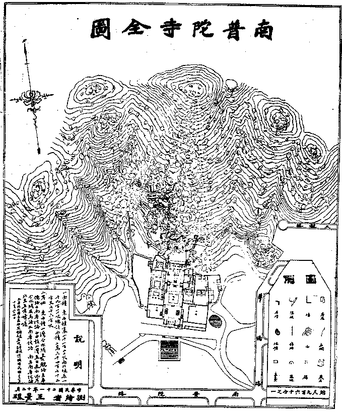



图例：房屋  

墙  

溪流  

石堦  

石栏  

山  

钱▆  

池塘  

岩石  

桥  

墓地  

亭台  

缩尺：九百六十分之一



说明：一、面积，东西横表一千一百二十呎；南北纵长一千九百一十呎，总计面积二万六千四百七十二方丈七十六方呎。



二、界址，东由鍾山湾合水线至大観路至华侨路止南普陀路；西由鼓山湾至白来水池界合水线及马路止南普陀路；南至南普陀路；北至五老峰顶。



南普陀住持太虚都监转达会录监院觉斌芝峰谨识



时民国二十一年十二月二十四日



中国民国二十一年十二月测绘者　王景琨



山图



本寺全景



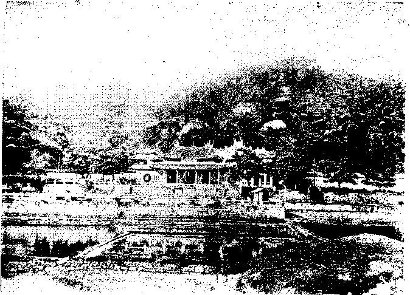



本寺山门外放生池之一瞥



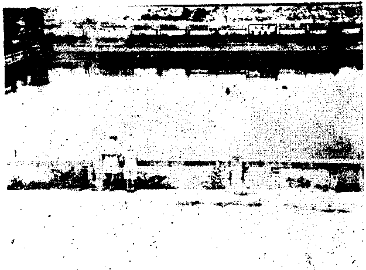



本寺大山门之中门







本寺鼓楼



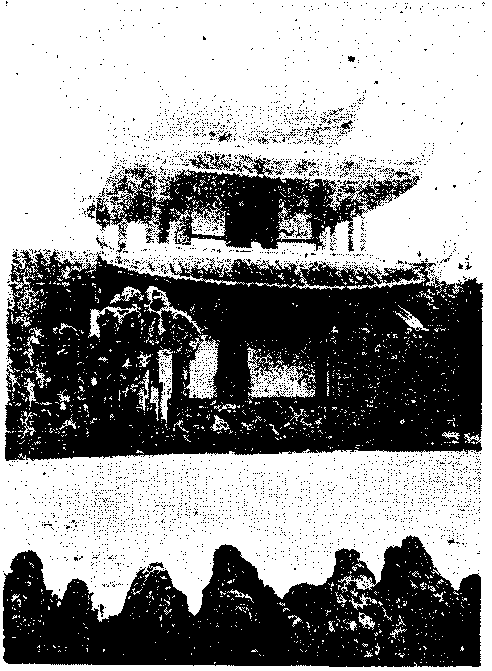



本寺钟楼







本寺大雄宝殿



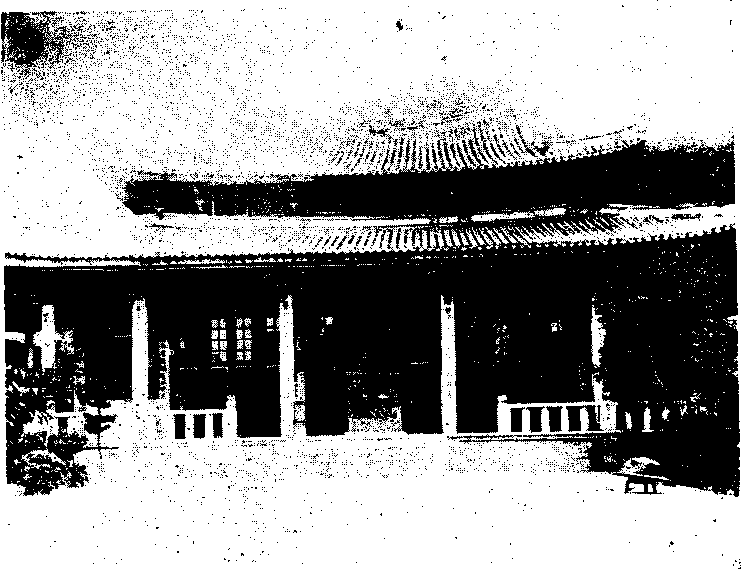



本寺佛殿之内容



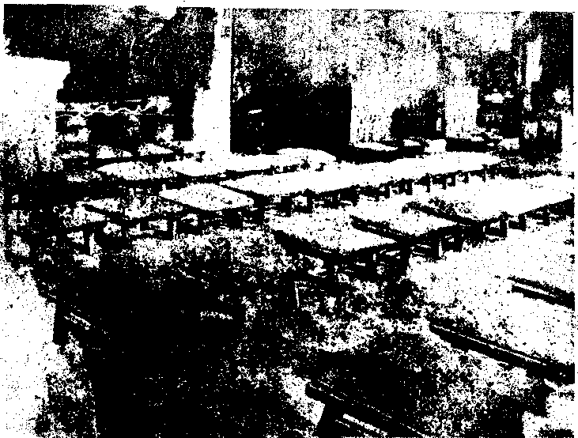



本寺走廊之一







本寺最近落成之大悲殿



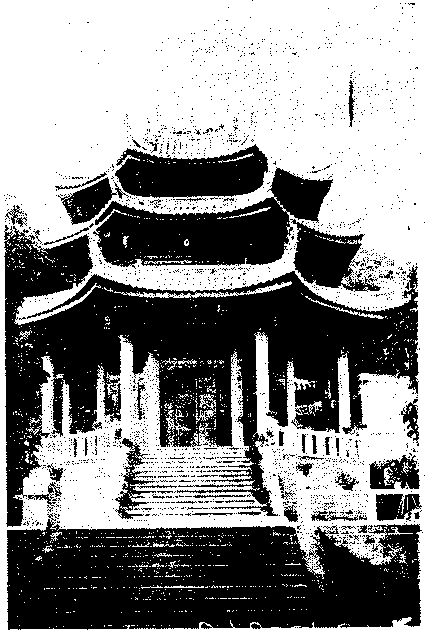



按此殿系旧殿毁于火，放大重建者。详见本寺建筑物沿革中。



本寺官厅之一角——右边即库房——



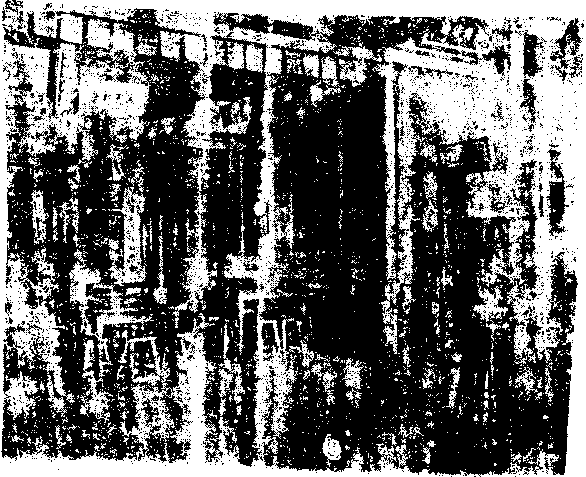



本寺功德楼及禅堂



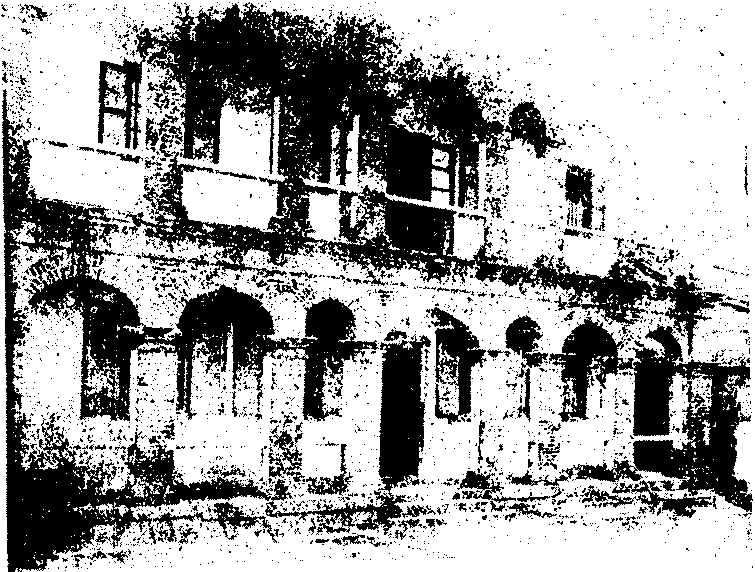



本寺之小讲堂外观







本寺之千手千眼大悲观世音菩萨像



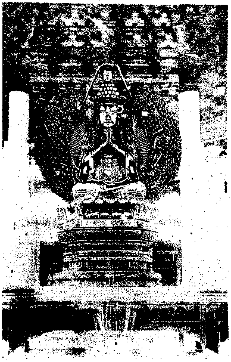



本寺方丈室之外观——即海印楼——



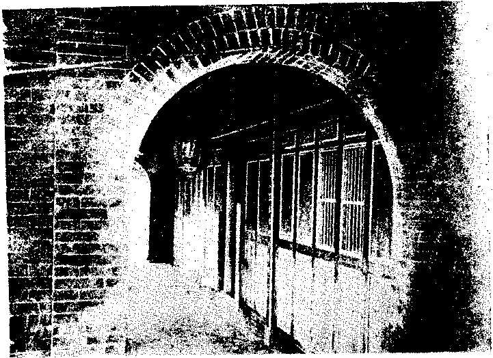



本寺后山之小亭——亭三座今摄壹——







寺考



一、本寺寺考



虞愚



五老山拱隔江太武而峙，为厦门八景之一，寺奉观音为主，弥勒罗汉天王亦与焉。而独观音以祷靳辄应，故寺改称普陀；冠南者，以对浙江定海县普陀而言，若对印土之普陀，则斯寺又为北矣。方位之分，抑亦对待而言也。考县志谓：五老山在城南六里，山如五老形，故名。方舆纪要祗述：五峰并列，无尽岩居其中，而不详其朝代年月日。府志载：大石嵌空，其下虚敞，宋僧文翠建普照寺，又按：普陀寺僧谱陀乃五代僧清造所建，其初名泗洲，宋治平间始改名普照院，迨元至正间废，明洪武有僧觉光重建之，崇奉观音大士暨释迦文佛，明季后毁於兵，徴诸志载，兴废不一，殆示世法之有无常者欤？洎清朝康熙间，靖海将军施侯，（一名琅）平郑姓凯旋，重建改名南普陀，是为取名之始。寺中供观音大士，有钟鼓二山，映带左右，风景之佳，昔已盛称。寺兴时，当居大众百餘人，嘉禾名胜记谓：寺中有洞名六月寒，洞左有云巢，又有石笕以引水，寺右乾龙间，复建龙王庙。采补称：门列御制平台纪功碑亭四，历敍战绩，寺前有平原一片，为郑延平郡王水师演武塲，壁有俞大猷终法海诗，俞诗今为苔没不可复辨，皆纪实也。斯寺五老凌宵，为思明最大佛刹，清季曾宴美舰於此。外有光复烈士碑。民国以还，香火日盛。民十四年秋会泉法师创闽南佛学院，培植佛教人才，常惺法师长斯院，辟观音殿右旁屋宇若干间为讲堂及学僧宿舍，迨民十六太虚大师主斯刹，于闽院益求完备，实世界佛学苑之华日文系学院。而寺中风景屋宇亦多树建，寺后曲径，因势开辟，庚午秋筑兜率陀院於其巅，此院乃退院转逢和尚专为太虚大师退居而筑者，复傍岩阿，中设慈宗坛，弘慈氏学。坛前有阿耨达池，池水演演瀸瀸，供全寺清众之用。复尽天然形势，益广其右地，以石洞为须摩提国洞内清凉靡常，有退居转逢和尚在焉。通洞之右，又新建阿兰若处，以为静坐栖息之所。今而后，斯寺之设渐备，有树可庥，有泉可瀹，有院可学，有禅房可栖而止焉。院左之绝顶有太虚台，民二十年李基鸿居士所建。山下遐瞩，如耸虚空间，名寔相符也。轩扇亭之上旁，太虚大师山阴虞愚等俱有诗刻，详志中文艺篇，兹不多录。



二、本寺建筑物沿革



寄尘



一　佛殿及走廊



天王殿



此殿五间，中三间供奉弥勒如来。其左右各一间，则供奉四天王相。高数丈两层蹿角式。系民国下五年间本寺住持会泉和尚募化重建者。



大佛殿



位天王殿后，共五间，中供奉释迦如来及弥陀如来药师如来，并塑阿难迦叶两尊者，及天帝释之立像，后修有海岛，及西方三圣立像等，高数丈两层蹿角式。绿瓦石柱，备极庄严，系民国十年间，本寺住持转逢和尚募化重建者。



大悲殿



此殿一间，八角三层飞簷蹿角式，绿瓦石柱，亦如大殿。中供奉四十八臂四面大士立像，雕刻精美，罕有有匹，系民国十七年秋，旧殿毁於火，本寺住持太虚法师与全寺执事，力谋重建，历四年之久，废五万餘金，近斯殿始成矣。



后殿



此殿三间接连右边，关帝殿三间，左边地藏殿三间，内附客堂，盖后殿为本寺古之大佛殿也。



钟鼓楼



此楼一间三层蹿角式，系本寺前住持转逢和尚建筑。



走廊



本寺正序之走廊，大佛殿丹墀左右各三间，大佛殿两旁左右各三间，供奉十八罗汉。



二　僧寮与客厅



流通处



此楼新式上下两大间，上有净室一，明间供奉功德主牌位，下有净室一，明间设有流通处，陈列佛教之各种佛经及佛书等，为本寺前住持会泉和尚所建筑者。



念佛堂



此楼新式三大间，上有客室四，下有净室四，明间为念佛堂，右边有清众寮三，私院一，自成院落，亦颇幽净。



祖堂



此堂五大间，中供奉本寺历代祖师莲位，两头分设广单，本寺行单起住其中，有私院一，自成院落，对面有菓木园一，园外尚有工厂五间，在祖堂后面有大寮一，浴室一，大寮后面，则有工寮十，养性寮一，放生园一，碾房一。



客厅



此厅三大间，旁辟有小室三，本寺来往游客，多在此间酬应，壁悬古今名人字畫甚多，尤觉悦目。



库房



此房在大悲殿左边，与客厅相接，三大间，建筑既宏，光线又足，有私院一，自成院落，后面有披厦多间；为常住重要执事及小厨房工人宿舍。



五观堂



此堂在大悲殿左边与库房相接，计三大间，可容二百餘僧，空气流通；颇适合衞生，后面有两间小楼一，上面巡照寮一，裁缝寮一，下面香灯寮一，上客堂一，本寺左序之僧寮及客厅等共计四十餘间，先后建筑故年代月日亦不一。



三　佛学院一瞥



本院为会泉法师所创办，惟房屋仍因其旧，本院计有礼堂一，禅观堂一，图书室一，研究室一，讲堂二，教务处一，事务处一，阅报室一，会客室一，储藏室一，餐室十，教职员室十，学僧宿舍十三，洗濯处经行场各一，水炉一，厕室一，院中屋宇虽不敷支配，幸各室光线空气皆佳，端合讲学之用，院后有海印楼一，为本院院长起居之处，旁有关房二，共计四十餘间，今建筑物也。



四　后山之禅室



普照寺



此寺相传最古，盖先有普照而后有本寺也。（详见本寺寺考。）寺在山后之右，人迹罕到，为静修之地也。



莲花洞



此洞在后山之左，地势幽静，堪作修道之用，惜建筑年月日已无可考。



水池区



此水池区；为本寺之最近建筑，有三静修处兜率陀院，须摩提国，阿兰若处是也，（详见兜率陀院记及南普陀游记。）



法制



一、本寺改为十方常住规约二十条(附库房列职规铭，客堂规约，禅堂规约，共住规约。)



本寺定为十方选贤丛林，住持一席，不拘法派，不分畛域，凡十方僧众有合格者，皆可被选为住持；即本寺原有喝云派下资格相当者，亦有被选为住持之权利。  

住持资格必湏在三十六岁以上，宗教兼通，行解相应，能说法开导后学，领众坐禅行道众望相孚者为合格。  

住持选举权应属退居和尚（前任住持）及两序首领执事；公同选举，不受寺外各界干涉。（丛林规制，以大众为主体；两序首领执事，即主体之代表。）  

住持选举法，由现住持请退居和尚及两序首领执事开选举会，以现住持为议长，或退居和尚亦可。倘现住持及退居和尚俱无，公推班首一人为议长，先由议长报告选举权及被选资格，令众闻知，请众推举一人，付众表决。果系才德兼备，众望所归，各无异议，即由监院具书，启请为住持。  

先推一人外，各退居首领更有推举多人资格相等难分优劣者，则议长再举二人为监察，更用记名投票法，公举五人，向韦驮神前拈阄卜选，先拈出三次者为当选，其餘四名不得作为候补，下届选举时必经重选方得下阄；因恐其人始终不一故。  

现住持徒眷法眷即有合格之人，本届不能被选，须待下次。如退居和尚一人派下有堪入选者多人，每次亦只能选一人，此条之规定系防微杜渐，恐十方丛林复变为子孙也。  

现住持祇有提议取决之权，不得加入公举人数，倘众人公举不足推现住持举时，方可有选举权；所举之人亦须付众表决，以符公意。  

住持任期以三年为一任，如果有功常住众心悦服连举者得连任，不得过二次。交替时间定四月初八日，而选举时间定二月十五日，以便举后启请预备进院。交替时所有常住存款，只许盈餘，不许亏损，如有亏损，当令赔偿满足。  

住持进院，斋堂设如意斋一堂安众，进院贺客斋饭，及开销各项概归常住负担，贺礼亦归常住收领。  

住持徒眷法眷不得充当首领权职，如住持三年任内世缘不顺，或年老多病不能领众者，不拘年限可许告退，倘假公济私，藐法毁规，不尽寺主责任，有负住持名义者，许众僧通白两序首领公同令退，再行选举。倘若挟嫌陷害，察出即当反坐重责驱摈，不服者禀官究治。  

住持任满退居本寺，祇得另住房间以便静养，客堂吃饭，不得另行开房立派，若新住持请为寮主护持常住亦可。圆寂后所有财物均归常住，与徒眷无涉。在寺之日，常住要事请议，自当秉公为众，平时诸事各有权限，不得时加干涉，果见住持执事有大妨碍当住之事，可邀两序首领公议办法。  

住持不得在寺内剃度徒眷，不得时常付法；但有信仰之人，可收为皈依弟子。至第三年任期将满，可以传戒一次，付法一次；尤宜择人，不可滥付其法派。其徒眷倘有恃势违犯清规，平等议罚，不服者出院；如系法派，则公请追缴法卷，免辱祖庭。  

住持领众行道，宗教并重，讲经坐禅，上殿过堂，以振道风，而宣佛化，不可苟图安逸，辜负学者。如有挟情私见，欲变十方为子孙者，十方僧众，本寺两序，皆可出首禀官驱逐，以保公权，而维十方常住。  

退居和尚名位既尊，不可再入卜选，如果常住雕敞，欲期整顿，非某退居不可者，即由两序首领公请复位主席。  

住持请职须要量才取用，不可徇私，凡所请首领，当委以职权，责任办法，以清权限。库房客堂维那寮衣钵寮是谓四大寮，住持凡有大事必湏请四寮共议，不可独断独行。  

常住产业，无论何人不得变卖抵押，银钱物件不得私借私送，监院总理合寺大纲，都监而居监督地位，此二执事辅弼住持，调理大众，必须才能练达，因果分明者为合格。  

库房进出银钱，由典赋管流水，副寺管总清，监院管银钱，住持都监均得随时稽查账目。银钱盈餘，当择银行或稳妥钱庄存放生息，以备举行慈善事项，置业修造之用。凡置业修造等项，达五百元以上者，皆要与四寮共议，或住持监院好大喜功，硬欲作主者，其经费常住不负责。  

住持及库房客堂二寮执事，及维那寮所有衣单之资，依照旧例，於客厅茶礼所进之款，抽取十分之二；有利均分，不宜厚薄。大小执事任期以六个月为限，限满告退，连请者始得连任，俱应遵住持之约束，一寮之中不得多安同乡，以及同派，恐其树立党羽，挟制常住。  

无论何人，不得在寺内剃度收徒传付法卷及收皈依弟子；寺外不在此例。（住持另有专条规定）及住持大众每期诣韦驮神前告香一次，（即剖明心迹）以俾有所警策。  

本寺叠蒙官厅保护，有案可稽，向无山主檀越以及董事各色，寺内诸事，由住持与两序首领执事会议举行，各界不得加入干涉。凡施主来山祈福超荐，修建佛事，理宜斋戒，不得擅将荤腥入寺，邀妓弹唱，致凟佛天，以招罪过；蔬笋清谈宜为原谅。



库房列职规铭



爱惜常住物，如护眼中珠；兴利莫若除弊，尽公自尔无私。信施脂膏，沾染便成孽海；伽蓝因果，明察即是福基。铭曰：



物属招提　丝毫毋犯  

守在尔躬　必慎必惮  

清若澄潭　正如直干  

无曲无私　何忧何患  

一有差池　龙天较勘



都监乃上辅住持，安抚大众，下匡监院，察理诸事，如常住要务，施主应酬，一切皆其责也；虽不如监院之辛劳理事，而大端则须总持，故亦名总理。须久充库职，谙练熟识者为合格，乃安享之任也。  

监院为住持右臂，乃列职领袖，全寺纲维，司其职者须发大心扶持常住，弊端要革，利益常行，一寺隆替所攸关也。总理庶务，栽培田园，出纳钱米，酬应檀护，及常住宿交之官绅皆其事也。此执归住持与班首执事商酌而请，须察其人因果分明，精严戒行，如所请非人，常住受害，必须才德兼优者充之。至常住之动产及不动产，处处巡防库职诸事得宜不得宜，时时察视，若遇大事，当呈白和尚，妥贴方行：小事亦须白知诸执，可行则行，勿得自专，所为悖理，诸人解劝，仍属执拗不从者，亦须以理处断，不得私擅己意，亦不可徇情。  

副寺乃长一寺之财政，凡常住存项，大宗支收，总清部册，分明登载，大众饮食，日用所需，加意觉察，预先备办，庶免临时仓卒。若所法官绅，游玩名士莅寺，倘知宾不在，或周旋不到者，宜帮为招待，然后呈报住持当家，请见以礼，而诸茶头行为不中，库司诸执，宜以相当而教诫之。  

知产乃一寺农工部长，凡田山园林蔬果等项，培植收成应时得宜，湏湿当收，留心照应，监工人之勤务，察田山之耕营；验力务之能否，定重轻之工资。切勿徇情，以失得当。应用器具亦宣随时修澰，免致损失。  

知宾典执宾客，似乎一寺之外交，无论善信进香，名士游玩，俱宜谦恭尽礼，至诚相待，请问姓名，来意居址，不可忽慢，倘有宿交护法，现任官绅，须先礼待，后白住持当家，或请方丈，或任官厅，茶点斋饭，随宜欵待，毋得失仪，若有香资礼物，宜交典赋收记，倘有意外之交涉，必以和平主决，以示让步，事在不得已者，宜尽职争囘，故湏随事见机，方圆兼济，而不可无事藉端，私逞己能。  

监修料理匠作，科派工程，督工人之勤务；随事指挥，检房屋之故漏，当修则修，如有大宗建筑，关要事宜，须与监院商酌，住持裁夺，方可举行，不得私擅，每日工账，逐节报典登载，以免遗误。十日结算存清，须请监院副寺看过，至四期终，宜请两序公算，而副寺知宾亦可随时检查，免致失误。



柜头亦名库头，管理常住被铺席帐，器皿家具，食品等物，收曝出内，俱应加意殷勤，何物将尽，应办即办，何物损坏，当修则修，如欲采办之物应白副寺审查定夺，倘有借还之端，须报典记，以免失误。  

买办司理上街采办常住应用物品，均由副寺支款典赋，列单依式办之，囘即报账查记，毋得混淆失误。  

典座调理人客点心斋席等事，时序丰略，均由陪客者指陈办之，不得擅任。  

库房诸事，虽有条列各专其司，然非分河饮水，如该事属他执之务，或者该执不在，或者一人周旋不到，必须和衷共济，互相照料，以为一寮之团体。



以上诸方各执，均以一人主之；本寺因人才困乏，未敢规定。如监院，副寺，知宾，柜头，知产是所不免，若监修，典赋，买办，典座等，若人才充补，则可增用；不然，或由住持委任，或可他执代管，事无一定，随时变通可也。



客堂规约



担囊负钵，本为参寻；拨草瞻风，曾无别事。既垂见访，宜禁喧嚣！诸事安排，百凡随众；动静凛乎人表，闲忙卓先众先。有法可严，有依可范，如此法器，可谓高流所有规条，幸宜共鉴！



知客执典宾客，凡客到若僧若俗，无论高下，俱要谦和尽理，请问姓名居址及其来意，不可怠慢，若有求住僧至，须详审来历，略述常住家风。这边与诸方不同，一年一期，无论内外寮单，自送单日起，至明年今日为一期，中途不好告假。或诸方尊宿到寺，一面接待，一面差招客通知住持，然后参见。次者或客堂接待，库房报菜点。  

云水衲僧至，不拘有无公事，须照应如法，见礼貌不恭者，随时警策；其威仪端肃者，谦词慰问，此关常住道风，不可忽慢。至送单亦不拘一例；诸方耆德，送尊客寮；旧住消假，远来禅和，酌妥安送；至如混杂之辈，早到一餐，晚到一宿，即催别行，毋使稽延，滋生事端。  

放假日期，知客须在客堂静候内外诸师到客堂请假，上街须嘱其买毕就囘，不可无事在街上游玩；如往别骈，当问明告假几日，系往何方，期满不归者罚。  

内外诸师，有口角相争者，知客为其理直，不服者，请众同寮公议处罚。  

内外诸师，出入不到客堂告假销假，及在外三五成群闲游放逸者罚；执事人知而不举者，同罚。  

凡有佛事斋供，预先写牌，至时令照客悬挂，事毕即收，勿得遗误。  

纠察亦名僧值，即是僧中值日管事者，凡殿堂及坡事，俱要向前，认真照应，不得落后。能使众僧威仪整肃，出入循规者，惟赖此一人专主；如避赖偷安，以致失误者罚。门户火烛，时常检察，各处香灯该管之地，俱令打扫洁净，无论内外执事，皆得随时经管。  

书记专主书疏、榜、牒、牌示、及挂号等事，若无此执，即知客僧值亦可代之；但湏字迹端楷，不可潦草。  

纠察每日寺中各处巡行一周，有不如法处，即当白众，此虽纠察之责，而知客当巡行若殿堂坡事等，若无僧值或僧值有病，即知客公务，勿致失误。客堂诸事，和衷共济，互相照应。  

客堂诸师，如逢外寮僧行有病，亦须巡视，嘱人看顾，如果病重，即白库房，延医备药；若有病重垂危者，即同库房将病人衣服银钱用牌登记，暂寄库房，不许乱动；若临终之际，客堂诸人，念佛助送往生，此关人人不免，各宜努力！至於估倡开消之法，亦有规则。  

期头请执，旧执许退，则以好言安慰，或留者更须仔细警省，如请新执，当先留心察看，量才安执，其间不可存私，若请衣砵烧香侍者，当随和尚之意，如请柜头知产知宾等，当与监院商酌，其餘列执行单则可专与同寮筹请之。



禅堂规约



古规失检，怠惰成风；时弊多端，提持贵密。虽则成公案，须要大家共知，知行解相应，则无愧於先宗；道德兼资，乃有利於末学。是在同志，共相遵守。



犯根本大戒者，出堂。  

刁唆是非，交拳相打，破口相骂者，出堂。  

钟板为龙天耳目，大众号令，参差失误者，巡寮跪香；不服者，出堂。  

堂中闲谈什话，及静响动惊众者，重罚。  

鸣[木*魚]小板，参差失错者罚。  

值日交代不清，及失误巡散香者罚。  

行香坐香不到，止静不到，及闯静者罚。  

经行时任意涕唾谈舌呼欠，及鞋物作声者罚。  

出入不白职事，及在堂窜单乱位穿堂直过者罚。  

出外不穿长衫，不缚裤脚，及有事他出，归期失限者罚。  

上殿过堂次第而行，不得进前落后，交头杂话，违者罚。  

出入往还，沿路不得东观西望，及随意吐痰者罚。  

不顾本分，乱逞机锋，妄作拈颂，评论公案者罚。  

私借堂中什物出外用者罚；打破器皿者罚赔。  

闲窜寮房，私造饮食，及私吃烟赌博放逸者罚。  

检点他人是非，搅群乱众者重罚。  

堂中出外，滋生事端者严罚。  

滋事失仪，不听职事规谏者罚；不服者，出堂。  

各人闻四板响不起，及鸣楗搥不到者罚。  

开大静后在外高声语笑，出外窜寮者罚。  

无事须在本寮诵习，纵意妄谈什麽者罚。  

巡香徇情，或以公报私者罚。  

无病殿堂不到，及坡事不随众者罚。  

坐香故纵昏沉，及争香者板者罚。  

住不满期，不许出堂；若私逃单者，拿着加罚。  

经行念佛，默不作声，及捺鞋嬉者罚。  

尊客参堂，各依位坐，不得失仪，违者罚。  

街以每月初八廿三日为限，餘时不准，私上街者罚。



共住规约



栖心息影，端藉名蓝；修道循规，必须同志。久参耆宿，以游历深而百姓从生；后进时流，因知见浅而初心渐退。以致纲宗失旨，模范多乖，习以为然，积成流弊。拙住兹山，自愧薄德，空怀佛制，无报法门。欲挽已往之颓风，惟冀方来之贤众，共遵佛制戒律；祖定规绳，调治三业，折伏过非。住斯丛林，原为遵行；如或不然，毋得共住！



犯根本大戒者，不共住。  

斗争是非，破口相骂，交拳相打者，不论曲直均出院。  

诱掖外人，破坏常住，思和合僧者，不共住。  

刁唆是非，搅群乱众，破和合僧才，示共住。  

保留有大过之人，及年轻者，不共住。  

无事私走檀护，私自募化，不共住。  

侵损常住财物，及私斫菓木送人情者，罚赔出。  

不守清规，不存正念，错昧因果者，不共住。  

私吃烟酒，及赌博看戏者重罚。（若有病非酒莫疗者，白众方服。）  

轻视耆德，恶闻直言，妄生讥毁者，重罚。  

私应经忏，及私招徒众者，重罚。  

无事在山门外三五成群，游戏杂语者罚。  

无事闲闯寮房，及出外纵意放逸者罚。  

二时功课，三时念佛，及出坡事不随众罚。（除老病及公事）  

非理责人，私心袒护，私留亲朋歇宿，不白职事者，重罚。  

不习僧体威仪，粗心忽略，不遵职事约束者罚。  

所司不尽职，失误公事者罚。  

堂中出外生事者，严摈；藉事起单者，重罚。  

出入不白职事，不穿长衫，不缚裤脚，及假期失限者罚。  

小恙不白听事，公事不到者罚。  

无事不得二堂，不得争坐位，不得未结斋先起自持碗取食，违者罚。  

常住账目出入登记，若失误及含糊不清者罚。  

常住米麦等物，不白众私卖用者，罚赔已出院。  

常住经典庄严法器，不白众私借与人者罚。  

无病告假，避懒偷安，及私造饮食者，察出加罚。  

破期告假，及住不满期，私自逃单，托事告假者，重罚。  

街假以每月初八廿三为限，餘时不许告假，违者罚。  

丛林无僧值，内外不整，弊何能除，法焉能立，为僧值者，宜尽心纠察，不得徇情，如有犯者，照款举罚；失罚者，僧值自受罚。



以上条约，诚为办道之规则，同居大众，各宜珍重！



二、本寺水池区管理规则(普照寺莲花洞等处由本寺安人住修亦同)



一、本寺阿耨达池，及附近之兜率陀院，须摩提国，阿兰若处，总名曰水池区，适用本规则以管理之。



二、本区所置一切房屋器具，皆本寺所有，其用途皆由本寺支配，任何私人不得据为己有，及由私之占用之。



三、本区划定为本寺之退居寮，及安置缁素静修之客，或老修行班首之处。



四、本区兜率陀院设慈宗坛，湏摩提国设莲宗坛，永远供奉，不得撤废。



五、本区除本寺之退居及老班首外，其他缁素来客之暂住，必须知宾或知客送入安置，餘人不得自由支配。



六、本区房屋器具等，或系施主捐设；但施主或其友好欲来居住，亦须事前通知，本寺酌为安置，不得迳自出入。



七、本区由客堂安一好静修行之香灯师看守之，平时听库房或客堂之招呼照管一切；严禁来客等鸦片赌博弦歌荤酒及留宿妇女诸事，以保静洁。



八、本区住退居或来客时，如须役使，由库房临时拨用，来客日用所湏，由常住供给者，由来客随宜酬报常住。



九、本区所住之退居，或老班首，如因事外出他去，湏将寮房钥匙交付香灯师掌管，以便常住须时可移充他用。



十、本区所住之退居，或班首，除本人居住外，不得招致徒眷或亲友同住，以杜变成房头小庵之弊端。



十一、本规则由本寺公同议决订立之。



民国二十二年二月一日，住持太虚公布



教育



闽南佛学院概况重编



默如



大醒法师在民国十八年七月曾编印过闽南佛学院概况一书，兹因时间上又有四年之相隔，故宜重编。以其仅敍及十八年前之事也。此篇虽以大醒法师所编者为蓝本，但不无稍有增定与删削耳。此为说明闽南佛学院概况重编命名之所以也。



廿二年四月八日，默如附志



一　本院略史



南普陀寺原为子孙制之丛林，自转逢长老住持，始改为选贤制之十方丛林，时民国十三年也。本寺选贤制中，被选为第一任住持者，为闽南僧界中，富有声誉之会泉和尚也。明年适常惺法师在安庆安徽佛教学校办学三年圆满之期，时民国十四年夏也。闽南之广津瑞徴二法师，受学於安庆而归来，以闽南佛教，道风虽善，而研究教理者盖少，乃与转逢长老及会泉和尚等商榷，提议创办闽南佛学院事。而转会二公，具有多年参学之经验，深悉时世之潮流，非办僧教育不克振兴佛教，故允其所请。因而筹策进行，航海致贽，一夏之功，琐事齐备。员僧荟萃一堂，中元节后开学典礼。推举常惺会泉二法师为院长；教务事务，由觉三广津等法师助理。由此，闽南佛学院得以正式成立也。



十四年秋本院开学后，学僧得有七十四人，籍隶江南随常院长而来者居多，自岭南闽南来者仅少数，且属初小学级。初分专修普通二部，嗣为广摄初机，乃另辟小学一部。此亦应机摄化耳。



十五年冬，本院欲注全力於专修普通二部，以冀速成，乃将小学一部移至漳州南山寺开办，使之成为一独立机关。



十六年夏，会泉方丈三年任满，本院亦岁届两周。两院长商同各界，举太虚大师继任本寺方丈，兼本院院长。专修部学僧毕业，分化各地；普通部学僧留院升学。太院长进院后；秋，住院讲学，学僧云集。冬，院长弘化他方。以摄受学僧泛滥，稍起学潮，幸得院长遥相制止，不致事态扩大，终焉熄尽。



十七年春，太院长派大醒芝峰寄尘三法师来院改组。夏，太院长赴欧美弘法。寺务由转逢长老代理；院务由觉三法师代理。并得大醒芝峰亦幻寄尘广箴笑溪觉斌诸法师助理院务。如修改院章，整顿校规，举凡一切设备，莫不兼顾。冬，太院长囘院讲学，学校气象，更觉活泼矣。



十八年春，太院长弘化南京北平等处。而寺务与院务，一如其旧。但本院设备方面，如图书馆阅报室等，逐渐增加完备，以使学僧智识增长，并得办事经验也。秋，学僧额数，增至八九十名，分为二级教授。冬，太院长囘院讲真实义品，由默如笔记。院长又将本院英文成绩较好之学僧提出，另组一锡兰留学团，该团设於漳州南山寺，并改南山学校为闽南佛学院第二院，乃将本院丙乙二级一部分之学僧，转学於第二学院。



十九年，春，甲级学僧二十餘人毕业，后设一研究部，以为一部分毕业学僧研究深造之所。芝峰法师为研究长，大醒法师为副研究长。由院长依毕业考试佛学笔记成绩较优者，选出宝忍，宽苍，默如，西莲，华清，慧童，戒德，今怀，心道，道闻十人进研究部修学，芝峰法师为之讲成唯识论。此外，专修普通两科，一如其旧，并注重日本。本年四月，太院长赴川宏法。冬，复囘院讲学，欲辞普陀主席，不果。



二十年春，太院长以佛学教授太少，而研究部学僧，成绩尚佳，即以研究员，担任助教。前后相继担任助教者，有西莲，宝忍，默如，戒德，心道数人。故院中精神，依旧集中於专修普通之两科。



二十一年夏，专修科之甲级学僧，二十餘名又行毕业典礼。曾各作一篇毕业论文，登载於现代佛教第五卷六七二期中。藉此，可见其成绩之一班矣。本年春夏二季，太院长宏法汉口南京等处。秋，太院长住持奉化雪窦寺。冬，太院长来院，与本寺两序大众商退住持及院长职，通过后，议请常惺法师继任之。并料理一切寺务院务，不事稍懈。院长又因会泉和尚等之情，为厦门各界讲大乘心地观经；又因潮州人士之热烈欢迎，往潮弘法一周；又因厦门大学之请，为之讲法相唯识学概论，由虞佛心居士笔记。



二十二年，春，芝峰法师去武昌负海潮音编辑之责，大醒法师去苏弘法。太院长因厦门居士请组慈宗学会，院长允许后，乃为之讲慈宗要藉。该会并拟定整理慈宗典藉出版。现已将太院长於民国十八年在闽院所讲之真实义品印就；并筹备将慈宗典藉搜集起来，出一专刊，名之目慈宗要藏。二月初院长去奉化弘法；本院学僧，现在仍分甲乙两班，课程照旧。本院事务教务，概归寄尘法师负责，法师作事甚为谨慎焉。



本年夏，常法师来院，一方继任普陀住持，一方担任本院院长，对於院务寺务，当更有惊人之发展，不卜可知。常法师为现代新佛教中有数之人物，对於佛学世学均有研究；且素持宏法志愿，而在各处办学，均有甚佳之成绩；闽南风俗人情，又极熟悉，故知闽院将来之前途，必大放光明於世界也。



二　组织



1、组织



本院由南普陀常住全体组织，关于教务（兼指学院行政），院长一职，即由南普陀寺住持担任。学院院务及一切应兴应革事宜，均由院长总理主持，但得开教职员会议议决通过。於院长不在院时，院长职务则由副院长行使职权。院设教务主任，训育主任，事务主任各一人，由院长聘任，商承院长分理教务训育及事务等事。学监，会计，庶务，交际，书记，图书管理员，皆由教务主任商得院长同意聘任之。各科教师，亦由教务主任与院长会商延聘。如此，在组织上有一系统；在职务上各尽其职，兹更列一表，以明本院教职员之职权。



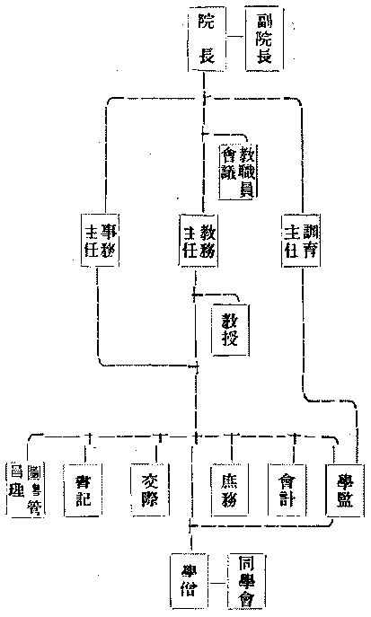



2、经济



本院经常费，纯为南普陀常住香火收入及经忏佛事之资充担。因本院注重造就真实僧材，常住虽多方节省，对於额定之经常费，亦必勉为其艰，按月筹付，决无妨碍本院之进行，及十方来学学僧之修业。或将来能得外缘之资助，当更扩而充之，以符本院造就僧宝弘法利生之宗旨。



3、院址



本院院址，即设於南普陀常住西部之一部，自成院落，外动内静，计有礼堂一，（三间）讲堂二，（六间）教务处一，（二间）事务处一，（二间）图书馆一，（二间）阅报室一，印刷室一，会客室一，餐室一，储藏室一，院长室一，主任室一，学监室一，教授室，会计室一，庶务室一，书记室一，学僧宿舍二，（二十间）（大殿斋堂浴室等不备举。）房屋旧式新装，光线空气，尚都合讲学之用。



三　训育



本院因感现在佛教之不兴，乃由僧伽之少训练，故於训育方针，除行持修证外，特别注重：



（１）慈悲喜舍



（２）和谐合聚



（３）劳动勤苦



训练的目标在：



（１）思想：认识佛教为人生之唯一归路；认识佛教为指导民众之佛教；认识佛教应该为社会谋利，作济世事业；打破一切封建思想，根据佛陀的，「慈悲喜舍」的精神，建设适合时代及人生需要的新佛教。



（２）行动：养成有目的，有方法，有步骤的行动；破除自私自利的安养尊荣个人的把持地盘（寺院）的恶习，养成「和谐合聚」有纪律的团体（即「僧」之义）习惯。



（３）生活：革除旧时「衣来伸手，饭来张口」之懒惰习惯，养成「一日不作，一日不食」「勤苦」的生活；锻鍊刻苦耐劳的体魄，做「我不入地狱，谁入地狱」的「劳动」工作。



本院训练实施方法；由学院方面指导的：有谈话，纠正思想；讨论，解决问题；讲演，统一意志；开会，团结精神。由学僧自动学院辅导的；有同学问，组织练习——练习办事；讲演会，发挥个性的特长——团体的结集。



四　章程(订於十四年六月．十七年修改)



第一章　总纲



第一条　定名本院定名为「闽南佛学院」。



第二条　宗旨本院以造成佛教住持僧宝，弘法利生为宗旨。



第三条　地址本院地址即厦门南普陀寺。



第四条　组织本院设院长一人，总理院务；副院长一人，辅理院务，教务主任一人，总理教务；事务主任一人，总理事务；学监一人，管理学僧；交际一人，内外交际；会计一人，管理出入银账；书记一人，缮写书牍讲义；图书管理员一人，管理图书；庶务一人，专办一切杂务，教授若干人，分讲学科。



第五条　学额每级三十名。三年毕业。分申，乙，丙三级。每年毕业一班。



第二章　入学



第六条　资格须具有下列资格者为合格：  

1、年龄在十八岁以上二十五岁以下者；  

2、出家比丘，沙弥，具有真实求法弘法志愿者；  

3、曾在初中毕业，（乙丙班）高中一年（甲班）及各处佛学院修学一二年以上，或有同等学力者；  

4、身体健全品，行端方，无诸嗜好者。



第七条　手续1、报名时缴：履历书；最近四寸科头像片。  

2、入学时缴：志愿书，保证书，及保证金十元。



第八条　试验入学须经过：  

1、作文试验，  

2、口头问答两种试验。



第九条　保证本院为造就真寔弘法僧材起见，入本院求法之学僧，须有本院相知之诸方大德或佛教团体为介绍及保证者，方可录取。（即须有第七条之保证书）



第十条　待遇凡入本院肄业者，学，膳，宿，书籍等费，一概免收；（参考书目备）并由本院每月津贴零用费二元。



第三章　课程



第十一条　课程三级课程，分三年教授：一年级（丙级）读第一学年课程；二年级（乙级）读第二学年课程；三年级（甲级）读第三学年课程。科目分配如下表：



学年／科目  

第一学年  

第二学年  

第三学年



佛学  

佛学概论，各宗派源流，律学大意，因明学概要。  

律学大意俱舍学大意　成实学大意，四论学大意，唯识学大意。  

律学大意，禅学大意，净土学大意，天台学大意，贤首学大意，密学大意，佛典汛论，大乘宗地引论。



国文  

语体文，文言文，文法，文学史。  

语体文，文言文，文学史。  

文言文，文字学。



外国文  

日文，英文。  

日文，英文。  

日文，英文。



数学  

算术，珠算。  

代数。  

几何，三角。



历史  

本国史，印度佛教史。  

本国史，世界史，本国佛教史。  

世界史，自由史观，僧伽制度沿革史。



地理  

本国地理。  

本国地理，世界地理。  

世界地理，佛教行化地域形势。



科学  

自然科学，社会科学。  

自然科学，社会科学。  

自然科学，社会科学。



晢学宗教



心理学论理学，中国哲学大要，人生观的科学。  

西洋哲学大要，印度哲学大要，人生哲学，世界各种宗教大要，大乘与人间两般文化。



教育



教育原理，教授法，佛教研究法，寺院管理法，佛教教育各论。



三民主义  

三民主义  

仝上  

仝上



艺术  

书法，音乐，图畫。  

图畫，音乐。  

图畫，音乐，梵曲，建筑，雕刻。



体育  

体育。  

仝上  

仝上



行持  

布萨，修净，习禅。  

仝上  

仝上



服劳  

体力工作。  

仝上  

仝上



附注：上列科目，每周教授三十六小时，时间分配，於每学期开学前配定。惟每日有二小时修持（上殿，习禅　坐香），和一小时体力工作。



第四章　学期．休假



第十二条　学期本院以两学期为一学年。自八月一日至一月三十一为上学期；自二月一日至七月三十日为下学期，



第十三条　休假本院除星期日例假及寒暑假外，佛诞日、国庆日、本院纪念日，及各纪念日，均休假一日。



第五章　考试



第十四条　月考最月终，举行月考一次。（各学科均考）。



第十五条　期考每学期终结时，举行期考一次，一学年各科考试分数不及格者，降级，或处罚，或开除。



第十六条　毕业每级学僧修满三年，各科成绩分数及格者，本院给与毕业证书。毕业后，介绍他方弘法，或留本院供职，或深究经藏。



第六章　退学



第十七条　退学本院学僧有下列情形一条者，即令退学：  

（1）不守本院一切规约者；  

（2）无故旷课在一月以上者；  

（3）疾病久缠难望卒业者；  

（4）有不得已事故陈请退学经本院许可者。但已缴之保证金概不退还，并得向该保证人追还膳费。



第七章　附则



第十八条　附则本章程如有未尽善之处，得由院长召集教职员，随时开会，酌定修改之。



五　规约



1、共住规约



第一条　本院以修学佛乘自觉觉他为宗旨，故职员学僧皆宜恪守各项规制，不得故意违背，紊乱秩序。



第二条　学僧除课外，不得干预他事。



第三条　院内一切器具及墙壁，玻璃门窗等件，务宜爱惜保护，不得涂抹损毁，违者照价赔偿。



第四条　各室内有人谈话，不得在门外窥听。



第五条　无论何人之物，非本人许可，不得擅自携取。



第六条　如拾得遗失物，当须送交学监，悬挂招牌，不得私自收藏。



第七条　学僧遇院内夫役失礼，可告知学监检察呵责，不得迳与争论。



第八条　学僧在院开会，须事前呈请本院长及教务处核准后，方得集会。



第九条　凡学僧不得在本院内张贴一切说帖，纵有遗失物件等物，亦须告知学监，代为宣布查追。



第十条　凡他人信件，不得折视。



第十一条　学僧每班公举班长一人，副班长一人，其责任如下：



（1）代表同班诸人陈说事件及传述事件於诸同班。  

（2）纠正同班诸人违犯规则之举动。  

（3）班长告假时，副班长代负责任。



第十二条　每室公举室长一人，其责任如下：



（1）代表同室诸人陈说事件及传述事件於诸同室。  

（2）纠正同室诸人违犯规则之举动。  

（3）同室中人如有疾病，应即报告学监。



第十三条　班长，室长为同班同室之表率，当恪守规则，为众矜式。若能一学期内勤慎无过，即记大功一次；如违犯规则，如至记大过一次或小过二次者，则将其班长或室长取消之。



第十四条　每学期本院示期开课，学僧皆须即日到院，不得迟延。除有特别事故，经本院先时特许者外，迟至十日以上，即行开除，并追缴学膳费。



第十五条　每学期放假前，除确有特别事故，经本院特许外，虽试验已毕，亦不准告假先归。



第十六条　凡本院举行祈祷，开学，放假，纪念等礼式，学僧均应列席，不得缺席。



第十七条　凡学僧有银钱及贵重等物，须存会计处，掣取收条，随时取用。否则，如有遗失，本院概不负责。



第十八条　凡学僧如彼此有纠慕时，须向学监陈述情由判断之不得迳自争论，甚或至於斗殴。



第十九条　学僧之剃沐洗濯事宜，均由本院於例假日行之。



第二十条　本院学僧非学监许可者，不得留客食宿。



第二十一条　凡学僧外出，须着长衫，并佩带本院徽章於胸前。



2、礼堂规则



第一条　凡闻集众钟即入礼堂。



第二条　在礼堂中坐立，皆依一定位次。



第三条　在礼堂，除礼拜持诵并绕佛坐禅外，不得谈笑游戏。



第四条　遇休息时，饭毕时，得於礼堂中径行或静坐。



第五条　礼堂中不许随便吐痰。



3、讲堂规则



第一条　须按编定名次就坐，不得紊乱。



第二条　各按钟点上课，不得无故缺席。



第三条　上下讲堂，须依次进出，不得拥挤喧哗。



第四条　衣履概须整洁，虽当炎暑亦湏著长衫，不得袒胸跣足。



第五条　入堂不可在教员之后，出堂不得在教员之先。



第六条　教员上下讲堂时，须起立合掌，对在家教员鞠躬。



第七条　凡质疑或应问，均宜直立而言。



第八条　教员讲辍时，不得参问他事。



第九条　不得越席耳语。



第十条　除应用书籍文具外，凡一切玩物食物及与所授功课无关之书籍，均不得携入。



第十一条　各人所用书籍文具，下课时宜各携归，不得任意抛弃。



第十二条　上课时须端身正坐，不得有各种倦容。



第十三条　凡有来宾参观，仍须疑神听讲，不得游目囘首，致乱视听。



第十四条　除痰盂外，不得随意吐痰。



第十五条　每讲堂按坐次轮派值日僧，督令夫役打扫洁净，并随时揩抹黑板。



4、自修室规则



第一条　闻钟声即应入室练习功课，不得缺席。



第二条　至自修室中无论何时不得任意谈话。



第三条　用物文具，务令整洁，不得杂乱无章，亦不得侵占他人位置。



第四条　凡无关於自修之书籍物件，不得携入。



5、寝室规则



第一条　凡上课食作时，须将各室锁闭。



第二条　凡一经住定，即不得任意迁移。



第三条　室内被褥衣服书物等件，宜勤加洗濯整理，不得任意堆置。



第四条　室内灯火，一闻寝息钟，即须息灭。



6、斋堂规则



第一条　食时凡各班出堂，依序次以入斋堂，不得任意而入。



第二条　各依所编位次入座，不得凌乱次序。



第三条　坐定时先供佛施生毕，方就食，各宜威仪肃静，不得谈笑旁视。



第四条　行堂添饭添菜，应依次听纠察招呼，学僧不得出声叫唤。



第五条　食毕听纠察招呼，诵饭讫偈已，乃依次出，不得前后拥挤。



7、图书馆规则



第一条　无论教职员学僧欲借书阅看，须先向管理员开明借书簿，然后领取；於缴还时，即将原字取销，但簿内须书明姓名及住室号数等，以便清查。



第二条　每次取书以二册为限，缴书以一周为限，如过期未缴，营理员得执条向其索囘。



第三条　凡借阅经藏者，倍宜珍惜，不得任意批评点窜；如缴还时查有汚损痕迹，须遵原定价值，偿十分之二；若有残失，即全部照原价赔偿。



第四条　外来客人欲借阅经藏者，须经院内各教职员之介绍，亦须遵守本院所定规约。



8、门禁规则



第一条　学僧出外时，非执有准假名牌，不得迳出。



第二条　学僧归时，非取去准假牌，不得迳入。



第三条　凡来宾须请其填明会客单，方能招待入会客室。



第四条　来宾会学僧者，非本院会客时间，概不得延入。会教职员者不在此限。



9、会客规则



第一条　每日定中午十二时至十一时，及下午四时至六时为学僧会客时间。



第二条　凡来宾有欲参观本院者，须先由学监延接，不得随意游览，并不得引入自修室或寝室。



第三条　会客谈话，不得高声。



10、告假规则



第一条　因疫告假者，须有本院医生证书。



第二条　告假外出时，须往学监处陈明事由，若学监不允，不得外出；如经允许，则将限定时间书写簿上，并将准假名牌执交司阍，始得外出，星期日亦同。



第三条　非有确实证据经学监允可者，不得在外寄宿。



第四条　告假在外，不得为种种不名誉之事。



第五条　不得逾时不归。



11、劝惩规则



（1）记功



第一条　於各功课能勇猛精进者。



第二条　修持能为同学之表率者。



第三条　各班长，室长能将本班本室之规约切实整顿者。（以上记大功）



第四条　凡一月之中不缺一课者。（记小功）



（2）记过



第一条　未经学监允许，擅在外寄宿者。



第二条　不遵教职员之教训者。



第三条　於功课慢不用心，屡诫不悛者。



第四条　出外不请假者。



第五条　不遵学监之管理者。



第六条　私折他人信件者。



第七条　侮辱同学及对於外人有粗暴举动者。



第八条　本院一切公布，及功课表，任意涂抹者。



第九条　不守规定时间，逾十五分钟以上者。



第十条　请假归院逾限者。



第十一条　自修室或寝室未经学监允许，擅自迁移者。



第十二条　在院私自饮酒吸烟者。（以上记大过）



第十三条　未经准假而缺席者。



第十四条　失礼仪者。



第十五条　对於同学或外人高声争嚷者。



第十六条　在院宇门墙上涂抹刻划者。



第十七条　门外窃听他人讲话者。



第十八条　抛弃汚秽物於各处者。



第十九条　使唤杂役高声或大呼谩骂者。



第二十条　紊乱讲堂或自修室，或斋堂之次序者。



第廿一条　未经学监允可，早晚点名不到者。



第廿二条　借阅图书，不遵规约或涂污损坏者。



第廿三条　未经学监允可，擅引来宾入各堂室者。



第廿四条　在厨房私自作菜或索菜者。



第廿五条　不甘淡薄，倡言菜饭不美者。



第廿六条　就寝后，仍谈笑妨害同室安寝者。



第二七条　於讲堂，自修室，斋堂谈笑喧华者。



第二八条　携玩物或食物及无关功课之书入讲堂或自修室者。（以上记大过）



（3）功过之赏罚



第一条　凡记功记过者於学期试验时加减修持分数。记小功者，加十分。记大功者，加三十分。以至加满百分为限。记小过者，去十分。记大过者去三十分。



第二条　每学期内有记大过三次或小过九次者，开除。



第三条　凡学人功过在讲堂者，教员及学监记之，或班长报告学监记之。在寄宿舍者，学监记之，或室长报告学监记之。在讲堂宿舍之外者，亦归学监记之。



第四条　凡学人照章应记功过以及开除事宜，均随时由院长或教务主任主持宣布。如有在院章所载范围之外，由开教务会议公同裁定之。



（4）出院



第一条　亵凟圣像，经典，毁谤佛法者。



第二条　破所受持之皈戒，或根本大戒者。



第三条　倡首鼓煽风潮者。



第四条　损坏本院名誉者。



第五条　侮辱本院教职员者。



第六条　树立朋党者。



第七条　破口相骂，交拳相打者。



第八条　令之不行，禁之不听者。



第九条　有过罚而不服者。



第十条　擅在本院开会，及妄谈时事者。



第十一条　出匿名帖及类於匿名帖造作讹言败人名誉者。



第十二条　信修外道邪教者。



第十三条　嬉笑无度及妄谈鄙秽淫邪事者。



第十四条　欺骗隐瞒他人财物者。



第十五条　陆续旷课至两星期以上及无正常事故陆续旷课至一月以上者。



12、礼仪



第一条　学僧初入院见院长及教职员时，顶礼。见在家教职员时，行鞠躬礼。



第二条　学僧无论在院内院外，凡遇院长及教职员，须合掌致敬。



第三条　学僧与学僧在院外相遇，宜彼此合掌致敬。



第四条　院长或教职员到学僧寝室或自修室时，学僧直立合掌。若在讲堂听讲时，概不起立。



第五条　如诸方大德沙门来院参观，学僧遇之，应顶礼。



第六条　如行政长官或大居士来院参观，学僧遇之，行鞠躬礼。



六　教职员表



1、本院第一任教职员一览表



名号  

籍贯  

履历  

职务



会泉  

福建泉州  

南普陀住持  

院长



常惺  

江苏如皋  

杭州华严大学毕业历主江苏安徽佛学讲席  

院长兼教务主任



学三  

湖南衡山  

湖南僧立师范毕业曾任安徽佛学校监学  

训育主任



广箴  

福建南安  

安徽佛学校毕业  

事务主任



蕙庭  

江苏如皋  

安庆佛教学校毕业南京支那内学院肄业  

专修普通两科佛学教授



达如  

湖南湘乡  

湖南湘乡中学毕业安徽佛教学校毕业  

普通科历史教员



自安  

江苏高邮  

安庆佛教学校毕业  

监学



叶长青  

福建闽侯  

厦门大学文学士  

专科国文教授



丁山  

安徽  

厦门大学国学教授  

专科国文教授



邵尔章  

江苏南通  

厦门大学文学士  

日文教授



叶青眼  

福建晋江



普通科国文教授



满智  

四川  

武昌佛学院毕业  

佛学教员



会觉  

湖南浏阳  

武昌佛学院毕业  

佛学教员



臧贯禅  

山东



国文教员



粹华  

湖南湘乡  

武昌佛学院毕业  

教员



广甫  

福建龙溪  

本院专修部毕业  

庶务



2、本院第二任教职员一览表



名号  

籍贯  

履历  

职务



太虚  

浙江崇德  

历任武昌佛学院院长世界佛教联合会会长大沩山主持各处讲经法会主席  

院长



常惺  

江苏如皋  

杭州华严大学毕业安徽佛教学校校长  

副院长



觉三  

湖南衡山  

湖南僧立僧范毕业安徽佛教学校监学  

代理院长教务主任



转逢  

福建泉州  

历任南普陀寺住持小雪峰寺住持  

训育主任



大醒  

江苏东台  

武昌佛学院肄业  

教务主任兼史地教授



觉斌  

福建泉州  

厦门白鹿洞住持  

事务主任



芝峰  

浙江永嘉  

武昌佛学院毕业温州山家讲舍主讲  

佛学教授



笑溪  

江苏如皋  

安徽佛教学校毕业本院专修部毕业  

佛学教授兼会计



亦幻  

浙江温岭  

武昌佛学院肄业  

国文教授



陈定谟  

江苏崐山  

美国芝加哥大学哲学硕士历任国立各大学哲学教授  

自然科学论理学教授



徐诵光  

浙江新昌  

厦门大学文学士及助教  

英算社会学教授



神田惠云  

日本  

日本真宗西本愿寺开教使  

日文教授



寄尘  

安徽合肥  

武昌佛学院肄业历任合肥佛学院主任  

学监兼三民主义教授



广津  

福建泉州  

安徽佛教学校毕业本院前任事务主任  

交际



含虚  

河南信阳  

武昌佛学院肄业  

庶务



谈玄  

湖南零陵  

本院第二届修业僧  

图书管理员



慧童



曾肄业汉口华严大学法界学院为本院第二届毕业  

学监



宏渡  

江苏扬州  

武昌佛学院毕业南京法相大学肄业杭州僧学院教员  

佛学教授



度寰  

安徽怀宁  

本院第一届毕业南京支那内学院肄业曾任漳州南山学校教员  

佛学教授



墨禅  

浙江台州  

武昌佛学院肄业  

体育教员



怛怀  

台湾  

本院第二届毕业  

庶务



映霞  

浙江温岭  

武昌佛学院肄业  

庶务



西莲  

江苏盐城  

曾於高邮放生寺毕业为本院第二届毕业僧现在支那内学院肄业  

佛学教授



默如  

江苏东台  

曾肄业常熟法界学院及杭州僧学院为本院第二届毕业僧  

佛学救授



宝忍  

湖北  

曾肄业杭州僧学院为本院第二届毕业僧  

佛学教授



戒德  

江苏江都  

曾肄业常熟界学院及杭州僧学院为本法院第二届毕业  

佛学教授



应体  

贵州贵阳  

曾於寕波观宗寺毕业为本院第三届毕业僧  

学监



3、本院第三任教职员一览表



名号  

籍贯  

履历  

职务



太虚  

浙江崇德  

历任武昌佛学院长世界佛教联合会会长大为山及雪窦寺主席  

院长



常惺  

江苏如皋  

杭州华严大学毕业安徽佛教学校校长泰州光孝寺主席  

院长



寄尘  

安徽合肥  

武昌佛学院肄业会任合肥佛学院主任九华佛学院教务主任  

事务主任代理教务主任兼乙班国文教授



觉斌  

福建泉州  

厦门白鹿洞住持  

事务员



戒德  

江苏江都  

杭州僧学院肄业本院第二届毕业僧  

佛学教授



静贤  

浙江平阳  

武昌佛学院肄业  

佛学教授



默如  

江苏东台  

本院第二届毕业  

佛学教授



寂颖  

山东滕县  

本院第三届毕业  

日文教授



窥谛  

江苏盐城  

九华佛学院毕业  

学监



止安  

江苏淮安  

本院第三届毕业  

庶务



神山慧云  

日本  

日本真宗西本愿寺开教使  

日文教授



虞愚  

浙江山阴  

前曾武昌佛学院研究生现厦门大学教育学院肄学校  

论理学国文常识教授



雪生  

浙江  

本院肄业  

图书管理员



在此教职员表上，本不可分为所谓第一任第二任第三任，以本院教职员原无一定之任期也。兹乃根据主持院务之中坚人上而假分之：所谓第一任，概指太院长未来院前，常惺法师为院长，蕙庭法师为教务主任之时而言，此任期约有二年奇也。所谓第二任，概指太院长来院后，由大醒芝峰二法师负责事务教务两方面之时而言，其任期约有五年奇也。所谓第三任期，概指太院长未退位，常院长尚未继任之前，今年春由寄尘法师负责院务时而言，此任期伊始，至今始有半学期也，以恐留心院情者，对於任期说，有所怀疑，故特藉此声明！



弥勒七仪（每日上午下午及初夜共三次）



甲、入坛三拜



（一）南无本师释迦牟尼佛一拜



（二）南无十方常住佛学僧一拜



（三）南无本尊弥勒如来一拜



乙、诵经念佛



（１）南无兜率内院佛菩萨三称



（２）（举）佛说观弥勒菩萨上生兜率天经，从如是我闻………………………作礼而退



（３）（接举）



弥勒菩萨法王子　从初发心不食肉  

以是因缘名慈氏　为欲成熟诸众生  

处於第四兜率天　四十九重如意殿  

昼夜恒说不退行　无数方便度人天



（４）（接唱）南无兜率内院一生补处当来下生弥勒如来



（５）（接念）南无弥勒如来（五百声或千声）



丙、囘向



一、归位煞[木*魚]鼓  

二、三拜囘向（引磐举）（１）南无弥勒如来当来下生愿与含识速奉慈颜一拜



（２）南无弥勒如来大悲加持愿资现身修增福智一拜



（３）南无弥勒如来所居内众愿舍命时得生其中一拜（毕）



此三拜回向依玄奘大师令众共称之辞稍改而成：「自他现未心皆具足」



（除此每日三时之外餘时则各人或拜佛或诵经或持呪或坐禅或礼忏或诵律以精进行持）



入坛三拜观想（曼怛啰）



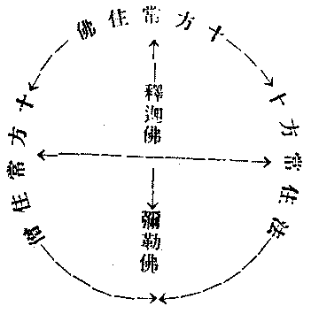



「出发於释迦而归宿於弥勒此为慈宗根本观想必湏常常观想使极其纯熟随处现前」



闽南佛学院藏书数目



本院图书，向未捐募，购书经费，均由学院常费中按月抽出添购者。以是之故藏书不多，学科不备，在所不免！虽深知图书为求学之渊海，遇有因缘，必须募置。虽本院捌年来添购收藏，为数不多，然能增加至百分之九十有奇耳。兹将本寺所收藏之书数目，列表如下：



分类  

册数  

价值



频伽藏续藏  

一一五四  

一四〇〇



佛学  

五九八  

一八〇



万有文库  

二〇〇五  

三六〇



日文书  

二九  

一〇〇



丛书  

一九六  

六九五



史地  

一二五  

三二



教育  

五八  

三〇



科学  

一一  

三六



哲学  

二八八  

七七



文学  

六二四  

一一一



美术  

二四  

一五，四



杂志  

九〇四  

一八九



总计  

七二七八  

三六二四四



本寺佛学院之大讲堂



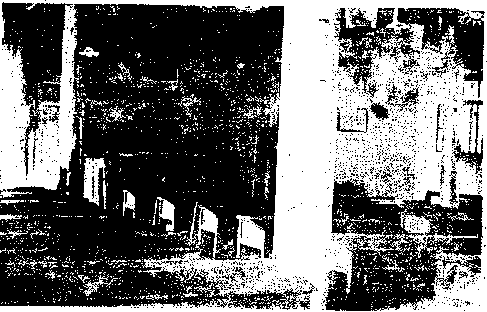



本寺佛学院之小讲堂







本寺佛学院学舍之西廊



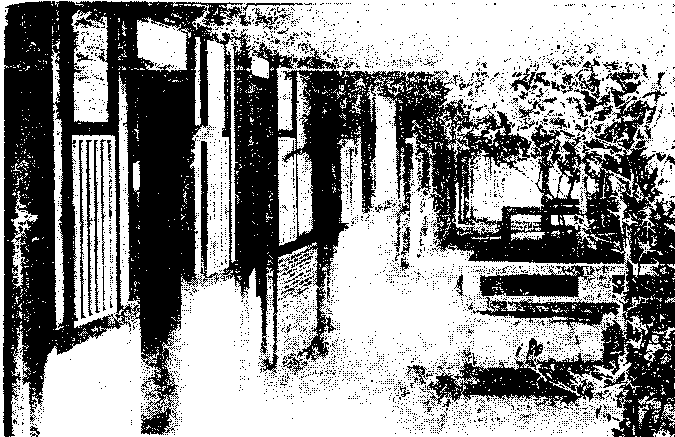



本寺佛学院学舍之东廊







本寺佛学院图书馆佛学组之一部



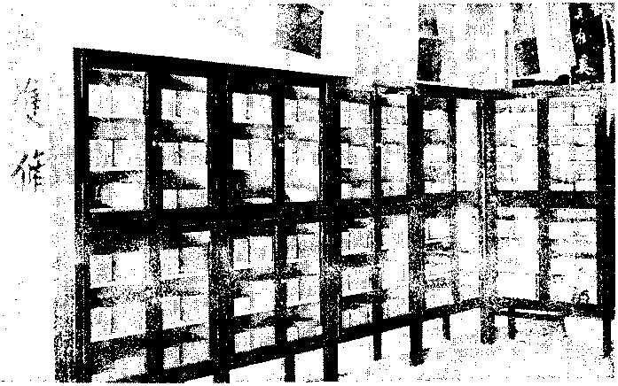



本寺佛学院图书馆世学组之一部



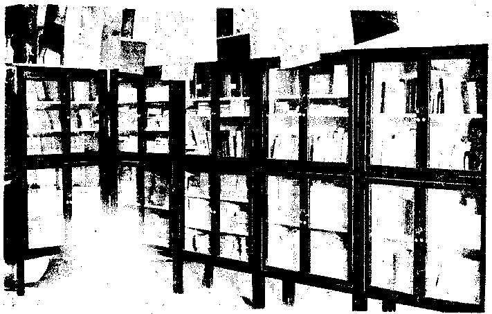



列传



小引



本寺肇自唐宋，其间兴废不一，其沿革已志本寺寺考，兹不多赘，惟本寺自开建以来，代有德僧职僧应化於其间，或以道德为人所景仰，或以办事勤敏见称，要皆为法门之龙象而本寺兴废之关键系焉，同人以其功绩不可掩没，爰将本寺过去现在之有功行於常住者，而分为德僧，职僧二类梗概略述，而现代有力之护法居士亦兴焉。



一　德僧



本寺开山慧日临祖老和尚



喝云堂上景峰先祖老和尚



重兴本寺德隆己祖老和尚



本寺堂上真衷老和尚



本寺堂上真和老和尚



喜参和尚略传



高文显



喜参和尚者，重兴本寺之德僧，安徽池州府青阳县人也。幼遭洪杨之乱，避难流落闽厦，寄身梨园，颇有声望，虽在歌舞声色狗马货利之场，然常具超尘绝俗出世之念，所谓莲花之生於汚泥而不为其所染，高洁独芳，超凡入尘，证之于师，而益信矣。



苦海无边，囘头是岸；如师者勒马悬崖，勇毅过人，与彼沉沦生死海中，被声色所迷之苦恼众生，岂可同日而语乎。故师尝在演剧中，因披袈裟，即动出世想，盖悟人世之悲欢离合，苦乐无常，与剧中人之变幻虚假莫汕，同为一辙也。於是奋袂而起，往南普陀寺依佛日和尚座下，脱白披剃焉。未几，往漳州南山寺受具足戒，且亲近佛乘和尚，参究向上事。一日，正随和尚挑瓦砾，和尚以杠击之曰：「是什麽耳」？曰「不会」。和尚再以石子投师前呼曰：「取来」师拾起呈上，和尚曰：「不知本来面目，争得恁麽来」？言下大悟，礼谢曰：「乘师直指授，岂是旧时人。」从此力行师道，彻究禅机，四众弟子，皈依日众，以此因缘，重光南山，声誉遐迩，斯时也；厦地绅商，闻其道风，函请住持鸿山寺，师以众望难却，慨然允许，驻锡未久，恢复旧观，逊清光绪二十一年接住本寺，百废俱兴，法雨普施，法幢高建，诸天欢喜，僧俗同庆；如今之闽南佛学院，学舍讲堂，秩序整然；明窗净几，花木阴翳；诸师千里云集；聚会一处，讲於斯，学于斯，深究如来大法，得无风雨之虑；栖身食息，如入宝所，佛教佛化，光芒万丈，嗟呼，此谁之赐乎？诚参公德泽所加庇也，此外如本寺之祖堂亦师卓锡时所建，至今完整，巍然独峙，师之劳苦，功莫大焉！



师住持本寺以来，除应兴应革，整理建筑外，而维护佛教，续佛慧命，方便利俗，普济群生，亦师之素愿也。如辛丑冬恭迓浙之天童净心和尚来厦宏扬戒法，壬寅再度开堂传戒，本寺道风，於斯益振；厦地长官达士；信男善女，闻风景仰，皈依尤众，如当时厦门道，刘庆纷及其夫人皈依座下，一时传为美谈，足见师之慈悲为怀，济世利物感人之深矣。师自得此无上法缘后，益力行佛事衞教之心更热，吾尝闻之於吾母云：「喜参大师者，德高望厚之高僧也。尝创办念佛堂，及佛化小学等，一时学者，云集甚众，而平居关心佛教之盛衰甚切，曾闻泉之安海龙山寺被新学暴徒，侵凌霸占，师闻之大愤，奔走各方，游说当道，栖栖徨徨席不暇暖；后卒得其弟子刘庆纷之力，特派干员，前往调解；寺囚此得安宁而不损其毫末，师之力也」。据此亦足见师衞教之热忱与夫维护佛法之一班矣。师享年六十有四，圆寂。塔於本寺开山塔之左，寺董刘君培元曾有喜参大师真像赞，兹附录於此，以见当日之盛也。赞云：



犹是官骸师　胡为名为大  

犹是面目像　胡为号以真  

盖由浑亡四相　断绝六尘  

三心既了不可得　五蕴亦殒於无垠  

所以即空即色　即藐即神  

禅关三载闭来清修默默　戒座两期登去大诲谆谆  

此其主席普照　佛光重新  

春风写影　秋月结隣  

人第观其表正形端　乃高僧之垂范  

我深识其情忘性空　寔菩萨之现身



二二．四，一九，菩萨戒弟子高文显谨传于厦门大学



转逢和尚事略自述



寄尘记



一　略敍出家因缘



余本省泉州南安县人，俗姓王，兄弟三人，余居次也。余父讳亦堆，母胡氏，均以忠厚见称於乡里。而余之父母亦以长斋奉佛自勉焉。余孩提之时，夜间尝梦红日如大莲花，先彩夺目，备极庄严，觉寤后陈禀父母，父母喜甚，因字余曰卧莲。盖阴许余对於佛门有大因缘故也。自此以后，随父母菇素奉佛，信心决定。年十二，见长兄为僧羡之，禀之父母求为僧，许之。至是即随长兄往小雪峰寺而度其善男子之生活矣。



小雪峰泉之有名古刹也，历代住持，高僧辈出，如义存禅师，在禅宗中所负之声望、可以窥见一班矣。虽去圣遥远，狮弦绝响，发心利生；代不乏人。余初到雪峰寺时，为该寺住持者，则为佛化老人。佛化老人之道德，久为泉属僧俗作大皈依处矣。余见面时，即蒙老人开示云：凡躯能灭，其中有不生灭之佛性在。了解得此义，方可为僧。汝了解否？余应曰了解，老人欢喜。授余一偈曰：端坐念佛意新新，寂寂虚虚净无尘，六个门头光灿烂，通融法界本来人。余自得此偈后，参禅念佛修持不辍焉，余在俗少读书，既入佛门除修持操作外。学经习字，日以为常，今日稍有成就，完全得力於佛化老人也。



二　具足戒后参方



年十八，依喜敏大师脱白披剃焉。取字转逢，号海妙。廿二岁，诣本寺——厦门南普陀寺——具足，得菩萨戒位。逊清光绪卅四年行脚参方，初於浙江宁波之天童寺，天童寺乃三江禅宗之巨刹，密云祖师道场也。余住禅堂，时在冬期，打静七，僧极众，一日堂头和尚八指头陀开示，至阿难拖死尸句。又云：个物非仙亦非佛，运用体如如。言下默然有省，嗣后身心轻安，得未曾有。次往江苏镇江之金山江天寺，江天寺亦三江禅宗之巨刹，佛印禅师道塲也。余住禅堂至冬期打静七，一日晚往斋堂吃点心粥，到斋堂将坐未坐时，一念之中忽然山崩地裂，虚空粉碎，几有大地平没之概，余甚异之，而余之还大包孜钱亦稍有把握也。次往维扬三汊河高旻寺亲近赤山老人焉。高旻寺亦为三江禅宗之巨刹，玉琳国师通塲也。赤山老人参破黑漆桶大智慧人，经文不识，侍者诵之。即就文柝义，罄无不尽。虽老师宿儒，莫敢抗衡，如过去之月霞，谛闲，慧明诸法师，皆出其门下，余得亲近，何幸如之。余住禅堂，打静七，到第三个七期中，忽而心行道绝，无功可用，几天不睡，寂如枯森，越四日午板香时，睡魔压逼，几不能支，当下慧光一照，当体皆空，所谓本来无一物殆即是欤。余於是请老人开示，印之云：汝若真是作如是，不愧禅堂苦漠儿。——尘按此苦漠儿废解，或枯木儿之误乎。——嗣后行脚常州天宁寺，天寕寺亦为三江禅宗之巨刹也，财产之富，甲于全国。近闻坐香废驰，日趋应赴，佛门不幸，一至於此。余住天宁寺知遇於前住持冶开老人授以知客僧值各职服务常住，於是一片闲云为之留住，自此以后，凡江浙之大丛林者，多以首领职事相授，而余之发心开创丛林，整理寺规、亦自此为鹄始矣。



三　接住南普陀寺



民国九年，往礼山西五台山，晋谒文殊菩萨后囘住北京。——即今之北京——本寺当事人，派代表往京，邀囘任本寺住持职务，因为道场关系，未便峻拒，即随代表阵同返厦，在当时本寺不过为一子孙小庙，荒凉满目，令人凄惨不禁，余乃斩伐蒿莱，粪除瓦砾，香火日盛，住僧亦多，继思十方常住栽培恩广，即将本寺改为丛林，实行丛林制度，如上殿，过堂，坐香念佛，打七均实行焉。虽然，一人做事，颇觉吃亏，至民国十三年大殿及两旁走廊钟鼓楼等工程告竣，而余之心力亦为之交困矣。於是设订十方选贤规约二十则呈之政府立案，以为永远法制，一扫诸方之子孙制及法制之流弊也。本寺虽由余整顿，改为十方选贤丛林，而赞助成为事寔职事大众亦有力焉。本寺自改为十方后，本寺之发达迈进，亦为前所未有也！本寺改为十方第一任和尚则为会泉法师，——有传另录——自本寺和尚选出后，余即交待清楚，囘泉小雪峰寺，整顿祖庭，藉报祖恩，民国十五年冬，往漳州南山寺未几沾病，返厦，住养真宫，养病就医焉。一日晚，梦见一金人身长数丈垂手立於海中，神彩焕发，光芒万丈，惊醒病愈，民国十六年春，因本寺改选太虚法师为继任持，——有传另录——余代表常住，往沪劝驾，於是又返本寺襄助寺务矣，六年以来，虽无所建白，然寺务院务，力求整治或可差强人意耳。



四　余今后之愿行



余在民国二十年元旦，在须摩提国中设坛主施瑜伽千座，藉以利他亦以自利。须摩提国本寺之后山巨石云木中，初因本寺饮料水源，常威缺乏，阖寺大众，时以为爱，有某师采药山中，见石壁下有泉水流潺潺，颇以为异，掬而饮之，味甘而冽。喜极，走告余，余随往探究竟，见源显活水来，颇合衞生，因势凿池，蓄水储之。而本寺之饮料前感困难者，今得以解决焉，余因此筑石屋于池上面凡三所，曰兜率陀院，曰须摩提国，曰阿难若处。地势清幽，回少尘嚣，外护苏居士慧纯，陈居士敬贤，蔡居士吉堂，林居士镜秋，时过论道倍觉生色。余因前在湏摩提国中设坛主施瑜伽千座二年以来，功德圆满，自利利他，获益良多。余今后之愿行！唯此法门，认真做去，但愿所有功德，回向法界，情与无情，同圆种智耳。



民国二二，四，六，于闽南佛学院



会泉和尚传



默如



会泉和尚：别号印月；明性为其名，俗姓张，福建同安人也。童年多承母训，因其年方七岁，父即西逝，故惟母是所依怙。至年十三，乃觉人生於世，生活问题，由自解决，方不失其独立之精神，於是立习商业，以逞其志耳，至年十四，忽遭不幸，母亦弃世。由是囘想起来，父母相继去世，前后未及十年，甚感世相既如此无常，如此幻化，则人生之意味甚寡，终难避免死之一途。既而因览岳傅，审悉忠孝确为人之根本；然往往事实与志愿相悖，因环境之阻碍，遂不能达到目的，由此厌世观念顿生，出家思想渐萌。至年十九，毅然出家，遂投於虎溪岩善温和尚座下落发而为僧矣。然此仅具僧伽之形像，尚未获得僧伽之精神。——僧伽之形像者，身著圆领方袍也；僧伽之精神者，依佛戒律而实行也——故其年满二十，乃受具於漳州南山寺学公和尚。此为会泉和尚出家与受具之因缘也。



受具已后，已知戒律，固为僧伽身心之轨范，然欲炼一纯善之僧格，及一有用之人材，则非修习禅定与研究教理不为功。和尚本此自利利他之宗旨，发起无畏精神，百折不挠，效玄奘之西游，学善财之南询，诚可钦仰。兹略述其参访知识之经历，即可见其精进之一斑矣。和尚二十二岁，航海至浙省之天童寺，听谛闲法师讲法华经；同年夏，复游南海听幻人法师讲法华经。廿三岁，复囘天童，听寒桥法师讲楞岩经；同年冬，进禅堂，练习禅定。二十四岁，听天童延请之幻人法师所讲之楞严宗通；经期毕后，常州复请幻人法师讲法华经，乃又随之而去听讲。二十五岁，夏，游焦山，听通智法师讲楞严经；冬，进住高旻禅堂。二十六岁，冬，至金山，进大禅堂习定。二十七岁，春，至大通和悦洲，听月霞老人讲楞严经；夏，来天童，听通老法师讲楞严经；冬，进禅堂打七。二十八岁，复回本省，至厦门南普陀寺，襄助净心和尚代参老和尚傅戒。二十九岁，住泉州小雪峰，亲近佛化法祖，殆有三载。祖示以禅宗法语云：「剔眉露出通天眼，返照身心练是空」。由是和尚了知楞严经中指见是心之语，亦不可得也。卅二岁，再至天童听道阶法师讲便蒙钞及唯识三十论。三十三岁，与太虚大师同住天童听法华经；同年秋，至泉州承天寺，襄助启建水陆道场，以作冥阳两利之法事。和尚受具后之十餘年来，皆度如此之云水生活，飘零他方，行踪无定。——由福建而浙江，由浙江而江苏，由江苏而安徽，往来循环，不暂停息。——然而身体安泰，精神舒适，一瓶一钵，足以维持生活，三衣只具，亦能到处安身。虽则备尝艰辛，屡遭挫折，而和尚胸怀坦白，无事自若，以其另有精神上之安慰故也。其安慰为何？受善知识之熏习。如饮醍醐，得大导师之开导，若被甘露。——孔子之所谓「发愤忘食，乐以忘忧」者，——是也。故其终能造成闽省僧界中之一翘楚人物。古人云：「不受一番寒彻骨，那得梅花扑鼻香」？其斯之谓欤！此为会泉和尚参方与学道之经历也。



受此一番辛勤，知识既富矣！而道德亦宏且大矣！於是声闻国内，名播十方，尤其闽南人士——莫不非常敬重之，爱戴之，景仰之，拥护之！而和尚亦本其爱己爱人爱教之热忱，以从事於化导社会宏扬佛法之工作，而不稍懈焉！有人请其学术演讲者则演讲之；有人请其通俗布教者则布教之；有人请其主席丛林者则主席之；有人举其领袖僧众者则领袖之。和尚毕生事业，不出於此。其他丛林中之上座大德，惟以幽闲生活是务，安乐自在为图，较之和尚，不亦霄坏乎？



然则和尚宏法之历程又为如何欤？兹请述之。和尚三十四岁因受泉州小雪峰之请，讲楞严经。三十六岁，囘虎溪岩，静修三载。三十九岁，因受台湾人士之请而讲经。四十三岁，主席泉州承天寺，弘法数年。五十一岁，主席厦门南普陀寺，创办闽南佛学院。五十四岁，退院，请太虚大师主席。五十五岁，至台湾讲经。五十八岁，於承天寺讲楞严经。五十九岁，於虎溪岩再讲楞严。今年（民国二十二年）六十岁，於万石岩新建佛学研究社，以领僧众从事於佛学之研究。今后於佛教之贡献，於众生之利益，当不可限量，兹者，不能预记，且止於斯。此为会泉和尚弘法与利生之概略也。



道学兼优，固为人所尊敬恭养，而会泉和尚之所以特为闽南人士讴歌赞叹而不已者，盖必有其因缘也。按余所知者约有两点，即（一）和尚布教与演讲之方法，尤其通俗演讲，人皆曰善。其口词之锋芒锐利者，足以使懦夫听而精神卓立也；其理论之切实诚恳者，足以使顽者听而态度洁廉也。其布教时，往往一般人民，甚或一聆法音，顷刻满目中之泪珠汪汪，霎时心理上诚意恳恳，於是油然而生起皈敬三宝之观念。其说法之动人有如此者！故闽南人士频延和尚说法，而和尚亦不惮烦悭悋「法施」，——所谓遇缘即应——是也。今之闽南人士，信仰佛法，有如此之众者，未始不由其说法之力所感化也。（二）和尚住持南普陀，尤其创办闽南佛学院，人皆曰善。盖佛教在近十年来，如在风雨漂摇之中，内部不振，大有死气沉沉之现象，而外界因之蔑视与欺侮，甚至觊觎寺产，提倡拨出以充教育经费。故和尚自主席南普陀以来，本其关心中国佛教前途之旨，乃商榷於本寺转逢和尚，创办一闽南佛学院，以育僧材。然此教育之经费，并无恒产可恃，即以香火收入，勉为其艰。由创办以来，至今未告暂停，诚为中国僧教育机关中之首屈一指矣！於是僧材辈出，僧格提高，社会人土亦因而改其鄙弃之态度，而敬之爱之之不暇矣。而吾人得受僧教育之训导者，未始不由其提倡僧教育之功德也。



此上二者，不过就其大者而言之，其他小节，不胜枚举，姑止於此耳。至其将来之历史，虽不能预记，想於佛教必更有惊人之发展矣！



民国一十二年，四月五日，作於闽南佛学院三友楼



太虚法师略传



寄尘



佛教新运动领袖太虚法师，年四十一，浙江崇德人，俗吕姓，弱冠即皈依佛门，年十八间教於八指头陀，道阶法师，习天台贤首宗之教观，次年，阅大藏经，苦心静研，顿从般若经豁然大悟诸法之实相。年二十，即创僧教育会於天童寺，为其事业之发端。次年，从杨仁山居士月霞谛闲二法师游，旋任教於普陀化雨学校。年念二，被举为广州白云山双溪寺住持，遂办佛学精舍於狮子林，同著作佛教史谕多种。次年，以革命嫌疑返沪，旋民国政府成立於南京，乃创中国佛教协进会於毗庐寺，南北统一即合并於中华佛教总会，又推为佛教月报总编辑，真如福音由是播，世道人心由是正。民三，访依了餘和尚与印光法师游，潜修於普院麒麟禅院，习禅定净业研究法相唯识律藏密宗诸经。造诣极深，并涉览诸子百家古籍，及近代西洋哲学宗教新书，历民四而至民五，在其静修中有论神教，论天演化，论周易，论墨学，论荀子，及哲学正观，教育新见，佛乘导言，大佛顶首楞严经摄论，整理僧伽制论等著作，而完成其思想之正统。民六，普院出关后，漫游日本，台湾，暹罗，缅甸，锡兰，柔佛等处，於是确立其以佛法改善社会进化人群之志。次年，与陈原白王一亭等设觉社於上海，办丛书季刊以导扬文化，纠正人心，其影向所及，各省遂有纷纷之居士学佛团体出现。民八，请讲维摩经起信论於北平，听讲者多为一时名流学者，可谓收历来法会未有之功。民九，任杭州兜率寺住持。办海潮音月刊。又往武汉广州讲学，设立佛教会於汉口。次年，住持西湖净慈寺。又被邀讲学於杭州北京等处，而宣传佛学救世主义，推行更广。民十一，讲学汉阳归元寺，而创办佛学院於武昌。青年缁素来自四方者，济济一堂，研习学理，精持戒律，为一时之冠。近年来种种佛教新运动，莫不以该院之学者为其主干，旋又被推为湖南沩山之住持，以一人而同时长持多种团体，劳心劳力，於此可见。次年，又创立芦山大林寺重新古代道场，复筹开世界佛教联合会於该寺，以期今世界佛教有阔大之组织。民十三，暑时住开第一次大会被举为会长，旋又讲学於泰县光孝寺，江北之僧伽居士，慕名往听道者踵相接。民十四，又讲於北京宁波上海居士林等处，是年夏，曾代表中国佛徒出席日本之东亚佛教大会，次年又被邀讲学於南洋新嘉坡与厦门南普陀并设佛化教育社，及佛教通信社於沪东雪窦寺，民十六春，乃创办上海法苑，旋又被推为本寺住持并兼任本寺所办之闽南佛学院院长。本年秋，被请为亚细亚大学委员，及德国中华文化学院董事。因念国府新建都於金陵，训政伊始，各种政治渐趋正轨，遂於去秋发起全国佛教代表会议设立中国佛学会筹备处於毗庐寺。以期中国佛徒有严密自治之机关。十七年八月十一日起程赴欧美宏法，为我国佛法传到西方之第一人，有特集各界同志其饯欢送於海上之沧洲别墅编印特刊摄影，以壮其行色。历经法比荷德英美各国，到处备受友邦学者欢迎，报纸杂志皆纷载其言行，唤醒世人迷梦甚众，欧美人士对东方文化信仰深切，各大学各学会见师光临咸纷请演讲应接不暇，东奔西走，勇猛精进，诚为常人所难，及勤习武当太极拳之效，在法时曾与各邦哲士发起世界佛学院，於巴黎大学设筹备处，并有信士慨捐鉅款美的，以促其早成，可见碧眼儿为善之心，亦不亚於国人也。於十八年（一九二九年名女子今秋还有坤村主义发明家刘仁航博士，将赴欧美从事世界女性和平运动，以继法师之伟举，）劳働节归故里，四日应上海各界同仁欢迎大会於报本堂下院，报告出游八月宣道经过，及欧美人十对于东方文化之态度，藉资同胞观感。时已被推为中国佛教会常务委员，又往杭州九华安庆武昌长沙各处讲学。十九年春，往福建讲学，夏往四川各处讲学，并在北京居士林讲法，与朱子桥居士及台源和尚常惺法师等就柏林寺，立世界佛学院设备处，二十年春，返厦门本寺讲演。夏往北平应中西各会之请，讲佛法。是年十月应陕西佛学界之请，往陕宏法，并在大慈恩寺成立慈宗佛学院。二十一年春，在南京佛学会讲法，夏，往四川组织汉藏教理院，秋，被任为奉化雪窦寺住持。旋返厦门本寺及厦门大学讲法，冬，往油头佛教正信会讲法，旋返厦门本寺讲大乘本生心地观经全部。二十二年二月往奉化雪窦寺讲法，余忝列其门下，佩伟其志力，谨为述其生平之事略，以告仰慕大师之为人者。（附注：本传多取材於海潮音及黄警顽先生之太虚法师小传特此声明以免掠美之嫌）



民国二二，四，八，于闽南佛学院



二　职僧



转道上人传



寄尘



释海清上人字转道，福建晋江县桐林乡黄氏子也。父依汲公，母吕氏，上人年十一时，父病甚笃，辄思兄弟六人，已居其季，倘父有不测，将何所倚。遂默祷菩萨冀垂侑焉。精神所感，金石为开，於是在梦中见一老人，指示云：汝能持斋，父病可痊。因即发愿持斋，父病因此旋愈，异日设肴，父命食肉；不答，父怒，上人长跪白以前因，父闻而感动，遂使全家素食焉。年十三，闻人演六祖坛经，心甚喜，即往南安仙迹岩充当饭头，明年，赴海澄大岩！亲近喜敏上人，听讲法要。年十八，除夕日闻母赞美出家好，乘机请命，母喜，次年正月同父并众善友赴漳州南山寺，礼喜修大师为本师。二月十九日脱白披▆焉。五月母逝，奔丧如仪。旋父病八月方痊，同喜敏上人往雪峰，路至岭兜石室岩，患吐泻甚剧，梦中见弥陀示现金色身伸手三摩其头，惊醒遍身汗出，病虽少安，举步维难，雪峰之行未果。十一月往漳州南山寺，求忏摩具足得菩萨戒位。明年四月二十五日本师西归，丧事圆满，乃往雪峰听讲，至见见非见，见非是见，见犹离见，见不能及，有省，旋囘梓视父病，六月十五日父殁，丧事尽哀，由是往外参学镇江金山寺禅堂，忍而不退，更往扬州高旻寺深造焉。行之三叉河边，雪月皎皓，妄心顿歇。次春因胃病，发愿朝山，五台，峩嵋，敬礼多次，还住天童，后逢喜参和尚传戒於本寺，为请高德八人，返厦随喜，戒期毕引住漳州万松关瑞竹岩，及厦门金鸡亭，心甚不安，旋往金山高旻等处坐香，因喜参和尚闭辟，催其返夏，襄理寺务，遂发心建筑放生池，池功告竣，退住养真宫，一心参研，不理世缘。逊清宣统二年云南虚云和尚来厦，欲往北京请藏，以无熟人，邀上人同往，请藏囘滇，虚公感甚。民国二年，拟往云南静修，过星洲之金兰庙，因徒姪与刘金楞争地，戏言汝二人皆不必争，可将地布施於我建寺供佛，作大功德，二人应允，遂同瑞等转岸二师，商建殿堂，至五月成功，以逐年俭积钵资，期建一大丛林，适转物和尚南来时，述及泉州开元寺为闽中一大道场，邀其共兴开元寺，旋与转物和尚於XX年九月十二进院，十五日桃开红莲，见者闻者皆诧为千年未有之瑞相也。去年正月一日，所住星洲之天福宫，亦嘉禾献瑞，开元中兴此非先兆乎。今开元寺由上人罄出其所积钵资，鸠工整理，焕然一新，请转物和尚住持，并设有慈儿院，以广行佛化，此上人自度自人之德行，洵足以继往传来者也。上人在本寺有大功行焉，且请为座元要职，兹略敍其生平，以志不忘云尔。



民国二二，四，七，于闽南佛学院



转尘上人传



高文显



释转尘字海净泉州南安黄氏子也。品性忠厚，人所不及；中年视世路崎岖，人心浊恶，汕然作出世之想；乃投喜静禅师为师，受具足戒，於自是力行佛事，精持梵行，历任本寺监院，与瑞等诸师，共谋重建大雄宝殿等；十餘年来，服务佛教，未常稍怠，足见其忍苦耐劳之精神，为佛教而牺牲者大矣。



上人现任泉州承天禅寺住持，创办佛学研究社，造就僧材，弘扬教法，亦僧界中不可多得之大德也。



二二，四，二二，写於厦门大学



觉三法师小传



寄尘



释觉三，字契林，湖南衡山石湾刘氏子也。年十九，游岳访仙，至祝圣寺遇妙观上人契之，遂投座下脱白披剃焉。未几，往南台忏摩具足得菩萨戒位，时为逊清光绪三十二年也。明年，谒普陀四明诸长老不契，怅然返岳，挂单於祝圣寺。专心净土，阅五寒暑。越年，天然法师归岳，遂从之参文字禅，破题初试，震惊侪辈，天师深许之，遂默识之以为佛门法器也！辛亥之役，谭旭升辈起义宝庆，新学暴徒，毁寺逐僧。师每顾侪辈曰；佛教既失金池，吾辈之事多矣！苟非振兴教育，整理僧制，则佛教前途将不堪设想也。乃於民元偕离尘帅晋省肄业僧师范，明年，又肄业於法政学校，精研政法诸世学，毕业后，行脚至甬，供职七塔寺，颇有功行，寺僧敬之。民七游皖，结茅大龙山，专究向上一着。后皖之闻人马冀平居士等，创办僧学校於省会之迎江寺，师应竺庵上人之邀，莅寺帮助常惺法师襄理教务并任监学等职。学僧中有闽南广津瑞金二师，在其座下肄业，毕业后返闽，游说闽南诸山及本寺前住持会泉和尚请常师来寺创办僧教育而育僧材，师遂与常师连袂来厦，组织闽南佛学院任监学兼训育主任，而本寺亦请师为堂主后堂等职，时为民十四也。越明年，本寺小学部移往漳州南山寺，师随往服务并主持焉。南山学校因之发达，几为闽南教育界首屈一指矣！民十六本寺住持太虚法师，就职后，请师为首座，并请为代理院长及教务主任等职。民十八，师因南山学校经费问题，往台湾有所筹措，不意偶恙返闽，竟至不起，遂于十九年三月二十日午时圆寂于漳州南山寺矣！师为人寡言笑，富热情，善辞章，工书法，询为佛教僧教育界之翘楚也。余忝为私淑，泛缘亲炙，兹特撮其生平梗概，以志不忘云尔。



二二，四，二九，于闽南佛学院



性愿法师小传



觉斌



释古志，字性愿，南安古山乡洪氏子也。俗家父母皆奉佛，幼年即依德山禅师披剃。年十四，受具足戒於本寺；后参学於浙之天童，及江苏等名刹，研究天台教典，颇有心得，在泉常设讲座，听众极多。



师聪慧过人，善辞章，工书法，现主讲於泉之承天寺佛学研究社，宏施法雨，普利人天，诚闽南僧辈中之翘楚也。师为本寺首座，服务本寺八年餘，以此因缘，谨传以为纪念也。



二二，四，二七，写於南普陀寺之监院寮



瑞等禅师小传



觉斌



释瑞等字寂平，漳州海澄县白水宫陈氏子也。因看破世缘，发心出家，投本寺依转武上人座下，脱白披鬀焉。未几，往兴化广化寺忏摩具足得菩萨戒位，后往南洋参学，颇有声誉，数年后返国服务本寺任监院职，与转逢长老共谋重建大雄宝殿，师力居多，佛殿工程告竣引退，复往南洋宏法，名闻利养，无动於衷，师之为人，於此概见矣！而师性好施，人所不及，如本寺大悲殿此次重建，工程浩繁，需款众多，师在南洋募有巨款接济，厥功甚伟，今特记之，以志不忘云尔。



二二，四，二七，写於南普陀寺之监院寮



芝峰法师略传



雪生



芝峰法师，字象贤，别号止止斋主人。一九〇〇年，生於温州之乐清县。俗姓石氏，祖业农。师幼时，便具慧根，日唯以书自娱。一九一三年，毕业於县立高级小学。后随舅氏万定和尚出家；於其本邑之曰龙洞。和尚授师以「天台止观」之学。一九一五年，受戒於永嘉之妙智寺。师日精研经教之餘，复兼究东西名哲之著述。一九一九年，任职永嘉护国寺「时雨僧学校」。凡三年，与师同事之友人，相继迭逝，独手难持，师暂忍舍其宏法之事业矣！然因世相日迁，僧伽日复堕落，师不忍坐覩正法之陵夷，遂抱挽囘既倒之大愿。斯时，太虚大师，倡整理僧制於全国，设学府於府昌，师乃负笈肩囊，远投於匝门之下。凡二年，旋里，复闭关於永嘉西城，落霞潭畔之普觉寺。此寺，系永嘉大师之道场也。寺西，隔水城垣，蜿蜒数里。东望，则佳木葱茏，松台耸翠。面视，则落霞潭水，清碧呈漪。后闻，宿觉钟声，隐约可辨。如许水影山光，晨风晚雾，皆足消人长气，星晨月夜，柳拂莺鸣，焉起世外之思；唯师独异之。闭关未及一载，即出创办三家讲舍於护国寺矣。师擅长诗文，每於课罢之暇，常与诸生吟咏於溪桥石畔。后二年，因感经济竭厥，讲舍以致停顿。一九二八年，承其亲教师太虚大师之命，来闽院任佛学研究系主讲。每暑期中，复弘法於江浙各处。一九三一年，任南普陀监院。翌年，兼任现代佛教月刊之编辑职。一九三三年，复承太虚大师之命，赴鄂任海潮音月刊总编辑职。



师自出家以还孜孜学业，碌碌驰奔，为法为人，有足多者。盖师之所为者，以兴佛教为职志，绝非盗名沽誉者流之可同日而语也，忆师当离乡将赴闽之时；出诗以勉其诸生云：「恶风暴雨撼潮来，佛化於今大可哀！为扶砂盘方举手；非同傀儡喜登台。无穷妙义湏深造，大好时光莫浪摧！此度别离无别虑；百年又望栋梁材」。於此又窥师之怀抱与师之志愿矣。余忝列师之乡末，且得师之教育独多，今师远涉，不无依依。聊记概梗，以志不忘云尔。



大醒法师小传



东初



大醒法师字机警别号哭庵，江苏东台袁氏子也。生而颖异，记力过人，沉静寡言，见者称之，虽在童年，喜闻佛仙，偶览佛典，即悟生死樊笼悉由心造，潜超世志，拟入梵园，阻於尊长，志未果行，稍壮负笈江都师范学校，中西科哲，无不潜究，然欲得一解决人生生死与夫救世济民之道则未可也。於是决志舍俗，皈依佛门，即於尔时投江都天宁寺礼让之长老脱白披薙焉，於民十二年忏摩具足得菩萨戒位於维扬之普照寺。民十三年夏听讲於海陵光孝寺，冬，负笈於武昌佛学院也。



佛化新兴运动太虚大师首剏佛学院於武昌，为开中国僧教育之先河，亦为中国佛教造就宏法利生人材之嚆矢，法师在同学中，倜傥卓志，悲智迈群，每试侪冠，诸教师啧啧相赞，时人则谓为太虚大师门下三大将之一，是也。太虚大师恒以大乘唯识法相融通大乘八宗之佛化及「志在整理僧伽制度论，行在瑜伽菩萨戒本」牗之，故师有新僧会组织於武院，作整理佛化第二次新兴之运动，未几，武院辍学，则偕显教迦林又山宏渡体参本和诸友肄业於南京法相大学，师栖止金陵寺选修数课耳，后太虚大师於匡山剏立庐山学窘究佛典，时习英文者共十人，后学窘散七人去北大连师三人留学於匡山，师念佛教既无精锐系统之组织，又无寺院考究之统计，遂一心遍游全国寺院之首刹，如庐山西湖金焦宝华苏常江都等名刹均涉足焉，又每见古德刺血书经，心輙敬重，至金陵得交机本映彻二上人，遂发心刺血书经三次，又鉴现代佛学者口里圣贤心中戈剑，遂揜关於金陵寺，结以往所学之总账，参究其俗不二，二而不二，净名之不二法门也。丁卯四月国体软弱，受帝制之威胁，英美砲舰击南京城，时诸道友劝其出关，以免危险，师则答以出与不出，死与不死於人生究竟有何裨益耶？况今生於国基不固，民不聊生之际虽生不如死也，诸友苦劝遂出关焉，复住金陵，或参禅或念佛或读经，行走坐卧一如在关，师学贯中西深研科哲尤精佛学，时有建议整理僧伽制度论公诸报章，名满天下，识与不识，莫不知师也，师嗟世道缘悭，所学未圆时为燄然，然民十六太虚大师驻锡南普陀寺奉命南来主持院务，代理院长，艰困伦节，勇於任事，旋请为南普陀寺监院，福州鼓山涌泉寺虚云长老又聘为鼓山佛学院院长等职，故民二十两次讲学於鼓山，诚盛事也，闽院为全国学僧之所依归，亦为南国僧教育之学府，由师主持五载如一旦，毕业两次，成绩斐然，不啻开南国佛教之新纪元，亦为中国僧教育之罕闻也。



欲挽世界之狂澜，刷新僧伽之不良，非揭穿世人之纰缪，打破僧伽之黑暗，不为功焉，故师依虚大师整理僧伽制度论及海潮音杂志宗旨为宗旨，言论为言论，创刊现代僧伽，（后改名现代佛教）得芝峰寄尘二法师之合作，及各方诸友之钻助，发行以来，颇得社会一般人士所赞许，虽招一班傋瞀僧伽之阿谀，然跌宕不羁之精神，终不可改其初衷，志若铁坚，且斯刊印刷经费乃师与芝峰法师各负其半，或捐薪，或募集，辛辛苦苦，菩萨心肠，人所莫及，师善书法，尤精篆籀，复运方便经营翰墨以补刊资，故於民二十一与畫家吴君石卿书家虞君佛心，合开扇面展览於南普陀寺，如有所得，咸充刷金，此刊能发行五载，不断不续，不变逾，乃师之种种方便，大悲卓志，为法为人之努力耳。其他凡有益於佛教者无不牺牲，故民十七及民十九邰爽秋氏庙产兴学运动，举国僧伽无不悲愤，无如一班哑羊僧伽，依然昏昏，师目击心伤，愤不能已，乃发通电唤僧伽於甜途，挽狂澜於万一，及驳斥庙产兴学之宣言，诸山大德长者及护法居士莫不赞仰之。（参看现代僧伽第四卷第一期）因此，竟开全国代表大会於沪上，汹涌风潮，於是焉息师功也。



师除讲席任事之暇，喜于吟咏，尝与谢君云声，何君达安，虞君佛心，苏君警予诸友结海印社，往来唱和，极盛一时，并出有七月集，一时纸贵洛阳，师来厦五载矣，不但南普陀寺及闽院得师掌持中枢，亦为厦地诸道友信仰及各界推重，往来诸友均极道义相投，同为常住负责者，则为转逢会泉二退居，觉斌芝锋二法师；同为常住护法者，则为苏君慧纯，蔡君契诚，陈君定谟，陈君李梁，林君镜秋诸居士；他如董事陈少梧长者，道友许宣平，黄炯荪，冯重熙诸居士及广箴笑溪等诸友，皆为师来厦同道往来心契之友，今师已他适矣，与师相契之道友能无动念於衷乎，噫，吾随师时短，所知不广，今仅述其梗概以志不忘云尔。



民二二，四，九



觉斌法师小传



寄尘



复文法师字觉斌，本省泉州南安陈氏子也。因阖家三世长斋奉佛，其父及兄妹具有出家，一时闻者，叹为希有，而师又於坐胎之时，其母在佛前发愿曰，如得男，当舍为僧，故师於三岁时，即依本邑紫帽山古玄寺性行禅师披鬀焉。年十四，往福清黄檗山万福寺忏摩具足得菩萨戒位，从此梵呗清修，日益精进，虽在髫龄，犹如老衲。至民国八年，因思无常老病，不与人期，一吸不来，刹那异世，於是发愿行脚，实行苦行，遍礼圣迹，以增道业，如山西之五台山亲礼两次，安徽之大九华山亲礼三次，他如杭之天目，甬之天童，以及三江著名之名山古刹，亦稍有参学焉。民十六来本寺亲近前住持太虚法师，为时未久，以其老成，授以监院，襄理事务，师自受职以来，认真整理，六年辛苦，厥功甚伟，师处世接物，持之以宽，事上御下，持之以和，诚为青年僧伽中之不可多得也。师今年三十有七，正壮年有为之秋，本寺前途，实利赖之，兹特传其生活中之片段耳。



宏聪禅师小传



寄尘



本一禅师字宏聪，本省泉州惠安曾氏子也。年五十看破世缘，发心出家，遂投思明县虎溪岩，依会泉和尚座下脱白披剃焉。民十五年春，往福州鼓山涌泉寺忏摩具足得菩萨戒位。从此一领袈裟，销磨岁月，六字洪名，以延天年。闻本寺道风，来厦挂塔，本寺住持见其诚实，授以副寺职，襄理寺务，师亦能实践厥职，拥护常住，故本寺六年之一切建筑，师之规划，尽力居多。师今年六十有五，勤劳不息，精神强健，虽三十许人不若也。岂佛菩萨之祥光，特荫庇有功行於常住者，不然何师之强健如是耶？



智普禅师小传



寄尘



中度禅师字智普，本省泉州惠安李氏子也。年四十五，因勘破世情，皈依佛门，礼泉之承天寺依宏仁禅师座下脱白披剃焉。逊清己未年春，发心往兴化广化寺忏摩具足得菩萨戒位。从此一瓶一钵，遍参知识，向上一着，再接再厉，闻本寺道风，心窃羡之。一日振锡，飘然来厦，本寺住持，见其笃实，授以副寺一职，襄理事务，而师自任职以来，为时六年，上下海众，交口称赞，师之为人，於此亦可以见矣。师今年六十有一，精神强健，犹如壮年，故逐日埋头案际，计盈虚，总出纳，神气十足，不倦焉。如师之为人者，诚老僧中之老青年也。



三　居士



蔡契诚居士小传



慧心



蔡居士，福建晋江籍，现年廿九岁，性和蔼，嗜内学。民十二，与陈涤宪董谦六庄汉民苏慧纯等，创办闽南佛化新青年会。当时所作「佛法是消极的吗」论文，曾刊登佛音月刊中，缁素咸乐之交，经商之餘，端热心衞教工作，曾任本县佛教会执行委员，暨本寺护法，实事求是，绝无浮华嚣习。去腊与余同皈依太虚大师，因缔交最久，不时过从，相与讨论法相唯识人情物理之学，每有所言，辄脗合无间，余之老友也。故乐为之传。



苏慧纯居士小传



前人



目光炯炯，胸怀落落，具菩萨之心肠，而不稍减其金刚之威力，其惟吾畏友苏慧纯居士乎？居士晋江籍，年三十，怀大才而气节尤高，遇不平事，辄痛加抨击，不循私情，惟与人为交，又谦谦无忤，一视同仁，才高而能容人，长计划之才也。居士除研究佛学及护法外，喜治拳术静坐之学，每有所言，其境界已与常人不同，余昭然异之。余与居士缔交於闽南佛化新青年会，迄今将十稔矣。故略知居士之才之长，爰写数语，聊志敬仰。



林镜秋居士小传



虞愚



林镜秋居士与觉斌上人，交情甚笃，年四十三福建同安人。予与居士虽少相处，顾彼此相知，固必不泥於形迹之往来也。居士经商，喜佛学，善计划，处事尤勤。近年来本寺后山之阿耨达池，兜率陀院，须摩提国，阿兰若处建筑物，从中筹划，居士与有力焉。今佛门多故，龙象为愁，居士之出也，必将更有造於斯寺，余馨香祝之。



法物



一　法器



坐像玉佛三尊高二尺二寸。系清光绪年间，大美国海军，某炮舰舰长，由南洋请来赠於本寺供养者。



卧像玉佛一尊长四尺五寸。系瑞等师，由南洋请来供养，年月日莫详，瑞师今人，远在南洋。



铜佛三尊高五寸。系坐像寄存库房中。



大钟一口铜质。高八尺，口面四尺五寸。系清康熙四十二年春王月，钦差督理福建沿海等处税务内务府会计员外郎兼包六达巴讳兰泰同众建造，本寺开山比丘露踪敬募。



铜磬一口高一尺二寸，口面一尺三寸。民国丁卯年本寺大众发心敬置。



铜炉一个高八寸，口面一尺。民国十六年赵门范氏莫门陈氏仝敬。



杨木如意一把系本寺住持太虚大师於民国十三年代表中国佛教徒出席东亚佛教联合会於日本东京芝公园增上寺某日僧敬赠者。本质良美，雕刻精致，洵非工业后进国家所能望其项背也。



又木如意一把年月日莫考。



七佛塔一座铜质七层，高七尺五寸，层层均供有佛像故名之。系民国二十一年鼓浪屿黄秀烺先生之夫人陈女士赠於本寺保存供奉者。其夫黄君系古懂商，见塔铜质良美，雕刻精致，以五百金购之，爱如珍宝，其夫人因同安林镜秋先生之劝，割爱布施，敬奉寺中，令大众礼拜瞻仰，普种福田，诚属功德无量也。



二　书畫



飘海观音一轴李唐吴道子畫，民国二十年庄文州先生赠於本寺供奉。墨色精美，笔法生动，洵非近代艺术家所能望其项背也。



墨拓岳阳楼记十二幅张照书，泉州周伯遒先生赠。



庄俊元墨书屏四幅  

虞亭之墨书屏四幅  

章太炎篆书联一付  

王震行书联两付



三　石刻



石林每字高一尺四寸，广一尺二寸，嘉庆庚申年，白庆徕题镌。



祝国佑民（每字宽广约一尺）甲辰年莲臣通慧书。



篆字同治己巳年重修御碑亭，南普陀李成谋，曾宪德敬修，马琛曾文章刻。



碑文同治十三年，礼阳孙开华刻。



碑文民国纪年五月。无锡王蕴章记晋安苏明书。



篆书四字，每字高二尺，广一尺五寸。光绪辛巳杨浚书。



美国海军提督赠银杯文光绪三十四年十月六日，又宣统二年再志。



重修南普陀寺后迎胜轩扇亭记咸丰十一年辛酉，十全堂公刻。



洗心每字高一尺七寸，宽一尺一寸。道光七年丁亥刻。



饮水泉每字高一尺七寸广一尺五寸。道光七年昭萍刘铎刻



南无阿弥陀佛太虚书会泉刻。



海上神山每字高三尺二寸，广二尺八寸。云山张大河题。



天南鸿雪每字高一尺四寸，广一尺。林顺吉刻。



美国太平洋三十五商会代表团偕美领事游志宣统二年九月十七日，叶崇禄记。



山深水峙海濶天空每字高广一尺，民国四年郑乃深题



人在蓬莱第一峰宣统纪元，张煜南题。



三生石每字高广一尺八寸，甲辰年通慧书心镜刻。



五候官爰步陋室铭体志文民国二年刘以臧刻。



海军提督萨镇冰奉命复兴海军勒文宣统纪元冯恕詧书。



五老峰每字高二尺，广一尺八寸。民国九年黄仲讯书。



佛高一丈四尺，广一丈。光绪乙巳年振慧书。



漱石每字高广一尺二寸，民国乙丑年人题。



石荷每字高广二尺，戌午年童保喧留题。



登山南阳每字高广一尺六寸。



顶门只眼每字高广一尺六寸，民国十九年太虚书转逢刻。



兜率陀院  

阿耨达池民国己巳年太虚书。



觉心源民国十八年太虚书转逢镌。



须摩提国每字高广一尺六寸。



太虚大师诗南普陀镌。



憨山大师警世诗歌光绪丙午年，晋江曾遒书。



太虚台每字高广二尺。民国二十年一月，李基鸿题杯滨书。



阿兰若处建於民国二十二年，位於湏摩提国之后。太虚大师题。



文艺



一　诗林



嘉庆己卯仲夏司榷鹭江偶占扇亭四绝



苏修顺



深林一扇亭　结构肖山形  

扑却尘三斗　泉声聒耳听



浑忘三伏热　两袖引清风  

爽籁天然至　无劳展动工



似扇群峰绕　幽亭号不虚  

居然携六月　博得右军书



好是隣方丈　清谈四大空  

深惭无玉带　留挂此亭中



南普陀杂咏



虞愚



片石滞山中　风来吼不动  

怕受三界煎　逃入莲花洞（莲花洞）



淙淙写我心　湛湛清且美  

谁识此池中　长流八德水（阿耨达池）



天地犹囊槖　出处如羁旅  

何地可「成心」　是「阿兰若处」（阿兰若处）(注：「成心」现成本有之真心，出庄子《齐物论》。)



有树可庥风　有泉可瀹煑  

此国真极乐　何用西方去（须摩提国）(按须摩提梵语极乐义。)



青山亦好藏　环绕自成位  

藉问倦游人　谁知普照寺（普照寺）



普照寺



明刘汝楠



野寺前朝建　空门大壑开  

鸣钟霜气动　拂席雨华回  

石倚天星落　江涵晚照来  

山中询法侣　尘刼几成灰



其二



前人



华月蘸清樽　虚庭露气繁  

悬猿啼白壑　归鸟度黄昏  

树色摇山殿　江声到寺门  

上方诗品寂　永夜不闻喧



太虚台晚眺



大醒



太虚台建在南普陀寺后山，为湖北李子宽居士造而纪念太虚大师者。



太虚台上望　田野罢躬耕  

日向西山落　云从谷底生  

深林归鸟宿　大海客舟行  

一色长天水　此时无限情



兜率陀院题壁



前人



兜率陀院筑於庚午年，初筑时，余题其名，盖南普陀寺退院和尚转逢预为太虚大师退居而筑者，后傍岩阿，前临水池，一静境也。陈镜秋苏慧纯二居士，时喜居此，余来居之七日，偶成五律一首，用志因缘。



院傍岩阿筑　名题兜率陀  

天宫礼弥勒　丈室住维摩  

满架经书叠　当窗草木多  

一池泉水静　来去不生波



太虚台(民国二十年李基鸿所建，以纪念太虚大师者)



虞愚



地接诸天近　台高万象空  

涛者渔火外　云影佛光中  

渺渺微尘相　恢恢济世功(师年来弘法宇内，转移世道与有力焉。)  

人间多难日　独立意忡忡



五老山



宋滕翔



海翻波浪绕群峰　无尽崖前此界空  

不是灰心求佛者　片时难在寂寥中



游南普陀



佟法海



天水苍茫一望同　何妨海外说真空  

诗人便是开山祖　风雅禅林鹭岛中



恭和佟法海题南普陀石壁



梁文煊



洛伽普照命名同　色相声音尽是空  

石上宰官新咏在　五灯收入七言中



七月十二日偕小迁警予学琰词源诸子，访大醒法师於南普陀之兜率陀院，



赋此。谢云声



兜率陀宫联袂过　窗明几净傍岩阿  

秋荷别作青蓝色（莲花有青蓝色，产印度。梵语曰优钵罗。佛书多以为眼目之喻。）　足证高僧待我多。



其二



前人



论文谈艺慰无聊　镇日闲愁万丈消  

还约明月三五夜　追踪坡老谒参寥（东坡居士尝於月夜访参寥上人）



中元节游南普陀寺夜半留别大醒达安二吟长



前人



高谈良会中元节　遗却闲愁涤却心  

归路悬思人境外　月明如雪夜钟沉



五老山



明池显方



十年古刹几残灰　重见天花散讲台  

野露欺人疑结雨　松风括地每惊雷  

一泓碧水和云下　万点青山拥海来  

若问个中真普照　峰头夜半月轮开



道光壬午大暑后五日，升晋亭司马令嗣春台上舍，胡柳园张云岩言子纯三



参军，杨藕塘孝廉金肖岩太学，同集南普陀，漫赋。陈性



普陀名胜共登临　排立丰碑翁翠深  

巨石触云通海气　幽兰入座悦禅心  

沧桑阅尽山俱古　风月清凉雨又今  

此地朋簪容易盍　嶙峋最上且题襟



同治四年三月统率六师航海援闽，驻军南普陀，武进餘曙，题此以志



郭松林



平生心迹向谁论　笑对沧溟酒一樽  

敢望殊功垂海甸　欲除元恶报君恩  

三千罴虎屯云气　万顷波涛卷浪痕  

莫道桃源无处是　人间此地即桃源



普陀寺



汪士杰



钟鼓楼高宝殿雄　大江南汇小林东  

流飞石笕山腰水　声落松涛谷口风  

梵磬静时僧入定　海云寒处鴈横空  

浑疑身到潮音路　不尽天花法界中



游南普陀寺赠太虚上人



欧阳小桃



参来禅悦破情关　大悟人间即梦间  

谁喝偈词来鹫岭　我开梵呗写春山  

千般世网能抛尽　一著袈裟便等闲  

为问文殊诗集未　漫披诗稿乞加删



和答前韶



太虚



诗人荣杖叩禅关　几度行吟曲径间  

万树幽松依曲径　一泓清水出深山  

静观云岫浑无赖　却羡林禽自在闲  

付与钟声自生灭　满阶春草未须删



南普陀题名



太虚



南海普陀崇佛刹　虎溪白鹿拟匡庐  

千岩百洞奇难状　陨石飞星古所都  

水鸟皆谈不生法　林云巧绘太平图  

山狮十八惊呼起　一吼当今万象苏



南普陀题壁即次太虚大师原韵



陈桂琛



擎大柱折孤臣死　演武塲开古佛庐  

结社因缘依五老　湼槃声价迈三都  

纵教刼火成灰烬　旋见禅宫入畫图  

偶与参寥一酬唱　此身宛在梦中苏



南普陀题壁次太虚大师原韵



虞愚



鹭江浩瀚复何极　万顷惊涛撼佛庐  

风啸北关古天堑　云对太武旧仙都  

钟声洗断英雄泪　树隙描成村落图  

无数暮烟怀古意　高吟直唤海大苏



太虚大师南普陀题石敬和原韵



寄尘



鹭江梵刹普陀寺　绀宇琳宫尽石庐  

云木参差遮佛窟　烟霞迷漫锁仙都  

花开胜地疑香海　月满中天人畫图  

梦遂江枫渔火远　此身疑是在姑苏



题厦门南普陀寺



前人



南海普陀水国居　蛟龙出没气常嘘  

波翻特现莲花界　浪涌输来贝叶书  

七宝禅林僧住久　三乘妙谛法传初  

而今直蹑烂那寺　障道妖氛一扫除



壬甲三月漳州失守率队来厦，八月游南普陀寺，次太虚大师题壁原韵



黄懋和



十年荏苒闽江住　辜负春山未结庐  

橐笔昔曾参翔幕　逃禅今复过仙都  

秋风到处添诗料　明月依人似畫图  

最喜生公能说法　中原民困几时苏



二　序记



闽南佛学院缘起文



常惺



茫茫五趣，济济群生。迷幻质之非我，执缘影以为心。计断计常，固乖平等之真性。事水事火，尤属颠倒之盲修。非仗我佛宏慈，曷阶菩提妙果。是以迦维示迹，半满齐宣。诸子病多，三车药广。既明诸佛出世之本怀，乃尽一期之能事。繄维东震，佛法缘深，虽地殊禹域，未蒙金口之亲宣。而像教东流，莫非觉皇之垂范。什师传般若，奘师译瑜伽　空有并彰，遮表齐致。五叶流芳，既显东土大乘之特彩，两都奏续，实传南天铁塔之真诠。至若五时八教，直揭如来谁化之宏纲。六相十玄，大明缘起无碍之法界。震旦俨为世界第二佛教国矣。惜乎宋元以降，义学不兴。先贤遗籍，流亡海外。向上一着，固难使中下以凑泊。六字真诠，尤未便家喻而户晓。以至无上妙味，流为人天有漏之因。异熟招感，转变异端祈祷之果，浸假误乐国为天堂。迷缘变为他造。紫色夺朱，哇声乱鼓。反观教中，小乘自囿者，山藏林窜以鸣高。世利相牵者，稗贩钻营为事业。置利生於不顾，视三藏若具文。无怪社会视佛法为消极主义，目僧界为无用废民矣。迩者海内诸先觉，不忍大教沦湑，青年埋没，先后提倡教育，设立学院，以期扶衰救弊，探骊得珠。奠世界永远之和平，谋人群真正之幸福，闽南地处海隅，交通阻绝，学者负笈，视海程为畏途。同人等，目击神伤，义难袖手，爰议组织闽南佛学院。设普通科，以通各宗之邮。设专修科，深造一门之极。庶几成就有人，重复唐代之盛轨。宣传可托，普救法界之迷情。化机巧为和平，转浊世成净土。则他年自他道圆。华藏海净，未始不基於今日之发觉初心也。



厦门南普陀重建观音殿募捐缘起



芝峰



宇宙间之形色事物，无一而非变幻成毁之现象。有情类之见闻觉知，亦无一而非相续生灭之心识。虽然，吾人能变之心识与所变之现象，生也。灭也。成也。毁也。大有濯足长流，抽足再入，已非前水之概。唯而现象之实体，心识之真性，法尔如如，未尝起生灭成毁之冲动。楞严经说：变者自灭，彼不变者，元无生灭是也。然而现象之与实体，心识之与真性，犹水之兴波，相推相演，作向上之进展。故释迦世尊曰：普愿法界众生，共入毗庐性海，能荷我佛之绝大使命，於诸世间有情而无厌倦者，其唯观音大士乎？大士自谓因入流相，得三摩地，又谓当於万亿劫，悲愿度众生，此即大士将自心所证悟之理智，随有情生灭之心识，假宇宙成毁之现象，建水月道场，做空花佛事也。我中国厦门南普陀寺者，为观音大士应机现真之古刹，不唯维系全国全闽及南洋侨胞信仰植福之中心点，实亦国体所关，为东西洋各国人士观瞻之所也。寺不戒於火；於本年古历九月二十三日，致观音殿全部焚毁，此乃世相本量无常，所谓变者自灭，无足惊异，然以大士平等无差别智观之，犹将此空，移置彼空，所谓不变者元无生灭也。今者厦门人士及全寺僧众，亟谋恢复旧观，穷其用意，无非欲本诸生灭之心识，而探究其真性，随成毁之现象，求证其实体，然则唯其如是，则舍先觉观音大士所悟证之理智，其谁依乎？此举也！不仅为信佛者当仁不让，而亦懚为我国各界士女愿所乐闻，随喜赞襄也。



发起人吴乾元。阮顺永。叶敦仁。陈佑全。黄廷元。蒋以德。洪鸿儒。黄弈住。陈宗书。林文庆。黄庆元。杨景文。曾厚坤。蔡秋涛。陈益安。蔡契诚。陈玉琮。陈秉璋。黄绳其。余少文。庄文洲。陈敬贤。陈极星。陈廷祉。陈耕业。叶鹤秋。陈耀焜。叶偕福。释转逢。苏慧纯。释瑞于。释曾泉。释转道。释转尘。释转物。释太虚



中华民国十七年十月　日



南普陀兜率院记



文渊



南普陀为厦门之名胜，亦闽南之古刹也。负山环海，风景天然，昔日大悲菩萨应化所在，香火因缘，至今不替，故普陀之名靡不闻焉。



寺后有峰，名曰五老。层峦耸翠，林木畅茂，致春秋佳日，士女如云，或听莺啼鸟语。或观紫竹黄花。遥望海波荡漾，沙鸥明灭，而鼓浪诸屿，玲珑如畫。朝暮阴晴，气象万千，远近来游者，无不欢喜踊跃，心旷神怡，张大河题曰海上神山，洵不虚矣。



民国十九年夏，普陀常住，於山腰向有慧泉外，新修自来水池一方，方广五六丈，周围以石，其圆灵源浩瀚，澄青一色。偶然想望，尘斛顿消，所谓清池皓月露禅心者欤？



池后因有隙地数亩，寺众遂营造别院三楹，傍通空峒，成天然石室，颜曰兜率以作本寺住持太虚上人，来时静修之用，真清幽之胜境也。



盖袭名以兜率云者；取知足之意耶？或曰，据兜率为一生补处所居，本无漏之圣地，何得名此区区一院哉？余曰，本寺住持太虚大师，为当代之高僧，作法门之领袖，远承慈氏之心要，近阐相宗之遗风，瑜伽妙义，唯识真乘，以及大乘各宗教义，莫不藉师发扬光大；况大师定慧两融，悲智双运，以慈氏之心为心，菩萨之行为行，兼平日以慈宗二要自行化他，信受奉持，以广大愿心，求生内院，当来上品往生，如操左券也。语云：服尧之服；语尧之言，行尧之事，是尧而已矣。今大师住慈氏之家；说慈氏之法，行慈氏之道，亦是慈氏而已矣。是院之名兜率，不亦宜乎？取其名者，为大醒法师，其亦有斯意存乎？



民国二十年，四月十八日，记於闽南佛学院



本寺后山太虚台之外景



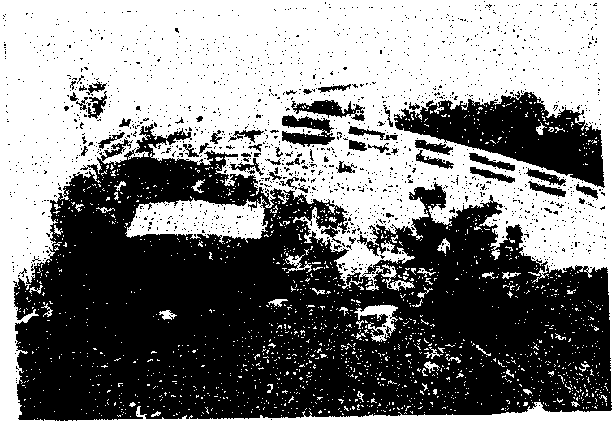



按：此台系民国二十年，为湖北李子宽居士建筑，纪念太虚大师者。



编辑谨识



本寺后山水区之兜率陀院外景



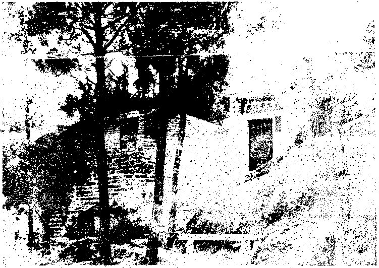



本寺之阿耨达水池







按：此池系太虚大师住持本寺时造。



太虚台上之鸟瞰



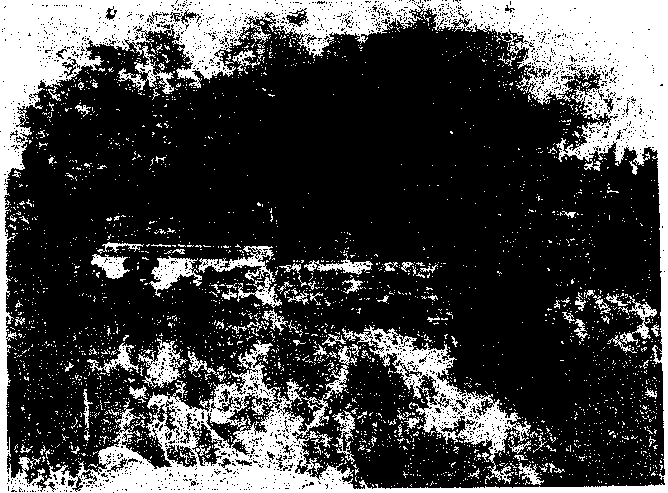



按：山下为本寺全景远处洋房多座者则为厦大学。



本寺后山之小亭二



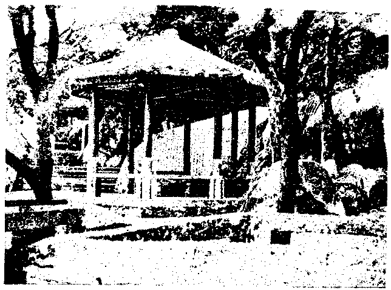



太虚大师之石刻







南普陀寺重建大悲殿记



南普陀寺之兴起，近数十年事耳。然南普陀之得名，盖由奉观世音菩萨。故斯殿之建筑，殆有百年矣。迨大悲殿落成，继之又造天王殿，规模渐备，自开设闽南佛学院之后，南普陀寺遂成蜚声海内外之一名刹，顾斯殿乃反形短小而不相称，十七年夏历九月二十三日之夕，殿中忽然起火；殿乃被毁，岂菩萨之灵，特诿之以除旧布新之责耶？时余尚游化欧土，旋由本寺邀集厦门各界洪晓春陈少梧诸绅耆，组筹募重建委员会，别设会计，经营建筑，不敷时由库房支济，八角三层之式仍旧贯，而放大加高，俾可与前之二殿相称，历时四年有餘始成。计用银约五万元。而库房支济者亦达六七千元。经办者为都监转逢会泉监院觉斌大醒芝峰副寺智普宏聪瑞立等，而苏慧纯蔡吉堂林镜秋诸居士亦襄助其事，余则坐享厥成而已。今定名曰大悲殿，乃敍其重建缘起，并将捐款各施主姓名列后，以志功德，勒碑永垂不朽。



民国二十二年，二月一日，住持太虚谨记



南普陀寺林园记



南普陀寺四管之附近山地，本甚辽阔，而比年以来，厦门市塲之发达，一日千里，先是自来水公司设水池於寺右鼓山之下，已侵用本寺山地若干；至漳厦警备司令部堤工处路政办事处成立来，闻山辟路，数年间顿令厦门全岛改观，本寺之附近山地；亦由华侨组织兴业公司及杨德从先生向路政处购辟为新区，其势逼近本寺肘腋间，且有将本寺全部山地充为南普陀公园之议，寺甚岌岌可危，乃由本寺历与路政处等洽商，历时数月，几经曲折，至本年（二十二年）一月二十八日始由路政处给予证明书并附图，划定界址，解决为本寺林园地区，而此事之成多出路政处周醒南会办之鼎力维持，他若省府蒋景然主席为致书会办，张澜谿陈李梁二先生为疏通兴业公司，曾国明先生为接洽杨德从先生，及苏慧纯蔡吉堂黄秋声居士，并本寺转逢会泉都监，觉斌大醒芝峰寄尘监院先后奔走各方，皆与有力焉。今本寺已次第植树造林以期为厦市培成一名胜形胜之山林区域！欲使后之住居游览於是者，皆纪念功德之所自，爰志其经过如此。



民国二十二年，二月一日，南普陀住持太虚谨记



南普院寺水池区建筑记



南普陀寺自改十方丛林制，设闽南佛学院，住僧渐多。旧在山左之接水，时不敷用。民十八於山右新获一水源，由寺筑水池以蓄之。甘美清冷，分布皆足其用，乃命名「阿耨达池」。民十九为护池建屋其上曰，「兜率陀院」。久之又开洞室曰：「须摩提国」。转逢退居，及林镜秋，苏慧纯居士曾协欵以助其成。民二十一年又於洞后辟建禅室曰：「阿兰若处」。则由陈敬贤，王真觉，苏慧纯居士施资之所造。其工事则均出逢退居督理，今总名之曰：「水池区」。议订规则十一条管理之，因记其功德云。



民国二十二年，二月一日，本寺住持太虚



南普陀游记



东初



中国之南，鹭江之滨，有南普陀寺焉。远筑於五代。高峰崚岭，崛起海隅与隔太武对峙，俨然成为南天胜景。其间圣贤递嬗，胜衰迭起，有言不可及之慨矣！寺之起焉，与唐之开元而并古，分派珞伽观音大士之道塲也。寺初名曰「普照」逊清康熙间始改今名；凡仰光三江缁素渡厦朝礼观音大士者，咸住锡於此，故声驰宇内，名扬中外矣。



寺原为子孙传法之制度，至转逢长老，始慧眼独具遂毅然改为十方选贤之制度。自改组以还，初任住持者，乃会泉和尚，同时乃有僧教育之施设；继任者则为佛化新兴运动太虚大师也。大师驻锡后，僧教育遂得扩而充之，声誉驰全国，故渡海来厦亲近大师者，接踵而来唯恐落后，至今已逾八载矣。寺本无恒产，能维八载如一日之僧教育，不特为南国开一新纪元，亦为全国僧教育之罕闻也。今之全国有恒产寺院者不下万餘，对於兹寺能无愧乎！



寺中所有之建筑，以本地所产花岗石黄砖钢瓦为大宗，殿宇巍峩气象森严，规模宏敞，清净为比，而天王宝殿，大雄宝殿，大悲殿等均为近十年来重新之建筑也。大悲殿工竣伊始，盖旧殿民十七年秋毁于火，太虚大师即与全寺执事商议力谋重建；故此殿不特为全寺建筑之冠，亦为太虚大师驻锡南普陀寺之伟大建筑也。余肄业闽院，故对于寺之风景及建筑物等较他人为详，兹不惮烦琐，略记如下：——



寺前有放生池，四围雕以七如来名号，盖取如来以大悲为愿，渡生为怀，且一切众生皆有如来智慧德相苦未证耳。中养龟鳖鱼等物。其他猪牛羊鹿等物均有饲养之厩。盖今之世界，保护动物，提倡蔬食运动，不独佛教为然，即欧西文明先进诸国，亦有蔬食运动之提倡，如英，美，德，法，俄，匈加利，荷兰等国，均有保护动物提倡蔬食之运动。一九二五年，曾有万国茹素大会开於伦敦；一九二九年复开第七次国际蔬食大会於捷克斯罗瓦国。（此国之地址，介於德奥两国之间）他若伦敦蔬食会，美国蔬食会，枚不胜举，且各国於法律均有规定保护动物之明文，而每年为动物起诉者，亦不下数千件，其他英，德，法，意，匈加利等国关於保护动物之法律不计外，美利坚尤可赞叹。因一九三十年三月，美国人道教育所得本国各地之报告，计一个月之间此项新慈善团体成立之总数，为一千三百十组，平均计之，则每三十五分钟即有一组成立也。因此文明先进之国家提倡蔬食保护动物於此可见一班矣。盖今之欧西各民族，咸感科学利器之残酷，养成人类凶横之恶性，保护动物，提倡蔬食，岂仅动物之福音，实是人类和平之嚆矢也。环顾吾国，不特於法律夫规定保护动物之明文。泰半则以彼生者必为我食，殊不知尔与彼同一动物，安有食彼彼食此，肉食残忍之权耶！



天王宝殿重建於民国甲子年，中奉弥勒如来，左右四金刚，怒目擎拳，威猛无比。进山门，则弥勒如来笑颜可掬，恍若龙华三会相临接引来者。盖我佛如来，将灭度之时，将法会所有之弟子咸付於弥勒如来故也。有缘者，会於茏华，吾人应集中之信仰与努力耳。



中为大雄宝殿，此殿重建於民十四，前钟鼓楼巍然相峙，旁有罗汉堂，建筑堂皇，得未曾有，松柏杂立，幽香扑鼻，花香鸟语，如入园林。其中奉娑婆教主本师释迦牟尼佛，佛之侍者曰摩诃迦叶，曰阿难陀，乃佛之十大弟子中之一也。佛之侧有佛二，曰西方极乐世界接引阿弥陀佛，曰，东方琉璃世界消灾延寿药师佛，而西方世界东方世界，其国众生，无有众苦，但受诸乐，唯我娑婆世界五浊恶世，我诸众生，但受其苦，无有众乐，故我佛如来，大悲愿力常施於娑婆世界，所谓开佛之知见，入佛之知见，悟入佛之知见是也。又有梵天帝释鹄立於傍，此无他，乃表示护持大法之热诚耳。



后则大悲殿高十餘丈，为新落成者，石柱巍焕周列石栏，庄严无比，梯楷而上，中奉千手千眼大悲救世观音大士；盖观世音大士乃西方三圣之一也。佛以东方为娑婆世界，故大士其大悲救世之愿力，亦常施设於东方，大士灵感胜迹其夥。但以文字而论，观者见之事，音者闻之事，而观音大士，则以闻之事为观，以观之事为闻；此无他乃大士六根清净，互为摄用。以千手千眼之神慧运四八之宏愿，观一切众生之苦厄，施设梵音妙音海潮音充满於东方娑婆世界，使无量无边一切众生皆成正觉，故妇人孺子莫不咸知诵观音大士之圣号，亦可见观音大士之宏愿矣。每届朔望则全市人士，莫不争先恐后敬礼焉。二，六，九等月，十九日为尤胜。香烟袅袅，弥漫天际，寺无恒产，一切支配，赖此维持焉。



寺之风景最幽者，则为后山新建之兜率陀院也，由大悲殿绕向背山，不数武五老峰下有二停焉。名人题咏满於石壁，松桧横阵，丛柏森立，卉木幽邃，日月晦明，百鸟横舞，歌咏不绝，清脆悦耳，间有微香扑鼻，袭人欲醉，洵为海上神山也。由此崎岖右绕而上，奇石林立，崖洞幽壑，峰回路转，别一天地，而森林深处，蠕蠕而动者。则为放生巨蟒出没其中也。蟒驯艮为善，从未伤人，岂受观音大士感化所致欤？行行重行行，则「顶门只眼」及兜率陀院灿然遥现於云表矣。盖此院建筑乃转逢长老预备於太虚大师退院后而同居者，院前有阿耨达池，流泉断续，若奏梵音，寺之饮料全赖乎斯，院高丈餘，饰以垩粉，莹洁清雅，悦人心目，中辟佛堂一，设慈宗坛，奉弥勒如来，供养花果，备极庄严，为太虚大师每返寺时於此自修耳，盖大师为中国佛教倡导慈宗之宗师也。又客一，风景相片悬於满壁，青风谡谡，音韵悠扬，凭几而视，则远山近水，屏列如畫，游目其间，飘飘欲仙矣。其后寝室，榻一，空无所有，似维摩室，寺之护法苏君慧纯，陈君敬贤，时过小住，大醒法师尝住其中并题有诗云：「院傍岩阿筑；名题兜率院，天宫礼弥勒，丈室住维摩，满架轻书叠；当窗草木多，一池泉水静，来去不生波。」可谓题尽院景矣。



复有湏摩提国，筑於院侧，前有八功德池，满种青莲，悬崖绝壁，奇岩穹隆，凿谷为窟，可容四榻，簷飞丈餘，周围隆起，古洞绵延，佛像林立，设瑜伽焰口曼怛啰坛，乃转逢长老发大悲愿施千座瑜伽普渡一切饿鬼地狱畜生，俾得无量无数饿鬼皆得来受甘露法味也。中奉幽冥教主本尊地藏王菩萨。其联曰：「千座瑜伽唵哑叫，高超薜荔众；三坛秘呪曼答辣，供养湏摩提。」又曰：「八难三途，共入弥陀愿海；四生九有，同登净士运门。」又曰：「闻此法欢喜，住於无疑者；速成无上道，与诸如来等。」又曰：「诸佛微妙音，清净如虚空；明了一切行，其心无所著。」其他奉有常住过去诸大德及十类含识等位，香花普供，满排於前，气象庄严，油然起敬。由此内进，岩壁有痕，其状如门，再进稍宽，其间有隙，有石凳三，石棹一，空无所有：其侧有瑜伽泉，盖长老施设瑜伽普洒甘露之净水也。去须摩提国，不数武，有阿兰若处，此乃太虚大师民二十一年在厦为众姓弟子宣讲大乘本生心地观经，中有阿兰若品，广阐出家比丘应如何往阿兰若；应如何受阿兰若行等，因此受感化而皈依大师者极众，遂有慈宗学会之成立焉。阿兰若处为苏君慧纯陈君敬贤居士等发心所筑，供养习禅定大心者，清净庄严，幽胜殊绝，诚为兜率陀院之最胜处也。



兜率陀院右有台一，曰太虚台，乃应城李居士基鸿所筑，为纪其本师太虚大师也。民二十年，李居士来访，偕登出巅一方石，纵观海山，转逢长老谓：「立此如在太虚间。」故名「太虚台」，太虚大师有题巅曰：「海天旷览」。又联曰：「云影波光天上下；涛音松籁海中边」。登斯台矣则群峰环绕，凭栏远瞰，风景在目，历历可指，大有唯我独尊之慨矣！同游者信阳果地南安文显诸友，返时嘱余写笔记之以志不忘云尔。



民国二十二年，五，九，闽南佛学院



普照寺根源记



觉斌



普照寺之寺址，据云在唐时由陈护法肇公布施之功德也。肇公三世祖夷则公，侨迁厦岛，聚族而居，遂为陈姓发祥之地，肇公因建兹寺，而奉其祀於别殿，后之僧追念首劳，乃并肇公亦祀之，盖饮水思源，藉报功德也，施田五十有二亩，为今寺址，施山一陇，即今所谓五老峰是也，山之界，东至仙姑岭；西滨海南水磨坑；北界陈公墓；林木之美，山石之奇，无以复加矣。凡厦地来采材者，间立券约，寺僧收其息，以供佛火僧粮，及陈护法岁祭之需，旧习遗传，相沿久矣，迨至郑公成功，谋复明祚，独立台湾，进兵闽浙，驻节厦门，训练水师与满清拒，十有六年，兵燹民散，僧亦他徙，寺之券约，遗亡净尽。而护法之祀典於是焉而革。时至今日，山场寺址，变更益多，一被侵於自来水池公司，再被划入路政处之公路，乃被盗卖於兴业地方公司等，辽阔之山塲，而被削去者，十之八九矣。——山地乃寺址详情，见登记证明书。——余恐年深月久，湮没先进功德，无以为后者劝，兹特略志如是，以为纪念云尔。



二二，五，三，写于库房监院世



三　楹联



分派洛伽开法宇  

隔江太武拱山门



林秉懋高氏劝娘刻



陈衍撰书



太武峙前屏　尘世大千皆梦幻  

洛伽分一派　法门不二此因缘



高红美高长源刻



王振先书



南望极沧溟　波覆澜翻　何如独坐莲花　真成自在  

普大蒙尘瘴　烟迷云暗　安得同登宝筏　托庇弥陀



陈延祉黄鹫舍陈万宝刻



蔡秋涛题



按琵琶弦　弹破苦空色壳  

张蛟龙口　吞来离垢珍珠



蒋报察林苏氏洒娘刻



余焕章题



手执金鞭　降伏心猿意马  

眼看宝座　分明实相法身



王子禄杨伟英刻



刘培元题



一佛南来　天为洛伽开别岛  

大江东去　我从浮屿望慈航



谢春舍刻



陈宗书题



四大本无情　随循环桃红柳绿　翻新世界  

天王原有道　护国土摧邪补正　镇定乾坤



民国乙丑冬刘弘生刻



吴清麟书



昔日如来开教海  

今朝护法镇禅林



阮振昌刻



> 柯题



护世飞来多美膳  

法轮转处现祥云



陈根阵刻



沙门常惺题



好摧外道归调御  

应许将军见太平



杨家苗柯孝灶刻



汪煌辉题



怒目金刚　任是千魔顿伏  

低眉菩萨　由来万行齐修



叶阶福等刻



洪鸿儒题



宝伞盖张　覆徧洞天福地  

青锋剑利　劈开爱锁情枷



何兴化刻



周殿薰题



我是世尊使　护持其法藏  

常在灵鹫山　供养诸如来



李玉树刻



南狱大云书



（以上金刚宝殿联）



经始溯唐朝　与开元而并古  

普光被厦岛，对太武以增辉



壬戌春晋江曾遒撰并书转伴刻



法界礼三摩　天然鼓阜钟峦为江上灵邱　挂佛子开山杖锡  

战尘昏五季　留此云巢石笕是闽南净士　护诗人题壁纱笼



民国十一年首夏鉄彝黄仲训书



陈延社刻



法身无去无来　住寂光而不动  

德相非空非有　随机感以恒周



民国第一壬戌六月阮隆记刻



禅派即南宗　笑指虎溪通呎尺  

法音超上品　环看鹭屿遶迦陵



壬戌初春温陵吴恭撰盥书



鍾子才刻



南海有名蓝　舶赶曾传单舸去  

普天无净土　弥陀合共一龛藏



庄泰芳文洲成刻



闽县陈培锟拜撰敬书



佛国几沧桑　鸳舍重新　瓜迹百年先靖海  

禅房遶水竹　鹭江小住　心香一瓣古瞿昙



壬戌首夏温陵施士浩鍾子才刻



鼓震鍾鸣　普醒众生尘劫梦  

山明水秀　全彰古佛法王身



民国十一年夏月钟添福南安黄培松



现自在身　愿众生共渡慈航　早超苦海



民国十一年孟春谷旦鍾亚春鍾宝金刻



救将来劫　望我佛宏施法雨　力挽狂澜



海军上军刘冠雄敬献



纪合利刻



丹凤岗下建梵宫　而水背山　罗汉天然环佛地  

白鹭岛中留胜迹　左钟右鼓　观音自在显圆通



民国壬戌夏季虎溪印月撰句并书



纪荣利刻



说法入三摩地　右钟三戒　左鼓三明  

钟鼓得六通　共悟蒲团禅板  

登高到无尽岩　观海无边　观天无际  

海天空万象　祇餘沙鸟水帆



民国十有一年夏历壬戌又五月谷旦思明县知事来玉林盥手敬撰并书



僧瑞梁刻



此地为普照旧基　经通侯改建  

兹山如洛伽妙境　奉古佛慈尊



壬戌春月晋江曾遒撰并书



转辉刻



奚事相禅扉　但有空门开觉路  

本来无寿相　何妨五老踞灵山



壬戌春月里人蔡凤机撰并书



欧安住刻



五老小勾留　岩壑常含无尽意  

百僧真供养　涧泉那有不平鸣



壬戌四月温陵龚植张小良刻



（以上大雄宝殿四面石柱联）



真观清净观　广大智慧观  

妙音海潮音　胜彼世间音



吴兴王震书



五老此留形　清净为心皆补恒  

普门无定相　慈悲济物即观音



住持太虚书



（以上大悲殿联）



公牍



一　布告



福建陆军第二师第三旅司令部布告第　号



为示禁事，案据南普陀住持转逢呈称：敬呈者，窃南普陀於唐时本名五老山；至宋为僧文翠建修普照寺；前清康熙间靖海将军施公琅重建，遂改名南普陀：今仍其名。洵属厦门一古刹也。山石泻泉，海波浴日，骚人词客，游览题咏者，代不乏人。现在卑寺新造大殿已於三月念五号开始建筑。值此清和天气，各界绅士来寺焚香礼佛或游览风景者，第良莠不齐，每有到放生池钓鱼，或来偷葬坟墓，盗砍树木折取寺内花菓；甚至无故藉端吵闹一切难以言罄；且木石工人众多，工作之时，诚恐跌落甎瓦，致生意外之虞，乞念佛门艰苦募化维难，将以上数端出示保护等情。据此查保存古迹，为尽人所共宜知，而兴工程尤局外所非应问。据该住持所称扰害各节，如果不虚，殊属非是，合行出示保护，为此谕仰军民一切人等知悉，自示之后，毋得再有到该寺钓鱼葬墓砍木折花，藉端吵闹情事；如敢故违，定即重究。此布！



中华民国十年五月十八日给　旅长高全忠



闽军总司令部布告第五十八号



为出示晓谕事，案据南普陀住持僧转逢呈称为整顿教务，公议条规，呈请备案，俯准给示，以保佛门，而杜私弊事。窃南普陀寺自景峰老祖开山以来，历年久远，兴废不一。至前清光绪间由喜升和尚入寺中兴，十有餘载，百废俱举，遂拟功成身退，立为十方僧众选贤丛林。至宣统三年，请小雪峰佛化和尚为住持；交替之后，喜升和尚圆寂。至民国二年，佛化和尚亦已物故；一时继任者不得其人，乃由监院转尘摄理寺务七年。至民国九年公议僧转逢充任住持，派代表僧瑞等往赴北京，请转逢入寺主席；转逢因念众意难违，勉强就职。迄今三载有餘，全仗各职僧同心协力重修天王殿，钟鼓楼，大雄宝殿，次第落成。窃思工程虽已就绪，条规尚未订立，祇恐日久弊生，终非维持久远之策，因特合集职僧两序首领，公同妥议，谨遵内务部制定管理寺庙条例，并参酌本寺情形，采访各处十方丛林办法，订立条规二十则，理合缮开清折，呈请察核，俯准备案，给示勒石，俾资遵守。倘有僧俗人等，挟存私见，希图破坏，准予指名禀究，以保丛林，永垂久远，不胜便德之至！等由，到部，合行出示布告，为此示仰各色人等，一体遵照，妥为保护毋违，切切。此布！



中华民国十三年三月二十二日



总司令臧致平



思明县公署　通告



案据南普陀住持僧转逢，监院转尘呈称：窃南普陀寺自景峰老祖开山以来历年久远，兴废不一。至前清光绪间，由喜升和尚入寺中兴，十有餘载，百废俱举，遂拟功成身退，立为十方僧众选贤丛林。至宣统三年，请小雪峰佛化和尚为住持；交替之后，喜升和尚圆寂。至民国二年，佛化和尚，亦已物故，一时继任者不得其人，乃由监院僧转尘摄理寺务七年。至民国九年公议僧转逢充任住持，特派代表僧瑞等往赴北京，请僧转逢入寺主席。转逢因念众意难违，勉强就职。迄今三载有餘，全仗各职僧同心协力，重修天王殿，钟鼓楼，新建大雄宝殿，次第落成。窃思工程虽已就绪，条规尚未订立，祇恐日久弊生，终非维持久远之策，因特合集职僧，两序首领，公同妥议，谨遵内务部制定管理寺庙条规，并参酌本寺情形，访各处十方丛林办法，订立规条二十则，理合缮开清折，呈请察核，俯准备案，给示勒石，俾资遵守。倘有僧俗人等，挟存私见，希图破坏，准予指名禀究，以保丛林永垂久远，不胜便德之至等情；附条规二十则到县。据此察阅所订条规，尚属妥治，除批准备案外，合行通过阖厦军民僧人一体知悉，务各遵守条规，毋得逾越，切切。特此通告！



知事邢蓝田



中华民国十三年三月二十七日给



厦门市公安局布告第四三号



为布告事，案据南普陀寺呈称，呈为请求出示保护事：窃敝寺自创办佛学以来，僧众均主重道德学问，对於佛教清规力行不怠，上下大众，安心办道，为厦邑各界人士所深知。且敝寺所设之佛学院乃为全国僧徒教育高等之学院，海内外亦早知名惟引起一班不学无术之僧徒所妬忌，日甚一日，素常毁谤敝寺；近且间有竟藉端滋扰，为此相应呈请钧局，准予给示保护，实为功德无量等情。据此查该寺佛学院开办有年，阐扬教义，研究佛学，颇为社会人士所信仰，乃有不良僧侣，嫉妬讥谤，藉端滋扰，倘不严加防遏，诚恐风潮发生，贻羞佛门，妨害治安，据呈前情，除饬该管署随时保护外，合行布告，仰各周知，嗣后无论何方僧侣，如敢藉端骚扰，准由该院报警严拿，惩办不贷，其各凛遵，切切。此布！



中华民国二十一年七月十四日



代理局长林振成



驻闽绥靖主任公署布告第　号



为布告事：照得佛学为哲学一端，自与神权迷信不同。查有太虚法师创立闽南佛学院於南普陀寺，该院性质既为研究哲学，与平常庙观之崇拜偶像迷信神权有异，可予保护，合行发给布告，仰军民人等，一体遵照，毋得摧残为要。此布！



中华民国二十一年　月　日



主任蒋光鼐



公安局布告第四二号



照得南普陀，为闽南名胜之地，中外人士，多登临游览自应共图维护，保存名胜，不容滥肄喧扰。至学院内地，游玩其间，尤应肃静，免碍清修；入内听讲研经，概须严守秩序，共维胜地。除饬署随时派警切实保护外，合行布告，仰该寺游览人等，一体遵照。如有仟意喧扰妨碍安宁，立予拘究不贷，其各凛遵，切切。此布！



中华民国二十二年二月二十三日



局长林鸿飞



二　函电



本寺寺基确定之经过



厦门近因商业之发达，大有一日千里之势，原有之市塲，不敷於用，另辟新区，势所不免。近数年来，由路政处将厦门四周之山地划界开辟，范围极广，本寺之基址，亦在其新区计划中。咄咄逼人，寺众哗然。原本寺旧所管领之山地，极为辽濶，但皆属荒冢秽墟，无一明确之界地耳。然本寺之山地被侵占而开其先河者，先有自来水池之建设；今则其势已凌逼本寺肘腋间，则便有华侨所组之兴业公司等开辟新区；且有将本寺山地，作为公园之议。民二十本寺当局同全寺内外护人，与之交涉，遂由路政处，退还山地若干，并发有证明书划定界址地图等，由本寺将收回之山地，清理改造永为本寺之林区。于是本寺地基既稳定，且又为本寺造成一形势之名胜。兹将路政处之证明书及法院之不动产登记证明书录附于下：——



一、路政处证明书



漳厦海军警备司令部路政办事处发给证明书事：查本处开辟南普陀附近山地为大南新区，兹为保存古迹起见，特将该寺左右山地编列新区，计第二号地第二百捌拾壹井：二拾伍方尺：第拾叁号地，叁百柒拾壹井，捌拾柒▆尺：第二拾玖号地，伍百伍拾井，合计壹千二百零三井，壹拾方尺，仍归该寺掌管，为林园之用。此项林园之地，永归该寺管理，不得售与他人。除由本处将该寺原有寺地，及山地，并新拨林园之地，分别划定界址外，合行发给证明书壹纸，附图壹份，仰该寺即便遵照执管，可也。须至证明书者！附图壹份。



右给南普陀寺收执



中华民国二十二年一月二十八日印



二、法院不动产登记证明书



不动产登记证明书



登记人姓名  

南普陀寺印



登记号数  

不动产登记簿　区第一七九册第一〇　号



收件年月日及号数  

中华民国二十二年二月八日收件第一三四　号



不动产之标示  

基地计英尺二六四七二平方尺厦门南普陀寺址在院屿保五老峰下东至钟山湾合水线至大观路华侨路南普陀止西中鼓山湾至自来水池界合水线及南普陀止南至南普陀路北至五老峰顶　印



登记原因及其年月日  

提出民国二十二年二月　日住持太虚声请字一纸印



登记标的  

所有权保存登记印



权利先后栏数  

所有权部第一栏



登记年月日  

中华民国二十二年二月二十七



> 右证明登记完毕中华民国二十二年二月二十七日福建思明地方法院登记处印



三、附本寺声请书



厦门南普陀寺址在院屿保五老峰下，建自唐代，为闽南大丛林之一。领地广袤，依山为界。近因路政处开辟大南新区划定领土（东由钟山湾合水线至大观路华侨路南普陀路止，西由鼓山湾至自来水池界合水线及南普陀山，南至南普陀路止，北至五老峰顶。）面积东西横姿一千一百二十尺，南北纵长一千九百一十尺，总计面积二万六千四百七十二方尺。估价值一万元。测绘及估价，均极准确，特请登记保存。



监院　觉斌印、芝峰印



都监　转逢印、会泉印



中华民国二十二年二月　日住持太虚印



代书人陈少卿押



蒋光鼐将军来电



厦门南普陀太虚和尚大鉴：先电敬悉。忝膺闽政，滋愧诠才，藻饰有加，良深感谢一专复。即候时祺！



弟蒋光鼐皓



中华民国二十一年十二月十九日印



贺班禅頞尔德尼就职电



南京班禅大师慈鉴：逖闻就职宣化，弘法救世。开政教之合作，为通俗所宗仰。特电敬贺。并颂福祉！



太虚叩有



班禅頞尔德尼覆电



厦门探投太虚法师惠鉴：有电敬悉。禅此次蒙中央优遇，特派宣化西陲，材轻任重，无补时艰，复承电贺，益增汗颜。此后尚祈不遗在远，时锡南针，俾匡不逮。特覆鸣谢。顺颂法祺！



班禅頞尔德尼俭



蒋光鼐将军来书



太虚法师净几：承嘱保护南普陀山林区一节，当即驰函周处长酌办。夫保护庙产，本有专条。公路施设，乃利民之政，亦不容有缓。我佛度人，当同此旨。苟公路建筑有可避免者，周君必能为力保护。佛学院布告，已饰处办理。专此奉复。即颂法绥！



蒋光鼎启

