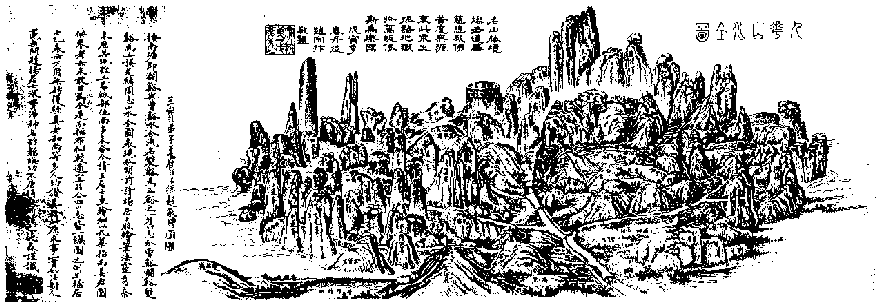
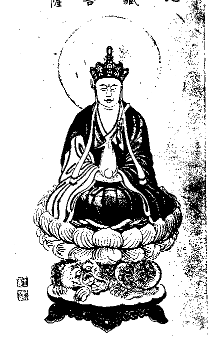

# 九华山志



> **藏经**：中国佛寺史志汇刊（佛寺志汇刊）　**册次** 第 72 册（GA072）　**编号** GA0077　**卷次** 8 卷　**篇幅** 149,349 字

> **卷／品**：7 卷 · 13 品



---



## 目录



  - [重新编修九华山志发刊流通序](#重新编修九华山志发刊流通序)

  - [民国甲戌重新鉴订九华山志序](#民国甲戌重新鉴订九华山志序)

  - [民国二十三年岁次甲戌，江西彭泽菩萨戒弟子许止净敬序](#民国二十三年岁次甲戌江西彭泽菩萨戒弟子许止净敬序)

  - [明嘉靖修山志陈序](#明嘉靖修山志陈序)

  - [明万历修山志苏序](#明万历修山志苏序)

  - [万历七年己卯仲夏之吉，知青阳县事．江陵苏万民序](#万历七年己卯仲夏之吉知青阳县事江陵苏万民序)

  - [明崇祯修山志郑序](#明崇祯修山志郑序)

  - [明崇祯修山志王序](#明崇祯修山志王序)

  - [明崇祯修山志顾序](#明崇祯修山志顾序)

  - [崇祯己巳仲春下浣，西吴顾元镜序](#崇祯己巳仲春下浣西吴顾元镜序)

  - [清康熙修山志李序](#清康熙修山志李序)

- [九华山志卷一](#九华山志卷一)

- [九华山志卷二](#九华山志卷二)

- [九华山志卷四](#九华山志卷四)

- [九华山志卷五](#九华山志卷五)

  - [赞礼地藏菩萨忏愿仪后自序](#赞礼地藏菩萨忏愿仪后自序)

  - [为警心居士持《地藏本愿经》兼劝人序](#为警心居士持地藏本愿经兼劝人序)

- [九华山志卷六](#九华山志卷六)

- [九华山志卷七](#九华山志卷七)

- [九华山志卷八](#九华山志卷八)



---



九华山志全图







地藏菩萨







地藏菩萨像赞



仰大士之化业，唯观音、徧吉能比肩；推大士之愿力，虽文殊、普贤无其坚。释迦已去，弥勒未还，我娑婆世界，惟大士一力而荷担，是众生之慈母，故随感斯应，福不唐捐。呜呼！大士之慈悲神力，十方诸佛穷劫难宣，愚痴逃子何敢赞一言？惟愿自今已后，以大士之心愿为心愿，得生安养，获大神通，分身尘刹，普济群蒙。众生成佛，地狱已空，而度生事业，厯永劫以无穷。



归依弟子许止净顶礼敬述



丹徒悔盦赵宗抃端盥谨书



九华山志卷首



------



### 重新编修九华山志发刊流通序



真如佛性，生佛体同；在凡不减，在圣不增。但以性德虽同，修德各别，故致生佛迥异，苦乐悬殊。诸佛以顺性而修，因兹返妄归真，背尘合觉，断尽烦惑，彻证此即心本具之真如佛性，故得安住寂光，永享涅槃常住之法乐。众生以逆性而修，由是迷真逐妄，背觉合尘，起惑造业，全迷此即心本具之真如佛性，故致常住娑婆，恒受六道轮回之幻苦。诸佛以众生心体同而心相异故，不胜怜愍，不惜劳苦，发弘誓愿，度脱众生，以视一切众生皆是佛故。故《梵网经》云：「一切众生，皆有佛性。」又云：「我是已成佛，汝是未成佛。若能如是信，戒品已具足。」以若信自己是未成之佛，决定不肯随顺凡情，造生死业；决定直下信受佛教，修菩提道。其有迷之浅而宿根深者，一闻佛教，即得了悟，信受奉行。若迷之深而宿根浅者，一闻佛教，反生诽谤，或至毁灭令尽无餘，以视佛为众生故。以己之众生贪瞋痴心，测度佛心，谓其所说，皆为诓骗愚夫愚妇奉彼教之妄语，绝无真实，不可依从。若一依从，则永入迷途，莫由而出。诸佛於此种众生，了无一念弃舍之心，倍生怜愍爱惜之念。如人病狂，挞骂父母，父母不以罪治，更增怜愍之心，知其失本心故；狂病若瘉，自无此过。若迷之极深者，从劫至劫，亦难省悟。故诸佛以尽未来际，度脱众生为誓愿；而已证法身之诸菩萨，亦莫不皆然。彼以自私自利辟佛者，若知此义，能不愧死？迷之浅而宿根深者，古今固不乏人，今举其尤者，如宋之丞相张商英，明之居士鍾大朗。



商英初不知佛法，因游一寺，见佛经庄严殊胜，忿然曰：「胡人之书，如此庄严；吾圣人之书，尚不能及？」夜间执笔呻吟，莫措一词。夫人向氏，颇信佛，因问所呻吟者何事？曰：「吾欲作无佛论耳。」夫人曰：「既然无佛，又何可论？且汝曾读佛经否？」曰：「吾何肯读彼之经？」曰：「既未读彼之经，将据何义为论？」遂止。后於同僚处，见案头有《维摩诘经》，偶一翻阅，觉其词理超妙，因请归卒读。未及半，遂大生悔悟，发愿尽此报身，弘扬法化。於教於宗，皆有心得。所著〈护法论〉，极力赞扬，附入「大藏」。徽宗朝入相，时旱久，夜即大霈甘霖。徽宗书「商霖」二大字以赐。盖取《商书．说命》「若岁大旱，用汝作霖雨」之义以褒之。



鍾大朗，苏州木渎人，其父母祷观音而生。幼时随父母礼诵。及入塾，闻圣学，即以圣学为己任。因不礼诵，而辄作辟佛文字。后见莲池大师〈自知录序〉，始知愧悔，不复辟佛。读《地藏菩萨本愿经》，发心学佛为居士，遂研究天台、禅宗各书，各有所得；乃礼憨山大师门人出家，法名智旭，字蕅益。其戒行净若冰雪，其见地明若日月。而且注重净土一法，以末世众生不仗佛力，决难现生了脱生死。一生弘法，不作住持。多居北天目灵峰寺，故后人每以「灵峰」称之，实未为灵峰主人也。至韩、欧辟佛，但据儒教伦常近迹及礼乐刑政为论，绝无引及佛经之文。固知所辟，皆是未见颜色之瞽论。韩由晤大颠禅师，欧由晤明教大师，方稍知佛；特不能如张、鍾之弘扬耳。而宋之周、程、张、朱，为接孔孟心传之人，其原皆由学佛而得。周茂叔极为淳笃，绝无一字辟佛。二程、张、朱，则阴奉阳违，取佛经之奥义以释儒经。恐人谓己之所说，系出佛经，遂极力辟佛所说之三世因果、六道轮回之实事实理，谓为虚构以作骗愚夫愚妇奉教之据，实无其事等语，冀掩人耳目。由此以后，凡儒者皆不敢说因果，恐人攻击以为异端。凡理学皆偷看佛经以自雄，皆力辟佛法以自固，以致愈趋愈下，遂至演出灾祸频仍．民不聊生之惨剧。设使大家皆提倡因果，断不至如此之极。夫因果者，圣人治天下、诸佛度众生之大权也。舍此，则无法可设矣。今则乱极思治，若犹不以因果为本，则以后之祸，当更惨剧矣。九华山者，地藏菩萨应化之道场也。地藏菩萨於无量劫前，久证法身，已成佛道，而不居佛位。以「众生度尽方证菩提，地狱未空誓不成佛」为愿，其悲愍众生受生死苦之心，莫名深切。故佛於忉利天为母说法时，凡十方世界诸佛菩萨、天龙八部，皆来集会，虽以佛眼，莫能数知。此诸佛菩萨，皆由地藏教化，方得道果。而地藏尚示声闻仪式，其於十方世界现种种身以说法外，又常在幽冥极苦之处，以行救度。十方诸佛菩萨莫不赞叹其兴慈运悲之深心。而蕅益大师读《菩萨本愿经》，即发大菩提心。以地藏乃诸佛之师，菩萨之母，尚汲汲以度吾人众生为事；傥不以自他同出生死为急务，其孤负慈恩也大矣。



菩萨示生在唐新罗国(唐高宗之前，原有高句丽、新罗、百济三国之分。高宗灭高句丽、百济之地，悉归新罗，并为一国。五代时，王建继之，国号「高丽」。自明初至今，乃名「朝鲜」。人多以新罗为暹罗，实误。)王族，姓金，名乔觉。高宗永徽四年来九华，苦行道迹，世难比伦。识者知为地藏示现，详见本志，此不多叙。而拘墟者，不知菩萨分身尘刹世界应化之迹，每谓此之「地藏」，非《本愿经》之地藏，然则布袋和尚，亦可云非当来下生之弥勒菩萨乎？此山由菩萨建立道场后，历年久远，屡经鼎革，故致志书失传。至明嘉靖时，方辑志书。历万历、崇祯，以及清康熙、乾隆、光绪，凡经七次(万历二次)，皆官厅主持，儒士编辑，於菩萨弘慈大悲、法门精妙旨趣，未能发挥。盖与寻常山经水志无异，殊失名山道场为国祝厘、为民祈福之所之意，然亦无毁谤佛法之文字。光绪志，周山门修时，作许多毁谤之文附之，以彰己之知见高明。令僧出资，而板存县署，且不许翻刻，吾不知其意为何故也。兹由李圆净请重修，祈许止净居士为之鉴订，德森法师为之编辑。书既成(一切成就因缘，俟卷末德师跋中详述，此不赘)，因将菩萨度生深慈大悲，略为发挥，期见闻者，各生正信，庶可仗菩萨慈力，离幻妄苦，得究竟乐。爰为赞曰：



大士誓愿不可测　运悲周徧尘刹国  

众生尽后誓方休　地狱空时愿始息  

受化多成无上道　自身犹示声闻迹  

祇缘生佛性维一　欲令同获究竟即



中华民国二十七年岁次戊寅孟夏月吉日，常慙愧僧释印光谨撰



------



### 民国甲戌重新鉴订九华山志序



粤稽载籍，唐僧应物始作《九华山记》，宋刘放，作《九华拾遗》，元杨少愚作《九华外史》，均未敢言志。宋末处士陈岩，以绝句诗徧咏九华，於注中悉载山峦形胜，名人历史，但以诗为主，亦未足言志。明嘉靖朝，王教谕一槐始辑山志，计诗文四卷，餘二卷。万历朝，蔡大令立身重修，则山水、建置、物产、人物四卷，文翰二卷，渐臻详备。清康熙、乾隆二朝均有续修，而散佚无考。至光绪朝，周训导山门修为十卷，考证较旧为确，文亦较工。然艺文占十之四，所尊奉而津津乐道者，无非太白「秀出芙蓉」、梦得「宇宙尤物」之句。呜乎！志书之义蕴，止於此乎？《虞书》：「望於山川，徧於群神。」「岁二月，东巡守，至於岱宗，柴望秩于山川(注云：五月南巡祀南岳，八月西巡祀西岳，十一月北巡祀北岳，仿此)。」至命官曰：「典朕三礼(注云：三礼，为祀天神、人鬼、地祇之礼)。」《周官》：「大宗伯，掌天神、人鬼、地祇之礼，佐王建保邦国。」祀五岳，以至山川邱陵，各因其方，建神位而祭之。器物仪文，分官掌之，必敬必备。大舜、周公岂愚夫妇无知之比，而何兢兢於此？《易》曰：「圣人以神道设教而天下服。」不诚然哉？子墨子曰：「夏、商、周书，皆信有鬼神，能赏贤而罚暴。故吏治不敢不廉洁，善不敢不赏，暴不敢不罪，富贵强武不可恃，鬼神之罚必胜之，民之为淫暴盗贼以自利者由此止。」此即古圣王崇祀山岳、神道设教之精义也。夫山岳之神，远在天道之下，历代帝王，尚奉事维谨；况乎九华应化之地藏菩萨，位邻极圣，为娑婆世界唯一导师？纂志者，仅置诸人物后，於菩萨之大愿神力，无一字纪载；而徒搜罗名人题咏，以耀山灵而策游兴。置淑世牖民之大端於不顾，而导人游观之域，玩物丧志，此可谓知本耶？修志者，莫不儒学自命，於古圣王崇祀山川之礼，习而不察，反对於善信男女入山礼佛者，辄加以愚迷蚩蚩之名。而皇帝遣官致祭，则又为山神不胜荣幸，弁诸卷首。其见解颠倒，殆亦不能自解矣。即以游观论，亦当思知者乐水，仁者乐山，毕竟所乐在何处？孔子登东山而小鲁，登泰山而小天下，即千载下游山者之模范。盖眼界一空，心胸自阔，视大地若微尘，我相了不可得。人我众生相泯，而民胞物与之心，自油然而生。故仁者乐山，能静且寿。傥若谢灵运之游山水，役夫数百，伐木开途，使闾阎惊扰，於仁为𢦤贼，於静为背驰，卒亦不保首领，短折其寿。后人安可不以为戒，转以为劝乎？



壬申之冬，师座印公属修三名山志。《清凉》体例完善，祇文字略加修饰。《峨眉》凌乱，点窜稍繁，然祇具稾本，呈师裁政。今从事《九华》，细阅周志，文字尚佳；但於淑世觉民之义，殊少建白。不得不另标宗旨，振瞆觉聋。爰增立〈圣迹〉、〈梵刹〉、〈高僧〉、〈灵应〉、〈檀施〉各门，广宣佛化，济度迷津。而〈艺文〉中，亦必有裨於身心修持之文，意境高尚之诗，始为采录，其餘概从汰略。世之好文学者，或不无疵议。然易模山范水之作为慈云法雨之施，私心终觉获安。呈师法眼，再加笔削，自必有裨於后之读者，而上报地藏王菩萨应化之恩矣。



------



### 民国二十三年岁次甲戌，江西彭泽菩萨戒弟子许止净敬序



### 明嘉靖修山志陈序



大江以南，山之峭拔而秀丽者，莫如九华。盖其高数千丈，上有九峰，若莲华。然合诸峰，凡九十有九，扶舆磅礡之气，实於是乎鍾焉。然其地僻在青池之南，去江百里而远，故禹迹之所不经，职方之所不载。自昔以「九子」称，至唐李太白始易今名，咏之以诗，且读书其中，而「九华」名遂闻於天下。嗣是名人文士，登高览胜，往往加题品焉。予初筮仕，已慕其胜，而未获一登。嘉靖乙酉秋，奉命巡抚江南。明年丙戌，徧行诸郡。十月之交，由徽而池，所经郡邑，率深山大谷，行部所罕至者。入青阳境，将十餘里，忽见峰峦融结，璀璨夺目，固已心伟而神会之。既弭节行台，则兹山适对峙乎前，若锦屏，若芙蓉，恍然心旷神怡，而忘其抚政之填委也。比竣事戒行，欲偿斯游，而朝雾晦冥，风雨骤作。然吾意已决，遂出城而南。倏云开日霁，吏民咸有喜色。老僧迎而慰曰：曩时士大夫之游，遇阴雨者，十常八九。今且阴而复晴，殆山灵之默相乎？既入山已，烟岚森列，若天柱、老人、二神、云门诸峰，皆争奇献秀於云霄之表。予喟然叹曰：「此天设而地藏乎？抑神劈而鬼凿乎？」褰帷而观，应接不暇。约行三十餘里，上半霄亭，陟天桥，至化城寺，乃谒太白书院。遂登绝顶，露坐金地藏塔前，对神光岭。时夕阳西沈，皓月东出，光景异常。九十九峰，历历可数。神清境绝，真天下之奇观也。已而霜气凛然，不可久坐，而入寺宿，漏下二十刻矣。诘旦下山，天色微晦，而峰峦尚可辨。将午，至玩华亭，少憩，复纵观焉。凡得诗若干首，付老僧藏之山中。既抵池郡，取《九华》旧志阅之，仅有邑人陈清隐诸诗，而采录未备，乃命铜陵王教谕一槐重辑之。稿既具，而予以休致南还，乃授之门人韩太守楷，俾终其事焉。越岁，政通人和，韩太守与张贰守邦教，再加参校，编成新志。首之以峰、岩、泉、洞，次之以亭、堂、寺院，又次之以古今诗文，考据精博，凡为卷六。将付青阳祝知县增刻之以传，郡守贰以予尝与闻斯志也，走使请为之序。予尝东陟岱宗，南跻衡岳，中登嵩高，西北上太行。其表镇一方，巍然高而大则有矣，未有九华之奇秀者也。矧山以气而灵，抑以人而胜。若太白之流风餘韵，诸名公之词赋翰墨，又所以增重乎兹山；志之作，其可少乎？忆谒青阳庙学也，方病其宫墙不挹九华之秀。及询其人才，则曰科目弗利耳。亟檄有司迁之而面兹山。今秋大比，举於乡者得二人，其为功不既多乎？予方徜徉泉石，梦想九华，有不可再游之期。又恨不得结茅山阿，以静修而终老焉。故因其请，幸得托名其间，辄序而归之。



嘉靖七年岁次戊子，前南京吏部右侍郎陈凤梧譔



------



### 明万历修山志苏序



九华旧有志，唯遐阻未躬历者，则人人循图指迹，而云「山尽是矣」。讵知兹山之奇胜，有未易尽穷者乎？不佞夙抱山水之兴，亦尝涉洞庭，陟祝融，泛沔汉，登太行，济汝洛，游嵩高，收览风景矣。始承乏来，面九华，得峭削於目，而意欣欣焉，俗沓未遑登也。退亦按图迹而阅之，谓山如是尔。暇叩邑人士，则咸曰：「兹山周二百餘里，界三邑。江左山之擅名者，如金焦，如匡庐，如黄古，今称巨胜。九华与诸山拟，则相埒不少让。其间峰峦岩洞，千奇万怪，真难殚状，夫岂志能载哉？」不佞衔之。丁丑夏仲，以事由五溪六泉口入。抵麓，日已夕暝。火光中，盘折攀蹬而上，宿化城。次晓升东岩，四望，长江匹练，群峰罗列，天柱、云门、五老等，呈奇献秀。叹曰：奇伟哉！谅非笔之可书绘也。戊寅秋九月，缘九子寺僧讼山遭邻豪侵，不佞亲往对覻，山北境象尤异。步舆上九子山，坐招提环视，众峰奇峭，隐见殊态。遥望天台峰，独崇插霄汉，又诸奇之最。则叹曰：「幽崒哉！较东岩之观愈增胜矣。」乃己卯春暮，问道莲华峰之麓，心神勃勃飞越。携友命驾，经西洪岭，改笋舆，历崎岖险峻，陟其巅。俯天柱、拱辰诸峰，覩大江如流山足，指金陵、姑孰、皖、浔阳历历在目。池宁迩且蕞，不足经全视。昔云登东小鲁，谅矣。又叹曰：宏巍哉！陋九子东岩之览多多矣！信志所不能载也。归与明经孙氏汝实议，谋锓梓其书识所得。某曰：「旧志列图，则方隅不辨，失之略。录文，则去取未精，失之芜。且木久字灭，新之是。」然兹山之奇，即吾侪三登，犹未尽得也。不佞更令方氏子汝明，携绘工，徧历四境。遇一奇，则图之囘。旋得图稾凡若干。汝明又手书其图之不可尽者，不佞乃付之孙汝实辑次焉。此书终未罄此山之胜，而较往志则无讹舛矣。夫山亦岂有遇不遇哉？汉史迁东南游，入会稽，探禹穴，凡收历诸山靡不录，独此山遗。迄唐李青莲，望之江上，荣以佳句，易今名，山始显，与金焦、庐、黄并称胜。吁！岂前此人皆忽而未之奇耶？自今上溯浔阳，及皖，及姑孰，或江或原，望者孰不凝睇欣羡？青莲未名之前，何兹山之泯泯也？山遇李青莲而显名，幸矣！乃青莲名，亦藉此山显；而「秀出芙蓉」之句，与山共此不朽，则亦幸矣！不佞慕青莲之风，今得志此山而序之，其非幸也夫？



------



### 万历七年己卯仲夏之吉，知青阳县事．江陵苏万民序



### 明崇祯修山志郑序



九华，经李青莲目，而名始定；经刘梦得目，而奇秀始特闻。然刘客游耳，李亦客处耳。夫岂无俨然符玺主此山者，以一志此山之盛？往志今已阙如，考之万历志属邑令，嘉靖志属郡侯。而郡侯，亦第仰承中丞意，则未有独抒意匠、刻畫神工如我韵翁顾侯之新兹志矣！夫名山岂堪为俗吏知己哉？考昔欧公在滁，宽𥳑致治，酣畅亭泉；苏公在杭，救活万家，啸咏龙井，夫然后山川受其品题。而我侯今日之政治之兴会，方於二公，殆庶几焉。则此志之为此山增价多矣。志成，而属余为序。予读之，既以自幸，又复自愧。夫余家去九华非遥，人且将比为地主焉。但此东西南北之身，游屐所到，曾复几何？而今且成逋客矣！侯独俨然主盟，游刃之暇，济胜有具。故昔人三十年不能了者，一坐啸了之，安得不相矜为胜事耶？然九华固非独以幽奇胜，而侯志九华，亦非独以摹写胜也。如徒以摹写幽奇，则如前人所云虎牙、熊耳、牛首、鸡头之属，亦庶几尽之，又何加焉？而要皆似也，非真也。至山之真面目，则侯已先自序之，如所称山之神情啼笑，才具经纶，一一取而与人为配。夫山，静物耳，试以与人事配，疑涉虚无。然无笑也，而何以忽而春则荣？无啼也，而何以忽而秋则悴？无情也，而何以清旷沁人心脾？无才也，而何以能为兴致云雨之造化？则种种非虚。其在於人，倘亦挟此清旷之天真，而载以春温、秋肃、需云、解雨之作用，其於溉润群生，何莫不然？乃知谓山有神情可，啼笑可，才具经纶可。又谓其神情啼笑，即人神情啼笑；才具经纶，即人才具经纶可。而侯志此山，不独绘其似，并绘其真。则以为山志可，即以为政谱亦可耳。读斯志，而九华几与岱霍并焉，池几与扶风冯翊并焉，则志重。读斯志，而能令鲁山兴长往焉，少文惬卧游焉，则志尤重。而余以为重不独在山也，尤在我侯夫。王文成公，国朝名臣中岱霍也，两居九华，阐明心性。而即其掀揭旗常之业，亦此中得力居多。盖山水之能移人情久矣。今侯之赤丝不挂，何情可移？而名山作缘，亦更有心可会。则意其才具经纶，自性灵陶铸而出之，以与山灵相映发者，必更有如文成公掀揭之事业，非独比於滁、杭之最绩已耶。然则侯虽欲久私此山，殆不可得；而池虽欲久私我侯，亦安可得也？计侯之作镇名山者，不日且将殿天子之邦。而余不佞，徼宠我侯，今以读山志者读政谱，且将以读今谱者读后谱，永未艾矣。



崇祯二年岁次己巳初夏南京户部尚书，郡人郑三俊譔



------



### 明崇祯修山志王序



《周礼》曰：「诏观事则有志，诏地事则有图。」郡国志掌於小史；《尔雅》，志之宗也。班固志地理，著述家祖之。厥后代各有书。而撢人稗官，亦随耳目所经阅，𬨎轩所届止，自为纪乘，徵信当世，以并列於羲畫禹篆，故各山必有志云。尝考《春秋说题词》曰：「山之为言宣也；含泽布气，调五神也。」故《地镜》云：「凡入名山，必先斋五十日。」精望虔格。名山有九，黄帝东至海，登九山。而《国语》亦载：「禹封九山」，若会稽之㟒嶙，泰山之𡾃嶭，首阳、太华、岐山之屹𪩛，太行、王屋、羊肠、孟门之崆㟅嵚崎。兹九山者，潜通四渎，巍压十洲。森列辰象，吐吸雾云。故帝王之所封禅，名喆之所观游。於是有赞有文，为铨为叙。总之为纪乘，流奕来兹。名山志林，遂尔充栋盈簏。九华山，在池阳之一隅，舜巡不及，禹迹不登，职方不载，旧名「九子」。周汉以前，无得而称焉，奚以志为？乃山列九峰，状若碧鸡。唐李青莲更名「九华」，为「秀出芙蓉」之句。刘梦得爱终南、太华，以为此外无奇；爱女几、荆山，以为此外无秀。及登九华，自悔言失。唐以刘禹锡制为〈九华歌〉，而兹始著名寓内矣。余本世虞墟，而家渤澥。向领郡而南，过齐鲁之境，涉汶达济，渡河历淮。每逢佳山水，流连不欲去。莅宛(指宛陵，即宣城)三年所，日与敬亭相对，盼九华若在席几。即闲尝于役，往来池郡，必经道五溪。则华山诸峰，浮蓝荡白，尽托出向余若拱。耳轮目廓之地，应接不暇，然皆望之若就。不自意竟司櫜𮧨秋浦，兹山又殆有夙因焉者。每再登陟，层峦奇翠，簇峙环标，极天划人镂之巧；削成而上，混青天而同色，映白鹤以仝高。刘梦得所云「此外无奇无秀」，兹山洵足当之与！即有旧牒，残缺紊淆，奚足为重？余尝欲窃班史之笔，稍稍点缀，拮据兵事未遑。幸邀山灵，获有太守顾君，分例铨次，美彰盛传，不几千百祀山灵一知己也哉？太守神韵孤骞，风华绝世；山水之隽，与余同好。而胸罗秘灵，算浑仪於平子，折金奏於咸阿，莫不综摄天人，铸陶今古。以其餘庀此牒，汇成善本示余，余怃然曰：「有是哉！人地召感，良有神物作合。山得青莲而著，得太守而传。司马迁南游江淮，北涉汶泗，徧览天下之奇，而擅史称千载，何独令兹山没没也？岂以竢千百祀后太守之笔𥳑耶？」噫！太守辑志，不第为山水设色生韵也。太守弘其幠幙，自初莅以暨奏满，政熙物和，祝者万户。尤挚心名理，鼓铎彰教。山故有阳明、甘泉两先生遗迹在焉，志载详明。一披览而学士大夫向风宗旨，敦壹流兢，其以襄教化、善风俗，不宏且远耶？君子观於古史之遗，知王道之易易也。史之变体为志，则斯帙也，裨道资治；览者毋仅作山水观，斯不负太守苦心渊志矣。



崇祯己巳春，池阳备兵使，渤海王公弼叙



------



### 明崇祯修山志顾序



尝考太史家言，有本纪，有年表，有世家，有列传，备矣。更有八书，以志天官、封禅诸事。洎班孟坚氏，始易其名曰「志」，而志自此昉矣。汉《舆地图》盖即古职方遗志。而名山大岳之志，则又不昉於史，而昉於经。如《书》称「岁二月，东巡狩，至於岱宗」，其南北西岳如岱礼；诗称「陟其高山，堕山乔岳」云者，谓非四岳一大志哉？他若崐仑轩辕之墟，烛龙夔鼓之埜，生日浴月之乡，吹冬呼夏之域，则《山经》志之。又如桐柏金庭、句曲华阳，既侈地肺之名，复标天柱之号，则仙经、琼笈志之。又峨眉、匡庐、罗浮、女几、终南、大涤、王屋、会稽，一切洞心骇目之观，则古今登眺吟咏之士志之。虽不必尽出於经，而羽翼鼓吹，宁讵可阙者？予不佞，少负子长游览之愿，尝欲采录海内名山，著成一书，而力未遑也。兹幸承匮池阳，得与九华作缘，亦生平一大快也。甫下车，即斋宿往谒。第见夫冈峦之巃嵸隐𧐖也，泉瀑之飞溅澄鲜也，竹柏之郁蓊婵媛也，宫观之博敞鸿纷也，鸟兽之丰润悦妍也；以为九华之胜，而胜固不尽於此也。升而望之，其光熊熊，其气魂魂，意必有出云吐泽、肤寸而合，不崇朝而雨天下者。顾压於衡，而不得岳於南，其宜岳而不得岳也。虽山灵亦有数哉！然予凭览九派之江，漰渤𣸣薄，迅澓悬腾。自岷山而东，所过都会，郡国之水每出而会之，如鄱阳诸河，不可指屈。愈东，而湓皖诸水复会於池，则池固扼江之要者。假令任其滔滔汩汩，直注於海，池之为池，不且埼为平沙，民为浴鹭，城为萍叶，市为束楚耶？则夫嵯峨耸峙如九华，非所以夺江之雄而植之砥，吸江之脉而聚其气者哉？信乎函盖之神工，而东南之巨镇也！不特此也，昔虞允文策宋事，以为驻池之军足为襄汉后援。若出巢湖，则经略且及於淮，而收其两用。池之为重，自古已然。我高皇帝定鼎金陵，亦藉池当上游屏翰。要以鍾山石城，蜿蟺磅礴，非兹山联络拱卫之力不及此。则池得称股肱郡者，繄惟兹山是赖。山灵有知，虽不得岳，奚恧焉？顾访阅图象，而漫漶放失，不胜怃然。遂搜之碑板之所纪载，与夫荐绅先生之所题咏，山僧逸民之所传闻，网罗考证，汇成若干卷，而付之梓。因叹志与史传，体殊功埒。传而徒志官爵名位，志而徒传草木鸟兽，亦奚足有无者？惟人有神情啼笑，山亦有神情啼笑；人有才具经纶，山亦有才具经纶。窃希识其大者，此志所以重修乎！虽不敢追《虞书》、周诗、《山经》、仙笈，而聊为兹山补遗；亦欲后之君子，读是志而兴起焉，使池无失其为上游，则不佞编辑意也。然则刘梦得「天下奇秀」之目，犹是骚客恒言；幸无执此以求此书，而例之谢康乐游山一志也，不佞幸矣。



------



### 崇祯己巳仲春下浣，西吴顾元镜序



### 清康熙修山志李序



我国家汇集天下舆图，以纂大一统之全书。犹众星之经天，无不拱极；江河之行地，莫不朝宗。山川志乘，在所不略也。闲尝旷观古来名胜，若滁阳之瑯琊，楚黄之赤壁，永州之小丘，不遭诸巨公游览纪述，则山芜没而无闻矣，乌足志？他若山海经传、仙笈图著，瑶岛蓬莱之境，洞心骇目之奇，山非不足志矣！而古今圣贤足迹之所不至，题咏之所不及，君子又奚取焉？夫志者，纪也。纪山川之灵异，以阐天地之大观；纪贤哲之徽音，以证人文之萃聚。然而兼有之者，戛戛乎其难矣！山川志乘，岂易言耶？池郡九华一山，坤舆磅礴之气实鍾于是。讵止峰名「九子」，峭拔凌空，与天下争胜哉？其重岩叠嶂，各赋奇形；潭止溪流，咸秉异趣。以至泉飞月落，壑邃云封，无一不天造地设，自呈一部大志於天地间也。自唐李青莲为「秀出芙蓉」，更名「九华」，而名始著。及至德间，新罗国王子金地藏，航海来居，得道显异，而山益彰。至於高人杰士，龙游豹隐，若费拾遗，王季文、杜荀鹤辈，接踵丘林，未更仆数。迨胜朝弘治正德间，王阳明先生两居其地，讲学考道，从游日众。而吾道以南之数人者，挺生天地，为兹山主持。故迄今浮屠梵宇、书院讲堂，犹令人旷览凭吊不置，此《华山志》之所由作也。华山一志，夫岂一丘一壑，一吟一咏，流传纪述於影响间哉？粤稽载籍，唐僧应物、宋滕宗谅有《九华山录》，刘放有《九华拾遗》，杨少愚有《九华外史》，均未敢言志。宋末处士陈岩、释希坦，徧历吟咏；元义士方时发，汇集制序，亦未尝以志称。明初始编为志，嗣后增订不一。崇祯己巳，郡守顾公修刻成帙，迄今已越六十载。天时人事，三十年一小变。且中经鼎革，世更时迁；其间岂无高人逸士遁迹山阿，览景物之攸殊，睹烟霞之变幻，有得於中，发为文章，播为歌咏，足为兹山生色者乎？况景运维新，又岂无贤豪长者历游所至，秣马停骖，登高作赋，以鸣一代之盛，足为兹山增重者乎？此正物华天宝，人杰地灵，文章人物，鍾聚一大会也。然事无耑司，或留踪於缁流，或传记於野老；欲访其事，而零星散失，十无一二存者，可胜叹哉！华山一志，待人而修也，盖亟亟矣！不佞谬守池郡，为兹山主人。丙寅秋下车，展阅旧志，佳章残缺，俚语续貂，不禁掩卷太息，慨然有重辑之意焉。二三年来，鞅掌於簿书讼狱之事，奔走於楚汉戎马之间。鹿鹿风尘，未暇一陟兹山，探奇索胜。亦尝登秋浦楼，遥挹山灵。天半峰青，一屏如畫，已得其大概焉。又尝公巡於青阳道上，车轮马足，络绎於五溪林麓间。每於玩华亭而税驾，东望九十九峰，缥缈拱揖，不可端倪。刘禹锡以为「造化一尤物」，斯言不吾欺矣。因加修葺，增构小轩，亦以爱此山者爱斯亭也。己巳春，前守喻公自江右转任鹾使，遗函於白下张子南村，驰以告予曰：「九华一山，不特池阳名胜，实为宇内奇观。山之有志，犹国之有史，郡邑之有志，不可不修也。」仆与华山号称知己，十载交游，而未能一成其事，是盖有待而然也。今华山已得贤主人矣，借颖增光，山灵厚望。不佞窃思之，班固著《汉书》，以风俗诸事分为十志。志，犹史之一也，褒贬虽殊，而笔削则一。名「山志」，犹之郡邑志也；隐扬无异，而去取亦同。夫苟搜罗未及，则遗逸堪嗟；考核未真，则附会可虑。更且删订未当，增续未精，则失山川真面目矣。此不佞徘徊而未敢轻心承也。尝稽古之君子，一遇兹山，辄加品题。或一至再至，卜居读书。甚而遁迹终老，与兹山并垂不朽。不佞窃叨主人，三载於兹，竭蹶民瘼，曾无暇日。今春圣天子南巡，山川草木无不增辉。且蠲租之诏频下，闾阎熙皞，政通人和。不佞亦幸无案牍，优游公餘，不亟校订修辑，几何不与入宝山而空手归者同日语哉？虽然，事固未可为浅见寡闻者道也。昔郑国辞命，更历四贤之手，方为尽善。五代一史，永叔首辟众议，乃成信史。山志虽小，不佞不敢以一己之意见，遂谓无餘；亦何敢因妄诞之参商，竟同筑舍。爰属张子南村，偕山中老僧，携畫工，历诸胜，采访咨求，以与学博华子中湄、宗子鹤问，同堂校阅，考论编次。一时池阳绅士，淹通古今者，不胜指屈。若危子东原、吴子山宾辈，皆好学深思，心知其意，共襄参究。而不佞亦以政事之暇，竭其一得，谬加折衷。自夏徂秋，乃讫厥功。披览之下，凡山川之胜概，建置之废兴，名贤逸士之栖止读书，释氏羽流之住锡潜真，错综迭出，一若身历其地、山僧父老指点而告予者然。若乃灵鸟啼林，奇葩满迳，与夫芝草之幽芬，松竹之阴翳，一若神游其境，目接心怡，留连而不忍去。至篇章吟咏，或触景标题，或游历寄兴，或耽情肆志，感慨系之。其流风餘韵，又若置身数百年上下，恍然相对，呜呜而不能自已也。由是以推天下之人，慕九华之胜，按之几席之间，亦庶几揽拾而无遗矣。是志也。虽非奉命纂辑，上之史馆，以裨大一统之全书；然而布之天下，垂之奕祀，亦以见不佞之非轻心逞智，其与附名妄作苟且为者，盖有闲也。议者谓「九华一山，舜巡、禹迹之所不及，不得与於封禅之列，为不幸也。」不知山之有幸有不幸，犹人之有遇有不遇。人固有出乎其类、拔乎其萃，而不得尺土之封，以终老其身。百世而下，读其书，想见其为人，人愈尊而名愈显。今九华之有志，名垂天壤，虽舜巡、禹迹所不及，不得与於封禅也，奚不幸之有？



康熙己巳仲秋之吉，中宪大夫．知池州府事．三韩李灿撰



历代修志衔名表(后附：专纪九华各书名)



明嘉靖丙戌《九华山志》六卷(是为山志之始)



江南巡抚陈凤梧督修



池州知府韩楷参校



铜陵教谕王一槐编辑



明万历己卯《九华山志》六卷



知县苏万民重修



贡生孙穟监刻



明万历癸巳《九华山志》八卷



知县蔡立身重修



明崇祯己巳《九华山志》八卷



池阳守西吴顾元镜重辑



青阳令天中刘景清校



训导姑孰孙秉道阅(原款如此)



清康熙己巳《九华山志》十二卷



郡守金州喻成龙，郡守三韩李灿重辑



教授锡山华黄，训导广陵宗观，白下张惣同校(原款如此)



按：修是志时，喻公已去，本李公所修。因喻公有函请，特弁其名，而书即称「喻志」。修是志时，参订姓氏附列於后。



本府同知张都



通判金垣生



贵池知县赵衍



青阳知县李桢



铜陵知县孙维震



石埭知县赵承烈



府学训导沈端



贵池教谕秦渊



青阳教谕黄吉迪



训导洪五典



石埭训导郑濂



六邑绅士：危映璧，吴非，徐念祖，钱之选，汪必远，方之铎，杜巍然，吴孟坚，宁占咸，苏应穟，王尔纲，刘廷𫷷，吴国铎，黄甲(先高)，曹有为，柯自遂，江表，刘汉系，吴襄，郎遂，孙之(绰康)，董三表，江芝荣，孙涵士



清乾隆己未《九华山志》十二卷



知府三晋李暲重修



清光绪庚子《九华山志》十卷



知县乐至谢维喈重修



训导宁国周赟纂修



附：专纪九华各书名



唐《九华山录》一卷(见《太平御览》，不著姓氏。)



唐僧应物《九华山记》二卷(见本志〈高僧〉)



宋滕宗谅《九华新录》一卷始为图



宋沈立《九华总录》四卷



宋刘放《九华拾遗》二卷



宋曹机石刻《九华山六图》(见《畫苑》)



宋程九万合《九华六图》为二图(见《畫苑》)



宋程太古《九华总录》十八卷(见《文献通考》)



元陈岩撰《九华诗》二百有七首(见《四库全书》)



元杨少愚《九华外史》四卷(见《明一统志》)



吴天锡《九华四图》



明包广辑《九华诗》二卷



清陈蔚《九华纪胜》二十三卷



以上各书，唯陈清隐《九华诗集》与陈梅缘《九华纪胜》尚存，其餘皆已无传。



民国甲戌重新鉴订九华山志凡例



九华为中国四大名山之一，山名洋溢於震旦，妇孺咸知者，以地藏菩萨在此应化故也。菩萨以古佛现声闻身，佐释迦佛济度众生。而於释迦已去，弥勒未来，中间久远无佛时，受释迦付嘱，荷担救度之责，为娑婆众生唯一之怙恃。而应化乃在阎浮东土之九华，此东土众生莫大之幸，更九华莫大之幸也。前之称九华者，每惜未能与於五岳之列，登朝廷封祀。岂知受封之岳庙，不过守土官於春秋二季循例一奠。而九华奔走四方善信，至诚恭敬，香花膜拜者无闲晨昏，岂五岳所能望其项背耶？九华既以地藏菩萨而尊，则志九华，自应以宣扬地藏菩萨圣迹为最要。历来旧志，均文人掌笔，於佛法绝未梦见。故对於菩萨应化事，将信将疑，等闲视之。以致地藏一传，列於人物志、文苑仙道之后，良堪浩叹。今志特於卷一，首辟〈圣迹〉一门，广宣礼敬持名之功德，及指示法要之修行；无非体菩萨之悲悯，令众生识所归依。读此志者，庶不致入宝山而空手囘也。  

旧志以经皇家勅建或赐额者，称寺，列前；私人捐造或募建者，称庵、堂、林、院，列后。然其中亦有未载勅赐而称寺者，是其体例固不严谨。且自唐至今，千有餘载，沧桑几变，废兴不一。有称寺而僧众寥寥者；有称庵、堂而佛子众多者。且国体既变，无尊王之义，故今志以十方僧众同居名丛林者，列前；传子孙者，列后。另辟〈梵刹〉一门，别於其他营建，所以尊崇三宝。且以寺庵为九华主体，非各书堂、祠、观，仅留历史上之观念者所可比拟也。  

时丁末法，佛日久已潜辉。即三藏十二部经文，亦几视同故纸，无人研究。求住持佛法、接引众生者，端为僧伽是赖。故僧宝与佛法同尊，良有以也。九华以香火道场，各寺庵僧众多纷於应接来宾，致修持之功，反多忽略。此固可太息，而亦无可如何之事也。旧志因此对於僧伽肆口讥评，佛门如市、寺僧如侩等类之语言不一而足。不知经云：「称名礼敬地藏菩萨，得种种利益，除种种苦恼，毕竟安置於生天涅槃之道。」准此，则每年四方善信来山朝拜者，所种善根福德，讵可计量？而傥非有比丘为东道主，则必裹足不前，善根无从种植。即彼自命高人，怡情山水者，亦终不能裹粮入山，窜荆棘而栖岩穴。是则僧伽荜路蓝缕以启山林，不仅为善信男女之福田；其有造於游观者亦正多也，安可轻心讥诮耶？况有蕅益大师一传，崐山片玉，价重连城；较儒家阳明，有过之无不及。旧志不知三宝为何物，故以僧传列〈人物志〉后。况山中僧伽，虽多忙於香火，而刻苦潜修之众，亦代有其人。安可一笔抹杀，信口谤讟？今特为纠正，辟〈高僧〉一门，以学佛之居士附之。列〈梵刹〉后，而置诸〈流寓〉之前。  

旧儒宗仰程朱，於因果感应之谈，概削而不书。今之青年，又震於欧美物质文明，以因果感应为野蛮时代之神话，不值一笑。致小人敢於为恶，而为国家大乱之源。不知至诚感神及福善祸淫之训，不唯佛言之，孔耶二教，亦未尝不以此诏人。近今科学益昌，而鬼神昭著更信而有徵。故辟〈灵应门〉，纪旧志各门中灵异事迹；而加入本山灵应近闻，俾读者坚其信仰，而诱人为善也。（按：地藏菩萨灵感事迹甚多，有他书纪载，不在本山范围者，不录。）  

旧志作於帝制时代，故以宸翰列首，媚兹一人也。而外此檀施之功，无论创修寺院、协助斋粮，概无专门纪载；仅见於〈艺文志〉各碑记中，令人以文字及沿革历史视之，非所以表彰檀波罗蜜也。今国体改变，人类平等，故从帝王以及士庶，凡有财施之功者，另辟〈檀施门〉收之。而先之以高僧法施文字，使人知财、法二施，等无差别。百世之下，庶几闻风兴起，见贤思齐也。  

历来修山志者，其主眼全在搜罗名人题咏，为山川生色。故〈艺文〉一门必较各门多至倍蓰。诸大名山志，莫不皆然，而九华、峨嵋特甚耳。盖自科举制兴，学者以文章猎取功名，几不知圣贤身心之学为何事，由来久矣。夫《虞书》云：「诗以言志。」〈诗序〉云：「先王以诗成孝敬，厚人伦，美教化，移风俗。」如但描摹风景，而无高尚襟怀寄托其中，纵使笔入化工，诗中有畫，亦不过供无事者游心景物、助发遨游之兴而已；於世无补，奚以多为？故今志，一反前人去取之宗旨，凡有关於世道人心之记载、清净高尚之诗歌，则必录之。此外专一描写景物，或更毁谤佛法之章句，悉加删削。免增人绮语之过，且消彼恶口之罪也。  

《九华志》，创自有明嘉靖，而万历，而崇祯，而清康熙乾隆，以至光绪，均以方物列於人物前。且为之说曰：「自有此山，即有物产，故应在前。」独不思有物产时代，岂遂无人类？如谓兹志所载之人，非太古之人，则今之物，岂即古之物乎？倏死倏生，新陈代谢，物固与人同也；而必以物列於人前，何居？今以人物中高僧，立〈高僧门〉。而儒家、道家则改为〈流寓〉，列〈艺文〉前；而〈物产〉列后。



民国丁丑重新编订九华山志总目



卷首



地藏菩萨圣像



像赞



新序(二篇)



旧序(六篇)



历代修志衔名表



凡例



总目



山图



图说



附图记



又附考证



再附交通(共计二十五页　共计五十号)



卷一



圣迹门第一(计十七页　计三十四号)



卷二



形胜门第二(计二十四页　计四十八号)



卷三



梵刹门第三(计十八页　计三十六号)



卷四



高僧门第四(居士附)灵应门第五(共计二十二页　共计四十四号)



卷五



檀施门第六(计十八页　计三十六号)



卷六



营建门第七流寓门第八(共计十八页　共计三十六号)



卷七



艺文门第九(计三十六页　计七十二号)



卷八



物产门第十志餘门第十一(共计十二页　共计二十四号)



图说(九华山水全图，附叙十景图说。)



九华在青阳县西南四十里，高数千丈，延袤百八十里。发源於黄山西脉，经太平、石埭，蜿蜒入青阳南境。首起金刚尖，向北行十里，过大岭头分两脉。其左脉，东行，皆石山，矗起天台一峰，突兀云表，为九华主山。环回九十九峰，俯视如儿孙绕膝。五更观日出，与泰山日观峰无异。故「天台晓日」，为九华胜景之一。自天台渐折而北十餘里，又分两脉。向西一脉，过凤凰岭，尽於大桥庵。其本脉渡太古岭，起会仙峰。西分一脉，由碧桃岩直下，南尽於二圣殿，北尽於永丰桥南岸。碧桃岩，因唐赵知微种桃岩下，花开碧色，得名。岩下瀑布为九华第一泉，大而长；从危岩飞落，有「悬水」之名。故「桃岩瀑布」亦九华胜景之一。会仙峰迤北，起翠盖峰，又一脉西行，尽於云门之北。其东为东芙蓉峰，下为广胜山。翠盖峰，古称「盖山」，高千丈。峰旁有舒姑泉，相传姑好音乐，每闻弦歌声，有朱鲤出听，即姑所化。此泉流出，汇作三潭，曰「上雪潭」、「下雪潭」、「璎珞潭」。一月印水，三潭夜明。故「舒潭印月」亦九华胜景之一。广胜山之东北为青猨峰、九子岩。九华原名「九子」，由太白易名。而此岩仍旧称，以岩顶如九子，回环向背，有团聚而嬉之概。下有七布泉，冰裂七条，雪飞千尺。故「九子泉声」亦九华胜景之一。由广胜山又北，为莲华峰。峰在九华非最高，而登其上者，每觉高於天台，盖地体圆形故也。九华以莲华得名，唯此峰毕肖。以其为石峰，抽蕊拆瓣，天工琢成，视芙蓉峰为尤胜。置云海中，真有亭亭出水之态。故「莲峰云海」亦九华胜景之一。名「云海」者，山气清白，似云非云，似烟非烟，似雾非雾；猝焉而起，如平水焉，出诸峰之半。青峰在其上，苍翠如初。其气磅礴弥漫，若波涛之汹涌，良久乃散，故称「云海」。自天台至此，约三十里，奇峰峭壁，莫可名状。有名之峰，不满九十九；无名之峰，不止九十九。阳明所谓：「奇中之奇，人未知也。」莲华峰北脉，转而西向，渡西洪岭，北起云冠山。其峰巍峨如冠帻，故亦名「帻山」。东行三里，有灵鹤山，一名「云鹤山」。更七里，入青阳县城。其本脉，西尽於六泉口，北为五溪，渐入秋浦县境。故称九华者，谓「天台为首，化城为腹，五溪为足」也。但登化城，观山如面壁，一无所见。著屐游山，亦得此遗彼，难窥全豹。唯拄笏五溪，东望莲华诸峰，烟云缥缈间，奇峰可数；较入山近看，别饶逸致。故「五溪山色」亦九华胜景之一。自大岭头右行，西北诸山多土质。岭东一支，经平田冈、囘香阁，向北尽於龙池。东岩、百岁宫，皆居山冈。九华众峰，皆悬崖峭壁，游者扪萝附葛而行，几不敢俯视。唯平田一冈，於羊肠鸟道中，反以平坦见奇。诸险径，遇雪即不能行；独平田冈，雪不能阻。故「平冈积雪」亦九华胜景之一。东岩，在中峰西北，崖高化城三里。其上有岩如屋，地藏菩萨初至，常处其中，即有「宴坐岩」之名。至阳明王公，平宁藩宸濠之乱，反为奸党所谮，阻不得见帝；复入九华，亦宴坐於此。因在化城寺东，又名「东岩」。登岩一览，天然图畫。故「东岩宴坐」亦为九华胜景之一。(按：凡石壁峭立，横截如屏，自应称「崖」。须有穴如屋，乃名为「岩」。东岩若以全峰立名，应名「东崖」。因崖北有岩，深覆如屋，大士入山，即宴坐其中，遂名「宴坐岩」，故宋末《陈清隐诗集》，即有宴坐岩诗。阳明亦尝於其中宴坐读书，因地居化城之东，遂定其名曰「东岩」。后人就地建寺，虽居峰顶，亦即额曰「东岩寺」。今为随寺显名之故，则无论统称全峰，或单称其岩，抑另称其寺，皆名「东岩」。以免同一寺一岩之名，又生出东崖、东岩之歧误。特此注明。)岩下有龙女泉，西北起天柱山。山在净居寺右，层冈突兀，如巨鳌首戴一角，即天柱峰。又上五里，乃至鳌顶，天柱陡绝，直入云霄，人莫能上。旁有小石峰五，徘徊如人立，人乃呼为「五老峰」。而「天柱仙踪」亦九华胜景之一。由东岩东望五老诸峰，西顾古仙岩诸胜，南瞻天台，北览长江，天然图畫。岭北一支，直下里许，东抽一脉，结地藏肉身殿之坐山。向北一支，环绕坐山之北而东，为化城寺之主山。直趋迎仙桥，作九华水口。「化城」二字，本《法华经》喻语；而此处，则以象形称。盖自山麓直上十餘里，拓一平地，东岩西岭环抱如城，故名。其中有溪有田，僧俗百餘家，宛然村落。入其中，几忘身在山顶。寺有大钟，蒲牢一击，四山响应。故「化城晚钟」亦九华胜景之一。寺北一支直下，尽於甘露寺之一天门。一支西结白云山，又西过洋桃岭，起仙桃山、龟山。起伏十餘里，转趋东北，尽於庙前镇上首支河南之黄花园。白云山本脉，北走，经八都冈，起水封山，直走庙前之义兴桥。自大岭头，又一脉，西行，二十里，向北，结龙山、曹山，尽於休波口。其本脉，过上安岭，又北折行十里，过桐岭，特起四峰山。又东过佛陀岭，起黄旗山。又二里，过魁山岭，起玉屏山，一名「翠屏山」。东趋六泉口，北出一脉，止於五溪桥之望华亭。登肉身殿坐山，山不甚高，而群山环绕，拱向有情。一登其巅，有唯我独尊之概。〈华严入法界品〉：大光王入大慈三昧，一切山原草树，皆回转而为敬礼。地藏菩萨，慈悲愿力最深，於释迦已去，弥勒未生前，为娑婆众生唯一怙恃。且又主持大地，而应化在九华。故山灵拥护，实事理之当然也。



(本〈图说〉，形容全山山脉与十景，颇为详尽，实旧志、《纪胜》等各书之所无。祇《九华指南》论山脉一篇，大约类似。且《指南》撮述大略，於十景全未提及。想许居士，或即根据《指南》山脉，与光绪志〈十景图记〉，配合成文。但依本篇全文之第二行云「其左脉东行，皆石山」，及第二十五行云「自大岭头右行，西北诸山多土质」，所指左右，全同《指南》。与光绪志〈天台图记〉所说左右全相反。查山图，应依〈天台图记〉为合。恐《指南》与本文，依化城朝南言左右，光绪志依天台对北言左右，则两说皆通。特此注明。)



附：图记(附九华全图及十景分图各记，并序。)



云浮黄海，轩辕既白日龙飞。土葄青阳，少皞启金天凤纪。(黄山以黄帝得名，九华从黄山来。少皞乃黄帝之子，初封「青阳」。)山色接鸟官之树(鸟官树，乃「青阳」古地名)。水声通牛渚之江。传丹诀於白龙，窦子则仙都作吏；感弦歌於朱鲤，舒姑本秋水为神。固已国纪马迁，而名齐鼇岛矣。(少皞封「青阳」，载於《史记》。窦真君陵阳山飞升，见《神仙传》。)至若天河濯秀，开山始金粟如来；尤物惊奇，潦草怪青莲学士。宴坐俯三千三界，王阳明仅录数篇(是编，已按本集全录)；书堂对九十九峰，范文正竟无一字。(「文正」育於青阳长山，予谓必有诗，徧搜不可得。)此则风微人往，徒切低徊；而碣断碑残，不胜感叹者耳。然而青山依旧，绿水长新。金地藏来游，人夸金地；莲华峰入畫，我爱莲华。谢公之屐兴高，周子之图道在。四万载名山风雨，天边眼孰回青；十五年胜地琴樽，镜里发惊欲白。借九华为半臂，漫问人传以地，地传以人；摹十景之全神，且看畫中有诗，诗中有畫。



光绪庚子七月既望，山门山人写，并序於莲华峰顶



九华山水全图记



旧志称九华。一重山，必有一水络之，此凡山之所同耳。尝笑关文衍，以半臂畫九华，如叶公好龙。今赟出入云泉，直以九华为半臂者，十五年於兹矣。九华以中峰为表，天台南来，甲子北拱，天柱东峙，化城西环；九峰方向，爽若列眉，而水之源可见矣。五溪以中流为经，自闵源北流，西受化城之水，而北下龙池，水势始大，故名龙溪。又北行，东受太古岭之缥溪水。又北，东受翠盖峰之舒溪水，乃西北行。至庙前镇，与双溪水合，始可容舠。双溪西源，出西南之曹山，本名「曹溪」，与南塘水并北流；至曹溪院，始合为双溪也。又北行，东受莲华峰之濂溪水，是为五溪。出五溪桥，以入大江。五溪源流瞭如指掌，而山之委自明矣。旧志无全图，若贡扇之全图，不按方位，且有山无水，亦不得为全图。九华之有全图，自周赟始。(志中凡称「澜溪」者即「南塘」。)



天台图记(景曰「天台晓日」)



九华，分黄山西脉，由太平、石埭，蜿蜒入青阳南境，特起天台一峰，突兀云表。环回九十九峰，唯天台最高，为九华主山。自天台以北，又分两脉：从天台右行，东北诸山皆石峰；从天台左行，西北诸山皆土山。如化城、芙蓉，皆土而闲以石。化城虽高，肩舆可达。游者大抵以东岩为观止之境。若天台危峰高耸，石磴蹑空，俯视九十九峰，如儿孙绕膝。五更红日，与泰山日观何异？古来游踪，至者鲜矣。



化城图记(景曰「化城晚钟」)



昔李供奉有〈化城寺大钟铭〉，此孙吴所建当涂之化城寺也。当涂化城以城为城；九华化城，以山为城。自山麓直上十餘里，得一平地；东峰西岭，环抱如城。其中有溪有田，僧俗烟火百餘家，宛然村落。入其中，几忘身在山顶。是为游踪所必至，而礼佛者，则无虚日。寺有大钟，已毁於兵火。光绪年所新铸者，比当涂尤大。每当红日西沈，白云归岫，鲸铿徐发，响彻诸天。参禅者，以此洗涤尘襟；然普利冥阳，功德真不可思议矣。



东岩图记(景曰「东岩宴坐」)



东岩在中峰西北。谓之东者，在化城东也。崖高化城三里，其上有岩如屋。金地藏初至，栖其间。原名「东峰」，宏治壬戌，阳明先生改名「东岩」。正德庚辰正月，先生再至。武宗使锦衣卫侦之，见先生宴坐一室，故又名「宴坐岩」。(「宴坐」之名不自阳明始。宋末元初之陈清隐已有宴坐岩诗，见本志卷三〈梵刹〉东岩条。)岩北为东岩精舍，前有锦衣石，使者坐处也。岩下有龙女泉，稍北有小天柱，高与崖齐，登崖始见。由东岩东望天柱、五老诸峰，西顾古仙岩诸胜，南瞻天台，北览长江，天然图畫。此阳明再至，所以必居东岩也。



天柱图记(景曰「天柱仙踪」)



庚子七月既望，逾东涧直上。山从面起，泉当耳流。十里，至净居寺。寺左大石岩下，多蝙蝠，翅广尺许，平生未见。疑此石即「普贤台」。寻唐人叠石塔，不得。寺空无僧，无由访问。寺右层冈突兀，如巨鼇首戴一角，即「天柱」也。又上五里，至鼇顶，天柱陡绝，直冲云霄，人莫能上。乃知谪仙〈登陵阳天柱〉诗，亦寄兴耳。旁有小石峰五，徘徊如人立，山下人呼为「五老峰」。适撰图记，聊摘纪游数行，以徵实践。



莲华峰图记(景曰「莲峰云海」)



莲华峰，在九华非最高；乃一登其上，遂觉高於天台。此固见地体之圆，而世之恃才傲物者视此矣。云海为黄山大观，九华其少海也。然独称莲峰者，局势宽处，此峰最高。且九华以莲华得名，唯此峰毕肖。以其为石峰，故能抽蕊拆瓣，视芙蓉峰为尤胜。置云海中，真有亭亭出水之态。



碧桃岩瀑布图记(景曰「桃岩瀑布」)



唐乾宁间，羽流赵知微於九华鍊丹。种桃岩下，花开碧色，故岩名「碧桃岩」。岩下瀑布，为九华第一。盖天柱之百尺箭，长而小；九子之七布泉，大而短，且皆缘石。是泉大而且长，从危岩飞落，故有「悬水」之名。又有碧玉、金砂两泉，映带萦绕。登无相寺望之，天然图畫。昔阳明先生再游九华，皆从此入。於双峰、云峰、云门、天池、金沙泉，皆有诗而题无相，至九首之多，其胜槩可想见矣。(「乾宁」，《县志》作「乾道」，误。)



平田冈图记(景曰「平冈积雪」)



九华九十九峰皆悬崖峭壁，游者须扪萝附葛，几不敢俯视。而平田一冈，於羊肠鸟道中，反以平坦见奇。盖客从江外入山，皆由五溪；唯宣歙人，乃由平冈。按志中，前代诸鉅公经此境者，其唯宋宁国相国、明程篁墩耳。唯其平，故宜雪。且九华诸路，遇雪即不能行，唯平冈不以雪阻。自此以往，则渐入佳境，令人应接不暇。而玉峰之游，又仙境中之仙境也。



舒姑泉图记(景曰「舒潭印月」)



《宣城志》载，青阳县西北境，吴临城县也。临城南有盖山，高千丈，今九华翠盖峰也。峰旁有泉，舒姑所化也。曷见为舒姑所化？姑性好音，感弦歌，而朱鲤出听也。翠盖峰下有三潭，曰「上雪潭」，「下雪潭」，「璎珞潭」，皆舒姑一泉所盈科而进也。三潭夜明，一月印也。(《宣城志》所记如此，实则女本化鲤，而非化泉。卷八〈志餘门〉，许居士再有按语说明。)



九子岩图记(景曰「九子泉声」)



九华山，原名「九子」，是以一岩之名名全山。今全山名改，而本岩名不改；以岩顶如九子，囘环向背，团聚而嬉也。昔游齐山九顶洞，同游谓「此洞无佳作」，予戏作绝句云：



在昔九子岩　於此洞中隐  

何年走青阳　顶印留洞顶



寺左七布泉，噌吰如钟鼓不绝。垂云涧泉在其右，若环珮璆然。静坐听之，令人萧然意远。兵乱时，邑人避难其上。坚壁清野之计，钱江保障，遗烈堪追，岂徒以尤物玩之哉？



五溪桥图记(景曰「五溪山色」)



九华以天台为首，化城为腹，五溪为足。五溪桥本秋浦孔道。人登化城，面壁一无所见；不如拄笏五溪，天外奇峰可数也。予尝屡经莲华诸峰之麓；及从五溪东望，迥异旧观。盖致王母、上元於一室，与凡人何异？若於悬崖云雾闲，望高人逸士，即飘飘若仙矣。予〈九华九首〉有云：



江上亭亭九朵莲　游山不及看山妍  

谪仙岂少惊人句　一字名成抵百篇



书九华十景图记后



自关常侍绘九华於白绫半臂，宋滕司谏始为图；吾家大令为六石刻，程待制合为二，吴天锡分为四，皆不传。旧志则分合靡定，然皆无总图，无由知山之方向。不标景物，无可名称，观者昧焉。山门先生，与九华有缘，因有「名山聊借一官留」之句；始立全图为纲，而分十景为目。然后方向名胜，爽若列眉。即图之各记，皆极精卓。至其十体诗，则合书畫为三绝，固与九华奇景，并为有目所共赏者也。青阳曹琳珮琴甫识。



按：九华山水奇秀，自来图畫源委，曹君〈书十景图记〉后，叙之綦详。山门先生，学问渊博，文词典雅，固为有目共睹。其首置山水全图，次列十景分图，自是有功名山。惜其於佛法不特懜懜无知，尚且蓄意破坏。不知山水任奇，若无佛法灵感为之启发，又何能名闻遐迩，朝野归心？谚云：「山不在高，有仙则名；水不在深，有龙则灵。」况示现凡僧、开辟九华之地藏愿王，位邻极圣，较之天龙八部，真不啻轮王之比乞丐。全不一言赞及，反斥崇奉为愚迷，及专事形容山水；究与人心世道、国计民生，毫无裨益。今为合四大名山志为一律，及节省靡费，祇请王居士绘一全图，附十景图记等，略表山川灵秀。其十景分图，与浮靡各诗，概从略。阅者谅之。德森识。



又附：考证



顾野王《舆地志》曰：九子山，千仞壁立，周回二百里，高一千丈，出碧鸡，五钗松。(曹学佺《名山志》)



九华真人峰北有山，双髽，如巾帻然，昔顾野王望而爱之，因名「帻峰」。(《名山志》)



九华仙人峰傍有陵阳，盖九华山之本名也。(《苏志图》)



九华山在青阳县西南四十里，高数千丈，延袤百八十里。旧名「九子山」，唐李太白以山有九峰如莲华，易今名。唐金地藏驻锡於此，灵异甚著，今为江东香火之宗。有舍身崖、宝陀岩诸名胜。峰凡九十有九。刘禹锡尝爱太华，谓此外无奇；见女几、荆山，谓此外无秀。及登九华，而后悔其失言，盖言「江南第一名山」也。(《江南省志》)



邑之山，九华山，极峰峦之胜。旧名「九子」，李白以山有九峰如莲华，更名「九华」。高数千仞，回环百八十里。刘禹锡云：「九华竞秀，神采奇异」，盖指此也。距城四十里。与九华相接者，曰「同山」，以山同九华也。又有联络九华者，曰「帻山」，距城十里。一名「云冠山」，其峰巍峨，俨如冠帻。又有灵鹤山，距城七里。魁山、曹山并距城四十里。天台山至伏猊岭，则为贵池界，山之列於西南境者。(《舆地图》。考《池郡志》，与《省志》略同。而《县志》称其南望石埭，西望贵池，东望泾川，北望大江，为池镇山云。)



《九华山录》曰：此山奇秀，高出云表，峰峦异状，其数有九，故号「九子山」。为李白，因游江汉，覩其山秀异，遂更号曰「九华山」。又曰：山之上有池塘数亩，水田千石。其池鱼，长者半寻，颁首頳尾，珠髯丹腹。人欲观之，叩木鱼，即跃。以可食之物散於池中，食讫而藏焉。其流，泄为龙池，溢为瀑泉，入龙潭。潭有白墡窟，其土如面，不墋。歉岁，人多食之。(《太平御览》：「墋」、「碜」通。)



东至黄石溪，山顶横过云峰堂。西至观音堂溪，横过西南九子岭西峰庵(西，疑作「四」)。南至松木桥。北至小桥庵溪。此传说九华之四至也。(《九华山录》)



九华，东为背，西为面。峰峦之奇峭，岩壑之幽邃，唯华西为多。旧志图皆详於东，而略於西，殊不足以尽九华之胜。(《九华山录》)



施达曰：四方遥集化城，辄诧称九华徒为福地侈尔，山水则概乎其未窥陟也。如广胜寺一带，目睫失之，遑问其他。广胜西接青峭湾，北渐莲华峰，锐崿连云，飞瀑洞海，层岩邃谷，乳窦怪石，穷幻极态，应接不暇，何止山阴道上行也。(《天柱山房记》)



九华之胜，东则九峰，以南为最。南则莲华、双峰、天柱、天台为最。化城仅一东岩，足鬯尘襟而已。(《天柱山房记》)



九华群峰之特出者，以数十计。争峙其间者，以数百计。称九十九峰，亦好事者概其成，不能缕悉也。(《九华散录》)



再附：交通



九华之交通



九华山，周回二百餘里，高一千丈，而支山不与焉。南望石埭，西望贵池，东望泾川，北望大江。由徽州、宁国、池州(仍沿旧府制名称)，以达九华，均系陆路，以徽州山路为险远。若沿江各省登山者，水道由大通入。舟行二十里，抵铜埠。夏秋水涨，东行可抵横桥。近年添置小轮，行程尤速。自铜埠抵青阳城，修筑马路，有(橡皮钢丝)车以便行人。唯铜埠南行抵钱家陇(又作「同」)，须由大通登义渡，或自买舟。春冬水落，均由大通陆行。信件往来，有邮政，无电报。餘详路程表，列后。



池州至九华路程表（西北路）



池州府城→(十里)←白沙铺→(十里)←童婆铺→(十里)←士齐铺→(十里)←宗文铺→(十里)←石马铺→(五里)←五溪。餘与北路同。



宁国至九华路程表（东路）



宁国府城→(十里)←长桥→(二十里)←荷花塘→(十里)←寒亭→(二十里)←清弋江→(十里)←浮桥→(十里)←十里铺→(十里)←南陵县城→(二十里)←鹅岭→(十里)←三里店→(十里)←烟灯铺→(十里)←刘李铺→(十五里)←黄金塔→(十里)←乔木湾→(十五里)←石堰桥→(廿五里)←木竹镇→(二十里)←双陪岭→(五里)←青阳县城。餘与北路同。



徽州至九华路程表（东南路）



徽州府城→(十五里)←封口→(廿五里)←许村→(五里)←金岭→(四十里)←篛岭→(二十里)←汤家桥→(四十里)←三口→(二十里)←甘棠→(三十里)←杨家河→(十里)←石埭县→(五里)←烟墩桥→(十里)←崇觉寺→(十里)←陵阳镇→(十五里)←南阳湾→(十里)←一天门→(十里)←二天门→(五里)←分水岭→(二里)←转身洞→(三里)←三天门→(五里)←平田冈→(一里)←大岭头→(一里)←洗手亭→(三里)←地藏塔



大通至九华路程表（北路）



大通→(二十里)←铜埠→(五里)←茅坦→(三里)←钱家陇→(七里)←低岭庵→(十里)←五溪→(五里)←六泉口→(五里)←庙前镇→(五里)←老田→(四里)←利涉桥→(二里)←二圣殿→(六里)←大桥庵→(四里)←甘露寺→(四里)←九华望江亭



大通→(二十里)←铜埠→(十里)←横桥→(五里)←焦家埠→(五里)←青阳城→(十五里)←西洪岭→(三里)←华阳桥→(七里)←柯家陇→(十一里)←二圣殿→(六里)←大桥庵→(四里)←甘露寺→(四里)←九华望江亭



九华山志卷首终



------



## 九华山志卷一



圣迹门第一(分六：一释名，二修证，三德相，四法要，五利生，六应化。)



三界火宅，穉子酣嬉；诸圣悯之，曲引出离。唯地藏王，大愿靡涯；地狱不空，成佛无期。新罗降生，九华开基；一瞻一礼，功德难思。志圣迹。



一、释名



地藏菩萨，久成佛道。(见《如来不思议境界经》)因愍念众生，隐本垂迹，现菩萨身。其功德无量无边，名号亦无量无边。以名召德，以德彰名，今约「地藏」二字而略释之。菩萨所以名「地藏」者，有二义：一以喻德，二以显行。一、所谓喻德者，地，如大地，有住持、生长、荷负三义。因此菩萨於久远劫来，分形说法，教化六道众生，令众生得所依止，此住持义也。所化众生，除已成佛者外，或尚行菩萨道，或仍滞小乘果，或终在凡夫，流浪生死；菩萨不舍教化，令众生道力增长，此生长义也。释迦如来在忉利天宫，以娑婆众生，於弥勒下生以前，慇懃付托，嘱令度脱，此荷负义也。故喻之以地。藏，如宝藏，有伏藏、足用、赎命三义。谓此菩萨，具法身、般若、解脱之三德秘藏。众生虽同具，而鲜发现，不得受用，如宝藏之隐伏，此伏藏义也。此之秘藏，具足无边功德，应用无穷，如宝藏之足用，此足用义也。众生性具无价宝珠，为烦恼六贼所覆，意识恶王所害；菩萨教化，令开宝藏，用赎常住慧命，此赎命义也。故喻之以藏。又地即心地，能载能生。藏即性藏，可出可纳。无不从此法界流，名之为出；无不还归此法界，名之为纳。此菩萨证如来藏性，入一实境界，全体大用，互摄无遗，故名地藏也。二、所谓显行者，诸大菩萨多从所观境而立名。此菩萨观地狱苦，发菩提心，证得地狱界之三德秘藏，能救十方大地狱苦，故名地藏。又此菩萨常发大愿，普任持一切大地，普任持一切种子，普令众生随意受用。其威神力能令大地一切草木花果皆加生长。药苗谷实，成熟润泽，香洁輭美。因此菩萨以大地为所观境，而证得如来藏性，故名地藏也。



晋译《华严经．入法界品》称大地藏菩萨，秦译《罗摩伽经》(即〈入法界品〉别译)称持地藏菩萨，盖以菩萨发愿普任持一切大地。大，训普。持，训任持也。唐译《本生心地观经》称地藏王菩萨，为今时通称所本。王有尊贵义。如观世音菩萨云：「我之名号尊贵，难可得闻。此菩萨示二种观法，云能如是观，此人名为学习闻我名者；若杂乱垢心，虽诵我名，不名为闻，故最尊贵。」又王有向往义。诵此菩萨名者，皆增福灭殃，离苦得乐。故如来殷勤赞叹，令众生知所归依，故当向往，所以称为王也。夫名以表实，即以召德。众生一称此菩萨名，而菩萨之全体大用即具足於一念之中。菩萨之神力智慧不可思议，即名号功德不可思议，愿读者无忽焉！



二、修证



菩萨久已证穷法界，圆满三觉。其本地修证，莫可形容。即迹门示现、垂形六道、拔济众生之种种行愿，亦河沙难喻。今略举数条，以示其概。《地藏本愿经》略云：过去久远不可说劫以前，菩萨曾为大长者子。时世有佛，号曰「师子奋迅具足万行如来」。时长者子见佛相好，因问作何行愿而得此相？佛告之言：欲得此身，当久度一切苦恼众生。长者子，因发愿言：我今尽未来劫，为是罪苦众生，广设方便，悉令解脱，我方成佛。



又於过去不可思议阿僧祇劫，时世有佛，号曰「觉华定自在王如来」。彼佛像法之中，有一婆罗门女，其母信邪，常轻三宝，命终魂神堕无闲狱。时婆罗门女知母不信因果，必生恶趣。遂卖家宅，广求香华及诸供具，於先佛塔寺大兴供养。婆罗门女瞻礼佛容，心自念言：「佛具一切智，我母死后，必知处所。」佛自空中发声告女：「汝早返舍，端坐思惟吾之名号，即当知母所生去处。」女归，如佛所嘱。经一日夜，忽觉自身到一海边，其水涌沸，铁身恶兽飞走其上，逐诸男女。百千万数出没海中，争取食噉。又见恶形夜叉驱人逐兽，复自搏攫，头足相就。其形万类，不敢久视。鬼王无毒稽首来迎曰：「善哉菩萨，何缘来此？」时婆罗门女问：「是何处？」答曰：「是大铁围山西面第一重海，内有地狱。造恶众生死后，无人为作功德，救拔苦难，生时又无善因，当据本业，感堕地狱，先渡此海。海凡三重，内是地狱。大者十八，次有千百，苦毒无量。」婆罗门女问曰：「我母死未久，不知魂神当至何趣？」鬼王曰：「菩萨之母，生习何业？姓氏何等？」女曰：「我母邪见，讥毁三宝。婆罗门种，号悦帝利。」鬼王曰：「悦帝利罪女生天以来，经今三日。因承孝顺之子为母设供修福，布施如来塔寺。非唯菩萨之母，地狱罪人，此日悉得受乐，俱同生讫。」言毕，合掌而退。婆罗门女寻如梦归。悟此事已，便於「觉华定自在王如来」塔像之前立大誓愿：愿我尽未来劫，应有罪苦众生，广设方便，使令解脱。



又过去无量劫前，有佛号一切智成就如来。未出家时，为小国王。与一邻国王为友，同行十善，饶益众生。邻国人民，多造众恶。二王议计，广设方便。一王发愿，早成佛道，当度是辈，令使无餘。一王发愿，若不先度罪苦众生，令其安乐，得至菩提，我终未愿成佛。一王发愿早成佛者，即「一切智成就如来」是。一王发愿永度罪苦众生，未愿成佛者，即地藏菩萨是。



又过去劫，清净莲华目如来像法之中，有一罗汉，教化所至，遇一女人，字曰光目，设食供养。罗汉问之：「欲愿何等？」光目答曰：「我以母亡之日，资福救拔。未知我母，生处何趣？」罗汉愍之，为入定观，见光目女母，堕在恶趣，受极大苦。罗汉告之，光目言：「尊者慈悯，如何哀救？」罗汉为作方便，劝光目言：「汝可至诚念『清净莲华目如来』，兼塑畫形像，存亡获报。」光目闻已，即舍所爱，寻畫佛像而供养之，复悲泣瞻礼。忽於夜后，梦见佛身放大光明，而告光目：「汝母不久当生汝家。才觉饥寒，即当言说。」其后家内婢生一子，未满三日，泣告光目：「吾是汝母。自别汝来，累堕大地狱。蒙汝福力，方得受生，为下贱人。寿年十三，更落恶道。汝有何计，令吾脱免？」光目闻说，知母无疑，啼泣而白空界：「愿我之母，永脱地狱，毕十三岁，更无重罪。十方诸佛慈愍，听我发大誓愿。若得我母永离三途及斯下贱，乃至女人之身永劫不受者，愿我自今日后，对清净莲华目如来像前，却后百千万亿劫中，所有世界地狱及三恶道诸罪苦众生，誓愿救拔，令离恶趣，尽成佛竟，然后方成正觉。」如来告之曰：「光目，汝大慈愍，善能为母发如是大愿，汝母当生无忧国土，寿命无量，终成佛果。」光目女者，地藏菩萨是也。



又佛告文殊：譬如三千大千世界，所有草木丛林、稻麻竹苇、山石微尘，一物一数，作一恒河；一恒河沙，一沙一界；一界之内，一尘一劫；一劫之内，所积尘数，尽充为劫。地藏菩萨证十地果位已来，千倍多於上喻。何况地藏菩萨在声闻辟支佛地？



《占察经》佛告坚净信：此善男子(指地藏菩萨)发心已来，过无量无边不可思议阿僧祇劫。久已能度萨婆若海，功德满足。但依本愿自在力故，权巧现化，影应十方。



《十轮经》佛言：如是大士(指地藏菩萨)，成就不可思议殊胜功德，已能安住首楞伽摩胜三摩地。善能悟入如来境界，已得最胜无生法忍，於诸佛法已得自在，已能堪忍一切智位。已能超度一切智海，已能安住师子奋迅幢三摩地。善能登上一切智山，已能摧伏一切邪论。



《如来不思议境界经》：时有十佛刹微尘等他方诸佛，为欲庄严毗卢遮那道场众故，示菩萨形，来在会坐。其名曰：观自在菩萨、文殊师利菩萨、地藏菩萨、普贤菩萨。如是等菩萨摩诃萨而为上首。○据此经，则大士早已成佛。据《不愿经》，则一切众生未成佛，终不成佛，似觉相违。大士本分中事，自非众生肉眼所能上测。然观《本愿序品》：「十方不可说不可说诸佛来会，释迦告文殊：此一切诸佛皆地藏远劫已度已成就者。」此大士既已度无数众生成佛，岂有自身尚未成佛之理？无非悲愿至深，不愿在一世界成佛。而权巧现化无央数身，影应十方，度脱众生耳。各经或据本，或据迹，故不同，非相违也。



三、德相



菩萨久经长劫修证之功德不可思议，而神通妙相亦不可思议。诸佛赞莫能穷，凡夫何可妄测？唯有竭诚尽敬，礼拜瞻仰，庶与菩萨之德相不相违背。今略引经言，以明菩萨神通之相。《十轮经》云：尔时南方大香云来，雨大香雨。大花云来，雨大花雨。殊丽宝饰云来，雨妙宝饰雨。鲜洁衣服云来，雨妙衣服雨。从诸香花宝饰衣服，演出种种大法音声。谓归敬三宝声，忍辱柔和声，精进勇猛声，降伏四魔声，趣入智慧声，念定总持声，空无相无愿声，慈悲喜舍声，证得诸法声，成熟有情声，度三恶趣声，修治圆满六到彼岸声，善巧方便声，趣入十地声，游戏神通声，不退转地声，无生法忍声，灌顶受位声，趣入一切诸佛大海声。尔时一切大众，咸见如是种种云雨，亦闻如是诸法音声，随意所乐，各见其身，种种香花宝饰衣服之所庄严。又各自见两手掌中，持如意珠。从一一如意珠中，放诸光明，见诸佛土一一世尊，无量众会，恭敬围绕。见诸佛土一切有情，若有病者，众病除瘉；诸应被杀及囚系者，皆得解脱；诸饥渴者，亦皆饱满；诸被刑罚，皆离忧苦；诸少衣服宝饰珍财，随念皆足。若诸有情，乐欲杀生，乃至邪见；由此光明之所照触，皆悉乐欲远离杀生，乃至邪见。若诸有情，为种种求不得苦，光明照故，随愿皆得。所受众苦，无不休息。皆悉欢娱，受诸妙乐。尔时众会，其身歘然，地界增强，坚重难举。既覩斯瑞，咸皆惊疑，何因何缘，而现此相？



又世尊告帝释曰：有菩萨名地藏，来此礼敬供养我故，现是变化。是地藏菩萨，有无量无数不可思议殊胜功德之所庄严。此大菩萨，是诸微妙功德伏藏，是诸解脱珍宝出处，是诸菩萨明净眼目，是趣涅槃商人导首，是能生长善根良田，是能盛贮解脱乐器，是出妙宝功德贤瓶。照行善者，犹如朗日；照失道者，犹如明炬；除烦恼热，如月清凉。是三善根殊胜果报，是三善本所引等流。常行惠施，如轮恒转；持戒坚固，如妙高山；精进难坏，如金刚宝；安忍不动，犹如大地；静虑深密，犹如秘藏；等至严丽，如妙花鬘；智慧深广，犹如大海；无所染著，譬太虚空；伏诸外道，如师子王；降诸天魔，如大龙象。为贫匮者，作如意宝；为恐惧者，作所归依。令诸有情，善根不坏。现妙境界，令众欣悦。劝发有情，增上慙愧。求福慧者，令具庄严。辩才无滞，如水激轮；安忍坚住，如妙高山；总持深广，犹如大海；神足无碍，譬若虚空；灭除一切惑障习气，犹如烈日销释轻冰。常游静虑无色正道，一切智智妙宝洲渚，能无功用转大法轮。是地藏菩萨，具如是等无量无数不可思议殊胜功德，与诸眷属，欲来至此，先现如是神通之相。



按：《地藏菩萨仪轨》说畫像法，作声闻形，著袈裟，覆左肩，左手持盈满莲华，右手施无畏，坐莲华上。《秘藏记》曰：畫地藏菩萨，肉作白色，左手执莲华，上有幢旛，右手持宝珠。今之塑畫大士像，亦作声闻形，此与《十轮经》及《仪轨》所说符合。唯左手持锡杖，右手执宝珠，与古训微异。呜呼！地藏菩萨不可思议功德神通之相，十方诸佛穷劫赞叹不尽。我等凡夫，安能窥见万一？但略述经证，藉测大海之一滴耳。



四、法要



菩萨悲心深重，长劫利生，无非欲众生离苦得乐。故所说之法，浅深虽殊，皆令众生依一实境界之真理，解脱差别幻苦为扼要。《占察经》云：坚净信菩萨为末世众生福薄，国土数乱，灾害频起，种种戹难，怖惧逼绕。设有行善法者，但求世间利养名称，不能专心修出法要。请问如来，设何方便，令生信心，得除衰恼？佛令转问地藏菩萨。地藏菩萨为示三种轮相，占察三世善恶业报，兼示忏悔之法，兹不繁述。但节录菩萨开示一实境界，及「唯心识」、「真如实」二种观法。



坚净信菩萨问地藏菩萨言：云何开示求大乘者进趣方便？地藏菩萨言：若有众生欲向大乘者，应当先知最初所行根本之业。所谓依止一实境界，以修信解。所言一实境界者，谓众生心体，从本以来，不生不灭。自性清净，无障无碍。犹如虚空，离分别故。平等普徧，无所不至。圆满十方，究竟一相，无二无别，不变不异，无增无减。以一切众生心，一切诸佛心，皆同真如相故。所以者何？一切有心起分别者，犹如幻化，无有真实。尽於十方虚空一切世界，求心形状，无一区分而可得者。但以众生无明痴暗，熏习因缘，现妄境界，令生念著。所谓此心不能自知，妄自谓有；起觉知想，计我我所。而实无有觉知之相。以此妄心毕竟无体，不可见故。若无觉知能分别者，则无十方三世一切境界差别之相。以一切法皆不能自有，但依妄心分别故有。所谓一切境界，各各不自念为有。知此为自，知彼为他。是故一切法不能自有，则无别异。唯依妄心，不知不了内自无故。谓有前外所知境界，妄生种种法想，谓有谓无，谓彼谓此，谓是谓非，谓好谓恶，乃至妄生无量无边法想。当如是知一切诸法，皆从妄想生，依妄心为本。然此妄心，无自相故，亦依境界而有。所谓缘念觉知前境界故，说名为心。又此妄心与前境界，虽俱相依，起无先后。而此妄心，能为一切境界源主。所以者何？谓依妄心，不了法界一相，故说心有无明。依无明力因故，现妄境界。亦依无明灭故，一切境界灭。非依一切境界自不了故，说境界有无明。亦非依境界故，生於无明。以一切诸佛，於一切境界，不生无明故。又复不依境界灭故，无明心灭。以一切境界，从本已来，体性自灭，未曾有故。因如此义，是故但说一切诸法依心为本。当知一切诸法，悉名为心，以义体不异，为心所摄故。又一切诸法，从心所起；与心作相，和合而有。共生共灭，同无有住。以一切境界，但随心所缘，念念相续故，而得住持，暂时为有。如是所说心义者，有二种相：一者心内相，二者心外相。心内相，复有二种：一者真，二者妄。所言真者，谓心体本相，如如不异，清净圆满，无障无碍，微密难见。以徧一切处，常恒不坏，建立生长一切法故。所言妄者，谓起念分别、觉知、缘虑、忆想等事。虽复相续，能生一切种种境界；而内虚伪，无有真实，不可见故。所言心外相者，谓一切诸法种种境界等，随有所念，境界现前，故知有内心，及内心差别。如是当知内妄相者，为因为体。外妄相者，为果为用。依如此等义，故说一切诸法悉名为心。又心外相者，如梦所见种种境界，唯心想作，无实外事。一切境界悉亦如是，皆依无明识梦所见，妄想作故。复次应知，内心念念不住故，所见所缘一切境界亦随心念念不住。所谓心生故种种法生，心灭故种种法灭。是生灭相但有名字，实不可得。以心不往至於境界，境界亦不来至於心。如镜中像，无来无去。是故一切法，求生灭定相，了不可得。所谓一切法毕竟无体，本来常空，实不生灭故。如是一切法实不生灭者，则无一切境界差别之相。寂静一味，名为真如第一义谛、自性清净心。彼自性清净心，湛然圆满，无分别相故。无分别相者，於一切处，无所不在。无所不在者，以能依持建立一切法故。复次彼心，名如来藏，所谓具足无量无边不可思议无漏清净功德之业。以诸佛法身，从无始本际来，无障无碍，自在不灭。一切现化种种功业，恒常炽然，未曾休息。所谓徧一切世界，皆示作业，种种化益故。以一佛身即一切佛身；一切佛身即一佛身。所有作业，亦皆共一。所谓无分别相，不念彼此，平等无二。以依一法性而有作业，同自然化，体无别异故。如是诸佛法身，徧一切处，圆满不动故。随诸众生死此生彼，恒为作依。譬如虚空，悉能容受一切色像，种种形类，皆依虚空而有建立生长，住虚空中，为虚空处所摄。以虚空为体，无有能出虚空界分者。当知色像之中，虚空之界，不可毁灭。色像坏时，还归虚空。而虚空本界，无增无减，不动不变。诸佛法身，亦复如是，悉能容受一切众生种种果报。以一切众生种种果报，皆依诸佛法身而有建立生长，住法身中，为法身所摄。以法身为体，无有能出法身界分者。当知一切众生身中，诸佛法身，亦不可毁灭。若烦恼断时，还归法身。而法身本界，无增无减，不动不变。但从无始世来，与无明心俱，痴暗因缘熏习力故，现妄境界。以依妄境熏习因缘故，起妄相应心，计我我所，造集诸业，受生死苦，说彼法身，名为众生。若众生中，法身熏习而有力者，烦恼渐薄，能厌世间，求涅槃道，信归一实，修六波罗蜜等一切菩提分法，名为菩萨。如是菩萨中，修行一切善法满足，究竟得离无明睡者，转名为佛。当知众生、菩萨、佛等，但依世间假名言说故，而有差别。而法身之体，毕竟平等，无有异相，是名略说一实境界义。若欲依一实境界修信解者，应当学习二种观道：一者唯心识观，二者真如实观。一学唯心识观者，所谓於一切时，一切处，随身口意，有所作业，悉当观察，知唯是心。乃至一切境界，随心有所缘念，当使心随逐彼念，令心自知。知己内心自生想念，非一切境界有念有分别也。若使离心，则无一法一相而能自见有差别也。常应如是守记内心，知唯妄念，无实境界，勿令休废，是名修学唯心识观。若心无记，不知自心念者，即谓有前境界，不名唯心识观。又守记内心者，则知贪想瞋想，及愚痴邪见想，知善，知不善，知无记，知心劳虑种种诸苦。若於坐时，随心所缘，念念观知唯心生灭。譬如水流镫燄，无暂时住，从是当得色寂三昧。得三昧已，次应学习信奢摩他观心，及信毗婆舍那观心。习信奢摩他观心者，思惟内心不可见相，圆满不动，无来无去，本性不生不灭，离分别故。习信毗婆舍那观心者，想见内外色，随心生，随心灭。乃至习想见佛色身，亦随心生，随心灭。如幻如化，如水中月，如镜中像。非心不离心，非来非不来，非去非不去，非生非不生，非作非不作。若能习信此二观心者，速得趣会一乘之道。当知如是唯心识观，名为最上智慧之门。能令其心猛利，长信解力，疾入空义，得发无上大菩提心故。二若学习真如实观者，思惟心性，无生无灭。不住见闻觉知，永离一切分别之想，渐渐能过空处，识处，无少处，非想非非想处等定境界相，得相似空三昧。得相似空三昧时，识想受行，粗分别相，不现在前。从此修学，为善知识大慈悲者守护长养，展转能入心寂三昧。



复次修学如上信解者，人有二种：一者利根，二者钝根。其利根者，先已能知一切境界，唯心所作，虚诳不实，如梦如幻等，决定无疑。阴盖轻微，散乱心少。如是等人，即应学习真如实观。其钝根者，先未能知一切境界悉唯是心，虚诳不实故。染著情厚，盖障数起，心难调伏，应当先学唯心识观。若人虽学如是信解，而善根业薄，未能进趣，诸恶烦恼，不得渐伏。其心疑怯，畏堕恶道，畏不常值佛菩萨，不得听受正法。有此疑及种种障碍者，应於一切时，一切处，常勤诵念我之名字。若得一心，善根增长，其意猛利，当观我法身，及诸佛法身，与己自身，体性平等，无二无别；常乐我净，功德圆满，是可归依。又复观察己身心相，无常，苦，无我，不净，如幻如化，是可厌离。若修如是观者，速得增长净信之心。所有诸障，渐渐损减。此人名为学习闻我名者，亦能学习闻十方诸佛名者。名为学习至心礼拜供养我者，亦能学习至心礼拜供养十方诸佛者。此人舍身，终不堕恶道八难之处。还闻正法，习信修行，亦能随愿往生他方净佛国土。复次，若人欲生他方现在净国者，应当随彼世界佛之名字，专意诵念，一心不乱，如上观察者，决定得生彼佛净国。善根增长，速获不退。



按：此经，蕅益大师称为末世救病神丹，特作义疏为之发挥。学佛者，不可不读。



《本愿经》地藏菩萨言：若有众生，不孝父母，或至杀害，出佛身血，毁谤三宝，不敬尊经，侵损常住，点污僧尼，或杀或害。伪作沙门，欺诳白衣。违背戒律，偷窃常住财物、谷米、饮食、衣服，乃至一物不与取者，当堕无闲地狱。千万亿劫，求出无期。求暂停苦，一念不得。



又佛告四天王：地藏菩萨久远劫来，迄至於今，度脱众生，犹未毕愿。慈愍此世罪苦众生，复观未来无量劫中，因蔓不断。以是之故，又发重愿。如是菩萨，於娑婆世界、阎浮提中，百千万亿方便而为教化。四天王！地藏菩萨若遇杀生者，说宿殃短命报。若遇窃盗者，说贫穷苦楚报。若遇邪淫者，说雀鸽鸳鸯报。若遇恶口者，说眷属鬬诤报。若遇毁谤者，说无舌疮口报。若遇瞋恚者，说丑陋癃残报。若遇悭悋者，说所求违愿报。若遇饮食无度者，说饥渴咽病报。若遇畋猎恣情者，说惊狂丧命报。若遇悖逆父母者，说天地灾杀报。若遇烧山林木者，说狂迷取死报。若遇前后父母恶毒者，说返生鞭挞现受报。若遇网捕生雏者，说骨肉分离报。若遇毁谤三宝者，说盲聋瘖痖报。若遇轻法慢教者，说永处恶道报。若遇破用常住者，说亿劫轮回地狱报。若遇污梵诬僧者，说永在畜生报。若遇汤火斩斫伤生者，说轮回递偿报。若遇破戒犯斋者，说禽兽饥饿报。若遇非理毁用者，说所求阙绝报。若遇吾我贡高者，说卑使下贱报。若遇两舌鬬乱者，说无舌百舌报。若遇邪见者，说边地受生报。如是等阎浮提众生，身口意业，恶习结果，百千报应，业感差别。地藏菩萨百千方便而教化之。



又大辩长者问地藏菩萨言：阎浮众生，命终之后，眷属为修功德，乃至设斋，造众善因；是命终人，得利益不？地藏答言：诸众生临命终日，得闻一佛名，一菩萨名，不问有罪无罪，悉得解脱。若在生不修善因，多造众罪；命终之后，眷属为造福利，七分获一；六分功德，生者自利。以是之故，未来现在善男女等，闻健自修，分分己获。无常大鬼，不期而到。七七日内，如痴如聋。或在诸司辩论业果，审定之后，据业受生。未测之间，千万愁苦，何况堕诸恶趣？是命终人，在七七日内，念念望诸骨肉眷属造福救拔。过是日后，随业受报。是故若为父母，乃至眷属，命终之后，设斋供养，志心勤恳，存亡获利。



又地藏菩萨言：一切众生，但念得一佛名号，功德无量，何况多名？是众生等，生时死时，自得大利，终不堕恶道。若临终人，家中眷属，为是病人，高声念一佛名。是命终人，除五无闲罪，餘业等报，悉得消灭。何况自称自念，获福无量，灭无量罪。



此外有《金刚三昧经》最后一品，地藏菩萨说诸法缘生、缘生无相之义，兹不繁引。又地藏菩萨灭定业真言，即蒙山施食中（唵钵啰末邻陀𩕳娑婆诃）十字。蕅益大师住九华时，曾结坛百日，持五百万徧。又广化缁素，共持十万万，求转大地众生共业。盖其时在明崇祯八九年，张、李等流寇，焚掠於川陕以至长江，杀机大发。而河北中原各省又饥荒，至人相食。其惨状，正与今之时同。故大师提倡共诵真言，以冀祸乱潜消，早见升平。今之有心救世者，可仿而行之也。民国癸酉夏，许止净识。



以上节录地藏菩萨开示法要，读者能知一实境界义，信知我等凡夫心体，竖穷横徧，无欠无餘；自性清净，无垢无染。与诸佛法身，无二无别。十法界依正，如幻如化，唯心所现，即是得开圆解。能修「唯心识」、「真如实」二观，断惑证真，回向净土，固是上品资粮。即不能深修二观法，而信知我身是弥陀心内之众生，弥陀是我心内之本佛。十万亿刹土，不隔毫端。发愿往生，亦操左券。如更不能解此义谛，则实行孝顺父母，恭敬三宝，持杀、盗、淫、妄四戒，除贪、瞋、邪见三毒，俾不为恶业所牵；一心念佛及菩萨名，求生净土，亦必得生。大士说法，三根普被，究以得生净土为归。学者信受而奉行之，则不负大士法施之恩矣。



五、利生



菩萨悲愍之心无穷，而利生之事亦无尽。所以释尊慇懃付嘱，菩萨一肩荷担，实为娑婆众生解脱诸苦之依怙。《地藏本愿经》云：尔时百千万亿不可思议无量阿僧祇世界，所有地狱处分身地藏菩萨，俱来集在忉利天宫。各方面诸得解脱从业道出者，亦各有千万亿那由他数，来供养佛。是诸众等，久远劫来，流浪生死，六道受苦。以地藏菩萨广大慈悲深誓愿故，各获果证。尔时世尊，摩百千万亿不可思议无量阿僧祇世界诸分身地藏菩萨顶，而作是言：吾於五浊恶世，教化众生，舍邪归正，十有一二，尚恶习在。若堕恶趣，受大苦时，汝当忆吾慇懃付嘱，令娑婆世界，至弥勒出世以来众生，悉得解脱，永离诸苦，遇佛授记。时诸世界分身地藏菩萨，共复一形，白佛言：我从久远劫来，蒙佛接引，使获不可思议神力，具大智慧。我所分身，徧满百千万亿恒河沙世界。每一世界，化百千万亿身。每一身，度百千万亿人。令归敬三宝，永离生死，至涅槃乐。但於佛法中所为善事，一毛一渧，一沙一尘，我渐度脱，使获大利。唯愿世尊，不以后世恶业众生为虑。



又佛告定自在王言：地藏菩萨过去久远劫中，发恒河沙愿，广度众生。未来世中，若男子女人，行恶者，不信因果者，邪淫妄语者，两舌恶口者，毁谤大乘者，如是众生，必堕恶趣。若一弹指顷，归依地藏菩萨，即得解脱三恶道报。若能志心归敬，及瞻礼赞叹，香华衣服，珍宝饮食，如是奉事者，未来百千万亿劫中，常在诸天，受胜妙乐。若天福尽，下生人间，犹百千劫，常为帝王。能忆宿命，因果本末。地藏菩萨有如此不可思议大威神力，广利众生。



又佛告普广菩萨：若有善男子、善女人，闻地藏菩萨名者，或合掌者，赞叹者，作礼者，恋慕者，是人超越三十劫罪。若彩畫形像，或土石胶漆金银铜铁，作此菩萨，一瞻一礼者，是人百返生於三十三天，永不堕恶道。若恶人，见人归敬地藏菩萨形像，妄生讥毁，谤无功德；或笑或非，乃至一念生讥毁者，是人贤劫千佛灭度，尚在阿鼻地狱，受极重罪。过是劫已，方受饿鬼。又经千劫，复受畜生。又经千劫，方得人身。贫穷下贱，多被恶业结心，不久复堕恶道。



又坚牢地神白佛言：地藏菩萨於阎浮提有大因缘。如文殊、普贤、观音、弥勒，亦化百千身形，度於六道，其愿尚有毕竟。是地藏菩萨，教化六道众生，所发誓愿，劫数如千百亿恒河沙。现在未来众生，於所住处南方清洁之地，塑畫地藏形像，烧香供养，瞻礼赞叹，是人居处，即得十种利益：一、土地丰壤，二、家宅永安，三、先亡生天，四、现存益寿，五、所求遂意，六、无水火灾，七、虚耗辟除，八、杜绝恶梦，九、出入神护，十、多遇圣因。



又观世音菩萨白佛言：地藏菩萨具大慈悲，怜愍罪苦众生，於千万亿世界，化千万亿身。所有功德，及不思议威神之力，正使过去现在未来诸佛，说其功德，犹不能尽。唯愿世尊为一切众生，称扬地藏不思议事，令瞻礼获福。佛告观世音菩萨：汝於娑婆世界有大因缘。六道罪苦众生闻汝名者，於无上道，必不退转。汝今听吾宣说地藏菩萨利益之事。诸世界中，六道众生临命终时，得闻地藏菩萨名，一声历耳根者，永不历三恶道苦。或使病人，知道眷属，将舍宅宝贝等，为其自身，塑畫地藏菩萨形像。是人若是业报合受重病者，承斯功德，寿命增益；命尽合堕恶趣者，承斯功德，即生人天，受胜妙乐。一切罪障，悉皆消灭。若未来世，有善男子、善女人，欲救度众生者，欲出离三界者，欲求现在未来百千万亿等愿，百千万亿等事，但归依瞻礼、供养赞叹地藏菩萨形像，如是所愿所求，悉皆成就。若诸人等，衣食不足，求者乖愿，或多疾病，或多凶衰，家宅不安，眷属分散，或诸横事忤身，睡梦惊怖；是人闻地藏名，见地藏形，至心恭敬，念满万徧，是诸不如意事，渐渐消灭。即得安乐，衣食丰溢。若善男子、善女人，或因治生，或因公私，或因急事，入山过河，或经险道；当念地藏菩萨名万徧，所过土地，鬼神卫护。行住坐卧，永保安乐。虎狼师子，一切毒害，不能损之。是地藏菩萨於阎浮提有大因缘。若说於诸众生见闻利益等事，百千劫中，说不能尽。



又尔时，世尊又摩地藏菩萨顶言：汝之神力，不可思议。汝之慈悲，不可思议。汝之智慧，不可思议。汝之辩才，不可思议。正使十方诸佛赞叹宣说，千万劫中不能得尽。地藏！记吾今日在忉利天，於百千万亿不可说不可说一切诸佛菩萨、天龙八部大会之中，再以诸众生等，未出三界、在火宅中者，付嘱於汝。无令众生堕恶趣中一日一夜，何况更落五无闲及阿鼻地狱，动经千万亿劫，无有出期？地藏！是阎浮众生，志性无定，习恶者多。纵发善心，须臾即退。若遇恶缘，念念增长。是故吾分形百千亿，随其根性而度脱之。今慇懃以天人众付嘱与汝。未来之世，若有人於佛法中，种少善根，一毛一尘；汝以道力，拥护是人，渐修无上，勿令退失。若人随业报应，当堕恶趣，若能念得一佛名、一菩萨名、一句一偈大乘经典；汝以神力方便救拔，於是人所，现无边身，为碎地狱，遣令生天，受胜妙乐。尔时地藏菩萨胡跪合掌，白佛言：唯愿世尊，不以为虑。未来世中，若善男子善女人，於佛法中一念恭敬，我亦百千方便，度脱是人，於生死中，速得解脱。何况闻诸善事，念念修行？自然於无上道，永不退转。



《十轮经》佛言：此善男子(指地藏)每晨朝时，入殑伽河沙等诸定，徧於十方诸佛国土，成熟一切有情。随其所应，利益安乐。此善男子，已於无量无数大劫，五浊恶世，无佛世界，成熟有情。复於当来，过於是数。以诸定力，除刀兵劫，令诸有情，互相慈愍。除疫病劫，令诸有情，皆得安乐。除饥馑劫，令诸有情，皆得饱满。此善男子以诸定力，作如是等无量无边不可思议利益安乐诸有情事。此善男子成就无量无数不可思议殊胜功德。曾於过去无量无数殑伽沙等佛所，为欲成熟利益安乐诸有情故，发起大悲，坚固难坏，勇猛精进，无尽誓愿。由此誓愿势力，於一食顷，能度无量百千俱胝那庾多数诸有情类，皆令解脱种种忧苦。及令一切如法所求，意愿满足。若诸有情，忧苦逼切，至心念诵地藏菩萨，皆得离诸忧苦。若饥渴所逼，至心念诵地藏菩萨，皆得饮食充足。若少种种衣服宝饰、医药床敷及诸资具，至心念诵地藏菩萨，一切所求，无不备足。若爱乐别离，怨憎合会，至心念诵地藏菩萨，皆得爱乐合会，怨憎别离。若众病所恼，至心念诵地藏菩萨，皆得身心安隐，众病除瘉。若互相乖违，兴诸鬬诤，至心念诵地藏菩萨，皆得舍毒害心，展转愧悔，慈心相向。若杻械枷锁，检系其身，至心念诵地藏菩萨，皆得解脱牢狱，自在欢乐。若被囚执鞭挞，临当被害，至心念诵地藏菩萨，皆得免离鞭挞加害。若诸根不具，随有损害，至心念诵地藏菩萨，皆得诸根具足，无有损坏。若颠狂心乱，鬼魅所著，至心念诵地藏菩萨，皆得心无狂乱，离诸扰恼。若贪欲、瞋恚、愚痴、忿恨、悭嫉、憍慢、恶见、睡眠、放逸、疑，等事，皆悉炽盛，至心念诵地藏菩萨，皆得离贪欲等，身心安乐。若为火所焚，为水所溺，为风所飘，或於山岩崖峰树舍，颠坠堕落，至心念诵地藏菩萨，皆得离诸戹难，安隐无损。若诸毒蛇毒虫所螫，或被种种毒药所中，至心念诵地藏菩萨，皆得离诸恼害。若恶鬼所持，成诸疟病；或令狂乱，迷闷失念，至心念诵地藏菩萨，皆得解脱无畏，身心安适。若为恶兽蛊毒，厌祷呪术，怨贼军阵，及餘种种诸怖畏事之所缠绕，至心念诵地藏菩萨，皆得离诸怖畏，保全身命。若为世出世间诸利乐事，於追求时，为诸忧苦所逼，至心念诵地藏菩萨，皆离忧苦，意愿满足。若以诸种子，植於荒田，至心念诵地藏菩萨，令彼一切果实丰稔。此善男子，为欲成熟诸有情故，常普任持一切大地、一切种子，普令有情随意受用。若诸有情，造作杀生，或不与取，或邪行诳语，或贪或瞋，或复邪见，十恶业道，能至心念诵地藏菩萨，一切烦恼，皆悉消灭。远离十恶，成就十善。此善男子，於一食顷，能於无量无数佛土，一一土中，度脱无量无数殑伽沙等所化有情，令离苦得乐。随其所应，安置生天涅槃之道。此善男子，为欲成熟诸有情故，於十方界，或现天身，或佛身，或菩萨身，或独觉身，或声闻身，或转轮王身，或刹帝利身，或婆罗门身，或筏舍身(亦云「吠奢」，即商贾)，或戌达罗身(亦云「戌陀罗」，即农人)，或丈夫身，或妇女身，或童男身，或童女身，或健达缚身，阿素洛身、紧捺洛身、莫呼洛伽身、龙身、药叉身、罗刹身、鸠畔茶身、毕舍遮身(亦作「毗舍阇」)、饿鬼身、布怛那身(亦作「富单那」)、羯咤布怛那身、奥阇诃洛鬼身，或作种种禽兽身，或作剡魔王身，或地狱卒身，或地狱诸有情身，现作如是等无量无数异类之身，为诸有情，如应说法。随其所应，安置三乘不退转位。如是大士，成就如是不可思议功德。假使有人，於弥勒、妙吉祥、观自在、普贤，殑伽沙等诸大菩萨所，於百劫中，至心归依、称名、礼拜、供养，求诸所愿。不如一食顷，至心归依、称名礼拜、供养地藏菩萨，求诸所愿，速得满足。所以者何？地藏菩萨，久修坚固大愿大悲，勇猛精进，过诸菩萨。是故汝等应当供养。尔时地藏菩萨白佛言：我当济度四洲渚世尊弟子，令得增长忆念，增长寿命，增长色力，增长名闻，增长资具，增长亲友，增长弟子，增长净戒，增长多闻，增长慧舍，增长妙定，增长安忍，增长方便，增长觉分圣谛光明，增长趣入大乘正道，增长法明，增长成熟有情，增长大慈大悲，增长一切白法，增长妙称徧满三界，增长法雨普润三界，增长一切大地精气滋味，增长一切众生精气，善作事业，增长正法善行，增长智慧光明，增长六到彼岸妙行，增长五眼，增长灌顶，增长生天涅槃。



观此，足知地藏菩萨，於释迦已去，弥勒未来之际，其利生功德，无与比伦。能於形像前一瞻一礼者，福不唐捐。而旧志序文诗句中，每疵朝山拜佛为愚；不知自犯极重罪业，将来后悔无及。饮狂泉者不自知狂，而以不狂者为狂，哀哉！



六、应化



法身大士，垂形六道，随类度生。地藏菩萨，誓愿宏深，其分身尘刹，尽大地，无非为其应化道场。柰凡愚不识，莫能瞻礼。特随顺众生，示金地藏为应化之身，指九华山为驻锡之所，俾众生投诚有地耳。《宋高僧传》载唐池州九华山化城寺，释地藏，姓金氏，新罗国王之支属也。心慈而貌恶，颖悟天然。七尺成躯，顶耸奇骨特高，才力可敌十夫。尝自诲曰：「六籍寰中，三清术内，唯第一义与方寸合。」於时落发涉海，舍舟而徒，振锡观方，邂逅至池阳，覩九子山焉，心甚乐之。乃径造其峰，得谷中之地，面阳而宽平。其土黑壤，其泉滑甘。岩栖涧汲，趣尔度日。藏尝为毒螫，端坐无念。俄有美妇人，作礼馈药云：「小儿无知，愿出泉以补过。」言讫不见，视坐石，石间潺潺然。时谓为九子山神，为涌泉资用也。其山，天宝中，李白游此，号为「九华」焉。藏素愿写四大部经，遂下山，至南陵。有俞荡等写献焉，得以归山。至德年初，有诸葛节率村父自麓登高，深极无人，云日鲜明。居唯藏，孤然闭目石室；其旁有折足鼎，鼎中白土和少米，烹而食之。群老惊叹曰：和尚如斯苦行，我曹山下列居之咎耳。相与同构禅宇，不累载而成大伽蓝。建中初，张公岩典是邦，仰藏之高风，因移旧额，奏置寺焉。本国闻之，率以渡海相寻。其徒且多，无以资岁；藏乃发石得土，其色青白，不碜如面，而供众食。其众请法以资神，不以食而养命。南方号为「枯槁众」，莫不宗仰。龙潭之侧，有白墡硎，取之无尽。以贞元十九年夏，忽召众告别，罔知攸往。但闻山鸣石陨，扣钟嘶嗄，跏趺而灭。春秋九十九。其尸坐於函中，洎三稔，开将入塔，颜貌如生。举舁之，动骨节，若撼金锁焉。经云：「菩萨钩锁，百骸鸣矣」，是知为菩萨应世。乃立小浮图於南台，是藏宴坐之地。其地发光如火，因名其岭曰「神光」。至今顶礼者，数千里接踵而至，岁无虚日，实为灵感所致也。(僧传、旧志参合。)



上来述大士之应化已竟，赞曰：菩萨摄化众生，遇缘乃现。往往存时不知，灭后方显。一以令人勿轻视时僧，一以引人生圣者难遭之想。而大士之来也，不隐其名，殆亦大士度人愿弘，欲使闻者早得解脱乎！观夫谢罪献泉，白土供众，不可思议之神用，先已见其端倪；逮灭后，感应愈彰，而九华大士道场遂永建於千古。此土众生亦何其与大士之缘深若是也！然唐代至今，时越千年，而传闻有异，纪载稍殊。应备录之，以资参考。



按《神僧传》云：佛灭度一千五百年，菩萨降迹於新罗国主家，姓金，号乔觉。唐高宗永徽四年，二十四岁，祝发，携白犬善听，航海而来。至江南池州东，青阳县九华山。端坐九子山头，七十五载。至开元十六年七月三十夜成道，计年九十九岁。时有阁老闵公，素怀善念；每斋百僧，必虚一位，请洞僧足数。僧乃乞一袈裟地，公许之。衣徧覆九峰，遂尽喜舍。其子求出家，即道明和尚。公后亦离尘网。菩萨入定二十年，至至德二年七月三十日，显圣，起塔，至今成大道场。(见《百丈清规证义》。)



又按费冠卿〈化城寺记〉，大士示寂，为贞元十年夏，而《宋传》则云「十九年夏」，相差九年，但皆谓年九十九岁。《神僧传》则云「九十九岁成道」，又谓之「入定」。入定，殆即示寂之意。而时则在开元十六年。开元十六年至贞元十九年，则相差七十七年。《神僧传》：「大士於永徽四年来华，时二十四岁。端坐七十五载，至开元十六年，年九十九，成道入定。」考之《唐史》，岁数不悮。然谓「入定二十年，至至德二年显圣。」考《唐史》有三十年，是其所记有十年之错。《宋传》不载来华之岁。费记谓：「开元末，有僧檀，居九华，为豪吏所逐。时地藏泛海来游，覩山劲进。」则大士来华，当在开元末，或天宝初。较《神僧传》所云「永徽四年」，则相去八十九年。明嘉靖《九华志》，更谓大士於建中元年来汉。则在至德二年造寺后之二十二年。后人考古，莫衷一是。但费冠卿家住九华，为元和二年进士，去贞元十年，祇隔十三年；与地藏为同时同地之人，其所记自足为千秋信史。各传之讹，不待辩矣。



大士送童子下山诗(此诗已载《全唐诗集》及《唐诗摘钞》。非但收句制胜，通篇韵律亦觉庄严)：



空门寂寞尔思家　礼别云房下九华  

爱向竹栏骑竹马　嬾於金地聚金沙  

瓶添涧底休拈月　钵洗池中罢弄花  

好去不须频下泪　老僧相伴有烟霞



附录：持名解戹



唐别驾健渴，信心清净，奉法为旨。一日问僧：「在家居士，将事何佛菩萨？」诸僧异辞，有云：「宜事地藏，受佛勅故。」健渴自念：「既受佛勅，岂舍我等？」即求栴檀，造三寸像，笼於髻中。行住坐卧，称念名号。庄宗天成中，天下兵乱。健渴被围，受死须臾。即念地藏，大将策骑，惊惶舍去。兵乱平后，语此因缘，闻者叹异。长兴年中，赴任所时，怨家闻之，欲加刑害，伏路以待。只见沙门过往，都不见渴。悔谢解怨。又途中夜宿，天降大雨，灯火都灭，髻中圣像放光如昼。忽有微音，如幼人曰：「早去早去。」即惊异之。以光前导，去宿别处。明日洪水大起，宿所深陷水底，自知地藏菩萨救护。清泰二年，行年七十八岁方卒。临命终时，髻放光。合掌念佛，安然而没。光明指天升去。



------



## 九华山志卷二



形胜门第二(内分：山、峰、岭、岩、石、洞、台、水、泉、溪、涧、潭、池、源、滩、井、塘、湾、桥、城、门、田，二十二子目。)



谪仙咏秀，梦得惊奇；奇中之奇，文成始知。金光溢洞，翠羽流池；狮子行道，凤凰展旗。莲峰九九，环拱塔基；高山佛日，亿载长垂。志形胜。



山(全山之内，另标二小山名。)



九华山



在安徽青阳县西南四十里，俗又称曰「大九华山」。因地藏菩萨应化其间，故列于震旦国中四大名山之一，与清凉、峨眉、普陀并尊。其峰峦之耸秀，山川之幽奇，亦实甲于东南。大士特地而来，卓锡于兹，良有以也。至全山之大概，卷首图说已详言之，此不复赘。今特将山中形胜，分山、峰、岭、岩、石、洞、台、水、泉、溪、涧、潭、池、源、滩、井、塘、湾、桥、城、门、田等，一一分列子目，逐名详载所在。俾游者便以览胜，文人藉作坐游。今又于全山之中，另有二小山名，复次第列之于下。



谏堂山



因有滕子京书堂，故名。



清冯淮诗：



封事名高是读书　屡逢严谴意何如  

后人谁不推忠孝　记得当年司谏庐



云鹤山



在北，又名「灵鹤山」。



峰(共计五十九峰)



天台峰



自黄山来，入青阳南境，为九华最高峰。横冈叠𪩘，星罗云布，要以天台一峰为统宗。其胜俱在岭巅云峡间。岭东西诸小庵，巨石清泉，虬松怪柏，亦一登眺之逸境云。



明曹学佺诗：



九峰如九子　尽与我为群  

重露排开岭　斜阳送入云  

偃松岩畔见　香草涧边闻  

已隔化城寺　杳无人俗氛



刘城诗：



天台高处不胜寒　四望悲风独立难  

我以轻衫当昼解　僧云岩雪昨宵乾  

木皮覆屋冬能好　竹叶编篱卧亦安  

忽覩金光开世界　镇南一塔石中看



清宗观诗：



绝境天台最　山盘路寂寥  

足危缘竹石　眼放即云霄  

隔水钟声近　深林樵响遥  

料应王子晋　缥缈坐吹箫



七贤峰



在金刚尖分水岭西。七峰端立如人，故名。



仙人峰



在陵阳山之西，一名「仙姑尖」。旧传窦子明、刘光世、杨元秉、陈升卿，所经游处。顶昂石坛，夜吐金碧光。樵夫入万壑烟霞中，见若仙者焉，若将军者焉，若相国儒者焉，隐现不常。岁旱，曳柴燔其坛，辄雨。



《青阳县志》载：陈复源(亦作「伏元」)，性至孝友。父客死，源号泣奔赴，扶柩归。母亦寻卒，合葬仙人峰下，庐墓二十餘年。



翠屏峰



在云外峰西。



香林峰



在云外峰南。西则平田冈，傍则金光洞。此峰多药草。



古仙峰



在五台院南，昔传有仙人居之。



真武按剑峰



在天台南。其麓有巨石，状类龟蛇。



九子峰



在碧云峰侧，列峙者九，尤多小峰。林滋诗云「大者嶙峋若虎兕，小者𡾋嵬如婴儿。」初山名「九子」，以此。太白乃更名「九华」云。



明袁中道诗：



多时餐黛色　逼视益孤清  

切玉峰端过　盘鸦髻上行  

雪明双水合　云布万山平  

重见真尤物　移予选胜情



清宗观诗：



绿水银河挂九华　一峰云放一峰遮  

黏天青削芙蓉秀　穿出云尖朵朵花



天柱峰



在净居、翠峰西南。耸拔千仞，如柱倚天，此「华东第一峰」也。邑人施达书堂在焉。其下有天柱庵，今为翠峰寺。



宋陈岩诗：



鬼烂神焦不救燃，谁知此柱固依然  

九关当藉扶持力，莫令人间忧杞天



列仙峰



在香林峰北，与天柱峰相属。峰顶石有人形，行者、顾者、舞者、拜者，接踵而从，俨然仙侣之列也。



明王守仁诗：



灵峭九万丈　参差生晓寒  

仙人招我去　挥手碧云端



展旗峰



在天柱峰侧。古诗云：「山形南去疾如驰，高处展开三丈旗」，得其状矣。



梅花峰



在展旗峰西。五石挺峙，峭入云端，有枯株含萼之象。



宋陈岩诗：



僵立枯梢带雪霜　至阴极处动潜阳  

不嫌孤寂无人到　一点春风万壑香



玉甑峰



在列仙峰北，碧云峰南。色类瑱雕，形如盌脱，下有悬岩，灶釜相似，故名「玉甑」。



宋陈岩诗：



茹芝仙客老仙乡　净尽人间粒食肠  

玉甑岂能无用处　几番与世熟黄粱



五老峰



在狮子峰侧。



碧云峰



在广化院东南。其峰巉岏，上连空碧。



覆瓯峰



在广福院西。峰椒有石，攲如覆瓯。



小天柱峰



在莲华峰南。正直如柱，高仅天柱之半。



插霄峰



在摩空岭左。



云峰



在罗汉峰下，晴雨皆有云出入。



聚猨峰



在石佛岩之上。



文殊峰



在九子峰北。形如人乘狮子，前即狮子行道峰也。元末，江华甫以元帅保障，立砦於此。



宋陈岩诗：



佛法中宣不二门　空然洗尽意根尘  

山头日月如旋磨　照见光明示现身



蛾眉峰



在嘉鱼池南，峰如新月之象。



狮子峰



在五老峰傍。



宋陈岩诗：



懒上维摩室里床　却来山顶现毫光  

纷纷百兽俱驯伏　薝卜春风到处香



稻积峰



在山西，亦曰「莲华」，盖一峰二名。



宋陈岩诗：



采得松苓足养身　仙家留稻满仓囷  

岂知山下人辛苦　五月青苗已粜新



滴翠峰



在天柱庵后。有三袭，上大下小，缜润削成。烟岚不绝，空翠常滴，极其幽深高峻。其绝顶，则人莫能上。



清黄吉迪诗：



云气沾衣湿　风光著树浓  

玲珑三袭幻　空翠滴芙蓉



聚玉峰



在滴翠峰南。众峰丛列争奇，总名曰「聚玉」。



石碑峰



在滴翠峰西。旧志「石牌」，误。



老人峰



在双石南，峰头状如老人。



宋九华僧希坦诗：



二气分时有此翁　寿年直与太虚同  

想应伛偻千峰上　默笑人间说篯公



罗汉行道峰



在文殊峰前。峰之状，长绦广袖，圆顶肥腰，蒲伏而上，若罗汉之行道也。



宋陈岩诗：



碧眼禅师锡振空　石头无路不相通  

俯看尘世三千界　总在空花起灭中



僧闻选诗：



肩上袈裟半是云　法应无说亦无闻  

数茎藓发攲螺髻　一片苔衣篆鸟文  

口借虚空经自读　身同华岳供还分  

灵山曾授声闻记　五百尊中独出群



狮子行道峰



东连文殊，北倚螺髻，巨脑虬尾，形若狻猊，望之如行道然。以五老峰侧亦有狮子峰，故别以「行道」也。



宋陈岩诗：



佛力所至物皆化　看取南山金碧堆  

林游莽伏不衔毒　狮子昔曾行道来



拱辰峰



在文殊峰后。诸峰罗列，若众星拱北然。



罗汉峰



在五老峰西，状若趺僧。阴冥，则慈云法雨，若人鬼鸟兽之起於旁也。俗云：有沙门常与金地藏说法於此。



宋陈岩诗：



阅尽人间万劫尘　平生结习一无存  

居山更向山头坐　兀兀真成不动尊



(注云：昔有僧挈瓶持锡，常诣地藏前，竟日谈论。去住不常，人莫知其所。地藏示化后二十年，樵者登此峰，见僧居此，颜貌清古，宛如昔时。)



螺髻峰



在碧云庵西，如黛鬟高绾。



中峰



在东藏源东。众峰环峙，而此独中踞。上睇日月，下覵云雨；清泉迸石，翠雾凝空。昔有罗汉居之。



宋陈岩诗：



岪郁盘纡直拄空　众峰环绕独居中  

山头要看僧禅定　南北东西路各通



会仙峰



在中峰之侧。赵知微尝中秋遇雨，率其徒登峰上。月出云净，诸峰呈露。及归，复雨，因名之。



大芙蓉峰



在三游洞上。怪石层嵌，如花瓣朝舒，最为奇秀。



芙蓉峰



在化城寺西南。九华南自七井山发脉，连亘石门岭而来。至芙蓉峰，结为珠墩，成地藏塔院。峰不甚高，上起五峦，宛如青莲华。王守仁题云：「九华之山何崔巍，芙蓉直傍青天开。」此峰在芙蓉阁之西南，遥与阁对者是。



双峰



在卧云庵东北，九华之极高者。崭岩双顶，其泉亦名「双溪」。由甲子岭、广胜寺横睇，则二峰并峙，尤为竞秀。



独秀峰



在华池上，东西俱见。孤峤绝𪩘，壁立万仞；岌嶪陵空，卓然无倚，特出烟岚之表。左右数十里外望之，殆真迥绝不群。



莲华峰



在广福寺、翠盖峰东。乱峰层矗如莲华，上、中、下三处皆有庵。唯上莲华尤胜。石瓣嵌空，如菡萏初舒，色青紫欲浮。



枕月峰



在双峰、野螺之间。其峰中曲，状如石枕。每山月初上，皎皎从峰而出。以孟夏望夕，候之为准。



钵盂峰



在茗地源之西南，形如覆钵。南连黄池峰，西接平田冈。侧有石立，俨然如僧。



明吴光裕诗：



钵盂峰畔石僧闲　终日看山不掩关



绮霞峰



在龙池东。傍临巨壑，林木尤美。朝暄夕照，灿若绮霞。



凫鴈峰



在绮霞北，上、下龙池之间。



二神峰



在天池、凤栖之间。二峰骈肩而立，一视一顾，俨若神人。



凤栖峰



在二神峰侧。



煎茶峰



峰有二：一在香林峰北，一在广福院东。以峰形似人，傍有石如𬬻，故云。或云：金地藏入山时，行渴，煑泉而饮。则当在香林者是。



宋陈岩诗：



春山细摘紫英芽　碧玉瓯中散乳花  

六尺禅床支瘦骨　心安不恼睡中蛇



真人峰



在帻峰前。端险挺立，如真官神人。旧传葛稚川尝居焉。



野螺峰



在双峰南，卧云庵后。烟岚历落，状类旋螺。



翠盖峰



在双峰之北，一名「盖山」。其舒姑泉，为雪潭。



少微峰



在翠峰南，以费拾遗隐居名。



清阮续阳诗：



代有求贤诏　徵书到鹖冠  

少微躔自曜　真隐似君难



安禅峰



在莲华庵东。梁杯渡、唐道济，栖茅於此。



宋陈岩诗：



山头兀坐已忘年　咫尺孤云两角天  

但有圆明真实在　此身何处不安禅



招贤峰



在广福院西南，唐隐者读书处。



云门峰



在开元观南。两阜相向如门，云气出入。春夏有泉涌沸而下。



天池峰



在云门峰南。峰顶有池，蒲芡菱菰，不种而生。



宋陈岩诗：



鴈浴鸥栖水影平　菰蒲菱芡透波生  

冷风瑟瑟山前起　应有天仙下濯缨



云外峰



在云门西，醮坛侧。高出云表，滕司谏书堂在山之椒。



升云峰



在少微峰东。山气触石而起，必先此峰。上有渊潭，岁暵不竭。



翠微峰



在升云峰下，天香岭南。凝烟积翠，朝暮如一。



帻峰



在真人峰北，有双髽，如巾帻然。顾野王江上望而爱之，因名焉。



岭(共计十六岭)



牛𫐄岭



在卧龙庵北。



齐云岭



在双石岩南。或曰列仙峰侧。



斗岭



在石船涧，旧有止庵山房。



桐岭



在化城西，望江尖侧，下有九华山房。



凤凰岭



在东藏源西北。又名「凤栖峰」，望之若凤尾然。



大还岭



在中峰下，赵知微炼丹处。



神光岭



在金地藏塔前，平田冈下。相传金地藏现光於此。



明佘翘诗：



鹫岭盘空磴道长　幽寻重问赞公房  

到来不用愁昏黑　夜夜珠光照上方



斧柯岭



在中峰下，世传有仙客围棋於此。



宋陈岩诗：



偶尔观棋忽烂柯　岂知胜负是如何  

归来笑问人间事　却是人间胜负多



天香岭



在少微峰北，卧云庵前。费拾遗隐居其下，有诏起之，不就。使臣恐其逸也，遽於岭上焚香谕旨。



明吴钟诗：



莫羡希夷避诏岩　天香曾发紫泥函  

纷纷尽是终南径不使双峰等傅嵒。



清曹继参诗：



子军至性人　登第思禄养  

未拜元和官　永虚陟𡵆望  

荐辟与徵书　坚卧谢无状  

风清兰芷幽　山空猨鹤傍  

使者去何时　天香留岭上  

至今少微星　峰顶光芒漾



蜃蟠岭



在化城寺西，萦纡蜿蜒如蜃蟠。



群蛙岭



在莲华峰北。



呈凤岭



在协济祠南。旧传岭上有凤雏，为樵人所得；群鸟争扑，乃舍之。



头陀岭



在无相寺后，顶圆如头陀。



归云岭



在双溪上，华池下。



摩空岭



在东岩侧。岭上望长江，千里如带。



西洪岭



在莲花峰北。萦纡数里，有亭。游山自西入必经焉。



岩(共计十四岩)



邃谷岩



在东藏源南。林谷深窈，人迹罕到。岩户高迥，炎歊不生。夏秋樵竖往往於中持冰雪而出。



双石岩



旧为净居院址。双石峭耸，一瀑悬流。相传岩有异物，状若蛇蜃，有角无足，异质白章。二十年一见。出不畏人，久乃复入。



宋陈岩诗：



旧日禅扉松竹幽　寺移西去几经秋  

谁知一帀枯茅地　曾是谈经石点头



观音岩



在帻峰西，裂磔雄辟，仄倚合成。深如石室，上透天光。唐末有高僧卓庵，感观音出现，名之。



宋陈岩诗：



一性圆时万境通　三生绮念堕真空  

如今举眼无非佛　身在光明法界中



透碧岩



一名「透壁」，在滴翠峰侧。高约二丈，广如之，深倍其数。与五老双峰映带相属。



三斧岩



在九子山东北。有大斧劈痕者三，见「福海寺十景诗碑」。亦称「三斧石」。



东岩



在化城寺东。登巅，则群峰历历内向，故古称「东峰」。横截如屏，又名「东崖」。崖北有岩。深覆如屋，故又名「东岩」。金地藏卓锡於此。后异僧周经，亦栖其间，故又名「宴坐岩」。明王阳明居此，定名「东岩」，今仍之。



明柯乔诗：



陵晨升东岩　参差俯层碧  

似练江光净　如蒸云气白  

幽径盘山椒　孤灯明石室  

绝壁舒绮绣　飞流戛琴瑟  

其中有至人　味道薄芝术  

我欲叩玄关　伊人久超忽  

南指千万峰　天台最突兀  

丹梯近可扪　鸟道险难即  

改途返禅居　停晷披梵帙  

即事畅沈悰　触物祛遐戚  

忘归信兹辰　终期下容席



柳佐诗：



磴道开成竺寺东　大千一望万尘空  

嵯峨岭树层霄上　隐见江天宿雾中  

风韵泉声将梵乐　日移秀色照禅宫  

大师曾此纡真果　徙倚石床思不穷



桂应蟾诗：



浮空东壁迥松烟　香阁珠林倚半天  

白法有缘开胜迹　丹崖无径傲飞仙  

云根逗老虚中石　月影澄寒静里泉  

翛尔乘风陵绝顶　苍茫疑泛斗牛边



潘耒诗：



大士潜修地　双趺尚宛然  

岩空眠似屋　壁削望如船  

岭合疑无地　江翻觉有天  

由来参观者　相见别峰巅



清吴德照诗：



为探名胜历华峰　积霭浮天一径封  

蹑远不知溪外路　登高略见岭头松  

老僧座下崖千尺　古佛龛前阁几重  

心旷已忘归路近　云烟尽处早闻钟



程道光诗：



独上云深处　东岩异众峰  

烟中笼窈窕　天半削芙蓉  

密树藏金碧　山空应鼓钟  

高人当宴坐　岂是拟仙踪



考异曰：东岩俗名「舍身岩」，谓地藏舍身空门。如梁武帝、陈高祖舍身寺中，非果捐躯也。愚人误谓为投崖身死，即得解脱。夫投崖可以解脱，地藏胡弗先为之，而犹坐化函中耶？



宝陀岩



在莲华峰北。岩户崚嶒，迥若楼阁。上垂莎罗花、菩萨线；内有仙人塘、石床、丹灶，窈如也。



宋陈岩诗：



阴磴层崖洞室宽　奇花异草几多般  

彩云不动金光起　好作金莲法界看



思贤岩



在保真院东。自天香岭，沿溪九曲而入。滕司谏书堂遗址存焉，岩名本此。岩壁有泉。



清隐岩



在双峰下。刘世疎结庵隐居，大书「清隐岩」三字，径二尺餘。嘉祐熙宁中，朝士来谒，多刻名於石。今其地呼「刘冲」。



处士岩



在卧云庵东北。相传有处士隐居数十年，人不知其名。今犹有石床及手植松桧存焉。



碧桃岩



在凤栖峰下。赵知微种桃千树，花皆碧色。每开时，率徒饮其下。



虎头岩



在双峰麓，状似虎头，故名。



滴水岩



随处有之，旧志注：「在保真院东」。



拾宝岩



在圆寂寺西南。



石(二十二石，又附石墩、石照、绣石壁、赤石壁、石室、醮坛、西天柱等以石得名者七处，共计二十九名。)



金刚石



在平田冈南。五石叠成，高约五七丈。如人所叠，俗呼「金刚尖」。



查炳华诗：



说法雷音卫世尊　宝刀金甲镇山门  

何时小试神通力　磊磊松梢五石蹲



灵龟石



在碧云庵上，以形似名。



花窗石



在福海寺东。纵横玲珑，透若绮疏。



加冠石



在云峰堂侧，状类人加冠於首。



鬬鸡石



在九子山前。二石相对，状若鬬鸡。



宋陈岩诗：



未悟雄冠死结缨　昂然对峙祇徒争  

山头化作千年石　盛气虚憍不再萌



鞋石



在琉璃滩侧。



朱湖石



在小石桥左。明邑侯张爝题「鸣湍」二字，吴大藩书石。



锦衣石



在宴坐岩右。明武宗所使锦衣卫侦王阳明所坐石也。若非此公忠直，则先生危矣。



周凤冈诗：



九华一路看山行　引路偏劳念佛声  

宴坐堂前锦衣石　心香一瓣为先生



风轮石



在天香岭侧。势圆旋欲转，故名。



枕流石



在少微峰下溪中。



飞来石



在摩空岭上。



飞云石



在宴坐岩上。



甘泉石



在甘泉书院侧，湛若水题。石底有泉涌出，故名。



定心石



在涌泉亭下。



拱笏石



在莲华峰前。



老妪石



在崇圣院侧，俗呼「老婆峰」。



卧牛石



有二：一在福海院，一在金刚石下，皆以形名。



高僧石



在招贤峰侧。



宋陈岩诗：



柏根翻动一𬬻香　白足高僧礼梵王  

还了十方行脚债　却来山顶放圆光



伏虎石



在西洪岭下涧中，以状名。



沈机石



在西洪岭涧东，广福寺前。有巨石，状如机，水瀑发则半沈。或云：南唐宋超回所憩，有机事常咨访焉。



宋陈岩诗：



忠诚为国心无累　𥳑易临民讼自稀  

与世相安真省事　若为作意苦沈机



果老石



在伏虎庵前。



净巾石



在玉甑峰侧。



宋陈岩诗：



炯炯豁开明镜台　是中无处著尘埃  

平生心地常如此　何假频频拂拭来



石墩



在邃谷岩溪傍，有积石高涌，故名。



石照



在九子峰侧。峰顶积石中有方窍，如风櫺月牖，东西洞穿。日升沈则相透照。傍　窍微小。



绣石壁



在净信院南。石发垣衣，剥蚀紫绿，宛如古锦，故云。



赤石壁



在绣石壁侧。赭石峭立，一落千丈。与绣石壁，皆宋建炎时，居民避乱之所。



石室



在碧云庵山半。内有程介翁伯南居晦等，同游题名。



柯磊诗：



藤萝挂壁草霏霏　野洞深寒到客稀  

石上空悬大佛字　知为野衲古禅扉



醮坛



在碧玉泉上。其石方平，坎齿如级。仙人窦子明尝醮其石，俗呼「仙人石」。



西天柱



在东岩下。



洞(共计十二洞，又附白墡穴。)



金光洞



在香林峰下。洞有穴，可望而不可入。入则神光金色，充塞洞口。有致敬者，则髣髴见金人像。或谓金地藏尝居洞中。



明陈懋达诗：



卓锡归何处　金光古洞幽  

厓存千岁柏　瀑落万年秋  

雨细松涛缓　岚清竹韵柔  

老僧无所住　时共白云游



罗世鼎诗：



怪石陵空出化城　芙蓉半壁晓清清  

说来好景谁曾见　如此奇观我亦惊  

竹里云深疑路断　松前岩险若天倾  

平生罪福凭何著　万仞悬崖撒手行



赤壁洞



在南阳里，牛栏坑之东。



鱼龙洞



在南麓，去南阳五里许。其洞凡七，中有涧水，随洞屈曲而流。入者编筏秉火，循岩岸而入。中有绿鱼白鸟、有洲渚。岩壁嶙峋，如玉笋，如莲华，如攒戟。有玉柱、有芙蓉𥐻、有钟鼓石、有仙人棋盘、有出龛仙翁、有狮子仙蛙，奇形异状，皆山川之气融结而成。抵洞之尽处，上有一窦，日射五彩，光芒不可状述。说者谓「通贵池之七井山」。盖洞之第一奇者也。(有芙蓉𥐻，「𥐻」字，疑当作「缸」，或作「罁」，抑作「冈」。)



无极洞



在螺髻峰下，即空谷传声处也。俗呼「闻声洞」。



古仙洞



在古仙峰下，深不知几许。内有石床，或溪或田，入必以火。费冠卿尝有「持镫入洞穷」之句。



三游洞



在双峰下。洞有三曲，如螺旋。



堆云洞



在东岩上。邑令苏万民题。



十丈洞



在双峰下，深十许丈。内有石台，溪水横过。南则葛仙洞也。高二丈餘，洞口如瓮，入无畔厓。



云岩洞



在云门峰北。广邃如堂，可容数百人。石室中有石像，若佛、菩萨、真仙等。鍾乳於石，如幢盖缾罂之器。洞前有溪，云径幽僻。人闲遇之，再诣，则失其所。



伏虎洞



亦名「睡虎洞」，在摩空亭、棋盘石之北。



潘耒诗：



径险从猨挂　崖危旧虎巢  

半龛留客梦　一饭试山肴  

石势翻风斾　峰棱叠卦爻  

应知习定者　不受一尘淆



九曲洞



在天泉东。



栖禅洞



在莲华峰下。



白墡穴



在宴坐岩下。金地藏取土充粮，甘滑如面。费冠卿诗：滫泥时和面，指此。



台(共计八台，又附祈雨坛。)



天台



在龙女泉南。一在天台寺之顶，东峰之东。横冈平亘，金地藏禅息之所，非峰也。



五台



曰「般若」，曰「白云」，曰「集宝」，曰「离垢」，曰「华严」，共五台。俱在古仙峰、曹山之西，接贵池界。故有僧舍，曰「五台明智院」，今改为「白云庵」。



普贤台



在净居院北，峰顶大石方正，可望而不可登。



宋陈岩诗：



石台宿草几年荒　不比维摩狮子床  

大士向来曾宴坐　是身如电暗回光



南台



在平田冈下，有庵，名「南台」。后有石浮图。



宋陈岩诗：



旧日新罗国里僧，山间散满百千镫  

祇将一默消诸妄，坐透禅机最上乘



说法台



在摩空岭侧，石刻三大字。



钓鱼台



台有二：一在广胜寺前半里许，高下二石，悬出山麓，方平可坐，望如钓矶。下有石潭。一在嘉鱼池上，相传为窦子明及李昭象垂钓处。



逍遥台



在崇圣院侧，翠瀑泉上，灵鹤山之半。坐此，则西南诸峰历历可数。



春阳台



在沈机石侧。



宋陈岩诗：



富贵风吹一哄埃　春阳留得旧时台  

老松偃蹇山前立　曾见昔人歌舞来



祈雨坛



即嘉鱼池石台也。



宋陈岩诗：



万感生於一念间　炷香惊起老龙蟠  

今年人协嘉鱼梦　荒却池前古石坛



水(二水名，再附四种因水得名者，共计六名。)



悬水



在呈凤岭北，势如建瓴。王季文诗「悬水落成千丈玉」，指此。



澌澌水



在中峰北，西流。或浅而出，或深而衍，乱如丝棼，其声澌澌然。



龙湫



在黄石溪之深邃处。其水自石壁空窦中喷出，高数百尺，望之若大瀑布，悬崖泻下，琮然有声。前横石槛，内有龙窟，如井状，深黑不可测。地甚幽僻，虽盛暑，必重裘而入，故人鲜有至者。



孙檖诗：



万仞峰头挂玉虹　银河高泻水晶宫  

回风喷雪惊雷吼　疑是蛟龙撼碧空



流觞濑



在百丈潭上，有石渠天井。唐李昭象避乱入山隐处，与客就水泛觞之所。



百丈箭



在百丈潭上。有瀑悬崖而下，迸激甚𫘝，注若仆姑。



翠瀑



在崇圣院前。蒋颖叔诗有「云窦落来如曳练」之句。



泉(共计十八泉)



三角泉



在曹山延寿寺。山东净信寺亦有之。佳甚。



天泉



在净信寺西，泉潴峰顶。相传杜康造酒处。



巴字泉



在净居院东。瀑水萦回，三折而下。仁和王一槐与县尹祝增、学谕李山同游，命曰「巴字泉」。



七布泉



在福海寺西。夏秋瀑注，分而为七，散落崖谷。所谓「云边野鹤穷来处，石上寒猨见落时」，是也。



云瑞庵僧守义诗：



一泉分七布　胜在夏秋时  

猨鹤常窥影　尘缘那许知



甘露泉



在中峰上。泉味甘美，如饮沆瀣。旧有禅师。取以疗人之病。



龙女泉



在东岩西下数拆。地藏初岩居，苦远汲。俄有少女，告以泉处。发石果得泉，女忽不见。



清张惣诗：



栖托先依水　泉从龙女开  

空明飞镜下　皎洁弄珠来  

洗茗寒香出　烧铛活火催  

素磁方外话　斟酌胜春醅



白龟泉



在龟山寺西庑。开山初，有白龟之瑞，故山与泉以是名。



宋陈岩诗：



白龟摆脱泥涂辱　步入金莲佛道场  

玉水迸流山石裂　有灵初不为刳肠



璎珞泉



在钓鱼台旁。水遇平石，喷激冲泻，如流苏璎珞，故名。



宋陈岩诗：



花花结结净无尘　却笑庄严未是真  

五色明珠光照水　湛然清净本来身



碧玉泉



在少微峰北，石崖上。澄碧如玉。费拾遗常取以烹茶。



温泉



在翠峰东崖壁上，出石罅中。久雨不增，亢旱不息，凝寒不冻。掬而饮之，最称佳酌。



双泉



在龙安院西，二泉相距咫尺。宣和间，曹令机凿方池，刱亭於上。今废。



派派泉



在龙安院前。泉分双派而下，故名。



金沙泉



有二：一在地藏塔前，石刻「金沙泉」三字。一在无相寺南，则大不盈瓯。皆四时不竭，金沙为底。



炼丹泉



在卧云庵北，又云「葛洪炼丹井」。



戛玉泉



在翠瀑亭前。



岩泉



在保真院北。泓渟可爱，亦号「圣泉」。



宋陈岩诗：



月光泉脉泻虚明　澄碧无瑕注一泓  

大字石间标圣水　祇缘彻底是真清



虎跑泉



在西洪岭侧。相传有渴虎跑地而泉出。



六泉



在五溪东岸。一小池中有六窍涌泉，《尔雅》所谓「滥泉」也。明常遇春结砦六泉口，即其地。



钱文贤诗：



偏仄旁山行　溪流咽不鸣  

何年留古砦　犹复说开平



溪(共计十溪)



黄石溪



在华山之南，严思岭下。水脉高低，灌田甚广。



澜溪



即南塘。



宋陈岩诗：



小溪亦有怒涛翻　何必沧溟始足观  

世事会心无广狭　请君来此试观澜



缟溪



由圣泉院，水如缟带。旧志谓「出八十里为清溪」，其谬已甚。



龙溪



有二：一出碧云庵，黄匏城东北。一源出闵源。



缥溪



源出太古岭。



舒溪



源出翠盖峰。



双溪



源出曹山，与南塘水合。



濂溪



出莲华峰。



五溪



龙、缥、舒、双、濂，五溪之水，合於六泉口而为一溪，故谓之五溪。其水经五溪桥，至梅根，入大江。是五溪固九华之门户也。



清王泽弘诗：



出门朝日望溪明　忽望诸峰入眼惊  

但识夜寒同气候　如何天半异阴晴  

山含微雪苍然白　水带残冰分外清  

到此倍知身世幻　九华真有故人情



按：九华诸水，九十九峰莫不有水。有名者，附於各山；无名者，不可胜计。要以源远流长，达乎大江者为之经，则五溪是也。



涧(共计九涧)



南阳涧



在卧龙庵前，流入南阳，为古猷州之地。



龙游涧



在资圣庵南，悬流而下，入嘉鱼池。说者谓：常有神龙游戏其中。



东阳涧



在双石之朝阳。



垂云涧



在九子峰顶。有瀑布，白如垂云。涧生小鲜，曰「医鱼」。久旱，出则得雨。



宋陈岩诗：



飞瀑奔崖色皎然　飘空上下势相连  

看来不是天河水　尽是兜罗片片緜



菖蒲涧



在净居院前。溪石上多菖蒲，有一寸九节、十二节、二十四节者。香气不类他处所生，真灵药也。涧有雾则雨。



宋陈岩诗：



膜外浮云不较多　祇将无事养天和  

生来懒觅仙人药　九节菖蒲柰我何



石船涧



在福海院南十里许，其下有石如舰。



浮桃涧



在悬水西南。昔赵知微种桃千株於中峰之北，乡人於涧下获桃以鬻。



花塘涧



在龙池西，其水自放生池来。盖化城盛时，浮屠数百，诵偈所散香花，随流而下。金地藏尝置水碓，俗呼「水碓坑」。



云岩涧



无考。



潭(共计七潭)



百丈潭



在资圣庵前。水自云峰而下，高数百丈。潭面南北广六丈，东西三丈。黯然如墨，有龙居焉。《江南通志》载，嘉定间，诸大道父令青阳，死，即葬百丈潭。大道筑庐守墓。洪武初，庐犹存。常遇春过此，题诗云：



赤汗透征袍　何如孝隐高  

结庐亲冢侧　祇为报劬劳



濯缨潭



即清水潭，在澜溪上源。一名「洗心」，以其洁，故云。



宋陈岩诗：



山深地僻无人到　安得沧浪孺子歌  

缨上本无尘可濯　莫将止水强扬波



弄珠潭



在龙池下。自千尺泉而注，水沫抛散，故曰「弄珠」。或曰：耕夫夜宿山中，忽光彩射谿谷。视之，则龙於潭内骧首弄珠云。



雪潭



在钓鱼台上。飞流凡三级，故为上、中、下雪潭。



饮猨潭



在缥溪之上，澌澌水流绕中峰北，直下汇为潭。



清漪潭



在双溪下。水波如锦纹，曰「漪」。



伏龙潭



在圆寂寺鹞子峰下。



清宗观诗：



槎浮急溜雷鸣洞　石激飞泉雪入庵  

日影镜光围四面　我来一一见龙潭



池(共计六池)



嘉鱼池



在龙游涧下。中有石台，窦子明、李化文垂钓处也。其水多出异鱼。或岁旱，祷之，云雨即至。故池又呼为「仙人塘」，台为「祈雨坛」。池深数尺，周可三四丈。峻壁四合，上有二水凑为重瀑，乃山东之奇胜也。



宋陈岩诗：



客有忘形物我闲　寸丝不挂漫垂竿  

游鱼得计洋洋乐　人作西方丙穴看



翠羽池



在碧云峰，百丈潭上。雪窦云泉，极其幽窈。文禽狎鸟，或集或巢，又名「鸭子湖」。



宋陈岩诗：



锦鸡花鸭烂成文　乘鴈双凫雪羽纷  

同免王孙金弹子　飞来飞去一群群



化城偃月池



在化城寺前，形如偃月。池中产莲，实甚坚结。初无种，相传金地藏居时始有。放生者，蓄鱼其中。



宋陈岩诗：



簇簇青莲满意开　老僧夸说旧栽培  

尘埃不染花心性　净客原从净土来



上下华池



在云峰之下。即合涧也，双溪合而成流。上下凡三坎，泻成雪浪。上华池有深窟，为龙池。下华池，水激而逆上，长漱，颇奇。亦产异茗。



龙池



在上下华池之间。山之绝顶，壁立属天。自五龙湾合流为千尺泉，注池中。喷沫跳珠，涌汹数丈，龙所宅焉。大旱取水，祷辄雨。



白龙池



在圆寂寺上。



源(计二源)



东藏源



在化城寺东。平原沃壤，两山之间，五钗松、柽、柏、杂药、香茗之属皆有之。



茗地源



在神光岭之南。云雾滋沃，茶味殊佳。亦称「闵源溪」。



明吴仕义诗：



犬吠披云客　花迎看竹翁  

山家供玉乳　一椀便生风



滩(计二滩)



琉璃滩



在青峭弯东。水流澄澈，光若凝冰。



漱玉滩



在双石岩东。漱石琮琤，有戛玉声。



井



天井



在石照侧，深如井。



宋陈岩诗：



分派天河入地深　断无射鲋汩泥尘  

仙乡初不谙机事　多少山间抱瓮人



塘



仙人塘



在碧云庵。上有灵龟石，石之上有石屋，屋之上有仙人塘，塘之上。则螺髻峰也。



湾(计二湾，分湾、弯。)



五龙湾



在龙池上，盘折为五。每折为一池，相贯如联珠。中一池，方而平。尝有诗云：



一水自萦绕　五星相贯联  

出山同作雨　未许抱珠眠



青峭弯



在天柱、五老之西南。



明姚玨诗：



春回山色带晴烟　叠叠奇峰列嶂悬  

掩映楼台翻海市　参差云树逼壶天  

将军柳插铜为柱　大士松移金满田  

频过危桥桥上坐　渔舟撑入石莲边



桥



仙桥



在望江亭下。长五六丈，阔三尺许。傍临不测，两崖欲绝，一径通之。若畚土而成者，故称「仙桥」。



城



黄匏城



在碧云庵上。远望长江，又名「望江洲」。



门(计二门)



天门



在莲华庵前。傍二石峭立，上石突覆，其状如门。



龙门一跃



在南阳里。北行二三里，有雪滩三级。上有横地(疑当作「池」)，渊深莫测。石壁峭立，约五六丈，飞流直下。上有二石对峙，如龙门。闻人诠。过而奇之，以名。



田



平田



即塔南平田冈。



清华黄诗：



曳杖攀藤二十里　行到峰尖忽掌平  

应知趺坐无多地　欲置烟霞第五城



沈端诗：



洞口奇峰吐玉莲　寺门回瀑涌珠泉  

仙人春到闲无事　犂月耕云学种田



张𥳑诗：



插笏盘螺青刺天　乱山高顶露平田  

游人忘却经行险　野寺村庄换目前



九华山录(乾道二年九月，《泛舟山浙录》。)



(宋)周必大



庚寅早，欲如九华，而云梦宋宰及归州助教张蒙正，相候过午，乃能上马。时候差忠训郎赵良弼等同行，辞之不可。五十里，至铁券山，投宿叶荟秀才家。荟有子楠，登进士第。山深，夜甚寒。辛卯早，再赴叶君饭，乃行，尉亦并辔。二十餘里，至青阳；县令成文林，雩丞熊从政实襃，主簿陈朝立，巡检程天夫，同来迓，馆於驿中尉廨，即宋齐邱宅。其旁对九华。而齐邱之墓在牛心山下，去县东五里。赴陈朝立会，以能仁院为廨，傍有妙音院。同至县学，登经史阁，望九华。紫翠千仞，造物融结奇巧，真尤物也。壬辰早，同陈簿、叶尉、赵忠训，出郭十餘里，登双练亭(原注：两瀑披崖，故以名「亭」)，度西洪岭，入龙安院。自此徐行，历永安塔、虎跑泉，过石龙口、虎跑岭。此两处地势稍高，望双峰、九子甚奇。遂入广修院，去县已二十五里，院宇颇雅洁。寝堂，望双峰(原注：远望如双剑，此二峰也。但其名多改易，闻最高云)、帻峰、真人峰、莲华峰，是为五老峰。步至上雪潭，源高而远。仰视莲华峰，正如所倚之屏。其前即石门，水所注也。峭壁削成，悬瀑十丈，怒涛骇浪，不减三峡。或潴为深渊，或散为奔湍，雷轰电掣。约二百餘步，为下雪潭。其间多大石，水平布者数丈。潭中产石斑鱼，不常得。有璎珞泉，水跳石上如贯珠，尤为奇绝，而土人不贵也。食罢，转山而行。终日观山面，殊不厌。约十餘里，入无相院，有观音阁。对峰峦数重，留题而去。又二三里，至协济庙，神兄弟三(按「三」，当作「二」)人。日方晡，或谓化城远不可到，遂止。陈朝立置酒中坐，帅诸人下九华溪，蹋石涉水以为戏。叶尉体肥甚，独堕水中。溪自龙池来，欲访其源。或曰：路太远，唯祷雨乃至，今芜秽不治。不果行。终夜如大雨可听。癸巳早，随溪而入，至乱山环合处，登化城岭。岭峻窄，时时回望，诸峰层出，殊快心目。少休半霄亭，巳时至化城寺。寺宇甚佳，唐时新罗王子金地藏修行之地。饭罢，谒金地藏塔。又在寺后突然一山上，常时可望大江，是日适为晴岚所蒙。僧祖瑛独居塔院，献土产茶，味敌北苑。陈朝立以翰先归邑，乃同叶、赵行二里，访龙女泉。其旁乃李太白书堂基，今为张氏坟地。(原注：或谓「书堂」在半霄亭傍者，非。)自此下岭，过苦竹坑，俯视群山，左右对列，中有平田，气象极好。稍前，即寨头，盖建炎间，张遇寇青阳，县官移治於此，真关隘也。行近悬桥，双瀑石山对泻，未经名人品题，故无闻焉。又行，至蜃盘岭，而化城峰尽矣。化城九峰最高处，蒋颖叔尝有悔游之语。俗传十里，殆不止此。赋小诗曰：「攀萝度险捷猱猨，石角钩衣屦尽穿；莫讶远寻金地藏，也曾徐步玉阶前。」又数里，至龟山，一上，复数里，尤为险峻。有崇寿寺、慈云阁，对双剑峰。又赋诗曰：「注坡缘壁化城中，客愠奴瞋我亦慵；及至龟山还一上，为怜高阁对双峰。」寺僧善修，年八十六。赠以诗曰：「老僧九十视耽耽，二十年来不下山；我得九华充法供，亦能禁足老山间。」日尚早，爱其景物，遂宿焉。甲午早，下龟山，行十餘里，入圣泉院。泉在院侧石岩下，号「无底泉」。试之，仅二丈，盖游者未尝测其浅深耳。水自岩出，甚清驶，中有五色石。饭罢即行，过慕善镇。回望九华，横侧高低，无一同者。又五里，至曹溪寺。又五里，至觉安寺。五溪合流於此，故地名「五溪」。又五里，入大路，过铁券，叶元质别去。又二十五里，投宿马牙酒坊。二三里有长安寺，夜不果往，陈朝立自青阳致馈。是行，自西洪岭入山，盖西南也，终日观山面。既至圣泉，盖自北而出。所谓山之东，乃山背。(阙文)闻有广福等院甚佳，而从者猥众，颇不自由，不无遗憾。(《九华纪胜》)



游九华山记



(清)高诚



庚辰春，予押运赴淮。返櫂，次大通，因慕九华，欲往瞻礼。四月十日，偕友人周子淇园，肩舆登程。晚抵甘露庵，距化城寺尚十里许。其夜雷电交作，山鸣谷应，大雨如注，竟夕不止。明日晨兴，云雾弥漫，咫尺莫辨。予曰：今阴晦如此，展圣像后，即行回舟。游览之事，待之他年耳。於是冒雨经望江亭，至地藏大殿。瞻礼毕，觉稍霁，而四面峰峦犹未现出。山僧凌云曰：磴道湿滑，曷若在山暂宿一宵？乃住於立庵，与周子凭楼而坐，清茗闲话。则见霪雨飘飖，烟云直入窗户。予戏谓周子曰：「吾子此次游山，饮食之际，不知吞却多少烟云耶？」周子曰：「君明日回舟，诗囊中，又不知卷去几多风雨耳。」相与抚掌欢笑。复招凌云谈禅。直至更深，雨势转大，四山水发，其声汹涌，遂各就寝。至夜半睡觉，忽见月色满窗，光明如昼。惊起，开户视之，皓魄当空，浮云四散，喜不自胜。诘朝，乘兴登东岩以眺望，适值白云铺海，下齐山腰，弥亘千里，不见际涯。而群峰秀出，峙立晴空。加之旭日东升，光彩掩映，真绿翠如芙蓉也。青莲之诗，为不诬矣。已而下东岩，复陟殿后平台，同周子遥望群峰，凌云为我逐一指点。其最远者，莲华峰、独秀峰。其次则双峰、五老峰。其最近者，天柱、笔架诸峰。叠翠层峦，不可悉数，真天下之大观也。因忆少时游西秦，入函关，仰瞻华岳，覩三峰仙掌，欣羡无穷。今见此山，玲珑透秀，胜於太华。刘梦得之言，不信然乎？於是相携仍至立庵，与山僧共饭而别。须臾至甘露庵，已在山半，见云雾尚迷蒙也；下至一宿庵，则徐徐渐散矣。又前行数里，至甲子岭，回望五老、天柱突然挺峙於天际，其色苍翠异常。复前行，至西洪岭，仰瞻莲华、独秀诸峰，修纤秀削，莫可名状。沿途流览，虽一邱一壑，皆有可观，洵造化尤物也。是晚，宿青阳城，其山阴雨如故。次日，乘小舫回大通舟次。不辞固陋，因援笔而为之记。(《九华纪胜》)



九华山纪游



(民国)蒋维乔



九华山在安徽青阳县西南四十里。其山脉自黄山分支，由太平、石埭入青阳县境。旧名「九子山」；唐李白以山有九峰如莲华，改名「九华」。佛家则以为四大名山之一，即地藏菩萨道场也。民国十七年夏秋之交，沈君醉愚约游黄山。道经青阳，先入九华，因为斯纪。八月十二日，晴。午后，晤周君子美，言招商局联益轮船舱位已定。晚九时，姪儿君毅以汽车来送余登舟，则邢君复三已先在。既而沈、周二君亦至，彼此聚谈甚欢。十三日，晴。在船中阅《黄山志》；或偕同人至舱外，览江中风景。十四日，晴。上午十时，到南京。袁君观澜趁沪宁火车在此等候二日。下船相见。斯时搭客拥挤，且有退伍兵五百人，蜂拥而上，秩序大乱，客室亦为占满。袁君幸有余等预留之榻位，可以坐卧。於是同游者共有五人。余在船无事，翻阅《九华纪胜》等书。十五日，晴。晨六时，抵大通。大通属安徽铜陵县，轮船码头。则在江中和悦洲上，与大通尚隔一江。斯时方君颂三。在埠迎接。此次约游黄山，方君为东道主。君，徽之黟县人也。并有方君之戚项君积餘父子二人，协同招呼，甚为可感。乃至中华旅社，休息一日。方君则代为雇肩舆，兑现银，预备明日登程。十六日，阴晴不定。晨起，整理行装。六时，步行至义渡码头，分乘渡船三艘。各人之行李肩舆分置於船中。溯大通河而上，未几，过洋湖(俗名「铜埠湖」)，湖颇宽广。舟行凡二十里，九时，抵铜埠，是青阳县境。登岸后，舆夫布置肩舆。其舆以竹榻为之，缚双杠於左右，曲竹篾为顶。幔顶之油布，及舆中之垫褥，均须客人自备。内地旅行之累坠，即此可见。十时半，布置完毕，方启行。行未久，遇雨。时雨时止，衣袴多湿。十二时，至悬桥，自铜埠至此十里。午后一时，复行。二时半，至青阳县，投宿北门外江南饭店。同人出外，至迎宾楼，进面食。复至城外河畔散步。天又将雨，即归，洗浴更衣。十七日，阴。七时，乘舆登程，沿青阳城根，向西北行。九时，逾西洪岭。岭低且平，而路颇曲折。斯时，天色稍霁。下岭后，四山环抱，野鸟乱鸣，闲以秋蝉，渐入佳境。十二时，至二圣殿。自青阳县至此，已行三十五里。二圣(别作「二神」)者，相传为金地藏之二舅，自新罗国寻金地藏至此者也。余等在市店午膳。午后一时复行，过一宿庵，至小桥庵。涧水奔流，冲激石矶，有如轰雷。复过大桥庵，登一天门。路虽陡峻，而阶级整齐。舍舆步行，修竹夹路，闲以古柏杂树。二时，至甘露寺。寺在桥庵之上，定心石之下。再上为二天门。三时，经龙池及半霄亭。亭在半山，为游人休憩之所，故名。再上为小仙桥及大仙桥。桥旁皆临深涧，两崖壁立，一径中通。四时，登三天门。到此，则为平原，乃九华山正面。大小寺观，错落其间；并有市集、商店约百餘家。其与普陀不同者，普陀山中，经商之人不许带眷属，并不许畜鸡豚。九华则否，商人皆带眷属，畜鸡豚，不若普陀之清净矣。山中有丛林四曰：百岁宫、东岩寺、祇园寺、甘露寺。此外皆为房头，而以化城寺为中心。寺之东西各有六房头，共十二房头。余等经百岁宫、东岩下院、化城寺、宝积庵、佛陀禅院、龙庵禅林，而至永庆庵止宿。永庆庵，东六房之一也。此地气压高四百二十米突，气温八十八度。庵中住持严德出游，由明性、戒定二僧招待。进面点后，洗浴更衣。卧室昏暗，晚间蚊虫甚多。余等一路辛苦，及早偃卧。十八日，晴。五时即起，偕醉愚、颂三二公至化城寺礼佛。寺在化城峰上。其前广平，有放生池，中多大鱼。唐开元末，新罗国王子金乔觉，至九华栖止，苦行十餘年。至德初，诸葛节为之建殿宇。厥后僧徒日众。贞元十一年，趺坐而逝。逝后灵异，与经中所载地藏菩萨瑞相相同，知为地藏菩萨降世。朝廷赐寺额曰「化城」，遂为「地藏菩萨道场」，今咸称「金地藏」云。寺昔兴盛，今则颓废。余等出寺西行，登神光岭，礼金地藏肉身塔。塔在岭麓一小山之巅。其前有石级八十四，峻绝如梯。两旁悬铁絚，扶之而升。塔顶建殿覆之，称「肉身宝殿」。金碧𪸩煌，备极壮丽。凡朝九华者，必至此。余等礼毕，绕至殿后。适四山出云，峰峦皆没其中，俨如海浪。日光射之，作白银色，名「云铺海」，颇为奇观。六时半，回庵，进早膳。毕，七时半，换乘山中兜子，拟登天台峰。山中舆夫，例不许外来者侵夺权利；且大通之肩舆亦太重，故须换山兜也。出庵，向东南行，自九莲禅林后，登回香阁岭。石级宽阔，竹林夹道。至岭巅，以测高器测之，高五百米突，有华严禅院。下岭得平地，名「中闵源」。由此始登天台峰，其麓有接引庵。过一石桥，有地藏庵。从庵右上，历大慈、普济、净土三庵。再上为华云庵，建筑颇新。对面望见东岩，其高适相等。又上经慧庆庵，至吉祥寺，方及山半。在此啜茗休息。住持了心善於应客。又上为延寿寺，左有长生洞，前有巨石嶙峋。石下复有洞，水涓涓下流。再上为兴添寺，其旁岩石黝黑，耸削壁立。类皆纵横寻丈，如人工堆叠而成。石纹直裂，闲以青松，美丽如畫。上至朝阳庵，则石级陡峻，壁上镌「天梯」二大字。自此至顶，愈高愈陡，皆舍舆步行。历翠云庵，至观音峰，峰下有摩崖四大字曰「渐入蓬莱」。再上，路更陡，地势愈高，四面峰峦愈显露，景物愈奇，令人应接不暇。磴道旁有铁栏，以护行人。未几，得一平台，名「古拜经台」，相传为地藏拜经处。庵后有大石亭，俗呼「大鹏听经石」。十时三刻，登顶，有地藏禅林。自永庆庵至此，二十餘里。寺前有额，曰「天台正顶」。寺右巨石骈立如屏，曰玉屏峰。寺左有摩崖，曰「非人间」三大字。余等从渡仙桥下进寺。由左侧而上，过渡仙桥，而至捧日亭。亭在玉屏之顶。清乾隆时，李太守暲所建，名曰「捧日」，言其高也。屡经兴废，今正重建。亭与寺，以渡仙桥通之，桥亦暲所建。东跨天台冈，西跨玉屏峰。而桥之圆洞，即为寺门。洞上镌「中天世界」四字。自亭而下，至寺之后堂啜茗。余叩寺僧以云峡一线天之胜，则云：「须由寺后，再升绝顶，方得见之。」乃令为前导。履巨石之脊而上，略无阶级，数十武即至。见二巨石，直立如门，下宽上窄。自下仰望见天，故称「一线天」。右石后面，直镌「云峡」二大字。左石前面，横镌「一线天」三字。此为天台之绝顶。天台，九华山之最高峰也。测之正顶，高七百三十米突；绝顶，高七百五十米突约合华度(一米突，合三尺一寸二五)，营造尺，二千三百二十餘尺。气温八十四度。登此眺望，万山皆如拱揖，胷襟为之一扩。峡前正对真武按剑峰(俗名「香𬬻峰」)，峰麓有龟蛇二石，左右并峙，相距可三百尺(俗名「双烛峰」)。游览移时，已近午刻，遂在寺午餐，餐毕休息。十二时半，下山。舆夫行甚捷，二时即回庵。洗浴更衣。五时，出外散步，至化城寺东，太白书堂(为李太白读书处)，屋宇三间，颇颓废，故未进门，仅在桥畔坐听流泉而返。十九日，晴。晨，七时半，乘兜子出门，拟游东岩。由化城寺向东行，过栴檀林、天池庵，渐升东岩之麓。历法云禅寺、普同塔院而上，石级纡回，较昨日之回香阁岭稍陡。山半有亭，内供地藏。竹林虽不若回香阁岭之密，而大树较多。八时，至东岩顶。自永庆庵至此，不过五里耳。顶高四百五十米突，盖祇一千三百九十五尺也。东岩，原名「东峰」。其上有岩，深如屋。相传金地藏始卓锡於此，明王守仁更名曰「东岩」。岩前悬崖峻绝，俗呼「舍身崖」。明正德十四年，守仁再入九华。武宗遣锦衣使侦之，见守仁在此宴坐，故又名「宴坐岩」。今则通称为「东岩」。上有东岩禅寺，规模宏壮。唯限於地势，殿宇高耸而窄。大门向北，门左有钟楼，寺后地藏殿，已逼近崖边。自远望之，恰如山巅之堡寨，不似伽蓝也。余等在此稍休。九时，即由东岩岭脊，赴百岁宫。山路狭小，崎岖不平；松林茂密，岩石怪奇。逾小天柱峰、插霄峰。将至百岁宫前，岭下有一松，翘首振尾，形状飞舞，名「凤凰松」，可谓酷肖。百岁宫即「护国寺」，在摩空岭上。明万历年间，无瑕禅师自五台至此，结茅而居。圆寂时，寿百十一岁，故名寺为「百岁宫」。入寺观览，殿堂精洁，客房甚多。在九华寺观中，当以此为首称云。进后轩啜茗，凭窗远眺，则磨盘峰、五老峰、太古岭、凤凰岭，皆历历在目。宫后低原，即下闵源也。十时，由百岁宫后门出，拟探鹰石之胜。下坡时，路皆砂砾，甚难著足。逾一小峰而下，历石磴三百餘级。忽见山峡中，一松一石，咸有云林畫意。再行里餘，见道旁有龙虎泉。过此，至地藏殿，殿旁有伏虎洞。洞小而不深，不足观。洞后历级而上，有巨石突起，高约二丈，下窄上宽，顶有大石，如盖覆之。自其侧远望，俨若苍鹰翘首，故名「鹰石」。顶盖宽平，方约三丈许，故又名「棋盘石」。旁有短梯，可以猱升。引导之僧云：「磴畔之栏，及石旁之梯，皆已朽坏」，阻余等勿去。同行者多折回，余不之信，独行而前。招醉愚、子美二君，随后亦至。余在石旁，力撼其梯，梯虽有断痕，而断处扎缚甚固，遂鼓勇先登。至顶，则石面平滑，仅近梯边凿三孔，可著半趾。故升梯不难，而登顶则难。余既登，子美继上。余坐石边，以手援之，醉愚亦上。略事盘桓，子美先下，而复三、观澜二君亦至。复三亦如法登顶，观澜则以身体过重，在石下坐待。颂三见险，已心怯先归。余与醉愚，一坐一立，复三用快镜为摄一影，余乃再为醉愚、复三摄一影；石畔有一松，顶圆如盖，高出石上。余与醉愚、复三徘徊久之，次第而下。石根镌有「松顶蒲团」、「云根石室」八字，旁署旧史邓元昭题。回至地藏殿啜茗。十二时，循原路，经祇园寺而归。午膳毕，稍睡。午后三时，同人出门散步，至祇园寺，略观一周，余先归。晚，寺僧备筵饯别。二十日，晴。五时即起，收拾行装。六时，出永庆庵。来时从九华北面进山。今因须赴黟县，故从南面出山。步行，登神光岭，至地藏塔，再向西南行。至稍平坦处，方乘舆。由净手亭、大岭头、平田冈，而至三天门，即普济禅寺。七时，至金刚禅林，其旁山半有转身洞，洞系两石合成，实非洞也。在此望见仙姑尖、金刚尖。金刚尖者，即黄山西脉，自太平、石埭，蜿蜒入青阳南境，特起为九华山者也。又逾分水岭，岭路高下纡回，长约十里。盖岭北之水，入扬子江；岭南之水，入新安江，故有此名欤！九时，自二天门至正天门。十一时，自一天门至古头天门，市集颇热闹。凡名山之进口处，均有「天门」之称号；唯九华，则山北山南皆有此三天门耳。十二时，抵南阳湾，在小店煑饭午餐。自九华山至此，四十里，所行悉是山路，过此方是平原。然高於海面，尚六百尺也。午后二时，复行，过驾虹桥村、所村、上南堡。四时，至陵阳镇。镇中商店数十家，颇似富饶。在此休息。复行，经曹家湾、沙隄曹。六时，至崇觉寺。在小客店住宿，湫隘异常，勉强安之。南阳湾至此，二十五里，今日共行六十五里。九华之游，於焉告毕。以下当入黄山日记。



梵刹门第三(分二。)(一、丛林：凡挂单接众之所，皆名「丛林」，均归之。)(二、寺庵：内又分七，子目见后。废庵再附。)



未登宝所，先设化城；晨鱼宵呗，接引群生。爰及四方，法幢通明；毗卢楼阁，一任经行。三界牢狱，何庸经营？壮观刹海，永涤尘情。志梵刹。



一、丛林



金地藏塔



在化城寺西之神光岭，即菩萨一期应化安葬全身之肉身塔。金地藏者，唐时新罗国王金宪英之近族也。自幼出家，法名「乔觉」。於二十四岁时，航海东来，卓锡九华。初栖东岩，土杂半粟，苦行多年。逮至德初，有诸葛节等见之，遂群相惊叹曰：「和尚苦行如此，某等深过已。」乃买僧檀公旧地，建化城寺，请居之。贞元十年，寿九十九岁，跏趺示寂。兜罗手輭，金锁骨鸣，灵异昭著。识者知为是地藏王菩萨化身，仍称其本姓为「金地藏」。依浮屠法，敛以缸，建塔於此，凡三级。俯仰以铁为之，羃以殿。南向，石阶八十四级，峻甚，引以金绳。因其地时发光彩，故号「神光岭」。其塔院，人即称为「肉身殿」。历千餘年来之修建，难以备述。明万历中，赐名「护国肉身宝塔」。清康熙二十三年，喻中丞成龙守郡时，重修。咸丰七年，与化城寺同遭劫灰。同治中，重建。民国初，复有兴修。



唐一夔诗：



渡海离乡国　辞荣就苦空  

结茅双树底　成塔万华中



宋罗少微诗：



还岭峰头霁色清　知微曾此学无生  

鸟从青壁屏边过　人在白云天际行  

一片晴霞迎晓日　万年松桧起秋声  

个中妙景真奇绝　宝塔玲珑最得名



陈岩诗：



八十四级山头石　五百餘年地藏坟  

风撼塔铃天半语　众人都向梦中闻



明孙哲谒地藏塔歌：



风凄清兮露浓　烟波荡兮空蒙  

纷进拜兮陈清供　动地号兮鼓晨钟  

目眷眷兮龙宫　诸佛朝兮拥飞虹  

白毫光疑见自来往兮　想虚无寂灭之踪



何文邦诗：



游人不问佛　老衲自鸣钟  

空中飞锡杖　岩上卷涛松  

玉宇千年物　金容万仞峰  

云多山更好　偶此寄吟踪



孙桴诗：



拨霭游仙境　行行道眼开  

蹋翻三岛石　飞上九层台  

鸟语传青树　龙光烛紫苔  

啜茶临瑞阁　此会信悠哉



邹元标诗：



神塔标千古　真身镇佛门  

欲醒尘世眼　道是国王孙  

炼性台空在　传心偈尚存  

拈花频问讯　零落与谁论



王化澄诗：



突兀诸峰入望齐　衔来丹诏指群迷  

庄严宝相黄金塔　洗拂珠光白玉梯  

几树松杉巢老鹤　下方钟磬杂鸣鸡  

徘徊无限归依想　三径犹存玉马西



按：此本一小小塔院，住僧亦不多。今则列於「梵刹门」，为各丛林之首冠者，因九华名播遐迩，为四大名山之一，实由我大愿地藏王菩萨示迹於斯而得来。今既全身骨塔安镇其间，即为菩萨应化所在。自应为全山之总汇，寺院之纲领。各丛林寺庵，皆由大士始得成立故也。



神光楼



在金地藏塔寺之东。明嘉靖十三年，同知任柱建，督学御史闻人诠题匾。因前有神光岭，故名。



清黄吉迪诗：



楼居本是仙人好　灯影虚空有妙香  

一自金函遗舍利　岭头夜夜见神光(又有作瑞光楼者)



此楼附列於此者，疑其与大士塔院同属一家，即在塔院东首之楼房。所疑与附此一切原因，俱与化城寺后所附之芙蓉阁相类。不知是否，亦正相同。可查化城寺后附列「芙蓉阁」之按语，自知所以，此不赘。



化城寺



在天台峰西南(此依旧志。意「西南」，疑是「西北」之误)。九华九十九峰，独此处於山顶得平地，有溪有田，四山环绕如城。唐至德初，诸葛节等买僧檀公旧地，为金地藏建。建中二年，郡守张岩请额，为「地藏道场」。明宣德间，福庆重建。万历朝，赐帑再建。又敕赐藏经，供於寺后藏经楼。清康熙二十年，喻成龙复建。康熙、乾隆，叠赐御书匾额。咸丰七年，被毁。光绪己丑，重建，均有记。有铜质毗卢佛坐像，高约五尺，供藏经楼上。又有铁质定光佛坐像，高约五尺餘，供藏经楼下。又铜质九龙方印，不知制自何时；光绪间，得自本邑城西门河沟。又铜质方印，背刻有「唐至德二年」五字，民国二十二年，本邑曹佐廷获自河沟，恭送来山。又玉质方印，上刻「至德二年」字样，相传由江西龙田恭送来山。三印文，均刻「地藏利生宝印」，现皆存藏经楼。凡香客来山，大都请印衣帽，以祈慈祐。又有铜钵，底面皆有「宣德年制」字样，存藏经楼。又有铜质独角兽，俗名「地听」，亦名「坐骑」，重约数百斤，亦陈列藏经楼。昔有朝鲜人，欲出重价购买，山僧不许。又有紫黑色碑，敲作琅琅铜质响，刻有地藏菩萨像并传。现存藏经楼。其传文曰：



释地藏，俗姓金氏，新罗国王之支属也。心慈而貌恶，颖悟天然。於时，落发出家，涉海徒行，振锡观方。至池阳，覩九子山，心甚乐之，乃径造其峰而居焉。藏为毒螫，端坐无念。俄有美妇人，作礼馈药云：「小儿无知，愿出泉以补过。」言讫不见。视坐左右间，沛然流衍。时谓九子山神为涌泉资用也。至德初，有诸葛节，率村父自麓登高，深极无人；唯藏孤然，闭目石室。其旁有折足鼎，鼎中白土和少米，烹而食之。群老惊叹曰：「和尚如斯苦行，我曹山下列居之咎耳。」相与同构禅宇，不累载而成大伽蓝。本国闻之，率以渡海相寻。其徒且多，无以资岁。藏乃发石得土，其色清白，不碜如面，而共众食。其众请法以资神，不以食而养命，南方号为「枯槁众」，莫不宗仰。龙潭之侧有白墡硎，取之无尽。一日忽召众告别，罔知攸往。但闻山鸣石陨，扣钟嘶嗄，跏趺而灭，年九十九。其尸坐於函中，洎三稔，开将入塔，颜貌如生。举舁之际，骨节若撼金锁焉。



菩萨居十地之幽城，拔三途之苦趣。佛光现处，常转法轮。慧眼观时，群归极乐。功侔坤载，德著利生。彝，迹记青阳，心依白足。望慈云之在目，开甘露以无门。一念虔诚，六时皈向。爰选贞石，敬刻慈容，并镌本传。庶几莲华之永现，迦叶之时闻。虽无须清磬三声，以修净业；唯常𦶟栴檀一片，用忏尘心云尔。(「迹记青阳」，「记」字疑是「托」字之讹。)



赐进士出身．文林郎．知青阳县事彭程万摹勒上石山阴周调梅篆额溧阳彭华书跋青阳何士鸿绘像江阴弟子陈彝隶古并识时大清道光癸未岁七月日



唐罗邺诗：



庆云生处梵王宫　蹑磴攀萝一径通  

金殿忽开青嶂里　天人疑在白云中  

秋霄爽朗空潭月　暑气萧寥古柏风  

况是慈悲清净地　香烟像设固无穷



宋王安石诗：



白云如驱羊　满谷不可量  

散作兜罗緜　中藏宝月光  

山窗夜闲静　时闻叶鸣廊  

僧房杳清寐　佛𬬻篆餘香



吟猨递空壁　宿鸟惊飞霜  

起坐四面顾　芙蓉蔚苍苍  

人生始得饱　岂必二顷粮  

金地黄粒米　当味斋厨香



明殷迈诗：



窈窕探灵谷　岧峣入化城  

溪桥苍藓合　楼阁暮烟平  

古塔松杉影　流泉石涧声  

僧经传夜磬　鸟语促春耕  

穴洞留遗迹　奇峰类削成  

翠屏云外出　石照镜中明  

对此凡情尽　因之道气清  

何当脱尘鞅　此地学无生



邹元标诗：



化城寺倚碧山幽　门对平田江水流  

半夜风声吹铁瓦　有时灯火照龙湫  

千僧楼阁层层起　九子芙蓉面面浮  

暂尔驱车尘土去　他年结屋最高头



徐弘基诗：



刹隐岩回岫　梯悬礀转盘  

春归花未歇　日午石犹寒



藏经楼



在化城寺后，即供明万历朝所赐藏经之所。清康熙、乾隆两次所赐御笔额真本，亦奉其上。咸丰七年，化城全寺被毁，唯斯楼独存。



清曹贞吉歌：



道之大者含元气　小物亦足千秋垂  

地藏古佛有遗蜕　黄金妙相光离离  

袈裟至今贮经阁　千年不毁神灵司  

天吴紫凤文断续　青莲几朵缠葳蕤  

非锦非绣那易测　天衣无缝差得之  

蛮女刺成共檀施　右肩偏袒常相随  

尔日慈航涉溟渤　一针万里如星驰  

飓风阴火不敢射　鱼龙跋浪瞻威仪  

名山小住八十载　庄严展也天人师  

儿孙护惜等头目　捧持膜拜唯嗟咨  

余虽下士未闻道　好奇之癖安能医  

六合内外无不有　失喜颇类优婆夷  

此时暾日明殿角　长空一洗青琉璃  

器钵无声鸟语静　相轮替戾微风吹  

兴阑蹋屐下山去　作歌妄欲传来兹



芙蓉阁



在化城寺山门左，佛棱建。后毁，能滨重建。再火，宗佛又建。明王阳明有诗。(此阁，与前神光楼、藏经楼，三名皆不顶格者，疑「神光」恐属「地藏塔」，此二属「化城」故。)



按：此藏经楼与芙蓉阁，疑为俱属化城寺中之一部分。《九华纪胜》云：万历十四年，颁赐藏经，原珍藏於拱金阁。至清嘉庆二年，僧端旵移藏化城寺后楼。越数日阁灾，而藏经存。是知此楼即为现在安供藏经之所，当无疑义。想此阁，亦属寺中庄严之一。揆厥原因，由向有旧志以至光绪二十六年纂修者，皆为俗儒秉笔。不知佛法与寺庵塔庙之尊严，故将全山寺宇列於书堂祠舍之后，为「营建门」之附属物。至楼阁，不问是否僧居，又皆别於寺庵之外，另为一部。所以将此同属化城寺中之楼阁，又别开主寺，另标二名。今《指南》与最近《山中新钞稿》，皆未另载，尤可作为化城所属之证明。但今人地远隔，无由勘实，故特附载於此。则无论其与化城为一为二，皆不失其与寺接近之关系耳。



祇园寺



在化城寺东，东岩之麓，原亦属化城东寮之一。本名「祇园」，又名「祇树庵」。清嘉庆时，住持乏人，庵将倾颓。时隆山居伏虎洞，缁素公请住持，因得新其殿宇，弘扬法道，香火日盛，至八十四岁圆寂。迨大根中兴，大其规模，汪宗沂有记。由是开坛传戒，接待十方云水。民国十四年，段执政题额曰「慧日长明」。二十一年，现住持宽扬，募建大雄宝殿，庄严宏敞。一切规制，现均为全山寺院冠。



万年禅寺



即「百岁宫」，原名「摘星庵」，在天柱庵北。明万历间，有海玉字无瑕者，自五台至此，结茅而栖。戒律精严，刻苦清修。圆寂时，寿百十　岁。里人尊其年高，故即呼其庵曰「百岁宫」。其遗蜕，现仍装金供寺中，颇著灵异。清光绪五年，住持宝身诣燕都请清刻藏经，刘观察含芳有记。后遭囘禄。迨常修住持，刻苦中兴。於民国时，复请藏经。由黎大总统赠今额，曰「护国万年禅寺」，第人仍多以百岁宫称之。而常修又建下院，且热心公益，督修地藏塔前八十四级之石阶，山中尤嘉赖焉。今住持月朗。



沈懋学诗：



碧霄云驭自僊僊　一笑黄尘隔大千  

不是长庚翻入梦　人间何处觅青莲



袁濂文〈赠圆畅上人〉诗：



缥缈蔚蓝天　峰头老衲禅  

千重花世界　三宿月因缘  

见惯忘真佛　吟迟愧谪仙  

明当归涧户　只共此云泉



甘露寺



在山之北路，半山，定心石下。清康熙丁未年，玉林国师至九华，谓此地山水环绕，若构兰若，代有高僧。时洞庵居伏虎洞，遂力任募建。开工之夕，满山松顶皆洒甘露，故名。乾隆间，优昙住持，开坛传戒。咸丰末，被毁。光绪时，大航募修，复入燕都请清刻藏经，归供寺中。迨后常贤住持，谨遵佛制，添建殿宇。今住持妙霖。



华黄诗：



到此禅关宿　方知山色多  

万松藏古寺　孤月上寒坡  

屋角泉声落　床头岚气过  

欲穷诸胜览　秉烛问檀那



上禅堂



在地藏塔下。当山转处，有金沙泉，见地藏诗。本名「景德堂」，玉林国师之徒宗衍，新其院宇，始易今名。境极清幽，清王文僖公赠额曰「秀冠云林」。咸丰时，被劫火。同治初，开泰募建中兴；至光绪时，清镛始竟其功。继霞光住持，承清镛之志，建造殿宇，接待云水，而自奉甚薄。於地方公益，尤多捐助。近复施棺掩埋，泽及枯骨。倪前知事赠额曰「佛国元功」。现住持志芳。



东岩禅寺



在化城寺东，原名「东峰」，又名「东崖」。因崖北有岩如屋，故王文成公定其名曰「东岩」。俗又名「宴坐岩」，亦名「舍身崖」。皆由地藏卓锡，敷单宴坐，得此二名(有谓由文成宴坐而名者，非。其舍身名义，本志卷二〈形胜〉东岩条考异，已略辨之)。明正德时，周金亦尝居此。文成与之谈心，复赠诗偈。万历间，僧将旧有环奇亭改建佛殿，遂仍岩名而名其寺。得吴给谏文梓，檀护助成及撰碑记。至清同治九年，定慧复募建殿宇，熊祖诒有记。俱见〈檀施〉。迨民国，心坚住持，安单接众，定为十方丛林。且添建下院，以息行脚僧伽。而心坚从事劳工，身先大众，尤能精持戒律，为全山景仰。近年容虚住持，香火尤盛。惜於二十二年冬，一火而全寺被焚，令人浩叹。



宋陈岩〈题宴坐岩〉诗：



掠地霜风黄叶飞　山人宴坐已多时  

但知六凿俱通透　不省支床旧有龟(宋时已有宴坐岩之名，足证其名不自阳明始。)



按：此寺现全被焚，目下正在筹募修复，尚未闻成绩如何。因山中寺院虽多，大都子孙鬀度性质。唯此为十方道场，望其早日恢复旧观，故仍列於此，与诸丛林并称。



乐善寺



即「低岭庵」。由大通登山之北路，此为第一禅关。距化城约近五十里(俗云四十七里)。清同治间，恒修、妙意募建。继募「义渡八号」，由大通抵钱家垄(或作「同」)，往来称便。募救生船四号，以备江行风险。今由和悦洲同仁局主管。其徒龙海开坛传戒，接待云水，大其规模。近年广参住持，又复募修桥路，施棺掩埋。安徽马前督理乃赠今额曰「乐善禅寺」。现住持善青。



慧居寺



在天台路，杉木塔。原名「慧庆庵」，仁琳复兴。迨民国十七年，由普明重建大雄宝殿，始易今名。现住持普明发广大愿，力事扩充，拟为十方丛林，安单接众。正在积极进行中。



二、寺庵(凡属僧居，除丛林外，则无论其殿宇大小，名称如何，统列寺庵。现存而有僧住者，正列之。古有今无，为废庵，乃附之。○又现有寺庵，复循路径之便而列；再按路径区分为七：一、化城东序。二、化城西序。三、天台路。四、化城东路。五、化城南路。六、化城西路。七、化城北路。七路之外，废庵再附。)



一、化城东序(又名东寮)



九莲庵



清光绪二十三年，明道同徒辈法缘、本修募建。迩来大其规模，井井有条，则叶舟历年整饬之力也。今住持心融。



栴檀林



清光绪十二年，定禅募建。嗣后福星中兴。民国时，易国干赠额曰「福慧双修」。近年镇安住持，增修殿宇，维持寺务，尚称得人。现住持渡海。



通慧庵



创自何时，无从稽考。清初有诵林和尚，为明末进士。因明亡，遂出家，自食其力，不事募化。清吴文𥳑公读书於东岩天籁轩时，深相契，常与之游，并书「应如是观」四字以赠之。寺至咸丰时被毁。光绪七年，法轮募化重建。近年文泽维持现状。今住持宝严。



天然庵



清同光间，顶依、莲舟先后募建。前财政总长周学熙，民国六年来山，称此为「东西首刹」，得九华风气之先。十七年遭囘禄，全毁。现住持思维，重行募建。



菩提阁



清同光间，群超、玉清先后建修。今住持良舟。



立庵



本名「定慧庵」。咸丰毁后，同治时，开宗重兴。民国二十年，住持瑞祥添建殿宇。



二、化城西序(又名西寮)



佛陀里



清同光间，明皓、守镇、纯心，先后建修。今住持志禅。



宝积庵



清同光间，法智、行舟，先后建修。今住持恒德。



长生庵



明宏治间，有实庵和尚与王文成公相谈甚契。曾题赠曰：「从来不见光闪闪气象，也不知圆陀陀模样。翠竹黄花，说什麼蓬莱方丈。看那九华山地藏王，好儿孙，又生个实庵和尚。噫！那些妙处，丹青莫状。」清被毁后，同治六年，实宝重建。今住持建钦。



龙庵



本名「水陆殿」。昔有龙庵和尚(见旧志〈高僧〉)，刻苦清修，僧众信仰，遂易今名。清道光三年，寿山重建。被毁后，光绪间，守安复兴。守安与通慧庵法轮、佛陀里守镇、栴檀林福星，联名禀请省宪，革除本山陋规。有禁碑，立藏经楼下，至今感戴。今住持德𪸩。



永庆庵



清被毁后，同光间，觉莲、静山，先后建修。觉莲往通州募化，未至之前三日，远近闻木鱼声。及至，众以为神感，踊跃捐输，至今犹为美谈。现住持妙缘。



天池庵



清同治间，湛修募建。现住持妙庆。



拱金阁



在化城寺西里许，即明万历时，珍藏藏经之所。至清嘉庆二年，经移化城寺后楼，而阁乃灾。光绪间，慧清、光和，先后建修。现殿宇尽颓，仅存残败餘屋数间。



三、天台路



囘香阁



在化城寺南，一名「华严庵」，蕅益大师曾居之。咸丰毁后，长发复兴。庵居山冈，天台峰峦、九华寺宇，至此一目了然。今住持宗行。



华云庵



在天台西麓。清光绪间，正法募建。今住持宝恒。



吉祥寺



清光绪三十二年，风松募建。今住持密轮。



长生洞



今住持雨量。



兴添寺



又作「兴天」，今住持彻同。



朝阳庵



在天台狮子峰。自此至天台顶，路峻如梯，沿途安置铁阑干，以护行者。今住持义修。



翠云庵



在天台西麓。理通复兴。今住持彻善。



崇兴寺



在小鱼龙洞前。



圆通庵



在天台观音峰。清被毁后，本境复兴。民国时，由隆全大其规模。建筑整齐，愈显地势之崇峻，游者拟为妙高台。今住持能莲。



拜经台



在天台峰西，又名「大愿庵」，相传为地藏菩萨拜经处。庵后有大石亭六丈许，俗呼「大鹏听经石」。清光绪间，昌光重建。近年隆华中兴。今住持隆明。



地藏禅林



在天台玉屏峰捧日亭北。此为九十九峰最高处，即「古天台寺」。至清康熙末，尘尘子重建，乃名「活埋庵」。其后沧桑屡更，难辨其详。民国九年，彻德住持，乃重建佛殿。寺前额曰「天台正顶」。规制较昔颇为整齐。今住持明𪸩。



宋僧宗杲诗：



蹋徧天台不作声　清钟一杵万山鸣  

五钗松拥仙坛盖　九朵莲开佛国城  

南戒俯窥江影白　东岩坐待夕阳明  

名山笑我生天晚　一首唐诗早擅名



明邑人吴光裕诗：



水穷山尽见天台　万转孤峰始到来  

茅屋几间青草色　华宫满地白云堆  

松风不语僧初定　茶火无烟鹤自囘  

悔杀少时空碌碌　却看黄发有餘哀



又



十载梦相攀　崎岖几往还  

山深觉寺古　世远识僧闲  

鸟雀来投食　猨猱共闭关  

疎钟盘石里　不复问人间



汪梦斗诗：



攒峰削玉半云天　露濯芙蓉九九妍  

顶地别开尘外境　禅心寂住火中莲  

黄花翠竹西来意　皓月清风日用缘  

一自灵山标绝咏　岚光星彩满三千



清潘耒〈活埋庵赠默安禅老〉诗：



九子山头第一峰　掩关枯坐有南宗  

衔花罢供心离境　拨草无人路绝踪  

脚下云生长似絮　膝边松偃欲成龙  

挂瓢只合相依住　扫雪敲冰过几冬



按旧志载：天台寺在天台峰玉屏上。《纪胜》载：天台峰顶有云峡、玉屏峰、捧日亭、渡仙桥、活埋庵。庵在天台冈。《指南》与《山中新钞稿》俱载地藏禅林在天台正顶，捧日亭北。《蒋竹庄纪游》载：地藏禅林之寺门，即渡仙桥之圆洞。桥东跨天台冈，西跨玉屏峰。寺前额曰「天台正顶」。又《纪胜纪游》所列天台峰顶之诸景，大略皆同。而各处所载，皆指为九十九峰之最高处。是知地藏禅林、活埋庵、天台寺，名虽分三，其地则一；不过随时更改，称谓不同耳。但《纪胜》载：云峡下，印信石畔，旧有天台寺。又引《江南通志》，及明曹学佺〈游九华记〉云：「九华以天台为最高，其下有寺，僧皆苦行。境色清绝，夜中始闻钟磬梵音。真离一切垢浊，而入寂乐国矣。」文中又明说天台寺在天台峰之下。且各书记载，除在玉屏峰者外，天台峰下又未别见何寺名「天台」者。想由明以前，峰顶无寺，而寺在峰下。后废去，至康熙末，尘尘子始筑活埋庵於峰顶，后人改称「天台寺」，即今之地藏禅林也。



中常住



一名「招隐庵」，明天启间，离知建。清嘉庆时，陈蔚施田有记，见后〈檀施门〉。光绪十三年，由真如庵法印募修。今住持理岩。



正常住



又名「德云庵」，明季德道创建。庵后有石洞，为德道禅息之所，今即名「道僧洞」。现住持蓝田於民国二十年募建殿宇。



按《纪胜》卷十四载：德云庵俗称「正常住」，明万历时，明惠建。又另载：聚猨峰下，石佛岩上十步许，有石洞庵，为明高僧德道字东祖者，结茅之所。今德云、真如二庵僧众，皆其法嗣。准此，则明惠、明预，想系德道之徒属。而此正常住乃为明惠建。此云德道创建者，或由徒属借重上人之名，而寓尊师意也。至《纪胜》所载之石洞庵，亦知即为今名「道僧洞」者是。



老常住



一名「护国寺」，定祥募修。清光绪二十五年，火毁。民国三年，由九莲庵海霖住持，募修大雄宝殿。



真如庵



明万历末，明预建。清光绪二十五年，崇明募修。今住持精修。



华严洞



今住持妙意。



接引庵、地藏庵、大悲庵、普济庵、观音庵



此五庵，《指南》祇列其名於天台路。而《蒋竹庄纪游》叙天台路中之庵名，独无观音，乃多净土。且前后所列，皆与《指南》无异。而《山中新钞稿》五庵俱无其名。第此观音、净土，或是一庵二名，或为二庵，无由得悉，故特注之。编者识。



延寿寺



《纪胜》、旧志俱载「在曹山三角泉前」。本道者甘贽庄，唐贞元间，由甘舍宅改建，初名「龙门寺」。宋建隆元年，僧玉田再建。祥符五年赐今额。(今《指南》与《山中钞稿》俱无「延寿寺」之名。乃查《蒋竹庄纪游》於天台路中，叙有延寿寺，在吉祥寺上，兴添寺下，与长生洞相毗连。第不知此天台路之延寿寺，与旧志所载在三角泉前之延寿寺，是一是二。因未能亲勘，不得其详，故特注之。)



宋陈岩诗：



三角坳泓一角亏　其间浊水照摩尼  

风幡不动𬬻烟直　正是禅僧定起时



四、化城东路



法华寺



民国四年，心坚由东岩退居，特租赁阴骘堂公山，募化创建。



沙弥庵



在凤凰岭东，即延华观故址。唐乾宁间，赵知微炼丹处。山高径险，人迹罕到。清季心彻、开传相与结茅，清修六十餘年。平生不以一物累心，独於修路造桥，募捐甚力。今徒孙慈果住持，亦复清苦自励，勉承先志。



黄金庵



在山之东，旧名「净土庵」(不知与《蒋竹庄纪游》所记天台路之净土庵，是一是二)，原名「黄家庵」。明万历间，果能募建。(《纪胜》载：在山南天台峰，真如、宝筏二庵之南，有净土庵。万历初，如松建。亦不知与此是同是别。)民国初，由邑绅何修护法，普照重兴，遂易今名。现住持明道。



心安寺



在六亩田，清光绪间，智妙创建。今住持性光。



伏虎洞



一名「地藏洞」，又名「睡虎洞」。在摩空亭、棋盘石之东北。明宏治间，有异僧卧洞中，王文成公曾履险往访，即名为「地藏洞异僧」(见《高僧》)，又有名其为「睡虎」者。至清初，创建甘露寺之洞庵，曾结茅居此。后云月凿石建庵。乾隆时，传灯亦曾居之。光绪间，大根募资重建。



西天寺



在百岁宫西下。(《纪胜》载：真如庵南，有宝筏庵，明嘉靖时建，后为异僧宗印所居。宗印，字玺田，人因呼其庵为「玺田庵」。后音讹，遂呼为「西天」。不知是此寺否？)



五、化城南路



净慧庵



在地藏塔下，即「洗手亭」。下有定心泉。清同光间，法轮募修。



三天门



在神光岭南上，原名「茅庵岭」。即今之普济寺。(查《蒋竹庄纪游》，南路、北路各有三天门。此为南路之三天门，与北路之三天门（即聚龙庵者），是两处。)



转身洞禅室



在山南，清光绪间，法喜复兴。



二天门



在七贤峰麓，即「控华庵」，里人鲍宁安倡建。清同光间，开宗、悟能兴修。



正天门



里人鲍魁皓倡建，开明募修。今住持宗起，民国十八年，重建大雄宝殿，装塑佛像。



一天门



在松木桥下，即「松影庵」，里人陈希器倡建。清被毁后，心来复兴。



崇觉寺



在十一都。清乾隆五年，都人复兴。



六、化城西路



小天台



在地藏塔西南。民国八年，比丘尼妙量募建。后由大僧性海顶接住持。



建松树庵



即「一松亭」。清同光间，广成结茅。居有年，檀信感其清修，捐资建造。今住持悟道，朴实耐劳，勉承师志。



西来庵



八都众信捐建。



七、化城北路



聚龙寺



即「三天门」。原名「聚龙庵」。清毁后，开祥复兴。民国十八年，由悟月、雨霖、庆华等，募修大雄宝殿。中供铜质释迦牟尼佛坐像，高约丈餘，镌有「唐尉迟公铸造」字迹。现住持雨霖。(此为北路之三天门。)



华天寺



民国十一年，宽成募建。寺北为高原，长江曳练、奇峰插云，都归一览。



万寿寺



今住持明慧。



半霄亭



当山北中道，祀山神，有神秀庵。清同治间，定祥复兴。今住持宗涛。



明陈凤梧诗：



引絚千尺上高峰　身在翠微第几重  

隐隐钧天仙乐导　层层镜石白云封  

潜龙洞杳藏秋雨　伏虎岩深荫老松  

徙倚半霄亭半晌　飘然物外寄吟踪



龙池庵



一名「清隐庵」，在龙池北，唐诗僧神颖所居。清毁后，光绪间，开佛募修。今住持智光。



燕子洞



今住道人柳圆功。



二天门



在甘露寺上。



一天门



在甘露寺下。



大桥庵



在伏龙桥北，泾邑查图源建。桥下有潭，为清咸丰时，吴经圃先生殉节处。



西竺庵



在甘露寺西。清光绪癸未，大让募建。今住持妙山，於民国十五年，重建大雄宝殿，功程浩大。



一宿庵



在小桥庵下，今住持恒山。



小桥庵



无相寺



在头陀岭下。本唐人王季文书堂，季文临终舍为寺，宋治平元年赐今额。清被毁后，同治十年，玉忠中兴。



明王阳明〈夜宿寺中〉诗：



春宵卧无相　月照五溪花  

掬水洗双眼　披云看九华  

岩头金佛国　树杪谪仙家  

彷佛闻笙鹤　青天落绛霞



老僧岩下屋　绕屋皆松竹  

朝闻春鸟啼　夜伴岩虎宿



坐望九华碧　浮云生晓寒  

山灵应秘惜　不许俗人看



静夜闻林雨　山灵似欲留  

只愁梯石滑　不得到峰头



重游四首：



游兴殊未尽　尘寰不可留  

山青只依旧　白尽世间头



人迹不到地　茅茨亦数间  

借问此何处　云是九华山



拔地千峰起　芙蓉插晓寒  

当年看不足　今日复来看



瀑流悬绝壁　峰月上寒空  

鸟鸣苍礀底　僧住白云中



又重游，次旧韵：



旧识仙源路未差　也从谷口问桃花  

屡攀绝栈经残雪　几度清溪蹋月华  

虎穴相邻多异境　鸟飞不到有僧家  

频来休下仙翁榻　只借峰头一片霞



又无相寺金沙泉次韵：



黄金不布地　倾沙泻流泉  

潭净长开镜　池分或铸莲  

兴云为大雨　济世作丰年  

纵有贪夫过　清风自洒然



二圣殿



亦名「二神殿」，在山东北麓，为北来登山孔道。(自此以下，分县城路、五溪路。)二圣者，相传为金地藏之二舅，自新罗国寻金地藏至此者。清被毁后，同光间，能芳、有缘相继恢复旧制。近年慈德、妙香继续住持，筹募中兴，颇称得人。



华阳亭



在西洪岭西南，鲍廷芳建。



会龙庵



旧为「光梵院」，又名「龙庵」，在西洪岭上。南唐末，闽僧立行改为「龙安院」。明万历时，僧道经重建。冢宰陆光祖额曰「会龙禅林」。清光绪间，亮平再建。今住持宏顺募建大雄宝殿。



宋陈岩〈龙安院〉诗：



蔓草丛生伴棘薪　古藤直上绕松身  

寺前寺后清幽处　山鸟飞来不避人



心庵



在西洪岭下。清被毁后，开清募修。(华阳亭至此，属县城路。)



观音阁



旧志有慈云阁，一名「观音阁」，在甲子岭下。具茶汤以待过客。清被毁后，惟宗重修。(今《指南》但标其名，未详所在，不知即旧志之慈云阁否？)



囘龙庵



在五溪桥右。清光绪十八年，觉慧募修。



小甘露庵



旧志有西甘露庵，在五溪桥西，祖兴募修。(今《指南》但标其名，未详始末，不知即旧志之西甘露庵否？○观音阁至此，属五溪路。)



永丰庵



狮子林(九都柯姓捐建。)



观音庵(此三又属县城路。因《指南》但标其名，未叙始末。旧志与《山中新稿》全无。乃不知存废，故另列此。)



万缘庵(在六泉亭东。)



德云庵(在六泉口外。)



通华庵(此三又属五溪路。今又另列於此者，其故亦与前三同。)



废庵附



接引殿



在祇园寺左侧，为全山之水口庵。中供「接引佛」铁像，身高一丈六尺。(相传二丈餘，恐不实。)今殿已倾圮，唯此佛像巍然独存。(此殿，《指南》未载，今但查《纪胜》，与照《新稿》，录此。)



按：如此宝相，山中希有，硕果仅存。所望山中缁白，十方檀信，同发大心，恢复斯殿。俾宝相不致损坏，古迹因而常存，此亦佛弟子量力应尽之责也。



大定庵



在九莲庵北，今仅存遗址。



绿云庵



在化城寺东，今仅存遗址。(此上三，原属化城东序。)



海渡庵



清光绪间，纯心重兴，今废。遗址为红卍字会购买为会所。



心斋房



在拱金阁南首，今废。(此二，原属化城西序。○又此四，《指南》与《新稿》同载。)



按《九华指南》於化城寺云：前清承平时，佛法昌明，僧徒日众，乃分东、西两序，至六七十寮之多。自咸丰乱后，仅存十之二三。现即乱后所有者，今又废去五寮矣。时局艰难，影响法门，於兹可见。



圆寂寺



在拾宝岩东麓。初名「伏虎庵」，五代朱梁时建，为伏虎禅师道场。至宋太平兴国五年，赐今额。今废。(此合《纪胜》与旧志及今志〈高僧门〉，折衷录之。以后各废寺，多如此。)



九子寺



即「广化院」。在碧云峰顶。由鬬鸡石而转，复入大谷，如在平地。四面翠石环峙，真烟霞幽窟也。清被毁后，光绪十五年，悟恒复建。



宋陈岩诗：



修途百折到山顶　绀宇数间开道场  

倦卧尽人身自在　翻愁作梦趁黄粱



僧希坦诗：



路转几多曲　山登千万重  

未游走马泽　先看鬬鸡峰  

高树出云耸　寒泉趁石舂  

徜徉因觅句　时复倚青松



明施承绪诗：



且住深山好　孤斋拥翠峦  

有僧能共语　无梦亦生欢  

雨过松涛沸　窗虚竹影寒  

夜来闲自理　貂敝复谁看



翠峰寺



在狮子峰东，滴翠峰前。原名「天柱庵」，因其庵唐末由天柱峰徙此故。至宋乾道中，邑人余志源，因折柳溪边悟解，聚徒稍众，即高舍居之，自称「翠峰」。乃易天柱庵之名为「翠峰寺」。



宋陈岩诗：



缚屋山中数十年　薙茅诛棘复开田  

何须折柳溪边去　枯木寒林总是禅



圣泉寺



在龟山西之魁山下。寺后有泉，四时不竭。自石岩喷出，产五色石，故名「圣泉」。俗又号「无底泉」。宋治平元年建，宝庆三年赐今额。



宋陈岩诗：



释子亲传马祖衣　枯藤来此卓烟霏  

斓斑锦石寒泉底　湛碧中涵五色𪸩



广胜寺



即广修院，原在观音岩。宋淳熙初，移建上雪潭侧。明洪武末，重建，改今名。嘉靖闲，又徙建下雪潭，三级亭侧。寺前巨石，书大「寿」字。



宋陈岩〈广修院〉诗：



别去招提恰十霜　几番梦到五峰堂  

有怀此地同僧夏　对佛闲烧结愿香



崇寿寺



在曹山北之龟山。南唐升元闲建，宋祥符闲赐今额。开山时，有白龟出现之瑞，乃名其山曰「龟山」，泉曰「白龟泉」，又名「灵源泉」。泉在山门右，有蒋颖叔题字。宋高僧善修住持，周益公曾赠以诗。(见〈高僧〉。)



宋僧希坦诗：



蹋破苍苔径　幽居在岭巅  

亭台清映月　松竹淡笼烟  

佳客才登席　高僧忽起禅  

呼童急煎茗　新汲白龟泉



陈其名诗：



此地初开选佛场　宝龟曳尾预呈祥  

灵源映月苔常满　仙桂迎风叶自香  

钟韵半沈荒院静　茶烟才动老僧忙  

慈云高阁知何处　唯有双峰挂夕阳



广福寺



原在覆瓯峰东麓，本南唐宋超囘书堂。旧名「应天院」，又更名「徵贤寺」，至宋始改今额。寺有唐人手钞四大部经，水漂两函。岁久忽发光，寻其处，得焉。后寺移於黄匏城南净信寺上，距故址五里许。



宋陈岩诗：



五百年来贝叶光　劫灰难泯壁中藏  

山僧要广人间福　长日工夫一炷香



明施达诗：



古刹曾临碧水湾　几时徙建白云关  

依然作寺祠西竺　未许移文继北山  

梵宇唐书何代泯　给园祇树有僧还  

冈前上下莲华漏　并入疎钟杳霭闲



净信寺



在碧云峰西南黄匏城下，旧名「碧云庵」。宋绍兴中，里人移「云门寺」额於此，遂易今名。为诗僧希坦禅宴之所。明成化闲，僧觉信重建石屋三闲，三门一座。



清张惣诗：



飞雪溅溪桥　松风未寂寥  

高僧曾住此　何处觅诗瓢



陈坚〈碧云庵怀宋僧希坦〉诗：



为访碧云庵　莲社今寂寞  

不见吟诗僧　松风满山郭



福海寺



在碧云峰侧九子峰下。李志云：「托九子之平麓，挹双峰之上流。远而睇之，峰横黛色，溪涌碧澜，山与水交胜矣。」唐景福二年建，原名「景福」。宋治平初，改赐今额。昔有唐僧手值二松。



宋僧希坦诗：



路入转幽处　浑疑别有天  

虬松虽变化　牛石尚酣眠  

骤过一番雨　鸣飞七布泉  

望中千点雪　白鹭立平田



净居寺



本在双石岩侧，宋大中祥符初，僧云林启建。治平中，赐额。靖康元年，僧道生移建於玉甑峰侧普贤台下。崇峦四拥，清濑一泓。泉雪松风，最为幽胜。寺侧有疉石塔，攲而不倾。明景泰闲，僧圆慧居之，赐号「大度禅师」。清道光时，火灾，由柏辀、王贡二绅倡捐重建。咸丰乱时，邑人保聚其上。光绪二十六年，贼起大通时，人民有入山避难者。周赟诗云：



地擅九华胜　秋高五老峰  

佛灯残垒血　天柱谪仙踪  

怪石蹲苍兕　飞泉吼白龙  

苍茫认来路　月上碧芙蓉



又庚子秋日登山绘图，复游寺中留题：



九华来写照　五老远开颜  

官与泉俱冷　云将心共闲  

昨朝人避地　今日我游山  

笑与方瞳约　携琴长往还



崇圣寺



在西洪岭西灵鹤山，故旧名「灵鹤庵」。唐光启初，改名「圆照」。南唐保大闲，复名「灵鹤」。宋祥符六年，赐今额。清乾隆时，袁氏重建。



宋陈岩诗：



山形四抱水来前　中有金莲色界天  

清磬一声僧定起　松闲灵鹤舞蹁跹



法乐院



在双石岩东，唐开元中建。宋端平闲，县令乔幼闻，移额邑东二十里秀岩洞前。后复移归双石岩。



宋陈岩诗：



无住师参第一禅　指开古洞秀岩天  

东扶西倒都休问　且结人间现在缘(作此诗时，庵在秀岩洞。)



利众院



在龟山中平河西，四峰山东麓，龙潭侧，故又名「四峰庵」。旧志另载有四峰庵，在五溪玩华亭侧，久废。明万历五年，邑令苏万民重建。



宋陈岩诗：



日涵林壑紫光凝　草动花翻气似蒸  

胜地刬开鼪鼬径　数闲松屋住残僧



保真院



在野螺峰西南，唐时原为费徵君旧隐。南唐保大中，僧圆证禅燕於兹，名曰「卧云庵」。宋治平初，赐今额。景祐中，圆证手疏，命九华诗社僧清宿(一作「清昼」)居之。越三日，圆证化去。坟塔俱存。



宋陈岩诗：



野寺荒山㵎水滨　古藤翠筿自摇春  

僧闲宴坐无人到　内保禅心一味真



又卧云庵诗：



乱云堆里酣酣梦　人在清泉白石间  

胶扰劳生鼎中沸　有官不换此身闲



曹溪祖源院



即「曹溪寺」，在六泉口。



五台明智院



在古仙峰北曹山西，旧名「五台院」，后为「白云庵」。



天柱庵



在东岩北小天柱峰，旧即称「小天柱」。



吴国靖〈天柱庵值雪〉诗：



满天风雪蔽空山　梵阁无人早闭关  

玉磬一声持半偈　萧然分得老僧闲



莲华庵



有三，即在莲华峰之上、中、下三处。又云：一在拾宝岩东者，别名又称「福安院」，为唐道济结茅之所。居五十年，常有云覆其庵。一在莲华峰下者，古又名「石云庵」。明正德初，重建。今废，石柱尚存。



宋陈岩诗：



冷屋栖云经几年　惧人履迹破苔钱  

不辞更入山深处　手种西方社里莲



又福安院诗：



门前黄叶断人行　寂历山房昼亦扃  

疎竹矮窗僧兀坐　炷香熏笔自钞经



资圣庵



在五老峰侧，百丈潭西。宋兴国中，云译创建。



宋陈岩诗：



朝暮相依五老仙　鸟啼花落几何年  

尘劳不到山深处　窗外日高人尚眠



双峰庵



在九子峰西麓甲子岭，又名「虎跑岭」。唐末新罗僧净藏创建，亦号「新罗庵」。



清凉庵



在天台西麓九子峰南之狮子峰，故俗呼为「狮子庵」。为邑人施传芳遇仙处。后置屋施田，遂成兰若。庵后有长生洞



平坦寺



在莲华峰西麓澜溪上，距莲华庵五里。明成化闲，显玉建。清被毁后，开通募修。



卧龙庵



在南阳里黄石溪之牛𫐄岭南。唐天祐中，李常侍有志未遂，乃至九华出家为僧。即易所居为卧龙庵，自呼「卧龙和尚」，乃取「南阳卧龙」之意。



扑云庵



在天台云峡循冈而北之罗汉峰(俗呼「罗汉墩」)。明万历闲，祖安建。



石洞庵



在天台峰下，即正常住条所名之道僧洞。



复兴庵



在天台峰印信石北行二百步许，僧自然建。



阴骘堂



按《纪胜》载，即「下禅堂」。在旧怀贤亭址所改建之接引殿前。旧志载，一名「延寿庵」，在太白书堂侧。清被毁后，道铠复兴。不知是一是二。



白云庵



在天台峰印信石北行之复兴庵下。明万历闲，本觉建。



此上各寺庵，旧志与《纪胜》俱有，但稍有出入。遂按二书所载，参酌录之。因《指南》与《山中新钞稿》俱无，故概目为废庵。



文殊庵



在化城寺东，近法鉴塔。



景命阁



在拱金阁右，为安供明万历二十六年颁赐《地藏菩萨本愿经》之所。清康熙四十七年，为蛟泛冲决。



凤林庵、大夏庵、三昧庵、报国庵、乐山庵、白云庵、东胜庵、环翠庵、雨华庵



此九废庵，皆属「化城东西」两序，古有今无者。



刘世疏庵



在双峰下，保真院东北，为宋刘放隐居之所。侧有岩，名「清隐」，放手书「清隐岩」三大字。



石龙庵



在西洪岭西南五里之石龙口。



仙居庵



在五老峰侧，百丈潭之西南。即宋嘉定闲，孝子诸大道庐墓处。



东度庵、东庆庵



二庵在天台峰云峡下，护国庵之西北。



九如庵、碧云庵



此二庵为真如、德云二庵之别院。皆在天台峰印信石下之狮子隖。



慕仙庵



在天台峰东南之仙人峰下。明永乐闲，陈道荣出家所建，祝发焚修其闲。



观音堂



在十三都，即「南阳道院」旧址，明隆万间，陈姓所改建。清嘉庆二年火，陈姓裔又改建为「忠孝节义祠」。



观音岩



在真人峰北，帻峰下。唐末有高僧卓庵，感大士出现之所。



曹冲庵



在圆寂寺前，果老石之西下。



凤栖庵



在六泉口，曹溪寺西。



觉安寺



在五溪合流处，距曹溪寺五里。



此上各废庵，唯《九华纪胜》所载。录之以备查考。



大山庵



在五溪西南二里许。怪石玲珑，盘亘庵之左右。清康熙闲，传洁建。



永胜庵



同治初，开明复兴。



法云庵



在山南之大岭上，明海复兴。



清云庵



未详所在。



准提庵



在拾宝山上，崇祯十二年，明如建。顺治十三年修。咸丰末毁，光绪七年重建。



圣指庵



在山南麓。光绪十七年，广志修。



观音庵



在华阳桥畔。



观音阁



在庙前。光绪十年，尼空法募修。



万福庵



在甘泉书院左，清道光闲，能圆创建，被毁后，常𪸩重修。



三慧庵



在五老峰前，隆法、香昙同募修。



此上各废庵，唯光绪时旧志所载。录之以备查考。



按：寺庵名称，古今沿革，有数处同名、一处数名、古今一名、古今异名、古今异处之种种不同，致各书所载，亦难合一致。如此情形，非亲至其地，一一详查，终难清晰。此次编订，远在千里之外，不能一履其地。乃依最近民十四年姜君宗甫所编之《九华指南》为根据。即许止净居士嘱山中钞寄之稿，所记大略相等，仍不如《指南》之详。但旧志与《九华纪胜》所有者，此二又多无其名；此二有者，旧志与《纪胜》又闲有未载。兹乃将四处同有，为古有今有；唯《指南》与《山中钞稿》所有，为古无今有。爰照《指南》所分路径，分七小目，均编为现有之寺庵。至《指南》与《山中钞稿》俱无，独旧志与《纪胜》所有者，为古有今无之废庵，乃另附於七路寺庵之后。第其中亦恐仍有因数处同名、一处数名、古今异名、古今异处之故，外人难以辨其存废，致所列仍有失当及挂漏重复等错讹。此皆由人地远隔，无由查勘之所致，祈阅者谅之。编者识。



------



## 九华山志卷四



高僧门第四(居士附)



坐如来堂，具正法眼。唯比丘僧，会皆上善。自缉麻衣，同餐土墡。罗汉从游，观音俛眄。守约道隆，光韬德显。遗范千秋，勿忘数典。志高僧。



唐



唐胜瑜



地藏上座弟子。建台殿，设佛像，立朱台，挂蒲牢，开溪涧，为稻田，及放生池，佐地藏开山。见化城寺费冠卿记。



唐道明



闵公让和之子。让和舍地供地藏造寺，其子即从地藏出家，为道明和尚。见《百丈清规证义》及《神僧传》。



按：道明和尚为地藏菩萨弟子，见《神僧传》。且云：闵公每斋僧百人，虚一座，以待地藏。费冠卿记及《宋高僧传》均载新罗国人，渡海相寻，其徒实众。《宋传》更云：地藏以食不给，发青白土供众。其众请法以资神，不以食而养命，南方号为「枯槁众」，莫不宗仰。据此，则地藏未造寺时，九华山已有百僧。既造寺后，弟子众多；且能为法忘身，为世尊仰。而费记只载胜瑜一名，《九华志》仍之，无别记载。即道明和尚，亦未补入。可见《九华僧传》遗漏实多也。



唐智英



与隐士王季文交善。季文临终，舍所居宅为寺，请英主之，即今之无相寺。



唐冷然



与费冠卿为友，有诗。



唐神颖



居九华龙池庵，有〈和王季文〉诗。



唐齐己



姓胡，名得生，与郑谷相友善，有诗。



按《宋高僧传》，为益阳人，幼出家於大沩山寺，习律仪。后参德山，大发解悟。如是药山、鹿门、护国，凡百禅林，莫不参请，视名利若浮云矣。於石霜法会，请知僧务。时高季昌自为荆州留后，割据一方；礼己，命作僧正，非所愿也。故有「未曾将一字容易谒诸侯」，之句。与华山隐士郑谷时相酬唱。破衲拥身，枲麻缠膝，栖约自安，自号「南岳沙门」。



唐应物



大中时，居九华。尝作《九华山记》。与罗邺唱和，有诗。



唐道济



居安禅峰福安院。



唐超永



号「无际禅师」，致藏法嗣也。



唐卓庵



唐末高僧，居观音岩，感观世音菩萨现相。



唐净藏



新罗僧，建双峰庵。



唐卧龙和尚



俗姓李，官常侍，落魄不遂。天祐中，泛舟，见九华，慕其胜，筑室於南阳里居之，名曰「卧龙庵」。落发著僧衣，号「卧龙和尚」。



五代



五代伏虎禅师



失其名，杨吴时僧，能伏猛虎。南唐后，入九华，建道场於拾宝岩，即今之圆寂寺也。



宋



宋圆证



南唐保大中，禅宴卧云庵。至宋景祐中，手疏，命九华诗社僧清宿居之。越三日而化。(「宿」，一作「昼」。)



宋善修



乾道三年，年八十六，住龟山崇寿寺。周益公游山见之，赠以诗云：



老僧九十视耽耽　二十年来不下山  

我得九华充法供　亦能禁足老山间



宋寒碧



自竟陵入九华，能诗。有〈游九华〉数章，今不传。(不知是否宋人。见旧志，未详时代，无从稽考。)



宋清宿



景祐中，主「九华诗社」，继圆证住卧云庵。



宋了机



宣和中，尝於最胜亭植茶。



宋希坦



号「率庵」，宋末居九华净信寺，有《九华诗集》。



宋玉田



建隆中，创龙门寺於曹山。相传有寂祖、云译、宏济、惟政、广宗，及元有真观、智津、如理，皆其后高僧。



按《池州府志》，云译，宋兴国中，尝创资善庵於百丈潭西。广宗，号「冠传禅师」，曾住化城寺。真观，号「无象禅师」，元至治元年，随济宗禅师来九华，住化城寺。见《九华纪胜》。



明



明徧周



字天庵，洪武戊申，住化城寺。



明通杲



字日初，池州人，继徧周住化城寺。



明昭莲



明初人，创建天台寺(即今之地藏禅林)。见清光绪《周志．天台峰图记》。



明宗琳



号玉㵎，泾县人。洪武十六年，住持化城。二十四年，重建殿宇、廊庑、禅堂、斋僧、养老、学事、净业诸堂，并土库方丈，九华复兴。见《九华纪胜》卷七。



明法鉴



字无碍，初住金陵灵谷寺。宣德二年，住化城寺，重建殿宇。化城东、文殊庵西，有法鉴塔。



明福庆



号云岩，永乐时，居南京灵谷寺。因师年老，还山，住持化城。宣德十年，重建大雄宝殿、藏经、祖师、金刚、天王、伽蓝等殿，并如来、大士、罗汉、诸天等圣像。见工部尚书周忱记。寂后，厝寺后西塔院。



明道泰



字岳宗，成都萧氏子。初祝发时，师事南京天界寺天童禅师。正统六年，住化城寺。十一年，奉勅授北京万寿寺戒坛宗师。景泰七年，以年老乞归九华。寻卒，葬寺后东塔院。天顺元年，朝廷遣官赐祭。有谕旨，载〈艺文门〉。



明量远



字徧空。万历三十一年化城寺灾，量赴京奏闻，奉皇太后赐金重建，兼修塔院。三十四年，勅封「护国肉身宝殿」及「大藏金塔」，并赐量远「紫衣」。



明佛智



号大圆，住化城寺东寮。年八十餘，召徒众告别。沐浴更衣，入龛端坐而逝。越七日，颜色如生。舁往宝峰庵后入塔。过龙女泉侧，三昧火发，须臾尸化。见者莫不叹惋。



明普通



万历时人，修创东岩佛殿。见吴给谏文梓记。



明慧庵



万历时人。邹南皋为作像赞序曰：予游九华索高僧，而得慧庵，盖数见而相欢焉。阳明祠圮，庵忧见形色。今祠宇重新，祀典大备，庵默翊之力居多。夫庵所学者佛，所慕者儒。其见儒与佛无异耶？亦有见分儒分佛为堕名相耶？求予为祠记，援笔付之。慧庵归矣。偶有绘其像者，敬为之赞。《纪胜》载，见《九华散录》。



明真谛



号文石，四川眉州僧。万历间来九华，趺坐翠微隄。遇两士人舟过。一人问曰：「老僧何处至？」应曰：「九子水云乡。」一人曰：「安得乘闲坐？」应曰：「暂借柳阴凉。」闻者大嗟异，延居湖心寺。万历末，复入九华，召弟子至，作偈而化。见《纪胜》卷二十一。



明性莲



字无垢，姓王氏，太平僊源人。生而不群，幼时喜为佛事。其时诸外道群聚，宣扬其说，莲每往观听。一日谓众曰：「此梦语也，其如生死何？」因决志出俗。年二十二，遂散家财、弃妻子，之金陵摄山栖霞寺，从素庵节薙染。受具，依栖讲席，习诸经论义。置卷叹曰：「吾为生死大事出家，此岂能了大事乎？」复弃去，得故乡之牛头山，诛茆以休。刀耕火种，专以己躬下事为念。久之，未有所入。又弃去，至清河，谒法堂，授以念佛三昧，乃深信入。寻参徧融於都下，一见器之，因留入室。久之，妙峰开法於芦芽，莲特往见，多所陶冶。复归故乡之大山，四方缁白，闻风而至。叹曰：「吾出家儿，岂为滴水波流把茆，遮障此生平乎？」复弃去，历尽名山，徧参知识，多方行脚，备尝辛苦，如是者七年。偶冬日涉河，冰裂作声。堕水，寒彻，忽然有省。生平之疑，泮然自释。即归，卓锡於池阳之杉山。十方衲子，日益麕集遂开梵刹，以接待为事。至者无他技，但精粥饭茶汤而已，了无禅道佛法。观者谛信不疑。九华道场迎为丛林主。莲治己精苦，忘身为众。凡化恶性，必委曲周旋，俟其大信而后已。行之二十年，远近倾心。凡有所须，应时如响。足迹所至，一食一宿之地皆为道场。若池阳之杉山，九华之金刚峰，观音山之金堂，大山之草庵，连岭之静室，金陵之华山。餘若秦头峰、婆娑垅、岑峰洞、白沙山、吉祥、诸天，随地各建兰若数十所，以修隐静者居之，咸有其徒主其业。丙申仲春，应众请，来皖山。不数月，百废俱举。三祖道场，灿然复盛，遐迩风动。乃复归九华。越明年，皖山四众固请重莅。莲首肯曰：「去即去矣，尚须三日。」明日偶过九龙，访一庵主，四顾欣然，乃谓众曰：「吾至此山，大事毕矣。」众不喻其意。二日，示微疾，竟终於此，塔於兰若之右。时万历丁酉九月三日也。年五十有四，腊二十有五。见《憨山大师梦游集》。



明地藏洞异僧



宏治十四年，王阳明初游九华，闻地藏洞有异僧，坐卧松毛，不火食，历岩险访之。正熟睡，先生坐抚其足。有顷，醒，惊曰：「路险何得至此？」因论最上乘，曰：「周濂溪，程明道是儒家两个好秀才。」后正德中，阳明再至，僧已他适。故先生游化城诗，有会心人远之叹。



明周金



正德间，太平山僧也。游少林寺，还居九华东岩。值王阳明复游九华，金访之，相与谈心，甚契。阳明书偈曰：



不向少林面壁　却来九华看山  

锡杖打翻龙虎　只履蹋破巉岩  

这个泼皮和尚　如何容在世间  

呵呵　会得时　与你一棒  

会不得　且放在黑漆桶里偷闲



后书「正德庚辰三月八日，阳明山人王守仁到」。此偈刻於宴坐岩悬石倒覆处。更有赠周金和尚诗，见〈艺文〉。至嘉靖戊子，金仍还太平山。一日，召寺僧说偈曰：



千圣本不差　弥陀是释迦  

问我还乡路　日午坐牛车



语讫，跏趺而逝。



〈齐山磨崖辨〉曰：马公《郡志》以《阳明先生年谱》「庚辰正月入九华」，二月已有〈观兵九江〉之作，疑其三月不应尚留九华。兹据寄隐岩磨崖：「清明在齐山」。是岁清明乃三月九日，则三月八日在东岩，有足证也。年谱云云，殆二月有观兵之命，至三月初旬，方自九华过齐山而去耳。



明实庵



为长生庵僧。明宏治间，王阳明来游，实庵与语，有契。阳明题赠曰：「从来不见光闪闪气象，也不知圆陀陀模样。翠竹黄花，说什麼蓬莱方丈。看那九华山地藏王，好儿孙，又生个实庵和尚。噫！那些妙处，丹青莫状。」



明海玉



字无瑕，顺天宛平人。历游五台，四至峨眉。明万历间，来栖九华东岩东角摩空岭上之摘星亭。禅栖日久，寿百餘龄。自知时至，拈偈而逝。授命於徒，三年启缸，可复相见。至天启丙寅正月，其徒率众，如期发视，见其颜色如生。檀众闻风踵至，遂为装金供养。廷枢何使君，为捐资建塔。崇祯三年，勅封「应身菩萨」，塔曰「莲华宝藏」。玉生正德八年癸酉，寂於天启三年癸亥，已百十一岁，故俗称其所居曰「百岁庵」。传徒慧广、惠元，皆精持戒律。见钱桂森记。(百岁庵又名百岁宫，即今之护国万年禅寺。)



明照圆



号印如，万历间，居觐云庵，苦行僧也。尝置一桶，贮米斗许，未尝乏竭。餘则转以济人。垒石为台塔，植木栽花，无根辄茂。初不知文字。晚年开悟，於六书之学，时有妙解，谓与禅理相发明。后无病坐化。



明利𫓧(清光绪志，作「𫓧」。明崇祯志，失载。《九华纪胜》误作「鉄」。《指南》更误作「铁」。)



号龙庵，祁门黄氏子。礼九华广达师祝发。辞历诸方。年九十四岁，天启二年，拈偈云：「归来悬崖空撒手，溪山处处是莲宫。」跏趺而逝，异香满室。其所住之水陆殿，因其号而易名曰「龙庵」。



明宗印



字玺田。嘉靖间，居天台，率七日一食。山中虽风雪，必夜巡晓返以为常。寿百十餘岁。崇祯五年壬申，一日自架柴数束，坐其中，火之。时有紫云罨霭其上。火之地，有异香，经旬不散。见《九华散录》。



考异曰：僧宗印，字玺田，常居宝筏庵，人呼「玺田庵」。后以音讹，竟呼为「西天庵」。



明智仁



号古迂，松江诸生。出家为莲池弟子，通释典。晚至九华，住曹山及刘村。著有《雪华集》。



清



清古涧



四川峨眉人。出家后，住燕京三教庵。久之，乃徧访名山。从普陀来九华，住莲华洞数十年。万历间，蜀杨伸恤刑江南，访得之，称其通慧。归依者日众，遂成丛林。一字不立，以棒喝接引禅徒。立法规，不募化。躬率众锄垦种植，易衣食以供僧。有餘，尽散去。顺治辛卯春，三月，召徒告别。走入木龛，趺坐而逝。见《九华散录》。



清智旭



字蕅益。俗姓鍾，名际明，又名声，字振之，苏州木渎人。父岐仲，持〈白衣大悲呪〉十年以祈子。母金氏，梦大士抱儿授之，而生。七岁持长斋。十二岁就外傅读书，以圣学自任，作〈辟佛论〉数十篇，复进酒肉。十七岁，阅莲池大师《自知录叙》，及《竹窗随笔》，取论焚之。二十岁，诠《论语》，至「天下归仁」，不能下笔。废寝食三昼夜，有省。其年冬丧父，读《地藏本愿经》，发出世心。遂日诵佛名，尽焚所为文。居三年，听一法师讲《首楞严经》，至「空生大觉中」，忽疑何故有此「大觉」致为空界张本？闷绝无措。以昏散颇重，功夫不能相续。遂於佛像前发四十八愿，决意出家。明年，为天启二年，梦礼憨山大师，涕泣言：「自恨缘悭，相见太晚。」憨山云：「此是苦果，应知苦因。」语未竟，遽请曰：「弟子志求上乘，不愿闻四谛法。」憨山云：「且喜居士有向上志。」时憨山在曹溪，不能往从，乃从憨山之徒雪岭剃度，命名「智旭」。寻往云栖，听古德法师讲《唯识论》。疑与《首楞严》宗旨不合，请问。古师云：「性相二宗，不许和会。」心怪之，曰：「佛法岂有二耶？」遂入径山参禅。明年夏，逼拶功极，身心世界，忽然消殒，从此性相二宗一时透彻。又明年，受比丘菩萨戒，徧阅律藏。又二年，母病笃，刲肱肉和药以进，不能救。葬毕，掩关於吴江。疾甚，始一意求生净土。疾少闲，结坛持〈往生净土神呪〉七日。说偈曰：稽首「无量寿，拔业障根本。观世音势至，海众菩萨僧。我迷本智光，妄堕轮回苦。旷劫不暂停，无救无归趣。劣得此人身，仍遭劫浊乱。虽获预僧伦，未入法流水。目击法轮坏，欲挽力未能。良由无始世，不植胜善根。今以决定心，求生极乐土。乘我本誓船，广度沈沦众。我若不往生，不能满所愿。是故於娑婆，毕定应舍离。犹如被溺人，先求疾到岸。乃以方便力，悉拯瀑流人。我以至诚心，深心囘向心。然臂香三炷，结一七净坛。专持〈往生呪〉，唯除食睡时。以此功德力，求决生安养。我若退初心，不向西方者；宁即堕泥[(牛*ㄉ)/牛]，令疾生改悔。誓不恋人天，及以无为处。仰愿大威神，力无畏不共。三宝无边德，加被智旭等。折伏使不退，摄受令增长。」居二年。出关，度南海，觐洛伽山，还住龙居。见律学多譌，遂以弘律自任。既述《毗尼集要》，寻拟注《梵网》。拈阄佛前，以决所宗。频拈得天台宗，於是究心台部。三十八岁，住九华之华严庵(即囘香阁)。次年，述《梵网合注》。又律解虽精，然每自谓躬行多玷，不敢为人作范。乃於安居日，然身香十炷，设阄佛前，问：「堪作和尚否？乃至当退居菩萨沙弥、优婆塞否？」得菩萨沙弥阄，遂终身不为人授戒。其后，历温陵、漳州、石城、晟谿、长水、新安，而归於灵峰。生平著撰，合四十餘种。其大者有《首楞严玄义文句》、《法华会义》、《楞伽义疏》、《唯识心要》。而《弥陀要解》、《提持净土》，尤以𥳑切胜。时诸方禅者多目净土为权教。遇念佛人，必令参究「谁」字。旭独谓持名一法，即是圆顿心宗。有卓左车者，尝设问言：「如何是念佛门中向上一路？如何得离四句、绝百非？如何是念佛人最后极则？如何是淆譌处脑后一锤？冀和尚将向来自性弥陀、唯心净土等语，撇向一边，亲见如来境界，快说一番，震动大千世界。」旭答云：「向上一著，非禅非净，即禅即净。才言参究，已是曲为下根。果大丈夫，自应谛信是心作佛，是心是佛。设一念与佛有隔，不名念佛三昧。若念念与佛无闲，何劳更问阿谁？净土极则事，无念外之佛为念所念，无佛外之念能念於佛。正下手时，便不落四句百非，通身拶入。但见阿弥陀佛一毛孔光，即见十方无量诸佛。但生西方极乐一佛国土，即生十方诸佛净土，此是向上一路。若舍现前弥陀，别言自性弥陀；舍西方净土，别言唯心净土，此是淆譌公案。经云：『三贤十圣住果报，唯佛一人居净土』，此是脑后一锤。但能深信此门，依信起愿，依愿起行，则念念流出无量如来，徧坐十方微尘国土。转大法轮，照古照今，非为分外，何止震动大千世界？」顺治十一年冬，有疾。遗命，阇维后，屑骨和粉，分施水陆禽鱼，普结法喜，同生西方。集僧十五人，结净社，以三年为期。日三时诵佛名，回向净土。二时止静，研究诸大乘经。明年正月二十一日晨起，病良已。午刻趺坐绳床，向西举手而逝。年五十七，法腊三十四。尝自题其像曰：「单提极则正令，不堕今时窠窟。假饶黄檗云门，未免遭吾一掴。且问向上一句，毕究是个什麼。合掌称云：南无阿弥陀佛。」又曰：「生平过失深重，犹幸颇知内讼。浑身瑕玷如芒，犹幸不敢覆藏。藉此慙愧种子，方堪送想乐邦。以兹真语实语，兼欲寄诫诸方。不必学他口中澜翻五宗八教，且先学他一点朴朴实实心肠。」寂后三年，如法阇维。启龛，发长覆耳，面如生，牙齿不坏。门人不忍从遗命，收灵骨，塔於灵峰之大殿右。



附九华地藏塔前愿文：



稽首慈悲大愿王，本源心地如来藏。善安慰说真救世，现声闻相护法者。愿承本誓度众生，鉴我微忱垂加护。智旭夙造深殃，丁兹末世。虽受戒品，轻犯多端。虽习禅思，粗惑不断。读诵大乘，仅开义解。称念名号，未入三摩。外覩魔党纵横，痛心疾首。内见烦恼纷动，愧地慙天。复由恶业，备受病苦。痛娑婆之弊恶，叹沈溺之无端。由是扶病入山，求哀大士。矢菩提於永劫，付身命於浮云。臂香六炷，三炷供忉利胜会，化身无数，大集胜会，现声闻相，六根聚会，善巧说法，地藏菩萨摩诃萨。一炷悔三业重失，生来杀业淫机，谤三宝罪，口过恶念；乃至旧岁染疾后，种种不尽如法，如是等，愿尽消除。一炷为求四愿，律仪清净，断惑证真，长康无病，广作福事。一炷为决疑网。若先礼忏，求净律仪。若先习禅，断除烦惑。若先阅藏，以开慧解。若先立行，以广福缘。唯愿救世真士，大智开士，一切知见者，於诸众生得不忘念者，必垂哀鉴，开我迷云。我复於大慈悲父前，沥血铭心，作如是愿。如一众生未成佛，终不先自取泥洹。傥夙因缘牵入恶道，愿菩萨弘慈，常觉悟我，使我念念忆菩提心；令菩提心，相续不断。若夙障稍轻，愿大士威神，令我早成念佛三昧，决定得生阿弥陀佛世界。乘本愿力，无边刹海，化度有情。尽未来际，无有疲厌。



清诵林



明末进士，因明亡而出家，住通慧庵。自食其力，不事募化。博学能诗，时与吴七云尚书唱和。晚年退居东岩竹林静室，砥砺清修。吴亦读书东岩天籁轩，时与之游，并书「应如是观」四字持赠。



清应𪸩



号忍草。出家九子阁，闻蕅益大师说法有得。大师尝诲之云：身病易治，心病难遣。古人云：克己须从性偏难克处克将去。慈云大师亦云：行人各有无始恶习，速求舍离，当自观察，何习偏重，诃弃调停，取令平复，勿使行法唐丧其功。夫恶习岂唯杀盗淫妄而已；二六时中，四威仪内，苟可动人念头者，最能折福损寿也。𪸩自后随侍诸方，虔修净土。



清默安



明末清初时，住天台峰。潘耒登天台峰，赠以诗。见〈梵刹门．地藏禅林〉。



清空生



清初，住大夏庵，建大悲阁。见〈山足大悲阁引〉。



清宗衍



清初人，玉林国师之徒。新上禅堂之殿宇，及易「景德堂」之名为上禅堂。



清杜多



号尘尘子。康熙庚子，行脚至天台峰，结茅居焉，命名「活埋庵」。即今之地藏禅林。多能诗工书。年七十，终日兀坐蒲团，严冬著单衣。圆寂后六年，其形趺坐不仆，皮肉如生。



清慈印



住佛陀里。康熙四十二年，主化城寺。谈经觉众，入定斋心。晚岁闭户潜修，郡守喻公颜其居曰「华峰深处」。及道咸间，其裔徒明皓，持戒参禅，克承先志。



清力堂



住龙庵。以清高悟禅理，以澹泊入息机。禅定之餘，亦涉经史，与文人唱和。



清敬𥳑



号佛萌，住通慧庵，工诗。



清兴斧



号山足，嗣药地无可和尚。初住浮山。郡守喻公请师说法，开戒九华。有〈大夏庵募建大悲阁引〉，载〈檀施门〉。



清洞庵(亦作「洞安」)



住伏虎洞二十餘年，默坐石窟，以虎为卫。康熙丁未，玉林国师至九华进香，嘱庵募地建丛林。吴尔俊居士献山，有松顶降甘露之瑞，因名「甘露寺」，开建殿堂。郡守喻公成龙，闻其苦行，深加敬礼。两请登堂说戒，一时释子顿易旧习。庵以斋粥接待云水，十餘年如一日。行年八十，而倡率提持了无倦色。



清传灯、优昙



俱乾隆时，甘露寺住持。推广殿宇，尤畅宗风。传灯又中兴祇园庵。



按喻公〈甘露禅林记〉载，玉林嘱建丛林时，洞庵住伏虎洞已二十餘年。则其时，至少亦在四十餘岁。若照本传「十餘年如一日，行年八十」之文义，则初建丛林时，当有六十餘岁矣。再考李端遇〈甘露庵记〉，玉林至九华，在康熙丁未，即康熙六年。计至康熙之末为五十五年，洞庵必早已圆寂。而传灯，则李端遇记、及《九华纪胜》、《新高僧传》等，皆称为乾隆时人。则传灯决非洞庵，而为其裔徒，无疑。故李端遇记，明明为两人；乃《九华纪胜》误写《李志》甘露庵，为康熙丁未僧传灯建。周山门漫不加考，更误「洞庵」名「传灯」；且谓喻使君矜其苦行，为作碑记。《新高僧传》又仍其谬，谓甘露庵为乾隆时传灯建，亦载喻公作记事。不知喻公守池州时，在康熙二十年暨二十三年。至乾隆改元，已隔五十餘年，安得为传灯作记？周志自矜考据，不知该传已一误再误也。



清明雪



号瑞白，桐城枞阳杨氏子。出家九华发光地，即今聚龙庵是也。参澄公，闻钟声大悟，为洞宗第二十八世。



清道守



凤阳人，出家九华山。三十年，徧历丛林，瓶钵萧然，恬淡自得。后住嘉兴鍾埭镇古刹，杜门念佛者四载。嘉庆二十三年春，忽扁舟入城，徧劝檀越，专心念佛，意极恳切。次日，相契数人往候。见寮门未启，排闼视之，已趺坐化去矣。见《圣贤录》。



清大宁



号石潮。初入九华，受具於化城。后参天界，嗣浪杖人，住西江福山，修建道场。有〈重游九华〉诗。



清隆山



建平朱氏子。居伏虎洞，苦志清修二十餘载，远近咸称有道。后中兴祇园寺。道光二十一年，六十六岁，自知时至，嘱徒众当严持戒律，毋负余志，即端坐而逝。尚留肉身，装金供寺。咸丰乱时，全寺被毁，唯其肉身独存云。



清慈云



住通慧庵，坚持戒律。咸丰乱时，众僧星散；唯云与源恺、志远，在山奉香火，贼不能害。



清宝悟



嘉兴人，出家百岁宫。具足后，专心毗尼，严持头陀行，兼修定慧。参金山、天宁、高旻、崇福诸宗师，皆获印可。咸丰时，为金山首座。领众行道，演唱要妙。被所熏发者，不可胜计。同治十年，退处宜兴铜官山，专事禅观，不涉外缘。生平耿介自持，不蓄徒众。有归依者，婉辞谢之。至於远来请益，则循循善诲，至老不倦。同治末，大定主金山，迎悟至寺，振播宗风。衲子闻而至，室不能容。时年逾七十，不倦津梁。每对众说，必𦶟香为度。一日开示方罢，向众礼退。偃息片刻，即便坐化。时光绪元年二月六日也。留偈甚多，举其略云：



春华锦绣翠玲珑　雪岭高撑映碧空  

相晤灵山重一别　归来犹住九华峰  

六根应用去无踪　一念灵明万法通  

八面玲珑空皎洁　觉来何处不相逢  

密密无踪切要亲　识神停处冷冰冰  

孤明彻了无分别　才有纤毫即是尘  

清风明月徧恒沙　七宝山河共一家  

五蕴皆空能照见　分明同是镜中花  

青山叠翠数重重　绿竹黄花鸟语风  

眼前尽是西来意　点头自肯道无穷  

净觉圆明最上乘　何须向外苦追寻  

虚空不受纤尘染　明镜无私彻底清  

烟云老鹤散天花　洞里宗风古寺家  

般若光中谈秘密　相邀同吃赵州茶



时江南有宝初、宝月、宝印，与悟齐名，皆以向上接人，为一时宗匠，号为「四宝」。同时，楚北有「四明」，曰：朗明、永明、月明、妙明。皆弘演化道，𪸩映南北。咸同间，佛法衰而复振，赖此数子。



清开泰



同治初，复兴上禅堂。



清法源



同治间，中兴甘露寺。见李端遇记。



清宝身



光绪五年，住持百岁宫。入燕都请清刻藏经，囘寺供养。见钱桂森记。



清大航



光绪时，住持甘露寺。入燕都请清刻藏经，供养寺中。见李端遇记。



清大根



光绪时，中兴祇园寺。见汪宗沂记。



清圣传



字玉忠，安徽桐城王氏子。生而岐嶷不群。儿时喜效僧侣作佛事。甫六岁，父知其为法器，送本邑定安寺，依性源和尚出家，俾得遂其夙愿。体魁梧，性柔和，人多喜见。幼时习经史，善诗文，士夫多乐与之游。年十九，忽感叹曰：「人生过隙驹耳，徒斤斤於无谓之糟粕，其如生死大事何？」即发大心，求受净戒。寻游青阳九华山，六时精勤，研究诸大乘经。历四载，而诸经大旨已略会通。时甘露寺虚席，众请住持。阅一载，自念见闻寡陋，须徧谒名山，参诸知识，求了己躬大事。乃由普陀，过天童。皈依长老一见奇之，命充首职。继复返九华，见山麓林壑幽邃。有唐代王季文舍宅改建之无相寺，沦为棘榛。惄焉伤之，遂即其址诛茅以居。六年苦行，乃成巨刹，僧众云集。开坛传戒，三度弟子四百餘人。一日至大通镇，见往来衲子无息肩所。溯古有大士阁，颓废虽久，旧址尚存。又复结茅而居，以接待往来行脚之云水。时有姚明盛居士，与传同乡，慕名问道，感沾法益，乃舍鉅资以提倡。遐迩闻风乐助，不一载而殿宇重新，遂成丛林。额曰「普济寺」，又称「大九华山头天门」。(因与无相寺均为传一手中兴，又为舟行朝山者必经之要地，故作此称。本拟与低岭庵同列於〈梵刹门〉。因低岭较近已入山，此则隔水在山外，故致一登一不登。)传念教纲灭裂，禅道晦冥。佛设三学，戒为根基。戒根不固，定慧何依？又复开坛传戒，宏宣律学，以期四众有所秉承，不忘佛嘱以戒为师之义。圆满日，示众曰：「吾随幻缘而转，恒以生死未了为念。今衰老，不久人世。佛法以究心实行为要，徒弄唇脗，无济於事，汝辈当自勉之。」居无何，示微恙。危坐三日，寂然而逝。时光绪己丑腊月二十三日。世寿六十一，僧腊四十二。为无相中兴，普济开山。二寺应永祀之为祖焉。



清清镛



光绪间，修上禅堂万佛楼。



清普清



光绪时，修天台护国庵。见周山门〈天台峰图记〉。



清松泉



光绪时，修天台德云庵。见周山门〈天台峰图记〉。



清道禅、福兴



皆为光绪时人，同修真如、招隐二庵。均见周山门〈天台峰图记〉。



清心静



字无住，自铜陵狮子山退院，来游九华，居东岩。精内典，工诗。有诸生问持斋，曰：「儒者不食言，为持斋。」问：「何为护法？」曰：「惩不法僧，为护法。」



清续修



直隶宛平人，九华天台山拜经台住持。曾往南京募化，时值大旱，当地士绅请祈祷雨泽，果得甘霖。晚年专事念佛，独居山洞。严冬雪积数尺，路绝人迹。修在洞中，无可为炊。忽见山果、角黍累累，因得食焉。时有蟒蛇来洞，相处泰然。一时哄传，云「修为红胡罗汉」。有「蟒蛇围腰，猨猴献果」之说。清名宦彭玉麟亲拜访焉。



清心彻、开传



心彻，贵池人，俗姓陈，生性不嗜荤腥，且孤苦无依，乃祝发於九华阴骘堂。开传，本泾川茂林名家子，忿受屈莫伸。见行脚僧受辱恬然，心慕之，遂入九华百岁宫为僧。一见心彻，如平生欢。九华化城诸寺，香火之盛甲天下。二人因相约，不住各丛林及寮房，而翦棘结茅以居，即今之沙弥庵也。其地山高径险，非特祈福者不到，即游山者亦罕至。二人闭户潜修，除建石梁以免病涉，修道路以利行人外，人莫窥其踪迹。彻寿七十有九，传寿八十有四，皆无病坐化。有老猨为守火司阍；二师寂后，猨亦随之而去。



清常恩



字朗德，龙舒胡氏子。为甘露寺都监，数十年，赤足芒鞋，慈悲忍辱，苦行过人。久之，心地开通，与人谈吐，语出常情，人多不测。寿九十一，皓首童颜。於光绪末年，十月望，预知时至，乃自香汤沐浴，搭衣礼佛辞行。旋即端坐蒲团，安详而逝。全身装金供寺中。



清法龙



俗姓方，为天台翠云庵住持。静坐习禅，数十年不懈。寿至九十有六。宣统元年示寂，全身装金供庵中。



民国



民国定慧



蜀蓬溪人。戒行清苦，自募建东岩。功成之后，即退居县城水府庙。於民国十二年示寂，全身装金供本庙中。



民国果建



字法幢，安徽桐城严氏子。生值咸丰干戈之乱。五岁母亡，七岁父没。零丁孤苦，流离四方，遂为农家牧牛。暨弱冠，因看目连救母戏，乃叹曰：「欲报父母劬劳之恩，非出家修行不可。」遂决志出家，戒除荤酒。诣九华无相寺，礼玉忠和尚为师。次年至宝华求具戒。旋回无相，历充副寺监院各职。凡百苦行，悉以身先。玉师中兴无相，实得建佐助之力为多。尝曰：「力田稼穑，释氏向有之风。百丈道高德重，天下师表，尚一日不作，一日不食。吾何人斯？敢图逸乐！」玉师三度传戒后，遂命建住持。至光绪十八年，与诸师弟等商议，即将无相寺付出为十方丛林。是年大通大士阁普济寺，众又力请为住持。念夙缘所在，允之。卓锡后，观察机宜，知昔在无相之苦行，不宜於此，遂专以净土法门广化有缘。开莲社，续远公之芳徽。士女膜拜归依者颇多。仍以坚苦卓绝精神，丛林巨细，亲自检点，以求完善。因幼未读书，文理虽未精通，而法语开示，随心流露，颇足利人。光复之始，倡言取消神权，破除迷信。一般青年，不知分晓，遂至波及佛教。建乃命徒妙珑，组织佛教会，阐明佛法要旨，以资挽救，请政府保护而维持之。继而春秋既高，精力日衰，即命妙珑为住持，料理寺务。自乃屏息诸缘，专修念佛三昧。并常以念佛法门普被三根之利益，开示后学。因为报父母恩而出家，每年清明，必至父母墓前念佛一日夜。自己私课佛堂之旁，供父母牌位。以所修一切功德回向而超度，数十年如一日。教人念佛，亦以孝顺父母为前提。民国十六年四月下旬，偶示微疾，即集众念佛三日。至二十四日，端坐怡然而逝。世寿八十，僧腊五十九。



民国定朗



号妙珑，又字圣仆，江西临川人。幼业儒，中年投大通大士阁出家，为中兴无相寺玉忠和尚之徒孙，法幢和尚之剃徒也。圆具后，依台宗尊宿谛闲老法师座下，研究天台教观，颇通教理。民国初，政体维新，法门多故，曾随寄禅和尚，与海内热心护教诸名宿，出而组织佛教会，维护法门。继受赣州佛教会之聘，总理会务。暨民国四年，因剃师年老，回大士阁，奉师命住持本寺。且随缘撑持，上承师祖开辟本寺之志，接待十方云水，兼弘毗尼，以惠后学。自行，多以〈准提呪〉为常课。至民国二十四年，稍示微疾。十月初四日，安详而逝。



本山耆宿



明



永祥　宏范　闻道　通界　心德　祖印　守奎　印演　闻选　心忏　普印　净宪(僧会)　守学　虚映　章法　灵源　守伦　信慈　超鼎(僧会)　心智(僧会)　星朗　觉知　妙悟　觉裕　悟真　觉惺　自𪸩



清



悟昌　宏体　高顺　净乾　心尧　净明



旧志「释传」内，分梵僧、诗僧二类。凡载有诗者属「诗僧」，餘皆列名「梵僧」。不知凡佛典中称「梵者」，乃指「天竺」而言。其文为梵文，音为梵音，故僧亦称「梵僧」。兹志所列，全是华人，只净藏为新罗人，何得称「梵」？至於僧伽所贵，必在戒定慧学，解悟修持。若仅工诗，不足与三宝之列。今修新志，统列入〈高僧〉，不敢删削。原以旧之秉笔者，全不解佛法，而专尚文学。故齐己一传，於其习律仪、开禅解、空名利而崇苦行诸大端，皆削而不书。唯称「与郑谷友善，能诗。」是其弃明珠而取鱼目，昭然若揭。齐传如是，则其他所称「诗僧」者，安知不受盲眼之屈耶？故今志只去梵、诗二称，而悉以「高僧」标之。区区之意，附识於此。



居士附



唐闵让和



青阳人，九子山系其故址。开元间，金地藏东来，卓锡东岩，让和以地布施，竟成丛林。今有闵公塔，在东岩下。



按《神僧传》，公每斋百僧，虚一座，请地藏。藏因乞一袈裟地，公许之。展衣，徧覆九华。闵公子求出家，即道明和尚。后公亦离俗，反礼子为师。故今侍地藏菩萨像，左道明，右让和也。果如此，则让和亦应列僧传矣。



唐俞荡



南陵人，为金地藏写四部藏经，见费冠卿〈化城寺记〉。



唐诸葛节



青阳人。至德初，节与群老自九华山麓登临。山深无人，见金地藏闭目石室。其傍折足鼎中，唯白土和少米烹而食之。节等投地号泣，谓「和尚苦行若此，某等深过已。」出资买僧檀公旧地，开建丛林。敢冒死请，地藏从之。



唐甘贽



家九华，称「行者」。一日入南泉设斋，黄檗运为首座。行者施财。答曰：「财法二施，等无差别。」贽曰：「恁麼道，争消得𫎪，便将去。」须臾复入曰：「请施财。」黄檗曰：「财法二施，等无差别。」乃𫎪。药山令供养主行乞，至行者家。行者问：「从何来？」曰：「药山。」行者曰：「来作什麼？」曰：「教化。」行者曰「：将得药来麼？」曰：「行者有什麼病？」贽便舍银两锭。归，举呈。药山曰：「速还之，子著贼了也。」主即送还。行者曰：「彼中有人，加银施之。」岩头奯尝舍行者家。补衣次，行者趋过。岩头以针作劄势，行者整衣谢。妻问：「作麼？」行者曰：「说不得。」妻曰：「也要大家知。」乃举前话。妻顿悟，乃云：「此去三十年后，须知一回饮水一回咽。」其女闻之，亦悟，曰：「谁知尽大地人性命，被奯上座劄将去也。」唐天祐中，舍庄建龙门寺。



清吴尔俊



康熙时，本邑老田村人。性孝友，幼失恃，随父华川君客江西。父没，俊甫十三，弟九龄，而旅殡如礼。旋挈弟返里，理旧业。复只身往江西负骸骨归。教养幼弟，推衣让食。而亲族睦邻，敦伦乐善，亦始终不倦焉。晚年尊信佛教，凡佛缘法会，靡不赖俊竭力经纪，而观厥成。时洞庵和尚居伏虎洞二十餘年，俊尊其道，师礼事之。适玉林国师嘱洞庵建募丛林，俊遂舍山奉施。其夕徧山松顶皆凝甘露，因以名寺。建筑工竣，俊移居化龙冈，长斋念佛，以终其身。郡守喻公成龙，深相契重，为作〈甘露丛林碑记〉，述其行状。



灵应门第五(内分二：一、往昔纪载。二、近今述闻。)



人以诚感，如水得清。佛以愿应，如日常明。鉴照呈形，谷空应声。事理昭然，何用疑惊？吁嗟佛日，莫朗群盲。粤稽载籍，觉诸有情。志灵应。



一、往昔纪载



唐贞元十年，地藏王菩萨示寂，山鸣谷陨。建塔之地，发光如火，因名「神光岭」。



地藏菩萨初住东岩，遇毒螫。忽有美妇人来，作礼奉药云：「小儿无知，愿出泉补过。」应视坐石间，潺潺流衍，因名「龙女泉」。



挈瓶僧，尝挈瓶谒地藏，谈论竟日。去住无常，莫知所在。地藏示化后二十年，樵者於罗汉峰见之，颜貌清古，宛如昔时。后人因名其地为「罗汉峰」，又名「罗汉墩」。



金光洞有穴，可望而不能入。入则神光金色，充塞洞口。有致敬者，髣髴见金人像。相传地藏菩萨尝居洞中。



明罗世鼎诗：



怪石陵空出化城　芙蓉半壁晓清清  

说来好景谁曾见　如此奇观我亦惊  

竹里云深疑路断　松前岩险若天倾  

平生罪福凭何著　万仞悬崖撒手行



唐僧卓庵，住帻峰西石窟中，感观世音菩萨出现，因名其地为观音岩。



广福寺有唐人手钞四大部经。(即俞荡为金地藏所钞者)。水漂两函，岁久，忽发光，寻其处得焉。陈清隐有诗，见〈梵刹门〉本寺条。又广福寺原在覆瓯峰下，后迁山上。前有二龙潭，可祈求雨泽。明景泰六年，黄山翠微寺僧显裕、崇广朝九华，过此，遇旱，祈雨，果应。里人请留，募缘重建。俱载《纪胜》。



《纪胜》载：明嘉靖六年，岁饥，九华山丛竹结实，延十餘里。小者如米，大者如麦，中赤外青，甘食如饴，民赖以不饥。嘉靖十四年，复如是，活人甚众。有陆冈进〈九华竹实表〉。表曰：「直隶池州府知府臣(冈)，据所属青阳县知县臣(某)申称，嘉靖十四年六月间，本邑九华山竹实盛生如米，活人甚众。诚大异事，谨以上进者。臣(冈)等诚欢诚忭，稽首顿首上言。伏以竹生实而拟凤之来，诚为上瑞。出祯祥而为福之兆，可以前知。民乃粒而不费耕耘，国将兴而滋其养育。群生含𫗦之餘，帝力何有於我？一物生成之异，圣德上通於天。恭维皇帝陛下，缉熙圣学，道统实承；经纶大经，孝思维则。郊庙成而礼制更新，天子建中和之极；禘尝举而异物适至，帝心孚孝享之诚。窃惟九华之山，实亦一方之胜。横亘数十里，高耸百餘峰。猗猗菉竹，繁衍之实偶生；济济苍生，匮乏之忧顿解。不图劲节虚中之物，乃有济时救世之功。不稼不穑，居然而取禾。匪玉匪金，得之以为粟。诚自古所无之瑞，非寻常可致之祥。荐之郊、荐之庙，美逾九穗嘉禾；徵诸地、徵诸天，秀夺两歧瑞麦。兹实天意，夫岂偶然？良由皇帝陛下，敬天勤民之德，格於遐迩；尊祖敬宗之心，光於上下。是以远方草木，亦献珍奇。(臣等)一介书生，荷蒙宠任。自分凡材庸劣，无补於明时。何期帝世嘉祥，乃见於敝邑。(臣)谨昧死采取龠合，上渎天颜。登荐粢盛，益光圣孝。伏愿圣心俯鉴，大德兼容。播诸声诗，纪一时之奇遇；传之𥳑牍，遗千古之美谈。(臣某等)无任瞻天仰圣欣跃感戴之至，谨奉表随进以闻。」



偃月池，在化城寺前。池中产莲，初无种。相传地藏居时始有。



东藏源东中峰上，有甘露泉，味甚甘美，如饮沆瀣。昔有禅师取以疗人之病，颇验。



《纪胜》载：兰溪王南塘游九华，阻雪，宿途中。梦一老人前曰：「樵夫欲相害，公幸援之。」明日行半山，闻丁丁声，则数人持斧斫古松。南塘愕然曰：「求援者，松耶？」因如所值予之。复构亭於其下，署曰「一松」。



明万历壬子冬，九华山大雪四十日，人物僵毙无算。忽来一老僧，偃卧甘泉书院岭北洞中。气候如温室，卧处气蒸蒸，汗沸如珠。土人见而异之，以饭茹进。随多少辄尽，亦有却而不食者。常不言，言即发人阴事。吴光锡访之，见其眉长面赭，目光如射；两耳际，茸毛少许，指爪如麻姑。谓光锡曰：「尔识我睡虎否？」再访之，不知所往矣。



九华深处有洞，广邃如堂，可容数百人。怪石成佛像，上悬钟乳若幢盖，旁列金黄牡丹、仙桂等花。有猎者逐鹿，偶值其胜，折花以归，人惊异之。及复往，遂失其所。



龙池，自五龙湾合流为十丈泉，注池中，传为龙之所宅。大旱取水以祷，辄雨。



倪云林〈听袁员外弹琴诗序〉云：员外年八十有二，颜貌筋力如四五十许人。为言：「甫弱冠，遭逢明盛，初宰当涂。过九华，逢神人与枣食之，后梦寐中数数见之。今老而不衰，盖食仙枣力也。」



《宛雅三编》载，吴𥳑〈九华驴歌并序〉云：「余登九华山半，见驴向人行乞状。询之，为从姑苏人来，至此伏地悲鸣，策之弗起。其主遂弃之，命山僧结茅居焉。十年於兹矣。首无羁络，不食田稼，闻梵音辄首肯。余异，而为之歌以志焉：朝发长江干，暮入九华道。扪萝陟岑云，曲径陵天表。怅望空山尘虑疎，欲证无生恨不早。道旁忽见郑綮驴，不是蹋雪灞桥初。掉头频向行人乞，饱去更衔芝草娱。伏地逡巡不逐队，应愧从前夸黔技。昔人悟道但闻鸣，驮经犹记西竺事。吁嗟乎！当年书畫虽奇才，九良八骏安在哉？不如归伴刘安鼎，云中鸡犬胜龙媒。」见光绪《周志》。



翟溥福，字本德，东莞人，永乐二年进士。除青阳知县时，九华虎为患。溥福祷告山神，虎即匿迹。



百岁宫(即万年寺)无瑕和尚，勅封「应身菩萨」。肉身不坏，趺坐一龛，其左手提上齐眉。据寺僧云：「本寺於咸丰时遭火灾，肉身於火势猛烈际，忽左手提高作遮火状，而火顿息。」



施詧，字曾省，宣城人。母操作过劳，术者言不能过五十。詧日夜忧惧，数梦母寝疾，辄悲诧惊起。觉乃喜曰：「固梦也，吾母幸无恙。」尝为母祷於九华山，出一纸焚之，伏地良久，两袖皆濡泪。盖祝减己算以益母也。母竟以八十终。事载《明史》。



江西景德镇，清季有老僧募化饭盌，窰主坚不允。迨窰已发火，老僧复向顶礼，募化九华山百岁宫饭盌一个，以为纪念。窰主首肯，老僧忽不见。及火熄，全窰之盌俱有「九华山百岁宫」字样，致不能行销他处。乃运送该寺，以志灵感，而表信仰。



洞庵禅师，居伏虎洞二十餘年，以虎为卫。老田吴氏多从之游。最敬信者首推吴翁尔俊。适玉林国师朝礼九华，指一处曰：「此地山水环拱，若构兰若，代有高僧」，嘱洞庵募地建置。其地产属尔俊，遂慨然布施。是夜，徧山松顶降生甘露，神人应兆，此甘露寺之名所由始也。洞庵说法传戒，一时释氏顿易旧习。至乾隆朝，传灯、优昙继席，宗风尤畅。咸丰洪杨之乱，梵宇全毁。至同治时，法源上人结茅於旧址，精修禅观。玉田唐公倡捐，修建殿宇，得复旧观。光绪戊戌，大航上人晋京请藏经以归。常贤嗣法三十餘年，亦谨守律制，宗风不坠。玉林国师之悬记不爽也。



化城寺西里许，稍折而北，为拱金阁。明万历十四年，颁赐藏经，珍藏於此。至清嘉庆二年，僧端旵移经於化城寺之后楼。越数日而拱金阁灾，藏经得以无恙，讵非天龙拥护耶？



《李志》，鲍可大曰：有业捕蛙者，於九华溪隖中，夜捕得一巨蛙。蛙举两足，挽其两手，不少宽。其人求脱不能，时已四更矣。忽闻寺中早课钟声，蛙乃俛首西向，举两足若礼拜然。拜毕跃去，始得脱免，遂改业焉。见《九华纪胜》。



按旧志，於物产中，鳞介类多有味鲜、味美、可食等字。教人杀，赞叹杀之罪业，将随书册以俱长。故今悉削之，并搜录此段以警众。非唯体菩萨慈悲，亦孔子「胜残去杀」之微意也。



《金陵琐事賸录》：陈乾宝分教建平。有舆人王旦六，每应役，多值死去。询其故，盖阴司取为勾摄使也。旦六偶附邻人船，往九华进香。事毕囘家，阴司复遣勾摄。阎君曰：「旦六有善念，敬礼地藏菩萨，可免役。」见《九华纪胜》。



二、近今述闻



永庆庵，咸丰时被毁。同治时，住持觉莲往通州募化。未至之前三日，远近闻木鱼声。及觉莲至，众知为神感，踊跃捐输。梵宇复旧，至今传为美谈。



赵桂馨，安徽合肥人，耕读为业。夫妇年逾半百，祇一子，名存金，入塾诵读。己未秋，存金感时疾，数日逝世。桂馨夫妇恸不欲生。一夕，梦地藏菩萨来慰之曰：「汝子已於某处某宅借尸还魂，汝於年终来山，可得相见。」馨觉，惊喜交并；然颇疑积想成痴，幻梦难信。唯既得梦示，不肯置之。遂於腊月，夫妇相偕朝山。甫至佛殿，一儿迎面来，大呼阿爷阿娘不置。询其姓氏里居，乃以赵儿生没因缘对。且面貌虽殊，音声未改。并云：「菩萨救济，令得还魂。」夫妇大喜，遂携归为子如初。其生身父家闻之，争执致讼。然子自述确系赵儿还魂，不愿遽归本宅。於是经众调解，往来两家，各作半子。此亦《金史》赵合得后，又一新判决也。桂馨於民国九年，送「佛法无边」匾额於山上，并纪其事本末。曹又新朝山见之，录其事略如此。许止净记



安徽曹又新居士幼年多病。母韦氏，诣山进香，求菩萨默佑，痼疾得痊。因是，母子虔心奉佛。肉身塔者，菩萨藏身之胜地，全山香火之总汇也。善男信女，往来进香者，踵相接。而自塔前十王殿，下至白马亭街、化城寺放生池间，蜿蜒数百丈，道路崎岖，行者惮焉。韦乃发愿，俟家稍裕，为之修葺。临终，即以此嘱子勿忘。今十餘年，又新虽服膺拳拳，终以工程浩大，未能举办。戊辰二月，观音圣诞，又新入山贡香。礼塔毕，於上禅堂前游览山景。忽见其母杂女众内，身负香囊，从正天门下。相距祇数十武，谛观容貌甚晰。乃急趋之，转瞬，遂失所在。因思此非母遗志未酬，现身点化耶？乃竭力募缘，以成母志。行见灵山胜境，路现庄严，可谓以孝顺心上报佛恩、普利有情也。许止净记



癸酉初夏，又新君由皖赴浔，顺道到彭泽过访。自述修砌九华石路工毕，近两年，兼任中国红十字会掩埋事。辛未大水，在芜湖一带打捞溺尸，并掩埋冲决坟墓，所费不赀。而皆出己囊，不向外募分文，曾登芜湖各报。而近年营业，亦稍有盈餘，足资挹注。且从前眼目昏花，今夜中能视细字。从前举步即喘，今能日行六七十里。非菩萨灵佑，能如是乎？请并记之，以劝来者。许止净再志



民国己巳秋间，沪上通商银行谢君往九华礼佛，并设千僧斋。方施钱时，见一僧状貌异众，身有奇香；伸手受𫎪，其掌特短，而指极长。心异之，疑为圣僧，急下拜顶礼。起而视之，杳不复见。殆罗汉应现欤！叶增寿言



民国十八年有土匪欲来九华各寺行劫。先令一人伪为香客，宿百岁宫，探听各寺庙收入多寡，并察路径。夜半其人忽若中狂，跪於佛堂喃喃呓语。久之渐醒，乃自承实为匪类探消息者。僧众大惊，但亦不愿深究，即令其下山。通知各寺严加戒备，匪谋亦息。栴檀林比丘运田言



上海法租界晏公庙，为清和尚，湖南人，姓余，字焕章。民国十五年冬，予旅居赫德路佛教净业社时，彼方在社当庶务员。越一年，始出家。自述彼旅沪数十年，开小商店，曾积数千金。以年轻，染沪上恶习，纳姬妾数人。身体渐不支，得喘气证，医药罔效，羸瘠已极。遂深觉五欲之苦，决意归依佛门，以求解脱。於某年正月发心朝九华，偕同伴数人，附轮船抵大通。宿店，次日预备入山。其时喘疾益剧，步履艰难。众见其状，劝在旅馆望山遥拜。谓以病不能登山，菩萨慈悲，自当原谅也。彼亦自觉疾甚，难任劳顿，遂目击同人各乘肩舆而去。独坐旅舍，自疚且悲。既而悔恨曰：吾不远千里来朝菩萨，岂以病魔阻我心愿？宁死於山径中，亦必上山一礼。而舆夫皆散，无可雇者。且加大雪纷飞，路绝行人。然奋勇直前之心不少馁，挈一小竹杖，冒风雪而进。中途雪封，不辨行径。忽见一老者来，因问「欲往某庵，当从何去？」老者指谓，向此蓦直去，不远也。未几，遂抵庵。问同伴先来者，则皆未到，心甚惊讶。时大汗如雨，急洗足换衣履。待食面讫，同伴各肩舆始到，相视骇绝。问：「何能来此？」述说情状。众谓：「我等见汝病甚，乘舆且恐不耐其劳，何能步行九十里？且祇路径一条，何竟不逢而先到？此真菩萨不可思议感应矣。」比夜安睡，沈疴顿失。礼敬下山，身体康强，比来时判若两人。至家后，疾终不发。因此，益坚出世之心矣。



民国十七年秋，彭泽李锦新偕谢、汪二人，同往九华晋香。舟过大通，李、谢登岸，汪独居船中。见卖灰包蛋者，价极廉，因购数十枚藏舱内，意欲带回家后，用以佐餐也。夕抵茅坦，天明上山，汪忽僵卧不能动。惊问其故，亦不自知，但觉周身輭弱如绵。强扶之坐，旋即倾倒。众谓此必心有不诚，受护法神谴责，速当自省悔过。汪乃沈思曰：「得毋昨日误买鸡蛋所致乎？」嘱代弃之。李等上山礼佛，并代忏悔。汪在舟中，梦被人拘，呵曰：「远道来礼菩萨，安可贪小利，带荤物。幸能悔过，免汝无罪。」迨李等囘船，汪霍然瘉矣。更沐浴上山，尽敬而返。



按：此等事类，敝邑彭泽蕞尔之地，即不可枚举。不唯本人夹带荤物，即家中人，或买鱼买蛋，虽未曾食，而进香者必有感觉，於衣衾中，现鱼鳞蛋壳等，故莫敢不敬。此诚大士不可思议威神之力也。不敬者有谴，则至诚者暗中获福，宁有限量？姑记一则，以例其餘。至他处灵应，有李圆净所编《地藏灵感录》。以不在九华范围，例不能繁引矣。许止净谨识。



民国二十年八月间，有来山进香之某客，行至地藏塔前八十四石级下，忽晕倒卧地，不省人事。经塔僧悟舫为之念佛，一再向大士前祈祷，始苏。客自言曰：「蓄谋杀嫂，以图报复。今既如此，自知忏悔，而不敢为矣。」



------



## 九华山志卷五



檀施门第六(内分二：一、法施。二、财施。)



菩萨度生，具四悉檀。施波罗蜜，六度首端。法雨普被，大众同餐。外护所托，王臣宰官。须达高踪，千古不刊。财法二施，功德等观。志檀施。



一、法施



万历十四年颁经谕



皇帝勅谕地藏寺。朕惟佛氏之教，具在经典。用以化导善类，觉悟群迷。于护国佑民，不为无助。兹者圣母慈圣宣文明肃皇太后，命工刊印《续入藏经》四十一函，并旧刻藏经六百三十七函，通行颁布本寺。尔等务须庄严持诵，尊奉珍藏。不许诸色人等故行亵玩，致有遗失损坏。特赐护持，以垂永久。钦哉，故谕。大明万历十四年三月日



万历二十七年颁经谕



谕九华山地藏寺僧众。制曰：朕诚心印造佛大藏经，颁施在京，及天下名山寺院供奉。经首护持，已谕其由。尔住持及僧众人等，务要虔洁供安，朝夕礼诵。保安眇躬康泰，宫壸肃清。忏已往愆尤，祈无疆寿福。民安国泰，天下太平。俾四海八方，同归仁慈善教。朕成恭己无为之治道焉。今特差内官监太监汉经厂表白李官，赍请前去彼处供安，各宜仰体知悉。钦哉，故谕。大明万历二十七年闰四月二十四日(年月上有：「广运之宝」。)



补总持灭定业真言疏(略云「补总持疏」)



(清)释智旭



敬礼慈尊地藏王，神呪善能灭定业。普救无边五浊苦，绍隆三宝种不断。智旭与法界众生，迷本净心，已造定业。无明所覆，不自觉知。故於今日，同婴苦报，远隔正法，遭遇魔邪。倒说大乘，诬毁了义。逐后世微𪟝，忘教主典型。设宣实道，反被讥诃。虽解真乘，仍亏智断。叹同修之落落，嗟外护之冥冥。果岂他尤，因原自造。唯扪心内悔，悲仰求哀。恭念「地藏大士」，无上医王，灭业真言。无边神力，定能拔三障苦，施三德乐。是以专心持诵，速望冥加。向持三百二十万、一百万、四十八万竟。今复为某等(广列比丘、沙弥、居士等名，不录)，各各有差，至心共持一百四十万。伏愿一切比丘，增长福慧，成就圣根。断世爱网，摧我见山。一切沙弥，志慕大僧，克臻净行，增修戒慧，弃舍幻缘。期许誓同先哲，举止不类时流。一切檀护，明识是非，了达邪正。以愿作众生之眼，将身为佛法之城。又愿各信净土玄猷，共勖乐邦妙行。具诸戒品，读诵大乘，深信因果，解第一义。常为人说法藏远因，弥陀现果。令诸有情，咸脱苦轮，毕获安乐。又愿智旭，与诸知识，互为主伴，恒转法轮。誓灭三涂定业，妙畅安养真诠。恭干三宝圣尊，同体摄受。



甲申七月三十日愿文



(清)释智旭



归命能仁无上尊，大孝大慈真法性。三乘权实众威神，愿赐哀怜垂摄受。弟子智旭，自惟夙障，缠此幻形。复以深愆，丁兹劫浊。三写乌焉，悲佛法之衰乱；五逆横作，痛国步之艰难。朝野无改过之心，缁素争覆辙之践。良由共识相种，恶业同牵。同分妄见，眚缘共起。彻底思惟，决无心外实境；由衷悔憾，须勤体内沤和。爰与同行，并集檀那，普为国王帝主，父母亲缘，土境万民，法界含识，顶礼慈悲道场忏法，供养历代知识道容。然香三炷，供常住三宝。又三炷，奉供幽冥教主，地藏慈尊。伏愿大行皇帝，灭毁像之重尤，解杀戮之积怨；顿蒙解脱，速悟无生。今日主臣，进贤远佞，发真实悲救兆民之心；捐利去名，竭真实不顾身家之悃。次愿我等各各生身父母，历劫亲缘，师友知识，眷属檀护等，已命过者，长辞八难，托质九莲。今现在者，不受兵祲，永离惊慴。又愿执劳运力，助营福业者，一念无私，共转国家之祸乱；三轮不昧，等消君父之愆尤。又愿见闻随喜，广及法界众生，普植良因，等成妙种。空五浊之幻染，证三德之性真。尽虚空界，悉悟圆常，智旭乃当成等正觉。



化持地藏菩萨名号缘起



(清)释智旭



吾人最切要者，莫若自心。世间善明心要者，莫若佛法。然佛法非僧不传，僧宝非戒不立。戒也者，其佛法纲维、明心要径乎！慨自正教日替，习俗移人；髡首染衣，不知比丘戒为何事。一二弘律学者，世谛流布，开遮持犯，茫无所晓。况增上威仪，增上净行，增上波罗提木叉乎？又况依四念处行道，增心增慧以成三聚五支者乎？嗟嗟！三聚五支不明，谓大乘僧宝，吾不信也。僧既有名无义，谓传持佛法，明了自心，吾尤不信也。坚净信菩萨悯之，以问释尊。释尊倍悯之，委责地藏大士。大士更深悯之，爰说《占察善恶业报经》，经曰：恶业多厚者，不得即学「定慧」，当先修「忏法」。所以者何？此人宿习恶心猛利，现在必多造恶，毁犯重禁。若不忏净，而修定慧，则多障碍，不能剋获。或失心错乱，或外邪所恼，或纳受邪法，增长恶见，故先修忏悔。若戒根清净，及宿世重罪得微薄者，则离诸障。又曰：虽学信解，修唯心识观，真如实观；而善根业薄，未能进趋，诸恶烦恼，不得渐伏。其心疑怯怖畏，及种种障碍。应一切时处，常勤诵念我之名字。若得一心，善根增长，其意猛利。当观我及诸佛法身，与己自身，体性平等，无二无别，不生不灭，常乐我净，功德圆满，是可归依。又观自身心相，无常、苦、无我、不净、如幻如化，是可厌离。如是观者，速得增长净信之心。所有诸障，渐渐损减，此人名为学习闻我名者。若杂乱垢心，诵我名字，不名为闻，以不能生决定信解。但获世间善报，不得广大深妙利益。嗟嗟！由此观之，戒不清净，二观决不易修。二观不修，一实何由证契？而欲戒根清净，舍忏悔持名，岂更有方便哉？且持名一法，自其浅近言之，愚夫愚妇，孰不能矢口？自其深远言之，不达法身平等，杂乱垢心，不得名为闻矣。故知以二观为指南，能修二观，方为闻菩萨名。以闻名为方便，真实持名，便是圆摄二观。故名闻障净，障净戒得，戒得定慧发生，定慧而一实证入矣。明心见性，是真僧宝，真传佛法。吾辈生末叶，闻此真法，宜如何努力以自勉也？



------



### 赞礼地藏菩萨忏愿仪后自序



(清)释智旭



大法久湮，人多谬解。执大谤小，举世皆然。然地狱众苦，已随其后；瘖痖餘报，复更难穷。故地藏慈尊，大集会中，现声闻相，世尊广叹胜德。且较云：假於弥勒、妙吉祥、观自在、普贤，殑伽沙等大菩萨所，百劫至心归依，称念礼供，求诸所愿；不如一食顷，归依称念礼供地藏菩萨。以久修坚固大愿大悲，勇猛精进，过诸菩萨故也。盖末世驾言大乘甚易，躬行僧行实难。宁知废小谈大，并大亦非。悟大用小，即小本胜。故《法华》诫弘经者，必依「四安乐行」。《涅槃》极谈常住佛性，尤扶戒律。大士功德独胜，得非亦在此乎？智旭深憾夙生恶习，少年力诋三宝，造无闲罪。赖善根未殒，得闻本愿尊经，知出世大孝，乃转邪见而生正信。仍以谤法餘业，辛勤修证，不登法忍。每展读大士三经，辄不禁涕泗横流，悲昔日之无知，感大士之拯拔也。因念浊智流转之日，同此过者不少；敬宗十轮，并《本愿、占察》二典，述此仪法。庶几共涤先愆，剋求后果，不终为无依行乎！未登无生正位，皆可修之，无论初心久学也。



------



### 为警心居士持《地藏本愿经》兼劝人序



(清)释智旭



唯圣罔念作狂，唯狂克念作圣，此危微的传也。佛法亦尔，一念迷，常寂光土，便成阿；鼻地狱一念悟，阿鼻地狱，便是常寂光土。所以地藏本愿，直与华严同一血脉。试观华严世界，即空即假即中，不可思议。地狱众苦，亦即空即假即中，不可思议。华严明自心本具之净土，令人知归；地藏明自心本具之苦轮，令人知避。一归一避，旨趣永殊。而归亦唯心，避亦唯心，心外决无别法。儒所谓：道二，仁与不仁而已。危乎微乎！善利分舜跖之关，去存为人禽之别。熟读本愿经，不思自觉觉他、出地狱归华藏者，必不仁之甚者也。警心居士悯之，遂毕世受持，兼以劝人。予谓适发此心，地狱苦轮便当顿息。欢喜为序，代法界众生普劝云。



化持灭定业真言一世界数庄严地藏圣像疏



(清)释智旭



释迦佛谓「定业不可救，所以寒造罪之心。」地藏菩萨说〈灭定业真言〉，所以慰穷途之客。旭，少习东鲁，每谤西乾。承观音大士感触摄受，后闻地藏本愿尊经，始发大心，誓空九界。今得与僧伦，染神乘戒，皆慈愿冥加，不可诬也。爰念娑婆弊恶，惑业苦三，如恶叉聚。无上醍醐，悉成毒药。持律者，唯事衣钵，作犯止持，茫无所晓；习教者，唯事口耳，禅那理观，瞀无所得；参宗者，流入机境，播弄精魂，心佛真源，毫无亲证。「净土」一门稍切时机，亦苦多成退托，未合不思议大乘。良由业重障深，浊智流转，虽有圣者，末如何也。唯地藏慈尊，悲深愿重，专愍刚强。尚能转我当年殷厚邪心，使得正信出家；岂难转大地众生无知过犯，使归真际乎？故於三宝前，发心欲造万佛铜殿，中供大士，永镇九华。爰受一食法，结百日坛，持〈灭定业真言〉五百万。又化大心缁素，或持十万，或百千万，共成十万万，表三千大千世界数。以其总数，供大士像中，作尽未来广化十方左券云。



化铁地藏疏



(清)释智旭



洪钟具无边音性，一击而顿彻铁围；地藏圆同体大悲，瞻礼而顿蒙与拔。幽冥之觉悟可期，现在之障缘宜转。灵峰心怀礼公，既已铸钟打钟，复思是像作像。虽丹青刻畫，咸皆性同虚空。而鍊就纯钢，可表坚固不坏。四德非尘，藉一尘而圆显；三身无像，藉影像以妙彰。寄语高贤，共行檀施。助铁者，如正因心发，法身妙果可登；助炭者，如了因心发，般若光明可悟；助食用者，如缘因心发，解脱神通可基。从大士而发其心，正是全性起修；由众信而成此像，正是全修在性。如是事、如是理、如是因、如是果，真语实语，谛思谛行。



刻占察行法助缘疏



(清)释智旭



易曰：「积善之家，必有餘庆；积不善之家，必有餘殃。」书曰：「惠迪吉，从逆凶，唯影响。」作善降之百祥，作恶降之百殃。因果报应之说，未尝不彰明较著於世间也。但儒就现世论，未足尽愚者之疑情。自释典入支那，备明三世果报，益觉南宫所悟，及孔子尚德之称，事理不诬。然三藏权诠，祇明因缘生法，未直明因缘无性，故云：「佛能转一切业，不能转定业。」逮大乘会中，始广明格外深慈，建胜异方便。依万法唯心、缘生无性之理，设取相、无生二忏，以通作法之穷。然后罪无大小，障无浅深，依教行持，悉堪消灭。如赫日当空，霜露顿收也。昧者谓「重罪可忏，开造罪门」，盖不唯罔识佛菩萨之弘慈，亦岂知儒者之了义？孔子曰：「过而不改，是谓过矣。忧悔吝者，存乎介；震无咎者，存乎悔。」盖明示人以自新之端矣。夫罪有重轻，事非一概。世法不能治，佛法治之。作法不能治，取相治之。取相不能治，无生治之。则究竟离苦解脱之法，不得不归功佛门，又不得不归功观音、地藏诸大士也。观音应十方世界，尤於五浊有缘。地藏游五浊娑婆，尤於三涂悲重。如父母等爱诸子，而於幼者及无能者尤所鍾情。此《占察善恶业报经》，诚末世多障者之第一津梁也。坚净信菩萨，殷勤致请释迦牟尼佛，珍重付嘱。三根普利，四悉咸周，无障不除，无疑不破。三种轮相，全依理以成事，故可即事达理。二种观道，全即事而入理，未尝执理废事。又复详陈忏法，即取相，即无生，初无歧指。开示称名，观法身，观己身，顿同一致。乃至善安慰说，种种巧便，不违实理。此二卷经已收括一代时教之大纲，提挈性相禅宗之要领，曲尽佛祖为人之婆心矣。予依经立忏，程用九居士捐资，并募善信助成之。此正欲立立人，欲达达人之极致也。谁谓学佛非儒者分内事哉？



九华芙蓉阁建华严期疏



(清)释智旭



予每谓《地藏本愿》一经，当与八十一卷《华严》并参。《华严》明佛境界，称性不可思议。《本愿》明地狱境界，亦称性不可思议。一则顺性而修，享不思议法性之乐；一则逆性而修，受不思议法性之苦。顺逆虽殊，全性起修，全修在性，一也。一念迷佛界不思议性，则常寂光土应念化成刀山剑树、𬬻炭镬汤；一念悟地狱不思议性，则泥犂苦具应念化成普光明殿、寂灭道场。迷悟虽殊，性德无增无减，又一也。然性德虽无增减，非逆顺不属迷悟。而迷之为九界逆修，遂感分段、变易二死苦报；悟之为佛界顺修，遂成菩提、涅槃二种转依。迷为「三惑」，悟为「三智」。逆修为「十恶五逆」，顺修为「六度万行」。生死为「三界四相」，转依为「三身四德」。苦即「法身」，惑即「般若」，业即「解脱」。谚谓：「推人扶人，只是一手；赞人毁人，只是一口。」《大佛顶》谓：「如水成冰，冰还成水，讵不信然？」然则芙蓉九朵，信可与华严九会，同其表法。岂谓《地藏本愿经》仅谈地狱因果事相而已？况华藏世界，安住大莲华中；如来成道，亦坐宝莲华。而优钵罗、波头摩等地狱，亦复名「青莲华」、「赤莲华」。可见一名、一喻、一事、一法，皆悉具足十界，在当人迷悟顺逆何如耳。不思议法性，体非群相，不碍诸相发挥，又奚闲於地狱及寂光哉！愿诸开士，率诸檀越，即以此为顺修因缘，开发正悟。则铁围两山，即是金刚菩提道场。无令火燄幻作金莲，斯大妙矣。



九华山营建众僧塔疏



(清)释智旭



福田有二：曰敬，曰悲。敬田，以田胜；悲田，以心胜。供舍利，而福等虚空，敬田也。泽及枯骨，万世称为仁主，悲田也。一田功德，已不思议，况悲敬具足者乎？夫罗汉四果，证入无生，永离我执。既入涅槃，不爱枯骨。凡夫比丘，未断思惑，傥尸骸暴露，则神识不安。神识不安，可悲也；堂堂僧宝，可敬也。矧凡圣莫测，神圣渊府，龙蛇混居。安知肉眼所谓凡僧，非即大士曲示乎？是故随供一骨，罔不具悲敬二田。九华为天下第一名山，迺荒原暴骼，悚目伤心。予初到山，首以此事经怀。适有众耆，快为鼓舞。不揣陋拙，倡作先声。其有见闻随喜，无论若缁若素，若少若多，既投最胜之因，必克无上之果。敬则成佛道而有餘，悲则度众生而无量。系以偈曰：僧相堂堂，福德之海；纵令朽骨，福性奚改？起塔供养，应至梵天；况复丈许，讵云不然？大士示形，徧在生死；青淤朽骨，黄金锁子。弹指合掌，的的真因。谁为证佐，妙法华经。



复九华常住书



(清)释智旭



向年托迹宝山，於一切精律行者，作地藏大士想。即一二不拘小节者，亦作志公、济颠等想。圣道场地，龙蛇混杂，凡圣交参，不敢以牛羊眼妄测，自招无闲重罪也。适闻山中稍稍构难，虽大菩萨示现作略，然经云：「宁破千佛戒，莫与外人知。」又世典云：「胡越人相为雠敌，及乘舟遇风，则相救如左右手。」九华实地藏慈尊现化地；山中大众，无非地藏真实子孙。不知历几劫修行，到此名山福地。乃为小小一朝之忿，遂使智不若胡越同舟。非所谓「一芥翳天，一尘覆地」者耶？不肖智旭，少时无知，毁谤三宝，罪满虚空。仗地藏大士深慈厚愿，拔我邪见，令厕僧流。故今日称地藏孤臣，山中大众，皆吾幼主。臣无轻君之念，而有谏君之职。唯是诚惶诚恐，稽首顿首，遥向宝山，披陈忠告。唯愿众师，各各舍是非人我之心，念法门山门之体，同修无诤三昧，永播大士道风。古人云：「官不容针，私通车马」。又云：「家无小人，不成君子」。纵有实非大士真实眷属，亦须慈恕，令其渐种善根可也。



九华山大夏庵募建大悲阁引



(清)释兴斧



天界盛和尚曰：世人只知念救苦救难观世音，而不知念救安救乐观世音。此开天辟地之论，人皆罔识其旨。余特拈出，为大安大乐者，作一还丹引子耳。《悲华经》云：弥陀如来，於往昔劫中，为「无诤念王」。弃舍国位，同不眴、尼摩两太子出家，誓成正觉。不眴即「观音大士」，尼摩即「势至菩萨」。此皆从安乐中服还丹妙药，自救而救诸众生者也。九华大夏庵空生上座，德高腊长，以兴创为行、救世为愿。复於本庵西，建一大悲阁，使十方佛现，同兴赞叹之词；一乘法分，共起悲仰之心。何安乐之不舍，苦难有不急救者哉？愿诸信心，纵不能如「无诤念王」弃国舍位；盖互相汲引，作施度胜因，亦可以救安救乐。何莫非观音大士现身说法也欤？又何莫非还丹妙药也欤？是为引。



二、财施



九华山创建化城寺记



(唐)费冠卿



九华山，古号「九子山」，崛起大江之东。揖灊庐於西岸，俨削成於天外。旁临千餘里，高峰峻岭臣焉，连岗走陇子焉。自元气凝结，几万斯年。六朝建都，此为关辅。人视山而天长，山阅人以波逝。其间圣后贤臣，咏歌迭兴。言不及者，兹山屈焉。开元末，有僧檀号，张姓，自郡馆至。为乡老胡彦请住，广度男女。触时豪所嫉，长吏不明，荧其居而废之。时有僧地藏，则新罗王子金氏近属；项耸奇骨，躯长七尺，而力倍百夫。尝曰：六籍寰中，三清术内，唯第一义，与方寸合。落发、涉海、舍舟而徒。睹兹山於云端，自千里而劲进。披榛援藟，跨峰越壑，得谷中之地，面阳而宽平。其土黑壤，其泉滑甘。岩栖涧汲，以示高洁。曾遇毒螫，端坐无念；有美妇人作礼奉药云：「小儿无知，愿出泉补过。」应视坐石，石间潺潺，时人谓「九子神」焉。素愿写四部经，遂下山，至南陵，有俞荡等写献焉。自此归山，迹绝人里。逮至德初，有诸葛节等，自麓登峰，山深无人。云日虽鲜明，居唯一僧，闭目石室。其旁折足鼎中，唯白土少米烹而食之。群老投地号泣：「和尚苦行若此，某等深过已。」出泉布，买檀公旧地。敢冒死请，大师从之。近山之人，闻者四集，伐木筑室，焕乎禅居。有上首僧胜瑜等，同建台殿。楩枏豫章，土地生焉，断而斲之。珷玞琪琼，不求他山，肆其磨砻。开凿澞涧，尽成稻田。相水攸潴，为放生池。乃当殿设释迦文像，左右备饰。次立朱台，挂蒲牢於其中，立楼门以冠其寺。丹素交彩，层层倚空。嵒峦队起於前面，松桧阵横於后岭。日月晦明以增其色，云霞聚散而变其状。松声猨啸，相与断续，都非人间也。建中初，张公岩典是邦，仰师高风，施舍甚厚；因移旧额，奏置寺焉。本州牧贤者到寺，严师之敬。西江估客，於云外见山，施帛若干疋，钱若干缗，焚香作礼，遥以祈佑，师广德焉。况亲承善诱，感悟深哉！旁邑豪右，一瞻一礼，必献桑土，岂诸牧不合礼焉？富商大族，轻其产哉，道德感也。本国闻之，相与渡海。其徒实众，师忧无粮。发石得土，其色青白，不碜如面。夏则食兼土，冬则衣半火。无少长，畬田采薪自给。其众请法以资神，不以食而养命，南方号为「枯槁众」，莫不宗仰。中岁领一从者，居於南台，自缉麻衣，其重兼钧。堂中榻上，唯此而已。池边建台，厝四部经，终日焚香，独味深旨。时年九十九，贞元十年夏，忽召徒告别，罔知攸适。但闻山鸣石陨，感动无情。将示灭，有尼侍者来。未及语，寺中扣钟，无声堕地。尼来入室，堂椽三坏，吾师其神欤！趺坐函中，经三周星，开将入塔，颜状亦如活时。舁动骨节，若撼金锁。经云：「菩萨钩锁，百骸鸣矣。」基塔之地，发光如火，其圆光与其佛庙，群材缔构，众力保护。施一金钱。报一重果。下为轮王，上登圣地。昔有护法良吏，洎施力僧檀越等，具刻名於石。深疾后代不能立殊绩以济众，又不能破除餘财、崇胜因缘。啄腥膻、顾儿妇，生为人非，死为鬼责，悲哉！时元和癸巳岁，予闲居山下。幼所闻见，谨而录之。孟秋十五日记。



(前史於外夷小国之王，称为「王子」。所谓新罗王子者，即国王也。地藏为新罗王之家属，国王姓金，故曰「金氏近属」。后人误以王子为王世子，致疑「近属」二字为衍文。乃由不知记中所谓王子者，实即新罗国王之误也。)



建五溪桥亭、楼、坊记



(明)苏万民



五溪之水，源出九华，北流梅根，入大江。溪桥去九华不二十里而近。登桥望天柱、云门诸峰，宛如图畫，诚邑中胜概也。溪不甚广，春夏水涨，漂迅不可航。旧有桥，桥之西有小山，上有玩华亭址，乃都宪彭公命建。亭废碑蚀，独溪山之胜存耳！夫桥之造，不一人，亦不一次，就工者鲜。如石垛木梁，乃兵宪冯公镇池时营也。岁久腐欲倾。万历四年二月，余始到，逾桥，危之，暂命支以木。三四月间，洪涛冲，大倾矣，往来人病涉。欲桥渡且弗得，矧冀亭榭楼阁之一登览乎？夏五月，按台唐公，道经桥，见圮甚，目余修之，云：「此王政之一端也。」余随召工度费，人人有难色。且曰：「非数千金不可。」余思，时诎举嬴，安敢轻议。又逾月，因候送兵宪公，同步至玩华亭址，观之，亦云：「有司政务，不可缓。」余乃谋诸邑耆民吴仕范、章元缙、章士杰、徐世广、熊镗、王致佑、陈宗贵、李文林、汪廷衢、章允中十人，靡不欣欣承焉。又据案草疏，授僧人了瑾，徧募通邑大夫士庶，施财助工，余首捐俸为倡。通邑之大夫士庶，咸多寡悦输，计簿可得六百餘金。择九月初三起工。十耆民，同委官施表臣等，竭心殚力，先以十数桔槹，运水别流。合溪作三泓，每一泓阔三丈，高二丈七尺左右有差。下筑松桩於沙，为桥垛驻脚之基。基固，方𥔍以石。石采於溪傍之山，用匠几三百人，费七百金有奇，民工无算。至五年三月初，桥将告成，适按台唐公又经此，覩其壮固，喜甚。兵宪公始以工大难就为恐。既见次绪，尤喜甚，而又有复旧亭之命矣。余亲诣桥西山额，去遗址数武，得一旷坪，命工开筑。为堂三楹，堂之上，构亭一座。少侧，对华亭之左，取旧毁四峰庵所供神像，庙之。庙之前，为小室，设床帐，备往来宦游者憩焉。桥西建石华表四柱；桥东建楼三大间，下周以砖石，上开八窗，立一佛龛於中楼。前左建关王祠，择一黄冠守之，并守楼中什物。右建碑亭，藏新旧诗文刻石。楼台亭榭，东西峙立，屹然焕然，一大观矣。向桥圮，人欲渡且艰；今游者玩者，目眩而应接不暇；行旅心急而步迟，恐不毕其览焉。凡慕九华之胜者，过此亦少酬心赏，奚俟登化城、上东岩乎？是役也，按台唐公首命之，兵宪冯公、大府王公，共主之；二府俞公、四府吴公协赞之，三府范公乐成之。勤其役者，十耆民为最。环溪百姓，承委人役，孰不宣力效劳？於余何与哉！桥，募金所建。亭堂坊庙，赎金所建。楼，十耆民所建。桥名「化城」，堂名「玄夷」，亭更名「望华」，楼名「阳华」，皆兵宪公之命名书额也。工完首末，共十七阅月，谨记之以遗后云。



清圣祖二次遣使进香、供银并赐额，及高宗赐额记



光绪庚子，青阳县训导兼理教谕周赟，重修《九华山志》，云：「查乾隆年间所修旧志，并未载康熙、乾隆御笔赐九华山两额，疏忽实甚。谨按康熙四十二年癸未，圣祖南巡，驻跸江宁府。时二月下旬，将届五旬万寿；两江总督阿山、安徽巡抚喻成龙、兵部侍郎胡曾恩等扈驾，因同奏青阳县九华山为「地藏王道场」，灵感昭应，各建醮祝厘。蒙俞旨，遣包衣昂邦赫奕、内侍李环、太仆寺少卿格尔芬至九华进香，并赐银三百两为供。康熙四十四年乙酉，圣祖南巡。三月囘銮驻江宁时，安徽巡抚刘光美随侍行在，以九华山额奏请。蒙御书「九华圣境」四大字以赐，钩摹制额，悬化城寺；而恭藏宸翰真本於寺后之藏经楼。楼固有明万历朝所赐藏经也。康熙四十八年己丑有旨，分遣内府诸臣加礼山岳。特命内务府广储司员外郎乌尔胡至九华进香，并赐银百两为供，此九华山初蒙赐额也。乾隆三十一年丙戌，两江总督高晋复以九华山额奏请。蒙高宗纯皇帝，赐御书「芬陀普教」四大字。三月十一日，江宁布政使普福赍奉到山，钩摹制额，悬化城寺。仍恭藏宸翰真本於藏经楼。此九华之再蒙赐额也。咸丰七年丁巳八月，兵戈扰青阳，九华化城寺、地藏塔及诸禅院僧寮，悉遭灰劫；独藏经一楼，岿然灵光。即楼中藏经多遭蹂躏，残缺已多；而玉检金泥完好如故。知我圣祖高宗德弥大而泽弥长矣。赟以今次修志，宜恭纪盛典，登诸卷首，以光𥳑册云。」



重修九华山化城寺碑记



(清)喻成龙



盖闻须弥芥子，蕴山移海涌之仪。一笠三千，徧日轴风轮之界。是以微尘洒霰，摩宝刹於苍穹；半指惊雷，敞琳宫於碧落。载飏西土，厥有化城，天竺国部佛场也。匪曰幻区，实惟灵域。霄垂薝卜，香写妙金之楼；掌出莲花，蘂结丽琼之苑。炯然霞立，岂引墨之能趋？屹尔翚联，非填𨱎之可埒。九华化城寺，所为思承慈力、奕锡嘉名者也。寺始於晋隆安之五年，初名「九华」。唐建中初，郡守张岩表请勅赐今额，天竺杯渡禅师所筑也。师谓：「忘言种觉，实绝累於后乘；寄像声形，可启机於前路。采基悬崿，响木流泉。甘露初开，法吼斯震。辨百非於双树，标四谛於鹿园，盖其胜也。」(成龙)莅郡三载，簿牒为勤。慕凭九子之峰，不异千华之海。顾以道凉教轶，耽委迷源。客侣缁俦，变山为市。悯兹沈惑，竭虑廓清。庶几不染之波，宛转白毫之照矣。乃饬巾车，聿登药地。岧峣蜷蹇，藉三休而始臻；窈窕虚骇，历朝宿而未竟。睇瞻崇宇，踯躅层阿。巇外坦中，旷同国部。注音蒙谷，旋光上枝。洵宾帝之三乾，栖真之五会也。阅祀久远，以迄於今。藓碣蓁榱，丹零坚豁。愿濯镜水，淬以慧斤；建鼎作新，用晖庭陛。为忆灯明塔拥，多宝梦於方舟；天乐瑶幢，云罗团於芝盖。景祇林之胜事，扬狮座之芳风。是以临嵒置𫮃，驾岳排櫺。四柱轩廊，八袭丰殿。列陈绣壁，旁达玉厢。闲则虹霓，纵横旃罽。彤彤翼翼，有赫其容。若乃玫瑱居楹，银黄拂户；纷奇暎彩，合沓交持。盘螭夭矫，势乍举而复还；威凤回翔，哕将鸣而更戢。雕甍腾镌，钿砌斜规。煜爚镮铺，玲珑绮欂。无飙自吟，不涤而净。息心圣所，迥不逾斯。至於沿窥泛滟，仰视上都。级亭盈而媚空，色青荧而偃覆。经声递续，天梵遥闻。荡浴星河，铿鍧岚巇。又湖陁炜相，瀛閦之极观也。经始春妍，告圭秋静。法华推轸，兜率延扉。敬愿诸佛弟子、同行禅师，抱珍飞锡，常住法门。以定慧为文质，以戒忍为刚柔。乳衡台之秘踪，传不二之精义。奖导群有，化起大千。圆韫三明，学升十地。巩皇图於永谧，戴佛日以长辉，猗欤盛哉！衣带骈珠，化国辟金绳之智觉；巑岏挂月，峰莲系宝筏之津梁。二尊分座，如对鹫山。千帙发题，若依鼇藏。聚沙合掌，颂祝无疆。铭曰：



匪水在空　匪月在岑  

昙披芝偃　熊熊化城  

池开阿耨　会接罽宾  

黄金布地　转大法楞(一)  

九十九峰　莲开八面  

虎伏烟钟　狮吟雪磵  

万行求珠　群魔革电  

止火抽薪　摧锋淬剑(二)  

经声天语　禅喜来游  

图澄驻笠　波什停辀  

犍陀单闳　京洛罗浮  

开宗阐教　风流十洲(三)  

日为车马　虹垂楼观  

八神擎室　百灵绕梵  

宸居星辅　扶舆幽赞  

万春方茁　千龄始旦(四)



(按：此文奥妙，多与事实不符。如寺始於晋隆安，及天竺杯渡所筑等语，皆沿无稽讹传。即全篇字句，恐有钞写之误，阅者谅之。)



建九华甘露禅林记(此文，「子韶亲征山」及「闻樨而悟无隐」句，不知有错脱否。)



(清)喻成龙



江南九华，崖壑树石，奇秀甲天下。自闵让和施山、金地藏开山以来，缁流云集，精舍星罗。余久宦池上，数来山中，始得吾洞安。洞安居虎洞二十餘年，默坐石窟，以虎自卫。老田吴氏多与游，最敬信者，唯吴翁尔俊焉。一日，玉林国师云游九华，属洞安募蒲团地，建丛林；尔俊慨然以山业施之。是夜，满山松顶，降生甘露，神人应兆，此「甘露」之名所由始也。余念释子多不受戒律，两请登堂为之说戒。一时托钵披缁者，顿易旧习，今遂成净土焉。余尝访尔俊於洞安座上，风骨如岩松野鹤，雅与洞安相似。且闻尔俊至性孝友，幼失母，偕弟，从尊人华川君客西江。尊人疾不起，旅殡如礼。时年甫十三，弟九龄，归理旧业，复孑身负骸骨以归。弱弟相依，易衣让食。晚年好山水，喜浮屠，凡佛缘法会，皆赖总持。又兴祀典、睦乡邻，敦伦乐善，始终不倦，盖天性过人远也。昔子韶亲征山，学佛而后知真儒。鲁直从晦堂，闻樨而悟无隐。则余之与洞安、尔俊游，岂徒然哉？更闻洞安，俟了大众事，仍归虎洞。尔俊长斋绣佛，日居化龙冈，课读督耕之。两人固足继金地藏、闵让和之迹，而堪与兹山兹林永垂不朽也！是为记。



重建九华化城寺碑记



(清)吴国柱



佛寺之兴，多与名山水相表见，而九华之化城，则其尤著者。世谓九华奇秀环峭，当与岱宗乔岳、天台庐峨相并峙；特以地僻江左，其迹若泯若没。唐至德初，地藏自新罗国航海而来，卓锡九华，聚其学徒，屡著灵异。太守张岩身亲护法，为之创寺，奏请赐额化城。后此，高僧名贤，流连化城，趾相错。其担簦而拈花坛坫者不一人，留玉带以镇山门者不一事。明初建立丛林，相沿福庆与道泰主之。泰为天童弟子，敕赐「京万寿戒坛宗师」。至周金与新建，印去文留，俨然明镜台空，一任隔帘钗堕，将心安心，无非露柱风旛。万历中，量远赴京题奏，御前颁发白金重建。复赐额，敕封「护国肉身宝殿」。并赐量远紫衣、经宝、佛像外，建「祝寿殿」。黄金宝塔，灿燿日星。其敕书诸宝像，犹有存者。然此俱成往迹矣，不具纪。纪今之化城寺，其放光振响也更盛于前。柱其功者为太守喻公。公分理是邦，德信而风和。政暇，时一来游，与山僧证可。瞩化城之颓敝不立者，悉去而鼎新之。自庀材，及落成，凡若干月。涂以丹漆，像以泥金，铭禅师杯而驻地藏锡。自有华以来，骑驴伏虎有石。赵知微种桃有观。费拾遗、王季文，有宅。杜荀鹤十哲有别业。宋超囘、滕子京，有堂。阳明有书院，有配享精舍。湛甘泉有亭。施天柱有讲台。凡有一建白，即有一堂奥。万派千流，众川一月。华山九子，太守顾而乐之，命余记以一言。余时为属吏，方为公勒日月、镌姓名；即以记事之言而授之石也可。



建东岩佛殿碑记



(明)吴文梓



化城东，一峰蜿蜒为东岩，地藏焚修初地也。有洞曰「堆云」，岩曰「宴坐」。峰峦峻绝，高插云表。俯瞰数百里，泉飞岫立，如列掌纹，真九华一大观也。四方之登山者，岁不下十万人。佛号连天，哀求冥福。一谒法王塔，辄踉跄而去。其陟东岩者，百无一二焉。夫东岩去化城，高不逾二里许。苟能持半日粮，陟巅远眺，凡九十九峰之奇秀，足虽未历而目已全摄。其梯航跋涉之苦，亦差足偿也。而顾祈福者多，探奇者少。即一崖而登者尚寥寥；他如危峰刺日、鸟道盘云，为游屐之所不能蹑者，又何怪其千载芜没空山也哉？乃世搜探不深，而妄以为九华可望不可登。又私讶地藏栖真，何甘处湫隘之化城，而不择一奇秀处居之？抑知九华之奇秀聚列於东岩，当地藏卓锡时，早已尽抉其灵奥而纳之袈裟半臂矣。曩王姚江所礼周金和尚，即其地。嗣僧普通，承先启后，思所以修创而庄严之。行将募鼎建，因余有檀护之谊，丐予劝募。予思语人以山水，人卒莫之解；唯藉佛力以倡焉，自有群起而应者。因聚族属而语之曰：「余家乘所纪远祖用之公，最初与地藏遇，赋诗垂赠，有慕道相逢之叹，事迹甚异。吾，吴之子若孙，与地藏之子若孙，夙有因缘；又何惜此片地，不力新之以彰神圣之遗迹？」诸父老咸感此语，欣然解橐，不日而工役聿兴。先为之殿以焚修，次为之堂以收东南诸胜。复面东为楼，楼下为轩，以憩游客。其制弘丽缜密，颇与岩洞之胜相称。余于落成而登览之，叹曰：「佛力之感人若此哉！夫山水冷趣也，唯佛果冥福，辄能热人之中。故海内佳山水，每盛于一二香火仙佛之宫。而游人之筇屐日多，山灵之声价反日减。吾恐殿成以后，其宽敞足以纳客，金碧足以炫人，梯航来者，将于于登焉。安保他时东岩不如化城喧杂，以致香火盛而山水掩也乎？」爰勒此语于石，愿后之来游者，因法王之胜迹，以探崖壑之幽奇，庶于地藏卓锡清净之初心，不至相左也夫。



天台峰招隐庵施田记



(清)陈蔚



尝读《南史》，武帝就王骞市田，施大爱敬寺。唐元载、王缙、杜鸿渐喜饭僧徒，而京畿之丰田美利多归寺观。李𧏖以俸赎田，奏复善权寺。盖古之薰修身田者，亦必资乎命田。而有恒心者，须有恒产，岂唯吾儒然哉？岁嘉庆癸酉，余登九华，谒金地藏於化城寺。乘兴陟其巅，曰「天台峰」。见境界清幽，僧皆苦行。因思化城左右，开凿澞涧，尽成稻田。唯此天台，求黄粒稻不可得。苍松一隖，任种菩提。翠石千寻，只生灵药。倘严冬之际，雪封山磴，烟断斋厨，岂能托众香钵，入舍卫城乞食耶？爰出橐金，买峰麓伏龙桥侧田若干亩，施於招隐庵。聊以岁入之租，少助伊蒲之馔。昔栖霞素庵禅师，欲置千田以供僧众，比示寂时，得三百有奇。其徒复丐袁主政作〈长生田碑记〉，且募足其数。若余之区区者，仅足充蔬僧之一饭耳。顾田虽千亩，施不一人，要由怂慂而成，累积所致。有与余同志者，争扶净土，广献芳畴。庶几诸佛弟子，藉常有之赀，为自然之食。无劳饭墡，复免干人。莫不面壁潜修，心田普润矣。或曰：「佛氏有福田三种，次为功德田。」谓是「田」即功德田也，则吾岂敢？



重修化城寺记



(清)刘含芳



九州之域，五岳而外，九华实居四大名山之一。奇峰畯崿，缥缈霄汉，如青莲华，争开竞发。烟云蓬勃，翠紫万状，信为东南第一胜境也。唐贤李白尝游兹山，以其峰峦秀美，有九芙蓉之异，遂易名曰「九华」。开元季年，金地藏自新罗至九华，岩栖土饭，苦行十餘年。至德初，诸葛节等，拓僧檀公旧地，建殿宇，延地藏居之。建中初，刺史张岩奏请寺额，名曰「化城」，遂为地藏道场。厥后兴废不一。明万历间，先后勅赐藏经，庋於寺之后楼，供奉虔肃。国朝，香烟日盛，灵应逾常。康熙乙酉年，圣祖南巡，赐御书「九华圣境」扁额。乾隆三十一年，高宗南狩，复赐「芬陀普教」扁额。天使频临，奎章叠锡，璇题银榜，照耀云泉。斯山遭遇之隆，千古所未有也。迨咸丰七年，干戈蹂躏江南，而山中之梵宇琳宫，悉遭兵燹，唯藏经楼岿然独存，殆有神护焉。而焚山股匪即战败，尽歼於江，灵爽昭然，於斯可见。洎乎寰宇底定，民气未苏，而灵山诸刹，犹未复兴，殊阙典也。光绪己卯春，芳假归故里，尝诣兹山，一展宿愿。瞻眺之餘，见夫寺院倾颓，一片荆榛瓦砾，为之慨然者久之。道出大通，晤吴君淦纵谈及之，互相唏嘘。盖亦有志未逮，毅然愿任其劳。予至津门，告诸二三同志。因募款有成，寓书吴君，谨卜於己丑春，王正月，鸠工庀材，依旧址而经营之。落成於辛卯孟秋月。昔之榛芜荒秽者，至此而煌然焕然，顿复旧观矣。凡费制钱一万六千三百餘缗。总其事者，为贵池吴君淦。襄事者，萧君春庭，佛陀里僧守镇、纯心，龙庵僧守安，通慧庵僧法轮，栴檀林僧福星。劳瘁不辞，实事求是，俾共底於聿观厥成也。因叙颠末，泐诸珉石，以诏来兹。后有作者，更闳肆而益拓大之，是则予之厚望也夫。



光绪二十二年岁次丙申孟春月记



重建东岩精舍碑记



(清)熊祖诒



九华山为地藏道场，梵刹之众，称极盛焉。考地藏初至，实栖东岩，后乃建化城寺居之。其翼寺之东西者，为僧寮。外此若东岩故迹及百岁庵、祇园、甘露诸刹，则皆丛林也。唯「东岩精舍」为最胜。岩之状，如巨龙昂首，鬣者、角者、齿者、鳞之而者，不假雕琢而变化有神。其自芙蓉分支北下，逶迤一线，至此乃斗起绝壁。登其巅，则澄江如练，绕流足下；远近诸峰，平揖俯拾。盖是山，内奥而外削，层峰叠嶂交蔽於前，而独缺其北一隅。岩之胜处，适当山缺。昔人建亭，一曰「摘星」，旁有禅院数楹，即「宴坐堂」故址也。自经丧乱，遗迹尽矣。有定慧上人者，蜀蓬溪人也，幼习浮屠之教。及长，徧游名山，效善财五十三参善知识，至东岩而息焉。与禅侣修真、妙参、传印，辟草鉏莱，相度阴阳。复赤足走东南数行省，丐施金钱，积其所得，召匠鸠工，以同治九年冬落成。随其冈峦蜿蜒，坡陀曲折。洼者闲之，峻者梯之。於岩之北建大雄殿，后为万佛楼，跨岩而南为地藏殿。饰以绀碧，周以栏楯。禅房静室，错落其间。其规制视昔为有加焉。噫！佛力广大，固如是哉！而要非定慧之心之诚且专，盖不及此。余以公事数数来山中，稔其为人，戒行清苦，心恒敬之。一日者告余曰：「寺成且二十年矣，而顾未有记。愿乞一言以文贞石。」余考之志乘，东岩本名「舍身岩」，金地藏於兹成道，舍却幻身。故九华胜境，莫若东岩。其改今名，自明王文成始。夫佛之为教，内观返照，明心见性。以六尘为缘影，等身世於幻泡。其足以警人世之贪瞋痴者，正复不少。而末世沿失，乃至自残其身，毁弃遗体而不顾，则奉佛者之过也。吾文成悯其愚，而正其失，造福岂有涯哉？在佛言佛，吾愿定慧略其粗、求其精，遗其迹、契其真。而吾侪之来此者，闻锡名之由，亦可憬然於文成之风而兴起矣。乃乐得而为之记。



光绪十有二年二月吉记



修暗阬桥路记



(清)彭同育



九华分水岭之南流，历数级至暗阬，岩谷尤邃，神蛟宅焉。旧有石桥，为蛟所圮。明经陈翁异三，伐石新之。乙巳夏，蛟汛复发，路截如壑者数处，翁即集工修筑之。越数月，平如康庄。登斯途者，前望七贤二士诸峰，囘顾笔架岭、䈽竹寨等胜，仰慕留连，未尝不叹翁之好善也。予闻翁性颖异，读书目数行下，尝慕陈文范、郭有道之为人。平生善不胜纪，郡伯宝公特表其恤行。即如桥路之修治，亦皆彰彰在人耳目。乾隆癸未，率众创建长阬桥。己丑修考阬桥。又与其弟徽五同修华溪桥，皆有记载郡邑志。辛丑修暗阬桥，是冬修华溪桥西路、长枫树路。今年近八十，犹孳孳为善如此，可谓笃行君子矣。夫有善必录，官斯土者之责也。况翁之身，众善皆集乎？故予乐其善而为之记。



重建甘露庵记



(清)李端遇



化城者，佛於险道化一城以安众，此九华山顶平处，所由以「化城」名寺也。然自东北平地登化城，直上可二十里。行至山腰，身罢口涸；於此开「甘露」一门，斯显佛力。乃自唐代有化城以来，览胜者，礼佛者，至定心石畔，但坐而作望梅之想焉。国朝康熙丁未，玉林国师至九华进香，谓此处幽篁蔽天，清泉漱石，宜构兰若。於是洞安法师，体慈悲心，募建一庵，额曰「甘露」，憩者如醍醐灌顶矣。乾隆间，传灯及优昙，殿宇益闳，而宗风尤畅。咸丰兵戈所及，梵宇劫灰。同治甲子乱平，法源上人结茅於旧址，为参禅地。后玉田唐公归敬，倡捐殿宇，始复旧观。及光绪乙未，大航和尚发大愿力，笠椶履葛，冒霜雨，犯寒暑，走万里，诣燕都，请藏经以归。由是贝叶金花，光生宝殿，遂媲美化城焉。盖九华之有藏经，化城则前明万历朝所勅赐，其由僧请者，唯宝身与大航而已。山门志九华而嘱予记其由，以见与东吴甘露之以年名者异也。



重建祇园庵记



(清)汪宗沂



西方有祇园，乃须达多长者，为佛出金布地所营精舍。本祇陀太子园，故曰「祇园」，亦曰「给孤独园」。夫乃知释迦在世，所居非寺非院，但居精舍与园耳。此九华祇树庵，所以名「祇园」也。庵在东岩之麓，嘉庆间，住持乏人，栋宇颓坏。时隆山禅师隐居伏虎洞，柯、吴檀越与诸寺长老，商请主持祇园。由是绀碧其殿宇，金绣其佛像，寺院焕然一新，而香火日盛。隆山以八十有四岁涅槃，其徒引无瑕故事，金其蜕而龛之。咸丰兵燹，池有劫灰，而金蜕无恙。其禅裔大根上人，本仁孝之性，以抒其归依之诚，白足击柝，叩募十方。其忍饥渴、犯风霜，几历寒暑，乃得集巨款而兴大功。其愿力之宏，诚不在须达多长者下。琳宫宝刹，既复旧观。至其开坛宣戒，传灯於高座淮海，及今年阐扬《法华》要义，又其餘事。光绪庚子夏，予访山门於青阳，山门方主稿《九华山志》，而以祇园丐余言。余谓如大根者，真释氏之孝子慈孙矣！乃本祇园之义，而为之记。



附录：节略《地藏本愿经》末后〈嘱累人天品〉文



经云：若未来世，有善男子善女人，见地藏形像及闻此经，乃至读诵，香华饮食、衣服珍宝、布施供养，赞叹瞻礼，得二十八种利益：一者，天龙护念。二者，善果日增。三者，集圣上因。四者，菩提不退。五者，衣食丰足。六者，疾疫不临。七者，离水火灾。八者，无盗贼戹。九者，人见钦敬。十者，神鬼助持。十一者，女转男身。十二者，为王臣女。十三者，端正相好。十四者，多生天上。十五者，或为帝王。十六者，宿智命通。十七者，有求皆从。十八者，眷属欢乐。十九者，诸横消灭。二十者，业道永除。二十一者，去处尽通。二十二者，夜梦安乐。二十三者，先亡离苦。二十四者，宿福受生。二十五者，诸圣赞叹。二十六者，聪明利根。二十七者，饶慈愍心。二十八者，毕竟成佛。复次虚空藏菩萨，若现在未来，天龙鬼神，闻地藏名，礼地藏形，或闻地藏本愿事行，赞叹瞻礼，得七种利益：一者，速超圣地。二者，恶业消灭。三者，诸佛护临。四者，菩提不退。五者，增长本力。六者，宿命皆通。七者，毕竟成佛。



------



## 九华山志卷六



营建门第七(内分八：一、书堂。二、道观。三、祠庙。四、楼阁。五、亭馆。六、桥梁。七、塔墓。八、屯寨。)



前哲流风，后贤斯轨。肯构肯堂，明禋昭祀。或建祠堂，高山仰止。或修桥路，周道如砥。于以啸歌，于以燕喜。归与归与，君子所履。志营建。



一、书堂(计：书堂九，附隐居一、书院二、山房一，附别业一、祠三、庵一、精舍六。)



李太白书堂



在化城寺东，龙女泉之侧，唐天宝末建。宋南渡后，堂宇芜没。嘉熙初，邑令蔡元龙作草堂於化城寺之东偏。明成化间，邑人柯志洪、吴𤩽、僧德侃重建，增置两庑，前立石坊。隆庆三年毁於火。万历五年，知县苏万民访旧址，即僧房后高阜补建。二十二年，知县蔡立身阅旧址狭隘，乃相地於东岩之下，重建祠宇三间，东西两厢，徙石坊其前。



清喻成龙诗：



微雨散西林　群峰忽晴霁  

著屐蹋新泥　迢遥任所计  

泉石开心神　凉风吹松际  

青翠入荒祠　古砌衣薜茘  

残碑卧檐楹　白日门犹闭  

废兴固有时　我来阅千岁  

岂不深慷慨　聊与陈琐细  

君本谪仙人　自矜多才艺  

词赋凌沧洲　致身外科第  

空惭明主恩　遂使谗佞蔽  

丈夫感义气　忍被利名系  

脱身事五岳　宇宙同参契  

襄阳杜子美　爱君如兄弟  

从此下吴越　江山来休憩  

浩然怀英风　精魂随波逝  

歌君蜀道难　为君一掩袂



宗观诗：



空山吹杜兰　香与红泉汇  

缅彼谪仙人　书堂垂旷代  

端明亦有言　白眼高四海  

顺逆智岂昏　遘会磷淄改  

为稽新唐书　天宝分藩在  

懿亲急蒙尘　从师讵云罪  

以此谢纷纷　一洗遗俗累  

吊古憩东岩　郁盘何碨磊  

林树多虎熊　悲风啸山鬼  

欲往溪无梁　世远英名倍  

绿水吐莲华　想像餘文彩  

逸才不再得　争杀毋庸悔  

愿附玄鹤翼　招子翔云澥



费拾遗书堂



在少微峰下。或云「卧云庵」其旧址也。前为天香岭。



清喻成龙诗：



少微高隐白云端　苫块围𬬻血泪乾  

丹诏身荣全节易　孤臣心死报恩难  

空山日落猨啼急　古墓松深月到寒  

流水不关人代谢　秋生岩谷野花残



王季文书堂



在头陀岭下，即今无相寺也。



柯崧诗：



祇树何年合　荼蘼此度花  

看山攒玉笋　酌水聚金沙  

勾邑真人宅　唐朝处士家  

云霞护金碧　瞻眺夕阳斜



李昭象书堂



在碧云峰下。僧希坦诗有「孰谓堂空人已往，溪声还作读书声」之句。



双峰居士书堂



在福安院前，待制程鹏飞读书处。面双峰，因号焉。张紫微为之记。



汤侍郎书堂



在文殊峰下，宋侍郎汤允恭所筑。



滕子京书堂



在云外峰下，又名「滕司谏书堂」。思贤岩、谏堂山，皆以此得名。《郡志》载：滕尝称池之九华山，「上陵紫霄，下盘洪流。千岩白云，万壑清风。草木多灵，民人熙熙。书契以降，不知干戈。居者得其寿，藏者得其朽。可以隐志，可以宅先。」於是葬其父於邑东石岭铺。遂筑书堂於云外峰下，读书其中。



闳肃书堂



在天柱峰前。程待制鹏飞子槐读书之所。



天柱书堂



在天柱峰下，邑人施达讲学处。



九华先生隐居



姓名失考，以为宋齐邱，非也。广福寺，本「超囘书堂」，然此必另是一人。



九华书院



宋处士陈岩建。中为楼三楹，扁曰「溪山第一」。左室曰「静观」，右室曰「燕居」。前有月池，池上有临清亭。义士方时发，以岩号「九华山人」，故题今额。后因兵燹，失所在。正德五年，岩六世孙陈九畴，请建祠於邑城。



元杨少愚诗：



布韦高遯卜安居　富贵浮云意自如  

醉里有怀尝倚剑　阑边无事且观书  

落花疎雨吟成后　修竹清风睡醒初  

客到莫嫌生计薄　九华山水任樵渔



明李之世诗：



三十年游未了缘　诗魂如梦寄苍烟  

九华亦有闲樵子　山月山花不管年



云波书院



在刘冲，邑人吴鍾隐居处。



九华山房



元末时，义士钱清建。以面对九华，故名。王祎有记。久废，嗣孙登，重建。



曾侍中别业



在云门峰南。



仰止祠



在化城寺西，内祀王阳明。阳明於宏治、正德，两至九华宴坐，学者多从之游。及嘉靖七年，知县祝增为建祠，寻废。后知县苏万民、蔡立身，又重修焉。



邑人王一桢诗：



蝌蚪尼山学　麒麟汉代功  

人分千古局　公擅一身雄  

玄水珠先握　迷川筏早通  

青云荫汗𥳑　赤日照葵忠  

自奋神羊触　宁甘伏马充  

直声寒九域　正气恼重瞳  

儋耳投苏老　雷州遣寇公  

凭天骄国狗　射影伏沙虫  

劫盗遥行刺　孤臣但叩衷  

谁知膏刃客　犹作溯波翁  

信有良知在　无忧直道穷  

终焉回圣怒　无复据神丛  

风力南溟厚　龙光北斗冲  

为霖开幕府　仗剑领元戎  

义战宸濠缚　妖氛彭蠡空  

康侯劳汗马　枫陛赐彤弓  

河带盟淮上　茅封出海东  

济川才既伟　铭鼎志尤洪  

道牒终无摈　经箱老更丰  

寻山同裋褐　聚石倚崆峒  

两度芙蓉岭　诸峰锦绣中  

曼陀花似雨　听讲狖吟风  

半偈东岩唱　纤歌绝顶工  

整衣致樽俎　缥缈浙云红



甘泉祠



在化城寺东，中峰之下，湛甘泉若水曾游此。嘉靖十三年，督学闻人诠、知府侯缄、同知任柱建，寻废。万历五年，知县苏万民重建。前有石刻「甘泉」二字。



陈明两公孝义祠



汪廷珍记曰：公名良台，字明两，世居九华南麓，为池之青阳人。自其高祖以来，世积内行。其父讳懋诣，少失怙，事后母以孝闻。尝以乡勇拒左梦庚兵於邑之龙口，乡赖以安。乡之人，固祝其有贤子孙矣。方公年十二，其父遇难，即能号泣请代，父竟得脱。公家尝不戒於火，而母章孺人尚在内室。公自外至，突入，负之出诸烈燄中，身无恙，若有神护者。父尝晨起，思邻邑佳果，公潜往取之。去复八十里，比夕以献。凡公之先意承志，率类此。父素厚邻里，公尤能推广为之，周恤益至。凡代其里人输税课、与完人婚娶者，殆不可胜计。康熙戊子岁歉，至减值鬻产，易谷以赡饥者。盖公之事亡如事存，其好施与，匪惟其性然；周邻赡族，凡皆如其亲之自为之者。其体亲之心，既没不忘；故其济贫之行，亦至老不倦。《孝经》云：「资於事父以事母，而爱同；资於事父以事君，而敬同。」予尝推论之，以为推事亲之心以待人，则爱敬之心无时可忘。而凡事必求乎亲心之安，而后可以无愧，公亦可谓安乎亲之心者哉！其列诸祀典也，固宜。噫！凡事之不本於诚者，必不能始终如一。以予所见高行畸节，岂无一二事卓卓可惊喜？而按其生平，划若两人。其本不立，其他固无足观耳。若一统志及公家传，载公还旅次金、归邻园坠果诸事，其亦细行之克谨哉！要之，公唯一念之笃於其亲，而其内外行习遂以此一念贯之。故其所为虽若平平无奇，而皆足薰闾阎而传不朽。则洵乎诚之足以动人，而庸德之可贵如此也。故从壤请而为之辞，俾览者庶有感焉。(壤，即公之裔孙陈壤，清人，汪公门生。)



刘世疎庵



在双峰下，保真院东北。僧希坦诗有「藏却胸中万卷书，却来山顶结茅庐」之句。



凤台精舍



在仰止祠左，府同知任柱建。



双华精舍



在仰止祠右，邑人侍御柯乔建。



柱明精舍



在新太白祠右，为方伯王一桢建。



王之璘诗：



九子何嵬崒　春游屐齿芳  

壑抽瑶草秀　峰拔古莲香  

鸟道通仙窟　莺花覆佛场  

於兹歌陟屺　霞岭鹤犹翔



南台精舍



在阳明祠东，为给谏吴文梓建。



还素精舍



在会文堂左，为封侍御刘织建。



钦所精舍



在会文堂右，为副宪罗赐祥建。



二、道观(计：道观二，附堂二。)



开元观



在云门峰下，三级泉西。唐开元中建，诏以馆元真。今雪潭后有观冲，即其遗址也。



延华观



在凤凰岭东。唐乾宁中，赵知微所居。今沙弥庵即其故址。



云峰堂



在云峰下。



玄夷堂



在望华亭下。



三、祠庙(计：祠三，庙二。)



协济祠



在山东北麓，又名「望仙祠」。由县入九华者，必由此去。



东协济祠



在覆瓯峰之东南。



西协济祠



在呈凤岭之西。



白龙庙



在白龙池侧，梁天监二年建。



白鹤庙



在云峰绝顶，昔有白鹤来集其上，故名。



四、楼阁(计：阁一，楼一。)



聚华阁



在化城寺后，督学御史耿定向题。



阳华楼



在五溪桥左，万历五年，知县苏万民建。



明顾元镜诗：



帘卷谿云上玉钩　泉声和雨入谿流  

山山瀑布频惊雪　树树松篁并耐秋  

洞口烟霞闲吐纳　沙边鸥鹭任沈浮  

停骖且尽今朝兴　更上前溪百尺楼



五、亭馆(计：亭卅一，馆一，附坊四。)



望华亭



在五溪桥侧，旧名「玩华亭」，都御史彭礼建。后废，万历五年，兵备副使冯叔吉，命知县苏万民重建，易今名。



明萧良有诗：



亭上风光好　招携总隽才  

九华云外耸　五水座中来  

露积璚为树　霞飞锦作堆  

使君棠影在　安得共徘徊



览胜亭



在圣泉寺前，僧宗道建。



秀华亭



在延寿寺前，李太白所命名也。



静观亭



在崇寿寺前。



宋陈岩诗：



打围行蚁时时战　触纸痴蝇日日钻  

有客云山深处卧　静中囘向此心观



心期亭



在无相寺前。



涌泉亭



在半霄亭下。



碧霄亭



在半霄亭之上。今废。(半霄亭，因神秀庵在，故列入〈梵刹门．寺庵类〉。)



望江亭



在碧霄亭上。



清许承家诗：



澎湃江声壮　登临到此亭  

浪浮千里白　光逼万山青  

洲岛连荒漠　蛟龙入窈冥  

凭高聊眺望　今古眼前萍



玄览亭



在望江亭上。明万历六年，知县苏万民建。今废。



怀贤亭



在化城寺禅堂之东。「贤」，盖指李青莲、王阳明诸先生也。今废。



缓步亭



在东岩之麓。



渐升亭



在缓步亭之上，即东岩之翠微也。今废。



环奇亭



在堆云洞前。今废。



摩空亭



在摩空岭上，俱万历七年，知县苏万民建。今废。



一中亭



在甘泉书院之左，南陵汪景、邑人施宗道建。今废。



秀绿亭



在头陀岭下。取程双峰诗「一水绿绕环，千峰秀攒聚」之句。今废。



三级亭



在广修院侧，岩泉左界。悬流千仞，飞泻凡三激其石。今废。



雪浪亭



三级水至此百餘步，惊湍骇浪，长如喷雪。今废。



激清亭



在协济祠前。大溪环石，清流激湍，而一亭石上，佳景也。今废。



笑指亭



在地藏塔前。今废。



宋陈岩诗：



多少人间狭路偏　山川还是旧山川  

澹然忘笑兼忘指　默默真成第一禅



洗心亭



旧志缺，今补。



玉香亭



在地藏塔下。今废。



最胜亭



在玉甑峰下。宣和中，曹令机建。诗僧了机，於亭前栽茶，名「梦觉香」。今废。



三笑亭



在净信院前溪桥上，取「远公送陶陆过虎溪」之意。今废。



忘归亭



在资圣庵前。面揖五老，对之可以忘归。



迎仙亭



在金刚尖分水岭上。今废。



瀑翠亭



在崇圣院前。



戛玉亭



在翠瀑亭侧。



环翠亭



在西洪岭。北通县治，南趋九华，前列双峰，后拥灵鹤，东峙莲花，而苍翠环绕，故名。今废。



捧日亭



在天台峰，清郡守李暲建，有「赞」见后。光绪二十三年，金陵刘益卿重建。



同善亭



在化城寺东。光绪十五年，法轮募建。



芙蓉馆



在西协济祠左。宋嘉定中，邑令林奇之建。今废。



华云深锁坊



在塔寺前。南康知府吴炳庶题，户科给事中高鹤书。今废。



太白书堂坊



在书堂前。邑人王友益重建书堂时，并建。置祀田，供春秋祭。其后王逊纶等重修。今废。



江左名山坊



在大仙桥。今废。



如来真境坊



在小仙桥。此二坊，俱万历六年，知县苏万民建。今圮。



六、桥梁(计：桥十五。)



五溪桥



在望华亭下，原名「五溪」。万历四年，知县苏万民建。兵备副使冯叔吉改「化城桥」。清乾隆三十四年，李世杰重修。



清杨李玨诗：



五溪桥似虎溪桥　过此悠然息世嚣  

二十里餘兰若出　三千丈外劫尘超  

人行松杪云生屐　江绕沙湍雨助潮  

识否庐山真面目　休教容易赋逍遥



小石桥



在邃谷岩下。水流巨石间，或铺平石上，卧而观之，真枕流也。傍有大石，字倒书於上，云「端平甲午中和节，庐陵虞曾、钱塘赵直、建安刘焕、四川梁明卿，同来。」字颇清丽。



会仙桥



在玉香亭下。



集庆桥



在广福寺前半里许。桥下水潺湲，高低而下。亦曰「延庆桥」。



迎仙桥



在怀贤亭北。



伏龙桥



旧名「集福」，在山麓大桥庵南。桥傍有庵，桥头有亭，知县苏万民扁曰「第一禅关」。



大仙桥



有万寿庵。兵后，常山复兴。



小仙桥



长五六丈，阔止三尺许，傍临不测之险。两岸欲绝，一径通之，若畚土而成，故名。



仙人桥



在捧日亭前。光绪二十三年，金陵刘益卿捐建。



利涉桥



在老田。光绪乙未，吴登厚秀冬倡建。(旧作「老田更」，无「在」字。查各书，凡载老田之地，皆无「更」字，故改之。)



永丰桥



跨舒溪。光绪间，柯德风倡建。



义兴桥



在庙前北。光绪戊戌，吴宇辉、陈月轩、袁训之、周在川等，倡捐建。



善心桥



跨濂溪。光绪甲午，僧心彻，募苏继美及七八九都吴宇辉、刘汉章、陈月轩、袁训之等同建。



龙池桥



跨曹溪。光绪丁酉，刘芗林观察首捐，吴宇辉、刘汉章、陈月轩、袁训之、周在川等同建。



以上五桥，皆跨五溪。



善继桥



跨云鹤山考坑之闲。光绪甲午，刘芗林首捐，吴宇辉、刘汉章、陈月轩、袁训之等同建。



此涧水，至五溪桥之北始合流也。



七、塔墓(计：塔四，墓七。)



叠石塔



在净居寺前。唐人叠乱石而成，高丈餘，攲而不仆。



宋陈岩诗：



无复晨钟暮鼓声　慧云犹护法灯明  

佛乘大有支持力　旧塔虽攲不更倾



永安塔



在西洪岭。



宋陈岩诗：



心不能安总是魔　亭亭孤塔镇岩阿  

倘无佛力三千行　奈此邱蛇井鼠何



永庆塔



在南阳永庆庵，凡七级。明万历时，里人鲍楚倡建。



普同塔



在化城寺东，闵公墓左。光绪二十二年，东寮同建。



费拾遗墓



在鸡母山，近拾宝岩。



唐杜荀鹤诗：



凡吊先生者　多哀荆棘间  

不知三尺墓　高并九华山  

天地有何物　子孙无一闲  

当时若诏起　未必得生还



闵公墓



在石塔东崖下。



汤侍郎墓



在净信寺脚庵之侧。



法鉴墓



在化城寺东，文殊庵前之西。



福庆墓



在西塔院后。



道泰墓



在化城寺后，即东塔院。



甘贽墓



在曹山南麓。



八、屯寨(计：寨五。)



刘相公寨



在广化院上。宋建炎中，寇张遇犯境，鄜王刘光世因险立寨於此。



宋陈岩诗：



毒雾腥云染寇锋　万家乡井雉罹罿  

山前堆满纵横骨　换得将军不战功



毛万户寨



在福海寺西北。



常开平寨



在六泉口。



钱元帅寨



在六泉口。元帅名「清」，八都人。元末，集义旅以卫乡邑，与赵普胜寨相拒。



江元帅寨



在文殊峰。元末，池郡邑为赵普胜所据，守将曲律不花不能拒而遁。统兵官邓公总制宣城，令各邑互相保障。以邑人江华甫雄武，劄付称「元帅」。结寨於九华山文殊峰，与钱清相犄角。率义勇固守，邑里以安。



流寓门第八(内分四：一、名贤。二、隐逸。三、文苑。四、仙道。)



世法之中，莫尚吾儒。身修国治，万姓楷模。世路迍邅，蕴玉藏珠。考槃阿涧，啸歌自娱。文夸吐凤，道幻飞凫。空谷足音，一道同趋。志流寓。



一、名贤



明



王守仁



字伯安，号「阳明」，浙江餘姚人。父华，仕至吏部尚书。母怀孕十四月而生，祖母梦神人自云中送儿下，因名「云」。五岁不能言，有异僧过之，曰：可惜道破。更名「守仁」，乃言。宏治己未，进士第二。十四年辛酉，以刑部清吏司，审录江北，多所平反。事竣，游九华，因见道者蔡蓬头，及地藏洞不火食之异人，论最上乘。异人曰：「周濂溪，程明道是儒家两个好秀才。」次年壬戌，告病归越，筑室阳明洞，行「导引术」，故号「阳明」。遂能先知，众惊异，以为得道。久之，悟曰：「此簸弄精神，非道也」，即屏去。思遗弃世累，独不能置念於祖母与父。久之，忽悟此念生於孩提。若可去，是断灭种性矣。明年，移疾西湖，往来南屏、虎跑诸刹。乙丑在京师，专志讲学，时年三十四。正德改元，奄瑾窃柄，逮系言官。守仁抗疏救之，下诏狱，杖，谪贵州龙场驿丞。瑾遣贼欲加害，守仁至钱塘，托迹投江，附估舶遯。风飘至闽境，夜奔山寺，不纳，趋野庙卧。夜半虎绕廊，哮吼不入。於是由武夷归省亲，冬赴龙场。其地在万山丛棘中，蛇虺蛊毒瘴疠之薮。无屋舍，就石穴而处。从行仆病，躬析薪汲水，自为石椁以待尽。於时，不唯得失荣辱胥已解脱，即生死念头亦无动於中。端居澄默，日夜参求。一夕，忽大悟，不觉呼跃。至此，始信圣人之道，吾性自足，时年三十六也。庚午移庐陵，不事威刑，专开导人心。仅七月，治几无讼。正德十一年丙子，以尚书王琼荐，升左佥都御史，巡抚南𫎬汀漳等处。时江西、福建、广东、湖广之交，方千餘里，皆乱。以𫎬南为巢穴，阻山作寨。而宸濠阴与之通，以至啸聚至数十万。守仁莅任旬日，练民兵进𠞰。凡三月，而破贼巢三十八。积年逋寇悉平。十四年己卯，宁藩宸濠反，陷南康、九江，进围安庆。守仁举兵破南昌，宸濠悉众囘援，守仁迎击，大破之，遂擒濠。太监张忠等，导上亲征。令纵濠於鄱阳湖，俟驾至，战而执之。守仁以宸濠付张永，而还南昌。张忠、许泰等，恨失濠，谮守仁必反。帝诏之，立驰至。忠、泰沮不令见，乃入九华山，宴坐一室。帝觇之，曰：「道学人也，何谓反乎？」遣还镇。庚辰，重过开元寺，留石刻读书堂后，仍还南昌。辛巳，年五十岁，始揭「致良知」之教。六月，进兵部尚书。世宗践祚，录擒宸濠功，封「新建伯」。嘉靖元年壬午，守父丧。丁亥，以左都御史，征广西思田蛮。开示恩信，自缚来降者七万餘人。薄惩之，令归农。以归师袭破两广断籐峡猺，剧寇万众。猺寇盘据三百餘里，郡县罹害者数十年，至是一举悉平。而桂萼谮之，赏格不行。守仁病笃，乞骸骨归。至南安，门人问遗言。答曰：「此心光明，亦复何言？」遂卒。时嘉靖七年戊子，十一月二十九日也，年五十七。(按《通鉴纲目》，先生平断籐猺，在戊子九月，其卒在己丑正月。今据黄梨洲《明儒学案》先生传所载。以梨洲与先生同为餘姚人，纪载较确也。)隆庆初，赠新建侯，谥文成。守仁自经宸濠、忠、泰之变，益信良知真足以忘患难、出生死。自言：「近来信得『致良知』三字，真圣门正法眼藏。自经多事以来，只此良知，无不具足。某於此良知之说，从百死千难中得来，不得已，与人一口说尽。只恐学者得之容易，把作一种光景玩弄，不落实用功，负此知耳。若向里寻求，见得自己心体，即无时无处不是此道。亘古亘今，无始无终，更有甚同异？知是心之本体，心自然会知，不假外求，善恶自辨。彻头彻尾，无始无终，即是前念不灭，后念不生。今却欲前念易灭，后念不生，是佛所呵为断灭种性，入於槁木死灰矣。心体上，著不得一念留滞，如眼著不得些子尘沙。便好念头，亦著不得，如眼中放金屑，亦开不得。七情皆良知之用，不可分别善恶，但不可有所著。有著谓之欲，俱为良知之蔽。然才有著，良知亦自会觉，觉即蔽去，复其体矣。良知不由见闻而有，而见闻莫非良知之用。故良知不滞於见闻，亦不离於见闻。单言心，恐无入处，故醒之以知。单言知，恐以情识当之，故揭之以良。良知者，无知而知也。知来本无知，觉来本无觉，然不知则遂沦埋。妄心则动，照心非动。恒照，则恒动恒静。照心固照，妄心亦照，有刻暂停则息矣，非至诚无息之学矣。照心非动者，以其发於本体明觉之自然，而未尝有所动也，有动即妄矣。妄心亦照者，以其本体明觉之自然者，未尝不在於其中；但有所动耳，无所动即照矣。有妄有照则犹贰，贰则息矣。无妄无照则不贰，不贰则不息矣。」人问：「用功收心时，有声色之闻见，恐不专一。」守仁曰：「非耳聋目盲，如何不闻见。只虽闻见？而不流去，便是。」有人欲屏绝事为。守仁曰：「使在我无功利之心，虽钱谷甲兵，搬柴运水，无往而非实学。使我尚存功利之心，虽日谈道德仁义，亦只是功利之事。用功在澄心，不在无事也。」问上达功夫。答曰：「凡目可得见，耳可得闻，口可得言，心可得思者，皆下学也。不可见闻言思者，上达也。故凡可用功者，皆下学；而上达，即在下学里。吾辈用功，要心真切，见善即迁，有过即改，方是真切工夫。若求用功时光景，或效验，却是助长外驰，不是工夫。」问：「心无恶念时，亦须存个善念否？」曰：「既无恶念，便是善念，若又要存个善念，即是日光之下添燃一灯。」问：「己私难克，奈何？」曰：「将己私来替汝克。」问：「古人论性，各有异同，何者为定论？」曰：「性之本体，原是无善无恶；至发用上，则可为善为恶。譬如眼有喜时眼、怒时眼，若执定一边，便错。孟子说性善，从源头上说。荀子说性恶，从流弊上说。只是这个性，所见不同耳。」每常诲人，谓：「无善无恶心之体，有善有恶意之用。知善知恶是致知，为善去恶是格物。而以默坐澄心为下手工夫。」其学徧天下，而分各派。东流至日本，成明治维新事业，实有体有用之学也。有《九华诗册》，见本志〈艺文门〉。九华立阳明祠，在化城寺西，下为仰止亭。(《明儒学案》及《圣学宗传》)



湛若水



字元明，号「甘泉」，广东增城人。魁宏治壬子乡试。寻从白沙先生游，即以「随处体认天理」为宗，誓不复仕。以母命，出应乙丑会试，第二人编修。时阳明王公在史馆讲学，相与倡道京师。而吕枏、王崇辈皆公场屋所取士，和之。道望日著，学者称「甘泉先生」。母丧，庐墓三年。游九华，爱其奇秀，即刻「甘泉」二字於石，创书院於山。平生足迹所至，必建书院以祀白沙。从游者徧天下，卒年九十五。



吕枏



字仲木，陕西高陵人，学者称「泾野先生」。正德戊辰，会试第六人，廷试第一。公立教以正心、修身、忠君、孝亲为本。有劾甘泉之学者，则曰：「圣君在上，岂可使明时有伪学之禁？」有问朱陆之学者，则曰：「初时同法尧舜，同师孔孟；虽入门路径微有不同，而究竟本原，其致一也。」公於九华，有〈甘泉记〉、〈仰止亭记〉。



张元忭



字子荩，别号「阳和」，山阴人。嘉靖戊午举於乡。父官太仆，就逮於滇，元忭侍以往。及释归，乃入京诵冤。事解，又归侍於家。一岁中，往返奔走三万餘里，其至性如此(隆庆辛未)。南宫射策第一，授修撰，仕至翰林侍读。学从王龙溪，得其绪。唯龙溪只谈本体，不言工夫，元忭则谓：「本体无可说，可说者，皆工夫也。主义在善有善几，恶有恶几。於此而慎察之，善必真好，恶必真恶，格不正以归於正为格物。」可谓善学龙溪者。游九华，有「九九峰头无限乐，何年卜筑细攀跻」之句。卒年五十一。(旧志及《明儒学案》)



邹元标



字尔瞻，号「南皋」，吉水人。万历初进士，官至总宪，谥「忠介」。天启初，建首善书院，与冯恭定同讲学。工部郭兴治曰：「今干戈倥偬之际，礼乐润色，性命精微，无裨短长。」元标曰：「天下治乱，系於人心；人心邪正，系於学术。凡法度、风俗、进贤、退不肖，舍明学末由。今之学者，除训诂、括帖外，无功课；除青紫荣名外，无意趣。其恶闻讲学，固宜。殊不知，不闻道，即位极人臣，勋铭旗常，了不得本分事。生是虚生，死是虚死，骨朽青山。而本有昭昭者，不知飘泊何所，诚为可哀。此臣所以至老不敢退堕自甘也。」其学，以「识心体」为本，以「行恕於人伦事物间，与愚夫妇同体」为功夫，以「不起意空空」为极致，故於禅学在所不讳。其「求见本体」，即佛家所谓「本来面目」。其所谓「恕」，亦非孔门之恕，而为佛家「事事无碍」。尝游九华，〈登地藏塔〉诗有「炼性台空在，传心偈尚存」之句。(旧志及《明儒学案》)



罗赐祥



字应敬，号「钦所」，青阳人。幼好学，在九华僧舍篝灯夜读，焚其巾，不自觉，山僧称为「焚巾秀才」。隆庆四年，举应天乡试。历官武库司郎中，出为湖广按察司副使。师事耿恭简公定向，悉本良知宗旨，以主敬为先务，不欺为实际。分守湖北时，苗夷杂居，俗悍而贾淫。乃以坦易化之，不加束缚，一意噢咻。洞僰谿苗，詟伏向迩。有精舍，附阳明祠，即以陪祀焉。(《九华纪胜．卷七》)



毕似范



字一衡，号「心坡」，石埭人，少保尚书锵之仲子。幼笃学，有希圣之志。长以荫，历户部员外郎。万历间，命中使采珠宝於滇广，疏请罢之。不报，遂弃官归，益研精「心性之学」。於九华筑精舍，延四方来学之士。欢欣接引，适馆授餐，虽资竭不顾也。后遭母丧，辟踊七昼夜，裂肺而死。学者祠之九华东壁。(《九华纪胜．卷七》)



二、隐逸



唐



费冠卿



字子军，登元和丁亥第。未及拜官，闻母病，泣奔抵家，而母已葬。遂庐墓侧，哀恸不辍。长庆二年，李仁修举冠卿孝节，召拜右拾遗。制曰：「前进士费冠卿，尝预计偕，以文中第。禄不及於荣养，恨每积於永怀。遂乃屏身邱园，绝迹仕进。守其至性，十有五年。峻节无亏，清标自远。夫旌孝行、举逸民，所以厚风俗，而敦名教也。宜承高奖，以儆薄夫。擢参近侍之荣，载伫移忠之孝。」冠卿叹曰：「禄以养亲耳，亲没，何以禄为？」赋诗云：



拾遗帝侧知难得　官紧才微恐不胜  

好是中朝绝亲友　九华山下诏来徵  

三千里外一微臣　二十年来任运身  

今日忽蒙天子诏　自慙惊动国中人



遂终隐少微峰下。



巩畴



字禹锡，秋浦人，号「九华处士」。(详〈郑薰诗序〉。)



王季文



字宗素，少厌名利，隐居九华。遇异人，授九仙飞化之术，曰：「子当先决科於词籍，后策名於真列。冥注使然，不可移也。」登咸通中进士第，授秘书郎。寻谢病归，筑室头陀岭下。日浴龙潭，人见之，风雨不失期。将死，以所居宅舍为寺，请邻僧智英主之。即今之无相寺是也。



李昭象



字化文，池州刺史方玄之子。父卒，因家焉。懿宗末，以文谒相国路公岩，深器重之。后避黄巢乱，入九华山。筑室碧云峰下，与张乔、顾云辈为友。龙纪中，杨行密贲宣州，以书招之，坚志不就。同时有郑参军者，隐居九华。昭象将赴举出山，留诗寄参军云。



宋



孙冕



临江人，直史馆三十年。晚守苏州，有诗自寓云：「寄语姑苏孙太守，也须抖擞老精神。」乃拂衣退隐九华。朝廷高其风，累诏再任，不起。后还籍。



滕宗谅



字子京，河南人。祥符八年进士，官司谏。以言得罪，谪祠部员外郎。知信州，又监鄱阳郡榷酤。请改池州，就九华山以葬父。筑室云外峰下，读书其中。著《九华新录》一卷。寻调去，后入为天章阁待制，卒。



刘放



字世疎，隐居九华双峰下，手书石上「清隐岩」三大字。著《九华拾遗》二卷。



元



陈岩



字清隐。宋亡，隐居不仕。元世祖徵求隐逸，岩乃汗漫江湖以避徵。及老始归山，筑九华书院「溪山第一楼」，啸歌其中，号「九华山人」。当时有作诗挽之者，曰：「宋家海宇一孤舟，野服黄冠共白头。」所著有《九华诗集》行於世。



《四库全书．总目》云：《九华诗集》一卷，宋陈岩撰。青阳人。咸淳末，屡举进士不第。入元，遂隐居不仕，筑室於高阳河，日啸歌其内。徧游九华，至一处，则作一诗纪之。其诗潇洒出尘，绝去畦径，有高人逸士风格。



按：清隐诗，多有见道之言。旧志所载寥寥，今志特补录之。



杨少愚



家九华山下。好读书，屡试不第。所著有《孝经衍义》、《九华外史》。



明



施达



字下之，青阳人。生平以「约礼」为宗，不应制科文字。尝北面长林毕心坡，四方会讲，懽欣接引。后卜筑九华天柱峰下，弹琴著书，生徒景从。不应辟命，终老於九华。所著有《周礼通义》、《孝经注》、《序卦图阐集》、《天柱志》诸书。门人梓《施子语录》十五卷行世。



吴鍾



字空之，颖敏博学，善诗赋古文词。遭乱，隐九华之刘冲，足迹不入城市，人称「刘冲先生」。刘冲，即少微峰北，费拾遗隐居故地。著有《呵冻录》诸集行世。



章福



一佣人，僦居长林旗岭村。孑身无妻子。日行佣，得米，积之。至年终，转赴河埠间，击小钟。呼贫者，听自取；不问姓名，米尽乃归。岁以为常，垂老不倦。后入九华，莫知所终。



三、文苑



唐



李白



字太白，陇西人，兴圣皇帝九世孙。母梦长庚入怀而生，因以命名。既长，隐氓山，州举有道，不应。贺知章称为「谪仙人」，言於玄宗，有诏供奉翰林。沈香亭牡丹盛开，召为乐章。适白已醉，左右以水颒面，醉稍解。帝使贵妃为之捧砚，即成〈清平调〉三首。笔无留意，帝奇其才。尝使高力士脱靴殿上，力士谮之贵妃。帝欲官白，时朝事日非。请云游四方，赐金牌，署曰「海上钓鳌客」。尝骑驴过华阴县，县令止之。索笔供云：「曾用龙巾拭唾，御手调羹，力士脱靴，贵妃捧砚。金銮殿前尚容走马，华阴县里不许骑驴。」令大惊，谢之。太白与孔巢父等，号「竹溪六逸」；与贺知章等，称「饮中八仙」。尝游并州救郭子仪。及安禄山反，永王璘起兵败，系太白於浔阳狱，子仪以百口保之。时族人李阳冰为当涂令，太白访之。江中望九子山，改名「九华」。所寓为「太白书堂」云。



许棠



字文化。登咸通十三年进士，为泾县尉。后避世乱，归隐九华。时与张乔、俞坦之、剧燕、任涛、张蟾、郑谷、李栖远、李昌符辈，谓之「诗中十哲」。棠尝过洞庭有诗云：「四顾疑无地，中流忽有山。」人因号曰「许洞庭」。



张乔



秋浦人，有诗名。咸通中，京兆府解试〈月中桂〉，诗云：



与月转洪蒙　扶疎万古同  

根非生下土　叶不坠秋风  

每向圆时足　还从缺处空  

影高群木外　香满一轮中  

未种丹霄日　应虚白兔宫  

如何当羽化　细得问神功



其年，李建州频主试，以许棠老於场屋，为首选薛尚书能以诗唁乔，有「何事尽参差，惜哉吾子诗」之句。后大顺元年，登进士第。黄巢乱，乔曰：「尚可以行道乎哉？见几而作，此其时矣。」遂与伍乔、顾云、殷文圭、杜荀鹤、许棠辈互相倡咏，栖老九峰。



顾云



字垂象，池州人。风韵详整，与杜荀鹤、殷文圭相友善，同肄业九华。咸通中，登第，为高骈淮南从事。师度之乱，退处旧隐，杜门著书。宰相杜让能奏，云与卢知猷、司空图等，分修宣、懿、德三朝实录。书成，加虞部员外郎。乾宁初卒。有文，号《凤策联华编稿》。



殷文圭



小字桂郎，池州人。卜居九华，潜心苦学。所用墨池，底为之穴。赴举时，中途遇一叟，熟视之，曰：「如学道，当冲虚；不尔，大有名於天下。」乾宁中及第，为裴枢宣谕判官。子行义，自江南归宋。避讳，改姓「汤」，名「悦」。



杜荀鹤



字彦之。会昌末，牧之自齐安移守秋浦。妾有娠，妻逐之，以嫁石埭长林乡杜筠，生荀鹤。大顺初，擢进士第，授翰林学士，主客员外郎，知制诰。自号「九华山人」。昔荀鹤生，有献诗者曰：



金榜晓悬生世日　玉书潜记上升时  

九华山色高千丈　未必高於第八枝



荀鹤擢第时，正第八名也。李昭象诗云：



深岩贫复病　榜到见君名  

贫病浑如失　山川顿觉清  

一春新酒兴　四海旧诗声  

日使能吟者　西来步步轻



殷文圭诗云：



一战平畴五字劳　书乡归去锦为袍  

大鹏出海翎犹湿　骏马辞天气正豪  

九子旧山增秀色　二南新格变风骚  

由来稽古扶公道　平地丹梯甲乙高



周繇



字惟宪，建德人。登咸通进士第，著〈明皇梦鍾馗赋〉得名，为河南尉。秩满，隐九华，咏诗自娱。仆射王徽称其孝友可以表俗，奏为建德令。李昭象以诗送之曰：「投文得仕而今少，佩印还家古所荣。」弟繁，亦有文声，时称「二周」。有《二周纪略》四卷行世。



宋



汤允恭



本殷文圭之后。登宣和六年进士第，历常州通判、刑部员外郎、殿中侍御史、兵部侍郎。归老九华，筑书堂於文殊峰下。卒，葬於净信寺之麓。



程九万



字鹏飞，号「双峰居士」，以书堂面双峰故也。淳熙二年登第，仕至文华阁待制。所著有〈九华〉诗百篇，又合「九华六图」为「二图」。其子槐，复於天柱峰侧，建「闳肃书堂」，苦志读书。后官监给赏库，赠「朝奉大夫」。



明



程懋



宋待制鹏飞之后裔。於天柱峰下，重建「闳肃书堂」，读书其中。经术通明，问学该博。中正统十二年乡试，官平山学谕。归隐旧业，授徒讲学，至老不辍。



四、仙道



汉



窦伯玉



字子明，丹阳人，世称「陵阳子明」者。汉元封间，为陵阳令，无欲而民自化。钓得白龙，放之。后数十年，钓得白鱼。鱼腹中有书，教子明服食。遂上黄山采石脂服之。三年，白龙来迎。止陵阳山百餘年，骑白龙仙去。二女亦化凫飞升。今九华山，凫山，皆有白龙潭。盖汉时九华山，本名「陵阳山」也。



晋



葛洪



字稚川，句容人。家贫，好学，以儒知名。学道得仙，著《抱朴子》一百一十六篇。尝鍊丹於九华。今卧云庵北，有葛仙丹井；双峰下，有葛仙洞。



唐



张果老



初隐中条山，乘白驴，日行万里。息则折为纸，纳笥中。明皇以玺书迎至京，欲以玉贞公主降之。果大笑，不奉诏。尝乘驴至拾宝岩看花，驴行石上，蹄迹一道，至今宛然，号「果老石」。



赵知微



乾宁中，建延华观於凤凰岭。屡诏不出，乃赐碧云星冠、青霞羽衣。人多从之游。值中秋阴雨，知微率众登峰之绝顶，则万里无云，月如明镜，别一天也。於岩下种桃千株，花皆碧色。桃落水中，流出涧外，居民得之，鬻以自给。后知微仙去，人名其岩曰「碧桃岩」，涧曰「浮桃涧」。



明



蔡蓬头



不知其名，常蓬头，因以为号。宏治十四年，王阳明先生审录江北。事竣，游九华，闻其善谈仙，待以客礼。请问，蔡曰：「尚未。」有顷，屏左右，引至后亭。再拜请问。蔡曰：「尚未。」问至再三。蔡曰：「汝后堂后亭，礼虽隆，终不忘官相。」一笑而别。(据王文成公全集增改)



宁成



九华黄石溪田父也。立志不欺。一日锄山侧，遇一翁，导之，叩石壁。壁启，有宫室，非人间居。翁即其地拾半桃食成。成食之，心知其为遇仙矣；顾念家尚有母，未毕养，奈何？翁即知其意，谓之曰：「汝欲还，当闭目，否则堕水中也。」成如言，闻波涛澎湃者久之。翁语之曰：「至矣！」令张目，则在其家屋上。拳其背，使呕所食半桃。复订曰：「万历二十四年之某月某日，当俟我於山中。」言讫，翁不见。成乃叫号屋上，家人闻其声，掖之下；则去家已三载，母尚无恙。成复事母，尽孝六年。母逝。适往山中采石耳，遂不归。其日月适如翁前所订云。



清



邓羽



一都金家冲人。入九华采薪，遇异人授符箓，遂能呼风唤雨、疗病除妖，不受谢。道光甲辰六月，池郡大旱，井涸禾槁。郡守裘太尊，延之设坛祈祷。施掌心雷诀，霹雳一声，云兴雨降。复东向长嘘，成黑云东行。既而太守询其故。谓青亦患旱。寄雨三分，聊慰霓望。是日青邑亦得甘霖，从西来，正羽登坛时也。太守命以驷舆送归，已飘然长往矣。后入九华山，不知所终。



附：神仙感遇传



费冠卿，及第，将归，别相国郑公餘庆。公素与秋浦刘令善，喜费之行，托寓书，缄授费。乃戒之曰：「刘令久在名场，所以不登甲乙之选者，以其褊率不拘，舍高科而就卑宦，可善遇之。」费至秋浦，投刺於刘。委案上，不顾。费悚立良久，即以相国书授阍者。刘发缄，慢骂曰：「郑某老汉，用此何为？」擘而弃之。费惧，趋拜於前。刘悯顾，揖坐与语。其时，日已昏黑，费乞於厅庑下席地一宵。刘已入，良久，出曰：「此非待宾之所。」引费挈毡席入厅后小合子中。既而闭门，锁系甚严。费莫知所以，据榻而息。於门窍中，窥刘自操篲畚，扫除内外庭庑、阶壁。将及二更，忽异香郁烈异常。刘执版恭候於庭，香气弥甚。即见云冠紫衣仙人，长八九尺，数十人拥从而至。刘再拜稽首，仙人直诣堂中，刘侍侧。俄而筵席罗列，香溢合中。须臾，奏乐饮酒，命刘席地侍饮。一切均非人世所有。仙人问刘：「得郑某信否？」对曰：「得，甚安。」又问：「得郑书否？」对曰：「费冠卿自长安来，得书。」仙人笑曰：「冠卿及第矣，今在此耶，吾未合与见。」命刘酌酒一杯，送合子中；并令嘱，早修行，即得相见。费窥刘自呷半杯，以盆中水投杯中。疑未饮，仙人即与徒从乘云去，刘拜辞呜咽。仙戒曰：「汝见郑，但令修行，即得相见。」遂去。刘诣合，见酒犹在，惊曰：「此酒万劫难遇，何不饮？」引而饮之。费力争，得一两呷，刘即与费为修道友。费卜居九华山，以右拾遗徵，竟不起。郑相国寻去世。刘、费颇秘其事，不知所降是何仙也。



------



## 九华山志卷七



艺文门第九(内分：疏、记、铭、赋、赞、偈、文、诗八子目。)



诗以言志，歌以永言。述今考古，教化渊源。文堪载道，德行同尊。寄怀咏物，多识之门。胸中邱壑，笔下兰荪。如金如玉，式我后昆。志艺文。



疏(一篇)



礼地藏菩萨疏(照时代，此疏应居最后。因兹志以大士为主体，此疏乃专赞礼大士之文，故首列之。)



高慕净(许止净代作)



伏以法王御世，大悲切同体之心；菩萨度人，有求获必果之应。故聚沙作塔，天人之所应供。而举手低头，福德总归无量。盖即心即佛，自他不隔於毫端。为果为因，始终不离於当念也。恭维地藏菩萨摩诃萨，生大长者家，悯六道而度生发愿。为婆罗门女，历三海而救母生天。青莲示梦，痛杀生之恶业难逃。圣母垂询，说地狱之苦毒无量。为愍受苦众生，发愿不成佛道。於是百千尘劫，不证寂光；亿万化身，恒来堪忍。集会忉利天宫，深受能仁佛托，尽三界之人天，为一肩之负荷。洵乎於阎浮有大因缘，诸菩萨莫能企及也。当像法之中年，为示生之瑞应。出胎於新罗之国，振锡为震旦之游。躯盈七尺，猛若象王。力敌十夫，奋同狮子。寰中六籍，唯第一义心性相谙。池阳九华，历七十载安居不动。山神馈药，敬献灵泉。阁老斋僧，虔供胜地。送童子之下山，金沙宣偈；感国人之渡海，白墡为粮。苦行烹土，人始建乎伽蓝；正法资神，众更尊乎枯槁。迨至百年愿满，悲应石钟。三稔函开，音流金锁。此不徒当时之信士，志切瞻依；抑且使后世之凡愚，情殷悲仰者矣。(弟子)生当末法，瞬已千年。障重无明，身成五漏。幸有夙根，得闻正法。如火宅之逢亲父，一乘同登；似苦海之遇慈航，三生有幸。(弟子)之夫许止净，曾经数载，未瘉采薪。爰以去年，仰求慈荫。果也礼敬而福德来临，持名而寿命获永。盖以无缘之慈，故有求必应；无作之德，故所感皆通也。今者再叩莲台，重瞻宝相。一香一花，聊学猕猴之献；三请三叩，更伸蝼蚁之忱。窃以弹指归依，三途免报；闻名赞叹，百返生天。对像作礼，拥护徧於鬼神；志心诵经，解脱及於眷属。而(弟子)幼侍重慈，久尊圣教。长随夫子，曾绣契经。更兼礼敬之诚，敢乞慈恩之佑。夫止净，自弃官不仕以来，为闭户潜修之业。持「弥陀」佛号，发愿往生。诵大乘经文，随机度众。以此善因，普为囘向。愿随夫壻，同取金台。更望众生，共登宝筏。此日灵山加被，深沐慈悲；他年乐国逍遥，长为侍从。(民国戊午九月)



止净，民国甲寅发胃气疾，粒米不能入口者兼旬。医药罔效，缠緜数载，屡濒於危。内子忧之，几欲自杀。予晓以人生梦幻，佛法无边。彼乃发心朝九华，央我作疏。予谓祇求生净，不愿求寿。目的不合，乃求其父作。至戊午，予病稍痊，彼再往九华还愿。时熏习渐深，乃代作此文，愿同生净土。今编本志，特为录入，而彼谢世已两年。得如愿生西否，尚不可知。唯祈大士哀怜援手而已。



弟子许止净和南附记



记(七篇)



九华山房记



(明翰林待制　浙江义乌人)王祎(字子充)



九华山，在池之青阳。按《九域志》，旧名「九子山」。《舆地志》云：上有九峰，出碧鸡之类。唐李白乃易今名，曰「九华」，其诗有「秀出九芙蓉」之句。而刘禹锡所为九华歌，其词尤奇谲。宋宣和绍兴间，县令曹公机，宋公文堪，尝列为六图。其后县人吴天锡，合之为图四；而程九万，又赋诗凡百篇。於是九华之奇形秘迹，瓌谲幽邃之观，揽拾无遗矣。论者谓，是山与衡、庐、茅、蒋、灊皖相伯仲。特以地僻江左，舜巡禹奠，足迹有弗及，故名不大著。山之西，钱氏世居之。钱氏家饶於赀，而尚诗礼，在其乡为望族。有子公清者，倜傥好义，遭时多故，集义旅以卫城邑，人赖以为安。兵燹之餘，田野芜莱，则率乡人使耕垦。荆棘之墟，荐为稼穑，民以故不饥。其有功於乡邦甚厚，朝廷尝授阃帅之职。且其於术数尤精，一时士大夫多慕而与之游。公清尝即所居之旁，别筑馆舍，以为游息之所。开轩东望，九华秀色，近在目睫，若可揽结。因名其馆曰「九华山房」，求余文以记之。盖自昔君子，其志于丘壑者，初未尝忘情於用世。及既为世用矣，乃始遂其素愿，而高蹈以远引。此出处之节所以全也。考之前纪，若王季文、费子军，皆青阳人。季文在唐末，尝擢科第，为秘书郎。然后移疾而归，筑室九华之西。受异人天皇九仙飞升之术，遂以仙去。子军博学能文，登元和进士。闻母病，趋归，而母已葬。遂隐九华少微峰下，朝廷屡徵不起。见其餘芬遗躅，去今未远，犹有存者。公清生长於兹，庶几闻风而兴起。顾今方向任用，虽林惭涧羞，或所不免。他日功成名遂，获返初服，而逍遥林壑，以乐其真；媲之昔人，又何愧耶？余辱交公清，故为之记。既志九华之胜，又以论君子出处之概不可以不审。毋谓古今人之不相及也。



阳明书院记



(明状元　安福人)邹守益(字谦之)



青阳九华山之胜，与匡庐、武夷竞秀，至李太白始发其奇。嗣是，诗人隐士，仙释之流，相与经营其间，而未有以圣贤之学倡而振之者。宏治壬戌，阳明王先生，以恤刑至池，爱其胜而游焉。至正德庚辰，以献俘江上，复携邑之诸生江学曾、柯乔、施宗道以游，尽搜山川之秘，凡越月而去。尝宴坐东岩，作诗曰：「淳气日凋薄，邹鲁亡真承……各勉希圣志，毋为尘所萦。」慨然欲建书屋于化城寺之西，以资诸生藏修，而未果也。嘉靖戊子，金台祝君增，令兹邑，诹俗稽典，始克成其志。中建正堂，大书曰「勉志」。东西有廊室，而亭其后，曰「仰止」。合而命之，曰「阳明书院」。池守韩君楷，二守张君邦教，往视而嘉之，更议置田以膳学者。而九华之名，将与白鹿云谷，焕然照方策矣。诸生乐其绩之成也，不远南都以来徵言，守益窃闻绪言之教矣。先生之学，以希圣为志。而希圣之功，以「致良知」为则。良知也者，非自外至。天命之性，灵昭不昧。自涂之人，至於圣人，同也；特在不为尘所萦而已矣。二三子亦知尘之害乎？目之本体，至精至明，妍媸、皂白、卑高、大小，无能遁形者也。一尘萦之，则泰山、秋毫，莫之别矣。良知之精明也，奚啻於目？而物欲之杂然前陈，投闲而抵隙，皆尘也。故戒慎恐惧之功，如临深渊，如履薄冰，所以保其精明，不使纤尘之或萦之也。纤尘不萦，则无所好乐忿懥，而精明之凝定，廓然大公矣；亲爱贱恶无所辟，而精明之运用，物来顺应矣。大公之谓「中」，顺应之谓「和」。中以立天下之大本，而天德纯矣；和以行天下之达道，而王道备矣。此邹鲁之真承也。古先圣王，兢兢业业，克勤克俭，不迩不殖，亦临亦保，率是道也。故尧舜禹汤以是道君天下，而孔颜曾孟，以是道为天下师。后之学者，见圣贤之君师天下，其成功文章，巍巍若登天然，而遂以为不可阶；譬诸入明堂清庙之中，见其重门层阁，千万方圆，前瞻后盼，眩然以骇矣。而不知所以创造方圆，规矩之外无他术也。二三子其将求之规矩乎？将求之方圆乎？良知之教，操规矩以出方圆也。而摹方傚圆者，复哄然以禅疑之。呜呼！爱亲敬长，吾良知也；亲亲长长，以达天下，将非致吾之良知乎？恻隐羞恶，吾良知也；扩而充之，以保四海，将非致吾之良知乎？孰为礼，孰为非礼，吾良知也。非礼勿视听言动，而天下归仁，将非致吾之良知乎？是邹鲁之真承也，而禅之疑。禅之学，外人伦，弃事物，遗肝胆耳目，而要之不可以治天下国家，其可以同年而语乎？书院之建，群多士而育之，固将使脱末学之支离，辟异端之空寂，而进之以圣贤之归也。二三子之朝夕于斯也，其务各致其良知，勿使萦於尘而已矣。处则以是求其志，达则以是行其义。毁誉不能摇，利害不能屈，殀寿不能贰。使尚论道术者，按名责实，炳炳有徵焉。则知良有司鼓舞之典，真为圣代作人之助，规摹宏远矣！岂繄山水岩壑之遇而已乎？



止净按：禅者定也，正是使纤尘不萦，而保存其良知。又定能生慧，故大学称定而后静，以至能安、能虑、能得，正是致其良知。儒佛无二理，记者咎禅学为外人伦、弃事物，非能知禅者。但於儒理有所发明，故存之。



双华精舍记



(明举人　东莞人)任柱



昔阳明先生倡绝学於天下，凡两居九华。唯时侍御柯君及江施辈偕焉。日相与漱清陟奇，寻幽剔奥。采造化以供吟弄，旷盈视以畅天乐者，何莫而非道也？而非学也？而非教也？是固旷世之胜游也哉。先生逝矣，至今陵隰奠其文，草木含其芬，空𫞗澄其神，光风流其形。霜雪雷露，融聚凝结，庶物露生，错然人事之前陈；而先生之道之学之教，迥然独存於口耳形迹之外者，则亦何莫而非先生之在目也哉？今柯君以外艰山居，一日萧然凄怆，悲此意之莫将也，商于凤台子，相与构堂以祀焉。筑舍两，偕以居业。同志若汪子，又远来从柯君游，日与切磋，笃良知之学，明天地之奥，触物感通，随处有得。取善於山，培其至静之体。相忘于鹿豕木石，平其万物一体之视。酌泉於涧，通其变易之神。聆鸟声於林，悟其天机之自动。俯仰乎荣悴开落於时，安其始终造化之自然。感不淆寂，内不遗外。一时来学，懦者乃作，梦者乃觉，污者乃有攸濯。罔不知其至𥳑至易，通一无二焉。则夫先生之道之学之教，流布於山水之间者，又何莫而不复见于柯君讲诵进修之内也哉？先生逝矣，而又不与先生俱逝者，是固柯君示我也已，君其益懋也哉！先时先生怡情九华也，先生主之，九华其宾也。今君亦舍以居焉，不又九华之主矣乎？不又天下之来游九华者之主矣乎？予将有约九华，访君问道，赖君有斯道主也。欣然先为之记。



甘泉祠记



(明状元　学者称「泾野先生」　陕西高陵人)吕枏(字仲木)



九华者，池州府青阳县西南之山也。其下有五溪，曰「龙溪」、「澜溪」、「漂溪」、「双溪」、「曹溪」。出山五谷，合为一流。妙当山央，宛若地肺。九华罗绽乎芙蓉，六泉旁涌乎金碧。於是南引群翠，北入大江。世传江南之山莫秀於九华，而九华之胜实衍於五溪。盖信吴楚之美石，鍾江湖之英者也。嘉靖乙酉，青阳生江学曾、施宗道来南都，受学於吾甘泉先生。暇或谈及九华，先生飘然有往之意。二生对曰：「愿筑书堂，立以候也。」越明年，柯生乔亦及门受业，勃兴共构之心。又明年，邑尹德兴祝增，北觐而还，亦翻然欲助举之。二生乃徧选九华之妙，获兹五溪之邃，诹日程工，召匠计木。其地旧有小庵，后带淫祠，祝尹即曰废撤，用广厥基。宗道曰：「经营出於民力，於义则弗堪。创建举於公家，其事则难久。」乃出身赀金以董其务，而祝君捐俸以赞其能。后以他阻，未竟厥成。未几，甘泉先生自南少宰被命，徵入宗伯。二生及潮阳周孚先、永丰吕怀、宜兴周冲、怀宁尹唐，送先生至淮安，或至彭城，先生犹拳拳不忘九华也。使道通、尧臣居五溪，限之以三年，有诗以遣。使克道、汝德游九华，望之以九秋，有诗以送。诸君归，皆示予。而施、江二生，星言先往，裒是地之秀俊以俟也。今甲午春，提学闻人君，同巡按虞君，共奠阳明王先生祠。於是池州侯守，因白其事。二君乃相基於化城寺之东，命侯守构讲堂斋舍，曰「甘泉书院」。而同知任君柱，遂捐金买田，计二十亩，以为书院资。既落成，学曾请记其事。予叹曰：「嗟夫！九华者，古九子山也。今兹之名，则唐李白之所改也。白与高霁、韦权舆，尝访道江汉，隐於夏侯回之堂。循簷岸帻，坐眺松雪。以兹山旧云「九子」，按图徵名，无所依据。太史公南游，略而不书。事绝古老之口，复缺名贤之纪，虽灵异往复，而赋咏罕闻。於是始改为九华，有联句云。然其诗，或叹标日壁霞之景，或羡玉树羽人之况。若甘泉先生之遣尹、周也，其诗则曰：『人人有真源，自酌乃自得。』送吕周也，其诗则曰：『神物贵变化，九仞安可停？』彼李白之访道，曾至此乎？夫先生尝患人之徒知而不能行也，则著知行并进之说。又尝患人之徒养心而忘所有事也，则著心事合一之说。而以随处体认天理发之。诸君之九华，筑居者以是为居，而无忘乎寝兴；遣行者以是为行，而无忘於动履；游观者以是游观，而无忘於登览。察之隐微之际，验之饮食男女、人伦事物之间，久当见五溪同出一源，九华生於一本也。夫扬州有甘泉行窝，葛涧所作也，予尝记之，以是为说矣。金陵有新泉精舍，史际所作也，予尝记之，以是为说矣。九华先有仰止亭，祝尹为阳明王先生所作也，予亦尝记之，以是为说矣。今又於甘泉书院云云。盖枏为先生礼闱所取士，受教最久且深，故敢发先生之旨，以告诸君。愿从事於力行，而不文饰於外也。不然，则行窝也、精舍也、书院也，适足为先生多，而予记之为赘辞。」



(本记所标「五溪」之名，明清各志，皆讹作龙、池、漂、双汨，只四溪。此依《九华纪胜》本记文所改。但查光绪《周志．山水全图》（本记一样同讹），五溪桥所收之水，为濂、舒、漂、龙、双之五溪。（合澜、曹二流为双溪。澜溪，即南塘。）且与此文又异。今特注之。)



东壁祠记



(明大学士　贵池人)丁绍轼



人特患无必为圣人之志，有必为圣人之志；则富贵贫贱，一切视为幻境，不足滓其太虚。乃人言富贵如行滓田，足起足蹈，学问之功，十倍於穷。此以警中下则可，非通论也。吾兹有得於毕心坡。先生为宫保尚书公仲子，生於公登第之四年。以任子历官户部员外郎，岂非生长富贵中者哉？而先生恬如也，一日闻道，遂慨然励必为圣人之志。其夜形诸梦寐，对之妻子。出语之人人者，无不以为圣人必可学而至。尽以其赀为开馆延贤之资。即囷无餘蓄，犹为裹粮四方之计。迄今想其一段嗜学光景，真如饥之求食，渴之求饮也。其于四方来学，欣欣接引，真如琛宝投于怀，骨肉之聚於庭也。其四方之会，招之即趋，闻之即赴。真不啻鸟之投林，水之就下也。余犹记童子时，见先生与先子论学，夜分不辍。布衣蔬食，抑志降心，人争讶之。越数年，誉望啧啧，远近咸尊且信之，久且有感而化之者。嗟乎！使天假之年，先生之进岂有既哉？因是而论古，於陵，沾沾曲谨，捐弃世禄，为蚓不足道。即如原尝诸人，藉有土卿相之贵，好行其德，食客数千；周人之穷，振人之急，斯亦卓荦奇伟矣。而为侠为霸，於道未闻，孰如先生醇乎其醇也？先生没且十餘年，弟子志之不倦。已祀於泽宫，兹复立祠九华之东壁。往华山阳明先生尝论道其间。有祠，先子皆与配飨。今先生相继而兴，兹山其开坛设帐之处，为祠固宜。九十九峰之上，理学名儒，后先辉映，后之人益可闻风而起矣。祠构於甲寅，成於乙卯。为堂三楹，为地几亩，守僧为某。经纪其事，则门人某辈。而嗣子某，犹子某，考厥成焉。猥以余属先生世讲，知先生者莫若余，乃属之记。诸懿行，备传志者不具论。第论其向道之笃，以明作祠之意云。先生名似范，字一衡，心坡别号。宫保公名锵，号松坡，敢并记之。



钦所精舍记



(明进士　青阳令　河南罗山人)罗华衮



余昔治韶之曲江也，距城十里许，有香𬬻峰，排列霄汉间，殊爱其奇峭。及今莅青邑，而九十九芙蓉飞来片片，苍翠扑人，景色又倍奇焉。深山大泽，龙蛇蛰藏，岂无先贤芳踪，令人山斗仰者？我钦所中宪公，以理学陪祀王文成公於兹土。一日，过九华行奠礼，登先生之堂，譬之过太山梁父，有金检、玉篆、石刻之书可读也。时都谏心华公，作九华主人，出先生行状志铭示余。予生也晚，无由亲炙。窃读其文，想见其为人，丰骨崚嶒，象如千寻壁立。字曰「应敬」，别号「钦所」，志可知已。故生平学力，以主敬为先，实际在不欺。虽颖异绝伦，常於九子山习举子业，三阅寒暑不归。晨起不令僧磬先鸣；篝灯夜读，神魂凝结，至焚巾不自觉。阇黎相谓：「往闻闭户先生，今见焚巾学者。」出应试，三举首，补郡诸生。适督学楚侗耿公以阳明良知之学阐示群士。唯先生言下省悟，直透奥旨，期笃行实践，继先儒绝学，不啻口头禅塞责也。登贤书后，由学博以至藩臬，二十餘年。当其敷教北雍，则少司成杨公，独惊问学之渊含。赞猷密院，则大司马田公，更藉韬钤以筹幄。至若分守湖北，苗夷杂居，俗悍而贾淫。先生𥳑重端悫，率其坦易之度，不俟束缚，一意噢咻。洞僰谿苗，詟伏向迩，若苾𫇴之翘阳光也。自非理学一灯，性光映合，安望其文章气节，度越千古，以之同祀於文成公乎？乃从而歌曰：



芙蓉之色　久而弥芳  

先生之道　没而弥光  

山与人与　长发其祥



游九华记



(明诸生　贵池人)刘城(字伯宗)



天启二年壬戌，秋仲月几望，自郡之青阳，为九华也。次五溪，登望华台，诵王文成公四诗。旁睨汪侍郎珊墓，展焉。晡入西门，宿妙音寺。会邑令缙云李君如桂有世好，驩然道故。谓游九华，必出青阳邑南，至龙口，回视芙蓉修纤绣错。然后归，而从西洪岭广胜寺登化城。然后出六泉口，渡五溪梁，乃为得之。余颔其说。明日别李，抵龙口，凡八九十里。道甚险仄，罕从此上下九华者。还宿南郭。明日晓发，自西洪岭广胜寺上山，宿於立庵。明日，礼地藏塔，徧历东西寮。诘旦，谒李太白祠、阳明祠，有绝句。遂访甘泉祠，憩化城寺。诘旦，上东岩，窥阑悚仄。僧曰：「阳明先生来此时，未有阑，履前出岩外者足三分。」诸从游学士，皆变色战战。又曰：「焚香之众，誓舍身於兹者，岁数人。多不及防，或损肌肤，卒不得死。亦有失足损躯者。因募十方，甃石以干之，乃至今。」余亦赋绝句。既读阳明、周经偈，复览周公汝玑、黄公尊素诸题名。极目遐瞻，凡峰之有嘉名者，以数十计。可视而不可即，犹之乎五溪望华台也。暮返立庵。明日，下定心石、二圣庙。回视鹰石，左右岩岫窈窕，去东岩不远。至老田，少憩。至六泉口，已亭午，徘徊依恋不遽行。至阳华楼，回视芙蓉，犹之乎东岩所见也。既暝，还入通远门。逾三日，李行季达来问游兴。余以三事质之，曰：「李太白，久寓秋浦，特表兹山，是开元时也，在地藏前甚久。九华俎豆，宜无先此者；而乃杂处荒居，仅与一片亭垣、两行翠柏。飨此烟霞，可胜叹乎？过此不葺，恐尚为势家之所夺，游事之当讲求者，一也。宋人有言，新罗王子金地藏，非佛国地藏王也，按之九华碑版亦然。然地藏来此，在唐至德以前；其涅槃，在贞元十载。使非诸佛应化之身，岂能生而地涌泉，没而山陨石、锁骨屈伸如故哉？歧地藏而二之，亦非通识，游事之当讲求者，二也。阳明之学，所在必留，况东岩托迹，又有异於寻常题咏者。固不必效庐山白鹿洞，奏置弟子员。凡督学使者莅池，宜奠一爵，以志作人，庶几芹藻得以长存。且初名「阳明书院」，今仅称曰「祠」，岂万历初年，诏革书院之故欤？祠幸不废，然不能必之千秋，游事之当讲求者，三也。」行季闻予说而韪之，曰：「兴废，有司职也；辩论，学人职也。请以告后之游者。」



铭(一篇)



东岩天籁轩铭



(清礼部尚书　青阳人)吴襄(字七云)



东岩之东　翼然轩庑  

倚洞若负　瞰岩而俯  

日月当牖　烟霞启户  

天台瀑悬　闵溪流聚  

触石争鸣　乘风乍鼓  

篁滴苍岚　松飞白雨  

鸟寂千林　云归一隖  

列翠成屏　陵虚结宇  

芥子安居　莲华坐溥  

身接层霄　神游太古  

天籁在心　悠然领取  

立洗尘根　来归净土



赋(一篇)



九华山赋(并序)



(明江西巡抚　两广总督　浙江餘姚人)王守仁(字伯安)



九华为江南奇特之最，而《史记》所录，独无其名，盖马迁足迹之所未至耳。不然，当列诸天台、四明之上，而乃略而不书耶！壬戌正旦，予观九华，尽得其胜。已而有所感遇，遂援笔而赋之。其辞曰：



循长江而南下　指青阳以幽讨  

启鸿蒙之神秀　发九华之天巧  

非效灵於坤轴　孰构奇於玄造  

迁史缺而弗录　岂足迹之所未到  

白诗鄙夫九子　实兹名之所肇  

予将穷秘密於崔嵬　极玄搜而历考  

涉五溪而径入　宿无相之窈窕  

访王生於邃谷　掬金沙之清潦  

陵风雨乎半霄　登望江而远眺  

步千仞之苍壁　俯龙池於深窅  

吊谪仙之遗迹　跻化城之缥缈  

饮钵盂之朝露　见莲花之孤标  

扣云门而望天柱　列仙舞於晴昊  

俨双椒之辟门　真人驾云而独𫏋  

翠盖平临乎石照　绮霞掩映乎天姥  

二神升於翠微　九子邻於积稻  

炎熇起於玉甑　烂石碑之文藻  

囘澄秋於枕月　建少微之星旐  

覆瓯承滴翠之餘沥　展旗立云外之旌纛  

下安禅而步岧峣　览双泉於松杪  

逾西洪而憩黄石　悬百丈之灏灏  

濑流觞而萦纡　遗石船於涧道  

呼白鹤於云峰　钓嘉鱼於龙沼  

倚透碧之峗屼　谢尘寰之纷扰  

攀齐云之巉峭　鉴琉璃之浩溔  

沿东阳而西历　餐九节之蒲草  

樵人导余以冥搜　排碧云之瑶岛  

群峦翳其缪霭　失阴阳之昏晓  

垂七布之沈沈　灵龟隐而复佻  

履高僧而屧招贤　开白日之杲杲  

试胡茗於春阳　吸垂云之渊湫  

陵绣壁而据石屋　何文殊螺髻之蟠纠  

梯拱辰而北盼　隳遗光於拾宝  

缁裳迓於黄匏　休圆寂之幽悄  

鸟呼春於丛篁　和云韶之鷕鷕  

唤起促予之晨兴　落星河於簷橑  

护山嘎其惊飞　怪游人之太早  

揽卉木之如濯　被晨晖而争姣  

静镵声之剥啄　幽人㔉葠蕨於冥杳  

碧鸡哕於青林　白鹇翻云而失皓  

隐捣药於樛萝　挟提壶饼焦而翔绕  

凤凰承盂冠以相遗　饮沆瀣之仙醥  

羞竹实以嬉翱　集梧枝之袅袅  

岚欲雨而霏霏　鸣湿湿於蘴葆  

躐三游而转青峭　拂天香於茫渺  

席泓潭以濯缨　浮桃泻而扬缟  

淙澌澌而络荫　饮猨猱之捷狡  

睨斧柯而升大还　望会仙於云表(以上上声，「筿」韵，为前段。)  

悯子京之故宅　款知微之碧桃  

倏金光之闪映　睫异景於穹坳  

弄玄珠於赤水　舞千尺之潜蛟  

并花塘而峻极　散香林之回飙  

抚浮屠之突兀　泛五钗之翠涛  

袭珍芳於绝𪩘　褭金步之摇摇  

莎罗踯躅芬敷而灿燿　幢玉女之妖娇  

搴龙须於灵窦　堕钵囊之飘飖  

开仙掌於嵚嵌　散清磬之迢迢  

披白云而踸崇寿　见参错之僧寮  

日既夕而山冥　挂星辰於嶐㟼  

宿南台之明月　虎夜啸而罴嘷  

鹿麋群游於左右　若将侣幽人之岑寥  

迥高寒其无寐　闻冰壑之洞箫  

溪女厉晴泷而曝术　杂精苓之春苗  

邀予觞以仙液　饭玉粒之琼瑶  

溘辞予而远去　飒霞裾之飘飘  

复中峰而怅望　或仙踪之可招  

迺下见陵阳之蜿蜒　忽有感於子明之宿要  

逝予将遗世而独立　采石芝於层霄  

虽长处於穷僻　迺永离乎豗嚣  

彼苍黎之缉缉　固吾生之同胞  

苟颠连之能济　吾岂靳於一毛  

矧狂寇之越獗　王师局而奔劳  

吾宁不欲请长缨於阙下　快平生之郁陶  

顾力微而任重　惧覆败於或遭  

又出位以图远　将无诮於鹪鹩  

嗟有生之迫隘　等灭没於风泡  

亦富贵其奚为　犹荣蕣之一朝  

旷百世而兴感　蔽雄杰於蓬蒿  

吾诚不能同草木而腐朽　又何避乎群喙之呶呶  

已矣乎　吾其鞭风霆而骑日月　被九霞之翠袍  

抟鹏翼於北溟　钓三山之巨鼇  

道崐仑而息驾　听王母之云璈  

呼浮邱於子晋　招句曲之三茅  

长遨游於碧落　共太虚而逍遥(以上平声，「萧」韵，为后段。)  

乱曰  

蓬壶之邈邈兮　列仙之所逃兮  

九华之矫矫兮　吾将於此巢兮  

匪尘心之足搅兮　念鞠育之劬劳兮  

苟初心之可绍兮　永矢弗挠兮(乱用「筿」、「萧」两韵，闲而相叶。)



赞(二首)



实庵和尚像赞



同前



从来不知光闪闪气象　也不知圆陀陀的模样  

翠竹黄花　说什麼蓬莱方丈  

看那九华山里金地藏好儿孙　又生个实庵和尚  

噫　那些儿妙处　丹青莫状



捧日亭赞(并序)



(清池州太守　静乐人)李暲(号鉴溪)



乾隆丁巳闰重阳，登九华，经再宿。九华佳处在东岩天台，而天台尤高。玉屏峰顶，极目千里，心旷神怡。念此大观，不可无以挹之。因捐资建石亭，名曰「捧日」。创始戊午三月，至七月而竣。愿后贤随时修葺，勿为风日所剥，以长保此胜，爰为之赞：



云门转上　帝座可通  

天都对峙　长江荡胸  

城市历历　景象融融  

忝膺五马　结缘九峰  

运逢清晏　政自从容  

遐瞻熙皞　长保和丰  

广宣阳德　上答高穹  

构亭莲顶　用倾葵衷



偈(一首)



石佛偈(一首)



陈懋兴



洞门幽邃中有石像，乃地藏古遗迹也。朝拜者往往不知进谒，爰拈此偈：



不开不闭　何门可入  

直进直出　门由自得  

诵童子偈　会通灵心  

顶礼大名　亲觌佛形  

是石非佛　佛由石成  

是佛非石　石由佛灵  

佛耶石耶　谁假谁真



文(一篇)



明天顺间，谕祭道泰文



制曰：尔以坚持梵行，擢为宗师。克振法音，化人为善。奄忽长逝，良用嗟悼。尔其有知，服兹谕祭。



此因勅赐万寿戒坛住持道孚，於正统十一年题奏云：「钦取宗师道本，年老不便登坛。今访得直隶池州府九华山化城寺住持道泰，谙通释典，道行纯真，堪补戒坛宗师。」后亦以老归九华。卒於天顺元年。而谕祭在本年五月十六日也。



诗(歌谣等，悉附之。)○(僧俗共计一百一十二名。共计诗一百七十五首。)



至陵阳山，登天柱石，酬韩侍御见招隐黄山



(唐兴圣皇帝九世孙　陇西人)李白(字太白)



韩侯骑白鹿　同往华山中  

玉女千餘人　相随在云空  

见我传秘诀　精诚与天通  

何意到陵阳　游目送飞鸿  

天子昔游狄　与君亦乘骢  

拥兵五陵下　长策遏胡戎  

时泰解绣衣　脱身若飞蓬  

鸾凤翻羽翼　啄粟坐樊笼  

海鹤一哭之　思归向辽东  

黄山过石柱　𪩘崿山攒丛  

因巢翠玉树　忽见浮丘公  

又引王子乔　吹笙舞松风  

朗吟紫霞篇　请开蘂珠宫  

步栏绕碧落　倚树招青童  

何日可携手　遁形入无穷(天子昔游狄，有本作「天子若避狄」。)



望九华赠青阳韦仲堪



昔在九江上　遥望九华峰  

天河挂绿水　秀出九芙蓉  

我欲一挥手　谁人可相从  

君为东道主　於此卧云松



九华之名，始见於此诗。则所谓改「九子」为九华者，即此诗也。



九华山歌(并引)



(唐户部尚书　彭城人)刘禹锡(字梦得)



九华山在池州青阳县西南。九峰竞秀，神彩奇异。昔余仰太华，以为此外无奇；爱女几，以为此外无秀。及今年见九华，始悔前言之易也。惜其地偏且远，不为世所称，故歌以大之：



奇峰一见惊魂魄　意想洪𬬻始开辟  

疑是九龙夭矫欲攀天　忽逢霹雳一声化为石  

不然何至今悠悠亿万年　气势不死如腾仚(音「轩」，轻举貌。)  

云含幽兮月添冷　日凝晖兮江漾影  

结根不得要路津　迥秀长在无人境  

轩皇封禅登云亭　大禹会计临东溟  

乘樏不来广乐绝　独与猨鸟愁青荧  

君不见　敬亭之山广索漠　兀如断岸无棱角  

宣城谢守一首诗　遂使声名齐五岳  

九华山　九华山　自是造化一尤物　焉能籍甚乎人间



按：尤物，有二解。一《左传》以夏姬之子为尤物。谓能败国亡家。贱而远之之词。一《庄子》称南伯子棋云「夫子，物之尤。」谓能抱道遗形。尊而敬之之语。梦得惊叹九峰奇秀，比之神龙夭矫，则必为尊重而非轻贱，可知。乃〈康熙江序〉以「尤物」二字，遂比之西子、王嫱。文人轻薄，多造口业，且点污名山，故削而不录。且识数言於此，俾读者勿误会也。



代书问费徵君九华事



(唐)萧建



闻说九华峰顶寺　日宫犹在下方开  

其中幽境客难到　为写诗中图畫来



答萧建问九华



(唐进士　青阳人)费冠卿(字子军)



自地上青峰　悬崖几万重  

践危频侧足　登堑半齐胸  

飞狖啼攀桂　游人喘倚松  

入林寒㾕㾕　近瀑雨蒙蒙  

径滑石棱上　寺开仙掌中  

幡花飘净土　台殿印晴空  

胜境层层别　高僧院院逢  

泉鱼候洗钵　老玃戏撞钟  

外户凭云掩　中厨课水舂  

溲泥时和面　拾橡半添穜  

渡壑缘槎险　持灯入洞穷  

夹天开壁峭　透石蹙波雄  

涧霭青无土　潭深碧有龙  

畬田一片净　谷树万株浓  

野客登临惯　山房幽寂同  

寒𬬻树根火　夏牖竹梢风  

边鄙筹贤相　黔黎托圣躬  

君能弃名利　岁晏一相从



秋日与冷然上人化城寺庄观稼



世人从所好　独自爱身闲  

玩景当新霁　随僧过远山  

村桥出秋稼　空翠落澄湾  

唯有林中犬　犹应待我还



中峰



中峰高拄泬寥天　上有茅庵俯石泉  

晴景猎人曾望见　青蓝色里一僧禅



寄费徵君九华隐居



(唐进士　硖石人)姚合



逍遥缯缴外　高鸟与潜鱼  

阙下无朝籍　林间有诏书  

夜眠幽洞石　晓饭白云蔬  

四海人空老　九华君独居  

此心谁复识　日与世相疎



赠九华处士巩禹锡(名「畴」，贵池人，隐白笴山。)



(唐太子少师)郑薰(号七松处士)



九华巩处士畴擅玄言之要道，通《易》、《老》，其於《净名》、《僧肇》尤精邃。余在句溪时，车币致之官舍，再说《易》，一说《老》，命儿辈执卷，列坐转之。业毕而寇至，与巩散去，不知其存亡。余既休居洛师，杜门习静。己卯冬十一月望，风雪中，有客叩门。樵童视之，则巩处士也，延入，握手话艰苦。巩草屦担簦，杖灵寿。下笠，且咍笑曰：「闻公恬养澹逸，不屑屑於荣利，故以玄来助成之。」升榻解笈，散四束书，即《易》、《老》、《净》、《肇》也。明日讲《肇论》时，阶前多偃松高桂，冻冰堕落，作琴瑟金石声。理致明妙，神骨超爽，自谓极一时之遇。日与古人为徒，又意此乐之难谐也。遂成二十韵，敬以赠之：



密雪冷松桂　书牕导餘清  

风撼冰玉碎　阶前琴磬声  

榻净几砚洁　帙散缣缃明  

高论展僧肇　精言资巩生  

立意加玄虚　析理分纵横  

万化悉在我　一物安能惊  

江海何所动　丘山常自平  

迟速不相阂　后先徒起争  

镜明别妍丑　称称分重轻  

颜容宁入鉴　铢两岂关衡  

蕴微道超忽　剖证音清泠  

纸上掣牢键　舌端摇利兵  

圆彻保真性　客尘排妄情  

在住即非住　无行方是行  

疏越舍朱弦　哇淫鄙秦筝  

淡薄贵无味　酌斟惭太羹  

洪远包乾坤　幽窅潜沈冥  

罔烦跬步举　顿达万里程  

庐远尚莫晓　隐留曾误听  

直须持妙说　共诣毗耶城



登九华楼



(唐中书舍人　京兆人)杜牧(字牧之)



晴光潋滟含浅沙　高低绕郭带秋华  

牛浦渔笛山月上　鸳渚鹙梁溪日斜  

为郡异乡徒泥酒　杜陵芳草岂无家  

白头搔杀倚柱徧　归棹何时轧轧鸦



登九华楼寄张祜



百感哀来不自由　角声孤起夕阳楼  

碧山终日思无尽　芳草何年恨即休  

睫在眼前常不见　道非身外更须求  

何人得似张公子　千首诗轻万户侯



郡楼望九华



陵空瘦骨寒如削　照水清光翠且重  

却忆谪仙诗格俊　解吟秀出九芙蓉



和杜使君九华楼见寄



(唐隐士　清河人)张祜(字承吉)



孤城高柳鸣晓鸦　风帘半钩清露华  

九峰聚翠宿危槛　一夜孤光悬冷沙  

出岸远晖帆欲落　入谿寒影雁差斜  

杜陵归去春应早　莫厌青山谢朓家



题五老峰下费君旧居



(唐进士　蒲州人)杨巨源(字景山)



解向花间栽碧松　门前不负老人峰  

已将心事随身隐　认得溪云第几重



西隐寺忆九华



(唐右仆射　冀州人)封敖(字硕夫)



二年未到九华山　终日披图一室间  

秋寺喜逢晴后赏　灵峰看待足时还  

猨从有性留僧住　云霭无心伴客闲  

胜事傥能销日月　已拌名利不相关



望九华



(唐进士)谭铢



忆彼九华山　尚在童稚年  

浮沈任有路　窥仰会无缘  

罢职池阳时　复遭迎送牵  

因兹契诚愿　瞩望枕席前  

况值春正浓　气色无不全  

或如碧玉静　或似青霭鲜  

或接白云堆　或映红霞天  

呈姿既不一　变态何啻千  

巍峨本无动　崇峻性岂偏  

外景自隐映　潜虚固幽玄  

我来暗凝情　务道志更坚  

色与山异性　性并山亦然  

境变山不动　性存形自迁  

自迁不阻俗　自定不失贤  

浮华与朱紫　安可迷心田(「自迁不阻俗」，有本作「不阻俗自定」。)



九华谣



(唐进士　青阳人)王季文(字宗素)



九华峥嵘占南陆　莲华擢秀山半腹  

翠屏横截万里天　悬水落成千丈玉  

云梯石磴入杳冥　俯看四极如中庭  

丹崖压下庐霍势　白石隐出牛斗星  

松杉一岁抽数尺　暖草夤缘秀层壁  

南风拂草云雾开　满山葱蒨铺鲜碧  

雷霆往往从地发　龙卧豹藏安可别  

峻极遥看戛昊苍　挺生岂得无英杰  

神仙惮险莫敢登　驭风驾鹤逾丘陵  

阳鸟不见峰顶树　大火尚结岩中冰  

灵光爽气曛复旭　晴天倒影西江渌  

具区彭蠡夹两旁　正可别作一岳当少阳



和王季文题九华



(唐)僧神颖



众岳推分野　九华镇南朝  

彩笔凝空远　崔嵬寄青霄  

龙潭古仙府　灵药今不凋  

莹为沧海镜　烟霞作荒标  

造化心数奇　性状精气饶  

玉树郁玲珑　天籁韵萧寥  

寂寂寻乳窦　兢兢行石桥  

通泉漱云母　藉草萦香苕  

我住幽且深　君赏昏复朝  

稀逢发清唱　片片霜陵飙



寄费徵君九华山居



(唐盱眙尉　苏州人)顾非熊



先生九华隐　鸟道隔尘埃  

石室和云住　山田引烧开  

久闻仙客降　高卧诏书来  

一入深林去　人间更不回



经费拾遗故居



(唐处士　澧州人)李群玉(字文山)



云卧竟不起　少微空陨光  

惟应孔北海　为立郑公乡  

旧馆苔藓合　幽斋松菊荒  

空餘书带草　日日上阶长



秋日怀九华旧居



(唐翰林　石埭人)杜荀鹤(字彦之)



吾道在五字　吾身宁陆沈  

凉生中夜雨　病起故山心  

烛共寒酸影　蛩添苦楚吟  

何当遂归去　一径入松林



江西归九华



他乡终日忆吾乡　及到吾乡值岁荒  

云里峰峦看不徧　马前歧路去何忙  

无衣织女桑犹小　缺食农夫麦未黄  

好个乾坤谁会得　醉鞭囘首出陵阳



旅中送人归九华



(唐进士　宣州人)许棠(字文化)



分与仙山背　多年负翠微  

无因随鹿去　只是送人归  

顶木晴摩日　根岚晓润衣  

会於猨鸟外　相对掩高扉



经费徵君旧居



(唐　自号「衡岳沙门」)僧齐己(名得生)



高眠当圣代　云鸟未为孤  

天子徵不起　闲人亲得无  

猨猱狂欲坠　水石怪难图  

寂寞荒斋外　松杉相倚枯



贻九华上人



一法传闻继老能　九华闲卧最高层  

秋钟尽后残阳暝　门掩松边雨夜灯



经九华山费徵君故居



(唐进士　秋浦人)张乔



草堂芜没后　来往问樵翁  

断石荒林外　孤坟晚照中  

数溪分大野　九子立寒空  

烟壁曾行处　青云路不通



经费徵君旧隐



(唐　婺州人)刘昭禹



节高终不起　死恋九华山  

圣主情何切　孤云性本闲  

名传中国外　坟在乱松间  

依约曾栖处　斜阳鸟自还



费徵君旧居



(唐进士　清河人)张𧏖(字象文)



浮世抛身外　栖踪入九华  

遗篇补乐府　旧籍隶仙家  

池静龟升树　庭荒鹤隐花  

古来天子命　还少到烟霞



寻九华王山人



(唐)杨夔



下马叩荆扉　相寻春半时  

扪萝盘磴险　叠石渡溪危  

松夹莓苔径　花藏薜茘篱  

卧云情自逸　名姓厌人知



楼上看九华(二首)



(唐进士　贵池人)殷文圭(字桂郎)



九朵连云势欲腾　鸟飞难到最高层  

谁家写在屏风上　岩下松间尽是僧



四顾峦峰峭莫群　翠峰长与晓光分  

尽分明处无诸障　独倚青天绝片云



灵芝镇晓次五溪，寄杜使君



(唐)曹汾



戴月早辞三秀馆　迟明初辨九华峰  

嵯嵯玉剑寒铓利　褭褭青莲翠色重  

奇状却疑人畫出　岚光似为客添浓  

行春若到五溪上　此处褰帷正面逢



九华观废月池



(唐进士　蒲州人)薛逢(字陶臣)



曾发箫声水槛前　夜蝉寒沼两婵娟  

微波有恨终归海　明月无情却上天  

白鸟带将林外雪　绿荷枯尽渚中莲  

荣华不肯人间住　须读庄生第一篇



宿化城寺庄



(唐)僧冷然



佛寺孤庄千嶂间　我来诗境强相关  

岩边树动猨下涧　云里锡鸣僧上山  

松月影寒生碧落　石泉声乱喷潺湲  

明朝更蹑层霄去　誓共烟霞到老闲



龙潭



(唐)僧应物



石激悬流雪满湾　五龙滑溜野云闲  

渐收雷电九峰下　且饮溪潭一水间  

浪引浮槎依北岸　波分晓日浸东山  

囘瞻四面如看畫　须信游人不欲还



经费拾遗旧宅



(唐)胡骈



林下茅斋已半倾　九华幽径少人行  

不将冠剑为荣事　只向烟萝寄此生  

松竹渐荒池上色　琴书徒立世间名  

白杨风起秋山暮　时复哀猨啼一声



望九华



(唐)杨鸿



九华闲望簇清虚　气象群峰尽不如  

惆怅都南挂冠吏　无人解向此山居



答平甫舟中望九华



(宋宰相　临川人)王安石(字介甫)



楚越千万山　雄奇此山兼  

盘根虽巨壮　其末乃修纤  

去县尚百里　侧身勇前瞻  

萧条烟岚上　缥缈浮青尖  

徐行稍复逼　所瞩亦已添  

精神去亹亹　气象来渐渐  

卸席取近岸　移船傍苍蒹  

窥观坐穷晡　未觉晷刻淹  

江空万物息　四面波澜恬  

峨然九女鬟　争出一镜匳  

卧送秋月没　起看朝阳暹  

游氛荡无餘　琐细得尽觇  

陵空翠纛舞　照影寒铓铦  

冢木立绀发　岸林张紫髯  

变态生倏忽　虽神讵能占  

当留老吾身　少驻谁云餍  

惜哉秦汉君　黄屋上衡灊  

等之事嬉游　舍此何其廉  

我疑二后荒　神物久已厌  

埋藏在云雾　不欲登昏𪫺  

又疑避褒封　蔽匿以为谦  

或是古史书　脱落𥳑与签  

当时备巡游　今不在缃缣  

终南秦之望　泰山鲁所詹  

天王与秩祭　俎豆罗醯盐  

苟能泽下民　维此远亦沾  

方今东南旱　土脉燥不黏  

尚无肤寸功　岂免窃食嫌  

神莽吾难知　士病吾能砭  

文章巧傅会　智术工飞箝  

荐宝互珪璧　论材自楩枏  

苟以饰妇妾　谬云活苍黔  

岂如幽人乐　兹山谢闾阎  

穴石作户牖　垂泉当门帘  

寻奇出后径　览胜倚前簷  

超然往不返　举世徒呫呫  

高兴寄日月　千秋伴乌蟾  

遐追商洛翁　秦火不能炎  

所慕楚穆生　竟脱楚人钳  

吾意窃所尚　人谋谅难佥



「盘根虽巨壮，其末乃修纤」，写出九华真形。「峨然九女鬟，争出一镜匳」，写出九华神韵。



过九华山



(宋进士　眉山人)苏辙(字子由)



南迁私自喜　看尽江南山  

孤舟少僮仆　此志还复难  

局促守破牕　联翩过重峦  

忽惊九华峰　高拱立我前  

萧然九仙人　缥缈陵云烟  

碧霞为衣裳　首冠青琅玕  

挥手谢世人　可望不可攀  

我行竟草草　安能拍其肩  

但闻有高士　卧听松风眠  

松根得茯苓　壮若千岁鼋  

煑食一朝尽　终身弃腥膻  

腹背生绿毛　轻举如翔鸾  

相逢欲借问　已往长松端



望九华山



(宋进士　铜山人)苏舜钦(字子美)



轻舟出池口　遥望青阳郭  

云间见九华　争先出锋锷  

参差欲背阙　尖锐圭首削  

竹箭拔春芽　芙蓉攒秋萼  

奇姿信明丽　远势仍联络  

下有厓谷幽　真灵谅兹宅  

诡哉末世士　强以名号托  

丹崖不受称　青峰锁如昨  

千载知属谁　含情寄冥漠



登龟山次七兄韵



(宋右丞相　江西庐陵人)周必大(字子充)



注坡缘壁化城中　客愠奴瞋我亦慵  

及到龟山还一上　为怜高阁对双峰



游化城寺



(宋学士　宜兴人)蒋之奇(字颖叔)



级级跻攀险　肩舆若上天  

云端开净刹　峰顶见平田  

水石清无价　烟霞翠满前  

高僧卜居此　意欲断尘缘



滕学士九华山书堂



(宋进士　宣城人)梅尧臣(字圣俞)



处山方畏浅　曾慕结深庐  

要与云峰近　宁将野客疎  

涧苗来入俎　林鸟或窥书  

何事轻兹乐　而从出塞车



题九华山图



(宋吏部尚书　鄄城人)张咏(字复之)



每忆眠云处　当簷列翠屏  

有时聊极目　尽日坐忘形  

去此心唯苦　悬图恨忽醒  

数峰秋欲活　虚籁夜重听  

地镇三吴远　天连万古青  

几人曾得道　是草即通灵  

野鹤闲窥鼎　龛僧暗诵经  

终须卜长往　回首谢明庭



龙池



(宋)高子洪



九朵芙蓉天琢开　烟霞静处翠成堆  

鹿衔花向林边过　龙带云从树杪来  

最爱山中闲日月　何须海上访蓬莱  

翛然自觉清风爽　直欲临风翘上台



过铜陵南望，一山高出云上，奇秀可骇。余未尝至江南，遽曰「此九华山也」，问之，良是



(宋进士　鉅野人)晁补之(字无咎)



云端忽露碧孱颜　如髻如簪缥缈间  

惊骇舟中齐举首　不言知是九华山



九华山庵



(宋进士　青阳人)章贲(字元明)



松峤与云齐　云门衲子栖  

禅房花自润　觉院鹿应迷  

昼暝茶烟重　朝分塔影低  

何当拂盘石　来听白猨啼



九华山



九子峰名胜　更题作九华  

皆因谪仙句　适遇野人家  

列岫分龙脉　尖峰擢象牙  

布金黄粒稻　浮绿碧莲华  

霜过收松实　春深摘茗芽  

云根搜伏髓　玉液腐胡麻  

道境同丹灶　仙岩荐白蛇  

两潭泉泻雪　一柱气栖霞  

䑛掌腴难拟　重唇味最嘉  

乾源登紧榧　旸谷种西瓜  

地狭农专业　民醇俗不奢  

溪从虎头去　云趁鹤泉衙  

仙字刊岩际　神宫镇水涯  

百灵扶表里　千古断妖邪  

秘洞攲银瓮　真源晕宝沙  

黄猴虔作供　白鹿皎无瑕  

晚采柏庵笋　早供崇圣茶  

有针垂桧柏　无核供枇杷  

官绢丹青畫　公言赋咏夸  

天河津可问　吾拟泛仙槎



太白书堂



(宋)柯敬之



久欲华山访谪仙　谪仙书舍尚依然  

青松翠柏疑无路　流水高山别有天  

千片浮云飞碧汉　一声啼鸟破苍烟  

扶筇直上中峰顶　一看千山在眼前



九华天台峰新晴晓望



(宋宰相　宁国人)吴潜(字毅夫)



一莲峰簇万花红　百里春阴涤晓风  

九十莲华一齐笑　天台人立宝光中



过池州见九华有感



(宋宰相　吉水人)文天祥(号文山)



五老湖光远　九华山色昏  

南冠前进士　北部故将军  

芳草江头路　斜阳郭外村  

匆匆十年梦　故国黯销魂



清隐岩



(宋末隐士　自号「九华山人」　青阳人)陈岩(字清隐)



平生不买真清誉　平日不歌招隐诗  

底事琢岩成大字　有名还被众人知



双峰庵



(宋)僧希坦



藏却胸中万卷书　却来山顶结茅庐  

当时若也羁缰锁　争得高名是世疎



重过九华山



(元御史　蒙古人)萨都剌(字天锡)



万壑泉声泻碧溪　小凉天气过溪时  

相逢桥上无非客　行尽江南都是诗  

苦雨最嫌鸠唤急　看山不厌马行迟  

何当高上华峰顶　凉月萧萧生桂枝



登九华



(元教授　贵池人)曹天祐(字宁一)



问法寻空洞　凭高望远山  

人烟开合处　江练有无间  

云暖花繁坞　峰清月近关  

禅心何最寂　钟磬夜来闲



王阳明先生《九华诗册》(附序)



九华之山，自太白更名，而名始高。自梦得称为尤物，而名始震。然太白仅江上一望而已，梦得仅山外一见而已；岂若阳明先生涉险寻幽、探奇揽胜、枕漱泉石、出入烟霞、往复流连，歌咏成帙於九十九峰，爱之深而玩之熟哉？方之交情，九华於二贤为一见垂青之知己，於先生则平生欢洽之知己也。又况诗以人重，先生以道学而建奇功，盛德大业灿著两间，其品谊更出谪仙、诗豪上哉！故按王文成公全书中，宏治、正德前后两游诸作，以次登之。予之夙愿於以偿，而众心亦於以慊。因於诗集中，特树一帜，曰「阳明先生九华诗册」云。



光绪庚子，周赟识(先生诗歌，再列於后)



九华山下宿柯秀才家(宏治壬戌春前游)



(明进士　江西巡抚　两广总督　人称「阳明先生」　浙江餘姚人)王守仁(字伯安)



苍峰抱层嶂　翠瀑绕双溪  

下有幽人宅　萝深客到迷



题四老围棋图



世外烟霞亦待时　至今风致使人思  

却怀刘项当年事　不及山中一局棋



化城寺（六首）



化城高住万山深　楼阁凭空上界侵  

天外清秋度明月　人间微雨结浮阴  

钵龙降处云生座　岩虎归时风满林  

最爱山僧能好事　夜堂镫火伴孤吟



云里轩窗半上钩　望中千里见江流  

高林月出三更晓　幽谷风多六月秋  

仙骨自怜何日化　尘缘翻觉此生浮  

夜深忽起蓬莱兴　飞上青天十二楼



云端鼓角落星斗　松顶袈裟散雨花  

一百六峰开碧汉　八十四级蹋紫霞  

山空仙骨葬金椁　春暖石芝抽玉芽  

独挥谈麈拂烟雾　一笑天地真无涯



化城天上寺　石磴入星躔  

云外开丹井　峰头种石田  

月明猨听偈　风静鹤参禅  

今日揩双眼　幽怀二十年



僧屋烟霏外　山深绝世哗  

茶分龙井水　饭带石田沙  

香细云岚杂　窗高峰影遮  

林栖无一事　终日弄丹霞



突兀开穹阁　氤氲散晓钟  

饭遗黄粒稻　花发五钗松  

金骨藏灵塔　神光照远峰  

微茫竟何是　老衲话遗踪



太白祠（二首）



千古人豪去　空山尚有祠  

竹深荒旧径　藓合失残碑  

云雨罗文藻　溪泉系梦思  

老僧殊未解　犹自索题诗



谪仙栖隐地　千载尚高风  

云散九峰雨　岩飞百丈虹  

寺僧传旧事　词客吊遗踪  

囘首苍茫外　青山感慨中



双峰



凌崖望双峰　苍茫竟何在  

载拜西北风　为我扫浮霭



莲华峰



夜静凉飙发　轻云散碧空  

玉钩挂新月　露出青芙蓉



列仙峰



灵峭九万丈　参差生晚寒  

仙人招我去　挥手青云端



云门峰



云门出孤月　秋色生苍涛  

夜久群籁绝　独照宫锦袍



芙蓉阁（二首）



青山意不尽　还向月中看  

明日归城市　风尘又马鞍



岩下云万里　洞口桃千树  

终岁无人来　唯许山僧住



书梅竹小畫



寒倚春宵碧玉杖　九华峰顶独归来  

柯家草亭深云里　却有梅花伴竹开



江上望九华(正德庚辰正月后游。○此诗乃由江西赴诏，趋南都行在，途中作。)



当年一上化城峰　十日高眠雷雨中  

霁色晓开千嶂雪　涛声夜渡九江风  

此时隔水看图畫　几岁缘云住桂丛  

却负洞仙蓬海约　玉函丹诀在崆峒



其二



穷探虽得尽幽奇　山势须从远望知  

几朵芙蓉开碧落　九天屏嶂列旌麾  

高同华岳应无忝　名亚匡庐却稍卑  

信是谪仙还具眼　九华题后竟难移



泊舟大通山溪间，诸生闻之，有挟册来寻者(此至芜湖，为忠泰等所阻，不得见帝，乃折囘入九华山也。)



扁舟经月住林隈　谢得黄莺日日来  

兼有清泉堪洗耳　更多修竹好衔杯  

诸生涉水携诗卷　童子和云扫石苔  

独奈华峰隔烟雾　时劳杖策上崔嵬(「大通」，光绪本，作「大同」。)



江上望九华不见



五旬三过九华山　一度阴寒一度雨  

此时山色稍晴明　忽复昏霾起亭午  

平生山水最多缘　独此相逢容有数  

人言此山天所秘　山下居人不常睹  

蓬莱涉海或可求　瑶水崐仑俱旧游  

洞庭何止容八九　五岳曾向囊中收  

不信开云扫六合　手扶赤日照九州  

驾风骑气览八极　视此琐屑真浮沤



将游九华，移舟宿山寺(本集二首，误列〈岩头闲坐〉之后，谨移置於此。)



逢山未惬意　落日更移船  

峡寺缘溪径　云林带石泉  

钟声先度岭　月色已浮川  

今夜岩房宿　寒灯不待悬



其二



维舟谷口傍烟霏　共说前冈石径微  

竹杖穿云寻寺去　籐筐采药带花归  

诸生晚佩联芳杜　野老春霞缀衲衣  

风咏不须沂水上　碧山明月更清晖



江、施二生与医官陶埜冒雨登山，人多笑之，戏作歌



江生施生颇好奇　偶逢陶埜奇更痴  

共言山外有佳寺　劝予往游争愿随  

是时雷雨云雾塞　多传险滑难车骑  

两生力陈道非远　埜请登高觇路歧  

三人冒雨陟冈背　既仆复起相牵携  

同侪咻笑招之返　奋袂径往陵嵚崎  

归来未暇顾沾湿　且说地近山径夷  

青林宿霭渐开霁　碧𪩘绛气浮微曦  

津津指譬在必往　兴剧不到傍人嗤  

予亦对之成大笑　不觉老兴如童时  

平生山水已成癖　历深探隐忘饥疲  

年来世务颇羁缚　逢场遇境心未衰  

埜本求仙志方外　两生学士亦尔为  

世人趋逐但声利　赴汤蹈火甘倾危  

解脱尘嚣事行乐　尔辈狂𥳑翻见讥  

归与归与吾与尔　阳明之麓终尔期



游九华道中



微雨山路滑　山行入轻舟  

桃花夹岸迷远近　回峦叠嶂盘深幽  

奇峰应接劳囘首　瞻之在前忽在后  

不道舟行转屈曲　但怪青山亦奔走  

薄午雨霁云亦开　青鞵布韤无尘埃  

梅蹊柳径度村落　长林白石穿林隈  

始攀风磴出林杪　更俯悬崖听瀑雷  

乱山高顶藏平野　茅屋高低自成社  

此中那得有人家　恐是当年避秦者  

西岩日色渐欲下　且向前林秣吾马  

世途浊隘不可居　吾将此地营兰若



芙蓉阁



九华之山何崔嵬　芙蓉直傍青天栽  

罡风倒海吹不动　大雪裂地冻还开  

夜半峰头挂明月　宛如玉女临妆台  

我拂沧波写图畫　题诗还媿谪仙才



登莲华峰



莲华顶上老僧居　脚蹋莲华不染泥  

夜半华心吐明月　一颗悬空黍米珠



观九华龙潭(本集在前，谨移置於此。)



飞流三百丈　澒洞秘灵湫  

峡坼开雷斧　天虚下月钩  

化形时试钵　吐气或成楼  

吾欲鞭龙起　为霖徧九州



登云峰望，始尽九华之胜，因复作歌



九华之峰九十九　此语相传俗人口  

俗人眼浅见皮肤　焉测其中之所有  

我登华顶拂云雾　极目奇峰那有数  

巨壑中藏万玉林　大剑长枪攒武库  

有如智者深韬藏　复如淑女避谗妒  

暗然避世不求知　卑己尊人羞逞露  

何人不道九华奇　奇中之奇人未知  

我欲穷搜尽拈出　秘藏恐是天所私  

旋解诗囊旋收拾　脱颖露出锥参差  

从来题诗李白好　渠於此山亦潦草  

曾见王维畫辋川　安得渠来拂纤缟



双峰遗柯生乔



尔家双峰下　不见双峰景  

如锥处囊中　深藏未脱颖  

盛德心愈卑　幽人迹多屏  

悠然望双峰　可以发深省



夜宿天池，月下闻雷，次早知山下大雨（三首）



昨夜月明峰顶宿　隐隐雷声在山麓  

晓来却问山下人　风雨三更卷茅屋



野人权作青山主　风景朝昏颇裁取  

岩旁日脚半溪云　山下声声一村雨



天池之水近无主　木魅山妖竞偷取  

公然又盗山头云　去向人间作风雨



文殊台夜观佛镫



老夫高卧文殊台　拄杖夜撞青天开  

散落星辰满平野　山僧尽道佛镫来



书汪进之太极岩（二首）



一窍谁将混沌开　千年样子道州来  

须知太极原无极　始信心非明镜台



始信心非明镜台　须知明镜亦尘埃  

人人有个圆圈在　莫向蒲团坐死灰



重游化城寺



爱山日日望山晴　忽到山中眼自明  

鸟道渐非前度险　龙潭更比旧时清  

会心人远空遗洞　识面僧来不记名  

莫谓中丞喜忘世　前途风浪苦难行(先生前游九华，闻地藏洞异人不饮食，卧松毛中。先生访之，抚其足。惊曰：险远何以至此。与谈上乘，但云：「周茂叔、程明道是儒家两个好秀才。」正德重游，其人已他移，故有此叹。)



山寺重来十八秋，旧僧零落老比邱  

簷松尽长青冥干　瀑水犹悬翠壁流  

人住层崖嫌洞浅　鸟鸣春涧觉山幽  

年来别有闲寻意　不似当时孟浪游(「十八」，有本作「十九」。)



游九华



九华原亦是移文　错怪山头日日云  

乘兴未甘囘俗驾　初心终不负灵均  

紫芝香暖春堪茹　青竹泉高晚更分  

幽梦已无尘土累　清猨正好月中闻



宏治壬戌，尝游九华，值时阴雾，竟无所覩。至是正德庚辰，复往游之，风日清朗，尽得其胜，喜而作歌



昔年十日九华住　云雾终旬竟不开  

有如昏夜入宝藏　两目无覩成空囘  

每逢好事谈奇胜　即思策蹇还一来  

频年驱逐事兵革　出入贼垒冲风埃  

恐恐昼夜不遑息　岂复山水能徘徊  

鄱湖一战偶天幸　远随归凯停江隈  

是时军务颇多暇　况复我马方虺𬯎  

旧游诸生亦群集　遂将童冠登崔嵬  

先晨霏霭尚暝晦　却疑山意犹嫌猜  

肩舆一入青阳境　忽然白日开西岭  

长风拥篲扫浮阴　九十九峰如梦醒  

群峦踊跃争献奇　儿孙俯伏摩其顶  

今来始识九华面　恨无诗笔为传影  

层楼叠阁写未工　千朵芙蓉抽玉井  

怪哉造化亦安排　天下奇山此兼并  

揽衣登高望八荒　双阙下见日月光  

长江如带绕山麓　五湖七泽皆陂塘  

蓬瀛海上浮拳石　举足可到虹可梁  

仙人为我启阊阖　鸾𫐌鹤驾纷翱翔  

从兹脱屣谢尘世　飘然拂袖陵苍苍



岩头闲坐漫成



尽日岩头坐落花　不知何处是吾家  

静听谷鸟迁乔木　闲看林蜂散午衙  

翠壁泉声穿乱石　碧潭云影透晴沙  

痴儿公事真难了　须信吾生自有涯



登云峰，二三子咏歌以从，欣然成谣（二首）



淳气日凋薄　邹鲁亡真承  

世儒倡臆说　愚瞽相因仍  

晚途益沦溺　手援吾不能  

弃之入烟霞　高历云峰层  

开茅傍虎穴　结屋依岩僧  

岂曰事高尚　庶免无予憎  

好鸟求其侣　嘤嘤林间鸣  

而我在空谷　焉得无良朋  

飘飘二三子　春服来从行  

咏歌见真性　逍遥无俗情  

各勉希圣志　毋为尘所萦



深林之鸟何闲关　我本无心云自闲  

大舜亦与木石处　醉翁唯在山水间  

晴窗展卷有深意　绝壁题诗无厚颜  

顾谓从行二三子　随游麋鹿俱忘还



送周经和尚(「经」，有本作「金」。)



岩头有石人　为我下嶙峋  

足曳破履五千两　身披旧衲三十斤  

任重致远香象力　餐霜坐雪金刚身  

夜寒猛虎常温足　雨后毒龙来伴宿  

手握顽砖镜未成　舌底流泉梅渐熟  

夜来拾得遇寒山　翠竹黄花好共看  

同来问我安心法　还解将心与汝安



岩僧周经，自少林来，坐石窦中，且三年。闻予至，与医官陶埜来谒。金盖有道行者，埜素精医，有方外之缘，故诗及之。



有僧坐岩中，已三年，诗以励吾党



莫怪岩僧木石居　吾侪真切几人如  

经营日夜身心外　剽窃糠粃齿颊餘  

俗学未堪欺老衲　昔贤取善及陶渔  

年来奔走成何事　此日斯人亦启予



归途有僧自望华亭来迎，且请诗



方自华峰下　何劳更望华  

山僧援故事　要我到渠家  

自谓游已至　那知望转佳  

正如酣醉后　醒酒却须茶



此上《阳明先生九华诗册》，四十六首。



池阳大江望九华



(明工部尚书　吉水人)周忱(字恂如)



九华信名山　崒嵂盘京甸  

江淮数千里　秀峙真独擅  

我从池阳来　十载屡行县  

揽结非无怀　烟云惜多变  

胜处不易窥　或隐或半现  

及兹泛长江　浪静风亦便  

囘首豁晴空　九华一时见  

千态与万奇　指点堪数徧  

倚篷过百里　注目心不倦  

恍如逢故人　㥦意欣觌面  

缅怀唐诗僧　灵境构深院  

又闻锦袍仙　书堂蔽葱蒨  

安得跻其崖　吟玩恣游衍  

功名未有期　对此空眷恋



大通见九华



(明初参政　当涂人)陶安(字主敬)



雨消残雪滑新泥　风撼枯梢响古堤  

一霎路经三舍远　两行桨荡十双齐  

初晴绿水浴凫雁　落日空山啼雉鸡  

出得沙汀烟浪阔　九华只在暮云西



池口望九华



(明大学士　吉水人)解缙(字大绅)



日日南风送客舟　舒州才过又池州  

九华云卷芙蓉帐　挂在青天白玉钩



书塾后望九华



(明状元　贵池人)黄观(字尚宾)



不识九华路　朝朝见九华  

笑他千里客　辛苦入烟霞



宿九华山



(明进士　临川人)汤显祖(号若士)



滴翠峰前天柱高　云门清醮发仙璈  

不知海上金轮月　夜夜神光起白毫



咏九华



(明太子太保　华亭人)董其昌(号香光)



岚深山影寒　樵响不知处  

绿树早莺啼　千峰一家住



和许侍御、李节推登九华山韵(原注)



(明礼部右侍郎　休宁人)程敏政(字克勤)



细从云外数奇峰　九朵芙蓉翠万重  

月上老猨攀石葛　雨晴驯鹿卧沙茸  

谪仙诗重天池锦　霸相身慙雪涧松(指宋齐邱)  

玉洞碧函无恙否　他时容启绿苔封



游九华山值阴霭（三首）



(明进士　竟陵人)鍾惺(字伯敬)



雪霁终幽壑　泉喧亦上方  

山舆窥鹊牖　岩户像蜂房  

寒火千龛影　风林一缕香  

似多僧舍柏　夏腊未全忘



其二



摩空阴亦好　那更说晴朝  

磴阁岩肤半　泉通海眼遥  

旅行峰伛偻　人立树僬侥  

也有天台路　冬春阻石桥



其三



到悔三冬晚　缘才二日悭  

客能饶远目　天未破愁颜  

云锁将飞石　烟缝欲断山  

岁除花落徧　羡尔惜春闲



送人游匡庐九华



晚游匡岳亦非迟　囊有真形畫有诗  

置我一邱差不恶　怜君三绝独无痴  

心谙胜迹如曾到　山喜清人似故知  

扣罢彭郎逢九子　寄言予欲往从之



游九华怀李白



(明陕西巡抚　贵池人)柯相(字元卿)



白也风流远　冥搜入九华  

龙湫晴浴雪　狮阜晚明霞  

禅榻清分茗　吟亭笑问花  

登登山屐瘦　向往藉蓬麻



望九华



(明兵部侍郎　歙县人)汪道昆(字伯玉)



九华秋色媚江滨　片片芙蓉照水新  

望里蔚蓝疑见佛　行边空翠欲沾人  

汗衣赤日耽长路　立马青山负近邻  

百里未能穷窈窕　千年谁与鬭嶙峋



登九华山歌



(明左都御史　吉水人)邹元标(号南皋)



扁舟昨日过匡庐　沐浴焚香谒五老  

今朝乘兴上青阳　九华苍苍色更好  

历历星辰自可摘　迢迢直上青天道  

青莲居士何太奇　江上看山便题诗  

胸蟠珠玑何磊落　于今岩壑光陆离  

新建生平真好游　西江重来十八秋  

心印只今谁具领　乾坤俯仰空悠悠  

空悠悠　泪双流　识得一真万事休  

悟来只在刹那间　山僧含笑虎溪头  

石火光阴转瞬过　文章道德莫蹉跎  

古今多少奇游者　几人山色共嵯峨



告辞九华(四首存二)



(明大学士　漳浦人)黄道周(号石斋)



似尔千芙蓉　摇摇青玉甗  

唾手不可攀　相思但目眩



其二



当年看浮图　只在地藏殿  

今日地藏人　尽作浮图面



题唐六如山水卷，送章尹戴给谏归九华



(明)僧德清(号憨山)



淡淡江上山　悠悠江中水  

望之不可穷　思君殊不已  

君归乘天风　轻帆若云驶  

挥袂拍洪崖　囘首谢尘滓  

我欲从翻飞　羽翰正披靡  

浩浩江水深　舟楫谁为理  

安时智所钦　随流任坎止  

但以君恩重　艰虞何足齿  

愿言宝珍秘　聊以慰行李  

烨烨九华芝　君归色尚紫



同弘安过秋浦，舆中望九华作



(明进士　桐城人)吴国琦(字公良)



奇峰奇云太凿凿　峰亦变幻不可度  

一里二里换幽姿　峰若追云撑碧落  

芙蓉层出隐金仙　至人止处猨鸟乐  

秋空秋浦相澄彻　我不度江寻寥廓  

少年意气常争奇　名山大川有深托  

奔流西来拥建康　白岳黄河各纷错  

龙虎盘踞开明堂　此如阃奥构楼阁  

天目具区与表里　丰镐元气斯浑噩  

世间尤物岂寻常　巫峡雁荡舒州霍  

月斧欲穷辟异境　碧雾浓岚千万壑  

仙鸡翔鸣五钗松　最高顶难飞鸟著  

是则允为南州望　五岳悬想外标格  

略而不书胡为乎　从来知己待夙约  

曾居石溪常在窗　频行杨子见舟幕  

今日舆中面目真　尖影扑人殊灼灼  

子犹瞥尔初相逢　已觉精神甚踊跃  

蜡屐搜探过五溪　胸中定自文章作



九华漫兴



(明进士　沔阳人)童承叙(字汉臣)



香岫云门里　藤萝径转赊  

塔藏金舍利　寺倚石莲华  

拄杖临苍藓　焚香卧绛霞  

尘缘如可息　山下欲移家



九华



(明孝廉　贵池人)曹芬(字子馨)



家近华峰下　常游古塔前  

明霞看远岫　清磬向诸天  

石级层层扫　云岩处处穿  

从来无所住　翻得坐忘年



登九华



(明)张程



金碧唐朝寺　登临㥦素襟  

云深藏佛骨　月冷照禅心  

峰矗天中柱　泉流沙里金  

焚鱼犹未得　慙对碧山吟



游九华



(明状元　宣城人)沈懋学(字君典)



生平梦不借　偏与薜萝亲  

秋色遥侵客　山光近媚人  

莫教青眼旧　更说白头新  

明月珠林得　期天问梵轮



将游九华，移舟宿山寺，次阳明韵



(明浙江学政　宁国人)屠羲英(字枰石)



借宿未游寺　先移已泊船  

九华初入梦　一枕听流泉  

仰见云归岫　遥知月满川  

芳踪追不得　心共佛灯悬



偕贾崐[噗-口+山]明府，暨陈孝廉、王文学，同登九华



(明楚人)何朝宗



九子开屏嶂　莲华满法台  

流霞飞紫去　叠𪩘送青来  

僧定鸟亲榻　坪空鹿卧苔  

玩游携契友　把酒漫徘徊



游九华次少林沈太史咏



(明铜陵人)张懋鼎(字乃调)



道心谁得借　梵境自相亲  

萝月能迷客　松风故恋人  

入图标作古　行脚引来新  

欲问青莲舌　何如转法轮



游九华山



(明钱塘人)徐时泰



结气驰名胜　攀登快大观  

列屏青未了　抽笋翠多端  

天与莲华秀　人从鸟道看  

悬流翻日彩　怪石耸星盘  

一具袈裟地　千秋膜拜坛  

神光常护塔　紫气欲飞丹  

户迥狙为伺　粮休霞作餐  

偏于樵路险　不少苾𫇴安  

虎洞阴风峭　龙湫暑月寒  

云低时恋顶　松老故攲蟠  

竹露香来细　苔烟鸟带残  

自然无俗驾　唯有羡空翰  

供奉名逾重　仙真迹不刊  

按图殊草草　何日徧巑岏



登九华次前守胡公韵



(明池州太守　湖州人)顾元镜



一宿三天境　疑登九品台  

连甍开法座　倚汉集如来  

丹碧供图畫　芙蓉杂藓苔  

断云闲护盋　空翠滴盈楣  

鸟解观心谛　溪撄濯足怀  

钟声天半隐　幢影日边排  

梵语通三昧　宗风荡积霾  

客来将蕨笋　僧定掩荆柴  

锡卓无尘径　灯燃绝顶崖  

偶淹居士驾　空羡谪仙才  

安得九节杖　餐霞去复回



游九华



(明合浦人)包广



山经雨过云犹湿　人到春深路拥花  

上界楼台倚星汉　下方鸡犬隔烟霞  

仙铛气味冷芝耳　僧盌芳香点茗芽  

他日重游今有约　莲峰咫尺岂天涯



再登九华即景



(明桐乡人)沈子勉



乘兴重登九子山　天仙桥下水潺潺  

依稀雪树清犹在　多少楼台翠已残  

夜静笛声吹梵语　月明松影护禅关  

此中便是真如境　玉露泠泠点石栏



别九华山



(明进士　桐城人)吴应宾(字客卿)



蹋碎莲华路不迷　出门长啸楚天低  

青山送客忘三笑　绿树随人过五溪  

洞里烟霞晴自散　云边钟鼓鸟空啼  

殷勤更上层台望　怪得群峰似掌齐



九华望天台



(明桐城人)孙晋(字鲁山)



何须渡越陟天台　点点奇峰对面开  

半岭旛幢齐日月　下方钟磬杂云雷  

浅深几见蓬莱水　葱郁长存金粟堆  

今古胜游谁绝唱　芙蓉削出谪仙才



夜宿九华



(明莆田人)黄名世



嵯峨峰岭拂天齐　宝殿烟笼五色迷  

僧住上方云作幔　人于下界石为梯  

时闻清唳丹霄鹤　境比飞升白昼鸡  

自笑尘踪闲一宿　莲华仍在数峰西



同友人游九华



(明贵池人)方元美



溪尽山攲石径斜　迟君一探九莲华  

浮图半壁陵苍汉　舍利千秋御紫霞  

茶熟欣从吾辈饮　剑飞慙向老僧夸  

广长舌在频相乞　金篦容堪转法华



东岩有感



(清礼部尚书　青阳人)吴襄(字七云)



松石鬭嶙峋　奇山逢故人  

往来天际路　吟啸梦中身  

三月雪犹冻　一岩花不春  

泉声云外落　洗尽十年尘



九华山寄池州颜太守



(清翰林侍读，宣城人)施闰章(号愚山)



人因访旧来秋浦　天遣寻幽入九华  

回合松杉清磬远　崚嶒宫阙白云斜  

吞江西岭横飞练　射日东岩倒作霞  

遥忆使君驱五马　何时乘兴问山家



寄怀九华，效金地藏体，并次其韵



(清)僧了然



万里鸡林何处家　迢迢孤锡入中华  

心头法戒空无法　身后沙门多似沙  

东国有诗传贝叶　西方无地涌莲花  

不劳梦幻游仙境　我但驰神望晚霞



寄题天台峰高处，次定光佛韵(原注)



满路喧豗作梵声　谁从山上听狮鸣  

人无胜境空成佛　我有天池作化城  

岂意定光寻地藏　果然太白见阳明(定光佛诗：「南戒俯看江影白，东岩坐待夕阳明」，显系以供奉对姚江。后四百年，阳明果至东岩。与阳明正德庚辰正月晦，开元寺刻石，嘉靖我邦国之文，同一前知。世人每习而不察。)  

共遗色相原真性　儒释何尝有定名(有道之释，必不能外儒。)



九华山



(清礼部尚书　青阳人)王懿修(字春敷)



拔地千峰秀　盘空万笏分  

岚光晴滴翠　花气暖蒸云  

顽石听经惯　仙禽捣药勤  

一筇寻旧约　差免北山文



入九华宿化城寺



(清湖州太守　江都人)吴绮(字园次)



我本黄山人　九华经信宿  

未尽九子巅　一上一换目  

秋高天宇澄　孤磬声满谷  

忽坠龙女箫　𥩟望仙人鹿  

一涤尘中襟　挥手谢拘促  

适逢餐霞徒　清谈互往复  

愿言住此中　坐卧灵泉曲  

夜永对禅灯　妙香媚幽独



雪霁江上望九华



(清安徽巡抚　汉军正黄旗人)喻成龙(字正庵)



暮江拥寒浪　清旦林表霁  

冰翼映幽灵　苍茫坐迢递  

念昔登兹峰　倏焉已隔岁  

况经暄和时　怀人风景丽  

会当栖岩壑　投簪勿云滞



闻游者述天台奇景偶记



(清无锡人)华蕡



客从天台来　为说天台事  

风雨在山腰　星云出古寺  

孤峤挺千松　一泉供百箸  

如此空青中　胡为不常住



东岩偶成



(清青阳人)吴国靖(字献侯)



扫石卧松阴　清泉何缭绕  

林静无人来　会心唯自晓  

偶然发长吟　惊起忘机鸟



登九华



(清吴县人)金佐(字玉峰)



兹山何巉岏　琢削谢斤斧  

茫茫九点烟　日月共吞吐  

远望如芙蓉　菡萏自千古  

攀援陟其巅　去天尺有五  

飘然陵紫虚　身在神仙府  

放眼天地空　众山尽伛俯  

天气木末来　恍觉虬龙舞  

足底蹑白云　衣上湿花雨  

日落境逾清　禅房发钟鼓  

万念此俱寂　顿令轻轩组



十一月十一日，雪霁后游九华，晚宿定慧庵玩月。次日登东岩，阴雾无所见，步阳明先生韵二首(原作四首，今择要录二)



(清大学士　泰安人)赵国麟(字仁圃)



山头明月映帘钩　雪里泉声赴壑流  

仙子卧云丹灶冷　神光照夜塔灯秋  

晶宫彩焕千珠动　银海波摇万玉浮  

笙鹤数声清客思　不知天上有琼楼



半径白云飞作雨　满林冻雪缀成花  

壑中阴雾铺银海　塔顶晴光映紫霞  

一片袈裟藏佛骨　千秋溪涧长云芽  

於今岩下闵公墓　名附新罗宁有涯



宿定慧庵，用少陵韵



未上窣堵峰　先宿招提境  

月印万谿光　雪绘千岩影  

室虚夜白生　心清尘虑冷  

身卧水晶宫　囘首发深省



望华亭，用阳明韵



九华游未足　肩舆到望华  

面前列五老　平地即仙家  

凡事忌太尽　有餘味更佳  

吾读阳明句　如吃赵州茶



化城寺



(清上元人)郑濂(字莲水)



半指惊雷海一沤　昙枝香写妙金楼  

狮吟雪磵潮生夜　虎伏烟钟月抱秋  

京洛罗浮新入畫　犍陁波什旧停辀  

双丸跳掷为车马　禅喜风流到十洲



九华山



(清扬州人)黄吉迪(字惠臣)



庐霍山皆胜　幽多定九华  

塔光金舍利　潭影石莲华  

日向峰尖断　星随殿角斜  

参差诸梵宇　几席接丹霞



九华晚眺



(清平远人)赵承烈(字梅梁)



晚过陵阳道　催鞭入九华  

竹深寒夕照　峰隙漏明霞  

树杪声声磬　岩边寂寂花  

自惭劳役客　暂息梵王家



东岩坐月



(清金州人)朴怀德(字溥哉)



向晓(疑当作晚)林光动　东岩月上时  

隔峰窥塔影　留鹤卧松枝  

客似攒眉侣　僧闲立雪姿  

浮名终是累　我欲事希夷



九华



(清宣城人)胡湛(字润苍)



登山逢日霁　翡翠乱芙蓉  

瀑挂菩提树　莺啼罗汉松  

香龛伏洞虎　浊水过池龙  

肃肃诸天近　空山满午钟



化城寺



(清石埭人)李开先(字南樵)



日轴开灵域　风轮转法华  

绝尘通月路　高掌出莲华  

双树传经地　三乾选佛家  

祇疑天竺寺　移送海云槎



东岩同埜遗山人



(清贵池人)郎遂(字赵客)



交得烟霞侣　登临共唱酬  

欲寻说法地　因上雨花楼  

月向峰头挂　云从洞口收  

前贤曾宴坐　遗迹想风流



春日九子山



(清青阳人)徐纯修(字继齐)



名山多隐秀　草木照春晖  

路曲云峰峻　溪深啼鸟稀  

岩花明涧钵　石竹荫松扉  

薄暮疎钟动　安禅愿息机



登天台



(清华亭人)钱又选(字幼青)



天台南直上　九十九峰间  

放眼心无相　扶筇步欲难  

石梯云折断　松涧水飞还  

众寺山山里　高僧静掩关



九华度夏



(清新城人)僧神驹(字与风)



分得云中屋　芙蓉徧采求  

携将书度夏　吟入雁来秋  

身既同山住　心宁逐水流  

月明如积雪　天柱夜深游



九华(此诗，乾隆、光绪二志所载，皆无题。按诗意，似吟全山，故标九华。)



(清贵池人)胡什一(字少游)



为赴寻山约　溪桥度几重  

石奇疑伏虎　树老欲蟠龙  

瀑布三千丈　芙蓉九十峰  

幽奇难到处　囘首白云封



九华



(清钱塘人)周疆(字竞庵)



灵山探秀气　来谒古先生  

黄粒稻为陇　青莲华作城  

栖心三界上　到顶万峰平  

愧我皈依晚　禅灯空自明



九华僧院



(清苏州人)申檖(字菽旆)



寻山过竹院　习静倚绳床  

漏转莲华水　𬬻添柏子香  

风林喧宿鸟　露井咽鸣螀  

夜半闻空籁　钟声在上方



入九华山出池阳城



(清礼部尚书　黄冈人)王泽弘(字涓来)



过客维舟觅路行　出门无数远山迎  

云当薄暮垂如雨　日到寒流照更明  

此去跻攀非揽胜　谁同竹石竟忘情  

春晖寸草何由报　一叩慈容涕泪盈



过五溪望九华



(清施州人)张都(字俞廷)



一峰翠壁一重天　名胜于今历有年  

遥望层峦皆畫锦　恍疑飞锡悟前缘  

山形奇叠烟云近　地气遥通恒岳连  

数过溪桥徒远眺　凭高何日谒金仙



天台



(清金华人)虞邦琼(字适庐)



万杉深处是天台　磴仄岩空鸟去回  

石液连云飞玉屑　岚光倒影晃金台  

烟生叠嶂迷城郭　风奏松涛起电雷  

从此置身千仞上　不须别地觅蓬莱



游九华化城寺



(清桐城人)姚文荧(字玉青)



内外峰围涌玉莲　过桥崖塔迥诸天  

仙遗虎洞花明昼　僧汲龙池乳滴泉  

指点劫灰生异色　常行坦道即真禅  

绝人直上神光顶　枯坐薰修二十年



太白书堂



(清石埭人)陈泉(字雪崖)



闲向山中寄一枝　僧龛松老裹藤碑  

研残香露茶烟细　坐隐冰壶鹤语迟  

怪石出云朝壑变　远泉经雨夜窗知  

莲华消息真难觅　龙女池边问导师



游九华山



(清工部主事　贵池人)章永祚(字锡九)



攀萝扪壁蹋空行　坠石悬崖骇乍惊  

正喜峰头青霭散　俄看杖底白云生  

一龛仙梵传清响　万壑松涛送暮声  

见说远公开白社　重来可许虎溪迎



登九华



(清兴化人)李挽河



龙去潭空瀑水深　秋风一杖上遥岑  

丹崖奇辟仙灵掌　白石高悬处士心  

霞照诸峰浮翠彩　雨飞晴昼送寒阴  

非徒采药孤寻顶　只爱幽多祇树林



入山



(清贵池人)姜能兴(字以功)



山磬迎孤客　随风送客还  

白眉僧坐定　不出九华山



又



千峰争落照　两寺并分泉  

峰高常碍日　泉古不知年



黄屯阪望九华



(清贵池人)王时举(字友奚)



万片青莲华　亭亭插仙掌  

我欲蹋其巅　兀坐莲华上



题九华天台峰(见《宛雅》)



(清宁国人)周文郁(字䌹斋)



芙蓉深护洞仙家　天顶孤峰压九华  

呼吸此间通帝坐　不教刘阮看桃花



九华



(清无锡人)秦渊(字缄三)



青为峰顶烟初灭　白是松间积雪明  

衲子眼看明灭惯　不知烟雪几时生



同治甲子，克复金陵。贼平，江上始见九华



(清两江总督　湖南湘乡人)曾国藩(字涤生)



连年血战久忘家　岂识江南有九华  

今日数峰青到眼　凯歌江上看莲花



东岩夜坐怀古



(清举人　宁国人)周赟(字山门)



五百年来履迹新　莲华峰顶卓孤臣  

六军齐下思乡泪　一室谁安报国身  

屏上闲行云护影　壶中静坐月窥人  

东岩謦欬分明在　永祝馨香降岳神



------



## 九华山志卷八



物产门第十(内分：谷、茹、茶、木、竹、花卉、鳞介、羽毛各子目。)



巍巍九华，名尊禹甸。毓秀鍾灵，物华藻绚。罗汉结绦，菩萨垂线。玉女擎幢，仙人把扇。念佛鸟鸣，伤生蛙谴。性相三千，随缘不变。志物产。



谷(附竹实)



黄粒稻



旧传其种由金地藏自新罗携来。颖芒，肥粒，色殷，香輭，与凡稻异。



李之世诗：



金粟原来是佛粮　僧云移植自殊方  

山禽未敢衔遗粒　香钵先擎供法王



竹实



明嘉靖年间，凡再见。春夏开紫花，结实如麦，可食。(陆冈竹实表，已载〈灵应门〉。)



茹



石芝



生悬崖峭壁，采者絚引而上，服之身轻延年。生阳厓者色紫，生阴厓者色黑。



竹蕈



柔白如菌。采食者，先以灰煑，其汁如血。漂净，再煑，味若珍脯。宋陈仁玉菌谱云：生竹根，味极佳。(按：蕈、菌，通。旧志作簟，误。)



茶



金地茶



梗空如筿，相传金地藏携来种。



李之世诗：



碧芽抽颖一丛丛　摘取清芳悟苦空  

不信西来禅味别　醍醐灌顶雪山中



闵源茶(乃闵氏源所产之茶，旧志作「茗地源茶」，误。)



根株颇硕，生於阴谷。春夏之交，方发萌芽。茎条虽长，旗枪不展，乍紫乍绿。天圣初，郡守李虚己、太史梅询试之，以为建溪诸渚不及也。



木



五钗松



松子如小栗，三角，其中仁香美，即五粒松实也。苏颂谓：粒，当作鬣。谓之五钗松者，钗本双股，松叶皆双，故名。而此松有五叶，如钗，有五股，因名为「五钗松」耳。



千秋松



长数寸，即草本之卷柏，生绝𪩘之处。人得之，多置於盆山之上。或置之乾燥处，日久虽然枯瘁，见水则依然苍翠。(此即俗所谓「九死还魂草」，煑亦能活。)



仙人烛



木似梧桐，大可盈握，长尺餘。多津液，逾年不枯。每燃一枝，可延数刻。好事者多秉之以游洞府。



李之世诗：



梧心浥露酿成泪　竹干迎风迸作珠  

为悯世人多漆睡　特留仙烛照昏衢



罗汉柏



高可一二尺，叶如侧柏叶，而翠色可爱。



飞仙盖



一本高挺。无他枝，唯木末樛然下垂，敷条散叶，圆密如盖。或女萝陵霄，彩灿相附。



罗汉绦



木本，如桧，高数丈。翠叶闲垂，心白色，长尺餘。作结成绦，故名之。



李之世诗：



罗汉迢迢行道时　衣绦解下挂岩枝  

生来不作同心结　一任柔丝拂地垂



菩萨线



如桧木，但枝叶长垂，欲及水石。纷然如散丝线，色翠香清。



李之世诗：



谁将弱缕散晴晖　菩萨峰头喻法微  

留与山僧闲补衲　白云裁作七铢衣



玉女幢



叶细长而清泽，经霜不凋，高及一二丈。自根而上，皆成层级，状如幢节。生阴岩绝𪩘之上，俨成行列。烟霞笼蔽，若羽卫然。



仙掌扇



木端生叶三四，大如羽翣。两面相合，色翠清香。峰岭岩洞之前多生之。



李之世诗：



仙掌摇风立翠峦　似迎毳翣下云端  

人间热恼真难遣　才到苍岩沁骨寒



金钱树



树体挺直，干黑枝青，春间布叶长而翠。夏秋之交，枝上透细条，如以线贯钱。或一贯三四枚，多者十二枚，老作金色。一在太白书堂，一在金沙泉畔，皆高二三丈。



竹



南天竹



虚中疎节，丛生如竹，稠密不凋。春青夏碧，秋丹冬紫。涧傍岩麓有之。



观音竹



茎小叶细，长不满三尺。生岩石，苍翠，经冬不凋。



石竹



一名「龙须竹」，生红紫色细花。



花卉



金步摇



丛生蔓衍，其花四出，皆偶对栉比於枝叶间。无风亦常摇动，干弱而花繁故尔。



僧希坦诗：



偶对丛条巧栉成　动摇徐步寂无声  

仙花不识兴亡事　岂学吴宫响屧行



仙桂



叶细柔而色碧绿，其花如绛囊，其实如丹珠。每露凝枝上，风过林间，清香袭人。



玉璎珞



其花圆洁，如真珠散缀。柯条疎密，宛若流苏，而四时不衰。



钵囊花



木本，高丈餘，叶细而长，色翠而泽。花生叶上，萼如黄葵，香闻数里。或闻金地藏游南台，适有花落钵中，他时不落，其以此而名与？



莎罗花



其木大小不常，与凡木顿别。每七叶九叶丛生，苞如人面，眉目宛然。花似牡丹，相倚而生。色类拒霜，香如菡萏。



蜡花



花五出，房小，瓣厚，色红黄，结子如蜡。



五色踯躅



花一种而五色。(按：黄者为「羊踯躅」，即《本草》所谓「闹羊花」。有毒，能迷人。)



木莲花



木本，高数丈，皮似厚朴，叶大如扇。其端微凹，阔六七寸，长倍之。四月花开如莲，香闻数里。有红白二种。(此依《九华纪胜》所录，与旧志所载全异。德森在江西百丈山见过此物，且与《纪胜》所记情状，及考异诸说，全同。)



水仙花



生幽涧中，与闽产无异，但花较瘦，而开於雪中耳。



松竹梅



干有节如竹，叶细如松，花如梅，根如蒜，瓣有毒。



龙须草



长三尺，劲细无节，丛生岩壁。采者攀援而得之，织以为席，精密可用。



九节菖蒲



丛生溪谷间砂石上，根一寸九节。方技家云：东流石上生者佳。天禧中，郡守曾公表进尚方。今且有一寸十二节，及二十四节者，九节不足道矣。谢枋得歌：「一寸九节通仙灵。」



张籍诗：



石上生菖蒲　一寸十二节  

仙人劝我食　令我头青面如雪



韩太史世能〈谢苏令君惠菖蒲〉诗：



邑侯元是九华神　遗我青蒲香可纫  

为问当年勾漏令　丹砂几许解分人



凤尾草



生岩谷水次，叶如凤尾，性最寒。



金星草



叶上有金星点，根中有黑筋如发。



百合



根如未开莲华，多瓣合成，可食。形如大蒜，故又名「鬼蒜」。土人取之，蜜煎为果。



黄精



此物处处有之，要以九华为尤胜。有正偏二种：正精，叶细、形如荸荠，串生十二珠，闰年则十三珠。九蒸晒，服之益人。偏精，叶大、亦串生。唯形偏如姜，俗呼「野生姜」。



鳞介



四腮鱼



以十月出石岩潭中，松江秀雅桥，难独擅奇也。



石斑鱼



长寸餘，出雪潭，鳞具五色。



嘉鱼



丙穴之种也，出涌泉中，白鳞红鬐，巨如手掌，每岁一出。



绿鱼



出鱼龙洞，细口绿鳞，每暮春出。



鲖鱼



出黄匏城溪中，极小，游泳可玩。



医鱼



即四足鱼，俗称「水鼠」。身黑腹红，较蛇医肥而短。生垂云涧。久旱，出则得雨。



石梆



状类蛙而大，有黄黑二种，生石岩涧中，即闽越间蛤也。其声橐橐然，如梆，故名。



羽毛



唤起



形不逾「反舌」，春晓则鸣，每声，则连呼起字。其声圆滑如鹂，林薄丛密处，多栖息焉。韩退之诗云：「唤起窗全曙」，即此鸟也。



李之世诗：



海白沙明风满天　宿云如絮裹山巅  

曙窗唤起游人梦　犹有山房熟睡禅



念佛鸟



形大如鸠，羽色黄褐，翠碧闲而成文。音韵清滑，如诵佛声，一名「念佛子」。韦蟾诗云：「静听林飞念佛鸟，细看壁畫驼经马。」



李之世诗：



莲华九瓣坐中央　栏楯重重树几行  

是处海潮音不断　人禽同说往西方



捣药鸟



形罕见。春夏之间，月夜，独鸣於深岩幽谷之中。啼曰「克丁当」，宛如杵臼敲戛之声，清亮可听。



王梅溪诗：



江南一岳占青阳　多少神仙此地藏  

闻说仙翁捣药处　鸟声依旧克丁当



云韶部



俗名「音声鸟」，凡有二种：一种，形如练鹊，毛具五色，喙红足碧。一种，形差小，羽杂玄黄，足或青赤。多居高峰绝顶，面旸谷而巢。飞翔有序，群族必单，於春夏早秋时见之。每风轻烟暖，则音响互发，宛如一部箫韶。



山凤凰



大如雄雉，绣颈衮背，劲骹悍目。朱冠特起，形如戴盂。夜以承雨露，则互饮之。亦不常见，或曰：竹实生，则来栖隐焉。



李之世诗：



苦竹无花讵足餐　禽声闵嘿讼烦冤  

人间亦有戴盆者　甘露谁为灌顶门



惜春鸟



形似燕而小，其声清切，翅绮黄白。春深见人，啼曰：「莫摘花果。」或犯之，则群飞掠人，连声而呼。乡人目之曰「护山鸟」。王梅溪诗曰：「莫向山中摘花果，惜春啼鸟怒人攀。」



李之世诗：



名花偏妬鸟衔残　多著金铃树底安  

谁信山禽更解惜　声声啼切护春阑



提壶芦



状类燕子，色错黄褐。春日则呼曰：「提壶芦，沽美酒。」



湿湿鸟



鸟自呼其名。晴鸣则雨，不鸣则晴。羽色黝翠，修尾扬翅，其形亦如燕。



婆婆饼焦



大不逾雀。每春夏秋，啼曰：「婆婆饼焦」。俗名「胡须怪鸟」。



僧希坦诗：



绿柳含烟烟不消　红花喷火火无烧  

如何焦却婆婆饼　每对春风舌苦饶



碧鸡



雌雄相逐，性不肯群，形采如鸦。翠膊碧臆，鸣声甚清。每岁翼二雏，羽翮成，则旧者飞去。



羚羊



形如羊，色褐，角类竹节而蹙。能避网罟，人鲜得之。



周赟诗：



獬豸同群性嫉邪　长须蹋徧九莲华  

参禅许挂羚羊角　莫遣金刚献佛牙



苍鹿



嘉靖中，乡人於天柱峰边见一鹿，毛甚长而色苍，盖五百年物也。



玄鹿



周凤冈〈九华纪游〉：嘉庆甲子，於黄山、五老峰傍，见黑鹿，有光。遇於仄径，无可回避。上有悬崖，高二三丈，鹿一跃而登。及道光甲午游九华，於天台峰下遇之，摩肩而过。疑即黄山物，以问山僧。据云：「本山向有此物，必百餘年始一出，乃数千年仙兽也。」



附：九华扇



椶骨，两夹镌百寿图。黑油纸面，以泥金图九华。既为青阳县官岁修贡职，不得谓非方物也。况康熙乾隆御赐之额，每岁江南入贡之图，皆九华之邀宠於天庭，而有光泉石者也。前志俱未载，至清光绪《周志》始附及，殊当。



周赟诗：



青阳自古属宣州　九华曾邀太白游  

一字名更醉草草　题诗不及敬亭好  

谪仙去后刘郎来　看山巨眼公论开  

尤物一见惊奇绝　敬亭不觉无山色  

吾家山门天下奇　谪仙刘郎两不知  

青阳一官恣闲散　索图先借九华看  

白绫半臂世已无　县官贡扇金模糊  

年年远向杭州买　金陵畫工价更倍  

九重但知贡青阳　虚名要使九华当  

广文买扇自图写　不以官物饰文雅  

虚声附和耳食多　才薄将奈名山何  

欲借刘郎诗题扇　恨君未识山门面  

明朝挥扇入畫图　看比山门山如何



志餘门第十一(分三：一、杂记；二、自治；三、生活。)



上下古今，人事万变。自治谋生，总归佛眷。古木有灵，顽石善幻。人化涌泉，鬼吟循涧。断爪残鳞，聊广闻见。写以餘瀋，非关真面。志志餘。



一、杂记



新罗国在东海东，朝鲜国之东南。国王姓金，隋文帝时通贡，始封为「新罗国王」。其人如中国，读中国书，能诗。女子鬒发色美。唐贞观时，女主善德表请改章服，从唐，故称为「君子之国」。国有鸡林州，贾人市香山诗，即其都也。唐费冠卿〈化城寺记〉称金地藏为新罗国王子金氏近属。贞元十年，寿九十九岁。冠卿与地藏同为贞元人，此实录也。(前史於外夷小国之王，多称「王子」。地藏为新罗王之家属，国王姓金，故曰「金氏近属」。)



散骑常侍关文衍，畫九华图於白绫半臂，号「九华半臂」。自谓令此身常在云泉之内。



《新唐书．高骈传》：吕用之者，鄱阳人。世为商侩，往来广陵，得诸贾之驩。既孤，依舅家，私盗其室，亡命九华山，事方士牛宏徽，得役鬼术。卖药广陵市，始诣骈亲将俞公楚。验其术，因得见骈。署幕府，稍补右职。



陶守立於九华草堂壁，畫〈山程早行图〉，笔致清逸。



宋滕宗谅，始作〈九华图〉，今不传。曹机有石刻〈九华六图〉。程鹏飞改六图为东西二图。元吴天锡，复总东西二图为四图。图佳，亦无取多也。



〈清江九华图〉一卷，畫秋浦两岸，中横大江，林木楼台，极其精细，笔意类燕文贵。后有石林二印，并刘须溪跋。



胡应鳞《诗薮》：南唐九华山人熊晙〈早行〉云：「山前犹见月，陌上未逢人。」〈山居〉云：「果熟秋先落，禽寒夜未栖。」



周让谷，形体丰硕而性剧，喜游山。尝同沈惕庵游九华，方近半霄亭，数人掖之始得上。吟云：「仆懒童瞋予亦倦，天风扶上半霄亭。」及望天台险仄，益股栗不能登，作五古以谢同游。后二韵云：



我身如駏蛩　我行如羖𦍠  

乘风复何能　甘作退飞鹢



东岩有僧，少时，每见云生岩谷间，辄能辨色，或碧、或白、或黑、或紫，或易散、或不易散，一一识而收之。法以瓷瓶倒覆云上，候其满，以燥纸糊封之。客至，用针刺孔，则缭绕而出。须臾满房屋间，以之饷客。东坡诗云：「近来学得收云法，拟把一囊赠我行。」



《明纪．徐达传》：达还镇池州，与遇春设伏，败陈友谅军於九华山下。斩首万级，生擒三千。遇春曰：「此劲旅也，不杀为后患」。达不可，乃以状闻；而遇春先以夜坑其人过半。太祖不怿，悉纵其餘。(按：中山、开平，同佐太祖，功业相等。中山宽厚，子孙蕃昌。开平好杀，身后萧条。即此坑降一事，已见一斑。因果岂不可畏欤？)



池州府齐山，有石峰林立，苍翠如削，号「小九华」。



新安有山，九峰如芙蓉，号「小九华山」。



东坡〈壶中九华〉诗序云：湖口人李正臣蓄异石，九峰玲珑宛转，若窗櫺然。予欲以百金买之，与仇池石为偶。方南迁，未暇也，名之曰「壶中九华」。且以诗纪之云：



清溪电转失云峰　梦里犹惊翠扫空  

五岭莫愁千嶂外　九华今在一壶中  

天池水落重重见　玉女窗虚处处通  

念我仇池太孤绝　百金归买碧玲珑



其后八年，复过湖口，则已为好事者取去。乃和前韵以自解云：



江边阵马走千峰　问讯方知冀北空  

尤物已随清梦断　真形犹在畫图中  

归来晚岁同元亮　却扫何人伴敬通  

赖有铜盆修石供　仇池玉色自璁珑



崇宁元年五月，黄山谷系舟湖口，正臣持此诗来，石既不可复见，而东坡亦下世矣。感叹不足，因次前韵云：



有人夜半持山去　顿觉浮岚暖翠空  

试问安排华屋处　何如零落乱云中  

能囘赵璧人安在　已入南柯梦不通  

赖有霜钟难席卷　袖椎来听响玲珑



池州僧默公，住长安慈恩寺，郑谷题其院云：



虽近曲江居古寺　故山终忆九华峰  

春来老病厌迎送　翦却牡丹栽野松



晋昌唐燕士，隐九华山。夜步林中，有白衣丈夫戴纱巾，貌孤俊，循涧而来，吟步自若。吟曰：



涧水潺潺声不绝　溪垅茫茫野花发  

自去自来人不知　归时唯对空山月



将与之言，未及而没。明日燕士问里人，有识者云：「吴氏子，举进士，善为诗，卒数年矣。」按《河东记》，无名小鬼赠韦齐休诗，与此正同。其诗云：



涧水溅溅流不绝　芳草緜緜野花发  

自去自来人不知　黄昏唯对青山月



水月庵有罗汉柏，高二三尺，群鸟栖焉，似山雀而小，色苍翠。庵中一老僧呼曰：「徒弟，便就食。」或客至，僧亦呼之，即群下，甚驯扰不惊。后僧终，鸟尽飞去。



卢生，不知何许人。明郑太宰用章赠诗云：九华卢生，远涉江淮，走云中，历太行，上天子之都，称壮游矣。貂敝言旋，赋此赠别。诗曰：



九华仙客揽征衣　极目归鸿逗雨飞  

郑重青萍休夜吼　风尘谁复辨支机



士大夫道经青阳，无不登九华。一经大官驻节，邑令发一符牒，本山住持僧，供帐劳费，不可言悉。鄢陵郑公二阳抚皖时，过不往。有过青阳，王令邀游九华山，不赴，因赋诗示之曰：



遥望华峰路不赊　飞云片片堕簷牙  

因怜舆卒肩头苦　更揣僧徒腹内嗟  

供亿纷纷劳梵舍　送迎仆仆罢官衙  

权将图志当游具　领略山光趣已奢



《池州府志》言：九华深处，广邃如堂，可容数百人，怪石咸仙佛之像。洞悬钟乳若幢盖，旁列金黄牡丹、仙桂等花。有猎者逐鹿，偶值其胜，折花以归，人惊异之。及复往，遂失其所。此山南鱼龙洞中实境，非幻景也。



〈宣城记〉载：临城县西北四十里盖山，高百餘丈，有舒姑泉。昔有舒氏女，与其父析薪，倦坐，牵挽不动，乃还告家人。比往，唯见清泉湛然。女母曰：「吾女性好音乐。」乃弦歌，而泉涌回流，有朱鲤一双涌出。



○按：盖山，即九华翠盖峰。舒姑泉，为雪潭之源。



按：此女乃化鲤，而非化泉。人身化鱼，当为罪报所致，何足咏歌？许止净识。



胡长白，家於武学之右，袁府巷内。偶锄后园地，忽铿然有声，异之。以手擘土，见一研山埋其下。出之，长可尺许，高数寸。峰峦崷崒森秀，纹如胡桃，色黝然，真几案之佳物也。长白以形类九华，因名「小九华」，如东坡先生仇池石故事。



蔡州苏崐生、维扬柳敬亭，尝客於左宁南武昌军幕。柳以谈，苏以歌，为幸舍重客。宁南没九江舟中，百万众皆奔溃。柳先期东下；苏生恸哭，削发入九华。



楚寒碧上人，自竟陵入九华。谭友夏弟元声，字韵远，为书导之於贵池刘徵君。寒碧名僧，能诗，有〈游九华〉数章，今不传。



《云仙杂记》云：九华小民浚池，得物，状类竹根。旁有一铭曰：「浮阳笋，太古孕，投酱缶，三年不尽。」民不识字，令人读之。试以豆一斗造酱，投物其中，果三年不减。



九华茶，唯茗源最佳，见称於阳明〈九华赋〉。诸峰所植，虽不及此，然味清泉洁，较他山犹胜。(据光绪《周志．方产》注明「茗源」，应作「闵源」。)



梵书言：佛项有圆光，亦云「白毫光」。评文者每借以喻题之元神。不知此固人人皆有，非其时地则不见耳。光绪庚子早秋，修《九华志》。方编诗，晓行九华山田间。时稻花含露，绮旭初升。自顾影横碧毯，头上有气晕，圆如车轮，白光闪烁，如罩一圆玻璃，从者诧异。予谓：「人皆有之。」使以影就稻，果然。第有大小、明暗、盈亏之不同，盖因人之邪正、强弱、寿夭而别也。周赟识。



(按：佛项有圆光，眉间有白毫，是两事，非一物。山门误为一，及作「顶有圆光」，俱全不知佛之相好所致。又山门已知人人固有之光晕，有大小明喑盈亏之不同，即可判其人之邪正强弱寿夭；而仍一味毁谤佛法，亦自欺欺人之甚也。德森识)



清光绪二十年秋八月有挑夫王某，素有烟癖。自徽之屯溪，肩货至九华，行经洗手亭。薄暮，倦极，息肩，坐道旁。彷佛见茅屋内有灯火，亟思取茶止渴。甫入门，适旧相识者，仍以卖烟为生计。略叙寒暄，饱尝烟味。临行，给铜钱，犹一再辞而始受。王某肩货到山，已二鼓矣。明日卸货於某号，言昨夜吸烟事。闻者惊异，谓某已死年餘，葬某处。王某愕然，邀人趋视昨晚经行处，果黄土一坏，铜钱犹存在也。



二、自治



甲、佛教会



民国三年成立，为本山总机关。由丛林与各寺庵组织之，性质与地方自治相近。有图记，文曰「青阳县九华山佛教会之图记」，以昭信守。地点在化城寺。公推正、副会长，主持会务。任期三年。经费，在印签捐四成开支。民国十一年一月，改会长为理事，公推六人，分任会务，扫除旧习，精神形式顿改旧观。后以事权不一，转滋纠纷，十三年冬，仍复会长制。



乙、教育



清宣统二年，县教育会，推广教育，九华始办初等小学。经常费，由各寺庵募助。假太白书堂为校址，僧俗同校，因地制宜。民国元二年，受军事影响，香烟冷落，经费无著，遂停办。十一年春，佛教会改组，各理事热心公益，以规复学校为前提。旋以校舍建筑尚待筹畫，议遂寝。十四年春，西区第二初级小学始成立。



丙、慈善



九华阴骘堂，历有年所。向有弓田三十三亩三分，荫山八号，市房三重，无他项消耗。所有收入专事施棺掩埋，由山主轮管。每年冬十月十五日，各姓执事齐集阴骘堂，审查收支帐项，以便接管，而专责成。



丁、警察



九华属青阳西乡庙前镇，向有警察分所。九华五方杂处，每届秋冬，香客云集。因划为西乡特别区，设警察分所，以便保卫治安。常年经费，由佛教会担任。



戊、捐务



九华化城寺、天台顶、地藏塔，印签两捐始於清宣统元年。时以池州开办中学，经费由六县摊认。此外如贵池之铁板洲，青阳之九华山，每年认缴教育费若干圆。九华印签捐无定额，以六成解中学，四成供给地方公费。自「池州中学」迁省城，改为「省立第七中学」，省款开支。六成捐务始由县教育会收囘。近年印签捐，列入地方教育费项下，由佛教会承办。全年总数，一千四百一十圆，分期呈缴。自二圣殿至天台顶，不准私售印签，妨碍捐务。



己、山董



九华庙宇林立，环月牙池三面，延及白马亭，多为商店。凡地方有关本山公务，由化城寺住持召集各寺庵，暨各商号，议决进行。向有商董，如现行商例，董事无定数。清宣统元二年，始有「临时山董」名称。然九华以寺庵为主体，山董系帮办性质。民国初年，泾邑吴君霖轩经商九华，毅然以本山义务为己任，兴利除弊。刘前知事照会为九华山董。十餘年来，维持提倡，僧俗景从。至於重建三元桥，修筑二圣殿以下道路，尤多所援助。倪前知事赠额曰：「卫法保商」。其嘉奖盖有由也。



三、生活



甲、九华庙宇



有檀信捐助香灯田，有僧人自置田土，加以募化法事等项收入，以为生计。其无田土者，有香火之赀，亦可稍以自给。迨民国以来，军事旁午，香烟冷落，亦清苦异常。



乙、九华商业



以正、八、九、十月为极盛，时间虽短，而获利颇丰。生货变为熟货，商业多兼手工。玩具，如木刀、木鱼、木叫、竹笛。用品，如木盘、竹箸、饭筒、果盒、样包。食品，如姜片、黄精、茶叶、查饯、蔴糕。皆本山出品，工省而价廉，销场颇旺。其他各货，自外入者，运费增加，价亦昂贵。



丙、九华山田



峻如梯，小如笠，瘠如沙漠。唯泉水灌注，保无旱乾。午节后分秧，重阳前始收获，每亩收不及三百斤。且多风灾，若谷熟遭风，则收成更歉。山高性寒，无蚕桑之利。农事毕，则采薪。下季香客云集，山路崎岖，车马不便，农人多充兜夫挑夫，其工值较普通劳工为优。



丁、游手好闲者



多依赖香客为生活。秋冬之交，乞丐，途为之塞，由二圣殿至山为多数。野蛮无赖，每滋事端，进香者视为畏途。自添设警察，派人巡逻，始扫除恶习。



新编后跋



九华山，自唐李青莲定名，金地藏卓锡，及见地藏生前灭后一切神异，凡稍知佛法端倪之士，即知其时金地藏，实为释尊在忉利天宫嘱累担荷救度末世苦恼众生之地藏菩萨所示现。兹山即为菩萨应化道场(应化之义，详「卷首」印老序)，了无疑义。故得香火肸蚃，与清凉、峨眉、普陀，并峙，称为震旦之四大名山。大士悲深愿切，灵应昭著，众生蒙福获益之事，纸不胜书。奈开山以来，虽大明嘉靖、万历、崇祯、大清康熙、乾隆、光绪，七次(万历二次)编辑山志，概由官厅主修，儒士秉笔；从未得一深通佛法之高僧鉅儒，参与其间，发挥佛法有关世道人心、国家社会、普利众生、不可思议之实理实事。前六次，虽未发挥，尚少毁谤。至光绪《周志》，诬蔑三宝之文，连篇累牍。稍知佛法利益者阅之，无不疾首痛心，实为大士名山一大憾事。李圆净居士，因见印老法师，已将王雅三先生所编之《普陀新志》，改正流通(老人全不露有改正之迹)，又念兹山各志之纰缪，乃恳请将《清凉》、《峨眉》及此山三山志，一并改正流通。俾四大名山，同得良好志乘，徧布寰宇。庶未读佛经之士，亦有稍知文殊、普贤、观音、地藏四大士，助佛宣化，救度众生，不可思议之大威神力；并知四大士之殊胜道场，渐增信仰，佛法前途，亦多利赖。老人素以宏扬佛法、利济众生为己任，即慨然允许，力任为之。一面函许止净居士，佐助点缀。《清》、《峨》二志，早已出书(出书经过，已见各志流通序，及本志卷首二序中，此不赘)。兹志之延阁数年，迟迟难就者，厥有数因。老法师近年印行各书，多其自行订定底稿，(森)与陈无我居士助校对。及《峨志》尚未订完，老人目力锐减，由(森)逐一奉命以蒇其事。至兹志，但由许居士标出编订大意。一切订定安顿手续，老人目力日差，概命(森)次第料理。(森)本苦恼谫陋，何堪胜此重任？幸李居士徵集书籍颇富，许居士标明大意甚妥，及(森)常在老人座下，随时可以请问。但各门多须重新编辑，实非清、峨略修之比。加之老人全不经手，(森)又心目暗钝。此为多延时日之一大原因。再(森)业障深重，值此法门多事之秋，为南𫎬佛法，求保存寿量寺；及挽救江西第四、第八两行政区二次没收寺产案。自癸酉春，至丙子冬，四年之内，多为此三事奔走呼号，函电驰求，吁请援救。虽仗三宝不可思议之威神加被，十方护法之大力维护，一一达到美满结果。而(森)之光阴精神，大都消耗於此。至丙子夏，竟积劳成疾，迄今尚未全瘉。此又一再延宕之最大原因，(森)实应尸其咎(冀塞延宕之责，叙此缕琐)。



今幸大士慈光普照，老法师福德加被，逐卷多循许居士标示大旨(损益去畱，多其指定。新增有关佛法之文，更多由其指出)，编订完成。复得性寂大师与陈无我、仇德恒二居士佐助校对，致能完成此举。虽(森)知识谫陋，当然纰缪仍多。但今风气大开，明达之士，多通佛理。想阅之自知佛法有益身心，取金遗鑛；不致徒计文辞工拙，买椟还珠。较之六种旧志，或可稍慰赞仰大士之深心。至其中所有错讹，切望阅者指示，庶可识之，俟后贤再版改正。又形胜、梵刹、建置各门，编者不能亲往勘对，祇依旧志、指南等书，斟酌而定。然时世推迁，古今莫定，挂漏重复，势所不免。卷三〈梵刹门〉后，已略述所以。博雅君子，幸勿以现状不符见责。如有指正，实所欢迎。此皆不慧馨香祷祝以俟之者。



中华民国二十七年岁次戊寅四月



释迦文佛圣诞日，苦恼比丘德森谨跋



民国二十七年，岁次戊寅，夏月初版，印四千部。助印功德芳名列后：



真达老和尚助洋二百圆



兴慈法师印二十部　施省老　查宾臣　吴杭本德　李俊承　郭辅庭　闻兰亭　仇复初　林璧予　赵惜阴　陈豫堂　叨庇难民　蕙(玉珍)荐父丁公子常早生西方　上居士十三名各助洋一百圆



陈荻洲　倪云来　马师远　朱仲华　陈士牧　五居士各助五十圆



金子佩君三十圆



李圆净　张咏裳　李慧勋　刘衡台　石松岩　沈祥麟　六居士各廿圆



金善生居士助十七圆



郭海珊　顾联丞　戴智生　赵运昌　四居士各十圆



李秀甫君八圆



刘慧云　汪子梁　章德洲　王袁晓楣　四居士各助洋五圆



乔恂如居士四圆



庞智颐　杨慧昌　张慧植　张契果　夏炎培　五居士各二圆



刘慧云　王思净　二居士各一圆



李慧度　李思仁　二居士共一圆



普为助印善信囘向，偈曰：



愿以此功德　庄严佛净土  

上报四重恩　下济三途苦  

若有见闻者　悉发菩提心  

尽此一报身　同生极乐国



录此古人成文，望诸善信，悉符此愿，亦可慰大士之悲心。德森谨识



附：脑膜炎之治疗法



病徵：



脑膜炎名称，原为西文医学名词之释义，即中医痉病之一种也。病状，初起，头痛、胸中烦闷、颈项强直。继则角弓反张，神志昏迷，卧床不起。虽危险，然非不治之证。



治疗法：



用皂矾，锻鍊存性。（此矾锻之则赤）研为细末，过筛。病人左边头痛，以矾末少许，吹入右鼻孔。右边头痛，吹入左鼻孔。如头部左右皆痛，吹入两鼻孔。两三分钟后，胸中自觉清爽。稍待，鼻流清涕，随下血水。试吹一二次，即可霍然而瘉。屡试屡验，实有起死囘生之效。



制法：



皂矾，即玄青色染料用之绿矾。又名青矾，亦名黑矾，其色绿。锻时，去其砂石，检其结晶，用瓦器盛之，在木炭火上锻鍊。初则化为流质，待乾，其色变赤，研成极细粉末。再以绢筛过之。放在乾地上过一夜，去其火气，再装入瓷瓶或玻瓈瓶内，备为济人之需，其效甚著。



按：皂矾，性质酸凉无毒，功同白矾，为化痰解毒之品。治血分之淤积，其效最捷。曾经多人疗治脑膜炎证，皆奏其效。并有人将此药投之津门某德医，经其化验，复函极为赞许。傥有人展转翻印，广为流传，并配制矾末，贮以济人，遇有患此病者，虽在穷乡僻壤之区，亦得随时起死囘生，实为功德无量。尤望病者，勿以方之简单而忽之，幸甚。经验颇多，兹不繁述。

