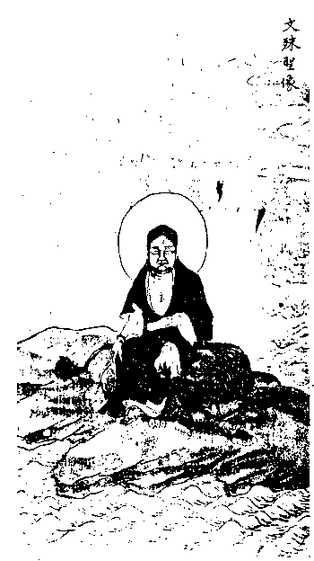
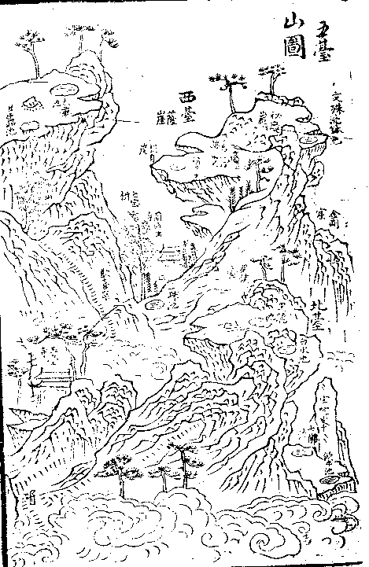

# 清凉山志



> **藏经**：中国佛寺史志汇刊（佛寺志汇刊）　**册次** 第 79 册（GA079）　**编号** GA0081　**卷次** 8 卷　**篇幅** 134,314 字

> **作者（译者）**：高僧目录、菩萨显应目录、名公外护目录

> **卷／品**：8 卷 · 5 品



---



## 目录



  - [清凉山志重修流通序](#清凉山志重修流通序)

  - [淮阴重刻清凉山志序](#淮阴重刻清凉山志序)

  - [清康熙皇帝御制清凉山志序](#清康熙皇帝御制清凉山志序)

  - [清凉山志序](#清凉山志序)

- [清凉山志卷第一](#清凉山志卷第一)

- [清凉山志卷第二](#清凉山志卷第二)

- [清凉山志卷第三](#清凉山志卷第三)

- [清凉山志卷第四](#清凉山志卷第四)

- [清凉山志卷第五](#清凉山志卷第五)

- [清凉山志卷第六](#清凉山志卷第六)

- [清凉山志卷第七](#清凉山志卷第七)

  - [附：狮子窟十方净土院规约序](#附狮子窟十方净土院规约序)

- [清凉山志卷第八](#清凉山志卷第八)



---



### 清凉山志重修流通序



文殊菩萨，道证一真，德超十地，入三德之秘藏，居常住之寂光。但以救苦情殷，度生念切，故复不违寂光，现身尘刹，种种方便，度脱众生。其为七佛师，作菩萨母，犹属迹门之事。若论本地，则非佛莫知。虽尽尘刹界，无非所住；而障重之凡夫，何由识其妙用，瞻其法范乎哉？以故不得不为初机设一应化之地，俾有所趣向，而种出世之善根。故从昔已来，与万菩萨常住清凉宝山，演说一实之道，兼示不思议种种神化，令善根成熟者，即证真常；未成熟者，因兹增长。须知菩萨不动念而随机示现说法，了无差(音「雌」)殊者。如月到中天，影印众水，不但大江大河，各现一月；即一勺一滴，亦现一月。江河中月，一人视之，只见一月；百千万人于百千万处视之，亦各只见一月。人若东行，月则随之而东；人若西行，月则随之而西；人若安住，月则不动。世间色法之妙，尚能如是，何况菩萨彻悟唯心、圆证自性、悲运同体、慈起无缘者乎？恐拘墟者，见志中所有神妙之迹，心怀疑惑，故为表示其致。了此，则徧阅大乘经典，不至惊疑怖畏；不徒为阅此志者，作前导也。旧志，系明万历间，镇澄法师所修，大体甚好，闲有未加详考之失。其时憨山、紫柏、妙峰皆属挚友，不但于此山有大关系，实于佛法世道有大关系，均未立传。清康熙间，复有修者，绝未徧访，且于大有关系之文字任意删削，因兹遂不流通。今依明志，稍为考订增修耳。去春，一弟子李圆净言：「文殊、普贤、观音、地藏四大菩萨，实为一切众生之恃怙。师在普陀，曾请许止净居士作《观音本迹颂》，发挥观音之深恩重德，至为周到。师又另修王雅三所修之《普陀志》。何不将五台、峨眉、九华志，亦按此例而修之乎？况《五台志》亦无处请，而体裁尚好。《峨眉志》则只是志山，不复以发挥普贤之道为事。《九华志》则更可痛叹。当此世道人心陷溺已极之时，固宜亟亟修而流通，以作挽回之据。」遂忘其固陋，勉力从事。乃请许止净标示大致，其修治则光任之，其校对则德森师任之。今已排竣，虽无大发明，然亦不无小补。至于近世之事，以身既不在其地，而以朝不保夕之年，亦不敢托人采访，恐事未集而人已逝，致成空谈。故将近事，留与后来之哲人耳。忆昔光绪十三年在红螺山，告假朝五台，欲请《清凉山志》至京瑠璃厂，徧问各旧书店，祇得一部，因而购之。今为排印流通，俾后来易得，而释己遗憾，何幸如之！五台虽为文殊菩萨道场，未见念菩萨时发起之赞。今夏华严岭僧瀞栖师，祈作一赞，以备念诵之仪，乃凑成八句寄彼。赞曰：



文殊菩萨德难量　久成龙种上法王(龙种上佛，系文殊过去劫中成佛之名，出《首楞严三昧经》。龙种上尊王，另是一佛，不可悮引。)  

因怜众生迷自性　特辅释迦振玄纲  

为七佛师体莫测　作菩萨母用无方  

常住寂光应众感　万川一月影咸彰



民国二十二年癸酉九月日，常惭愧僧释印光敬撰



------



### 淮阴重刻清凉山志序



元夜月满地，有雪天无云。访聚用长老於淮阴闻思寺，问佛与法。聚公曰：「何者是佛？何者是法？栴檀、贝叶皆非也。何者非佛？何者非法？耳鸣、目眚皆是也。执像求佛，执经求法，劫火洞烧，经像俱泯。二者何在？在在皆在，而人不悟也。」余曰：「佛法如是，士农工商，信者无几，柰何？」聚公曰：「士期於学文；无相之文，乃为至文，不悟者愚矣。农期於力田；无形之田，乃为福田，不悟者荒矣。工期於能巧；无技之巧，众巧所师，不悟者拙矣。商期於获利；无得之利，万利所归，不悟者窘矣。一字必惜，是大慧佛；一粒必珍，是多宝佛；一虫必救，是长寿佛；而人不悟也。一字万化，无量法王；一粒万种，无量法宝；一虫万变，无量法母；而人更不悟也。」余问：「人有三难：人身难得、中土难生、正法难闻。柰何？」聚公曰：「即非人身，无非佛身。即非中土，无非佛土。即非正法，无非佛法。悟者何难？」又问：「佛有三难：众生难度、无缘难化、定业难逃。柰何？」聚公曰：「众本非众，度在慈悲。无本非无，化在喜舍。定本无定，逃在忏悔。悟者何难？」又问：「父母未生我前，我在何处？」聚公曰：「且道父母既生我后，我在何处？我未生以前，父母又在何处？」又问：「如何是祖师西来意？」聚公曰：「如何是祖师？如何是西？如何是来？不师师，不西西，不来来，且道且道。」余遂默然。聚公说偈曰：



今年元夜却无云　春雪三分月十分  

大地清凉除热恼　梅花忘我我忘君



甲戌春，聚公与其徒养淳、蕴哲徒步朝清凉山。山志板适毁於火，乃取旧志归淮阴重校而梓之。请序於余，因述问答之语，可悟聚公以大千为山，以大藏为志，无在非清凉者。



乾隆乙亥上元，淮阴教授．金坛史震林书



------



### 清康熙皇帝御制清凉山志序



朕惟清凉山，古称「文殊大士演教之区」也。兹山耸峙於雁门、云中之表，接恒岳而俯滹沱，横临朔塞，藩屏京畿。其地风劲而高寒，层冰结於阴岩，积雪留於炎夏，故名「清凉」。然地虽寒而嘉木芳草蒙茸山谷，称灵异焉。五峰竦立，上矗霄汉，日月之所回环，烟霞之所亏蔽，苍然深秀。其为神皋奥区，盖自昔而已然矣。是以自汉迄今，历代皆有崇建。古刹精蓝，徧满岩岫。宇内称灵山佛土最著者有三：峨眉、普陀，而五台为尤盛焉。我世祖章皇帝，上为慈闱祝厘，下为苍生锡福，赐金遣使，屡沛恩施。朕数经驻跸兹山，为两宫祈康宁福祉，因而登五峰、陟台怀，各为文勒石以纪之。琪树灵葩，形於篇咏。盖尝念佛教以清净慈惠为本，以戒定智慧为宗，亦有裨於劝善远慝。兹山又密迩塞垣，远离尘俗，当为清修者之所栖泊，故於此每惓惓焉。山之有志，所以纪形胜、述建置、载艺文，俾后之人有所稽考。往迹旧闻，不致湮没。兹编详𥳑适中，不芜不支，清凉胜境，可抚卷而得其梗概也，因叙於𥳑端。



康熙四十年五月初三日



------



### 清凉山志序



寂光无外，五浊悬镜里之山；至圣非遥，六趣闭梦中之宅。螺髻眼底，俨若天宫；鹙子目前，依稀人世。毋固毋我，非色非空。惟妙体以无私，循业缘而殊现。且夫一微尘里，窥法界之莫涯；信乎五顶山中，宅万圣而非隘。文殊大士，既为七佛之师；紫府灵峰，固矣三千之最。虽曰充周法界，极神德而无方；今则独指清凉，使归心之有在。山横鴈代，孤标震旦之雄；声播五天，爰起遐方之敬。杂花初唱，名曰「清凉」；宝箧重宣，称为「五顶」。乃圣言之有据，厥灵迹亦可徵。原夫真区湛寂，杳无攀仰之端；化宇形殊，斯有瞻依之相。真该化末，化洞真源。真化融通，圣凡交彻。清凉神境，斯之谓欤！故即真而化，曼殊现贫女之躯；即化而真，波利入金刚之界。是以菩萨於众生心内，时时证觉，顾众生不知；众生於菩萨心中，念念轮回，惟菩萨无碍。是则真不外化，化岂离真？真化一心，悟迷斯隔耳。其为山也，涵容万化，潜育百灵。岩花磵草，全彰本智之光；静谷幽林，深隐真人之宅。时乎珠林焕现，仙域洞开。灵霞生宿客之衣，圆光射游人之影。触目通玄，非人间矣。是以游观之士，四海云驰；栖寂之流，千岩星布。明王圣主，代为兴福之场；列宰名臣，屡有思真之咏。昏昏业识，望影尘消；汩汩烦心，观光慧朗。至於乌茶仰信，丑虏降心，则大士摄化之功至矣。《清凉志》者，所以载夫台山盛事者也。唐初蓝谷法师创集曰《清凉传》，宋僧延一又为《广传》，而无尽居士所覩灵迹，复自书之，目曰《续传》。传虽再出，而於文殊应迹、志士感通，班班遗诸群籍而犹未备焉。至国朝正德间，秋厓法师细搜今古，倍益旧文为二十卷，收采泛滥，未足可传。适际今上圣明御宇，慈圣国母广植胜因，勅建释迦文佛舍利宝塔于清凉山中。神功殊利，泽及万方；法门盛事，光越千古。塔院住持圆广感斯盛遇，与不佞言，将以书诸传记，昭化后世，开觉生民；且命不佞修葺之，而后寿梓。不佞病斯文之讹亦久矣。今有所授，敢不勉焉？於是削繁秩乱，勒门为十。於初二门中藉以问辩，发挥人境真化之旨殆尽。厥文虽减古，而事类有序焉。



明万历丙申秋，燕山广应寺沙门镇澄书于台山之狮子窟(即师子窝)



总目



卷一(十三页)



一、总标化宇



二、略纪化主(分十小目)



（一）原圣



（二）释名



（三）生缘



（四）德相



（五）神用



（六）法要



（七）利行



（八）涅槃



（九）释住



（十）辩益



卷二(二十七页)



三、五峰灵迹



四、伽蓝胜概



卷三(四十一页)



五、高僧懿行



卷四(十四页)



六、菩萨显应



卷五(十六页)



七、帝王崇建



卷六(十五页)



八、名公外护



卷七(十四页)



九、异众感通



卷八(十六页)



十、名公题咏



文殊圣像







文殊菩萨像讃



缅维菩萨　实龙种上　誓愿宏深　慈悲无量  

不违寂光　现身尘刹　随众生机　说圆通法  

其所施设　妙莫能诠　春到百卉　月印万川  

为怜凡夫　无由瞻仰　示住清凉　俾有所仗  

阐佛心要　及与净宗　理超象外　道契寰中  

唯愿慈悲　放金色光　普令众生　同证真常



常惭愧僧释印光和南撰



三宝弟子曹岳申和南书



五台山图







------



## 清凉山志卷第一



第一、总标化宇



神州莽莽，幻境纷陈；众生芸芸，梦魂颠倒。况乎区分六道，形殊四生，同酣火宅之嬉游，遂致苦轮之长转。倘非大圣乘权，现身弘护，不几贫儿客作，没齿无归乎？能识心无不在，竟虚空以为躯；即知智罔弗通，透山河而作眼。机用绝思议之表，建立阐显密之枢。自性毗卢，流出五峰矗峙；现前觉海，结成三昧清凉。揆厥根株，非为别有；藉兹铅椠，永用光扬。志化宇。



东震旦国清凉山者，乃曼殊大士之化宇也，亦名「五台山」。以岁积坚冰，夏仍飞雪，曾无炎暑，故曰「清凉」。五峰耸出，顶无林木，有如垒土之台，故曰「五台」。雄据鴈代，盘礡数州。在四关之中，周五百餘里。左邻恒岳，秀出千峰；右瞰滹沱，长流一带。北陵紫塞，遏万里之烟尘；南拥中原，为大国之屏蔽。山之形势，难以尽言。五峰中立，千嶂环开。曲屈窈窕，锁千道之长谿；叠翠回岚，幕百重之峻岭。岿巍敦厚，他山莫比，故有大人状焉。其间鸣泉历历，万壑奔飞；嘉木森森，千峦弥布。幽涵神物，滀泄云龙。萦纡盘据，无非梵行之栖；隐显环帀，尽是真人之宅。虽寒风劲冽，瑞草争芳；积雪夏飞，名花竞发。白云凝布，夺万里之澄江；杲日将升，见一陂之大海。此其常境也。若夫精心钻仰，刻意冥求，圣境灵区，有时而现。或神灯触目，或佛光摄身，或金阁浮空，或竹林现影。金刚窟里，列圣森森；百草头边，神光赫赫。披云拨雾，或登物外之天；蹑险扪萝，每入非常之境。实百灵之冲府，乃万圣之玄都。其间灵境有不可得而名言状示者，不思议界，非人间也。徵其源也，乃曼殊大愿之所持，如幻三昧之所现。无方无体，非色非空，触类而彰，随缘而显矣。故得染烟齅气，咸资般若之光；触石沾云，悉植菩提之种。《华严大疏》云：「自大师晦迹於西天，妙德扬辉於东夏。虽法身常在，鸡山空掩於荒榛；应现有方，鹫岭得名於兹土。神僧显彰於灵境，宣公上禀於诸天。汉明启兆於崇基，魏帝中孚於至化。北齐数州以倾供，有唐九帝以回光；五天殒命以奔风，八表忘躯而竞托。自非大士慈云弥漫，智海汪洋，廓法界以无疆，尽众生而为愿，孰能感应若兹？其有居神州一生不到者，亦奚异舍卫三亿之徒哉！愿皆修敬焉。」或问：「域内名山有五：东曰泰山，南曰衡山，西曰华山，北曰恒山，中曰嵩山，是为五岳。上古帝王，四时巡狩，则临四方之岳，以时祀之。而泰山梁父，为四岳长，故称『岱宗』。自古帝王于兹封禅焉，载诸经史详矣。今曰文殊大士居清凉山，而令海内倾心，於兹蕲向，亦有何据乎？」答：「於《修多罗》，有良证耳。」故《大华严经》云：「东北方有处，名清凉山，从昔已来，诸菩萨众於中止住。现有菩萨，名文殊师利，与其眷属诸菩萨众一万人俱，常在其中而演说法。」斯言犹漫。又《宝藏陀罗尼经》云：「佛告金刚密迹主言，我灭度后，於南赡部洲东北方，有国名大震那。其中有山，名曰五顶。文殊童子游行居住，为诸众生於中说法，及有无量天龙八部围绕供养等」，斯言审矣。此外，自古及今，神人显彰甚多。略引数条：



一、汉明帝时，摩腾、法兰者，四果圣人也。始至此土，以天眼观，即知此山乃文殊住处，兼有育王所置佛舍利塔。



二、宇文周时，有化人来游此土，云「礼迦叶佛说法处」，并往清凉文殊住处。至山，现文殊像，殒空不见，随者乃知文殊化身。



三、唐初，师子国僧，九十九夏，三果人也。跣足而来，礼清凉山。



四、唐道宣律师行超三界，道重百灵，感诸天人，常侍卫焉。尝问诸天冥远之事，无不明答。乃知清凉，文殊所居。上皆出《感通传》。



故蓝谷云：「此土名山，虽嵩、岱、蓬瀛，皆编外典。未有若清凉出於金口，传於《龙藏》，宅万圣而敷化，自五印以飞声，美曜灵山，利周贤劫者也。」问：「有云劫火洞然，此山不坏，言非妄诞者乎？以今观之，山石之崩𬯎，林木之代谢，击之则裂，火之则灰，安得三灾而不坏也？」答：「化相则坏，真相不坏。故《法华》云：大火所烧时，我净土不毁。如身子见娑婆丘陵土石，斯可坏者也。螺髻见如自在天宫，斯不可坏者也。」问：「真之与化，相去几何？为一为异？一则真应同化，粗弊可坏；异则真居化外，应非人间。」答：「真之与化，非一非异。如镜中像，既非是镜，亦非离镜有像可得。如梦所见，虽非本身，然离本身，无别梦境。故《楞严》云：『譬如目眚，瞩灯光中，别现圆影。彼非眚人，则无所见。』以况众生以无明故，妄见山河诸有为相，圣则不见。又如《入法界品》中，如来入师子奋迅三昧（逝多园林），即有无尽功德庄严。二乘在会，不见不闻。乃至云：『如是皆是普贤菩萨智眼境界，不与一切二乘所共，以是因缘，声闻不见等。』是知真界无殊，悟迷斯隔，推此可知清凉真化矣。」据上所辩，真土无边。独曰此处不坏者，欲令归心专一。又如窥一隙之空，即见无尽之空也。



第二、略纪化主(分十)



七佛未出世，天生大德以为师。九世祖瞿昙，人仰能仁而秉教。过去是龙种上佛，现在即摩尼宝积。为无量数诸佛之母，现十瑞相妙德之身。色等紫金，圆明映彻；毫同白玉，光网庄严。或称为童子，或喻作小男。盖登妙高之峰，信为基址；发菩提之树，智乃根芽。大士寄位在信，表德属智，故也。镕顽铁而作精金，示本明而非新得，化秉圣基，智原德母。志化主。



一、原圣



或问：「常夫之谓凡，通明之谓圣。曼殊大士，凡欤？圣欤？」答：「究论法身，尚不名圣，岂得谓凡？今就应迹，是圣非凡也。」问：「圣有世出世异。洞明物理，德被黔黎，精一传家，至仁修己，此世间圣，尧舜周孔是也；永离生死，证大涅槃，慈育四生，光含三有，此出世间圣，大雄氏等是也。曼殊师利，是何圣耶？」答：「出世间圣，非世间也。」问：「出世之圣，亦有四焉。一曰声闻，闻四谛法，厌苦断集，修道证灭者也；二曰缘觉，观缘变易，自觉无生者也；三曰菩萨，万行圆修，自他兼利，宅心法界，德用难思者也；四曰如来，朗万法之幽邃，觉大夜之重昏，纤尘净尽，万德圆明者也。於斯四者，文殊大士当何圣耶？」答：「久成第四，示居第三者也。」问：「何所据耶？」答：「《首楞严三昧经》云：『佛告迦叶，过去久远无量无边不可思议阿僧祇劫，尔时有佛，名曰龙种上如来，十号具足。於此南方，过千国土，有国名「平正」，地平如掌。龙种上佛於彼国土，得无上觉。』乃至云；『彼佛即文殊师利法王子是也。』又《处胎经》云；『昔为能仁师，今为佛弟子，二尊不并化，故我为菩萨。』此皆已成正觉，现处菩萨也。又《央掘经》说：『北方有国，曰「常喜」。彼土有佛，曰欢喜藏摩尼宝积，即文殊是。』此则现成正觉者也。又《悲华经》言：『阿弥陀佛为转轮王时，第三王子，名曰王众，於宝藏佛所，发阿耨多罗三藐三菩提心，愿於来世，行菩萨道，无有齐限，庄严佛刹。令三千大千世界，恒河沙等十方佛土，为一佛刹，大宝填厕，又无恶触，及诸女人，及其名字，亦无声闻、辟支佛等。一生菩萨，充满其中，佛即号为文殊师利。於未来世，南方世界，名曰清净无垢宝窴，成阿耨多罗三藐三菩提，号普现如来。』」问：「准《宝积经》说，文殊於未来成佛，名曰普现，混无量佛土为一净土，以弥陀净土比之，不啻大海毛滴耳。则未来实成，过去乃因中示成也。」答：「据实而论，过现当来，或因或果，无非随宜示现，摄化群生。在本则无成无不成，无现无非现，不可得而名言矣。」



二、释名



问：「菩萨何故名文殊师利？」答：「至人无名，名所不能名也。今以无名之名，随德立称耳。文殊师利，或云曼殊室利，梵音『楚夏』也。此云『妙德』，亦云『妙吉祥』。以万德圆明，皆彻性源，故称妙德。生有十徵，见闻获益，故称妙吉祥也。十徵者，菩萨诞生时现十种徵：一、天降甘露；二、地涌七珍；三、仓变金粟；四、庭生莲华；五、光明满室；六、鸡生凤子；七、马产祥麟；八、牛生白泽；九、猪诞龙豚；十、六牙象现，是也。」



三、生缘



问：「文殊大士，示生何地？谁氏之子？功德神用、说法利生、归真返寂之事，可得闻乎？」答：「净法界身，本无出没，大悲愿力，示现受生。故《文殊般泥洹经》云：『佛告跋陀罗，此文殊师利，以大慈悲，生此国多罗聚落梵德婆罗门家。其生之时，家内屋宅，化如莲华；从母右胁而生，身紫金色。堕地能言，如天童子。有七宝盖，随覆其上。』十徵如上。多罗聚落，即舍卫国，佛正在此说故。又准《华严经》云：『东方去此界十佛刹微尘数世界，有世界名金色，其佛名不动智。文殊大士，将十万菩萨从彼而来。』据此，则为游方大士。故知法身，一为无量，无量为一，即此即彼，非一非多，不可得而思议矣。」



四、德相



言德相者，因功浩渺，果德难思，备诸藏教。今略示一二，以识端倪。《文殊般泥洹经》云：「文殊具三十二相，八十种好。」则相好同佛矣。又《华严．入法界品》，舍利弗告诸比丘：「汝可观察文殊师利清净之身，相好庄严，一切人天，莫能思议。汝可观察文殊师利，圆光映彻，令无量众生发欢喜心。光网庄严，灭除众生无量苦恼。」乃至云：「汝可观察文殊师利，曾供养佛，善根所流，一切树间，出庄严藏。诸世间主，雨供养云，以为供养。一切如来，将说法时，白毫相光，来照其身等。」又弥勒菩萨告善财言：「文殊师利，所有大愿，非餘无量百千亿那由他菩萨之所能有。善男子，文殊师利童子，其行广大，其愿无边，出生一切菩萨功德，无有休息。善男子，文殊师利常为无量诸佛之母，常为无量菩萨之师。教化成就一切众生，名称普闻十方世界等。」其文甚广，皆菩萨德相也。



五、神用



言神用者，如圣智怖心，闻声扬而擗地。(《宝藏经》云：「东方光相佛弟子，名圣智，说法第一。立于有顶说法，声蔽大千。文殊至彼，立光音天说法，其音普震大千世界，魔宫振裂，恶道休息。圣智比丘，闻是声已，即惊怖，寻便擗地，不能自持。譬如猛风，吹于小鸟，即堕人间。因问彼佛，佛答：『文殊大士至此，威德殊绝，非尔曹所及。』与文殊论义，圣智屡屈。」)寂顺思覩，入隐身而立空。(寂顺思见文殊，文殊不起本座，入隐身三昧，即于彼前，空中而现。)帝释欣喜，雨天花而至膝。(《经》云：「诸天子欲见文殊神变，文殊身徧三界。现神变已，天子欢喜，发菩提心，雨天花至膝，以为供养。」)弊魔愁忧，行拄杖而垂泣。(《如幻三昧经》云：「善住意天子，白文殊同见佛。文殊现三十二部，交络重阁。有诸菩萨，先至佛所。身子覩变问佛，佛答：『文殊住降毁诸魔三昧，将至佛所。』于是文殊住是三昧，时大千世界，百亿魔宫，一时皆敝，不乐其处，各各怀惧。时魔波旬自见老耄，羸毁少气，拄杖而行。宫人彩女，亦复羸老。宫殿崩坏，虚空暗冥。波旬大怖，身毛为竖。心自念言：『此何变怪，令吾宫殿，委顿乃尔！将命终尽，天地遇灾劫被烧耶？』时魔波旬，断除贡高，舍恶思想。文殊所化，百亿天子在交络者，住诸魔前，谓魔波旬：『莫怀恐惧，汝等之身，终无患难。有不退转菩萨大士，名文殊师利，威德殊绝，总摄十方，德过须弥，智超江海，慧越虚空。今入降毁诸魔三昧，是其威神。』时魔恐怖，见化菩萨，即求救济。菩萨言：『汝可往诣释迦佛所，有无尽慈悲，令汝无畏。』言讫不见。魔即诣佛请救云：『我等闻文殊名，即怀恐怖，畏亡身命。』佛即广赞文殊。魔欲求脱，佛令待文殊。后文殊至，佛令舍魔。文殊问魔：『汝恶此身耶？』魔答云：『尔。』『若尔，当厌离贪欲，不住三界。』魔敬从命，即复本形。」此降魔神用也。)劫火烧刹，蹈水芝而上行。(《宝箧经》云：「舍利弗曾与文殊游诸佛土。有佛国土，劫火洞然。文殊神力，自然莲华徧布其中，蹈上而行。水芝，即莲华也。」)霖雨绝供，化钵饭而无尽。(《宝箧经》云：「佛在舍卫，八百比丘，万餘菩萨，连雨七日，不能行乞。阿难乞文殊济众，文殊在室为释天说法，不起本座，入城乞食。魔蔽檀门，文殊神力令门俱开，令魔唱道，当施文殊，得福无量。既得食已，以钵置地，令魔持行。魔不能动，曰：『我之神力举沙陀山，今此小钵，尽力不举。』文殊取钵授魔，令持前行，归祇陀林。无量大众，悉令饱足，饭无所损。」)示多身以抗迦叶，(世尊自恣日，文殊三处过夏，迦叶白槌，欲摈出。才拈槌，乃见百千万亿文殊。迦叶尽其神力，槌不能举。世尊问曰：「汝摈那个文殊？」迦叶无对。)放一钵而发本源。(佛在祇桓精舍，二百天子学菩萨业未就，不任勤苦，心欲退还，求二乘道。佛即化一人，持钵饭奉佛。文殊白佛：「当念故恩，分我钵食。」佛置钵入地下，度七十二恒沙佛土，悬于空中。佛令诸阿罗汉、菩萨各入多三昧，求钵不得。后命文殊，文殊不起本座，申庄严臂，度七十二恒河沙界，取钵而上。彼界菩萨，疑问彼佛。佛答：「文殊神力，于是取钵。」彼菩萨欲随文殊来。彼佛顶光，上烛娑婆，所经世界，皆有多菩萨随来，广闻法要。末发其本，曰：「过去无能胜幢佛出世，比丘乞食，见乳母抱一儿，儿见沙门即喜，下抱趣之。沙门分儿蜜，儿噉之。又随沙门索，复与之。且行且索，遂至佛会。儿见佛喜，从沙门乞蜜奉佛。沙门授钵蜜，儿即奉佛，发菩提心。彼时比丘者，今文殊是。小儿者，如来是。我以比丘蜜食，故今得成佛。」详《大藏．毁字函．普超三昧经》。)持异身而说妙法，(宝上天子语文殊：「令内波旬于腹中，免彼向行人作难。」文殊不尔，欲令波旬处狮子座，如佛妙辩说法。魔即欲隐，文殊神力所持，卒不能去。变身如佛，处座说法。舍利弗叹羡，文殊知之，告曰：「吾能持一切草木树林无心之物，变相说法，皆如佛也。」舍利恐文殊变己如佛，戏弄於我，欲隐去不能。文殊神力，即变舍利弗成佛，与波旬酬酢，宛如二佛广说深法。三万人发菩提，八百比丘成道。详《大藏．大字函第七卷》。)化火网以返迷途。(文殊一时说甚深法，所谓不用见佛，不用求法等。二百比丘，不了第一义谛，以为错乱说，舍佛而去。文殊即於中道化作大火，比丘欲以神足飞空，上见铁网，生大恐怖。回视祇园道径，徧布青莲华，比丘即回佛会，礼足白上所见。佛告比丘：「内火未尽，欲度外火，无有是处。汝诸比丘，堕在见网，欲度铁网，亦无是处。」乃至云：「此之见爱，无所从来，亦无所至，从妄想生，无我，无我所等。」二百比丘，闻是法已，餘漏永尽，成阿罗汉。详《宝箧经》。)掌握恒沙之刹，毛吞无尽之海。如斯神用，劫舌难宣。备诸龙藏，不能俱引。(佛告善胜天子：「文殊童子，所有威神，如我所知，无有量也。所谓能令恒沙国土庄严，一土中现。能令恒沙佛土聚为一处，断送上方恒沙界外，不足为难。能以一毛内十方海，众生不觉。能以十方国土内芥子中，众生不娆等。天子，我於一劫，若一劫餘，说其神变，犹不能尽。文殊即入神变自在王三昧。」现如上事，魔乃发菩提心。)



六、法要



其说法者，一代时教，不共般若；一乘性宗，皆文殊大士激扬酬唱。备诸龙藏，不能广引。今摭其要略数条，冀为道者，各铭心焉。



《观佛三昧海经》言：「时世尊为诸大众说观佛三昧已。文殊菩萨复告大众言：『过去宝威德如来时，有长者子，名曰戒护。在母胎时，受三归依。年至八岁，父母请佛於家供养。童子见佛，安行徐步，足下生华，有大光明。见已欢喜，为佛作礼。礼已谛观，目不暂舍。一见佛已，即能除却百万亿那由他劫生死之罪。从是已后，恒得值遇百亿那由他恒河沙佛。是诸世尊，皆说如是观佛三昧。其后有百万佛出，皆同一字，名栴檀海。时彼童子，亲侍诸佛，闲无空缺，礼佛供养，合掌观佛。观佛功德因缘力故，复得值遇百万阿僧祇佛。从是已后，即得百万亿念佛三昧。得百万阿僧祇旋陀罗尼。既得此已，诸佛现前，说无相法。须臾之间，得首楞严三昧。时彼童子受三归依，一礼佛故，谛观佛相，心无疲厌。由此因缘，值无数佛。何况系念，具足思惟，观佛色身。时彼童子岂异人乎？即我身是。』佛告阿难：『汝持文殊师利语，徧告大众，及未来世众生，若能礼拜者，若能念佛者，若能观佛者，当知此人与文殊师利等无有异。』」



《文殊发愿经》云：「愿我命终时，灭除诸障碍，面见阿弥陀，往生安乐刹。生彼佛国已，成满诸大愿，阿弥陀如来，现前授我记。严净普贤行，满足文殊愿，尽未来际劫，究竟菩萨行。」



《文殊摩诃般若经》：「文殊师利白佛言：『世尊，当云何行，能速得阿耨多罗三藐三菩提？』佛言：『文殊师利，如《般若波罗蜜》所说行，能速得阿耨多罗三藐三菩提。复有一行三昧，若善男子，善女人，修是三昧者，亦速得阿耨多罗三藐三菩提。』文殊师利言：『世尊，云何名一行三昧？』佛言：『法界一相，系缘法界，是名一行三昧。若善男子，善女人，欲入一行三昧，当先闻般若波罗蜜，如说修学，然后能入一行三昧。如法界缘，不退，不坏，不思议，无碍无相。善男子，善女人，欲入一行三昧，应处空闲，舍诸乱意。不取相貌，系心一佛，专称名字。随佛方所，端身正向。能於一佛，念念相续。即是念中，能见过去、未来、现在诸佛。何以故？念一佛功德，无量无边，亦与无量诸佛功德无二。不思议佛法，等无分别。皆乘一如，成最正觉。悉具无量功德，无量辩才。如是入一行三昧者，尽知恒沙诸佛法界无差别相。』」



世尊一日升座，文殊白槌云：「谛观法王法，法王法如是。」世尊便下座。世尊一日见文殊在门外立，乃召曰：「文殊入来。」文殊曰：「我不见有一法在门外者，云何如来教我入门。」世尊教文殊入不思议解脱三昧，文殊曰：「我即不思议，云何更入不思议耶？」世尊谓文殊曰：「如汝文殊，更有文殊？是文殊者，为无文殊？」文殊曰：「如是世尊，我真文殊，无是文殊。何以故？若有是者，则二文殊。然我今日，非无文殊，於中实无是非二相。」庵提女问文殊曰：「明知生是不生理，为甚麼却被生死之所流转？」文殊答曰：「其力未充。」



三十二菩萨各说不二法门竟，却问文殊。文殊曰：「如我意者，於一切法，无言无说，无示无识，离诸问答，是为菩萨入不二法门。」於是，文殊问维摩诘：「仁者当说何等是菩萨入不二法门？」维摩默然。文殊赞曰：「乃至无有文字语言，是为真入不二法门。」



文殊一日令善财采药，曰：「是药者采来。」善财徧观大地，无不是药，却白文殊。文殊曰：「是药者采将来。」善财遂於地上拈一茎草，度与文殊。文殊接得，以示众曰：「此药亦能杀人，亦能活人。」



善现问出世间法，文殊答曰：「我觅世间相，了不可得，子欲谁出？」又曰：「贪瞋痴，即平等法界。我於是中，非已出离，非未出离，若出不出，则堕二见。」



灵山会上五百比丘，得通，未得忍。以宿命智，各见过去，杀父害母，及诸重罪。於自心内，各各怀疑；於甚深法，不能证入。於是，文殊仗剑逼佛。佛言：「文殊住住，吾必被害。吾被害矣，吾谁害吾？」於是，五百比丘自悟本心，了法如梦，皆得法忍。说偈赞曰：



文殊大智士　深达法源底  

手自握利剑　逼持如来身  

如剑佛亦尔　一相无二相  

无相无所生　是中云何杀



上略引显教，其秘密门，大藏甚多，今摭其要，以便持诵。



文殊师利根本一字陀罗尼



唵　齿𡄦(二合，𡄦字去声，弹舌呼之)



佛言：「此是文殊师利童子行轮呪法，为欲守护诸众生故。一切如来，所有极秘密心大神呪王。若有持者，我记是人，则为已持一切诸呪，悉皆圆满。一切所作，皆得成就。文殊师利，常来拥护。乃至消除一切诸恶重罪，成办一切世出世事。」(详《大藏．能字函第九卷》。)



曼殊室利菩萨五字心陀罗尼



阿啰跛左娜



若人有能持此呪者，即入如来一切法平等印，速得成就摩诃般若。才诵一徧，即持八万四千法藏。五字义者，所谓阿者，无生义。啰者，清净无染，离尘垢义。跛者，无第一义谛，诸法平等。左者，诸法无有诸行。娜者，诸法无有性相，言说文字，皆不可得。善男子，汝知此要，当观是心，本来清净，无所染著，离我我所分别之相。入此门者，名「三摩地」，是真修习。当知是人，如来印可，功德殊胜，不可量也。



曼殊室利菩萨八字陀罗尼



唵疴(去声)末啰𤙖却浙啰



佛告金刚手菩萨：「此八字大威德陀罗尼者，乃往过去无量恒河沙诸佛所说。为拥护一切十善国王，令得如意，寿命长远，福德无比，兵甲休息，国土安宁。能大利益一切众生，断三恶道，遂诸愿求。若人暂闻，忆念此呪，即灭四重五逆等罪，何况常念？是人福德，十地补处，所不能夺，况餘天等。若持呪人，事缘悤迫，不必局法修持。但能禁制身、口、意业，十恶永绝，即能持此陀罗尼呪，亦得成就。除不正心，不发菩提心。若能发心，能忆诵者：若诵一徧，即护自身，二徧护父母，三徧护国王，四徧护眷属，五徧护聚落，六徧护城邑，七徧护天下有情。」又云：「若我具说是呪功德，无量千劫，不能令尽。」



七、利行



言利行者，《文殊般泥洹经》云：「此菩萨，住首楞严三昧力故，於十方界，或现初生，或现灭度，饶益众生。」故有偈云：



文殊大菩萨　不舍大悲愿  

变身为异道　或冠或露体  

或处小儿丛　游戏於聚落  

或作贫穷人　衰容为老病  

及现饥寒苦　巡方而求乞  

令人发一施　与满一切愿  

令发信心已　为说波罗蜜  

统领万菩萨　居住五顶山  

放亿种光明　见者罪消灭



又《菩萨处胎经》偈云「我身如微尘，在於他国土，三十二相明，在在无不现」等，皆菩萨利行也。《佛名经》说：「过去无量恒河沙佛，皆是文殊令发初心。」故《清凉》云：「度二十亿佛，现说法者，持地犹存。」(佛告师子音：「过去七十万阿僧祇恒河沙劫，有佛名雷音，于东方无生国成佛。彼时文殊为王，名普覆，诣佛修供，发菩提心。其随从者二十亿人，亦随发心，修六度行，至成菩提，入般涅槃。文殊师利悉皆供养。其中一佛，名持地山，在此下方持地世界，成等正觉。佛寿无量，于今犹住，现在说法。」详《大藏．官字函第九卷》。)化百千诸龙，立登正觉，王女是一。(《法华》)礼妙慧而不忘敬本。(王舍城长者女，名妙慧，年始八岁，诣佛问法，佛为说四十行法。妙慧曰：「我若於斯四十行中，一行不修，则违佛教，则为欺诳如来。我言不虚，大千必动。」言讫，大千世界，六种震动。又曰：「我当决定成佛，此言不妄，令此大众，皆作金色。」言已，会众即变金色。文殊问曰：「汝住何法，发如是愿？」女曰：「文殊非所问也。何以故？於法界中无所住故。」乃至佛告文殊：「此童女者，已於过去发菩提心，经三十劫，我乃发趋无上菩提，亦令汝住无生法忍。」尔时，文殊即从座起，为其作礼，白妙慧言：「我於往昔无量劫前已曾供养，不谓今者还得亲近。」详《大藏．制字函第八卷》)劝善财而增长发心。(《华严入法界品》)无言於不二法门。(《维摩》)悉力於安乐行品。(《法华》)教龙吉祥之分卫，下位莫知。(儒首菩萨入舍卫城分卫，无量大众从之，时龙首菩萨亦从之。二大士酬唱，广谈深法。乃至云：「行卫时，无念举足，无念下足，无行无住，无屈无伸，无念分卫；无分卫者，无心无物，城郭聚落，长幼男女，一切皆无，是念亦无，廓尔清净，是名菩萨分卫道也。在会声闻，罔知其说。」详《大藏．翔字函第四卷》)答琉璃光之光明，正觉称妙。(《涅槃经》：「佛广说大涅槃，闻所不闻之义。高贵德王菩萨难佛，不容有闻不闻义。乃至云：『是大涅槃，非世摄，若非三世，则不可说，云何而言修大涅槃，闻所不闻。』佛印善说。时大会中，忽有大光，非青见青，非黄见黄，非色见色，非明见明。遇斯光者，身心快乐，如入三禅。文殊白佛：『今此光明，谁之所放？』如来默然。迦叶菩萨却问文殊，文殊亦默。无边身问迦叶，亦默然。五百菩萨，皆亦如是，虽相諮问，然无答者。佛即问文殊曰：『是何因缘，有此光明？』文殊答曰：『是光明者，名为智慧。智慧者，即是常住。常住之法，无有因缘；云何佛问何因缘故有此光明？是光明名大涅槃，涅槃常住，不从缘生。云何如来而问因缘？因兹广说常住之法。』后佛告曰：『汝莫入第一义谛，应以世谛而说。』文殊方说其事，乃东方不动佛国琉璃光菩萨所现也。」)谈般若之玄致，屡质本师。说权实之双行，频惊小圣。皆说法利生之事也。(谈般若，广如大藏。权实双行，不思议经，文殊说菩萨行云：「菩萨行於世间，不为世法所染。现处外道，诸见所不能动。虽断烦恼，而不舍菩萨行。虽不住有为，而亦不住无为法。」此义诸经颇多，二乘罔测也。)



八、涅槃



言涅槃者，此云灭度，亦曰圆寂。应缘既毕，敛迹复真之义也。《文殊般涅槃经》云：「佛灭度后四百五十年，文殊师利菩萨，当至雪山，为五百仙人宣扬法化，令成熟已，即与诸仙飞腾虚空，至本生地(即舍卫国)。尼拘树下，结跏趺坐，入首楞严三昧。三昧力故，身诸毛孔，出金色光，徧照十方，诸有缘者，悉令得度。作佛事已，有大火光，从毛孔出，鍊金色身，成琉璃像。於两臂上，有诸佛印，文相分明。琉璃像内，有真金像，正长六尺，坐莲华台，了了分明。火光灭已，此像宛然。其五百仙人，各现神变，皆入涅槃。既灭度已，八大鬼王舁琉璃像，置金刚山顶，起塔供养。」或问：「文殊大圣，入灭於彼，住持於此。彼为真灭耶？不真灭耶？适言真灭，住此者谁？适言不灭，胡不存形而游此乎？」答：「《华严经》云：『为令众生，生欣乐故，出现於世。欲令众生，生恋慕故，示现涅槃。而菩萨身，无有出世，亦无涅槃。何以故？菩萨常住清净法界，随众生心，示涅槃故。譬如日轮，普照世间，净水器中，影无不现。普徧众处，而无来往。或一器破，便不现影，非日咎也。』是知大圣，或出或没，皆适众生。而法身湛然，曾无生灭去来之相，体既真常，用亦无闲。但净我心，圣无不现耳，此涅槃之相也。」



九、释住



问：「圣有三身，当以何身住清凉耶？」答：「三身俱住。住相云何？谓法身住者，毗卢遮那，自体徧故。器界之性，即法身故。经云：『普贤身相如虚空，依真而住非国土。』今约佛法性相义，分身土，则以法身，住法性土，契证难思。义言住耳，实无能所二体也。报身住者，即智与理冥，德称体周，如日合空，即名为住。故东坡云：『溪声尽是广长舌，山色无非净妙身』，似斯义耳。化身住者，即文殊以三十二相之身，与万菩萨常住其中。若夫随类之化，如牧童、皤叟、贫女、婴儿等种种变现，是也。盖法报为体，应化为用。体涵诸用，用根诸体。体周则用徧，故三不相离。」问：「若尔，则体既无边，用亦徧应，奚独住五台？」答：「现五台者，为应震旦之机，欲令归心有在耳。若刹尘机感，法界圆应，夫何所拘哉！」



十、辩益



或问：「自古国家祀诸名山大川者，所以报一岁之功，为生民祈福也。今夫清凉，海内之民吞冰啮雪，委命忘疲，岁岁登礼，至於烧身燃臂而投敬者，往往有之。且曰文殊大士住於此山，而文殊有何义利於人，而令其若是耶？」答：「由此菩萨，於无量劫，事无量佛，舍无量身，修无量行。一一行门，恒为利乐一切有情。由昔大愿所任持故，今得如是等流功德，令诸有情，见相闻名，悉能成办世出世益，乃至远离生死，证大涅槃。譬如雪山大药王树，若有见者，则无眼病；若有齅者，则无鼻病；乃至触者，则无身病等。菩萨功德，亦若是也。故《宝积经》说：『若有得闻文殊名者，皆当成佛，唯除已入离生之位(即二乘也)。』又云：『若有得闻文殊名者，是则名为面见诸佛。若有受持百千万亿诸佛名号，不若受持文殊师利一菩萨名，福多於彼。何以故？以彼等佛，所作一切益众生事，不及文殊一时作故。』又《般涅槃经》云：『若闻文殊名，或见形像者，百千劫中不堕恶道。若称念文殊名者，设有重障者，不堕阿鼻极猛火处；常生他方清净国土，值佛闻法，得无生忍。』据此，则假使住於蓬壶仙域、须弥天宫，经百千劫，不若举一步向清凉山。何以故？乐彼天仙，常沦七趣。向我文殊，必得菩提故也。故蓝谷云：『昔博望张骞，寻河源於大宛；沙门法显，求正教於西乾。况咫尺神州，寰中绝境，可不暂策昏心、聊挥懈足为觉路之津梁乎？』」



音释



丑虏



(上昌九切，下即古切。即「匈奴」，腥膻丑陋者。)



浮图



(具云「窣覩波」。义翻「净刹」，藏舍利处。)



盘礡



(下匹各切，盘曲广博。)



四关



(东龙泉，南伏马，西鴈门，北平刑。)



滹沱



(音「呼陀」。)



瞰



(苦暂切，视也。)



毗卢遮那



(此云「光明徧照」。)



泥洹



(即涅槃，云「圆寂」。)



央掘



(云「世间现」。)



舍卫



(云「丰德」，国丰众德。)



魔



(具云「魔罗」，此云「杀者」。)



陀罗尼



(云「总持」。总，一切法。持，无量义。)



窈窕



(上於鸟切，下徒鸟切，深远貌。)



滀泄



(上音蓄，下音薛，云龙潜化。)



张骞



(汉人。寻河源至西域大宛国，得良马，进武帝，封博望侯。)



法显



(晋僧。隆安间，西域求佛法。)



须弥



(山名。云「妙高」，帝释天居其顶。)



神州



(即「中夏」。)



舍卫三亿



(舍卫九亿人。三亿见佛，三亿闻佛，三亿名亦不闻。)



附录：普贤愿王撮要(附此文，与文殊愿生极乐，正同。文尤详切。)



行愿品，普贤菩萨於逝多林末会，发十大愿王。其一一愿，皆云：「虚空界尽，众生界尽，我此大愿，无有穷尽。是人临命终时，最后刹那，一切诸根，悉皆散坏；一切威势，悉皆退失；辅相大臣，宫城内外，象马车乘，珍宝伏藏，无复相随。唯此愿王，不相舍离。於一切时，引导其前，一刹那中，即得往生极乐世界。到已，即见阿弥陀佛。其人自见生莲华中，蒙佛授记。得授记已，经无数劫，普於十方不可说不可说世界，以智慧力，随众生心，而为利益。乃至能於烦恼大苦海中，拔济众生，令其出离，皆得往生极乐世界。」又下偈云：「愿我临欲命终时，尽除一切诸障碍。面见彼佛阿弥陀，即得往生安乐刹。我既往生彼国已，现前成就此大愿。一切圆满尽无餘，利乐一切众生界。」



------



## 清凉山志卷第二



第三、五峰灵迹



法身无相，偶居莲华千叶之中；圣化多方，横出香水四流之表。返常合道，利用契机。故飞轮衔宝，荡除尊贵之幢；晦影韬光，树植萧闲之帜。千寻壁立，跛驴智何处求踪；万象镜悬，羚羊角谁能漏迹。微露一机一境，宛然分主分宾；净蠲六识六尘，触处随时随地。岂同夸张方伎，惑乱俗流；侈谈蓬岛三山，灵芝益寿。神州五岳，丹诀延年；神异迥殊，正邪攸别。志灵迹。



五台，亦曰五峰。台言高平，峰言耸峭。所以有五者，观国师云：「表我大圣，五智已圆，五眼已净；总五部之真秘，洞五阴之性源。故首戴五佛之冠，顶分五方之髻，运五乘之要，清五浊之灾矣。」其东西南北四台，皆自中台发脉。一山连属，势若游龙。唯南台特秀而窎居焉。



东台，约高三十八里，顶若鳌脊，周三里，亦名望海峰。若夫蒸云寝壑，爽气澄秋，东望明霞，若陂若镜，即大海也。亦见沧瀛诸洲，因以为名。东溪之水，北注滹沱。支山，东南延四十里，入阜平县界。西北延二十里，入繁峙县界。



明给事中锡山仁甫万象春诗：



攀岩耸步上层峦　身世悠然宇宙宽  

一望沧波迷大海　遥瞻紫气接长安  

丹峰隐隐霞光映　碧树重重月影团  

怪道阴云生石洞　从知灵物此中蟠



其灵迹二十六。



那罗延窟



台东畔。其内风气凛然，盛夏有冰。吐纳云霞，或灯光时出。《华严》云：「是菩萨住处，亦是神龙所居。」



镇澄诗：



石窟开岩畔　灵踪接上方  

云霞常出没　神物自幽藏  

冷积千年雪　虚明五夜光  

东南观海岱　烟水思茫茫



笠子塔



台顶。宋宣和间，代牧赵康弼同慈化大师，见异僧入那罗窟留笠子，建塔藏之。



镇澄诗：



梦里乾坤度几秋　穷源直到海峰头  

短筇击碎那罗窟　佛国恒沙任尔游



观音坪



台北麓一里许。



华严谷



台之西北，今名东台沟。



枣林



台之东北。元魏永安二年恒州刺史延庆因猎至此。仆夫四人，逐一白鹿，偶见大宅高门，鹿即窜入。有一长者，须发皓然，拄杖而立曰：「鹿乃我家所有，卿何妄逐？」仆曰：「我不用鹿，饥困柰何？」翁指东林枣方熟，四人就林而食。囊之归，进枣延庆，庆怪之。复迹寻之，遂失其所在。



五王城



台东北数十里，有五王寺。



天城



五王城侧。《灵迹记》云：「天城，即化寺也。不依地立，迥出云霞，朱楼绀殿，皎若天城。得遇之人，尘机顿息。」



大会谷



台东谷，众溪交会，滹沱之源出此。



华林



台东南二十里，即今古华岩。



温汤泉



台东南七十里。



马跑泉



台东南六十餘里。



龙泉关



台东南六十里。关之东即直隶，关之西即山西。



释德清诗：



策杖烟霞外　重关虎豹林  

路当崎曲险　山入塞垣深  

惨淡黄云色　萧条落日阴  

边笳如怨客　呜噎岭头吟



旧路岭



台东南五十餘里。



铁铺



台南五十里。



栖贤谷



台西南沟，俗呼「宰杀沟」。自古真人藏修处也。



镇澄诗：



路入清凉境　幽栖独此多  

烟霞藏梵宇　钟磬出松萝  

叠嶂呈奇畫　流泉弄玉珂  

寻真未相识　且看白云过



观音洞



栖贤谷口岩畔，洞有滴泉，味甘。



法本诗：



足蹑云梯上翠巅　畫楼飞阁接云天  

殷勤瞻礼圆通相　一滴甘泉热恼蠲



化竹林



台西南支山二十里，亦名「昶竹林」。昔人远望，万竹鳞鳞，近则失之，遂此卓庵。



释善安诗：



茅房小筑万松间　幕幕烟光四壁环  

深谷岂宜俗客住　溪云常共野僧闲  

夜深山鬼闻经去　日午天人送供还  

自是身心常寂泊　不知飞瀑日潺湲



青峰



化竹林南，今名「大螺顶」。



释法本诗：



蹋徧尘区念已休　归来结社碧峰头  

无穷松韵清双耳　不尽云山豁两眸  

一个蒲团消白日　半肩破衲度寒秋  

人间八万四千梦　尽向无生一念收



现圣台



青峰之南。唐观国师尝见万圣罗空，五台停岫。



释觉玄诗：



瑞霭云飞杳杳穷　十千开士御寒空  

缤纷不尽莲华雨　无限真人到此峰



明月池



台西南廿里。昔人晦夜，见皎月澄池。



雨花老人诗：



倚杖看明月　沧浪水正清  

悠然歌此曲　可以濯吾缨  

未入非熊兆　空沉老兔精  

若逢知道者　相与结鸥盟



石佛岭



明月池南二十里。



漫天石



东台顶。古有怪石，夏流液，夜有光，后人造屋，火之。



研伽罗山



旧云东台山名。应是梵语，未详所出。



紫府



五台总称。远望五峰之间，紫气盘郁，神人所居也。无恤猎常山西，瞻紫云之瑞，至此见圣。



镇澄诗：



西望龙泉锦绣开　紫云郁郁锁仙台  

就中一片清凉地　劫火曾经几度来



黄巍岭



商英望此见神灯，料是小东台。



观来石



南台，高三十七里，顶若覆盂，周一里，亦名「锦绣峰」。山峰耸峭，烟光凝翠，细草杂花，千峦弥布，犹铺锦然，故以名焉。支山南延六十里，至嵚岩寺。



万仁甫诗：



南台孤耸隔诸台　极目氤氲瑞气开  

花满重冈堆锦绣　岩藏湿雾锁莓苔  

千寻宝刹摩云出　百道飞泉带雨来  

欲证菩提何处是　暂从法地一徘徊



其灵迹二十一。



仙花山



即南台之山名。



普明歌：



南台之麓　仙人之居  

春云霭霭　暮雨霏霏  

卧於石罅　而坐神龟  

杳然飞去　仙花披靡



李环洲诗：



南极名山绝汉开　扪萝直上最高台  

白云缥缈峰前过　红日曈昽地底来  

望眼敢云空四海　飞身应拟近三台  

寻真到此聊经宿　莫谓丹成便浪猜



普贤塔



南台山上。



古南台



台南二里。嘉靖间，香林大士卓庵其上。



副使杨彩诗：



沱水恒山一脉来　清凉胜迹自天开  

石门秘诀封何日　宝树灵根那为栽  

演法当年缘正觉　传灯歧路谩相猜  

停骖渐欲收登览　先上南天紫翠台



石罅、神龟



二俱仙花山南半麓。



石城



台南二十里，四山峭壁，若城焉。



德清诗：



青山白社意何真　不厌孤游杖屦频  

石裂峭崖天作障　寺居空界日为邻  

瑶花紫术春常在　丰草长林鹿自驯  

怅望餐霞人已去　峰头明月好谁亲



白龙池



台东南麓。



插箭岭



台东二十里。宋太宗北征入此，见菩萨现八臂相，插箭而回。



万木坪



台西南四十里。唐李澄师庄，为普通供养。



龙宫圣堆



近娑婆寺。昔有龙母，闻法化去，时龙池即涌为堆，故名焉。



圣钟山



台南八十里。昔有神钟，飞来悬于岩下，高数丈。钟后飞鸣而去。今铁簴尚存。



圣僧崖



亦名「滴水崖」，台南七十里。唐贞观中，梵僧于此立化。



古竹林



台西南三十里，唐法照入圣境。



镇澄诗：



森森万竹拂苍烟　可信人间别有天  

回首不知谁是梦　夕阳山色意茫然



虒阳岭



台西南三十餘里，佛陀波利见文殊处，有尊胜幢存焉。虒阳河源发於此。



志公洞



清凉石南。



法华洞



志公洞前。



七佛洞



台西南二十里。古有七梵僧，至此入寂不起，遂立七佛像。



千佛洞



台东北崖畔。嘉靖末，道方者夜游至此，见神灯万点，既出旋入。方随入，见玉佛像森列其中，穹窿深迥。进里许，黤然闻波涛，悚怖不能出。念观音名，愿造像。忽见一灯，寻光得出，乃造石佛于洞口。



金阁岭



台西北岭，昔人见化金阁，建寺以拟之。



德清诗：



祇园杰阁境清虚　布尽黄金计不疎  

山指岳莲瞻玉气　地从尘海入空居  

青天有客乘鸿鹄　白社何人揭梵书  

万里风烟仍击目　不堪登眺转愁予



一片轻云日夜浮　即看春色又神州  

无边芳草年年路　不尽滹沱滚滚流  

人世即今频侧目　乾坤自古一登楼  

凭虚直欲陵风去　更许何人汗漫游



侍郎杨海州诗：



年来踪迹厌红尘　此日登临托胜因  

紫界左窥连渤岱　银潢西指控周秦  

堂斋罢柝钟声静　梵偈传香月印新  

赢得缁流询姓字　便疑驱遣幻中身



天盆谷



金阁之左，山若仰盆。



泰山樵子孙枝诗：



石磴穿云上　松萝觅路除  

山深无客到　地僻有僧居  

刳木通泉水　开畦种野蔬  

好游浑不倦　空阁且停舆



蛇沟



天盆北，旧名「车沟」，若车箱形。



海螺城



天盆之东，昔人於此见化城，若海旋焉。



镇澄诗：



怅望青山思更依　化城缥缈隔烟霏  

曼殊境界原非外　只要当心一息机



西台，高三十五里，顶平广，周二里，亦名「挂月峰」。月坠峰巅，俨若悬镜，因以为名。其上有泉，群山拱合，岩谷幽潜。支山西北延四十里，至繁峙县界。



万仁甫诗：



重峦硉矹倚青苍　绀宇参差八水旁  

欲向法门探上乘　闲来净土即西方  

泉飞石壁三衣湿　花吐金莲万壑香  

指点诸天僧话久　峰头明月已生光



其灵迹十七。



魏文人马迹



在台上。石上印文若人马足迹，俗以为魏帝至此。



觉玄诗：



魏帝銮舆避暑来　旌旗卷日映山台  

盘陀石上空留迹　风雨千年印绿苔



八功德水



台北。



副使李北沙诗：



台山闻自昔　今日见青冥  

翠抹千寻壁　祥看五色屏  

云笼七宝树　水绕八功亭  

散落天花夜　清音送客听



二圣对谭石



唐法林，见缁白二叟坐谈石上，近之则失，因为名。宣公子覩异，於上建楼。



觉玄诗：



妙德弘开向上关　维摩一默不轻还  

对谈若谓无言说　风雨依前点石斑



狮子踪



对谈石下。



雨花老人诗：



谁跨狻猊到五峰　徐行蹋徧玉芙蓉  

一方石上遗灵迹　八水池边绝异踪  

花落每经香雨湿　春深惟有绿苔封  

杖藜归去应寻觅　见在西岩第几重



牛心石



台东有石，状若牛肝。



文殊洗钵池



台东北谷。昔有白发母洗钵于此，僧明信问其故，曰：「中台乞食而来。」言讫忽隐，唯见光映林谷。



泥斋和尚处



台东北谷。昔有神僧住此，以泥作馔，与宾共食。



觉玄诗：



西台东北古岩阿　尊者修行志不磨  

日午自搓泥剂子　旋充中食省檀那



鸟门



台西北隅。



龙窟



台西半麓。



石门



台之西南谷中。



李牛谷



台西北三十里。



禅堂沟



台西北沟。



峨谷



台西五十餘里。



秘魔岩



台西四十餘里，木叉和尚居此。



德清诗：



羊肠百折任青藜　草莽萧萧仄径迷  

绝壁倚天应隘日　断崖无路只飞梯  

依人野鹤寻常下　逐客山猿日夜啼  

自是烟霞随去住　到来元不费招携



龙洞



在秘魔岩，恳祷则龙现，见者非一。



萨埵崖



秘魔之西。古有代州王氏女，不欲配，逃于此，食薇饮露。父母逼之，女投崖，未坠而飞。



香山



中、西二台之间。



北台，高四十里(旧传三十八里，中台四十里。今登中台，不见北台地面；登北台，则见中台地面，是知北台高于中台，故易之)，顶平广，周四里，亦名「叶斗峰」。其下仰视，巅摩斗杓，故以为名。风云雷雨，出自半麓。有时下方骤雨，其上曝睛。四方云气，每归朝而宿泊焉，盖龙帝之宫也。时或猛风怒雷，令人悚怖。尝有大风，吹人堕磵，若槀叶耳。东望海气，北眺沙漠，令人悲凄。登临者，俯仰大观，益觉此生微茫虚幻。支山北延四十里，至繁峙川前，有众溪发源，注清河。



万仁甫诗：



高台天际郁崔嵬　几见山僧杖锡回  

幢影翻时陵日月　钟声鸣处隐风雷  

身依北斗怀宸极　面对南山献寿杯  

冰积万年消不尽　何时穷谷起飞灰



其灵迹二十四。



黑龙池



台上，亦名「金井池」。侧有龙王祠，四方民祷雨辄应。



西陵丘坦之诗：



一片黄沙起　山川总不分  

满空飞乱石　四谷合乌云  

莫是龙王怒　疑从虎口闻  

春光已三月　犹自雪纷纷



镇澄诗：



万丈峰头金井开　醍醐甘露谩相猜  

龙王神力难思议　一滴能令徧九垓



说法台



台之东。常出钟梵之音，人多闻之。



法本诗：



闻道仙人说法台　法音寥寂石生苔  

谈经大士今何在　惟有白云空去来



隐峰塔



唐邓隐峰，参马祖，飞锡解军，倒化于北台。妹尼立塔，近者僧明来重修。



觉玄诗：



隐峰倒化古岩前　笔立裙衣上耸然  

良妹已收灵骨后　石幢高树在峰巅



蒲坂福登诗：



人间重苦是无常　谁不临歧手脚忙  

唯有吾师惺大梦　等闲游戏死生场



法本诗：



金锁玄关不可畱　邓公遗塔晚峰头  

颠亡倒化乘神浪　千古令人仰未休



镇澄诗：



大士曾参马祖关　陵空一锡向青山  

头陀本自无生死　争肯区区取涅槃



生陷狱



台后半麓。隋繁峙民张爱，盗龙池钱若干。将归，暴风卒起，吹堕于此。上耸巉崖，下临绝涧，黑云四蔽，冰雪拥身，求出莫由。志心悔咎，称菩萨名，经宿云开，见白兔，随出。



镇澄诗：



迷里清凉生地狱　悟时地狱即清凉  

须知二法元无相　不离当人一念彰



罗汉台



台之次东，一级平台。唐十六梵僧，至此同化去。



华严岭



台之东南，二台之间。



孙孜诗：



策杖登层岭　攀萝上极巅  

深林迷白日　古涧落寒泉  

四望山川尽　平临星斗悬  

不须求羽化　际此是登仙



梦觉诗：



好静寻山谷　探奇上岭头  

双眸廓海宇　两足跨云楼  

杖倚寒空月　人临碧汉流  

吾知非宿善　安得五台游



楼观谷



台之东南二十餘里。



金刚窟



在楼观左崖畔，乃万圣秘宅。《祇桓图》云：「三世诸佛，供养之器，俱藏於此。迦叶佛时，楞伽鬼王所造神乐，及金纸银书毗柰耶藏，银纸金书修多罗藏，佛灭度后并收入此。昔佛陀波利，入此不出。」



白下正秀诗：



为访金刚窟　相将启石扉  

无心能造诣　有相可归依  

阁迥云阴重　岩深暑气微  

三三前后语　千古露真机



福登诗：



金刚窟子无缝罅　入者还他师子儿  

铁壁银山直拶透　三三之语许渠知



德清诗：



均提相送出精蓝　无著投机事已惭  

莫谓当年人不荐　至今谁解话三三



云南净伦诗：



杖藜特叩金刚窟　囘首云生白水池  

欲问三三前后事　一声幽鸟夕阳西



法本诗：



无著寥寥不复闻　古岩餘瑞尚氤氲  

游人千载希灵迹　犹向峰头礼白云



镇澄诗：



石门寂寂锁苍苔　波利寻真去不回  

大智愿王无向背　游人何事浪相猜



白水池



在楼观谷后，其泉若乳，山人多取洗眼。



雨花诗：



五郎沟下卧残碑　一径斜通白水池  

雨歇空山澄罔象　风生曲岸动涟漪  

银沙布底月来处　雪浪滔天云起时  

到此君应怀藻鉴　洗清法眼是便宜



觉玄诗：



江汉微茫尚炳灵　一泓池水自澄渟  

溶溶淡染秋光白　想是仙家玉液醽



五郎祠



楼观谷西山麓，宋杨业第五子出家处。



正秀赞：



正行将令　却入禅那  

外彰威武　内息干戈  

扫除六贼　戡翦四魔  

金汤教法　屏障山河  

名标寰宇　迹寄岩阿  

偶来稽首　谩说伽陀



镇澄诗：



国士寥寥马不嘶　白云深锁五郎祠  

宋家世界空成梦　铁棒常拈欲恨谁



玉泉



楼观谷口，无著见化人于此饮牛。



紫霞谷



台南，俗呼「北台沟」。清凉深处，禅侣幽栖也。



释明让诗：



紫气𬘡缊昼不开　灵霞日护法王台  

云栖道者谈经后　散落天花徧九垓



龙门



台南麓。裂石如崩，涛声若雷。北有藏云谷，下有留云石。云出为雨，云入为霁。顺庵胡公题其石，妙峰刺舌血书《华严》处。



镇澄诗：



独宿龙门夜　寥寥心自如  

神灯出杳霭　清籁发寒虚  

雪色千山迥　秋声万木疎  

坐来诸念寂　因识古曼殊



金沙泉



龙门之侧。



仙人庵



台后。



觉玄诗：



何年仙子此修行　服日餐霞道气清  

袖拂天风骑鹤去　至今传说有庵名



九女泉



台后七里，曾有九仙女浣衣。



藏真谷



台西北，昔有五百梵僧，藏修於此。



大黄尖



台北二十里，即古北台。



卓锡泉



在兰若寺。唐初，僧道贤缚茅藏修，每下涧汲水，往返甚艰。偶客僧至沐浴，贤数汲涧下。明日僧浣衣，贤再汲不厌。半途失跌，破缾，更取别器汲之，略无怠色。僧曰：「子诚矣！」即卓锡庵前，命贤拔之，不出。僧弹指，锡飞泉涌，僧即随去。



憨山



《古传》云：「昔有梵僧，从魏孝文帝，乞一卧具地，帝许之。僧展卧具，覆五百餘里。」帝知其神，骇之，驰骑而去，帝闻山铮然，顾之，趿然随后。帝曰：「尔憨耶？」山乃止，故以为名。



文岫山



台之西北四十餘里。



宝陀山



台北四十里，亦名「宝山」。



秦戏山



台东北七十里。《山海经》云：「秦戏之山无草木，多金玉，滹沱之水出焉。」亦名「派山」。



品字泉



在秦戏山，即滹沱源。西流由北台之阴，诸溪竞注。过繁峙城北，经代州、五台、忻州、定襄、盂县，入真定平山，左绕台山三面。



中台，高三十九里，顶平广，周五里，亦名「翠岩峰」。巅峦雄旷，翠霭浮空，因为名。与西、北二台接臂，南眺晋阳，北俯沙塞。有五溪发源，二溪左注清河，三溪右由西台下，出峨口，入滹沱焉。《水经》云：「峨谷之水，出於中台」，即此也。



万仁甫诗：



群峰面面拥奇观　朝雨和烟积翠峦  

策杖千山浑不倦　披裘六月尚餘寒  

苍崖碧嶂周遭合　古木黄沙四望宽  

云雾渐看山半起　却疑身已在云端



其灵迹三十二。



灵鹫峰



台东南支山，今称「菩萨顶」，宛似西天灵鹫山，故借为名。



正秀诗：



大士栖灵地　何缘得共登  

光中披梵夹　象外见真灯  

举杖风堪御　腾身虚可凭  

人天相接处　知是最高层



镇澄诗：



青山藏白社　寂寞隔尘寰  

钟磬丹霄外　楼台翠霭间  

鹤依双树老　僧共野云闲  

欲识曼殊面　还应过别山



甘露泉



台右。



大宝塔



灵鹫之前，五峰之中。汉摩腾天眼，见此有阿育王所置佛舍利塔，历代帝王不废修饰。明万历间，圣母李太后重建，厥高入云，神灯夜烛，清凉第一胜境也。



晋阳王道行诗：



浮图屹立奠坤仪　从此群山势尽卑  

百丈高僧无我相　万年天子竟檀施  

轮光徧入星河影　金色浑成世界奇  

借问曼殊何处是　欲从言下决狐疑



镇澄诗：



浮图何缥缈　卓出梵王宫  

远带青山色　孤标紫界雄  

金缾涵海月　宝铎振天风  

自是藏灵久　神邦万古崇



佛足碑



在大塔左侧。按《西域记》云：「摩竭陀国波咤厘精舍大石，释迦佛所遗双足迹。其长一尺六寸，广六寸，千辐轮相，十指皆现；华文卍字，宝缾鱼剑之状，光明炳焕。昔佛北趣拘尸那城，将示寂灭，回顾摩竭陀国，蹈此石上，告阿难言：『吾今最后，留此足迹，以示众生。有能见者，生大信心。瞻礼供养，灭无量罪，常生佛前』(云云)。后外道辈嫉心，除之愈显。如是八番，文彩如故。」唐贞观中，玄奘法师自西域图写持归，太宗勅令刻石祖庙，以福邦家。至明万历壬午秋，少林嗣祖沙门威县明成、德州如意，一夕，一梦莲花，一梦月轮，现于塔际。既觉，各言所梦，异之。及晓，少室僧正道持佛足图贻之。及展，见是双轮印相，喜曰：「此梦真也。」遂倾囊，兼募众立石，时孟秋既望也。是夕，众闻空中珠珮杂乐之声。出户视之，神灯点点，此圣神嘉赞也。



镇澄赞：



巍巍大雄　浩劫忘功  

神超化外　迹示寰中  

刹尘混入　念劫融通  

开兹觉道　扇以真风  

竭诸有海　烁彼空蒙  

岩中留影　石上遗踪  

碎身作宝　永益群盲  

稽首佛陀　悲愿何穷



文殊发塔



在大塔东侧。昔文殊化为贫女，遗发藏此。万历间，方广道人重修。见发色若金，随人视之不一。



法本赞：



昔有㲯毵女　领犬复携儿  

入众乞辰斋　既得还索之  

我固无贪妬　愍尔多瞋痴  

个中无是物　何必生嫌疑  

飞空明玉相　断发留金丝  

大士乘通去　灵踪万古遗  

绀塔陵云霄　慈光破世迷  

稽首大智王　神功不可思



般若泉



大塔前左畔。唐僧慧潜结庵于此，日课《金刚经》。久之，感庵侧涌泉，因为名。饮者生慧。



觉玄诗：



般若池边止渴时　山瓢一吸乐何支  

尘尘烦恼俱消歇　无限清凉说向谁



杂花园



大塔前。唐末改筑戒坛，今为空壤。



凤林谷



台东南谷。



西天洞



凤林谷北岭。



梵仙山



台东南三十里，中台案山。昔有五百仙人，饵菊成道。



秋崖诗：



爱玩吾家紫府山　溪云老树共僧闲  

乾坤谩说蓬莱异　闻者虽多达者难



觉玄诗：



山头紫气日长浮　上有仙人汗漫游  

饵菊换教风骨异　白云影里去悠悠



井沟



梵仙山西。



杨柏谷



井沟南。



九龙冈



台南，近竹林寺。



令公塔



在九龙冈，宋杨业忠死，子五郎收骨建塔。



镇澄诗：



山色苍苍锁暮烟　令公遗塔白云边  

将军忠义乾坤并　千古清标尚凛然



竹林舍利塔



台南竹林寺前。成化间，耕者得石椁，内银匣，中有琉璃缾，盛舍利数百粒，光色璀璨。系宋僧云宗藏之。弘治间，燕京穆氏建塔。嘉靖间，古灯重修。



竹林小像



本寺小像一龛，精巧入神，殆非人力所造也。



镇澄赞：



无边浩荡春　寄之在纤草  

万里长天色　印之於盆沼  

佛身等太虚　促之在微眇  

至道无古今　圆通绝大小  

一龛藏法界　神功自天巧  

稽首共瞻依　谁识衣中宝



清凉谷



在台南四十餘里。



古清凉



在清凉谷中，僧法聚构兰若。



翰林顾绍芳诗：



窈窕回峰众木阴　凭陵双屐暮云深  

千盘磴里开僧寺　万壑泉中出梵音  

室利西来曾示迹　清凉此地足栖心  

亦知世网终成幻　一钵何年倚道林



清凉石



在清凉谷岭西畔，厚六尺五寸，围四丈七尺，面方平正，自然文藻。或能容多人不隘。古者尝有头陀趺坐其上，为众说法，梵音琅琅，异状围绕。望之悚怖，近之即失。后人目其所坐之石，曰「曼殊床」。



杨彩诗：



禅林此石自何来　胜迹长留说法台  

独伴白云迷岁月　寒风暑雨任摧𬯎



镇澄诗：



一方灵石倚山峦　劫火曾经体正完  

造化刻雕文藻丽　风云磨拭玉光寒  

瞻依尽灭多生障　摩触能令万世安  

更有一般难信事　包容法界未为宽



清凉泉



在清凉谷北岩。



真觉诗：



迸珠鸣玉下危巅　上有清凉没底泉  

涓滴尚能消热恼　百川虚作浪滔天



罗汉洞



清凉谷北岩畔。



真觉诗：



清凉自是圣贤居　现有文殊领圣徒  

洞室镇常闲说法　游人还听解知无



清凉桥



台南溪上。



万年冰



台东麓。有冰数丈，九夏不消，地多静居。



寒山石



台东南三里许。



玉花池



台东南麓。昔有五百梵僧於此过夏，白莲生池，坚莹若玉。代牧砌之，志曰「玉花」。



觉玄诗：



何代池开白玉花　香风拂拂散天涯  

云行尊者飞空去　万古芳声不浪夸



伽蓝沟



台之西北。



万圣澡浴池



中、北二台之间，古有涌泉，澄洁可爱。游人临之，於天光云影之间，或见天仙、沙门、莲华、锡杖之状。人或以为菩萨盥掌之所。故四方之民於盛暑时，多持香花、拭巾而投之。后人凿方为砌，构亭藏之，而灵相遂隐焉。



觉玄诗：



六月中台既望期　圣凡交会在斯时  

想应千佛同来此　一夜云生澡浴池



正秀诗：



一池清且浅　甘洁胜琼浆  

能洗愚痴垢　还生定慧香  

光浮千界白　色映四天苍  

无以凡情测　神哉不可量



太华池



在台上西北隅。唐传水深丈餘，古今见者，深浅不定。临池鉴影，令心划然。



镇澄诗：



灵沼开云际　泠泠下翠微  

虚涵千嶂碧　影落四天辉  

曾盥仙人掌　还停客子机  

登临春欲尽　花雨晓霏霏



祈光塔



台西南隅。成化间，秋崖法师同晋主祈光，遂愿，故建之。



觉玄诗：



一上中台自激昂　却将身世两相忘  

彩虹五色圆光现　人各居中不在旁



台中舍利塔



唐蓝谷法师，从梵僧乞得舍利若干颗，造铁塔，盛於内，复建大塔藏之。万历庚辰，塔将倾。一夕怒雷大震，塔乃正焉。



丘坦之诗：



四台环四面　金殿向中开  

埋宝方成塔　祈光别有台  

鸣钟千谷应　听法万人来  

莫怪牛山哭　浮生真可哀



师子窝



中台西南岭，昔人见万亿狮子游戏其中。万历丙戌，僧智光、净立等约五十三人，构屋结社。唯十方学道者共居，不许子孙承业。



紫柏真可诗：



狐兔成群白日嘷　天开此地育金毛  

翦除荆棘凭君相　培植栴檀在我曹  

静蔼刳心成大义　法琳张胆建清操  

祖宗风格陵夷尽　哮吼扶颠敢惮劳



司马赵国麟诗：



每过僧诵处　便觉一官轻  

幽壑从吾好　浮云任世情  

凭栏看鸟尽　倚杖听泉声  

佳水佳山地　终当结素盟



古寺寒山外　钟声日暮时  

闲云飞鹫岭　孤月照龙池  

因果高僧话　胡麻衲子炊  

从来麋鹿性　归路意迟迟



娑罗树



清顺治间，一梵僧指宝塔峰曰：「有娑罗树焉。」山人随视，只见五云生岫，一树浮光，而僧不见矣。圣祖驻跸，忽闻异香，勅赐「栴林」。乃平阳四世孙天闲健和尚中兴，顿成法席。



古志以大黄尖为北台，叶斗峰为中台，翠岩峰为南台，则一山连属。后以锦绣峰灵瑞显彰，大士频现，且与四峰鼎立，人多观仰，故定以为南台。则翠岩居中，叶斗为北矣。况大黄尖，乃叶斗支山，比之叶斗，殆若培𪣻，固不足以当五峰之列。蓝谷传以中台高於北台者，则悮以古当今也。准妙济传：「五峰之外，复有四埵。东曰『青峰埵』，即常山，亦名『无恤台』，赵襄子曾登是山，因以为名。南曰『朱明埵』，即方山，李长者著论处。西曰『鹤林埵』，即马头山，亦名『磨笄山』，代子夫人磨笄自杀处也。北曰『玄冥埵』，即夏屋山，亦名『覆宿山』，古之帝王避暑处。」然四埵之名，好事者立，而圣教无考焉。



五台不产百嘉，半麓已上，并无林木，唯生香草，细輭如緜。其诸台麓溪壑之间，纯生杄朱，异草杂花，不可悉记。其金芙蓉，他山则无。至若灵芝神药，啗者足能开劫迷、易仙骨。自古得者往往有之，然非肉眼可识。今据妙济传，略录凡品于左。



名花有八：日菊(昼开夜合)。金芙蕖(陆地莲)。百枝。零苓香(邢云露诗：「玉毫金相照清凉，花雨云流湿不妨。佛散妙香香满路，骚人采采入诗囊。」)。鬼见愁(生台麓，能驱邪。邢云露诗：「神呵诸怖远，僧定百魔休。一夜生灵草，犹令鬼见愁。」)。钵囊(世传五百罗汉，结夏中台之野。遗其钵囊，化为此花焉。)玉仙(亦名「大吉」，在南台)。天花(菌类，生於柴木，台山佳品也。释镇澄歌：「君不见，五台山上产灵葩，山人目之为天花。多在巅崖深险处，枯木云蒸抽菌芽。厥色浑如玉，厥味薄於瓜。樵牧得之如获璧，持来献入司公衙。司公得之亦甚喜，歌筵舞席争相夸。烹羊宰鹅不足美，必得是物充珍佳。在上欲得索其下，公使展转来山家。僧吏鸣钟告其众，众闻官令惊复嗟。裹粮探求入深谷，岂辞猛兽及毒蛇？求之不得须贷易，归来典却佛袈裟。昔谓人间苦尘役，偷闲学道归烟霞。岂知寂寞寒岩下，营营公事数如麻。异物有时尽，人欲自无涯。我愿君子心，如月绝疵瑕。清光徧照饥寒屋，肯令一念恣骄奢？」)。



异草有三：瞢𧄼、鸡足、菩萨线。



药草有二十五：茯苓、长松、黄耆、黄精、黄连、木瓜、大黄、桔梗、芍药、麻黄、藜芦、白芨、天麻、乌药、甘草、柴胡、百合、沙参、茵陈、回香、管仲、木贼、秦艽、苍术、细辛。



药石有一：钟乳石。



第四、伽蓝胜概



峰峦示鹫岭奇形，远承佛国；楼阁涌宝王殊相，近现毫端。此十刹海清凉之界，实万菩萨显化之区。故经律秘於金刚，钟鼓达於忉利。须知佛土庄严，非夸一时之富美；爰以檀那功德，足为永劫之资粮。试观买园布金，长者即生天上；聚沙成塔，童子终证菩提。况藉清众之修持，绍隆正法；即仗佛光之临照，佑庇群生。佛法不可思议，功德定不唐捐。虽历朝之兴废不一，而丛林之缔构宜隆也。志伽蓝。



按：古传五峰内外佛刹凡三百餘所，多系先古帝王兴建，今皆消沈。大孚灵鹫，肇於汉明，立寺之始也。其中诸寺，或五峰抱出，或双岭中开，或叠起岩中，或耸居云外。楼台现乎杳霭，钟磬出於烟萝。至若天城现影，金阁浮空。无著悮入，不是人间；法照归来，犹存山麓。此不思议界，圣境冥现矣。历代以来，诸刹废兴，沿革数目，难以悉记，今略录显著於左云耳。



台内佛刹凡六十八



大显通寺



古名「大孚灵鹫寺」。汉明帝时，滕兰西至，见此山，乃文殊住处，兼有佛舍利塔，奏帝建寺。滕以山形若天竺灵鹫，寺依山名；帝以始信佛化，乃加「大孚」二字。大孚，弘信也。元魏孝文帝再建，环帀鹫峰，置十二院。前有杂花园，故亦名「花园寺」。至唐太宗重修。武后以新译《华严经》中，载此山名，改称「大华严寺」。观国师於中造疏。至明太宗文皇帝勅重建，感通神应，自昔未有，故赐额「大显通」。古传中有两堂圣众，非戒定慧全者，莫预此寺。自明初以来，勅旨护持，凡十餘道。永乐三年，设僧纲司，率合山僧祝厘，本州月给僧粮。至嘉靖间始革其粮。



王啸庵诗：



五月行踪入大孚　万松如翦雪平铺  

寻真客到青萝嶂　驻锡僧居白玉壶  

几代苔文留锦字　诸天钧乐护灵符  

𬬻烟经卷停云阁　不信人间有畫图



丘坦之诗：



却向凋陵后　追思初建时  

空廊留古像　毁殿落新泥  

幡断犹存字　苔封不辨碑  

圣人不复作　遗迹重伤悲



大宝塔院寺



显通之南，五峰之中，有育王所置佛舍利塔及文殊发塔，因为名。永乐五年，上勅太监杨升重修大塔，始建寺。万历戊寅，圣母勅中相范江、李友重建。恢巍壮丽，冠于清凉。命比丘圆广，主其焚修。



释正秀诗：



佛刹岿巍倚碧空　诸天寒色照帘栊  

琼楼静掩娑罗月　宝塔香飘薝卜风  

百道明霞浮几上　数声清梵落云中  

万年慧炬通霄汉　洪福应归圣主宫



丘坦之诗：



宝塔白毫光　传从阿育王  

万山如磬拜　千佛共称扬  

铃铎迎风乱　栴檀逆鼻香  

夜深闻梵乐　清切动悲伤



百尺轮王藏　庄严不可当  

曲藏无量佛　巧创大明王  

登眺多高阁　经行有步廊  

规模拟忉利　形胜擅清凉



镇澄诗：



御节下清凉　山林品汇光  

皇华辉鹫岭　佛日焕龙章  

宝刹开初地　金绳界上方  

功兮何所致　明祚万年昌



大圆照寺



显通之左，古称「普宁寺」。永乐初，印度僧室利沙者来此土，诏入大善殿，坐论称旨，封「圆觉妙应辅国光范大善国师」，赐金印，旌幢遣送台山，寓显通寺。至宣德初，复诏入京，广宣秘密。无何，辞归山，上未许。明日示寂，上闻，痛悼之。御祭、火化，勅分舍利为二：一塔於都西，建寺曰「真觉」。一塔於台山普宁基，建寺曰圆照。正德间，封张坚参为法王，赐银印，兼有都纲印。



大文殊寺



即菩萨顶真容院。唐僧法云自建殿堂，拟塑圣像。有塑士安生，不委何来，请言圣仪。云曰：「大圣德相，我何能言？」相与恳祷，求圣一现。七日，忽光中现文殊像，遂图模塑成，因名「真容院」。历代人君，不废修饰。明永乐初，勅旨改建大文殊寺。勅赐贝叶灵文、梵文藏经、朱书横列、御制序赞。每帙盛以锦囊，约以锦绦，护以蒨毡，并钦造文殊镀金像。万历辛巳间，上勅太监李友重修。



释秋崖诗：



古今皇帝勅　寺启鹫峰头  

客喜松间屋　僧栖云外楼  

群山皆北向　二水自南流  

名字闻天竺　神僧荷锡游



镇澄诗：



古寺晚峰头　登临兴未休  

林烟笼绀殿　幡影挂朱楼  

僧度溪桥月　鹤翻双树秋  

坐来深院寂　夜雨一灯浮



大广宗寺



鹫峰南半麓。正德初，上为生民祈福，遣中相韦敏建寺，铸铜为瓦，今称铜瓦殿。赐印，并护持，命秋崖等十高僧住。



紫柏真可诗：



方丈萧萧倚鹫峰　显通久寂讲经钟  

更怜铜瓦风霜老　祇恐重来不易逢



鳞鳞万瓦五峰中　不用泥烧用铸铜  

无柰朔方冰雪甚　住僧无力可支倾



储御史诗：



仙宫开晓日　鹫岭住高僧  

气宇闲林鹤　襟怀古涧冰  

秋崖图晚节　苦海羡先登  

坐见超凡界　崐仑驾大鹏



秋崖诗：



小朵天城寺　百年我遁中  

青山云影淡　紫府树林丰  

洗钵龙吞水　扶筇鸟入空  

天机何处是　黄叶舞秋风



罗睺寺



塔院寺东北隅，唐建。张天觉於此见神灯，有感，修饰。成化间，赵惠王重建。



广缘寺



鹫峰东，古名「大王寺」。世传昔有王子弃国出家，于此建寺。明朝改建。后有妃子寺，即王妃出家处。



法王寺



妃子寺后，明张法王建。



普济寺



华严谷，亦名「北山寺」。明成化间，澄孤月禅行闻於代王成炼，始建寺，今为代王香火。



孤月诗：



深隐岩阿不记年　名缰利锁莫能牵  

七斤衫子重联补　日炙风吹愈转鲜



飒飒春风和鸟哀　清音直到耳边来  

𬬻烧柏子端然坐　对月残经又展开



镇澄诗：



落日北山寺　萧然古涧边  

白云生翠崦　明月下寒泉  

孤鹤栖双树　疎钟破晓烟  

焚香坐清夜　暂尔已忘缘



正秀诗：



斋餘聊结伴　来此叩禅关  

古寺开前代　危楼倚北山  

僧持灵锡去　龙带岭云还  

寂寞烟霞里　优游且共攀



般若寺



楼观谷，唐无著尝入化般若寺，因建寺名焉。成化间，立禅和尚道行闻晋王，重建。



觉玄诗：



有缘尊者信前生　童子开门远迓迎  

尽说曾游般若寺　不知谁在里头行



虞山瞿太虚诗：



寒岩一片云　徘徊长松顶  

下偶幽栖人　往来樵牧境  

相看两相得　无言意自永  

冷风忽飘拂　吹度清凉岭  

斐亹金色界　望望何辽迥  

如逢绣墩翁　或对均提名  

为问般若寺　可与衡茅并  

仙衣几时还　天末日引领  

那得寒潭中　复驻悠悠影



性善诗：



古洞岩阿一径通　石门幽掩薜萝中  

青衣自昔迎先觉　金色於今摄后蒙  

风奏松音回劫梦　日薰花气露春容  

自怜未会三三意　把笔徒劳绘太空



太平兴国寺



楼观谷。宋沙门睿见结庐于此。平生自誓者四：「眼不观非法之色，耳不听非法之声，口不道非法之语，心不缘非法之事。」太宗平晋，闻师道，诏见行宫。勅建寺，赐额「太平兴国」，以师主之，即杨五郎之师也。中有五郎祠。五郎之后，真宝，代州人，以义为质，能外死生，钦宗厚遇。靖康之乱，宝为金酋所获，庭抗不礼。金不忍杀，百方劝诱，终不顾。且曰：「吾许宋皇帝以死，为佛弟子，岂当为妄言耶？」怡然受戮。上闻，痛悼不已，立祠本寺。今祠没焉。



秋崖诗：



宋世功臣志异常　弃名林下学僧郎  

乾坤到此谁堪并　独许英风动帝王



阿师功业与天齐　恨杀丹青不与题  

傥得将军常在世　宋朝争肯属单于



法云寺



即华严岭，唐三昧姑开化处。代藩中官王朝，因僧真善开拓重修。



丘坦之诗：



欲览诸山胜　先须渡法云  

万山开釜口　五顶各支分  

侑佛山中乐　留宾涧底芹  

老僧慰辛苦　安置费慇懃



普恩寺



普济寺东山，旧称「西天寺」，元建。明洪武间，具生、室利板的达寓此。道闻于上，诏入京，应对称旨，赐龙章护持。正统间，赐藏经兼护持。



洪武御制诗：



师心好善善心渊　宿因旷作今复坚  

与佛同生极乐天　观空利物来东边  

目有神光顶相圆　王公稽首拜其前  

笑谈般若生红莲　周旋俯仰皆幽玄  

替佛说法近市廛　骅骝杂遝拥粉钿  

飘飘飞度五台巅　红尘富贵心无牵  

松下趺坐自忘缘　人间甲子不知年



此之谓「入如来禅」。



平章寺



金建。



报恩寺



并在华严谷，皆荒凉。



金界寺



华严谷，唐建。张商英於此见神物。成化初，清玉禅师重修。



万寿寺



亦名「玉花寺」，中台东南麓。隋有五百应真栖此，龙神修供。有骡数十疋，不用人驱，自能入市运粮。朝去暮归，率以为常。过夏俱隐。是时白莲生池，坚莹若玉，七日乃烁。代牧砌其池，志曰「玉花」。明改为「万寿」。



铁瓦寺



玉花池南，元建，三泉寺入焉。



寿宁寺



在三泉寺南岭，古名「王子焚身寺」。高齐第三子自识宿命，厌尘劳，于此燃身供圣，菩萨现形火光中。内侍刘谦之回奏，帝悼之，勅建寺焉。唐普雨大师奏昭宗重修，拨州田百顷，充常住费。宋景德初，勅改建曰「寿宁」。元华严菩萨者，有道僧。成宗及英宗幸山，命右丞相巴思重修葺焉。



西寿宁寺



元碧峰建。



三塔寺



鹫峰之西，万历初勅建，僧了尘主之。



李环洲诗：



八十禅翁号了尘　锡飞来自天之津  

见明水月成空寂　风静岩花解悟真  

法藏度流三塔寺　江山收尽五台春  

浮生半日逢君话　浪迹乾坤愧此身



殊像寺



梵仙山左，有文殊驾狻猊像，神人所造，见者肃然，生难有想。



镇澄诗：



瞻对金容意黯然　依稀身在福城边  

南询有路无人践　烟水茫茫镜暮天



南国莺啼花雨天　吾师开化福城边  

等闲一顾青莲眼　证入无生已六千



吉祥妙德相难穷　有作何能尽至功  

唯有菩提心界里　一轮秋月下寒空



日光寺



在凤林谷。嘉靖初，独峰和尚建。



宝林寺



日光北。嘉靖间，古灯禅师建。



凤林寺



嘉靖间，彻天和尚卓庵。尝有盗贼至，见二虎据门，贼乃革恶，因呼为「二虎禅师」。万历初，道闻于上，改建为寺，额曰「凤林」。五年勅建慈寿寺，使官徵之，不可。使官强起，师辟谷七日，乃终。赐祭，塔於本山。



一江和尚诗：



五月清凉界　谈经入凤林  

松风和梵语　流水奏幽琴  

云淡曼殊面　花妍古佛心  

不须觅黄卷　徧演法王音



镇澄诗：



古木寒岩寺　山门控碧流  

丹梯接上界　复道绕重楼  

松老鹤巢稳　云闲僧舍幽  

何时投杖屦　於此事清修



护国寺



鹫峰南，三里许。元成宗勅建，真觉国师住此，著《慧灯集》。明弘治间，周国母重建。



镇澄诗：



探奇来古寺　触目动幽怀  

路绕万松曲　门迎一水开  

丹墀迷蔓草　畫壁没青苔  

不见谈经者　空堂云自来



帝释宫



即今玉皇庙。



碑楼寺



宫南。



万圣佑国寺



交口东山麓，元海印大师居此，注《肇论》。英宗为建寺，赐号「弘教大师」。



镇澄诗：



白社翠巅头　登临思转悠  

风烟千嶂暮　钟磬一林幽  

清写藤萝月　寒生薜荔秋  

虚堂无一物　坐看大云流



观海寺



即明月池，在大文殊院南二里，元魏建成化间，月舟禅师重修。清康熙间，吻叶和尚重建。后有夫缘和尚中兴，立为十方常住。慈心利物，本分为人。



法本诗：



万松深处梵王宫　幕翠回岚知几重  

定起峰头新月上　一枝松影下帘栊



吉祥寺



即清凉桥，在中台南麓。思昙和尚重建，历四世而至离尘和尚，不剃度，不分爨，不私蓄，不别众，凡有作务，以身先之。故内外诸省，皆知有清凉桥丛林者，代不乏人尔。



佑国寺



即南山寺，台怀南五里，奎衷和尚重建。后有仁山和尚继兴，立为十方常住。结制安禅，寸阴不废。



大文殊院



即沐浴堂，在佑国寺南三里，吻叶和尚建。后有本空和尚中兴，立为十方常住。授戒安禅，躬行慎切。



护众庵



在观海寺南五里。原是丛林，因无其人，数年歇响。后有如然和尚，复整为十方常住，葺废修残，弘戒演经，晓夜不懈。



镇海寺



交口西南岭畔。



雷音寺



在海螺城。



紫柏真可诗：



云里有雷音　逶迤一径深  

好将三里雾　化作万方霖  

蛟室寒岩裂　僧房夏木森  

我来了宿约　去住两无心



云集庵



在晓天梁。



天圣寺



井沟，嘉靖间建。



灵峰寺



阳白谷，唐建。成化间，义宾上人约五十三人，结社参禅。皇戚周善世来游，观众有感，割金三千重修。



秋崖诗：



一室千峰里　幽居少客临  

经函就月案　禅榻倚云岑  

极目空天地　潜心无古今  

流馨到人世　故我得相寻



中峰寺、圣水寺、天城寺



三寺，俱在阳白谷，皆灵峰寺支院。



天盆寺



依山得名，近有空上座重修。



日照寺



天盆谷。



金灯寺



南台东北麓，元建。成化间，一庵重修。



性善诗：



梵刹碧山旁　金灯夜吐光  

众生心有感　菩萨用无方  

萝月庭秋冷　松风海曙苍  

五更初定起　清磬听何长



金阁寺



南台西北岭畔，昔人见金阁浮空，因建寺。



杨彩诗：



尘中日夜恣昏狂　暮景来参古佛堂  

高阁崚嶒银汉近　白云缥缈玉毫长  

一乘此际窥宗旨　千手翻疑涉杳茫  

兀坐颓然尘念净　数声清磬倚斜阳



王道行诗：



驾壑朱甍乍有无　云开福地忽平铺  

莲华十丈承神足　贝叶千函锁佛图  

香积厨中松火冷　涅槃会上石床孤  

瞻依共说通身眼　何似怀中不二珠



镇澄诗：



杰阁倚雄峰　登临兴未穷  

怡然观物化　肃尔礼慈容  

帘卷千山雨　窗含万壑风  

倚阑何所思　霜月挂寒空



竹林寺



中台南三十里，唐法照悮入化竹林，因创寺，名焉。历代以来不废修葺。



丘坦之诗：



徧刻千尊佛　存来不记年  

纤微岂人力　妙丽自天然  

殿毁塔犹在　山荒名尚传  

寺僧头尽白　亦复昧因缘



秋崖诗：



清凉山畔几丛林　罗列千峰万木森  

溪涌寒云流碧玉　风飘落叶散黄金  

纵横雁塔星霜古　攲侧龙碑岁月深  

多少禅宫看代谢　徘徊谁不动愁吟



清凉寺



中台南四十里，元魏孝文建。历代以来，不废修饰。唐宋皆设僧正司。



祝颢诗：



后岭前峰迭送迎　景多目眩乱吟情  

青山影里僧家住　绿树阴中客骑行  

流水洗心尘垢净　凉风吹鬓梦魂清  

山高已见诸天近　明日登临见化城



智导庵



中台南麓，即清凉泉侧。万历间，释明经建。



望海寺



东台，元建。嘉靖间，秋月禅师重修。



镇澄诗：



宝刹陵霄汉　登临意廓然  

云霞连海岱　岚色接青天  

远塞冥鸿杳　长空孤月悬  

始知身是梦　回向礼金仙



普济寺



南台，宋建。成化间重修。



性善诗：



策杖寻幽上翠巅　清凉春尽景芳妍  

千崖花缀千崖锦　五顶峰连五顶天  

梵刹岧嶤陵日月　经堂寂寞锁云烟  

真容欲覩知何在　极目苍苍意惘然



法雷寺



西台，唐建。明法聚重修。



晋阳西屏诗：



台山远蹑势陵虚　台上高飙不可居  

五顶插霄皆嵲嶫　万林蔽日总扶疎  

旧闻胜槩风光异　今觉闲游怀抱舒  

徧历峰巅望四极　恍疑天近地无餘



灵应寺



北台。五台唯此山高风猛，人难措泊，往者多冻馁而死。隆庆初，释圆广与徒明来构居，开粥以济饥寒。万历丁亥，释佛秀募造文殊大像，未遂，竟以劳死。感梦慈圣施金，佛始成。遣中使陈儒，载送峰顶，更建殿宇供奉，为祝厘之所。



丘坦之诗：



客子新游地　文殊旧道场  

庄严托圣母　护法有龙王  

殿与云霄近　山多松柏香  

风涛复暴作　愁绝老僧房



演教寺



中台，唐建。弘治间，玉禅师重建。中有铁塔，藏舍利焉。



秋崖诗：



嵯峨高万丈　气宇眇蓬莱  

塔影连云汉　钟声出斗隈  

龙池藏日月　圣地绝尘埃  

天下多名胜　难同是五台



净土庵



栖贤谷。嘉靖间，玉峰和尚开山，历试苦行，尝四十餘日昏散不入。后广集缁流，事净土行，因结庵。



新安明渊诗：



雪发头陀遁僻林　定忘昏散道犹深  

双眉不著人间梦　一尘高挥劫外音  

野衲从风因有道　山禽相狎为无心  

蒲团夜照清凉月　一榻松风独自任



龙兴庵



栖贤谷。嘉靖初，太虚和尚卓庵於此。初住，林茂无人。正旦，见金色女，手执莲花立石上，俄而不见，流光满谷。又尝闻龙鸣。居无何，大开社火，广接方来，丛林鼎盛，因为名。



镇澄诗：



纷纷逐荣辱　大士独惊心  

避俗离寰阓　诛茅入远岑  

林花观代谢　沤影识浮沈  

定入千峰夜　寒云一榻深



灵鹫庵



华严谷东岭。正德间，僧官从铃建。



大钵庵



紫霞谷。群峰拱抱，茂林森耸，无边禅师得楚峰和尚道，济下廿八代。楚峰尝嘱曰：「尔后有钵饭，当共衲子食。」嘉靖甲子卓庵於此，掘得铜钵，受斗餘，遂成丛林。



伏牛法光诗：



住老台山不记年　蔬餐涧饮乐心田  

云埋五顶谁人到　雪覆千峰独自眠  

击钵谩歌佛祖句　缚茅常结水云缘  

自从勘破西来旨　此段因缘不易传



镇澄诗：



群山环抱树森森　大士开图岁已深  

铜钵埋来应有谶　可知原是旧丛林



静林庵



紫霞谷。释真云所构。学天目中峰禅，梓其书以施人。



寂江诗：



静林庵结碧岩阿　目极溪山乐处多  

帘卷白云生远岫　窗含明月映澄波  

灯寒绝涧龙蛇冷　路僻羊肠虎豹过  

门掩清凉无个事　数声啼鸟隔烟萝



杂华庵



塔儿沟，僧正参建。



法云庵



即古弥陀庵，在龙门上。长干德清居此，号为「憨山子」。清幼岁，人呼为「清郎」。万历己亥与友妙峰卓庵於此，掘地得石座，上勒「清郎居」三字，有契焉，遂居之。



镇澄诗：



独宿千峰里　良宵开竹房  

幽松发爽籁　澹月生微凉  

野色凝心静　溪声引兴长  

魂清眠不得　拥衲坐绳床



大林庵



在凤林谷，金陵素庵法师构。



龙树庵



在车沟。嘉靖初，宝印、楚峰、玉堂同参大川和尚，曰：「向去三人载一车。」后至蛇沟，共结庵而居，致成丛林。盖蛇沟，旧名「车沟」也。



杨海州诗：



岩扉一榻安　便遣红尘累  

巾裾带月清　枕簟流松翠  

梵磬夕转幽　花雨晴还坠  

莲社倘相容　日耽菩提醉



谢畹溪诗：



三老习禅静　结宇白云林  

户外数峰秀　岩前众壑深  

夕阴连雨足　空翠落庭昏  

看取莲花净　方知不染心



栖凤庵



天盆北岭。嘉靖间，宝峰建。



释紫崖诗：



峰头嘉木绿依依　客子寻芳路转迷  

清磬一声寒雨外　淡烟缥缈隔幽栖



华严庵



栖凤庵东北。嘉靖末，僧古檀能诵《华严》，於此卓庵。



白头庵



南台东北十餘里。昔有行者，生而皓首，神异颇多。嘉靖间，卓庵於此，后罔知终焉。



性善诗：



皤然一老叟　来自无何有  

手携紫节藜　飘飘鹤随后  

两鬓带秋霜　未拟年多寿  

隐显翠微中　樵牧传之久  

乞食向人间　结庵倚山阜  

紫气拥崖巅　丹砂煑星斗  

乘兴入蓬莱　相寻不相偶  

题诗细咨询　遗踪果非谬



卧云庵



中台西南麓，明建。



法光诗：



卧破白云不出山　终朝无事乐闲闲  

一声清唳松头鹤　格外风光那可攀



不二楼



西台北，楼倚二圣对谈石。景泰间，宣城公子游此，遥见紫金楼跃出云表，因建重楼，拟所见也。嘉靖丙寅，永平法师慧月至此，见文殊、净名二圣对谈，须臾失之。有感，偈曰：



清凉有分归来晚　大圣无缘奉觐难  

一句了然千圣外　相逢何事自颟顸



先是，成化间，有老尼居此，自忆宣公子再来，发其私隐，皆符契。将终，勒石志曰：「吾若来时，必阐《华严》，重修是楼。」月公至此，讲《华严》凡五徧矣。故时人呼为「华严楼」，亦曰「三生楼」。



镇澄诗：



大士谈经不二楼　八功德水印明秋  

泠泠清梵满山谷　散入冥空不可收



谈经人在翠微中　缥缈烟霏隔几重  

欲寄此心无可托　长随片月挂西峰



冰雪谈经岁已深　萧条瓶钵挂高岑  

虚空不住婆娑影　劫火难销刻苦心



台外佛刹凡三十六



东台外九寺



华林寺



在古华岩，唐建。至明朝凡四修。



香云寺



华林相邻。



香蘽寺



华林之东，中有乳头香蘽。



慈云寺



香蘽之南。



龙蟠寺



大会谷。其山状若蟠龙。



凤岭寺



龙蟠相邻。



温泉寺



台东南五十餘里。古传昔有王者婴疾，至是就浴，疾差，因建寺。元重修。



铜钟寺



大会谷中。有神钟，受三十斛，雕文镂藻，绮焕可观。寺僧慧灯受戒赴京，及归，钟失。徘徊怆恻，冥启大圣。忽闻空中报曰：「钟乃拘楼秦佛时，兜率天王所造。今收入金刚窟中，尔何求耶？」灯遂勒石为铭云：「寺法器，世无伦。击振吼，息烟尘。集圣贤，灭苦因。被收入，金刚轮。谁得知，闻空神。」表神钟之去处，绝后代之疑人。



龙泉寺



台东南旧路岭，宋建。嘉靖初，群盗纵横，往者惮之。有马大士者，不知何来，依止废寺，遇贼即杀，群盗乃绝。由是道路复通，往来无难。马公将卒，以三门托燕京大智宗主，以慈惠及物。山之野民，靡然从化，耻为盗者。皆愿施，重修其寺。谚云：「前日马那咤，今朝智菩萨。」



燕京释永庆诗：



龙泉抱古寺　梵影出重城  

乔木团青盖　丹崖列翠屏  

朝烟诸壑暝　秋水半溪明  

讲罢西斋月　萧然一榻清



南台外九寺



灵境寺



去台二十里。成化间，释清善建。



法本诗：



萧萧灵境倚云层　拽杖南来试一登  

帀地莓苔敷卧具　半龛萝月代昏灯  

缁衣有力耕南亩　白社无人叩上乘  

览尽清凉多少寺　不堪愁思忆衰兴



石塔寺



亦名小柏寺，台东南谷，元建。



娑婆寺



台西南三十里。高齐释玄赜卓庵于此，诵《华严》。有妇携子，数来听经，赜疑之。妇即知其疑，告曰：「师莫疑！我名娑婆，乃龙母也。因闻法得悟，我将脱是类矣。」赜曰：「孰当信汝耶？」妇指龙池曰：「我若真悟无生者，此之深陂，涌成高阜。」言讫，随手而起，即成高阜，妇即化去。后人目其阜，名「龙宫圣堆」。玄赜於此建寺，名曰「娑婆」，龙母名也。



镇澄诗：



华座巍巍树影重　白云不散讲时钟  

龙闻了义乘通去　梵宇犹存翠霭中



佛光寺



台西南四十里，元魏孝文建。帝见佛光之瑞，因为名。唐解脱和尚於此藏修。



参政王陶诗：



五台山上白云浮　云散台空境自幽  

历代珠幡悬法界　累朝金刹列峰头  

风雷激烈龙池夜　草木凄凉雁塞秋  

世路茫茫名利者　尘机到此尽应休



嵌岩寺



台南六十里，元魏孝文帝建。



赤崖寺、圣福寺、法华寺、殊公寺



并在仙花山阳。其廓魔、石台、双岭等寺入焉。



西台外九寺



秘密寺



在秘魔岩，岩谷幽深，隐者星布。唐木叉和尚于此藏修，始建寺。



大千和尚诗：



览胜登临兴有餘　秘魔岩畔几闲居  

羊肠石径通幽谷　鲸首钟声透碧虚  

隐隐龙宫多子母　萧萧僧舍少亲疎  

何时得遂归来志　相共云间展钵盂



圭峰寺



峨谷，隋建。



觉玄诗：



几年闻说圭峰寺　未暇从容试一游  

丹凤翻来形势古　青猿啼断海山秋  

霜钟捣日开金殿　铁钵分泉漾碧流  

嘉赏每思酬宿愿　爽吟先付管城侯



豹子寺、熊头寺、向阳寺、育王寺、望台寺、石门寺



六寺并在峨谷，隋唐所建。



铁勤寺



台西南六十里铁勤山，唐慧洪大师建。



镇澄诗：



西出清凉路转遥　铁勤方丈倚青㟽  

铿锵涧水幽琴合　起伏云山翠浪朝  

僧定虚堂生白月　鹤飞双树动清飙  

头陀更在深岩下　默默无言味寂寥



北台外九寺



宝积寺



台北谷。



木瓜寺



台北谷。



普济寺



大黄尖南麓，唐建。



公主寺



台西北谷，元魏第四诚信公主出家建。唐有尼，掘得尺璧，献武则天，下勅重建。唐末，唯德禅师重修。



净名寺



台西北繁峙县南，唐建。具九山龙戏龟之势，寺在龟背上。宋兴国间，勅建。金大定间，重修。元天历二年，推官郭琪重葺。



天觉诗：



月满汾川宝铎寒　谁来此地葬金棺  

育王得道行空际　尊者飞光出指端  

天上凝云常覆定　人间劫火漫烧残  

三千世界无留迹　聊向阎浮示涅槃



正觉禅院



台北，临滹沱，宋称「天王院」。宣和初，黄冠所侵，改「神霄宫」。三年，复佛寺。时有真容院僧慧识主之，邑人仰重，相与踊跃葺之。复请额于朝，赐名「正觉禅院」。将立石志其事，识以言于大夫王公元礼，礼复言于承德郎高公植。植为文，其略曰：「昔我师释迦以修多罗教付阿难陀，以正法眼藏付大迦叶，由是宗教并行。今五台山善言佛者，宗则佛光解脱师，教则华严观国师。其间名流继出，代不绝人。自宋以来，唯教仅存，其言宗者寂无闻；顾识所主院独以禅名，柰何？」植复於礼曰：「事固有实废而名存者，虽圣人不去也。昔子贡欲去告朔之饩羊，孔子以为羊存，犹得以识其礼，故告之曰：『尔爱其羊，我爱其礼。』盖存其羊，冀礼之复行也。识之院榜之曰『禅』，其谁曰不可？」礼固知识之志也，请并记以告将来。其有能发最上乘者，庶几因是而得解脱。复於此土传无尽灯，则於世尊拈花嘱付之意为不孤矣。



清源寺



大黄尖下，二十里，元建。群峰环抱，山气日佳，禅者之栖也。关西僧戒喜，久参悟中和尚。及辞，中曰：「尔缘在北，逢源而止。」万历初，至此卓庵，掘地得残碑，因识清源古基也。



兰若寺



大黄尖北二十里，唐建。万历初，法华道者游行五顶，诵《法华》，日夜无怠。后挂锡於此重修。中有卓锡泉、宋谷寺、天宫寺入焉。



镇澄诗：



清凉北控太行峰　望入烟霄紫翠重  

日暮白云飞不尽　几回敲断夕阳钟



普光寺



今名「黎谷寺」，在文岫山，金璧峰藏修处。洪武间勅修，上赐诗以旌之。金公尝依《华严》，制为佛事，梵音哀婉，凡四十二奏。唯本寺袭其法，四方学者于兹灌顶受业焉。



御制诗：



沙门号璧峰　五台山愈崇  

固知业已白　此来石壁空  

能不为禅缚　区区几劫功  

处处食常住　善世语庞鸿  

神出诣灵鹫　浩瀚佛家风  

虽已成正觉　未入天台丛  

一朝脱壳去　人言金璧翁  

从斯新佛号　盏水溢蛟龙  

飞锡长空吼　只履挂高松  

年逾七十岁　玄关尽悟终  

果然忽立化　飘然陵苍穹  

寄与璧峰翁　是必留禅宗



《清凉山志》卷第二终



附录：结莲社普劝文



如是我闻，西方有佛，名阿弥陀。一名「无量光」，一名「无量寿」。又有观音、势至二菩萨，助佛扬化，皆以大愿力，济度诸众生。其国以七宝庄严，清净自然，无诸杂秽，故名「净土」。其人皆莲华化生，寿命无量。衣食受用，随念而至。更无诸苦，亦无轮转，故又名「极乐世界」。以此返观我等现今所受之身，所处之世，较彼国土，净秽寿量，苦乐生死，岂止天地之相远耶？而昧者不知，或知而不信，自作障碍，颠倒执迷，不思解脱、舍此生彼，岂不哀哉？故我今者劝诸有缘，结此莲社。假使难知难办，犹当勉力精勤。况佛号甚易持，净土甚易往。八万四千法门，无如是之捷径。但能辍清晨俛仰之暇，遂可为永劫不坏之资。是则用力甚微，而收功乃无有尽，众生亦何苦自弃而不为乎？噫！梦幻非真，寿夭难保，呼吸之顷，即是来生。一失人身，万劫不复。此时不悟，佛如众生何？愿深念於无常，勿徒贻於后悔。净乐居士张抡劝缘



------



## 清凉山志卷第三



**译者**：高僧目录



摩滕法兰传  

灵辩法师传  

祥云大师传  

令休大师传  

窥基法师传



道宣律师传  

清凉国师传  

丰干禅师传  

巨方禅师传  

秘魔和尚传



隐峰禅师传  

智通禅师传  

仰山和尚传  

法空大师传  

光屿和尚传



金光照师传  

业方大师传  

志远法师传  

无名和尚传  

智𫖳大师传



取性道者传  

必救都纲传  

赵州禅师传  

孚上座传  

降龙大师传



三大师传  

慧悟大师传  

成觉大师传  

善慧大师传  

苏陀室利传



慧洪大师传  

法冲大师传  

佛日圆明传  

华严菩萨传  

真觉大师传



真觉国师传  

了性法师传  

弘教大师传  

金璧峰传  

大宝法王传



具生吉祥传  

释迦也失传  

孤月禅师传  

大巍禅师传  

宝印禅师传



楚峰和尚传  

无边禅师传  

瑞峰禅师传  

如馨律师传  

远清律师传



紫柏大师传  

妙峰大师传  

密藏幻余传  

莲池大师传  

镇澄法师传



憨山大师传  

䒢溪禅师传  

阿王老藏传  

老藏丹贝传  

悟尘和尚传



章嘉国师传  

源修释柱传  

达天和尚传



第五、高僧懿行



食拣沙之饭，披离尘之衣。入那伽定者，发可被体，爪可围身；住阿练若者，影不离山，履不蹈俗。无非欲解六情之稠网，出五欲之污泥。矩范人天，绍隆佛种。是故什师头首，八百高流；大鉴儿孙，千七列祖。罔不夙解尘缨，越爱河而升彼岸；早祛俗累，炳慧炬以出重冥。他若杭标霅昼，采乐府於灵山；闽怀浙昙，资美谈於江表。览此清凉入传，盖同沧海一沤。略纪先正之典型，庸作后来之矜式。志高僧。



传载高僧者，所以彰夫清凉宝山，实陶化圣贤之域。自佛法入中土，凡能出尘体道，以极佛化者，称「高僧」。且以一德言之，神通若摩滕，超逸若宝志，心空若达摩，神悟若大鉴，高洁若远公，渊默若罗什，观智若天台，穷微若贤首，严净若宣公，至诚若僧会，在是例者，莫能尽举。或是根熟多劫，或是乘愿再来；罔弗体备万善、克证无生、眼目人天、舟航生死者。而其清凉入传者，特万分之一耳。今之所载，凡有二焉：或久栖胜地，道著清凉；或暂入兹山，感通大圣。参而录之，以冀后之住清凉者，见贤而思齐焉。



摩滕、法兰传



汉，印度国有摩滕、法兰二菩萨，以天眼观震旦有情，有大乘根器者已熟。并观五台文殊所居，而圣教未至，知归者少。遂賷释迦文佛畫像，并《四十二章经》，将东适震旦。时汉孝明帝，於永平七年正月，夜梦金人，身高丈餘，赫奕如日，来诣殿庭。旦令占之，通人傅毅对曰：「臣览《周书异记》云：『西方有大圣人出，其没千载，教当及此。』今陛下所梦，无乃是乎？」帝遣王遵等十八人西访。至月氏，值滕、兰，延而归汉。於永平十年丁卯十二月至洛阳，以经像上帝，帝披㲲覩像，果与梦符。帝以预梦告，滕、兰对曰：「此如来以大法嘱累於陛下也，愿陛下勉之。」帝问：「法王出世，何以御不及此？」对曰：「大圣应必以时，形必以感；彼土乃大千世界之中，群灵并集，根器先熟。他机未感，故佛不应。譬之池澄而月皎，否则晦矣，岂月之咎哉？虽然，教光所及，各有迟速，亦随其宜也。」帝问：「此土岂无圣人居化耶？」对曰：「此土有五台山者，乃文殊大士所居，摄化无量天龙鬼神，然非戒定澄神者，莫能覩也。」即译出《四十二章经》。明年春，礼清凉山回，奏帝建伽蓝。滕以山形若印度灵鹫山，寺依山名也。帝复以始信佛化，乃加「大孚」，孚即信也。始度僧数十居之。先是，此山皆黄冠所居，佛化既至，异道无光。於是十四年正月，五台道士白鹿等，与五岳道士褚善信等，谋奏帝焚经，以辨真伪。真则作之，伪则逐之，帝许之。十五日，帝幸白马寺。道士立坛设祭，集七十二子书於坛中。滕以佛舍利、经像置於道西。斋讫，道士执香炬，绕坛泣曰：「臣等上启太极大道元始天尊，众仙百灵。今胡神乱夏，人主信邪，正道失踪，玄风坠绪。臣等敢置经坛上，以火取验，欲使开示蒙心，得辨真伪。」便纵火焚经，经从火化，悉成煨烬。道士失色，欲禁不能。时佛经像，烈火不烧，舍利光明，旋空成盖。滕兰踊身虚空，现十八变，为帝说偈曰：



狐非狮子类　灯非日月明  

池无巨海纳　丘无嵩岳荣  

法云垂法界　法雨润群萌  

显通希有事　处处化群生



事毕，即旋印度焉。唐太宗文皇帝〈登焚经台〉诗云：



门径萧萧长绿苔　一囘登此一徘徊  

青牛谩说函关去　白马亲从印度来  

确定是非凭烈燄　要分真伪筑高台  

春风也解嫌狼藉　吹尽当年道教灰



灵辩法师传



元魏灵辩，未详氏族，出家於悬瓮山。熙平初，顶戴《华严经》，日夜行道於五顶之间，足破血流，曾无少怠。如是三载，精勤如初。一夕松下坐，忽尔心光凝湛，见异比丘摩其顶曰：「子勤苦且久，当以信心入三摩地矣。」自是若梦忽醒，一切文字，触目冰释。造《论》一百卷，以释《华严》。为孝明帝所重，请於式乾殿，敷扬奥旨。宰辅重臣，皆北面而听。后终於清凉。



祥云大师传



高齐祥云，并州周氏子，童年依本州僧统灵询披剃。询欲观其宿习，开经藏，任其探取，乃得《涅槃经》。读之不期年，一部成诵。日诵一徧，率以为常。及闻清凉灵境，负经往游。观光五顶，栖止大孚寺，持诵弥勤。一日偶数官服者，光明俊伟，至云前，拜起曰：「我方洁吾居，愿神足降重，行道七日，以福我家耳。」师即随行。北趣数里，忽云雾晦冥；俄顷云开，眼景非常。前入大宅，庭室甚严，富丽无并。云方升堂就坐，窃疑而问曰：「子何人也，巨富乃尔？」答曰：「我山神也，辱师慈驾，一至于此。」所进食馔，味非世有。行道七夕，神以珍奇数品为赠，云不受。神固进之，云曰：「贫道，道业未成，所患微命不长，不及造修。檀越如不弃，贻我灵药，得延天年，是我愿也。」神曰：「斯亦可耳！」取药一茎，状如童子，色白如练，奉之。云受即噉，遂获登仙。还经师所，陈谢而去。



令休大师传



隋释令休，河南人。乐寻圣迹，徧历名山。始至台山，志求神悟。经行林间，值一异僧。师叩首曰：「圣者，某尝闻文殊大士住五台山，我既徧求，了无所见。」僧曰：「汝安能无所见乎！汝蓄有见，是以不见。汝之无见，是亦见耳！若果无见，斯见文殊。且汝举足时，蹋破文殊面门；擡手处，捉著文殊鼻孔，有甚回避处？」休曰：「然则山河草木，是文殊乎？」僧曰：「若道山河是者，则二文殊；若云非者，则为妄语。於中实无是非二相。且汝无始至今，在文殊眼睛里虚生浪死，玩水游山。文殊祇在汝眉睫间，转大法轮，汝曾不委！」休闻有省，稽首再告曰：「某柰有痼疾，道业无成，大德可能疗之乎？」僧曰：「无心之草，名『瞢𧄼』，汝当服行。服之既久，瞢𧄼即汝，汝即瞢𧄼，是疾可差。」休徧探林谷，求草不得，即自悟曰：「非服草也，使我空心，灭烦恼也。且夫我身一『瞢𧄼』也，万物一瞢𧄼也。幻相似有，其体元空。由是了心法，脱然无系矣。」开皇二十年，端坐而逝，春秋七十有三。



窥基法师传



唐窥基，姓尉迟，父敬宗任松州都督，伯父即鄂国公敬德也。基童时，依玄奘披剃。永徽甲寅，年方十七，帝特旨度基沙弥为大僧，入慈恩寺，参译一切经论。过目成诵，义亦能解。从奘师受瑜伽、唯识宗旨。法相大乘，至基大振，著论凡百部，时号「百本论师」。天性尚侈，每出，必载三车，经书、食馔，时呼之曰「三车法师」。南山律师，严持戒品，兢兢细行，见基侈态，故薄之。律师常有天神送馔，基访律师，坐时过午，天馔不至。基去，天乃至。律师责以后时，天曰：「适大乘菩萨在，翊卫甚严，故无敢入。」律师闻之，大骇，悔过。永隆中，基来游台山，栖托一载。有诏旋京，将行，有异僧出林，止之曰：「法师报缘殆尽，何不就终於此，而欲他行？」基曰：「吾宿缘在彼。」异僧曰：「师善行，明年来会。」基行。华严寺行者，疑问异僧曰：「彼师何人？」异僧曰：「弥勒弟子也。」异僧入林，行者追之，竟无所见。基至长安，明年永淳改元，临终谓徒曰：「十方刹海，游戏之场。生死涅槃，等闲戏具。兜率故苑，吾将归矣。」言讫而蜕。世寿五十有一。御制像赞而伤悼焉。



道宣律师传



唐道宣，彭祖之后，吏部尚书钱申之子。母梦日轮贯怀而孕。生而好礼，正视听，肃容仪，其天性也。少事习诵，长叩玄关。讲师宗匠，无远不参。外通百氏，内洞三学。戒香芬布，逆顺咸闻。慧炬高悬，幽明俱彻。存护法城，著述无辍。尤攻律藏，穷极幽微。七聚五篇，焕然冰释。行高三界，道重百灵，感诸天常侍卫焉。《纂灵记》云：「律师尝游清凉，至中台，夜方禅寂，有天童子侍于右。师问曰：『子何人也？』曰：『我名玄畅，乃天人也。奉天帝命，巡狩圣境。闻师届此，故来相候。』师曰：『准《华严》说，此山乃文殊住处。今见丘陵草树，宛是凡居。圣人境界，果何有耶？』天童答曰：『大圣境界，固非凡夫二乘可得而知。我，凡夫也；师，二乘也。若以有思惟心，求不思议境，则殆矣。师岂不闻一法无异，三人殊见者乎？盖随其各具业报之眼有殊，而所见亦异。若某所见清凉山，碧琉璃色；诸台麓间，皆杂宝林，光明焕发，日夜无闲。而菩萨住处，非我所及也。』言讫而隐。」乾封二年冬，律师入灭於长安西明。穆宗制赞曰：



代有觉人　为如来使  

龙魔归依　岳神奉侍  

声飞五天　辞惊万古  

金乌西沈　佛日东举  

稽首归依　肇律宗主



清凉国师传



唐清凉国师，讳澄观，字大休，会稽人。姓夏侯氏，生於玄宗开元戊寅。身长九尺四寸，垂手过膝；口四十齿，目光夜发，昼乃不眴。天宝七年出家，肃宗二年受具。是年奉诏入内，勅译《华严》。初受具时，即以十事自励。曰：「体不捐沙门之表，心不违如来之制，坐不背法界之经，性不染情碍之境，足不履尼寺之尘，胁不触居士之榻，目不视非仪之彩，舌不味过午之肴，手不释圆明之珠，宿不离衣钵之侧。」从牛头忠、径山钦，问西来宗旨。遥禀於贤首国师《华严》圆旨。代宗大历三年，诏入内，与大辩正三藏译经，为「润文大德」。既而辞入五台大华严寺，覃思《华严》。以三地圣人，栖身佛境，心体真如，犹於后得智，起世俗心，学世间解。由是博览六艺图史、九流异学、华夏训诂、竺经梵字及四围五明，圣教世典等书，靡不该洽。德宗建中四年，下笔著疏，先求瑞应。一夕梦金容当阳山峙，光相颙颙，因以手捧咽面门。既觉而喜，以谓获光明徧照之徵。自是笔无停思，乃以信解行证，分《华严》为四科，理无不包。观每慨旧疏，未尽经旨，唯贤首国师颇涉渊源，遂宗承之。制疏，凡历四年而文成。又梦身为龙，矫首南台，尾蟠北台，宛转陵虚，鳞鬣曜日。须臾变百千数，蜿蜒青冥，分散四方而去。识者以为流通之象。初为众开讲，感景云凝空，盘旋成盖，久而不散。又为僧叡等著《随疏演义》四十卷、《随文手镜》一百卷。贞元十二年，上遣河东节度使．礼部尚书李诜备礼迎观入京。特旨同罽宾般若三藏，翻译乌茶国所进《华严》后分梵夹。帝亲预译场，一日不至，即差僧寂光依僧欲云：「皇帝国事因缘，如法僧事，与欲清净。」观承睿旨，翻宣既就，进之。帝命开示《华严》宗旨，群臣大集。观升高座曰：「我皇御宇，德合乾坤。光宅万方，重译来贡。东风入律，西天输越海之诚；南印御书，北阙献朝宗之敬。特回明诏，再译真诠。光阐大猷，增辉新理。澄观顾多天幸，钦属盛明。奉诏译场，承旨幽赞。抃跃兢惕，三复竭愚。露滴天池，喜合百川之味；尘培华岳，无增万仞之高。极虚空之可度，体无边涯，大也。竭沧溟而可饮，法门无尽，方也。碎尘刹而可数，用无能测，广也。离觉所觉，明万法之幽邃，佛也。芬敷万行，荣耀众德，华也。圆兹行德，饰彼十身，严也。贯摄玄微，以成真光之彩，经也。总斯七字，为一部之宏纲，则无尽法门，思过半矣。将契本性，非行莫阶，故演普贤行海。行起解绝，智证圆明矣。」帝大悦，赐观紫方袍，号「教授和尚」。其后，相国齐抗请撰《华严纲要》三卷。相国李吉甫请述《正要》一卷。又为南康王韦皋著《法界观玄镜》一卷。仆射高崇文请著《镜灯说文》一卷。司徒严绶请撰《三圣圆融观》一卷。节度使薛华、拾遗白居易请制《七处九会华藏世界图》、《心镜说文》十卷。又与僧录灵邃等十八首座、三学上流，制《华严》、《圆觉》、《四分》、《中观》等经律论关脉三十餘部。皆古锦纯金，随器任用耳。十五年，受「镇国大师」号。四月帝诞节，勅有司备仪辇，迎「教授和尚」澄观入内殿，阐扬《华严》宗旨。观升座曰：「大哉真界，万法资始。包空有而绝相，入言象而无迹。妙有得之而不有，真空得之而不空。生灭得之而真常，缘起得之而交映。我佛得之，妙践真觉，廓净尘习。寂寥於万化之域，动用於一虚之中。融身刹以相含，流声光而遐烛。我皇得之，灵鉴虚极，保合太和。圣文掩於百王，淳风扇於万国。敷玄化以觉梦，垂天真以性情。是知不有太虚，曷展无涯之照？不有真界，岂净等空之心？华严教者，即穷斯旨趣，尽其源流。故恢廓宏远，包纳冲邃，不可得而思议矣。指其源也，情尘有经，智海无外。妄惑非取，重玄不空。四句之火莫焚，万法之门皆入。冥二际而不一，动千变而非多。事理交涉而两忘，性相融通而无尽。若秦镜之互照，犹帝珠之相含。重重交光，历历齐现。故得圆至功於顷刻，见佛境於尘毛。诸佛心内众生，新新作佛；众生心中诸佛，念念证真。一字法门，海墨书而不尽；一毫之善，空界尽而无穷。语其定也，冥一如於无心，即万动而常寂。海湛真智，光含性空。星罗法身，影落心水。圆音非叩而长演，果海离念而心传；万行忘照而齐修，渐顿无碍而双入。虽四心被广，八难顿超；而一极唱高，二乘绝听。当其器也，百城询友，一道栖神。明正为南，方尽南矣；益我为友，人皆友焉。遇三毒而三德圆，入一尘而一心净。千化不变其虑，万境顺通於道。契文殊之妙智，宛是初心；入普贤之玄门，曾无别体。失其旨也，徒修因於旷劫；得其门也，等诸佛在一朝。谛观一尘，法界在掌。理深智远，识昧辞单。尘黩圣聪，退座而已。」帝时默湛海印，朗然大觉。顾谓群臣曰：「朕之师，言雅而𥳑，辞典而富。扇真风於第一义天，能以圣法清凉朕心，乃以『清凉』赐为国师之号。朕思从来，执身心我人，及诸法定相，斯为甚倒。」群臣拜贺，顶奉明命。於是中外台辅重臣，咸受益戒。一日，帝问师曰：「《华严》所诠，何谓法界？」师曰：「法界者，一切众生身心之本体也。从本已来，灵明廓彻，广大虚寂，唯一真境而已。无有形貌，而森罗大千；无有边际，而含容万有。昭昭於心目之间，而相不可覩；晃晃於色尘之内，而理不可分。非彻法之慧目、离念之明智，不能见自心如此之灵通也。故世尊初成正觉，叹曰：『奇哉！我今普见一切众生，具有如来智慧德相。但以妄想执著，而不能证得。』於是称法界性，说《华严经》。总该万有，即是一心；无碍融通，故名『法界』。」帝天纵圣明，一听玄谈，廓然自得。於是勅有司铸印，迁国师统冠天下缁徒，号「僧统清凉国师」。开成三年三月六日，师将示寂，谓其徒海岸等曰：「吾闻偶运无功，先圣悼叹；复质无行，古人耻之。无昭穆动静，无纶绪往复。勿穿凿异端，勿顺非辨伪。勿迷陷邪心，勿固牢鬬诤。大明不能破长夜之昏，慈母不能保身后之子。当取信於佛，无取信於人。真离玄微，非言说所显。要以深心体解，朗然现前。对境无心，逢缘不动，则不孤我矣！」言讫而逝。师生历九朝，为七帝门师。(九朝者，唐玄宗、肃宗、代宗、德宗、顺宗、宪宗、穆宗、敬宗、文宗。七帝者，即代宗以下。)春秋一百有二，僧腊八十有三，是为华严六祖。文宗深沐法泽，崇仰恸悼，特辍朝三日。重臣缟素，奉全身，塔於梵川华严寺(梵，今讹作樊)。未几，有梵僧到阙，表称於葱岭见二使者陵空而过，以呪止而问之。答曰：「北印度文殊堂神也，东取华严菩萨大牙，归国供养。」有旨启塔，果失一牙，唯三十九存焉。遂阇维，舍利光明莹润，舌如红莲色。仍谥号清凉国师妙觉之塔。相国裴休奉勅撰碑，其铭曰：



宝月清凉　寂照法界  

以沙门相　藏世间解  

澄湛含虚　气清鍾鼎  

雪沃剡溪　霞横缑岭  

真室寥敻　灵岳崔嵬  

虚融天地　峻拔风雷  

离微休命　实际庞鸿  

奉若时政　革彼幽蒙  

炯乎禹质　元圣孕灵  

德云冉冉　凝眸幻形  

谷响入耳　性不可为  

青莲出水　深不可闚  

才受尸罗　奉持止作  

原始要终　克谐适莫  

凤藻珍奇　遗演秘密  

染翰风生　供盈二笔  

欲造玄关　咽金一像  

逮竟将流　龙飞迁飏  

疏新五顶　光衔二京  

跃出法界　功齐百城  

万行分披　华开古锦  

启迪群甿　与甘露饮  

燮赞金偈　怀生保乂  

圣主师资　聿兴遐裔  

贝叶翻宣　译场独步  

谭柄一挥　几回天顾  

王庭阐法　倾河涌泉  

属辞纵辩　玄玄玄玄  

紫衲命衣　清凉国号  

不有吾师　孰知吾道  

九州传命　然无尽灯  

一人拜锡　统天下僧  

帝网冲融　潜通万户  

历天不周　同时显晤  

卷舒自在　来往无踪  

大士知见　允执厥中  

西域供牙　梵伦遽至  

奏启石验　嘉风益炽  

勅俾图真　相即无相  

海印大龙　蟠居方丈  

哲人去矣　资何所参  

即事之理　塔锁终南



文宗御赞曰：



朕观法界　旷阒无垠  

应缘成事　允用虚根  

清凉国师　体像启门  

奄有法界　我祖聿尊  

教融海岳　恩廓乾坤  

首相二疏　拔擢幽昏  

闲气斯来　拱承佛日  

四海光凝　九州庆溢  

敞金仙门　夺古贤席  

大手名曹　横经请益  

仍师巨休　保余遐历  

爰抒颛毫　式扬茂实  

真空罔尽　机就而驾  

白月虚秋　清风适夏  

妙有不迁　缘息而化  

邈尔禹仪　焕乎精舍



丰干禅师传



唐丰干，不知何许人，居天台山国清寺。翦发齐眉，布衣裘。人或问佛理，止答「随时」二字。尝诵唱道歌，乘虎入松门，众僧惊畏。本寺厨中有苦行，曰：寒山、拾得。二人执爨，终日晤语，潜听者都不解，时谓「风狂子」，独与师相亲。一日，寒山问：「古镜不磨，如何照烛？」师曰：「冰壶无影像，猿猴探水月。」曰：「此是不照烛也，更请师道。」师曰：「万德不将来，教我道什麼？」一日，师谓寒山、拾得曰：「若与我游五台，即我同流；若不与我去，非我同流。」曰：「我不去。」师曰：「汝不是我同流。」寒山却问：「汝去五台作甚麼？」师曰：「我去礼文殊。」曰：「汝不是我同流。」师寻独入五台巡礼。逢一老翁，师问：「莫是文殊否？」曰：「岂有二文殊耶！」师作礼未起，忽然不见。遂游五顶，徧历岩阿，将三载，还南。适闾丘胤出牧丹丘，将议巾车，忽患头疼，医莫能瘉。师造之曰：「贫道特来谒使君。」闾丘即告之病。师乃索净器，呪水喷之，病斯须差。闾丘异之，乞一言，示此去安危之兆。师曰：「到任记谒文殊、普贤。」曰：「此二大士何在？」师曰：「天台国清寺，寒山、拾得是也。」闾丘自后寻至山寺，问寺主丰干住处。主僧道翘曰：「丰干旧居，在经藏后，今阒无人矣。」复问：「寒山、拾得今在何所？」翘曰：「厨中执役。」闾丘入丰干房，唯见虎迹。复问：「丰干在此，作何行业？」翘曰：「唯事舂谷供僧，闲则讽咏。」闾丘遂入厨，见寒山、拾得围𬬻语笑。闾丘即礼拜，二人连声咄叱。寺僧惊愕曰：「大官！何拜风狂汉耶？」寒山复执闾丘手，笑而言曰：「丰干饶舌。」自是寒山、拾得相携出松门，更不复入寺。师示寂於天台山。



巨方禅师传



唐巨方，安陆曹氏子。幼从明福朗公薙度，徧探经论。后参荷泽及造北宗秀。问曰：「子何来？」答曰：「清凉山。」问曰：「如何是清凉境？」答曰：「白云覆古顶。」又问：「白云散处如何？」答曰：「不昧。」又问：「如何是境中人？」答曰：「一衲卧千峰，不知天地老。」又问：「此后如何？」答曰：「一枝横出，五叶芬芳。」秀默许之。游化上党，座盈千众。后於五台阐化，二十年而终焉。



秘魔和尚传



唐秘魔和尚，不知何处人。得马祖之道，居五台秘魔岩。常持一木叉，每见僧来礼拜，即叉却颈曰：「那个魔魅教汝出家？那个魔魅教汝行脚？道得也叉下死，道不得也叉下死，速道速道！」学人鲜有对者。霍山通禅师来访，才见不礼拜，便窜入怀里。师拊通背三下。通起拍手曰：「师三千里外赚我来，三千里外赚我来。」言已便回。师以大法为务，与世漠然，后终於岩下。



隐峰禅师传



唐隐峰，福建邵武人，姓邓氏。幼若不慧，父母听其出家。初游马祖门，而未窥其奥；复来往石头，虽两番不捷(语见马祖章)，而后於马大师言下契悟。师在石头时，问云：「如何得合道去？」头云：「我亦不合道。」师云：「毕竟如何？」头云：「汝被这些多少时来了？」师不对。一日，石头刬草次，师在左侧，叉手而立。头以飞刬子，向师面前刬一茎草。师云：「和尚只刬得这个，刬不得那个。」头即提起刬子。师接刬子，乃作刬势。头云：「汝只刬得那个，不解刬得这个。」师无对。师一日推土车，马大师展脚路坐。师云：「请师收足。」大师云：「已展不缩。」师云：「既进不退。」乃推车碾过，大师脚损。大师归法堂，执斧子云：「适来碾损老僧脚底出来！」师便出，於大师前引颈。大师乃置斧。师到南泉，众僧参次。泉指净瓶云：「铜瓶是境，瓶中有水，不得动著境，与老僧将水来！」师便拈净瓶，向南泉面前泻，南泉便休。师后到沩山，於上座头，解放衣钵。沩山闻师叔到，先具威仪入堂。师见山来，便作睡势。沩山即归方丈。师乃发去。少闲，沩山问侍者：「师叔在否？」曰：「去也。」山云：「去时有何言句？」曰：「无。」山云：「莫道言无，其声如雷。」师以冬居衡岳，夏住清凉。唐元和中，荐登五台，路出淮西。属吴元济阻兵违拒王命，官军与贼交锋，未决胜负。师曰：「吾当去解其患。」乃掷锡空中，飞身而过。两军将士仰观，事符预梦，鬬心顿息。师既显神异，虑成惑众，遂入五台金刚窟前。将示寂时，先问众云：「尝见诸方坐卧迁化，还有立化者无？」众云：「有。」师云：「倒化者有否？」众云：「未有。」师乃倒立，亭然而化，衣裳顺体。时众议舁就茶毗，屹然不动。远近瞻观，惊叹无已。师有妹为尼，时在山，乃抚而咄曰：「老兄！畴昔不循法律，死更荧惑於人。」於是以手推之，偾然而踣。遂就阇维，收舍利，塔於北台之顶。



智通禅师传



唐智通，初在归宗会下，忽一夜连叫曰：「我大悟也！」众骇之。宗明日上堂，示众曰：「昨夜大悟底僧出来！」师曰：「某甲在。」宗曰：「汝见甚麼道理，便言大悟？且试道看！」师曰：「师姑元是女人作。」宗异之，师便辞去。宗送与笠子，师接戴头上，拂袖便行，更不回顾。后居台山法华寺。临终有偈云：



举手攀南斗　回身倚北辰  

出头天外看　谁是个中人



仰山和尚传



唐仰山和尚，一日游五台回。僧问：「和尚近日何往？」山曰：「五台。」曰：「见文殊否？」曰：「见。」又问：「文殊向和尚道甚麼？」山曰：「文殊道：『你生身父母，在深草里。』」



法空大师传



唐法空，隋末，任雁门鹰击郎将。年四十，以隋室荒淫，即生厌离。乃弃冠剑、妻子，独诣清凉。构茅深谷，草根木叶以为其食。尝诵《华严》「唯心作佛」之偈，无所参叩。时贼寇交起，府司追系，复归。至禁所，正念趺坐，不语不食，不瞬不息，几两月。守令以下，莫不惊愕，因而放之，任其所往。空至山居，一隐三十餘载。禽兽忘形，人事绝交。后有异僧授般若玄旨，豁尔心空。临终，谓众曰：「自被拘狱之后，天机不动。自遇我师，烁破虚空了也。」言讫而逝。



光屿和尚传



唐光屿，金城韩氏子。幼业儒，有青云之志。尝梦神人曰：「若意干仕禄，若志鄙哉！若必求道，莫若如者也。」屿曰：「我将何之而可？」曰：「五台山者，圣贤所栖。汝与斯地且有宿缘，宜速归之。」即往清凉真容院出家。因读《净名》，至「依义不依语」，遂求讲学。稽诸大乘，唯《华严》圆极，即终身奉持。波涛於无尽义海，游泳於法界重玄。后还台山，顶戴《华严》，五峰行道。显德七年冬，示疾，谓诸子曰：「犹龙者，厌乎大患；如凤者，悲於逝川。诸行无常，是生灭法。」门人问：「四大百骸，既属生灭，如何是不生灭法？」师曰：「四大百骸。」言讫而化。世寿六十，僧腊四十六，烧得舍利甚多。



金光照师传



唐金光照，渑池李氏子。年十三，依宝云灵粲师披剃。十九，入洪阳山事迦叶和尚，服勤三载，衣不解带，寝不就席，负舂植刈，罔不克勤。一日，问叶：「如何是出家当为底事？」叶曰：「无为，是当为底事。」曰：「无为，何用为乎？」叶曰：「汝若不为，焉至无为！」又问：「欲为无为，作麼生为？」叶曰：「岂不见《圆觉经》云：『居一切时，不起妄念。於诸妄心，亦不息灭。住妄想境，不加了知。於无了知，不辨真实。』斯为无为之方也。」又问：「为与无为，一耶？异乎？」叶曰：「诸有智者，以譬得明。如金作器，就金求之，未尝有器。就器观之，器相宛然。金常非器，然离金外，无器可得。金喻无为，器喻有为。且金之与器，一耶？异乎？是以经云：『於有为界，示无为法，而不坏灭有为之相。於无为界，示有为法，而不分别无为之性。』故道常无为而无不为，佛常无应而无不应。虽恒沙异名，终会一实。感应权殊，隐显同体。」照既闻师法，遂有没齿山林之志。闻清凉胜境，忻然而归。适西北戎马生郊，道路艰阻。师复入姑射山事超禅师，接以微言，豁然启悟。乃知三界一心，了无别法。大历二年，方达五台，宿菩萨顶。夜方禅寂，见金色光自北台飞下，金色莲华，於中涌现。诸化佛身，坐莲华上，其金色光，流灌照顶。化佛舒臂，摩照顶曰：「善哉男子！汝今善入金刚三昧。汝从今去，名『金光照』，当以般若之水，涤濯其心，无以玄途而生窠臼。」照即问曰：「诸佛之身，是有为耶，无为乎？为有生耶，无生乎？」化佛曰：「善男子！诸佛之身，离诸言说，永绝心路。如大火聚，中不容他。如是分别，尽属戏论。」言已而隐。自此定起，四威仪中，常住三昧。寿七十有二而终焉。



业方大师传



唐业方，解脱和尚法孙。身长七尺五寸，貌古神奇，垂手过膝，目有重瞳。精勤白业，日夜无怠。方一日於中台入定，是日有人见在代州，持钵行乞。太原信士数人，造文殊像送山，滹沱泛涨，因不能度。方振锡前行，水为断流，众人随过，水复湍激。大历元年，於秘魔岩畔，翘足而化。州宰建塔藏之。塔方成，一夕，火光亘天；明日视之，但见塔内烧痕，了无一物，灰烬亦无，异香数日乃已。



志远法师传



唐志远，汝南宗氏子。幼孤，事母以孝闻。母能诵《法华经》，远从母闻，亦自能诵。母为议婚，远固止曰：「某他时，别有事在，愿勿以世网系儿。」遂止。年二十八，母故。既葬，即投高德出家，事师尤谨。众中有难行苦行，以身先之。后参南北二宗，兼综经论。及闻台山圣地，有志归焉。遂结侣同游，栖华严小院，大弘天台宗旨。会昌四年，告门人曰：「吾平生无他善行，但心口不相欺耳，因得二种现报，睡安、觉安。而今衰穷，觅个梦想心了不可得。」言讫而逝。所著《法华疏》、《止观释义》并行於世。寿七十七，僧腊四十八。



无名和尚传



唐无名，渤海人，高力士之后。幼年慕道，落发台山。志克上乘，精求悟理。心渊湛寂，出语成文。贪瞋不扰其神，喜怒不形於面。冲淡自居，名利灰冷。孜孜禅道，如救头然。年虽垂老，其志弥坚。贞元二年，沐浴更衣，礼三宝毕，示诲寺众，跏趺而逝。其徒埋龛冢上，每有神光夜发，民以为金宝所藏，启之乃龛。其徒阇维，身骨棱层，钩锁而住，莹润如玉。准《涅槃经》「十地菩萨，身骨钩锁」也。



智𫖳大师传



唐智𫖳，中山人，未详姓氏。依五台善住院贤林披剃，戒珠圆洁，性天虚朗，衣钵之外，一无所畜。爱老如亲，视病如己。久参大通之禅，兼闲教旨。其才有餘，其德不形。敛迹灵峰，雅不事物。志虽韬晦，囊锥颖脱。元和中，众请典僧事，俛仰而从。由是清规肃肃，玄纲大振，远近依归。适观国师《大疏》成，众请𫖳讲，犹国师无恙。由是义学星驰，檀施云委。院僧圆义，亦诸僧之巨擘；以𫖳久典常住，意其有私。乃构流言，谤𫖳心非平等，志负贪婪，修德竞时，岂宜若是？𫖳闻之，不辩，退休而已。是夜有神叱义曰：「𫖳和尚乃千佛之一也，尔敢轻言若是！可速求忏，免沈恶趣。」义即大怖，至旦，诣𫖳礼忏所愆，义感眉须堕落。𫖳辞众曰：「梦幻空花，愚夫自保。圆明独脱，谁与缠缚？曾不反照，翻恨轮回。逐妄长迷，是谁之咎？」遂入静室，一坐三日而化。春秋七十七，僧腊五十八。



取性道者传



唐取性道者，未详其乡里氏族，出家於五台福圣院。外相粗鄙，内行莫测。衣敝衲，食众残。无得失之心，绝是非之念。举世谤而不怒，举世誉而不喜。虽众妓舞前，中无所动；千难加之，淡然自若。德无所形，人钦若圣，嚣嚣自得。而输诚施物者，惟恐不受。尝有偈曰：



幽哉幽哉　曼殊五台  

百花春至　元为谁开



每见僧，则曰：「取性取性，勿助勿正。和尔思量，共尔做梦。」每入山，即操刀，见蛇即斩，唯云「取性取性」。却戒弟子勿杀，弟子难之。师咄曰：「老僧取性，何曾斩蛇！」后莫知其终。



必救都纲传



唐必救，未详氏族。住王子烧身寺，曾掌僧务，为都纲。道行超邈，神鬼钦畏。古之清凉府，即今五台县。邑宰王有相，夏夜独坐於公庑之下，忽见二使，状类殊人，至前曰：「大帝遣余追尔赴对。」有相大骇，起谓使曰：「死者古今常然，余不惧也；但老亲在堂，唯凭薄禄奉养，无人可托。若待百年，我死无憾。贻君千金，可奏大帝，宽宥得否？」使者曰：「大帝严命，某未敢擅奏。台山必救长老，帝所畏事，公可求之，必能为矣。」有相夜趋救居，启扉叩室，救方禅寂。有相拜曰：「某邑宰也，帝使追之，老亲无养，求师解之。」救曰：「公能皈依三宝否？能行十善否？」相曰：「唯命是听。」救令趋避，默念阎老。阎老遣使至，长跪报救曰：「大帝奉师慈力，益彼十年之寿。彼念老亲，归命三宝，信行十善，更当弥福耳。」是年，更加禄位，过十二年乃卒。



赵州禅师传



唐赵州观音院从谂禅师，曹州郝乡人，姓郝氏。童稚，於本州扈通院，从师披剃。未纳戒，便抵池阳，参南泉。泉偃息而问曰：「近离什麼处？」师曰：「近离瑞像。」曰：「还见立像麼？」师曰：「不见立瑞像，只见卧如来。」曰：「汝是有主沙弥？无主沙弥？」师曰：「有主沙弥。」曰：「主在什麼处？」师曰：「仲冬严寒，伏惟和尚尊体万福。」泉器之，而许入室。异日问泉：「如何是道？」泉曰：「平常心是道。」师曰：「还可趣向否？」泉曰：「拟向即乖。」师曰：「不拟时，如何知是道？」泉曰：「道不属知不知。知是妄觉，不知是无记。若是真达不疑之道，犹如太虚，廓然虚豁，岂可强是非耶！」师言下悟理，乃往嵩岳瑠璃坛纳戒，却返南泉。异日，问南泉：「知有底人，向什麼处休歇？」泉曰：「山下作牛去。」师曰：「谢指示。」泉曰：「昨夜三更月到窗。」师作火头，一日闭却门，烧满屋烟，叫云：「救火！救火！」时大众俱到。师云：「道得即开门。」众皆无对。泉将锁於窗间过与师，师便开门。又到黄檗，黄檗见来，便闭方丈门。师乃把火於法堂内，叫云：「救火！救火！」黄檗开门，捉住云：「道道。」师云：「贼过后张弓。」又到宝寿，宝寿见来，即於禅床上背面坐。师展坐具礼拜。宝寿下禅床，师便出。又到盐官，云：「看箭！」盐官云：「过也！」师云：「中也。」又到夹山，将拄杖入法堂。夹山云：「作麼？」师曰：「沁水。」山曰：「一滴也无，沁什麼！」师倚杖而出。师九游五台，每游必经夏而返。一日将游，有僧作偈留云：「何处青山不道场？何须策杖礼清凉？云中纵有金毛现，正眼观时非吉祥。」师曰：「作麼生是正眼！」僧无对。师自此道化被於北地。众请住赵州观音院。上堂示众云：「如明珠在掌，胡来胡现，汉来汉现。老僧把一枝草，为丈六金身用。把丈六金身，为一枝草用。佛是烦恼，烦恼是佛。」时有僧问：「未审佛是谁家烦恼？」师云：「是一切人烦恼。」僧云：「如何免得？」师云：「用免作麼！」师扫地，有人问云：「和尚是善知识，为什麼有尘？」师曰：「外来。」又僧问：「清净伽蓝，为什麼有尘？」师曰：「又一点也！」又有人与师游园，见兔子惊走。问云：「和尚是大善知识，为什麼兔子见惊？」师云：「为老僧好杀。」僧问：「觉华未发时，如何辨真实？」师云：「开也。」僧云：「是真是实？」师云：「真是实，实是真。」僧云：「什麼人分上事？」师云：「老僧有分，阇黎有分。」僧云：「某甲不招纳时，如何？」师佯不闻。僧无语。师云：「去。」师院有石幢子，被风吹折，僧问：「陀罗尼幢子，作凡去，作圣去？」师云：「也不作凡，亦不作圣。」僧云：「毕竟作什麼？」师云：「落地去也。」师问一座主：「讲什麼经？」云：「讲《涅槃经》。」师云：「问一段义得否？」云：「得。」师以脚踢空，吹一吹，云：「是什麼义？」座主云：「经中无此义。」师云：「五百力士揭石义，便道无。」大众晚参，师云：「今夜答话去也，有解问者出来！」时有一僧便出礼拜。师云：「比来抛塼引玉，却引得个墼子。」有僧游五台，问一婆子云：「台山路向什麼处去？」婆子云：「蓦直去。」僧便去。婆子云：「又恁麼去也。」其僧举似师，师云：「待我去勘破这婆子。」师至明日，便去问：「台山路向什麼处去？」婆子云：「蓦直去。」师便去。婆子云：「又恁麼去也。」师归院，谓僧云：「我为汝勘破这婆子了也。」僧问：「恁麼来底人，师接否？」师云：「接。」僧云：「不恁麼来底，师还接否？」师云：「接。」僧云：「恁麼来者从师接，不恁麼来者如何接？」师云：「止止不须说，我法妙难思。」僧问：「如何是囊中宝？」师云：「合取口。」有新到僧，谓师曰：「某甲从长安来，横担一条拄杖，不曾拨著一人。」师云：「自是大德拄杖短。」僧无对。师敲火，问僧云：「老僧唤作火，汝唤作什麼？」僧无语。师云：「不识玄旨，徒劳念静。」新到僧参，师问：「什麼处来？」僧云：「南方来。」师云：「佛法尽在南方，汝来这里作什麼？」僧云：「佛法岂有南北耶？」师云：「饶汝从雪峰、云居来，只是个担板汉。」僧问：「如何是佛？」师云：「殿里底。」僧云：「殿里者，岂不是泥龛塑像？」师云：「是。」僧云：「如何是佛？」师云：「殿里底。」僧问：「如何是学人自己？」师云：「吃粥了也未？」僧云：「吃粥也。」师云：「洗钵去。」其僧忽然省悟。师上堂云：「才有是非，纷然失心，还有答话分也无？」乐普在众叩齿，云居云：「何必。」师云：「今日大有人丧身失命。」有僧云：「请和尚举。」师便举前语。僧指傍僧云：「这僧作恁麼语话？」师乃休。僧问：「久向赵州石桥，到来只见掠彴。」师云：「汝只见掠彴，不见赵州桥。」僧云：「如何是赵州桥？」师云：「过来过来。」又有僧同前问，师亦如前答。僧云：「如何是赵州桥？」师云：「度驴度马。」僧云：「如何是掠彴？」师云：「个个度人。」师闻沙弥喝参，向侍者云：「教伊去。」侍者乃教去，沙弥便珍重去。师云：「沙弥得入门，侍者在门外。」师问新到僧：「什麼处来？」僧云：「从南来。」师云：「还知有赵州关否？」僧云：「须知有不涉关者。」师云：「这贩私盐汉。」僧问：「如何是西来意？」师下禅床立。僧云：「莫道这个便是否？」师云：「老僧未有语在。」师问菜头：「今日吃生菜熟菜？」菜头拈起呈之。师云：「知恩者少，负恩者多。」僧问：「空劫中还有人修行也无？」师云：「汝唤什麼作空劫？」僧云：「无一物是。」师云：「这个始称得修行，唤什麼作空劫？」僧无语。僧问：「如何是玄中玄？」师云：「汝玄来多少时耶？」僧云：「玄之久矣。」师云：「阇黎若不遇老僧，几被玄杀。」僧问：「万法归一，一归何所？」师云：「老僧在青州作得一领布衫，重七斤。」僧问：「夜生兜率，昼降阎浮，於其中间，摩尼为什麼不现？」师云：「道什麼？」其僧再问。师云：「毗婆尸佛早畱心，直至如今不得妙。」师问院主：「什麼处来？」曰：「送生来。」师云：「鸦子为什麼飞去？」院主云：「怕某甲。」师云：「是什麼语话？」院主却问：「鸦子为什麼却飞去？」师代云：「为某甲有杀心在。」师托起钵云：「三十年后，若见老僧，畱取供养；若不见，即扑破。」一僧出云：「三十年后，敢道见和尚？」师乃扑破。有僧辞师，问：「什麼处去？」僧云：「雪峰去。」师云：「雪峰忽若问汝云：『和尚有何言句？』汝作麼生祇对？」僧云：「某甲道不得，请和尚道。」师云：「冬即言寒，夏即道热。」又云：「雪峰更问汝：毕竟事作麼生？」其僧又云：「道不得。」师云：「但道亲从赵州来，不是传语人。」其僧到雪峰，一依前语，举似雪峰。雪峰云：「也须是赵州始得。」玄沙闻云：「大小赵州败阙也不知。」僧问：「如何是赵州一句？」师云：「老僧半句也无。」僧云：「岂无和尚在？」师云：「老僧不是一句。」僧问：「如何是出家？」师云：「不履高名，不求苟得。」僧问：「澄澄绝点时，如何？」师云：「这里不著客作汉。」僧问：「如何是祖师意？」师乃敲床脚。僧云：「只这莫便是否？」师云：「是即脱取去。」僧问：「如何是毗卢圆相？」师云：「老僧自幼出家，不曾眼花。」僧云：「岂不为人？」师云：「愿汝常见毗卢圆相。」问：「和尚还入地狱否？」师云：「老僧末上入。」曰：「大善知识，为什麼入地狱？」师云：「若不入，阿谁教化汝？」一日，真定帅王公携诸子入院，师坐而问曰：「大王会麼？」王曰：「不会。」师云：「自小持斋身已老，见人无力下禅床。」王公尤加礼重。翌日，令军将传语，师下禅床受之。少闲，侍者问：「和尚见大王来，不下禅床；今日军将来，为什麼却下禅床？」师云：「非汝所知。第一等人来，禅床上接。中等人来，下禅床接。末等人来，三门外接。」师寄拂子与王公，曰：「若问何处得来？便道老僧平生用不尽者。」师之玄言，布於天下，时谓赵州门风，皆悚然信伏矣。唐乾宁四年仲冬二日，右胁而寂。寿一百二十，谥号「真际大师」。



孚上座传



唐太原孚上座，久住清凉，徧历诸方，名闻宇宙。游浙中，登径山法会。一日，於大佛殿前，有僧问：「上座住五台久麼？」师曰：「久矣。」曰：「还见文殊麼？」师曰：「见。」曰：「什麼处见？」师曰：「径山佛殿前见。」其僧后适闽川，举似雪峰，峰曰：「何不教伊入岭来！」师闻，乃促装而迈。初上雪峰，廨院憩锡，因分柑子与僧。时长庆问：「什麼处将来？」师曰：「岭外。」曰：「远涉不易担负得来。」师曰：「柑子柑子。」师参见雪峰，礼拜讫，立於座右。雪峰才顾视，师便下看主事。异日，峰见师便指日示之，师摇手。峰曰：「汝不肯我？」师曰：「和尚摇头，某甲摆尾，什麼不肯。」和尚曰：「到处也须讳却。」一日，众僧晚参，峰在中庭卧。师曰：「五州内，只有和尚较些子。」峰便起去。峰问师曰：「见说临济有三句，是否？」师曰：「是。」曰：「作麼生是第一句？」师举目视之。峰曰：「此犹是第二句，如何是第一句？」师叉手而退。峰深契之，室中印可。师三年不他游，而掌浴室焉。一日，玄沙与峰相见，峰曰：「此间有个老鼠子，今在浴室里。」玄沙曰：「待与和尚勘破。」言讫，到浴室，遇师打水，沙曰：「相见上座。」师曰：「已见了也。」沙曰：「什麼劫中见？」师曰：「瞌睡作麼。」玄沙却入方丈，谓峰曰：「已勘破了。」峰曰：「作麼生勘伊？」沙举前语。峰曰：「汝著贼也。」鼓山宴和尚，问师：「父母未生前，鼻孔在什麼处？」师曰：「老兄先道。」宴曰：「如今生也，汝道在什麼处？」师不肯。宴曰：「作麼生是？」师曰：「将手中扇子来！」宴与扇子，再徵之，师默然。宴罔测，乃殴之一拳。师在库前立，有僧问：「如何是触目菩提？」师踢狗子作声走。僧无对。师曰：「小狗子，不消一踢！」师藏修五台二十餘年，竟不出世，诸方目为「太原孚上座」。



降龙大师传



唐诚慧，灵丘李氏子。其亲无嗣，祷於台山者三返，后感娠。既生，特秀不凡。及长，不愿婚娶，辞亲，诣五台真容院，从法顺和尚披剃。心澄秋月，行洁冰霜，向道之心，食息靡闲。东台东百里，有毒龙池，龙常害物。四十里内，人畜不入。师携净缾锡杖，庐其侧。一夕，暴风怒雷，自池而出。师呪之，龙即入缾，风雷皆寝。师绕缾诵大乘经呪。居七日，龙革毒心，白光洞室，师乃释之，乘风云而去。师尝诵《华严》於李牛谷，木叶草根为常食。每诵经时，或五七儒服者坐听，每持异花鲜果而献。师怪问之，答曰：「某，山神也。蒙师法力，无以为报，愿充执侍焉。」师心不乐，遂舍其处。所至，不月即成丛林。庄宗同光元年，帝闻师高行，制书并紫衣赐之。书云：「师鹫岭名流，鸡园上哲。精持护鹅之戒，弘宣住雁之谈。潜括三乘，深明四谛。忍草长新於性苑，觉花不染於情尘。高蹈灵峰，栖心胜境。泛慈舟而拯溺，持慧炬以照迷。五百龙王，皆降懿德；十千圣众，尽继玄踪。为万姓之甘霖，作空门之标格。朕方兴景运，大阐真风。直旌精行之名，以奉无为之教。」崇号「广法大师」，兼赐紫衣。师固辞不受。续降勅劝，其略曰：「爰遣内臣，远班成命。师号既旌於道行，紫衣无爽於受持。久属当人，匪宜多让。」同光元年，嘱门人已，吉祥而逝。世寿八十，谥曰「法雨大师」，塔号「慈云」。(此五代后唐庄宗同光元年也。)



三大师传



唐道忍、道超、道信三人，俱南阳人，同发誓约，求生兜率。忍以弘法利人为行；而信独精进，居终南，礼诵无间。日中一食，衣唯粗敝，行林清苦，罔不克为；道超禀性敦朴，喜怒自平，逆顺常一，别无行业。栖托五台三十年，迹不出山。一日假寐，见草衣童子，顾超曰：「三子之功，尔其先也。兜率在近，子曷昧耶？」超曰：「某平生虽有志愿，且无奇行，安在其先耶？」答曰：「以子久居清凉，道怀虚旷，无所执著，故冠於二子。」超曰：「以二子之行，勤笃精至，必能生乎？」答曰：「二子皆相继而生，但品位在次耳。」及寤，超即盥沐礼佛，更延三日而终，塔於鹫峰之北。周岁，忍、信二人，闻风而至，於超塔前，烧香散花，哀哭恋慕。至夕，忽见超立於空际，天衣飘然，望之含笑，以水沃二子身。明日，忍坐脱於华严寺。及半载，信方入灭，异香盈室，白气贯天。俱葬於鹫峰之北焉。



慧悟大师传



宋慧悟，行唐李氏子。其伯母日诵《妙法莲华经》，洎终，火化，舌不坏。悟母尝梦其伯母执莲华一茎授之，即有娠。及生，面貌端严，舌长覆鼻，红莲之色。音声雄朗，闻者悦服。才学语，即称「妙法莲华」。见僧即喜，从父母索食而与之。及龆年，父母识其宿因，遂舍送五台真容院为僧。戒慧严明，丰姿挺特，见者敬畏。元祐初，上诏入内庭，应对称旨，赐以紫衣，授「僧正」之职，师力辞之。孜孜禅业，朝夕勿怠。崇宁改元，上诏赴京师，辞不起。天使再至，师行至佛道店，师曰：「既逢佛道，吾将归欤！」言讫，屹然而化。上闻，伤悼不已，勅还龛本山，建塔藏焉。



成觉大师传



宋成觉，代州张氏子。觉生方学语，能诵《金刚经》。母见善相，送依善住院和希大德受业。无何，上闻希有道，授僧统，加号「慈懿大师」，住清凉寺。师即从侍，咨决无替。及受具戒，闻师讲调御丈夫四事，谓：「近善知识、能闻正法、思惟义理、如说修行。」由此发机，志求圣道，服勤三载。师知其器，乃令参访。嘱以确守戒律，究深般若，随方开化，报佛祖恩。觉唯命奉行，徧谒师匠。闻明教大师，即往依焉。朝夕砥砺，咨决心要，洞明唯识。一日，辞归五台，教曰：「吾道北矣。」至即有绝祝红尘之志，唯欲深造。而学者日盛，法幢大树。四方之民，望若庆云焉。尝曰：「学者志於道，持心有三要，曰大、曰专、曰远。大则佛祖得处，我必当得，不为人天小利所牵；专则唯究一事，不为名相所引；远则以证为期，死而后已。具此三心，必能至道。」其谦光导物，曾不少怠。寿八十而终焉。



善慧大师传



金善慧，崞邑霍氏子。母梦神人授珠有孕，月盈诞慧。神彩嶷峻，过目成诵。儿时以泥作浮图，采野花，陈俎豆礼。厥父叹曰：「此儿如是，若释家徒，吾失望矣！」遂婚之。居三载，脱无染触，父母叱之。慧叹曰：「生死业轮，欲为其本。三界劳生，爱为其根。轮回汩没，无始迄今，吾安能复袭斯愆耶？」父母知其志不可夺，听其出家。诣台山清凉寺，依觉成为师。成见而惊曰：「此吾家麒麟儿也！」孜孜学业，罔敢或怠。天会间，遭兵火，残其寺，构茅以居。厥师勉令募造。慧曰：「幻影浮光，须臾即变；己躬下事，未能惬心。吾安能为他闲事，长无明耶？」嚣嚣自适，曾无他欲。天德间，有司以慧行闻於帝，赐号「宣秘大师」，铸印令掌治教门。四方僧庶，既敬且怀。望其风者，狂夫正，懦夫卓，油然而兴焉。临终，谓弟子曰：「昔伯夷饿死，不食周禄，后世称圣贤。故知身重乎利，义重乎身，德重乎义，道重乎德。君子所以舍其所轻，全其所重也。吾二十年来，己事未纯，为僧务累。殉轻而遗重，其德亏矣！尔曹勉旃，勿踵陋迹也。」言讫而逝。



苏陀室利传



金苏陀室利，西域中印度那兰陀寺僧。内闲三藏，外彻五明，能诵《华严经》，久慕清凉文殊住处。年八十五，与弟子七人，航海来此土。七人，三还三殒，唯佛陀室利一人随之。凡六载，始达清凉。每一台顶，诵《华严》十部。禅寂七日，不息不食。每入定，则见紫磨金城、玻璃绀殿、宝莲香水、珠网交辉，功德庄严，不可称述；诸天童子，游戏其中。后於灵鹫峰化去。弟子室利，收舍利八合，璀璨如珠，持归西土焉。



慧洪大师传



金铁勤院慧洪，字子范。因阅《楞严》「一人发真，十方销殒」，忽悟曰：「诸佛心印，本无玄妙，今日始为无事人矣！」遂造河朔汶禅师所，陈其所见，汶可之。临终有偈云：



六十春光又八年　浮云收尽露青天  

临行踢倒须弥去　后夜山头月更圆



言已，更衣坐脱。



法冲大师传



金大定三年，黄冠萧守真奏上，请与沙门角力，上许之。即召五台法冲大师入京，止昊天寺。明日，於殿庭相试。萧能饮，斗酒自若，谓冲曰：「沙门能饮乎？如不能，则出吾下矣。」冲曰：「吾能一饮十斛，不足为难；但吾佛有戒，沙门不得饮酒。请加砒霜、鸩毒於中，我与若饮，庶不为犯。若能饮之乎？」萧曰：「请沙门先之。」冲诵呪饮之，即命萧饮。萧不能饮，冲曰：「汝出吾下矣！」萧犹大言矜高，冲於地畫金刚圈呪之，萧不觉投入圈中，汗下如雨，不净流出。帝劝师舍之。冲曰：「若不是帝前，吾以金刚锤击碎尔。」由是金主嘉叹，赐仪仗，送至五台，勅建万岁寺，以师居之。无何，即化去焉。



佛日圆明传



元佛日圆明，关西人，礼中观沼公为师。沼公颇有禅行，师从沼於患难中，乞食奉养二十餘年，初无少怠。沼将终，师问曰：「某后当依何人，了此大事？」沼曰：「庆八十去。」后至燕之庆寿，忽忆前谶，遂就中和老人参叩。久之，一日和谓之曰：「吾有正法眼藏，密付与汝。」师掩耳而出。厥后其道大振。暮年入清凉，居华严寺。尝以偈寄寂庵英禅师，偈曰：



旧来诸事付憨痴　不似秋来更丧疑  

堪笑岭云闲不彻　临崖撒手脱毛皮



又曰：



毛皮远付寂庵子　莫谓当人堕生死  

了知谁是我知音　独有寂庵旧知己



未几，命畫工於方丈，徧畫海水行云，约当日就。工辞不能。师曰：「今日不就，事不济矣。」至夕，泊然而逝。



华严菩萨传



元华严菩萨，讳正顺，尉州高氏子。生而颖悟，志脱尘垢。父母不忍拒，送诣台山寿宁用公座下，祝发披缁，依年受具。结庐深树，唯阅《华严》，数盈千部。常作华藏观。一夕入观，闻空声曰：「和吞山水，少会风云，即有契入。」顶戴《华严经》，行住无违，世称「华严菩萨」。尝建华藏阁，下为海水，出大莲华，毗卢金像坐莲华上。每对佛禅观，三五日方起。大元皇太后，三诏不赴；授五路总摄之职，固辞不受。成宗幸山，大加礼重。临终，谓众曰：「无尽刹海，不离当处。妄情未瞥，悟入无时。」门人法忍问：「未审师今向甚麼处去？」师唤：「忍阇黎！」忍诺。师云：「虚空剖出一茎骨。」门人乞偈，师援笔书之：「历劫本无去住，应用何思何虑。转身蹋破虚空，一切是非不顾。」言讫，恬然而逝。是日，灵几上有龙瑞，五彩飞光，烛於庭宇。居三日，化火自焚。拾舍利，门人建塔藏之。



真觉大师传



元真觉，讳信明，五台清凉疃高氏子。依本山清凉寺洪公披剃。年十四业讲，二十四受大戒，述《盂兰》等钞，名振丛席。日诵大乘，殊无少怠。元主诏入燕京，赐座殿庭，应对称旨。命贵戚从师受菩萨戒，授以僧统之秩。从庆寿海云和尚咨决心要，云以金书《金刚经》及《菩萨戒》授之。曰：「持此二法，可为人天眼目。」师终身持此法，修己治人。年六十九，示疾，著三衣，趺坐，怡然而化。



真觉国师传



元真觉，讳文才，字仲华，陇西杨氏子。少孤，事母以孝闻。博学能文，述《慧灯集》，释《贤首疏》。内据佛经，外援儒老，曲尽般若之旨。构庵松间，人以「松堂老人」称之。元成宗特旨建寺台山，赐额「大万圣祐国寺」，诏师主之，诲人不倦。尝游松下，一坐忘归。弟子寻之，三日而得，请归。师曰：「我方安逸，汝何频呼！」弟子曰：「师坐三日矣。」大德六年卒，火化，获舍利百餘粒。闻於仁宗，诏诸沙门，问之曰：「舍利果何致？」法弘对曰：「和气之浃，蒸为菌芝。精诚所致，其理必然。故苌弘死忠，其血成碧。况道与神会，浩养之至者乎？夫朽败之餘，标异於烟灭灰飞之际，岂非行业坚白，神气凝结者？」上嘉其论，勅归。塔於本寺，追封「邽国公」。



了性法师传



元释了性，号大林，武氏子，宋武公之后，以谥为姓。少即好学，聪叡天启。初依安和尚薙发，登具戒，历诸讲席，精究三藏。后遇真觉国师，启迪厥心。既而周游关陕、河洛、襄汉，访诸耆德，从而学焉。如柏林潭、关辅怀、南阳慈诸公，皆以贤首之学著称一时。性悉造其门，领厥玄旨。及归，复参真觉于垅坻，乃曰：「佛法司南，其在兹矣。」乃从真觉至五台。未几，真觉化去，遂北游燕蓟，晦迹魏阙之下，优游渤海之滨，与世若将相忘。成宗徵居万宁，声价振荡内外。至大间，太后创寺台山，曰「普宁」，延性居之。性为人刚毅，颇负气节，不能俯仰媚悦于人。故足迹不入城𬮱，不谒权贵。人或忌之，性闻，尝曰：「予本以一介苾刍，蒙天子处之以巨刹，惟乃夙夜宏法匪懈，图报国恩不暇，餘复何求？虽有「臧仓毁鬲」之言，其如青蝇止棘樊耳！顾予命之不遭，道之不行，则纳履而去，何往而不可也？」时元世因尊宠西僧，其徒众甚盛，出入骑从，拟若王公。或顶赤毳峨冠，岸然自居。天下名德诸师，莫不为之致礼，抠衣接足，丐其按颅摩顶，谓之摄受。性惟长揖而已。顾谓众曰：「吾敢慢于人耶？吾闻君子爱人以礼，何可屈节，自取卑辱？苟为之屈，非谄则佞。吾自为道，于彼何求？」识者高之。至治元年九月三日示寂，塔于竹林之墟，谥曰「宏教」。



弘教大师传



元弘教，讳慧印，关西张氏子。少攻儒典，长业佛书。始逾河东，从普救月公学《圆觉》、《了义》。又逾河而南，从白马寺大慧国师，学《华严》圆极之教。复从栖岩益公，学唯识等论。二十二岁，从五峰信公，受苾刍大戒於鄢陵。二十四，以灵峰灿公之劝，嗣法於栖岩。是岁，葛氏设百僧会，请印充第一座说法，遂知名於世。又从律师秀公，讲《四分律》。二十五，从心崖和公，学因明等论。二十八，从大通验公，讲《华严疏》。三十，厌游，尽屏所学，居太行之阿，修一相三昧。七年，方得根尘虚静。皇庆元年，声闻远播，承诏至京，於安国寺讲经，王公缁素，罔不服化。及归山，上赐紫衣香药，遣旌幢，送至台山万圣祐国寺，以主法席。至治元年，从帝师受秘密之诀。二年，英宗幸台山，师陪驾。游至南台，帝命师祈嘉应。师即禅定，帝见白光若水，弥满空际，大士影像，渺然现中。帝庆信无量，赐币及玉文殊像、七宝念珠。诏陪驾至京师，於永福寺校正藏典，令太子贵人从师受菩萨戒。事讫还山。文宗诏住承天寺，授「司徒一品银印」，师固辞。上使再至，师辞不起。至元三年，寿六十七，示寂。火之，收舍利，建塔藏焉。



金璧峰传



明宝金，字璧峰，乾州石氏子。母张氏，嗜善弗怠。有沙门授观音像，嘱曰：「谨事之，生智慧儿。」未几生儿，白光贯屋。幼多疾，因归释，依云寂温公，剃落受具。后穷性相学，言辞落落若贯珠，闻者耸动。一日，叹曰：「三藏玄言，皆标月指，如来心法，果如是乎？」遂弃其所学，习禅观，叩晋云海公。公问曰：「万法归一，一归何处？」师答之，不契，遂疑之三年。一日撷蔬於囿，忽凝寂久之。海问：「曰子定耶？」峰曰：「定动不关。」海曰：「定动不关，是甚麼人？」峰以筐示之。海非之。峰扑筐於地，拱而立。海又非之，峰低头不语。海把住云：「道道。」峰筑海胁下，仆之，海犹未之可。尔后工夫益切。遁峨眉，柏叶为食，胁不至席者三年。每一坐，七日乃起。一日闻伐木声，忽悟，汗下如雨，命根始断。乃曰：「妙喜谓大悟十八，岂欺我哉！」后归，白之海公，公方可之。曰：「无用和尚云：『汝座下出三虎一彪』，尔其彪耶！尔缘在北，当诣朔方，必弘吾道。」师北游，至五台栖灵鹫庵，檀信争奉。逢岁俭，檀信恐其饥，所施益多。师恐民饥，止而不受。施者不解，师遁去乃息。岁旱，元帝诏祈雨，师入城，大雨千里。帝赠千金，师不受，帝益敬，赐号「寂照圆明大师」。师每闻己过，必稽首感怀。尝曰：「生我者父母，教我者师友。宁无生我，不可无教我。有生而无闻，几於牛马者有之；生而有闻，至於圣贤者有之。是以师友之德，父母之德也。盖父母生其身，师友能生君子圣贤者也。世有爱佞己，而恶宣过者，乃下愚人也。」洪武戊申，上诏至奉天殿，应对称旨。命居天界，日接天颜，训唱法义。赐紫衣、金钵及御制诗，有「玄关悟尽成正觉」之语。一日示疾，著衣危坐，唱别。弟子智信请畱一语，师曰：「三藏法宝，尚为故纸，吾言何为？」怡然而逝。茶毗，得舍利若干，五色灿烂，齿舌念珠皆不坏。门人收之，建塔文岫山普光寺。师尝制华严佛事，梵音清雅，四十二奏，盛行於世。



大宝法王传



明大宝法王，名葛哩麻，乌斯藏人。道怀冲漠，神用叵测，声闻於中国。永乐间，上遣使西土迎之；师适有五台之游，应命至金陵，道启圣衷，诰封「如来大宝法王西天大善自在佛」。师性乐林泉，朝廷之下，恐妨禅业，奏辞，游五台。上眷注殷勤，畱之不已，乃赐銮舆、旌幢、伞盖之仪，遣使卫送於五台大显通寺。更勅太监杨升，重修其寺；兼修育王所置佛舍利塔，以饰法王之居。先是，上与法王幸灵谷寺斋，感塔影金光之瑞。及法王入台山，上眷恋不释；然因思前瑞，再幸灵谷，上默有所祷，覩瑞倍前。丁亥四月，上制书遣使於台山大宝法王大善自在佛。其书略曰：「朕四月十五日，与弘济大师诣灵谷，观向所见塔影，文彩光明，珍奇妙好，千变万态，十倍於前。虽极丹青之巧，言论之辩莫能图说其万一。此皆如来大宝法王大善自在佛，道超无等，德高无比，具足万行，阐扬六通，化导群品。实释迦佛再现世间，而乃显兹灵应，不可思议。朕心欢喜，难以名言。略此相报，如来亮之。」明年，师奏疏别上。入灭，火化，无遗物。是年，函谷关吏见师适西，贻上所赐玉玦回奏。上惊叹追慕，勅太监杨升，塑像於显通法堂。



具生吉祥传



明具生吉祥，中天竺迦维罗国刹帝利种。三藏、五明，无不彻究。自谓语言非究竟法，入雪山习定，十有二年，得奢摩他。证於迦罗室利尊者，尊者可之，且令护持。明初，因礼五台，特来此土，浮信度，由高昌，所经诸国，王臣畏敬，缁素风靡。四越寒暑，始达甘肃。洪武二年，既游五顶，驻锡寿安禅林，恒山之民，翕然从化。七年，上闻其行，诏住蒋山，开化京师。听法者风云骈集，虽很戾之夫，见师慈相，善心油然而兴焉。四方檀施，填门塞路，师漠然自若，悉济饥贫。八年春，上赐诗慰之，有「笑谈般若生红莲」之句。十四年，足患疾不能行，上勅医疗之。师奏往五台，上疑其狂。师白众曰：「今日五台之行，有能从我者否？」弟子曰：「某从之。」师举患足曰：「汝无这一足，安能从我乎？」至午，盥沐，更衣危坐。弟子请最后垂训。师举念珠示之。弟子曰：「和尚教我念佛耶？」师掷念珠在地，长吁而化焉。茶毗，得五色舍利；及烟燄所及，皆薰成舍利，掇於松枝，若贯珠焉。门人建塔於西林庵。有《示众法语》三卷，并译《七枝戒本》传於世。释见心复公为碑铭。



释迦也失传



明释迦也失，天竺迦毗罗国世尊之裔也。功德罔极，神用难测。仰文殊之道，来游清凉。永乐十二年春，始达此土，栖止台山显通寺。冬十一月，闻於上，遣太监侯显诏至京。入内，预勅免拜，赐座大善殿。应对称旨，上大嘉叹。勅安能仁方丈，上制书慰劳，所赐甚厚。明年，上制书，赐金印宝诰，封「妙觉圆通慧慈普应辅国显教灌顶弘善西天佛子大国师」之号。无何，辞上入台山。每一定，七日乃起。上数数制书，遣使致慰。至於宣宗，尤加钦崇，礼出常格。宣德六年，旋西域焉。



孤月禅师传



明孤月禅师，讳净澄，燕京西河漕张氏子。师生时，偶二僧至，厥父喜，即请安名。僧曰：「此儿非常，应名『清正』。」父母亡后，即有出家志。行至双城，於路逢僧，求落发。询其来缘，乃初立名僧也，遂就金河寺剃落。其师令习经业，师不悦，只愿修行。示以念佛法门，师拳拳奉行。未周岁，厥师卒。复询知识，偶遇五台寿宁寺僧清善，即易其名曰「净澄」。到山执僧务，久之，自觉工夫不纯，即走古华岩炼磨，日夜逼拶，几一载。一日凝滞顿开，如去重负，即诣北京，求证於广恩月溪老人，陈其所悟。溪拶数语，汗下不能对。溪曰：「汝得信念尔。」遂令参「狗子无佛性」语，疑情顿发，打成一片。第三日，忽有省。溪问：「汝连日受用如何？」师曰：「风清月白，地厚天高。」溪喝，师掩耳而出。一日打坐，僧问曰：「汝不看经，作甚死模样！」师喝曰：「还我活句来！」僧无语。居无何，溪可其悟，即付之拂子手卷。南游，度黄河，舟没，所有俱失，师附浮木而出。自思所得未惬，即发愿曰：「此行若不大悟，誓不北归！」自此工夫益切。入蜀川飞雪山，磨鍊身心，独居过三年。一日，造饭中得定；及出定，饭生白醭矣。一日，方坐，闻声曰：「祖顺蹋破脚了。」三日后人到，印对前言无差。在百里之外，盖静极彻听也。师於地上打坐，冷气伤足，不能行；众荷至后山，将息好。众请开示，师固辞。一日，木头上坐，正尔湛寂。忽闻爆竹声，豁然心空，自此方得一切时中，洞然明妙。师辞众，诣圆觉法鉴和尚处，陈其所悟。觉曰：「子向后还做工夫否？」师曰：「随分。」觉曰：「若然，则饥餐渴饮去也。」师曰：「终不作如是见解。」觉颔之。后造广福云谷和尚，挂搭久之。谷见其一向孤迥迥底，即问曰：「你恰似死人一般。我且问你，大死底人，却活时，如何？」师曰：「眉毛眼上横，鼻孔大头垂。」又问：「如何是无字意？」师云：「风行草偃，水到渠成。」又问：「大地平沈，虚空粉碎，汝向什麼处安身立命？」师曰：「云消山岳露，日出海天清。」谷肯之，遂付衣钵。



天顺改元，返清凉，道声远震。代王请诣内掖问道，感光明庭焕，王心大悦，而师礼焉。王斥俸金，建寺台山华严谷，请额曰「普济」。后坐脱於本寺焉。尝有〈居山诗〉云：



寰中独许五台高　无位真人伴寂寥  

一任诸方风浩浩　常空两眼视云霄  

甘贫林下思悠悠　竹榻横眠枕石头  

格外生涯随分足　都缘胸次为无求  

自住丹崖绿水旁　了无荣辱与闲忙  

老僧不会还源旨　一任山青叶又黄



亦有《清凉录》行於世。



大巍禅师传



明大巍净伦禅师，云南康氏子。古庭坚和尚住皖城浮山，师往叩，室中机契。后出世显通。上堂：「无孔铁椎当面击，黑漆崐仑拦路坐。莫有挨拶得入，拈弄得出底，出众道看。」僧问：「如何是台山境？」师曰：「不是天晴，便是下雪。」「如何是境中人？」师曰：「金刚窟里万菩萨，未审寻常所说何法。」师曰：「清风吹幽松，近听声愈好。」僧问：「如何是佛法的的大意？」师曰：「今年调雨水，农家好种麦。」僧问：「如何是祖师西来意？」师曰：「待万仙山(即金刚窟)转身，即向汝道。」乃曰：「拈砒霜作醍醐，亦曾有也。撒珍珠如瓦砾，那个不然？开眼上树，特地丧家声。梦升兜率，未免扬家丑。不动情思，转魔女尽成菩提宝器。不劳腕力，指娑婆便为妙喜净邦。长水璇岳积而来，瑯琊觉冰消而去。信脚蹋翻琉璃穽，等闲击碎珊瑚枝。」冬至示众：「五顶琼瑶堆，千松珠玉枝，尽台山泉石烟云，飞楼涌殿，总是文殊一只智眼真光。是汝诸人常在於其中，经行及坐卧，还知从不曾动著渠一茎眉毛麼！若也与麼见得，便尔摄大千於毫端，廓尘沙於法界。其或未然，切忌东卜西卜。老僧为汝真实告报，今朝冬至一阳生，珍重。」



宝印禅师传



明台山龙树庵宝印禅师，亲近大川洪和尚。一日晨兴，覩明星有省，述偈曰：



日出东山　月沈西嶂  

昨日今朝　曾无两样



师初与楚峰、玉堂同参。临行，大川授以谶曰：「向去三人载一车。」后至蛇沟，三人同结庵而居，遂成丛林。盖蛇沟，俗名「车沟」也。将入灭，预知时至，说偈辞众，念佛而逝。



楚峰和尚传



明楚峰和尚，初居秘魔岩，十餘载，木食磵饮，人不堪其忧，师泊如也。后参大川和尚，闻火爆声，豁然大悟。作偈曰：



眼睛突出死柴头　赫赫神光照四洲  

触处现成人不委　几回春去又逢秋



无边禅师传



明僧无边，嗣楚峰和尚，峰嗣大川洪，洪嗣天奇瑞，边溯临济，为二十八代孙。峰尝嘱曰：「尔后有钵饭，当共衲子食。」嘉靖四十三年，於紫霞谷，掘地得铜钵，受斗餘，遂成丛林，即以大钵名其庵。



瑞峰禅师传



明瑞峰三际广通禅师，久侍笑岩。室中机契，付以偈曰：



一念不生诸数灭　万机休罢十方空  

界空数灭沤澄海　诸佛众生影现中



后居台山，僧无明经参，问曰：「某於古德机缘，每多疑处，乞师指示。」师曰：「试举看。」经历举数则，师逐一答之。末云：「赵州勘破台山婆子，未审勘破在甚麼处？」师笑曰：「却是婆子勘破赵州。」经乃呈颂，师皆可之。(无明经乃大彻，后徧参诸方，不可呆认为未悟而参也。)



如馨律师传



明如馨律师，字古心，溧阳杨氏子。嘉靖间，礼栖霞素庵节公薙发。精严五德，礼诵尤勤。事师三载，一念无违。其时谈经者多，弘律者尠。馨喟然曰：「佛法住世，功在毗尼。盍专律学，以报佛恩？」因阅《华严》至〈菩萨住处品〉，知文殊大士常住清凉。冀瞻慈相，辞诸法侣，腰包而行，三逾寒暑，方眺宝峰。於金刚窟畔，景值餘晖，徘徊瞻眺。忽见老母，形枯发白，冠敝衣鹑，捧僧伽黎，自林间出。呼馨而告曰：「大德礼恳殷勤，不惮劳苦。我此法服，子昔受持，不意中违，今应赠汝。文殊难见，徒费劬劳，见仍不识，亦何所裨？」馨默然迟疑。母去数武，唤言：「大德比丘，我即文殊。」馨疾趋攀挽，已失其处，惟伽黎存焉。乃泣礼返步。适寺僧梦神致嘱：「优波离尊者来，汝等速迎致礼。」以是因缘，僧徒共晓。沿途士女，香花供养，不可数计。因挂锡妙德庵，复感五顶放光，於宝光中见大士手为摩顶，心地洞开。复徧游诸方，道侣皈信。抵金陵吉祥里，创刹，即名「古林」，龙象远集，法会云兴。神宗特勅延至五台，命司礼内臣张然代受菩萨戒。升座之顷，五色祥云，结盖盘空。内臣还奏，赐号「慧云律师」。并颁赉金顶毗卢帽、千佛珠衣、钵盂锡杖。功德圆满，仍返古林。



远清律师传



明远清，字澄芳，新安人。夙具奇姿，雅怀高素。既谢尘俗，徧游名胜。初习贤首，精通教观。负笈南来，至止越邦。时慧云律师，方说戒于武林灵隐。夜梦有人语云：「明日有文殊化身来乞戒，可方便为彼授之。」翌旦，清率众趋坛，执弟子礼。慧云惊异，问所从来，云自五台。向虽宏法，尚未近圆，久慕道风，今欲归依。慧欣然应许，兴辞而退。及法期已届，大众登坛，清独未至。慧复忆前梦，「方便摄受」，因遣人探询。清果有恙，不可以风。慧云感彼神语，不吝慈悲，统众就之，一时三坛，方便授受。清既得戒，怀宝而归，径造五台。精研律部，善达意旨，开遮无碍，尤善属文。尝谓：「古有戒坛，自明以来，岁久封锢，欲兴此举，非叩帝阍，其道末由。」乃具文疏，略述梗概，因内宦奏之。时神宗御极，雅重佛法，览疏大悦。遂奉旨南下，诏慧云赴五台，「振兹法雷，弘尔象教。」并敕两街及内使御马监张然，赍衣钵锡杖赐之。说戒三年，敕建圣光永明寺，更赐紫衣金帛。恩荣重渥，莫与比数。乃值寇盗，戎马骚动，慧云讲演一期，竟尔南归。命清继席，遂终三载，无违圣谕。法戒大兴，果符神兆。世寿僧腊，均无可考。唯灵塔一区，长峙五台。



紫柏大师传



明达观，名真可，晚号紫柏。其先句曲人。父沈连，世居吴江。母梦异人授附叶大鲜桃，寤而香满室，遂有娠。可生五岁不语，有异僧摩顶谓其父曰：「此儿出家，当为人天师。」言讫忽不见，可遂能语。髫年，性雄猛，慷慨激烈，貌伟不群，弱不好弄，生不喜见妇人。年十七，仗剑远游塞上。至苏州阊门，天大雨，值虎邱僧明觉；相顾盼，壮其貌，以伞蔽之，同归寺。闻僧夜诵八十八佛名，心大快悦。晨入觉室曰：「吾两人有大宝，何以污在此中耶？」解腰缠金授觉，令设斋，请剃发，遂礼觉为师。自是闭户读书，年半不越阃。见僧有饮酒茹荤者，曰：「出家儿如此，可杀也。」僧咸畏之。年二十，从讲师受具戒。至常熟，相国严养翁识为奇器，留月餘。既之武塘景德寺，掩关三年。复回辞觉曰：「吾当行脚，参知识，究明大事。」遂策杖去。一日，闻僧诵张拙〈见道偈〉，至「断除妄想重增病，趋向真如亦是邪！」可曰：「错也，当云：『方无病，不是邪！』」僧云：「你错他不错。」可大疑之，疑至头面俱肿。一日斋次忽悟，头面立消。自是陵跞诸方。尝曰：「使我在临济德山座下，一掌便醒，安用如何如何！」后北游至京师，参徧融、笑岩诸大老。万历三年南归，至嘉禾，见太宰陆五台，心大相契。每念法道陵迟，大藏卷帙重多，难为徧布。欲刻方册，易以流通，普使见闻，作金刚种。于十二年发起倡募，至十七年创刻于五台山妙德庵。董其事者为密藏道开，又有幻余法本为之辅弼。历四年，以五台苦寒，遂移于径山寂照庵。以嘉兴楞严寺为藏板及印刷所。可初于刻藏有成议后，乃返吴门，省得度师。(刻藏事，详见本志密藏传)后之都门，访憨山於东海。又西游峨眉，礼普贤。继至匡庐，寻归宗故址，志愿重兴，克符所愿。江州邢孝廉，延居长松馆，可为说法语，名《长松茹退》。复北游至潭柘，慈圣圣母闻可至，命近侍陈儒致斋供，特赐紫伽黎。可固让曰：「自惭贫骨难披紫，施与高人福倍增。」儒随可过云居，礼石经於雷音寺。启石室，佛座下得金函，贮佛舍利三枚，光烛岩壑。因请舍利入内，供三日，出帑金，重藏於石窟。以圣母斋衬餘金，赎琬公塔。(即石经处)。邀憨山偕往瞻礼，并嘱作记。回寓慈寿，与憨山同居西郊园中，对谈四十昼夜，目不交睫，信为生平至快事。二十三年，憨山触圣怒，诏逮下狱。可在匡庐闻报，许诵《法华》百部冀祐，并拟赴都相救；旋闻南放，乃待於江浒。及会，执手叹曰：「公以死荷负大法。公不生还，吾不有生日。」二十八年，上以三殿工榷矿税，中使者驻湖口。南康太守吴宝秀，劾奏被逮，其夫人哀愤以缳死。可闻之曰：「时事至此，其如世道何！」遂策杖赴都门，吴入狱，可多方调护，授以毗舍浮佛半偈。嘱诵满十万，当出狱。吴持至八万，蒙上意解，得末减。可每叹曰：「老憨不归，则我出世一大负。矿税不止，则我救世一大负。传灯未续，则我慧命一大负。若释此三负，当不复走王舍城矣。」三十一年癸卯，忽妖书发，震动中外，忌者乘闲劾可，竟以是罹难。幸早见重於帝，适见奏章，意甚怜之，在法不能免，因逮及。旨下云「著审」而已。讯鞫，但以「三负」事对，绝无他辞。时执政欲死之。可闻曰：「世法如此，久住何为？」乃索浴罢，嘱侍者性田曰：「吾去矣，幸谢江南诸护法！」说偈端坐，安然而逝。御史曹学程以建言逮系，问道於可。闻急趋至，抚曰：「师去得好！」可复开目，微笑而别。时癸卯十二月十七日也，寿六十一，腊四十一。可尝教人诵毗舍浮佛偈。憨山问：「师还诵否！」曰：「持二十年，止熟一句半。若熟二句，则死生无碍矣。」如此自由安逝，乃持偈之实效，足见其悟证之高深。化后，待命六日，颜色不改。及出，徙身浮葬於慈慧寺外。次年秋，陆西源欲致可肉身南还，启之，安然不动。缁素见之，无不感叹礼敬。乃奉归径山，供寂照庵。又越十三年丙辰方茶毗，建塔於大慧塔后，开山第二代之左，曰文殊台。可徧礼诸方，无刹不至，及常游都下，上悦帝心。凡普陀敕建殿阁，皆其启奏之力。每见古刹荒废，必志恢复，始从楞严，终至归宗云居等，重兴梵刹一十五所。以未出世，故无上堂普说示众诸语，但就参请机缘开示，门人辑之，有《紫柏全集》三十卷，入《清藏》。



妙峰大师传



明妙峰，名福登，山西平阳人。姓续氏，春秋续鞠居之裔。生秉奇姿，唇掀、齿露、鼻昂、喉结。七岁失恃怙，为里人牧羊。十二岁，投近寺僧出家，僧待之虐。逃至蒲坂，行乞于市，夜宿郡东文昌阁，阁系山阴王建，请万固寺朗公居之。一日，山阴王见之，谓朗公曰：「此子五官皆露，而神凝骨坚，他日必成大器。当收为徒，善视之。」未几，地大震，民居尽塌。登压其下无所伤，王益奇之。乃修中条山栖岩兰若，令登闭关，专修禅观，日夜鹄立者三年。入关未久，即有悟处，作偈呈王。王曰：「此子见处已如此，若不挫之，后必发狂。」遂取敝履割底，书一偈云：「者片臭鞋底，封将寄与汝。并不为别事，专打作诗嘴。」封而寄之。登接得，礼佛，以线系项，自此绝无一言矣。三年关满，往见王，则本分事明，具大人相，王甚喜。令其往听《楞严》，受具戒。继又令其徧参知识。北方乾燥，及到南方，朝普陀，因受潮湿，徧身生疥。发愿造渗金文殊、普贤、观音三大士像并铜殿，送五台、峨眉、普陀，以永供养。回至宁波，染时证，几死。旅宿，求滴水不可得。遂以手掬浴盆水，饮之而甘。次日见其甚秽，大呕吐。忽悟曰：「饮之甚甘，视之甚秽，净秽由心，非关外物。」即通身发汗而瘉，而疥疮仍旧。至南京大报恩寺无极法师，讲《华严悬谈》，憨山为副讲，登讨一净头单，以期养病而听经。每日于大众过堂，及放养息时，打扫厕室，甚为清洁。憨山亿此净头，必是高僧，遂私访之，与登订盟为同参。不久，厕室不洁，憨山知登去，遂亦去寻之。登去后，回蒲州，乃於中条最深处，结茅静修，辟谷三年，大有所悟。山阴王於南山建梵宇，请登居之。又令往北京请藏经。於京师市中，得遇憨山。及经事完毕，同至蒲州。次年同往五台，卜居於北台下龙门之妙德庵。越三年，各写《华严经》。憨山用泥金刺血和金写。其金纸，皆慈圣皇太后所赐，登则刺舌血和朱写，各以此报罔极恩。及经毕，登拟建无遮大会百二十日。事已妥，慈圣太后遣官来山祈皇储，遂以此功德通归祈储，过十月皇储生，即泰昌也。此会已毕，登与憨山以大名之下，不可久居。同皆下山隐遁。憨山往牢山，登往芦芽山，结庵以居。太后命人访而得之，即为赐建芦芽华严寺，成一大道场。自此建丛林，修桥梁，铺山路者，二十餘年。凡大工程，他人不能成者，一请登料理，不久即成。成则去之，不复过问。一生所兴大道场十餘处，并其他工程，由登之福德智慧与其忠诚，故上自皇帝宰辅，以讫士庶，无不景仰信从而乐施之。三大名山之铜殿，亦登所亲制。将终前，晋王请修山西省城大塔寺殿宇。工完，又修会城桥，长十里。工未完，登以疾还山，乃料理所建道场，通为十方常住，各得其人。向来辅助料理之眷属，悉令归万固，不留一人於餘处。至腊月十九日，端坐而逝。寿七十三，腊四十餘，时万历四十年。将逝之前数日，皇帝勅封「真正佛子」之勅黄到。及闻其逝，又赐金建塔，并令凡登所有未完之工，悉令完之。猗欤懿哉！如登者，可谓人天师表，法门砥柱矣。当其闭关得鞋底时，若非有大根行，当即气死，岂肯以此系之于项乎！况已通宗教后，为养病故，讨净头当。今人稍有见处，令彼打扫佛殿尚不肯，况厕室乎！又况偷空打扫，必致极其净洁乎！所兴十餘处大道场，自己眷属一人不住。其谦卑自牧，无有我相。唯知为法为人，了无自私之念。非乘愿再来，振兴法道者，能如是乎！登一生道行功业，详具《梦游集》本传，今略举其大概而已。



密藏幻余传



明密藏，名道开，南昌人。弃青衿，披剃於南海。闻紫柏道风，往归之。紫柏知为法器，留侍焉。嘉兴楞严寺，为长水法师疏经处，久废。有力者侵为园亭，紫柏慨然伤之，欲为恢复计，嘱开任其事，陆太宰弟云台，为建禅堂五楹。既成，紫柏刺臂血题其柱云：「若不究心，坐禅徒增业苦；如能护念，呵佛犹益真修。」后二十年，太守槐亭蔡公，舍资重修之，盖紫柏愿力所持也。居常叹法道陵迟，又念大藏卷帙重多，遐方僻陬，有终身不闻佛法名字者，欲刻方册。易以流通，普使见闻，作金刚种子。即有谤者，罪当自代。遂与太宰陆光祖、司马冯梦祯、廷尉曾同亨、冏卿瞿汝稷，共商度之，以开董其事。於万历十七年己丑，创刻於五台妙德庵。居四年，以冰雪苦寒，复移於径山寂照庵。工及半，开以病隐去。幻余，名法本，不详氏族。曾亲近云谷、紫柏二师。及紫柏提倡刻方册大藏，法本、道开同任其事。其为功德，何可泯没！今将《紫柏集》中最初刻藏缘起，附之于后，庶后世学者，知紫柏、密藏、幻余三大师，为法为人之一番热心也。紫柏云：「嘉隆间，袁了凡以大法垂秋，僧曹无远虑，不思宋元之世，《大藏经》板，海内不下二十餘副。自明已来，南都藏板印造者多，已模糊不甚清白矣，且岁久腐朽。燕京板虽完壮，字畫清白显朗。以在禁中，印造苟非奏请，不敢擅便。又世故无常，治乱岂可逆定。不若易梵䇲为方册，则印造之者，价不高而书不重。价不高，则印造易。书不重，则易广布。纵经世乱，必焚毁不尽，使法宝常存，慧命坚固。譬夫广种薄收，虽遭饥馑，不至饿死。时法本禅人，实闻此言。但本公自顾力弱，不能图之。然此志耿耿在肝膈间，无须臾敢忘者也。」至万历七年，予来自嵩少，挂锡清风泾上，去大云寺不甚远。寺有云谷老宿，乃空门白眉也。时本公为云谷侍者，予访云谷於大云，复值本公在焉。既而谈及刻藏之举，以为非三万金未能完此，众生以财为命，岂易乞哉！大都常人之情，有伤其命，虽父母兄弟妻子之间，有不悦者。以世外之人，乞人性命，谁愿之哉！予曰：「小子何不见大若是乎！但恐办心不真，真则何虑无成。且堂堂大明，反不若宋元之盛哉！宋板藏经，亦有书刻者，元板亦不下十餘副。子急图之，勿自歉。老汉虽不敏，敢为刻藏之旗鼓。旗所以一人之目，鼓所以一人之耳。目一则明，耳一则聪。聪之与明，众生之所本有者，特无大法以熏开其心，故虽有而不能用。子谓众生财与命同，以故难乞。殊不知以财为重者，诚聪明未启耳。如聪明一启，即知此身幻化非坚，此心起灭不常矣。既知此矣，即乞其头，亦欢然愿施者，况身外阿堵物耶？」於是法本辈，化弱为强，转狭为广，视刻藏之举，若壮士屈伸臂耳，了无难色，然犹未举行也。及密藏开公问法於老汉，因而嘱以刻藏之事。开公曰：「易梵䇲为方册，则不尊重，无乃不可乎！」予破之曰：「金玉尊重，则不可以资生。米麦虽不如金玉之尊重，然可以养生。使梵䇲虽尊重，而不解其意，则尊之何益？使方册虽不尊重，以价轻易造，流通必普；千普万普之中，岂无一二人解其义趣者乎？我又闻之，我法如涂毒鼓，於众人中击之发声，无论有心无心，闻之者命根皆断。若然者，不唯尊重供养者有大功德，即毁之谤之之徒，终必获益。且娑婆度生，以折门为先，摄门次之。纵使轻贱方册之辈，先堕地狱，受大极苦；苦则反本，反本则知堕地狱之因；知因则改过，改过则易轻贱为尊重。是以摄之不可，则折之。以折之之故，则见有地狱。既见地狱，则痛想天堂矣！由信天堂而信佛，故尊重与轻贱，乃翻手覆手耳。老汉是愿一切众生，轻贱佛法，堕地狱中；因地狱苦，发菩提心。若然者，易梵䇲为方册，则广长舌相，犹殊胜万万倍矣，子何不智若此乎！」於是道开闻予言，泣涕俱下，跪而发誓曰：「谨奉和尚命，若有人舍三万金，刻此藏板者，道开愿以头目脑髓供养是人。自今而后，藏板不完，开心不死！」由是观之，则法本、道开、不才老汉，及现前一切刻藏施主，皆袁了凡之化身也。又紫柏令幻余募缘之文曰：「夫大藏，佛语也。而大藏之所诠者，佛心也。佛语如薪，佛心如火。薪多则火炽，薪尽则火不可传。火不可传，则变生为熟、破暗张明之用，几乎息矣！故传火必待於薪，而火始有用。传心必合於佛语，而心始无疑。我心既无疑，佛心我心也。佛心我心，则凡有知觉者，孰非佛耶？虽然众生本佛，奈何日用而不知，谓之根本无明。譬如生盲之人，出胎堕地，虽长百岁，终不知天地日月是何物也。众生本佛，日用不知，谓之生盲，谓之无明，不亦可乎！夫生盲之人，一旦得良医抉其障翳，则天地之大，日月之明，了然无惑矣。众生之无明，若不得佛语之金錍，抉其无明障翳，虽佛性本有，乌能识哉？如火未始不在也，不得薪以传之，则火不可得而用也。故曰『地二生火，天三成之』。三若不成，则火虽在，亦不可得而照物也。如众生正因佛性虽在，不得缘因佛性熏之，则了因不开。了因不开，则正因终不得而复矣。由是而言，缘因，佛语也。了因，佛语之所诠者也。正因，则众生本有之自心也。自心固有，不得佛语传之、了因了之，自心虽固有，终不能用也。正如火在而不得薪以传之，火亦终不可得而用也。是故有志於用自心者，必先明佛语。夫自心明，则无往而非明矣。故曰：『不明自发，则诸暗相永不能昏。而永不能昏之人，始可以开物成务矣！』予是知大藏一刻，岂唯凡夫可以登正觉？实治道中开物成务一大机也。刻《大藏》之缘始，今某将丐缘於四方。冯太史跋其前，予继太史而复跋之者，盖念聚薪不易。如薪聚而火不传者，未之有也；佛语宏传，而众生不明自心者，亦未之有也。某行矣无滞。」



莲池大师传



明袾宏，字佛慧，号莲池，俗姓沈，杭州仁和人。年十七，补诸生，以学行重于时。邻有老妪，日课佛名数千。问其故，妪曰：「先夫持佛名，临终无病，与人一拱而别。故知念佛功德，不可思议。」宏自此遂栖心净土，每书「生死事大」四字于案头，以自策。戒杀生，岁时飨祀，陈蔬果而已。年二十七丧父，三十一丧母，泣涕曰：「亲恩罔极，正吾报答时也。」遂决志出家。继室汤氏，亦长斋奉佛。除夕，命汤氏点茶。捧至宏前，盏忽裂。宏笑曰：「因缘无不散之理。」明年元日，为嘉靖四十五年，诀汤氏曰：「恩爱不常，生死莫代，吾往矣，汝自为计。」汤氏洒然曰：「君先，吾亦将行矣！」宏为作一笔勾词，投西山无门洞性天理和尚薙发，乞昭庆寺无尘玉律师受具戒，徧参诸方知识。北游五台，感文殊放光，住妙德庵，与憨山、妙峰盘桓四十餘日。至伏牛，随众炼磨。入京师，谒徧融、笑岩诸大老。每参「念佛者是谁」。南还，过东昌发悟，参究弥笃。杭州诸寺多禅期，宏与会者五，终不知邻单名字。隆庆五年，宏乞食梵村，见云栖山水幽寂，有终焉之志。山有废寺，伏虎禅师故居也。土人杨国柱、陈如玉等，结茅以栖宏。宏孑然无侣，往往绝粮，倚壁危坐而已。山中多虎，环山四十里，伤人甚众，居民苦之。宏为讽经千卷，施鬼神食，自是虎不为患。岁亢旱，居民乞祷雨，宏曰：「吾但知念佛，无他术也。」众固请，宏乃持木鱼出，循田塍行，唱佛名，时雨随注，如足所及。众悦，相与庀材造屋，衲子日归附，遂成丛林。宏痛念末法学者，掠影宗门，拨无净土，有若狂象。讲师辈知解依通，说食不饱。如法思惟，唯念佛一门，横截生死，普摄三根。于是单提净土，著《阿弥陀经疏钞》十餘万言，总持圆顿诸经，融会事理，指归一心。书成，一时缁白之流归心净土者，若鱼龙之趋溟渤也。宏又以佛设三学，戒为基本。南北戒坛，久禁不行。宏令求戒者，具三衣于佛前受之，宏为证明。已受者，半月诵《梵网戒经》，及《比丘诸戒品》。众共推宏精律制为第一行。因著《沙弥要略》、《具戒便蒙》、《梵网经疏发隐》。净慈寺僧性莲请宏讲《圆觉经》，于是赎寺前万工池，畜生鱼。其后增拓之，复开城中上方、长寿两池，畜鱼益众，岁费百餘金。禽畜别一区，岁费粟二百石。宏每言：「天地之大德曰生，天下之大恶曰杀生。」著〈戒杀文〉。慈圣李太后见而善之，遣内侍赍紫袈裟、白金，问法要。宏书偈进曰：



尊荣豪贵者　由宿植善因  

因胜果必隆　今成大福聚  

深达罪福相　果中更植因  

喻如锦上华　重重美无尽  

如是修福已　复应慎观察  

修福不修慧　终非解脱因  

福慧二俱修　世出世第一  

众生真慧性　皆以杂念昏  

修慧之要门　但一心念佛  

念极心清净　心净土亦净  

莲台最上品　于中而受生  

见佛悟无生　究竟成佛道  

三界无伦匹　是名大尊贵



当是时，云栖道风闻天下，僧众日集，其设规条益严。大堂之外，习禅、念佛、息老病、安行脚各有堂。百执事有寮，夜必巡警，击板唱佛名，声传山谷。布萨羯磨，举功过，行赏罚，凛如也。综核巨细，别白因果，未尝妄费。有餘，辄散施诸山。垂老，亦躬自出溺器，浣濯衣袴。小沙弥拜，未尝不答拜。宰官居士问道者踵错，接之无加礼。饭脱粟，卧败席，亦莫不安之。宏极轸幽冥之苦，手定水陆仪文，及施食坛仪，每亲设之。有见宏于座上，现如来像者，盖方作如来观也。万历四十年七月二日示寂。先十餘日，入城，别诸弟子及故旧。还山，设茶别众。至月朔晚，入堂告众曰：「明日吾行矣！」次夕，入丈室，示微疾，瞑目坐。召城中诸弟子至，宏复开目云：「大众老实念佛，莫捏怪，莫坏我规矩。」向西唱佛名而逝。年八十一，僧腊五十。汤氏后亦出家为尼，先一载化去。自宏化后，百有餘年，云栖香火特盛，冠诸丛林。而净业则远不及昔矣。清世宗极为钦崇，为作传，封「净妙真修禅师」。赞曰：



三乘十地　顿渐偏圆  

一句具足　法尔如然  

作麼一句　阿弥陀佛  

方广等平　圆通明彻



可谓百年后之知己者。



镇澄法师传



明镇澄，字空印，姓李氏，宛平人。父仲武，母吕氏，梦一僧持锡入室，觉而遂生。幼性聪慧，不类凡儿，嬉戏喜作膜拜。年十五，投西山广应寺，礼引公得度为沙弥。服勤三年，登坛受具。一江沣、西峰深、守庵中诸师，弘教于大都。澄寻依讲肆，参穷性相宗旨，融贯《华严》，靡不该练，如是者十餘年。复从小山、笑岩，究西来密意，妙契心印。一时义学，推为上首。明万历壬午，憨山、妙峰结隐五台，将集海内耆硕，建无遮法会。招澄至，欣然相许，以所居紫霞兰若居之。壁观三年，大有开悟。塔院主人大方广公，请修《清凉志》。随留讲诸经，声光赫奕，四方学者日益集。先是，释智光于狮子窝创十方禅院，效远公结莲社，修净业，澄亦预社。讲演《华严》，学者数千指，坐寒岩冰雪，俨金刚窟中也。慈圣太后，为国祈福，注念台山。闻澄风，雅重之，特赐《大藏经》。寻复命澄于都城千佛寺，讲所著《楞严正观》。复于慈因寺，讲演诸经。时妙峰造千佛铜殿于大显通寺。神宗嘉其功行，命重修，更赐额曰「永明」。建七处九会道场，延诸法师，讲演《华严》，以澄主第一座。会罢，以古竹林寺，文殊现身处也，废久复葺。所用多出内帑，不日而成。更集学子，重讲《华严疏》。复修南台，为文殊化境。自是，疲于津梁，遂谢诸弟子，默然兀坐。顷之，示微疾，犹危坐三日夜，中宵寂然而逝。万历四十五年六月十四日也。世寿七十有一，僧腊五十有奇。塔于竹林寺之左。澄生而安重，寡言笑，律身甚严而处众以和。说法三十餘年，三演《华严》。虽登高座，万指围绕，意若无人。天厨日至，而疏粝自如。居尝专注理观，胁不至席。渊沈静默，老无惰容。受法弟子以千百计，出其门者，率皆质朴无浮习。其于讲演，提纲挈要，时出新意。北方法席之盛，稽之前辈，无出其右者。所著有《楞严正观》、《金刚正眼》、《般若照真论》、《因明起信摄论》、《永嘉集诸解》行於世。



憨山大师传



明德清，字澄印。憨山乃居清凉时自号也。俗姓蔡，南京全椒人，母梦大士抱儿授之而生。清七岁，叔父死，尸于床。问母曰：「叔父何处去耶？」即疑不解。九岁，能背诵〈普门品〉。年十二，辞亲入南京报恩寺，依师翁西林和尚。内江赵大洲见而异之，问曰：「汝图作麼？」答曰：「图作佛。」大洲抚之曰：「儿他日当为人天师。」年十三，受《法华经》，四月成诵。遂以次诵诸经，及世间书。年十九，云谷大师勖以向上事，取《中峰广录》读之，大快。遂薙发，修念佛三昧，日夜不断。一夕，梦阿弥陀佛现空中，毫相分明，观音、势至左右侍。自此每入观，三圣炳现，信向益笃。其年冬，受具戒于无极法师。听讲《华严悬谈》，悟法界圆融无尽之旨。慕清凉国师之为人，遂发心欲游五台。明年，从云谷禅师结禅天界寺，发愤参究，疽发于背。祷护伽蓝神，愿诵《华严经》十部，假三月以毕禅期。祷已，熟寐，晨起，脱然瘉。居六年，将游五台，抵北京，参徧融、笑岩诸老宿。入盘山度夏。明年，偕同参妙峰，结冬蒲坂。清向阅肇公《物不迁论》，至「旋岚偃岳」之旨，疑之。及是，阅梵志语曰：「吾犹昔人，非昔人也。」恍然有悟。作偈曰：



死生昼夜　水流华谢  

今日方知　鼻孔向下



妙峰诘其所得，清曰：「夜来见河边两个铁牛相鬬入水去，至今绝消息。」遂与妙峰去之五台，入龙门，老屋数椽，宴坐其中，单提一念，有来者，目之而已。当春夏交，大风时作，流凘冲击，如万马驰骤声。以问妙峰，妙峰云：「不见古人道，三十年闻水声不转意根，当证观音圆通。」清然之，谿边有独木桥，行坐其上，久之，忽然忘身，众籁都寂，自此水声不复入耳矣。一日，粥罢经行，忽立定。及从定起，光明湛然，觅身与心，了不可得。说偈曰：



瞥然一念狂心歇　内外根尘俱洞彻  

翻身触破太虚空　万象森罗从起灭



因奸商伐木不能禁，往雁门，祈兵备道胡公护持，居署中，入定五昼夜，胡公撼之不动，鸣引磬数声，乃出定。还山，刺血泥金写《华严经》，每下一笔，念佛一声，念念不断。久之，动静一如，得大自在。写至〈行愿品〉，偶隐几假寐，见绀殿华台，诸圣影现。清手捧梵䇲，长跪，窃念梵书何能辨之？乃闻高座唱曰：「有分别识，无分别智。识随生死，智会涅槃。」如是千百句，梵文即变为汉字。遂於智识，明了洞彻。时神宗未有太子，万历九年，李太后遣官五台，建祈储道场，以妙峰与清主之。明年光宗生，清寻遁入东海之牢山。牢山者，《华严经》所谓那罗延窟也。结茅山南而居之。太后闻，遣中使再徵，不起。赐三千金以造寺，复固辞。中使不敢复命，清曰：「古有矫诏赈饥之事，山东岁凶，以此广圣慈于饥民，不亦善乎？」中使从之。持赈籍还报，太后感叹，命颁《藏经》一部，仍率诸眷属输金造寺，赐额曰海印。清诣京谢恩。复为南京报恩寺请《藏经》，即命清送之。将至寺，塔放光者累日。还复命，仍归牢山。岁复大饥，清散所储粮赈之，不足。泛舟辽东，籴豆数百石以济，牢山之民无饥死者。初，牢山人多从异教，不知佛法。清住山十三年，方便说法，信从者日众。有里豪谋占道场。构道士控有司，诬清侵占道院，既按验不实而罢。时太后屡遣中使分颁《藏经》于诸名山，修诸塔寺。神宗惜其费，颇怒中使。权贵与中使有隙者，因藉端，令东厂番役伪为道士，击登闻鼓，以侵占事闻。遂逮清至京，付镇抚司究问，并按太后前所施帑金数十万。考掠时，清从容对曰：「公欲僧诬服易耳！狱成，置圣母何地？公所按数十万，在官家锱铢耳。柰何以锱铢故，伤圣母心？」问者惮，乃具狱上，所列唯赈饥三千金，有内库籍可考。然犹坐私造寺院，戍雷州。既至，就壁垒间，构禅堂，冠巾说法。岁大疫，死者相藉，清率众掩埋。作广荐法会七日，大雨三日，疫即止。清自五台发明心地，回视诸经，了无疑义，遂发弘经之愿。及是，《楞伽笔记》成，旋著《楞严通议》、《法华通议》，皆直指心原，脱略章句，一时推宗说俱通者必归焉。二十八年，南韶道祝君请师住曹谿祖庭，乃反侵田，斥僦舍，修祖殿，辟僧寮，百废具举，缁白坌集。会紫柏可公以妖书事连坐，京院饬行有司，檄师还戍所。四十二年，李太后崩，奉恩诏，反僧服。又二年，还，过庐山，结庵五乳峰下。东游吴越。反庐山，以所居庵接十方来者，名曰法云寺。清初以念佛入道，至是效远公六时刻漏，专修净业。示人偈曰：「但观一句弥陀佛，念念心中常不断。若能念念最分明，即与弥陀亲见面。只想净土在目前，日用头头无缺欠。佛土全收一句中，便是往生异方便。只在了了分明时，不可更起差别见。」复以次讲大乘诸经论。居四年，应粤人请，重住曹谿。天启三年十月，示微疾，韶阳知府张君来问疾，清坐语如平时。既别，沐浴焚香，集众告别，危坐而逝。年七十，僧腊五十九。时谿水忽涸，百鸟哀鸣，夜有光烛天。三日入龛，面如生。清所著自诸经外，其唯识、起信诸论，及《大学》、《中庸》、《春秋》、《左氏》、《老》、《庄》等书，各有论著，刻行于世。



䒢溪禅师传



清行森，号䒢溪，又号慈翁，博罗人，俗姓黎氏。器宇神俊，壮岁，四大偶不安和，倚枕间，忽闻鼓吹声，顿省根源，不从他有。遂决志出家，依雪峤信。信示寂，乃参「大觉普济能仁国师」玉林琇，洞明心要。琇令分座说法，接引海众，十方参承，捷得解脱。一时目为大鹏劈海，又称为「森铁棒」云。开化龙溪，缁侣辐凑。大清顺治十五年戊戌，世祖章皇帝召玉林琇入京，琇令森主报恩法席。己亥，玉林还山，森奉诏留京师。世祖章皇帝宠遇极隆，屡降恩旨，欲加封号。森以父子不敢并受封，奏辞甚力，世祖从之。既而请谒五台山，宿显通寺。寺前遇一老婆子，手提竹篮。口嚼石子，若仙若神。与语，深明宗旨，呼森为「大通佛」。自五台回，遂乞归龙溪。世祖赐名所居寺曰「圆照」，御书以赐。森持律精纯，导众严整，雅有百丈之风。虽机辩迅利，而实能正眼接人，非祇露一己之爪牙者。受世祖章皇帝知遇甚深。及其归里，如日边云影，既离绛霄，即随意孤飞，断崖荒水间，不挂一丝，真是无为道人。所行如其所解，世谛无非第一义谛，足以媲美玉林，为千古衲僧规则。康熙十六年，游华岩，曰：「此中修篁奇石，可以卧数江帆，吾老此畫图中矣！」乃自刻化期，手书封龛偈而寂。世寿六十有四，僧腊三十有六，盖生於明万历之四十二年也。大清雍正十一年，追封「明道正觉禅师」。赞曰：



一人首出　八表升平  

爰有龙象　僧中之英  

十虚融摄　正眼洞明  

日光月华　水绿山青



雍正十一年五月十五日御笔



阿王老藏传



清阿王老藏，燕京西山之喇嘛也，姓贾氏。生甫十龄，父母送之崇国寺为沙弥。年十八，始受具。禀性超颖，度越侪伍。已习韦驮，兼究瑜伽。慧根自觉，真空独证。于番汉经书，一目俱了。复历讲肆，徧聆奥义。至於三密护身，坛仪悉练。五部印契，宣导咸推。会大清定鼎，顺治初元，应诏入都。藏与同坛五人，摄𪗋受戒，有一上士，忽谛视曰：「此中有一五台主人。」众皆惘然，莫测所谓。及顺治己亥，藏果以兼通番汉膺选，乘传上主五台，总理番汉经典。旧时所译，多所订正。上士之言，始为有徵。自莅众兹山，乳窦重流，荆条复茂。损食减衣，以施贫乏。禅堂骈集，觉路弘开。补缀残典，不惮勤劳。生平不设衣钵，一锡飘然，无所系念。空诸所有，即为正观。平等应缘，解除一切。乘五衍之轼，开八正之门。拯溺逝川，大庇交丧。内翰缪彤、中行李嘉猷，道过台顶，一见皈依。玉带山门，云天瓶水，远吟深契，信非偶然。厥后比岁赴觐阙廷，钦承天问，妙谛微几，既协皇情。而译事钩稽，尤邀特眷。是以殊礼异数，宠赉滋多。康熙辛亥，年已七十矣。退居颐养，日以禅诵课心，长坐不卧。徧翻大藏，专业《华严》，以千部为期。尝以岁旱，露跣祷祈，甘雨应时而降，万众交忭。癸亥秋，圣祖幸临台山，御书题赐，号为「清凉老人」。宸藻流辉，焜燿千古。住山二十八稔，法云远荫，火宅晨凉。慧日载升，重昏夜晓。宗风方畅，祖庭用光。以康熙二十六年三月九日示寂。先期集众，告以「大限十日，将从西去。勉哉修持，勿令坠失。」日至，索浴，号佛不绝，端坐而化。春秋八十有七，僧腊六十有九。圣祖闻之，赐金营葬。发龛茶毗，塔于凤林谷。设食供众，至者四千餘人。悲声凄响，感动林壑。户部左侍郎蒋弘道为撰碑铭，勒石山阿。



老藏丹贝传



清老藏丹贝，蒙古大喇嘛也。初入卫籍，为赵氏。居京师，礼崇国寺僧为导师。又尝师土波沙门蓝建巴。始至清凉，居中顶，及罗睺，结念所依，数岁不去。后复远涉土波、蒙古，于其国语言文字，靡不通晓。更自清凉山归崇国寺。时清室龙兴，世祖入关，定鼎燕都，襃崇佛法，雅慕高僧。己亥岁，诏众推选清凉山住持，佥举丹贝。庚子，卓锡兹山。辛丑，受钵莅众，重葺经堂，远接云水。广护人天，不分畛域。圣祖御宇，銮舆西狩，遂幸斯山。至菩萨顶，则金碧𪸩煌，笋簴璀璨，花台宝幢，尊严峻肃，异于他处，奖赉有加。既而奉命监修五顶精蓝，悉力殚思，恭恪从事。甲子，复以陈请菩萨顶大殿，改覆碧琉璃瓦。自山入都，跋履艰辛，遂成劳瘵，偃卧崇国。乃邀恩眷，日遣御医调治，终莫能瘳。及其灭也，赐金存恤。阇维，塔于凤林谷，生平朴质冲澹，器宇疏朗，妙解文义，兼工书法。其于学也，专事熏修，盖息心净行之流。以康熙二十三年五月示寂，春秋五十三，僧腊四十四。



悟尘和尚传



清悟尘，苏州人。康熙间，发心朝五台，病於显通寺。向知事者索白米少许，欲煑粥。知事曰：「此地长年止食油麦，安得白米？」尘乃发愿，决以白米细面，供养往来，满一切愿。病瘉，遂往山西汾州府募缘。时将十月，天降大雪，于城内外，寻宿不得，即坐城外门洞下。中夜，冻息将绝，感韦驮菩萨托梦于徧城大小巷众檀越，并十方院僧。云：「五台山文殊菩萨，将冻死于城外。」如是再三。众至旦，出城，见尘坐城门洞下，微有息在。众即擡至十方院，经时方苏。众问原由，尘说如上，众皆叹异，共助金资若干。尘还台山，至镇海寺，借茶房三间，备具米面等物，如法供养。后复建殿堂数十楹，立为丛席，接待大众。现已一败涂地矣。



章嘉国师传



清章嘉呼土克图，西藏人。生有异徵，不迷本性。相传为达赖第二世呼毕勒罕转生。种种异徵，众所钦企。幼育于寺，乃居第五世达赖弟子。清康熙时，寰宇载宁，重译来朝。圣祖晚岁，颇耽禅理，屡諮法典，叹为玄识。特锡「灌顶普慧广慈」之号，命主蒙古多伦泊汇宗寺。章嘉博贯宗教，梵行精纯，谛义圆妙。西藏、蒙古诸王，尤相崇信，多所归依。世宗在藩邸时，倾心仰慕，叹为「真再来人，古今希有」。及总万机，为造善因寺居之，恩礼有加。纯庙登极，应诏入京，翻译大藏中一切呪语。以汉、满、蒙、藏四体并列，使读者瞭然，不限方域。刊为梵䇲，用广流传。尝言其国有狼达尔玛汉者，灭法毁教。其后补缀未全，而经已佚。因假《楞严》善本，四译而归之。又佐庄亲王，修《同文韵统》。晚年病目，与人讲论，能以手数经卷篇目，而指其文，往往不爽。群相惊叹，非记诵娴熟，未易臻此。以乾隆四十一年，寂于京师。



源修、释柱传



清源修，姓周氏，宝应人。年四十一，弃家为僧。冬夏一衲，日中一食。清咸丰间，约同侣数辈，取道西藏，往参佛国。偕伴数人，不堪其苦，皆中途而返。修一意孤行，孑然独迈。越悬渡，逾雪山，经历寒暑，直达印度。心欲见佛，无从问讯，憩坐道旁。忽闻呼「江南源修」者三，且云：「佛召汝见。」遂飘然随去。至则殿宇光明，目不能视，志诚顶礼。佛坐莲台，摩顶慰劳，赐名「阿王」。因问：「来此何为？」修以「但愿常觐如来」对。佛云：「此间缘分，尚未具足。汝可往清凉山，造石室五，使参礼者有所安息，斯可矣。」遂遵道而返，刻志兴筑，获兹灵感，冀得神助。果遇蜀僧释柱，相与为理。数年间，五座石室，并峙五顶。修后端坐诵佛号，无疾而化。释柱，未详其姓氏。生平静默寡言，人莫测其蕴奥。既与源修同筑五台石室，既成，遂隐於栖霞山。光绪初元，示微疾。嘱当事者，于茶毗后，粉骨为丸，施之江中。并备钱二百，酒一樽，花果饴饼少许。众如其言。时值隆冬，泛舟江上，舍兹丸骨。所携钱物，恰应舟子所需。散后回棹，讯所由来，知亡者遗言乃尔。舟子叹曰：「此人当生安养矣！」转瞬，失舟所在。



达天和尚传



清通理，字达天，直隶冀州新河赵氏子。生於康熙辛巳。身相具足，七处平满，垂手过膝，口四十齿。圆具后，徧历讲席。於诸经论，若宿习然。一目贯通，悉解玄旨。年二十四，行化京师，开讲《华严》于西山遗光寺，天下道俗，无不景仰。因阅清凉《大疏》，识台山为文殊菩萨住处，遂发心往礼。止万缘庵，讲《报恩经》，为台山供养。一日至北台，霁日光风，倏忽白云叆叇，银色光芒，天色晡晚，罔识归路。师默祈菩萨示其归路，遂拜。既起，已在万缘庵门矣。欢喜而入，谓众曰：「菩萨送我来。」师有礼赞偈曰：「菩萨慈悲，不可思议。六十餘里，顷刻而至。」乾隆癸酉，奉旨管理僧录司印务，兼为拈花寺住持，钦赐紫衣。庚子秋，西藏圣师班禅戹尔德尼来京，恭祝七旬万寿，与师会遇，畅谈佛法大义。圣师称善，遂供师以香帛曼答等物。旋荷圣恩，勅封「阐教禅师」之号。壬寅六月十三日，谓弟子曰：「予八十餘年，未离佛法，且道即今是有佛法，是无佛法？」众无以应。师视之，微笑而逝。春秋八十有二。所注《法华》、《楞严》、《圆觉》、《金刚》、《盂兰盆》、《五教仪》等疏，行于世。



音义



煨烬



(上乌回切，下详进切，餘焰也。)



确



(苦角切，固也。)



筑



(诸六切。)



瓮



(於贡切。)



瞢𧄼



(上莫登切，下徒亘切。)



鄂



(卬入声。)



侈态



(上昌是切，下他代切。)



翊



(余力切，辅也。)



蜕



(舒芮，他味，二切。)



悼



(徒到切。)



辍



(知劣切，止也。)



纂



(初患切。)



届



(皆去声。)



狩



(收去声。)



绐



(台上声。)



眴



(胡绢切，目摇也。)



胁



(虚业切。)



肴



(音爻。)



繇



(音由。)



艺



(鱼祭切。)



诂



(音古。)



颙



(玉恭切。)



矫



(各表切。)



鬣



(力涉切，龙须。)



蜿蜒



(上宛，下延。)



罽



(居例切。)



抃



(音卞。)



郢



(盈上声。)



琮



(才宗切。)



绶



(音受。)



徽



(音晖。)



剡



(音琰。)



缑



(胡侯切，州名。)



炯



(户顶切。)



𪻺



(古回切，玉也。)



甿



(莫耕切，民也。)



乂



(牛世切，才也。)



裔



(余制切。)



垠



(五根切，厓也。)



爨



(七乱切。)



闾



(吕平声。)



赚



(徒陷切，错也。)



刬



(楚𥳑切。)



缩



(双玉切。)



碾



(尼展切。)



舁



(以诸切，两手举貌。)



屹



(鱼乙切。)



踣



(蒲北切。)



屿



(似与切，水中山也。)



𫖳



(於伦切，大首也。)



擘



(补革切。)



婪



(郎感切，贪也。)



谂



(尸枕切。)



偃



(於宛切。)



盐



(音阎。)



沁



(侵去声，水名。)



墼



(居的切，土坏。)



掠彴



(上力尚切，下音斫。横水木。)



勘



(苦绀切。)



鸦



(於加切。)



扑



(普鹿切。)



廨



(音介。)



憩



(去利切。)



柑



(音甘。)



摆



(补买切。)



瞌睡



(上苦合切，下殊瑞切。)



踢



(他力切。)



谶



(初禁切。)



砒鸩



(上音毗，下沈去声。)



撒



(桑割切。)



邽



(音圭，地名。)



鄢



(音偃。)



撷



(音絜，捋取也。)



掷



(音直。)



缀



(知卫切。)



骈



(部田切。)



------



## 清凉山志卷第四



**译者**：菩萨显应目录



五髻仙人传  

贫女乞斋传  

三沙弥见圣传



明勖值圣传  

西来化僧传  

道明入圣域传



高节见海云传  

解脱和尚见圣传  

杜顺和尚传



波利入金刚窟传  

普明见圣授长松传  

无著入金刚窟传



李靖射圣传  

神英入法华寺传  

道义入金阁寺传



李长者见圣授道传  

法云求慧传  

法照入竹林寺传



三昧姑传  

道海设浴圣现传  

衣蒲童子传



杨准见神灯传



第六、菩萨显应



事彻形识之封，随时即显；理悬生灭之表，触类而彰。月印千江，示有感必通之旨；日明万国，吐无微不烛之光。故大圣示生，心期利物；至人阐化，愿在转凡。东涌西没，西涌东没，浑如大火聚燎却面门；看即有形，觅即无迹，何异弄潮儿滚成毬路？见说婆罗门白发曳杖，忽然觌面正逢渠；将谓金刚窟苎服牵牛，认著依前还不是。真诠当谛信，不假沈吟；大道断攀援，宁容伫想？志显应。



经云：「众生如梦，世界如化。」故得染净融通，圣凡交彻；不离当处，岂隔纤尘？蝶蝴庄周，蘧然成异。是以澄神之士入清凉者，或覩真容，或窥妙域。神光化烛，烁破钧天；仙梵灵钟，冲开广乐。故知菩萨圣境，初不远人。若能念念忘机，管取头头示现。如斯灵宇，不唯兹山。若天台之方广，鼓山之竹林，终南之椶榈，白鹿之灵隐，神境显彰，载诸传记。《楞严》云：「如今世间，旷野深山、圣道场地，皆阿罗汉所住持故，世间粗人所不能见。」今略录见圣境者，以显心净则圣应，诚极则感通耳。



五髻仙人传



汉明以前，声教未至，台山圣境，闻者尚希，况造者乎？当是时，五百里内，林木茂密，虎豹纵横，五峰无路，人迹罕通。其川原之处，皆黄冠所居。每望五峰之间，祥光焕发，神灯夜流，皆以为神人之都。自古相传，有仙人者，发结五髻，衣挂三铢。或独一无侣，或群儿相逐，游行五顶间。望之俨然，近之则失。或出或入，人莫追寻。或云周时即在此山，或云莫穷其始。后来人迹渐繁，其出渐少。当时黄冠目为素衣仙。及腾兰开山后，遂不复现。《三晋异记》云：「无恤登常山，西瞻紫云之瑞，疑鴈代间有王气。因猎於五台之阿，倏尔云淡若水，见神人焉。衣素，容若金，俨若熙若。占之，蔬祭吉，遂罢猎而返。」后《宝藏经》至，乃知五髻童子，文殊化身也。



贫女乞斋传



元魏大孚灵鹫寺，每春三月设无遮斋。不𥳑道俗，不别贵贱男女乞儿，悉令饱足。於食等者，於法亦等。有贫女，莫知所从，携抱二子，一犬随之。身无餘资，翦发以施。未遑众食，告主僧曰：「吾有急务，遽就他行，请先分我食。」僧可之，与馔三分，意令二子俱足。女曰：「吾犬亦当得食。」僧勉强与之。女曰：「我腹有子，更须分食。」僧怒曰：「汝求僧食无厌。在腹未生，若为须食。滥饕之心，乃至此乎！」贫女被诃，即说偈曰：



苦瓠连根苦　甜瓜彻蒂甜  

三界无著处　致使阿师嫌



即踊身虚空，化菩萨相；犬为狮子，儿为二天童子，云光缥缈。复说偈曰：



众生学平等　心随万境波  

百骸俱舍尽　其如憎爱何



时会千人，悲泣向空曰：「大圣，愿示平等法门，我等奉行。」空中偈曰：



持心如大地　亦如水火风  

无二无分别　究竟如虚空



会主自恨不识真圣，取刀欲剜其目，众遮乃止。即以贫女所施之发，於身起处建塔供养。万历初，主僧圆广重加修饰。塔下掘得圣发数绺，其色如金，视之不定。塔在大塔院寺东侧。



三沙弥见圣传



元魏大孚灵鹫寺，有三沙弥，闻山多仙灵，相与裹粮而访。深林大壑，靡幽不至。糇尽不归，采叶而食，誓以覩圣为期。游三月，偶息树下，有大人沿岭而来，身黑如漆，而有光明。沙弥跪遮其前，曰：「圣者，愿遗道术。」其人大骂，排突而去。沙弥追之数里，见石窟即投入焉。沙弥相与坐於窟傍，忽见云间，飘然而下，乃一丈夫。颜色鲜白，招三沙弥，同入穴中。入数十步，视之，碧琉璃色，广大穹窿，悬明月珠，光逾皎日，中有数十宝窟。沙弥从丈夫乞道术。丈夫与之盌酒，曰：「饮之得度。」沙弥不受，曰：「师有戒诲，不得饮酒。」丈夫曰：「汝既不饮，仙不可得。」沙弥欲辞归。丈夫曰：「天色已晚，留此一宿。」三人各宿一窟，以女子事之。各念求仙未得，反遭魔妖，遂各潜出。既出，已行数十里，有天童飞来曰：「大师见汝奉戒坚贞，故以神药赠之。」人各一茎，其色如玉。食已，飘然而举。归而辞师，未知所往。



明勖值圣传



高齐释明勖，定州人，少怀倜傥，志槩嶷峻。尝阅《华严》，知清凉乃文殊所居，遂负笈来游。深林幽谷，靡不询历。偶值异僧，容貌甚奇，乃相作礼，各云大圣，愿度愚蒙。俱困良久，始问方来，各言所居。勖遂不疑，欣得同志，相随三日。至东台半麓，见一敝屋，中有数僧，容貌鄙陋，威仪疎野，勖意慢之。日色已曛，遂就寄宿。中夜，伴僧疾作，困笃难堪，呻吟至旦，臭秽莫近。伴谓勖曰：「我病且沈，汝当先行，勿相滞也。」勖曰：「吾游礼毕，当复相顾。」遂辞而去。离庵数步，忽闻其后铮然有声。回顾宿庵，倏焉俱失，方悟圣为。自慨愚暗，崩号痛绝，几至灭身。恳求旬餘，更无所见。既归，白之耆宿。耆宿曰：「公之罪有二焉：见僧生慢、伴疾弃行。由斯虽入圣丛，如隔山岳也。」勖承斯诲，终身持敬，以事病为行焉。



西来化僧传



宇文周时，有梵僧自天竺来，云礼迦叶佛说法处及清凉山文殊住处。适关西僧道信等数十人随来，至菩萨顶。中夜入火光三昧，现文殊像，夜尽方殒，了无遗物。随者乃知文殊化身也。



道明入圣域传



宇文周娑婆寺僧道明，志业禅观，探求圣境，携一沙弥至东台东花林山。入谷，偶闻仙药奇香，顾之，见石臼，方捣药讫。谓其徒曰：「吾求圣境日久，彷佛在兹矣。」蹢躅间，忽二丈夫，深林而出，形容光伟，师即稽首求度。丈夫曰：「且止，待我白众。」有顷，一人来招，谓沙弥曰：「汝且勿随，恐触清众。」沙弥强随，行数十步，忽见茂林清泉，名花异果，堂阁殊丽，俨若天宫。清众穆穆，具大人相，瞻仰无厌。有一长者，顾谓师曰：「此众真实，安容繁琐？汝速送沙弥出，更来就座。」师如命。方出数步，回首俱失，唯见山麓焉。师徒叹恨而归。古云：「修安乐行者，不将沙弥；修远离行者，不带眷属。恐妨白业，难预圣流。」其见於此乎！



高节见海云传



隋高节，并州人。学语之岁，称「南无佛」，他语不道。年十七，忽厌尘劳，志求解脱。父母以其不勤业，亦欲舍之。一日辞亲，由代郡入台山，不避虫兽，志入幽深。於北台后谷，见一头陀，苫茅为居，草根木叶以为其食。节见即喜，生难值想。长跪，愿得度脱，随师执侍。僧曰：「汝能食我食，而后得度。」节即采叶而食，汲泉而饮，居数日，初无厌难。复欲求度。僧曰：「能诵《法华》而后得度。」节经七夕，《法华》成诵，复欲求度。僧曰：「汝能摄念，一坐七日，必当得度。」节即饱食木叶，涧漱已，一坐七日。起已，但觉身心轻利，法喜无量。长跪白师曰：「至哉大师，我得法力，愿以大慈，度我出家。」僧曰：「我年老矣，不能令汝至道，今长安开度，汝可速往。彼有卧轮禅师，汝当依之。」节曰：「请和尚道号，弟子受持。」师曰：「我名海云，汝善受持。」节求度不遂，泣拜而去。至长安，乃询轮所而往见焉。轮问所来，答曰：「弟子自台山来，和尚遗语，今故投师。」轮曰：「汝和尚名谁？」答曰：「我师海云。」轮大惊曰：「海云，即《华严经》中善财所参第三知识。非万劫积德，莫能一遇。汝弃此大圣，而来从我，何其悮也！」节方悟，恨不碎身。遥望五台，犹希再覩。辞轮而返，及至旧处，唯存荒麓焉。



解脱和尚见圣传



隋解脱和尚，代州邢氏子。丱岁辞亲，於台山昭果寺披剃。及具戒，从抱腹山志昭禅师学出世道。昭深器之，一日告众曰：「解脱禅学冲明，非尔曹所及，勿同常辈令执役也。」未几，返昭果，昼诵大乘，夜则禅观。尝於东台麓见草衣比丘，跏趺石上。即前叩首，曰：「欲求文殊，乞为指示。」比丘指金莲华，解脱顾之，比丘即失。脱於石畔，哀慕顶礼，日夜无息，精苦弥励。久之，於台麓间再覩比丘，於圆光中现半身，语曰：「夫解脱者，当求诸己，而由人乎？」言讫不见。於是，狂机顿歇，深契无生，得大法喜。即发愿言：「我得此法，不应独善，愿与一切含灵共之。」说是语已，即入三昧。於三昧中诸佛即为现形，说偈言：



诸佛寂灭甚深法　旷劫修行今乃得  

汝能开晓此法眼　我等诸佛皆随喜



解脱问曰：「寂灭之法，若为可说，得教人耶？」诸佛报曰：「方便智为灯，照见心境界。欲究真法性，一切无所见。」州牧请师适州传戒，事毕，东归。途中日暮，自念不得烧香供养，踧踖慙愧。忽闻空中声曰：「合掌以为华，身为供养具。善心真实香，赞叹香云布。诸佛闻此香，时复来相度。汝今勤精进，终不相疑悮。」自尔德云弥布，法泽普沾，参玄之士，罔不就焉。得成禅业者十餘人。盛化五十餘年，后莫知所终。



杜顺和尚传



唐法顺和尚，长安万年杜氏子，亦称「杜顺」。如晦，族长也。少为隋文帝钦重，给月俸供之。有病者，师对之危坐，少顷，即瘉。或生而聋者，顺召之与言，耳即聪。或生而哑者，顺就之与语，即能言。或狂而颠者，顺使人领住，向之禅定；少选，彼即得心，谢而去。又尝临溪，随侍者惧不可济，顺率同涉，水即断流。其神迹类如此，而顺𬯎然，初不以介意。尤邃《华严》宗旨，帝素敬重之，尝引入宫禁，导迎善气。妃主戚里诸贵奉之，有如生佛。唐太宗召谓之曰：「朕苦劳热，师之神力，何以蠲除？」师曰：「圣德御宇，微恙何忧？但须大赦，圣躬自安。」上从之，疾遂瘳，因锡号曰「帝心」。作《法界观门》，专弘《华严》。弟子智俨尊者，传其教，是为三祖。弟子智冲，辞往五台，礼文殊去。师以𥳑缄而付之，曰：「若见文殊，当开视之。」及至台山，深林幽谷，罔不悉至。偶见山叟，语冲曰：「子奔驰憔悴，欲何求耶？」冲曰：「求见文殊，未知何在？」叟曰：「文殊久化长安，未归，此何求耶？」冲曰：「为谁是也？」叟曰：「法顺和尚是也。」冲方旋踵，老人即隐。开缄视之，有偈云：



游子漫波波　台山历土坡  

文殊祇这是　何更问弥陀



冲急归长安，顺已迁化焉。时贞观十四年五月也。



波利入金刚窟传



唐佛陀波利，北印度罽宾国人。亡身徇道，徧探灵迹。及闻震旦有文殊住处，远涉流沙，特来礼谒。以仪凤元年达此土。至台山南，蹑虒阳岭。俛仰之间，林木干云，名花帀地。翘首五峰，生大欣慰。五体投地，向空白云：「如来灭后，众圣潜灵，唯大圣文殊师利大悲无尽，於此山中激引群生，教诸菩萨。某痛恨生遭世难，不睹圣容。远涉流沙，故来瞻礼。伏望大慈令我暂识真容，聊接慈语。」言已，悲泣，向山顶礼。忽见老人，自谷中出，作婆罗门语，谓波利曰：「汝谓情存至道，远访圣踪。汉地众生，多造罪业；出家之士，多犯戒律。西土有《佛顶尊胜陀罗尼经》，能灭众生重恶业垢，汝持来否？」波利答曰：「贫道直来礼谒，不将经来。」老人曰：「既不将经，徒来何益？纵见文殊，岂能识之？汝当速返，取此经来，利济此土多苦众生，即是面见诸佛，亲奉供养。岂一文殊不能见哉？」波利闻已，不胜忻庆，礼老人足。未举头顷，忽然不见。悲喜交切，倍更虔诚。毕志捐生，复还西土，求《佛顶尊胜陀罗尼经》。於弘道元年回至长安，具事上闻。高宗大悦，命日照三藏与波利参译。已而上赐波利绢三千疋，经留於内。波利泣奏曰：「贫道委命取经，为济群品，非以富贵也。愿陛下开一视同仁之心而流布焉。」上闵其志，乃留唐本，还其梵文。波利将诣西明寺，与沙门正顺等再译。译讫，波利持其梵本，往诣五台山，入金刚窟，竟不复出。或云，既入窟已，见光网庄严，圣真穆穆；顾同行在外，复出招之。未旋踵间，圣境即失，唯山穴存焉。波利遂於岩畔坐脱。其〈尊胜呪〉盛行於世。



《华严》云：「华藏世界所有尘，一一尘中见法界。宝光现佛如云集，此是如来刹自在。」故知金刚窟者，诚不可以圣凡境界而思议也。若波利入而不出，则是诸圣化身，权彰斯应耳。既出而坐脱，则谢斯凡累，入彼圣流矣。



普明见圣授长松传



唐释普明，济州赵氏子。始剃，依泰山灵岩寺。欣闻清凉，荷锡来游，於南台之北，凿龛修业。有异僧时来，相与言论。每言烦恼未伏，生死莫度，言辞激切。周旋久之，但云「努力」。偶群贼至，明意坦若，无惧无惜。僧至，明向言之，僧称：「善焉」。后有猛虎，哮吼而入，明亦自若。虎去，僧至，明复白之，僧大嘉叹，复言「努力」。无何，风雪驶飘，俄深数尺，寒凛倍常。暮，有女子，仪容婉妍，冻色苦甚，求寄室中，悯而许之。女衣疎薄，更深寒逼，呻吟转剧，求寄禅床，明初不许。夜半声绝，明起抚之，身冷气微，恐致陨命。引使登床，解衣覆之。有顷，更触，煖滑无喻，欲情瞥起，如火之炽。方欲就之，女已下床。以手援之，倏焉而失。明於是身肉绽烂，眉须堕落，痛不可言，悔责无地。日夜哀泣，忏谢往愆。如是辛勤，俄经三月。闻空声曰：「汝无禅行，不可度脱，当服长松，除患得仙。」明虽庆跃，自恨不知长松所在。弥加恳恻，复经七日，空声报曰：「长松在汝庵前，状色若何。」明依言取服，身疮即瘉，神气轻明。时永昌元年八月，辞其友，具陈往事，羽化而去。



无著入金刚窟传



唐无著，永嘉董氏子。天姿颖拔，雄毅不群。年十二，依本州龙泉寺猗律师披剃，诵大乘经数万偈。天宝八年，以业优得度。二十一岁，始绍师业。既精毗尼，即诣金陵牛头山忠禅师諮决心要，孜孜禅学，不废寸阴。忠谓著曰：「汝以聪明之咎，与理斯隔。若无此咎，且喜痛快。三世诸佛，於众生心外，无有一法可得。幻翳若除，虚空本净。」著於言下，顿开法眼。自是，倦游湖海，志慕林泉。大历二年夏，抵清凉山，憩华严寺，跏趺於经楼前，禅寂三日。后夜见白光，自东北来，照无著顶，久而方隐。著但觉身心清凉，得大法喜。陵晨思光来处，东北而行。至楼观谷口，心思圣境，礼数百拜，跏趺小寐。闻叱牛声，惊觉，见一老人，弊巾苎服，牵牛而行，至无著前。著拜问曰：「老宿自何来？」曰：「山中丐粮来。」著曰：「家居何所？」答曰：「在此谷中。」老人曰：「子欲何往？」答曰：「欲入金刚窟，不得门路。」老人曰：「且就吾家少息啜茶。」无著从之，北行五十步许，抵门阖。老人呼：「均提」，有一童子，启扉接牛。老人延无著入，其地平正，净琉璃色，堂舍卧具，非世所有。坐次，老人问曰：「子从何来？」答曰：「南方。」曰：「将得好念珠否？」答曰：「有粗珠耳。」老人曰：「请拈出看。」无著度珠与老人。老人曰：「将你自家的来。」著曰：「是我所有。」老人曰：「若是汝有底，争从南方来？」童子捧二玻璃盏，盛满酥蜜，一奉无著，一奉老人。老人举盏问著曰：「南方有这个麼？」著云：「无。」老人云：「无这个，将甚麼吃茶？」著无对。老人复问曰：「彼方佛法，如何住持？」著曰：「末法比丘，少奉戒律。」又问：「多少众？」著曰：「或三百五百。」无著却问老人：「此间佛法，如何住持？」老人曰：「龙蛇混杂，凡圣交参。」又问：「多少众？」老人曰：「前三三与后三三。」无著无语。老人复问：「常事何业？」答曰：「般若熏心，不得其要。」老人曰：「不得是要。」又问：「汝初出家，志求何事？」答曰：「欲期佛果。」老人曰：「初心即得。」复问：「汝年几何？」答：「三十一岁。」老人曰：「三十八岁，福必至矣。今於此地，徐徐而行，无自伤足。吾倦欲眠，汝请归去。」著曰：「日色将晡，乞留一宿。」老人却之曰：「汝有两伴，此是执处，故不应住。」著曰：「我本无伴，亦无恋著。」老人曰：「汝既无恋，何求住此？既有恋求，岂非伴乎？」又曰：「汝持衣否？」答曰：「受具已来，常持衣钵。」老人曰：「夫沙门无难，不得舍衣，好去。」无著拜辞曰：「今有所疑，敢问大德，浊世众生，善根轻尠，当何所务，即得解脱？」老人即为说偈曰：



若人静坐一须臾　胜造恒沙七宝塔  

宝塔毕竟化为尘　一念静心成正觉



说偈已，令童子送无著出。无著问童子曰：「适来主人道，前三三与后三三，是多少数？」童子曰：「金刚背后的。」无著罔措。著揖辞，复问金刚窟所在？童子回指云：「这个是般若寺。」无著回顾，童子与寺俱失。但见山色苍苍，长林郁郁，悲怆慕恋，彷徨久之。忽覩庆云四布，上有圆光，若悬镜然。多菩萨影，隐映於中。及有藻瓶、锡杖、莲华、师子之状。著不胜悲喜，移时乃空。无著感慨，遂成一偈。偈曰：



廓周沙界圣伽蓝　满目文殊接对谈  

言下不知开何印　回头祇见旧山岩



说偈已，寻路至华严寺，具述其事，厥后立化於金刚窟前。雪窦题云：



千峰盘曲色如蓝　谁谓文殊是对谈  

堪笑清凉多少众　前三三与后三三



李靖射圣传



唐鴈门太守李靖，其在京时，先亦尚释。后见僧犯非法，即怒，志灭其教。及任代，大废佛寺。因猎，纵马中台之野，见僧与妇共浴於池，靖大怒，援弓射之。望之，袒一肩，东南而去。追之数步，不及，追至真容院，见文殊、普贤二像，带其箭。靖乃悔泣，礼谢而去。



神英入法华寺传



唐神英，沧州韩氏子，丱岁得度，操越松筠，志夺金石。及壮，依南岳神会大师，咨出世道。久之，一日会谓英曰：「汝缘在北，清凉圣地，好建法幢，勿滞此也。」英承诲北游。开元四年，至台山，憩华严寺。一日斋后，独游西林，披云深入，忽覩一寺，额曰「法华院」。英既入循礼，中有多宝佛塔一座，珠玉为饰，缥缈入云；龛室铃幢，不可称数；光明四达，烧诸天香。后有仁王殿，黄金为瓦，琉璃为壁，栋梁椽柱，悉是异宝。中设文殊形像，目发绀青，身紫金色。其诸法堂僧舍，窈窕深邃，莫能徧探。僧仪光伟，各默不语。英念欲依清众修行，未知可否，叩问执事。执事可之，曰：「汝有衣钵，可即持来。」英回取衣钵，复寻其寺，了无所见，唯林木焉。英悲叹发愿，誓终於此。遂於其处，建法华院。今则破瓦颓垣，无复存者矣。



道义入金阁寺传



唐道义，江东人，受业衢州龙兴寺。神清骨秀，风彩动人。开元二十四年，与杭州僧普守，同游五台，於清凉寺挂囊。二人同访圣迹，东北行数里。道义自恨生逢季运，众圣隐伏，唯此台山，灵迹不泯。故洪纤隐显，咸露真机，金相玉毫，每出常境。尘劳既重，永隔圣真，如是思惟，忽增悲怆。遥空叩首，日夜忘疲，一心正念，物我兼忘。探寻数月，志行弥坚。二人同至南台西北岭畔，见一老僧，神彩严峻，须发皓然，乘白象循岭而来。二人避路稽首，象行如风，倏然而过，举首杳然，莫知所向。适欲追寻，寒风骤起，归宿清凉寺。明日复寻岭上，见乘象老僧拄杖而来，谓义曰：「汝可急行，及中斋也。」义叩首曰：「师欲何往？」老僧曰：「太原韦尹家斋，汝勿远去，待回相邀。」义礼起不及瞻，遂远没焉。义与伴至斋所，果预僧食。义窃惊怪，谓伴曰：「此事切勿轻泄。」伴僧以为山境变怪，亦不介意。二人徐出僧堂，经行林中。伴僧前行，义念老人所诲，徐行待之。忽见童子，黄衫麻履，自东林出。至道义前，合掌曰：「我名觉一，奉和尚命，请衢州义阇黎吃茶。」义欲呼伴，望之不见，遂随童子。东北宛转百餘步，忽见金桥，义即随登。举首望之，大寺一区，三门，堂殿、僧舍、垣墙，普皆金色。中有飞阁三层，金燄腾辉，眩神夺目。唯地乃碧琉璃成。义瞻仰不暇，六情眩乱，神志若失。即起志诚，称「南无文殊师利菩萨」，住心正念，神思乃定。即随童子入东厢第一院，见乘象老僧，坐金绳床，云：「阇黎来耶？」义具威仪，礼毕，长跪不起。老僧命童子扶起，设小座令坐。义问讯曰：「和尚赴斋，道路无难否？檀越至诚否？去路尚遥，还何速耶？」老僧答曰：「善哉阇黎！道路无难，檀越诚信，道本非远，返亦无速。」又问：「和尚，常说何法教人？」答曰：「春树弥陀佛，秋花观世音。」又问：「此中为娑婆耶？是净土乎？」老僧以白拂击床一下，云：「阇黎会麼？」义云：「不会。」老僧云：「你不会的，为娑婆耶？是净土乎？」义云：「某甲适来游山，唯见丘陵草树；今见此处金玉楼台，是以净秽不决，圣凡莫辨。」老僧曰：「阇黎岂不见道，龙蛇混杂、凡圣同居？汝但分别见尽，圣凡安寄。」言毕，童子即将茶药与义啜，香美清奇，非世间味。食已，但觉诸根轻明，快乐无喻。茶毕，命童子引令参堂。历十二院，及大食堂，徧观圣众，或论法义，或坐默然，威仪穆穆，望之俨然，曾不知几百千众！参毕，道义私念同伴前去，不得参预圣会，出门欲招之。数步回首，即失其境。悲号躃地，五内欲裂。伴僧寻至询之，具言所见，叹恨而归。后人於此地建金阁寺焉。



李长者见圣授道传



唐长者李通玄，尝游五台，於善住院逢异僧，授以《华严》大旨。将晚，僧取别。长者曰：「天色既暮，师欲何适？」僧指北峰顶。其行飘然，若御风，长者追之不及。至夜，望峰顶，火光亘天。询寺主，主以为野烧。长者念异僧适彼，此必神光，非火也。即曳杖而登，无敢随者。至顶，见火更炽，周方里许。视其中，树紫金幢，见先异僧坐其下，帝冠者，数百围绕。梵音雄朗，其语难解。长者心念：「设我投中，得觐圣者，烧身无憾。」即踊身投入，顿觉清凉，法喜无量。方趋前作礼，奄然忽空。长者即於是处，一坐三日，而后下山。至西谷口，见数童子，眼光外射，天衣飘飖，乘风而过。长者稽首。童子曰：「畴昔之夜，投身於吾师光中者，非子耶？」长者曰：「然。」即问曰：「仁者师为谁耶？」童子曰：「吾师妙德耳。」长者欲挽衣随之。童子曰：「汝宿愿弘经，何得忘却？」言已，杳然飞去。长者自念大士授旨，欲造论，释大经。见此地太寒，遂南徙盂阳之方山，凿岩为龛居之，造论。柏叶和枣作饼如钱，日食七枚，时称「枣柏大士」。口出光以代烛，尝感猛虎驼经，仙童汲水。论成四十卷，及《决疑论》并行於世。开元二十八年春，於方山石室禅寂而化。



法云求慧传



唐法云，雁门赵氏子。受质淳善，毁誉淡然。及就学，痴钝无记。年十二，父母送礼五台华严寺净觉为师，拾薪汲水，初不惮劳。年三十六，诵习未能，众以其愚，呼为「牛」。云一日自恨愚质，久生何为？时方大雪，跣足礼台，一心持念文殊师利，愿求大圣，开决心眼。如是而行，寒不知衣，食不知味，内不知身，外不知物，唯圣是求。逢人即问文殊住处，既徧五峰，了无所见。至寺求食，其志增锐，如迷如醉。复至东台，见老人曝火，即叩问曰：「大德，文殊住何处？」老人云：「汝问他何为？」云曰：「我生愚钝，乞为开明。」老人云：「那羸颓百拙汉，汝不须见他好。」云以为狂，遂趣北台。既至，见先老人，拥雪而坐，心生希有，以为真文殊也。趣前叩首，以冻馁驰困，倒地不起，口吐血团，忽若梦寐。见先老人语曰：「汝於往生，曾作法师，贪他利养，秘悋佛法，以是因缘，堕牛类中，愚无所知，偿他宿债。持法力故，今得人身，复预僧数。悭法餘业，故无诵习。」老人即以铁如意钩，斲出心藏，令其视之，宛若牛心。於天井洗荡，复与安之，叱云：「起起！」於是忽醒，无所痛恙，徧体汗流。更觅老人，竟不复见。但见祥云骤起，輭风拂衣；仰视天际，圆光若镜，见先老人，坐莲华上，晃焉而没。法云从此，往世所持经论宛然记忆，如获旧物。终身行道，如救头然。一夕，绕育王塔，至三更，见白光如水，自北台连接鹫峰。中现天阁，宝色灿烂，额曰「善住」。时开元二十三年春，辞众而终。



法照入竹林寺传



唐释法照，不知何许人。大历二年，栖止衡州云峰寺，勤修不懈。於僧堂内粥钵中，忽睹五彩祥云，云内现山寺。寺之东北五十里已来，有山，山下有涧，涧北有石门。入可五里，有寺，金榜题云「大圣竹林寺」。虽目击分明，而心怀陨获。他日斋时，还於钵中五色云内，现其五台诸寺。尽是金地，无有山林秽恶，纯是池台楼观，众宝庄严。文殊一万圣众而处其中。又现诸佛净国。食毕方灭。心疑未决，归院问僧，还有曾游五台山已否？时有嘉延、昙晖二师言：「曾到。」言：「与钵内所见，一皆符合。」然尚未得台山消息。暨四年夏，於衡州湖东寺，内有高楼台，九旬起「五会念佛道场」。六月二日未时，遥见祥云弥覆台寺。云中有诸楼阁，阁中有数梵僧，各长丈许，执锡行道。衡州举郭咸见弥陀佛，与文殊、普贤一万菩萨俱在此会。其身高大，见之者皆深泣血设礼，至酉方灭。照其日晚，於道场外，遇一老人告照云：「师先发愿往金色世界，奉觐大圣，今何不去？」照怪而答曰：「时难路艰，何可往也？」老人言：「但亟去，道路固无留难。」言讫不见。照惊入道场，重发诚愿，夏满约往前，任是火聚冰河，终无退衄。至八月十三日，於南岳与同志数人，惠然肯来，果无沮碍。则五年四月五日到五台县，遥见佛光寺南，数道白光。六日到佛光寺，果如钵中所见，略无差脱。其夜四更，见一道光，从北山下来射照。照忙入堂内，乃问众云：「此何祥也？吉凶焉在？」有僧答言：「此大圣不思议光，常答有缘。」照闻已，即具威仪，寻光至寺东北五十里间，果有山，山下有涧，涧北有一石门。见二青衣，可年八九岁，颜貌端正，立於门首。一称「善财」，二曰「难陀」，相见欢喜，问讯设礼，引照入门。向北行五里已来，见一金门楼。渐至门所，乃是一寺。寺前有大金榜，题曰「大圣竹林寺」，一如钵中所见者。方圆可二十里，一百二十院，皆有宝塔庄严。其地纯是黄金，流渠华树充满其中。照入寺，至讲堂中，见文殊在西，普贤在东，各据师子之座，说法之音，历历可听。文殊左右菩萨万餘，普贤亦无数菩萨围绕。照至二圣前作礼问言：「末代凡夫，去圣时遥，知识转劣，垢障尤深，佛性无由显现。佛法浩瀚，未审修行於何法门，最为其要。唯愿大圣，断我疑网。」文殊报言：「汝今念佛，今正是时。诸修行门，无过念佛、供养三宝，福慧双修。此之二门，最为径要。所以者何？我於过去劫中，因观佛故，因念佛故，因供养故，今得一切种智。是故一切诸法，般若波罗蜜、甚深禅定，乃至诸佛，皆从念佛而生。故知念佛，诸法之王。汝当常念无上法王，令无休息。」照又问：「当云何念？」文殊言：「此世界西，有阿弥陀佛，彼佛愿力不可思议。汝当继念，令无闲断。命终之后，决定往生，永不退转。」说是语已，时二大圣各舒金手摩照顶，为授记别：「汝以念佛故，不久证无上正等菩提。若善男女等，愿疾成佛者，无过念佛，则能速证无上菩提。」语已，时二大圣互说伽陀。照闻已，欢喜踊跃，疑网悉除。又更作礼，礼已合掌。文殊言：「汝可往诣诸菩萨院，次第巡礼。」受教已，次第瞻礼，遂至七宝果园。其果才熟，其大如盌，便取食之。食已，身意泰然。造大圣前，作礼辞退。还见二青衣，送至门外。礼已，举头遂失所在，倍增悲感。乃立石记，至今存焉。复至四月八日，於华严寺西楼下安止。洎十三日，照与五十餘僧，同往金刚窟，到无著见大圣处，虔心礼三十五佛名。照礼才十徧，忽见其处广博严净，琉璃宫殿，文殊普贤一万菩萨及佛陀波利，居在一处。照见已，惟自庆喜，随众归寺。其夜三更，於华严院西楼上，忽见寺东山半有五圣灯，其大方尺餘。照呪言，请分百灯归一畔，便分如愿。重谓分为千炬，言讫便分千数，行行相对，徧於山半。又更独诣金刚窟所，愿见大圣。三更尽到，见梵僧，称是佛陀波利，引之入圣寺。语在《觉护传》(即《佛陀波利传》)。至十二月初，遂於华严寺华严院，入念佛道场，绝粒要期，誓生净土。至於七日初夜，正念佛时，又见一梵僧入乎道场，告云：「汝所见台山境界，何故不说？」言讫不见。照疑此僧，亦拟不说。翌日申时，正念诵次，又见一梵僧，年可八十，乃语照曰：「师所见台山灵异，胡不流布，普示众生，令使见闻，发菩提心，获大利乐乎？」照曰：「实无心秘蔽圣道，恐生疑谤故，所以不说。」僧云：「大圣文殊，现在此山，尚招人谤，况汝所见境界？但使众生见闻之者，发菩提心，作毒鼓缘耳。」照闻斯语，便随忆念录之。时江东释慧从，以大历六年正月内，与华严寺崇晖、明谦等三十餘人，随照至金刚窟所，亲示般若院立石标记。於时徒众，诚心瞻仰，悲喜未已，遂闻钟声，其音雅亮，节解分明。众皆闻之，惊异尤甚，验乎所见不虚。故书於屋壁，普使见闻，同发胜心，共期佛慧。自后，照又依所见化竹林寺题额处，建寺一区，庄严精丽，便号「竹林」焉。又大历十二年九月十三日，照与弟子八人，於东台覩白光数四。次有异云叆叇，云开见五色通身光，光内有圆光红色，文殊乘青毛师子，众皆明见。乃霏微下雪，及五色圆光，徧於山谷。其同见弟子纯一、惟秀、归政、智远，沙弥惟英，优婆塞张希俊等。照后笃巩其心，修鍊无旷，不知其终。绛州兵掾王士詹述圣寺记云。(此传，因旧志所载失实，故录《高僧传》三集「感通篇」文。)



三昧姑传



唐三昧姑，未详所从。大历间，居华严岭，一坐静室，七日乃起，故有「三昧」称焉。能驱使鬼神，呼遣禽兽，穿林开道，以通四达。力洞无畏，其行如风。入云代行乞，朝去暮归。大开社火，广济饥寒。游礼之人，由是浸广。唯一粥釜，自把杓柄，人无多寡，悉令饱足而去。一日禅寂，不及把杓，粥食将尽，弟子白之：「粥尽柰何？」姑往搅之，曰：「孰道尽耶？」粥复盈釜。常告游礼者曰：「诸人诸人，三界沈沦，可来此地，作菩提因。」厥后，代牧以为妖异，访之。姑预诫徒众，立化于石上，神火自焚，了无遗物。州牧叹息而归。时贞元三年二月也。



道海设浴圣现传



宋至道间，真容院僧道海者，结百僧会。夏三月，讽《华严》。四月八日，方为众僧设浴。群药煑汤，好香熏室。巾单鲜洁，茶果清奇。先请座首耆年数人入浴。众方解衣，忽闻挥洗声。首座入视之，见多童子，色若金玉。座既怪且疑，问曰：「尔何来耶？」童子相顾而笑。座出，谓浴主曰：「众僧未浴，何处儿郎先入耶？」浴主大惊，急入视之，但见光明满室，异香凝结，更无人焉。乃知圣现，相与著衣礼诵，而后次第入浴。浴者皆得身心轻明，妙乐无喻，七日乃已。



衣蒲童子传



宋绍兴间，太尉吕惠卿，学通内外，尝注《华严法界观》，及出新意解《庄子》。因视戍，乘兴游五台山。至中台，忽云雾四合，暴风雷雨，声震林壑，从者惊悚潜伏。须臾，有物状若苍虬，半出云雾间，太尉骇甚。移时稍霁，外望见一童子，体黑而被发，以蒲自足缠至肩，袒右膊，手执梵夹。问太尉曰：「官人何见，而震骇如此？」惠卿曰：「夙有障缘，遇兹恶境。」童子曰：「今皆灭矣，官人何求而来？」惠卿曰：「愿见大士文殊。」童子曰：「欲见菩萨何为？」曰：「尝览《华严》大教，旨深意广，欲望大士发起解心，庶几笺释，流行世间，使幽夜顿获光明，大心者即得开悟。」童子曰：「诸佛妙意，善顺事理，𥳑易明白。先德注意可解，如〈十地〉一品，释文不过数纸。今时枝蔓，注近百卷，而圣意逾远，真所谓破碎大道也。」惠卿曰：「童子容貌若此，而敢呵讥前辈乎？」童子笑曰：「官人谬矣！此间一草一木，无非文殊境界，在汝日用，触事不迷，此真文殊耳，曷以凡情乱干思虑？」惠卿忽醒，即叩首。童子现大士形，跨金狮，隐隐没於云际。惠卿因模其所见「衣蒲童子」之像传於世。



杨准见神灯传



明万历丙午四月，神宫监太监杨准，奉使五顶进香，给散茶米。至龙泉关，却骑徒步，诵〈消灾呪〉一徧，即以头叩地，作礼一拜。如是一呪一拜，行至金灯寺。雨雪交作，途路泥泞，诵呪叩头，初无少怠。至南台，日暮，旋绕台顶数十帀。率同行僧俗数人，於顶塔前礼三十五佛。於时夜景寥寥，群峰黯黑，涧下一灯，飞来悬空，对面久之。准长跪叩首，默祷曰：「愿今上圣主御体康和，万安万寿。圣母御体康和，万安万寿。天下太平，生民乐业。果如我愿，灯必变多。」才举此念，所对一灯，分成十灯。俄尔之间，分十为百。有顷，分百为千。众礼佛，念至「一切世间乐见上大精进佛」。忽见千山草树，万灯交照，成光明网。准叩首血流，悲喜无量。忽生惭愧，曰：「弟子残形阉宦，少年愚戆，造罪尤多。近虽斋戒，禅慧未闻，罪垢凡庸耳，曷能感斯嘉应耶？此乃上赖圣母圣主至诚不息、广大无疆之德，乃有斯应也。况今明时盛化，三教九流，士官百姓，率多奉佛持斋。凡一毫之善，皆归圣主，盖其风化有本故也。是以菩萨所示，自一灯分为万灯，故知万灯咸归一灯也。若如此者，愿灯光还收为一。」须臾渐收为百为十，乃至为一，化为一大圆光。光中隐然，现金色童子跨青狮子，移时乃隐。



音义



方广



(晋道猷，度石桥，入方广寺，见僧如旧识。猷乞驻锡，僧曰：「却后十年，自当来此。」及出。过十年，猷乃坐脱焉。)



竹林



(高齐僧无名，因事客僧病瘉，客感，邀游竹林。名后与数人游，至处，众被田父逐退，唯名遇客引入。经宿出，即不见。)



椶榈



(上音宗，下音闾。唐僧倩人擎襆入谷，人不索直。僧曰：「采薪当来食，慎勿泄。」人后告妻，遂哑，求食处亦失。)



灵隐



(高齐嵩禅游白鹿山，偶入一寺，额曰「灵隐」。堂空无人，俄尔众自栋出，各言斋处。后出者曰：「相州彼岸寺讲会，少年多俊秀，难问锋起，殊为可观，故致迟来。」嵩欲叙话，人寺忽灭。)



------



## 清凉山志卷第五



第七、帝王崇建



粤稽法运之兴衰，定藉明良援手；欲得刹竿之起倒，全凭檀护皈心。无忧王造八万四千窣堵，震旦光流；南北朝颁三百八十龙章，御书阁建。皇恩始沛於汉朝，旷典尤隆於清代。宝珠金钵，颁自九重；御笔宸章，垂於五顶。陛戺颓而灵应开台，风雨剥而真容易瓦。爰以奖缁流之演教，即以锡黎庶之惠嘉。使人免盖缠，家臻仁寿。五戒敷而乡党无犯罪之民，三多祝而朝廷致无为之治。出世实通於入世，佛道有裨於王道也。志崇建。



昔如来以教法并弟子，累诸国王大臣以为外护，欲令法眼常存，僧行有赖。是以法运盛衰，系乎大力王臣作不作耳。且以五台观之，自汉明肇化以来，圣主明王，代为崇建。及至清朝，御翰宸章，焕乎有文，岂非灵山付托有在耶？今略录数条，且彰曼殊盛化，於清则略加详焉，以期鉴今而知古。由帝王崇奉，而知佛恩之及人也，深且远矣。其他备诸《弘明集．金汤篇》云。



按《大唐感通传》，道宣律师尝问诸天：「佛法来此之始，及域内圣道场处？」天名玄畅者答曰：「周穆王时，已有声教及此。清凉山者，曼殊所居，穆王於中造庙祀之。」据此，周代世主已有崇奉者矣。



《列子．仲尼篇》云：「商太宰问仲尼曰：『夫子圣者欤？』子曰：『丘博学强识者也，圣则丘何敢？』曰：『三王圣者欤？』子曰：『三王善任智勇，圣则丘弗知。』曰：『五帝圣者欤？』子曰：『五帝善任仁义，圣则丘弗知。』曰：『三皇圣者欤？』子曰：『三皇善任因时，圣则丘弗知。』太宰大骇曰：『然则孰为圣人乎？』子曰：『丘闻西方有圣人者，不治而不乱，不言而自信，不化而自行。荡荡乎，民无能名焉。不知真圣欤？真不圣欤？』」鬳斋林公注曰：「彼时已有佛教及此，故夫子推之。不然，孰能加於五帝三皇之上？」据此，玄畅之言信矣。(宋为商后，故称宋为商。)



后汉明帝



永平十年，摩滕、法兰二尊者西至。以慧眼观，清凉山乃文殊化宇，中有阿育王所置佛舍利塔(阿育王，此云「无忧」，天竺铁轮王也。能驱使鬼神，将佛舍利造八万四千塔藏之，散布阎浮，五台山有一焉)。奏帝建寺，额曰「大孚灵鹫寺」。「大孚」，弘信也。帝以始信佛化，故以名焉。(出《感通传》)



元魏孝文帝



再建大孚灵鹫寺。环帀鹫峰，置十二院(今显通寺，即善住院。菩萨顶，即真容院。餘皆湮没矣)。岁时香火，遣官修敬。(《华严疏备》)



高齐



建寺二百餘所，割八州税，以充香火之需。



隋文帝



开皇元年下诏，五顶各置寺一所，设文殊像。各度僧三人，令事焚修。(《古传》)



十三年十二月，遣使至清凉山设斋。上自书疏曰：「大隋皇帝佛弟子坚，敬白文殊大士：周武乱常，侮灭圣迹，致愚者无以开迷，智者无以入圣。朕往植善因，寄兹昌祚，起废兴残，福资黎首。释彼往愆，惟圣斯假。」(《观皇记》)



唐太宗



贞观二年下诏，五台山等名山大刹圣道场处，修斋七日。其略曰：「朕惟神道设教，慈悲为先；玄化潜通，亭育资始。朕躬膺大宝，抚爱黎元，矜愍之心，触类而长。是用旁求冥贶，幽赞明灵。所冀九功惟序，五福斯应。宜为普天亿兆，仰祈嘉祐。」(《辩正录》)



九年十一月，诏曰：「朕惟三乘结辙，济度为先；八正归源，慈悲为主。流智慧之海，膏泽群生；翦烦恼之林，津梁品物。任真体道，理叶至仁；妙果胜因，事符积善。朕钦若金轮，恭膺宝命。至德之训，无远不思。大圣之规，靡幽不察。欲使人免盖缠，家臻仁寿。比缘丧乱，僧徒减少。华台宝殿，窥户无人。绀发青莲，栉风沐雨。眷言凋毁，良用怃然。凡天下名山佛刹，宜度僧众，数以三千为限，代朕清修。而五台山者，文殊閟宅，万圣幽栖。境系太原，实我祖宗植德之所，尤当建寺度僧，切宜祗畏。」是年，台山建寺十所，度僧百数。(《释鉴》)



高宗



显庆元年五月，勅有司：「天下僧尼，有犯国法者，以僧律治之，不得与民同科。」是年十月，勅有司：「五台等圣道场地僧寺，不得税敛。」(《古史》)



则天武后



长安二年，后神游五顶。是岁勅并州刺史重建清凉寺。三年，勅感法师率百餘僧，诣山斋会。缁素千人，咸见五云佛手、天仙白鹿现於空冥杳霭之间。州牧奏闻，天后大悦，封感公「昌平开国公」，食邑一千户，住清凉寺。三年，勅琢玉文殊像，遣大夫魏元忠送诣清凉寺。上自书疏云：「朕曩承佛记，今握化宝，敢不恢弘至道，光阐大猷？但以万机所系，未能亲诣圣境，恭叩慈容，仰白文殊大师昭格。」(《古传》)



肃宗



乾元元年，勅有司：「五岳并五台，各建寺一区，选高行沙门主之。」(《释史》)



代宗



广德元年十一月，土番陷京师，帝在华阴，文殊现形，以狄语授帝。及郭子仪克复京师，驾还长安，诏修五台文殊殿。铸铜为瓦，造文殊像，高一丈六尺，镀金为饰。(《释鉴》)



德宗



贞元十二年，上勅河东节度使李诜，进香于五台文殊殿。上书延大华严寺观法师入长安。(《观国师传》)



是岁，西域南天竺乌茶国王遣使进《华严》后分梵本入朝，兼賷奇香御节，往礼五顶。其辞略云：「南天竺乌茶国，深信最胜善逝法者，修行最胜大乘行者，吉祥自在师子王，稽首和南于大支那国五顶山中，曼殊室利摩诃菩提萨埵足下：伏愿我此流通圣教，开化支那，功德因缘，惟圣证知。於当来世，得如善财，始见大圣，开法界眼，入普贤乘。」(《观国师．外集》)



《华严钞》云：「大唐始太宗至德宗，凡九帝，莫不倾仰灵山，留神圣境。御札天衣，每光五顶。中使香药，不断岁时。至於百辟归崇，殊邦賷供，不可悉记矣。」



宋太宗



太平兴国元年，诏天下童子，愿出家者，得度牒。是年有诏：「五台深林大谷，禅侣幽栖，尽蠲税赋。」



二年，上幸成都，勅以金泥书经一藏。毕，勅中使送五台菩萨院供养。每岁度僧五十人，令事清修。(《宋传》)



五年四月，遣使蔡廷玉等，诣台山建寺，勅河东路有司运给。七年八月寺成，赐额「太平兴国」。(《宋传》)



真宗



景德四年，勅五台真容院，建重阁，设文殊像。绮焕殊丽，映曜林谷，赐额「奉真阁」。(《宋清凉传》)



自太宗至仁宗，三代圣主，眷想灵峰，流光五顶，天书玉札，凡三百八十轴。恢隆佛化，照曜林薮。清凉之兴，于时为盛。(《宋清凉传》)



元世祖



至元元年，诏曰：「朕眷仰灵峰，大圣所宅，清修之士，冥赞化机，官民人等，不得侵暴。」次年造经一藏，勅送台山善住院，令僧披阅，为福邦民。十二佛刹，皆为葺新。(《古传》)



成宗



元贞二年，帝幸台山覩灵现，有感，勅建万圣祐国寺。



英宗



至治二年，帝幸台山见文殊化身，晃若临镜。至王子寺，有感，勅重修葺。是年，复建普门寺。



按：妙济等传，所记止此。然据五峰之间，残碑古鼎，多是勅造。则知历代人主，皆有崇建，而诸史不录，故后世无闻焉。



明成祖



永乐四年秋。初，上遣大智法王班丹札释，於西土迎葛哩麻尊者入京，勅封「大宝法王大善自在佛」。师性爱林泉，不乐京师，辞行。上曰：「五台深林幽谷，万圣所栖，师可居之。」勅赐銮舆、旌幢、伞盖之仪，遣使送至大显通寺安置。於是勅修育王所置佛舍利塔并显通寺。



十三年六月，上制书於五台妙觉圆通慧慈普应辅国显教灌顶弘善西天佛子大国师释迦也失。曰：「相别遽尔数月，想徒从已达台山，宴坐高峰，神游八极，与文殊老人翱翔於大漠之乡，超然於万化之始。朕岂胜眷念？薄賷瓜果，以见所怀。遣书匆匆，故不多致。」



十五年秋，上制书妙觉圆通国师曰：「秋风澄肃，五台早寒。远惟佛境清虚，法体安泰。今制袈裟禅衣，遣使祗送，以表朕怀。」后列异色衣八品。



十七年春，上制书妙觉圆通国师曰：「自师西行，忽见新岁。使者还，乃知履况安和，适慰朕怀。兹以镀金莲座，用表远贶，并系之赞。」(赞不录)



十八年春，上制〈五台感应序〉曰：「朕惟佛道弘深广大，超出三界，圆满十方，慈悲利济，普度群生。然其要，在於使人为善去恶，积福修因，以共成佛道。朕闲尝取佛经所载诸佛世尊如来、菩萨、尊者、神僧名号，编为《歌曲名经》，俾人讽诵，欢喜赞叹，功德之大，不可涯涘。朕遣使賷《歌曲名经》往五台散施。一至显通寺，即有祥光焕发，五色绚烂，上烛霄汉，衣被山谷，弥满流动，朗耀日星，久而不散。已而复有文殊菩萨乘狮子，隐隐出云际，微露形迹。及云收雾敛，乃见狮子，扬髯吐舌，奋臂振足，腾跃鼓舞，左顾右盼，於山驻立。明日，复有罗汉由华严岭而来，或五百，或三百，或一二百，先后踵接，联翩翱翔。其间有顶经包者，有拄锡者，有裸体者，有袒肩者，有跣足者，有跛躄而伛偻者，众至三千餘，隐现出没，变化非常。于时四方来游五台者，莫不顶礼赞叹，以为千载之希遇。大抵人之好善，惟在於诚。诚则纯一无妄，贯彻内外，足以通天地，感鬼神，贯金石，孚豚鱼。虽极其幽远，无有不感通者。朕统临天下，夙夜拳拳，以化民为务。凡有所为，一出於至诚。是以佛经所至，屡获感通。观於五台之显应，尤足徵矣。今特命工绘为图，且复为歌曲以系之。善信之士，果能诚心向善，日积月累，念念不已，将见生享荣华，世臻福庆；没则往生净土，受诸快乐。苟为亵渎轻慢，不惟身受谴罚，殃及子孙；至于生生世世，永堕沈沦，不能消释。呜呼！作善获福，为恶召殃，徵之已往，具有明验。故曰：『积善之家，必有餘庆；积不善之家，必有餘殃。』又曰：『作善，降之百祥；作不善，降之百殃。』然则人之欲为善以祈福寿者，可不勉哉！可不勉哉！」



十九年夏，上制书妙觉圆通国师曰：「朕惟大师，觉行圆融，慈悲利济。朕心瞻企，夙夜不忘。兹以岁序维新，特遣禅师板竹等，祝赞於朕，并以佛像等物来。鉴兹勤诚，良深嘉悦。今遣内官戴与等，賷佛像等物，并致偈赞，用表朕怀。」(赞不录)



宣宗



宣德二年夏，上制书妙觉圆通国师曰：「朕惟佛氏，道体冲玄，德用神妙，厥大无外，厥高无等。历代人主，罔不崇信。朕恭膺天命，主宰华夷，体祖宗一视同仁之心，隆佛氏慈悲不二之教。追惟皇祖太宗文皇帝、皇考仁宗昭皇帝，鞠育深恩，如天罔极。欲举荐扬之典，一念之诚，夙夜惓切。惟大师功行高洁，定慧圆明，朕切慕之。特遣太监侯显，賷书礼请，冀飞锡前来，敷扬宝范，广阐能仁，以副朕诚。朕不胜瞻望之至。」



英宗



正统十年春，既望，上造藏经，送安台山普恩禅寺。有圣谕曰：「朕体天地保民之心，恭承我皇曾祖考弘道之志，刊印大藏经典，颁赐天下，开觉生民，福资大业。兹以一藏灵文，送安普恩禅寺，永充供养。听所在僧徒，看诵赞扬，上为国家祝厘，下与生民祈福。务须敬奉守护，不许泛常私借观看，轻毁亵渎，致有损失。违者究治，故谕。」



天顺二年夏，上勅谕护持山西五台显通等寺曰：「朕惟如来之教，清净圆明，慈悲利济，阴翊皇度，觉悟群迷。自昔有国家者，皆遵崇其教，用广仁化。矧五台乃名胜之地，古刹所在。我朝尝建显通等寺，俾僧徒居住清修，上祝国厘，下祈民福，已有年矣。昨命僧录觉义从铃住持，率所在僧徒，自在修行。今特颁勅护持，凡本寺及合山诸寺，不许一应官员军民人等侵扰，以沮坏其教。违者以法罪之，故谕。」



是年夏，上又勅谕曰：「朕惟佛氏之教，以空寂为宗，以普度为心。化民以善，觉物以真。勿杀以崇仁，勿盗以崇义，勿淫以崇礼，勿迷以崇智，勿妄以崇信。使强不陵弱，大不虐小，各安其分，各遂其生。举一世而同跻仁寿之域，其为功德，岂不远哉？今五台新建寺，赐名『圆照』，听从僧徒自在修行。所在官员军民人等，不得侮慢欺陵，以沮其教。违者必罪无赦，故谕。」



是年，勅造五大藏经，安于五顶，各有勅旨护持，以充化宝，开觉生民。



宪宗



成化七年夏，上勅谕五台都纲司曰：「朕观释教，古无官司，僧林穆穆，法化自淳。后世圣远道衰，不循律轨，淫盗奸欺，靡所不至。故我圣祖不获已，设僧司以治之，冀可复也。唯五台者，乃国家资福之所，千岩万壑，皆清行之栖。尔都纲司宜卫护之，使修心之徒，安生得所。餘不法者，依律治之。毋得挟官虐众，侵陵掊剋，以负朕意。违则罪之，钦此，故谕。」



十七年，上为圣母祈安，造镀金文殊像，高一丈六寸。并畫佛百轴，香金五百两，布帛千疋，念珠万串，遣太监李珍賷送台山文殊寺，供养散施。上制圣谕曰：「朕惟佛氏之教，道明一极，德化群方。利兼自他，妙融空有。不言而民自信，不令而民自行。摄恶崇善，导迷返觉。其阴翊皇度之功，深矣。而五台山者，大圣所宅，感应灵异，振耀今日，实我国家吉祥福地。今特遣官奉賷佛像供仪，诣山修敬，以表朕诚。爰祈海宇宁谧，母后万龄，时熙民乐，同跻仁寿。刻之於珉，永示朕心。凡厥臣庶，咸体斯意，钦哉敬哉！」



是年三月，圣母慈懿皇太后勅造藏经、佛像，并旛幢、金帛若干，遣官修敬，特颁懿旨护持。



是年六月，复勅谕五台大文殊寺：「朕惟佛氏以空寂为宗，慈济为用，阴翊皇度，开觉生民。神化之功，幽明无闲。是以华夷愚智，家户奉行。非勉之而然，乃自然也。其於治道，岂不裕哉！朕嗣位以来，至善之道，罔不思隆。今承皇考崇善保民之心，勅建五台山文殊寺；僧二十名，月给粮六斗。命尔短竹斑丹禅师焚修，上祝国厘，下祈民福。一应官员军民，不许侵暴，以沮其教。违者治之，故谕。」



是月，上复勅谕五台山觉义定旺曰：「朕惟佛氏之教，以一心为宗，万行为用，德赞皇度，道善斯民。稽之前代，悉多尚之。逮我祖宗，兴作弥勤。於五台营建寺宇数区，实为国家祈福之所。今特命尔都纲，以职焚修，尚宜丕振宗风，广宣慈化，用副朝廷崇奖之意。钦此，毋忽。」



孝宗



弘治十二年秋，上制疏，遣太监周辅，祭告五台文殊大圣曰：「朕惟佛道宏深，诫言明切，教行中国，粤有岁年。唯此灵山，具闻显迹，爰称内典，景切朕怀。特遣内使，远申祭告。伏惟至圣，慧鉴衷诚，祚我邦家，永膺多福。谨告。」



武宗



正德二年秋，上勅建铜瓦殿，赐额「广宗寺」，兼圣谕护持。



七年春，上勅梵僧朵而只坚，於中台顶建寺一区，铸铁为瓦，赐额曰「演教」，并勅旨护持。



自有佛法以来，圣主明王，代为兴建。护其教，不啻若大宝；眷其徒，不啻若赤子。至我圣朝，褒封勅谕，建立弘通，惓惓於佛道者勤矣。而吾徒果能体斯道而行之乎？如能行之，则卓然物表，不待护而存，不藉持而久矣。如不能行，虽龙章金券，亦弗我护也。今观台山数刹，勅谕尚存，早至寥落，岂非吾人不自护持耶？故曰：「大明不能破长夜之昏，慈母不能保身后之子。」可不勉哉！



朽庵曰：「佛法不度无缘，国法能治有罪，古今之大义也。」后之入清凉者，知此二法，畏敬奉行，则无咎而有缘矣。慎之慎之。



神宗



万历七年，勅建大宝塔记曰：「大明慈圣宣文明肃皇太后，曩承佛记，示御金轮，恒以护法善民为心。海宇苍生，餐和饮泽，陶沐玄化。复於都城内外，建寺数区，饭僧数万。至於梁河济溺，蠲逋赈贫，功德胜善，难以悉记。万历戊寅秋，建慈寿塔寺，告完。明年己卯春，复出饍羞之资，於五台山建护国祐民释迦文佛舍利宝塔，遣太监范江、李友董其役。塔在鹫峰之前，群山中央。基至黄泉，高二十一丈，围二十五丈，状如澡缾，上十三级。宝缾高一丈六尺，镀金为饰。覆盘围七丈一尺，帀以垂带，悬以金铃。更造金银宝玉等佛像，及诸杂宝，安置藏中。海内皇宗宰官，士庶沙门，景仰慈化，造像书经，如云而集，悉纳藏中。十年壬午秋，工成，并及寺宇、佛殿、经楼、藏轮、禅室，罔不备焉，永为国家祝厘之所。功德胜事，光越千古。择僧行圆广，授僧录善世，以职焚修。」特进光禄大夫．左柱国太傅兼太子太师．吏部尚书．中极殿大学士张居正，奉命撰碑文云：



昔阿育王，获佛舍利八万四千颗，各建塔藏之，散布南洲。今五台灵鹫前塔，是其一也。我圣母慈圣宣文明肃皇太后，前欲刱寺於此，为穆考荐福。今上祈储，以道远中止。遂于都城西，建慈寿寺以当之，居正业已奉勅为之记。顾我圣母至诚精虔，不忘始愿。复遣尚衣监太监范江、李友辈，捐供奉餘资，往事庄严，勅建大塔院寺，并护国祐民释迦文佛舍利宝塔。工始七年九月，成于十年七月。所费金钱，出自内帑。圣母复命臣记之。臣窃惟圣人之治天下，齐一幽明，兼综道法。其粲然者，在古先帝王，垂成宪、著章程於世矣。乃有不言而信，不令而行，以慈荫妙云，覆涅槃海，饶益群生，则大雄氏其人也。其教以空为宗，以慈为用，以一性圆明，空不空为如来藏。即其说不易知，然以神力，总持法界，捞漉沈沦，阐幽理，资明功，亦神道设教者所不废也。我圣母诞育皇上，为亿兆主，养成圣德，泽洽宇内，施及外方。日所出入，靡不怀服。至如宁静以奠坤维，建梁以拯垫溺，俭素以式阃帷，慈惠以布恩德，含生之伦，有阴蒙其利而不知者。所种孰非福田，所证孰非菩提哉？乃益建胜因，广资冥福，托象教以诱俗，乘般若以导迷。斯可谓独持慈宝，默运化机者矣。先是，虏酋俺答，款关效贡，请于海西建寺，延僧奉佛。上可之，赐名曰仰华。至是，闻圣母作五台寺，又欲领其众，赴山进香。夫丑虏嗜杀，乃其天性。一旦革彼凶慝，怀我好音。臣以是益信佛氏之教，有以阴翊皇度；而我圣母慈光所烛，无远不被。其功德广大，虽尽恒河沙数，不足以喻其少分也。乃拜手稽首，庸记岁月，系之以词曰：



於惟慈氏　阐教金庚  

以般若智　济度群生  

普天率土　莫非化城  

法云慧日　布濩流行  

雁门之西　亦有灵鹫  

七级浮屠　岿然特秀  

阿育获宝　散布缁流  

南飞一粒　永镇神州  

尘劫几更　山川不改  

重建妙因　机如有待  

惟我圣母　天笃慈仁  

总持阴教　覆育蒸民  

庄严宝刹　於兹灵壤  

龙象巍巍　人天共仰  

既右父母　亦右我皇  

定命孔固　寖隆寖昌  

臣庸作颂　亿载垂光



是年正月，上为祈国储，遣太监尤用、张本，诣大塔院寺，修无遮斋七日。十二年，遣太监高勋、王忠，诣山饭僧。



十三年，勅造大藏经，布诸天下名山，用充化宝，各有勅旨护持。五台有二藏焉。



二十六年夏六月，遣御马监太监王忠、曹奉於五顶并狮子窝等处，修建弘福万寿报国祐民吉祥大斋。於千佛澡浴池设大施会，十方四众，皆得饱满。



秋九月，遣官曹奉賷白金一千两，于狮子窝修建洪福万寿藏经楼阁。



二十七年春三月，遣御马监太监王忠，賷送佛大藏经一藏於狮子窝，并赐寺额曰「大护国文殊寺」。皇帝勅曰：「朕发诚心，印造佛大藏经，颁施在京，及天下名山寺院供奉。经首护勅，已谕其由。尔住持及僧众人等，务要虔洁供安，朝夕礼诵。保安眇躬康泰，宫壸肃清。忏已往愆尤，祈无疆寿福。民安国泰，天下太平。俾四海八方，同归仁慈善教，朕成恭己无为之治道焉。今特差内汉经厂掌坛御马监太监王忠，賷请一藏，前去五台山狮子窝文殊寺供安，各宜仰体知悉。钦哉，故谕。」



夏五月，仍遣太监王忠，賷送佛大藏经一藏，安於中台。赐金泥水陆神像於龙泉寺，复建万圣阁。



夏六月，仍遣王忠賷一藏安置北台。



秋八月，遣官任、徐、杨、赵、何五人於五顶作祝延圣寿道场。



冬十一月，遣官曹奉悬长旛二首於狮子窝。



二十八年夏四月，遣太监王忠，賷送佛经三藏，安置餘三台，普山饭僧。自是台山钦赐藏经，凡有六藏，皆有圣谕护持，用充化宝，开觉生民。



清圣祖



御制南台普济寺碑



南台，世传文殊示现之处也。台当山之阳，地稍暄暖，金蕖、日菊、佛钵之花，生徧崖谷，若锦绣之相错，故其峰曰「锦绣之峰」。峰有寺曰普济，盖宋所建云。佛氏之教，息心净业，以独善其身。而文殊所愿，在饶益众生。布施以广仁义，持戒以守信，忍辱以㧑谦，精进以施敬，禅定以守静，智慧以通理。其慈惠之心，有独弘者。自汉以来，清凉之山，代有精舍。至宋之十寺，为国祝厘，恒赐诏襃答，载籍传之，所从来久矣。山之僧，栖岩饮涧以自甘，惟守其师之说，以独善其身。寺有圮者，力不能兴葺也。朕登南台，乃命复新普济寺，以居僧徒之息心净业者，俾祝厘。於是登临者，覩象教之精严，慈惠之心可以油然而生矣。



御制东台望海寺碑



《周官》职方氏掌天下之图，辨九州之国，州表一山以为镇。跻其巅可以望海者，则扬之会稽，兖之岱，青之沂，幽之医无闾，凡四山焉。惟岱距海较远，登日观，望扶桑，其岧嶤峻极，尤非他山可比也。五台隶并州，州境无海，而台之东峰以「望海」名；盖云中、上党，晋地踞天下之脊；山之麓既高，而台之高复三十餘里，龙泉以东，冈峦陵阜，皆处其下。远瞰沧瀛诸州，景光惝恍，俨若紫澜浩淼，与青颢之气混涵相接。记称「旭日方升，望大海若陂泽」，信有以哉！台有寺，榱栋桯桷，不蔽风雨。朕省方登此，命加修葺，复其初制。莲台法相，固极庄严已。四方之人，得於焉信宿。纵睇渤海之朝暾，以视夫岱宗日观，又何多让耶？遂砻片石，文以纪之。



御制中台演教寺碑



五台之山，高出云代，然不与岳镇之列，《山经》、《禹贡》，以及《道书》所称洞天福地，均莫之载。盖自昔为释子所栖，故与峨眉、普陀，号「三灵山」。之三山者，或在海上，或当巴蜀险远之区。惟兹山峙神京之右，千里而近，宜登陟者较多焉。朕尝览观载记，谓兹山东有离岳火珠，西有丽农瑶室，南有洞光珠树，北有玉涧琼枝，中峰则有自明之金，环光之璧。是灵秀所鍾，中台为尤异矣。台高三十有九里，游者至是，必思憩息之地。此自唐以来，演教寺之所由建也。山峻多风，寺久倾圮，朕爰命工拓而新之。譬之於物，泽雉十步一啄，百步一饮，鹏之飞九万里而扶摇，六月而息。其远迩高下虽殊，方其息，自适之情则一也。朕之命新兹寺，亦欲登是山者，咸有自适之乐焉尔！



御制北台灵应寺碑



清凉山，左邻恒岳，右接天池，环基五百餘里，五峰竦峙，而北台为最高。岁癸亥二月，朕銮辂西巡，登其层𪩘，云气生舄屦之下，开阖万变。时春雪方霁，青霄敻绝，天风飒然。所谓身历清净之域，目睇澄鲜之境，心游太古之地；盈缩造化，吐纳颢气，泠然善也。台名「叶斗峰」，旧有灵应寺，丹青亏剥，杗廇敧倾。朕念衣缁之流，不外仁义以为教。故熙隆之代，亦所不废。矧曼殊化宇，恒著感通，远迩之人，蕲向久矣。爰命崇其陛戺，饰其题楶。土木瓦石，丹垩金碧之需，财自内出，不涉经费。工以佣给，役弗违农。是以工敏於事，而民若不知。秋八月告落成焉。董事之臣，请制文勒石以志之，用以上昭景福於慈闱，下广惠嘉於兆庶，垂示於亿万斯年尔。



御制西台法雷寺碑



朕闻鹫岭蜂台，不少水晶之域；鹄林鹿苑，恒开金粟之园。莫不献露裛之千花，荫春浮之双树。迺有龙湫抱钵，偕猿鹤以高栖；燕子成龛，扪藤萝而直上。况夫竺法兰之初地，旧是花宫；勾龙爽之畫图，群推紫府。缃莲照野，智炬长然；青豆开房，精庐用结。西台绝顶，有法雷寺焉。方广化城，文殊密宇。琉璃布地，霄邻挂月之峰；栲栳名山，磴转干云之石。仙人五百，青髻曾游；沙界三千，玉毫尽彻。指修蛇之负壑，恒岳匪遥；数归雁之衔芦，并门在下。朕对清凉之胜景，招阊阖之长风。北瞻则毕月昴车，西顾则参旗井钺。悯此伽蓝久废，饬其瓴甋重新。绀马铢衣，长转相轮於云表；桐鱼茶版，仍流清响於山椒。庶使龙象行时，金阁远符大历；狻猊坐处，神光复现元和云尔。



御制菩萨顶大文殊院碑



夫坤舆九壤，厥有名区。方志所标，莫之胜纪。若其峦陇緜邈，岩冈崇阻，萦纡窈窕，悠然远望，列峰竞秀，壁立霞駮，不可殚视，则惟清凉山之五台为最胜。五台并高数十里，如覆盂，如悬栈阁，如鹘摩天，如鼇脊出海。飞崿穹岫，飘渺超忽。而风高气寒，土脉深陿，远近如一。至夫郁盘回薄，斥为广衍之地。蕴真萃异，信为灵迹之所栖托者，惟台怀为最胜。台怀居五台之中，左襟右带，前𫖯后仰，若在怀抱。其地阳陆平林，旧多梵刹。有菩萨顶文殊院者，相传文殊示现於此。其殿庑尤庄严弘邃，殆福地之精蓝，神坰之奥迹也。我朝建鼎以来，岁有给赐，为国祝厘。盖其境域过清，不可以业四民，故於禅栖为宜。虽寥迥深岨，介於无何有之乡，巾瓶施乞，远莫能致。然象教所感，伊蒲之供，率集於四方。居其地者，亦类能谨教律、严心行，致其洁虔，以一归於慈氏之训，庶克称国家优厚之意焉。朕西巡驻跸兹地，因劖词於石，列之院中，以垂示无极云。



御制殊像寺碑



盖惟清凉福地，拱紫塞以标灵；台顶名山，矗苍穹而耸秀。文殊飞锡之所，夙号神皋；吉祥阐教之区，旧多精刹。况龛留古佛，为法海之殊观；壤接中台，乃香林之胜境。创琳宫於自昔，葺绀宇以维新。兹殊像禅寺，开基台畔，结宇山阿。谷迩凤林，环千岩之紫翠；堂临鹿苑，俯万壑之烟霞。峰曰梵仙，望层峦於天际；泉称般若，落清礀於云中。殿有金容，因名「殊像」。天人肃穆，群瞻龙象之尊；仪度庄严，共礼狻猊之座。青莲妙相，琉璃光映於林端；碧树幽栖，钟磬声闻於岭外。迺以岁年历久，陈迹都荒；风雨所摧，僧寮非旧。慨此丹楹畫壁，无非蛛网尘封。朕为慈闱祝厘，故尔法驾戾止。悯兹颓废，爰命缔修。梵宇再兴，呗筵如故。祇园金地，依然多宝之场；佛顶珠光，重现牟尼之瑞。招提既肃，缁衲咸归。室可赖以安禅，用励清修之众；事有裨於劝俗，聿弘觉善之门。式勒贞珉，永垂奕禩。



御制碧山寺碑



原夫园成祇树，聿标鹫岭之奇；香满栴檀，定据琳宫之胜。况山雄云代，宇结清凉。文殊演教而开基，天龙八部；迦叶瞻容而𫖯首，螺髻千身。繄朔塞之名区，实梵王之法界。经驮白马，覩贝畫之常新；地布黄金，喜薝林之重灿。兹碧山寺，栋构台阿，翚飞岩畔。榜传普济，化城之玉磶犹存；谷号华严，德水之青莲时现。银龛珠洞，映三藏之神光；叠嶂层峦，萃五方之灵秀。浮烟罨翠，迥接苍穹；含蔼流清，傍分绿涧。荷群峰之凝碧，绕丈室以增幽。雁塔崚嶒，朱夏带阴山之雪；鹤林高下，白毫连紫极之云。兹因岁月迁移，川陵委寂。禅枝忍草，侵榛蔓以交芜；宝铎雕甍，历风霜而黯色。朕亲来佛地，藉祝慈禧。爰整金绳，丕施珠网。启琉璃之净国，宝树攒香；灿璎珞之红楼，昙花四照。相轮自备，巧傍新幡；丹凤飞来，还栖旧刹。苾刍竞集，弘参不二之宗；象力攸崇，众证无为之果。用镌贞石，永焕名山。



御制台麓寺碑



朕惟道源普济，金轮转灵鹫之峰；象设庄严，兰若启阎浮之地。盖振铎声於祇树，教泽弥长；秀螺髻於莲台，拜瞻斯肃。况复文殊圣宅，遥连紫塞之烟云；大士名区，近作神京之屏翰。五峰屹峙，千嶂回环。三春开四照之花，长夏积经年之雪。缅此清凉之灵境，实为万圣之幽栖。若乃路入山隈，寺名「台麓」。飘法幢於云表，影拂虹霓；响清磬於林端，声浮涧壑。维兹胜域，迥异恒规。朕永惟佛教之弘深，欲跻群生於仁寿。巡行驻辇，式礼香林。仰祈嘉祉於慈帏，敬制金容於秘殿。出尚方之丹碧，选内府之香檀。刻镂精工，集经营於匠氏；威仪丰约，裁尺度於朕心。妙相端凝，映云霞而焕彩；粹容圆满，偕日月以齐辉。璎珞纷披，宝镜照大千之界；莲华璀璨，祥烟笼丈六之身。敬送台山，奉安净土。绣旛香舆，出凤阙而西行；法鼓鲸钟，望鴈门而贲止。远近覩旌幢之盛，天人瞻龙象之仪，莫不注目竦观，斋心稽首。讲堂铃铎，传呗唱於天风；畫栱琉璃，朗慧灯於长夜。绕径挺菩提之树，巡檐现优钵之香。智海汪洋，川岳益增其炳焕；慈云弥漫，草木咸载其光华。贝阙常新，琳宫日丽。嗣后六时禅诵，望宝筏以知归；四远缁流，礼精蓝而式化。宗风丕振，品类咸休。用勒贞珉，昭示无极。



御制罗睺寺碑



朕省方观民，所过名山大川，壮观胜迹，与夫往圣先贤讲学明道之地，心切向往，多所表章。而释氏之宫，标灵显异，所在多有，亦闲留题，以寄遐怀。尝一再至五台山，慨然於清凉真境，如游崆峒汾水之间。登眺五峰，俱赐匾额。维兹罗睺寺，其地近文殊现相处，其取义似皈依西方十六祖。创建自唐，显迹於宋，续修於胜国贤藩。迨我先朝，曾辟院以供十方。暨朕躬亦尝宠以翰墨。而日月既久，榱题倾圮，赤白漫漶。今住持僧元旦，复规而新之，加丽焉。夫浮屠义不三宿，则无地非桑下也。以无所住为常住，亦何处不清凉也？然其过化之所，往往留精舍焉，亦弟子职也。往闻罗睺击钟，集大众以别声闻。而宋丞相张商英，尝见神灯兹寺中；则今元旦之举於将废也，钟声灯影或者复闻闻而见见乎！因援笔而赐之记。



御制涌泉寺碑



地涌璇源，山驿著醒心之号；天开金界，禅宫标盥掌之名。故鍊性高僧，每栖真於碧涧；而熏修净侣，多遯迹於丹泉。用浣涤乎尘氛，乃流传夫灵迹。五台山涌泉寺者，祇陀化域，震旦清都。宿历井参，耸莲华之五萼；山连恒岱，环柏谷以千盘。师利垂光，神灯烛夜；摩滕演教，仙梵飘空。陟中顶之岧嶤，指北岩而迤逦。路入清凉之谷，万派跳珠；俗称澡浴之池，一泓噀玉。神膏滭沸，金猊驻影而徘徊；细縠奫沦，香象陵波而蹴蹋。诸天㧑护，四众皈依。既拨藓以披榛，遂结亭而甃石。雪窦写空明之色，月林生定慧之香。朕以西巡，驾临初地。喜清澜之不竭，念圣境之未湮。爰发帑金，式扶象教。揭狮堂以缨壑，绀碧重新；翼鴈舍以连霄，烟岚增焕。虽慈恩广大，千江共印圆辉；而诚愫感通，一勺亦沾法乳。珠旛宝网，无云不现吉祥；粥鼓斋钟，是水皆分功德。緜灵长於亿载，甘露恒滋；普福利於群生，祥河永济。泐诸贞石，昭示来兹。



御制广宗寺碑



盖闻教阐浮提，资神功於广运；理融净域，表大义於正宗。山号「清凉」，藏名「欢喜」。览胜则鴈门紫塞，标奇则鹿苑珠林。式承由旧之规，宜示维新之象。广宗寺者，幽栖妙境，禅悦精蓝。泉飞猊座之旁，塔涌鹫峰之半。当其开基曩代，凿石成龛；架宇虚岩，范铜为瓦。大孚金像，俨然分照十方；小朵天城，久矣齐称五佛。属星霜之流易，致风雨之漂摇。朕法驾时巡，祇园涖止，特颁金帑，再饰宝坊。畫栋於以重辉，云楣因兹永焕。风旛高卓，偕铁凤以翱翔；月镜长圆，并金羊而焜燿。种福田於福地，事重祝厘；宣梵呗於梵天，意兼劝俗。庶几宏敷广席，彻权实之指归；丕振宗传，识源流之派别云尔。



御制显通寺碑



山分五顶，亘右辅之雄区；地接三霄，显西方之化域。惟大士栖真之所，高揭狮床；为竺兰演教之场，群标鴈舍。靡不矗琼梯於碧汉，耀琳宇於丹岩。兹显通寺者，创自永平，辟大孚之灵迹；拓於元魏，增善住之崇基。唐宗始易前称，胜代再颁嘉号。玉花园畔，绀雨缤纷；甘露津边，璇源滴沥。神灯焕彩，散列𪩘以千星；飞阁翔空，绚明霞於万叠。洵台怀之上刹，恒朔之名蓝也。朕驾銮辂以时巡，望鹫峰而企向。身云忽涌，陟初地之清凉；心月常圆，烛慧光之鸿朗。特捐净施，香界重开；聿改旧观，熏修倍肃。石上辟支现影，显示吉祥；函中舍利升辉，尽生欢喜。葳蕤紫菌，宛同四照交枝；曲折红泉，即是八功衍派。上以緜慈闱之景算，寿岳弥崇；下以锡兆姓之繁禧，祥河普润。爰镌片碣，用诏来兹。



御制栖贤寺碑



盖惟鹫岭西来，西土旋移乐土；凤林东望，东台即是春台。渐近神京，云涌一峰独秀；回翔震旦，莲开五朵齐明。谷铺锦绣之花，辉连忍草；沟注清凉之水，法具慈航。名高选佛之场，眺瀛州而若镜；迹表栖贤之社，探石洞以如霞。俨然证道之区，允矣降真之所。昔者大士，於此现身，早证圆通，阐从闻思修之教；显标真实，偕随声应感之缘。曾为七佛之师，化宣累劫；今作十方之主，泽普群生。幸兹常喜之国都，瞻礼妙德之相好。出缗钱於内帑，香火频仍；启杰构於灵山，庄严斯在。祇园遐敞，地分五百坤舆；宝座一乘，光徧三千世界。禅枝影静，愿风雨之调均；觉海波澄，信金汤之拥护。祝慈有庆，九天之寿域长新；緜祚无疆，兆姓之福田永赖。砻镌贞石，托记载於斯文；抒写至怀，俾昭垂於来许。



御制菩萨顶真容院碑



碧落千寻，浮法云於五髻；绀宫百叠，涌慧日於一螺。摩滕天眼之所凭，阿育神光之所摄。譬诸木金水火，行配土而居中；岱霍华恒，岳得嵩而峻极。洵祇林之胜概，梵界之伟观矣。兹菩萨顶寺者，区包灵迹，阁贮真容。默赞化机，初布贞观墨诏；显资治理，载新景德丰碑。瑞像现於毫端，金绳拓於觉路。群龙北向，楼台当地脉之中；双练南飞，钟磬隔烟波之外。基缘辟而加广，殿以配而弥尊。栴檀与婆律同熏，薝卜共优昙并馥。结大士跏趺之坐，峰拥莲华；登普贤般若之台，河呈香象。百千贤劫，俱归不二法门；万亿人天，各证前三妙谛。从此招提永焕，栏楯重开。临列障以标奇，冠诸方而首出。用铭贞石，作镇名山。



御制白云寺碑



三明阐教，弘尘海之津梁；八正开宗，示灵山之门阈。白云寺者，五台之接待院也。面临逵道，已饶林麓之观；后枕岩椒，即是烟霞之宅。乍棼丝而出岫，绀马群翔；俄散绮以盈川，玉毫同色。萦青缭白，朝暮皆宜；罨翠浮岚，阴晴互换。松寮爽垲，霏香霭於诸天；莲社萧闲，隔氛埃於下界。圣真兹焉显化，开士托以潜栖。溯厥由来，亦云旧矣。然而法轮未建，秘境犹湮。阶绣苔钱，难觅雀离之舍；壁留蜗篆，莫瞻螺髻之容。惟洪构之有期，信胜因之不昧。朕旁搜竺典，结念名区。特颁内府之金镠，用饰上方之象设。天龙八部，齐拱斋筵；钟板六时，共修禅诵。刹竿高峙，风琴动而月镜升；梵宇长新，意蕊飞而心灯炳。冀愿船之普济，道在弘慈；庶觉路之咸登，义存广善云尔。



有清诸帝，悉信佛法。其悟入最深者，唯世宗雍正为第一。不但在清为第一，自大法东来，皇帝中颇有修持严密、悟入深远者，于中当以清世宗为宗说皆通之第一人。具眼者观其著作，自可知此语不妄也。清廷发源关东，注重𪢐嘛。世祖入关登极后，屡令𪢐嘛，启建护国祐民道场。于顺治十二年、十四年，各派数十𪢐嘛往五台山启建护国祐民道场。十八年，特命阿王老藏𪢐嘛，住持五台山真容院，督理番汉僧众。至圣祖康熙二十三年以后，天下太平，国家富裕。或隔一、二年往五台山一次，或每年一次。由京至山，凡用饍住宿之处，各建行宫。而大者有三：一在真定府，一在南台下，一在台怀。各大寺均有宴坐之所。于各寺院，或赐匾额，或赐诗文，或特加修葺，为制碑记。御书宸翰，及颁赐珍物，多难悉录。今但录圣祖御制碑文十六道，以示其概。至高宗乾隆之世亦然。仁宗嘉庆初，一至五台。此后国运日衰，不复再去。所有行宫通皆坍塌净尽，鞠为丛林茂草矣。然文殊所住真常寂灭之境，不以世谛建设颓败而为兴衰。众生触目明心之机，或因世相变迁，悟得自心本无生灭。或由道场庄严，悟得自心圆具万德。山河大地，明暗色空，无非毗卢遮那清净妙土，实为文殊菩萨常住道场。愿有心者，咸注意焉。



附录：慈云大师写〈弥陀经正信发愿偈〉



稽首十方佛　弥陀圣中尊  

方等修多罗　一切法宝藏  

观音及势至　大地菩萨僧  

我以诚信心　刻板并印造  

阿弥陀经卷　及以正信偈  

旋造各一万　施四众受持  

偈以发信心　经以资读诵  

若有每日中　至少诵三卷  

年诵千八十　十年万八百  

况复多诵者　及历多年数  

如是积功德　自然生佛前  

我此万卷经　随所流布处  

极少得一人　诵持生净土  

我愿承此力　决定生彼国  

况复於多人　人亡经复在  

展转相传授　是名无尽灯  

灯灯相照耀　破生死长夜  

显出佛菩提　究竟悉同生　常寂光净土  

持此清净福　回向奉君亲  

我国圣帝王　及圣后圣位  

仁寿各万年　覆育群氓类  

我父母眷属　怨亲非怨亲  

咸承胜善根　同生安养国



------



## 清凉山志卷第六



**译者**：名公外护目录



晋士衡陶侃传  

唐相国裴休传



宋丞相张商英传  

宋祁阳太守傅其瓘传



宋吴兴钱盖传  

元移剌楚才传



明李文进传  

明高胡二公禁砍伐传



明雁平道张惟诚清粮传  

明吏部尚书陆光祖传



明文震亨传



第八、名公外护



游心奥义，助阐发於灵山；染指正因，喻微渊於法海。调御有末后之嘱，非王臣何以作金汤？毗耶垂向上之机，惟曼殊为能臻阃域。矧兹入人心者最深，紫阳发其异议；感神化者至速，天觉著以鸿篇。所以圣像或沈或浮，泥宿云翔随时节；金灯忽隐忽现，轮旋泉涌验感通。振法运於欲坠，俨然未散拈华；荡魔力於繁兴，宛尔从空奋杵。志外护。



愚谓外护云者，自古名公大儒向慕此道者，必能屏蔽此教也。若汉之牟子，吴之阚泽，晋之谢安、王珉、桓伊，隋之王通、李士谦，唐之房玄龄、萧瑀、房融、段成式、裴休。至於有宋，斯为盛焉。一时贤相名流，若王旦、吕蒙正、范仲淹、纯仁、文彦博、富弼、赵抃、张方平、杨亿、陈瓘、苏轼、苏辙、张商英、黄庭坚，莫不以沾濡佛法，发而为勋业文章。朱晦庵云：「佛氏之教，其入人心也易矣，无贤愚贵贱，悉争尊奉之。才智愈高，而陷溺愈深。吾人家住，尚不能回妻子之心，况身后耶？况他人耶？」即晦庵此言，足见佛法广大，断非褊小之理学，能以门户之见抗拒而阻遏之者。朱子自忘固陋，反以为人心陷溺。独不思己所私淑者为二程，二程所从学者为周茂叔，茂叔所由得窥心性之学者，以从东林、寿涯二禅师游。朱子竟数典忘祖也。而同时之陆象山，后此之王阳明，见道迥出朱子之上。正以能精深佛理，故能光大儒宗。足证佛道乃圣贤大休歇处而造极之也。今略录有关于清凉山者一二，其他备诸《弘明集》、《传灯录》云。



士衡陶侃传



东晋陶侃，字士衡，尝梦五台僧从乞。及建旟南海，渔人每夕见海滨光流数丈，因以白侃。侃遣人摝之，俄而，金像陵波而起，举之上船，座下铭「阿育王所造文殊菩萨像」。梵书云：「昔育王既统阎浮，𢽾鬼王制狱，恐酷毒不甚。文殊现处镬中，火灭汤冷，生青莲华。狱卒白王，王心感悟，即日毁狱，造八万四千塔并圣像，散布天下，此其一也。」初，侃未能深信佛法，覩此嘉应，乃倾心焉。安置武昌寒溪寺，后欲迁荆州，百夫不移，乃休。沙门慧远，迎入庐山，举之飘然，了无艰险。斯即圣灵感应，唯其人乎！故谚有之曰：「陶惟剑雄，像以神标。云翔泥宿，邈乎遥遥。」



相国裴休传



唐相国裴休，字公美，河东人。出入百氏之学，以儒业干爵。参黄檗禅，饱圭峰教，隐沦金马，默契无生。公幼时，尝值异僧，云清凉来，贻舍利三颗，并一𥳑，乃竺书，人无识者，置之笥中。出仕后，见黄檗圭峰，栖心佛道，不乐世位。志脱尘网。一日拣故纸，忽得昔𥳑，呈于圭峰。峰令梵僧译出，成一偈曰：



大士涉俗　小士居真  

欲求佛道　岂离红尘



公阅偈窃喜，遂不弃禄，为道日切。尝序《圆觉》云：「血气之属必有知，凡有知者必同体，所谓真净明妙、虚彻灵通、卓然而独存者也。」其见谛雄论皆如此。广德间，上命河东节度使李诜诣五台，请观国师入京。诜既至京，裴公问曰：「清凉之游乐乎？」诜曰：「风沙紫塞，何乐之有？且吾遭禅家虚诞之累矣。吾闻清凉山，文殊圣者所居，其地风火不隳，至其处者热恼蠲除。某五月至彼，猛风摧浮屠，仆儿患热死。而山僧每殴打诤讼，其过不可胜举。安在其清凉无恼耶？」公曰：「甚矣，子之谬也！子持热恼之心，欲入清凉之界者，犹披麻而度火，欲其不烧，岂可得乎？夫清凉界者，初非有外也。不离当处，物莫能闲。无寒无暑，匪形匪碍。风吹不入，雨洒不湿。覰之者眼瞎，听之者耳塞。故劫火不能烧，毗岚莫能坏。无热无灾，是之谓清凉界。实非分别思量可能入也。子持有心而入，大似蚊子丁铁牛，苍蝇投火聚，不亦悲夫！」曰：「还许文殊入否？」答曰：「文殊者，大智也。智之大者，到彼岸，证离心念之妙智。唯离念之智，斯可以入矣。谓大智光明，即清凉不变；清凉不变，即大智光明，非二物也。子今欲入者，当离心意识，绝修证路；勿以眼入，乃至勿以意入。以无生入，无相入，无我入，无人入，无一入，无多入，无闲入，无入入。如是入者，拶透银山，冲开铁壁，偷心死尽，求个入的人，了不可得。到此，方知旧来清凉，非今始入也。」诜曰：「今闻子言，顿觉清凉矣！」谢而退。



丞相张商英传



宋无尽居士张商英，元祐丁卯春，梦游五台金刚窟，平生耳目所不接，想虑所不到，觉而异之。时为开封府推官，以告同舍郎林中。林中戏曰：「天觉其帅并间乎？」后五月，无尽除河东提点刑狱公事。林中曰：「前梦已验，人事预定，何可逃也？勉矣行焉！」八月至郡。十一月，即诣金刚窟，验所见者，皆与梦合。但会天寒，恐冰雪封途，一宿遂出。



明年戊辰夏，五台县有群盗未获。以职事督捕，尽室斋戒来游。六月廿七日壬寅，至清凉山。清凉主僧曰：「此去金阁寺三里，往岁崔提举尝於此见南台金桥圆光。」商英默念：「崔何人哉！予何人哉！」既抵金阁，日将夕，山林漠然无寸霭。僧正省奇来谒，即三门见之。坐未定，南台之侧，有白云绵密如敷白㲲。省奇曰：「此祥云也，不易得！」集众僧礼诵，愿早见光相。商英易公裳，焚香再拜。一拜未起，已见金桥及金色相轮，轮内深绀青色。无尽犹疑欲落之日，射云而成。既暝，有霞光三道直起，则所疑自释。



癸卯至真容院，止清辉阁。北台在左，东台在前，直对龙山，下枕金界。溪北浴室之后，则文殊所化宅也；金界之上，则罗睺足迹堂也。知客䛒曰：「此处亦有圣灯，旧有浙僧请之，飞现阑干之上。」无尽遂稽首敬祷。酉后，龙山现黄金宝阶。戌初，北山有大火炬，䛒曰：「圣灯也。」瞻拜之次，又现一灯。良久，东台、龙山、罗睺殿左右，各现一灯。浴室之后，现大光二，如掣电。金界南溪上，现二灯。亥后，商英俯视溪上持灯者，其形人也，因念曰：「岂寺僧设此大炬，以见欺耶？」是时䛒已寝，即遣使王班、秦愿等，排门诘问。䛒答曰：「山有狼虎，彼处无人，亦无人居。」商英始决。又覩灯光，忽大忽小，忽赤忽白，忽黄忽碧，忽分忽合，照曜林木。即默省曰：「此三昧火也，俗谓之『灯』耳。」乃跪启曰：「圣境殊胜，非我见闻；凡夫识界，有所限隔。若非人间灯者，愿至我前。」如是十请，溪上之灯忽如红日浴海，腾空而上，放大光明，渐至阁前。其光收敛，如大青喙衔圆火珠。商英徧体森飒，若沃冰雪。即启曰：「疑心已断。」言已，复归本处，光满溪上。愿等自旁见之，如金色身，屈曲而上。妻孥所见，又异於是：有白领而紫袍者、螺髻而跏趺者、仗剑者、戴角者。老僧曰：「此金毛狮子，及天龙八部也。」良久，北山云起，於白云中现大宝灯。白云既收，复现大白圆相，如明月轮。



甲辰至东台，五色祥云现，白圆光从地涌起，如车轮百旋。商英以偈赞曰：



云帖西山日出东　一轮明相现云中  

修行莫道无捞摸　只恐修行落断空



说是偈已，大风忽起，云雾奔蒸，如欲倾崖裂壑。主台僧曰：「巡检下兵，持肉烧煑，今不可禁，愿来日屏去。」



七月乙巳，谢巡检兵甲，沈币于北台，晚休于中台。大风不止，四山昏晦，䛒等失色。台侧有古佛殿，商英令洒扫，携家属祈礼。所与俱者䛒及台主二人、苍头四人。北陟数步，中台之顶，已有祥云，五色纷郁。俄而，西北隅开朗，布碧琉璃世界，现万菩萨队仗；宝楼宝殿、宝山宝林、宝幢宝盖、宝台宝座、天王罗汉、狮子香象，森罗布濩，不可名状。又於真容殿上，现紫芝宝盖，曲柄悠扬，文殊师利菩萨骑狮子，复有七八尊者升降游戏，左右俯仰。台主戏曰：「本台行者，十九年，未尝见一光一相。愿假福力，呼而见之。」既呼行者，则从兵有潜随窃见者矣。日渐暝，北台畔有红炬起。商英问愿曰：「此处有何人烧火？」愿以问䛒，䛒以问台主，主曰：「彼顽崖巨石，且大风鼓山，何火可停？必圣灯也。」瞻礼之次，现二金灯，隔谷现一银灯，如烂银色。适会沿边安抚郭宗颜遣人驰柬来。商英指灯示之曰：「汝见否？」曰：「见。」曰：「为我谢安抚。」方瞻礼圣灯，大风不可秉烛，未及答柬。於是再拜敬请：「愿现我前。」先西后东，一一如请。末后，西下一灯，於绀碧轮中，放大光明而来。东西二灯，一时俱至。自北台至中台十里，指顾之间，在百步内。远则光芒，近则收摄。犹如白玉琢大宝盌，内贮火珠，明润一色。拜起之际，复归本所。于时台上之人，生希有想，慇懃再请，连珠复至。夜漏将尽，寒冻彻骨。拜辞下山，东灯即没，二灯渐暗。商英曰：「虽已奉辞，瞻仰之心，何时暂释？」发是语已，於一绀轮中，三灯齐现，如东方心宿。绀轮之外，红燄满山。是夕大风，达丙午，昏霾亦然。商英自谓曰：「昨夜中台所见殊胜如此，今日当往西台，菩萨岂违我哉？」行至香山，则庆云已罩台顶。沈币已，所见如初，但无琉璃世界耳。遂游玉华、寿宁寺，还真容院。郭宗颜及代州通判吴君偁、五台知县张之才、都巡检使刘进、保甲司勾当公事陈聿，各以职事来集。商英以所见告之，虽人人称叹不已，未及亲见也。是夕，清辉阁前，再现金灯如初，遣人白郭、吴等五人同观。浴室后松上，忽现群灯如连珠，诸君各叩额再拜。顷之，光隐，众散，罗睺殿侧，现大白光如流星。唯浴室后之松林，白气朦胧，过夜分乃息。



丁未，郭、吴按：东寨，张之才还北，天色亦大昏霾。商英与陈聿，及兴善监镇曹谞，晚登梵仙山。谞曰：「昨夕闻金灯现，窃於公宇后见之。」聿问曰：「君所见，处所安在？」谞曰：「在空中。」聿曰：「圣哉！圣哉！聿自高而视，若在谿上；君自下而视，若在空中。」商英自以累日所求，无不响应，因大言曰：「为二君请五色祥云。」即起更衣，再拜默祷。俄而，西南隅天色虚朗，庆云𬘡缊，紫气盘绕。商英曰：「紫气之下，必有圣贤，请二君虔肃，当现灵迹。」良久，宫殿楼阁，诸菩萨众，化现出没。商英启曰：「愿现队仗，使二人见。」言讫，歘然布列，二君嗟叹不已。既暮，欲去，眴视之际，失其所在。二君曰：「圣哉！圣哉！若假云气而现者，当隐隐沈灭，岂遽然无踪也哉？」其夕，复止清辉阁，念言：「翌日出山，宝灯其为我复现乎？」抽扃启扉，则金界南谿上，已现大炬。浴室后三灯，东西相贯，起於松梢，合为一灯，光明照耀。苒苒由东麓而南行，及於林尽溪碛之上，放大白光，非云非雾。良久，光中现两宝灯，一灯南飞，与金界溪上四灯会集。而罗睺足迹殿及龙山之侧，南灯一时同现。商英即发愿言：「我若於过去世，是文殊师利眷属者，愿益现希奇之相。」言讫，两灯挥跃，交舞数四。商英覩是事已，发大誓愿：「期尽此形，卫护佛法。所有邪淫杀生，妄语倒见，及诸恶念，永灭不生。一念若差，愿在在处处，菩萨监护。」於是南北两灯，黄光白燄，前昂后亸，腾空至前。尔时中夜，各复本处。是日也，商英先至罗睺足迹殿，见其屋宇摧弊，念欲他日完之。其夜足迹殿，所见灯光异，即以钱三万，付僧正省奇修建。



戊申，至佛光寺，主僧绍同曰：「此解脱禅师道场也，碑与龛存。」因阅碑中所载「解脱自解脱、文殊自文殊」之语，喟然叹曰：「真丈夫也！」以偈赞曰：



圣凡路上绝纤痕　解脱文殊各自论  

东土西方无著处　佛光山下一龛存



日已夕，见寺前庆云，紫润成蕊。问同曰：「此寺颇有灵迹否，何因何缘，见此瑞气？」同曰：「闻皇祐中，尝有圣灯。」商英曰：「审有之，必如我请。」问其方，曰：「南岭。」昏夜敬请，岭中果现银灯一，金灯二，但比之真容院所现少差。



其己酉，至秘魔岩。未至之十里，自台有白气一道，直贯岩头，岩前恍若文殊乘金狮子现。既至岩前，则天色晦昧，殊失所望。有代州圆果院僧继哲，结庐於山之阳，阅大藏经，不下山三年矣。即诣其庐，问以：「居山之久，颇有见否？」哲曰：「三年前，岩上门开，有褐衣、黄衣、紫衣三僧倚门而立，久之复闭。又岩间有圣灯，哲闻而未之见也。」哲乃曰：「天色若此，贫道住庵无状，致公空来空去。虽然，愿得一篇以耀岩穴。」遂拂壁写一偈云：



阅尽龙宫五百函　三年不下秘魔岩  

须知别有安身处　脱却娘生鹘臭衫



写偈已，出庵，望见岩口有金色祥云，光彩夺目。菩萨乘青毛狮子，恍焉入於云间，若激电然。商英曰：「今夕大有胜事，必不空来也。」岩崖百仞，嵯峨壁立。率妻奴东向，望崖再拜，敬请。逡巡两金灯现於赤壁间，呼主僧周同视之。夜漏初下，从兵未寝，举家欢呼，人人仰见，凡七现而隐。周曰：「圣境独为公现，岂与吏卒共耶？幸少需之！」人定，周来白曰：「左右睡矣，可再请也。」商英更衣叩请，忽於崖左，见等身白光，菩萨现於光中，如是三现。商英得未曾有，发大誓愿，如前唱曰：「我若於往昔，真是菩萨眷属者，更乞现殊异之相。」言讫，两大金灯，照耀崖石。商英又曰：「若菩萨以像季之法付嘱商英护持者，愿愈更示现。」言已，放两道光，如闪电。一大金灯，耀於崖前，流至松杪。



於是十寺主僧及其徒众确请曰：「谨按《华严经》云：『东北方有处，名清凉山，从昔已来，诸菩萨众，於中止住。现有菩萨，名文殊师利，与其眷属，诸菩萨众，一万人俱，常为说法。』即我山中，众圣游止，不知过去几千劫矣。自汉明帝、元魏、高齐、隋、唐至五代，历朝兴建，有侈无陋。我太宗皇帝，既平刘氏，即下有司蠲放台山寺院租税。厥后四朝，亦罔不先志之。比因边倅，议括旷土，故我圣境山林，为土兵所有。开畬斩伐，发露龙神之窟宅。我等寺宇，十残八九。僧众乞丐，散之四方。则我师文殊之教，不久磨灭。今公於我师，有大因缘，见是希有之相。公当为文若记，以传信於天下。俾后世之人，以承菩萨所以付嘱之意。」商英曰：「恳哉言乎！人之所以为人者，目之於色，耳之於声，鼻之於香，舌之於味，身之於触，意之於法，不出是六者。今乃师之书曰『色而非色，声而非声，香而非香，味而非味，触而非触，法而非法』，则迥脱乎见、觉、闻、知之表。其胶声固色，区宇世相之徒，不以为妖则怪矣。且吾止欲自信而已，安能信之天下后世耶？」已而郭宗颜、吴君偁以书来言曰：「假公之力，获覩盛事。自昔传闻而未之见，今皆验矣。宜有记述，以信后人。」商英三思曰：「以圣语凡，以寂语喧，以妙语粗，以智语愚，以真语妄，以悟语迷，畛域不相知，分齐不相及。譬之阿修罗王，手撼须弥山，而蝼蚁不能举一芥。迦楼罗王，七日徧四天下，而蟭螟不能飞寻丈。商英非不愿书，惧言之无益也」。宗颜曰：「公如言之，使天下后世知大圣之所寓，归仰企慕，渐以觉乎长夜之迷，其益大矣。公必惧谤而不言，是自私者所好，非大士所以冥托之意也。且公今欲避谤而自私乎？欲作利益於天下后世乎？苟能传百而信一，则传千而信十，传万而信百矣。百人信之，一人行之，犹足以破邪宗、扶正法，况百人能行之乎？」商英曰：「善哉喻乎！吾一语涉妄，百千亿劫沦於恶趣。谨书之，以附《清凉传》后云耳。」



是年八月，传既成，以锦囊盛一本，文疏一通，遣人赍送至真容院文殊前表白。其文曰：「昨者亲诣台山，获瞻圣像，慈悲赴感，殊胜现前。庆云纷郁於虚空，宝燄荧煌於岩谷。阿僧祇之队仗，不可说之圣贤。大风昏霾，愈彰瑞相；赤壁峭崖，更示金身。商英直以见闻，述成记传，庶流通於沙界，或诱掖於信心。使知我清凉宝山，眷属万人，常在金色世界，天龙八部之同居。叩梵宇以赞明，冀导师之证察。」



僧正省奇，集僧众八十有餘，读疏讫，菩萨殿内，忽现金灯四十餘盏。商英闻之，思仰愈切，即自塑圣像。十一月八日，出按民兵八十，賷像於真容院，供奉发愿。其文曰：「一切处金色世界，真智无方。东北方清凉宝山，幻缘有在。无方则一尘不立，有在则三界同瞻。是以五体归依，两泪悲仰。伏念商英，昔在普光殿内，或於大福城东。一念差殊，四生流浪。出没於三千刹土，缠绵於十二根尘。以往善因，值今胜事。荷刹那之方便，开无始之光明。揣俗垢之已深，恐慢幢之犹在。托之土偶，明此愿轮。三界空而我性亦空，孰真孰妄？十方幻而我形亦幻，何异何同？伏愿菩萨，摄入悲宫，接归智殿。起信足於妙峰山顶，资辩河於阿耨池中。誓终分段之身，更显希奇之作。」



读文讫，殿内现金灯三。是日大雪，雪止后，五色祥云徧空。其夕，清辉阁前，罗睺殿左右，现银灯十四。黄嵬岭上，现大白光三。翌日，五色云，自辰及申，盘绕不散。至夜雪作，商英祝曰：「昨日银灯，光燄微细，与六七月所见不侔。岂商英黑业所招？抑圣贤变化，亦有春夏秋冬之异？尝闻诸佛、诸大菩萨，身光蔽映魔宫，犹如聚墨。若随时小大，则一大藏教乃是虚言。」於是阁前雪中，见向所现大金光三。商英即踊跃拜辞曰：「大雪现灯，非所求也。」命开菩萨殿，取前传，续书所见於后。既开殿，爱慕不能自已。又祝曰：「待罪本路，傥未罢去，明年五六月乃可再来，一瞻光相，满愿而去。」良久，於阁前再见大金光四。



明年夏六月，以并亢旱，诣山祈求雨泽，因安奉罗睺寺菩萨圣像。乙巳平旦，至中天阁，东南林麓忽变金色，有青赤光直起，鲜明夺目，移时乃隐。日晚，金山有五色异气，为菩萨骑狮子之像。丙午，至真容院，具威仪，迎所安罗睺寺圣像。比至寺门，而报者曰：「殿中灯，旦现矣。」既谒菩萨，瞻仰之次，顶上宝盖，忽尔明朗。主殿僧曰：「此殿旛盖无数，掩蔽稠密，而顶盖最高，隐莫能辨。今烂若此，未之有也。」是夕，东台暨罗睺殿左右，现十餘大金灯，往来上下，或移时，或移刻，或良久。丁未，诣菩萨前，白言：「《华严经》中，世尊八处，放光表法。此光若是法性本有，无相之光，视之不见，则商英不疑。若是诸佛果德，圆满之光，使人可见，则愿为示现。」於是顶上宝盖，忽然通明，孔隙流光，迸射四出。已而襟领间、如意间，各放宝光，烨烨闪动。又於殿前金莲华叶，灯燄交辉，开合无数。是时，远近僧俗，千数云集，呼而视之，欢呼震动。继以悲泪，各各叹言：「无始已来，罪戾深重，请从今日，改往修来。」



戊申，诣中台，日将暝，四山青黯。忽有异气，横跨北台山，如烂银刻畫，长十丈，众呼银桥现。商英曰：「非也，此殆白银阶道，圣贤所游蹑者。」俄而现宝灯，一分而为二。时有游僧十数人，已归台屋止宿。呼而视之，众僧礼赞不已。商英曰：「此处当有三灯。」各各谛视，良久，三灯齐现。商英取《续传》示之曰：「吾去年所书，如东方心宿，岂妄语耶？」



己酉，太原佥判钱景山，及经略司管勾机宜文字邵埙，来会於东台。而商英已还真容院，即遣人招二君还。二君曰：「适已於东台见圆光及摄身光，但未见圣灯也。」是夕遂与二君祈灯而观焉。庚戌，宿佛光寺，祥云异气，缤纷无数。辛亥，往秘魔岩，未至岩之三里，直光现。既至岩，而卢舍那佛面门光放，照耀满殿。初夜，於层崖间，现大金灯五。壬子，出岩，於空中现金桥一。此桥不依山谷，不依云气，不假日光，亘空黄润，如真金色。呜呼！当处出生，当处入灭，非大幻善巧方便，其孰能预於此哉？



是行也，既以亢旱祈雨，在山三祷三应，但须臾即霁。癸丑，还至代州，大雨弥日，将槁之苗变为丰岁。商英即以其事奏闻。其略曰：「臣近以本路亢旱，躬诣五台山文殊像前及五龙池，祈求雨泽。昼夜所接，灵光燄燄，殊形异相，赫奕显耀，莫可名状。是时四方僧俗千餘人，同共瞻覩，欢呼之声，震动山谷。已而时雨大降，弥覆数州。臣之始往，草木萎悴，农夫愁叹。及其归也，木麻荞菽，青绿生动。村落讴歌，指候大稔。此盖朝廷有道，众圣垂祐；有司推行诏条，布之於名山异境，其应如响。勘会五台山十寺，旧管四十二庄。我太宗平晋之后，悉蠲租赋，以示崇奉。比因边臣谩昧朝廷，以其地为山荒，遂摽夺其良田三百顷，以养乡兵。因此，僧徒分散，寺宇隳摧。臣窃以六合之外，盖有不可致诘之事。彼化人者，岂以土田得失为成与亏？但昔人施之为福田，后人取之养乡兵，於理疑若未安。欲乞下本路勘会，如臣所见所陈，别无不实，即乞检会累奏，早赐施行。」是岁承旨，还田僧寺。虽然如是，彼大士以十方三界为一毗卢遮那座体；而商英以区区数百顷田浼之，其志趣狭劣，不亦悲乎？



朽庵曰：「梦中说梦，梦中唤醒寐人；光外寻光，光外识得本性。此天觉张公欲以文殊大觉之道，而觉后世未信未觉之徒，期至等觉妙觉者也。吁！继天觉而游清凉者，可不笃信而觉，踵先觉之芳躅欤？」



或谓大士固圣且灵，岂独天觉一人从心所祷而辄应之耶？是必其好事而自为之也。愚曰：「天觉参兜率悦，曾触翻蹋床，眼空佛祖，见出常流，岂区区以幻相萦惑於世哉？将与大圣有夙缘，而会契之耶？抑德重垢薄，故易致斯应耶？是必有以真知灼见，固不得已而形於言！诚不可以凡情迷识而窥测之也。」



祁阳太守傅其瓘传



宋元祐间，傅其瓘守祁阳。一夕，梦五塔陵空，其色绀碧，紫衣数十，列拜於前。瓘亦从之，瞻望久之。既觉，则以为思虑所致，耳目未接之境现乎精神矣，默而志之。无何，张无尽行部过郡，以所撰《清凉记》出示，瓘览之，窃以为诞焉。是岁五月，迁副绥之任，假道五台。既登绝顶，天气清明，凉飙吹衣，极目千里，了无片云。命僧礼诵祈瑞，竟日无覩。瓘谓德明长老曰：「僧不诚乎？圣不灵乎？久祈无应，何也？」明曰：「昔者文王作，而鸾凤仪；仲尼兴，而麒麟至。天地祯祥，必待其人而兆也。且夫大人者，信己而后信民，况大圣乎？公心且疑，而欲希灵瑞，则误矣。」瓘承诲大慙，忏谢不一。乃与僚友二人，斋心肃容，冥祈圣应。移时，夕阳落山，晚云横谷。望台东畔，则有圆光，人之徘徊舞蹈，皆现其中。瓘以为云日相映而现，故不为奇。至夜，魂清不寐，星河湛湛，夜景寥寥。共十餘僧，经行台上，相与长跪，礼诵佛名经。未讫，有大月轮光，现於石上，咫尺之间，从者未之见也，移时乃隐。余以是而谛信焉。即命刻石於叶斗之阳，以示后之君子，知余读圣贤书者，言不自欺也。



吴兴钱盖传



宋建中靖国元年，吴兴钱盖，受命守河东。六月，自鴈门趣定襄。三日，至台山真容院，与乐安任良弼、太原王直方偕。是夕，於法堂前设香案，祈灵瑞。至子夜，四望黤然，二子怠，曰：「山间城市，一天地也。彼既无灵，此曷独有？」拂袖而起，入室而寝。盖亦就榻，披衣而坐。俄而，当轩一灯，其色如银。遽呼二子，其寝已沈。出而视之，阒然无迹。须臾，圆光状若金盘，现於松杪，及三礼而隐。唯余童子及老衲觉幻同见，诸人皆寝焉。明日，告二子，二子色惭自责曰：「某诚不至故耳。」五日，登东台，众皆至诚，唯覩庆云，变态万状。六日，由北台至中台，烈日无云，相与斋心虔祷。久之，忽尔白云停岫，空澄若水，有大圆光，悬於空际，中有宝座玉树芝草之状。任公见树，王公见芝草，盖与童子三物俱覩。至夜，更肃至诚祷祈。中夜，有黄金桥现于云际。见一狮子，厥色若银，奋迅而过。移时，大风卒起，黑云蔽空，诸子焚香长跪于文殊像前，俱发誓言：「某等而今而后，归命三宝，为护法城，惟文殊大圣，常相摄受。」七日，至真容院，诸子皆倾囊设供，礼谢而去。



移剌楚才传



元丞相移剌楚才，道号湛然居士，得法于万松老人。尝请万松评唱《天童颂古》，公为之序。其略曰：「佛祖诸师，埋根千丈，机缘百出，随处生苗。天童不合抽枝，万松那堪引蔓？湛然向枝蔓上，更添芒索，穿过寻香逐气者鼻孔，绊倒行玄体妙的脚跟。向去若要脚跟点地，鼻孔撩天，也须向这葛藤里穿过始得。」其见谛玄谈盖如此。先是，元世祖将西征，有司奏五台等处僧徒有能呪术、武略，及有膂力者为部兵，扈从西征。楚才止之曰：「释氏之高行者，必守不杀戒、奉慈忍行，故有危身不证鹅珠，守死不拔生草者。法王法令，拳拳奉行，虽死不犯。用之从兵，岂其宜哉？其不循法律者，必无志行。在彼既违佛旨，在此岂忠王事？故皆不可以从王师也。」帝从之。大夫萧守中曰：「沙门不征不役，安坐而食，耗国累民，必此类矣，请除之。」楚才曰：「人之生也，万事天定于未生之前，故人力不能加损与夺于既生之后。世有辛苦而饥饿者，有安逸而饱足者；修短、苦乐，寿夭、穷通，万状不齐。虽孔明之智，项羽之勇，颜回之贤，尼父之圣，亦不能移其毫发。岂彼沙门能穷吾民、耗吾国耶？故万物系天，天与则生，天夺则死。沙门亦天地间一物耳，其亦天养之也。天且宥之，子独不容，隘亦甚矣！」守中曰：「释者不自生活，从民乞食。民与则饱，不与则饥，犹乳母之哺赤子。公言天养，不亦谬乎？」楚才曰：「今夫赤子咽疾，不能下食，母能乳之乎？富贵之家，列鼎而食；一朝疾作，粒米不度，非天命乎？农夫之家，早春耕植，盛暑耘锄。秋未熟，夜霜杀禾，民饥而死。故岁丰民不疾，而后得养，乃天养也。故天之于物，不拣夷狄、禽兽，使各遂其生，各得其养，此其所以为天也。大君子当处心如天可也。今子病斯类而欲除之，恐天将病子而夺之，子将柰何哉？」



李文进传



明总督宣大都御史巴蜀李文进，初在部时，尝以释氏为异端，请除之。上未之从，归而不乐者久之。方山人者，见而问曰：「公色不豫，何虑乎？」公曰：「事有未遂余心耳。某幼时，始读圣贤书，即知释氏之教有蠹於圣道者，诚可疾矣。不达则已，达则必除之。今既达矣，复不能除，将柰何哉！」方曰：「大哉君子之用心也！忧夫圣道之贼，为万世斯民之害，与忧国财不充，贼盗不弭者，亦霄壤矣。敢问夫子，今欲除释，必尝阅其书，而其为吾圣道之蠹者，果何云乎哉？」公曰：「吾闻晦翁之说，以为异端虚无寂灭之教。据虚无寂灭，岂不为仁义忠信之贼乎？」方曰：「甚矣！夫子其不自重也。柰何以皓皓之明，而蔽囿於他人之一言乎？且余闻之，释氏毗卢有万德，普贤有万行，安在其虚无寂灭耶？今夫子必欲除之，当熟玩其书。果无一善可取，力以除之，则天必助其成功，而无所取诮於天下后世也。」公然其言，退阅佛书。过三月，谓方曰：「荷子之诲，得见大圣人之心法，与吾圣人曾不少异，而尤深切著明矣。且夫佛谓众生心者，亦名「如来藏」，义有空不空。所谓空者，从本以来，无私欲之染，无物累之患，廓然大公，虚寥冲漠者也。所谓不空者，真体无妄，中实灵明，净德满足者也。然空与不空，初非二物，唯吾一心耳。朱子所谓虚无寂灭者，但见其空，而不识不空之德也。昔者程子以仁、义、礼、智四者为性具，且曰「天命理赋」。今观佛旨，如来藏中，固有河沙性德妙善，则不啻四者而已矣。天地万物，固吾心光影；则天理本我心，非我自天也。大哉旨乎！非出世大圣，何以及此？吾常以为天地生我，今知我生天地矣！」方曰：「夫子破格矣！他日见道，固不难也。」嘉靖辛酉，公将命总督宣大，为道之心日切，思有以抉其膜者，询诸方山人。山人因游五台山，值楚峰和尚，有道僧也。请诣云中，会於公馆。公以昔悟告之。峰曰：「噫！公见影矣。若吾法王之心，犹未梦见在。」公闻之，悚然曰：「法王之心，若为可见耶？」峰曰：「公欲究法王之心，必极其空，而后可以契不空之德。不然，则为物欲塞矣，情爱蔽矣，念绪纷纭，生灭流注，昏瞢汩没，未有了时，尚何见法王之心法哉？」公於是修空三昧六月，目不受色，耳不受声，鼻不受香，舌不受味，六情悄然，运动如偶。一日，闻秋风落木声，忽尔念尽，廓然大空。楚峰一日见而问曰：「公於斯道，信乎？」公曰：「祇是个李文进，更信阿谁？」峰曰：「夫子信矣！」先是永乐间，上勅五台十寺为国祝厘。上以山寒地僻，五谷不生，乞化唯艰，命该县月给僧粮。至嘉靖初，有司以为僧无劳而食国，遂约令从军役。不数年，寺废僧残，梵宇为墟。时兵部侍郎昌邑葛公缙，衔命云中；闻台山之废，行帖山西道，以为沙门从军，非兵利，遂罢之。及葛公退任，奸吏弄权，复役诸僧。至是年，释楚峰诉之李公。公曰：「涧饮木食，固僧之宜。既食国食，宁逃国役？」遂行帖山西道，粮役俱免焉。



明高、胡二公禁砍伐传



自古相传，五峰内外，七百餘里，茂林森耸，飞鸟不度，国初尚然。尔后诸州傍山之民，率以伐木自活。日往月来，渐砍渐尽。川木既穷，又入谷中，千百成群，蔽山罗野，斧斤如雨，喊声震山。寒岩隐者，皆为驱逐，夺其居，食其食，莫敢与之争。当是时，清凉胜境，几为牛马场矣。然兴废相寻，无往不复。万历庚辰间，东莱顺庵胡公来贡，守河东道，视兵鴈门。因登清凉，冥识圣境，目击其废，即有感焉。於时巴蜀凤渚高君文荐，巡抚山西。胡公归郡，因白之高公。公具本题准，严加禁革，砍伐乃寝。其题本云：「臣窃照山西，自平刑以抵偏老，为边者千有餘里。东则车辅云、朔，西则比邻虏巢。总之，华夷之限，一山之隔耳。所幸北楼、宁武之间，林木葱郁，资为保障。而五台一山，重冈深树，恃为内藩。父老相传，谓两山之树，往者青霭相接，一目千里，即为胡马跳梁，曾不得一骋而去。今砍伐殆尽，所存者百之一耳。自前巡按贺一桂题请申饬之后，人心稍稍敛辑，而弊端尚未尽绝。盖在北楼一带，则大同、浑、应居民庄窝盘据，以砍伐为本业。诘之，则连逮党众，不能尽举而置之法。稍稍治其首恶，而餘者又复放纵如故。且浑、应州官，秦、越异视，往往护其奸民，辄归罪於山西之缉捕者。五台，则奸商视贩木为奇货，往岁依山取利，每年动以万数。今自题禁之后，各商垂涎旧事，心未遽已。年年以搜买旧木为名，乃私窃砍伐，希图夹带。且深山之中，人迹罕至，旧无设官。而山寺僧官，势力微弱，又不能与之抗衡。是以奸商之辈，夏则千百为群，肆行窃取。秋则假买旧木，因之驾运。在官府，以为旧木业已出山，无用之物矣。与其以天地之材，任其朽败而无用，孰若稍稍变价，取千百之利以济边？殊不知，旧木非天降地涌，何以岁岁不绝？而此辈知有变卖旧木之例，转相砍伐，何有已时？臣自去年稔知此弊，是以严行禁止，一切寸木，不许变卖。此辈不遂其奸，又或投托势要，广布大言，假以真定抽印，以供造办为因。且供造办与固边疆，孰重？损其所重，益其所轻，非所以为国也。矧抽印之木，民十公一耳。内不足以充其材具，外有以虚其边防。而奸商势要，藉以抽印，大言恐吓，以致官司莫敢谁何！臣看得，地之所恃以为险要者，山也；山之所依以为屏蔽者，木也。今边疆为蠹者，有二焉：矿夫穴山，奸民伐木！而边臣徒知穴山为患而禁之，不知伐木为患尤为大耳。况五台一山，为天下名胜；而今万阜童童矣，又何名胜之有？种弊已久，材木将尽，然犹三年之病，可及畜艾时也。若复姑息，不为严禁，将来孰任其咎？且无根之民，不务稼穑，伐木苟延。山木有尽，岁月无穷，岂以为久常之计？为今之计，在北楼，则备行浑、应二州，无籍人等，尽行驱逐。而两州掌印官，亦当以边疆为重，不许党护编民，别生异议。其在五台，僧官巡检，带领弓兵，日夜巡缉。一有奸商豪势砍伐入山，擒获赴道以凭问罪。以后不论新木旧木，不开变卖之端。但有一木出山至河川者，即坐本官以卖放之罪。奸商势要，不得假抽印之名，复滋砍伐。庶乎事有责成，人无异念，而封疆藉以永固矣。伏乞皇上轸念边防，屏固久弊，勅下该部，再行查访，速赐题覆，俯从末议施行等因。」奉圣旨，兵部知道，准议施行。



明鴈平道张惟诚清粮传



万历辛巳，圣旨丈田亩，清浮粮，以苏民困。有司因观五台山地，前此未有徵税，今亦应与民同编徵粮等因。於时，永清张君，字豫吾，守鴈门；申帖云：「看得五台山寺，俱系先皇勅建祝厘之所，其地原非县民额田，曾无徵粮事例。况俱瘠薄山冈，阴寒陡磵。春回暑际，霜落秋前，五谷不生。其窝阳之处，草麦半熟；居山之僧，多食瞿麦。而籍僧不过百数，餘皆四方来游，依山暂住。今欲与民一体编派，理必题请。一入县额，僧输不前，必致逃窜。得其税，不足以裨国储；贻其害，适足以累百姓。且圣旨欲清浮粮，今无度更张，是不应也。」由此抚按，准议施行。该县五台山，仍旧免徵税，由是僧行安生矣。



明吏部尚书陆光祖传



陆光祖，平湖人，弱冠阅藏教，於文殊本智有深契，遂以五台称之，以自誓也。迩来爵位日隆，而信心弥固，门庭严正，不容谒客，唯属三宝因缘无拒焉。凡佛法之难，不避危嫌，力以护持。尝卧病不食者数日，僧有为势豪所困，欲夺其寺为茔地者，求救。公即起，手为数书，委曲缝掖，不知其病也。家人谏曰：「衰残若此，奈何不自爱耶？」公曰：「我非三宝力，安有今日？」万历辛卯春，以致仕归田，假道清凉，税驾龙泉寺。紫柏尊者，遣开侍者谓公曰：「昔东坡居士，对佛印一筹不及，输玉带以镇山门。今奉紫柏命，有一问，答得，即与相见；答不得，则傚东坡故事耳。」问曰：「尽大地是个清凉。」言未已，公以手掩开口，曰：「老夫未出部庭，早输此带了也。用问奚为？」即度带与开。开曰：「先生鼻孔，得恁麼长？」公曰：「莫谤人好。」举似紫柏，柏曰：「这老汉，申东坡老子四百年来之冤。」即遂与相见，赠《八大人觉经》并偈。带留紫霞谷之妙德庵焉。



文震亨传



明崇祯辛巳，中翰文震亨，字启美，吴县人。奉差赍大同兵饷，谒见代藩。即入山，顶礼曼殊圣像。与山中耆宿蕴真律师有旧，偕游秘魔岩，虔祷於大士，矢愿求龙神现身。岩下有二小潭，如盂，滴泉注之。住持代为宣疏讫，俄顷，於上潭现二龙，一苍一白。下潭龙现不计其数，大若巨针，而鳞角毕具，夭矫腾跃，水为泛溢。良久，两潭俱空无所覩矣。惊叹希有，作《五台游记》，以叙其神异。倾囊营建道场於真容院，七日圆满，复覩金灯七盏，悬於松杪，如斗杓然。蕴公亦吴人，为历叙累朝使命，及内臣至者，龙现大小身者非一。身大至尺许，即有风雨随之。惜乎失纪其全耳。



法运之隆，虽系於时，必藉有力大人而维持之。是以名公巨儒，游心冲澹，寄迹青云；忠辅圣明，仁匡佛化。其夙昔之悲愿乎？抑文殊之影响乎？而乃持法轮於既坠，存圣境於将残，至德神功，诚不可测也。



附录：妙峰大师募三名山大士像并铜殿事略



按明妙峰福登禅师，福慧洪深，誓愿广大，一生所作大功德，莫能殚述。素愿造渗金文殊、普贤、观世音三大士像并铜殿，送五台、峨眉、普陀，以供养之。于万历二十七年己亥，杖锡潞安谒瀋王。王适造渗金普贤像送峨眉矣。师言铜殿事，王问需金若干。师曰：「每座须一万金。」王愿造峨眉者，即具资送师往荆州监制。殿高广丈餘，渗金、雕镂佛菩萨像，精妙绝伦。殿成，送至峨眉。大中丞王霁宇抚蜀，闻师至，请示心要，遂发心助普陀者。乃采铜於蜀，运荆铸造。及成，运往普陀。至南京，逢普陀僧力拒，盖恐海寇悮认为金，防抢劫耳。因卜地宝华山。时宝华颇衰败，遂奏恳勅修，得以安置。师又募五台者，于三十三年春，躬送至山，议安显通寺，又蒙勅修其寺。赵吉士《寄园寄所寄》中，谓陈太后勅四川造三座者，传闻失实耳。今略撮其事，附录於此，俾后世知其大略云。(《憨山梦游集．妙峰传》)



------



## 清凉山志卷第七



第九、异众感通



根尘十二，总属缘生；事相三千，无非心造。况乎大士具智光之无量，乘悲愿以再来。本妙明无作之心，为缘熏众生之境。故云林烟岛之间，花放鸟啼之候，罔非宣扬妙理，流布法音。但众生五盖熏蒸，则悟门闭塞；六情缠绕，则乱想纷驰。何由朗爱水之昏波，接法流於彼岸乎？惟须办此一诚，捐其十碍，庶几薰𬬻夜𦶟，心香度此岩前；法鼓晨催，意蕊舒於座下。等千灯之互照，似帝网之交罗。志感通。



《楞严》云：「精研七趣，皆是昏沈诸有为相，妄想受生。妄想随业，於妙圆明无作本心，皆如空华。但一虚妄，更无根绪。」是知三界天仙，未出轮回，皆不足以为生民攸赖，况山川之灵耶？世有烹宰物命，昵事鬼神者，不直无福，实增业累。唯吾文殊大圣，乃为有生慈悲真主，归崇信向，渐以觉乎长夜之迷，而超脱乎生死幻累也。今夫清凉山者，出於佛口，大圣所宅。於兹蕲向，信有曼殊真身，洋洋乎徧诸云林烟岛之间，充塞而无闲也。是以四方之民，观光游礼，一念之诚，永为成佛不坏种子。直至菩提，斯善不磨，其为益岂不大哉！故其感应灵异，往往脍炙人口，今略录数条，以晓未闻焉耳。



王子烧身



高齐天保帝第三子，两世为僧，不犯欲戒，故得生知宿命。自忆周衰已来，为晋楚世家儿。杀人盈千，人杀己七番，生大厌离，不乐世位。天保七年，身婴重疾，医不能疗。因入清凉，志诚礼忏，求见文殊。久而不见，心生疑虑。梦老人曰：「子於往者，唐死无算；今求圣少劳，而且怠耶？且子之身，非子有矣，可不勉哉？」王子自念此身，必偿他债，乃於文殊像前，然身供养。火方然时，自陈愿云：「我某然身供圣良因，释我往昔自杀教杀，无量怨债，一时酬毕。再得为人，作沙门相，直至菩提，永不杀害。」火尽，阉官刘谦之拾其骨，塔於鹫峰之西。帝悼之，即於焚身处建寺焉，即今东寿宁，旧称「王子烧身寺」。



心通注经



高齐中相刘谦之，谛信佛乘，厌离尘垢。持文殊菩萨名，日念七万徧以为定课，不为事务所闲。天保间，随王子入清凉山，见其焚身，为所难为，生大悲感。自慨刑餘，非佛法器，奏乞在山修道，上许之。谦遂不归朝，持名阅经。精诚所致，忽尔心通，造《华严论》六十卷。奏帝，诏令敷演一徧。后感男根复生。



环先遇圣



隋代州赵良相，家资巨万。有二子，长曰「盈」，次曰「孟」。盈强孟弱，其父将终，约家资为二，孟得其上。及良相死，盈尽霸取，止与孟园屋一区，孟佣力自活。无何，赵盈死，生孟家为儿，名环。后孟亦死，生盈家，与盈之子为儿，名先。洎长，而孟家益贫，盈家益富。赵环即与赵先作仆使为活。谚云：「天道弗平，盈者益盈。」环一日闻其寡母曰：「赵盈霸汝家业，致尔世贫。今至为其奴，可不耻乎？」环因怀恨，欲杀赵先。开皇初，环从先游五台，入峨谷东数十里，深旷无人。环拔刀谓先曰：「尔祖，我父，弟兄也。尔祖霸我产业，致我世贫。今为尔仆，尔其忍乎？吾今杀汝也！」先即疾走，环逐之。入林，见草庵，遂入。有老衲曰：「子将何为？」环曰：「吾逐怨也。」老衲大笑曰：「子且勿为，令汝自识之。」各以药物授之，充茶汤。食已，如梦初惺，忽忆往事，感愧自伤。老衲曰：「盈乃环之前身，霸他之业，是自弃其业也。先乃孟之再来，受其先产，父命犹在耳。」二人弃家，从释修道，后终於弥陀庵。



无染证圣



唐释无染，善住院僧。於东台麓见化寺，额曰「福生」。至二门，守者止之，令出，曰：「汝有悭垢，不应入此。」染既出，回顾乃失，深自悔责。归家，尽施所有，叹曰：「大圣警我，岂徒然哉！」行道礼台，凡五十三次。年七十三，一日告徒曰：「道眼未明，前程黑暗。尔无执吝浮生，保持幻物，自蔽妙明，无所益也，珍重。」自作蜡衣衣之，服香水七日，然身中台。火光中，说愿偈曰：「我昔久逐生死轮，非义舍身若恒沙。今然此身供如来，普愿自他成正觉。」火光若红莲华，金色童子端坐其上，移时乃殒。香风远彻，花雨缤纷。见闻者，生难遭想。建塔梵仙山下，至今尚存。



福运然身



唐释福运，代州总因寺僧。身婴重苦，长年不差。因入清凉，亡生行道。一日，金刚窟前礼忏，至困而寐，见人以水沃之，觉而得宿命。见往为大法师，贪他利养，不净说法，堕牛犬中，偿足复人。既见是已，剧增悲恸，服香百日，愿供养大圣文殊，以谢宿愆。积薪跏趺，自然火已，宴然而逝。五窍流光，上烛云汉。观者千万，悲声震山。



温陵曰：「夫为法不顾其身，非特佛氏也。至人得道，皆能外形骸，忘死生；或丧之若遗土，或喜之如决疣。若扬雄不羡久生，孔圣甘於夕死。凡以达本知常，恃有不亡者存，而蕲脱乎尘垢患累，故烧身然臂，曾无忧吝。世俗或骇其所为，在至人观之，与遗土决疣一而已。亦以妙觉圆照，离於身见，得蕴空故，乃能如是。若识见未亡，诸蕴违碍，不达法行，空慕其迹，是徒增业苦，为妄作之凶矣。」



神兵现空



唐释澄灵，於武后长安初，卓庵大黄尖南麓。禅寂中，闻珠珮声，出庵，忽见神兵现於云表，部类各异，威肃俨然。俄而，云没不现，但闻异香，充满林谷。



土疗恶疮



唐福州陈仲良，游清凉，囊土而归。其妻患疮，尽医莫差。仲良以土付之曰：「此文殊大圣所赐药，汝但至诚归命，所苦必差。」其妻闻文殊名，生难遭想，即起合掌，三称「南无大圣文殊」，其苦即瘉。后游礼至公主寺，出家为尼，名法空。



孝感仙药



唐李思逊，山东人，负八十岁母游清凉。明年母卒，逊因思罔极，志托清凉。一步一礼至北台麓，结庵修道。未几，有异人授灵药，食之，辞友僧道一，羽化而去。后人目其居为仙人庵，今为荒麓焉。



雨有合香



唐开元中，代州大旱，都督薛徽祷雨於太华池，命僧讽《华严》，以合香枝洒净。满七日，大雨千里，徧闻合香，是年大稔。



僧伽神异



唐梵僧僧伽师，南天竺人。持文殊五字呪，多神异。唐天宝间，来游清凉，不入人舍，夜坐林野，携舍利缾，夜则放光。尝入定於中台之野。天花拥膝，七日乃起。经夏，还天竺，过长安，李太白作歌赠之。歌曰：



高僧法号号僧伽　有时为我论三车  

问云诵呪几千徧　口道恒河沙复沙  

吾师本住南天竺　为法头陀来此国  

戒若长天秋月明　身如世上青莲色  

心清净　貌棱棱　亦不减　亦不增  

缾里千年舍利骨　手中万岁胡孙藤  

嗟余落魄天涯久　罕遇真僧说空有  

一言忏尽波罗夷　再礼浑除犯轻垢(此系另一僧伽，非泗洲僧伽，乃泗洲僧伽入灭三十多年后，方来此方者。)



谢平遇仙



唐景龙间，代州谢平於东台麓，见一老叟，招之入深谷。川原清畅，花木秀茂，茆茨石室，诸仙所居。采薇而食，其味冲澹，了无茹退，血气优柔，不思嗜欲。久之思亲，采薇囊之而归，奉母。母病将死，食之病瘉。平居三月复寻，终不见焉。



法爱变牛



唐北台后黑山寺僧法爱，充监寺二十年。以招提僧物，广置南原之田，遗厥徒明诲。爱死，即生其家为牛，力能独耕，仅三十年。牛老且病，庄头欲以牛从他易油。是夕，明诲梦亡师泣曰：「我用僧物，为尔置田。今为牛，既老且羸。愿剥我皮，作鼓，书我名字於鼓上。凡礼诵当击之，我苦庶有脱日矣。不然，南原之阜，变为沧瀛，未应脱免耳。」言讫，举身自扑。诲觉，方夜半，鸣钟集众，具宣其事。明日庄头报老牛触树死。诲依其言，剥皮作鼓，书名於上。即卖南原之田，得价若干，五台饭僧。诲复尽倾衣钵，为亡师礼忏，后送其鼓於五台文殊殿。年久鼓坏，寺主以他鼓易之。讹传以为人皮鼓耳。



中台闻钟



唐长史崔公，部从五十餘人，游清凉。登中台，闻钟声大震，公谓部从曰：「僧预知其来，故鸣钟也。」至顶，了无一人，亦未有钟。因共造铜钟，招僧居守。



慧赜见圣



唐释慧赜，同缁素数人游台。至中台，遥见沙门，持锡而立。及近则失之，远望仍现。畫工吕玄览同见，图其像。众人掘其地，得一钵一像，金石莫辨，遂建塔於此。时龙朔元年。



松说苦空



唐释法念，栖禅青峰。庵南，有大松若舍，可蔽风雨。法念尝坐其间，若昧不昧，见僧作老比丘形，说苦空法。既寤，乃闻秋声瑟瑟，不胜其悲，因呼为「苦空蘽」。古碑犹存。



闻警大彻



唐北台后有古木，百围中空。释惠湛得荷泽之道，自谓大了，穴木为居。每一入定，三日乃起。木叉和尚访之，在定，召曰：「湛阇黎！」湛出定，视之。叉曰：「汝在此生死穴中，耽著几时？」湛忽然大彻，泪下如雨，自此触向明妙。后人呼其树为「生死蘽」。



勃荷神异



宋建阳赵氏，畜猪为业。一猪特异，毛鬣金色，唯食勃荷，里中小儿，因以呼之。凡屠者擒捉，群猪奔逸，勃荷安徐引之入槛。赵氏爱惜，多年不杀。太平兴国中，僧辨聪者游五台，寄清凉寺过夏。一老衲出入众中，若佯狂然，为众轻易，唯聪敬事之。解夏将还，老衲以书付聪，嘱曰：「至京城北，寻勃荷投之。」聪辞去，窃发而视之，其词曰：「子游世间日久，彼众生得易调伏否？彼若调伏，汝自调伏。度生事讫，祇可速返。若更久住，恐强缘打失，流入世业也！至祷至祷。」聪大惊，复缄之。既至，於广济河侧，闻小儿呼「勃荷」。聪问：「勃荷何在？」小儿指赵氏栏内大猪，项带铜铃。聪就呼云：「勃荷！」猪跃起。聪以书投之，猪噉之，人立而化。



诚感天华



宋元丰间，安州张氏，每岁自种芝麻，打油百斤，负来然灯，五顶供养。每登台，必澡浴更衣。一日，同六、七人，至中台，忽闻异香，仰而视之，乃见天花浮空，青黄赤白，随色生光。众以手捉，近之即飞。唯张氏得一金色华，近者身衣皆黄。持至真容院，寺主覩奇，请畱供养。张氏不与，遂持归，观者甚众。行数里，黄光大炽而殒。



亵侮惨报



宋王在，代州人，其家豪富，素不孝。闻清凉之胜，挟妓来游。宿真容院，於殿堂设酒宴，舞妓为乐。主僧谏曰：「此龙神之地，长者何以亵慢若是耶？」在怒骂曰：「秃丁，龙神何在？」僧莫敢言。明日登东台，阴风卒起，云雾晦冥，雷火涌地，在身已裂。仆妓皆徙置山麓，昏迷一日乃苏。



神僧入洞



宋宣和八年夏，代牧赵康弼、巡检董梁，同真容院慈化大师数十人至那罗洞。赵公同慈化入窟，行数步，隘不可入，低旋而回。既出，见异僧立於洞口，赵公戏曰：「我从深里来，师何不入？」僧曰：「我能入一尘，游沙界，况此恢恢者乎？」即踊身而入，殊无阻碍。众待数日不出，检遗物，唯有笠子一顶，建塔东台。



《法华》不焚



宋淳熙间，华严寺经楼遭焚，诸皆煨烬，唯有《法华经》一部，不坏。披之，得舍利三颗。经后记大唐释道宣所书，盖其戒定精熏所致也。



《华严》放光



元皇庆初，猎者马秋儿，因猎宿东台之东，华林之野，见光明上烛，林峦洞晓。归白真容院主，主率人探之。见塔基，掘之，得石匣，中有《华严经》一部，乃唐颜真卿所书，沙门法远建塔於此。主賷归，秘藏。后忽失之，人以为收入金刚窟。



圆光现塔



元延祐二年夏，皇姊大长公主游礼五顶，见大圆光中，有七级浮图。



母妻同化



元亳州王僧吉，母年八十七，谓吉曰：「我为尔曹累，不能遂五台游。今老矣，菩萨圣地，岂能一至乎？」言讫，潸然。吉谓妻曰：「我与若共舆母诣五台，汝能之乎？」妻曰：「妾所愿也。」夫妇架轿舆，行十步一拜，长途无怠。三月抵清凉，徧礼五顶，灵瑞频现。四月八日，至阳白谷，僧吉偶病，昧若死，其母与妻守七日而惺。白母曰：「我适一国，见大陂水，无限莲华。其外小陂，环帀，岸多芳树，輭风吹香，令人醉悦。童子引我至一陂，菡萏盈池，两茎特秀，告曰：『若当栖此』。」吉言讫，曰：「愿母归家，我当於此修行。」母曰：「我家在近尔。」言已，坐脱。既葬，妻亦化去。吉遂於此藏修焉。(已上并出旧传)



称名脱难



明宣德间，定州曹一贵六人游台，至华严岭，遇盗被缚。志心念文殊名，忽见数十骑沿岭而来，盗窜去。贵举首，但见浮云度岭，更无一人。寻路而归。



诚瘉亲病



明正统初，永平王国华，父母俱久病，求医莫疗。国华发愿礼五台。明日病稍损，华即裹粮，一步一礼。至中台，见白光袭衣。其父母俱梦白衣母入其家，屋宇皆白，明日无恙。华初未有子，其年生俊男。



夫妇同化



明正德间，燕京西山灵水村刘继先夫妇游台八返。先年九十一，妻八十，雇舆再游。既礼五台，至菩萨顶，翁嘱婆曰：「汝好归，我就此去矣。」婆曰：「住住，待我金刚窟来相别。」出房，於佛殿前坐脱。人报翁，翁笑曰：「贼老婆唝我去也。」言讫而化。



金轮神光



明正德十二年，苏州管氏六人宿中台，见金轮浮空，光吞五顶。



天桥度关



明嘉靖十五年，京师王行者，造佛像，送台山。至龙泉关，佛像重大，关门不能度。关吏绐曰：「若佛能放光，我为若拆关令度。」言已，佛像面门放光西流。关吏惊畏，即构天桥，像度过。



天灯引还



明嘉靖三十九年九月，胡虏越边犯台山，掳净明寺二沙弥，入草地。沙弥志诚念文殊名。一夕脱走，黑夜迷路。忽见天灯，攸攸南逝，沙弥逐灯而归。



孝妇坐化



嘉靖四十一年春，赞皇县李氏妻，侍亲以孝闻。一日，同四十餘人来游台。至日光寺，盥沐礼佛，别众而坐。说偈曰：



拖泥带水去还来　何似今番坐五台  

说与诸人各努力　这回终不入胞胎



言讫而逝。



变相怖盗



嘉靖四十二年春，河间僧继宗，素持文殊五字呪。游台，至竹林岭，有群盗林中突出。见宗作夜叉神，佩火轮；贼大怖伏地，不敢仰视。僧正怀在后亦见，而宗不自知。



月轮光照



浙江吴居士，素业禅观，诵《法华》，乡闾称「吴弥陀」。步礼来游，夜登东台，见无数月轮自那罗洞涌出。得法喜，三月不知世味。后终，舌根不坏。



一江遇圣



明嘉靖四十三年春，北京一江和尚来游山，中台麓见白发母，片衲遮丑，饥冻甚危。师怜之，解衣衣之，分𪎊食之。更与作礼，母逆立而受。傍僧不堪曰：「佛戒，比丘不礼白衣，师乃人天模范，礼贫贱女，可乎？」师曰：「此状难测，汝游清凉，无分别可也。」行数步，回顾，贫母即失；唯见衣挂松枝，金光焕散，异香𬘡缊，日尽乃已。



二虎慑盗



明嘉靖四十五年夏，祁县僧德胤隐凤林谷。值岁凶，暮夜，贫民从之贷粮，胤以𫗴橐授之而去。出篱数步，见二伏虎，大怖而返，还所授橐。胤笑曰：「虎自汝心耳。」送之出，惟见卧石二焉，因以「二虎」称之。



道感刺客



明释明山，字翠峰，初结茅中台之南谷，檀施日多，有忌其盛者。一夕，刺客投宿，中夜窥山，屹然端坐，目如秋水，鼻息殆绝。客长跪，发露悔过。山曰：「汝受人所托，必忠其事，当速杀我，以快彼意。」客曰：「吾宁自杀，终不杀道人也。」客行，且曰：「师可速离此地。倘遇他人，师命危矣。」明日移九龙冈。



孝感千狮



明嘉靖间，河南信士潘守诚，负七十母来登中台。至竹林岭，见千狮子游戏、跃入云际。



盗钱雷击



明嘉靖末，北台一人盗龙池钱。入厨执爨，雷自灶出，击之死。半日乃苏，自陈偷钱事。



称名得煖



明释慧澄，晚上南台，值风雪冻，急念文殊。忽见草庵，老僧向火。澄入，就坐对火，煦然生暖。俄而小寐。忽寤，天色已晓，坐对枯杌，前状皆失。



神鱼出现



明隆庆四年夏，北台讽《华严》首座远庵，见天井一金鱼长尺许，有光明。呼众临池礼诵，自辰至未而隐。



寺建仰华



明隆庆五年，虏酋俺靼款关效贡。仰五台圣境，奏请欲来进香，上未许。既而复请建寺於海西，设像瞻礼，赐名「仰华」。自此畏事中国。



宝塔重修



台怀大塔，内藏阿育王所造释迦佛舍利宝塔，元朝重建。隆庆间，石塔寺僧（称「小会首」者），见其圮也，发愿募修。走京师，叩冯监。冯监初许之，而忍弗能予。此僧每指其事，而讽切焉。冯怒闻上，逮诏狱。既死，而时时入冯梦中，以为患，又闻上。圣母出宫金，遣中官范江、李友督修，撤而改作。凡二载，塔始成，实万历十年也。



屋成月轮



明释真宝，住栖贤谷。一日趺坐，痛念生死大事不彻，钻仰不入，转觉凄惶。称文殊名数声，敛念久之。忽见居屋为月轮，五峰林木，洞瞩无碍，清凉适悦，难以为言。移时乃隐。自尔昏散不入者数日。



松现异相



明万历初，释悟福同二僧，行至蛇沟，遥见彩霞满树。伫望久之，绿叶零零，其大如手。趋前数步，闲叶有果，黄赤相杂，大如茶瓯，精光曜目。及近，唯见松株。退数步，仍见前异，日没乃隐。



神灯徧野



明万历元年正月上元日，北台大雪怒风，神灯徧野。在刹端者，其大如斗。僧无用者，指以示众，指端即现一灯。既而沾衣拂面，皆神灯也。



山神示兆



万历五年二月，庐山僧彻空居龙门法云庵。假寐间，见二儒服者至龛前曰：「明日有辟力鬼遇害，师可避之。」空曰：「请相公方便。」儒者诺诺而去。明日果有数贼，自西岭而来。至龙门上，大风卒起，吹堕乱石。一贼折踁，众贼舁入庵，舍去。折踁者以实告，乞怜，养半月得好。去后，负油面来，设斋而谢。



十指现灯



万历六年，少林僧洪电，一夜上中台，值雷雨昏黑，大怖，不能行。志心合掌，称菩萨名，十指现灯。离之灯十，敛之复一。电合掌至台，偶失跌，乃隐。



妙峰感通



明万历初，释福登，字妙峰，居龙门妙德庵。日刺舌尖血为二分，一分研朱书《华严经》，一分呪食施鬼神。一夕，阅经窗下，患灯不亮，忽尔窗户洞明如昼，经尽乃已。初，夜游中、北二台，至北台之东，见神灯浮空上下，双手搏之，得二树叶。



菩萨发塔



元魏时，文殊菩萨现为贫女，所施之发，修塔贮之，在佛舍利大塔之右。住持圆广见其圮也，撤而新之。命行者督工，行者分取其发，囊之而去。过十餘年，返北京，至净因庵。主僧惠杲方假寐，金甲神曰：「有盗发贼，将鬻，师可留之。明年，归之本地矣。」既寤，疑虑间，行者负经箧入，欲货之还俗。杲与钱一千，留箧启之，经数部，有一囊盛发，若金缕。询之，乃知圣发也。明年万历十年，杲因礼五顶，賷其发入大塔焉。



五佛示梦



万历九年，中相范、李二人奉命建塔院寺。方成之夕，李公梦五梵僧自西北飞来，空中不下。公设座延之，乃下就座。明日白范公，相与披寻灵迹。至寿宁寺，见五佛颓然荒草间。二公陈香帛，请就塔院华藏阁。举之飘然，不藉多力。



应真屡现



五百应真，住持清凉，自古及今，显应者三：



一、隋开皇初，五百梵僧栖禅中台麓，龙神修供，过夏而隐。



二、唐贞观中，慈恩法师开菩萨戒於华严寺，时有五百比丘忽至，闻戒而去。



三、明永乐辛巳，颁御制佛名曲经，偶千僧至，斋毕，散入林谷。



清凉灵石



清凉石，古来显应颇多，不能悉录。且近见闻者，嘉靖间，太史岳国济，谪汾阳断司。过此，率仆夫百餘人登之，刚容不隘，作歌以志其灵。又三十七年，山西副使张君，与僧纲有隙，怀怒来山。至是，登石覩异，怒心乃释，乃曰：「此石，乃台山和尚赦书也。」万历初，佥事杨彩，登石感异，有诗志之(诗载灵迹)。盖圣无常应，应於克诚，来者以迹而求，则殆矣。



老人示路



清释碧云，於乾隆初住清凉桥吉祥寺，常游诸台。一日晚归，至中台迷路，忽遇老人，示其归路。旋行，复回顾老人，老人即说偈曰：



来时有路　去时便误  

撑起眉头　放开脚步  

月挂中峰　云消野渡  

努力向前　切莫回顾



灯随心现



清释照远，山西太原人，姓王，投本村永宁寺联公薙染。后受碧云和尚心法，遂卓锡本郡大崇善寺。乾隆初，礼台山。至大螺顶拜灯，一礼及地，五顶灯飞数百，林泉辉映，旋尽入塔院寺大塔顶中。远卓荦英奇，於世淡然，视名山胜地，如渴思饮，故于四大名山，皆亲礼焉。尤缱绻于台山，故朝礼十三次，夏安居九次。三十五年，朝山至台怀，遇弟子廿餘人，谓曰：「我等朝山拜灯三宿，一盏未现。」远曰：「我朝十三次，无一次不现。汝等求灯，皆随我来。」众有倦色，唯程宗周愿随，遂至大螺顶。初夜拜求，未及三礼，五顶各现无数金灯。宗周甚喜，仍返台怀。远指梵仙岭，谓众曰：「此地是菩萨现像处。」众咸企仰，见云中现一金狮，铃声隐隐，晃耀天光。众皆俯拜，举首视之，云消不见。



结缘感圣



清释崇章，住京都翊教寺。乾隆间，备茶果於台山万缘庵结缘，躬自汲水煎茶。至第三年，有白衣母，携一童子，白如雪，至菩萨前问讯，转向崇章问讯，曰：「大师是从都中来结缘者。」章曰：「然。」即奉茶果。母与童子用茶果尽，母更索之。章再奉茶果，复用少许。即起座问讯，出门不见。



佛灯屡现



清释成洪，盐城人。乾隆十四年五月十五日，至五台南山寺，见奎和尚。其晚，天清气爽，见神灯浮空，峰峦露彩。奎曰：「朝山人若与菩萨有缘，神灯不求而自现。若是无缘，虽神灯徧山，亦不能见。」次日，至清凉桥朝西台，又从西台至秘魔岩。未至岩洞之间，忽现丈六金容。方入洞时，三圣皆现，又见光中无数化佛。诸顶朝毕，至大螺顶拜灯，神灯映星而上。又於夜半之后，古南台神光照顶，如同旭日，幽冥黑暗之中，无不照烛。因叹曰：「我与一切众生，纷忙於火宅之内，昏昧无知，今日得悟菩萨大圆镜智，何其幸欤！」是时，天色未晓，降微细雾雨，其光遂隐。稽首赞曰：



稽首文殊大智师　慈心照我清净光  

烁开多劫昏蒙眼　尽未来际觐法王



夜现日轮



清释了汇，号度博，住京都西山戒台寺。於乾隆二十七年夏，谒五台文殊大士，至大螺顶，求见神灯。深夜，焚香虔祷，不数十拜，西峰上忽现红日一轮，高升旋转，光辉朗耀，觉心空映，如入定中。因呼同伴，问云：「见否？」忽然隐灭。至明日，过秘魔岩，经大深涧中，崎岖之处，数十步前，有四五人修路。及至前，倏忽不见。遂直上龙洞，焚香拜讫，求见圣像。亲见文殊菩萨现像，历历分明。



福资往生



清禹尚智，大同府浑源州城西，水磨疃村人。好善乐施，凡浑郡修建寺院，尽力乐助。又于村南东西大路，修建茶房，置地顷餘，俾施茶永远不替。每年尽，合城各庙，散施香烛。一日，尚智偶有微疾，梦中见菩萨放光，光中见菩萨像，为滴水所淋。病瘉，发心朝台。至东台顶后那罗窟，见菩萨圣像，与梦无异，恻然动念。回家，出己资，铸铁庙一座，送至窟中，拥护金身，俾永远不沾滴水。后临终，呼子范、孙玺与琦，嘱曰：「诸恶莫作，众善奉行，大事已毕。吾往莲城。」说毕而逝。



附：狮子窟创建十方净土院碑(即〈五峰灵迹〉末之师子窝)



(明)唐文献(华亭翰林)



窃闻茎草炳陈玉宇，法界皆然；一毛恒转法轮，众生尽尔。然羁旅靡归，有假天王之赐屋；险途思憩，须凭智者之化城。心珠久昏，识浪方涌。非毗婆舍那，无以莹净；释妙奢摩他，何因止停？故有息心所栖，名为精舍；无诤之地，号曰阿兰。藉缘闲寂之场，蕲证菩提之果。匪今斯尚，自古攸崇。须达倡建於祇园，五竺因之棋布；汉明肇营於白马，九州式以星罗。锡飞驱鹤，社结庐山之林；袖委藏龙，湖开邵武之刹。至若丹霞黄云之墟，紫玉翠微之宇。金璧烨如覩史，闲侔秦望之鹊巢；琳琅璨若烂陀，寂等华林之虎穴。慧幢布影，妄知自破藤蛇；梵磬流音，尘梦顿空蕉鹿。况夫白业挺离日之峻，玄言擅弥天之长。沛八水而起焦芽，曜三明而导冥躅。为九类智炬，辟三界觉津。诸有藉以拯溺，众圣由之发真哉！信功首人天，泽敷幽显者也。逮夫法季，狐女登宝华之座，波旬窃释种之衣。伊兰糅出於栴檀，野干混迹於狮子。私法王之常住，染毛道之贪婪。致使业云纷掩於法云，爱水混淆乎定水。易首涤肠之侣，望焉远离；烦羊渴鹿之伦，眷兹相结。韦驮太息，楼至悲啼。有雪峰上人，以杜多禔身，以毗梨范世。深愍支那之颓流，期复毕钵之高轨。尝游清凉山竹林岭之狮子窟，见其地，乔木森沈，云兴霞蔚，层峦杳窱，翠复紫环。顾瞻爽气而情尘销，容与灵区而阴宇廓。上人以为可依神境，弘启慧门。遵古宿之懿矩，振我佛之玄纲。於是伐烦恼之稠林，薙无明之荒草。唱导檀那，缔构法苑。奠六度以为基，树三德而成厦。抗十通之楹橑，𫄙四摄之榱栌。饰以道品之彩，缭以法空之垣。聚是者，必力荷如来，志振宗风。参禅，则拔少林之二桂；语教，则探贤首之顶珠。罔私眷属，惟事熏修。俾瞻礼者，不必入法华，而对圣如神英；安居者，无事问飞阁，而谈真同道义。动容流眄，色总均提；触听感心，声皆尊胜。盘足而翱翔金色世界，掩室而亲近不动如来。是则威音往会，无闲斯时。岂云大智徽猷，徒怀先古。行且澍甘露於十方，绵佛日於三际。实旷劫良因，群生盛遇也。余嘉乃事，敬录其休。至如净住之规，则具澄公所列。铭曰：



惟人中师　作甚深事  

妙树法宇　大庇无际  

金色东往　莲花西逝  

斯宇一椽　靡不毕庇  

嗟嗟凡劣　窳狭自弃  

於此神宇　不能游憩  

上人蒿目　沤和解蔽  

邓隐来仪　波利攸戾  

厥在圣流　罔或弗至  

凡圣同源　广狭弗二  

凡以有我　居广若细  

对物斯两　畴克攸济  

圣惟无我　入小无涘  

我不可得　物何成异  

欲登斯宇　观无我义  

无我既证　自在游戏  

举足下足　曼殊室利



附：狮子窟净业记



(明)李世达(泾阳御史)



清凉山中台下狮子窟，文殊室利乘狮化现地也。雪峰光禅师等，以约清众，侍佛结社於此。准李秉法会，靖恭开宇者，凡二众，百二十三人。践匡庐大贤之迹，使莲漏世无绝声。而期生上品，读诵大乘。共推法师空印澄公等十二座，日阐摩诃衍。雪峰，同予乡人荆山大慈，自其社来乞记。曰：「承第一座有言，阿弥陀者，西方佛也。经传后汉支娄迦谶，像入东汉摩腾姊子。真丹安养，缘熟机通。九类九品，一折一摄也。而是九类生，本一佛心。业动想成，相为蛮触，宁为缁与素觝，灵与蠢角，若群缁之分河，群灵之峻垣，可谓鬬争坚固矣。至其竞趋西方，若天倾物老，日沈月升，畫然决然，无可御止者。贤首之教尊《华严》，而《华严》劝生，其师有轨以系念。天台之教《尊法华》，而《法华》授记，其师有论以释疑。少林之宗尊《楞伽》，而《楞伽》标往，其师有文以料拣。乃若天亲五念，慈恩十胜，相宗者往焉。南山般舟，清照建阁，律宗者往焉。不空修仪，金刚灌顶，密宗者往焉。唯是鲁邦苦县，望两楹三岛而归，几成弱丧。然孔子之称西方，即列子之称西方也。修静敛翮於东林，昙鸾焚经於华阳，无论矣。彼龙舒举鲁《论》以习学，引轲书之熟仁，非念念常觉以臻极乐，念念大慈以具资粮之谓乎？言必称尧舜，口念也；见不离羹墙，心观也。范围天地，周流六虚，道岸诞登，圣域优入。何取之下宗，与天上从后之权语哉？子记之矣。」不佞尝疑伏羲、女娲安得往生？及观正史载庾诜生弥陀净域事，窃谓史以传信，无足疑者。彼康乐、太白之赞净土，曰词人饰说耳。彼唐之房杜，宋之文潞公、王文正公，德业炳著，柰何亟亟於斯？至司马温公每念「中」字，何异「执中」心法？而程子谓不如赠以念珠。默求其说，憬然有见於心具心造之旨。嗟乎！人之失心久矣！障於五浊，障於三教，默守灵台鬼窟丹扃。徵其心，虽英雄豪俊，辄口呿而不下，未迨百年，肉团先腐。其视河东鹦鹉、潭州鸲鹆、依十二光佛顿彻心原者，可以愧死。犹不勇猛精进，求所谓无量寿、无量光、无量清净平等觉於今日。则一息不来，定生黑处，游魂为变，胡可执留耶？是狮子窟，青狮所吼。今尔二众，独不闻文殊师利之语法照者乎？悯末世众生之嚣驰，示觉体圆明之常住。念一佛，即念诸佛；见色身，即见法身。身从念生不可得，返观能念亦复然。穷无所得尽流念，定生西方极乐界。伐木当伐其本，净土必净其心。此大士先为戒护，亲见弥陀，念苦众生，发此诚语。二众诵之，名诵大乘；法师示之，名示大乘。是清凉山主，所垂明心之玄要也。而欲得其详，於四土中，更求枣柏歧分之十土；一门中，更求义和编辑之多门；一念中，更求怀感专称之十念。逗根施教，文殊冥被法师，法师显示二众，取涂深入，用志不分，岂患丧家之久耶？於是普慧且营入社，螺髻瞥见珍林。金华满房，行作光公瑞应矣。爰作记与之。



------



### 附：狮子窟十方净土院规约序



(明)释镇澄



自古僧无常居，一缾一钵，丐食而食。岩木冢间，随遇而栖。尘劳物境，曾无恋著之心也。后以出家者众，不得无统。初心为道，不可无教。故设丛林，推明眼者主之，所以摄漫散而教初心也。故四海之内，凡为生死大事者，来相依托，与之决择，令其参究，必期人人彻了而后已。若马祖选佛场，百丈大义社之类是已。故为丛林主者，不以手自披剃为眷属，而以十方能为佛祖大事而来者为眷属，是谓法眷属也。至於后世则不然，凡僧之有为者，或乞檀那以创院，或托权势以镌求。集信心资财为之常产；剃俗家子弟为之徒属。视嫡徒，则若骨肉之亲；拒禅客，则若累世之怨。求若马祖选佛场、百丈大义社，则不可得而闻矣。悲夫！近代以来，天下丛林皆变为私家院矣。虽有人师，立十方院，然亦不能不溺爱於子孙。於其生也，名曰「十方」，及其没也，尽为子孙有矣。至於分烟割井，若俗家然，此亦人师所为之不臧也。然而人心之好义也尚矣。故有一人立十方院者，檀施争趋之，而吾徒不能为者，盖为封乎有我之私耳。故天下私家院百，而十方院一矣。比来有等狡猾师，见十方院多檀施，始则假十方之名以邀利；及其成也，则广剃贫民之子为嫡徒，以付其业。由此十方禅侣，日见疎远，以至杜门而后已。呜乎！非马祖再生、百丈复起，斯风亦莫能返矣。比丘智光、净立等，慨然兴义，约诸宰官同袍，共建十方净土院。卜之清凉中台之阳，竹林岭畔，曰狮子窟。林泉清畅，可为招提。於是标草，相与经营而建造焉。肇事之初，共立义约数条，凡入社者，遵此毋违。庶乎古道复兴，而真风再振矣。净住规约，列之于后。



是院既成，永与十方为道者共，不许火主子孙受业。如有火主弟子家人争主其业者，坐盗十方僧物，送官究治其主，以大义共摈之。  

是院无常主，每岁首，推有德一人为主，事无大小，悉听施行。至岁终告退。如更请更住。周岁，贪位不退者，共摈之。  

招提财物，火主不得亲收。当立十方库司三人，一收执，一注记，一支用。  

三时粥饭，一切平等，若主若客，不许私受饮食。私受一餐，罚米一石，除为公务出入。  

是院本为老病者设。凡僧六十而无归者，入养老堂。四方僧有病而无依者，入延寿堂。  

每月十五日，僧布萨时，皆集其所，除百里之外，不至者罚斋。  

凡在社道友，如有病难等缘，在外，即搬取归养救济等。违者主事者出社。  

凡在社者，如有违情，当和颜疏通，不许失容恶诤，犯者罚斋。



------



## 清凉山志卷第八



第十、名公题咏



纹镂贝叶，函传摩竭之城；色染莲华，香袭那伽之境。鹫头峰下，常演金口之微言；鸡足山中，时宣玉毫之秘笈。影能抟而风能系，墨花飘洒，非从一佛二佛三四五佛种善根；偈可拈而呗可歌，笔阵流传，直以百生千生万亿兆生作佛事。况乎五顶奇峦，甲于云代；九边重镇，界作华夷。为塞上之名山，实人间之绝域。故四方善信，莫不瞻风；千载词坛，咸思题韵。於是深林密箐，长留绣虎之词；邃谷幽岩，不乏雕龙之句。堪为名山生色，用启后人景仰。志题咏。



五台为云代灵壤，山川蟠郁，林木丰茂，深岩大壑，蕴秀藏云。朱甍翠桷，浮乎青霭；仙梵灵灯，现乎杳冥。至於生云走雾，开阖晦明，千变万态，难以名言，可谓人间绝域矣。释传文殊圣者，寓化於兹，而四方笃信者，罔不观光焉。士君子亦有向慕兹山者，以地僻一方，造诣惟艰，故至者几希。惟宋丞相张无尽，高尚觉皇之道；预感梦徵，衔命河东，尝登是山。其所见圣境，尤非泛常者所能得其少分。既为之传以纪其事，复为之诗以摅其怀。非一极至诚，曷克至此？今际圣明，文化熙洽，而士君子游心澹漠者，悉多释氏。故闻无尽清凉之作，莫不赓和。其见於诗林者，往往有之。云中释觉同者，僧中白足也。尝南游吴越，凡见名公释道咏清凉者，采而归，选而成帙。将寿诸梓，以传不朽，命余为序。余谓古有赓诗者，赓意不赓其韵。自唐始赓其韵，至宋元尤盛焉。兹诗不特赓韵，亦赓其意矣。且令曼殊境界，焕然发乎吟咏之间，则诵斯诗者，不俟登临，而云霞灵瑞、草木山川，了然契诸丹府矣。而同公之用心，可不谓之为贤乎？时成化某年仲夏吉旦，赐进士．礼部侍郎．前翰林学士．直东阁．同修国史．致仕钱唐倪谦序。



咏五台诗



(宋)张商英(丞相　无尽)



迢迢云水陟峰峦　渐觉天低宇宙宽  

东北分明观大海　西南咫尺望长安  

圆光化现珠千颗　旭日初升火一团  

风雨每从岩下起　那罗洞里有龙蟠(东台)



披云蹑雪上南台　北望清凉眼豁开  

一片烟霞笼紫府　万年松径锁莓苔  

人游灵境涉溪去　我访真容蹋顶来  

前后三三知者少　衲僧到此甚徘徊(南台)



宝台高峻近穹苍　狮子遗踪八水旁  

五色云中游上界　九重天外看西方  

三时雨洒龙宫冷　一夜风飘月桂香  

土石尚能消罪障　何劳菩萨放神光(西台)



北台高峻碧崔嵬　多少游人到便回  

怕见目前生地狱　愁闻耳畔发风雷  

七星每夜沾峰顶　六出长年积涧杯  

若遇黑龙奋霹雳　人间妄念自然灰(北台)



中台岌岌最堪观　四面林峰拥翠峦  

万壑松声心地响　数条山色骨毛寒  

重重燕水东南阔　漠漠黄沙西北宽  

总信文殊归向者　大家高步白云端(中台)



五顶嵯峨按太虚　就中偏称我师居  

毒龙池畔云生懆　猛虎岩前客过疎  

冰雪满山银点缀　香花徧地锦铺舒  

展开坐具长三尺　已占山河五百餘(总咏五台)



和咏五台



(明)唐文焕(国华　镇江)



振衣扶杖上层峦　台上长吟老兴宽  

地胜有缘方许到　心空无法可能安  

淡烟沧海波光迥　红日中天塔影团  

笑指文殊埋发处　行人常见紫云蟠(东台)



天风吹上妙高台　满眼山光紫翠开  

钟破晚烟清落涧　履拖春雨乱黏苔  

水边呪钵龙飞出　松底翻经鹤下来  

一坐清凉绝尘事　浩歌归去几徘徊(南台)



淡烟笼树霭苍苍　环绕西台古道旁  

月小更知山势险　天空应见地形方  

泻来圣水迢迢绿　流出仙花片片香  

最爱老禅栖隐处　秘魔岩畔好风光(西台)



上方台榭枕崔嵬　蹑磴扪萝百转回  

鸦度晚林斜背日　龙眠天井暗惊雷  

好山如对丹青畫　沧海疑倾潋滟杯  

归去京华千里外　白云回首也心灰(北台)



笑登绝顶纵遐观　身在穹窿第一峦  

花雨乱飘千片锦　松风常作九秋寒  

眼空海岳尘中小　心与乾坤分外宽  

记得凤城明月夜　几回飞梦绕台端(中台)



钟磬泠泠落紫虚　化人宫殿自成居  

光生珠树佛灯近　香散石坛花雨疎  

灵沼月来金镜小　远山云去翠屏舒  

朝簪羁却登临愿　北望清凉思有餘(总咏五台)



和咏五台



(明)史监(元昭　江苏)



群峰历尽到巅峦　极目清凉境界宽  

山入雁门真设险　地藏佛国即长安  

雨来绝涧自成响　云度碧溪时作团  

花落经台钟梵寂　袈裟香霭翠云蟠(东台)



翠拔南天第二台　天成图畫一方开  

巅崖有路皆悬石　古树无枝半是苔  

潭龙起处电光走　木客啸时山雨来  

俯仰独怀千古意　诗成倚杖漫徘徊(南台)



西台屹立逼穹苍　紫翠遥分太白旁  

天设奇峰卑两晋　神开金地镇殊方  

洞霞结彩春无际　琪树生花夜有香  

东望海门才咫尺　月明时复吐珠光(西台)



攀萝扪磴上崔嵬　十步丹梯九折回  

夜尽高峰先见日　云深阴洞自藏雷  

飞泉影落银千尺　老桂香分露一杯  

到此都忘尘世念　争教心虑不成灰(北台)



上方楼阁耸奇观　金磬泠泠度翠峦  

深树浮岚晴带雨　阴崖积雪夏生寒  

鳌行奰屭星辰近　云气氤氲宇宙宽  

何处紫箫吹落月　不胜清思绕岩端(中台)



悬崖削壁势陵虚　中有金仙遁迹居  

天近星河常掩映　云深草木自扶疎  

六时花雨含香落　五夜神光带月舒  

绝顶登临飞鸟外　一声长啸海天餘(总咏五台)



和咏五台



(明)胡镇(涵素　钱塘)



喜共真僧陟翠峦　笑谈殊觉道怀宽  

无穷世事机前息　一点灵台静里安  

险峻只宜扶竹杖　清幽端可坐蒲团  

那罗岩下蛟龙恶　弹舌从教钵里蟠(东台)



淡烟缥缈隔仙台　混沌鍾灵始凿开  

霜叶半林红露寺　石碑一片绿封苔  

晴空花雨有时下　树杪金灯几度来  

感应曾闻张相国　令人追忆几徘徊(南台)



老我登临鬓已苍　孤吟倚杖翠微旁  

重重云树连西晋　漠漠风烟控朔方  

狮子有灵曾印迹　蟠桃无岁不生香  

曼殊境界吾能到　宝树长悬不夜光(西台)



历徧龙岩共马嵬　何如此地漫周回  

游人每惮峰头雪　定叟无惊槛外雷  

平见斗罡明似烛　静观尘海大如杯  

老夫屡有栖山志　争柰凡心尚未灰(北台)



中峰高处纵吟观　四面芙蓉耸碧峦  

日影平临金塔晓　天光倒浸玉池寒  

隔林钟梵徐徐度　帀地楼台望望宽  

为爱此中多胜槩　都将收拾入毫端(中台)



五峰凝翠溢寒虚　云是金仙旧隐居  

祇树有花从代谢　闲云无意任亲疎  

才登绝顶频回顾　便觉愁眉一展舒  

万壑千岩皆胜境　芒鞋蹋徧肯留餘(总咏五台)



和咏五台(尝梦游五台)



(明)朱友松(代藩　宗室)



夜来飞梦到云峦　境阔令人心亦宽  

佳致每从高处得　浮生谁解静中安  

萝窗香散烧云母　竹院烟斜煑月团  

最爱白云岩下景　长松落落翠蛟蟠(东台)



梦中缥缈上南台　长啸峰头宿雾开  

问道频敲松下户　寻幽徧蹋涧边苔  

云中楼阁凭高下　谷口云霞自往来  

淡月未移疎竹影　庄周蝴蝶几徘徊(南台)



西峰寒色暮苍苍　梦入烟霞古涧旁  

紫府笑登山隐隐　清凉坐爱石方方  

云中采得薇偏美　花里流来水自香  

何处钟声幽梦破　一窗萝月淡秋光(西台)



夜来彷佛蹋崔嵬　空自临峰笑几回  

一枕梅花飞蝶梦　半帘梧雨响蛟雷  

未聆石上三生话　先献岩前万寿杯  

见说个中生地狱　梦魂尘虑悉全灰(北台)



梦上中台纵大观　群峰似髻耸晴峦  

石屏影落天涯暮　瀑布声来树杪寒  

始觉心衷无所碍　方知眼界自然宽  

满腔赢得春如海　无限波澜到笔端(中台)



五点青螺印碧虚　翠微深处有僧居  

花开晓嶂幽禽集　雪拥衡门过客疎  

偶尔梦随明月去　悠然心共白云舒  

归来无限清凉兴　尽付愁吟醉咏餘(总咏五台)



和咏五台



高荣(仲显　金陵)



云飞雾卷露层峦　日射琼台法界宽  

势插斗杓千叠险　根维坤轴万年安  

树声入耳波翻海　岚气蒸衣翠作团  

攀尽藤萝嗟力倦　何殊蜀路走千蟠(东台)



翠屏天设壮南台　台上禅宫魏帝开  

日影浮香僧晒药　烟光破绿鹤眠苔  

化城钟磬忘昏晓　尘境轮蹄绝往来  

笑指赤崖幽寂处　山云孤鹤自徘徊(南台)



石磴崚嶒山色苍　登临如在紫垣旁  

孤蟾入夜悬中界　八水流春到下方  

日暮芙蓉呈好景　秋深薝卜散餘香  

题诗远继张天觉　添得云山草木光(西台)



岚侵斗柄郁崔嵬　劳我跻攀恣往回  

寒气逼人飞夏雪　泉声落涧响晴雷  

灵踪犹见心为石　浮世空传羽化杯  

最喜山房留款夜　地𬬻煨芋拨残灰(北台)



凭高𥩟立豁遐观　五髻参差列翠峦  

岚色夜浮禅榻冷　钟声晓度雁门寒  

云中楼阁重重现　物外烟霞面面宽  

好景满前吟兴发　自惊珠玉落毫端(中台)



嵯峨山势半陵虚　野衲相逢问起居  

天迥始知尘眼豁　地偏应觉世情疎  

鹫峰云断青螺出　龙沼光浮翠练舒  

我欲此中成小构　残阳归老乐何餘(总咏五台)



和咏五台



(明)高得裕(羽士　金陵)



芒鞋竹杖蹑层峦　万里烟波极目宽  

世事每惊流水去　禅心常若泰山安  

花开锦树霞千片　鹤立苍松玉一团  

昨夜澜翻千嶂雨　神龙只在钵中蟠(东台)



杖藜迢递上南台　台上奇花映日开  

黄鸟鸣春依碧嶂　紫萝含雨滴苍苔  

尘机尽向闲中息　诗兴多从静里来  

吟罢芙蓉新月上　更堪拽杖一徘徊(南台)



瑶台紫气射穹苍　沱水行山绕四旁  

地涌奇峰标上界　天成佳境异诸方  

日移芳树高低影　风动幽兰远近香  

百草头边明历历　不须更觅白毫光(西台)



支郎结社傍崔嵬　瑞鸟灵禽日往回  

座上袈裟生雨雾　筵前钟磬杂风雷  

白云拖练浮金井　丹桂飘香入茗杯  

莫把豪华来换我　五侯七贵久成灰(北台)



紫翠峰头纵远观　中台气概压群峦  

风来草木天香远　雨歇谿山松籁寒  

行处不闻弦管沸　望中唯觉海天宽  

要知前后三三语　须把玄机叩两端(中台)



五朵芙蓉耸碧虚　云中台殿梵王居  

法门灵迹观来异　人世嚣尘到此疎  

菡萏华敷浓复淡　兜罗界现卷还舒  

怪来空翠生衣上　山谷嶙峋夜雨餘(总咏五台)



和咏五台



(明)释觉同(无辩　云中)



度险陵寒上翠峦　东台风景望中宽  

深藏佛国乾坤大　远镇皇图社稷安  

天雨宝花香冉冉　海浮红日影团团  

几回笑指蓬莱岛　三点青螺似髻蟠(东台)



天连紫府耸层台　下控南溟一镜开  

行绕羊肠通绝顶　笑看虎迹印新苔  

毫光每自空中现　雷雨翻从涧底来  

因想玉堂佳制在　临风追和独徘徊(南台)



西顶巍峨接远苍　回瞻乡国白云旁  

孤峰耸翠连三晋　八水分流润四方  

晴日野花铺蜀锦　秋风仙桂落天香  

当年狮子曾遗迹　岩谷常浮五色光(西台)



北来乘兴上崔嵬　天外扪萝鸟径回  

寒谷未秋先落叶　阴崖不雨自生雷  

低悬银汉星千点　俯视沧溟水一杯  

笑指曼殊栖迹处　几经劫火不曾灰(北台)



中峰崒嵂可人观　势入空蒙耸翠峦  

良夜现灯能破暗　炎天飞雪忽生寒  

川原渺渺诸山小　海宇茫茫大地宽  

何用下归尘世去　愿将踪迹老台端(中台)



山势崚嶒翠霭虚　神僧曾此卜幽居  

云埋紫府龙蛇混　地隔红尘车马疎  

五朵芙蓉从地涌　一方图畫自天舒  

谁知半榻清凉石　游客能容五百餘(总咏五台)



和咏五台



(明)释镇澄(空印　燕京)



翩翩一锡上巅峦　极目乾坤逸兴宽  

历历明霞窥大海　重重紫气望长安  

云舒大漠绵千缕　月涌沧波玉一团  

从把太行移北冀　皇畿迢递大龙蟠(东台)



巍峨㟮屼是南台　无限岚光照眼开  

古佛岩前长吐瑞　曼殊床畔细生苔  

迢迢磵水流清去　帀帀云山叠翠来  

十载空悬青霭梦　杖藜今日始徘徊(南台)



西台郁郁接穹苍　楼阁门开八水旁  

见说善财询有道　却疑曼室住无方  

坐沾云雾袈裟湿　行蹋莓苔草屦香  

莫向禅关重叩启　峰头残月露真光(西台)



梵王宫殿倚崔嵬　鸟道穿云天际回  

山鬼吸呼生雾雨　毒龙吟啸即风雷  

仰瞻斗柄摩金刹　俯瞰滹沱泻月杯  

何事头陀身寄此　为渠心虑久如灰(北台)



中台倚杖纵遐观　突出孤峰压众峦  

古木崖前看鹤逸　太华池畔照人寒  

自怜世事尘中扰　静觉诸天象外宽  

览尽烟霞无限境　漫将吟兴付毫端(中台)



金口曾谈事不虚　灵峰谁隔圣凡居  

情知大士身非远　叵耐众生念自疎  

芳草和烟寒更绿　山云带雨卷还舒  

狂机歇尽无生灭　始信人人绝欠餘(总咏五台)



游五台诗



(明)王道行(方伯　晋阳)



七宝遥瞻五色莲　一筇挑破上方烟  

悬崖径仄危难度　出谷峰回缺又圆  

虎豹狺狺骄白日　芙蓉面面插青天  

冲飙失却投林鸟　路滑须妨遇石迁(入山)



台引吴阊练影同　鸡鸣晓日已曈昽  

身名都付浮云外　眼界直穷沧海东  

一气混茫何所有　九霄缥缈若为通  

年年草色春先吐　知是山灵长育功(东台)



伐木丁丁日影疎　猿吟虎啸傍僧居  

云穿两袂行相失　雪散诸天畫不如  

南极老人迎杖屦　西方大士借蘧庐  

疑情莫问抛刀事　直往谁当广额屠(南台)



平原万木吐芳丛　台上餘寒迥不同  

落落龙翻寻母石　翩翩鹤御上仙风  

近天白马山程苦　反照青林色界空  

到此自无诸嗜好　归心极乐梵王宫(西台)



日御熙熙步晓晴　苍山一片杖头横  

天从北斗枢中转　人在毗卢顶上行  

风伯霁威如好客　台卿拱手似从兄  

不缘健鹄飞难到　积雪何由与寺平(北台)



芒𪨗麻衣冷不禁　玉台缥缈梵宫临  

交参宾主知中位　不辨龙蛇证佛心  

二室区分名并远　双林地胜兴堪深  

泠然止水清人意　常涌文殊脚下金(中台)



千华成塔自何时　七宝新瞻结构奇  

曾是神僧飞锡去　俄传文母下檀施  

空中铎引钧天乐　庭际龙蟠护法碑  

怪底昙花常一现　太平天子本无为(塔院寺)



咏五台



(明)滕季达(吴郡　处士)



望海峰头玉树秋　羽翰遥共白云留  

金铺宇宙三千界　翠拥蓬莱十二楼  

风露凄其生阮啸　星辰错落灿吴钩  

鸡鸣欲眺扶桑日　钟鼓宵残尚拍浮(东台)



五岳高标是祝融　南台嵂崒更称雄  

磐陀石上诸天近　圆照光中万劫空  

大野烟霏横紫塞　高原落日丽丹枫  

重重锦绣山灵护　不与尘凡色相同(南台)



一轮宝月挂西岑　万壑松涛觉海音  

槛外星河秋皎皎　席前村郭夜沈沈  

梵钟声散鳌鱼界　贝叶光摇狮子林  

莫道众生无舍利　维摩元是本来心(西台)



乡风白羽正翛翛　楼观参差傍斗杓  

骋目黄河西域近　振衣青汉北溟遥  

牵牛夜半愁砧杵　素女台端引凤箫  

一吸金茎三百斗　兴来浑欲驾云飙(北台)



壁立中台万丈峰　半空空翠落芙蓉  

千年古塔函金象　满谷寒冰卧玉龙  

晴壑倒悬南磵瀑　春雷隐约下方钟  

青鞋久混缁黄迹　瑶草天花处处逢(中台)



咏五台



(明)邢云路(进士)



清秋有客御风来　直上梯空望海台  

白社逢僧谈上乘　青山无地著尘埃  

蜃蒸溟渤千灵现　乌出扶桑万灶开  

欲觅慈航何处是　归依从此渡轮回



咏五台



(明)郑材(进士)



百转羊肠蹊径幽　五台崿崿拥神州  

扶桑影动乌光出　溟渤寒生蜃气浮  

东海圣人灵欲秘　函关老子事堪求  

乘空寓目曾何极　万里风云此尽收



游台感兴古风



(宋)李师圣(濮阳　太守)



梵书五顶清凉府　冬冰夏雪无炎暑  

我来七月秋正寒　何况萧萧岩谷雨  

偶尔云开煦气生　溶溶满目烟光聚  

真容古基鹫峰寺　高山之麓雄今古  

西方楼观缥缈间　粲然金碧莲华宇  

悬崖峻岭架大木　神物所持凭险阻  

金珰垂空殿簷响　森森铁凤相交舞  

忆昔文殊出火宅　金刚宝窟通真土  

牵牛老人饮玉泉　二子一犬随贫女  

变化无方利有情　知是西天七佛祖  

重闻清凉境界真　无穷陈迹书妙语  

我有诚心颇出群　瑞应神奇目亲覩  

须臾光相现咫尺　玉洞金灯明可数  

松影摇空山谷中　夜寂太阴隐龙虎  

丹楼碧阁香案前　敬畏生心谁敢侮  

从来昏迷如梦回　前三后三慎莫取  

我今不作前后想　香烟稽首清凉主



送断崖禅师游五台歌



(元)释明本(中峰)



五台山在天之北　师子吼处乾坤窄  

我兄曾解师子铃　拟向山中探幽赜  

文殊老人双眼黑　一万菩萨满坐莓苔石  

只凭倒卓铁蒺藜　一齐趁入无生国  

诸子去时谁继踵　尽将五台摄入草鞋双耳孔  

虚空满贮赤玻瓈　笑看秘魔岩石动  

归来说与傍人知　德山临济皆儿嬉  

今生元无佛与祖　就手拗折乌藤枝  

坐断高高峰头那一著　银山铁壁人难窥  

翻思少林九载面空壁　千古万古知谁知  

信手拈起一茎草　总是金毛狮子威



清凉契道歌



(明)释彻照(雁门)



我曾瞻礼文殊叟　亲闻震地狮子吼  

胷次狐疑悉荡绝　日午面南看北斗  

五峰森耸侵天长　俯视众刹如铺张  

大地山河作金色　树林池沼腾辉光  

宝剑倚天寒　圣凡情尽扫  

五百贤圣僧　当下离烦恼  

靠倒释迦老子　掀翻居士净名  

释迦分疏不下　居士饮气吞声  

杀活纵擒出思议　逆行顺化超常情  

刀山与淫舍　常谈四谛轮　耳根塞却方真闻  

大智洞明非外得　屠沽负贩皆玄门  

道人拟欲重相见　翻身拶倒光明殿  

顶门眼正没嫌猜　物物头头全体现  

从此徧游诸佛刹　於诸佛所闻妙法  

一一三昧得总持　利他自利原无乏



送友之五台讽《华严》(有引)



(明)释宗林(朽庵)



伏以如来富贵文章，最宜披玩；菩萨清凉境界，正好游观。怀香同发一心，曳履各劳双足。对长亭而话别，说短偈以送行。勿惮路遥，且防春冷。杖挑明月，衲惹烟霞。只图行色光辉，不管担簦沈重。聊供一笑，高挂五台。歌曰：



五台山　清凉境　文殊菩萨留踪影  

谿冰谷雪最难消　三春一似三冬冷  

岩花馨　岩树青　山名久在华严经  

四面环基五百里　毒龙猛兽皆潜形  

中台好　生细草　顶上无尘何用扫  

四十里高接半天　远望沧溟一杯小  

东台高　愁猿猱　春无野杏并山桃  

三十八里路虽险　游人不说双足劳  

南台寂　少人迹　下有清泉从此出  

路自根头至顶头　计里还高三十七  

西台宽　西风寒　三十五里登临难  

法秘岩中长松树　千年翠色成奇观  

北台险　云常掩　远观恰似丹青染  

金猊背上驾文殊　行处红尘无半点  

游五台　真快哉　不辞辛苦年年来  

感应随机或相遇　百千万劫同消灾  

古庵院　多更变　勅建光明铜瓦殿  

覩兹恩典庆幸多　文殊更覩黄金面  

众沙门　思报恩　怀香远谒不动尊  

经讽华严解深意　普贤行愿堪同论  

心香妙　心灯照　文殊欢喜亦含笑  

芒鞋步步蹋清凉　三有四恩同一报  

松风清　松月明　搜穷圣迹方还京  

心与文殊默相契　慈悲广度诸众生  

明年春　再如此　未到五台心不死  

凭君寄语老文殊　借我金毛小狮子  

狮子来　我便去　终身只在台山住  

东西南北游台人　莫道云深不知处



登清凉石有感赋此



(明)岳梁(国济　通州)



君不见　清凉山前异灵石　一片方方大如席  

云是文殊说法座　千古流传夸胜迹  

我生闻说自孩提　将信还疑难考索  

寄慕兹山四十春　苦为浮名缚冠帻  

迩来谪宦游汾阳　行旌北指台山冈  

跻攀万仞不惮险　清秋气爽披清凉  

石旁拭目辨真伪　恐惑禅家虚诞累  

殷勤立石徧招呼　仆夫累百堪容萃  

始信空中色相真　石能幻化通灵神  

石灵愈信文殊道　道神常显空中身  

空中身　灵山塔　我问灵山山不答  

异石中藏玄妙机　识破玄机输老衲  

老衲前知石性灵　坐石谈经神鬼听  

经餘晓月诸山净　神光绕石天花馨



登清凉石赋



(明)邢云路



四围山面面　九步石方方  

石方方　何清凉  

广容千万众　传者疑荒唐  

触蛮蜗国战　大地黍珠藏  

睠兹九步石　行者宜徜徉  

兹石能令来者行　兹石能令行者悦  

兹石自清凉　人心自烦热



怀五台诗



(明)王廷策(对扬　蒲圻)



五台，天下名山也，辖代。予守代三年矣，而不得一览其胜，作诗怀之：



出守因缘有五台　登游未遂重徘徊  

文殊圣迹千年在　向子幽心五岳催  

岁岁天花开法雨　山山佛火映空陔  

何时兀坐清凉石　悟到无生只履回



遥望台山(二首)(时宰五台县)



(明)高数仞(孔垣　关中)



曾涖五台邑　遥瞻紫府山  

疎钟寒雨外　野寺暮云间



至圣谁能覩　游人空自还  

欲明前后偈　须过上头关



梦游清凉(尝梦登一山，高峻无极，疑若五台。)



高数仞



一夕清斋梦　神登古佛台  

岚光长掩映　云影共徘徊  

炼性求真火　逢僧问劫灰  

慈航何处是　假我渡轮回



怀空印澄公



高数仞



万木寒山外　澄公遁迹居  

已空尘世梦　乐诵觉皇书  

养性资禅悦　支形藉饭蔬  

何当随杖屦　导我礼曼殊



宿东台诗



(明)赵梦麟(永年　司马)



琼楼标象外　日暮野云孤  

北斗当窗列　西天近座隅  

群峰归冥漠　大地入虚无  

此际吾高枕　乾坤一梦图



观日



赵梦麟



晨起凭虚眺大东　红轮闪烁出龙宫  

圆明个是真如相　普照迷方万国同



送光上座归台山(四首)(时抚甘肃)



(明)曹子登(以荐　巡抚)



飞锡东回万里赊　玉关春色映袈裟  

尘寰不识曹溪路　独卧空山对月斜



云锁山腰塔影孤　禅林扫月听猿呼  

衲衣犹带天门色　疑是百城访道徒



五台高拥碧崔嵬　不断涛声万壑来  

遥看狮窝云护杖　老僧出定夜深回



寒潭月影净禅心　我愧无缘接道林  

见说雪山天万里　长风吹送海潮音



游台山清明值雪



(明)鸥江(云中)



故国清明雨　高山作雪飞  

藏名甘阒寂　远市厌轻肥  

谢客云连社　虚窗雾染衣  

春鸿频送目　飘泊澹忘归



狮子窝访空印禅师不遇



鸥江



结社傍山阿　昙花绕涧多  

声名传宦海　音问隔恒河  

云障菩萨顶　风号狮子窝  

特来寻不见　应是问维摩



登清凉石赋



(明)郑材(进士)



劳劳游宦子　坐此清凉石  

顿似超苦海　刹那化国适  

昙云万壑生　宝山四面辟  

繄此五台奇　浩劫谁擘划  

兹石不盈丈　一何灵异积  

广容八部众　廓然摩诘宅  

芥子纳须弥　斯谈信确实



清凉契道歌(并引)



(明)释德宝(笑岩)



予登清凉，冬观五顶如银，即知菩萨示剥白净露之真体；夏覩千峰似锦，即知菩萨彰圆融具德之妙行。此二不二，体用一如。用心及此，忽然念断。心境两忘，共曼殊大士於石火光中，暂一见耳。乃为歌曰：



权舆化物谁云造　一切无心合至道  

道合无心渠自知　知及无知渠不疑  

无心无知终无已　可中有数自成褫  

成褫有数渠非豫　脱体如愚任运去  

溯流任运复逢原　芙蓉开徧我师轩  

我师深隐悬河辩　万叠锦峰云夜卷



登那罗窟有感



(明)释真可(紫柏)



君不见　太朴未凿混沌始　情与无情无彼此  

瞥然一念是谁生　骨肉山河成碍窒  

那罗窟　甚深密　底里空明不可测  

见说神僧向入中　云边千古遗包笠  

闻其风　我亦来　幽岩感慨增徘徊  

自慙身见仍还在　菩萨有门不为开  

一直上　莫分别　凡圣都卢乾屎橛  

当头若许著思量　石人脑后重加楔  

由是观　休外参　眼声耳色髑髅寒  

常光一片色非色　乾坤摄取一毛端  

又不见　维摩丈室十笏许　百千师座皆容处  

若言老汉弄神通　分明瞌睡成错去  

这妙用　孰不有　吃饭穿衣记得否  

自是男儿不丈夫　超踔金毛变痴狗  

风吹草　本非贼　望影狺狺吠不息  

及乎大盗劫主人　烦恼刀鸣遂窜匿  

业酒醉　何日醒　碌碌浮华俱酩酊  

轻裘肥马送时光　愁杀相知多此病  

且由他　各管自　沐猴性躁方痛治  

好恶关头林木深　上下何曾有定止  

鞭其后　即回首　叱去呼来不敢扭  

掌中绳索尚相持　禅翁谩笑狂奴丑  

明道易　履道难　习水情潭岂易乾  

不是一番拌命做　说时似悟用时瞒  

话到此　泪如雨　滴滴皆从肝肺吐  

相逢罕遇个中人　愁人莫向愁人语  

既有苦　必有甜　阴尽阳回洞口乾  

闲来暴背解麻衲　宁知身在重峦间  

夜来趣　忘人情　万里烟波海月生  

设使侯王知此境　便教弊屣视功名



为宝峰禅师赋



(明)释真可(紫柏)



驰马试剑少所长　一旦断发依空王  

日用维持我怕我　诚乃触境清凉方  

种来麻麦资主病　四百四病难为殃  

南台雅俊卓乎前　朝暮云物频苍黄  

鸟道迢遥车马稀　斋餘静坐烧异香  

从他人代英雄生　那知大地各分张  

君不见　望中楼台花锦处　劫初浩渺鱼龙藏  

功成名遂世为上　道人视之如黄粱  

伏枕未经弹指顷　入相出将何忙忙  

其如老衲居层峰　万事从来弗挂肠



山居四首



(明)释德清(憨山)



此身元是寄　暂住即为生  

不属人间有　何居世上名  

大千观去小　万物自来轻  

破釜沈舟计　而今借令行



尘海谁能度　空居我独任  

风云千载事　冰铁万年心  

古木留春浅　寒岩积雪深  

祇因贪纵目　长踞最高岑



劳生如逆旅　天地即蘧庐  

已见真非假　才知实是虚  

龙门依藉草　鼠壤拾餘蔬  

尽有闲田地　谁当共荷锄



日月谁将去　春秋似大迷  

不知人寂寂　但见草萋萋  

聚鹿劳挥麈　群峰费杖藜  

倦来方假寐　何处叫山鸡



宿龙门精舍为衲云让公赋



(明)释宽悦(长干)



珍兹玄徒人　嘉遯逃空谷  

初中后夜分　坐卧行来独  

定慧等持心　春秋良自牧  

室中竹篦语　阶下龙虎踧  

白石静为邻　青天磬如屋  

厉风卷塞云　万木惊号哭  

玉磵践冰雪　松杉荡炎伏  

大智友文殊　埋尘混鱼目  

而我陟五顶　参寻徧无复  

山风冷飕飕　灵台深穆穆  

芙蓉削空苍　锦绣敷林麓  

神光摄慈颜　天花堕缁服  

布衲备头陀　金环觉一宿  

寂灭菩提场　究竟随饮啄  

丐此龙门居　言陈愿自复  

投身一壑中　清凉谢烦燠  

不像四方人　东西竞驰逐



登中台有感



(明)释宽悦



日月双轮五顶明　徘徊殊觉一身轻  

祥云忽涌金毛现　风雨时来舍利鸣  

塔控诸天光叶斗　经函半偈胜连城  

若能析骨书弘愿　刹海菩提果顿成



送僧游五台



(明)释洪恩(雪浪)



徧参南北了无从　瓢笠经行万壑松  

螺髻雪中旋五顶　鹫头云外宿诸峰  

平铺世界光悬镜　倒射关门日下舂  

草树总彰前后偈　漫寻童子不知踪



梦游神境诗(并引)



(明)释镇澄



往予於万历乙亥岁，听一江老人讲《华严》於燕山之隆化。於时景慕菩萨住处，即驰神五顶，托志清凉。以尘缘碌碌，复经五载。至庚辰秋，禅源教海，一无措心。自知根器浅陋，不足以载斯道，遂罢游讲肆；而企慕清凉之心，日益切矣。是秋九月初夕，俄尔一梦，适兹神境。然其所见，万状交辉，群真穆穆，实非人间山林境比也。乃作古风一首，略以志其万一云耳：



久慕清凉境　日远凝机思  

月明半窗户　秋风淅沥时  

杳然适清梦　缥缈天之西  

五峰凝黛色　千磵流清滋  

锦烟笼月殿　宝树磨琼枝  

奇花香馥馥　好鸟声𪁚𪁚  

巍哉妙德尊　飘然驾狻猊  

诸天擎翠盖　仙人散紫芝  

群真率严卫　释梵相追随  

光幢蔽白日　天乐遏云驰  

上悬百尺纛　大书七佛师  

列圣驭云霄　荡然而逶迤  

陟彼黄金殿　地帀青琉璃  

中耸莲华台　上有珠网垂  

文殊坐其中　肃尔若冰池  

梵音洞玄赜　为我宣真慈  

四句不可说　百非亦以离  

向上有玄关　千圣绝施为  

我闻如甘露　既喜且复悲  

夜雨湿芭蕉　忽听声凘凘  

惊觉开双眼　触物仍沈迷  

何当得真诣　一洗多生痴  

稽首大智王　斯言当证知



师子歌



(明)释镇澄



君不见　五台山上师子踞　师子窝在云深处  

师子说法师子听　百兽闻之皆远去  

大师子　小师子　猛烈威狞谁敢拟  

爪牙才露便生擒　顾伫思惟言下死  

不说空　不说有　四句百非不著口  

金刚宝剑倚天寒　外道天魔皆斩首  

不是心　不是佛　父母未生全底物  

无量劫来绝点痕　痴人欲解梦中缚  

不属迷　不属悟　白云断处青山露  

丈夫拶透两头关　天上人间信独步  

也无玄　也无妙　一切平常合至道  

等闲拈得火柴头　击碎人间无价宝  

达磨宗　般若旨　六代相传祇这子  

马师翻作涂毒声　众生闻者偷心死  

师子吼　逼乾坤　直前跳跃忽翻身  

小师子儿犹迷影　野干狐兔那窥真  

德山棒　临济喝  

亦能杀　亦能活  

临崖一拶命根休　三藏玄机无不夺  

师子王　忽嚬呻  

虚空走　须弥瞋　无边刹海现微尘  

文殊普贤忙不彻　拥出如来大法轮  

法轮转　无休歇　五十三人得一橛  

楼阁门开须善财　头头拶出光明月  

阙俱圆　圆俱阙　一毛端上同发越  

众生空界有穷时　此法滔滔无尽竭



怀妙峰、澄印二师长歌(有引)



(明)释镇澄



蒲坂妙峰、金陵澄印，居龙门。蓬壶道人守河东。因视戍，登清凉，闻其道，过龙门而见访。本分事外，言及台山之废。二师泣曰：「兹山赖有幽林深谷，禅者藏修。今山民砍伐殆尽，公如不护，则菩萨胜境，不久残灭矣。况兹山实国家内藩，保固边防，亦国宰之职也。」公颔之，呈於抚台高君，奏请禁革，砍伐乃寝焉。实二师之力也。今乃舍此远遁他山，千岩隐者，感慕依望，有至泣下而不能自已者。余乃发为长歌，以颂其德，亦以见兹山废兴所系云：



震旦有山名清凉，五顶郁郁接穹苍  

千岩万壑嘉木长　玉芝瑶草凝清香  

曼殊大士真寂乡　一万开士协赞扬  

自古崇真帝与王　生民得以沐休康  

栖寂之流数无央　刳心咸得悟真常  

天龙扶卫不暂忘　是故兹山久乃昌  

世远道衰圣哲亡　魔力盛兮法力尩  

凡民侵暴不可当　灵木尽遭斤斧伤  

易我居兮夺我粮　寒岩隐者皆惊惶  

大士端居常寂光　潸然泪下沾天裳  

咄哉斯民何猖狂　欲毁如来化法场  

顾彼一万童真行　谁能为我拯颓纲  

中有贤善二吉祥　稽首合掌立其傍  

贤兮德比妙高众宝庄　善兮心澄海印湛汪洋  

自云我力能恢张　即乘悲愿为舟航  

二人握手且徜徉　归来卓锡叶斗峰之阳  

不知岁月几风霜　但见四山数数青复黄  

舌头刺血血淋浪　书写杂华无尽章  

刻苦真修不可量　嘉声浩尔聆八方  

王公闻者来相将　或从之求度　或为之金汤  

乃以慈悲力　驱彼豺与狼  

不敢折其枝　况敢求栋梁  

由是道人居　遐迩得安藏  

所作亦大奇　於己犹粃糠  

功成而不有　遂别台山冈  

长空云渺渺　曲涧水琅琅  

哲人向何处　令我长相望  

何啻长相望　更有无限藏修老衲  

闻君归去　无不断枯肠



同李令君佩韦登南台，书於月川丈室



(明)唐公靖(理髯　太原)



日朗云开万界明　忻逢此地话无生  

斋分香积偏餘供　谛听如来若有声  

解脱可能空五蕴　昏沈转觉堕三彭  

木鱼敲罢人天寂　会见众生入化城



送僧游五台(二首)



(明)鍾英(进士　邺下)



囫囵法界内　策杖欲何求  

念歇无生灭　机圆任戏游  

风生千壑爽　云卷万山幽  

只这文殊是　五台一掌收



个里虽无事　法门行欲全  

一尘含大界　百刹绕诸天  

知识参来徧　菩提道始圆  

文殊非独智　莫惜草鞋钱



赠竹林寺方丈月川禅师



(明)吴用先(浮渡)



法照重来开法筵　香林翠竹宛如前  

坐挥玉麈超三乘　定入蒲团悟十玄  

注疏毫端飞义虎　谈经舌上吐青莲  

暂辞尘鞅来仙地　入室同参不二禅



文殊菩萨赞



(明)王尔康(进士)



谁为法王子　谁作七佛师  

劫前证龙种　云外吼金狮  

去来杳无定　语默恍难期  

持剑逼如来　咄嗟亦何危  

三三重三三　外人那得知  

缅彼金色界　可见不可思



清凉遐思



(明)释镇澄



久慕清凉境　未遂清凉游  

尘缘竟碌碌　遐想空悠悠  

所思不在山　希觏大圣颜  

圣颜在何处　缥缈虚无间  

我欲往从之　何由生羽翰  

羽翰不可到　情关万里漫  

报尔游台人　休索别思量  

情忘关亦空　当处即清凉  

文殊只这是　元不离羹墙



附录：山堂法师念佛修心术



诸大乘经，劝生净土，因通二种，一定二散。定，谓即心观佛，想彼西方依正主伴，唯心本具。我心空故，如来本空；我心假故，如来宛尔；我心中故，如来绝待。或想莲华开合，我居其中，合表即空，开表即假，四微体同，即表中道。故经云：「诸佛如来，是法界身，入一切众生心想中。」是故汝等心想佛时，是心即是三十二相，八十随形好，是心作佛，是心是佛。此乃如来亲示唯心三昧，圆常观体。了彼净土生佛依正色心，悉我自心性具功德，即境为观，心外无佛，性外无土。观之不已，证无生忍。二者散善，用纯实心，信有西方，一心不乱，系念弥陀，一日七日，声声不绝，念念无闲。经云：「执持名号，一日七日，一心不乱，其人命终，阿弥陀佛，与诸圣众，现在其前。」然事想彼国，但无三观，名散善耳。故三种净业，回向愿生，咸登极乐。吾祖智者云：「根有利钝，行有定散。」观佛三昧名定，修餘善业，说以为散。散善力微，不能灭除五逆。此经明观，故得往生。是知若定若散，或钝或利，皆净土因，咸趣无生，永无退转矣。

