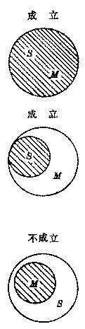
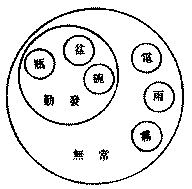
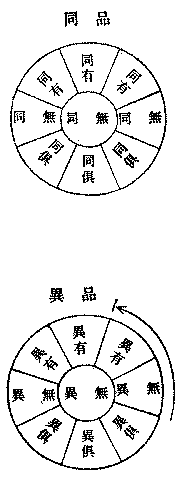
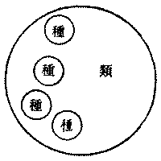
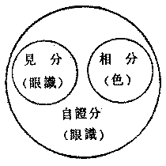
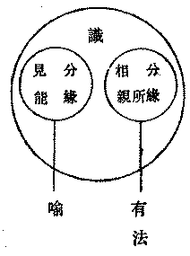
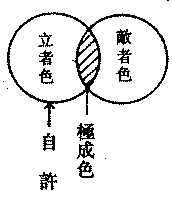
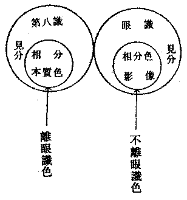
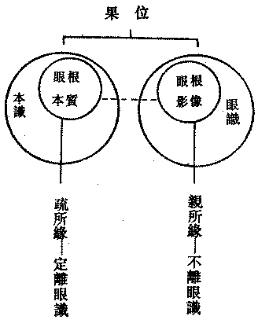

# 因明入正理论讲解及相关论著



> **藏经**：吕澂佛学著作集（吕澂著作集）　**册次** 第 4 册（LC04）　**编号** LC0004　**卷次** 14 卷　**篇幅** 82,056 字

> **卷／品**：0 卷 · 6 品



---



## 目录



  - [现量品第一](#现量品第一)

  - [为自比量品第二](#为自比量品第二)

  - [为他比量品第三](#为他比量品第三)

  - [观喻似喻品第四](#观喻似喻品第四)

  - [观遮诠品第五](#观遮诠品第五)

  - [观过类品第六](#观过类品第六)



---



佛家辩证法



恩格斯在所作《自然辩证法》的札记里，曾经说人类理性发展到较高阶段才能有辩证的思惟，并举佛教徒为例（见曹葆华等译《辩证法与自然科学》人民出版社第二版第六五～六六页）。他是见著佛家那一种理论而为此言，我们还不很明瞭，但佛家的思想方法一开头就带著辩证的色彩，并且后来还逐渐发达，而始终就很远的走在西洋人思想的前面，这是稍微留意佛家学说的人，都会有那样感觉的。最先，原始的佛学里含有辩证意味，为后来思想向这一方面开展的根据的就有三点：其一是分别说，这反对一向的即片面的看法，而与现象的随时变化相应。其次是中道说，这反对偏执一端的看法，而和现象的相对性相应。最后是缘起说，这反对孤立的看法，而和现象的互相依待、增上相应。这些都具备辩证的意味，到了发达了以后，就成功为佛家的完全辩证法。



在小乘部派佛学里分别说等方法虽然被运用著，但是偏向辩论的或形式的方面，并未能尽其实效。像南方上座部的教典《论事》里，藉八门的分别论法，从各方面发现论敌的矛盾来使它堕负，这完全流於形式，便是一例。到了大乘佛学流行，佛家的辩证法才有正当的开展。典型的著作是古本《宝积经》，后来编入大部，称为《普明菩萨会》。它里面详说菩萨藏十六门教授，最重要的是菩萨行的自性，由正行中安立所学，即用理论来联系行事，求其一致。而所举的正观法门，内容贯穿著十三种中道行，要将真实的见地应用到一切行为上，随处都采取辩证的方法。它不单著眼於对象自身的矛盾，并还连接到思想和实事的矛盾；不单显示出这些矛盾而已，还要进一步克服它。这样观察和行动打成一片，自然不仅仅是思想上辩证的发展了。我们从后来发挥此意的《辨中边论》上看，就很容易明白的。



《中边》引据《宝积经》的中道行解说无上乘（即大乘）的正行，谓之离二边。它对於原文只说一方面的，都举出相反之点，并统一了这两面而成中道。譬如第一种正行，《宝积经》原文说，不观诸法有我、人、寿、命（这就是秦译《金刚经》里面的我相、人相、众生相、寿者相），《中边》发明了它中间的辩证意义，以为这是针对执著色等五蕴与「我」为一或与「我」为异而言的。若对内色等执著为「我」，而视作见者、闻者、觉者、知者，这些是色等与「我」为一；又若看色等是另外一种「常我」所受用，这是色等与「我」为异；一异两边都是从色等法上可以引申出的见解，也系色等法本身所含矛盾之点。如何来统一它，就要推究到这样矛盾的来源「我执」。从根本上去掉执著，自然会统一了矛盾。这还是主客观联系著而说；要进一层研究，便明白主观的执著并非无端而起。即认它是病目空华，也必有病、有空为其依据。所以发现矛盾的原因从而除掉它以后，得著了对象的真实，还要加以改造，使其不再引起矛盾。这样辩证法的运用便不简单了。又如第五、第六种正行，对治关於法相的增减执著，这先从「常」「无常」说起。执常的是外道，他们被「常住颠倒」所惑，而加以种种执著；执无常的是小乘，他们追求断灭的涅槃，而生起各样执著。这两类执著对於同一的现象上说，是互相矛盾的，也就是那现象会具备著引起这样矛盾的复杂性和相对性。现在正确地观察、诸法有连续相似的相状，并非绝对的无常；又有缘起生灭的相状，也不是绝对常住，这样离掉两边的固执，才会认识到诸法的实相。进一层，常与无常的执著纯由「我执」而来，那末，在诸法上有我相是一边，无我相又是一边，这两者也是互相矛盾的。现在应该观察诸法无所谓「实我」，去其增益执；但有假施设的我相，去其损减执。这样离却两边，才得著诸法的实在。再进一层，我与无我的执著是关系著「心」的实在与否的，这里就又有一重矛盾的看法。但正确的观察，应该是看心法为缘起的，不是实在，去其增益执；心虽无实法，而有分别相状在著，这又去其损减执。如此离却两边，才得诸法的实相。还可进一层推究，这些法相的辨别，原来为了能所对治之用，所以在诸法上还可以看得出善、不善，染、净，有过、无过，世、出世，有为、无为，有漏、无漏等等对待矛盾，而这些对待矛盾之相，都需要得其辩证的认识，才能成就「正观」，使实践履行於「中道」。由此，随在一种的现象里，都会有复杂的性质，以致主客观的相涉层次重重，不是简单的观察便能穷其实在的。佛家辩证法的运用，在这些地方最能发挥所长。上面从《中边论》的解释已经明瞭《宝积经》所说辩证法的一斑，此外有好些大乘经也有同样的材料，像《维摩诘经》的《入不二法门品》及《金刚经》中「即非」、「是名」的说法，都是最显著的一例。



到了龙树，佛家辩证法的运用迈进了一大步。他的学说是通过当时流行的各种大乘经，而上承原始的佛说的。在他所著《大智度论》里，首先肯定了佛之所以为佛，即在能如实分别诸法的自相，共相。这属於分别说，却非简单的分析，应该是由辩证的正观而穷究诸法的实相的。此意在《中论》一书里更有了发挥。论首两个归敬颂，后来也被称作「入般若初品法门」（用无著《顺中论》意）的，就说明佛教最殊胜之点在以「八不」解释缘起。「八不」，为一类分别说的法门，根本意义与《宝积经》相通。由於执著诸法有实在的自体，便会跟著来了生、灭、断、常、一、异、来、去等相的法执；假使明白法体之不实在，自然八相俱非。但是诸法缘起、生灭等相并非纯无依据的，所以在这些中间应该离开两边的执著来观察它、理解它，以得著合理的实践。佛的学说，便是能够最善巧、最完全表白这一层意思的，因此称为最胜之说。



龙树用辩证法来阐明诸法的实相，归宿到无自性的「空」，而「因待他，见有变异」（用《十二门论》语意），并不破坏「缘起」，这是根据原始佛说「诸行无常」的根本道理。更进而藉「世谛」显示「第一义谛」。再由「第一义谛」达到「涅槃」人生理想中的绝对妥稳状态。因此《中论》最后的结论「观涅槃」一品明白的说，一切法空，不生不灭，不断不常，这样便是涅槃状态，更无需乎断灭它，如此总结到涅槃与世间（诸法）没有少许分别。反转来就世间说，它和涅槃也不会有分别，因为涅槃的实际和世间的实际（即涅槃性）是平等的，一致的；这也可说，世间的实际即等於涅槃。由此可见，龙树的辩证法实相观完全和实践相联系，是著眼於除灭一切戏论执著以得到绝对妥稳的境界的。后来无著解释《中论》，很能领会这层意思。《顺中论》里便说，不生不灭等八门应该作非生非不生，非灭非不灭等解释。因为说不生，并非指出一种法决定是不生的，不过破除了生的执著而已，生的执著既然破除了，不生的执著当然也不许有的。这和用药治病一般，应该是药病同离；如果病去药存，反而成为另一种的病了。所以观察不生是生与不生两方面俱遣的。绝不像常途所解，世俗有生而胜义不生，那样地截然成为两事。实际离了第一义谛（即胜义），也无所谓世谛，这就是龙树说涅槃与世间实际不异的根据。



龙树所说的八不法门又还解明了诸法变化不停的内在原因，即一切现象的本身就具有不得不时刻迁流变异的原因，并不待另外的「作者」。这层意思，见於青目注解《中论》所引用的一段《无畏论》论文。那上面用世间经验的事实来作解说，譬如谷物，现在所有的大都是从无始即很遥远的时间展转相续而来，绝不是随时有特异的新种，从无生有，所以可看作「不生」。但是，从前的谷类既然展转传来，直到于今，可见原来种属并没有消失，这样又可看它作「不灭」。在这中间，却有各样的变化，譬如由种子而发芽，而生茎，披叶，开花，结实等，各各不同，所以可看做「不常」。不过，芽虽非种，而依种起，如是由芽而茎，由茎而叶，而花，而实，都是相联系著的，所以又能看作「不断」。再进，种与芽形象不同，即是「不一」，而同属谷类，不与其他相混，故又是「不异」。芽从种而生，并不像鸟的栖树由外而来，所以可看作「不来」。但这是种的全部变异而发芽，也不同於蛇的出穴从此他往，所以又可看作「不去」。这些都是平常经验里所得对象变化的情况，而它们自身中即具有不得不时刻变化之势，新的念念发生，旧的就得念念消灭，刹那不停，其间必有矛盾的力量为之推动，可不待言。恩格斯在《反杜林论》里，阐明辩证法中「否定之否定」规律，也同样地用种和芽来做譬喻，可见古今人对於现象实相的理解，不会相差太远的（见《反杜林论》第一篇、第十三章）。



慈氏、无著跟了龙树更加扩大辩证法的运用。像《大乘庄严经论》里讲到诸法的实相，就用五种不二门来作形容。但它立义的根据在「遍计」「依他」「圆成」三性，而「圆成」性并不局限於自性清净一义，另还有离垢清净之意，因此合拢三性观察实相，就含有前后变革的过程在内。例如，第一种不二法门举「有」「无」说，从遍计、依他性看是不实的、非有的，但从圆成看是实在的、非无的，这些经过了变革，依计转作圆成，才构成辩证性的非有非无。其餘非一非异等，大体意义也类於此，这样综合了诸法全体并从先后变化去观察，在那里面的矛盾性质以及如何去克服而得其统一，可都明白地显露了（《辩中边论》简化《庄严论》意，单以有无不二法门显示诸法实相，尤见精采；其义易晓，现不另加解说）。这较之龙树所阐明的更加具体，并且改变了龙树单纯的遮诠法门而兼有表诠，使实相的认识益见深刻，可算是佛家辩证法高度发展的一个阶段。



此外，在佛家的「因明」里，辩证法也多方面的被应用了。因明原以推究判断思维的理由（因）而得名，开始侧重辩论和论证方面，用来证明自宗的主张，并摧伏他家的异执。后来这一门学问发展为认识论，以正确的量为认识的标准。量的种类有现量、比量。现量是感觉，比量则是推理思维。在因明理论上，认识的全程是由现量的感觉，经过比量的推度，再达於更高的现量。这不是普通的感觉，而是离开名言（概念）分别所成的亲证，也就是藉助比量上抽象名言的理解而后体验到具体事实，密切符合而为「瑜伽现量」。如延长这一经验，便能到达名言与事实统一性的认识（《瑜伽师地论菩萨地真实义品》里说为名言自性与离言自性的平等相），这又算是佛家辩证法的另一高度发展的阶段。在这中间，名言本身的构成也离不开辩证方法。这从陈那以来用「遮诠说」阐明其意义。大略说，名言都以遮遣为本质，像诠释青色的名言「青」，即以遮遣其餘一切「非青」的法来作表示，并不能正面说明青色的实质。这种说法给予当时婆罗门学系视「声量」作知识的一种源泉的以沈重的打击，又使佛家更有理由随顺名言的性质来用否定方法进行对一切现象辩证的认识，其影响可谓是极大的。后来从法称以次的因明学者，对於此义有很多发挥，不为无因。



以上，我们就佛家思惟方法上的辩证性质，略加历史的叙述，已可见出它发展的情形，并明瞭其特点。其间最可注意之处，即是佛家的辩证法不仅仅是客观现象中辩证性的反映，而特别侧重於主客观交涉上面辩证的意义。这和佛家没有纯粹宇宙观而祇是联系人生问题去寻求现前存在现象实相的一点极有关系，我们当另题解释，这里便不多说了。



(一九五三．一二．二八。改写稿。)



入论十四因过解



因明起源，详无可考。惟佛灭不久，尼乾子之徒纂辑教典，有四量四比之说，皆与因明相关，可见当时已露端倪。自后发达，略判五时。第一佛灭六百年内。初有胜论学派，归纳一切为六句义，详细辨证，亦名论法，立此权舆。次有迦腻色迦王侍医遮罗迦，著述专集，旁通论议，更详典则。但此皆属外宗，而佛法无与也。第二佛灭七八百年。正理学派经典成形，说十六谛，辨能所量，论法内容组织渐备。佛家挹取而有《方便心论》，立八论法，融洽旧言。盖俱以论议指归，譬喻依据。故《正理经》十六谛，先譬言而后五分，《方便心》八论法，亦初举喻而后四宗。第三佛灭九百年。弥勒宏扬大乘，发轫多闻，学五明处。於是详言论法，而立名义曰因明者，谓观察义中诸所有事。其先外书本有五明，谓吠陀、证理、治法、农商、真我，初无因明之名。弥勒一一更易之，而后安立，故谓此名是佛家始创。然其内涵，犹同旧说。《大论》十五说七因明，《显扬》即谓之论议，《集论》又谓之论轨也。第四佛灭千年。世亲䡍式，著书不传。继以陈那，有《集量》、《理门》、《因轮》诸制，备详其说，而尤致意於量。《集量》开卷云，成立量故摄集一切自论要义。一切论皆释量，集义则集量也。於是有量学而称因明，名乃符实。因在梵语为醯都 Hetu，具理由原因与知识之因诸义，其第三义即当於量。尼乾子之书尝举四因而说四量，迨及《方便心论》相沿不改，西藏译诸因论又曰《量论》，皆可证也。以因明详量学，是最精之义，亦最极大之说矣。第五佛灭千一百年以去。法称释《集量论》，反复七支，料简精纯，遂多出入。后来诸家传习，莫能出其范围。流播西藏，蔚为正宗焉。



我国传习因明，初期古籍有《方便心论》，而译文拙不达意。后起各家惟传法称之名，而不著其说。陈那诸籍，斯学大成又唐贤专习者，乃其迻译，惟取《理门》而遗《集量》。《集量》绎量六章。智源现识，故现量章第一。因现推度，为自比章第二。比义悟他，为他比章第三。而斟酌喻言，废立诸量，料简过类，皆因为他而出，复相次为三章，理无不罄，义无不备。《理门》者，特其第三四六诸章节本，偏详立破，固不足见因明之全也。及乎讲述，复取《入论》而遗《理门》。《入论》文词愈约，侧重显然，故言因明者但知三支之术耳。至於注疏，因文演绎，抽象迷离，梏桎无形，望而却步，则并三支之末亦不获传其真矣。由是百家充栋，智虑唐劳，量义幽微，积晦千载，伊谁之过欤。



今者梵藏诸籍大出，治学探源，无拘拘於注疏附益，因明之说，抑有甚焉。愚研《入论》，尝资取蕃藏数种以为参考。



一、《因明入正理门论》Tshad-mahi-bstan-bcos rigs-pa-la hjug-pahi-sgo(奈留旦版)此为梵本《入论》之翻译。蕃藏无《正理门论》，即称此本为理门，作者亦即题陈那也。早岁印人费氏 S. Ch. vidyabhusaha 据此著述，绎词举例，大同我国《入论》。日人宇井伯寿见而疑之，以为蒙《理门》之名而取《入论》之实，不类也。费氏覆勘原本，辨其不诬；而宇井疑终不决。费氏虽死，犹为文争之载《印度哲学研究》第一卷末。盖始终未见蕃本，但据译名推测，甚无当也。《入论》梵籍不存，得此可当原本读。



二、《因明入正理论》Tshad-mahi-bstan-beos rig-pa-la hjug(安士版)此据奘师译本重翻。译家知为前书异译，故卷末注云，此本中土名《入正理》，藏人则通称《理门》也。（... bod-rnams rigs-pahi-sgo shes-grags-so）译时盖即对照旧本而后著文。今会勘两种，以知唐译与梵本出入之如何，最为便利。又论之作者，亦依旧本改为方象。(印陈那意译)



三、《集量论释》Tahad-ma-kun-las btus-pa(第二译安士版)此为陈那因明之根本论。旧时解《入论》多据《正理门》，而《正理门》又通《集量》。凡《理门》译文艰涩之处，覆按《集量》皆易知也。



四、《正理微释疏》Rigs-pahi thigs-pabi rgya-aher-hgrel-pa(圣彼得堡版)此为法上释法称著书之作法称依《集量》废立因明作《正理微》；叙次灿然法上之释，则更逐字研寻，倾无餘蕴者也。自来因明术语无的解者，此释一一详之。(别有梵本一种可写校。)



五、《翻译名义大集》(京都版)此为校译 Bya-bra-tur ogs-bya chen-po 之作。西藏新译诸家，锐意改订前后译籍，集梵藏对翻辞书一种以为准式，即此本也。藏传因明术语原文如何，检此书一九九、二〇〇诸章，大半可得。(以上五种皆内院树因研究室所藏。)



取前诸籍审察名相，辨析言辞，而后《入论》义解大体刊定，略无遁形，旧疏得失亦可得而言焉。试举其要，如宗等多言说名为立，(藏译原本) sgrob-pa 本不作能所解则古今异同之辨可删。(大疏卷一第二十二页)又如宗者极成有法由极成能别以为差别，(藏本 rab-du-grags-pahi khyad-bar-gyis khyad-bar-dubyas-pa.《集量》释意同此。)有法能别本非相互，则不相离性之解应废。(《大疏》卷二第十页)又如因初后相谓是宗法性异品定无性，(自《集量》以至《正理微》皆如是说。藏本作 gyogs-kyis chos, mi-mthun-pahi gyogs-la mcd-bar ncs ba.)旧译云遍，应如增益。(因第三相云定无者，此相犹豫亦复成过，必致定言以料简也。)又如同品谓由所立法共义均等，(自《集量》以至《正理微》皆如是说藏本作 rtags-las don mnon-paho rlags-ni ul-g um shan b br od-pa.)旧解众相观义，视因相（ptags）三相（tshul）为一，则嫌含浑。凡是种种，皆与义学有关，不勘不明者也。至於解三十三过，本为一轮精华，立破轨范，餘籍所谈从无如此条然有序者。而唐贤研究亦极耗心力，剖解入微。流风东被，传习因明乃由三十三过作法而入。即以此故，内外作家解说繁芜，刊定尤不可缓。兹篇取材讲稿，(依特科同学王冠勋君笔记)出十四因过之大略，愿学者更详焉。



已说似宗，当说似因。不成、不定、及与相违，是名似因。



似因三类，此文列名。



谓不成似因、不定似因、相违似因。



成者、成就。定者、决定。违者、违反。藏译 hgal-ba 与前宗相违译名同而实义异。似因三类，依三相分。《理门论》云，此中宗法(第一相)唯取立论及敌论决定同许，於同品中有非有等，(二、三相)亦复如是。其意谓三相皆须决定，皆须同许，不尔即成过。如初相不许或犹豫，皆为不成。



不成有四：一两俱不成、二随一不成、三犹豫不成、四所依不成。



此四过皆缺因初相遍是宗法性。遍是宗法云者，谓因於宗有法上有，即是於彼成就也。如声无常宗，所作性因，所作性於有法声上成就也。设若无有，即不成就，而为似因。不成就有二类。不共许而不成，谓初二过。犹豫而不成，谓后二过。



如成立声为无常等，若言是眼所见性故，两俱不成。



两俱不成，谓立敌俱不许於宗有法上成就也。如立声是无常，而举因云眼所见性故。两家俱不许声是眼见，则此因於有法声上不成就，故成此过。此云无常等，藏本云无常性，无此等字。



所作性故，对声显论，随一不成。



随一不成谓两家中随应一家不许成就也。此过可分自他，今但举他。如立声无常宗所作性因，敌者明论，谓声是缘显不由因作，即不许此因於声上成就，以成此过。



於雾等性起疑惑时，为成大种和合火有而有所说，犹豫不成。



因初相犹豫而不成，分二。一因自体犹豫，即此犹豫不成，谓由犹豫而不成也。二因所依犹豫，即下所依不成。如因有烟，乃成有火。今见远处依依直上，而不能决其体是雾是烟，遽有所说，彼处有火。迨问其因果是烟否，又不能答。此即因体犹豫於有法上不成就也。云大种和合火者，由地等大种合生，如积薪火。此火有烟，以见因之必为烟性不可不决定也。但此云烟，与有法相连乃成问题，与宗不极成过同。



虚空实有，德所依故，对无空论，所依不成。



若因所依(有法)犹豫，不能有因，为所依不成。如胜论立虚空是实，德所依故。对经部等，皆说是空是假法。故初言空是实句未生问题，与德所依相连，乃应分别此空是何种空，是假是实。有法犹豫，不能决定有彼，遂成此过。《正理微》说所依不成举例云，彼山谷有孔雀，孔雀音声可闻故。以因连所依而所依犹豫。山谷甚多，孔雀声之所依，知否即彼山谷，故所依山谷成犹豫，正同此解。另有有法不成而所依不成一过，今论不别立。



不定有六，一共、二不共、三同品一分转异品遍转四异品一分转同品遍转、五俱品一分转六相违决定。



此六不定似因，多缺第二三相。不定云者，《理门论》云，因与相违皆不决定是疑因义。文简难会。勘《集量论》此一段文，因者正因，相违者彼相违性即非因，疑者犹豫，因义者原因之意义。合云，不定者，於因非因皆不决定，是犹豫原因之意。由此得名不定。



此中共者，如言声常，所量性故，常无常品皆共此因，是故不定。



共者共有，亦即共通之意。如立声常，因云所量性故。所量同於所知，一切法不能外此。常法所知，无常法亦所知。如是同品异品共有此因，此於常宗果为因否，不能定也。



为如瓶等所量性故声是无常，为如空等所量性故声是其常。



此出过作法也。凡显示因不定者，常先出异品有因，再出同品有因以明之。此因缺第三相成过。



言不共者，如说声常所闻性故。常无常品皆离此因，常无常外餘非有故，是犹豫因，此所闻性其犹何等。



不共者，独有也。如声论对胜论以外各宗，立声常，所闻性如。依《广百论释》卷七，所闻与音，声之异目。由此可知所闻性祇声上有，餘不得共。故常品虚空等，无常品瓶盆等，皆无此因。又於此常无常品外，更无他法可有此因为例。故云此所闻性其犹何等，谓无从见其然否也。以是成不定因。(此段依藏译本解)《广百论释》卷七，同喻无故，如不共因，缺同喻，成缺比量过。即因三相中缺第二相成过。《理门论》释此是不定所以云，理应四种名不定因，二俱有故，所闻云何。由不共故，以若不共，所成立法所有差别遍摄一切皆是疑因，唯彼有因彼所摄故。勘之《集量》，此文意云，若餘四种同品异品二俱有故乃名不定，所闻云何成为不定。总答云，由不共故。又别答云，若惟有法上有，所成立法(同品)及其所餘，(异品)一切皆是异类所摄故，於此等中成犹豫因，即於此等是因与否有犹豫也。又释名云，成就彼犹豫故，即彼犹豫所摄。此如成就聪明者云聪明人也。



同品一分转异品遍转者，如说声非勤勇无间所发，无常性故。此中非勤勇无间所发宗，以电空等为其同品，此无常性於电等有，於空等无。非勤勇无间所发宗以瓶等为异品，於彼遍有。此因以电瓶等为同法故，亦是不定。为如瓶等无常性故彼是勤勇无间所发，为如电等无常性故彼非勤勇无间所发。



转谓於中有，（藏译作 yod）故同品转者即谓於同品中有，餘准此知。如立声非勤勇无间所发，因云无常性故。此因於同品电有，空无，於异品瓶等有。异品有因故，缺因第三相，成不定。此因可以电瓶等为同法喻而出不定云云，如论可知。



异品一分转同品遍转者，如立宗言声是勤勇无间所发，无常性故。勤勇无间所发宗以瓶等为同品，其无常性於此遍有。以电空等为异品，於彼一分电等是有，空等是无。是故如前，亦为不定。



此不定过缺因第三相。论文准前可知。



俱品一分转者，如说声常，无质碍故。此中常宗以虚空极微为同品，无质碍性於虚空等有，於极微等无。以瓶乐等为异品，於乐等有，於瓶等无。是故此因以乐以空为同法故，亦名不定。



准前可解。如此分别有四不定，(除不共)与九句相符，论其性质则俱缺第三相也，故后世不分。



相违决定者，如立宗言声是无常，所作性故，譬如瓶等。有立声常，所闻性故，譬如声性。此二皆是犹豫因故，俱名不定。



相违，意谓违反矛盾也。决定，原文有三义，一不谬、二不二、三不变。此处所用，准藏译——Mi-hkhrul，取第一义为不谬，旧译旁翻决定。合云相违决定。依《正理微释疏》有二解。一云，六合释中依士释，谓於餘因所成宗相违中决定也。又一解云，六合释相违释。与餘能立(因)所成立法相违曰相违，於自所立不谬曰决定。(见《疏》卷二第一八三页)此皆望自无过，望相对宗即有过也。如胜论立声无常，因云所作性故。此因对自所立，三相具足，无过。但敌者相难云，声常，所闻性故，如声性。胜论许有声性，是所闻性，而又是常。此难量亦三相具足，无过。如是前因以有后量而成犹豫，即相违决定也。《论》云此二皆是犹豫因，藏译本云互有相违之义(境)故。两俱是疑因性。文义更为完备。此过在有餘相违因，不在缺二三相，后来法称即不许有此过。比量境中不存在故，但此是论议所许相违成过。若一家不许，无过。如佛家立所作无常，不许声性，无过。又对胜论外立所闻常，不共不定。然此过在本论中甚有必要。盖应用於破，不破他正所立，但出他相违所立，俱存俱败，使其不能决定，次后三相违因皆用此破。



相违有四，谓法自相相违因，法差别相违因，有法自相相违因，有法差别相违因等。



此四相违似因列名。相违者，《理门论》解有三处。一、若法(因)能成相违所立(宗)是相违过。二、复唯二种说名相违，能倒立故。三、邪证法有法此成相违因。勘藏译《集量》，邪证与倒立是一字，（ci-log-tu sgrub-par-rbyed-pa）即颠倒成立，亦即与本所立相违乃得名也。故可解云，与法自相相违者是法自相相违因等。论末云等者，谓内等，表是复数，形容其非一也。勘藏译本无此字。相违分四者，由所立有四种差别。宗中言陈，宗外意许(乐为)，此二皆正当所立。宗外意许又有为法之差别义者，有为有法之自体义者，又有为有法之差别义者，合前言陈即为四种。举因与四相违，故分为四。



此中法自相相违因者，如说声常，所作性故，或勤勇无间所发性故，此因唯於异品中有，是故相违。



如立声常宗，此法自相，即言陈能别常也。常之同品虚空真如等，异品瓶盆等。所作等因同品无，唯异品有，能颠倒成立声是无常，故为相违因。勘三相，缺第二第三相成过。



法差别相违因者，如说眼等必为他用，积聚性故，如卧具等。此因如能成立眼等必为他用，如是亦能成立所立法差别相违积聚他用。诸卧具等为积聚他所受用故。



如数论立量云，眼等(身根)必为他餘法用，(藏译本云是为他性)积聚(细物所成)性故，如卧具等。此量意在证成有我。《金七十论》第十七颂，五因证有我，第一积聚他故，是所本也。盖以日常经历者为证，常用物积聚以成，即为他而有，身根亦是积聚而成，亦必是为他者。他者何，意指神我也。今论破之。寻其意许所立在为非积聚他。(非积聚他法即神我)此非积聚他即法差别，与此相违者即积聚他。今此因能颠倒成立法差别相违为积聚他，故为过也。藏译本云，如是亦能成立他是积聚性，如床席等分是积聚性故。不言为他用。此过应注意二点。一、举喻实是异品。同品须全同其所立，(意许在内)今喻卧具不同意许为非积聚他，故成异品。因於异品有而相违，此成过与前同也。二、以类似相违决定之形式出过。论云如彼能成立眼等必为他者如是亦能成立所立法之差别相违为积聚他，立则俱立，不立则俱不立也。依《正理门论》，法先成法而后成有法，即先成言陈而后成意许。故论谓此因如能成立云云，如是亦能成立云云。此出过与前不同也。亦即因是，本过不能与初过俱有，言陈不成立，无意许可言故。



有法自相相违因者，如说有性非实非德非业，有一实故，有德业故，如同异性。此因如能成遮实等，如是亦能成遮有性，俱决定故。



胜论立六句义。谓法之体为实，法之属性静者为德，动者为业。实德业不离，其事为和合。法与法相同，其事为同。相异，其事为异。和合同异三者，在实德业外别有其体。实等与和合合而后不离，与同合而后不异等。但其说同异二法，亦因时代而异解。前后凡经三变。



一无著世亲时代，解如下表。(依《胜论经》)



　　　　┌─上同(有同无异)有  

　　　同┤  

　　　　└─下同(亦同亦异)实德业性  

　　　异──边异(有异无同)



上同是有，谓一切法存在，其为有也无所不同。下同是实德业性，即实等所以互为同异者。如实有九种，以有实性，其为实也俱同，但不同德。实中地水等各别，地中亦复各别，至於不可再分，谓之边异。



二护法清辨时代，其说又变，如下表。(依《广百论释》等)



　　　同──上同─有句(有性)  

　　　　　┌下同┐  

　　　异─┤　　├─同异句(同异性)  

　　　　　└边异┘



此以下同合於边异而成同异句，上同乃独为有句。



三慧月时代，说又不同，如下。(依《十句义论》)



　　　同──上同　有句  

　　　　　　下同　俱分句  

　　　异──边异　异句



此又以下同独为一句，即亦同亦异俱分句。同异乃各为一句。



今论译文，依护法清辨时代之胜论说。同异性为一句义，有性为一句义。有一实者，有一实法为其所依，即依於一实也。胜论说，有一实者为业，非实非德。又有德业者非德业。今破其说，设为量云，有性非实非德非业云云，意谓是实等三法以外之法。立量言陈成立非实等，意许则成立实等外之实在有性。此即有法自相，亦为此量所立也。但以同异性为喻，虽非实等，而为实等外非有性法。今有性，亦应非实等而为其外非是有性之法。此因乃颠倒成立所许有法自相相违之义，故有过也。论出过云，此因如彼成立法自相非实等，如是亦成立有法自相相违非是有性。两俱成，亦两俱败，此以违决之形式出过与前同也。准《正理门》，因先成法而后成有法，故今出过云云，亦即知此过不与初过俱也。勘藏译本此段云。彼各别非实德业者为彼性，有一实性故，又是德业之自相（．a-bshin）故，如和合。此因如彼能成非是实等为彼性，如是亦能成彼性是有性，两俱决定故。此文乃欲别立实等性，(下同)而以反成有性相难。与唐译大违。然不举同异，而著眼在同句中意义纷歧处，正用无著世亲以来之胜论古说。本论如为陈那作，应如此云，唐译本乃后出而改其义耳。



有法差别相违因者，如即此因，即於前宗有法差别作有缘性，亦能成立与此相违作非有缘性，如遮实等俱决定故。



如前量，立宗有性非实非德非业，意许别有有性。此有性既是实在，亦必为作有缘性，即使人生此法是有之解。(生解即缘)是为有法自相而外之差别义。即彼有一实等因，能颠倒成立差别相违作非是有缘性，即生非有解。如彼同异性，生非是有解而生同异解也。出过亦用违决法，其理同前，亦不与初过俱有。《集量》亦言，改因相违为违决，不改因则为相违，盖言陈不违也，后来法称即废此等。勘藏译本此段云，即前宗此因，能成有法差别由有缘所作性（Yod-pa-ky gyi y-pa-nid）亦成此相违无缘所作性，两俱决定故。与唐译本不同，应是古说。〔附注〕四相违后二种，旧疏繁而寡要。日人传其说，穿凿尤甚。如有法自相相违有四秘传有性奄含等，有法差别相违有本作法别作法等，皆属误会。有性立宗，本依胜论设量，无所用其奄含。有法差别与自相过相俱而有，无所用其别宗。其他歧解，辨不胜辨。五年前，宇井伯寿作《四相违之论理说的解绎》，於此二过直据胜论之说分疏，旧时缠纠一扫而空，为之大快。顾犹有憾者，宇井氏不认藏译《正理门论》即是《入论》梵本直译，遂不审唐译已依晚出学说有所改动，用胜论家言勉为通之，亦非本意耳。今释仍从唐译，但附出藏本文句见其异同，待后再详究也。



(原载一九二八年十二月《内学》第四辑)



因轮论图解



因轮论旧传为《因门论》，陈那因明八论之一，梵本久佚，西藏藏经丹珠 mdo co 帙译存一卷，系沙和罗班的达菩提萨及比丘达磨阿输迦所出，凡十一颂。附图，共二纸。（奈旦本九三页上下，曲尼本九二页上下。）颂文简略，颇不易解，费氏《印度因明全史》A History of Indian Logic．二九九页转其图，并系分析，以为此论尽列因喻相关之九式，剖解真似，由图而明云云。此於论义犹未罄洽，盖本论具陈三相，不仅九句之异同，又次第推移，乃见因论之合喻爰重翻本颂，图附说，以见陈那明因三相之所根据云尔。



因轮决择论



梵云 Hetu-cakra-hamara.



藏云 Gtan-tshigs-kyi hkhor-lo gtan-la dbab-pa.



敬礼妙吉祥童子。



敬礼一切智，灭裂过纲者，因法三相轮，决择今当说。（一）



此颂叙归敬缘起。因三相轮决择，是论异名，可知论文详三相也。



谓於所比法，有无、及俱二，惟有是正因，无俱皆不成。（二）



若彼二犹豫，合不成、悉尔。



此一颂半决择因之初相，是宗法轮。所比中有，乃为宗法。若无，若半有无，若有无犹豫，若半犹豫半无，皆是不成因过。所比中无为过者，两俱随一不成。犹豫为过者，犹豫所依不成。俱亦为过者，奘师传译因之初相应遍是宗法也。



又於同品有、无、及彼俱二，（三）异品亦复然，三者各三相。



此决择因后二相，先立同品异品二轮。於同异品者，以宗法相对而言。同品中三，异品亦三，三各重列三相，叠以为轮，如图一二也。



上下二正因，两边二相违，（四）四隅共不定，中央乃不共。



次合同异二轮成九句因，决择真似。上下方位，如图三可知。



所量、作、无常、所作、闻、勤发、（五）无常、勤、无触。成常、无常、勤、常、恒、及久住、非勤、无常、常。（六）



原译第六颂有五句，今删正。初三句举九宗法，后三句举九所立，如次相成，以见因於同异品有无也。合释上九句因，见图四，即原译附图也。



上下合异边，是为二正因。边合异上下，是二相违因。（七）



四隅互异合，共不定四类。两边直相合，乃不共不定。（八）



二颂释同异品轮推移配合，所以成九句也。转异品轮，左右两边与同品轮上下合，则成九句中二正因。上下与同品轮两边合，则成九句中二相违。两轮四隅异位相合，则为四共不定。中央直相叠合，则不共不定也。按图一二三可知。



设因有九故，喻相乃如是，空瓶、及瓶空，如瓶与电空。（九）



空瓶、空瓶电、如电空与瓶、及瓶电与空、空微与业瓶。（一〇）



二颂释九句因同异喻也。原译第十颂首句缺电字，今补正。九句第五不共，不举喻。餘句配合，具如图四。



此依决定作，犹豫方便中，亦得有无俱，一分等相合。（一一）



例释同异九句中得有犹豫全分等作法也。后二相犹豫等过，法称因明特详言之，见《正理一渧注》（佛教文库本一五一页以下）。



九宗法轮，规范师域龙造。



文末题号九宗法轮，又为本论异名。



> 　图一　同品轮(本应是图形，今方便改作。)图二　异品轮



　　隅　　　　边　　　　　隅　　隅　　　　边　　　　　隅  

　　　┌──┬──┬──┐　　　　┌──┬──┬──┐  

　　　│同有│同无│同俱│　　　　│异有│异无│异俱│  

　　　├──┼──┼──┤　　　　├──┼──┼──┤  

　　上│同有│同无│同俱│下　　上│异有│异无│异俱│下  

　　　├──┼──┼──┤　　　　├──┼──┼──┤  

　　　│同有│同无│同俱│　　　　│异有│异无│异俱│  

　　　└──┴──┴──┘　　　　└──┴──┴──┘  

　　隅　　　　边　　　　　隅　　隅　　　　边　　　　　隅



　图三　九句因轮  

　　┌──┬──┬──┐　　　　　┌───┬────┬───┐  

　　│异俱│异俱│异俱│　　　　　│隅，共│边，违　│隅，共│  

　　│同有│同无│同俱│　　　　　│　　　│　　　　│　　　│  

　↑├──┼──┼──┤　　　　　├───┼────┼───┤  

　││异无│异无│异无│　　　　　│上，正│中，不共│下，正│  

　││同有│同无│同俱│　　　　　│　　　│　　　　│　　　│  

　│├──┼──┼──┤　　　　　├───┼────┼───┤  

　　│异有│异有│异有│　　　　　│隅，共│边，违　│隅，共│  

　　│同有│同无│同俱│　　　　　│　　　│　　　　│　　　│  

　　└──┴──┴──┘　　　　　└───┴────┴───┘  

　图四　九句因轮作法  

　　　　　　　(重译文)  

　　┌────────┬────────┬──────────┐  

　　│是共不定．　　　│是相违因．　　　│是共不定．　　　　　│  

　　│同有．异俱．　　│同无．异俱．　　│同异皆俱．　　　　　│  

　　│如瓶．如电．空．│如空．如瓶．电．│如空．微．如业．瓶．│  

　　│声勤发．无常故．│声常．勤发故．　│声常．无触对故．　　│  

　↑├────────┼────────┼──────────┤  

　││是正因．　　　　│是不共因．　　　│是正因．　　　　　　│  

　││同有．异无．　　│同异俱无．　　　│同俱．异无．　　　　│  

　││如瓶．如空．　　│（如瓶．）如空．│如瓶．电．如空．　　│  

　││声无常．所作故．│声常．所闻故．　│声常．勤发故．　　　│  

　│├────────┼────────┼──────────┤  

　││是共不定．　　　│是相违因．　　　│是共不定．　　　　　│  

　││同异品俱有．　　│同无．异有．　　│同俱．异有．　　　　│  

　　│如空．如瓶．　　│如空．如瓶．　　│如电．空．如瓶．　　│  

　　│声常．所量故．　│声常．所作故．　│声非勤发．无常故．　│  

　　└────────┴────────┴──────────┘



(原载一九二八年十二月《内学》第四辑)



集量论释略抄



凡例



一、《集量论本》及《释》，皆陈那晚年所作，畅生平之心得，摧异论而无餘，洋洋巨观，允为宗极。顾梵䇲既亡，唐译随失，番藏仅存传本，亦以推崇法称，无所阐扬，圣言晦采，盖已久矣。今辑陈那《量论》，特表而出之。



二、《集量》所详，在现比二量，餘相似义，附随而见。《论本》二百五十颂，次第六品。大都先出正宗，后申徵破，科段如别。今抄略要，但录本宗。所破各家，举目列末。



三、番藏《集量本、释》Tshad-ma kun-las btus-pa（hi hgrel-ha）均有二译：一为堪布金铠，gsel-gyigo-cha 度语信慧 dad-pa ces-rab 仝译，略称金本。一为堪布宝持护，nor-hdsin bsrun-ba 度语师子帜 senrgyal 仝译，略称宝本。二者先后无考，审其文义，似金本先出，故多讹略，宝本乃重翻订正。然以《理门》格量，犹不备也。今据番藏柰旦版(mdo ce 函一至一八〇页，载金本颂释及宝本释)，及曲尼版(同函一至八五页，载宝本颂及释)，对勘二本，折衷文义，期得其真。



四、陈那著述，简奥难知，此徵诸奘译《缘论》等籍而可见者。今抄转译，更恐逆臆失真，故循文绎意，不务支蔓。颂本章句，略存其式。意在引发研寻，示要而已，畅译全文，俟诸博学。



五、《集量》所宗，《理门》导首。奘师历学五印，习论三周，归译《理门》，辄遗本论，盖以此也。然不勘《集量》，《门论》幽微亦未易晓。今逐论文，编号便勘。凡本论文段，记数弧内，所对文段，记数其下。如记(（二）七八)者，谓本论引文第二段，当《理门》第七十八段，对检《理门证文》本(（七八）二)处即得。餘从是例。



六、晚近治印度逻辑而称举《集量》者，有印度人费氏 S.C. Vidyabhusana．其先著印度中世逻辑，The me-diaeval school of Indian logic, 1909. 论及《集量》，列名举义，备为错乱。后重著《印度逻辑全史》，The History of Indian logic, 1921. 更张旧说，误解犹半。今一一附为辨正，以杜讹传。



七、是抄所据原论，承北京图书馆通融邮借柰旦版本，乃得对勘完篇，志此以表感谢。



集量论本科段(依宝本)



大文六品都二百五十三颂



一现量品(三段四十六颂)一归敬缘起(一颂)  

二初分申宗(十二颂)  

三后分旁破(五段)一破成难论(四颂半)二破正理(四颂半（金本缺一句）)三破胜论(四颂)四破数论(八颂半)五破弥曼  

萨(十一颂半)



二为自比量品(二段五十二颂)一初分申宗(二十四颂半)  

二后分旁破(五段)一破成难论(二颂半)二破正理(三颂)三破胜论(六颂半（金本缺一颂）)四破数论(十颂)五破弥曼萨(五颂半（金本缺一句）)



三为他比量品(二段五十四颂)一辨能所立(二段)一初分申宗(二颂)  

一后分旁破(四颂半)



二辨因及似因(二段)一初分申宗(二段)一辨因(十五颂)二辨似因(十颂半（金本缺一项）)



二后分旁破(二段)  

一破因异说(四段)一破成难论(五颂半（金本缺一项）)二破正理(五颂)三破胜论(一颂半)四破数论(六颂半（金本缺一颂）)



二破似因异说(三段)一破成难论(二颂（金本缺半颂）)二破正理(一颂（金本缺一句）)三破胜论(半颂)



四观喻及似喻品(二段二十一颂)一初分申宗(二段)一辨喻(十一颂（金本多半颂）)二辨似喻(二颂)  

二后分旁破(三段)一破成难论(三颂半)二破正理(三颂（金本缺一颂）)三破胜论(一颂半)



五观遮诠品(二段五十颂)一破声量(二段)一破弥曼萨(二十三颂（金本缺一颂半）)二破胜论(三十一颂三句（金本缺一颂）)  

二破喻量(一句)



六观过类品(三段二十五颂)一初分申宗(二十颂)  

二后分旁破(三段)一破成难论(一颂)二破正理(一颂)三破餘宗(一颂)



三总结全论(二颂)



集量论释



轨范师域龙造



------



### 现量品第一



归敬为量利诸趣，示现善逝救护者，释成量故集自论，於此总摄诸散义。



今此论端以因果圆满赞说为量世尊，应致皈依。因谓誓愿、方便，果谓为自为他，如次当说利乐、示现、善逝、救护、四义。敬此具德大师已，为释成量义故，从自所作《正理门》等一切量论，总集其义成兹《集量》。遮止他所说量故，及说自量功德故，又此论中分别所量义者，依量而起故，及多所倒执故。此中，



(（一）七六)现及比为量，



唯说二量。何以故？



(（二）七八)二相所量故。



所量唯有自相、共相，更无其餘。当知以自相为境者是现，共相为境者是比。若以所谓无常等相取色等境，或非一时所取，此复云何？虽有其义，亦由所量相合。



合说，无餘量。



谓先未设假名但取色等境已，次由共相分别无常，如是由意结合无常色等，故非餘量。



多识，亦非异。



或可难言此乃多识於彼义各别知者，亦不得成异量。何以故？



无合故，



若以多识说为量者，此量应成不相合。



如念。



譬如念、欲等，皆依前心所分别义，不成餘量。此中，



(（三）七九)现量离分别，



谓若有智无分别者，是为现量。所谓分别复如何者？



(（四）八〇)名类等相蒙。



若於胜意乐声立名差别说为善相，於诸种类声说为家牛，於诸功德声说为白物，於诸作业声说为能饮，於诸实事声说为有角，此等随一相属皆成差别。餘复有以一空无异门差别一切义者。若离此等分别乃为现量。先言五根。且依根境二法乃生诸识，由何立名从根不从境耶？



(（五）八一)为不共因故，依根说彼名。



立名不依色等境者，色等亦与他身意识等相共故。唯於不共施设假名，如说鼓声及与麦芽。即眼等识依显现法，离名想心，成其现量。若五识一向无分别者，於



色等和合境，所缘云何？又诸根自相，谓各有其自境非事自相者，复云何说？



(（六）八二)多义所成故，为自相共境。



以彼多事所合故，说为各根和合共行之境，非无差异分别。即此义云，



(（七）八三)若法有多事，非根悉分别，各自所触证，离名言根境。



如是且说五根所生现量智无分别。依餘意乐复论其他，亦俱以离分别而说。



(（八）八四)意缘及贪等　自证无分别。



若意亦缘色等境时，如所受相而转，此无分别。又贪瞋痴苦乐等，不待根故，唯自证是现量。如是，



(（九）八五)又诸观行者　离教观唯义。



诸观行者离教分别观察唯义，亦是现量。



(（一〇）八七)若贪等自证是现量者，岂分别识亦现量耶？实无是义。



但许自证性，非境分别故。



彼於境义有贪爱等虽非现量，然说自证则无过失，此等亦显现故。



(（一一）八八)错乱俗有智　比量及所生　念欲似现量　谓於阳燄等。



且错乱智者，如於阳燄等分别为水等故，是似现量。俗有者，增益餘义而分别彼体故，亦似现量。比量及彼果智，皆分别先前所受故，亦非现量。复次，



(（一二）八六)有用分别故，说量有果性。



此说量果不如外执离量有体，但智成果，即彼生时有境界相，谓具作用分别。



(（一三）八六)设施为量性，无用则不成。



如果似因而生说为取因，彼无作用不成，今此亦尔。



自证亦是果。



此中识显现二种而生，谓显现自体及境界。依此二种有所自证，即为量果。何以故？



由彼决定义。



若识以所俱境为义时，即有与彼相类各别自证，分别欲不欲义。若唯外义作所量时，



即彼显现境　为量，



此亦唯识自证自体，无所观待显现彼境，而为彼量。何以故？



能量彼。



如如义相白非白等识上显现，即彼证知诸相量彼彼境，如是如是施设量与所量，以一切法无作用故。即此义说



所量彼显现。量及量果者　彼取自证故。此三无有异。



所云识有二相，云何当知？



境识及识别　以为心二相。



境者、谓色等。识者谓显现彼。境识者、即与境相类似之识。凡识皆显现彼义及自体。不尔，境体即识体者，两者应成无别，或则后时生识应不得取昔境。何以故？非彼境界故。以是凡识应具二相。



------



### 为自比量品第二



比二类。



为自比量及为他比量。此中，



为自，(（一四）九)三相因观义。



由下所说三相之因观所比义，是谓为自比量。此复，



果如前。



如前现量依二种分别相以说量果，今此亦尔。若彼二量俱有分别相者，其异云何？



彼二　境及体不似。



现比二量所缘境界各异，其相别故。自体亦异。於此比量分别境体二事者，



非自相所显，异取故。



现比二量如其自体，所取各异。／若现量境为声所诠而成所比，亦见比量得转现境如触由色知耶？此不得尔，现量所转者皆非比量境。何以故？



(（一五）八九)彼餘。



云彼餘者，但以前所见色为因而比所触。是则彼色离现量相，别由所触共法以成比量，不可说为现量所作差别，故无二量一和合境。／若现量无言说者，即见等境说名见等，当复云何？此无有碍。



见等门所显，皆非诠自相。



以见闻觉知相门而诠诸义，应知即非自相。如是眼识所见境界，亦由意识分别为青，乃立青名。此复，



以名知异诠，是意识二相。



眼识所受离非青等境，意识亦得而施言诠，此即意识二相，所谓非自相所显者。故义自体是现量境，意诠共相则比量境。三相因者谓何？今文当说。



所比彼类有，彼无处则无。



所比(宗)者，法所差别之有法。(（一六）九一)此有法中依於共相，从现或比见有彼法。又所比同类(同品)中亦由共相或全或分见有彼法。何以不定？说唯同类有，不说同类唯有故。更求决定，说彼无处无。彼无处(异品)者，谓非所比之餘，亦非所比相违。所立中有，彼类中有，彼无处无，是因三相，由以分别有因之法。即以是故得说彼为智耶？不尔。云何？



此是成智者。



如何得成？



(（一七）九二)作能知力故。



此谓三相因作能知增上力故。彼观待分别自体，说为分别之因，亦如作者无待不成。即由所说三相因中，



各相及互二，义准成非因。



以各自相成非因者，谓所比有中，彼同类无，彼无处有。彼同类有中．所比是无，无处是有。又无处无中，所比是无，彼类亦无。以互具二成非因者，谓所比有中，同类是无，无处是有。又所比有中，彼无处无，同类亦无。又彼同类有中，彼无处无。所比亦无。即从是等成六似因，义准可知。如说，



声常，所作故，碍故，非量故，无碍故，闻故。无常，眼见故。



此中，



或说比餘法，以因不乱故。



或有说言，以烟为因，得知与彼相应之火，非相应地，是故烟所比者唯餘法火。



或说比相属，二者并成故。



餘复说言，宗中火地二者世间共知，无容比度，但二相属为烟所比。且难初记，



若法已成因，因复何所比。



餘法火中烟已可得，今举烟因，更复比何。



又何故不许　所比是有法。



火与彼地相应，由烟可得，火为所比，彼地何故不许如火亦为所比。又难后计，



相属无二法。



云相属者，如云有烟处乃有火，此则可尔，无有与火或烟二法为相系者。



复应成六啭。



又说相属，有所属者为火，应成第六啭声，谓彼之火。／今云彼处有火是第一啭，若以为相属者，



不说。



如是未说与自相属者何，不成所比。／若复，



依义故，



谓说彼有火言以义准知相属者，前举方便亦不能比。



与因不相应。



此不能显与因相应不离故。如烟与地非定相应而成所比。今说相属何不亦尔。安立有异故。何者？



以因法决定，餘处能显示，有此即可知　有法成就彼。



若於餘处见火与烟曾不相离，次於餘境惟见烟时，亦得说彼有火，如是成就彼处与火相应。不尔，所立地烟皆各各别，如何可成。此依共相而说有烟则有火故，以是因法得於餘处显示决定。非唯法为所立，亦非相属。



因所显示法，审察复有餘。



若因於法见决定者，与法相应有法亦成。此中，



(（一八）九四)一义有多法，因非悉分别，唯定相属者，简别餘得知。



如火有热燄等差别，非悉有烟所解，以不定故。唯就彼相属者说，即诸实德等为火所必具者。此唯由非实德等简别得成，如是不见非火一切法故，得成为火。



由德香好香、彼殊胜如次　简别非实等，了知优昙华。



此中由德简别非实非业，香简餘德，好简餘香，乃至殊胜简餘非优昙华，由以各各简别能知。不尔，



若因如所见　方成能立者，应不知一切，或一切皆知。



譬如於火见烟，后时欲如彼转乃得分别者，此决不成，亦如一切非火诸法后时不可得故。或火所有光燄等差别法一切能知，然今但以共相简别非火而得了别。以是当知能立门中所见相者皆非差别自相。



无有共相故，不成所餘法。不见多依故，无异，亦非一。



且火法外无有具彼火共相者，故不成餘法。又非见依一切故，无有二性相共。但以相似而说，转一所依，亦转一切，实是多法。如是当知所比者唯有少分。



(（一九）九五)由此少分理，即彼诸多法，亦不越所相　能分别，非餘



谓烟亦唯烟性燄性等分，不越於火定相随逐，得成分别。其实性等则非，以违越不定故。复说颂言，



定随所相者　是因所了别，非诸差别法，於彼不定故。



非因相属义　悉了别所相，亦见不定故，唯差别能知。



------



### 为他比量品第三



(（二〇）九三)为他比量者，显自所观义。



如自以因知有相法，欲他亦知，说三相言，是谓为他比量。於言因中设智果名故。(（二一）一)即彼能立三相随有未说，皆成缺过。且诸因明论中於为他比说所比法为宗，其义如何？今答此问。



此中说所比　谓是因境义。



外论诸分中说所比，非能立性，生犹豫故。今谓因境之义乃为所立。此复，



(（二二）二)唯所说自体，己欲。



云自体者，是所立体，不为能立，由是遮遣似因似喻。彼虽待成，然本不欲为所立故。云己所欲者，不待自论，随有所说。此复，



(（二三）三)有法中　现比及所信　共知不相违。



於诸宗中皆欲成立法以差别有法，彼有法中即应无有餘现量比量自教及共许法违遣所立，是谓不违。唯此显示所立圆满，否则相似。如说声非所闻，瓶等是常，量不能量境等，此皆违其所许，说为似宗。若本不共无有比量，而是世间共知，亦得与违。如说怀兔非月，以有体故。此皆遮遣法自相门，如是应知於法有法差别及自性亦有其例。如说一切言皆虚妄，意谓凡有言辞彼皆不实，此能诠言应在所遣，是即两者自性相违。言所诠义唯此是实，亦复不成，则为两者差别相违。(（二四）四)诸正理者说，宗因相返名曰宗违，是为宗过，如说声常，一切无常故。



(（二五）五)由诸不善学　以异法喻说。



且说违宗非理，以此依异喻方便理无违故。异喻能说无所立处亦复无因，即皆声非一切故无无常。



(（二六）六)即由合知因，不成。



说宗过亦非理。此由合说声非一切为因，而犯不成，声即摄在一切中故，又此因是宗一分故。若声与餘法合以说一切，声摄於内，非一切因不成。若除声说一切，如是非一切因同宗差别，即宗一分为因，亦是不成。如说声无常，以无常故，此是不成因过，喻复有过，不关於宗。《成质难论》以此相违摄似因中，即由此相。



无相违。



彼论复说相违有二，与宗义相违及与能立边相违，此中三皆不具，故非相违因过。说所立己，今当说因。此中，



(（二七）七)有宗法是因，又多彼相似，以故因等义　先当广显示。



(（二八）八)宗法於同品　有无俱三类。此三於异品，有无俱各三。



此中详说宗法故，先当观察。(（二九）九)如彼言宗法者，於义不成。何以故？非许有法为宗故。然此无过。



(（三〇）一〇)总摄为宗故，或法或有法　非总，但彼分，假说为所立。



理应总摄之义乃为所比，如前已辨。然彼总宗所摄一分，唯法或有法，亦得假说为宗，因是彼法故无失。如说布衣。此复，



(（三一）一一)因依俱许说。若两俱随一　颠倒及犹豫　依不成皆非。



此中两俱成颠倒者，义准非因，如说声是无常，眼所见故。又有随一成颠倒者，如对声显论者说所作性。两俱或随一成犹豫者，如於烟有疑而成立火。有法不成者，如说我体周遍，随处有乐等故。又此宗法性中，



不许亦非破。



譬如两俱随一不成，或犹豫因。



(（三三）一三)两俱极成者，乃为破或立。



若非宗法，必俱许者始成能破，如说声是眼所见性。又俱许乃为能立，如说声由缘别而差异故。异此即非立破。此云何知？



(（三四）一四)复以已成说。



若已成就宗法性者乃为能立，已成就非宗法者乃为能破。云宗法为能立性者，



(（三五）一七)非有法互成　及法成有法，但法成法故。



(（三六）一六)此中有说由有法成有法，如以烟立火。此不应理。此中非欲分别「彼火是有」，但说「彼处如是」。若即以烟成立相应火者，应是宗义一分为因。亦非所比火中得说见烟，火已共知。应成无比量故。是故言彼处者决定说地，地即有法。此法、有法，如说以火立触，例前可知。(（三七）一五)又非以法成立有法，如说一最胜体是有，见与诸差别法相随故。此中亦但成立诸差别法定有一因，譬如木片等。是故唯以餘法为所立。何以故？



(（三八）一八)如是成有法。



云如是者，即彼餘法差别有法，而为所立。亦以是故，得成因法与所立法互不相离。复有异方便故应说，



(（三九）一九)由宗因门说，若有所不乐　由此应成故，当知彼是难。



如说声非是常，业亦应常故，常应可得故。此是取因及宗为门立难，以有所执而另立应成故。以先有执无质碍故为常，今但由宗以说过难。既唯宗法为因，



(（四〇）二二)若说因宗随，宗无因非有，於此五啭喻。



(（四一）二〇)如有说言，声是无常，所作非常故，常非所作故，此中虽无宗法，然有喻相故。



(（四二）二三)由合而知因。



(（四三）二一)如是由合而显宗法，可说声是所作，或非非所作。



(（四四）二四)若由遮显说，则当成无因，以二喻立故。具相亦无异。



应成非有法，先有所许故。如是说因宗　有过故成破。



(（四五）二五)於宗法性分别是因非因，故前颂说於同品有无俱等，(（四六）二六)此中以一切义为品，依所立法共相而相类相似者，是为同品。此复於所立法，



(（四七）三〇)无异说即彼，显示於餘处。



(（四八）三一)若如是说同品中有者，



同品应成宗。



若以无异性说同品，彼应亦为宗耶？不说分别，则有此过。然非无异，此谓瓶等所有无常，即非所立。以是，



有异故不许。



说此同品有者应理。次复於所不乐异品唯遮止有，故说为无。(（四九）一七)且异品者，



彼餘及相违　二皆非异品，应成无有因，以相违简别。



若同品所餘为异品者，因莫不转异品，应无有因。如所作性，无常同品中有，而彼无常所餘苦无我等亦有故。若与同品相违为异品者，应唯所立相简别者知其为异。如说火有煖触，由彼得知无煖冷触以为异品，其非冷煖即不可知。



(（五〇）二八)故无同为性。因相虽是一，亦得知多义。



如是以同品无处为异品。云异品无者，即是同品无处非有之义。所作性於无常以是为因，於无我等亦然，彼等无处亦无故。(（五一）二九)所作既是无常无我等所共，将如成立瓶等为犹豫因耶？不尔。



虽共，定相随。



非诸共相皆生犹豫。如说所作是瓶，现见衣等无瓶处亦所作，此则犹豫。谓无常无我等是所作者，於彼无处曾所未见，是以具足因相有所简别得成为因。(（五二）三二)即宗法性别为三类，所谓於同品有、无、及有无俱。及字后加，遮错解故。此等各别有三，谓同品有者於异品有、无、及有无俱。如是同品无及俱中同此分别。(（五三）三三)若无同品为异品者，如立无常，对不许空等法时如何说耶？此无犹豫，彼法既无，决定不转，故无有过。(（五四）三四)九种宗法举例释成，如次当说。所量性故声常，所作性故无常，无常故勤发，所作故常，所闻故常，勤发故常，无常故勤发，勤发故无常，无碍故常。(（五五）三五)摄此颂言：



所量作无常　所作闻勤发　无常勤非触　此九成常等。



(（五六）三六)如是分别应说因，或相违、或不定性。



(（五七）三七)此中同品有　或俱异品无，是因。



(（五八）四〇)唯此二者是因。或同品有．异品是无。或同品俱．异品是无。此九句初后三中，取中间因。



(（五九）三八)此颠倒，相违。



(（六〇）四一)如上倒说故，异品中有或俱，而同品无。此第二三中取初后因。复有能害所立餘相违法，如以异分积聚性故成立为餘法用．如是亦能成立积聚性餘法。此成多种义故，即彼二因所摄故，不异九句。



(（六一）三九)餘不定。



(（六二）四二)所餘五者，因或相违皆不可决，说为不定，是犹豫原因之义。(（六三）四三)复於一切因等相中，



乐说一数性。



此意依类及事而言，一数者，谓若有因皆属同类中有，以是为所乐说。何以故？



(（六四）四四)两违则疑故。



若有所说因相两违而一处者，见成犹豫。如所作性及所闻性，两者依声则生疑惑是常．无常。



(（六五）四五)如是二疑因，独亦不决定。



譬如以非眼所见性及现量性，说声非实、非业、此则不定，故应乐说一性。依此乐说一性，不将有犹豫决定俱不成者耶？无如是过。何以故？



成就二相者　相互不乐说。



此中具犹豫决定二相者，互生疑惑，不审是何，是为相违决定。若不相违各具因相，如所作故无常，又勤发故无常，此亦得决定耶？



若不出一性，多亦无有违。



此中成一义故，虽是多法，说为一性亦不相违。(（六六）四六)且应四类为犹豫因，同异品中俱有故，如何所闻性以不共故亦为犹豫。(（六七）四七)若所立法是不共，彼所差别遍摄一切，因於彼为犹豫因，是即疑因所摄，且一边颠倒故。(（六八）四八)若因一切皆共，无所简别，即於所共两俱不违，故为疑因。其依同品俱分者，简别餘故，亦得为因，是谓差别。(（六九）四九)若时许有声性是常，所闻性亦得为因耶？如不能说所作等是无常因，容有此义。然两俱可得一义为相违故，是犹豫因。此唯依现及教。力故思求决定。(（七〇）五〇)摄上颂言，



若不共及共　又相违决定　是诸一切法　於彼为疑因。



(（七一）五二)观宗法审察，与所乐颠倒，成违害犹豫，此外无似因。



若害违意乐为相违因者，如积聚性因云何不成不为他用。以有为他用之因故。复云何不成相违决定。不见犹豫，非彼类故。但於为他用差别义成颠倒故，而为相违。如是意乐成立非积聚他所用，而非积聚现比不得无有其法，故无犹豫，成相违因。又如观察成违害者，倒立有法自性差别，亦说相违。如以勤发性因说声非声，及非所闻，是二皆以法所差别之有法为所立故。次复说言：



(（七二）五一)谓法及有法　自性及差别，随一倒立故，无害为相违。



------



### 观喻似喻品第四



所说三相因，已善成宗法，次餘二种相　由喻能显示。



诸因明论中说因方便唯诠宗法，如说所作性故，知属於声。所餘二相彼未详故，今以喻显。



(（七三）五三)有因宗所随，宗无因不有，一切喻中说　同法及餘二。



一切者，次所说。(（七四）五四)且同法者，如说声无常，勤发性故，若勤发者见彼无常．犹如瓶等。又异法者，若是其常见非勤发。此中亦是由能立门说成所立。具此二喻，决定显示因宗不离。



(（七五）五五)遮非又重遮，故无相亦成。



前者同法所说遮非，后者异法重说遮彼。是故不许常法，亦得成异法喻。(（七六）五六)若第一同法说因为宗所随，第二异法何不亦说因无宗不有，乃作宗无因非有耶？以如是说能显彼因同品定有异品则无，倒说则非。如说瓶喻，因是随宗，亦得说宗是随因耶？此不得说，不遍同品因则所立不随故。复次，



(（七七）五七)合等转非说，应非作成常，无常故所作，又不遍不乐。



若异法如同说诸非作彼是其常者，则应以非作故成不许常。若同法如异说诸无常彼是所作者，此复应以无常故成其所作，皆非所说。复於不遍法勤勇所发因中有如是过，谓电等非勤发应是常，或无常应是勤发，此皆成不乐说。(（七八）五九)为要具二喻言方为能立，或但随一。以是因故，应说二类。若不尔者，



说一或不说，应能成立共，不遍及相违，故说喻当二。



若唯说同法者，所立无处或亦有因，则成共不定。若唯说异法者，所立同类或是无因，则成不共不定。若俱不说二者，同品或无，异类或有，则成相违。(（七九）六〇)是故决定遮止相违不定，喻当说二。(（八〇）六一)若此一分已成者，随说一言亦为能立。如声，分别二义故，或随一义准说二故，不必具说。(（八一）六二)又於义比量中唯见此理，因於所比决定已转，餘同类中念此是有，於彼无处念此是无，由是能生决定。故说，



(（八二）六三)如自所决定，欲他决定生，说宗法相应　所立诸餘离。



如是於显宗法性义中说因言，显与所比不相离性义中说喻言，即显所比义中说宗言。唯此诸分能比，更无其餘，故审察等及与合结，此皆遣离。(（八三）六四)是则喻言应非餘分，说因义故，亦可如合略而不说耶？(（八四）六五)此亦不尔，



虽喻於因法　不当言有异，然显未说故，非如类，无义。



因有三相，因言唯显宗法性，显所餘义更应说喻。(（八五）六六)如是难云，



成因相应义　故说二喻者，喻应为异分。



若因言唯说宗法性者，二喻成所餘义，不可为异分耶？(（八六）六七)此亦不尔，



异则同世间。



是则应如世间方便，喻言与因都无所涉。



(（八七）六八)是等於喻言　唯显示同法。



世间方便唯能显示所作性等与喻同法。



(（八八）六九)不说成所立。



谓能立者为因，此等方便则无其说。



此复唯相类。



此复如说，如瓶所作故无常，是喻方便通因多义故，唯说类同所立。(（八九）七二)如是以异法喻得成能立耶？异法亦非，彼亦不能显示能立因性。何以故？此复，



但为遣相类　有异法方便。



若如世间方便说见常而非作，以非作及常合一处说。此虽倒遣同法，仍与因异唯有类同。即说相类，不亦可有能立用耶？不尔，



(（九〇）七一)若以遮遣说，与所立因法　或差别相似，说喻应无穷。



如说瓶所作故无常，声亦如彼，遮遣如空，此唯类同。瓶是无常，复当说所类故，则成无穷，或声成为无喻。又如前说如瓶无常所立差别而相类者，亦应遣衣等而说所作性。又非所立一切相皆具足，惟以无常为宗故．於相类中说一切义，亦为非理。(（九二）七三)又若唯宗法性为因故喻是异分者，



因既唯宗法，不定应成因。



此即似因亦应得成。



(（九三）七四)说二喻亦过．



若谓但有同法或异可有不定，并说同异则无失者，此亦不尔。



(（九四）七五)九句有二故。



九种宗法中初三后三各最后因，虽说二喻，亦是不定故。上说喻讫。



(（九五）五八)因宗俱不成，异品彼不遣，倒合有二类　无合皆为似。



此中同法因不成者，如说声常，无质碍故，犹如极微。又所立不成者，如业。两俱不成者，如瓶。异法喻中不遣者，譬若无常，见有质碍，如业、如极微、如虚空。此中说同法喻如虚空等，对不许常法空者是有法不成，此不别说。又倒合者，同法中言若是无常见是勤发犹如瓶等，异法中言若非勤发见其是常犹如空等。两喻有不说合者，唯说因与所立俱有，或复俱无．如说勤发而无常如瓶，或常而非勤发如空。说似喻讫。复次颂言，



无因等及合　颠倒等非喻。彼合不相属，及不说彼故。



------



### 观遮诠品第五



此品大意。上文既说二量，今复遮计音声所起为餘量者，首举颂云：「音声所起者，此无异比量，亦如说所作，遮诠显自义。」释云，音声於境见似相属者，乃如所作性等，简别餘法以立言故，此与比量无所别异。以下反覆辨破声论、胜论之说，以为声与所诠非定相属，但以遮诠表义，全同比量，无容异立也。直至卷末始设徵云，如是所餘譬量等云何亦非餘量？举颂答云：「由此类说餘。」谓譬喻量者，如家牛以与野牛相似分别，此亦藉餘得成，同於声量。又此二义自体，本由餘量分别，意识以为相似，不异比量遮诠为相云云。此品文繁，无多正义，故悉从略。费氏著书 History of Indian logic, pp. 287-8 解此品云，但破声量。又引首半颂云，声量非比即现，皆与原文之意相悖。又引证第二品破胜论自相比量颂文二句，亦误。



------



### 观过类品第六



既依现比二者释量，何义复说彼缺等似量耶？



如立论诸分　以说似量者，显不类能立，是故说缺等。



诸有少分方便者，欲如前所说能立而以相似言成宗。今遮止彼，显与能立都不相类，故说缺等过。



若即显彼过，说难则应理。若作相似说，同难，为过类。



(（九七）九六)前宗若非能立，今出难言显彼缺等诸过，是则当理。若本无过而说缺等者，此则有失，与难相类，名为过类。由此不能分别前宗非能立性。此中，



(（九九）一三一)至不至三时，不乐说为因　「至不至」「因言」。此是缺因类



如有说言，勤发性故声是无常。此因有喻，(（一〇〇）一三二)即设难言，若因至彼所立而成能立者，如河至海两水无异，其因即应与宗不别。又若不尔即不相至，云成所立，知是谁因。如是不相至者，与诸由不至而非因法曾无异故，应非能立。是为「至不至相似」。(（一〇一）一三三)又於三时作不爱乐言。若因在所立前，既无所立，此是谁因。若说在后，所立既成，此亦非因。若复俱时，如牛两角，因与有因者体皆不成。是为「非因相似」。(（一〇二）一三四)此二皆与缺因相类。所以者何？非理遣离一切有喻因故。且此何理，唯以不至相类同法，虽成就因相，亦说彼为非因。是复何理，在所立前不得名故，疑彼非因。又彼遮遣相似故，应有自害过，如是且说言因觉能立中有似三相因缺。



(（一〇三）一三五)义因似不成。



若是义因，言辞不能遮遣故，即於彼义为似不成，如前非理遣拨一切法因故。(（一〇四）一三六)又由二因於所立义非因果性故，此难非理。若依道理遣拨，自成能破。



(（一五〇）一五一)说常与无常　相随、成「常住」。此复似宗过。



(（一〇六）一五二)如说声是无常，难云，此应常时成就无常性，诸法不舍自性故。以是说彼是常，则为「常住相似过类」。此复是似宗过，增益无常性故。於彼无常转时，本非别有无常性，即彼事体未生而生生已复灭以说无常。亦如果性等，於彼分位自性为缘而说为无常性。



(（一〇七）一三七)由说前无因，应成无所立，「无说相似」。



(（一〇八）一四〇)如说前例，若难未说此无常前因非有故．即由无因应成其常，是为「无说相似」。此复，



(（一〇九）一四三)因　增言辞能立．似不成。



说者於义，己自比量决定，次复欲他如自生决定故，由是义说互不相离。若增益谓言辞成义，未说无言即不得成，如是相难，即似不成。复次，



(（一一〇）一四四)似缺，谓说前能立。



若更增益说前即为能立，此似因缺。其能立时不说因者虽成因缺，若未说前则非能立。今难因义决定无有故，应知亦是似言缺过。(（一一一）一三八)生前非因故，说相违不成，「无生相似」。如前说例，难云，若声勤发是无常者，声未生前非勤勇所发故，应亦成常，是为「无生相似」。此复，



(（一一三）一四五)二，由增益而说。



若未生前增益能立故，此似不成。声已生者由勤勇所发故，今立彼灭亦有勤发。若由义准非勤发故增益为常，此似不定。



(（一一四）一三九)由异果性分，见彼非能立，「果相似」。



如说所作性故如瓶而声无常，若难，瓶是异法果性故所作无常，何预於声，是为「果相似」。



(（一一六）一四六)此复　由说意成三。



若难所说瓶果性於声无有，此似不成。若难声果性於瓶等无常中无，此似相违。若难常住空等如彼亦无，是不共故，似不定因。复次，难无同法故是似喻过。何以故？唯取法共相能为比量，非由差别。不然，诸法各自决定，应无比量故。



(（一一七）九八)以显示异品　为同法，立异，「同法相似」。



(（一一八）一〇五)云立异者，即是颠倒成立，此依能作因说。(（一一九）一〇八)如声无常，勤发性故，异法如空。即此显示空由无触等亦得为同法故，成立其常。如是等因本以瓶为同法，今说与异品相同，即为「同法相似」。



(（一二〇）九九)餘　由异法。



(（一二一）一〇九)此谓显示异法而立异者，立量二喻，如前所举，而以瓶为异法。如是等难，



(（一二二）一一九)同故，显餘不成故，俱似共不定。



若以无触性为同异法故难餘不成，唯依同法，或依异法，两相似故，难者有过，立应亦然，是为似共不定。前宗非触而勤发性，非不定故。又如是等，



(（一二三）一二〇)若欲成相类，则为似违决。



若难意谓，如汝（立）唯由同法而得成立，今我（敌）亦尔，此似相违决定。



此复无合故，说为似喻过。



两者俱是似不定过，不能显示因与所立相随故，又不显示宗无因不有故。若难如后宗过前者亦然，此说似喻，成无合过。



复是倒合故，喻应与宗杂。



世间论议多以喻为类同，说声如瓶，或不如空。此相合时亦得颠倒，说若无常彼是勤发，或非勤发彼则是常。复作结言，彼亦如是，或不如是。此成相似，若唯说喻，前后二宗应俱倒合故。此复，



由因自体别，非两俱违决。前因方便中，无彼不定性。



(（一二四）一二八)今此同法异法相似，且随世间方便而说。其勤发因，无有不定颠倒应知。如空难言则有不定，故难不成。



(（一二五）一〇〇)同法复说异，「分别相似」。



如前举例，以瓶同法成无常性。难云，虽有同法，然彼可烧可见性等皆异，此应唯瓶无常，声则是常，非可烧性，又耳所闻故。如是颠倒分别所立，为「分别相似」。餘复有解，虽同有所作性，而以可烧不可烧等分别常无常，是为「分别相似」。



此　由不定差别，及不共成常，故似过。



此复以不定法及不共法成立其常以为自宗不成餘宗亦尔。此为能破或复能立。若言能破是似共及不共不定。若言能立复是似相违决定。其第二解亦似不定。若说有可烧性等为无常因则现量性及非眼所见性随一於实等中应为不定。如是唯勤发因不缺因相所难不成。



(（一二七）一〇二)应成　一性故，「无异」。



(（一二八）一一一)以显示同法如，即谓与彼应成一体。彼者谓何？无所遮止，又相邻近故，应知是说所立。云无异者，谓成无差别。由何与彼而成无异？以无简别，当知即是此彼一切。此难，以见与瓶同法，即欲令餘亦复无别，瓶所有法声上皆有，是则一切更互同法应成一体，是为「无异相似」。此难应成无异，实乃显示声瓶不类，与前分别相似非有大异，是故如彼亦似不定。非见有差别故即成异义，亦非前宗唯以同法说其无常，是故为似不定。



所立因无别，复说似不成。



此云复者，谓说无异相似别义。(（一二九）一一二)以前类同分别相似，今别解释，谓宗与因两义无异故。如前举例，难因非有，与所立义无有异故。(（一三〇）一二四)此复是似不成。此於未生以前增益无所立性，谓宗与因无异，生前若无，由谁能立。(（一三一）一一三)无异相似复有异释，勤勇所发如成无常，如是亦成餘法故，是为无异。(（一三二）一二五)此复由能立性损害所立，是似相违。此由可烧等不决定法而难违决，又复当说非以现见而能损害。复次说言，



以法违所立，相类作无异，此似相违因。无过乃成难。



(（一三三）一二二)此同法相似等若是决定，则得成难。若后宗有决定同法相似等为违决者、前宗则成所说不定，以是由能破门或能立门难彼共不共相违不定能遣所立故。(（一三四）一二三)又是等能破，若由现见亦能损害，如有说勤发故声无常者，相违难言彼因不定，应成声非所闻故。是但现见声为所闻性，即能损害。又复因何颠倒比度彼声是常，无所现见故，以有宗过，难前宗非所闻性则不成就。若一切决定中，现见不能损害。又如是出难者，



能害所立故，是不害相违。



此中所立谓法或有法，随应皆得。若成损害，即为彼相违性。



(（一三五）一〇二)於宗显餘因，是「可得相似」。



(（一三六）一一四)若显示别由餘因得成所立，是为「可得相似」。如前成立无常，难云，所作非彼因性，於电等法亦由餘现量等得成无常故。若无彼亦有此，彼非此因故。餘复作异方便，谓此非无常因，以不遍故，如立草木有情，而以睡眠为因。此复，



多所建立宗，即与因为类。



若由餘因亦成无常，此则所立决定。又纵由餘得成，云何此即非因，(（一三七）一二六)此於无常无处曾所不见，性决定故。曾无是理，所作法若为餘果，自即非因，故彼难似不定。



设施宗中无，由因不遍故，似不成，非声　为依成一切。



(（一三八）一二七)若说不遍非因，以餘无常法无此因故，即施设声上亦无，此似不成。若唯所立中无此因，则成能破。又声虽有其因，非如以缠藤。等睡眠谓草木有情，而依声成一切无常故，为难不成。



(（一三九）一〇三)由餘义疑难　彼因，说「犹豫」。



(（一四〇）一一六)若处分别宗义因义，见因不定，说为犹豫，是名「犹豫相似过类」。如前举例，难言，勤勇所发者，现见有显有生故，此将奚属，应成犹豫，故以此因成无常者非理。是则，



增益所立故，似不定。



木以勤勇无间所发成立灭坏，今者增益无常是生，由彼犹豫而为不定，如是於根水等可显境中亦得勤勇所发性故。然灭坏性实为所立，诸所显法亦复灭坏，是故此难为似不定、



(（一四二）一二九)不成。



应知此由增益。若增益勤勇所发因是生作能破者，是似不成。说彼勤发可得为因，非说勤勇所生故。



(（一四三）一〇四)由异品义说，不乐，名「义准」。



如有难言，若勤勇所发是无常者，义准则应电等诸非勤发者皆常．是为「义准相似」。



(（一四五）一三〇)此於餘所立　不定，成似因。



若由勤勇所发以成无常，即增益非勤是常为不定难。此似不定，因於餘宗常中不转，於何所立而说不定。复次，本立勤发者唯无常，今复增益唯勤发者无常，遂以电等无彼勤发亦成无常为难。实则前勤发因常品非有即是正因，此难不成。



(（一四六）一四七)所许两俱处　求因，「成相似」。



如前举例，难言，且瓶无常以何为因（是为应成相似）。



(（一四八）一四八)此如似喻过。



(（一四九）一五〇)此难瓶不成无常，是无合喻过。然瓶无常本已成就，此难相似，如前果相似中所说。是等相似者，



诸过类少分。



即如是等由此过难非理，所餘增益损减。等诸相似亦然。(（一五一）一五四)又即此等，但以方便少分异故，差别无边。(（一五二）一二一)此中我侪复说彼为似缺、似不成等，於能诠中施设所诠故。或复说为似缺过难、似不成过难等。如是本论中说相似名亦复不定。(（一五三）一一五)有处相似以女声说，与过类(女声字)相属而立名故。(（一五四）一〇七)有处又以不男声说，与难破(不男声字)相属而立名故。(（一五五）一〇六)如是以相似声总摄一切，谓此是诸过类中「应成相似」等。此中且以似缺过等说彼过类。



《成难论》中说，颠倒不真实　相违三过类，皆不见差别。



《成质难论》中以颠倒不实及相违说诸过类，实无此等差别相。



《正理略》复说　诸餘过类相，依《广分》应知。餘皆是彼分。



《正理略分》中复说，依同或异立难是为过类。彼《广分》中，分别成多。然即因至不至及不生等，皆无彼过类相，非由同异而难故。(（一五六）一五三)如是诸所未说过难，应知皆由《正理广分》展转流漫，诸餘说者所作，亦唯此等一分。如是餘处说诸能立能破及彼相似等过，亦然。是等流漫及所量义应遮止者，於《胜理正理》及《足目正理广分》两者当知。(（一五七）一五六)其诸外道所量诸义，惟是思拟遍计，非现量境，不堪审辨。复次说云，



外道思拟力，相不可显示，与自方便违，不成所乐义。



附录　集量所破义



集量之制也，备二大门，一则显自说之特殊，一则遮异宗之偏失。盖所立诸义无不深植源渊，映带时论，简持去取，以致於圆满之域，故二门相成未可缺也。上出略抄，但节取其正宗，所破各家之说犹有待列举对照焉。复次，印土各宗典籍存佚各半，颇不足供学史之研究。晚近学者涉猎佛书，得只字片语以为参证，未尝不色然喜也，顾独不知勘《集量论》。论中所见各家异义之多且要，而又关系学史，随有取择皆成新资，表而出之不容缓也。录所破义。《集量论》所破异义得类举其名者，凡五大家，一《成质难论》、二正理论者、三胜论者、四数论者、五弥曼萨论者，今以次列之。



一、成质论之说



《理门论》中料简自部，每曰破古因明论旧因明师。《集量》不见是语，惟随处先破《成质难论》。rtsod-pa-bsgrub-pa 盖此论者，即古因明说之集成，破论则破古说也。《集量》第一品释现量正义讫，举颂云：「成难非师作，无用相推许，一分餘说故，以是我当辨。」释云，《成质难论》者非规范师世亲之作，亦无用推为师作。何以故？论义一分餘处已说故。以是所释量等，我侪当略致辨(奈旦版原本 mdoce 页一六上．九九下)。此在当时，殆深信《成质难论》为世亲著作而承用其说，故陈那特揭破之使失所据也。以次引文，约十四则。



(现量品)



（一）由彼境义生识，是为现量。(奈旦版原本页一六九上．九九下)



（二）五识所缘是自相境，不施假名。(本．一七上．一〇〇下)



(为自比量品)



（三）观不相离境义相知，是为比量。(本．三四下．一一六下)为他比量品



（四）说所立言为宗。此同正理。(本．四五下．一二七下)



（五）说宗亦取意许品类。(本同前)



（六）因与宗违，如说声常一切无常故，是相违似因。(本．四六下．一二九上)



（七）显示不相离法，是为因。(本．五五下．一三八上)



（八）不成、不定、及相违义，是为似因。如说眼所见故声无常，是不成。无碍故常，是不定，胜论者说根所转故无常，是与所立义相违。数论者说能生故因中有果，是与能立边相违。(本．六二下．一四六上)



(观喻似喻品)



（九）显示宗因相随，是为喻。譬如说瓶。(本．七〇下．一五四上)



(观过类品)



（一〇）诸有过难分三类说，颠倒、不实、及相违。(本．九四上．一七七上)



（一一）颠倒难者，同法、异法、分别、无异、无因、至不至、可得、犹豫、无说、果相似等。(本．九四上．一七七上下)



（一二）同法等四相似者，於决定因所成量中，以不定同法等相难，故成颠倒。(本．九四上．一七七下)



（十三）不实义难者，应成、义准相似等。(本．九五上．一七八下)



（十四）相违难者，无生、常住相似等。(本．九五下．一七八下)



上举《成质难论》，大体已具。寻其原典，梵藏均缺，独我国真谛旧译《如实论》文颇与相符。



其一、《如实论》旧传是世亲所作，与《成质难论》之传说恰合。



其二、《如实论》各品皆题《反质难品》。又与《成质难》题相同。



其三、《如实论》中精要之义为道理难，分颠倒不实相违三类，又与《成质难论》全合。(上列一〇至一四则)



其四、《如实论》说堕负义与正理派立异者，如声常一切无常故为因过，不成不定相违为似因，皆与《成质难论》全同。(上列六．八两则)



有此数证，《成质难论》与《如实论》之符合已无可疑。至其立名两异者，真谛译籍每喜易题，如《观所缘论》译作《思尘》本已义书，而真谛以说唯识，复名之《无相思尘》。今《如实论》者，安知不本为《反质难》，而真谛益其题号为《如实论反质难品》乎。又《长房录》以次著录真谛译籍，皆有《如实论》一卷、《反质论》一卷、《堕负论》一卷。今但存《如实论》，又安知非本为《反质》、《堕负》，而冒《如实》之名者乎。审若是，《如实》本为《成质难论》，亦未可知也。若《集量》引文，《如实》犹有未见者，其籍本非全豹，固不可执以为难也。古因明说备於《成难》，而陈译《如实》存其面影。新因明说宗《於集量》，而奘译《理门》有其本源。要此始终，旁资梵藏，因明流变而后可言。盖国译佛典者，每片珍之散见，汲海藏而不穷，寻讨所资，诚足郑重无量者矣。



二、正理论者之说



《集量》徵破正理之说多出於《正理经》，对举如次。



(现量品)



（一）根境相合生智，不设假名，无所迷乱，确实为性，是为现量。(奈旦版原本页一六上．一〇〇下．经一．一、四)



(为自比量品)



（二）比量有先行法，凡三类，一有前、二有餘、三共见。(本．三五上．一一七下．经一、一、五)



（三）有前者与前者相似，或有前者法。有餘例知，或有餘果为有餘。共见者，以因果相随性比度境义。(本．三五上至三六上．二七上．至一一八下)



（四）唯有前比量有三种，取三时故。(本．三六上下．一一八下)



(为他比量品)



（五）非能立者，是为所立。(本．四五上．一二七上)



（六）说所立言是为宗。(本．四五下一二七下．经一．一．三三)



（七）宗与因违说名宗违，是为宗过。如说声常，一切无常故。(本．四六上．一二八上．经五．二．四)



（八）由与喻同法而成所立者，是为因。(本．五六下．一三九下．经一．一．三四)



（九）由同法并异法为因，而与似因有别。但同法为因者，所闻故如声性，应立声常。但异法为因者，勤发故不如瓶，应立声常。合二无过。或以能立义简别是因。(本．五八下．一四一上)



（一〇）有错乱、相违、方便相似、所立相似、及过时、为似因。(本．六四上．一四六下．经一．二．四)



（一一）有错乱者，谓不定。(本．同前．经一．二．五)



（一二）与所取宗义相违，为相违。如胜论说极微无碍故非能造者。(本．六四上．一四七上．经一．二．六)



（一三）於彼审思所由方便，为决了而说者，是为方便相似。如说我常，与身异故。(本．六四下．一四七下．经一．二．七)



（一四）若与所立无异，须成立故，是为所立相似。如说声常，无有触故。如觉。(本．同前．经一．二八)



（一五）时过方说者，是为过时。如说声无常，如瓶，不举其因，待问方说是所作故。(本．六五上下．一四八上．经一．二．九)



(观喻及似喻品)



（一六）若有譬喻与所立同法而分别彼法者，是为喻。又由此相违而彼相违，亦为喻。(本．七五下．一一五上．经一．一．三六．又三七)



(观过类品)



（一七）由同法或异法以相难者，是为过类。(本．九五下．一七九上．经．一．二．一八)



（一八）因至不至不生等皆过类流漫而说。(本同前)上十八则，举凡正理论者释量要义殆皆引及，文句亦与现存《正理经本》相符。尤可注意者，则在文句之解释。盖论引破异义，必有解说之刊定，而后纵辞能针对。又此解说必为异宗所自许，而后驳诘不唐劳。故据释文或寻破意，以觇当时一宗异学，实为无上之资。有如通涂所说，《正理经注》最古最要者，唯婆蹉衍那之《唐释》，陈那解经，即尝申破其义云。然今勘《集量》释文，全不类婆蹉衍那，却与遮罗迦本集等原始之说相合。举一二例，若释方便相似，以我与身异故常为喻，而以不定为破。因知方便相似云者，乃以所思为成宗方便之法，取决定面言之。如与身异故本有多义，今但决定取异无常身故常为方便而说。是则身异之言与宗中常又何所别，即有以宗一分为因之过，故为似因。正理宗立说本意如是，故陈那得据而破之曰，不定。与身异故之於我常，实非必然，矧言其以决定方便而成相似者。此解全与遮罗迦说方便相似，《方便心论》说类同，相合。而婆蹉衍那之释谓决定立敌异义理相等而不决者，适见其支离矣。又若解所立相似，以声无触故常为喻。而以非不成为破。绎意应云，无触者之为常，有待证成，不异所立，故是似因也。陈那则从而破之曰，非不成。盖宗中有法无比因者，是则有待证成。今此声上有非触之义，即非不成，矧言其以不成而为相似也。此又与遮罗迦等籍相合，而婆蹉解释有不备，后人臆测之谈更无足论矣。其餘若是之例，犹不胜举。是则婆蹉《广释》最古最要之谓何，又陈那破婆蹉说之谓何，诚不能无疑也。



复次《集量》第六品末谓《正理经》略分（rigs-pa-phramo）以同异相难为过类，广分（rig-pa-brtng-pn）则曼衍其说谓有种种相似。其间如至不至无生相似等，皆不以同异为难而成过类，实轶出所说之范围云。次后又谓一切所量当遮遣者，由胜论正理及足目正理广分二者应知。(依宝本译)此云正理略分当於经文初卷，广分则当次卷以下。今截然分言之，且指出前后相违处，以见流漫之形迹，此实为考证经本成立之一资料。至称足目正理广分与一般正理对举，似流漫之说即自彼出者，此与义净补译《理门》之称足目第二理门(正理)多少相通，抑又学史上可供研究者也。



三、胜论者之说



《胜论》以量释句，立义甚备，故《集量》徵破独多。今举其略。



(现量品)



（一）经说唯由相合而成者为实现量。由我根及义相合而成者为彼餘法。有依量而说餘义，谓根与义相合为量，以是殊胜义故。(奈旦本．页一九上．一〇二下)



（二）说由犹豫及决了智所成者为现量及有相智，(比量)但决了智以观察为先，现量唯见境。(引此以破四合之说本．页同前)



（三）待同及异，又待实德业者，为现量。(本．页同前)



(为自比量品)



（四）比量不必为共相境，如由所触比知不可见风，此触亦不可见。(本．二九下．一一二下)



（五）说此是此果，因相属，（hgrel-ba）有一义合（don-gcig-la hdnl-ba）及有相违者，是等为有相者。(本．三六下．一一八下)



（六）因果比量，如正理有前有餘说。(本．同前)



（七）相属二类，成就及说合，如烟於火及角於牛。(本．同前)



（八）一义和合亦二类，果与餘果、因与餘因、如色与所触、又手与足。(本．三八上．一一九下)



（九）相违四类，未成已成等，如云风合於降雨等。(本．三八上．一二〇上)



（一〇）显示相与有相之相属故，又说『此是此之』。此是者，谓相。(本．三八上．一二〇上)



（一一）论中说（bstan-bcas-nas）一相属性为比量因，如说成因果相故，又如是有中非因故，以为无常及常之因。但经无明文。(本．三九上．一二〇下)



(为他比量品)



（一二）彼所成就之法为因。彼谓所立。(本．五八下．一四一下)



（一三）似因有三，不成不可说、非有、及犹豫。(本．六五下．一四八上)



（一四）不成者，似因。(无例．本．同前)



（一五）非有犹豫者，如说有角者为马、或牛。(本．六五下．一四八下)



(观喻及似喻品)



（一六）两俱极成者为喻。(本．七三下．一五七上)



(观遮诠品)



（一七）如说首背脐手等声，皆以各自所依分别能显，此即於诸总中亦有自性差别。(本．八〇上．一六四上)



（一八）声重待习惯所熏而能解义。(本．八六下．一七〇上)



上列诸义多见於《胜论经》。所可注意者，则仍在文句之解释。现存经注，首推商羯罗弥息罗所著《邬波斯迦罗》。而其时代甚晚。(在十五世纪中叶)书中或依据古说，或自生曲解，虽以钵罗沙他钵陀《广释》(陈那后百年内之作)等旧籍相勘，犹不尽了了。故学者动致疑议，苦无定论。然从《集量》搜剔古义，持以铨衡，亦易决也。举一二例，如经二篇一章十五至十九经云，风虽可触而非现量，无可见徵相故，又由共见无所区别故，唯由吠陀得知，然名业者为胜异者等徵相，名业由现量而起故。《邬波斯迦罗》中释此以首三经解风，后二经证成诸自在者。其说似不相贯，今人疑之，以为首三经外难，后二经正释。然今徵之《集量》，(前举第四则并释)前三经正释风为比量，后二经例释名业比最胜（gtsd-bo）等，适得其反。因知《邬波斯迦罗》之短长虽有可议，若此等处本於旧说固可信也。又如经三篇一章一五至一七经云不极成非因，非有及犹豫亦非因，如有角故为马，又有角者为牛，此不定因之喻。《邬波斯迦罗》中引古注解，同《正理经》五种似因。意有附会，今人疑之，以为但有不成相违不定三义。今徵之《集量》，经义本说三种，(前举十三至十五则)义例瞭然，无待详证。因知《邬波斯迦罗》等解，若此等处意有未惬，固应有简别也。自餘寻绎破意得经古解可资研究者，犹不胜举。复次，我国传胜论之学，以《十句义论》为依。《十句义》者，於经义有所组织变化，盖晚出之说而印土所不传者也。今人考证共书之成，当年护法以后玄奘以前。(西纪五五〇～六四〇间)其思想递嬗之径路，今得《集量》各说证之，乃逾显明，如《集量》说比量相有因果相属一义，和合相违三种，而於属中摄有和合，(前举第五第七则)此异经而同论，其为论文思想之源泉无疑。又谓论云相属性为比量因。(前举第十一则)此亦《十句义论》释比量之要义。而在当时既有论书立此异说，实大可注意也。



四、数论者之说



数论说量异义见於《集量》者，如次。



(现量品)



（一）耳等所转为现量。谓耳等五，由意增上如次取声等五境，说为现量。(奈旦版原本．二二上．一〇五下)



(为自比量品)



（二）随由一种相属现量而成所餘法，是为比量。相属有七，随应为比量因。(本．三九上．一二一上)



（三）相属有七者，谓实与有实，如烟与火。(本．三九下．一二一下)



（四）又所害与能害，如蛇与食蛇兽。(本．四〇上．一二二上)



（五）又因与有因，如自性与异分。(本．同前)



（六）又能生与所生，能显与所显等。(本．四〇下．一二二下)。



（七）比量有二，一观差别、二观共。观差别者，云此是比。观共有二，谓因与果。(本．四一下．一三二下)



(为他比量品)



（八）悟他比量以具相及遮显，分别为二。具相者，由宗等差别言辞五类。如云，自性是有，见异分中一类相属故，如檀牛等。(合结略．本五九下．一四二下)



（九）若由能遮餘宗而取自宗，依所餘说，是名遮显。此又二门，一遮譬喻，二遣所乐。如遮冰解因而知有雨因。(本．六一下．一四四下)



（一〇）有时具相遮显合说。如前(八)合中为遮显云，若非依所显一性而起者，无共依处故应成异法。(本．六二下．一四五上)



上列十则，仅及三品而止，但数论晚出之说泰半具在。常途亦谓，此宗本典《七十论》唯说二种比量，(见第五颂)婆伽斯波提弥息罗始用正理宗义而为解释，分具相遮显(即顺成反破方便)二者言之，此中遮显用间接推论之法，实数论宗於论议中最有效绩之贡献云。是则比量二分说属诸婆伽斯波提之依正理宗义。婆伽斯波提为九世纪人，去陈那甚晚。正理宗自乌度陀迦罗始见此说，亦复后於陈那。然今据《集量》观之，比量二分早已为数论所通用，故《集量》得专破其说，此固不俟婆氏之更张。正理后立二分，亦无宁谓为受数论之影响。此与常说适得其反，大可注意也。自餘比量各义，今人言数论之籍，鲜有论及。如费氏著《印度因明全史》，不列数论，有引《集量》破数论处，亦误取弥曼萨论义，其他可知。今此戋戋，安得不郑重视之哉。



五、弥曼萨论者之说



弥曼萨宗立六量，《集量》具引其义，如次。



(现量品)



（一）凡人诸根以与有法相合而生觉者，是为现量。(奈旦版原本．二六上．一〇九上)



(为自比量品)



（二）现量为先而起者，是为比量。(本．四三上．一二五下)



（三）义准量，有二类，一向及非一向。一向者，比量决定，如由烧煮等所作知取瓶等。非一向者，比量不定，如以勤发故无常而知非勤发故常。(本．四三下．一二五下．一二六上)



（四）无体量者，如妇不在舍，知其在外。(本．四四上．一四六上)



(观遮诠品)



（五）声量，异於现比。(本．七三下．一五七下)



（六）一切『种』声各自为异，於决定义说差别声定相属故，如说实德业等。(本．七四上．一五七下)



（七）诸差别声同依故、相属故、决定故、说『有种类』，如说优昙华与青华。(本．七四下．一五八上)



（八）总中摄别，以差别义自体相似面摄总中，但立名各别，是为同依。(本．七七下．一六一上)



（九）诠牛马等声以起能诠意乐中有各别所诠故，以是有别。(本．八〇上．一六三下)



（一〇）譬喻量，如家牛与野牛相似而成了别。(本．八七下．一七一上)



弥曼萨宗最详声量，故观遮诠品中反覆辨论，其义甚繁。详为寻绎，有益於此宗学者当不鲜也。录所破义讫。



(原载一九二八年十二月《内学》第四辑)



西藏所传的因明



印度的因明大成於法称（约六二〇～六八〇）。他所著的七部因明论书是在西藏佛教后传的初期（第十一世纪末）经俄译师（Rnog Blo-danses. rab, 1059-1109）的努力才翻译完全，而西藏人自己的因明著作也是由俄译师的三传弟子法师子（Cha-pa chos-kyi-sen-ge, 1109-69）开始。法师子住持桑朴寺十八年，作了法称因明论中要籍《量决择论》的注解，又著有通论性质的《量论略义去蔽论》（这一「去蔽」（yid-kyimn nsel）的题目，后来即为一般启蒙著作所沿用）。其弟子精进师子（Brts un-hgrus-sen-ge）更恢宏其说，於是桑朴寺成为西藏研习因明的中枢，而一般因明理论也以法师子师弟之说为准则。



但是，实际奠定西藏因明学说的基础的乃是萨迦派第四代祖师萨班庆喜幢（Sa-skya Pand-i takun-dgah-rgyal-mothan, 1182-1251）。他从释迦室利（Sōkyasi-bhadra）一二〇四年入藏受学，重新校订了法称因明主著《量评释论》的旧译本，并宏扬此论，讲说多次，转变了西藏因明学者一向只重视《量决择论》的学风。他还综合陈那《集量论》和法称七部因明论书的要义，另撰《正理藏论》的颂本和自释，他的弟子正理师子（uyug-pa Rig-pabi-sin-ge）更作详解。在《正理藏论》里批判了当时有关因明的各种说法，给学者以指归，所以影响於后世者极大（此书很受后人的重视，明代永乐初编刻西藏佛教各部门要籍为「六论」的时候，即以它和法称的《量评释论》并列为因明部门的经典著作）。



《正理藏论》共有十一品，解释了陈那、法称因明著述中的一切问题。全书由所知方面的「境论」和能知方面的「量论」两部分构成。第一部分七品，分别解说所知境的本身（第一品对於境的考察），了解境的心（第二品对於心的考察）、以及心如何了解境（第三品对於总和别的考察、第四品对於成立和遮遣的考察、第五品对於能说和所说的考察、第六品对於相属的考察、第七品对於相违的考察，这些都是关於心之了境的一般方式的）。第二部分四品，分别解说量的总相（第八品对於相的考察）、现量（第九品对於现量的考察）、为自比量（第十品对於为自比量的考察）、为他比量（第十一品对於为他比量的考察）。原来陈那、法称的因明著述，只以现量、比量等分章，而《正理藏论》则从其中提出各种要义另行组成通论性质的各品。如《正理藏论》的第一品辨境，即是从各因明论的现量、比量章中提出境的自相、共相以及所取、所转、所现、所执四类境来分析解说，同时批判了法上一派认为所取和所现、所转和所执是一义的说法，并还提出自己的主张，以为凡境归根到底只是一种自相，不过由於了境的心有不同乃相随而各别。在其餘各品中也同样地随处先批判西藏和印度的旧说，再提出正确的说法，并还解释了种种疑难。特别是在萨班以前，西藏因明以《量决择论》为主要典据。此论在法称所著三部根本论中只算是详略酌中之作，义理并不完备。萨班改宏《量评释论》，不但讲究得更全面，而且由为自比量中发展了「遮诠」（apoha，这是陈那对於「概念纯以否定其餘为本质」的创说，法称也沿用之）的说法，又取成量品（《量评释论》的第二品）之说阐明了量的通相，以及说到释迦牟尼其人堪为定量的道理，联系瑜伽现量（佛家所以为现量的最高阶段）而谈，都有独到的见解。



另外，还有可以注意的一点，即是萨班等所公认的传统师承，都是从陈那、法称而下，依次为天主慧、释迦慧、慧护、法上、律天、商羯罗雅陀等人，但在萨班等著述里，对於诸家的学说却以道理的长短为标准而有所取舍。这种学风给予后人的自由立说以很好的启发。



西藏所传的因明到了元末明初的宗喀巴（Ts-on-kha pa. Blo-bz an-grags-pa, 1357-1419）和他的弟子们又有一大变化。宗喀巴虽曾从萨迦派仁达瓦（Ron-ma ab-pa gshon-nu-blo-gras, 1349-1412，萨迦派晚期两大学者之一）学习因明，但他通达此学，实得力於他自己对各种因明论书的寻研。他生平未曾撰述大部注疏，只是常常讲说《量论》的纲要、《量评释论》的《现量品》以及量论有关修行的道理。他的大弟子贾曹杰（Rgyal-shab-rjedar-mn rin-chen, 1364-1432）替他记下了《量论备忘录》和《现量品备忘录》，另一大弟子克主杰（Mkhas-grab-rjedge-legsdpalbzan, 1385-1438）又作了《现量品述记》。此外，宗喀巴自己只写了有关因明纲要的一种小品，题为《七部〔量论〕入门去蔽论》。此著虽很简短（拉萨版全集仅有二十三页），但用境、有境（即心）和了境方法三门来作通论，实际包括了因明所有的问题，并建立了他们一系（格鲁派，通称黄教）量论著述的纲格。其弟子克主杰撰《七部量论庄严去蔽论》，又根敦主巴（Dge-bdun-sg-zub, 1391-1474）著《大量论正理庄严论》，其结构均不出它的范围，仅内容更为充实而已。



即从《量论随闻录》中可以见到宗喀巴一系对於因明的特别看法。他们强调因明论也是希求解脱和一切智者所必需之学，所以这类论书兼备内明的性质，并不像常人所解只供思辨之用。这种看法的根据在於《量评释论》的成量品。本来，陈那《集量论》开端有个归敬颂，头两句说佛堪为定量之人。法称的《量评释论》发挥其义，写了《成量品》一品，共二百八十餘颂。它从「量以不虚伪的识为总相」说起，详论佛现证四谛的各种相状，一无错谬，故能指示求解脱和一切智者的途径，而成为定量者。这种说法给宗喀巴一系以启示，他们便主张运用因明可以正确证成四谛之理，而引生瑜伽现量以得解脱，故因明的实际具备修道次第的意义。



宗喀巴等这样结合因明於修持，带了特殊的宗教色彩，同时就限制了因明的正规发展。他们还打破了因明和内明的界限，好像两者理论完全相同。其实严格说来，这是可以商量的。如在《佛地经论》里便明白指出因明和内明之解自相、共相各有其不同的说法，不应淆混。



宗喀巴的弟子们对於西藏传译的因明论书，多重加探讨，并做了注解。像贾曹杰就对陈那、法称的各种论书大半有比较简要的注解，而且贯串著「因明具备解脱道次」的主张。他给《量评释论》颂本作注解和撮要，即以「阐明解脱道」为书名，同时也明白表示和萨迦派不同的见解，特别是表现在对於印度各家说法的取舍上。他又对萨班所著的《正理藏论》作注以自申其说（此注收在拉卜楞寺版《贾曹杰全集》第四帙）。从此以后，格鲁派的因明研究，即专以宗喀巴师弟之说为宗，而很少进展。



另外，在西藏的因明研究中，还存在著一些根本欠缺。像陈那的因明理论，其初成型於《正理门论》，后来才扩充为《集量论》，故从学说源流上说，《理门论》也很为重要。但它的梵本早就失传，以致重视因明的萨迦派虽从第三代祖师名称幢（Grag-pargya-mtshan, 1147-1216）起即注意此书，而他和后来的教童（Stongshun）却一再误认天主（陈那门人）的《入正理论》，以为即是《理门论》，并还改动作者天主的名字为陈那，由此辗转讹传，再没有人能纠正其失。实际《入论》和《理门》固然详略悬殊，而且释义也有出入，如根据《入论》来谈陈那之学，即难免有本末倒置之病。其次，陈那、法称的理论有处和经部相关。经部著作现在没有整部的传本，只在别种书中引用它一些片段。其比较引文丰富而较有系统的要推《顺正理论》，本来可以利用，可惜西藏只翻译了它的略本《显宗论》，其中有关经部议论之处，早已删除无餘。因此，西藏因明中关於经部之说都只局限於注家零星的传述，不能博引以使研究更深入一步（还有因明论中关於印度各派哲学之说，藏文资料也很不完备，同样有此缺憾）。这些是西藏因明的欠缺，不可不知。



因明入正理论讲解



一、因明入正理论的三个本子和注疏



首先讲一下《因明入正理论》的几个本子和注疏。



这本书是玄奘於贞观二十一年（公元六四七年）译出的。此时是玄奘回国译经后的第三年，可见玄奘对它还是很重视的。此书也简称《入论》。它比《因明正理门论》份量小些，所以一般也称它为《小论》。



译本题名作者为商羯罗主（陈那的弟子）。大约在宋代，此书也译成藏文。西藏学者知道陈那著有《理门论》，想找到它，但未找到，却发现此书，就认为是《理门论》，於是将此书的作者归之於陈那，并在译本后面附言：此乃藏人一向称为《理门论》者。到了元代初年，西藏学者又找到《入论》的另一个梵本，并重新翻译。这个新发现的本子上仍无作者名字，於是继续误认为是陈那的作品。



此论的梵本一向被认为是散失了。一九二一年，印人明庄严的遗著《印度逻辑史》出版。这部书也还是说梵本已散失。就是说，直到一九二一年，一般还认为梵本已佚。其实《入论》的梵本一直保存在耆那教徒手里。公元十一世纪时，耆那教徒师子贤给《入论》作了注，内容很详细。接著，於十二世纪，胁天、吉祥月又各作了复注（钞）。这些写本早就被搜集梵本的得到。因为这些本子里有复牒（《入论》的原文），所以完全可以根据这些本子将《入论》原文整理出来，但此事并未被人们注意。大约在公元一九〇九～一九一〇年，俄国人米洛诺夫发现了它，写了介绍文章，登在印度的杂志。米洛诺夫还说，他将进行校勘，在佛教文库里出版。后来欧战爆发，他离开俄国，梵本未能发表。到一九二〇年，印度对梵本进行整理，计划在印度巴罗达东方研究所的《盖克瓦特东方丛书》（Gos）中出版。但工作进行得很慢，直到一九二七年才出一本西藏的译本（《丛书》的第三十九种）。又过了三年，即一九三〇年，才把梵本（包括师子觉和胁天的注）出版。这期间米洛诺夫在法国，他知道印度的计划，但总未见其实现，於是便自己进行整理。於一九三一年，他整理的梵本在法国《通报》第二十八卷里也登了出来。



这两个梵本跟中国译本（汉、藏）是有出入的。究竟哪个本子是定本，至今也没有统一的看法。日本学者宇井伯寿曾把梵本集拢起来，并用汉文做了校订。宇井还把它译成日文，这些都附在他的著作《佛教论理学》的后面。



《藏要》本《因明入正理论》也应用了这些刊本，把重要的出入之点都注了出来。(整理者注：藏要本《因明入正理论》收於《藏要》第二辑第二十四种。)



中国译出《入论》后，在当时看来，还是一门新学问，所以，译场里有很多家根据玄奘的译讲（边译边讲）作了注疏。最初有神泰、靖迈、明觉等前辈的注疏；跟著又有文备、文轨、璧公等人的注疏。其中文轨的比较受人重视。因他住在庄严寺，所以也称他的注疏为《庄严疏》。比较晚出的是窥基的《因明入正理论疏》。此《疏》非常详细，分量较大，所以也简称为《因明大疏》。窥基的门下还给《因明大疏》作了《疏记》。总之，当时各家的注疏不下几十种，可惜现在大半都散失了。日人凤潭於约当我国清初时，作《因明论疏瑞源记》（商务印书馆一九二八年排印了此书），其中提到旧《疏》，说从唐到宋、明，给《入论》作《疏》的共有五十家。凤潭在《瑞源记》里约引用了三十家。所以，旧《疏》虽然大部分不存了，但从《瑞源记》里还可以看到片断。



《入论》的注疏虽很多，可是，后世研究《入论》的人大都用窥基的《因明大疏》。事实上，这部疏比其他的是要好一些。《因明大疏》原本不全，在「似喻能立不成」原文以下就没有了，缺六分之一，可能窥基在写作时就未完成。后来慧沼把它续成。慧沼的文字也相当繁，后人把他的疏加以删节，遂成广略两个本子。后来，有人误以为略本是窥基写的，而广本才是慧沼续的。金陵刻经处本即以略本为窥基所作。我们把慧沼的《续疏》全刻了出来，搞清了广略两个本子都是慧沼续补而成的。(整理者注：一九三三年，支那内学院刊行了慧沼的《续疏》，名《因明入论续疏》，共二卷。)



文轨《庄严疏》的佚文，我们也从各方面辑起来，特别是利用了《金藏》里的《十四类过疏》。此是文轨作，《金藏》误认为窥基作。由於利用了《金藏》，辑佚也还比较像样。有了《庄严疏》，就能帮助我们了解窥基在因明的哪些地方有自己的发挥，哪些地方是采用前人之说。



《因明大疏》於唐武宗会昌废佛时国内便散失了。窥基关於因明的论述，仅在延寿的《宗镜录》里保存了一小部分。宋明时期也有人研究因明，明代人对《入论》还有注释。他们的参考资料大多取之於《宗镜录》自然很不完全。后来从日本取回《因明大疏》的原本，金陵刻经处刻版印行。从那以后，研究因明，特别是《因明大疏》，才有了较为丰富的资料。近人如熊十力、梅光羲等对《因明大疏》作了删节、注释。



现在，《入论》有梵、藏、汉三种本子，又有《因明大疏》作参考，研究它的资料还是相当丰富的。



下面我们解释《入论》本文



二、因明入正理论本文



因明入正理论梵本论题无因明二字，藏本论题量论入正理论「正理」：正确的道理，古代印度通用此名，「正理」大体相当於逻辑学的论证那一部分，不是全部逻辑学。



「入」：有两重意思：一、了解正理这门学问的门径。二、陈那对因明学有相当大的贡献，他有一本这方面的书，名《正理门论》（玄奘译出《入论》后二年也将此书译出）。《入正理论》也可以说是了解《正理门论》的初步读物。



「因明」：是佛家讲逻辑的一个特定术语，并不是印度一般学者共用的术语。印度一般学者都用「正理」一词。「因」：理由；「明」：学说、学问。佛家要树立自己的学说，这就需要加以论证，论证又必须有理由，理由正确才能服人，这样便有了因明这一专讲理由的学问，这就是因明。从现在发现的梵本看，《入论》的标题就叫《入正理论》，「因明」二字是玄奘翻译时加上去的。玄奘之所以加这两个字，是为了便於表明此书是因明一类的，以简别其他著作。这一类的书从前无人传，中国人对它比较生疏，玄奘给加上「因明」二字，就更为醒目。



此书的体裁分两个部分。开头有个颂，接著有一长行，这属於标宗的（纲领），即先把中心思想提出来，然后是用长行进行解释，但解释很扼要。这些都属於第一部分。由於解释很扼要，论的最后又有一个颂，指出还要从别的方面加以丰富。这是第二部分。



商羯罗主菩萨　造



商羯罗主是《入论》的作者。商羯罗是梵语的音译，意思是人的骨架。印度人相信自在天，说他为了教化众生，从天上降到人间，变现各种形相，人的骨架是他通过苦行而变现的一种形相。所以印度人便把商羯罗作为自在天的别名。此论作者的父母由於没有儿子，祈祷自在天，生了商羯罗主，因而以自在天命名。「主」，是由自在天作主的意思。商羯罗主也简称天主。



商羯罗主的历史，没有什麼记载，但可以做一些推想。他父母既相信自在天，他一定是婆罗门种姓。相传他是陈那的学生，陈那活动於南印度，商羯罗主也可能是南印度人。关於商羯罗主的著作，现在只知道有《入论》这一部，是否还有其他的，就不清楚了。陈那关於因明的论述前后有变化，而在《入论》里所见到的陈那观点还是早期的，陈那晚年对因明有发展，但在《入论》里并无反映，据此推测，商羯罗主也许是陈那早年的学生。



现存梵本《入论》无作者名，西藏给误为陈那，商羯罗主的历史又毫无记载，就连玄奘那本记载印度学者很详细的《大唐西域记》也未提到他，因而现代学者有人对《入论》是否为商羯罗主所作也还提出疑问。对这个问题，我们是这样看的，此论为玄奘所译，作者的名字也是他加的，他在印度听说此论的作者为商羯罗主，大概是有根据的。



唐三藏法师玄奘　译



关於此书的翻译过程以及有什麼人参加，在《后序》中有记载（金陵刻经处刻的《因明大疏》附录了《后序》，可参考）。



一、总述要义



能立与能破　及似唯悟他(梵藏二本此句末有故字)  

现量与比量　及似唯自悟(同上)



「能立与能破」：凡成立一种理论无非为两方面：一、让别人了解，这叫「悟他」；二、使自己了解，这叫「自悟」。用什麼悟他呢？就是能立与能破。「立」：成立。自己有什麼主张，用正确的理由加以证明，於是自己的主张成立了，这叫「能立」。「能立」是通过语言实现的，因为欲表示自己的主张必须通过语言。不同意别人的主张，也要拿出理由来进行反驳。反驳有两种方式：（一）用自己的理由反驳敌论；（二）指出敌论自身的理由不充分或有错误。总括这两种反驳谓之「能破」。这也要通过语言来实现。



「似」：即「似能立」与「似能破」。能立与能破中，有的是真的能立与能破，也有的是假的能立与能破。单说这个「似」字，即似是而非的意思。「似能立」与「似能破」就是假的能立与假的能破。这是不能悟他的，但论者的主观愿望还是想悟他，因而作为论证格式还是可以提出来的，所以《颂》说：「能立与能破，及似唯悟他。」这样，悟他便包括四种格式：能立、能破、似能立、似能破。



「唯悟他」：能立与能破的语言都是用来叫别人理解的，所以是悟他。如《颂》说：「能立与能破，……唯悟他。」「唯」：只是。「唯悟他」：只用来悟他。这里的「他」主要指敌论者。但印度人在辩论时，除立敌双方外还有中证人，这个「他」也包括中证人。



「现量与比量，及似唯自悟」：这后两句不是用语言表示的，而是存在於思维里面的，所以是自悟。印度学者一般认为，思维是用一定工具来求得知识的过程。他们称此为「量」（Pramāna）。量，丈量、量度，此地用「量」字即借其这种意思。「量」分为「现量」与「比量」。现量是明显的、现前的，如眼看、耳听。现量一般指人的感觉。由感觉而得到的知识是从现量得来的；由感觉而得到的知识本身也叫现量。以现量为起点，思维进一步展开活动就到了比量，即以看到、听到的为基础，而推及未看到未听到的，叫比量。比即比度、比较，也可叫推论、类推。从现量到比量，这段过程是很长的，但现量与比度乃是这长过程中具有代表性的环节（关於现量与比量，在后面第五部分中还要讲到）。现量、比量都是个人的认识活动，即用来给自己了解的，所以都是自悟。这里也有真的伪的，因而也包括四义：现量、比量、似现量、似比量。这些都是用来自悟的，所以《颂》说：「现量与比量，及似唯自悟。」



《颂》中说能立与能破属於悟他，现量与比量属於自悟。其实这也不能机械地理解。悟他、自悟是指论证的目的而言；能立、能破、现量、比量则是指论证的过程与思维的过程而言，因此这里必然要有交错的关系。见表：



　　　　　┌─现量──自悟（感觉）  

　　　量─┤　　　┌─自悟（思维）  

　　　　　└─比量┤  

　　　　　　　　　└─悟他（用语言说出来，此即能立、能破）



能立与能破也属於比量里悟他的那部分；比量并非完全属於自悟。



如是总摄诸(二本（梵本、藏本，下同）无此字。)论要义。



「如是」：如颂所说。



「总摄」：总的包括《大疏》（窥基《因明入正理论疏》，以下凡引此书均简称《大疏》）：「总摄者，以略贯多。」



「诸论」：主要指此论，但也包括其他讲因明的论著。《大疏》：「诸论者，今古所制一切因明。」



「要义」：主要指此论的中心意义（此论有两门八义），同时也指一切因明论著的中心意义。



以上是总的论述，是纲领性的。接下去便提出八义来详细解释。不过解释的次序与颂文不完全一致。开头讲「能立」，跟著讲「似能立」，再次讲「现量」、「比量」、「似现量」、「似比量」。按颂文的次序，讲完「能立」便应接著讲「能破」，讲完「似能立」便应接著讲「似能破」，但论主未按这种次序讲，而是把「能破」与「似能破」放到最后。论主所以要这样变动，主要是为了讲解方便。



二、能立



此中宗等多言名为能立，由宗因喻多言开示诸有问者未了义故。



「此中宗等多言」：《入论》共讲了八个问题，即能立、能破等。「此中」：这八个问题之中。《大疏》：「此论所明，总有八义，且明能立，未论餘七，简去餘七，持取此一，故称『此中』，是简持义。」「宗等」：宗、因、喻。「多言」：能立是为了让别人理解的，这需要通过语言。用语言表示宗叫「宗言」，表示因叫「因言」，表示喻叫「喻言」。印度梵语的实词有数的区别。一数为一言，二数为二言，三数以上为多言。宗、因、喻是三数，所以说「多言」。



「诸有问者」：主要指论敌，同时也指中间证义的人。



「能立」是为他的比量，即为了使别人理解的比量。既是为他的，就需要有一定的格式，不能随便。印度一般的论证格式多用五支：宗、因、喻、合、结。陈那以前的因明也用五支。陈那对因明有所革新，把五支改成三支，删去合、结，仅留宗、因、喻。一般称陈那以前的因明为古因明，称陈那的为新因明。三支格式很像形式逻辑的三段式，不过次第不同。



> 形式逻辑陈那的三支因明格式  

> 大前提宗  

> 小前提因  

> 结　论喻



三支因明的「宗」相当於形式逻辑的「结论」。为什麼因明把「宗」（结论）放在前面呢？因为印度提出论证都是在辩论的场合，所以有必要先把结论提出来，然后再一步一步地去论证。因明不像形式逻辑那样把三支格式看成从已知到未知的方法。此论是阐发陈那因明观点的论著，所以也是三支格式。



整个这句话的意思是：立论者提出自己的论题以后，敌论者和证义人未必能明了或接受，因而要加以论证。宗、因、喻（宗等多言）就是论证自己的论题，以便使敌论者和证义人了解与接受的。由於宗等多言能使诸有问者了解和接受立论者的论题，所以叫「能立」。



此中宗者，谓极成有法，极成能别差别性故，(二本此句云，由极成能别之所差别。今译改第三转为第五转又加性字，故云差别性故。)随(二本此上有「唯」字。)自乐为所成立性，(二本次有句云，不为现量等违害。考系后人所补)是名为宗。如有成立声是无常。



能立有三个部分：宗、因、喻。这一段是谈「宗」的，是给「宗」下的定义。



「宗」：所推崇的、所主张的。



「极成」：至极的成就。《大疏》卷二：「至极成就，故名极成。」既然是至极的成就，就不是立敌某方单独承认的，而必须是双方共同承认的。所以，极成也就是双方共许的意思。《大疏》卷二：「共许名为至极成就。」例如，立论者立「声是无常」宗，声和无常这两个概念的内涵与外延都必须是立敌双方共许的。双方共许的，就是极成。



「有法、能别」：即主词、宾词。如以「声是无常」为例，声是有法，无常是能别。这里的「法」作属性或性质解。无常是声的属性，所以叫「法」。声是具有无常这种属性的事物，所以叫「有法」。声和无常构成为宗。它们的关系是：声是被差别的，无常是能差别，所以把无常叫「能别」。可见，宗就是能别对有法（也叫所别）加以差别才构成的。既然如此，这两者便缺一不可。两者单说，各为「宗依」；合起来说，则为「宗体」。



「差别性故」：这四个字与梵文不尽同。玄奘所以要这样译，是为了凑四字一句的格式。如按梵文原原本本地译出来，这句话应这样：「宗是极成有法由极成能别加以差别……尔后才构成为宗的。」梵文的「差别性故」本来是第三啭声，是「由」的意思。玄奘给改为第五啭声，是「所以」的意思，因之译成「故」。经过这样改动仍然凑不足四个字，於是又加了个「性」字。其实这里的「性」字并无什麼特殊意思，仅指实有其事。



「随自乐为所成立性」：这句话有两重意思：（一）既然立宗，就是为了辩论，为了使自己的主张成立。宗有宗依和宗体，宗依是辩论双方共许的，宗体则为敌论所不许，如双方皆许，即无立宗之必要。换句话说，立宗的目的，就在於成立不同於敌论的自己的主张。所以，「随自乐为」的第一层意思就是违他顺自。（二）「随自乐为」有随自己愿意立什麼就立什麼的意思，可以立「声是无常」，也可以立「生是苦」、「万法皆空」等等。



「如有成立声是无常」：这是举的例子。之所以举声为例也是有缘由的。正统婆罗门以《吠陀》（《明论》）为圣典。吠陀是口传下来的，那麼在传诵过程中会不会有错误呢？婆罗门学者认为，吠陀既然是圣典，就不会传诵错误。何以证明呢？这就进一步论到声是常或无常的问题。声包括物体发的声和人发的声。他们认为，声在第一次发出后就不会消逝，第二次第三次的重复也还是原来那样，毫不变动，有如现在的录音，所以他们说声是常。承认「声常」，就可以进而为他们认为吠陀是绝对权威进行辩护了。婆罗门一系的，如弥曼差派（声论）、吠檀多派以及文典家，都这样主张。但婆罗门系以外的，如数论、胜论、正理以及佛教，则主张声无常。这样，声常或无常的命题便成为印度各学派常举的例子了。



因有三相。何等为三？谓遍(二本因初相缺此「遍」字。又二三相作定有定无。)是宗法性，同品定有性，异品遍无性。云何名为同品异品？谓所立法均等义品说名同品，(二本此句云，由所立法总相平等之义说名同品。)如立无常，瓶等无常是名同品。(藏本此句译意云，瓶等亦是无常故为同品。盖以瓶等为品也。)异品者，谓於是处无其所立，若有是常，见非所作，(「见」字意谓心目验知。)如虚空等。(二本缺此「等」字。后文同。)此中所作性或勤勇无间所发性，遍是宗法，於同品定有性，(二本缺此「性」字，次句同。)异品遍无性，是无常等因。



「因有三相」：因，理由；相，形式。因有三相即因有三种形式。「相」虽然是形式，而形式关系到内容，所以，「相」又有性质的意义。(整理者注：《大疏》释「相」为「向」为「边」，颇费解。吕师在《因明纲要》中曾释为「表徵」。熊十力先生表示同意：「吾友吕秋逸释相即表徵，甚是。」（《因明大疏删注》，第二十页）这里释相为「形式」，并指出相有性质的意义。这些都与「表徵」相一致，是对「表徵」的进一步解释。)



「遍是宗法性」：这是「因」的第一相。这里的「宗」指的是宗里的有法。「宗法」是有法的性质或属性。有法有多种属性，如声有无常、所作等属性。论主要建立无常这一属性，但这是敌论所不同意的，因此就要以无常以外的属性为理由（此属性必须为敌论所同意）。这就要遵守「遍是宗法性」这条规则。如以所作性为理由：



宗：声是无常



因：所作性故



「遍是宗法性」是说，所有的声都必须具有「所作」这一属性。换言之，如果有的声不是因所作而产生的，以所作为理由，就违背「遍是宗法性」这条规则。因的范围等於或超过有法是可以的，而不足便不能成立，如图（以S代表有法，M代表因）：







「同品」：论文对同品是这样定义的：「谓所立法均等义品说名同品。」所立法是相对能立法说的。所立法是宗中法，是立论者所要成立的，如立声是无常，此无常就是所立法。能立法是因中法，如所作性。能立法是能成立所立法的，所以叫能立法。玄奘在翻译「所立法均等义品」这句话时给简化了，看上去有些费解。如按梵文原文应这样：「具有与所立法由共通性而相似的那种法的，才是同品。」（大意）所谓「由共通性而相似」并不是两者全同，而是相等。如声是无常，瓶等也是无常，瓶可以作为同品。但声的无常是生灭无常，瓶等的无常则是成坏无常。声瓶只在无常这一点上由共通性而相似。



「同品定有性」：这是说，在诸多同品中，要求一部分同品有因。至於多少同品有倒无关系，但一定要有，哪怕只有一个同品有也可以。这叫「定有」。如立声无常宗，以勤勇无间所发（人的活动）为因。同品是很多的，但有的同品有因，有的同品则无因。这无妨，因为「同品定有性」只要求定有，并不要求遍有。如图：（见一五二〇页）。







瓶、盆、碗等是同品，是勤勇无间所发，有因；电、雨、雾等也是同品，但非勤勇无间所发，没有因。



「同品定有性」是因的第二相。



「异品」：《论》文是这样解释的：「异品者，谓於是处无其所立。若有是常，见非所作，如虚空等。」这是说，在某一个地方的法，没有所立法的性质的，就是异品，如虚空。印度人以为虚空是自然存在的，不待造作，永恒存在，绝无变化。所以虚空是常。虚空没有无常的性质，所以是异品。



「异品遍无性」：这是因的第三相，是说在异品中完全没有因，哪怕有一个异品有因，也不成。



「此中所作性或勤勇无间所发性，遍是宗法，於同品定有性，异品遍无性，是无常等因」：这句话是结语。就是说，所作性或勤勇无间所发性具备了做「因」的三个条件，可以成为成立「声是无常」的因。「等」指除了立无常外，还可以立别的。「勤勇无间所发性」比「所作性」的范围狭。如所作性可以包括瓶、电，而勤勇无间所发则不能包括电，因为电不是勤勇无间所发的。据《大疏》说，这里既用所作性又用勤勇无间所发性，是有针对的。所作性是针对声生论的，因为他们主张内外声皆常住。勤勇无间所发性是针对声显论的，因为他们主张内声常住。



喻有二种，一者同法，(梵本此句第三啭声，云由同法，次句云由异法，下释文亦同。)二者异法。同法者，若於是处显因同品决定有性，(二本此句意云，显因於同品定有。)谓若所作，见彼无常，譬如瓶等。异法者，若於是处说所立无因遍非有，谓若是常，见非所作，如虚空等。此中常言表非无常，非所作言表无所作，如有非有说名非有。(梵本此句意云，如无彼有说名非有。)



「喻」：比喻，即根据「见边」来进行推比。「见」经验（经验包括两种：学问的和常识的）。「边」：究竟、至极。「见边」即经验的终极。「喻」在论证式中起什麼作用？《大疏》卷四：「无著云：『立喻者，谓以所见边与未所见边和合正说。』师子觉言：『所见边者，谓已显了分。未所见边者，谓未显了分。以显了分显未显了分，令义平等，所有正说，是名立喻。』」这是说，喻的作用就是和合已知与未知，用已知证成未知。喻有二种：同喻和异喻。



「同法」、「异法」：梵本仅有相同、相异之义，这里的「法」并无意义。也可以叫「同喻」、「异喻」。



「同法者，若於是处显因同品决定有性，谓若所作，见彼无常，譬如瓶等」：同喻是表示因中法（如所作）与宗中法（如无常）之间的关系的。这句话的意思是：如果在某处显示出同品定有性，该处便是同喻。同喻要这样：若是所作，便会从经验上得知它是无常，譬如瓶等。(整理者注：《大疏》把同品分为因同品与宗同品，这是不对的。吕师在《因明纲要》中说：「窥师所据，在《小论》解同喻处『显因同品决定有性』一句，以『显因同品』为读，遂立名目，解作因同品处决定有宗，於是广衍其说，释喻释因，触处葛藤，莫由拔豁」（第二十五页）窥师之说，影响长远，直至近世，仍有沿袭。但熊十力先生则同意吕先生的说法。他在《因明大疏删注》中说：《疏》解同品，区为宗同品、因同品，於异品亦尔。词义纠纷，此姑不录。「吕秋逸《因明纲要》尝驳之，甚是。」（第二十六页）)唐人复把喻分为喻体和喻依（喻所依据的材料）两部分。这样分了以后，运用起来，只说喻依（譬如瓶等）就够了，喻体（若有所作，见彼无常）一般可以省略。因为有了喻依，喻体是可以想像到的。喻依不能省、省了喻依便缺了同品。



「异法者，若於是处说所立无因遍非有，谓若是常，见非所作，如虚空等」：「所立无」就是无所立，即没有无常。这句话的意思是：如在某处没有所立法（无常）的性质，从而完全没有因，该处便是异喻。如：「若是其常，见非所作，如虚空等。」这里的喻体是「若是其常，见非所作」，喻依是「如虚空等」。异喻也可以省略喻体，只说喻依。跟同喻一样，异喻的喻体也可根据喻依推想出来。



「此中常言表非无常，非所作言表无所作，如有非有说名非有」：异喻和同喻在性质上还是有别的。同喻有实在的事，异喻则不同，它是从反面论证宗义的，所以不一定实有其事。如佛家只讲无常，并不承认常，所以，说「若是其常」，并不是真有常。那麼说「常」是什麼意思呢？「常言表非无常」，说常是为了否定无常。说「非所作」是什麼意思呢？「非所作言表无所作」，说「非所作」只是对「所作」的否定。「如有非有说名非有」，为了否定「有」，故说「非有」，并不是真有「非有」。



喻体中包括因中法和宗中法，如立声无常宗，以所作性为因，同喻的喻体即包括所作和无常，异喻的喻体则包括非所作和非无常。其说话次序有一定的格式，不能随意变动。按《理门论》说，同喻说话的次序应为：「说因，宗所随。」因在前，宗后随。「若是所作，见彼无常。」异喻的说话次序应为：「宗无，因不有。」宗在前，因在后：「若是常，见非所作。」如果次序颠倒，便成似喻。同喻如说：「若是无常，见彼所作。」这就成为同品遍有，而不是同品定有了，因为并不是所有无常皆是所作，如电、雨皆是无常，但皆非所作。异喻如说：「若非所作，见是常」，这就成为异品定无，而非遍无，因为非所作，并非皆是常。形式逻辑三段论式里有中词，它出现在两个前提里，必须一度周延，这才能使论证无误。因明不用这样的规则，而用两个比喻（同喻和异喻），这也能保证论证无误。如同喻说：「若所作，见彼无常。」这不是全称判断，而是假言判断，那麼是不是说「所作」还有常呢？异喻解决了这个问题。异喻：「若是其常，见非所作。」这两个判断就可以证明「凡所作，皆无常。」



已说宗等。如是多言开悟他时，说名能立。如说声无常者，是立宗言：所作性故者，是宗法言；若是所作，见彼无常，如瓶等者，是随同品言；若是其常，见非所作，如虚空者，是远离言。唯此三分，说名能立。(二本此句云，说名为支。)按梵文的次序，「如是多言」属上句。玄奘为了使之符合汉语习惯，改属下文。



这种情况在译文中常出现。如说「声是常」就是汉语习惯。若按梵语，说「声常」就可以了，声与常之间并不需要加系词。如是否定，只在词前加前缀「非」、「无」、「不」等即可。



这段话是总结。这里没有用宗、因、喻等旧名，而用了立宗言、宗法言、随同品言、远离言等新名。因为旧名并不能表示三支的实质。拿「喻」这个旧名来说，喻也是表示理由的，用「喻」这个词并不准确。用新名便可以表示三支的实质。「立宗言」是要成立的宗言，如说「声是无常」。「声是无常」是要成立的。「宗法言」是成立宗宗法的理由，如说「所作性故」。此所作性故就是成立无常宗的理由。「随同品言」是说与同品定有相随。如说：「若是所作，见彼无常，譬如瓶等。」「远离言」是说与宗、因远离，即异品遍无。如说：「若是其常，见非所作，如虚空。」



「唯此三分，说名能立」：据《大疏》解释，唯宗法言、随同品言、远离言三分是能立。《大疏》卷四：「若顺世亲，宗亦能立，故言宗等。宗、因、喻三，名为多言。立者，以此多言开悟敌证之时，说名能立。陈那已后，举宗能等，取其所等一因二喻，名为能立。宗是能立之所立具，故於能立总结明之。」



三、似能立



下面讲似能立。



这部分是对《理门论》说法的整理和补充。似能立的过失共三十三种：宗过九、因过十四、喻过十。以前研究因明的曾把这部分提出来，作为研究三支比量怎样才能正确的入门。知道怎样是不正确的而避免了过失，自然就会达到正确。从商羯罗主到法称，似能立还是有改动的。法称对这部分有所批判，好多都删去。这对以后有很大影响。唐人对这三十三过很重视，但有很多节外生枝，有的地方还是搞不清楚。日本关於这方面的著述相当多。



能立有宗、因、喻三支，似能立亦有似宗、似因、似喻三类。首先讲的是似宗。



三．一、似宗



虽乐成立，由与现量等相违，故名似立宗。



这句话的意思是：虽然立宗是「随自乐为」，但事实上还是有不被允许的。如跟现量（感觉经验）等相矛盾就不能成立。梵本在前面讲宗时，还在「随自乐为所成立性」后面附有一句话：「不为现量等违害」。这是为了跟后面相配合，其实不加这句话更合理。



这里的现量指的是立论者和敌论者共同承认的，《理门论》在这里加有「极成」二字。



谓现量相违、比量相违、自教相违、世间相违、自语相违、能别不极成、所别不极成、俱不极成、相符极成。



似宗有九种：相违五、不极成三、相符极成一。《理门论》只举了前五种，《入论》加了后四种。



下面是举例说明。



此中现量相违者，如说声非所闻。



「声非所闻」这个宗立不起来，因为与感觉经验相矛盾。与感觉经验相矛盾的过失叫现量相违。



比量相违者，如说瓶等(二本缺此字)是常。



比量比现量高，已由感觉上升到推理。从推理可以知道瓶等决不可能常住不坏。如说「瓶等是常」，这个宗就立不起来。这叫比量相违。



自教相违者，如胜论师立声为常。



「自教」：立论者自己素所主张的。这里的「教」字不是宗教的教。立论者所立的宗不能跟自己原来的主张相矛盾。胜论师原本主张声是无常，可是他们如果立「声为常」，这个宗就跟自己原来的主张相矛盾，这叫自教相违。



世间相违者，如说怀兔非月，有故(二本缺此句。)又如说言人顶骨净，众生分故，犹如螺贝。



立宗者立宗必在一定国度、一定地区，这样他所立的宗就不应与当地的风俗习惯、传说相矛盾。如说：「怀兔非月，以有体故，如日星等。」这个比量的宗就不能成立。因为印度人以为月亮里的阴影就是兔子，他们把月亮也叫怀兔（月中怀兔的神话，可参见《大唐西域记》卷七），所以，如立「怀兔非月」，这个宗在印度就不能成立，因为这违背印度人共认的神话传说。



印度有一外道，把人的顶骨串起来，作为装饰品。印度人一般都认为顶骨是死人的东西，不净。如果此外道立比量云：「人顶骨净，众生分故，如螺贝。」这个比量的宗就不能成立，因为违反了印度人的常识看法。「众生」：有生命的。「分」：部分。据《纂要》说，此三支比量的因、喻也有过。



自语相违者，如言我母是其石女。



立宗者所立的宗不可前后矛盾，如说「我母是石女」，就前后矛盾。既说我母，就含有生儿女之意；再说是石女（石女，不能生育的女子），就是自语相违。《理门论》举了另外一个例子：「如立一切言皆是妄。」《大疏》卷五说：「有外道立一切言皆是虚妄。陈那难言：若如汝说诸言皆妄，则汝所言，称可实事，既非是妄。一分实故，便违有法一切之言。」



能别不极成者，如佛弟子对数论师立声灭坏。



「能别」：宗中法，如无常。



立论者所立的法必须敌论也同意才成，因此，立论者要看对方而决定如何立宗。如佛弟子对数论师立「声是灭坏」就不能成立，因为数论师不讲灭坏。他们认为一切事物都是从自性转变出来的。「有」转变为「无」，「无」转变为「有」。声也是转变出来的。声只能转变，但并不灭坏。因而对他们立「声是灭坏」，这个宗就犯能别不极成的过失。



所别不极成者，如数论师对佛弟子说我是思。



这是说，立论者所立的宗，其前陈也应为双方共许。如不共许，就犯所别不极成的过失。数论师主张有神我，神我有意识，会思虑。数论师以这种观点对佛家立「我是思」，这个宗就不能成立。这个宗的后陈(整理者注：前陈和后陈即有法和法。这是唐人的说法。《因明纲要》：「《大疏》卷一更名有法为前陈、能别为后陈。此特可就译文言之。若梵语云，阿尼陀耶，赊薄陀，无常先声，与此（声无常——引者）相反，故《般若灯论》直译梵言每曰「无常声」也，分前后陈，遂成颠倒。」（第六页）)是双方共许的，因为佛家以思为心所有法。但前陈不为佛家所许，佛家主张无我。



俱不极成者，如胜论师对佛弟子立我以为和合因缘。(二本此句云，为乐等和合因缘。)



「俱不极成」：能别与所别都不为双方所共许，就是俱不极成，如胜论师对佛弟子立「我为和合因缘」。什麼是「和合因缘」？《大疏》卷五：「和合因缘者，《十句论》云：我云何？谓是觉、乐、苦、欲、瞋、勤、勇、法、非法等和合因缘，起智为相名我。谓和合性，和合诸德与我合时，我为和合因缘，和合始能和合，令德与我合，不尔便不能。」这是说，胜论师主张有个我，以它为和合的因缘，使德句中觉等九德和合，生起「我」的理解，这种相貌就叫「我」。我能使诸德和合，所以我是和合的因缘。如果没有「我」，诸德就不会和合，德句中的觉等不能自己和合。佛弟子既反对有抽象的「我」存在，也反对因缘和合，所以胜论师对佛弟子立「我为和合因缘」，这个宗的前后两项都不极成。



相符极成者，如说声是所闻。



「相符极成」：宗体极成，即立敌双方都承认的。如说：「声是所闻」，这等於废话。



如是多言，是遣诸法自相门故，不容成故。(二本此句云，无真实解故。)立无果故，名似立宗过。



这是对宗过的总结。「多言」：九种过失。



「遣诸法自相门」：指前五项过失。「自相」：自性，也是用语言说出来的。如果是意许的，则为差别。「门」：能通生敌证智为「门」。「遣」：遣除、违背。前五项不能通生敌证智，即不能使敌证了解所立宗义，所以违此门。



「不容成」：指第六、七、八项过失。



「立无果」：指第九项过失。



这九种过之间并不是毫无瓜葛，而是有包含的，如比量里有现量，世间里有现量、比量，等等。但也不能像窥基那样，分得过於繁。窥基共给分成二千三百四十种，太繁了。



三．二、似因



这一部分的分量相当大。



已说似宗，当说似因。(二本缺此句。)不成、不定、及与相违，是名似因。



「已说似宗」，按梵文应连属上文，玄奘为了随顺汉文习惯，挪到这里。



此下说「因」的错误。因过共十四种。违背因的第一项（遍是宗法性），就犯「不成」的过失。违背因的第二项（同品定有性）或第三项（异品遍无性），就犯「不定」的过失。不定过比较复杂。违背第二项和第三项，就是相违。



不成有四，一两俱不成，二随一不成，三犹豫不成，四所依不成。



这是总举四不成的名字，下面举例说明。



如成立声为无常等，若言是眼所见性故，两俱不成。



《大疏》卷五：「能立之因，不能成宗，或本非因，不成因义，名为不成。」如立声无常，而以「眼所见」为理由，就不成因义。「眼所见」与「声无常」毫无关系，违背了遍是宗法性，犯了「不成」的过失。很显然，以「眼所见」为因，立敌双方都不会同意，所以叫「两俱不成」。



所作性故，对声显论，随一不成。



如果胜论师对声显论立「声无常」，以「所作性」为因，就不能成立。声显论不承认声为造作而生。这叫「随一不成」。「随一」：任何一方。



声论都认为声是常。声论中有两派：声生与声显。印度哲学派别中的弥曼差派就是声显派，声生派属於哪一派还不清楚。据宇井伯寿说，声生派主张，声在发生之前无有，一旦发生就不会消灭，所以声是常。声生派认为，一切声音（物声、人声）都包括在声之内。又声音一旦发生，也就成为概念（名言），概念一产生，就不消灭，如说「天」，此词一产生，就永远被人运用，所以是常。宇井认为，声生论的声不是音响，而是指的概念。声显论则主张声本来就有，不过未显现，一旦被说出，就成为显现的了，也是常。声显论说的声是人声，也通於概念。胜论师则认为音响与语言的声都无常，而概念却是常。



於雾等性起疑惑时，为成大种和合火有，而有所说，犹豫不成。(藏本此句云，如成立火，於雾等事尚有猷豫而遽说为大种和合，即是犹豫不成。)



这是说理由不确定。如立「彼处有火」（这里的火是大种和合火，即燃烧著的火，其中包括风、地等，不是性火。性火触处可有，立乃相符），理由是：「见有烟故。」这必须确定知道是烟才成，不能犹豫，如犹豫（不能断定为烟），就犯「犹豫不成」的过失。关於「於雾等性」，《大疏》卷六解释说：「西方湿热，地多藂草，既足螽虻，又丰烟雾。时有远望，屡生疑惑，为尘为烟，为蚊为雾。由此论文『於雾等性』。」这是说，远远望去，是尘、是雾、是蚊、是烟，还不能断定，就说「此处有火」，这就犯犹疑不成的过失。



虚空实有，德所依故，对无空论，所依不成。



胜论有六句义：一实、二德……。实句义中有地、水、火、风、空、时、方、我、意。实句义是体；德句义是属性。胜论师认为，有六德（数、量、别性、合、离、声）要依实句义中的空才可以存在。所以他们立「空实有」以「德所依」为因，是可以的。但对於经部就不行，因为经部根本不承认虚空为实有。如果对经部立「空实有」宗，就犯有法不极成的过失。有法不极成，因就没有所依。有这种过失，就叫「所依不成」。



以上讲的是「不成」，是与遍是宗法性相违的因。下面讲「不定」。



不定有六：一共，二不共，三同品一分转、(藏本译此转字意云，於彼境中有。以下均同。)异品遍转，四异品一分转、同品遍转，五俱品一分转，六相违决定。



这里把六不定的名字列了出来，后面是举例说明。



「不定」：没有遵守因的第二相或第三相，以致不能成为正因。《大疏》卷六：「因三相中，后二相过。於所成宗（肯定的，如说声是无常）及宗相违（否定的，如说虚空非无常）二品（同品、异品）之中，不定成故（违背同品定有或异品遍无，因而不能成立），名为不定。」



正理派也讲不定、相违，但没有陈那讲得详细。《入论》继承了陈那思想，所以它对於因过的阐述也是依据陈那的说法。



为了更清楚地了解《入论》关於「不定」、「相违」二因，先讲一下陈那的「九因轮」。陈那对「因」做了严密的研究，著有小品《因轮论》。据义净所传，陈那著有《因门论》。想必就是《因轮论》。此书原本已不存，但藏文有《因轮论》（《内学》第四辑载有汉译），大概就是此书的译本。此论很简略，只有十一个颂。论末题有题目：《九宗法（因）轮论》。此论的第三颂说：



又〔宗法〕於同品有，无及彼俱二，  

异品亦复然，三者各三相。



陈那的《理门论》也有这样意思的颂：



宗法於同品，谓有非有俱，  

於异品各三，有非有及二。



这两个颂的意思是：因法在同品里有三种关系：有、无有、亦有亦无。在异品里也有这三种关系。同品、异品各开三项，同品成九，异品也成九。如图：







将两轮重合，并将异品轮从右向左按反时针方向转动两格，成如下图（本应圆形，今为方便改作方形）：



　　　┌───────┬───────┬───────┐  

　　　│　　　异　俱　│　　　异　俱　│　　　异　俱　│  

　　　│（隅）　　　　│（边）　　　　│（隅）　　　　│  

　　　│　　　同　有　│　　　同　无　│　　　同　俱　│  

　　　├───────┼───────┼───────┤  

　　　│　　　异　无　│　　　异　无　│　　　异　无　│  

　　　│（上）　　　　│（中）　　　　│（下）　　　　│  

　　　│　　　同　有　│　　　同　无　│　　　同　俱　│  

　　　├───────┼───────┼───────┤  

　　　│　　　异　有　│　　　异　有　│　　　异　有　│  

　　　│（隅）　　　　│（边）　　　　│（隅）　　　　│  

　　　│　　　同　有　│　　　同　无　│　　　同　俱　│  

　　　└───────┴───────┴───────┘



这里哪个对？哪个错？



上下二正因，两边二相违，  

四隅共不定，中央乃不共。



举出例子则可成下图：



　　　　　┌──────────┬──────────┬────────────┐  

　　　　　│　　　　共不定　　　│　　　　相违　　　　│　　　　共不定　　　　　│  

　　　　　│（三）同有异俱　　　│（六）同无异俱　　　│（九）同异皆俱　　　　　│  

　　　　　│　　　如瓶，如电、空│　　　如空，如瓶、电│　　　如空、微，如业、瓶│  

　　　　　│　　　声勤发，无常故│　　　声常，勤发故　│　　　声常，无触对故　　│  

　　　　　├──────────┼──────────┼────────────┤  

　　　因　│　　　　正因　　　　│　　　　不共不定　　│　　　　正因　　　　　　│  

　　　句　│（二）同有异无　　　│（五）同异俱无　　　│（八）同俱异无　　　　　│  

　　　九　│　　　如瓶，如空　　│　　　（如瓶），如空│　　　如瓶、电，如空　　│  

　　　　　│　　　声无常，所作故│　　　声常，所闻故　│　　　声无常，勤发故　　│  

　　　　　├──────────┼──────────┼────────────┤  

　　　　　│　　　　共不定　　　│　　　　相违　　  　│　　　　共不定　　　　　│  

　　　　　│（一）同异品俱有　　│（四）同无异有　　　│（七）同俱异有　　　　　│  

　　　　　│　　　如空，如瓶　　│　　　如空。如瓶　　│　　　如电、空，如瓶　　│  

　　　　　│　　　声常，所量故　│　　　声常，所作故　│　　　声非勤发，无常故　│  

　　　　　└──────────┴──────────┴────────────┘



《九句因》中有正因与似因：二、八正因；四、六相违；餘五不定。下面谈谈不定：



①「共不定」：若立一因，於同异品皆有名共。四隅，一、三、七、九。



②「不共不定」：於同异品皆无。中央，五。



③「同品一分转、异品遍转」：於同品一部分中有，一部分中无，这叫同品一分转，也叫同俱。於异品中全都有，这叫异品遍转。左下隅，七。



④「异品一分转、同品遍转」：於异品一部分中有、一部分中无，这叫异品一分转，也叫异俱。於同品中全都有，这叫同品遍转。右上隅，三。



⑤「俱品一分转」：於同品、异品都一部分有，一部分无，也叫同异皆俱。右下隅，九。



陈那对「因」研究得很深，提出两个新观点：（一）同品一部分有，可作为正因，九句因第八句。（二）用不共不定来说明因的过失，九句因中第五句。这两点是以前未提出过的。



下面是举例说明。



此中共者，如言声常，所量性故，常无常品皆共此因，是故不定。为如瓶等，所量性故，声是无常，为如空等，(二本无此字。)所量性故，声是其常。



这是说的「共不定」，九句因中的第一句。



若立一因，於同品异品皆有，叫「共不定」。例如立声是常，以所量（认识对象）性为因，这不但同品有，异品也有，违背异品遍无性。论证式：



因：所量性故



喻：如空（同品），如瓶（异品）



「常无常品皆共此因」：空等常法为同品，瓶等无常法为异品。同品、异品皆共此因，故不定。这个因可以反成异宗。论证式：



宗：声无常



因：所量性故



喻：如瓶（同品），如空（异品）



言不共者，如说声常，所闻性故，常无常品皆离此因，常无常外餘非有故，(二本此句意云，除常无常外，更无餘类法故。)是犹豫因，此所闻性其犹何等？



这是说的「不共不定」，是九句因中的第五句。



若立一因，於同品、异品上都没有。如立声常，以所闻性为因，这个因在同品和异品上都没有。论证式：



宗：声常



因：所闻性故



喻：如空（同品），如瓶（异品）



这样的因毫不能证明所立宗，因为因明的逻辑推论是建立在同喻和异喻上。但所闻性因在同喻和异喻上都没有，这怎麼能进行推论呢？《大疏》卷六：「举因无喻，因何所成？」不共不定跟共不定还有点不同，共不定因可以反成异宗，不共不定因则不能。所闻性仅在声上有，所以说：「此所闻性，其犹（如）何等？」（这样的所闻性，可以用什麼来类比呢？）



这样的因也叫「犹豫因」。所谓犹豫，即疑惑，亦即不定的意思。



这种因是不正确的。此因虽然可以用语言表达，而在思维里却毫无用处，后来法称把它废掉，但其他因明师还是把它当作因的一种过失而保存下来。



同品一分转、异品遍转者，如说声非勤勇无间所发，无常性故，此中非勤勇无间所发宗，以电、空等为其同品。此无常性，於电等有，於空等无。非勤勇无间所发宗，以瓶等为异品，於彼遍有。此因以电、瓶等为同法，故亦是不定。为如瓶等，无常性故，彼是勤勇无间所发。为如电等，无常性故，彼非勤勇无间所发。



这是讲的「同分异转」（同品一分转、异品遍转），相当九句因中的第七句。转是有的意思，也可以作包含解。



如立声非勤勇无间所发为宗，以无常性为因，以电、空等为同品，这样，无常性因只能在电等中有，在空等中便没有。这就是同品一分转。按陈那的规则，同品中一部分有因，并不错，但异品就不行了。这里的异品是瓶等。无常性因在瓶等异品里却遍有，这叫异品遍转，违背了异品遍无，是不定因。



如果无常性因以电、瓶等为同法（同品），这对所立宗是否为勤勇无间所发，就不能决定，可以构成两个相异的宗。论证式：



（一）宗：声是勤勇无间所发



因：无常性故



喻：如瓶等（同品）



（二）宗：声非勤勇无间所发



因：无常性故



喻：如电等（同品）



喻是论证宗的。瓶、电等都是同喻，但它们却分别论证了两个相反的结论。这也是不定。



异品一分转、同品遍转者，如立宗言，声是勤勇无间所发，无常性故。勤勇无间所发宗，以瓶等为同品，其无常性於此遍有。以电、空等为异品，於彼一分电等是有，空等是无。是故如前，亦为不定。



这是讲的「异分同全」（异品一分转、同品遍转），相当九句因的第三句。其论证式为：



宗：声是勤勇无间所发



因：无常性故



喻：如瓶等（同品），如电、空等（异品）



在所有的同品里都有因，这叫同品遍转。在异品里却是部分有（如电），部分没有（如空），这叫异品一分转，违背了异品遍无的规则，所以也是不定。



「是故如前，亦为不定」：前因是无常性，这里也用无常性。此因可成立声是勤勇无间所发，亦可成立声非勤勇无间所发，所以说「是故如前」。（见前（二））



俱品一分转者，如说声常，无质碍故，此中常宗，以虚空、极微等为同品，无质碍性於虚空等有，於极微等无。以瓶、乐等为异品，於乐等有，於瓶等无。是故此因以乐以空为同法故，亦名不定。



这是讲的「俱分不定」（俱品一分转），因於同品里一部分有，於异品里也是一部分有，相当九句因的第九句。其论证式为：



宗：声常



因：无质碍故



喻：如虚空、极微（同品），如瓶、乐（异品）



同品的虚空有因，而极微就没有，因为极微有质碍。异品的瓶有因，而乐就没有，乐是苦乐的乐，故无质碍。这就是俱品一分转，即同异皆俱。这样的因犯了缺因的第三相（异品遍无）的过失。



这也犯了可以把原来的同品与异品并为同品的过失。论证式：



宗：声常



因：无质碍故



喻：如乐，虚空（同品）



原来的异品（乐），此地却可以作同品，也是不定。



相违决定者，如立宗言，声是无常，所作性故，譬如瓶等。有立声常，所闻性故，譬如声性。



此二皆是犹豫因，故俱名不定。(藏本此句意译云，二义随一可得相违，故两俱为犹豫因性。)



以上说的是五种不定，另外还有一种不定，叫相违决定。这种过失不在九句因中。这一段讲的就是相违决定。如胜论对声生论立这样的量：



宗：声无常



因：所作性故



同喻：如瓶等(只举同喻就行，异喻可以假设，故可省。)从这个比量的「因」本身来看，是



没有过失的，因为它具备了三相。但是，除立论者可以用这个因之外，敌论者也还可以找到别的因，成立相反的宗。如声生论就可以针对胜论立这样的量：



宗：声常



因：所闻性故



喻：如声性（同品）



这里的「因」也具备三相，而且胜论也不反对。这就造成相违决定。「相违决定」：因各自决定成立相违之宗。犯这种过失好像犯违反形式逻辑的矛盾律和排中律的过失一样。矛盾律是说相反的两个判断不能俱是，排中律是说相反的两个判断不能俱非。相违决定就违反了此二律，亦成不定。如果是一般人之间的辩论，声生论的因（所闻性）是不共不定的过失，即九句因中的第五句。但这里是针对胜论立的，胜论又不反对，这样，胜论立的量和声生论立的量，便皆是犹疑因，俱名不定。



胜论之所以承认声生论立的比量，主要是因为胜论也主张有声性。下面谈一下这个问题。声性的性，指一事物与别事物藉以区别开来的性质。不论胜论还是声生论都认为「所闻」与「常住」是声的性质。但对於这两种性质的由来，胜论与声生论的解释是不同的。胜论以为，声性是同异性。胜论有六句义：实、德、业、同、异、和合。实即本体，德即相、性质、属性，业即作用。这三者都是实在的。同、异、和合本来表示事物之间的关系，但胜论把它们也看成实在的。同，相当类。异，相当种。如图：







类是上位概念，种是下位概念。同、异也可以说是事物的共性和个性。它们的关系是相对的，但也有极限。同的极限是上同（存在、大有），异的极限是边异上同与边异之间，既有同也有异，谓之俱分。胜论所说的声性就是声的同异性。凡声都具有所闻与常住性，这是声的同性，而声又与色等区别，这是异性。用现代用语来说，声性即声这一概念的内涵和外延。声生论的声性则是「新生缘具，方始可闻」（《大疏》卷五），并且常住。尽管两家的解释不同，但他们都以为声的性质是所闻与常住。这样声生论的论证，胜论也得承认。既然承认这个，就与自己所立宗及所提理由发生矛盾，而成相违决定。其实，这两家是犯了没有遵守概念的同一性的过错。胜论立声无常，这个声是一般的声，即现实的声，而声论的声则是概念的声。



在发生立敌矛盾时，怎样解决？古因明主张「杀迟棋，后下为胜」，即先负后胜的办法解决。陈那反对这种办法。他主张「现教力胜，故应依此，思求决定」（《理门论》）。就是说，他主张用感觉经验（现）和所宗的学说（教）来断定。



这种不定在思维中是不存在的，所以法称把它取消，但陈那、商羯罗主却把它保留下来，为的是给下面的四相违打下基础。



以上讲的是不定因，下面讲相违因。



相违有四，谓法自相相违因，(二本此过名云，颠倒能立法自相因。餘三相违立名例同。)法差别相违因，有法自相相违因，有法差别相违因等。(二本无「等」字。)



这是列名。



立论者所举之因，如缺少第二和第三相，即缺少同有异无或同俱异无，就成为相违因。所谓相违因，就是所举之因正好成立相反的主张，如立声常，相违因恰好证明声无常。



相违本来很简单，举一个例子就可以说明，但那时却搞出四种来，这是因为在辩论中除言陈（公开说出来的）之外，还有意许。如佛家立声无常，其实他们除想立声无常之外，还想立无我，但无我并不公开说出来。这样，在辩论中除公开的之外也还包含意许的争论，相违也就随著复杂起来。



「宗」有两部分：有法与法。有法与法各有言陈与意许，从而构成四种相违。法的言陈是法自相（即法本身），法的意许是法差别。有法的言陈是有法自相，有法的意许是有法差别。如下表：



　　　　　┌─自相──言陈　　　　　┌─自相──言陈  

　　　法─┤　　　　　　　　　有法─┤  

　　　　　└─差别──意许　　　　　└─差别──意许



所举之因如不能成立法自相，反而成立了相反的法自相，就叫「法自相相违因」；如不能成立法差别，反而成立了相反的法差别，就叫「法差别相违因」。有法也是这样的。



从前研究因明的人都认为，四相违是三十三过中最难懂的。专讲四相违的著述很多，如日本的八十餘种因明著述中，有近二十种是讨论四相违的。但他们还是未搞清楚。早年，宇井伯寿也进行过这方面的研究，理解得还比较合理。因为后三种相违牵涉到胜论和数论的学说，宇井在这方面有研究，帮助了他的理解，但也不能说理解得很全面。直到现在，对於后三种相违，也不是一般人都清楚的。



此中法自相相违因者，如说声常，所作性故，或勤勇无间所发性故，此因唯於异品中有，是故相违。



这段是讲「法自相相违」。这种过失在九句因中相当第四、六句。其论证式为：



宗：声常



因：所作性故（或勤勇无间所发性故）



喻：如空（同品），如瓶（异品）



所作性或勤勇无间所发性因，在同品中没有，在异品中反而倒有了，违背了因的第二和第三相。立论者的言陈是成立声常，但他所举的因正好成立无常，所以名「法自相相违」。这是根本的相违，后三种相违都是从它变化出来的。



法差别相违因者，如说眼等必为他用，积聚性故，如卧具等。此因如能成立眼等必为他用，如是亦能成立所立法差别相违积聚他用，诸卧具等为积聚他所受用故(梵本此段文云，如说眼等是为他者，积聚性故，如卧褥坐具等分，犹如此因能成眼等是为他性。如是此因亦能成立所谓他者（梵本补注云神我）是积集性，两俱决定故。藏本此段译文讹略。)



这一段说的是「法差别相违」。



后三种变格相违因是佛家立的。他们立这三种相违，有其实践目的。他们想用因明驳倒别家学说。立「法差别相违因」就是为了驳倒数论最主要的主张──神我。数论的哲学体系是二元论，其最高哲学范畴有二：神我和自性。数论以五种理由成立神我。头一种就是「积聚为他故」。(见陈真谛译《金七十论》。七十论即七十颂。为了表示此论珍贵，冠以「金」字。其中第十七颂即是说成立神我的理由。)如果这个命题能成立，神我便能随之成立，所以数论必须论证「积聚为他」的命题。人们从经验中得知，一切积聚而成之物都供他受用（积聚为他），如床席皆积聚而成，皆为他用。既然如此，眼、耳、鼻、舌、皮都是积聚而成，也应该为他使用。其论证式为：



宗：眼等必为他用



因：积聚性故



同喻：如卧具等



仔细看来，这个论证式的意义是含糊的。这里的「他」指的是什麼？数论所说的「他」就是「神我」；眼等必为「他」用，就是为「神我」所用。但「神我」不极成，不能明确地说出来，只好立「他」。其实，这个「他」的含义有区别，可以是积聚性的他，也可以是非积聚性的他。数论的本意是想立非积聚性的「他」。非积聚性的「他」就是「神我」，所以非积聚性的「他」如能成立，「神我」也随著成立。但非积聚性的「他」也不极成，不能明确说出来，於是便用了一个含糊的概念——「他」。数论用这类不明确的概念，为的是想造成这样的推理：既然积聚性的东西必为他用，那麼，如果这里的「他」是积聚性的，他就必为另外的他所用，但此地的「他」是能用，不是被用，因而他应该是非积聚性的。数论的意许是立「神我」，却兜了这麼一个圈子。



佛家反对有「神我」，用相违决定来出过，其论证式为：



宗：眼等必为积聚性他用



因：积聚性故



同喻：如卧具



数论的比量所犯的过失是「法差别相违」。所谓「法差别相违」，就是立论者所举的「因」不但未能证成其意许的法，反而证成了与意许相反的法。数论想用积聚性因证成非积聚性的「他」，但佛家却用此因证成了积聚性的「他」。用形式逻辑的规则来看，数论的论证式犯了四名词的错误（大词非同一概念）。在宗里要成立的是非积聚性他，而在喻里却用了积聚性他。把喻体、喻依说全，是这样的：



若积聚性故，见为积聚他用，如卧具。



卧具是为人所用的，人是积聚体，这是数论也同意的。所以，积聚性因恰好证明为积聚性他所用。



有法自相相违因者，如说有性非实、非德、非业，有一实故，有德业故，如同异性。(二本次下文云，犹如此因能立有体之物非是实等，如是此因亦能成立有体之物非是有性。)此因如能成遮实等，如是亦能成遮有性，俱决定故。



这是讲的「有法自相相违因」。



有法的自相相违因和差别相违因的例子，都是有关胜论的。胜论的根本经典是《胜论经》。这部《经》讲到六句义。其中关於有性的解释很多，这里仅引与自相相违、差别相违有关的四条。



（一）一．二．七（《胜论经》共十卷。一．二．七表示第一卷，第二章，第七经）说：「对实、德、业使生存在之观念之原因者为『有性』。」人们怎麼知道实、德、业为有呢？由於有「有性」的缘故。



（二）一．二．八又接著说：「有性异於实、德、业。」这是说，「有性」是实、德、业之外的独立的一句。



（三）二．二．二三说：「有一实故，非实。」这是说，「有性」非实（德、业亦然），因为「有性」有一实。既然有实，其本身就不是实。为什麼要说「有一实」？因为实有九种，皆一一为有之所依。不能说「有实故，非实」。这样说，很可能被人认为以多实为所依。譬如德句也以实为所依。德有二十四种，并非每德皆以一实为所依，如合、离，便以几个实为所依。再如和合句（使实与德业结合起来），就更不是以一实为所依。



（四）一．二．九说：「有德业故，非德业。」这与「有一实，非实」一样。有德，其自身就不能是德（业亦然）。



这四条的意思是：（一）「有性」是使人产生存在（有）观念的原因；（二）由於「有」有一一实（包括德、业），所以「有」本身不是实（包括德、业），而是离实、德、业别存的。



以上是同句（有句）的特徵，这是第四句。第五句是同异句，实际上是异句。同异分等级，是相对的。如张三、李四都是人，这是「同」，但张三又不是李四，这是「异」。胜论立同异句在於指出，九种实（地、水、火、风、空、时、方、我、意）虽同为实，但又互不相同，并且都不同於德、业。同异性与有性不同。有性使人产生「有」的了解，而同异性则使人产生「异」的了解。但同异性与有性有共同的地方。有性有一实（包括德业），而非实（包括德业）；同异性也这样，有一实（包括德业），而非实（包括德业）。於是，胜论便以同异性为同喻，作成逻辑论式，以证明有性非实等，即证明有性离实等别存。



从因明角度看，胜论的比量是有过失的。不过这里的过失与前面讲的「法差别相违」不同。前面的比量是数论对佛家立的。数论的同喻（如卧具），为立敌双方共许，可以跟佛家讲。这里的比量则不同，同喻的同异性对佛家来说不极成，佛家根本不承认同异性。这个比量乃是胜论对自宗人立的，佛家只不过是站在旁观的立场出过。《入论》译出后，唐人还叙述了一个与这个过失有直接关系的故事。是否胜论宗里原来有此说，就不清楚了。不过这个故事是玄奘传来的，也可能实有其事。故事的梗概是这样的。胜论祖师鸺鹠作成六句义后，自己很满意，想找人传下去。后来找到五顶。此人很不好讲话，直到九千岁才回心转意，从鸺鹠学习。鸺鹠给他讲六句义。讲实、德、业时，五顶都接受，但讲到大有（有性）时，五顶提出疑问，以为大有在实、德、业之外别有，不合理。实、德、业原自就有，何必更有「有」呢？鸺鹠看他不接受，便先放弃大有，接著讲同异句、和合句。五顶对同异句、和合句也能接受。於是，鸺鹠便以同异句为同喻，做论证式，论证有性别有。这样，五顶便接受了。鸺鹠的论证式是这样的：



（一）宗：有性非实



因：有一实故



喻：如同异性



（二）宗：有性非德



因：有一德故



喻：如同异性



（三）宗：有性非业



因：有一业故



喻：如同异性



胜论以为这三个比量的因，三相具足，没有过失。其实，如加以分析，过错就看出来了。胜论在这里所立的宗，目的不在於成立非实非德非业，而是想通过成立所立法（非实非德非业）而成立「有性」。可是他们所举的因却犯了跟有法自相（有法本身）相矛盾的过失。这种因叫「有法自相相违因」。因为此因（有一实故，有德业故）除了成立有性非实等之外，还可以成立「有性非有性」。如《论》文所说：「此因如能成遮实等，如是亦能成遮有性。」「遮实等」即非实非德非业。「遮有性」即非有性。佛家出过的论证式：



宗：汝所言有性非有性



因：有一实故，有德业故



喻：如同异性



胜论本想用「有一实故，有德业故」来论证「有性」非实等。他们还运用了同异性为同喻，以为同异性有一实等而别存，有性也有一实等也应别存。其实他们不知道，此因既可论证有性非实非德非业，也可以论证有性非有性，这是因为，同异性有一实非实等，却非「有性」；同样，有性也可以有一实非实等，而非「有性」。如《大疏》卷七说：「同异能有於一实等，同异非有性；有性能有於一实等，有性非有性。」



有法差别相违因者，(梵本次下文云，如即此因亦能颠倒前宗有法差别之与有作缘性。而成立为与非有作缘性，两俱极成故。藏本此处译文讹略。)如即此因即於前宗有法差别作有缘性，亦能成立与此相违作非有缘性，如遮实等，俱决定故。



前面的「有法自相相违因」的论证式，在意许上，是想成立「有性是作有缘性」。「作有缘性」即作为使人了解为「有」的原因。但前论证式并未明确说出来，所以叫「有法差别相违」。如把论证式列出来应是这样：



宗：有性是作有缘性



因：有一实故，有德业故



喻：如同异性



胜论虽然想立「有性是作有缘性」，实际上把他们所举的因喻合起来，所得的结论是：「有性是作非有缘性」。论证式是这样的：



宗：汝所言有性应作非有缘性



因：有一实故，有德业故



喻：如同异性



这里的因──有一实故，有德业故，可以证明「作有缘性」，而同喻——同异性，则只能作「同异」（即「非有」）的缘性，不能作「有」的缘性。「作非有缘性」即使人了解为「非有」的原因。



后二相违的例子很特殊，后来就不常用了，以致去掉。



三．三、似喻



上面讲的是因过，下面讲喻过。喻过共十种：同喻过五种，异喻过五种。法称以后，同喻过加了四种（三种犹豫不成及缺合言），共成九过；异喻过也加了四种（三种犹豫不遣及缺离言），亦成九过。



已说似因，当说似喻。(二本无此句。)



似同法喻有其五种，(二本此名云，由同法似喻，次似异法喻例同。)



一、能立法不成，二、所立法不成，三、俱不成，四、无合，五、倒合。



「因名能立，宗法名所立。同喻之法必须具此二。因贯宗喻，喻必有能立，令宗义方成；喻必有所立，令因义方显。今偏或双，於喻非有，故有初三。」（《大疏》卷七）这是说，正确的同喻必须具有能立与所立，喻依如缺能立法谓之「能立法不成」，如缺所立法谓之「所立法不成」，如两者俱缺谓之「俱不成」。「喻以显宗，令义见其边极。不相连合，所立宗义不明，照智不生，故有第四。」（同上）这是说，喻体在於说明「因」与「宗中法」（能立与所立）的必然联系。说明了这种联系，才能令人了解宗义。可是，如果喻体不能说明这种联系，就不能说明宗义，不能令人生智，这种过失叫「无合」。「初标能以所逐，有因宗必定随逐。初宗以后因，乃有宗以因其逐，返覆能所，令心颠倒，共许不成，他智翻生，故有第五。」（同上）这是说，在喻体里必须先说能立法，后说所立法，即「说因宗所随」，倒过来就犯「倒合」的过失。



似异法喻亦有五种，一、所立不遣，二、能立不遣，三、俱不遣，四、不离，五、倒离。



异喻法须无宗、因，就是说，异喻法必须与宗、因相离。离不开所立法谓之「所立不遣」；离不开能立法，谓之「能立不遣」；两者都离不开，谓之「俱不遣」；看不出两者相离的关系，谓之「不离」；要先离所立，后离能立，次序颠倒谓之「倒离」。



上面举了十种似喻的名字，下面是举例说明。



能立法不成者，如说声常，无质碍故，诸无质碍，见彼是常，犹如极微。然彼极微所成立法常性是有，能成立法无质碍无，以诸极微质碍性故。



这里的「诸无质碍」应为「若无质碍」。



这是讲的「能立法不成」，其论证式为：



宗：声常



因：无质碍故



喻：若无质碍，见彼是常，犹如极微



这是声论师对胜论立的比量。声论师认为声是常，而胜论则认为声无常，故有争论。声论师论证声常的理由是「无质碍」，这一点两家都同意。但声论举极微为同喻，这就犯「能立法不成」的过失。「极微」：古代印度人所理解的物质最小单位。极微是常住的，永恒不灭，具有所立法（常）的性质，所以论文说：「彼极微所成立法常性是有。」但「声、胜论计极微质碍，故无能立」（《大疏》卷七），所以《论》文说：「能成立法无质碍无，以诸极微质碍性故。」



所立法不成者，谓说如觉，(藏本次出宗因如前。)然一切觉能成立法无质碍有，所成立法常住性无，以一切觉皆无常故。



这是沿用前面声论对胜论所立的量，但改换了同喻例。其论证式为：



宗：声常



因：无质碍故



喻：若无质碍，见彼是常，犹如觉



「觉」：心、心所法之总名，亦即一切心理活动的总名。心理活动是没有质碍的，具有能立法，所以《论》文说：「一切觉能成立法无质碍有。」但心理活动生灭无常，缺少所立法（常住性），所以《论》文说：「所成立法常住性无。」



俱不成者，复有二种，有及非有。若言如瓶，有俱不成。(藏本次有有质碍故又非常性故二句。)若说如空，对非有论，无俱不成。



这是讲的「俱不成」，即能立法与所立法均不成。俱不成有二种：（一）有体俱不成，即《论》文中说的「有」、「有俱不成」。（二）无体俱不成，即《论》文中说的「非有」、「无俱不成」。



（一）有体俱不成的论证式：



宗：声常



因：无质碍故



同喻：如瓶



瓶，既不是常，又不是无质碍，能立法、所立法俱缺，所以是「俱不成」。瓶是实有其物的，所以是有体俱不成。



（二）无体俱不成的论证式：



宗：声常



因：无质碍故



同喻：如空



对无空论者立这个量，同喻就缺少能立法与所立法。因为无空论者根本不承认空的存在。空（同喻）本身尚且没有，能立法（无质碍）与所立法（常）就更加谈不上了。这也是「俱不成」。无空论不承认空为实有，所以是无体俱不成。



无合者，谓於是处无有配合，但於瓶等双现(二本云俱有。)能立所立二法，如言於瓶见所作性及无常性。



这是讲「无合」的过失，其论证式为：



宗：声无常



因：所作性故



同喻：如於瓶见所作及无常



这是古因明师所用的论证式。新因明认为，这个论证式的宗因是可以的，但同喻则犯了「无合」的过失。因为这里的同喻喻体并未表明能立法与所立法之间的关系，而只是把它们并列起来。正确的喻体应当是：「若是所作，见彼无常。」这就看得出所作与无常之间的必然联系了。



倒合者，谓应说言，诸所作者，皆是无常，(二本此句云，若是所作，见彼无常，与前文合，以下举例文同。)而倒说言，诸无常者，皆是所作。



首先谈一下「诸所作者」的问题。这里说：「诸所作者，皆是无常。」梵本、藏本都说：「若是所作，见彼无常。」此论在前面能立那一部分里也是这样说的。看来，这是玄奘给改动了。玄奘为什麼要做这样的改动呢？这是因为玄奘在翻译此论时，还不可能发现这两个判断是不同的，所以在翻译时便随意做了改动。从形式逻辑观点看，「诸所作者」是直言判断，「若是所作」则是假言判断。这两个判断在性质上还是不完全相同的。「诸所作者，皆是无常」主要表明某事物具有某种性质；「若是所作，见彼无常」主要表明事物的条件与结果之间的关系。有人说，因明不会有什麼比形式逻辑特殊的地方。仔细看来，还是有不同的。形式逻辑的三段论式是演绎推理，而因明的三支则包含有归纳的意味。所以，因明的三支不仅在形式上与形式逻辑的三段论式不同，就是在内容上也不完全相同。形式逻辑的直言判断（全称肯定判断），结论预先就包括在前提里。如说「诸所作者，皆是无常」，这个大前提里就包括声在内，而因明三支的假言判断说「若是所作，见彼无常」，口气就活些。并且，因明的三支还要求举出例子，「如瓶等」，这就兼有归纳推理的意味了。



现在讲「倒合」。倒合就是在喻体里颠倒了能立法与所立法的次序。它们的次序应是「说因宗所随」，即能立法在前，所立法在后，如说：「若是所作，见彼无常。」如果次序颠倒，说「若是无常，见彼所作」，就是倒合。事实上，无常并非全是所作。如瓶等无常，是所作，而电等也是无常，但并非所作。



如是名似同法喻品。



这是似同法喻的结语。下面讲似异法喻。



似异法中所立不遣者，且如有言，诸无常者，见彼质碍，譬如极微。由於极微所成立法常性不遣，彼立极微是常性故，能成立法无质碍无。



这是讲的「所立不遣」，论证式是：



宗：声常



因：无质碍故



异喻：诸无常者，见彼质碍，如极微



「不遣」即不离。「所立不遣」即异喻依离不开所立法。异喻依极微有质碍，与能立法（无质碍）远离，可以成立，所以《论》文说：「於……能成立法无质碍无。」但极微是常，与所立法（常）不离，所以犯「所立不遣」的错误。



能立不遣者，谓说如业，但遣所立，不遣能立，彼说诸业，无质碍故。



这是讲的「能立不遣」。「能立不遣」即异喻喻依不离能立法。如把前喻例改换成「业」则犯这种过失。「业」无常，与所立法（常）远离，可以成立。但「业」无质碍，与能立法（无质碍）不离，犯「能立不遣」的过失。



俱不遣者，对彼有论说如虚空，由彼虚空不遣常性、无质碍性，以说虚空是常性故、无质碍故。



这是讲的「俱不遣」，是声论对萨婆多部（佛教小乘有部）立的量。其论证式是：



宗：声常



因：无质碍故



异喻：若是其常，见彼无质碍，如虚空



「对彼有论」即对有空论者。萨婆多部主张虚空实有，可称「有论」。但此部所说的虚空是常、无质碍，如果对萨婆多部以虚空为异喻例，就与所立法（常）能立法（无质碍）都不离，因而犯「俱不遣」的过错。



不离者，谓说，如瓶，见无常性，有质碍性。(藏本举例云，如空见常及所作。)



这里的「不离」和后面的「倒离」都是讲异喻体的过失。



异喻体不能显示与宗、因远离，谓之「不离」。其论证式为：



宗：声常



因：无质碍故



异喻：见无常性、有质碍性，如瓶



异喻是从反面论证宗义的。这里的异喻体——无常性与有质碍性——各自独立，不能显示与宗因远离，从而不能从反面论证无质碍与常的联系。正确的异喻应这样说：



若是无常，见彼质碍，如瓶。



这显示出无常与有质碍的联系，从而从反面显示出无质碍与常的联系。但应看到，这仅是为了指出「不离」的过失，才举这样的异喻。其实，这个异喻本身就不能成立，因为并不是一切无常皆有质碍，如电是无常，但并无质碍。



倒离者，谓如说言诸质碍者，皆是无常。(藏本举例云，应说若是其常见非所作云云。)



异喻体虽然表示出与宗（所立法）、因远离，但关系颠倒了，这叫「倒离」。其论证式为：



宗：声常



因：无质碍故



异喻：诸质碍者，皆是无常，如瓶



这就把无常与质碍的关系说颠倒了。并不是一切有质碍的东西皆无常，如极微有质碍，但不是无常。由於异喻体本身有「倒离」过，便不能从反面论证无质碍与常的联系。



如是等似宗因喻言非正能立。(二本云，为似能立，与前文相合。)



这是似能立这部分的结语。不过这里用了「非正能立」的名字。下面讲现量等。



四、现量　比量　似现量　似比量



《入论》讲因明共讲了八义，按著《颂》的次序，讲完能立与似能立以后接著该讲能破与似能破了，但作者为了讲解方便，把现量、比量、似现量、似比量提到前面。《理门论》也是按这个次序讲的。



复次为自开悟，当知唯有现比二量。



陈那以前，外学（如正理派）和古因明师都谈量，不过种类很多，除现比二量外，还有譬喻量、声量、义准量、无体量。譬喻量也叫喻量，「如不识野牛，言似家牛，方以喻显故」（《大疏》卷一）。我国的孟子好辩，他进行辩论时，很多场合就是以喻量为工具。声量也叫圣教量，这完全是以经典为根据的量。义准量即举一个而推知另一个，「谓若法无我，准知必无常。无常之法必无我故」（同上）。无体量是从反面来类推，如「入此室中，见主不在，知所往处。如入鹿母堂，不见苾刍，知所往处」（同上）。陈那把这些量加以简化，只留现、比二量。为什麼要这样做？这是由所量（认识对象）决定的。有几种认识对象就有几种量。对象不外两种：自相境与共相境。不论什麼时间，也不论什麼地方，只要是亲切经验到的就是自相：与概念联系的则是共相。既然所量有二，能量也应有二。认识自相的量是现量；认识共相的量是比量。声量、喻量、义准量、无体量都可以归入比量。陈那把这些量归为二类，不仅名目不同，内容也不同了。



这里虽然说现、比二量是「为自开悟」的，其实也包括悟他。如《理门论》说：「如是应知，悟他比量亦不离此得成能立。」



此中现量谓无分别，(二本云，离分别。)若有正(二本无此字)智於色等义离名(二本云，名字种类。)种等所有分别，现现别转，(二本此句云，於一一根各别而转，梵本原以二眼字表一一根，故今意译现现。)故名现量。



「正智」：认识的主体。「义」：境。「名种」：名相当概念；种的性质高一些，相当范畴。「现现」：根根。



商羯罗主给现量下的定义是「无分别」。这是继承了陈那的说法。「用离分别这一条件来限定现量的性质，原是陈那的创见。在他以前，佛家旧说和他宗异说，都是从现量的表面即各种感官和它们对象接触的关系上找解释，但陈那著眼於思维的阶段，而以没有达到分别的程度为现量的界限。一超过这界限，便不是真正现量，或者竟成为比量了。什麼是分别呢？这是思维从可以用名言（概念）解释的角度去了解对象，换句话说，也就是在思维上构成适用名言（概念）表白的心象。这样的心象并非单纯从感觉而来，乃是和别种经验的记忆发生联想、加了判断而后构成的。概括地说，这时思维活动已经是到达了概念的范围了。」（讲者：《印度佛学源流略讲》第三二五～三二六页）用现代心理学用语来说，现量即是感觉，不过现代心理学不如印度佛学细密。当然，并不是说印度佛学正确，只是说它细密而已。现量可说是纯粹感觉，主要是前五识——眼、耳、鼻、舌、身的活动，也包括与这些识同时而起的意识的活动。这个意识不是全部第六意识，而是与前五识同时而起的「俱意」的活动。前五识与外界发生接触，留影像在第六识上，它可以继续开展下去。前五识缘境的自相，但不做任何分别，即所谓「正智於色等义离名种等所有分别」。比如眼识缘色，并不起「色」的概念，也不起「红」、「白」等概念。如起，便不是现量了。而且，根与根之间无任何联系，这叫「根根别转」，即论文中说的「现现别转」。如眼根缘色时，耳根就不参与。眼耳毫无联系，如有联系就成为知觉了。但根与境发生作用时，必有俱意随之，如不随，根就不会起作用。



言比量者，谓藉众相而观於义。(二本无此「众」字，又相字作标相 Linga。)相有三种，(二本作相，即相状 Rupa，与前标相字异。)如前已说，由彼为因於所比义有正(二本均无此字。)智生，了知有火，(二本云，此处有火。)或无常等，(二本云，声无常。)是名比量。



「众相」：因相。因相有三，故名众相。



「所比义」：宗中法，如无常。



这句话的意思是：借助於因的三相而对所立法进行观察、比度，结果产生了正确认识，如知道〔此山〕有火，或知道〔声〕是无常，就是比量。



为了说明正智的结果，这里举了两个例子：一是了知有火；二是了知无常。为什麼举这两个例子呢？因为「因」有两类，即现量因和比量因。「以其因有现、比不同，果亦两种：火、无常别。了火从烟，现量因起，了无常等从所作等，比量因生。」（《大疏》卷八）知道有火，是由於看到烟的缘故。以看到烟为理由推知有火，是现量因。知道无常，是根据所作性推论出来的，这不可见，是比量因。



於二量中，即智名果，是证相故。(梵本此二句云，彼智即是果，以证量为相状故。藏本意译第二句云，以是色等分别性故。)如有作用而显现，故亦名为量。(梵本此句云，似有作用而了知故为量。藏本意译云，彼智亦即是量，是能作境之正知故。)



「二量」：现量、比量。「即」：不离。「证」：了解正确。「量」：量果。



这两句话是解释量果的。什麼是量果？量的过程是用能量（根等）量（丈量、衡量）所量（色等）。此过程必有结果。这个结果就是量果。「如尺秤等为能量，绢布等为所量，记数之智为量果。」（《大疏》卷八）



关於什麼是量果的问题，当时印度各派有很多人不同意陈那等人的说法。有人难曰：「汝此二量（现、比二量），火、无常等为所量；现、比量智为能量，何者为量果？」（同上）这是一难。萨婆多等难曰：「汝大乘中，即智为能量，复何为量果？」（同上）诸外道难曰：「境为所量，诸识为能量，神我为量果。……汝佛法中，既不立我，何为量果？智即能量故。」（同上）这一派主张在知之外，有神我对所量产生了解，所以，得量果的是神我。如看见，是神我看见。以上三种质难的共同点是：智只能是能量，而不能是量果。本论这两句话就是对这些质难的反驳，在反驳中也同时阐明了自己的观点。陈那、商羯罗主所说的量果，指的就是「智」本身。换言之，「智」里包含著能量和量果，所以《论》文说：「於二量中，即智名果。」《大疏》卷八解释得很清楚：「於此二量，即智名果。即者，不离之义。即用此量智，还为能量果。」此即一身二任之义。为什麼「智」又叫作量果呢？智是能量，但在丈量后必有结果。智能了解此结果，所以智也是量果。《论》文说「是证相故」指的就是这个意思。「是证相故」是说二种量（现、比）都以证为相。「以证为相」就是在心上呈现行相。既然是在心上呈现行相，当然是量果。以现量智证相叫现观；以比量智证相是理证，这叫应理。



所谓在心上呈现行相，就是相分在见分上的反映。这是心的作用，所以《论》文说「有作用而显现」。然而，缘起法本来无所作，所以这里用了「如」字，「如有作用而显现」。如即好像，即好像有作用而显现其相。



虽然是「好像」，但毕竟还是可以叫作量的，所以《论》文说「亦名为量」。



以上讲的是现量与比量，下面讲似现量、似比量。



有分别智於义异转名似现量，(二本此句云，与餘境分别相俱之智为似现量。餘境谓共相，对自相为餘也。)谓诸有智了瓶衣等分别而生，由彼於义不以自相为境界故，名似现量。



「义」：境。「转」：生起。



「有分别智於义异转，名似现量」：《大疏》卷八解释这句话说：「有分别智，谓有如前带名种等诸分别起之智。不称实境，别妄解生，名於义异转，名似现量。」真现量是离名（概念）种（范畴）分别的。但是，在了境时，如果带有名种等，那就不是如事物本身那样去认识了，而是执此为此，或执彼为彼，这就叫「别妄生解」，即似现量。比如，在认识外境时，有了「红」的认识，这就是有分别的认识，是没有离开概念的认识。因为「红」是概念，是由比较、抽象而得到的认识。这样的认识不是在自相的、无分别的范围内转，而是在分别的范围内转了。这就是「不称实境，别妄生解」。



似现量并不是比量。比量缘共相，似现量却缘自相而生分别。如对瓶、衣等的认识。瓶、衣等皆由四尘（色、香、味、触）而成。现量认识事物的特点是「根根别转」，就是说，眼识缘色，耳识缘声，乃至身藏缘触，各识皆不缘餘分。瓶、衣等皆由四尘而成，真现量智就不可产生瓶、衣等认识。如果有了瓶、衣等认识（「诸有智了瓶衣等分别而生」），就是「不以自相（四尘）为境界」，而是於此共相瓶、衣假法上转。这就违反了现量无分别的定义，不是根根别转，而是与概念相联系的了。



若似因智为先，所起诸似(梵本无此字，下文似所比同。)义智，名似比量。似因多种，如先已说。用彼为因，於似所比，诸有智生，不能正解，名似比量。



「似因智」：根於错误理由的智慧。「似义智」：对境界作错误了解的智慧。「似因」：因的过失：共十四种，如前已说。「有智」：对某种事物的了解。



这段话的意思是：以错误的理由为根据进行推断，其结果是对境界产生错误的认识，这就叫似比量。如见雾而说为烟，并据此而推断有火，就是似比量。



五、能破　似能破



下面讲能破与似能破。



复次若正显示能立过失，说名能破。(藏本此句意译云，诸说能立过之言，说名能破。)



正确地指出能立犯的错误为「能破」。破是针对立而有的。破必须以立为前提。就是说，先有立，然后才能有破；没有立，也就谈不上破。破者的主观愿望是想摧破立者的过错，但实际上未必能做到。能不能摧破立者的能立，要看自己的能破是否真实。真能破需具备两个条件：（一）能立必须有过，即能立不真实，而是似能立。（二）必须正确地指出似能立的过错。具备这两条便能成为真能破。



谓初能立缺减过性，(二本此下云，现量等违害宗过，因过不成因性等，喻过能立不成等。)立宗过性，不成因性，不定因性，相违因性，及喻过性，显示此言，开晓问者，故名能破。(藏本此句意译云，闻者悟时乃为能破。)



这段分两部分：（一）辩缺支过，即《论》文中说的「缺减过性」。论主为了强调这种过，所以加了「初」字。（二）辩支失，即《论》文中说的「立宗过性」、「不成因性」、「不定因性」、「相违因性」、「喻过性」。其实，按照陈那的观点，第二部分（辩支失）除「立宗过」外，都可包括在第一部分（辩缺支）里。



首先谈缺减过。按立量规定，能立应有一定支数，不足者为缺。但对缺减过的解释，各家的说法还有不同。「古师有说八为能立，阙一有八，阙二有二十八，乃至阙七有八，阙八有一。」（《大疏》卷一）从世亲起，以宗因喻三支为完备，不足者为缺。缺一有三，缺二有三，缺三有一，合为七。陈那以「一因二喻」为能立，不讲三支，而以是否具足因之三相为是否缺减的标准。「陈那菩萨，因一喻二，说有六过，即因三相六过是也。阙一有三，阙二有三，无阙三者。」（《大疏》卷一）但也有人主张应有「缺三有一」。玄奘在印度住的那烂陀寺里，有一位名叫贤爱的论师，他的观点与陈那一致，主张除去第七。他认为，如三相俱缺，则不足以立宗，根本谈不上缺不缺。(整理者注：吕先生早年对这个问题曾有过论述：「能立三相，缺一有三，缺二有三，全缺有一，合为七式。陈那贤爱省其第七。然以理徵，此仍可立。」《因明纲要》第三十七页前)



《大疏》列的七式：



（一）缺一有三（缺因的一相，有三种情况）



（１）缺初相，如数论师对声论立量：



宗：声无常



因：眼所见故



喻：如瓶、盆（同品），如虚空（异品）



此缺「遍是宗法性」。眼所见与声没有关系。



（２）缺第二相，如声论对萨婆多部立量：



宗：声常



因：所闻性故



喻：如虚空（同品），如瓶、盆（异品）



此缺「同品定有性」。虚空不具有所闻性。



（３）缺第三相。



宗：声常



因：所量性故



喻：如虚空（同品），如瓶、盆（异品）



此缺「异品遍无性」。瓶、盆等也是所量。



（二）缺二有三（缺因的二相，也有三种情况）



（１）缺初相与第二相，如声论对佛弟子立量：



宗：声非勤发



因：鼻取故（金陵刻经处本为「眼所见故」）



喻：如虚空（同品），如瓶、盆等（异品）



此缺「遍是宗法性」，鼻所取与声无关；又缺「同品定有性」，虚空非鼻所取。



（２）缺初相与第三相，如对佛弟子立量：



宗：我是常



因：非勤勇无间所发故



喻：如虚空（同品），如电等（异品）



此缺「遍是宗法性」，佛弟子不承认我。又缺「异品遍无性」，电等亦非勤勇无间所发。



（３）缺第二、第三相。诸四相违即缺第二、第三相。因四相违因刚好於同品无，於异品有。



（三）全缺有一（因三相俱缺）



如声论对胜论立量：



宗：声常



因：眼所见故



喻：如虚空（同品），如盆等（异品）



此缺「遍是宗法性」，眼所见与声无关。又缺「同品定有性」，虚空中没有眼所见。又缺「异品遍无性」，盆等为眼所见。



其次，谈支失。后五种是破支失的。支失过共三十三种：立宗过有九；不成因过有四，不定因过有六，相违因过有四，喻过有十。此三十三过前面已讲过，从略。



用语言把缺支过、支失过显示出来，能开晓问者，就是能破。指过之言可以立量，以表示原来立量的错误，如出相违决定过就非立量不可。



上面讲的是能破，下面讲似能破。



若不实显能立过言，名似能破。谓於圆满能立显示缺减性言，於无过宗有过宗言，於成就因不成因言，於决定因不定因言，於不相违因相违因言，於无过喻有过喻言。如是言说名似能破，以不能显他宗过失，彼无过故。



如果不是实实在在地指出能立的过错，就是说，能立本无过，硬说有过，就是似能破。再者，能立本来错了，但未能如实指出，反而弹诘未错的地方，这也叫似能破。不过，这一点，《入论》说的并不明确，好像似能破所破的都是真能立。窥基就是这样理解的。如他说：「能破之境，体即似立；似破之境，即真能立。」（《大疏》卷一）但慧沼明确指出，似能立所破的并非皆是真能立。他说：「又他过量不如实知，於非过支妄生弹诘，亦是不能显他过失，以无过故。设立量非，不如其非正能显示，亦似能破。」（支那内学院本《因明入论续疏》卷二。金陵刻经处本《大疏》无此语。）



陈那以前，外论（如正理派）与古因明师都很重视这部分，对这部分研究得很细致。这是因为当时诡辩很盛行，似能立往往以诡辩形式出现，别人不错，硬说人家错。为了驳斥诡辩，对似能破的研究也就格外注意了。正理派讲十六句义，第十五句就是讲似能破的。正理派把似能破叫「误难」（错误的辩难）。他们把误难总结为二十四种。后来古因明师也在很大程度上采用了他们的说法。有人采用二十种（如《方便心论》），有人采用二十二种（如世亲的《如实论》）。陈那在作《理门论》时，对这部分重新加以整理、总结，归并为十四种，名为「过类」。其所以叫这样的名字，是因为：能破本来是出人家过的，但结果适得其反，不但未能正确指出人家的错误，自己反而错了。这是与过为类的，所以叫「过类」。文轨作《入论疏》对这部分做了较为详细的说明，其中还引用了《理门论》。窥基的《大疏》对这部分讲得很简略。后人看文轨讲得好，便把这部分拿出来单独流行，名《十四过类疏》。但后人却认为是窥基作。(整理者注：关於十四过类，可参阅讲者的《因明纲要》第四十五页至第五十一页。)仔细推求起来，十四过类最后还是未超出三十三过的范围，所以《入论》只谈了六种似能破，把十四过类略去。



六、总结



且止斯事。



以上是略说，仅是入广之由，故云「且止斯事」，即姑且谈以上八义。



> 已宣少句义为始立方隅  

> 其间理非理妙辩於餘处



《入论》共有两大部分：（一）标宗随解分；（二）显略指广分。此即第二分。上二句显略：下二句指广。



这首颂文的意思是：已说了简略的意思。虽然说得很少，但可以由此隅反(举一反三之意)。这里讲的对与不对之处，另在别的著述里，如《理门》、《因门》、《集量》等论里都详细讲到了。



附录



一、真唯识量



「真唯识量」也叫「唯识比量」。这个比量是窥基在《因明大疏》中向世人介绍的。《大疏》把这个比量叫「唯识比量」，后来才传为「真唯识量」。这个比量是成立唯识理论的，所以叫「唯识比量」。由於它很好地运用了因明格式和规则，从唯识派立场看，好像它是成立唯识理论的颠扑不破的比量，所以后来又把它叫「真唯识量」。



「真唯识量」是在与别人辩论中产生的，也就是说，这个比量是有所针对的，因此，要了解它的意义，必须首先了解其产生的背景。《大疏》卷五说：



（玄奘）大师，周游西域，学满将还。时戒日王王五印度，为设十八日无遮大会，令大师立义，遍诸天竺，简选贤良，皆集会所，遣外道小乘，竞申论诘。大师立量，时人无敢对扬者。大师立唯识比量云：「真故极成色，不离於眼识，宗。自许初三摄，眼所不摄故，因。犹如眼识，喻。」



这是窥基所叙述的唯识比量的来历。从这个叙述看，玄奘在印度十八日无遮大会上所提出的理论，是「唯识比量」。慧立撰、彦悰笺的《大唐大慈恩寺三藏法师传》卷四、五，对此事讲得更详细。据《三藏法师传》记载，玄奘在印度留学时，南印度有个名叫般若毱多（智护）的老婆罗门。他是国王灌顶的老师。此人也懂当时流行的小乘正量部佛学。他看不起大乘唯识学说，著《破大乘论》七百颂。此论很受小乘各部的推重，尤其是得到正量部的欣赏。般若毱多将此论呈给国王，并吹嘘说，大乘人连此论的一个字也破不了。国王说，不一定，鼷鼠自谓比狮子还雄，但当它真地见到狮子时，便魂飞魄散了。你若见到大乘人，并和他们辩论，也可能这样。般若毱多不服气，要求与大乘人对决。国王答应了他的要求，致书那烂陀寺戒贤，要他派人来辩论。戒贤打算派海慧、智光、师子光和玄奘四人前去。海慧等三人不敢去。玄奘说，小乘三藏我也曾学过。小乘的教旨决不能破大乘。诸位不必忧虑，还是去吧。纵然失利，由我中国僧人负责。海慧等人听了这番话才放心，愿意前往。后因其他原因，未去成。但玄奘针对般若毱多的《破大乘论》，写成《制恶见论》一千六百颂（已不存）。此论很得那烂陀寺学者称赞。后来戒日王知道此事，将论要去。戒日王看后也极力推崇，说：「日光既出，则萤烛夺明；天雷震音，而锤凿绝响。」（《三藏法师传》卷五）可见，戒日王认为此论完全能够驳倒小乘的说法。戒日王还把论文交给众学者看，请他们驳难，结果无人能驳。据说那里有位上座，名提婆犀那（天军），解冠群英，学该众哲，经常诽谤大乘学说。他知道有此论后，连看都不敢看就走避了。戒日王还怕不一定全印度都能信服，便特意为玄奘召开了一次无遮（无条件限制）大会，请全印度沙门婆罗门外道来反驳。这次大会是在曲女城开的，所以有时也称此次大会为曲女城大会。据《三藏法师传》说，玄奘登主位，为论主，先申明作论的原委，然后请一个人在大会上宣读论文。还抄写了一份悬挂在门外，让那些不能参加会的人看。玄奘声言，如果有人能驳倒此论的一个字，甘愿斩首相谢。大会开了十八天，无人敢驳，以玄奘取胜宣告结束。



《因明大疏》说玄奘在大会上拿出来的是「唯识比量」，而《三藏法师传》则说拿出来的是《制恶见论》。那麼究竟拿出来的是什麼呢？把这两种资料联系起来，可以推想，「唯识比量」当是《制恶见论》的主要内容。这可以从「唯识比量」与正量部的学说看得出来。正量部学说与大乘唯识理论在对待心境的问题上刚好相反。大乘唯识理论（以唯识比量所要建立的为代表）主张心外无境。虽然其他小乘诸派也不同意这种主张，但正量部反对得尤为强烈。正量部主张心外有境，心境各别；境非刹那灭，色法可以住一时期，心却刹那灭（小乘有部认为色也是刹那灭）。所以，正量部认为，心境完全不同，「心之缘境，如手取物」。般若毱多《破大乘论》的主要内容，大概就是正量部的观点。玄奘的《制恶见论》恐怕就是集中地驳斥了这一点。玄奘在无遮大会上提出来的很可能是《制恶见论》。那麼，窥基说玄奘在大会上提出来的是「唯识比量」，又怎麼解释呢？据我们推想，拿到大会上去的是《制恶见论》，但此论以「唯识比量」为纲，所以窥基才说拿到会上去的是「唯识比量」。这样做法并非始於玄奘。在玄奘去印度以前一些时候也曾有人这样做过。如清辨的《掌珍论》就是以一个比量为纲，对瑜伽理论进行了驳斥。《制恶见论》很可能就是效法这种方法写成的。可惜此《论》早已不存，我们也只能根据当时情况进行推测。



在未具体分析「真唯识量」之前，先讲一讲原委是有用处的。因为因明的比量不是纯抽象的推理，而是跟人家辩论产生的，是具体的，有针对的。因此，提出一个比量，必须指出此比量发生在什麼时候，什麼地方，论敌双方的面目。只有如此，议论才有著落。



根据上面的叙述来看，可知玄奘所立的比量是依据瑜伽行唯识学说对小乘正量部提出的驳难进行反驳难的。就是说，先有小乘正量部破大乘唯识的理论，而后才有大乘唯识对正量部的反击，当然也连带著反对了一般小乘。这个背景是很重要的。如果没有这个背景，玄奘所提出的比量就犯不极成的过失，因为参加无遮大会的有各方面的人士，除佛教大小乘学者外也还有佛教以外的学者参加。但由於玄奘所立的比量主要是针对正量部的，而且又是对正量部责难的反驳，所以虽然参加的人很复杂，此比量也不会有不极成的过失。



「唯识比量」基本上是按著前人的因明立量规则所立的，但其中也有玄奘的发展与活用。这样，「唯识比量」与以前因明家所立的量比较起来，就显得有特色了。那麼，这个比量的特殊的地方在哪里呢？其最大的特徵就是运用了「简别」的方法。由於玄奘在此比量里加了「简别」语，从而不但不犯错误，反而显得更加确定。再者，这个比量是有深厚根据的。由於有这两个特徵，「唯识比量」是符合因明规则的，而且推理严密、周到，无隙可乘。



下面我们分析「唯识比量」本文。



宗：真故极成色，不离於眼识



因：自许初三摄，眼所不摄故



喻：犹如眼识（同品）



这是一个完整的因明论证式。这里虽然缺喻体和异喻，但按规定，这些都可以省。很明显，这个论证式跟以前的是有不同的。这里面有几个「简别」（限制语），如「真故」、「极成」、「自许」等。现在暂不谈「简别」，先把三支论式逐一分析一下。



宗——宗里的真正有法是「色」，法是「不离於眼识」。论主立此宗的目的在於成立境不离识，识外无境。境有多种，识也有多种。这里仅以「色」代表境，以「眼识」代表识。只要色「不离於眼识」可以成立，餘者，如声不离於耳识等也能成立。此如《观所缘论》一样，只讲前五识。



因──这个比量的真正理由是就一组能缘与所缘的关系所构成的性质说的。「初三」是十八界六个组合中的第一组，即眼根、色尘、眼识一组。因为它们是第一组，所以叫「初三」。「初三摄，眼所不摄」表示色与第一组中三者的关系。色对色尘来说，自然是它所能包括的（摄：包括）。色对眼根来说，眼根与色不发生直接关系。眼识缘色只以眼根为所依，所以说「眼所不摄」。「眼所不摄」就是眼根所不摄。看来，重要的是色对眼识的关系。眼识是能缘，色境是所缘。所以，整个「因」就是一组能缘与所缘的关系。换言之，成立色「不离於眼识」就是从能缘与所缘的第一组之间的关系来找理由。



喻──这里仅用了同喻的喻依（如眼识）。这是符合因明规则的。按同品定义，与所立法由共通而相似的那种法就是同品：眼识与色，由不离眼识这一共同点而相似，可以作为同品。实际上，能够作为「色」的同品的也只有眼识，因为具有「不离於眼识」这种特性的只有色与眼识。不过这里出现这麼一个问题：喻中的眼识与宗中的眼识有什麼区别？这一点，玄奘本人和窥基都未做说明。宋代延寿在《宗镜录》卷五十一里做了解释。他认为，宗中的眼识是自证分，喻中的眼识是见分。宗中的色则是相分。按陈那的说法，眼识缘色是见分缘相分。见分缘相分必有所知，这叫自证分。如图。见分、相分都不离於自证分，被自证分所包括，所以眼识（见分）可以作为色（相分）的同品。







下面讲「简别」。



比量中为什麼要加「简别」？为了说明这个问题，先解释一下比量的三类。（一）共比量。比量的三支，除立论者的主张（宗体）以外，别的（宗依、因的三相、喻依、喻体）都要极成，即都要为立敌双方所共许。其共许的程度不仅限於言陈，还要照顾到意许。否则就要犯不极成的错误。这种错误如同违反形式逻辑的同一律一样。如果是双方共许的，就叫极成，谓之共比量。（二）他比量。有时为了破对方的理论或主张而替对方假设，如说：「照你所说……」，这就不是双方共许，仅为对方所许，这叫他比量，在辩论时，一般用「汝执」或「执」来表示。加了这类限制词，便可以避免犯自教相违的过失。（三）自比量。对方来破，或有人来求教时，为了给自己的主张做辩护，或为了教人，要立「救量」或「教量」，而这「救量」或「教量」又不是对方所同意的，或对方暂时还未了解自己的话时，这样的量就是自比量。在这种情况下，一般用「自许」来表示。比量既有三类，在论辩中就需要加以明确，这样，在比量中加「简别」就是必须的了。



「唯识比量」是共比量。就是说，它所立的主张是要让大家都同意，而不是要某家单独同意。因此，「唯识比量」的三支各部分，除宗体外，皆须极成。但事实上，唯识家的理论决不是大家所都能同意的。在这种情况下，为了要使自己的量站得住，就要加「简别」。这是玄奘对因明规则的贡献。



下面具体分析一下各个「简别」的意义。



（一）对「宗」的简别。



宗的全文是：「真故极成色，不离於眼识」。这里的「真故」、「极成」就是简别词。假如不用简别词，仅说「色不离於眼识」，就犯世间相违过，因为人们从常识上知道，色是离眼识而独立存在著的。加上简别词就避免了这种相违。



「真故」：故，由於；真，胜义。「真故」管到宗体，即管到「极成色不离於眼识」，就是说，从胜义上说，极成色是不离於眼识的。胜义也就是所谓「高深的道理」。加了「真故」二字，就表示用高深的道理谈问题。从常识上看，好像色离识有，但从高深道理来看，便知色不离识。既然是用高深道理谈问题，就「无违於非学世间，又显依大乘殊胜义立，非依小乘。亦无违於阿含等教色离识有，亦无违於小乘学者世间之失」（《大疏》卷五）。佛教把整个人类分为两部分：学者世间与非学世间。学者世间即佛教各派，非学世间即佛教以外的外道和普通人。非学世间的人认为色离识有。从大乘唯识派看来，这种看法当然是很浅薄的。学者世间又有大乘和小乘。「小乘共许心外有其实境。」（延寿：《宗镜录》卷五十一）《阿含经》为了向小乘人说教，也说色离识有。这样，如要立「色不离於识」，就需要加以简别。玄奘用了「真故」二字，这就表示色不离於识是依大乘殊胜义而立的。加了这种简别，就无违於非学世间，也无违於小乘学者世间以及《阿含经》的经文了。



「极成」，此管色。「唯识比量」的色并不包括所有的色。用极成对色加以限制，就表示这里的色仅是立敌双方共同认可的。例如，小乘主张有「最后身菩萨染污色」、「佛有漏色」。这是大乘不承认的。如果把这两种色也包括在宗有法里，就犯「一分自所别不成」的过失。「所别」即宗中有法，亦即色。「一分」即一部分。「自」即立者。「一分自所别不成」就是宗中有法的一部分不被立者自己承认。同时也犯「一分违教」的过失，即有一部分违背自己主张的过失。再从大乘这方面看。大乘主张有「他方佛色」和「佛无漏色」。这又是小乘不承认的。小乘不闻他方佛名，所以不承认有「他方佛色」。再者，小乘计所受身仍非无漏，所以不承认「佛无漏色」。如果不把这两种色（他方佛色、佛无漏色）简除，就犯「他一分所别不成」的过失。「唯识比量」用极成对色加以简别，这表示除了双方各不承认的以外，其他所有的色皆是双方共许的。



（二）对「因」的简别。



玄奘在因支里所用的简别是「自许」。自许就是自宗的主张。为什麼要加自许？为了说明这个问题，首先谈一下玄奘这个「唯识比量」的理论渊源。到玄奘那时候，讲唯识的一般都以护法的《三十颂释》为根本典据。玄奘译的《成唯识论》，就是以护法释为标准，广收其他各家注，加以糅杂而成的。我们从《成唯识论》里可以看出，玄奘的「唯识比量」的骨干部分在护法的《三十颂释》里就已经有了。《唯识三十颂》的第十七颂说：



是诸识转变　分别所分别  

由此彼皆无　故一切唯识



这一颂可以说是唯识理论的总结性说法。护法从两方面对此颂做了解释：一是教，二是理。理就是用因明比量加以论证。护法共用了四个比量。其中第三个比量是这样的：



宗：此亲所缘，定非离此



因：二随一故



喻：如彼能缘（参见《成唯识论》卷七）



我们先就这个比量本身做些解释。「亲所缘」即是相分。「定非离此」的「此」是代词，代「识」。在这个比量里，宗的意思是：相分定非离识。理由是：二随一。「二」即见分和相分。「二随一」是说见分和相分都被识所包括。喻（同喻）里的「能缘」即是见分。见分也定非离识，所以可以作相分的同品。如图：







从这个论证式可以看出，玄奘的「唯识比量」的骨干，在护法的著述中即有了。「唯识比量」里的宗、喻，跟护法的几乎完全一样。所不同的是「因」，玄奘未用「二随一」，而用了「自许初三摄，眼所不摄」。为什麼单在「因」上加以改动呢？这是由当时情况决定的。玄奘是唯识家，不能违背自宗的典据，因此必须继承前人的说法，保持其骨干部分。但玄奘那时候，唯识学说遇到正量部的反对，玄奘要对他们进行反击并战胜他们，就不能原封不动地照搬旧说，而必须做些改动或发展。这里面最重要的就是提出新理由，就是说他必须用更加充分的根据证成唯识。这就是为什麼玄奘的「唯识比量」特别在「因」支上与前人不同的原因。



下面就谈一下玄奘对「因」支的改动。首先看看「初三摄，眼所不摄」。这两部分缺一不可。如只说「眼所不摄」，而不说「初三摄」，就会构成不定的过失。可以作成这样的论证式：



宗：极成之色，定不离眼识



因：眼所不摄故



喻：如眼识



这个比量的理由是不决定的，因而也可以换成这样的论证式：



宗：极成之色，定离眼识



因：眼所不摄故



喻：如后五三



「后五三」（十八界六组中的后五组）是定离眼识的，可以作色的同品。「后五三」也是眼所不摄。所以，如果以「眼所不摄」为因，这个论证式是可以成立的。如果立论者许「如后五三」，恰好证明「极成之色，定离眼识」。因为大乘唯识学者许「后五三」离眼识。如果立论者硬要立「极成之色，定不离识」，以免犯不定之过，那就会构成另一种错误——违自宗的错误。



如果单说「初三摄」，不说「眼所不摄」，将会构成什麼过失呢？《大疏》卷五说有三过，即不定、法自相相违和决定相违。其实只有不定过。可以立这样的比量：



宗：色，定不离眼识



因：初三摄故



喻：如眼识



但也可以立这样的比量：



宗：色，非定不离眼识



因：初三摄故



喻：如眼根



「初三摄」的因太宽，可以用眼根为同喻，眼根也是初三。但眼根可以不离眼识（根为识依）；也可以离眼识（根识各别：根是色法，识是心法），因此就不能说「定不离眼识」，只可说「非定不离眼识」。这就构成不定过。



下面谈「简别」。



「因」里所用的「简别」仅是「自许」。单说「初三摄，眼所不摄」还不能确保理由的正确，还必须加「简别」词。玄奘是用「自许」加以简别的。这非常重要。「自许」一般用於自比量。「自许」是在因中加的，但它可以影响到宗、因、喻三支，至少可以影响到因的全体。而玄奘在这里所用的「自许」却不是自比量，而是共比量。因为这里的「自许」只管「初三」，并不管因的全体。换言之，这里的「自许」仅对「初三」加以限制，而并不对因的全体加以限制。这是被允许的。如以初三里的色为例，色要不要极成呢？一般是要极成的，但可以变通，即可以保留「自许」的部分。如图：







加了「自许」就把立者色也包括进去。这是以色为例，眼根、眼识也如此。在一般情况下不能加「自许」，但玄奘立「唯识比量」的情况特殊，是可以加的。一者，玄奘的「唯识比量」是针对正量部的出过立的。正量部是用唯识家比量的自身矛盾来出过的。既然如此，唯识家当然可以用自宗的所许来救。再者，在比量里，用语言表示出来的意思是「自相」；言外意许的意思是「差别」。「唯识比量」里用语言表示出来的色（有法）是极成的。极成色应该离识，因小乘不承认色不离识。但「唯识比量」里意许的色则不是极成的，而是不离眼识的。这层意思在宗支里看不出来，但一进入因支便暴露出来。在这种情况下，如不加「自许」，敌者就可据以作「有法差别相违」量。玄奘在因中加了「自许」，就避免了这种错误，而且当敌论来出过时，「自许」便可以起作用。那麼正量部可能从哪方面出过呢？正量部虽然主张眼识缘外色，但在这里他们勿须提出自己的主张，仅用玄奘的比量自身的「有法差别相违」，就可以对玄奘加以驳斥。玄奘继承了陈那、护法等人的带相说，认为眼识色乃是自己的见分通过相分（影像、色）来缘第八识的相分（本质、色）。所以，眼识直接缘的是相分（影像色）。相分色是不离眼识的。玄奘的本意虽然如此，但如果在因支里不加「自许」字样，则不能确定此意思，别人可以理解为缘本质色。本质色是离眼识的。如图：







可见，如不在因中加「自许」，相同的因喻可以得出两个相反的结论，构成「有法差别相违」过。敌论可以针对玄奘的比量立这样的量：



宗：极成之色，非是不离眼识色



因：初三所摄，眼所不摄故



喻：犹如眼识



玄奘预想到正量部可能在这方面来破，即出玄奘「唯识比量」的「有法差别相违」过，便在因中加了「自许」，这就可以复出正量部相违量的「不定」过。其论证式为：



宗：极成之色，是不离眼识色



因：初三所摄，眼所不摄故



喻：如自许他方佛色



「他方佛」只是观念上的佛，如净土所信仰的佛，虽具足三十二相，但这种佛色仅存在於眼识的相分。正是由於先在因中加了「自许」，才可以把「自许」转到同品上去。因既然加了「自许」，喻当然也可以加「自许」。他方佛色是定不离眼识的。正量部的比量本身既有不定过，就说明玄奘的「唯识比量」并未犯「有法差别相违」过。「凡显他过，必自无过，成真能立必无似故。」（《大疏》卷五）这是用了指出对方错误而显示自己正确的方法。



当然，如果正量部不是用玄奘比量本身矛盾出过，而是用双方共许的理由出过，玄奘就不能用「自许」，如用，则犯无体俱不成的过失。因为正量部根本不承认有他方佛色。



总之，玄奘的「唯识比量」是有根据的，组织得很严密，当然这也只能服人之口，而不能服人之心。



「真唯识量」传入新罗以后，据说元晓（新罗人）曾给作了决定相违。新罗还有一位高僧，名顺憬，曾来过中国。他在新罗很有名气。据传他持戒谨严，不愿意讲话，说四句颂都嫌多，喜欢入静。元晓把所作决定相违交给顺憬。憬不能解释，把它寄到长安，请玄奘解释。此时玄奘已死，窥基乃代为解答。（有说此决定相违量为顺憬所作）



决定相违量：



宗：真故极成色，定离於眼识



因：自许初三摄，眼识不摄故



喻：如眼根



这个比量如单独成立，从因明规则看，是合适的。如作违量，则有过失。照窥基的解释，此比量犯六种过：



（一）《大疏》卷五说：「凡因明法，若自比量，宗因喻中皆须依自，他共亦尔。立依自他共，敌对亦须然，名善因明无疏谬矣。前云唯识依共比量，今依自立，即一切量皆有此违。如佛弟子对声生论，立声无常，所作性故，譬如瓶等。声生论言，声是其常，所闻性故，如自许声性。应是前量决定相违。彼既不成，故依自比，不可对共而为比量。」这段话的意思是：①所立的比量三支，或自或他或共，须一致。如宗支是自比，因喻二支亦应是自比。他、共亦然。②立者量如是共比，违量也须共比；立者量如是自比，违量则应是他比；立量者如是他比，违量则应为自比。如表：



> 立者原量：共　自　他  

> ↑　↑　↑  

> 敌者违量：共　他　自



顺憬的决定相违首先就违背了这一规则。玄奘的唯识比量（「前云唯识」）是共比量，而顺憬的决定相违则是自比量。如果可以这样，那麼一切量皆能有相违量。如佛弟子对声生论立了这样的比量：



宗：声无常



因：所作性故



喻：譬如瓶等



声生论便做了这样的决定相违：



宗：声是其常



因：所闻性故



喻：如自许声性



前者是共比量，后者则用了自比量，这是不成的。



（二）窥基指出顺憬的第二个错误是：「宗依共已言极成，因言自许，不相符顺。」（《大疏》卷五）这是说，顺憬的比量，宗是极成的，而因却是自许的。这叫「不相符顺」，即宗因喻三支不一致。



（三）第三个错误是：「因便有随一不成，大乘不许，彼自许眼识不摄故，因於共色转故。」（《大疏》卷五）这是说，顺憬所立的因，只是他们自许的，大乘不承认，所以犯「他随一不成」的过失。小乘认为色离於识，而大乘则认为色不离於识，所以说「大乘不许」。「因於共色转」：这句话，智周在《因明入正理论疏前记》卷中里做了解释：「因於共色转者，即小乘自许初三摄因，於极成色上转，故言共色也，大乘不许。」这是说，顺憬所说的初三中的色是离於眼识的。大乘也有一部分色是离识的，如本质色。所以离识的色是极成的，是共色。但作为违量用「共色」是不行的，大乘不许。大乘比量因中的色是不离识的，是不极成的。顺憬硬用自许的色，就构成第三个错误：他随一不成。



（四）第四个错误是：「同喻亦有所立不成，大乘眼根，非定离眼识，根因识果，非定即离故，况成事智通缘眼根，疏所缘缘，与能缘眼识有定相离义。」（《大疏》卷五）同喻是所立法的例证，如缺同品，即不能有所立法，就叫「所立法不成」。顺憬所犯的第四个错误也就在於此。因为大乘的眼根「非定离眼识」（可以离，也可以不离）。大乘认为，根与识是因果关系，根识同时而起，这可以说是「不离」。但当人们修行还在因位的时候，识缘色，不缘根，这又可以说是「离」。可是，修行达到果位的时候，即具有了成事智（成所作事智）的时候，识不但缘色，而且缘根（通缘），这又可以说是「不离」。即使是在果位，作为亲所缘的眼根与识不离，而作为疏所缘的眼根（本识的眼根）也还是离识的。由此看来，眼根与眼识「非定即离」（不是一定要离）。如图（见一六一三页）。



（五）第五个错误是：「立言自许，依共比量，简他有法差别相违；敌言自许，显依自比眼识不摄，岂相符顺？」（《大疏》卷五）这是说，玄奘用「自许」只是为了说明他的比量未犯「有法差别相违」的过失，并不是自许整个因，而顺憬的「自许」却是自许整个因。玄奘立的因是共比，而顺憬的因则是自比，这怎麼能与宗、喻一致呢？







（六）第六个错误是：「彼比量宗喻二种皆依共比，唯因依自，皆相乖角。」（《大疏》卷五）这是说，顺憬的比量，宗喻二种是共比量，唯独因是自比量，这就成为两相反对的了，如两角对峙。



二、因明入正理论疏评介



《因明入正理论疏》（通行刊本八卷），唐基师撰。



基师（通称窥基，六三二～六八二）系元魏时尉迟部的后裔，十七岁时（六四八）依止玄奘出家，经过了十一年（六五九）参加译经，编纂《成唯识论》，并深入研究了因明。但到玄奘去世，乾封年（六六六～六六七）后，他才作《因明入正理论》的注疏，迄於晚年还未写定，在解释喻过「能立不成」处（本疏刊本第七卷末）便中止了，以下各段，还是他的门人慧沼继续完成的。



《因明入正理论》（一卷，商羯罗主造）是玄奘从事译经的第三年（即贞观二十一年，公元六四七年）中所译。因明这一种学问在当时还是极为新鲜的，所以奘门竞行学习。过了一年，玄奘又译出《因明正理门论》（一卷，陈那造），充实了研究资料，於是其时著名的神泰、靖迈、明觉三家的《入正理论疏》便在永徽初年（六五〇～六五二）撰成了，接著又有文轨、玄应、文备、璧公诸师的注解。这些注书各记所闻，并参照《理门论》加以发挥，一时颇为流行。基师的《论疏》就是在这些著述基础上，抉择取舍而成的。



基《疏》内容，於解释《入论》本文之前，有短短的序论三段（本疏刊本卷一）：一、叙所因。略述因明的源流，世亲、陈那的著作，本论的缘起，并说到玄奘在赴印途中迦湿弥罗国僧称（Sam'ghayas'as）论师处开始学习了本论，后在那烂陀寺戒贤（Silabhadra）门下更穷尽了幽微。回国不久便译出了本论。二、解论名。窥基采取了当时神泰、文备、文轨、靖迈四家之说，加上他自己的见解，一共五释，未予轩轾。但据其最后所解，以正理指陈那的著作（特别是《理门论》而言），似乎更为合理。本段末尾还解说了本论作者商羯罗主得名的由来，可惜未详其身世。三、明妨难。解释对於因明这一名称的七种疑难，大都是当时存在的异论。



本《疏》解释论文，大分两段：第一大段解释论首总标纲领的摄颂以及随后详解的长行；第二大段解释论末显略指广的结颂。首段解释摄颂中，对於所标出的八门（也就是八义：真似能立、真似能破、真似现量和真似比量）二益（也就是二悟：自悟、悟他），都有简明扼要的说明，如说真能立是三支具足而且一无过失，真能破有显过和立量的不同，真现量是定心或散心之照符前境、明局自体，真比量是以共许因成立未许宗能生决定智等，无一非精粹之谈。随后还推论到瑜伽学系论书解说这些义门的沿革。



其次解释本论长行。因为本论结构还是依据《理门论》以立破为纲，故在真似能立之后接著就说真似二量（这是视二量为能立的工具，所以这样的安排），再说真似能破，一共六段，和摄颂的顺序不同。基师体会这样的精神，在释文里也就偏详於立破。他解释真能立的一部分有不少精到的见解。如解三支比量的宗支处（本《疏》刊本卷二初），指出宗依（构成宗支的主辞即「有法」和宾辞即「能别」两个部分）与宗体（由能别解释有法所得的整个意义）之应严加区别，又宗体在四种悉檀（即普遍的、自宗的、旁推的、随意的）里应取第四随自意乐而建立，不受拘束。又解因支处（本《疏》刊本卷二末）指出因有启发作用的生因和了解作用的了因，二者又各有言、义、智三方面（合成六因），而就立量悟他来说，因支是应该以言生和智了二因为其实质的。又解喻支处（本《疏》刊本卷三），辨析到异喻用在止滥（即遮止因法通於宗的对立面），无妨用无体之法为喻依。由此再推到三支之有体，无体，应当互相适应（立有体的宗则因喻俱应有体，立无体宗则不拘，见本《疏》刊本卷四）。这些议论虽在其他论书里（如《广百论释》曾谈到因法的有体无体等）、旧疏里（如文轨的疏文曾谈到宗依、宗体和四悉檀等）已见其端倪，但作出具体详尽的发挥，则是基《疏》所独有。



就在这些释文里，基师也随时纠正各家旧疏的错误，最显著的例子，即是本《论》之解释宗支，有一句译文是「极成能别差别性故」（意谓宗是由於双方共许的「能别」区别了……而成的），文轨等旧疏改作「……差别为性」来解释，这不但违反因明的轨辙，而且不懂中印语文的规律，贻误学人，为害不浅，故基师予以严厉的谴责而毫无宽假（见本《疏》刊本卷二）。



其次，解释似能立一部分。此分从本《论》的结构来看，可说是最大特点之所在。因为陈那的著作《理门》、《集量》等论书里，虽已对於三支过失作了全面的说明，而文义比较散漫而隐晦，《入论》乃加以整理、明确，并有所补充（如宗过的后面四种），於是厘然列出宗九过、因十四过、喻十过，而合成三十三过，又各各举了确切的范例，使人一目了然，可谓极其精彩（后人学习因明的，也从研究三十三过而入，可收「思过其半」之效）。基《疏》对这部分的解释，尽了很大的努力，以篇幅言，几占现存全《疏》的一半（三卷有餘）。他为了明确勘定每一种过失的特徵与其可能运用的范围，作出种种的分析。如解各过，都举出全分的、一分的两类四句（此即以正面对自许、他许、共许而为三句，反面全非又为一句），而勘定其是非（一、三句是过失，二、四句则不然）。另外又在各支过失可以兼备的方面，错综排列出所有的句式，以为真似的勘定。以宗过一类为例，九过互具，再加以全分、一分四句的分别，即可演绎出二千三百零四种句式（见本《疏》刊本卷五）。这虽不免过於形式化，但从其可能性上，究极奥蕴，不得不说是基《疏》对於因明理论的一种发展。



既由於三支过失的勘定和所对而言者（自、他、共三方面）有关，基《疏》从这一点更推论到比量之运用於破他、自救，乃至预留防过地步等等，也可在三支上预加限制的言词（如只是自宗承认的加「自许」，他宗承认的加「汝执」，两家共认而非泛泛之谈则加「胜义」或「真故」等）。把这些预加限制的言词提了出来，并不成为过失（在护法、清辨的著书里，此例极多），这样就有了「自比量」、「他比量」、「共比量」的区别。又在共比量里，还可扩大因支的范围，加上自许或他许的部分，以成「自共比」或「他共比」，三支比量的运用乃益灵活而广泛。基《疏》对於这些用法，一再透辟地阐明其意义，并举出玄奘在印度时所立「唯识量」和改订的胜军「大乘是佛说」量来作为例子而详加解释，又对顺憬的反对唯识量作了批判（见本《疏》刊本卷五、卷六）。基《疏》在这一方面的发展，对於当时的佛学讲论、著述以及理解护法、清辨等论书，均有很大的实用意义。



本《疏》原稿不全，只到解释喻过的开端为止，以下十种喻过、真似二量、真似能破各段，都付阙如，这是很可惜的。不过慧沼（六五〇～七一四）依据本《疏》的精神，很好地替它补足了。特别是二量部分，《疏》文未及详说，但另写了「二量章」，收在《法苑义林章补缺》之内，极便於研究。慧沼补写的这一部分《疏》文，后来单行，即题名《因明入正理论续疏》（因为有人曾将《续疏》删成节本，后世也误会为基师原作《略疏》，其《续疏》不过是添加细注而已。参照内学院校刊本《因明入正理论续疏》卷末校记）。此外，文轨旧疏解释似能破一段，曾引《理门论》中十四过类一段详细解释，也曾被后人误认为窥基手笔，改题为《因明理门十四过类疏》，刊本单行。



本《疏》内容极其丰富，几涉及因明全部的问题，因此通称为《大疏》。其书一出，所餘同类章疏为之晦彩，大半零落失传。在慈恩宗内，奉本《疏》为圭臬，备致推崇，更不待言。像慧沼，除作了《续疏》而外，还撰有《入正理论义断》三卷、《纂要》一卷，引申本《疏》之说。其后，智周（六七八～七三三）更对本《疏》作了《略记》一卷、《前记》三卷、《后记》一卷（未全），解释益加详细。另有道邑的《记》三卷、清素的《记》三卷，现已散失。又本《疏》从中唐时传到日本后，讲习极盛，著述亦多，其中还保留了不少唐人旧说，足供研究。其流传后世的主要著述，有善珠的《因明论疏明灯钞》六卷、明诠的《因明大疏导》并《里书》九卷、藏俊的《因明大疏钞》四十一卷、良遍的《因明大疏私钞》三卷。此外，还有凤潭的《因明论疏瑞源记》八卷，徵引该博，解释细致，尤为风行。又本《疏》解释因四相违过一段，素称难解，日人对此也特别研究，另作注书，著名之作有真兴的《因明四相违略私记》二卷、源信的《因明论疏四相违略注释》三卷等。

