# 太虚大师全书．第一编　佛法总学(第27卷-第34卷)



> **藏经**：太虚大师全书（太虚大师全书）　**册次** 第 1 册（TX01）　**编号** TX0001　**卷次** 26 卷　**篇幅** 201,509 字

> **卷／品**：26 卷 · 0 品



---



## 目录



- [（碧松记）(原见海潮音月刊十八卷十一](#碧松记原见海潮音月刊十八卷十一)

- [（忏华达蕴合记）(见海刊九卷第九](#忏华达蕴合记见海刊九卷第九)

- [（法舫记）(见海刊十卷十](#法舫记见海刊十卷十)

- [（明性、涌泉合记）(见海刊十七卷第一](#明性涌泉合记见海刊十七卷第一)

- [(见海刊一卷六](#见海刊一卷六)

- [(见海刊二卷四](#见海刊二卷四)

- [(见海刊五卷五](#见海刊五卷五)

- [（妙空记）(见海刊七卷六](#妙空记见海刊七卷六)

- [（陈维东记）(见海刊四卷十](#陈维东记见海刊四卷十)

- [(见海刊十六卷四](#见海刊十六卷四)

- [（大圆记）(见海刊四卷十二](#大圆记见海刊四卷十二)

- [（楼维克记）(见海刊十二卷五](#楼维克记见海刊十二卷五)

- [（月沧、大慧合记）(见海刊二十卷第六](#月沧大慧合记见海刊二十卷第六)

- [（演培、妙钦、文慧合记）(见海刊二十二卷十](#演培妙钦文慧合记见海刊二十二卷十)

- [（碧松记）(见海刊十八卷十二](#碧松记见海刊十八卷十二)

- [（尘空记）(见海刊二十卷第六](#尘空记见海刊二十卷第六)

- [（福善记）(见海刊十八卷九](#福善记见海刊十八卷九)

- [（守志记）(见海刊十四卷三](#守志记见海刊十四卷三)

- [（苇舫记）(见海刊十四卷十一](#苇舫记见海刊十四卷十一)

- [（智藏记）(见海刊十五卷九](#智藏记见海刊十五卷九)

- [（心月、演培记）(见海刊二十一卷第十](#心月演培记见海刊二十一卷第十)

- [（观空记）(见海刊六卷五](#观空记见海刊六卷五)

- [（妙钦记）(见海刊二十六卷九](#妙钦记见海刊二十六卷九)

- [（天慧记）(见海刊二十五卷八](#天慧记见海刊二十五卷八)

- [（宏度记）(见海刊十三卷四](#宏度记见海刊十三卷四)

- [(见海刊十卷一](#见海刊十卷一)



---



佛学概论



——十九年一月在闽南佛学院编述——



> 绪　言………………………………………………………………………………五  

> 学　史……………………………………………………………………………一〇  

> 第一章　释尊略传……………………………………………………………一〇  

> 第一节　释尊出於印度之背景……………………………………………一〇  

> 第二节　未成正觉前之释尊………………………………………………一一  

> 第三节　成正觉后之释尊…………………………………………………一二  

> 第二章　印度佛学略史………………………………………………………一三  

> 第一节　佛灭后结集诸藏差别……………………………………………一三  

> 第二节　小乘盛行与分成各部……………………………………………一四  

> 第三节　大乘继兴与其派别………………………………………………一七  

> 第三章　中国佛学历史………………………………………………………一八  

> 第一节　经律论之翻译……………………………………………………一八  

> 第二节　宗派之成立………………………………………………………二〇  

> 第三节　唐末以来之变迁…………………………………………………二一  

> 第四章　各地之佛学略史……………………………………………………二二  

> 第一节　锡兰缅甸暹罗等处之佛学………………………………………二二  

> 第二节　西藏尼泊尔蒙古等处之佛学……………………………………二三  

> 第三节　朝鲜日本台湾安南之佛学………………………………………二四  

> 学　理……………………………………………………………………………二六  

> 第一章　因缘所生法——五乘共学…………………………………………二六  

> 第一节　总论………………………………………………………………二六  

> 第二节　无始流转…………………………………………………………三一  

> 一　心之分析……………………………………………………………三一  

> 二　烦恼业生……………………………………………………………三四  

> 三　有情本死中生………………………………………………………三六  

> 四　器界成住坏空………………………………………………………三七  

> 第三节　业与界趣…………………………………………………………三七  

> 第四节　异生与圣…………………………………………………………四一  

> 一　烦恼伏与断…………………………………………………………四二  

> 二　断之差别……………………………………………………………四三  

> 第五节　成圣之道…………………………………………………………四四  

> 一　有情种姓……………………………………………………………四四  

> 二　佛教增上……………………………………………………………四五  

> 三　人天阶梯……………………………………………………………四五  

> 四　出世三乘……………………………………………………………四五  

> 第六节　再论业与界趣之流转……………………………………………四六  

> 第二章　三法印——出世三乘共学…………………………………………五〇  

> 第一节　诸行无常…………………………………………………………五〇  

> 第二节　诸法无我…………………………………………………………五一  

> 第三节　涅槃寂静…………………………………………………………五二  

> 第三章　一实相印——大乘不共学…………………………………………五四  

> 第一节　诸法毕竟空………………………………………………………五四  

> 第二节　五法三自性………………………………………………………五五  

> 第三节　八识二无我………………………………………………………五九  

> 第四节　法界无障碍………………………………………………………六〇  

> 第四章　约略指广……………………………………………………………六一  

> 结　论……………………………………………………………………………六二  

> 第一节　解释对於佛学之误会……………………………………………六二  

> 第二节　佛学的本质………………………………………………………六四  

> 第三节　佛学的方法………………………………………………………六六  

> 第四节　佛学的应用………………………………………………………六七  

> 第五节　怎样研究佛学……………………………………………………六九



绪　言



「佛教」，平常都以寺庵中之僧尼为代表，以为不过一种礼拜式之宗教，何学之可言！此曰佛学，未免有所未喻，故先将学字解释之。学字常义有二：一、是动词，如学习学作，凡有所摹效练习，均可名学，如小儿学语学行等。二、是名词，如学理学说，凡持之有故，言之成理，前后相应，有精深详密之条理者，如科学哲学等，方可名学。今称佛学，亦指有精密条理之学理而言。



向来佛徒有所谓学佛与佛学之二语。学佛者，谓实践修行；而佛学则讲求明确精密之学理。其实学佛与佛学非二，凡学佛必先了解佛学之真理，然后始能贯彻实行。故欲实行学佛，必先究明佛之学理，佛之学理，尤贵实证。如依佛典固可得其理解，然所求之理解，乃是佛智所实证之境，若仅作为一种研究，则实际上仍未能证得。故讲学应期於实证，期实证则须学佛之所行。



佛教何以有学？通常佛典内多称佛法。有人言佛法即哲学，佛法即宗教。有人言佛法非哲学亦非宗教，只能称佛法。今将佛法分为四种，即教理行果是也。教者，即佛现身於世间所说之法，遗留於后世教化有情者。在当时仅有言说，未留文字，故无书籍。其所说之语言，以音声为体。依声之高下长短成为名，集名成为句，名句依於文。多名多句多文之积聚，在佛学上谓之名句文身，此多名句文身，在佛当日以声为主，闻者依佛所教修证，无文字之必要。及至佛说法度人事终，灭度之后，弟子因佛去世，恐后无所宗依，故将大众所闻於佛之教法，就忆持多闻者传诵所闻，由大众证明录成经典，此即佛之遗教。此佛之遗教，与通常之学理学说不同。盖通常之学说，乃依半明半昧之常识推究所成，以所已知者推所未知，如科学方法，在其推究之中，得一番经验加一层知识；若昔言天圆地方，后知地本球形，则说无确定，义时变动。佛之教法与餘学来源不同，乃是纯由圣智中所流出之至教。故於教法上言，不能不用信力领受之，此点与信宗教无异。佛法非宗教亦非不是宗教，故欲讲佛法必先信有佛。佛者、乃佛陀之简称，系觉者之义，觉者指已得无上正遍觉之人，此界中已得无上正遍觉者，曾有释迦牟尼佛现身世间，说法度人，因有教法遗传人世。然又不同其餘宗教者，则吾人能实行实证到於无上正觉，吾人亦即成佛，故吾人於佛终可平等。惟在未成佛以前，欲求成佛，不可不先信受佛之教法。然此信亦非盲从之信，盖吾人若信有法界诸法之真实理，则觉悟此真理至於圆满者，即是无上正觉。在佛之无上正觉中，无一刹那间不彻上彻下彻内彻外完全明了觉知者，非前念知一后念又知一也。在佛自觉已到圆满地位，更不须学说学理及学习学作之学，故曰无学。然佛证入究竟觉悟境界，如虚空、如大圆镜无不含照，而一切众生未能证入法界万有之真实相，所以迷昧颠倒生出许多烦恼痛苦，佛悲悯之，故施设名句文身之教法使之觉悟。



佛之教法有两方面。一者符契真理，佛一念中普遍照了法界万有之真实理，时时相应，无有一毫谬误，故所说法皆契真理。一方面又符契根机，闻法者是何等根器，何种机感，即为之方便解说。此之两方似相冲突，以众生心智不与佛齐，随顺众生则不契理。然随机说法乃佛行化之权巧，渐次皆令通到佛之境界，所谓皆令入佛知见，此为无上正遍觉中施设流出之教法。惟此种施设，必系应机而起，佛与佛则不用此也。此所施设流出之教法，依万法唯识言之则有两方面：一、无漏清净之名句文身，自无上正遍觉之佛心中流出，此由众生机感乃自佛心中流出，谓之本质教。二、佛心所流出之名句文身，吾人不能直接亲缘，祗能以有漏心依之为增上缘，在自心中生一种影象，谓之影象教。推此影象归於本质，则佛教中所谓圣教或至教，乃为历千古而不变，推四海而皆准之常法，无学可言。所以佛有学者，则在第二理法。其能诠理之影象教，系以佛说为增上缘，闻法者对於所闻之教法，思惟观察得有了解，乃有佛教学理。凡称为经者，皆是佛所说之法。后来又有依佛教法详细申论推阐者，则称之曰论。在论之成为精密详确之学理者，如大毗婆沙论、瑜伽师地论等是也。推其根源，皆自佛所遗留之教法来者。佛之教法，本由得无上正遍觉而出，故吾人欲知佛教之真理，亦必须证得无上正遍觉。如何始可证之，又必讲求修行方法，故第三者须讲行。而行中有三增上学，即戒定慧是也。所谓如何持戒，如何修禅定，如何得大智慧。如此修行，则可得无上正遍觉，即是大菩提果，证知法界诸法实相，此即第四所谓果也。既得以后，亦可以此开示觉悟他人。



然教理行果亦非截然隔别者，盖思惟观察即是行，因行而理愈明，理解与行同时并进，如行路然，目之与足同时发生作用。且虽少明理解未达究竟果位，然亦已成效果，虽少有效果不以自足，故能终达无上正遍觉也。常人思想知识皆不离我执法执，故所谓各种学理，不免妄情卜度推测，不能认为究竟真理。欲求真理，不能不依佛之教法，或古来大德之学理为研究时之根据。然则佛之学理，一为得圣果三乘有学之学理，半依圣教半依自证而成；一为初学者外内凡之学理，全依圣教闻思而成。佛学一名，大略如是。



学　史



第一章　释尊略传



第一节　释尊出於印度之背景



佛学之真理即为宇宙万有之实相，无始常新。然今此人世所流行之佛学，实由释迦牟尼佛世尊（简称释尊）证明之宣说之而起。



释尊之生印度，约在距今二千五百年至二千九百年前。印度天气温暖，生活单易，除俗人耽其欲乐之外，辄多深思玄想之士，故特富於宗教哲学之探索。其先已形成为宗教者，曰婆罗门教。传婆罗门教者，居最上阶级。建国领地各贵族曰刹帝利，虽掌执军政，犹居第二。商贾次之，农工更次之，其下更有佣奴之一级。然修养山林者派生之异学颇多，刹帝利族中智者，先释尊已有耆那教（尼乾子）之创。释尊既不安於俗乐，尤不满於所受之婆罗门学，期一访森野中修士，遂舍其家国而至终成正觉。



第二节　未成正觉前之释尊



「释迦」译能，乃贵族中之一族，「牟尼」译寂，以形容其恬静。释迦牟尼，谓释迦族中之恬寂者。佛陀及世尊等，则世人对之之尊称也。实姓乔答摩（瞿昙），名悉达多（译义成）。生於中印度恒河支流、罗泊提河岸之劫比罗伐睹城主家，父名输头陀那，娶同族拘利城主阿㝹释迦之二女、摩耶与钵罗阇钵底为室，而悉达多则生於摩耶，鞠养於钵罗阇钵底者也。既长娶表妹耶输陀罗，生子曰罗怙罗。然少年放观田野，见农家之劳瘁，深觉贵族生活建筑於民众痛苦上者不宜。由耕土出虫鸟即啄食，更察知全生物界皆以害他利自求生存，尤觉心痛难忍，遂冥索解除生活惨残之道。他日又因睹老者病者死者之状，感杀他活自以生者，苟延残喘，不免终趋灭亡，遂不复能暂安其世俗生活。乃於十九岁弃其家属国财，游访者五年，继以苦行六年。时其父遣戚族憍陈如等五人为侍，其后受乳糜之供，五人疑其退志，舍而他去，遂独至菩提伽耶毕钵罗树下，跏趺端坐而誓成正觉。



第三节　成正觉后之释尊



正觉之成，实为佛学之源海，盖佛学皆流出於正觉之心境者也。其觉悟之境，在明万有缘起。众缘所成，自无实体，无实体故，曰自性空。众缘成故，一一皆互为主伴而得存立，无内无外，无始无终，遂解除害他兼害之残杀死亡，得成利他兼利之美满生活。初受用此自证之乐而不起於座者四七日，详写此正觉心境者有佛华严经等。旋入波罗奈斯城，为五侍者说苦集灭道四谛法，遂度为弟子。数年中闻法之下得成阿罗汉者，若著名之舍利弗、目犍连、大迦叶等，不可胜纪；而在家信徒，若耶舍长者及鹿子母等，皈向尤众。后释迦族中子弟，颇多出家从佛，而印度诸王贵族亦相钦奉，乃常说法於舍卫城、灵鹫山等处。历五十年之久，遂於熙连若跋提河畔之双娑罗树间示寂，是为释尊生平之略史。



第二章　印度佛学略史



第一节　佛灭后结集诸藏差别



佛为一切教法之本。佛应世时，亲闻佛说，佛示寂后，依佛遗教，佛之遗教，即诸圣弟子所闻持结集之法藏也。然法藏之结集，传说非一。善见律传经藏、论藏、律藏之结集。真谛则传阿难诵经，富楼那诵论，优波离诵律，大迦叶为上首，由七叶窟界内上座众结集之。其未及加入窟中者，曰界外大众，别以婆师婆为上首，结集佛说。此则祇及小乘者。四分律则传经藏律藏论藏之结集；而阿含经外别有杂集藏，兼摄方等诸经，此则兼通小大乘者。西域记则传阿难诵经，优波离诵律，大迦叶诵论。其不加入窟中之大众部，别开会诵出经藏、律藏、论藏、杂集藏、禁咒藏；杂集藏摄根本大乘经，禁咒藏摄陀罗尼，此则兼通小大乘显密教者。真谛又传说文殊师利阿逸多等，与阿难在铁围山结集大乘经；或传大乘经由广慧菩萨结集；而佛地经论亦言传法菩萨结集，此三则专属大乘者。故虽总唯一佛法藏，或分为声闻与菩萨之二藏，或分为经律论之三藏，或分为经律论杂四藏，或分为经、律、论、杂集、禁咒之五藏，因结集时已有差别也。



著者意见，则七叶窟中迦叶、阿难、优波离、富楼那等界内上座，系当时仪式最严正之结集，然仅小乘之三藏或二藏耳。此外大小乘诸圣弟子之结集其所闻者，应不一而足。文殊弥勒等，应亦曾结集。相传迦叶众结集已，出至窟外，见复有众弟子之结集，即宣言『未制者莫制，已制者我等随顺』，殆结集后曾和合界内外小大乘众共相参印。而文殊等或尝请阿难证其所传，故有与阿难在铁围山结集大乘经之传说，此读增一阿含之序分，亦可想见彷佛。而大乘庄严经论、谓大小乘契经原来并行流传者，深为可凭信也。



第二节　小乘盛行与分成各部



初百年间，由迦叶、阿难等传持法藏，遂形成小乘之教团，至阿育王时乃极盛行，然分裂之端亦由是起。首分为上座部与大众部，至五百年间有二十部之多。异部宗轮论云：『如是大众部四破或五破，本末别说合成九部。一、大众部，二、一说部，三、说出世部，四、鸡胤部，五、多闻部，六、说假部，七、制多山部，八、西山住部，九、北山住部』。『如是上座部七破或八破，本末别说成十一部。一、说一切有部，二、雪山部，三、犊子部，四、法上部，五、贤胄部，六、正量部，七、密林山部，八、化地部，九、法藏部，十、饮光部，十一、经量部。』按所云大众部四破或五破者，连根本之分为大众部上座部，则有五次破裂，若专从大众部所分出者以言，则但有四次破裂也。所云上座部七破八破者，亦连根本之分为大众部上座部，则有八次破裂，若专从上座部所分出者以言，则但有七次破裂也。今依各派所从出及破裂之先，撮为一表如下：



　　　　　　　　　　　　　　　┌一说部──┐  

　　　　　　　　　　　　　　　│说出世部─┼──第一破………第二百年  

　　　　　　　　┌大众部───┤鸡胤部──┘  

　　　　　　　　│　︵　　　　│多闻部─────第二破……第二百年中  

　　　　　　　　│　佛　　　　│说假部─────第三破……第二百年中  

　　　　　　　　│　寂　　　　│制多山部─┐  

　　　　印度小乘┤　百　　　　│西山住部─┼──第四破………二百年末  

　　　　　　　　│　餘　　　　└北山住部─┘  

　　　　　　　　│　年  

　　　　　　　　│　︶  

　　　　　　　　└上座部┬─雪山部（本上座部）  

　　　　　　　　　　　　└─说因部┬──────第一破………………三百年初  

　　　　　　　　　　　　　　　　　│┌犊子部┬──第二破……………第三百年  

　　　　　　　　　　　　　　　　　││　　　│法上部─┐  

　　　　　　　　　　　　　　　　　││　　　│贤胄部　├第三破……第三百年  

　　　　　　　　　　　　　　　　　└┤　　　│正量部　│  

　　　　　　　　　　　　　　　　　　│　　　│密林山部┘  

　　　　　　　　　　　　　　　　　　│化地部─┬────第四破……第三百年  

　　　　　　　　　　　　　　　　　　│　　　　└法藏部─第五破……第三百年  

　　　　　　　　　　　　　　　　　　│饮光部──────第六破……三百年末  

　　　　　　　　　　　　　　　　　　└经量部──────第七破……四百年初



第三节　大乘继兴与其派别



薄伽梵（世尊）所说大乘教法，虽有窟外大众暨文殊弥勒等，曾结集为大乘法藏，与小乘并流行於世，然在初五百年间，全印所宏传者唯小乘为盛，而大乘法若存若亡，未能光显焉。故后时大乘崛兴，其执著小乘者，甚或斥之为非佛说，虽至无著时，其诤犹烈。依弥勒大乘庄严经论，举七义证明大乘为佛说者可知也。释尊灭度五百餘年，有马鸣菩萨兴世，外攘异道，内抑小乘，独扬大乘至教。除大庄严经论等杂说因缘暂用导俗外，他若大乘起信论等，皆直宗大乘一真法界而造，颇与释尊之华严根本法轮遥相呼应。此唯建大乘根本，纯然未有宗派之分别也。至龙猛提婆，渐偏重阐扬大乘毕竟空义，以治外小之增益执；无著世亲，渐偏重阐扬大乘之如幻有义，以治外小之损减执。但仍互融无间，未据所宗自为其派，故此前皆可谓之未分宗派之大乘也。然空宗有宗已隐含其分派之兆於龙猛无著，且须上溯乎妙德慈氏。沿至佛灭千一百年间，由清辩护法二论师，大乘始分空有二宗。旋即转为大乘密宗之代兴，至佛灭千五百年后，则小大显密皆渐趋衰灭矣。



第三章　中国佛学历史



第一节　经律论之翻译



自汉明帝夜梦金人，派蔡愔等十八人迎摩腾竺法兰，白马驮经像来华后，中华佛法即增高继长，迄今流行不绝。但摩腾等仅於经中摘译若干条法义，以示於人而已，若今所传四十二章经、八大人觉经之类。於后汉西晋间，支谦、竺法护、支娄迦谶等，始稍稍翻译般若、法华等经，而未能盛宏也。大乘论则犹无传译之者。逮鸠摩罗什始广译大小乘经论，且宏讲之。嗣后佛陀跋陀罗、昙无谶、菩提流支辈，翻传涅槃，华严、地持、十地等经论，流通颇盛。至真谛渐译讲唯识诸经论，入唐初玄奘译传最富，义净所译亦间及唯识。善无畏、金刚智、不空，专从事译密教。实叉难陀重译华严。赵宋初，施护、法天等所译大乘密部居多，此皆其表表可知者。今综合观之，童寿为法性经论之大译师，玄奘为法相经论大译师，不空为密部经论大译师，而觉爱、真谛、善无畏，亦其次焉。



又曹魏时法时尊者虽创受戒，律论未度。晋释道安等，以僧伽阙律仪，颇忧及之。至罗什始与弗若多罗三藏共译萨婆多部之十诵律，事半未就，得昙摩流支及卑摩罗叉续成之，共六十一卷，是中国有广律之始也。复由佛陀耶舍译出昙无德部之四分律，共六十卷。佛陀跋陀罗共法显译之僧祇律，得四十卷。而佛陀什译弥沙塞部之五分律，亦成三十卷。当时四并传行，唯后代则独宏昙无德部耳。至迦叶遗律，唯传戒本，其广律未传。（按戒本梵名波罗提木叉，广律梵名毗尼即毗奈耶。）至唐时义净三藏译根本说一切有部律甚多，此外若毗奈耶律，至赵宋时犹有翻译，然束之大藏，未有宏传者也。尝观各部之广律，所述律文及缘起之迹大致从同，出入甚少，足见其是从一本转钞，各宗派分诵耳。至其造论解说，则各彰宗义，异同者多。各宗释律之论，中土传者凡五。一、毗尼母论，二、摩德勒迦论，此二是宗萨婆多律立论者。三、善见论，此解四分律者。四、萨婆多论，此亦释萨婆多之十诵律者。五、明了论，此依正量部律立论。四律五论，为中土从古所传称之小乘律也。



第二节　宗派之成立



宗派之成立，首为大乘三论宗或四论宗，以中论、十二门论、百论、或兼大智度论为主也。同时有小乘之成实宗，以成实论为主。已而有涅槃宗、后归天台，地论宗后归华严，摄论宗后归法相。异军突起者，则有达摩菩提西来传佛心印之禅宗。而新旧译之俱舍论，则成俱舍宗。所译诸律虽并行，后渐趋重四分律，至唐道宣成南山律宗。据法华而为综合之开建者，则为由慧文、慧思、到天台智者之天台宗。由不满旧译而赴印研求者，则有玄奘东归后所传之法相宗。继是而更为综合之开建者，则有杜顺、智俨、到贤首之华严宗。净土宗则萌芽於庐山慧远之莲社，成立於唐之善导，而殿以唐开元间善无畏等传来之密宗，禅宗亦至唐初曹溪惠能而始确然成立。除俱舍、成实二宗与四分律宗为小乘外，餘均大乘宗派，总称十三宗。而涅槃、地论、摄论、归入天台等后，则为十宗。四分律蜕化为融小成大之南山宗，乃归结为大乘八宗与小乘二宗。



第三节　唐末以来之变迁



唐武宗毁佛教而各宗衰落，禅宗以简单易行，恢复后遂独盛弘，入宋之后，影响为宋明理学，与中国之思想界发生极大关系。他若天台宗、华严宗之学说，赵宋以来亦流传不绝，而亦为较能调和中国思想者。至深入通俗之心理者，则为三世因果六道轮回之说。普及民间者，则为密宗餘流之忏燄，与净土宗之度亡。历元明而入清，禅宗既衰，求简易笃切之行，颇有会归净土宗之势。而南山律宗，在宋及明清间亦有继承之者，故至今犹不绝焉。元有西藏之红派喇嘛，明清有蒙藏之黄派喇嘛，皆曾入居於中国之北方各省，但与华土僧俗皆未发生大关系，近二十年来，以日本及南洋西洋之交通便利，思想输灌之影响，先以恢复初唐之故有，进之遍究全藏，旁探锡兰、西藏、而溯巴利文、梵文原典，当非复宗派传统之可拘蔽，而入世界佛学之新时代矣。



第四章　各地之佛学略史



第一节　锡兰缅甸暹罗等处之佛学



锡兰古译狮子国，缅甸古云金地，在佛寂二百年间阿育王时，已分派摩西陀等传教其处，其所传者为本上座部。自是相承，在锡兰代出高德，继续发展，今印度小乘各部皆已不传，而锡兰独能保存硕果，分流於缅甸暹罗等处，实足为现存世界各佛学系中之一大系。不唯印度佛教之重兴，须以其为枢纽，而骎骎且由之驶向西洋入欧美二洲。除美国西部因日本僧之传教，渐有信行佛教者外，其他则於佛说虽颇有研究，但研究学理而已，未足以云信受奉行於佛教也。有之则唯英德美法人於锡兰出家为比丘，及由锡兰比丘传教於英德美法耳。著者前年走巴黎之后，日本始派僧往，与法之希尔筏勒肥等设立日法佛学院。暹罗为纯信佛教之国，亦为亚南仅存之独立国，然其佛教之学理与奉行之仪式，大抵犹以锡兰为标准。观之巴黎等东方博物馆所陈发掘其古物，如爪哇等南洋各岛，今盛行回教之处，在昔皆佛教之流传地。其所传悉出於锡兰否，则犹难考定。且於何时及何故而致变成回教教区，亦无可知。锡兰等处，小乘佛教颇称纯粹，近来之世界运动，亦殊可观。虽不虑其有搀杂异教异学之虞，而彼之决然排斥大乘为非佛说，则未尝非大乘法昌明之梗。故华僧宜多往留学其长处，并以大乘佛法输入焉。



第二节　西藏尼泊尔蒙古等处之佛学



印度今仅存之佛教区，殆唯孟加拉山地。尼泊尔虽近佛本生地，且残存之梵文经典，时有足资参证者，然今所传行之佛教，盖与蒙古、青海、同奉西藏为法式，故西藏为今大地现存佛教之又一大系。佛教之传入西藏，始於何时不明，然至我国李唐时，始盛行不替。其文字亦由佛学输入，仿梵文造成。唐初藏汗苏朗司登娶唐文成公主及尼泊尔王女为妃，二妃皆崇佛，汗建大昭寺小昭寺等，佛事甚盛。至苏朗司登第五世时，命使请北印度莲华生上师入藏，遂大兴密宗，兹后相承流布，即为西藏之红喇嘛派。大元帝师之癹思巴上师，亦藏僧之高德，蒙古字由彼而制。红派盛极之后，由滥而衰，至明初有宗喀巴大师注重教理及戒律，革红派躐等滥杂之弊，遂别为黄喇嘛派，建布达拉宫及三大寺等。后出四人，即达赖、班禅、哲布尊丹巴、章嘉，如次分领前藏、后藏、外蒙、内蒙之教区，代代转生以行教化，遂成近四五百年来蒙满及西藏青海之特殊佛教。他若印度东北之新疆，与西北之阿富汗，及西方之波斯等，在昔皆尝为佛教传布之地，然今则已变为回教教区矣。



第三节　朝鲜日本台湾安南之佛学



朝鲜乃包括高勾丽、新罗、百济之三国者。最早为高勾丽，秦苻坚始遣道顺送经像与丽王小兽林，即建寺居之。后十二年由梵僧摩罗难陀传入百济，后五十年由高勾丽传新罗。后百年当唐武后间，新罗文武王灭丽济统而为一，元晓等盛传华严。逮王建兴，灭新罗复号高丽，中国经五代之乱，高丽颇兴盛，宋初自彼取回散失之天台贤首章疏。又有沙门三十餘人，诣杭从永明智觉禅师禀受宗镜录，是为朝鲜有禅宗之始。宋真宗时，刻丽藏最称善本。明初李成桂灭王氏建号朝鲜，儒道当权，佛法萧寥已极。按朝鲜佛学皆传自中国，今存一、渐派，持戒诵经以种佛因；二、顿派，一心念佛以生净土。近年合三十餘本山，设立中央教务院，尝开东亚佛教联合会，颇有振兴之兆。



日本佛教，由朝鲜或中国传入。其传承自中国者，为四分律宗、三论宗、唯识宗、华严宗、法华宗、真言宗、净土宗，与禅之临济宗、曹洞宗、黄檗宗，虽或盛或衰，大抵迄今犹传持不替。而发达昌明者，要推净土、法华、真言、曹洞，故由净土宗转出之日本新宗派，则有真宗之东西本愿寺派等，又有融通念佛宗及时宗，皆净土支流。由法华转出者，则为日莲宗。真言有东密、台密，东密又有古义、新义。於僧制改成通俗，始净土真宗，明治维新来，各宗皆然。然佛教教育蔚兴，由欧、梵、巴、藏文探佛教原典，颇有进步。至台湾则承中国及日本之餘绪，安南亦仅接中国暹罗之末流，无何发展。然日本等，皆可归於佛学之中国系中者也。



学　理



第一章　因缘所生法（五乘共学）



第一节　总论



因缘所生法，是佛法之大宗，五乘之共学。以佛之说法，应闻法者根机而说，大致分为五类：一、人乘，人乘中之圣即是圣人。二、超出人类之天乘，佛说之天与别种宗教所崇天神不同，乃三界中一种胜过人间之超人世界。此为世间二乘。更有一种人，以生天犹有限量穷尽，欲求永离流转，於是有出世三乘法，出世三乘法者，目的在解脱生死得永久安宁。一、声闻乘，以依佛说法音声，始发心觉悟得解脱故。二、辟支佛乘，辟支佛译言独觉，亦曰缘觉。声闻乘闻佛说四谛，从苦谛上悟入，而辟支佛乘由集谛上悟入，故较声闻乘为深。以由苦之缘起悟入，故曰缘觉，以无须听法亦得悟了，故亦曰独觉。然以独觉而不遍觉有情，故下於佛乘。三、由此以上有佛乘、菩萨乘，故曰五乘。以其根器不同，依佛教法所解学理亦不同，然以皆为佛教之学理，故有五乘共通之学理也。共通学理者何？即五乘共明「因缘所生法」之义也。因缘所生法，亦曰诸法因缘生。此所云法，遍於五乘，以世出世间法皆因缘所生故。此中先明法字义，法者、义言轨持，轨者、轨范他解，持者、任持自性。自性犹云自体，如笔有笔之自体，以不失自体，故能轨他心使了解其为笔也。如铅笔自体不失，即可使他物了解其为铅笔。具此二义，皆名曰法。无论事事物物，一切所有皆可曰法，非但「有」者是法，即「无」亦是法。故法之范围，极为宽广。法之分类有数种，大分之曰有法、无法。在有法中，曰有为法、无为法。在有为法中分二，一、心法，二、色法。佛典所谓法界诸法，即一切法之总称，如普通言宇宙万有是。此中因缘所生法之法，是指有为法，然无法与无为法亦不离此。以无为法即有为法之真实性故，以无法即因缘所生法之已过或未来，或为因缘所生法上之假想，如龟毛兔角。故因缘所生法，虽包有无诸法，而此云因缘所生法，则专就有为法说。因缘者，或合因缘为一名辞，或单曰因，或单曰缘，佛典中常见之，此处当分开讲。合因与缘通称曰缘者，有四，缘者、彼法对於此法有力能生，则彼法对此法即曰缘。一、因缘，二、增上缘，三、所缘缘，四、等无间缘。第一种因缘即因，下三种即缘。有为法分心法色法，心法即精神，色法即物质。色法有因缘、增上缘即可生起，而在心法中须加所缘缘及等无间缘。此二者本可包於增上缘中，以其在心法中殊重要故，别分为二。



因缘细讲颇奥，浅言之，即就作因之本身，转成所生之法者曰因。佛典虽皆讲因缘，而法相唯识之瑜伽师地论、成唯识论等，讲较精详。万有因缘，即阿赖耶识中之种子，此识如地中藏有能生一切草木之种子。此能生之种子，谓之亲因缘，餘则增上缘也。譬之草木，种子为亲因缘，日光水土皆增上缘也。然依真义释之，草木种子仍非亲因缘，亦是增上缘，真因缘乃阿赖耶识中能生起诸法之种子也。



增上缘、乃依别种已生起之物为助起耳。依佛法看，通俗所谓因，都非藏识种子，祗是已现之法，是对於此法相助而生，即是增上缘。有一种是顺益增上缘，有一种是违损增上缘，以有彼法能使此法之或生或灭，增加胜进，故曰增上缘。此增上缘有必要或不必要之别，其不必要之增上缘，非但增长此法者为增上缘，或阻障此法生长，破坏此法存立，亦属违损增上缘，故增上缘义极宽泛。铅笔有铅有木，推此铅此木之成因无穷无尽，故无论讲何种法，必皆讲完宇宙诸法，而后始全。然祗就得成此法直接必要之增上缘言，则有限量可语耳。



心法者，能了知能识别之功能也。成此能知识之知识，必有被知识所知之法，苟无此法，则知识不能成立，是即所缘缘。所缘、即所思维所观察之谓，必有所思察之法，为有力能生之缘，始能有此知识。吾人有一知识，必有一所知识之必要条件，是曰所缘缘。此所缘缘，亦即知识上之所有，非在知识之外，所缘缘与知识不分先后，是心法中所知之一切法也。



等无间缘，等者同类为义，无间者无间隔义，以先后两同类法中无所间隔故。——世人以色法有空间分位，而心法但时间分位，——如佛法中说一念一刹那，皆指极短的时分，谓一生即灭，此时间中谓之一念心，一刹那心。心法之生灭并非单纯，故曰一聚。要前一聚心法灭下，后一聚心法始能生起，即如意识生起，前一刹那意识心聚未灭，则后一刹那意识心聚不生，此前念之灭，即后念能生之缘，故心法无空间关系，惟有时间关系。然此念念开导，不必连接无断，而以中无间隔故曰无间。时分是依心识流动刹那生灭而假设，吾人平时所觉心境，皆现前生灭相续之意识境，至无意识生灭时，如睡眠无梦，或一小时乃至一年，皆无时间相可得。是故空间是物质假相，时分是心法生灭假相。



因缘所生法，即宇宙万有诸法。依佛法义，世间诸法皆因缘生，空无自性。世或言上帝造成，或言大梵天生，或言地水火风所生，或言阴阳太极生，或言原子电子生，或说由虚空生；佛法不如是，以是诸论，皆执一端故。盖凡因缘，亦所生法，即阿赖耶种子亦所生法，是故一切法皆因缘所生。而因缘又即为一切法，此关系之众缘无际无尽，故佛法明因缘生诸法真象，无边无中，无始无终，一切分别对待之所执，皆安不上。世间之所执，於佛法明因缘所生法义上，都打破之。此五乘共通最低限度所明——因缘所生法——之学理，今分说如下。



第二节　无始流转



因缘所生法（法界诸法）即通常言世界万有。因缘者，非於世界万有之外别有其物，因者以世界万有为因，缘者亦以世界万有为缘，是无边无中，无始无终者。此诸法是有为生灭法，相续生灭，有似旋流。成唯识论云：「恒转如暴流」，以刹那生灭，后一刹那即非前一刹那，是故世界万有皆以生灭相续为相。其来无始，其去无终，皆以转为义——转有转起转现二义，转起者、以转而生起，转现者、以转而显现——。此无始流转，亦即世界万有诸法之真相。以无固定起时，故曰无始流，以刹那刹那流转，故曰无始流转。



一　心之分析



在无始流转中，心法最要，故先以分析。今分心为二部，一、心识，二、心所有法。心识又分二类，一、不恒行者，以不恒时现起流行，故曰不恒行，即指眼耳鼻舌身意前六识言。成唯识论等说之甚详，今不具述。二、恒行者，无一时不现起流行，故曰恒行，即末那识、阿赖耶识。末那识正翻意识，第六识亦名意识者，以依第七识现起流行，故亦假末那识之意名。或翻末那为染污意者非是，意者恒审思量为义故。阿赖耶翻藏——亦云第八识——，含藏一切法种子，即因缘中之因。所有能生诸法功力，即曰种子，万法之因藏在此识中，故曰能藏识。又以隐藏在有情根身之中，为有情根身及器界之所藏，故曰所藏识。两类八种心识略如此。



吾人平时即末那识亦辨不清，所能辨者仅散意识，前五识亦不易明，只知为五根（五官）之知觉而已。其实五根并非五识，不过五识依五官为增上缘而现起尔。世人以助五识之增上缘，认为自有知觉者非是，如人戴眼镜，镜能助见而镜非见。吾人用内省法审观意识时，与前五识同行之明了意识，亦不易察觉，可察觉者，唯散位独头意识。独头意识有三种，一、散位独头意识，二、定位独头意识，三、梦位独头意识。此散位独头意识，吾辈平日认为意识，实已非意识之全体，祗是散乱独头意识，凡言知觉知识皆属之。至恒行二识，通俗所谓「无意识之精神作用」，即有此二识意思在内，楞伽经、瑜伽师地论等皆有详说。因有此二恒行心识，即在沉睡中仍是活人而非死人；此二识今皆由比量得之，然有圣教可依，而圣教非由推测，乃由圣智实证流出。此「无意识之精神」，在今日心理学上始成重大问题，而佛法中早已彻底了知矣。



心所有法中，分遍行五种，别境五种，善十一种（佛法中所谓善恶，指现后皆有益，彼此皆有益者为善，反之即为非善。遍行、别境，是非善非染）。六根本烦恼，二十随烦恼，是不善及无记性（六根本中邪见亦曰不正见，可更分五种）。根本烦恼之支流曰随烦恼，二十随烦恼又可分三小类。此外复有不定四种，即寻求、伺察、睡眠、懊悔。



二　烦恼业生



依上心之分析，已知有所谓烦恼心。烦恼者，亦即心识系中之染污心法。在恒行心识系中成恒行烦恼，在不恒行心识系中成不恒行烦恼。如末那识中我痴、我见、我慢、我爱等烦恼，在异生心识无一刻不流转，如不流转即至圣位。我痴者、即无明，无明者、不明阿赖耶识。末那识以阿赖耶识为对境，由此无明妄认为我，此即我见。由我见生我慢，由是执彼赖耶为我而起我爱，此是恒常有者，至证圣果始伏断，至成佛始断尽。既恒行有二识，何独云末那烦恼而不及阿赖耶，以阿赖耶无烦恼故。然阿赖耶虽无现行烦恼，而烦恼种子亦伏其中。



不恒行六识和合而有之烦恼，亦唯不恒行。第六识任何烦恼皆依之现起，根本烦恼、随烦恼皆摄其中。前五识只有贪瞋痴三种根本烦恼，及惛沉散乱不正知等八种随烦恼，且皆由附和第六识而起。前五识限於色界初禅天，初禅之上即无之，第六识遍於三界。



烦恼、业、生三杂染，普通佛典谓之惑业苦三道。依法相精确名辞，曰烦恼杂染、业杂染、生杂染。烦恼自体似极污垢物，故正曰染，在现行心心所中杂夹有烦恼在内，亦成染污之物，即为杂染。故凡与烦恼附合而起之心心所，皆烦恼杂染，虽第八阿赖耶识亦是杂染。阿赖耶所以为杂染者，以第八识受前七熏染故，又是生杂染故。未到圣位之心，皆烦恼杂染，此三界有漏心义也。



业杂染者，业即思，即五遍行中（作意触受想思）之思，思即心之动作之谓，亦可简言动力，此动力即业——此思能自造作，亦可使餘心心所造作——。所以名之为业者，即动作的思也。此中能招生死之业，专指前六识上之思。身与语皆依思而起染，故业有三种，一、身业，二、语业，三、意业。业由何染，染於烦恼，杂烦恼故曰杂染业，亦曰有漏业。未得无分别智以前所造业，皆是杂染业，以末那识有无始恒行烦恼，虽前六识现行为善，而其善业以依第七识故，仍为杂染而非清净。以造杂染业故，第八识受熏亦因之而成杂染，如香臭之气散在空中，即不离空处，是故前七识皆不离第八识。受熏所留餘气，即谓之种子，能为后来生起之用。



生杂染者，生有依正二义，依即器界，正即根身。大小乘经典讲明器界者甚多，兹不述。有情根身约分胎、卵、湿、化四生，有情之生，即指其一期生活之时期而言。何以生是杂染，以生依第八识为本，而第八识依前六识杂染业缘所招感故。生为业之感应，业即感，生即其应，业既为烦恼所杂染，故生亦杂染。异生身之五蕴非清净故，是曰生杂染。



阿赖耶是杂染，则有生皆杂染，以名色之发生，根尘之触受，皆依此故。人生有老死，器界有坏空，故杂染生者，包有情五蕴身及器界而言，即俗云人生世界。以恒行烦恼不能断故，三界心心所皆成烦恼杂染，由烦恼杂染故而业杂染，由业杂染故而生杂染，由生又起烦恼，循环无端，是曰无始流转。



三　有情本死中生



有情之无始流转者即四有：一、本有，即现在有。二、临死一刹那时曰死有。三、死后应另得到一生，在未得后生之时则曰中有；或死时即得后生，即无中有。四、及至初生之一刹那，则曰生有。由此循环无端，吾人平时只知本有为一生，不知四有流转循环不息。



四　器界成住坏空



器世界无始流转者，即成住坏空。此在佛典中有极详说明，不能详述。太空中无数世界之成住坏空，等於有情根身之生老死灭，一一世界之成住坏空，亦如浮沤之起灭。人或妄认世界由空而生，其实空亦由坏而致，了无先后可得，如落边际，即非因缘生法实相。



第三节　业与界趣



业之意义，前已大略讲过，即行为造作义。业之杂染者曰有漏业，有烦恼漏故。然行为不都属有漏，如菩萨行亦曰净业，即无漏业。但今别名净业为行，此处之业且专指染业。业之大分，从所依法上讲，即一、身业，以依身造成故；二、语业，以依言语造成故；三、意业，依意识造成故。身语意所起行为，就性质上别有三种。一、善业，现在将来自己他人皆有利故。二、不善业，於现在将来自己他人皆有害故。三、无记业，不能记其善恶故，如无意识动作等。业能得果，因业受罪者谓之罪业，因业得福者谓之福业，能得色无色界天果报常在定中者曰不动业。此业即指禅定修习，由此生於初禅天以上，寿命极长，曰不动业果。



界即指三界，一、欲界，二、色界，三、无色界。（一）欲界者，有色身及五尘欲者，谓之欲界。（二）色界者，色有变义碍义，合变碍二义，即可碍滞有变坏之物质是也。但尘欲已空，虽有色身，常在定中。故在初禅天尚有眼耳身识，二禅天以上即五识尽泯，只有定中意识，更无意识，更无尘欲。虽超欲界尚有色身，故云色界。此界有四重，即四禅天。虽同在色界天而高下悬异，故区为四重：一、离生喜乐地即初禅，有三重天。欲界天有忧愁、苦恼、及欢喜、快乐与不苦不乐等受，至初禅天，离欲界生色界，忧愁、苦痛已无，只有欢喜快乐；然此尚不在定中，亦有言语行为，是为初禅天。二、二禅天有三重天，名曰定生喜乐地。以常在定中，更加喜乐故。三、三禅有三重天，并喜亦泯之。凡有欢喜鼓舞之情，其乐尚浅，至极乐则喜亦无之，故曰离喜妙乐地。四、四禅有九重天，喜与忧对，乐与苦对，至四禅并欢喜快乐皆无之，但是不可形容之平等受，是曰舍受，名曰舍念清净地。是四禅十八天名色界。（三）超出色界，是曰无色界，即纯精神界。平日以为离物质无法证明精神之存在，而在此界中则唯有精神也。二禅天以上，有后三识，无前五识，无色界中亦然，只有与定力相应之意识及七八识。以定力相应之业报浅深不同亦分四重，一、空无边处，此天定心了惟虚空，佛典中曾言，在人中初得此定者，旁人仍见其人，而本人则并自身不知所在，但是无边虚空，此时其身仍在，及至报尽命终，由其定力得业果，即空无边处天。二、识无边处，有空时仍有相对之空，此空仍是对境，至此定中即空亦泯，故曰识无边处。三、无所有处，此天并所观无边心识亦泯之。四、非想非非想处，识无边即想，无所有处即非想，此天既非有想亦非非想，故曰非想非非想。上明之无色界境，中国书上祗老子始有此境，餘书并无之。但印度外道每有此境，及至成阿罗汉果始能超出。



有情异生由死转生，趣向一类之中故曰趣，此有五种：一、天趣，二、人趣、三、畜趣，四、鬼趣，五、狱趣。恒言讲六道，五趣较六道祗少阿修罗，以彼上通天趣下通鬼趣，故今不别立。一、三界二十八天，皆包於天趣之中，平常中国人之所谓天，祗是欲界第二天，道家之天，亦不过如是。二、二十五有中，人趣亦有四种。三、畜趣名不甚正，应曰傍生，即指人以外动物而言，然亦有动物非人眼所能见者，亦包其中。四、鬼趣之鬼与常言之鬼不同，佛典认鬼亦为众生之一。众生者，五蕴众法所生义，祗以业报不同，故人见则鬼不见，鬼见则人不见，其实鬼亦有色身。人碍鬼不碍，鬼碍人不碍，可同与人在一处而不互见。亦有一种鬼有小神通，亦可见人。不过与吾人所见不同，随吾人心象变现而为象。故依佛典，鬼亦众生之一趣。总之，鬼报与人不同，人见是水鬼见是火。平常人以为人死为鬼，鬼生为人，实为误解。其实鬼是罪业报生，故人死不必为鬼，人生不必由鬼，但可云人死转生为鬼，或鬼死转生为人耳。五、佛典原语，并非地狱，祗苦处之义。由罪业报生专受苦处，曰地狱趣。又依佛法说，人死未必为鬼，或有作鬼，或有生天，或作畜生，或为人，或为地狱，皆是转生，非死所成也。天死或转生为人，地狱死或转生为人，故鬼非人死所必成之物。佛典讲生死流转，而讲鬼者认鬼是本体，实是误解。鬼有化生亦有胎生，并非鬼套人壳即成为人，鬼套牛壳即成为牛。依上义可判别如左：



一、罪业报生三恶趣（畜生、鬼、地狱）。



二、福业报生人及欲界天（有六天）。



三、不动业报生有色界无色界天。



佛法之三界五趣循业流转义，大略如此。



第四节　异生与圣



异生即通言凡夫。人与天之身形同，与佛菩萨亦相近，故天与人皆是善报。畜生鬼狱则奇形怪状，异形无数。可生此异形类中者曰异生，此统言凡夫之类皆可受「异」形「生」故。然异生有异生之同类性，此异生性依人我执而假立，然执有实我亦有浅深不同。非异生即曰圣者，佛典之所谓圣，破我执义。我执有二种，一、俱生我执，二、分别所起我执；俱生通末那及第六意识。入圣位之最低限度，要将分别所起我执完全断除，否则终是异生。



一　烦恼伏与断



既知上义，吾人如不欲堕三恶趣流转，非断去分别我执不可，否则必仍可流入恶趣之异生也。即无色界，如不能断去分别我执，亦仍可堕入恶趣。释迦在世，有外道修行甚深，其人死后，有人问其转生何处，佛言：『生非非想处天』。又问：『更后如何』？曰：『堕畜生及地狱』。故学佛以断除我执为主，此不能断，则终不能永离恶趣也。



无漏生空慧现观众生，但是五蕴众法之和合相续，其中实无主宰之我。种种分别於我之执见，以戒定等能伏，如草木有根种伏於地中，以石压之，不过暂得不起，并非断尽。在圣智方便上，亦必经戒定伏之阶级。断者、一分一分去除，永不复生曰断。凡能伏烦恼而尚不能断者，即是凡夫，能断一分者，即是圣人。异生与圣者之区别如此。



二　断之差别



断有数种，以生空慧断我执所起烦恼尽，即阿罗汉，阿罗汉是三乘共果。法空慧者，有生空慧不必有法空慧，有法空慧必有生空慧，此能对治法执所起所知障。大乘圣者即断此障生此慧，断至究竟，即证佛果。



烦恼易知，所知障不易解，恒有错误。所知非知识之谓，是对能知而言，指诸法相性皆所可了知之境。以吾人有无始来无明迷惑，障吾能知使不了於所知，去此障尽，即证佛果，即证诸法真实相性。生空慧是偏慧，法空慧是圆慧，此有偏圆差别，尚有浅深差别，即小乘有四果，大乘有十地及佛地，皆由能断之慧有偏圆浅深之所致。



第五节　成圣之道



一　有情种姓



有情想知觉之众生，谓之有情众生。众生以种姓分，大别有五，即在有情众生藏识中，有五类不同之种子：一、阿赖耶识中无出世智种者，曰无出世种姓。此类众生祗能在世间修福果，不能达出世三乘法。二、闻佛说法而能由四谛教法修道者，即声闻种姓。三、由闻佛说十二因缘，或不必闻佛说法而能得道果者，曰缘觉种姓。四、不必闻佛说法，或闻佛说法而能发成佛之心者，曰菩萨种姓。五、合后三类而不定者，为不定种姓。或发声闻心，或发缘觉心，或发菩萨心，其种姓不定故。由种子在阿赖耶识中有此差别故，或不能发生出世心，或可发生出世心，或闻佛法而得圣心，或祗能发信心修善业而得福果，不能了佛法实相而达出世涅槃。上说种姓类别。



诸种姓之成就有二。一、无始来有此种姓潜藏识中，二、由闻佛教法而熏习成种子。既熏习成，则展转增上皆可成佛。修证出世三乘圣果，根本所依，即依有情之种姓不同故。



二　佛教增上



有此种姓，仍当依佛教法为增上缘始得发生。犹地中有草木种子，须有雨露日光为增上缘，依佛教法，亦复如是。无出世种姓者则修福报，有出世三乘种姓者，见佛闻法即得圣智，不定者依其先闻何乘之法而得增长，是故说法曰法雨等。



三　人天阶梯



有圣种姓者，即声闻等三乘，能增长而得圣果。然在其增长时，亦以人天业果为阶梯。能修五戒行十善，则可得作人之福报，亦可为证出世圣果之阶梯。在持戒修禅定者，即可得天之福报，为出世无漏种发生之增上缘，亦是阶梯。故人天所修诸戒定行，皆可为出世圣位阶梯，而有圣种姓者，则可以人天法为其阶梯也。



四　出世三乘



真正成圣之道，即依出世三乘法，於无始流转烦恼业生循环圈中，能得解脱，即曰出世。盖断去烦恼，则有漏业断，业灭故生灭，是曰出世。出世三乘犹三种车乘，三种车乘可达解脱生死之地，是谓出世三乘法。皆依佛法，以种姓不同得差别理解，各修其行，各得出世果，菩萨最高之果即是佛。此出世三乘教理行果即成圣之道，此道果为阿罗汉、辟支佛、佛之三种。



前所说皆因缘所生法，依种子因遇增上缘而成。道与圣果及业与界趣，俱是因缘所生法。二三节说异生法，第四节讲凡圣法，第五节圣法。又第二无始流转，及第三业与界趣，皆世间法。第四异生与圣，讲由世间至出世间之法。第五专论出世圣道。凡此皆因缘所生法。虽出世之道，亦须有种为因，有佛之教法为缘，故其所成圣果，仍是因缘所生法也。



第六节　再论业与界趣之流转



上已总明世出世间皆因缘所生法，而此中须先明而又最难明者，即业与界趣之流转。由善不善有漏业，得三界五趣生死轮回，欲解脱此生死轮回，须先明轮回之义。轮回即流转，凡理论皆先有事实，然后立言，否则论据不实，何从徵信。在吾人所见到者，只有人及畜生二种。人与畜生皆依父母而生，并未见畜生转人，人转畜生之事。且所见仅二趣，餘三趣均不见，理解虽可承认而事实不易可见，故今特为说明如左：



佛法谓之圣教，即已成圣智之佛及阿罗汉等所施之教法。其圣智圆明洞达，其心知亦与人不同，然亦人尽可修到，故仍平等，与别宗教所谓神与人异者不同。其所以能知随业流转五趣之事者，以在圣智有六通。第一即天眼通，此通为佛法中所有，他宗亦可有之，即现今催眠术中有透视术，亦即天眼通之一，或能远视，又或能障外视。以吾人业报不同——即有报障，故只能见人畜二趣。有天眼通，即可见到障外天等三趣，尚有能见未来者。在业已起而报未成之时，果虽未成，而在业因上亦能见之，此种功用，亦在天眼通中。尚有天耳通、他心通、身境通、及宿命通，能通晓自己或他人之宿命。此天眼宿命等通，不必成圣始有，有禅定者心中亦常有之，然不澈底。如彼预言家，亦或从定心上偶然觉到，然讲出时已加以散心之分别推度，故不尽确实，此在催眠术亦可试验而得之。及达出世至圣，更加一漏尽通。唯佛智圆明通达智光普照，尽虚空界皆为大圆明镜，镜中所照无不了然，三界五趣生死轮回，乃皆明了。此在二乘有六通者亦可见到此事实，然此事实之原理，尚不能说出。如常人可於事实上见到人生世界，而人生世界何以如此之原理，则难了知。故曰宇宙是谜，人生是谜。



大乘佛智，不但诸趣流转之事实可以见到，其原理亦能彻底解释。即前所讲心之分析中，分心识为恒行不恒行，皆有其相应心所。在恒行中有阿赖耶识，是无始流行转变相继不断者。不恒行心识有种种造作，皆熏在阿赖耶识中，藏其种子。一、业种，二、法种。业种、即法种中之有特别势力者，如国家百姓中之有特出者，能统率众多人而作其事业，业种亦复如是。彼能将所属法种可起现行而合成不同业报，然其势不可久，故势用尽时即为破坏死亡，而别种业缘代之又生。生而又死，循环流转，又受生为别一业报，而入其轨范。此与朝代递嬗相同，前朝势衰则国家大乱，更有有力者出，别造新朝，民土如故而国命维新。此中业种亦如帝王之处草莽，能转此国人成其率属，由此得到一期一期之生命。此无始相续生死之法，在大乘法相唯识中谓之异熟因果，有详细说明。此皆先有事实，然后加以解释者。



吾人当未见此事实前，须先信有能知此事实之禅定神通，此禅定神通细者虽不可见，而粗者尚不难见。如催眠术等，即以一种方法使人定其意识而致。亦可曰自己催眠工夫纯熟，即得禅定。在未得之先固有疑情，及至既得，则事实可证。如伍廷芳稍有修养，预计在梦中作何事或见何人，后来亦能作到。修禅定者每能见乎常人所不能见之物，如常人无光不能见，而禅定中或无光亦可见物，此亦天眼通之流。在有禅定智慧者，即可事实上证得，然未必明其原理，欲明原理，须通佛智。



三界五趣之业果流转，最不易知，然亦最重要。如不信此，则出世间之解脱生死流转法，亦不能安立，故特提出说明。须先知有此生死事实，再明生死之理，然后可以解脱，而成就三乘之圣道。故明因缘所生法，为世出世五乘之共学。



第二章　三法印（出世三乘共学）



印者、印定之义。为此三法所印者，即佛所说之出世三乘法，不相符者，即非佛所说出世三乘法。此三乘共学之三法印，一、诸行无常，二、诸法无我，三、涅槃寂静，今即分三节明之。



第一节　诸行无常



行者、造作变坏义。此中有三：一、生，二、异，三、灭。此生异灭以造作变坏为义，故曰行。常者、不变义，如虚空即恒常不变。然物或有暂时不坏，而以后要变坏者，亦非常，此永不变灭者，即曰常。前来所讲因缘所生法莫不有生，有生即有变，有变即有灭。此中无常者，明有变灭，然虽曰无常，而实非断灭，以前灭后生，得相续故。然如烦恼等亦可言断灭，以与圣智相敌故，圣智现行，烦恼即断故。如是诸有为法皆无常，故曰诸行无常。即到佛果地位与四智相应之清净身土，亦是刹那生灭无常。然以平衡相续，故曰相续常，所起作用亦复不断，故亦曰不断常。明得此无常义，即可明无常即常义。一、以此无常之理常故，二、佛果自受用身土，平均相续，及应化之用无尽不断故。众生生死谓之分段生死，菩萨位上之生死，谓之变易生死。未成佛果有此两种生死，以未能圆满清净平均相续，故有一期一期之生死相可得。此诸行无常之法印通三乘，然无常即常之理，则须至大乘始明。



第二节　诸法无我



此中我者，是有自主体及统宰用义，有自主体及统宰用，即曰我。有情众生只有五蕴诸法：五根、五尘谓之色法，即物质，在人即为人身，此色法曰色蕴。又有苦乐之感觉，此谓之受，受中亦有种种不同，是曰受蕴。所感觉上取分齐者，即想蕴。心知作用之流行造作者，则曰行蕴。为一系一系统率之知识，如心理学上所云之统觉，以统率许多受想行故，即统率依眼耳鼻舌身意各根所起之各各心聚者，是识蕴。总为五蕴诸法。五蕴诸法中，色蕴即物质，受想行识蕴即精神。就人观之，都无自主体及统宰用，祗是五蕴所集之团体，是故只有五蕴，并无实我，此即无我义。人以外之动物等，亦复如是。故有情众生祗有五蕴，并无有我，此通三乘。尚有法无我，是大乘义，然亦可由此通达。盖以众缘生故，有为法即空无自性，而无为法亦即遍於有为法之空性故，故曰法无我。由此一切法皆无自性，但以异生妄执而认为有我耳。



第三节　涅槃寂静



涅槃是梵言，即四谛中灭谛，有广狭二义。狭义即择灭，广义即圆寂。择灭者，以圣智择出诸烦恼等而灭之也。圣智之来源，一依众生心中本有之智种，二依佛之教法，由此起圣智慧之决择而断灭烦恼业生，故曰择灭。择灭则解脱流转而常住寂静，故曰涅槃寂静。广义涅槃分四：一、得阿罗汉者，由以前烦恼业而受之身亦灭，更不随流转者，为无餘涅槃。二、虽已择灭烦恼更不起业，而尚餘前业所招之身者，曰有餘涅槃。此但择灭由我执所起烦恼障而除去生死者，即有餘涅槃无餘涅槃义也。能择灭此烦恼业生，得真常寂静无所变化，谓不生不死不起不灭，此涅槃义是三乘通义。至大乘涅槃，即圆满寂静，如因有所求则未圆满，无所求则是究竟圆满。是大乘涅槃义，亦有二种。一、自性圆寂，即诸法之毕竟空性，以因缘所生法本来毕竟空故。此空性本来圆遍常寂故，谓之自性涅槃。圣凡生佛一切平等，本来如是，无得无失。二、佛果无住涅槃，福智圆满更无所求，大悲般若常相辅翼，以般若故不住世间，以大悲故亦不住出世间。此无住大涅槃，唯佛有之。二乘圆寂，於一切法实相未能明了知觉，以所知障未断故，尚有所执，至佛以无所执故，与诸法实相时时相应，故曰无住涅槃。佛所以如是者，已能择灭所知障故。向来无明迷惑之所知障，如不能以大悲般若扫荡无餘，虽除分段生死，如彼菩萨二乘；然於大悲般若佛果未圆满故，仍有变易生死。分段生死是循环，变易生死是进化，分段生死有定限，变易生死无定限。但既有进化，即未臻圆满，至正智真如，如如不二，即大乘大悲般若无住涅槃。并前二种涅槃，即四种圆寂义，此皆常寂安静，故云涅槃寂静。唯广义圆寂，即是大乘之胜义。



第三章　一实相印（大乘不共学）



一实相印者，出龙树菩萨大智度论。以为二乘法，是诸行无常等三法印之所印定，大乘法是唯一实相印之所印定。实相者，法华谓之诸法实相。诸法、谓五蕴十八界等一切法。就诸法本来之真实相如何，即了知其如何、说明其如何，无稍违背错误之处，此即平等大觉之所知境。除佛之外，其餘有情以其心量有限，就其所知境则觉其切要，其所不知则不注意，不能圆满。依佛乘义，则完全依智慧而修行，初发心菩萨虽未能证知诸法实相，而能依佛之智为智故，亦能达诸法实相。其实三法印即一实相印，以皆明诸法因缘生故，无自性故。依一实相之三方面分别解释，即三法印，究其根源，即贯通为一实相印。兹分四节言之。



第一节　诸法毕竟空



在一实相印中，首明诸法毕竟空义。因缘所生法即有为法，虽有假象幻用，但求其实体，考究结果都无可得，故假象幻用诸法，皆无实性。今科学所依之唯物论，考究宇宙原质是何物，及又有发明，则前所计随破。彼今所讲最后结构力之电子，已无实质之可执，以后当续有发明，终必无得。依此欲求物质实在，而亦终无究竟实体可得，故色法毕竟空。色法既然，心法亦复如是，故有为法毕竟空。有为法，犹有众缘相续之假相幻用，至无为法并假相幻用而无之，但有其名，由此可见无为法更是毕竟空。有为以因缘生，故知其唯假相幻用而毕竟空，无为但是智观上假设名义，故亦毕竟空。此在掌珍论等详之，将所有一切诸法皆告以毕竟空，毕竟空故，一切分别计执皆灭，一切心念皆息。由了得诸法毕竟空，则一切执著皆无安足处，由是无分别智现前，如如相应诸法实相。



第二节　五法三自性



此中五法者，即五种法。一、名，二、相，三、分别，四、正智，五、真如。名者，即言说所依之名字，由名生句，由句生说。通言法界中一法有一法之名，法无量则名亦无量。然法之范围甚宽，名亦法之一种，无数名字言说，即此五法第一法。相者，即「心之分析」内所讲想心所所取境界分齐，此境界之分齐，名之曰相，恒言此有意义，此无意义，此意义即是相。由前五识感觉之相，意识依之立种种名，又用彼名字言说，以显此种种之相。凡色法心法之现象皆曰相，皆可依以立名，及可为名所诠表，故名遍一切法。是故名相相联，因相立名，因名表相。



依中国旧说，名实对立。名为实之宾，实为名之主。依佛法言，名相对立，相非实有，虽一般人认为实有，但是假相，并非实有。名相是所知识者，显现在一人知识中者即相，诠贯在多人彼此相识中者即名，以依各人心识上相似之相以立名故。



名相皆所了知之法，其能分别了知之心识即分别。分别正指能了知之心识，亦是相之一分，以其亦被了知故。是以能了知心识亦可为被了知之法，而被了知之法，则不限於心识。被了知诸法与能了知心识之关系者，现行之心识，是能知识之了知分别，此外一切皆被知识之法。以被知识故，显有能了知之法。如吾人起一念分别者即心念，被分别者亦不离此心念，他心通所知之他心亦然。故无论何法，处在被了知地位者皆名相，而能了知者即分别。名相是客观，分别是主观，但此主观亦是可被了知者，故亦可是相。故以能表与所表相对，即名与相，所了知与能了知相对，即名相与分别。



分别是杂染了知，以须分别而了知故。至清净了知，即正智。正者、正当恰好之意，如俗言恰到好处。此明确之了知，即是正智，即能了知之心心所於所知诸法相性，正当明确了知故。清净正确了知之所知，即真如。於所知真相，如如不异，即名真如。此与杂染分别所知之名相不同，以彼分别不与真相相当，是依能知识之分别所变起之假相，故非真相。真如者、即能了知之主观正知，是极平正相当之了知，不用主观之力稍有变异，全依客观原来如此之真相，而了其如此。故如者、即如此之义，真相如是，故曰真如。故正智曰无分别智。真如者，法界相性真实如此之本来面目，恒常如此不变不异，是即不生不灭、不增不减、不垢不净，即无为法。此五法摄一切法，是故五法又曰五法藏。



三自性者：一、依他起自性，二、遍计所执自性，三、圆成实自性。诸法无自性者，即诸法毕竟空，故三自性即三无性。三性本不可立，然为悟他故，设此三自性以说明之。一、依他起性者，即生无自性。以众缘所生法并无所生法外之固定能生法，亦无能生法外之固定所生法，无能生所生故，则生不成立而无生，故生无性。生无性故，但以众缘之所集显，有此一法假名曰生，故是依他起性。依众缘起，依诸识现，曰依他起。然非众缘能生，即众缘是此法，如人依烦恼业集五蕴诸法所成，即此众缘是人，离此别无有人，故明依他起性即明生无自性。二、遍计执性者，即相无自性。不了生无自性之依他起性故，乃执有遍计所执之实我实法。由此执故，认有二相，一、内执实我相，二、外执实物相。以不了皆众缘诸识之假现故，执为实有，实唯妄执。故此妄执中所妄执之实我物自性，实无所有，故明遍计所执自性，即明相无自性。三、圆成实性者，即胜义无自性。前说万法皆众缘诸识现，由此明得诸法毕竟空，则妄执即除。妄执既除，则得清净正知，如如相应诸法真相，此即圆成实性。故圆成实性亦即五法中之真如——是圆满成就真实相，并非新有所造，原即诸法本来如是，以胜义本空无自性故。



依上五法三性，相互看来，名相分别正智皆依他起性，以皆因缘生法故，然非遍计所执性。遍计所执性者，但是迷惑於此所起之谬解故，此一解也。又可曰正智亦圆成实性，以无漏清净故。是故圆成实性，或专就无为法讲，或统就无漏法讲，即离一切言说分别，亦即诸法毕竟空义。然为於此法未能悟者，乃开一种方便，从不可说中起言说方便觉悟未悟者，因立此五法三自性，施设以明法相。



第三节　八识二无我



八识二无我者，亦可曰诸识二无我。八识心王，各有心所，谓之染分八识心心所聚，即五法中之分别。此中又有能所知两面，其自身谓之自证分，其能知即见分，其所知即相分，相分即五法中之名、相。八识及心心所各有三分。如是八识心心所之三分，即八识心心所中之诸法，转成清净心识，即名四智相应心品：前五识谓之成所作智相应心品，第六识谓之妙观察智相应心品，第七识谓之平等性智相应心品，第八识谓之大圆镜智相应心品。此心心所法，皆有见分、相分，自证分。故在平常根身器界，即染分相应心心所之相分，至佛果之身土，即清净四智相应心心所之相分。故诸识之三分，统率一切言说，包括一切诸法。二无我者，即人无我法无我，诸识三分诸法，皆无我故，曰诸法二无我。



第四节　法界无障碍



法界无障碍者，法界即真如别名，即无分别智相应之真如。又如世言宇宙，非但指空间时间，实包一切物而言。此法界者亦复如是，乃总括此诸法而言也。诸法中无论任何一法，皆诸法之总相，以皆能摄一切法故。此总相即为法界，故曰随举一法皆为法界。如铅笔可统一切法，以依众缘成故，众缘之众缘展转无尽故，故一摄一切，一入一切，此法界义也。又界者因义，法界者、即诸法之因。法法虽互入，然不失其自相，此不失自相者，以一一法有不同种子为之因，此因种各各不相杂乱，故现行亦各各差别。然此因种虽各各差别而又交互相遍，故一一因种，一遍一切，以阿赖耶识中之能力，无方所边际故，明此诸法各别种因，谓之法界。依上三义，谓之法界，以法界之一一法，互摄互入而又不相杂乱，故曰法界无障碍也。



然即诸法众缘生无自性故，是法界无障碍义。复次，以诸法唯心现故，即从含藏识中一切种子而变现，成为别别不相杂乱，又互摄互入而无障碍。此一实相印，以遍一切法皆是如此故，与前三法印不同：谓一、遍一切法即毕竟空，二、遍一切法即五法三自性，三、遍一切法即诸识二无我，四、遍一切法即法界无障碍故。



第四章　约略指广



然欲将上述学理研究明白，非全藏经论阅过不可。然总三藏，亦不过明因缘所生法义也。三法印广义通大小乘法，狭义是明小乘法。须看四阿含等经及发智、六足、大毗婆沙论与俱舍、成实诸论，总在一千卷以上。此中扼要两论，即俱舍论与成实论也。一实相印中明诸法毕竟空者，亦有一千多卷，即般若经、大智度论、中论、十二门论、十住毗婆沙论、掌珍论等。扼要者，在心经、中论。明五法三自性，八识二无我者，则法相唯识宗之六经十一论与因明诸论，并古德注解，大致亦上千卷。扼要者，在楞伽及成唯识论。明法界无障碍义者，则如宗法华涅槃之天台，宗华严之贤首，以及真言秘密宗、净土宗、禅宗等皆是。今不过举其梗概而已。



结　论



第一节　解释对於佛学之误会



前来已从学史与学理之两方面说明佛学，兹在结论中，更当略一解释普通人对於佛学的误会。在中国三四十年来，受了外国的压迫和摧残，激生出一种爱国心，这个爱国心是很好的，但是凭感情不凭理智，便说佛学是印度的，印度是亡了国的，故对於佛学不当研究。这是错误的！因为印度亡国的缘故，乃由印度有一种最古的婆罗门教，后来佛学兴起，经过一千五百年后，这个古婆罗门教又盛兴了；其时佛学衰落，印度四分五裂，成了婆罗门教的印度，不复是佛学的印度。从此讲来，当知印度亡国的原因，不独与佛学毫无关系，且因不信佛学而亡的。



复次，凡革命的过程上，必先经过破坏，破坏是将一切不好的事物都要扫除去，乃能将好的建设起来。在佛学里面，对破世俗谬见邪执，有很严格的批评，此即是思想界革命的破坏。但是为建设而破坏的，是要造成一个清净庄严之极乐世界的，是要发达人生而至於很圆满的。从此可以知佛学不是厌世的，不是消极的，不是非伦理的，不是非人生的。如果未曾知道这一点，那就是误会了。



再次，向来在中国是以寺院中僧尼代表佛教的，但佛学真精神并不如此。若到暹罗日本去一看，就可以知道。日本有三千万佛教徒，暹罗全国人民都是佛教徒，但寺僧都不满十万人，可见不能单以寺僧代表佛教。但中国因为先有了儒家的文化，所以不须要更谋全国在家佛教徒之组织。但现在的中国，那就与前不同了，应以为众生谋利益的佛教，为我们革命的道德标准了。



其次是受过新教育的，因我国普通人有多数以烧香、点烛、设像、求福等事，认为是信佛教之表示，殊不知佛学的宗教方面，也是真正的无神主义。在佛陀不过是我们的导师，我们的先觉，我们的一个先生，使我们发挥本有之觉悟的可能性也来成佛，我们所以才崇拜他。对於鬼神，在佛学中看来不过是六道之一，也是可怜悯者，应当要去救济他的。所以佛学最大宗旨，是破迷以成觉悟的。



第二节　佛学的本质



佛学的本质，就是佛陀所说明的宇宙事事物物之真相。约分四段：



一、有情无始缘起事。有情者，即有生命的生物。唯物论以生命之原始为物质的，神造说者以生命之原始为神造的，其实不然。假使问，物质谁造的？神是谁造的？均仍不能解答，则仍必归之於无始。故佛学直从有情生命而曰无始。然显现其生命者须有藉乎缘，缘即是合乎生命显现的关系条件。



二、诸法唯识变现事。佛学以万事万物之事理曰法，但这一切事理，悉是唯识所变现。唯识变即是事，唯识现即是理。这识有眼、耳、鼻、舌、身、意等八种，以阿赖耶识为根本。万法约分二端，即各别事与共通理。常人知识上，只有错或不错之共通理，至於各别事，非佛学的现量智不能证明。



三、人生无我所显真理。由前明白了有情无始缘起，在佛学上即名人生无我，谓人生之现起，由多缘会合而组织成功的。如化学谓十五种元素，生理学谓生理机关及细胞组成，佛学则谓五蕴四大三十六物合会而成。且成人时亦刹那变化，念念生灭，如旋火轮连续不断。知生时已早灭，未生在未来，此中无有我可言，故云无我。如化学谓十五元素或细胞等，因呼吸之间已转变无量，在此呼吸相通的元素中，觅我了不可得。若元素是我，则元素遍宇宙，全宇宙皆是我，不是，则全宇宙皆不是我。那末我究竟是甚麼呢？就是前说的无始缘起。明白他是缘起的无始无终的，这就是所显真理。



四、宇宙无实所显真理。实有自体曰实，宇宙诸法在事实上皆唯识变现。而实事不是平常人所知得到的，不是思想言说可以表现的，一落思想言语，即合於论理的范围。如曰杯子，则全世界所有之杯皆包其内，只是人心上共同之理。全宇宙的事是唯识变，识变则无实体存在。往往有一般人追求他的第一因，终不得结果。今明白是众缘而成，即众缘亦不可追，上上推之无始，下下追之无终，即当下一刹那，明他是依众缘起，即是所显的真理，即成无障碍的法界。一微尘遍全宇宙，全宇宙摄一微尘，若觉悟到此，即证得大自由大平等的大安乐。



第三节　佛学的方法



前已说明人生宇宙的实事真理，但此不是平常人能体得到的。要体到必要一种方法。此方法就是觉者示我们从人至佛的方法，约有三种。第一种是戒，依律仪戒，行善法戒，饶益有情戒。第二种是定，世间定，三乘定，大乘定。第三种是慧，闻所成慧，思所成慧，修所成慧。



第一种是行为的训练，害他则自他俱害，利他则自他俱利，依此善恶的标准而为训练。害他即恶，利他即善。佛学要由止一切恶作一切善的戒，行得到精熟时，乃至第二种的定，定是由戒律而成功的，用他来训练心理之深隐处。如一个人在行为看去虽是很好，其实他心上不知有多少妄动，我们稍静下来就觉到了。定是心力的集中统一。亦可云第一是行为派的心理训练，第二是潜意识派的心理训练，至於第三种的慧，是根据觉者的心理，变自心为佛心。要经闻法思义修行的长时训练，由低而高，中间经过十信、十住、十行、十回向、十地的五十重阶级，始得到佛的地位。成佛以后，即觉到人生宇宙的实事真理，幻法说幻，真法说真，不增不减，如量而说，如实而说。但佛学在注重自己去实行去经验，不是说说就算了事的。觉者示我们从人至佛的方法，大概如是。



第四节　佛学的应用



上明佛学的本质与方法，我们已知是全善全美的，拿来放到人间发生甚麼关系呢



一、佛学与宗教及科学：



　　　　　　　　　情意的  

　　　　　　　　　└┬┘  

　　　　　　　　┌宗　教┐…………………………文学┐  

　　　　佛学……┤　　　├………哲学　　　　　　　├………美术  

　　　　　　　　└科　学┘…………………………工艺┘  

　　　　　　　　　┌┴┐  

　　　　　　　　　理智的



佛学可说是宗教、是科学、是哲学、非宗教、非科学、非哲学。宗、科、哲皆是佛学，皆非佛学。佛学是包括宗、科、哲，而又为一般宗、科、哲所不能及的。



二、佛学与政治及社会：佛教明一切众生皆有佛性，要发大悲心修菩萨行，为一切众生的公仆，故是共和政治的人生观。大同社会，以个人为世界单纯之分子。以世界为个人直接的团体，佛学之一即一切、一切即一的法界缘起，一人之善恶能影响於全宇宙，这就是大同社会的宇宙观。



第五节　怎样研究佛学



佛学的内容，大概有四项。一、教的研究：教即文物，此有关梵文、巴利文、藏文、汉文数十种的文物。甲、法物之搜集，乙、史材之编考，丙、经典之校订，丁、图书之纂译。二、理的研究：即依教所成之思想。甲、印度二十小乘学派，乙、印度三种大乘学派，丙、中华综合学派，丁、欧美新研究派。三、行、即实行：甲、戒律，通菩萨戒，别七众戒；乙、大小乘各种禅观；丙、真言，一印一明或无量印无量明，明即是咒；丁、净土，极乐净土或知足天的弥勒净土等。四、果：甲、信果，由明教理而生信，由信而皈依佛法僧；乙、德果，由受持戒律，有德为众所归；丙、定果，由修习禅观而得；丁、慧果，亦修习禅观所得之果。此四果，第一属信众，第二属僧众，第三属三乘的贤众，第四属三乘圣众及佛。由教理而起行，由行而证佛果，佛学研究修习次第，略说如是。



佛理要略



——二十六年九月在汉藏教理院讲——



一　因缘生法——向上增进心甲　破无因及邪因  

乙　正因缘法  

丙　近明六道业果——恶止善行  

丁　推进三乘行果——舍染趣净



二　三法印——出离流转心甲　诸行无常  

乙　诸法无我  

丙　涅槃寂静



三　大乘法——普度成佛心甲　一切法自性空义  

乙　一切法唯识现义  

丙　一切法大总持义



四　结　论



一切佛法，以教、理、行、果四字摄尽。现在所讲，是专从理上提纲挈领而解，故曰「佛理要略」。略分三段。



一　因缘生法——五乘共法——向上增进心



因缘生法之意义於下当明，此中所亟须言者，即佛理要略云何先就因缘生法义上而明？盖因缘生之意义，乃明一切法从因缘而生，此实为佛法建立唯一之根本；其理最为普遍，所谓一切世出世法皆从因缘生是也。故若欲明佛理要略，必明因缘生法，以为佛法之基本故。



因缘生法，可遍通五乘共法。佛法随机，故於乘有一乘、三乘、五乘之差。此虽种种，大致此因缘生法可为五乘共通法而摄尽世出世法。言五乘者：一、人乘，二、天乘，三、声闻乘，四、缘觉乘，五、大乘即佛菩萨乘。此中所谓人乘，就吾辈人类之因果以明。人类因果既明，进而天乘，更明三界诸天果因之如何也。天之果有欲天、色天、无色天，感天之因有福业，不动业等。然此人乘、天乘、皆属世间善法；至於出世间善法，则声闻乘、缘觉乘、大乘菩萨佛也。此中所谓因缘生法即是五乘共法，盖人天因果皆於此法上建立，亦通出世三乘，故为五乘共法也。



明因缘生法之主要目的，厥为发起向上增进心。所谓向上，即非向下之义，明乎此则能明善恶因果。故於此能真正了达确信不疑者，必能发生向上增进心。正确信解，显非彷佛之明了，盖彷佛之心，每随境转而无有定也。



向上增进心，不但为信修佛法所基，即世间圣贤道德亦本乎此。儒家谓「在止於至善」，与夫使人希圣希贤，皆是使人向上。由人修积福德禅定等资粮生天，亦为向上增进心，不过仍为世间所摄耳。至於要明出世因果，超脱三界生死证出世圣果，更为进一步的向上增进心。总之、一切世出世善行胜果，固皆以明因缘生法所发向上增进心为基本也。如人若明因缘生法，则於一生必不肯虚度，最低限度，亦要不令退堕而有所进步，即向上增进心所致。如菩提道次曰：『增上生者，谓得此增上生福报，唯有增上善因缘方能获得』。亦同於斯向上增进心之意义。



甲　破无因及邪因



欲明因缘生法，须先破无因及邪因论。盖世有一类自命识得万有皆自然生或偶然生，全不假一点因缘，故谓万物皆自然而然或偶然而然。如已生为中国人，其生既无所谓因缘，死亦无所谓因缘；此乃不明因缘生法所致。由执无因而自然偶成，於是即易生懒惰懈怠放逸等堕落行为，若成若败，完全付之於命运，更无所谓志愿或向上心。此在印度中国皆有之。故在佛法中明因缘生法，首须破无因见。



次破邪因，邪因甚多，兹择其要者言之：1．即有一类执有一个神为宇宙万物之创造主宰，或称大梵天等者是。今之耶稣教等亦主张万有为神所造，神乃宇宙万有之因；此神等种类亦多，概言之为造万有之神也。2．或有执一种物质为生宇宙万有之因，如近代唯物科学者即主张此说。此之物质非一，古有以四大极微为因者，今说原子电子等，总之皆以物质为因是。3．或有执万有从虚空所生；如中国古语，『万物生於有，有生於无』，即从虚空生万物也。4．或有执抽象的一种理为万物生因，如曰诸法从时生，到时即生，时为实有；或计从数论所计之冥性——万物以前之体——而生；或如中国古代所说万物生於太极，太极生於无极；此等可说是计执抽象的一种理为万物之生因。此上各种皆未作详细的分析，唯示其梗概，皆所当破也。



乙　正因缘法



在佛法中明万有之生，既非无因亦非邪因，故进明正因缘法。此正因缘法，在说明因缘生果之道理，有众多经论广明。今略释分二：



１　十二缘起法



十二缘起者，谓无明缘起行、行缘起识、识缘起名色、名色缘起六入、六入缘起触、触缘起受、受缘起爱，爱缘起取、取缘起有、有缘起生、生缘起老死之十二种法。应知在佛法中明正因缘法，即所有一切五趣、三界之正报依报等法，皆因缘生；而十二缘起正明异熟因果，非无因或邪因也。此中所谓无明，即对於异熟因果与无我理不明，由不明异熟因果，即为一切烦恼之根本。故佛法明正因缘法，首明十二缘起。此十二缘起之意义，在经论中或浅或深或广或略，难以尽述，兹撮其要者言之——十二因缘法之主要，乃明此十二相生，以显世间之所起，非无因亦非主宰的神及特别的物质所起。此世间所以相续不断，即从无明缘行等十二法相续不断也。所谓由无明、爱、取三烦恼故有业，由业故有生死；更在众生共业报的器世间有成、住、坏、空。知此、则佛法所说的正因缘法明。可知现在之果皆从往昔所造之因，欲得善果亦唯有现在造善因才克济事。故此因果，凭现在众生心上即可判明：所谓造恶趣因当感恶趣果，造善趣因当感善趣果，此即佛法所明十二缘起法也。若明此十二缘起法，即可发向上增进心；且亦可明人生世间是无始亦无终之理。何则？盖求其一定之业因，上溯是无始，下推亦无穷，终始了不可得何有始终！故实欲论终则现在即终，言始则现在即始，达此义，则从现在一念心上不起无明，不造有漏业即可解脱。



２　四缘生法



四缘者，因缘、增上缘、等无间缘、所缘缘。此中所明因缘生法，理甚广泛，普遍於一切因果法。故四缘生法的所谓法，乃指一切法。此一切法摄为五蕴、十二处、十八界，或总括为色、心、心所法。然心所法，摄於心法中故唯言色心二法即可。色为因缘、增上缘二缘所生，心法须加所缘缘、等无间缘，具四缘方生。此外不相应行法是随所生色心法上而假立；无为法为一切因缘生法所显无相法性，故明四缘生法可从色心上明也。色法从因缘增上缘生，若在粗相上说，如草木等，种即其因，水土日光等资养即是其缘。此缘可曰顺缘；若遭风霜冰雪等所枯萎，即为违缘。此等皆就色法的生起变化粗相上说。至於唯识释因缘深义，谓赖耶识中色法种子才是亲因缘，餘皆为增上缘也。心法既须各各自因，更须增上等三缘，四缘具心法方生。如是色心一切法皆为四缘所生，从细至粗，从浅至深，其理至为显然。



丙　近明六道业果——恶止善行



无因邪因既破，则可知佛法所说六道三界业果，真实不虚。由造福业、非福业、不动业，故感爱、非爱等果。福业者即十善业，非福业者即十恶业，此复各有上中下品。恶业感地狱等果，善业感人天等果。若於此六道、三界业果能确信不疑，自能恶止、善行。由修向上增进心故，恶止善行而感殊胜之果，此不但佛法如是，即世间圣贤亦如是。吾人不欲为圣为贤则已，若欲为圣为贤，必须有向上增进心而止恶行善也。



丁　推进三乘行果——舍染趣净



复次、由明正因缘生法之正因果故，从「无明灭则行灭乃至老死灭」的十二缘起支还灭门，获三乘解脱果。亦由明正因缘故修习出世三乘正行，集随顺无漏解脱的种种福德智慧资粮，或求往生出过三界善报所起的诸佛净土中闻法修行，或依增上生人天胜报中修证展转胜进的出世行果。要皆明因缘生法所发向上增进心上所有事，故为人天及出世三乘之五乘共法。



二　三法印——三乘共法——出离流转心



第一段所讲为因缘所生法，今讲第二段三法印——三乘共法。此三法印，在佛法中总印定一切佛法：即与此三法印合者是为佛法或出世法，与此三法印不合者即非是佛法或非出世法，故此三种名三法印。此三法印在佛法中为三乘共法。前所讲因缘生法通人天所修学为五乘共法，今此惟出世法，即平常所说了生死之法，乃唯声闻、独觉、大乘所共同修学者也。於此三法印若真能信解，即能发起出离流转之决心。此心较向上增进心转胜：因向上增进心是了知善恶因果而发，於恶趣堕落深生怖畏，故修三皈五戒十善等保持人格，不使堕落；或在人中能修十善及四禅八定等生天因果，发心更为向上增进而已。其修四禅八定，厌下地苦粗障欣上地静妙离，厌秽土欣净土，厌生死欣涅槃，固皆为向上增进心，为修学佛法之基本；然虽有此向上增进心，尚不必能出离生死，故必须了解三法印，乃生起出离流转心也。



所谓流转，谓观六道三界九地皆同流转，即上地静妙离，无论如何增上，亦总在流转中。譬如生在人中，虽一生很好，如不修善，后世不免堕落。又如升欲天，寿长福大，虽较人更增上，然享乐尽仍可堕落流转。经说有忉利天子，命终堕於猪胎。非但欲天，即色无色诸天至非非想，寿经八万大劫，后仍可堕於地狱。如佛在世时，有某外道生非非想处，佛说其死后先堕畜生再堕地狱。因此、但有向上增进心，纵然增进至非非想处天终当随业受报，报尽还堕，至死坏时仍空无所获。故在流转中用尽功力，而所修得之结果终是坏灭，等於无果。由是观察，则当由了知三法印而决定发起出离三界六道流转心。以在三界六道流转中，总未出苦，虽生天上而不免行苦迁流故。若决定想出苦者，必须发出离流转心。所谓出离流转心，即平常所谓了生死之心。了生死者、非是了知某年生某年死，是说把三界六道流转生死完全了脱；有此心者，乃为了生死心也。所以能生此心者，即由能了解三乘共法之三法印耳。



甲　诸行无常



一切法包括有为法无为法。诸行、虽总指一切有为法，而此处特重在三界业果无常。若了此业果无常，则了三界之有漏、有为皆苦。所谓有为，谓有情有生老病死，器界有成住坏空，皆由有所造作而成，故归之坏灭也。——且观此三界业果，刹那迁流生灭不停，了知三界六道众生业因果报之法，皆生灭无常。故诸行无常，即谓有为业果皆无常性。——盖此业果无常迁流，如轻叶随水漂流非能自主。三界有情普遍如此，故三界有情皆有行苦。行苦、就粗相上说是生老病死，就细相上说即刹那生灭。如生非非想天者寿经八万大劫，不唯八万大劫终有罄尽，而在此八万大劫中亦刹那迁流不止。故能了知三界诸行无常，即见毕竟是苦，更不於三有果因生起贪爱。法华经云：「三界所生，贪欲为本」。对於三界之业果既不生贪爱，即成决定出离流转心，而可出离流转矣。



乙　诸法无我



爱三界生死的贪爱中，有境界爱与自体爱。要先有自体爱然后方有境界爱。如云我我所爱，自体爱即我爱，乃生死根本。故佛法中尤注重将所爱著之自我，谛观之为非有，因所爱著之自我，纯由无明妄见为有而实非有也。如观任何有情，五蕴中无我，十二处中、十八界中亦皆无我；既内中皆无确实之自我，即无可爱著之自体，更何有爱著其所受用之境界？——故观察无我为遣除爱，以有自体爱则生境界爱而流转生死。——且此五蕴十二处等诸法皆是和合相续都无我体，亦无自在力。既无自在力，故不能随自意乐，而根本是苦，则断除三界贪爱，生出离流转心。亦由此引生我空慧，真正证得我空真如，即出离三界六道流转之生死也。



丙　涅槃寂静



涅槃虽有多义，此处却指择灭。谓遍知诸行无常等。灭除无明妄见及所引解脱果，故名涅槃（涅槃有灭静妙离义）。寂静、即永久安宁。如前在三界中皆无永久安宁，虽生非非想天亦不过八万大劫，而证涅槃后即得永久安宁矣。故此安宁者，即苦已灭尽也。



此三法印摄苦、集、灭、道四谛：诸行无常、诸法无我是苦谛，其生苦因即集谛，涅槃寂静即灭谛，其证灭因即道谛。



又发生此出离流转心，有两方面：1.知三界苦可灭；2.了知苦灭后得永久安宁：由此乃发出离流转心。——以上皆明三乘共法。



三　大乘法——普度成佛心



此依大乘法所发心，又逈胜前出离流转心。以前心见三界苦，或唯自求出离，或虽见三界众生皆是苦，然不能发起普度众生同出离之决心，故亦无须求成无上正遍觉之佛。此大乘法中则发普度成佛心，以见三界众生皆在苦中，为求共同出离之法，而修共同出离之行，故名大乘。大乘者即大车。如人但为自己行路即不须造火车铁路等事，为便利大众交通故造火车轮船等。大乘意义即如是，纯为大众非为自己。不独为拔除自己生死苦，普为大众拔除生死苦，此为普度大众究竟出离的道理。



在大乘法中之发心，即普度成佛心，亦即菩提心。——菩提应具云阿耨多罗三藐三菩提，义即无上正遍觉。——发起此心即为发成佛之志愿，为欲普度一切众生离一切苦得究竟乐故求成佛也。若非为普度众生则不须成佛，反之、若不成佛亦不能普度众生，故必成佛方能真正究竟普度众生。此普度众生心即大慈悲心，由见三界一切众生在生死苦中，为欲拔除，生同体悲悯。於是以种种善巧方便修积资粮，誓求成佛。



甲　一切法自性空义



此即三法印之究竟意义。盖前讲诸行无常、诸法无我、涅槃寂静，诸行指有为法，诸法指有为无为法，即此诸行诸法本来自性空寂，即是本来不生不灭涅槃寂静。故诸行诸法皆是因缘假现，都无自性。前之三法印彻底观之，即此一切法自性空义。——谓见诸行毕竟无常，诸法毕竟无我，皆毕竟空无自体本来涅槃寂静；虽诸法本来性空而不拨因缘生，正以缘生故其性皆空，所谓缘生即空、空即缘生是也。此即大乘般若，以了达此义，乃有大乘空慧。有此究竟智慧，则能运大车普度众生，而亦不见有实众生可度，以知一切皆无自性故。



乙　一切法唯识现义



由前义故，能令菩萨通达一切诸法平等皆自性空、涅槃寂静，故能普度一切众生无自他分别心。今此唯识现义，即空中幻起之因缘有法，亦即因缘生法之究竟义。此唯识现之现义有二：1.变现，2.显现。变现者、如向来非尔今变为尔，或向来未有今变为有。显现者、为原来常如而体相未显，今显现之，如黑夜中不见桌等，由灯故见，此桌非灯所生不过因灯而现耳。识证真如性亦如是。此中「识」通八识王所，今谓一切因缘生之依他起有为法，皆是唯识变现；即此能变所变一切法中所显本来如是的真如性，即唯识显现，故总谓一切皆唯识现也。能明一切法唯识现，即能不离自识而发同体大悲心，广修普度一切众生行，转识成智证见真如，即成无上菩提。



丙　一切法大总持义



「总持」即陀罗尼义。普通指陀罗尼为咒，是取狭义。然陀罗尼义实甚广，如法陀罗尼、义陀罗尼、忍陀罗尼等。此中所明一切法大陀罗尼，即指陀罗尼中之大陀罗尼也。非但指密宗之咒，——密咒中有是大陀罗尼，亦有仅为一事一用之小陀罗尼。一切法皆大总持义，如天台圆教一色一香皆法界义，贤首圆教事事无碍法界义，皆任何一法包一切法，等於密教大陀罗尼。何以故？如云随拈一法皆为法界，今拈一纸亦即摄一切法；盖任拈一法既皆法界，则一切法皆不能出此法界外也。又如事事无碍，则任何一事物即一切事物，一切事物亦即一事物，即境即心，即身即佛。



此一切法大总持即大乘之妙用，融会前二而成就。前二为体与相，此即为用。又所谓大总持，谓一众生即一切众生，一切众生即一众生，一刹那即无量劫，无量劫即一刹那等。明此则更无空界时劫拘限，速疾圆成佛果，普度众生之大用。



如是大乘法三义甚深甚广，今为初学粗略而谈，广如性、相、台、贤、禅、密各宗义中说。例如密宗，也不过发挥此法法皆大总持之妙用；欲界特盛之贪莫过淫欲，最重之恶莫过忿杀，——欲界魔所恃以害修行人的极凶工具亦莫过淫杀，而无上密宗即以淫杀为大修行法，则魔失其恃而即魔成佛矣。最狠毒之鬼亦成近卫，最污秽之物亦成上供，可谓极乎烦恼即菩提之能事；然亦实现此无法非大总持之功用耳。若知佛是乾屎橛，道在屎溺，则更何足怪哉！



四　结论



又前三心乃展转相依，由向上增进心方有出离流转心，若无向上增进心即纵任懒怠放逸堕落，何能立「出离流转」决心！故须向上增进心为基本，乃可发起出离流转心、及大乘成佛心。若无出离流转心，则不能有誓求究竟成佛决心，——常人虽亦谈平等博爱，然终不出人天因果，以未知三界皆苦决心出离故，非能普度众生达究竟离苦之果。——故能发成佛心，必先有出离流转之心也。故此三心次第相依，若无前二必无后心。常人所谓发大乘心，为众生发心等，若果未了三界众生生死之苦，决非究竟成佛之菩提心也。



研究此佛理要略，可参考佛学概论。



------



## （碧松记）(原见海潮音月刊十八卷十一



佛法导言



——民国四年春作於普陀——



一　绪言  

二　小乘  

三　大乘  

四　小乘与大乘之关系  

五　佛法与人世之关系  

六　佛法与中国之关系  

七　中国佛教之整建与发扬



一　绪言



皈佛！皈佛法！皈佛法僧！



论曰：今当略说佛法要义，引发信心，导归觉海。



问曰：佛法要义如何？答曰：佛法二字亦不可得，竟无一义一句，欲名何为佛法？然以因缘方便，佛法随宜如理而说，转缘多势，开合无定，今略说为大乘、小乘。有法能运众生，度脱无常苦空不净，得至常乐真净，故名曰乘。



二　小乘



问曰：其小乘法如何？答曰：了生死为因，离贪爱为根本，灭尽为究竟。



云何了生死为因？谓有生故则有老病死灭，有老死故则有忧悲苦恼。遍观若一一身、若一一尘、若内诸物、若外诸物、若诸有命、若诸无命、若诸有情、若诸无情、若诸地水气质、若诸风水电力、若诸各别离相、若诸众和合事、若诸色聚受聚想聚行聚识聚、若诸天类神类人类畜类鬼类、若罪业福业无动业、若欲界梵界无形类、若此处彼处无量处、若前际后际无住际：举要言之，一切皆是生住异灭——有为法。有为法故无常，无常故危迫不安稳，不安稳故是苦，苦故系缚牵引流转不自在，不自在故无我，无我故空，空故无可取著为真净者。既如是如实了知已，在此生死纯大苦海，如香洁衣忽沾粪秽，如姣冶面忽生疮疱，极起厌患，速求除灭，是为最初得闻「小乘真圣法流」之正因也。



云何离贪爱为根本？要脱生死身苦，当观此生死聚缘何而有，则知皆缘业有。罪业福业，皆缘驰求营为执取染著而有；而所以驰求营为执取染著者，则本乎情爱欲贪(亦曰我爱尘贪)也。爱根乎我，不明本无我性(无明)；缘是盲然心动(无明缘行)；缘心动故虚妄分别(行缘识也)；缘虚妄分别故现五蕴，取执我我所(识缘名色)；缘於五蕴执取我我所故，则有能见所见乃至能知所知(名色缘六入也)；缘能所知见故，有根尘识三和合转(六入缘触)；缘三和合则有顺违而生苦乐忧喜(触缘受也)；故六入识心趋六受境，於喜乐则恋爱希贪，於忧苦则憎恶怨恨(受缘爱也)。夫本不见有我而我爱起於不自知，盲动以求乐者痴也，而憎恶怨恨则嗔也。然痴情存乎爱，痴是情识，故曰情爱。嗔则因乎违欲贪起，恒欲贪所乐所喜事，反缘起所忧所苦事而来逼迫，或障碍所欲贪之事令不得究竟，或破坏所欲贪之事令归失败，遂有憎恶怨恨。更进言之，依爱我贪生之情为标准，遂於前境而有顺违，故恋爱希贪憎恶怨恨皆本乎贪爱。而我与我所之界无定量，我身、我家、我国、我类乃至我世界、我天神。常情以身为我，身外则为我所。执我甚者，复以我所摄受为我，对取非摄受者而为我所，若以家为我以国为我是。执我深者，身亦降为我所，或以灵魂或以理性为我。所以然者，本无我故，妄情得起别别诸执而执我我所。我所在即贪爱所存，故必渴望永住存在。迫此渴爱，遂取著而造作善恶杂染诸业，复感来世生死之苦。而今生之痴情，则依往世爱、取、业有。三世流转，轮回无已。是故要舍生死，以离贪爱为本。



今别释之，爱谓内爱情我，贪谓外贪欲尘。欲尘者，生情所欲尘境也，而有精粗二种五欲。其粗五欲，则财产、男女、名誉、衣食、睡眠也。具此五欲者，皆唯人间之事，且所欲者皆在身外，故为粗劣。其精五欲，则美色、美音、美香、美味、美触也。此为欲界众生之所同欲，所欲遍一切境遍一切事，无间自身他身，有情无情，故为精胜。为离此二欲贪，故出家持苾刍戒律，因戒生定则胜劣欲贪皆离矣。了生死苦，情我已舍，但因无始积遗业习，其我爱恒起不自觉；情爱犹在，则离欲贪亦由强制，终难净尽。故色界无色界诸天，由禅定力虽离欲贪，禅定力衰还堕欲尘。故须依定精进修习无常苦空无我不净慧观，由定开发无漏真慧，从无漏慧具修戒定慧法满足，则情业全消而贪爱永离矣。



云何灭尽为究竟？情爱欲贪离尽，妙应真常，知见解脱，我生已尽，出苦边际，更无后有。流转永寂，成辟支佛及阿罗汉。尚餘先业所遗任运灭身苦依，谓有餘依涅槃；遗业身舍泯灭无餘，谓无餘依涅槃：涅槃即究竟也。



问曰：此宗佛法何义而说？答曰：此所宗者即四谛也。生死是苦圣谛，贪爱是苦集圣谛，灭尽是苦集灭圣谛，了生死离贪爱是苦集灭道圣谛。道谛即三十七道品：了生死苦即四念处；而其离贪爱中持戒生定，即四正勤、四如意足；由定开发无漏真慧，即五根、五力、七觉支；从无漏慧具修戒定慧法满足，即八正道。亦同十二因缘有支，十二因缘流转即集苦谛，十二因缘还灭即道灭谛。小乘谓独觉、声闻乘：闻佛教声而悟修者谓之声闻，独自觉悟而修证者谓之独觉。虽获解脱烦恼生死，尚无大智大悲大行，故对大乘说为小乘。然小乘纯为出世法，全与人天俗教不同。未出家持苾刍戒者，可预圣流，不获现世尽生死苦成阿罗汉，故必出家乃得修入，其要备於佛遗教经。而小乘教对於未具出生死善根者，亦以人天善法渐驯化之，一令依福舍罪不堕恶趣，二令回心向佛远作道种。若居家而求证涅槃，出家而反务世俗，颠倒甚矣！——是为略说小乘要义。



三　大乘



问曰：其大乘法要义如何？答曰：菩提心为因，大慈悲为根本，方便为究竟。斯义深博微奥，盖重言之，言之不密，翻作世论流布，徒益大迷无当正悟。今且令略知名义耳，闻者当生希有之心，敬之念之！审之慎之！



菩提者觉也，菩提心者觉心也。或曰真觉灵觉自觉圣智。或曰真心本心坚实心体，种种名号如标指月，唯可神悟难以言求！然「大涅槃」既正翻「圆寂」，则「大菩提」亦当以「圆觉」为定义，是故菩提心者圆觉心也。圆常而本成实，觉如而绝依待，无可拟议，无可安立，无可趋向，无可修证，非诸世间名字语言思量分别所能得到，一切世间名字语言思量分别靡不寂灭。非获菩提心者不入大乘，故曰菩提心为因。



大慈悲者，所谓平等大慈同体大悲。盖亲证本不生大菩提心，现见一切有情圆同真心，非自非他不如不异，如来恒在众生心中转正觉轮，众生恒在如来心中造杂业因。是以等诸佛之慈力，体群情之悲仰，普救含灵如人护目，咸适幻缘如水呈月。『非不见真如，而能了诸行，犹如幻事等，虽有而无性』，故非世俗所云平等博爱可相比傅。此乃无量无边清净功德总持法身，万福之源万善之归，故曰根本。



方便者，谓种种方便行也。广为八万四千法门乃至不可说不可说法门，无不如理如量，流出乎圆觉心体，缘起乎大慈悲藏；举足下足从道场来，触著磕著皆自家的；顺手拈来宛然妙谛，称心施设总契真源；安妙高於芥孔，不是神通，握黑土为黄金，无非法尔；於一字中说无量义，於无量义不见一字；千名万相绝踪迹之可寻，炽焉分别而非分别，独坐孤峰赫声容之充遍，泊焉无为而无不为；三身千身亿身无量身，一乘三乘五乘无量乘；我为法王，法自在转；事事圆成，头头解脱：盖非世俗所云自由快乐可得附会。一一不可思议，尘尘常寂灭相，故曰究竟。



问曰：大乘涅槃之义如何？答曰：菩提心因，大慈悲本，方便究竟，皆涅槃义。依大乘教多说四种涅槃：菩提心因当性净涅槃，大慈悲本当有餘涅槃，方便究竟当无餘涅槃，总之名无住处涅槃。问曰：大慈悲本云何当有餘涅槃？方便究竟云何当无餘涅槃？答曰：苦有依尽非苦依在，惑染依尽福慧依在，故曰有餘；如幻无性，妙离清净，故曰涅槃；种种方便，龟毛兔角究竟无得，故曰无餘。亦可方便究竟，是无住处涅槃。亦可三皆性净涅槃，乃至三皆无住处涅槃，一究竟一切究竟故。



问曰：此义幽玄，依何经论教典可得研究悟入？答曰：诸大乘经大都圆秘，论义教相互有偏显，然亦相融无间。震旦所宏大乘教宗，就其特相之有力者分别言之，当研究般若宗(即三论宗)百论中论悟菩提心：盖百论荡一切邪见情见，中论尽空一切佛见(亦即我见)法见，杜绝妄想无出头路；於此透彻得过，则一切法不生般若生，般若生一切法不生矣。当研究瑜伽宗(即唯识宗)成唯识论发大慈悲：此明三界唯心万法唯识之理最为深显，了阿赖耶识与一切有情非一非异，缘起如幻无心外法，则普度众生即自净其心，大慈悲心自充生乎不已，而开发如来藏诸功德相，起信论谓「唯依净熏业识说有如来藏诸功德相」也。当依天台华严净土真言律宗具足修方便行。凡是若非已悟入大乘者，多倒执不可得之妙法，回为取相之杂毒，但成天台藏教三乘及人天法，於大乘中种为善根而已。



问曰：祇究百论中论，或祇究成唯识论者如何？答曰：理当圆具，功有偏用，智者随一皆入究竟。其次、究中百者或仅成天台通教三乘人；究唯识者或仅成天台别教信仰人而同藏教菩萨，此则假名菩萨而未入大乘者，实乃信仰佛法之人天乘。盖言非空遍计所执性得妙观察真智，不见依他起性之如幻藏海也。然其论义固皆圆实，特显入大乘之次第各有胜能耳。今引三义平等周足之一经一论以为证：若大佛顶首楞严经，前之三卷，悟入菩提心也；至第六卷选圆通竟，开发慈悲也；下则具足种种方便行也(亦可第四卷前半为开发大悲，其下皆是方便究竟)。若大乘起信论，初依心真如相示大乘体，悟入菩提心也；次依心生灭因缘显大乘自体相用，开发大悲也；下亦具足种种方便行也，诚以不如是者，仰承方便行之流，只成假名菩萨、独觉、声闻、人、天戒善，不能成佛菩萨。故求入大乘者，必先直抉根本无明而妙悟真心也。



问曰：此於宗门如何？答云：尽乎宗门所云参学。抑上论教法之安立相如是耳，若自发心求悟入大乘者，必入宗门；其真悟大乘者，亦未有不契宗门。若二祖参初祖，依止数年，引称种种经论一切不许，卒以悟发不可得心。时若有人集其问答而条理之，当与中论相等，其语气当尤同无著菩萨说中论入大乘之最初要义集也。此即是参，亦即由参得悟，然非讲习中百论者可得比拟。盖非已悟向上事，讲习中百亦同贪著戏论。提婆固言「破如可破」，竟无一字可得，有何中百论可讲习？故永觉作洞上古辙，谓若不先悟向上事，学此亦与教下讲习无异。凡教下岂徒讲习无交涉，即依之起观行，亦从意言所起假想，用虾为目，隔靴搔痒，未入深位而得真切，但是假名大乘人耳。故必令真参实悟，自明本来，佛亦不求，乃入大乘之正轨也。



宗门在先祇指一二上根利智，直悟本心，即得究竟更无餘事。曹溪后参禅者浸多，机器渐劣，根性亦杂，遂设五位三关等为拣择，要可为已参悟者道，若道外人则还作世谛流布矣。所谓知有及悟向上，唯是参悟本心，悟入与不悟入无二，一触悟入或千生万生不悟入，绝无修学位次可言，以一向佛如众生如故也。然依五位三关言之，其初悟入即是彻初关及正中偏位，犹教下初入欢喜地，此即开发菩提心也。宗下先参后学，既悟则可得论修学：偏中正位犹初位至七地，修戒修定修道品慧修世俗慧修因缘慧，而一以空无相慧为宗也。正中来位则八地，从第一义空转身而大用现前也；此即开显菩提心而成大慈悲，亦即是彻重关。盖在临济，此亦不论修学，唯能行一切事不昧本菩提心即得透彻重关；若起人情佛法等见，仍是悟之未彻，更深参究而已。兼中至位则八地至十地，成熟大慈悲而具方便行。兼中到位，佛不立佛，入真佛地乃得究竟，亦谓瞎正法眼而透彻末后牢关也。至是参学事毕，乃圆兴果后普贤方便行，尘尘不动，法法皆真，如永嘉则一见曹溪即参学事毕矣。谓之无事人，亦谓之闲道人，亦谓智慧佛，亦谓佛菩萨，亦谓无碍阿罗汉，亦谓大乘须陀洹。在天台谓之相似佛；在华严谓之信满人，犹善财重由文殊见普贤，成等佛界等众生界等虚空界心；亦同唯识顿悟直往菩萨。故曰：『夫宗门者真唯识量，但入信心便登祖位』。盖就烦恼任运销落，可同须陀洹等；就断尔燄而获平等如实真智，全同清净法身如来；就成就功德庄严俗智，乃是住前菩萨。教中位次皆就此论，故亦回向安养、兜率。虽然，此正所谓方便行也。是以祖位亦人亦佛亦圣者亦凡夫，都无所住，一切不舍。然在宗门唯重最初悟向上事，故后代有宗教之畛。实则正须入祖位者乃能宏大乘教，否则自缚未解者不能解人缚，讲经说论修习教观，但能令得人天权小之益及种大乘善根，不入大乘。故如马鸣、龙树、无著、肇公、远公、南狱、帝心、智者、窥基、永嘉、永明、紫柏诸公，乃为胜耳！若不真参实悟，守黑空狂，唯执取语录机锋棒喝为宗者，不如学教念佛随顺信行远矣！盖畫鹄不成尚如骛，畫虎不成反类犬也！



求大乘道者，本不限在家出家。然其最初求悟入时事同，既悟入则出家者当修沙门行，具无漏戒定慧功德；在家者随其出处之地位，修己利人，行菩萨道。要之，在家当自行教人兴崇十善福，出家当自行教人修证二空慧，壹以真觉大悲为本，则此皆是大乘之方便行门也。——是谓略说大乘要义。



四　小乘与大乘之关系



问曰：然则小乘亦是大乘方便行耶？答曰：如是！人乘天乘为利生法，声闻乘独觉乘为出世法；用利生法依福善舍罪恶，用出世法依空慧舍福善，一切舍则一切不生，大乘自体相用斯圆显矣。未悟入大乘而信佛学佛，具修人天声闻独觉乘法，则为假名菩萨权乘，即天台所判藏教通教及别教地前之菩萨也。抑小乘法，一一针对为入大乘而设：生不了其所始，死不了其所终(此非得夙命智可了，若阿罗汉能知八万大劫死此生彼之事，然八万大劫初生何所始，八万大劫后，又死何所终，仍不能了)，非最切之无明苦耶？故修佛法者，皆从此发心，从此怀疑，从此参究，忽离妄念触证真心，则悟一切诸法皆涅槃相，一切众生皆菩提相。情不能入，缘莫能到，本无所欣，为何所厌！故曰了生死苦，发菩提心。情爱因乎执我，执我则虽行慈悲而终有我相为碍(孔耶等诸人天教所行者不能出此)，如慈母之爱子，以子由我劳苦而得，复有期望孝养我念，亦因我爱而起。故非离贪爱而证无生我，不成平等大慈同体大悲；而灭尽生死烦恼，则正令离系自由得起无边方便解脱行也。唯小乘人由初不觉，依妄想观无常苦空无我不净生厌，乃但趣取灭尽，违背圆通，不知观苦是佛令发志求道方便耳。然有大善知识，则对於出家求道者，正可为说小乘令依修入，既修入则一转即得成佛菩萨。故法华会上一切声闻无不授记成佛，盖小乘正是入大乘之方便行，小乘究竟之涅槃即大乘方便净涅槃也。顾后代人师，既不能令人信奉如佛，又不能保其现身得成阿罗汉，则无宁先令悟大乘心耳。唯小乘正是入大乘方便，是以「无生死可出无涅槃可证」等言，非未入大乘贪玩生死之凡夫可得执著；而「我不入地狱谁入地狱」之说，亦非夸妄之徒可得自拟。故大涅槃经中，佛对诸小果人则说常乐我净，而对诸外道人还说无常苦空无我不净，盖外道未度脱生死烦恼，则依其生死妄想心计度贪著常乐我净，反引发尘劳增益其苦恼，名运粪入不名运粪出也。



五　佛法与人世之关系



问曰：佛法行世之益如何？答曰：佛法乃尽法界众生界唯一真正之宗教。凡世间教化兼道理德行而言，能为道理德行宗极之本源，能为道理德行宗归而究竟，谓之宗教，此非佛法无足当者，异乎谄媚庸陋之天人小教也！其利益人间也，高者深悟二空而通圣性，广修万行而福民生，解脱烦忧，开豁神智，疑畏消灭，意志清明；次亦信崇因果，戒除罪恶，修习悲敬，施济群众。盖其上者为餘宗之所无，而其下者统他教之所有，则人天乘十善法也。十善兼乎戒定，析为十戒十定，一一戒一一定各有四种通德。戒四通德，十戒为本，则戒残杀、戒偷盗、戒淫乱、戒妄言、戒绮语、戒恶口、戒异舌、戒悭贪、戒嗔恚、戒邪慢是也。助成之者，为忍辱德。戒之增上则为施舍，一、修救护行(此无畏施，若救放生命，弭息兵灾，除暴安良，成仁取义等)，二、修利乐行(此为财施，若保幼、养老、恤贫、济苦等)，三、修礼义行(改良风俗，整齐文化)，四、修喜舍心，五、修慈悲心，六、修正信心(於常常时，於恒恒时，诚敬圆满成就圣尊，诚敬真实深妙正法，诚敬律仪和悦净众)。助成之者，为精勤德。定四通德，十定为本，一、薄欲未发定，二、离生喜乐定，三、定生喜乐定，四、离喜妙乐定，五、舍念清净定，六、有色无想定，七、空无边处定，八、识无边处定，九、行不行处定，十、想非想处定。助成之者，为安忍德。定之策发则为厌舍，谓厌舍戏闹，厌舍声嚣，厌舍寻伺，厌舍喜掉，厌舍乐著，厌舍意想，厌舍色身，厌舍空境，厌舍空识，厌舍空行，展转阶升也。助成之者，为精进德。十定是天乘法，人间教者学者已鲜闻名，况解其义！而保傅人道，则十戒尽矣。然志为人伦师法者，虽未能成平等大慈同体大悲，当修得离生喜乐定，涵养宏畅其慈悲喜护心，渐令充满一天地间。盖必通乎天德，然后圣乎人性，若孔氏之所谓「克己复礼归仁」，颜氏修之得三月不违仁，亦殆庶几矣。然此犹是人天业行，非有成出世心证无生法持真如性德藏乎其上者，则其源不清，其流杂染，而未足宗极宗归。故必得出家专修增上戒心慧学之苾刍住持佛法，建人心正信善根也。至夫应真大士，随俗利生，则形类无定，莫可情求矣！



六　佛法与中国之关系



问曰：佛教在今中华民国当求如何利益国群？答曰：凡宗教超乎人生而普度人生，故不当有国界之见。孟轲生乎战国，世风同乎今代，彼仅为宗师仲尼以重其言者，犹不直粱惠王「何以利吾国」之国家主义，祗曰「有仁义而已矣」，况释迦清净正教哉！故住持佛教之苾刍，不应心萦国家社会，效流俗耑耑分别乎私德公德，亦普教人人崇修十戒善，令皆成正士君子耳。虽然，即此所以裨益国群者，已大莫能京。大群之良，本乎小己之良，亦近世言群学者所能道；宗教淑其小己以正乎德，政治齐其大群以利乎用，喻之以医，宗教化民，究物理而明药性也；政治持国，和药品而医身病也(国家教育亦政治摄，士农工贾皆政治业)。然在信佛居俗之士，本其爱国群心，则当字曰中华民国佛教，率民崇奉，以令众志归极乎一，巩固国家机体，焕发国民精神，譬夫日光虽不为幽谷生，而集幽谷者则当宝之为吾谷明也。



理虽如是，但今震旦沙门，有未可自安於此者。佛法施行一切国土，贵适乎时而当乎机，随顺差别必观因缘。就吾国言，中国今为宇内贫弱危困之国，民心苟惰，政治飘摇，风化凌夷，生业艰苦，於是张扬爱国，尊奖利群，迺以图存。凡为自淑，非有封豕长蛇之行，食人壑邻之事，唯善无恶不违正义，救存援溺当赋同舟。是故沙门既悟我我所空，尤当持诸幻有乃至血肉骨髓，作法施财施无畏施，供养国家，利济社会。奋大勇猛，运常精进，国群有益罔不趋兴，先之劳之，无或稍懈，备世之急，脱民於险，此其一也。今世诸国森列，弭争乏术，有一不能独立者则群起分夺，大乱斯成。中国土广且肥，民众无匹，若非有以自卫自存足持一时趋势之平，则将召祸地球；而扰害人伦者，虽至强者尽成虎狼，弱者皆化虫沙，犹难底止。故今救护中华民国，即是救护大地人类。然非振导国中人人靡不尚行爱国利群，无以救护中华民国，则沙门之当勇施国民哀拯世人益不容已，此其二也。就吾教言，中国晚唐以来，达人虽众，陋儒亦多，每肆狂言辟佛，阴盗阳憎，心奉口违。故考民俗风习，虽皆信行佛教，而多不居为佛教徒，唯任出家二众僧尼游乎方外，若存若亡，鲜在家众持续传守，且时或凌折之。故我佛声光虽尝大振乎隋唐，浸衰者远，沦替及兹，已成千钧一发之势。今后全球当趋佛教是宗，现今中国有待佛教尤殷。顾佛教有坠落之忧，唯沙门负恢振之责。然则报酬佛恩，兴建法幢，摄化国民，开导世人，其可不勇猛精进於菩萨涉俗利生行乎！此又其一。今世异学异教风发泉涌，各称道真自成宗尚，互偏标榜竞为朋党。而中国人心当此泛应繁变之势会，伥伥乎莫知所皈依，较餘土为尤甚。颠倒东西，淆混黑白，既目眯而意醉，乃冥趋以盲从，唯煊赫强盛之是崇，唯淫乐游戏之是美，嫥嫥乎浇习之形好，逐逐乎流誉之夸诞；真实之道理，淳净之德行，反回遹惑乱而靡敢尊亲。悲矣群瞽！痛哉众狂！天下斯倾，大道其沉！势非恒俗庸化之士可能挽回图救千一。菩提所缘缘苦众生，佛言「唯度迷情方顺佛心」，则正须以超世之身，转适群机，广行四摄，集大法众，结大法会，震大法雷，作大法事，捧佛日於虞渊，启人心之正信，此又其一。以故未可拘守沙门苾刍杜多苦行，唯幽闲清净端居之是安。古师圣天、圭峰、大慧、紫柏，近德松风、月照，斯堪法矣！异日人心晋善世道康和，如来正教普被全球，多有在家菩萨宏修十善信护三尊，则出家者固应专习无上希有之法，精严无漏真净之行，剋获圣果现身作证，以供天人神鬼瞻仰赞叹崇奉尊敬。虽然，蠖不屈不伸，行不冥不昭，今此有能剋证无生法忍，现大士庄严相好殊胜尊特神通身，开化宁不尤广？在行者宜自知时耳！



七　中国佛教之整建与发扬



处今中华民国佛教四众信人，则当请政府废寺庙管理条例，参酌佛教总会教章，重建立佛教会。内以真实研究佛法道德，整肃僧众，清净律仪；外以勤勇施行慈善事业，辑和国民，淳正风化，广兴国民教育，陶铸国民人格，一洗揜偷琐陋委靡颓唐之习，令世人之耳目一新。则佛法可纶贯僧俗，布摄欧亚，同发本真大乘信心，咸归自性平等觉海。



（附注）本论为普陀关中最早之作，四年秋季即印行流通。亦名佛乘导言或佛学导言，为佛乘宗要论所本。



佛乘宗要论



——民国九年六月在广州讲经会讲——



> 绪　论…………………………………………………………………………一一九  

> 第一章　佛法的系统观……………………………………………………一一九  

> 第一节　厌离世间的　超出世间的……………………………………一一九  

> 一　世间之名义  

> 二　世间之范围  

> 三　出世与厌世  

> 第二节　随顺世间的　救护世间的……………………………………一二八  

> 第三节　由超出世间而救护世间的……………………………………一二八  

> 第四节　择灭恶世以创造美善的世间…………………………………一二八  

> 第五节　吾之佛法的全系统观…………………………………………一三一  

> 第二章　佛法的自利利他观………………………………………………一三二  

> 第一节　唯有佛法有真正的自利………………………………………一三五  

> 第二节　纯以利他成就自利的佛法……………………………………一三五  

> 第三节　为利他故先求自利的佛法……………………………………一三六  

> 第四节　不分先后自他等利的佛法……………………………………一三六  

> 第五节　唯佛法能真正的利他…………………………………………一三六  

> 第三章　佛法应化现代人心之需要………………………………………一三七  

> 第一节　佛法契理适机之原则…………………………………………一三七  

> 第二节　佛法随众生现行的原则………………………………………一三八  

> 第三节　佛教须应时设化的需要………………………………………一三九  

> 第四节　中国民族於佛法的需要………………………………………一三九  

> 第五节　现在人心於佛法的需要………………………………………一四二  

> 第四章　佛法可说不可说…………………………………………………一四五  

> 第一节　佛法的法………………………………………………………一四五  

> 第二节　法性离言不可说………………………………………………一四五  

> 第三节　为令解行成果故巧施言说……………………………………一四六  

> 第四节　转法轮…………………………………………………………一四六  

> 第五节　佛乘的乘………………………………………………………一四七  

> 纯正的佛法……………………………………………………………………一四八  

> 第一章　纯正佛法的分类…………………………………………………一四八  

> 第二章　小乘………………………………………………………………一四八  

> 第一节　小乘的宗要……………………………………………………一四九  

> 第二节　了生死为因……………………………………………………一四九  

> 一　生为苦本  

> 二　遍观世间皆无常苦空无我不净  

> 三　确知世间虚伪决志择灭  

> 第三节　离贪爱为根本…………………………………………………一六二  

> 一　观苦本之所由起  

> 二　十二有支  

> 三　我及我所有法与五利使  

> 四　俱生我爱与五钝使  

> 五　五欲  

> 六　戒定慧三无漏学  

> 第四节　灭尽为究竟……………………………………………………一七〇  

> 一　灭尽妙离  

> 二　辟支佛及四沙门果  

> 三　有餘依涅槃  

> 四　无餘依涅槃  

> 第五节　宗本之四谛……………………………………………………一七二  

> 一　四谛  

> 二　三十七菩提分  

> 第六节　小乘的内容及定义……………………………………………一七四  

> 一　小乘即声闻独觉  

> 二　对大乘故名小乘  

> 第七节　小乘与出世出家及人天善法…………………………………一七五  

> 一　小乘祇为出世法  

> 二　小乘有出家的必要  

> 三　出家在家各有所宜  

> 四　小乘兼有人天善法  

> 第三章　大乘………………………………………………………………一七八  

> 第一节　大乘的宗要……………………………………………………一七八  

> 第二节　菩提心为因……………………………………………………一七八  

> 第三节　大慈悲为根本…………………………………………………一七九  

> 第四节　方便为究竟……………………………………………………一八〇  

> 第五节　大乘的涅槃菩提法身…………………………………………一八〇  

> 第六节　大乘教理行果的经论及宗派…………………………………一八二  

> 第七节　大乘的教门派…………………………………………………一八三  

> 一　三论宗  

> 二　唯识宗  

> 三　华严宗  

> 四　天台宗  

> 第八节　大乘的理门派…………………………………………………一八六  

> 第九节　大乘的行门派…………………………………………………一八八  

> 一　律宗  

> 二　莲宗　融通念佛宗　时宗  

> 第十节　大乘的果门派…………………………………………………一九二  

> 一　真言宗  

> 二　净土真宗  

> 三　日莲宗  

> 第十一节　大乘的内容与定义…………………………………………一九四  

> 第十二节　大乘不拘在家出家…………………………………………一九四  

> 第四章　小乘与大乘的关系………………………………………………一九五  

> 第一节　人天乘与小乘皆大乘方便……………………………………一九五  

> 第二节　小乘是入大乘的正方便………………………………………一九五  

> 第三节　小乘有不能通入大乘者………………………………………一九六  

> 第四节　出家本宜以小乘为大乘方便…………………………………一九六  

> 第五节　后代不宜用小乘………………………………………………一九七  

> 第六节　宏法者当善巧说法之秘要……………………………………一九七  

> 应用的佛法……………………………………………………………………一九九  

> 第一章　世间各教各学的批判……………………………………………一九九  

> 第一节　略叙已经批判者………………………………………………一九九  

> 第二节　略出今应批判者………………………………………………二〇〇  

> 第三节　近代科学与小乘学……………………………………………二〇一  

> 第四节　现代哲学与大乘学……………………………………………二〇三  

> 第五节　现代的宗教迷谬………………………………………………二〇六  

> 一　鬼灵的迷谬  

> 二　数命的迷谬  

> 三　空定的迷谬  

> 四　神仙的迷谬  

> 第二章　佛乘与人世的关系………………………………………………二一〇  

> 第一节　佛乘与法界一切众生…………………………………………二一一  

> 第二节　在人间现证於佛乘之利益……………………………………二一一  

> 第三节　佛乘与人天善法………………………………………………二一二  

> 一　人乘善法  

> 二　天乘善法  

> 第四节　人间圣贤须修证天乘善法……………………………………二一四  

> 第五节　世间善法须有出世善法为本…………………………………二一五  

> 第六节　圣者应化之不可思议…………………………………………二一五  

> 第三章　佛教与中华民国的关系…………………………………………二一六  

> 第一节　佛教本超脱国族的封蔽………………………………………二一六  

> 第二节　佛教适应於国族的治化………………………………………二一七  

> 第三节　救中华民国须有藉乎佛教……………………………………二一七  

> 第四节　吾国问题即人世问题…………………………………………二一八  

> 第五节　宏扬佛教须有藉乎中国………………………………………二一八  

> 第六节　佛教问题即人文问题…………………………………………二一九  

> 第四章　佛教流传於人世的现在将来……………………………………二一九  

> 第一节　佛教住持僧之整理……………………………………………二二〇  

> 第二节　佛教正信会之建立……………………………………………二二〇  

> 第三节　设施佛教的教育………………………………………………二二一  

> 第四节　施行佛教的大悲救世事业……………………………………二二一  

> 第五节　佛教协会………………………………………………………二二二  

> 第六节　将来的佛教徒众………………………………………………二二二  

> 结　论…………………………………………………………………………二二四  

> 第一章　归宿………………………………………………………………二二四  

> 第一节　信者於佛乘的归宿……………………………………………二二四  

> 第二节　归宿佛…………………………………………………………二二四  

> 第三节　归宿佛法………………………………………………………二二五  

> 第四节　归宿佛法僧……………………………………………………二二五  

> 第二章　回趣………………………………………………………………二二六  

> 第一节　觉者於法界的回趣……………………………………………二二七  

> 第二节　回趣一心真如…………………………………………………二二七  

> 第三节　回趣无上正觉…………………………………………………二二七  

> 第四节　回趣法界有情…………………………………………………二二八



绪　论



佛乘宗要论者，随顺时机以略明佛法之宗本及其纲要之论也，故一名现代佛法概论。以佛法言，本来无有三世之隔别，则现代之名亦不立，说之不如其已：然以世人思潮每依时代而变迁，近世科学发达时哲动操之以推测佛法，或更加以片面之判断，是故今之为说，亦就世人之思潮而立其言耳。随顺真如说之，则所谓虽说无有能说可说也。绪论乃概序此论之大义，都为四章。



第一章　佛法的系统观



系统观者，吾人对於佛法应究其源委，明其旨趣，辨其体用，而得其全系统之观念，不使佛法二字模糊於心也。说分五节。



第一节　厌离世间的．超出世间的



佛法系「厌世的」与「出世的」二语，均为世人普通评判之辞。如西儒赫胥黎氏之天演论，大抵指佛法为厌世的；又若时人胡适之中国哲学史大纲，大抵指佛法为出世的。使有人焉执此二语以问曰：「佛法系厌世的欤否欤」？「佛法系出世的欤否欤」？是问也殊难置答，以有未决之前提在。盖厌世的应言「厌离世间的」，出世的应言「超出世间的」，语意始能充分。然所谓「世间」者，应先有解释之必要。



一　世间之名义



请先言世间：世者，是迁流无常义，是虚伪无实义，可对付制伏义，可破除断灭义。堕在此世法之中者谓之世间。何谓无常、无实、可伏、可断？曰：一切世间物事因时因处变迁流转，是无常义；一切物事剖析极微求其单纯实体而不可得，是无实义；无常故可制，无实故可灭。然则所谓世间一切法者，唯心所现之假相耳。假相有二，一者连续相：如人以一星之火周转成环，连续不息，见者不见此一星之火而见此环，则亦曰环耳环耳，此连续之义也。二者和合相：如人任以某一「个体物」而分析之，虽至与空为邻而卒不能得其组合此个体者之本质。往昔物质学者以分子为物质之单位(即本质)，以为得之，乃未几而知所谓分子者实非不可分析，遂有原子之发见：则分子之分子也。又进而知此原子者亦非其小无内之实质，乃以想像而假定原子之上尚有实体，无以名之名之为电子。夫电子者、已为无臭无声之名物，然在物质学者犹未敢断之曰：「电子者、确为其小无内不可分析之实体，亦即宇宙万有所因以生起之本也」。唯物之学於是穷矣。凡所有名物皆和合而有之相，此和合之说也。世间物事皆不出此二义，知此、则无常无实可伏可断之义审矣。然而佛法中自有真常(非迁流无常)、真实(非虚伪无实)、自在(不可对付制伏)、自性(不可破除坏灭)者在。



二　世间之范围



世界无边故有情(众生)无边，有情无尽故世界无尽，无始终、无内外。由本空故平等平等，随心现故如幻如幻，实无范围可言。何谓本空？曰：世间一切物事，就物质方面求之终不得其究竟故。何谓随心现？曰：星火成环实无环体，而有环形者随心现故。问曰：星火成环应是火现，如云本空应无所现？答之曰：此虽借火为喻，不知火已非实，若人心无差别火亦妄有，何有於环！如谓本空应无所现，则更以梦境徵之：人在梦中知有梦中之世而不知有觉时之世，然觉时之所谓宇宙万有者梦中亦应有尽有，即觉时所不能见不能有者梦中且无所不有，当其梦也，种种境界无一非实，其梦愈深其执愈甚而其实境亦愈显；夫此实境者、随心现於梦时者也，世间者(宇宙万有)、随心现於觉时之实境也。要而言之连续相耳和合相耳。将有大觉而后知此其大梦也，众生不知执以为实，不亦惑乎。夫世间之义如此，而众生之心如彼，今之为说将持此如幻如幻之境历历而道之欤？是使闻者执著转深也，故曰实无范围可言。然既为之说矣，乌得无说？说之之道，亦惟就众生心应所知量以示之。别为二种如下：



甲　普遍的世界众生观



世界无边，众生无尽。今且就释迦牟尼佛化土之娑婆世界(娑婆译曰堪能忍苦。娑婆世界为释迦牟尼佛应化之世界，故称释迦牟尼佛化土。吾人所居之地球，即此中一极小部分)，略示其一斑：



　　　　　　　　　　　　　　　　　　　　　┌地狱趣  

　　　　　　　　　　　　　　　┌五趣杂居地┤鬼神  

　　　　　　　　　　　　　　　│离生喜乐地│畜生　┌星宿、神仙、天王等天  

　　　　　　　　　　　　　　　│定生喜乐地│人　　│三十三天、玉皇上帝  

　　　　　　　　┌有情世间……┤离喜妙乐地└天──┤时分天  

　　　　　　　　│　　　　　　│舍念清净地　　　　│知足天  

　　　　　　　　│　　　　　　│空无边处地　　　　│化乐天  

　　　　娑婆世界┤　　　　　　│识无边处地　　　　└他化自在天  

　　　　　　　　│　　　　　　│无所有处地  

　　　　　　　　│　　　　　　└非非想处地  

　　　　　　　　│　　　　　　┌小千世界  

　　　　　　　　└器世间………┤中千世界  

　　　　　　　　　　　　　　　└大千世界



所谓有情世间者，无始不觉惑业之所由生也，生灭因缘之根依也。兹仅就九地五趣示其名相，其详见经藏中。器世间者，有情之所依住以生活者也：一太阳系为一个小世界，积一千个小世界为一个小千世界，覆以定生喜乐地；积一千个小千世界为一个中千世界，覆以离喜妙乐地；积一千个中千世界为一个大千世界，覆以舍念清净地。小世界每一大劫经一次成住坏空，坏由火灾，火坏七次，继由水灾坏至於离生喜乐地；水坏七次继由风灾坏至离喜妙乐地；独舍念清净地乃不复坏。积此三千大千世界而为娑婆世界。返视吾人所居之地球其犹太仓之一粟乎？世界之成住坏空犹人之生长老死，世界自成以至於空谓之一劫，吾人自生以至於死谓之一生，以一生而较一劫，为时不太促乎！



乙　切近的人生宇宙观



以人生为本位以观察一切，故称切近的人生宇宙观。



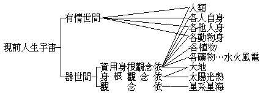



本表人类以下四项属有情世间，各植物以下五项属器世间。器世间所属各物事，有为人生资用所依者，有为身根所依者，有为观念所依者，或一或三分别表列：兹就本表逆推而前以为解释，以便利故耳。



如星系星海，与人本无甚大之关系，仅为观察测验之所及，故属於观念依而不及资用身根二者。太阳光热为身根观念之所依。至大地及各矿物之水火风电以上，则为资用身根观念所俱依。此中有情世间各项亦通於资用依，骤观之似难索解，盖疑本表既以人生为本位，则资用所依者必在人生之外也；不知人类互助之义即为人生资用之所依，君臣父子夫妇昆弟朋友，小而家庭，大而社会国家种族，莫不皆然：人类特其总称耳。故人类亦为各人之器世间。



各人之自身为各人资用所依，理亦易明。即如科学家言人身一如机器，四支百体各有相当之作用：所谓呼吸器、消化器、排泄器，如是等等，无非机械之义，即资用依。则知各人自身者各人之器世间也，我之自身者我之器世间也。庄子曰：指马之百体不得谓之马；然则指身之百体亦不得谓之我，我果安在哉！至各他人身为人资用所依者，如以人之才力智为用是。若动物身，则或资其力或竟食其肉而寝其皮也。故以上四类虽属有情世间，而皆可为人生资用所依。至其为身根观念所依尤吾人日常所习见，不事辞费。故此四类者亦通於器世间也。



三　出世与厌世



综上所言，世间之意义及其范围当可明了。兹请进而讨论「厌离世间」与「超出世间」。夫所谓厌离世间者，其厌而离之者将谓厌此有情世间欤？抑器世间欤？愤世嫉俗离群索处，深山大泽适其所适，此世人之所谓厌世主义，其所厌而离者当为上述之有情世间，佛法无是也。以佛法言：则有情世间中无量无边众生，依佛慈悲，誓愿救之度之利之乐之，虽在恶趣不辞应身而为化导，何得厌而离之！如谓所厌离者，系此梦幻扰浊障碍束缚之器世间耶？则学佛者初步之修证，可有是义，即谓佛法系「厌世的」亦无不可。



其次超出世间者，其所超而出者器世间欤？抑有情世间欤？吾闻之猿伸鹤屈炼丹升汞以求白日飞升者，即世所谓出世也，是其意将欲超出此与人共处之地球而上居天国，或求比於列星；则所出者当为器世间，佛法中亦无是也。盖器世间如幻不实已如上述，假使众生惑业断尽，则山河大地当下皆空，更何超出之可言！故佛法中所言出世者：谓断烦恼、离妄业、去障碍、了生死，以超出此迷妄之有情世间，而为化度众生之基础。故以有情世间而论，则亦未尝不可谓佛法系「出世的」者也。



第二节　随顺世间的．救护世间的



此二语亦系世人评判佛法之言，已不似第一节所云之肤浅简陋矣。随顺救护云者：表佛法与人相近，且慈悲愿护，未尝远离世间。盖已窥及大乘之道用。特其所见尚属一偏，而未见佛法之完全系统，故进而至於第三节所云。



第三节　由超出世间而救护世间的



此节所云见理较深，为说亦渐圆满。盖超出世间乃不自堕於世法之中而后可以言救护世间，理有固然：譬如有人与人同溺於海，是人虽有救人之心，则必先求足踏实地或置身舟中而后可，由超世而救世亦犹此义。虽然，超出世间者小乘自了之目的，救护世间者大乘究竟之方便也，不可不辨。



第四节　择灭恶世以创造美善的世间



恶劣的世间即器世间与有情世间，美(清净)善(安乐)的世间表解於下：



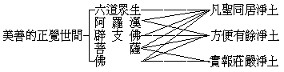



凡圣同居净土者，在此即指娑婆世界，本为九地有情之所居，而圣亦应身化导於其间，故称同居。然凡之与圣，境界不同受用不同。九地有情，亦随心所现随业所受而各各不同。譬如人见水为水而有种种障碍，鱼则无之。鱼居水中一如人居空气中。其餘翼而飞、足而走、身而缘、幽而潜，莫不皆由随业受报，其理易明。方便有餘净土，为阿罗汉及辟支佛二乘之所居，而有菩萨与佛应化於其间使之回小向大。阿罗汉即声闻，辟支佛即缘觉，此净土非六凡所能到。实报庄严净土，此由菩萨福慧双修庄严而成，而佛则应化其间使登等觉。故此净土，更非二乘所能到矣。



本表所列，凡圣同居净土可称世间，此外、本是出过三界之清净法界，非可与世间相提并论。今欲随顺世人言说故称之曰正觉世间。至证佛果则为常寂光净土，即身即土无复情器之碍，更不可与世间并作一谈。故不列。



恶劣美善之义如此，择灭创造将如何？曰：欲解此问题，须先知情器世间之结成由於众生之业力，而众生之业力则由於心之所起。是故择灭创造云者，亦曰选择灭除此众生心现之业力结合而成之恶劣世间，而创造美善的正觉世间耳。然此恶劣世间与美善世间，非实有二个世间可以择灭可以创造，又非弃置此恶劣世间而另创造一美善世间。当知世间美恶之分皆由心之染净而别。且自真性观之，本来平等、本来清净、无有差别、具足美善毫无恶劣之可言。然以无始无明住地之力，迷惑熏习昏昧摇动而现种种色色之情与器；然本来虽迷而美善性之真如自在圆融周遍，未尝或失。故今之择灭，即择灭无始无明住地而显其真如心耳，今之创造，即将其本来具有之美善性显发而充实之耳。唯此一心实无有二，故曰世间美恶之分，由心之染净而别。维摩经谓若心清净则世界清净，楞严经谓当平心地则世界地一切皆平；择灭创造之义，亦如是而已矣。



第五节　吾之佛法的全系统观



以上四节摄古近人对於佛法之论断略尽，虽有深浅之殊要皆所见未圆。请进观乎佛法的全系统。



一　实证一切法一心真如、达到形而上学目的



一切法、即宇宙万有，一心真如、即心之本体。宇宙万有，为吾人差别心生灭心之所现。虽唯心现情境如梦，脱能实证皆是虚妄，正唯有圆明寂照之一心真如耳。何以故？以其无有差别无有生灭故；具足光明具足智慧故；本来平等本来圆满故；故佛法要在实证。非如世之哲学宗教，或虚悬一的无由自达，或自为束缚愈执愈甚。所谓太极，所谓上帝，所谓天，所谓道，莫不皆然。即近世之所谓形而上学，其意亦无非欲发明宇宙万有之本体而求得一根本解决之道，然亦徒托空言无由实证。不知唯佛法之实证一心真如乃为达到形而上学目的之不二法门也。此大乘佛法之初步。



二　成就圆满的人格及圆满的法界



成就圆满的人格者，质言之即是成佛。佛即梵语佛陀，此云觉者。觉不限於人类，一切众生皆可成佛，故云觉者而不云觉人。法界、即常寂光净土，圆满法界则常乐真净而无情器之隔，即是妙觉佛果。乃依一心真如为本因地而达到於究竟地者也。此则大乘佛法之第二步。



三　随顺无限的世界众生、应化无尽利乐无尽



上二项言圆满之自利，此言佛法利他之妙用：佛法界真净妙明无障无碍，而其应身化导於世间皆所以利乐一切众生。随顺云者，六道众生业力不同，二乘菩萨觉分各异，依佛慈悲愿力皆能随顺之，使离一切苦得究竟乐；然而世界无边众生无边，故佛之应化无尽利乐亦无尽也。此大乘佛法之第三步。圆满自利利他，乃为佛法之完全系统。



第二章　佛法的自利利他观



就上章第五节所言，成就圆满的人格而知佛法之自利，应化无边的世界众生而知佛法之利他。但佛法所称之利非如世间「对待的」「比较的」之利，盖谓利他即真正利他，自利即真正自利。利者，谓由一种方法行为能得到一种「离去苦恼成就安乐」之效果的代名词也。世间一切法不能究竟离苦得究竟乐，唯佛法能究竟离苦得究竟乐，故唯佛法能真正自利利他。餘法离苦而非究竟，则是比较的离苦，得乐而非究竟，是对待的得乐，皆非真正之利也。试就世间餘一切法观之：



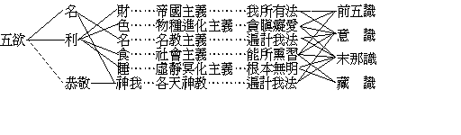



就本表观之，知世间可称为利者已括尽无餘，其要不出名利恭敬，而皆佛法之所应弃者，以其为依识而起之妄法也。试举其显明者言之，如财固可以为利，而财之大者莫如帝国主义据全球而统治之，究其实则财无论大小皆属於前六识之我所有法，有时而尽，非究竟也。其餘均可比例而观。兹释佛法於世间法之择灭修治成就：



　　　　┌──────┬─────────────────┐  

　　　　│世法佛法之依│　佛　　　　　　　　　　　　　法　│  

　　　　├──────┼─────────────────┤  

　　　　│前　 五　 识│…………成所作事智　　　　　　　　│  

　　　　│意　　　　识│……………妙观察智─┐　　　　　　│  

　　　　│末　 那　 识│……………平等性智─┼─一真如法界│  

　　　　│藏　　　　识│……………大圆镜智─┘　　　　　　│  

　　　　└──────┴─────────────────┘



观前表知世法依识而起，观本表知佛法转识成智而契证一真如法界。八识既转，则依识而起之妄法(世间一切)自归择灭，妄法既灭乃为究竟离苦，证一真如法界而成就四智乃为究竟得乐：



　　　　　　┌解脱安宁乐  

　　　　佛法┤觉智正遍乐  

　　　　　　└法身圆满乐



观此，可知佛法离苦得乐皆在究竟。故所谓利，乃为真正之利。依於斯义，而有本章五节所说。



第一节　唯佛法有真正的自利



世俗所谓自利，不过曰利我之身、利我之家、利我之国等，要皆不出我及我所有法。迷此不悟，故晓夜孜孜经危难冒万死而不辞，以成其所谓利，然而根本错谬，则以不知自之何在。试就物质精神面面求之不可得自，前际后际中际刹那求之亦不可得自，由是远观宇宙近察身心皆不可得自，自且无有则早夜胶扰以求利，试问所利者谁欤？若是而可称自利，则虽称之为不利可也。故唯佛法为有真自，此自乃离一切相即一切法，不生不灭，真实自在之自性。必发明乎此，乃能离世间一切苦而得佛法究竟之乐，是为真正的自利。亦「唯佛法有真正的自利」。



第二节　纯以利他成就自利的佛法



发菩萨心者，必以大慈悲心护念众生，大方便力普救众生，使之离苦得乐；必至成就无量无边功德，而后乃证无上大菩提果。楞严经云：「自未得度先度人者，菩萨发心」。此以利他成就自利，故称「纯以利他成就自利的佛法」。如维摩诘经即此法门也。



第三节　为利他故先求自利的佛法



普救一切众生，愿力虽大但念实施不易，唯佛法乃能具此实施之大能。为求此实施之能力故，先求自得解脱之利，故称「为利他故先求自利的佛法」。如往生净土诸经即此法门也。



第四节　不分先后自他等利的佛法



如上所言「利他即所以自利！自利亦所以利他」；是知佛法并无后先，自他等利者也。大乘佛法大抵皆如是。



第五节　唯佛法能真正的利他



他者对我之称。我身之外，世间一切众生皆可以「他」字概括之。然我之与他等是有情，等是世间上之分子，等是迷妄不觉，等是苦海沉沦，等是虚伪，等是无常；而世间一切名利恭敬又等是虚幻；以之自利已无效果，以之利他，等是无效果。唯佛法有真正的自利，推此自利者以利他，故亦唯佛法能真正的利他也。



第三章　佛法应化现代人心之需要



如第一章第五节所言「佛法随顺无限的世界众生，应化无尽，利乐无尽」！吾人心中当有一种感想，即佛法之於当今之世及今人之需要者又为何如是也。本章所言即明斯义，分五节说之。



第一节　佛法契理适机之原则



常理即真实之理：平等无二，本来常住，无有变异真实不虚。此非空言，特吾人迷其本性乃茫无所知。唯佛成大觉明，具大智慧，灵明洞澈，觉照圆满，故能契合无间。且能应此常理发明而显示之，使迷妄众生共知共悟同登正觉。至世间法则迁流无常；因乎时分而生种种差别，众生之心亦因之而有种种之殊异：若不随顺世间巧施言说，以应其时而投其机，则宜於此者或失於彼，合於过去而不合於现在，故佛法有适化时机之必要！夫契应常理者佛法之正体，适化时机者佛法之妙用，综斯二义以为原则，佛法之体用斯备。若应常理而不适化时机，则失佛法之妙用；适化时机而不契应常理，则失佛法之正体。皆非所以明佛法也。



第二节　佛法随众生现行的原则



佛者、遍法界为身，无有身相，不可思议。其发现於世间者，乃佛应身。应身随众生之身相而显现。众生之身相无量无边，而佛之应身乃亦无量无边，皆随其类而应现。至佛法则平等无二，本无可说，亦无名相。换言之，即佛法之名称亦不可得。世之有佛法流行者，亦随乎众生差别之心而立也。由前之说无佛可见，由后之说无法可说，佛之与法皆随世间众生发现流行。世间众生染有深浅，觉有先后，种种差别，各各不同，而佛法因之亦有种种差别各各不同以应之。约言佛法为八万四千法门。虽云繁多，而利乐众生则一。是为佛法随世界众生现行的原则。



第三节　佛教须应时设化的需要



依上所言，知佛教有应时设化之必要。应时设化者，佛法普度众生之功用也，不能应时设化则失佛法之功用。不宁唯是，若不能应时设化，以发起世人之信心而昌明教义，则世人对於佛法将不得其了解。际此末法之世，众生之心，大多昏乱，纵其毁谤，恣其戏弄，嗜欲横流，失於正念，永沉苦海流转生死，或堕恶趣；非特佛法因而衰落，或将有绝灭於世之忧也。



第四节　中国民族於佛法的需要



佛法之应化於世，必有时分，必有方所。本节所论，以中国民族为方所，以现在为时分，而明其於佛法之需要。抑民族者有情世间也，中国者中国民族之器世间也。盖民与土和合而成国，土为民有，自当以民为主；今言中国民族，亦当以民族为重。中国者以明民族之范围耳。所谓需要，亦非考察往古推测将来，乃就现在状况为说：



一　意盛志锐者於佛法的需要



意盛志锐之人乃中国优秀分子，有才器、有作为，而国之兴衰系焉。其要在乎一国之中，必有高尚之道德，精深之学术，以范其行，以安其心，使不至突藩而驰，自就轨范，为国所赖。我国自来重道德，讲性理，人皆谨於礼法，安乎分位；洎乎西学东渐，群言繁兴，互相反对，互相抵斥，(此为西学之特点，其弊在於诸学分立而无最大之系统以为归依，是以各树一帜互不相下。)入主出奴，龂龂逞辩，充耳嚣然，莫衷一是。吾国才智之士尤而效之，本其思想自由、言论自由，遂将从前藩篱一蹴而去。至於今日，道德破坏，性理沦胥，奔突放逸莫能得一新轨范以为归依，充其思想之纷飞将不可收拾。唯有佛法广大圆融，深奥莫穷，具清净无上之道德，有一真不二之妙理；辟妄见真，摧邪显正，所以浃洽人心，轨范士论，舍佛法其谁与归！此其一。



二　积迷习谬者於佛法的需要



吾国昔以神道设教，原所以悚骇愚顽而补刑政之不足。然而迷信渐深积习不返，奸狡之徒利而用之以为蛊惑之具，作乱之资，小则歛赀，大则欲遂其帝王思想(如黄巾白莲等教及最近之义和团等)；扰乱社会，危害国家，莫此为甚！诚欲除其迷谬，破其邪执，使奸宄之徒失所凭借，要非佛法不为功。此其二。



三　五族和平於佛法的需要



吾国既合汉满蒙回藏五族，隶於同一统治权之下，而建立此统一之中华民国，就政法言之，固已立统一之形式；然而五族人民同居一国，必需求统一之精神，即统一之思想是也。思想系乎宗教与道德。孔子之教本兼政治与道德，为吾汉族所崇奉固已数千年於兹，但在其餘各族尚未普及。谟罕默德之教仅为回族之所信仰，即今耶稣天主诸教不过少数人所奉行，均不足以容涵一切而有统一五族人民思想之能力。至若佛教，则向为满蒙藏之所崇奉；汉族则自汉唐以来久经盛行，宋明诸儒所谈性理之学尤多隐宗於佛教，近世则士夫学子知谈禅理，妇人孺稚解念弥陀。以五族言，已居其四。而况佛法自来不立封域，耶教回教自可列之佛教之人天乘中。故欲谋思想统一而使五族人民有统一之精神者，尤以佛法乃能具此伟大之能力。此其三。



第五节　现在人心於佛法的需要



上就中国一偶而言。本节广其范围，就全球人心现时状况观察，其於佛法之需要当有下列诸点：



一　宁息世界的大乱源於佛法的需要



现在世界之趋势，西欧为重，东亚较轻。即就世乱观之，亦西欧盛於东亚。然东亚之乱，殆又影响於西欧。此无他，物质之学愈昌而逐物之心愈盛，五欲日炽如倒狂澜，竭全球生产之力不足以供耗费。贫富之阶级相差愈远，而大多数生计问题之待解决愈急，不平之气乃充塞宇宙。而况本其野蛮角逐之习，易为文明竞争之语，物竞天择，优胜劣败，定为天演公例，奉为玉律金科，是以戾气横流莫知所届。嗟乎！世人自作之孽，今已罹此最惨最酷之众同分业报。然习非成是，尚无自拔之方，殆所谓无明妄动而不自觉欤！今者世人厌乱同具此心，诚欲息此乱源当探其本，乱之所起，端在人心：茍能不为形役，业力自减，我佛广垂言教为后世众生作将来眼，首在超越情器，实证一心真如正觉人心，此为无上妙法。吾人不幸生此五浊之世，心多散乱，正宜昌明佛法以为世界人道之正义；正义有在，即人心得有所归宿。大乱之源，庶有豸乎！



二　酿造世界新文化於佛法的需要



在昔世界文化为三大系：其一曰印度文化，其二曰中国文化，其三曰希腊文化。然印度文化与中国文化，於我国宋明时代已有融洽之点，遂成为东亚文化(东亚诸国如日本等之文化均由中国而输入故)，吾国三教同化由宋明来已然也。希腊文化，则演成今日之欧西文化。故以现在世界文化而言，可称为东亚与西欧二者。然於二者之间，其可以圆摄长宙轨范寰球者谁欤？试观欧西文化：所重者竞争，教之与教、学之与学、畛域妄分、门户各立，甲说初出、乙必起而反对之，丙事调停、丁又从而打销之(此欧西哲学家所自言者)，是非蜂起、莫知所衷；以故人与人争，国与国战，而酿成今世界之大乱。以言文化，仅物质上呈一时之美观，究其实、则欧洲一隅尚不足以自相维系，其於世界可知矣。返观东亚文化：教有宗本，学有传统，人我之相不立，水火之见不生，佛言平等、儒尚礼让、道取清静；虽所见有通局浅深、而均欲会归其极，故能水乳交融，翕然成化。其力足以建立世界唯一之统一大国，维持数千年於不坠，远近邻邦无不同化(以上均就文化言非就统治权言)，广博宏大莫可与伦，诚足以表率人群，模范世界而无遗憾。或疑欧化东渐，弱点已形，如上所言似近夸诞，不知此由大道未彰国运暂替，譬如士子未第每见凌於乡曲恶少，何足介也。然所言东亚文化其中有不可不知者，虽三教有其通贯之处，而老庄道义语焉未详，孔子注重世法不言性与天道，第一义谛含而未吐，皆未足以餍世人求「达到最高真理之目的」之心。唯佛法微妙无上，义深文博，学术兼备，实体缘起莫不究极，是则酿造世界新文化，有倡明佛学之必要也审矣。



三　满足人心安慰人心於佛法的需要



佛法之究竟妙用，在应化世界，利乐众生；且能随顺无量无边之世界众生而施其无量无边之法门，使其究竟离苦、得究竟乐。今世之人心，泛滥滂渤无所底止，沉溺苦海度脱无期，诚欲於此生死烦恼中，使一一差别不同之人心得以满足，得以安慰，固必需乎我佛无上法门也。



第四章　佛法可说不可说



文佛应世，说法度生四十九年。临灭度时拈花微笑，以示数十年来未说一字，我辈凡夫更有何说？此佛法之不可说。三藏十二部煌煌言教，以为末世一切众生作将来眼，然文多义奥，浅识难窥，不假言说无由了解，此又佛法之可说。於此问题，以本章诸节说明之。



第一节　佛法的法



法者，一、任持自性——谓保任执持一一法自体性相而不亡失；二、轨范物解——谓轨定范围一切众生的心理而起解行。佛法的法具此二义，则可说不可说问题可依此以解释之。



第二节　法性离言不可说



法性、即法之第一义。法之相性，惟佛究竟明证，唯佛究竟了知，悉皆真故。又一切言说假名无实；假故不能显真，故法性离言不可说。



第三节　为令解行成果故巧施言说



如上节言法性离言不可说，则知可说者必非法性。故虽比量以示之，因喻以明之，无非善巧施设之方便，以为言说：只可就众生之心理，轨定范围，而令其解理起行成果耳。此即法之第二义。巧施言说故未尝不可说。



第四节　转法轮



我佛说法，谓之转法轮。轮者，一、如碾米的轮，能摧破研除於糠秕，喻佛法能破除五住烦恼(三界见惑，欲界思惑，色界思惑，无色界思惑，及无明为五住烦恼)。二、如舟车的轮，能通行往达於境域，喻佛法能行达四德涅槃(常乐我净四德)。三、如日轮、月轮、地轮、水轮、风轮的轮，以八方上下周圆充实为义：喻佛法之性德圆满，法身常住。转者，谓使众生有所改转：或始迷而今悟，或始染而今净，或始苦而今乐，总之，使转凡成圣。法轮者：或依第一解，使众生借以破五住烦恼；或依第二解，使众生乘之以达四德涅槃；或依第三解，以表佛法之性德圆满。



第五节　佛乘的乘



乘者，车乘之乘，就佛菩萨依以运载之法以为喻也；乘舟之乘，就佛菩萨能运载於法以为喻也。佛乘之乘，通此二喻，皆以「运载」为义。一、从「无明位」运载至「大觉位」，理教乘也；二、从「有漏杂染位」运载至「无漏清净位」，行教乘也；三、从「生死苦位」运载至「究竟乐位」，果教乘也。



佛乘者，佛法应化众生所发、为解理起行成果之妙用也。随顺众生根性乐念不同，应用无量，不堕诸数。约其大齐以言，或说三乘五乘，(五乘者，谓人乘、天乘、声闻乘、缘觉乘、菩萨如来乘。三乘者，则於五乘之中简除人天二乘。大乘起信论别说言之极详，可以参考)。皆佛法之妙用，故统之曰佛乘也。



纯正的佛法



佛法本不可说，更不可分类为说，兹则因言遣言，权假方便，但使说者易达，闻者易明，非可执为定论。且分为纯正的佛法、应用的佛法以说明之。纯正的佛法者，从佛法一方辨其悟理修行之事，而未及其与人间之关系，都分为四章。



第一章　纯正佛法的分类



闻解之教理不同，修证之行果有异，而佛法有大乘小乘之别。小乘者，功在自了，纯为超出世间的，其说略见序论。大乘则功在度世，故为超出世间而又适应世间的。兹先说小乘，分七节说明。



第二章　小乘



第一节　小乘的宗要



小乘为超出世间的，必先将一切世间之法打破。欲求打破，必先了知。已了知而打破，然后可得解脱，其主要之点在是。



第二节　了生死为因



了有二义，曰了知、了脱，此则由了知而求了脱也。如平盗然，必先了知盗之所在，及其人数多寡，内容如何，如是种种明晰无餘，然后盗可得而平。了生死亦复如是。本节所言，即观察一切世法而得真确之了知也。



一　生为苦本



　　　　　　┌贪 瞋 等 烦 恼本┐  

　　　　生为┤杀盗淫妄等恶业本├────故生为苦本  

　　　　　　└病 老 死 等 苦本┘



生之最初相为得命，故亦称生命。乃推其源，则由过去世无明业力妄动而来。既生而有身，则所以保卫维持之者无所不至，直接之需求则求衣食住，间接之需求则金钱等动产及不动产业。从流而下贪欲丛起，则权利威势随之，又再扩张，则欲据此大地为己有。一有不得转成瞋恚，得而患失尤见愚痴。由此贪得无厌不能自己，杀盗淫妄任意造作。及至业力已成又种未来之因，而成异熟之果；以致生生相续无有已时，业系苦相永无断绝。无非以生为本，而病老死等尤其著者。故小乘之第一步，即当了知此「生」实为众苦之本也。



二　遍观世间皆无常苦空无我不净



　　　　　　┌一切法无我………………………统一切位法  

　　　　　　│一切心行无常……………………心法心所有法  

　　　　遍观┤自他一切身不净…………………色法  

　　　　　　└身心一切受是苦…………………心所有法



此中空与无常二义已见上章。又除空义外即四念住，而次序稍移。兹先释不净，即观身不净。净、是美好之义，吾人习有此身，固已爱而不知其恶。然以小乘正念观之，自始至终无可美者。身之最始厥为住胎，父精母血和合而成，殆无净美可言。及至出世粪秽时遗，涕尿交流，亦无洁净。继而长大，体态端好，容光焕发，似可美矣；然而详审谛视，外则汗液垢腻沐浴不去，坐令巨万微虫昼夜啮肤，内则五辛杂投荤浊备蓄，自内而外，无可净美。其似可美者，仅此泡影色尘，自诳眼识，而况恼人暮景转瞬即至，则并此似美之泡影，不能久持。血气内衰，精神暗损，发苍齿落，肌瘦肤黄，百病丛生，而有四大将散之兆矣。及至寿煖识尽，颜色先变，肌肤次之，脓血杂流，筋骨灰散，茍云有餘，绝非净美。是知吾人色身，从始有至於灭尽，皆为不净。推自及他无不皆然。而世之宝爱色身，不惜自起烦恼造作恶业者，诚无谓矣。



苦、即观受是苦。受、即感受义，兼通於身心。依俗谛言，身有乐受、苦受、舍受，心有乐受、苦受、喜受、忧受、舍受。舍者、不苦不乐不忧不喜也。如下：



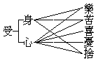



夫受为五十一心所法之一。众生之受，实唯是苦无有喜乐。盖因无明妄动而生，念念变迁，时时流动，无非趣向无常而行，完全是苦。虽依俗言有乐受、喜受，然均系对待之辞，能令苦与忧暂时休息，则名之曰乐曰喜，不知一转念间，其苦更甚。譬之人有疥癞，以手搔之暂止痛痒谓之为乐，一停手间加以红肿，其苦益甚。



无我、即观法无我。我具四义：曰、独一个体，曰、真实非假，曰、常恒不变，曰、自有主宰。四义具足，谓之有我，茍缺其一，我义不成。试举人言，有个体，又似有主宰矣，而真常之义万难成就。盖人由精神物质和合而成，刹那刹那迁变流转，又视业力久暂，即便坏灭。由是推自及他，从人至物，有情无情，乃至木石瓦砾，小而勺土，大而地球，显而万用，微而万法(世间出世间一切生灭不生灭法)，一一求之，皆无我义，是故无常苦空无我不净诸义，遍於世间一切所有。兹再分目言之：



甲　五蕴六大十二处十八界



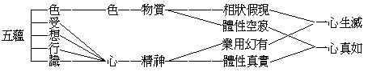



本表於色法物质下，则注明相状乃假现，而体性本空寂，於心法下，则注明业用乃幻有，而体性本真实。物质上假现之相状，与精神幻有之业用，则属一心生灭；物质上空寂之体性，与精神上真实之体性，则属一心真如。了证此义，本属大乘事，而非小乘智之所及，因论及此故并列之。



又色心二法并举，则世间一切法皆破矣。下表均同。



蕴乃藏义、积义、聚义，言非一法故。亦谓之阴，阴乃障蔽义，能阴覆真如法性故。其名则色蕴、受蕴、想蕴、行蕴、识蕴。此中色蕴属色法，即物质；餘四蕴属於心法，即精神。心法分四而色法仅一者，盖对迷执於精神深、迷执於物质浅之人，而破其我见故。譬如有人执著有我，其初必在色法指其身体为我，如是则可问之曰：尔执身体是我，将谓四肢、百骸、五官、九窍、六腑、五脏、皮肤、血液、筋络、神经，如此等等一一是我耶？抑谓其一是我其餘非我耶？一一是我则我非一，其一是我其餘非我则身不存在？如是此人必瞠目结舌不能对。而后喻之曰：身体者，众法和合之假相耳(上就空间观察下就时间观察)。且人自生而有身、而婴儿、而孩提、而幼稚、而壮大、而衰老、乃至於死，此身乃年变月化日迁时异而刹那不同，念念不息，夫过去者已往，将来者未至，现在者不住，如此种种将执何者为我耶？其不能对一也。喻之曰：此连续之假相耳。



又如此人已知物质方面无我存在，乃转执精神为我。其执精神之心且较物质为深，则可以心法一一破之。受即感受，为心所法之浅显者，最易执著。假如此人作是语曰：身体非我，此感受之知觉当是我矣？喻之曰：受有乐苦喜忧舍，为乐受喜受是我耶则苦与忧受非我，苦受忧受是我耶则喜与乐受非我，舍受是我耶则苦乐忧喜诸受俱非我；如云俱是我则成多我，是皆不可能。不知受乃心境相对之作用，现在过未刹那不住，离此作用受无自体，不可执为我也。假如是人又进而执想为我：想谓思想，所以取名相、辨道理、明是非，如是之心，非我而谁？喻之曰：想者，外受名色，内含义理，而为心之影相，其所缘在六尘境界，不可执以为我。如依色尘而辨青黄赤白，依声尘而辨高低大小，依香尘而辨清浊浓淡，依味尘而辨酸咸苦辣，依触尘而辨冷煖滑涩，如是不可执一是我，更不可执一一俱是我。假如此人又进而执行为我：行者，谓有意志而发於行为，是主宰在我，当可称为我矣？喻之曰：行有善恶无记等类，如云有我，不应或善、或恶、或为无记。离此种种，不名为行。且人之行为类多无记，良由不觉冲动即见诸行，善恶未暇自辨。故行有行动迁流义，忽此忽彼义，盖假和合连续之假相而立名，实则无自体性。又如此人已知受想行不可执著为我，乃转而求此受想行所由起之精神自身谓之为我，则识是也。此识当指第六意识而言，已达近世心理学最深之域。所谓有意识无意识一语，即云有无主宰。换言之、即我是也。不知意识内依末那为依，外依前五识为用，其所分明了知，全在五尘落谢影子，既无体性何可执为我耶？是故物质精神皆为无我，我之意义，不过对待称谓之假名。如我对人曰我，人亦自称曰我，犹东与西相对立名，非有一定之处所而可谓之为东与西也。



　　　　　　┌─地────┐  

　　　　　　├─水────┤  

　　　　六大┼─火────┼─色  

　　　　　　├─风────┤  

　　　　　　├─空────┘  

　　　　　　└─识──────心



上之五蕴、色法一而心法四，此言六大、色法五而心法一。盖对迷於物质深、迷於精神浅之人以显一切法无我之义，当机说法之妙用也。大者、周遍义。世界一切法皆不出乎此，故云六大。地者坚质、水者流质、火者热力、风者动力，火与风又谓之气质，空者、无处不遍，除地水火风体质之外皆为空，空为眼识所见，又为人生感觉之触法；五者本无体相，皆为吾人心中分别之境界、思量之境界，而分别思量此境界之具，则谓之识。识何以名大？因地大、水大、火大、风大、空大，故识亦大。凡有地水火风空之处，识亦随之，故谓之大。世间一切法除矿物等只有五大而无识外，一切有情皆具六大。故六大能包括世间一切法而无遗。仔细考察，则知世间一切法只有六大而无我，而六大之中亦复无我。



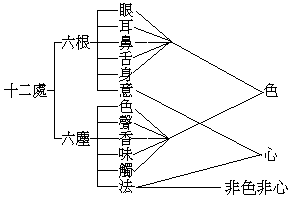



处即处所，即十二种体相所依止之处。如表分色法十一、心法二者，盖六尘中之法兼通於色心故。十二种名兹不细解，但所谓根者具有二义：一、曰所依托，二、曰能生长；譬如眼根、为眼识之所依，又能生长眼识也。尘者亦有二义：一、变碍摇动，如微尘之尘；二、污浊心性，如尘垢之尘。世间一切法依十二处观察之，只有十二处而无我，十二处中亦无我。



　　　　　　　　　　　　　　┌─五根─────┐  

　　　　　　　　┌─六根──┤　　　　　　　　│  

　　　　　　　　│　　　　　└─意根───┐　│  

　　　　　　　　│　　　　　┌─五尘─┐　│　├色  

　　　　十八界─┼─六尘──┤　　　　├─┼─┘  

　　　　　　　　│　　　　　└─法尘─┘　│  

　　　　　　　　└─六识─────────┴──心



界谓界别，云十八界亦举世间一切法皆尽之。分心法八、色法十一、以法尘兼通於心色故，兹不细论。盖所以对治精神物质两迷俱深者，观察结果亦无有我。以上所言五蕴、六大、十二处、十八界，皆所以观世间一切法无我：由无我而推知其皆为无常、苦、空、不净，既得了知当得了脱。本来无有，尚何贪爱之足云。



乙　三界五趣九地



　　　　　　　　　　　　　　　　　　　　　　　　　　┌地狱  

　　　　　　　　　　　　　　　　　　　　　┌琰魔王界┤  

　　　　　　　　　　　　　　　　　　　　　│　　　　└饿鬼  

　　　　　　　　　　　　　　　　　　　　　│　　　　┌畜生  

　　　　　　　　　　　　┌地居………小三界┤金轮王界┤  

　　　　　　┌有形有欲界┤　　┌时分　　　│　　　　└人类  

　　　　　　│　　　　　└空居┤知足　　　│　　　　┌神仙  

　　　　　　│　　　　　　　　│化乐　　　└释天帝界┤  

　　　　　　│　　　　　　　　└他化　　　　　　　　└天类  

　　　　　　│　　　　　┌离生喜乐位……初禅天  

　　　　三界┤有形无欲界┤定生喜乐位……二禅天  

　　　　　　│　　　　　│离喜妙乐位……三禅天  

　　　　　　│　　　　　└舍念清净位……四禅天  

　　　　　　│　　　　　┌空无边处天  

　　　　　　└无形无欲界┤识无边处天  

　　　　　　　　　　　　│无所有处天  

　　　　　　　　　　　　└非非想处天



三界本名欲界、色界、无色界，以其意不甚明显，今特新定三名：曰有形有欲界、有形无欲界、无形无欲界，此三界为世间一切正报之大类。有形有欲界者、五趣杂居地也，有形质、有物欲、故曰有形有欲，人类亦在其中。有形无欲界者、其形清净微妙、其心则无有物欲，常在禅定之中，故亦谓之禅天，离生喜乐位、定生喜乐位、离喜妙乐位、舍念清净位、四者居之。由此界更进一步，则有无形无欲界、形质皆空，心静恒一，生之者有空无边处天、识无边处天、无所有处天、非非想处天。



五趣即地狱、饿鬼、畜生、人、天、五类。地狱饿鬼属琰魔王界，凡受恶报之众生堕於地狱饿鬼之中者，琰魔王管辖之。琰魔王(即阎罗王)者责罚王也。畜生人类属金轮王界，所谓人间世也。神仙天类属释天帝界，所谓天界也。此琰魔王界、金轮王界、释天帝界，三者又曰小三界，皆未出乎地轮之外故曰地居，即六道众生之所居。地居之外又有空居，已不在此大地，一曰时分、二曰知足、三曰化乐、四曰他化。时分者、太阳之光亦不能到，其时分则以自身光明天华开合别之；知足者、即兜率天，五欲淡薄，稍有所得已觉满足，而其味最妙最好，故曰知足；化乐者、其所受用皆随心应念变化而有；他化者、其受用皆由共同业变化而有。地居空居虽分别而言，实则只一五趣杂居地耳。



九地者、地即地位义、等级义。有形有欲界居其一位，无欲有形界中四位，无欲无形界中四位，凡九位。自五趣杂居地至非非想处天之九种地位，递进递高，特未至出世间地位耳，故曰九地。仅存其名、兹不具论。



丙　器世间



器世间者，一切有情之依报也。第一章已详细说明兹不重赘。依正二报皆是苦报：五蕴六大十二处十八界者，所以集起此果报之法体也；三界五趣九地之有情世间，及大千之器世间者，所集成之果报体也。云何皆苦？则以五蕴六大十二处十八界，观察结果皆无我故，皆虚伪不实故，皆无主宰故。



丁　福业非福业不动业



福业应得福报，如受天人神仙正报之类；非福业应得恶报，如堕恶趣而受地狱饿鬼畜生等正报之类；不动业则得禅定果报，如受二地乃至九地诸正报之类。要皆随业受报，故有依正三界等果报。果报无常，有时而尽，故为有漏因果，皆因未出轮回，未得究竟离苦故也。



戊　三世流转生死相续



过去、现在、未来、谓之三世。众生依於过去之业故受现在之果报，依於现在之业故（或兼过去之一分）受未来之果报，如是流转生死不断。中间或善或恶福非福等，均由自作自受。要皆轮回於三界五趣九地之间，以取分段生死，循环相续无有已时。众生迷谬不能自觉，我佛垂慈特为道破，吾人闻此，可不警然起行以求解脱而趋登佛地乎。



三　确知世间虚伪决志择灭



世间之义尽於上节所言，当可确实了知矣。使世间而有一毫可贪者、贪之可也，使世间而有一毫可爱者、爱之可也；乃究其极，无非无常苦空无我不净，则择灭之志有何而不决耶。



第三节　离贪爱为根本



上节以了生死为因、从悟理言，本节以离贪爱为本、从修行言。夫人自有生以至於死，凡可以直接间接於生者，未得则贪、既得则爱、固无日不昏迷沉沦於贪爱之中，而不能自拔。其或贪而不得则瞋随之，爱而勿失其痴转盛，是贪爱诚烦恼之源、生死之门也。小乘之法既在断除烦恼生死，或以离贪爱为根本之用功处也。试分别言之：



一　观苦本之所由起



如上节言生为苦本，诚以三界五趣九地三千大千娑婆世间一切诸苦，皆因妄业而生。一切妄业，皆因不明本空无我之妄心而起，妄心冲动故有三世流转，生死相续轮回不息。欲明斯义，请就下列各项释之。



二　十二有支



本表十二有支之「有」，即指三界五趣九地器世间一切所有。支即支分，谓一切所有生死流转皆因此十二支分循环不息，故曰十二有支。亦即生死流转之因缘，故亦名十二因缘。兹就三世以解释之：



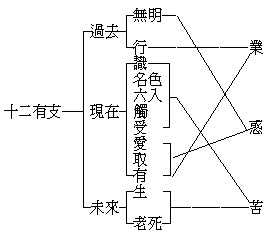



众生於过去世迷理迷事无明所作善恶业行，一一蕴藏於第八阿赖耶识而不自知，是即过去时代之迷惑。过去、前世死时昏迷不觉，唯是「无明」冥然存在，死后忽然冲动(此如忽然动念即习惯之业力也)名之为「行」；行者动义，盖即过去世之业染，发而为行，则将受生矣。现在入胎初仅有「识」，此即第八阿赖耶识，盖因过去世无明冲动之行转引而生，是为现在世有生之始(世俗谓灵魂转生投胎也)。有「识」乃有「名色」，名色者、胎藏也，名属於精神，色属於物质，是精神与物质凝结成胎身。复有「六入」，即六根全矣。「触」则出胎时与外界感触也。有触矣则有身心诸「受」，苦、乐、忧、喜、舍等是也。自识至受五者皆为现在世之苦报。至此身心已备又起「爱」著，因爱著而生执「取」，曰爱曰取，即为现在世之迷惑。何以故？爱取皆以我为准，以有我故顺我逆我之情心生，而身口意三业随之。由是又加以根本不觉之精神为田，而以善恶诸业为种子，播种於田稻即随生，名之曰「有」。故「有」者，现在世之业染也。如是复以爱取为无明(同是惑迷故)，以有为行(同是业染故)，而取未来之生死；未来之苦报，亦与现在同。盖未来之生，亦由识而名色而六入而触而受，其义不异。



於此所当知者：则现在之生，因於过去之无明(即爱取)与行(即有)，未来之生，必因於现在之爱取(即无明)与有(即行)，故欲了脱生死必先断除爱取，爱取既断则有不生，惑迷业染俱无，则是已绝未来生死之因而得涅槃矣。故断爱取为了生死之下手处，即本节言离贪爱为根本之意。非然者，十二因缘循环不断，生死相续无有已时，言念及此不禁悚然！



三　我及我所有法与五利使



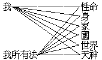



本表所列一一可谓之「我」，亦一一可谓之为「我所有」。不过范围大小，与夫或在精神或在物质之不同，盖皆随心分别，原无一定，以为如是则如是耳。故知我及我所有法，皆为妄执。此中所言天神乃外道所执，或亦执之为神我。意谓一切皆属虚伪，惟修证神我始为真实。



五利使、亦名五种邪见邪执，即身、边、邪、见、戒五者。使即使用、如工具然。利者、言由后起，如刀口之利从磨治而生。喻此五种邪见本非与生俱来，多由习惯思想语言文字及社会上种种教训而有。分释於下：



身、谓身见：吾人无论对人对物均见其有「个体」存在，故谓之身见。譬如茶杯，吾人先见有此「一个」茶杯，而后云此杯颜色甚美、花纹甚精、磁料甚细，如是一一皆视为此茶杯之附属物；不知此杯本为一一物和合而成，若离此一一物无有杯体存在。又如一人，吾人必先有此「一个」人之见，而后论此人之相貌魁梧、耳目聪明、支体强健，精神充足，思想高尚，如是不论精神上物质上一一之物皆视为此人所有；不知此人实即一一物和合而成，若离此一一物此人已不存在。此种邪见，谓之身见。边谓边见：乃因身见而起，依上所云身见之妄，则必推究此「个体」之死后是断灭乎？抑有不断灭者在乎？对此问题，其一、则唯物论者谓人死断灭，略谓精神乃附於身体诸物质之动作，无异於由物质上所起之能力，人死即是物质之能力不起，而物质亦化，故云断灭，此为断见。其二、则精神论者谓人另有精神之个体存在，如世俗相传之灵魂不因身体之死而遂灭，且常存在，此种谓之常见。此二说执常执断，更有执非常非断、亦常亦断，如此种种皆是落於一边，故谓之边见。近世哲学，亦皆依此身见边见而立也。邪即邪见：上云身边亦均为邪见，然以拨无一切因果罪福之邪见特著，故另列之，亦即不正见也。见、即见取：执己所见之理不知其非，而兴无谓之斗诤是。戒、即戒取：依谬见所持之戒禁以自束缚，而为无益之劳苦，如印度持牛戒者学牛行，持狗戒者效狗走，以为可以得道之类。



四　俱生我爱与五钝使



贪、瞋、痴、慢、疑，五者为五钝使。钝对利言。利如刀口、钝如刀身，利则易除，钝则难断。此五者，除疑、大抵皆与生俱来，故云俱生我爱，亦云俱生我执。上五利使为主之十使，亦称分别我执。分别我执者，因分解义理而起之谬；使能除谬而明正理则其执断，故为易除。俱生我执亦即俱生身见，则自有生即有之，至阿罗汉始能断尽，故为难断。贪即贪欲，瞋即瞋恚，痴即愚痴，慢即骄慢，疑则不正信。



五　五欲



财、色、名、食、睡，五者为人类之五欲。人能出家则五欲已断其三，只有食睡二者，故具缘较在家为胜也。虽然，在家之人苟能不贪非利，不犯邪淫，不好虚誉，不求甘旨，不为过量之睡眠，则亦不妨菩提路也。



色、声、香、味、触，五者为欲界众生所共之五欲，皆为爱贪之所由起。本节言离贪爱为根本，首当离五欲。诚能不为五欲之所沾染，则得超过欲界或得须陀洹果矣。



六　戒定慧三无漏学



上言所离之贪爱，此言离贪爱之方法在三无漏学。三无漏学亦曰三增上学，虽通於大小乘以至究竟，但在小乘尤为显要，惟视所修之深浅耳。戒所以离五欲；因戒生定，则可以伏诸我执令其不起；因定生慧，慧者真智也，则可以断一切邪执矣。如浊水然，定有澄清之功，而慧有去滓之力也。



第四节　灭尽为究竟



究竟者，作事至於圆满完成之谓。小乘之究竟在於灭尽，即本节第一项之灭、尽妙、离。小乘於此，所作已办，乃证取涅槃果矣。



一　灭尽妙离



灭、谓灭一切烦恼，尽、谓尽生死有漏之业，离、谓解脱三界九地诸苦，妙、谓妙应真常，即证无生法性妙智而与真常契合相应也。此举小乘究竟之事。



二　辟支佛及四沙门果



此言小乘之果位。辟支佛译独觉，谓其不必从佛闻法，能依自力而得觉悟也。亦称缘觉，则因其观十二因缘得觉故名。沙门、乃出家之通称，其事则勤修戒定慧，息灭贪瞋痴，故实为佛出家弟子之通称，而小乘中之声闻众也。声闻、以其闻佛之声音得觉而立名。合声闻独觉二者，谓之二乘。独觉系仅有者，故言小乘重在声闻。其果有四，谓之四沙门果：初、须陀洹，即预流果；谓其豁破邪迷、明见道真、超出生死预於圣流也。二、斯陀含，即一来果；业报未尽仍须一来人间。三、阿那含，即不还果；住色界天不还人间。四、阿罗汉，即无生果；乃小乘最高果位，到究竟涅槃即得圆满寂灭也。



三　有餘依涅槃



虽得涅槃仍有餘报为依(如身体仍在是)，谓之有餘依涅槃。涅槃者，寂灭也。虽曰有餘依，但已具戒定慧三无漏学，而解脱一切生死烦恼；且有解脱之真正知见，即无生智尽智，决无更起生死故云涅槃。



四　无餘依涅槃



遗弃身心而入灭度，一无所依，惟有真常妙性，谓之无餘依涅槃。如阿罗汉於灭度时入灭受想定，从之起十八种变化，最后以慧火自化其身而入灭度是。灭受想定谓受想已灭常在定中。此与无想定不同，无想定仅伏前六识之想念令其不起，不出人天三有中；而灭受想定则非出世圣者不能得也。



第五节　宗本之四谛



宗本者、根据也，主要也。小乘之主要根据在四谛，故称宗本之四谛。



一　四谛



四谛者：「苦」谓世间一切果报之苦，如生、老、病、死、求不得、怨憎会、爱别离、五取蕴等。苦从何生？曰集，集、即和合生起义，谓苦非一法所生，乃由烦恼妄业因缘和合而有，故称曰「苦集」。集为因而苦为果也。知苦之为烦恼妄业集合而有，则知欲了生死须断烦恼染业，烦恼业灭生死亦灭，故称之曰「苦集灭」。然而灭之必有能灭之方法，故进而求「苦集灭之道」。於后二谛，又以道为因而灭为果也。谛者，即「真理」义。



二　三十七菩提分



甲、四念住——观身不净、观受是苦、观心无常、观法无我。



乙、四正勤——未断恶断、已断恶不起、未生善生、已生善增长。



丙、四如意足——欲、念、进、慧。



丁、五根五力——信、进、念、定、慧(此五者根力均各具)。



戊、七觉支——念、择法、精进、喜、轻安、定、舍。



己、八圣行——正见、正思维、正语、正业、正命、正精进、正念、正定。



此三十七菩提分即上所言之苦集灭之道，亦即小乘之三十七功德。四念住、已见本章第二节，四正勤、本文自明，言正勤者拣於不正之精勤(如戒取之类)。如意足者，力能进行之谓。五根五力者，根谓根干，力谓能力，五者名相相同。盖具此五种净善之根干而后发为能力，有根干故不为一切法所转，有能力故能转一切法。觉支、即觉之支位。圣行、谓从真理以起行，拣於不正之行而言。



第六节　小乘的内容及定义



本章所言之小乘，系纯对佛乘以言小，闻者不可因名小而小之。兹故举其内容及定义：



一　小乘即声闻独觉



本论所云小乘之内容为声闻乘与独觉乘二者，又称为二乘。其果位已超出三界不落人天，非世间所传之上生天堂、与白日飞升等诸有漏因果所能拟其万一！不可轻视。



二　对大乘故名小乘



此明小乘之定义乃对大乘佛法而立此小乘之名，非就世间法而言也。若就世间法言，则小乘已大不可及；何以故？以世间一切善因福业皆有漏故，皆无常而有尽故。



第七节　小乘与出世出家及人天善法



本节就出世出家及人天乘诸点，以观察小乘之法而明其体用。分四项说：



一　小乘祇为出世法



小乘纯为超出世间的佛法。对於世间因果甚为明了，如本章各节所言观察世间一切所有法，六道轮回、三世流转、生死因缘、乃至我执邪见情欲等，无不一一透彻明晰无餘。惟其目的纯在出世，故观察结果均为解脱之方便。譬如了知生死烦恼一切之法皆不出乎因果，则必从果寻因明其所自，然后将因解脱使不发生，此为小乘之不二法门，故祇为出世法。



二　小乘有出家的必要



欲明小乘与出家之关系，须先明小乘果位。小乘分声闻独觉二乘而所重仍在声闻，以四沙门果为果位。就四果言之：其初二三犹在半途，至四果阿罗汉始为极果。但至三果则已断贪欲，故知非不出家者所易成办。夫出家之义谓舍离眷属与财产，二者均我所有法；出家之广义则谓舍离一切我所有法。在家者我所有法未舍，其所证不出初二三果，若出家者依法修习即可以证最高果位，故谓小乘有出家之必要也。且小乘之特质有二，其一、则限於天人类：此谓天人类以外如诸恶趣无小乘法，故比丘比丘尼极重戒律，戒律强半属於人事；又如心不决定、六根不全、及有精神病者不能出家皆是。其二、则一生成办：此谓今生即得证果。故比丘比丘尼须年在二十以上，父母许可或已故、而无障碍者，始得依法受持戒律、修习禅定、由闻思修而生真慧，得圣解脱。即此世今生便得证果是也。



三　出家在家各有所宜



出家所宜者：因出家之人，一方面、则勤修戒定慧，息灭贪瞋痴以自利；一方面，则住持佛法，摄化众生而利他。如教中言：「佛子住持，善超诸有，严净律仪，弘范三界！」住持佛法，摄化众生，故须有出家分子，佛法乃得不随世变国变而转。盖出家者，唯依我佛遗制严守清规，无论世变如何，所有律仪不能更改。是故僧众之相、在於离俗持戒(威仪具足)，僧众之德、在於修行弘法，此皆出家者对於佛法所有事也。在家人之所宜者：一曰、持戒行善，二曰、布施护法。了知因果业报，严持五戒修行十善为己福业，免堕恶趣或生天类以为自利；又行布施，以为利他。布施有三，曰财施、法施、无畏施——以己之财资人之生，或捐助一切慈善公益皆为财施；宗依佛法，以语言文字教化他人皆为法施；救人之危，拯人於难，或以种种方便使人离於疾病痛苦(如红十字会医院等)，皆无畏施。此皆在家信奉佛法者所有事也。



四　小乘兼有人天善法



依上所言，在家者之所宜多在人天善法。盖因小乘佛法本有阶梯：其一、因人生无常，而轮回六道不能预定，再世而后未必能保其身，故须广种善因，对治恶果。是以修行人天善法断除恶业，恶业既无自无恶报，超出三恶之上常在人天，其权实操在己。其二、人天善法虽种善根，纵成天仙未离欲界，故须修习禅定为增上缘，则可离欲而生色无色界。其三、人天三有未了生死，福业虽高有时而尽，定力虽固有时而销，必证无生(阿罗汉果)始超三界。以上三者，一则以善度恶，二则以禅度欲，三则以无生而度三界生灭；能行其一可保善根，一二兼行常居天界，三者圆满了脱死生。而小乘之体用备。故小乘兼有人天善法也。



第三章　大乘



上章说小乘。本章说大乘佛法，分十二节於下。



第一节　大乘的宗要



大乘佛法，为超脱世间而又适应世间的。则其宗要：在先有超脱世间的大觉悟，而后以护念众生的大慈悲、施其适应世间的大方便。其说如下。



第二节　菩提心为因



菩提即觉义，因即种子，言可依之以得果故。此所云觉，非世间觉，如理想等；盖谓灵明洞彻寂照圆满之妙真如性，即首楞严经所谓获本妙心，唯识宗所谓真唯识性。是故非心外得，即心当体，所谓不生不灭之本觉真心。悟此真心，则自己与万有镕融一性，四相俱无，我法皆空。心经云，「依般若波罗密多故、得阿耨多罗三藐三菩提」。盖依大智慧，而得澈底根本究竟之大觉悟也。



第三节　大慈悲为根本



众生迷妄，非大慈悲无以度之。慈使得乐，悲使离苦，菩萨普修十度万行皆为枝干花叶，唯大慈悲心乃为根本。大慈悲者，乃由上节所言发明之真觉，见物我同体自他平等而兴。非如世间由於我爱，所谓家国社会，大至人类，皆依我爱之关系而生。依我则有质碍有形对，故有时与我不相容者，则不爱随之以起，非大慈悲也。如耶教侈言博爱，而与回教不相容，故战争数百年杀人数千万。依其教义固无不爱之言，然而战争杀人断难名爱，非其言行相违，实其所言之爱以我为依故耳。佛法慈悲：要在人我之相澈底已无，故自他之对待不起，依平等智发同体悲，自利利他无二无别！乃为佛法大慈悲义。



第四节　方便为究竟



方便二字，解有多义：其一、方谓方法，便谓便利，即以方法而求便利义。其二、谓善巧，善乃善能之善(如善於语言善於文字等)，巧即适当。其三、谓权巧，权即经权之权，故必德有餘而后可行权巧。又方可训为方位、方所，即空间一一处。但言空间，则时间之关系必相连而著，换言之即世界。便训便宜、便利。故方便可绎为随顺世界利导众生之便宜法门。其最简义则可以一妙字释之，所谓不可思议也。大乘佛法，必先之以菩提心，继之以大慈悲，而后始成方便。故知方便者，佛果位上之妙用，神通、三昧、辩才、智慧等等胥在乎是；倘无大慈悲心以为根本，则方便或非利乐众生之用矣。须知方便之义：全在利乐众生(非自利)！故可称为大乘之究竟。由是可知大小乘究竟之义有不同之点：小乘之究竟惟在取得无餘涅槃，所谓灭尽是；大乘之究竟则在随顺世间(方)利乐众生(便)，尽於未来方便无尽。



第五节　大乘的涅槃菩提法身



大乘的涅槃有四：一者、本性净涅槃，二者、无住处涅槃，三者、无餘依涅槃，四者、有餘依涅槃。前二不与小乘共，后二虽共而不同。一、本性净者，谓一切法不生，即本不生灭之心真如体。二、无住处者，譬如小乘既了生死则住於不生不死，一若静水保持其常静；大乘不然，无所凝住，谓依大慈悲行大方便，现八相利益众生——所谓从兜率天退、入胎、住胎、出胎、出家、成道、转法轮、入於涅槃是也。三、无餘依者，谓五住究尽，二死永空，不起应化，不现他受用身，本不生灭，本无一切相，故云无餘。四、有餘依者，非同小乘有餘身体依於夙业，此谓菩萨报身、尽亦无尽，不尽亦尽，大乘起信论所谓「身有无量色，色有无量相，相有无量好，常能住持，不失不毁」者是也。



菩提者，觉也。菩萨因地修行，由始觉之名字觉、相似觉、分证觉、以至究竟觉、乃至唯一平等真觉，实即本觉非由外得。成唯识论所谓转识成智：以在凡有迷有染则谓之识，在圣唯净唯善则谓之智，实则无二无别本来平等。即此真觉，觉行圆满，则为无上正等正觉。



法身者，法、谓智慧慈悲方便等。身、谓依持。为智慧慈悲方便等之所依持者，名为法身。即此一真如心具足无量称性功德之净法，一名如来法身功德之藏，一名一真法界，皆依一心耳。



第六节　大乘教理行果的经论及宗派



大乘之宗派甚多，可以教、理、行、果、四门归纳之。别之为教门之宗派，理门之宗派，行门之宗派，果门之宗派。



教之狭义，即谓言教。所重者在於经论之言文，名身句身文身等。而教之广义，则包括律仪制度行为等为言。今取狭义，谓能诠表乎义理，依此而能转迷成悟、转恶成善、转染成净、转苦成乐、转凡成圣、转众生成佛故。理者、教之所诠，随诸文言分别，若千若万乃至无量；但即其真际，则一道清净，一理平等，离言说故。行、乃依理起行，自此达彼如行路然。理惟平等，行有渐次，一步二步一里二里乃至万里，凡夫成佛亦复如是。其位次：则有十信、十住、十行、十回向、以至登地，已成果矣，果未圆满故仍进行，一地二地乃至十地而登等觉、妙觉、觉行圆满获成就故。果者、谓理虚玄，果则充实：理以起行，行以成果，果则事事圆融而理亦全显，唯真实故。以上四者，教、即经法，理、即真菩提心平等不二，行、即大慈悲而起十度万行，果、即万德圆满，一味无碍，依大慈悲而起方便善巧妙用也。



四门宗派各有经论为所宗本。各经论中於此四门平均周圆无所偏倚为人所习知，而最流通者，以大佛顶首楞严经及大乘起信论为最能提纲挈要而有完全系统。兹就印度、中华、日本所倡立之各大乘宗派，分释於下。



第七节　大乘的教门派



教门派皆依言教为宗，以经论为主要法门，藉以阐发学说，究明义理。又以所显之义各有主要故，而有各宗如下：



一　三论宗



三论宗亦称大乘空宗，一名般若宗，一名四论宗，一名法性宗。言三论者，以其主要之论为中论、十二门论(均龙树菩萨造)、及百论(龙树弟子提婆造)故；后加大智度论名四论宗。又以所依教义大都依於般若，如大般若经、金刚经、般若波罗密多心经等，故又名般若宗。其所显为大分空义，故亦名大乘空宗。如法性宗所明一切法一相无相。金刚经所言「凡所有相，皆是虚妄」；又「若见诸相非相即见如来」。三论法门以破为显，即破一切法而显一切法之性，且并佛法中一切法亦破之。大佛顶首楞严经前三卷，破妄心、妄见、妄法、而显妙性无相，亦同此旨。



二　唯识宗



此宗依於言教、以显三性三无性一切法真如之理。其立说则曰三界唯心，万法唯识，故名唯识宗。其主要者为成唯识论，此论系唐三藏法师玄奘糅译所成，宗本之经论甚多，故其义广而理博。亦称法相宗，以诸法之法相通明，则一相无相之法性见：所谓恒沙烦恼与夫无量功德总在心源，但转识成智即为妙行。故此宗虽重言教而意在明理起行；一切世出世间之法，剖析无餘。



三　华严宗



华严宗、以大方广佛华严经为主要，即依此经为宗本而立教义，故名华严宗。至唐法藏法师发挥光大而此宗大盛，当代君主赠法师以贤首之名，故又名贤首宗。实则此宗开自杜顺，乃为第一祖师，二祖为智俨，三祖始为贤首。於论则有天亲菩萨所造之十地论，唐李枣柏大士所造之华严合论，其义虽有出入，而所宗均在华严经。至四祖清凉国师著有华严经玄谈、疏钞二书，五祖圭峰禅师著有圆觉疏钞，皆此宗所奉持。其最精之教义，即「因该果海，果彻因源」二语。其所重则在依果显行，从行证果，自十信乃至等觉妙觉共分五十二位次，乃为佛果成就。此其大略也。



四　天台宗



上来三项、三论宗依言教破相以显性(破法相显平等无相真如法性)，唯识宗明理以起行，华严宗从行以证果；至本项天台宗则明佛果上应化之妙用。天台、山名，六朝时智𫖮大师住持此山，此宗遂发扬光大，倡立成就，故依其所居名为天台宗。然智𫖮实此宗第三祖，当代君主赠号智者(大智度论有一切智者之语故)，故亦称智者大师。天台依法华经为主要教典。其所发明者，谓佛应现世间，其初则为实施权，终则开权显实。为实施权者；实是真埋，唯佛自证，不带名言，而众生迷谬不得不施以权巧，故说人天善法二乘因果使归於正。开权显实者：则由闻法之人善根成就，或植福业或证小果，均非究竟．故又开示前之权巧方便因机故说，非可执著以为究竟；使其回小向大而真理以显，真理既显则权巧方便均成妙用矣。综上四宗，而大乘教门派之教理行果以备。



第八节　大乘的理门派



理门派唯在直显真理，不假经论一切言教，但以参悟一心真如体性为本，所谓以心为宗，以无法门为法门，即禅宗是也。在印度此派居最少数，中国自唐宋后盛行一时，派别甚多，今则唯存临济、曹洞二宗，餘如法眼、云门、沩仰各宗，均已寥落。日本禅宗，更有由中国明末传去之黄檗宗(黄檗有二，此系明代之黄檗)，奉持者亦颇有人。



临济宗、惟主参悟，参悟后亦不论行法，惟在行人自得。曹洞则参悟后仍重行持修证。称临济者、因此宗为唐时临济义玄禅师(黄槃弟子)所倡，故以地名宗。曹洞均山名，曹山、系洞山弟子，此宗即曹洞师徒所倡，不名洞曹而名曹洞者，习惯然耳。



我国宋明时此理门派最盛，几以禅宗代表佛法，禅宗以外似无餘派。推其普遍昌盛之理：则以唐末武宗皇帝灭佛，各派均被摧残，虽末期年唐武宗死各派复兴，而当时天下大乱经典遗失，僧众散避，恢复不易。独有禅宗，既不必依於经教，而山中林下二三同道即可互相参究，简而易行，此其一。禅宗不讲经论深微奥妙之义理，但求悟得本来真心，即悟得亦无详实之说明，间有一二简单表示亦不离通俗之言行，此则最合中国人向来之心理，是以宋明理学强半带有禅义，此其二。有此二因，故能普遍全国极一时之盛，即各派渐次复兴有赖於禅宗之力亦不少，可知中国禅宗於佛法流传之功非浅鲜也。



第九节　大乘的行门派



行门派重在行持，即专以修行为法门，而不注重明教悟理。其主要之宗派有二，一曰律宗，二曰莲宗。



一　律宗



律为三藏之一，由释迦佛制定，为皈依者行为之标准。而律宗专以修持行仪为先，非特严守所受戒律，且一切行动务求合乎威仪。戒律通於大小乘，但大乘律包括一切，故可以摄小。律之要义约有四分：一、作，二、止，三、持，四、犯。作谓造作，如本未受戒今则依法受戒，前恶依法忏悔，犯则依法又忏，故云作。止谓止息，不应作者(如十恶等)止之，止之精义在不作，持律严谨则无明妄想均止而不作，故云止。持有二义，一者、持舍，二者、持取。恶则舍而勿有、曰持舍，善则取而勿失、曰持取，故皆曰持。犯谓行为之不合，要在明犯不犯，故云犯。凡此四义，通於大乘小乘一切律仪而为行为之规范。



五乘律，即人乘、天乘、声闻乘、独觉乘、菩萨乘之戒律。人乘律为五戒，杀、盗、邪淫、妄语、饮酒。天乘律则戒杀、盗、淫(此身三业，若在家者受十戒可改淫为邪淫)，恶口、两舌、妄言、绮语(此口四业，较人乘妄语为详)，贪、瞋、痴(此意三业，人乘之戒饮酒亦同此意、以能令人神智昏迷故)。声闻乘律，均出家修行者所受戒，沙弥与沙弥尼同。唯比丘二百五十戒，比丘尼三百餘戒则不同。独觉乘律同於声闻。菩萨乘律，则通行梵网律之五十八戒(分十重四十八轻)。又如缨络经菩萨本业品，优婆塞戒经，及瑜伽师地论菩萨学处等。



一乘律，非谓离五乘而另有一乘，谓即以梵网律四十八轻戒十重戒，为一大乘菩萨律。何则？人乘律所以适乎人之道德，较为高超者则为天乘律，兼出世法者则为二乘律，至大乘菩萨律则可以归纳之连贯一致，融合不二，故云一乘。其立义分三：一、消极的，谓严持一切律仪以离过绝非，二、积极的，谓收集一切善法以为道德行为，上二自利的；三、利他的，不论自利与否，总以众生有利则极端行之，所谓以大慈悲为根本，惟在利他也。大乘律有此三义。依此三义，则一以贯之耳。



二　莲宗　融通念佛宗　时宗



莲宗即净土宗。言净土者，因西方有极乐世界极为庄严清净，一切往生者无不由莲花化生，故称为净土。中国盛行，晋时已有之，慧远禅师倡结莲社，一时称盛，故又称为莲宗。此宗主要之经有三，曰、无量寿经，阿弥陀经，观无量寿佛经。大概三经不说精微学理，只说距此娑婆世界甚远之外有极乐世界，其中有佛曰阿弥陀佛，发弘誓愿度尽无量无数无边众生，若有信念彼佛者即得往生。其要重在行持，不必教理，除正念专持外，应遍行一切世出世间之善法以为辅助。念佛法门约有三种：一者、念佛功德，心念彼佛有无量功德，三明六通禅定智慧；二者、观相念佛，观佛身相及左右菩萨相好，观佛世界庄严安乐；三者、持名念佛，即依无量寿经称佛名号。此其要者。



日本此宗之盛，一如中国之禅宗，其派别之多亦如之。如镇西分为八派，西山亦分多派(未详)，要皆中国所传承而未改，故应并归莲宗。其另立宗派则有融通念佛宗、时宗、净土真宗三者。但净土真宗已非复行门派(见下果门派)，兹先释上二者：



融通念佛宗、此宗为日本良忍上人所倡，谓彼於念佛时阿弥陀佛现身语之曰：「一人念一切人念，一切人念一人念」。此意盖谓自己念佛，并非自己一人，乃世间一切人均念佛，所谓自他不二也。既倡此义，则极力主张，广为传布，故立融通念佛宗。但自他不二之义中国亦有之，特未提出专主，如人临死时请人念佛以为之助，即融通之意耳。时宗者、谓平常时与临终时之念佛，其立义谓临终时能念佛则得往生，而平常时之念佛但为预备。依於此义而生二要：一、要平常时念佛与临终时同，此意盖平常念佛时想临终情况则心恳切乃可为将来之预备，否则临终时必不能念；二、要临终时念佛与平常时同，此意盖谓临终时念佛不可心慌意乱，必同於平常之从容自然始为有效而得往生。上述诸念佛法门，所重均在修行也。



第十节　大乘的果门派



果门派、谓依佛果福智圆满之身土，加持自己现住之身土而作教化众生之法门。故此法严密充实，离於言说理解也。略有三宗：



一　真言宗



此即密宗，以持咒为法门。谓一切显教，皆系菩萨他受用身应化世间，随顺众生根机巧施言说，录成文字，实非真法。独此宗大日等经及诸咒语乃为佛果上之真法，其中名句文身教义行修而成功德一一俱真，故名真言。又诸咒所说乃佛自证自觉之真法，非天人二乘菩萨之所知，以不知故谓之为密，实则非密，若能持诵观想至成佛即能自知。咒文之最流通者为大悲咒，餘不详载。咒之所以不能解者，即佛果上自证之功德法性，但以梵音表之耳。持咒之要在三业相应，如身手之形式必与口诵一一符合(如大悲咒等各有法印)；而且心观梵字(如唵字㘕字等)谓之观想。印、言、字、与身、口、意、三者一致，则能受佛加持，即身成佛，而宣演真理矣。



二　净土真宗



此宗亦日本人所倡，虽以净土三经祖释为根本教义，但与上列之净土各宗注重念佛观佛者不同。此宗所凭唯有「信」之一字，其所信者亦为阿弥陀佛，而其解释则谓非靠自力，纯依他力，即此信愿亦承佛力所与。故其教义全与其他净土宗异，盖亦纯以佛果上之功德为依，与密宗相类，故列入果门派。此宗倡自日僧亲鸾，赐号见真。



三　日莲宗



日莲宗者，倡自日人日莲，故以其人名宗。其源实出於天台别派，昔智者大师将法华经第五卷前后分为二门，前为迹门，后为本门。本门所言，略谓释佛应化人间数十年，而其成佛已在无量数时代以前，即阿难尊者、舍利弗、大目犍连等亦不足为释佛弟子，盖另有从地涌出之菩萨上行、大行等始为释佛弟子。日莲取以立宗，不依其他理教，唯以专念大乘妙法莲华经(但取久已成佛之本门)一语为法门，实即依佛果地一切善功德也。



第十一节　大乘的内容与定义



兹释大乘佛法之内容有二义：一者、尊上殊胜，以非无善根者凡夫人天二乘所能了知，唯菩萨为能了知故；二者、博大普遍，以无论五乘世出世间一切善法均皆包容，如百川汇海故。其定义、则大乘起信论所谓：依一心真如示摩诃衍体，依一心生灭而显有体大相大用大；一切诸佛本所乘故，一切菩萨皆乘此法到如来地故。



第十二节　大乘不拘在家出家



大乘佛法是否必需出家修行，向多异论。实则在家出家均所不拘，唯在发心与行为耳。行为合於律仪，又能发大慈悲心，即为大乘佛法。非如小乘，不出家者不能证四果也。试又举戒律言之，小乘、则在家者只能受优婆塞优婆夷等戒，出家者、则有沙弥沙弥尼比丘比丘尼等戒，逈然不同；大乘则无论在家出家均受梵网菩萨戒，是故弥勒等固因出家而得果，而维摩诘等亦得以在家而成圣，此其例也。



第四章　小乘与大乘之关系



前二章分说大小乘佛法，其义已可明了。然大乘可以容纳小乘，而小乘可为大乘之方便，互有关系。兹就本章说之。



第一节　人天乘与小乘皆大乘方便



大乘自初发心以至登地，必经若干阶位。如十信位之皈依三宝，修行十善，即人天乘法，亦即大乘之初阶，故人天乘为大乘之方便。自十信进七住为不退住，其所修习则与二乘相通，故声闻独觉乘亦即大乘之方便。如由十住进至十行、十回向、十地，则非人天二乘所能及矣。



第二节　小乘是入大乘的正方便



上言小乘之宗要有三，而大乘之宗要亦三，两相对照，则知小乘之宗要为入大乘之方便门，要以能悟为转移耳。试列於下：



　　　　　　　　┌了生死──既空生死进破无明即证───菩提心┐  

　　　　小乘宗要┤离贪爱──不依我见更离法爱则起───大慈悲├大乘宗要  

　　　　　　　　└灭　尽──报业惑障既尽而得神通自在即─方便┘



第三节　小乘有不能通入大乘者



文佛应世，初说惟小乘法，原以人为无明所障，迷却如来藏妙真如性，故先说生灭法，令其解脱。就其智之所及，力之所能，由此修行本生即证四沙门正果，故其所说未为究竟。而小乘之人既闻佛法，以观察五蕴六大十二处十八界之结果而了知无我，破其我执，顾我执虽破法执随起，执为有法、又为法迷，以有法执故不能通入大乘。非法之不通，执则不通，若去此执即大乘矣。



第四节　出家本宜以小乘为大乘方便



小乘修行本以出家为宜，亦以出家为易，缘殊胜故。故出家者，本宜先修小乘之法，及已成办，然后回小向大以入大乘，是为顺序。何则？小乘修行初则持戒，戒清净故则可以六根不放逸，一心得清净，因戒而生定，加以多闻佛法，即由定而生慧。具足三学，修证四果，然后按程而进，三心同发，则向之了生死、离贪爱、与灭尽转而为菩提、慈悲、方便之大乘心矣。故以小乘为入大乘之方便，为出家者所宜也。



第五节　后代不宜用小乘



前节所云，修行顺序以由小乘入大乘为宜。然吾国自唐宋以来，古德前贤鲜以小乘法教人，而人亦鲜修习之者则何以故？曰：如来在世色心业胜，圆音所感闻者生解；故可观机说法，先依小乘使得证果，然后示以究竟破其执心，使回小向大登菩萨地。如是伟力唯佛能具，允非后人之所及。后人观机、破执，两病未能，若令修习小乘，一有执著即不能当机启悟，故宁弃小乘法而不用。唐宋以来古德教人，但使直发大心直证大果，如禅宗之明心见性直下承当，要在一悟永悟。故后代之不宜用小乘有由来也。



第六节　宏法者当善巧说法之秘要



说法之要，在能使人转迷成悟而生正解，始为利人。依是义故，凡有利於人者皆可方便说之。故所谓利，以当机言，不可执为何者有利，何者无利。譬如有人於此，其智境只能信受人天善法，即可以人天法开示之，使其善根得以成熟；如必执人天法为有漏之因果，而强以大乘法语之，则其人或生畏怖，或生毁谤，匪惟无益而又害之。如佛之说涅槃经，始以常、乐、我、净、四德开示诸二乘弟子，忽有外道来即转为之说无常、苦空、不净、无我、之言。此则以外道未离贪爱，必不能与说清净微妙之佛果四德，故先以生灭法语之使空其心而得受解之实利。於此则可知如来说法之秘要。是故宏法利人者，亦当有善巧方便始为得之。



应用的佛法



纯正的佛法单说佛法之自身，而未及其与人世之关系如何。此则就佛法应化世间随顺人心，变迁流转种种不同而明其功用，故谓之应用的佛法。说分四章。



第一章　世间各教各学的批判



教谓宗教，学谓学派。兹说应用的佛法则必与世间各宗教学派有关，故本章先从佛法以观察世间各教各学，而略为批判。



第一节　略叙已经批判者



前於道学论衡中已经批判者，兹略明如下：



一　纯正哲学



纯正哲学即所谓形而上学，欲於宇宙现相之本体而认识之说明之之哲学也。此种哲学在欧西流传者，有一元论、二元论、唯物论、唯心论等(参阅道学论衡中之哲学正观)。



二　应用哲学



专就人事应用上立说，故称之为应用哲学(参阅道学论衡中之教育新见)。



三　天神教



天神教即一神教，如耶、如回、如天主、如婆罗门皆是(参阅道学论衡中之破神执论)。



四　进化论



由科学结果而建立之哲学，且趋向於进化者，故称之为进化论(参阅道学论衡中之订天演宗)。



第二节　略出今应批判者



上节所列均已批判者，本节则略出今应批判而未批判者。然而古今中西宗教学派极其汛广，一一列举亦所未能，仅择其可代表一般者数种，从佛学上观察而论列之耳。兹请先明近代科学与小乘佛法之关系。



第三节　近代科学与小乘学



十九二十世纪，乃世人最艳称之科学时代。科学虽发源於欧洲，然而返观三四百年以前欧洲学术思想几为耶教所垄断。厥后新教倡立反对旧教，於此时期宗教上失其垄断之力，而学术思想一变，科学始相应崛起。其一派、则考察希腊古学而昌明之，是为文学哲学之本；其又一派、就现在自然万有以观察之，而为科学之源。二者致力之处各有不同，而精神上则均与耶教相反对。如科学最重因果律，耶教则谓一切万有皆神所造，是种迷执固与科学绝不相容也。



科学之要点有三，一、重因果：谓万有现相不离因果，有多因而成一果者，有因变化而成别果之类，依是说明万有而得「绝无无因之果」之断定，因果律既成而耶教之神执破矣。二、重经验：谓考察万有之现相非凭理想，必有根识上之直感，又须经过实验始成为科学之法则，故新旧约诸书绝非所信。三、重分析：万有现相，必就各方观察之以求其实在，如一物体可存五十年者，初则分年观察此物逐年之存在当为何相，如是由年分月、由月分日分时、乃至最短之分秒忽厘而察其变，此为时间之分析；又此物之体析为若干部若干分而察其组合为何如(如物质之原质、生理之细胞)，此为空间之分析。科学依斯三者，其结论则颇知万有皆为连续(时间观察)和合(空间观察)之二假相，科学之概略如此。



小乘佛法亦与科学大致相同。盖小乘始则建立正因果以破一切神教，说明世人有共业别业为因，故有依报正报为果，因果之义既彰而婆罗门大梵天等神教均破。继则观察宇宙万有，近反身心、远穷世界，大而虚空、细而微尘，无不摄於五阴六入十二处十八界，结果皆属於假相，所谓和合之假(众法积聚)、连续之假(刹那生灭)、对待之假(人对非人等)。是故小乘佛法与科学，其观察同，其结论同，所不同者各有趣向耳。何以故？小乘发心在得解脱，以观察结果而知万有之变迁无常、虚假无实故，则求证不生灭之法性而取涅槃。科学发心在利人事之用，亦以观察结果而知万有之变迁无常、虚假无实故，则欲以人智操其权力，变化此生灭之假相而为利用。由是言之，小乘之所弃即科学之所取(生灭假相)，小乘之所取亦即科学之所弃(不生灭法性)，趣向不同，故取舍以异耳。



第四节　现代哲学与大乘学



在昔哲学二字范围广大，举凡政治、宗教、论理，心理等各学概包罗之，近代哲学立义严谨，范围较狭。以纯正之哲学言，其目的惟求解决「形而上学」，即说明宇宙万有之本体之学也。略说有二，一者、求证明本体，二者、求讲明本体之方法。前者所证为本体论，后者能证为认识论。所注重者，均在推究万法唯一不二之原始本体究竟存在。此学小乘不甚注意。盖小乘观察万法而知生灭无常之理，即一切空之以求解脱。至万有之法从何而生，则非小乘所欲极论者，故此学当观之大乘。大乘之有教理行果前已详言，教、即学术，理、即学术所明之真理，之二者已足以超过现代哲学之所能，至行与果更非哲学所能企及矣。如序论所云实证一切法一心真如，即是真认识真证明宇宙万有之元体，现代哲学均所未能。其能事仅将古来哲学一切否认之，而建立试验中之认识方法。其所以否认古来哲学者，以古来哲学无非虚立假名以为求达之目的，而皆不能实证，如一元、二元、多元、唯物、唯心等论皆是。夫哲学为诸学之根本，非可但凭理想而无实际，故今之学者均以古哲学为假说而否认之。然而现代哲学虽知力求实证，犹病未能，其所倡立尚为试验中之方法。兹举最著者略言其梗概，异日当再著为专书详加论列耳。



一　杜威派的实用证验哲学



实用证验哲学为美国学者所盛倡，而在中国方面知杜威者众，权以杜威派名之。此派哲学不求说明万有本体，惟从人类生活有关者以求解决，换言之即专究人生实用之学也。其立说盖谓宇宙万有之本体纵能证明，亦与人类生活无关，而人类之所急者端在生活上之实用而已，此派之致力即在乎是。故今之学者否认之为哲学。况所谓有用无用，非有绝对唯一之标准，即可称有用者亦必随时随地而有变化，断无恒常之功。如人饥食渴饮，当饥渴时饮食为有用，不饥不渴之时饮食亦可称无用。然则此派所谓有实用即真理所在，无实用即非真理所在，依於是说而欲否认一切，不知其本身之先无以立也。



二　欧根的精神生活哲学



此为德国哲学。其所重仍在行为生活，非如纯正哲学专究宇宙万有之本体者。但此派於纯正哲学之目的亦略有说，其说谓一切生灭变化之中即有不生灭变化者在，谓之精神生命，为世界人生之本元。



三　柏格森派的直觉哲学与罗素尔派的析观哲学



柏格森派为法国哲学，以心理为根基，故称直觉。罗素尔派为英国哲学，以数理为根基，故称析观。二派皆破康德、斯宾塞不可知界之语，推进而立其说。斯宾塞之言，略谓事理有可知者有不可知者，宇宙万有之本体是不可知也，不可知者置而不论。而二氏则谓不可知者，非必绝对的不可知，亦以未得能知之方法故不知耳。如是柏格森立心理上之直觉为方法，罗素尔立数理上之析观以为方法，要皆在试验中而未得证实。



以上三者，大概可以代表现代哲学。已悬形而上学之目的而未能证，且将古来假名无实之哲学否认之。然於佛法则绝对不能否认，以大乘三界唯识万法性空之理本在现证，非托空言。世之求达形而上学之目的者，盍一研究之。



第五节　现代的宗教迷谬



宗教二字、佛法的解释，则离言说、离思想、离分别之一心真如谓之宗，以言说显示之真理谓之教。而世俗所谓宗教者异是，其义、或谓一种宗派之教化，或谓为一切人所宗仰之教化，如欧之耶教即谓本教为世人所宗仰之教，故唯本教可称宗教，其他皆非宗教。且宗教有强制信仰之义，又有超出万有之上另有一物(如上帝等)为一切人不可不宗仰之义，世俗之宗教意义大概如此。虽各宗教亦有偏见真理一隅之处，然依宗教而生之迷谬则不可不明辨之。



一　鬼灵的迷谬



世人言鬼，或称灵魂、或称魂魄、或称鬼神，名虽不同其意则均指人或大小动物死后而不断灭者是。今请以一鬼字概之。世人於鬼不得正解，即生迷执，而谬说以兴。如世人之意，以为人死则为鬼，亦即灵魂脱离躯壳而自立。其生前善者此鬼复得转生为人，或上天堂昭事上帝，其生前恶者则入地狱受诸苦楚，或转生为畜类；而畜类死后亦然。此种迷谬无异以鬼为本位，而以世间一切生物皆由「鬼」转生而来。譬若演剧以优伶为本位，剧场上之种种色色皆优伶之乔装，乔装一卸必反其优伶之本来形相(此种谬想以中国人为最，其餘各国亦有之)。充是意之所至，虽谓世界坏时人畜生物均皆死绝，不过皆变之成鬼，可笑孰甚。世之明达之士或倡无鬼之论以反对之。未徵其实故不足以破惑，兹依佛法言：佛法不言灵魂，若随世间之语以为解说则补特伽罗一语彷佛似之。补特伽罗者、一切有情之业识，死后随业牵引、流转生死而不断灭者，即是此识。但此识绝不如鬼之可以离人物而有独自存在之身体。故其解释决与鬼异。至所谓鬼、乃为五趣之一，与天人畜生地狱同居此娑婆世界，有身体、有动作、有生死、有行事、略与人同。然与人共处而吾人不之见者，业报不同故耳。人之不见天神，亦复如是。故鬼可称转生为鬼，而不可谓为已死之人，亦不可谓为已死之畜类。故人或有转生为鬼者，亦如转生为天神为畜生之类，非必死即为鬼。盖由业识流转生死不出五趣耳。若明业识流转生死之理，则鬼义可明，而鬼本位之迷谬破矣。



二　数命的迷谬



数命、如云天数天命，有一定不变义，有不可改易义，而世之占星拆字算命看相等术，因之以兴。一若人之一生，富贵穷通、寿夭生死、以至一举一动一饮一啄莫非前定，而不可以逃遁。又以可卜可算可推测故，则欲於此不可遁逃之中勉求趋避，由是而生意外之想、徼幸之心，俨认业果之外别有操纵数命之势力存在。此种迷谬信仰深入世间多数人心(中国最甚各国亦有)。则一切人事可废，而勤俭慈善均属无益，唯冀万一之徼幸，而正因果可以不信。盖一方认数命已定，一方又欲趋避，推厥原因，或由借神权以惑众者之所造作，或由不明业果之所误会。若依佛法所明，人以夙生之业为因而受决定之果报，即误以业果为数命有限定而操纵者；不知佛说诸法一切唯心，人生夙业亦由心造，既由心造改亦由心。是以人若不觉固必为业果之所缚系，既能觉知则可以从心改善而销除恶业，权在自心，非如数命主之於天，正因果之义即在於是。世有信数命者，但使於正因果一究明之则迷谬自破，世道人心实有裨益也。



三　空定的迷谬



宇宙万有由意识发现(近世催眠术亦可证明此理)，因意识之明了分别、故觉其有，无意识时一切皆空。依唯识理於五处无有意识，一、睡极熟时，二、晕绝时，三、无想定，四、无想报，五、灭受想定。空定即为上述之无想定。以世间言、空定之程度甚高，但因世人往往因此而生空执，故不可不辨明之。空定是暂断意识令其不起，於此定中觉宇宙万有竟一无所有，即一切皆空。定中真得如是，出定之时，念宇宙万有之本体我已实证，原是虚空(如道家所谓虚无道体)。如此执著便为迷谬。须知空定能伏第六意识暂令不起，本心未明昧为空晦，著此虚无非为究竟，因意根中之无明烦恼全在故。学者如得此定，当了虚假，不可住著，庶免於过。如执此虚无为本体，於意识忽动万有重现处取作妙窍，则堕落外道矣。



四　神仙的迷谬



中国人最好神仙，自古已然(外国人亦有，但不如中国人之甚)，兹特依据契经略为说明，庶使世人不为无益之勤苦。盖神通变化谓之神，生命长久谓之仙，如大佛顶首楞严经所言之仙趣是。故神仙亦众生之一，天之下而人之上耳。仙趣因修色阴坚固妄想而得，谓色受想行识五者皆以妄想为本，如人修色阴坚固妄想以为因中之业，则其成功可得仙果。其生命虽较人类业报为长久，较诸欲界之天已属不及，复况色无色天，况复超出三界之果。故神仙亦随业受报未得解脱，仍有生死，虽寿至万岁业尽则在轮回中。如人以此为究竟即属迷谬，不可不知。



第二章　佛乘与人世的关系



上章既於世间各教各学略加批判，兹请观察佛法流行於世其利益关系为如何，然后知佛乘之可大可贵，非如世间其餘宗教学术仅为有关於人世之行为生活，而犹不免於猥杂疵谬者比也。



第一节　佛乘与法界一切众生



须知佛乘之义在使法界一切众生离苦得乐，本不限於人类。如言宗教为多人宗仰之义，则其范围仅限於人。若从法界众生观之，唯佛法为能普遍随类应化妙用无穷，为法界众生之所归依，故知佛乘为法界真正宗教。佛乘之义，既普遍十法界，仅就人间世以观察之，所见亦小矣，虽然，在人言人复何伤。



第二节　在人间现证於佛乘之利益



兹就人间世说可以现证於佛乘之利益者，非谓神奇变化可以致利。盖神通变化，妖魔鬼怪亦善能之，不必上求於佛法。今所说之利益，谓人依此正法心身修行，上智利根之人则可销疑惑、去怖畏、而得心地清明意志强固；不为世界一切理论事变之所迷乱、动摇、牵引、烦扰，有真快乐。且可以自所修者，依於慈悲、发为方便，以利他人，如此则在世与出世无异矣。其次、虽非上智亦可尊信佛法，所谓因信生解、因解起行、依正理之因果修行人天十善，亦得心地安乐，仰不愧、俯不怍，而为人中贤圣。夫人世功名圣贤为最，而修行十善在佛乘本非甚高，而现前所得之利益已如是，则佛法与人世之关系岂浅鲜哉。盖其利益之高尚者，为各教各学之所不能有，其浅易者、乃能统各教各学之所长也。



第三节　佛乘与人天善法



兹所说者系佛乘与人世关系。何故须说天乘善法？须知人是业果，随业受报本乎一心，可以为人亦可以生天类，且可以成菩萨乃至成佛。况古今圣贤虽同是人类，而其行为必不止於人乘善法。如孔子之七十而从心所欲不逾矩，孟子之四十不动心，其诚於中者如此，故其本因地已超乎人类之上。即今西欧哲学亦有「超人」之语。可知同是人类之中而有常人、善人、君子、圣贤之不同。故今兼说天乘善法，实非远离人类故作高谈，且人天乘善法仅佛乘之初阶耳。



一　人乘善法



人乘善法首在修行十戒，继则修行十施，十戒须能生忍，十施须能正勤。十戒者、人有十恶业须当戒之，故云十戒。一、杀，二、盗，三、邪淫，为身之三恶业，四、恶口，五、两舌，六、妄言，七、绮语，为口之四恶业，八、贪，九、瞋，十、痴，为意之三恶业，戒之使无，谓之十戒。戒之之道，在能生忍，生忍者、於生活上能忍耐也。盖人不随生活习惯起贪造恶，而能安顺於理，即为安分守己，纵使分内有苦以能忍故十恶不作，而戒行以备，此为一己之根本。根本既立，继行十施以利人。十施者、即由十戒增进一步，譬如戒杀仅谓不杀，施则不但不杀而且救他之生。又如不但不盗而且以财与人，不但不邪淫而且化人以礼，以下类推。惟修行十施须知正勤，正勤者、谓合於正理之勤劳，不为无益之辛苦耳。



二　天乘善法



天乘善法首在修行十定。十定通於三界，谓欲界二、色界四、无色界四。如下：



　　　　　　┌一、薄欲定─┐  

　　　　　　│二、未到定─┴…………………上二、欲界定  

　　　　　　│三、离生喜乐定…………初禅┐  

　　　　　　│四、定生喜乐定…………二禅┼上四、色界定  

　　　　十定┤五、离喜妙乐定…………三禅┤  

　　　　　　│六、舍念清净定…………四禅┘  

　　　　　　│七、空无边处定………………┐  

　　　　　　│八、识无边处定………………┼上四、无色界定  

　　　　　　│九、无所有处定………………┤  

　　　　　　└十、非非想处定………………┘



修行十定须法忍以为助行，谓不为色声香味触等五尘之所烦扰牵引，心无动故。如是而有十舍，舍、谓舍离，不自满足故，譬如舍五欲(人类粗五欲即财色名食睡)而得薄欲定，舍动扰而进未到定，舍欲界所有而进初禅，复舍初禅而进二禅。如是迅舍迅进而无有住，其要则在精进。精进者、精纯专一，有进无退也。



第四节　人间圣贤须修证天乘善法



如上节言，人天善法当可明了。吾人既为人类，必以人乘善法为本所有事，先修行之。能戒则不害，能施则利人，戒施并修、善根自立。又进而修行天乘善法，为作圣之基。定舍兼行，善根深厚，则可常在人天不堕恶趣。所谓人希贤、贤希圣、圣希天，可见向上之心人所同具，唯在修行之何如。是故说法非以悦耳，在使闻者如实修行，而得法利耳。



第五节　世间善法须有出世善法为本



以上所说人天乘善法，均为世间的善法，以其未明一心真如本不生灭而有我执故。就世间言说名之曰善，究属有漏之福业。若明出世法者，则此世间善法可为修行之初阶，不明出世法，则此世间善法仅在人天之中受诸福果。故有出世法为本，而后人天善法之为用乃大也。



第六节　圣者之应化不可思议



如上节言，佛法流行於世应化众生，须有出家之人修行出世之法以为根本，而后世间法乃可净善，譬如源清则流洁也。依於此义，故学佛者首须皈依佛法僧宝。然圣贤之在人类中，或为菩萨化身、或为如来应世、实未易知；但形式虽同为俗人，而能以世出世间诸善法化导人者，即为行佛菩萨之道矣，圣者之应化於世，其不可思议如此。



第三章　佛教与中华民国的关系



如上章诸节所言，佛乘与人世的关系既深且切，闻斯说者必於其本国关系联想及之。今吾与诸善士诸信女皆中国人，当必联想於吾人之依报国土而作是言，佛教於中华民国宜乎不宜乎？其关系又何如乎？故本章即对此疑问而解说。



第一节　佛教本超脱於国族的封蔽



於此有须先明者：即佛教之流行於世本非以国家为范围，亦无有民族之界域，盖超脱於国家民族之封蔽，一切平等，非依国家民族习惯义理上而立教义故也。如释迦牟尼佛之舍国出家，即首先示人不以国家民族为范围。昔时民族之阶级(如婆罗门族、刹帝利族、毗舍族为征服者，首陀族为被征服者)，一律破除，在佛法上均皆平等，盖即此意。



第二节　佛教适应於国族的治化



上节所言超脱之义，非谓与国家民族断绝关系。诚以我佛立教广大无碍，既不以一国家一民族为范围，即能适应於任何国家任何民族而显其功用。国家民族各各不同，亦不妨碍其普遍圆融之乐利。譬如日光照耀遍满天下，就其光照而言不限方所，不论何人何地皆可取为益我之资。佛教之以正法流传於世，亦复如是。依於斯义，而佛教与中华民国之关系可以见矣。



第三节　救中华民国须有藉乎佛教



今日中国际此内忧外患离乱纷扰之时，国内贤豪之士日夜忧思往来奔走，无非为救护国群，然而乱靡有定也。兹言救护须有藉乎佛教者，岂谓佛教具何强大权力而可定乱弭兵乎，亦唯推查乱源基於人心之无所归宿(参看序论)。东奔西突未得南针，是以导正人心即为根本之救护。而导正人心之道，须有藉乎佛之法门也。



第四节　吾国问题即人世问题



况乎吾国治乱，非仅关於吾国自身，而为全世界之所系。试观最近之欧洲大战，实因土耳其问题酝酿而生，吾国际此世乱初平之时，倘无善法以自解决，不难复酿全球第二次之大乱。此非危言耸听，察微知著，理有固然，是故致吾国於安宁，即为全世界造幸福，是又不得不赖乎救世大悲者所垂之教化矣。



第五节　宏扬佛教须有藉乎中国



如上所言知中国须有藉乎佛教。兹就佛教观察，其能昌明宏扬於当今之世亦须有藉乎中国，二者相需如鱼如水。请试言之：佛学发源於印度，今则反形衰落，以印度婆罗门古教复兴，奉之者十居六七，回居十二，耶居十一，奉佛者百仅二三，末法之世已应如来预言。而锡兰仅有小乘，大乘佛种之不断，今则端在中国与日本。日本佛教虽盛，而於佛乘理行殆不如中国体会精深，创立各宗无大殊胜。近且专以国家为本，兼重欧化，佛教实居第三位，仅能为其国家所利用，宏扬之责当不属之。至若中国大乘八大宗派盛行已久，教理行果灿然美备，诚欲昌明佛教普利世人，舍中国外实无第二者能当斯任，愿国人勉旃！



第六节　佛教问题即人文问题



现今之中国，已为世界文化之中心(序论第三章第五节)。然而旧有之儒学道法以与欧化不能相融洽故，已呈破坏之相，不足以收拾人心。以言西欧，耶教早已失其信仰，科学则经欧战以后世人早知其不足恃，其餘宗教学派亦无可凭。微细观察，可以代表东亚之文化者、唯有佛教，可以融摄西欧之文化者、亦唯有佛教，世之高明之士多见及之。故佛教问题，实为全世界人文之所系，应时行化，不容缓矣。



第四章　佛教流传於人世的现在将来



宁息世界之乱源，酿造世界之文化，满足世界之人心，均有须乎佛教。则佛教之流传自不容缓，今请於事实上进而讨论其方法。分六节说之。



第一节　佛教住持僧之整理



人能弘道，非道弘人，佛法古今常住待人弘其道用於世耳。流传佛教非惟僧众之责，而在家者亦为重要。请先就僧众而言：住持僧之义，谓能保住任持佛法，不使随世乱国变而有遗失更改。如沙弥、沙弥尼、比丘、比丘尼等，均住持僧。故僧非指一人，盖出家众和合之称，谓之僧徒、谓之僧众、即有教徒团体之意。其责任既以住持佛法为先，则此住持佛法团体不可以不亟图整理。现在吾国僧徒虽有数十万之众，而形式散漫纲纪凌乱，实可谓之无组织；负此住持佛法之责，已属勉强，遑敢望其能弘扬乎。此僧徒之整理不可缓，已於觉社丛书、海潮音、整理僧伽制度论详言之，并及其方法。兹不复赘。



第二节　佛教正信会之建立



弘扬佛教不限於出家之人，而在家之信修正法者责任转重。何则？僧徒既已出家所先在於修己，宜於静而不宜於动，住持仪范是其专责，流布世间但随分行之。若在家者、既起正信即当以行菩萨道为先，所谓自未得度能度人者菩萨发心，故在家者首重在弘法利人之事。现在信修正法之人已非少数，要组织佛教正信会，使有统系，然后由本国推行於他国乃至全世界，斯弘法之事业乃大。



第三节　设施佛教的教育



昔吾国天台、净土、禅宗各丛林，实为僧众教育之所。迄今遗制犹有存者，亟宜取而改善之，使具学校精神。若在家者，则各种学校均应设施，或与僧徒共校。有此教育，则无论在家出家，真能明理修行而得解脱，此为根本的布教。



第四节　施行佛教的大悲救世事业



现在信修正法之人，无论在家出家大都以无事为乐。此其误点，一、在以为坐禅念佛即为修行之能事已毕，二、在不能明本心、不知报佛恩、以继救世大悲之志。不知六度万行，利世为多，坐而不行实与菩萨发心之旨相违悖。而且吾人得少法利当有报恩之心，若能发大慈悲、行菩萨行，於己即为修行之功，於佛即为报恩之事。是故布教博济等，均为大悲救世之事业，允宜次第施行。



第五节　佛教协会



如上所言在家出家各有组织之团体，则更须联合一致立为协会，始为全备。且教无国界种界，尤宜从近及远，自东徂西，将来推行全球则佛法乃大利乐於人间世。是故僧徒之数不必加多，而正信会员则多多益善，虽全国全世界人共同组织可也。



第六节　将来的佛教徒众



佛教之利乐既已普被全世界，则将来之世界，即为由染浊而转为净善。彼时之人亦当皆为三业清净之善人，似乎在家出家已无分别，於斯之时出家之僧徒其仍有乎？抑无须有乎？对此问题，须知小乘证果即生成办，非在家者之所能，必须出家勤修三无漏学，始登无学。由此言之，虽此五浊恶世转成美善之时，仍有佛教出家徒众也。



本章所言虽云规模宏大，要皆切近之事实。佛法非尚空谈，重在实行：所望善男子信女人同发大心，利人利己！先立佛教正信会以为基础，便从修习，会众渐增、则可逐渐推行所应行事，自有达此圆满目的之一日，愿共勉之。



结　论



综前所说，对於佛法大义及与人世攸关诸点，略已说竟。虽云提要，堪信不失正解，闻者善体会之。兹请说其归结：



第一章　归宿



归宿者，得所依止义。人心於佛法得所归宿，如人欲至其地，今已达到。



第一节　信者於佛乘的归宿



信者之义，谓人於佛法已生正解，依於正解而生正信明了决定，谓之信者。人於佛法决定正信，即为归宿佛乘矣。



第二节　归宿佛



佛即梵语佛陀，此云觉者。吾人虽具本心佛性，非佛垂教无由自知，今知因佛，佛即为我师导。故此信心当以佛为归宿。归宿佛有二义：一、我今以决定正信之心归宿佛故，则一切天神鬼灵等均非我之所信仰，即非我所归宿；二、我今以决定正信之心归宿佛故，则愿他人及一切天龙鬼神及诸众生，皆归信佛。



佛即觉者，即自觉而能觉他，亦即觉行圆满者。至本觉，则佛与众生同具本有之觉性。由始觉而名字觉、而相似觉、而分证觉、乃觉行之差别，至究竟觉，为觉行圆满。若离差别之相即为唯一平等真觉，在凡不减在圣不增故。是义既明，则归宿佛者，亦以启发自心之佛性也。



第三节　归宿佛法



若但言法，则世出世间一心十法界之法、都无简别。今之归宿，则佛乘之教理行果是。归宿佛法，则烦恼生死差别虚妄诸法非所归宿，已解脱故。



第四节　归宿佛法僧



佛法僧、简於散漫凌乱糅杂邪僻之众。今之归宿者必佛法僧，谓如实修行於佛法者是。以上所说归宿三宝，兹再表列於下：



　　　　　　　　┌佛………两足尊──佛乃福足慧足、为两足尊  

　　　　一、三宝┤法………离欲尊──法离逼迫苦恼、为离欲尊  

　　　　　　　　└僧………众中尊──僧是清凉安乐、为众中尊  

　　　　　　　　　　┌灵明觉照……佛  

　　　　二、自性三宝┤寂常圆净……法　　　观自性三宝、而知非向外求  

　　　　　　　　　　└融妙和乐……僧  

　　　　　　　　　　┌妙觉及四十一位大士……佛　　　观别相三宝而明人  

　　　　三、别相三宝┤真如及一切方便法门……法　　　法因果、性相体用  

　　　　　　　　　　└五十五位及二乘果………僧  

　　　　　　　　　　┌佛像舍利……佛　　　观住持三宝而知佛法能  

　　　　四、住持三宝┤经律论藏……法　　　传持不失、为世间利赖  

　　　　　　　　　　└出家徒众……僧



第二章　回趣



上章所云、归宿三宝於义略明。所谓心不孤起仗胜缘生，诚能恭敬尊重如实修行，则善根增长得真受用。本章继归宿而言回趣，如人既到所到地则可行所行事矣。



第一节　觉者於法界的回趣



依於决定信心而起正确知见，谓之觉者。信、如种子，觉、即萌芽，继长增高以至觉行圆满，无非回弃邪恶，趣向净善。所谓法界，谓事与理十法界，佛与众生为事法界，一真平等为理法界。觉者、回事趣理，回因趣果，回自趣他，故云回趣。



第二节　回趣一心真如



回转世出世间差别变化之事相，而趣向平等不二之理体，证此平等不二之法性，即为一心真如。譬如草木、归根大地，是为回事趣理。



第三节　回趣无上正觉



觉者、於因中修行十度万行、不住於相，不取人天二乘果报，必至觉行圆满而证於妙觉果海。亦即回转众生烦恼生死之业报，而趣向菩提涅槃之佛果。是为回因趣果——无上正觉，即阿耨多罗三藐三菩提也。



第四节　回趣法界有情



觉者、上求自利圆满，同时即心念有情，依大慈悲、施妙方便，普及法界、利乐众生，是为回自趣他。然而一性平等，亦无人我之相，体用双张，福慧两足，总是依於一心；修行万行，不忘利济，三心同具，则周遍圆融，莫非常乐真净矣。



（法智胡任支．心观胡赓支合记）



佛陀学纲



——十七年八月在首都毗卢寺讲——



一　原理——现实主义甲　现行实事  

乙　现事实性  

丙　现量实相  

丁　现变实力



二　动机——平等主义  

三　办法——进化主义  

四　效果——自由主义



今天在首都首刹毗卢寺，和首都同人相聚一堂，更得李主席驾临指导，这岂但是太虚个人的荣幸，实在可以说是佛学昌明的预兆！到会诸君，大都已有相当的研究和行持，本不用太虚来讲说，不过因此盛会，太虚也很欢喜把二十年来研究所得，贡献各位以求各位的指教。



平常所谓佛，是梵语佛陀二字的简称，意义是觉者，就像世间有学问的叫做学者一般。所以，有普遍大彻悟的叫做觉者，觉者是人类最高人格的表现——因为人是小宇宙，与大宇宙一致不二，以全宇宙为自体是人生最高的价值，能够达到这个目的才是人生最高的意义；所以世界人类不可不求最高人格的实现————在人类得到最高觉悟的就是佛。佛是人类最高的模范，指示我们如何做人，如何进到超人地位，乃至如何做到完全觉悟。因此，信佛不是迷信，是彻底破迷，是趋向觉悟的。而且、佛并没有说只我是佛，你们一切都应当信仰我。却说凡有心灵觉知的皆有成佛的可能性。所以，佛是主张平等的，是主张人人都可以成佛的，人人成佛乃佛学的目的。就根本上说，佛法既不是宗教，也不是哲学，所以有人说佛法非宗教非哲学。佛法虽可以包括一切宗教、哲学，而却又超出一切宗教、哲学之上。如别的宗教，信仰者不能与被信仰者平等，佛法却不然。所以，佛教应该叫做佛法，不是宗教，不是哲学。



一　原理——现实主义（即法尔如是）



佛陀学的原理，用一种名词把他表示出来，就是现实主义。宇宙间一切存在的事事物物，都可以谓之现，这些一切存在的事实，就叫做现实。所谓现实主义，依佛陀学的道理讲，就是这些一切存在的事实，本来怎样就明白他是怎样，事实如何便还他如何。譬如花瓶就是花瓶，不能说是别样。现实主义的标题下何以写著「即法尔如是」呢？佛对於全宇宙完全觉悟，把全宇宙觉照得明明白白，所谓「洞见诸法实相」，也就是洞见全宇宙本来面目。全宇宙本来面目，在佛法上谓之法尔如是，就是说全宇宙一切存在的事实本来如此。其次，现实主义又可以说是佛陀无主义的主义。甚麼缘故呢？世间上的种种主义，是参加个人主观和私见的，不是全宇宙公平无私和本来如是的；佛陀的现实主义，是全宇宙本来如此的真实主义，是非主观无私见的，所以是无主义的主义。总结一句，就是佛用很巧妙的言语文字，把本来如此的现实说出来，叫做现实主义；也就是根据佛陀教义，说明宇宙一切存在事实的真相。上来说明现实主义的名称所由来，此下再分开来讲。



甲　现行实事



现是显现出来，是现在有。譬如现在有世界，现在有人类，现在有万物。现前事物，无时不在流行变化中，不是一种固定的。宇宙间一切事事物物，大至世界小至一微尘，都在流行变化，所以叫他做现行实事。譬如人的一生，何年何月何日生，何年何月何日死；物件的何时成何时坏；推而广之，地球也是多少年数成多少年数坏；再讲远些，到太阳也有成时坏时；所以世事都有成坏、生死的一定限量。见到如此，还没有见到真相，因为宇宙万有不但是时时刻刻变化而已。一切显现的事物，生灭起伏，流行变化，如流水一般。这个变化之流，可以谓之生命之流。所以全宇宙一切存在的事实，都是大小相通，前后相生，刹那生灭相续的(最短的时间谓之刹那)。这种流变之理，依近代科学的研究，不但不违背，反而证明是很真实的。科学分析事物为分子、原子、电子等类，电子有阴阳性，是时刻有变化的；由此可见万物流行不息——科学的昌达，对於佛学虽有证明的地方，但科学是根据五官感觉而佛学是直接觉知的——，这才是见到宇宙的真相，即是宇宙现行的实事。



其次、人类的生命，其来无始，不是那年生后才有的；一生不过是生命流所现出来的一节，不是他的全体，如长江的一段一般。一生一死，不过是生命流的一种变化假相。一切事物亦如此，时时刻刻变化而又永久相续不断。能明白这种道理，即可以破除许多迷惑。



常人觉得人生是空虚的，无意义，无价值，除了饮食男女等以外，甚麼事都没有。这样迷惑的结果，思想高的自杀；低的以为人生目的在衣食住等欲求的满足，所以全副精神用在追求生活的美满享受上。因之，彼此相争，使世界扰乱不已，争斗困苦的事情触目皆是，结果引出世界大惨劫来。这是对於宇宙流变的真相不明白，就是不明白现行实事所致，都不是觉悟者。另外有一种人，推测世界上一定有一个创造者主宰者，创造主宰世界万物，由此就产生宗教的迷信来，把人类本来的可能觉悟性障蔽，不能显出。无始无终，循环无端，是所有事事物物的真相。不明白这种道理的，只看见生命流的一节，所以立出造物主等类的名称来。但试问造物主是否一物？假如不是一物，就没有自身，何以能造别物？假如也是一物，造物主是谁所造？如此，可见造物主不能成立。



要知世界万物，都不用他物来造，而是生灭相续流行不息本来如是的。如能明白人生真相是这样的无始无终，世界也是这样的无始无终不是没有生灭成坏，不过是流行不息循环不断而已。这就可以把心量放大到无边无量，心量放大就没有执著而与宇宙真相契合。像这样，现行实事无始无终，人生世界都如此，都是无始无终之生命的实现。过去一切行为为因，现在为果，现在一切行为又发生将来的结果，因果重重相续无尽，所以人生有不朽的价值！这种道理，不但学佛成佛要知道，就是要做有人格的人，有道德的人，也都应当明白，否则会生出许多烦恼来。照大乘道理说，先要做一个完善人，然后再进到超人的菩萨，再进到超超人的佛。想做一个完善人，对於现行实事，就不可不先明白；明白无始无终，才知道人生行为是永久相续不灭的，所行所为有不朽的意义，有不朽的价值。



乙　现事实性



现事，就是现行实事。把他仔细考察起来：一人或一屋都有个体，其实这个个体不是定性，也无独立性；依佛法讲，是因缘所生。譬如粉笔，是垩、水、人工、模型等众缘凑合所成，有因还有缘；又如一茎草，是由种子、水、土、日光等所成，也是有因有缘；又如人生是生命之流，加上父母和合机缘，乃至水、土、日光、空气等关系；大而言之，世界的成功，也是由於因缘——因是四大(色法)种子(化学上的原子电子)，缘是一切众生的业力——。由此推论，万事万物都是众多因缘所成，无固定性，无独立性。



像以上所说，人是聚合全宇宙一切而有所成功的，所以人是社会性的、宇宙性的，人的成功，就是宇宙的成功。古人说：「一言兴邦，一言丧邦」，也就因为每一种行动都是交互错综的，都是互相影响发生关系的。再如世界的成功，是由於人类的业力，这是确实真理，并非玄想。譬如一个地方，都是有道德、有福气的，自然可以造成一个好地方，否则只能造成一个坏地方。由此，可见人是社会性的、宇宙性的，并无一个实体我——自我性。



大圣大贤，把关於全社会的力量发挥出来，普遍於全人类全世界，能够由人为转移一切；所以人对於社会的一切行动，不可不审慎。因为人的行为业力，不但影响於人类，而且还影响於全世界(世界也是业力为缘所成)。可见人无我性，是社会性、宇宙性，所以一言一行能够影响全社会全世界。既然知道人无自我性，依此道理做事，自有公平性，即成大公无我；因为大公无我，就是人生宇宙的实性。



平常人认定自我，自私自利，斗争不已，以致世界不安，人生无宁日。其实人类是应该互助的，不是应该斗争的。孙中山先生所讲的三民主义，也讲到此处，说斗争是社会的病态，真正的人生态度是互相调和的。明白现实的真实性是社会性、宇宙性，是大公无我，由此发心做事，自然一切都是和平安乐。这个并非勉强造成，是宇宙万有的真实性本来如此。佛陀学的原理，就在众缘所成，本空无我。既明白人生宇宙的真相如此，知识方面就有智慧，行为方面也就把握到妥当做人的方法。



丙　现量实相



量是测量，能量的即是知识。用知识量度宇宙万物，所以宇宙都是被量的。量有两种：一现量，二比量。现量是直接知识到的，譬如看见颜色听见声音，是现在显现的。比量是依据直接觉知而推知的，如望见茶而知止渴。量就是正确的知识，一点没有错误的。归纳一句，现量是事实上的直接觉知，比量是理论上的推知。还有一种错误的量度，叫做非量，是不正确的知识。依科学上的知识，平常的知识，错误很多。又、世间的现量是部分的零碎的经验，不是普遍的、完全的，这种缺陷可以由比量补足。比量有普遍性，而其缺陷是缺少确实性。有这两种缺陷，所以常时发生错误。譬如古代政治制度，在当时的环境里，是适用的；当时的人，虽然认为天经地义，现在却不能适用。可知比量远离确实性，就会发生流弊，甚至由错误而生苦痛。



真正的现量，是完全的普遍的直接知识，不用推论而足以弥补平常知识的缺陷。准於现量的实相，就是人生宇宙万有的真实相；也就是佛陀最高觉悟的无分别智的境界。相对的知识，譬如黑白的知识是有分别的，不完全不普遍而且是相对的。佛学上所要成功的智慧，是要将相对的不完全的超越而成为完全普遍的知识——一切智。成功此智，是佛法上的目的。学佛，即是学得此完全智慧的方法。得到此智，亲切证明宇宙人生的实相，能够了知的觉悟性完全发挥。这就是学佛的理由。因为人生的苦痛由於错误，没有真正的现量而来；假如证成了此智，就一切迷妄已去，一切苦痛皆无。至於这佛智如何而得，就必须用深刻的修持工夫。前两重还可以用理论解释他，第三重必须依法实行。人人可成，但须有适当的方法。修积成功，达到成佛目的，是佛学的最精要处。



丁　现变实力



全宇宙中一切显然的存在的事事物物，都是随时变化的，而变化的当中有一种能变的力量，这就是现变实力。平常误会是神或造物主，依佛学说起来，这是错误的。须知能变的力量所谓「三界唯心，万法唯识」，是心识的力量。万有都变化，而真实变化的力量是人心乃至一切众生心。人人有心所以人人自己能变化，都能自由自主，只要自己对於宇宙真相有相当的认识，立志力行，即可达到目的。大圣大贤英雄豪杰乃至发大愿成佛，都能自由自主，不过看知识到何种地位而已。譬如唯物史观，只看见唯物一方面的道理，不知道是欲望知识进步、发见发明渐多的缘故。由心识变化而人生行为变化，以致生产方法亦从而变化；乃至民族心理，人类知识，都是世界转变的原因。故所有事物，都是随心理知识变化的。讲远一点，天文学上所考究到的全宇宙，也确实是随众生心理的变化所显现。试看佛学上修养相当的人，不能见的能见，不能听的能听，就因为心理的力量能冲过自然界的力量的缘故。总结一句，就是能变力在心。我们都有心，故都能自由自主的向上发达到最高成佛地位。



简约说，佛学不是消极的、厌世的或迷信的，而是发达人生到最高最圆满的地位的。以最高成佛为模范，把人的本性实现出来，从人生体现出全宇宙的真相，才完成人的意义。



二　动机——平等主义（即大慈悲性）



依前面所说的学理，可知人人都可以成佛，佛不只是被人信仰的，而是做人模范的。只要明白佛是如何发心，如何修行，如何成功，照著他去办，就一样的可以成佛。发心，就是动机。动机正当，后来所发生的行为结果必定圆满；假如动机偏颇或者误谬，结果也就必定不完善。成佛学佛的动机，就是平等主义，所谓「一切众生悉皆平等」。就是近从人类，广到宇宙间一切形形色色，体性悉皆平等。但在世法上看起来，并不如此，一类一类的分别是不平等的。像土石是无生机的，草木之类是有生机的，动物是有感情知觉的，到人类更有思想理性道德，这似乎没平等可言。那末一切众生之类悉皆平等，到底在何处见到呢？佛讲实事实性完全平等，小自一微尘大至一世界，近自人类远至一切众生，都是流行不息的生命之流。在这点上悉皆平等。



一切众生皆有心，皆有现变实力，都有可以达到最高觉悟的可能性，就是佛性。——依此点讲，就一切平等。众生都可以达到最高尚最圆满的地位；佛的地位，并非超出一切人类之上。此项思想，与共和国的道理相合，如共和国民皆有做共和国元首的可能性，与君主国不合。佛的平等主义，是全宇宙界、全众生界的平等主义。成佛的动机，是在全宇宙悉皆平等的地方发心，普为全宇宙一切众生发心成佛，非为一人、一时代、一地域成佛，这是最普遍平等的愿心，也就是大悲心。佛心具有普遍全宇宙的大光明智慧与一切完全的道德能力。一切众生皆具如来智慧德相，但向来迷而不知把自己看得很小，将生命流上一点假相认为自己，向外推求；人人如此，便互相隔碍争斗，种种苦恼随之而生。其实，这都是冤枉，完全由於自性不觉，自找苦吃！这并非是外物给予我们的，也不是绝对不可变的，不过是对於宇宙真相自性不觉悟，所以起种种推求争斗而生种种的苦恼。人人都是佛——都有成佛的可能性，但都迷而不知，可悲可悯！像这样，知道全宇宙一切众生都可悲悯，都可以成佛而却在冤枉受生死轮回之苦，於是起大悲心。因此，自己不成佛，永远没有脱离痛苦之处，一切众生亦然。凡是未到成佛地位，都是不圆满，不免向外有所求而有变化，在流转变化中有不能自主处，所以有种种苦恼。但是众生本性，像山溪间的流水，千回百折非流到大海不止。一切众生的本能觉性，也一定要流到通河入海之处，就是走上成佛之路。有这条路，一切众生就都有成佛的可能。明白一切平等义，从此理性上发心，便走上成佛的路。愿令众生究竟离一切苦，得一切安乐，才是成佛动机！倘若单为自己个人，或者以为佛是不可企及的，想倚赖佛去求福避祸，即非学佛者。平常人以为佛与鬼神一样，信佛可以免祸得福；这种动机，在佛法上是迷非信。所以学佛应当普为一切众生发心，不过在实行上，可以用种种不同的方法。譬如我们中国人，现在受著种种压迫苦痛，就应该去做救国救民的事业，这种动机是正当的。但是实行，必须从能够做到的先去实行，而动机上却又须完全平等。在大平等主义上发心，才能够做救国救人类的事业。此在佛法上讲起来，即所谓发菩提心，修菩萨行。从佛性上发动为社会性宇宙性而发心，自然是善的而无恶的，学佛的动机如此。



世人对於学佛每误以为是自私自利；古代读书人，也以为学佛的死后可以安乐。其实在小乘部分固有求个人解脱之意，但并非佛法根本。佛法根本，在普为一切众生发心，所谓「众生无边誓愿度」。释迦发心出家修道度世的动机，就由於对於自然界之观察：自然界虽生生不息种类繁多，但是天地不仁，以万物为刍狗，互相吞噬互相残杀，能不能够生存能不能够安乐，却非天地所问。一切生类互争互杀而得一日之生，觉得过於残酷，太可悲悯，於是去讲求如何免除一切悲痛惨苦的方法，这个就是大慈悲心。像孙中山先生民生主义的动机，也是出於想免去人类苦痛叫他得著安乐和平，也无非是出於一种菩提心。佛的大慈悲心，普为一切众生，但要免去众生悲惨的生活，先要自己觉悟宇宙人生的真相而具备救济众生的功能。释迦幼年，有一次到乡间观察，看见农人耕地的时侯，虫从土里出来，乌鸟随即把牠吃掉。释迦嗟叹自然界的生活残酷可悲悯，痛彻心腑，从此发心考察人生宇宙的真相如何，免去苦痛的方法如何，而勤求无上正觉的大道。此乃成佛发心，所以不是消极的；结果也就得著和善安乐的生活，就是大涅槃。释迦修道的动机在成无上正觉之佛，所以成佛以后，居不宁处，说法度人。由此可知佛是普为一切众生发心的，不是自私自利的，又不是空想做不到的，是有一种妥当办法切实进行去实现的。平常以为佛法乃非人生的，厌世的，非伦理的，都是误会。生命之流不自觉悟，所以有不安宁的状态；求世界人类的生活完全平等，再进一步求一切众生皆得平等安乐，即是成佛动机。所以佛法不是非人生的，乃发达人生的；不过不是专发达物质的生活，也不是专发达精神的生活，乃发达生命的完满生活。这是大乘佛法的本义，学佛的动机，须辨别清楚。



学佛原有小乘大乘之别，小乘动机但求自己解脱，平常以小乘为真正的佛法；还有对於佛法真理不明白的，以为佛是鬼神，这都是错误，因此生下许多误会的评论。所以要辨清学佛的动机，可以约为四义：「皆有佛性，皆能成佛，自悯悯他，普成正觉」。就是说皆有成佛的可能性。皆有学佛平等的实性及可能性，所以皆可以成佛。这又可分做四层讲：第一重是相信宇宙万有有一种普遍完全的真理；第二重是相信这个真理有最高无上大觉悟的完全认识(无上菩提)；第三重是相信这个无上正觉有得到过的，如释迦；第四重是相信人人都可以得到。佛学根本信仰不出这四重。但现在人类，在知识上、行为上、能力上、物质生活精神生活，都不圆满而生种种欲望，以至生种种痛苦，虽说都可成佛，而实处於可悲可悯的地位。把此世界人类众生所有痛苦，都看作如我自身痛苦一样，发自悯悯他心，才是大乘动机。这样发起大心，普为一切众生求得无上正觉，有真觉悟才能破迷，一切行为才能合理。惟佛法为能明白一切痛苦之源起於迷惑，根本铲除，可以说是彻底革命。而成佛的动机，可以说是在改造成全宇宙全人类的安全生活。



三　办法——进化主义（由人生而佛）



有动机而无适当的办法，即不能实现；办法不对，结果必适得其反。譬如社会主义，目的也在使人类得丰富安乐的生活，但无适当的方法，而利用鼓动人类嫉妒愤恨不平心的偏激方法，以致人类不但不能够得到安宁，反而使现社会更不安乐。可知理想虽好而无相当办法，反生更不好的结果。学佛亦然，最初讲了原理，又讲了动机，若无办法，如何能成佛？譬如旅行者，须有一条路，才可以前进，而佛法之路，即是一种进化主义。此进化主义，与平常不同。依佛法讲，此自然界一切众生是循环流转(轮回)的，不是进化的，增进到一定限度即会退回。譬如人，小孩是经验少，少年时求智识学问，壮年做事，到了事业成功的时候，逐渐进入衰老期，结果不免一死。一生进化成绩，至死全毁。又如地球，有成住坏空的变化，也是循环而非进化。人类与世界，不过新陈代谢而已。平常的自然现象，免不了佛法上所谓生死轮回的循环，到限度满足时即退，不能成为进化。所以，现在的进化主义，乃假进化，非究竟进化。



生死轮回的循环流转是最不幸最可痛的，辛苦勤劳所得的成绩，到最后一齐毁灭，劳苦而无结果。对於这种苦痛，要有一种方法，打破生死轮回的束缚，才能达到真正的进化。假如能明白生命之流，大大小小互相关系互相交通，依此见到无限度的真生命，就无所拘碍无所执著，只会增进而不会退堕下来。先前说过，无论何物，都是全宇宙的关系所成，一物即一切物，一入一切。在此真相中，各各事物个体无实自我，乃全宇宙种种关系集合所成的假相；而真相是普遍全宇宙。又人生与世界，是无始无终无边际无限度的，既知道无限度，就见到宇宙人生的无限量，能与真相完全契合，将人生思想行为改善，逐渐进步而成进化，这是超出生死轮回的起点。



大乘佛法上讲，由发菩提心修菩萨行(菩萨不是偶像的代名词，乃有觉悟的众生)，打破循环流转，走上进化的大路。由众生的地位用种种方法修证，走到佛的地位，这个就叫做进化。也就是由人到十信菩萨地位。再经十住、十行、十回向、四加行、十地，经过这种种进化，到佛地位才算圆满。可知宇宙是进化的，人非最后进化之结果，还有超人地位。十信完成人的地位，例如世间的大圣大贤；十住是超人的地位；十住以上是超超人的地位。佛以全宇宙为生命，全宇宙无限量，佛身亦无限量，这才是最后进化的结果。



佛虽然普度一切众生，一切众生虽皆有成佛的可能性，但惟人类最宜於佛法中修学。人以下的众生如畜生之类，一则苦痛逼迫，一则知识不发达，虽有佛说法也不能领会。人以上的众生，所处境遇太好太快乐，心为当前境界所迷醉，不想学佛。所以人类是六道中最能端正心意趋向菩提的。就是唯有人类最富於成佛的可能性。所以佛示现在人类中说一切法，现在所讲的佛法，就是人类中流行的佛法。



自释迦成佛至今，已两三千年，流行的国土有好几十国，所经过的时代不同，民族不同，所以佛教史上很有相沿相革变化的地方。从佛的教化上看，第一、是契真理——所谓真理，是佛的圆满大智慧所证得宇宙人生的真相。第二、亦须合时机——即所谓合时代潮流符群众心理，倘若不合时机，就不得通行。佛法流行两千多年，经过几十国，当然是符合群众心理的。所以，佛法真理，虽然亘古亘今不变不迁，但因为符合各时代各民族思想之不同，佛法的法门也随著不同。



讲到此地，且把佛教历史的变迁说一说：释迦在印度出世时，国家安靖，民殷物阜，人民只怕生老病死。怕死之极，就求个人解脱。释迦为适合当时印度群众求个人解脱心理，於是先说小乘法。换句话说，就是当时求解脱的太多，并不知道人生世界当体是无始无终、无限量、无生死可解脱的；所以佛法不得不迂回曲折，适合当时群众求解脱的心理，说无我解脱。把个人看空，我且无有，尚有何生死流转可得？但从无我上否认自我，非佛法真正意义，不过适合当时群众心理。所以所说小乘解脱法，是迂回曲折使由小乘达到大乘的，像大乘妙法莲华经中所说。小乘是一时的方便，不如此群众不生信心，不能到佛法中来。佛本来以一大事因缘出现於世，即令一切众生受佛开示，悟入佛智，得安宁无障碍的快乐。当时一般人只流传小乘；到四五百年后，龙树等才昌明大乘，但仍然是小乘形式。临了婆罗门教复兴，佛教衰落，就因为大乘思想与印度民族不十分相合的缘故。过后，大乘从北印度到中国来，中国人的思想是顺自然重人生的，所以小乘思想不甚合宜而流行大乘思想。但一般社会上流行的，非纯正之佛教，而为羼杂神道设教之佛教。大乘思想在儒家思想的中国政治社会下，只能退处山林，不能做社会事业，不能社会化，所以虽然昌明大乘思想，亦未能成社会民族教化。近来佛教有逐渐衰落的趋势，就因为不能随中国民族之变迁而进步的缘故。



现在讲佛法，应当观察民族心理的特点在何处，世界人类的心理如何，把这两种看清，才能够把人心中所流行的活的佛教显扬出来。现在世界人心注重人生问题，力求人类生活如何能够得到很和平很优美。所应用的工具乃科学的；所实行的方法乃社会的、有组织的群众生活。换句话说，就是成功科学的、组织化的生活。现在中国民族所奉行的，是中山先生集合中国五千年文化的精华和世界上一切文化的特长的三民主义，要求佛学昌明於中国昌明於世界，应当在这个基础上昌明佛学，建设佛学！引人到佛学光明之路，由人生发达到佛。小乘佛法，离开世界，否定人生，是不相宜的。大乘顿教，也有与现代思想不相合的地方。能与现在的中国民族世界人类最相宜的，以大乘渐教为最。大乘渐教以人类为基础，进一步有一步的实证，就是大乘渐进之法，与科学化、组织化渐得完善之法相近。所以在此时显扬佛法，应当提倡大乘渐教。



详细一点说，就是佛学的第一步，在首先完成人格，好生地做一个人。一方面，衣食住等物质生活，要有相当的解决；一方面，也要有合於人类理性上的知识、道德上的行为，做成有人格之人，与古来所谓士君子相合，然后把所明白宇宙人生的原理拿出来实行。就是先做一个完完全全的人，安全物质的生活，增高知识的生活，完善道德的生活；再以此完成优美家庭、良善社会、和乐国家、安宁世界，到士希贤贤希圣的地步，成功人中圣人。完成了完善的人格，再发无上圆觉的大心，起普度众生的大愿，到圣希天的地位，这是在人生上求进化，绝非离世独善的生活。像这样高尚的进化，就是十信心菩萨地位，也就是达到人格优美高尚的地位，使世间受其教化，古来圣贤都如此。这是大乘佛法头一步所行；所以大乘佛法初步，是人间世一切所行的道德。第二步十住，也有十种经过阶段。所有十信心完成的功能德用，结合成初发心住；此住成功，才真正的走上进化的道路。到这时候，生命流不是随风飘荡的，不是轮回流转的。发起了尽未来际普度众生悉皆成佛的决定心，所以须广学世间一切学问才能等等。这是坚固的菩提心，从此有进无退。初发心住以上还有九住，从这条路一阶段一阶段进化上去。第三步是十行，从十住心更进一步而入十行地位。十住心由理观上去用功，修行圆满的时候，对於真理的理性已经能够符合一致。有此基本能力，多做牺牲利他之事，修波罗密多行：第一是修布施行，又叫做欢喜行，以世间一切众生之欢喜为欢喜，生命财产都以之布施，乃至牺牲一己去救人救世救国——这是财施。还有法施，以种种所发明的真理以及好方法，布施一切人。最后为免除众生恐怖危险，济人救世，叫做无畏施。这样经过了十重阶位，所修行也一步进一步。佛法所说的神通证验，由此经过都实现出来。第四步是十向，向是回向的意思。从前十住偏於理，十行偏於事，到了十向事理就相一致(回事向理、回理向事到事理不二)，这是第一重。其次、回众生心向佛，回佛心向众生，回自一切功德向他众生，以一切众生为自己(回自向他、回他向自，自他不二)，是第二重。



进化上所经过的阶级，由人而信而住而行而向，已经走了三分之一，就是佛典上所谓初阿僧祇劫。更起加行，就是集中以前所修种种行再加功用之行。由加行到初地——欢喜地，此时已经到了见道的地位，体验到宇宙人生无始终无方体离一切言说不可思议的实相(与思想上假思理想不同)。身心改变，为平常人思想上所不能有，程度越高，力量越大。心理力量渐高，生理物理都变化，现实世界随心理改变，所谓宇宙唯心，万有唯识，到此都能实现。在现实世界上所可见到的，唯虫能知虫之境界，只能随天然生理生活，不能凭心理所造。高等动物生活，有心理力量。心理强影响生理，生理影响物理；到禅定成功，身体变化，眼耳鼻舌不同，自然一切物质跟著变化，入火不𦶟，入水不沉。改造进步的结果，心的智慧光明充满全宇宙，全宇宙无不洞澈。



从初地起，宇宙真相完全证明，但智慧还有可以充实之处。一重一重再进步，到第十法云地，尽十方世界一切诸佛所说法，一刹那心中全能了知；到了菩萨最高地位。如观音菩萨等、离佛甚近，十地圆满，即到佛位。佛不是相对的，也不是单独的，是不思议的。既不是一，也不是多，既不是异，也不是同，无论出现何种自体，而此自体都遍满全宇宙，以全宇宙为佛；而佛之全宇宙，究竟安乐光明清净完善。所以佛法是改造人类、改造全宇宙都成最善圆满，实现佛之理想的办法。此乃实事，须实行；能实行，便可以由人进化到佛。



四　效果——自由主义（即无障碍义）



自由主义，并非放纵自我，恣其妄为。无一佛而非遍满全宇宙，即无障碍法界，亦名无碍法身。无障碍与无我理不相反，无我故无障，无障故自由。这是以全宇宙关系力量成此一物，能够互相为主，互相为伴，就是主伴重重无尽不可思议的无障碍法界(平常思想是相对的分别的，就是非彼此互相对待而言的)。到此境界，即不可说不可说，非不说而极尽说之能事无所不说(但言说不过做进行上的指导方向，如以手指月)。学佛目的，就是成功无障碍法身。在此无障碍宇宙中，自他不二，圆融无碍，得大自由。



一　境智自由



境是被智慧所认识的一切事物。宇宙间一切事事物物的真相完全无碍，境无碍故显於无碍智慧光明，智无碍故境亦无碍；无境外智、无智外境，境智一如无二相可得，而又了了然知一切境，一切境而为一切了知智所了。这就是无上正遍觉知，圆明了知宇宙诸法真相，不为空时所拘。平常的知识是相对的，是为空时所拘的；因生理心理关系不同，各以其心理境界为是，各有障碍。佛则完全无障碍。又菩萨见普遍真理不见差别，不见差别的缘故，智慧有区别有隔碍；而佛的智慧是正遍觉知，就是平等普遍智慧——一切时、一切空、一切种类、同时无不周遍了知，能知智所知境圆融无碍。这个境智自由，佛典上叫做智德。



二　业果自由



业果、是以前业力为因所得的结果，业力、是以前的行为。以前的行为结合成现在生命，结果又为前世及现生的行为力量所束缚，受新陈代谢，生死轮回。到阿罗汉位，还只有部分的自由，到佛才是大自由——去尽一切有漏不善业，无量劫无漏清净业因圆满，成就无障清净之涅槃果。一切不好皆无，一切好的皆圆满(圆寂)，成就断除一切不良业因所成涅槃功德。这个业果自由，佛典叫做断德。



三　完全自由



完全自由是法身，就是无障碍法界本身，也就是宇宙全体。一切众生在法身中生死，而法身在全世界一切众生中完全自由。宇宙法身自他不二，能够加被众生，利益众生。众生於不知不觉间受佛感化，发佛智慧，解一切苦，得一切安乐——於众生有大恩德，所以佛典上叫做恩德。



以上三种自由，就是三德佛果，是学佛者所希望达到的目的。



------



## （忏华达蕴合记）(见海刊九卷第九



甚麼是佛学



——民国十八年九月在汉口佛教会讲——



一、佛学的本质甲、觉者所知人生宇宙的实事真理  

乙、觉者示我们从人至佛的方法



二、佛学的适应甲、佛学与宗教及科学  

乙、佛学与政治及社会１、共和政治的人生观  

２、大同社会的宇宙观



三、怎样研究佛学



太虚离鄂已经四载了，此次来汉，承诸位开此盛大的欢迎会，复蒙王会长李厅长等备极称誉，实有无限的欣慰！近十年来国内佛教之发达，似乎处处与太虚有密切的关系，实则此为诸山大德及各位居士共同努力所致；太虚无所专长，亦无所增益，所以受此称誉，实有无限的惭愧。



首创国民党的孙中山先生，昔在广西军中讲演智仁勇三德时，尝言「佛教是救世之仁」；又於民族主义中，亦谓佛学「可以补科学之偏」。孙先生所说的佛教为救世之仁，即是佛所说的大慈大悲，亦即是佛学上的道德。孙先生所说的佛学能救科学之偏，因其见到科学偏重於物质，而佛学则精神与物质并重。又科学是理智的，而佛学之心理论理等亦全是理智的，故可以包容科学。依此孙先生的二语，虽可略知佛学之轮廓，但欲知其内容，应研究「什麼是佛学」。



一　佛学的本质



甲　觉者所知人生宇宙的实事真理



梵语佛陀，此云觉者，觉了人生宇宙万有诸法的实事(相用)真理(性体)，故名为觉者。佛非创造及主宰天地人物的神，乃是能於一切事理的因缘果报，种种变化，彻上彻下无不通体透彻者。所以佛学即是觉了人生宇宙实事真理之学，是转迷启悟的、破除无明长夜黑暗的。常人误以佛学为迷信，而不知自己正是迷妄者，堕入深坑而不自觉；颠倒如此，安能不造诸恶业感招苦果呢！



何谓实事真理？譬如桌上之花瓶，在科学上说是原子组成的。佛学说他是地水火风(坚湿煖动)四大和合而成，但是因缘和合假的相用，没有实在的个体(空)；假相又是时时刻刻迁流不息的变动。远而世界万有诸法，近而五蕴身心，皆是因缘和合相续刹那变迁，如世界有成住坏空四大时期，人生一期相续，有少壮老死。世间虽有千差万别，而互相通变，其空性也是同一的。总之，五蕴非有、四大本空，人无慧目，不能觉了；妄从假相上分别而有人我彼此，复从我执上起我贪、我爱、我痴、我慢乃至种种颠倒，酿成世界大乱，迄无宁日。倘人们果能从佛学上不妄认幻躯为我，了达人生宇宙真理，万有诸法皆互缘相通而空性无二，相资相成，和乐的世界即不难实现。



乙　觉者开示我们从人至佛的方法——戒定慧



佛是觉悟全宇宙真理之人，即将此所觉的说出来，指示我们从人至佛的修养功夫，能到成佛地位。成佛不限於人类，佛说「一切众生皆具如来智慧德相」，不过我们是人类，故从人道说起。人的理性与佛及一切众生悉皆平等，惟相用各别。各人违理行事，背觉合尘，随其假相坚固执著，佛能革除此等不良的恶习，乃从众生而证菩提。吾们不去如此认识，执定小小的个体为我，其餘广大的非我，由是颠倒，处处障碍，不得自由解脱，亦不能与佛平等，受诸法乐。佛因之起同体大悲、无缘大慈，说增上戒学，革除其不净的三业，而成不思议的三轮；说增上定学，断除其有漏染心，而成为无漏净善；说增上慧学，泯除颠见邪解，而成为无上正遍觉知。我们既有如是的「解脱」「自由」「平等」之本能，若能依戒定慧之原理原则去做功夫，自可达到觉者的地位。



二　佛学的适应



甲　佛学与宗教及科学



佛学的本质固为美满，而流行在世界上，必须适应於社会文化，方算真俗不二圆融无碍的大教。现在世界文化，大致不出宗教与科学二种：宗教为富於情意的，其力量在团结人心；科学为富於理智的，其功用在能分析诸法。有此宗教及科学，方成今日的文化社会。倘无宗教的团结集合，则人类分散；无科学底条分缕析，则自然界和社会界成了浑沌。於此两者之间有哲学，与宗教相近的有文学，与科学相近的有工艺；文学与工艺发达进步则有美术。如上所说，无论由宗教方面或科学方面，产生文学、哲学、工艺、美术、皆是文化的内容。此等文化与佛学的相互关系，举示如下。



　　　　　　┌宗教─┬────文学─┐  

　　　　佛学┤　　　├─哲学　　　　├美术  

　　　　　　└科学─┴────工艺─┘



佛学在文化上，占最高底地位，它究竟是哲学呢、宗教呢、科学呢？甲说是哲学，乙说是科学，丙说是宗教，议论纷纭，是皆不懂佛学而下武断的言论；为向来未决之悬案。就哲学之出发点说，或为宗教之演进，凭空想像的解释人生宇宙；或为科学的发达，根据「心理」「生理」或「物理」学来说明人生宇宙：哲学虽与佛学同一说明人生宇宙，而实与佛学不同。佛学之出发点，由於修养所成圆觉的智慧，观人生宇宙万有真理瞭如指掌，为了悟他而有所说明；所以佛学虽可称哲学而又不同哲学。且佛学不过以解说为初步的工作，他的目的在实行所成的事实，如度一切众生皆成佛道，变娑婆秽土而为极乐是。



如三民主义能团结全国人心，领导国民革命，是有宗教之作用的；佛学的功用，在开人天眼目共趋觉路，亦自然有伟大的宗教团结力。但虽是宗教，却没有其他宗教所崇拜的神，或神话迷信，故又可说不是宗教。



科学重在实际经验，不落玄想，佛学亦是脚踏实地渐次修证，不尚空谈。佛学所说者，胥为从实际经验中得来，他所说的宇宙人生、因缘业果种种变化，要皆净智所见；故佛学非科学而亦是科学。



佛学的本身是文化的总汇，予在西洋时，见一般研究东方文化的学者，大都以佛学为总线索，因他在宗教上、哲学上和美术上，均有伟大的成绩。



乙　佛学与政治及社会



１　共和政治的人生观



中国的政体由专制而变成共和了。佛学在清季衰败得很，因这种学说，不合於专制政体，所以一入民国，研究者日见其多。佛学的人生观，合乎现代思潮，他说一切众生皆有成佛的可能，凡是发菩提心修菩萨行的人皆可成佛。犹如共和政体的人生观一样，凡是国民有相当的学问道德，具有为国为民的意志，都可作行政领袖一般。佛教此种平等的精神，处处都可以表现的。



２　大同社会的宇宙观



天下为公，世界大同，为古今中外人民不约而同的公共趋向，亦即三民主义之目的。全世界大同社会之组成，由於各人为单位积集而成的，故一人之行动若优若劣，均能影响全世界，正为佛学上所谓「一即一切一切即一，随拈一法皆为法界」的宇宙观。



三　怎样研究佛学



佛学底内容，约之不外教理行果。「教」是言教，为释迦牟尼佛的遗教。文教散布流传於各国，或多或少，及其种类各有不同。故关於佛像、钵、塔等法物之搜集，佛教史料的编考，各种文体经典的校订，图书翻译会通的编纂，均为重要。



教原出於佛，而「理」、则是研究佛教的学者，各就所见理之大小偏圆不同，而有了各种的派别：若印度小乘的二十部，及其大乘之性、相、密三宗，以及锡兰、西藏等处现在流行之大小乘；并中华融通显密大小之综合学派(包括日本)，和西洋与近代日本之新研究派。此新研究派中，亦有教派，因他们或从学南洋等处，或就学日本，或留学西藏，所以虽同一以科学为方法，而秉承有异，遂各成派别。



於理了解之后，即要去「实行」。「行」有戒律、禅观、真言、净土四门，如法修行，胥能得到最后的效果。戒律，有通别不同，通则七众同受，别则七众各别，不相混乱。如下表所明：



　　　　　　　　　　　　┌比丘──────────二百五十戒  

　　　　　　　　　　　　│比丘尼─────────三百四十八戒  

　　　　　　　　　　　　│式叉摩那────────六戒  

　　　　　　┌别、七众戒┤沙弥──┬───────十戒  

　　　　　　│　　　　　│沙弥尼─┘  

　　　　　　│　　　　　│优婆塞─┬───────五戒或八戒  

　　　　佛律┤　　　　　└优婆夷─┘  

　　　　　　│　　　　　┌摄律仪戒───┬────自利  

　　　　　　└通、菩萨戒┤摄善法戒───┤  

　　　　　　　　　　　　└摄众生戒───┴────利人



禅观，包括大小乘各种止观以及禅宗。真言，即是密宗一切陀罗尼门。净土、十方世界都有净佛国土，随愿往生。此方众生与弥陀有特殊因缘，大抵发愿往生极乐净土：或生此土兜率内院亲近弥勒菩萨。



有了解行，必有结果，故次言「果」。或有从研究教理所得的果，谓之信果。但这不是迷信，因他经过研教、究理、修行所得到的信心，是谓智信，智信才是真正佛教的信徒。在家的谓之信众，出家的谓之僧众，亦通於未证真理的十住、十行、十回向三贤位的菩萨。或有从严净毗尼执持禁戒所得的结果，谓之德果。这是以五篇、三聚净诸业障的戒德，自利利他是为僧宝。然此德果，通於三贤十圣的共果。或有从修习禅观得到伏惑超人的结果，谓之定果，即三乘共修之奢摩他、毗钵舍那，乃至佛果上的楞严大定、海印三昧，胥为所摄。或有入三乘圣位，修习无漏定智所得的结果，谓之慧果，即是般若无漏圣慧，此圣慧展转上进，能断尽无始来一切障种习气，成究竟之果德。到此地位始谓之佛，谓之真正觉者。



统上教理行果，摄表如左：



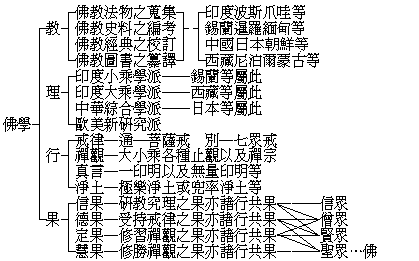



观右表所列，可知学佛，教理行果为应有之程序，非可躐等。今世学人，大多昧教理而妄谈行证，不为邪魔所诱，即同生盲摸象，反使真理愈晦，招世人讥谤为迷信，幸各努力，剪除斯弊！



------



## （法舫记）(见海刊十卷十



佛学讲要



——二十一年七月在庐山大林寺讲——



一　佛学之特质甲　自然之改造与顺成  

乙　真如之亲证与应化  

丙　理论之超越与施设  

丁　定通之习得与销融  

戊　即空之有与即有之空  

己　即悲之智与即智之悲



二　佛学之全景  

三　佛学之较量甲　佛学之教与宗教  

乙　佛学之理与哲学  

丙　佛教之色法不相应行法与物理学生理学  

丁　佛理之心心所法不相应行法与心理学  

戊　佛理之因明与论理学  

己　佛行之律与经世学  

庚　佛行之禅与卫生学  

辛　佛果之施设应化与文艺美术



在此盛暑之下，得在庐山会聚一堂，真有「火宅得清凉」之感。但依清凉之境而暂得心地清凉，更进一步来研究从根本上化热恼而成清凉之佛学，谁曰不宜。此次来山，因李协和、许俊人诸先生邀作佛学研究，遂亦欣然乐从。现在地球之各个国家，阶级斗争正烈，人民皆惶惶不安；我国尤内忧外患、天灾人祸迭演不穷。於此时来研究玄妙高深之佛学，似不相宜。但佛法之出现於世，正因世间种种困难有待解救，所以感佛出世为说种种解救之法。若世间安宁，反不感觉需要了！今中国有灾难而待救，正应研究佛法。盖佛法从大悲心而起，因悲悯众生之苦而为说种种解脱方法。其目的在令普众皆离苦得乐。而且世界之不安，由人心不良所造成，佛法能根本改善人心，今中国之祸乱，已非支支节节所能救，故正须从根本上以佛法来改善人心。今先谈佛学大要。



一　佛学之特质



佛学祗是佛学。就佛学提出其特点，略讲如下：



甲　自然之改造与顺成



「改造」与「顺成」是相反的。「自然」是通俗名辞，今人以人类及世界万物统名之曰自然界，而改造自然界则为佛学之特质。盖自然即俗语「天生成的」，「生来就是这样的」，此在各教各学，大抵皆遵循唯谨。如道家谓「道法自然」；儒学之「天命」，亦即自然；科学虽倡言征服自然，事实上仍是根据自然法则以为利用；故改造自然为佛学之特点。然佛学不谓为自然，谓之为众生世界，或谓之为有情世间及器世间。明其是业果而非自然，乃有情众生行为造作所集成的结果。然业果复有共同与各别两种。如社会行动而得同一之结果为共业果，个人行动而得各别之结果为别业果；其共业之普遍者为共中共；其小者如一民族共业而成国家之果，是为共中不共。由此业果以成众生世界——即自然界，所以佛学不认为自然，而认为共业与不共业所发生之结果。业之造成，虽藉种种关系条件，而其主要的发动力则出於各人及各有情的识心，所以各人皆可从自心上去改造。复次、改造自然又有浅深，凡业皆从身语意所生，於身语意之发动处时时改恶存善，亦能造成善果，如一家善则一家和美，一团体善则一团体优良，推之一国及全世界亦莫不然。然此种改造，佛法仍未认为澈底，仅等儒家之非礼勿视听言动等，而其出发点之心，於宇宙万有之事理，还是不明。佛法则更要在业的发动处去追求宇宙之根源，乃知其原动力胥出於半明半昧之无明心，以无明故不免於错误，故仍无可靠之道德标准。此「无明」即佛说生死循环之十二因缘中的第一支，因为众生心皆半明半暗的无明心，以此心为发动机，结果终难尽善，其非正本清源之改造，可以概见。故欲根本改造，非转「无明」而为明心——如禅宗明心见性的所谓明心不可。此则必须修禅定而生般若，方可解脱由烦恼而起之种种惑业，正如梦中由「无明心」发现种种梦境，一经觉来(喻如明心)便失梦境。此从消极方面说故云解脱；若能运用此由「无明心」转成之「明心」，照知一切事理之真性，发挥真性中所具足之真实功德妙用，将一切由烦恼结成之恶浊世界，一转而为清净妙严的胜妙国土，是皆由「无明心」变成「明心」的结果。此为佛法於自然改造中的澈底改造，若能运用此心以改造人世间，方可改造天灾之自然界。此皆吾人平等具有之自心力量，亦人人所能达到而无或缺蚀的真实功德。由此力量改造的结果，是为佛法中之出世法，亦即佛法之本质。然佛法从随顺世间方面讲，亦说明种种世间之因果法，如说由上品十善业力得生天之果，中品十善业力得生人之果，下品十善业力得生阿修罗等之果。反之则为十恶：上品地狱果，中品饿鬼果，下品畜生果。此为佛法中随顺世间所成之善恶因果的说明。虽佛法本质超脱於六道，但同时於循业受报之六道众生，亦为说明善恶因果以资方便救济。若人未得最高智慧以顿断无明，而能於善恶因果承认无疑，便可逐渐改恶从善，使善果日增恶行日少；推及於世人不休不息，则於改善人世之行业，亦庶几矣。



乙　真如之亲证与应化



真如亲证，是佛法特点中之特点，亦即佛法之真骨髓。何谓「真如」？换言之，即真是如此；乃指改造半明半暗的无明心澈底变成「圆明的心」——即阿耨多罗三藐三菩提心，此心便是佛心。由此心真真见到之一切的实事真理，名为真如。此真如实相惟佛所明，故法华经云：「诸法实相，唯佛与佛乃能究竟」。但所云之佛，乃十方三世一切诸佛。佛与众生之程度虽有不等，而佛性则平等，故现前众生亦皆是未来之佛。又此真如实相虽唯佛方能究竟，而得到相当程度之觉有情(菩萨)，亦能证到少分；但此须各人亲证，虽闻佛说及依佛经论理解真如义相，仍不过如观庐山之图而非亲见庐山。佛虽说真如，而言说实非真如，故须亲证此真如，证此真如要用根本无分别智：如「白」原不知其为白，要用相对待之「非白」方能明了，所以常人之知识皆是对待分别；若无菩萨地上之根本智，但凭众生心中之对待分别，极难实证。如古今一般禅客，稍得轻安便误认为证真如实相，殊为大谬！此境为佛智境，乃佛知遍一切法之境界也。安住佛境，应永隔众生，然在佛菩萨未证真如以前，以大悲愿力普度有情，更愿有情皆得究竟安乐；由是证真如以后，现种种身种种国土，而应种种世界之机感，化度众生。众生闻法修行而又达到真如实相之亲证。以所证得，复兴方便为众生说其得证之境，令众生悉能证得；於是成为流传世间之佛学。



丙　理论之超越与施设



佛学有极精深而圆满的理论：经为佛所证理与修证法之说明；律是行为上的轨范；论属佛弟子研究经律所造，各部论之理论非常精密，一般所谓最高哲学是也。此精深之理论，实足以尽吾人智量研究而不穷，然其特质仍不在於此，故云超越。如佛陀说法四十九年，结果尚云未说一字。然佛非无说，而且说无不尽，但因说到的并非就是真如实际，仅说明其趋向与方法而已。又如庐山之图实非庐山，其图中所表现者影像而已。故欲达到其真如实相，当从彻底改造自然界烦恼等心，再去深造，由深造所得到之结果，则为亲证之真如实相。若但依理论上的说明，即便认为真如，是根本上大大的错误。复次、理论之说明，在揭开虚妄之境藉以显示真如实境，故又名开示。然可因理论而明经律以了达修证途径者，是为依教明理，故有种种佛学之施设以供世人研究，使学佛之人有趋向的标准，因而进证真如，故欲达到真如实境，仍不外乎理论。故佛菩萨亲证真如后，乘其愿力，以其所得，藉言说之方便而施设诸法觉济群萌。



丁　定通之习得与销融



定即禅定，通谓神通。修习禅定，在使精神力得以集中而统一，如国家之有组织而能集中统一，则可发生政令上之伟大功用。在未加修习禅定以前之见闻知觉，散漫纷乱。故须禅定为之摄持，使精神归於一致，则极微之音、极细之色、不难察觉，久久功深，便得神通。又以功力之深浅，而别程度之高低。如稍得静定，即能听微细之音等，实非奇事。迩来禅客稍得轻安，或与定心少分相应，便以为得圣成佛；须知佛境渊深，证果不易，凡修行之人，未到真如之境，不应夸大自误前程！复次、习禅方法不一，总以全心不散乱为主，而不必坚执静坐之相；若见不常静坐之行者，便斥为非修行之士，其不明禅理可以概见。但禅定神通虽可藉修习力以得之，究竟亦不过对治散乱，发见本来寂静光明，证知一切法本来如此；其一切神通变化，当下便是。古德云：「动亦禅，静亦禅」；经云：「如来常在定，无有不定时」。故虽现种种身说种种法，无不在定中，是为如来之大寂灭定。在定中照见一切法界众生皆融通於法性中，本是圆明通达，故无别所谓禅定神通之相；到了现证真如平等法界，而全法界以成一身，遍法界无不圆明了知，故无一见闻觉知而非神通之大光明，其见闻觉知之所行境无不是禅定，更何禅定神通可得？故习得之定通皆销融也。若执有习得之禅定神通，即非佛法之禅定神通。



戊　即空之有与即有之空——不常不断中道



心经云：「色即是空，空即是色」等，是即空之有即有之空之义。即有之空者，一切事物说明为有，其实非有，以世人执为事物实有之体与实我，佛经谓为我执法执，又谓为遍计所执。然此皆为妄情上错认为有，而实际上并无有我及物体可得，故有即空。又、佛说一切法，皆因缘生唯识现，虽有而假，无固定之体可得，故三界万有，皆由许多关系条件组织集合而成。一切事物既无实体，悉由众生之知识所现，同时又经心识之变化，刹那不定，虽假体亦难立定，故有即名为空。以上二义，一以遍计唯妄执故空，二以依他无定体故空。即空之有者，万有无固定体之有为幻有，是为即空之有。又、由妄计之我法皆空所显的真如实相(明心见性之真性)是真有，是亦即空之有。换言之，佛法所明之有，皆即空之有；所明之空，皆即有之空。显得佛法是有空皆非，空有不离，故显不常不断之中道。又通常之所谓常者、是固定性，断、谓断灭；佛法则不然，以即空所显之有，有即非有，亦复非空；即有所显之空，空即非空，亦复非有；故不常不断。又离却妄执之空所显得的真如实相，方为真有；此为普遍所显真理，世出世法无不周遍。故不常不断，为佛法之中道了义也。



己　即悲之智与即智之悲——不苦不乐中道



悲者悲痛，大悲者，非属於自身之苦痛。佛法之慈悲，俱属救济众生而有，故凡兴一慈念，必以悲为出发点，其慈方堪称为佛法之慈。故凡佛徒不问自身之苦痛为如何，其所措施皆属救济众生之苦痛，以众生之苦痛即为自身之苦痛，故名同体大悲；众生之苦痛既除，更须令其得究竟乐，是为大悲，以出自本性力故，又名无缘大慈。是佛法之慈悲，较普通之慈悲为深切而彻底。然悲虽深，若乏於智慧，仍未尽善。如从水救人，须先知水性与方便工具等；故佛称一切智人，有遍一切无不知之智。此智兼大悲，相辅以行，惟利无弊，否则利人无功而自害尤甚！然智慧，亦须从大悲心流露出来，又应先明空有之理，始为究竟。故发菩提心人，以悲愿为出发点而复具甚深之智慧者，则救济工作不虞危险。如科学之精，虽能利人，若无广大慈悲心，一经运用，便成制造杀人之工具，不特害人，且害世界，是皆悲智不兼具有以致之！茍能悲智双运，理事融通者，是即菩萨之中道行为。但菩萨於度生期中，不计其苦，不著其乐，是为不苦不乐悲智不二之中道。若此行未臻圆满，是为菩萨；圆满时，便成佛道。



以上所讲，一、自然改造，重在转无明为明，否则随业受报不得自由。二、真如亲证，即明心见性，了知一切法真如平等，方能随缘应化。三、佛法教化，虽仗理论，然理论实非事实，必须超越理论而亲证到者，方为事实。四、欲知三界众生无边无尽之事实，须修禅以启发非常之见闻觉知，便能证明一切。五、理解上之中道。六、行为上中道。此六层在讲明佛学的特点。



二　佛学之全景



佛学之总相，不出教、理、行、果，四法循环，不见终始，故又可名为法轮。「教」、由真如亲证而施，远非世间通常之学说所可比拟。佛学来源，须经过长时间的修证，转无明成圆明，还见众生感受虚妄颠倒种种痛苦，以所证之「果」为之施「教」，是为真如亲证之应化。又佛之教，非祗属经典，如佛身、佛国土、佛像、塔庙、舍利，以及僧相仪制，悉为佛果之所示现，皆足以令人发起信心趋向修证；如见佛相发菩提心等，故与通常之教不同。「理」、理由教出，谓闻法受教之人，起研究心，问答辩难，分条析理。如佛在世时之议论，佛灭度后，便结集以成论藏，传於世间。故佛学之理，可尽容人作种种精密之研讨；且研讨之结果，皆契证真如之理，以之传世，宜为世间最高之学术。「行」、行即行为，广义则虽理解亦皆是行，於理解得到决定处，方始去作，不致有盲修瞎炼之虞，即所谓修行是也。狭义则如戒定慧学，与大乘之六度、十度(六度外加方便、愿、力、智)等。普通之行，不外戒定慧三学，但其特质，如修净土虽普及三根，若能明了实相念佛等甚深之理，依之去修，较易证果。佛法之重心在实行，而行又贵乎集中，因此乃成种种特殊之方便行法。「果」、行必证果，其理固然。大乘之行，未到初地未为证果；虽云未证，十信成就，其行为上之成绩，已不致退堕。果位之极，佛地方称究竟。果既证得，复从果地回入苦海，以施教度生，使之明理修行，如法证果。如此四法轮转，为佛法全体，故名全貌。



对此四轮，衬以信解修证四义，更易明了：一、教要信，论云：「佛法大海，信为能入」。二、理要解，儱侗真如，颟顸佛性，为害甚大。三、行要修，言行不相应，理事难圆融。四、果要证，说食数宝，终成穷措大！以上四法，愿学佛者下以甚深之解察，庶不致徒费劬劳。上述四法，虽均重要，但各宗於此则各有其特重之点，如大乘之真言、净土宗，偏在从果所施之教，必用信心去接受；法性、法相宗，特重於依教助理，须深研究；禅、律二宗，重在依理所起之行，贵乎实践；法华、华严宗，重於从行而证於果。又理、行、果三，重在自力；教重他力。故此四法，可用为观察各宗之大概。



三　佛学之较量



今以世界宗教学术，为之比较衡量其大概，以便世人之取舍。普通各宗教学术之出发点，或假无根之神权，或凭抽象之理论，譬如梦中所见。佛法是从大觉悟中得来，本不能与之比较优劣，然佛法既流传世间，仍应以方便一说梦中之境，而度梦中之迷也。



甲　佛学之教与宗教



佛教之教，从方便说亦彷佛是宗教。以佛之身是从大觉果海中流出之应化身，等於人而人见之，等於天而天亲之，等於诸类而诸类拊之，故名平等示现之千百亿化身；而真身无相，而超越诸相，此有似宗教之「神」也。佛所说法，为超过三界之理，有似於天启之圣经；而佛教之塔庙、经像，僧众仪式，亦似各宗教之有仪制；故佛教亦有引人入胜，起人信仰之宗教功用也。然佛教与其他宗教有大不同点，则在度与佛平等之众生，入於平等自由之域耳。若其他宗教，则别有一种特出之「神」，超然於人，而不可与人平等。佛虽亦为超出一切之大觉者，但承认众生即为未成之佛，佛虽先成，不过为三界万物之大觉者，而非三界万物之创造及主宰者。并说三界万物，皆众生心造，即前所讲世界万有，皆众生之共业别业所造成，故亦可由自心而改造，而异於他教之不平等不自由也。



乙　佛学之理与哲学



中西哲学，虽名派不同，然以探究人生宇宙根本而作概括说明者为哲学，大致无疑。与超人间只能以信仰去接受之宗教不同，与各别分开以研究之科学亦不同。佛法之理，不舍一法，故无法不说，无微不至。即如印度小乘学有二十支流，虽各别不同，而对於万有之理无不尽量发挥；大乘亦然。所以从「理」之研究说，亦可名哲学。然其所依教，既从修证到之果流出，而研究后又须趋向於行果，故亦非其他哲学可比例。然如最近今最有力之新实在论，其所取材多出於最新科学，然与印度小乘学派中之一切有部学，亦略相同；此部执一切法为实有，其精详处，尚有为新实在论所不逮者，若旧实在论，则自郐以下可无论也。



丙　佛教之色法不相应行法与物理学生理学



佛学之目的，在遍明不在局部，故於物理、生理，无如科学之繁琐说明；然色法中之四大、五尘、五根，及法处所摄色，与不相应行之方位、时分、势速、和合、流转、命根等，确有关於物理生理之学说。且其精奥处，亦多有近今物理学、生理学所不能及者，其互不相背亦可推知。



丁　佛理之心心所法不相应行法与心理学



佛学之心心所法，实较心理学为详尽。如八识心法，及与心相应而起用之五十一心所法；又不相应行法中之无想定、灭尽定等奥义，远非心理学所能窥见。



戊　佛理之因明与论理学



论理学即西洋之逻辑。因明在印度，原为正理派，后入佛学，方名因明。因明为论理之方式，比较最新之西洋论理学，皆为因明中早已说到者。



己　佛行之律与经世学



伦理学、法学、经济学、社会科学、律学之义甚广，通於应作不应作：禁其所不应作者，而其所应作者、尽形寿去勤作。大乘以群众利益为前提，凡应作不作、不应作而作，均名犯戒。大乘应作之范围甚广，即经世为出世之佛行，实际等於社会科学，且更彻底於社会科学。其於行为道德为伦理学，止作严明为法学，正命正活为经济学。故欲建立佛教的社会，当依律为根据。



庚　佛行之禅与卫生学



中国从前所重之养生学，近谓之卫生学。但佛行之禅，原不限於养生，但修证者起居食息之注重卫生，如早起於曙前，养息於昏后，食则分器各如其量。食后经行以助消化，继之静坐以调气息，其平均调匀，在在皆有合理之运行。若以饮食滋养，其消化仍须耗费精力，习禅若得相应，则较饮食之滋养为更有效。且能却一切病，又能改造心理，进而改善生理之化学原素。若淫欲之原素亦已改尽，致全身改变之后，倘不起贪瞋痴以破坏禅定，住禅定中；因其变换过之生理，可勿须饮食(禅悦为食)，能延生命。是为因心理改变而达到生理改变之结果。



辛　佛果之施设应化与文艺美术



亲证真如，由无相而现相，与文艺美术等由想像力而创造意趣接近。凡好学文艺美术之人，可研究此富於想像之佛法，以作创造之张本；如应化之无量身刹庄严，极美术之能事。故有谓美术可以代宗教，亦不无少分根据也。



佛法僧义广论



——二十四年十一月在中国佛学会镇江分会讲——



一　叙　意  

二　佛　观  

三　法　观  

四　僧　观  

五　总　结



一　叙意



佛法僧，为学佛者之根本认识，也是佛法究竟圆满的说明，所有一切清净法都摄在其中。



阿底峡尊者，由印度入西藏弘法，其地位等於中国之达摩。他在西藏数十年，常说佛法僧三宝。有人问他：为甚麼老是说三宝，此义虽殊胜甚深，但我们已听多了，请另说胜义！他答说：我在印度所学所行的不出三宝，我来藏也无别法可说；请问除此三宝外还有甚麼佛法！在此简单问答之中实含有很重要的意义。现在所讲的佛法僧义，是信仰佛教、研究佛学、修行佛法的基本。所以，凡是信仰佛教、研究佛学、修行佛法的人，是必须明白。初步学者能明此义，才不是迷信，才可修学佛法以至於究竟。所谓佛者，是能究竟觉证诸法圆满福慧的人。所谓法者，是佛自觉及觉他之法。所谓僧者，是能依佛法修行的人。此三者谓之三宝，实为佛法之根本。今讲此三宝，分三。



二　佛观



观者，观念。佛观者，即对於「佛陀所有清楚正确之观念」。佛是梵音略称，具云佛陀，汉文音译不一，如「浮图」也是佛的异音，我国古文家所谓「浮屠氏」，就是佛氏之意。经咒上又译作佛陀耶。现在英译梵音为「布达」（Buddha）。



佛之译义为觉者——就是觉悟的人，譬如有学问的人谓之学者，与中国所说的圣人差不多。但云觉者，不云觉人，此表示佛在天上人间以及超三界外的他受用报身，决不能以人间的人来限定他的范围。觉者，自觉、觉他、觉行圆满之简称。自觉者，有无师智、自然智、一切智；觉他者，以方便智慧无碍辩才教人觉悟，即先觉觉后觉；二种觉行圆满，福慧两足，谓之佛陀。此为有此功德者之通称，通於三世遍於十方世界，诸佛无量。因此佛常说大地众生皆可成佛，也可说一切众生都是未来的佛。但是遍十方通三世之佛，都要三觉圆满，福慧两足，有此功德表现事实证明，才是佛陀，不是假说的理想的。



甲、依释迦牟尼佛建立佛之根本观。



现在此世界有实德表现可当佛之尊称者，是释迦牟尼。以有释迦佛，吾人才知道有十方三世一切诸佛，所以依释迦世尊建立佛之根本观念。大佛殿中央供奉的就是释迦牟尼佛。释迦是姓，意译曰能或能仁，以其祖先能仁民爱物而得姓——其祖先初为太子，以能行仁道得民爱戴另建一国，其父知之曰「我子能仁」，故即以为族姓。其古姓为瞿昙，亦译乔达摩、憍昙弥，释迦乃从其分出之支裔。牟尼意译「寂默」，因佛常在寂定中，所谓「佛心常在定，无有不定时」。佛所说法皆依定慧利益人天，故尊称寂默。原名悉达多，意译「一切义成」，当时人直称其姓名即为瞿昙悉达多；尊称则为释迦牟尼。牟尼又译「文」，如经云「释迦文」佛是。



印度历史上佛应世为距今二千六百年以前，降生在中印度迦毗罗国(即今尼泊尔附近)，父名净饭王。成佛地在摩竭陀国菩提场，初转法轮於波罗奈国鹿野苑，后於各处说法四十九年。由此历史上考查起来，实有此建功立德慧福圆满的佛陀，是以吾人依此建立佛之根本观。



乙、信释迦牟尼佛确得无上正遍觉，最高无上。



我们信佛，不但如常人信仰有学问道德功业的古人，原是信仰佛确已证得阿耨多罗三藐三菩提。阿耨多罗译无上，三藐为遍，三菩提即正觉。觉是不迷，拣别凡夫不觉；正觉拣别一般外道邪觉；遍正觉者拣别二乘所正觉的法未能普遍。初地以上法身菩萨可以谓之遍正觉，然尚未究竟而为有上，唯佛妙觉究竟圆满才是无上。我们信释迦牟尼佛确是最高无上，觉悟诸法事理性相，无所不觉无所不知，再没有能超过佛的了。世人不明佛义，以为另有「神」能超过於佛，其实神尚在六道之中，较之佛陀不知差得好多远呢！



丙、毗卢遮那或大日或卢舍或金刚持，皆为释迦牟尼大功德聚之别名，不得视为牟尼以外之他佛。



「毗卢遮那」是释迦的报身，近人常以五方五佛表五智、其实佛是五智都具足的；平常又以此为佛的法身，而不知法性身遍一切处无相无名。如华严经上的毗卢遮那，原是为十地菩萨现身说法之他受用身——报身。最近从西藏译出的著述则说「毗卢遮那是化身佛」。毗卢遮那意译光明遍照，故译「摩诃毗卢遮那」为大日。古或译为「卢舍那」或「吠卢遮那」，本为一音异译。有谓「毗卢」是清净法身，「舍那」是圆满报身，皆讹。



学藏密者崇「多杰羌佛」——译为金刚持，现持金刚杵以降伏一切魔怨，是依佛大雄大力具足无量方便功德而言。一切如来都有金刚身。依释迦牟尼佛表示报身之广大功德聚，故有此多名，所以不得视为牟尼以外的他佛。而世人每别为多佛，并执此为报佛说经、彼为化佛说经，殊不知一佛有三身、三身原是一佛也。



丁、他世界之阿弥陀佛、药师佛，或往劫之燃灯佛等，皆由信释迦牟尼佛之说而知之者，皆与释尊平等。



现在学佛者都知道从此西去十万亿佛土有极乐世界，其中有佛名「阿弥陀」，意为无量——即有无量光、无量寿、无量相好、无量不退菩萨等许多的无量义。「药师佛」在东方净琉璃世界，世人念药师佛咒能延生益寿。此二佛为他世界之现在佛，虽小乘不承认他世界的佛，而大乘则是常说的。现在科学证明有无量世界，当然现在他世界可有他佛。其在此世界往劫以前，有「燃灯佛」、「毗婆尸佛」、「尸弃佛」等。似此往劫及他世界诸佛，都是由信仰释迦牟尼所说经典而后知道的。因为释迦佛成就无上遍正觉，所以从如来大觉心中说出来的一切诸佛亦皆实有不虚。彼诸佛无不三觉已具万行已圆，皆与释迦佛平等平等。



戊、佛为积无数劫大行所圆之极果，不得与流俗所称为活佛等混同。



这是要我们知道佛不是轻易成的。依经上看起来，人要先发菩提心，渐积福德智慧资粮，经十住、十行、十回向、为初阿僧祇劫的菩萨。由十回向经煖、顶、忍、世第一位、入初地而至七地，谓之第二阿僧祇劫。由七地菩萨以至成佛，谓之第三阿僧祇劫。三阿僧祇劫即是三无数劫。经过这三大劫的长时间的修行菩萨道，方能断尽一切执障、圆成一切功德、而证成无上的大觉。成佛岂是容易的事！大行者、修菩萨所行到佛果之万行也，如普贤菩萨等。所谓成佛者，即由菩萨行修学圆满之极果。此世所见三十二相，八十种好之释迦佛，也是由此而成。



如今世人，见修行者稍有世俗福德禅定神通的人，常称之为「活佛」。如逊清时代称皇帝为「佛爷」、太后为「老佛爷」；又如西藏达赖等亦称「佛爷」，这不过表示尊敬他们，想像他们为诸佛应世而已。以法性而言：一切诸法本皆是佛，一切有情都有成佛的可能性，故一切众生皆是未来佛。学佛者能明教理、正观定慧，有相当功德表现，也可说是相似佛。平常所称「活佛」，大概由此而来。若严格的从实际上说，必须是经三大无数劫圆满大行，究竟极果，方可以称之曰「佛」。故佛不得与流俗所称的「活佛」，等视齐观。



己、佛为出世三乘圣众中之大圣，人天犹为凡世，不得与凡世人伦圣哲混同。



佛法所谓六凡、三界、天神人仙，都是世间凡界之流；佛法三乘圣众，乃为出世之圣，佛又为出世圣中之大圣(三界内之六道谓之六凡，三界外之三乘及佛谓之四圣)。佛为超过出世三乘之圣人，在佛教内的出世三乘圣人中称大圣；则其餘流行的各教主皆不过是人道或天道之圣人，犹在三界六道之内，学者慎勿以佛与其他之世间圣贤混同视之。我们所以要如此认识审察的，因为佛陀是以清净无漏的大功德聚为本质的。



庚、佛为法界诸法(宇宙万有)之遍正觉者，亦为教化一切有情令遍正觉者，不得与一神教的创造主宰及多神教的祸福於人等迷信之神混同。



佛典上之法界诸法，即宇宙万有。佛於宇宙万有诸法自觉究竟，故称遍正觉者；亦为教化一切有情令得遍正觉者。宇宙本无创造万物与自在主宰的天神，如一神教之所说；也不可如多神教所说，以佛为宇宙许多神中的一个神。平常人心理上迷信一神或多神和佛菩萨一样，那实在是大错特错。不论无神，就是有神他也不过是天道中的众生而已。我们要信佛，对於佛的观念先要弄清楚才是。



三　法观



第二讲「法观」：学佛的人，於佛法要有正确明瞭的观念，尤其是对於「法」要有正当明瞭确切的认识。古代中印度音的「达摩」，现在依英语翻为「达尔摩」（Dharma），这是法的译音。此中法观的「法」，范围很广，所有宇宙万有，事事物物形形色色一切的一切，皆名为「法」。牠的定义是「任持自性，轨生他解」。无论何物，以能保持牠自己独立的体性，才成为此物。譬如这个白色，在白的本身上牠能保持其白的自性，且能令一切有情都了解牠是白色，使他人了了分明不会错认为是其他的颜色。因白就是任持自性轨生他解的法，所以白色便令人丝毫不差的觉了其为白色。一法如是，其他一切诸法乃至虚空，亦各各皆保持自性而能轨生他解；小至一花一草一微尘，大至法界亦皆如此。



万法差别各各不同的自性都是由因缘所成，在相对的关系上成立：此物之成立，必依托其他(彼彼)众缘相合而成。一物如是，物物如是，一切宇宙万法各各皆有互相为缘的关系，各各皆有彼此的差别而不能混同。并且各各皆由任持自性而使他人生起确定的认识，也就是宇宙万法各各皆有任持自性轨生他解的意义。而且法界诸法，无处不遍无所不包，再没有那一样能出乎法范围以外。一般人常说佛法无边，就是显佛法的「法」字范围是最宽最广无有边际的。但就属於佛的法讲起来，大别有二：



一、证法：佛先从自觉的根本智亲证二空所显的真如妙性、而无能所的差别，依此并起后得智证知一切理事因果的差别，起大悲心普度一切众生。一切智智在每一刹那间无不普遍了知一切诸法真实性相，这就是佛智所证知的证法。



二、教法：成佛后所说的法为教法。佛居纯净土由平等性智示现微妙功德他受用身，为住十地的诸大菩萨现大神通，转正法轮决众疑网，普令受用大乘法乐；以至为二乘六道有情示现化身说法(对人现人身、对天现天身、对畜生现畜生身、一切总是随类应化普度群机)；对九法界的一切众生皆教化令向佛道。所说诸法，皆无所不遍，又无所不包。然佛以王子身降生人间，说法的主要点亦在人类，故留遗的教法在人间集成现在的大藏经典——三藏十二分的圣典——为法宝。此证法教法亦可以分做「教、理、行、果」的四种差别。「教法」的教典中，即包含理法；从理起行乃可以「证」到诸法实相，所以「证法」亦包含行法、果法。三乘圣人所证的虽同是证法，但没有佛证得的圆满究竟而已。从证教二法分析成教、理、行、果四法：教法就是依佛说教化众生的法；因有教化的原故，所以众生能了解佛所教的理；再依理来实行实修；可以得证所期望的果。大概就佛依自证而施教，曰证法和教法；依有情闻教解理修行证果，曰教、理、行、果。此两类皆可普遍包括一切诸法。「法」的意义，归纳概括起来就是这样的。



甲、一切经律，皆源本佛所宣说之声教，由佛徒历次结集而成者。



在三藏中不能收摄的典籍，可称为杂藏。西藏文於教典分经律论为「甘珠尔」、「敦珠尔」，这样分析颇有意义，因经律原为佛说，论是由佛灭度后许多弟子依据经律所作而成的。所以今亦先从一切经律来说。经是由佛在世时，说法教化一切众生所施设的，由弟子结集起来成为经。原名「修多罗」，此云契经，上符诸佛理，下应众生机。律是佛在世时，依弟子应有的行为订共守的戒条，也是弟子依之作修行轨范的法规。佛在世时，弟子们在行为上大多是很正当的，但因有些弟子发生了不正当的行为，随所犯的那一种过，佛就随时制之以为律，从此以后再不许犯，於是就制成共守的戒律，经佛制定后，弟子总要一致遵行不得稍有违犯，这就是戒律，嗣后如有同类事情发生，就照律处理。在每一条戒律，叙述其许多层次的缘起变增，所以除读诵的戒本以外更有广律，成为庞大的律藏。



佛在世说一切教法的时候，是没有文字的；教导一切人天大众，都是以声音为体——宣说出来，这就是声教。今人看经律论藏时、可以无声的色法——文字——为体。可是佛在世的时候，是一切皆以声教；戒律也是依佛声的教诫。经是由佛亲口说出以后，再由弟子在佛灭度后会诵，经大众一致证明认为丝毫不错，就录成为经。经律有多数次的结集；最初是由佛灭后不久，经大迦叶等在七叶窟中结集而成；其时在七叶窟外，亦更有富楼那众结集起来的。至佛灭一百年后，当时有少数弟子不遵律行，有大多数的弟子出来否认，遂有二次结集。如是二次三次至第四次才整理完成为大小乘各藏经律。现今这许多经律，并非一两次结集成功的。



佛教传入中国后，大藏经的编成历代不同，唐、宋、明、清各有目录可考。中国及西藏各处，皆有大藏经的纂集。



乙、佛徒结集佛说，初亦口诵相传；用文字写成书本则时先后不一，以佛徒时代不同，故小乘与大乘之经律亦写成先后有殊。



佛在世的时候，是由口诵相传。佛灭后，弟子会诵结集彷佛与现在开会相同。当时是以大迦叶为主席，设高座为座，推阿难陀尊者诵经，优婆离尊者诵戒，依佛所说的朗诵出来，经五百圣弟子的大众证明不错，认为刊定之说。不必就用文字录成经本或戒本，或仍是流传口诵而已。



复次，佛在世的时候，已有文字的经律流传，如律载佛在世时，某长者及甘尔夫人夜中燃灯诵经事。又每逢十五、三十日布萨诵律，当时常有记录成本的。故早之则佛在世时就有录成的经律，迟之则佛后数百年或仍由口诵相传。因时代先后不同的关系，所以录成的文字亦不相同。各时代主持教团，宏扬佛教的人材不同，所以各时代盛行出来的经法也就有异。先是依迦叶、阿难这一部分的人宏扬出来的，所以就为小乘经律。后从上座部分出大众部来，到五六百年间有马鸣、龙树菩萨出来主持宏扬的是大乘佛法，大乘法宝也就流布於世。因时间先后的不同，加以弟子根机又有大小的差别，甚至小乘又有二十部的差别，所以经律流传有异。但归纳起来，要知皆出於佛之声教。



丙、信超人天之圣人必有非常之胜事，故经律所言不思议事皆应确信为实事，不得以凡识疑议之。



通常人都以佛教混杂在鬼神中和种种邪见外道等同类而论，这全是盲从误解，不了佛学的人乱说。寻常社会人士认为最高的哲学、科学：总是以人们眼所见到的、耳所闻到的——以五官所感触到的，或意识依以思想及推论到的，以及古时传说下来的，凡此都是以人的思想知识为标准。现在科学进步，虽知有日球月球与虚空中很多的星球，但还全是以有漏五识与第六意识研究推测起来的。而佛法那就大大不同，相去很远了。一切经典全是佛由证智普遍觉悟证到的诸法实相，为觉悟众生亲宣出来，是从无漏圣智亲证的境界流出。声闻但证生空无我，法执犹在；菩萨是双证我法二空，但仍未究竟；直到究竟圆满佛果位上的时候，才能证到佛佛道同的圆满真理。在小乘圣人所证的偏空涅槃，就已非人们的思想所能及到，亦已有非常人所能为的一切胜事，何况超过三乘圣众究竟圆满的佛果！当然佛是更可有非常的胜事，为常人意识不到的。故於一切大乘经律中所言的超人天胜事，及超三乘圣人的不思议事，皆要确确切切信为实有的事理，更不得以凡情来推测和疑惑。这是吾人对於佛法第一要具有的正确观念。



丁、诸论及撰述语录皆贤圣佛徒修证有得、宗依佛说而阐扬诠释者，故今亦可凭佛说亲证而研究抉择之。



经律二种是由佛亲口所宣说出来的，而论大都是由二乘或大乘贤圣位中的佛子修有心得而发表出来的。论有二种：一、宗论，如瑜伽师地论、成唯识论、摄大乘论等，就是依佛所说的经律大意编述阐扬。二、释论、如十地经论、大智度论等，皆是关於佛教经典注释的杰作。显真破似，全靠宗论；释论来树立教理，显明经义。至中国历代撰述或语录，亦皆依多闻熏习进而精进持戒降伏烦恼的人如十住、十行、十回向的贤圣者，以及三乘圣位中的圣者，为悟他而著述。故今之学者，亦可依佛所说的经律或内心的修证去研究抉择，使人显明而易解。



戊、大乘诸宗之各标其胜，在集中其理解於一念而起观行；建宗趣行或殊，真本觉果无二。



佛灭后一两百年间，印度的小乘共分二十部之多，学说纷纷不一，现姑不论。单就现在中国通行的大乘各宗而言，在大乘诸宗各各皆分门别户，标树一宗特殊的胜义。唯识宗是将宇宙万法总摄归纳为唯识所变。天台宗归纳起来修一心三观。净土宗是以念佛求生西方，上中下根皆可往生，就是造五逆十恶的人命终十念成就，亦可往生；众生根机善恶差别，而往生见佛闻法开悟时间亦有长短不同。总之，都可以莲花化生，入不退地。无论那一宗，都有最殊胜的宗致，才能成立一宗。各宗所修的路途不同，但所趣向目的无非是唯一佛果，亦皆以真如实相为本，这就是殊途同归。所以无论修学那一宗，都有莫大的利益，不得专赞此而谤斥彼宗，应当不相障碍。各宗各阐扬其特殊的胜义，同时并了知真本觉果之无二无别。倘使能悟平等性发大悲心而修证，不管走那一条路，总可证到阿耨多罗三藐三菩提果，都是没有差别，平等平等。所以中国佛教有大乘八宗者，亦是历代菩萨祖师依佛开的方便法门而施设。众生喜欢那一宗法门就随意择取修行，各各皆可起殊胜的观行，证无二的真理及成无上的佛果。



己、菩萨藏法与声闻藏法，境行果皆别，然声闻境行果亦为菩萨所含摄。



菩萨乘与声闻乘是各有经典的，唯独觉乘无有经典，附属於声闻乘。大乘菩萨发阿耨多罗三藐三菩提心，为普度一切众生证人法二无我，修行六度万行，以成佛为究竟目的。



小乘单证人空，成阿罗汉果为究竟位。然小乘所修行的人无我智，亦为菩萨乘中的一部分。境行果虽是差别不同，但修学菩萨大心的人，应尽量容纳不加诽谤。



庚、佛之教法、发源於佛及圣众之无漏智果、故不得视同其餘出於有漏凡识之教学，但於餘教学皆可或破或摄以助显无上义。



佛及大菩萨圣众从无漏智中流出来的圣教量，不得以我们有漏凡夫的浅知浅见来测度。——如世间上认为最高的学识就是科学哲学，而这些学说如去其封执亦可收摄为佛学中一部份的学理。——我们以有漏的凡识不能证知无漏的妙理，故不能就说没有这种无上深奥的妙理。但亦可以拿科学或哲学来证明助显佛学的真理。我们研究佛法稍微透彻的，随时随地就要拿来修行学习，以期悟证佛法真理获得无上妙觉的佛果。



四　僧观



前已讲明佛法两观，今讲僧观。「僧」就是「众」的意思，音译为僧伽，亦译桑伽耶，简称曰僧。中国以三人为众，而佛律须四人以上方可名僧。中国常人的习惯上称一个出家人为僧，或者以僧为姓，如称僧某某，不很确当；但称出家人为「僧人」也是可以的，言其是僧众之中的一个人，如军人是军队中的某人。佛教出家徒众成为有组织有规律有系统的团体，乃可名僧，实在就是佛教的教团的意思。故此所云「众」并非寻常所说的众，这「众」是要具有事理和合之义的：第一、出家的僧众於事行上须具六和合，才能共住集成僧众的团体。何谓事行上的六和合？（一）身和共住——对诸佛菩萨要共同礼拜修行，以身作则，同作佛事。（二）口和无诤——同信佛赞法及歌咏三宝，与同住大众共学佛法，不相诤吵。（三）意和同悦——同一信心追求佛法的真理，发一共同生活的欢喜心。（四）戒和同持——同修持一切戒法，期达佛果。（五）见和同解——对一切法宝共同解说，使大众都能尽知。（六）利和同均——有财物等利，须共同平均受用。具此六和义，方得成为依佛法修行的僧团，这是在事行上的六种和合。第二、理和，是同证生法二空择灭无为的真理。如是乃为事理清净的和合众。对於僧先要有这些正确的观念，方可了知僧义。



甲、胜义僧宝虽在三乘圣众或贤圣众，但此土之住持僧宝必在出家五众，尤在苾刍众。



僧宝之胜义僧，非是通俗见闻所能及。从最胜智所证的真实义，名胜义。胜义之僧，即证圣地的诸大菩萨或证辟支佛果及小乘四果的阿罗汉圣众。於是圣众中惟有清净无上的佛果是独一无二的圣中之圣。胜义僧即三乘圣众或贤众：有先自利趋向小乘消极方面，而后再回小向大修菩萨行。有大心菩萨初下手用功就先利人积极救世，所谓「地狱未空，誓不成佛」的菩萨僧。或在从贤入圣位中，修至煖顶忍世第一未登果地的菩萨，虽未能证果登地，但已有相当功行成就，亦可称为胜义僧宝。



此土并非广指娑婆世界，就是在释尊应化於此的阎浮提的地球上。不论那一国，凡是受化的人类、能出家受戒修学佛法、教化世人，名为住持僧宝。就是在此世界上持奉佛法依法修行的和合僧，普遍播传宣扬佛法为世人作良福田的，皆是住持僧宝。入三乘圣众或贤圣位中者，无论是在家出家，只要能依佛法修证到，皆可名为胜义僧宝。此土必定要出家五众，方能为住持佛法的僧宝。



初出家的沙弥，先学习佛法，经数年后，对於经律都有相当的熟悉，进至受戒为比丘。能尽「宏法是家务利生为事业」的天职，能为真正佛子，著如来衣、食如来饭、为如来事；抱大雄大无畏的精神深入社会救济民众，尤其是比丘最重大的责任。以上是出家男众。女众初出家亦为沙弥尼，先学习佛法，经数年后进为式叉摩那众，再进至比丘尼众。这样出家男归男众、女归女众、各有各的规律和系统之组织。沙弥沙弥尼有十戒，比丘有二百五十条戒，比丘尼有三百五十戒，各各皆有修持，限制不同；式叉摩那有六戒，是预习的比丘尼戒，由此可进为比丘尼众。这样的男女众，为舍俗出家的五众弟子，而真住持三宝的尢其是在比丘众。「比丘」、有许多经译为「苾刍」。真正能住持三宝的大责任，还是荷担在苾刍众的双肩上。因为沙弥沙弥尼众们正是在学生的童年时代，对於经律的知识尚很幼稚，须比丘教授沙弥们修学，比丘尼指导沙弥尼众们修学。但沙弥尼学成后也要再到比丘团体中受大戒，所以真正能住持佛法的仍是在比丘众的力量，其餘不过是出家众中的附庸。出家佛子虽具五众，实在是要比丘能成为清净的僧众，住持佛法。



乙、他方净土虽或纯一菩萨僧无有在家出家之别，但此浊土则须出家菩萨乃入僧宝。



能发心修证佛法的大乘贤圣，就是菩萨僧。在他方清净佛土中虽可没有在家出家的分别，以天然无有俗染家累，祗要是能发心修行就都是菩萨僧众。然在此五浊世中，在家优婆塞优婆夷二众弟子是不能完全摄入出家僧众中的；因在家二众有家俗事情缠身，不能一心一意地修持弘扬佛法，所以不能具足僧相僧德。在此浊土的寻常一般人所过的生活不能成为依佛法修行者，故虽菩萨亦惟有舍俗出家才能成为清净僧宝。如禅宗六祖慧能大师，未出家的时候已在黄梅得传佛法心印，而仍随俗多年不能说法普利人天。后来出家受具足戒具菩萨比丘相时，才能为人天师表，说法普利大众群机。未出家的近事男女，虽依菩萨戒律修持者亦不得为僧宝，皆因未具僧相故。在此五浊恶世中，定要出家比丘菩萨僧众，才能为真正的僧宝。



丙、住世持教之佛徒团，应依七众律仪而建立。在家二众佛徒，虽非全僧亦非全俗，此为已进三宝之门者，异於隔离三宝之凡俗，故曰近事，为介於僧与俗之间，可称为「居俗近僧众」。受三皈以上及日本之真宗僧、西藏之红教喇嘛等，摄属於此。由此中修转轮王十善行者、摄化民众建设新社会，利乐人世。



在家优婆塞优婆夷二众名近事男近事女。虽未能舍俗出家，但行为上已能亲近事奉三宝。因他身是在家二众未能具足出家僧众的律仪，而能为佛子行佛事，所以说他非全僧亦非全俗，居在两者之间。虽尚在俗已能皈依进入三宝之门，故可称为「居俗近僧众」。



日本的真宗僧，就是有妻子儿女眷属的在家众，然而他有修持佛法的行门，做佛教部分的事业。西藏喇嘛有黄教红教的区别，他们是以帽子有红黄色分为两类，红喇嘛的帽子是红色、黄喇嘛的帽子是黄色。曾来内地的班禅喇嘛等是黄教，红教喇嘛是在俗的多，但他也用功修行办道作如来事，与我国的近事男女差不多。而日本的真宗僧和西藏的红喇嘛，可算是居俗近僧众。近於如来事业的男女众，在家发心的菩萨，应完全以修美满的十善行为事业。世间人民若能修持转轮王的十善行，普令一切人民同行十善，逆性的众生亦劝化归行十善，如此全国的上上下下一齐摄化同行十善，为良好国民优秀分子，则可将五浊恶世的不良底现象全改成完美的新社会。所以要建设良好的优胜国家，不但出家众是要修持佛法普化人民，就是在家众亦要尽力共同修行十善利乐人群，才能建设新的社会国家。



丁、尊敬三乘圣贤僧，弥勒菩萨等虽现天相亦同大乘圣僧尊敬。



大乘菩萨是不与凡夫出家僧众同的，大乘圣众是已经证入果位圣僧。弥勒菩萨在兜率陀天内院中，虽是现的天相不是比丘僧众相，但亦要同大乘菩萨僧宝同样的尊敬，不得认为天人。在古时曾有这样的传说：有一位证三明六通的阿罗汉要见弥勒菩萨问法，於是就现神通往兜率内院。因见弥勒菩萨是天相而不是普萨比丘相，就生分别心不礼拜不接近，遂不能进而问法，未能亲近弥勒菩萨。倘认天相就是菩萨僧，恭而且敬的请求佛法，那就不妨碍悟得最上乘了。所以虽然见弥勒菩萨是天相不是比丘相，须知就是大乘圣僧相，应同样的尊敬。如观世音菩萨现女相或现面然大士鬼相，要晓得是证圣位的大菩萨，所以要同样的尊敬才是。



戊、敬崇出家住持僧众，但最低限度须明佛法大义、信心充足，能持比丘四根本戒者，乃认为出家住持僧众。



尊敬出家住持佛法的僧众，在极低的限度要能明白佛法的大义，尤要信心充足，能受持比丘四根本戒，方得认为出家的住持僧众。世间人之著僧衣隐入佛门中混生活者，到处皆是，如乞丐叫化子等类混入佛门，於佛法当然丝毫不知，持根本戒，当然更非他们所能了。所以被尊敬为住持佛法的僧众们，最低限度要能受持苾刍四根本戒，尤要坚确的信心，明白佛法的大义，才能认为是出家住持佛法的僧众。



己、不知佛法亦无信心且不持戒者，应驱出於僧众之外，不认其为出家僧众。



混杂佛门中而不知佛法不具信心且不持戒的僧众们，常纵五欲之心，是佛法中外道。那种下劣的人混在出家人中，当然不能称为和合僧众，应当如丛林制度的遣单，将那许多不明不信败坏佛法的一齐勒令还俗，不许在佛门打混。



在佛子的行为中，有规律而具六和合的僧众，对於佛制的戒律要一致能遵守，不得有所违犯，方能承认是出家清净的僧众。



庚、由僧相僧德之僧众，建设佛教清净幢相之新僧宝、师表人天。



混入佛门中吃饭穿衣求生活的人，当然是不具僧德，自不能承认他是僧宝。此处所讲具僧相僧德，即持菩萨比丘清净戒行的德相。故必须在出家僧众的律仪上，建立住持佛法的新僧宝。表现佛教的最高的清净幢相，为社会人士所敬仰；宣扬佛法的教义，表现佛教最伟大的真精神。此新僧宝须具足一切清净的德相，牺牲个人，深入民间宣扬佛法，普及教义，为整个的人类谋幸福，一切难行能行难忍能忍，为人天的师表，树立佛法真正的教化。



五　总结



佛法僧义，大家都可以正正确确地认清楚了。佛是我们的教主；法是从金口所宣出来的；出家和在家弟子的七众，是宣扬佛法的集团。——摄化人民入正轨，将整个的佛法播传社会，使一切人民皆得无上利益，将佛的大悲水普遍输入人民的脑海中，使转恶成善造成清净的国土。我们对三宝认清后，信仰才有一定的标准和对象，方不致盲从瞎信，走入歧途。



信佛教的初步，就是皈依佛法僧三宝确定信心。永不皈依邪魔外道，以佛为唯一的大师，非是人天所能及到；对法尤须明白了解清楚，真正能生信仰；依僧之具足德相严净律仪，为指导修学佛法的模范师；这样是正信三宝。能承受佛法僧的教义，方不是迷信盲从。世人对某一件事能认清，才能决定方针和主意去做，而信佛法亦是这样。对佛法能真正认清楚，任他是何种美妙的诱惑，决不回意退心。倘对佛法的真理不弄清，那就决定不生信心，这是不言可知的。我们假使以佛法当学问拿来研究，单对於法生信心，而不知法是由无上大觉的佛证到亲口宣说出来，故对佛不生信仰，则虽云信法而非真信，以他对於法的本义仍未明白。不知法是由无上大觉究竟证到的诸法真相，说出来的真正微妙谛理，倘不信由佛所证，即对於法亦不能彻底瞭解。如能信佛，那是已经进一步认清了能证明诸法实相是由佛亲证说出来的。或者对佛对法皆能认清，而对於僧尚不生敬仰心，这就是信佛法而未信僧，那麼佛法便远离人间，而不能切近人间实际。应知僧是上至等觉菩萨，次至十地、十向、十行、十住的菩萨，以及二乘贤圣、及发心出家受戒的凡夫僧，统名曰僧。若能具足信佛法僧，则能依出家僧以至二乘贤圣僧、大乘菩萨僧，而为由人修到佛果的阶梯；先由信僧，进至信法，再进至信佛。信仰佛法僧三宝是不能离开的，能具足信佛法僧，便是从佛口生、从法化生的真正佛子。



对於佛法僧的正义，已讲完了，还望大家个个能於此正解正信正行才好！



------



## （明性、涌泉合记）(见海刊十七卷第一



（附注）佛法僧义凡二十一条，初见於十七年发表之告徒众书中。各处印为小册，本文即凭此而解释之。



佛藏择法眼图



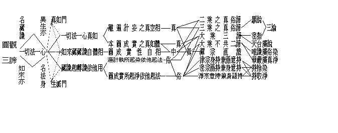



依此遍观佛祖经论义语，悉可判解。今震旦人学佛虽多，遵故蹈常犹不能及，无别宗义开建。近欧阳渐与梁漱溟二君颇能有言，欧阳君能善说大乘不共二谛；梁君所言，仅齐三论显说，其密指者似在禅宗而未能达。



------



## (见海刊一卷六



佛学大系



一　三唯论  

二　三唯论之含摄甲　三唯论的各摄  

乙　三唯论的互摄



三　三唯论之贯通甲　三唯论与大乘宗  

乙　三唯论与哲学



一　三唯论



凡治彻头彻尾之学，有「展手撑破虚空边，伸脚踏透宇宙底」之大丈夫志量者，殆皆有三个疑问横亘心中，务求个完全解决。那三个疑问呢？一、名名色色的「本来」是什麼？二、名名色色的「现行」是什麼？三、名名色色的「究极」是什麼？若有此三个疑问必求解决，便於一切宗教、哲学、皆有了研究的需要；若求个完全解决，则佛学便成了唯一的需要。



佛学於上列三大问题的答案怎麼样？



名名(精神的种现)色色(物质的种现)是无数无数差异区别的，此无数无数差异区别的一一各各，都不是永久不坏灭的！是由生起始成而且不是永久不坏灭的，则一一各各便都是暂有、偶有的！细细看来，不单是暂有、偶有，而且是无而忽有，有而即无，变时极速疾的。但恒通遍满於无数无数类差各别，极速极速生成坏灭的名名色色，确实是有未尝异未尝变、永不异永不变之性的。譬如有不隔不别不坏不失的水，故那汹汹异相滔滔变现的波浪，得以无际无断。但名名色色都是变异的，不是不变异的，故此不变异的虽不可无亦不能有，祗得强名之曰「如」。换言之，则祗可强对此恒遍而不变异的作个记号，名之曰「如」耳。其餘既都是变变异异的名名色色，则便都不是真实的。盖真实的必常如是，常如是的必遍如是，然则真的必是无变无异的，无变无异的方是真的，故名名色色皆不是真，唯「如」是真，强谓之曰「真如」。真如既是无乎不在无乎不然的，便可知佛学於名名色色之本体是甚麼的答案，就是「真如」了。



「真如」是虚豁圆活的，是无形对无识别的，然则那无数无数物差类别、无常无常生成坏灭的名名色色，是怎麼样现起存在的呢？实在的祗是「真如」，实无他物；然现为名名色色者，即由真如是无形对无识别的，所以不曾自知(无明)；复由真如是虚豁圆活的，所以又得欲知之心；欲知之心乍动，所知之境随变，乃现为名名色色而真如终不见，真如虽不见而名名色色实皆真如也。名名色色之贯持者，乃心之发生力的意；名名色色之变异者，乃心之了别力的识；於是亦便可知佛学於名名色色之生缘是甚麼的答案，就是「意识」了。



「意识」是参错流动的，是有执见有创造的；然则那意识又何以不能契证真如，但发生了别那变异的名名色色呢？就因为意识是真如不自知而起的欲知，故所知的皆是所变生的名名色色而不能知真如也。然在意识持变的名名色色中，每每免不了迷闷及牵逼之苦，由是意识对於名名色色又起了悟彻及解脱的心愿。信有不由意识而生起存在的不变不异真如觉性，一旦契会，便得透脱名名色色，自在遍照。如此第一步便观察名名色色皆是意识变生的；此第一层已明确证知，则名名色色都唯意识，意识便不去求知名名色色，贯持变异名名色色的力量便消减了。进观意识即真如，真如即意识——意识即真如，故意识便不生幻梦质碍；真如即意识，故真如便圆成了「妙觉明知」。真如圆成了妙觉明知，故彻体圆照名名色色而自性虚灵不昧；意识不生幻梦质碍，故随缘普现名名色色而当相融映无尽；是之谓无上正等觉。於此便可知佛学於名名色色之究极是甚麼的答案，就是「妙觉」了。



将上来所说的归纳起来，便结成三唯胜义。那三唯胜义是：第一、说明「实在」是「真如」的「唯性论」，第二、说明「现有」是「意识」的「唯心论」，第三、说明「究极」是「妙觉」的「唯智论」。此三唯论，便是佛学的大系了。



二　三唯论之含摄



甲　三唯论的各摄



　　　　五　　蕴┐  

　　　　十 二 处├根本法性┐  

　　　　十 八 界┘　　　　│  

　　　　三　　毒┐　　　　│  

　　　　三　　业├六凡法性├真如性  

　　　　三　　有┘　　　　│  

　　　　四 圣 谛┐　　　　│  

　　　　十二缘起├四圣法性┘  

　　　　六度万行│  

　　　　二 转 依┘



　　　　　　　　　┌─八识心王─┐  

　　　　　　　　　├─五类心所─┼实┐  

　　　　　　　　　├─十一色法─┘　│　　　　　　　　　┌─阿罗汉  

　　　　四圣六凡─┤　　　　　　　　├有为─意识心─无为┼─辟支觉  

　　　　　　　　　├─分 位 假─┐　│　　　　　　　　　├─菩萨  

　　　　　　　　　├─和 合 假─┼假┘　　　　　　　　　└─如来  

　　　　　　　　　└─相 续 假─┘  

　　　　　　　　　　　　　　　　　┌淹通世学  

　　　　　　　　　　　　　　┌闻慧┤  

　　　　　　　　　　　　　　│　　└博达法藏  

　　　　　　　　　　　　　　│　　┌解决事理  

　　　　　　　　　　　┌因智┤思慧┤  

　　　　　　　　　　　│　　│　　└悟彻性相  

　　　　　　　　　　　│　　│　　　　　┌施戒慧  

　　　　　　　　　　　│　　│　　┌资粮┤  

　　　　　　　┌出世智┤　　└修慧┤　　└忍定慧  

　　　　　　　│　　　│　　　　　│　　┌寻思智  

　　　　　　　│　　　│　　　　　└加行┤  

　　　　　　　│　　　│　　　　　　　　└如实智  

　　　　　　　│　　　│　　┌一 切 智─────┐  

　　　　妙觉智┤　　　└智果┤道 种 智──┐　　├根本智……如理智  

　　　　　　　│　　　　　　└一切种智──┼──┘  

　　　　　　　│　　　┌知世间业果智─┐　│  

　　　　　　　└救世智┤　　　　　　　├─┴───后得智……如量智  

　　　　　　　　　　　└知出世邪歧智─┘



乙　三唯论的互摄



　　　　　　　　　　┌迷……染……苦……凡……生……唯心论  

　　　　心──唯性论┤  

　　　　　　　　　　└悟……净……乐……圣……佛……唯智论  

　　　　　　　　　　　┌体──唯性论  

　　　　众生──唯心论┤  

　　　　　　　　　　　└用──唯智论  

　　　　　　　　　　┌性──唯性论  

　　　　佛──唯智论┤  

　　　　　　　　　　└相──唯心论



心佛及众生，无差别而三；众生心及佛，三而无差别。是谓三唯论互摄之妙法。



三　三唯论之贯通



甲　三唯论与大乘宗



　　　　　　　　　　┌从「教观」入者…………嘉祥宗  

　　　　真如的唯性论┤  

　　　　　　　　　　└从「证悟」入者…………少室宗  

　　　　　　　　　　┌…………注重理论者……慈恩宗  

　　　　意识的唯心论┤  

　　　　　　　　　　└…………注重行为者……南山宗  

　　　　　　　　　　　　　　┌实智证现者……清凉宗  

　　　　　　　　　　┌智性者┤  

　　　　　　　　　　│　　　└权智施显者……天台宗  

　　　　妙觉的唯智论┤  

　　　　　　　　　　│　　　┌正报加持者……开元宗  

　　　　　　　　　　└智相者┤  

　　　　　　　　　　　　　　└依报引归者……庐山宗



乙　三唯论与哲学



哲学上唯一大事之本体论(亦曰元论、玄论)，虽各有种种的说明不同，说明到「离过绝非」、毕竟平等、不可破坏、遣无可遣、立无可立的，必以佛学之真如的唯性论为极则。哲学对於宇宙的物质现象、精神现象、生命现象、亦须有因果、生灭、成坏、恒转、分合、业用、功能、造化等关系的相当说明，其说明虽亦种种不同，而佛学之意识的唯心论，实能总集其成，使种种不同之世论，皆得一容存的位置。哲学之所由治者，唯在要知识实体之真相和幻象之通性；换言之，则谓由要获一最正确最普通最永久的知识亦无不可。故近来哲学上之知识论——亦曰认识论，乃视本体论尤为重要。对於本体所知识者益真确、则宇宙现象之虚渺益明显。由之可反证宇宙现象，皆由对於本体的错误知识所生起；理正那错误的知识成正确的知识，则本体洞彻现象、现象洞彻本体，便理事一致了。以言正确知识，则佛学之妙觉的唯智论更是擅长了。



要之、本真如体元绝对都无认识；元无认识、故得起错误认识。忽起错误认识，故将错就错、错上加错，谬种流传，迷眼深积，错错相结而不解，错错相引而不断，故有众生、世界、业果之相续。若自知向来之认识都错误了，革了那错误认识的命，化为真确之知识，认识一一法自性的本体；如十字街头撞见亲阿爷一般，一丝一毫都没有错误了，即为成了佛。有了都无错误的认识，故不复得起错误；此便是即人成佛之学。成佛不是件奇怪的事，人人可即成的，但也要有些丈夫的志量始得。



------



## (见海刊二卷四



佛法之分宗判教



梵土戒贤、智光二家，及华土贤首、天台诸家，以一时门庭施设之方便，於唯一大乘教所诠之自证境行果、化他境行果上，判教高下，致后人死守其语互争优劣，予固不偏取之。而近人闻古者一音教之风而悦之，胶执「教一乘三」，亦有未可。盖同一大乘教，特其所诠於境行果有偏重，或自证化他有偏重，虽偏重即为其殊胜之处，而统计其全，则平等平等也。至大乘与餘乘则不然、其所诠各有自乘之境行果，其能诠亦各有自乘之教。乘既三，教非一；教若一，乘岂三？设云教属乎佛故一，乘属乎机故三；殊不知佛不应机何有乎教？机不感佛何有乎乘？故应机三则乘三教亦三；感佛一则教一乘亦一。若无机佛之感应，何论教乘之一三哉？故予意教之判当依乘之别，乘之别、不别於后世，在佛应机而教兴时已别之；故诸圣教处处有乘别之明文也。



然乘之开合亦不一其说：有时总说为一，乘无别而教亦无判；有时分为大小二乘；有时分菩萨独觉声闻之三乘；有时加人天为四乘；有时分所加人天为五乘。复有於三乘加佛乘为四乘者，此则迷一大乘之因果以为二，出於后人谬计，为圣教明文所无也。但今综佛法之大全以类别之，可别为三：一、化俗教，谓人及天等五乘之共教。二、出世教，谓声闻乘等三乘之共教。三、正觉教，谓大乘(菩萨乘佛乘)不共教。初一不离后二，而后二非初一能尽，若离后二，则成凡外之法而非佛法；前二不离后一，而后一非前二能尽，若离后一，则仅凡小之法而非佛法。故此三乘教法，皆不离佛自住之大乘也。兹表如下：



　　　　┌………………………………………………………………┬─菩萨  

　　　　│　　　　　　　　　　　　│……………………………├─独觉  

　　　　│　　　　　　　　　　　　│……………………………├─声闻  

　　　　│　　　　　　　　　　　　│　　　　　　　　　　　├─天乘  

　　　　│　　　　　　　　　　　　│　　　　　　　　　　　├─人乘  

　　　　大︵　　　　　　　　　　　三︵　　　　　　　　　　五︵  

　　　　乘正明诸法唯心义　　　　　乘出明五蕴无我义　　　　乘化明因缘生果义  

　　　　别觉　　　　　　　　　　　共世　　　　　　　　　　共俗  

　　　　教教无上菩提为鹄　　　　　教教无餘涅槃为鹄　　　　教教生长善因为鹄  

　　　　　︶　　　　　　　　　　　　︶　　　　　　　　　　　︶



近人(见支那内学院各书)引金刚般若，佛令一切众生皆入无餘涅槃之意，证明其「乘三教一」，由仅知三乘共教之故耳。然三乘共教诚亦佛法之通相，据此以言教一乘三，亦无不可；但更应知大乘别教、五乘共教，乃能至极而普应耳。兹更表如下：



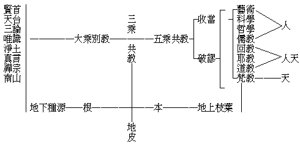



如一树然，由地上枝叶而望之，祗望至地皮之本柢而止，故可以三乘共教为通相；然三乘共教之所依，则又当在大乘别教。要之佛法以三乘共教为本干，大乘别教则其根源也，五乘共教是其枝叶也，故应有此三教之判。



然唯识等大乘八家，则均以实相法界——即诸法唯心为根本，及妙觉佛果——即无上菩提为究竟。以此根本义故，究竟义故，同一大乘平等平等。而就其集理起行之特点以明其教理所趋重所崇尚之宗主，则昔於佛法总抉择谈中，尝大别为三宗，为表如下：



　　　　空慧宗───三论───二空观慧───得此清净  

　　　　　　　　┌─唯识─┐  

　　　　唯识宗─┤　　　　├─诸法唯识───染净所依  

　　　　　　　　└─戒律─┘  

　　　　　　　　┌─禅那─┐  

　　　　　　　　│　　　　├─全体真如───自性清净  

　　　　　　　　├─天台─┘  

　　　　真如宗─┼─贤首───离垢真如───离垢清净  

　　　　　　　　├─真如─┐  

　　　　　　　　│　　　　├─等流真如───生境清净  

　　　　　　　　└─净土─┘



此中律宗专指终南山道宣律师之律宗，道宣律师宗归唯识，及明藏识中种子为戒体，皆有明文，故属於唯识宗。真如宗中禅及天台等之五家，细分之犹别有宗尚，今就真如之广义言，诸清净法总名真如，故总曰真如宗。竟无居士谓当由唯识以进言唯智，唯智即是此言之真如宗——予昔作三唯论，即谓唯性(今曰空慧)、唯识、唯智(今曰真如)。宗是教理之主，指全部教理所崇尚趋重之一点而言；所以要有此一点者，便集中全部之教理而总握之以起行也。凡教皆为诠理，凡理皆为起行，若非反博归约，有以握厥总要，则泛览教理而行莫由起！若知为便令起行之教理集中点谓之宗，则近人横分法相、唯识为二宗，诩诩以独能发前人所未发自矜者，可知其尚泛滥教理而无所归，故不知法相教理所宗即为唯识也！盖平列偏明诸缘所生法若集论及瑜伽等等，由立言教以明义理，乃能宗之宗相；而摄大乘、成唯识等，由集教理以起观行，正所宗之宗旨。故以宗言，法相宗乎唯识，不应将能宗所宗之一法相唯识宗强析为二，而正名定义但应曰唯识宗也。复就唯识以言，能唯是识(识言诠心心所)，所唯(谓简我法及持相性)即谓缘生法相及二空所显真如性，若但明一识谓之曰唯识，而离诸法相性於唯识外别谓之法相宗，则尚何唯识可成乎！故不应离唯识宗别立法相宗。然空慧与真如得名宗者，统诸法而集中於识，既可名唯识宗，统诸法集中於二空观慧，亦可名空慧宗；统诸法集中於真如，亦可名真如宗。以此三宗概观诸大乘教理起行之方便，则得其纲领矣。



三乘共教及五乘共教之分宗，不复一一。机感佛而兴教，故依乘以判教。理集要以起行，故依教以分宗。判教分宗，如是如是！



------



## (见海刊五卷五



佛法大系



——十四年冬在武昌佛学院讲——



一　人天乘  

二　小乘法  

三　大乘法



古今诸德判释如来一代时教，或一或二，或五或十，种种数目不一而足；今总括之分为大小二乘与人天乘。而此人天乘法，全系大小乘之出世阶梯，或大小乘之化他方便；故佛法之根本唯大小乘。其大小乘法修证法门之次序，与对於各宗之关系，极其缜密，试皆表列於左：



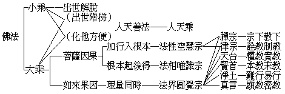



一　人天乘



其中所言人天乘者，以诸有情若乘五戒之法可到人的地位；若行十善禅定之法可到天的地位。然此人天乘法非是有佛方有，即印度、中国、泰西各国皆有之。如佛法未来中国之际，儒教教人由士希贤，由贤希圣，由圣希天；道家老庄之徒使人得仙入天；西洋的基督教说生天；印度之婆罗门教说由人道而生梵天等。此可见人天之善法，为世间共同之教。但世间以此人天之教为其极归，而佛教则以此为出世之阶梯，化他之方便。盖立此人天教法有二种意：一则保持人天之道，由人天道而至小乘或至大乘；一则立此人天之教，示其迷谬之处，使其知非究竟而求出世究竟了义。若不尔者，则众生非但惊悸大乘不肯信受，抑且永没在苦。所以世尊说法，立人天教以培其出世之资粮，斥其迷谬之局执，而渐引入於大小乘出世者也。可见此人天乘法非佛教所独有，亦非佛教之特质。



二　小乘法



小乘法已是佛教出世的法，而一般人一闻小乘即意谓必甚狭劣，殊不知若生色无色界已为常人之思想所达不到，而况超出世间者哉！不过此小乘之教理行果，比之大乘则不为深广；故小乘的根机为狭劣迟钝，而大乘的根机为利疾超胜也。小乘知我空而五蕴皆有，大乘知我空而五蕴亦空；以有法执为障故，遂名其为小乘也。吾人已知乘人乘之法可到人的地位，乘天乘法可到天的地位；进而更觉为人常受种种之逼迫，经种种之苦恼，一事方成两鬓同丝，老病相催，悠然死去！生为仁圣，死则枯骨；生为盗贼，死亦枯骨；则人生之价值何存？纵信神识不灭，仁圣死得升天，受种种之娱乐，但其五衰相现，流转何定！如是以不灭之精神，疲奔於业报之途；今生之所经营，已得而复失！来世之所经营，亦已得而复失！由是生生死死，死死生生，得而复失，失而复得，尽未来际靡所底止；宁不勤苦无益？於是遂生一不满足之观念而求出世之方法。如世之求进化者，以万物皆有进化，则进化复进化，必将有超出人天以上之法可求得之，於是求所以脱离人天之业牵及苦恼之一种进化，即是出世间之小乘法。此小乘法，即佛法中解脱人生苦痛之一种法门也。



三　大乘法



大乘分为因果二位，在因位为菩萨乘；在果位为佛乘，又名如来乘。依此因果位，即作二层：一者行因趣果的大乘，二者彰果化因的大乘。行因趣果的大乘，即菩萨乘；彰果化因的大乘，即如来乘。彰果化因的如来乘，是由所证佛果之境界而开示众生，使众生依此法门以悟入佛之知见，达到佛之究竟地位。由因至果的菩萨乘，就是众生从无始以来之佛性，与过现之一切正闻熏习，发心修行，经四十一因位，而至圆满果海也。



然此由因至果，菩萨乘法，就主要点有二位别：一者由加行入根本；一者由根本起后得。此二类中，初者属法性空慧宗摄，后者属法相唯识宗摄。属法性空慧宗之教典，即般若经与龙树提婆之四论等；以此经论所诠教义，皆显离分别之法性。修此宗者，若能依此教义如法修持，起法空观，经暖顶忍与世第一之四加行，而证无相法性之真如；此无相法性之真如，即是根本智(又名无分别智)之所证。盖以证此真如，则一切虚妄之境悉皆消灭无餘，而一切清净佛法，莫不由之生长成满矣。属於法相唯识宗者，凡为思量分别想像所能及之一切诸法，皆为法相；而此法相依分别起，离分别外实无一法可得，亦无一相可见，故曰唯识。然能了此天地人物以至佛身净土种种诸法，皆唯识所现，非得根本智后所起之后得智，不能如实了知。何者？盖未得无分别智，则法执未亡，不能了为唯识之幻相故也。根本智即如理智，由如理智而起如量智，依如量智则无边无量之诸法品类差别悉皆究竟达其体量矣。如其未得如理智前，虽第六意识亦能依教理以观诸法唯识如幻，然末那之我执常存，仍滞迷执。况此间众生於一法上互有相违；譬如大海，随六道见各有不同，若非得法空以后之菩萨，安能知其不同之根柢而皆会归唯识之旨哉？又经有云：『由摄藏诸法，一切种子识，故名阿赖耶，胜者我开示』。阿赖耶识为建立唯识之根本，非明此识则不能究竟明了唯识；故欲究竟明唯识者，唯已空法执之菩萨为能耳。然而凡愚虽不能知，亦可凭依经论与各人之知识经验，集起唯识观念，以修习殊胜唯识观行，而达到究竟明了唯识之目的。能如是者，是名行因趣果之菩萨乘也。



彰果化因之如来乘者：此如来果因与菩萨因果颇有攸分，何以故？如来既圆满根本后得二智而成正遍知海，理量同时，性相不二，无一刹那心不遍知诸法，故如来十种通号内有正遍知之一名也。菩萨不然，必须一刹那证性，一刹那证相，前后刹那乃能观性相不二；而如来则能无一刹那不证此性相不二之圆融法界。如贤首之六相十玄，天台之一念三千性相等，即明此理量同时性相不二之法界，而须以佛果圆觉为宗也。此云法界，以总包性相一切诸法为义。唯有大圆镜智能如实亲证此境，故曰法界圆觉宗也。



至於佛教各宗对此法界圆觉宗与诸法性相二宗之关系，则如天台所宗之法华，以佛知见为宗；贤首所宗华严，以佛法界为宗；净土以弥陀智境为宗；真言以大日中台为宗；律宗以实践制恶行善为宗；禅宗以不立文字见性成佛为宗。在天台宗言，以法华为实，其餘为权，纵华严亦兼别故。在贤首宗言，以华严为本教，其餘为末教；虽法华属一乘法亦乃会三归一，不如华严惟照诸大山王。在净土宗言，唯往生法为易行道，横出三界，一生补处；其餘法门钻仰维艰，非如净土之至简至易，故抹杀餘法为难行道。在真言宗言，天地人物，六道众生，皆大日如来法身，其一一法悉为总持，修其法者，即身等同毘卢；其餘各宗落於诠解，非究竟法，唯真言宗独得如来秘密奥妙之藏，而抹杀餘法为浅显教。在禅宗言，众生本心即遮那如来，但须回光返照即能见性成佛，无须假诸言教，寻枝摘叶，枉费精神；故自称宗下，餘为教下。在律宗言，佛教其餘一切法门悉皆以教诠理而已，未能亲行实践；唯有遵循佛制，庶几大道不远。此之各宗，种种斥他非而炫己是，类皆独显其胜以为策行方便耳。其实、各宗皆为佛法，皆可得根本而起后得，入於理量同时性相不二之圆觉；无奈后人不解，为各宗起竞之由，吾人若能贯通考察，则禅宗直证圆觉，兼用空慧；律宗教遵唯识，亦兼天台；而天台、贤首、净土、真言，宗在法界圆觉，各标其胜。而此性相与法界三宗，又统属佛教之大乘法。凡大乘法皆以诸法实相为根本，以无上菩提为究竟，夫何轩轾之有？故明佛法之全体及大乘之平等者，於宗下教下显教密教等抑他扬自之偏言，概无取焉。



------



## （妙空记）(见海刊七卷六



佛法一味论之十宗片面观



佛法一味，所谓「内证离言、应机巧说妙法味」。而一味之佛法，从一种方式以言之，可别为教理与观行之二门。由教理门以言之皆教理也，由观行门以言之皆观行也。今且就观行门略论之。



观行门可大别为真空观行门与假相观行门。行门之所契达者，皆为空假不二，假空俱非之中实法界。而中国所传十宗可系列为两行如下：



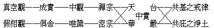



成实、俱舍二门，可达中实法界一分之择灭涅槃；中观门、唯识门以下，俱可达中实法界全分之无上转依。然建立「中实法界观门」者，则为天台华严二宗；故天台以真空观融摄假相观而成空假双遮双照之中道，而华严以假相观融摄真空观而成假空俱存俱泯之法界。然真空门妙极於禅宗，而假相门妙极於密宗，故行证之妙门，独於此二为崇。盖天台、华严著重於玄妙的描写，致行证反成无力也。至律宗之戒律为观行定慧共依之基础，且为建立流通各观行法门於人世之必循仪范，瞭然可知，不待更释。唯净土宗之往生十方净土，在现行之意义上，若达行证之极，虽成实，俱舍亦证涅槃而无待往生净土，然为一生未能极证而防退堕计，则皆有托庇於某一佛圣的清净国土之需要。不唯禅宗有「有禅有净土」的修法，而密宗亦有密严、香拔拉等。成实俱舍虽未明求生他方佛净土，而亦有期生得闻佛法的有佛法国中之意。今各宗间之通行之净土门，以西方极乐与兜率内院为最广。上生兜率内院以亲近弥勒，则虽不谈他方佛土之声闻众，亦可依归；故诸净土门又以兜率净土摄机为普遍焉。



前二系列中禅密二宗，为空相二门最高极诣之对峙双峰，其直趋行证之力最强，故其自尊而抑他亦特甚。禅宗则自称「宗下」、而以「教下」概称其餘，密宗则自称「深密」、而以「浅显」概称其餘。要皆禅宗或密宗独盛之后，禅宗语录与密宗咒轨有自成一藏势，乃於一味佛法中发生如此绝然对峙之分别耳。然此非囿於禅宗、囿於密宗者所能知，而在深入禅或密之热诚者，又万非冷静之理智能致其感悟；故此虽为博达教义教史者所明见，卒无以解习禅习密者之囿焉。(见海刊十五卷四期)



佛法悟入渐次



——民国十二年七月在庐山世界佛教联合会讲——



一　明业果不断故有情续生  

二　明唯有根尘故人我本空  

三　明诸法本空故唯识所变  

四　明本非空有故入佛知见



佛教以圆寂以大觉为究竟目的。藏海虽渊，但求由之而能开悟；法门固多，但求由之而能证入。拈花一笑，直契实相；击竹闻声，悟彻无生；非必有所谓渐次之阶也。然资粮备习，三劫五位，由生而佛，进程不应躐等；五类种性，有学无学，转迷而觉，悟入遂有渐次。约其渐次，可有四级：一、明业果不断故有情续生，二、明唯有根尘故人我本空，三、明诸法本空故唯识所变，四、明本非空有故入佛知见。



一　明业果不断故有情续生



有情依其身语意三者所发动之善恶染净等行为，皆谓之业。有如是业，即有如是感招后异熟报之力，所感之后报能酬前业，是谓之果。异生二执俱生，於异熟果不达依他无我之理，遂起四颠倒而造善恶等种种之业。业持於识，为识增上；业为识造，识为业牵；此善恶之业，依有情之识，异时变异，遂得异类之总报。报体即识，报名曰果；复依此果而造诸业，更感后果。由斯前前后后业果不断，亘古历今，各随所造之业得其所应得之果，异生遂长夜沈沦於生死海底，相续於六道趣中矣。或曰：理既如斯，其相若何？曰：若示概相，可依十二因缘以明之。十二因缘者，谓无明、行、识、名色、六入、触、受、爱、取、有、生、老死。此十二因缘亦名十二缘起，以业果之相由十二种之因缘而起故；亦名十二有支，以此缘起有十二支故。此中所谓无明者，即不明之谓也。其所不明者有二种：一者真实义，谓诸法生灭无常，缘生无我，性空无为之义；二者异熟果，谓诸所作业异时必变异异类而成熟为果，曰异熟果。异时是所难究，变异则相不识，性空故理趣玄深，无我非妄心所缘；异生无正比量智以通此理，无真现量智以达此事，故曰无明也。以无明为增上缘，贪瞋等种遂尔现行，身语业於斯而起行为动作，是之谓行。以无明行为增上缘，命终之时惑业感牵识心，识心被牵遂复趣生，是之谓行缘识。当其趣生得命之时，此识即与父母爱情之精血合为一团，此一团中之物质即色，其精神——受、想、行、识即名，合此二者谓之名色。由名色展转之力，有情遂能吸入色声香味触法六尘，此能吸入者是之谓六根。当此六根既已成熟，遂由母腹中出而与外界接触，是之谓触。当此触时，即有逼近之苦乐与舍等之感受，是之谓受。於现所受不明其为虚妄，遂依之於境而生爱憎，是之谓受为缘生爱。以爱迷为缘故，於现前境认定而欲保取之或欲摧灭之，是之谓取。以取迷为缘故，造作诸业，以业有引来世之力，是之谓有，盖谓此报虽未舍，而来世应有之业因已有也。依此有故复得后报，是之谓有为缘生。报得曰生，果坏曰死。斯之谓无明缘行乃至生缘老死；即业果不断有情续生之概相也。



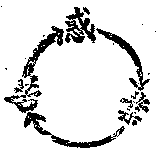



别作者既别受，共感者必共得。别异之报果乃别异之惑业所致，共同之果报即共同之惑业所感。根与身为别异之正报，器世界即共同之依报；国家乃共别之业招集，世界即共共之业所陶成。生老病死，一期复一期别异之业果相续；成住坏空，一劫复一劫共同之业果不断。诸有不达此义者，遂依其现见之果法上起诸断见或起常见，或计其为无因而然，或计其为有因而然。计无因者，谓去来今宇宙一切参差之现象森罗环列，人生一切变化之休咎富贵贫贱，皆何由而然耶？曰：皆自然而然，非有因而然也；即庄子所谓「然乎然、不然乎不然」之计也。计有因者有二支：一计宇宙人生为神造的，一计宇宙人生为物集的。计为物集，中土则说为阴阳二气、五行生剋；印度则说为地水火风，极微造色；西土则说为原子电子，物质物力；然彼所说皆谓物集则相显，物散则相没，人生宇宙所言一切之果相，莫不由物理之因果律所致也。计为神造，东土则计为天，西土则计为上帝；然彼等皆谓宇宙之所以有此森罗万象，人生之所以有诸存亡休咎者，必有一独尊万能全知之天神主之宰之造之作之也；岂无而能然耶！何以故？以现见能活动之人之畜，不能如此故耳！不然者，则人畜等何以每不能遂其所乐欲而常为环境之苦所支配乎？故必有上帝也。合此二支与自然一派，又可约为二种邪见：一者断见，二者常见。计常见者即神迷派，彼谓上帝既为吾人之主宰，万能而全知，是以信之敬之念之祷之，当必赖之永生天堂，享快乐於无穷；若不信而忽之侮之慢之背之，自求永堕地狱，终为撤但，常流於化外而莫之救药。噫！此教此见，一梗於胸中，其最善者或幸能生天享一期之福报，但报尽则仍不免於六道轮回，三途之痛苦；次之者则什九不免鬼道幽冥之苦矣。计断见者，即自然迷派与物集迷派；盖谓自然如是，本无因果，好丑固定，佛岂可致？遂顺其贪瞋慢之流而不复求其解脱之方。又谓人由物集，物散人亡，人生无常，应即时行乐；苟得以满吾贪瞋慢之狂壑者，虽五逆十恶亦何惮而不犯！虽杀尽天下人，亦何所顾忌而不为！苟不得遂吾之所欲为，闷闷一生，则无如自杀速死之为快耳！吁嗟乎！此见一印入脑中，其不长沦恶趣注册地狱者鲜矣！噫！不明十二因缘之概相，别共业感之正理，则不落於常，即流於断；既落断常而欲保持人类之地位尚乌可得耶！故吾人若真欲做一个人，昧此则无轨道之可循也。故此业果不断有情续生之理，吾尝谓之为「做人的要义」；推而广之，做天乃至做佛，亦莫不基此为出发之点，奉此为根本之理。故在佛法应谓之曰五乘之共通教义，为学佛之最低限度也。



上来所说，非如世俗糢糊影响之谈因果。若能以之普及於今世之人类，则虽不倡世界和平而世界必趋於和平矣。且儒家虽不深明佛法，亦常谓佛教之谈因果，有裨於世道人心，足以补儒之阙也。



(记者谨案：中国庸儒，每耳食佛家有因果之论，辄谓佛教之谈因果，其於世道人心亦不无小补；实属乖谬已极，可知彼辈於佛经佛论必未曾寓目，於因果之理，必完全不能彷佛其粗义也。夫释氏所云因果之理，乃如实而言，岂彼横记妄说为如是如是哉！释氏之意，亦非借此论以骇惧世人，使勿杀人放火也；亦非待释氏道出因果之论，而后世间方有因果报应也；惟因事相本来实现为如此如此，故释氏说为如此如此。盖以於事实上虽因果昭昭不爽，然异生身为异熟之报所碍而不能见其底蕴；心为种种戏论所障而不能明其正情；故释氏集合异生分上所有之种种事情，於其共同点上指出其因果之公理，次复告之以人生轮回之事情，使之由此理上比知必有六道轮回之事实。世人不晓，而谓因果之教，唯是释氏所施设，唯是佛教徒所迷信，岂人生真有所谓因果轮回来生来世哉！纵闻有二三现见之果报等事，亦不过适逢其会耳！总之，轮回非现前可见证，来生亦渺不可亲觉，吾不信焉，吾不信焉。吁嗟乎！中国人之未出国门者，不见有美国，不信有美国，而美国岂即因其不信而即消没乎？彼辈不信有业报，而业报岂即因其不信而遂无乎？知与不知，信与不信，而因果之理，业报之事，本来如是如是；吾甚为昧者危焉！)



二　明唯有根尘故人我本空



凡夫鲜具宿命之慧，菩萨尚有隔阴之迷，且贪瞋内扰，浊境外眩，吾人若不亟求所以出世之道，则福果一尽，人生之再报，将难乎为继矣！是以既晓业果之五乘通义，继则应达我空三乘圣教。此三乘出世之学，最初所明者，即人我本空之理，五蕴幻聚之相。盖以生死因於惑业，惑业原於执我，而庸人所执之我，则皆由不达五蕴假相而妄计之以为我之故也。或计色蕴是我，或计受蕴是我，或计想蕴是我，或计行蕴是我，或计识蕴是我，或计五蕴和合是我；要皆是误绳为蛇，顾影觅首也。若就其所计而推研之，彼将彷徨而莫知措其手足矣！盖以即如彼所计之五蕴而言之，其中亦唯见有色受蕴等，而未见有我也。或难曰：若但是五蕴而无我者，则谁是作者，谁是受者？若无作亦无受，则岂不违於业果不断有情续生之义耶？曰：应知「诸蕴从缘生，和合相续故，假现为我相，但唯有根尘」。所谓尘者，即色声香味触法六尘；根者，即眼耳鼻舌身意六根也。盖由根尘构接，见相假现，五蕴和续，惑业滋起，起业受果，仍在五蕴。蕴谓积聚，和合有相；此假合相，唯依根尘内外六处，觅我不得；为明斯义，是故说言唯是根尘，人我本空也。若无我执即无惑业，若无惑业则无所报，无三界报是曰出世。若明我空即无无明，无明灭则行灭乃至老死亦灭；灭染还净，缚乃解脱，此即出世之根本，三乘之共通教义也。诸有欲超出世间。离脱苦海，於唯有根尘人我本空之义，盍细味之！



三　明诸法本空故唯识所变



依上所明，虽可出世，若深究之，义犹未详，言犹未至也。夫一切诸法不越五蕴，而色蕴等根尘诸缘亦从缘生亦无自性，体空而性寂，故曰诸法本空也。难者曰：诸法若空，即无有诸法，何以世间共见有种种差别之相，而圣教亦说有五位百法耶？曰：体虽空寂幻相非无也。然非无之相，不出能变能了之心识，故一切皆所变，唯识能变、唯识能了，故曰唯识。以体空而相有故，故曰诸法本空，唯识所变也。但此法空识变之义，非二乘定性者所能领受所可悟入者，故此义亦曰大乘不共教义也。



四　明本非空有故入佛知见



有执即生执除即佛，除执即是佛法。众生妄情所执之妄相虽非有，而诸佛妙智所证之实相则非无；证与未证，诸法之真际本来如是，以是义故说之为本非空有。法华经云：『佛为一大事因缘出现於世，为令世间一切众生开示悟入佛之知见』。所谓悟入佛之知见者，即是亲证此非有之空非无之真也。然启发此亲证实相之智，非由先明诸法本非空有之理，不得而入，故曰明本非空有故开佛知见也。应知上三所明，皆为除执之方便谈，非和盘托出直示目标之论。然诸佛所以说五乘通理、三乘共教、法空识变之大义者，皆为众生根钝福薄，不得已而降低其教程，以之为阶渐耳，非直探其本怀之谈也。故吾明佛法之悟入，而以此居於最后也。



上来所言，不过略示梗概，粗谈纲要，使学者有轨道可依，阶梯可循，不致东讨西摸耳；若真欲切实研究以求悟入者，则应详之於各宗之经论。



------



## （陈维东记）(见海刊四卷十



律禅密净四行论



一　四门之统摄甲　戒律  

乙　禅观  

丙　密咒  

丁　净土



二　四门之类别甲　律禅与密净  

乙　禅密与律净  

丙　律密与禅净  

丁　律与禅密净  

戊　净与律禅密  

己　密与律禅净  

庚　禅与律密净



三　四门之序次甲　律禅密净  

乙　禅律密净  

丙　密律禅净  

丁　净律禅密



一　四门之统摄



佛法的修行，我尝分作律、禅、密、净的四行。故於世佛苑的计划中，亦分设戒律、禅观、密咒、净土四林。这四门，我以为可包括佛法中一切的修行法门，而且是各应独立为门类的。



甲　戒律



戒律为三藏或四藏中的一藏，不惟在研究上为庞然巨镇，即於修行上亦能综贯无餘。通常虽只认为三学或六度之一(或四，包括施戒忍进)，然如菩萨戒依律仪摄善法饶益有情之三聚，综摄自他二利；声闻戒别解脱定共道共之三级，贯持因果诸位；何况忏诵仪轨以及密咒诸戒诸仪轨，亦斯流类，云何不摄？能专从戒律中行，所谓服佛之服，言佛之言，行佛之行，行至圆满，染无不止，善无不作，即身成佛，复何所疑？且修他行或有流弊，如依戒律而行，则决无过错。佛寂初二百年，可云唯依戒律修行，故圣真相续，血脉不断。盖戒厚则定自生而慧自发，自成解脱解脱知见。三四百年后律部分裂，论师纷出，於是解行者多而证果者渐鲜矣。



乙　禅观



禅那、三摩地——三昧、三摩钵底、三摩呬多、奢摩它、毗钵舍那、瑜伽等名，皆指凝心一境，寂照静明之修习言。此为佛法修证中必经历必成就之事；神通智慧皆出於是。律密净三行至相当程度时，亦必有此经历成就。所谓定共戒及得悉地与念佛三昧等，何莫非此？特彼三行所侧重者各有其相耳。今不曰禅定或止观而曰禅观者，意在总摄一切禅定止观等门，将五停心、九次第定，以至中道观、唯识观、一心三观、法界观、如来禅、祖师禅类为一聚，而以专提祖师禅之禅为禅之极致。禅宗最重师承，亦犹密咒之金刚乘亦必师传也。此中既统括一切止观，故台贤等止观不另列其修门矣。



丙　密咒



密咒续轨各部，亦几埒律部而别成一藏，然其「续」原归经藏，其「轨」应编入律之大乘「作持」(例声闻律各跋渠)。要之皆轨范身语意业之所行者，谓之三密相应，正相应於此行轨耳。然自咒蛇之大孔雀咒，以至龙智、善无畏、金刚智、不空、莲华生、宗喀巴、空海、最澄以来集大成之密咒聚，悉皆摄属为此一修行门类。其特点则或诵或观，不离唵(嗡)阿(哑)吽娑哈五字，尤重坛仪礼供，摄三业以合於所崇奉之佛圣天神耳。既有如此殊异，故与律禅净不能不分家也。



丁　净土



净土行门，本通於十方一切佛菩萨之净土，而在中国、高丽、日本、唯普遍弘扬弥陀净土。但近来发见於炖煌石室者，则於弥陀净土变外，更有药师净土变，千手观音净土变，弥勒净土变，地藏净土变等，则知唐以前修净土行者，不限极乐，而皈心兜率内院弥勒净土者尤夥。今此所谓净土行，亦总摄兜率净土、极乐净土、以至华藏净土、寂光净土等一切净土行门；在舍此短浊身器后，别取一常净身为所归处。据兹特点而统摄十方诸佛圣净土法行为一类，故能与律禅密各立而为四也。



以上，依此四各成一门类言，每一门类中各摄众多行门，例如仅一弥陀净土行门，集中、日自庐山远公以来之宗派行轨，何虑千百？而此四行门之可摄尽佛法一切修行方便，可无疑议。然约类别与序次，则犹有可言者。



二　四门之别类



甲　律禅与密净



此於四中，显然易见可分为二者，即律禅为一类与密净为一类。遍考东西古近一切济人度世之教学，其所修行皆不外「身心改进」「神圣感应」之二途，斯即律禅自力与密净他力之别。就中国言，儒近改进身心自力行，道近感应神圣他力行。细分则儒之经术近律行，而纬术近密行；道之仙道近禅行，而天道近净行。他若耶、回等礼拜祈祷近他力行，而柏(拉图)、康(德)等明智严肃近自力行。尤显然者，与佛法相先后之印度教学诸派，其先期婆罗门弥曼萨派，则专重四吠陀之拜祭赞祷，唯是他力之神圣感应；迨受刹帝利业果与解脱思想影响后之吠檀多派，则渐趋重於其自力身心之改善，尢以数论派为专重自力解脱之代表。佛陀起於崇尚自力解脱思想极盛之时代，且业果之思想源于刹帝利，而释迦族亦刹帝利种，业果由观自身所行善恶得所报乐苦，推及前世后世而成，进观业果之升坠靡常乃求解脱。此业果与解脱思想，实为印度刹帝利种之特产，而达到圆满成就者则为释迦族之大圣释迦。本唯祭祷之婆罗门各派，则为纂承於此义者；故原本正常之佛行，决为自力之律禅，换言之，即戒定慧行。他若瑜伽派侧近禅行而胜论则近祭行。即吠檀多亦始终不放弃梵神。虽修禅观亦以专念代表大梵之唵(嗡)字为唯一方法。至中国盛唐时，此派之商羯罗为纂承佛法思想之极点，不久又以「梵」与「毗纽笯」人格神一致，谓修行解脱亦非得此「神」之加护不可。释迦灭后六七百年间之龙智兴世，亦渐将彼教祭祷礼赞之方法，移摄来用为感应佛圣天神及归向圣刹之密净行。至密宗盛行，则亦有非受「密佛」灌顶加持不得成佛之说兴。要之，印度起于婆罗门之他力行，至后期佛教之密净乃完成；起于刹帝利之自力行，则於初期佛教之律禅即已完成。故改善於自行与感应於他行，虽均至佛法始获圆满，然不能不以律禅为佛行之本质，而密净为佛行之变体。故律禅之锻鍊身心，密净之供祈佛圣，实为修行之两大别。



乙　禅密与律净



若从此四行门发达之极诣(例禅之禅宗)者为代表以观其类别，则於另一义上又可禅密为一类而与律净为别。盖律依众团折伏自我而至於解脱，净依圣国引摄自我而至於往生，皆以屈抑自我为行者；而禅密则反是。禅由即心是佛而至於呵佛骂祖以示超越，密由即身成佛而至於纵婬恣杀以示奇特，则以伸扬自我为行矣。故猖狂者当裁以律净，而畏缩者当奋以禅密；勇强者可摄入禅密，而怯弱者可导归律净。复次、禅密必定心而律净通散心，律净平易而禅密严峻。



丙　律密与禅净



汉土古多禅净并修者，而西藏黄衣派亦律密兼重，则禅净与律密可各成类别。大抵律密皆繁礼缛仪，名相精细，轨制森严，学者非童而习之，纵拘守规矩绳墨中积之既久，不能入于神化。其影响于世人者，亦能使于佛教有较明之认识，此黄衣派之所以可名律密，而异于红衣派之为禅密者也。至于汉土民性，豪迈通脱，乐于简易。唐末五代之乱，性相经论与律密规制皆不复行，禅净之行与台贤之说相依，二三豪杰时能直得佛法之玄髓，妙用无方。然大都藉一个话头一句佛号为躲跟，陷于一切不知，而民俗之于佛教亦鲜辨哲之信；盖尚玄妙而忽规绳，上上人得之中下人失之也。



丁　律与禅密净



律之本质为伦理学、道德学，专从身语或及心意之实际行动上，导入於止所当止作所当作之轨道，不须理解亦不须灵悟。从实行经验上所证知，亦为行之产物，故实证为行之本质。所谓「修行」，虽但以「持律」一名代替之，亦无不可。佛所教授教诫，曰法与律，餘法皆为化导之教，唯律是制行之教，由此古人判律曰制教，餘法皆为化教。化教中禅密净三、有十八回互。



戊　净与律禅密



律须由戒生定生慧，证涅槃方算成就；禅之就体消停得力迟诸止观等且不论，即从缘荐入相应疾之宗门禅，亦必透末后关得大自在方可；密尤须无量学习勤苦修持，方有大悉地之希望。唯净土行则若极乐、若内院等，皆许以称念若弥陀若弥勒等圣号即可往生，一经往生即不退堕，其行极易。故於此行门一生决信，心即安定，既不虑所行之不能达所愿，则身虽未往生而心已等于往生者之安乐自在。日本真宗之为净土宗极诣，即以现能信入心安，便顿同已生净土住不退地，游化世间矣。故古人判「净」为易道，餘法皆为难道。难道中律禅密三，有十八回互。



己　密与律禅净



密咒行至於大成之金刚法，不论在解在行，皆与餘法门大异其趣。一切皆有玄密神秘气味，形似凡俗而实最圣真，表似反常而里偏顺正。必藉曾亲修验证者教授而亲修验证之，方获其效而仍莫尽测其故，唯可云从上师传如是行故而如是证。故古人判为密法，而以餘为显法。显法中律禅净三、有十八回互。



庚　禅与律密净



禅观行中虽摄观而亦以止为依，修止即须止息攀缘而除一切想，若不先止则定心之观不成，纵观亦是散乱游观而不成寂静深观。由此不唯宗门禅别传於教外，而止修则解绝之一切禅行，孰不言思俱寂？但心言绝处了了相应之一著，实为万法宗本。然唯以心印心不立文字之宗门，专在文义路所不通处，导令深疑力究，不同其他之皆从文义解路入。故此称宗门，餘为教门。教门中律密净三，有十八回互。



三　四门之序次



甲　律禅密净



以律为首，可有律禅、律密、律净、律禅密、律禅净、律密净、律密禅、律净密、律净禅、律禅净密、律密禅净、律密净禅、律净密禅、律净禅密之十四变序；益以三三三山山诸式，有二十一变序，共三十六序次，兹不具论。试一论以律禅密净为序次之进程：谓对佛法既了解具信已，实践修行，首持戒律，进习禅观，乘是戒定慧始觉之力，引契秘密藏中之本觉法身功德，乃得入诸佛菩萨妙庄严刹。此其进行之程次，例之龙树菩萨，至为显然，故为最根本最自然之序次。以禅律为因行自力之增进，以密净为果德他力之加持；以因行契同果德、以果德成满因行，此为最可遵依者也。



乙　禅律密净



此中亦有诸变序如上。以禅律密净为序次，亦大有用。例吾以慕仙佛神通而出家，后虽受戒读经仍茫然不入；以八指头陀提撕参究无义味话头，由阅指月录而传灯录而诸祖师语录，渐增疑闷蕴结；虽听讲天台贤首教义经论，探阅大藏经典，疑闷如故，可云於佛法之信解终未获成立。后因同阅藏经一老宿，教令勿乱抽阅，当从大般若经循其次第而阅览。如是月餘而四百卷垂尽，一日忽然心境顿空，而一刹那间回观身器如幻如影，般若经义灿然现前。进而涉猎法华华严台贤教义及龙树僧肇论旨，亦甚痛畅，机锋迅捷，不复被语句所缚。爰庆快生平，於佛法由胜解生确信。吾本未多读书，至是於世间学说亦多一目了然，文思风发泉涌，益放恣自喜，颇有弘法利生，今世舍我其谁之概。渐患身心不入律行，乃掩室普陀，欲勤戒定，痛治骄惰，究律藏以整行事，研法相经论以整思理，身心乃严肃有依。盖由禅悟而中道实相法界诸观一味圆融，至法相唯识观乃精细坚实。其尤得益者在律仪，整理僧伽制度论即作于此时，志在整僧制，行在菩萨戒，则由禅而律矣。净密之行虽时挹助，而意无专向。民十二元旦，序慈宗三要，束禅观於真实义品，摄律行於瑜伽戒本，特发挥弥勒上生经旨，遂於内院净土有其专趣，则由禅律而净矣。顷年以境缘增上，受习密咒，然最后所归仍在回向兜率。则律禅密如次而贯达于净，亦为兼习四行之一序列。



丙　密律禅净



此中诸变序亦如上。以密律禅净为次序者，如一修密咒行者，或欲以戒律自检，或由大悲心欲持律仪以摄徒众，则由密而律。或由持戒生禅定，或由有相密律而悟入无相禅体，则由密律而禅。再加以回向净土，或密律禅行成就者，当然归入於或变化或受用或法性净土。如永明寿禅师之诵咒持律悟禅而净土是归，亦此序次矣。



丁　净律禅密



此中亦如上有诸变序。今若论净律禅密，则初以在家而泛修净土易行道者，后出家受戒持律，乃浸假而专精律行。由持戒进修禅观或澈悟禅旨，欲穷探咒轨之秘，更习密法，而归极於密宗，则其序如是。



今此四行回互，连根本四行及加四行总持，都有一百四十九门，每一门中复摄无量行，较圆觉二十五轮更加无数方便，堪为圆摄佛法一切行门之总聚。



------



## (见海刊十六卷四



性　释



中国自古言性，如：孔子曰性相近，孟子曰性善，荀子曰性恶，杨子曰性善恶混，乃至漆雕开、世硕、公孙丑、王充、言善恶以人殊、上中下三品，皆为性上之差别义，而於性之本义尚未谈及。今此论性当先定性之为义，即必如何乃谓之性，非此即不得谓之性。此义有三：一者、本现成义。谓凡言性，必是从本以来现成如此，此简由积集后起不得言性也。二者、不变坏义。谓凡言性，又必常住不变永存不坏，此遮随缘改转有变有坏者不得言性也。三者、遍一切义。谓凡言性，复须遍一切法无所偏缺，此遮各有体用义相不得言性也。



持此三义，以衡法界诸法而观世间及圣教等所言之性，今试约为述之：一者、指「诸法离言自性」(亦曰诸法离名种分别之自相，亦曰胜义胜义)以为性，此即强名一真法界，又名非安立谛，所谓言语道断心行处灭也。二者、或指诸法空理以为性，此即我法二空所显之真如理，真如理与诸法不一不异。若说定一，则无为与有为应无分别，若说定异，则应诸法之理性而别有一物曰真如。然即诸法本来空寂之性名曰真如，亦即诸经所说之三无性。三者、或指诸法不增益不损减之如实相以为性，此即唯识等所说之三自性，谓一切法遍计所执自性，从本以来乃至究竟是虚妄；一切法依他起自性，从本以来乃至究竟是如幻；一切法圆成实自性，从本以来乃至究竟是真实。此三自性，不增不减，法尔如是。如其实相而为施设，故名实相。以上三种言性，皆是无为，实即一法，惟随方便施设而异。以第一非安立，二三皆属安立。二就遮诠安立名法空，即三论宗之所明；三就表诠安立名实相，即唯识宗之所明。四者、指心心所之自性以为性，此即觉体。在庄子名灵台，后人或名灵觉，亦名灵知；在佛法，如云一切有情皆有佛性者，即说凡属有情皆有心灵知觉。虽其觉有分量不同，不可言无，若无觉则不可言心，亦不名有情。如言火定有热性，无热则不得名火；言水定有湿性，无湿不得名水；言心定有觉性，亦复如是。五者、指各各有情之自体以为性，此即一切有情一期生中之总报体，即第八果相之真异熟识。是一报之主体，於有情受生先至，死时后去，即八识规矩颂所云：「去后来先作主公」者是也。六者、或指诸现行法亲能生之种子因以为性，此即第八识所藏无始以来亲生诸法一一自果之功能差别。名一切种；以种为诸现行法各各之自因，故多说为诸法所由生之本性。七者、或指亲能生起无漏佛智之无漏种以为性，依此说为佛性，故说佛性三无二有。涅槃经等说一切皆有佛性，指一真法界言，或指心之觉体而言。此言佛性即无漏种，亦名二空智种，谓有此智种，方能起二空智断我法二执，圆满清净无漏成大菩提。八者、或指异生之分别二执所具生之二障种子以为性，此即二十四种不相应行中之异生性，与佛种性圣种性相违者。然论指分别所起之二障现行分位言，故属假法；今指其种子言，故亦属实，如以无漏种为圣性佛性。若得二空无分别智现前时，即能断除。九者、指诸法相似不相似之差别分位以为性，此即通俗所云类性，胜论所谓同异性，小乘萨婆多部所谓同分，大乘百法明门所谓众同分之分位假法。如人与人有其相似同类分，天与天亦有其相似之同类分，兽与兽亦复如是。又人与天与畜等相望，复各有其不同类之分，即指此类与不类之分理曰性。十者、指所谬计妄执之一个实在质体以为性，盖一切法皆缘生自性空，无实在之体质，而异生从依他起上起遍计执，执为有固定实在之体质。简单言之，即我法二执所执之我法实质性。盖能执是心心所法，所计似我法相乃心心所所变之相分。如病目者见空中有华，本不了无华，执实有华，了华本空华即无实。目惟有病，虽了是病，而病犹有，一切异生之所言性，不出此所执我法性。然皆於依他上不了而起，或依心体、或依报体、或依内种、或依类分、执为实我法之本体，故不能通达三自性三无性，遣二执而证真法界。



如是已分别所言之性竟，今更总辩：如前说一至三，虽皆无为，而实相、以三自性分之，则依他属於有为，而所执无法则非有无为。自四至九概属有为；其十则双非有无为。前三及第七唯属无漏；但第三依三自性分，亦可依他一分及遍计属有漏。第五第八第十唯有漏，餘通有漏无漏。前二全真，三则通真幻妄，四至九皆幻，十则全妄。一至八皆实，九十皆假。一至九皆有法，十属无法。如是种种观察，可知世间圣教之谈性差别。在通达诸法离言自相者，其谈性皆方便假施设言。要之，未悟一切法皆缘生如幻无自性，此缘生如幻无自性之诸法自相，终非比智假诠能及，则所谈性总不离遍计所执实我法性而已！



严核於必如何乃谓之性之三义，则十中唯第一第二足当之耳。故唯识性亦指此二，而餘则皆唯识相也。



------



## （大圆记）(见海刊四卷十二



诸法众缘生唯识现



——十九年九月在成都佛学社讲——



一　诸法众缘生甲　名义  

乙　不圆澈的诸法众缘生义  

丙　圆澈的诸法众缘生义１　诸法众缘生故毕竟空  

２　诸法毕竟空故众缘生  

３　诸法即缘生空即空缘生



二　诸法唯识现甲　名义  

乙　不显了的诸法唯识现义１　无明等十二有支缘起义  

２　制心一处无事不办义  

３　依真如以迷悟而起义  

４　如来藏觉不觉缘起义  

５　真法界或法身缘起义



丙　显了的诸法唯识现义



三　诸法众缘生唯识现与三性三无性  

四　观此义为境所起之行  

五　依此境修行所证之果



在佛学中、可贯通全部佛法大义而统括无遗者，为「诸法众缘生唯识现」之一语是。今分别解释其义於下：



一　诸法众缘生



甲　名义



「诸法」：佛典中所有法之一语，其义最广，无论何处何物、属事属理，统名曰法。法者、轨持义。遍诸一切所可知可言的，谓之诸法。若有为、若无为、若实法、若假法、若有法、若无法，包罗一切谓之诸法。



「众缘」：凡事物非凭空而有，必假凭藉，凭藉即缘，亦即关系。事之生起，均以为凭藉的关系，故名缘。一法生起不止一种关系，故曰众缘。可分为四大类。一、因缘。直接生起各法之各各主要因，曰因缘。二、增上缘。诸法生起、除其主要因外，其餘一切相扶助而起的，曰增上缘。譬如草木，种瓜得瓜种豆得豆曰因缘；水、土、日光种种曰增上缘。以上二缘，遍於一切诸法之生起(即诸法均要有此二缘方得起故)。三、所缘缘。以此心所观的境为此心现起之缘，曰所缘缘。四、等无间缘。等者均等，即同类之义。无间者，中间无有间隔也。眼识等(视觉等)心理现相之起，刹那刹那无有丝毫间隔；须前一念灭后一念才起，如前一念不灭而隔在其间，后一念即不能起。同类相续须无间隔，方得生起。后之二缘，专属心心所等精神现象生起之缘，不关物质。每一法生起必众缘备具，色法仅以前二缘生起，心法生起必兼备四缘。



「生」：此一法以前无有，因众缘和合今始现起曰「生」。但此所言生兼含四义：曰生、谓从无而有；曰住、住者存在义；曰成、有成就成立二义(贤首宗多说缘成，以此)；曰得、向来未有现始得之。——此四皆由众缘集合而致。宇宙一切事物，均因众缘和合或具足而得生起成立。不同无因自然、不平等因、大梵神我、时间、方位极微等诸外道也。



乙　不圆澈的诸法众缘生义



众缘生义，为佛法最普遍之义，大小乘共明之。但有圆澈与不圆澈之别，因不明此义者即非佛法故也。小乘古分六宗，然约归於法有我无(神我无、蕴入界有)。以有情众生为蕴集合故无神我，以蕴等法为有自体故有。不知诸法既以众缘和合而起，无自体明矣。此其所以犹为不圆澈也。不圆澈之诸法生义，可以包括一切小乘。然亦有深(近於大乘、但不究竟)浅(通於人天乘、主我法皆有)之分耳。



丙　圆澈的诸法众缘生义



我法二执俱破，不认任何法有单独存在之实在自体，一切法皆依众缘具足而得生起或成就及存在。大乘教义、皆圆满澈底之诸法众缘生义；不然则非大乘教义。兹从中国流行之大乘教义，略说如后。



１　诸法众缘生故毕竟空



凡龙树学系，均从诸法众缘生而明诸法毕竟空。故谓诸法众缘生，诸法毕竟空。何以故？以一法如有自性或实体者不必众缘生故；以无一法有自性或实体，故毕竟空。



２　诸法毕竟空故众缘生



贤首宗教理，可从诸法毕竟空中而广明众缘成义以见之。一法现起，毕竟无有自性可得(日本密宗空海大师曾判此宗为极无自性性)；故从法界诸法展转无尽众缘之所生成。



３　诸法即空缘生即缘生空



天台宗广明此义，随观一法即空(毕竟空)、即假(众缘生)、即中(众缘生即毕竟空、毕竟空即众缘生，空假不二即中)，所谓一心三观。其所观境，即真、即俗、即中、所谓一境三谛。以上均圆满透澈的诸法众缘生义。三论宗嘉祥大师传龙树学，所谓因缘即空、空即因缘，正明此义。上义又名诸法实相义；苟违乎此即非大乘教。



二　诸法唯识现



甲　名义



诸法真俗理事、前第一义曾经摄尽，以识亦诸法中之一法，即识亦从众缘而生。今再说明此义，为令心未与实相相应诸有情类，转染成净、转凡成圣(即转识成智)，有入手方法故。犹明宇宙观以后，再明人生观也。



「唯识」



识包括一切心心所法，心起定有心所相应起故；即通常所谓心，故唯识又名唯心。唯者、不离义，一切不离识曰唯识。何以故？以色法为心之变现，即心之相分；时间、空间等为心心所色法上假立之分位，真如为心等诸法中所显之平等实相；均不离识，故名唯识。



「现」



现有二义：一、变现(变起)，二、显现。不言唯识变而言唯识现者，无为法不变，变不能概括故。又解深密经云：『诸识所缘，唯识所现』，即现字义故。凡色心等有为法，皆由识变现而起，即兼变现显现二义。真如、唯根本无分别智相应之心心所法所显现，则但显现义。一切法皆所知境，相分可摄尽一切法。识为一切所知境之依止，故摄大乘论说为所知依。见闻觉知各种境界，无一不从智(净曰智)识(染曰识)变现而起(或托本质或惟自识)，皆不能离识而存在(凡是存在的，皆是被知的)。识现、虽含二义，而特重於变现。泰西哲学亦有此义，然不及佛法圆彻。全部佛典皆有此义，但有显了不显了之分。



乙　不显了的诸法唯识现义



１　无明等十二有支缘起义



大小乘皆明十二缘起。十二支之首即无明(又可曰无明缘起)，无明即心所法(指六识上之迷事迷理者)。以心所法不离心故，从无明起故，即唯识现义。



２　制心一处无事不办义



此言见於佛遗教经，亦为一切事唯识现成义。亦通大小乘。上二虽明此义，既不完全，亦未究竟显了。



３　依真如以迷悟而起义



如古来流传之真如缘起说，以真如为迷悟依，迷之起诸染法，悟之起诸净法。理虽可通，然实从迷悟之心起，非真如起。以真如不生他法，亦不从他法生故。从迷悟心起即识变现义，但不甚显了且易误会耳。诸法皆所知境，真如亦所知境(即所缘缘)，故亦可通。



楞严经云：『真性有为空，缘生故如幻。无为无起灭，不实如空花』。亦明此义。三论宗谓法性为一切法之祖父母，般若为父母，以依证真如而成般若故。天台教说维摩经之「从无住本立一切法」，亦明此义。



４　如来藏觉不觉缘起义



第八识亦含藏如来无漏清净功德种，故名如来藏。起信论说藏识有觉不觉义，依觉义上起清净法，不觉义上起杂染法，故亦明唯识变现义。天台、贤首、真言诸家教义，皆有取於此，但亦未甚显了。



５　真界或法身缘起义



华严悬谈云：「大哉真界，万法资始」。真界究何所指，虽不明了，而就贤首教义研究之，系指庵摩罗识(即佛果上之识、亦通众生之前六第八现量心)。即从此现量之见闻觉知为诸法现起之本，故亦明唯识现义。法身、狭义与报化相对，广义指具足如来一切功德法之身，所谓『安乐解脱身，大牟尼名法』者。此亦佛果唯识变现义。



上来五种，虽皆可同明此义而不全显了。



丙　显了的诸法唯识现义



一切众生，自始皆有八识。第八含藏有漏无漏种子；而有漏种无始现行，现又熏种，种又现行。受苦求离，熏无漏种，始起觉行。如成唯识论所说三能变识等广明。唯识变现义之最要明了者：即吾人生死流转，皆为前六识上之心心所法迷事理而造染业之所致。欲脱苦果，须悟理事而造净业。为圣为凡，可由自心作主，故说此义。



三　诸法众缘生唯识现与三性三无性



三性，即依他起、遍计所执、与圆成实也。他即众缘，依即唯识，起者生起；故由诸法众缘生唯识现，即明依他起义。不能如实了知诸法众缘生唯识现义，执为实我实法而起我执法执及贪瞋等烦恼，即遍计所执义。将在依他起上之遍计执破除净尽，而此我法二空所显之依他起真实相，即圆成实性。三性义即三无性义。依他而起，无自然或大自在天等无因一因等义。空了一切实我实法，无有可执之体性。而二空所显之真如(又名无相)，更非言语所可形容。故上来为佛法三大要义，遍一切佛法，总括三藏十二部之大乘究竟了义。



四　观此义为境所起之行



明以上之境为观而修行，则有二行：一、波罗蜜行，即普修六度。二、大总持行，即一门深入(总持诸行为一行的方便)。如修一行三昧、一心念佛、一心三观，或依陀罗尼、法界观、唯识观，及禅宗之向上一著等而专修。



五　依此境修行所证之果



一、大涅槃(大解脱)；二、大菩提，成就一切功德智慧(一切智智)；三、大法身(佛果法身)。



依上二义，略明境行果义竟。佛法甚深，含义甚广，时间有限，略说大概而已。



------



## （楼维克记）(见海刊十二卷五



万有皆因缘所生



——二十八年三月在云南军医学校讲——



一　引　言甲　习俗的迷信非佛教  

乙　佛教的消极非本质  

丙　空与唯识等亦附加义



二　析　名甲　万有  

乙　因与缘  

丙　生



三　立　宗甲　各因引果之先后熏起续断与唯识  

乙　众缘合成之违顺消长泛要与皆空  

丙　因缘生存之主伴摄入同异与圆中



四　破　邪甲　不平等因  

乙　无因偶然  

丙　偏因或缘



五　结　论甲　正明万法因缘有  

乙　尽除迷信成正信  

丙　信行因果得圆成



一　引言



佛教之来中国，已有一千九百餘年；尤其是云南的佛教，是印度阿育王时代已传入，故云南之佛教历史已在二千三百多年以上。所以现在中国，从通都大邑到穷乡僻壤，均散布有信崇佛法之徒众，及有很多代表佛教的寺庵僧尼。佛教在中国曾有过极昌明的时代，而对中国固有的文化之贡献与影响都甚大，至唐宋已经发挥到了水乳交融的程度；近今研究中国文化者皆离不了佛学的因素。



甲　习俗的迷信非佛教



自清季废科举兴学校维新变法以来，一般新学人士即诋訾佛法为迷信，使佛教於无形中受了莫大的打击，大有使佛教的学说被推出於中国知识界的趋势。实则许多被指斥为迷信的事物，与佛教本身全不相涉，殆若风马牛之不相及。一般认为迷信的，不外各地方所崇拜的鬼神偶像，及化烧纸钱等等风俗习惯，皆误为佛教所造成，其实这在佛教原有的教理和制度上并没有提倡过。此种俗习之起源，多由於中国古来的所谓神道设教思想之遗传。因为佛教在别的国度里流传时并不如此，并没有像在中国的许多不经的俗习，这是可以作反证的。由此我们知道中国古时遗留下来为现在诟为迷信的风俗，无非历代统治者的帝王，欲借此使人民生一种希望或畏惧，因此得到精神上的安慰与镇慑。其用意在巩固其统治权，以使之补助政治法令所不逮。可是在今世科学的眼光看来，不免有愚弄人民之嫌。但此并非出於佛教，故以前中国的佛教僧徒，也不过适应於吾国的习俗而如此，毫不影响到佛学的真理及其原有价值。



乙　佛教的消极非本质



古今一般人士看见各地寺僧遁在山林，往往即据之以为佛教是非人生的，乃是山林隐遁的，与社会人生不相关联的，是所谓出世逃世的消极佛教。因此即以为佛教对於有为的青年人，及对社会国家负责任的人皆不宜接近，尤其不必去研究；但为一班退休的老年人及无知妇女的崇信物。因此，乃欲举佛教而摧毁消灭之。其实，这也非佛教的本质。佛教教理上所谓五乘——人、天、声闻、缘觉、菩萨及佛者，此中第一步就是教人在世做人，然后才能谈到超人的天及出世的声闻缘觉菩萨等四乘，故学佛以做人为基础。其餘四乘也不尽出世，出世只是修学佛法的一种过程。乘、即是车的意思。五乘、是说由这五种不同力量的人，依这五层的车路前进。这样看来，佛法并不是非人生的，也并不尽是远俗离世的。如在暹罗、缅甸、西藏等处，即是用佛教学理为治国及待人接物的处世学问。而佛教在中国专被用来做出世的修行者，这是因为中国已有儒教学说治国经世的缘故。如此说来，佛教之退处山林，也完全是中国的环境使然，并非自身的本质如是。所以我们可以说佛教是非消极的，是有为青年人及现对社会国家作大供献者的人都可以研究的。



丙　空与唯识等亦附加义



其次，以为佛教说一切皆空、三界唯心、万法唯识等等，即误解佛法是偏向空寂偏重精神的宗教，与现代科学的物质文明相背驰。其实佛教说一切皆空，有时也说非空，也说非有非空、即空即有。其说空者，无非是就一法或万法作一种理性的说明，须在讲到相当的地方乃适用的一种术语；讲唯识也是如此。此种术语，只是佛说因缘所生法上的附加义。扼要的说来，佛教唯讲万有(万法)皆因缘所生，这才是佛教的真正本旨。



二　析名



佛经所用名词，往往精深细微，一般人甚不易解。所以今讲「万有皆因缘所生」，不能不略说本题的几个重要名词。



甲　万有



这一名词，在佛教经中原不常用，应当用「万法」才合。因有字的意义，尚不及法字的意义来得宽广，万理万事万物皆不出乎法字的范围。然佛教中也有用有字的地方，如一种宗派立名一切有，是专门讲一切皆有的，即所谓万法皆有。但以有遮空，其义已狭。或说三有，所谓欲有、色有、无色有，三有或析为九有、二十五有，此与吾国通常以宇宙内外事事物物名万有相同。此取通俗易知，故用「万有」一名。



乙　因与缘



这在佛经中分得甚为精细，有所谓六因、十因、四缘、二十四缘者。现在限於时间不能一一说明，但就因缘二字说之。因者、为构成一切事事物物即万有的主要因素，所谓质的方面的东西。譬如花的种子一样。缘者、乃事事物物的条件凑集助成主因的东西。譬如只有花的种子是不能生出花来的，必须借助於水土日光等物，乃有生起花来的结果。试看现在供在这讲台上的盆花，这是一个活的举例。佛法中这样的事例是推用得很广泛的，所谓万有万法各有其种子之因，亦各有其凑助之缘。而缘又有顺逆的分别，遇顺缘则生长，遇逆缘则衰灭。



丙　生



生，是对住、异、灭而言的。佛法中常讲此生住异灭的四相：生是说事物的初生，住是已生后的存在，异是存在中的变易，灭是变坏到消灭。此生字是狭义的。又或有单用生灭二字者，生字对灭字而言，此生字可包括住异在中，是广义的。今言万有皆生於因缘的生字，也是广义的生，如中山哲学上所谓宇宙以「生」为重心的生字所表现的意义一样广泛。



三　立宗



依上面的解说，对於万有皆因缘所生之义，可分如下的三点说明。



甲　各因引果之先后熏起续断与唯识



应知宇宙间万事万物皆各有其主因以引起各别的成果，所谓种瓜得瓜，种豆得豆。先因后果，因引果生，果又熏成因种。如寺院中之烧香，由香的燃烧以熏留香气。曾现的心境，留在心中，虽经多时而此已熏成之习气不失，等到后时遇到机缘仍可发现。此即所谓熏成种子复起现行之一例。由此因果果因相续，例如外国输入一种胡桃种子到中国来，栽种生果，果种相续到今。但如有同样而较优良之新种输入，或遇天灾等大逆缘，则亦有断灭的时候；所谓适者生存，或归淘汰。佛教的法相唯识宗，是专为阐明这种因果相续的道理而发展成的。由种子依持说到藏识，以成立万法唯识，使众生循之修行，渐去凡劣而臻至善净佛圣；明有善因必可成善果。



乙　众缘合成之违顺消长泛要与皆空



从众缘合成以观万事万物，遇著顺缘便生长，遇著逆缘便衰灭。犹如人遇到适宜的乡土便生活得顺利，走到水土不服的瘴地便生病乃至於死；但能懂得其发瘴之时间性亦可为预避之方以资进退者，则在例外。不但人是如此，宇宙间万事万物的顺缘逆缘与生长消灭莫不如此。泛言之，我人的一举手一投足，语默动静，无一不与万事万物为缘而互通消息；更推广论之，山间的一草一木，海洋中的波涛与空气，天上的星球运行，无不与每一物互相为缘以致其违顺消长的。虽然此中所谓缘，亦祇就其重要与次要者分别言之，即是直接因以成果者为重要的要缘，反之，间接不切要与泛远的则为次要的泛缘。如是，众缘合成之物，分析观之只是众缘而实无此物，此佛经中所以处处明万法皆空的所由。空之定义是众缘合成中毫无固定物体的说明，言其没有固定独立的实体存在。推广言之，即所谓一切法自性皆空。法性空慧宗备明此义。



丙　因缘生存之主伴摄入同异与圆中



须因缘齐备以生存的万有万法，每以一法为有力能持之主，则其餘诸法皆为无力相资之伴，要得主伴关系(主因助缘)全备方能完成其生存。此说在中国自创的华严宗、天台宗及禅、净宗特详讲之。所谓一法摄尽一切法；举宇宙间所有诸法，法法皆可为主，而又皆可为伴。譬如以现在显现在诸位面前的讲桌为主例而言，此桌是在云南省城的昆明，云南是中国的一地方，则此桌便和整个中国社会国家发生关系，而国家社会又依地球太阳系全宇宙为它落脚存在之缘。推开去讲，不论精神的物质的任何一个成法为单位，皆可互为主伴相摄，同时又互相入。虽然，这主伴相摄互入的万有万法，以之相互摄属时，固可一摄一切、一入一切、一切摄一、一切入一；但亦并不拢统。因为，方以类聚，物以群分。在人的方面，有善、恶、贤、愚；在整个宇宙方面，有精神、物质、非精神或非物质；在国群方面，有社会、国家、民族、方土；……各各判然有其同异，纤毫不混。现在须要就此特别讲明者，这是佛教中明因缘生法最圆满中正的教理，也是中国佛学的特色，应当促起世人注意的地方。



四　破邪



不过，在世间一般的学说或宗教里，也多有讲因果道理的，初看好像与佛学上讲的因果论颇为相像，但是细究起来则大谬不然。一切谬说，可归纳为三种邪谬的因果论法。



甲　不平等因



如说宇宙间森罗万象的事事物物，皆有一刱造主宰者为「因」，以使之生，以使之灭；但彼主宰者之自身，则并不要「因」，亦无生灭：此种所说「因」甚不平等。万有要因、彼也要因，彼不要因、万有也不要因，故其所说之因，於理不可通。其他与此相类似的哲学上科学上，或偏执物质，或偏执精神以为因的很多很多，如说虚空一元、电子一元等。此等说法，用佛理观之，皆讲不通。此种不平等的因果论法，正是一般人误认佛教与摧残佛教的根源所在，世人应注意其偏谬而打倒之。



乙　无因偶然



其次，又有人认宇宙间的事物现象皆是自然如此的，所谓不邀而至；或认事物现象如风吹叶落一样，风不过偶尔一来，是偶然如此的。此是庸愚懒惰思想的起源，中国国家衰败之所由。佛教之被利用为逃避现实的工具，及其自身之遭到非常的摧毁者，大都缘於此种观点的作祟，亦应郑重的予以打倒。



丙　偏因或缘



说偏因者，如佛教中的一切有宗，及世间哲学的命定论者、目的论者，皆过於偏执因而落於有边了；或偏执缘的，如哲学的偶然论者、机械论者，及佛教中一切空宗，则又过於偏执缘而落於空边了。都急须加以纠正，使之消归因缘生法的中和实相。



五　结论



复次，由上斥除不平等的一因，及无因、偶然，并纠正偏因或偏缘的各种因果法的理路看来，即可得到如下的结论：



甲　正明万法因缘有



即证明万事万物都须因缘具备方可生存的道理，这是佛教中的正常的因果论，即佛教的本质。因此、所以前面说空与唯识义，亦不过借以说明或证明宇宙真理的工具。



乙　尽除迷信成正信



用这正常的因果论——即佛法的本质，可以打倒一切偏执的学说与迷信，如打倒坚执上帝或电子等的一元论者的深固的迷信等，而成立事皆可验理无不通的因缘生法之正信。



丙　信行因果得圆成



此正常的因果论即佛学的本质，推广应用，能令现世一切合理的科学哲学或政治学说社会学说皆达到究竟圆满。目今中国精神总动员的目标是：「民族至上，国家至上；军事第一，胜利第一；意志集中，力量集中」。若能正信此所说因缘生法确为普遍的真理，举国家民族为主，则遍摄遍入一切以为伴，历之三世无不通，行之十方无不准，民族国家乃能真成其至上。而军事胜利之第一，亦得成真实无谬；思想能力不期其集中而自无不集中矣。「苟非至道，至德不凝」，世间的英雄豪杰，往往中途消极，不能永久真积极，若能定志於此竖穷三际横遍十方的因缘生法真理，必能建成万古不朽之功业。



------



## （月沧、大慧合记）(见海刊二十卷第六



诸法有无自性问题



——三十年六月在汉藏教理院讲——



一　略示  

二　小乘的有无自性说  

三　空宗的有无自性说  

四　唯识宗的有无自性说  

五　中国佛学的圆中自性说



一　略示



对这有无自性问题的研究，首先要探讨这「自性」能诠名下的所诠的意义是什麼？我们可以发现到经论中的「自性」，有著许多不同的解释，所以现在先统摄其要义，绘列一表，再来逐条说明。



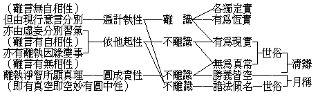



二　小乘的有无自性说



佛法中有一概加以破斥的自性，这就是表中的「各独定实」性——诸法各自独立固定不变的之实在性。如数论师说的神我，胜论师实句义中的我等九法，都是一一有情具有的各自独立不变性的实体。又如各种神教，说在宇宙万有发生之前，有一独立固定的神来创造一切，其所创造的万物，虽是无常变灭，然消灭后仍然有永远不变固定独立的神之实体。主张有这各独定实自性的，不问他指的是创造神、是实体、是神我，都同样的违反了宇宙人生是因缘生灭的最高法则。圣教与现实，都证明了万有的生起和存在，都必须具足多种的条件(因缘)，随条件的和合而生存，亦须条件的离散而毁灭，宇宙间绝对找不到一件单独存在固定不变的事物。这是宇宙人生的最高法则，也是佛法中最基本最重要的理论，上至三乘圣法，下及人天业果之所共同依据的。可是外道所计执的各独定实自性，决不是因缘和合生灭相续的。它与佛法的缘起真理，正站在不相容的对立地位，所以佛法中不问大乘小乘各宗各派，都一致的破斥这各独定实的自性为邪执；同时、最低限度也要破斥这种自性，才能够建树缘起真理的法幢。因为佛法普遍否认这种自性，所以都说空「无自性」。



其次说到「有为恒实」的自性，这如一切有部所讲的「一切法」，原包括有为无为二类，无为法留待下面再说，且先讲明有为法。有部说有为法是三世永恒实有的；但既落於三世的迁流变易，虽说「恒实」，还是有因缘生灭的。就在这因缘所生的有为法中，分析出最基本单纯的法，如俱舍的七十二法，认为是三世恒实的法；而现见现知的宇宙万有，无不是由这种种基本单纯的原素组合而成。这基本的原素，在现在固然是实有的；过去虽已过去，但还是实有的；未来虽尚未来，也同样是实有的。有为法既是三世恒实，当然有自性。但由这基本有为法组合成功的有情身器等，则是假合无自性的。又如犊子部所计我法实有的思想，也可摄属於这「有为恒实」内。他们说的五法藏(过去法藏、现在法藏、未来法藏、无为法藏、不可说藏)除了不可说我之外，其他的教义和有部相同。而这不可说藏的我，非即五蕴、非离五蕴，也还不能离开众法的关系而单独存在，所以与他部派所说的假我仍然差不多，不过名字不同罢了。他既说有过去现在未来的三法藏，当然也是主张有为法有「恒实」自性的。这有部——或犊子部所说的基本单纯的有为法，虽是恒续实存的，但还是因缘和合生灭的有为法，与外道所计执的各独定实自性，逈然不同。



另有主张「有为现实」的小乘部派说：在有为法中，过去的已经过去了，未来的还没有来临，都是无自体而依现在法假立的；唯有摆在眼前的现在法才实有体性。经量部师就是这种思想的代表者(大乘宗派中也有作这样主张的)。还有现通假实论者，或说五蕴是假，处界实有；或蕴处假立，唯界是实等。其实、这不过是认为实性的部份有彼此通局的不同，而其过未无体，唯现在可以有体的大前提，则无不同。所以、过去未来的法是假立而无自性的，现在世的有为法才是实有的自性。



其次说到「无为真常」的自性。无为是一切有为法的普遍真理，所以是常住不变的；小乘各部派分三种或九种。因是真而不妄、常而不变的理性，所以就在这真常的意义上说有自性。奘传小乘六宗里俗妄真实宗的说出世部等，谓一切有为世俗法都是虚妄无性，无为胜义才是真实常住的，就属这种。无为法虽系常遍真实，但祗是遍通一切有为法的理性，或遣除一切有为有漏所证的常住涅槃；与各独定实的自性绝不相同。部派佛教中，经量部等虽说现前可以见闻觉知到的有为法才是实有；无为法既非见闻觉知之所能得，实际上是没有的，所以祇是言说上的假施设；但在观行实践上，由择灭杂染所证得的涅槃，是任何部派也不否认其真常性的。所以这「无为真常」的自性，可说是各部派所共同承认的。



在小乘六宗里有叫诸法但名宗的，他们说：一切诸法，但有假名，都无实体。上面说的各部派中，有的主张有为无为俱实；有的主张无为是实，有为是假；又有的主张有为是实，无为是假；在他们的互相诤辩中，这诸法但名宗起而总合双方所说的假义，进一步的说：一切诸法不问有为无为，都是假名，没有实在的。凡圣教所说的，世间所见的，表面上虽似有其事其物，然究其实质，则都虚妄而毫无所有；甚至涅槃菩提等，也无非是假立的名字而已，所以都无自性。这种思想的提倡者，是说假部。



从有为恒实到诸法假名，是小乘部派佛教中对於有无自性问题的不同说法。在这里、各派的意见虽大有出入，但对於否认「各独定实自性」，还是一致的主张。



三　空宗的有无自性说



现在再来探讨大乘空宗对这有无自性问题的解说。



初期空宗的龙树、提婆、在所造的中、百论里，大致是以最彻底的诸法缘起为出发，以明毕竟皆空无自性。所以中观论开首即说：『不生亦不灭，不断亦不常，不一亦不异，不来亦不出，佛说缘起法，善灭诸戏论』。这便是说明世间出世间一切法，彻底都是缘起的空无自性，所以同时也都是空无自性的缘起。



龙树、提婆的根本宗义，大概如此。但是后期的中观论师，展转传承，对於原论的解释，意见不无出入。其中最著名的，是流传中国和西藏的清辨派，及单传於西藏的月称派。在胜义谛上看，不问有为无为，毕竟都是空无自性的；这一「胜义皆空」义，是二派共同的，没有异义。但二派在世俗谛上的见解，则有很大的诤辩。清辨认世俗可是实有的，其主张和「有为现实」「无为真常」相近。月称则谓：在世俗谛上说，诸法也都只是假名而已，没有实事，故与「诸法但名」相近。月称的说法，与中论『因缘所生法，我说即是空，亦名为假名』的文句，均相吻合。



这两派的思想，在言诠上看，胜义谛上虽同说皆空，而世俗谛上则清辨谓实有自性，月称说假无自性，很不相同。然若仔细考究其含义，月称虽说世俗诸法皆是假名无自性，然在假名中并不否认世出世间的业果染净诸法，不但不否认，而且以有空义故，才能成立四谛三宝等诸缘起法。缘起的三宝、四谛诸法，固然都是假名空无自性的，但说为假名并不是拨无染净善恶因果差别的成立。在这意义上说，清辨所说之有，也就是因缘生起的缘起有。这缘起有，一面是无自性故空；一面是因缘生故有。由是考究，世俗谛上月称所说的假名，与清辨说的实有，不过名词上的差别而已。考其含义，月称的假名，既不曾拨无染净因果，不但与清辨所说的俗有一样，甚或进一步可与小乘一切有部所说的「有」相接近。所以现在西藏黄教的所宗固为月称空义，但他们所用以说明世出世间的假名诸法，反而是引用俱舍论。所以、名句的应用虽有巧拙不同而意趣并非甚远。总之、空宗的要义，诸法皆缘起无自性。在二谛上说，胜义都是空无自性，世俗则或说但是假名，或说可有自性。



四　唯识宗的有无自性说



在广泛的唯识学中，派别相当复杂，意见也很不一致。这里且以中国向来所传的无著、世亲、护法、玄奘的唯识义为依据。以唯识宗的立场来观察诸法，首先要说明的是遍计执、依他起、圆成实三性，三性的范围，也有广狭不同。遍计执的构成，有能遍计、所遍计与遍计所执相；现在不是说的能遍计心与所遍计法，而是指的遍计所执之妄相。这狭义的遍计所执性最明显的意义，是但由现行的意识名言分别，计无为有，计有为无，周遍地颠倒执著，所以叫做遍计所执性，依他起性的正义，就是缘起法，所以古来也有译作「缘起性」的；依他众缘和合生起的诸法，叫「依他起性」。圆成实性，狭义说：即於一切法所显的本来普遍常住的圆满成就真实性，所谓诸法胜义的真如是。这是唯识宗正确的三性义。这三性中，依他起的范围最广；假使作另一种的说法，无始虚妄分别习气也摄在遍计性中，则扩大了遍计，连杂染依他也包括在内了。又把一切离颠倒的清净缘起法(净分依他)也摄於圆成实性中，那麼、依他起性的范围便很狭小，或竟没有了。虽有这第二种的说法，但唯识宗三性的标准义，还是以众缘生起为依他起性。



遍计执性，但由现行意言分别所起(现行意言分别之法，不一定都是遍计执性，但遍计执性，必定都是现行意言分别所起的)，如非有计执为有，世间现量不可得，出世净智现量亦不可得，只是意言增益有的。这里面有许多颇难辨别，如现前的桌子，在现见现觉中，只是黑色方形和坚触，并无桌子，桌子乃由意言增益起的名相；可是人们的习惯，都以为亲自见到觉到的，所以实有桌子。这种意言增益起的，虽很难了知，但还有一些很明显的，如龟毛兔角等，完全是名言增益而起。在名字上龟毛不是兔角，兔角不是龟毛，虽有差别，但离开名言之外，则世间见觉、出世净智，都不能证有，很容易的辨明它只是意言分别上所有的。由这明显的龟毛兔角之唯名言有，也就可以例知上来所说的桌子房子等，也唯是名言分别有的了。遍计执性无不是名言假立的，离名言之外没有自相，所以说他无自性。



依他起性，有一分是由无始虚妄习气现起的杂染法。这染分依他，不但由现行意言分别现起，同时也要由无始虚妄习气的内因才生起。三界中的一切有为法，无不是由无始以来虚妄分别之熏习於内识中，现在成熟才现起的。它与唯是独头意识上意言分别现起的不同；如有些有情，意识不发达，没有名言所起的分别，但还是有它的根身器界的识境。又如二禅以上的诸天，六识寻伺完全不起，当然没有意言分别，可是由不动业所感身器，还有他的定中境界。遍计所执，则完全是依托名言的，离了意言毫无所有；这染分依他，则亦托过去的分别习气为生起之因。例如龟毛兔角与翳华梦境，虽同是虚幻，但龟毛兔角只在意言分别上有，离言无别自相；翳华则依眼病而幻现，眼病未愈，翳华不会消灭；梦境因睡眠心生起，睡眠心未息，梦境也不能没有。染分依他也是这样，无始来虚妄分别习气没有断除，是无法使他不现起的。离现行意言之外，还是有世间现量的自相，所以说他有自性。



依他起中，亦有离执因缘变事的清净分。由出离烦恼所知二障和我法二执的无漏因缘所变起的清净依他起法，如报化身土、四智菩提等是。这些既是因缘所起，所以也是依他起法；离开名言，还是有净智现量的自相，所以说他有自性。



圆成实性，是离执净智所显的真理，不是名言所假立的；虽在悟他方便上也可以有名字的安立，但它「无有相状差别」。这无相状差别的真实性，是由「无分别智」证明的，所以说「离言有无相性」。由此应知，唯识宗说依圆有性，遍计无性，是依离言有体无体说的，如定执离言无体，则必拨无染净因果，落於损减执无疑。



唯识的「识」，以标准的唯识宗义看，是属依他起性众缘所生的；若离开依他起性谈识，则将超越唯识宗的思想范围，走入他宗的思想体系。识、有能了别转变一切法的雄力，是依他起法中最殊胜最主要的法；所以唯识宗看一切法，或可离言而有，但决不可离识而有。凡执离识而有的，都是遍计所执，不问你有的是真如，是涅槃，是胜义谛，只要执为离识之外的，都落於遍计执。所以从外道所计的各独定实性，乃至大小乘说离识以外的有为无为法，都是遍计。甚至说离识之外有实空、实心，也还是遍计。诸法但名宗所说的「名」，大致都承认是不离识的，所以没有离识的遍计执成分。



在西洋哲学里，有唯实论和唯名论。有的主张诸法的共相——观念或概念——普遍恒常，所以是真实的。他们以为事实上的桌子等，时间过久就要坏灭，空间则唯局一处，所以反是虚假；但桌子的名义——共相——倒是遍一切处一切时而真实的。所以叫做唯实论。反对唯实论的说：共相不可见闻，唯名无实，所以叫做唯名论。唯实论不免执名为实的遍计增益执；唯名论多少已走近不离识的途径。



在不离识中看一切法，有为现实，离言有自相性，是依他起。无为真常与胜义皆空，离言有无相性，是圆成实。



诸法假名，谓一切法都是现行意识上的名言分别，所以摄属遍计执性。然广义的如月称说世间根量，没有离了无始来虚妄分别习气的，所以都是假名，则此假名不但是现行意言分别，也包括了无始虚妄分别习气。最少可以通染分依他，甚至可以成立诸法「唯名论」，或「唯遍计执论」了。



总之、唯识宗是以可离言不可离识来说明诸法或有自性或无自性的。空宗是以可离识不可离缘来说明诸法都无自性的。然「识」也是缘起法，以缘起义说「识」也空无自性，是毫无问题的；但不可离缘的法，是否都不可离识，或不可离假名，则不无问题。所以、各宗普遍所无的是各独定实自性，其餘则有为、无为、胜义、世俗，有种种说法的不同。



五　中国佛学的圆中自性说



最后说到「即有真空即空妙有」的圆中性。中国佛典上常用「自性」一名，如六祖说：『明本自心，见本自性』；『何期自性本来清净？何期自性能生万法？何期自性本不动摇？何期自性本不生灭』？昔作曹溪禅的新击节，曾特拈「自性」而加以发挥。永嘉禅师说：『本来自性天真佛』。天台家在四弘誓愿后加四句说：『自性众生誓愿度……自性佛道誓愿成』。这些，举不胜举，极力讲自性，极力称扬自性，是中国佛学的特点。但到底这自性是什麼意义？和空宗等所斥为无的自性是不是相同呢？



当然是不同的！应晓得：离执净智所显胜义，因是离执，所以是空；净智所显胜义，则又是有。究竟真空就是妙有，遍常妙有就是真空。即有之空才是真空，则离有之空是顽空；即空之有才是妙有，则离空之有是妄有。凡是「有」者，皆性空缘起之有，微妙清净明彻之有；若一法不空，即不成妙有。凡是「空」者，皆缘起性空之空，真常圆满成就之空；若一法不有，即不成真空。这非妄有、非顽空、即真空，即妙有之如实义，无以名之，假名曰「圆中性」。举例说：如一株芭蕉，托於根种、水土、日光、空气的众缘而宛然生长；根种水土等因缘法也同样的需要依托众缘，从这展转依托的众缘上，求其边际不可得。就宛然的蕉相，层层剥完，求其中坚不可得。就根种之展转托於根种，向前推其开始时不可得。芭蕉复生芭蕉，向后推其终尽处不可得。所以是无边无中无始无终的。然后后当起，就从此开始；前前已尽，就至此为终。穷极众缘，即此是边际。现成宛然，即此是其中坚。所以即始即终即边即中的。无边无中无始无终。故毕竟皆空。即始即终即边即中，故统一切有。一芭蕉如此，一人、一芥、一色、一香、一微尘、一恒星、一毛孔、一念心，亦莫不如此。这圆中性，要到正智如如恒时相应的佛果正觉境界才能毕现。它是一切法的本来面目，其实普遍恒常本自如是，无庸上帝天神等之造作，所以叫做「自性」的。



这个自性本来就是没有一点儿离开一切法而单独存在的，所以就任何一法要想求得其独存的自性，终是毕竟空无的。而毕竟空无独存自性的任何一法，又莫不周遍一切法，一即一切，一切即一。一切法为一法的现起之缘，一法即属一切法，离一切法无此法，故一一都是空，空到彻底空。而由众缘现起的这一法，遍入一切法，为一切法生起之缘，故具足一切有，有到彻底有。一摄一切，一切摄一，一一法即是法界全体，故又法法具足而统一切法性。所以天台家常说：「一色一香，无非中道，随拈一法，皆是法界」。因为每一法都是统一切法的，所以随便拈起一法。小至一色一香，无非都是全法界。或问古禅德「如何是佛」？答：「砖头瓦块」。又说：「扑落非他物，纵横不是尘，山河及大地，全露法王身」。法法都是统一切法性，则法法莫不周圆，所以「拈一茎草」可以「作丈六金身」，「拈丈六金身」也可以「作一茎草」，甚至「青州牛吃草，益州马腹胀，天下觅医人，灸猪左膊上」。这统一切法性，有如海水，虽然后浪推前浪，波涛层出不穷，然皆不离海水的一味性；海水虽一味，仍不妨万波起落。天台家说：「真谛泯一切法，俗谛立一切法，中谛统一切法」，统一切法的中谛，就是这意义。贤首家说的事事无碍法界，也就是这意义。



这统一切法性，原是佛果智境的事事无碍法界全体性。但法法统一切法，则不妨在佛而佛，在人而人。所以通俗点说，不妨叫它做宇宙性；切近点说，也就是人生性；再切近说，就是当人自心性。所谓现前介尔一念心起，无不具足百界千如三千性相。虽不可得，而遍一切法；虽充塞法界，而无所有。所以达磨说：「直指人心，见性成佛」。六祖说：「明自本心，见自本性」。当前的这一念心，就是即有真空即空妙有的圆中法界性，也就是本来的天真佛；成佛不必外求，当人即是。



在佛的智境上说，凡夫确皆本来是佛，在修证的事实上也确实见性即是成佛；但因现行意识的颠倒分别，和无始虚妄习气的重重障执，明见现前一念自心的本性，却不是容易的。所以必须要破除重重的执障，扫尽无始的妄习；那末、必须修习种种方便解行，上来所说的小乘大乘各种有无自性的理观，又都是不可偏废了。所以有人问禅德：「如何是佛」？答曰：「即汝是佛」！进问：「如何保任」？答以「一翳在目，空华乱坠」。虚妄虽本明净，但要除尽目中的翳病，必须假借种种方便。所以佛说的一切法门，若能适应当机，无不是治病的妙药。虽然遍一切法皆是圆中性，又不妨层层破斥，重重融摄。



从这圆中性去探究，我们可以发现到台、贤、禅、净佛教的两个特点：一、在理趣上，从即有真空即空妙有的圆中性，阐明一一法莫不是统一切法的「法界全体性」，本来圆满，无欠无餘。虽台、贤、禅、净各宗教义有多少的不同，而这一点却是大家共同主张的。二、在行门上，从统一切法的现前一念心成为「摄归自心性」，所以在用功修行时，都从现前一念心为著手处。禅宗的直指人心；天台的一念心上观百界千如三千性相；华严的应观法界性一切唯心造；净土的执持名号一心不乱等，都是从现前的一念心上去彻观一切，修证一切。不过后来因为他们专集中在统一切法性的圆解，与摄归自心性的妙行，缺於研修其他一切方便，遂由疏略而渐落孤陋。



要明究竟的真理，可以说「从当人一念心彻见统一切法法界性」便得；在犹未成就一切福德资粮，没有修集一切解行方便以前，是做不到的。所以我们须一方面举扬中国佛法的特胜点，一方面为对治现行意言分别，无始虚妄习气，要修习种种教理行门的方便，方可以本末融贯，妙契圆中。



因讨论诸法有无自性问题，发现中国佛学的高唱「自性」，乃说为圆中的统一切法性，和摄归自心性的两特点，特别的拈提出来。



------



## （演培、妙钦、文慧合记）(见海刊二十二卷十



汉藏教理融会谈



——二十六年九月在汉藏教理院讲——



一　发　端  

二　空有问题甲　二谛上观察空有宗１　嘉祥四重天台七重贤首五重等  

２　瑜伽唯识的四重二谛



乙　论法上观察空有宗１　有宗用科学逻辑立论  

２　空宗龙树等用辩证法破显  

３　空宗清辨派近於形式逻辑



丙　空有宗比观  

丁　汉藏应互学



三　显密问题甲　不取东台密判教取藏所分显密  

乙　性相为显台贤禅净等即等於密  

丙　一切佛法之显密观  

丁　重重显密之胜劣观  

戊　台贤禅净及各派密续之互学



四　结　论



一　发端



现在研究佛学，和从前不同了。现在研究的范围更扩大，若说研究，就有巴利文系佛学，如锡兰、缅甸等；汉文系佛学，如中国、日本、朝鲜等；藏文系佛学，如西藏、蒙古、尼泊尔等。由这三系，流入西洋，更有西洋人的研究法。所以现在世界上关於研究佛学，有许多问题，如古学今学问题。古学，如三系中各自保守传统的研究法；今学，如从科学研究法而研究佛学，尤其日本盛行这新的研究法，所以反应到中国及全世界，就成为佛学的今学：於是现在即产生今学古学的问题了。



其次是大乘小乘问题：如我们中国等地向来所流行的就是大乘，所以说锡兰、缅甸等所流行的为小乘。但是、他们并不承认佛教有大小乘，所以说他们是小乘，他决不承认，在他们，自认为这是原来的佛法，或是根本的佛法；大乘反而是由流行变化成的，或说非佛法，或说非根本佛法，或认为大乘佛法是从他们的根本佛法上推广出来的，没有超根本佛法以上的佛法。如前年锡兰的纳啰达在沪时，说他在日本曾对日本人说，佛教不应分什麼大乘小乘，都应一概视为佛法，很得日本人的赞许。彼亦以此意徵问於我，我说：认为都是佛法，这是很好的，不过对於各地各种的佛法皆应遍学，不然、则反成自蔽於古籍。又如现在有到锡兰等地留学去的，如稍有心得，便觉得唯彼所学才是真佛法，中国向来所传的并非佛法。类似此等问题甚多，皆非现在所说得尽，暂且不谈。今天专从汉藏教理关系重大的略谈。



二　空有问题



甲　二谛上观察空有宗



现在当说汉藏佛法中的空有问题：空有即空宗、有宗(并无其他深意)，也就是平常所称的法性、法相。有宗讲三性，但三性不是共通常谈的，所以就空有共同常谈的二谛来说。



二谛在中国古代的译名很多，有说是真谛、俗谛的；有说是世谛、第一义谛的；到了唐译，才确定名称，叫做世俗谛、胜义谛，为空有二宗所沿用。然此等不同的译名，余意可以不必解说，现在但从二谛的意义以观察空有二宗的差别。



１　嘉祥四重天台七重贤首五重等



在中国古代，古德们对於二谛就浅深次第而解说，很有些出入，如嘉祥说四重二谛，天台说七重二谛，贤首依据五教说五重二谛等。此皆古德们约经论的意义，及内心所悟的道理而解释，在印度译来的经论上并没有此种的解释，所以他们也无一定的根据。现在我们只要知道古德们有此五重七重等的解释就够了，不必再说。



２　瑜伽唯识的四重二谛



有宗所说的四重二谛，见於瑜伽师地论和成唯识论，这是有圣教根据的，所以详为解释以观察空有宗的差别。



四重二谛，就是世俗胜义各有四重。世俗的四重是：世间世俗，道理世俗，证得世俗，胜义世俗。胜义的四重，就是世间胜义，道理胜义，证得胜义，胜义胜义。上二类四重复合起来，於法共有五种：就是在世间世俗有一种，即第一有情器世。第二五蕴等蕴界处法，就世间可名胜义，而从道理上说则仍为世俗。第三是四圣谛理：此四圣谛明世出世的染净因果，也就是所谓舍染成净舍凡成圣的因果，这在道理上是胜义，但在圣智的证得上则为世俗。第四是二空真如：二空谓人我空、法我空，亦云生空、法空，就是由此二空观智所证的真如，因为带能证慧的不同，所以说为我空真如、法空真如。此二空真如在智的证得上可为胜义，如证生空真如，就所证众生空性，是无差别相的，所以大乘般若对声闻人明法性无差别，每从其证空无相辨之；证生空性时，无四谛差别相可得，然尚带有差别名言安立，所谓生空真如、法空真如、及十地十真如等，故在能所双忘心言俱绝究竟胜义上，仍为世俗。再进一步，就是第五胜义胜义了；这胜义胜义，泯一切名言安立思想观察，唯如实真性。於这四重二谛之五种法上而观察空有宗的差别及其关系，如左表所示：



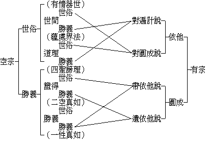



大概空宗说有情器界、五蕴十二处等法，及四谛中苦集道之部份，皆是因缘生法；既是因缘生法，就为世俗谛，於此因缘生法上建立世俗假相假名，故说有诸法。而这些假法其性本空，此空性为胜义，也就是灭谛。又就四圣谛对待相上说，也都是名言安立的假相，无苦集灭道，所以唯有证空性真如、或无智亦无得、毕竟离分别言说的一味真如，乃是胜义谛。因此、故说世出世的一切法，都是因缘假名，其性本空。



在有宗所说的，就复杂了。他说：这众生世间及器世间，是依蕴等和续而起，但是世俗；而蕴处界法及染净因果等，虽亦是依他起因缘生法，皆不离识。就识变上，破除遍计所执实我实法，对所破的遍计执方面说，此等依他起因缘生法亦可是胜义法。然若对圆成实而说，还是世俗而非真实，所以蕴处界及四圣谛等，对圆成实都是世俗的。即就证得胜义的二空真如，也尚带有言说假立依他起相。比如四圣谛所说的苦集灭道，仍是依他起上的共相理，而并非离一切相的无相真理，故亦是世俗。因二空真如，是就能证二空的观慧门上，说为人空、说为法空，而所证的空性，没有人法的区别。如就人空观，以能破除人我执，说为人空等，这犹对有为诸行说无常义，故说带依他相，不过无漏空智已是净依他了。至就究竟无差别性来说，这证真如的差别智境也不可安立，空平等性离一切分别，遣尽一切依他起相，才是胜义胜义谛。



以上二说，虽可见空有二宗的不同，但於此二宗可就各人意乐的不同，或趣入有宗，或趣入空宗；如於有宗所说的重重二谛差别上，觉著从世间世俗到证得世俗皆无非是世俗假法，虽然弯弯曲曲的说世间胜义等，其结果仍不过说明缘生性空，不出空宗的二谛理，此空宗义岂不简明确实？何用弯弯曲曲於胜义上生许多障碍，反使其不直截明显！故不如空宗因缘生法自性皆空来得爽快。如弘一法师前在厦门曾对我说：他所以不喜欢研究法相唯识，因为研究的结果仍不过明人法二空。故中国昔时唯识学并不怎样兴盛，一般人都喜欢趋入天台、贤首、禅宗等。但是近代科学哲学昌明了，有宗义和科学哲学重重义相，有能摄受现代思想的机用，所以复成兴盛的趋势。如现在的世间常识所认的宇宙万有、地球星球等等，就是世间世俗法。至於说到世间胜义道理世俗的蕴处等，在小乘中讲明的如一切有部诸论及俱舍论等；而这些所说的，多近科学，如纯理的自然科学等。



纯理科学的解析宇宙万有，不出一、物理，二、生理，三、心理的三种现象。例如专从物理研究的对象上，就可以无整个的人物等而唯是质力，故从科哲学观宇宙万有只为质力等的结合体，也犹小乘观唯有蕴等法而没有实我的意思。物理学对象即等於六尘，生理学对象即等於六根，心理学对象即等於六识。所以科学所见的万有和常识上见的不同，科学所见的较为确实，而常识所见的不过就和续相的人物上的观察；因此科学知识的境义较常识的境义为胜进，得名胜义。



又小乘犹有执蕴处界等是实有者，科学知识上也认为物理等是实有，但在唯识则说蕴等法，都是唯识所变的。识就是五蕴中的识蕴或受、想、行、识，十二处中的意处，十八界中的意界及六识界。这同於现代的科学哲学之休谟经验论、罗素新实在论等，他们说宇宙万有所存在的原料唯是感觉经验；这都归之於感觉的说法，和唯识所明的前六识之现量性境同。其物理、生理、心理都从这感觉分析出来，这感觉就是根本的实在，这种科学哲学很可相通到唯识论，更可名为世间胜义。



於蕴、处、界等法而明一切皆唯识，可接近科学的哲学而引科学者入佛法，因为科学的哲学所认为实在的，唯识亦然。但这所认为实在的，并不同於常识，常识的人物等必由概念以立种种名而起分别，感觉则不待概念而直接了知。如现前感觉冷热等，不必有名相而有感觉自相，这和唯识所讲的性境相似；就是於尘识等，不须起名言种类分别，在感觉即有自相，也就是正明其为唯识现。故唯识论能将世间世俗所不同於世间胜义之界限详细分明，很合乎现代的常识与科哲学理智的区别。



又从四圣谛的道理胜义以明，就是安立世出世间的染净因果之理，所谓苦、集、灭、道。苦集就是世间的染果染因，灭道就是出世的净果净因。这在世间通名上说，就是宗教；即明此世出世染净因果，皆唯识所现，就成宗教哲学。这里的宗教哲学，是指佛法，依佛法所开导的断染因果、证净因果为趣向之目标。然不明唯识义则不能成立宗教哲学，因为对於世出世、染净因果不能详确精彻的说明，於现在有科学知识的人，便不能予以确实的认识而起其宗教信仰。故唯识所现，更是说明道理中的胜义，也就是唯识学的特长。至於就圆成实说后二重，以犹带有依他起的世俗法，故在证得是胜义；在胜义胜义尚是世俗，若遣尽了世俗相就是胜义，也和空宗无何差别。这是就二谛上略说空有的不同点。



空有宗二谛上的差别，在有宗世间胜义和道理胜义上，空宗不承认其为胜义而与之辩论。至於证得胜义以下，便没有什麼差别了。然有宗说的世间胜义等，不过是对待世间世俗等而说，并不许为究竟胜义。明此，则二宗可无诤了。



乙　论法上观察空有宗



１　有宗用科学逻辑立论



有宗立论的方法，多用因明。因明和西洋论理学比观，是包括演绎法、归纳法的，属於归纳的一种，就是所谓科学逻辑。逻辑、译为论理，是合理不矛盾的意义。这科学论理，为西洋近代文明特色。若从所立的一种假设去种种观察而得同一的结论，成为公理定律，就叫归纳论理。此在因明上也有这种意义，例如瓶等所作故无常，证声也是无常，这等字即指从瓶盆等多种观察得到同一的结论。



有宗从无著世亲等造论以后，多用科学论理的方式。如於佛经上意义不发生问题的，就依之说下去；若有问题了，则引多种经及多种理来成立，如立第八识，引五教十理以证成。又如建立世间胜义之蕴处界与道理胜义之四圣谛等，都是用科学方法立论。其特长，就在精详的建立法相及因果之理。



从此等科学的立论法上，也自然有唯识的趋向。如被现代科学研究所逼生的哲学认识论，就其认识的限度，以立对於宇宙万有认识的范围，这很近乎唯识的道理。又如最新物理学讲到最后之物质波，以现於认识上而名之为认识波，弥近唯识所变义。



２　空宗龙树等用辩证法破显



龙树、提婆、佛护、月称等的传承，他们都用似乎近代西洋的辩证法——亦译对演法——来破执显理。因为龙树等的论旨不适於用因明，重心唯在直明诸法空性实相，故用辩证法。这辩证法，是观万有皆不安定而变动无常，一切存在皆是含有矛盾性的暂时统一，而无绝对性的统一；祇是矛盾的统一，故不能永久安定。由矛盾故发生变化，由变化又起新的统一，新统一仍是矛盾的和合，不安定的，有变化的。



从龙树等所说的看，亦说万有皆因缘有，都无有决定的自性。这因缘和合有，就是矛盾性的暂时和合，刹那生灭变化，不成决定不变的绝待自性；故於空宗，假使要究其决定的自性，他的回答，就是一个空字。不但蕴界处是如此，就是苦集灭道也如此。然非无矛盾和合的暂时存在，不过是因缘有的存在罢了。由因缘有故无独立的自性，不能安定的存在，究之、就是毕竟空。这就是由因缘法上显其空性，亦即在空性上说明因缘如幻的道理，比西洋的辩证法更为彻底，更不须用因明。因为是自无所立所说，皆就他之立说而破，如圣天说：『破如所破』，就是说能破的理亦同所破的执而空无所存。故此空宗最彻底的辩证法，较西洋的辩证法更进一步了。



３　空宗清辨派近於形式逻辑



中国以前罗什到嘉祥的三论宗也用辩证法，不过就后来传入的清辨的学说观之，似陷於形式逻辑。西藏所传，则有佛护月称派和清辨派，区别颇严。或说其不同点在於因缘世俗立自性和不立自性。依我看来，这立不立自性，不过名词上的区别；以清辨等的自性也是就缘生法假名的，并不同世间所执的实我实法——实我法的自性，唯识和清辨都是早已破除了。如小乘破凡夫我执，大乘破小乘法执等，所以不但清辨不执，即有宗也是不执的。故清辨所说的自性也是不过世俗名言上相待而说，如待彼说此说此非彼等，并不违背因缘假名的道理；则用不用自性之名，自是没有多大差别了。其最大差别，还是在立论的方法。按西洋的论理学，有演绎法与归纳法。演绎法的形式逻辑，只求形式对而其实无益。例由大前题中抽出小前题而作断案，其断案是於大前题中已决定的，如曰：「有为是空，缘生故，如幻」；缘生与喻均是有为，因喻已为前陈所包，所以这种立论但有形式而不生功用。所以，空宗自无所立，唯就他人的立说而破，他若无所说，自亦无所破。若如清辨自有所立，是则不能不就色心等各立自体为立论的基本，反蔽毕竟空义。所以空宗两派，是立论法上随应破与自立量的不同，而带起立不立自性的差别。



丙　空有宗比观



空有二宗，都是大乘。就空宗说，地前菩萨位上，以彻观空性而证究竟胜义为胜，有单刀直入之功。有宗以显理策行为胜：如有宗显示蕴处界各各因缘，及无始时来凡染因果与如何对治修证而转成圣净等，非常详明；由此等理论使一般能了解的有智慧者，不能不信受而发起舍凡成圣舍染成净的心。因此、有宗以令人修习净行，对治染因，策修广行见胜。更就地上观二宗，空宗说根本智境，有宗说后得智境。如唯识说『胜者我开示』及『我於凡愚不开演』等，皆明是后得智境。是则二俱智境，平等平等；若至佛果，则一切智智更无二宗的差别。



丁　汉藏应互学



汉藏虽都有性相二宗，但是两地都有所缺，如汉文佛教缺少关於空宗的，有佛护、月称、阿底峡、宗喀巴等发挥空宗的理论，这些都应当学。关於有宗的，中国於安慧的唯识不完备，亦需补充。至在西藏方面，也应学汉文佛教的护法、戒贤、玄奘、窥基等的唯识义，及罗什以来三论宗义和安慧中论释等。这样、才可和合成空有圆融的大乘。本来、空有二宗论传到中国，大抵皆提倡相助相成，而不是相破相毁的。如有宗虽明世间的道理的胜义等，无不以通达二空真如的真唯识性为究竟，故与空宗并不相违。但法相所说，在空宗的因缘假有上、对於凡夫外道小乘所执的人法上，以重重破除而显重重的染净因果差别，如辨二无心定差别及二世缘起义等，此皆非俱舍等小乘法相之可及，岂应以偏见而舍瑜伽、唯识等胜义而不用？这是从汉藏教理上略谈到的一点。



三　显密问题



甲　不取东台密判教取藏所分显密



再讲显密问题。显密所以成为问题者，是由於密咒兴盛，而批判其餘一切教法为浅显，成为显密对立，所以发生了问题。本来、密教传到中国也是很早的，大概在六朝时候吧，便有了杂密的经典输入。但是、真正的建立密教，还是在唐朝开元年间，当时有名的人物，如善无畏、金刚智、不空三藏等，都是专门宏扬密教的上师。并且在这时，也传去了日本。中国的佛法，因为经过了唐武宗的毁灭密教也就一蹶不振，继之而起的是不立文字的禅宗。一直到了元明清的时候，因为蒙藏的关系，帝王很多信仰密宗，在北方五台山等处也有很多密宗寺院；但多是喇嘛，和中国僧众及民间信仰，没有什麼关系。所以，可说汉土民间信仰祗属禅宗等；其燄口和其他的密咒，虽普遍於民间，为社会的风俗信仰，然非寺中修习的正课，如禅门日诵中的密咒，不过是附属的一种助行罢了。在民国六七年前，还没有所谓显密问题。近年来，因为密教的勃兴，一方面有由日本而输入中国的东密、台密，一方面由蒙藏关系的密切，而传来黄、红、白各派的藏密。汉地佛教有了密教而占有重要地位，形成显密对立的状态，因而又产生所谓显密问题了。



现在判显密教法的，有西藏和日本两方面。依日本所传的，又有东密台密两派：东密是弘法——空海大师所传，以东大寺及现在的高野山为基本道场；台密是兼天台宗的传教大师所传，以延历山为主要道场。这是东密、台密得名的由来，且亦是密教在日本放一异彩的中心点。不过日本的空海首把显密二教剖开，如中国密宗的经咒仪轨中，历来皆无判教之说，自从弘法大师著了十住心论及显密二教论以后，就有了密宗判教之说。十住心论，他还是根据贤首的五教，如十住心论中有畜生心、人心、天心的三种世间心，及声闻心、独觉心的二种就是贤首的小教，其第六、七、八、九心，就是贤首始、终、顿、圆的四教，此外再加密教为第十心。所以教理的分配，不过在贤首五教上更加密教。但其建立显密二教分判法，不啻把整个的佛教解剖开了，不免有所偏蔽，所以为现在讲显密问题所不取。



台密本来的判教法，是依天台的四教，而说圆教为密教；后来因受了东密的影响，便说法华等为理密，密宗为事理俱密。依我看来，日本东台密的判教法，是依於台、贤而失其当。因此由其判教之结果，演成各宗派而无整个佛法的流弊。现在不取日本所判的显密，而取西藏所分之显经密续。



西藏於佛说，除律以外总分为显经密续二种，从说人天声闻等小乘法及说空有观行等大乘法为显经，其餘由师弟传承的咒印仪轨等为密续。其相传续承的密法，换言之，亦即实际的修习法，所以密宗道次第上亦未另有判教之说。单就所传的实际修习法而说为作、行、瑜伽、无上四层，故今取之。



乙　性相为显台贤禅净等即等於密



此义在上次佛理要略中也曾说过，所谓大乘法有三：一切法自性空义，一切法唯识现义，一切法大总持义。这里的相，就是唯识，性就是空宗，此二皆重在以教显理，即将一切法的究竟性和行果的差别相，用教把他显示出来，是教的本义。



整个的佛教，传到了中国，就产生天台、贤首、禅、净等宗。禅虽是印度传来的，但成为宗派者，是在中国。然净土宗在中国，犹不过念佛发愿往生罢了，其说理是附属於台、贤、禅等，并没曾另有判教等的方式。但传到日本就不同了，日本别立净土的教理系统及判教等的方式，发达至净土真宗，且建立教解证信的四个次第，而不言於行。他的教是弥陀教，於此起解，由解而证，由证方为真信，真信就等於已生极乐。其念佛不过感念佛恩罢了，和中国要由念佛等行而求往生不同，故彼称纯他力宗，不藉修行。其现在的世间行化，也是已生弥陀极乐而来度人而已，这是净土教发达最极至的表现，故净土真宗即等无上密宗。又如天台圆教一念中具足理事两重三千性相，深明法法即是大陀罗尼义，与贤首之事事无碍法界相同。禅宗在表面上其问答多不可解，而在此问答上就直示法身全体大用。如从前杭州鸟巢禅师有一个侍者，侍师多年，以师平常一点佛法也不讲，乃告假欲去。师问其故，他说要向他方求佛法。师即手拈衣上布毛一吹曰：「若佛法，这里也有」，侍者顿悟。这岂非信手拈来无非佛法之义？也就是一事一物无非大陀罗尼法，所以台、贤、禅、净的行法，即同密宗。天台等虽判一大藏教，然宗要上即一心三观，贤首也唯是华严法界观，所以就其宗要说，与密宗无别。



丙　一切佛法之显密观



前面二段是就部份的佛法观察，这里是就整个的佛法而观察显密，略分四类如下



１　显中显



以前讲的五乘共法、三乘共法、和大乘法相、法性等，都属於显中显。虽大乘法相对於法性亦说尚有隐密未显了处，而对於下列三重还是显中显的。



２　显中密



在所依的经典如华严法华等，是属於显经的；可是台、贤、禅、净的宗要所在，都是明一切法皆大总持而修观行的。此观之天台所说，任何一色一香皆即法界，一切法皆不能趣过任何一色一香，就可以知道了。



３　密中显



即唐宋以来汉文教典所传的密咒经轨，和日本依於汉文经咒仪轨所传的金刚界、胎藏界等，以及藏蒙红白黄各派所传的密法。此等虽是秘传的密法，而经咒仪轨等明修行次第，皆有定轨法则，其修习观想等法，也是极其次第差别明显的，因此可立为密中之显。



４　密中密



禅宗在门庭施设上，可说为密中密。禅宗的特重点，专在乎证而不在乎教，所谓心心相印，相印就是证到了，不相印就是不曾证得，故称教外别传，所以成密中之密。在各宗究竟极证上，都为实证而无言教安立的，至於说即身成佛、即心是佛等，已是多事了。因为在密之极密是毫无生佛相可安立的。



丁　重重显密之胜劣观



现在讲的胜劣，就是依於前面的显中显、显中密、密中显、密中密而判别。前面四重中的显中显，除了五乘共法三乘共法以外(因为五乘三乘共法，只摄大乘一分，故不另)，其餘如显中显的大乘法性法相及显中密的台贤禅净等，既可互为平等观，又可互为胜劣观。因为就显中显的大乘性相而说，可算是显之最浅显的，而显中密的台贤禅净在显法中，以明一切皆大总持之不可思议义，就比较深了一层。至於密中显所依的教法已深秘玄密，更能从实习上重重显明出来，比较又进步了。到了密中密，就是甚深最甚深，最高无比的了。同时，也是一程序中所指的最殊胜法。



但以上四重，是由显浅而深密说的，若是把这四重行列倒转来，则其胜劣也可互易其位。如密中密，可说为佛法最浅劣的，因为密中密所主的，即在法界法性，无论有佛出世、无佛出世，其性法尔常在，如禅宗说「古镜未磨，照天照地」。因此、故说一切众生即是佛，无佛外之众生，也无众生外之佛，即生即佛，无生无佛，都是密之极密的意义。而一切都是黑暗的，一切都是无别的，禅宗说「墨汁乌纱半夜文」，即是此义。所以、密至极密，既无一点佛法，也无能证的行所证的果，甚至连佛出世也是多事，所以云门说：「老僧当时看见，一棒打杀与狗吃，贵图天下太平」。因为有佛出世，於是有佛有众生，便要分别得不安了。若不出世，岂不都是佛？岂不毫无分别？从此义上，故密中之密即是黑中之黑，是最未显的佛法。从此进一步是密中显，这犹如黑暗中有一微光、晚上的星灯一样。因为密续若无性相教理等的说明，单仗传承的密咒和仪轨等的指示而观想修行，好像在暗中靠一点灯光行路一般。再进一步就是显中密，此对於十法界圣凡因果等已能种种分别，把他显示出来，并显出假中之空及空中之假等中道义，这犹如月光一样，遍照世界。但此月光，还非至极的明彻，故须待显中显的大乘法性法相，对於因缘性空及性空因缘的究竟道理，不但以多种经说明，且以多种论不惮烦地重重诠显，像这太阳光一般的周澈明显，乃可说是最究竟的佛法了。而且、这大乘法性法相，将世出世的重重缘起差别显露出来，皆成为究竟正遍知的所知境，而照了一切法更无餘障。所谓正遍觉者的正觉中，一切法皆是大圆镜智智影；大善巧的教法中，於一切法平等理和差别事莫不如理如量显了，所以把前面的密中密倒转来，显中显又是最殊胜了。然此不过举例说说罢了，实则此中还可作别种看法，如从天台贤首等宗义上，也莫不各各显其宗义为最胜，在此所显义上，也别别以分判餘法之胜劣。总之、凡以何法为宗的，就以何法为最胜；此不但於教法是如此，就是各传其密法也是如此。如日本、西藏、汉地皆各有所传所宗的密法，而各就其所传的密法表示为最胜。故在此显密重重次第上看来，就可见一切大乘法是平等的，而在平等中又各有胜义胜用的不同。



戊　台贤禅净及各派密续之互学



此从显密问题上观察，觉汉藏佛法应互修学，尤其在汉藏教理院对於汉藏佛法应互相研究。如西藏各派所传的各部密续，中国缺的很多，我们应去修学。若中国台贤禅净的修学有成就的，对於西藏也可作转播，使藏人亦对台贤禅净有所研习。如此、乃能澈佛法之底，尽佛法之量。



四　结论



台贤禅净可说是唐宋以来的佛法，到晚唐后，大乘法尤其只流行台贤禅净。在这千年的时候，大凡中国佛教徒所修学的，教、就是台贤，行、就是禅净，唯此可以代表中国整个佛教。但是、近来中国佛教的命运，也如中华民国的命运一样，日趋衰弱！中国佛教的破产，也如中华民族的文化一样，支离破碎，空疏荒芜！像这样溃烂的中国佛教，似乎无有可代表中国从东汉到唐以来、中经几百年所结晶的中国佛教的特质了。由此在最近，或把佛教从日本传到中国来，或从西藏传到汉地来，或从锡兰传到中国来；也如中华民族的趋势一样，由几千年进步来的文化已不能自存自立，反退化到唯以模仿外来文化为事。今中国佛教亦似乎破败到这样的不可收拾地步。然从东汉中经几百年到唐代结晶下来的中国佛法，竟如此完全空疏而无意义无价值的吗？其实不是如此的；可看此中所明的一切法大陀罗尼义，在四重显密中都显出台贤禅净所说的特长。此大陀罗尼义，应总摄五乘、三乘共法及大乘性相而成为大总持法。既由总摄一切佛法为基础而成综合的中国台贤禅净法门，岂四教仪、五教仪等就可以代表了吗？这是要普容遍摄五乘、三乘、大乘的佛法，方成为真正的台贤禅净中国佛法。就是要把台贤禅净的中国佛法，从根救起来，要由这普容遍摄的途径，方克济事。虽禅宗的单提向上直指顿悟的宗旨，而此如畫龙点睛，先畫得有龙乃需要点睛以活现一条龙；若先无一切教法的龙，便也失禅宗点睛的用了。又如念佛固然也能够总持一切佛法，然若不能普容遍摄一切佛法，而反事排斥，单执一句阿弥陀佛，亦不过执持空名罢了。所以，今应普容遍摄锡兰等三乘共法律仪及大乘性相与西藏密法，乃可将中国佛法发达兴旺，一天一天的充实复活。而在复活的过程中，发挥台、贤、禅、净、总合的特长，将律、密、性、相，澈底容摄成整个的佛法，於是中国的佛教因之重新建立，而亦可成为现代的世界佛教了。



------



## （碧松记）(见海刊十八卷十二



几点佛法的要义



——二十八年二月在昆明欢迎会讲——



今日得与大家相聚一堂，真是一种难遇的因缘，不可把光阴空过了，因提出几点佛法的要义来供大家参考。



第一、佛法虽然是法门无量，广大如海，而主要的厥为业报。故学佛法以彻明业报，确信业报为最要紧！佛所说的一切经教皆不离业报，信仰佛法即是信仰业报，不管是说一切皆空也好，诸法唯识也好，密宗也好，净土也好，总越不出业报，换句话说，业报就是因果报应。要想得好的果报，即先行好的业因，若拨无因果，便非佛法。这是佛法中最普遍而又最重要的一个原则。



第二、佛教的学理，比其他任何宗教学说来得宽广而深圆。佛法依三界(或云法界)众生而设，三界中有人类——我们生在人中，佛亦降生在人中，在人言人，侧重人间而谈佛法固无不可；但要知道宇宙间的一切众生皆在佛化之中。若以人间自封，除现见外不论其他，否认餘趣存在，即等於自掘其根自塞其源，未免把佛法弄得太狭小了，那就大大不可。



第三、就历史上看，中国佛法在隋唐最为兴盛，而其特殊之精采即是禅宗——唐以后的佛教都以禅宗为中心。宗门与教门工夫的差别可以明言者：即教门在深解「现前身心世界」是无常、是无我、是空、是唯识，而起观察，而得通达。宗门在深疑「现前身心世界」是从何而来？从何而去？是谁？是什麼？而起参究、而得彻了。二者都是依「现前身心世界」为下手处；到了既「通达」、既「彻了」之后，所证所得亦无若何不同，所谓「方便多门，归元无二」。其不同者、即其工夫一由解而起观行，一由疑而起参究耳。



由教门修行者，若住於由解而观的观智上，固是滞於加行而未能入根本智；然由宗门修行者，若凝於由疑而起参的参情上，尤落痴禅而不能豁开妙悟。故宗门须以由大疑而大悟为则！所谓「黑漆疑团忽打通，一多长短亦含容，踏翻宇宙浮沤上，逼塞虚空刹那中」；可以微露此中消息。这是修这两种行者所当注意的。



第四、说到近来中国佛教的情形，因为受到日本新的研究方法的影响起了很多变化，尢其是西藏佛教近亦影响内地很大。平常都以为西藏只是密宗的佛法，而不知道他们还是很注重教理研究的。他们的研究法注重辩论，而辩论不是随便冲口而出，是有因明比量为格架的。因此有的人主张必要由比量的理智，乃能观察起修加行智而入根本智。然此因亦不定：譬如宗门下的初根人因疑而参，与宿根人的才闻即悟或一闻千悟，皆不须经因明比量智的理解；即教门中的随信行人，亦可由深信诸圣上师的教示持戒习定，生现量慧，以得预入圣流。故必须经因明比量乃起加行智者，只是教门中的随法行人耳。历观古今中外之佛教三乘圣者，不惟不皆曾先习因明比量，且多不先由博通教理而得圣果，可为明证。但西藏依因明比量的辩论方式与复兴现今的中国佛教很有补益，因为中国佛法之衰病在儱侗，以此为劝学因明研究教理之一方便，固亦甚善。所以本人近年在重庆办一汉藏教理院，以汉文藏文而研究此两种文字的佛法，使互为沟通以相补充。



其次、西藏相传只许四宗：小乘只许一切有部宗与经量部宗，大乘只许龙树菩萨的空宗与无著菩萨的唯识宗，其餘只可称派不得名宗。在中国有部当俱舍宗，经量当成实宗，大乘即空有二宗。如此说来则中国的天台、华严、净土、密宗、律宗、禅宗都不能名宗了。为他们所说是依因明比量智解以为宗的。这虽可如是说，但如玄奘法师所传来的「小乘二十派为六宗」已不尽然了；何况中国的台、贤、禅等宗，皆直依根本智或佛智为宗，宗在离言不思议法界！自更非上说所能限了。



中国的楞伽经上有宗通说通之说，中国向来视同世亲所谓证法与教法的差别：以圣智自内证为宗通的证法，以因机施设教化为说通的教法。而西藏则以闻持言说之教为教法，因喻证成之宗为证法；亦见其宗在比量智解，与中国的宗在出离随念计度分别之现量不思议智境者不同。盖西藏能谨守印度论师之所传，而中国古德则每能豪迈不羁，直探诸佛诸圣诸祖的内证心源，故异其趣。



大乘唯识宗侧重在「印所取空」的忍位加行智上，大乘皆空宗侧重在「印二取空」的世第一位加行智上，此亦诚为比量加行智之极则，专以比量智境为宗者，确不能越出此范围。然中国的台、贤、禅宗则皆宗在无得不思议的出世间智上，即以圣位根本智、后得智或直以佛的一切种智为宗。即中国三论、唯识宗都有此种趋势。故余并法性空慧宗，法相唯识宗，而鼎立法界圆觉宗也。盖非开立法界圆觉宗，不惟无以位置中日之台贤禅密诸宗，且亦不能看明全部的中国佛法趋势。此为余研究佛法以来，并纵观西藏、日本的佛教而得此结论，甚望高明者共商讨之！



------



## （尘空记）(见海刊二十卷第六



新与融贯



——二十六年八月在世界佛学苑研究部讲——



一　由本人意趣说起甲　非研究佛书之学者  

乙　不为专承一宗之徒裔  

丙　无求即时成佛之贪心  

丁　为学菩萨发心修行者



二　佛教中心与中国佛教本位的新甲　新的意义  

乙　佛教中心的新  

丙　中国佛教本位的新



三　宗乘融贯与文系融贯甲　融贯的由来  

乙　宗乘融贯  

丙　文系融贯



四　本院研究诸系的略明



一　由本人意趣说起



今天拈「新与融贯」一题，说明本人所指导研究的纲要。先由本人的意趣说起。关於本人的意趣，在南京讲优蒲塞戒经时，已分为四点略略地说过，现在再提要於此。



甲　非研究佛书之学者



把佛书当做学问研究，国内外的人颇不少，其实、从事攷稽佛书而研究其义理，以造成一专门的学者亦不是件易事；而时有扬其一得衒异鸣高之弊。一般人读了本人的许多著述，以为本人是个用字比句栉、勾古证今的研究佛学者，实际上本人读书每观大略，不事记诵，不求甚解，而以资为自修化他之具为目的。所以本人的志愿趣向上，从不冀成为学者，唯在能成就振兴佛教觉人救世之方便耳。



乙　不为专承一宗之徒裔



佛法中分宗立派，早在印度即有小乘十八派或二十派别；之后大乘复兴，遂有大小乘对峙；大乘复分法性法相之空有两宗；继之又有真言宗兴起；是为印度开宗立派之概况。而在中国方面，亦有天台、华严等宗之别；同时、宗中又立派，如禅宗之临济、曹洞、沩仰等是。宗派之所以兴起者，差不多都是以古德在佛法中参研之心得为根据，适应时机之教化上而建立的。中国性、相、律、密各宗，为传承印度的宗派；台、贤、禅、净等，为创立的宗派。日本继承中国，复有日莲宗、净土真宗等之开创；诸宗派至今，皆各有其系统的传承，非常严格。而本人在佛法中的意趣，则不欲专承一宗之徒裔。以为由佛之无上遍正觉所证明之法界性相，为度生应机而有种种施设，法流多门，体源一味，权巧无量之方便法，无不为度生而兴；古德开创宗派，其妙用亦在乎此。由此看法，无上大觉海中流出来的教法，为了传持者及入世应机的各有偏胜：由迦叶、阿难等承持，则成初期小乘；由龙树、无著、世亲等弘传，则成中期大乘；由龙智、善无畏、莲花生等传承，则成后期密法；印度佛法，因之可分为三期了。后来到了佛灭度后千二百餘年的当儿，印度的佛法已由衰落而消声匿迹；在印度奔放的佛法鲜花，不能不转移到异地去开放！锡兰、暹罗、缅甸等地所盛传之巴利文佛法(以锡兰为代表)，就是印度的初期小乘佛法；从中国到高丽、日本等地所盛传之佛法(以中国的汉文为代表)，就是印度的中期大乘佛法；而由西藏及再传於蒙古、尼泊尔等地所盛行之密法(以中国的西藏文为代表)，即为印度的后期密法。此为印度三期佛法的二千餘年来支流的大概。其於诸法性相一味平等中之各宗派法门，皆可随人根机所宜而修学，藉以通达究竟觉海。所以本人观察佛法之五乘共法、三乘共法、及大乘不共法，原为一贯；在教理解释上，教法弘扬上，随机施设而不专承一宗或一派以自碍。



丙　无求即时成佛之贪心



站在佛法立场上，用佛法的眼光去观察世界众生，一切众生互相关涉，而一世界与无量世界亦相摄相入；所谓「一即一切，一切即一」，即是此意。所以佛法并不是为此一人生及此一世界而起；即此一生一世亦当体无始无终，无边无中。发心修学佛法者，应不为空间时间所限，宜超出一切时空，涉入一切时空。於佛法如此理解，即能自悟悟他，精进无息，无庸拘定要即此身成佛。盖成佛不过自悟悟他而已，菩萨行满，佛陀果成，但勤耕耘，自能收获，何须刻期求证！因为刻期追求，大抵为满足虚荣心所驱使；而著相拘求，非仅心量狭小，且未免反增烦恼耳！佛法中虽有为接引一类夸大之众生，或激发一类懈怠众生，施设即身成佛、立地成佛等假名，但本人提倡发长远心修自悟悟他行，不怠不息，而不以此类假名而掀起刻期求成之贪心。



丁　为学菩萨发心修行者



前面三点从消极的反面立说，第四点恰从积极的正面言之。从正面讲，本人为一从凡夫而得闻佛法信受奉行者，认佛法中的五乘共法、三乘共法及大乘不共法，均一贯可达到究竟圆满之觉海。凡能贯通五乘、三乘及大乘教法而发菩提心修菩萨行者，便是菩萨，所以本人在佛法中的意趣，是「愿以凡夫之身学菩萨发心修行」。这里有两件事：一是学菩萨发心，二是学菩萨修行。本人还不能如菩萨那样发心、修行，现在是学菩萨的发心，学菩萨修行。本来学菩萨是极难能的事，须经过十信而入初发心住，再经十住、十行、十回向修集福慧资粮满足，始能进为圣位菩萨。今人不知此义，每每稍具信行，马上心高气傲自命成佛；不知少分之学发菩提心、学修菩萨行尚未做到呢！你们发心到佛法中修行，要切实认清这一点。照大乘起信论上讲，真正初发心菩萨，须於入发心住以前，经过十千大劫修行六度万行，才为真正初发心菩萨；然后再经过三大无数劫，方能证得无上正等正觉。所以本人亦为愿学菩萨发真正菩提心而修行六度万行者。至於发菩提心的修法，前新译西藏宗喀巴大师著的菩提道次第论，根据印度龙树、无著诸菩萨所说，曾有精密的阐明，可参照修习；俾不落於人天福报心、二乘自了心，而得发起修行六度的大菩提心。



二　佛教中心与中国佛教本位的新



甲　新的意义



依上面的意趣，可以观察本人的思想，即新的思想与融贯的思想。先说新的意义：平常说新乃对旧的反面而言，而佛法真胜义中无新无旧，缘生义中则没有一定的分划，小至一事一物，大至一世界乃至无量世界，都刹那刹那生灭相续的迁流著而新陈代谢。然依佛法契理契机的契机原则，以佛法适应这现代的思想潮流及将来的趋势上，因为人类在一个区域之中一个时代里面，适应其现在的将来的生活，则有一种新的意义。便是契机的意思。根据佛法的常住真理，去适应时代性的思想文化，洗除不合时代性的色彩，随时代以发扬佛法之教化功用，这在四悉檀中叫做世界悉檀，即是佛法活跃在人类社会或众生世界里，人人都欢喜奉行。如是，即为本人所提倡的弘扬佛法的新的意义。若是故步自封不能适应时代；或标奇立胜，从古代或异地另寻来一个方法，欲以移易当地原状，则都不免落於非契机的病根上。一般为佛法传持的人，若能依照契理契机去躬践实行，则不但目前及将来的中国的佛教可以发扬光大，即全世界佛教亦会因此而鼎新起来。



乙　佛教中心的新



新、需要佛教中心的新，即是以佛教为中心而适应现代思想文化所成的新的佛教。这佛教的中心的新、是建立在依佛法真理而契适时代机宜的原则上。所以本人三十年来宏扬佛法，旁及东西古今文化思想，是抱定以佛教为中心的观念，去观察现代的一切新的经济、政治、教育、文艺及科学、哲学诸文化，无一不可为佛法所批评的对象或发扬的工具，这就是应用佛法的新。然而、若不能以佛法适应时代、契众生机，则失掉这里所谓的新，在社会众生界是一种没有作用的东西：如此的佛教，会成为一种死的佛教！又若不能以佛教为中心，但树起契机的标帜而奔趋时代文化潮流或浪漫文艺的新，则他们的新已经失去了佛教中心的思想信仰，而必然的会流到返俗叛教中去！这都不是我所提倡的新。在这把握佛教中心思想、去适应时机、融摄文化和适应新时代新潮流去发扬宏通佛法，我有很多的写作，都是如此的。



丙　中国佛教本位的新



本来、佛教是没有民族和国界的限制的，现在讲中国佛教本位的新，则因在中国已有一二千年历史的佛教，有不得不注意的必要。而此中所谓中国佛教，更应简别为华文佛教。今中国虽合汉、满、蒙、回、藏，然汉文占十之九有餘，故通称汉文为国文；那末汉文文化就是中国文化。海禁未开之前，交通不便，各国文字彼此互相研究非常困难，今日往来研究各国文字已比以前容易及繁广得多。即如在这讲堂里，通外国文者，如巴利文、缅甸文、英文、日本文等，各有其人。在目前中国佛教里的出家僧众，是很有人能精通其他文字的了；所以现在彼此互观各国之佛教，是感不到困难。但是我此中所云中国佛教本位的新，是以中国二千年来传演流变的佛法为根据，在适应中国目前及将来的需要上，去吸收采择各时代各方域佛教的特长，以成为复兴中国民族中的中国新佛教，以适应中国目前及将来趋势上的需求。由此，本人所谓中国佛教本位的新，不同一般人倾倒于西化、麻醉于日本，推翻千百年中国佛教的所谓新！亦不同有些人凭个己研究的一点心得，批评中国从来未有如法如律的佛教，而要据佛法的律制以从新设立的新！此皆不能根据中国佛教去采择各国佛教所长，以适应目前及将来中国趋势上的需要。所以本人所谓的中国佛教本位的新，有两点：一、是扫去中国佛教不能适应中国目前及将来的需求的病态，二、是揭破离开中国佛教本位而易以异地异代的新谬见。在这两个原则之下，在中国目前及将来趋势的需求上，把中国佛教本位的新佛教建立起来。



三　宗乘融贯与文系融贯



甲　融贯的由来



关於本人的融贯思想的由来，说起来亦大有因缘。最初、本人亲近的善知识，是禅宗的寄禅老和尚(即八指头陀)等，对於参禅的倾向较深，对台贤教义稍稍研究。后来自看藏经，於性相经论的得意处，每在离言的禅意，颇契维摩经所谓文字性空即解脱性。如天台的离言谛，法相的离言自性，法性的离戏论分别，都融彻到禅宗上的不立文字，如古人所谓「不即文字不离文字而为道用」。放观一切经典文字的佛法，不是摆设在地上的木石，而同渗透虚空中的光影；故於一切佛法，容易成为融会贯通的思想。此种思想，在我的著述中发表的很多，这里且提出两个纲领来说说。



乙　宗乘融贯



宗、即是宗派。我曾把印度、中国、日本之各部各宗各派，融贯以著成佛教各宗派源流，及佛乘宗要论、大乘宗地图等，可资参考。乘、即诸乘，论藏、曾以五乘共法、三乘共法、大乘不共法融贯於佛学概论等。本人这五乘共法、三乘共法、及大乘不共法，可与西藏宗喀巴大师的菩提道次第论中的下士道、中士道及上士道比观。如图：



　　　　　　　┌下士道──五乘共法　┐  

　　　　宗喀巴┤中士道　　三乘共法　├本人  

　　　　　　　└上士道──大乘不共法┘



丙　文系融贯



从大觉世尊大悲心海中流出的清净教法，在印度有三时期：即是初五百年的，今流为锡兰、缅甸、暹罗等地的巴利文系佛教；第二五百年的，今流为中国、高丽、日本等地的华文系佛教；第三五百年的，今流为西藏、蒙古、尼泊尔等地的藏文佛教。



　　　　　　　年　　　　代　　教　　　　法　　流　传　地　方　　文　系  

　　　　　　┌第一期五百年──小彰大隐佛教──传锡兰暹罗等地──巴利文  

　　　　印度┤第二期五百年──大主小从佛教──传中国再传高丽日本─汉文  

　　　　　　└第三期五百年──密主显从佛教──传西藏再传蒙古等──藏文



除此诸文系以外，欧美文系近年亦成一新的研究。依止各文系以融贯世界佛学而为建立弘扬世界佛学的工具，是本苑名为世界佛学苑的由来。不过第一宗乘融贯的思想，初祗限於汉文系，今后希望普遍到各种文系中去。第二文系融贯的思想，希望研究各种文，更能融贯到所研究各部派的宗义上去。



四　本院研究诸系的略明



本院的研究系，分为六系：



第一、俱舍阿含系：此举俱舍为主而遍及三乘共法，从汉文的俱舍阿含研究，亦须参考巴利文、西藏文各系，才能融会贯通。俱舍、阿含为最能贯通各文系之佛教者，故研究佛教者须从此著手。



第二、法性般若系：法性般若系以中论或三论或四论(即於中、百、十二门三论外添一大智度论)为研究之入手。在印度有龙树、提婆、罗睺罗、青目、清辨、佛护、月称等诸健将；在中国有鸠摩罗什、僧肇、僧叡、高丽朗、止观诠、兴皇朗、吉藏等中心分子；在日本有慧灌、福亮、道慈等主要人物；而西藏各派亦大抵奉中论为究竟义。



第三、法相唯识系：研究法相唯识，可以慈恩师资之说为基本。上溯印度无著、世亲、安慧、护法，及中国觉爱、真谛三藏等，而下逮慧沼、智周，以及日本、西藏唯识学中诸巨子。



第四、法界显密系：此系包括、台、贤、禅、净、密五宗，中国千百年来都以台贤为教义，以禅净为修行，而近年则密咒行亦颇兴盛。



第五、教乘次第与教宗历史系：教乘次第是一种总摄分判一切佛法的位置研究；教宗历史，是对于整个佛教或各宗或各点的历史系研究。



第六、律藏研究与僧制整理系：佛制戒律，是佛教建立住持僧团的生命线。照原始律仪履行最盛的，要推锡兰、暹罗、缅甸等地。在中国、日本、西藏则多有变通。僧制整理，是中国目前的一种必要工作，在本苑的指导师及研究员，要认清这僧制整理的工作，须要从律藏研究到各方域各时代的僧制。



上面六系，如研究法界显密系，要融会贯通台、贤、禅、净、密以研究，当然比专学讲天台教、贤首要艰难得多。现在应不避艰难地本著这新的融贯的宗旨，勇猛研究，乃能跃进为现在到将来的世界佛教。



------



## （福善记）(见海刊十八卷九



佛教的教史教法和今后的建设



——二十一年十二月在闽南佛学院讲——



一　全部教史的纲要甲　佛法流变的原则  

乙　印度佛教的三期  

丙　世界佛教的三系



二　全部教法的纲要甲　四藏  

乙　三法１　五乘共法  

２　三乘共法  

３　大乘不共法



三　今后佛学的建立甲　研教１　法物  

２　经书



乙　究理  

丙　修行１　律仪行  

２　禅观行  

３　真言行  

４　净土行



丁　证果１　信果  

２　戒果  

３　定果  

４　慧果



四　今后僧教育的建立甲　律仪院  

乙　普通教理院  

丙　高等教理院  

丁　参学处



五　今后教制的施设



一　全部教史的纲要



甲　佛法流变的原则



这是从佛教最初的发源、至后来千派万流的流传上、提出一个纲要来观察全部的佛教。佛教的发源是由降生於印度的释迦牟尼世尊，所以在这里，我们第一，要认清全部的佛法，都是出於释尊一代中所应化施设的教法；虽然由后世的学者将牠发挥光大而进展，而推其根、寻其源，则皆基於释尊一代中所开示，不同普通一般研究历史者，或以为后世学者所新创的观念。我们真正信佛法的人，须首先在这点上认清楚，才晓得后世所流传的佛法，皆是以释尊一代所示的教法为根源。有了这根源，后世学者依著时代潮流的特殊机缘，就能把牠这部分那部分的传播四方而发挥光大，而其根源总不外释尊现身说法的施教。这样，知道佛法的流传，都是从佛陀亲证的法界性相中流露出来的佛法，才能握得佛的「心印」。



说到流传，首先就想及佛灭度后阿难、迦叶尊者等结集法藏的关系。但不必完全由於他们，先时同时或后时更有其他的弟子们共同结集或各成记录，不过在佛灭后首先盛传的，以阿难、迦叶为重要的领袖而已。在佛成佛后五六年间，即有律条的制定，至十二年间，已有完成的戒律，为当时各处的僧团所共遵行。在广律上说到佛在世时，已有比丘或长者、国王夫人等读诵佛说的经典，可见佛法不特佛灭后流传，即佛世时亦已有记录流传。这样、我们对於后世佛法各派流传的思想，可知其皆出於佛在世或佛灭后的各种集录的传流；因为除了阿难、迦叶的结集外，尚有其他许多的弟子们结集、记录，流传於后世而各别的逐渐发扬光大。所以溯其根源，全在佛陀一代的设施。



佛教各部分所以各别在后世发扬光大，原因一半是由当时主持佛教的人物，一半是由顺著时代的潮流，适应处所的机会，所以将某一部份成为特殊的发展；而在适得其反的时地，这一部份的佛法必趋於衰落的现象。而由当时其他主持佛教中坚人物的努力，所以又能使佛法之另一部分发扬广大。认清这一原则，便可想知世界上从古至今的佛教情形了。



乙　印度佛教的三期



释尊降生於印度，故佛法首先传於印度；现在把印度佛教的历史分成三个时期说：



１　小乘兴盛时期



传持佛教的正统而主持佛教的中坚人物，就是阿难、迦叶、优波离他们，因此流传的佛教亦以他们结集的法藏为中心。大概在佛灭度第一百年到第六百年间，为印度佛教史上的第一个时期，所以这时期中所传的教法，是以声闻乘为中心的三乘共法。然所传的三乘共法，虽以声闻乘为中心，而大乘的佛法，亦不能说全然乌有，不过因这时期中声闻教法特别光大发展，大乘佛法伏於其中，隐没而不彰罢了。因为当时都以声闻人的眼光去观察大乘佛法，所以大乘佛法自然隐蔽而难以显彰。是为印度佛教史上第一个弘盛小乘佛法的时期。



２　大乘兴盛时期



在佛灭度后第六百年到千一百年间，为第二时期的佛教。在第一时期渐次因诸部的意见分歧，经了许多的决裂，致使整个正统传持佛教的威权，渐形失坠；并以当时的佛法已渐渐地传播扩大到印度之外了，而众人的思想亦渐进於复杂了。恰有马鸣菩萨等应运而生，作佛本行赞等，竭力提倡大乘佛法。龙树继承而兴起，乃至提婆、无著、世亲等接踵而出，阐扬大乘教义，遂使素来隐没不彰的大乘佛法，如雨后的春枝发扬茂盛而开出灿烂耀目的花朵了！但在这时期中声闻乘的教法，并非就断绝了流传。不过因大乘性相的教义特别发展、弘盛，发挥光大，小乘教义附属於其中流传，正和第一期佛法成了个反比例。但在龙树时代，还是对破小乘而显扬大乘。至於无著时代，便由大乘提携小乘了。这为印度佛教史上第二个大乘弘盛的时期。



３　密咒兴盛的时期



这从千二百年以后的时代，当时大乘佛教的教理，已成了精深而严密；同时在通俗教化上已能普遍於民间，而一般崇信的人们，由崇信而要求实行。佛法既然普遍民众，又重於实践修持的要求，於是就有一龙智菩萨出来，弘扬真言陀罗尼的密法，遂致密法流行发达，极隆盛於一时了。但在这时期中亦并非大小乘教法就断绝了流传，不过以陀罗尼真言密法特别发达弘盛，其餘大乘教法都依附其中流行。而小乘教法几於湮没。这时佛法虽普遍流行，而不重於教理，但偏於密咒的传持，滥同民俗的风习，遂令婆罗门教乘之崛兴而弘盛，致佛法反渐趋於衰落，乃至后来的印度佛教竟趋於颓败而几乎绝响为止！是为印度佛教史上第三时期佛法的状况。



上面所说三个时期，为印度佛教流传的全部情形。佛教所以能在某一时代弘盛传播，上面曾说，靠著佛教中特殊的中坚分子，遇著时代的特殊机缘，所以得到特殊的发展。可是现在印度的佛法，已处於绝响的境地，没有纯正的佛教可言了。虽然，佛教在印度三个时期中特殊发展的部分，曾经分别流行於各处，成为现存於世界的佛教。



丙　世界佛教的三系



现在世界上流行的佛教，可分为三大系统：第一系是以锡兰为中心，由锡兰而流於缅甸、暹罗及以前的马来半岛等处。第二系是以中国为中心，由中国而流传於高丽、日本、安南等处。第三系是以西藏为中心——西藏亦属於中国范围，现在所谓「五族共和」，西藏是其一。虽然，其语言、文字、风尚习惯等等皆逈异於中国内地，故另成为一系——，由西藏流传於蒙古与西北、东北、及尼泊尔等处。



这现存世界上所流传的三大系佛教，与印度三时期的佛教，是有很密切的关系。锡兰系所传的佛教，是印度第一期流传的佛教，以其在阿育王的时候已开始传入，且其保持僧众团体的律仪等等，俨如佛世或离佛不远时代的僧众律仪一样。而在教义方面，则亦以三乘共法的阿含经等为范围。故由锡兰为根据地而传於缅甸、暹罗等处的佛教，我们可以确定牠是印度第一期流行的佛教。



再来观察中国所流行的佛法：旧传谓於佛灭后一千年间传来，现在依锡兰、西藏的佛史，应把佛生年代减近在四五百年顷，那麼中国所流传的佛教，即是佛灭六百年后印度第二期流行的佛教。因为第二期所盛弘的是大乘教法，虽然三乘共教亦附带传来，而确以大乘佛教为主。在唐开元后印度第三期的真言密法亦有传来，但未极具备，故中国终以印度第二期佛教为主要。所以现在世界上所传流的纯正大乘佛教，还是在中国内地。



现在西藏所流行的佛教，是印度第三期所传的佛教。所以要观察印度第三期佛教的真相，可以考之现在西藏佛教的流传，等於观察第一期佛教须研究锡兰，和第二期佛教须研究中国一样。西藏佛教是以陀罗尼密法为主要的，於大乘性相教义虽亦重研究，而终以真言密法为所趋，故印度第三期特别发挥的佛教，正在西藏；即由中国传日本的真言密法，亦不及其完全。



此三系相互比较起来，西藏比较中国亦有所缺，关於印度第一期以三乘共法为中心的经、律、论，中国不在少数，而西藏则无阿含经等，律藏亦不多，而中国则较完备。所以印度第一期佛教，比较多的还是在中国。虽然，在中国亦有缺陷，如中国在戒律的仪式上，除了传戒时昙花一现外，便不可多见；而锡兰依然照律制实行，所以印度第一期佛教在中国亦觉不全。



现在因为全世界海陆交通的便利，所以佛教也就渐渐的普遍到欧美各国：锡兰派、则由英国先流传到欧洲，而美洲；中国派、则由日本先流传到美洲，而欧洲；西藏派、因近於印度，则由英属印度流传到欧洲，而美洲。於是就使整个的佛法，如远山的云烟重重绵延流布於全球了。然其根源，仍在於印度的三时期。这样去观察世界上整个的佛教：先归纳为锡兰、中国、西藏三大系的佛教，再溯到印度三时期的佛教，更追溯到佛世时代的佛教，那就可以得到全部教史整个的纲要。研究的学者，对於全部教史能作如是观察，就可得著一个系统的思想和观念，如网在纲，有条不紊了。



二　全部教法的纲要



甲　四藏



我们想了解全部佛教的教义，而得其整个的思想和概念，那须要从佛陀一代教法的流传中寻找纲领来作分析的观察。古来分判佛法，有半、满，顿、渐等等的不同。全部教法的能诠典籍——经论等，向来是分判为经、律、论三藏来收摄的；但亦有非三藏所能归纳者，故在三藏外又加一杂藏；又有於杂藏后加一禁咒藏的。但我们若於全部教法深切地加以研究，觉得除三藏外确须有加一杂藏的必要，因为在三藏所不能包容的一切，都可以摄入於杂藏中。至於禁咒藏，则是由於印度第三期真言密法特别发达时而分编，我们若从全部佛教观察，此藏实无别编的必要。比如中国的禅宗在唐后极为弘盛发达，而禅宗虽说「教外别传、不立文字」，但各祖的语录极多，且体裁特殊；若禁咒另编一藏，则禅宗亦应另编一语录藏。语录藏既不另编，故禁咒藏之另编，亦无何等需要。这样来观察全部教典，应以编成经、律、论、杂四藏为确当。现在佛法的分编，如频伽藏等，都另有秘密部的编辑；但亦有依四藏的格式而编辑的，这是很适宜而妥当的，故今后仍应编为四藏。



乙　三法



这不过依於典籍上的分判，傥依内容教义上来分析，则虽编四藏，亦仍於义理不知其统绪。在教义上，依我个人的研究观察，古来种种的分判终是不大平允、妥当、周到；我以为全部佛法在教义上应作三种分配：一、五乘共法，二、三乘共法，三、大乘不共法。这在我的佛学概论上早有举要的说明，现在再来提说：——



１　五乘共法



由上观察，知道一切教法都为佛陀所说，而佛陀是一个修大行得大果亲证宇宙诸法的真相者。故所有五乘、三乘、大乘一切的言教，皆从其自证法界中流露出来，皆是有不可思议的深意存在，决非一般常人所能度量拘限的。如佛所说五乘中的人、天乘法，依一般人的思想观之，总以为定是世间教法，其实何尝如此。如佛在鹿苑以前所说的提渭经，虽被判人天乘法，而其经中亦有说及发阿耨菩提心者，故虽是人天乘法，而亦通於出世三乘或无上大乘法，且依以展转增上，皆通达大乘。所以佛所说的人天乘法，是不能固定其是世间教法的，只可称牠为「五乘共法」。因为这些教法，皆是明众缘所生法，显正因果而破邪因果，可通於圣凡法界的。这样，对於佛陀流传下来的全部教法，第一部分都可编入於「五乘共法」中。而研究的学者们，亦可依著顺序的步骤，以研究五乘共法为入手，再脚踏实地一步一步的进入，便可得著全部教法的纲要。



２　三乘共法



此为出世三乘——声闻、缘觉、菩萨——共法，即在超越三界的苦集而得出世的灭道上，说名「三乘共法」。所谓共法者，因为三乘虽有区别，而断三界烦恼生死以证无生阿罗汉果则皆同；即如佛十号中有所谓「多陀阿伽陀阿罗诃」的阿罗诃，亦即阿罗汉也。故凡了脱三界生死诸苦而达到出世无生果位者，皆可名为三乘共法；故亦不能说唯是小乘，何况声闻、缘觉皆可进入於大乘呢？故对於全部教法，第二部分应判为「三乘共法」。



３　大乘不共法



此为佛菩萨大乘不共教法，凡一切乘的教法，都可统归於其中。现分两种来说：



大乘性相



此为大乘不共法之境。关於大乘性相的教义：如般若等是多明大乘诸法法性的；如楞伽、深密等是多明大乘诸法法相的。但这所明的大乘诸法性相，颇不同五乘共法或三乘共法所明的教法。因为大乘所明的性相，即为佛陀所自证的境界，决非声闻等所能了解、测度，所谓「唯佛与佛乃能究竟」！故独名「大乘不共法」。



大乘行果



此明大乘不共法的行果。关於大乘所修证的行果，如华严经所明重重菩萨行位，多是明大乘所修的行门；又如涅槃、真言、净土等所明，都是明大乘果的体用。此亦决非声闻等所能望其项背、知其一二，故名大乘不共法。所以全部教法第三部分，皆可编为大乘不共法。



这样观察全部佛教教法：把可别为经律论的归纳於三藏中；不可区别的都归纳於杂藏中。每藏又依教义为平允、适宜、妥当而周到的分配，就是有若干部份编归於第一「五乘共法」中，有若干部份编归於第二「三乘共法」中；有若干部份编归於第三「大乘不共法」中。如此，以此三法去贯摄四藏，亦以四藏来分配三法，那实在是很周妥的；同时亦极适合於阅藏的程序。



将来果能将全部教法如是编辑，那是很好的事！现在不过把我对於全部教法编判的意见提出来说说，至於努力去做成功，还是要望於你们的。同时你们能把这两重纲要深刻的认清楚，便可得到一个整个佛教的基本思想；从事研究全部佛教，亦不至於迷惑而无归宿了。



三　今后佛学的建立



前面讲的教史和教法两种，为全部佛法的纲要，为研究佛学所根基者；现在即以此来作今后建立全部佛学的根基。今后佛学的建立，在我的世界佛学苑简章上，曾有一表说及，就是对於全部佛学，可分「教」、「理」、「行」、「果」四种来建立：现在所说建立佛学，亦不出此四种。



甲　研教



要建立佛学，须首先研教，以研教为建立佛学所根基者。但要研教而建立佛学，非用一番苦工不为功！故我对於所研的教分两种：



１　法物



就是从佛世时代直至现在时代，凡关於有表现佛教中法物的性质东西，如寺庙、塔像、衣钵、雕刻、塑畫等等，皆可归於法物。法物中可分二种，A.史料的：对於某种法物研究出来能为佛教历史之根据者，如研究某一时代的碑文、法器等类，便可探知当时佛教的情形。如现在中国的龙门石窟、炖煌石室、及印度的阿育王石柱、祇园精舍原址、佛陀伽耶塔等，若去研究牠，都为佛教中重要的史料。B.美术的：就是对於佛教的法物，如雕刻等能表示崇高庄严而使见者一见即起尊重的敬心者，皆含有美术性质。这在佛教中固然极重要，即在世界美术史上亦有极大的关系。故我在世界佛学苑建立上第一部份即为研究法物的施设。



１　经书



关於世界上佛教的经书，即如前文所说编辑的经、律、论、杂等，亦犹有研究的必要。如世界佛教的法物，须经研究考定，方成其为史料的与美术的。欲使经书为世人共信共遵的教法，亦应有加以研究的必要，故有考校和编译二种的工作。A.考校的：如现在所有的普通流行的经书，须经考校，方可辨其真伪、是非。如晋代道安法师所作的经录，以及至今尚流传的唐代开元释教录等，皆曾作过「考其真伪，校其不同」的工夫。如通俗所流行的佛经，往往被人一经考校，即知其伪。我们对於佛教所有的经书，如教理不合的，历史年代不配的、源流不明的，凡有可疑者必须考究；或因版本不同的，经一而译异的，互有出入则须校正，所谓「有疑则考，有异则校」。再进一步，世界所有的经书，因各国的文字不同而经书亦因之而异，如同一经因译而异，所以须经重重考究的工夫。考到决定，校到正确，然后方可为建立佛学所根据的教法。B.编辑的：经过考校，还要编译、编辑。即如前次所说把四藏来分配三法，以三法去贯摄四藏等，依此为标准而编辑。此为总编。若分别而编，如编藏要及古德大师的丛书，或各宗派丛书等等。在编辑外须更翻译，如现在欧美各国所无的经书，或无佛法流行的地方，则可将中国等处之佛学译而流传其土，使其崇奉。或向来已有佛法流行的地方而文字有异，或华文系有而藏文系无，或锡兰文系有，如小阿含经等而中国无等等；故应互相翻译，互相传递，使互缺而成其互满。则后来编辑大藏教典，全部经书，各国皆可得到平均。但编译时须先行考校决定，然后才可认为佛教真正的经书典籍或法物。所以法物和经书中须各经二种工作，方为圆满。盖此为佛学建立上的基础，基础既稳固。后来研究者依此而研究，其立脚点乃站得稳固。否则，含带有可疑的错误的或坏的在内，即使后来研究成功，亦成一根本不正确的东西，思想容易发生动摇。故今后建立佛学，须从研教为入手法门。



乙　究理



既研其教，应究其理。关於究明义理，即以前文所说全部教史和教法的纲要为根据。是由印度三时期的学理而流行为现在世界上的三大系佛教，及三大系佛教与三层教法的密切关系：如第一层为印度锡兰系的三乘共法的学理。第二层是中国以大乘不共法为主要，而兼摄五乘共法与三乘共法的综合学理——如日本等皆在其中——，故可名印度中国系的综合学派。第三层是印度西藏系，亦兼摄大小乘共不共法，而为偏重於真言密法的学理。继承此三派学理的思想而起者，则为现在欧美及日本各国之新研究派的学理。所以若於中国各宗而分析研究，尚不过是小部分；若把范围扩大起来而作普遍的研究，即要依此四大部份而研究，方能穷尽全部佛法的义理，而建立世界性的佛学。故第二步工作，在继研教之后而研理。



丙　修行



理既遍通，则应起行。教海浩瀚，行门无涯，故知佛教修行的法门无量。虽然，现在约四种行门来说，可以总摄一切行门。



１　律仪行



律仪为学佛之行业规范，最为重要，但专依律仪为行门而修习，亦可达到究竟果位。如能先持解脱戒而后定共戒、道共戒，乃至菩萨的三聚净戒，次第而修，即可达到究竟佛果。所以律仪，一方面为一切行门应共修共学的基础，而一方面则亦依此为专门而达到究竟。如佛十大弟子中有优波离尊者持律第一，亦是依律仪而达到究竟的好例。



２　禅观行



是为修禅定止观行、但其范围亦同律仪一样的广阔。在佛法中修定，除了外道鬼神的邪定，其从凡夫禅而小乘未入圣位禅，已入圣位禅，乃至菩萨佛的禅，皆名修习禅定；不过因修行者的程度，致有浅深的差别。又平常从入手方便，则分五停心，如因缘观、数息观等；渐进阶层如九次第定等等。又如大乘所明首楞严等种种的三昧，皆是此禅观行，故禅观行在佛法中极为普遍。因圣智非散心所能发，欲证圣果须由定力；所以修行皆在修慧中，必有定力与之相应。如证小乘圣果，最低限度，亦要得到欲界定，否则便无证圣资格，故佛教中种种的修行，皆可摄归於禅观行。但第一律仪、是在道德实践上言，而观、是从现证实验上说。大乘佛教谈性相空有的理境，便要如何地去实验而得证到；故禅观为佛法中修行的第二部分。



律仪与禅观二种，是佛法中修行最平正的通途；但有特别的殊胜方便行，便是真言和净土。



３　真言行



即修种种陀罗尼行门所谓三密相应，身密结印、口密诵咒、意密观字，并有曼荼罗—坛—等的施设，而修习亦极严敬而不违犯。此依种种法配合而成行，如以种种药配合於一丸而去治病一样；同时所以修习密行须仗阿阇黎之传受灌顶，亦正似药丸须由医生为对病施用一样。故真言密行为佛法中修行的第三部分。



４　净土行



泛常一般的人们，都以为念弥陀生西方便是修净土行，其实依全部佛法来说则不然，念弥陀生西方不过为净土法门中的一种而已。净土、是通於诸佛及圣位菩萨的净土。如佛言：「十方净土，随念往生」，亦通於圣位摄受众生的菩萨净土，所以净土范围是很广阔而普遍。如药师经中有琉璃净土，上方有香积净土，弥勒如来有内院补处净土等等，皆是净土。可是净土唯大乘教法中有，声闻中无。所谓净土摄受，是由佛菩萨果上的功德妙用，依大悲愿力而方便摄受下位众生，使其至临命终时，往生而不退转。所以我们修行净土，好比欲去净土中留学一样。但欲留学，须先预备资格，方可进入；故修习净土亦然，须积福德资粮。且修净土现身亦可证得，如修得三昧时便可现身得入净土中，非决定要临命终时始有净土可生。十方净土，种种非一，在西藏之三大寺中，大概发愿往生兜率净土，亦有发愿往生十方净土者。如法华经所谓「临命终时，千佛授手」，故知净土法门是包摄无量数的净土行，不斤斤乎念弥陀生西方也。



修真言行，能使现世发生许多功用，而修净土行，则必能使其心有一定的归宿，得到简易的安心。所以修真言能发用，修净土能安心。



上来所说的四行：律仪与禅观，是由自力而向上增进；真言与净土，是由他力为加持。至於其餘的观行，如一心三观，法界观等等，皆可收摄於禅观中。故佛法中所有行门，皆此四行摄尽，是四行为一切行门的大纲。



丁　证果



既说修行，应谈证果，但证果的阶类亦无量，现在以「信」、「戒」、「定」、「慧」四级来包括：



１　信果



对於佛教最初发起的信心，即为第一果。因无论其为七众中何众弟子，必须具有信心，方称为佛弟子。虽这信果是从研教究理而得，而要使信果圆满，非到究竟佛果位不可。所以信果是由研究教理所得之果，同时亦是修律仪等行所得之果。凡学佛者，具足信心为必要的条件，所谓「信为道源功德母」，「佛法如大海，信为能入」，学佛者具有真正的信心，方为真正的佛子。



２　戒果



此从律仪上所得之果，亦通禅观上所得之果。如修禅观成定共戒，修习真言成密戒，修净土成净戒，由修行证果而成道共戒。戒极重要，七众弟子各有应持之戒，尤其是出家比丘最为完具。其所以与俗人不同者，全在乎戒；其所以能住持佛教者，亦在乎斯。所以僧众特殊的性质皆建筑在律仪之上！傥能持戒即得戒果，得了戒果才可为僧众而住持佛教，弘扬佛法，为世福田。故出家僧众对於戒律，应当特别注意。须知教理通达而无信，则不为佛子；即有信而无戒，亦不成住持僧宝。



３　定果



此特别是禅观所得之果。但亦通於律仪、真言等所共得的定果，如由戒生定而得定等。可是得具足戒能成僧众，而得定果便成贤众。僧众和贤众不同，贤众是因伏烦恼而得定，如最低得初禅定，亦能伏了欲界烦恼；乃至得上界定，更不消说了。故佛法中所明得定，和凡夫或外道不同，凡夫外道或入邪定得邪通邪见；而佛教中得定，最低限度要伏欲界烦恼。故修定得定，为佛教中最重要的事，如资粮、加行等位中，皆是与定相应。佛法中有内凡位和外凡位，凡修定得定，皆入於内凡的贤位，与定相应。所以得定为贤众，僧俗皆同。



４　慧果



此中所谓慧果，乃上来信、戒、定果的果上之果。所以非普通一般人所说的慧，而是圣位上所得的慧果：最低限度亦要入见道，得三乘果，证入圣众——大乘圣果是在初地菩萨，而小乘圣果则在须陀洹果。



故佛法中研究重在修证而得果：由信果则得七众弟子之列；由戒果则得入住持佛教的僧众，若无戒果即无僧众；由定果则有已伏烦恼的贤众；由慧果则有断智德成的圣众。佛法究竟的目的，在得慧果——诚为难能之事！但若为佛教徒连最低的信果都未做到，便失去了为僧众的资格，不应滥厕僧伦，或自动退僧返俗；否则、须自励自勉，勇猛精进才可。故为佛子最低限度，须具有信果，然后依此修习而得戒、定、慧果。所以欲今后的佛学建立起来，须以这信、戒、定、慧果为目标。四种都能做到，固不易易，而必须信果与戒果做到，能师表人天，为世人所信仰皈依。定果或慧果，虽难能完全做到，而亦要有少数人做到、得到方好。因为在四果上都有人做到、得到，才能建立今后的佛教；否则、佛教便无从建立，那是何等悲痛的的事！所以既为佛教徒，应生惭愧，发足大心，勇猛精进，毫无畏惧的振作精神向前去！我们试观现在中国一般的佛教徒，非特慧、定、戒果没有做到，即具足信果的亦如晨星硕果！故现在的佛学，在世界上、在社会上、须要重新建立才可；现在再不从事建立，则佛学将来在世界上，恐怕就难以存在！虽然，若能得到四果而有真正的建立，则佛学在将来的世界上，不患无「放大光明」的一日，同时亦能降伏一切魔障！



四　今后僧教育的建立



要实施现在的僧教育，须先行僧教育的改良，第一层是要有中学毕业程度者，方许出家。因曾经在中学毕了业，则对於各种常识，如社会常识、世界常识、国民常识等，已相当的具备；所以一出了家，只要对於佛学去专门学习，便可自度度世。且於佛理能稍了解，乃能对佛法生起正确信心，然后出家入僧，才能对他实施僧教育。施设僧教育的次第程序，有四层：



甲　律仪院



在律仪院约二年：初半年先受沙弥戒，学习沙弥律仪，但须要实行工作，如兵士天天操练一样；同时对於出家所应学的事情，皆应修学。次一年半则受比丘戒，学习比丘律仪，但亦要做实践的工作。一方面，对於出家僧众应备的常识，亦兼学习。律仪院等於现在大学的预科，要学习为僧众应备的知识与道德。



乙　普通教理院



普通教理院约四年，其性质是等於现在的大学。其研究工作，则对於现在世界的科学、哲学等一切学说，亦有相当学习；但须以研究佛学为主体。如第一年则学五乘共法，第二年学三乘共法，第三年学大乘不共法中的性相空有教义，第四年学大乘的行果。所以在普通教理院中，应作如此之支配，则对於全部佛教的教法，就可得其普通的了解。



丙　高等教理院



高等教理院约三年，其性质等於大学以上研究院。因经历了普通教理院，对於全部教法已得到相当的了解；所以到高等教理院则缩小了范围，作专门研究某一部或某一派的工作，精刻深造，须经三年。



丁　参学处



因经过了以上的学习，所以第四只可名为参学处。就是专门参访年高德长的大德、大善知识，依之而修持。但参学处本无一定时间，现在亦不妨把牠定为三年。所以由预科程度的律仪院，直到参学处，要经过十二年，僧教育方可完成。虽然，学者亦不必定经十二年，如经历了初两年，便有普通僧众的常识，亦可以来在僧众中作佛教事业。或因学有餘力，则可由此而普通、而高等、而参学处；但亦可中途出来服务佛教事业。根据中学以上程度来施设僧教育，以前曾详细说过，现在不过略说说而已。



五　今后教制的施设



如上文所说的四果：贤和圣，皆是出世果位的施设；而世间则在信众和僧众的施设。傥无信众，则佛教不容易普遍於世界，无僧众，便没有住持佛教的中坚。但信众可多，如世界人尽为信众更好；而僧众则不必多，只要有少数中坚分子能住持佛教便够了。



如前所讲的十二年，在十二年中修学时代，皆可名「学僧」。在十二年后，位於学僧之上，则皆可名「职僧」，以其能尽僧职去干「利生为事业，弘法是家务」的工作。再位於职僧之上，则可名「德僧」，以其对於一切的学问、经验、行持、道德，都有充分圆满的修养，为众所欣敬，故为德僧。又若以年龄来支配，在三十以内，皆可为学僧的地位；从三十以上，乃至达到终点，皆可为职僧和德僧的地位；但以最后为德僧地位。这是近於佛教中所谓「上、中、下座」的性质。佛弟子本有七众，但现在从大体讲信众和僧众二种；而在僧众中又把他分为学僧、职僧、德僧的三级，应当这样去施设教制。



对於我所讲的施设僧教育的方法，和住持佛教的责任等等，你们现在求学时代，须留心牢记。将来果能去实行工作，便可作为前途的指针！但是上面所说的五层义理，是很简单而约略的，若要充分的圆满和彻透的明瞭，还须你们自己去修习研究，身体力行！



------



## （守志记）(见海刊十四卷三



世界佛学苑之佛法系统观



——二十二年九月在世界佛学苑图书馆讲——



一　遗教之整治甲　法物馆  

乙　图书馆



二　学理之研究甲　锡兰文系学院  

乙　中国文系学院  

丙　西藏文系学院  

丁　欧美文系学院



三　道行之修习甲　律仪林  

乙　禅观林  

丙　密咒林  

丁　净土林



四　效果之成就甲　信果  

乙　戒果  

丙　定果  

丁　智果



武昌佛学院，自去年改组为世界佛学苑图书馆，成立两种的研究室。因我不久要到下江去，所以将世界佛学苑之佛法系统，略为讲明，以见图书馆亦即此中的一部份。但这次不能详说，不过把全部的佛法，列在世界佛学苑系统中，作一种简要的叙述。今年第三期海潮音中，有一篇「佛教的教史教法和今后的建设」，是我去年在厦门讲的，比今日所讲的宽广些，可以作这次讲演的参考。世界佛学苑的工作，即对於佛法提纲挈领的分为「教」「理」「行」「果」四部份，从这四部份去作适当的工夫。



一　遗教之整治



教法即是遗教。我们研究佛学，而释迦牟尼佛已涅槃，我们从何研究起呢？即依据释迦佛所遗留下的教法而研究。此教法虽不全部是从释迦佛的现身说法而有，然皆本佛陀遗教而发展。遗教的流传至今，已有二千餘年的历史，先曾普遍亚洲，而现在已普及全世界。佛法既经过很多的时代和环境的变迁，我们如要得到真正的教法，须有一番整顿治理的工夫，方可为全人类所共遵共信。由此，须将世界各地的佛教，所有种种制度，寺院、佛像、经书等等，都能搜集整治到精确完美，以为人类研究佛教的共遵共信基础。故世苑有法物馆、图书馆之施设焉。



甲　法物馆



凡关於佛教中的制度，寺、殿、塔、像、衣、钵、雕刻、绘畫等等，此皆属於法物。又可分为二系：1.美术系：此为法物之能表现佛教的庄严伟大，而使人们生起欣观美感而恭敬信仰的，此即佛教中之美术。近来欧美美术界甚为重视，而於亚洲的美术中，尤占一重要的位置！2.史料系：此为法物之可作为研究佛教史所根据之材料的，如研究某一时代的塔幢等物，即可探知某一时代的佛教及社会情形。以上种种的关系，故有法物馆的施设。



乙　图书馆



即经书图表等，此即为现在这里所研究的。亦有两系：1.考校系：以经书有原本不同，或译本不同、或版本同异、或成立以后发展变化，以及假托伪造等等的羼杂。凡有疑异之处，须细加考校，所谓「有疑则考，有异则校」。没有经过考校流行的经书，或来历不清、或后人伪托，如开元释教录等，皆载明有疑伪的经书，故须经过一番考校工夫，乃有真确可依据研究的教典。2.编译系：编即编辑，以经过考校之后，须进而编辑，如大藏经或某种丛书等。译即翻译，如各国有的佛教经书或为我国没有的，而我国有的亦或为别国没有。如锡兰巴利文藏中犹有我国所无的小乘经论；而我国的大乘经论，则又为彼所无。华文、藏文、亦互有无；且欧美各国所无的更多，此皆须翻译，而后佛教才能普及。要有真确的经典，须经考校的决定；要有共同的教法，须经编译的沟通；然后可有共遵共信的佛教，宏扬到全世界，以成为通行全世界之世界的佛教。



二　学理之研究



理，即依教以研究其所诠之理：即依教史和教法为根据，而究其所诠表之理，此即学理的研究。但学理研究，在中国向来或泛览经典而没有系统，或从古来大德一宗一派为次第；今既为依据世界教史教法的佛学研究，则自与向来不同。佛法在印度大约流传了一千六七百年，已有七八百年完全没有佛法。然此流传印度的千数百年佛法，可分三个五百年来说：



甲　锡兰文系学院



释迦遗教在印度第一个五百年所流传的学理，今可从巴利文系的教典以研究之，此以锡兰为中心。由锡兰而传布缅甸、暹罗及南洋群岛，世人称为原始的佛教。大约於佛灭一二百年，阿育王的时候，即用当时记载的巴利文，而输入锡兰、缅甸；而锡兰的文字，亦即仿巴利文造成。然巴利文为印度通俗文之一种，而印度之典雅文则为梵文。至中国的经典所翻译，则通於巴利文、梵文两种。且梵文与巴利文亦无多大之区别，如巴利文云「达磨」，梵文云「达尔摩」。



乙　中国文系学院



第二五百年，即佛灭后六百年，马鸣龙树无著世亲等兴世，宏扬大乘佛法，此为大乘佛法昌明的时代。但小乘亦依旧与大乘同时流行。此期佛教即流入中国之佛教，复由中国传入朝鲜、日本等处。故印度第二五百年之佛学，即可以华日文为中心而研究之。现今厦门的闽南佛学院，即为此系学理的研究。



丙　西藏文系学院



西藏是中国的一部分，但语言、文字、风俗、习惯等等，皆与中国本部逈异，而佛学亦另成一系，此是印度第三五百年之佛法。西藏在唐时有一部份佛教从中国输入，而印度第三五百年之梵文佛学，皆直接传入西藏；且西藏之文字，亦由仿梵文造成。今尼泊尔——印度后期之佛典多保存尼泊尔——蒙古及中国之西北、东北等处之佛法，皆可以西藏文为中心以研究之。且佛出生之迦毗罗国与尼泊尔最为密迩，近今所发见之梵文经典多出其处。此即由锡兰文、中国文、西藏文而为三系之佛学研究。



丁　欧美文系学院



欧美各国的佛法，才数十年耳。初从锡兰文流入，第二时期次从西藏文的输入，最近由日本及中国亦将中国文佛学传布。但西洋原自锡兰等地佛法输入，后即用西洋的研究学问方法，与西洋的科学、哲学、宗教、作比较研究，亦可另成为新的欧美佛学。然此系之所要，乃在用欧美之文字，把以上三系的佛法宏传到欧美各国及全世界。



三　道行之修习



佛法不同哲学单是理论和概念，其所有的理论和概念，乃是佛陀悟他的方便；故究竟佛法是要从实际行证到的。根据佛教教理而随机方便的行门虽然无量，而归纳之不出律密禅净四种：



甲　律仪林



律即轨律，此即行为标准的伦理道德。但与普通的道德殊异者，佛教的律仪，不但为人生轨范，乃是可为一切众生由持戒清净而达到出世三乘贤圣之菩提果的。故戒一方为定慧的基础，一方即为直达究竟彼岸的胜行。



乙　禅观林



即是修习禅定止观的行，始於凡圣共通的四禅、八定，以及三乘的五停心、别相念、总相念、八背舍、十遍处等。大乘的法空观、唯识观、华严法界观、天台圆顿观，乃至直指人心见性成佛的祖师禅等，皆摄於此。此正为达到菩提道的定慧行。



丙　密咒林



密咒、即真言宗——密宗。近来有人讲到佛教，即分显教密教；此是密宗发达以后所有的偏见，源出於日本空海所作的显密二教论。其实大乘佛法一味平等，并不是这样。如西藏阿底峡、宗喀巴等菩提道次第，分为下中上士。上士依以发菩提心趣菩提果之教理，无二无别，平等一味。不过在修行的大乘行门上，有波罗密门与陀罗尼门之分。陀罗尼门，即此所谓密咒行的真言宗或密宗。故密宗不是教理上有区别，仅行门上的随机不同罢了！日本的密宗，是从中国传去的，有东密、台密。东密两部大法的组织，所谓胎藏界、金刚界。胎藏界是善无畏组织成的；传说密宗出於南天铁塔的传授，亦出於善无畏之说。金刚界是金刚智组织成的。至不空三藏，始兼而传之惠果、空海。然中国传密宗的不限於善无畏、金刚智，故密宗犹有一部名苏悉地大法。而西藏之佛法则又大大不同，此在西藏佛学原论，颇说得清楚。将来，须综合华文藏文所得，更徵之印度原文，方可成为世界佛学之密咒行。



丁　净土林



律禅皆是依自力的行法，密咒与净土虽同是依他力的行法而又有不同。通常一说到净土，即以为是念弥陀佛、生西方极乐世界的法门，不知此仅是净土法的一种；净土有十方净土，如东方有药师琉璃净土，上方有香积净土，本界有弥勒兜率净土。但往生他佛净土，亦即证自心修证到之净土，故是易行道。



四　效果之成就



教法是研究所根据的，理是所研究了解的，行是依研究了解之理而修习的；故修行之后，即有证果。证果的阶段甚多，今且以四种来包括：



甲　信果



学佛最先决的条件，即是发起真实的信心。但此信心并非泛泛的信仰，而是从研究教理，或实习修行后所得成的真诚确信。谓信三宝、四谛、业果报等，真实不虚。若此信心成就，即成为佛的七众弟子之一。此七众弟子，皆首须皈依三宝，即信心成就的表现。信心成就仍可言持戒修禅定等，所谓「信为道源功德母」，故信果成就始为真正之佛弟子。



乙　戒果



戒、即佛学中的五戒、八关斋戒、十戒、二百五十戒、菩萨戒等，此即律仪清净所得之果。若信心真切到要实行所信的法，则自然要受戒得到戒体，进而成就为真能持戒的戒果。但在家众，於信果成就，即可为佛之弟子；而出家众则不但信果成就，必须律戒精严无犯，由持戒清净而得戒果，方能住持佛教，宏扬佛法，为真正之僧宝。



丙　定果



此即为修禅观所得之果。若定果成就，即入三乘贤位。贤、即小乘中五停心、别相念、总相念、及四加行之七贤；大乘中十住、十行、十回向的三贤。以成就定果即能暂伏烦恼，如修初禅成就，即能伏令欲界烦恼不行也。



丁　智果



此智果即依上信戒定果增上所成就。在三乘共般若与大乘不共般若，皆是修所成慧所引发之真实智，以能断除一切烦恼而成为三乘圣果；成究竟之圣果——即成佛。故有信果未必有戒果；而有戒果者必有信果，否则戒非佛戒。有信戒果，未必有定果；有定果则必有信戒果，否则定非佛定。乃至有信戒定果，未必有慧果；有慧果，必有信戒定果。故此智果，即佛法中证生空法空之智慧，而非普通一般人所说之智慧也。若未有信戒定果相应之慧，但是狂慧。若定无戒信，但是味禅，执之则成为邪定。若戒无信，但是人天善行，执之则成外道戒。要之、无信果则不成为佛之弟子，故根本最要的在得成信果。



世界佛学苑之佛法系统观，即由教理行果确树修学佛法的体系。与境行果的三法亦相合，谓佛理即境，律仪等行即行，信等果即果。故由教理明瞭，而信心确切成就，始能成为在家之佛弟子；而其餘行果则可随力随分修证。至於出家众，则须於教理有能确切的了解，并能真实的持戒修行，成就信果戒果方可。若单是多闻智慧，而不持戒清净，或虽能持戒清净而不能多闻智慧，那是做一个凡夫僧尚且不足，而况为圣贤之僧乎！故欲成真正之僧宝，住持佛法，须由解理持律，而做到信戒成就，为真正之福田僧也。



本馆研究员在研究中修学，须解到行到，然后乃可教化众生，自他俱达到贤圣之果。要把佛法真实的建立起来，自度度他，最低限度需信果戒果成就；故世界佛学苑之佛法系统观中，应於此作特别努力的修习。



------



## （苇舫记）(见海刊十四卷十一



世苑图书馆馆员之修学方针



——二十三年九月在世界佛学苑图书馆讲——



一　修学的宗旨  

二　全部佛法之鸟瞰  

三　研究的方针甲　五三共法系  

乙　小大律藏系  

丙　法相唯识系  

丁　般若中论系  

戊　中国台贤禅净系  

己　印华日藏密法系



四　结　论



一　修学的宗旨



这里在历史上叫作佛学院，现在所办的是世界佛学院图书馆，这是专门研究佛学的图书馆，与普通不同。图书馆内的工作，分考校与编译二部。但要考校、编译，非有人才不可，所以本馆设立考校与编译二研究室。因研究的人才不易多得，因此更设立研究员预习班，以养成研究员为鹄的。在此修学的预习员，要认清目的，才有良好的结果。



二　全部佛法之鸟瞰



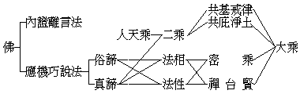



佛法、是佛所证所说的法。普通都把佛分为三身，即是法身、报身、应身，或自性身、受用身、变化身。甚而偏据佛说，把佛法分割为这是大日如来的法，那是阿弥陀佛的法。今年日本开泛太平洋佛教青年会，议定以释迦牟尼佛为佛教共同的教主，换言之、即以释迦牟尼佛为本师。因为十方三世诸佛皆据释迦口中说出，与释迦佛平等平等而无差别。所谓法身、报身、化身，乃依据事实上之佛而作分别说的，因此、我们都依释迦佛的所证所说的法、名为佛法。



平常所谓佛法的法，有二种意思：一、证法，二、教法。证法是内证离言法，或者名为一真法界，瑜伽论名为离言自性。法华经云：「诸法实相，唯佛与佛乃能究竟」。此唯佛与佛才能究竟证到之法，声闻独觉偏证一分，初地以上菩萨具证一分而未究竟，所以说：「唯佛与佛乃能究竟」。其实、此诸法性相是遍於一切众生世界的、不过唯佛陀的大智慧乃能澈底照见证知，所以推重佛陀，称为佛法。



教法、就是应机巧说法。「诸法实相、唯佛与佛乃能究竟」，这是说佛的离言内证。而佛之说法在能应机，即是或适应地上以至等觉菩萨，或为适应地前菩萨、二乘、人、天等不同的根机，因此说大、说小、说空、说有。这都是因应众生需要而施设的，谓之契机。而佛陀所说之教法，又无不与其内自所证之离言法界相契合，谓之契理。



二谛，即是世谛、第一义谛，也有叫做俗谛、真谛，或世俗谛、胜义谛。名虽不同，意义是一样的。佛陀所说的法都不出乎二谛，二谛是大小乘佛法所共同的。所谓二谛法者：以佛之说法，注重点均在说明内证离言法性，这是第一义谛；而所说又皆是适应天人八部、声闻、独觉、菩萨的根机，其说明若恶若善若有漏若无漏的因果事理，及如何证果、如何解行的道理，就是世俗谛。



若以内证离言说，无能教之佛及所教之众生；既无能证之智，焉有所证之相？一乘尚且不立，何况三乘？所谓「平等性中，无生佛之二体；真如界内，绝自他之假名」。这就是一真法界，乃是三乘共所依以解脱之无言说道，平等平等无有差别。



依此二谛，而说得穷尽的是大乘法，没有穷尽是二乘法。二乘法即是四谛法，这里有虚线实线三条，虚线是表示没有穷尽的，实线是表示穷尽的。至於人天乘不过是二乘四谛法中之一部份，所以以虚线来表明世谛法，亦没有说穷尽。而二乘的法在第一义谛上，亦祇说到一分。如三法印：一、诸行无常，二、诸法无我，三、涅槃寂静；这三法印所明的就是离言法性，不过是没有穷尽罢了。其实二乘说四谛也没有穷尽，皆可包括在穷尽第一义谛世谛的大乘里。



再次来明法相、法性乃至禅、净、台、贤、密、律，这些都是大乘法。大乘将世谛第一义谛说得都很详细。法华经云：「佛自住大乘」，由此可知大乘法是佛所亲证的，佛完全说尽了。因此这里用实线来表示，同时人天乘二乘亦可摄入大乘，不过犹不彻底而已。



在印度大乘佛法分为二大系：一、法相，二、法性。大乘法相亦说法性，不过偏重在法相罢了。其说明法性就在法相中显，是从安立施设法相上而说到不可安立之一真法界的，这就是从法相以明法性的所在。至於大乘法性，重在第一义谛的说明，而对於法相不大重视，为说明法性而带明法相，粗略不详密。所以在法性上以虚线表示对於世谛说未穷尽；同时在法相上亦畫有同样的虚线，表示对於第一义谛略而不广。



复次，从流传的宗派上看来，要是从法相法性上来判别，偏重于法相的有华严、密宗等，偏重於法性的则有天台、禅宗等。若是从修观上说，密宗是偏于法相的假想，而其说明的理论上，亦重法性的空理；禅宗是不立文字见性明心，专明第一义谛的——内证离言，是要实行修证的；但是平常所谓宗通、说通，在世上建立也离不了法相，所以禅宗亦兼法相。



至于贤首、天台都有所依的经，如贤首是依据华严经而成立的，天台是依法华经而建立的。其实台、贤起初都是从修观行而得到的：如杜顺和尚修观著华严法界观，经过二三代以经论印证，迄至贤首国师才成立教义。又如北齐慧文大师读中论、智度论，悟一心三观之旨，以经论为印证，传至三祖智者大师才发为教义。华严经本是法相六经里面的一部经，故贤首宗注重在法相，不过是融摄法性以明。天台宗依於大智度论、中论，近於法性而亦融法相。至於密宗、禅宗从法相、法性之修证而成立，更显然可见。



此外还有律宗和净土二宗，这里所谓净土，不是专指念弥陀而说，净土有十方诸佛的净土，有诸大菩萨的净土，念弥陀不过净土中法门之一而已。净土是为已发心修行的人，在一生未能证圣果，因为未证圣果转身就容易退堕，或不免堕三恶道流转生死，这样失去了一生的功行，岂不是很可惜的吗？因此从诸佛菩萨所示居的净土，使众生持念一佛或一菩萨的名号，仗彼诸佛菩萨的大悲愿力，使其往生彼土，令其得不退转，免堕六道轮回，这是净土缘起的真意义。



大乘中所信行的净土，如西方极乐净土，兜率内院净土，不过在二乘里没有明显的表出。所以图上只用虚线。庇是托庇的意思，共庇是表明大小乘共同所庇，即是依靠诸佛菩萨的净土接引。如大富贵人家的别墅或宾舍，可收留教养投靠的人。



律宗，不是专指传戒、受戒而言，律有比丘、比丘尼、式叉摩那尼、沙弥、沙弥尼、优婆塞、优婆夷之七众律，更有大乘菩萨律与密宗律等；人天、声闻、独觉、菩萨所共同遵守的，所以图上说戒律是大小所共基的，就是这个意思。



三　研究的方针



这样将佛法作最概括最扼要最简单的说明，使各宗各系各安其位，互通互融，相资相助，不相冲突，调和发展，并重研究。因为大乘各宗原是平等平等，每宗都有它的殊胜的地方，不宜执立门户，分河饮水。讲到这里，又要讲到本馆研究员预习班了。预习员就是未来的研究员，而研究员的工作，上面已经说过分考校编译二部。考校编译的工作，第一个条件要对於整个佛学，或某宗某系的经论文字，要有澈底的明了的认识，对於中心的思想都要抓得住，这样才行。不然，经论上的文字都不懂，理论尤其莫明其妙，还配得上做考校编译的工作吗？所以预习研究员在这期间就要练习这种——考校编译——工作，要预备作一系一系的专门研究，才能精深专一，才能做到登峰造极，升堂入室。若是不专门研究一系，祇是作广泛的浏览，这毕竟於我们没有多大的裨益。因此我定了六系，作为你们研究的标的：



甲　五三共法系



五即是五乘：一、人乘，二、天乘，三、声闻乘，四、独觉乘，五、菩萨乘。三就是三乘：一、声闻，二、独觉，三、菩萨。合拢起来说就是五乘三乘所共的佛法。但是三乘共法亦即小乘，五乘共法亦即人天乘，均包括在声闻里了。平常讲小乘意存毁呰，其实错了，小乘亦为大乘阶梯。而此系以俱舍为中心，旁及阿含诸经，婆沙、六足、发智、正理等论。这系现在研究员有一二人已在研究。



乙　小大律藏系



律藏中，如四分律、五分律、十诵律、僧祇律、根本说一切有部律等，都是小乘律；而大乘律则散见经论，即梵网菩萨戒和瑜伽菩萨戒等。虽中国历来所行的是南山宗四分律，但今此研究律藏不仅是专研南山四分律而已，应当研究大小乘所有的不同戒律。这系现在研究员亦有一人在研究。



丙　法相唯识系



法相唯识是印度原有的，依弥勒菩萨所说的瑜伽师地论为本，以成唯识论为综合。所依之典籍有六经(一华严经，二解深密经，三如来出现功德经，四大乘阿毗达磨经，五楞伽阿跋多罗宝经，六大乘密严经)十一论(一瑜伽师地论——本论，二百法论，三五蕴论，四显扬圣教论，五摄大乘论，六阿毗达磨杂集论，七辨中边论，八二十唯识论，九成唯识论，十大乘庄严经论，十一分别瑜伽论——这十部是支论)，尚有其餘附属的经论。现在馆中尚没有专门研究的人，将来预习班要有一二人来专门研究才好。



丁　般若中论系



般若中论系就是法性，在中国亦名三论宗，以中论、百论、十二门为依据，以大般若经为本。或名四论宗，三论外加一大智度论。因为以大般若、中论为中心的思想，所以名为般若中论系。此宗创自龙树菩萨，龙树菩萨是印度建立大乘佛法的始祖，而此宗中论与整个的佛学有大而且切的关系，所以研究佛法，般若中论系是不可不研究的。从前本馆有二人研究般若中论系，现在还没有人。



戊　中国台贤禅净系



天台、贤首、禅宗、净土，这四宗是中国创立的，可算是中国的佛学，所以名它为中国台贤禅净系。天台宗是北齐慧文大师读中论，悟一心三观之旨；传南岳慧思大师，依之悟法华三昧证六根清净位；三祖智者大师从以修习，得法华三昧之前方便，乃传其观法，依法华广宣教义。因为居浙江台州天台山，故名天台宗。贤首宗是中国杜顺和尚，居终南山，依六十华严修法界观行，制华严法界观，此宗教义至贤首国师始宏传，所以名为贤首宗。禅宗虽是印度南天竺菩提达摩泛海到中国来传教，但是成立为一宗也是在中国建立的，亦可算是中国的佛法。禅宗大盛於唐、宋，与我国思想界的关系尤为密切。净土宗是以希求往生阿弥陀佛之极乐净土为宗旨，所依之典籍有三经(一无量寿经，二观无量寿佛经，三佛说阿弥陀经)，一论(即菩提流支所译之往生净土论)。此宗之创始者是庐山慧远大师，所以亦是中国独有的。这四宗可作为一系的研究。



己　印华日藏密法系



密宗即是真言宗，因为依秘密真言为宗旨，故名密宗。此宗所依据的是大毘卢遮那成佛经、金刚顶经、苏悉地经等及诸部仪轨。在印度有先期后期，先期是当中国唐朝，后期是当中国五代及宋朝。所以由中国所传流日本的是先期密法，五代宋初所译之经典，虽亦以密典为多，而未有弘扬，故后期密法所传以西藏的为完备。这六系中比较起来，以此系为较难研究，目下未易做到。



四　结论



现在我们所要研究的，而环境上能够研究的，就是前面五系，所以我很希望你们安心在这里修学，一年后各人作分系研究的工作。研究的结果——即考校佛典、编译佛典，便是本馆的事业。今天将本馆的宗旨和你们修学的目的，及全部佛学的大纲和研究的系统，作简单的很概括的说明。详细指教，则有在馆中领导的各主任法师居士在。



------



## （智藏记）(见海刊十五卷九



我怎样判摄一切佛法



——二十九年八月在汉藏教理院暑期训练班讲——



一　前二期我对一切佛法的看法甲　初期的略述  

乙　第二期的略述



二　第三期我对於一切佛法的看法甲　教之佛本及三期三系  

乙　理之实际及三级三宗  

丙　行之当机及三依三趣



这题目讲起来很广，可分为三期说明，由於时间的关系，今则缩为二段：即前二期的略述和第三期的详说。



一　前二期我对一切佛法的看法



甲　初期的略述



我最初对佛法成立一个有系统的思想，是在光绪三十四年至民国三年间。那时我对佛法用过这麼一番修学工夫：一方面作禅宗的参究，一方面也听些经教。所听的经教，以天台教理为主，兼及贤首的五教仪、慈恩的相宗八要等，所谓教下的三家。后来阅藏，读大般若经，在甚深般若中得一相应，於是对从前所参学的禅教，便融会贯通，将整个佛法作这样的看法：认为佛法不外宗下与教下二种——同於世亲所分证法、教法。我这样的看法，和明朝政制将佛法分为禅、讲、律、净、教的五门是相摄的。「禅」是教外别传，离语言文字的禅宗，也就是宗下。「讲」包括教下三家——天台、贤首、慈恩，就是教下，而律净教亦可归教下所摄(不过正式可称为教下的，是天台、贤首、慈恩的三家)。「律」乃出家在家所受持的戒法，「净」是修学佛法的人所归的净土；「教」就是「密」教而为当时所流行的，如早晨上殿念楞严大悲十小咒，晚间施食念蒙山及放燄口等。然皆可为教下所摄，故全部佛法，即宗下教下也。离语言文字，离心意识相，离一切境界分别，去参究而求自悟自证者谓之宗；由语言文字建立，而可讲解行持者谓之教。以宗下教下说明一切佛法，是我初期对佛法的系统思想。这期的思想略见遗留在佛教月报。



乙　第二期的略述



讲到第二期，是从民四年普陀山闭关后而产生的一系思想。在这闭关期间，我对佛法的见解和认识，与初期大有变更，这在佛法导言及僧伽制度论僧依品里说得很明白。佛法有大乘和小乘，而小乘是大乘的阶梯、大乘的方便，所以小乘可附属於大乘，所谓「附小於大」。故我认为佛法的根本宗旨，唯在大乘，法华经中说：「唯有一乘法，无二亦无三」，就是阐明这个宗旨。不过有一部份的根机，在小乘法中修证到就以为满足，以为究竟，其实真正的究竟，还在大乘。



小乘的宗派在印度虽有二十部，在中华虽有毘昙、俱舍、成实三宗，但俱舍毘昙可归纳於唯识，成实可附入三论。至於我国的大乘十一宗，涅槃宗后归法华，地论宗归入华严，摄论宗归入唯识。所以把整个佛法归纳为大乘八宗。其中的律宗，是取的南山律宗，南山所传的四分律，虽源出小乘，但在道宣律师的弘扬下，却也转为大乘了。如南山律所明的戒体即以思心所种子为其体，故南山律宗是融小归大的一乘律宗。天台、贤首、三论、唯识、禅、律、净、密这大乘八宗，其「境」是平等的，其「果」都以成佛为究竟，也是平等的，不过在「行」上，诸宗各有差别的施设。这差别的施设，乃各宗就某一点上来说明一切法所起的观行：如唯识宗，以一切法皆是识而说明一切法，三论宗以一切法皆是空而说明一切法……故各宗有各宗的方便殊胜施设。这样来判摄一切佛法与古德的判教，完全不同了，比方天台判释迦如来一代时教，则有藏通别圆等差别，判自己所宗的为最圆教理。我则认为诸宗的根本原理及究竟的极果，都是平等无有高下的，祇是行上所施设的不同罢了。八宗既是平等，亦各有其殊胜点，不能偏废，更不能说此优彼劣，彼高此下。关於这个说法，最有具体说明的是大乘宗地图(此图制於民国十二年，曾演讲数次：民二十年最后一次在柏林寺讲时，由法舫纪录，现有大乘宗地图释单行本流行)。以上是我前二期对佛法见解的一个概说。



二　第三期我对一切佛法的看法



这一期我对佛法的整个系统思想，在本院修学的人，应仔细的听，听时要牢牢的记得，听后要如理思惟和加以研究。学天台教的人，学了他的判教，即以他的五时八教方式去弘扬；故在这里跟随我学的人，对我所讲此期的佛法系统思想，也应善为运用，以作将来弘法时，判摄一切佛法的根据，亦可以这作为对整个佛法的基本见解。



在民十二三年后我对佛法的见解，就萌芽了第三期。这期的思想是什麼呢？此与前二期逈然不同。第一期的见解，可以说是承袭古德的，第二期的见解，是摄小归大而八宗平等，即不同於第一期的因袭；而第三期则更不同於第二期了。然思想如是变更，见解如是进展者，乃不为旧来宗派所拘束，而将释尊流传到现代的佛法作圆满的判摄罢了。这期可分教、理、行、三者来讲，由民十二年后，直到今日以前，这种思想分散在我的讲著里的很多，不过还没有作过综合的说明。



甲　教之佛本及三期三系



释迦牟尼的一代教法，在古来大德，有判为五时八教的，有判为三时五教的，也有判为三时教的。我以为：佛在世时，佛为法本，法以佛为主、以佛为归，虽然应机说法差别无量，但并没有分大乘小乘顿教渐教，故佛为法本，法皆一味，佛怎麼说就怎麼说。虽闻法者以特殊的机缘关系，解有差殊，但不能以此别为大小，故也就不能分作任何的宗派了。因为佛是唯一的，所以佛所说的法，当然也就是一味了。



到了佛灭度后，佛陀的教法，就不是那麼一味的了。依当时印度的法藏结集，和后来教法的流行演变，就已分作三期。



第一　小行大隐时期



初期的结集，是由迦叶、阿难、优波离所主持，虽结集的工作并不完全由他们经理，与之同时或后时更有其他的弟子结集，所谓有富楼那结集，窟外结集，菩萨结集等。但在佛灭度后，为当时国王大臣所护持，流行世间的佛法，则为迦叶阿难所结集的三藏。至佛灭二百年间，由此中分出上座部、大众部两大派，依此二部为本，更裂为二十部。在这二十部派未曾分裂之前，小乘教法是一味和合的。也就是传在锡兰等处的巴利语三藏。在佛灭后的五百年间，虽有二十部派的分裂，但不出乎小乘三藏的范围，故可说是小乘盛行的时期。然在这时期，也不能说完全没有大乘佛法，不过由於小乘教法的盛行，大乘教法就隐没不彰。因为旧时的学者，都以小乘教法为唯一的佛法，所以这时也可说为小行大隐的时期。由於佛灭度不久，佛弟子们仗佛威德的餘势，能依佛的轨范去实行，断惑证果者，尚复不少，所以又名之曰正法时期。



第二　大主小从时期



初期的五百年过去，到了六百年的当儿，有马鸣菩萨出世，著有佛本行赞等，竭力提倡大乘佛法。在他竭力的提倡宏扬之下，大乘佛法露其端倪。继有龙树、提婆应运而生，对破一切有部等法执，阐扬大乘毕竟空义。后复有无著、世亲兴起，发挥大乘妙有之理，对一切法空的基本思想，加以补充的说明。他认为一切法虽说是毕竟皆空，然其中的因果，有条不紊丝毫不爽，故说明一切种，成立阿赖耶。这在教理上，是发挥得淋漓尽致了。这末一来，遂使素来隐没的大乘佛法，风行於世，遍布於全个印度了，故这时可名之为大乘盛行时期。但这期间，并非没有小乘教法，不过由於大乘空有的教义过於弘盛光大，是以使那有权威而盛行於初期的小乘教义，渐陷附庸地位，故又可名之为大小并行时期，或大主小从时期。



第三　大行小隐密主显从时期



二期的五百年过去，到这期的五百年时，约在佛灭千二百年间，大乘空宗产生了清辨，大乘有宗产生了护法。清辨论师传承龙树菩萨毕竟空义破斥有宗，护法论师传承无著菩萨如幻有义破斥空宗，於是大乘空有二宗分道扬镳，互相对立，成为空有之诤。这种现象，在二期大乘盛行的时候是没有的，以其时龙猛、提婆虽偏重於阐扬大乘毕竟空义，无著、世亲虽偏重於发挥如幻有义，但后者祇是补充前者，并未据为各有所宗，另成一派。但第三期间空有互相对敌的因子，已种於第二期。到这时候以后，大乘的盛行已达极点，而小乘也就几乎没落。由於大乘的发达盛行，於是佛法普遍到民间去。正在这时，龙智菩萨等出来弘扬密咒，把通俗的印度风习都融摄进来。因而密法就发达起来，故此时可名为密咒盛行时期。但在这期间，大小乘教法，非全绝迹於世，不过由於密法过於弘盛，致使那盛极一时的大乘佛法及已衰落的小乘教理，皆依附密咒之中流行。故这期亦可名为密主显从时期。印度密宗的盛行，是在佛灭千餘年之后。玄奘法师在印留学时，密咒流行尚少；到义净法师去印的时候，密咒渐盛行，随义净法师去留学的人，就有学习密咒的了。如印度最负盛名的那烂陀寺，起初祇是大乘显教的根据地，到了这时，也转成为密宗的道场了。后来的超岩寺，更是完全盛行密教的。



上面所说的三个时期，是佛灭后印度佛教流传的全部情形，即以印度三期所流行的佛教，而成为今日世界上所流行的三大系的佛教。



第一期盛行的小乘佛教，今日流行於世的可以锡兰为中心，由锡兰而流传於缅甸、暹罗及安南、马来亚群岛等处，是为巴利文系佛教，也可说是锡兰系佛教。初期的佛法本来是传播到各方的，但他处随了各地的不同环境，其后发生了种种沿革改变，另成别种的风尚宗派，甚或趋於消灭；唯所传於锡、缅、暹能够保持原状，且一直流至今日而发展光大之。即今锡、缅等地的佛教徒，尚认为他们的佛教是上座部的正统派佛教，由阿育王时代所传播去的。从这一点说来，可见锡、缅、暹所流行的佛教，就是印度初期所盛行的佛教。



第二期盛行的大乘佛教，现在流行於世的，可以中国为中心，由中国而流传於高丽、日本及安南等处，是为汉文系佛教，也可称为中国系佛教。故印度二期大小并行的佛教，由中国继续传承流行；因为中国的佛教，大小三藏，皆悉完备，且也并行世间。实际说来，印度三期佛教，中国皆有，但因以第二期为主，以中国一向所行的，都与印度第二期相类。



第三期盛行的密咒佛教，现存於世界上的可以中国的西藏为中心，由西藏而流传於西康、蒙古、甘肃及尼泊尔等处，是为藏文佛教，也可说为西藏系佛教。第三期的佛法流传到西藏，这在历史上是很明显的，在中国唐朝的时候，西藏才有佛教输入；而完成西藏的佛教，却在我国宋朝。前面说过，印度佛教转入第三期后，那烂陀、超岩二寺都是盛弘密宗道场，故到西藏弘扬佛法的莲花生，即由那烂陀寺去的，中兴西藏佛教的阿底峡，就是从超岩寺去的。现在西藏的佛教，汉文系的大乘，西藏也有；但西藏的小乘佛法不及内地完备，小乘经论都不具全；而密乘的教典却比较多一点。大乘的空有二宗虽都有流传，不过在密宗盛行趋势下，一般修学密宗者，皆以空胜解为所依，故空宗较为发达。在印度的第三期佛教即属如此，故当以今日西藏系为代表。



总合的来说，佛世时的教法，是一味融通，无所谓分乘分宗的；所以一切法，以佛为归为主，佛为法本，法皆一味。及至佛灭度后，佛法在印度，分为三期；迄至今日流传世界各国的，成为巴利文、汉文、藏文。这就是教之佛本及三期三系的概说。



乙　理之实际及三级三宗



以佛法究竟真实言，所谓「实际理地，不立一法」。诸法实相，唯无分别智如如相应，无可建立，无可分说，离名绝相，超诸寻伺；由语言文字说真如法性等，都是假名安立的善巧施设，实际是无可言思唯证相应的。法华经中说：「诸法寂灭相，不可以言宣」。但为欲悟他，故从教法上显示，分为三级来说明。这三级的分说，与菩提道次第论的三士颇相似，不过我所说的名词，与之不同罢了。这种名称，是在民十五年我讲佛学概论的时候说出。所谓三级者：五乘共法，三乘共法，大乘不共法(亦名大乘特法)。今作扼要的说明於下：



第一级五乘共法



最普遍的佛法要义，就是因缘所生法的原理，也即是因果法的原理。大凡佛法说明一切法，都要以这因缘生法的道理来阐述。因缘就是因，生法就是果，故因缘生法即是因果法。因果律於一切法中皆具有的，但其中特别注重业报因果；一切科学也依因果律，然不说业报因果，故与佛法所谈的因果逈异其趣。六趣流转的凡夫，三乘阶级的贤圣，皆可由业果的原理说明。我们现在是受著人的业果，要保持这人的报身，要免受三途的苦报，就得从这难得的宝贵人生，信解佛法的做人道理。所谓学佛先从做人起，学成了一个完善的好人，然后才谈得上学佛，若人都不能做好，怎麼还能去学超凡入圣的佛陀？所以学佛法的人，敬佛法僧，信业果报，是最要紧的一著。不但流转的六凡，出世的三乘，皆建立在业果上；就是最高无上的佛陀，也不出因果的范围，因为要修大乘六度万行的清净殊胜因，才能证得究竟圆满的佛果。始从人乘，终至大乘佛位，名之曰「五乘」，而这因缘生法的原理亦即所谓因果法的原理，是五乘所共修的法。一个人，尤其是做了一个佛教徒的人，对因果业报，不能深信，则不能领受真正的佛法，也就不能了解佛法的正义，同时亦不能算为佛教徒，故根本上不能入佛法之门！这五乘共法的第一级，其范围极广，把这级稳固了，然后再进趣上级，那就容易了。比方世间造塔，不论他造七层九层，而最下层一定造得宽广和巩固，因为下层基础做好，然后才能一层一层向上造，学佛也是这样。



第二级三乘共法



三乘就是声闻、缘觉、菩萨，这三种出世的圣人，他们认识了世间纯粹的是苦，知道了世间无一可爱乐，於是深深的厌离世间，积极的求出世的涅槃之乐。依著四念处、四正勤以至八正道的基本道路，而去实践进修，不求人天果报，唯一目的、求证出世涅槃。教中所说的三法印——诸行无常、诸法无我、涅槃寂静，就是三乘共法的标准，使三乘人了脱生死诸苦，证得涅槃寂静。所谓共法者，以三乘虽有差殊，而这三法印是三乘所共遵以断烦恼了生死的。这三乘共法，较前高了一级，以他们首先远离了有漏流转法，此则不共人天，为希人天乐果者之所不能及。因为人天有情，对於世间业果，尚有所希求的原故。



第三级大乘特法



这是菩萨所特有的，不共於人天二乘的。此大乘佛法，以大悲菩提心，法空般若智，遍学一切法门，普渡一切众生，严净无量国土，求成无上佛果，为其唯一的誓愿、唯一的事业。



此上三级的分别，是就整个的佛法普遍而说的，然大乘法广，应分摄三宗以除偏执，这在民十二年我作佛法总抉择谈已经说到。不过当时所说的名词，稍有出入，今再作确定的说明於后：



一　法性空慧宗



通达一切法的真如实性，必须了知一切法的自性皆空，然这要有毕竟空慧，才能究竟通达诸法空性。通达法空的般若，是大乘法的基本条件。虽有些根性钝劣的有情，讲解法空而不趣修大乘菩萨行，仍入小乘涅槃的；然发菩提心要广行菩萨道者，则必须通达法空，以法空般若为宗。很多的大乘经论，就这一分真理上观察特重，所以抽象的立此法性空慧宗，以摄一部分大乘佛法。



二　法相唯识宗



法相是说明种种诸法无量差别的相状，这相的意义非常之广，凡一切法的相，皆可名为法相。如五法中的真如，可说是性，亦可说是相；三性中的圆成实，可说是性、亦可说是相。然而给予诸法的差别相上一个正确的了解，适当的明白，则其所宗者即是唯识。以唯识讲明一切法，有无量差别的一切功能种子，生起一切现行，因果相关，种现相续，明一切有为诸法因果差别。即对於无生无灭的无为法，所有真正认识切实了解、究竟亲证，也是由识及由识转成的智所了知。所谓「诸识所缘，唯识所现」。故凡了知的一切法相，皆是识现之法，识所现者；无为法虽非识所变，但也由识所显；若非净分识的正智所显现，则毕竟没有真如的证明了。这也有许多大乘经论所专重，故立此宗以摄之。



三　法界圆觉宗



法界的「界」字，是包括一切法之义，即以尽一切法为界，而为任何一法所不能超越。前所说的「法性」、「法相」，都包括其中。「圆觉」可以说就是佛十号中的正遍知或正遍觉，佛果位上的一切智智、一切种智、一切相智，皆与圆觉之名义是一而二二而一的。以佛果之正遍知，无一刹那不是圆满周遍觉知一切诸法性相的。法界的一切法，要能圆满觉知，唯圆觉智，故以圆觉为宗。凡等觉菩萨以下，皆未能一刹那圆遍觉知诸法性相，以菩萨地上，以前刹那起根本智见诸法性，要后一刹那后得智生方得见诸法相而未能周尽。佛智则不如是，一刹那间就能够周遍了知诸法性相。这在许多大乘经论中也都有所说明的。而天台、贤首所判圆教，亦皆依佛智境界而阐说。如天台圆教讲一念圆具三千性相，即是在佛的智境上明。依此发心修行的菩萨，即所谓圆顿法门，以佛智境界为法门，而直趋无上菩提，禅、净、密等也都属此宗。



宗诸大乘经论的古来各宗派，皆各有所偏据，故我特明三宗，因为以这三宗来看一切大乘佛法，没有解不通，亦没有不圆融。至於上述的三级，初级的五乘共法，不论是人乘、天乘、乃至佛乘，谁也不能离了因果法而言，第二级的三乘共法，也是不能离了初级去凌空施设；即大乘不共法，也不能离了前二级而独立，所以说三级是互相依靠的。人天果、二乘果都是趋佛乘过程中的一个阶梯，非是究竟的目的地，究竟的目的地是至高无上的一乘佛果。



丙　行之当机及三依三趣



「行」是侧重当机者实践上说的。佛在世时，当机说法，随闻而解，随解而行而证。所依所趣，在当机的各人有无量差别，不能拘说，故法贵当机，当机者妙，药贵愈病，愈病者善。如平常不可食的秽毒，若是拿来做药，适当病人的治疗，那也是最好的药了。所以不能定说怎般那般，更不可说这个法门某一类众生可修，那个法门某一类众生不可修。今判三依三趣，乃就三个时代机宜的大概而言。佛法流传至今，已有二千五百年，现在正是第三千年间。依教中说：佛法有正法、像法、末法、三个时期：正法住世的时间有一千年，像法亦然，而末法则有万年。分述於左：



一　依声闻行果趣发起大乘心的正法时期



如来出世的本怀，是欲说出自悟自证的实相法门，但因为此土众生的根机未熟，乃方便先说适合当时机宜的，先说声闻乘法，令当机者起行证果。到法华会上才把这本怀说出来：「为欲开示悟入佛之知见，出现於世」。前所说者，都是令入佛乘，法华经云：「汝等所行是菩萨道」。从这点意义上说：由佛世时乃至正法的千年，是在依修证成的声闻行果，而向於发起大乘心——即菩萨行果或佛的行果。声闻行果，乃佛住世时，当机广说。我们看佛经，可以见到很多比丘得证圣果的记载——或证须陀洹果、或证斯陀含果、或证阿那含果、或证阿罗汉果。即或有未能证得四沙门圣果者，从佛出家，至低限度，亦都能依比丘戒修行。到了佛灭度后，佛弟子们依著如来的正法——声闻行果实践实修，证得声闻果者，在教史上亦历历可见。所以正法期间，是依声闻行果而趣於发起大乘心的。已证声闻果者，大乘心一发，即知早走上菩萨行的半途，不难成佛了。



二　依天乘行果趣获得大乘果的像法时期



在印度进入第二千年的佛法，正是传於西藏的密法。中国则是禅宗、净土宗。禅宗出於第一期的末叶，附属於第一期，故此像法时期足为代表的是密宗、净土宗，是依天乘行果的道理。如密宗在先修成天色身的幻身成化身佛，净土宗如兜率净土，即天国之一。西方等摄受凡夫净土亦等於天国。依这天色身、天国土，直趣於所欲获得的大乘佛果。这是密净的特点，与前期有所不同。以初期能先证声闻行果的根机，到这像法时候是很少有的了。因为像法时期的众生，理解力虽比较强，但持比丘戒者不可多得，故证声闻行果颇不容易！是以先成天幻身，或上生天净土，依密净的天乘行果以期速达成佛的目的。所以像法期间，是依天乘行果而趣佛果——趣於大乘行果的。



三　依人乘行果趣进修大乘行的末法时期



这是踏上了佛灭后第三千年的时代了，到了这时候——末法的开始，依天乘行果修净密勉强的虽还有人做到，然而就最近的趋势上观察，修天乘行果这一著也不适时代机宜了。因此、也就失了能趣大乘的功效。但前一二期的根机，并非完全没有，不过毕竟是很少数的了。而且依声闻行果是要被诟为消极逃世的，依天乘行果是要被谤为迷信神权的，不惟不是方便而反成为障碍了。所以在今日的情形，所向的应在进趣大乘行。而所依的，既非初期的声闻行果，亦非二期的天乘行果；而确定是在人乘行果，以实行我所说的人生佛教的原理。依著人乘正法，先修成完善的人格，保持人乘的业报，方是时代的所需，尤为我国的情形所宜。由此向上增进，乃可进趣大乘行——即菩萨行大弘佛教。在业果上，使世界人类的人性不失，且成为完善美满的人间。有了完善的人生为所依，进一步的使人们去修佛法所重的大乘菩萨行果。所以末法期间，是依人乘行果而进趣大乘行的。



今天所说的，从前都有讲过，不过没有综合的讲，这次是综合的讲一遍了。人生佛教，即由人乘进趣大乘的佛法，在我著的大乘与人间两般文化、人生观的科学、现实主义、自由史观等各书中，曾有详细的理论建立。现在最要紧的是：先了解佛法、正信佛法，由正信佛法而实行佛法。就普遍的机宜上，重在从完成人生以发达人生而走上菩萨行的大乘觉路。就从保持人的业果言，在今日亦须以佛法建立起人生道德，使人间可为实行佛法的根据地。人人学佛，佛法才可风行世界，普遍全球。



我对佛法总系统的思想，略述如上。今天讲了出来，是给大家一个总括的概念，你们应以这第三期的系统思想，去观察佛法、了解佛法，修行佛法，宣扬佛法。



------



## （心月、演培记）(见海刊二十一卷第十



中国佛学



——三十二年秋在汉藏教理院讲——



> 第一章　佛学大纲……………………………………………………………五三九  

> 第二章　中国佛学　特质在禅………………………………………………五四九  

> 第一节　略叙因缘…………………………………………………………五四九  

> 一　梵僧的化风…………………………………………………………五五一  

> 二　华士之时尚…………………………………………………………五五二  

> 第二节　依教修心禅………………………………………………………五五四  

> 一　安般禅………………………………………………………………五五四  

> 二　五门禅………………………………………………………………五五六  

> 三　念佛禅………………………………………………………………五五七  

> 四　实相禅………………………………………………………………五六〇  

> 第三节　悟心成佛禅………………………………………………………五六五  

> 一　超教之顿悟…………………………………………………………五六六  

> 二　达摩与慧可…………………………………………………………五六九  

> 三　僧灿至弘忍…………………………………………………………五七五  

> 四　慧能之师资…………………………………………………………五八二  

> 第四节　超佛祖师禅………………………………………………………五八八  

> 一　行思与怀让…………………………………………………………五八九  

> 二　希迁与道一…………………………………………………………五九四  

> 三　百丈与道药…………………………………………………………五九七  

> 四　云龙与黄沩…………………………………………………………六〇七  

> 第五节　越祖分灯禅………………………………………………………六一七  

> 一　沩仰之邃密…………………………………………………………六一八  

> 二　临济之陡彻…………………………………………………………六二二  

> 三　洞曹之回互…………………………………………………………六三〇  

> 四　云门与法眼…………………………………………………………六三六  

> 第六节　宋元明清禅………………………………………………………六四六  

> 一　公案之拈颂…………………………………………………………六四九  

> 二　话头之疑参…………………………………………………………六五二  

> 三　禅净之合修…………………………………………………………六五四  

> 四　宗教之和会…………………………………………………………六五六  

> 五　空默之观照…………………………………………………………六六〇  

> 六　语录之纂研…………………………………………………………六六二  

> 七　坐跑之兼运…………………………………………………………六六六  

> 八　僧俗之常套…………………………………………………………六六八  

> 九　仙道之旁附…………………………………………………………六七一  

> 十　儒理之推演…………………………………………………………六七三  

> 第三章　禅观行演为台贤教…………………………………………………六七九  

> 第一节　绪言………………………………………………………………六七九  

> 一　贤首学与天台学名义之审定………………………………………六七九  

> 二　台贤为中国特创之佛学……………………………………………六八〇  

> 三　台贤皆以禅为源……………………………………………………六八一  

> 第二节　实相禅布为天台教………………………………………………六八二  

> 一　天台学之根据………………………………………………………六八二  

> 二　天台学之先河………………………………………………………六八三  

> 三　天台学之成立………………………………………………………六八四  

> 甲　慧文慧思之创发…………………………………………………六八四  

> 乙　智者之完成………………………………………………………六八七  

> 四　天台学之演变………………………………………………………六九一  

> 甲　荆溪与法相华严及禅之对抗……………………………………六九一  

> 乙　宋代山内山外与华严及禅之辨…………………………………六九二  

> 丙　蕅益援禅法相入天台……………………………………………六九三  

> 五　天台学之述要………………………………………………………六九三  

> 六　天台学与禅律净密之关系…………………………………………六九五  

> 第三节　如来禅演出贤首教………………………………………………六九七  

> 一　贤首学之根据………………………………………………………六九七  

> 二　贤首学之先河………………………………………………………六九七  

> 三　贤首学之成立………………………………………………………六九九  

> 甲　杜顺之法界三观及十玄…………………………………………六九九  

> 乙　智俨之六相五教…………………………………………………七〇〇  

> 丙　贤首之三时十宗…………………………………………………七〇〇  

> 四　贤首学之演变………………………………………………………七〇三  

> 甲　慧苑之刊定………………………………………………………七〇四  

> 乙　清凉之恢宏………………………………………………………七〇四  

> 丙　圭峰之敛削………………………………………………………七〇五  

> 丁　宋以来之衰弱……………………………………………………七〇五  

> 戊　明清来与天台之对抗……………………………………………七〇五  

> 五　贤首学之述要………………………………………………………七〇六  

> 六　贤首学与禅律净密之关系…………………………………………七〇八  

> 第四节　贤首学与天台学之比较…………………………………………七〇九  

> 一　五教与化法四教……………………………………………………七〇九  

> 二　十仪与化仪四教……………………………………………………七一〇  

> 三　三时与五时…………………………………………………………七一一  

> 四　同别圆与兼纯圆……………………………………………………七一二  

> 第五节　结论………………………………………………………………七一三  

> 第四章　禅台贤流归净土行…………………………………………………七一五  

> 第一节　依教律修禅之净…………………………………………………七一五  

> 一　无量佛刹……………………………………………………………七一六  

> 二　弥勒内院……………………………………………………………七一七  

> 三　弥陀净土……………………………………………………………七一八  

> 第二节　尊教律别禅之净…………………………………………………七二〇  

> 第三节　透禅融教律之净…………………………………………………七三〇  

> 一　禅宗之净……………………………………………………………七三一  

> 二　台教之净……………………………………………………………七三八  

> 三　贤教之净……………………………………………………………七四三  

> 第四节　夺禅超教律之净…………………………………………………七四六  

> 一　泛源…………………………………………………………………七四七  

> 二　切因…………………………………………………………………七四八  

> 三　硕果…………………………………………………………………七五〇  

> 四　转流…………………………………………………………………七五二  

> 第五章　中国佛学之重建……………………………………………………七五四  

> 第一节　略指所依…………………………………………………………七五四  

> 第二节　教史概观…………………………………………………………七五四  

> 第三节　博究融汇…………………………………………………………七五六  

> 第四节　综摄重建…………………………………………………………七五八



第一章　佛学大纲



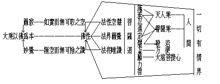



本学期讲中国佛学。前天讲的议印度佛教，可以作为叙言；今天这个图表，可以作为中国佛学的大纲。现在先将这图表作一个简括的认识：上面「大乘以佛为本」，即所谓佛法，也就是佛法界。最下面的水平线上为「一切有情界」，也就是众生法或众生法界。此众生界有二线通到当中的「佛性」；佛性一线通到佛。这佛性可以看成是众生与佛相通的心法，即平常所谓「心佛众生」。由此，我们可以看出佛、心、众生的不同，同时又可以看出众生、心、佛的相通。



佛性以下和众生界以上，是佛所说的教法。这些教法，一方面是佛所证的法，一方面是就众生的机宜和接受的可能性所施的教法。图中的佛性，即是众生可能接受佛陀教化的可能性。这个可能性，非常紧要。如果众生没有可能性，即不能接受佛陀的教化。所以佛陀的教化，虽以一切有情为对象，但也要观察众生的机宜和接受的可能性，才能说出适应众生所急切需要的教法来。图中的教法，即是佛陀观察众生的机宜而施设的。



以上将图表作了一个概略的说明，下面再详细地分开来讲。



大乘以佛为本：大乘法即佛自证法，亦即依佛本愿力以教化众生的法。所以只要说到大乘法，就应本佛能证所证之心境为本质。法华经上说：「三世诸佛皆以一大事因缘故出现於世，所谓为令一切众生开示悟入佛之知见故」。又说：「诸法实相，唯佛与佛乃能究竟」。所谓佛之知见和诸法实相，就是佛的自证法界，亦即大乘法的本。



此处所讲的佛，即佛法界或佛陀的自证法界，也可说是三种身土——法性身、法性土，受用身、受用土，应化身、应化土。二身、十身，减少增多都可以。如果再分类来讲，可以分为无上涅槃与无上菩提；但综合起来说，只消一个佛字。



涅槃是梵语，意译为「圆寂」。在中国，一般人把圆寂二字乱用於人的死亡，这是一个绝大的错误。圆寂的本义，是功德圆满、过患寂灭的意思；此已不但是三乘的涅槃寂灭，而是无上圆满的大寂灭。菩提译为觉，无上菩提即无上「妙觉」。此总无上菩提无上涅槃的转依果，即名为佛。佛、是从二转依的总相来讲。若分开来说，即如上面所说的菩提与涅槃。关於这方面讲得较详细的，如佛地经上的五法：第一清净法界，即此中所讲的无上涅槃；无上菩提，即是四智——大圆镜智、平等性智、妙观察智、成所作智。就是说，妙觉或无上菩提，是此四智的总体；此即所谓佛，也就是大乘法的根本。这在密宗的教义裹，讲五方佛或五智法身，亦即此五法，不过将清净法界的名字改为法界体性智而已。此五法也可以配三身来讲：清净法界为四智之真实性，即法性身。所成四智真实功德，就是自受用身；依四智中之平等性智与妙观察智，成他受用身；合自受用与他受用曰报身。依妙观察智和成所作智成应化身。五法与三身相摄如此，但总括而言之曰佛。



依大乘根本佛法来教化众生时，就要所化的众生是否有与佛法相通的共同性？有此共同性，又是否可以领受佛法教化，乃至有否成罗汉与成佛的可能？这种共同性，即是可以教化成佛之可能性，亦即佛性。众生与佛虽有相通的共同性，但在相通的共同性之上，仍各有不同的相用和德能；所以众生与佛，又是截然不同的。



就佛与众生的共同性说，即显示：佛原也是由众生而成的，他不过是已成佛的众生；犹未成佛的众生，未来也可以成。有此共同性，不但可以接受佛法，而且还有一种成佛的可能性，若只有共同性而无可能性，众生仍不能转变成佛。譬如说茶壶中有空，房屋中也有空，空与空是共同性，但因茶壶与房屋德相和业用各各不同，所以虽有共同的空性，而牠那德相和业用仍不能转变。然而众生不同，它不但有与佛的共同性，且有转变成佛的可能性。



关於共同性可作几点说明：第一、如说众生是因缘生法，佛亦是因缘生法。在这同一因缘生法的意义上，佛与众生是共同的。第二、佛与众生既同是因缘生法，因缘生法是空无自性的，这空无自性的意义，也是佛与众生的共同性。再就我们的言说分别上讲，佛与众生，都是假名安立，此假名安立亦是佛与众生的共同性。由於这共同性的缘故，佛将自所证法，说给众生听，也可以说是众生法；故众生可以领受。



但佛与众生究竟有否不同的地方呢？有。如佛是清净的，众生是杂染的；佛是明觉的，众生是昏迷的；佛是安乐的，众生是苦恼的；佛是自在无碍的，众生是缠缚障碍的。佛与众生有此种种的不同，但亦有无异的共同性。如壶中的空不异房中的空，虽不异但仍有不同。所以众生转变成佛的可能性，并非离共同性之外而有的，他在变化无穷的活动中，如如不动的佛性恒时存在。



从图中的佛性为中心，牠两边有两条线通空与识，如上面以佛为中心，旁边有圆寂和妙觉。原来空识是不二的，不过为说明起见，故分别说之。



通无上涅槃是「如实而无可取」之空，这是说明佛与众生的共同性。此性即诸法的空性，通於有情无情。所以如实而无可取之空性，是诸法圆满究竟的如实性，它遍一切时、一切处、一切品、是无少法可取的。因为可取之法都由於见闻觉知自识分别，或思想言语等上对待假立的，不是恒常不变普遍圆满的真实性。由言识所起的可取之法，还可以用言识来否定他。所以都无可取，只可说是空。



另一面是「极空而无可舍之识」。一张因缘生法的桌子，可以看得见、拿得著，而因缘生法的心识，却拿不著、看不见。因其众缘所生刹那即灭，又拿不著、看不见，所以说他是极空。虽然极空、但却舍不掉。如唯物论者说，宇宙现象的本源是物质的原子，未生动物以前，仅有物质而无心识。但认识未有动物以前的原子，还不是识？所以唯物论立在认识上面还不是舍不了识。又如说一切法皆空，「空」还不是在「空的这个念头」上起说？法国哲学家笛卡儿说：我们要以怀疑的态度观察宇宙万有，但他那个「疑」总是离不了。以疑否定宇宙万有，而疑的本身竟成了一个最后的实在。实在的疑，当然也可疑，但疑仍在，此疑就是思，也即心识。所以无论你如何否定一切物，而能否定的心识作用，终是不能否定的。此心识的明了觉知性，极其活动灵变，刹那生灭而相续迁流。所以极空而无可舍之识，有其转变可能性，就是说众生都有很大的转变可能性，由众生可以转变成佛。



众生既有成佛的可能性，即有「佛性」。此佛性可分为三种：一、众生与佛的共同性，即理佛性。二、隐密佛性，是就因缘生法上建立的。因缘生法，都是分别假立的名相，同时又有灵活转变的心识。意思说，众生虽然杂染，而清净的佛性，却隐密地藏在其中。此隐密的佛性，或名如来藏。三、事佛性，即在事用上有种种的功能，可能令众生转化而成佛。这是著重在可能性上讲，可能性即如唯识论讲的第八阿赖耶识中含藏有解脱生死趣向涅槃的佛性种子，这种子的功能，就是事佛性。此佛性是心佛众生三法中的心法。



平常讲「一切有情界」，包括三界五趣的依正二报，若广言之，亦可包括三乘圣者而为九法界。如二乘人虽证得无学果位，但在未入无餘涅槃前，他那先业所感的报体，仍属人天。至於菩萨，他的功德虽已超过二乘，然报体仍在三界中，所以菩萨最后成佛还是在色究竟天。故言一切有情界，可包括三乘而成九法界。九法界中之佛性，菩萨已部分证得、部分开显，而二乘亦偏证少分。人天虽未证得，但对佛性善法比较接近。因此，整个佛法有声闻、缘觉、人、天与菩萨之五乘教法，化导众生。不过这化导众生所施设的教法，从大乘法的教理上讲，可以分为三宗，这三宗是从教理行果的理上分立：一、为「法界圆觉」宗。这直从佛法界及约众生可能成佛之佛性而言。二、为「法性空慧」宗，这是约如实而无可取之空而言。三、依种子功能的开发与未开发而立的「法相唯识」宗，这是约极空而无可舍之识而言。佛法通过佛性、适应机宜而成此三宗之教理。有佛性之众生，一受教理之薰陶，就可发生信解行证的心行，而成为「菩萨道」。所以在三宗下受化者即为菩萨，菩萨修习所应做之种种行，即为菩萨道。此菩萨道共有十种波罗蜜，就是：「施」、「戒」、「忍」、「进」、「定」、「慧」、「方」、「愿」、「力」、「智」。此十波罗蜜中，有通二乘及人天乘的：二乘依菩萨道之戒、定、慧，称之为「声闻道」。此声闻道只是菩萨道中的戒、定、慧的一分。声闻道中之慧，可通法性空慧中的慧，由此慧而达我空之道理，但也只是部分的。「人天乘」依於菩萨道中的施、戒、定三法，由施可以济贫拔苦，由戒可以止恶行善，由定可以静心开慧。然此三种又可分为人乘重施戒，天乘重戒定。但无论如何，都只是菩萨道中之一部分。



图表中的一切有情界上有「人间」，人在一切有情界中、特别灵动与聪明。他种种的活动力，都超过其他一切有情而显出特别的殊胜，因此佛陀现身於人间说法。在一切有情界中，修得完人的地位，依人乘法先做一个完全的人，再利用人的上进心而修天乘法生天。世间一切宗教或哲学，都有完成人格而生天的主张。声闻乘法的产生，是因佛悲悯一班出家修苦行求解脱的人，或众生中迫於生死流转等苦的而说。先由在家的人，再出家求证四沙门果，此沙门果为出家之果。要证此果，故有比丘戒的受持，而比丘戒要人类方可以受。因此，声闻法虽超过人天乘，但也要从人乘做起。



菩萨於十波罗蜜中最关要的是慧，如他要通达大乘法，从初发心乃至达到成佛，全靠他那智慧的力量。其次是方便，方便是菩萨利他的大行，如行四无量心(慈、悲、喜、舍)与四摄(布施，爱语，利行，同事)法是。菩萨若无此等方便行，即不成其为菩萨。还有一种是愿，愿是发愿普度众生和成无上佛道，总合而为大悲菩提心。故愿字下有一线相通，表示上求下化的意思。菩萨度生，以一切众生为对象，而众生又都可能受菩萨之化导而发大悲菩提心，成为菩萨。所以大乘法说菩萨是普遍一切众生界的。以上讲明菩萨於十波罗蜜中，特别注重智慧、方便、与愿心三种。



菩萨，如平常说「般若为母，方便为父」，那末此愿心可以说是业识种子。如菩萨胎要依三缘和合而有，由有此胎，方可以继续长成菩萨身。菩萨要有大悲菩提心为业识种，依方便及慧为父母而成胎，否则即不成其为菩萨。所以菩萨是以佛为本、以众生为根的。又般若之母性，还可以生出二乘果。必须和合方便之父性，才可以完成大乘行而得佛果。故就和合成菩萨胎言，第一为大悲菩提心，次为方便，再次为智慧。



（光宗记）



第二章　中国佛学特质在禅



第一节　略叙因缘



中国佛学，并非与发源之印度及弘扬於世界各国的截然孤立，不过从中国佛教历史研究，就有中国佛学的特殊面目与系统，把中国佛学的特殊面目与系统讲出来，故成为中国佛学。今先讲中国佛学的特质在禅：什麼叫特质？无论什麼东西，都由许多因缘和合乃成，而所成的东西，一个有一个的特质，一类有一类的特质，因为他各有各别不同的特殊质素。现在讲到中国佛学，当然有同於一般佛法的；然所以有中国佛学可讲，即在中国佛学史上有其特殊质素，乃和合一切佛法功用、而成为有特殊面目与系统的中国佛学。其特殊质素为何？则「禅」是也。



禅乃中国通用之名，是禅那的简称，或云定或云禅定，印度多叫做瑜伽。这里所说的禅，不一定指禅宗，禅宗也当然在内；今讲之禅是指戒定慧之「定」的，所以比禅宗之禅的意义来得宽广。禅那即静虑之意，就是在静定中观察思虑，所以禅那虽可名定，而定中有观有慧方为禅那之特义，故禅那亦云禅观。



现在讲中国佛学之特质在禅，佛学二字当然包括各种佛法，而各种佛法的义类甚宽，今不过就中国佛学的特质说，故云在禅。比方南洋佛法之特质在律仪，西藏则在於密咒。而日本佛教的特点则在於闻慧及通俗应用，研究各种经论的学问大，於身心实际修证的功夫则小。不但明治维新以来如此，即元以前的真宗便为通俗应用的佛教；尤其日莲宗有所谓「立正安国论」，专以树立正教安定国家为要旨。从以上各地特质比较起来，反显出中国佛教特质在禅。中国佛学所以重禅，当然也有其因缘，今於中国佛学的特质所以在禅的因缘，且分两条来说：



一　梵僧的化风



梵僧乃佛教初来中国时传教者之通称。其实不一定皆是印度的，南洋与西域各地之来此者亦混称梵僧。梵僧教化的风度，也可分做几点说：（一）端肃之仪态：在当时到内地的梵僧，大概道德高深，学问渊博，他们行住坐卧四威仪，态度端严，使人肃然起敬。（二）渊默之风度：他们因深有修养，其幽深寂默的风度，使人见之觉得深不可测。（三）神妙之显扬：他们智慧既高，种种方技、神咒、术数也极精妙，且其修禅持咒所成之神通妙用也常有流露，这种以神异显扬的力量，功尤显著。（四）秘奥之探索：佛法初来之摩腾、竺法兰，及汉、魏、晋初之安世高、支娄迦谶、佛图澄等，所至有神德感通；这在高僧传中处处都有记载可知。不但初来之梵僧如此，即其后以译经传学著名之鸠摩罗什、菩提流支等，亦仍著神咒灵感之功。如罗什临终前，口吐三番神咒以延寿命，菩提流支以神咒涌井泉等。故这些梵僧皆能使人崇敬，起「仰之弥高钻之弥坚」的观感；使一般趋向修学的人，皆视佛法为深奥神秘，肯死心刻苦探索。当这些梵僧来华时，中国文化已经发达很高，他们从端严寂默之中显其无穷之神功妙智，使瞻仰者起一种高深莫测而极欲探索之心。这在达摩来华后，亦即以此成为禅宗的风化，学人皆从禅中去参究，探索其秘奥，遂即成为中国佛学之特质在禅。但是仅就这一方面，还不能成为中国佛学之特质在禅，还可能成为一种神秘信仰之佛教；故还须从另一方面去说。



二　华士之时尚



华士即中华读书之士——士君子、士大夫。当时文化已高，一般士夫之思想，皆尚简括综合的玄理要旨。在言谈上也推尚隽朴的语句，或诗歌之类，要言不繁，能实在表示出精义。至於一般士君子品行，也唯清高静逸是崇，如竹林七贤等，皆从事於高隐静修。在资产生活上，重於自食其力之俭朴淡泊。在当时可作士人代表的，如诸葛亮、陶渊明二人，最为全国人所敬仰。诸葛亮与渊明皆躬耕田园，品格高逸而生活恬俭；所成诗文皆简要精妙；他们读书都只观大略，不求甚解，不尚言论辩析。有人说渊明得主也可成为诸葛；诸葛不遇刘备亦可成为渊明。此为中国一般士夫之崇尚。所以佛法由梵僧传入，在通俗的农、工、商方面，即成为报应灵感之信仰。在士人方面，以士人思想之玄要，言语之隽朴，品行之恬逸，生活之力俭，遂形成如四十二章经、八大人觉经等简要的佛学，适合当时文化，机教相扣。同时乐於山洞崖窟，过其简单生活，禅静修养；遇有访求参问者，为示简要而切於实际之要旨。如此适於士人习俗之风尚，遂养成中国佛学在禅之特质。



从梵僧来化，及能领受佛学之中国士夫思想等的因缘和合，而成为当时习尚禅定的佛学，并奠定了二千年来中国佛学的基础。在当时传习上，也曾有过重於律仪，如法明的弟子法度，曾以小乘律行化，虽有少数人学，但终不能通行。复传习过种种分析辩论，如毗昙、成实、中论、唯识、因明等，而士君子亦觉得不能握其简要，故不甚昌盛。所以说中国佛学之特质在禅，半由中国元有之士人习尚所致。因为若抽去此士夫思想关系，仅由敬崇梵僧则变成神咒感应之信仰，或成为乐著分析辩论之学术。比如西藏原没有文化，故成为神咒佛教。南洋气候生活接近印度，故易重律仪。而中国则在其玄简士习中，成为精澈之禅风，这就是中国佛学之特质在禅的原因。但是，虽说在禅，而又不局於后来所谓之禅宗，其范围较宽，故今先说禅宗以前之禅。



第二节　依教修心禅



修心即修定，亦可名修禅修观，增上心学即增上定学故。依教二字，即显非后来「教外别传不立文字」之禅宗，因禅宗与教是相对立的。禅宗以前的禅，是依教修观的禅。依教就是依教理，如天台教观，即可说为依教修禅，即依教解理摄心修定之谓。禅宗与教对立，密宗亦与显教对立，在密宗未曾独立以前，有所谓杂密。因为很早就译来有孔雀明王经等，并附各大乘经末诸咒等，都未与显教对立，而谨依附经而行，故名杂密。——西藏分密为四：事密，行密，瑜伽密，无上瑜伽密。其事密亦名作密，即中国所谓杂密，就是念什麼咒有什麼作法作用之意。——禅宗前依教修心之禅，以禅宗立场看，等於密宗之杂密。故依教修心之禅，尚非「教外别传」之禅宗。此依教修心禅，分四段以明：



一　安般禅



安般禅乃就一分特点而立。安世高译有安般守意、阴持入经，专明禅定，成为汉、魏、晋初修习禅定之禅法。此经明数息修禅，亦摄其餘种种禅法，但最要的在调息(阴即五阴之阴，由守意而摄心)。安氏传入此经后，自修亦教人修。安氏既由修禅定起诸神通，智慧亦大，使人对之仰慕信崇，此经遂为当时修禅之根本法。三国时的康僧会，曾为注解而修习安般禅；东晋时为一般士大夫所推重之支遁——支道林，亦游心禅苑，注安般守意；道安也从竺法济、支昙受阴持入禅，注解般若、道行、密迹、安般诸经。不过在道安之时，弥勒上生经也已传入，乃率弟子法遇誓生兜率，是为由禅而回向净土者。道安的友好，有服气修仙之隐士王嘉，所以后人或谓佛教之禅出於仙道家；实则道安那时之调息禅，虽迹近仙修，原为佛教传来所有。还有比道安早的帛僧光，在石城山习定，每经七日起定；后经七日未起，弟子启视乃知入定而化。又如竺昙猷在石城山石室入禅。僧显亦「数日入禅毫无饥色」，且兼於定中见阿弥陀佛，命终念佛生西。这种禅风，皆受安般守意、阴持入经而启发，所以叫做安般禅。



二　五门禅



佛陀密译五门禅法要略，近於五停心。五停心乃对治多贪的不净观，多瞋的慈悲观，多痴的因缘观，散乱的数息观，多慢的五阴、十二入、十八界分析无我观。然此第五门，在当时已改为大乘的念佛观。禅法要略於五门均有讲到，但对念佛一门特详，观顶上或脐间出一佛二佛乃至五方五佛。此观佛三昧，已为后求密法之基础。另外与此五门禅法相近的，有僧护著的坐禅三昧经，为罗什译，罗什又自集有禅法要略；觉贤三藏亦译达摩多罗禅经(觉贤与罗什同时)。还有一位译弥勒上生经的居士安阳侯沮渠京声，又译有佛大先的禅秘要治病法。此类佛典，大致相近，所以归纳在一起；但亦有小异，以五门重在念佛禅，而罗什之佛法要略则重於实相禅。五门禅法序说：「三业之兴，禅智为要：禅无智无以深其寂，智无禅无以寂其照」。此为当时修禅之要旨，即后来实相禅与宗门禅所谓「即寂而照，即照而寂」，亦仍不出此几句要言。当时有玄高从佛陀禅师学——佛陀或云即佛陀扇多，或云即佛陀跋陀罗——，禅功甚高，为佛陀禅师所印证，叹为希有，深得时主之敬信，其所现之神用颇多。觉贤虽从事翻译，以弘禅法为主。魏孝文帝崇敬佛陀扇多，造少林寺授徒修禅，还有昙摩耶舍亦在江陵大弘禅业。僧稠从佛陀弟子道房习禅，其禅境为少林寺佛陀祖师赞为葱岭以东修禅第一。当时的国王，曾要求僧稠禅师显神通，稠答以佛法不许。王苦求之，乃以袈裟置地，王令多人取之不动，稠命一侍者毫不费力地持去。其后梁武帝奉佛舍道，道士陆修静率众去北齐，要求国王许与僧徒比验，究看若真若假，设佛教无能即请奉道。爰集所有僧道，而道士有符咒功能者，尽将所有和尚之袈裟饭钵腾上空中，僧咸惊慌。时众中有僧稠禅师之弟子昙显，出其师用之袈裟，令道士咒之无能动者，如是道士之术失灵，王仍信佛，可见僧稠禅力之伟大。当僧稠时帝王欲专从禅法，尽废经律，僧稠以禅律相通谏之乃免，弥见当时禅法有惊人发展。此为禅宗以前之禅的第二阶段。



（弘悲记）



三　念佛禅



此说念佛禅，为后来专门持名之念佛法门所从出，但其不同的，当时修念佛禅的人大都是注重禅定而念佛，所以他们的念佛也就成了修习禅定的法门了。



本来五门禅内已经有了念佛三昧，然此念佛禅乃是进一步专重念佛的行法。此念佛禅之开始，并不在五门之后；依中国佛教的历史看，在后汉末与安世高同时有支娄迦谶者，翻译般舟三昧经，以不坐不卧之长行而念佛，故又名长行念佛三昧。支娄迦谶译的首楞严三昧经，也是念佛三昧所摄。关於阿弥陀佛之经典，有现在我们常念的阿弥陀经，为罗什译，但此前已有译过；又有观弥勒上生经，这两种经都是主张念佛生净土的。道安以前已有僧显禅师在禅定中亲见弥陀，往生净土。道安法师初修安那般那禅，后来又持弥勒名，誓生兜率。所以念佛禅在慧远前已萌其端。



念佛禅虽在道安前已萌芽，而专主提倡的则是庐山慧远法师。小弥陀经里有持名念佛法门，慧远法师即依此法门而创庐山之莲社。慧远法师虽专重结社念佛，而他的念佛仍是修禅，故他并不同於后来与禅分家的念佛者。总之，他的念佛乃即禅之念佛。故当慧远法师临终时说：『我在定中三见净土与圣众』。既云在定中见净土与圣众，那末他所修的念佛法门，不用说是「即禅」的了。慧远法师既结社念佛，於是时哲多往依止，故有「庐山十八贤」之集合。当时诸贤如慧永、慧持、耶舍等，皆是修禅定而兼修净土的。净土法门既得时贤之弘传，遂因之确定於世，所以说念佛禅正式倡修的是慧远法师，这是有史实根据的。



次后如昙鸾法师，因讲大集经而致病，乃欲修得长生再弘大集。他本为北魏人，因为要求长生术，所以来至南朝梁地。当时南朝人以为他是奸细，便报於梁武帝，帝因请其说法，便问南来之意。鸾谓南方有为鍊气修仙所宗之陶隐君，欲从之而修长生。武帝乃听往访。鸾法师既见陶隐君，便得了长生术，他就又回到北方。在洛阳遇菩提流支，问印度佛教法中有无长生术。菩提流支菲薄中国仙术而授观无量寿佛经，并谓依此修必得真正长寿。鸾法师因受菩提流支之启示，遂焚仙术，回河西专修无量寿佛法，广弘传之。



是时之净土三经、一论，所谓小本阿弥陀经，无量寿经，观无量寿佛经，与世亲的净土论，已是完备。昙鸾法师就是专门弘讲三经一论的，所以净土宗的根本教义，即确立於昙鸾法师。



再后有道绰禅师，这大概到了隋朝了。道绰禅师原是修习禅定的，后来因为看见昙鸾法师的遗著，遂决意专修净土。此等诸师都是修禅定的，不过道绰禅师也专重持名念佛，所以以「每天七万佛」为日课，并教人以豆记数念佛名。



由以上这几位禅师，就可以代表中国的念佛禅。后来到了唐朝，又有善导法师弘扬为最盛。日本的净土宗，就是传承昙鸾、道绰、善导的教系。善导以下，等到讲净土宗的时候再讲。



四　实相禅



实相禅也不一定后於五门禅与念佛禅，不过就其盛行时言之，则后於念佛禅罢了。实相禅与实相三昧，名称出於罗什的禅法要略。罗什以前，早有依般若法华修空观即实相观的。罗什翻译的中论、智论、法华、维摩等，皆详谈实相，因之便为实相禅所本。不过罗什乃弘传经论者，只是重於教理的研究，并没有专门倡修禅定；故在罗什的禅略，不过传述观法而已。后来用为实地修行的，则为慧文、慧思、智者等，从慧文诸师相承下来，才正式地成立中道实相禅。



慧文禅师，高僧传里没有他的传记。在慧思禅师传中，附带地谈到说：「北齐有禅师慧文，学徒数百，众法清肃，道术高尚，慧思乃往依止」。高僧传里关於慧文的事情仅仅附带的谈了这麼几句；而在天台宗的诸祖传记上，关於慧文的记载较详细。



慧文禅师是依中论、智论而修的，从中论的「因缘所生法，我说即是空，亦名为假名，亦名中道义」的理境上修观，这就是即缘生法而见三谛的道理。而他的最重要的心要，则是智论的「三智一心中得」。三智是：遍了法性的一切智，自行化他的道种智，了法无二的一切种智。一切智是空观所成的，道种智是假观所成的，一切种智是非空非假即空即假的中道观所成的。而智论的三智一心，即是以一心的三观而观一境的三谛所成。一境三谛即是诸法实相，一心三观即是实相禅，所以慧文禅师才是修实相禅者。



慧思禅师初依慧文修学，发八触而得初禅。后放身倚壁未至壁顷，便忽然悟入法华三昧，深达实相，遂弘法於南朝。於是便成「南北禅宗罕不承绪」的高德，由此也就可以想见当时慧思禅师盛弘禅法的概况了。



当慧思禅师盛弘禅法时，有智者法师从之修学。思师於禅观之餘，亦常讲经论，得智者后令代为众讲。智者讲金经(大品)至「一心具万行」而起疑问，思即教修法华三昧。后智者读法华至药王品的「是真精进，是名真法供养」处，遂亲见灵山一会俨然未散，与思禅师同在灵山听法。以此求印证於慧思，思乃谓汝已得法华三昧前方便，纵使文字思议之徒百千万，亦不足以穷汝玄辩矣。后来，智者禅师因陈帝之请，传禅讲经於南京的瓦官寺，「九旬谈妙」的公案，就在这个时候留下来的。到隋朝，他又因晋王炀帝之请而传授菩萨戒。他虽因世主的请求入京弘讲，但他不久就回到山中，他最后就终於天台山。寂然如入禅定，端坐如生。



由上面看来，实相禅法是由慧思、智者始盛弘，而智者禅师又是一切禅法之集大成者。如他所著的小止观，略述修禅前方便；六妙门是讲安那般那禅的，智者禅师说安那般那禅是不定禅，因为小大偏圆都可以修，并不定是那一类人的；禅波罗蜜次第法门，则含摄更广，从安般禅以至念佛实相禅，皆包括在里面：摩诃止观与思师的大乘止观，则是专门讲实相禅的。所以智者禅师，实为一切禅法之集大成者。



以上所说，为依教修心之四种禅。此四种禅不但当时流行，即后来有了宗门禅，也还是流行於世。如作高僧传之唐道宣律师的习禅篇后，就曾讲到「如斯习定，非智不禅，……则衡岭台崖扇其风矣」。可见虽有宗门禅之对立，但一般修禅者，仍以慧思、智者等依教禅为尚。



大概在北魏、南齐时，禅法独盛於北方，即如慧文禅师亦北齐人，慧思就学慧文於北方后始至南朝弘禅，北方盛行的大都为五门禅中的禅。稍后，菩提达摩亦到，如僧传云：「菩提达摩阐道河洛」。据现在禅宗的传说，达摩乃梁武帝时来中国的；但僧传则说宋时已到北方，与僧稠禅师所倡导的禅并行。如云：「高齐河北，独盛僧稠；周氏关中，尊登僧实」。又云：「稠怀念处，清范可崇；摩法虚宗，玄旨幽赜」。就是说菩提达摩的禅，不依教理，故玄旨幽奥难见。由此看来，当时在北方盛行的禅有二：一、为僧稠禅，一、为达摩禅。至梁时慧思禅师等，始行禅法於南方。依「非智不禅」之意。道宣律师是推崇慧思与智者的。不但此也，且对达摩有很严厉的批评，因为他是持律的，对达摩禅的生活方式根本就不赞成。如他说：「运斤挥刃，无避种生；炊爨饮噉，宁惭宿触」！他又对达摩禅的内容作这样批评：「瞥闻一句，即谓司南，昌言五住久倾，十地将满，法性早见，十智已明。……相命禅宗，未闲禅字，如斯般辈，其量甚多」。意即谓达摩禅徒，动言五住烦恼已尽，十地已满而成佛了，其实连禅字都没有认识。这是批评达摩禅不重律仪，不依教义，自以为顿悟成佛。由此可见唐初在慧能未出世以前所推崇的，仍然是依教禅，因为这是依戒定慧修的。道宣律师的批评，也确为后来禅宗盛行而戒行慧学都衰落的预兆！



（性觉、光宗记）



第三节　悟心成佛禅



悟心成佛禅，是不立文字教外别传的禅。他主张直指人心见性成佛，故亦可名见性成佛禅，或即心是佛禅。



禅的历史发展过程，可以密宗来作比例。我曾讲先有杂密、胎藏界等，至善无畏、一行等始成为独立的密宗而与显教对立。禅的发展，起初也是依经教而修的，至达摩东来，才成为独立的禅宗。才为后世分宗下、教下之所本而成为达摩的宗门禅。



自悟心成佛禅以下，皆为宗门禅，详见景德传灯录、禅林僧宝传、传法正宗记、宗统编年、指月录等书。这一种菩提达摩禅，他另有一个传承的系统：从过去七佛起，传至释迦牟尼佛灵山拈花、迦叶微笑为传佛心印初祖，迦叶传阿难为二祖，乃至二十八祖达摩为东来初祖，至慧能为六祖。佛佛祖祖之所传，各各有一首传法偈。然而这种传承，不能免掉后人的疑难：如问从七佛至二十七祖的传法偈，有何根据？释迦灵山拈花、迦叶微笑，根据的什麼经？古来禅师亦只好答系出达摩口传。还有付法藏因缘传谓传至二十四祖师子尊者为止，则二十五祖至达摩之传承，又有什麼根据？虽明教嵩传法正宗记及论，尝谓二十五祖婆罗多罗，二十六祖弗若密多，二十七祖达摩多罗，西域犍那三藏曾说及；而梁僧祐出三藏记所载萨婆多部所传，亦有此三祖。然而疑仍莫决，只可断为达摩口传如此。因为这样重口传不依教典，故称为达摩宗门禅。



一　超教之顿悟



顿悟禅之独立宗门，虽以达摩为主因，但亦由当时很多增上缘助成的。这就是说中国当时已富有超教顿悟的风气。据高僧传所载，远在什公与佛陀跋陀罗，就有问答，但禅宗则传说系佛陀跋陀罗与道生的问答。如跋陀问道生怎样讲涅槃？道生答以不生不灭。跋陀说：『此方常人之见解』！道生问：『以禅师之见解何为涅槃』？跋陀手举如意，又掷於地。道生不悟，跋陀乃拂袖而去。道生学徒追上问云：『我师讲涅槃不对吗』？跋陀说：『汝师所说只是佛果上的，若因中涅槃，则「一微空故众微空，众微空故一微空，一微空中无众微，众微空中无一微」』。



其次、慧远法师亦说到「至极以不变为性，成佛以体悟为宗」，此即说明体悟至极不变的法性即为成佛。僧肇的涅槃无名论说：「不可以形名得，不可以有心知」，亦明究竟旨归，超绝言教。道生法师曾有顿悟成佛说，影响当时的思想界很大。



保志初修禅观，后多神异。梁武帝很尊重他，宫中出入无禁。武帝一天问他：『我虽信佛法，烦恼如何断治』？保志答『十二』。又问如何静心修习？答曰『安乐禁』。后代禅宗，谓所答与灵山拈花乃至达摩禅下的棒喝一脉相通。其所作大乘赞、十二时颂，十四科颂，共三十六颂。如「终日拈花择火，不知身是道场」，及「大道常在目前」等，皆显示悟心成佛禅意。史称志公为观音应化，曾现十二面观音像为僧繇所不能畫。传说中的观音应化者，唐时尚有泗洲僧伽，禅宗亦录及其问答。



与保志同时的，还有一位傅翕，即平常所说的傅大士是。据传灯录所载，他住在现在的浙江义乌地方，自谓已得首楞严三昧，七佛相随，释迦在前，维摩在后。梁武帝曾请他进京讲金刚经，他上座将抚尺一挥就下了座，围绕在座前座后的听众，简直莫明其妙。志公谓帝：此大士讲经竟！从他这种说法的举动看来，他虽不属达摩的传统，但与后来的宗门禅是作风一致的。如他有颂云：「夜夜抱佛眠，朝朝还共起，欲识佛去处，只这语声是」！如此之类的颂文，还多得很，如云：「空手把锄头，步行骑水牛，人从桥上过，桥流水不流」！这在普通的常识都是讲不通的，但他内面含有无限的深意在！他是宣示自证境界，非虚妄分别之言语思维可了知。



又作心王铭云：「观心空王，玄妙难测！……水中盐味，色里胶青，决定是有，不见其形。六门出入，随物应情，自在无碍，所作皆成。了本识心，识心即佛。……除此心王，更无别佛」！这铭文更显然为悟心成佛禅。相传他是弥勒应化。还有在中国应化的弥勒，即李唐后奉化布袋和尚。他也有很多的诗和偈，有一偈云：「只个心心心是佛，十方世界最灵物，纵横妙用可怜生，一切不如心真实」。此颂也与傅大士心王铭一贯。



前面讲实相禅的时候，曾经讲到南岳慧思禅师，思师亦与保志同时。当他隐居山中的时候，志公向他传语：『何不下山教化众生』？慧思答曰：『三世诸佛被我一口吞尽，更有甚众生可教化』？这些话也类宗门禅语。



更有华严的始祖法顺(即杜顺)，禅录上说：「法顺作法界观，文简意尽，天下宗之」。又说他尝作法身颂云：「青州牛吃草，益州马腹胀，天下觅医人，灸猪左膊上」。传说杜顺是文殊化身。说为文殊化身的，还有与拾得同隐居天台山的寒山。他的诗很出名，其格调语浅而意深，故他在诗坛上，是白乐天的先河。寒山外还有后来作华严合论的李长者，从诸法性空明华严，传说与杜顺、寒山，同是文殊化身。



以上这些，都是达摩宗门禅兴起前的增上缘。或依经论教义提出简单扼要的玄旨，或别出不依经律论义乃至非言语文字所能及的风格，故总名此为「超教之顿悟」。



二　达摩与慧可



达摩、在高僧传与传灯录里，记载不同。高僧传谓达摩是刘宋时来中国的。比译四卷楞伽的求那跋陀罗稍后。至北魏，在嵩山专以禅法诲人，因此惹起盛弘经律者的毁谤。惟有道育、慧可二少年沙门，锐志高远，精进求学，侍奉四五年，达摩感其精诚，乃示以理入与行入二门。理入门，即明无自他凡圣之别的真性，凝住壁观，坚住不移，不随他教，与道冥符，寂然无为，是名理入。行入门有四种：一、报怨行，修道遇有苦厄的时候，当念此是业报，是我宿世所作业因，现在应当安心忍受，不生憎厌。二、随缘行，遇有顺境，无所贪著，缘尽归无，何喜之有？因此得失随缘，心无增减。三、无所求行，就是对於世间的一切都无所求，因为三界都是苦的。四、称法行，即称法性之理而行。此四种入行，万行同摄，亦与理入无碍。此依高僧传说，并传慧可四卷楞伽以印心云。



但传灯录则说他是梁武帝普通年间(二年或七年八年)来中国的，初到广州，剌史表闻武帝，武帝乃迎接他至金陵。武帝问他道：『朕即位以来，造寺写经、度僧不可胜纪，有何功德』？达摩答曰：『并无功德』。帝曰：『何以无功德』？答曰：『此但是人天小果有漏之因，如影随形，虽有非实』。帝又问：『如何是真功德』？答曰：『净智妙圆，体自空寂，如是功德，不以世求』。帝进问：『如何是圣谛第一义』？答曰：『廓然无圣』。帝曰：『对语者谁』？答曰：『不识』。帝问既高，而达摩答不能相契，以机缘不投，达摩乃潜渡北上。志公对武帝说：『达摩是观音菩萨化身』。帝拟遣人追回，志公曰：『阖国人追去亦不能回矣』！



达摩北上至嵩山少林寺，便面壁而坐，终日默然。时有神光，系一中年博闻善讲之士，闻达摩之名，特地跑到少林寺去亲近他。他到了少林，见达摩朝夕端坐，面向墙壁，默然无语。神光自己心里便这样想：古人求法，敲骨取髓，剌血济饥，布发掩泥，投崖饲虎，今我何人？如是他就在一个大雪夜里，端正地立在达摩的旁边，积雪过膝。这时达摩很怜悯他道：『汝久立雪中，当求何事』？神光悲痛而泣曰：『愿和尚慈悲，开甘露门，广度群品』！达摩曰：『诸佛无上妙道，旷劫精进，难行能行难忍能忍，以小德小智轻心慢心，欲冀真乘』？神光听了，乃潜持利刀断臂於达摩之前，达摩知是法器，为易名曰「慧可」。可问曰：『诸佛法印可得闻乎』？答曰：『诸佛法印，匪从人得』。可曰：『我心未宁，乞师与安』！达摩说：『将心来！与汝安』。慧可觅心不得，乃曰：『觅心了不可得』！达摩说：『与汝安心竟』！所以神光易名慧可，是从他顿悟的智慧而印可的。



后来达摩欲回印度，便召集门人说：『时候到了，你们怎麼不各言所得』？时有门人道副说：『如我所见，不执文字，不离文字，而为道用』。达摩说：『你只得我的皮』。一尼名总持的说：『我今所解，如庆喜(阿难)见阿閦佛国，一见更不再见』。达摩说：『你得我的肉』。道育说：『四大本空，五蕴非有，而我见处，无一法可得』。达摩说：『你得我的骨』。最后慧可礼拜达摩，依位而立。达摩说：『你得了我的髓』。因此便将衣法及四卷楞伽传与慧可。有偈曰：「吾本来兹土，传法度迷情，一花开五叶，结果自然成」。并云：『内传法印以契证心，外付袈裟以定宗旨。……二百年后，衣止不传』。自此以后，在中国有了不立文字的宗门禅。



达摩示寂之后，葬在熊耳山。过了三年，魏宋云奉使西域，归途中遇达摩於葱岭，见达摩手提一只鞋。宋云问他到那里去，他说回西天(印度)去。宋云回到魏国，将此事呈禀皇帝，帝即令把达摩的坟掘看，一掘开只见遗留下来的一只鞋子，大家都觉惊奇！这只履西归，又永留了一重公案。



由上面看来，高僧传与传灯录记载达摩的事不同，这或者是因为达摩年寿很高，在中国很久，高僧传只记录了达摩初来中国的前一段，或是一般人所熟知的事；传灯录记载后一段，或是口传慧可的事。



达摩初创了禅宗，慧可为第二祖。据高僧传说，慧可侍奉达摩有六年之久，承受衣法后，於天平二年到北齐邺都大宏禅法，因此一般咬文嚼字的法师们，便嫉妒他，障碍他、排斥他，甚至派剌客杀害他！据说他的臂骨被折断。这或许也是那些偏执文字之徒干的。传灯录说，他后来在筦城县匡救寺门前谈无上道，很多人围著他听。时有辩和法师讲涅槃於寺中，以其徒转从慧可参禅，大兴毁谤。那一县的知县翟仲侃，听了辩和的谗言，竟以非法加诸慧可，慧可就遇难了。这时，他已有了一百零七岁的高龄。



高僧传里说有一位向居士，幽遁林野，淡泊自修，曾寄可一书以示意：「除烦恼而求涅槃者，喻去形而觅影；离众生而求佛，喻默声而寻响」。可也答之以偈云：「说此真法皆如实，与真幽理竟不殊，本迷摩尼谓瓦砾，豁然自觉是真珠」！又有化公、廖公、和禅师、那禅师、慧满等，皆曾直接或间接受可之薪传，但无真正嗣法的弟子，故说「末绪无嗣」。



可是据传灯录的说法，那就不同了。傅灯录说：可得法后，到北齐天平二年，有一居士(或即高僧传里所说的向居士)年逾四十，一日来见可云：『弟子身缠风恙，请和尚忏罪』！可乃运用达摩的作风答覆他：『将罪来！与汝忏』。这位居士静默了半天说：『觅罪不可得』！可便说：『与汝忏罪竟！宜依佛法僧住』。居士说：『今见和尚已知是僧，未审何名佛法』？可谓：『是心是佛，是心是法，法佛无二，僧宝亦然』。当时这位无名居士听了慧可这几句话，深有所领悟的说道：『今日始知罪性不在内，不在外，不在中间；如其心然，佛法无二也』。这实在也就是达到了悟心成佛之旨。所以慧可听了，也就很高兴地许其出家，而且还这样地夸奖：『是吾宝也，宜名僧灿』！过了二年，可便传法与僧灿，传法偈云：「本来缘有地，因地种华生，本来无有种，华亦不曾生」。要按平常的理解讲起来，这也不出缘起性空的道理。然而这不是一种理解，而是一种契悟！可传法后，嘱僧灿隐居深山，谓不久将有法难，自身并须遇害以酬宿债。



由於可之被害，可以知道慧可显然是不依经教而力宏别传禅法的人。正因为他所宏的是不依经教的禅，所以多处惹起讲经持律者的嫉视与障难。后来宗与教的对峙，也可以说就是受了他的影响！



三　僧灿至弘忍



僧灿、前面已经说过，他是以居士身而得法於二祖而出家的。高僧传里，没有僧灿的传，也没有说道信从灿受法，仅於法冲的传上，附带地说到『可禅师后灿禅师』。但传灯录则谓灿师得法於二祖后，隐居於皖公山。至隋开皇十二年，有沙弥道信(年十四岁)来向他求解脱法门，他问沙弥：『谁缚汝』？沙弥谓：『无人缚』。於是他就提醒似地说：『何更求解脱乎』？道信听了这话，便於言下大悟。随侍三祖，服了九年的劳役，方传衣法。传法偈云：「华种虽因地，从地种华生，若无人下种，华地尽无生」。僧灿既把衣法传给道信，於是他就到罗浮山去隐居。后来仍回到皖公山而终，即今三祖山是。



僧灿留下宗门的重要文献，有信心铭，信心铭里开头说：「至道无难，唯嫌拣择，但莫憎爱，洞然明白！毫厘有差，天地悬隔，欲得现前，莫有顺逆！……六尘不恶，还同正觉」。最后是：「信心不二，不二信心，言语道断，非去来今」。这也就充分表白了悟心的禅意。



从僧灿到弘忍，中间还有四祖道信。道信曾经六十年胁不著席，可以想见他的精进了。他住破头山。山里有一种松老人，要从他出家，他说你现在老了，出家无用了，必欲出家，可俟再世。



多年后，有一天到黄梅县去，路上遇见一小儿，他问小儿何姓，小儿说：『性即有，不是常性』。他又问何姓，小儿说：『是佛性』！又问：『你没姓吗』？小儿说『性空故』！於是他就知道这小孩即是向者要从他出家的那个老人转世。原来那位老人因受了他的激发，死时在一条河边上，向一位洗衣服的处女「借宿」。这位女子并不知道他的用意，答云：『要问父母』。老人说：你答应一声便可。处女就糊里糊涂地答应了，於是老人就投胎於这位处女了，处女既怀了孕，就被他的父母所发觉，认为是辱败门庭，就把她赶出家门。后来这个女子沿途乞化，生了小孩，这就是道信现在所遇到的这个小孩了。因为他没父亲，所以他也就说不出他姓什麼。道信既知道了这个小儿来历，於是就问他的母亲让他出家。他的母亲因感於行乞的不便，所以就很慷慨地许他出家了。



道信既然得了小儿，於是待长成时，就把衣法传给他了，传法偈云：「华种有生性，因地华生生，大缘与性合，当生生不生」。



唐贞观年间，太宗因仰慕道信祖师的德风，所以再三地召他入京。他皆以病辞，终不一赴。第四次，太宗乃告诉使者说：『如果不起，即取首来』！使者到山把这意思告诉了他，那知他毫不怯惧地引颈就刃。他这样一来，倒把使者吓退了。太宗听了这种高风，不但是让他山居，而且更加钦慕了。



高宗永徽年间，道信就终於破头山。他虽久已入塔，但多年后塔门自开，仪相俨然如生。四祖、五祖皆留供肉身。五祖的肉身，我在民国十二年尝一瞻礼；十五年冬才被共产党烧毁。四祖的听说尚在。



四祖旁出有牛头山法融禅师，法融禅师高僧传里很详，但并未谈到与道信的关系。传灯录里则说，四祖一天到牛头山，访融禅师，当四祖到牛头山时，看见法融禅师的周围有许多虎狼在那里，便故意举手作恐怖状。法融禅师见了便说：『你还有这个在』？等一会儿法融禅师进屋里去了，四祖就在法融禅师的石座上写一佛字。法融禅师出来，刚要往座上坐，乃发现座上有个「佛」字，於是突然缩身恐怖(这是真的恐怖)，四祖便说：『你也还有这个在吗』？因此一言，法融禅师顿把平日修学的放下，进受四祖法要，承了心传，别开牛头山一支，一直传了六世，分传的有八十餘人。



四祖的嫡嗣是弘忍，弘忍就是五祖，也就是那个无姓小孩。后来在黄梅东山即五祖山，成立了东山禅风，座下常数百人。因为那时多向慕他是达摩的正统，所以求法者多到他那里去修学。



弘忍常劝人诵金刚经；广东新州卖柴养母的卢慧能，因听人诵金刚经到「应无所住而生其心」句，忽有领悟，遂安顿其母，至黄梅参五祖。五祖问他从什麼地方来？来此何事？他说：『从岭南来，唯求作佛』。五祖说：『岭南人无佛性』。他说：『人即有南北，佛性岂然』！五祖便知道他是个利根人，便叫他槽厂去做舂米工作。过了八个月，五祖叫门下的人，各作一首表现心得的偈子，得旨者便传衣法。当时大家都推重首座神秀，秀乃作了一偈，书之於壁云：「身是菩提树，心如明镜台，时时勤拂拭，勿使惹尘埃」。五祖见了这个偈子，知道是神秀作的，便赞叹道：『后代依此修行，亦得胜果』；并令门下人都诵念此偈。卢行者在碓坊里，听见大家每夜念著这麼一个偈子，便不自禁地问他的同学们说：『你们念的是什麼』？同学们便说：『你不知道吗？祖师为要传法，所以教大家各述一偈，我们念的就是秀上座作的；祖师说这首偈甚好，所以叫我们大家都诵念』。行者说：『请你再念一遍给我听听』！这位同学就念给他听。他听了之后说：『美则美矣，了则未了』！这位同学便责备他：『庸流何知？勿说狂言』！行者不与争论，也和作一偈。到了晚上，他便请一个识字的，书於神秀偈旁：「菩提本无树，心镜亦非台，本来无一物，何处惹尘埃」？五祖见了这一偈，乃以袖拂去云：『亦未见性』！可是他跟著就到碓坊里，密示卢行者，於夜里三更天到丈室里去受法。行者知道了五祖的密意，所以就在这天夜里去见五祖。五祖再为说金刚经，说到「应无所住而生其心」句，慧能彻悟自性本不生灭，本无动摇，本来清净能生万法。五祖乃付衣并法偈云：「有情来下种，因地果还生，无情复无种，无性亦无生」。传法已，五祖诫六祖，从此以后，「衣」止不传。



六祖因金刚经开悟，五祖亦为讲金刚经。达摩原是以楞伽印心的，第以楞伽名相繁细，易使学人流於分别，且二祖亦尝谓：『此法(楞伽)四世之后，变为名相』，所以五祖就提倡金刚经。有人推论以那时达摩笈多译出无著金刚经论，六祖於南粤受其传，才改用金刚，这是没有根据的。



传灯录的诸祖的传承，大致如上。此外还有近从炖煌石室发现的楞伽师资记，此书中国未传，被日本僧得去了。民十五年，此日本僧曾以此书请我作序，但至今尚未刊布来中国。这部楞伽师资记里所记的传承，共有七祖，就是楞伽师求那跋陀罗为初祖，达摩为二祖，慧可为三祖，僧灿为四祖，道信为五祖，弘忍为六祖，神秀为七祖。由神秀为七祖上看，可以知道这部楞伽师资记，是神秀的门人所传的。该记的内容，都是四卷楞伽的心要。有人臆揣道信、弘忍已受了留支的影响，改宗魏译十卷楞伽了，也全无根据。在诸祖的传承上，弘忍后以神秀为正统；弘忍下有十人，第十人才是慧能，虽有慧能而并不重要。由此可见神秀一偈，是述的楞伽有宗，而慧能一偈则是般若空宗，故五祖云都未见性；待室中再为说金刚，慧能乃大悟自性而传衣法。



此外还有贤首教义的顿教，其内容也就是禅宗；因为在贤首时禅宗已盛行，所以别开顿教以安置之。但慧能后禅宗的开展，又非贤首的顿教所能范围，故附言於此弘忍、慧能间。



（光宗、性觉记）



四　慧能之师资



五祖弘忍后，神秀弘禅於北方，甚为高宗、中宗及武后所崇奉。慧能则弘於广东曹溪，故对神秀北宗而称南宗。后来所谓宗门，实到慧能南宗始巍然卓立。因六祖前仅有少数人相传，自初祖至四祖，始分牛头一支；至五祖遂分南顿、北渐二宗。六祖南宗下，始波澜壮阔。



慧能六祖，在前讲五祖时，已曾提到。当五祖欲付衣法，叫慧能夜半入丈室，为说金刚经，至「应无所住而生其心」句，六祖遂大彻大悟说：『何期自性本来清净！何期自性本不生灭！何期自性本自具足！何期自性本不动摇！何期自性能生万法』！五祖知其彻悟，乃付衣法。并当夜送至九江，舟中慧能又有『迷时师度，悟时自度』之对答。五祖回，逾三日，始告大众：『衣法已南矣』。众知，乃渡江向岭南追去。时僧中有个叫做惠明的，乃将军出身，身强足捷，超越众人前，先追到了六祖。六祖置衣钵於石上，匿身林莽中。惠用尽平生之力，提衣不动，乃大声唤：『行者！行者！我为法来，不为衣来』。慧能出见，惠明作礼道：『求行者为我说法』。慧能说：『不思善，不思恶，正与麼时，那个是明上座本来面目』？惠明於言下大悟。又问：『上来密语密言外，还别有密言否』？慧能说：『吾言非密，密在汝边』。惠明於是即礼六祖为师，后来改名叫道明，以避师讳。惠明还至中途，告大众说：我追上前去，一点影子都没有，并且道路极其难走，众遂同还。



六祖到了广东，五祖门下还有许多人去找寻，故许多年来东藏西隐，常与腊者一起。腊人叫他守网，辄放其生物，且自以野菜於腊人锅边煑食。后来到广州法性寺，适印宗法师在那里讲涅槃经，当时因风吹幡动，有一僧说是幡在动，一个说是风在动，诤论不决。六祖听见了，对他们说：『不是风动，不是幡动，是仁者心动』。僧众听了，都十二分地惊异！印宗法师也晓知了，请他上坐，乃问道：『行者定非常人，久闻黄梅衣法南来，莫是行者否』？慧能也不隐避而答应了。於是印宗为请当地的高僧大德，给六祖剃发授戒。并问：『黄梅付嘱如何指授』？慧能说：『指授即无，唯论见性，不论禅定解脱』。这就是说，唯以见性成佛为最要而已。



六祖自后於曹溪开堂说法，开头就教人念南无摩诃般若波罗蜜多，直提即心是佛、悟心成佛的宗旨。唐中宗仰其道风，遣内供奉薛简迎祖进京，六祖不肯。遂请法要，问曰：『京城禅德皆云「欲得会道，必须坐禅」，师意如何』？祖曰：『道在心悟，岂在坐耶？仁者欲明心要，但一切善恶都莫思量，自然得入清净心体，湛然常寂，妙用恒沙』！一日告众曰：『达摩禅宗，自此周遍沙界』。当於众中说付法偈云：『心地含诸种，普雨悉皆萌，顿悟华情已，菩提果自成』。此明顿悟自心即成菩提的宗旨。衣止不传，留供曹溪。时得法者有三十三人。这些人，在法宝坛经里都有问答。其中最特出的，有青原行思、南岳怀让二位，而以青原禅师为首座。因为这是后一期禅风的开始人，留待下说。



此外有一位法海禅师，相传六祖坛经就是他记录下来的。法海初见六祖，问如何是即心即佛，祖曰：『前念不生即心，后念不灭即佛；成一切相即心，离一切相即佛』。法海於言下大悟，坛经载有八句偈颂。



还有一个最奇特的是永嘉玄觉，先精修天台三止三观，后来与玄策禅师，同从温州到曹溪见六祖，振锡而立。六祖云：『沙门者，具三千威仪、八万细行，大德自何方而来，生大我慢』？永嘉禅师说：『生死事大，无常迅速』。祖曰：『何不体取无生了无速乎』？答：『体即无生，了本无速』。於是六祖即为印可说：『如是！如是』！盖永嘉禅师乃先悟入心地者，不过要心心相印，求六祖为之印证而已。六祖印可后，永嘉这才具威仪礼拜。少顷，即告辞欲去，祖曰：『返太速乎』？答：『本无去来，岂有速耶』？祖曰：『谁知本无去来』？答：『仁者自生分别』。祖曰：『汝甚得无生之意』！答：『无生岂有意耶』？祖曰：『无意谁当分别』？答：『分别亦非意』。祖叹曰：『善哉！善哉！且留一宿』。故后人称永嘉为「一宿觉」。永嘉见六祖后，说有证道歌。起首云：「君不见！绝学无为闲道人，不除妄想不求真，无明实性即佛性，幻化空身即法身！法身觉了无一物，本源自性天真佛」。乃至云：「大象不游於兔径，大悟不拘於小节，莫将管见窥苍苍，未了吾今为君决」。盖南宗门下之禅悟既高，不免为人惊奇疑谤，故结示决断。



神会见六祖的时候，还是个沙弥。初见祖时，祖与之问答，因其口头滑利，曾被六祖痛打过一顿。六祖示寂前，一日於处中说：『吾有一物，无头无尾，无名无字，无背无面，诸人还识否』？神会在众中出曰：『是诸佛之本源，众生之佛性』。祖曰：『向汝道无名无字，汝偏唤作本源、佛性，汝向后有把节盖头，也只成个知解宗徒』！祖灭后，神会於北方大弘六祖顿宗，著显宗论，传法数十人。所传五台无名下、出第三代澄观国师，即华严第四代祖。至第五代道圆禅师下、又出圭峰宗密，即华严五祖。这些，都可归入悟心成佛禅之传统。



前期道宣律师之评，是推重天台止观。此期依圭峰之评，则推重达摩所传之禅法了。如说：「带异计、欣上厌下外道禅」，此如中国修仙者等。「信因果、欣上厌下凡夫禅」，这是已能正信因果，欣上厌下以修的，故为凡夫禅。此二种为世间禅。「悟我空偏真之理、二乘禅，悟法空所显真理、大乘禅」，这是说：单悟我空所显偏真之理即二乘禅，双悟我空法空而修的即为大乘禅。此二种为出世间禅。他於是又说：「若顿悟自心本来清净元无烦恼，无漏智性本自具足，此心即佛毕竟无异，依此而修者，是最上乘禅，亦名如来清净禅」。此即明顿悟自心、即心即佛的宗旨。又说：「达摩门下展转相传者，此禅也——最上一乘禅——。达摩未到，古来诸家皆四禅八定，天台依三谛修三止三观，义虽圆玅然亦前诸禅相。惟达摩所传，顿同佛体，逈异诸门，故宗者难得其旨。得即疾证菩提，失则速入涂炭，错谬者多，疑谤亦众」。此圭峰所论，可为这期禅法的确评。



第四节　超佛祖师禅



第二期假立名曰「超佛祖师禅」。本来各期之禅，原是血脉贯通而不能割裂的，不过就某某一特点，假立名称以为区别之符号而已。这期之禅，为什麼叫做超佛的祖师禅呢？如丹霞曾说：『佛之一字，吾不喜闻』。赵州亦云：『念佛一声，要漱口三日』。又如南泉常说：「马祖道即心即佛，我这里不是心、不是佛、不是物」。这皆是以超佛而言。当时凡提问者，都是问祖师西来大意，可见已将佛推过一边，惟以祖师意为中心。又可见六祖之下，宗风大畅，祖师所传的禅已为当时一般参学的所崇仰，祖师西来意尤为学者首应明白的目标，故即成为超佛而以祖师为中心的禅法。此与密宗之发展过程相比，则为以金刚界为中心之密法，亦即西藏所分四级中之第三级瑜伽密。金刚智与不空传金刚界密法於中国，已不同胎藏界以佛为中心；金刚界有时以东方不动佛为中心，且於佛菩萨改名什麼金刚等，理都变成智，唯以金刚为中心，佛乘成为金刚乘了。而宗门此期，亦以祖师禅法为中心，如来禅成为祖师禅了。此是印度密法之发展，可比之於中国禅法之发展的。



一　行思与怀让



吉州青原行思，初见六祖问曰：『当何所务，即不落阶级』？祖曰：『汝曾作什麼来』？答：『圣谛亦不为』。祖曰：『落何阶级』？答：『圣谛也不为，何阶级之有』？六祖深器之，命为首座。后回江西青原山，隐居静居寺。六祖将要示灭，沙弥希迁问曰：『和尚百年后，希迁未审当依附何人』？祖曰：『寻思去』。沙弥以为叫他自己去寻思静想，及祖灭，果常於静处独坐思惟，寂若忘生。第一座问曰：『汝师已逝，空坐奚为』？希迁说：『我禀遗诫，故寻思尔』。第一座曰：『汝有师兄行思和尚，今住吉州，汝因缘在彼，师言甚直，汝自迷耳』。迁承第一座指点，乃往吉州亲近行思。行思见希迁问曰：『子何方而来』？答：『曹溪来』。问：『在曹溪将得什末来』？答：『未到曹溪亦不失』。思曰：『恁麼，用去曹溪作什麼』？答曰：『若不到曹溪，争知不失』！迁遂在行思座下，事奉十五年。一日，希迁问道：『和尚昔在曹溪，六祖识师否』？思曰：『汝今识吾否』？希迁说：『识又争能识得』！思为印可曰：『众角虽多，一麟足矣』！又一日，行思拿把拂子，示付法意。问希迁曰：『曹溪还有这个麼』？答：『非但曹溪，西天亦无』。思曰：『汝莫曾到西天』？答：『若到即有』。此种一问一答，皆是在不触犯不可说的而托显不可说的，已为后来之曹洞兆端。又一日，思命希迁送封信到南岳怀让禅师那里去，说：『汝达书了速回，吾有个𨱄斧子与汝住山』。希迁到了南岳，并不拿书出来呈递，只是说：『不慕诸圣，不重己灵时如何』？怀让禅师答道：『子问太高生，何不向下问』？迁曰：『宁可永劫受沉沦，不从诸圣求解脱』。怀让也就没有再问。希迁信也未交，便回见行思，行思问：『子去未久，送书达否』？答：『信亦不通，书亦不达』。思曰：『作麼生』？希迁具如前答，并问：『走时和尚许个𨱄斧子，便要领取』！行思禅师乃垂下一只脚来，希迁遂作礼辞往南岳。南岳怀让禅师是金州人，年十五，往荆州玉泉寺依弘景律师出家。受具后，偕同学坦然同往嵩山慧安和尚处；承安和尚指示，乃诣曹溪。六祖问曰：『甚麼处来』？答：『嵩山来』。祖曰：『什麼物？恁麼来』？答：『说是一物即不中』。祖曰：『还可修证否』？答：『修证即不无，染污即不得』。祖曰：『只此不染污，诸佛之所护念，汝既如是，吾亦如是！西天般若多罗谶，汝足下出一马驹，蹋煞天下人，应在汝心，不须速说』。怀让契悟了，侍奉左右十五载，始居南岳般若寺阐扬禅宗。开元中，有一个沙门叫做道一，来此寺常常一个人独自坐禅，不看经也不向人求法。怀让知道他不是平凡人，因往问曰：『大德坐禅图什麼』？答：『图作佛』。他不愿听法，怀让也不多说。於是拿一个砖头，在他坐前石上去磨。起先道一并不理睬，仍自独坐，怀让也老是去磨。久之，道一这才问：『磨砖作麼』？师曰：『磨作镜』。道一说：『磨砖岂得成镜』？怀让说：『磨砖既不成镜，坐禅岂能成佛』？道一於是知道光是身坐不行，必须用心。因问法要，让禅师曰：『心地含诸种，遇泽悉皆萌，三昧华无相，何坏复何成』。道一蒙开悟心地，於言下顿悟，事师十餘年，乃离南岳。



南岳弟子六人，皆为印可曰：『一人得吾眉，善威仪。一人得吾眼，善顾盼。一人得吾耳，善听理。一人得吾鼻，善知气。一人得吾舌，善谈说。一人得吾心，善古今』。得心的即是道一。



马祖道一，离开南岳去江西开堂说法，南岳让遣僧待上堂时问作麼生，道一曰：『自从胡乱后，三十年不曾缺盐酱』。这就是说：一悟悟澈底，妙用无穷，一切现成。



思、让同时的有洪州惟政禅师，首使南禅北传。他开元时到西安，禅讲诸德知道他是慧能会下来的，乃请说法。当时很有许多禅师、法师向他问难，然而这位惟政禅师，确是禅辩无碍，问答无穷。从此，南禅即为北方崇仰了。又神会禅师亦於天宝年末，到北方著论，显南宗顿旨。先是北方以神秀为六祖，及神会去了之后，始定慧能为六祖，并尊神会为七祖。这是可见於炖煌石室新发见的神会和尚传。还有慧安下元珪禅师，禅悟既高，慧辩尤胜。传灯录载嵩岳神求受五戒，为岳神所说法语，非常超卓。慧忠禅师亦出六祖会下，他是越州诸暨人。於南阳白崖山隐居四十年，不曾下山；肃宗仰其道风，於上元二年敕中使孙朝进请入京都，住千福寺礼为国师。禅慧深妙，辩才无穷。代宗时复请住光宅精蓝，说法十有六载。时西天大耳三藏来京，自言曾得他心通，帝命国师试验。国师初二两度以涉境心问，三藏皆能知答。第三次如前问即不能答，国师斥去之。一日有僧来，说南方即心即佛，色身如房子一样，活时遍全身，打头头痛，打脚脚痛。色身必灭，死时身灭而心不灭，如人出房子，此心即佛。国师说：『此与西天外道所说的神我何异』？经过重重辩驳，国师令此僧仔细反观蕴、入、处、界，一一推穷，有纤毫可得否？僧说『反观之下，了无可得』。问：『汝坏身心相耶』？曰：『身心性离，有何可坏』！曰：『身心之外，另有物否』？僧曰：『身心无外，宁有物耶』！曰：『汝坏世间相耶』？僧曰：『世间相即无相，何用更坏』！慧忠国师乃为印可曰：『如是可离过矣』。问答间使之计穷疑尽，豁然契悟，胜过造一部论。



（弘悲记）



二　希迁与道一



希迁即石头迁，是青原行思禅师传承之下的；道一即是马祖，是南岳怀让禅师传承之下的。



希迁禅师是广东高要人，他从小就在六祖会下做沙弥；从行思禅师得法的因缘，已於前讲过。后来在南岳山一个形状如台的大石头上结庵而住，故都叫他石头禅师。一日、有人问他：『曹溪意旨谁人得』？他答道：『会佛法人得』！又问：『师还得否』？他说：『不得』。问：『为什麼不得』？他说：『我不会佛法』！又有人问：『如何是西来意』？他说：『问取露柱』！问者说：『学人不会』。他说：『我更不会』。又有人问：『如何是禅』？他说：『碌砖』。又问：『如何是道』？他说：『木头』。这些、都是他的不可捉摸的「禅语」。



古来相传，石头迁著有一篇参同契，以「竺土大仙心，东西密相付」开端，结以「谨白参玄人，光阴莫虚度」。共有几十句，为曹洞宗的重要文献。不过这篇文章，在当时并未传布，后来才有人说是石头迁作的，所以也有人说此文系曹洞宗后人所作，不是希迁作的。



希迁一日普示大众道：『汝等当知！自己心灵体离断常，性非垢净，湛然圆满，凡圣齐同，应用无方，离心意识。三界六道唯自心现，水月镜像岂有生灭？汝能知之，无所不备』。这是迁师说法的大旨。嗣法门人十多个，已不如青原的孤寂了。



道一禅师是四川什邡人，因为他俗家姓马，所以都称他做马祖。他从南岳得法后，也曾回到什邡罗汉寺，但他后来常住江西所开龚公山。一日示大众说：『汝等诸人，各信自心是佛，此心即是佛心。达摩来传，令汝等开悟』。又说偈云：『心地随时说，菩提亦只宁，事理俱无碍，当生即不生』。这也可以说就是马祖的付法偈。有人问他：『和尚为什末说即心即佛』？他说：『为止小儿啼』！又问：『啼止时如何』？他说：『非心非佛』：又问：『除此二种人来，如何指示』？他说：『向伊道不是物』。又问：『忽遇其中人来时如何』？他说：『且教伊体会大道』。又有人问：『如何是西来意』？他拿棒便打，且说：『我若不打汝，后来天下人将笑我在』！



马祖在江西大弘禅宗。所以六祖预言说：『让下将出一马：踏杀天下人』。当时得法於马祖的：有一百三十九人：而百丈怀海最为上首。



一日、有一僧向马祖道：『离四句绝百非，请师直指西来意』！马祖说：『我今日头痛，可问西堂智藏去』。僧去问智藏，智藏说：『今日没有闲工夫，汝去问海师兄』。僧问怀海，海说：『我到这里却不会』。马祖闻之便说：『藏头白。海头黑』。



马祖会下门人既多，希迁门下亦不少，所以「禅法之盛，始於迁、一」。



与希迁、道一同时的耽源真应禅师，是南阳慧忠国师的侍者，一天慧忠国师连叫真应三次，真应也连应三次，忠国师乃谓：『将谓我辜负汝，却是汝辜负我』。忠国师逝世后，真为国师设斋，有人问：『国师还来否』？真答道：『未具他心』。问者谓：『既如是，何用设斋』？真道：『不断世谛』。



复有径山道钦禅师，亦是代宗国师，有一天钦国师在宫中坐，代宗入来，钦起立迎之，代宗谓：『师何起立』？钦道：『陛下何得於四威仪中见老僧』！一日、马祖借书於道钦，书中祗畫一圆相，钦乃在圆相加一点。忠国师闻之，便说：『钦师犹被马师惑』。



又有天台云居智禅师，慧辩锐利，一日示众说：『清净性中，无有凡圣，亦无了不了人；人随名生解，即堕生死』。



三　百丈与道药



百丈名怀海，一日他问马祖：『忽然有人来问佛法时如何』？马祖取拂子举示。又问『只这个还别有』？马祖复将拂子放回原处。反问百丈道：『汝将后如何为人』？丈亦取拂子举之。马祖道：『只这个还别有』？丈亦将拂子放回原处。马祖遂大喝一声，当使百丈耳聋三日，后来百丈在大雄山，将此事告诉给黄檗、沩山，檗闻之吐舌。丈问檗道：『汝巳后莫承嗣马祖去』！檗云：『不然，若嗣马祖，以后丧我儿孙』！这就是表示亲从百丈得见马祖大机大用，故应嗣百丈而不嗣马祖。



一日沩山侍丈座右，丈要沩山『并却咽喉唇吻道一句』，沩山说：『请和尚道』！丈谓：『不辞与汝道，久后丧我儿孙』！这是百丈下开出临济，沩仰二家的根源。



百丈开示大众云：『灵光独耀，逈脱根尘，体露空常，不拘名字，心性无染，本自圆成，但离妄缘，即如如佛』。此义不但平实简朴，亦且圆透中肯。他每逢说法下座，大众已出，辄呼众，当众回首时，他却问：『是什末』？后来遂传此为「百丈下堂句」。



丈以前皆依律寺，寺中别设禅院。至马祖乃开荒山，另建丛林，然尚无一定规矩。百丈始立清规，有人问以何不用菩萨戒规？丈谓：『吾所宗不局大小乘，非异大小乘。当博约折中，设於制范』。百丈所立的清规，确实简要，寺主称长老。住处叫方丈，示同净名的「丈室」，方圆一丈大的房子，里面只设一张床，坐卧依之。又不立佛殿，以表「当代为尊」。特重法堂之设，长老说法，两序雁行立听。自马祖建丛林，百丈立清规以后，禅众有如法依处，禅宗遂卓焉兴立。



道、指道悟禅师。道悟是婺州东阳人，初谒径山国一禅师，受心法，服务五年。在大历年间抵鍾陵谒道一，重印可前解，悟又住了两年。后来去参石头迁祖，间曰：『离却定慧，以何法示人』？石头答曰：『我这里无奴婢，离个什麼』？悟曰：『如何明得』。石曰：『汝还撮得虚空麼』？悟曰：『恁麼！则不从今日去也』。石曰：『未审汝早晚从那边来』？悟曰：『不是那边人』。石曰：『我早知汝来处』。悟曰：『师何得以赃诬於人』？石曰：『汝身见在』。悟曰：『虽如是，毕竟如何示於后人』？石曰：『谁是后人』？道悟於此语下顿悟，遂将前二哲处有所得心，俱尽。



后来道悟往荆州天皇寺，将要示寂的时候，一天晚上，寺中一位典座来问疾：召云『会麼』？典座说：『不会』。师即将座上的一个枕头，掷在地上，便示寂了。



关於道悟的记载，在禅宗的历史上，宋明间有很多诤辩。因为当时有两个道悟，一住天皇寺，一住天王寺。所以临济宗的人说，这个道悟不是石头迁之下的，仍出於马祖下。但传灯录既载是石头下的，今便仍之。若说石头所传法，不应出道悟下德山一般的人，此亦不然，法本无名无相，因人设化岂有所拘，石头下不也曾出过丹霞一流的人麼？



药、是石头下澧州药山惟俨禅师。一天他静坐著，石头见之问曰：『作麼』？答曰：『一切不为』？曰：『闲坐耶』？答曰：『闲坐即为』。曰：『汝道不为，且不为个什麼』？答曰：『千圣亦不识』。石头乃以偈赞曰：『从来共住不知名，任运相将只麼行。自古上贤犹不识，造次凡流岂敢明』？



有一次，院主请他上堂说法，大众集於法堂，他没说什麼就回方丈去了，并且把门也关闭起来。院主进问『为什麼却归方丈』？师曰：『经有经师，律有律师，论有论师，又争怪得老僧』！



又有一次，一僧问道：『己事未明，乞和尚指示』！他说：『吾今为汝道一句亦不难，汝能於言下见得，还可，若更入思量，却成吾罪过。不如且各合口，免相累及』。僧又问：『达摩未到时，此土还有祖意否』？曰：『有』。问曰：『既有祖师意，又来作什麼』？曰：『只为有，所以来』。药山与僧的问答，大概如此。



当时的太守李翱，慕药山名，特入山相访；药山在松树下，手执经卷，睬也不睬他。李翱性褊急，乃忿然曰：『见面不如闻名』，拂袖欲行。药山曰：『何得贵耳贱目』？李翱见药山和他说话，内心觉得惭愧，便问师曰：『如何是道』？师以手向上一指，向下一指，问曰：『会麼』？翱曰：『不会』。师曰：『云在天，水在瓶』。翱欣惬作礼，即呈偈曰：『练得身形似鹤形，千株松下两函经，我来问道无餘说，云在青天水在瓶』。李翱又问：『如何是戒定慧』？师曰：『我这里无此闲家具』。翱不测其玄旨。师曰：『太守欲得保任此事，直须向高高山顶坐，深深海底行……』。李翱受了药山开示，作复性书，兆宋儒理学之端。



百丈、道悟、药山同时的，还有南泉普愿禅师斩猫等出格奇事。有一晚，同在月下徘徊，马祖问道：『正恁麼时如何』？西堂藏答正好供养，百丈答正好修正，南泉闻之拂袖而去。马祖当即云：『教归藏，禅归海，唯普愿独超象外』。后来师说法南泉，徒众有从谂等数百人。一天东西两堂争猫，师捉著了，便持刀向众说：『道得即救取猫儿，道不得即斩却也』。众僧无对，他把那猫儿斩了。后来赵州自外面回来。师即将前语告之，赵州乃将鞋子脱下，顶在头上走出去，师便道：当时你若在，猫就可以救得了。



还有归宗常禅师，在山坡刬草，有一法师来参访。他刬出一条蛇来，便一刬将蛇刬断，法师带著轻视口吻道：『久向归宗，到来只见个粗行沙门』。师云：『是你粗？是我粗』？法师曰：『如何是粗』？师将锄竖起。法师又问：『如何是细』？师作斩蛇势。这粗与细，是有无分别的意思。



行思门下的丹霞天然禅师，本是个去求选官的士子，有人向他道：『选官何如选佛』！他问到那里去选佛，那人告以江西马大师处。他就跑去见马祖，以手掀幞头示意。祖曰：『汝机缘在石头』。遂见石头。石头一见，即命他作工去。有一天，石头告众，到堂前除草，而他却端一盆水，将头洗净，拿一把剃头刀，跪到石头面前，石头见其会意，乃为之剃头出家。剃头后，去见江西马祖，不进客堂，直到僧堂，骑在圣僧像上，众白马祖，马祖见曰：『我子天然』。他即跳下拜祖，因此他就以天然为名。有一次晚上，在一个庙子里，将佛像搬来，烧火烤手，寺主骂他，他道：『我烧取舍利』。寺主说：『木像何有舍利』？他说：『既没舍利，何妨再拿几个来烧』。



像这样奇人奇事很多，还有个石巩，他原是一个猎人，不大欢喜和尚。有一次，逐群鹿经过马祖的门前，马祖迎之，他问道：『和尚见鹿过否』？祖曰：『汝是何人』？答曰：『猎者』。祖曰：『汝解射否』？曰：『解射』。祖曰：『汝一箭射几个』？曰：『一箭射一个』。祖曰：『汝不解射』。曰：『和尚解射否』？祖曰：『解射』。曰：『和尚一箭射几个』？祖曰：『一箭射一群』。曰：『彼此是命，何用射他一群』？祖曰：『既知如是，何不自射』？石巩听了，即领悟出家。后来他见人来参问，便作张弓势，所以又留下「石巩张弓」的公案。



还有邓隐峰禅师飞锡的故事：有一次、路遇两军交战，胜负不分，他乃掷锡飞过空中，那些打仗的军队，见一个和尚从空中飞过，都觉得奇怪，便双方仗也不打了去看他，战争也就因此而息了。他显了神通之后，怕人家说他惑众，便去五台山入灭。问众僧道：『人除了坐死卧死之外，有立著死的吗』？众答曰：『有』。又问：『有倒立著死的吗』？众曰：『不曾见过』。於是他就倒立起死了，并且衣服还是顺脚的。僧众要为他迁化，可是推拿不动。他有一妹是个比丘尼，闻之来向他说：『兄在生作怪，死了还是作怪』！说了他一推就倒了。



这些奇禅以外，与百丈同时更有於善辩论者，如慧海禅师。他参马祖，祖曰：『从何处来』？曰：『越州来』。祖曰：『来作什麼』？曰：『求佛法』。祖曰：『自家宝藏不顾，抛家散走作什麼？我这里一物也无，求什麼佛法』！曰：『那个是慧海自家宝藏』？祖曰：『即今问我者是；一切具足，使用自在，何假外求』？师於言下识自本心，作礼而去。回到越州，曾著顿悟入道要门论一卷，融经论的妙义，阐明禅宗的要旨。马祖见过了便上堂说：『越州有大珠，圆明光透』。大众都知是指的慧海，所以慧海后来就得大珠的称号。



唐朝辟佛的韩愈，贬在潮州，遇大颠和尚问答，心为折服，一日、愈问大颠曰：『军州事繁，佛法省要处乞师一语』！大颠良久不作声，问愈云：『会麼』？愈云：『不会』。大颠的侍者，将禅床敲了三下，颠曰：『作什麼』？侍者曰：『先以定动，次以智拔』。於是愈曰：『师门风高峻，幸於侍者边得个入处』。



又有盘山宝积禅师示众曰：『夫心月孤圆，光吞万物，光非照境，境亦非存，光境俱亡，复是何物？禅德！譬如掷剑挥空，无及不及，斯乃空轮无迹，剑刃无亏。若能如是心心无知，全心即佛，全佛即人，人佛无异，始为道矣』。即人即佛，盘山是首创。



有一位最著名的居士庞蕴，字道玄，也出在那时。他先参石头，便问：『不与万法为侣者是什麼人』？石头以手掩其口，遂有省。石头一日问他：『近来日用事作麼生』？他以偈答道：『日用事无别，惟吾自偶谐，头头非取舍，处处勿张乖。朱紫谁为号，丘山绝点埃，神通并妙用，运水及搬柴』。后参访马祖仍问：『不与万物为侣者是什麼人』？祖曰：『待汝一口吞尽西江水，再为你道』。他於言下，大悟不可说中的无碍。就从此机辩纵横，在马祖那里住了两年。他一家人都甘贫乐道，有偈曰：『有男不婚，有女不嫁，大家团栾头，共说无生话』。一次、在家中忽然叹说：『难！难！难！十石油麻树上摊』。庞婆说：『易！易！易！百草头上西来意』。他的女儿灵照便应声说：『也不易，也不难，饥来吃饭困来眠』。可见他一家人共说无生话的实况。他将要入灭时，对他的女儿说：『日午我将走』。遂命出外看日迟早，女报曰：『已经近中午了，但有日蚀』。他出外看，并未日蚀，回到房里，却见他的女儿坐在自己的位上先去了。便笑道：『我女锋捷矣』。过了七天，有州牧于公来问病，他便枕在于公的肘上而逝。庞婆见老头儿、女儿都走了，乃跑到田里去告诉儿子，儿子听说父亲、妹子都走了，他也就站著倚锄而化。庞婆便道：『你们都这样，我偏不然』！后来遂不知所终。以上都是禅宗盛於迁、一后的公案。



（性觉、光宗记）



四　云龙与黄沩



云是云岩、即昙晟禅师。他是建昌人，俗姓王，少年出家於石门，初参百丈禅师，未悟。在百丈那里住了将近二十年。后来转参药山，言下契会。一日药问道：『闻汝解弄狮子，是否』？曰：『是』。曰：『弄得几出』？曰：『弄得六出』。药山曰：『我亦弄得』。师曰：『和尚弄得几出』？药山曰：『一出』。师曰：『一即六，六即一』。药山肯之，师拜谢。后在云岩山住，洞山良价等都去亲近他。一日示众曰：『有一个人，随你问他什麼，没有讲不出的』。洞山问：『他家里有多少典籍』？师曰：『无一字』。洞曰：『那末、那里来的这许多知识』？师曰：『他日夜不曾眠』。此明日夜惺惺常觉也。洞山问：『我欲问一事可否』？师曰：『道得，却不道』。此为云岩上承药山下传洞山的廻互问答。



与云岩同参药山的，还有一位道吾禅师。吾一日问药山曰：『大悲千手眼，那个是正眼』？师曰：『如无灯时，摸得枕子』！吾曰：『我会也！我会也』！师曰：『怎麼生会』？吾曰：『遍身是眼』。云岩为易一字曰：『通身是眼』。此种一字的改正，后来也成为曹洞宗的宗风。云岩著有宝镜三昧，洞山付法与曹山时，始尊重密传，此宝镜三昧遂为曹洞宗重要文献之一。全文有一百多句，其最初云：「如是之法，佛祖密付，汝今得之，宜善保护！银盌盛雪，明月藏鹭，类之弗齐，混则知处」。后结云：「潜行密用，如愚若鲁，但能相续，名主中主」。



龙、即龙潭崇信禅师。他是荆州人，从天皇寺道悟禅师出家。好多年，道悟未向他说法。一日、他问道悟：『我亲近和尚甚久，未蒙和尚指示心要』。悟曰：『吾常指示心要，云何说未』？师曰：『何谓指示心要』？悟曰：『汝端茶来我即为接，盛饭来我即为食，汝礼拜我则颔首，何一不是指示心要』？师低头沉思良久。道悟曰：『悟则直悟，拟思即差』。龙潭在此开示下，顿得悟解。并进问道悟：『如何保任』？悟曰：『任性逍遥，随缘放旷，但尽凡心，别无圣解』。龙得法於道悟后，住澧阳龙潭山。一日说法，僧中有问：『轮王髻中珠谁人得』？师曰：『不赏玩者得』。又问：『安在何处』？师曰：『汝有处，道来』！此见龙潭会下问答的一班。后有德山(云门法眼由德山下开出)来参访曰：『久向龙潭，到来潭却又不见，龙亦不现』。龙潭曰：『子亲到龙潭』。云岩与龙潭，都是出於青原下的。今再叙百丈下的黄檗与沩山。



黄檗、前在百丈下已提过，他是福建人，出家就在福建黄檗山，出外参学的时候，在天台山路遇一僧，相谈甚洽，同行至一巨涧，洪水暴涨，不能过渡，那僧便捐笠植杖涉水而渡，像走在地面上一样。并且回头唤黄檗道：『渡来！渡来』！黄檗呵曰：『这自了汉』！那僧赞道：『真是大乘法器，我所不及』！言毕，忽然不见了。那涉水的僧人，就是显神通的罗汉。



檗后游江西参百丈，在百丈会下为众中之首。一日，师自外归来，百丈问：『何处归来』？答曰：『大雄山下采菌子来』。百丈曰：『见大虫(老虎)麼』？师便作虎叫，百丈作手执斧头砍虎势，师即扑上去打了百丈一掌，百丈大声笑了。第二天，遂上堂示众曰：『大雄山下有一大虫，汝等也须仔细提防，老僧今天亲遭一口』。



后挂搭某寺，宰相裴休来寺中，见供有古德的遗像，问寺中的众僧：『遗像在此，古德在何处』？寺僧无一人答得，推出黄檗来。裴仍举前话问，檗呼曰：『裴休』！裴应诺，檗曰：『即这是』。裴欣然领悟，曾作一偈礼檗为师，请往洪州大安寺说法。一日上堂，大众云集，师即以棒将大众驱散，并骂道：『尽是些来赶热闹的吃酒糟汉』。有一次他又说：『大唐国内无禅师』。众中一僧出来问道：『在诸方尊宿，聚众开化，为什麼道无禅师』？师曰：『不道无禅，只道无师』。有时有人问他：『如何是西来意』？他动棒就打。黄檗还有一事可特提的，就是唐武宗后复兴佛教的唐宣宗，在做王子的时候，因为兵荒马乱，曾避难於寺中做过小沙弥，有一天，黄槃在殿上礼拜，小沙弥记著黄檗常日所说，问曰：『不著佛求，不著法求，不著僧求，要礼拜作麼』？黄檗突打他一掌说：『不著佛求，不著法求，不著僧求，常作如是礼』。沙弥曰：『是则是，只是太粗气』！檗又打他一掌说：『这是什麼地方，说粗说细』！后来宣宗做了皇帝，裴相为师请封号，帝因曾挨过黄檗的打，还记得这是个粗行沙门。但又知道他确有证悟，所以还是封他为「断际禅师」。黄檗又曾参过南泉，南泉作牧牛歌请和，示欲付法意，檗知其意，乃曰：『我已有师承』。即表示他已奉百丈为师。



沩山即灵祐禅师，他参学於百丈，一日、百丈谓师曰：『汝拨炉中，有火否』？他拨一下，云『无火』。百丈走下座来，亲自去拨，拨到很深处，拨出了一点火，便示祐道：『此不是火』？祐即大悟礼谢，并陈其所悟。百丈曰：『此乃暂时歧路耳，经云：「欲见佛性，当观时节因缘」。时节既至，如迷忽悟，如忘忽忆，方省己物不从他得。故祖师云：「悟了同未悟，无心亦无法」。只是无虚妄凡圣等心，本来心法，元自备足。汝今既尔，善自护持』！因此灵祐得了百丈的深机深用。



百丈会下有一位司马头陀，他懂天文、地理、相命、阴阳。一日自外归，谓百丈曰：『沩山是个千五百人的道场』。百丈曰：『老僧可往乎』？头陀曰：『沩山是肉山，和尚是骨人，老和尚居之，徒不盈千』。百丈乃令观众中第一座华林可去否？头陀曰：『此人亦不相宜』。又令观典座灵祐，头陀曰：『此人可去』。华林对百丈说：『我忝居第一座，尚不能去住，祐公何能去耶』？百丈说：『若能於众中下得一转语出格，当去住持』。乃指座前地上净瓶曰：『不得唤作净瓶，汝唤作什麼』？华林云：『不可唤作木𣔻也』。百丈未肯，乃转问灵祐，祐什麼也不说，便上前一脚踢倒净瓶。百丈笑曰：『第一座输却山子也』，遂遣灵祐住沩山。然沩山是块荒山野地，人烟稀少，祐一个人在那里住了多年，才稍得地方人信仰，助为开辟道场。曾领悟於黄檗的裴休，也去参访他，与他问答，深契玄奥，因此禅风大振，来参学问道者渐渐地多起来。於是垦荒开田，住下的僧众，果然多到一千五百。众中有人问：『顿悟之人更有修否』？师云：『若真悟得本，他自知时，修与不修，是两头语……』。他又开示徒众曰：『若也单刀趣入，则凡圣情尽，体露真常，理事不二，即如如佛』！此为其说法之要旨。仰山尝问道：『如何是西来意』？师曰：『大好灯笼』。仰山曰：『莫只这个便是麼』？师曰：『这个是什麼』？仰山曰：『大好灯笼』。师曰：『果然不识』。有一次师对仰山道：『寂子速道！莫入阴界』！仰山曰：『慧寂信亦不立』。师曰：『子信了不立，不信不立』？仰山道：『只是慧寂，更信阿谁』！此种沩仰的问答，便为沩仰宗风。师将入灭时谓众曰：『老僧百年后，向山下作一头水牯牛，左胁书五字云：「沩山僧某甲」。此时唤作沩山僧，又是水牯牛，唤作水牯牛，又是沩山僧，到底唤作什麼即得』？遂留下「沩山水牯牛」的公案。



与沩山等同辈的，还有赵州从谂禅师。一天、有学人来亲近他，他问道：『来过未』？新到的学人说：『没有来过』。他便说：『吃茶去』。接著又有人上来，他同样地问道：『来过未』？来者说：『已来过』。他也说：『吃茶去』。院主听了乃议论道：『和尚为什麼未来过的教吃茶去，见了已来过的也是教吃茶去』？於是赵州便呼云：『院主』！院主答应了，也同样地说：『吃茶去』！这就是所谓「赵州茶」的公案。



与云岩同参的道吾及船子禅师，皆是药山传承之下的。一日船子谓吾、岩二师云：『兄等应各据一方，建立药山宗旨。予率性疏野，唯好山水，无所能也，他后知我所止之处，若遇灵利座主，指一个来，或堪授生平所得，以报先师之恩』。遂至秀州，泛一小舟随缘度日，以待当机者的来访。



后来，道吾听夹山说法，道吾在座下听了不觉发笑。夹山下座后，虚心请问，道吾乃指往华亭县船子处去参问。夹山便往华亭参访船子，船子才见，便问：『座主住甚麼寺』？夹山答道：『寺即不住，住即不似』！船子谓：『不似，似个什麼』？夹山道：『目前无相似』。船子谓：『何处学得来』？夹山道：『非耳目之所到』。船子谓：『一句含头语，万劫系驴橛』。接著又问道：『垂丝千尺，意在深潭，离钩三寸，子何不道』？夹山刚要开口，船子一篙便把他打落水中。夹山刚扒上船，船子又说：『道！道！』夹山还没有开口哩，又被一篙打下水了。夹山在这个时候，豁然大悟，遂点头三下。船子曰：『钓尽江波，金鳞始获』。并云：『竿头系线从君弄，不犯清波意自殊』。且嘱道：『汝今已得，他后莫住城隍聚落，但向深山里镢头边，觅取一个半个，接续无令断绝』。夹山便辞去，一面走，一面回头，船子知其尚疑别有，乃唤道：「阇黎」！待夹山回首，船子竖起桡子说：『汝将谓别有』！遂覆船入水而逝，以绝夹山餘疑。



这期叫做超佛祖师禅，可引沩山之下的智闲公案，作一个点明。智闲是一个博学多闻的人，一天沩山向他道：『我不问汝平生学解及经卷册子上记得者，如何是汝父母未生前本来面目？试道一句来』！智闲茫然莫答，后在经书上找，说了一些，沩山皆不许。智闲乃请沩山为说，沩山说：『吾说得是吾之见解，於汝眼目又何益乎』？智闲乃回寮，叹道：『畫饼不可充饥』！便尽焚所有的经录，并说：『此生不学佛法也，且作个长行粥饭僧，免役心神』。乃泣辞沩山而去。过南阳慧忠国师的道场香严寺，见已荒废，乃独居参究。一日因锄地芟草时，掷瓦片击竹作声，廓然省悟。遂归庵沐浴焚香，遥礼沩山道：『和尚大悲，恩逾父母！当时若为我说却，何有今日事耶』！且寄沩山一偈云：「一击忘所知，更不假修治，动容扬古路，不堕悄然机」。沩山见了，告仰山说：『智闲彻悟了』。仰山说：『尚待试过』。后来仰山见了智闲，便问道：『师弟近日见处如何』？香严当答一偈道：『去年贫，未是贫，今年贫，始是贫，去年无立锥之地，今年锥也无』。仰山乃谓：『师弟虽会如来禅：祖师禅尚未梦见在』。香严在这讥讽之下，遂又答一偈道：『我有一机，瞬目似伊，若还不识，问取沙弥』。仰山听了这一偈，方首肯道：『且喜师弟会得祖师禅』。如来禅与祖师禅的出处，就在这里。仰山初许香严会得如来禅，而不许其会祖师禅，便是以祖师禅犹有超过如来禅处，所以这一期叫做「超佛祖师禅」。



如来禅与祖师禅相差之点，究在何处？大家可以考究一下。不过要略为点明，也不甚难，所谓「去年贫未是贫，今年贫始是贫」，这是道出修证的阶级；而所谓「若还不识，问取沙弥」，这指明了本来现成，当下即是。所以如来禅是落功勋渐次的，祖师禅是顿悟本然的。仰山抑扬之意，也就此可知，不过这不是口头上讲的，是要自己契悟的。



第五节　越祖分灯禅



自下讲「越祖分灯禅」。宗下常常讲「超佛越祖」，「超佛」不已，就要「越祖」。「分灯」是五宗分传禅灯，在达摩时就已经说过「一花开五叶」，所以五家分灯，是达摩早已预记过了的。



禅宗发达到这个时期，完全是以当代为尊，且智齐於师，减师半德；智过於师，方堪承当。对於问祖师意的，便说何不问自己意，使学参的人，个个超天超地无所覆盖。所以便有呵佛骂祖的德山，佛祖俱不礼的临济、一齐出现。



这一期的禅宗，可例於密宗在印度发展到了无上瑜伽的阶段，已离开慈和怡悦的佛菩萨而变成了丑怪狰狞的金刚药叉，犹之分灯禅已超佛越祖而各自称尊了。不过同在发展的阶段，而发展的方向上则二者逈殊：盖禅宗独立不倚，而密宗广列本尊也。西藏由印度盛行传入无上瑜伽，在朗达摩灭法之后，后之密乘流变，终不出无上瑜伽之五大金刚；而中国五宗分灯，亦均起於唐武宗灭法之后，其后之禅宗演变，也不出五宗范围。现在再次第讲说：



一　沩仰之邃密



百丈传承之下的大机大用，黄檗、临济得之，而深机深用则沩仰得之。沩山、仰山，父唱子和，深邃奥密之宗风，至是大著，故谓「沩仰之邃密」。设非仰山之深邃，则沩山虽奥密亦无由彰。沩山前面已经讲过，现在就讲仰山了。



仰山初以沙弥参耽源，已悟禅宗大旨。一日、耽源将忠国师所传之九十六圆相给仰山，仰山一览便烧却。过几天，耽源谓仰山曰：『九十六圆相，乃是忠国师从上祖传下来的，你须善为保存』。仰山谓：『我已焚之』！耽问何故焚之？仰说：『用得便可，不可拘执！若必要者，可重绘之』。遂重绘以呈耽。次日耽源上堂验仰山，仰作相托呈了，叉手而立，耽乃两手相交作拳式示之。仰山便进前三步学作女人式礼拜，耽遂肯之。后来仰山离耽源师而往沩山，沩山问云：『汝是有主沙弥！无主沙弥』？仰答：『有主』。沩山又问：『在什麼处』？仰乃从西过东立，沩山器之。



一日、仰山问：『如何是真佛住处』？沩山答道：『以思无思之玅智，返思灵燄之无穷，思尽还源，性相常住，事理不二，真佛如如』。仰於言下大悟。自此执侍十五年之久，遂成沩仰宗。



一日、仰山从田中回来，沩山问：『何处去来』？仰答：『田中来』。沩山问：『田中多少人』？仰插锹而立。沩山乃谓：『今日南山，大有人刈茆在』。仰便拔锹而去。沩仰师资关於这一类的机锋，举不胜举。



一日、黄檗差临济送信给沩山，当时仰山在沩山做知客，接信已谓临济道：『这是黄檗的还是你的』？临济举掌便打，却被仰山约住云：『知是这般事便得』。临济所到处，都要遭他毒打，而遇著仰山却动手不得。由此可见仰山禅法之高了。



过后，沩山问仰山道：『百丈从马大师处得到大机大用，有何人得之』？仰山道：『黄檗得大机，临济得大用』，沩肯之。



后离开沩山住江西仰山说法，一日庞居士来访，谓：『久闻仰山，到来为何却覆』？仰山竖起拂子道：『是仰？是覆』？居士乃打露柱道：『要露柱证明』！仰遂掷却拂子说：『到诸方如何举扬』！



刘侍御尝问了心之旨，仰山乃示之以偈云：『若要了心，无心可了，无了之心，是名真了』！



一日、有罗汉来访，仰示之以圆相，罗汉作礼腾空而去。后来又有一罗汉来，一度问答后说：『吾来东土礼文殊，遇底却是小释迦』。宗下遂称仰山曰小释迦。



仰山将入灭，示偈云：「一二三四子，平目复仰祖，两口无一舌，此是吾宗旨」



当时一僧问云：『法身还解说法否』？仰谓：『我说不得，别有一人说得』。僧问：『在什麼处』？仰乃将床上枕头掷下而灭。



传承仰山的光涌禅师，一日回仰山，仰问：『来作什麼』？曰：『礼拜和尚』。师问：『还见老僧否』？涌说：『见』！仰曰：『老僧何似驴』？涌谓：『和尚亦不似佛』。仰问：『似什麼』？涌谓：『有所似，与驴何别』？仰山乃叹曰：『吾以此验人二十年，无了彻者，汝所答者凡圣情尽，善护持之』。



又有文喜禅师者，朝五台，路逢一老翁，喜问翁曰：『此间佛法如何住持』？答曰：『龙蛇混杂，凡圣交参』。问：『多少众』？曰：『前三三后三三』。第二天起来，房子不见了，而见文殊骑师子住在空中。喜后参仰山得悟，在仰山做饭头。一天他从饭锅蒸气上又见文殊现身，便举饭笊来打说：『文殊自文殊，文喜自文喜，今日惑乱我不得了』。文殊说偈云：『苦瓜连根苦，甜瓜彻蒂甜，修行三大劫，却被者僧嫌』。



沩山、仰山时，闻法得悟者虽多，但其宗只五传而止；沩山祐传仰山寂，寂传南塔涌，涌传资福宝，宝传资福邃。资福邃云：『隔江见资福刹竿，便回去脚跟，也好与三十棒，岂况过江来』？门庭孤峻如此。



宋时，临济龙南与拗潭月及行伟禅师同夏积翠，一日谈小释迦——仰山传，至韦尚书问仰山寂：「公寻常如何接人」？寂曰：「僧到必问来为何事？曰、来亲近；便问见老僧否？曰、见！又曰：老僧何似驴？僧未有能答者」。韦曰：「若言见争奈驴，若言不见今礼觐谁？所以难答」。寂曰：「无人似尚书能辨析者」。拗潭月与行伟俱称善，南独曰：『沩仰宗枝不到今者，病在此耳』。



（性觉、光宗记）



二　临济之陡彻



现讲临济之陡彻，陡彻就是陡然彻悟的意思。临济义玄禅师，是山东曹州人，少年出家，在黄檗那里从住很久。黄檗会下有一首座，知他是法器，要他向和尚问如何是佛法的大意，临济从之，三问三被打。因此，他不愿在黄檗那里住了，於是黄檗就指示他去参大愚禅师。临济见大愚，告以三问三被打的经过，并问：『不知过在什麼处』？愚道：『黄檗老婆心切，为汝彻困，犹觅过在』！临济听了，忽然大悟道：『元来黄檗佛法无多子』！这句话，深明宗门的要旨。所以大愚听了，便下座揪住问道：『适来又道不会，如今却道原来黄檗佛法无多子，你见个什麼道理？速道！速道』！临济一句也不说，便向大愚胁下三拳。大愚推之曰：『汝师黄檗，非干我事』。於是临济遂回黄檗。黄檗问曰：『大愚有何言说』？临济便将经过的情形告诉了黄檗，黄檗听了便说：『大愚老汉，待见痛与一顿』！临济曰；『即今便与』，说了便给黄檗一耳光！黄檗惊曰：『这疯颠汉却来捋虎须』！临济便喝。黄檗乃唤侍者，带他去参堂。所以后来沩仰说：『黄檗得大机，临济得大用』。



有一次临济在栽松树，黄檗道：『深山里栽许多树作麼』？临济曰：『一与后人作古记，二与山门作标榜』。说了，便将锄头在地上筑三下。黄檗曰：『虽然如是，子已吃吾棒了也』。临济又筑三下，口里还嘘了一嘘，黄檗曰：『吾道到汝，大兴於世』！



有一次、黄檗在厨房里，问饭头『作什麼』？饭头答道：『拣僧众饭米』。黄檗曰：『一顿吃多少』？饭头曰：『二石五』。临济在旁插言曰：『莫太多麼』？黄檗曰：『来日更吃一顿』！临济曰：『说什麼来日！即今便吃』，随即打黄檗一掌。临济后来离开黄檗时，黄檗问他往那里去？他说：『不是河南，即河北去』。黄檗便打，临济按住棒就是一掌，檗大声唤侍者道：『将百丈先师的禅板几案拿来』！济令侍者『把火来』！意思就是说用火把它烧掉。檗连忙曰：『不然！子但将去，以后坐断天下人舌头在』！



他到凤林寺参凤林禅师，曾为一颂曰：『大道绝同，任向西东，石火莫及，电光罔通』。他后来到镇州建立临济寺。一日示众曰：『有时夺人不夺境，有时夺境不夺人，有时人境两俱夺，有时人境全不夺』。众中有克符上座问曰：『如何是夺人不夺境』？师曰：『煦日发生舖地锦，婴儿垂发白如丝』。符曰：『如何是夺境不夺人』？师曰：『王令已行天下遍，将军塞外绝尘烟』。符曰：『如何是人境两俱夺』？师曰：『并汾绝信，独处一方』。符曰：『如何是人境俱不夺』？师曰：『王登宝殿，野老讴歌』。此四句就是说先空心未空境，次空境未空心，再次心境俱空，最后由俱空而到心境宛然。



临济宗最要的是三句、三玄、三要。有僧问师曰：『如何是真佛、真法、真道(道即僧，古时称僧人为道人)乞师开示』？师曰：『佛者、心清净是，法者、心光明是，道者、处处无碍净光是。三即一，皆是空名而无实有。如真正行道人，念念心不间断，自达摩大师从西土来，祇是觅个不受惑的人，后遇二祖，一言便了，始信从前错用功夫。山僧今日见处，与祖师无别！若第一句中荐得，堪与祖佛为师；若第二句中荐得，堪与人天为师；若第三句中荐得，自救不了』！僧问：『如何是第一句』？师曰：『三要印开朱点窄，未容拟议主宾分』。关於第一句，有人解为涅槃三德，但宗下以涅槃三德是佛果上的，尚非宗门下的祖师意。又问曰：『如何是第二句』？师曰：『妙解岂容无著问，沤和争负截流机』。僧曰：『如何是第三句』？师曰：『但看棚头弄傀儡，抽牵全藉里头人』。师说毕，乃曰：『大凡演唱宗乘，一句中须具三玄门，一玄门须具三要，有权有实，有照有用，汝等诸人作麼生会』？



上文说的第二句，即般若方便双融的圆满教理，以此教理自悟悟他，故曰可以为人天师。第三句是指不能了达第一句和第二句，仅依别人传授之少许法门而修，自己毫无主宰抉择，故谓其如傀儡。



临济还有四种喝：所谓「有时一喝如金刚王宝剑，有时一喝如踞地师子，有时一喝如探竿影草，有时一喝不作一喝用」。临济应机常用喝，故又称为「临济喝」。因为这样，於是他的弟子们也就学喝起来了。师一日谓众曰：『汝等总学我喝，我今问汝：有一人从东堂出，一人从西堂出，两人齐喝一声，这里分得宾主麼？汝且作麼生分？若分不得，以后不得学老僧喝』！



一日上堂，东西两堂的首座相见，便同时一喝。有僧问师曰：『还有宾主麼』？师曰：『宾主历然』！后召众曰：『要会临济宾主句，问取堂中二首座』。因此，又说宾看主、主看宾，主看主、宾看宾四句。僧问克符曰：『如何是宾中宾』？曰：『倚门傍户犹如醉，出言吐气不惭惺』。问：『如何是宾中主』？曰：『口念弥陀双拄杖，目中瞳人不出头』。问：『如何是主中宾』？曰：『高提祖印当机用，利物应知语带悲』。问：『如何是主中主』曰：『横按镆鎁全正令，太平寰宇斩顽痴』。



又有四照用句示众：『我有时先照后用，有时先用后照，有时照用同时，有时照用不同时』。他说：『先照后用，有人在；先用后照，有法在；照用同时，驱耕夫之牛，夺饥人之食，敲骨取髓，痛下针椎；照用不同时，有问有答，立宾立主，合水和泥，应机接物。若是过量人，向未举以前捺起便行，犹较些子』。



临济说法，虽有上面种种的差别，但正宗只在第一句的荐得，亦即所谓『黄檗佛法无多子』；也合乎沩山所谓『单刀直入，则凡圣情尽，体露真常』。故临济又有一次上堂示众曰：『赤肉团上，有一无位真人、常向汝等面门出入，未证据者看看』！当时有僧出问道：『如何是无位真人』？临济走下禅床拖住他说：『道！道』！那僧拟议，临济推开说道：『无位真人是甚麼乾屎橛』！说毕，便回方丈去了。



他又常说到无依道人。如说：『欲得生死去住自由，即今识取说法听法历历明明的无依道人，无形无相，无根无本，无住无处，活泼泼地。动与不动，是二种境，还是无依道人用动用不动』？



临济将入灭时，对众说偈曰：『沿流不止问如何，真照无边说似他，离相离名人不会，吹毛用了急须磨』。又曰：『吾灭后，不得灭却吾正法眼藏』。弟子中有名三圣者出曰：『怎敢灭却和尚正法眼藏』！师曰：『以后有人问你，向他道什麼』？圣便唱，师曰：『谁知吾正法眼藏：向这瞎驴灭却』！说毕，便端坐而逝了。



临济下，有三圣然禅师、兴化奖师等。三圣后参德山，将欲展具作礼，德山谓『莫展炊巾！这里无残羹剩饭』！圣谓『有也无著处』。山便拉棒打，圣接棒推之禅床上，山大笑，圣乃哭云：『苍天！苍天』！山便休去。然后世传临济宗的子孙，都是出在兴化下。



兴化初参临济，虽得悟而时年尚幼，后从三圣、大觉二兄处悟彻。一日上堂云：『若是作家战将，便请单刀直入，更莫如何若何』。旻德出礼拜已，便喝，兴亦喝，旻又喝，兴亦又喝，旻乃作礼归众。兴谓『若是别人来，二十棒一棒也不饶，且饶旻德能一喝不作一喝用』。



兴化奖所传的南院颙禅师，一日上堂云：『赤肉团上，壁立千仞』！有僧问这话是否和尚说的？颙答是。僧掀师禅床，颙谓这瞎驴乱做！僧拟议，颙打之赶出。



南院下是风穴沼禅师，一日颙问：『南方人对於一棒作何商量』？沼答云：『作奇特商量』。沼反问颙：『和尚作何商量』？颙拉棒云：『棒下无生忍，临机不见师』。沼遂大悟。



风穴沼下有首山念，念下为汾阳昭，门下皆寥寥。昭下有石霜圆，圆下有黄龙南与杨岐会，至是遂兴盛而有所谓黄龙派、杨岐派；合称五宗七派。然黄龙下不数传而息，故仍只临济宗。



杨岐下有白云端，端下有五祖演，演下有圆悟勤，勤下有大慧杲、虎丘隆。临济至大慧杲，乃又大盛。然杲下反而不数传而息；后世皆出虎丘隆下。



黄龙再传下弘觉范曰：『临济七传而得石霜圆，圆之子：一、为积翠南(即黄龙南)，一、为杨岐会。南之设施，如坐四达之衢，聚珍怪百物而鬻之，遗珠堕珥随所探焉。会乃如玉人之治璠玙，碔砆废矣，故其子孙皆光明照人，克世其家，碧落碑无赝本也』。所以杨岐下子孙传承无亏，并非偶然。



三　洞曹之回互



六祖下青原五传而至洞山良价禅师，洞山是会稽人，姓俞氏。初参南泉，继参沩山，皆问『如何是无情说法』。最后参云岩禅师，依然问：『无情说法，甚麼人得闻』？岩谓：『无情得闻。』又问：『和尚闻否』？答谓：『我若闻，汝即不得闻吾说法』。又问：『何故不闻』？岩竖拂问云：『闻否』？价答『未闻』。岩曰：『我说汝尚不闻；何况无情说』！又问：『无情说法，有何典据』？答之云：『汝岂不见弥陀经中水鸟树林皆演法音』？价遂有省。乃说偈云：『也大奇！也大奇！无情说法不思议！若将耳听终难会，眼处闻声始得知』！久之辞去，岩问『何处去』？答云：『未卜所止』。曰：『早晚回』？曰：『待和尚有住处即来』。曰：『一去难得相见』！曰：『难得不相见』。又问岩：『百年后忽有人问：「貌得师真否」？如何抵对』？岩答云：『向伊道「只这个是」』。价良久无对。岩乃云：『价阇黎承当个事，大须详细』！价走后，心有餘疑，途中过水睹影，乃大悟。遂说偈云：『切忌从他觅，迢迢与我疏，我今独自往，处处得逢渠。渠今正是我，我今不是渠，应须恁麼会，方契得如如』。



后住洞山，为云岩讳日营斋，有僧问云：『师於云岩处得何指示』？洞山答云：『在彼不蒙指示』。曰：『何用设斋』？曰：『争敢违他』？曰：『初见南泉，何嗣云岩』？曰：『不重先师道德佛法，只重不为我说破』！曰：『还肯他否』？曰：『半肯半不肯』！曰：『何不全肯』？曰：『全肯即孤负先师』！



洞山唱五位君臣，又得曹山和之，遂成曹洞宗风。五位君臣颂云：「正中遍，三更初夜月明前，莫怪相逢不相识，隐隐犹怀旧日嫌。偏中正，失晓老婆逢古镜，分明睹面别无真，休更迷头仍认影。正中来，无中有路隔尘埃，但能不触当今讳，也胜前朝断舌才。兼中至，两刃交锋不须避，好手犹如火里莲，宛然自有冲天志。兼中到，不落有无谁敢和，人人尽欲出常流，折合还归炭里坐」。此五位君臣，皆出宗门悟证。若略为说明，则君即体，臣为用，正中来是体之直指，兼中至是体用双行，兼中到是体用俱寂。



洞山又立向、奉、功、共功、功功五种法门。人问『如何是向』？答云：『吃饭时作麼生』？『如何是奉』？曰：『背时作麼生』？『如何是功』？曰：『放下镢头时作麼生』？『如何是共功』？曰：『不得色』。『如何是功功』？曰：『不共』。



洞山又常常教人行鸟道。人问：『如何是鸟道』？答云：『不逢一人』。曰：『如何行』？曰：『直须足下无私』。曰：『莫便是本来面目』？曰：『汝何颠倒』！曰：『学人甚麼颠倒』？曰：『认奴作郎』！曰：『然则如何是本来面目』。曰：『不行鸟道』。



曹山辞行，传宗镜三昧，又谓：『末法人多乾慧，辨其真伪，有二渗漏：一、见渗漏，谓机不离位，堕在毒海。二、情渗漏，谓滞在向背，见处偏枯；三、语渗漏，谓究妙失宗，机昧始终』。



后来洞山病了，僧问：『还有不病者否』？曰：『有』！曰：『不病者还看和尚否』？曰：『老僧看他有分』。曰：『如何看他』？曰：『看时即不见有病』。洞山反问僧云：『离此壳漏子，何处与吾见』？僧无对。乃示偈云：『学者恒沙无一悟，遇者寻他舌头路，欲得亡形灭踪迹，努力殷勤空里步』！说此偈已即寂；因众哀恋，又留七日而后逝。



曹山本寂禅师初参洞山，洞山问他叫什麼名字，答云：『本寂』。『那个呢』？曰：『不名本寂』！洞山许之。久之辞去，洞山问何处去？：『曰不变异处去』。曰：『不变异岂有去』？曰：『去亦不变异』。



后住洞山说法，讲五位君臣，谓君是正，臣是偏，臣向君是偏中正，君向臣是正中偏，君臣道合是兼带。人问：『如何是君』？曰：『妙德等寰宇，高明朗太虚』。『如何是臣』？曰：『灵机弘圣道，真智利群生』。『如何是臣向君』？曰：『不堕诸异趣，凝情望圣容』。『如何是君向臣』？曰：『妙容虽不动，光烛本无偏』。『如何是君臣道合』？曰：『混然无内外，含融上下平』。又谓『君臣只以偏正言之，不欲犯中，故臣称君不敢斥言，此吾法宗要』。此外还有五相颂、别杜顺法身颂、三种堕、五位王子等，皆是曹洞语要。



有一次陆亘问曹山：『王有眷属否』？答云：『四臣不昧』。曰：『王居何位』？曰：『玉殿苔生后』。僧问：『如何是玉殿苔生』？答云：『不居正位』。曰：『八方来朝时如何』？曰：『不受礼』。曰：『何用来朝』？曰：『违则斩！』曰：『违是臣分上，君意如何？』曰：『枢密不得旨』。曰：『如此则功归臣相』！曰：『还知君意麼』？曰：『外方不敢论』。曰：『如是！如是！』。又有僧问：『子归就父，为甚父不顾』？答云：『理合如是』。曰：『父子之恩何在』？曰：『始成父子之恩』。曰：『如何是父子之恩』？曰：『刀斧斫不开』。



一日问僧云：『如何是法身应物的应』？僧答云：『如驴觑井』。曹山曰：『道则惑煞道，只道得八成』！曰：『师意如何』？曰：『如井觑驴』！又作四禁颂云：『莫行心处路，不挂本来衣，何须正恁麼，切忌未生时』。宗门於此等话语：至是已落常套，故禁诫之，使勿堕於口头禅。



论理本应名洞曹宗，而说者皆曰曹洞宗者，大概由於曹山、洞山问答、遂成一家宗风；又因曹山下无传，传宗者是洞山下的道膺。



曹洞下继之者为洞山下云居膺，膺传同安丕，丕传全峰志，志下粱山观，观下太阳玄，皆甚孤寂。玄老恐失传，乃将霞洞法统托浮山远，远代为传之投子青，青传芙蓉楷，楷传丹霞淳，淳传真歇了与弘智觉，至是洞宗大盛。后曹洞宗时盛时衰，时有消长。



四　云门与法眼



云门、法眼起较迟，从临济洞山同时的德山而出。德乃四川简州人、姓周氏。初是义学法师，善金刚经，若有金刚疏钞，时人称为周金刚。当时宗门盛唱湘赣，师家皆以直指人心见性成佛为提唱，德山目为魔子，遂担其金刚疏钞往灭之。到湖南后，途遇一卖点心的老太婆，德山欲买点心，婆问所担何物？答以金刚疏钞。婆曰：『我有一问：金刚经云「过去心不可得，现在心不可得，未来心不可得」，未审师欲点那个心』？山无对，遂辞去。初至龙潭，问答见前。有一晚上，德从龙潭方丈出，天大黑，龙潭将烛与之。山刚要去接，龙潭突然吹灭，山遂大悟礼拜。龙潭问何所见？山曰：『从今更不疑天下老和尚舌头。』次日，龙潭上堂曰：『个中有一棒打不回头，他时向孤峰顶上立吾道在』。山遂出金刚疏钞焚之曰：『穷诸玄辩，若一毫置於太空；竭世枢机，似一滴投於巨海』。即辞去参沩山，不见而行。沩山曰：『此子向后呵佛骂祖去在』。后来他住德山说法，一日上堂云：『今夜不答问话，问话者三十棒』。一僧出拜，山便打，僧曰：『某甲未问话，因甚麼打』？山问僧何处人？曰：『新罗人』。曰：『未跨船时，便好与三十棒』。



一日临济来，德山装出倦状，云：『困了』。济曰：『说梦话作什麼』？德便打，济掀倒禅床，德乃休。雪峰问：『从上宗乘，学人有分否』？山便打一棒曰：『道甚麼』？曰：『不会』。曰：『我宗无语句，实无一法与人』。峰遂有省。



一日上堂云：『我这里佛也无，法也无，达摩是个老臊胡，十地菩萨是担粪汉，等妙二觉是破戒凡夫，菩提涅槃是系驴楔，十二分教是点鬼簿，拭疮纸，佛是老胡矢橛』。这可说是极尽诃佛骂祖的能事了。



又示众云：『有言时骑虎头收虎尾，第一句下明宗旨；无言时觌露机锋，如同电拂』。



德山门下有雪峰，而尤其特出者为岩头。雪峰岩头在德山那里当饭头和典座。德山一日见午时将过(德山虽呵佛骂祖，但他很守法持戒)而尚未听到梆响，便持著钵来到斋堂门前，岩头见之呵曰：『钟未鸣，鼓未打，这老汉未明末后句在，持钵来作什麼』？德山闻之，便低头归方丈，命侍者请岩至方丈问道：『汝不肯老僧那』？岩密启其意。第二天德山上堂说法，果与寻常不同，岩出抚掌大笑曰：『且喜得堂头老汉会末后句』。后因值唐武宗灭佛，岩头在渡头作舟子，结果在兵荒马乱中被杀了。



雪峰先参洞山未悟，洞指示往参德山得悟，但悟未澈底。后与岩头赴洞山参方，中途阻雪，岩头只是睡，而雪峰常坐禅。一日、以手指胸唤岩头曰：『我这里未稳，不敢自慢』。头曰：『若确实如此，将你所悟一一道来！是的我与你证明，不是的我与你铲却』。师乃述其所见，岩头曰：『汝未听说从门入者不是家珍吗』？师曰：『如何才是』？头曰：『要一一从自己胸襟流出，盖天盖地出』。雪峰言下大悟，便作礼连声道：『师兄！今日始是鳌山成道』。雪峰本是福建泉州人，后回到福州开一道场，常住一千多人，禅风大振。沩山以后没有第二个。



雪峰门下为上首者，有玄沙师备宗一禅师。玄沙参雪峰问曰：『如今大用去，师作麼生』？雪峰以三木球抛出，玄沙作斫牌势，雪峰许曰：『汝亲在灵山，方得如此』。沙曰：『也是自家事』。



有一次，雪峰说：『饭箩边饿死人，临河边渴死汉。』玄沙说：『饭箩里坐饿死，水浸里渴死』。云门曰：『通身是饭，通身是水』。此可见雪峰下，尤以云门为杰出。



云门嘉兴人，俗姓张，幼年出家，学教学戒，均甚精进。先参百丈下的睦州道明禅师，道明见其来便把门关闭了。云门敲了三天，道明才开门，云门见门开了，便闯进去，道明便将他擒住，命其『速道！速道』！他惊疑间，道明喝：『秦时[石*度]砾锥』！便把他推出，又关上了门。但云门的脚被关住，当他感到疼痛，忽有所悟，道明乃指往参雪峰。他一与雪峰见面，雪峰便问：『你因甚麼得到此步田地』？师乃低头礼拜，住那里侍奉雪峰。后又遍参归宗、天童、鹅湖等诸大善知识，过曹溪礼六祖塔。便道至灵树禅师处，被请为首座，后来又接任方丈。一日有僧问：『如何是清净法身』？师曰：『花药栏』。问曰：『就恁麼去时如何』？曰：『金毛狮子』。问：『如何是一代时教』？曰：『对一说』。问：『不是目前机，亦非目前事，如何』？曰：『倒一说』。问：『如何是尘尘三』？曰：『钵里饭，桶里水』。问：『如何是云门一句』？曰：『腊月二十五』。问：『如何是法身』？曰：『六不收』。问：『如何是超佛越祖之谈』？曰：『胡饼』。『如何是佛』？曰：『乾矢橛』。问：『如何是佛出身处』？曰：『东山水上行』。问：『不起一念还有过也无』？曰：『须弥山』。问：『又如何是透法身句』？曰『北斗里藏身』。这些问答，当时一些学者，都摸不著头脑。一日上堂说：『函盖乾坤，目机铢两，不涉世缘，作麼生承当』？时座下无人对答，乃自曰：『一镞破三关』。他常顾视学人曰：『鉴』！待人家将要对答时，他又叹曰：『咦』！因此传为云门的「顾鉴咦」。后有人将顾字删掉，称之曰「鉴咦」。颂曰：『相见不扬眉，君东我亦西，红霞穿落月，白日绕须弥』。他於乾和七年示寂，过了十七年开塔，颜貌如生。须发犹长，时广主迎往广州供养过。宋苏澥序云门语录云：「擒纵舒卷，纵横变化。放开江海，鱼龙得游泳之方；把断乾坤，鬼神无行走之路。草木亦当稽首，土石为放光明。本分钳锤，金声玉振；峥嵘世界，瓦解冰消」。云门之宗，大概如此。



云门偃以下得法殊众，以香林远为首。远以下智门祚，雪窦显，天衣怀，法云本，递代相传，云门禅风大盛。但几代以后，就渐渐地衰灭了。



雪峰下得法者五十六人。玄沙和雪峰本同师剃度，因楞严经开悟，乃佐雪峰化导，几有仰山在沩山、岩头在德山处之概。因此又成为雪峰之法子；再传而出法眼。一日，雪峰问玄沙道：『阿那个是备头陀』？沙曰：『终不敢诳於人』。曰：『何不遍参去』？答曰：『达摩不来东土，二祖不往西天』。雪峰肯之。一日，雪峰曰：『要明此事，如明镜当台，胡来胡现，汉来汉现』。玄沙曰：『忽遇明镜破时如何』？曰：『胡汉俱隐』。沙曰：『老汉脚跟未点地』！后住福州玄沙山，於亡僧曰：『亡僧面前，正是触目菩提，万里神光顶后相，若人觏得不妨出脱阴界，脱汝髑髅前意想』。有偈曰：『万里神光顶后相，没顶光时何处望？事已成，意亦休，此个元来触处周。智者撩著便提起，莫待须臾失却头』！他又病学者失宗，乃示纲要三句：一曰『言通大道不堕平怀』，二曰『转位投机杀活自在』，三曰『全用不用全生不生』。



在他的门下，有罗汉桂琛禅师为首。一日玄沙上堂道：『聋盲哑人来如何接』？桂曰：『学人现有眼、耳、鼻，和尚如何接』？沙曰：『惭愧』！便回方丈。



桂琛一日上堂曰：『宗门玄妙，为当只恁麼也？为当别有奇特？若有，且举个什麼？若无，去不可将三个字便当却宗乘』！时有僧曰：『如何是罗汉一句』？师曰：『我若向汝道，便成两句也』。曰：『不会的人来，师还接否』？师曰：『谁是不会者』？曰：『适来道了矣』，师曰：『莫自屈』。曰：『八字不成，以字不是时如何』？师曰：『汝实不会』。曰：『学人实不会』。师曰：『看取下头注脚』。



清凉文益即法眼禅师，幼年出家，遍参善知识。后遇桂琛，琛问：『何往』？曰：『行脚去』。问：『行脚事作麼生』？曰：『不知』。琛曰：『不知最亲切』！因问答相契，乃住下并得法，为后唐李主所崇，住南京说法。一日，子方自长庆来，师问：『作麼生是万象之中独露身』？子方举拂子，问曰：『怎麼会，又争得』。曰：『师意如何』？师曰：『唤什麼作万象』。曰：『古人不拨万象』。师曰：『万象之中独露身，说什麼拨不拨』。子方豁然开悟。后迁住清凉山，一日上堂说：『出家人但随时及节，寒即寒，热即热，欲知佛性义，当观时节因缘』。又有僧慧超问：『如何是佛』？师曰：『汝即慧超』。



一日，师问讲百法明门论的法师云：『百法是体用双陈，明门是能所兼举，讲主是能，法座是所，作麼生说兼举』？



在法眼的法语中，有理极忘情颂：「理极忘情谓，如何有喻齐？到头霜夜月，任运落前溪。果熟嫌猿重，山上似路迷，举头残照在，元是住溪西」。又有三界唯心颂谓：「三界唯心，万法唯识，唯识唯心，耳声目色。色不到耳，声何触眼，眼色耳声，万法成办。万法非缘，岂观如幻？大地山河，谁坚谁变」？又有华严六相颂谓：「华严六相义，同中还有异，异若异於同，全非诸佛意。诸佛意总别，何曾有同异？男子身中入定时，女子身中不留意。不留意，绝名字，万象明明无理事」。



师於金陵三坐道场，诸方咸遵风化。示寂之时，李唐国主亲加礼问，谥大法眼，遂名法眼宗。法嗣六十三人，韶国师为上首。



韶国师浙江处州人，姓陈氏，出家遍参五十餘知识，皆不契。后参法眼於净慧寺，闻有僧问法眼：『如何是曹溪一滴水』？法眼云：『是曹溪一滴水』。遂大悟。后住天台说颂曰：『通玄峰顶，不是人间；心外无法，满目青山』。法眼闻之曰：『即此一颂，可起吾宗』。



韶国师常以「闻闻、闻不闻、不闻闻、不闻不闻」四句，料简学人。



韶国师下出永明寿禅师，寿师初住雪窦，后迁至永明。有僧问：『如何是永明妙旨』？师曰：『更添香著』。僧曰：『谢师指示』。师曰：『且喜没交涉』。并示偈云：『欲识永明旨，门前一湖水，日照光明生，风来波浪起』。又作宗镜录，举一心为宗，照万法如镜，且谓：『夫禅宗者真唯识量，才入信心，便登祖位』。



越祖分灯之五宗，大概皆起於唐武灭法之后。唯沩山在唐武灭法前，已为全国最盛之千五百众道场。不过那时之禅宗，大抵皆行於荒山僻地，而又不重律仪经法，故魏武、周武灭法时，朝中起来抗争的高僧很多，而唐武灭法时，仅有一知玄法师抗争。当沩山闻到灭法令下，居众便星散，即沩山本人亦以巾裹头而逃，惟恐不速。至宣宗复教时，沩山仍服俗衣，因裴休力劝，始复法衣。沩山以外的诸宗，则皆起於唐武之后。时唐室已微，藩镇各霸一方，至五代更是四分五裂。在这种环境之下，所以复兴之禅宗，也成了各据一方，各自称尊的局势。沩山发展至此，已达极点。这种情形，与西藏朗达摩灭法后兴起之无上瑜伽密很相近。盖无上瑜伽以后之密宗，无论如何流变，皆不出於无上瑜伽。此正如越祖分灯后之禅宗，随其如何演化，皆不出於五家也。故宋明教评云：『正宗至大鉴，传既广而学者遂各务其师之说，天下如是异焉。竞自为家，故有沩仰云者，有曹洞云者，有临济云者，有云门云者，有法眼云者，若此不可悉数，而云门、法眼、临济三家之徒於今犹盛，沩仰已息，而曹洞者仅存，绵绵然若大旱之引孤泉。然其盛衰者，岂法有强弱也！盖后世相承，得人与不得人耳！书不云乎：「苟非其人，道不虚行」』。至於五家宗风，宋时有人问五祖山法演禅师云：『如何是临济下事』？演答曰：『五逆闻雷(显其惊绝)』。问：『如何是云门下事』？曰：『红旗闪烁(显其微露)』。『如何是沩仰下事』？曰：『断碑横古路(显其深奥)』。『如何是曹洞下事』？曰：『驰书不到家(显其回互)』。『如何是法眼下事』？曰『巡人犯夜(显其隐微)』。据此答辞，可略窥五家宗风之异。



（光宗、性觉记）



第六节　宋元明清禅



今讲「宋元明清禅」。宋、元、明、清、是四个朝代。前讲之「越祖分灯禅」，沩仰宗在唐武宗灭法前兴起，传至四五代即灭於唐末，所以说宋前沩仰已熄。宋前之其餘四宗中，临济、曹洞尚兴盛，而宋初最兴的是云门、法眼、尤以法眼为最。但法眼之兴、为时亦促、只三四传也就不传了；所以北宋百餘年，云门为盛。宋初云门宗，如大觉琏国师、雪窦山明觉国师等皆是。不过到北宋末叶，云门亦即由衰而灭了。既法眼灭於宋初，云门灭於北宋、故从北宋之末至南宋以及元、明、清绵延不绝的，不外临济与曹洞两宗。在二宗相传流衍之下，南宋初天童宏智觉盛弘曹洞，元、明有万松秀禅师继之。宋末元初，有个最著名的宰相，叫做耶律楚材，依中国姓苏名刘楚材。他对中国民族所施的恩惠很大，因当时元帝欲尽灭汉人，使中国成为游牧草地，全赖刘楚材之力方得幸免，不然中国人已无噍类矣。刘楚材是个深契禅旨的真正佛教徒，出於万松门下。他一面用中国之儒术化民，一面自己深入佛法之修证，故成为中国历史上最有名的宰相。他在未做大官以前，即参万松秀禅师：屏绝俗务，不问寒暑，天天参禅，甚至废寝忘餐，为佛门弟子，自号湛然居士。他自叙其参学万松秀之际：「机锋罔测，变化无穷！巍巍然若万仞峰，莫可攀仰；滔滔然若万顷波，莫能涯际。瞻之在前，忽焉在后，回视平昔所学，皆块砾耳」！故在元初，曹洞颇盛。当明朝末叶曹洞之复兴，也有江西寿昌寺无明慧经崛起，其门下出人甚多，如博山无异、永觉元贤皆有力。永觉贤，即开始以福卅鼓山为曹洞派的。江西、福建、广东及普陀后寺等，迄今都是曹洞宗。



临济宗盛於南北宋间。前面讲过大慧杲与虎丘隆。大慧杲虽盛行一时，而其后都出於虎丘隆相传之下。至元初，有高峰妙、中峰本，明初有壁峰金等为临济鉅子，尤以中峰为杰出。元末明初，壁峰金初在五台，后为明太祖请入南京，大弘临济。明中叶衰落。至明末万历年间，龙池幻有禅师门下，出天童悟、磬山修，此二人都是龙池所披剃，大兴临济於明清之际。故清初禅法所兴，大都为天童、磬山以下之人。天童之门人，如四川之破山明，湖南之想山海，差不多一人即兴了一省的佛法禅林。又如清初之玉琳国师。今金山、高旻、天宁、天目、皆出於磬山门下。此为宋、元、明、清临济相传之概况。兹分十小段讲之。



一　公案之拈颂



公案之拈唱，乃五宗分灯后继起者提倡宗乘之一种法门。有所谓拈古、颂古、出古等风尚。禅宗著述部中之颂古百则，颂古联珠，圆悟、万松颂古评唱等，今存续藏者很多。颂古直注序上说：「禅宗颂古有四家焉，天童、雪窦、投子、丹霞是已，而窦嗣响於汾阳」。天童觉，投子青，丹霞淳皆出於曹洞；雪窦显出於云门，汾阳昭出於临济，这几位都是拈古、颂古的。不过颂古必先拈古，拈古之后方有颂古。拈古最早的，当推云门禅师，他最初即出拈「释迦初降生，一手指天，一手指地，周行七步，目顾四方云：天上天下唯吾独尊」。接著说：「老僧当时若见，一棒打煞与狗子吃，贵图天下太平」。此即先拈出一段古事，言外参异，不但一棒打死，而且还要与狗子吃，其语句是何等刻毒！无怪乎能震动当时参学者的人心不安。后瑯琊觉乃著语云：「云门可谓将此深心奉尘刹，是则名为报佛恩」！古德对此著语者甚多。颂之者，如洞山聪、佛印元等，不下数十家，则拈古可云倡自云门矣。



汾阳昭颂临济三玄、三要等，开颂古之风。如颂二祖侍初祖得悟云：「九年面壁待当机，立雪齐腰未展眉，恭敬愿安心地决，觅心无得始无疑」。此拈二祖初祖之古事，再加以颂唱，遂成为颂古。然颂古尤以雪窦显、天童觉为最，因其颂文最为特出。从而评唱者，则推昭觉圆悟勤与万松秀，兹引二则，以见一斑。



圆悟所评唱者为雪窦之拈颂，万松秀所评唱者为天童之拈颂。雪窦拈梁武帝问达摩：「如何是圣谛第一义」？达摩云：「廓然无圣」！帝曰：「对朕者谁」？摩曰：「不识」。帝不契，摩遂渡江至魏。志公云：「陛下还识此人否！乃是观音大士来传佛心印」。帝遣使去请，志公曰：「阖国人去，他亦不回」。颂曰「圣谛廓然，何当辨物？对朕者谁，还云不识。因兹暗渡江，岂免去荆棘！阖国人追不再来，千古万古空相忆！休相忆，清风两地有何极」？顾左右云：「这里还有禅师麼？唤来与老僧洗脚」。末后一句，就是显超佛越祖之禅的。圆悟本此加以评唱云：『雪窦一似善舞太阿剑的，向虚空盘薄，自然不犯锋铓。若是无这般手段，才拈著便伤锋犯手。开头道「圣谛廓然，何当辨物」，不妨奇特，毕竟作麼生辨的！直饶铁眼铜睛，也摩索不到。所以云门道：「如击石火，如闪电光」，等你作计较，鹞子过新罗矣』。他所评很长，现在不能尽举，其最后云：『他不怕人执在这里，再加方便，高声云：「这里还有祖师麼」？自云「有雪窦到这里，不妨为人赤心片片」；又有云「唤来与老僧洗脚」，太煞减人威光，当时也好与本分手脚』。圆悟此种评唱既多，其座下弟子皆能仿学而应付如流，大慧杲呵为一种禅病。然圆悟评唱以令契悟为则，故不可习为口头滑利。



天童曾拈世尊一日升座，文殊白椎云：「谛观法王法，法王法如是」。世尊便下座。颂曰：「一段真风见也麼？绵绵化母理机梭，织成古锦合春象，无奈东君泄漏何」。万松秀评云：『天童「一段真风见也麼」，为复世尊升座处是一段真风？天童举颂处是一段真风？万松秀请益处是一段真风？怎麼却成三段也，如何是一段真风？况诸人各有分也』。这是评其第一句的，文长得很。其最后云：『文殊也与折倒，却道「无奈东君泄漏何」。文殊白椎世尊便下座，乃至迦叶白槌便现百千万个文殊，一等是怎麼时节，为甚收放不同？你道那个是东君泄漏处？殷勤为解丁香结，放出枝头自在春』。此为万松秀评天童之拈颂者，如上「拈颂评」，亦成宋以后宗门下之提示与参究之一种法门。



二　话头之疑参



从参话头言：禅宗彻头彻尾就是一个大话头，如梁武帝语达摩曰：「对朕者谁」，这一「谁」字，便是「参谁」之祖。当时直逼得达摩答云「不识」，潜去少林面壁九年。而达摩对慧可曰：「将心来与汝安」；慧能对惠明曰：「不思善，不思恶，正与麼时，那个是明上座本来面目」；黄檗曰：「大唐国里无禅师，不是无禅，只是无师」；这岂不都是一个大话头。不过成为后来参话头的模范的，还要推沩山下的香严罢了。沩山告香严闲：「将汝学得记得者的一概不谈，如何是父母未生前的本来面目」？逼得智闲去香严寺，一个人苦参数年，始由大疑深疑而获得大悟深悟。此即是参话头的第一个模范，那时不过还没有普遍提倡，而学者亦未专门以参话头为参禅。至大慧杲，始力提倡参话头，所参「狗子有佛性否？赵州曰无」；及「手拈竹篦，唤竹篦则触，不唤竹篦则背，如何始得」的话头，遂成为后来专参话头之参法。此后临济下的高峰妙、中峰本等，已从参话头得悟，亦专教人参话头。如中峰参高峰时，高峰问：「汝日间作得主麼？」答：「作得主」。又问：「梦中作得主麼」？答：「作得主」。又问：「睡到无梦无想时，主在何处」！中峰不能答，乃力参数年，始得开悟。故大慧、中峰之后，参话头即大流行了。而在元、明间，大抵参「万法归一一归何处」。明季天琦瑞禅师，提倡参「谁」字，故有曰：「但向二六时中一一处回光返照，看是阿谁？不得执定祇在一处，须是一切处。起大疑情，将高就下，将错就错，一丝一毛，毋令放过。行时便看行的是谁，住时便看住的是谁，坐时便看坐的是谁，卧时便看卧的是谁；乃至你道不会，只看不会的是谁，现今疑虑，看这疑虑的是谁：如是看来看去，看到豁然爆地一声，方知非假他求」。天琦禅师倡参「谁」字话头，当时普遍地蔚成风尚。



明末清初莲池之后，净土宗的念佛之风大盛。行住坐卧皆不离一句阿弥陀佛，故入清则又以参「念佛是谁」为最普遍了。如至各处寺院里，皆可见到贴著「念佛是谁」的条子。有人以为参话头是临济禅，而曹洞禅则惟默照，实则非然。前说过禅宗始终是参话头，不能以力倡者多是临济宗人，便谓曹洞宗不参话头！曹洞宗之大彻大悟者，亦未始非由参话头而成。比如明时振兴曹洞宗之无明经禅师，亦从力参「大好山」话头三年乃悟净。



三　禅净之合修



禅净合修，远在安般禅已有渊源，不过达摩、慧可来后，久成隔绝，至於永明延寿始大为提倡之。因为达摩传「自心是佛」，烦恼妄想若息当下即如如佛、不立文字之顿悟禅旨。如曹溪说法，皆不认有西方净土。此外，不但禅净隔绝，而禅教之分亦莫不然。但至永明寿禅师，提倡禅净合修，他不但是禅宗的大祖师，亦博精三藏，尤以禅净合修极力注重。他以数万声佛为每日常课，住杭州南屏山顶，山下闻其念佛之声，好似天乐鸣空。这种修行风靡一时，学人皆遵顺以行。当时高丽派二十僧来从永明学，分传为高丽顿宗。然法眼宗自永明之后，在中国一传即绝而成净土。他作有万善同归集，回向极乐；并留传「有禅有净土，犹如带角虎」之净土四料拣偈。永明禅师后，继起禅净双修者甚多。楚石琦禅师有西斋净土诗，他是临济宗下的大宗师。中峰本禅师有净土忏仪，他对「禅讲律净密」皆有调和；中峰所倡，为明清后之一般所尚。彼重禅净双修之净土忏，辞甚渊美。还有天如则禅师作有净土或问，亦明悟禅修净。命终时有人问他末后一著？答：『西方去』。又问：『难道东方没有佛』？他掷枕而寂。又明末憨山德清禅师，亦多念佛开示，并在庐山专修净业，亦系由禅而净者。专倡净土之莲池，也是由禅而净。在当时居士中，如袁中郎，乃至清时之罗有高、汪大绅，以及杨仁山居士等，皆承其风，今不具说。而成就最高得大受用者，当推红螺山彻悟禅师。他的语录对禅净一贯，卓特独到；不过红螺山后来成为天台教念佛法门。如最近的印光法师，即继红螺而起。



四　宗教之和会



宗谓宗门，教即教下，非近由西洋翻来之「宗教」一名辞也。以起初通教而修禅、本是一致的，不过达摩后慧可等始为分开了。然慧可传楞伽，弘忍、慧能亦皆诵金刚经以印顿悟，故仍不离教。不过，楞伽所分之宗通说通，实即为宗门教下之分的滥觞。如楞伽云：『大慧！宗通者，谓缘自得胜进相，远离言说文字妄想，趣无漏界，自觉地自相，远离一切虚妄觉想，降伏一切外道众魔，自觉趣光明辉发，是名宗通相。云何说通相？谓说九部种种教法，离异不异有无等相，以巧方便随顺众生如应而说，令得度脱，是名说通相』。又云：『大慧！彼诸痴人作如是言：义如言说，义说无异，所以者何？谓义无身故言说外更无餘义，惟止言说。大慧！如来不说随文字相，法离文字，故佛菩萨不说一字不答一字；但为欲饶益众生亦非不说教法，如为愚夫以指物，愚夫执指不得实义』。此即说明宗通说通之义。在楞伽之意，即以自觉智证为宗；为他说法为教。根据这点，即为后来分宗与教之焦点；如以佛法言，实不分所谓宗之与教。达摩来以专传亲证心法名宗门，惟以亲证为准则，以心印心，不立文字，始成教外别传之顿宗。若不专传证法，虽曰无宗门可也。



宗与教之分，既以楞伽为根据，而达摩宗门禅之特点，即在专提宗通，否则即不能成其为宗门禅了。前已说过，慧可高唱教外别传，宗与教乃对峙，然曹溪、慧忠、大珠等之所说，未尝不融会经论妙义。而分后再来和会者，当推圭峰，但其禅源论只可通於六祖以前，六祖后超佛越祖便非所及。故分宗之极再和会教义者，则从法眼开始。法眼颂六相，既近华严；德韶禅师住天台山国清寺，传是智者大师的后身，而天台教义之能重兴，尤赖德韶之力。至於永明延寿，更是把宗下教下大为和会。他之宗镜录，会台、贤、慈恩三家经论教法，宗归一心，遂成禅宗以来未有之鉅著。他又精通唯识义，如云：「夫禅宗者，真唯识量，但入信心，便登祖位」。故能融贯禅教者尤以永明为最。



北宋之明教嵩、洪觉范、大慧杲等，皆能引经教之精义而发挥禅旨；又如真净文亦作法界三观颂等。此诸德均或引教属宗，或伸宗融教，极尽教禅配合之妙。迨明之紫柏、憨山，皆精研教义，加以注释，所发挥更多了。明季居士中，如曾凤仪、钱谦益等，亦以禅发挥教义，曾作有多部宗通，如楞伽宗通即是其一。清雍正帝根据他的自叙，亦由禅悟入，最崇拜永明延寿禅师之伟业，师永明集涅槃经等成经海一滴，亦曾致力於教禅和会。以上乃宋、元、明、清来宗教和会之概况。实际上也只是或引教通宗，或以宗融教——引教通宗则近於慧忠等，以宗融教则近於永明等——；虽已难能可贵，然未能基教律而建宗乘，却是最可惜的！永明时教义衰微，虽能以禅恢教，而雍正绍其风，但均未能如西藏之宗喀巴派，在菩提道次显教上更安密宗，修学五部教律，於三士道次第为基，上士道之上稳建密宗。中国古时虽能会教明禅，然未能从教律之次第上，而稳建禅宗，致末流颓败，一代不如一代也。宗喀巴以教律而建密宗，密宗犹如一个花盆，而教律则如一个花架，以其花架坚牢，故花盆高显。我以为若非宗喀巴之教义戒律上重建西藏密宗，则其密宗当反不如今日中国之禅林也。所以从这种关系上看来，中国当时虽有能融会禅教者，但惜无有次第之建立。攷之古德，亦不无能基教律以建禅宗者，如永明寿便是已能严戒律精教义而建禅宗者。然其所以未能如是者，以碍於时节因缘耳。因永明之世，云门宗等方盛兴；且时主各据一方而易分道扬镳，故永明未能为禅宗奠下万世叵摇之基石。



又如明末之灵峰蕅益，虽亦能为此，不过他似乎还看不起当时一般禅者，故不置身禅门而栖心台教。自居如是，所以当时之禅者对之亦不倾诚，自更不能以教建宗。然此种教上之宗之建立，仍必教与宗分，不过以教义戒律为基址而高置禅宗於上也。再就帝王方面，这也皆有可能者，第一是明太祖，他对宗教颇通达而又很想振兴佛教，他分佛刹为「禅讲律净教」五门，禅居於首，教即是密，亦不无层次。惜古时无大彻大用之有力高僧，故卒未能有系统的组织建立。第二是清世宗，雍正通宗亦明教，曾发愿十年治国，十年兴教。就其行事言，均极确当。惜他十年后正开始宏宗演教，逾年即死。且其时亦无高僧，遂亦无补於衰腐。比之藏地，这可云是中国佛教之不幸！



（弘悲记）



五　空默之观照



「空默之观照」，亦是宋元来的禅宗一派。大抵似牛头融未见四祖前之类，在禅宗下大抵认为不澈底。所以北宋真净文禅师辟此禅法云：『宗下事参须实参，悟须实悟，若纤毫不尽，总落魔界。岂不见古人道：「平地上死人无数，过得荆棘林是好手」！如今多是得个身心寂灭，前后际断，一念万年去，休去歇去，似古庙香炉去，冷湫湫地去，便为究竟。殊不知却被胜妙境界障蔽自己正知见不得现前，神通光明不得发舒。或执一切平常心是道，以为极则，天是天、地是地、山是山、水是水、僧是僧、俗是俗，大尽三十日，小尽二十九，依草附木，不知不觉一向迷将去』。此其所辟，固占曹洞宗一分，实指同出黄龙下之东林总净派。南宋初，大慧杲师对於这种禅法，更是嫉恶如仇！故云：『士大夫多是掉举，而今诸方有一般默照邪禅，见士大夫为尘劳所障，方寸不宁帖，便教他寒灰枯木去，一条白练去，冷湫湫地去。将这个休歇人，你道还休歇得麼？殊不知这猢狲子不死，如何休歇得来！来为先锋去为殿后底不死，如何休歇得！此风往福建路极盛，妙喜绍兴初入闽住庵时，便力掩之，谓之断佛慧命，千佛出世不通忏悔……』！又答曾天游云：『今时有一种剃头外道，自眼不明，只管教人死獦狚地休去歇去。若如此休歇，到千佛出世，也休歇不得！转使心头迷闷耳！又教人随缘管带，忘情默照，照来照去，带来带去，转加迷闷无有了期！又教人歇到木石相似，不是冥然无知？又教人随缘照顾，莫教人恶觉现前，又教人旷放自在，莫管生心动念，皆瞎眼宗师错指示人』！



在文、杲二师痛加呵责情形上看来，可知禅宗确有不少修这种「空默观照」的不澈底的禅法者。或谓此系临济宗指责曹洞宗者，则不尽然，以曹洞宗固多穷究力参而澈悟者。而临济宗之从参话头入者，亦仍多参到风吹不入、雨打不湿成一片处，认为大休歇地，从此休歇地；或专以提提话头杜绝妄想为事者。而乾嘉后，则并此空默观照有些相应的，亦不可多得矣。



六　语录之纂研



禅宗既不依经论，所以参学者全靠於师家语句之开示与行动之指点。宗师门徒集录其师之言行，是即谓之语录；故语录非仅录其师之语，亦且纪其师之行也。六祖之前，集录的很少，自六祖之所谓法宝坛经出世后，遂大开集录语录之风。所以六祖以下，各家多有语录。将六祖以下之语录集之一处，当不下数千卷，几可另立一禅藏！较之密宗咒轨之禁咒藏，当不或少。



除各家个别之语录外，还有统贯性之语录。此统贯性之语录，最早者当为宝林传，此书宋初虽有，惜久已不传。然其中可以采录者，大部已采入於景德传灯录，所以除宝林传外，要算景德传灯录最早。景德传灯录系宋神宗年间所集出。后四十餘年，有明教嵩的传法正宗记。次后，北宋百年间，有弘觉范之智证传；清初之三峰派，曾专提此书以坚宗风。景德传灯录记至永明即止，故至南宋又有续传灯录，然续传灯录亦仅记到南宋之大慧杲即止。之后，又有五灯会元等，则一直记到明清间者。此外还有古尊宿语录，与大慧杲的正法眼藏。前者记诸古德之语句，后者则随意而谈，不依次序。另还有宗门统要与续宗门统要。而语录之编纂与研究，则始备於瞿幻寄的指月录，然指月录亦仅至大慧杲即止。清时有聂乐读之续指月录，乃记至康熙十八年间。此外还有祥符阴的宗统编年记，编至康熙三十年间。不过此书注重宗派传承之年代，於诸古德与旁歧之言行，每多不录。所以语录纂研之较完备者，还要算是指月录及续指月录。到雍正时，虽尚有御选语录，然仅选录数十人而已，故亦不如指月录之为统贯性。



语录纂研之要，在於钻研古锥之语句。到钻研不通处，即疑而参之，则即成参话头。故纂研语录之要，在通不过处而力究之！



纂研语录之总要，无过於三关句。此三关句，古德所垂示的殆非一种。且如黄龙南之三句：黄龙见人即伸手问云：『我手何如佛手』？假如你答了他这一问，他又伸出脚问云：『我脚何如驴脚』？接著又问：『阿那个是上座生缘』？又如兜率悦之三句云：「拨草瞻风，祗图见性，即今上人性在甚麼处」？这是第一句。第二句云：「识得自性方脱生死，眼光落地时怎麼生脱」？第三句云：「晓得生死便知去处，四大分离，向甚麼处去」？三关句固不止此，不过这两种乃是宗门所特重而常提者。但是真明白的要算是雍正所说的，雍正在御选语录序里说：「学人初登解脱之门，乍释业系之苦，觉山河大地十方虚空并皆销陨，不为从上古锥舌头之所瞒！……澈底清净，不挂一丝，名前后际断者」；这是破本参的头一关。再进一步，即为「破本参后，乃知山者山，河者河，大地者大地，十方虚空者……地水火风者……乃至无明者……烦恼者……色声香味触法者……尽是本分，皆是菩提」。这是破本参后即见「无一物非法身，无一物非自己」，至此即是破重关的「大死大活」者。第三是「透重关后，家舍即在途中，途中不离家舍。明头也合，暗头也合，寂即是照，照即是寂。行斯住斯，体斯用斯，空斯有斯，古斯今斯。无生故长生，无灭故不灭。……踏末后牢关」。又云：「虽云透三关，而实无透者，不过如来如是，我亦如是。从兹修无修，证无证，妙觉普明，圆照法界」。在一般的修证经历上，可以说有此三关，如上上根利智，则一悟悟澈，亦无三关之阶次。不过后来宗门禅普遍提倡，则参禅者不必皆上上机，故三关遂为旨要。



此三关义，据楞严经看，佛与阿难之问答，先云心在何处，又问心是什麼，此心在何处与心是什麼，即是话头的参究。三卷末阿难大悟，遂「返观自身如湛巨海漂一浮沤」；并赞佛云：「销我亿劫颠倒想，不历僧祇获法身」！这就是破本参的境界。到富楼那与佛问答时，阿难又因「多闻习气」而起疑问，佛遂因而示圆通门。本来大力者无须此第二段，第未能乘悟圆彻者，故不得不修圆通而对治「微细惑」。此即所谓「那边悟得，这边修证」，因之便有所谓「顿悟渐修」之说。选观音从耳根获圆通二种殊胜，这就达破重关的境界。其后由五十五位之真菩提路而到「圆满菩提，归无所得」，即是破了末后牢关。不过禅宗尤重在破本参，因为不破本参，则根本谈不上后二关。然破本参而不知有重关须破，则易落於天然外道；破重关而不知透末后牢关，亦易安於小乘涅槃。所以必须透过三关，始可真实达到佛祖的境地。从语录之纂集而研究者，不可不知此三关之义。今之所讲，亦略同语录之纂研也。



七　坐跑之兼运



修禅之法，有所谓常行三昧，常坐三昧，半行半坐三昧。而般舟三昧，就是常行三昧，古人修此法者很多。南岳慧思禅师，尤推重修此法门，尝谓「如有十人修般舟三昧，吾即愿护持而不入灭」！常坐三昧。则通常坐禅都是。半坐半行三昧，可说是现在禅林的一种禅法，现在一般的禅堂(古名僧堂)，大抵皆是半坐半行的。这种行法，倡始於何时不明。不过我在日本曾参观过曹洞宗的永平寺，这个寺的建筑法，是仿照於宋时天童寺的，完全是古僧堂制。在他的僧堂里，不设床铺，祇有一个大板座；这个板座，白天做坐位，晚上做床铺。他们是面向壁坐的，这是遵照达摩面壁之遗制。卧时则头向外脚向里。堂中亦无跑的设备，坐疲倦了，即拿著锡杖出外经行。这大概是宋时的制度，中国早不行了。现在中国这种坐跑兼运的制度，最早不过在明末清初间。明时有练魔场，魔就是昏睡，练魔场就是对治昏睡的场所。清初又有禅门锻鍊说，此为取大慧杲之法而以坐行调身心者。后来合并练魔场为禅堂而锻鍊，遂有半坐半跑之行法。这种半跑半坐之成为定制的，据宗下传说，系始於雍正。雍正最佩服玉琳国师，所以他以帝王之威、取消汉月藏之三峰派而承续玉琳之宗派。他当时求玉琳之嫡嗣，众推举高旻寺天慧澈禅师以应。及澈见雍正，雍正问云：『你是国师嫡嗣，还识国师宗旨否』？澈答云：『我有癞痢头在(盖澈是个癞痢头)』！雍正乃以剑拟之云：『割却你癞痢头时又如何』？在这种威逼之下，澈惊不能答。雍正谓：『君无戏言，我宫中有禅堂，限你七天，如答不出此语，必割却癞痢头』！澈乃进禅堂去参究，而雍正又派人天天在禅堂门外报时，谓『已过一日，还有六日在』！乃至『已过六日，还有一日在』！在这种警戒之下，澈乃不遑宁坐而急跑，到了第七天，因跑急撞在柱上，遂豁然大悟！求见雍正，雍正谓之曰：『且喜你已识国师宗旨』！由这段公案，高旻遂定禅堂内半坐半跑之制度。而此种法制，亦确能调适身心，且有助於参究。由此看来，故知宋、元、明、清禅到了清代，遂有坐跑兼运的禅法。



八　僧俗之常套



所谓僧俗之常套，就是明清以来中国禅宗丛林里一般的情形。关於这，清康熙年间祥符阴的宗统编年中有几句话，可以说明大概的情形。他说：「自宋高宗丁已绍兴七年，至明神宗甲寅万历四十一年，凡四百七十八年，其间正宗法脉，时隆时污，大道机宜，若显若晦……高峰、中峰之冷严而蹈晦，万松、雪庭之圆敏以精特，皆所以深培厚蓄而启隆振之绪于未艾」！此明南宋至明之禅统，又云：「启祯(天启崇祯也)间禅风以天童、三峰两祖而大振，为先后左右者，云栖、紫柏、憨山三大士而外，有真寂印，鹅湖心，仪峰象，无念有诸公，为之防闲提擎，所以数十年来，令行吴越，几复追唐宋之盛」。又云：「万历四十三年至康熙间七十五年，其间天童、磬山廓龙池、禹门之绪，而临济之道以兴；云门、博山振清凉、寿昌之业，而洞上之宗聿起；三峰力阐纲宗。善继述者，有灵岩之广大精微，宏觉丕承帝眷，相唱和者，有福严、古南之卓立潇洒，云栖之净业普摄三根，宝华之戒范广弘三聚。皋亭、天谿、曲水、莲居之间，台教之轮传持绚烂；秣陵、金阎、普德、中峰之际，相宗之席讲贯缤纷」。此种叙述，可谓略得概要。然当帝眷之雍正时，对宏觉加以种种的批驳，而专崇玉琳国师，尤力斥三峰为魔，宗统编年亦未曾叙到。如曹洞虽及澹归，而与澹归同出天然门下之十今，皆明末遗老出家，粤中建大刹多处；四川之破山门下如昭觉、大雪等，亦未提叙。这或者是当时川、粤的交通阻隔原故。然清代天台宗所从出之灵峰蕅益亦未说到，不无缺点。



现在中国佛教僧寺的一般情形，要远推於明太祖的五种寺制。他把僧寺分做五大类，即：禅寺、讲寺、律寺、净寺、教寺。这里所谓教寺，就是密宗的寺院。这种分法，其实在元时已有雏形，不过明太祖把它显明化罢了。然而到了明末清初，讲律净教四种寺庙，渐渐地少起来，均混合於禅寺，故后来禅寺里，讲经、开戒、念佛堂都兼有。而教寺因为堕落俗化，民间不信，应赴经忏及做水陆道场等，也混入了禅寺。考其所以混合的原因，是因为明末时，各僧寺宗法制度严格施行，是曹洞宗寺即永成为曹洞宗寺，临济宗寺即永成为临济宗寺。在那时还是以禅法为主，代代传承；然至清中叶后，则反以寺庙产业为主，故其开戒、传法的目的，反而成为续承寺产的接代人了。由於这种宗法制度的组织，演成现在寺僧常套。禅寺混合成「内则禅、讲、律、净，外则经、忏、斋、焰」。据我所知，在清朝末年，金山、高旻是不做经忏的，然至民国以来，也做水陆放燄口了。我十三年在天童讲的楞伽义记，净心老和尚序之说：「禅讲律净以究真，经忏斋焰以应俗，天童实具备之」。此即说明清季以来僧寺之一班的常套。一方面参禅、讲经、传戒、念佛，另一方面念经、拜忏、设斋、放焰，应世俗一般人的要求。徒子法孙相承，而禅林反成一个空壳，正是只存告朔的饩羊而已。



中国佛学特质在禅，至此讲完。但还有旁附於禅宗而出现的两种，亦顺便一谈。



九　仙道之旁附



此种仙道，是旁附空默之观照而流出的。他们作仙佛合宗等，亦讲明心见性，回光观照。大抵谓性即光，能清净其心，如明镜不著微尘，性光自现。反照者，要在动中时时照顾，日常之间，事来应付过，物来识破他，在尘出尘，不动一毫人我相。回光即回摄性光，以目为机，在天为日，在人为目。天之阳光，日所射入；人之神光，以目泄漏，漏尽则阳竭而死。要将一身精华造化之真气，仍赖二目逆视而摄回。人之聪明智慧，皆此性光之流转，此光最是活泼难定，须用谛观、守中、调息、听息等法静之定之，光自透入。不过百日，慧光充盈，神光普照，久之通天澈地，无所不到，所谓收之则藏於密，放之则弥六合也。见得长生之性，始可修长生之命。所以他们说炼心为成仙一半工夫。他们又说：佛经详性功而略命功，道书详命功而略性功，修性功可以得漏尽通，修命功可以得天眼、天耳等五通。这种旁附於禅的仙道，影响很大。故雍正亦极重张紫阳，把他的悟真外篇选入於御选语录中。



还有柳华阳唱性命双修，他说：单修性功，难免投胎夺舍；单修命功，不过却病延年。他引古语云：「修性不修命，万劫阴灵难入圣；修命不修性，犹有家财无主柄」。他并以在北京与一禅师入定出神至扬州观花，禅师只能观见，他能取花一枝而回的故事为证。



然仔细考之，秦汉以来，仙家以内丹练气，外丹采药，无所谓性功。而性命双修之始祖，乃系吕纯阳受黄龙禅师感化后而来者。他取禅宗为修性以作修长生之基础，亦犹儒者取禅悟以为求功名之资本耳。西藏经教所传大圆胜满法，其所用之名字虽有不同，然其主张有似性命双修者；所谓即身成佛，亦略同即身成仙也。



传灯录记载吕纯阳受黄龙的点化；一日、黄龙山晦机禅师上堂，吕纯阳出众问道：『一粒粟中藏世界，半升铛内煑山川时如何』？黄龙斥曰：『你这守尸鬼』！吕曰：『只奈堂有长生不死药乎』？龙曰：『饶经八万劫，终是落空亡』。吕飞剑斫之不入，乃拜求指归，龙反问他：『如何是一粒粟中藏世界』？吕於言下大悟，说偈曰：『撇却瓢囊撇瓢琴，而今不炼汞中金，自从一见黄龙后，始悟从前错用心』。由此可见吕翁固已弃仙入禅矣。故雍正谓张紫阳取性功为悟真之外篇，其以此为外，乃以真亦不立为外；而以命功所成之仙，犹在三界之内也。故紫阳曰：「世人根性迟钝，执其有身，恶死悦生，卒难了悟。黄老悲其贪著，乃以修生之术，顺其所欲，渐资导之」。由这几句话看来，则张紫阳亦以仙非究竟，禅宗乃为究竟。仙佛合宗等书，以此为吕张性命双修之道，不惟失禅宗，亦弃吕张之意矣。



十　儒理之推演



儒理之推演，乃从语录纂研得少分理解而还从儒家伦理道德而起。历来士大夫与禅宗发生关系者甚多：如韩愈、白乐天、欧阳修、苏子瞻、富弼、王安石、黄山谷、陆游、宋濂、张居正、龚定庵等文学家或政治家，这里且不谈；如陆象山、杨慈湖、王阳明、王龙溪等心学派，不立异於佛门者，亦非此所论；至其本为禅师如刘秉忠、姚广孝、及入居士传者如张商英、张九成、耶律楚材、袁中郎、钱牧斋、彭绍升等，固不须说；再如帝王方面，如唐宣宗、明洪武曾为沙弥，唐僖宗之太子及明建文皆由帝王而终为禅师，及作家皇帝梁武帝、清雍正等，这里亦一概不说。现在所要演讲的，是依禅录纂研悟理而另张儒理，却又反据儒理而排斥佛教的一些人。



唐李翱之复性书说：「人之所以为圣者性也，人之所以惑其性者情也」。他本禅学主张止情而复性，方可成功圣人。但他回到儒家伦理及华夏文化与重农业经济，遂谓儒家之伦理为中道，佛家必离父母出家修行则非中道，故佛教祗宜印度而非中国所宜，并以重农而反对不耕而食。他从这一、伦理道德，二、中夏文化，三、农业经济之三点得来的结论，即成为依佛张儒而又反攻佛教的宋儒学派的远源了。



周濂溪也是一个受禅法而又为后来立异的理学派所本的人。但他本人却无何斥佛之表现。中峰门下之胡长孺居士的大同论曰：「孟子没一千四百年而周子出」，周子就是指周濂溪。「周子之传，出於北固山鹤林寺寿涯禅师」，则周濂溪固出於禅统。程子、朱子皆得之周子，朱子复得张敬夫讲究此道，方觉瞭然。元来此事，禅学十分相似，学不知禅，禅不知学，互相排击，都不曾搔著痒处，真可笑也。还有与周子同时的刘兴朝签判，也由参东林总、慧林英、智海泉诸禅师得悟，而著「明道谕儒篇」曰：「明道在乎见性，余之所悟者，见性而已。……佛曰大觉，儒曰先觉，所觉此耳。……然孔子之道传子思，子思传之孟子，孟子既没，不得其传，而所以传於世者特文学耳！故余之学，必求自得而后已」。又曰：「是道也，有其人则传，无其人则绝。余既得之矣，谁其传之乎？终余之身而有其人耶？无其人耶？所不得而知也」！兴朝所说，徒遗空文，无人传其道。若如周濂溪有程、朱一类的人崇奉之，岂非又一传孟子以来之道统。



天童文礼禅师邃於易，诸儒大阐道学，师与之游。朱晦庵参师时，问「毋不敬」，师以手示知。杨慈湖问「不欺之力」，师说偈曰：「此力分明在不欺，不欺能有几人知？欲明象兔全提句，看取升阶正笏时」。又野录载朱熹少年赴试时，书笼中惟带大慧杲之语录全部，亦见其曾专心禅学。盖理学始自程朱，而程明道亦近心学；据其理学与佛禅立异者，系程伊川及其门下，而朱晦庵则集其大成者也。



近人马一浮、冯友兰亦究禅宗语录以张理学。二人皆纂研语录，而冯氏之新理学尤常引禅宗语录资讲说。兹略叙冯氏说：『在哲学中，以负的方法讲形上，最合乎空灵的标准者：是唐宋的禅宗。禅宗自以所讲的是超佛越祖之谈，其所用超越两字甚有意思。他们以佛学各宗为「教」，而自以为「教外别传」，他们是从高一层观点以看各宗对於实际有所肯定的理论。教外亦曰教上，即是超越的意思。禅宗要义有四点：一、第一义不可说，二、究竟无得，三、佛法无多子，四、担水砍柴无非妙道。此四点中，「佛法无多子」是禅宗所单提，餘三点佛家、道家虽略及，但禅宗特重之』。冯氏於第一义不可说及究竟无得，引临济、云门、圆悟、南泉、云岩、洞山、百丈、大慧、法眼、曹山、首山、慧忠、庞蕴、药山、马祖、佛眼、法演、舒州、黄龙等古尊宿语，说得口漉漉地，但於『佛法无多子』，则未说出所以。於担水砍柴皆妙道的庞居士偈，及曹山之三种堕即明超圣之意，而说为超圣入凡亦可；但新原人中，以此斥佛学要出家、学戒、入山、坐禅等为不如儒家之敦人伦尽人事，则仍执宋儒偏见。不知运水搬柴无不是，出家入山亦何不是？讲学从政无不是，受戒坐禅亦何不是？盖依事解理，虽解得如是，而先入习见如故，仍触事泥滞。大慧杲示刘敦济云：「此事如青天白日皎然清净，不变不动，无减无增。若当人日用逢缘处，头头上明，物物上显，取之不得，舍之长存。荡荡无得，了了空虚，如水上葫芦，拘牵他不得，惹伴他不得。古来有道之士，得之自生死海中头出头没，全体受用，无欠无餘，不睹生死尘劳之状。……昔李文利都尉在富贵丛中参得禅，大澈大悟；杨文公参得禅，身居翰苑；张无尽参得禅，作江西转运使：只遮三大老，便是个不坏世间相而证实相的样子也。又何尝要去妻孥，罢官职，咬菜根，苦形劣志，避嚣求寂，然后入枯禅鬼窟里作忘想，方得悟道」？从此一则话看来，谁谓禅家一定要教人舍世住山？只是理学者未免要恋著家俗，妄生是非而已！故依佛张儒而反斥佛者，实在不免偏见之过。



从古今纂研语录而讲理学的，实未能参禅入门也。三峰禅师云：「十河九洛，众教总持，须从无文字处求之」。乃著四书、五经参同。一日怃然曰：「宗乘中事，自问理会也理会得，说亦说得，只一事未在，敌他生死不得」。此云理会也理会得，说也说得，不过有一事，就是烦恼生死不能解脱。后放下一切，力参数年乃大悟。故宋儒及今新理学者，虽能在禅录钻点道理出来，至多不过如三峰的未悟以前；且如已悟之三峰，亦不过才破本参而已。钻研语录，在力参透悟，说理、则去钻研语录之意亦远矣。



（光宗、性觉、弘悲记）



第三章　禅观行演为台贤教



第一节　绪言



今讲贤首学与天台学，分为五节。先讲叙论又为三。



一　贤首学与天台学名义之审定



贤首学与天台学之名义，须先为审定。贤首二字，为华严宗第三代法藏大师受於皇帝之赐号，但贤首学乃代表华严宗学以言，以华严宗由此师成立，所以即用此师的赐号为宗名，曰贤首宗。故现所讲者，并不是贤首大师一人的学说，而是讲明贤首宗之学也。天台为山名，此山为天台宗第三代智𫖮大师居住，因名天台大师；此宗至大师始成立，因此就名为天台宗了。由此现今所讲亦非专讲智者一人的学说，而是天台宗一宗之学也。虽不是专讲贤首和智者二师之学说，而今亦即以此二人为代表来说明这两宗的学说的大概，因这两宗的学说，确是由这两位大师所发挥综合而成立的，故以这两位大师为代表来说明这两宗的学说，也就是说明华严宗学与天台宗学。



二　台贤为中国特创之佛学



这两宗的学说皆是中国创兴的佛学。因这两宗的学说，虽然也依据著印度传来的经论，而这两宗学说的特点，并不是由於印度传来的佛教思想系统而成立的，乃是在中国所传的印度佛学上为一孤起独唱的学说。譬如天台学的创始者为慧文禅师，慧文禅师之思想，虽说是出於般若、智度、中观，而并不是承传智度、中观之学者，乃由其自修禅观功力之所得，而印证於智度、中观耳！其师承源流则不能明其底细也。贤首宗之开创为杜顺大师，其思想学说，虽有其所依的经论，而亦是以自证得华严三昧创建华严宗，而并无传承之学统。因此，这两宗在中国佛教史上，是最重要的两个宗派；也可以说是大乘佛教思想史上的两个特异的奇峰。中国佛教虽尚有净土宗、禅宗等的特殊发展，然而净土宗有三经一论和印度菩提流支的传授，至今弘扬不断，这是依印度传承的经论宏扬的。禅宗也有印度的传统，例如达摩东来，并传楞伽经印心等。况且禅宗又有西方二十八祖、东土六祖之说，东土的初祖，就是印度末祖，禅宗发展到现在，也还是一代一代的承著印度的祖系。而这两宗的思想学说可不是这样的，他们的思想完全是由於自修禅观内证三昧以后，各引大乘经论为印证以开发出来的。由此故说这两宗学说是中国佛学。



三　台贤皆以禅为源



这两宗学说，在宋明来虽与慈恩宗皆称为教下三家，然地论、摄论、三论、慈恩、成实、俱舍等各宗，皆是传承印度的学说将其发扬光大而已，独这两宗的学说，虽亦依经论为印证，而不是承传其学系者，乃是由自修禅定得成就后发展出来的。譬如慧文禅师并没有著作行世，只留几句简单的禅语，杜顺亦祗有法界观与几首禅偈；故这两宗的学说，是以修禅为源泉的，所以中国佛法之骨髓，在於禅。这两宗之学，既由先得禅定而后印以经论才建立为宗，故其初祖多分是一向修行禅定的禅师，到了第二代祖师才向教理方面渐为解释，至第三代遂集其大成，而宗学由此确定。后世不察其禅源而仅讲其教相，因称教下。假若这两宗的第二代第三代的传承者不向教理方面发展，则其学必归为禅宗矣。



第二节　实相禅布为天台教



一　天台学之根据



天台宗根据的经论，以法华经为最要，故有称天台宗为法华宗者。然此宗实不完全依据法华。何以故？譬如天台初祖慧文禅师，他最初引为证明的是大智度论与中观论，而鲜有称其以法华为宗者。到了慧思大师，禅定之餘，虽常诵法华，修安乐行三昧，但他最注意的还是大品般若。至天台智者大师，始全重法华经，诵药王品，亲见灵山，得法华三昧，故彼一生重在法华经；同时他於涅槃经亦甚重之。故天台宗根据之经，是法华涅槃和大品般若。根据的论，为大智度论，例如慧文禅师说明一心三观，他是根据智论所说的三智一心中得(即一切智、道种智、一切种智，此三种智於一心中同时具得)。次为中论，此宗所修空假中一心三观，由观一境真俗中三谛而发，中论云：「因缘所生法」，就是一境：「我说即是空」，就是真谛发空观；又云「亦说为假名」，就是俗谛发假观；又云「亦名中道义」，就是中谛发中观。因此天台宗一心三观，亦是依据中论的因缘所生法一偈而开演的。有为法无论心色假实都是因缘所生，凡是缘生就是空，空即是假，假空不二就是中道。而天台之立四教，亦依中论，此偈初句因缘所生法，对治凡外，建立小乘，即是藏教；次句观缘生即是空，利通大乘，钝不离小，是通教义；三句观因缘所生即空而亦即为假，乃为别教；因缘所生法即空即假即中道，为圆教义。随拈一因缘生法，即空即假即中道故。以上是天台宗所根据的几种重要的经论，其次尚有维摩、金光明经等，成实与旧译俱舍论等，兹不繁演。



二　天台学之先河



智者大师依法华开立宗教，但在智者之先，就有光宅法师等大弘法华，光宅所说，在智者大师著述中尝引辨之。其次慧观、慧严诸法师涅槃宗的立论，以法华为同归教，而以涅槃为常住教，加於法华之上；后来由智者大师运用其博大天才融合法华涅槃为一时，涅槃宗遂归入天台。其次、天台一境三谛既然是依据中论，故三论宗或四论宗诸师之所说义，亦皆为智者大师收归其或通或别或圆之教。复次、成实论亦为天台所取，此论在梁朝宏传最盛，所以当时有成实宗之建立，且有判为大乘者，僧朗法师弘三论以破之，始判为小乘；智者大师的通教教义，多取成实论意。复有地论宗、摄论宗诸师之教义，智者大师虽不多依据，但在摩诃止观所讲庵摩罗识等、亦尝汲取於二论。复次、俱舍有新旧两译，智者大师的藏教教义，则多取材於旧俱舍论。由这多方面的先河，遂集成了天台宗的广大学海。



三　天台学之成立



甲　慧文慧思之创发



天台学胚胎於慧文禅师，长养於慧思禅师，至智者大师集其大成，而判释佛陀一代时教。慧文禅师本来是修禅定的，故向称为禅师。但在慧文禅师以前，平常修禅定的人，或依坐禅要法经等修习禅观，未有一心三观之禅；天台之一心三观，为慧文禅师所悟而印证於智度论等者。其次、一境三谛之说，至慧思和智者根据法华诸法实相的十如是义，广为发挥，妙理重重，尤称绝唱！这种的悟境，多出於禅观而得的自证境界。



天台宗到了慧思禅师，基础更建立的好了。慧思禅师尝诵法华经，修安乐行三昧。他的著述，传说有好几种，但是现在存著的，只有「安乐行义」、「诸法无诤三昧法门」、「发愿文」、「大乘止观」四种。前三种是思禅师叙述禅定用功方法等，重在实行；大乘止观之关於教理者，多接近起信论的思想。由此有人说大乘止观不是慧思禅师所著的，理由是：大乘止观中所引用的起信论文句，在后於慧思的弟子智者大师的著作中尚不见引用，而已先为慧思引用，实属可疑！但是依我的研究，这大乘止观还是慧思禅师作的，理由是：传译起信论的真谛法师，来华在梁朝武帝末年，这时思师犹在。适逢世乱，真谛法师亦不能安处，遂遍游南方各地，曾到过衡州，起信论即在衡州时译。衡州即南岳山之所在地，所以当时慧思禅师可以见到起信论，因此可以依起信论作大乘止观。而智者大师其时已到江浙去了，和衡州相距很远，交通困难，况梁陈间又是个乱世，起信论未遍流通，因此他未必能见到起信论，他没见到起信论，他的著作中，也不能引用起信论了。从此可以推定大乘止观是慧思禅师的著作，并不是后人的假托。



慧思禅师居住湖南的南岳山，世人尝叫他南岳大师，他对於天台宗是第二代祖师，他虽受持法华安乐行三昧，然而他也专重习禅，且在他的发愿文中，尤极推重般若。安乐行三昧是依法华经的，他说修法华三昧而得六根净，当具足四种之妙安乐行。他又解法华经的譬喻，依般若三论等发明天台的一乘义，谓之一华成众果，一时而具足。谈到慧思禅师的禅定，虽说是修法华安乐三昧，而他是以禅为根本的，因此他於法华祇是修法华禅。修法华三昧行有二种：一种是有相行，即受持法华经而求得禅定；一种是无相行，就是说日常四威仪要常住在定中的意思。以上是说明慧思禅师的解行大概，但是他对於慧文禅师的一心三观、一境三谛之思想，并未十分发扬，到了智者大师才发扬光大。



乙　智者之完成



说到智者大师，他是天台宗第三代的祖师，天台宗学到了智者大师才成立。他的历史，如史传中说。兹将他的思想学说和建立天台学的几个重要意义一说。智者大师建立教观的思想，在中国佛教史上是最伟大的了，他以八教五时等来判释释尊的一代教法。



１　建立八教



以八教来判决全佛法藏。八教分做二种：一种是化法四教：一藏教、二通教、三别教、四圆教。这四种教、是实质的分判，也可以说是事实的分判。从受教的众生方面观察根机而分别施药，这样就可以将释尊无量教法分判得有条不紊了。其次、化仪四教是说明佛陀应机说法的各种方法仪式：一顿教、对上根利智直说成佛之法者，如华严经等；二渐教、是对普通的三乘人说从小入大法门者，这有初中后的分别：渐初者、如阿含，中者、如方等诸经，上者、如般若经等；三秘密教、秘有二种：一种是同在一法会中、闻法彼此各不相知秘密，二是陀罗尼秘密，现在的密宗还是天台二种秘密中之一种；四不定教、说法不定，或闻法得益不定，就是除上三种说法仪式之外，餘式为不定教。



化仪四教的建立，是智者大师学说中一种最殊胜义。在他以前，虽有顿渐和半满的说法，但是没有法与仪的分类，到了智者大师始建立。化仪四教、化法四教的意义和组织很繁广，在这短时间中不能有详明的叙说，不过大约可以用大小乘来分配一下，以见其大概。如表：



　　　　　　　　　　　　┌─钝根──藏教  

　　　　　　　┌─小乘─┤  

　　　　　　　│　　　　└─利根──通教  

　　　　佛教─┤  

　　　　　　　│　　　　┌─钝根──别教  

　　　　　　　└─大乘─┤  

　　　　　　　　　　　　└─利根──圆教



照上表观之，虽然前二是小乘，后二是大乘，但是可以互相相通的，一研究智者大师的五时八教图表，就可明白了。



２　五时



第二智者大师建立天台教义，有五时的分判。五时者：一华严时，二鹿苑时，三方等时，四般若时，五涅槃时。这五时，是说明释尊说法的时代前后所说的各别不同；但释尊的说法，本没有限定，所以天台於此别五时以外，又有通五时之说。别五时就是说法听法别有齐限，通五时就是可通前后的。



３　一念三千



第三为智者大师建立天台教观中最特胜之点，所谓一念三千。五时分判，是根据涅槃五味、法华穷子喻等。此一念三千，为一心三观所观真俗中三谛所托之法。一念三千简单的说明，就是一刹那心念中具足三千诸法，包罗一切有情法和非有情法。天台教中分宇宙万法为三类：一曰有情，即正报；二曰非情，即依报；三曰五蕴，即情与非情所共依之法。这三类法，各具有十种差别，所谓地狱、饿鬼、畜生、修罗、人、天、声闻、缘觉、菩萨、佛、的十法界。又皆可互通摄，就是说地狱界具有佛等九界，乃至佛界也具有地狱等九界，这样十界互具，就成了百界。在这百界之中，每界又各具有性、相、体、力、作、因、缘、果、报、本末究竟的十如是，谓之百界千如。依、正、五蕴三类，各具百界千如，就成了三千了。这三千诸法，一一法皆是真俗中三谛，三谛圆融互摄，照之即成一心三观。一心三观中，具足三千诸法，谓之一念三千。一念心中具足曰理具，事实显现曰事造，理具事造两重三千诸法互摄互融，乃为天台智者大师依法华诸法实相义，充实慧文一心三观之微妙观境。



４　六即



第四是天台智者大师建立的六即义。言六即者：一、理即，就是三千诸法在一心中具有，则一切众生即同诸佛，无二无别，当体即佛，因此说一切众生本皆是佛。二、名字即，名字谓教理，依教理而开圆解，解齐诸佛，曰名字即佛。三、观行即，谓依前理解、观行相印也。四、相似即，六根清净相似於佛也。五、分证即，於佛法身次第分证。六、究竟即，谓於佛果圆满证得。这六即义依圆教立，而藏通别教亦得各论浅深，就是说：藏教人有藏教的六即，乃至圆教人也有圆教的六即，凡圣阶位，又有互齐各殊之义，兹不繁述。此外还有惑、业、苦之三道，见思、尘沙、无明之三惑，般若、解脱、法身之三德，一切智、道种智、一切种智之三智，法、报、化之三身四土，以及三佛性、三菩提、三解脱等，这些和三观三谛相应而说的三法门，亦为此宗教义之特点。



四　天台学之演变



天台学之成立，归功智者大师，但是智者大师的学说，统统是由章安尊者记录而成。他的著述，向称三大部为根本教典，就是法华玄义、法华文句、摩诃止观。此外还有五小部及禅波罗蜜、六妙门等。但天台学成立后，当时因时地交通的关系，只能在天台山的一方面弘传，其他的地方，并不十分发达。可是到了后代就渐渐弘传到各方，因此天台之学就有很多的演变了。



甲　荆溪与法相华严及禅之对抗



天台学自智者大师去世后百餘年的时候，有荆溪大师承传斯学。在这个时期中间，中国佛学界曾经过慈恩之法相唯识的弘扬，当法相学盛兴的时候，天台宗颇受掩抑，所以到了荆溪大师的时候，对於法相学有很多的评论，尤其是对於窥基大师的法华玄赞，抗论最甚，曾提出五百问来质难。



复次、他对於贤首学的华严教义亦有辨论，传清凉曾依荆溪先学天台学，后方弘华严，其教义多有取仿天台者，故后来天台学者多抗辨之。



复次、他对於当时流行的禅宗风尚，本著智者大师的一心三观禅及各种止观，而予以严格的批判；因此他对於禅宗，也有多种的辨论。所以荆溪在天台宗上占著复兴的地位，而他的学说，都是从批评以上三宗显扬自宗而成立的。



乙　宋代山内山外与华严及禅之辨



天台学到了宋朝，有四明法智尊者大弘天台学，但是即由之而天台学分山内(即名山家)和山外的两派。山内派自称为天台的正统，即四明一派；山外为慈光等一派。至於这两派的内争，时期颇久，加入论战的人数也很多，所讨论的问题更不一致。大约的说，山内派的人特别举扬天台之独殊学说，如性具义、佛果具恶义，以妄心为观境义，而绝对不茍同附合华严禅宗等说，且据其特殊义以评破之；至於山外派人的学说，则颇与华严、禅宗等义相融，而不许以妄心为所观境义等。



丙　蕅益援禅法相入天台



蕅益是明末盛弘天台的大师，他对於禅宗、法相宗、律宗、净土宗各方面都有著述，他虽是宗在天台，其实他的学说并不限於唐宋来天台传统的思想。他的修行，初於禅律，后归於净土。他当时因为天台学者和禅宗、华严宗、法相宗的学者，各持异见不相和合，颇不以为然，他的意思是佛教各宗各派的学说，虽稍有不同，但是本源和目的皆是一样，不应自相攻毁，应当一致的发展，这在他的各种著述中常见到的。他又将佛教分为禅教律的三大系，综合此三始为完全的佛教。因此他对於禅宗、法相宗学说援之入於天台，例如法相宗的二世缘起义，天台家向未引用，蕅益则引用之。



五　天台学之述要



天台学之大略已如上述，现在把天台宗的几个重要点再略为叙述：天台所判的五时八教等，现在觉得不十分重要，而考察天台学对於佛法最重要的几个贡献，是一心三观、十法界、六即、性具。



甲　一心三观



一心三观前面已经略为说过。略而言之，是由一境三谛起一心三观，以一心三观之智、证一境三谛之理，可谓得佛法之大总持及一切禅观法门之纲要者。如此一心三观，为佛法中最普遍义，亦即佛教的根本，就是天台宗第一宗要。



乙　十法界



十法界在天台教义之前没有具体的组织，到了天台宗成立以后才组织成立，而且十法界每界互具九界而成百法界，重重涉入犹如帝网。后来华严宗的十玄和密宗的曼陀罗等，皆援引天台十法界互具互融之义相助发挥，这是天台学之第二宗要。



丙　六即



六即义前已说过。简单的说，六即义可以使人明白一切众生即身是佛，於无上菩提不生退屈心；然性德虽是如此，如不起修德则仍为众生，因此有即而常六的四教阶位之判，使修学者不生增上慢。密宗的即身成佛，只得到六而常即的一面，不逮天台六即之圆满，这是天台学的第三宗要。



丁　性具



性具义是观察十法界的有情，不但具一切善而且具一切恶；如到佛果仍可现地狱、饿鬼、畜生之恶相而施教化，这不但就体性说是如此，就是依行相上去说亦是如此。如果佛现金刚药叉明王等忿怒贪痴像，於诸暴恶造罪有情行诸恶事，这是恶事善用；在平常世间众生之恶相，是业感的幻化相，而到了佛果亦可幻现这种恶相的行事来度化众生。天台宗特别发挥这性具的道理，所以有人称天台宗为性具宗的，这是天台学的第四宗要。



六　天台学与禅律净密之关系



甲　天台学与禅宗的关系



天台学和禅宗关系颇深，创始的慧文、慧思二师都是修禅的禅师。到了智者成立教义的时期，禅宗尚未十分兴起，而当时一般佛弟子所修的禅定，要算天台之一心三观的禅为最高的禅定了。后来禅宗盛行，到了荆溪大师抗禅宗而宏一心三观之禅，其弟子粱肃有删定止观等。宋朝四明大师还是依著天台禅观而和当时的禅宗对抗，不相上下。元明以来，实习天台禅观者甚少，就是学天台的人，也多半流为净土宗，而不能与禅宗抗衡了。



乙　天台学与律宗之关系



天台与律宗关系亦殊深厚，天台大师得法华三昧，以诸法实相普遍建立禅观教律摄受一切徒众，於律当然重视；故智者於四分律有疏，并疏梵网经等。到宋朝灵芝律师，依天台教义阐扬律宗，立圆顿戒体。在先戒体之解释，多依法相，自此以后则宗天台。



丙　天台学与净土宗之关系



智者大师之弘净土，曾著十疑论等。命终有说生兜率净土者，而多数则说生极乐净土。其次、天台宗弘净土最力者为蕅益大师，教宗天台而行归净土，以至现在天台宗学者，皆循行之。



丁　天台学与密宗之关系



天台学成立时，密宗尚未兴起。唐以来而弘传密宗者，如一行之大日疏，多依天台教义；而天台大师对於古来所传杂密经咒，皆融摄无遗；故其修持的行法，多与密教相倚。今所盛行之大悲忏仪轨、水陆等仪轨、皆出於天台学者。因此日本之传教大师，既传天台宗，复学密宗而建立台密；故日本密教分两派，一为台密，一为东密。其学天台者，兼传密法。



第三节　如来禅演出贤首教



一　贤首学之根据



先说贤首学所依据的经论。本来贤首宗所引用的经论很多，但是作为真正的根本依据者，即为华严经，因此贤首宗大多数称为华严宗。又贤首宗的初祖杜顺和尚和二祖智俨和尚都依华严修观判教，贤首、清凉亦专讲华严，就是到了圭峰，虽然以略摄广来偏弘圆觉经，而是以圆觉经为华严经一部分的。由此故说贤首宗的宗本所依祇是华严经。至於贤首虽亦疏法界无差别论、十二门论，而判教则多依大乘起信论。总说一句，贤首宗的根据，经为华严经，论则起信论。



二　贤首学之先河



贤首学的先河大约可以说有两系：一是地论宗的慧光系，二是摄论宗的真谛系。地论就是华严十地经论，十地论的翻译，在北魏时有三师，一勒为那摩提，二为菩提流支，三为佛陀扇多。自十地论译出以后，研究华严者极盛。这三人译本，稍有异同，而参与译事者慧光法师，将异译会通为一而弘扬之，遂建立为地论宗。相传为华严第二祖的至相寺智俨法师，就是出於慧光系之下，由此可以知道慧光地论宗与贤首宗之关系了。至於杜顺和尚的所承虽不可考，而杜顺之修禅诵华严亦与慧光相近。后来到了贤首大师的时候，华严盛宏，以十地经论本属华严经之一品，无须别立，因此地论慧光系遂归入华严了。



其次、说到摄论真谛系，摄论最初译者是真谛法师，所译摄论虽与唐玄奘所译文义有异，然亦为传世亲之学者。真谛摄论，说第八识通於染净曰无没识，这种说法却和起信论说阿黎耶识有觉不觉的意义相当。起信论也是真谛所译，又为贤首所依宗，其义与旧摄论又颇多相似，因此说摄论真谛系亦是贤首学的先河之一。不过、后来玄奘重译摄论，真谛摄论遂归入法相宗而不弘了。



其次、若天台之学说，於贤首学影响尤大。但天台学迄今与贤首学并存，因此留待天台学与贤首学比较中再说。



三　贤首学之成立



贤首宗学的根本建立和天台不同，天台学虽发端於慧文继传以慧思，但是教观具体组织的成立，全在智者大师；而贤首学的根本建立，则在杜顺和尚和二祖智俨和尚，贤首不过继承其说，重为结合补充而已。



甲　杜顺之法界三观及十玄



杜顺和尚的传承不得而知，传华严者向称为初祖。他有二种著述：一为五教止观，二为法界观门。在法界观门建立三观：（一）真空绝相观，（二）理事无碍观，（三）周遍含融观。这三观和天台的空假中三观相等，真空绝相观就是空观，理事无碍观就是假观，周遍含融观就是中观，但内容不同。杜顺三观每一观门中有十门，其含融观中的十门，即有名的十玄门：一、同时具足相应门，二、因陀罗网境界门，三、秘密隐显俱成门，四、微细相容安立门，五、十世隔法异成门，六、诸藏纯杂具德门，七、一多相容不同门，八、诸藏相即自在门，九、唯心回转善成门，十、托事显法生解门；此十玄为贤首宗较天台宗一心三观更充实更殊胜之义。其次、五教止观也就是五种观门：一、我无法有门，二、生即无生门，三、事理圆融门，四、语观双绝门，五、华严三昧门；这五种观门即为贤首宗五教的根据。但有人说此五种观门，不出杜顺而出於智俨，今未考定。



乙　智俨之六相五教



智俨为贤首学之第二祖，他有华严搜玄记、孔目章等。所说明者，除阐扬杜顺十玄无尽之理外，其最显著者为五教之建立，所以此宗的五教可归为智俨的建立。次为六相的弘阐：一同、二异、三总、四别、五成、六坏。相传此六相观系一梵僧教智俨修习的。这六相说，具见在地论中，而广为说明和注重，则始於智俨大师。



丙　贤首之三时十宗



贤首大师虽说是集华严学之大成者，但他多分是承传前两师之学说；如三观、十玄、五教、六相等，在贤首之所说中，仅曾略为变更组织。而此外贤首之所立者，为十宗与三时十仪。



１　十宗



十宗者：一我法俱有宗，二法有我无宗，三法无去来宗，四现通假实宗，五俗妄真实宗，六诸法但名宗，七一切皆空宗，八真实不空宗，九相想俱绝宗，十圆明具德宗。这十宗的建立，其实贤首是根据於法相唯识宗所传而建立的。此十宗的前七宗，完全同於玄奘窥基之所传，至第八宗则贤首另开为八九十三宗了。因此、十宗说为贤首所立。但是这十宗后来又约为六宗，即将前六合为一宗，名随相法执宗；第二为唯识法相宗，此全为对法相唯识而立者；第三真空无相宗，即是一切法空宗；第四藏心缘起宗，即真德不空宗；第五真性寂灭宗，即相想俱绝宗；第六法界圆融宗，即圆明具德宗。兹将法相唯识的八宗和贤首十宗、六宗，表摄如次：



　　　　　（八宗）　　　　　　　（十宗）　　　　　　　（六宗）  

　　　　一我法俱有宗─────一我法俱有宗──┬──一随相法执宗  

　　　　二法有我无宗─────二法有我无宗┬─┘┌─二唯识法相宗  

　　　　三法无去来宗─────三法无去来宗┤┌─┴─三真空无相宗  

　　　　四现通假实宗─────四现通假实宗┤│┌──四藏心缘起宗  

　　　　五俗妄真实宗─────五俗妄真实宗┤││┌─五真性寂灭宗  

　　　　六诸法但名宗─────六诸法但名宗┘│││┌六法界圆融宗  

　　　　七胜义俱空宗─────七一切皆空宗─┘│││  

　　　　八应理圆实宗─┬───八真德不空宗──┘││  

　　　　　　　　　　　├───九相想俱绝宗───┘│  

　　　　　　　　　　　└───十圆明具德宗────┘



２　三时



三时也是贤首创立的：一先照时，二转照时，三还照时。先照时谓佛先说华严度大乘根，如日出先照高山；转照为度三乘人说三乘法，令渐次证入佛之菩提；三还照时，谓说法华等会三归一，如日没时仍照高山。这三时义，同金光明经中之所说。又三论宗之吉藏法师立三种法轮，亦同此三时义。而开转照时为三时，即同天台的五时；不过分两种三时以说，其组织较为善巧，内容仍是相同的。兹将吉藏三时、贤首三时和天台五时表列如次：



　　　　　吉藏三时　　　　贤首三时　　　　　天台五时  

　　　　一根本法轮────先照时──────华严时  

　　　　　　　　　　　　　　　　　　　　┌─鹿苑时  

　　　　二枝末法轮────转照时────┼─方等时  

　　　　　　　　　　　　　　　　　　　　└─般若时  

　　　　三摄末归本法轮──还照时────法华涅槃时



此贤首三时等於天台之别五时，仿通五时而有一念一化等十时建立，此十时亦为贤首所立十法门中胜义之一。



３　十仪



在天台有化仪四教，贤首扩充之以立十仪，较天台的四仪更为圆满。言十仪者：一本末差别门，二依本起末门，三摄末归本门，四本末无碍门，五随机不定门，六显密同时门，七一时顿演门，八寂寞无言门，九该通三际门，十重重无尽门。此十仪和四仪的比较，至后再说。其他若十身、十对、十门悬谈等，兹亦从略。



四　贤首学之演变



甲　慧苑之刊定



慧苑为贤首的高足弟子之一，贤首的弟子本来很多，但是后来很少真正能传承贤首的学说者。慧苑不但不传承其学，且批驳之。慧苑对於贤首之五教不满意，作刊定记以辨之，以为五教是依天台四教立的，五教之中除了顿教，就全同四教；然而顿不应立为教，何以故呢？以顿为所诠之理，不应指为能诠的教法。因此他另立了四教：一迷真异执教，二真一分半教，三真一分满教，四真具分满教。因其叛逆师说，后来贤首宗人把他摈出宗外，其实慧苑之义未可厚非。



乙　清凉之恢宏



贤首学之弟子中，既然没有亲承弘传者，且为慧苑刊定说所乱，遂不昌明。后至第四祖清凉国师，始全盘接受，整个宏扬，且於义理不足者补充之，作华严疏钞及悬谈。前三祖弘扬的华严为六十卷译本，至清凉乃依八十华严，其钞统摄一切经论，提纲教海，纲目全张，故欲得贤首学的大全者，须研究清凉的悬谈疏钞，故余有称华严宗为清凉宗之议。清凉国师所处的时代很好，三论、唯识、天台、净土、律宗、禅宗、密宗、均极其发达，清凉国师於唯识、三论、天台、禅宗等义，多有能融摄於华严中者，故为於贤首学能发扬光大之一大师。



丙　圭峰之歛削



圭峰为贤首宗第五祖，虽承传清凉之学，但其自身是出於禅宗，所以他趋重於禅，曾著有禅源都诠序。其次、则舍华严而力宏圆觉，既以禅宗为宗要，同时又宏圆觉，均有歛削圆教而就顿教之势也。



丁　宋以来之衰落



贤首学在唐时经过会昌之难，甚为衰落。虽宋朝有长水、源净诸师之宏扬，但其势仍微，仅对於起信论等稍有缵述，抱残守缺而已。



戊　明清来与天台之对抗



明朝天台宗有幽溪、蕅益等宏演，对於贤首五教每讥其不如天台四教之有断证位次等；因此明清间之贤首学者续法大师等，仿天台四教仪有贤首五教仪及五教开蒙等之组织，遂为明清来所传之贤首学。



五　贤首学之述要



已说贤首学的成立和演变，则可知其宗学的大略，今复将其学之要点略为述之。



甲　五重法界



五重法界者：一事法界，二理法界，三理事无碍法界，四事事无碍法界，五一真法界。这五重法界说，为贤首宗开立之说。约言之，前四是相对的、有差别的、可安立的，第五一真法界则是绝对的、无差别的、不可施设、不可安立、不可言说的。又可以说全是相，则前四法的相，完全是别依於一真法界的相而起的，即是性起，虽四一不同，而一即是四、四即是一，一不外四、四亦不离於一。然此五重法界说，颇近唯识宗的四重真俗谛说。智者应详。



乙　六相



六相也是华严贤首学的要义。一同相，就是同类；二异相，就是异类；三总相，即一法之全体，如一屋相为总相；四别相，如户窗等是屋的别相；五成相、总合则成；六坏相，别具则坏。这六种相，无论何法均可依之以观察。



丙　十玄



十玄为杜顺所立，已如前说。不过贤首后来对於十玄稍有变动，因此讲十玄的有新旧两说。兹列表如次：



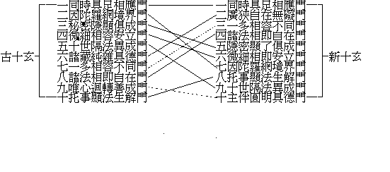



对於每一法一事皆可作十玄观，此十玄义不能广释。如一多相容不同门，谓一能摄多、多复摄一，虽复互摄，而仍各具本位不碍不坏。举此一门，餘可例释。十法门中，若贤首宗之说十身，亦为殊特。十身有两种，一种就佛身明十身，二就有情世间器世间正觉世间融合而为十身。就总义、一切法皆为佛法身，他宗皆有此义；若分别说国土身、虚空身等，则为此宗胜义也。



丁　性起



天台宗有性具义，华严宗对之说性起义。性起就是十玄缘起，亦名法界无尽缘起。如清凉悬谈序云：「大哉真界，万法资始」；万法资始於真界，即性起义。贤首学者谓天台性具只具而已，此宗说性起，则不但性具而且即性起为事实，故又胜於天台。



六　贤首学与禅律净密之关系



贤首学和禅、律、净、密的关系，与天台和禅、律、净、密关系不同。在净、律、密三宗之中，虽多引用华严贤首学为他的依证，而贤首宗本身则对於净、律、密未生多大之关系，唯对禅宗则很有关系；如智俨判顿教就是专为摄入禅宗，后来清凉亦习禅宗，至圭峰则本出於禅宗，故后之贤首学者亦近禅宗。



第四节　贤首学与天台学之比较



前面已将天台学和贤首学的大概略为说明，现在将这二种学派作一比较，共有四段。



一　五教与化法四教



贤首五教为小、始、终、顿、圆，天台化法四教为藏、通、别、圆。天台四教成立在前，贤首五教成立在后，说五教是仿四教立的，在慧苑法师已有批判。说小、始、终、顿、圆五教，除了顿教，小、始、终、圆就是天台的藏、通、别、圆，不过改个名目又加上个顿教罢了。但是慧苑说顿教是所诠之理，不应立为能诠的教法，因此说五教即是四教，五教和四教的比较，无甚殊胜。且在天台宗虽不立顿教，而四教各说有离言谛，此离言谛就是顿教理而在四教之外，反显天台学者的善巧。然清凉对慧苑之说，曾为贤首辨护，谓顿教者，一言顿诠胜义，此一言、就是顿教。这说虽极有理，而此只言单语总摄一切要义的言句，是散在各种经论之中，仍不能指定那一部经论是顿教，故其顿教义仍不能成立。然考贤首之立顿教，全为摄入当时之禅宗，故只有禅宗的语录可以判为顿教。复次、须注意者，天台化仪四教的顿教和这五教的顿教，字虽同而意极不同；天台顿教属设化的形式，贤首顿教为能诠教体。



　　　　　　　　　┌小──藏┐  

　　　　　　　　　│始──通┤天台  

　　　　贤首五教─┤终──别┼四教─┐  

　　　　　　　　　│顿───┼───┴离言谛  

　　　　　　　　　└圆──圆┘



二　十仪与化仪四教



贤首的十仪，虽然说是仿天台四仪建立的，但是十仪比较四仪确是完善得多，其建立的意旨，深远奥妙，大有胜进，兹表摄之。



　　　　　　　┌一本末差别门  

　　　　　　　│二依本起末门─┐　　┌─顿─┐  

　　　　　　　│三摄末归本门　│　　│　　　│  

　　　　　　　│四本末无碍门　└──┼─渐　│  

　　　　十仪─┤五随机不定门─┐　　│　　　├四仪  

　　　　　　　│六显密同时门─┼──┼─秘密│  

　　　　　　　│七一时顿演门─┼──┘　　　│  

　　　　　　　│八寂寞无言门　└────不定┘  

　　　　　　　│九该通三际门  

　　　　　　　└十重重无尽门  

十仪中的第二门，就是天台的渐教，第五门即天台的不定教，第六即秘密教，第七门  

即顿教。其餘各门，则超出天台的四仪了。



三　三时与五时



贤首三时和天台五时的组织虽不同，而内容是同的。贤首的第二时就摄了天台的第二、第三、第四三时。其次、天台有通五时，贤首依之立十时。一一念时，二一化时，三三际时，四同劫时，五异劫时，六念摄时，七重劫时，八异界时，九相摄时，十收末时。这十时所观之境，更为广大深玄，实胜於天台通五时之义。兹表如次：



　　　　　　　　　┌一、华严时──────────先照时─┐  

　　　　　　　　　│　　　　　　　　　　　提胃─┐　　　　│  

　　　　　　　　　│二、阿含时───初时转　　　│　　　　│  

　　　　　　　　　│　　　　　　　　　　　阿含　│　　　　│  

　　　　　　　　　│　　　　　　　　　　　方广　│　　　　│  

　　　　天台五时─┤三、方等时───中转时　　　├转照时　├贤首三时  

　　　　　　　　　│　　　　　　　　　　　深密　│　　　　│  

　　　　　　　　　│　　　　　　　　　　　般若　│　　　　│  

　　　　　　　　　│四、般若时───后转时　　　│　　　　│  

　　　　　　　　　│　　　　　　　　　　　妙智─┘　　　　│  

　　　　　　　　　└五、法华涅槃时────────还照时─┘



四　同别圆与兼纯圆



贤首判华严为别教的圆一乘，而称法华为同教的圆一乘，以法华虽为一乘圆教，而其中实摄有各种方便，而华严则为根本的纯粹的圆教一乘也。可以说华严为特别整个的圆教一乘，因此论天台所宗的法华为同教一乘，不及华严的别教一乘。但是、在天台说华严虽本是圆教一乘，而兼有别教之法。圆教是实，别教为权。华严既兼别教故带有权法，而不及法华为纯圆至实之教。



然两宗之争点，於吉藏法师之根本法轮和摄末归本法轮稍可释之。假若直从佛智的自证境界而说，佛的自证境界到最圆满者，实为华严；若从佛的大悲方便以言，佛的教化之圆满当属法华。又天台法华之圆，可以说是侧重於觉他方便之法；贤首华严之圆，可以说是侧重於自觉究竟之境。若总佛陀的全体大用以观，必须总摄二宗之圆义，方是智悲双足的佛法。



第五节　结论



天台智者大师在中国佛学史上为最博大圆融之一人。因此智者大师在当时，实集隋以前中国佛学的大成，其智力非其他祖师所可及；然而有可惜者，在当时虽亦有摄论、地论等译书，因其传宏不广，智者未多引用。其他若净土、禅宗、法相、真言等，或因印度未传，或因弘传未广，因此其学未能广摄！又大师於三藏多弘於经而少弘论，亦一缺憾！



贤首时代，一切教法渐备；至清凉益为完备，兼其才智卓伦，大可综贯佛法而建立一完备之中国佛学系统。可惜者，以其专弘一经，虽判释全藏佛教，而仍侧重於专弘扬己宗，排斥他宗！至对於佛教中世出世善法及小大性相显密等，未能组成一各如其分齐的安立！



复次，二宗历代祖师，皆各重自宗主观，而尚缺平视等量之客观的精神和态度。换言之，即对於释尊教法未能平等的观察和组织。因此、以今观之，反不及西藏宗喀巴菩提道次第之组织圆满。对於全部佛教既未能有圆满完善之组织，故结果祗成为一家之学，一宗之义，而与他宗不能容摄也！



又天台於四教各论断证位次，其实圣教论中只有小乘与大乘各别之教理行果；於藏教之上另立通教之位次，於别教之上另立圆教位次，及说四教之菩萨位次与佛果等，皆无确实根据！而贤首五教更仿四教为各别之断证位次等，皆只可自成其说，而不能以佛法之根本圣教为衡量者！故吾人今后应从全藏佛教，更为根本的研究。



（法舫记）



第四章　禅台贤流归净土行



中国佛学，一向称为台贤禅净，或禅净台贤；意谓台贤为教义，禅净是行门，故作如此分列。现在根据中国佛学分占的时代先后，次序为禅台贤净。因为此处讲的禅，不单是后来禅宗的禅，而是佛教传入中国最初即注重修禅的禅。由中国佛学所重在禅，依此重禅之特质而演变为台贤的教义，后来又汇归净土行，故成为禅台贤净的次第。盖中国佛学重心，从开始到今，一直在禅，而天台教观盛於陈、隋，贤首教观盛於唐初，宋、元后禅台贤俱衰，餘流汇归净土而转盛。兹溯念佛禅为净土行之滥觞，分四段来讲。



第一节　依教律修禅之净



念佛就是修禅，故有所谓念佛禅。不过依教修禅，起初是安般禅和五门禅，而念佛禅的兴起，要稍微迟一点。依教修心禅中的念佛禅，是净土宗的根源，这是无可疑的，这就是现在讲的依教律修禅之净。此又分三节阐述之。



一　无量佛刹



汉时支娄迦谶译出般舟三昧经，般舟即「一切佛现立在前」之义。此一切佛，也就是阿弥陀佛，因为阿弥陀佛译为无量，无量与一切是相通而不相违的。故说一切佛立在前，即阿弥陀佛立在前。在五门禅里说：多贪众生修不净观；多瞋众生修慈悲观；多痴众生修缘起观；多散乱众生修数息观；最后多慢众生修无我观，也有说为多障众生修念佛观的。平常说三宝，说六念，也都是佛列在前。众生生死流转，烦恼业障深重，而佛则已功德清净圆满；故以此清净圆满功德，可以对治众生的惑业重障。我们如依佛陀的功德庄严为加持，即易生起归向清净佛刹之心。即密宗亦由念佛观发生，因为密咒等於佛名，都是果上的功德。以佛果的依正功德为归向，即演成净土宗；摄佛果依正功德为自己，即转为密宗。



般舟三昧经所说的念佛，是念一切佛无量佛，念佛的相好、功德、法性。由此念佛的功德成就，即可感得一切诸佛皆现在前。以佛果依正功德为观，不但是般舟三昧经说到，如观佛相好功德海等，其他经论亦多有其义。如法华经中说：『临命终时，千佛授手，十方净土随愿往生』。这就是说，只要念经中的诸佛功德，即可感得诸佛前来接引。此所谓十方诸佛，就是无量佛刹的佛。这无量佛刹，修念佛观的众生，都可以随愿往生。



二　弥勒内院



在中国佛教史上，远在慧远以前就有修弥勒净土的。弥勒净土，就是兜率内院。虽十方诸佛的净土皆可往生，而弥勒内院最为切近，因为它就在娑婆——本土，而且在欲界——本界。故从弥勒上生经翻译出来以后，道安法师即专修此法而求生兜率内院。印度来华传教的高僧，亦有修此法门者。唐时的玄奘与窥基，以弥勒净土为行持及依归。后来主张弥陀净土的大德们，多说弥勒净土不易修且不易生，或说不及弥陀净土殊胜，如智者的十疑论、道绰的安乐集、迦才的净土论等，都如此说。加以开示弥勒净土的经论比较少，修者亦不多，所以奘、基以后，弥勒净土即不大盛行了。而弥陀净土，则恰巧相反。不过，他们的辩论，都是从生兜率天而论，不是对於弥勒内院说的。若从内院说，如弥勒上生经说生兜率内院者，皆是发大乘心而不退转的；且说有三品修，如有犯戒而忏悔者，临命终时弥勒亦来接引。华严普贤行愿导归极乐，法华普贤劝发亦指归内院。故弥勒净土法门的不流行，不在胜劣或难易，而是唐以后的修者少、宏扬者少的原故。



三　弥陀净土



般舟三昧经中说的一切佛，也就是无量(阿弥陀)佛。无量寿经，於汉魏就已有翻译。故在慧远法师以前的僧显禅师，已由修习禅定，见阿弥陀佛而得往生极乐。但真正念阿弥陀佛求生净土的宗风，创於庐山慧远的莲社。慧远法师的德业，本不限於净土，如翻译经律，宏扬教义，修持戒定，及守护僧制等。但约创莲社於庐山来说，中国净土宗的初祖，却非他莫属！当时的莲社中人，六时行道，一意西归，如刘遗民著有净土发愿文，王乔寿曾作念佛三昧诗。远公序云：「念佛三昧者何？思专想寂之谓也。思专则志一不分，想寂则气虚神朗。……又诸三昧其名甚众，功高易进，念佛为先！何者？穷玄极寂，尊号如来；体神合寂，应不以方」。他极力赞叹念佛三昧。但此种念佛三昧，不同后来与禅别行的专称名号的念佛，也是观佛相好、功德、依正庄严的。如远公定中三见净土，即是由念佛而得的三昧境界。故远公以前，虽有五门禅中的念佛禅，但专以念佛为修禅的，则创始於庐山莲社。



「依教律修禅之净」，即远公所谓「功高易进，念佛为先」者是。盖当时以念佛观为诸禅观中之最高者，所以念佛即是修习最上禅观。修持者都精依教义，严遵戒律，如慧远法师至死不饮蜜浆等，与后来脱离教义戒律之达摩禅不同，所以说为「依教律」。又既以念佛为最高之禅观，故不同於后人以修禅为难行道，别重持名念佛的净土为易行，所以说是「修禅之净」。



这种即是修禅的念佛法门，由庐山莲社便风行於南方，后由昙鸾法师又弘传於西北。但昙鸾已开别禅的兆端，故修禅的净，正以远公为代表。慧远法师以后，至唐初之善导，尤力事宏扬，朝野从化。於是这种法门，不惟普遍於全中国——中国人几至以「阿弥陀佛」四个字代表整个佛法——，而且播及於高丽、日本、安南等地。由这样看来，就可知道华文佛教区和其它文字的佛教区大大不同。如藏文教区里佛陀的代表，是「唵嘛呢叭咪吽」而不是阿弥陀佛；巴利文区的锡兰缅甸等，不但没有修行净土法门的，连阿弥陀佛的名字也不知道。所以这种净土法门，可以说完全是由中国倡行的，是华文佛教区的特殊标帜。故讲中国佛学，不能不讲到净土行；而净土行之弘传者，尤不能不说到慧远法师。



第二节　尊教律别禅之净



从不立文字不拘律仪专以无相无名悟心为要的达摩禅风行以后，禅者不尊重教义与律仪，而修净土(此下皆约弥陀净土言)者则皆流为尊教律而别异於禅的净土行了。此时的净土行，已与慧远法师者异。慧远法师等认念佛为最高禅观，故此念佛即修禅；而此期所修净土，则别异於禅，不但力斥禅宗之禅，即其餘依教律所修诸禅观，亦皆简别为仗自力的难行道，而独以净土法门为依他力的易行道。总之，此尊教律别禅之净之「别禅」，不仅反对达摩禅，而又示别於其餘的诸禅定。



关於这一类净土法门流下来的著作，以昙鸾法师的「略论安乐净土义」为最早。论明西方净土非三界摄，净土二十七种庄严，九品往生，解释「胎生」疑义及十念往生等，皆系依三经一论而立义者。



其次有道绰法师的「安乐集」。绰师比天台智者稍迟，后昙师数十年。原是讲经的，后因慕昙师之风，转归净土。他特别注重持名念佛，教人用豆记数以念佛名。他在安乐集中分十二门，第三门即根据龙树菩萨的十住毘婆沙论而辨难行道和易行道，确立净土教义的宗本。西方净土离娑婆世界十万亿土，且又是极乐净土，娑婆人欲生西方，岂非很难？道绰在安乐集中，很巧妙的解释，袪除这样的疑惑，他以为娑婆世界是秽土中的最后，而极乐世界是净土中的最初，后初相接，所以往生不难。我在北京讲普贤行愿品时依华严所说娑婆一劫为极乐一日夜义，说极乐为净土之初。等到阅道绰法师的安乐集，始知不期而一分相合。绰师在安乐集里，又引大阿弥陀经偈，多有非今无量寿佛经所有，似另有别本。又第十二门中，引十念往生经甚详，而这些经文都是现在所不传的。智者的观经疏，净影慧远的无量寿经疏，亦出於此时。



唐时，与怀辉同为善导门人的怀感法师，著「释净土群疑论」，共有七卷。立说广而细密，且常涉及相宗教义。与怀师同时的迦才法师，著有「净土论」，亦多依相宗立义。这几种书，对於净土教义，讲的都很深细。怀感法师宗本道绰、善导，如说西方净土非三界摄等。迦才法师却随自意发挥，如谓西方净土亦容是三界所摄。这因为若就佛果讲，虽是无漏非三界摄，而就所摄众生讲，则可是欲界摄。——二师同用相宗义，主张亦略有差异。



上来就教义的顺次讲，故先说到怀感、迦才；若就时间上讲，善导为早(日本以昙鸾、道绰、善导、怀感、少康为支那五祖)，是唐高宗时人。故中国以善导为二祖，继有三祖承远，四祖法照，五祖少康，皆以感应神异著於世。



善导为净土宗之光大者，为中国最推崇之祖师；即在日本，亦以其为净土宗之主要人物。据僧传所记，善师见绰师的净土九品道场，喜云：「修餘行业，迂僻难成，唯此法门，速超生死」！遂勤笃精修，昼夜礼诵。后至京师(即西安)，激发四众，恒长跪朗诵佛名，非力竭不休。不念佛时，即为人宣扬净土法义。他教人专持佛名，不须作观。他以为「众生障重，境细心粗，识飏神飞，观难成就。是以大圣直劝专称名号，正由称名易故，相续即生。若能念念相续毕命为期者，十即十生，百即百生」！后来专持名号之念佛法门，即奠基於此。他又教人临命终时相助念佛往生法，叮咛恳切。故善导法师实为中国净土宗风范之确立者。所著「念佛镜」，为宋杨杰及明莲池等所推重，以於净土教义，确有精要的发挥！



善导法师的著作，除念佛镜外，还有「观无量寿佛经四帖疏」、「观念阿弥陀佛相好功德法门」等，说到观想念佛的修法。可知他亦兼观想，不过提倡时偏重持名罢了。



从昙鸾法师以后，即有净土三经一论疏，道绰、善导等承之，便为净土宗的根本教典。而日本净土宗真宗等大学，莫不尊为净土宗学。尤其是善导法师的四帖疏等著述之於净土，犹智者著述之於天台。



与善导同时，还有窥基法师，著有「西方要决」与「弥陀通赞」。西方要决与「弥勒上生经疏」义，每有不同，故有人怀疑此书不是窥基作的。



其时，高丽的元晓法师，到中国来，虽专弘贤首宗，而於净土法门亦曾著「游心安乐道」以赞扬之。



日本所传净土宗的中国祖师，昙鸾为初祖，道绰为二祖，善导为三祖，怀感为四祖，少康为五祖。少康为五祖，与中国净土宗同，但前面的几祖，却与中国的所传不同。



少康法师是善导法师后一百餘年的人。在洛阳白马寺见有经函放光，检视之即善导的「净土发愿文」，因之就往西安礼善导法师的祖堂，感得善导法师现身空中劝导，遂专修净土。并遵示至浙江新定。初以钱诱小儿念佛；后以念佛一声即现一佛之灵异，受化导者甚众。临终时，口中念佛出光——见光者为真弟子，必得往生。后人多谓其为善导法师的再来。少康本系直接遥承善导者，但在中国后代的推尊上，却於善导二祖之下，继以承远三祖，法照四祖。



承远法师，由宋石芝宗晓法师的「乐邦文类」，叙列为净土宗第三祖。承远与善导，本无如何渊源，而列之为第三祖者，盖以其苦行念佛，精诚感通，从化者极众之故。教义方面，无可稽考，但知其为南岳祝圣寺的开山。



法照法师本为修禅定者，因在定中见到西方佛座前有一褴褛僧人，询知为南岳承远法师，因至南岳礼以为师，转修净土。后代宗皇帝奉法照为国师，遂推遵承远，封南岳为般舟道场，故后人礼祖师时称为三祖般舟承远法师。



比善导稍后，有一位慈愍法师。宋高僧传谓：「释慧日，唐高宗永隆二年生。出家后，见义净回国而有感，遂至印度。开元十年返长安，为玄宗说法，赐号慈愍。善导、少康，异时同化」。可知慈愍实为唐时净宗之重要人物，第以著作遗失，故后人对之不甚明了。日僧小野玄妙在所著「慈愍三藏之净土教」中云：「然我慈愍三藏，为伟大之净土祖师，而后世一部分净土教徒，举昙鸾、道绰、善导、怀感、少康五人，称为支那净土五祖而不列慈愍三藏之名，盖以同一净土宗，而慈愍三藏之净土教，与善导一流之净土教不相容耳」。此举日本净土五祖，不以慧远法师为初祖，又无承远、法照；而中国则并昙鸾、道绰、怀感皆未列入。盖中国净土祖师，是依宋朝宗晓法师所推定的。宗晓以慧远为初祖，以善导、法照、少康、省常、宗赜继为五祖。净土指归集则以善导、承远、法照、少康、永明、省常、宗赜为七继祖。然明朝蕅益等，亦有议其未周者。要之、净土宗之被列为祖师者，大抵依其弘化之功为标准，非前祖后祖之有何传承关系。元朝大佑法师依宗晓所传，以宗赜为八祖；则易宗赜而以莲池为八祖者，殆又出之明清之际。兹因小野之论，乃附述净宗诸祖之所传有异如是。



慈愍法师留学印度时，曾感观音菩萨现身说法云：「汝欲传法自利利他，莫过西方极乐世界弥陀佛国。乃劝令念佛诵经发愿往生，到彼国已，见佛及我得大利益。汝自当知净土法门胜过诸行」。因之即决定专修净土，回国后，唯以净土法门自行化他。不过，慈愍法师并非但持名号者，虽认念佛为诸三昧之最易修者，亦兼综教律禅行。故於偏执金刚经「若以色见我、以音声求我，是人行邪道，不能见如来」；「凡所有相皆是虚妄」等义者，曾有详晰之评论。且持论多依唯识教义，故谓无相是依理言，事上则有因果；果位上无相，因位中有相；圣证无相，凡心有相：金刚经之说，乃遣遍计执耳。此可见慈师之深明唯识义，故见解与善导法师稍有不同。在他的「慈悲集」里，大斥离教律之禅，而赞扬依教律之禅，并谓依教律之禅与净土一致。故慈师为禅教一致、禅净合行、净律双修者。净土固为仗他力之易行，但念佛并非废除餘行。故慈愍在「慈悲集」中，曾谓：「圣教所说，正禅定智，制心一处，念念相续，离於惛掉，平等持心。若睡眠覆障，即须策勤念佛、诵经、礼佛、行道。讲经说法教化众生，万行无废。所修行业，回向往生西方净土。若能如是修习禅定者，是佛禅定，与圣教合，是众生眼目，诸佛印可。一切佛法等无差别。皆乘一如，成最正觉」。此所说义，与善导所倡专持名号异，颇同后来之永明。但此仍是尊教律别禅之净，而未是永明透禅之净，盖尚在力斥宗门禅也。



法照法师比慈愍稍迟，亦以灵异化众为净宗祖师。未专修净土前，已於教义禅定有根柢；后又尝苦修般舟行。至五台山感得文殊、普贤为现身说法：「汝今念佛，今正是时！诸修行门，无过念佛！供养三宝，福慧双修，此之二门，最为径要！……故知念佛诸法之王！……此世界西有极乐世界阿弥陀佛，汝当继念令无间断，命终决定往生」。此感通中，教以福慧双修，念佛求生净土，颇近慈愍所行。且慈愍於印度，法照於五台，同感得观音与文殊、普贤说法，后人亦联称为三圣开示之净土法语云。



还要讲到的，就是在此一时期中，如道绰、善导、怀感、慈愍等祖师，对於离教律而别传的宗门禅，莫不痛加驳斥。在唐初又盛行三阶教。此教主要之理论，谓佛所说的一切法门，皆已不能适於此时之根机，唯有学法华经中所说的常不轻菩萨的苦行，方能成佛。此种理论，善导、怀感二师均辟之，怀感驳斥尤详。唐时的僧寺中，往往分设有三阶院、禅院，可想见其流行之盛。但不久息灭，宋时已鲜有知者。宋明后盛传之「念佛宝王三昧论」，系唐飞锡法师所作。上卷说念未来佛，中卷说念现在佛，下卷说念过去佛。上卷的理论全与三阶教同，中卷所说则为净土，足见此论系调和净土与三阶教而作。但宋明以后的人，不知三阶教，故亦尊为净土宗的要典，把它收入净土十要中。



还有两位居士，也应该说及：第一是与韩愈同时文起八代之衰的柳子厚，他著「东海若」一文，久为净土宗奉为重要文献。其次为白乐天，他是晚唐的大诗人。老年专修净土，有一首关於念佛的诗：「余年七十一，不复事吟哦，看经费眼力，作福畏奔波。何以度心眼？一句阿弥陀。行也阿弥陀，坐也阿弥陀，纵饶忙似箭，不废阿弥陀。日暮而途远，吾生已蹉跎，旦夕清净心，但念阿弥陀。达人应笑我，多却阿弥陀；达又作麼生！不达又如何！普劝法界众，同念阿弥陀」！由这首诗，可见他对於净土法门是如何诚信而笃行了。白居易曾参禅有悟，本可入於透禅融教律之净，但因他是在透禅之净的时代还未开始之间的人物，故仍归此期末尾。



第三节　透禅融教律之净



透禅与前别禅，有何分别？第一、在五代以后，依教律修禅者很少，仅有宗门禅独盛。第二、此时的净土行，必须是透过宗门禅而融摄教律的净土行。不透宗门禅，已不能修任何行，因此与前期斥禅修净者不同。它不但透禅，而且还要融摄一切教律。故真正能成为中国佛教主潮的净土禅，即在此一期。因为第一期即是修禅，第二期别禅修净，那两个时代的中国佛法主潮是禅、台、贤各宗，唯此第三期方可称为代表中国佛法的净土宗时代。此期修净土行的祖师，均为透宗门禅而又能融通教律者。



关於透禅不透禅之别，这里引一段文即可知道。莲池竹窗二笔云：「道镜、善导二师念佛镜，以念佛对种种法门，皆断云百千万亿不及，可谓笃信明辩！独对禅宗，亦谓观心观无生者千万不能及，学人疑焉。予以为此正四料简所谓有禅无净土者，但执观心不信有极乐净土，但执无生不信有净土往生，则未达即心即土，不知生即无生，偏空之见，非圆顿之禅也。反不如理性虽未大明，而念佛已成三昧者，何足怪乎！若观心而妙证自心，观无生而得无生忍，此已与念佛人上品上生者同科，又谁轩轾之有也」？善导为未透禅而修净土，莲池之为透禅而修净土，其意昭然可见。盖莲池说明禅之最高境界，即与念佛上品上生同，已摄禅同净，更不烦排禅矣。此期兹分三段明之：



一　禅宗之净



净土宗远奉慧远法师为初祖，而透禅修净期亦必尊永明寿禅师为开始者。因他力行念佛，其净土著述有「神栖安养赋」及「万善同归集」、「六重问答」等。为净宗奉作准绳者，有四料简偈，如云：「有禅无净土，十人九蹉跎，阴境忽现前，瞥尔随他堕。无禅有净土，万修万人去，但得见弥陀，何愁不开悟？有禅有净土，犹如戴角虎，现世为人师，将来作佛祖。无禅无净土，铁床并铜柱，万劫与千生，没个人依怙」。此四偈亦有疑为后人伪托者，但无论是否出於永明之手，是这个时期之作品，则不成问题。在永明寿以前，中国佛教的禅宗，以演进到五家宗派的兴起为顶点；法眼为五家中最后创立之宗派，而永明寿为法眼第三传，亦即法眼宗最后一人。因为从它透禅融教律而摄归於修净土行，其门徒都归宗净土，致法眼宗失传。其传於高丽者，今尚流传为一心念佛的顿门。



次有长芦慈觉宗赜禅师，它曾一度被尊为净土宗第八祖，有关於净土的著作颇多。其莲花胜会序云：「以念为念、以生为生者，常见之所失也；以无念为无念，以无生为无生者，邪见之所惑也；念而无念、生而无生者，第一义谛也。是以实际理地，不受一尘，则上无诸佛之可念，下无净土之可生；佛事门中，不舍一法，则总摄诸根盖有念佛三昧、还原要术、示开往生一门。所以终日念佛而不乖於无念，炽然往生而不乖於无生，故能生佛各住自位而感应道交，东西不相往来而神迁净刹」。由此可见其为一透禅融摄教律之净土行者。



真歇清了禅师，是普陀后寺的禅门开祖，为曹洞宗的大老，亦曾以兼提净土著名。其净土宗要云：「弥陀不离众生心，是二无别，极乐遍在一切处，举一全收。……圣人善巧，示人专念阿弥陀佛。……见一佛即见十方佛及九界众生，微尘刹海，一印圆了……」。其要义如此，可见其为透禅而融贯贤首教者。



中峰明本禅师，为宋末元初临济宗鉅匠。融通禅教律密净，晚年专修净土。现在流行的净土忏，即是他的遗著。他对於净土法门，不但自己笃行实践，尤能广以此法化他。三时净土系念文，传亦系彼所作。还有许多关於净土的诗偈，其怀净土诗云：「藕池无日不花开，四色光明映宝台，金臂遥伸垂念切，众生何故不思来」？又云：「清月黄昏礼忏摩，低头泣告老弥陀：轮回六趣知多少，誓愿今番出网罗」。即此可窥一斑。



天如惟则禅师，系明初禅哲，其被选入净土十要之天如或问中有答云：「良由净土教门至广大，修法至简易，故闻者不能不疑。广大谓一切根机收摄都尽，上至等觉位中一生补处亦生净土，下至愚夫愚妇五逆十恶无知之徒，临终但能念佛悔过，归心净土者，悉获往生也。简易谓初无艰难劳苦之行，又无违误差别之缘，但持阿弥陀佛四字名号，由此得离娑婆往生极乐，得不退转，直至成佛」。此虽只寥寥数语，然对净土法门之要义，几概括无遗矣。



楚石梵琦禅师，亦是明初临济宗匠。自幼每日清晨修十法念佛，求生净土；主持天宁时，筑室西偏，专修净业，默观极乐依正庄严。作有西斋净土诗，为后世所传颂，被选入净土十要。临终时，对他的师兄噩曰：『我去矣』！噩曰：『子去何之』？曰：『西方』。曰：『西方有佛，东方无佛耶』！师振声一喝而寂。



憨山德清禅师，德业著述甚广，其梦游集中开示净土行法亦多。有念佛切要云：「念佛求生净土一门，元是要了生死大事，若不知生死根株，毕竟向何处念！若念佛的心断不得生死根株，如何了得生死？古云：业不重不生娑婆，爱不断不生净土。是知爱乃生死根株，以众生受生死皆爱之过耳」。这是开示断爱出生死的念佛法门。他晚年游云栖，深赞莲池，转趋匡庐专修净土。



还有被奉为净土十一祖或十二祖的彻悟禅师，清乾、嘉间人。初参禅，兼达台贤教理，主持广通禅寺，禅风大振。后因病而归修净土行，禅者多依之修净土。他的彻悟语录中有摄教义之百偈，每偈都冠以「一句弥陀」四字。兹录一二，明其概要，如云：「一句弥陀，我佛心要，竖彻五时，横该八教。一句弥陀，白牛驾劲，其疾如风，行步平正。一句弥陀，第一义谛，尚超百非，岂落四句！一句弥陀，是无上禅，一生事办，百劫功圆」。可谓极其以透禅融摄教律而修净土行之能事，足为禅宗之净之殿军。



以上是这一期中禅宗之净的几个代表人物，以下叙述到几部书：一、莲宗宝鉴，是宋东林优昙禅师作。他志承远公，专弘净土。莲宗宝鉴，分正因、正教、正宗、正派、正信、正行、正愿、正诀八卷，为净土宗重要典籍。二、净土简要录，明初道衍或即姚广孝集，不愧简要二字。三、宝王三昧念佛直指，明妙叶集，被选入净土十要。四、归元直指集，分二卷，宗本禅师集；本号一元子，内收重要文献甚多，亦为净宗要典。五、净宗要语，系鼓山永觉元贤禅师，就念佛净行及戒杀慈行而作，文分二卷。他承永明寿昌禅师之传，为明季曹洞宗之禅匠。六、净土旨诀，清初道沾和尚，乃承永觉而作。七、角虎集，取永明犹如戴角虎义，录各宗禅师净土语要。八、净土绀珠，为光绪初年虚舟济能所集；其有可取者，为用法数增一编纂，如由一心增至四十八愿，有如增壹阿含之编纂法。



这里还得讲到的，是有很多居士：如宋文潞公彦博，悟禅修净，专念阿弥陀佛。尝发愿曰：「愿我常精进，勤修一切善！愿我了心宗，广度诸含识」！在京师与净严等集十万人举行盛大之念佛会。如如居士赠诗云：「知公胆气大如天，愿结西方十万缘，不为一生作活计，大家齐上度人船」。此可想见其盛况。复有给事中冯楫，号济川，亦彻禅修净，作有倣陶渊明的「西方安养兮胡不归」之归去来辞。



宋无为子提刑杨杰次公，得悟宗於天衣怀禅师，晚年修净土，命终坐化。有偈云：「生无可恋，死无可舍，太虚空中，之乎者也」。或有问公『何往』？曰：『西方』。曰：『若生西方，则又错也』。曰：『将错就错，西方极乐』。时有王古居士，作净土指归决疑集，公为序之。王古又为圆澄禅师序净土宝珠集，此二书均已失传。



宋进士王虚中，号龙舒，为净土宗著名的居士。所作的龙舒净土文，流传最广，自行化他，不曾稍怠，为后代居士宏扬净土宗各种著述之源泉。这是大家所熟知的，无须多讲。



明季袁宏道亦通禅修净，是当时有名的居士。他们三弟兄传为三苏后身，均善文章，在当时另成一公安派。晚年修净土，俱生极乐。中郎所著净土合论，其透禅融教律之意，上彻永明，已选入净土十要。虽教义似宗华严，然实本禅悟。其中以明西方净土为摄十方众生不可思议土为最胜。然在他以前，怀感亦曾发此义。



还有净土全书，清俞行敏著，本龙舒净土文义而广之。径中径又径，是清道咸间苏抚浙人张师诚著，亦龙舒净土文之类。故均附此。



二　台教之净



谈到台教之净，应该仰追到高祖智者大师所著的净土十疑论和观经疏，因为这是台教修净的最大根据。然而这还是邻於修禅别禅之净之间者，而透禅以后的台教之净，应该首推被尊为莲宗七祖的昭庆省常大师，因为他是先修天台止观而后来才专修净土的。大概在宋淳化中，他在杭州昭庆寺仿庐山莲社而创立净行社，当时加入他的净行社的，有比丘千餘人，公卿士大夫百二十人。这些公卿士大夫，都是一时的显贵，如为首的王文正公旦，是做过宰相的。另有一位文章很出名的苏易简翰林，为作净行社序云：「当布发以承其足，剜身以请其法」，可想见省常大师是怎样的受人倾信了。他领众念佛，精勤不懈，数十年如一日。到六十二岁时，厉声谓佛来了，随之而化。建塔於乌窼禅之侧，被封为圆净法师。



次讲到四明知礼大师，平常都称为四明尊者法智大师。他是北宋中兴天台教观的人。他也宏扬净土，曾根据智者大师观经疏而著妙宗钞，亦为净土宗要典。现时流行的大悲忏法，出於大师，系师率众所常修者。又尝念佛剋期弃寿生西。当时的大文学家杨亿，函请留世，并问答净土要义。后数十年，有自称私淑弟子的待制陈瓘，号莹中，入台教室，著三千有门颂，亦赞扬净土。他在延庆寺净土院记中云：「明州延庆寺住持比丘，每有讲席，以天台观行为宗。自法智大师知礼，行学俱高，听徒心向，继其后者，又皆得人。……普融无碍，然后空假俱中；分别未忘，不免权实互诤」。亦能扼台净之要旨。四明下天台分为南屏、广福、神照三家。至於修净土的，要算神照下所出的宗晓法师为最著。



和法智同时同师的，有杭州下天竺的慈云忏主遵式法师。著有净土、金光明、观音等诸忏仪，所以称为慈云忏主。他常精勤念佛，发愿往生，被他化导的人非常多，可说是台净传入民间的一个有力者。他的著作，有往生净土决疑行愿二门，及净土忏法，都被选入净土十要里。又著有晨朝十念法，提倡十念法门尤力。



再讲到灵芝圆照律师，他是宋代重兴律宗的祖师，不过他的律宗与南山道宣律师稍异，而是宗天台教义，又以净土为归的。所以律宗从此便与台净相倚了，故为台净之巨擘。而民国以来的弘一法师，可为其嗣音。照师初持慧布『方土虽净，非吾所愿，若使十二劫莲花中受乐，何若三途极苦处救众生也』之见，后遭重病，在病中览天台十疑论，始转崇净土。又由善导专杂二修的分辨，乃专持名号，常忏悔初时反对净土的过非，发愿宏扬净土，普度众生。



以上都是宋朝的。至明朝万历年间的幽溪传灯法师，又为明代重兴天台教观的人。著述甚富，尤力宏净土，要旨见於他所著的生无生论——蕅益也收入净土十要里。论立十门：一、一真法界，二、身土缘起，三、心土相印，四、生佛不二，五、法界为念，六、境观相吞，七、三观法尔，八、感应任运，九、彼此恒一，十、现未互在。洵能摄天台圆境观於一句弥陀中者！有净土法语，亦甚剀切！可谓台净之极则。



灵峰蕅益大师，名智旭，他和莲池、紫柏、憨山，称明末四大师。他理解闳深，学问丰富，行愿专在念佛往生。起初、他所学不拘於一宗，后来却承天台的嫡传，同时亦为净土宗的第九祖。关於他宏扬净土的著作，以弥陀要解为最，称为绝唱。曾选弥陀经要解以至袁中郎净土合论为净土十要，后由弟子成时坚密法师评点叙述精刻行世，诚为净土宗最精粹之宝典。



虞山普仁寺行策截流法师，是清初顺、康间人。其初亦曾习天台教观，后来专修净土，精勤修持，不遗餘力，因而信从者甚众。留有净土警语与七期规式各一卷，虽文字不丰而简洁精警。其谓禅净二门，宜各专务，不必兼修。七期规式，为清代以来打念佛七的滥觞。近由印光法师推为净土十祖，不无卓见。



杭州梵天寺省庵思齐法师，他为清雍、乾间人，在天台宗的传承上，他是灵峰下第四代。由彭二林居士集其语录并序之，文义亦甚精约。尤其传诵於佛教缁素者，为所作「劝发菩提心文」。其第九「为求生净土故」有云：「在此土修行，其进道也难，彼土往生，其成佛也易。……下菩提种，耕以念佛之犁，道果自然增长。乘大愿船，入於净土之海，西方决定往生」。阐发净土宗旨，最为扼要。并在宁波阿育王寺倡设涅槃供佛舍利会，用胜美的供品，多有陈列金银珠宝为供的，直到现在，这种供佛会仍续行未衰。后亦被尊为净土宗祖师。



关於台净的书籍，首应提到净土十疑论注，此是智者大师宏扬净土的要论。宋初，有澄彧法师所撰的十疑论注，修续高僧传的赞宁僧正为之作序，现存续藏中。



还有乐邦文类，共五卷，是南宋间四明石芝宗晓法师撰。首卷、采集经论要义；二卷、集序跋文赞等；三卷、集记传，关於净土宗初祖以及五继祖传亦在其中，四卷、集杂著；五卷、集赋铭偈颂诗词。更续以遗稿两卷，摭拾前五卷所遗漏的。洵为南宋以前，除各大经论疏注外之净土文献集成。卷二中：录存南宋初昆山子元法师之十门告诫中的圆融四土选佛图。子元号万事休，专修净业。高宗乾道二年，召至德寿殿演说净土法门，赐「劝修净业白莲导师慈照宗主」之号。



净土指归二卷，义分十门，乃元、明间苏州北禅寺大佑法师集。大佑亦台教而修净者。其指归集之第一原教门、莲社立祖条，曾载宗晓立慧远至宗赜为净宗八祖，餘所录亦俱扼要。永明四料简偈，亦载其第三法相门内。且与归元直指，同有破斥性命双修等类之仙道邪说，可见其时先天道等已有萌芽也。



西方直指，乃渌田一念居士编，自序有云：「袁中郎撰西方合论为参禅未悟者告，余著此书则为未闻西方者告」。直叙念佛行法，及经论祖师指归、证验持戒等，平实简明。



还有道光间的悟开法师，居灵岩山下宝藏寺，以净土法门自行化他，撰净土知津，一名念佛百问，颇便初机。莲宗正传，以远公至彻悟为十一祖，亦其所著。



三　贤教之净



贤首宗唐季衰歇，宋时虽复兴不盛。古传有圆澄法师著华严念佛三昧无尽灯，宋范成大居士尝为之序行，其书已佚。故由贤教修净土，须至云栖莲池袾宏，始卓然为一代大师。明季研讲贤首教义者渐多，如雪浪等，五教仪亦在莲池前后编集出来，故莲池弥陀疏钞，即专奉华严疏钞为家法。莲池重律，后宝华律宗亦近贤净。师固曾参禅悟入，然未据禅席，但开云栖专修念佛。云栖法汇百餘卷，皆教宗贤首行专净土而融通禅律及各家教义之至文。不惟明季来净土宗风之畅盛得力於师，亦为净土宗上下千古最圆纯的一人。念佛七礼祖，至今亦多仅礼至八祖云栖者，对师从无间然。净土发愿文及注，四十八愿问答，净土疑辨，尤为切要。



彭际清名绍升，就是二林居士，堪称以华严教义宏扬净土之继起者。以僧众之研贤首者，多近禅宗，不弘净土，故清代僧林虽每讲弥陀疏钞，而绝鲜贤教兼修净土之宗师为继。然居士中则大不乏人，尤以二林居士称古近之最。居士宗教均彻，著述宏富，而无不纶贯以宗本华严倡行净土之意。著居士传、善女人传、一乘决疑论等，而重订西方念佛警策、往生传，尤为净土要典。其他二林居士诗文集非一。同行有汪大绅、罗有高等，不逮公之专勤。公乾隆时进士，文章亦著於时。尝函袁随园论佛法，护教宏法甚殷。省庵语录亦其所编。净土宗为中国佛法主潮，亦至莲池、省庵、二林达其极。



杨文会仁山石埭居士，刻行日本传归佛典，并拟复兴印度佛教，设祇洹精舍，吾亦预学其间。居士功名早著同、光间，而设金陵刻经处专弘佛法，则在光、宣间。今之支那内学院等，即从此流出，故为中国近代佛学重昌关系最鉅之一人。尝自言「教宗贤首，行在弥陀」，笃修净土数十年无间断。一时居士之受其化者，遐至英、法、印、日。所著等不等观中，与幻人法师辨法华义，与日僧辨真宗义，均甚精彻。彭二林至杨石埭间，有魏默深、王耕心等。同时者，有编净土报恩论之桐乡沈善登，亦曾通书问。还有袁兆鸾莲修起信录，颇芜杂，但悟本法师传尚佳。



贤净典籍，则净土资粮全集，为亲承莲池之庄广还复空居士所集，文丰而寡要。净土晨钟十卷，清顺治间周克复居士集，亦遥承云栖之化者，可为净土宗巨著，文义较资粮集为周正。西归直指，即印光法师印行甚广之安士全书中之一种。安士姓周名梦颜，清康熙间人，著欲海回狂以止淫，万善先资以戒杀，而此书则直以西方净土为归，文义简易，不愧直指。另有启信杂说一卷，亦使人於净土断疑启信者。净土切要，道、咸间真益愿居士著，於净土宗固为切要；而内有劝从根本处修一条。著重君仁、臣忠、父慈、子孝等人伦道德，后为印光法师所本。修西辑要，光绪时杭州复庵法师辑，亦承云栖之化者。



上将透禅融教律的禅宗之净、台教之净、贤教之净，均已略明其概要。然此三系亦非可划然分界，以均透禅而兼明台贤教律，特就其较偏显者略疏别耳。此期禅净，得六、永明，十二、彻悟两祖；台净，得七、圆照，九、蕅益，十、普仁，十一、省庵四祖；贤净，得八、莲池一祖。



第四节　夺禅超教律之净



宗门禅乃超教律的。别禅、透禅之净，对教律均尊之融之而与宗门禅抗。至此期，乘禅之衰，转由净土宗承袭其超教律且倚透禅之势而夺禅，而成为仅存孤零的念弥陀名号之势。幻人(印光法师曾与争辩)法师以「昔玄奘携所取经，过河落水，晒河岸石上，被一龟食尽，今只存阿弥陀佛四字」讥之。然履霜坚冰至，非一朝一夕之故，乃溯源竟委，略为分叙。



一　泛源



善导承道绰，高唱一切佛法皆自力难行，唯净土他力易行。并於释众疑惑门，对三阶、对弥勒、对坐禅、对讲经、对持戒、对六度，并云念佛胜百千万亿；又排杂修，以持名记数为专修，已开厥端。后永明亦重记数持名，四偈料拣之无禅有净与有禅无净相别天渊。径中径又径载宋丞相郑清之曰：「人皆谓修净土不及禅教律，吾则谓修禅教律法门莫及修净土。……以禅教律假设方便，使从门而入，俱得超悟；唯无量寿佛独出一门，曰修净土。如单方治病，简要直截，一念之专，不问缁白皆可奉行。但知为化愚俗浅近之说，其实则成佛至捷之径。……不由禅教律而得戒定慧者，其唯净土之一门乎？……不施棒喝而悟圆顿机，不阅大藏而得正法眼，不持四威仪而得大自在。……当是时也，孰为戒定慧？孰为禅教律？我心佛心一无差别，此修净土极致也」。他若优昙、妙叶、天如、莲池、蕅益、行策、彻悟等，亦时有此类提倡。彻悟之「净土一门，最初不待悟门，末后不待发慧，不须忏业！一句弥陀不杂异缘，十念成功，顿超多劫，於此不修，真同木石！舍此别修，非狂即痴」！语更激切。然以上诸德，不过教学者决疑定信，非必令尽废其餘也。



二　切因



蕅益学人成时坚密法师，於十要序，出持名三大要：「一者、六字洪名，念念之间欣厌具足，如出狱囚奔托王家，步步之间欣厌具足。是故万缘之唾不食，众苦之愁莫回。高置身於莲华，便订盟於芬利。蛆蝇粪壤，可煞惊惭！二者、参禅不可无净土，为防退堕，宁不寒心！净土不可入禅机，意见稍乘，二门俱破。若夫餘宗，在昔之时不必改行，但加善巧回向；在今之世，祗可助行，必须净业专修。冷煖自知，何容强诤！三者、一句弥陀，非大彻不能全提，而最愚亦无欠少，倘有些子分别，便成大法魔殃。只贵一心受持，宁羡依稀解悟」！依此自行化他，一、废万行，二、废参禅，三、废学解矣。



清同、光间玉峰古昆法师(建杭州弥陀佛寺，刻弥陀经於石。光绪十年，由汶溪西方寺净果礼请为师终老。余於光绪三十三年始於西方寺阅藏)，专奉坚密三要。与其学者妙能、照莹等，集净土随学、净土必来、莲宗必读、净土神珠、净业痛策等书。力主信深愿切，专重记数持名；谓不记数持名，即非信深愿切。石刻弥陀经、书字之沈善登居士，亦持其说。



沈善登学问通博，集报恩论二卷，答问杂说各二十五则，护教宏净殊精辟。主儒佛二教，谓道非教；已涉西学，并致书杨文会居士，研求日文、英文、梵文佛典。其集中附有修改之「玉峰一法治四病说」，亦名「念佛四大要诀」。谓念佛有贪静境、参是谁、离妄想、求一心四病，治以一法曰出声记数。每日定数，开口散念，终身不改，即是信深愿切。谓静境是四禅八定，偈曰：「称名为动，坐禅为静，舍动取静，堕坑落穽」。参谁是骑驴觅驴，偈曰：「念佛为直，参谁是曲，舍直取曲，瞎人天目」。妄想不须断，只须散念有恒，偈曰：「带惑超横，断妄出竖，舍横取竖，弥陀叫苦」。一心不乱，只是出声散念佛名无间无休，偈曰：「散念为易，一心为难，舍易取难，过头狂谈」。依此则一、不可修定，二、不可参禅，三、不可伏断妄想，四、不可摄散归一；於深信切愿下，但长时记数持名，并特重晨朝十念而已。



三　硕果



综上源因而充盈成熟为硕果，则成莲宗十三代灵岩印光祖师之净土(依悟开法师所订者应为十二祖，以印师在九祖后加行策为十祖，命终后其学人依次递推，遂居十三)。印师在民初五六年间，吾固时挹清话。功潜清季，化著民初。他本习儒书，且尝辟佛，后皈佛出家，博通教义，兼达宗门，诚为一大通家也。本身虽是一大通家，而却教人不学通家。但他对人说话，亦应变而不锢，非玉峰堪及。就其对一般人之倡导，以告李天桂「力敦伦常，精修净业」之八字，已尽范围。其净土决疑论云：「药无贵贱，愈病者良，法无优劣，契机者妙。在昔之时，人根殊胜，知识如林，随修一法，皆可证道；即今之世，人根陋劣，知识希少，若舍净土，则莫由解脱」。又致大兴善寺体安书云：「教理行果，乃佛法之纲宗；忆佛念佛，实得道之捷径。在昔之时，随修一法而四法皆备；即今之世，若舍净土则果证全无。良以去圣时遥，人根陋劣，匪仗佛力，决难解脱。夫所谓净土法门者，以其普摄上中下根，高超律教禅宗：实诸佛澈底之悲心，示众生本来之体性。汇三乘五性，同归净域；导上圣下凡，共证真常。九界众生离此法，上不能圆成佛道；十方诸佛舍此法，下不能普利群生。所以往圣前贤，人人趣向；千经万论，处处指归。自华严导归以后，尽十方世界海诸大菩萨，无不求生净土；由祇园演说以来，凡西天东土一切著述，末后俱归向莲邦」。又每示人以：「父慈子孝，兄友弟恭，夫倡妇随，各尽己分，主敬存诚，克己复礼，明因识果，期免轮回。诸恶莫作，众善奉行，信愿念佛，求生西方」。要之，则「敦伦善世，念佛往生」而已。



核其关隘，在「今世人根陋劣」一言，不然，何以以一大通家而专切如是耶？昔三阶教亦尝以末法根劣，致废所餘一切禅教律。然非不知「法若当机，皆可成佛」，则他人不能斥其无知矣。然限以今世当机，则除净土，餘皆可废。而於世善，复崇儒术，则佛之律仪戒善亦不须弘，而佛法仅存真信切愿念弥陀佛矣。又恒力阻男女出家，虽有鉴僧弊，消极止滥，主由崇儒家伦常为善；但须信愿念佛，带业往生，更不须增上戒定慧也。故充其类而一转，大可成为在家净土行之日本真宗。



四　转流



承印师之化，而确信弥陀净土，切愿命终往生，定课每日念佛(或仅十念)之士女，虽惑业炽然，在临终有往生徵验者，闻已有多人。然愿为无行之空愿，行仅称名之散念，获徵验者又多属在家士女，则依印师所言能起确信，实全恃信任弥陀他力而致此；则日本本愿寺所谓「祗信他力」之真宗，跃然欲出。真宗教义以解行证信为次，信立则心身已全倚任弥陀、安住极乐，更不须愿行矣。故彼宗纯在乎信，愿则属於弥陀本愿，正为信任之他力，非在人边，往生不在命终而在信决心安之刹那。此刹那信心常续，即为已生净土。行则乃已生净土而再应化於人间之所行，只随人群所宜以学以教而已。在中国儒化中可习行儒学，在今科学哲学艺术化中，亦可习行科哲文艺学术，故日本僧徒皆在家化。其大学於宗学教学之外，又能博综科哲文艺之学术者也。



日本之净土宗，传自中国之善导系。其后分流出之时宗、融通念佛宗，也不越中国台贤之净。而一至於从净土宗演出之真宗，则逈然大异。故杨仁山居士力斥之，然演变至夺禅超教律之净，世善遵儒行，而出世仅存信愿念佛，其空愿散念，只赖纯信，殊有进为「纯信弥陀他力」之真宗可能。然尚期命终往生，而无真宗「信成已生，还化利他」之行，则所短远矣！



（光宗、性觉、弘悲、向上合记）



第五章　中国佛学之重建



第一节　略指所依



中国佛学之重建，是中国佛学的一个结论。其中第一须依我讲过的第三期佛法判摄，与中国佛学大纲为基本。



第二节　教史概观



中国佛教史概观，是廿年前曾经在武昌佛学院讲过的。中国佛教自东汉从印度传进后，一直到东晋道安法师这一阶段，是为中国的初期佛教。



一　主流



这一期中的佛教、正是源泉浑浑尚未有宗派的成立、至道安法师便奠定了中国佛教的主流基石。把以前的佛学都综合起来，作了一部综理众经目录，能在诸经中提出佛法要旨来。而他最大的特点有四：1.本佛，可以说是佛本论。就是在他的直承於佛，推本於佛，而非后来分了派别的佛教。佛是总括行果、智境、依正、主伴的，如道安主张以释为姓，亦是一个表徵。2.重经，因他是本佛的，所以其次便重佛所说的经以包括律论，决不以论为主。3.博约，就是他能够由博览而约要，一面固须博览群经，但又要从博览中抉出诸法的要旨。4.重行，即依所约要旨而本之去实践修行。由是而即教即禅之主流形成，直承此主流而增长的则为慧远等；直为根柢滋养者，则为安世高、昙无谶，实叉难陀译经等。故天台、贤首、宗门下及晚期净土行诸祖，虽叠受旁流的影响，仍还由保持著这主流而演变下来。



二　旁流



其次、另外有两个辅助的思潮，一为承传龙树提婆学系的罗什等；一为承传无著世亲学系的流支、真谛、玄奘等。这二思潮叠曾影响主流起变化，并吸收而又消化在主流里。如天台把三论判为通教，并认为不圆满；但他不能成为主流，不过愈使主流扩大而充实罢了。它有著与道安相反的四个特点：1.本理的，它不像道安的直本於佛，而所本的是空或唯识的理(以整个佛果言，理为境之一分)。2.重论的，因为是本理的，所以他们并不直据佛说的经，只以发挥此理的各祖师所著的论典为重。3.授受的，因为重论，因此它们的思想也便拘入几部论的范围内，传授而承受，不能博取佛一切经而发挥伟大的创作。4.重学的，他们平常都孜孜钻研讲说，而不能往经中摘取要旨去修行证果。



三　表摄



这两支旁流使主流影响而变化。在中国佛教史概观上，它即是助成主流以成台贤禅净之发展的，而主流亦兼摄律与密以佐其行，略表明其大概。如下：



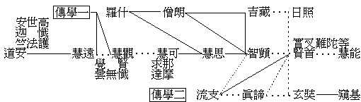



第三节　博究融汇



禅台贤净应探究汉文及融摄巴利文藏文日文之教法：中国佛学的所以要重建，因为末流的禅净已非常贫乏，台贤也不充实，故必探究汉文的一切佛典，并融汇巴利文藏文及日文的佛学来充实，这有四段：



一　安般禅五门禅之探摄



初传安世高等禅数之学，数就是毗昙法数，它即是一切阿毗昙论，而毗昙所本即五阿含、四部律等。如是异部诸论乃至后传的俱舍、成实等，俱应研究，并融汇锡、缅所传的巴利三藏，充实而趣於实践修行。



二　实相禅天台教之探摄



实相禅及由演出的天台教义，应探本於法华、般若、涅槃等诸经及龙树等论，并贯通小大显密经论律咒。



三　如来禅贤首教之探摄



如来禅及由演出的贤首教义，应探本於华严经论，及马鸣、坚慧诸论，精研楞伽、深密诸经，无著、世亲诸论，并贯通小大显密经论律咒。



四　念佛禅净土行之探摄



念佛禅及由演成别禅透禅之净土教行，应探本於念佛观，及净密各经论咒轨，研究融汇日本净土真宗及西藏密宗。



这里提到这许许多多方面，以必如此方使主流之禅台贤净不致空虚贫乏，中国佛学乃格外充实扩大，而可为重建的深厚的基础。



第四节　综摄重建



普融前义开建人乘趣大乘行果之佛学：这就是把前面的重重意义，普遍综合融通贯持起来，如我第三期判摄佛法所明的。这不但是中国佛学，也是通於世界的一切佛法。所以由普遍融摄前义，来开建依人乘趣大乘行果的，乃可重建中国佛学，并成为适应现在世界的佛学。因为在这个时代里，如果是脱离现实人生，或否定他或与他毫无关系而来阐扬佛法，无论在中国在世界都是说不通而且不可能的；必须要讲明佛法乃是发达人生的学理，乃可通行。以前我曾说过『仰止唯佛陀，完成在人格』的话，而一般人或又误会成佛只不过是完成一般人的人格罢了，因而把佛法低陷到庸俗的人类生活中。其实我说的，乃是说：「从现实人生中去不断的改善进步，向上发达，以至於达到圆满无上的人格」。盖人格的圆满，是要到佛才圆满。所以在世界上先造成君子贤圣一般人的人格，固未尝不是人格，惟佛陀的人格，却非以此为满足；必须从完成普通人格中更发大菩提心，实行六度四摄普利有情的菩萨行，不断的发展向上，以至於成佛乃为圆满的人格。所以，直接脱离或否定现实人生固不可以，而绝对地去和世界一般人混在一块儿，失去发达人生向上的菩萨行，致陷佛学於世俗的人生范围内，尢为未善。必须不仅有平常做人的标准德行(人乘)，而能依此更趣向大乘的菩萨行，以完成宇宙人格最高峰的佛果。



中国佛学能在新世界中成为世界性的佛学，非但要主持教理的人能够阐明佛教发达人生之真理，依之以趣大乘行果；并须在人间实行六度四摄菩萨道，以尽力推行佛教利益人生的事业。如果不能这样，世人必仍目为空谈而不能见之於事实者，便足为佛教衰落之因素。六度四摄的实行，可详於瑜伽菩萨戒，故我亦尝说过「行在瑜伽戒本」的话，这尤其是主持佛教者所必须遵依奉行的。



这就是中国要重建的佛学：一、普遍融摄前说诸义为资源而为中国亦即世界佛教的重新创建，二、不是依任何一古代宗义或一异地教派而来改建，而是探本於佛的行果、境智、依正、主伴而重重无尽的一切佛法。其要点乃在（甲）阐明佛教发达人生的理论，（乙）推行佛教利益人生的事业。如是，即为依人乘趣大乘行果的现代佛学。



（光宗、性觉、弘悲、向上合记）



佛教各宗派源流



——十一年在武昌佛学院编——



> 第一章　总论……………………………………………………………………七七一  

> 第一节　佛说自证法一音无异………………………………………………七七一  

> 第二节　佛随机说故有诸乘差别……………………………………………七七一  

> 第三节　佛示寂后结集诸藏差别……………………………………………七七二  

> 第四节　小乘大乘之差别……………………………………………………七七三  

> 第二章　印度之小乘宗派源流…………………………………………………七七四  

> 第一节　教义之分派…………………………………………………………七七四  

> 一　上座大众之分派………………………………………………………七七四  

> 甲　分裂之远缘…………………………………………………………七七四  

> 乙　分裂之主因…………………………………………………………七七五  

> 丙　分裂后之状况………………………………………………………七七七  

> 二　大众部之一再分派……………………………………………………七七八  

> 甲　一说部、说出世部、鸡胤部………………………………………七七八  

> 乙　多闻部、说假部……………………………………………………七七九  

> 丙　制多山部、西山住部、北山住……………………………………七八〇  

> 三　上座部之一再分派……………………………………………………七八〇  

> 甲　说一切有部、雪山部………………………………………………七八〇  

> 乙　犊子部、法上部、贤胄部、正量部、密林山部…………………七八一  

> 丙　化地部、法藏部……………………………………………………七八二  

> 丁　饮光部、经量部……………………………………………………七八三  

> 四　印度小乘二十部之统系………………………………………………七八三  

> 五　诸部法义之对勘………………………………………………………七八六  

> 甲　宗轮论诸部本末宗义之同异………………………………………七八六  

> １　大众部、一说部、说出世部、鸡胤部之本宗同义……………七八七  

> ２　大众部、一说部、说出世部、鸡胤部之末宗异义……………七八九  

> ３　大众部所出餘部之宗义…………………………………………七八九  

> ４　说一切有部之宗义………………………………………………七九〇  

> ５　袭本上座之雪山部宗义…………………………………………七九二  

> ６　犊子部等五部之宗义……………………………………………七九三  

> ７　化地部本末同异宗义……………………………………………七九四  

> ８　法藏部饮光部经量部之宗义……………………………………七九六  

> 乙　依中土六宗说以总束二十部………………………………………七九六  

> 丙　统论二十部离合之势………………………………………………七九九  

> 第二节　律学之分派…………………………………………………………八〇〇  

> 一　耶舍之矫正非法十事…………………………………………………八〇一  

> 二　传闻由二部渐分至五百部……………………………………………八〇二  

> 第三章　东传之小乘宗派源流…………………………………………………八〇三  

> 第一节　律学之东传宗派……………………………………………………八〇三  

> 一　诸部律学之翻译………………………………………………………八〇三  

> 二　四分律之宏传…………………………………………………………八〇四  

> 三　南山律宗与四分律……………………………………………………八〇五  

> 四　南山宗明小乘律之大纲………………………………………………八〇七  

> 第二节　教义之东传宗派……………………………………………………八〇八  

> 一　小乘经论之传译………………………………………………………八〇八  

> 二　成实宗之源流…………………………………………………………八〇九  

> 甲　成实宗之原委………………………………………………………八〇九  

> 乙　成实论乘部之判属…………………………………………………八一〇  

> 丙　成实论之法相………………………………………………………八一〇  

> 丁　成实论之宗义………………………………………………………八一一  

> 三　俱舍宗之源流…………………………………………………………八一二  

> 甲　俱舍宗之名义………………………………………………………八一二  

> 乙　俱舍论之缘起………………………………………………………八一三  

> 丙　俱舍宗之传衍………………………………………………………八一四  

> 丁　俱舍论之文义………………………………………………………八一五  

> 戊　俱舍论之法相………………………………………………………八一六  

> 己　俱舍论之宗旨………………………………………………………八一七  

> 庚　俱舍论之行位………………………………………………………八一七  

> 第四章　各地小乘之宗派源流…………………………………………………八一八  

> 第五章　印度之大乘宗派源流…………………………………………………八一九  

> 第一节　传教之大乘宗派……………………………………………………八一九  

> 一　未分宗派之大乘………………………………………………………八一九  

> 二　空宗有宗之大乘………………………………………………………八二〇  

> 三　显教密教之大乘………………………………………………………八二一  

> 第二节　传证之大乘宗派……………………………………………………八二二  

> 第六章　中华之大乘宗派源流…………………………………………………八二二  

> 第一节　大乘经论之传译……………………………………………………八二二  

> 第二节　三论宗之源流………………………………………………………八二三  

> 一　此宗之名义……………………………………………………………八二三  

> 二　此宗之相用……………………………………………………………八二四  

> 三　此宗之判摄……………………………………………………………八二七  

> 四　此宗之行果……………………………………………………………八二七  

> 第三节　涅槃宗之源流………………………………………………………八二八  

> 一　宗名……………………………………………………………………八二八  

> 二　宗史……………………………………………………………………八二九  

> 三　宗旨……………………………………………………………………八二九  

> 第四节　地论宗之源流………………………………………………………八三〇  

> 第五节　禅宗之源流…………………………………………………………八三〇  

> 一　印度之渊源……………………………………………………………八三〇  

> 二　支那之流派……………………………………………………………八三一  

> 甲　五祖及其旁支………………………………………………………八三一  

> 乙　南宗下之二流五家七派……………………………………………八三一  

> 三　此宗之名义及宗旨…………………………………………………八三二  

> 四　唐季来此宗独盛之故………………………………………………八三三  

> 第六节　摄论宗之源流………………………………………………………八三四  

> 第七节　天台宗之源流………………………………………………………八三五  

> 一　此宗之得名……………………………………………………………八三五  

> 二　此宗之传统……………………………………………………………八三六  

> 三　此宗之典籍……………………………………………………………八三七  

> 四　时教之判摄……………………………………………………………八三七  

> 五　观法之安立……………………………………………………………八三八  

> 第八节　南山宗之源流………………………………………………………八四〇  

> 一　明此宗为大乘宗………………………………………………………八四〇  

> 二　圆融戒行………………………………………………………………八四〇  

> 三　融小归大………………………………………………………………八四一  

> 四　通受别受………………………………………………………………八四二  

> 第九节　净土宗之源流………………………………………………………八四三  

> 第十节　唯识宗之源流………………………………………………………八四四  

> 一　名义之审定……………………………………………………………八四四  

> 二　经论之依据……………………………………………………………八四四  

> 三　师资之传承……………………………………………………………八四五  

> 第十一节　华严宗之源流……………………………………………………八四六  

> 一　宗名……………………………………………………………………八四六  

> 二　宗史……………………………………………………………………八四七  

> 三　宗义……………………………………………………………………八四八  

> 第十二节　真言宗之源流……………………………………………………八四九  

> 一　略史……………………………………………………………………八四九  

> 二　大义……………………………………………………………………八五〇  

> 第十三节　大乘各宗派合论…………………………………………………八五〇  

> 一　明废立…………………………………………………………………八五〇  

> 二　明差别…………………………………………………………………八五一  

> 三　明融贯…………………………………………………………………八五五  

> 第七章　藏蒙满之大乘宗派源流………………………………………………八五七  

> 第一节　真言宗之莲华部……………………………………………………八五七  

> 一　缘起……………………………………………………………………八五七  

> 二　分派……………………………………………………………………八五八  

> 甲　红衣派………………………………………………………………八五八  

> 乙　黄衣派………………………………………………………………八五九  

> 第二节　毗摩罗密多罗之观法………………………………………………八五九  

> 第三节　甘丹派之戒律………………………………………………………八五九  

> 第八章　朝鲜之大乘宗派源流…………………………………………………八六〇  

> 第九章　日本之大乘宗派………………………………………………………八六一  

> 第一节　缘起…………………………………………………………………八六一  

> 第二节　传承於我国之宗派…………………………………………………八六二  

> 一　三论宗…………………………………………………………………八六二  

> 二　唯识宗…………………………………………………………………八六二  

> 三　华严宗…………………………………………………………………八六三  

> 四　天台宗…………………………………………………………………八六三  

> 五　真言宗…………………………………………………………………八六三  

> 甲　传承…………………………………………………………………八六四  

> 乙　展发…………………………………………………………………八六四  

> 六　净土宗…………………………………………………………………八六五  

> 七　禅宗……………………………………………………………………八六五  

> 第三节　日本转出之宗派……………………………………………………八六六  

> 一　由净土转出之融通宗真宗时宗………………………………………八六六  

> 二　由天台宗转出之日莲宗………………………………………………八六七  

> 第四节　综论…………………………………………………………………八六七



第一章　总论



第一节　佛说自证法一音无异



法界性相，虽本来常住如是，然未成无上正遍知，则终在窈冥恍惚之域。大觉圆明，如日光照了诸色，乃如实而证如证而说，故佛教之一切法流宗派，若直探其起源，则谓皆出释尊菩提场中之智证可也。称佛智所自证法界而说，证周圆故，说亦周圆，所谓「毗卢遮那佛，愿力周沙界，一切国土中，恒转无上轮」。斯则一音普宣，三际常演，虽有情随类生解，而佛之所说固初无差异也。



第二节　佛随机说故有诸乘差别



乘、譬有情依佛法所成运载之功用。谓具因之异生，闻果教而起信，顺信解理，依解修行，行深得证，证圆果满，故名之曰乘也。既随有情依佛法所成功用以名乘，则有情之根器性欲差别故，佛逐机而教者亦遂有诸乘差别，二三四五乃至无量。约其大类言之，一、人天乘以济无姓，二、小乘以济声闻姓，三、中乘以济缘觉姓，四、大乘以济如来姓，五、一乘以济不定姓。此皆佛住世时，已有差别种姓之人所乘差别行果之教矣。虽或说一性无别，然有情习性，亦应许此差别。



第三节　佛示寂后结集诸藏差别



佛为一切教法之本。佛应世时，亲闻佛说，佛示寂后，依佛遗教，佛之遗教，即诸圣弟子所闻持结集之法藏也。然法藏之结集，传说非一。善见律传经藏、律藏、论藏之结集。摩诃僧祇律但传经藏、论藏；真谛则传阿难诵经、富楼那诵论、优波离诵律、大迦叶为上首，由七叶窟界内上座众结集之。其未及加入窟中者，曰界外大众，别以婆师婆为上首，结集佛说。此祇及小乘者。四分律则传经藏律藏论藏之结集；而阿含经外别有杂经藏，兼摄方等诸经，此则兼通大小乘者。西域记则传阿难诵经、优波离诵律、大迦叶诵论；其不加入窟中之大众部，别开会诵出经藏、律藏、论藏、杂集藏、禁咒藏。杂集藏摄根本大乘经，禁咒藏摄陀罗尼，此则兼通大小乘显密教者。真谛又传说文殊师利阿逸多等与阿难在铁围山结集大乘经；或传大乘经由广慧菩萨结集；而佛地经论亦言传法菩萨结集；此三则专属大乘者。故虽总唯一佛法藏，或分为声闻与菩萨之二藏，或分为经律论之三藏，或分为经律论杂之四藏，或分为经律论杂集禁咒之五藏，因结集时已有差别也。按七叶窟中迦叶阿难优波离(或加富楼那)等界内上座，系当时仪式最严正之结集，然仅小乘之三藏(或经律藏)耳。此外大小乘诸圣弟子之结集其所闻者，应不一而足。文殊弥勒等应亦曾结集。相传迦叶众结集已，出至窟外见复有众弟子之结集，即宣言：『未制者莫制，已制者我等随顺』，殆结集后曾和合界内外大小乘众，共相参印。而文殊等或尝请阿难证其所传，故有与阿难在铁围山结集大乘经之传说，此读增一阿含之序分，亦可想见彷佛。而大乘庄严经论，谓大小乘契经原来并行流传者，深为可凭信也。



第四节　小乘大乘之差别



综上三节所论，则佛从菩提场之自证法界而起，应机说法，已有诸乘差别。示寂后，诸圣弟子结集法藏，复有诸藏差别。此诚佛教一切法流宗派差别之源海也，然根本唯是小乘大乘而已。在藏即为声闻与菩萨藏，以缘觉大都出无佛教之世，值遇佛世即摄於声闻众，虽智解稍广，功行稍深，而自利之心生空之果相同故。人天业果，或为出世阶梯，或为利他方便，附属於小乘大乘故。一乘或为大乘别名，或为由小乘转入大乘之渐悟菩萨说。故诸乘诸藏之差别，要唯小乘大乘之差别耳。由小乘大乘乃复流出一切宗派，於下列各章次第分述之。



第二章　印度之小乘宗派源流



第一节　教义之分派



一　上座大众之分派



甲　分裂之远缘



今考佛弟子中有上座大众之部类名称者，实起於佛示寂后窟内外之结集。彼时虽未分裂为二派，且佛寂百餘年后分裂为上座大众之二派亦与结集时窟内上座及窟外大众无何渊源，但名称之袭用，未始非一远缘也。又相传阿难陀尊者经行林间，闻一沙弥诵伽陀云：『若人生百岁，不见水潦鹤，不如生一日，而能得见之』。尊者呵以此非佛说，亟令更正诵云：『若人生百岁，不了生灭法，不如生一日，而得见了之』。数日后闻前沙弥诵水潦鹤如故，询之，乃由彼剃度师谓阿难陀已老耄昏愦，记忆错乱，乃令沙弥仍诵如故，尊者叹息示寂云云(见付法藏因缘传)。亦可见当时已有各宗其所闻之众矣。复次，佛教初期盛行中印度，至阿育王时遍布五天兼及西域、南洋、混合多数方土风尚各异之民族同为一佛教徒，其内部自应易起分歧。若耶舍尊者与吠舍离僧会议非法十事，虽义关律学，且仍勒归一律，要亦僧众分裂之见端也。设非酝酿已至成熟，则大天纵雄辩，亦何至遽得大多数僧之宗仰哉？故细察其分裂之缘，所由来远矣。



乙　分裂之主因



按玄奘三藏译世友菩萨造异部宗轮论云：「如是传闻：佛薄伽梵般涅槃后百有餘年，去圣时淹，如日久没。摩竭陀国俱苏摩城，王号无忧，统摄瞻部感一白盖，化洽人神；是时佛法大众初破，谓因四众共议大天五事不同，分为两部。一、大众部，二、上座部。四众者何？一、龙象众，二、边鄙众，三、多闻众，四、大德众。其五事者，如彼颂言：餘所诱、无知，犹豫、他令入，道因声故起，是名真佛教」。基师述记引大毗婆沙论，叙大天在家时曾烝母、弑父、弑阿罗汉、弑母。出家后又诳徒、诬佛，乃为一五逆十恶具备之人。五事者：一、阿罗汉为餘魔等所诱，得有漏失不净之事，颂餘所诱是。二、阿罗汉得有不染污无知，颂无知是。三、阿罗汉得有处非处疑，颂犹豫是。四、阿罗汉但由师令证入，不能自知，颂他令入是。五、大天自知罪重，夜呼苦哉，弟子惊问，饰谓圣道须因苦声起，颂道因声故起是。此一颂即大天集其诳徒之说，以诬为真佛教者也。由诤五事，致僧分裂：以无忧王时，高僧多聚居鸡园寺；大天出家后，善能讲诵三藏，王时请入内宫说法，臣庶多所归仰。后鸡园寺上座渐殁，布洒陀时轮大天升座说戒，当众宣说诳徒之五事，诬称是真佛教；众中之有学无学持戒多闻修静虑者，咸起斥云：『汝言非佛教』，於是广集四众，分成两朋，斗诤纷然，不能和息。无忧王躬至寺中，从大天请，依多数为解决，时附和大天五事之凡众多，而否认大天五事之贤圣少，王遂诃伏上座之贤圣众，僧乃分裂为上座与大众二部云。



丙　分裂后之状况



无忧王既赞成附和大天五事之多众，彼否认大天五事诸上座，乃相约舍离鸡园寺，现神通力，同往迦湿弥罗国。无忧王闻之，虽尝坚请重返鸡园寺，卒以上座众不允，遂就迦湿弥罗造鸽园寺等数百僧伽蓝以居之，盛行上座部之化。而无忧王所居波咤厘城，则相率奉鸡园寺内附和大天之大众部僧，於是上座与大众之二派，分道扬镳，各传所宗。依此二部为本，遂更分裂出下述诸部。然异部宗轮论传佛示寂二百年时，更有一名大天者，多闻精进，重提五事，似系一人传说异词，论主随闻两存耳。又基师瑜伽略纂颇褒誉大天；分别功德论且云『唯大天一人是大士』，则若非别有一人名大天者，必出於宗奉大天之大众部所传说耳。由是可反证上座部所传说大天五事及其恶行，未可尽信。而此中所云大天，必系多闻精进之杰出人才，为僧中后起之新进派领袖，由之分立为大众部，可无疑义。抑推其诤论之起，起於上座渐殁，轮大天升座说戒，可知向来虽未分裂，第因上座犹多，致新进派无由表见耳，实则其潜势力积之深矣。



二　大众部之一再分派



甲　一说部、说出世部、鸡胤部



论云：「后即於此第二百年，大众部中流出三部：一、一说部，二、说出世部，三、鸡胤部」。按述记谓大众部中凡多圣少，容易分裂，故不久又出三部。一说部说：世出世法唯一假名，皆无实体。与大众部本旨不合，遂别分为派。以说唯一假名，故名一说，此依所立义为名者。说出世部说：世间法但有假名，出世间法则皆真实。与大众部本旨及一说部皆有不同，因又另成一派。以说出世法实，名说出世，亦依所立义为名者。鸡胤部梵语憍矩胝部，此从部主之姓立名者，真谛三藏译名灰山住部，述记曾辨其非。此部於三藏中唯宏阿毗达摩不宏经律，谓经律是佛方便之教，应舍经律为说之心，唯依正理正勤修行，疾断烦恼。此其主张颇近宗门，故又另立一派。此大众部第一期所分出之三派也。



乙　多闻部、说假部



论云：「次后於此第二百年，大众部中复出一部，名多闻部。次后於此第二百年，大众部中更出一部，名说假部」。此为大众部中第二期第三期所分出之二派。按述记名多闻部者，广学三藏，深悟佛言，从部主德，立多闻名。又传佛世有一无学名祀皮衣，入定雪山经二百年，出定至大众部宏其三藏，多有深义，超旧所闻，或信不信，遂又分为一派。说假部则说世出世法中皆有少分是假，与大众部本旨有异，亦不同一说部说出世部，故另名说假部，从所宗之义立名也；或译分别说部。



丙　制多山部、西山住部、北山住部



论云：「第二百年满时，有一出家外道，舍邪归正，亦名大天，於大众部中出家受具，多闻精进，居制多山。与彼部僧重详五事，因兹乖诤，分为三部：一、制多山部，二、西山住部，三、北山住部」。此中大天即疑与前大天是一人者。然宗轮论於前大天不详所以，於此则指其先系出家外道，次於大众部中出家受具多闻精进，后与彼众重详五事，乖诤分为三部。言之凿凿，或系同名之另一人亦未可知，以印度人往往同名也。制多此云灵庙，乃山名也。大概彼时大众部僧，多有聚居於制多山者。一日重论大天五事，或然或否，分为三部，占优胜者仍居制多山，曰制多山部；其餘二部，或迁居制多山之西，曰西山住部，或迁居制多山之北，曰北山住部，皆以所居之处立名。以上为大众部之分派。



三　上座部之一再分派



甲　说一切有部、雪山部



论云：「其上座部经尔所时一味和合，三百年初，有小乖诤，分为两部：一、说一切有部，亦名说因部。二、即本上座部，转名雪山部」。按述记，上座部传承迦叶之教，首宏经教，律论次之。造大毗婆沙本论之迦多尼衍子，彼时於上座部中出家，首宏对法，经律为次，与本旨有异。复因上座中有信奉大天五事者，致稍起乖诤，顺迦多尼衍子不信大天五事者，以说有为无为一切法皆有实体故，名说一切有部，即梵语萨婆多部也。复於一法广为分别说其所以，亦名说因部。义理深长，人多信奉。於是遵迦叶先经后律论、而复信大天五事之耆旧，虽仍袭用上座之名，以迁避於雪山，故转名雪山部，雪山部即本上座部。述记取真谛三藏译本及文殊问经，辨十八部即二十部，与雪山部即本上座部甚详。按上座部分为说因部与雪山部之二部时，颇与大众部流出各部不同，盖裂成二部后，即无复本上座部之存在也。



乙　犊子部、法上部、贤胄部、正量部、密林山部



论云：「后即於此第三百年中，从说一切有部流出一部名犊子部。次后於此第三百年，从犊子部流出四部：一、法上部，二、贤胄部，三、正量部，四、密林山部」。犊子部乃以部主之姓立名者，真谛译可住子部，述记辨其非是。此部与众不同，独说有我，后世多指为附佛法外道云。法上、贤胄、大量、密林山之四部，则皆从犊子部流出。据述记法上乃部主之名，法中之上，故名法上。贤亦部主之名，胄指苗裔，此众皆贤阿罗汉之苗裔，故名贤胄。量谓衡审刊定，自以所立法义，审定无邪，故名正量。密林之山部主所居，故依居处立名。此四部各释舍利弗阿毗达磨，义有出入，后又各取经义添著造论，与犊子部本旨乖异，遂离犊子各成一派。



丙　化地部、法藏部



论云：「次后於此第三百年，从说一切有部复出一部名化地部。次后於此第三百年，从化地部流出一部名法藏部，自称我袭采菽氏师」。按述记化地部主，先是国王，后於说一切有部中舍国出家，宏宣佛法，化所统地，名为化地。大概因化盛僧多，别成一派者，即梵音弥沙塞部也。次法藏者是部主名，亦得名为法密，梵音即昙无德。此部中说法藏有五，一、经，二、律，三、论，四、明咒，五、菩萨。既乖化地，他部亦不信之，遂独立一派，引大目犍连为师以证。



丁　饮光部、经量部



论云：「至三百年末，从说一切有部复出一部名饮光部，亦名善岁部」。按饮光即迦叶波，乃部主姓也。善岁是称部主早岁便有贤善之德也。此部即或存梵音、名为迦叶维部者是也。论云：「至第四百年初，从说一切有部复出一部名经量部，亦名说转部，自称我以庆喜为师」。按述记此师唯依经为正量，不依律及对法，凡所援据，以经为证，即经部师，从所宗法名经量部。亦名说转部者，此师说有种子，唯一种子现在相续转至后世，故言说转。或说度部，与说转同。庆喜即阿难陀，於结集时庆喜宏经，满慈宏论，近执宏律，今既宗经不宗律论，故以庆喜为师。



四　印度小乘二十部之统系



论云：「如是大众部四破或五破，本末别说合成九部：一、大众部，二、一说部，三、说出世部，四、鸡胤部，五、多闻部，六、说假部，七、制多山部，八、西山住部，九、北山住部」。「如是上座部七破或八破，本末别说成十一部：一、说一切有部，二、雪山部，三、犊子部，四、法上部，五、贤胄部，六、正量部，七、密林山部，八、化地部，九、法藏部，十、饮光部，十一、经量部」。按所云大众部四破或五破者，连根本之分为大众部上座部，则有五次破裂，若专从大众部所分出者以言，则但有四次破裂也。所云上座部七破八破者，亦连根本之分为大众部上座部，则有八次破裂，若专从上座部所分出者以言，则但有七次破裂也。今依各派所从出及破裂之先后，撮为一表如下：



　　　　　　　　　　　　　　　　　　　┌一 说 部──┐  

　　　　　　　　　　　　　　　　　　　│说出世部──┼第一破………第二百年  

　　　　　　　　　　　　　　　　　　　│鸡 胤 部──┘  

　　　　　　　　　　　　　　　　　　　│多 闻 部───第二破………第二百年  

　　　　　　　　┌大众部───────┤说 假 部───第三破………第二百年  

　　　　　　　　│　　　　　　　　　　│制多山部──┐  

　　　　印度小乘┤　　　　　　　　　　│西山住部──┼第四破………二百年末  

　　　　　　　　│　　　　　　　　　　└北山住部──┘  

　　　　　　　　└上座部┬雪山部（本上座部）  

　　　　　　　　　　　　└说因部┬──────────第一破………三百年初  

　　　　　　　　　　　　　　　　│┌犊子部┬─────第二破………第三百年  

　　　　　　　　　　　　　　　　││　　　│法 上 部┐  

　　　　　　　　　　　　　　　　││　　　│贤 胄 部├第三破………第三百年  

　　　　　　　　　　　　　　　　││　　　│正 量 部│  

　　　　　　　　　　　　　　　　└┤　　　│密山林部┘  

　　　　　　　　　　　　　　　　　│化地部┼─────第四破………第三百年  

　　　　　　　　　　　　　　　　　│　　　└法 藏 部─第五破………第三百年  

　　　　　　　　　　　　　　　　　│饮光部──────第六破………三百年末  

　　　　　　　　　　　　　　　　　└经量部──────第七破………四百年初



按异部宗轮论所传印度之小乘宗派，尽此二十部矣。然此论之世友论主，乃佛寂五百餘年间人，后之分派，或容有未及知之者。传说戒律由二十部转为五百部，又安知教宗不分裂为多部哉？第末由考之耳。另真谛传十八部及锡兰传部派，可参考之。



五　诸部法义之对勘



甲　宗轮论诸部本末宗义之同异



论云：「如是诸部本宗末宗同义异义，我今当说」。按述记此中所云本宗同义与末宗异义可作两解：一、假如化地部从说因部流出，初起诤时与说因部所同之义，名为本宗同义。分部后由化地部所增立之义，与本说因部异者，名末宗异义。二、假如化地部内本所同义，名为本宗同义；后时有异论起，乖所宗义，则名末宗异义。今依此义为表如下：



　　　　　　　　　　　　　　　　　　│（末宗异义）  

　　　　　　　　　（本宗同义）　　　├──────  

　　　　第一解───────────┴──────  

　　　　　　　　　说因部



　　　　　　　　　化地部  

　　　　第二解───────────┬──────  

　　　　　　　　　（本宗同义）　　　├──────  

　　　　　　　　　　　　　　　　　　├──────  

　　　　　　　　　　　　　　　　　　│（末宗异义）



今依宗轮叙二十部本末宗同异义之次序，分目述之。



１　大众部一说部说出世部鸡胤部之本宗同义



（一）世尊观



「谓四部同说：诸佛世尊皆是出世，一切如来无有漏法。诸如来语皆转法轮，佛以一音说一切法，世尊所说无不如义。如来色身实无边际，如来威力亦无边际，如来寿量亦无边际。佛化有情令生净信无厌足心。佛无睡梦。如来答问不待思惟。佛一切时不说名等，常在定故，然诸有情谓说名等欢喜踊跃。一刹那心了一切法，一刹那心相应般若知一切法。诸佛世尊尽智无生智恒常随转乃至般涅槃」。按此概同大乘，而与萨婆多宗等不同也。



（二）菩萨观



「一切菩萨入母胎中，皆不执受羯剌蓝、頞部昙、闭尸、键南为自体。一切菩萨入母胎时，作白象形。一切菩萨出母胎时，皆从右胁(按上皆说一切最后身菩萨者)。一切菩萨不起欲想恚想害想。菩萨为欲饶益有情，愿生恶趣随愿能往」。按此说一切第二阿僧祇劫以上之菩萨者，亦与萨婆多等不同。



（三）智识观



「以一刹那现观边智，遍知四谛诸相差别。眼等五识身有染有离染。色无色界具六识身(按此句在佛法大小乘中为最特别义)。五种色根肉团为体，眼不见色，耳不闻声，鼻不嗅香，舌不尝味，身不觉触。在等引位有发语言，亦有调伏心，亦有诤作意」。此大都与餘部有异。



（四）圣果观



「所作已办，无容受法。诸预流者心心所法能了自性。有阿罗汉为餘所诱，犹有无知，亦有犹豫，他令悟入，道因声起。苦能引道，苦言能助。慧为加行，能灭众苦，亦能引乐。苦亦是食。第八地中亦得久住。乃至性地法皆可说有退。预流者有退义，阿罗汉无退义。无世间正见，无世间信根，无无记法，入正性离生时，可说断一切结。诸预流者造一切恶，唯除无间」。案此中诸说，与餘部差异者颇多。而大众部与上座部分部之诤本，亦出於此。



（五）教法观



「佛所说经，皆是了义。无为法有九种：一、择灭，二、非择灭，三、虚空，四、空无边处，五、识无边处，六、无所有处，七、非想非非想处，八、缘起之性，九、圣道支性。心性本净，客尘随烦恼之所杂染，说为不净。随眠非心非心所法，亦无所缘。随眠异缠，缠异随眠，应说随眠与心不相应，缠与心相应。过去未来非实有体。一切法处非所知非所识，是所通达。都无中有(此句义亦特别)。诸预流者亦得静虑(其不同处，与下说一切有部对勘可知)。如是等是本宗同义」。



２　大众部一说部说出世部鸡胤部之末宗异义



此四部之末宗异义者：「如如圣谛，诸相差别，如是如是，有别现观。有少法是自所作，有少法是他所作，有少法是俱所作，有少法从众缘生。有於一时二心俱起。道与烦恼各俱现前。业与异熟有时俱转。种即为芽。色根大种有转变义，心心所法无转变义。心遍於身，心随依境卷舒可得。诸如是等末宗所执，展转差别有无量义」。



３　大众部所出餘部之宗义



多闻部之宗义：「谓佛五音是出世教：一、无常，二、苦，三、空，四、无我，五、涅槃寂静，此五能引出离道故。如来餘音，是世间教」；及大天五事之一偈。「餘所执多同说一切有部」。



说假部本宗同义：「谓苦非蕴。十二处非真实。诸行相待，展转和合，假名为苦，无士夫用。无非时死，先业所得。业增长为因，有异熟果转。由福故得圣道，道不可修(此句特义)，道不可坏。餘义多同大众部执」。



制多山部西山住部北山住部本宗同义：「谓诸菩萨不脱恶趣。於窣堵波兴供养业，不得大果」。餘义同大众部。



４　说一切有部之宗义



（一）总法观



「谓一切有部诸法有者，皆二所摄：一、名，二、色。过去未来体亦实有。一切法处皆是所知，亦是所识及所通达。生、老、住、无常相，心不相应行蕴所摄。有为事有三种，无为事亦有三种。三有为相别有实体。三谛是有为，一谛是无为」。



（二）杂法观



「四圣谛渐现观。依空、无愿二三摩地，俱容得入正性离生。若已得入正性离生，十五心顷说名行向，第十六心说名住果。世第一法一心三品，世第一法定不可退。预流者，无退义；阿罗汉有退义。非诸阿罗汉皆得无生智。异生能断欲贪、瞋恚。有诸外道能得五通。亦有天中住梵行者。七等至中觉支可得，非餘等至。一切静虑皆念住摄。不依静虑得入正性离生，亦得阿罗汉果。若依色界、无色界身，虽能证得阿罗汉果，而不能入正性离生；依欲界身，非但能入正性离生，亦能证得阿罗汉果。北俱卢洲无离染者，圣不生彼及无想天。四沙门果非定渐得，若先已入正性离生，依世俗道有证一来及不还果。可说四念住能摄一切法。一切随眠皆是心所，与心相应，有所缘境。一切随眠皆缠所摄，非一切缠皆随眠摄。缘起支性定是有为，亦有缘起支随阿罗汉转。有阿罗汉增长福业。唯欲色界定有中有。眼等五识身有染无离染，但取自相唯无分别。心心所法体各实有，心及心所定有所缘。自性不与自性相应，心不与心相应。有世间正见，有世间信根，有无记法。诸阿罗汉亦有非学、非无学法。诸阿罗汉皆得静虑，非皆能起静虑现前。有阿罗汉犹受故业。有诸异生住善心死。在等引位必不命终。佛与二乘解脱无异，三乘圣道各有差别。佛慈悲等不缘有情，执有有情不得解脱。应言菩萨犹是异生，诸结未断。若未已入正性离生，於异生地未名超越。有情但依现有执受相续假立。说一切行皆刹那灭。定无少法能从前世转至后世，但有世俗补特伽罗说有移转。活时行摄即无餘灭，无转变诸蕴。有出世静虑。寻亦有无漏。有善是有因。等引位中无发语者」。



（三）教法观



「八支圣道是正法轮，非如来语皆为转法轮。非佛一音能说一切法。世尊亦有不如义言。佛所说经非皆了义，佛自说有不了义经」。



「此等皆为本宗同义，末宗异义其类无边」。案依此与前大众等四部之宗义，一一对勘，犹并峙之二峰也。



５　袭本上座之雪山部宗义



雪山部之本宗同义：「谓诸菩萨犹是异生，菩萨入胎不起贪爱。无诸外道能得五通。亦无天中住梵行者。及大天之五事一偈，餘义同说一切有部」。按大天五事，本为上座部与大众部所由之起诤而分立者。乃事过未及百年，上座部因分出说一切有部而转为雪山部，遂至数典忘祖反认大天五事，则此袭称上座之雪山部，已不啻投降於大众部。而此后上座部之正宗，遂在说一切有部而不在雪山部矣。



６　犊子部等五部之宗义



犊子部本宗同义：「谓补特伽罗非即蕴离蕴，依蕴界处假施设名。诸行有暂住亦有刹那灭。诸法若离补特伽罗，无从前世转至后世，依补特伽罗可说有移转。亦有外道能得五通。五识无染亦非离染。若断欲界修所断结，名为离欲，非见所断。即忍、名、相、世第一法，名能趣入正性离生，若已得入正性离生，十二心顷说名行向，第十三心说名住果。有如是等多差别义」。



四部异义：次「因释一颂执义不同，从此部中流出四部，谓法上部、贤胄部、正量部、密林山部。所释颂言：已解脱更堕，堕由贪复还，获安喜所乐，随乐行至乐」。兹据述记列四部四释不同如下：



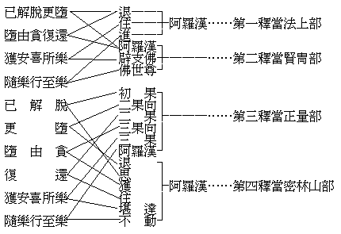



７　化地部本末同异宗义



（一）化地部本宗同义



「谓过去未来是无，现在无为是有。於四圣谛一时现观，见苦谛时能见诸谛，要已见者能如是见。随眠非心亦非心所，亦无所缘，与缠异。随眠自性心不相应，缠自性心相应。异生不断欲贪瞋恚。无诸外道能得五通，亦无天中住梵行者。定无中有。无阿罗汉增长福业。五识有染亦有离染。六识皆与寻伺相应。亦有齐首补特伽罗。有世间正见，无世间信根。无出世静虑，亦无无漏寻。善非有因。预流有退，诸阿罗汉定无退者。道支皆是念住所摄。无为法有九种：一、择灭，二、非择灭，三、虚空，四、不动，五、善法真如，六、不善法真如，七、无记法真如，八、道支真如，九、缘起真如。入胎为初，命终为后，色根大种皆有转变，心心所法亦有转变。僧中有佛，故施僧者便获大果，非别施佛。佛与二乘皆同一道。同一解脱。说一切行皆刹那灭。定无少法能从前世转至后世」。



（二）化地部末宗异义



「谓说实有过去未来。亦有中有。一切法处皆是所知，亦是所识。业实是思，无身语业。寻伺相应。大地劫住。於窣堵波兴供养业所获果少。随眠自性恒居现在，诸蕴处界亦恒现在。此部末宗，因释一颂执义有异，如彼颂言：五法定能缚，诸苦从此生，谓无明贪爱，五见及诸业」。



８　法藏部饮光部经量部之宗义



（一）法藏部之宗义



「谓佛虽在僧中所摄，然别施佛果大非僧。於窣堵波兴供养业获广大果。佛与二乘解脱虽一而圣道异。无诸外道能得五通。阿罗汉身皆是无漏。餘义多同大众部执」。



（二）饮光部之宗义



「谓若法已断已遍知则无，未断未遍知则有。若业果已熟则无，果未熟则有。有诸行以过去为因，无诸行以未来为因。一切行皆刹那灭。诸有学法有异熟果。餘义多同法藏部执」。



（三）经量部之宗义



「谓说诸蕴有从前世转至后世，立说转名。非离圣道有蕴永灭。有根边蕴、有一味蕴。众生位中亦有圣法。执有胜义补特伽罗。餘所执多同说一切有部」。



乙　依中土六宗说以总束二十部



１　我法俱有宗



此中有二：一、人天乘，二、小乘。谓犊子、法上、贤胄、正量、密林山五部，彼立三聚法，初二是法，后一是我。又立五法藏：一、过去，二、现在，三、未来，四、无为，五、不可说。第五是我，以不可说是有为无为故。然此五部，餘大小乘共推不受，呼为附佛法外道，以诸外道所计虽殊，皆立我故。此亦等取经量部之胜义我之少分。



２　法有我无宗



谓萨婆多、上座、多闻三部。彼说诸法二种所摄，一、名，二、色。或四种所摄，谓三世及无为。或五种所摄，谓一、心，二、心所，三、色，四、不相应，五、无为。故一切法皆悉实有。於诸法中并不立我，以无我故，异外道计。又於有为之中，立正因缘以破外道邪因无因。此亦兼摄末化地部少分，实为最纯正之小乘宗也。支那所传之小乘俱舍宗，亦依此为本宗，调和经量部而进化之者。



３　法无去来宗



谓大众、经量、鸡胤、制多、西山、北山、法藏、饮光之八部，等取本化地部一分。唯说现在诸有为法及无为法为有故，以过未之法，体用俱无故。成实论依此为本宗。



４　现通假实宗



谓说假部。就前现在有为法中，在五蕴为实，在界处为假，随应诸法假实不定。其成实论末经部论皆是此类。



５　俗妄真实宗



即说出世部。谓世俗法皆假，以虚妄故；出世法皆实，非虚妄故。此义可通大乘三论宗之少分。



６　诸法但名宗



即一说部。谓一切我法，但有假名无实体故。此亦能摄大乘三论宗之少分。



案此六宗乃依从有入空为序，从我法俱有而我空，而过未法空，而现法一分空，而世法空，而一切法空也。今将六宗摄二十部，列表如下：



　　　　　　　　　　┌─人天乘  

　　　　我法俱有宗─┼─小乘犊子法上贤胄正量密林山五部  

　　　　　　　　　　└─兼摄本经量部少分  

　　　　法有我无宗─┬─萨婆多上座多闻三部  

　　　　　　　　　　└─兼摄末化地部  

　　　　法无去来宗─┬─大众经量鸡胤制多山西山北山法藏饮光八部  

　　　　　　　　　　└─兼摄本化地部  

　　　　现通假实宗─┬─说假部  

　　　　　　　　　　└─兼摄末经量部少分  

　　　　俗妄真实宗─┬─说出世部  

　　　　　　　　　　├─兼含大乘三论宗少分  

　　　　诸法但名宗─┴─一说部



丙　统论二十部离合之势



此小乘二十部之渐次分裂，起自第二百年至第四百年，为时最多亦不过二百年耳。此三百年中，小乘宗派之蔚起，乃呈此波谲云诡之观，亦可见印度於阿育王后，小乘佛法之盛行一时矣。然自第二百年至第三百年间，可视为大众部最发达之时代，以大众部八派皆在彼时分出故。自第三百年至第四百年间，可视为萨婆多部(上座部代表)最发达之时代，以上座部十派皆自彼时分出故。进至第五百年，则渐为大乘代兴之时代矣。统观此二十部离合之势，初诤大天五事分为大众上座之二部、此一大变矣。后上座部分为萨婆多雪山之二部，袭称上座之雪山部反奉持大天之五事为宗义，此亦一大变迁矣。后大天重详五事而分制多山等三部，此一小变也。本从大众部流出之多闻部，其宗义乃多同说一切有部。本从说一切有部流出之法藏部、饮光部、其宗义乃多同大众部，此亦一小变也。回互交络，其经纬组织之奇，殆五光十色灿烂同霞锦矣！



第二节　律学之分派



按印度小乘律学之分派，今可考稽者无多。律藏及付法藏因缘传等，虽略曾叙及，未有专史详其事焉。佛曾称「吾弟子中持律第一者优波离」，是故佛示寂后，窟内上座皆推优波离结集律藏。且律唯佛制，弟子唯有严守，此於律学固应一味无异也。然当时窟外大众既曾别为结集，难保无稍有出入之处。虽迦叶宣言窟外众『未制者莫制，已制者我等随顺』；窟内外众仍一味和合无间，而罅隙之痕即留此矣。今就其显著者略述如下。



一　耶舍之矫正非法十事



佛寂百年时，跋耆种族於吠舍离城出家者颇多，其众於吠舍离左近，唱非法十事而自行之(见五分律卷三十，十诵律卷六十，善见律毗婆沙卷一)。非法十事者：一、姜之盐渍者得贮至异日，二、得间食，三、虽既一食得复就座取食，四、虽一在寺内食入市邑时得再取食，五、酪得和酥油石蜜食之，六、得饮阇楼枷酒，七、座席敷物得大小随意，八、出家前虽属俗士之所习而於出家后不妨行之，九、说戒之法会得一部僧众各别行之，事后求全体僧众之承诺，十、得受金银钱货贮藏之。



彼众於每月说戒之日，参观者多时，盛水於钵，至俗士群集处而告之曰：『愿施钱於僧众』。俗士或施钱或鄙弃之。时有高僧耶舍，见其状且惊且悲，诫令勿如是非法求施。彼众误会耶舍之意，各分钱耶舍。耶舍知不可化，转劝诸俗士勿非法施，施受俱无利益。彼众大愤，乃宣告公逐耶舍。厥时中印东部多新进之僧，西部多耆旧之僧，耶舍乃或亲身往，或遣徒诉其事於西部诸耆旧。而彼众亦邀东部诸新进，东西两部新旧对峙。阿育王患之，乃集二派僧於吠舍离重阁讲堂，开诵律会以论决之。两派各举四高僧为审辨委员，东派为一切去、沙留屈阇、须毗多沙、萨婆伽眉，西部为萨婆多、修摩那、三摩三浮陀、耶舍。推萨婆多为委员长，向一切去逐事责问，一切去逐事答辩，又互审检律部。会议七月，结果判决吠舍十事为非法。其时中印之僧众，形式上虽仍统为一，而实质上则已离而为二也。相传佛示寂一百年后渐分二部，恐即指此。不然，则僧因教义之诤分为大众上座之二部，律亦随之分为二部欤。



二　传闻由二部渐分至五百部



传说如来在五十年，随事制宜，灭后、弟子结集为一部八十诵律。佛寂百年，五师瓶泻，纯是一味，未分异见。一百年后渐分二部、五部，及二十部乃至五百。今按律分五部，相传由优婆毱多(疑即大天等师)弟子五人异见所分。至二十部大约即前由教义而分之二十部，各诵一部律耳，若今所传昙无德部律等。故古云：「异见竞鼓，犹如浩波，经律论藏，悉成分裂」也。以律之分成五百部，更可推知经论之所分者亦多也。但考今所传者，则仅四律五论及毘奈耶有部诸律耳。详下律学之东传宗派。



第三章　东传之小乘宗派源流



第一节　律学之东传宗派



一　诸部律学之翻译



佛教东来，其初译皆小乘之经。曹魏时法时尊者虽创受戒，律论未度；晋释道安等以僧伽阙仪律，颇忧及之。至罗什渐出大部经论，并与弗若多罗三藏共译萨婆多部之十诵律，事半未就；得昙摩流支及卑摩罗叉续成之，共六十一卷，是支那有广律之始也。次由佛陀耶舍译出昙无德部之四分律，共六十卷；彼时由佛陀跋陀罗共法显译僧祇律得四十卷，而罽宾佛陀什共智胜译弥沙塞部之五分律亦成三十卷。当译出时四并传行，唯后代则独宏昙无德部耳。至迦叶遗律，唯传戒本，其广律未传也(按戒本梵名波罗提木叉，广律梵名毗尼即毗奈耶)。至唐时义净三藏译根本说一切有部律甚多(应即十诵律之别译)。此外若毗奈耶律，至赵宋时犹有翻译，然束之大藏，未有宏传者也。尝观各部之广律，所述律文及缘起之迹，大致从同，出入甚少，足见其是从一本转钞，各宗派分诵耳。至其造论解说，则各彰宗义，异同者多。各宗释律之论，东传者凡五：一、毗尼母论，二、摩得勒迦论，此二是宗萨婆多律立论者。三、善见论，此解四分律者。四、萨婆多论，此亦释萨婆多之十诵律者。五、明了论，则依正量部律立论。四律五论，为东土从古所传称之小乘律也。



二　四分律之宏传



四分律乃佛寂第三百年时，由法藏部主(即昙无德罗汉，或译法正尊者是)集诵而出，既来东土，化缘独深，於诸部律独宏此论。先由慧光律师作略疏四卷，稍后相部(即法砺)律师作中疏十卷，智首律师作广疏，名三要疏。厥后除南山道宣律师外，更有嵩岳律师作相部大疏饰宗记十卷，东塔律师四分开宗记十卷，玄恽律师毗尼讨要三卷，盖唐时已不下二十餘家矣。此皆依六十卷之四分广律，及宗释四分律之善见论，以广为宏扬者也。



中国在初传，四律杂宏，未有定习，迨终南山道宣律师承智首律师之统，专依四分律以明受体而谈随行，渐成专尚。然当时与之并宏四分律者，尚有相部法砺律师及东塔怀素律师之二家，宗义相差，门徒互诤，谓之唐朝四分律之砺、宣、素三派。其律义不同之处，今不能详考矣。而不久之间，诸家概废绝不行，唯终南山道宣律师一派独传，自尔以来，遂号南山律宗。以南山宗义，受随相称，行相备足，大小途和，解行相应，故古今诸德，俱竞叹美，中日各宗并承依学。其所著行事钞，作记解者且百数家，可想知其盛矣。



三　南山律宗与四分律



东土四分律之宏，本不始於南山律师，而此师於四分律之遗传后世，实有大因缘也。一、因此师建立化制二教故(亦名化行二教)。谓化教者，经论所诠定慧法门，四阿含等大小乘经论是也。制教者，律教所诠戒学法门，四分律等大小乘律教是也。今此宗部即律藏教，以戒为宗，戒行清白，定慧自立，故先持戒制禁业非，然后定慧伏断烦恼。为道制戒，本非世福，三乘圣道，唯戒为基，能判摄如来一代遗教故也。二、因此师融通大小乘故。四分一律，慧光云是大乘，法砺玄恽云是小乘，南山律师独云义通大乘。业疏中立五义分通，谓沓回心，施生成佛(施一切众生皆共成佛道)，识了尘境，相召佛子，舍财用轻。遥超餘部，实为深义。又谓此教所依，本是小乘四分律本，元被小乘故；然义当大乘，根机渐进故。当分小乘，故小乘无不兼，分通大乘，故大乘无不摄。三、因此师束诸戒为四科故。谓一者、戒法，如来所制法通万境故。二者、戒体，受者所发，心府领纳故。今四分宗依成实论非色非心为体。三者、戒行，受者随持，三业广运故。四者、戒相，美德外彰，持相可轨故。故南山律宗虽为融小归大之一乘律宗，而实为四分律宗传统之祖。自昙无德尊者、昙摩迦罗尊者、法聪律师、道覆律师、慧光律师、道云律师、道洪律师、智首律师、以至於师，称为四分律宗九祖也。



四　南山宗明小乘律之大纲



南山律师於小乘戒学，曾著有章疏五大部：一、行事钞三卷，二、戒疏四卷，三、业疏四卷，四、释毗尼义钞三卷，五、比丘尼钞三卷。此外若戒本羯磨注解及小部律章，诸文部帖，皆律宗之北辰、戒学之南针也。其大纲不出止作二持，略表如下：



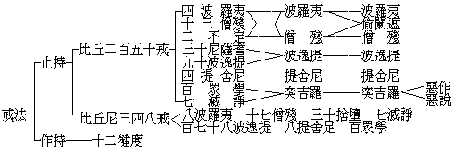



止作二持，别律摄学，广摄一切佛法。二具足戒，其比丘戒广则无量，中则三千威仪、六万细行，略则二百五十。比丘尼戒广亦无量，中则八万威仪、十二万细行，略则三百四十八戒。以比丘比丘尼受具戒时，并得如此无量无边等戒，故名具足戒也。其五戒、八戒、十戒、六法皆摄於具戒。渐诱机根以为具戒方便，故戒总有五位。比丘比丘尼具足戒，式叉摩那受六法戒，沙弥、沙弥尼受十戒，优婆塞、优婆夷五戒，八戒则为在家众授暂时之出家戒也。



第二节　教义之东传宗派



一　小乘经论之传译



自汉明帝夜梦金人，派蔡愔等十八人迎得摩腾竺法兰白马驮经像来后，支那佛法即增高继长，迄今流衍不绝。但摩腾等仅於小乘经中摘译若干条法义以示於人而已，若今所谓之四十二章经、八大人觉经之类。其次渐抽译阿含等一品数品或其颇小部之经，大概皆小乘经也。嗣乃渐译般若法华等大经，然未译论也。已而渐有传译毗昙者。至鸠摩罗什始译小大乘论，成实论即译於其时者。其后小大乘经及论，翻译渐备。真谛三藏译论颇多，俱舍论曾由一译，复由玄奘三藏重译。按译传来之小乘经论未尝不多，然以支那人根习相远，不成宗尚，故成为宗派者仅小乘中最进步之成实论与俱舍论传宏一时，然唐宋来亦早销沉矣。



二　成实宗之源流



甲　成实宗之原委



宗成实论立教之宗派，故名为成实宗。造成实论者，相传佛寂九百年时，萨婆多宗学者鸠摩罗陀有高足诃黎跋摩者，嫌师见解疏浅，简取小乘诸部之长，以译成如来所说三藏之实义，故名成实论也。论主述怀云：「故我欲正论三藏中实义」，即其命名之意，亦其作论之故。姚秦时罗什三藏翻译且弘讲之，其门下釆承师说，制造章疏，自是讲习颇盛，乃与大乘之三论宗，同为中国最早所成之宗派也。唐代传至日本，亦无何进步，渐归寂落，古德章疏，早皆散灭，今殆无从得之矣。宗此论者，大都兼习三论般若，故无严正之传承宗系云。



乙　成实论乘部之判属



成实论是大乘乎抑小乘乎？若系小乘，则於二十部属何部乎？颇成六朝隋唐间诸古德讨论之一问题。此论梁时最为盛弘，大概与诸部般若及中论等并视，故光宅法云法师、开善智藏法师、庄严僧旻法师、皆判为大乘也。至摄山、天台、嘉祥，始判为小乘。后南山律师、灵芝律师，复云与四分律同，教是小乘，义通大乘。然天台之后，大都评定为小乘论中之长耳。既判归小乘，当属於小乘二十部中之何部，说亦不一。或云依多闻部，或云依化地部，或云依昙无德部，或云取诸部之长。然由奘师基师考定，系属末经量部，兼取诸部之长，为六宗中之现通假实宗。其义分通大乘般若宗，为从小乘进入大乘之一涂径云。



丙　成实论之法相



此宗立八十四法以摄教理，立二十七贤圣以摄行果。所云二十七贤圣者：一、随信行，在闻思位。二、随法行，在四善根位。三、无相行，即前二人入见道故。此三位人名预流向。四、须陀洹果。五、一来向。六、一来果。七、不还向。不还果中开十一人：一、中般，二、生般，三、有行般，四、无行般，五、乐慧，六、乐定，七、转世，八、现般，九、信解，十、见得，十一、身证。并前七人合成十八，名有学人。自下九人，并是无学：一、退法相，二、守护相，三、死相，四、住相，五、可进相，六、不坏相，七、慧解脱，八、俱解脱，九、不退相。并前十八有学位，合成二十七贤圣。所谈行果不出小乘，故属於小乘教也。



丁　成实论之宗义



此宗得诸部小乘中最长之义者，即以其具明人法二空也。论中立二种观以观二空：一者，空观、如瓶中无所盛之水，五蕴之中无人我故，此即人空观也。二者、无我观，如瓶体相无实，五蕴诸法皆假名故，此即法空观也。然此宗虽具观二空，唯在断见思惑，证空灭理，故不能具断二障，以证二空真如也。若依贤首家义，成实论虽义通中论，仍是析空拙度，不同中论体空巧度；但以利根智解深故，未析空前先见其空，实则仍须析而后空。若依天台家义，可是体空巧度。实法、既坚情冰释，假有、亦幻象林森，三乘同以无言说道而出生死；以钝根故，仅见於空未见不空，故止於小乘涅槃耳。



三　俱舍宗之源流



甲　俱舍宗之名义



宗俱舍论立教之宗派名俱舍宗。然俱舍论，具云阿毗达磨俱舍论，阿毗译对，达摩译法，俱舍译藏，今云对法藏论。对法藏即论藏总名，以此论总为决择评论对法藏之义故，别得名为对法藏论也。对法体即无漏慧境。对有二义：一者、对向涅槃故，二者、对观四谛故。法有二义：一、胜义法，即是涅槃；二、法相法，通四圣谛；谓无漏慧对向对观涅槃四谛境故。藏有包含、所依二义。包含义者，此论包含发智论等诸胜义言，故名为藏。对法之藏，依主释也。所依义者，此论依彼发智论等而造，故全取本论对法藏名。有对法藏故名对法藏，是有财释。略释论名其义如是。



乙　俱舍论之缘起



此论於佛寂九百年时世亲菩萨初学小乘时所造，源出婆沙，势插诸教。婆沙本於发智六足。如来示寂第四百年后，迦湿弥罗国王迦腻色迦敬信佛法，往往请僧入宫供养，王因问道，僧说不同。怪问胁尊者曰：『佛教同源，理无异趣，诸德宣唱，何其有异』？胁尊者曰：『诸说皆正，随修得果，佛既悬记如折金杖』。王问：『诸部立范，孰为最善？我欲修行，愿闻指示』。胁尊者曰：『诸部之中，莫越有宗。王欲修行，宜遵此矣』。王即欢喜，令集有宗法藏。有德之僧四方云集，简凡留圣，简有学留无学，於无学内择果满六通、智圆四辩、内闲三藏、外达五明者，唯得四百九十九人；遂推世友尊者为首，足成五百圣众。初集十万颂释素怛缆藏，次集十万颂释毗奈耶藏，后造十万颂释阿毗达摩，即大毗婆沙论是也。五百圣众既结集已，刻石立誓，唯听自国，不许外国，敕夜叉神守护城门，不令散出。世亲尊者初习有宗，后学经量，将为当理，於有宗义怀取舍心。欲定是非，潜名重往，时经四岁，屡破有宗。时有宗阿罗汉悟入尊者，入定知之，告曰：『此众未离欲者，知长老破必相致害，长老可速归还本国』。时世亲还至本国已，讲毗婆沙，日造一颂，刻赤铜叶成六百颂，摄毗婆沙其义周尽。标颂香象，击鼓宣令，谁能破者，吾当谢之，竟无一人能破斯颂。使赉往迦湿弥罗国，时彼国主及诸僧众闻皆欢喜，谓弘己宗，悟入独非，遂请造释。世亲应请造释成八千颂，果如悟入尊者所言。於是悟入弟子众贤，造论破俱舍，名俱舍雹论，世亲见之，赞改顺正理论，今藏中译成八十卷。众贤论师又造一显宗论，译四十卷，后世称新萨婆多宗。此俱舍论与说一切有宗大毗婆沙论前后之关系，亦即俱舍论之缘起也。



丙　俱舍宗之传衍



此论成后，印度内外道大小乘俱习学之，称聪明论。陈朝真谛三藏初译成二十卷，并造疏五十卷以弘讲之，一时学者颇多，惜其疏早亡逸不传。至唐遍觉三藏玄奘，永徽年中於慈恩寺重译成三十卷，传之门人普光法师及法宝法师，各作疏释，号俱舍宗。故此宗以世亲为祖，玄奘三藏、普光法师以相传承。唐后此宗虽绝不传，且少研钻於此论者。然为从小乘法相转进大乘法相之大关键，而天台之三藏教、贤首之小教，其义亦皆取之於是。传於日本，虽与成实宗同无传统之宗徒，至今大乘各派犹多研习之云。



丁　俱舍论之文义



此论三十卷文，总有九品：一、界品，二、根品，三、世间品，四、业品，五、随眠品，六、贤圣品，七、智品，八、定品，九、破我品。其颂卷数云：「界二、根五、世间五，业六、随三、贤圣四，智二、定二、破我一，是名俱舍三十颂」。此九品中初之二品，总明有漏无漏，后之六品，别明有漏无漏。就总明中，初界品明诸法体，次根品明诸法用。别明六中，初之三品别明有漏，后之三品别明无漏。明有漏中，世品明果，业品明因，随品明缘。明无漏中，圣品明果，智品明因，定品明缘。其破我品明无我理。今撮录为一表如下：



　　　　　　　　　　　　┌总明有漏无漏诸法┬明诸法体（界品）  

　　　　　　　　　　　　│　　　　　　　　└明诸法用（根品）  

　　　　　　　┌明诸法相┤　　　　　　　　┌明有漏果（世间品）  

　　　　　　　│　　　　└别明有漏无漏诸法┤明有漏因（业品）  

　　　　俱舍论┤　　　　　　　　　　　│　└明有漏缘（随眠品）  

　　　　　　　│　　　　　　　　　　　│　┌明无漏果（贤圣品）  

　　　　　　　└明无我理（破我品）　　└─┤明无漏因（智品）  

　　　　　　　　　　　　　　　　　　　　　└明无漏缘（定品）



戊　俱舍论之法相



此宗立五位七十五法以摄一切法。表其名数如下：



　　　　　　　　┌色法十一………五根、五尘、无表色  

　　　　　　　　│心法　一………意识心王  

　　　　　　　　│　　　　　　┌大地法十………受、想、思、触、欲、慧等  

　　　　　　　　│　　　　　　│大善地法十………信、不放逸、轻安、舍等  

　　　　　　　　│　　　　　　│大烦恼地法六………痴、放逸、懈怠、不信等  

　　　　七十五法┤心所法四十六┤大不善地法二………无惭、无愧  

　　　　　　　　│　　　　　　│小烦恼地法十………忿、覆、嫉、恼、害、悭等  

　　　　　　　　│　　　　　　└不定地法八………寻、伺、悔、眠、贪、瞋等  

　　　　　　　　│不相应行法十四………得、非得、同分、无想果、灭尽定等  

　　　　　　　　└无　为　法　三………虚空无为、择灭无为、非择灭无为



己　俱舍论之宗旨



此论虽祖述有宗，时亦取撷经量部义，且由论主自为权衡，评断诸说。故论文云：「迦湿弥罗义理成，我多依彼释对法」。又云：「经部所说不违理故」。故其宗旨，显宗说一切法实有、为法有我无宗，密通本末经部法无去来宗、及现通假实宗也。约其显宗言法有者，谓三世法实有。大毗婆沙论有四说，法救尊者说由类不同有三世，妙音尊者说由相不同有三世，世友尊者说由位不同有三世，觉天尊者说由待不同有三世。俱舍论主评此四家，则以世友尊者之说为最善云。既三世法实有，则不观法空，然明无我，故以观五蕴和合聚中无实人我、证生空理为宗旨也。



庚　俱舍论之行位



此论总明三乘行果，谓声闻观四谛，经三生六十劫修行得果。方便有七阶级，即五停心、总相念、别相念、煖、顶、忍、世第一也。果即四果四级。缘觉观十二因缘，经四生百劫修因证果。因行积集，直登无学，无有多阶，唯一向果。菩萨行六度经三阿僧祇劫，百劫之中植相好业，最后身中於金刚座断结成佛，化缘已尽三乘同入无餘涅槃。有为无漏，行果有别，无为无漏之果是同。天台所立三藏教，全依此论以明行果也。



第四章　各地小乘之宗派源流



前节所言东传之小乘宗派，仅及中华日本。但西藏蒙古唯传密教，其教义与大乘龙猛无著之论相表里，虽亦习俱舍，别无小乘宗派。高丽亦无小乘宗派可言。唯南洋群岛及暹罗、缅甸诸处，则皆为纯一无二之小乘佛教；且全国风行，著为政俗，历千百年如一日，迄今犹存佛世三衣一钵乞食安居之形仪。其教化之深入民心，习成族性者、非他国所能及。彼以印度南端之锡兰岛为基地，故不唯印度佛教之重兴，应以此为枢纽，而骎骎且由之驶向西洋矣。欧美二洲，於佛说虽多研究，但研究学理而已，未足以云信受奉行於佛教也；有之，则唯英法德美由锡兰所传入者耳。锡兰等处之小乘佛教颇称纯粹，近来之发达亦殊可惊。虽不虑其有搀杂异教异学之虞，而彼之决然排斥大乘为非佛说，则未尝非大法昌明之梗。此吾人所当先注意以大乘佛教宏传南洋者也。



第五章　印度之大乘宗派源流



第一节　传教之大乘宗派



一　未分宗派之大乘



婆伽梵所说大乘教法，虽有窟外大众暨文殊弥勒等曾结集为大乘法藏，与小乘并流行於世；然在初五百年间，全印所宏传者，唯小乘为盛，而大乘法若存若亡，未能光显焉。故后时大乘崛兴，其执著小乘者，甚或斥之为非佛说。虽至无著时，其诤犹烈，依弥勒大乘庄严经论，举七义证成大乘为佛说者可知也。释尊灭度五百餘年，有马鸣菩萨兴世，外攘异道，内抑小乘，独扬大乘至教。除大庄严经论等杂说因缘暂用导俗外，他若大乘起信论等，皆直宗大乘一真法界而造，颇与释尊之华严初转根本法轮遥相呼应，此唯建大乘根本纯然未有宗派之分别也。至龙猛、提婆渐偏重阐扬大乘毕竟空义，以治外小之增益执。无著、世亲渐偏重阐扬大乘之如幻有义，以治外小之损减执。但仍互融无间，未据所宗自为其派，故此前皆可谓之未分宗派之大乘也。然空宗、有宗，已隐含其分派之兆於龙猛、无著，且须上溯乎妙德、慈氏矣。



二　空宗有宗之大乘



沿龙树一系之大乘义而至清辨，沿无著一系之大乘义而至护法，佛寂已千数百年矣。於是时大乘始分宗派，谓清辨论师远尊文殊，宗本龙猛、提婆造大乘掌珍论等，为欲极显毕竟空义故，破斥兼及护法等师。而护法论师远尊弥勒，宗本无著、世亲造成唯识论等，为欲极彰如幻有义故，破斥兼及清辨等师。然空宗正名般若宗，显空即彰妙有；而有宗正名唯识宗，彰有即显真空，故虽相破，实以相成。智光承清辨之学(据贤首传)，戒贤承护法之学，门徒既众，宗派斯严。故大乘空宗确立於清辨，守持於智光；大乘有宗确立於护法，守持於戒贤。兹后则转为大乘密教之胎金二界，此二宗於印度几等附庸矣。



三　显教密教之大乘



尝察显密之异，异在能诠言对所诠义之或显或密而已。义显之言曰显教，唯影像假智诠。义密之言曰密教，为本质真智境，故亦名真言也。复次，显教是依佛之教声以彰学理者，密教是依佛之果德以轨观行者。由教理而进於行果，既为适当之程序；而胎藏界之教理依般若，金刚界之教理依唯识，显教之二宗与密教之二界相应一贯，尤显然可见。故印度之大乘佛教，在吾华盛唐之际，由显教进转为密教，其迹可依来吾华传教者得之。自唐善无畏至宋法天等所译多为密教，即其明证也。然印度於小乘教根习较深，虽几经大乘掩抑，而俱舍、成实、顺正理等论，皆盛行於佛寂千载间，有部、经部等，卒未尝衰息焉。今印度佛教所仅存之餘喘，亦唯小乘。故大乘之化，在印度似至密教而寝灭。



第二节　传证之大乘宗派



此派相传，释尊於灵山会上拈花示众，人天罔措，独摩诃迦叶破颜微笑，佛乃曰：『吾有正法眼藏、涅槃妙心，实相无相，微密法门，今付於汝，汝善护持』云云。於是由迦叶传阿难，由阿难递传至马鸣为十二代，龙猛为十四代，世亲为二十一代，菩提达摩为二十八代即传入吾华，於印度无复传者。菩提达摩谓直指人心，见性成佛，以心传心，不立文字，的为此派宗旨。盖不依教理知解，唯悟心者印证相传，故别於传教而曰传证焉。然在印度祇一代一代密为传证而已，其显於言行者，仍不外小大乘之经律。故其二十八代相传承者，即是小大乘统法诸祖，而别无宗派可云也。



第六章　中华之大乘宗派源流



第一节　大乘经论之传译



佛教自传入吾华，迨后汉西晋间，支谦、竺法护、支娄迦谶等，始稍稍翻译般若、法华等经，而未能盛宏也，大乘论则犹无传译之者。逮鸠摩罗什始广译大小乘经律论，且宏讲之。嗣后佛陀跋陀罗、昙无谶、菩提流支辈，翻传涅槃、华严、地持、十地等经论，流通颇盛。至真谛渐译讲唯识诸经论，入唐初，玄奘译传最富，义净所译亦间及唯识。善无畏、金刚智、不空专从事译密教。实叉难陀重译华严。赵宋初，施护、法天等所译，大乘密部居多，此皆其表表可知者。今综合观之，童寿为法性经论之大译师，玄奘为法相经论大译师，不空为密部经论大译师，而觉爱、真谛、善无畏，亦其次焉。



第二节　三论之源流



一　此宗之名义



三论宗者，依三论立宗故名。三论者：一、中观论，二、十二门论，此二论皆龙树造，但中论系青目长行也。三、百论，提婆偈颂，世亲长行也。三论皆罗什译，若加大智度论，亦名四论宗；而三论为通申大小乘诸经之通论，智度为别申大般若之别论也。或亦称为法性宗、破相宗、空宗。然此宗以文殊为高祖，龙树为二祖。龙树下分二派，一、龙树、龙智、清辨、智光、师子光之传。二、龙树、提婆、罗睺罗多、沙车王子、罗什之传。罗什三藏为吾国此宗之高祖，三藏既译三论，高弟各敷讲之，其中道生、昙济(或僧肇)、道朗、僧诠、法朗、吉藏诸师，次第传承。吉藏即嘉祥大师也，於隋朝盛宏三论，制作繁多，难以具举，三论之盛者，由此师也。然其宗义至嘉祥略变，於是嘉祥以前名古三论，亦名北地三论；嘉祥以后名新三论，亦名南地三论。唐惠远、智拔、惠喻、法影诸德，皆盛汲其流者也。唐后竟成绝学，今欲复兴，当於嘉祥之学求之。故余以尊祖之义，曩者曾名此宗曰嘉祥宗。复按三论或四论，皆依能诠之言教立名，法性、破相、空，皆依所崇之义旨立名。第余意依所崇之义旨立名，当名以般若宗，或法性空慧宗云。



二　此宗之相用



此宗盖以真俗二谛为法相，破显二门为法用者也。中论正破小乘，傍破外道等显大乘义，百论正破外道，傍破其餘显大乘义，十二门论并破小乘外道，正显大乘深义。由破邪显正之妙门，成下救上弘之大用，故此亦名破显妙宗。然破邪者，总破一切有所得见，约之为四：一、破外道实我之邪见，二、遣毗昙实有之执见，三、斥成实偏空之情见，四、摧大乘有所得见。内外尽破，大小遍斥，故莫不被责也。言显正者，破邪既尽，无有所得，所得既无，言虑无寄，无别显正，然对破邪，强言显正。一源不穷则戏论不灭，毫理不尽则至道不显；无源不穷故戏论斯灭，无理不尽故玄道是通。寄言谈正，莫不显明，直至离四句绝百非而强名显正耳。或谓言虑俱绝，有无齐遣，即是空义，何关显正？不知既遣有无，宁复住空，湛湛寥寥，无寄无得而已。



复次、有无无寄，诸法缘生，缘生诸法即是假有，假有即无所得，真俗二谛依之以立。以俗谛故，不动真际，建立诸法。以真谛故，不坏假名而说实相，故空宛然而有，有宛然而空也。二谛唯是教文，不关事理，以机缘故立二谛，以理实故泯二谛。有是空之有，故言有非有，空是有之空，故言空非空。非有谈空，非空说有。诸佛说法，常依二谛，故此宗所显，即无得正观而已。无得正观，即是空慧，即是般若，即是宗之真宗旨也。然此宗依中论则立八不中道，即不生不灭、不断不常、不一不异、不来不去也。依嘉祥师别立四重二谛，以对破外道、毗昙、成实有得之执见。兹表於下。



　　　　　┌有　　　　　　　　　　　　　俗谛  

　　　　一┤  

　　　　　└空　　　　　　　　　　　　　真谛  

　　　　　┌有空　　　　　　　　　　　　俗谛  

　　　　二┤  

　　　　　└非空非有　　　　　　　　　　真谛  

　　　　　┌空有非空非有　　　　　　　　俗谛  

　　　　三┤  

　　　　　└非非空非非有　　　　　　　　真谛  

　　　　　┌前三重之二谛　　　　　　　　俗谛  

　　　　四┤  

　　　　　└非非不空非非不有　　　　　　真谛



八不亦可有此四重。即如生灭一重，不生不灭二重，非不生非不灭三重，非非不生非非不灭四重，为此宗建法之大纲。



三　此宗之判摄



中土开立教宗，皆注重评判统摄一大藏教法。此宗依大智度论立二藏：一、声闻藏，摄诸小乘法尽。二、菩萨藏，摄诸大乘法尽。依法华立三转法轮：一、根本法轮，是华严；二、枝末法轮，是阿含以至般若；三、摄末归本法轮，是法华。依此以摄尽释尊一代之时教，复从而融会之。大小二乘，显理同一，随机故教异。诸大乘经，显道无二，对缘故有别。评判诸大乘经，各立等胜劣三，为此宗判教之大纲。



四　此宗之行果



此宗既以无所得为本旨，故以一切众生本来是佛，本自寂灭，无迷无悟，有何行因证果可论。故论迷悟及成佛不成佛，皆假名耳。依假名门，人根有利钝，成佛有迟速。一念顿起是短，三祇成佛是长，一念不碍三祇，三祇不妨一念，一念即三祇，三祇即一念。如一夕眠梦百年事，事虽百年眠祇一夕。经三祇故万行积成，在一念故佛果速疾。而三祇积行之菩萨，经五十一位而至於妙觉，故此宗立五十二位，以统括大乘行果也。但此宗以觉即本体，由迷故有生死，返本还源，拂除客尘，本有觉体宛尔即显。对迷立悟，对悟有迷，悟发则无迷，无迷亦无悟，无迷无悟，迷悟本无，染净诸法，本来寂灭。无得正观，即至极妙道也。



第三节　涅槃宗之源流



一　宗名



此宗依涅槃经立故名涅槃宗。梵语般涅槃那，略云涅槃，或云泥洹，或云泥曰，皆一音之转变。古译曰灭，亦译不生不灭，亦译寂灭。依基师谓，具云波利匿缚喃，译曰圆寂，乃圆满体寂灭之义，随俗以如来示世息化为涅槃。此经於佛示涅槃时所说，广谈如来究竟安住之涅槃义，名涅槃经。但通於大小乘有之，今依以立宗者，属大乘涅槃经。



二　宗史



此宗於印度无何渊源之可寻，故即依北凉高祖元始十年创译此经之昙无谶三藏为开祖也。但此经有二译：一、昙无谶所译四十卷一十三品，仅得元本三分之一，以传於北方，号北本涅槃。二、宋文帝时，敕道场寺惠观，乌衣寺惠严及谢灵运更加补定，得三十六卷二十五品以传於南方，名南本涅槃。本经既译，在宋则有惠静、昙无成、僧庄、道汪、静林、慧定、昙斌、超进、法瑶、道登、昙度、道成等诸师，制疏作章，敷扬甚茂。在隋则有净影、智徽、法砺、道绰等宏讲。在唐则有南山、法宝等宣讲，南山、法宝虽兼宏别业，志则在於涅槃。迨及天台宗盛，此宗遂属於彼，别无讲涅槃者矣。惠静等古章疏，今皆无可考。续藏有隋慧远义记，吉藏游意殊略。正藏中唯存有天台大师门人灌顶所著之涅槃疏，故此宗益可附归天台也。



三　宗旨



此宗古疏既失，判摄时教等均无稽考。唯知其以佛性常住为宗，谓一切众生皆有佛性，而佛性即不生不灭，常住不变之涅槃而已。



第四节　地论宗之源流



此宗依十地论立宗故名。十地论者，华严第六会十地品别行十地经之释论也。是经有坚慧、金刚军、世亲诸论，传译来华者为世亲之十地论。此论於粱天监七年，即北朝魏宣武帝永平元年，诏菩提流支及勒那摩提诸三藏於太极殿翻译，帝亲笔受，凡经四年始译竣。故此宗在东土即以菩提流支为开祖，於印度则遥承世亲者也。译竟，光统律师即盛为宣讲，惠顺、道慎诸师继之。在隋有灵祐、惠藏、慧远、智炬，在唐有道宗、法侣、灵干、辨相，皆为地论之哲匠。迨及中唐华严宗勃兴，清凉澄观国师著华严疏钞，将十地论完全融纳於疏内，此宗遂属之，别无以地论名宗者矣。



第五节　禅宗之源流



一　印度之渊源



粱大通元年南天竺菩提达摩泛海到广州，帝迎之问法不契，遂渡江往魏止嵩山少林寺，终日面壁而坐。魏孝明闻之，三召不到，九年得慧可传以心印，於大同元年示寂，是为吾华禅宗之开祖，即印度大乘传证一流之二十八祖也。此宗师资传承极严，故必溯其渊源於印度。



二　支那之流派



甲　五祖及其旁支



禅宗自迦叶至慧能称三十三祖，达摩以前皆印度之祖，达磨传慧可，可传僧璨，璨传道信，信传弘忍，忍传慧能，自慧可以下，是为此土之五祖。但信祖下曾旁出牛头山嬾融禅师一支，遽传数代而绝。忍祖下旁出大通神秀禅师一支，行於北地，对能祖之宏於南，号称南北二宗。然北宗不久亦即消息，唯南宗由南及北，盛行全国，溢及日本、高丽云。



乙　南宗下之二流五家七派



达摩初授慧可，尝传衣表信，至能祖止不传，以门下得法传心印者，各为一方师匠，非止一人故。当时若荷泽神会等，分传甚盛，第至唐季莫不寥落，唯南岳怀让与青原行思二流，独繁衍於后世。盖能祖门下之善知识，本以让、思二师为最优越也。让传马祖道一，一传百丈怀海，海下分出二家，一、为黄檗希运，运传临济义玄，是为临济宗之开祖。二、为沩山灵祐，祐传仰山慧寂，是为沩仰宗之开祖。思传石头希迁，迁后有天皇道悟及药山惟俨，俨之法孙名洞山良价。价之法子名曹山本寂，是为曹洞宗。而道悟后有龙潭崇信，信传德山宣鉴，鉴传雪峰义存，存下又分二家，一、云门文偃，是为云门宗。二、玄沙师备，备之法孙法眼文益，是为法眼宗。此即临济、沩仰、曹洞、云门、法眼之五家是也。至宋时临济分出二派，曰杨岐派，曰黄龙派，合前五家号为七派，但晚明来沩仰、云门、法眼皆失传、而临济下黄龙一派、亦数传即绝，仍复临济旧称。故递流及今，只有临济及曹洞二家耳。



三　此宗之名义及宗旨



此宗虽传说释尊拈花示众，迦叶悟旨微笑以为起源，但其事不见经传。宋王安石云，尝见此事载於秘府大梵王问佛决疑经，顾今考藏经中乃并此经而无之。故此宗全不依经教为根据，号教外别传。传佛心印，不立文字，唯证相应，正名为佛心宗，通称禅宗，以禅那为宗故。梵语禅那，此云静虑，由净妄凝念以穷明心源故。要之、此宗以直指人人本心，俾见性成佛为主旨，而脱然无所留滞於名言义相之间者也。余以尊祖庭故，尝名之为少室宗。五代来宏通既盛，革律挟净，与餘依教义者相对立，称餘为教下，自称为宗下或宗门。故明清来支那之佛教，可即称教下三家宗下二家之佛教，而律与净则附焉而已。



四　唐季来此宗独盛行之故



唐季世遭武宗灭佛之厄，又经历五代之乱，佛教大小乘各宗莫不衰息。唯此宗专务清简，不必寺宇，不须经典，不拘仪制，不择坛场，不需器物，不重像设，穷山冷谷渡口亭边，随便可安身行道，结众说法，开地垦田自食其力，蓄养智德以待时机。抵宋初，国内澄平，帝王尊信，起而兴复者，皆此宗之禅侣。禅宗之风，风靡全国，不独佛教之各宗派皆依以存立，即儒道二家亦潜以禅为底骨，此其故一。其餘各宗皆依据译传来之经律论，辞既高雅，义复艰奥，学者皆难之，独此宗用通俗话之语录及诗文以播其化，既平易近人，又裕兴味，传之自能扩充，此其故二。小乘教义多从反外道而立，大乘教义多从反外小而立，此土既本无外道小乘之心理思想为基础，颇不易得解；天台、贤首虽融通变化，仍未脱其窠臼。独此宗竟全脱经律等羁绊，间借用儒道二家之言以利化导，对於第一义谛，则唯引人之钻究自悟，而与人言者，不过朴素之平常话，而与国人之心习邻近，人喜相就，则易发达，此其故三。第元明已成末流，而有清一代尤鲜哲匠，二三规模尚好之丛林，亦同饩羊之仅存而已。



第六节　摄论宗之源流



摄论宗者，以专宏讲摄大乘论得名。此论之论本，乃阿僧伽菩萨别释阿毗达磨经之摄大乘品者。世亲、无性二师各作释论，以解阿僧伽之本论。真谛三藏译阿僧伽之本论为三卷，世亲释论为十五卷，为今宗所宗依。沙门惠旷亲从真谛三藏闻讲摄大乘论，同时有法常、智俨诸德互相研究之。其后道岳、惠什、僧辨、灵润、惠远、法祥诸师，师资相承於陈隋间，此宗极为昌盛。至唐玄奘重译此论三部以张显唯识宗，乃无别立摄论宗者。盖摄大乘论固成唯识论所依十一部论之一也。



第七节　天台宗之源流



一　此宗之得名



天台乃山名也。陈宣帝建德七年，此宗大祖智𫖮即智者，入此山为终身道场，一宗之教观二门皆依以成立，后代尊称天台大师，故名天台宗也。或名法华宗，则由此宗依法华经以判一代时教，且最尊崇法华经故也。但伊人法师义例云：「一家教门所用义旨，以法华为宗骨，以智论为指南，以大经为扶疏，以大品为观法，引诸经以增信，引诸论以助成，观心为经，诸法为纬，织成部帙，不与他同」。余尝谓天台为隋时集佛法之大成者，故不唯法华是宗也。宋以来亦有称为性具宗者，法华是此宗特重之本经，性具是此宗特立之主义，以之名宗，虽无不可，然不若名为天台宗尤善，故今仍之。



二　此宗之传统



此宗虽以天台为大祖，然始由北齐慧文大师读中论、智论，悟一心三观之旨；以传南岳慧思大师依之悟法华三昧，登六根清净位；智者大师从以修习，得法华三昧之前方便，乃传其观法；依法华广宣教义，由门人章安集录其说，始卓然成一家言。然中论、智论皆造自龙树，故溯此宗之远源，莫不尊龙树为初祖，慧文为二祖，慧思为三祖，而智者乃为第四祖也。智者传章安灌顶，顶传法华智威，威传天宫慧威，慧传左溪玄朗，朗传荆溪湛然，作诸部疏释，发扬宗义以焜耀唯识、华严、禅那诸宗之间，使天台之学萎而复振。然传道邃、智云等。八传至四明知礼，於经唐末五代诸宗皆颓废之餘，此宗藉以中兴，而山家、山外二流亦分於是。山家乃四明之徒所自称，以妄心为观境及许有事造三千者也。山外乃四明之徒所贬称，始於慈光悟恩，恩传奉先源清，清传梵天庆照及孤山智圆，以真如为观境及不许事造三千者也。其后以山家为正宗，广智、神照、南屏等传受不绝。山外虽有仁岳、从义等相继，不久消息。逮明季幽溪传灯盛宏正宗，传为灵峰蕅益，颇引唯识宗禅宗之言以资发其教观，而以持名念佛往生净土为归宿，清代所传，乃依此为指南焉。



三　此宗之典籍



天台宗之学，当以法华玄义、法华文句、摩诃止观为根本。玄义以判教相，文句以解名义，止观以示观行，三部相须不可缺一。他若南岳大乘止观、觉意三昧，天台释禅波罗蜜次第法门及六妙门等诸部止观，天台维摩玄义及疏、金光明玄义及疏，章安涅槃疏，荆溪释签、疏记、辅行，四明妙宗钞等诸部疏钞，以及荆溪之金錍义例，四明之十不二门指要，幽溪之生无生论等著述，皆学此宗所必知者。至谛观之四教义与蕅益之教观纲宗，则此宗入门之要径焉。



四　时教之判摄



此宗立化法四教、化仪四教及五时五味以判摄世尊一大法藏。化法四教者：一、三藏教，正化二乘，旁化菩萨，大致依俱舍论三乘贤圣品而立，间兼采成实论。二、通教，诸大乘中三乘共教属之，用般若中之三乘共十地。三、别教，诸大乘中不共二乘独被菩萨之教法属之，用信、住、行、向、地、等、妙各大乘教行位。四、圆教，诸大乘中生佛相即，染净无碍等圆融教法属之。十信前加立五品位，而初住即同别初地。判法华经为纯圆教，此宗所重正在於圆，餘则方便所施之权耳。此四教犹药品焉。化仪四教者：一、顿教，顿教部若华严等，顿教相遍在诸经。二、渐教，渐教部若阿含、般若等，渐教相亦遍在诸经。三、秘密教，秘密教部若诸真言等。秘密教相，若一会中闻大闻小互不知等。四、不定教，若一会中闻大闻小互相知等。唯法华都非此之四教，而此四教犹世药方焉。五时五味有通别，通则无定，别则以华严等为第一时乳味，阿含为第二时酪味，方等为第三时生酥味，般若为第四时熟酥味。法华涅槃为第五时醍醐味，以之判摄一代时教，古今用之。



五　观法之安立



此宗大义，教观二门尽之。教如上述，观亦随之有析空、体空、次第、一心之异；然所主者，唯在与圆教相应之一心三观耳。此观观蕴妄之一念，当念绝相无相即是空，当念三千宛有即是假，当念绝待不二即是中。能观为即空假中之一心三观，所观为即真俗中之一法三谛，能所不二，同唯一念而已。所云三千宛有者，谓从地狱至佛之十法界，各有性、相、体、力等之十如是，而一界又互含九界，所含九界具十如是亦同，则成千法；又分为依报与正报及五蕴各一千，则成三千法矣。此三千法一念中现，性相、假实、色心、主伴、依正、生佛、因果、染净，莫不交彻融摄於一念中，不坏不杂，此天台圆观之要也。三观与真俗中之三谛相当，他若迷中之惑、业、苦三道，见思、尘沙、无明三惑；悟中之般若、解脱、法身三德，一切、道种、一切种三智，以及三佛性、三菩提、三解脱、三法身等，皆三观相应之法门。而同居、方便、实报、寂光之四土，理性、名字、观行、相似、分证、究竟之六即，亦此宗法海之澜也。



第八节　南山宗之源流



一　明此宗为大乘宗



若言四分律宗，虽曰义通大乘，究属小乘，已如前小乘中所述。而此言南山宗者，本由道宣律师恒居终南山纻麻兰若得名。此师所立宗在大乘，摄小於大而非局大於小，后世传此宗者若宋之元照、允堪，明清间之慧云，亦无不以大乘为归，故当属之大乘也。按宣师为奘三藏译场上首，又尝精修般舟三昧，德崇业广，实为融小归大之律宗开祖。其判如来一代所说法门也，约分三教：一、性空教，一切小乘即此中摄。二、相空教，一切大乘浅教悉摄。三、唯识圆教，一切大乘深教悉摄。摄四分律宗仅性空教中之一分，而宅心所在，则为唯识圆教三学圆融之无碍行，其谈教盖与唯识宗同也。



二　圆融戒行



宣师业疏中明诸宗所谈戒体，出有宗、空宗、性宗三教之宗义，而以唯识教摄圆教妙礼。谓大小二宗各立三学。且大乘圆教之三学。戒者、即护三聚净戒，藏识种子以为其体。定慧者，即唯识妙行，止观并运以为其相。戒即定慧，无一法而非定慧；定慧即戒，无一法而非戒，此名圆融三学行相。言三聚净戒者：摄律仪戒，一切诸恶皆悉断舍故。摄善法戒，一切诸善悉皆修行故。摄众生戒，荷负众生遍施利益故。此之三聚，亦圆融行故三聚互摄，诸戒融通。如不杀生即具三聚，乃至一切诸戒皆尔。随持一戒三聚全具，虽是一行广摄万行。故虽一念顿经三祇，不坏三祇而立一念，不退一念而经三祇，长短无碍，生佛平等，诸法互遍，相即无尽，则佛华玄旨亦摄於是矣。



三　融小归大



尝就三聚中摄律仪戒以论之，摄律仪戒有三：一、别解脱戒，二、定共戒，三、道共戒。初别解脱中，有身语意三业所持戒，身语二戒有共不共，意业之戒唯是不共。而声闻所受唯此身语一分共门之分齐耳，四分律等所说戒相，即此分齐。但四分律分通意戒，由此义故有小乘戒。今大乘宗，此共门戒，入三聚中会为大乘，故小乘律所说戒行，皆是三聚圆顿大戒，更无别相，纯一圆极。彼七众轨则全同小律，乃律仪戒中建立之相应然也，则法华之开显亦摄於是矣。今更摄为一表以见流出融归之意：



　　　　小乘律──┬共──┬身戒─┬─别解脱─┬─摄律仪戒┐  

　　　　　　　　　│不共─┴口戒─┤　定　共─┤　摄善法戒├三聚大戒  

　　　　　　　全体│　　　　　　　│　　　　　│　　　　　│  

　　　　四律分　　┴────意戒─┘　道　共─┘　摄众生戒┘  

　　　　　　　少分



四　通受别受



通受别受，语出瑜伽菩萨戒本。通受三聚云通，别受律仪曰别。此宗依之立白四羯磨，所受圆意比丘戒法，即别受也。七众通受菩萨戒法，即通受也。故今律宗学者通别二受遍纳坛场，四分梵网并护戒相，盖亦源远流长矣。设非此会小归大之南山律宗者，则吾华既不行小乘，而戒律或致随小乘而澌灭，故宣律师之有功中华佛教非鲜也。



第九节　净土宗之源流



净土宗者，以乐求往生阿弥陀佛之极乐净土为宗旨得名。所宗依者，则曹魏康僧铠所译无量寿经，刘宋畺良耶舍所译之观无量寿佛经，姚秦鸠摩罗什所译之佛说阿弥陀经，及菩提流支所译之往生净土论，号称此宗之三经一论者是也。他若华严、法华等大乘经，暨马鸣起信论、龙树十住毗婆沙论等大乘论，亦往往称扬之。而此土始於庐山慧远大师，结莲社专修习之。约可分为二流：一、为慧远之流，后之慈云、元照等师属之。二、为善导之流，后之怀感、法照、少康属之。然净土之确然建兴，实由长安光明寺善导大师也。师初诵法华、维摩、忽思教门非一当求契机，投大藏信手探得观无量寿佛经，专精诵习。后谒西河道绰禅师，益喜入道津要，莫过於是。遂上承昙鸾道绰二师之意，作观经四帖疏及大疏净土法要等，大宏於长安，道俗并从其化，故此当依以为高祖也。然吾国明清来相承以庐山远公为初祖，至云栖莲池为八祖，昔者尝论为尊祖庭，当称此宗为庐山宗云。



第十节　唯识宗之源流



一　名义之审定



此宗论尊祖庭，当名慈恩宗，以奘师、基师多居大慈恩寺。而宋明来所称教下三家，亦举慈恩与天台贤首并称故。然大都就所诠理，依判决诸法性相或阐明诸法本相之义，名之为法相宗。夫判决诸法性相，或阐明诸法本相，乃磨怛理迦循环研核之大小乘对法藏通义，殊不足以名此宗。或以此宗明一切法皆应理圆实故，名应理圆实宗，此在餘宗亦可引称，餘大乘宗未尝不应理圆实故。或以此宗所重之第三时教，为发趣一切乘者说故，名普为乘教，此说教则可，而非教言所尚之宗也。故今依此宗所诠之旨，定名唯识。此明大义在唯识故，以唯识义统诸法故，性相行果皆唯识故，诸法性相不离识故，诸法本相即是识故。若明诸法唯识则应理圆实故，则能正被大乘普被一切乘故。



二　经论之依据



此宗所本之经有六：华严、深密、如来出现功德庄严、大乘阿毗达磨、楞伽、密严是也。就中如来出现功德庄严与大乘阿毗达磨未译来华。至此宗所依弥勒、无著、世亲、陈那、护法诸论，殆不胜繁举。但以瑜伽师地论为本，奘基师资所糅护法等十家言之成唯识论为综合。故百法明门论等为瑜伽之十支，而瑜伽、因明、成业等，为成唯识论之十五依也。其判摄如来一代时教，渐则依解深密经第一时法有我空教摄诸小乘教，第二时诸法皆空教摄诸大乘般若教，第三时应理圆实教摄诸大乘中道教，由我空而法空而中道故。顿则若佛华严经等顿入中道不历时阶。此其所据经论之大致焉。其五位、百法、四重二谛、三身、四智、五事、三性等，兹不具述。



三　师资之传承



此宗乃由玄奘三藏，从中印度那烂陀寺承学戒贤论师，传至奘抵印时，戒年已高，罄其所持尽传奘，奘更参学於龙智、胜军、众称等，号大遍觉。回国后广译经论，般若经尤夥，殆非一宗可限。至慈恩大师窥基，从奘禀受瑜伽唯识宗旨，请奘公将护法等十师之世亲三十颂释论，合糅为成唯识论，依奘公之口授，作述记二十册发其蕴奥。又大善因明，广疏经论，此宗始卓然特立而不挠也。同时有西明寺沙门圆测，讲成唯识，其学无禀承，往往自出私义而乱正宗，慈恩弟子淄州慧沼，乃著了义灯以伏邪显正，慧沼弟子濮阳智周复作演秘以解释述记。慈恩於述记未尽之义，又著之枢要。故欲通成唯识论必由述记，欲通述记必由枢要、了义灯、演秘，餘若慈恩之唯识料简、唯识别抄等，智周之了义灯记、如理之义演、道邑之义蕴等，皆此宗之正典。若随疏、学记等，则未可依凭。而元以来以记疏等既遗失，凡所纂述往往有误。若华严宗之清凉圭峰等，禅宗之永明等，其所引称者亦间违异。故此宗在吾华以大遍觉为初祖，慈恩为二祖，慧沼为三祖，智周为四祖，而厥后之传统即不甚明瞭矣。



第十一节　华严宗之源流



一　宗名



华严宗者，依大方广佛华严经立宗故名。此经由龙树菩萨传出，有广中略三本，略本亦十万偈，支那有三译不同，东晋义熙年中佛陀跋陀罗三藏译六十卷；至唐武后朝，实叉难陀共菩提流志等译八十卷；唐德宗贞元年中般若三藏译四十卷。然唯八十卷者为全经也，故古今讲诵依之。此宗观门教相至贤首国师法藏始宏备，亦名贤首宗。后以今所行之八十华严疏钞，是清凉国师澄观所作，故亦名清凉宗。或依其所诠之旨，亦名法界宗也。



二　宗史



此宗远承印度，依马鸣龙树为祖。此土以贤首为高祖，而上承至相尊者帝心尊者。初帝心尊者杜顺居终南山，依六十华严精修观行，制华严法界观及五教止观、十玄章等；传至相寺智俨禅师，著六相章等；传贤首国师法藏，著六十华严疏，又尝同译八十华严，此宗宏扬始盛。他若大乘起信论义记及五教章、金狮子章等，著述宏多。其说殁后为弟子慧苑叛乱，经百年得清凉国师澄观遥承其意旨，著疏钞百餘卷；圭峰大师宗密复传而宏之。故自杜顺至宗密，称华严宗此土之五祖。唐季遭会昌之厄，此宗遗风扫地，入宋长水子璇，及其弟子晋水源净出，始保存餘绪。传及明季，有续法法师，著贤首五教仪详注等；清代有通理法师等，尚承流未泯也。



三　宗义



此宗大义，其判摄法藏则三时、五教、十宗也。三时者：初照时即华严等，转照时即阿含、般若等，后照时即法华等。五教者：一、小教，摄小乘。二、始教，摄大乘空教。三、终教，摄大乘不空教。四、顿教，摄禅宗等。五、圆教，摄华严等。十宗者：前六即小乘宗；七、一切皆空宗，即是始教；八、真德不空宗，即是终教；九、相想俱绝宗，即是顿教；十、圆明具德宗，即是圆教：於诸教法，摄无不周。其建设法义，立四法界：一、事法界，色心情器。二、理法界，真如体性。三、事理无碍法界，上二事理融即。四、事事无碍法界，上三事事融即。统名一真法界，依之立法界观。泯事入理，一、二、即真空绝相观也，三即理事无碍观也，四即周遍含容观也。更有十玄、六相等义，兹不繁述。



第十二节　真言宗之源流



一　略史



此依秘密真言为宗故名。所据之经，则大毗卢遮那成佛经、金刚顶经、苏悉地经，及诸部仪轨是也。溯印度之传承，则释迦真身之毗卢如来於法界心殿开理智之秘密，即是密教始祖。金刚萨埵亲受灌顶之职位为二祖。萨埵承持秘法，於南天竺铁塔待人传弘，至龙猛乃开塔亲礼萨埵受传法仪轨，是为三祖。龙猛传龙智为四祖。龙智寿七百岁，传善无畏胎藏界，金刚智金刚界，先后来华。善无畏未开宗立教，传一行等不久消息。惟金刚智三藏，携不空三藏同来，传弘密教，蔚兴一时，为中华密教初祖。不空三藏后回印度，重遇龙智菩萨秉受两界秘密，再入支那广译经论，大弘秘教，为中华密教之二祖。其门下有惠果等八阿阇黎，是此宗之全盛时代。过此以后，则入唐季衰运，而流为市井歌呗矣。然开元间善无畏、金刚智、不空肩随行化，时人称为开元三大士，故吾尝称之为开元宗云。



二　大义



此宗大义，则六大为体，四曼为相，三密为用，两界为部是也。地大、水大、火大、风大、空大为理体，识大为智体。曼荼罗是坛场义，轮圆具足义。一、大曼荼罗是总体，二、法曼荼罗是名字，三、羯磨曼荼罗是作用，四、三昧耶曼荼罗是形式。三密为用者，谓本尊之三密与行者之三密交相加持，则成不思议之妙用也。三密者：一、身密结印契，二、口密诵真言，三、意密观字义，三密相应，即此宗之要旨。



第十三节　大乘各宗派合论



一　明废立



综前所述大乘各宗共有十一。然地论归入华严，摄论归入唯识，涅槃归入天台，则唯八宗而已。尝论震旦之佛法，以隋唐为全盛，六朝以往发端而微，五代以降残废而偏。於隋唐诸宗，大别为南山、少室、开元、庐山、嘉祥、慈恩、天台、清凉之八宗。在此则可附益而不可移植，在餘则可含摄而不可别树。能使中华之佛教徒众，皆不出於八宗之外，常不蔽於八宗之一。始从八最初方便学，门门入道，终成一圆融无碍行，头头是道。如八楞宝，唯一金刚，则震旦佛教之特色已。



二　明差别



前述十一宗皆依成立之历史先后为次，今立为八宗，且用七对义门为次第，以略明其差别义相之一斑。先表如下，后附释之。



　　　　　　　　　　　　　　　　　　　　　　　　　　┌始…清凉  

　　　　　　　　　　　　　　　　　　　　　　　┌智…┤  

　　　　　　　　　　　　　　　　　　　　┌性…┤　　└终…天台  

　　　　　　　　　　　　　　　　　┌法…┤　　└慧……嘉祥……三论  

　　　　　　　　　　　　　　┌显…┤　　└相……慈恩……唯识  

　　　　　　　　　　　┌教…┤　　└信……庐山……净  

　　　　　　　　┌道…┤　　└密……开元……密  

　　　　八宗……┤　　└证……少室……禅  

　　　　　　　　└基……南山……律



由竖观之，可见顺序之则前南山而后清凉，逆序之则前清凉而后南山。由横观之，可见顺序之则前清凉而后南山，逆序之则前南山而后清凉。盖逆顺皆次第，横竖悉通达也。初分道基一对：戒为佛道之基。就三学论。亦为定慧之基。七众戒及菩萨戒既概归此宗，一切修佛道者，其基础不出七众戒及菩萨戒。若五戒不守一，且不得具人格，遑能修佛道乎？故以基义独配南山。所基之道，则即餘之七宗。由道次分教证一对：华严疏钞依亲光菩萨十地论释十地品，列十对门明可说不可说分齐，教证即第四对，谓阿含(译言净教)可说，证智不可说。四卷楞伽明宗通、说通，宗通离言，说通施教，此即后世分宗下教下之所本。然十卷七卷楞伽皆译宗通为自证圣智，故宗通即证智别名，皆有离言不可说议，以不可说为说，所谓无门为法门也。少室宗以世尊拈花、初祖传法之时寥廖数语以为根本宗旨，一曰教外别传，一曰不立文字，(须知一念才兴早落显境名言即属阿含即属文字)，盖全超阿含，直显证智也。畔此根本宗旨，虽曰无宗门可。寂音作智证传，亦明斯意，故以证意独配少林，餘六宗则皆言教摄。由言教门次分显密一对：独配开元宗为密教易知，餘五宗则皆显教摄。由显教门次分法信一对：大小乘论皆说有二种行，一、随法行，二、随信行。随法行者，谓由了解法义而起行也。随信行者。谓由谛信师教而起行也。此二行人，非关利钝，以各有利钝故。随法行者，以利根故，善能分别一切法义；以钝根故，心多疑惑，必须究穷一切法义乃能断疑生信起行。随信行者，以利根故，一闻即信，把得便行；以钝根故，无由自知一切法义，但能仰信师教依之精恳修行。念佛法门普摄诸根，尤以持名念佛为最要妙，但坚信心，发愿专念，七日一心不乱，命终决生极乐，既见弥陀，何愁不悟？能宗通说通者固佳，即不悟解者亦无害。然非信之极坚，则虽往生亦堕疑城。夫信为道元功德母，固诸宗之所同，而此宗为尤要，故以信行独配庐山。餘四宗则必大开圆解，而后能相应起圆观行，故属随法行摄。由法行教次分性相一对：性相通则互易(如曰实相曰异生性，则相为性而性为相)，局则性教融摄圆通，浑然无所间隔，相教分别深细，秩然不容假借。慈恩宗以楷定明了故为无诤，不同餘宗以变动不居为无诤。虽遣情之门哉，而遣情之门贵在此，故以相教独配慈恩，餘三宗则皆性教摄。由性教门次分智慧一对：智慧通则一义，局则智约十波罗蜜善分别后得智，慧约六波罗蜜无分别根本慧。大智度论曰：「别则般若为因，至佛心则变名一切种智，通而为论，俱通因果」。般若多就即善分别之无分别慧说，故以慧门独配嘉祥。华严显毗卢遮那智(即一切种、种种明光遍照义)，法华入佛知见，皆重在即无分别之善分别智，故智门摄。由智度门次分始终一对：华严根本法轮为始，犹娑竭罗龙王於大海中一念遍兴四天下云雨。法华会归佛乘为终，犹四天下江河沟渎皆朝宗乎大海。二经固一佛化仪之始终也，而清凉天台实宗之，故以配也。况天台又兼摄涅槃者哉！然此七对义门分别，亦据八宗少分偏显之相以为言耳。



剋体论之，全基是道，全道即基，乃至全始贯终，全终彻始，无不一具一切，一切摄一者也。然有一言不得不声告者，此之八宗皆实非权，皆圆非偏，皆妙非麤；皆究竟菩提故，皆同一教乘故。清凉判法华兼终教非纯圆教，天台判华严兼别教非纯圆教，此乃独标自宗殊胜，令学者死尽偷心以起行趣证等。亦犹大哉乾元、至哉坤元之谈。然师家须善於应用，无一物是药，无一物不是药者，此可深长思焉。



三　明融贯



问曰：分河饮水，佛祖所戒，真源一本，何须张为八宗启乖诤乎？答曰：初学贵在一门深造，乃能精义入神；久修自知殊涂同归，宁虑局道相斫。所谓「方便有多门，归元无二路」者也。数百年来，学者病在汗漫，唯汗漫乃适成纷拏。佛法深广，人智浅狭，取舍莫定，茫昧无归。以故学不精察，心不明了；不精滞迹，不明封情；滞迹封情，暗生疑诤，此正好为颟顸儱侗之调和所致也。今者欲袪斯病，则端在分宗专究耳。



问曰：古者尝分禅教律三，以各修戒定慧三学之一，或又列之为禅教律净密，则亦五种法门而已，何取乎又裂教为三成八宗乎？答曰：戒定慧乃一贯之道，八宗有一能偏废戒定慧学乎？无不以净佛国土为本修行，万善同归；无不以密严果海为因地心，三业相应；八宗孰非净与密乎。唯八宗莫不具三增上学，二遍行门，此所以各各澈法源底，各各究竟菩提也。若以三学五门区别，则真分河而饮水矣。



问曰：尝见有论十三宗者，南山仅属小乘，嘉祥、慈恩亦是权教，今乃并崇而无所高下乎？答曰：此盖秘相之谈，未是通方之说。「有名同而实异者，如佛言道谓三种菩提，老言道谓虚无自然，儒言道谓五常五伦，未可同语也。有名异实同者，如台宗谓之一心三观，贤宗谓之一真法界，相宗谓之胜义唯识，禅宗谓之向上一著，未始少异也。譬一帝都，曰北京、曰燕都、曰顺天、有盛谈北京鄙燕都为陋劣，或盛谈帝都鄙顺天为陋劣，吾知其必被嗤也。彼性相分河，南北竖党者，何以异此」！乃晚明灵峰大师之言也。吾今请广之曰：南山宗曰圆教戒体，嘉祥宗曰无得正观，开元宗曰本不生菩提心，庐山宗曰是心是佛、是心作佛，则亦一而已矣。小乎大乎？权乎实乎？偏乎圆乎？幸勿为承虚接响之言哉！



第七章　藏蒙满之大乘宗派源流



第一节　真言宗之莲华部



一　缘起



蒙满之佛教皆自西藏流派，而变为西藏特殊之佛教者，与其居地之峻寒，民性之奇奥，关系颇深。佛教未传入前，有旧教曰嘣薄，惟利用咒诅以制止雪雹禽虫诸害，无何教理。迨佛教入，逐渐改革。第西藏佛教之所以必为真言宗者，亦由是定焉。相传当周赧王时佛教已输进西藏。至东晋时藏汗多里隆赞立，有天雨四箱之瑞。嗣印度有五僧至，汗以为师，开四箱得四门教法：一、百拜忏悔经，二、舍利金塔，三、六字大明之玉刻，四、法教轨则，则密教莲华宗之法也。至唐初、藏汗苏朗司登娶唐文成公主及尼波罗王女为妃，二妃皆崇佛，汗建大昭寺、小昭寺及布达拉宫，佛事益盛。至苏朗司登第五世时，藏地雪雹为患，命使请北印度莲华生上师入藏。上师为憍赏弥罗国人，与来吾国传密教之开元三大士，皆受法於龙智菩萨。既入藏现诸神异，除诸灾害，藏人靡不尊奉。后藏汗因毗摩罗之说，乃明定秘密中道莲花部为西藏唯一不二之国教，而尊莲华生为国教之开祖焉。



二　分派



甲　红衣派



红衣派即莲华生上师之徒裔，以皆衣红衣故名。国教成立未几，即遭藏汗朗格达磨之厄，得毗啰母吉鲁赞继立，乃兴复如故。逮南宋高宗时，有密拉日巴，修习苦行，严持戒律，咸颂称为最胜苦行尊者，扩张红教颇力。元初有癹思巴上师，年十五，闻元世祖名德，驰见深契，尊为大元帝师，依梵文制蒙古字。晋封大宝法王，统摄诸国佛教。上师乃广遣其弟子传布红衣派之佛教，东渐海，西及欧罗巴，南至南洋群岛，北括西北利亚，无不遐被，而蒙古之佛教，实兴起於是。然红衣派以极盛之后，教域辽阔，教徒杂滥，亦随元代而沦替矣。



乙　黄衣派



黄衣派以衣黄衣故名。其教旨别无差异，唯以矫正红衣派末流之弊，极注重於戒律德行，与甘丹派结合为一耳。此派开祖曰宗喀巴，元末明初人，出家学莲华部法，入雪山苦行，又学於甘丹派。洞知红衣派之流弊，发愿改革，藏之智者相率兴起以从之。教化既盛，令染黄衣以别红。五百餘年来，前后藏内外蒙殆皆在黄衣派教权支配之下，而满族之文教，亦胥出於是，可谓盛已。



第二节　毗摩罗密多罗之观法



西藏於认定密教莲华部为国教之际，毗摩罗密多罗(无垢友)盛传入龙猛中观法门，以四无作十缘生明一切即空假中，而破妄执根本，颇能与莲华生所传龙猛秘密教相得益彰，故所定国教，即含此中道观法於莲华部也。此派於后时虽无特立之传布，要其辅成红黄二派者，其功亦非浅鲜。



第三节　甘丹派之戒律



有迦湿弥罗国高僧阿底峡者，藏汗毗罗母吉鲁赞之师也。惩朗格达摩毁教之难，乃与其高弟部隆提倡净戒，以有部律二百五十条以佐密宗之持验，藏人称之曰甘丹派，谓教律合一也，僧纪为之一整。至宗喀巴乃完全融合为黄衣教，以成革除红衣派流弊之大功也。此中国古传如是。



第八章　朝鲜之大乘宗派源流



朝鲜乃包括高勾丽、新罗、百济之三国者。而此三国佛教传入不一，最早为高勾丽，始於秦王苻坚，遣沙门道顺送佛经像与丽王小兽林，创建肖门寺以居道顺。后十二年，始由天竺沙门摩罗难陀传入百济。后五十年，始由高勾丽传入新罗，未即施行。过一百餘年至法兴王乃大兴之，后百年当武后间，新罗文武王灭丽济统而为一，元晓等传华严教，硕德辈出，佛法大兴。逮唐明宗之世，王建兴，灭新罗复号高丽。时中国经五代之乱，而高丽佛法转盛，天台章疏，华严经论，皆自彼回复。宋初、有高丽沙门三十餘人，诣杭从永明寺智觉禅师禀受宗镜录，归国各化一方，是为朝鲜禅宗之始。宋真宗时，又刻有丽藏，最称善本。入明初、有李成桂者，灭王氏朝而建号朝鲜，传续迄今，儒道二教当权，佛法萧寥已极。然按朝鲜佛法，要皆传承自吾国，别无宗派可言，有之、则教下贤首宗与宗下之法眼宗而已。今仅存二派：一曰渐派，持戒诵经以种佛因，即贤首教宗之末流也。二曰顿教，一心念佛以生净土，即永明心宗之末流也。



第九章　日本之大乘宗派



第一节　缘起



日本佛教，皆直接传自中华，或间接传自朝鲜者。虽大小乘靡不承受，且俱舍论迄今尤讲敷不绝，然俱舍、成实附属於三论、唯识，皆不成宗派；四分律宗虽弘传颇久，但今亦寂然无闻矣。故日本之律宗，皆属於大乘云。



第二节　传承於我国之宗派



一　三论宗



唐时传入日本之三论宗有三次：一、由高丽沙门惠观传入，弘布於元兴寺。二、由智藏僧正入唐承学以传之。三、由道慈律师入唐总学六宗，传入日本而以三论为主，弘於大安寺。於是名哲踵继，西大寺玄叡律师，法隆寺道诠律师等最为翘楚。至中古唯传东大寺，今则全无矣。



二　唯识宗



此宗之传日本，初、由元兴寺沙门道昭入唐就学於玄奘三藏，归国后弘於其寺，谓之南寺传。二、由智通、智达入唐，就奘、基二师学归传布。三、由新罗僧智凤、智鸾、智雄奉敕学於唐濮扬大师，弘演於日。四、由玄昉入唐亦学於濮扬，归弘於兴福寺，谓之北寺传。就中以北寺传为此宗之正义，数百年独荣於南都，以对峙叡山之天台，野山之真言。中世已微渐衰灭，明治间再兴之。今以法隆寺、兴福寺为本寺，寺院凡存五十二所。



三　华严宗



唐道璇律师传华严章疏至日，后因良辩法师之请，由新罗审详法师，开宗讲说，以东大寺为本寺盛弘之，千餘年传承不替，高僧接踵。著八宗纲要之凝然大德，亦此宗之人也。后衰微附入他宗，明治十九年重兴本寺，统末寺二十三寺。



四　天台宗



日本沙门最澄，即著名之传教大师也。入唐学天台宗於国清寺之道邃和尚，又谒越州顺晓阿阇黎传受真言宗，及唐兴县翛然和尚禀承禅宗。归国后，受诏弘天台宗，故为日本天台宗开祖。但末流分成三派：奉传教大师为开祖之延历寺，有末寺三千五百七十所。奉传教法孙智澄大师为开祖三井园城寺，有寺院六百五十三处。奉叡山真盛上人之江劦坂本西教寺，兼弘念佛，有末寺四百二十二所。



五　真言宗



甲　传承



日僧空海即弘法大师，入唐从惠果阿阇黎受真言灌顶，并传一切有部律，归日本至嵯峨朝大兴密教。嗣法十师，第十号源仁，仁门下一名益信，开仁和寺为广泽派始祖。二名圣宝，开醍醐寺为小野派之始祖。广释小野又各分六派，然皆事相上之区别，非教旨上之分派也。后分古义新义二派：古义属高野山派；新义乃兴教大师觉鑁广泽六派中，於纪州根来寺开出，别成一派，智山、丰山继之。明治间尝合并以东寺为本寺，共辖一万二千二百七十四寺院云。



乙　展发



日本於传自我国诸宗派，归国后流布无何展发，独空海殊为杰出，既造日本假字，有关其一国文化。而依大日经造十住心论，判摄大小乘诸教，颇有吾国天台贤首之气象。十住心者：一、异生羝羊心，摄三恶道。二、愚童持斋心，摄人乘。三、婴儿无畏心，摄天乘。四、唯蕴无我心，摄声闻乘。五、拔业因种心，摄缘觉乘。六、他缘大乘心，摄唯识。七、觉心不生心，摄三论及禅。八、一道无为心，摄天台。九、极无自性心，摄华严。十、秘密金刚心，为密教。前九皆权破情执，唯十为实显德相，驾密教於一切教之上，当时大惹起一番诤论云。



六　净土宗



日本圆光大师源空，唱专修念佛，承善导之一流盛弘之，为此宗在日本之开祖。空之高弟四人，分为四派。一、普阿於筑后善导寺开之，曰镇西派。二、证空於西山栗生野建光明寺弘之，曰西山寺派。三、隆宽建圆山长乐寺别出之，曰长乐寺派。四、觉明於洛北九品寺别开之，曰九品寺派。九品、长乐已亡，镇西、西山尚盛。西山又分为四派；镇西则分关东三派，京都三派，而以关东三派中之白旗派为最盛。明治间各派合并，以知恩院为本院，所管寺院凡七千二百二十八处云。



七　禅宗



禅宗於宋时始传入之，凡分三宗：一、荣西禅师於天童寺依灵庵敬禅师受临济宗之传，归日本遂为此宗之开祖。今分十本寺，总有六千二百二十三寺。二、道元禅师於天童寺受曹洞宗之传，归日本遂为此宗之开祖。今以永平及总持二寺为本寺，总有一万三千七百四十二寺，近年开建益多。三、黄檗宗，明黄檗山隐元禅师至日本於万福寺弘通之，有六百四十八寺。



第三节　日本转出之宗派



一　由净土转出之融通宗真宗时宗



日本由净土宗转出之宗派有三：一曰融通念佛宗，由良忍上人用华严之理，融通自他、因果、一多、染净以念佛生西者是也。今以大念佛寺为本寺，有末寺三百五十七所。二曰真宗，自谓弘弥陀真实之教故名，称纯他力教。以回向之信心作往生净土之真因，以信后相续称名为报答佛恩之行业。由亲鸾即见真大师所创，许蓄妻食肉悉同常俗。共分十派，以本愿寺派大谷派为最盛，其寺院总数有二万餘，占日本佛教之半云。三曰时宗，以平时念佛要同临终时真切，临终时念佛要同平时从容，专为提倡故名，今传不盛。



二　由天台宗转出之日莲宗



天台於法华分地涌品前为迹门，地涌品起为本门。而日本之日莲上人，因之专提倡本门法华，奉久远实成本地三身之释迦牟尼佛为本尊，上行等为法众，畫之为曼荼罗，赴各地布教，恒击大锣大鼓，高唱南无大乘妙法莲华经，以惊觉众生睡梦中之法身，则所谓日莲宗是也。其教势与天台宗亦略相埒。



第四节　综论



日本弘传之大乘教派，以今察之，其盛况当以净土宗(总括净土宗，融通念佛宗、真宗、时宗)为第一，次之为禅宗，又次之为密宗，又次之为天台宗(包括日莲宗)；以三论、唯识、华严，皆等於附庸而已。然细按其根底，则虽谓皆属於密宗可也。以真宗、日莲宗於密宗色彩皆极浓厚，而日本之天台向来兼传台密；独禅宗为富有支那之遗传性耳。日本之佛教以密宗为内心，与吾国中唐来之佛教以禅宗为内心同。以支那人根习深在本有之儒道教，唯禅宗最能与之融洽。日本人根习深在本有之神道教，唯密宗最能与之融洽故也。但唯识、三论等，在今而后西洋科学哲学弥漫之世界，或能与大乘各宗同吐万丈之光焰欤？非所预知矣。



会昌以前中华佛教之三大系



中华所有佛教历史，仅详事实，关於教理变迁之原因与程序，犹少系统之研究。如高僧传、传灯录等，皆一个人一宗派之传记耳。至於学派盛衰之迹，尚难明也。余今提出此问题、亦为研究佛教史者，聊备方案而已。若详细考察，则非短时间所能奏功也。



我国佛法当以隋唐为全盛，六朝以往具体而微，五代以降缺残难堪。故会昌前后，为佛教盛衰一大枢纽。向别为净土、天台、贤首、涅槃、成实、三论、地论、摄论、俱舍、唯识、禅、律、真言之十三宗，虽涅槃归附天台，地论属隶贤首，摄论并入唯识，然就其学派系统观之，亦各互有时间之关系焉。兹特据会昌以前之宗派分三系而略述之：



一　道安重行系



晋道安法师者，佛图澄禅师之高弟也。澄师以神通化世，其深行密证可知。先有安世高从事律禅，故道安之所传译，亦注意於律部及诸禅经。苦当时世乱已极，人思超俗，况老庄之学风靡一时，亦与般若空相适应，慧远承之；持律严肃，致力观行，当时认为修最上禅之念佛三昧，汉地净土法门遂滥觞於兹。而最先来汉土传禅之佛陀跋陀罗亦附此焉。北齐慧文禅师创一心三观，为天台宗之祖，亦以修禅为主。慧思禅师、智者大师，从修观行而得法华三昧等，皆由禅定而开发教义者。此宗所依经论，乃法华、涅槃诸经，及智度、中百等论，是天台与四论、涅槃尤有影响关系矣。禅宗开创亦极茫昧，五祖以前授受尚鲜知者，神秀、慧能而后宗风始盛。少林佛陀扇多，为中国最古之传大乘禅者，菩提达摩殆系佛陀扇多之讹欤？道房、慧光继之，遂演成禅宗。但慧光受戒律於道覆，乃转为传四分律之光统律师，复宏十地论及华严，开杜顺华严宗之先河。贤首国师则又收唯识之义以宏恢之，故后世以贤首名华严宗也。



二　传龙树学系



罗什乃远承龙树之学说，传入中国之第一人。以一身而兼译师及讲师，俾大乘般若之教理遂得弘大发展。且姚秦以前教义未判，罗什而后宗学始分。如初宗四论，继传成实，后宏三论。大小乘宗渐以盛行，而三论则由兴皇传至嘉祥乃大成焉。



三　传世亲学系



传世亲学说於中国者，其主要人物有三：一、觉爱三藏，即菩提流支，彼先译世亲之十地论而创立地论一宗。光统、惠顺诸师相继宣讲，在隋唐初其传犹盛。迨华严宗兴，此宗遂属之矣。与觉爱同时之佛陀扇多及勒摩那提三藏，其翻译虽亦倾重於世亲系，然不及觉爱之宏富。故菩提流支当与罗什相对，而为传译世亲学说之第一人也。二、为陈真谛三藏，广译法相经论，如摄论、俱舍诸宗，皆兴起於斯时焉。三、唐初玄奘法师，译传最富且精，依所糅成唯识论而唯识宗确然成立。其餘俱舍、宣律诸宗，亦藉以盛行光大矣。然道宣律师者，诚融小乘律於大乘律之开祖也。观其判唯识为大乘甚深圆教，而表示其推崇唯识态度，可知其谈教与唯识宗同也。



复有涅槃与真言二宗，涅槃为中国所新创，印度无源可寻。道生惠观诸师盛讲斯经於南方，惠静、昙斌等人亦宏此宗於北地，而介於慧远、罗什二系之间，遂为构成天台宗之一要素。密教、在中国十三宗中最为晚出。由显教进转为密教，亦由教理而进於行果也。盖显密二教相为表里，显教是依佛之声教以彰学理者，密教是依佛之果德以轨观行者。故密教之秘密多用显教而诠表，如胎藏界之教理依般若，金刚界之教理依唯识，是显教之二宗，与密教之二界，其相应一贯之迹尤显然可见矣。且一行阿阇黎之大日经疏，其说明与天台之释法同。盖一行本天台学者，其趋势自应如是。故一行禅师之受密教，其立足处则为天台之教义；不空三藏之受密教，其立足处则在华严之理论。今日本之东密、台密二派，即一行及不空之所传也。



由前三系，可以概括诸宗。但慧远一系，是依自己修证而宏扬佛法，乃以中国人依佛经律修证之所得为主，根底下潜伏有中国思想之特质，非专传印度之学说者。唯罗什一派，则为传龙树之空宗：觉爱一系，则为传世亲之有宗。或以佛陀跋陀罗禅师对罗什另列为一系，不甚恰当。以跋陀罗传禅中国，虽不无影响於重行之道安慧远系，其译僧祇律与华严经等，其主要则在他人也。



如上记述，殊多脱略，谨列表以明其概要：



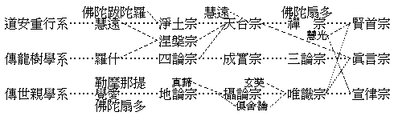



此三系中，尤以道安、慧远一系为有特色。盖流衍蕃变，而有中国思想潜注其底间也。试再为一表以见其概——



　　　　依 般 若　　　　　承 上 集  

　　　　禅律行证　　　　　中修净土  

　　　　道安………慧远………注重修行即为净土宗─┐  

　　　　　　　　┌───────────────┘  

　　　　　　　　│　　法华涅槃  

　　　　　　　　└吸收　　　　演教即为天台宗………专崇悟证即为禅宗─┐  

　　　　　　　　　　　及龙树系　　　　　　　┌───────────┘  

　　　　　　　　　　　　　　　　　　　　　　│  

　　　　　　　　　　　　　　　　　　　　　　│　　华严楞伽  

　　　　　　　　　　　　　　　　　　　　　　└吸收　　　　演教即为贤首宗  

　　　　　　　　　　　　　　　　　　　　　　　　　及世亲学



此中国晚唐以来之佛教，所由行证不出禅、净，教理不出贤、台欤！



------



## （观空记）(见海刊六卷五



论中国佛教史



——三十三年春在汉藏教理院为妙钦说——



我在十多年前曾作「中华佛教之三大系」一文，刊在第六卷海潮音上，对中国佛教历史教理变迁之因原与程序，稍作有系统的提示。这个提示，直到现在都还有重提的意义。



我在那篇文章里面，分会昌以前的中国佛教为三大系。一、道安重行系：自慧远的承道安修持律净，觉贤的传禅，慧文的修实相禅出天台一宗；光统的持律与杜顺的修法界观出贤首一宗；乃至慧能以后的禅宗都是。二、传龙树学系：自罗什传龙树论入中国，到兴皇、嘉祥的集三论宗之大成。三、传世亲学系：菩提流支、真谛、玄奘三人，相次的传世亲论入中国，而演出地论、摄论、唯识的三宗(附俱舍)。在这三系里面，道安重行系永远是中国佛教思想的主动流。传龙树学系与传世亲学系，只是两种外入流。它从印度传入，而兴盛的时期虽曾影响到主流，但不久即被融摄而至衰歇，不能撼动主流，更不能进为主流。主流尊其为主流，旁支还其为旁支。循是以观，才能见到中国佛教演变之真象。所以在研究中国佛教史的时候，辨别认清这主动流与外入流两者特质的不同，是一件很重要的事情。



主动流的第一种特质是「本佛的」，自道安以来的中国佛教代表人物，如慧远、智者、贤首、慧能等，都是直本於佛。如道安倡以佛姓为姓，一切以探本於佛为宗。基於这种原因，所以第二种特质就是「宗经的」，他们都以无上正等觉者金口亲宣的经典为根据。因为经的浩繁，所以他们都得博览全教而约取要旨，故第三种特质是「博约的」。如道安博览众经而综理经录，天台、贤首的博综一代时教而为判摄，都是这种表现。最后，他们的第四种特质是「重行的」，他们在博览中提出的一种心要，就成为实践行门，或净业或禅观，作为自行化他的修证法门。



针对著主动流的四种特质，外入流也有著四种特质：一、「本理的」，如罗什、玄奘等，都是以他们所本的性空或唯识为本，而不是推本於佛。二、「宗论的」，因本的是理，所以就以专明此理的论典为宗依，所以他们或者宗龙树论或者宗世亲论，都不是直宗於佛说的经。三、「授受的」，因有宗本论典，所以他们的思想直是论师们授受下来的一套，不能自己直探佛法作更伟大的创建。四、「重学的」，承受所传授的论典，孜孜钻研讲说，所以他们不能从一种扼要简易的行门，直截去修行证果。



在这两流里面，前者能博教而得其要行，摄末而直追根本。此中国佛教的主流，充分的表现了中国人伟大的创造力，终於建立起具备深厚特质的中国佛学(在世界佛教的三大系中，南方巴利文系只局在小乘三藏，未闻摩诃衍义。流行在卫藏的西藏文系，认为佛教所宗不是有部、经部，便是中观、唯识，充分的说明了它只是本理的宗论的与授受的。能够直本於佛，探一切经，在「博教约行」中，表现其伟大的创造力的，只有流传在中国的汉文系的佛学)。



复次，我向来将大乘教理分判为「法界圆觉」、「法性空慧」、「法相唯识」三宗(最近印顺法师分为性空唯名论，虚妄唯识论，真常唯心论三种，虽内容不出我所分判的，不过「真常」、「虚妄」的用辞界限，殊不能明确的分清楚)，也可以同样的拿来观察中国佛教历史的。如主动流的道安系就是法界圆觉宗，外入流中传龙树学系的就是法性空慧宗，传世亲学系的就是法相唯识宗。不过在中国佛教历史的立场，不妨略改为佛本论系(法界圆觉宗)，性空论系(法性空慧宗)，唯识论系(法相唯识宗)。后两种都是采用古来的名称，只为便利上不得已新立了佛本论系而已。



现在可以依著上面的论述，把中国佛教历史分为三个时期：



一、佛本主源一味时期　自永平求法到东晋道安  

二、空识夹变主流时期　自慧远到清凉受罗什到玄奘之重重扩变  

三、主流递演不绝时期　会昌后禅宗下的台贤净律



在罗什以前所传译的，有禅教律密净，般若、法华、华严(单品)。那时候的大德们，只把它当做佛教来传译、来宏扬，根本就没有宗派存在，所以不该拿后来宗派的眼光去衡量它。他们都直宗於佛只是一味的佛法。而且、后来中国佛教佛本的主动流就是确立在这个时期，所以可以叫它作「佛本主源一味时期」，其代表人物可以说是道安。罗什来华以后，传入了龙树的论典，才有宗派的见解发生。从罗什以后，僧肇、僧朗(摄山)到兴皇与嘉祥而成三论宗，旁出僧导僧嵩到梁三大法师的成实论宗，这是性空论旁支的入流。自从北魏菩提流支传译无著世亲论典建立了地论宗，继之有陈真谛的传译而为摄论宗，到李唐玄奘更大量的翻译而有唯识宗及旁带的俱舍宗的建立，这可以说是唯识论旁支的入流。这传学本理而宗论的性空唯识二支，虽大大影响了佛本论主流。但终不能夺其主流而代之。自道安以来，有慧远、觉贤、慧思、达摩、智者、杜顺、慧能等，且收且破，而性空论终由智者融摄而为天台宗，唯识论亦由法藏融摄而为贤首宗。所以自罗什以来，虽然性空唯识二旁支加入法流，但始终是以佛本论为主动流的。唐朝自慧能以来，禅宗独特兴盛，净土也渐遍的流行，正如中华佛教之三大系一文里所说的：「注重修行即为净土宗。吸收(法华涅槃及龙树系)演教即为天台宗。专崇悟证即为禅宗。吸收(华严楞伽及世亲学系)演教即为贤首宗。此中国晚唐以来之佛教所由行证不出禅净、教理不出台贤欤」！这说明了佛本论主动流的递演不绝，也正是所以成为「中国佛学」之特质所在。现在把他归摄为下表：



　　　　佛本主源一味期───────空识夹变主流期──────主流递演不绝期  

　　　　　　　┌────┐  

　　　　┌─┐│性空论系│罗什师资┬成实宗┬三论宗  

　　　　│佛│└────┘　　　　└──┐└───┐  

　　　　│本│　　　　　　　　　　　　　└┐　　　│  

　　　　│论│道安等────慧远净禅───┴天台宗┴─────贤首宗──禅宗  

　　　　│系│　　　　　　　　　　　　　　　　　　　　　　　　│  

　　　　└─┘　　　　　　　　　┌────┐　　　（附俱舍宗）│  

　　　　　　　　　　　　　　　　│唯识论系│地论宗─摄论宗──唯识宗  

　　　　　　　　　　　　　　　　└────┘



不过，最初的佛本论，不但重行，而且能宗经博教，教证本末都很圆满健全。后来的禅净，承这个重行之绪，走到极端，专重要行而舍去了经律，孤陋寡闻而致佛教衰落。现在要复兴中国佛教，应该继承佛本论的主动流，力戒孤陋的弊病，直探佛经，博搜教理，精简以取其要，见之实行；绝不是承受那一家的旧套的。



------



## （妙钦记）(见海刊二十六卷九



中国之佛教



——三十三年在复旦大学社会系讲———



一　佛教原来之性质甲　理论１　因缘生果  

２　本性空寂  

３　名相假立  

４　中道真实



乙　事行１　神秘倾信  

２　僧团律行  

３　禅悟会通  

４　学思论辩



丙　目标１　人间进善  

２　后世超生  

３　涅槃解脱  

４　法界圆明



二　中国佛教之变质  

三　中国佛教之改进



一　佛教原来之性质



甲　理论



今讲中国佛教，先应说明佛教的理论，理论中又分为四：



１　因缘生果



佛教看宇宙现象是一种结果，而产生这种结果的是因缘。因缘的定义很多，然简括言之，不外是：由此而生彼谓之因，依此而成彼谓之缘。因缘的定义既明，现在当就宇宙诸现象以明因缘生的果。例如此时盛开的梅花树(果)，牠的存在不是突然有，也不是本来有。在牠长成之前，必先有梅树种子(因)，仅有此种子，也还不足使牠长成为树，所以次须具备日光、水分、土壤、空气、人工等诸条件(缘)。梅种子与上述诸条件一旦发生关系后，乃渐成为今日所见的梅树。故长成梅树的种子称做因，而促成种子发育长成的诸条件乃谓之缘。梅花树果的生成既是由於因缘，由此类推，梅花树以外的宇宙诸现象，也莫不都是由於因缘而有，故说宇宙诸现象是因缘和合所生成的结果。



２　本性空寂



宇宙现象既是因缘的果，那末牠们的本性一定是无了。这一说，诸位初听也许觉得离奇，但我想一经说明，定能明白。如这张讲台，分析牠的构成因素，不外木料(因)、洋钉、油漆、人工等(缘)。质言之，桌子之成，由於上述诸因缘的结合。所以如果我们将这些因缘分散拆开，或牠们根本没有和合的机会，那桌子还有存在的可能吗？桌子既非实在有或本来有，那牠的自性自然是无了。桌子既如此无自性，我们就可类推桌子以外的宇宙诸现象也莫不如此——无自性。



３　名相假立



我说桌子没有自性，并非否认桌子形态的存在。这一点很重要，如果不将此弄清楚，便觉佛理与事实不符了，例如有人问我：你们研究佛学的人开口讲空，闭口说无，但为什麼还吃饭睡觉呢？怀著这样疑问的人，显然没有弄清楚佛教说空的真义，因为佛教说空，是指诸现象因缘和合故无自性，而非否认现象的存在。吃饭睡觉是人生现象，和尚又安能例外。所以经中说：「妙有不有，真空不空」，便是这个意思。现象是存在的，而且又非常的多。我们生长其间，如果不给予名称的区别，则结果必混乱得不堪设想。因此，有张三李四和桌子椅子等的名相产生，名相不过是为人便利而设立，牠非即现象自体，所以说名相是假立的。



４　中道真实



有一偈说：「因缘所生法，我说即是空：亦为是假名，亦是中道义」。这是说，宇宙间无一现象不从因缘生，既从因缘生，其自体当然是空，而且识别其存在之名相又必是假立，故称为中道。中道即空即假，即假即空。换言之，每一现相有二面：一是我们眼等所能见得到的存在形态，一是我们虽不能见而能思想到的因缘关系，此外别无实体。这种道理的综合，佛教便称之为中道，这中道的道理，不因时间空间之不同，人智之高下而有变更，故为真实。



乙　事行



以上所述是佛教的理论。但有了理论必须要有行动，故紧接著便讲事行。事行中又分为四：



１　神秘倾信



华严经中说：「信为道源功德母」，可知信在佛教上，如兴趣在事业上一样的重要。因为我们对佛教先须具备信仰，而后方能接受。佛之所说，每超出常人的思想，而若能认真地依著行去，又必有好反响，因此常人对佛教由普通信仰而渐带神秘倾向。此种转变，至秘密教兴起，尤觉显著。然从佛教本身看，此种转变，坏多好少。



２　僧团律行



由信而接受佛教，能依之实行的人，我们便称之为僧。但僧之原意为和合众，换言之：四人以上的佛徒团体乃得称为僧，所以僧即僧团。人众一多，其中不免要发生越轨行动，为了防止故制定戒律。戒者，消极的止其不当为，律者，是一切应作事业的规律。关於戒律，中国虽立有专宗，但律宗以外的一般僧侣亦须严守。从僧侣讲，最初守沙弥十戒，进而守比丘二百五十戒，最终进受菩萨戒。



３　禅悟会通



禅是禅那的简称，亦称为禅定，但在印度多叫瑜伽。这里所说的禅，并非单指禅宗，而是指比禅宗更广泛的三学中的禅定。禅那的本意是静虑，也就是说在静定中观察思虑，因此亦称禅观。禅定的种类极多，例如安般禅，五门禅，念佛禅，实相禅，宗门禅等。安般禅，即是依安世高所译之安般守意、阴持入经而修的禅法，其要旨在调息，由守意而摄心。其禅盛行於汉魏晋，为安世高所首倡。五门禅是根据佛陀密所译之五门禅法要略而修的禅教，其要旨近於五停心。五停心即对治多贪的不净观，多瞋的慈悲观，多痴的因缘观，散乱的数息观，多慢的五阴十二入十八界的分析无我观。念佛禅，虽说后世的念佛由牠产生，然念佛禅实非念佛，因修念佛禅的人注意点在禅而不在口念。慧远大师在庐山结莲社专宏念佛，但他在临终时说：『我在定中三见净土与圣众』。既说在定中，那末他的念佛法门实即是「禅」了。念佛禅实著於慧远，后为昙鸾、道绰、善导诸人所力宏，结果乃演成今日的净土。实相禅所根据者，是禅法要略、中论、智论、法华、维摩诸经，为慧文、慧思、智者诸人所宏传。其要旨在即缘生法而见三谛实相，三智一心中得。三智即：遍了法性的一切智，自行化他的道种智，了法无二的一切种智。一切智是空观所成，道种智是假观所成，一切种智是非空非假即空即假的中道观所成。智论的三智一心，是以一心三观而观一境的三谛所成。一境三谛是诸法实相，一心三观便是实相禅。上述四禅是依教理修的，但宗门禅重在自心参悟。宗门禅始於菩提达摩，要旨在「教外别传不立文字」，「直指人心见性成佛」。要之，宗门禅是顿悟禅。



４　学思论辩



上述的禅，实即等於普通的思考，也就是一种埋头实地研究的体验领悟工作。在此修学中一旦有了心得，便须出而觉悟他人，施设论辩。论辩主旨虽在破邪显正，然於激烈论难中，彼此常会发现新的真理，故佛教亦甚重视。为了思考周密及防止过失，乃有因明论式。上述的2.3.4.，用佛语说便是戒定慧三学。这三学在修学上是一贯的法则，倘缺此便非佛学。



丙　目标



吾人虽有行动，若无目标，则等於无罗盘针的海船，故应讲佛教趣向的目标。这里又分四：



１　人间进善



佛教最初的目标在使人民善良，社会安定，国家康强。此中第一步须人民善良；佛典中教人民善良的方法很多，我也曾作过佛教人乘正法论。但为节省时间计，今只讲五戒善法以供参考：（一）不残杀而仁爱：佛教之不杀原不仅对人，而对一切生物也不残杀，故佛教之慈悲远非他教博爱所能比。但若依此彻底做去，便不能符合国法民情，故凡杀而能利益大多数人者，不受此戒限制，如除害虫杀敌寇等。其当仁爱者，如爱儿女，敬父母，尊师长，保护幼弱，和爱朋友，夫妇相亲爱，爱护国家民族，泛爱全人类，悯惜一切有情。（二）不偷盗而义利：人与人间财物的主权转移，必依正义，若不与而取，非分而取，无功而取，均谓之偷盗。偷盗，多由於赌博，闲荡，不事生产，不图立身等意志薄弱而起，故意志应使其坚强而从事生产。进一步，教育儿女，孝养父母，供奉师长，惠施幼弱，辅益朋友，分利亲属，交利国民，纳税以利国家。（三）不邪淫而礼节：现在各国多采一夫一妻制，若越此礼制，便为邪淫。淫乱多由於不尊重他人之人格，故防此应崇礼节。（四）不欺诳而诚信：人必待社会而后生活，而社会必待构成牠的人类彼此诚信，乃能巩固。故社会安定，国家兴盛，实由於人民忠诚信义；而诚信之立，先戒欺诈。（五）不服乱性物品而调善身心：五戒末条本单指戒酒，但现时应该将牠放宽点，如鸦片、烟草及各种含有刺激性的东西，均宜戒除。因为这些东西多能腐败身心，昏乱性情，因而做出越轨的行动。上述诸事固当戒，即衣食、劳动、休息、聚谈、研习、每日亦须有常度，身心方可健康。



２　后世超生



佛典中有业与轮回二语，业的定义是：吾人凭自己的意志不断的活动，活动的反应的结果，造成自己的习性，这习性又成为将来活动的根柢，支配自己的命运。从这支配命运一点说，名曰业报，或业果。业是永远不断起灭的，其活动若转一个方向，业果也随之而转换，故业果决非以一期的生命之死而终了。因为死亡不过是构成身体的物质循物理法则的聚散现象，生命既不限於物质，故吾人所造的业，不因身体死亡而消灭。吾人身死之际，业力便会自然而然的引自己转变为另一方向、另一形式，因此新生命又即产生。这种转换状态，佛家特名曰「轮回」。懂得轮回的道理，便可证明「业力不灭」的原则。吾人的业力既非以现世为终了，那末吾人就应不以现生善良为满足，而进求后世的超生。



３　涅槃解脱



但是后世超生，无论如何高超，仍不免於轮回。怎样才得出轮回？这惟有涅槃解脱。涅槃本为梵文，意即解脱，即为离缚得自在。用现代语说：脱离囚奴束缚的生活，达到自由自主的地位。再详细点说：这束缚并非别人加之於我，原来都是自己找来的，解脱不外解放自己，故解脱祗须自己能觉悟。又因束缚是自己找来的，故解脱亦大不易，非自己从事於修养不可。修养方法，佛教向称有「八万四千法门」，然今无暇细说。解脱有二：（一）慧解脱：即从智识方面得解放。例如心经说：『行深般若波罗蜜多时，照见五蕴皆空……乃至无罣碍故无有恐怖』。般若即智慧，其意谓一面观察世相，深通因缘和合、无常无我之理，不受世俗杂念所缠绕；一面确认有高纯妙乐之理想世界，向上寻求。佛教各种「观」，都从这方面著力。（二）心解脱：即从情意方面得解放。意志的修养，主要是破我执，要下大决心，自己不肯做自己奴隶。佛以为众生误认五蕴和合之幻体为我，既说有我，便有我所有物，事事以这个假我为本位，一切活动都成了假我的奴隶。例如因舌而贪美食，因目而求美色，以及先入为主的思想或见解所束缚而不能自拔等，佛以为此等均为我执发生的顽迷。感情的修养，佛教是教人以同情心的「慈悲为本」。慈谓与人同喜，悲谓与人同忧，佛能破除假我，故能实现物我同体的境界，对於一切众生，恰如母对婴儿，所有苦乐悉同身受。发挥这纯洁的爱他心，方算真正佛教徒。



４　法界圆明



我们依上所述的话去修，必可得涅槃，然涅槃之大乘境界，即为法界圆明。佛每说到这境界，必勉吾人自证，故惟有已经自证的人，方能澈底了解牠。然依佛典亦可知其一二：牠是一种绝对清凉无烦恼，绝对安宁无破坏，绝对通达无障碍，绝对自由无系缚的境界。



二　中国佛教之变质



以上所述皆是根本佛教，但佛教自入中国以来，无论在理论、行动、目标各方面都有改变。今举其显著者略述一二：甲、因果报应与空幻中道：吾国人本信鬼神，崇拜祖宗，服从天命，再加以道教神仙赏罚等思想，所以佛教的因缘生果义，一入中国即成庸俗的天神赏罚的三世因果报应说。六朝是道教兴起期，常以「玄之又玄，众妙之门」为标榜，故佛教的空假中道入中国，被人附会为虚幻消极。乙、神力信求与禅悟会通，信天神赏罚，故於佛菩萨亦视为神力而信仰希求。禅悟会通，则为适应儒道家哲学之成果，而产生宋明之理学。丙、后世超生与涅槃解脱：中国社会人事之复杂，世界上任何国家都不能比拟。吾人生活在此种环境中，自不免生厌倦，想脱逃，所以由失意政客、失恋儿郎所汇成的佛教信徒，其目标上低者只著重后世超生，高者亦自求涅槃解脱而已。结果，社会事业无人过问，佛教徒被人误认为分利於社会。这样变质的佛教，吾人能听它长久下去吗？



三　中国佛教之改进



甲、因缘生果与空假中实：佛教所以有第一项变质，乃因国人根本没有了解因缘生果与空假中实的真义，故吾人应随时随地随人指正与讲解。乙、教团律行与学思论辩：对治从前偏重禅悟而末流愚昧的流弊，必须提倡持行律仪与精研学理。如每个佛徒都如此，则佛教决不会腐化。丙、人间进善与法界圆明：佛教精神原基於导善世人再进为与出世一贯之道，然因中国旧时环境关系，人们一入佛教即注重出世而忽略了化导世间，故弄成佛教与社会脱离的怪象。因此，我们应提倡善导人世，注重社会事业，改进人民生活，提高人民知识水准，使能即由国家富强人间美善中，通达到法界圆明的佛境。



------



## （天慧记）(见海刊二十五卷八



佛教史略



——宣统二年作——



一　绪言  

二　创辟时代甲　佛之诞生与长成  

乙　佛之出家与成道  

丙　佛之说法与入寂  

丁　创辟时代赞语



三　流传时代甲　印度时代一　印度小乘时代  

二　印度大乘时代  

三　印度时代赞语



乙　亚洲时代一　创开到全盛时代  

二　变通到衰落时代  

三　亚洲时代赞语



丙　世界时代



一　绪言



佛日西升，法流东渐，五百洲靡靡从风，三千载绵绵不绝：今虽名存实亡，通计世界之佛教徒，尚不下数万万人，固俨然占有地球文明之一大势力者。顾卒无一完善之史，以纪其盛衰隆替之事变，而寓夫全体大用之精神，得非遗憾欤！



抑述往可以知来，鉴古可以戒今，有佛史以来，兴衰隆替之事变，固皆有原因存焉。藉研究而获厥原因，则古往之所以如是，当来之又将奚若，胥可想见彷佛。得而操持其致隆盛昌大之枢纽，进行不匮，庶几法行常健，与世俱深，佛化永宏，唯人偕极；夫佛史之作，又乌容稍缓哉。



二　创辟时代



於穆佛教，闳伟悠久！创兮辟兮，谁为之首？此非研究佛史第一问题欤？然佛陀自受用之法身、报身、玄微广奥，未易为此世界众生言也。姑就他受用之应化身言之，则吾人所仰止所向往之释迦牟尼佛陀耳。释迦、其姓也，牟尼、其名也。梵语佛陀、华言觉者，有觉自、觉他、觉满三义：盖印度之称佛陀，犹中国之称圣人也。



甲　佛之诞生与长成



佛之生诞，史传纷纭，莫衷一是。然内典多称佛诞於我国周昭王之甲寅岁。要之、往上数去，当在二千九百奇年间耳。



亚细亚大陆，有地纵横数万里，雪山皑皑、恒河沧沧，所谓印度即其处也。印度凡五，中印度雪山之南，有国号迦毗罗者，实为大圣释迦诞神之土。尝闻之游者曰：迦毗罗国山势四面走来，葱郁灵秀，远为我国金陵，洛阳所不及，佛陀降岳其间，诚有自来哉。



案印度古时，亦如我国之封建，君其土者以千计，迦毗罗迺其大者。释迦之父即其国之主，名净饭王。其母摩耶，育佛七日而殁，母妹憍昙弥抚之。释迦渐长，即严毅弘厚，宅心高远，不弄不竞，豁达恬澹。其父王以其英发颖悟，世不常觏，遍召遐迩名师教育之。而闻一知万，遽穷蕴邃，文武艺术，萃国士莫之抗，其德慧勇哲，皆天赋也。年十七，娶妃耶输陀罗，美容姿，品性尤贤淑，后举一子曰罗睺罗。



乙　佛之出家与成道



佛虽处富贵声色场中，而以慧眼观人生之苦乐，遁世之思惟因之愈挚耳。其人萧然如秋，蔼然如春，孔德之容，睟面盎背。恻隐仁慈，博爱溥济，见涂人之疾苦老死，以及禽虫草木之惨殇凋谢，罔不哀感伤悼，若己身之置於水火。因而恒独居空寂，研究所以捄脱之之法。既乃憬然悟曰：因惑业是以有生死；因生死是以有悲欢苦乐；因悲欢苦乐而思所避就，是以有爱憎喜怒造种种罪福因缘，回邅升沉不已。今欲解脱此生死轮转，莫尚觉悟。觉悟则惑业灭而生死空。惑业既灭，则廓然真净；生死既空，则寂然常乐，而一切悲欢苦乐、爱取贪嗔、罪福因缘、升沉苦报，皆於是烟销云散，荡尽靡遗矣。



但欲证圆满之觉悟，以完捄世之大愿，非沈神潜修摆脱五欲四苦之羁累，不足以达之。此佛之所割绝慈父爱妻，屏弃其富贵尊荣，而褐衣跣足遁入荒山穷谷，冻肤饿肠之不遑恤也。



佛之违国舍家，才十九龄耳。初於蓝摩林遇婆罗门跋伽，因就之访道，跋伽盖婆罗门之苦行派，佛审其无益，去之。嗣闻摩伽陀国有阿逻逻仙人，德行高洁，定慧兼深，因诣弥楼山叩之；勉以精进之旨，教以禅那之法，与五比丘共习焉。凡经六年，尽穷其窔，继又悟其非究竟，乃别居菩提树下，降伏魔军，睹明星恍然大觉！无上之大志，至此实达，无上之大道，至是成就。此我国周穆王之癸未岁，而佛已春秋三十度矣。厥后父母妻子皆蒙佛度脱，戚属亦多从佛出家，亲亲之义，独盛前古。余尝谓慈孝友恭物均有焉：唯大圣乃能尽之。观此，洵非诬已。



丙　佛之说法与入寂



佛之说法，其大旨以有空言破空有执，离二边存中道，俾众生明心见性发真归元而已。故虽随机开导，靡不条贯精密，文理秩然。



最初为一类应化而生之高等大机，演华严乘修多罗教，以挈法网之纲。凡七处九会，后世颂为第一华严时云。



尔乃为钝根一类人，说小乘法，使由小至大，从浅入深，渐进於高明广大之境，令欢喜领解，共获其所。教育之法，精粹完备，尤为绝后空前之伟业！夫佛固世界第一大宗教家也，第一大哲学家也，然苟置之古今东西之教育界中，必又为第一之教育家。呜呼！吾侪学佛者，於佛诚无得而称矣！亶歆慕之，信仰之、模𢽾之、步趋之耳！



佛於说华严后，游历全印，经年十二，游国十六。初入波罗奈国鹿苑中，三转四谛法轮、度脱五比丘。次复度脱舍利弗、迦叶、目犍连等一千二百五十人，是为第二阿含时。阿含者，其时所说之经名也。



兹后一切闻法者，已得决定信心不生疑谤，乃大小乘并说；而往往褒大贬小，引起钝根者耻小慕大之思想。讲胜鬘、维摩、盎掘、大佛顶、萨提遮等经，是为第三方等时。



久之，小乘者饱聆大法，根器纯熟，堪闻般若，乃说大品、光赞、文殊、胜天王等诸部般若以应之。般若者，如实空如实不空二种智慧也。令众生悟自心性、本如实空故：生死涅槃皆等空华，如梦如影了无所有，而不必生死是厌，涅槃是欣。本如是不空故：具足无量清净功德，福智庄严与佛无异，而不自生退屈，是为第四般若时。



最后，於灵鹫山上讲法华经，会三乘归一乘：将从前方便之说，一一揭示披露，俾皆知为无上佛果故假设诱喻，而弗复贪恋乎三乘法。佛之出世本怀，逮是始尽畅毕遂，而终焉之期因亦不远。乃於跋提河岸娑罗双树间说大般涅槃经，明有情无情皆俱佛性。令诸弟子悉以疑义咨决已，即溘然示寂。是为第五法华涅槃时。佛教之法仪，於是乎靡不备矣。



丁　创辟时代赞语



综上五期，凡五十年，佛一代说法，不出此矣。曾有古偈曰：华严最初三七日，阿含十二、方等八、二十二年般若谈，法华、涅槃共八载。然此亦据其大概言之耳，实则随机授法，佛固未尝拘拘於年月日时也。凡说大乘部小乘部各数百种。繙译至我国者，多大乘而少小乘，殆众生之根性使然也。其法义之浅深精麤，当别论之。而其救世之鸿业，尤以化不平等为平等称最著。



初佛之行化，得摩伽陀国频婆娑罗王护持，印度全境，已𫉁然肸蚃，所至信奉。迨频王殂后，王子阿阇世即位，信任魔党提婆达多，常反对佛；迦毗罗城亦遭并吞，僧众因多往来山林，少入城市，教化渐形衰绌。暨提婆达多死，阿王复信仰佛，时即涅槃矣。



三　流传时代



语曰：无前之者，虽美弗彰，无后之者，虽传弗昌。证夫古代诸大师，继继绳绳为佛散智光神耀於无尽者，斯言益信。夫佛固自有生民以来唯一德盛业伟之大圣也，然苟无文殊、普贤、迦叶、阿难、马鸣、龙树、无著、天亲、摩腾、竺法兰、罗什、达摩、智者、玄奘、诸海龙陆象，作如来使，为众生眼、腾踔发扬荷担不倦，其能传至今兹否，顾未可测矣。噫嘻！斯余所以一念及而今而后之佛教，每不禁英雄佛子是祝焉！



甲　印度时代



初一千餘载，化风所播虽已渐及西域南洋各邻邦，然未能宏敷也。故以被中国之前，断为印度时代。



１　印度小乘时代



佛入寂后，尊者摩诃迦叶嗣道统，集法藏，为佛后之初祖。经二年，二祖阿难陀继之。教渐转恢盛。慧光剡剡，五印同照。阿难陀、佛之从弟也，多闻聪辨，为诸弟子最，大藏典籍，都由编辑成卷帙；统法数十年。洎入灭度，商那和修继之为第三祖。



厥后大罗汉数百，渐次示寂，婆罗门旧教起而乘之，势又稍杀。佛入灭百年餘，四祖优婆毱得阿育王之信仰，复大张之，婆罗门以挫，佛迹渐由印度输入各邻邦。四祖既没，其高足各种异说，分律藏为五部，支离纷争、学者失据，内祸滥觞、实起於斯。二百年初，又并为二部。至三百年间，别其徒众为九部；分河饮水，智者已窃忧之。逮四百年末造，小乘隳裂自十一部乃至二十部、互攻互雠，是非蠭起，婆罗门乘郄诋諆。内讧外患，叠来棼呈，几如今日之中国也。



迨第十祖胁尊者统摄道众，诸鉅子相为赞助，征服外教，法幢始稍稍安立。久之、旧教之妖氛复大炽，印境佛迹、几希中绝。此佛善逝后初五百年消长之梗概也。自第一祖迦叶至第十一祖富那夜奢，其传法化世不逾小乘范围，故束为印度佛教之小乘时代。



２　印度大乘时代



从佛灭度，摩诃衍义久湮闻於世，至交入第六百年，十二代祖马鸣大士崛然兴起，始宏畅之。著庄严论、大乘起信论、大宗地论、攘外道，抑小乘，俾佛学真理，皎然无蔽。治者可式之而行。十三祖迦毗摩罗说法南印，慧化颇著。迨获龙树为嗣，克绍马鸣之洪绪，作大智度论、毗婆沙论、十二门论、中观论等凡数十部，破祛邪小，宣扬圆妙。示自性自度悟入修证之真诣，使同跻康庄，直达宝所。慈云法泽，荫润全印，叆叇滂沱之所至，拓臻异域。佛教中兴之功，实无过马鸣、龙树者！后世以八宗泰祖、千部论师尊之，洵非夸耳。



十五祖提婆尊者克弘大乘，著百论以斥邪谬。外道疾之甚，竟为所剌。是时魔外披猖，佛道堕落，五印如陷长夜，幸十六祖罗睺罗多，苦心捍卫，适值无著、天亲共起匡扶，魔炎用戢，佛日重光。无著、天亲，盖马鸣、龙树而后佛教史上出类拔萃之鉅子也。无著单宏大乘；天亲初宏小乘，后宏大乘。其宗弥勒所撰大乘论，有瑜伽师地、金刚般若、辩中边、十地、唯识等数十部，皆能洞发甚深了义之蕴奥，精粹高广，为后世相宗之钤辖云。



继是有护法、清辨二论师，据有空二义，各标论旨。其徒宗之，大乘遂裂为二。下逮佛入灭千二百年间，学者知行离异，间贻口实，外道乘隙丑诋，复拟僧相，流布恶行诬陷佛徒，印王惑而憾之；燔经籍，毁塔寺，戮僧尼，二十四祖狮子尊者，亦与斯劫。印度之正法，於是一坠千丈，不绝如缕。然其时即我国后汉时也。故印度衰歇之时，即我国萌坼之时，与全亚取次推行之时也。此第二五百年印度佛教史之大略也。其间诸祖除马鸣、龙树、无著、天亲、护法、清辨六大士外，虽多有大小乘兼宏者，而小乘之势燄卒不敌大乘。故此期可谓印度佛教之大乘时代。



３　印度时代赞语



综佛入寂后千餘载之变迁大势论之：初百年间迦叶、阿难诸大罗汉住世，持佛仪范，未少离异，为小乘全盛时代。从四祖而下，内讧渐兴，为小乘兆衰时代。及四百年后，内诤弥烈外患迭乘，十祖十一祖之间，几於扫地，为小乘极替时代。此五百年之兴废污隆，但关系小乘，故总为大乘之隐伏时代。



逮第二五百年初，马鸣崛作，佛性真如以显，为大乘中兴时代。龙树继之，为大乘全盛时代。提婆后渐衰，无著、天亲复中兴之。护法、清辨之后又渐衰。此后为大小乘同归不振之时代矣。



然苟无马鸣、龙树，虽谓於五百年后当即萎落，蔑不可也。茍无无著、天亲，虽谓於提婆之后不复能中兴，蔑不可也。千餘年之时，茍有马鸣、龙树、无著、天亲其人，虽谓其隆盛当不下於六七百年间，无不可也。我国今日之佛教，寝颓昏陋，视印度彼时为何如欤？所恃者仅有国人之信仰心未全死耳。



然脱有马鸣、龙树、无著、天亲其人，乘此世界文明过渡之潮流，安知其不能化而为世界佛教之中兴与全盛之时代乎！人能宏道，非道宏人；历史第为英雄之牒谱，宁不信哉。嗟夫！沄沄巨浸，莽莽神州，尚有马鸣、龙树、无著、天亲其人乎！虽为之执拂持杖，施四大作床而供养之，所忻慕焉！



乙　亚洲时代



佛历数百年，教法已旁及龟兹、月氏、羌氏、暹罗、缅甸等国。经像之来我中夏，实在佛入灭后一千零十八年。隋唐之际，复由我国经三韩入日本。厥旨宏敷，风播全亚。故迄今二千年以上，一千八百餘载，总束之为亚州时代。从兹厥后，当渡入世界时代，另开凿空之纪元耳。



然自法轮东转之后，印度频兴屡蹶，卒不复振。南洋西域各国，徒传其皮相，耽著小乘，鲜有闻大道者。三韩、日本、皆承我国之餘流，其变化消长，亦大略似我。故是一千餘载，代表全亚佛教，舍中国殆无其他能任。请略举佛教流行中国之始末，以觇全亚佛教之衰旺递迁大势。



１　创开到全盛时代



初东汉明帝夜梦金人，因傅毅之对遣蔡愔、王遵等十八人，西访至月氏国遇摩腾、竺法兰二师，邀其赉经像来至洛阳，译四十二章经，中国於是乎始知有佛。然是时仅京、洛间有寺院数处，僧民数百而已；人民薄宗教思想，莫之尊崇也。迨东汉末叶，有谦、谶、亮三支，及佛朔、严佛调、昙果辈、翻译道行般若、般舟三昧等经，稍稍讲述。又有世称牟子者、著理惑论以推尚佛道，编户遂渐有敬佛者。



三国时，西域康居国康僧会游化至吴都，献舍利於吴主权，使建塔供之，吴民乃翕焉归信。同时魏有昙柯迦罗者，初传戒律之学，教仪渐彰。降及晋代，有佛图澄、道安、慧远、竺道潜之俦，接踵而起，皆能译述玄籍，宏阐妙旨，负一时硕望者。又有沙门法显，历冰雪，冒险危，远探天竺，卒赍经典以归，其功尤伟也。



稍后、而传教之大龙象龟兹鸠摩罗什亦应运而至。随译随讲法华、维摩、大品般若、弥陀等经，成实、中观、婆娑、智度等论，凡数十部。门弟子三千，高足七十，生、肇、融、叡，其杰出者耳。尔后又有求那跋摩、昙无谶、菩提流支等，译出华严、金光明、大涅槃、胜鬘诸摩诃衍经，佛典用是赅备。而王臣人民信仰亦因之益笃。惟魏武、周武尝毁灭之，然未逾岁月即归兴复，法界弥光。盖其时佛泽之濡涵浃瀹民心者已深，非一二人之势力所能扑息者矣。梁隋之间，若僧祐、若达摩、若真谛、若菩提流支、若慧思、智𫖮，各竖法幢，普宣真义。律宗、禅宗、三论宗、俱舍宗、成实宗、摄论宗、天台宗，於是乎蔚作骈兴，参互偃蹇；习者皆擅长其门学焉。



迨夫有唐三藏法师玄奘，跋涉万里，周游五印。值其时印度统摄於戒日王，有戒贤、智光二大士，宏无著、天亲之大业，空有兼阐，浅深并宏。戒日王信之綦笃，佛教得此大保护人，因复大振於五印。未久戒日王薨，戒贤、智光亦相继示寂，印度佛教，兹后遂无复能光大之者。玄奘尝师事戒贤，受法相宗之学，尽窥西土真奥，运载以归。译有大般若、瑜伽师地、成唯识等数百经论。维时相为前后者，若法藏、若善无畏、若金刚智、若道宣、若善导、若窥基、若佛陀扇多、若澄观、若慧能、若神秀，各舒厥高深微妙之理，互发其灵秘玄密之藏；而华严、真言、净土、慈恩唯识诸宗，蝉联成立。总其流派分汇为家者，一十有三。千载流传，不外此数。而众圣灵光，充实支那！法运之隆盛，古今无逾此也！至十三宗之派别源流，非枚举能尽，具在各宗谱系。好事者当别寻之。



今试溯此数百年论断之：自东汉至初唐，为印度、中国之过渡时代。自梁至唐初，为中国各宗派之创辟时代。唐初，为佛教大成时代。自陈、隋至唐末，为中国佛教之全盛时代。过兹以往，即为锁关为守成为渐衰为衰极之时代矣。抑唐代之前，道教徒妒佛教之蒸蒸日上，每兴狂诋；佛教诸大师亦不惜与之明辩折诤，故宜名之曰佛道之竞争时代。从五代而入宋、明，则变为儒释之竞争时代矣。



２　变通到衰落时代



然两文明相遇，不竞争则不足以调和。道教初无文明之价值，故几经折挫之后，便深形不竞。唯儒佛两教，各以正当之旗鼓，高邃之学理，愈竞争而愈光荣。自宋明以来，殆如金丹换骨，一气同宣，其根柢上已不复能离而二之也。其所以致此之理由，固何在哉？盖儒之与佛皆具有高妙深广之真理者。使其儒之为真儒也，既知佛理之深广高妙，未有不心折神服，五体投地於佛者。故朱晦翁曰：『儒者若欲待看通佛典，再来辟佛，佛典未看通，早被佛降服去矣！如人在关河上行，不知不觉，便行入番界』。斯言也诚名言也，非亲身阅历过者不能道其只字。晦庵流览佛经，至繁极博，此语其一生之供状乎！然儒者不欲与佛竞则已耳，苟欲与佛相竞而辞以辟之，必得研究佛理，深知佛故，庶足以捣其中坚，攻其要害；否则鲜有不如昌黎之见穷於大颠者。然待其既知佛理之深广高妙，又鲜有不如晦庵之供状者。佛者之於儒，亦复如是。此佛之与儒，所以愈竞争而愈调和，愈别异而愈融通也。今试将有唐以来，佛教之辟系更略陈之。



我国佛教，自唐初各宗派大成之后，降至晚唐、禅宗之风弥畅。真言、俱舍、三论、成实诸宗，渐归湮没，而戒律、净土入各宗兼带行之，专修已少。天台、华严、慈恩三宗，虽尚足相雄并峙，经过五代离乱，亦多散失入朝鲜、日本者。独禅宗经慧能、道一、百丈诸祖之后，化溢山海，气吞河岳，焕然灿然，若梅花之瓣，一裂成五：曰临济、曰曹洞、曰沩仰、曰云门、曰法眼，道香芳馥慧照辉煌，殆有眼耳鼻舌者所不能自掩也。故有宋有明之间，儒释之竞争与调和，关系於禅宗者独多焉。禅宗之衰也，渐於南宋，甚於元明，明之末叶，有紫柏、憨山、密云诸尊宿，又稍稍振起。而净土之有莲池，教观之有幽溪、蕅益、雪浪、交光、龙象济济，殆与阳明诸贤同一气运生者。今则禅刹满禹域，欲少睹古德之流风餘韵，亦不复可得矣。



儒者之辟佛始於韩愈。然愈虽工於文章，而性情刚愎，见识浅陋，当世之人鲜有信尚其说者。宋时欧阳修特负学者之硕望，因爱韩愈文章，泛重其品行学识，至颂其辟佛诸说与孟子同功，九州学子於是乎竞以辟佛为第一急务，一若非辟佛则不足以为儒生者。不能求学识於文章之外，求文章於学识之中，文章学识，混而不知辨，此当时学者之大谬也。张商英，儒而深於禅者，尝著论曰护法论，条列韩欧辟佛诸说而深斥之。至夫周、程、朱、张辈，固非韩欧吠影吠声之比，空谷论尝略揭其渊源与心术，其学问之得自佛固不容掩也。然以朝三暮四之技，弄后人於不觉，无过乎晦庵。试原其学佛而排佛之意，盖欲后世学者莫窥其学识之自来，以崇拜其为天人为神圣而不敢逾越其识见而已。但其心虽苦其志实愚，天下之聪明，岂皆为一手所能障也。



至夫陆、王诸子，其造诣之高明精微，实较程、朱为尤，故其得於佛而似於禅者亦尤之。盖程、朱虽浸淫於佛，而禅之一道则尚徜徉乎门外，陆、王则言到行到，较之古禅德亦不多让。其示别於佛，实似之者愈甚、防之者愈深，所以自卫有不得不然者耳！要之儒得佛而益明，佛得儒而益通。宋明之际之佛教，以僧界之形式论之，较隋唐为衰，以儒佛之精神论之，实由变而通、由通而转盛耳。何耶？盖宋、明之学说，皆合儒佛为一炉而冶出者。其言语文字上虽落落不合，其意思理想上固莫不息息相通者也。虽谓其卫儒而排佛者皆卫佛而排儒者，蔑不宜也。虽谓其学於儒者皆学於佛者，蔑不宜也。故曰，宋明为佛教之变通时代。



迨乎前清，其衰也始真衰矣，迨乎近今，其衰也，始衰而濒於亡矣。从全球运开，泰西文明过渡东亚，我国之政教学术莫不瞠焉其后，而佛教实后而尤后者。中国之佛教，固早失代表全亚之势力矣。然度入世界时代之后，非我国雄飞突兴於天演界，执万国之牛耳以主张此无上之宗教哲学输灌而融洽之，佛学终不能大昌明於天下而速进人群於大同也！其原理於下当浅述之。



３　亚州时代赞语



夫渡入亚州时代之后，亚州诸国虽皆为佛教国，而或仅保其餘喘，或祗承其绪流，或但传其皮相；惟我中国辉煌俊伟，发扬光大，独能概佛教之全体大用而无遗，斯亦足豪矣！然僧侣之自局为化外，竖儒之相歧为异端，以致影响未能大著，效功不甚足观，浸及今日大有江河日下之势也。第宋、明而下，佛儒道三教均渐有一道同风之概，而入於睡眠态度，要亦致衰之一原因欤？今国家政体变更，社会思潮复杂，激剌既深，醒觉亦多，吾佛教其庶几蹶而复兴乎！



丙　世界时代



最近二十年中，日本僧侣之四出传教，欧美各洲皆已有佛迹流入。且研究佛学者实繁有徒。印度尝设有一摩诃菩提会，入会者不下数十万，多欧美人；其大势固已骎骎然趋入世界之时代。然日本虽振兴一时，人民薄於宗教性质，弱於道德思想，纵知识学问，有足高者，而瑰玮之行冰霜之操，尚未及我国隋、唐高僧之万一！其不足风慈祥勇哲之流，载信载仰、式崇式拜、抑可前知。印度之人民虽富於宗教思想，而学识又不逮。且大乘经籍散失已久，摩诃菩提会会长尝致书金陵杨文会居士，拟邀我国之精於大乘者诣彼学习梵文，取中国诸大乘典转译入印度云云。此可以知印度之佛教虽有中兴之兆，必待我国为之赞助，庶几成功耳。



夫世界佛教之昌明，世界众生之幸福也，而关系我国如是其重。顾我国之佛教徒，方沈酣於甚深之醉梦三昧，於世界之大趋势茫无所觉，不亦悲夫！已矣，中国之僧侣，於前途唯有任天演之淘汰而已，尚何足以冀其光大佛教於世界负救世之大使命乎！但犹未敢绝望者，今既有佛教总会之设，冀广兴教育有以造成於将来耳。况我佛教等视众生犹如一子，且未尝轩轾於天、龙、鬼、畜，岂规规然拘亲疏於缁白之间哉。维摩诘、李通玄，皆在家之菩萨也；今世之学士，苟有抱伟大之思想、沈重之志愿、深远之智慧、宏毅之魄力者，荷担此救世之大使命，是则尤喁喁深望者也！



然而今后之佛教，势必日趋於通便精辟，凡有学问头脑者，皆能言其理趣，心其信仰、而不复拘拘於僧之一部份，可断言矣。我国佛教之不发达，以佛学局於僧界，以僧界局於方外阻之也。虽然，中国而著宗教史，舍佛教必无足记述；中国而著学术史，周、秦之后，舍佛教必无足颜色。晋、唐六七百年间，学界中稍可人意者仅一文中子而已。然此亦据儒学一方面而言之耳，若兼佛学言之，虽较之春秋战国时代亦不稍减。故斯时也，乃中国学术史上最衰之时代，亦中国学术史上最盛之时代。宋、明之际，已具如前论；庸可以僧界局方外拘哉！其以僧界局方外拘者，皆取形式而不取精神者耳。然今日之中华民国既度入世界时代，政教学术无一不变，佛教固非变不足以通矣。宋、明之际一变而儒学益以明，佛学益以通；今能乘世界之思潮再一变之，古今东西之政教学术，皆将因之而愈明！全球慧日，於是乎为不僭耳。



(见佛教日报第一期二期)



亚欧美佛教之鸟瞰



——二十年一月在厦门中华中学讲——



一　成立佛教之根本原理  

二　佛教普及之范围  

三　亚洲佛教古代之概况  

四　亚洲佛教在近代之大系  

五　亚洲佛教在近代之传播  

六　欧洲佛教之近况  

七　美洲佛教之近况



一　成立佛教之根本原理



对於佛教，向来讨论者多矣，或云是哲学，或云是宗教，或云非宗教非哲学，言之各有其理，实则皆非圆满之说，盖佛教是包括宗教哲学者也。佛教既是宗教亦是哲学，究与各宗教哲学有以异乎，无以异耶？曰：异。盖其餘宗教无不於人世外另立一渺渺之神，若上帝、梵天等，令人可思而不可及，此为诸宗教所共也。佛教则不然，佛教之所言佛者，非於人世外另有所谓佛，而即在吾人之世界可求而得之也。所谓佛者；本属梵语佛陀，此方译为觉者，即觉悟人生宇宙之真理而得其解决苦痛之方法，并且能够与一切人同觉悟而解决之，如是即曰佛。由是以观，佛之所以为佛者。非可思而不可及，而实一切人皆可为佛者也。其餘宗教唯知俯首乞怜以向他求(上帝等)，佛教则天上天下唯我独尊而求自己得为圆满觉悟之佛陀，即此点与餘宗教不可同日语矣！故佛教不同餘宗教。至佛教中心哲学，已为世界公认为甚深哲理，不待赘言。然於一般哲学者，一是推论，一是实证；若能稍涉佛经藩篱者，不待言而自知。故佛教根本原理无他，即在求其究竟圆满觉悟人生宇宙之根本，既觉悟后，复晓之而宣畅之，是谓佛教。



二　佛教普及之范围



佛教发源於印度，渐而播向於世界，水湿火燥，是所当然。然在现在普及之范围观之，亚、欧、美三洲，佛教均有蒸蒸日上方兴未艾之观，而澳、非二洲则尚未闻有佛教之传入也。余此次游亚、欧、美、非，而澳洲则未涉足其间，或已有佛教之传入未可知也。盖今世界文化昌胜之区，亦唯推亚欧美而澳非二洲不及也。虽亦曾有埃及之古代文化，久已消弭殆尽，现已不足道矣。以文化蔽塞，佛教之传播亦无由而入，故佛教普及之范围最显然而易见者，唯亚欧美之三洲耳。



三　亚洲佛教古代之概况



佛教之发源於印度，盖非偶然。当时诸外道之歧见纷纭，目睹社会之阶级制度而心戚不安，遂振臂起而改革者，即生於二千五百餘年前印度释迦牟尼佛也。盖印度当时系一割据之国体，而释迦族亦诸国中之一小国也。印度之人民分为四级，一婆罗门族，二刹帝利族，三吠舍族，四首陀族，前二皆属贵族，其生活之愉快，固不待言；而后二族，尤其是首陀族(佃者)，其被卑视压迫之苦，不堪设想。释迦原系刹帝利族(贵族)，睹斯不欲睹之情形，遂慨然舍王位而思设法以革除之，由斯遍访诸师，结果皆不满所求。乃凭自己之思量，而获最深之觉悟，是名曰佛。以所得之觉悟，同时而影响得一般风附云从者，佛教之团体由斯成立。



佛灭后一二百年顷，有统一印度之阿育王出世，并征服四方，西至波斯、东至新疆、南至锡兰、缅甸，北至今俄领之地。既有威振四方之势力，兼为佛教之诚笃信仰者，於是以势力之所及地，选优秀人才，四方传播，并立舍利塔以纪念之。时当中国秦始皇时代，彼时有室利房者来华传教，因禁制未行。继之佛教在印度传千餘年，此期间以印度为中心，已成为亚洲之佛教矣。其后印度佛教优秀人才播教於四方，兼婆罗门教复活，於是佛教衰落；继为回教侵入，佛教遂亡。白人入而印度再亡。向来不明印度史者，谓印度之亡於佛教，实则先不信佛教而后致印度於亡也。



四　亚洲佛教在近代之大系



在距今千五百年前之佛教，盖以印度为中心，而南传入於锡兰、缅甸、北传入蒙古、新疆等地，东传入西藏及中国本部。余前於巴黎博物院见各种古物，知新疆、波斯、阿富汗、爪哇等地，皆曾有佛迹，於此可见一斑；然现时则均变为回教国矣，此过去印度为中心之佛教也。至就近代言之，亚洲之佛教，有三大系，一中国系，由中国而传往朝鲜、安南、日本等地。二锡兰系，由印度传入而复传缅甸、暹罗等地。三西藏系，传向於满、蒙、尼泊尔等地。其相传亦千餘年矣。



五　亚洲佛教在近代之传播



亚洲佛教分三大系，系由向来传播之地理和步骤言之。在今之亚洲佛教则逈异其趣。盖往时交通不便，文化未昌，是以各偏据一隅，而不易互相影响。今则海陆空之交通进步靡止，文化之发达，时呈波谲云诡之观，信乎欲闭门偏据所不容之时也。故亚洲之佛教，亦同时随而活跃其中矣。由亚洲之三系，今且进而为世界化之佛教，远布於欧美，三系中首推锡兰(在佛史亦称狮子国)。盖锡兰地当欧亚交通之冲，欧美人之止息其间者，不可以数计，於是锡兰之佛教，亦介绍而与欧美相认识矣。其次推日本，日本维新以后，其各种之进步，诚可令人称羡不置，佛教亦其进步之一也。以此二系、久与欧美相通，致引起欧美人对於佛教之注意而研究，故世界化之佛教传播，首锡兰而次日本也。至中国之佛教，沉闷於斗室之中，不被问於世也久矣！直至前二年，余往欧美，於各大都会各大团体各大学校接谈演讲，遂引起一般人对中国佛教之兴趣，同时即发起创设一世界佛学苑。由多数之公意，认为设於中国为宜，此近来中国佛教之世界化也。



佛教由如是之介绍，同时得绝大之反应，而引起欧美等人之研究有数点。一、考古的研究：由考究亚洲之历史，发见佛教乃注意而研究之，此大概属於东方学者之部分也。其二、美术：西洋之美术，以前极崇拜希腊埃及之美术，最近则崇拜印度之美术，有过无不及。在美术方面，过去佛教教迹之雕刻尤多，如西藏、新疆、锡兰等地发现之佛迹，见不一见；再如中国之各处石刻，均能使欧美人极诚崇仰，其价值已得世界专家之评定，不待言而后知也。三、由宗教研究而及於佛教者：西人主观的宗教信仰，固以基督为最尊，然亦承认世界之各大宗教，除基督外唯佛教最高。此犹主观之评判，若以客观论调评之，佛教在诸宗教之位置，尤为杰出。四、哲学研究：凡研哲学者，莫不公认佛教中有甚深哲理在，对宇宙人生根本问题，均能与以圆满之答复，所谓和合缘生互融交遍之理也。如前德国有叔本华者，仅得小乘意义之一分，已认为超乎诸家哲学之上。再有英之罗素、法之柏格森等，对於佛教中所具之哲学，均表示为诸哲学中之炯炯者也。由此四种研究，佛教之对於欧西，其影响大矣。现欧西人民，不仅研究而已，且进一步信仰者已不乏其人。如近在锡兰地方出家者数十人。由锡出家后而回欧者，亦有多人。再如德之柏林及英之伦敦，有锡兰人建造佛寺及组各佛教会，是皆由信仰者组织而成之也。



六　欧洲佛教之近况



欧洲佛教之创设，已见前述。最近又有日人在巴黎设日法佛学院，系二国合办。彼初有多数不信宗教者，指基督天主而言，后从哲理而研究之，乃成为佛教之教徒也。亦有既信宗教而於诸宗教作统合之研究，觉佛教中义理之超越，非餘宗教所能望及，由之舍餘而专一者；斯皆不乏其人。复有一二学者，教授於诸大学，引起一般青年研究佛学之兴趣。故知欧洲之佛教，不外一信仰、一研究，而组成欧洲最近之状况也



七　美洲佛教之近况



美洲之佛教，有由大西洋传入者，有由太平洋传入者。美国文化在未独立以前，均以各方面之输入为转移，故美之西部与东部，其文化颇不一致，如纽约是受欧洲之影响，对佛教多由宗教研究而信仰之。再如加里福尼亚等地。日人已在彼设有佛教会，为东方民族所居者，各色人皆有，即信印度之婆罗门者亦不少，日人在彼设佛教宣教所数十处，听者多美人。再如檀香山，有本地之土人与中国人约十万，日人在彼则有十餘万之数，而美人反少，其中美人之信仰佛教者，较之美国他处为尤多。故前有报载，今年檀香山开世界佛教青年联合会，中国亦将有参加之事，此佛教在美国之状况。以西部与东亚关系较切，故信仰者多，而东部与欧洲近，故研究者多也。



佛教发源於南亚，而渐次传播於世界，今尤有蒸蒸日上之观。独惜中国系之佛教，在世界上尚无若何贡献可述，此诚愧憾万分之事。近来既已能唤起欧美人对中国佛教之注意，尤须谋整顿而贡献於世界。此不但佛教之幸，亦中国人全体之光荣也，诸君其亦乐而发展之欤！



------



## （宏度记）(见海刊十三卷四



佛学源流及其新运动



——十七年十月在法京巴黎东方博物院讲稿——



一　佛学的发源  

二　佛学在印度的流行  

三　佛学在中国的流行  

四　现今佛教在世界上的三个中心  

五　余之佛学新运动甲　人生的佛学  

乙　科学的佛学  

丙　实证的佛学  

丁　世界的佛学



一　佛学的发源



佛学所说明的宇宙万有之实事真理，本是无始无终普遍常住的，亦是十方世界中过去的现在的未来的一切佛陀所证明的。但在我们这渺小的地球上现今所流行的佛学，实源於二千数百年前印度的释迦牟尼佛，在其大觉的心海中所流出来的。似海流一般的流了二千多年，流遍了南亚东亚几十国的民族，当然有了因时因地因人的许多变迁。然直溯释迦牟尼大觉心海的源头，我以为只是「圆明了无始终无边中的法界诸法实相——宇宙万有之实事真理——体现为以法界诸法为自身，以自身为法界诸法的法身；又完全的开显表示出来，以之教导无数世界中有成佛可能性的种种众生之类，使皆得成就无上大觉一样的圆明法界诸法实相，且体现为无尽无碍的法身」；而并非后来许多支流派别的传说。这是我们考之中国文的华严、法华等大乘经，马鸣、龙树、无著、天亲的大乘论，尤其是直证佛心传佛心印的中国禅宗诸大师之语录，皆可为坚强之证据；而且太虚本人，也曾於此有确切之经验的。



二　佛学在印度的流行



释迦佛陀时，印度的思想是以「个人解脱而得到自我独存」为风气的。佛陀处此环境中，於其无上大觉的法界诸法实相几乎无可宣说。然不说法则觉世悟人之大愿无由得达，乃方便为说人无我的小乘法，适应当时印度思想的机宜，使先真正达到其个人解脱的要求。於是流行为印度的佛教，以至今日犹流行在锡兰等处之佛教。然佛陀同时与曼殊师利及弥勒等一二大心深智者，则直说其自证的法界——诸法实相，至后期与先从小乘悟入的摩诃迦叶等，亦说明其自悟的法界，及方便说小乘的意思。且拈花示众使迦叶直证佛陀的心境，开后来不立文字言语而传佛心印的正宗。但在印度一般的机宜上，则仍流行阿含等经所传个人解脱的小乘佛学。故印度初五百年中所发展的，只是小乘的上座部大众部的学派。至五百年后，虽由龙树、无著等发见了曼殊师利与弥勒等所传的佛说，成了印度大乘思想的发展时代。然实际的行为上与组织上，仍保持小乘学派的态度。未能以大乘思想成为印度的社会文化。至一千数百年后，小乘的精神日趋涣散，而大乘的思想，又为当时印度民族一般的心理所未能接受；适逢印度旧有婆罗门教有非常伟大商羯罗其人者起，窃取大乘佛学以文饰其吠檀陀说，造成婆罗门教复兴的势力。而大乘的佛学者又迁就婆罗门的新兴教势，衍为现今流行西藏等处的神秘佛学。於是印度的大乘学亦告衰敝，而真正的大乘佛学，遂始终未成为印度的民族文化。



三　佛学在中国的流行



佛学流传到中国，已有一千九百年的历史，承受之深博与发展之弘远，实为佛学之第二源海。日本、朝鲜、安南等既不过分承中国佛学的支流，而西藏的佛学亦曾受中国佛学的影响。中国除全盘的承受了印度所传来的小乘大乘佛学，且於中国民族文化的伟大悠远基础上，更开展了中国佛学许多特色。约而言之：



一、以中国老庄派的自然哲学为影响，开展了普遍的远微玄妙，特别是三论宗、天台宗、华严宗的玄义理论；并养成一般佛教徒之洒脱的高逸的淡泊的山林素朴风尚。



二、以中国孔孟派的人伦哲学为影响，开展之注重人类的伦理道德，先养成贤善的人格，再渐由菩萨行以进趋佛果的理论和事行；而表现为调和大小乘律的南山律宗，及禅宗丛林清规，与天台、华严的宗义。



三、以中国民族重生怀死、畏神敬祖、趋福避祸之一般俗尚为影响，传习成至今流行中国民间的密宗、净土宗的佛教，且为一般外国人所观察到的佛教。



四、最雄奇的是从中国第一流人士自尊独创的民族特性，以达摩西来的启发，前不见古人后不见来者，而直证释迦未开口说法前的觉源心海，打开了自心彻天彻地的大光明藏，佛心自心印合无间。与佛一般无二的圆明了体现了法界诸法实相，即身便成了与佛陀一般无二的真觉者。然后应用一切方土的俗言雅语，乃至全宇宙的事事物物，活泼泼地以表现指示其悟境於世人，使世人各各直证佛陀的心境。此为佛学之核心，亦为中国佛学之骨髓。唯中国佛学握得此佛学之核心，故释迦以来真正之佛学，现今唯在於中国。而中国唐宋以来一般老庄派的孔孟派的第一流学者，亦无不投入此禅宗佛学中，然后再回到其道家及儒家的本位上，以另创其性命双修学及宋明理学。故此为中国佛学最特色的禅宗，实成了中国唐宋以来民族思想全部的根本精神。



日本的佛学，皆自中国传去。百年以前，从未有一印度的佛教师到过日本，亦未有一日本的佛教徒到过印度；唯有日本到中国留学的佛教徒，与中国的佛教师被其政府请往日本传授其中国的佛学而已。故日本的佛学，与朝鲜、安南一样的只为中国佛学一支流。而且日本民族，向无文化，有之则唯崇拜其祖先为神的神话，故中国传去的高深佛学，亦不能完全领悟而有所发挥。只承受了净土宗、秘密宗的佛教；在其原来的国神崇拜之上，变成神佛混合的净土真宗，及东密、台密与日莲宗，以维系其全国人民之信仰。近数十年的情形，虽有变动，亦不过步西洋基督教的后尘，努力将全佛教通俗化，及随逐西洋人士以研究古历史与古文字言语，无何新的创建，故仍不能成为佛教在世界的流行中之一个独立中心。



四　现今佛教在世界上三个中心



第一、印度的佛教，近一干年遭受婆罗门教及回教的摧毁，久已衰落沦灭。尼泊尔、孟加拉等处，虽犹保存有残阙不全的梵文经典，已不能成为研究及信仰的中心。唯巴利语系的小乘佛学中上座部之一支，於阿育王的时代传入锡兰，却能发达；绵延至今，尚为缅甸、暹罗等处的佛教中心。且印度及英德各国的研究与信仰佛学者，亦多求之锡兰。而锡兰之佛教师，亦尚能努力恢复印度的佛陀遗迹，并至英伦等处传教。但锡兰为中心的一系佛学，局於上座部一派的小乘佛学，不足以完小乘各学派及大乘佛学之大全，是一大缺憾！



第二、西藏自莲华生创立红喇嘛教，与宗喀巴改立黄喇嘛教，久为蒙古与满州佛教之中心。西藏文乃仿梵文造成，且於梵文的大乘原典亦多保存。传自印度的密宗及大乘性相经论与戒律，比较完备；而西藏人亦至今传持不替，足供世界人士的探究。但西藏为中心的一系佛学，於巴利语系的佛学向未传入，且侧重於印度所传混杂婆罗门的密宗佛教；到西藏后，又夹带入西藏民族原有的颇母教魔术，故於佛学的真相，未免掩蔽不彰，亦是一大缺憾。



第三，即为日本、朝鲜等佛教中心的中国文系佛学，曾经七八百年的长期繙译。印度的佛学大师，自北方的陆路与南方的海道，既持其梵语系的巴利语系的佛教经律论，纷至传译，而中国若法显、玄奘、义净等，亦或从陆道或海道留学於南北东西中之五印全境，归国传译，於是印度原有小乘大乘的经律论，以及密宗的仪轨等一切，无不承受；且加以融化光大而现为隋唐间大小乘十三宗的伟观。既有直探佛陀觉源心海的禅宗，以握得佛学的根本精神，亦能发挥印度传来之大乘法性学、法相学，及小乘之成实学、俱舍学。且创为融合大小乘之律学，并以禅宗的精神综合一切佛学，组织为天台学、华严学。虽近数百年，渐见衰颓涣散，然以中国佛学元气的充足，及近十年来中国民族对於佛学的觉醒，不难由中国佛学的中心系，融合锡兰及西藏的两个佛学中心系，率归於释迦佛陀的觉源心海，一跃而为世界佛学唯一的中心。



五　余之佛学新运动



吾从事於佛学二十餘年矣。以二十餘年的修学、体验，得佛陀妙觉的心境，照彻了大小乘各派的佛学，及一切宗教、哲学、科学的学说。从人类的思想界，为普遍的深远的观察，了知佛学的全体大用，向来犹蔽於各民族的偏见陋习，未能实现为人类的普遍文化。但在现今世界文化大交通的趋势上，却应将此超脱一切方土时代人种民族等拘碍而又能融会贯通东西各民族文化的佛学，明明白白宣扬出来，使之普及群众，以作人类思想行为的指南。十年来尝小试於中国，颇著成效。向来误被一般民众作多神教式迷信的，今已成动摇崩坏之状；向来仅为少数山人隐士及寺僧讲谈的经典，今已成为一般曾受中学以上教育者所共同研究。向来唯以寺院为佛教的机关，今已组成讲学的修养的宣传的以及全国与各省协合的团体；向来与社会风俗习惯不生何种关系的佛律，今已为学佛民众的行为标准。向来作离群索居冷静清闲生活的，今已走向广大的人众中，作各种服务人生之事业。此留心一观察现今中国的社会情状，皆立可明瞭的。



且我们更以为现今全世界人类，已至呼吸相通的时代，世界同胞，人生一体，殆已为人人所能认识：「利他则成两利；害他则成两害」！硬撑其国际和平争求其自私的胜利，不惟不仁，亦为不智之甚。因发愿讲明「无我互成」的佛学真理，觉悟全世界的人类，改变其各自竞争以求生存的思想，为人生相助以共存共荣安宁发达的思想，遂开展为全球的佛学的新运动。今略述其要义如左：



甲　人生的佛学



於现代交通的互助的人类底共存共荣关系上，於东西各民族的人生哲学基础上，以大乘初步的十善行佛学，先完成人生应有的善行，开展为有组织有纪律的大乘社会生活。再渐从十住、十行、十回向、十地的佛学，发达人性中潜有的德能。重重进化，以至於圆满福慧的无上正觉。



乙　科学的佛学



以经验的归纳及理论的演绎，从公正的客观态度，探究全宇宙事事物物各方面各部分的真相；以破除传习上偏见上一切的迷信谬解，而立为说明一切事物相互关系的公例定理。穷自然的蕴奥，利人事的进行，此近代科学之功绩；然於此犹未有完全洞明宇宙人生真相的希望，故终在存疑的猜度中，而不能确立彻底解决的真信。旷观於古近一切的哲学宗教，唯佛学不但不因科学而有所摧动，且得科学以为之证据及诠释，益见真确精密。其由无上正觉所完全洞明的宇宙人生真相，又足於科学的发明上，树立合理的正解真信，以补科学之缺陷而促其进步。故当建设以科学为基础的佛学，成立科学上的最高信仰。



丙　实证的佛学



佛学所说明的，以是全宇宙事事物物的真相之故，科学或哲学上，於一部分或一方面的说明，若能适如其量而不杂以情意的迷习谬见时，虽亦可恰恰相当；然以科学或哲学的知识，乃从人类报生的五官经验，及人群传习的意议理论，展转增益得以成立。而佛学则由积修所成的无上正觉，证明了完全万有真相，为启悟各人而适应各人的心理程度，施种种的说明而成立。故求之一切的学说中，与文字语言的记载中，犹未足洞明佛陀所证的万有真相。必吾人自身亦开发等同佛陀的觉心，乃能实证於佛陀所明的万有真相。然以中国禅宗的经验，吾人皆现现成成，各有等同佛陀的觉心，刹那刹那活泼泼底流行著。吾人只要有一刹那间，打开了经验的理论的牢笼，便能涌现一刹那间的等同佛陀觉心，实证佛陀所证明的万有真相。虽未必皆能一证明即永不再退堕无明的牢狱，然有此亲经的实验，对於佛心完全洞明的万有真相，必能成立坚确的真信，无可摇夺。故特别注重实证的佛学。



丁　世界的佛学



就文化言：东方民族所有的文化，大致为调善情意的文化，西方民族所有的文化，大致为扩充理智的文化。虽近时已由交接而相取携，犹不免貌合神离互生隔靴搔痒之谬误。就哲学言：一派是侧重经验的哲学，一派是侧重理论的哲学。经验所及虽确当而不遍常，故必借理论以补充；理论所及虽遍常而不确当，故必借经验以为补充。然经验与理论之两途，终不能为遍常而确当之一致，遂为终古争持莫决的问题。若此两方文化与两派哲学的隔膜，不能切实解除，则终无由融化全人类一切的文化与哲学而适应今后全人类的需求，成为一致百虑殊途同归的世界之文化与哲学。然一深观佛学，则以调善情意为理智发达之胜缘，尤以发达理智为情意调善之要因：相应互成，共臻究竟。复次、以超脱一切分别的实智、经验，到理论上绝对的遍常性，亦以巧符合各种事情的量智、理论，及经验上相对的确当性，完成了「经验遍常化」与「理论确当化」，解决了终古不决的哲学上种种的问题。故唯佛学足为陶铸两方文化与两派哲学的洪炉。创造成今后世界全人类所需求的大同文化与哲学。故我们赤裸裸解除了一切从人种、民族、方土、时代上所传习下来的拘蔽，直示以世界的佛学。



我们於佛学的新运动，已略加说明：为使此理想加速的实现出来，已拟具世界佛学苑的计划，今已印送诸君。诸君若能从本具的觉性中，发出同情的呼声，便请起来为共同的进行。



------



## (见海刊十卷一

