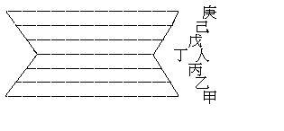
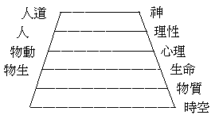

# 太虚大师全书．第二编　五乘共学



> **藏经**：太虚大师全书（太虚大师全书）　**册次** 第 3 册（TX03）　**编号** TX0002　**卷次** 22 卷　**篇幅** 89,264 字

> **作者（译者）**：佛说善生经讲录、（附）崔参笔记

> **卷／品**：18 卷 · 3 品



---



## 目录



- [（苇舫、尘空合记）(见海刊十三卷九](#苇舫尘空合记见海刊十三卷九)

  - [释经甲一　证信缘起乙一　证信序](#释经甲一证信缘起乙一证信序)

  - [乙一　证信序](#乙一证信序)

  - [乙二　缘起序](#乙二缘起序)

- [（竺摩记）(见海刊十七卷三](#竺摩记见海刊十七卷三)

- [（毛汶记）(见海刊九卷四](#毛汶记见海刊九卷四)

- [(见海刊九卷五](#见海刊九卷五)

- [（心月记）(见海刊二十四卷十一](#心月记见海刊二十四卷十一)

- [（陈妄清记）(见海刊四卷三](#陈妄清记见海刊四卷三)

- [（宁达蕴记）(见海刊七卷十](#宁达蕴记见海刊七卷十)

- [（胡梦蝶记）(见海刊十六卷十二](#胡梦蝶记见海刊十六卷十二)

- [（竹摩记）(见海刊十七卷三](#竹摩记见海刊十七卷三)

- [（灯霞记）(见海刊十四卷四](#灯霞记见海刊十四卷四)

- [（闻又、澄源合记）(见海刊二十五卷十二](#闻又澄源合记见海刊二十五卷十二)

- [（芝峰、佛影合记）(见海刊五卷九](#芝峰佛影合记见海刊五卷九)

- [(见海刊九卷三](#见海刊九卷三)

- [（大醒记）(见海刊六卷九](#大醒记见海刊六卷九)

- [(见海刊九卷六](#见海刊九卷六)

- [（弘悲记）(见海刊二十六卷第一](#弘悲记见海刊二十六卷第一)

- [（觉先茗山记）(见中流四卷七](#觉先茗山记见中流四卷七)

- [（李慧空周慧毓合记）(见正信第一卷第八](#李慧空周慧毓合记见正信第一卷第八)



---



佛说十善业道经讲要



——二十一年七月在汉口佛教正信会讲——



悬论一　契理与应机甲　契理之实义  

乙　应机之对治



二　经题与译题甲　释经题  

乙　释译题



释经甲一　证信  

甲二　正说乙一　明世出世业果丙一　就因明果  

丙二　即果明因  

丙三　举因相明丁一　观心无主  

丁二　观法如幻  

丁三　劝应修善



丙四　举果相证丁一　以佛果证  

丁二　以菩萨证  

丁三　以天龙证  

丁四　以海众证



丙五　结劝修学



乙二　正明十善业道丙一　显善法用  

丙二　释善法名  

丙三　出善法相



乙三　明十善业功德丙一　明离杀生功德  

丙二　明离偷盗功德  

丙三　明离邪行功德  

丙四　明离妄语功德  

丙五　明离两舌功德  

丙六　明离恶口功德  

丙七　明离绮语功德  

丙八　明离贪欲功德  

丙九　明离瞋恚功德  

丙十　明离邪见功德



乙四　明十善业胜行丙一　明六度丁一　广明布施度  

丁二　略明餘五度



丙二　明众行丁一　四无量心  

丁二　四摄  

丁三　三十七菩提分等



丙三　结广



乙五　明十善业殊胜



甲三　流通



悬　论



一　契理与应机



今天开讲「十善业道经」，在未讲本文以前，先讲一段经前的悬论。一切经皆谓之契经：一契理，二契机；一切佛法皆从此原则而建立。一切法的真理，所谓诸法真实性相，乃佛智慧所亲证，为开示未证众生亦令证入，是为依契理的原则而说法。在契机的方面，是依种类根性时节因缘，适合一切众生的机宜，各令觉悟而说法。具此二义，方为契经。现在即本此二义，而说明此经之大义。



甲　契理之实义



契理之实义者，谓契合诸法性相的真理之实义。此契合真理之实相，不以时间而变更，不以地域而迁异，无论在何时何地何类中都是如此的。说明此十善业道经契理之实义，今分三段来讲。



１　十善业为世出世善行之大宗



「业」即行为的意思。十善业者，谓身业有三；即：不杀，不盗，不淫。语业有四；即：不妄语，不两舌，不恶口，不绮语。意业有三；即：不贪欲，不瞋恚，不邪见。合身、语、意、共成十种。反之即是十恶。业并不一定不好，须视其性而定。内心动机是善的而行出来也是利益众生的，即是善业；动机是恶的而行出来也是损恼众生的，即是恶业。且此身三，语四，意三的善与不善，又须以其未来结果而定。又此十善不仅是世间的善行，佛经上无不讲到，所以此十善，为一切世出世善行的大总持——即大陀罗尼。世间由此善行得到人天的好果（天即在人以上的世界众生）也是行十善而得成的。所以人天的福报，都是由十善业所成。平常所谓人类的道德行为，在佛法即是不杀不盗等五戒；但生天则须具足十善的道德行为。在欲界天以上更有色、无色界天，生此天须修四禅八定，然亦是意善业上更加深一层禅定功夫而已。至於超出三界的出世业，则成三乘的声闻、缘觉、菩萨菩提果，亦无不以此十善业为根本而得成就的。所以大乘戒法，皆十善行摄。由戒生定，因定发慧。菩萨位中第二离垢地，即由十善成业：由戒增上成定，即深修十善，将身语意恶业之极细者亦究竟断除，定心不散乱而得安，即成十善行深进一层功夫。至於由定成慧，则是最后将无明邪见打破，无漏智慧发生，此即十善业的究竟道。所以三乘清净的出世业果，也是包括在十善业内的。此为十善业道决定如此的真实理趣之一。



２　十善业为造成人间天国之正因



到人间乐国最切实的路径，是十善业道。若欲达人类安稳快乐之目的，即在奉行不杀不盗等十善。如能实行此十善业，无有不得成就的。现在世界相杀相斗，皆因肆行十恶，不行十善。假使人人皆能行十善，立可成为安乐世界。所以现今人类的痛苦，皆由於不行善业，因此由个人而社会而国家而世界成为一个痛苦的苦海。但世界上凡有思想的人，无论是宗教家，或各种学问家，都希望搆成相亲相善之安乐世界；只要能行十善业，则古今圣贤理想中的天国——若中国所谓的大同之世，和西洋人理想的黄金世界，皆不难实现；只要将十恶业改成十善的行为，即可转五浊恶世成清净的乐国。这实是今日世界人类刻不容缓的要求。庐山慧远大师，谓十善业，若能从一家一乡推行到一国，立可成为「风和俗美，刑措政清」的清净国家。这是一条定律：无论何时，若要想成安乐的世界，是必须由此坦途而进行的。佛说四大洲中的北俱卢洲人，自在福乐，即是行十善业的结果。又说转轮圣王出世，四海清平，天下安乐，人人皆行十善，亦足证此理也。



３　十善业为涅槃菩提根本



三乘的涅槃菩提二转依果，都是以十善业为根本的。以十善业能制止恶的行为，将一切不善的对治究竟，即解脱一切生死，证得大涅槃果。此即为十恶业果的断尽，而十善功德发达到圆满。复能将十善普利世间一切众生，即得成大菩提果。此亦是一种定律：没有不圆满十善业，而能得三乘果的。



乙　应机之对治



佛在当时说法，皆因众生根机适宜而说的。现在讲十善业道经，也是应机对治，以期挽救现在世界的众苦迫恼。因为若要将众苦迫恼转为安稳快乐，非行十善业不可。此亦分为三段来讲：



１　对治鹜外忘己而修已



现在世界皆在不景气中，而中国又因天灾国难纷至沓来，大多数人皆在水深火热的痛苦中。挽救的方法，唯在切实的奉行十善业，不要怨天尤人，也不要向外驰求。责任是在自己的：不得将责任推之环境，或卸於他人，或怨社会制度不良，或尤物质条件不备；不求诸己，专望之外，假使世界上人人全是这样，世界将没有一人来负责了。设使有人来负责，而自己又不愿意容受，这种病实是无法挽救的！还有一种不求之於人於物，而求之上帝与鬼神或佛菩萨的，不知佛法的真正意义，在各人明了法尔因果之理而反求诸己。如佛在世时，佛之堂弟阿难，谓佛将惠我三昧而不修习，卒遭摩登伽女之难。阿难，佛弟子中多闻第一，尚且不能依靠佛，可知佛法的责任全在自己。若放弃了自己而一味求神求物，要将此世界社会改造过来，这是决不可能的！若能先将自心的十恶业改成十善行，然后求之於佛，方能有效。昔孔子有疾，子路请祷，子曰：「丘之祷久矣」！可见向外求物求神是无用的，要能修身正己，劝人人奉行十善，乃能挽回世道人心也。



２　对治意夸行劣而重行



现在的人，意言非常夸大，发出的理论句句皆以为超贤越圣；从实际考察他的行为，不但不能超贤越圣，即庸言庸行亦何曾能做到！这种夸大狂的病，成为现今人类普遍的通行症，所以社会再没有法子弄好。这种高调愈唱得高，实行上愈加无力，危险到万分！孟子论伊尹放太甲之事，谓『有伊尹之志则可，无伊尹之志则篡也』。但在这里应加一句：有『伊尹之能则可，无伊尹之能则危矣』。是故意夸言大而不顾实行，以治世则愈治愈乱，如头顶千斤石而戏舞，结果鲜有不弄成石破人伤之危险者。不但治世如此，而学佛亦是如此。例如一般狂禅、狂密，口头上谈的，夸大而无所忌惮，自谓是佛的大无畏。所谓『口口谈空而行在有中』，『将如来解回为己见』。要解除这种猖狂的病，是在切实奉行十善；否则无论技术多大，见闻多广，皆是堕三恶道的因子，不能成为菩萨行也。



３　对治欲高福薄而培福



现在的人，大抵心比天高而命薄如纸，不肯自修福德而时时想把他人压下去，把自己高举起来。不改转此心而平心奉行十善，培修福德，必将愈加堕落而无从振拔。但心高并非不善，要在能培福德，如佛果的功德以及天龙的威力等，皆由十善福德而成；否则、单是心高而不去增长善业，培植福德，则终日在烦恼中出没，决没好的结果；甚至非走入自杀的途径不可！想济世利人的，尤须培修福德。昔有一法师讲经甚好，而没有人听，后来有一圣僧，谓此由汝没有福缘所致，以后应多做利人的事。依之而行，后来说法就有人听了。所以想在世间立大功建大业的人，必须要多培福德，修习利己利人的十善业行。



二　经题与译题



甲　释经题



佛书大分三类，所谓经、律、论三藏是也。经即契经，谓契理契机之经常大法。经由佛说，故云「佛说」。佛即觉者，是具足无量福德智慧究竟圆满同虚空如法界的尊称，而此中专指应生印度的释迦牟尼而言。释迦是姓，译能仁；牟尼是名，译寂默。佛为开示众生畅悦本愿，故说此经。此经名「十善业道」；十善业道的意义，在后经文上当讲。善之义从业上说，业即行为，即道德学伦理学上的行为，依佛法可谓为善行学。业之善者，须在空间上於人於己皆有利益；在时间上通现在未来皆有利益。若不顾他人或未来的利益，只贪自己眼前相似的利益，即成为恶业，以大众利益为前题的利他善业，结果自他俱利；以损恼大众为前题的害他恶业，结果自他俱害。善恶之标准，大略如此。道即能通之道路。十善业是光明达道，不是十恶业的黑暗险径。行於十善业的道路上，最低可成人天乐果，高则可至於三乘圣果，故曰『十善业道』。



乙　释译题



佛应生在印度，此经是在龙宫中说的。记载的文字是梵文，译成中文的法师，是唐时从于阗国来中国的。于阗在现在的新疆省，唐时尚未属中国版图。这位遍通三藏的法师，名实叉难陀，此是梵语，译为贤喜。八十华严也是这位法师译的。此经在唐时，同本异译的，更有义净三藏所译的：佛说海龙王大乘经。由此知道此经是确有梵本根据的，有事实历史的。



释　经



甲一　证信



如是我闻：一时佛在娑竭罗龙宫，与八千大比丘众、三万二千菩萨摩诃萨俱。



此一段文，是集录的人所记本经是何人在何地何时为何人而说的信史。「如是」即指此经。「我闻」之「我」，是和合总体的假名，非我执之我。不言耳闻而言我闻，是表亲闻可信。「一时」即机教相契，说听俱讫之时。不指出一定的年月日时，因处所不同，彼此历法有异；而佛说法时而天上，时而人间，时而龙宫异国，故不指定月日。佛的意思，在上已释，此显说者，本经所记之文即此佛之所说。龙宫是说经处所，娑竭罗是梵语，此云咸海。在大盐海中，有龙王之宫殿为龙所居。佛典之言龙，与通俗所说兴云致雨之龙稍异，佛经中有天龙、空龙、陆龙、海龙，此咸海龙即海龙。世间一般人皆知龙系有神通变化之动物，今之生物学家考察古时地上之动物，亦谓有龙，且曾有以龙为世界主人翁的一时代。今阿非利加洲的地上，犹遗留有活的陆龙，故为可信。但今世之龙，或在虚空，或在海中，皆人力所不能到之处，故不与人相交涉。佛在当时所偕同之声闻大弟子等，皆能有教无类，随类说法，故佛说法之处，有一天上，二人间，三龙宫，四禅定中等别。此经即在娑竭罗龙宫所说。而同听法者，则有八千大比丘众。比丘此云乞士，以出家比丘律仪为法者；但比丘甚多，比中所指大比丘，是佛的常随众。同时又有从十方来的三万二千大菩萨。有此同听法众，足以证信。



甲二　正说



乙一　明世出世业果



丙一　就因明果



尔时世尊告龙王言：『一切众生心想异故，造业亦异，由是故有诸趣轮转。



尔时、指说法之时。世尊、指佛，为世所共尊。龙王是龙宫之主，故佛呼而告之。心是心王，想指心所。众生之心心所，有三界、九地、五趣、四生等不同，故所起的行业亦各不同；遂使得果亦异。所谓「人心不同，各如其面」。此就心心所总说为心，若分别说则为心及想等。然身语意所发之业，皆由心造，所谓有诸内必发诸外。若行动没有心的功用，则不能成善恶之业，今之伦理学家亦论到此。因心想不同，故行为造作不同，由此成为五趣轮转之果。如人造善业则生天，天造恶业即堕畜生，畜生业尽或以善业复为人，人行恶或又堕地狱等，故名轮转。



丙二　即果明因



『龙王！汝见此会及大海中，形色种类各别不耶？如是一切，靡不由心造善不善身业、语业、意业所致。



先呼龙王，使听真切。海中之鱼虾等类，种种形色不同，果报不同，此皆由心想及行业不同所致。此业之出发处，即身语意，而各有善不善，故成种种形色，此是以果明因。



丙三　举因相明



丁一　观心无主



『而心无色不可见取，但是虚妄诸法集起，毕竟无主无我我所。



心是没有形色的，非眼所见，非手能取；但由无始虚妄分别於一切法而集起的。由种起现，三界皆由此虚妄分别而现起，毕竟没有主体，不能指孰为我，孰为我所。若执心有主，即成断常法。



丁二　观法如幻



『虽各随业所现不同，而实於中无有作者，故一切法皆不思议，自性如幻。



虚妄诸法，即五蕴四大之身器等法。无一定作者，皆由业现起，业由心起，心又由诸法起；展转幻化，不可究诘，故不可以思想议论而取。古时外道，谓有大自在天造作万有，今之耶教谓有上帝能创造及主宰一切。在佛法中皆属妄执，所有苦乐之果皆由十业之善不善而异。此中明业果之自性如幻，即般若真空、法相唯识之义，亦已包括无餘矣。



丁三　劝应修善



『智者知已，应修善业，以是所生蕴处界等皆悉端正，见者无厌。



业性不是固定的，世界不是死板的，诸法是如幻的无主宰的，故应广修善行，止息恶业，集起庄严端正的蕴处界，使一切众生见闻者，欢乐不生厌恶。



丙四　举果相证



丁一　以佛果证



『龙王！汝观佛身，从百千亿福德所生，诸相庄严，光明显曜蔽诸大众；设无量亿自在梵王，悉不复现。其有瞻仰如来身者，岂不目眩！



佛身由无量劫修百千万亿福德而生起，故有三十二相，百福庄严，光明显耀。诸天龙王虽皆有光明，但一见佛其光即不能显现。在天中光明最大者，即大自在天及梵王，然皆远不如佛。



丁二　以菩萨证



『汝又观此诸大菩萨，妙色严净，一切皆由修习善业福德而生。



菩萨的相好光明，清净庄严，亦皆由修习善业福德而生。



丁三　以天龙证



『又诸天龙八部众等，大威势者，亦因善业福德所生。



天龙八部、即是阿修罗健闼婆等，彼之所以有大威势者，亦由修集福德善业所生。故栽培福德，最为重要。以上三段就善的业果说，以下明不善以反证。



丁四　以海众证



『今大海中所有众生，形色麤鄙，或大或小，皆由自心种种想念，作身语意诸不善业，是故随业各自受报。



海中鱼鳖虾蚬，或大或小之种种形色，皆由自心的想念，作种种身语意的不善业，故得此麤鄙的报身。



丙五　结劝修学



『汝今常应如是修学，亦令众生了达因果，修习善业。汝当因此正见不动，勿复堕在断常见中！於诸福田欢喜敬养，是故汝等亦得人天尊敬供养。



要以正见修习善业，了达因果，不为邪见所倾动。邪见即断常二见。断见者，不信业果，以为人一死即了，故肆意为恶，不畏后报。常见者，以为世间的事物皆是固定的，如人即世世生生为人，牛马即世世生生为牛马，造善恶业无关此身的苦乐。此由不明正因果义。欲专修善行，不堕邪见，须观身无常，观心无主，观法如幻，随心造业，随业受报，才是了达因果的真相。福田谓能种植福德之田，此有三种：一敬田——佛菩萨师长等，应恭敬而得福；二恩田——父母及有恩於己者，应孝顺而得福；三悲田——对於苦恼众生，悲愍救济而得福。於此三福田中，能欢喜供养，就能得到人天尊敬供养的乐果。



乙二　正明十善业道



丙一　显善法用



『龙王当知！菩萨有一法，能断一切诸恶道苦。何等为一？谓於昼夜常念思惟观察善法，令诸善法念念增长，不容毫分不善间杂。是即能令诸恶永断，善法圆满，常得亲近诸佛菩萨及餘圣众。



常常思惟观察善法，则心即善，心善即无恶业，无恶业则不受苦果。须专心观察，不使丝毫恶业参杂其间，使善法圆满；善法圆满则能亲近诸大菩萨，能与诸大菩萨同处极乐世界。



丙二　释善法名



『言善法者：谓人天身、声闻菩提、独觉菩提、无上菩提，皆依此法以为根本而得成就，故名善法。



何以名为善法呢？因为人道的身，天道的身，声闻（小乘）五分法身——戒、定、慧、解脱、解脱知见——，独觉菩提法身（中乘），无上菩提法身（大乘），世出世间诸善行果，皆由此十法为根本，故名善法。



丙三　出善法相



『此法即是十善业道。何等为十？谓能永离杀生，偷盗，邪行，妄语，两舌，恶口，绮语，贪欲，瞋恚，邪见。



世出世间的根本善法，即十善业道，所谓道在迩而不必求之远。由此十善业的光明大道，而得到世出世间的乐果。杀生乃至邪见名十恶业。所谓十善者，全在於永离二字上。此永离二字的工夫，颇不容易。若此一时虽离杀生，将来或仍行杀，今生纵能不杀，到来生或犹杀，则皆不得谓之永离。必要世世生生尽未来际不杀，才是永离，此须到阿罗汉之位方可。杀生、本指断命根而言；但若杀而命根不断，亦有杀业，但非究竟杀耳。戒杀者不但不杀生，还要注意护生，乃能戒除蚊虻等微细的误杀。杀等十业，在内心上、外境上、历时上、各有上中下之区别。今且举杀业言，内心动机上分三种：一、有瞋恨心知而故杀者最重；二、若有瞋恨的冲动而心不明了，或心虽明了而不瞋恨者处中；三、若无知误杀者轻微。就对境上说亦有三种轻重不同：若出佛身血，杀阿罗汉，弑害父母及有恩者业重；若杀与己同类均等者业中；若杀下等众生业轻。又就起心作业经历时间上说亦有三种不同：若未杀时先有杀意乐，正杀及杀已欢喜无悔者业重；若未杀前无杀意，或杀而悔者业中；若无瞋恨心误杀，杀而即悔者最轻。离杀业亦须依此三种而次第修习，先离粗重杀业，使身不杀；进而更修禅定，使杀心亦深伏；但犹未断，更修智慧令断。虽断杀心，无始之杀业习气犹不易尽，要到佛果方能究竟清净。昔佛在世时与舍利弗同观一鸽，此鸽子见佛不恐怖，见舍利弗犹恐怖，舍利弗问佛何因缘如此？佛说汝阿罗汉杀心虽无，而无始习气犹未断尽，故彼恐怖。



第二偷盗，亦应如上杀业有三种之三重分别。乃至下八种业，皆应如理类推，分判轻重。在中国古书里有阴符经，谓人生在世要善为盗方为有才能；可见人谋生活不易离盗，而微细之盗业尤为难除（偷是以巧法取，盗是以强力取）。



第三邪行，即指淫欲。人间以合理之夫妇配偶为正，此外名邪。此就粗浅者说，深则欲界众生皆以淫欲而正性命。又凡一切五欲境放逸之处，皆属邪行，要出欲界方能伏欲，要到三果方能究竟离欲。——以上三种属於身业。



第四妄语，即虚诳语。谓见言不见，不见言见，知言不知，不知言知；善言是恶，恶言是善，以非言是，以是言非等。在佛法中，最要戒的是大妄语，即未得谓得，未证谓证是。若犯此大妄语，决定入魔，由魔即堕三恶道，最为危险。若菩萨为利他方便而说妄语，则如菩萨戒本所明。离妄语即真实语。



第五两舌，即离间语。在此言彼，在彼言此，使亲爱者互相乖角。古之纵横家，今之政客等，多属此类，其害最大。离离间语，即得和合语。



第六恶口，即粗恶语。如世间之骂詈人等，由骂而打而杀。小则一人之争，大则社会乃至国际之战，其害亦甚大。离粗恶语，即得柔和语。



第七绮语，即无义语。谓花言巧语，文过饰非之类。言不真实，使人心荡动，唐丧光阴，且易引人入於邪途。离无义语，即如义语。——以上四种属於语业，平常谓之口业。然称口业义不圆满，发语须喉舌脐等，口祇是发语工具之一耳，故应改称「语业」。



第八贪欲，欲即世间五欲之乐境。对境起贪，故名贪欲。贪欲为生死的要因，故应断除。但此贪欲二字，并非完全属於不善。欲通三性，而对三界善法起贪，亦通有覆无记。



第九瞋恚，於可欲境起贪，於不可欲境起瞋恚。性虽是恶，唯欲界有，修习禅定四无量心，乃能伏离。



第十邪见，通常亦谓愚痴。由聪慧者不离愚痴，而愚痴中锐发偏见，随其一偏之见执以为是，如执断常，乃成颠倒邪见。要离愚痴中之极猛利的邪见，须修禅定，得般若力方可增长正见，圆满善法。——以上三种属於意业。



乙三　明十善业功德



丙一　明离杀生功德



『龙王！若离杀生，即得成就十离恼法。何等为十？一、於诸众生普施无畏；二、常於众生起大慈心；三、永断一切瞋恚习气；四、身常无病；五、寿命长远；六、恒为非人之所守护；七、常无恶梦寝觉快乐；八、灭除怨结，众怨自解；九无恶道怖；十、命终生天：是为十。若能回向阿耨多罗三藐三菩提者，后成佛时，得佛随心自在寿命。



要究竟十善业，须永离十恶业。每离一恶业，即除去种种烦恼，又得成就种种功德。若离杀生业，即是除一切凶恶之法，得到人天安乐之法。能常常生起大慈心，永断除瞋恨心，使一切众生见之不生怖畏心，就是成就大无畏施。如此则生前获得无病长寿昼夜安乐；且为天龙八部等非人之所守护。死时又无地狱饿鬼等恶道的怖畏，得生天国。此离杀业即菩萨行，若能以此功德回向无上正等正觉（阿、无也，耨多罗、上也，三、正也，藐、等也，三、正也，菩提、觉也），将来成佛时，便能得佛随心自在的寿命。佛的真身等虚空遍法界，寿命是无量无尽的。应身住世的寿命或长或短，视众生的机缘，灭住皆可随心自在。如阿弥陀佛，此云「无量寿」。皆由永离杀生而得的。——以下文义易晓，解释从略。



丙二　明离偷盗功德



『复次、龙王！若离偷盗，即得十种可保信法。何等为十？一、资财盈积，王贼水火及非爱子不能散灭；二、多人爱念；三、人不欺负；四、十方赞美；五、不忧损害；六、善名流布；七、处众无畏；八、财命色力安乐辩才具足无缺；九、常怀施意；十、命终生天：是为十。若能回向阿耨多罗三藐三菩提者，后成佛时，得证清净大菩提智。



世间资财，有五种事可使消灭贫乏：一、国王，二、盗贼，三、水灾，四、火灾，五、非爱子——俗称败家子。若能永离偷盗业，即常得资财丰满，不为此五事所散灭。且有善名流布，辩才无碍，为一切人所爱敬赞美。不为人欺，命终亦得生天。若能回向无上菩提，将来成佛时，得证清净大菩提智。



丙三　明离邪行功德



『复次、龙王！若离邪行，即得四种智所赞法。何等为四？一、诸根调顺；二、永离諠掉；三、世所称叹；四、妻莫能侵：是为四。若能回向阿耨多罗三藐三菩提者，后成佛时，得佛丈夫隐密藏相。



诸根、眼耳鼻舌身意的六根。调顺者，调善和顺也。諠掉、烦扰不安静也。若能永离邪行，即得身心清净，夫妻贞良，不为外人侵犯。若更能回向无上菩提者，将来成佛时，即得佛大丈夫隐密藏相。——三十二相之一，即马阴藏相。



丙四　明离妄语功德



『复次、龙王！若离妄语，即得八种天所赞法。何等为八？一、口常清净优钵花香；二、为诸世间之所信伏；三、发言成证，人天敬爱；四、常以爱语安慰众生；五、得胜意乐，三业清净；六、言无误失，心常欢喜；七、发言尊重人天奉行；八、智慧殊胜无能制伏：是为八。若能回向阿耨多罗三藐三菩提者，后成佛时，即得如来真实语。



优钵华是梵语，此云青莲花，气味清香。若能永离虚妄不实之语，则口常清香；发言成证，无有错失；善能安慰一切众生，令尊重奉行；为人天之所敬爱，若更能以此功德回向无上菩提，将来成佛时，即得如来真实语。



丙五　明离两舌功德



『复次、龙王！若离两舌，即得五种不可坏法。何等为五？一、得不坏身，无能害故；二、得不坏眷属，无能破故；三、得不坏信，顺本业故；四、得不坏法行，所修坚固故；五、得不坏善知识，不诳惑故：是为五。若能回向阿耨多罗三藐三菩提者，后成佛时，得正眷属，诸魔外道不能沮坏。



两舌最易破坏他人之事。若能永离两舌间之语，则能获得己身、眷属、信心、法行、善知识的五种不坏功德。若更能以此功德回向无上菩提，将来成佛时，即得菩萨眷属，不为魔外之所败坏。



丙六　明离恶口功德



『复次、龙王！若离恶口，即得成就八种净业。何等为八？一、言不乖度；二、言皆利益；三、言必契理；四、言词美妙；五、言可承领；六、言则信用；七、言无可讥；八、言尽爱乐：是为八。若能回向阿耨多罗三藐三菩提者，后成佛时，具足如来梵音声相。



若能永离粗恶之语，即能成就八种净业。发言必合真理，美妙顺利，不乖法度，使一切人信用领受，无有讥谤。若能以此功德回向无上菩提，将来成佛时，即得具足如来梵音声相——三十二相之一，即梵音深远相。梵音者，清净嘹喨之音也。



丙七　明离绮语功德



『复次、龙王！若离绮语，即得成就三种决定。何等为三？一、定为智人所爱；二、定能以智如实答问；三、定於人天威德最胜，无有虚妄：是为三。若能回向阿耨多罗三藐三菩提者，后成佛时，得如来所授记皆不唐捐。



若能永离花言巧语文饰之言，即能获得三种决定功德。一、定为智者所爱，因绮语是无义之语，只能诳惑愚人，智者所厌闻，能离绮语，故为智者所爱。二、定能以智如实答问，答人之问，要如实才能解疑。三、定於人天威德最胜，无有虚妄，所谓事实为最大之雄辩。离开绮语所发之言，即是就事实和真理而言，故人天皆佩其威德。若能以此功德回向无上菩提，将来成佛时，即得如来授记功德，皆不唐捐——授记者，佛功德之一。如佛谓众生何时成佛，何时堕地狱，吉凶祸福言必有准；然系如实知如实说，非如上帝之主宰而与之祸福也。不唐捐者，不空弃也。



丙八　明离贪欲功德



『复次、龙王！若离贪欲，即得成就五种自在。何等为五？一、三业自在，诸根具足故；二、财物自在，一切怨贼不夺故；三、福德自在，随心所欲，物皆备故；四、王位自在，珍奇妙物皆奉献故；五、所获之物，过本所求百倍殊胜，由於昔时不悭嫉故：是为五。若能回向阿耨多罗三藐三菩提者，后成佛时，三界特尊，皆共敬养。



若能永离贪欲，即能获得种种自在。自在、即随心自由。三业、指身、语、意。诸根、即眼等六根，此为身内之财。珍奇妙物为身外之物。内财外财无不具足，且能所获过於所求数十百倍。若能以此功德回向无上菩提，将来成佛之时，即得三界特尊，皆共敬养。——三界，欲界、色界、无色界也。



丙九　明离瞋恚功德



『复次、龙王！若离瞋恚，即得八种喜悦心法。何等为八？一、无损恼心；二、无瞋恚；三、无诤讼心；四、柔和质直心；五、得圣者慈心；六、常作利益安众生心；七、身相端严，众共尊敬；八、以和忍故，速生梵世：是为八。若能回向阿耨多罗三藐三菩提者，后成佛时，得佛无碍心，观者无厌。



若能永离瞋恚，即能获得种种喜悦功德。常得柔和慈祥之心，无瞋讼损恼之心，善能利益安乐一切众生，生前身相端严，为人恭敬——瞋心发时，脸赤心悸，即身相不端严。死后得生梵世——梵世为得禅定者，及三果以上之圣人所生处。若能以此功德回向无上菩提，将来成佛之时，即能得佛无碍心，使观者无厌。



丙十　明离邪见功德



『复次、龙王！若离邪见，即得成就十功德法。何等为十？一、得真善意乐，真善等侣；二、深信因果，宁殒身命终不作恶；三、惟归依佛，非餘天等；四、直心正见，永离一切吉凶疑网；五、常生人天不更恶道；六、无量福慧转转增胜；七、永离邪道行於圣道；八、不起身见，舍诸恶业；九、住无碍见；十、不堕诸难：是为十。若能回向阿耨多罗三藐三菩提者，后成佛时，速证一切佛法，成就自在神通』。



若能永离愚痴邪见，即能获得种种真善功德。直心正见，明因知果，无诸疑惑，常得真善伴侣，归佛法僧，世世生生生人天道，不起邪见，不堕诸难，福慧转增，邪道永离，不起身见——身见、梵名萨迦耶见，即我我所见，如执受想行等为我我所，此身见为一切烦恼之根本。若能更发深远广大之心，以此功德回向无上菩提，将来成佛之时，即证得一切佛法，成就自在神通。



乙四　明十善业胜行



丙一　明六度



丁一　广明布施度



尔时、世尊复告龙王言：『若有菩萨依此善业，於修道时，能离杀害而行施故，常富财宝无能侵夺，长寿无夭，不为一切怨贼损害。离不与取而行施故，常富财宝无能侵夺，最胜无比，悉能备集诸佛法藏。离非梵行而行施故，常富财宝无能侵夺，其家贞顺，母及妻子无有能以欲心视者。离虚诳语而行施故，常富财宝无能侵夺，离众毁谤，摄持正法，如其誓愿所作必果。离离间语而行施故，常富财宝无能侵夺，眷属和睦，同一志乐恒无乖争。离麤恶语而行施故，常富财宝无能侵夺，一切众会欢喜归依，言皆信受无违拒者。离无义语而行施故，常富财宝无能侵夺。言不虚设，人皆敬受，能善方便断诸疑惑。离贪求心而行施故，常富财宝无能侵夺，一切所有悉以惠舍，信解坚固，具大威力。离忿怒心而行施故，常富财宝无能侵夺，速自成就无碍心智，诸根严好见皆敬爱。离邪倒心而行施故，常富财宝，无能侵夺，恒生正见敬信之家，见佛闻法供养众僧，常不忘失大菩提心。是为大士修菩萨道时，行十善业，以施庄严所获大利。



布施以度悭贪，所得的果报即财宝丰满，无有贫乏；但施心若不清净，或恶行未能断除，虽有财宝，不能长久享受。若菩萨依十善行而行施，则寿命无夭，眷属和睦，所获财宝最胜无比，无人敢侵夺损害；且为人所爱敬，天龙所护持，以十善施能圆满庄严故，获此大利。如瞋恨心，与人赌气，或为沽名而行布施，或愚痴邪见应施者不施，不应施者妄施，则倒行逆施，施非圆满。所得的果报亦不究竟。



丁二　略明餘五度



『如是龙王！举要言之，行十善道，以戒庄严故，能生一切佛法义利，满足大愿；忍辱庄严故，得佛圆音具众相好；精进庄严故，能破魔怨，入佛法藏；定庄严故，能生念慧惭愧轻安；慧庄严故，能断一切分别妄见。



义利谓实义的利益，有现在义利，未来义利，及究竟义利之分。修六度行，即得一切义利。然皆须以十善行为根本，所得义利才能圆满。



丙二　明众行



丁一　四无量心



『慈庄严故，於诸众生不起恼害。悲庄严故，愍诸众生常不厌舍。喜庄严故，见修善者心无嫌嫉。舍庄严故，於顺违境无爱恚心。



慈悲喜舍，为佛菩萨之四种无量心。与乐曰慈；拔苦名悲；於他一切利乐功德之事随喜赞助曰喜；冤亲平等不起分别，所谓「应无所住而生其心」名舍。推此四心遍及无量众生，故名无量。行十善道使此四心圆满庄严，所获功德无量。



丁二　四摄



『四摄庄严故，常勤摄化一切众生。



四摄即布施、爱语、利行、同事。菩萨随类现身，以此四法摄受一切众生，使之受道，获大利益。



丁三　三十七菩提分等



『念处庄严故，善能修习四念处观。正勤庄严故，悉能断除一切不善法，成一切善法，神足庄严故，恒令身心轻安快乐。五根庄严故，深信坚固，精勤匪懈，常无迷妄，寂然调顺断诸烦恼。力庄严故，众怨尽灭，无能坏者。觉支庄严故，常善觉悟一切诸法。正道庄严故，得正智慧常现在前。止庄严故，悉能涤除一切结使。观庄严故，能如实知诸法自性。方便庄严故，速得成满为无为乐。



此三十七菩提分法，亦名三十七道品。甲、四念处亦名四念住——一、观身不净，二、观受是苦，三、观心无常，四、观法无我。乙、四正勤又名四正断——一、已生之恶令速断，二、未生之恶令不生，三、未生之善令速生，四、已生之善令增长。能断懈怠，故名正断。丙、四神足亦名四如意足——欲、念、进、慧。得此神足，即能所愿如意，就能发神通言故名神足。丁、五根——信、进、念、定、慧。戊、五力——同上。五根就进修说，五力就能对治说。庚、七觉支——一择法，二精进，三喜，四轻安，五念，六定，七行舍。辛、八正道——一正见，二正思惟，三正语，四正业，五正命，六正精进，七正念，八正定。修此八法，可尽离非邪故名正；能通涅槃故名道。以上总为三十七品。若菩萨以十善业为根本修此诸法，则能获得一切功德圆满，轻安快乐。



丙三　结广



『龙王当知！此十善业，乃至能令十力、无畏、十八不共一切佛法，皆得圆满。是故汝等应勤修学。



此段广结十善业的胜行，并劝修学，文义可知。



乙五　明十善业殊胜



『龙王！譬如一切城邑聚落皆依大地而得安住，一切药草卉木丛林亦依地而得生长。此十善道，亦复如是：一切人天依之而立，一切声闻、独觉菩提，诸菩萨行，一切佛法，咸共依此十善大地而得成就』。



此明十善业之功能殊胜，为一切善法之根本。不可须臾离此，故以大地为喻。若离十善业欲修行证果，譬如空中建楼阁或种稻子，欲成就生长，无有是处。



甲三　流通



佛说此经已，娑竭罗龙王及诸大众，一切世间天人阿修罗等，皆大欢喜，信受奉行。



此文为结集经人所记。娑竭罗龙王为此会受法之主。阿修罗、此云非天，即八部之一。等者，等及八部也。皆大欢喜信受奉行，佛令一切经皆如此结成。表佛说法不同凡夫戏论，说经既已，是须要依教奉行的。但听法者必须发欢喜心才能生信，有了信心才能领受，领受以后才能去奉之以实行！这欢喜信受奉行，是要大家注意的



------



## （苇舫、尘空合记）(见海刊十三卷九



**译者**：佛说善生经讲录



———二十三年八月在汉口佛教正信会讲———



悬论一　就经题以略解名义甲　善  

乙　生  

丙　经  

丁　善生  

戊　善生经



二　就善生以寄明法要甲　就法以明善生  

乙　就人以明善生



三　明此经说义甲　就佛说此经以明  

乙　就今讲此经以明



四　明此经译史



------



### 释经甲一　证信缘起乙一　证信序



乙二　缘起序丙一　述父嘱  

丙二　正行礼  

丙三　述佛见  

丙四　佛垂问  

丙五　答佛问



甲二　应机正说乙一　因机赞善  

乙二　泛说诸法丙一　四业秽  

丙二　四罪福丁一　四事罪  

丁二　四事福



丙三　六非道丁一　长行戊一　略释  

戊二　广释己一　释戏求过  

己二　释非时行过  

己三　释酒放逸过  

己四　释近恶友过  

己五　释喜妓乐过  

己六　释懒堕过



丁二　重颂



丙四　四非亲丁一　总标  

丁二　别释戊一　释知事非亲  

戊二　释面前爱言  

戊三　释言语非亲  

戊四　释恶趣伴



丙五　四善亲丁一　总标  

丁二　别释戊一　释同苦乐  

戊二　释愍念  

戊三　释求利  

戊四　释饶益



乙三　正说六方丙一　长行丁一　总标  

丁二　别释戊一　东方父子  

戊二　南方师弟  

戊三　西方夫妇  

戊四　北方主仆  

戊五　下方亲族  

戊六　上方施僧



丁三　明四摄



丙二　重颂



甲三　如说奉行



悬　论



先於题前悬论大义，如天台之有五重玄义，贤首之有十门悬谈，现在亦分四段来说。



一　就经题以略解名义



此经题可分为五：一善，二生，三经，四善生，五善生经。



甲　善



此善字在中国平常语言文字之中，常常可以见到闻到，如最初读书时，三字经中就说「人之初，性本善」；普通术语中如「为善最乐」「惟善为宝」；在语言中如谓某人是善人，某事是善事。此善字似乎已很明了，不用再解释，然仔细考查起来，善的定义如何，犹不甚清楚。



先就分别相对而言：如真美善三字，明其事理之本来如是，如实而知，是为真；在见闻觉知中感到很愉快的是为美；行为上的道德则为善。平常所谓修行者，行即造作行为，此行为由身语表现之，而身语皆不离乎心意，如心中是善，其所发出之言及所作之事乃为善，故此行亦可总名之曰心行。但有时身语不起现行，意中亦可起善恶行业，故总称为三业，而三业皆就心行上说。真的反面是妄，美的反面是丑，善的反面即是恶。此善恶近就人类而言，远就一切有情而言，详究善恶之界限，由善的反面之贪瞋痴等是名恶；但有时不能辨别其善恶的中容平常之心行则名无记；将恶与无记完全离开，方显出善的心行。然此仅就平常的心行而言，若澈底讲，只有善与恶，没有无记。以胜义善即以究竟真实完美谓之善，与前真美相对立之善不同；如真如、涅槃及佛果菩提，是究竟真实完美圆满的无漏善，非此即为不善，而无无记之可说。



再就善法而言：自性是清净安乐和顺利益的，故於自、於他、於现在、於将来皆无违反损害，是名为善。但吾人所起之心，所行之事，不能拘定於何者是善是恶，有时动机虽善而行不得法，不能得到好的结果，不得谓之善。有时动机虽不善，而所行之因缘时会或能影响利益於人，亦不得谓之不善。要发心善而所行适当，於自他现未皆无违反损害，才是善。



乙　生



此生字可作四层解释。一、生起义，此生与灭相对，万物从无而有谓之生，从有而无谓之灭；生乃因缘会合而有，灭即因缘分散而无。二、生存义，从有相续不坏而存在，即四相中之住相。三、生命义，寿煖识相续活动，是名有生命，此生与生命坏灭之死相对。四、一生一世义，如一生多生，或前生今生来生，一生即指一世，此指生死流转中一期业报而言。生人中则为人之一生，生天中则为天之一生，生地狱、饿鬼中则为地狱、饿鬼之一生，所谓六道生死轮回是也。



丙　经



经字的本意，指布中之经线，直长者为经，横短者为纬；由此引申，古时以圣人之书、不易之言，可为千古所共遵、四海所共行者，称之为经，所谓经常大法也。在梵音之修多罗，或素怛缆，本亦是线，引申有贯穿摄持之义；将佛所觉悟世出世间事理因果之法，应众生之机而说者，记录成章，贯摄如线，故称修多罗。此有广狭二义：狭义则将佛典分为九部或十二部，修多罗乃九部或十二部中之一部。广义则凡集录佛所说之法皆名为经，此经乃与律、论、杂相对之称。佛为弟子制定之规范名律，经律二者皆出於佛；经为佛说，律为佛制。诸弟子依经律而发挥之理论谓之论。又有历代大德之文钞传记等，为经律论所不摄者，谓之杂集。故佛典分为经、律、论、杂四藏，亦如中国书籍分为经史子集之四库然。



丁　善生



善生是人名。此经佛为善生长者子而说，故名善生。既立善生为名，必有其义，由善根而生为人故名善生；又使此人生不空过不虚度，由善生善，更能使来生之善法得以生起，故名善生。



戊　善生经



合善生经三字，则此乃为善生说明善生义之经也。



二　就善生以寄明法要



甲　就法以明善生



宇宙万有法界诸法，皆佛之智慧所了照所证明，故一切法皆是佛法。此诸佛法，不外乎因果事理：因果即所谓因缘所生法，一切法皆因缘所生故；因缘即是因，所生即是果。而一切因果不出乎善与不善，就善不善以明一切法之因果，此因果为事，由事而显非因非果不生不灭之理为理；此事理即生不生义。



先就善不善以明法界因果：法界分六凡四圣，其依正果报，各有其因，而由善不善分别。所谓善者有十善业，身不杀、盗、淫，口不妄言、绮语、两舌、恶口，意不贪、瞋、痴，是名十善；反之则成十恶。以上品十恶行为因，即成地狱果报；以中品十恶行为因，即成饿鬼果报；以下品十恶行为因，即成畜生果报。反之，如不杀生而能救生，不偷盗而能布施，乃至不贪瞋痴而能慈济明解，是名十善。以下品十善业为因，成阿修罗等果报；以中品十善业为因，成人果报；以上品十善业为因，成天果报。由中品十善而生为人，故名善生。天中上品善业有散善，有定善；散善即欲界天，定善即色、无色界天。由此三界六凡等而上之，是名四圣，亦由善因果而成。前世间善是有漏的，此出世四圣之因果，是由无漏善而成的。阿罗汉闻四谛法，修三十七道品而证生空涅槃；若闻十二因缘法，观流转还灭相，证辟支佛；若发菩提心，修六度万行，证菩萨果；由菩萨行进而至於究竟圆满，即证佛果。此亦可说由下品无漏善证阿罗汉，中品无漏善证辟支佛，上品无漏善证菩萨果，由究竟圆满无上之无漏善，方证佛果。



次就生不生义以明法界事理：此法界诸法因果皆由因缘所生之事，由事而显非因缘所生之理，如涅槃经云：『生生不可说，生不生不可说，不生生不可说，不生不生不可说』。因缘为能生，所生法为所生，若无能生所生，则生义不成立。若从已生上言生，既生何须更生；若从不生上言生，既不生如何言生。故各宗教哲学於此妄生分别，或谓从天生，或谓从上帝生，谓天地万物皆从彼生而有。但彼能生者是否一物，万物皆须由彼而生，彼又由何而生？苦谓彼不须他生，万物何须彼生？若彼更有所生，如此上推则成无穷，故生义不成。如一茶杯从水土生，但水土与杯即是一物，非离水土而别有杯，故不能说水土是因杯是果；因缘所生亦复如是。因果是就如幻如化之假相上安立的，是故生无自性，生即不生，如心经中之六不——『诸法空相，不生、不灭、不垢、不净、不增、不减』；及中论之八不等，即明法尔真如理性，遍於法界善不善因果之事。就事显理即名法性，就理显事即名法相。又理即真谛，事即俗谛，即此总明二谛。



乙　就人以明善生



此人广即有情，今且近就人类言。一、人既是由中品善业而生得之果报，则违反善行即不能生存，如世间犯十恶业之罪而致死者，既违人性，故不能生存於人类。二、既得人生，应不虚度此生，必须向上更求进步，使来生更胜於今生，如由人行善而生天等。三、生天亦有漏善因之果，不能出三界而免轮回之苦，故须更引无漏善得以生起。四、使无漏善究竟圆满而生得转依。转依有转所依，转所舍，转所得。转所得又有二：一、所显得的真如涅槃，二、所生得的菩提功德。至无漏善究竟圆满所生得佛果转依，方圆满善生之义。



三　明此经说义



甲　就佛说此经以明



一、佛证得诸法实相后，将所证者开示众生令同得悟入。二、佛自己了脱生死之苦，为酬度生本愿而说法以解脱一切众生生死之苦。但此二义是遍通於一切经的，今在此经中所特别见到的：一、佛之慈悲心平等普遍，应机之方便不失其时，故佛说法并不拘定其场所，若道路、若山林、若水边，只要有闻法之机者即为说法，此经即在水边说。又不拘定其人数，为无量人说如是，为一人说亦如是，所谓搏象用全力，搏兔亦用全力，此经即为善生子一人说。因善生长者子受父遗嘱，每日早起在水边向六方礼敬，并诵祷词，佛观其孝思所宜，即因机施教，就礼六方为喻，说此人群善法。不同其餘有学问者不肯轻以与人，如大学教授必须有入大学之程度的学生才肯教之，又如云「你不够资格与我谈话」，执自己之高贵，不能随机利人。二、大智度论有四悉檀义：一、世间悉檀，即随世间一般众生的习俗而为说法。二、各各为人悉檀，即随各个人之善根机宜习惯程度而为说法。三、对治悉檀，即对治众生之烦恼病而为说法，如众生有贪病即为说布施功德，有瞋病即为说慈悲功德等。四、第一义悉檀，若众生已闻如上诸法，已除如上诸病，即为开说诸法胜义。此经乃属各各为人悉檀，应善生之机为说人生善法，亦即世出世间之菩提根本。三、佛所说之法，教人修习实行的唯在世出世间之善法，其教人了知的法，则通於十法界因果事理。佛法约可分为五乘：一、人乘法，二、天乘法，三、声闻乘法，四、缘觉乘法，五、菩萨乘法。人乘法即修中品十善行以得人生，又依此善行以保持人格，及来生不失此人生。佛是应化在人间，故所教的众生以人为对象，以人为基本，初成道时即先为提谓长者等说五戒十善等人乘善法。此人乘乃人与人之间互相资助关系的人伦道德，在本经中即是说明此义。经中的六方，与儒家五伦相似，亦可称为六伦。此人伦道德之善法，亦可上通於天乘，进而可为声闻、缘觉等出世善法之基础，此为佛说此经之别义。



乙　就今讲此经以明



如今年在庐山讲的孛经，前年在汉口讲的十善业道经，此皆向来无人讲说到的经。佛所说之经，每部都有它的特点，都有它的机宜，应将大藏中不常见闻之经，都提来讲说流通。今讲此经亦为适机，如提婆菩萨所造之百论，第一舍罪福品明恶止善行法，先令破除种种邪见，使恶行止息，俾净善法自然生起，此在前四悉檀中为第三对治悉檀。但就现在的世界人类或中国人民的机宜上看起来，尚不能用此法，须先用善生恶灭之法，使其培植善根，增长福德，得到人伦道德之基础，然后再来止恶。因为现在人类正是五浊增盛诸恶丛集之时，欲遽除其恶，势有不能。如人病重之时不能以剧剂立除其病，必须先培养元气，增长生机，然后再为治病。又如俗云「君子道长，小人道消；小人道长，君子道消」，现在正是小人道长之时，欲即除小人而进君子，事所难能，必先培养君子之道，使君子道长，小人之道乃可消矣。今中国之人民急欲培修善因善业以补人道元气，今讲善生经，正是为应此机。



复次、现在在天灾人祸内忧外患种种灾乱困苦交迫之中，世界人类皆在生死存亡之间。要想救济，或求之能帮助於人类之力，如科学利用物质的力量来救济，凡能有利於吾人者必设法以致之。再如求之於超人的天神佛菩萨之力量，为精神上的救济，设坛诵经，祈祷神天之庇佑，诸佛菩萨之感应，然此皆假借果上所已成就之力量来谋救济，而非根本救济之法。前言人是由中品十善业因而生，应常行十善以保兹福果，若违反善行则人类之福减，故灾祸即随之而至。今欲救脱人类灾祸，仍须修行人类互相资助之十善业，使福报增长，转灾为祥，转祸为福，善生灾自灭矣。且以十善行为人类之本性，不假他力，人人可以做到，较之求佛天求科学尤为可靠。今讲此善生经，即为人世之根本救灾也。



四　明此经译史



佛生於印度，以印度语而说法。当时所记录之文字，今流传有两种：一梵文，二巴利文。由印度语文，经过一番翻译，才成为中国文的经，故经首对於译人的资格籍贯及翻译的年代，皆有记载。因为世间有许多假托的伪经，如由某乩坛写出的，或某处天上坠下一石上有经文，或某人自己创说的，都称为经，或冒称佛说。故须考查其历史，是否佛说，是何人於何时翻译来华的；若历史不明，则不能令人起信，不能起信即不能依教奉行，此经即为无用。今先稽诸译：一、后汉安息国三藏安世高所译，名佛说尸迦罗越六方礼经，尸迦罗越即善生义。二、西晋沙门支法度译，名善生子经。三、姚秦三藏法师佛陀耶舍共竺佛念译，名善生经，在长阿含十一卷中。二、考今译：今所讲本，乃东晋罽宾三藏瞿昙僧伽提婆所译，亦名善生经，出中阿含三十三卷大品中。罽宾国在北印度，有处译为迦湿弥罗国。瞿昙此云日，或云甘蔗，乃释迦之古姓；僧伽此云众，提婆此云天；众天是名，彼以释迦之姓为姓，故如是称。



释　经



甲一　证信缘起



------



### 乙一　证信序



我闻如是：一时，佛游王舍城，在饶虾蟆林。



通常经中有六种或五种证信，此经只有四种：一、举亲闻证信，即我闻如是四字是。此是阿难结集之语，我闻乃阿难亲从佛闻，显非虚妄。阿难为佛侍者，凡佛所说之法，皆得亲闻；即阿难未为侍者以前所说之法，佛皆为阿难重说，故一切经首皆称我闻如是或如是我闻，谓如是经中所说，是我亲闻也。二、举说时证信，即一时二字是。如记某一事，必须有其年月日；但经中不指出确定的日时者，以佛法流通广遍，世界各国古今历法不同，故此一时即机教相应、说听俱讫之时。三、举说主证信，即佛字是。佛者，梵语佛陀，此云觉者，即对於宇宙万有事理因果，能究竟觉悟者称之为佛。此佛字本是十方诸佛之通称，但此阎浮提内之教法，皆释迦牟尼佛所说，故此经中佛字专指说主的释迦牟尼佛。四、举说处证信，即王舍城饶虾蟆林是。虾蟆林在王舍城附近水边，虾蟆甚多，故名之。王舍城是大地名，如武昌城；虾蟆林是小地名，如佛教正信会。王舍城之灵鹫山及竹林精舍，皆佛常说法之处。



------



### 乙二　缘起序



丙一　述父嘱



尔时善生居士子，父临终时，因六方故遗𠡠其子，善教善诃曰：『善生！我命终后，汝当叉手向六方礼：东方若有众生者，我尽恭敬供养礼事彼，我尽恭敬供养礼事彼已，彼亦当恭敬供养礼事我。如是南方、西方、北方、下方、上方若有众生者，我尽恭敬供养礼事彼，我尽恭敬供养礼事彼已，彼亦当恭敬供养礼事我』。善生居士子闻父教已，白父言：『唯！当如尊𠡠』。



此段叙善生子受父遗嘱。善生居士，有处译为善生长者，中国今以在家学佛者称居士，而印度之称居士长者，并不一定是学佛的人。长者乃一、年高，二、德长，三、学识才智过人之称。居士系农工商中素封端居之士所称。善生居士子因父得名，亦名善生，如舍利（鹙）弗（子）因母得名。善生长者临终时，以礼敬六方嘱其子。六方之义深远，世间凡能成一具体之物者，皆有六方：如一人有前后左右上下，即是六方，前后为南北，左右为东西，头足为上下；在数学上之三度空间，亦即六方，如南北为长短度，东西为广狭度，浅深厚薄为上下度；乃至微尘、原子、电子，小之不可测，大之不可量，皆有六方。故平常所谓不是东西者，即不成其为一物也。此六方即宇宙一切物之普遍相，善生长者使其子礼六方者，即对於宇宙万事万物起敬心也。善教善诃者，教善令作，诃恶令止。业报相续谓之命，一期报尽，色心分散，谓之命终。



礼不离乎心，心中有诚敬，则口发赞词，身行跪拜，故礼通於三业。志诚恭敬是意业，称扬赞叹是语业，叉手合掌是身业。此中口出祷词，谓我尽恭敬供养者，一尽自己的身命财产以供养之，二尽一切众生而礼敬之。彼亦当恭敬供养礼事我者，即感应之道。凡有生气之物皆有感应，而有心识之有情感应更速，尔以志诚恭敬对人，人亦以志诚恭敬与尔；尔以欺诳凶恶对人，人必亦以凶恶欺诳相报。在心行上虽然视无形而听无闻，而实最能互相感通，如关系密切之人，每能不言而喻，心心相印，声气相通，信义相孚，故众生得成为共业所感之社会国家。此可见人类本是互相关联的，应以善行相资相助，方尽为人之道。



东方如是，南西北方下方上方亦复如是，则世界即成为和乐安善之世界矣。居士子闻父教已，即答曰唯，唯者答应甚速，谓当遵其教𠡠也。



丙二　正行礼



於是善生居士子父临终后，平旦沐浴，著新刍摩衣，手执生拘舍叶，往至水边，叉手向六方礼：『东方若有众生者，我尽恭敬供养礼事彼，我尽恭敬供养礼事彼已，彼亦当恭敬供养礼事我。如是南方西方北方下方上方若有众生者，我尽恭敬供养礼事彼，我尽恭敬供养礼事彼已，彼亦当恭敬供养礼事我』。



此段叙善生长者命终后，其子依教奉行。於是、谓由此也。平旦即天初晓，日初出东方将明之际。沐浴而著新刍摩衣者，表其恭敬，刍摩衣此云麻衣。拘舍叶是印度树名，生者乃新鲜而非枯死之叶也。手执此叶用作供养；又表吉祥之义。



丙三　述佛见



彼时世尊过夜半平旦，著衣持钵入王舍城而行乞食。世尊入王舍城乞食时，遥见善生居士子平旦沐浴、著刍摩衣、手执生拘舍叶，往至水边，叉手向六方礼：『东方若有众生者，我尽恭敬供养礼事彼，我尽恭敬供养礼事彼已，彼亦当恭敬供养礼事我。如是南方西方北方下方上方若有众生者，我尽恭敬供养礼事彼，我尽恭敬供养礼事彼已，彼亦当恭敬供养礼事我』。



此段叙佛早起乞食时见到善生子礼敬，听到善生子祷告。世尊乃佛之尊称，梵语薄伽梵，即智慧圆满，福德广大，为世所尊之义。遥见者，远远看见，形容见时的情境。



丙四　佛垂问



世尊见已，往至善生居士子所问曰：『居士子！受何沙门梵志教，教汝恭敬供养礼事，平旦沐浴著新刍摩衣手执生拘舍叶，往至水边叉手向六方礼：『东方若有众生者，我尽恭敬供养礼事彼，我尽恭敬供养礼事彼已，彼亦当恭敬供养礼事我；如是南方西方北方下方上方若有众生者，我尽恭敬供养礼事彼，我尽恭敬供养礼事彼已，彼亦当恭敬供养礼事我耶』？



此段叙佛见已，问彼受何人教而作如是礼如是祷也。受何沙门梵志教者，谓受何类何人所教。沙门乃出家之称，此云勤息，谓勤行众善——戒定慧，息灭诸恶————贪瞋痴；既出家当精勤行道，不得优游放逸也。梵志即婆罗门，梵指宇宙万有之清净本体，婆罗门教在印度古时亦称梵教，志者指奉行梵教为志之人也；犹中国士农工商之士，又如儒教之儒，能掌民族文化教育者。



丙五　答佛问



善生居士子答曰：『世尊！我不受餘沙门梵志教也。世尊！我父临命终时，因六方故遗𠡠於我，善教善诃曰：「善生！我命终后汝当叉手向六方礼，东方若有众生者，我尽恭敬供养礼事彼，我尽恭敬供养礼事彼已，彼亦当恭敬供养礼事我；如是南方西方北方下方上方若有众生者，我尽恭敬供养礼事彼，我尽恭敬供养礼事彼已，彼亦当恭敬供养礼事我」。世尊！我受父遗教恭敬供养礼事故，平旦沐浴著新刍摩衣，手执生拘舍叶，往至水边，叉手向六方礼：「东方若有众生者，我尽恭敬供养礼事彼；我尽恭敬供养礼事彼已，彼亦当恭敬供养礼事我；如是南方西方北方下方上方若有众生者，我尽恭敬供养礼事彼，我尽恭敬供养礼事彼已，彼亦当恭敬供养礼事我」。



此段叙善生子回答世尊，述父遗嘱，缘起分竟。



长阿含经中谓佛当时住在灵鹫山，亦列有千二百五十人之听众，与此译本少有出入。且译缘起不过数行，乃其译者依中国文法变通而减少者。今此本缘起经文广复，系依照梵文形式译出。文中以东方为首者，能辨别方位由日出故；由东而南而西而北者，向右转故；左道为逆，故向右转。



甲二　应机正说



乙一　因机赞善



世尊闻已，告曰：『居士子！我说有六方，不说无也。居士子！若有人善别六方，离四方恶不善业垢，彼於现法可敬可重，身坏命终必至善处，上生天中。



佛先问而后说法者，恐彼受有邪教，故同是礼六方而意义不同。若是外道沙门梵志所教，或有邪知见，即当先破其邪执，后为说法。今善生长者乃正信居士，名闻久著，故佛先许曰：我说有六方，不说无也；后依佛法为说六方之义。离四方恶业垢者，四方即四处、四种之义，并不指定何方；垢即身心上不善之业。现法即现生，善处指人天二道，若能身心清净，则现在为人所敬重，来世得生於善道也。



乙二　泛说诸法



丙一　四业秽



『居士子！众生有四种业四种秽，云何为四？居士子！杀生者是众生业种秽种，不与取、邪淫、妄言者，是众生业种秽种』。於是世尊说此颂曰：『杀生，不与取，邪淫犯他妻，所言不真实，慧者不称誉』。



四种业四种秽者，换言之即四种秽业种子。业即事业，行动造作皆名业，有善有恶。通常以业为一不好的名词，如自谦云我的业重，又如诃人云造业的东西；假若善业重，造善业，又何尝不好？众生二子，就凡夫说又名异生，即常在异类流转生死之有情；广义则佛亦得称究竟众生。业种即种子习气，此种子习气移人甚深，故恶的种子习气万不可有。如小儿从来未见杀鸡，初见时必起恐慌惊怖之状，如见以为常，习以成性，心中有此习气种子，即毫不介意，而慈悲之心亦因此薄弱。君子尚且远庖厨，况自己行杀伤害众生！造此罪业，定堕恶趣，故佛首先教人戒杀。不与取者，不得物主允许而取，或以强力取，或以巧计取，皆属偷盗。此亦不可令成为习气种子，如常为盗而有习气，见人财物即起偷心，业果相随苦报继之，佛愍念众生故，次教人戒除不与取。邪淫者，谓於非夫妇或夫妇而非时、非道、非处而行淫。圆觉经云：『欲界众生皆依淫欲而正性命』，故夫妇配偶非佛所禁，但须发乎情止乎礼。若侵犯他人妻女，即成罪业，应感苦报，故佛令戒除邪淫。至於出家修清净梵行为成就出世胜因，故须全断。妄言即虚妄不实之言，人生於世不能独立生存，须假社会人群互相资助，若语言虚诳，不能使人生信，既不为人所信，即不能受人之资助，则危及自己生活矣。此四者皆智者所不肯为，所不称誉之事，为古今中外人类道德之基本。若国民无此基本，则社会即成紊乱，人生即成困苦。



丙二　四罪福



丁一　四事罪



『居士子！人因四事故便得多罪，云何为四？行欲、行恚、行怖、行痴』。於是世尊说此颂曰：『欲、恚、怖、及痴，行恶非法行，彼必灭名称，如月向尽没』。



四事即欲、恚、怖、痴四件事。欲是贪欲，由五根发五识，贪著色、声、香、味、触之五尘，又贪世间财色名食睡之五欲。但「欲」非完全不善，亦有清净高尚之愿欲；此指贪著物欲而言，故称罪事。恚是瞋恨忿恚，能直接损害於人。在一切烦恼中最重者，即此瞋恚心，所谓『一念瞋心起，八万障门开』。通常以心中苦闷事不如意为有烦恼，而不知常不离怀的贪痴等皆为烦恼，但瞋恚则相粗而易知，故恚心所在三界中惟欲界有也。怖即恐怖，因受外界所迫内心生起怖畏，此由於心中有我贪我见，执著我故恐人损我而起怖畏。此中行怖者，乃是无悲悯心恼害众生令他生怖。但行怖亦非完全不善，如遇刚强众生用威行化而降伏之，此虽令他生怖，亦能因怖灭恶生善。但如水中鱼，空中鸟，人虽无害心，彼亦见而生怖，此乃鱼鸟自己的业感烦恼，非人之罪事。痴即无智慧而不明了宇宙之因果事理，但痴的本身非即罪恶，由痴而生贪等烦恼损害有情，即成罪事。故云「一切烦恼无明为本」，无明即痴之体，由痴而直接生出的即是邪见，邪见有五种：一身见，二边见，三邪见，四戒取见，五见取。由邪见发出邪慧而起邪行，损恼有情，故成罪事。此四罪事名为恶行，又名非法行，即非顺法相法性之行。如此，则声名败坏，人不称誉，如十六至三十之月渐渐消没殆尽。瑜伽菩萨戒中四根本戒，即戒此四事。



丁二　四事福



『居士子！人因四事故便得多福。云何为四？不行欲，不行恚，不行淫，不行怖，不行痴』。於是世尊说此颂曰：『断欲，无恚、怖，无痴：行法行，彼名称普闻，如月渐盛满』。



罪福本是对待之称，反上非法行之罪事，即成法行之福事。法行者，即顺乎缘生法相性空法性之正行。现生成世间善人君子；来世感人天福报；等而上之证出世三乘之果；乃至精进不已，福慧两足而证佛果，故喻如月渐盛满。凡是善人人必称扬，能离四罪而行四福，自然名称普闻，若更能修证契悟，即名传千古矣。世之好名者，何不於是求之！



丙三　六非道



丁一　长行



戊一　略标



『居士子！求财物者当知有六非道，云何为六？一曰、种种戏求财物者为非道，二曰、非时行求财物者为非道，三曰、饮酒放逸求财物者为非道，四曰、亲近恶知识求财物者为非道，五曰、常喜妓乐求财物者为非道，六曰、懒堕求财物者为非道。



前四业秽从伦理道德上讲，四罪福从心理道德上讲，此六非道从人间经济道德上讲。盖吾人生活所需，不能不求财物，但君子爱财须取之有道。一、种种戏求财物者，如赌博、竞胜、比武、猜彩等，如此求财是为非道。二、非时行者，如玩弄娼妓，不作正业，唐丧光阴。三、饮酒放逸亦非求财之道。四、亲近恶知识者，知识即相识之人，恶知识即恶友，亲近恶友不但不能得财，反而有倾家破产丧身失命之祸。五、常喜妓乐者，即性好歌舞娼妓，徒恣浪费。六、懒堕者，性好游荡，不喜作业。前五不俭，第六不勤，如此求财，皆为非道，如缘木求鱼，其害尤有过之。



戊二　广释



己一　释戏求过



『居士子！若人种种戏者，当知有六灾患，云何为六？一者、负则生怨，二者、失则生耻，三者、负则眠不安，四者、令怨家怀喜，五者、使宗亲怀忧，六者，在众所说人不信用。居士子！人博戏者不经营作事，作事不营则功业不成，未得财物则不能得，本有财物便转消耗。



此段释上种种戏求财物。以博戏而求财物，不但求财不得事业不成，而本有财物且亦因此消耗。又不但丧财而精神亦因之受损失，且有六种灾患。赌博场中最易生怨起争，若与人竞争胜利，负则必生羞耻，梦寐不安，神魂颠倒；怨家遂其欲而生喜；宗亲因爱护而怀忧；赌博之徒，智者所诃，众人亦不信用。



己二　释非时行过



『居士子！人非时行者当知有六灾患，云何为六？一者、不自护，二者、不护财物，三者、不护妻子，四者、为人所疑，五者、多生苦患，六者、为人所谤。居士子！人非时行者不经营作事，作事不营则功业不成，未得财物则不能得，本有财物便转消耗。



此段释上非时行求财物。非时行者，如倒昼作夜，不顾身家眷属，不行正业，即世间放荡浪子。此等人亦有六种灾患，如文可知。



己三　释饮酒放逸过



『居士子！若人饮酒放逸当知有六灾患，云何为六？一者、现财物失，二者、多有疾患，三者、增诸斗诤，四者、隐藏发露，五者、不称不护，六者、灭慧生痴。居士子！人饮酒放逸者不经营作事，作事不营则功业不成，未得财物则不能得，本有财物便转消耗。



此段释上饮酒放逸求财物。酒能乱性，饮酒者必多放逸，因此亦有六种过患。一、酒醉时往往身家不顾，财物丧失；二、酒含毒汁能伤肺致疾，或因醉露宿因醉跌倒致生疾病；三、酒能兴奋易起斗诤；四、醉时多发狂言，虽有隐密之事不知自护，以致计划失败；五、世之醉汉智者所避，无人称誉无人爱护；六、酒性昏迷，能令智慧减灭转生愚痴。



己四　释近恶友过



『居士子！若人亲近恶知识者当知有六灾患，云何为六？一者、亲近贼，二者、亲近欺诳，三者亲近狂醉，四者、亲近放恣，五者、逐会嬉戏，六者、以此为亲友以此为伴侣。居士子！若人亲近恶知识者不经营作事，作事不营则功业不成，未得物则不能得，本有财物便转消耗。



此段释亲近恶知识求财物。知识即相认识之义，善友为善知识，恶友为恶知识。或有以知识二字为一名词者，这是错误的。喜近恶友有六种灾，即所与为伴侣者，皆是狂醉放逸、恣肆、好勇斗狠之辈，日与嬉戏游荡，不经营正业，以致家产荡尽，身败名裂。



己五　释喜妓乐过



『居士子！若人喜妓乐者当知有六种患，云何为六？一者、喜闻歌，二者、喜见舞，三者、喜往作乐，四者、喜见弄铃，五者、喜拍两手，六者，喜大聚会。居士子！若人喜妓乐者，不经营作事，作事不营则功业不成，未得财物则不能得，本有财物便转消耗。



此段释上喜妓乐求财物。亦有六种过患，即喜闻歌，喜观舞，或自歌舞，喜闹热聚会，拍手叫呵；此种浪漫行为，人所轻视，事业荒废，财物消耗。



己六　释懒堕过



『居士子！若有懒堕者，当知有六灾患，云何为六？一者、大早不作业，二者、大晚不作业，三者、大寒不作业，四者、大热不作业，五者、大饱不作业，六者、大饥不作业。居士子！若人懒堕者不经营作事，作事不营则事业不成，未得财物则不能得，本有财物便转消耗』。



此段释上懒堕求财物。懒堕之人亦有六种过患，如文可知。凡寒热饥饱有可藉口之时皆不肯作事，如此事业不成，求财不得，家财转消，故名非道。



以上六种皆是消耗不能生产，现时劳神丧财身败名裂，来生堕落苦趣失却人生，故云非道，非人伦善道也。人生於世必须有正当事业，殷勤经营，使衣食丰足生活安定；然后才能生起种种善事，所谓衣食足然后礼乐兴。倘使懒堕放荡，无恒业无恒心，必致饥寒交迫挺而走险，则恶事生而苦报随之矣。即出家修道者，亦须四缘具足生活安定，所谓身安则道隆。



世人往往谓学佛者是消极的，是分利份子，佛法何尝如是？人未依佛法行耳！此中正是明在家学佛者於生活所需的正当事业，应各尽其责，对於社会互相资助。今之世人果能依佛所教，戒除六种非道，各安其业，实行人伦互助之道，则社会必成一和乐安善之社会矣，岂不美哉！即出家者亦有正当的修学和弘化，不是坐食分利的，可分为三种：一、初出家者，如社会上的学生，正修学时期，应受供养，学成后能利人故。二、学有成就时，广行教化，昌明佛法，普利人天，常以种种善因善行教化众生，有功於社会人类故应受供养。三、年老身衰之大德，既有修学之苦行，又有教化众生之功德，一言一行皆可为后学之模范，年高腊长所谓长老上座，故应受供养。本来出家乃脱离家属，抛弃家产，水边林下可以安宿，山果野粟可以充饥；佛制乞食受供者，乃为游行教化与世人接近，令众生种福田故。在中国改为丛林制度，或将信施建为寺院庵堂，置产安居，此亦未尝不可，但须精勤修学，弘扬教法，使有利於社会人世，故亦不是分利份子。



现今世人皆谓受生活压迫，想出种种方法求其解决而益不能解决。仔细观之，太半求之非道。若能依佛法行，求财於人伦道德善法为根本之正道，则人生生活安定，经济问题自易解决矣。



丁二　重颂



於是世尊说此颂曰：『种种戏逐色，嗜酒喜作乐，亲近恶知识，懒堕不作业，放恣不自护，此处败坏人！行来不防护，邪淫犯他妻，心中常结怨，求愿无有利！饮酒念女色，此处败坏人！重作不善行，狠戾不受教，骂沙门梵志，颠倒有邪见，凶暴行黑业，此处败坏人！自乏无财物，饮酒失衣被，负债如涌泉，彼必坏门族！数往至酒𬬻，亲近恶朋友，应得财不得！是伴党为乐，多有恶朋友，常随不善伴，今世及后世，二俱得败坏！人习恶转减，习善转兴盛，习胜者转增，是故当习胜。习升则得升，常逮智慧升，转获清净戒，及与微妙止。昼则喜睡卧，夜则好游行，放逸常饮酒，居家安得成？大寒及大热，谓有懒堕人，至竟不成业，终不获财利！若寒及大热，不计犹如草；若人作是业，彼终不失乐』。



此总颂六种非道求财。重颂即将长行之义重为颂说，佛说重颂三义：一、便於记忆，二、使钝根者重闻得以领悟，三、令后到者得闻。



丙四　四似亲



丁一　总标



『居士子！有四不亲而似亲，云何为四？一者、知事非亲似如亲，二者、面前爱言非亲似如亲，三者、言语非亲似如亲，四者、恶趣伴非亲似如亲。



似亲者，貌似而实非，外虽颜貌和悦似为可亲，内则包藏祸心不可测度，往往令人不能辨别，致受其害。此世尊教善生子立身处世、接物待人之道，当认识此种虚伪之人，知所防护。一、知事者，长阿含经中译为畏服，谓善伺他人之意，小心谨慎殷懃服事，而其作用在窥其私、夺其财，若不能辨别，以为可亲信任不疑，即受其害。二、面前爱言，长阿含经中译为美言，即巧言面谀之义，面前赞善背后说非之辈。三、言语非亲者，即口中一味顺人，心中别怀作用。四、恶趣伴者，引人游荡作恶之伴，此种人每能先出钱财引诱於人，如请人到茶馆、酒店、吃烟、看戏、赌博等，使其游荡成性，彼即从中沾其便宜，或设计相害。此四等人皆貌似亲而实非亲，宜明辨而远离之。



丁二　别释



戊一　释知事非亲



『居士子！因四事故知事非亲似如亲，云何为四？一者、以知事夺财，二者、以少取多，三者、或以恐怖，四者、或为利狎习』。於是世尊说此颂曰：『人以知为事，言语至柔软，怖、为利狎习，知非亲似亲，常常远离彼，如道有恐怖』。



一、知事夺财者，窥知其心中所欲，先以便宜与人，使堕其彀中，后夺其财，长阿含经中译为先与后夺。二、以少取多者，以微少财物与人，便起大希望，欲其厚报。三、或以恐怖者，彼以小心谨慎现出恐怖畏服之状，以博取其欢心，俟其不备，彼即行害或窃其财。四、狎习者，狎即亲近之义，为得利益而亲近之，非真亲近也。如此等人，是为非亲，须详辨识而远离之；视为险道，如道路之有盗贼虎狼然，万不可涉足於是，致招损害。



戊二　释面前爱言



『居士子！因四事故面前爱言非亲似如亲，云何为四？一者、制妙事，二者、教作恶，三者、面前称誉，四者、背说其恶』。於是世尊说此颂曰：『若制妙善法，教作恶不善，对面前称誉，背后说其恶。若知妙及恶，亦复觉二说，是亲不可亲，知彼人如是，常当远离彼，如道有恐怖』。



一、制妙事者，妙事即善事，如利人之事，能得名闻功德，将来能得善报，彼怀嫉妒而破坏之。二、教作恶者，以种种巧言教令作恶事。三、当面赞扬逢迎。四、背毁说其恶。如此等人是为非亲。吾人预先知其事之善恶，然后才能觉察其说之是非，与人之可亲不可亲，若知其不可亲，常当远离，视为畏途，免受其害。



戊三　释言语非亲



『居士子！因四事故言语非亲似如亲，云何为四？一者、认过去事，二者、必辩当来事，三者、虚不真说，四者、现事必灭我当作不作认说』。於是世尊说此颂曰：『认过，及将来，虚论，现灭事当作不作说：知非亲如亲；常当远离彼，如道有恐怖。



言语惑人，黠者为之，愚者难免受其害，有似恭敬诚恳而实为诳者。一、认过去事者，谓对於过去之事，加以种种解释。二、必辨当来者，即对於将来之事说得如何美妙。三、虚不真说者，现在虽见其有错误过失而不肯实说，专以虚假之言令其欢喜，如占相卜卦之流，多善为此等言语。四、现事必灭者，如见其事业必败，彼即假事以制伏之，俟其有缺陷处彼即乘机相害落井下石。或先养成其恶，复设法令其暴露而陷害之，如此等人阴险可畏，常当远离。



戊四　释恶趣伴



『居士子！因四事故恶趣伴非亲似如亲，云何为四？一者、教种种戏，二者、教非时行，三者、教令饮酒，四者、教亲近恶知识』。於是世尊说此颂曰：『教若干种戏，饮酒，犯他妻，习下不习胜，彼灭如月尽。常当远离彼，如道有恐怖』。



一、教种种戏者，即教其赌博游荡。二、教非时行者，即教其邪淫放逸。三、教饮酒者，令醉而作恶事。四、教亲近恶知识者，教其呼朋引类日行非法，如此作业必堕恶趣，故云恶趣伴。如此等事，常人虽知其不善而引之为乐，不能远离，故世尊详告善生居士子，喻如月将灭尽，令生恐怖而远离之。



丙五　四善亲



丁一　总标



『居士子！善亲当知有四种，云何为四？一者、同苦乐当知是善亲，二者、愍念当知是善亲，三者、求利当知是善亲，四者、饶益当知是善亲。



佛告善生居士子：有四种人是真善可亲者。一、同苦乐，长阿含经中译为同事，即同作事时能苦乐相同患难相共者。二、愍念者，即见人有危难困苦时，能悲愍救济者。三、求利者，即四摄中之利行，非求私利，凡与人作事必求其以利与人。四、饶益者，能令人止恶行善；助其善业成就福德增长，多所饶益。此四种人是为可亲，故名善亲。



丁二　别释



戊一　释同苦乐



『居士子！因四事故同苦乐当知是善亲，云何为四？一者、为彼舍己，二者、为彼舍财，三者、为彼舍妻子，四者、所说堪忍』。於是世尊说此颂曰：『舍欲，财，妻子，所说能堪忍：知亲同苦乐，慧者当狎习』。



能与人同甘苦共患难者，是为善而可亲，此有四事。能舍己以利人，不顾身家眷属，小之财物，大之身命妻子皆可为救人而舍，舍己即舍身命，如古时有刎颈之交。所说堪忍者，若朋友因一时烦恼冲动，纵发非理粗恶之言，能自忍受，知其心中本无异怀故。又如有损人情面之事能隐以相告，私下相责，使人能忍受悔改。如古时忠臣谏君之奏章，上后将原稿毁去，不使人知，令君默忍，非故博忠臣之名者。若虽属耿耿忠言，当众呵谏，令君难堪则非善。此堪忍通於自他，能堪忍者，是名善亲。



戊二　释愍念



『居士子！因四事故愍念当知是善亲，云何为四？一者、教妙法，二者、制恶法，三者、面前称说，四者、却怨家』。於是世尊说此颂曰：『教妙，善制恶，面称，却怨家：知善亲愍念，慧者当狎习』。



教妙法者；即教善令行。制恶法者，即制恶令止。面前称说者，见面即赞其善，令增长善行。却怨家者，如有他人毁说其恶便能代为解释而抑制之。如此之人是为可亲，有智慧者当亲近之。



戊三　释求利



『居士子！因四事故求利当知是善亲，云何为四？一者、密事发露，二者、密不覆藏，三者、得利为喜，四者、不得利不忧』。於是世尊说此颂曰：『密事露，不藏，利喜，无不忧：知善亲求利，慧者当狎习』。



一、密事发露者，如朋友被他人以计相害，彼能预先告之，使其小心谨慎有所防备，不致受害。又如有获利之机会，彼亦能秘密相告令其获利。二、密不覆藏者，谓自己有密事，能披胆相告不隐藏。三者、见友人得利而生随喜心。四者、如自己不得利，不生忧戚，心怀坦白，安分守己。如此等人是为善而可亲。



戊四　释饶益



『居士子！因四事故饶益当知是善亲，云何为四？一者、知财物尽，二者、知财物尽已便给与物，三者、见放逸教诃，四者、常以愍念』。於是世尊说此颂曰：『知财尽，与物，放逸教，愍念：知善亲饶益，慧者当狎习』。



爱护於人，须顾到生活与教育两方面，若徒以酒肉相亲，非属好友。常以愍念心，见其穷困能与财救济，见其放逸能以正言诃责，以善意教诲，如是之人是为善而可亲。



以上四四十六事，皆是善亲，但此不过举其大概而已，凡言行合乎人伦道德之标准，有利於人者皆是善，有智慧者当亲近之。



乙三　正说六方



丙一　长行



丁一　总标



『居士子！圣法律中有六方，东方、南方、西方、北方、下方、上方。



前泛说诸法，以下正说六方。圣法律即佛所说之经律。礼六方者，非礼方位，乃礼敬六方众生及诸法性相，人与人之关系，本是合乎伦理道德，互相资助互相感应的，故礼六方即得六方有情之感应而报酬以礼。但人与人之关系，并不是儱侗的，故世间五伦各有所应尽之义务。此中六方即是六伦，或是父母师长，或是妻子朋友，或是子女童仆，等级不同，故相待相报亦有差异。



丁二　别释



戊一　东方父子



『居士子！如东方者，如是子观父母。子当以五事奉敬供养父母，云何为五？一者、增益财物，二者、备办众事，三者、所欲则奉，四者、自恣不违，五者、所有私物尽以奉上。子以此五事奉敬供养父母，父母亦以五事善念其子，云何为五？一者、爱念儿子，二者、供给无乏，三者、命子不负债，四者、婚娶称可，五者、父母可意所有财物尽付其子。父母以此五事善念其子。居士子！如是东方二俱分别。居士子！圣法律中东方者，谓子父母也。居士子！若人慈孝父母者，必有增益，则无衰耗。



人伦关系，父母最重，天地六方东方为首，故此处以东方喻父母。子女对於父母应以五事奉敬供养：一、增益财物者，须勤劳精进，使家产日增，不令父母因子女受累。二、备办众事者，凡家中所应作之事，即上前为父母分劳。三、所欲则奉，四、自恣不违者，能奉养父母意志，若父母身有所需，心有所欲，当尽其能力财力以供奉之，不得违背。五、能将自己私物奉上父母，无有吝惜，如此可谓孝顺子矣。



父母亦当以五事善念其子，所谓父子有恩。一、爱念儿子者，父母当常存慈爱之念，从小至长无时不爱，所谓为人父止於慈。二、供给无乏者，如衣食学费等，皆能为子女储蓄，无使缺乏。三、命子不负债者，虽有正当供给，当监管其浪费，无使负债受累。四、婚娶称可者，子女长而婚嫁，须为谋相当之偶配，使其称心可意。五、财物尽以付子者，因子女孝顺可承家业，即将家财尽付其子，或临终时遗嘱付之，或年老时即先撒手尽付其子。



二俱分别者，能了解父母与子、子与父母之关系，子应如何奉敬父母，父母应如何慈念儿子，能如上所述，各尽五事，可谓父父子子矣。既能父慈子孝，福报必有增益无有衰耗。



戊二　南方师弟



『居士子！如南方者，如是弟子观师，弟子当以五事恭敬供养於师，云何为五？一者、善恭顺，二者、善承事，三者、速起，四者、所作业善，五者、能奉敬师。弟子以此五事恭敬供养於师，师亦以五事善念弟子，云何为五？一者、教技术，二者、速教，三者、尽教所知，四者、安处善方，五者、付嘱善知识。师以此五事善念弟子。居士子！如是南方二俱分别。居士子！圣法律中南方者，谓弟子师也。居士子！若人慈顺於师者，必有增益则无衰耗。



中国古时所敬奉者，有天地君亲师；但五伦之中乃无师弟伦。五伦乃对家国之关系而言，古时政教不分，将师弟即摄於兄弟之中矣。此中讲师弟而无兄弟，兄弟亦即可摄於此中矣。弟子对师当以五事恭敬供养：一、恭顺者，所谓兄友弟恭，弟子当恭敬顺从於师，能起恭顺方能受教。二、善承事者，或以财力，或以劳力供事於师，所谓有事弟子服其劳。三、速起者，见师速起，慇懃尊重之表现也。四、所作业善者，能依师所教而实行之。五、奉敬师者，若师有教命，敬奉无违。



师亦以五事善念弟子：一、教技术，能将自己所能之技术教授弟子。二、速教者，能观其机宜而速教之，不使久居人下。三、尽教所知者，能将自已所知尽授弟子，不留艺不隐藏。四、安处善方者，能令弟子了解善行入於正轨，以所能而获所报，不非理求财。五、付嘱善知识者，能指示弟子参访餘师，如华严经中善才童子先礼文殊，文殊令参德云比丘，展转亲近各方善知识乃至五十三参。



戊三　西方夫妇



『居士子！如西方者，如是夫观妻子，夫当以五事爱敬供给妻子，云何为五？一者、怜念妻子，二者、不轻慢，三者、为作璎珞严具，四者、於家中得自在，五者、念妻亲亲。夫以此五事爱敬供给妻子，妻子当以十三事善敬其夫，云何十三？一者、重爱敬夫，二者、重供养夫，三者、善念其夫，四者、摄持作业，五者、善摄眷属，六者、前以瞻侍，七者、后以爱行，八者、言以诚实，九者、不禁制门，十者、见来赞善，十一者、敷设床待，十二者、施设净美丰饶饮食，十三者、供养沙门梵志。妻子以此十三事善敬顺夫。居士子！如是西方二俱分别。居士子！圣法律中西方者，谓夫妻子也。居士子！若人慈愍妻子者，必有增益则无衰耗。



此在人乘佛法上明夫妇之关系，为夫者对於妻子，当以五事爱敬而供给之：一、怜念者，当怜愍爱念，不得虐待。二、不轻者，当相待以礼，相对如宾，不得轻戏。三、为作璎珞严具者，对於身相庄严之具当供给之。四、於家中得自在者，谓在家中能作主宰，支配家务得以自由。五、「念妻亲亲」者，常亲爱信任，不现疏远之情。



妻子当以十三事敬顺供养於夫，十三事文义可知。总其义，即须专爱无异念，常侍奉饮食起居之事，以诚敬相从，夫倡妇随，治家作业，更能善念夫之眷属，又能供养沙门梵志为全家祈福，如此可谓贤妻矣，福德必有增益而无衰损。



戊四　北方主仆



『居士子！如北方者，如是大家观奴婢使人，大家当以五事愍念给恤奴婢使人，云何为五？一者、随其力而作业，二者、随时食之，三者、随时饮之，四者、及日休息，五者、病给汤药。大家以此五事愍念给恤奴婢使人，奴婢使人当以九事善奉大家，云何为九？一者、随时作业，二者、专心作业，三者，一切作业，四者、前以瞻侍，五者、后以爱行，六者、言以诚实，七者、急时不远离，八者、行他方时则便赞叹，九者、称大家庶几。奴婢以此九事善奉大家。居士子！如是北方二俱分别。居士子！圣法律中北方者，谓大家奴婢使人也。居士子！若有人慈愍奴婢使人者，必有增益则无衰耗。



长阿含经中以北方讲宗族，下方才讲主仆。主仆即首从之义，推广言之君臣亦是主仆。大家（音姑）指主人，如云东家。主人当以五事愍念仆人，当量力使用，不可强迫虐待，饮食医药皆当随时供给之。奴婢当以九事奉事主人，即勤谨作事，忠实於主人，敬爱主人，出外则赞扬於主人，虽遇急难而不远离。五事、九事，文义可知。



戊五　下方亲族



『居士子！如下方者，如是亲友观亲友臣，亲友当以五事爱敬供给亲友臣，云何为五？一者、爱敬，二者、不轻慢，三者、不欺诳，四者、施与珍宝，五者、极念亲友臣。亲友以此五事爱敬供给亲友臣，亲友臣亦以五事善念亲友，云何为五？一者、知财物尽，二者、知财物尽已供给财物，三者、见放逸教诃，四者、爱念，五者、急时可归依。亲友臣以此五事善念亲友。居士子！如是下方二俱分别。居士子！圣法律中下方者，谓亲友亲友臣也。居士子！若人慈愍亲友臣者，必有增益则无衰灭。



此中亲友与亲友臣，乃地位高下之谓，当互资助，尊长慈幼，各尽其亲爱之谊，此即推父子之恩及於九族，所谓亲亲之道也，如此必有增益而无衰损。



戊六　上方施僧



『居士子！如上方者，如是施主观沙门梵志，施主当以五事尊敬供养沙门梵志，云何为五？一者、不禁制门，二者、见来赞善，三者、敷设床待，四者、施设净美丰饶饮食，五者、拥护如法。施主以此五事尊敬供养沙门梵志，沙门梵志亦以五事善念施主，云何为五？一者、教信行信念信，二者、教禁戒，三者、教博闻，四者、教布施，五者、教慧行慧立慧：沙门梵志以此五事善念施主。居士子！如是上方二俱分别。居士子！圣法律中上方者，谓施主沙门梵志也。居士子！若人尊奉沙门梵志者，必有增益则无衰耗。



施主即在家檀越，受施者为沙门梵志，农工商皆能直接生利，而士则读书以掌政教，应受社会供养；广言士之义，则导师沙门皆属於士。沙门梵志乃印度读书掌教化之士，能以世出世间善法教导於人，自己亦有高尚之道德修养，故沙门又称为上人，能为人之标榜，导人行善，有利於社会人群，故应受供养。施主当以五事尊敬供养之：一、不禁制门者，印度沙门梵志，不立烟爨乞食为生，来行乞时不禁其入门也。二、赞善者，不但不禁，且以善言而赞扬之，使其心生欢喜增益道行，此属语业供养。三、敷设床待者，即对身形上之供养。四、奉施饮食须净美丰饶，不应以粗恶之饮食施沙门梵志。五、拥护如法者，能认识佛法，能分别善恶邪正，是真有德者，当如法供养而拥护之。若不能分别善恶邪正而拥护供养，不但无益，而反障蔽正法，此在家学佛者所当注意的。若欲布施，先看对方是否应受供，我所供是否如法，不应以情感作用，或以布施而要令誉。



施主以财施供养，沙门梵志即以法施报答，如讲经弘法时，有偈云：『利益报檀那厚德』。法施亦有五事：一、教信者，教其正信三宝；行信者，依法僧而修信行；念信者，使其对三宝明记不忘，善念增长。二、教禁戒者，教授持佛之禁戒，或五戒或八戒，或菩萨大戒。三、教博闻者，使依佛教法博闻经典，明了正法。四、教布施者，即教其行善获福。布施有三种：一、报酬有恩，对於父母等有恩於己之人，以身命财力而供养之，此是孝心。二、奉事有德，如建立寺院，供奉佛像，供养修行大德，此是敬心。三、救济有苦，见一切灾乱困苦中众生，设法救济之，此是悲心。五、教慧者，为讲种种教义令生智慧，但空解其理，知而不行仍是无用，须有行慧，要依理持戒而实行。立慧者，由戒生定因定而发之慧，方是真慧不可移转。如孔教所谓知止而后能定，定而后能静，静而后能安，安而后能虑，虑而后能得。由静虑而得的方是立慧，从持戒修行而得者为之行慧。又此教行立三慧，即闻、思、修三慧。以上正释六方竟。表面观之，彼以五事待我，我以五事报彼，似乎计较报酬，非究竟善行，其实此乃因果不谬，报酬不爽，法尔如是之感应现象也。



丁三　明四摄



『居士子！有四摄事，云何为四？一者、惠施，二者、爱言，三者、行利，四者、等利』。



凡发菩萨心而利他者，当奉行此四法，此四法能将一切众生收摄在佛法中，故云四摄法。一、惠施，他处译为布施，欲摄受众生，或以财施、或以法施、或以无畏施而饶益之，彼必愿亲近而受教。二、爱言，或译爱语，欲教化众生，不能以刚强之言与之抵触，须以柔和之言语，至诚之态度，令其心悦诚服。三、行利，他处译为利行，凡作事能以利益与人，人自易来相亲，於此行化，则庶几矣。四、等利，他处译云同事，能与人同甘苦，共患难，人亦必易来相亲。普通人或以职业不同，或以地位不同，即有隔碍不易相亲，或反为敌抗。有此四事，则可摄受一切众生而教化之，是名行菩萨道。



丙二　重颂



於是世尊说此颂曰：『惠施，及爱言，常为他行利，众生等同利：名称普远至，此则摄持世，犹如御车人。



颂文与长行前后次第不同，又或颂文中有而长行中无者，长行中有颂文中无者。此六句重颂四摄法，能行四摄即是大乘菩萨，能摄受世间一切有情。御车人者，即调御师（佛之尊号）之义，能调伏有情故。



『若为摄持者，母不因其子得供养恭敬；父因子亦然。若有此法摄，故得大福佑。



即家庭父子之间，亦不能离此四法，须互相供给，言语和顺，作事当互相体量其心，能同甘苦，於是父母因子得恭敬供养，子因父母得慈爱教养，家庭和乐，福寿增益，此颂东方。



『照远於日光，速利翻捷疾，不麤说聪明，如是得名称。定护无贡高，速利翻捷疾，成就信尸赖，如是得名称。常起不懒堕，喜施人饮食，将去调御正，如是得名称。



此三颂，参阅长阿含经中之译文，乃泛颂南西北上方之义。



『亲友臣同恤，受乐有齐限，谓摄在亲中，殊妙如师子。



此四句重颂观下方。



『初当学技术，於后求财物。后求财物已，分别作六分：一分作饮食；一分作田业；一分举藏置，急时赴所须，拚作商人给；一分出利息；第五为取妇；第六作屋宅。家若具六事，不增快得乐、彼必饶钱财，如海中水流。彼如是求财，犹如蜂采华；长夜求钱财，自当受快乐。



凡人必有一种技术，技术须先学习，否则不学无术，无以谋生，不能为社会生产，故云初当学技术。但既能生产，尤须善於支配，明了消费之法。此颂中将所有财产分为六分：一分作日常生活所需；一分作田业者，即购置不动产，所谓有恒产然后有恒心；一分储蓄以备急需；一分作农工商之活动资本以生利息；一分取妇以成立家道；第六分作屋宅者，长阿含经中谓起塔庙作功德慈善事业，兴隆三宝。前五立业成家，令现世优裕；第六增长福德善根，使来世富贵，此亦善生之义也。



『出财莫令远，亦勿令普漫，不可以财与凶暴及豪强。



此四句在长阿含经中，即明上之三种布施，谓出财布施须有标准，不得滥施，若与凶暴豪强之人，恐反助其为恶也。



『东方为父母，南方为师尊，西方为妻子，北方奴婢使，下方亲友臣，上沙门梵志：愿礼此诸方，二俱得大称。礼此诸方已，施主得生天』。



此总颂六方回向生天。



甲三　如说奉行



佛说如是，善生居士子闻佛所说，欢喜奉行。



欢喜、即欢喜接受之义，以三皈成立信心，以五戒成立善行，方能信受奉行。



今讲此经，希望听众亦能信受奉行此善生之法，再进而能展转将自己所信受之善法开示他人，令信令行，乃至全武汉全中国全世界人类，均能奉行此人伦道德之善生法以善其生，使善生恶灭，灾消福长，化刀兵为玉帛，转灾祸为吉祥；再进而修无漏善法，使功德圆满，各各成佛！



（尘空记）(正信会印单行本)



构成佛教之要素



——二十五年一月在澄海佛教会讲——



佛教的要素是什麼？第一就是佛：讲佛教，便要首先认识如何是佛。佛为梵音，具云「佛陀」，或「佛陀耶」，亦作「浮屠」，其义译即为「觉者」，就是对於宇宙人生有澈底觉悟的人。佛为觉者之觉，非通常浮泛的觉，因这些觉，自以为觉，其实都是极肤浅的觉，甚至或是错觉；唯有佛的觉，乃是「澈底的觉」。较之中国圣人所称之圣的意义，更加慎重与深远，是无上正等正觉之觉。觉者与圣人相彷，所以中国的圣人亦有称为先觉者；唯圣人终究是世间的圣人，世间的觉者，不能和超世的圣中圣的觉者——佛相比拟。然此觉者在佛教中，亦通於阿罗汉、辟支佛、菩萨，唯罗汉、支佛祗能称为正觉，不能称为正等正觉，因其觉量狭小未能普遍一切故；大乘菩萨虽亦称为正等正觉，自利利他，普於一切，然其有上有容，不能称为无上；唯有佛，才是无上无容正等正觉的觉者。



讲明佛所以称为觉者的意义，就真正知道：第一、佛与世间圣人不同，佛是出世的大圣；第二、还须知道佛与所谓「神道」亦不同。神和佛，在一般中国人的观念中，都是混在一起，不能辨别清楚，而知佛是觉者之后，则佛不同於天神地祇的意义，也自然会明白。知道佛是出世的大圣人，大觉者，不但『天上天下，唯佛独尊』，而且是『十方所有我尽见，一切无有如佛者』。若以世间神圣来比较，无异萤火之斗日月了。既知道佛非祸福於人的神鬼，进一步，还要知道佛亦非万能创造万物的主宰神，而是一个觉悟真理的人而已。



我们众生自无始以来，迷昧不觉，所以流转生死；若要了脱生死的苦痛；便非依无上正遍觉的佛的方法来修学不为功。如此信佛，把信心与佛打成一片，便再也不会改途易辙去信仰别的宗教和别的主义了。



但是，这样信佛有什麼益处呢？简单点说，就因我们众生未能真正觉悟宇宙人生的真理，迷而流转於生死；而佛既觉悟真理，不流浪於生死痛苦，同时又把怎样觉悟真理了脱生死的方法告诉人；我们才得依此方法而解脱，这便是信佛的大利益。佛不能利人，佛所以利人者即在於法，离了法便无所谓佛，所以构成佛教第二重要素，就是法。那麼、我们既信了佛，就要信法，但要由信仰而去研究明解和修习，才算是真正的信法！所谓法，就是经、律、论三藏；其内蕴不外境、行、果；其方法不出戒、定、慧；其证悟的结果，不外菩提、涅槃。



但是法的境界是很广的，太广了；而法为佛所说，佛又太高了；我们凡夫众生要躐等的学习，是办不到的，故须皈依已经对佛法有所证悟而历代传持佛法的僧，於是僧又成了构成佛教的第三重要素。僧、广义言之，可以分作三类：一、菩萨僧，自等觉以下的地、向、行、住、信的菩萨，都可名之为僧。二、圣贤僧，如声闻、缘觉等已发心修行，证到七贤位之修总相念、别相念、四加行以至四向、四果位都是圣贤僧。三、比丘僧，即是秉戒修持，能住持佛教的僧伽。佛法虽然高广，但由这三种真实的僧伽，便可从实践行事上把佛法引用表现出来，使人歌咏赞叹。所以、佛法如高山峻岭，而比丘僧、圣贤僧、菩萨僧，是一步一步攀上这高山峻岭的阶级，那末学佛者要想从凡夫地到佛果地，僧就成了必依的规范者。



整个的佛教，就是由这三种要素组合而成。所以学佛的人，便要在这上面有真正的认识，不论在家或出家，然后方是真正的佛徒；由这真正信佛的份子，由少数集合多数的份子，就产生出佛教会的团体了。所以，是真正的佛徒，应该从认识三宝起，然后由少数的份子集合多数的份子，成立坚实的教团，宣扬佛教文化！



------



## （竺摩记）(见海刊十七卷三



生命之研究



——十七年四月在杭州之江大学讲——



宇宙间形形色色，变化万千，要其指归，无非有生命与无生命两种现象而已耳。观夫山木之欣欣向荣，江水之滔滔东下，就其表面论之，固似有长大变化之能力存乎其中。然吾不以水木为有生命现象，吾之所谓为有完全生命现象者，厥为人类，以其为万物之灵也。夫人既为有生命现象之动物矣，则其生命何自来，不可不一研究之。



有人谓「生命之来由，系由於无生命之物质变化而成」。其根据即以「化学上若干种元素，可以构成人体」为言。而反之者，则又以为「生命系由有生命物体——父母体——而出，决不能由无生命物质而成」。其所持以辩论者，即难「化学上若干元素既能构成人体，何不以之造成一有生命之人？今既不能造成一有生命之人，则生命不出於无生命之物质，可以断言」。



虽然，余亦有问焉：夫既谓生命都由父母体而来，则逆数而上，必有一最初之男与一最初之女。此男也、女也，不能复谓其有父母生之也，既无父母生之，则其生命又从何而来耶？吾知主生命出自父母体之说者，必结舌不能措一答也。



在吾之意，以为生命本系固有，自古迄今生命自在，特有适当机会时则发现其现象，否则潜伏焉耳。吾姑采日常事理以证吾说：考物理有动静两种力，动者有现象可见，静则潜伏而不兴。生命亦有动静力焉，在白日则动，故一切现象都见；夜昏则静，至声息全无。然而睡熟时声息全无者，乃在潜伏时内，而不能谓生命即停止於夜中也。昔人有诗曰：「晨昏小死生」。揆其意、盖亦以为晨而起如死之复生，昏而卧若生而入死然者。此特就生命现象之一小部分言之也，扩而充之，谓生命之大死生，如晨之生昏之死，亦无不可也。盖人死云者，特在生命现象上告一段落，而生命之潜伏力，固犹存也。遇有相当机会则复生焉；惟复生之生命与前生之生命，其现象亦不必尽同，盖视时机之如何而定也。譬如杭州乘车赴沪，车中一觉而醒来已是北站矣。夫北站之风景固异於杭州，而觉后之所见当亦异於未睡时之所睹。以此例复生与前生之现象之不同，正相符合。是故以「生命出於无生命物质」或「由於父母体」者，其说多有时而穷，诚不若以「生命本身为常存者」之说之为当也。惟生命常存故无始无终，无终无始而现象之有时发现、有时潜伏，则机会为之耳。虽然、生命固无始终，而实有变化，其变也有秩序焉。人苟能明心见性，顺其秩序以求生命之源，则生命之创造亦有在乎人者，要视各人之根底如何耳！



------



## （毛汶记）(见海刊九卷四



（附注）太虚丛书「哲学」改题「生命」，今依海刊原题。



（附）答生命研究之疑问



（季炎君之疑问）读四月三十日，杭州报星期副刊，载有毛汶君记录太虚法师「生命之研究」一文，不禁发生疑问。兹特胪陈意见如左，以供世之研究生命学者有以教之焉。



原文主张『生命自在』之说：谓『有适当机会，则发现其现象』为生；否则为死。且以『物理有动静两种力』，以证明生命之随动静而生死焉。可见其所谓动静云者，即此适当之机会也。说理未尝不圆，然生命既属自在，但有动机即发，何不自生自发，而必待父母配偶，以造端乎其动机？既待父母之配偶，以其造端乎动机，是主持此动机者，即原文所谓适当机会仍为父母也；即不能谓之自在，与『生命系由有生命物体而来』之说何异？矧机会之权能操之于父母，爱欲其生恶欲其死更影响於生命本身使其失却自在耶？此疑问者一。又原文『不若「以生命本身为常存者」之说为当也』句，仅以寤寐梦觉等为喻，亦不能确实证明生命本身之常在。何以见之？例如醒后之人，对於梦中幻境，类能记忆。又如一人由杭州乘车至沪，车中一觉醒来已是北站，但此人既睹北站景物，同时亦能记忆杭州景物不失。故谓之生命本身常存，於理尚说得过去，而何以赋有真正本身常存之生命，一隔阴迷，即不能记忆前生之情事乎？常存之理，於何徵实哉？此疑问者二。



总而言之，不受动静机会之支配而失其本来面目，而后谓之自在；不受境遇变幻之搅乱而失其湛明知觉，而后谓之常存，研究生命学者，其亦於此二点疑问加之意乎？否则，其所主张即不能成立。一七，五，一，季炎。



一、佛明诸法，皆仗因托缘以生起。但云自在，如不明托父母所缘乃起为现行，则成实我之常执，而不明生命不常不断之真相。



二、醒能忆梦，而梦不必能忆醒，后一梦亦必不能忆前一梦。佛菩萨常觉而通宿命，如醒；异生类如前梦后梦相续，虽不相忆，而不容为相续不断。



------



## (见海刊九卷五



生命之起源



———三十二年秋在世苑汉藏教理院讲———



一　生命是什麼  

二　科学说生命起源  

三　哲学说生命起源  

四　宗教说生命起源  

五　佛法对於生命之说明甲　法界众生无始终  

乙　世界众生可说起源  

丙　有情一期业报可说起源



一　生命是什麼



「生」，普通说的生存，对灭亡而言。生是生起，本来没有而现在新生，叫做生；生起了继续存在，名为存。灭是毁灭，毁灭到最后的空无名亡。但生命之生，非生存灭亡之生，而是平常所说生活的生。生活与死相对，也就是平常所说的生死的生；生与死对，活的名生；所谓生命，就是活的生。普通叫生活所需要的一切名生活，比如衣食住等；衣食等资养人的生活，所以叫做生活，是后来附加上去的，而真正的生活，是对「死」而言的，这才是此处所讲的生。



「命」，平常有命令、命运等的意义。此中所讲的命，是佛典上所说的命根、寿命。普通所讲的生命，不限动物，亦可通於一切植物。佛学上讲的命根、寿命，则单属於动物的有情；有情，虽不限於我们所能见到的动物，以种类而言，实是动物的一类。普通所讲的生命，连植物也包括在内，一草一木都有死活，当其生活时都有继续不断的生命。命，可以说是一条一条的，如打死一牛或一马，就说害了一条生命，而此一条命，也正指「一个生活的继续」而言。在这一草一木，也都有生活的继续，所以也各有生命，且是个别一条一条的；此一枝草的命，非彼一枝草的命，牛马草木等这样一条一条的生命，就是通常生命的意义。有生命的东西，要是给它断掉了，就是死的。如一支枯草，一具死尸，一粒坏谷，都是没有生命的。枯草虽是死的，但枯乾的形体，尚同土块一样存在。因此，科学中说各种存在的东西，还没有灭亡到空无时，都是有的；死的——无生命的，和有生活相续的，这就是死活相对。死的无生命，活的有生命，亦即所谓生物与非生物；有生活继续的名生物，无生活继续的名非生物；土石砖瓦名非生物，草木禽兽名为生物。这都是从有生命和无生命上分别的。但佛学上不作如此分类，只作有情与无情的划分，要是有情才有生命。所以从生命的狭义上讲，有情众生——一切动物——才有生命。有觉知情识才是充足的生命，花草树木不能算是充足的生命。



现在，从一般人所讲的生命说，包括一切动植物，凡有一条生命的东西，便是生物。而生物都有生命的现象，如初有名生，长成名长，由衰而老，由老而死，生长老死为生物必经的过程。在此过程上，生命各成其种类，各能传种续后，草木都有此种现象，故生物与非生物，大有区别。因为生物都要生长，要维持生命，所以要常吸收养料，以免很快的老死。但生命的个体，到相当期间，一定不免老死，所以在生长力充足时，又从个体的生命，传同类的生命，像这种生物性，可以叫它做生命。



这生命的现象，生命的性能，它是怎样起源的，现在就要研究到了。



二　科学说生命起源



科学对於宇宙间的一切事物，考究它的根本是什麼，用的是化学分化。因此大概认生物是其餘非生物组合起来的，经过化学分化之后，所存下的原质，已经是非生物的东西了。比如我们讲人，也可用化学分化，分化的结果，说它是十四种或十五种原质化合成的，这种说法，恍如佛法讲的地水火风四大和合成的一样。但分化之后的原质，已经不是生物了。科学家为要穷究原质的本来是什麼，进而分化成为分子，由分子分为原子，原子分为电子，电子算是最基本的了。也有再研究把它分为能子，但还未获得普遍的公认，暂且承认电子能够成为非生物和动植物的基本原素。然科学要找出生命的起源，也就有了种种的困难，因为生物固然可以分化，但用化分了的原质再化合有生命的生物，则不可能！由此说来，生命不可用非生命的物质化成，非生物的原质，不能与生物之生命作起源。因此，科学对於生命的起源，就成了问题。



有研究生物学的人，根据生物来讲，谓原质根本的电子里面有阴阳、吸收力、抵抗力等，在发生的作用上，只成功了太阳、行星等，不能生起生命；所以这地球上的生物种子，也许是由别个世界崩毁时风吹来的。我们这个地球上有此种子，由少而多，就渐渐地生长发达成众多生物。这种起源说，等於没有说！再追问一句，别个世界的生物种子，又是从何而来？因此、生命起源的问题，还是不能解决。



科学家解说生物是各种物质化合成的，就想以这些东西化合成为有生命的生物，因而有很多人煞费苦心的去努力研究。但结果，化合出来的东西，如蛋和香蕉，虽与真的蛋真的香蕉差不多，但也只能看看或吃吃，要它化合出来的蛋生小鸡，香蕉生芽，则不可能，仍只是死蛋死香蕉。所以科学家对於生命起源的问题，还是不能解决。



三　哲学说生命起源



自然哲学说生物与非生物的分界，不过是就自然现象上的分类。但研求万物原来的本质，就是用化学分化到原子、电子等，往下再分，结果也还同普通生物学上所谓的细胞，有人叫它做生元。这自然哲学根据科学研究的结果，把生物上最简单的东西——细胞扩充起来，以为化学分化出来的电子，还可说它有生命，因为电子有阴阳性、有生灭，故电子有生命；能子也可以说它有生命，不过很隐微。平常认为分成种种原质的时候，已是非生命的东西，其实都还有隐微的生命，不过等级不同罢了。如达到适当巧妙的化合，有生命的生物便构成出来。物质是永远存在的，生命也是永远存在的，这是根据科学上的自然哲学对於生命起源的说明。近人讲的唯生论，即是出发於此，因为一切皆有生，故是唯生的。而各种的生命，都可同物质是无穷尽的，到某种情形便发生某种的生命；即或关系条件不足，隐微的生命还是存在的。



还有根据生物学来讲的，如德国的杜里舒（Hans Driesch, 1867-）。他曾经来过中国。他认为一般生物的现象，非用化学的物质所能澈底说明。他主张生物都有生机——隐德来希（Entelechy），这生机是非物质的，有了此种生机，便成为一种生物，要是没有生机，则不能成为生物，所以单据化学的解说是不充足的。生机不是物质而是精神的，但也不能与物质完全分开，恍如中国讲的生气，有生气便有生命现象，无生气便没有生命现象。但生机究竟是什麼？还是难以解说。杜里舒，我从前在德国会过，并且和他讨论，他以为要有生机这样东西乃有生物，但这生机是原来就有许多的，还是原来是一而后来才变成许多的，也不能决定的说明。大抵物质分化之后，变成一个个的有生命的现象，进而有感觉、知识、思想，这只是一种假想的推论。由此来说，以生机化合物质，便成为生命的起源。



还有唯心论的哲学，认为宇宙的本原，是精神的、心灵的。这种主张的派别很多，依法国柏格森（Henri Bergson, 1895-）的解说，宇宙就是生命之流。这是活动的、永远继续不断而极其紧张的生命之流，纯是精神的，根本没有物质；在松懈停顿的地方，才产生物质现象，但还离不开生命精神的。到了人类，正是生命精神的表现，非生物不过是生命遗传下来的散渣。无始无终永远紧张的是生命，松懈散弛了便成为非生物，也可以说在紧张不同上有生物的来源，从宇宙伟大的精神生命上分化出来。中国古来的学术，如易经讲到生生之谓易；生生不息，就是宇宙的本体。从这点说，似乎也近於生机或生命流的说法。



四　宗教说生命起源



有许多宗教，不能说出生命的起源，尤其是多神教。能够讲出几分道理的，只有一神教——印度梵天教、和基督教等。他们认为宇宙万物的根本都是起源於神，一切的起源完全以神为根本。总之，宇宙间只有一个无始无终大无不包的神，能够创造一切生命。说得比较明显的，要算基督教的旧约，说神造世界万物，第一天造日月星辰，至第六天最后造成人，第七天他便休息了。如此生物之有生命，乃起源於神。尤其是人类，他们说生物唯有生，没有灵，人之有灵更是起源於神。这种说法，若反问一句：宇宙一切都起源於神，神的本身又起源於谁？还是不能解答。



这样看来，生命的起源，科学的说明既多困难，哲学所说若是根据科学，科学的问题未得解决，哲学也是不能解决。宇宙生命流，隐德来希，其本身也还与「神」一样，不能给予澈底的说明。



五　佛法对於生命之说明



甲　法界众生无始终



要是从法界的众生来讲，推求它本来的究竟性，一切事事物物乃至人生的体性，没有个别的自性可得。因此，说它有始有终，有一有多，都不可说。并不是有这样的问题而故意的避开不论，它本来就没有这样的问题，所以也就根本没有可说。要是从因缘生灭上讲，法界众生都是无始无终，一切无情的事物和一切有情的生命，在因缘离合的变化上流转，无始无终；一切有情的生命，变来变去，总是永远的相续不断。因此、一切法界诸法，因缘生灭无始无终；一切有情生命，业果相续，无始无终。一切既是无始无终，也就无所谓起源。佛在仁王护国般若经上说：『若有说言，三界外别有众生新起者，即是外道大有经说』。这很可为这种意思的说明。



乙　世界众生可说起源



就一个世界上的众生讲，可以说有起源。世界又分大千世界和小千世界，如大千世界坏了，经过坏空到了成劫，在世界起源的次第上，天是最初而有，可以说是生命的起源。顶明显的就是小千世界中的一个小世界，即大梵天所范围的世界，这世界经过火灾的烧坏，到了成劫，最先生成的就是大梵天的器界和大梵天身；大梵天的生命，可以说是这个世界生命的起源。因为这个小世界最初是大梵天先产生，复由世界共业与各别业力的继续生起，渐渐就有梵辅天、梵众天，乃至人间。而大梵天见了在它以后生起的一切，便说是它所生；后来一切也因见它生得早些，也都认为是它所生；大梵是父，餘皆是子，由此就发生了父子的关系。这样看来，以「神」为生命的起源，可以说是从大梵天的观念产生。从佛法来说，这种观念根本就是错误。因为世界一切的生起，一是共同的业报，一是各别的业报，由这两种业力总於一处，就生起了世界的一切。不过先后次第的不同，并不是从大梵天所生；连大梵天本身也都是业报所生。但在业报的事实上，确有大梵天是最初先生，有了这样的事实，就使一般宗教生起错误的观念，以为一切都是从大梵天所生。其实、有情各随业报而生，就是一切事物的生起，也都是有情共业的依报，并不是大梵天所生的。然若就一个世界来说，可以说大梵天是生命的起源。



丙　有情一期业报可说起源



就一个有情的一期业报，可说生命的起源。佛法说有四有，即本有、死有、中有、生有。由中有入胎，得到生有，构成一期业报的开始。有的经说，最初入胎的心识，成为有生的生命起源，也是就一期业报上讲。这最初受生的心识，就是业识；这业识，以唯识学来讲，就是阿赖耶识，这就是一期生命的起源。例如十二缘起中无明行识的识，就是一期生命的起源；唯识学就是专指阿赖耶识中的种子，也即最初去受胎的识。有情受一期业报，得一条生命，生命的起源，可以说就是业识。



附带还有个问题，就是前面提到的四有，当生有的开始，后来名本有；生命断了名死有；都在一条生命上。其死与生的中间所夹的中有，还是另一条生命呢？还是附属於前后生命？这里很有问题。有的说中有是属於后有的，若是属於后一期业报，与前所说一期业报的开始是业识不合；假使中有属於后有，受生业识之前，岂不是没有中有？那末，后一期的生命，应开始於死了以后的中有。但常途说十二缘起，都说无明与行是属过去，识是现生投胎的最初，一期生命的开始若是中有，则与此不相合；而且也不是整个的中有入胎；要说中有完全附属於后一条生命，很讲不通。若把它附属於前一条生命，则前一条生命既死便已断了，犹带有中有这个尾巴，也讲不通。这样看来，中有只可以说它是两个业报过渡期间的另一期的生命。这样来确定的讲，一期生命起源於最初投胎的识，於事於教都很相合。中有只可说它是另外一个生命，是为后一期生命作预备的另一期生命。



------



## （心月记）(见海刊二十四卷十一



三世因果



——十二年正月在宜昌商会讲——



佛出世的因缘，是为的甚麼？因为佛是觉的，人是迷的。人既是迷的，所以人就要受一切烦恼生死的苦。佛本大慈悲心，乘大愿力降生於中印度为国王太子，享受人间尊荣富贵五欲的快乐，随即抛弃人间富贵尊荣去修行，以至於证果成佛。佛在当时现身，因为要觉悟人的迷，所以现身作个模范，使人晓得了却一切烦恼生死的苦。既是要觉悟人了却一切烦恼生死的苦，所以随顺人的语言文字，依人类种种差别病而说种种方便救人的法。这佛说觉悟迷妄的法，就名佛法。依佛法推究，人不能够了却一切烦恼生死的苦，是由於不明白佛说三世因果的缘故；今天略将世人谬解因果的与佛所说的因果，两相比较说明之。



世人因为是迷的，所以对於佛说的因果就茫昧不知：或者说没有因果；或者凭著意识的理想去推测，谓大地山河是自然变化而有的，谓人是由祖传父父传子而来的；又或谓大地山河及人是有创造者的，所以人同万物都是另有个主宰的。由上种种谬解妄见，发出种种言论，世人被这种种言论所惑，就有不信因果的：谓人在父母未生以前没有甚麼，至於百年生死以后也没有甚麼，这种断见一生，就要任意妄为，不怕因果报应。也有迷信神教的：谓人作了善，神就默佑，使得享受爱的果；人作了恶，神就谴责，使得享受非爱的果。统观以上种种说法，不是属於无因果派，就是属於谬解因果派，这两派皆足以使人生一种侥幸心，以为作了恶可以幸免的。那晓得昧於佛说的因果，就要堕落因果报应，不能够免却生死的苦。若明白佛说三世因果的道理，晓得人生不是突然而生的，死也不是就可以了的。因为人身是地水火风四大假和合而成，人到死的时候，四大假和合身虽死，而业识实在没有死。明白这个业识的道理，那佛说三世因果的道理，也就容易明白了。何以故？因为人生已前，有生不止前一世乃至於无始，死后也不是可以了的，乃至於尽未来际也没有止息的时候。这无始终、无内外的业识，就是从无始以来自家所作善恶业力，积集而成业识。善的业强於恶的业，则善业先成熟而感受善果；恶业强於善业，则恶业先成熟而感受恶果。因为有善恶种种大小多少差别，所以就感受贫富、贵贱、贤愚种种的差别，所以古德云：『欲知前世因，今生受者是，欲知来世果，今生作者是』。平常人迷於佛说的三世因果，看见罪大恶极的人，偏偏的是富贵双全儿孙满堂；看见为善不倦的人，偏偏的是无儿无女，受那贫贱的苦：报应相左，遂谓没有因果，这是由於不明白业识受生的缘故。这业识受生有因缘：业识为因，父母为缘，合缘与因而成人身。今假定有人作种种善业，这业因属於善，当然要结善果；然必要假父母两业缘，又须此父母有应得这个造善因受善果的儿子报应，然后才能够藉此父母两业缘而受生。具这三种业的因缘，就谓之同业所感。业识犹如谷种，父母两业缘犹如土水日光人工等，因缘具足而后可以发芽结谷。善恶果报，由善恶业因而成，犹如种豆得豆、种瓜得瓜，这种因果是毫厘不爽的。世人不明白佛说因果的道理，犹如不明白长江源流的人。今假定长江向东而流，中间被山所阻，折而由北向南，南岸是平原，平原上的人就说长江源头从山而起，至平原而止。像这种断见，人是知道错的。而不明白业识相续不断与业识受生的理，那因果的理就不能够明白，也与平原之人观察长江的错谬一样。



我们若能够真实明白三世因果，试问有人欲受恶果报应否？所以种善因得善果，种净因得净果，乃至成佛，都是由於自己一念。依佛所说而行，世间恶人尚敢为恶否？故佛教昌行的时候，人人都是明白三世因果的道理，人人都是向善而行，小之可以成为自修之正人君子，大之自觉觉他化社会为良善，化世界为太平，转五浊而为七宝，皆由於此。古德云：『诸恶莫作，众善奉行，自净其意，是诸佛教』。能够止息诸恶，奉行众善，就能够自净其意，这就是诸佛所说的教法。以上，不过将世人与佛说因果略为比较而已。



------



## （陈妄清记）(见海刊四卷三



（附注）原题「太虚法师在宜昌商会之演讲」，今改题。



救世觉人之佛法



——十五年九月在星加坡维多利亚纪念堂讲——



一　佛是为救世人而求得正觉者  

二　正觉是明彻人生世间真相的甲　缘起无尽  

乙　性空无碍



三　解悟人生世间真相之成果甲　缘起无尽故得人生之真价  

乙　性空无碍故离世间之苦厄



四　佛法能觉世救人



维多利亚是英国有名一女王，当日曾致英国强盛，使英国国旗飘扬於世界；今在星洲之维多利亚纪念堂与诸君讲演，或为佛法昌明於大地之兆！想诸君皆有此同感也。兹拈出「救世觉人之佛法」讲之。



一　佛是为救世人而求得正觉者



云何为佛？梵语佛陀，英语buddha，华译为正觉者。佛之一字，乃是公有名词，非一人所独有，故过去现在未来、十方一切之得正觉者，均称之为佛。惟此处所讲之佛，则专以释迦牟尼为依据，盖吾人现在得闻之佛法，实由释迦牟尼遗传下来也。



云何为正觉者？有真正明确的大觉悟之人，称曰正觉者，是即佛也。佛之正觉，何以知为救世人而求得耶？请举释迦佛为救世人舍国修道之动机以说明之，有二：一、曾因亲历战争及睹虫鱼鸟等互相吞残之惨，由悲痛而起救世之思想。二、曾因见世人虽极富贵，终苦於老病死之逼迫，由悲痛而起救世之思想，再从释迦佛求得正觉之事例以说明之，有四：一、看破尘世荣利情爱而舍国求道；二、学历天神外道诸教而舍邪自修；三、孤处深山，苦行禅定，未能得其正觉而转趋积极的修持；四、受食后，树下端坐降魔得成正觉。



上仅就释迦牟尼佛之历史方面观察，知佛是为普救世人而求正觉者。再从世界宗教学术各方面以观察佛之地位，更可以见佛之伟大精神也。一、佛非多神教的神，亦非一神教的神。世界宗教，大概分多神教——如道教，一神教——如基督教，或无神教等。佛是全宇宙之正觉者，故非俗人向之求福避祸之多神教的神，亦非创造主宰宇宙万有之一神教的神。二、佛非冷酷的厌世者，亦非热中的迷世者。佛极富於同情心，以一般人之苦乐为苦乐，积极的热心救世者，故非冷酷厌世；又不热中於荣华富贵，乃是求正觉而得之者，故非迷恋尘世者。三、佛非宗教家，而亦为宗教家。凡宗教家必须崇拜一种神，以为一般人之信仰，佛不立一种神以令人信，故非宗教。然佛亦出其悟得之真理以立人之信仰，故亦宗教家。四、佛非教育家，亦为教育家。凡教育家必有种种学科课程以为教导之标准，佛则并不以何种学科书本教授人，故非教育家。然凭其正觉大悲以随机化导，故亦教育家。五、佛非哲学家，而亦为哲学家。凡哲学家必以其理智所推测之某种条件为真理，佛则不驰其理智以创立学理，故非哲学家。然凭其正觉大悲而为诸学者阐幽析微，故亦哲学家。六、佛非科学家，而亦为科学家。凡科学家必精研物理，以为人中资生之用，佛则不专究一门求致物用，故非科学家。然凭其正觉大悲而随诸问者说明各种事情，皆合科学，故亦科学家。七、佛为证真者，而亦是应俗者。佛虽是实证真理者，而无执著故恒随顺俗情以为说法。八、佛为实行者，而亦是理论者。佛之为佛，皆由其亲身实行之成就。然成佛后，日为人说法而无暇晷。九、佛为超特者，而亦是平常者。佛未出家前，已将常人一生经过做完，出家后皆为超人之行为。然亦仅享人之恒寿，同於常人。十、佛为莫测者，而亦是无奇者。佛之神通寂定，智慧辩才，均不可思议。然每早起宴息，穿衣食饭，无何奇怪。



二　正觉是明彻人生世间真相的



云何正觉是明彻人生世间真相的？欲明此理，先解字义。人生者，谓人类及非人类之一切有情众生也。世间者，谓迁变无常之宇宙万有也。真相者，谓人生世间真实如此之真相状也。此真相状，唯正觉者始能明白彻了，绝非不觉者能领悉分毫也。但佛之正觉所明彻的「人生世间」之「真相」，究竟是如何耶？则缘起无尽，性空无碍是也。



甲　缘起无尽



欲明缘起无尽，先释其名义：「缘」以生剋消长之关系为义，其内容可分如下：



因缘……主因……主要的因



无间缘，缘缘，增上缘……助因……辅助的缘



事事物物，都是众缘之所集起，谓之「缘起」，举例如下：



　　　　　　┌业识──因┐　　　　　　　　┌种子──因缘─┐  

　　　　人身┤父缘─┐　├─所起的　　草木┤水土─┐　　　├─所起的  

　　　　　　└母缘─┴缘┘　　　　　　　　└风日─┴增上缘┘



明此缘起之义，则知「人生世间」是众缘所起。一、非是「大梵」、「上帝」、「神」等之所造作的，故亦非彼之所主宰的；二、非是从「虚空」、「虚无」而有的；三、亦非是「自然而然」的；四、亦非是从那几种特定的原质力而有的；五、亦非是从哲学者假想所立「太极」、「冥初」等等而有的。但缘起事中有力的事缘，尤在於「人生」的「心识」，以「心识」是有觉知力及活动力的，故缘起之说明，在佛学即为唯识论。



上来是明缘起。如何是无尽？无一事一物不是众缘所起，故一一事物皆备摄一切事物。又一一事物，又皆为「缘」能「起」其餘一切事物，故一一事物皆摄入一切事物。例如人身由万物所成而备万物，亦能遍为万物生起之因缘以互摄互入。故推前前无始起，推后后无终止，推内内无中核，推外外无边际，由无始无终无边无中故曰无尽。



乙　性空无碍



「性」以固定实在之体质为义。但何以有此「性空」耶？以事事物物都是缘起无尽的，故此种固定实在之体质是空无的。唯此「无性的空理」是遍於一切事物，本来如此、永久如此的，故「唯此无性的空理」是「一切事物」的真性。由此一切事物的真性唯是性空的空性，故一切事物皆无「质碍」的、无「障碍」的、无「对碍」的、无「限碍」的。



三　解悟人生世间真相之成果



甲　缘起无尽故得人生之真价



浅言之，则人生以业识为因缘，故内为别业之报身，外为共业之世界。生有从来，死有趣往，推前无始，推后无终，故现时一言一行，皆有深广之关系及无穷之价值。言行而善，必有食福之时；言行而不善，必有受罪之日。由是善恶得其标准，而道德有其根据，人生乃可孜孜为善而去恶，以完成道德之人格。深言之，则吾人当身即缘起故，即无尽故，诸法与吾并存，法界与吾为一。换言之，「吾人」即无限之「全宇宙」，即全宇宙之主，何等安乐？何等自在？



乙　性空无碍故离世间之苦厄



世间之苦厄，生於自他之对碍，心境之限碍，物体之质碍，知觉之障碍。达人生世间缘起无尽而其性皆空故，则诸碍本无所有而苦厄全离。浅之则人我之性空，故无我我所世间一切是非利害之冲突争斗可休息。深之则照见五蕴等诸法空，故一切老死无明等苦厄无不度脱。



四　佛法能觉世救人



依上所说，知佛法可离世间苦厄，故为众患逼迫之今世所需。今世增剧之苦患，尤在地盘战争与阶级战争之两重战争相杀，此皆不明「国家」与「阶级」皆性空，故致相碍而多杀；知性空无碍，则互相扶助以成利济，而争杀等苦可离矣。



既唯佛法能得人生真价，故尤为茫无依恃之吾人所需也。吾人生在今世，知识愈丰富，愈觉人生无意义。吾人为家庭、为国家、为人群之生活而生活，觉得皆无究竟之意义；至为个人生活而生活，尤觉无趣。如此、则生不如死，而世人自杀之所由多。今悟吾人缘起无尽，而一言一行皆有无限之关系及无穷之价值，由是乎心有所依归，可渐趋光明正觉之路。



今之世间，在多杀之苦痛中，唯佛法能救之。今之人生，在自杀之烦闷中，唯佛法能觉之。故佛法是能救世而觉人的，是之谓「救世觉人之佛法」。



------



## （宁达蕴记）(见海刊七卷十



佛教人乘正法论



——五年在普陀关中著——



一　总论  

二　信仰皈依三宝  

三　三皈  

四　五戒善法  

五　在家六众信徒  

六　不残杀而仁爱  

七　不偷盗而义利  

八　不邪淫而礼节  

九　不欺诳而诚信  

十　不服乱性情品而调善心身  

十一　五戒之类别  

十二　增上五戒  

十三　持戒之因果  

十四　传授受持之方法  

十五　断疑生信



一　总论



佛教有五乘法：曰人乘、曰天乘、曰声闻乘、曰缘觉乘、曰如来乘。前二世间，后三出世，唯如来乘完全此五。今论所取，但在人乘，此人乘法其本源出於如来乘，故曰佛教人乘正法。然此非以穷幽体玄，造微证真者也，乃以现今人伦之习惯风俗性情为质地，以佛教人乘正法为准绳，使咸纳乎人道之正轨耳。盖人伦者唯习俗性以为诚谛，离习俗性别无人伦（伦即人类、人群、人道，涵有纶贯思理之义，所以异乎鸟类兽群之乱无道法也），故不务高远，而唯求犁然有所当於群萌之心行也。若夫明心见性，发真归元，洞万化之玄妙，备众德而净妙，则尘垢粃糠陶铸尧舜，在乎有志者自为之耳，非所以论於萌俗也。



人伦之道德理法，是人类群合之所缘生，非是人类为道德理法乃生也。盖自然界生死流转，既暂尔得生为人矣，因爱有生，綦爱生存，外患强烈，生存为艰，谋相保以生存，乃缘起乎社会。既生存矣，更谋蕃昌，浸假而习识人类生存蕃昌所必要之术，布为文教，化合民心，是为人伦道德理法。沿习成俗，积化成性，故此人伦道德理法，亦曰人伦理性。必如是，人类乃生存蕃昌文美安乐，不如是则人类必致争夺残杀险乱困苦，驯至群功涣散、伦业消灭。然人心莫不恶劫夺残杀险乱困苦，莫不爱永保其生存蕃昌文美安乐，故此人伦道德理法，又积聚成人类之良心，为人类生命情性上所必要之大条理而不可须臾离之矣。若近世之伦业群功，虽谓由此道德理法所生可也。然人心犹未能全合此人伦道理也，设能完全契合乎此，则人伦之昌盛和乐必不止是，吾可断言。



至人道之慈善行业，由一部分人类於生活力上所缺憾而见功者也。人类受范於自然之生界，若猝然遇水旱风火兵燹等灾，於生活上顿生缺憾，理有固然，势所必至，故须慈善行业以营救之。若夫因荒学惰工、欺盗淫杀致失其生活力者，虽曰孽由自作，无事妪煦，然欲广其慈心令充生不已者，亦当一视同仁以慈济之。



要之、人伦之道理及慈行，不外安守分域，相为利益，此伦理上之最大公例也。今论亦阐明此人伦道理，推行乎人伦之慈行，因国习以求功，随民俗而施教焉耳。其趣道真证无生者，全超越自然生化界，且不见有生之可爱，况相谋以保蕃昌文美乎？故今当厘定宗界曰：出安分相利外，虽有胜业，即为餘事；出人乘戒善外，虽有胜谛，即务高远；出国法民情外，虽有胜说，即妨伦俗，今论概无取焉。其非胜业、胜谛、胜说者，无论已。



二　信仰皈依三宝



依佛典有三种三宝：一曰性体三宝，二曰圣贤三宝，三曰住持三宝。三宝者，「佛宝」、「佛法宝」、「佛法僧宝」是也。何为住持三宝？依像而见之佛，塔寺是也；依书而传之法，经藏是也；依律而住之僧，丛林是也。而此住持三宝，又依僧宝而住。僧宝清高，佛法兴盛；僧宝污卑，佛法衰替：是故独以僧为住持——住即居住不迁之义，持即任持不失之义。僧有僧相、僧德：辞亲投师，受戒持律，三聚无犯，六和无诤，此僧相焉；修证禅定，学通经教，此僧德焉。然具僧相尤为住持三宝之要。（具僧相者，即具律仪。此犹儒家礼乐未尝不美，以无住持部众，故祗空言而无实事。盖礼乐依群众而存，离群索居则无礼乐可言，国家礼制因势变迁，时异俗殊则难固守，唯集自由信行部众，始可新故相传住持佛教。有此住持部众，故律仪相不致隐没。传戒讲经，坐禅设斋，皆与礼制乐器相应。今者僧众浸不清净，唯仗二三丛林守之，须整理焉）。具僧相者，以律居异，又分二众，即「比丘」、「比丘尼」是也。比丘尼众亦但附属，实则在乎比丘而已。苾刍（即比丘也）所宗，多分出世三乘之道，今不述之，但知僧众所以为佛教住持三宝之一者足矣。



信仰者，信仰三宝也。性体三宝，修定慧者可自心证知而世不得见知闻知也。圣贤三宝，世可闻知而不得见知也。可见知者，良为住持三宝，住持三宝又依僧为住持。故在家男女信佛信法矣，尤须礼一所信仰之比丘为皈依师，而后信仰仪式始完全也。盖佛教非同天神教，可不必见知证知而向渺茫漠无之虚空著其信仰者也。信仰佛教仪式维何？由所礼皈依师，於塔寺中佛像或佛经前，陈香光之供，作钟梵之乐，为说三皈或一戒乃至五戒，一也。赠与佛像或佛经或缦衣或念珠，二也。为立一皈依三宝之法名，三也。教令每晨行三皈礼或念佛名，四也。如是信仰，於诸信仰最为清净，最为简便！



皈依者，皈依三宝也。皈依三宝者，信佛教之普通礼仪也。无论在家出家皆须行之，无此非信佛之徒也。犹之五戒为人伦之通常道德，无论何国何教莫不崇之，无此非人伦之类也。故信仰皈依佛教者，必兼三皈五戒。



三　三皈



云何三皈？有誓，有愿。其皈依师当教之称诵曰：『自皈依佛，誓我生生，永不皈依天神鬼物！自皈依法，誓我生生，永不皈依外道邪教！自皈依僧，誓我生生，永不皈依损友恶党！自皈依佛，当愿众生，体解大觉，发无上心！自皈依法，当愿众生，深入经藏，智慧如海！自皈依僧，当愿众生，统理大众，一切无碍』！



反本还源曰皈，知止心定曰依。此中前三皈为发誓，后三皈为愿；誓以自轨乎正，愿以推善及人。三皈义理可浅可深，其皈依师当随解说，浅则妇孺与知，深则圣贤莫穷。更教每晨行三皈法：盥漱事毕，随所居处（或家中、或行旅、无处不可）张供佛像，或陈佛经，手𦶟净香，身披缦衣，诵此二种三皈依词，每一皈依即礼一拜。共六拜毕，乃作他事，所费时间日仅五分钟耳，於诸人事都无妨碍。



四　五戒善法



云何五戒？今当先列其名：一、不残杀而仁爱，二、不偷盗而义利，三、不邪淫而礼节，四、不欺妄而诚信，五、不服乱性情品而调善身心。此之五戒，上截即是伦理原则，下截则同儒家五常；上截在止所不当为，下截在作所必当为；能止所不当为则所作者自合於必当为，专作所必当为则自能远离於所不当为。止所不当为者曰戒，作所必当为者曰善，今因省称，故但曰戒，具足应云五戒善法。勿惰必勤，勿怯必勇，则为通策五戒之要行，然不得同於五戒善法者，以勤勇未必善，惰怯未必恶也。果敢而力作所不当为事亦勤勇也，此则不如惰怯，犹足捐减恶行；唯惰怯於应止之事而不能止，不勤勇於当作之务而不能作，斯为恶耳。然勤勇於当作之务，亦不可偏重其一端，宋墨之自苦为极，斯（斯多噶）、耶（耶稣）之冒难相尚，其为仁义也过勤勇，盖於礼节及调善身心者偏废也；若孔子庶乎中正耳！



五　在家六众信徒



云何於在家信仰徒众中又分六众？即依所受五戒完全、不完全别之也。凡皈依师为说戒时，当先告以五戒名义及此六众差别之界，虽赞其胜勿贬其劣，令彼自择，勿稍勉强，方可广摄群机令无遗类。



甲众：但受不偷盗而义利一戒。盖四性戒佛虽俱重，唯此偷盗国所必禁，犯偷盗罪即犯刑律。故此一戒国民必守，以裨国治莫大乎此，以广摄机亦此为最；否则娼优屠猎之类，无由信奉佛教故也。或复随彼受者所喜，於五戒中自择一戒受持，亦准甲众。



乙众：较甲众加受不邪淫而礼节一戒，端正风化，增进民德，此为其最。除娼优类皆得受之，摄机亦宽。复随彼受者所喜，於五戒中自择二戒受持遵守，亦准乙众。



丙众：较乙众加受不欺妄而诚信一戒，诚信既为人人必要之德，则自人人所易行也。於五戒中受者自择三戒持守，亦准丙众。



丁众：较丙众又加不残杀而仁爱一戒，若论道德此戒最重，然在国群行之稍难，是故次於第四。於五戒中受者自择四戒持守，亦准丁众。能完全受持乎四戒，已足为极良善之国民矣。



戊众：受具足五戒。今当略说五戒义相，前之四众所受一、二、三、四之戒，其一一戒所有义相亦皆准此（己众见后第十二分）。



六　不残杀而仁爱



云何不残杀而仁爱？残谓伤有情类——有情类者即动物——身体，杀谓断有情类生命。虽在杀器亦不得执，虽在恶虫亦但防除，非徒不残杀人类也。此则当兵、执刑、屠畜、煮蚕皆在遮止之例，稍难通於国法民习，故今当依方便：凡由国法所起残杀，若战敌国及刑莠民，为避瘟疫灭诸毒虫，此虽以杀止杀之事，可权轻重偏开许之，则於国民义务无妨碍矣。且应了知为国却敌，即是爱利全国人民，而对敌人亦复泛仁，第令退降非必残杀，故仁义之师本在维持和平也。屠猎等业则可改操，不能改操则可但受甲、乙、丙三种戒，故在此戒定遮止之。略举戒相如左：



非依国法，勿执用杀人器，勿伤残人身体，勿杀害人生命。



非卫身命，勿执持兵器，勿伤害诸禽兽鱼虫类生命。



勿於禽兽等亲杀、使杀而食其肉。



勿食见杀、闻杀之畜生等肉。



勿业渔猎。



勿业牧畜。



勿业煮蚕缫茧。



勿屠剥烹烧鸟兽鳖等类。



愿令福乐而无灾苦之谓爱，推爱於众之谓仁。但欲谋己福乐而除己灾苦，不恤丧人福乐而致人灾苦，此虽爱己而不爱人，不得谓之仁爱。仁爱者，爱人如爱己，人未有不愿己之得福乐而免灾苦者也；爱人如爱己则亦愿人之得福乐而免灾苦，斯不为残杀矣；亦唯不残杀而后乃真能仁爱也。盖人心无辔，不善则恶，必断绝净尽於残杀之业者，仁爱之量乃全；必纯粹充满於仁爱之行者，残杀之根乃拔。试随国俗之习惯，略分仁爱之事相：



当慈爱儿女。



当恩爱父母。



当敬爱师长。



当保爱幼弱（幼弱者不能自全福乐而自脱灾苦，则当保护之）。



当和爱友朋（兄弟当在师长幼弱友朋之间）。



当专爱夫妻（是男女间爱情专之夫妻，非以不爱父母师长等为专爱）。



当亲爱国民（本国人皆属之）。



当尊爱国家（代表国家之官吏议员军人皆属之）。



当泛爱全世界一切人类。



当悯爱尽大地一切有情类（悯彼愚痴苦恼而不伤害之）。



七　不偷盗而义利



云何不偷盗而义利？偷谓诈骗潜窃，盗谓强劫豪夺。举要言之，人伦间物，主权转移必依正义，不与而取、非分而取、无功而取皆偷盗耳。除直接之偷盗为国法所禁外，今当略陈不义利之事以戒之：



勿赌博。



勿闲荡。



勿消费遗产而不事生业。



勿丐求度日而不图立身。



能资生活而遂欲望之谓利，致利於宜之谓义；功食相准，受施相称，知利己须利人，即利人为利己，是之谓义利，人人行义利而后偷盗除矣。人之生活於人伦中，其交待者广矣，一日所饮食服御居寝者不知经几何人力而后得之！然则食於众者将何功以偿之？受於人者将何施以酬之？不可不思於直接（若农工等）间接（若商贾、官吏、军人、教师等）之生利事业谋任其一，任其一而致其劳矣，乃可与社会交为功而相为利，人己人人各得其宜。试随国俗之习惯，略举义利之差别：



当教育儿女。



当孝养父母。



当供奉师长。



当惠施幼弱。



当辅益友朋。



当分利亲属。



当交利国民。



当纳税守法以拥护国家之权利。



八　不淫邪而礼节



云何不淫邪而礼节？淫指男女牉合之事，不正洁之牉合则为邪淫。略举戒相如左：



不非人淫：除依国法民俗所正式结合之夫妻外，不得行淫，乃至男与男、女与女及一切畜生等，均不得行淫。



不非器淫：除夫妻之男女根外，若自他身、若内外物，一切不得取以行淫。



不非处淫：除夫妻之房室床第之外，於一切处不得行淫。



不非时淫：於一切不宜行淫时，不得行淫。



又淫者，过甚其事之谓，邪者旁越其行之谓。惟男女之欲情，最易过於旁越，礼节乃缘之生起焉。故曰：君子之道，造端夫妇。合理而行之谓礼，适当而止之谓节；合理则正而不邪，适当则乐而不淫矣。自夫妻以至於国群，皆有其礼节也。无论何事、无论何行，不明分理、不量性能，或以责己、或以律人，至於过甚旁越皆足为害，故概加以邪淫之名，而居己处群均不可须臾有畔於礼节也。此中条目，不遑一二举之，但能正乎男女之欲情者，斯已得礼节之本矣。



九　不欺诳而诚信



云何不欺诳而诚信？欺者以术愚人，诳者以言诈人，诚者公私如一，信者言行若符；不欺诳始可以诚信，积诚信则可绝欺诳。人必待社会而生活，社会之力持於名契，名契之力生於诚信，不诚无物吾不得知，人不诚信则无社会，则断断乎可无疑矣。上至与国交盟，下至两人相约，行事欺妄，语言诳罔，决无屡行而不失败者也。致诚信者，毋自欺也，当以一切时、一切处不妄语为本。



十　不服乱性情品而调善身心



云何不服乱性情品而调善身心？凡饮食之含激剌奋兴性者，皆足以习为嗜好，腐败身心并拂乱其性情血气，由之而肆行於盗邪等事。愚者畏果，智者慎因，故当俱遮止之。略举相如左：



勿食鸦片。



勿食各项烟草。



勿饮酒。



勿食各项奋兴性、毒性药品。



眠起、饮食、衣服、居处、劳动、休息、聚谈、研习，每日皆有一定常度，则身心自然调善矣。



十一　五戒之类别



能完全守此者，谓受具足五戒，受持具足五戒，则必为人间之贤士君子矣（此在儒门为士希贤）。此之五戒，有性有遮：前四性是罪恶故戒，戒於人心之危者也；后一遮其罪恶故戒，戒於道心之微者也。何则？人伦中之善恶，皆以及乎人者为断，若欺诳、淫邪等其事必由交待而起，不行则已，行则必致有害於人，害人故即事是罪恶。若饮酒等其害但及於身，在於他人固无妨害，然因饮酒则每致乱行误事，驯至於作残杀、偷盗、邪淫、欺诳等罪恶，故亦不可不遮止也。



十二　增上五戒



己众：受增上五戒。云何增上五戒？依前具足五戒而更增广高尚之也。



一、毕竟不造一切残杀业，而慈护一切有情生命。较前应添条件，略举如下：



不执兵权刑权。



不充军警。



随所闻见常赎放生命。



随所闻见常和解殴斗。



劝同胞胜残去杀。



劝各国弭兵息战。



二、毕竟不造一切偷盗业，而力谋一切同胞利益。应添条件，略举如下：



不取非正义之财利。



不作损害人之营业。



奉事有道德之圣哲。



尊显有才智之贤士。



教育孤贫之儿女。



抚养老弱病废之无告者。



授乞丐等无业游民以正当工艺。



拯济天灾人祸之各地同胞。



三、毕竟不造一切淫邪业，而以礼节纲维民俗之风化。应添条件，略举如下：



不逾越公守之分理而行。



不违反国群之风俗而行。



常守非人、非器、非处、非时之邪淫戒。



常劝人守邪淫戒。



助他人得依民礼国法而正式结合。



助男女同沐文明道德之化，而各得和睦生养之乐。



四、毕竟不作一切欺诳语，而以诚信正直人伦之名守。应添条件，略举如下：



不於两处调唆是非。



不讥讪嘲笑及种种骂詈。



不作艳词绮文及浮夸无实之说。



合礼义而后言。



所言必可践履。



然诺不渝始终。



五、毕竟不服乱性情品，而修洁端治其身心。应添条件，略举如下：



不啖血肉。



不事华饰。



不食荤辛。



不观戏剧。



於乐境知足，不贪之无厌而自迫。



於苦境知离，不瞋之无已而自害。



於平等境善观察，不痴暗惛闷而自迷。



能受持此增上五戒，终身守之无失（此中若不服兵不食肉等，其理由甚长，当另出之），在人乘则优入圣域，而复为天乘之初阶（此在儒为希圣希天），后有必生於三十三天矣（此天横有三十三众，犹一地球而有五洲，非谓层叠而上有三十三天也，层层而上，欲界、色界、无色界，共二十一天，此当离人最近之一天耳）！



十三　持戒之因果



佛教三世因果五趣轮回之说，其义深广，不遑敷陈。但凭眼前平陂往复必然之理，信之可也。此之五戒，即为人道正因，一戒不守，必堕三涂（即畜生等）；人人一戒不守，则人道断绝矣。守一戒至三戒，虽得为人，未能完全人格；人人守一戒至三戒，人道可由之而保存。受持四戒，人格乃全；人人受持四戒，人道可由之而蕃昌。受持具足五戒，则为良士；人人受持具足五戒，人道可由之而进善。受持增上五戒，则生生於人类为大圣贤；人人受持增上五戒，则虽地球变成忉利天界可也。



十四　传授受持之方法



此人乘法六众人等，其皈依师为受戒时，当极任自由选择之。既择受已，必严遵守，非有必不得已外缘，勿轻退舍。苦迫因缘必不能守，则当宣告退舍，不可覆藏而故犯之。或牵外缘，或因不知，於所持戒有误犯者，当於佛前发露忏悔——悔者悔改，除恶即善，改过即功，故能忏悔即无过恶。又或於每夜临睡时，内心省察，有过犯则日求减少，无过犯则自深庆幸，积久行之，其善德必昭昭然润乎身也。由甲众而进於乙众，如是次第进至戊众、己众，亦为进善之徵。信仰者於此皈依师受乙众戒，异时亦可别礼一皈依师受丙众戒，餘众仿此。虽有多师，所受殊分而不妨乱。然所受戒，唯仗善心自为监督以守持笃行耳，若受之而不身体力行之，甚至故犯而又掩藏之，徒为自欺，不如其已。



十五　断疑生信



疑者曰：观五戒所陈者，预及男女之居室，口体之嗜欲，何其苛人私曲之深、侵人自由之甚耶？其非特立高行者所乐从乎！应之曰：自由之说，今少衰矣，然英国穆勒约翰者，生最崇自由之俗而又为最重自由之人者也，其著群己权界论曰：『以小己而居国群之中，使所行之事利害无涉於他人，则不必谋於其群，而其权亦非国群所得与，忠告教诲、劝奖避绝，社会所得加於其身者尽此，过斯以往，皆为蔑理而侵其应享之自由权者也——此所谓行己自由之义也』。然则虽其人之利害无涉於他人，而他人固犹得忠告教诲劝奖避绝之也。今五戒所陈者，独第五戒非直接及於他人者耳；前之四戒，为其不当为，其害固及他人，为其所当为，其利亦及他人者也。律以穆勒之论，固他人得而干涉。今佛教之用为教义，则概唯晓喻劝导之而已，信受与否既悉听人心之自择：即择受矣，奉行与否又唯任人心之自持，而不藉锱铢强迫之干涉者也。即在佛教之住持僧，律仪之繁密亦甚矣。然其始之出家也，既唯自意之所乐；出家矣而不能清净乎律仪，在师长则劝告教诲之耳，在僧众则默摈而避绝之耳，亦不藉锱铢强迫之干涉者也。此真各主其身、合意为社之大自由义也！使特立高行之士而不崇自由则已，设崇自由，则佛教正特立高行之士所乐从耳！况此人乘正法，乃人道原始要终之常德，浅之则不唯可通於文明之俗，亦可通於僿野之伦；深之则不唯可通於开化之邦，亦可通於郅治之世：其关於生理群谊心术者广矣！知其名相而不穷其原委，持之固可冥受其益；能穷原竟委而明之，则持之当弥坚而行之当弥笃耳，何为其不可信从乎？故政与教殊势：政之所禁，行且直接有不容避之囹圄刀锯等刑加焉；政之所劝，行且直接有不容辞之爵位利禄等赏加焉；而教戒之所可否者，则自择自受、自持自行、自信自强、自欺自舍而已。然佛教人乘戒善，依其所可否者而行，政之所刑者未尝不自离，政之所赏者未尝不自合；违其所可否者而行，政之所刑者未尝不自合，政之所赏者未尝不自离；而效功之美善，固有国政之刑赏所不逮者也。故曰：齐之以刑，民免无耻；齐之以礼，民耻且格。然离之合之者，在人自致而已，握其权力者固在政不在教也。教之所施，始终不逾於忠告、善导、示诲、劝喻而已，此政教分涂异用而相助为礼者也，盖唯明於政教之大分者乃知之耳。彼神教、名教之混合於政权者，非此所论。故自有史以来，立教无清净於释迦者矣！



疑者又曰：佛教人乘正法，洵美善矣！然人情不皆美善也，以至美至善之教义，律不皆美善之人情，又绝无权力可干预其间而为左右，专凭口说笔语而期其自择自好、自受自督、自趋自致，殆人情之所难能乎！应之曰：人情虽不必皆美善，而美善固人之情也。且人情未有不好其自所谓善者也，特偏狷之私蒙其明，而天演之虐困其生，或迫之而过激其行，或牵之而苟且其事，积习成惯，习惯成性，陷恶而犹自以为善；或者绳以人伦道德，乃谓彼其人好恶而不好善耳。若解其虐而撤揭其蒙，湔其习而援出其陷，其心纵未淳善，若夫识别善恶之能固有之矣，由之而好善矣，由之而择善固服矣，何为必不能哉？夫人伦道德者，人所别於禽兽之理性也。生而为人，既有合乎此理性而行之可能也；况其从幼至长，周围所渐渍者皆人伦也，又安可谓其必无合乎理性而行之本能乎？有此本能而不现行，则隐显之殊耳。缘以感之，声以通之，由隐而显，固将沛然而莫之御。佛教人乘正法，即人伦道德也，本非敻绝恒蹊而为人情所必不可及之事。其在浅识之民，但能信受，虽行持之久而渐明其故，亦有益无损也，又奚难能之有？



(见觉社丛书一期二期)



人生进善之阶段



——二十四年十一月在丹阳正则女中讲——



今天提出一个与人生非常切近的题目，这题目就是「人生进善之阶段」。



一　人生之解析



照通常解释起来，人生就是人的一生。人生究竟是什麼？我且来解析一下，可先分作两大干：一、理性，理是普遍贯通的，与之相对的就是事相。我们如果把人生解析开来，可以分作理性与事相两部分。二、事相，就是事实上的人生相，依此以显出我们是人的，这就叫事相。在这事相部分，又可以分成三类：甲、根尘：根尘是佛典上特定的名词，根就是眼、耳、鼻、舌、身五根，普通称之曰五官。与五根相对的是五尘，耳听见的谓之声尘，眼见的谓之色尘，鼻嗅的谓之香尘，舌辨的谓之味尘，身接的谓之触尘，还有一部分的法尘。这五根、六尘，是人生中分析出来的物质部分。乙、心识：关於心识的分析，肯先要知道人生不但有物质的部分，而且还有精神的部分，心识就是人生的精神现象。分析来讲，可以分成四类：（一）前五识，即由眼、耳、鼻、舌、身五根发生出来的五种不同知识，五识是根据五根而发生的，所以不能独自的存在。（二）意识，这意识就是第六识，前五识仅有感觉，而这第六识能构成有系统的知识和思想，来完成人生的一切。对於人生的精神部分，要详细的分析起来，尚不止此；五识所依有意识，而意识背后还有（三）意根。如见色依於眼根，听声依於耳根，所以意识也并不是凭空发生出来的，而是依意根发生的。（四）在意根后面，还有一个识叫藏识。这个藏识，什麼都被他所包藏，与库藏一样。无论什麼东西，都可以包括在里面，等到要用的时候再一样样拿出来。譬如十年二十年前所经过的事情，到了现在，如果要用著它就马上可以把它复现出来，宛与目前所做的一样；这就是藏识的功能。无所不包罗、无所不收藏的藏识，是广博无涯的，但它是意根最亲切的根，同时还是为意根紧紧吸住的东西，为意根拘执为我。丙、分位：时间空间及人生所经过的生老病死等，谓之分位，是根尘、心识离合变化而附现出来的，并没有独立的性质。在事相里，最重要的还是心识，心识中还有心所：在意识上所起的心理作用是很多很多的，这就是五十一心所有法；在前五识，共有三十四种心所有法；在意根上有十八种心所有法；在藏识上最少，祗有五种心所有法。如果要详细的解说，佛书中有一部比较清楚的百法明门论。讲到许多心所有法分配到各心识的，还有一部八识规矩颂。



现在，再将人生的善与不善，区别分析一下。人生的所谓善，是能够使本身的性质成为纯粹优美，同时还能领导大众，为大众解除痛苦，使大家安宁利乐，这就叫做「善」。与此相反的，就叫「不善」。在这善与不善的两者之间，还有一种「非善非不善」的，佛典上称它为「无记」，因为没有办法来记别它是善与不善的。包括这善与不善以及无记而最复杂的，常首推意识，所以意识的变化很多。意根的性质最为特别，它既非善又非不善，所以也可以称它为「无记」；但它虽然是「无记」，而它的性质是暗蔽的，如一间暗室一样，故是有覆性。藏识与根尘，亦同为无记性。至於理性，本来是清净的。事相虽然未是清净，但可以用改造的方法来使它清净，所以也可以说是可能清净的。



二　进善之阶段



在古今的圣贤豪杰，他们对於人生都抱有一种改良的目标，努力进行於改善。至於改善的阶段，约可分为下列五种：



一　生活之改善



人在世界上，脱不了经济与政治：人群的社会生活，非经济不为功；至於政治，它能调剂保障人群社会生活的安宁。所以，我们要改善人生，首先要改善经济与政治，也可说是人生根尘部分的改善。



二　德行之改善



这就是道德行为的改善。在佛学上说起来，就是戒律，比较生活之改善还要密切。孔子云：非礼勿视，非礼勿听，他就是叫人提高人格，成就德行。所以德行之改善，就是伦理道德，对於人生之改善及於人身五根前六识之分齐。



三　定心之改进



前面所讲的德行，在佛学上谓之戒律，它自有充分的力量来规范我们，改善我们，但还不能把我们提高到超人的地位。这因为在道德行为的改善上，祗做到五根六识的改善，还不能将这最复杂最活动而最富创造力的意识，集中在一处而积极改善的原故。所以、定心最著重於意识；定就是将心的力量集中统一起来，所以定心的改进更为深刻。本来定心改进，又可以叫做精神上的修养，中国古时候的道家，也都有这种精神修养的。假使能够修得禅定初步的功夫，差不多是另进入了定心的世界，定心世界与现在的世界性质完全不同，因为它是超过欲界之外的色无色界，於是这个人就到达了超人生的地位。但这还不过是第三种阶段，祗能做到意识分位上的改善，没有把意根改善过来。



四　净慧之改进



净慧是证明本净理性的真慧，它能消灭照破一般的黑暗而使之光明起来。我前面已经说过，意根是黑暗得像暗室一样，所以必须以净慧的光明来消灭照破这种黑暗，使意根澈底澄清起来。永远清净，即所谓转六七识成为妙观察、平等性智。如果一个人能够做到此处，则他已成为超超人，或为菩萨了，这是人生进修中的第四阶段。



五　净善之圆满



如已进修到这样地步，还决不能就此中止，必须要更进一步，使无记的藏识与根尘澈底改善而达到第五阶段净善之圆满。因为意根虽然经过努力的改善，而藏识根尘还未澈底清净，所以还要更加努力，进而到达净善之圆满的阶段。像这样，才算是到达了佛学上人生进善的究竟，并且这个人就可以被称为佛了。



------



## （胡梦蝶记）(见海刊十六卷十二



佛学之人生道德



——二十四年十二月在广州复旦中学讲——



一　以佛法为非伦理非人生的错误  

二　众生升沈以人为枢纽  

三　人於一切众生中最富刱造力  

四　佛法中五乘共法最重人生道德  

五　善生经之六方与儒家五伦  

六　人生道德之十善与五常  

七　以自他二方现未二世均益为善  

八　自他俱利之精义  

九　以不害他及能利他为道德



佛学的人生道德，即是从佛教的立场和观点出发，略说人生道德之大概。



一　以佛法为非伦理非人生的错误



在中国，向来有许多学者及一般的人，因为没有了解佛法，就对佛法作种种误会的批评，以为佛法是非伦理的、非人生的；尤其是近年来讲中国哲学和人生哲学的，误解得更加利害。实则佛陀之说法，其动机虽是很广大的——普为一切众生，而说法的中心对象，则仍在人类众生，故佛法实是人类众生的佛法，佛所说的一切学理和道德，都是不离开人间的。所以说佛法非伦理、非人生，祇要是稍稍研究过佛法的人，一闻即知其误。



二　众生升沈以人为枢纽



依佛典说，一切众生都是佛陀说法教化的对象。一切众生，是包括了一切的动物，动物中有人类及更上等的和其他低等的动物，故佛所教化的对象是很复杂的，有知识程度比人类下几等的，亦有知识程度超越人类以上的。虽然如此，但以人类为一切众生上下升沈的总枢纽。因为在人类中不努力行善而堕落了，就成为很愚蠢的知识程度不及人类的低等动物；若在人类中更求精进修养的向上，则就成为思想和智慧等都超越人类的动物了；可知上升下沈的枢纽，完全操诸人类。那末、我们应怎样注意人类才好呢！



三　人於一切众生中最富刱造力



所以要特重於人类，就如俗语所谓「人为万物之灵」，因人类在一切众生的万物中，意识上多自由活动的力量，富於刱造性，多闻博学，知识深刻。对於古人遗流下来的一切文化道德等等，不但能完全接受过来，同时还能於中有思考力，起一种是否确实的拣择真理的作用。故人类虽为许多众生中之一类，而高过其他的众生，能以知识研究一切事物，并能以多人的知识来作种种交换互助，在交换互助中完成创造的进步。佛就是观察到人类众生有如此特殊的力量，所以在人类中现身说法度人了。



四　佛法中五乘共法最重人生道德



佛说的一切教法，可总括为三类：一、大乘教法，二、三乘教法，三、五乘共法。这五乘共法的教义，是说明由人乘进到天乘和声闻乘、缘觉乘、菩萨佛乘的进化论，而以人生为进化的基础。这五乘教法最注重於人生道德，为五乘人所共同修学，所以叫做五乘共法。普通人批评佛法为非人生、非伦理，是因为他们对于佛法只知出世的三乘教法，而没有了解到普遍的大乘教法和五乘共法的意义。其实、佛法的根本在於五乘教法，就是重在说明人生的道德——教人应该养成怎样善的思想和善的行为，方算是人生社会合于理性的道德。那末，批评佛法为非伦理、非人生的谬见，也可以不攻自破。



五　善生经之六方与儒家五伦



在许多佛经中，有一部叫做善生经。善生是佛世一个长者的名字，因佛为此人讲说此经，故就以人名为经名。善的意义即是道德，是明人类由善业为因得生为人类，是由于过去善行之因所以得到现在善行之果，人类的生命便在这善因善果中保存著、维持著。但要把这善因善果的生命继续维持到将来，使之不失，则依然需要善行的道德，因这完全是善的道德的结果，若没有善的道德，便要堕落而失却人的生命了。



善生经还说明礼拜六方的意义。因印度当时有礼拜六方的风俗，佛因随机说明礼拜东南西北上下六方，各有意义：礼东方时如礼父母，应生孝敬之心；礼南方时如礼师长，应起敬重之心；礼西方时如礼夫妇，夫妇之间应当和睦与爱敬；礼北方时如礼君臣，应明君臣相资相助相济相成之理；礼下方时如礼主仆，须明主慈仆从之义；礼上方时如礼神圣，对於一切宗教所崇奉的佛和圣贤等要具有正当的崇仰和敬礼。这样、东方如父子，南方如师弟，西方如夫妇，北方如君臣，下方如主仆，上方如宗教；人生在六方中，便时时刻刻可以产生出敬爱之心，这敬爱心的维持和不失，人生就时时刻刻在道德中过生活了。



儒家所说君臣、父子、兄弟、夫妇、朋友的五伦，即是从人与人之间的关系上，产生出这五种最适宜最合理的行谊，故谓之伦理。他与善生经六方的意义颇为相类，如君臣、父子、夫妇都是相同；师长、主仆等的礼义，即可摄入朋友、兄弟之中了。所以善生经的六方和儒家的五伦，对于人生伦理道德的发明，实有过之而无不及的。那麼、儒家的五伦既是人生伦理道德，佛的六方又何尝非人生伦理道德呢？



六　人生道德之十善与五常



佛教的人生道德的标准，便是十善。十善从消极的方面说：一、不残酷杀害生命，二、不偷盗他人的财物，三、不邪淫别人的妻女；这是从身体行为动作上说的。还有在口头言语上的，则有四种：一、不说谎话，二、不绮语，三、不两边搬嘴播弄是非，四、不恶口骂人。在意识上，则有三种：一、不起非分的贪求，要达到一种目的，必须择正当的手段与方法；二、对一切人和一切事不起瞋恨心，其反面即是慈悲和平；三、对於一切学问，须以广大的智慧求充分的了解，不局於一隅，自作愚痴。这是从消极边说，若从积极边说，则此十善即是仁、义、礼、信、智的五常：不残杀即仁爱；不偷盗即义利；不邪淫即是礼；不妄言、不绮语、不两舌、不恶口的四种即是信；意识上的不贪、不瞋、不痴的三种就是智。可知佛教的十善道德，就是儒家的五伦道德，而且是更加周密详尽的。



七　以自他二方现未二世均益为善



上面曾说善生、十善，此善字，便是佛教以之发挥人生道德的根据。但佛教所说的善，究竟到如何程度才算是善呢？善的定义如何？简单点说，我们平常在行坐语默出入往还之间，凡是起一念行一事，於自於他有利而无害有益而无损，不但现在如此，即未来也是如此，在现未二个时代上，都合於自他两利的原则，这便是对於善字所下的定义，也是佛教说一切道德的基础。



八　自他俱利之精义



佛经中常说：凡做一切事业，都要自利利他。这自利利他表现於行事上，就是道德的行为。若说明之，是有很精微的意义，和前说的六方、十善、五伦、五常的人生道德比较起来，要更来得普遍与适宜。因为自他的范畴，应用非常广大，如以一人单位为自，则其他的人都是他；不但其他人类是他，即所有一切众生都属於他；此义非常广泛与普遍，无处不适用。不但他义是如此，即自之一义亦非常普遍。如以一人单位为自，则餘人为他；若以一校单位为自，则此校以外为他；乃至以中华民族单位为自，则国际的其餘各民族为他；再扩之以全人类单位为自，则其餘众生为他。是知自他是从相对上显明，并无固定的范围，虽无固定的范围，而其中自自他他在相对时各有其分齐，毫不紊乱，如人和人间之自他，国和国间之自他。本此自他，凡有所作所为，皆以自他两利为前提。知道自他普遍的原则，就可以做到自利利他了。



九　以不害他及能利他为道德



从自他两利的道德的标准上，依於佛典说明道德的行为，则凡一切行为是害他的即是两害，一切行为是利他的即是两利。故佛教的道德行为，以不害他为消极的道德，以能利他为积极的道德：这就是佛教人生道德的结论。



------



## （竹摩记）(见海刊十七卷三



八正道与改善人群生活



——二十九年四月在星加坡维多利亚纪念堂讲——



佛之教训，富有改善人群生活之作用，而最精粹者当推八正道。佛说之八正道，乃依之观察人生宇宙真相而自由进化於至善之正当道路。如解释之，则有八义：



一　正见



谓於现实之宇宙人生真相，有正确之见地，肃清违越於现实之唯神论、唯识论、唯物论之一切迷谬，真知灼见，不复被其障蔽摇惑。此非改进教育而有最善之教育不为功，亦为教育所求达之目的也。



二　正欲（或正思维）



欲非不善，有善、不善亦有非善不善。和合私心之贪瞋痴慢及邪见而起之欲，则谓之不善欲。和合正见及大公无私心（无贪瞋痴慢）而起之欲，则谓之善欲，亦曰正欲。欲为人生宇宙一切事业之发动及推进机，须绝灭其邪恶而导进於正善，不当一味压抑，使之萎缩。但如何谓之「善」？此当解释：有利益於现在未来自身及他身之心身活动，谓之善；反是有害於现在未来自身及他身之心身活动谓之不善；有害於现在自身而有益於未来他身（他身指群众）者，谓之准善；有利益於现在自身而有损於未来他身者，谓之准不善；无何损害利益，或仅损害利益自身而无涉现在未来他身之心身活动者，谓之非善不善。欲望之发动如此，故当辅於正见之观察，善则奋勉而为，不善则灭之不稍犹豫。如善不善未能自觉自决，则当考之现实真相，绳以正见而求解决，不可冒昧从事。



三　正精进



放逸、懈怠、懒惰，最为人生进化於善之障碍，故必扑灭一切放逸、懈怠、懒惰之习惯。得正见、正欲而择善固执后，当继之以勤勉奋发、勇往直前，譬如侠士与万人敌，大雄大力，不屈不挠。世之以懒散闲逸为清高者，是孔子所谓「饱食终日无所用心」之朽木而已。



四　正业（或正命）



夫身安则道隆，欲得身安，必有正当资生事业之生活方法。此应根据现实之真相，不可戕食其他动物以厚人生，但当用近代科学方法，发明利用一切无生物植物以为厚生之正业，由是而得衣食住及交通卫生之所需，即为此正业之果。



五　正语



言语文字，为自心他心交通之利器，由此可收储他心（古今人类）一切知见情意於自心，亦可放射自心一切知见情意於他心（今后人类）。然有心者，各有其永续自觉之自由活动，不可强制，不可侵犯；若强制侵犯之，必生反应而还以强制侵犯加于己。故於他人及人群，不可藉语言文字之利器以为侮弄欺罔，当为柔软质直、和悦真实之文语，是之谓正语。人之能和合为社会，基於人与人之信用，而人与人之信用又在於正语；正语失则人群之社会分崩矣。



六　正行



此谓人与人之人群社会间所有正当行为，亦即人类立身处世之道德、政治、法律。据人各有心不可强制侵犯之原则，及自心他心可以感应交通之原则，人当自治亦当有公平之政治。此「导之以德，齐之以礼」（公平原则）之公平政治，谓之正行。



七　正念



念者，谓习熟明见而忆念之也。根据正见所知宇宙人生真相而习熟明记之，且於起欲及精进与营业发语动行之间，时时忆念而不忘失，不令流於错误，是谓正念。



八　正定



定谓心力集中，亦谓心一於境。坚固安定，不流荡於唯神论等邪僻迷谬之见，而能专心於现实之真相，是谓心力集中。於现实真相洞明契应而无复丝毫违越，是谓心一於境。颜回之「三月不违仁」近之，而究竟则唯佛陀矣。



此中正见、正念、正定，皆为教育。然小学至大学教育，应注重於正见，而正念、正定则当由年长后自修之。如佛之净土法门等，亦修正念、正定之一种法门耳。正业则为经济，正语、正行则为政治。教育、政治、经济，为人生社会之三要素；正欲、正精进则为发动推进此三要素而完成人生之自由、社会之进化者也。世人诚能於此佛说之八正道，了然有契於心，奉以为教育、政治、经济之最高准则，则人群生活未有不日进於善良者。值此争杀不安之时代，敬以此贡献於愿求人类和平幸福者！



（苇舫记）(见访问日记)



学佛先从做人起



——二十二年二月在思明县佛教会讲——



在佛典里有这样的两句话：『人身难得，佛法难闻』。今天在座的诸君，已是一个人世间的人，又能来到这儿听讲佛法，因此，我今天特提出此「学佛先从做人起」来讲。我们还保存著这人的身体，但在世间的难疗的生死中，我们说不定会堕诸恶道，到那时、有谁来听你的一腔哀声？所以、做了人，倘若不学佛法，岂不是在人生道上空跑一趟吗？因此、不由的想到『人身难得，佛法难闻』的意义，引起我讲此题的动机。



先从做人讲起如我们现在所得的人身，有什麼善因，有什麼胜缘而得来的呢？既得了人身，生活在这无边的人海里，要怎样的资养牠、维持牠才能够很安善的过这一生呢？更进一步讲，要怎样使其了知人生的真意义而且得到人生最高的真价值，才不辜负这人身呢？——这问题，一到深处，便必须学佛才有解决的希望，否则生死难关冲不破，弄到「船沉人尽」，沉到生死海里，毕竟失了人身难得的真意义和价值了。



我们毕竟是人世间的人，我们不是披毛戴角的动物，因为我们有人的身体。然而，我们的人身，究竟从何而来呢？我们的回答是：（１）从自身过去世造作了能得人身果报的福业——因，再凭藉了现在世（２）父（３）母的遗体——缘。由此，可知道我们此身的来之不易。倘若没有过去世福业的因，和现在世父母的缘，我们做人基础的身体即无由成立。了知构成此身体的因和缘，所以我们要继续培修福业，而同时对於父母要孝顺恭敬奉养，这是人生应作的第一要事——培本报恩，也即是开辟未来世的升进之路！



我们从生身起以至老死，每天所需要的衣食住行之具，从何而来？你如果肚皮饿了，有食物来充饥；冷了，有衣服来遮体；风雨袭来，有房屋给你住；你如果往何处去，有道路给你走。这些资生的赠与，都是仗人类互助的能力——大众的力量而得到的。人世间林农工商的共同的能力，维持了你的生命，资养了你的生命；换句话说：你的生命完全倚靠社会大众的能力来维持、资养。所以你要去服务社会，替社会谋利益，凡是社会各种辛苦事业，你要耐劳的去做——这是第二报酬於社会的。



人生在世，要怎样才能安居乐业？固然、我们的生命由社会群众的力量来资养，但社会如何能使牠安宁？我们常能得到丰乐的生活呢？这即是要有国家。有国家，则有政治、法律；对外有保护疆土之责的军队，使强暴之外患不能侵入，奸逆之内乱可以弭除，即天灾疫难，亦可设法防止。若无国家，不但外患无法抵御，国内人民的生命也没有保障，生活也没有安宁，要报父母、社会恩亦无从报起。所以，我们更要报答国家恩，大家要以爱国心为前提！在今日众敌围攻的中国，我们中国的国民，英勇的将士，慷慨的豪杰，应在众敌环攻之时，一致奋起建设光荣的国家吧！



不瞒你们说，如果前三种能够『实践躬行』的做得到，也只是一个平庸的人，还没有了解人之所以为人的真意义，也没有得到不虚生而为人的最高价值；所以，这里要说明进德修道的第四点。德者，德行也。即以做人而言，因为过去世造作了德行的福业，才有现在世的人身。所以、我们在享受人世间福乐的时候，我们要能在人生道上更进一步。好像每次出门做生意，必须多赚得几分利息回去，决不要亏了本。我们做人亦然，要一生一生的上升，不要糊里糊涂的醉生梦死，要企图向上进步。因为要进德，所以我们要修道；要依据真正贯通万事万法的道理——佛法去修习，我们才能进德。倘若此生所修的福德，比较前世更进了一步，也就不『枉在人间走一遭』！谈到进德修道，则对於现前的师长以及古昔的圣贤，都有恭敬亲近的需要。由是而观察到圣中之圣的佛，觉得唯有他能以究竟圆满的教法教授我们。我们不但要去礼拜，同时要依佛的教法去信、解、行、证。不然，难於超越生死苦海的厄难，人面兽心的样子也不易变化了！



所以、要进德修道，便须依佛而学，走上学佛的道路，因为佛是圣中之圣啊！怎麼知道佛是圣中之圣呢？我们要知道：佛原是人类中的一人，不是另外的什麼怪异，不过是我们最完全的模范——人天师而已。「佛」是梵语、此云觉者。为什麼称他为觉者？难道我们没有觉吗？不错，我们也有觉，但不是常觉，不是普遍觉。例如：我们生死在人间，生不知从何而来，死不知向何处去；对於世事，也许只知其一不知其二；所以有许多错误颠倒，邪见丛生。佛呢，他是自觉、觉他、觉行圆满的究竟觉悟的大觉者！假若你要了解人生真义，免除人生道上的危险，应找这条道儿走，这就是要依佛的教法请明师指教去修行——归依三宝。依佛的法而行住坐卧不离，才有出离生死苦海之一日！



人生究竟是捉不住的！随著一叠叠的波浪而来去，不能自主，犹如航海，无一时不是过著波浪漂泊的生涯。在渺茫的生命道上，除非依佛的道理——经典去研究，进而实行，将自己的身心以佛理来范围牠，才能稳登彼岸。要使我们的思想与佛的思想合一，要以五戒十善为根本。五戒是戒杀、盗、淫、妄、酒。十善是不杀、不盗、不淫（这是身三种）、不两舌、不恶口、不妄语、不绮语（这是口四种）、不贪、不瞋、不痴（这是意三种）。若能如此，再进而修习禅定，自然能对诸经典不要他人讲解，而能自己发明，而有真的智慧生起，渐渐证入佛的真理的境界。



以上，关於学佛的大意已讲完了。你要是能行前三种，只能说勉强算个人，不过空空泛泛地做人，没有了知人生真意义，没有得到人生真价值。若要了知人生真意义和得到人生真价值，要看你能行第四种到如何程度为标准。若能行此第四种，则人生永远是上进的。此第四种是修学戒定慧的途径，是佛法的精髓。——如今再回到『人身难得，佛法难闻』的意义，在佛法上，这是启示人生的理智的方法——就是说：人为万物之灵，佛法唯人类才可以修学，由此可以见到人生真价值之所在。如今，我们是人身难得今已得，佛法难闻今已闻。这种机缘颇不易得；既来到这人世间，既入宝山，切莫空手而归！我们要誓愿成佛，才能获得做人的真价值！



------



## （灯霞记）(见海刊十四卷四



佛法原理与做人



——卅二年十二月廿七日在湖南粤汉路大礼堂讲——



在佛法原则上，法就是讲宇宙间存在的事物都离不了因果法则，这个法则从自然界到社会以至心知，一切都是具有的，亦名因缘所生法。例如一盆花的生长和存在，必有种子的因和水土、人工、日光等缘，才能生长出来，这是自然界的植物，其他动物、矿物、如化学上由水而化成氢氧气，水就氢氧气等因缘的所生法；就是物质分析到最细的原子，也还是由电子所构成功的。从此分析下去，就是电子也是一种因缘所生法，大而至地球或太阳系，乃至星云星海，佛学上之大千世界，华藏世界，无不都是因缘所生法。近而观察人生，亦是因缘所生法；凡动物的生命，都是因缘相续，生命的因遇到父母的缘才可生起；生后由天地间各种的培植方能长成。这都是因果法，离开了因果法是没有存在的。科学上研究明白的，也只是因果法中一部分，由科学所研究到的各部分，总合起来，追寻他的根本，因此便进一步而成为哲学；在一切存在变化的因缘关系上研究他的原理，便是哲学。於这两种的研究而外，还有各种宗教，然而各宗教或立一种神，或立多种神，而产生宇宙万有的一切，这是幻想，我们宇宙万有外是不必要有另一个创造神的。



佛法是科学的哲学，哲学的宗教，与其他带迷信之宗教不同。佛法的出发点是现实的无量众生世界，这都是科学上所研究到的事实，故佛法完全是现实的科学。科学与佛法虽同以现实世界众生为对象，而科学只研究到一部分的现象，而佛法是作一个总的观察，普遍的觉悟，所以佛法不但有科学，而且是科学的哲学。



佛法教人了解一切普遍的因果法则都不是固定的。从因的上面可予以种种改变，使人类进而改善；明白这一改善的方法，如是可以达到最善、最纯洁、最高尚、最圆满光明、最妙的境界，如是名为佛。从实践实行上，求改善求进步而达到这种最高尚最完善的境界，就是极乐世界。佛的大慈悲心，是要一切众生都同佛一样的得到安乐，故把他所觉悟的境界，及达到觉悟的方法指示他人，这就是先觉后觉的意思。所以佛法是科学而不只是科学，是哲学而不只是哲学，佛法是科学哲学的宗教。佛是最澈底的觉悟者，所觉悟的因果法，不是另外有一个神，他是把觉悟的都指示出来，使大家都能觉悟而同到达完美微妙的境界，这就是佛教，亦可名为佛学，佛法。



由此谈到做人，且就最小范围的地球人类上说，在佛法原理上地球上的人类是众生中较为重要的；在众生中虽有比人类更高妙的种类，但是人因活动的创造的力量大，因此佛法中看世界中之人类，是能够达到与佛一样的觉悟的；故佛说「人生难得」，而人生是有很深意义很大价值的；如此了解人生价值，才成立一种有意义的人生观。宇宙间能变化的力量是众生心，此外没有造世界的神，由众生心的力量变现一切宇宙间的因果变化。例如一个国家之兴衰，是全国民的心理关系，如能将人心改善振作，国家便强；反之、国家便衰弱。虽不无其他原因，但此实为原因之主要点。如清季之衰，衰在人心颓唐；现在民国之转强，亦强在孙先生之改善人心；以新的各种因缘条件而造成新的民治国家，进而能领导世界，我们每一个人亦复如是。



众生心力是相续的，不是新起的，也不会断灭的，偶尔变化亦不过是生命的一个阶段。我们若了解人生宇宙原理，则所起一种思想，一种动作，可以改变人生宇宙一切。故勤作善事能令人类众生完善，否则亦能令一切众生堕落。如杀害他人而想利益自己，是违背因果的，实际上还是自害，例如日本之侵略我国，而现在将渐次灭亡了，故知一切都有因果。



第一、一切须以众生之利益为前题，如此方可造成完美的人生。故在佛法的原则上，须要供献自己所有的，使一切人类进步改善，使一切人类都无侵略争夺之事，乃可达到世界永久和平。尤其现在交通发达，倘若一个地方发生战争，很容易波动到全国或全世界，故若不急求世界永久和平，则今后人生将永远沦在战争的残酷中。再如前次世界战争与此次大战相较，其破坏力量远胜过去，故现在世界永久和平，是迫切需要的。



第二、现在有一种人完全是为个人的利益著想，他的才智完全作了自私自利的工具，是整个以身家利益为前题的。这种人小而能造成目前资产劳动阶级不平等的社会，大而能造成国际间的优劣，故我们要做到完善的人生，必须互利互惠。因此、要明白这因果法则，把个人的力量献给大众的利益上，而达到自他两利。



复次、应有尊卑长幼有次序的社会人生，这是第三种人生。第四是要有诚信，使社会能精诚团结，向上发达，由这因缘所生法上的真理去实践实行，合到道德行为理性生活，这是觉悟人生的开始，这就是佛法上说的五戒十善的人生。再进一步，就是大乘菩萨所行的六波罗密行，使一切众生都做到这种人生道德最高尚微妙完善的菩萨行为，方是最完善最美好的人生。



大乘佛法是为大众谋幸福的。例如车子，人力车只容一人，汽车可容少数人，喻如小乘；若火车则能容大量的人，绝不是为那一个人的，故喻大乘。大乘佛法是绝不为己，而为一切众生谋利益的，要想从人类更进步的去修菩萨六度万行，完成最高人生，改良人类社会，这是佛法指示做人的最高道理。



------



## （闻又、澄源合记）(见海刊二十五卷十二



真佛教徒——即俗即真的大乘行者



——十三年七月在镇江佛学研究会讲——



谈佛法诸山长老参学在先，太虚何须立说？即诸大居士皆研究有素，亦不待太虚启言。况佛法甚深，非言语所能及！诸法实相唯佛与佛乃能知之，以实证说亦唯佛与佛乃能了之。且诸法实相，竖说横说，重在亲证；有所说者，皆为方便引导假立法门，如法华三车之喻，不过欲令众生自证实相之境，以斯方便达彼究竟而已，又何能说可说之有哉？惟不能已於言者，盖佛法难得真谛，毫厘有差，千里有别，故不免落於谬解，而於法门自身亦徒然增多障碍；兹提撮一二，尚希诸君展转化导勉归正路！



积古相传，大都言佛法系清净无为之学，因而自恨为家务、国事、社会等等事务之牵扰，以至不能屏息身心进而学佛。故此辈人心虽向佛，以诸事障碍故反谢不敏。推此类人之心理，大概取於所谓「五蕴皆空」、「四大非有」之二语，执此二语以观佛教，於是办丛林、兴善举、及种种利济众生之事业皆不屑为，更以为学佛者所不当为。复有在家居士，受三皈五戒，世人即目之为佛教徒；彼等所谓佛教徒者，盖即清净无为之代名词也。於是见学佛居士有依然为商、为军、为政治、为教育等事业者，遂群起而讥之，意若既学佛即不应作诸事业。实不知佛法与事业，有不即不离之关系，所谓「佛法世法，非一非异」，但唯学佛者行之，方能促归於善耳。



中国素研经世济国之道，教化人民几已为儒教之专职，而在儒者亦自以为舍我其谁。职是之故，以佛法为世外高尚之法，学佛者为高尚贞操之士、山林隐逸之流。间有功成告退，隐栖泉石以佛法为消遣；或有学理深造，研究内典以为清谈之资：如此之流，皆为少数研究佛法者，世人亦唯目此为真正之佛教徒。自此之外，兼有以因果祸福浅近之理晓导愚民者。良以因果一道，范围最广，故祈福避祸去苦求乐，亦足以挽回风化，於是以因果报应吉凶祸福之说，深印於中下人民之心，然於佛法真义，不啻云泥之判焉！例如中国寺院林立，老幼男女烧香拜佛者甚夥，考其真能了解佛法意义正信不谬者，则如凤毛麟角。其视庙中所有神像均与菩萨平等，而存一膜拜之观念，逢庙烧香见佛便拜而已：如是界限不明之盲从者，又乌得谓之为佛教徒乎？其所谓真正佛教徒者，亦唯推之高隐山林之僧伽，与夫居家不仕静修之清流而已。以如是之见解深印於一般人民之识田，故凡见谋济世之僧侣与各界宏化之居士，皆诽之为不正，以其兼世务而不依清净无为之旨故也。



佛教有五乘之法：天乘、人乘，是世间之佛法；声闻、缘觉、菩萨三乘，乃出世间之佛法：此五乘佛法，各具教理行果修证等事。如释迦应化之印度，其人民於衣食住资生之具皆极丰富，故於世间生活之经营异常淡泊，具有高尚思想，轻物质而重精神。居则山峰水涯阿练若处，观人间非圆满究竟，有生老病死等境界之逼迫，感肉体之痛苦不得自在，遂欲超出污秽之浊世而求清净安乐之世界，以从其精神之爽欲。释迦未出世之先，多如是之流，传播此等理论，影向人民之思想颇深。释迦牟尼初成道时，转根本法轮，圆顿直显，开示众生直入佛之知见，其能了悟直入者，唯少数夙具利根者。至於固执邪见迷信之流，依然等於盲聋不了，故次於鹿苑转依本起末法轮。法华云：『昔於波罗奈，转四谛法轮』，即指此也。因此等凡夫，观人间苦，求生天乐，奉大梵等天而修禅定，盖欲超人世间而生色无色界等天也（如数论外道说人世界有三苦：一、肉体制压苦，二、天时寒暑逼迫苦，三、社会环境交恶苦：能脱此三苦者，即得精神上之妙乐。举其程度最高者曰无色界天，彼等以此即为无上涅槃，以为可以永脱诸苦矣）。故此类众生，虽欲离苦得乐，实则自我未除，苦还仍在乐从何生？以此，福尽仍堕，依然受苦，盖外著色无色等天之乐，内随贪欲之自我所转故也。佛因对封执成迷消极自利者，故方便说小乘法，其教义不过就外道之法升进一筹耳。又因外道虽生天界，依然轮回未出，犹居三界诸有之中，故佛喻以报尽还苦乐非究竟之说。又以因苦求乐，执有我故则有我所，因有我外之非我，非我者即障於我而我终不得其解脱。是以我佛大声极呼：三界无非一大苦聚，我为苦本，以有我故起贪、瞋、痴，造福业、非福业、不动业等，而受苦报、乐报、非苦乐报等，轮回流转无有尽时。欲求解脱，须先背尘合觉而证无我，不唯肉体非我，即精神亦非我，於是得通达众生根本之智慧，而贪、瞋、痴三毒之业得消殒，三界轮回之诸苦得灭亡。是为声闻、缘觉之法，如是方能真正了脱分段生死之苦，以其除贪瞋痴之根本苦故。



以上所言，并非释迦出世之本怀（方便随缘之说法）。然则本怀何在耶？法华云：『今佛转最妙无上大法轮』，方畅佛之本怀，使一切众生各各授记作佛，於因地中各发菩提心、修菩萨行，方是佛之出世唯一大因缘也。虽然、佛何以不惮烦，不享清净无为之乐而欲度众生成佛，此旨又安在耶？盖以如来佛眼见一切众生本来是佛，故佛成道时曰：奇哉！奇哉！大地众生原具如来德相，但以妄想执著不能证得。是以发大悲心，建大慈愿，欲皆令如佛得大神通，得大安乐。良以一切众生各具如来德性，但因迷谬颠倒，如穷子然，不识衣内有无价宝珠，妄自向外驰求，致为无明障蔽永不得解脱。佛乃苦口婆心，谆谆晓谕，使各各复其初心而得寂静之乐。是故一切众生苟根本无诸邪见，慧业深固一闻即了，便可立证此心本来是佛，岂非快事？然则众生云何弃此平坦大乘之道，而投羊肠小乘之途哉！噫！亦可悲矣！



中国虽代有高僧名士相继辈出，说法玄妙，理论深幽，然考其平昔修行，不外观轮回苦求脱生死而求自利，无非乘羊鹿等车而出火宅。若真正发菩萨心、乘大白牛车入生死海而度众生者，即求之古德亦犹希焉！类皆口说大乘圆顿之教，身行小乘偏权之行。呜呼！印度佛教大乘不扬，小乘炽盛；流传中国，虽渐有阐大乘教理者，而实行大乘之行者！一若晨光熹微之星斗了了可指也，餘皆以小乘自利为天下范。以是沿习成风，一见学佛而兼行利济众生之事业者，便讥笑其为非真正之佛教徒，殊不知此正是大乘即俗即真之妙行也！



西洋中古时代，崇奉天神教（基督），盛行一时。自科学发明，几难存在。其所谓科学者，不注意道德精神而唯发挥其个人之欲望，以科学利器为爪牙。此种形而下学术，不仅影响於西洋一隅，即中国受其熏染亦颇大。溯自科学昌明，世界之局面为之一变：举凡古代道德文化扫地净尽；著相尚识，纵我制物，只知肉体上受目前之愉快，而不顾精神上受将来之痛苦；置事物自然之道德於不讲，反制服之或摧残之。於是战争发生，杀机遍地，置大陆於扰攘之中，抛人民於水火之内，欧洲一战已足证之矣。然欲挽回此等苦痛之浩劫，舍佛法则无以归。惟希今之学佛者，勿复如昔之少数小乘人，专於清净无为消极自利，必须人人发其大心，誓行大乘，勇往直前入火宅而度众生，百折不回，庶可发扬大乘之精神，畅如来之本怀。惟其初步，尚须阐扬人乘挽救人道。盖近时社会堕落，道德沦亡，四境战争，弱肉强食，人格破产，野心如焚，较之禽兽差别几希！故必就人乘以正人道，建大乘佛教之基础。盖其他宗教，虽亦以人伦道德行化，但非由大悲心、菩提愿之所流出；故欲造究竟者，舍佛法大乘外而欲求其他，则犹求龟毛兔角也。然欲行斯大乘佛法，亦唯立志坚固，依佛功德而修持之，心心念念与十方三宝感应道交，以十方诸佛之所护念故不退不失，得大智慧，离诸恐怖，庶几无上菩提根本坚固，由此发无上悲愿。苟能如是，则其所行无非波罗密行，而成金刚坚固深心；并信善恶业缘果报，奉行五戒十善人伦道德，庶几成就。古德曰：人伦之至，是名圣人。其所谓圣人者，殆佛之初基欤！故其保全人伦道德出於诚意者，又孰非学佛之正行耶？若再与计有计空之外道小乘、及向人间乞怜不知怀内有宝珠之穷子相较，得毋高出恒河沙数不可说之倍乎！



虽然、诸天耽乐，修罗方瞋，饿鬼沈幽於恶趣，畜生终埋於昏迷，六道之中惟人道易修，而谋世界幸福其责亦唯人类所负。苟能展转劝化，令各各崇敬三宝，奉持五戒十善，检自身心，则刀兵匪祸从何而起？水灾旱灾更不致生。以因地中正，果不纡曲故也。夫然后进而十信、十住而证等觉，层层而上以至於佛，岂难事乎！是故出家者，应以三学持身，宏法济众，自化化他，不起灭定而起诸威仪，不动本际而作度生事业。在家者，亦各就所宜，以佛法省策身心，三业清净，贪瞋不起，痴怨不生。以是、既无声色货利可贪，亦无五欲尘劳可恋，其欺骗恐诈之行、损他利己之举，更无由生。夫然后佛法之功德普及於大千，六道四生无不受其惠矣！虽然、吾为此言，宿习大乘者将欢喜赞叹，其耽於清净无为小乘外道之流，或以予言为忤也。惟希诸君展转流传，令封执成迷者尽皆悔悟，庶足为谋世界幸福者之一助，太虚尤所望焉！



------



## （芝峰、佛影合记）(见海刊五卷九



生活与生死



今在思想较聪慧之佛徒，以本於锡兰岛南方巴利语所谓原始佛教，及西洋人用其比较的科学的进化史眼光，谓大乘佛教及佛的宇宙哲理（阿毘达磨）为后起，纯由佛教流行中与他土宗教哲学交涉后种种时代演进之所成。且三界有情及三十七觉分等，皆为释迦时代印度人一般的流行思想。佛之特点：（一）为否定有「我即梵梵即我」的我体；（二）为由不贪欲乐不著苦行之非乐天非厌世的中道解脱：故唯「解决生死问题」的小乘解脱，为佛陀的根本精神。其论据则（一）徵释迦出家修道的动机，在感老病死；（二）徵释迦修道成佛的心境，在观十二缘起，故其后转法轮说为四谛，涅槃时演为三十七觉分，结为戒定慧及解脱；又结为当以「法及律」为师，於是原始佛教乃结法为「经藏」，结律为「律藏」（见吕澂印度佛教史略）。故原始佛教的真相，惟在「解脱生死的小乘」，而一切有情皆可成佛的大乘，与小乘大乘同源佛说的源泉，遂为窒塞而无踪迹之可寻。一般洋学者，遂否认佛学为非人生的，为惟是出世的，反身退归於消灭的。佛徒之影响於其说者，乃不得不别求「解决生活问题」於他处，而惟以佛道为「解决生死问题」之一法，违害佛徒正法，莫此为甚。吾既直印正等觉於佛心，出为人天眼目，於此盖不能不为前佛后佛三世诸佛一雪其诬也。



言有层次：今请先以「释尊出家动机」及「成正等觉时心境」徵之。释尊出家动机有二：一如前说；其二则佛本行经云：『太子出游，观诸耕人赤体辛勤，被日炙背，尘土坌身，喘呷汗流。牛縻犁端，时时捶掣，犁槅研领，鞅绳勒咽，血出下流，伤破皮肉。犁场土墢之下，皆有虫出，犁过后诸鸟雀竞飞，吞啄取食。太子见已，生大忧愁，思念诸生活等有如是事。语诸左右：「悉各远离，我欲私行」。即行到一阎浮树下，於青草上跏趺而坐，谛心思惟，便入禅定』。应知释迦出家修道，此为第一动机。夫宇宙生生不已，而不与圣人同忧患者，为其盲目的生生而不顾生生相残，且各以残他生而生自，亦以残他生而苟全自之生活也，如何可以「不相残杀死害而咸得各全其生活」？此非生活之大问题耶？为解决此生活问题而修道，即为大乘以大悲心为动机而修道。后此以更见「老病死」而决心舍家修道者，夫亦曰不残他生而生自以自生活，使其生活若能藉残害他生而永久健康繁荣，犹有可言也。今诸有生者，藉残他生而苟延旦夕，旋不免於老病而死，则其为可悲痛更何如耶？於是乃毅然决然，而暂舍家国等以残他为生活的生活，期求得一可以不残害他生而生活之道，再来为之救济。故释迦出家修道之二种动机，乃纯为解决生生相残以生的生活，如何可转为不相残以生的生活之大乘大悲心所激发，而求无上遍正觉以为之解决也。换言之，即但有无际无尽的浩浩生活问题之须解决，而别无生死问题之须解决，然生死问题亦随之而解决，不过为解决生活问题上之历程而已。



再徵之释尊成正等觉时之心境。试为观十二缘起所观因缘及果，则为苦集，然所观不离能观，若一究其能观方面，则其历程及所终极，则为依修道动机的大悲心（同情心）为出发，经历心受身法的观察，止恶行善的正勤定慧及信等之努力，经历长时间精进，转变增盛（因位）。达其终极，乃在所观边一切扰害黑业的苦灭，而为本来寂静究竟安稳之涅槃。在能观边，即为一切光明美善之菩提，及充遍一切有情的大悲愿，与无量数的巧妙功用（果位）。涅槃曰断德，菩提曰智德，悲用曰恩德，总曰法身，亦曰法界、如来藏等。智短者闻其语所观之苦集，自求解脱，智深者，亦闻其语能观智所由致及其终极之成就。随智深浅，各录其所闻，於是有阿含等所记、及华严等所记。夫同一太阳也，或观为如方尺盂之一光轮，绕地而行；或观为地球等八大行星所环绕之恒星。同一十二缘起论亦然，或录为所谓原始佛教之小乘经；或录为重重因行果证之华严等大乘经。以世尊正等觉时，观十二缘起，故谓大乘经非原始佛教，然则其亦以为太阳故，非地球等所环绕之恒星耶？



由此可知释尊成等正觉之所解决者，为生活问题而非生死问题。盖生老病死等本不成问题，生活问题解决，则死等问题自解决也。何者？老病死等之成问题，由於未悟宇宙人生之真相，残害他生而得生活，极大艰苦而终莫保，凭此私意，乃成为问题而须解决。今见宇宙人生真相，本来寂静，究竟安稳，遂灭除此「杀他生自」的私意，而成无始无终无边无中的光明美善的生活，相利益而不相损害，浩浩无际，悠悠无尽。故生活问题之解决，即更无老病死之问题也。换言之，即俗间之所谓解决生活问题，不过藉残害他生而苟求自身或同族同类之暂时生活。而在佛法，则本末兼尽，既有全宇宙生类不相残害，而当相益资益之圆满解决；复为在未达圆满解决之境地者，各於同情心所能及之不残害他生范围内，开出种种正命生活之方法，俾可渐由进化而至圆满，故但应以俗法为生活问题不澈底之解决，佛法为生活问题澈底之解决，不应以俗法为解决生活问题，佛法为解决生死问题也。



佛法为解决生活问题之法，且为全宇宙生活问题澈底之解决法，故释尊於成等正觉之后，还到以争杀各求其生的人间生活中，教以随宜改良，革新进化，以趋圆满的种种生活方法，汲汲为利众的生活，勤勇精进，终不休息。集其一生的行事与言训曰法与律，暂於能及范围内之种种正命生活方式，即道德之律也。渐由进化而达圆满之生活方法，即经论之法也。由此可知佛陀及佛陀之真正修学者，皆为人生的、进化的、体现人生真相的；而其解决宇宙人生大生活问题之公式，则为既无自而非他，即生他而活自，除损他之两害，行益他之两利，於是有人生之安乐，於是成宇宙之美善。使佛陀不为人生宇宙之生活安善问题而但为个人生死之解脱，则其成等正觉而得涅槃，应同死灭而无生活，何以乃在生活界中，有和合众的美善生活彰彰在人世耶？由此应知佛法以大乘为主，小乘为从属。佛法之解决问题，亦以生活为主；生死为从属。大乘佛法无他。要言之，则「大悲大智以护群生」而已。宇宙之生生不已，而相残以为生者，以蔽於各私其生之私意，而不见缘起无自性的生活真相也。若能以照见缘起无自性的生生真相之慧剑，挥去各私其生以相残之私意，乃达护生之目的而获安全之生活；故曰：『护生须是杀，杀尽乃安生』。生安则常活无死，故老病死亦解决矣。



------



## (见海刊九卷三



人生



——十四年七月在庐山讲——



今天且提出「人生」两个字的名义来谈谈。



「人」是什麼？怎样叫「生」？这是两个问题。世俗对於人生的解说，往往以为人生几十年光阴就是人生的安立，把人生概指为「人之一生」、「人的生命」或「人的生活」而已。今谓人生应该要分析来讲。



第一、「人」是什麼？即是人的一名所名的那个人究竟是怎样？依照中国的人字，是象形的，所以首先可云人是个有形体的。但有形体仅足区别无形体的虚空而已，其餘如动植矿物等都是有形体的，又如何从有形体的物中显出这所名的人呢？於是从形体上显然不同的一点，则可曰人是「自然主义的宇宙下那个渺小的两手动物」——胡适之语——。然此不过在动物中加有两手的符号罢了，其餘就作用而言，亦可曰人是能用火或用铁器的动物，或曰人是能有言语文字的动物，此亦皆就其一种作用为符号，便於指别曰人而已。其实有此诸作用未必为人——若鸟亦能言语等——，离此等作用亦未尝不为人也。然大致先认人为动物的一类，以为人类所表显出来的常性就在作用活动，那末、诸动物若象马等皆有活动作用，难道象马等也可以叫他做人麼？想大家要齐声说是不对罢！於是有谓人是有形物故非虚空，人又是有形体有生机物故非土石，人又是有形体有生机有活动作用的动物故非草木，人又是有能群的政治及理性的道德者故非禽兽。讲到能群的政治与理性的道德，可谓能在动物中崭然显出人的不共性了。故曰：『天地之性人为贵』。又曰『人为万物灵长』。古来讲做一个人要有理性的道德，即现在所讲做人要有人格，就是从理性中发挥道德以完成人格的人。这种人格是尊重的，是异於禽兽的。此内具的理性道德发现於人伦的群众，即为礼法政治等。然后以儒家所说的「仁」，最足表明人之性德，故孟子说：『仁者，人也』。子思说：『人者，仁也』。孔子也说：『克己复礼为仁』。此仁乃指人之性德，亦指为君子或成人的意思，如孔子说：『君子而不仁者有矣，未有小人而仁者也』。这样观察，古来贤哲很注重有性德人格的人，所以人是应保持仁之理性道德，乃能永久不失去人之所以为人的德性。不然，不但不能养成为有德性的仁人，而人与人就不免发生种种冲突种种残害不仁的事来。放眼一观，现世界人类的悲惨现象，即由未有完成人格的仁人，没有成人，所以不能尽行人道。



以上所讲，虽可略明人名所名的人之大较，但佛法中则又言人者忍也，言人世上如此的苦乃这些人偏能忍受得住。此之忍字，有讥其不知厌离苦求出苦的意思，这是三乘共教的意思。若大乘胜义，则亦可云是菩萨难忍能忍难行能行的能基为坚忍精进之德。



但是佛法对於人的看法，人祇是十八界、十二处、五蕴、六大等缘法的和合相，若是离去十八界、十二处、五蕴、六大等缘的和合，其实无人可得。从这种五蕴等和合相而假说为一个人，而五蕴等又是刹那生灭的，故人又是相续——生灭——的假相。人名所名的人，祗是和合及相续的假相，故金刚经说：『无人相』，是表明人本无实，不过为诸法和合及相续的假相而已。既然为和合及相续的假相，则本无固定的实人可知，故「人假无人」。



第二、怎样叫「生」？生的定义，本以对灭，灭是灭去，生是生起，从无而有是谓之生，从有至无是谓之灭，这一点是通常人所共知的。但普通还有一种解说，生与死对，以死对生，分明是一种生活、生长的意思。生活的生，是能相续增长有变化的。凡生之后不即死灭，有住及异，生、住、异、灭、谓之四相，言生至灭的中间必经过存在的住，至少也要经过变化的异而后方灭。生死的生，合生、住、异曰生，异灭曰死，故与生灭的生不同。讲从无至有的生，必有能生所生乃成立生义。若无能生即无所谓所生，即不能说有「从无至有」的生。但说何为所生者的能生呢？若说从自生，既未生云何有自？若说从他生，但此间所说的他须与自相对，当未有自的时候云何有他？他既不有，云何能生？若说自他共生，但当在未生的时候无自故无他，云何有自他共可言共生？若说无能生而有生，则虚空何不忽然生人？自生、他生、共生、无因生皆不得说有生，故祗得说「缘生」，从众缘和合而生。然缘生之生本空，以实无能生、所生之可分划。假说此法为所生，而观此法实唯众缘；假说众缘为能生，而观众缘全即此法。且众缘与此法同为众缘所生法，而此法与众缘亦同为能生的众缘，摄入重重，交遍无尽，故「生空无生」。



照以上看起来，「人生」的意义大概可以明白了，略举於左以当结论。



一、「人」是什麼？是五蕴和合及相续的假相——故人假无人。



二、怎样叫「生」？是众缘交遍且互融的空性——故生空无生。



三、怎样做「人」？尊重仁及坚忍精进的人格，启发此人人本具的性德，做成一个能仁能坚忍精进的「仁人」。



四、「人生」为什麼？造成人人能仁能坚忍精进的人格，去实证「人假无人」、「生空无生」的人生真相，同登正觉。



------



## （大醒记）(见海刊六卷九



人生佛学的说明



———十七年夏在上海俭德储蓄会讲稿———



一　佛学之名义  

二　佛学之二大原则  

三　佛学之历史迁变  

四　现代之人世与中国  

五　人生佛学之大旨  

（附）　崔参笔记



一　佛学之名义



对於宇宙万有之真相（或法界诸法之实相），成功最究竟最圆满之知觉者（或无上正遍觉者），谓之佛陀。由此先觉之佛陀，对於我们人类及其餘一切含生有情等类之后觉未知者，用言音形仪开发显示其所觉知之「宇宙万有真相」，并导令解悟修入而同得成佛之种种理法、行律，谓之佛学。



二　佛学之二大原则



佛学、由佛陀圆觉之真理与群生各别之时机所构成，故佛学有二大原则：一曰契真理，二曰协时机。非契真理则失佛学之体，非协时机则失佛学之用。真理即佛陀所究竟圆满觉知之「宇宙万有真相」，时机乃一方域、一时代、一生类、一民族各别之心习或思想文化。必协时机而有佛陀之现身说法，故曰「佛陀以世界有情为依」；又曰「佛陀有依他心，无自依心」。



三　佛学之历史迁变



现行今此地球人类间之佛学，乃发源於二千餘年前现身印度之释迦牟尼佛者。当时印度民族之文化思想，则承袭或反动於婆罗门教之「各求个人解脱」之心习也。虽不无文殊、弥勒、维摩、善财等少数大乘之士，能领受探求佛陀圆觉之真理，而一般束於民族心习者，则格格不入。佛陀以之只能依外道之有我个人解脱，而易之以小乘之无我个人解脱，使真能得到个人之解脱（涅槃）。佛示寂后，虽文殊、弥勒等所闻大乘法，亦同结集传持，而形成为教团以住持当时之佛教者，则为小乘众。历四五百年，以小乘诸部分裂，传大乘思想者乃乘隙兴起。历五六百年，性、相代兴；后至密宗盛行，始渐成大乘教团，而印度之佛教即衰亡矣。佛教之来中国，以先有轨范人生之儒教，与祭天、祀鬼、求神仙之道教。故承受发挥者虽在大乘思想，然以人生社会已为儒化所专有，故佛法应乎少数儒道之玄学者，则为禅宗与天台、贤首，游方之外；应乎一般民众之习俗者，则由净土、密宗而流为专度亡灵及鬼神祸福之迷信。随俗之习，而真正之佛法未能成中国之人群化也。且反受中国宗法社会、家族制度之影响，而将原来六和僧众之僧团，亦化成变态之家族制。观此印、中佛史之沿革，可知大乘佛学在印度与中国，皆未尝成立教团及成为民众化矣。



四　现代之人世与中国



现代的人间之思想生活，虽各民族各有其特殊之处，然以世界交通之故，已成为普遍之世界文化者，则为三事：一、现实的人生化，二、证据的科学化，三、组织的群众化。今为中国民族之文化中心者，则为三民主义之文化。此三民主义文化，则纵承国族五千年文化之精华，而横吸现代普遍世界之文化，经过选择改革以构成者也；而尤以现代普遍的世界文化为要素。观此、可知施设现代协契时机之佛学，当何从矣。



五　人生佛学之大旨



佛法虽普为一切有情类，而以适应现代之文化故，当以「人类」为中心而施设契时机之佛学；佛法虽无间生死存亡，而以适应现代之现实的人生化故；当以「求人类生存发达」为中心而施设契时机之佛学，是为人生佛学之第一义。佛法虽亦容无我的个人解脱之小乘佛学，今以适应现代人生之组织的群众化故，当以大悲大智普为群众之大乘法为中心而施设契时机之佛学，是为人生佛学之第二义。大乘佛法，虽为令一切有情普皆成佛之究竟圆满法，然大乘法有圆渐、圆顿之别，今以适应重徵验、重秩序、重证据之现代科学化故，当以圆渐的大乘法为中心而施设契时机之佛学，是为人生佛学之第三义。故「人生佛学」者，当暂置「天」、「鬼」等於不论。且从「人生」求其完成以至於发达为超人生、超超人生，洗除一切近於「天教」、「鬼教」等迷信；依现代的人生化、群众化、科学化为基，於此基础上建设趋向无上正遍觉之圆渐的大乘佛学。其道、当先从大乘经论研求得正确之圆解，发菩提心，学菩萨行。先修习大乘十信位菩萨之善根，获得初步之证验，完成人生，成为孔丘、王守仁一般之人圣，然后再渐趋入於十住、十行、十回向、四加行、十地等三无数劫之长劫修证，由超人、超超人以至於佛。而其建立，则当有专以修学及宣传与办理於佛学为职业之僧团，及普收全民众之学会，使皆成为大乘的组织化与纪律化，涤除旧染，湛发新光。



------



## (见海刊九卷六



**译者**：（附）崔参笔记



此行由印赴欧，有两目的：一以锡兰、缅甸人士思发起「释迦教会议」，而印度亦来缄邀请，故欲赴印发起此会议。一、「人生佛学」，为佛学上之一题，而此题所讨论者，最为今世人士所要求，宜特别提倡；因思赴欧一行，藉察此部分佛学真理是否的确契机焉。



甲　佛学之名义



「佛」，旧译「佛图」，从Buddha一字译音，其义训则为觉者；觉者犹言学者，谓有觉悟之人也。然此所谓觉，非寻常一部分的觉，乃普遍的、正确的觉也，谓之「正遍觉」。正遍觉者，其觉最遍、最正、最高、无上，故又称「无上觉」。合言之，为「无上正遍觉」。佛典之「诸法实相」，即普通所谓「宇宙万有真相」。佛学与通常科学、哲学不同：科学家以五官感觉为工具，根据其所得之经验而归纳之，其所得结论为种种之学问，此种学问恒确而不遍，属部份的。至哲学家，则以一种假设为根据而论宇宙事物，其结论为普遍的，然恒患不确。盖确而遍，惟佛学为能；而又有超常之觉者，所谓「无上正遍觉」，彼於事事物物万有之相，皆能体妙入微，人得此觉即为无上正遍觉者，即「佛图」也。然万有皆有真相，相亦皆有变迁，处处变迁、时时变迁，而在佛识大有之中，其变其住、其有其无、其实其虚，自佛察之皆是真相，此之察觉谓之「无上正遍觉」。夫一切学问必有对相，必承认此对相为真，而后结论可以成立。宇宙万物无不有真相，惟微察之乃能认识，乃能无上遍觉，释迦即能得此觉者也。然则佛学非科学之确定一物一事而不移，亦非其他哲学之超人生而恒不切实际者也。佛学以为一切真相，皆在寻常万有之中、日用事物之内，故无上正遍觉非惟佛能得之，人皆能得之；非惟人能得之，一切有情生物尽能得之。人能觉悟宇宙万有之真相，即能最高无上，即能成佛，此佛教之所以异於群教者也。彼佛以其无上正遍觉觉乎宇宙万有，谈佛学者即从而导人将何以若是，将何以成佛？他教未有能令尽人为耶稣、为谟罕默德者，而佛学独令尽人而佛之；以是成教。佛教者，教人以无上正遍觉，觉万有真相者也。一部份之哲学、科学，据数理、论理，谈宇宙之相，如天空无垠，地球造成无限亿载，此固理可推断而不可见闻。佛教於寻常万有之内推论大理，自匹夫匹妇皆获觉之。佛与人人同，与今世之人同，唯佛已得此觉悟，详明其所以得觉之轨，令人循轨而皆得之，盖可以验诸行非徒载诸言而已也。故佛教有二部份：一、佛以无上正遍觉觉察万有真相；一、佛更详此所以察悟之法以教人：一则谈理、一则实验也。



乙　佛学的两大原则



佛教之目的，为导人以「无上正遍觉」觉「万有真相」，即述释迦已履之成法，非凭空撰作者也，又非释迦以理想推论比照者也。若此教为释迦个人的，则释迦自己已成就而获正果，正不必更设此种学问；其所以创立此教者，盖欲觉夫世间欲觉而未觉之人。故佛教、为佛之所以自觉与佛之所以觉人，由此两方之关系以构成者。学问固必先经先觉之提倡，而其施教亦必顾及学之者之境地若何，其必易入而后易行，由是佛教之两大原则生焉。原则维何？「合真理」、「契时机」是也。真理者，万有之实相，而佛学之成立，在察兹相，故不可不相合。契时机者，今语所谓「合世界潮流，符群众心理」也。佛教目的在觉人，故被觉者之心理与环境，不可不注意也。抑徒合时机，则近投机事业；徒切真理不问世界潮流，则真理至高宜若登天，然欲令常人骤觉之不可也，故兼及之尤为急务。喻若造铁道於京沪间，以数理言，令成直线最省最短，然计及交通，则必委曲转折，弯无锡、贴常州、临镇江以达南京，站站令人止之，令人登之，终至南京而后已。佛教亦然，须委曲周折，贴受者心理，令随程度之差而受教，随其差而造就。至一站即得一站结果，站站落实；而抵达正遍之觉，乃为最后目的。其抵南京，登真理境也；其委曲周折委随城镇者，契时机也。求人人能成佛觉，故须契时机，而时机与世代地方殊异，故佛教有历史之变迁。



丙　佛教历史的变迁



丁　现代之人世与中国



交通阻塞之时，思想为国家的、民族的，交通既辟，思想互相流通、互相传播，成世界化、普遍化。昔之宗教，皆以一理想之超人神物为教本，或以古帝王贤圣为标准而有所谓圣道王道者，今则降一切神圣於吾人之身，非超物之思想而为人本之思想。所谓人本主义者，言吾人生命之存在，就其生活上言之，即谓之神、即谓之圣。以人生为起点，以生存为准则，一切学术思想、社会行为因之成就也。生存无限进变，自中山先生所谓民生进以至人类生存，以至一切众生之生存，至於超生存，至於妙微，皆以人生为起点：所以今世思想，曰「人生的」是也。又今世之人类生活观，亦非昔比，今世为群众的、组织的而非个体的。从前、自己作自己之行为，发明自己之道理；今世之思想行为，则非扩大言之与社会群众息息相关弗可，故曰今世之潮流为「群众的」是也。又今世之科学，皆取五官之感觉的可见可闻信而有徵者为根据，推论发明，步步研究累积而成，感觉之所不到者弗确，非经积累而成者不真，惟真确的、步骤的於是乎取，故今世之潮流，曰「科学的」是也。然则欲顺今世之潮流而契时机以行教，则其必含「人生的」、「群众的」与「科学的」意味矣。故居今而欲契时机以行真理，造成现代之佛学者，则佛学中之人生的佛学最宜。



戊　人生佛学之大旨



论人生的佛学，所以冀培养现代之人生，发展现代之人生，至於超人、至於微妙、至於无穷。夫佛本所觉悟众生者也，动植万有无不有生，然其精义可取归之人；而能谭佛说、能听佛说者唯人，故虽专为人说亦无不可也。按佛说，穷全人生之生存，故既及吾人之生存，亦及吾人之物故；而言佛者不能及自己个人之物故，则於大生存之中取吾个人有始有终之一段生活为发端，即以是推论全人之生存。故现代人生，可以推全人生存；人之生存，可以推之万物生存。佛教以现代人生为起点，此合於今世之潮流者一也。发展人生至於正遍觉，至於超超人，为大乘之本而契时机必经之途。佛非为消灭人生而为发展人生，盖为积极非消极者也。小乘欲解脱个人，大乘欲超度众生，故大乘为「群众的」，此合於今世之潮流者二也。佛教教人修行，最先达到完全之人格，然后发展至於超人，至於超超人，至於微妙，至於无穷境：故人而上有菩萨焉，有诸多菩萨焉而后成佛。夫以步骤的发展，合於科学之有次序性也。修行一步即成果一步，步步成绩，显著可观，此合於科学之有真确性也。是人生的佛学，亦为「科学的」，此合於今世之潮流者三也。



故人生的佛学者，以现代人生为起点，以发展生存至於微妙，导人至於正觉为目的，为「人生的」、「群众的」而又「科学的」者也。今兹所言，特具梗概，详其深造，实有赖於诸君！



(见太虚丛书哲学)



人生佛教开题



——三十三年秋在世苑汉藏教理院讲——



一　人生佛教之意趣



佛法是佛所证的一切法实相，及众生可以由之证到诸法实相的方法。同时，在佛亲证的方面为证法，就佛对众生说的方面为教法；前者是契理的，后者亦兼契机的，这是佛法大概的性质。



佛以所证的法应机宣说，佛在世时佛为法本，一切皆依佛说；佛灭度后，佛弟子结集佛法而流传於世，始有佛教。初为迦叶阿难等综合整理为阿含经，古译为「法归」，即一切佛法的汇归。后经几百年流分为各种部派，至五六百年间部派相争，不能见佛法的真相，於是龙树起而破斥，抉择各派，以般若义造大智度论、中论等，为第二次之综合整理。自后学人又以不得其中真义而起纷争，至八九百年无著菩萨又以瑜伽论等为第三次之综合整理。此为印度佛法流传之情形。然此后大小乘之纷争，仍日盛不已，因再无综合之研究及全面之整理者，故渐由纷争而至於灭亡。至佛法流传之地，则锡兰有佛音之综合整理，中国有天台智者、贤首法藏等之综合整理，西藏则有著菩提道次第论之宗喀巴为之综合整理，此皆一方根据佛法真理，一方适应时代机宜，以综合整理而能昌行一方域者也。时至今日，则须依於全般佛陀真理而适应全世界人类时机，更抉择以前各时域佛法中之精要，综合而整理之，故有「人生佛教」之集说。学佛法的人，读尽千经万论，若不深解人生佛教，也等於「买椟还珠」！



二　何谓人生



「人生」一词，消极方面为针对向来佛法之流弊，人生亦可说「生人」。向来之佛法，可分为「死的佛教」与「鬼的佛教」。向来学佛法的，以为只要死的时候死得好，同时也要死了之后好，这并非佛法的真义，不过是流布上的一种演变罢了。还有说：佛法重在离开人世的精神；但死后不灭的精神，具体的说即为灵魂，更具体的说，则为神鬼。由此，有些信佛者竟希望死后要做个享福的鬼，如上海某居士说「学佛法先要明鬼」，故即为鬼本位论。然吾人以为若要死得好，只要生得好；若要作好鬼，只要作好人，所以与其重「死鬼」，不如重「人生」。何以言之？因为人和鬼，都是众生，至於死，特为生之变化耳。我们现在是众生中之人，即应依人生去作，去了解；了解此生，作好此人，而了死了鬼亦自在其中，此所以对向来死鬼的佛教而讲人生的佛教也。此似与孔子所谓『未知生焉知死。未知人焉知鬼』之义相混，然此犹是消极的方面，还有积极方面的意义，就不限於儒家所讲的了。因为我们要把人生扩大起来，人只是众生之一类，在人言人，即以代表众生；因为现在居於人类，故今切近一点来讲人，亦即是讲一切众生。而一切众生，有惑业流转的六道凡夫，有了脱生死证得涅槃的二乘圣人，也有觉悟向上而不退转的菩萨，还有福智圆满的佛陀；故人即众生——轮回六道的为苦缚众生，二乘为超苦众生，菩萨为觉悟众生，佛陀为究竟众生。所以这里所说的人，迵不同儒家狭义之人。生者，所谓生之缘起，生之变易，生之转化等，皆包括於佛法之「生」义中。讲到生之缘起，即缘起而有生，是即生而无生之因缘本空义，更有无生而生之妙生义，则断非儒家之生义所能及也。由此说来，所谓死，实即生之一部分；我们要能了生，才能了死。相反的，若只了死，非唯不能了生，而且也不能了死。所以，基於上述之消极意义，既可革除向来佛教之弊习，改善现实人生；而由扩大之积极意义，尤能由人生以通达一切众生法界，缘生无生、无生妙生之真义，此为据理发挥应机宣扬之人生佛教真义，学佛法者先应对此有正确认识。



三　人生佛教之目的及其效果



就依佛法发心预期说，即为目的；就修行成功说，即为效果。此其效果，可略分为四：一、人生改善：一般佛经皆说到此义，即人民五戒之行，轮王十善之化。改善人间，即是目的；人生改善成功，即是效果。二、后世增胜：依业果流转而修行者，每希望后世增胜，即希望将来比现在之人作得好。过去有句话：「山中无衲子，朝中无宰相」，此为基於后世增胜为目的之修道观，信佛人多是如此。唯此并不限於人间，乃可由人增进而至於欲色无色等天。三、生死解脱：此因看到后世增胜仍不免於三界轮回，若不修到生死澈底之解脱，终必流转；依於此种目的所获得之效果，即为罗汉。四、法界圆明：此为大乘特有者，二乘圣者虽了生死，然有所知障，不知一切法实相；纵略知法空，亦不究竟，故於一切法不能圆满通达而仍有障碍。此即二乘未得法界圆明之缺点，亦即菩萨成佛之特点也。法界，即一切法；圆明，即离了所知障所成之智。此智即一切种智，或无上菩提，或妙觉佛果。复次、法界者，即是法华所谓「唯佛与佛乃能究尽诸法实相」；圆明者，亦即所谓「佛之知见」。如是大乘以通达法界为目的而圆满明证后，即为大乘特有之效果。



这四种，大概言之，通常五乘中之人乘，即此中第一人生改善；天乘即通第二后世增胜；至於二乘，则综合前二加上生死解脱之第三种；大乘又可综合前三而加上第四法界圆明。不过中国向来所重，大概为偏重於此中第二及第三，即浅近的求后世胜进，高尚的求生死解脱。向来佛法缘此以为目的，则更於修道之方便法门，综合之而有如净土宗密宗等，此为向来流传之佛法也。



然今之所讲人生佛教，为对治向来偏重於如上二者，故特重於人生改善而直接法界圆明。换言之，今之人生佛教，侧重於人生之改善，特出者即能依之发菩提心而趣於大乘之佛果。即於此上，消极的则对治佛法向来之流弊；积极的则依人生之改善而发菩提心，行菩萨道。此中自亦含摄后世胜进与生死解脱，故第二第三，亦即融摄其中。故人生佛教云者，即为综合全部佛法而适应时机之佛教也。



------



## （弘悲记）(见海刊二十六卷第一



人生佛教与层创进化论



——三十三年秋在汉藏教理院讲——



一　人生佛教之层系甲　无始终无边中之宇宙事变  

乙　事变中之有情众生业果相续  

丙　有情业果相续流转中之人生  

丁　有情流转中继善成性之人生  

戊　人生向上胜进中之超人  

己　人生向上进化至不退转地菩萨  

庚　无始终无边中之宇宙完美人生（佛）



二　人生佛教层系与层刱进化论之比较



一　人生佛教之层系







第一图的七个横线，是表示人生佛教的七个层系。这种次第含有高度和广度的意义；高度者，是以其理性的高低浅深而言，亦可说为深度。广度即以其范围而言，亦即是示其量的大小。今逐层分说於下：



甲　无始终无边中之宇宙事变



说宇宙事变，即是说宇宙万有的一切法，时间空间即事变分位，宇宙即包括一切法，并是有变化有生灭的事事物物。一切有生灭变化的法，即是无常诸行，诸行是指一切有为法，因其有生住异灭的变化，故说是「行」，无常是说一切有为法的时刻在变化，在时间上找不到牠的起始和终止，在空间里寻不著牠的中间和边际。若更进而放宽说，亦是无我的一切法，并将无为法包括在其中了。故无始终无边中的宇宙事变，括尽了有为无为一切法。换些名辞，也可说为缘起性空法，唯识性相法，华严的五重法界，法华的三千性相，其范围至为广阔，故初层的线也最长。



乙　事变中之有情众生业果相续



在无常诸行和无我诸法的尽一切法宇宙事变中，特提出有情世间来说，这层是以有情众生为中心，以有机的生命为重点，在有情上建立一切，其层度比初层稍微狭小。这两层若以天台学家所说的「百界千如的三千性相」来说，第一层的宇宙事变，可总包括三千性相。三千性相即是国土一千，众生一千，五蕴等法一千，总名叫作三千性相。性相等百界千如即是诸法实相，这种境界唯佛与佛乃能究竟。第二层注重有情世间，特说众生一千性相也。但有情亦不能离开依报国土的器世间和有情所依的五蕴等，不过此阶段特以有情作中心罢了。细究这有情的生命相续，是由造业感果转展不已，故有情的生死流转相续不息也。由前世造业感今生之果报，此生造业又招来生受果，故有情流转三界出没四生，皆是三世业果相继。在教理上特显示者，为十二有支缘起，说有情的生死流转因果。由此广推及一切法的缘起亦不出此十二有支。有情的各个报身，是由各人的自业所感，依报的器界国土，亦是诸多有情的共业所招，有成住坏空的生灭相续。五蕴等一切法，是自共业果相续，又即五蕴等的积聚；试分析有情的本身，皆是五蕴法等的组合体。此层因以有情为中心，故线稍短，以示量之较狭。



丙　有情业果相续流转中之人生



在有情业果相续中，特提出人生来说；在有情界里人类算是最灵的了，由有情各自造业感受别报的身根，由共同造业感受总报的世界国土。而人类刱造力特强，此层特注重人生。在有情流转中来看人生，下层有三恶趣，上有天趣，中间是人的地位，好像一切为人生设施的，而人生的力量不可思议，成凡成圣皆是人所自作。故佛陀现身人间，说法度生，由人成佛。能够听闻佛法受持学修者，亦是人类，此层以人为中心去看一切众生之业果相续流转生死，特别讲明人生因果，故比上一层更为狭小。



丁　有情流转中继善成性之人生



在易经里有两句嘉言是：「继之者善，成之者性」；是说明人生以继善成性为最善最美的标准，这种学说在纷纭繁变的人界中，推为至当的格言，在讲世间法的学说里也算是最完满的哲学了。这两句话以佛法来说，可证明有情之业果相续中，人生是善业所感，造人的业因，受人的果报，人生的业因即由各人所行之五戒十善等业行，此业行是善的，故感人生之善的果。故中国的儒家说人性是善的，将此善性继续而扩大，成贤成圣皆由此也。孟子说：「人异於禽兽者几希」？二者的距离、相差不远、看能否继善於此「几希」中扩充之。以完成人性建立完满的人格，故继之者善而成之者性也。於人生中最重要者是善，须假继善之功，成完满善性的人生，即是依继善成性之行为，作五戒十善之行，以此善的人生因果律，成人性完全之善性。此层成立人生果报，继续修善，完全以人为中心，其他一切环境，全以人的用功致力而达其美善。这种道理是儒家的特长，而佛教向来将此忽略了。尤其是中国佛法，因儒家已有详细的发挥，以为佛法不须重视。今讲人生佛教特将此点提出来，依人的果报修人的业行，使相续不失人身，作进修的基础，故其宽度较上下度为最狭，此为人生的枢纽，成凡作佛以此为转捩点，而人生佛教之重心亦在此。故此层最为重要。



戊　人生向上胜进中之超人



这里的超人包括天界天神，但不用天神的名目者，以此层比「天」界天「神」的范围宽广，只要超出人类以上的都是。此可包括三界诸天和三乘初发心的修行者，若二乘人还没有得到极果的时候，仍不出於人类和欲色界天，而大乘菩萨行也在人天中成就，故此超人的包括很宽；由人修行增进至超人的胜行，或是三界里的天神，或是出世的二乘贤圣，大乘的菩萨行，皆从人成。这是人中的向上前进者，故此层量度又稍放宽。



己　人生向上进化至不退转地菩萨



由胜进中的超人，修大乘行达到不退转的地位，是为二乘圣者的极果，以菩萨圣位亦可包括二乘圣者；大乘圣者所修菩萨行，教化一切众生，为利生故，遍入三界五趣，除佛的法界外，其餘的九法界的众生皆是菩萨行化领域；居於九法界之最上位，与第十之佛法界相近了。



庚　无始终无边中之宇宙完美人生——佛



这层与初层一样宽，但与初层不同，这是佛陀证到的无上正等正觉的最高境界，一切法的范围有多大而佛的智境亦有多大，穷尽一切法的边际，就是佛的智慧法身边际。此层最宽广，中间人之一层，因属人生佛教所特提出讨论之点，是为适应今世界人类之需要，作为人的立足点，但非是人生究竟的目的，而究竟的目的是在成佛。这是佛教特有的趋向，与儒家不同；儒於这七层中，前三系和后三系都顾不及，即所谓「六合之外，存而不论」。是仅顾到人事，人间之外的事，存而不论也。故中间这一层最狭，特示明儒家的道理仅说到人间，其没有佛法的广度，尤其没有佛法的高度深度。故居人间而人所依止的一切法，一切众生，不能深切明彻。其超人之三界天人，三乘之圣者，菩萨境界，及究竟之佛境界，皆未之闻也。故佛教与儒教不同，而向来儒家每谓佛法厌世忽略人生，今则特提倡此人生佛教，注重人生的因果业报，继善成性达佛之极果。一面又指明儒家的道理不及佛法的宏广高深也。



二　人生佛教层系与层刱进化论之比观







层刱进化论，是英人穆耿亚历山逗所发明的，是英国新近的一派哲学，其理论是综合现代科学的成果及各派哲学和宗教哲学的所长而成的，为很有层次系统的新哲学。有人说我的人生佛教的层系与亚氏的层刱进化论的层系相仿，其实不然，他的次第是塔模式的上小下大，我的这个次第是上下大而中间小，不惟是形式的不同，尤其是内容更判若云泥。他的最底一层的基础，是以无限或有限的时间和空间建立的，似乎更与人生佛教的第一层的「无始终无边中」宇宙的意思相同，但我说的是包括一切「宇宙事变」的现实法，他只是一个空洞的时空的虚架子。他的第二层是物质，亦只是时空中的单纯物质，这与佛法所说的色法相同，色法即是有质碍有变化的物质，在空洞的时空里。有物质的存在，是更加一重意义了。他的第三层是比较时空物质再增进一步，成为有机的生命物，生物与物质的不同，是有生命连绵的状态，生殖死限等生机的特性了。其第四层为有心理活动的动物，前之生物包括一切动植物，此则唯指有生命有心理现象的东西。其第五层是理性，为在一切动物中特具理智性能的人，是动物中最灵明优秀的人了。人是有最高希望欲的，不以人为满足，故有进一层的超人的神的境界，以神为最高的一层，也是最狭小的一层。他的最底的那一层的时间和空间，是空洞的不是实事的，其物质的和生命的均不在其内，我的初层则将宇宙万有生灭变化的一切法，都包括净尽了。而且他的最高层的超人是很狭的，只说到天界，远不及我的第五层系中的向上胜进中的超人（包括三界及三乘圣者）广大，这是我与他的不同点。他虽然是在西洋算进步的哲学，但比之人生佛教，则瞠乎其后，还差得很远呢！若能将这人生佛教的道理，宣扬於西洋以至全世界，则可综合又超越一切科学哲学，而骎骎乎为世界文化，世界宗教的归墟矣。



（世光记）(见海刊二十六第二期)



（附注）「人生佛教之层系」；后转载於军事与政治八卷九期，改题今名。



人生佛教之目的



全部佛教之目的与效果，可分四种：



一、人间改善　以佛教五乘共法中之五戒等善法净化人间。从家庭伦常，社会经济、教育、法律、政治乃至国际之正义公法，若各能本佛法之精神以从事，则均可臻於至善，减少人生之缺憾与痛苦。故现实人生可依佛法而改善净化之也。此虽一般科学、哲学及儒家等学术之所共，而佛教亦有详明发挥与其不共之特质者在；本此特质，进以融摄科、哲、儒学所长，则佛教对此改善人生之目的，自可发挥其无尽之效力也。



二、后世胜进　生命乃无穷尽之长流，循业力以受报，生死死生，此界他趣，轮回无已；故不惟图现生之改善，且应进求后世之胜进也。修十善业及诸禅定、可获上生天界，持佛号、仗他力、可往生他方清净佛土；虽生死未了，而可得胜进优美之依正二报，免四趣苦，且可超出人道之上。是依佛法可达之目的与效果也。此在净土及密法，亦所注重；而世间之高等宗教，如耶教之求生天国等，皆同有此种目的。



三、生死解脱　后世胜进非不善；然诸行无常，有漏皆苦，生而不能不死，住而不能不灭，终不澈底。然则如何可断苦本而灭诸漏耶？生必死则求离於生，住必灭则诸有不住；截生死流，拔度苦海，而登涅槃寂灭之彼岸；我生已尽，梵行已立，所作已办，不受后有，生死魔军其奈何哉！是佛法又进一层之出世目的，乃三乘行者共达之效果，而为世间一般教学所不逮。



四、法界圆明　涅槃解脱、美则美矣，然尚不尽诸习气，不断所知障，不得一切智，於一切法界犹不能圆明。且一切有情皆我无始来之六亲眷属，奈何自求寂灭而不之或问耶？是故菩萨摩诃萨，摄一切众生为己体，痛等切肤，大悲充溢而度尽为誓。历经时劫，广求无边福智，尽断二障习气，终乃圆明法界而融遍无碍矣。是大乘至极之效果，亦佛法究竟之目的也。



是四重为全部佛法所包容之目的。然以言终极，惟法界圆明之佛果始为究竟，亦可谓此乃全部佛教之真正目的；前三层皆为达此之方便也。旧行之佛教，厌离现实人生之心切，每重求后世之胜进或无生之寂灭，净土、密法，即应此希求之方便门也。然专以来世或寂灭为务，每与现实脱节，不能圆显佛法之功效。今倡人生佛教，旨在从现实人生为基础，改善之，净化之，以实践人乘行果，而圆解佛法真理，引发大菩提心，学修菩萨胜行，而隐摄天乘二乘在菩萨中，直达法界圆明之极果。即人即菩萨而进至於成佛，是人生佛教之不共行果也。表如下——



　　　　　　┌────────人间改善──科哲儒等所重─┐  

　　　　人　│　　　　　　　　　　　　　　　　　　　　　│  

　　　　生　│　　　　　　┌─后世胜进──高等宗教所重─┼二乘─┐  

　　　　佛─┤素来佛教所重┤　　　　　　　　　　　　　　│　　　├大乘  

　　　　教　│　　　　　　└─生死解脱─────────┘　　　│  

　　　　所　│　　　　　　　　　　　　　　　　　　　　　　　　　│  

　　　　重　└────────法界圆明─────────────┘



(录自人生佛教第一章四节)



人生的佛教



——三十五年八月在镇江欢迎大会讲——



现在国内与国际所有的人类，经过这次大战的痛苦，大家都希望社会安定，世界和平，而且长远、永久不再受战争的灾难，这是人人普遍的心理！美总统杜鲁门讲：『在今日高度科学发展下，亟须高度的道德配合，重造和平幸福的世界』。因科学发展，制造新式武器，如不以道德运用、驾御，为害人类实甚，此则非昌明高度道德性的宗教不可。世界三大宗教，以佛教教义博大精深，最适合人类实际生活之道德，足以补科学之偏，息战争之祸，以维持世界的永久和平与幸福。佛教的本质，是平实切近而适合现实人生的，不可以中国流传的习俗习惯来误会佛教是玄虚而渺茫的；於人类现实生活中了解实践，合理化，道德化，就是佛教。所以拟定这「人生的佛教」题目，来和各位平平实实地谈谈。



在人类生活中，做到一切思想行为渐渐合理，这就是了解了佛教，也就是实行了佛教。因为佛陀教人持戒修善，息灭烦恼，就在使人类的生活合理化。人类生活中可共同通行之道，便是道德；互相欺诈、淫乱、争夺、杀害，皆是不道德的行为。佛法切实的指导改进，使其互相推诚、仁爱、谦让、扶助，这就是学佛的初步。学佛，并不一定要住寺庙、做和尚、敲木鱼，果能在社会中时时以佛法为轨范，日进於道德化的生活，就是学佛。



若以合理的思想，道德的行为，推动整个的人生向上进步、向上发达，就是菩萨，亦即一般所谓贤人君子；再向上进步到最高一层，就是佛，亦即一般所谓大圣人。故佛菩萨，并不是离奇古怪的、神秘的，而是人类生活向上进步的圣贤。



佛教，并不脱离世间一切因果法则及物质环境，所以不单是精神的；也不是专为念经拜忏超度鬼灵的，所以不单是死后的。在整个人类社会中，改善人生的生活行为，使合理化、道德化，不断的向上进步，这才是佛教的真相。



人生的解释：狭义说，是人类整个的生活；广义说，人是人类，生是九法界的众生。人类是九法界一切众生的中枢，一念向下便为四恶趣等，一念向上便为天及三乘等，故人类可为九法界众生的总代表，也就是九法界众生的转捩点。



全宇宙的一切存在，尽是众缘所生，由於因缘和合关系相续，流行为宇宙间一切存在的事物。一切存在中，有一部分是有情众生；这一切有情众生，是指具有情感意识的地狱、饿鬼、畜生、阿修罗、人及天等。众生中的人，是众生中具有聪明才智的一种，故谚曰：「人为万物之灵」。因为它太灵活，所以向上也容易，向下也容易，人做得不好就可以堕下，做得好就可以向上。若不能向上，总要保持为人之道，勿使堕落才好！



人生，不论古今中外的宗教贤哲，总是教人为善，与人为善，向上进步以养成完美的人格；增益人类共同的生活，以求安乐、和平。佛教於充实人生道德，极为注重，人生佛教尤以此为基本。依佛教进修，更可由人生进升三界诸天，以及於出世三乘的罗汉、辟支佛、菩萨。即所谓依五戒进修十善、四禅、八定而生天，观四谛而成罗汉，悟十二因缘而成辟支佛，修六度万行而为菩萨。再由天及三乘加功进行，成大菩萨，以大愿大悲，遍一切世界普度众生，即成为遍在三乘六趣的大菩萨。由大菩萨积功累德，福慧圆满，乃证尽善尽美正等正觉的佛果。所谓佛果，即以全宇宙、尽虚空、遍法界究竟清净为身，也就是人生烦恼痛苦完全消灭，至於最合理最道德的和平安乐的境界。



由此以观：由人向下为一切有情众生，由人向上为天及三乘、菩萨、佛。上下总依人生为转依，可见人生之重要性。我们应依佛的教法，在人类生活中，把一切思想行为合理化、道德化、佛法化、渐渐向上进步，由学菩萨以至成佛，才是人生最大的意义与价值。



佛教，狭义说，佛是释迦牟尼佛，教是释迦佛所说三藏十二部的学理，故亦曰「佛学」。广义说，一切众生皆是佛，一切世间人及众生的思想行为、精神物质、正报依报的一切，总不出佛说的因果法则，故亦曰「佛法」。所以、普泛言之，佛教是一切众生所依的佛教；切近言之，就是「人生的佛教」。今天感谢各位冒暑开会，即以此略为贡献！



------



## （觉先茗山记）(见中流四卷七



学佛之简明标准



——二十一年六月在汉口佛教正信会讲——



近来中国的社会，时在变化中，往往以前所没有的忽然而有，有而旋灭；如电光石火之无常。汉口之佛教正信会，近虽亦在变化之中，然能以自力转移社会，屹然不被摇动，此为一切团体中所难得者。大众应护此希有难得之佛团，去宣扬佛教，使佛教教化力，时时继长增高，不负十餘年之苦心建立。且使后来者得所依止，辗转使佛法普及一般社会，深入人心，咸趋光明之路，以表现佛法救世救人之功用。然於佛法，各人当有理解与行为之简明标准，庶可无所歧疑而自度度他。



修学佛法有二：一理解、二行为。以理解贯入行为之中，则能行解一致；以行为履践理解之实，则能行解相应。先言理解，即是「无我缘成」四字。平常的人，都以为有个自我，佛法则言实无自我可得，一有我相，即有人相等等，无我相即无人相，及种种众生差别之相，是谓「人无我」，亦即「生空」。更进明一切事物，及一一诸法；亦无各别独立之自体，是谓「法无我」，亦即「法空」。此二无我，皆从否定一面讲，若从肯定一面讲，则人及有情众生，以至於一切事物，实都由众缘所成，即四大、五蕴、十二处、十八界等众缘所成的，所以都无实我。若有实我，则不待众缘，今既从众缘所成，则无实我，如眼识能见光，能见之识与所见之光，无非众缘交互相遍而成立，所以人及众生，诸法皆无自我。一人由法界一切诸法所成，一一人以至一一众生，一一诸法皆如此，则一一人皆摄一切皆入一切，此即一即一切，一切即一。此无我缘成义，即佛法之法印，亦即佛法简明理解之标准，与此标准相应者，即为正知正见，违此即非佛法。



再言行为，应以十善六度为标准，此通於出世善法，从初发心，以至於等觉，无不依此修行，佛则於此十善六度已圆满，而利他亦仍在此。



十善，即离杀，盗，淫之身三恶业；妄言，绮语，两舌，恶口之口四恶业；贪，瞋，痴之意三恶业——十恶业——若离此十恶业，即是十善行。力行十善，必成善人，亦即为趋向菩提的根本。离去诸恶，减少一分恶业，即增一分法身功德。真能修持十善行者，须至二地菩萨（即离垢地），直至成佛乃能究竟。然由十善之增上行言之，即须行六度，乃得成定善无漏善。



六度，第一即是布施，能舍一切所有，而实行利他，对治悭贪；如能利他，即是自利。持戒，则能三业清净，戒律即一切言行作止之轨范。忍辱，则能息除一切瞋恼。精进，一方忏悔以前恶业，一方面努力为善，了解诸法。禅定，即对治散乱。由定中所得的明澈觉慧，即是般若。单行十善，名为散善；更修六度中第五禅定，乃得成定善；更进而与般若相应，则成为无漏善。从散善至无漏善，即是从凡夫至佛之进程，是为佛法简明之行为标准。



不明无我缘成义，则十恶六蔽不能离；能明无我缘成之义，才能圆成十善六度。凡学佛的人，都应以此标准自修，以此标准交友，以此标准择师，以此标准做人。不问他的咒术如何高，定功如何深，辩才如何大，学识如何广，合此行解标准的，可认为佛法中人，否则即非佛法中人。佛教正信会的正信众，切须於此认清，方不致自误误他。



------



## （李慧空周慧毓合记）(见正信第一卷第八

