# 太虚大师全书．第四编　大乘通学(第6卷-第22卷)



> **藏经**：太虚大师全书（太虚大师全书）　**册次** 第 4 册（TX04）　**编号** TX0004　**卷次** 5 卷　**篇幅** 184,794 字

> **卷／品**：13 卷 · 32 品



---



## 目录



- [（苇舫、绍奘合记）(散见正信二卷十一](#苇舫绍奘合记散见正信二卷十一)

  - [乙一　证信序](#乙一证信序)

  - [乙二　缘起序](#乙二缘起序)

  - [释经甲一　证发分乙一　证信序](#释经甲一证发分乙一证信序)

  - [乙一　证信序](#乙一证信序-1)

  - [甲一　序分乙一　证信序](#甲一序分乙一证信序)

  - [乙二　发起序](#乙二发起序)

  - [乙一　证信序](#乙一证信序-2)

  - [乙二　发起序](#乙二发起序-1)

  - [乙一　证信序](#乙一证信序-3)

  - [序品第一](#序品第一)

  - [乙二　发起序](#乙二发起序-2)

  - [报恩品第二](#报恩品第二)

  - [厌舍品第三](#厌舍品第三)

  - [无垢性品第四](#无垢性品第四)

  - [阿兰若品第五](#阿兰若品第五)

  - [离世间品第六](#离世间品第六)

  - [厌身品第七](#厌身品第七)

  - [波罗密多品第八](#波罗密多品第八)

  - [功德庄严品第九](#功德庄严品第九)

  - [观心品第十](#观心品第十)

  - [发菩提心品第十一](#发菩提心品第十一)

  - [成佛品第十二](#成佛品第十二)

  - [嘱累品第十三](#嘱累品第十三)

- [（研究员记）(见海刊五卷十二](#研究员记见海刊五卷十二)

- [(见海刊五卷四](#见海刊五卷四)

- [(见海刊二卷二](#见海刊二卷二)

- [（良缘追记）(见海刊十七卷十二](#良缘追记见海刊十七卷十二)

- [（法舫记）(见海刊十五卷八](#法舫记见海刊十五卷八)

  - [皈心分第一](#皈心分第一)

  - [述意分第二](#述意分第二)

  - [性相分第三](#性相分第三)

  - [回向分第四](#回向分第四)

  - [皈心分第一](#皈心分第一-1)

  - [述意分第二](#述意分第二-1)

  - [性相分第三](#性相分第三-1)

  - [回向分第四](#回向分第四-1)

- [(见海刊一卷十](#见海刊一卷十)

- [(见海刊三卷一](#见海刊三卷一)

- [(见海刊四卷十](#见海刊四卷十)

- [（大圆笔记）(见海刊四卷九](#大圆笔记见海刊四卷九)

- [(见海刊九卷三](#见海刊九卷三)

- [（宝忍记、芝峰校阅）(见海刊十一卷十一](#宝忍记芝峰校阅见海刊十一卷十一)

- [（碧松记）(见海刊十九卷五](#碧松记见海刊十九卷五)

  - [甲　「宗名」之次序](#甲宗名之次序)



---



大乘理趣六波罗密多经皈依三宝品讲录



——二十二年六月在汉口佛教正信会讲——



悬论一　示宗旨甲　皈德依本以定志  

乙　悔过行善以息灾



二　解经题  

三　明品糸  

四　考译史甲　译人史  

乙　本经译史  

丙　异译



释经甲一　法会起教分乙一　证信叙  

乙二　发起叙丙一　慈氏问启全经丁一　观众运悲  

丁二　仰佛求觉  

丁三　敬仪  

丁四　请辞



丙二　释尊赞发斯品



甲二　圣教正说分乙一　慈氏总问三宝皈依  

乙二　释尊别说三宝皈依丙一　正说三宝丁一　佛宝戊一　总标  

戊二　别释己一　明佛身  

己二　显佛德



戊三　抉择己一　辨一异  

己二　显三身庚一　法身  

庚二　报身  

庚三　化身



己三　皈法身



丁二　法宝戊一　总标  

戊二　别释己一　第一法宝庚一　正明涅槃辛一　长行壬一　徵  

壬二　释



辛二　偈颂



庚二　结成三德



己二　第二法宝



悬　论



一　示宗旨



甲　皈德依本以定志



近年来全世界人类，皆陷於灾祸包围之中；尤其是中国，竟成一种非常之国难，而武汉更濒於危急险难之境。余十九日由上海动身前，就有人言，武汉现在第二次水灾险象已呈，武汉人士且皆将纷纷逃避他处，劝阻余留沪而勿来鄂者。但余虽闻此言而不为动，卒如期来武汉讲此经者：一、因允许来汉会讲经已久，必应践约。二、因近年来国内天灾人祸继续发生，武汉为全国交通枢纽，前年水灾之损失现在犹未能恢复其元气，在全国众人之心理同情，意谓万万再不可有二次水灾之发现，而各想办法以求避免此次险恶之危象。在此以言救济，自应以全国及当地政治的社会的力量，运用科学的技术的方法为最切要；其次则拜菩萨、持佛名、礼忏讽经、设坛念咒，乃至祈天求神等等，以求免此灾难，亦为在觉得人力已尽之后的人情之所共趣。以上二种救济：一、是物质的实地救济；二、是精神的感应救济。各各尽以度过此险难危途为目的。在此时节因缘中，成此庄严法会，亦即人人成了大慈大悲救苦救难的心理，故余亦来讲此经之皈依三宝品，以参加此共同之救济。



中国几十年来种种的天灾人祸、国难民困之由来，澈底说一句：都是由人事之所造成。而人事所以造成此种种灾难者，是因人心失掉了依归，无复中心的信仰、一致的趣向；各逞私心，用其巧力，尽其才智，分裂为各种敌对的集团，相斗相轧，相争相杀，而产生此种种的灾难困苦。比如吾人一身之五官四肢，若能统一而各尽其职，各司其事，始可裨益自身，补充自力，成为壮健康强之人；若五官四肢各行其事，互不知觉，甚而两手相打，彼此摧残，则此身力用，抵销殆尽，且反有损己身之危险！由此观之，以个人言，精神上也有一致的依归，方成统一的人格，健康的人生。国民亦复如是，所以古贤孟轲说：「天下恶乎定？定於一」。即言人民若无殊途同归，百虑一致的趣向，全国人心即无由安定。而现在中国人心的纷乱，亦正需要此安定全国人心之一致同归的中心信仰。但此须由理智的抉择，而以至德为所归。故本经中说：『一切有情，各作是念：谁能与我作皈依处，除其衰患、令得安乐？乃至除佛法僧更无有能救护我者！……令诸有情，皈佛法僧』。三界、五道一切处之一切有情，皆在生死大海中流转漂溺，涌浪洄澓，种种诸难常现在前，无皈依处；真能为有情所依归者，唯有皈依佛法僧宝。此乃显三宝功德，谓三界、六道、人非人等，唯以三宝之究竟圆满清净无漏功德为皈依处。然三宝功德，又皆依无为法性真如为本。故经中重颂说：『如来妙体即法身，清净解脱同真谛，如日与光不相离，如来功德即涅槃，真我与佛无差别，一切有情所皈趣』。所皈佛，当以清净法身为所依根本；所依法，应以无为法性为所依根本；所皈僧，应以第一义真实僧为所依根本。以显德而知归，则一切人天有情唯三宝功德为皈依处。复究真而穷源，则唯无为真如法性为三宝功德所依根本。人人依此一本以清净三宝为一致之皈趣，则人心安定矣。人心安定，则民族国群亦安宁矣。是为余此次讲经之意；望大众皆能以三宝为皈依而正其信、定其志，以为根本之救济！



乙　悔过行善以息灾



经云：『我今此身已生人趣，……若不皈依，后悔何及』！盖人身难得，佛法难闻，大众今日既得人身，复闻佛法，切不可懈怠自欺，空过此生。乘此机会，修诸功德，增进善业；常自反省，发露忏悔，痛改已往之恶非，力行将来之善业。由是悔过行善之力，能对治一切恶业之势力，而损减消灭恶业所生起的天灾人祸之苦果。所以悔过行善是鞭辟向里求之在己的根本救灾，而深合佛说一切法因缘生的正因果之理。一切灾难皆是吾人共积恶业之结晶，若能悔过认罪，且皈依三宝奉行众善，实为消灾息难之唯一胜妙法门。经云：『然智慧炬，能照有情十不善暗使见善道』，即是以十善业之力，对治十不善业之力。例如举不杀生言，就是免死伤保寿康之正法。若能觉得凡一切有生命者，皆同自己之爱生惜命，由此自愍愍他，不忍残杀，将此同情心广而大之，成为不害一切众生心，即成大悲的善心。身三业，口四业，意三业，皆应如是。此身口意十业之中，尤以意之不贪、不瞋、不痴为紧要。以因缘生之正因果理而言，现在之一切砲火刀兵等灾，不外乎各人心中之瞋心所发生。种种杀人的利器，皆由瞋心而来。复次、由各人贪心之活动，而积成水旱淫潦等一切天灾。因吾人贪心之无微不至，无孔不入，随成此水灾等之苦果，如大海吞纳百川，贪亦如此。且心贪之极，或愈贪愈甚，或愈贪愈无所得。水旱天灾亦然。乃由人之不平，均贪心所造成也。此贪、瞋二心，皆由不明事理之无明痴心而生，瞋成炮火等灾，贪成水潦等灾，而对治此无明痴心、邪见颠倒者，要以般若波罗密为主。故讲此经以对治邪见无明，愚痴颠倒，照破十不善暗，息除灾难也。



二　解经题



此经题总有十字，经字显是佛说。佛教典籍有经律论之三藏；论藏大抵为佛弟子推阐经中之义理所造，律乃世尊因时制宜而成，经则佛说或佛弟子说由佛印可者。梵语修多罗，或云修妬路，此即线义，以喻如线之能贯诸法义，有条不紊而成众生共遵共行之大法也。本经乃大乘经，大乘为无量众生之所乘者，如火车为众人所乘坐，为众生所乘而各达其目的地而设，非为个人之小车也。故大乘乃一切有情共乘而至究竟圆满佛果者。大乘之发心行证，为使一切众生离苦得乐，普度一切众生究竟成佛。但大乘经典众多，此经是大乘中理趣六波罗密多。按般若经中奘译理趣般若，菩提流支则译为实相般若；理趣即实相义，一切法究竟真理之意趣，名理趣，同实相之义。实相即一切法之真如理；即一切法之究竟真实相。此理趣依般若为总依，依大乘理趣而成六波罗密行。波罗密多即到彼岸义，理趣即彼岸之实相。达彼岸实相之行有六，曰六波罗密行。六波罗密行，即实相。例施相空，即相离相，即是实相；实相无相，无所不相。即实相，即理趣，即到彼岸之大乘六波罗密多行也。此经总有十卷，十品，今仅讲十卷中第一卷之第一皈依三宝品耳。



三　明品系



一切经典皆分序分，正宗分，流通分。此品在本经三分中，即属序分；然亦不全为序分，故慈氏启问以下，即属正宗分也。



初发意菩萨，不知由何入佛法门，弥勒菩萨乃为发问，使初发心者得能入门，趣向圆满清净功德；以因地心契果地觉，故有此皈依三宝品。第二品名陀罗尼品——即总持一切三宝功德，得免灾难而享安宁，为佛果上无漏功德之救生方便，是回果向因义。第三发菩提心品，第四不退转品，是在从因趣果之阶段上言，以既发此大心，行此大行，不退不失，故成第五乃至第十之六度行品也。此品乃十品之根本；以佛法在应机施教，因有此一类初发意者，须以皈依三宝之清净无漏功德为入门，故发生弥勒请佛说法之动机也。



四　考译史



甲　译人史



梵名般剌若——智慧——，北天竺迦毕试国人，姓乔答摩——即瞿昙。父母早丧，七岁依大调伏军，讽四阿含十万颂，阿毘达磨二万餘偈。二十岁具足律仪，讽诵萨婆多俱舍、大毘婆沙小乘论，后转入那烂陀寺，受大乘唯识、瑜伽、中边等论，金刚般若等经；声明、因明、医明、工巧明等无不精娴。又去南天竺，从法称受瑜伽教，入曼陀罗三密护身五部契印。闻牛国——支那——为文殊教化之所，誓愿来传佛教。初汛海，垂至广州，风飘却返执狮子国——锡兰——。修船再垂至广府，舶为风浪所破，转遇顺风至岸，梵经不知所之；至海壖，得之於岸上白沙内大竹筒中，经仍无恙，知大乘理趣波罗密多经之与中国有缘矣。



建中三年来长安，从事翻译。所译除本经十卷外，尚有大华严长者而问佛那罗延力经一卷，般若波罗密多心经一卷，守护国界主陀罗尼经一部十卷，本生心地观经一部十卷等。贞元六年，敕赐三藏名及紫袈裟。



乙　本经译史



般若三藏於贞元三年，初在神策将军罗好心——为三藏舅氏——家，与大秦寺波罗斯僧景净，依胡本译成六波罗密经七卷。时般若未娴胡语，复未解唐言；景净不识梵文，复未明释教，虽称传译，未获半珠！录表奏闻，意望流行。时帝察其所译，理昧词疏，不许流通。贞元四年，传牒京城诸寺，圆照、道液、良秀等在西明寺翻译，开题名曰大乘理趣六波罗密多经，其文十卷，其品亦然。自六月八日创题，十月中旬译文周毕，十二月十五日缮写复终，二十八日录表上奏；帝省经表慰有加。——上依贞元录。



丙　异译



奘译六百卷大般若经，第五百七十八卷，为第十会他化自在天宫说般若理趣分一卷，与后译实相般若本同译别本。奘师别译实相般若波罗密经一卷，与大般若第十会般若理趣分同本异译。西域梵文有广略二本，故实相、理趣文意乃同。（上依法宝标目）。至元法宝勘同录：实相般若波罗密多经一卷，大唐天后时，天竺三藏菩提流志译，此经与大般若第十会，般若理趣分同本。大乘理趣六波罗密多经十卷，罽宾三藏般若共利言等译——依至元法宝勘同总录。依此以考理趣般若与本经异同：彼为理趣的般若，此为理趣的六度；彼别此总，是其异，而明理趣又其同也。



释　经



甲一　法会起教分



乙一　证信叙



证信叙者，即以闻时主处众的五种，证显此经真是佛说。五种证信，其格式通一切大小乘经皆有，即叙法会事业，使共遵共信故。



如是我闻，一时，薄伽梵，在王舍大城迦兰多迦竹林精舍。时与众多菩萨摩诃萨，住不退转，位阶十地，十波罗密多悉已圆满；复有众多诸大苾刍，皆阿罗汉，诸漏已尽，无复烦恼，逮得己利，心善解脱，慧善解脱；复有阿僧企耶诸有情等，皆发阿耨多罗三藐三菩提心。



此证信叙，依古来有二释：一、龙树大智度论说为六种成就——1.「如是」谓信成就，2.「我闻」谓闻成就，3.「一时」谓时成就，4.「薄伽梵」谓主成就，5.「王舍大城」等谓处成就，6.听众谓众成就也。二、亲光佛地经论作五重证信，与六种成就不同者——即如是二字作如此一部经而解，谓结集经者言：如此一部大乘理趣六波罗密多经，亦如现在演讲之记录人，谓如此记录耳；故如是者，亦结集经人指所结集经之代名词耳。下举五种证信：1.「我闻」，闻是由耳根发耳识同时生起意识而成，然现时不言耳闻而言我闻者，以我迺总体之假名，即显结集之菩萨，从佛亲闻，即以亲闻证信，非同道听途说可比也。2.「一时」，举说法时以证信，譬如开会之记录，须书其年月日时记录之时间，而使有可信之价值，故一时者亦是指在某时闻佛所说也。又一时者，即感应道交机教相扣时也。然为何不记出某年某月某日？一因法会大众不限人类，有天龙八部等，故时间不能指定，如人间之年月时，即非天等之年月时。二则即人类之年月时亦不同，如中国古历有夏历、周历之不同，而现在之阳历又不同，乃至各国犹多不同。又如世界通用二十四时，印度六时，中国十二时等不同。故即人间，亦有各种历法之不同，不能核其一定说法之日时也。3.「薄伽梵」者，以说法主证信，如开会必有其主席者，若无主席主持之，即不成其正式之开会也，佛当时说法亦然。说法之主即薄伽梵，餘经或言佛世尊等。此薄伽梵译音不同而义有多种，如龙树以四义释，天亲以六义释，然皆有尊贵义，故亦译世尊。然以其含义多故，仍其梵音也。世尊者，乃世出世间一切贤圣中之最尊贵义，薄伽梵即世尊，是通名於十方佛者。此中乃专指释尊为此土说法之主；但佛佛道同，如十力、十八不共法等功德，同於十方诸佛，不一不异，故亦通十方佛也。4.举说法处证信，如开会记录之记开会於某地也。以举说处，可稽考而证信故。此王舍城迦兰多迦竹林精舍，即佛说此经之处所，如说汉口之正信会。此「王舍城」是摩竭陀国之都城，王名频婆娑罗，继其位者为阿阇世王，为佛典中有名之王，王为当时印度各国之盟主，且该国亦印度最大之国也。此城何以名王舍，以昔有一王先舍於此，而人民后集成国故名。据近今考察，今已成荒土矣。此竹林精舍与灵山、祇园等，同为佛说法最著名之处，考竹林精舍之来源，传说不一，有云：其地多竹，迦兰多迦即迦陵频伽，以竹林中多有此鸟，其音最美，以之喻佛音亦然，故云「迦兰多迦竹林精舍」也。又云：释迦初出家，王即相遇，请佛成道后先为说法，故佛证大菩提果，於鹿苑度五比丘后，即先往与王说法，王即为佛造精舍於竹林也。又有谓：迦兰多迦长者施佛者；此长者先是外道，后因信佛，欲以此林供佛，因发心供佛时，即感护法神令栖此之外道离去，长者遂以供佛。但此二说可会通之，谓长者之施舍，亦由国王之请住也。5.以听众证信，仅一人闻犹不可靠，故以大众证信也。



一、大乘菩萨类：此大乘经以大乘众为主故，先列菩萨众。餘经先列比丘众者，从近至远而言也。「菩萨」、梵音也，在中国误会为一切偶像之代名词，亦有说为普济之义者，但确实言之，应云菩提萨埵，萨埵是有情义，菩提是觉悟义，凡在佛法中已有觉悟之人等有情，皆可名之为菩萨，此为广义。狭义言之，菩萨是於佛法中到了有相当程度者而言。「摩诃萨」者，摩诃有大、多、胜三义，合言之为大菩萨也。言已发菩提心，求正觉而不退转者，拣除初发心之易退转者而言，故云「住不退转」。但不退转有多种：谓十信中第六信为信不退，十住之初发心为发心不退，进至第七住为行不退，初地为证不退，第八地无功用道为念不退。无功用道如长江水已至大海边。此中不退转，最低者为发心不退，多数在证不退，是十地菩萨，故云「位阶十地」，乃菩萨位最高者。「十波罗密」，为初发菩萨心乃至十地所共修者。初修时祗一度是一度，如布施唯是布施，不能摄一切在布施中；亦只能作一事，不能即事而达真理，如修财施即非法施。至初地则成理事融通之修，一摄一切，故初地以上能於一度修一切度，八地上者，念念中於一切度中修一切度，故名「圆满」，即明此中为十地之大菩萨众也。



次列声闻众：「苾刍」亦云比丘，皆梵音也。中国读者以为比於孔丘，误也。义为乞士，出家不事生产，以乞食为生活之人，此一义也；又乞、求学义也，士、人也，即从佛出家而求学佛法之人士也。如竹林精舍，即佛教专门之学校，比丘即遵守律仪之共同规则，以乞求佛法之学士也。但此指已证阿罗汉果者，非初出家新学之苾刍。出家有四果，如学校之有小学乃至研究院之学位。「阿罗汉」释为无生：又为应供，应受人天供养也。漏即烦恼，有此烦恼，故曰有漏。「诸漏」谓欲漏、有漏、无明漏。欲漏唯欲界，有漏通上二界，无明漏通三界；漏既「尽」，一切有漏业果亦尽，漏尽故无烦恼。「逮得己利」者，即已自了解生死故，显阿罗汉自己解脱生死，故名己利。「心善解脱」者，心即禅定；罗汉之证无生，亦有但以智得，即增上心之种种禅定——四禅八定尚未成就者，即不名心善解脱。「慧善解脱」，由见道入初果证生空慧时，有证生空真如之智慧；由此至四果，将从人我执所生烦恼断绝净尽而成尽智、无生智，故云解脱也。



「复有诸有情等」，是列初发心众，此经即为初发心者说，故此经当机者，即此阿僧祇有情等也。「阿僧企耶」，此云无数。阿即无义、不义、非义。有情即萨埵，一谓有情爱，二谓有情性：有情爱谓有四根本烦恼，有情性以有赖耶为体。此等有情，皆发菩提心，此即初发心菩萨。「阿耨多罗三藐三菩提」，合为无上正等正觉。觉虽众生皆有，然三菩提之正觉则非凡夫外道所有。然此犹可通指四种圣人，但罗汉、辟支，有正觉而无普遍平等正觉，故三藐三菩提唯大菩萨及佛也。再加阿耨多罗之无上义，则唯究竟成佛方得此称。发菩提心，即是发成佛之心，此须从大悲心起，见众生之苦痛如己之苦痛。众生烦恼业果无量，须有无边智慧能力方可救度。不然，虽发好心有反害人者，虽有智慧而无能力，亦心爱而力莫能助，故求得无上正遍觉，方具足圆满智慧，无边能力。而此心即从大悲而发，充分将此心愿表示出来者，即四弘誓愿，故综合应云大悲菩提心。当时有此大心凡夫之众生为本经之当机众，如现在法会大众发此心，亦即此法会之当机众也。



乙二　发起叙



丙一　慈氏问启全经



此在全经上讲即正宗分，但现在唯讲皈依三宝品，可以作发起叙。盖慈氏菩萨为引导初发心大众而发问也。



丁一　观众运悲



尔时慈氏菩萨摩诃萨，於此会中而作是念：『此会众中诸有情类，贫穷孤露，无所依怙，流转生死，沉溺爱河；欲达彼岸，为闻法故，愿见世尊求一切智，无有力能。尔时、慈氏菩萨为欲諮问甚深义趣：一切有情云何发菩提心求佛决定，三无数劫无有疲倦？



此即观众起悲。「贫穷」谓於诸圣功德法财未具，「孤露」者、未证法身未能真为佛子，生在佛家，流转生死之中，沉溺於贪爱烦恼之河也。然欲达到彼岸，为闻法而愿见世尊，而又无此智慧能力，故慈氏运大悲心，代发心者而起諮问。修菩萨行须经三大阿僧祇耶难行，故云「三无数劫无有疲倦」也。



丁二　仰佛求觉



『今佛世尊，意趣难解，广大甚深；文句巧妙，具足圆满，记别有情因果差别；希求速疾无上菩提』。



第二仰佛求觉，谓佛所证功德，「意趣难解」，唯佛与佛乃能了知「广大甚深」。「文句巧妙」者，谓佛说法，非常微妙，一字具足一切字，一义具足无量义。「记别有情」者，谓能记六凡众生种种差别。上二即证得甚深，教义甚深。「希求速证无上菩提」者，谓希求於佛自觉境界能速成就。



丁三　敬仪



於是弥勒菩萨摩诃萨，发如是心，即从座起，整理衣服，善调六根，身口意业皆悉寂静。然其六根、百福所生妙相庄严八十种好，三无数劫之所圆满摩诃般若波罗密多等百千万日光明相庄严其身，一切有情瞻仰无厌，近无等等佛果菩提。以如是身往诣佛所，五体投地，礼佛双足。又以无量功德庄严之手，如新生莲华，合掌恭敬而白佛言：



「弥勒」梵音，此云慈氏。「善调六根，身口意业皆悉寂静」等者，谓慈氏寂静安详之态度；此明弥勒菩萨一生补处之福德圆满庄严也。「般若」、智慧，显智慧圆满。「无等等」者，指一切法真如法性，无一切法与之等，唯佛之无上正遍觉等於无等之真如，故云无等等也。



丁四　请词



『如来世尊於一念中，能知一切有情过去未来现在之心！或有有情因諮问时获清净心，或有有情受记之时获须陀洹果，乃至阿罗汉果、辟支佛果，或得阿耨多罗三藐三菩提记。为此义故，仰諮如来，唯愿世尊分别解说！



弥勒菩萨启请世尊说法之前，先赞佛德殊胜，「如来」是佛陀十种德号之一，十方诸佛之通称。「如」谓一切法皆真如也，「来」谓若行若住、若坐若卧、若来若去、无不如如；繁兴大用，广行万行，如如不动，是名如来。「世尊」即薄伽梵，佛在世出世间最尊最上，无能胜者，故曰世尊。如来世尊，是已究竟圆满一切智智无上正遍觉者，故「能」於一刹那之中遍了「知」十方三世「一切有情」之「过去」的经验根性，「现在」的心理乐欲及能引生「未来」的若何业果之事；如日照破昏暗，万象昭昭不昧，无不正遍了知也。



如来具足十力、十八不共法，遍知一切有情三世心性之智力功德。故有有情，或在问法时即能获得无漏清净心，或於受记时获得小乘四圣果、中乘辟支佛果，或阿耨多罗三藐三菩提记。以如是等义，故唯愿世尊分别解说般若波罗密多甚深之义。「须陀洹」即小乘之初果，此翻预流，谓得入圣人之流类，初证圣果也。「斯陀含」为小乘之二果，此译一来，谓证此圣果者，犹须从人至天再一来人间受生也。「阿那含」是小乘之第三果，此云不还，证斯果者生不还天，不复再来人间受生也。「阿罗汉」是小乘之第四果，亦即小乘之究竟位，此含无生、应供、杀贼等多义，谓此位圣者已杀烦恼之贼，诸漏皆尽，证有餘依涅槃，不受后有，应当受人天之供养也。「辟支佛」即独觉，乃中乘之极果，出於无佛世，独观万物之生灭变异，而觉悟宇宙人生之一切皆是因缘生灭无常而悟我空理，证我空空真如也。



『世尊今为三世有情所依之主！或有有情行大乘行，其心柔和，惟愿世尊愍念，获甘露法，不独受用而同其味！



诸有情类，流转生死贫穷孤露，无依无怙，深可哀悯，若欲出世离生证涅槃者，唯佛为依归之主也。



有已发大乘之心，行大乘行，其心柔软和顺者，惟愿世尊以慈悲心，拔苦与乐，为说甚深佛所亲证大涅槃之不生不灭不变不异最上殊胜究竟安乐之法。愿佛不独受用，以大慈大悲如证而说，令此诸有情同尝此无上甘露之味，证佛之所证也。



『云何令诸有情，趣大涅槃安隐正路？此等有情当作何事，於一切智得不退转？云何圆满檀波罗密乃至般若波罗密多？又此般若波罗密多与前五种波罗密多而为其母，云何修习而能圆满？又此大愿云何显发？又诸有情云何修习涅槃彼岸？惟愿世尊分别解说，为欲利益安乐一切有情，令得欢喜』！



「一切智」即是无上正遍觉，谓於若事若理、一切行一切相，无不正遍了知也。「不退转」者，谓於大菩提心、大菩提行、不退不失，始可达无上正遍觉之妙果。「檀波罗密」即布施到彼岸，「般若波罗密」即智慧到彼岸。此是理趣六波罗密，理即一切法之平等普遍绝待之真理；此理以大菩提心、六波罗密行，始可证得。然般若波罗密多为一切波罗密多之母，为一切佛功德之母，能成圆满清净无漏之功德者，由此智度而得。若一切波罗密多，无般若波罗密多，即不得圆满。如行布施、持戒、无般若者，但能为布施、持戒等，而不能成为波罗密多也。故般若在一切度中为最上，为一切度清净无漏功德之母也。



般若通加行无分别智，根本无分别智，后得无分别智；然以根本智为般若智之体，以其能断一切无明烦恼故，能亲证真如故。断惑证真乃般若之力，而布施等不能也。故契证真如法性，成就六波罗密多之无相无分别妙行者，以般若波罗密多为母也。弥勒菩萨为如是等众生、如是等义，请佛世尊分别解说，而使众生同得利益安乐。此一段文为引生后十品文之总因，故此段不但为皈依三宝品之发启，实即全部理趣六波罗密多经之发启也。



丙二　释尊赞发斯品



尔时、薄伽梵赞慈氏菩萨摩诃萨言：『善哉善哉！善男子！汝今乃能利益安乐一切有情，问是深义，劝诸有情修善业故，常为有情勤修习故。汝今一心，广为有情顿绝羁锁勤求法故；汝今以此大慈悲心，於三阿僧企耶圆满六种波罗密多大法海故；汝今已近菩提道场涅槃岸故；犹如明星出已，旭日便照，汝今亦尔，当作佛日。汝今谛听，善思念之，我今为汝具足分别甚深之义！



大乘菩提行之第一基础即皈依三宝。慈氏为利益一切有情，契理契机而问，故世尊双赞「善哉善哉！汝今乃能利益安乐一切有情」，问是甚深胜於二乘微妙之义，劝令有情修集一切善业，为诸有情顿绝一切烦恼之羁锁，劝求无上甚深之佛法；汝今已近菩提道场，不久当成佛道，如明星已出，旭日将兴，汝今当居补处圆满菩提。汝当谛听思惟，我今分别解说甚深之义。



『如有智人，能善思惟观察生死险道之中，莫能过於无所依怙；譬比大海舟船而无商主，其中有情多所漂溺，涌浪洄澓破坏沉没种种诸难，常有忧患，求於吉祥无上船师以为依怙。又诸有情於生死中常多恐惧，所以求於力势之人而为恃怙，不被怨贼之所侵害，纵彼怨贼有大狂力，为此之人依附王者而彼怨贼必无更能作损害者。又彼怨贼既见力势，永舍怨心顺从正化。一切有情亦复如是，各作是念：谁能与我作归依处，除其衰患令得安乐？於此三界五道之中，天、龙、药叉、阿苏罗、迦噜啰、健达婆、紧捺罗、摩怙洛迦、人非人等诸众之中而求觅之，无有能为作归依者。



所有有情於三界生死险道之中，无依无怙，其苦莫堪；如大海险恶浪中之舟，无主无棹，有情於中漂溺沉没。常患刀兵盗贼水火等灾，时为生存性命、财产生活、而起损他利己之心行，相争相斗。五道之中，一切人非人等无有能为作皈依者。



『所以者何？彼诸天等，自未能免生死羁锁，烦恼系缚，流转三界无量无边众苦吞噉诸怖畏事；以贪欲网之所缠缚，况能与我作归依处！



此言欲界六天，色界十八天，无色界四天乃至摩呼罗伽等，其自身尚未能免一切烦恼缠缚生死羁锁，仍在三界流转，受诸无量无边种种诸苦，不能为他作依归也。



『又诸天等，常被甲胄斗战之具，心怀怖畏彼阿苏罗，而况於人及餘诸趣。以是观察三界六道，无有堪能拔济我者，以是应当归佛法僧。除佛法僧，更无能救护我者。一切有情，若欲求於阿耨多罗三藐三菩提涅槃乐者，应当归依佛法僧宝。以是因缘，令诸有情归佛法僧』。



诸天人中，虽受胜妙快乐，而常有与阿苏罗甲胄斗战之苦。五衰相现，仍复流转。天既如此，餘趣可知。於斯观之，则三界六道之中，无有能救济我者；唯有佛法僧为能救护。以是因缘，其欲发阿耨多罗三藐三菩提心趣涅槃乐者，皆应皈依佛法僧宝，佛法僧宝是诸有情真皈依处。



三宝为一切有情清净功德之根本，如欲发菩提心行菩萨道，非先皈三宝不可。例如欲作大事、为大业，非安处於稳固之立场不可，空中造楼阁，砂中取油，必徒劳也。



甲二　圣教正说分



乙一　慈氏总问三宝皈依



尔时、慈氏菩萨摩诃萨白佛言：『世尊！云何名为佛法僧宝？云何归依』？



此是慈氏正请问三宝之义，及如何去皈依三宝也。摩诃萨指菩萨中之胜上者。言摩诃、即表非初发意及功行尠薄之菩萨也。



乙二　释尊别说三宝皈依



丙一　正说三宝



丁一　佛宝



戊一　总标



佛告慈氏：『言佛宝者，则有二种：一则佛身，二则佛德。



三宝功德，甚深甚广，难了难知。今此总标，后再别明也。



戊二　别释



己一　明佛身



『言佛身者：所谓如来、应供、正遍知、明行足、善逝、世间解、无上士、调御丈夫、天人师、佛、世尊，已於过去无量无边阿僧祇劫，不惜身命，勤修六度，万行圆满；菩提树下，坐金刚座，降伏魔军，断诸结贼，获一切智，成等正觉。具足如是诸妙功德，号之为佛。



佛身即一切佛法集体之表现，是佛法之总集团。如吾人念佛，即念佛之一切功德，三十二相、八十种好、十力、四无畏、十八不共法等。佛号即佛身佛功德聚之代名词。念佛即具念佛化报法三身之一切功德。盖吾人念佛之三十二相八十种好，即是念佛之化身；念佛之真如无为法性十八不共法等，即念佛之法报身。以佛宝一名，为总表佛身佛德也。



佛於无量阿僧祇劫，不惜身命，难行能行，难忍能忍，勤修六度，教化众生；直至三明备，万德圆，诸行满；最后於菩提树下，降伏魔军，断诸结贼，证一切智，成无上正遍觉。以其具足如是无量清净功德，故号为佛、如来、应供、正遍知、明行足、善逝、世间解、无上士、调御丈夫、天人师、世尊也。



己二　显佛德



『言佛德者：即佛身中具足十力、四无所畏、十八不共法、大慈、大悲、大喜、大舍、三解脱门、三示导、六神通、随心三摩地、四智、二智；离於知境，断烦恼障及所知障，离诸习气，无功用道，起如如化。若远若近，游止自在，无有障碍。於一芥子，能纳无量诸妙高山。如是功德无量无边，诸佛如来悉皆具足。又从一劫至无量劫寿命自在，无能损减。於神通境，往来变现，无有障碍，随意自在。诸佛世尊之所经行城邑聚落，先放微妙金色光明，照耀其处。其中众生遇斯光者，身病心病皆得除愈；心火灭已，身得清凉。偻者能伸，跛者能行，盲者能视，聋者能听，哑者能言，其心乱者便复本心。鬼魅颠狂魍魉所持，悉皆除愈。裸者得衣，憍慢心者而得谦下，忧恼者心安稳，失道者得正路，饥渴者得饮食，囚系者得解脱，恐怖者得无畏。丘陵坑坎，山涧堆阜，皆悉平正，犹如抵掌。门第卑小，自然高大，衢路隘狭，并皆宽广。市肆𫑮里，自然开豁；秽恶不净，应时香洁；荆棘毒剌，瓦砾沙石，悉皆不现。日光晃耀而无炎毒，香风和畅无诸尘坌。白鹤、孔雀、鹦鹉、舍利、迦陵频伽、拘枳罗、拘那罗、共命等鸟，其声美妙，出和雅音。象、马、牛、羊、水牛、牦牛、犎牛、竹牛、各出本音，其声微妙。箜篌、箫、笛、琴、瑟、鼓吹，如是乐器，不鼓自鸣。及餘种种巧妙希奇诸神通事，悉皆变现。如是种种诸希有事，日日各异，转加殊胜，皆是如来威神之力。



此明佛德，即佛果上成就之功德。言佛身者，即佛德之总聚。即此佛身所摄之功德，是为德聚，故佛身即寄在佛德之中。但佛德者，十力总功德也。十力者：谓是处非处智力、业智力、定智力、根智力、欲智力、界智力、至处智力、宿命智力、天眼智力、漏尽智力。此十力皆由智力而开出，乃佛果上之功德也。四无畏者：谓总持，知根，决疑，答报。即能说一切法无所畏也。此虽八地以上即有，但未圆满，而真正圆满唯佛一人耳。十八不共法者：谓身无失、口无失，意无失，无不定心、无意想心、无不知舍心，欲无减、念无减、精进无减、智慧无减、解脱无减、解脱知见无减，身业随智慧行、口业随智慧行、意业随智慧行，知过去世无碍、知现在世无碍、知未来世无碍。此皆佛果上之功德，不共凡夫、二乘、菩萨等。四无量者：谓大慈、大悲、大喜、大舍。大梵天亦有修习四无量心，但与佛果有差别：一、不了众生是空而观众生起此四心，尚有众生相。二、三乘圣人已了众生空相而犹有法执之所知障，如二乘人我执虽断，法执犹存。三、佛果无缘无相之大慈大悲大喜大舍之不共成就，是绝对圆满，而非相对圆满。又大慈即以众生之乐为乐，大悲即以众生之苦为苦，大喜即以众生离苦得乐而喜，大舍即心无住著、运心平等，是为佛所成就之四法也。三解脱门者：一、空解脱门，谓观一切法空，即空相亦不可得；二、无相解脱门，谓了知诸法毕竟无相；三、无愿解脱门，谓不生希求后世之有。依此三法能得解脱，故云三解脱门也。三示导者：一、身能起变化，二、语能起教诫，三、意能观机宜，由此而能开示教导於众生故。六神通者：谓神足通（亦名如意通）、天耳通、他心通、宿命通、天眼通、漏尽通之六种。神即神变莫测，通即通达无碍之功用也。随心三摩地者：三摩地即定，以「佛身常在定，无有不定时」，念念与定相应故也。随心者，佛常住四禅之最平等定，但为利生故，随心之所念，欲入何定即入何定，如入首楞严大光明等三摩地，即能证入。四智者：谓转八识成四智，即转第八识成大圆镜智，转第七识成平等性智，转第六识成妙观察智，转前五识成成所作智也。二智者：谓根本智、后得智、亦名如理智、如量智。以根本智亲证真如法性，即无分别智观诸法性也，从根本智而起之后得智，教化众生，作诸佛事。故根本为如理智，后得为如量智。但初地等菩萨虽得，犹是分证，而究竟圆满常惺惺者，则惟在佛果。离於知境者：谓离於能取智与所取境，以有能取智与所取境，故执障重重，不能证得真如法性；若离二取分别，即能断二障也。依人我为本，起贪等烦恼，为烦恼障；由法执为根，起无明等，为所知障。烦恼为众生之扰乱恼害者，众生为其所捣乱，故沉沦生死之苦海，烦恼即障，故名烦恼障。所知名境，本不是障，所谓「所知本非障，是障障所知」；因法执所起无明无知，对所知之境有障，此就障境立名，故名所知障也，此二障在诸宗亦有别名。如天台宗则以烦恼障名为见思惑，所知障名为无明惑，及通尘沙惑。要之皆为心心所上之障碍。由此起惑造业，招感有漏不自在之苦果也。但断障虽断种现，而习气未尽，如壶中置酒，虽去酒而酒气仍留，二障习气亦然。若离诸习气，亦若将壶中酒气去尽也。起如如化者：以佛果上不假功用，任运现行，且不论远近，皆能自在拔济，无有障碍，所谓理事无碍。能以须弥纳入芥子中，须弥不小，芥子不大。佛德所起之大功用，则谓佛无功用道。放微妙金色光明照耀其处者，以佛为吉祥中之最吉祥故。遇斯光者，身病心病悉皆蠲除；乃至五浊恶世变为净土。如在维摩诘经中，佛曾现清净庄严国土也。共命鸟即二鸟共一身命，故名共命，此为印度之产物。牛中有牦牛、犎牛、水牛等别，箜篌等不鼓自鸣，此显佛神力无碍也。



戊三　抉择



己一　辨一异



『若有众生，疑佛世尊及佛功德有一异者，当作是说：佛与功德不一不异！譬如然灯，膏炷与明不一不异。离於膏炷，无别灯明，若言灯明离膏炷者，明所及处悉应焚热。佛身功德，亦复如是。



此辨一异。佛身佛德一耶异耶？若一，则何如说二？若异，则离佛身外，别有佛德也，故云佛身佛德，非一异相。如灯炷与明，非一非异。若异、则离灯有明，若一、则明所到处，应烧诸物。於事不尔，故非一亦非异也。佛身佛德，亦复如是。佛身即灯炷，佛德即明，离明则灯无用，离炷则用无体，故佛德不离佛身也。



己二　显三身



庚一　法身



『此微妙身，是佛功德无漏法身、自他受用平等所依。然此佛身亦非是体，离是体外无别法身。若是体者，同於外物，有四大相；故知非相，亦非无相。若非相者，同太虚空；同太虚者，性即是常，无方便过。自性清净，无染无著，甚深无量，无有变易，难解难知，微妙寂静，具无边际真常功德，绝诸戏论。唯佛证知，非餘所及，亦非譬喻之所校量。慈氏当知：如此身者，即是过去未来现在殑伽沙诸佛世尊法身之相。



此明三身之微妙功德身，即佛之无漏无为法身也。为自他受用身之所依止，但非指今空间所现之丈六金身为法身，然亦非离丈六金身之体，另有法身。故知所现之体，亦即法身，但非全同。若全同，则所现之丈六身可坏，而法身常住不变，故知法身等虚空、遍法界也。是以法身无相而无不相。既非同物体之佛身，亦非离此别有法身，是知非相非非相也。性即是常等者，谓佛法身，性本常住，不假方便因缘而成，自性清净，微妙甚深。即诸大菩萨，亦不能尽其边际，唯佛与佛，乃能究竟。常住不变，无有转易。其体极微妙，离对待之戏论，为绝对之功德，无法与之相等。殑伽即恒河。诸恒河之沙，譬诸佛数量之多，以法身无相，而以名句文身方便显其相也。法身非一非异，平等不二，故无此法身彼法身之别也。



庚二　报身



『佛报身者，谓诸如来三无数劫修集无量福慧资粮所起无边真实功德，常住不变，诸根相好，智慧光明，周遍法界；皆从出世无漏善根之所生故。不可思议，超过世智。纯熟有情，为现兹相，演无尽法，广利无边。慈氏当知：此即如来报身圆满。



第二明报身。法身不假缘生，任运自然，而报身乃由三无数劫修因所感果报。又法身为所显德，众生本具也；报身是修德，由因行而修得也；然其功德亦无量无边。盖法身功德无边，而此即从法身如如相应，遍於虚空，等同法界，与法身相埒；法身常住不变为自性常，报身不变为相续常。以由真实功德究竟圆满，不受熏习，无所转变，诸根相好，智慧光明，遍满法界，皆从无漏善根之所出生。以众生所具无漏种，至初地始起现行，依上中下品之递嬗，辗转增胜。但佛所成功德，皆不可思议，为教化众生而现他受用身，如华严佛现他受用身卢舍那相，说无碍法界之理，利益无边众生，皆佛之报身所为也。念佛者，应在心念中，观念佛之相好庄严功德，分明不乱，不知者往往以念佛为称佛名号，且将念字旁加一口字，表示口念，皆是错误之至，故真正念佛应观念佛果之功德庄严相好，念念不昧，了了分明於一心也。



庚三　化身



『言化身者，为彼有情随所应化，故现无量阿僧企耶诸化佛身。其所化身，或於地狱以现其身，度彼有情令离众苦，导以正法，令发胜心，便生人天受胜快乐，於佛法中深生信乐，得佛法分，获圣道果，或生鬼趣，化彼有情，令离饥渴种种逼迫，化以正法，使发胜心，便生人天受诸快乐，深入佛法，得圣道果。或化旁生，在於彼趣，或作迦噜罗身，或作龙身，或作师子、象、马、熊、罴、虎、豹、豺、狼、野犴、狐、兔、蚖蛇、蝮蝎、鱼、鳖、鼋、鼍、白鹤、孔雀、凤凰、鸳鸯、鹦鹉、舍利种种之身，令诸有情离相残害，慈心相向，能离种种诸怖畏事；示以正法令深信乐，归佛法僧，得生人天获诸快乐，得佛法分，证圣道果。或化有情入於餘国土；或日月光所不能照。如是种种无佛法处建立正法，令诸有情归佛法僧，剃除须发、受佛禁戒，而作芯刍及芯刍尼，或作邬波索迦、邬波斯迦，建立僧坊，护持正法；安立无量无数有情，置於人天涅槃彼岸，而得果证。或生天趣，化彼有情，令离五欲，心无染著，导以正法发菩提心，归佛法僧，深入正法，置於涅槃解脱果证。



第三明化身。佛他受用身，亦为应地上菩萨所化现。但此化身有三：一、胜应身，谓佛为二乘廻心及三贤众菩萨现；二、劣应身，谓为欲界人天等所现；三、随类身，如佛见何趣众生应得度者，即现何身而化度之。如佛现狮身、鹿身等随类之身。然於每类中必现最殊胜之身，如在牛中即现牛王身，鹿中即现鹿王身等，令心向上。但今人心殆皆向下，互相残害，私逞机智，随处以杂染心作事，故生出种种之苦果。欲灭此苦果，亦应人人发向上心，则世界安宁亦非难致也。邬波索迦等，即优婆塞、优婆夷，译云近事男与近事女，以其能承事供养佛法僧三宝故；此为在家众。比丘亦云苾刍，即出家众也。



『或生人趣，现处王宫，生释种家，以巧方便化诸有情，断除三界烦恼忧患生老病死，故现受生，逾城出家，菩提树下取吉祥草，坐於道场，处金刚座，降伏魔军，成等正觉。为化有情，转正法轮，放大光明，周遍一切照曜世间，自利利他，悉皆圆满。或现寂静入大涅槃，是即名为佛化身也。如是种种善巧方便无量无边，皆是如来自在神力，此即三身体无异相』。



此明应化身。即由降兜率生皇宫，乃至成道、转法轮等八相也。降伏魔军者，谓降伏烦恼魔、天魔、五蕴魔、死魔。化身所依，即相好庄严之报身，而报身所依，即真如平等法性身。要之，报化身种种变现，皆由神力方便现示。故金刚经云：『若以色见我，以音声求我，是人行邪道，不得见如来』。又云：『如来者，无所从来，亦无所去，故名如来』。皆显法身真佛，报应二身无其功用；此为摄用归体、摄末归本，以法身为佛也。是故三身，非一非异。亦可云体相用：谓法身是体，报身是相，化身是用；或法身是理，报身是智，化身即大悲等流也。但三身，人等众生亦有，而佛与众生不同者，即在报身耳。如人有人报，鬼有鬼报，但二乘极果之未舍报身，亦是凡身，菩萨报身虽具功德，而亦是异熟果，故唯佛报身究竟圆满也。盖人天等报身皆有限量，如人之报身即唯於人中，天之报身即唯天中，而佛报身则等同法身，自在无有限量也。法身则众生与佛，平等无二；然不同者，佛为已光明显现之法身，众生是黑暗隐昧之法身。且佛之法身与庄严之报身相应，但众生之报身不与法身相应。古德云：『在大海中渴死』，皆不得受用之故也。化身在人类中似无，但亦有之，如梦中所化现境界，亦能自现他身及整个宇宙等；此皆梦中独头意识所化现也。在佛化身，则随众生之所感，即随类而现起，众生犹无此功能也。故法华经以常现八相成佛，谓常作是好梦，即所谓梦中佛事是也。故三身中众生与佛异者，在报身，若众生能将此业报有漏之身，转识成智，转有漏成无漏，则与佛无二。法身无得无说，报身须真修实行，方转凡夫之报身而为佛之报身。故学佛者，即应观三身之区别而发菩提心归依三宝，为修学之初程也。



己三　归法身



尔时、薄伽梵告慈氏菩萨摩诃萨言：『善男子！於意云何？若有善男子善女人归依佛者，当归依诸佛清净法身。若欲求於佛法身者，当作如是发大誓愿：愿我及彼一切有情，当得如是功德法身！云何乃令发如是愿？为佛应身刹那迁变，化身佛者疾入涅槃，功德法身湛然常住，以是归依清净法身。归法身者，即是归依过去未来现在诸佛。若我舍於众生取涅槃者，即同受於地狱诸苦；若与有情同解脱者，虽处地狱无异涅槃。以是因缘，令诸众生归佛法身，证涅槃乐，究竟如如体无增减，如是法身，是真安乐，是故但令归佛法身。



此段明归依佛者，应归依法身。以应化身是随众生机感而现，生灭不久，而法身乃常住不灭，故应归依。又此即归依佛与众生不二之法性身也。但亦通自受用身，以自受用身亦常住故。又归依法身，即归依诸佛，以法身不舍众生而涅槃；谓佛以众生苦为苦，故众生有苦，佛终不舍也。是以佛身虽有三种，而推功归本，此结文中唯归依法身也。



丁二　法宝



戊一　总标



『复次，慈氏！云何名为清净法宝？言法宝者，亦有三种。



此段正明三宝之中第二法宝，亦有三种。世尊亲证法界一切诸法之清净法性，所说之种种教法，亦即从清净法界中等流而出，一切诸法，无一非是清净法宝。此法宝无量无边，然归纳言之，可约之为三种也。



戊二　别释



己一　第一法宝



庚一　正明涅槃



辛一　长行



壬一　先徵



『云何为三？第一法宝，所谓涅槃，甘露解脱，常乐我净而为体性，能尽一切生死老病忧悲苦恼。



初句云何为三，是总徵三种法宝之词也。以下别释三种法宝之义。法本无异，平等一味，以度生之善巧方便言之，第一法宝是佛果上所亲证之法，第二法宝是佛因中所行之法，第三法宝是佛化生所说教法。皈依三宝者，应知此三种法宝之概念与内容也。



涅槃古云灭，或灭度，又云寂灭。此乃依三乘之共教涅槃言。若唯大乘涅槃言之，则云圆寂，谓一切功德圆满，一切过患寂灭。即一切无为无漏真如功德无不圆满，五住烦恼、二分生死、一切过患无不寂静也。然此涅槃义，别略有四种：一、本来自性清净涅槃：谓一切法相之真如理虽有容染，而本清净，具足无数无量微妙功德，无生无灭，湛若虚空，一切有情平等共有，与一切法不一不异。离一切相，一切分别，寻思路绝，名言道断。唯真圣者自内所证，其性本寂，故名涅槃。二、有餘依涅槃：谓即真如出烦恼障，犹有微苦所依未灭，而障永寂，故名涅槃。三、无餘依涅槃：谓即真如出生死苦，烦恼既尽，餘依亦灭，众苦永寂，故名涅槃。四、无住处涅槃：谓即真如出所知障，大悲般若常所辅翼，由斯不住生死涅槃，利乐有情，穷未来际，用而常寂，故名涅槃。



第一涅槃，一切有情共具共有，二乘无学容有前三，唯佛世尊四种具有也。此四种之涅槃，如甘露醍醐之长生药，能解脱一切生死。常、谓佛所证之涅槃本性即常，真如常住，一切法常如其性；乐、谓远离一切之逼迫；我、乃指佛之无碍法界，出离一切障拘之大自在；净、谓一切不净之法究竟清净。此涅槃法，依此常乐我净四德为体性，故能尽一切生老病死忧悲苦恼，永尽凡夫之四见四倒也。



壬二　后释



『云何生苦？谓依父母牉合之时，不净种子处母胎中，业力风持，时经九月，住居黑暗无有光明生熟藏间，污秽不净，八万户虫之所和杂，出息入息随母而行，口不能言、眼不能视，饥渴寒热种种诸苦逼切身心。如是诸苦，无量无边，令诸众生不得自在，故名生苦。虽受此苦，而有一德，一切怨家所不能见，亦不能说是非过恶。无比涅槃安乐法中，无如是苦。



此段正明人生受生之痛苦也。人由贪色而生，在父母交媾之时，执持父母所流不净以为己身，处於母胎，即由业识风大，使此不净种子渐增渐长，经九越月住居於母腹生藏之上熟藏之下，污秽不净，黑暗无光，与母腹中八万户虫，共生杂居，饥渴寒热无量诸苦常逼身心，令诸众生不得自在。然此众生，虽受此苦，而具一功德，即为一切冤家所不能见所不能丧。夫此等受生痛苦，在无比之清净解脱涅槃法。



『云何老苦？所谓众生从少至老，时节代谢，所有充实悉皆损减，筋力衰朽，行止战掉，发白面皱，眼耳昏暗，牙齿疏缺，颜貌丑陋，身相伛偻，人所恶贱。所有言教，随说废忘，而以此身为其重担。譬如然灯，膏油既尽，不久将灭。老亦如是，壮膏既尽，不久将死。又如苏莫遮冒覆人面首，会诸有情见即戏弄，老苏莫遮，亦复如是。从一城邑至一城邑，一切众生被衰老冒，见皆戏弄。以是因缘，老为大苦，除非死至，无药能治。虽受老苦而不厌之，祈祷神祇，恒愿长寿。无比涅槃安乐法中，无此老苦。



此正明人生生期相续中间新陈代谢种种变易生灭不停之痛苦也。苏莫遮，谓游戏场中所带之鬼面具。人之老也，肤枯皮皱丑陋之状，如鬼面具，令人厌恶，被人戏弄。种种痛苦，莫可言状。但诸众生虽受此苦而不厌离，不於正大无比安乐法中去修，而反祈神祷鬼，希冀长寿而卒不得。此等有情实可怜愍！



『云何病苦？所谓地水火风互相违害，种种诸苦来集其身。一切众生，无问老少，皆共有之。安乐适身胜妙五欲、金银珍宝、家族眷属，悉皆舍离。所有教诏，男女亲戚皆不承顺，一切怨家诈来亲附。如此病苦，皆不愿求。以是当知，病为大苦。安乐涅槃无比法中，清净寂然，无斯病苦。



人身由地水火风之四大元素组合而成。此之四大，性体各异，如四毒蛇，二上二下，互相违害；而有种种病苦来集其身。此之病苦，无论老少富贵贫贱，皆共有之，无幸免者。是苦到时，一切胜妙五欲快乐，素日至契家亲眷属，悉皆舍离。师友教诫，男女亲戚莫能承顺，一切怨家诈来亲附。如此病苦，一切有情无愿求者。



『复次，慈氏！云何死苦？所谓众生气绝识灭，无所觉知，一切苦中莫过死苦。生老病苦，五趣之中有无不定，此死苦者皆共有之。譬如贫苦能劫荣华，如怨憎苦能劫亲爱，死苦若至，不拣老少愚智贵贱，一切尽劫。舍现身已入幽暗处，衣服卧具、一切财宝莫能用之。裸露而行，复无伴侣，货财不免，披诉无地。咄哉无常！能作斯害，甚大鄙恶，不拣怨亲。三界众生无能免离，皆被死伐，何能救之？设转轮王那罗延力，皆被擒获。当知死苦无量无边。以是观之，死为大苦。解脱涅槃无比法中，寂静安乐，无兹死苦。



寿煖识三法绝灭，名之为死。是种死苦，最上最胜，一切苦中无能过者。三界五趣一切有情，无能免者，即如转轮圣王那罗延天，亦被擒获。此苦若至，一切荣乐尽劫，一切事业悉毁，一切财货俱掠；入黑暗处，裸露而行，无伴无侣，披诉无地。三界五趣一切有情，无能救者。如是大苦，涅槃法中，寂静无有。



『譬如有人瀑河漂溺，登涉高山，得免怖畏，众生亦尔，常为一切生死瀑河之所漂溺，登涅槃山，离生死畏。亦如天雨，能除毒热尘秽等障，人民安乐，身意清凉，百卉滋茂，成就果实；如来法雨，亦复如是：能除一切烦恼毒热，众生安乐，解脱清凉，滋长一切白净善种，成就果实，令得涅槃。以是因缘，诸佛世尊舍无常身，证涅槃乐』。



一切有情本来具有一切清净功德无漏种子。虽在瀑河漂溺，五趣流转，若获佛法之雨，即能滋生增长菩提觉华，终得清净愿果；断一切苦，得一切乐，舍无常身而证常乐我净之清净涅槃也。



辛二　偈颂



尔时世尊欲重宣此义而说偈言：『如来妙体即法身，清净解脱同真谛。如日与光不相离，如来功德即涅槃。真我与佛无差别，一切有情所归趣。生死涅槃等无二，其性不坏无造作。



如来之真净妙体法身，即涅槃真如之究竟法身，即是生死清净二障解脱之无分别真如法性。如日与光，不稍相离。如来功德，即常乐我净一切法中之真实功德。生死涅槃，平等一味。无异无别。真如法性，本来平等，法尔如是故。



『垢净如如性不异，唯佛世尊独能了。众生悉有如来藏，三宝於是现世间。一切有情入佛智，以性清净无别故。佛与众生性不异，凡夫见异圣无差。一切众生本清净，三世如来同演说。其性垢净本无二，众生与佛无差别。空遍十方无分别，心性平等亦复然。譬如一切众生界，遍在虚空受生灭，诸根生灭亦如是，处在无为界亦然。譬如虚空火不烧，生死不坏无为性。地水风轮转相依，虚空无有所依相。蕴处界三亦复然，恒住业种烦恼性，彼业烦恼住何处？常居妄想无明源；妄想之心何所居？恒在无为净心性。蕴处界三假施设，一切法性本无住。业惑相持如地水，妄想转动犹如风，，心性本净如虚空，妄想依空无所有。烦恼业苦从妄起，业苦还为烦恼因。惑业循环无定居，无因无缘无所会，无生无灭性空寂，本体光明智清净。



垢净如如性，即理佛性。此之佛性，等觉仍障，不能完全显露，唯佛世尊独所了知。如来藏，即佛性。而此真如佛性，一切众生，本来具足，然不能了。三宝出现世间，佛所开示，始能悟入佛智见。佛性、众生性，本来清净无别。以诸凡夫妄起我法二执，见有圣凡不同：不知其性垢净不二、即同涅槃，生之与佛、原自无差也。此真如佛性，如太虚空，普遍十方，无诸分别。一切众生遍在虚空，受诸生灭，有情诸根，在无为界亦复如是。譬如虚空，火不能烧，生死诸法亦不碍无为性也。五蕴、十二处、十八界，恒依业住。业依烦恼，如地轮依水轮，水轮依风轮，妄想依无明，无明依无为；净心性、苦果、业惑，如地水之相持。妄想犹风转动，心性如空。惑业苦果，循环无定。若以空性观之，则惑业苦果当体即空，而空所显，即无生无灭，无因无缘，本自空寂，实无生灭差别可得。通达此本空性，即是般若智光清净也。



『自性无生无变异，烦恼无明垢所覆。亦如翳眼见二月，众生二执亦复然。烦恼犹如众蜜蜂，其蜜即喻如来藏；此蜜众蜂共围绕，智者护身能取蜜。无相六度为方便，而能证彼法界身。



自性本自无生无灭无变无异，以众生为无明烦恼我法二执所覆，而妄见生灭，如瞖眼人妄见二月也。烦恼如群蜂，如来藏如蜜，此蜜为众蜂之所包围，而智者能善护身，不为众蜂所螫，取获诸蜜。烦恼无明诸障、虽使诸善法伏隐，盖覆本有真性，而有智者亦能力行无相六波罗蜜，举种种方便而显如来净性，证清净法界也。



『譬如五谷𫞷未除，不堪与人充美膳。菩萨烦恼糠未遣，不能施人甘露饭。行人遗宝落秽处，设经万岁无损污，天眼见宝之所在，收取洗拭随意用。佛见众生性无二，为欲涤除烦恼秽，大乘甘露而为水，涤尽尘劳佛性现。譬如新生五谷芽，说米有无未决定，佛性不离有无中，唯佛自证方明了。法宝自性恒清净，诸佛世尊如是说。客尘烦恼之所覆，如云能翳日光明。无垢法宝众德备，常乐我净悉圆满。法性清净云何求？无分别智而能证。譬如池水净无垢，其中莲花妙无染。如月蚀已重光明，亦如皎日出云翳。无垢功德遍庄严，涤除烦恼光明现。



夫诸众生皆有佛性，如来之智慧德相，无不具足。祗以无明妄想所覆，而不证得，无量大用，遂致无现。如五谷之𫞷未除，焉可为人充美馔。烦恼不断，焉能为诸众生作依作归。但此佛性虽为烦恼隐覆而不能坏，如摩尼宝珠落在污池，知而取涤之，仍为光明灿烂无价宝珠。佛性亦然，若能以般若法涤尽烦恼，则佛性自全体显露矣。然此佛性不离有无，唯佛自证了知。一切法宝之真实清净功德性，为客尘烦恼之所障，唯无分别智之摩诃般若而能证之也。



庚二　结成三德



『复次慈氏！当知第一清净法宝，即是摩诃般若、解脱、法身。



佛之自性身，常住不灭之法性，即法身德也。如诸法若性若相，本来实际之觉了，即般若德也。断尽二分生死、见修二惑，烦恼所知二障，悉皆净离；不为一切所缚，得大自在，并令众生亦尔，即解脱德，又即恩德也。



己二　第二法宝



『复次、慈氏！应知第二法宝者，谓即戒定智慧诸妙功德。所谓三十七菩提分法，谓四念住、四正断、四神足、五根、五力、七觉分、八圣道。此三十七法，与前清净法宝而为方便。云何方便？以修此法，而能证彼清净法身。当知此即第二法宝』。



此段明第二法宝，前第一法宝，谓佛所证常乐我净之大涅槃解脱果。第二法宝明所修之行，即依此修行，能证前第一法宝之解脱果也。但此所修之行，即戒定智慧诸妙功德，以为证果之方便。盖求佛法，先有信解而后起行。此行第一，即以戒为基础。然戒即包括五戒、八关斋戒、十善戒、沙弥、沙弥尼戒、比丘戒、比丘尼戒等。在家之优婆塞夷即受持五戒、八关斋戒、十善戒等，比丘受持二百五十戒，比丘尼受持三百五十戒等。大乘中菩萨戒为七众共修共学。故菩萨三聚净戒，即以七众律仪为律仪戒。一、依律仪戒；二、摄善法戒，谓修习六度等一切善法；三、饶益有情戒，谓行四摄法度一切众生。若不依之而行，即不成为菩萨也，但佛法为何要学戒受戒耶？以证清净法身，须先在平常三业上有修治修练之功夫，将一切不合理行为修治改正，并修鍊一切合理行为令其增长成熟也。以吾人举心即错，动念即乖，故须用佛所制律仪为正当之行轨以改善之，此即修证佛法之第一步工夫。故经云：『佛住世时以佛为师，佛涅槃后以戒为师』。戒即调伏，调练三业，伏治诸过也。第二即定，依戒而发。梵云三摩地，此云等持，即心一境性，为对治掉举散乱而成宁静。意识等为散乱心所而散乱，随五欲等分别，如水摇动，即成混浊而不清澈，若欲转散乱成宁静而为有力之心，即须修定。由静而明，则发生真正之智慧。但定即是将心力集中於一境，所谓心境一致，即统一心之力量以成安静和平之定心矣。此在佛法中非常重要。盖常人虽亦修善，但以无此定心，名为散善；且不能达色无色天，而况出世无漏之圣果？以无漏圣果，皆依定发慧而证，即大乘三资粮、四加行亦依定修也。故不依无漏智慧则不能成无漏功德，若不依定，无漏智慧则无由发生，故阿罗汉及佛果无漏功德无不依定而生也。修定必先持戒，不持戒则定必无由清净。所谓依戒生定。於戒真能严持不犯，自然成定；以一切行动都能合理，身心安然，精神充满，故由持戒清净而发之定，即无有过患魔障。如种花木，必先将土耕净，并加围墙，不使牛羊践踏，而后始发生增长也。信解即将土耕净，戒即围墙，而后出生禅定智慧功德也。若修定，不先从信解持戒清净，譬如种花木不为保护，不久即被兽等之所践踏，不但不能增长，而种子亦反为失坏矣。故佛法於「信」、「解」、「戒」、「定」，同为重要也。定心成就，依以观察诸行无常、诸法无我、有漏皆苦，乃至能所分别、诸法性相，一切皆空，了不可得，引发真实无分别智，如此即成真实智慧。而此即由依戒成定之清净心中所出生，此即平常所谓闻思修三慧中之修慧，乃戒定相应之慧也。若但持戒清净所成之慧名为思慧，思者造作义，谓一切造作合於规律，能契其理也。闻所成慧者，谓闻法起信解之智慧也。以由闻所成慧、思所成慧、修所成慧，而后方能成真正无漏之智慧。所谓应无所住而修布施，即不以布施相而布施，依无相无分别慧而成无漏微妙不可思议之布施等功德，功德圆满，乃成清净法身也。



但第二法宝，在大乘分六度、十度；或分戒定慧或分三十七菩提分法，则通三乘。菩提究竟唯在佛果。分即因分，此三十七为菩提之因分也。四念处者：一、观身不净，二、观受是苦，三、观心无常，四、观法无我。即观不净等断除贪等烦恼，令心安住於此四念处中则过患不生矣。而常人反观身是净，观受是乐，观心是常，观法有我，而妄执起四种颠倒，四念即为对治此故。四正勤者：一、已断恶令不生，二、未断恶令断，三、已生善令增长，四、未生善令生；此即持戒也。四神足者，亦名四如意足，即欲、念、精进、慧，依戒生定引发观故。五根五力者，即信、进、念、定、慧，谓依四神足而成就故。此重在定。七觉支者：谓念、择、进、喜、轻安、定、舍之七种觉分也。觉即智慧，谓由此七种定相应慧，抉择诸法相性而引生无漏无分别智也。八正道者，谓正见、正思维、正语、正业、正精进、正定、正念、正命也。无漏圣法名为正，通至涅槃名为道，此为证圣果之道也。方便有二义：一、善巧权巧义，此乃利他度生方便；二、资粮阶梯义，此为佛弟子自利修习之方便也。前为证得之法，此即修行工夫，故云为前作方便；即由此证得第一法宝故。



------



## （苇舫、绍奘合记）(散见正信二卷十一



（附注）此下佚



大乘理趣六波罗密多经发菩提心品讲录



——二十四年九月在无锡佛学会讲——



悬论一　释题甲　经题  

乙　品题



二　提要甲　经纲  

乙　显胜



释经甲一　叙前启问乙一　叙前  

乙二　启问



甲二　受请正说乙一　标发五心  

乙二　广明五心丙一　喻说丁一　喻初二心  

丁二　喻后三心戊一　出其障难  

戊二　正喻三心



丙二　法合丁一　合初二心  

丁二　合后三心戊一　合出其障难  

戊二　合正喻后三



丁三　结成五心



悬　论



一　释题



甲　经题



今天所讲的大乘理趣六波罗密多经，不是全部，是此经十品中第三发菩提心品。然要明白一品文义的来龙去脉，须先知道全经的大意。



经题，即大乘理趣六波罗密多经。凡研究一部经，必先知道此经的历史。如在什麼时代流传到中国来，是什麼人经手翻译；这样方能得到确切的信仰。世间以伪乱真的经很多，每传闻某处岩壁堕下一石，文义古奥；或请乩降鸾绮饰妙语，遂即奉为佛经者。要知道，这些都是假经，不可信奉。藏经内有开元释教录等，凡诸经论有疑伪者都摈斥於佛经之外。佛经须为释迦牟尼佛所说或经佛所印证的；由佛弟子用通俗的巴利文或典雅的梵文集录；为亲承法乳的人所展转流传下来，不是凭空捏造的。故经题有「唐罽宾国三藏般若奉诏译」之记载。此所说唐、乃隋唐之唐。罽宾、系北印度国之一，译为贱种，以初开国的种族，不是贵族而是卑贱的种族。其国中很流行大乘佛教，所用的文字即上述印度的典雅梵文。三藏，指经、律、论三藏。般若，译为智慧，以此法师之智慧，能精通汪洋的经、律、论奥义，能自依经律论之法为师，又能通达三藏之法以为人之师，故称三藏法师。奉诏译者，唐代宗时，此法师来到中国，受时主的尊崇和信仰，於是朝廷诏请翻译此经。地点在唐朝建都的长安城的西明寺；贞元四年十二月二十八日译成。於是皇帝以此经公告天下。现在讲此大乘理趣六波罗密多经题，分为五节。



１　大乘



大乘、梵语摩诃衍那。乘、是一种譬喻，如电车、汽车、火车等等，可以运载人物从此到彼、从彼到此，佛度人之法亦如此：运贫贱苦得富贵乐，运烦恼苦得清净乐，运生死苦得涅槃乐，具有容载众生运至诸地之功用。应机所说之法，大别有五乘共、三乘共、大乘不共之三类。



一、五乘共法：人、天、声闻、缘觉、菩萨五乘皆要共修五戒、十善、四禅、八定之法。常言：欲求如是果，必修如是因；若有如是因，必得如是果。吾人欲保持人格之不失，己灵之不堕恶道，来生仍在人类为人；或欲藉善报业之强胜，感升天上而免三途剧苦，须行此五戒、十善、方能有保障也。五戒，即不杀、不盗、不邪淫、不妄语、不沽酒。十恶：身三恶，杀、盗、淫；口四恶，妄言、两舌、恶口、绮语；意三恶，贪、嗔、痴。弃十恶即为十善。修上品十善得生天之报，中下品十善得人间福报；反之、十善不修而造上、中、下三品十恶，则生地狱、饿鬼、畜生之恶果。若儒家之五常，与佛教之五戒相合符，而十善十恶之义，并可知矣。概言之，法界内四圣、六凡，莫不由修因而感果：地狱、饿鬼、畜生，是造十恶业而感的恶果；人、天福报，是修十善业而感的善果；出世圣人，依四谛而证罗汉果，依十二缘起而证辟支果，依四弘、六度而证菩萨果，佛亦因菩萨修万行之因成万德之果。因此，人、天是世间善因果，二乘是出世因果，菩萨、佛是出世间上上因果。积极预备福慧资粮，以回向无上佛果菩提。所以五乘共法，也就是大乘的基本。



二、三乘共法：三乘，指声闻、缘觉、菩萨，此乃出世法。以三界六道都是有漏的、不净的、苦的、无常的、无我的、空的，世人处世间，不知为苦故不求出离，三乘修出世法，了知四大、五蕴本空，假合无我，求证涅槃寂静之乐果。世人往往闻说小乘而轻慢，这是谬误的！要知二乘人，已能在这污秽浊恶之世间，超三界、脱轮回、断烦恼、证涅槃，已是了不得的圣人；不过比之菩萨与佛为小，故云小乘。二乘之小在自利而不利人，若能回小向大，广修四摄、六度的菩萨行，亦可证大菩提佛果。故说三乘共法皆是大乘法之阶梯，不应轻小而怯大也。



三、大乘不共法：菩萨以大悲心求无上觉，即是不共法。因其不但止息一切恶业，增长一切善业，断烦恼结，除生死苦，而且发心救度一切众生，使离一切苦，证无上正遍觉的究竟乐；此则非二乘人自了之行所能企及。今所讲之发菩提心品，即是说明修大乘行人要如何发菩提心，行菩萨法以圆满於佛果。盖大乘如车，能自运运他至圆满地。凡经上加大乘或方广二字，即简别餘乘，而独标大乘不共法的意义。



２　理趣



理趣、即经中所云甚深义趣，指真如实相言。如奘译理趣般若经，别译则为实相般若。然理即诸法实相之理；趣即归趣实相之义，单明实相而无趣入实相之行，义未澈了。今云理趣，则从诸法实相而趣入，惟理是趣，名为理趣。趣证实相，即成无上正等觉之菩提也。



３　波罗密多



梵语波罗密多、此云到彼岸。天竺语为彼岸到，顺此方文义则为到彼岸，即乘六度法而到菩提涅槃之彼岸也。



４　大乘理趣六波罗密多



乘此大乘真如实相之理，趣修布施、般若、等行而得波罗密多。简别非大乘、非惟理是趣、非能修到彼岸之一般小乘外道法；故标大乘理趣六波罗密多之名。



５　大乘理趣六波罗密多经



有经只译波罗密而无多字，今经云波罗密多，乃读梵音有长短之别，於义无异。六波罗密多即六度：布施、持戒、忍辱、精进、禅定、智慧。譬如六只坚固巨大之船筏，由此生死岸，渡过烦恼河，冒烟波、越狂澜而到无漏之彼岸。彼岸是什麼？即诸圣菩提涅槃之境。此岸是什麼？即众生有漏生死之域。河流是什麼？即贪瞋痴等烦恼；漂荡众生，莫知所之。故佛特以大乘六度妙法，普为济渡。盖众生染习之深，无过悭吝、邪非、瞋恨、懈怠、散乱、恶见。今以六度统摄一切清净法，使依此而修行，决定能证圣果。声闻、缘觉所断之烦恼，即不达生空无我所起之烦恼，所到的彼岸即生空无我真如之彼岸。菩萨则不但断人我执烦恼，并澈底断除无明而证法无我真如，广度有情、勤求无上佛菩提。盖菩萨即求佛果菩提之大道心众生也。经，有契理、契机之义。凡佛之所说法，都有契合诸法实相之理，及应利、钝、大、小之机的功用，故名契经。梵语修多罗，本译为线，能贯穿摄持之义；中经纬之经为直线，纬为横线，直线横线义亦相符。又中国於经训常、法，如来所说救度众生之法，亘古今而不变，故云经也。除律及论外，有经甚多，依所诠别能诠，此经乃诠显大乘理趣六波罗密多之经也。



乙　品题



全经十品前有归依三宝及陀罗尼护持国界二品，后为不退转至般若波罗品，共七品；此为发菩提心品第三。品即品类，乃一章、一节、一类之义。此品专说发菩提心，故标斯名。分三叚释之：



１　菩提



菩提有声闻菩提、缘觉菩提、佛菩提之三种。此品所明，非声闻、缘觉菩提，乃直明菩萨所求之佛菩提也。菩提、古译道，意取康庄坦途，无量百千人皆可同游。然正译为觉。但非是感觉、知觉之觉，以此为种种错觉、邪觉之所集也。三乘菩提，声闻、缘觉、菩萨、佛都是正觉。皆觉到五蕴生空真谛，故世间凡夫外道不为正觉；声闻、缘觉可为正觉，未能为遍正觉；观音、地藏等菩萨可称遍正觉，还非无上；佛为法王，於法自在，广为众生开示悟入佛之知见，乃为无上正遍觉也。



２　菩提心



心的范围甚广，包括眼等八识心王及一切心所。然此菩提心，非泛说之心，是发大乘信心，在十信位起欲得无上菩提之愿。此为别境五心所中之欲心所，欲即愿望。由兹渐至十住、十行、十回向，以胜解心於诸法实相起殊胜解。念念增进，至四加行位欲、胜解、念、定、具足，由此引发加行无分别智；起无间道之定慧，证入根本无分别智；发生后得妙分别智。如是愿、欲、定、慧，为菩提心自性，餘善心所为相应，所解所证之真如为体。



３　发菩提心



发有发生、发现二义。发生，如十信位之发生愿、欲；加行位发生定、慧。发现，如胜解之显明诸法实相；根本智之证明真如法性。要之，发生大乘无漏功德，发见真如无为法性，皆是发菩提心也。



二　提要



甲　经纲



１　於世间建立出世法



此经共十品，第一皈依三宝品之要旨，即为於世间建立出世法。此云世间，括三界——欲、色、无色——依正之有情世间及器世间。法华云：『三界无安，犹如火宅』。种种烦恼火焚烧众生，迫之不得安宁，在生死险道之中无所依怙，三苦、八苦、无量诸苦，如大海之漂荡无所归托；惟佛、法、僧三宝，在炎炎火宅中为出路，滔滔苦海中为舟航，漫漫长夜中为光明！除三宝外，其孰能救度众生哉。六祖惠能大师云：『佛法在世间，不离世间觉，离世求菩提，犹如觅兔角』：即依世间而立出世法也。世有过去、现在、未来，三世业报皆是有漏、无常、生灭、败坏之法，惟彼此对待、是非之种种分别，没有能断烦恼、了生死者。佛於法界，为度无量无数众生同登彼岸，现身八相成佛，宣说所证之理名法，依法有修证者名之为僧。众生溺於生死之中迷昧不自觉知，若依佛法通达法住、法位，则世间相常住，本不生灭垢净增减，世间法成出世法。为救世间故有三宝，亦依世间显现三宝，故名於世间建立出世法。



２　以出世法护持世间



第二陀罗尼护持国界品。梵语陀罗尼、此云总持，谓总持一切法也。国界，即器世间，亦包括有情世间。陀罗尼咒总持无漏功德，世人受持，即由三密加持而成清净世间。由心净而国土即净，以及所行所为无不清净，是为以出世法护持世间。般若、此云智慧，智慧为出生一切诸佛之母。此品明东方不眴世界无尽藏菩萨，偕六十俱胝大菩萨，放光现瑞来此娑婆世界，礼释迦世尊而答阿难说实相般若。此大菩萨净众，无量功德庄严，转此秽土而成净土。继之以文殊、普贤、观音、诸天等说咒，护持此法，若读诵、书写、流通，此般若功德、咒力呵护，使国界清宁，令此世界修行之人安稳修持。於此大炮、飞机、毒瓦斯战争的浊世，信奉三宝、发菩提心以修行者，有种种困难，故於念佛往生净土之方便外，更说此陀罗尼秘密加持功德，於此世界即成清净安宁之佛土也。



３　成立菩提心



此包括第三第四品。要使永不退堕，所以继有第三发菩提心品，第四不退转品。如何使之不退？一者、大悲心，二者、精进心，三者、救护心，四者、如负债心，五者、怀惭愧心。除大悲、精进二心外，后三种摄为报恩心，以报一切有情恩故。缘想一切有情於我有大恩德，无量劫来未曾报答，眼见彼等受种种苦恼逼迫，当此之时，救济之任，舍我其谁！如是於菩提心，乃坚牢稳固而不退堕也。



４　圆满菩萨行



菩萨要圆满菩萨行，要依大悲行、六度行，方能福智圆满而成无上佛果菩提两足之尊。所以此经从第五布施品到最后之般若品，明六波罗密多，圆满菩萨行愿也。



乙　显胜



１　发启胜



此经十品，除陀罗尼品是他方菩萨放光现瑞来此土说法外，其餘从初品至后品，皆是本土弥勒菩萨请问释迦世尊开演之大乘胜妙法。弥勒是一生补处之菩萨，当来即要成佛。他不是不明白闻、思、修之法义而请佛宣扬，惟欲使众生得一条修大乘行的直径，故代为请问。既非如法华会上之舍利弗，不明佛之开权显实而启请於佛；亦非如十六观经之韦提希，受逆子悖逆恼迫之苦，求生净土而启请於佛；又非若楞严经之阿难受难而恳於佛。盖弥勒菩萨於此会中而作是念：『此中诸有情类，贫穷孤露无所依怙，流转生死，沉溺爱河，欲达彼岸』，故发斯问，使诸众生得成坚固不退之菩提心，是故於发启最胜也。



２　密坛胜



密宗之曼荼那，中国译为坛，亦名道场，行人於中精进加行修行之坛场也。任修何法，即以何法之佛或菩萨为本尊，以餘为助伴。此经以释迦为本尊，即是毘卢遮那遍法界身，一法即一切法，一切法即一法，法法互融无有隔碍，本尊与行人之三业交加相应，则其行愿必圆成也。奉一法，即有一法之意义，依一人指导，即有此人之主义；能主伴融化为一致，由各个人精诚三业交加相应而造成坚固不坏之团体，自有不可思议之力量也。



３　净土胜



陀罗尼品，无尽藏答阿难，显实相国。娑婆世界一劫极乐一日；展转增胜，至东方普贤如来净土无尽功德庄严。若人观佛不眴即得念佛三眛，生彼净佛土，故於诸净土为最胜。



４　次序胜



第一品是三宝品，明一切众生皈依三宝，皆可於佛法得其利益，行五戒十善得生天福报，更依四谛，六度而得三乘、一乘果。第二陀罗尼品，令得清净安宁修行。第三发菩提心品，发五种心，广度众生，向无上菩提。此五种心坚固而不退堕，即是不退转，故第四为不退转品。更进而依六波罗密多六品精进修行，即成就福智圆满佛果。如是次第，即从凡夫而至成佛之次序，故於次序为最胜也。



释　经



甲一　叙前启问



乙一　叙前



尔时、薄伽梵作狮子吼显明秘密总持门已，时慈氏菩萨摩诃萨即从座起，偏袒右肩，右膝著地，一心合掌而白佛言：『善哉！善哉！大圣世尊能以大悲赞说如是秘密甘露胜陀罗尼，守护国界。



尔时、指说毕陀罗尼品时。薄伽梵，亦云婆伽婆，为梵语之多含不翻者。古云：有有德、巧分别、有名声、能破四义；玄奘法师云：含自在、端严、炽盛、名称、威德、尊贵六义。亦译为世尊，为世出世所尊故。摄义不尽，故存梵语。作狮子吼，狮子为兽中之王，一声哮吼，百兽震惊，而狮子不惊不怖。如佛说法，魔外畏之，故譬作狮子吼。此叙前已说秘密不思议之密咒。显明秘密总持门已，叙前已显明不思议之秘密法，露布於世间也。慈氏菩萨摩诃萨、梵语弥勒此云慈氏，姓也；名阿逸多，此云无能胜也。即从座起，从所坐的座位上起来。佛法闭左道而张右道，所以慈氏起座偏袒右肩，右膝著地，此身业也；一心合掌，是意业；而白佛言世尊，是语业；三业清净而请於佛。大圣世尊能以大悲等者：甘露，即不死药。说契理契机之大圣世尊，能以大慈、大悲无漏平等之心，施方便善巧，将秘而不宣密而不露之殊胜陀罗尼妙法，加持守护国界，使诸众生安稳修行。



乙二　启问



『惟愿世尊哀愍众生，宣说阿耨多罗三藐三菩提法，令诸有情未发心者云何发心？已发心者云何修行？复何因缘於大乘心得不退转』？



此是位居补处的弥勒菩萨，向佛启问，而请佛哀愍众生宣说无上正等正觉之法。世尊在佛果功德上，成就与一切众生同体之大悲愿力，遍一切时、遍一切处於一切众生无不哀愍。因之佛从哀愍众生之心中，应慈氏菩萨之要求而说此法。



哀愍，是大悲心。佛教中所谓慈悲，与平常人所讲的仁爱或博爱不同，盖仁爱、博爱，仅慈心而已，没有悲心的作用。慈心、即所谓利乐人民，如慈母爱子心然；从爱子女心而推广爱人民、爱国家而成仁爱；再推广而泛爱世间一切诸物，而成为博爱。儒家所谓老吾老以及人之老，由亲亲仁民而爱物，这可以说是仁爱与博爱。但是这种爱尚是对於有善与美的事物上面才易生起爱力或施与，若遇著可恼的或无用的，则不易起爱的作用；且可反激动一种厌恶的心念出来。所以，仁爱与博爱是有对的，有差别的。佛法中所讲的悲心是平等的。此悲心、是大乘法的根本。因为同体大悲哀愍一切众生故，无论可恶的或不可恶的，都要救度他；尤其是对於可恶的恶人，格外的深切施救。所以、一切平等；一切平等故，利乐一切众生无所不用其极。在佛法根本上讲，一切诸佛菩萨，以所成就的功德智慧来观察一切众生，不但堕落在三涂者是痛苦得很，即号称最快乐的人间天上亦在三苦八苦之中。我佛见之，如慈母见儿子在苦难之中，去救拔他们，使他们离苦得乐。这是大慈大悲的作用。所以经云『大悲心为根本』。盖以大圆镜智，观一切法无有差别，一切法均在大圆镜智之中，实相无相了不可得；而世尊本此，现身世间为众生说法。由本因地中大悲愿力所成就而说，此无上遍正觉教的佛陀，此云觉者，自觉而后能觉悟众生，不是平常的人物可伦比。如有学问的人，称为学者一样。



此阿耨多罗三藐三菩提，即佛所成就的法。在座诸君，或有信仰佛教者，或已皈依三宝者，对佛应该有一种正确的认识。佛是具足三十二相、八十种好、十力、四无所畏、十八不共诸法，以福德智慧庄严十方国土成就一切众生的，决不可与一般宗教的神同等看待。世上有很多宗教，信奉著一神或多神，以为神是世界的创造者，有主宰万物的威权，能管理世界上一切的一切；但是佛教的经典，决没有像这样荒唐的怪论。盖世界一切的一切，是因缘和合而生成，从因至果，事理秩然，若有如是因则有如是果，无创造世界者，亦无主宰万物者。所以佛教一切经论，都否认有创造主宰的神。须知佛是觉者，於一切诸法无不圆明觉知，无错乱、无颠倒、生死苦报、妄业、烦恼无不解脱；又了知诸法实相、真如理性，於一切法得大自在！所以善能成就最胜的佛果，开示自心之觉悟，令诸有情皆悟入於佛之知见。我佛既不是刱造主宰，亦不是作威权的鬼神或天神。这些诸天鬼神等，还在六道之中；虽在天神，还是欲界五趣杂居地的一员。他们与出三界的罗汉比较，相差很远；大乘初地菩萨，又超过罗汉之上；佛更超越菩萨之上。由此观之，三界内的诸天鬼神不必说，三界外的罗汉，对於佛陀亦望尘莫及。即大乘等觉菩萨，若弥勒、观音等，与佛还有阶级之不同。由等觉而入妙觉，达究竟位才成法界身，普利含识。普通人每妄想生天成神，不知天神还在烦恼的生死流转之中。我们对於天神，虽应有相当的恭敬，但他们究竟还不能作我们的依止者。能从这种种方面分析清楚了，再从正面来看超出三圣六凡之上的无上遍正觉者——佛，他是能觉悟法界诸法、宇宙万有的真理，以此觉悟之诸法而开导众生。依此精进修行的，即是三乘圣僧。此为佛教正信的皈依三宝。弥勒菩萨所以请佛说法，使从凡夫位经三乘贤圣位而转证入佛果位的本意，在此。



梵语萨埵，此云有情。有情即有情感作用的动物；若诸草木土石等是无情的，没有情爱的表示。照通常讲，有情就是有喜、怒、哀、乐等情感的。但此犹未足以定有情的界说，以在欲界有男女、财产等，故可有喜、怒、哀、乐等七情的作用；到色界、无色界就没有了。色界还有色身，还可以说有情的潜势力存在，无色界既无色根，亦无相对的色尘，这时的情爱惟是第七识的「我爱执」，念念不断而已。那怕到了非非想天，我爱未断，贪、瞋、痴，还是一样地可再生起作用。第八识、本不能执以为我，而硬当作我看，以为可爱，这全因七识的错误观念。以执第八识为我，爱著的心有了侧重点，便有了中心与边际，则即落分段生死流转无穷，而变化亦无尽，苦不堪言——此为三界众生之通病。至阿罗汉、辟支佛，以证得我空超出三界，故不包括在有情内了。大乘菩萨呢，在未成佛之前，他的业报还为三界有情所摄。不过菩萨已有菩提心为因，故云觉有情。这就浅近而言，若依瑜伽有六十二有情，佛亦包括在内。在这里要特别注意！有情者、就是有心、含识、含灵之谓，为知觉、性情、等总体，此应以第八识为有情体，佛转八识成四智，与菩提相应的庵摩罗识，总持清净功德，而生起回入三界教化众生的作用，故名「无上觉有情」。



怎样发菩提心？信佛的人，如决定要发正确的、真实的菩提心，必须有三种的层次：



1.向上好善而求胜进的心：在我们的人世间，有很多人但以做人为满足，再也想不到百尺竿头更进一步。但有所谓超人的生活，进求比较在人世间更善与美的思想与事业之成功；如果没有这种超人间而求进步的志趣，则菩提心是不易发起的。所以，往往有聪敏的人，能够利用他的智慧，发起乐善好施、向上胜进之心，自然享受超人生活。否则、人格还不保，要堕落三涂去呢！能够向上好善，求比人世间更进一步，自然得保人格而进到天乘以上去。



2.了知三界是苦而求出离：法华经云：『三界无安，犹如火宅』。此三界为众生共业所感，亦共同忍气吞声的甘心受著这三界一切苦。假若我们不愿意做地狱里的众生，亦不愿做人世间的落伍者，耍快怏地修习四念处观。所以，修佛法的人，要厌恶这个如火宅的三界而求出离。凡有向上心，於佛出世法有真正智慧的人，视三界皆是五阴和合而成，生灭无常随业流转，无论善与不善都是有漏且苦的。也许有时快乐吧，但不是永久的。所以三界依正诸法，不能超出苦字范围，值不得我们贪恋！



3.要具足大悲心：虽有上二心，尚不足发起大乘菩提之心，更要有大悲以为基础。大悲心，可即从仁爱、博爱而扩充。大悲心是要救拔遍于法界一切众生的。因为我与一切众生本是一体，我即众生，离了众生就没有我了。所以我应赶快的修学一切法门得大解脱，好救济如我一样沉没苦海的众生，使他们速断烦恼。我们自身若不能大解脱，自救尚且不能，那里还能说到救人？所以一定要先修习一切法门，求证无上菩提。我们要以大众的苦乐为苦乐，众生的苦乐比我个人还要关切，这才能发菩提心。



已发了苦提心，又怎样去修行呢？如果要去度众生与断众生的烦恼，没有真实的修行，唱高调骗人是不对的。大乘菩萨所修的行，即是六度。此六度有福德与智慧：如布施、持戒、忍辱，即是福行；般若、即是慧行；精进是通策福慧：禅定是总集福慧，故称禅定是福慧的功德。若福慧两足，则万德自然圆满。



然而发心修大乘行者，古往今来，修行者多成就者少。如要想成佛，一定先要使所发的菩提心永不退转！但这须有良好的环境；如发愿往生西方，修三密加持，目的皆在求不退转。修行大乘菩萨行，不是容易的事，第一先要先行种种布施。兹姑就财施而言，亦有多种：一、内财施，即牺牲头目脑髓是。（如舍利弗昔行菩萨行时，有人要眼睛，他取下右眼，这人说要左眼，他就取下左眼，这人又说他的眼坏了没有用处，把眼抛弃地下；他觉得菩萨行难行，乃不行菩萨道自愿退做罗汉）。二、外财施，即牺牲家中一切财产是；但是施之不当或反至使他人受罪过、受痛苦。三、内外财施，即牺牲妻子儿女等是。总之，要难行能行，难忍能忍，这才可修大乘行而不退转。



上面所说，总括之如下：种向上之心，能成就人中圣贤及天等胜进之果；种出世之心，能成就出世三乘罗汉等果；种大悲心，乃能成就无上菩提佛果。



从此经全部文义研究起来，此第三品是讲云何发心；第四品正明以何因缘于大乘心得不退转；而第五品起是明修行的行。



甲二　受请正说



乙一　标发五心



尔时、薄伽梵告慈氏菩萨摩诃萨言：『若有善男子、善女人，欲为有情修大乘行，欲度有情置大涅槃，应当先发五种胜心。云何为五？一者、於诸有情普发平等大慈悲心。二者、於一切种智心不退转。三者、於诸有情起亲友想，於险难中誓当救护。四者、常於有情起负债想。五者、恒怀惭愧，何时偿毕？能发如是五种心者，速能证得阿耨多罗三藐三菩提。



薄伽梵即是世尊。善男子、善女人，是具足善根而能发大乘心的男女们。大乘行、是为的普济众生，以普为法界有情谋利益为前提。佛告诉弥勒菩萨：如果有人发广大心，要把世间众生度到涅槃去，应该先发五种胜心。



大乘，如大火车一样，此火车为运输一切之用；大乘法使一切众生了知三界是苦而求出离，同度生死苦海，同登觉岸，证大涅槃，得大自在。涅槃，亦云泥洹——灭的意思；灭即灭度，灭烦恼、度生死，能用智慧之火烧尽烦恼之薪，此为三乘之共法。若大乘者，即是圆满寂灭之义。一切功德无不圆满，一切惑业断灭无餘。然涅槃有有餘涅槃、无餘涅槃等，生死业因虽灭而业报尚未断，为有餘，连业报亦舍离了，为无餘，此为罗汉、辟支所证的。大乘则以非苦依在而说为有餘，苦依尽说为无餘。又真如为本性涅槃，大悲般若为无住涅槃。



云何五种胜心？第一、以大慈大悲为根本，要普遍救济。第二、佛所成就的一切种智，对于诸法若事、若理、若相、若果……无不了知。所以学佛的，要求得此一切种智，此即菩提心之正体。第三、要把一切众生当作父母看，要立大誓愿度脱他们的一切痛苦。第四我生生世世曾在六道中流转生死，一切众生皆与我有恩德，一切衣食具都曾仰仗他们的供给；我若不报众生恩，好像欠了人家的债务一样，一定要算还清楚。第五、知果我於众生不能报恩，老实说，就是不能还众生债，免不得生生世世受累。前二种心，即是说明发菩提心的正义；后三种，是怕中途有什麼变化而谨防失菩提心。有了此种为根本而去修大乘行，决定证得无上佛果无疑。



乙二　广明五心



丙一　喻说



丁一　喻初二心



『复次、慈氏菩萨摩诃萨！云何於大乘中一心修行得不退转？如往昔时有一商人，聪慧明达，常行仁孝，恒见父母宗亲贫苦，常怀忧恼逼切身心，以何方便而能给济？作是思维：「无过入海采如意宝而供给之，得离贫苦」。以是因缘，发勇猛心，不惜躯命，从家而出，种种方便求觅资粮，及诸善伴船及船师。



现在，再详细的说明五种胜心。在这里，先以比喻的方式来说明初二心：一、大慈悲心，二、求佛种智不退转心。如果发了菩提心而修大乘菩萨行的大菩萨，应以何方法使菩提心不退转呢？再以何种方法去修行而能够证得佛果菩提呢？初发心的人，初起菩萨愿之外凡的凡夫，要想成佛的话，要经过十信、十住、十行、十回向、四加行位而入菩萨地，再加功用修行才有成佛的期望。现在注重的是要怎样地去修才不退转，即在十信位中之第六信不退。



十信菩萨心之修行成功，亦非易事，起信论谓要经过一万大劫的修练，亦以修六度为成功之母，方能到第六信的信心坚固不退。又如起信论说，以五门修成信心。此大乘信心的成就，第一要确实信有诸法实相之真理，无是非、颠倒、错乱之境界。第二、要确信有能证得诸法实相之无上大觉。此由智慧的功能而成就，故学佛之人，先求智慧而后可破无明烦恼。第三、要信仰十方诸佛皆从凡夫而成就无上遍正觉，一切众生个个皆可圆成佛果，故自身亦决可成佛。若能如此信得透澈，则能成就大乘信心。所以修学大乘佛法的人，要具足三种信心乃能生起大乘之心。如参禅的人，要大澈大悟乃成信心。禅宗三祖信心铭，即此信心的成立。永明寿禅师也说：若是有了信心，便登了祖位。所以依此信心，作为趣向无上菩提的基本条件。我们学佛人，要到行解相应方才成就信心。若对於一切语言文字虽能分别了知，如没有此信心和精进心仍无利益。总之、十信心圆满之后，转入十住之初发心住位，这是修行三大阿僧祇劫之初入阿僧祇劫。在此处，能够正确的了解人生世间一切法毕竟是空，如金刚经云：『如是灭度无量无边众生已，实无众生得灭度者』，乃发起真正坚固大菩提心也。



这里所谓不退，可分五种：第一、信不退，如十信位之第六位，此后再不退大乘正信之心而生邪见。第二、发心不退，为初住位。第三、行不退，为十住位之第七位，以后再也不退入二乘行里去。四、证不退，初地以上的菩萨，因为证得法空真如，更无退失。五、念不退，到了第八地以上，不假功用念念流入萨般若海，更无退转。



经中所讲的商人，是有智慧观有慈悲心的人，不是重利盘剥的商人可比。他能够明达事理，知恩报恩，故用以喻菩萨。视六道众生如父母，於一切众生起慈悲心，众生有痛苦，在没有办法之中而想出一种办法去救济他；自己虽有痛苦，众生得大安乐，如同他得了安乐一样。所以修大乘的菩萨，常怀忧悲苦恼，如我们为人家谋一件事情，如果没有成功，一天到晚行住坐卧总不安，这就是大悲心作用。



但是、有什麼方法可以使谋事成功呢？这就要用到佛经所说的「善巧方便」了。善巧方便，就是世俗常说的权宜之法。如我人处世做事，有一定的宗旨，根据所计划的方向去做；可是，有时在事实上不能直达目的，只好暂且权宜地用别种巧妙的方式行之。但此中所谓方便，是指未做之先应有的预备功作。所谓「功欲善其事，必先利其器」；大日经所谓「方便为究竟」，亦是此意。但须以「大悲心为因」——若没有大悲心生起，怎麼会去普济众生？换言之、有了大悲心要救度众生的痛苦，菩提心就不期而然的涌上心头。



这位商人，这样的思想：亲属既有痛苦，我只好不避艰险远出家门，入大海中去采如意宝归来救济他们吧！因为其他劳力工作所得来的代价，都不能使亲属永远离苦得乐，必用此「一劳永逸」的方法，才能彻底解决这人生痛苦的问题。因为世间上的财物是有限量的，并且是靠不住的，决不能够一得永得，成就一切。商人经过这样再四的思维，所以决计入於大海采如意宝去了。



海喻菩萨行，如普贤菩萨的行愿海。六度万行，这是一一菩萨的过往之海。如意宝，喻一切种智。如意宝的意义，是求什麼得什麼，无求不获，可以满足你的一切欲望。然而如意宝，以大悲心去求，为大众利益去求，方可获得。若是自利，如声闻、辟支佛一样的，恐不需求此也。所以菩萨发心从家而出，不以人间七情色欲为满足，一心希求向上一著，由超人而到於上上胜进诸地。



资粮、如我人出门远游，应该先要预备饮食以防饥渴。善伴、就是善知识，或是与菩提心相应的善心所。法空所显真如，是船。以通达法空真如之慧解，领导一切善心所去求一切种智，这就是船师。故学佛之人，固然自身要发胜解及精进勇猛之心，若没有善知识为领导者或善友来提携你，要想证佛果的地位，恐怕还不是容易事！所以有了这二种心，还要先知道诸多阻碍，有很多困难，再想一种善巧的法门，打破这个阻碍的难关。



丁二　喻后三心



戊一　出其障难



『於其中路，遇一异人从海而还，乃问此人：「如是忽遽，欲何所之」？商人具答如上因缘，为救贫穷，今欲入海求如意宝以相资给。彼异人言：「我昔离家亦复如是，为济亲族贫穷诸苦；既发家已，路经旷野，度大砂碛绝无水草，多有野象、虎、豹、豺、狼、毒蛇、狮子，或遇劫贼、大山、大河、饥渴、寒热惊惧怖畏种种危难。与彼船师方至大海，又遇大风、大鱼、恶龙、雷电、雹雨，鼓浪洄澓，多有留难，不可具说。虽受如是种种诸苦，尚不能获如意宝珠；但得资身，粗自供足，犹未能济贫乏之亲。今劝仁者勿强艰苦，徒自疲劳！吾欲与仁别为经理，所以者何？然彼大海有种种难，黑风、黑山、药叉、罗刹、摩竭、蛟龙，众难非一，但曾闻有如意珠名，往者千万获无一二。以是因缘，劝於仁者宜速回还」。



修大乘菩萨行的初发心菩萨，在还没有证入初地菩萨之前，在资粮、加行位，风电也似的向前途奔走，不幸的遇著恶魔来了。此中的异人，即喻魔王。他问商人——行菩萨道者：你仆仆道上，为的是什麼？商人告以欲入海求如意珠的事，他说了许多骗人的话，言在路上经过了许多的旷野和沙漠之地，既无人烟栖止，亦无饮食饱腹，而且还遇著许多要食人的恶兽；到了大海中，被水浪的漩涡，几乎沉没到大海里去，什麼宝也没有采得，也没有看见，白吃辛苦，饱受惊吓，命没送掉已经是侥幸得很。我是过来之人，请你听我忠实的劝告，可以做点别种小生意回家去，不要想发大财吧！魔王也有很大的功德力，很大的神通力，在维摩经里讲：不思议菩萨常现作魔王以逼迫众生，试验他的能力。此经文所说，或许是真怀邪恶心起颠倒想的魔王。楞严经说有五十种阴魔，最后二种，是定性声闻——罗汉——定性辟支。第四十八种，即在欲界他化自在天的魔王，曾修大福德与禅定，能阻碍菩萨行大乘行；要人退大趣小求二乘涅槃，或以求现身之五欲快乐为满足。现在人只要享受现前物质文明，不管将来的毕竟何如，胡涂的度过此生不自爱惜，便是魔王、魔子、魔孙。



如意珠，是大鹏金翅鸟的心。牠以大海中的龙类为食料，死的时候展飞高空把身化灭，但心不死，下至金刚际七下七上，龙王取得此心，即成为如意珠。



戊二　正喻三心



『尔时、商主闻是语已，倍复增进，发三胜心入海不退。云何为三？一者、父母兄弟宗亲贫苦若斯，如何空归不相救济？二者、我之亲属，昔时富有惠我衣食怜愍於我，今者贫穷命不全济，如何放舍而欲退还？三者、我在家时处理家务，策役驱使大小童仆种种呵责，如何贫苦不相赈恤令彼欢喜，而欲却还。以是因缘，念酬恩德，发大勇猛决定前进，要当入海求如意宝，得已还家济於亲属，恣其所用永离艰穷。



上面已略把阻碍的事情标述过了。这里更要生起增进之心，以求获无上妙果的成功，只可前进不可后退。只要给大众有利益，虽赴汤蹈火，牺牲了生命亦不畏惜！这可以三种胜进之心为勉励：一、对於父母，二、对於亲属，三、对於童仆，都要起孝养恭敬之心，以及爱护之心、报恩之心，因他们於我有大恩德。做人要知恩报恩，知恩报恩是做人的基本。有了这知恩报恩之心鞭策我们，自能努力向前，百折不回，为一切众生求无上觉。



丙二　法合



丁一　合初二心



『菩萨摩诃萨亦复如是：发菩提心，观於十方六趣、四生皆是我之宿世父母，怜愍我故造诸恶业，堕於地狱、饿鬼、畜生，受诸苦恼。以是因缘而自思惟：以何方便济斯苦难？作是念已。唯有入於六波罗密多大法海中求佛种智，拯济有情生死之苦。如是思已，发大勇猛无退屈心，精进勤求无有懈倦，种种方便求觅资粮，菩提善伴、法及法师。



本段文义，正合前面所讲的五种胜心中的一者、於诸有情普发平等大慈悲心，及二者、於一切种智心不退转。梵语摩诃，此云大。菩萨摩诃萨，即大菩萨之谓。大有三种意义：一、形量比较义，如须弥为大芥子为小，人比蚁大蚁比人小等。二、数目比较义，如多数为大，单位为小。三、性情比较义，如品性高尚为大，品性卑劣为小，即通常所谓品性佳者为大人，品性不良者为小人之类。此修菩萨行者，亦复如是，应勤精进修多功德，修菩萨行。实在、要到十住十行等的菩萨，方能具足此三种意义。此中菩萨摩诃萨，正合前文中的商主。



菩萨发菩提心，要依於大悲饶益有情而起的上求菩提心，乃谓之菩提心。菩萨的菩提心，要观於十方六趣四生皆是我之父母：普通社会上有许多人，由仁慈之心而爱护六亲眷属，推而广之为乡党、为地方、为国家、乃至全世界。这样的心，祇算是维持人类的仁慈之心，还比不上菩萨的大悲菩提心。因为菩萨的菩提心是无限量的，须依此世界为中心，推及东南西北四维上下等十方，不仅限此一小千、中千、大千世界而已。普通以为只有上天下地至於边际即谓之世界，现今科学进步，证实无量星球即为无量世界：不知未经科学家发见的世界还多得很，如佛经上所说的无量无数恒河沙世界，更远过科学家所推想。



再看菩萨所缘的有情如何？「天」、「人」、「阿修罗」、「地狱」、「饿鬼」、「畜生」等六趣，就其受生而言，有「胎」、「卵」、「湿」、「化」等四生。此皆我之宿世父母，既曾作过我们的父母，我们作人子的竟可忘恩不报麼！从金刚地以至有顶，於其中间为人道所居的，谓之人趣；以上还有天及阿修罗。天、即平常所说的天人，内分欲界天、色界天、无色界天。阿修罗、也是生於天中的，虽有天福而无天德，为诸天人所摈出天界，故谓之阿修罗——非天。若约善恶业而说：修上品十善者生天道，修中品十善者生人道，修下品十善者生阿修罗道：三种总名曰三善道。还有作上品十恶者堕地狱道，作中品十恶者堕饿鬼道，作下品十恶者堕畜生道：此三种总名曰三恶道。合为六趣，又名六道。亦有别为五趣的，将阿修罗之有福德者摄於天趣，无福德者摄於鬼趣。楞严经上开为七趣，别加仙趣，此以仙人别有不同的生理，别立一趣。然此应归人趣所摄，而以说六趣为当。地狱，梵语泥黎，即苦世界的意思。如经所说的八寒、八热等地狱。现在的南北极即似八寒，赤道即似八热，此种寒极热极地方的动物，即是地狱世界的一部分。在通常理想上，冰中火中决无有生命的有情，然由事实证明，极寒极热的冰中火中确有无数的有情，这是业报差别的缘故。普通人往往误会人死为鬼，故解释鬼字的意义曰「鬼者归也」，这是错解了的。其实六道有情在生死流转中，都是随业受报、随报转生的。故人死后有生天界者，有还生人趣者，或转生地狱、饿鬼、畜生道者，皆因其善恶业以为标准而定其生何趣也。不过饿鬼多有向人间世求食之事，所以世人容易误认人死为鬼。吾人於此宜先打破以为人身中的灵魂，离开了躯体即成为鬼之观念。畜生、有威福与无威福两种。畜生、又名傍生，以傍行或傍形而生故。有威福者如龙象之类，无威福者如蚁虫之类。以上六道有情，凡是吾人未了脱生死一天，还免不掉随业受生。



「四生」者：一、胎生，人类属之。二、卵生，鸟类属之。三、湿生，感受湿气而生者均谓之湿生，蜒蚰之类属之。四、化生，有二：从无而有的若天人等，转易变化的如蚊蝇等。化生在六道中均有之，兹不赘述。



十方六趣四生皆是我之父母者，我是此菩萨的代名词。皆是我之父母，并非推想的，我人从无始生死以来受生无量，所经过的父母亦无量，梵网经云：『一切男子是我父，一切女子是我母』，也就是这种意思。由此而论，我与一切有情展转互为父母、兄弟、夫妇、朋友，返观今日之但唤人类中同种族者曰同胞，其窄狭为何如哉！为什麼要观一切有情皆是我父母呢？因为父母爱子之心最切，譬如为父者对家庭之负担至重，对於子女有教养之责任，为母者对於子女哺乳怀抱抚育训诲，更不胜辛苦了。以父母怀念我故造诸恶业，现在他们堕於地狱饿鬼之中受诸苦恼，以是因缘而自思维，以何方便济斯苦难？作是念已，发起大悲心来。最好的方便，唯有入六波罗密大法海中求佛种智。六波罗密已如前说。海，是深广义，言六度行之大法如海样的深广；菩萨要在此深广之大法海中而求一切种智。法华经上的『开示悟入佛之知见』，即此中的一切种智。一切种智又名一切智智，就是成就无上正遍觉之智。要得此智后，乃真能拯济有情生死之苦。菩萨如是思已，马上就要发大勇猛，没有丝毫的退屈心，并且还要精进勤求无有懈倦，以种种方便求觅资粮。资粮、即是福慧二种资粮，如远行客必先预备川资一般。最要紧的，还要觅得德相具足的菩提善伴；菩提善伴、就是修菩萨行的人，要与菩提心心心相应的，才谓之善伴。不但要觅菩提善伴，而且还要有「法及法师」。法、不外证法教法；法师、即是要依证教法而住持者，谓之法师。



丁二　合后三心



戊一　合出其障难



『行至中途，遇一魔王、领诸眷属，或现天身、或现人身、婆罗门身、或作商主、苾刍、苾刍尼身，或餘种种异类之身。而彼魔王问菩萨言：「汝今匆忙，欲诣何所」？菩萨答言：「我为一切苦恼众生，今欲入於六度大海求佛种智如意宝珠，以救一切贫乏众生」。魔王复云：「我初发心亦复如是，为度一切苦恼众生出生死家，度大流转旷野砂碛，备受饥渴、盗贼、恐怖，众难非一，方至六度大法海中。或遇乞头，或逢乞眼、耳、鼻、舌、身、手、足、肢节、心、肺、肠胃、肝、胆、脾、肾、国、城、妻、子、奴婢、仆使、如是种种随乞而施，不生悭吝，勤求智宝。经无量劫，生死流转在於苦海，虽受种种诸苦难事，犹不能获无上菩提，而但回求阿罗汉果，出离三界寂灭涅槃。我今劝汝勿强劳苦，应自修持，吾欲与汝共阶此果。所以者何？我念三涂常受饥苦，心思吞啗，仰面向空，谁来入口充我一饱？种种苦难逼切身心，人命无常过於山水，善知识者难遭难遇，若不信受后悔何追？生死海中流转不定，心如水月何有实耶！恶知识者易见易逢，恒乐劝人行菩萨道，舍财舍命望趣菩提。况诸佛出兴，时乃一现，求者千万，得无一二，以是劝仁不须劳苦，应求解脱自取涅槃。又三无数劫受诸勤苦方能获得佛果菩提，此生、三生证阿罗汉，一种无学何用苦为？无智愚人心希佛果，备历艰苦经无量劫，尚未闻证阿罗汉果，何况能得无上菩提！譬如有人获一小鸟，更见有一咖噜啰王，即放手中已所执鸟，便前捕捉咖噜啰王，大者飞翔，小者复失，愚求佛果亦复如是。弃此求餘，二果俱失。既知是已，愿早回心，於此生中必证罗汉。」



此段文义，即合后三心中出其障难之文。修菩萨行人，既发大悲心拯济众生，不料行至中路——菩萨从初发心来至成佛之期於其中间叫做中路——偶然遇一魔王。梵语魔罗、此云害者，以其能害人之慧命，故对妨碍修行上说，乃谓之魔。魔有天魔、死魔、烦恼魔、五阴魔四种。一、天魔，住於他化自在天，喜扰害世间，名之为魔。二、菩萨本一心修菩萨行，忽遭身命断绝，使其不能继续修行，故谓之死魔。三、纵不遇天魔扰害，又无死魔降临，但偏偏因烦恼炽盛扰乱心神使之不易修行，故谓之烦恼魔。四、五阴魔，是由业报所感的五阴之身恒有老病等，妨碍他的修行，谓之五阴魔。



魔王、亦有具大威福的，所以他能领诸眷属，或现天身，或现人身、婆罗门身，或作商主、苾刍、苾刍尼身，或现种种异类之身。苾刍、苾刍尼，即比丘、比丘尼。尼、即女字的意思。梵语比丘、此云乞士，谓外乞食以资色身，内乞法以持慧命。总之，是随佛证教二法出家的人。



魔王领诸眷属现种种身，欲何所作呢？不外扰害诸修行人，使其不能勤修六度而证佛果。所以魔王以扰害心而问菩萨：汝今匆忙欲诣何所？匆忙，是菩萨精进的心。何所，是问菩萨所要到的地方。菩萨答言：我为一切苦恼众生，今欲入於六度大海求佛种智如意宝珠，以救一切贫乏众生。菩萨由大悲心为增上发起精进勇猛之心，而行六度广大难行苦行期求佛之一切种智。因为得了佛的一切种智，即如如意宝珠，权巧方便，始能满足福智以救一切贫乏众生。



魔王复云：我从最初亦如你这样发菩提心，为度一切众生出生死家，经过几多生死流转旷野砂碛之处，以及备受饥渴盗贼等种种恐怖，种种厄难，方能稍行菩萨六度之行。但这种行是困难极了，不行则已，一行即有或乞头的，或乞眼、耳、鼻、舌、身乃至手、足、肢节、心、肺、肠、胃、肝、胆、脾、肾等内身之生命的，更有乞求外物如国、城的，或有乞求眷属如妻子或奴婢、仆使的，如是种种随乞而施。菩萨不但施之而已，并且还要不生丝毫悭吝之心，一心勤求智宝——即如来一切智之宝，更要经历无量劫生死流转。虽在苦海中受种种诸苦难事，犹不能即获无上菩提。我想无上菩提既然如此难得，不如但回求阿罗汉果，出离三界寂灭涅槃，比较容易。我劝汝勿强劳苦，但求自己修持，吾将同汝一同修学共阶此果，不是很好吗？所以者何？因为我念因业报所感的三途果报，除常受饥苦，心思吞啗，仰面向空，谁来入口充我一饱？种种苦难逼切身心之外，别无所有。仰面向空，是形容饿鬼可怜的情状。修行的人当知道人命无常如白驹过隙，四十二章经上说：『人命在呼吸间』，人生不过数十寒暑，我们的死缘是无定的，或因内身四大分散而绝命，或因虎狼、狮子、被人暗害等——有情方面的无常；或因房屋倒塌，车碾、雷击等——无情方面的无常。不但死缘无定，而且时间更无定准，今日死、明日死是不能预知的。所以无常观，便是一个击破生死关的大铁椎，修行人最为要紧。了知人命无常之后，常思善知识者是难遭难遇的，此时若不信受，后悔何追？应当知道生死海中流转不定，心如水月何有实耶！何不赶此机会随我修学。同时更应知道恶知识易见易逢，恒乐劝人行菩萨道，舍财舍命望趣菩提。尔看行菩萨道甚不容易，何况诸佛出兴时乃一现，求者千万得无二三？所以、我今奉劝仁者，不须劳苦，应求解脱，自取涅槃，不是万无一失吗。行菩萨道，又要三无数劫——即三阿僧祇之译语——，在此三大劫中受诸勤苦，方能获得佛果菩提，不如劝尔在此最短期间的此生、三生，证阿罗汉。一般是无学果，何用苦为！在此即能取证阿罗汉果者，名曰此生，倘是初发二乘心人，要经三生乃能证阿罗汉。至证阿罗汉时即名无学，在我看来，只是无智愚人，他们的心才会希求佛果。从来有许多人修菩萨道的，备历艰苦，经无量劫尚未闻证阿汉罗果，何况能得无上菩提？你不相信，我再打个比喻譬如有人获一小鸟，更见有一迦噜啰王，即放手中已所执鸟，前去捕捉迦噜啰王。大者飞翔，小者复失，愚求佛果亦复如是。忘此求餘，二者俱失，岂不可惜吗——（迦噜啰王此云金鸟或妙翅鸟）？我将这种求佛菩提不易的道理说出来，你既然明白了，愿早早回心，於此生中必证罗汉，请你无疑的同我修学吧！这是魔王自称为善知识，以种种巧妙言词来阻扰菩萨的菩萨行。可见我们行菩萨道的人有多少困难。大家要知道，我们不发菩提心行菩萨道，就永远不会成佛，所以任受何种艰苦均不足畏，要艰难的干去！常言道：「道高一尺，魔高一丈」。其实魔正是来成就我们，速速成佛的良伴，如提婆达多之於释迦牟尼一样。只要菩提心行不退，便决定成佛。



戊二　合正喻后心



『尔时、菩萨闻是语已转增勇猛，发三种心。云何为三？一者、一切众生从无始际生死已来皆我所亲，或为朋友，现受苦恼未得免离，如何退还？二者、一切众生从无始已来给我衣食，怜愍我深，今受轮回苦难非一，云何未报乃生退心？三者、一切众生从无始际皆我眷属，策役驱使转相呵责，未曾少分酬报彼恩，以是因缘不应退屈，更增勇猛求证菩提。若证菩提一切智宝，用济生死苦难众生，是名菩萨摩诃萨於大乘中一心修行得不退转。



若无大悲精进之心，不能发起菩提心而成为菩萨。既发起大心，若缺思维善巧的方便，必退失菩提大心。所以有后三心之方便，策发其精进勇往也。第一种、见得从无始生死以来轮转三界六道一切众生，或为我父母，或为夫妇、姊妹、兄弟、子女、师长、朋友，见得彼等随业受报受种种极大苦恼未得免离，我今不救孰能救度！故应策发勇往。第二、彼诸众生皆曾对我怜愍恩深，我不救度让谁济之！故须勉励前进。三者、此皆是我之亲随眷属，供我策役驱使，听命呵责，未曾少分酬报其劳，如何可生退屈之心？有如是深切鞭策，自然更增勇猛精进，求大菩提证一切智，济度生死流转中之苦恼众生。因此，发起菩提心之大菩萨，修行得不退转也。然应知众生确是无始，不是另外有一主宰之神为肇造之始，亦非断灭此身心即为终了；亦非现时科学家执为由原子、电子之极微而生起，亦非时、方、虚空等之所生；要了知无量无边有情识之众生，皆由因缘会合而生起。缘生性空，依性空说故云本来不生不灭；若依缘生说，则本来生灭相续无始，非从不生灭起生灭再归於不生灭。此为学佛之人不可不了知深省者。



丁三　结成五心



『复次、慈氏！当知即是菩萨摩诃萨修大乘行，发五种心。此五心中，一者、於诸有情起大悲心；二者、为诸有情求一切智，心无退转；此二心者、於大乘法精进修行。三者、一切有情皆我亲友；四者、一切有情於我有恩，未有毫厘用相酬报；五者、一切有情皆我眷属，我曾於彼起不善业种种诃骂非理责罚，深心惭愧，何时偿毕！此之三心，令诸菩萨勇猛不退，乃至证得阿耨多罗三藐三菩提』。



佛对慈氏菩萨说明以上发心策进之理。然后结成五心，以明不可缺一，致失方便而退菩萨之心。发起济度之心，先缜密观察：於诸有情边起亲友想，酬劳报德想，负债想，精进勇猛勤行修习，乃能证得阿耨多罗三藐三菩提——无上佛果也。希望诸君听了此品之后，皆去学习发菩提心，而从舍己为人之心，修养培植大悲以为入手工夫。并常将此经文读诵受持，细心观察，精义入神，则菩萨心行从此生起。如是，则听此经毕即为行此经始，展转流传尽未来际无有穷尽矣！



（性定记）(无锡佛学会印行)



大乘伽耶山顶经讲记



——二十六年九月在重庆佛学社讲——



悬论一　「大乘」与一切佛法甲　内证离言应机巧说法  

乙　当机闻说随根得益法



二　「伽耶山顶」与佛教史甲　释尊转法轮及经略史  

乙　佛寂后教法结集流传略史



三　「经」与佛教图像经籍甲　佛灭后以经像为住持佛宝法宝  

乙　佛教之图像  

丙　佛教之经籍



释经甲一　叙起分乙一　证信序丙一　闻时主处  

丙二　法会部众



乙二　缘起序丙一　三昧分  

丙二　能观清净分  

丙三　所观法分丁一　审观三法  

丁二　身不可得  

丁三　心不可得  

丁四　菩提不可得  

丁五　无得而得



甲二　答问分乙一　文殊问丙一　起分  

丙二　说分



乙二　文殊答丙一　答净月威光丁一　依何处修何行  

丁二　发菩提心因果戊一　法说  

戊二　喻说



丙二　答决定光明丁一　问速疾道行  

丁二　答四种二道



丙三　答勇修智信丁一　问菩萨义智  

丁二　答所问义智  

丁三　说六种十法  

丁四　说实不实行



甲三　流通分乙一　如来印成  

乙二　会众奉行



悬　论



一　「大乘」与一切佛法



大乘伽耶山顶经，是以大乘、伽耶山顶、经，三个名词构成的。先讲大乘，乘即是车乘，乘字作名词讲。车乘有由此至彼运载之功能，佛法有度众生由苦海此岸到涅槃彼岸等义，故将佛法喻之於乘。乘有大小等之分。今欲明大乘，须泛论一切佛法。



甲　内证离言应机巧说法



何谓佛法？概括解之，有证法与教法。证法，乃佛内证离言智境，所谓惟佛与佛乃能知之，即如来大圆满觉心所证，超过一切言说思议之无上法界。声闻、缘觉虽能分证，不能究竟圆满；此是佛内证的佛法，惟佛自受用，诸圣菩萨分能受用。至於六道凡夫，则须依佛之慈力方便开示譬喻解说方能知之。佛以本愿力故方便为诸众生而说一法，故佛法必应众生机感因缘而说，若不契机即失於说法功用，但又要不违内证之理。若但契机而不契理，未为巧说；若但契理而不契机，亦未为巧说，均不能圆满说法功德，要契机而又契理，方为应机巧说也。此证法与教法，总摄一切佛法，一味一相，无有胜劣差别。



乙　当机闻说随根得益法



若就闻法众生而说，则有无量差别，佛虽一音演说，众生随类得益，所谓三草二木各得滋润，因此古德有四教、五教、三乘、五乘等判教的差别。今可分三类来说：一、五乘共法：佛法中常说「因缘生法」，此为最基本之佛法。此法在明因果业报种种不同，要有情注重三世轮回业果相续，知善升恶堕不可幸得幸免，生起决定信心；皈依三宝，止恶行善，受五戒，行十善，乃至修四禅，八定，发胜进向上心，舍劣趣胜，以至引生出世圣果。此为人乘、天乘、声闻乘、独觉乘、菩萨乘所共行之道，故称五乘共法；此中尤以保持人天身为向上增进之基本。二、三乘共法：由此五乘共法而上超为人天乘所不共之三乘法，即出世法，了生死的法。此观十二缘起法而有轮回，知三界无安，有情皆苦、皆不究竟，人有三苦、八苦、无量诸苦，天有行苦、坏苦、五衰现苦，不但人中是苦、是无常，即生天上由定力所成之果报，乃至非非想天能经八万大劫长时安住，亦业尽报终还归堕落，仍不免有微细行苦及最后坏苦。由此发究竟出离生死之心，以出离三界、六道世间生死而入涅槃。此由观知苦由集起，欲求灭苦必先断集，所谓知苦、断集、慕灭、修道而得真解脱也。三、唯大乘法：此又超乎五乘、三乘共法之上，依佛所证平等性智，观一切平等平等无二无别，诸众生皆我无量劫来父母亲眷，今皆在轮回苦恼之中，欲求普为度脱，非广集福德智慧资粮成就无上菩提不可。因发大菩提心，以大无畏精神广度大众，故称大乘。所谓大乘小乘者，即可以今之车相比，如人力车、脚踏车、电车、汽车、火车等，车有大小不同，其功用亦广狭有差，然同有运载之用，故统名之曰车。人力车、脚踏车、可比人乘，仅载一人，唯堪自利；马车可比天乘，载人较多，行亦较速，有更胜进之功用；电车、公共汽车可比声闻乘，自备汽车可比辟支佛乘，行驶既速，又不但在此一区之内行动，可出三界以外自由运载；然汽车等虽能致远行速，而功用犹不甚大，至铁路火车乃可比於大乘，以能普利一切人故，未闻有人专为自己修铁路造火车者。菩萨为利一切众生广学无量法门，随一切众生之需要，各取其用，各得其益，本经之所谓大乘者亦以此也。大乘法有境行果，皆大乘之通义，就其别义可分三种：一、特胜大乘：专显大乘第一义谛究竟胜义，将前三乘、五乘之渐次法超而破之，以显大乘之殊胜。二、普为大乘：显大乘普度一切众生之大用，前声闻不能度独觉，独觉不能度声闻，各有所偏不能圆满，而普为大乘非为一类人、一时机而说，自住大乘而亦令人、天、声、缘乘共得其益，普为摄受一切应度众生。三、适应大乘：一法即一切法，一刹那即无量劫，以佛证无碍法界，适应众生机宜而用，大用现前不存轨则，所谓药无贵贱愈病者妙，即毒药运用得当亦成妙品，贵能随机而用，遇缘即宗，无定相亦无不定相。摄一有情或摄一类机，如是摄一时代机，或摄一方所机，皆为适应大乘，随以一法而为最胜，即可以餘法为非胜。如专崇密咒者，即以密咒为最胜而低抑一切；专弘禅宗者，即以禅宗为最胜而呵弃一切；专修净土者，即以净土为最胜而放舍一切：皆为适应一时、一类机宜之方便。本经为特胜大乘而兼有普为大乘之义，故以此三种义观察一切大乘法。



二　「伽耶山顶」与佛教史



甲　释尊转法轮及说此经略史



大乘是通名，属於大乘之经甚多；伽耶山顶是此经别名。伽耶是梵音，义即是身，梵文本义原为积聚之义，盖身为四大五蕴积聚而成之体。又，有象义，那伽可译龙，亦可名象，是龙象之通称，而伽耶则但译为象。以此山如象头之形，山顶有塔或精舍，佛住於中说此经故，即以之立为经名，故隋译亦名象头精舍经也。至於说经历史，即二千数百年前，有释迦世尊降生印度，从生王宫、厌弃五欲、出家、苦行、降魔、成佛而说此经。考其一代应化事迹，成佛未久之间，由菩提场而鹿苑而伽耶山，先度三迦叶得一千弟子为常随众，三迦叶者：一、优楼频那——此云木瓜癃，胸有肉包如木瓜形故——迦叶，有弟子五百人。二、伽耶——此即以住在伽耶山故名——迦叶，有弟子二百五十人。三、那提——此云江，住江边故——迦叶，亦有弟子二百五十人。此三人为亲弟兄，皆苦行娑罗门，住近於伽耶山。此山有一火龙窟，龙常为人害，诸外道无敢近龙窟者。一日，佛为降伏火龙入窟而宿，优楼频那迦叶见而虑之，恐佛为龙所害，翌日往视，龙已为佛降伏，逐敬信皈投佛前，与诸徒众皆闻法证果，须发自落，袈裟著身。将外道所用之物，弃之江中随流而下，伽耶、那提迦叶住江之下流，见而异之，恐其兄为人所害，率弟子往探，因亦见佛出家。此三迦叶次第率其弟子均从佛成阿罗汉，常随於佛。佛此时说法，乃在伽耶山顶精舍，后有频婆娑罗王之竹林精舍，及给孤独长者之祇树给孤独园与灵鹫山等，皆佛常说法之处。



乙　佛寂后教法结集流传略史



佛在世说法，闻者虽有大小显密之差别，而皆以佛为法本，信受奉行，一相一味，无有争执。佛灭度后，则以结集佛之言教为依归，既经数次之结集，而各部所遵奉之经律亦渐有不同矣。佛法在印度之转变，大概可分三大时期：初五百年纯行三乘共法的小乘佛教，第二五百年有龙树菩萨等出，发挥大乘性相而萌芽密法，可谓小大显密并弘之时期，第三五百年则偏重於密法矣。今流行各地，亦以此三大时期为准：初五百年三乘共教，流传於锡兰、缅、暹；第二五百年，由摩腾至不空，大小显密经论译来中国而转传朝鲜、日本；第三五百年密法之传於西藏为盛，转传於中国北部之蒙古、青海等。今则西洋各国，更采取上述各地之佛法而学习之，殆将传遍全世界矣。



丙　本经传入中国翻译史



此经传入中国，历史甚久，共有四种译本：第一次，乃东晋时姚秦三藏鸠摩罗什法师所译，名文殊师利问菩提经；第二次，即北魏时菩提流支三藏法师所译，名伽耶山顶经，无大乘二字；第三次，即隋时毗尼多流支三藏法师所译，名象头精舍经；第四次翻译者，即本经是，乃唐中宗时——即武则天时译成，译师是南天竺之菩提留志三藏，於华严经、宝积经等皆在场参译，其文义较前数译简单明显，故今取此本讲之



三　「经」与佛教图像经籍



甲　佛灭后以经像为住持佛宝法宝



经，梵语修多罗，又云素怛缆，在十二分教中译曰契经，常住不变，契理契机，不偏不倚，乃佛依内证真理随众生根机而说之法，如是之法，即所谓经常大法。修多罗有线之义，能贯串摄持，使如来一代教法不散不失，流万古、传各国。佛灭度后，法有正法、像法、末法之分。佛在世时，佛为一切法本，由佛教导开示，或因事制戒，弟子无不遵之、信之、行之；佛灭度后，即依结集流通之典籍为法宝，修塔供佛舍利或修庙塑佛形像为佛宝，有经像流传於世即是有佛法住持於世。但经中有畫佛像者，有说佛之相好庄严者，像中亦有表法者，因此而令众生起信，则是像亦含有法之义，经亦摄有像之用也。



乙　佛教之图像



一、佛像及佛本生与化迹图：今之锡兰等处，尚有原始图像可见。其所设之像，皆释迦佛当时形状，无他变像。或佛本行菩萨道事迹，或降魔涅槃等之佛；或彩畫，或泥塑，或金石雕刻，皆表现佛宝之住於世。二、三乘圣众与八部天神：后因教法流传之深远，信仰之普遍，所行区域之广大，因信众根器之差别，遂依经而增塑佛教各种形像，由佛像而至於三乘圣众菩萨、罗汉之像，以及天龙八部护法神众之像；其雕刻绘塑之巧妙精良，又开世界美术之先导。三、曼怛啰与诸奇变图像：更进而至於密教发达之时，由佛菩萨等为中心而成为曼怛啰，此云坛城，即坛场国土。此种集为团体的图像，其中有无量诸佛菩萨、金刚圣众、天龙八部等像。如极乐世界图，以阿弥陀佛为主，观音、势至及无量往生众围绕左右，池花园林悉皆具足，以一图而摄一净佛国土；或毗卢遮那、或观音、或文殊等密坛，皆以一佛或一菩萨或一金刚为中心，所有部众眷属统摄其中，广繁众多而成为一大团体，乃至现淫怒痴种种恢奇谲变图像，皆继之而出。



丙　佛教之经籍



一、二藏、三藏、四藏、五藏、六藏与十二分教：佛教典籍众多，总编成一大藏。就藏中分类又有种种区别，由佛说结集出者，原只有经律二藏，但佛在世时即有由弟子解释或著述之论，结集时同结为论藏，即有经、律、论三藏。佛法住世既久，即有继续发展之著作，或传记、或规约典章、或辞典法数，则非三藏所能都摄，因之又另成杂藏，即为四藏。迨密教发达后，有密部经咒仪轨之结集，又加秘密藏即有五藏。或分大乘三藏与小乘三藏，即成六藏。今此经字，显摄在经藏而非其他各藏所摄，又在经藏中此乃大乘经而非小乘经，故经题标名大乘伽耶山顶经。若就十二分教中分之，此又属於契经长行，此种分法更为繁细，兹不赘述。二、南北传与原说所用文语。近人研究佛典之范围更为宽广了，因交通便利，人类知识发达，非拘守一地一种文字可以塞其责矣。论者多以巴利文为原始记载佛法之通俗文，流传於南印度而渐及锡兰、暹、缅。梵文则为印度典雅之古文，流传於中印度、北印度渐及於中国。此乃近代西洋人研究巴梵文所分别，实则不尽然，盖中国佛法亦有由南方传来者，如此经即南天竺之菩提留志所传译。又考不空三藏等曾住锡兰；南洋马来群岛，古时亦盛行过密乘；且盛行小乘一切有部之迦湿弥罗国亦在北印度。故若谓南传纯巴利文小乘，北传梵文皆大乘者，殊不然也。要之、佛法於印度，大小显密皆曾普遍流行过，不过盛衰时期有早迟不同耳。至於佛说法所用文语，亦是随机而用，对典雅人即用典雅文语而说，对普通人即用通俗文语而说，故亦应梵、巴文同时并用。三、现行佛典之主要文字：大概原始佛教主要文字，即梵文与巴利文，后由梵、巴文而成汉文，即新疆等地古时亦有文字翻译经典流行；又由汉文而成日本文、朝鲜文等；由梵文汉文而译成西藏文，藏文而成蒙、满文等。此乃佛典流传於世之主要文字，致成种种经教典籍之差别。中国佛经，乃会合南北传梵文、巴利文而成之一大藏。此大藏中可分经、律、论、杂四藏，经藏中即有此大乘伽耶山顶经。此经即在伽耶山顶精舍说，因以为名。



释　经



甲一　叙起分



------



### 乙一　证信序



丙一　闻时主处



如是我闻：一时，婆伽婆住伽耶城山顶精舍。



此中有四种证信：一、「如是我闻」，为亲闻证信。要结集流传此经，必须是从佛亲闻说法之弟子，然后方见确有渊源。如是者，即如此之义，谓如此之一部经也；我者，乃结集之人，对大众自称以区别之假名，非有我执之我，盖佛法深明无我，诸阿罗汉皆已除我执故；闻者，由耳根发耳识而缘声尘。谓如此一经是我从佛亲闻，非道听途说，或辗转传闻者可比。二、一时为说时证信。此一时，正是佛在伽耶山顶，诸大弟子聚集一处机教相叩之时；不确定其年月日时者，以佛法遍传於人间天上，而人世各国亦历法不同，纵记年月日仍难为标准，故但云一时，以明说此经确有年月日时耳。三、婆伽婆为说主证信。婆伽婆是梵音，或译为婆伽梵，或译为婆伽筏帝，乃佛尊称之一，因含义甚广故不翻译。智度论说，含有德、有名声、巧分别、能破四义；佛地论说含名称、端严、炽盛、尊贵、自在、吉祥六义。常诵佛十号中之世尊，即此译义也。婆伽婆或世尊等名，本通称十方诸佛，盖佛佛道同，诸佛皆圆满自利利他功德，同具十号；然此世界为释迦世尊化土，祇有此独一无二之释迦佛，故但称佛或世尊即知是释迦牟尼佛也。四、伽耶城山顶精舍为说处证信。此经在何处说？即在伽耶山顶精舍中说。城依山建，以山名城，佛即住於山城顶上之精舍中也。本经之世亲释论，科为九分，此当其「序分」。



丙二　法会部众



与大比丘众一千人俱，其先悉是长发梵志。皆阿罗汉，诸漏已尽，所作已办，舍诸重担，逮得己利，尽诸有结，正知解脱，心得自在，到於彼岸。复与无量诸菩萨摩诃萨众俱。



此为同闻证信。前面虽有四重证信，但皆就结集者一人所历之境而言，假使有人对彼闻法者根本怀疑，则彼所说之证据俱为无效，必须更有同闻之人为证。譬如今之会议录，有地点，有时间，有主席，有记录，有会众，凡到会之大众均须签名，完备此必不可少之条件，方可令人生信。此中部众分二：一、比丘众，为佛内眷属众，常随佛学，与佛同住同威仪故，且皆已证阿罗汉果，故云大比丘也。二、菩萨众，为佛大眷属众，以大智大悲助佛弘化故。比丘，含义甚广，诸经论中解释，有三种义或五种义。其本义为乞士，舍离世间亲族资产，乞食以资生命；然此为乞士之外相，其内涵深义，在常随佛学乞法以资慧命。换言之，即出家求法之士。佛教譬一学校，出家众犹遵校规之住校学生，在家众犹走读旁听学生。众即僧伽，有和合之组织，各成部众，非同一故。此中一千比丘，即三迦叶及其弟子。其先皆是长发梵志，梵志即婆罗门教中出家修苦行以求生梵天为志者。现已从佛闻法得证阿罗汉果，阿罗汉果为无学果，如学满毕业之学生；初、二、三果名为有学，如已获入学之学生。阿罗汉亦有三种义或五种义，乃至法华论中说十九种义，而根本义为应。如云多他阿伽陀、阿罗诃、三藐三佛陀，即如来应正遍知。应有应供之义，平常误解应供之义，以为施主设供，我们即去应酬接受彼之供养，其实为有德者应当受供之义。盖佛与阿罗汉所修功德圆满，堪为世间福田，应当受人天供养也。诸漏已尽以下，言阿罗汉功德之相。所应断之烦恼已断，所应得之功德已得，所作已办不受后有，所有心思行为离一切颠倒，得大自在，而已达到究竟彼岸。按此经有天亲菩萨所造释论，名文殊师利菩萨问菩提经论，元魏菩提留支译。於此无学，列有八种功德：一者、所作毕竟，即此经诸漏已尽；二者、毕竟於应作者已作，即经所作已办；三者、远离三昧障，即经舍诸重担；四者、舍离所受五阴业报，即经逮得己利；五者、证涅槃，即经尽诸有结；六者、过三界，即经正知解脱；七者、依不颠倒受教修行，即经心得自在；八者、如实修行四如意足，即经到於彼岸。论又云：『阿罗汉者，能受信者所施物故，故名应供』。复与无量诸菩萨摩诃萨众俱，此为大眷属众。其他译本，并列有文殊师利菩萨、观世音菩萨、得大势菩萨、香象菩萨、勇施菩萨、勇修行智菩萨等名，及天龙八部等，此译略也。然无量二字，即可以略文而概括其广。菩萨二字，常人亦多误解，以凡泥塑木雕者为菩萨，甚至於玩具类之泥像等亦呼为泥菩萨；或以为必如观音、地藏等方可称为菩萨。不知菩萨是梵语之菩提萨埵，菩提译觉，萨埵译有情。此觉有情有二义：一、是自求大觉悟之有情，二、是以大慈大悲觉悟他有情，所谓普度众生者是。菩萨亦有程度高低不一，初发菩萨心即得称菩萨，此中乃有大威德神通智慧之大菩萨，故云摩诃萨——梵语摩诃萨埵，此云大有情。



以上明同闻证信中之比丘众与菩萨众。此二众，在今世佛教徒犹彷佛存之，依比丘律仪结成僧团乞食而住者，今锡兰、缅、暹等处行之，此可称为比丘众。西藏僧俗称喇嘛，其黄帽派亦先受持比丘戒律，但於学密法后，及红衣、白衣派多有不依比丘律制，依大乘法广修利世济人行者，此即近於菩萨众。在中国汉地常称出家人为和尚，实为尊敬出家人之称。从古即将沙弥戒、比丘戒、菩萨戒在数旬间顿时接受，从不专遵行沙弥、比丘戒生活；而百丈立清规，自云：『不离大小乘戒，不即大小乘戒』，而自成为一种特殊之出家众规范，今自其特殊处，即可称为和尚众。至於日本通称寺院僧侣为蒲塞，彼蒲塞一名，本为坊主，今可即作优婆塞、夷之义解。彼虽寺僧亦为一寺区信众之教化主，但非出家比丘，而略同在家菩萨，故皆娶妻置产而从事於社会文化公益事业，此可称为蒲塞众。今中国在家佛徒如居士林等，最应充分学习日本佛教徒，尤应学其净土真宗，以积极之精神护教弘法，发扬文化，建设社会各种事业。至於中国出家僧众，若单是和尚众，今已觉太空疏散弱，不足以应今世需要之佛教而生存；故出家者应先经过如锡兰等比丘生活及西藏之喇嘛生活以为基础，乃可成端拱无为之和尚众生活。予尝谓出家者，须经过最少二年多则十二年之学僧生活，完全在沙弥、比丘戒律僧团中修学佛法；次学喇嘛僧广修诸自利利他功德，能为社会国家作息灾、增益、除魔、度亡、祷雨、祈晴等法事——中国应赴经忏僧，改良之即摄属喇嘛僧，乃至医药工巧等事皆可随力为之；如此数十年后，方可成一和尚众长老僧，清高无事，而为人供养之福田。否则空腹高心，於佛法无以自利亦无可利於人，徒为社会诟病而遗害於佛教。此当论「所应闻弟子成就分」。



------



### 乙二　缘起序



丙一　三昧分



尔时、世尊得成正觉，其日未久，寂然宴坐，久於三昧，观察法界。



「尔时」、即在伽耶山顶诸阿罗汉无量菩萨聚集一堂之时。世尊，指释迦世尊，即前之婆伽婆，为人间天上最所尊崇，故称世尊。正觉，梵语中之三菩提，具云阿耨多罗三藐三菩提，此云无上遍正觉，成正觉即是成佛。中国古时，以为最尊最贵而不可思议者莫过於道，故又译为成道。向未得者今已得，向未成者今已成，故云得成正觉。无上遍正觉与通称之觉不同，若迷途之人忽得一知之见，即以为觉，如觉今是而昨非，此种觉仍不免颠倒错误，随时变更，不能称为正觉；要到声闻初果、二果、三果、四果，及辟支佛果等，方可以称正觉。但其觉犹未逼，不能普觉一切有情，不能觉过去未来长劫之事，不能知无量世界之事，故虽可称正觉，未能称遍正觉；至於诸大菩萨普度众生，则可称遍正觉矣，但其觉虽遍，其功德犹未臻圆极，如月光虽亦能遍全界，而不及日光之炽盛透明，不能谓之无上，要到成佛方名无上遍正觉。盖罗汉所得之智，不过妙观察智之一部分，而菩萨亦於妙观察、平等性智未圆满，合成所作智、大圆镜智名四智，惟佛一人圆满具足证得。修行是要断二障得四智，障断尽智圆成，果满三身，恩及群品，如是谓之成佛。依此而言，成佛实大不易！世尊说此经时，成正觉尚不久，自在菩提场金刚座上得成正觉已，三七日或云五七日、七七日受诸法乐，即到鹿野苑度五比丘，渐游化至伽耶山度三迦叶。此经即在度三迦叶以后所说，故有大比丘众一千人俱，大约在成佛后一年或数月之内，故云其日未久。寂然宴坐，此外形之定相，谓六根寂默威仪宁静也。入於三昧，此内心之定境。三昧具云三摩地，正译为定，义是等持——等者入定时心不浮不沉，不昏不散，住於平等，持者能保持心平等住故，此是定之通义。而定相应之德慧有深浅大小不同，佛有海印三昧，首楞严三昧等，由此引生名词甚多。因定由止息诸妄想得成，故又名奢摩他，又名三摩钵底——此云等至，三摩呬哆——此云等引，禅那——此云静虑。禅定通於凡夫、外道、二乘、菩萨及佛，此中是佛之定。但依佛之心而说，本常住於定，无有出入，此就现於人中之化身言，故亦同人类有行住坐卧语默动静，此时正入於静默之三昧。观察法界，此明定中智慧所起观察之境，超乎言说思量之上，不同普通散乱或错误的观察。尽宇宙凡一切可言说思量，若有形、若无形、若有为、若无为，皆名曰法。法界有三种义：一、界即性义，一切法性毕竟空，此法空性即法界；二、界即因义，法性本空不生不灭，而此万有诸法差别皆因缘生，宇宙无量诸法缘起之因，因即种子，一切种子即法界；三、法界即一切法总和相，以一法而总一切法统一切法，又非另有一法为统为总，即每一法皆总统一法，不即不离，不一不异，界即界限之义，诸法皆不能越出每一法界限之外。



丙二　能观清净分



作是念言：『我已证菩提，已得圣智慧，已办所应作，已舍诸重担，已出生死旷野，已舍於无明获於智明，已拔毒箭，已尽渴爱，已证法界，已击法鼓，已吹法螺，已建法幢，已舍离生死眼说於法眼，已闭恶道开众善道，已舍非田示诸福田。



此能观清净者，即反省能观察之自己已究竟证阿耨多罗三藐三菩提，故作是念言，我已证菩提。然在三昧何以有念？盖念即正念，佛常在三昧，亦常相应正愿、正念、正知等故。已得圣智慧者，即已得超出世间凡外等之出世间无漏智慧。已办所应作等，即自利功德圆满：已断尽贪瞋痴慢无明烦恼，出於生死旷野，得证法界真如。重担，即心中对於五蕴我我所之取求，不能放下，如重担在身；毒箭，即是凡外邪见或二乘之偏见；渴爱，即猛利之欲贪心：此所谓所应断者皆已断，所应得者皆已得也。已击法鼓等，即利他功德圆满：击法鼓，即转法轮；吹法螺，即降魔梵；建法幢，即摧邪外，生死眼，即妄想分别，能引人到生死之路故；法眼，即涅槃第一义谛，所谓涅槃妙心，正法眼藏也；恶道，谓三恶道；善道，谓人天道及出世道之三十七品道，戒定慧道，六波罗密道；非田，谓非福田；诸邪外犯诸过失，不能福利群生者；若自利功德圆满，能使众生起信心以生诸功德者，故名福田。又按天亲释论，以证得菩提得圣智慧为总，将已办所应作以下分成十七种智慧，以示佛之所证得：一者、本愿满足故，如此经已办所应得。二者、舍离所取重担，如经已舍诸重担。三者、善断一切诸烦恼障，如经已出生死旷野。四者、善断一切智障，如经已舍无明。五者、证如实妙法，如经获於智明。六者、离一切邪箭，如经已拔毒箭。七者、离诸愿，如经已断渴爱。八者、成就出世间慧，如经已证法界。九者、转妙法轮，如经已击法鼓。十者、出无我妙声善能降伏一切诸魔，如经已吹法螺。十一者、善能降伏一切外道，如经已建法幢。十二者、善断一切诸结因缘，如经已舍离生死眼。十三者、说世间出世间妙法，如经说於法眼。十四者、善能远离颠倒取相，如经已闭恶道。十五者、转八圣道，如经开众善道。十六者、善能远离外道福田，如经已舍非田。十七者、示现三宝福田，如经示诸福田。如此依论对观，则其文义更明显矣。



丙三　所观法分



丁一　审观三法



『我今审观如是之法，谁能现证、已证、当证？为身证耶？为心证乎？



再将所成就之菩提反省观察，如是之法即前所得之菩提功德法。谁能者，谓何法能证，何法曾证、何法今证、将来还有何法来证，是用身证、还用心证。如是应於能证、所证，身、心、菩提三法，遍审谛观。



丁二　身不可得



『若身证者，身是顽钝，无觉无思，犹如草木墙壁瓦石，从於四大、父母所生，无常败坏散灭之法，必假涂洗衣食等缘而得存立。



若谓身能证菩提者，犹世执即身成佛。然身是物质，如草木瓦石顽钝无知觉，无思想造作之力，且由四大和合，托於父母精血不净而起，危弱不坚，污秽不净，必假饮食、汤药、衣食、房屋、资生众具，乃暂得存立，何能得彼清净无染常住真如之无上菩提？按释论列八种法示身不能证菩提，惟与本经次第稍异。一者、无作者，如经身是顽钝。二者、虚妄取相成就，如经犹如草木墙壁瓦石。三者、远离诸想，如经无觉无思。四者、以诸因缘和合故生，如经从於四大。五者、体不净，如经父母所生。六者、念不住，如经无常。七者、如危朽物不可常保，如经必假涂洗衣食等缘而得成立。八者、体是不实，如经败坏散灭之法故。



丁三　心不可得



『若心证者，心如幻化，无相无形，无所依处，无所容受。



若谓心能证菩提者，犹世执即心是佛，但心无形相无处所，虚幻无实，觅心了不可得，又何从能证菩提？如神光二祖请达摩安心，达摩云：『将心来与汝安』！神光当下觅心了不可得，而所有烦恼妄想心即消灭，豁然大悟。又如楞严经，佛因阿难七处徵心，心不在内、不在外、不在中间，心在何处，皆不可得。以上就身心二法明无能证者。



丁四　菩提不可得



『又菩提者，随於世间而立名字，无音响，无形色，无成实，无相状，无来无去，不出不入，过於三界，无有处所，不可见闻，不可忆念，离攀缘处，非戏论境，无所入，无文字，不可动摇，不可安立，绝於一切语言之道。



既无能证，亦无所证，以菩提的名字亦是随世间假立，依名求之，亦是虚妄分别，无有实体可得。况又无音响，无形色，无相状等，犹不及物质听之有声音，视之有形色等，故似有生成实质及一定相状，占有处所，有处所故可言去来。今此菩提者，过於三界，非见闻思忆境界，不可以善不善诸法分别。攀缘，即妄念分别；戏论，即假名分别；言语道断，心行处灭，故云不可安立，绝於一切言语之道。予此次到重庆时，说有四句偈，首两句是：『身空莫即方成佛，佛本无成始即身』。成佛，即此中证菩提，若了身心空无可即，方成佛慧，佛菩提性本无成实，始即身空，适契此经无能所证之义。



丁五　无得而得



『而言现证、已证、当证，但惟名字虚妄分别，无生无起，无有体性，不可取，不可说，不可爱著，是中实无已成正觉、现成正觉、及当成者。若能如是无证无成，乃得名为成正觉耳。何以故？菩提者，离於一切变动相故』。



前言能证之身心不可得，所证之菩提不可得，然则如何而言证菩提耶？所言证者，亦是依世俗而说之假名，虚妄分别，无有实体。如是通达无能证之身心，无所证之菩提，无生无起，无相无性，不取不说，不爱不著，心缘寂寂，境智如如，一切无得，即是得阿耨多罗三藐三菩提；以菩提清净寂静，离一切变动相故。予偈之后二句云：『显密闲名今谢矣，不须明镜更添尘』。



甲二　答问分



乙一　文殊问



丙一　起分



尔时、文殊师利菩萨摩诃萨知佛所念，而作是言：『世尊！若菩提如是相者，诸善男子善女人发菩提心，应云何住』？佛言：『文殊师利！如菩提相，应如是住』。



文殊菩萨以他心智，知佛心中起了如是观察菩提之念而发此问，若不知即不发问，不发问即无说此经之因缘，故曰起分。文殊师利，或译曼殊室利，都是梵语，此云妙德，玄奘法师翻妙吉祥。文殊，表大乘之根本无分别智，诸菩萨皆依之发心修行，故经中称文殊为七佛之师，或诸佛之师。盖大乘根本无分别智，即摩诃般若，般若为诸佛之母，不依般若不能成无漏福智，虽修诸善功德，不能证得清净法身。然佛心念境界甚深，所谓惟佛与佛乃能知之，何以文殊菩萨亦能知耶？盖大乘圣位可现菩萨身，亦可现佛身，故经中亦说文殊菩萨是过去劫龙种上尊王佛，久已成佛，今特现菩萨身以助释迦宣化。此中文殊能知佛念，可作两种义解：一、文殊已成佛故，二、佛为利益众生故加持文殊令知起问以便说法。又佛有时现身相或起心念，能令各类有情见知，如说有一次佛在山中起念，令一猕猴知之而生敬信。而作是言：世尊！若菩提如是相者；指前佛心中所观菩提相。此时佛在入定，文殊忽於众中发此问，他人皆莫明其妙，惟文殊与佛心心相印，了了明知耳。善男子善女人，乃具有善根之男子女人。善根者，即信、进、念、定、慧五根，或无贪、无瞋、无痴三善根，或指过去或由现生已修有此善之根基而言。菩提心既无体性，何以能发起？又何以能令不退失不坏灭而相续安住？欲除时疑，因发此问。佛言：如菩提相应如是住；先总答一句。如菩提相无生无起，不可取著，不可安立，今发菩提心亦应如是住；若别有心趣菩提境，即住妄想，非住菩提。此时问答亦惟文殊与佛能知，大众仍不知所说何事，虽有问答等於无说，故须下文重为问答，方入说分。



丙二　说分



文殊师利菩萨言：『世尊！何者是菩提相』？佛言：『文殊师利！菩提相者，独超三界，虽随世俗而有名字，远离一切音声言说。诸菩萨众发趣菩提，从初发心则无所趣，是故文殊师利！诸善男子善女人应以远离发趣之心而住菩提。文殊师利！若诸菩萨能发趣於无所趣者，是则趣向菩提之道。文殊师利！趣於无自性，是趣向菩提；趣於无处所，是趣向菩提；趣於法界性，是趣向菩提；趣於一切法中无所执著，是趣向菩提；趣於实际无差别，是趣向菩提；趣於如镜中像、如光中影、如水中月、如热时焰，是趣向菩提』。



佛在上面总答一句，文殊已可了知，今为大众故再发问。佛言文殊师利，先呼其名而后告者，示亲切也。菩提相者，独超三界，以三界皆是名言假立也。显义名言，此对高等有情而用，至禽兽类亦是有言说声音表显其意义；然至虫蚁之类声音亦无，无色界天身器俱无，然各有心识表显其境，此心识为显境名言故。凡三界所表现者，皆虚妄分别识之相，此菩提相则非虚妄分别识相，故云独超三界。然既无相，何以又有此菩提名言？为随顺世俗有情之习惯，假立此名义而摄受化导，但诠旨之所在，则远离於一切言说，如指指月，月不在指。诸菩萨发菩提心者，此心当体空性即是菩提，故从初发心即远离发起心、趣求心，以无所趣而住菩提。昔有一学人问一禅师云：如何是佛？禅师很郑重的说：我为你说了你信不信呢？学人说：师乃大善知识，今既为说，何敢不信。禅师说：你就是佛。此学人当下了然承当。又问禅师如何保任？禅师说：一翳在目，空华乱坠。彼云保任，即此中所说住菩提，能远离发起趣求等妄分别心，即住菩提。前文总说，下文佛又再呼文殊之名而历举七义以告之。一、能趣於无所趣者是趣向菩提，盖第一义中，一切众生与诸佛本来平等性空，无二无别，体即是佛，若执凡圣差别，谓佛胜我劣，我趣佛果者，即是妄想昧却本性，即非是趣菩提。二、趣於无自性，即达因缘生法自性皆空。三、趣无处所者，明遍一切无别在处。四、趣於法界者，证真如法性得无分别智，即菩提心。五、趣於一切法中无所执著者，法即是物，凡可言说想念皆名为法，所谓言之有物。执一物即有一实在自体，如一棹子、一茶杯或一草一花乃至一地球一太阳，皆各有实体有自性，故有自他分立，可取著、可趣向，此落於虚妄想相之遍计所执。然诸法乃因缘所现幻相，由识心分别而设立假名，不可执为实有。若固执各自有实体，此法即不通於彼法，彼法亦不通於此法，互相障碍，如今之科学、哲学，必先有一基本安立之空间、时间格架，然后依之而发挥其原子、电子等说；又如造屋，必依地畫图而后建立之：一有依据处所，即有立足之地，落於数量，有碍有对，故於法无所执著乃趣菩提矣。六、趣於观一切法如镜中像，如光中影，如水中月，如热时焰者，虽观境相了了分明，而知是幻现，不执为实物，或就四大、五阴观察以破人我执，或知一切法毕竟空不存丝毫能所取心除法我执，如金刚经观有为如梦幻泡影露电，不取於相，如如不动，即是趣向无上菩提。此一段，为佛答文殊根本要义，下皆文殊应问而答之差别说。



乙二　文殊答



丙一　答净月威光



丁一　依何处修何行



尔时、众中有天子名净月威光，白文殊师利菩萨言：『大士！诸菩萨摩诃萨修习何行？依何处修』？文殊师利菩萨言：『天子！诸菩萨摩诃萨修大悲行，依於一切众生处修』。净月天子又问言：『菩萨大悲依何心起』？文殊师利菩萨言：『菩萨大悲依无谄诳心起』。又问言：『无谄诳心依何而起』？答言：『无谄诳心依於一切众生平等心起』。又问：『於一切众生平等心依何而起』？答言：『依於入非一非异法性心起』。又问：『入非一非异法性心依何而起』？答言：『依深信心起』。又问：『深信心依何而起』？答言：『依菩提心起』。又问：『菩提心依何而起』？答言：『依六波罗密起』。又问：『六波罗密依何而起』？答言：『依方便慧起』。又问：『方便慧依何而起』？答言：『依不放逸起』。又问：『不放逸依何而起』？答言：『依三种净行起』。又问：『三种净行依何而起』？答言：『依十善业道起』。又问：『十善业道依何而起』？答言：『依持净戒起』。又问：『持净戒依何而起』。答言：『依如理思惟起』。又问：『如理思惟依何而起』？答言：『依观察心起』。又问：『观察心依何而起』。答言：『从忆持不忘起』。



此中先问后答，如文可知。文殊以无碍乐说辩才答净月威光天子问，以十四种次第说上上胜胜之法。此中天子亦是已发菩提心者，因闻佛告文殊发趣菩提之义，心犹有疑，故发此问。谓菩提既然如是，则初发菩提心者究竟依於何处？修何种行呢？文殊答以修大悲行，依於一切众生而修。即观察无我，以一切众生为我，众生之苦即我之苦，起大悲心，修利他行，此即菩萨依众生修大乘行之方便。至於佛则不假方便，任运利生，所谓「无功用道」，不须有所依也。大悲依无谄诳心而起，无谄诳心即是直心，真实无伪不欺诳众生，所谓「直心是道场」等。无谄诳心依平等心而起，心若平等则对一切众生无自他亲疏厚薄之分，乃能直心无谄。平等心依於入非一非异法性心而起，能通达诸法因缘生，平等性空，一异不可得，因此对众生起平等心。非一非异法性心依深信心而起，此深信心即信佛说诸法因缘生，法性平等。非依佛无上菩提，不能起深信心，故深信心又依菩提心而起，有发趣阿耨多罗三藐三菩提心者，即能起深信心。而菩提心又依修习六波罗密起。六者即布施、持戒、忍辱、精进、禅定、智慧，修此六种波罗密行而起菩提心。又六波罗密行依方便慧而起，方便慧即是能知对治法之智，如悭贪即以布施对治，恶行即以持戒对治，瞋恚即以忍辱对治，懈怠即以精进对治，散乱即以禅定对治，愚痴即以智慧对治。方便慧依不放逸而起，不放逸者不放任其身心令生过恶，起向上精进心以求对治，故修六波罗密。不放逸依三种净行而起，三种净行者，即身业清净、语业清净、意业清净也。三净行依十善业道而起，十善者，即身不杀生、不偷盗、不邪淫，口不两舌，不恶口、不妄言、不绮语，意不贪、不瞋、不痴，此为人天正道，故称十善业道，又为世出世间正行道之根本。十善业道依持净戒而起，净戒即佛各种戒律，其目的亦不外清净三业，圆满十善。持净戒依如理思惟而起，以合於真理之思惟，如何能使身心行为清净得到解脱，於是有持戒之行为生起。如理思惟依观察心而起，能明澈观察诸法前因后果毫不糊乱，方能如理思惟。观察心依忆持不忘而起，忆即忆念，持即保持，忆持不忘即是闻所成慧，如理观察思惟即思所成慧，从持净戒至修大悲行，皆修所成慧。统观以上即修习闻思修三慧，三慧中尤以听闻忆持正法为根本。然此十四种法展转相因，展转生起。按释论系以忆持不忘为第一，倒为次第，乃至修大悲行为第十四。论十四法者：一者、受持不忘，二者、善取正教观有为法，三者、无彼处过，四者、不随顺诸过，五者、善修十善业道，六者、身口意业三法清净，七者、戒清净，八者、随顺利益一切众生，九者、满足一切助菩提法，十者、不疲倦，十一者、业果清净，十二者、修行清净，十三者、作利益一切众生清净，十四者、心清净。如此十四法以完成大悲心为主，由修习诸行而圆满大悲，乃成真正发菩提心。



丁二　发菩提心因果



戊一　法说



尔时、净月威光天子复问文殊师利菩萨言：『大士！诸菩萨发菩提心凡有几种於因於果而得成就』？文殊师利菩萨言：『天子！诸菩萨发菩提心凡有四种於因於果而得成就。何等为四？一者、初发心，二者、解行住发心，三者、不退转发心，四者、一生补处发心。应知初发心为解行住因，解行住发心为不退转因，不退转发心为一生补处因，一生补处为一切智因。



净月威光天子闻文殊开示修於大悲行已，接著又问发菩提心的因果成就。大士乃菩萨之尊称。此发菩提心因果，概括言之约有几种？发菩提心四字，稍闻佛法的人都会说，而能确切解释者恐还不多。菩提，即阿耨多罗三藐三菩提，为佛果所成就。初发心即对此境而发起，故云发菩提心。然心是总名，有八识心王及心心所法皆属於心，究竟对菩提果境所发起者属於何心？试观初发心即是立志愿，欲求达到阿耨多罗三藐三菩提，愿是心所法，乃第六意识上相应五别境中之欲心所。与彼相应起者，有六识心王及五遍行十一善等心所法，由此展转相依相托之根本依、种子依等之众缘，以及等流而起之善行功德，乃至能了达缘生性空等，皆总摄为菩提心矣。此就十信位发心而言，到十住位此心展转增盛，由愿欲而起决定不可引转心，又成以胜解为主的菩提心。到十向位念念回向菩提，念念回向众生，念念回向真如，二六时中念兹在兹，念力增胜，又成以念为主的菩提心。再进而至四加行位，此心又恒与定相应，即成以定为主的菩提心。又由加行无分别慧观所取境空，达能观心空，心境俱空而发根本无分别慧之时，则菩提心即是菩提，此时方名真菩提心，亦是以慧为主的菩提心。此心无发而发，菩提亦无得而得矣。文殊答有四种发心，於因於果而得成就：一者初发心，即是最初对无上菩提立起志愿，能确定明了菩提之境以发心趣求，即十信位趣初住位之心。此趣求菩提之志愿即四宏愿，所谓『众生无边誓愿度，烦恼无尽誓愿断，法门无量誓愿学，佛道无上誓愿成』。佛道无上，即阿耨多罗三藐三菩提之佛果。二者、解行住发心，即前欲、胜解、念、定之发心，由十住、十行、十回向以至四加行。上二皆因位发心。三者、不退转发心，梵音所谓阿鞞跋致，此入初地得证不退，故名不退转发心也。四者、一生补处发心，补处者补处佛位，此是最后身发心，发心即成佛。如释迦世尊於金刚座上而发愿曰：『若不证菩提，终不起此座』，正所谓发阿耨多罗三藐三菩提心也。此二皆为果位发心。应知此四种发心，依修行次第而言，亦是展转相因而起，谓如初发心为解行住因，乃至一生补处发心为一切智因。一切智又名一切智智，即正遍知，为如来德号之一，梵语三藐三菩提是也。



戊二　喻说



『复次、天子！应知初发心如田中下种，解行住发心如芽渐增长，不退转发心如枝叶花果次第出生，一生补处发心如果实成熟。



文殊菩萨为普利一切众生故，将前四种发心用十一种譬喻详为解释。因众生之根机行业有种种之不同，非一种譬喻能遍晓一切人，故用种种譬喻来说。第一、以种田为喻，谓四种发心因果次第，如下种、发芽、开花结果、果实成熟；如文易知



『复次、天子！第一发心如造车人先集於材，第二发心如得材已各别治净，第三发心如彼匠人造车成就，第四发心如以其车引重致远。



第二、以造车为喻。治净者，去其枝节，各别分配某材为轮，某材为轴，引重致远，喻成佛度生。



『复次、天子！第一发心犹如初月，第二发心如五日夜至七夜月，第三发心如十日夜月，第四发心如十四夜月。应知如来所有智慧，譬如明月至十五夜，一切光明悉皆圆满。



第三、以明月为喻，月光喻智慧，智慧即觉，觉即菩提，初发菩提心如初月，其光未露，渐至成佛，如十五夜光色圆满。



『复次、天子！第一发心超声闻地，第二发心超支佛地，第三发心超不定地，第四发心住决定地。



第四、以三乘行果为喻，初发心虽未断生死烦恼，而其心已超过声闻地，所谓迦陵在壳，其声已超群鸟，盖声闻终不成佛也。辟支佛即是独觉。不定地尚有退转，此中第三即是不退转发心，故云超不定也。住决定地，即是成佛。



『复次、天子！第一发心譬如有人初学字母，第二发心如彼学人渐解分析，第三发心如学已久善知算数，第四发心如学成熟了达诸论。



第五、以求学次第为喻，此字母即指印度梵文字母，大概除中国汉文外，其餘世界各种文字，皆从字母拚音学起。渐解分析，即明了文法集字成句，集句成章。第三如文已成章，算已知数。第四则已了达究竟毕业，可以运用矣。



『复次、天子！第一发心菩萨住因，第二发心菩萨住智，第三发心菩萨住断，第四发心菩萨住果。



第六、以菩萨住位为喻。初二为因，三四为果。若细分之，第一为纯因；乃因中之因，第二为因中之果；又初二能伏二障，第三方能澈底断除二障一分，故能不退，乃果中之因；第四一生补处以邻近於阿耨多罗三藐三菩提，则是果中之果矣。



『复次、天子！第一发心因所摄，第二发心智所摄，第三发心断所摄，第四发心果所摄。



第七、以所摄为喻，因果次第与上义同。



『复次、天子！第一发心从因而起，第二发心从智而起，第三发心从断而起，第四发心从果而起。



第八、以所从起为喻，义亦同上。



『复次、天子！第一发心因差别分，第二发心智差别分，第三发心断差别分，第四发心果差别分。



第九、以差别为喻，显发心差别之相。



『复次、天子！第一发心如采集众药，第二发心如分别药性，第三发心如随病合药，第四发心如服药除愈。



第十、以采药治病为喻，五明中有医药明，行菩萨道者应能采药合方。药服病除，如最后发心，达到断烦恼证菩提之目的矣。



『复次、天子！第一发心生法王家，第二发心学法王法，第三发心学得了解，第四发心学得自在』。



第十一、以学法王为喻，法王即指佛。又法王有泛正二义：泛论则一切法皆因缘所生成，一切即摄一切法，无论果法因法世法出世法佛法众生法，一一皆平等性空，随以一法为主，可对众法而称王，法法皆可为王，所谓於一微尘出大千经卷，於一芥子纳无量须弥，皆显法王之义。又一切诸法真实性空，如此普遍常住空真如性，即为法王，王即是空，所谓空王。又一切法皆心所变，应以心为诸法之王，王以能自在转变为义故。然此上犹未能正显法王之义，而最正确之真法王，即阿耨多罗三藐三菩提，能转有漏成无漏，转杂染流转成清净常住，转无明妄想识成圆明遍照智，故得菩提者曰佛，唯佛是真正法王。此中生法王家，即初发菩提心时皈投於佛也。第二第三即对佛法已得胜解明了，第四学得自在，自在即王义，谓得成佛也，如法华经佛谓『我为法王，於法自在』是也。



丙二　答决定光明



丁一　问速疾道行



尔时、会中有天子名决定光明，白文殊师利菩萨言：『大士！何者是菩萨摩诃萨速疾道？诸菩萨摩诃萨行此道疾得阿耨多罗三藐三菩提』？



尔时者，答净月威光已毕之时；会中者，即伽耶山法会之中；有天子名决定光明，为区别天王故称天子。此中天子大概以欲界天者为多，因欲界天与人较近，又不常在定，能多闻法；上二界的天人则多定境，故少赴法会。天子有凡夫，亦有证初二果者，证三果即上生色界五不还天。又如华严等说，初二地菩萨现生人间作转轮圣王，三地於忉利天应化为王，四地夜摩天，五地兜率天，六地化乐天，七地他化自在天，八地大梵或二禅天，九地三禅天，十地四禅或色究竟天，各各应化为王，故天王天子中亦多菩萨应化。速疾道，即速疾成佛之捷径；发菩提心者虽可决定成佛，但要经三大阿僧祇劫之长时间，五十五位或四十五位之阶梯，及舍头目脑髓种种难行之事，故有退转之过患，因此请为说速疾成佛之方便以鼓励其萎弱畏退之心。由此大乘各宗，都以不涉阶梯之顿超方便称胜，如禅宗见性即成佛，密宗三密相应即身成佛，乃至净土宗横超三界等，皆为修菩萨行者此一要求而设之方便，使初学之人制心一处，由所习一法门中忆念专持，集修一切菩萨功德，日进有功，孜孜不倦。然此经所明，乃修菩萨行平正通行之道，亦即法华经所谓大白牛车其疾如风也。真实成佛，须断尽二障，圆成四智，恩普群生，满足自利利他断、智、恩德、方成佛果，不是偷心取巧所能幸致。即净土念佛法，虽云简便速疾可以横超，当知此不过是超此世界而迁移一较便於修行的环境而已，并非往生即已成佛，仍须历位修习增进，以求圆满断智功德，方成佛果。平常所谓横超、竖超，其义并不正确。凡夫虽可带业往生极乐世界，因带有漏业故，不能算出三界，不过彼世界环境好，有胜缘增上，使其易进不退耳。仍非断尽三界惑业，不能了脱生死。各宗设方便令其心有所专注，如此恒久专一，即于其中勇猛集修众行，故云易速成佛。若徒贪方便便宜而不能恒久，学此法稍久不见功效又改学彼法，学彼法稍久不见功效又改学他法，见异思迁，逐偷惰之情以流荡，则反塞方便之门，终无成佛之望矣！



丁二　答四种二道



文殊师利菩萨言：『天子！菩萨摩诃萨速疾道有二种，诸菩萨摩诃萨行此道疾得阿耨多罗三菩提。云何为二？一者、方便道，二者、般若道。方便道者摄诸善法，般若道者了知简择；方便道者不舍众生，般若道者能舍诸法；方便道者知法和合，般若道者知不和合；方便道者能为因缘，般若道者能至寂灭；方便道者能知诸法差别之相，般若道者能知法界无差别理；方便道者能具庄严诸佛国土，般若道者能知诸佛国土平等；方便道者能知众生根行不同，般若道者能知根行空无所有；方便道者令诸菩萨诣於道场，般若道者能令菩萨逮无所觉。



此第一种二道，以方便与般若二种为速疾成佛之道。维摩经云：『方便以为父，般若以为母』，方便是福德资粮，般若是智慧资粮，福慧圆满——两足尊者，即是成佛。菩萨无父母，以方便般若为父母（世父母所生者，是四大假和之众生，非是菩萨）；佛亦无父母，以方便般若为父母。达一切法因缘所生，自性本空，如幻如化，而修诸方便行，所谓『建水月道场，作空花佛事，度阳燄众生，降镜像魔军』，一切法皆唯心所变空无自性，以此常行上求下化自利利他之法而至成佛。方便与般若不可或离或缺，故维摩经谓『有方便慧解，无方便慧缚；有慧方便解，无慧方便缚』，即此义也。方便道者摄诸善法，一切法可分善不善无记，此中善法通世出世间善法，大概六度中前五度可以摄之；般若道者了知简择诸法，般若即慧，能决择诸法之善恶邪正。方便能摄诸众生不舍一有情，般若能了达诸法空性，不执一法。方便能知诸法因缘所生相应和合，般若能知诸法性空虚伪不实，无可和合。方便能如实知可化众生，为施设诸教法生起因缘，般若能集种种助道为众生至寂灭因缘。论云：『已上说功德清净道，次说因清净道』。方便能分别解释诸法知其差别之相，般若能知诸法平等法界无差别相。方便能广修福德庄严佛土，般若能知诸佛国土平等，如维摩经谓『诸佛净土，亦复皆空』。方便能知众生根性不同，有随信行者，有随法行者，分别观察随机施教，般若能了知众生毕竟空无，不见有一众生可度。方便能令诸菩萨诣於道场，由初地至二地乃至十地以及等觉入妙觉佛果地，般若空慧能令菩萨逮无所觉，所谓『无眼耳鼻舌身意，无色声香味触法……无智亦无得』也。此方便与般若，乃大乘菩萨之总行，不可须臾相离，菩萨依不离方便之般若，速得成佛，所谓『三世诸佛，依般若波罗密多故得阿耨多罗三藐三菩提』，故称为速疾道。



『天子！菩萨摩诃萨复有二种速疾道，云何为二？一者、资粮道，二者、决择道。资粮道者谓施等五波罗密，决择道者谓般若波罗密。有著道、无著道，有漏道、无漏道，皆如是说。



此第二种二道，以资粮与决择明二种速疾成佛之道。菩萨资粮本通修六度，但以前五度正为福德资粮，到四加行位时常在定中引发般若慧即为决择道，义亦同於前方便般若相依不可相离。有著无著等亦如是说者，即有著道者谓施等五波罗密，无著道者即般若波罗密。有漏道者谓施等五波罗密，无漏道者谓般若波罗密。故前五离般若不成无著无漏，亦即不成为波罗密。



『复有二种速疾道，云何为二？一者有量道，二者无量道。有量道者谓有相位，无量道者是无相位。



此第三种二道，以有量与无量明二种速疾成佛之道。有量道者，遍取诸识境界，著相而修六度，因著相故则所得功德即有限量。无量道者，初地以上菩萨已得无分别智，超过诸识境界；但初地菩萨尚假功用，八地以上则可任运修无相行，无功用道故云无量。



『复有二种速疾道，所谓智道以及断道。智道者谓从初地至第七地，断道者从於八地至第十地』。



此第四种二道，以智道与断道明速疾成佛之道。初地至七地明智道者，以初地乃如实知法界故。然烦恼等尚现缠绕，初地以上，此智地地展转增盛，至八地乃如实断除诸烦恼不现行。以上明发菩提心修速疾成佛道之次第。



丙三　答勇修智信



丁一　问菩萨义智



尔时、会中有菩萨名勇修智信，白文殊师利菩萨言：『大士！云何为菩萨摩诃萨所知义？云何为菩萨摩诃萨所修智』？



先明菩提心次第，次明发了菩提心之菩萨又当如何修菩萨行，此第三段答菩萨境智，乃经十信十住等位而至入於初地证智之境。虽有此三种问答浅深不同，而各从其主题，仍皆贯摄从初发心以至成佛一切行果。所知义者，义即义相，诸法实相之第一义；所修智者，下明菩萨十种智等。



丁二　答所问义智



文殊师利菩萨言：『善男子！义非和合，智是和合』。勇修智信菩萨言：『大士！以何因故义非和合，智是和合』？文殊师利菩萨言：『善男子！义是无为，无为则非义，非义中无有法若和合若不和合；义是无变异，无成实，不可取，不可舍，皆如是说。善男子！智名为道，道与心和合非不和合。复次、善男子！智惟是和合非不和合』。勇修智信菩萨言：『大士！何因缘故智唯是和合非不和合』？文殊师利菩萨言：『善男子！智善能观察蕴、处、界，善观察缘起法，善观察处非处，以是故惟和合非不和合。



义非因缘和合，智是和合相应。义是第一义谛，不生不灭，无为无相，故无和合相应可得；无前后变迁，无彼此差异，无定实物，非作成事，不可取舍，故非和合。智名为道，智是智慧，智慧即是心所，以慧相应心清净故，能证法界。能观察五蕴、十二处、十八界诸缘起法。能观察处非处者，即知是处非处乃佛十力之一，故智惟和合非不和合。



丁三　说六种十法



『复次、善男子！菩萨摩诃萨有十种智，何等为十？一者、因智，二者、果智，三者、义智，四者、方便智，五者、般若智，六者、摄智，七者、波罗密智，八者、大悲智，九者、教化众生智，十者、於一切法无所著智。善男子！如是名为菩萨摩诃萨十种智。



第一、说菩萨十种智。义非和合，智是和合有种种差别相，有相应之心心所法，有所缘境界，有因缘、增上缘、所缘缘、等无间缘，故有种种智相。由智成菩萨行，大菩萨有十种智，而十者又互相摄。一者因智，二者果智，此二智对待而说，大概从菩萨初发心所起之胜解加行——十信、十住、十回向，都可说是因智；初地以上登圣果位，即可是果智。然此乃一往之分别，若细分别，究竟真实果智，要得阿耨多罗三藐三菩提，等觉以前皆为因智，从初闻法了解胜义以至等觉皆为成就无上菩提之因。又有重重果智，所谓伏断一分烦恼即得一分菩提，而唯一的因智乃十信位最初发心，尚未真正发起菩提心之十信为因智，初住以上即为果智。又十住为因十行为果，至等觉为因佛为果，因果相对有此种种差别。且果智从因智生，因智从果智起，如凡夫生信由闻大乘法为因，法是由佛清净果智流出。华严经中明凡夫初心皆因佛智而发起，所有菩萨皆住於佛智位中，所谓果澈因源也。而佛果智慧又从菩萨所修因行得来，展转增盛而成佛果之大圆觉，所谓因该果海也。因果重重交相为用，此菩萨所具修之智也。按论云：一、因智者，以善知无始世来解脱种子故。二、果智者，以如实知无始来种种业报故，则以知因知果为菩萨因果二智也。三、义智者，即以无差别义而成种种因果差别相，则重重因果差别皆现起於第一义智，如鸟依虚空成重重飞行，若离虚空则不能飞。四、方便智者，以大慈悲愿，修方便行，成就无量智，上求佛道，下化众生，以种诸善根。五、般若智者，能观察善不善法，乃至观察善不善俱不可得，所谓照见五蕴等皆自性空，无智亦无得，无佛无众生，无烦恼无菩提，然般若不离方便，方便不离般若，此二者又相依不可相离也。六、摄智者，此总摄之智，如前因与果相摄，方便与般若相摄，不即不离，以摄取法施资生之益。七、波罗密智者，波罗密此云到彼岸，或修六种，或修十种，以成就种种善根而自利。八、大悲智者，依善根而起大慈大悲大喜大舍之行，修四摄法，普度利他。九、教化众生智者，以善能观察众生根器及时节因缘而施教也。十、於一切法无所著智者，即远离二边修行中道，不著断常有无，方便修习诸行以自利利他也。



『复次、善男子！菩萨摩诃萨有十种发起，何等为十？一者、身发起，为一切众生净治身业故；二者、口发起，为一切众生净治口业故；三者、心发起、为一切众生净治意业故；四者、内发起，於一切众生无所取著故；五者、外发起，於一切众生行平等行故；六者、智发起，修习一切佛智故；七者、国土发起，示现一切佛刹功德庄严故；八者、教化众生发起，知诸烦恼病药故；九者、真实发起，能成就决定聚故；十者、无为智满足发起，於一切三界心无所著故。善男子！如是名为菩萨摩诃萨十种发起。



第二、说菩萨十种发起，即菩萨由本身清净功德而发起利益众生之行。一、身发起者为令一切众生身业清净，先净治自身，令成清净功德相好庄严。二、口发起者，为令一切众生口业清净故。正确的说，应是语业；平常谓口，对眼、耳而说，口确为言之器，而言不只口能发，如喉，舌，肺，腹皆有关系。净治者，离两舌、恶口、妄言、绮语也。三、心发起者，即令众生意业清净，除贪瞋痴及所知障诸烦恼。四、内发起者，以无我智不执内身之我，亦不见有我外之众生，离虚妄分别，不执诸法，无所取著。五、外发起者，遍观一切众生平等平等，远离憎爱圣凡自他之想。六、智发起者，修习一切清净佛智，乃成就佛果上之无上菩提智。七、国土发起者，以闻慧智不颠倒求法，修净佛国土之行，示现一切佛国土清净庄严。八、教化众生发起者，为度尽众生断种种烦恼，故修无量法门，能观众生之根机应病与药。九、真实发起者，凡夫依外道法门成邪定聚，依佛法发心不退成正定聚，更有不定性众生遇大乘人发大乘心，遇小乘人发小乘心；此真实发起，指菩萨决定聚，不但不退入凡夫道，亦不退取二乘小果，决定大菩提心以通达般若慧。十、无为智满足发起者，了证无为真实法性，圆满证得清净涅槃，不著一切三界虚妄诸法。菩萨为利他故，依身口意乃至无为而成十种发起。



『复次、善男子！菩萨摩诃萨有十种行，何等为十？一者、波罗密行，二者、摄物行，三者、般若行，四者、方便行，五者、大悲行，六者、求慧资粮行，七者、求智资粮行，八者、清净信心行，九者、入诸谛行，十者、不分别爱憎境行。善男子！如是名为菩萨摩诃萨十种行。



第三、说菩萨十种行，行即行为，亦即所作事业。一、波罗密行者，乃菩萨正行，即修习六度以令菩提法满足，否者即非菩萨正行。二、摄物行者，即行四摄以摄化众生。四摄者：布施、爱语、利行、同事。此中布施与六度中之布施相异，六度中之布施度，为度自心悭贪而行舍施，此中布施专为摄受贪求之众生而行惠施。同一布施，因所为不同，故一是自利，一为利他。贪为众生通病，故自利利他，均以布施为先。三、般若行者，即以平等空慧如实观生灭诸法性空，自悟悟他，从因至果，转染成净，转凡成圣。四、方便行者，论云：『以如实知一切法故』，即知诸法因缘和合染净因果之相，随缘而行菩萨事，所谓以方便为究竟也。五、大悲行者，观诸有情生悲愍普度心，不求自证涅槃。六、求慧资粮行者，慧即般若，乃菩萨之因智，从十信、十住、十行、十回向位所修者皆是也。七、求智资粮行者，智是果上之智慧，即菩提、萨婆若，乃十地以上所修为佛果智之资粮。八、清净信心行者，初发心住十信心满足，亦可名清净，但真实信心清净，要到初地方名信心成就；而初住得胜解之信心，已於一切法中无有疑惑故。九、入诸谛行者，菩萨观真谛、俗谛或四圣谛以修诸行。十、不分别爱憎境行者，达诸法平等，不见有恩怨好恶，离憎爱境，依平等慧而起妙行。如是十种，名菩萨行。



『复次、善男子！菩萨摩诃萨有十种无尽观，何等为十？一者、身无尽观，二者、事无尽观，三者、法无尽观，四者、爱无尽观，五者、见无尽观，六者、资粮无尽观，七者、取无尽观，八者、无所执著无尽观，九者、相应无尽观，十者、道场识自性无尽观。善男子！如是名为菩萨摩诃萨十种无尽观。



第四、说菩萨十种无尽观，如华严宗说理法界，事法界，理事无碍法界，事事无碍法界，以无碍故即无有尽。平常说佛法无边，以为有神通等法术，不能以常情思议其边际者为无边，然此乃是迷执。若不以佛智慧眼来观察诸法，则法法皆有边际，有障碍，有限量，有穷尽，不能称无尽观；而一以佛眼观之，则法法无边无尽。一、身无尽观者，此身无尽，人人本具，非佛独有，惟非佛智不能观见也。此身指四大五蕴总相之身，通於诸佛众生，此一集聚之身，虽数尺数十年，而前前推之无始，后后追之无终，众缘性空，等周法界，所谓观身实相，观佛亦然。从前有一位学东密者，谓密宗明六大缘起，吾人与毗卢遮那佛皆当体即以六大为体，故吾即身是佛。予当时即破其执云：如此则你亦与一堆牛屎同以六大为体，所以你亦即是牛屎。然观法法平等无尽，亦何差别？二、事无尽观者，如实观察实不实义，以通达事事无碍。三、法无尽观者，法义广通於世出世间，有为无为，故当相无尽。四、爱无尽，五、见无尽者，此皆烦恼，爱即贪烦恼，见即倒邪见，应如实观察善不善法及倒非倒见皆性空无际，即贪爱为大慈悲，即邪见成大智慧。六、资粮无尽观者，以如实观察种种法门，修集善根回向大菩提，资粮为菩萨因行，因行能回向菩提，即是因该果海。七、取无尽观者，取即取著，有取有得，亦属烦恼，即烦恼而观自性空。八、无所执著者，即离取著等执故。九、相应者，以如实观是义非义相应不相应，若广义的相应，等于六因中之相应因是。十、道场识自性无尽观者，道场即成佛之场，所谓菩提场，此乃金刚道后异熟空时，由大圆满觉相应无垢清净识所现。依佛智观察一切法，法法皆无尽，乃至三世诸佛十方刹土，重重无尽。



『复次、善男子！菩萨摩诃萨有十种调伏行，何等为十？一者、调伏悭嫉行，舍施如雨故；二者、调伏破戒行，三业清净故；三者、调伏瞋恚行，修习慈心故；四者、调伏懈怠行，求法无倦故；五者、调伏不善行，得禅、解脱、神通故；六者、调伏无明行，生决定善巧慧资粮故；七者、调伏诸烦恼行，圆满一切智资粮故；八者、调伏颠倒行，出生真实不颠倒资粮道故；九者、调伏不自在行，於时非时自在故；十者、调伏著我行，观察诸法无我故。善男子！如是名为菩萨摩诃萨十种调伏行。



第五、说菩萨十种调伏行，调练三业，伏灭诸非，乃戒律之功能。但此中调伏含有对治意，以十波罗密清净行对治诸烦恼，如以布施对治悭贪；烦恼过失如病，调伏如药，对治结果即是度脱，所谓布施度悭贪。调练功德伏灭过失，是此中之义也。一、调伏悭嫉行者，舍一切所有而为布施，普施如雨，则贪悭心灭。嫉是瞋之流类，但此中嫉由贪而起，见他人之利益自己不得而生嫉心，离悭即能自行布施，离嫉即能随喜人之利益。二、调伏破戒行者，遵守佛戒，谨慎三业，则身口恶行及种种不合世间道德之行为皆无从现起。三、调伏瞋恚行者，忍辱以慈为本，非消极退萎怯弱而屈忍也。彼怯弱之忍乃畏退不得已而忍之，其瞋心更甚，必阴怀报复心；而佛法之忍乃明了因果，观众生颠倒而生怜愍心，不使彼造恶因，先息自己瞋心以转人之瞋心，如释迦世尊往昔为歌利王割截身体，不生瞋心，并发愿於成道后令首先得度。四、调伏懈怠行者，以精进求法无倦，即能对治懈怠。五、调伏不善行者，不善行多从散乱心生，即散心之善，其善亦不究竟，必须得禅定发神通，方得顺解脱无漏善。禅定有四禅八定，通有六种神通，凡出世善法皆依定生，或从通生，而通又由定生，故欲除不善须先修禅定。六、调伏无明行者，无明即是愚痴，但无明有粗细不同，尤以六识相应之无明能感有漏生死果，修般若观，明无我理，可以断异熟愚及执我愚，则观空不执空，观有不执有，证真如而无明除矣。七、调伏诸烦恼行者，广行无量方便，调伏无量烦恼，圆满一切方便智资粮。八、调伏颠倒行者，有情以苦为乐，以不净为净，以无常为常，以无我为我，菩萨以愿波罗密修集助道诸善法，令颠倒不生，上求无上菩提，下度一切有情。九、调伏不自在行者，自在不自在即是自由不自由，此关於有力量无力量。若自无力量，则一切事皆为他所牵制，为他恶缘所胜，无力自由，菩萨通达诸法性空，得大自在，福力智力悉皆圆满。十、调伏无我行者，观诸法毕竟空，断除法我执，则智波罗密圆满。以上十种波罗密，即施、戒、忍、进、禅、慧、方、愿、力、智，以对治贪等诸烦恼，是名菩萨十种调伏行。



『复次、善男子！菩萨摩诃萨有十种寂静地，何等为十？一者、身寂静地，远离三种身不善业故；二者、口寂静地，净治四种口业故；三者、心寂静地，永舍三种意恶行故；四者、内寂静地，不执著自身故；五者、外寂静地，不执著一切诸法故；六者、智资粮寂静地，不执著所行道故；七者、不自高寂静地，观察圣智自性故；八者、究竟边际神通寂静地，出生般若波罗密故；九者、灭戏论寂静地，不欺诳一切众生故；十者、不顾恋身心寂静地，大悲教化众生故。善男子！如是名为菩萨摩诃萨十种寂静地。



第六、说菩萨十种寂静地，与上第二段名义大同，惟前者为利益众生示现发起，此就自身所成清净功德立名。一、身寂静者，离杀、盗、淫而得清净安宁。二、口寂静者，离两舌、恶口、妄言、绮语而生清净功德。三、心寂静者，离贪、瞋、痴、慢、疑、不正见而成意善清净故。四、内寂静者，不执自身，离邪我见故。五、外寂静者，不执诸法，离我我所见故。六、智资粮寂静者，不执功德过失、有物无物及我能修道故。七、不自高寂静者，不起贡高我慢，如实观察圣地、佛菩萨地，不见有圣凡生佛高下，圣智自性平等故。八、究竟边际神通寂静地者，以波罗密慧行，得未来边际寂静，到菩萨究竟地。九、灭戏论寂静者，能如实知世谛及第一义谛，不颠倒说法，不欺诳一切众生也。十、不顾恋身心寂静者，为教化众生故，以大慈悲心示现三界受生，不惜身心疲倦，但知有众生而无我，对於世间无恋无求，惟为利益众生而现身也。



丁四　说实不实行



『复次、善男子！诸菩萨摩诃萨如实行者能得菩提，不如实行则不能得。如实行者，如其所说则如是行；不如实行者，但有言说，不能信受，不能修习。



先总讲能实行与不能实行，能如实行则得菩提，不如实行则不得菩提。次分说二种如实行，略说有六类，广说则有无量无边如实行法。



『复次、善男子！菩萨摩诃萨有二种如实行，何等为二？一者、道如实行，二者、断如实行。善男子！菩萨摩诃萨复有二种如实行，何等为二？一者、自调伏如实行，二者、教化众生如实行。善男子！菩萨摩诃萨复有二种如实行，何等为二？一者、有功用智如实行，二者、无功用智如实行。善男子！菩萨摩诃萨复有二种如实行；何等为二？一者、善建立诸地如实行，二者、善观察诸地无差别如实行。善男子！菩萨摩诃萨复有二种如实行，何等为二？一者、善远离诸地过失如实行，二者、善圆满诸地功德如实行。善男子！菩萨摩诃萨复有二种如实行，何等为二？一者、善说声闻、辟支佛地如实行，二者、善说诸佛菩提不退转法如实行。善男子！菩萨摩诃萨有如是等无量无边如实行法，若能如是如实行者，当知是人不久得阿耨多罗三藐三菩提。诸菩萨摩诃萨应勤修学』！



文殊师利菩萨复告勇修智信菩萨，谓有二种如实行：一、道如实行者，谓方便道如实修行；二、断如实行者，谓究竟断惑证真。复有二种如实行：一、自调伏如实行者，谓受持净戒，调伏自身，如实修行以取圣果。二、教化众生如实行者，谓行四摄法，化导众生令入正轨。复有二种如实行：一者、有功用智如实行者，谓七地以前有作心而行菩萨道；二、无功用智如实行者，谓八地以上无作心而行菩萨道。复有二种如实行：一、善建立诸地如实行者，以方便慧故善知分别诸地及世出世间染净因果如实修行；二、善观诸地无差别如实行者，以入一相智故，观察诸地无有差别，不取於相如实修行。复有二种如实行：一、善远离诸地过失如实行，二、圆满诸地功德如实行。菩萨离二边，不休息，精勤修行，则断一地过失即证一地功德，地地断过失，地地证功德；此断证同时，断时即证，证时即断。复有二种如实行：一、善说声闻、辟支佛地如实行者，菩萨能善知一切法，虽修大乘道而不舍声、缘二乘法，且能如实修行以度二乘根性；二、善说诸佛菩提不退转法如实行者，以证真如法永不退转，如实修行大乘法故。是名菩萨六类二种如实修行法，如是等类更有无量无边如实修行法，能如实修行者，不久即能证佛菩提。此不久，非有一定时间，八地以上已入第三阿僧祇劫故云不久；又一生补处已阶佛位故云不久。诸菩萨摩诃萨应勤修学者，文殊师利对勇修智信及二天子等，作最后总劝之词也。



甲三　流通分



乙一　如来印成



尔时、世尊赞文殊师利菩萨言：『善哉！善哉！文殊师利！快说此语』！



尔时、即文殊答勇修智信已毕之时，佛即赞善印可。善哉者，以不颠倒所说法，随顺如来所说故，契机契理堪称善说。快说此语者，谓如此之语，说得甚为畅快、痛快也。此总印成文殊答问。



乙二　会众奉行



佛说此经已，文殊师利菩萨摩诃萨，勇修智信菩萨摩诃萨，净月威光天子，决定光明天子，及餘众会一切世间天、人、阿修罗等，皆大欢喜，信受奉行。



此经前为文殊问佛说，次为天子等问文殊说，虽全经文殊所说者比佛说者多，但佛是法会主，经佛印证后即等於佛说，故此结文推功归主，皆称佛说。文殊师利为菩萨中上座，应列其名；即勇修智信之所问，亦显系初地以上之境界；而诸天子亦是已发菩提心者，或请法或说法，皆为此法会中之主要人，故同列其名。其餘千比丘及诸天等，即略其名。阿修罗，此云无天德，虽生天上享受天福，以瞋多喜斗而无天人之德，然亦为佛八部护法之一，佛每说法必与其会。闻法后得法喜故，信受奉行。若闻后生厌，即不能信受，自更不能奉行，则虽闻无益。佛法重在实行，故千言万语，最后结归奉行。



佛经能使众生信受奉行者，有三种义：一、说主清净，佛已离一切过失，圆满一切功德，於诸法得自在，故决定可信。二、所说法清净，以佛如实证知清净法体，所说一切法如诸法真实性相，究竟清净。三、闻所说法者行果清净，如文殊师利及天子等闻法者，皆已生大欢喜，依之而行，证得圣果。此等皆可为后世模范，作后学导师，换言之、即佛法僧三宝清净，故堪信受奉行。佛法既是如此，大众今闻此法亦皆应信受奉行，方是佛法流通於世。



（尘空记）(重庆佛经流通处印行)



出生菩提心经讲记



——二十二年春在奉化雪窦寺讲——



悬论一　释题甲　经题１　分释（一）　佛  

（二）　说  

（三）　出生  

（四）　菩提  

（五）　心  

（六）　经



２　合释



乙　译题



二　出旨甲　明体  

乙　明宗  

丙　明用



------



### 释经甲一　证发分乙一　证信序



宗纲



悬　论



一　释题



甲　经题



１　分释



（一）佛



「佛」者，中国人几无不知之，如妇孺之拜佛、念佛、供养佛等。然叩其含意，能明白答出者，虽学者亦未必能也，故有详细解释之必要。梵音「佛」或「佛陀」，具足应云「佛陀耶」；古亦云「休屠」、「浮图」、「浮头」、「勃陀」、「勃驮」、「部陀」、「母陀」、「没驮」、「佛驮」，皆口音之轻重，致有此别。而「佛陀」「浮图」二音用者居多。今英译梵文，则作「布达」音。此为五不翻中之尊重不翻，或顺古不翻；亦即翻译四料简中译音不译义也。其含意为「觉者」之义。但寻常译为觉，颇乖原义。因菩提古虽译「道」、而新译则名「觉」；若菩提与佛皆可译觉，其分别何在？故佛陀耶应译「觉者」，菩提译觉，亦犹「瑜祇」译「相应者」，「瑜伽」则惟译相应。盖「者」字为代名辞，即指有此「觉德」之人格而言。凡夫以有漏五蕴——色、受、想、行、识——为和合假者，以有漏诸法和合所成故。佛陀则为清净无漏五蕴之和合者，以能变所变皆清净故。亦有以五分——戒、定、慧、解脱、解脱知见——法蕴为言者，此则通大小乘。依前义为「觉之者」，是有财释释，以有四智之觉德故，四智摄一切功德尽故，如因地一切不离识故。亦如世间有学问者称学者，有贤圣之德者称圣者贤者，故就有觉德者称觉者。依后义为「觉者」，慧、解脱、解脱知见皆觉摄故；由戒生定，由定发慧，戒定皆以慧为主体故。而台宗从因至果，依证未证理而判六即，实则惟究竟名佛，盖非泛泛可称觉者。如声闻、缘觉，觉虽觉矣，然偏觉生空而犹昧法空，是则偏而不遍。菩萨进觉生法空矣，然智证未圆；等觉后心尚感歉然，是则觉犹有上而非无上。凡外邪解者亦尝自命为觉矣，然险径自扰，蒸沙徒劳，均是邪觉而非正觉。人间亦有先觉觉后觉之称，要皆为进化途上未究竟之觉，未达无上正遍之觉也。其能不愧称「觉者」者，惟证穷法性之「无上遍正觉者」耳。然佛为通名，彼东方阿閦，西方弥陀等皆称佛。凡具足十种——如来、应供、正遍知、明行足、善逝、世间解、无上士、调御丈夫、天人师、世尊——德号者，一律称佛，例如十方诸佛。法华经等皆明其意。然经中往往但称佛者，以此娑婆世界现为释迦牟尼摄化土，燃灯过去，弥勒未来，出现此世界而说此经者，惟大牟尼。故此经题佛字乃确指释迦牟尼而言。念诵时称本师者，因此土教法皆出其口，圣者结集，流传至今，追流溯源，我等得闻法以发菩提心，重新估定人生者，不啻从佛口生，从法化生，而得佛法之气分，故称「本师」以表极亲近爱戴渴仰之诚意也。



（二）说



先圣后圣，其道同、其轨一，诸佛土庄严同，所证法性同，机同则说亦同。故深密等明佛土十八庄严相；法华说三乘，诸佛同赞叹；摄论载五业，诸佛皆平等。是以一佛所说法，不异诸佛所说法，诸佛所说法，不异一佛所说法。以是义故，楞伽等有不说一字之语，此语之解释多义，如法性不可说等；其中一义，即为此佛所说法罔一字非诸佛所说者，非离诸佛已说之法外另有一字可说也。表法尔如是之理，若佛出世与不出世皆无变异，故诸佛所说法亦皆同也。以此佛所说法，确实可信，以诸佛为真语者、实语者、不异语者、不诳语者，证明说、称机说，究竟说、决定说，如证而说故，有教无类故，如诸法性决定说故。有所说法必有所为，佛果为何而起说耶？以先知觉后知，以先觉觉后觉，佛为先觉，既知众生皆具如来智慧德相，特以衣珠自穷，若不为说则永劫不知法相，不证法相，无由出离。且诸如来因地发大悲愿，一时成佛，自为一般所应摄化之机而兴言说。即由诸佛之悲愿而摄化诸佛心内之众生，复由众生渴哀恋慕之诚而感动众生心中之诸佛，互为本质影像故，互为增上缘而二识成决定故。由佛之大悲愿力为近因，以众生之渴诚哀仰为疏缘，而击发佛果庵摩罗识中已圆满清净之无漏名句文种子（亲因）起现行，於如来识上有此无漏名句文声之影像。受化众生由极诚恳之善法欲为近因，以佛之大悲愿力为疏缘，而托如来识上之无漏名句文声为本质於自识上而有似无漏名句文声之影像显现，以本质虽无漏而自识未净故，影像熏习故（亲因），虽为有漏，而推功归本，皆为佛说。凡经佛印可者，无论其为菩萨说、化人说、二乘说、人非人等说，一律称经，故佛未双林示寂之前，经通五人说。双林而后，纵有卓见阔论，祇得以论名，如瑜伽论、中论等，未可以名经也。



（三）出生



「出」、「生」二字，寻常连读，并无分别二字含义之界说，如说生出、生起等。实则二字有严格之界说，兹引中论释八不中之不「生」与不「出」之意曰：「本无今有为生」，如瓶自因缘和合而有生，是为生义。「本无内出为出」，如蛇从穴出。现世间学者谓此地球初凝结之时，其生命种子，或谓自另一世界而来者是为来义；或谓即此地球之内含有此生命种子，时至自内而出者，是为出义。



此中所示出生者，为菩提心。而出生各有二义：出二义者，一、显出义，指不生不灭之法性而言，为「菩提心之本体」，亦即一切法一切众生平等之体。因二障所覆不复现露，一朝障尽，如云中月，云尽月现，故显现名出。二、长出义。依种种胜善功德而增固有之无漏清净菩提种子，此则由增上缘而助长因缘义也。然此二义有其差别，显出之菩提心体，是「无为无漏」清净法，是大总相体，是为无为漏无漏之平等性。或曰实相，或曰法性，或曰实际，或曰真如等皆其异名。长出之菩提心种，是「有为无漏」清净法，是佛果功德之总包，亦即一切功德之所自出，以智现故。然「勤勇因」基於「证得因」，勤勇因虽为直接长出菩提之必要条件，证得因亦为间接长出菩提之必要条件。摄论有言：『佛得无别无量因，有情若舍勤功用，证得恒时不成因，断如是因不应理』。是则无为无漏亦为长出菩提心种之缘也。或问曰：此经则有出有生，中论则无出无生，同是圣典，何有无不相侔耶？答曰：不相违也。有出有生者，因缘而出，因缘而生。无出无生者，因缘和合空无自性；以无自性故，生即无生，出即无出。且法性无生出，性相皆同，中论不生出，意在於此，乃就第一义谛言也。是则中论与此经，不但不相违而且相成。



「生」二义者：一、从种子而生现行。有为法皆有生住异灭之四相，本无今有为生，本有今无为灭，故生义限於有为，出则通乎无为。此中明生，亦即依菩提心明也。然则从何而明耶？则从一切有为无漏清净现行法明生。一切众生为无明烦恼之牵使，生死轮回，流转不断，皆为有漏。当其初发菩提心而未登地，则无漏清净有为种子未逢最胜之增上缘故，未起现行。然既发菩提心，则其行事皆以菩提心为准则，而有随顺无漏之有漏善法种子生起现行。若登初欢喜地，则有本有无漏种子，生起无漏现行。无论其为有漏无漏，皆自种子而生现行名生。此则三种菩提中，但就阿耨菩提言也。二、从现行而熏生种子。即依所起顺无漏之有为有漏善法现行，及初地以上所起之有为无漏清净法现行，复熏生有为有漏善法种子及有为无漏法种子，是为现行熏生义。



（四）菩提



「菩提」为梵音，此为翻音不翻义，如现译之意大利、美利坚等。约义，菩提新翻为「觉」，古或翻「道」，此有四义：



一、菩提自性：此有二义：1.菩提即自性，即以「智」为自体，持业释也。此智即佛果四智——大圆镜智、平等性智、妙观察智、成所作智，以凡夫论则以别境中「慧心所」为体。但是佛果以「智为主」，以八识成四智，凡所施皆为智之作用，一切功德皆以智为主体，神通庄严皆智之所变；故修行者，惟以一切智智为所趣也！智既为王，则餘为相应。在凡则以识为王，有漏染净不离於识，升沉苦乐皆识之所变。圣教有劝依智不依识者，勉其舍凡入圣也。然识智又可互通凡圣，未可定执一是，如佛果位之清净庵摩罗识，加行位中之四如实智，皆互通之例也。特凡位中之别境慧，通於善恶无记之三性，杂而不纯，不能转一切法而为一切法之所转；故发菩提心云者，欲以类似乎智之慧心所，挟有力之「善法欲」而起，以击起本有之无漏菩提种子耳。非初发心者，即真有菩提现行也。而佛果之智，虽亦不离别境慧，然其王所皆为大光明藏（智），且王既成智，则一切相应皆为智之附属者，故其作用能转一切法而不为一切法所转，得自在故；惟是无漏善净，虽有漏善且莫能望其项背，况餘恶无记法所可拟哉？2.菩提之自性，即以一切法之自性为自性——真如——，依主释故。此诸法之自性，为无为、漏无漏、不增不灭，若佛出世与不出世，穷三世而不变，历万象而湛然，生佛一体，木石皆具，是为大总相法门体。



二、菩提所现：此有二义：1.现有为无漏法。十八界皆在大圆镜智相应心品之中，犹如影像而分别显现。镜智虽无能取所取一异分别之相而有一切所知影像显现，即尽未来际救度众生之事业如净佛国土等，莫非此智之功用。推而广之，菩提既为四智之综合，则平等性智之为地上菩萨现卢舍那（即毗卢遮那）身，成所作智之现三类化身，妙观察智之应机说法，无一而非菩提之所现。此犹拘乎有为无漏之后得智而言者也。或曰：随类所现无乃通乎恶，何以称为纯善无漏者也？答曰：此天台之所以有「性具善恶」之说也。诸佛大悲愿力神通智慧不可思议，外现明王等相，无一非同体大悲之表现也，相似有漏而体是上净无漏。如慈父为令子出火宅，而诱之以良辰美境可娱乐之所，或威之以鞭杖斧钺可畏惧之具，及火宅既出，而子得安稳快乐。且诸佛於因地中法门无量誓愿学者，皆为达到此目的耳。故金刚明王毋宁谓为大悲之实际也。2.现无为无漏法——四智菩提。虽有谓后得智四智皆有，根本智则为成所作智所无，然根本智实为菩提之正体，根本智缘真如挟带真如而起亦有亲疏所缘缘义，特以挟带故，或谓有见无相，有相无见，见相皆有皆无之异。而后得智或加行智上疏所缘缘之真如既为菩提之实体，其根本智上亲所缘缘之真如非菩提所现而何？此览所缘缘论可见也。且『变相观空惟后得，果中犹自不诠真』，为成所作智所显现之影像真如，则餘三后得智或加行智亦有变相观空而不诠真之影像真如显现明矣。此皆菩提所现之无为无漏法也。



三、菩提相应：四智各有二十一法相应，连智王则成二十二法。即五遍行——触、作意、受、想、思，四别境——欲、胜解、念、定，十一善法——信、惭、愧、无贪、无瞋、无痴、勤、安、不放逸、行舍、不害，加所转之净识，则成二十二法也。此二十二法，法尔皆善，故得与菩提智境相应。



四、菩提等起：菩提心者，万德之总枢。自初发信心起至未入见道位止，依菩提心所起之有漏善法，皆为随顺无漏法者。加行位中有漏善法随菩提心而增长殊胜，以之激起入见道之菩提现行。见道位后直至成佛，无漏日增，有漏日减，以资粮加行位中之有漏善法，而感十王寄位或变易身或意生身之增上果。无漏日增，增之极而佛果圆，有漏日减，减之极以至永无。是则无论随顺无漏之有漏善法与夫纯无漏清净法，皆必待菩提为之前导而后可有成功也。故菩提圆则有漏永无而无漏功德皆圆。佛果一切不可思议方便用，莫非菩提所起，是为菩提等起。



菩提自性，菩提所现，菩提所应，菩提等起，皆摄於菩提之中。然此经所说菩提通於三乘，则其自性、所现、相应等，亦可以三乘义分别推知。然攷此经旨趣所在，则独在发大乘佛果菩提心，餘二附带而言之耳。



（五）心



「心」，非肉体中之肉团心，亦非八识心王之心，亦非第八识心之心，亦非心心所法之心，又非真如心之心。的指此「心」之体性，则为「志」字、或「意」字之义。发菩提心者，即发菩提志或发菩提意，即立志愿之义。然「志愿」之自体，为五别境中之「欲心所」，依愿望而立决定坚固之志，此欲心所即为发菩提心之心字的正当解释也。然别境欲心所通於三性，此菩提志愿欲在初发起时，即为有为有漏善法之随顺无漏法者。以为求得佛果菩提故而发生此欲，则大乘佛果无尽功德法皆此欲心之所起也。故寻常所谓四弘誓愿，正即此「心」字之自性地。此谓「心即自性」乃持业释。至其共同之体性，亦即真如，则为「心之自性」，依主释也。至其「所现」，则为上求下化之境；「等起」，则为随顺无漏功德法；「相应」，则为善心心所。其义皆可类推，不复一一。



再进一步讨论「菩提心」之体，则具欲、胜解、念、定、慧之五法。且如十信位之前，初发意菩萨固以「欲」望心为其体性；逮至十住、十行位中，则其住住行行莫不以胜解为前导，故此过程中则以「胜解」为其菩提心之自体。而十回向念念回向佛果，回向众生，回向法界，则宜以「念」为自体。及至四加行，煖顶位中证明得定明增定，而忍世第一位之四如实智，皆由前二定而发，则四加行宜以「定」为自体。一登初地见道而后，菩提智觉之观行既已生起，直至佛果，则应以「慧」为自体。然初地以上皆分证菩提，佛果究竟证菩提，剋论其自体虽为智觉，而相随则以一切功德为体也。故以经历之位次论，则菩提心之体通乎五别境及一切功德。至寻常所谓之菩提心，剋论其自体，确以欲望为心体也。



（六）经



「经」字，梵语修多罗，亦以别乎论律。据中国经字之意，通四海而皆遵，亘三世而不变。佛说之教法，亦为三世诸佛之共说，又为十方众生之所必遵，无别字义可以形容其胜，乃以经字代之，故称经也。



２　合释



分释既毕，加以合释，乃能贯显其义。菩提心者，非泛常心，亦非经历位次中胜解、念、定、慧之心；剋体言之，乃最初发心之欲望心即志愿心也。菩提者，非二乘菩提，随顺言之，通大乘地上分证之菩提；剋体言之，惟佛果位上之究竟菩提也。故今宜解为「菩提之心」，即求证菩提之欲望心或志愿心，依主释也。若到佛果，菩提即为一切功德之综合，故於究竟菩提位中，宜以「菩提即心」或「心即菩提」为义，持业释也。



出生菩提心者，即依本有求证菩提的希望心之种子、而发起求证菩提心的希望心之现行。故宜作「出生之菩提心」或「菩提心之出生」，依主释也。



出生菩提心经者，所出生之菩提为所诠义，依所诠义而名能诠之经，「即出生菩提心之经」，依主释。出生菩提心义即为此经，即义名经，亦可持业释也。



记者按：大辞典谓缘事菩提心，缘理菩提心，行愿菩提心，胜义菩提心，三摩菩提心。缘事、即四宏誓愿之善法欲，缘理、即缘真如之胜解心，行愿、即合上缘事缘理之念心，胜义、为根本后得之智慧心，三摩地即定也。深密『不舍阿耨多罗三藐三菩提愿为住』是亦其体即欲。显扬所谓『发心者、谓诸菩萨发菩提心。若诸菩萨住菩萨法性，为欲利益十方世界所有有情，依彼行相强盛因缘於无上菩提发大誓愿，受发心法，谓我必定当证无上菩提，为度十方一切有情令离诸烦恼故及离诸苦难故。此受发心复有二种：一、世俗发心，谓如有一随智者前恭敬而住，起增上意，发誓愿言：长者忆念，或言圣者忆念，或言邬波陀耶（此云亲教），我如是名，从今日始发无上菩提心。为欲饶益诸有情故，从今已往，凡我所修六度之行，一切皆为证得无上菩提故，我今与诸菩萨摩诃萨和合出家，愿尊证知我是菩萨。第二、第三，亦复如是。二、证法性发心，谓如已过第一劫阿僧祇耶，证得菩萨初极喜地，乃至由如是故於大菩提愿不退转，是名证法性发心』。初世俗即愿欲，理应通在家。证法性发心，即根本智，菩提即心。



乙　译题



「大隋北印度三藏阇那崛多译」：大隋在唐朝以前，六朝之末。阇那崛多、此云德志，五印度之北印度度犍陀罗国人。通达经律论，故称三藏之德号。华梵音异，故须译也。凡经论必载明译题者，一、为表彰前贤之德劳而起后学难遭希有尊重之想：二、为避免邪说挠正之弊，而坚后学之信仰。如现世学者，往往因经论译人不明而发生疑误。德志、刹帝利种姓，昆仲五人，身居最小，周明帝武成年，初留长安，止草堂寺。旋明帝为造天王寺，译十一面观音及金刚问经等。后任蜀龙渊寺主持，译观音揭佛语经。武帝毁佛，不屈，愍其贞而赦之。即适北狄弘化。后大兴善寺昙延等复奏文帝，同任校证音义之职。开皇二十年物故，春秋七十有八。译经凡三十七部，一百七十六卷。此经即译於大兴善寺者也。



二　出旨



上已释题，继应出旨。出旨者，即以简明之方式，表出此经之大旨也。天台以五重玄义，华严用十重悬谈，现在不必固守五时八教或三时五教而配释之。至於此经之藏乘：三藏中属经藏，五乘中属大乘，显而易见不必多释；兹扼其体宗用之要旨言之。



甲　明体



先明经体，体有通别：通体者为一切有为有漏有为无漏法共同之体，即一切诸法皆以真如实性而为其体，最极真实，常如其性故。一切诸法，皆摄於如故。故此经能诠所诠皆以真如为体。又不惟此经如是，乃至餘经及一切人物等，亦皆以真如为体。然此经之特殊体性，若以假从实，则用声为体。离声以外无别名句字故；以体从用，则名句文为体，名诠自性、句诠差别而文为名句之所依故；假实相藉，则名句文声为体，名句文为假，依声实故，随阙一种，则此所说必不能成也。声名文句虽为诸经之所共，然因所诠有殊致能诠亦异，故可谓别中之通体。然则此经之特殊体性又在於所诠义也。此经所诠义即是菩提，故以菩提为此经之特殊体性。所出生者为菩提心，所缘者为菩提境，所修者为菩提行，所证者为菩提果，从始至终莫不以菩提为其体，此则剋言其自体也。



乙　明宗



宗亦有通别：通宗者，贯通佛所说一切法之宗也。如法华经为令众生开示悟入佛之知见故出现於世，此则为一切经根本宗要。亦通始终因果，以随佛平等意乐现种种相说种种法，皆为令众生入於佛慧。虽随机浅深而有大小偏圆之不同，在佛本意要惟以自证法开示於人而无差别。故此经亦得以开示悟入佛之知见为宗也。别宗者，则以「菩提心」为宗也。求得菩提之心，即是决定求菩提之志愿。经中菩提虽通三乘，而正宗所在惟大乘佛果菩提也。若於欲、胜解、念、定、慧、证六种菩提重重增进，自因至果，则摄全经宗要。故惟以菩提心为此经之别宗也。



丙　明用



用亦有通别：通用者，通於一切法故。能所诠皆有功用。当时之说此经，闻者「断疑生信及解」，即为经之功用。前所明宗，亦为此经之功用。特宗广用狭，故须另详。总之、从说此经至结集翻译流传迄今，凡依此经而起信解行证者，皆功用也。故一切经大抵有流通分，或有「皆大欢喜信受奉行」之结句者，即此通用之证明也。凡欲闻法者，未闻或疑惑不了，既闻则心开意解，故在讲说或听诵之间以断疑生信及解、为一切经之通用，理至当也。如在座厅者即可为明证。而此经之别用，亦极明显；即以「出生菩提心」为此经之别用也。如大迦叶梦华光等相，即为善根发现相。迦叶因不知而问佛，佛为决疑，则谓定成调御，使迦叶生起发趣菩提之决心。亦因迦叶自具之本有无漏种渐增而出。此则就当机闻此法而有之功要，亦即此经特殊之功用所在。如今在座听说或读诵或讲演者，能因此经而出生菩提心，则即斯经之别用也。



上以体宗用略明此经大旨：简言之，以菩提为体，菩提心为宗，出生菩提心为用也。



释　经



甲一　证发分



------



### 乙一　证信序



证信序者，说我闻等令世人证信故。又名通序，诸经同有故。又名经后序，双林最后说故。又名阿难序，阿难请说故。然此序，真谛开为七事；龙猛开为六义，或名六种成就；亲光摄为五义，即名五种证信。兹依亲光佛地论释之：如是我闻者、亲闻证信。谓如是一部出生菩提心经，是我结集流传者之所亲闻。闻者由耳根发耳识有同时意识生，具足应八缘而成闻。然闻属五蕴假和合者，故以「我」表其亲闻之意。盖此经非展转自他而闻，亦非自造而无禀承，确为我所亲闻也。一时者、说时证信。现时讲演录则注明年月日时。经中但称一时者，因佛说经典，单就人间而论，当时世界即无共遵之历法，如印度以中国初一为十六、以十五为三十；各国纪年之不同亦然。况佛说遍於天上龙宫者哉？以无固定之时，故但称一时。然又非一刹那或一年一月一日等，即以说此经之始终总称一时也。时乃假法，依色心生灭相续上而显现，或依因缘和合有说法听闻等事，即於其相续上而立时之假相也。薄伽婆者、说主证信。涅槃经、佛地论合具七义，智度论具四义。五不翻中多含不翻，以中国无此多含之字意代之也。然此名乃结集者尊重之称，如学者称孔子为圣人等。十号中之世尊，即薄伽婆之译意，以诸意义中皆有尊贵义故。如开会纪录有某人主席等，叙经亦然，必有其说经之主。此名通於诸佛，不限释迦，以皆具众德故。然於此土现在佛教中，则指释迦为教主，无二佛并现故。结集流传者，意谓非吾所造亦非常人所说，乃具众德之释迦佛陀耶所亲口说出者，故足以增人之信也。在王舍城之竹园，举说处以证信。在，为前置介词，八啭声中为「所於声」。王舍城，是中印度摩竭陀国之都城，为该国首善之区，频婆娑罗王宫之所在。迦兰陀竹园，即他经所称之竹林精舍，位在王舍城之毗近，频婆娑罗王请佛转法轮於此。迦兰陀是鸟名，梵土含义未攷，特知其为佛说法极有名之处耳。与大比丘众至来集者，举闻众证信。前者为比丘众，亦称常随众，不离佛住故；后者为菩萨众，亦称行化众，随处随形而行教化，去止自由故。与，为接续词，接前后词故；亦即六离合释中相违释也。「比丘」，具破恶、怖魔、乞士等义，以能破烦恼障故，伏死魔故，财法兼资故，举因以彰果也。餘经称阿罗诃、阿罗汉、阿卢汉者，啭声别故，如次即应供、无生、杀贼三义。以具生空智断、应受人天供故，分段已尽、不受后有故，断生死因、去涅槃碍故，举果以彰因也。定性二乘，永滞化城，虽为此经所被，然焦芽之类，王道不由，大乘所鄙。兹所列者，尽是不定类，皆为狮子儿，故冠之以大。众、形容大比丘之多，或为简初发心比丘也。百千、其大比丘众之数也。俱、共义，无量阿僧祇不可说者，皆印度计数之名词；僧祇、译无数。叠层状之：无数状不可说，无量状无数不可说，言其数之多也。菩萨、菩提萨埵之略，译称觉有情。当体得名，持业释也。觉即有情故，亦有情识故，从德立称，有财释也。有觉德之有情故，有觉餘有情之德故。大，为简初发意，取已入僧祇或已入地菩萨也。所谓下应有列名，如华严等。十方来集，译者略也。



（宝忍记）(见海刊十五期二卷)



宗　纲



佛教文化社近将出生菩提心经讲录再版流通，中国佛学会乃公请重讲，就此经题解释之后，即题出旨，以显此经即以菩提——三乘真性菩提及大乘的圆明具德菩提——为体。菩提心——从初发四宏誓愿历胜解、念、定、慧、以至福智满足——为宗。出生菩提心为用——从闻信解显出并生起菩提心——外。并依全经文义举纲领如下：



------



### 甲一　序分乙一　证信序



### 乙二　发起序



甲二　正宗分乙一　向大利答发菩提心丙一　正劝发菩提心  

丙二　问答发心福聚



乙二　问答菩提解脱差别丙一　菩提有三  

丙二　解脱无别



乙三　问答修大乘菩提行丙一　先四摄  

丙二　次三行  

丙三　广六度



乙四　证成发心赞经胜德丙一　证验发心  

丙二　赞显经德



甲三　流通分乙一　问障显魔  

乙二　破魔说咒  

乙三　广显咒功  

乙四　结众法喜（见海刊第二十七卷第十二期）



大乘本生心地观经讲记



——二十一年十二月在闽南佛学院讲——



> 悬论  

> 一　题旨明晰  

> 二　译史确实  

> 三　法义丰富  

> 甲　法备五乘  

> 乙　义周十宗  

> 四　时机合宜  

> 五　略彰分齐  

> 释经  

> 甲一　教起因缘分



------



### 乙一　证信序



> 丙一　五重证信  

> 丁一　略叙闻时主处  

> 丁二　广列同闻诸众  

> 戊一　圣众  

> 己一　近眷属  

> 己二　大眷属  

> 戊二　凡众  

> 己一　天龙八部  

> 庚一　天众  

> 辛一　欲界天众  

> 辛一　色界天众  

> 庚二　龙众  

> 庚三　药叉众  

> 庚四　乾闼婆众  

> 庚五　阿修罗众  

> 庚六　迦楼罗众  

> 庚七　紧那罗众  

> 庚八　摩睺罗伽众  

> 己二　人非人等众  

> 庚一　人众  

> 辛一　转轮王众  

> 辛二　人王众  

> 辛三　王夫人众  

> 辛四　僧俗人民众  

> 辛五　外道众  

> 庚二　非人众  

> 辛一　鬼众  

> 辛二　畜生众  

> 辛三　地狱众  

> 丙二　结成法会



------



### 乙二　发起序



> 丙一　如来示相  

> 丁一　处众入定  

> 丁二　诸天兴供  

> 丁三　现通益物  

> 丁四　放光现相  

> 戊一　胸间放光  

> 戊二　光中现相  

> 己一　大千世界  

> 己二　本生行相  

> 庚一　总  

> 庚二　别  

> 辛一　过去  

> 辛二　现在  

> 辛三　未来  

> 庚三　结  

> 己三　十方佛会  

> 戊三　光瑞利益  

> 丙二　会众仰法  

> 丙三　狮吼赞请  

> 丁一　长行  

> 戊一　叙狮吼德  

> 戊二　告海会众  

> 戊三　悦会众意  

> 丁二　偈颂  

> 戊一　赞佛  

> 戊二　重颂  

> 戊三　请法  

> 甲二　圣教正说分  

> 乙一　称性顿宣  

> 乙二　应机渐说  

> 丙一　五乘共法  

> 丁一　欲界人天乘之五乘共法  

> 戊一　答妙德等问  

> 己一　妙德念问  

> 己二　如来慰答  

> 庚一　慰许  

> 庚二　答解  

> 辛一　标释四恩  

> 壬一　总标  

> 壬二　别释  

> 癸一　父母恩  

> 癸二　众生恩  

> 癸三　国王恩  

> 癸四　三宝恩  

> 子一　标释三宝  

> 丑一　总标  

> 丑二　别释  

> 寅一　佛宝  

> 卯一　正说  

> 卯二　问答  

> 寅二　法宝  

> 寅三　僧宝  

> 子二　问答宝义  

> 辛二　示报恩行  

> 己三　说法利益  

> 戊二　答智光等问  

> 己一　智光趋问  

> 庚一　趋敬  

> 庚二　问求  

> 己二　如来慰答  

> 庚一　宣慰  

> 庚二　颂答  

> 辛一　颂佛二德  

> 壬一　自证实德  

> 壬二　化他权德  

> 辛二　重颂四恩  

> 壬一　总标  

> 壬二　别释  

> 癸一　父母恩  

> 子一　重颂  

> 子二　增颂  

> 癸二　众生恩  

> 子一　重颂  

> 子二　增颂  

> 癸三　国王恩  

> 子一　重颂  

> 子二　增颂  

> 丑一　广明戒德  

> 寅一　举因明果  

> 寅二　辨别戒品  

> 寅三　标因示果  

> 寅四　教修忏法  

> 卯一　劝应忏罪  

> 卯二　示忏罪法  

> 卯三　结修忏益  

> 寅五　示受戒仪  

> 寅六　喻明戒德  

> 丑二　劝应受持  

> 癸四　三宝恩  

> 子一　增颂总相  

> 子二　重颂三宝  

> 丑一　佛宝  

> 丑二　法宝  

> 丑三　僧宝  

> 寅一　重颂总标  

> 寅二　增颂二圣  

> 寅三　重颂圣凡  

> 辛三　总结四恩  

> 己三　问答报恩  

> 己四　闻法获益  

> 丁二　色无色天乘之三乘共法  

> 戊一　出家戒之超欲界法——十信  

> 己一　厌舍出家  

> 庚一　智光陈疑请决  

> 辛一　叙今所愿  

> 辛二　述昔所闻  

> 辛三　正陈疑意  

> 庚二　如来因问广说  

> 辛一　因问总非  

> 辛二　广说九喻  

> 壬一　大海不知满足喻  

> 壬二　石火能烧草木喻  

> 壬三　深山恋宝丧身喻  

> 壬四　饮杂毒露得吐喻  

> 壬五　妄想猛风不起喻  

> 壬六　烦恼众苦生处喻  

> 壬七　愚一违教败家喻  

> 壬八　童女梦子生死喻  

> 壬九　牝马口海出险喻  

> 庚三　当机出家获益  

> 己二　修无垢业  

> 庚一　智光敬问  

> 庚二　如来许说  

> 辛一　赞许  

> 辛二　解说  

> 壬一　略观诸出家义  

> 癸一　长行  

> 子一　示出家菩萨观  

> 子二　别释旃陀罗行  

> 子三　略明四无垢性  

> 癸二　重颂  

> 壬二　广说四无垢性  

> 癸一　著坏色衣  

> 子一　长行  

> 子二　重颂  

> 癸二　常行乞食  

> 子一　长行  

> 子二　重颂  

> 癸三　服所弃药  

> 子一　长行  

> 子二　重颂  

> 癸四　住阿兰那  

> 子一　长行  

> 子二　重颂  

> 庚三　说法获益  

> 辛一　会众现益  

> 辛二　佛记当利  

> 戊二　离欲定之趋上界法——十住  

> 己一　住阿兰若  

> 庚一　常精进疑问  

> 庚二　薄伽梵慰答  

> 辛一　慰许  

> 辛二　答解  

> 壬一　长行  

> 癸一　正破其疑  

> 癸二　广明所行  

> 子一　观无常苦  

> 子二　发报恩愿  

> 子三　立坚固誓  

> 丑一　别明三根自誓  

> 丑二　详陈诸位自誓  

> 寅一　得陀罗尼自在誓  

> 寅二　得诸功德圆成誓  

> 癸三　结成行愿  

> 壬二　重颂  

> 庚三　法会众获益  

> 己二　修远离行  

> 庚一　菩萨兴问  

> 辛一　乐远离行白众  

> 辛二　乐远离行正说  

> 壬一　长行  

> 癸一　观世间诸恐怖  

> 子一　总标  

> 子二　详说  

> 丑一　观恐怖相  

> 寅一　略观诸结  

> 寅二　别观五欲  

> 寅三　别观贪财  

> 寅四　广观烦恼  

> 寅五　遍观杂染  

> 丑二　示离怖处  

> 丑三　出恐怖本  

> 丑四　结应离执  

> 癸二　观阿兰若功德  

> 子一　示当住阿兰若相  

> 子二　示正住阿兰若行  

> 丑一　不生一切分别心观  

> 丑二　具足一切功德处观  

> 壬二　重颂  

> 庚二　如来印成  

> 庚三　法众获益  

> 丙二　三乘共法  

> 丁一　大乘共行二乘法——十行  

> 戊一　弥勒兴问  

> 戊二　世尊许说  

> 己一　许诺  

> 己二　解说  

> 庚一　总标有漏身观  

> 庚二　别分三十七观  

> 庚三　亦作大乘身观  

> 己三　结成  

> 戊三　法众获益  

> 丁二　二乘回趣大乘法——十回向  

> 戊一　修行诸度  

> 己一　长行  

> 庚一　问答偏赞阿兰若  

> 辛一　慈氏兴问  

> 辛二　世尊垂答  

> 庚二　问答具修波罗密  

> 辛一　慈氏重问  

> 辛二　释尊广答  

> 壬一　正明修行十度  

> 壬二　广明差别诸门  

> 壬三　结明诸佛修证  

> 己二　重颂  

> 己三　法益  

> 戊二　功德庄严  

> 己一　慈氏启问  

> 己二　释尊启说  

> 庚一　以其一德明  

> 庚二　以离二过明  

> 庚三　以诸四法明  

> 庚四　以诸八德明  

> 己三　结明法益  

> 庚一　佛说当益  

> 庚二　经叙现益  

> 丙三　大乘不共法  

> 丁一　上根证大乘境——加行入根本  

> 戊一　长行  

> 己一　文殊启请  

> 己二　世尊许说  

> 庚一　印许乐闻  

> 庚二　显能说佛  

> 庚三　赞所说法  

> 庚四　正说法本  

> 庚五　问答抉择  

> 辛一　文殊问难  

> 辛二　世尊解说  

> 壬一　印许所问  

> 壬二　喻明其相  

> 壬三　空显其性  

> 壬四　直指法界  

> 庚六　结应修习  

> 戊二　重颂  

> 戊三　咒印  

> 丁二　中根起大乘行——十地入等觉  

> 戊一　显能说佛  

> 戊二　示所说法  

> 己一　直示当说  

> 己二　问答抉择  

> 庚一　文殊问难  

> 庚二　世尊解说  

> 辛一　明说空义  

> 辛二　彰执空病  

> 辛三　出不空心  

> 己三　请说总持  

> 庚一　正请  

> 庚二　正说  

> 己四　观证三昧  

> 戊三　获闻法益  

> 丁三　下根引大乘果——等觉入佛  

> 戊一　示成佛法  

> 己一　显三身佛  

> 己二　示三密法  

> 己三　正观成佛  

> 己四　喻明胜法  

> 戊二　赞说劝行  

> 己一　文殊赞法劝行  

> 己二　世尊示行令修  

> 庚一　总示三十二甲  

> 庚二　别明三十二甲  

> 庚三　结明修行果利  

> 戊三　兴供发愿  

> 戊四　闻法获益  

> 甲三　依教奉行分  

> 乙一　付嘱流通  

> 乙二　问答持福  

> 丙一　文殊赞问  

> 丙二　释尊广明  

> 丁一　喻校持福  

> 丁二　别明女福  

> 丁三　经同佛塔  

> 丁四　法师如佛  

> 丁五　发心功德  

> 丁六　命终利益  

> 丁七　结劝持修  

> 乙三　会众信奉



悬　论



一　题旨明晰



就本经之题目即可以说明本经宗旨之所在。依大乘本生心地观经一题看来，本经宗旨似唯在摄化大乘之机，而实际上本经通摄五乘及三乘共法，惟以其中一分之大乘不共法为尤要耳。



甲　经



通指一切经典，凡为佛陀所宣说或为佛陀所曾印证者皆名曰经。梵音「修多罗」、或「修妬路」、「素怛缆」，有线的意义，取能贯穿文义摄化生机之意；与华言经字意义相符，故译为经。或可称为契经，即是上契真理下契群机。



乙　大乘



通指一切大乘经典而言，如妙法莲华经亦题曰大乘，及其餘题以方等．或大方广等皆是。大乘是对小乘而言：乘有运载之义，若能观大乘境修大乘行，即能运载凡夫至於无上菩提涅槃之大果，自运既圆，运他亦无有穷尽，故名大乘。换言之、大乘之义，乃在解释一切凡夫染缚而入无上佛果。大乘法不外境、行、果三义：若能於一切诸法性相如实了达，即是大乘所观的境；依境而起行，即是修学六度、十度一切无量无边法门，凡有利於有情的，大乘菩萨皆应修学；经过十信、十住、十行、十回向、十地、三阿僧祇劫而得到究竟之佛果，即是由行而得果。依此境、行、果法能如实施行，即为大乘妙法。大乘法不独限於经藏，亦有大乘之论藏及律藏，此经是大乘经藏中之一部。既超出人、天、二乘之上，而又通摄五乘诸法。



丙　本生



是十二分教之一，如云：「长行、重颂、并授记，孤起、无问而自说，因缘、譬喻、及本事，本生、方广、未曾有」。本生乃指释迦牟尼佛三世本生之因果；而十二分中之本事，则是明诸弟子事者。此经序品中说：「释迦菩萨於往昔时作光明王，最初发於阿耨多罗三藐三菩提心，乃至菩提树下得成佛道，娑罗林中入於涅槃，於其中间三僧企耶、百万劫中所有一切慈悲喜舍八万四千波罗密……」，根据这些文义，可以明白本生是指释迦牟尼佛本生之事的。从过去三祇修行，及现在八相成佛乃至未来设立塔庙，其间经过无数量劫发菩提心，从凡夫地至究竟成佛度生；这是显然把释尊本生的内容特色都表现出来了。



丁　心地观



当知一切诸法皆从心地而生，皆从心地而起。在摄境归心、摄用归体、摄事归理、摄相归性的看法上，无论那项事，他的出发点都归於心。「一切唯心造」，三界之中无一法而不以心为主的。本经的观心品里说：「三界之中以心为主，能观心者究竟解脱，不能观者永处缠缚。譬如万物皆从地生，如是心法生世出世善恶五趣、有学无学、独觉、菩萨及於如来，以是因缘三界唯心」。成佛果是此心，迷於生死苦海也是此心。总之、三界上下法，唯此一心作。此心普遍於一切诸法之中，能有变生转现的功能，所以以地喻心，而心名为地。



然在此中以地喻心者，可有两种意义：1.能生：此心能生一切世出世间善恶因果，乃至菩萨一切无漏诸法，如大地之一切草木丛林，皆依大地而生长。2.所依：如江河汉海一切之水，五岳千峦一切之山，及动物、植物与人类所应用之器具种种，一切皆以大地为所依而住；心亦如是，能为一切法之所依止。有此能生、所依二义，所以喻心以地，曰心地。



依此、可以明白观察心地是怎样的紧要了。假若观心而了知即心自性之诸法实相者，则了知心心所法，无内无外亦无中间，於诸法中求不可得，故心性本空，不生不灭，无来无去，无有上下差别之相，平等平等。以善观不善观之不同，於是有佛与异生的差别。以诸差别之事由心而起，依心而住，若能善观心者，则能通达诸法之相，亦能究竟解脱。如经云：「能观心者究竟解脱，不能观者永处缠缚」。若能如此如实观察，名之曰心地观。所以若人善观此心，了知心之本性，即能如实了知一切诸法实性，所谓不生不灭，不垢不净，本来寂静，自性涅槃。若人善观於心，亦即能了达世出世间一切因果邪正；能了达世出世间一切因果邪正，即能了知诸法法相，若了知诸法法相，即能依如实了解而修集福智，乃至即能证得究竟之涅槃，依此义故说心地观。此心地观即是本经之宗旨，亦即是观大乘之境，修大乘之行，乃至证大乘之果。也就是释迦牟尼佛本生诸事之说明。



二　译史确实



古来诸师所宏扬之一切经典，近人从历史上严格的考察起来，往往有不明确的地方，使人疑惑。例如楞严经、起信论等，皆以译史不明致生疑窦，於宏扬流通及人的信仰上亦发生相当的不良影响。本经向来少有讲释，现在乃从大藏经中特别提出来讲。若翻译之史实不明确，也不免有不足信今而传后的遗憾，故当一考其译史。经上题「唐罽宾三藏般若等译」。等者、等有其他的人，可见其不是一个人译的，唐宪宗的序文说：「大乘本生心地观经者，释迦如来於耆阇崛山与文殊师利、弥勒等诸大菩萨之所说也。其梵夹，我烈祖高宗之代，师子国之所献也」。这可以知本经来历之确实，梵本此经不是宪宗时才有，高宗时就已有了。所谓师子国者，即现在之锡兰岛。人每以锡兰属於印度，然非事实，不过印度佛教流传於锡兰岛最早，一直到现在还没有衰败。自来认锡兰岛为纯粹小乘佛教，也不尽然，过去於大乘之法，也有相当的传布，如本经即彼国所献；义净三藏、不空三藏等也曾住於锡兰，可见锡兰也有大乘佛法。而且、从海路来华之佛法，皆经此岛，故此可决定是信史。又云：「宝之历年，秘於中禁，朕嗣守丕业，虔奉昌图，听政之暇，澡心於此，以为摄念之旨。……乃出其梵本，於醴泉寺诏京师义学大德罽宾三藏般若等八人翻译其旨，命谏议大夫孟简等四人润色其文，列为八卷，勒成一部」。这样的描写此经的翻译史实，是值得注意的。



此经翻译者，是罽宾三藏般若等，则般若其人的历史也不可不加考察。贞元新定释教目录卷十七云：「法师梵名般剌若——唐言智慧，北天竺境迦毕式国人也——言罽宾者讹略，姓乔答摩氏——言瞿昙者讹略不正。颖悟天假，七岁发心，违侍二亲归依三宝。……届於上国矣」。这段文里，叙说般若法师出家的因缘，在天竺求法十八年，后来由锡兰到广州，这是建中三年的事情。到了贞元二年，法师舅氏之子神策正将罗好心者，将法师首先所译的「大乘理趣六波罗密多经」表闻於帝，於是乃下制曰：「中书门下牒、王希迁牒、奉敕：释教深微，道俗虔敬，皆因梵本法被中华，宜令王希迁与所司精选有道行僧，就西明寺重更翻译，讫闻奏。牒至，准敕故牒，贞元四年四月十九日牒。及牒祠部准敕亦然。传牒京城诸寺，大德罽宾三藏沙门般若宣释梵本，翰林待诏光林寺沙门利言译梵语，西明寺沙门圆照笔受，道液、良秀、圆照润文，应真、超悟、道岸、[(工*凡)/言]空并同证义。……敕王希迁、王孟涉、马有麟等送梵本经至西明寺翻译」。此经翻译的年代，根据贞元新定释教录，是贞元六年岁次庚午译的。



此经从释尊在灵山对诸菩萨说法，结集之后流通到锡兰岛。在高宗时代再流通来中国，后来因宪宗弘护佛法之热忱及般若等翻译之努力，然后才译为华文。这样，此经翻译的历史，是十分确实的了。



三　法义丰富



此经的译史，已经大体说清楚了，这里更要解述本经构成的要素，分两段来讲：



甲　法备五乘



此中所谓五乘，指人、天、声闻、缘觉、菩萨乘；或人天、声闻、缘觉、菩萨、佛乘，以人天同以五戒十善运出四趣故。还有一样说法：欲界人天乘、色无色天乘、声闻、缘觉、佛乘。色无色天乘、亦名梵乘，梵者净也，谓色界诸天以根本禅运出欲界故。此经在题旨上标定是大乘，但他的内容是随顺诸乘的机宜而施教的；所以经中法义极其宏富，也可以说是应诸乘而说的教法。



怎样看出此经的法义有五乘呢？这可从此经的构成，分三方面来说：



1.五乘共法分二：一、欲界人天乘之五乘共法，即此经中的报恩品。二、色无色天乘之五乘共法，又分二：一、出家戒之超欲界法——十信，即厌舍品和无垢性品。二、离欲界定之超上界法——十住，即阿兰那品和离世间品。



2.三乘共法分二：一、大乘共行二乘法——十行，即厌身品。二、二乘回趣大乘法——十回向，即波罗密多品和功德庄严品。



3.大乘不共法分三：一、上根证大乘境——加行入初地，即观心品，观空前心相证心空性——性、相、禅、密。二、中根起大乘行——十地入等觉，即发心品，观空后心相发心妙定——相、禅、密。三、下根引大乘果——等觉入佛，即成佛品，观三种秘密即身成佛——禅、密。这样的看起来，自觉此经法义的宏富了！虽然有欲界人天乘、色无色天乘的差别，但从报恩品、厌舍品乃至成佛品，亦可以明白为声闻、缘觉、菩萨乘的阶梯。虽有诸乘法义的差别，实际上皆可以贯摄於大乘法内；在应机方面，又可有泛应曲当作用，这才算是完备满足的佛法。



乙　义周十宗



所谓十宗，就中国佛教史来观察，才有这样地区别。本来、佛教古今来历史的不断发展，概括著世出世法的义理，假若以十宗去束缚他，未免有点不自由。现在根据此经义理来分配与十宗相应的法门，首先从五乘共法、三乘共法方面观察，厌身品中观诸法无我，诸法皆空，所以明俱舍、成实宗义。厌舍品、无垢性品与律宗相应。又报恩品、无垢性品以及功德庄严品，皆有回向兜率净土的文义，又兼及十方净土，则西方净土亦可在此中说明矣。观心品先观心的如幻相，次观心的空寂性，则法相、法性之义由此表诠。又观心品、发心品、成佛品皆明一切法究竟真实心性，唯证相应，即是禅宗。又在观心品、发心品、成佛品都有陀罗尼，都是法身佛表现，即有真言宗及华严、法华。义周十宗的道理，略述如此，要能整个领会斯旨，不但依经文探寻推测就可了事，要在事实上去亲证，才能圆满的解决。



四　时机合宜



救济众生的佛法，於社会人民都有直接或间接的关系，因之要明白佛法是应随时机而设教的。既然一切时处都可以与社会人民发生关系，这即是佛法应该普及的时期了，也即是佛法将要普遍於整个社会的好现象。今讲此经，即是适应这个时代的需要，研究佛学的人对这倾向应该重视。



中国古代和近来所宏扬流通的诸经论，大抵以讲楞严、法华、弥陀为主要。这是因为丛林里参禅则讲楞严相应，学天台教相则讲法华为宜，而通俗劝修净土则讲弥陀，这确实带著过去时代的特色。如今则不同了，无论在寺院或是一般善男信女所组织的讲经会，都有社会各种人士来参加，因此、所讲的经论，要具有法备五乘、义周十宗的条件。因为听众根机不能一致，假若没有法备五乘、义周十宗的条件，怎能收获最完善的效果呢？所以、今讲此经，不但为普通听众讲，同时亦为研究教理的人所需要，故应该对此经作精密的研究。此经可为初学佛法的佛法概论，可为研究全藏教理之基础。



五　略彰分齐



略彰分齐、便是把关於此经全部的纲领提出来，使一般人看了极易明白。今把此经的大纲，图表於下：



　　　　　　　　　　　　　　　　　　　　　　　　┌丙一、五重证信  

　　　　　　　　　　　　　　　　　┌乙一、证信序┤  

　　　　　　　　┌甲一、教起因缘分┤　　　　　　└丙二、结成法会  

　　　　　　　　│　　　　　　　　└乙二、发起序──以上序品  

　　　　┌──┐│　　　　　　　　┌乙一、称性顿宜──报恩品告弥勒段  

　　　　│经纲├┤甲二、圣教正说分┤　　　　　　　┌丙一、五乘共法  

　　　　└──┘│　　　　　　　　└乙二、应机渐说┤丙二、三乘共法  

　　　　　　　　│　　　　　　　　　　　　　　　　└丙三、大乘不共法  

　　　　　　　　└甲三、依教奉行分──嘱累品



　　　　　　　　　　┌丁一、欲界人天乘之五乘共法──报恩品  

　　　　┌────┐│　　　　　　　　　　　　　　　　　　　　　　　　　　　　　┌己一、厌舍品  

　　　　│五乘共法├┤　　　　　　　　　　　　　┌戊一、出家戒之超欲界法（十信）┤  

　　　　└────┘│　　　　　　　　　　　　　│　　　　　　　　　　　　　　　└己二、无垢品  

　　　　　　　　　　└丁二、色无色天乘之三乘共法┤　　　　　　　　　　　　　　　┌己一、阿兰若品  

　　　　　　　　　　　　　　　　　　　　　　　　└戊二、离欲定之超上界法（十住）┤  

　　　　　　　　　　　　　　　　　　　　　　　　　　　　　　　　　　　　　　　　└己二、离世间品  

　　　　┌────┐┌丁一、大乘共行妙乘法（十行）──厌身品  

　　　　│三乘共法├┤　　　　　　　　　　　　　　　┌戊一、波罗密多品  

　　　　└────┘└丁二、二乘回趣大乘法（十回向）┤  

　　　　　　　　　　　　　　　　　　　　　　　　　　└戊二、功德庄严品



　　　　┌─────┐┌丁一、上根证大乘境─加行入初地─观空前心相证心空性（性相禅密）─观心品  

　　　　│大乘不共法├┤丁二、中根起大来行─十地入等觉─观空后心相发心妙定（相 禅 密）─发心品  

　　　　└─────┘└丁三、下根引大乘果─等 觉 入佛─观三种秘密即身成佛（禅　　密）─成佛品



释　经



甲一　教起因缘分



------



### 乙一　证信序



丙一　五重证信



丁一　略叙闻时主处



------



### 序品第一



如是我闻：一时，佛住王舍城耆阇崛山中。



如是者，中国佛教诸大师略有八种释义：一、约信顺释，言如是者信顺之辞。二、约法性释，即法性为如，唯如为是。三、约真俗释，真不违俗名之为如，俗顺於真称之为是。四、约弟子释，阿难所说如於佛语、故名为如，为欲简去相似之如、故称为是。五、唯约佛释，阿难道佛所说之法，如佛所说不异，故名为如；如诸佛说是正非邪，故复言是。六、约佛及佛弟子释，言如是者，感应之瑞也，以言教出於感应，故言如是。七、言如是者，如斯之言是佛所说，故言如是，八、言如是者，指将传所闻之一部而言，谓如是一部经我亲从佛闻也。诸家解说不可具述，今取如是一部经为如是。我闻者，依圆测法师说：谓传法菩萨及阿难等五蕴身上假立为我，耳根发识听闻所说，故言我闻。所以佛地论云：『我谓诸蕴世俗假者，闻谓耳根发识听受，废别就总，故说我闻』。真谛三藏说：亲闻名曰如是我闻。欲避增减异分诸过失，谓如是之法我亲从佛闻，非他展转传来的，所以名曰如是我闻。



一时者，据菩提留支所说有其多种：有一念时、一日时、百年时、一切时等。今言一时者，非此等时，正是如来说此经时。虽言一时，而不云某年月日，因人间天上的时间各有不同，如忉利天一昼夜，人间要历百年；又如中国阴历阳历并用，从阴历看来今天是十一月廿六日，从阳历看来今天是十二月廿三日，所以佛经上叙述佛说法的时候，都是浑然的说一时，而不肯定是在某年月日的。



王舍城，是地名，梵名曷罗阇姞利呬城，在中印度摩伽陀国。智度论说：「是摩伽陀国王有子，一头两面四臂，时人呼为不祥，王即裂其身首弃之旷野。……以大力势治阎浮提，阎浮提人因名此山为王舍城。……见此五山周匝如城，即作宫殿於中止住，以是故名王舍城」，西域记里关於王舍城的名称亦有讨论，恐繁不述。



耆阇崛山，译鹫台山、鹫头山，山顶似鹫头故。古译灵鹫山，亦简称曰灵山，乃释尊说法最著名的场所。



以上闻、时、（佛、说法）主、处，共为四重证信。



丁二　广列同闻诸众



戊一　圣众



己一　近眷属



与大比丘众三万二千人，皆是阿罗汉，心善解脱，慧善解脱，所作已办，离诸重担，逮得己利，尽诸有结，得大自在，住清净戒，善巧方便，智慧庄严，证八解脱，到於彼岸。其名曰：具寿阿若憍陈如，阿史彼室多，摩诃摩那，波帝利迦，摩诃迦叶，憍梵波提，罗波多，优楼频螺迦叶，那提迦叶，伽耶迦叶，舍利弗，大目犍连，摩诃迦旃延，摩诃迦毗那，真提那，富楼那弥多罗尼子，阿尼楼驮，微妙臂，须菩提，薄拘罗，孙陀罗难陀，罗睺罗，如是具寿阿罗汉；有学阿难陀等，各与若干百千眷属俱，各礼佛足，退坐一面。



以下乃证信序中第五引同闻众。同闻诸众，有圣众凡众之分，圣众中之近眷属众，即声闻众；大眷属众，即菩萨众。然此二众中先列声闻众而后列菩萨众者，即因声闻众时常闻佛说法，时常亲近於佛，为佛说法时之常随众；且又依佛律仪而行而修，故此名为近佛眷属，乃先叙说。菩萨众则不然，因诸菩萨时时遍游十方国土，亲近诸佛，时时本其大悲愿力普度一切众生，以及具大智慧，威力法财功德庄严，故不必常随佛后，因之立此名为大眷属。至於其餘凡众，天龙八部，是佛说法时之外护眷属，而人非人等乃听佛说法之大众耳。此诸同闻大众，今在本经之首表列出来，并叙其名德者，因欲举出佛当时说法之情形，使未来之人对此经典倍生信心，了此经实从佛净法界中所流出也。



此所列同闻大众，其文非常繁多，范围亦非常广阔，所以，只把这经文读诵一遍，俾各人依此所举出之诸众，和法会殊胜之情形，各各摄心观想，於是灵山法会即显现在各人心中。所以把此同闻诸众，畫作心地观会之曼怛啰，中间是佛，绕以近眷属之声闻及大眷属之菩萨，其次乃为天龙八部之外眷属，以至人非人等。若能作此曼怛啰之观想，则法会诸众一一明现目前矣。本寺最近曾做水陆道场，内坛中所陈列的诸佛菩萨声闻等像，亦即为一种之曼怛啰也。



心地观会曼怛啰：



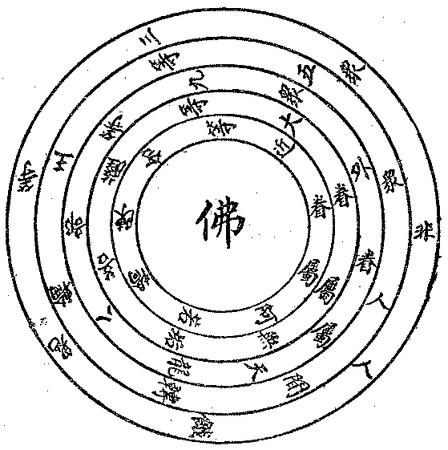



举类曰大比丘众，标数曰三万二千人，明位曰皆是阿罗汉。阿罗汉者，此云应，应受人间天上之供养故，应不再受三界之生死故。心善解脱下，是赞阿罗汉之德，经中文意甚详，今不细述。总之、此心善解脱者，即诸声闻众从其因地起修，至阿罗汉地所成之果德也。具寿阿若憍陈如下，列声闻众之名。具寿者，即是长老之义，如弥陀经中之「长老舍利弗」，亦是此具寿义，因齿德俱长，故名具寿或长老也。阿若憍陈如者，阿若此云解、是名，憍陈如此云火器、是姓。阿史彼室多，此云马胜。摩诃摩那，即摩诃男。波帝利迦，佛之堂弟，皆佛成道已最初得度者也。罗波多即离婆多，此云星宿。摩诃迦毗那即劫宾那，此云房宿。真提那即金毗罗，此云威如王。微妙臂梵云婆修𬑟，此云善臂。餘皆常途所知，不复一一细述。有学阿难陀等者，有学对无学而言，无学是诸漏已尽，所作已办，不受后有者，而此须陀洹等，尤须修习方堪究竟，故名有学。此有学中，因阿难陀多闻第一，故举之为上首，以代表一切有学声闻众也。各与若干下，总结声闻众之有学无学三万二千人，各与其眷属俱来佛所，面礼佛足，退坐一面也。



己二　大眷属



复有菩萨摩诃萨八万四千人俱，皆是一生补处大法王子，有大威德如大龙王，百福圆满身光照曜，犹如千日破诸昏暗，智慧澄彻逾於大海，了达诸佛秘密境界，然大法炬引导众生，於生死海作大船师，怜愍众生犹如赤子，於一切时恒施安乐，名称普闻十方世界，自在游戏微妙神通，已能善达诸总持门，具四无碍辩才自在，已得圆满大愿自在，妙善成就事业自在，已能善入三昧自在，具足圆满福德自在，常为众生不请之友，经无量劫勤修六度，历事诸佛，不住涅槃，断诸烦恼，讲说妙法，无量世界化利群生，制诸外道，摧伏邪心，离断常因令生正见，而无往来动摇之相，非严而严十方佛土，不说而说妙理寂然，住无所住度人天众，无所不受广大法乐，披精进甲、执智慧剑，破魔军众而击法鼓，身恒遍坐一切道场，吹大法螺觉悟群品，一切有情悉蒙利益，闻名见身无空过者，具三达智，悟三世法，善知众生诸根利钝，应病与药，无复疑惑，布大法云，澍甘露雨，转不退转智印法轮，闭生死狱，开涅槃门，发弘誓愿，尽未来际度脱群生，此诸菩萨不久当得阿耨多罗三藐三菩提。其名曰：无垢菩萨，弥勒菩萨，狮子吼菩萨，妙吉祥菩萨，维摩诘菩萨，观自在菩萨，得大势菩萨，金刚藏王菩萨，地藏王菩萨，虚空藏王菩萨，陀罗尼自在王菩萨，三昧自在王菩萨，妙高山王菩萨，大海深王菩萨，妙辩严王菩萨，欢喜高王菩萨，大神变王菩萨，法自在王菩萨，清净雨王菩萨，药王菩萨，药上菩萨，疗烦恼病菩萨，宝山菩萨，宝财菩萨，宝上菩萨，宝德菩萨，宝藏菩萨，宝积菩萨，宝手菩萨，宝印手菩萨，宝光菩萨，宝施菩萨，宝幢菩萨，大宝幢菩萨，宝雨菩萨，宝达菩萨，宝杖菩萨，宝髻菩萨，宝吉祥菩萨，宝自在菩萨，旃檀香菩萨，大宝炬菩萨，大宝严菩萨，日光菩萨，月光菩萨，星光菩萨，火光菩萨，电光菩萨，能念慧菩萨，破魔菩萨，胜魔菩萨，常精进菩萨，不休息菩萨，不断大愿菩萨，大名称菩萨，无碍辩才菩萨，无碍转法轮菩萨：如是无垢菩萨摩诃萨等各与若干百千眷属俱。



此列菩萨众，即是大眷属众也。此段叙述次第，和前文声闻众无异，亦是先赞德而后列名也。八万四千者，是标其总数，因印度之习惯，凡言数目多者，皆言八万四千，如中国常言万物等，故此数目，乃举其在会菩萨众之多，非决定为八万四千也。菩萨者，具足称为菩提萨埵。菩提此云觉，萨埵此云有情，即是上求正遍觉知之佛果而下化一切有情也。此中赞德之词，义皆可知。披精进甲至而击法鼓，谓菩萨度诸众生，无生不度，菩萨修学法门，亦是无法不学，所谓难忍能忍，难行能行，不畏疲劳也。不久当得阿耨多罗三藐三菩提者，在此法会诸菩萨众，皆是已证十地，位居补处，如弥勒、观音等，所以不久即得无上正等觉也。且此不久当得，亦即以此补处菩萨代表十地，以及地前一切信、住、行、向之诸菩萨众也。无垢菩萨下，即列菩萨之名。无垢菩萨者，即华严经中之普贤菩萨，可为一切菩萨之总称。弥勒此云慈氏，是菩萨之姓，阿逸多此云无能胜，即娑婆世界次补佛位之菩萨也。狮子吼是从喻列名，喻此菩萨说法音声与福德智慧，如狮子大吼百兽生惊也。妙吉祥即文殊师利。维摩诘即净名居士。观自在即观世音。得大势即大势至菩萨。其次诸菩萨众，皆各依其德以列名也。如是无垢菩萨等者，即是菩萨众中以无垢菩萨而为上首，以无垢菩萨代表一切也。



以上所举菩萨，皆是已证补处之位，行、愿、悲、智、功德无量，所以吾人若能诚心敬诵一遍，则大获福德智慧也。



戊二　凡众



己一　天龙八部



庚一　天众



辛一　欲界天众



复有亿万六欲天子，其名曰：善住天子，威德天子，普光天子，清净慧天子，吉祥天子，大吉祥天子，自在天子，大自在天子，日光天子，月光天子，如是等天子。释提桓因而为上首。悉皆爱乐大乘妙法，愿随奉事三世如来，入不思议秘密境界，庄严诸佛众会道场；各与若干百千眷属俱。



上列圣众，皆先赞德相而后列名，至此即先列名而后赞德。释提桓因而为上首者，释提桓因此云能天主，居须弥山顶，为三十三天之主，所以标此为上首也。悉皆爱乐下，即赞诸天之德，并标明求法之诚心，以及诸天众赴法会时之盛况也。



辛二　色界天众



复有恒河沙色界天子，其名曰：大光普照天子，无垢庄严天子，神通游戏天子，三昧自在天子，陀罗尼自在天子，大那罗延天子，圆满上愿天子，无碍辩才天子，吉祥福慧天子，常发大愿天子，如是等天子光明大梵天王而为上首。悉皆具足三昧神通，乐说辩才；历事诸佛，三世如来菩提树下坐金刚座破魔军已证菩提时，遍至众会，皆於最初劝请如来转妙法轮，开甘露门，度人天众；善悟诸佛秘密意趣，於大菩提不复退转；各与若干百千眷属俱。



此亦先列其名。色界天有十八梵天。梵者，即寂静清净义，离下界之散乱淫欲故。此中光明大梵天王即初禅大梵天，故为上首也。悉皆具足下，赞色界天众之德。然此色界天众皆不离於静虑，所以具足神通。此梵天诸众；每於十方诸佛成道之时，皆请诸佛转正法轮，度脱众生。所以此梵天众，悉皆具足三昧神通，辩才无碍，而能深入菩提密藏，破魔军也。



庚二　龙众



复有四万八千诸大龙王：摩那斯龙王，德叉迦龙王，难陀龙王，跋难陀龙王，阿耨达池龙王，大金面龙王，如意宝珠龙王，雨妙珍宝龙王，常澍甘雨龙王，有大威德龙王，彊力自在龙王，如是等龙王娑竭罗龙王而为上首。悉皆爱乐大乘妙法，发弘誓愿恭敬护持；各与若干百千眷属俱。



阿耨达，此云无热恼，即永清凉义也。娑竭罗，即此咸海之龙王，故代表一切龙众也。悉皆乐说下，赞叹龙众请法之诚心，亦是赞叹龙众之功德也。因龙众有大势力故，於佛法之恭敬护持，较他部众尤为热烈故。所以，法华会上有文殊菩萨入龙宫为龙众说法；佛灭七百年间，印度外小正盛，大法湮没，有龙树菩萨遍觅大乘经典终不可得，后得大龙菩萨导入海中，遍览龙藏，而华严经等始流传於世，此即龙众护持佛法之力也。



庚三　药叉众



复有五万八千诸药叉神：大师子王药叉神，转轮光照药叉神，妙那罗延药叉神，甚可怖畏药叉神，莲华光色药叉神；诸根美妙药叉神，外护正法药叉神，供养三宝药叉神，雨众珍宝药叉神，摩尼钵罗药叉神；如是等诸药叉神僧慎尔邪药叉神而为上首。悉皆具足难思智光、难思智炬、难思智行、难思智聚，而为众生制伏恶鬼使得安乐，能延福智，守护大乘令不断绝；各与若干百千眷属俱。



药叉、亦名夜叉，此云捷疾，亦云勇健，能於虚空飞行自在故。此药叉神即金刚神等，护法之众也。而此众中，以僧慎尔邪药叉神而为上首。悉皆具足下，赞药叉神之德力，具足不可思议智光智炬，破一切恶鬼而使众生得其安乐，增长福慧等，以守护大乘而为义务也。此药叉众中亦有百千药叉众眷属俱也。



庚四　乾闼婆众



复有八万九千乾闼婆王：顶上宝冠乾闼婆王，普放光明乾闼婆王，金刚宝幢乾闼婆王，妙音清净乾闼婆王，遍至众会乾闼婆王，普现诸方乾闼婆王，爱乐大乘乾闼婆王，转不退轮乾闼婆王，如是等乾闼婆王诸根清净乾闼婆王而为上首。皆於大乘深生爱敬，利乐众生，恒无懈倦；各与若干百千眷属俱。



乾闼婆、此云寻香，谓常寻香气以资其身，或其身即出於香，故又名为寻香寻。此众以诸根清净而为上首。皆於大乘下，即叙其功德也。



庚五　阿修罗众



复有千亿阿修罗王：罗睺罗阿修罗王，毗摩质多罗阿修罗王，出现威德阿修罗王，大坚固力阿修罗王，美妙音声阿修罗王，光明遍照阿修罗王，斗战恒胜阿修罗王，善巧幻化阿修罗王，如是等阿修罗王广大妙辩阿修罗王而为上首。善能修习，离诸我慢，受持大乘，尊重三宝；各与若干百千眷属俱。



阿修罗，此云非天，以其无天德而好斗争故。此众中以广大妙辩而为上首。善能修习下，以阿修罗本是我慢最大，而此众等以善心力故，息一切我慢、修一切善法，受持大乘、尊重三宝，故为外眷属而俱来佛所。



庚六　迦楼那众



复有五亿迦楼罗王：宝髻迦楼罗王，金刚净光迦楼罗王，速疾如风迦楼罗王，虚空净慧迦楼罗王，妙身广大迦楼罗王，心不退转迦楼罗王，广目清净迦楼罗王，大腹饱满迦楼罗王，有大威德迦楼罗王，智慧光明迦楼罗王，如是等迦楼罗王宝光迦楼罗王而为上首。悉皆成就不起法忍，善获饶益一切众生；各与若干百千眷属俱。



迦楼那，此云妙翅鸟，翅有五色光彩，具足一切神通故。悉皆成就以下，赞其德也。法忍者，对於诸法实相深能忍可了知，饶益一切有情也。



庚七　紧那罗众



复有九亿紧那罗王：动地紧那罗王，妙宝华幢紧那罗王，宝树光明紧那罗王，善法光明紧那罗王，最胜庄严紧那罗王，火法光明紧那罗王。受持妙法紧那罗王，妙宝严饰紧那罗王，成就妙观紧那罗王，如是等紧那罗王悦意乐声紧那罗王而为上首。皆悉具於清净妙慧，身心快乐，自在游戏；各与若干百千眷属俱。



紧那罗，此云疑人，因头目手足皆与人同，而头上又多生两角，成为是人非人之形状，故名疑人也。皆悉具於下，赞其德也。



庚八　摩睺罗伽众



复有九万八千摩睺罗伽王：妙髻摩睺罗伽王，具大威德摩睺罗伽王，庄严宝髻摩睺罗伽王，净眼微妙摩睺罗伽王，光明宝幢摩睺罗伽王，师子胸臆摩睺罗伽王，如山不动摩睺罗伽王，可爱光明摩睺罗伽王，如是等摩睺罗伽王游戏神通摩睺罗伽王而为上首。已能修习善巧方便，令诸众生永离爱缠；各与若干百千眷属俱。



摩睺罗伽，此云腹行，即蛇神等类也。已能修习下，即赞其对於一切众生使离诸烦恼之缠缚，而得法自在也。



以上九众，乃是释迦世尊法会之外护者，即使一切魔外等不能破坏佛法，而使佛法常住世间，故名为外眷属。



己二　人非人等众



庚一　人众



辛一　转轮王众



复有他方万亿国土转轮圣王：金轮转轮圣王，银轮转轮圣王，铜轮转轮圣王，铁轮转轮圣王，及与七宝千子眷属；庄严无量象马车乘，无数宝幢，悬大宝旛，华鬘、宝盖、缯彩、白拂，种种珍奇妙宝璎珞，涂香、末香、和合万种微妙殊香，各执无价众宝香罏，烧大宝香供养世尊，以妙言词称赞如来甚深智海。而白佛言：『世尊！我今不求三界有漏人天果报，唯求出世阿耨多罗三藐三菩提！所以者何？三界之中，人天福乐虽处尊位，先世福尽还生恶趣，受无量苦，谁有智者乐世间乐』！作是语已，一心合掌，各与若干百千眷属俱。



以下经文又一变，即是从列名赞德外，而复添诸恭敬供养，或白佛言等句。他方国土者，此转轮王众非指此南阎浮提，即十方法界一切国土中一切转轮王众皆来赴此法会，故名他方国土也。转轮王者，即有大威德，有福力之人主。此王有四种：即金、银、铜．铁四轮王；铁轮王其威德福力只能王一天下，铜轮王王两天下，银轮王王三天下，金轮王其威德福力最为殊胜，故王四天下也。庄严无量下，即叙述诸转轮王各持无量众宝香具，种种象马车乘幢旛宝盖，来供养佛。所以从庄严无量至供养世尊，皆是叙明众宝庄严具也。以妙言词称赞以下，即是说明各转轮王请佛说法，和恭敬供养世尊之理由，以及了知世法无常，三界是苦，而求无上大菩提也。作是语已，一心合掌，默然求佛说法也。



辛二　人王众



复有十六诸大国王，迦毗罗国净饭大王，摩伽陀国频婆娑罗王，波罗柰国迦斯大王，有于陀国于阐大王，娑罗国主迦毗那王，如是等十六大王及诸小王，舍卫国主波斯匿王名曰月光而为上首。悉皆具足福智神通，有大威德，如转轮王。一切怨敌自然降伏，人民炽盛，国土丰乐，无量佛所种诸善根，常为诸佛之所护念。庄严劫中千佛出现，如是诸王常为施主；贤劫之中千佛出现，如是诸王亦为施主；於当来世星宿劫中千佛出现，当为施主；乃至未来一切诸佛出现世间，如是诸王以本愿力，常行檀施饶益有情，随宜善入诸方便门。虽作国王不贪世乐，厌离生死，修解脱因，勤求佛道爱乐大乘，化利群生不著诸相，绍三宝种使不断绝。为听法故，供养如来，广修珍膳，严持香华，来至佛所，各与一万二万乃至千万诸眷属俱。



悉皆具足下，即赞诸王之德，因此诸王虽为人中之王，但亦具福德、智慧、神通，饶益无量诸有情类。於当来世中星宿劫千佛出世时亦为施主，布施一切有情。所以此王虽居王位而不贪世乐，厌离生死、常修一切解脱法因，供养如来，绍隆三宝也。



辛三　王夫人众



复有十六大国王夫人：韦提希夫人，妙胜鬘夫人，甚可爱乐夫人，三界无比夫人，福报光明夫人，如意宝光夫人，末利夫人，妙德夫人，如是等夫人殊胜妙颜夫人而为上首。已能善入无量正定，为度众生示现女身，以三解脱修习其心，有大智慧，福德圆满，无缘大慈，无碍大悲，怜愍众生犹如赤子，以本愿力得值世尊，为欲听法来诣佛所，瞻仰尊颜，目不暂舍。以无量种人中上供奉献世尊，及以无数妙宝璎珞供养如来，各与若干百千眷属俱。



复有十六下，列王夫人之名。已能善入下，赞王夫人之德。此王夫人等，实从大慈悲心示现女身，度脱一切有情，怜愍众生犹如赤子也；所以此王夫人已具三解脱门，已能善入无量正定，而今以本愿力来诣佛所，供养如来，听闻正法也。



辛四　僧俗人民众



复有百千无央数人：比丘、比丘尼、优婆塞、优婆夷、诸婆罗门、刹帝利、薜舍，戌达罗，及诸国界长者、居士一切人民。是诸大众发清净信，起殷重心，宿种善根，生值佛法，为求出世，起难遭想来诣佛所，一心合掌，各与若干百千眷属俱。



僧俗者，以上所明僧众乃是圣众中之圣僧，而今所说之僧众，乃指人世上之未证道果未得菩提分法者而言，故与上别。婆罗门、刹帝利以下，即是人民众也。婆罗门者，印度人民阶级分为四种，此即第一之教士阶级。刹帝利，为帝王阶级。薜舍，为平民商工农人阶级。戌达罗，为印度最下之仆役阶级。此四阶级之高下，在印度非常严格，但在释迦世尊之说法会上，即无阶级之高下，皆来赴此法会，以显世尊博爱平等之大悲心也。是诸大众下，即赞叹诸僧俗人民发心供养，求法之心切也。



辛五　外道众



复有无数诸外道众：苦行外道，多闻外道，世智外道，乐远离外道，路伽耶陀外道，路伽耶治迦你外道而为上首。成就五通，飞行自在，发希有心，为听法故来诣佛所，各与若干百千眷属俱。



复有无数下，此即举名也。外道者，道即道理，外於吾人所修所行真正之道理，各执一不正之道，故名外道也。成就五通下，赞外道之德。因此诸外道，行虽外於道理，但已具足五种神通——无漏尽通，而发希有之想，来供养佛听求正法也。



庚二　非人众



辛一　鬼众



复有无量无数非人饿鬼，谓：无财鬼，食人吐鬼，恼众生鬼，食洟唾鬼，食不饱鬼，毗舍阇鬼，臭极臭鬼，食粪秽鬼，食人胎鬼，食生子鬼，食不净鬼，生吉祥鬼，如是诸鬼毗卢陀伽大鬼神王而为上首。舍离毒心，归佛法僧，悉皆卫护如来正法。为听法故来诣佛所，五体投地，渴仰世尊，各与若干百千眷属俱。



以下非人众中，即是三恶道众。其他一切经论皆不别出，本经立之，即显本经被机之普遍也。毗舍阇鬼，即是啖精气鬼。舍离毒心下，即赞鬼德。因众毒心极其猛利，逼一切众生受苦，使一切众生不安，乃为鬼之特长；而今此等鬼众、舍离毒心，归佛法僧，护持三宝，所以发希有想来诣佛所，一心渴仰听佛说法也。



辛二　畜生众



复有无量无数禽兽诸王：命命鸟王，鹦鹉鸟王，及师子王，象王，鹿王，如是一切诸禽兽王金色师子王而为上首。悉皆归命如来大师，为欲听法来诣佛所，各随愿力供养世尊。而白佛言：『惟愿如来哀受我等微少供养！永离三涂恶业种子，得受人天福乐果报，开阐大乘甘露法门，速断愚痴，当得解脱』！时诸鸟王作是语已，一心合掌，瞻仰如来，各与若干百千眷属俱。



畜生乘，即是禽兽众。命命鸟、即是一身两头之鸟。悉皆归命下，是叙畜生众请佛说法，供养如来，求人天善果，阐大乘法门，速断愚痴出三恶道，当得解脱等等之情形也。



辛三　地狱众



复有百千琰魔罗王，与无央数诸大罗刹，种种形类，及诸恶王，幽冥官属，校计罪福狱吏刑司，承佛威力，舍离恶心，与琰魔罗王同来听法。而白佛言：『一切众生，以愚痴故贪五欲乐，造五逆罪，入诸地狱，轮转无穷，自业所因受大苦恼，如世蚕茧自为萦缠！惟愿如来雨大法雨灭地狱火，施清凉风，开解脱门，闭三恶趣』！时琰魔罗王作是语已，种种珍宝供养如来，一心恭敬绕百千匝，与若干百千眷属俱，各礼佛足退坐一面。



地狱众，即是琰摩罗众，琰摩罗，此云责罚。较计罪福下，叙地狱众为度生之热心和求法之恳切，以及说明一切众生造业受苦，皆自缠自缚也。各礼佛足下，即叙述赴法会之情形。



丙二　结成法会



尔时、世尊坐宝莲华师子座上，其师子座色绀琉璃，种种珍奇间错严饰，玻璃宝珠以为其茎，紫磨黄金作莲华叶，其莲华台以摩尼宝而为华须，八万四千阎浮檀金大宝莲华而为眷属；为诸大众前后围绕，供养恭敬，尊重赞叹。



以下，即结法会之情形也。尔时者，即当诸众围绕之时。坐莲华师子座下，标明世尊为法会之主，为人天之所恭敬供养，以及诸声闻菩萨等眷属之围绕，於是共成洋洋溢溢庄严殊胜之法会也。



证信序文，至此已竟。但今约而言之，即是若欲观想此法会之殊胜，可先读经文一遍，而后随文入观：化作曼怛啰之形像，在此曼怛啰中——图表见前，先以佛为中心，其次诸声闻等内外眷属围绕，此即第一步之观想。若再进步言之，即可离去经文，各各皆以自身是佛而为中心，至其他大众互相围绕也。例如在此法会之中，若人人皆作此观想，即成自身是佛，而他人围绕；或则他人是佛自己和大众围绕也。然此围绕於佛，则摄自归他；若自身是佛，则摄他归自，所以在会大众若能作如是观想，即同在灵山一会亲见诸圣众无异也。



上面所讲的证信序，即证明於佛住处，由很多的人组织的法会，大众所同闻同见的，而可确信此经是佛所说的，所以应流通於世。以下是发起序，为此经发起之特别的因缘。



------



### 乙二　发起序



丙一　如来示相



丁一　处众入定



时薄伽梵於师子座结跏趺坐，威仪殊特，犹如四宝苏迷卢山处於大海，自然回出；如百千日照曜虚空，放无量光破诸昏暗；亦如俱胝圆满月轮独处众星，放清凉光，明朗世界。入有顶天极善三昧，名心璎珞宝庄严王，住此定已，身心不动。



薄伽梵者，是佛德号之一；梵语、因含多义故，没有相当的名词可以代替它的意义。古时佛教的经典翻来中国，有很多梵语仍保存其原音的，唐玄奘大师曾说有五种不翻的规范：一、秘密不翻，如陀罗尼；二、含多义不翻，如此中之薄伽梵，因具有六义的缘故：三、此土向来没有的名词，如阎浮提；四、顺於古例不翻，如阿耨、菩提，并不是不可翻，因摩腾以来就常存有梵音；五、为生善不翻，如般若，有人闻般若二字则生信念，在中国虽可译为智慧，而人对之或生轻浅意。由此、薄伽梵不翻的理由，也就明白了。其六义中之第六义为尊贵，故或译作世尊。



师子座、乃从譬喻得名，凡是佛说法的法座或是佛所坐过的，总名师子座。因师子乃兽中之王，一吼能使百兽惊恐，大地振动；而如来为众生说法之师，其声如大师子吼，能感动法界一切有情，觉醒转来与佛同化，故以之为喻。佛在座上结跏趺坐，威仪特殊，格外表现一种庄严。跏趺而坐，即是盘腿而坐，有单跏趺、双跏趺的差别。苏迷卢山即妙高山，是四宝所成的。此山处在大海之中，超乎万物之上，佛亦如是；这是说明佛在大众中现象的一个比例。又如百千之日光，这光从真如性海的佛心所放出来的，所以能破除一切黑暗。俱胝者，即亿数。此有顶天，不指非想非非想天，而指色界顶之色究竟天。三昧、即三摩地，即定。因为定有种种功德相，所以有种种不同的名称。此名心璎珞宝庄严王者，佛心与众生心平等平等，然佛心无量无边功德庄严之相，悉皆圆满而得自在，故名璎珞宝庄严王也。身心不动，是一种入定的状态。



丁二　诸天兴供



时无色界一切天子，雨无量种微妙华香，於虚空中如云而下。



从文意看起来，此段可分无色界、色界、欲界、三类。先看无色界天是怎样的来兴供？这些天子，以种种微妙花香来供养，虽然他们没有根身器界，没有业果的色法，但可依定力所现出的色法为供养。在我们平常的肉眼看不见，唯佛菩萨等才可以明见其景况。



色界诸天十八梵王，雨众杂色无数天华，百千万种梵天妙香，遍满虚空如云而下。



此色界诸天者，共有十八天，初禅有三天：梵辅天、梵众天、大梵天。二禅三天：少光天、无量光天、光音天。三禅三天：少净天、无量净天、遍净天。四禅有九天：无云天、福生天、广果天、无想天、无烦天、无热天、善见天、善现天、色究竟天。照这样看来，初二三禅各有三天，第四禅有九天，所以共有十八天。每天有一王，所以此经谓有十八梵王，以种种华香遍满虚空来供养佛。



六欲诸天及天子众，以天福力雨种种华：优钵罗华，波头摩华，拘物头华，芬陀利华，瞻卜迦华，阿提目多华，波利尸迦华，苏摩那华，曼陀罗华，摩诃曼陀罗华，曼殊沙华，摩诃曼殊沙华，於虚空中缤纷乱坠而供养佛，及众法宝。又雨天上无价宝香，其香如云作百宝色，以天神力香气遍满此诸世界，供养大会。



此六欲诸天及诸天子，并不必以制造出来的种种东西来供养佛，只要以自己的福力就可以化现香花等而供养佛。所谓优钵罗华，波头摩华，拘物头华，芬陀利华，这四种是青、赤、黄、白的莲花。瞻卜迦华，名金色华。阿提目多华，名苣蕂花，此花可取香油。波利尸迦花，名雨时华，或夏生花，以在雨时夏时方生故。苏摩那花，此花之色、一天有黄白黑三种颜色变化，花甚香，树高三四尺，四垂似盖。四分律疏云：「苏蔓那花，末利花相似，广州亦有」。曼陀罗华，此云适意，见者无不心悦，又云悦意花。摩诃曼陀罗华，摩诃者大也，即大适意花。曼殊沙华译为赤团花。摩诃曼殊沙华，译为大赤团花。六欲诸天子不但有如是种种花来供养佛及法宝，而且还有无价的宝香来供养。



丁三　现通益物



尔时、世尊从三昧起，即於本座复入师子奋迅三昧，现大神通，令此千三千大千世界六种震动。谓：动，极动，遍极动；涌，极涌，遍极涌；振，极振，遍极振；击，极击，遍极击；吼，极吼，遍极吼，爆，极爆，遍极爆。又此世界，东涌西没，西涌东没，南涌北没，北涌南没，中涌边没，边涌中没。其地严净，悉皆柔软，滋长卉木，利益群生。令三千界无有地狱、饿鬼、畜生，及餘无暇恶趣众生皆得离苦；舍此身已，生於人道及六欲天，皆识宿命，欢喜踊跃，同诣佛所，以殷重心，顶礼佛足，持诸珍宝无数璎珞，悟三轮空以报佛恩。



这里的情形与前面大不相同了。上面是住於寂静，此则由定而起，依坐本座而复入师子奋迅三昧而现大神通，即是由静而动。由此一动，使三千大千世界有六种震动，所谓：动、极动、遍极动，涌、极涌、遍极涌，振、极振，遍极振，击、极击、遍极击，吼、极吼、遍极吼，爆、极爆、遍极爆，三六有十八种。不但一处动，普遍皆在动。此震动之相是微妙不可思议的，非人间可能明瞭。不过因此众生能闻法，离苦得乐，而且亲身供养。观所供养物皆是空的，唯识所现的。因现神通之故，能使大地众生皆有利益，皆得欢喜。



丁四　放光明相



戊一　胸间放光



尔时、如来於胸臆间及诸毛孔放大光明，名诸菩萨游戏神通，使不退转阿耨多罗三藐三菩提，其光明色如阎浮檀金。



所谓放光现相，正明心地观相。「胸臆」，即表心地，金色光即象徵心之自体的真实性。因为一切法以心为主，虽法有别而心不二，其究竟真实性即所谓唯识实性。诸菩萨游戏神通而得不退转无上正等正觉，也即因此光而成。胜金之色百炼而不变坏，真心亦历万法而不变，故金色光即是无分别根本智光；而此无分别根本智光，也即是心地观的妙观察智光。诸法根本即真实性相，亦即以此真实性相为根本心地观。



戊二　光中现相



己一　大千世界



此金色光普照三千大千世界及餘他界，乃至百亿妙高山王，一切雪山、香山、黑山、金山、宝山、及弥楼山、大弥楼山、目真邻陀山、摩诃目真邻陀山、小铁围山、大铁围山，江河大海、流泉浴池，及以百亿四大洲界日月星辰，天宫、龙宫、诸尊神宫，并诸国邑，王宫聚落，琰魔罗界所有一切八寒、八热诸地狱中罪业众生受苦之相，乃至十方畜生、饿鬼受苦之相，一切世间五趣众生受苦乐相，如是皆现於此金色大光明中。



上来於金色光已大体说明了。从如来胸臆中所放出来的光，以金色显示不生不灭的真实性，而又能普照三千大千世界所有的一切山、河、江、海、日、月、星、辰、天宫、龙宫，以及一切地狱、畜生、饿鬼、五趣众生受的苦乐之相，而此一一诸相无不皆现此金色光明中。在一大千世界之中有百亿妙高山王，以虚空中的世界很多，决不能以吾人眼所看见的判断为有无。如天文学上说，火星上也可能有人。



己二　本生行相



庚一　总



又此光中影现菩萨修行佛道种种相貌：释迦菩萨於往昔时作光明王，最初发於阿耨多罗三藐三菩提心，乃至菩提树下得成佛道，娑罗林中入於涅槃，於其中间三僧企耶百万劫中所有一切慈悲喜舍，八万四千波罗密。



此本生行相即是叙说佛的过去、现在、未来一一之事，皆显现於金色光中，此正本经名本生之所在。这是总说其大概。



庚二　别



辛一　过去



乃於过去作金轮王，王四天下，尽大海际，人民炽盛，国土丰乐，正法化世经无量劫，一切珍宝充满国界，时彼轮王观诸世间皆悉无常，厌五欲乐，舍轮王位出家学道；或於大国为王爱子，弃舍身命投於饿虎；或作尸毗王割身救鸽；或救孕鹿，舍鹿王身；或於雪山为求半偈而舍全身。



这是叙说佛过去作金轮王最初发心的事，因为观见众生受种种苦恼，凡有利益众生之事无不心从。所以舍离一切王位财产尽布施於他人，甚至弃舍身命投於饿虎，乃至割自身的肉去救鸽，或救孕鹿，这无非是要求一句半偈的法义而得到自他的无上安乐，过去是如此，遍一切时一切处无不如此。



辛二　现在



或现受生於净饭王家，舍后宫六万婇女及舍种种上妙妓乐，逾城出家；六年苦行日食麻麦，降诸外道；菩提树下破魔军已，得阿耨多罗三藐三菩提。有如是等百千恒沙难思行愿，一切相貌悉皆顿现於此金色大光明中。



此中叙说佛在当时降生成佛之相。他虽为王子而不爱所享受的富贵，舍离种种快乐去雪山修苦行，有六年之久。本来修学佛道，不应以苦为可得道，要不苦不乐之中道合理之行。因印度当时都以苦行为修道，故佛亦示现如此。但后来终舍苦行，在菩提树下得无上菩提果。所谓菩提树者，非以树为菩提，因佛在此树下得菩提道果，故名曰菩提树。



辛三　未来



又此光中影现如来不可思议八大宝塔：拘娑罗国净饭王宫，生处宝塔；摩伽陀国伽耶城边，菩提树下成佛宝塔；波罗奈国鹿野园中，初转法轮度人宝塔；舍卫国中给孤独园，与诸外道六月论议，得一切智声名宝塔；安达罗国曲女城边，升忉利天为母说法，共梵天王及天帝释十二万众，从三十三天现三道宝阶下阎浮时神异宝塔；摩竭陀国王舍城边耆阇崛山，说大般若、法华一乘心地经等大乘宝塔；毗舍离国庵罗卫林，维摩长者不可思议现疾宝塔；拘尸那国跋提河边娑罗林中，圆寂宝塔。如是八塔，大圣化仪，人天有情所归依处，供养恭敬，为成佛因。



如来本生的行相，不但过去现在可以显现在金色光中，而未来的诸行相亦皆在此金色光中显现出来了。此中是示现佛灭度后所建立的八大纪念宝塔，作为人天有情所归依处，使个个来恭敬供养，正所谓为引凡入圣的标准。



庚三　结



如是音声及诸影像，而於三世难思议事，悉皆影现大光明中。



如来本生行相所有的过去、现在、未来一切不可思议事，皆於此金色光中一一表现出来了。照这样看来，可以明白此金色光相为一摄一切一切摄一的典型。不但释尊三世不可思议的诸事皆由此金色光表现出来，而且十方法界诸佛菩萨的法会相乃至三千大千世界情与无情的受苦乐相，无不一一表现出来。故此不但可作为研究法义之理论上的说明，而且很可作为摄境归心的观想。应先观内无身心、外无器界种种的差别，一切皆空了，而遍虚空界现起金色光相；光中先现大千世界情非情相，於一切众生上生起大悲心，以大悲心为依止而起菩提心，菩提心所起方便即释迦本生相。若个个众生都从大悲菩提现起本生相，即个个众生皆从菩萨行乃至成佛，於是光光相遍，一切摄一一摄一切，即是十方界佛法僧相。能作这样的观想，那观想便即是心地观。若有修习此观者，则可通达本生心地观的意义。佛即我，我即佛，佛与众生平等无差别。



己三　十方佛会



又十方界三世诸佛，及大菩萨道场众会，神通变化希有之事，及诸如来所说妙法，皆如响应，於此金色大光明中无不见闻。



此金色光，不但於如来三世不可思议诸事都一一表现出来，而且十方三世诸佛以及诸大菩萨的法会道场和神通变化希有之事，在此金色光相之中亦无不见闻。如一室有千光，相摄相入然。在这里作有一个「金色光相曼怛啰」，表列於下：



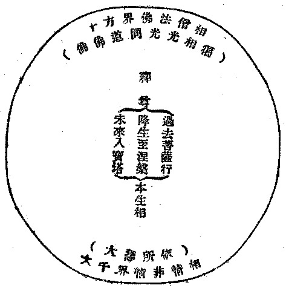



戊三　光瑞利益



一切众生遇此光明，见彼瑞相，皆发无等等阿耨多罗三藐三菩提心。



凡在法会的大众，於此金色光中皆见如来三世一切相好庄严的瑞相，於是都发起与无等真如相等的无上正等正觉之心，这是金色光相所生起的利益。



丙二　会众仰法



时诸大众睹佛神力不可思议，叹未曾有。各相谓言：『如来今日入於三昧，放大光明照十方界，得见如来往昔所有难思议事，调伏恶世邪见众生，令生信解趣向菩提。希有如来！能为一切世间之父，无量劫中难可得见，我等累劫修诸行愿，得遇三界人天大师。惟愿慈尊哀愍世间，从定而起，说甚深法，示教利喜』。一切众生作是语已，瞻仰尊颜，默然而住。



会众仰法者，是由於如来放光现相显出不可思议之神通功德，及佛往昔无数大劫之菩提胜因，并现在出家、苦行、降魔、入涅槃与为未来建立宝塔等无量诸事。众生见此种种诸相，咸皆想慕佛有如是难思议之法力，调伏一切恶见众生，令其转生正见趋向佛果菩提，实是一切世间之父，能拔众生之苦而与以安乐。我等累劫修因，始得遇导师。皆起难遭之想而渴仰瞻望於如来，以冀其转大法轮利益众生。



丙三　师吼赞请



丁一　长行



戊一　叙师吼德



尔时、会中有一菩萨名师子吼，三僧企耶修行福智，於贤劫中次补佛处，受灌顶位作大法王。



尔时者，即大众瞻仰如来默然之时。狮子吼者，狮子乃兽中之王，其发吼声百兽惊恐，此喻菩萨之说法言音，能摧伏外道天魔令其惊恐，故得名。此菩萨於无数劫来，已具足福德智慧菩提资粮，故云三僧企耶修行福智。於贤劫中至作大法王者，贤劫即是现在劫，此劫中有千佛出世。谓此菩萨已功圆因满，即於此劫中次补佛位而证无上正遍觉知之佛果菩提也。



戊二　告海会众



四向观视海会大众，发大音声，而作是言：『我於往昔无量劫中已发阿耨多罗三藐三菩提心，历事恒沙一切诸佛，曾於第一众会道场见不思议神通变化，未尝睹此金色光明影现一切菩萨行愿，及现如来种种相貌，令见三世难思议事。惟愿仁者一心合掌，瞻仰尊颜，从定而起，授甘露药除热恼病，令证法身常乐我净。是诸如来有二种法，於三昧中不复久住：一者大慈，二者大悲。依大慈故与众生乐，依大悲故拔众生苦，以是二法於无数劫熏修其心而成正觉。世间众生多诸苦恼，以是因缘，如来不久从三昧起，当为演说心地观门大乘妙法』。告诸大众：『无求一切人天福乐，速求出世阿耨多罗三藐三菩提。所以者何？今日世尊从胸臆中放金色光，所照之处皆如金色，佛所显示意趣甚深，一切世间声闻、缘觉尽思度量所不能知。汝等凡夫不观自心，是故漂流生死海中！诸佛菩萨能观心故，度生死海到於彼岸。三世如来法皆如是，放此光明，非无因缘』。



狮子吼菩萨因环观会众之渴仰如来，便向会众说明佛陀放金色光之意。因此，金色光相於佛陀在世时亦甚为希特，故大会诸众对此光相皆不知其意。狮子吼已於往昔劫中历事诸佛，发菩提心，并於往昔第一众会道场中得见此不思议之金色光相，彼时光相中亦现如来种种相貌难思议事。惟愿仁者至常乐我净者，此明狮子吼菩萨嘱诸会众至诚瞻仰世尊，世尊於不久即当起定，授以甘露之药，令证常乐我净之法身。甘露药，即是不死之药，能除众生之烦恼病。常乐我净，即是佛果涅槃之四德。如来入於三昧亦是为度众生，而其不久住於三昧则有二种因缘：一者大慈，二者大悲。悲愍众生故。即能拔众生之苦恼；慈愍众生故，即能与众生乐。佛之所以成正觉者因此二法。然众生尚在生死烦恼之中，佛因要度众生，故不能长久入於三昧，所以狮子吼菩萨能知如来不久即当从三昧起，演说心地观门大乘妙法。令诸众生直求阿耨多罗三藐三菩提，不令求人天有为福乐。由於此次佛陀所放之金色光相，与昔日说人天乘法所放之光异，故此次所显示之光相意趣甚深。又此光相即前次所明之曼怛啰，不特一切世间所不能知，即出世之声闻、缘觉、尽其寻伺度量亦不能知。汝等凡夫至到於彼岸者，凡夫不观自心，不明瞭真心即是菩提，故常漂没生死大海。诸菩萨如来因能观察自心，能明了自心之全体大用，能了知直心即是菩提，所以能至於彼岸，亦能度众生同到彼岸。三世如来至非无因缘者，十方三世一切诸佛所说之法，悉皆如是，所谓「佛佛道同」。凡世间一切诸法，不是孤立而起，必皆有其因缘；今佛放此光明，亦非无缘者也。



戊三　悦众会意



是诸众会闻大士言，心怀踊跃，得未曾有。



法会大众得闻狮子吼菩萨言，知此日如来放此金色光相乃有大因缘者，故会众皆欢喜而踊跃也。



丁二　偈颂



戊一　赞佛



尔时、师子吼菩萨摩诃萨欲重宣此义，而说偈言：『敬礼天人大觉尊，恒沙福智皆圆满，金光百福庄严相，发起众生爱乐心，超过三界独居尊，功德最胜无伦匹。普用神通自在力，随所造业现其前，我以天眼观世间，一切无有如佛者！希有金容如满月，希有过於优昙华！无边福智利群生，大光普照如千日，愚痴众生长夜苦，蒙光所照悉皆除。我观如来昔所行，亲近供养无数佛，经历僧祇无量劫，无众生故趣菩提。常於生死苦海中，作大船师济群品，演说甘露真净法，令入无为解脱门。三僧祇劫度众生，勤修八万波罗密。因圆果满成正觉，住寿凝然无去来。一一相好周法界，十方诸佛相皆然。甚深境界难思议，一切人天莫能测。诸佛体用无差别，如千灯照互增明，智慧如空无有边，应物现形如水月。无边法界常寂然，如如不动等虚空。如来清净妙法身，自然具足恒沙德，周遍法界无穷尽，不生不灭无去来。法王常住妙法宫，法身光明靡不照。如来法性无罣碍，随缘普应利群生，众生各见在其前，为我宣说甘露法。随心能灭诸烦恼，人天众苦悉皆除。破有法王甚奇特，光明照曜如金山，为度众生出世间，能然法炬破昏暗。众生没在生死海，轮回五趣无出期，善逝恒为妙法船，能截爱流超彼岸。大智方便不可量，恒与众生无尽乐；能为世间大慈父，怜愍一切诸有情。如来出世甚难值，无数亿劫时一现，譬如优昙妙瑞华，一切人天所希有，於无量劫时一现，睹佛出世亦同然。是诸众生无福慧，恒处沉沦生死海，亿劫不见诸如来，随诸恶业恒受苦。我等无数百千劫，修四无量三解脱，今见大圣牟尼尊，犹如盲龟值浮木！愿於来世恒沙劫，念念不舍天人师，如影随形不暂离，昼夜勤修於种智！惟愿世尊哀愍我，常令得见大慈尊，三业无倦常奉持，愿共众生成正觉！



此赞佛中共二十一颂。从敬礼天人大觉尊，至功德最胜无伦匹之一颂半，是总明赞佛之功德。次、普用神通自在力，至一切无有如佛者之一颂，是赞佛之神通。次、希有金容如满月，希有过於优昙华之半颂，是赞佛之相好。次、无边福智利群生，至蒙光所照悉皆除之一颂，是赞佛之福德智慧如千日之普照，众生蒙其福智之光，而愚痴昏暗悉除。次、我观如来昔所行，至勤修八万波罗密之两颂半，是赞佛於往昔劫中行菩萨道，供养诸佛，度脱众生，常宣清净妙法勤修波罗密等。次、因圆果满成正觉，至十方诸佛相皆然之一颂，是赞佛之果德。次、甚深境界难思议，至如如不动等虚空之二颂，是赞佛之体用。所谓诸佛所行之境界甚深微妙，非但一切人天所不能知，即声闻缘觉菩萨亦不能知。而诸佛之体用悉皆等齐，无有差别，如一室千灯，其光互照互摄，而其智慧亦如法身之体性，遍满虚空无有边际。应机利物如月之普印於千江，虽如来之大用普应群机，然其无边法界之法身体性，亦仍寂然不动，等同虚空，即所谓用而常寂如如不动也。次、如来清净妙法身，至法身光明靡不照之一颂半，是赞佛之功德，明如来之一切功德无有穷尽，其法体上之光明，如日之舒光普被万物，如来之法身光明亦复如是。然日犹有升沉不照之时，而如来之功德宝光，於恒恒时长长时无不普照。次、如来法性无罣碍，至为我宣说甘露法之一颂，是赞佛由法身体性无罣碍故，应机现物，说法利生，亦随缘感，靡有不至。是故众生各得领受如来之甘露法味，亦各见佛而现其前，如维摩经中所谓：「佛以一音演说法，众生随类各得解」是也。次、随心能灭诸烦恼，至能截爱流超彼岸之二颂半，赞佛之大悲拔苦，能除众生昏暗。因众生轮转五趣生死无有出期，如来以微妙法船，令众生超登彼岸，截断生死之爱流。次、大智方便不可量，至怜愍一切诸有情之一颂，是赞佛之大慈与乐，善能观察众生而与以无量之乐者，如世间之慈父爱念其子然。次、如来出世甚难值，至犹如盲龟值浮木之三颂半，是赞佛之出兴於世，甚难值遇，如优钵罗华於无量时偶尔现之，而佛之出兴於世，亦复如是。然不特众生长汩没生死受诸苦果，不能值遇如来，即今我等於无量劫前勤修慈、悲、喜，舍之四无量心与空、无愿、无相之种种解脱法门，而得见如来，亦如盲龟值遇浮木。盲龟是瞎眼之龟，因无眼故不能见物，以无眼之龟於洋洋大海之中能值遇浮木，岂非甚难之事耶？今众生之汩没生死大海能得遇如来，亦复如是。次、愿於来世恒沙劫，至愿共众生成正觉之二颂，是赞佛有如上之种种功德，能润育群生，故我等今日於佛陀之前，发弘誓愿，愿生生世世常得见佛，与佛恒不舍离而修学佛道，以期与众生共成正觉，如普贤大士之常随佛学是也。



戊二　重颂



『今者三界大导师，座上跏趺入三昧，独处凝然空寂舍，身心不动如须弥，世间一切梵天魔，莫能警觉如来定。此界他方凡圣众，悉知调御住於禅，广设无边微妙供，奉献能仁最胜德。六欲诸天来供养，天华乱坠遍虚空，十善报应无价香，变化香云百宝色，遍覆人天无量众，雨杂妙宝献如来；香气氛氲三宝前，百千妓乐临空界，不鼓自鸣成妙曲，供养人中两足尊。十八梵众雨天华，及雨杂宝千万种，梵摩尼珠妙璎珞，众宝严饰天妙衣，大宝华幢悬胜旛，持以供养牟尼尊。无色界天雨宝华，其华广大如车轮，雨微细香满世界，供养三昧难思议。龙王、修罗、人非人，奉献所感珍妙宝，各以供养天中人，乐闻最胜菩提道。时薄伽梵大医王，善治世界烦恼苦；师子频伸三昧力，六种震动遍三千，以此觉悟诸有缘，於此无缘了不觉。随彼人天应可度，见佛种种诸神通，瞻仰月面牟尼尊，以净三业皆云集。如来能以无缘慈，饶益众生成胜德。胸臆放此大光明，名诸菩萨不退转。如无尽时七日现，炽然照曜放千光，世间所有诸光明，不及一佛毛孔光；无量无碍大神光。遍照十方诸佛刹，如来福智皆圆满，所放神光亦无比，其光赫弈如金色，遍照十方诸国土。大圣金光影中现，悉见世间诸色像，三千大千诸世界，所有一切诸山王，四宝所成妙高山，雪山、香山、七金山，目真邻陀、弥楼山，大铁围山、小山等，大海、江、河及浴池，无数百亿四大洲，日、月、星、辰众宝宫，天宫、龙宫、诸神宫，国邑、王宫、诸聚落，如是光中悉显现。又现如来往昔因，积功累德求佛道：如来昔在尸毗国，曾居尊位作人王，国界珍宝皆充盈，常以正法化於世，慈悲喜舍恒无倦，能舍难舍趣菩提。割身救鸽尝无悔，深心悲愍救众生。时佛往昔在凡夫，入於雪山求佛道，摄心勇猛勤精进，为求半偈舍全身；以求正法因缘故，十二劫超生死苦。昔为摩纳仙人时，布发供养然灯佛，以是精进因缘故，八劫超於生死海。昔为萨埵王子时，舍所爱身投饿虎，自利利他因缘故，十一劫超生死因。流水长者大医王，平等救护众生故，济鱼各得生天上，天雨璎珞来报恩。七日翘足赞如来，以精进故超九劫。昔为六牙白象王，其牙殊妙无能比，舍身命故投猎者，求佛无上大菩提。或作圆满福智王，施眼精进求佛道。又作金色大鹿王，舍身精进求佛道。为迦尸国慈力王，全身施与五夜叉。又作大国庄严王，以妻子施无吝惜。或为最上身菩萨，头目髓脑施众生，如是菩萨行慈悲，皆愿求证菩提道。佛昔曾作转轮王，四洲珍宝皆充满，具足千子诸眷属，十善化人百千劫，国土安隐如天宫，受五欲乐无穷尽。时彼轮王觉自身，及以世间不牢固，无想诸天八万岁，福尽还归诸恶道；犹如梦幻与泡影，亦如朝露及电光。了达三界如火宅，八苦充满难可出，未得解脱超彼岸，谁有智者乐轮回？唯有出世如来身，不生不灭常安乐。如是难行菩萨行，一切悉现金光内。又此光中现八塔，皆是众生良福田：净饭王宫生处塔，菩提树下成佛塔，鹿野园中法轮塔，给孤独园名称塔，日女城边宝堦塔。耆阇崛山般若塔，庵罗卫林维摩塔，娑罗林中圆寂塔。如是世尊八宝塔，诸天龙神常供养，金刚密迹、四天王，昼夜护持恒不离。若造八塔而供养，现身福寿自延长，增长智慧众所尊，世出世愿皆圆满。若人礼拜及心念，如是八塔不思议，二人获福等无差，速证无上菩提道。如是三世利益事，於此光中无不见。十方佛土诸菩萨，神通游戏众灵仙，万亿国土转轮王，寻此光明普云集，各以神力来供养，雨如意宝奉慈尊。诸天妓乐百千种，不鼓自然出妙音，天华乱坠满虚空，众香普熏於大会，宝幢无数诸璎珞，持以供养人中尊。



此重颂之中，共有四十三颂半，乃重颂前发起序与略颂证信序之二科文。盖重颂者，略有二义：一者、因前之长行系结经所序，会众未闻，故今狮子吼菩萨即事颂出。二者、因颂简略而易受持，故有重颂之必需。此科之文义，前已广明，今可再略明其大概。初、今者三界大导师，至莫能警觉如来定之一颂半，是明佛之处众入定，结跏趺坐，身心如须弥之安隐，非世间一切魔梵所能警觉，即是颂前「发起序」中「如来现相」中入定名「心璎珞宝庄严王三昧」之文。次、此界他方凡圣众，至乐闻最胜菩提道之七颂，即是颂前如来示相中诸天兴供之一段。此中初颂是总明此界他方一切凡圣之兴供养，次二颂半是颂六欲诸天之兴供养，次一颂半是颂色界天之兴供养，次二颂是颂无色界天之兴供养。然此诸众来此广兴供养者，要皆乐闻最胜菩萨道而来者也。次、时薄伽梵大医王，至饶益众生成胜德之三颂，是颂前世尊从「心璎珞宝庄严王三昧」起，而复入於「师子奋迅三昧」现大神通，令此大千世界六种震动之文，即现通益物者是也。次、胸臆放此大光明，至遍照十方诸国土之三颂，即是颂前「放光现相」中「胸间放光」之一段，此颂较前长行意义稍广。次、大圣金光显现中，至如是光中悉显现之三颂半，即是前「光中现相」而显现大千世界之一段。次、又现如来往昔因，至一切悉现金光内之十六颂半，即是颂前「本生行相」，过去劫中，行菩萨道修六度万行种种法门之相。此中所谓无想诸天八万岁者，「无想」有二：一、是色界天中之无想天，二、是无色界天中之非非想处天；此中应是无色界中之非非想天也。八万岁，应即八万大劫。次、又此光中现八塔，至於此光中无不见之六颂，即是颂前「本生行相」中如来放光现建立八塔供养之一段。但前长行中如来所放光明中现有如来现世八相成佛之文，今此颂中略而未颂。次、十方佛土诸菩萨，至持以供养人中尊之三颂，即是略颂前证信序中，「同闻诸众」睹佛光明应皆云集，而兴供养等事。



戊三　请法



『微妙伽陀赞如来，善哉能入於三昧，现不思议大神力，调伏难化诸有情。惟愿世尊从定起，为诸众生转法轮，永断一切诸烦恼，令住无住大涅槃！如我等类心清净，从万亿国来听法，以三昧力常谛观，於我微供哀纳受！能施所施及施物，於三世中无所得，我等安住最胜心，供养一切十方佛』。



请法者，即是请佛转法轮。因前初段颂中，既已称赞如来之一切功德，又於次段颂中复为宣示如来光中所现之相，故最后应请佛转法轮而度苦恼众生。此中有四颂，大意说：今我狮子吼以微妙伽陀偈颂赞叹如来，既赞叹已，还要望世尊速从定起，而与众生转大法轮，令其断诸烦恼，住於无住之大涅槃。亦如我狮子吼等心性之清净，无诸染污之法。我等今从万亿佛国土而来，听受如来之教法，并望世尊以三昧力而谛省观察哀纳摄受我等之希微供养。我等虽供养於佛，而不著於能所施之人及施物，於三世之中悉皆无所得，所谓三轮体空是也。然不特供养此土如来，即十方如来我等亦恒安住最胜之心而修供养。



此中所谓转法轮者，不同於世间外道邪教所说。佛教所说之转法轮，即明佛陀於无量劫中积功累德，得无上觉，依其所证如如之理，方便施设而转导一切众生，令其断除烦恼得大菩提，而再转导未来，如是展转化导无有穷尽，故名转法轮也。又此中所谓无住大涅槃者，涅槃此云圆寂，即是圆满寂静义。此有四种：一、「自性涅槃」，即是离去分别之真如实性，此一涅槃，在佛陀与菩萨二乘乃至一切众生，悉皆具有，但众生虽具有此涅槃，然未证得，故不能得受用；二乘菩萨虽有未圆；唯佛究竟清净。二、「有餘依涅槃」，即是断除烦恼障尽，证得生空真如，二乘所依之五根身苦依尚未除灭，如来之非苦依根身永不断灭，故名有餘依涅槃。三、「无餘依涅槃」，即二乘灭去所依之根身，而无有餘根身所依，如来亦一切苦依皆尽也。此二唯三乘极果有之。四、「无住处涅槃」，此涅槃是断除烦恼所知二障，证得生空法空之二空真如，不同於前二乘共得之二种涅槃，唯除去烦恼障之一部，及唯证得生空真如。今佛陀与菩萨不特断除烦恼障，且亦断除所知障，不特证到生空真如，且亦证得法空真如；二乘虽断除俱生我执，而俱生法执未除，故於法空之智未能明晰，所以於生死而生畏惧，於涅槃而生欣幸。不知「生死即涅槃，烦恼即菩提」之中道妙理，故其入涅槃之心至切，修因时期短促而所得之果位亦低下。佛陀与菩萨则不然，因断除法执故，能於生死涅槃明确认识其一如而不二，不以生死为可厌，不以涅槃为可欣，即所谓生死涅槃无二无别。唯其如是，故虽处生死而不染於生死，虽大用繁兴不住涅槃，而其体寂亦犹住於涅槃，此即名为「无住处涅槃」——不住生死、涅槃故。要之、因菩萨与佛陀为欲利乐有情故，其大慈悲心亦尽未来际无有穷尽者也。此涅槃虽佛与菩萨皆具，然菩萨其德未圆，不名圆寂，唯佛陀三觉圆满，万德具足，始堪称为无住大涅槃。上来，第一教起因缘分讫。



甲二　圣教正说分



乙一　称性顿宣



------



### 报恩品第二



本经全部分成品类共有十三：第一序品，即「教起因缘分」；第十三嘱累品，即「依教奉行分」；餘从报恩品以讫成佛品，共有十一，即圣教正说分。今明此「圣教正说分」，有「称性顿宣」与「应机渐说」之二。「称性顿宣」者，即报恩品首。「尔时世尊」乃至「得成阿耨多罗三藐三菩提」之一节。「性」者，即一切诸法如如之真实性，此一切诸法如如之真实性，乃佛陀如实证得，亦即本经所谓「心地观」者是也。唯此称性如实之法，始为一乘真实究竟之理。故佛陀於菩提树下，最初三七日中转大法轮，即为菩萨顿宣一乘圆妙之法。但凡小根性不能领受，於是次转四谛法轮，以及随众生根性而宣说种种妙法。今此经首便称性顿宣佛陀自证之如实妙理，亦同华严之仅可为地上大士而说；在未证二空之二乘尚不能领受，况於天龙等在凡之众生乎？故佛於尔时从三昧起，即唯告弥勒等大菩萨，称其所证之如如实性而顿宣说之。顿宣，是直说佛果上自证自住之大乘妙法。然此妙法，若严格言之，唯佛与佛乃能究竟，故言顿宣，是不藉位次而说者也。但此心地观之真实妙法，虽唯佛与佛乃能究竟，而佛与佛实无藉言说；言说所为之极旨，端在弥勒等十地满心位登等觉之大士，於不久期间即得成阿耨多罗三藐三菩提补於佛位，故正应为之顿宣也。若此会诸大菩萨，可从始至终直宣其真如实性之心地观法，但此会中有妙德等之初机众生，未堪受此一乘究竟佛果之妙法，故次有「应机渐说」——始於欲界及上二界人天等之「五乘共法」，从此品以讫离世间品皆是；继有应声闻、缘觉等之机说「三乘共法」，从厌身品以讫功德庄严品皆是；后乃再归到应菩萨等之机而宣说之「大乘不共法」，从观心品以讫成佛品是。此「圣教正说分」之所以有「称性顿宣」与「应机渐说」之二科文也。



「报恩品第二」者，恩、即德惠之义，凡於己身能有所增益之道德、学问及资用等，皆名之为恩。彼既有恩惠於我，吾人应思木本水源，不能忘其根本，故应知恩而报答之。品，即品类，即是一经文义有各种之性质；今将其相类之一分而合聚为一品，故名报恩品。此品次於前之序品，故名第二。恩有四种，即父母、众生、国王、三宝是也。此四种对於吾人皆有恩惠，故应报之。然此品初有佛从定起告弥勒菩萨一节，为「称性顿宣」之文，虽寄在本品之前而其义固大有不同。然亦因有此一节，始引起下文妙德长者等所谓：菩萨行果迂迟，违於父母之供奉，尚不及修二乘菩提，於三生百劫中即能离苦得乐，其报父母之恩亦易。故此文虽不为报恩品之亲因缘，而其为增上缘则无疑矣。又「称性顿宣」之文少，故不别立一品而摄此报恩品中，犹法华顿宣诸法实相十如是之寄於方便品也。



尔时、世尊从三昧安详而起，告弥勒菩萨摩诃萨言：『善哉！善哉！汝等大士诸善男子，为欲亲近世间之父，为欲听闻出世之法，为欲思惟如如之理，为欲修习如如之智，来诣佛所供养恭敬。我今演说心地妙法，引导众生令入佛智。如是妙法，诸佛如来过无量劫时乃说之。如来世尊出兴於世，甚难值遇如优昙华！假使如来出现於世，说此妙法亦复为难，所以者何？一切众生远离大乘菩萨行愿，趣向声闻、缘觉菩提，厌离生死永入涅槃，不乐大乘常乐妙果。然诸如来转於法轮，远离四失说相应法：一、无非处，二、无非时，三、无非器，四、无非法。应病与药，令得复除，即是如来不共之德。声闻、缘觉未得自在诸菩萨众不共之境，以是因缘，难见难闻菩提正道心地法门。若有善男子、善女人，闻是妙法一经於耳，须臾之顷摄念观心，熏成无上大菩提种，不久当坐菩提树王金刚宝座，得成阿耨多罗三藐三菩提。』



尔时者，即如来在三昧中受狮子吼等赞毕之时。安详而起者，前如来在三昧中，虽受人天等之供养及狮子吼之赞叹而不动其三昧，是因说法时未至；今说法正是其时，故如来即从三昧安详而起，以彰显如来之清净业用，而称性宣说诸法实相，故特以告弥勒菩萨。「弥勒」，此言慈氏；名阿逸多，阿逸多此言无能胜。如来之所以特告弥勒者，因此菩萨於不久期中即当作佛；且又是在此世界继续释迦如来之佛位者。虽尚有其他诸大菩萨，然释迦佛法之付嘱即在弥勒；此品末有若人流布此品，命终即得往生弥勒内宫，及三会龙华而得解脱等，即是此意。善哉善哉者，是称赞至极之词。善男子者，凡一切众生於三宝中能种诸善根者，皆名之为善男子，世间之父，即正指如来，因如来能与世间众生以出世乐故。出世之法，即不可思议之妙法。一切世间诸法皆不离寻思测度，此寻思测度，不过妄心之分别与言论之假立，虚妄计度故可破坏；而出世之不思议法，离於虚妄计度及言说之假名，乃佛陀自身所证真实、常住、不思议、不变坏、如如之理性，亦即本经中之「根本心地」。宇宙间一切诸法，情与无情，皆摄於此「根本心地」之中，为此「根本心地」之所现。析言之，即以根本心地能观之智慧，而证得根本心地所观之理体者也。如如之理者，即根本心地所观之理体；如如之智者，即根本心地能观之智慧。今再合明之：若欲思惟如如之理，必先听闻出世之法；既闻出世之法已，尤须勤加功用以修习如如之智；如如之智既成，则如如之理随显。如是，则如智即理，如理即智，二而不二，不二而二。要之，即无分别之一真法界也。复次、为欲听闻出世之法：故亲近世间之父，来诣佛所恭敬供养；为欲思惟如如之理，故亲近世间之父，来诣佛所恭敬供养；为欲修习如如之智，故亲近世间之父，来诣佛所恭敬供养；为欲成就闻所成慧、思所成慧、修所成慧，故亲近世间之父，来诣佛所恭敬供养。



心地妙法，即根本心地中所有微妙难思之法，法华所谓，「我法妙难思」，亦此意也。今此心地妙法，无论其为能照（如佛所放之金色光明），无论其为所照（如虚空等），皆是能所双亡、缘观俱寂之无分别智境，非一切邪妄分别所能知。因此邪妄分别，建立於分别之上，而根本心地之妙法乃无分别智之所行。唯其如是，故能与事理相符契，不同於龟毛兔角之相用全无。然此心地妙法，固甚深微妙难可思议，但欲令众生得知此法，又不能不方便善说，引导众生令其从闻而思，从思而修以入於佛智；亦即法华所谓：『如来为令一切众生开示悟入佛之知见，故出现於世』者也。如是妙法至时乃说之者，即是说：如此微妙难思，非三界心心所所能知之心地妙法，诸佛如来於无量劫中，始偶然说之，因众生之机不堪受此大法故。



如来世尊至如优昙华者，是说：佛之出兴於世，如优钵昙华之甚难值遇；汝等切不可失此胜妙之时期也。常乐妙果者，是佛果所证「常、乐、我、净」之四德，今但言常乐者，是略文也。前说如来出兴於世，亦所谓最难者也，今更进一层告之：佛之出现於世固属甚难，既出现已而欲求其说此大乘心地观之妙法，尤复难於佛之出世。因一切众生皆不乐大乘妙法，故远离於菩萨之行愿，趋向於声闻菩提、缘觉菩提之法位。故於厌离生死之心，如欲速脱牢笼；而於欣乐涅槃之心，则如获得真宝：故於三生百劫之内，便速即入涅槃。於大乘之常乐妙果，虽美善而总觉其难行，故但修四谛、十二缘起等法以为究竟。因此类众生根性众广，故佛应机而说此法之时期亦多。此所以谓如来虽难逢出现於世，而说此妙法尤难於如来出世也。



然诸如来至说相应法者，相应即「契合」义，契合众生之心性故。如来说法，不惟契理而亦契合众生之根性，故言契经。若一味称性而说者，则过失随生，岂得云远离四失耶？远离四失者：一、无非处：若以理言，即是真即云真，假即云假，乃至有无、是非，无不各适於理；若以事言，即是佛在大众之中，凡有所言说，皆适应所处之环境也。二、无非时：若以胜义谛言，即如来所说之法皆初中后善，应言有为说无相之教，有教及非有非空之中道教亦然；若依世俗谛言，即佛於鹿野苑及祇园、灵鹫山等所说之法，无不适宜於当时。三、无非器：器者，即是根器，指受法之众生。若以胜义谛言，即一切众生皆有成佛之法器，所谓「一切众生皆有佛性」，故佛所说之法皆适宜於众生之心，无有不令其成佛者。若以世俗谛言，即是未种善根者令种，已种善根者令其增长，已增长者令其成熟；或随其五姓所宜而说。四、无非法：若以胜义谛言，即一切皆真如，皆毕竟空、无愿、无相、不生不灭、不一不异等；若以世俗谛言，即如来所说之四谛、缘起、根、力、觉、道、四无量、六度等法，皆最清净法界之等流，亦无不令一切众生——若声闻、若缘觉、若菩萨、莫不各随其所应而还归最清净法界。



应病与药至心地法门者，即说如来善能疗治众生之病；虽众生之病种类不齐，而如来皆能随其病症而疗治之，故众生之病无不随其药而遣除，此即如来不与声闻、缘觉、菩萨等所共之德。何则？因声闻、缘觉等所发之心甚属狭小，故其所知之法亦甚狭小，而所得之果亦不大；菩萨所发之心虽与佛同，将来所得之果亦与佛等，但尚在解行修习时期，於福德智慧功德尚未圆满，尚居於未得自在位。此自在义，於大乘庄严经论有其四种：一、分别自在，菩萨在第八地舍离一切功用，於一切法远离分别，故於一切法无用分别亦得自在而知。二、刹土自在，菩萨於第八地，其心清净自在，故刹土亦清净自在。三、智自在，菩萨於第九地得四无碍解，故其说法之智，亦得称理自在而说。四、业自在，菩萨於第十地无有烦恼惑业，断尽烦恼、所知二障，故於业得自在。又如智度论说：八地以上菩萨，即得十八不共法、於法自在。若严格论之，即唯等觉后之佛陀，始能圆满自在，故云如来之德为不共之德，不与声闻缘觉等所共也。然此中所言未得自在菩萨，正指八地以前之菩萨；就宽义言，指地前之菩萨亦不妨。由此，於佛前所说之如如理、如如智，为一切天人之所难见难闻。无上大菩提种者，即是说：若有众生能於佛所说之心地妙法，依如是法而作如是观，便能熏成无上大菩提种子。菩提树王者，佛於此树下，得阿耨多罗三藐三菩提，故得此名。王者，因佛於此树下作大法王，故树亦依佛称王，如昔日君主所居之宫室，亦依国王而名王宫也。金刚宝座者，佛入金刚喻定而坐此座成等正觉，故得此名。此座即在菩提树下，下极金轮之际，上与地平，为贤劫千佛坐此座而成菩提之处也。



乙二　应机渐说



丙一　五乘共法



丁一　欲界人天乘之五乘共法



戊一　答妙德等问



己一　妙德念问



尔时王舍大城有五百长者，其名曰：妙德长者，勇猛长者，善法长者，念佛长者，妙智长者，菩提长者，妙辩长者，法眼长者，光明长者，满愿长者。如是等大富长者，成就正见，供养如来及诸圣众，是诸长者闻是世尊赞叹大乘心地法门而作是念：『我见如来放金色光，影现菩萨难行苦行，我不爱乐行苦行心，谁能永劫住於生死而为众生受诸苦恼？』作是念已，即从座起，偏袒右肩，右膝著地，合掌恭敬，异口同音前白佛言：『世尊！我等不乐大乘诸菩萨行，亦不喜闻苦行音声。所以者何？一切菩萨所修行愿，皆悉不是知恩报恩，何以故？远离父母，趣於出家，以自妻子施於所欲，头目髓脑随其愿求悉皆布施，受诸逼恼，三僧祇劫具修诸度八万四千波罗密行，越生死流方至菩提大安乐处；不如趣向二乘道果，三生百劫修集资粮，断生死因证涅槃果，速至安乐，方名报恩』。



此叙当佛在灵山说法告弥勒菩萨之时，法会大众之中有五百多位长者，共同在座闻法，而且都是大富长者，对於人民社会都成就以财布施，所以亦来法会供养如来及诸圣众。他们於三宝已有正信、正解的正见，但还是人天小乘之机，未能顿入心地无上菩提法门。因此、他们发起的报恩之念，听了如来赞叹大乘心地法门——如来放光现相，金色光相中所说大乘苦行，因救济众生而代众生受诸苦恼，都不愿闻，亦不喜行。他们以为弃舍父母恩而不报，反而去代众生受苦，这是在人伦上讲不过去的。此种意见，在中国的儒家，亦谓从亲而至疏，先亲亲而后仁民爱物，否则便以为不合乎伦理。诸长者的用意亦如此，以为父母之恩不报，反而去行菩萨行——代众生受诸苦恼，这不是知恩报恩的所为。近人亦往往以此批评佛法不是人伦的，恰与此中意义相符。且进而以为就从了脱生死的出世法来说，假若远离父母弃别妻子，乃至舍头目髓脑，还要经过三大劫修八万四千法门，才能超越生死苦海得大菩提，也不如趋向二乘道果之为好。因为辟支佛百劫，声闻三生或六十劫，就可以得道果，而大乘菩萨必须经过三无数劫；这样、岂不是得二乘果容易吗？断生死亦容易，祇要从五停心修习乃至涅槃，即可到安乐处，以此而度父母方名报恩。此报恩心，即是欲界人天乘法，亦通出世，故为五乘共法。这总是舍大向小，并且是以极小的人乘为立论根据。



己二　如来慰答



庚一　慰许



尔时、佛告五百长者：『善哉！善哉！汝等闻於赞叹大乘心生退转，发起妙义，利益安乐未来世中不知恩德一切众生。谛听！谛听！善思念之！我今为汝分别演说世出世间有恩之处。



世尊对於长者们报恩的议论，极其赞叹，并且安慰以善哉善哉。以其虽因听佛说大乘苦行而心生惧退，然亦能发此妙义而使世人知恩报恩；故佛再三劝他善思念之，特为他们分别演说世出世间有恩的所在。



庚二　答解



辛一　标释四恩



壬一　总标



『善男子！汝等所言未可正理，何以故？世间之恩有其四种：一、父母恩，二、众生恩，三、国王恩，四、三宝恩。如是四恩，一切众生平等荷负。



你所说知恩报恩的道理，是片面的，不使普遍完全的。就报父母恩而论，亦未完全明白。须知世间之恩有四种，所谓父母恩、众生恩、国王恩、三宝恩。此四恩皆是平等荷负一切众生的，个个众生皆要报此四恩。



壬二　别释



癸一　父母恩



『善男子！父母恩者，父有慈恩，母有悲恩。母悲恩者，若我住世於一劫中说不能尽，我今为汝宣说少分：假使有人为福德故，恭敬供养一百净行大婆罗门，一百五通诸大神仙，一百善友，安置七宝上妙堂内，以百千种上妙珍膳，垂诸璎珞众宝衣服，栴檀沉香立诸房舍，百宝庄严床卧敷具，疗治众病百种汤药，一心供养满百千劫；不如一念，住孝顺心，以微少物色养悲母，随所供侍，比前功德百千万分不可校量。



『世间悲母念子无比，恩及未形，始自受胎，经於十月，行住坐卧受诸苦恼，非口所宣。虽得欲乐、饮食、衣服而不生爱，忧念之心恒无休息。但自思惟：将欲生产渐受诸苦，昼夜愁恼。若产难时，如百千刃竞来屠割，遂致无常；若无苦恼，诸亲眷属喜乐无尽，犹如贫女得如意珠。其子发声如闻音乐，以母胸臆而为寝处，左右膝上常为游履。於胸臆中出甘露泉，长养之恩弥於普天，怜愍之德广大无比。世间所高莫过山岳，悲母之恩逾於须弥。世间之重大地为先，悲母之恩亦过於彼。



『若有男女背恩不顺，令其父母生怨念心，母发恶言，子即随堕，或在地狱、饿鬼、畜生。世间之疾莫过猛风，怨念之微复速於彼，一切如来、金刚天等及五通仙不能救护。若善男子、善女人，依悲母教承顺无违，诸天护念，福乐无尽。如是男女，即名尊贵天人种类，或是菩萨为度众生，现为男女饶益父母，若善男子、善女人，为报母恩，经於一劫，每日三时割自身肉以养父母，而未能报一日之恩。所以者何？一切男女处於胎中，口吮乳根，饮噉母血；及出胎已，幼稚之前所饮母乳百八十斛，母得上味皆与其子，珍妙衣服亦复如是，愚痴鄙陋情爱无二。昔有女人远游他国，抱所生子渡殑伽河，其水暴涨力不能前，爱念不舍母子俱没。以是慈心善根力故，即得上生色究竟天作大梵王。



『以是因缘，母有十德：一名大地，於母胎中为所依故；二名能生，经历众苦而能生故；三名能正，恒以母手理五根故；四名养育，随四时宜能长养故；五名智者，能以方便生智慧故；六名庄严，以妙璎珞而严饰故；七名安隐，以母怀抱为止息故；八名教授，善巧方便导引子故；九名教诫，以善言辞离众恶故；十名与业，能以家业付嘱子故。善男子！於诸世间，何者最富？何者最贫？悲母在堂名之为富；悲母不在名之为贫；悲母在时名为日中，悲母死时名为日没；悲母在时名为月明，悲母亡时名为暗夜。是故汝等勤加修习孝养父母，若人供佛福等无异，应当如是报父母恩。



所谓父母恩，父有慈恩，母有悲恩，慈能与乐，悲能拔苦。与乐，是把你教养成人，给你种种家业、财物、学问、道德，使你自觉、自立、自治，这都是父恩之处，而母恩在拔苦方面尤大，如在幼小时期，有病及种种饥渴、寒热诸苦恼事，而母一一能去其苦恼。其实父母都有慈悲之恩，不过在特胜的方面有父慈、母悲的不同罢了。在母亲方面，慈悲的意义格外深切，往往在畜生之类只知有母，而人类在理性上才知道有父的恩在。社会上往往有忤逆不孝之子，不但不报父母慈悲之恩，而且不知父母慈悲之恩的所在，甚至有去杀害父母之生命者，这简直比畜生还不如！假若能知母恩，即是菩提种子。因为要报母恩，对母即有亲爱孝顺之心，能把利己之心转移到知报母恩心上去，则不会有极端利己的行动。因为知报母恩，即能稍去自私心而去孝养父母，即是人间道德的根本。由此推而广之，菩萨心也就是如此，不惜牺牲个人的幸福，而去代众生劳苦，使众生得幸福。所以，大乘菩萨行是以众生为父母，由大悲心而生起救众生苦恼之事业。



西藏佛教所传，修菩提心从修大悲心起，这有两种办法：一、将利己精神转移到为法为人而利他，则大悲心自然生起；对公共利益，比个人还来得重要。二、知母恩而报恩，凡稍有知觉的人，乃至高等动物，皆可感觉到母恩，由母恩而推观一切众生皆曾为我之母，皆必要使之安乐，则非发大菩提心不可。所以若修大悲心，菩提心便会自然而生；否则，我爱障害，虽有知识亦不会应用到善的方面去，且反增长我慢等烦恼。若能修大悲心，自然能做出利人事业来，「无我」，不会仅是好听的名词。若能至诚勤修大悲心，我执的心也自然会消灭了，也没有恶取空的病了，这才是发大菩提心的出发点。



今且再为种种比较，令知母恩之深重：假若有人以种种物品供养恭敬一切有学问、有道德诸超人者，不如一念住孝顺心，以微少物品供养母亲，到比前面供养诸超人等的功德要多百千万分。这是显现供养功德的大小。讲到真正报母恩，纵使你每天割身上肉来孝养父母，亦还不能报父母一日之恩，因为初在母胎中，始经十月受诸苦恼，既出母胎之后哺乳长养成人；故这种恩德，报之难尽。中国向有的割股疗亲，亦是此类了。



世间人子，往往在生日欢乐，胜过平常。实不应以生日为欢乐，当知生我之日，即生母极苦之日，能作如是想，必可不作忤逆。若有拂逆母意处，使母生不安之念，那就很容易堕落；虽有金刚、天人亦不能救护。人生最有幸福的事，即是父母在堂，所以人生的幸福不幸福，以父母存留为标准。



父母之恩很多，报之难尽，与其向外去供养诸上善人，不如在家供养父母。古云：家中有二尊佛，即父母之谓。以供佛供母，在福上没有差别；唯要求出世的法，则非供佛不能。



癸二　众生恩



『善男子！众生恩者，即无始来一切众生。轮转五道，经百千劫，於多生中互为父母。以互为父母故，一切男子即是慈父，一切女人即是悲母。昔生生中有大悲故，犹如现在父母之恩等无差别。如是昔恩犹未能报，或因妄业生诸违顺，以执著故反为其怨。何以故？无明覆障宿住智明，不了前生曾为父母，所可报恩互为饶益，无饶益者名为不孝。以是因缘，诸众生类於一切时亦有大恩，实为难报；如是之事，名众生恩。



吾人从无始以来，流转三界、五趣生死海中，轮回不息。因之，各个众生皆有恩於我，皆曾作过我的父母；众生皆即父母，故众生之恩即同父母之恩。因为曾为父母，所以一切男子是我父，一切女人是我母，与现在父母一样。往昔之恩未报，此生应该要报！



在世间往往有同类相杀，异类相杀，好像以我为刀俎以彼为鱼肉，欲食则取食之，没有悲怜之念。若知都有难报之恩，即非起大悲心不可。此众生恩，即为社会恩：此中虽但由父母恩推广来说，然社会恩应包括亲戚邻里、师长、朋友、同事、同业、同学、同一国民、同一民族、同一人种、同为人类、同为有情等，这都是有极密切关系的。在有情方面说，牛代耕、马代步、犬司夜、鸡司晨，总之，凡是能互助增益的因缘，都要顺其所需而为之资助，这才是报恩。由此，人类都要互相饶益，对於社会民族都要去施与利益。这种报众生恩的心理，是人人皆要具足的。



癸三　国王恩



『国王恩者，福德最胜。虽生人间得自在故，三十三天诸天子等恒与其力，常护持故；於其国界山河大地，尽大海际属於国王，一人福德胜过一切众生福故。是大圣王以正法化，能使众生悉皆安乐。譬如世间一切堂殿，柱为根本；人民丰乐王为根本，依王有故。亦如梵王能生万物，圣王能生治国之法，利众生故。如日天子能照世间，圣王亦能观察天下，人安乐故。王失正治，人无所依；若以正化，八大恐怖不入其国，所谓他国侵逼，自界叛逆，恶鬼疾病，国土饥馑，非时风雨，过时风雨，日月薄蚀，星宿变怪。人王正化，利益人民，如是八难不能侵故。譬如长者唯有一子，爱念无比，怜愍饶益，常与安乐，昼夜不舍；国大圣王亦复如是，等视群生如同一子，拥护之心昼夜无舍。如是人王令修十善，名福德王；若不令修名非福主。所以者何？若王国内一人修善，其所作福皆为七分，造善之人得其五分，於彼国王常获二分，善因王修同福利故。造十恶业亦复如是，同其事故。一切国内田地园林所生之物，皆为七分，亦复如是。若有人王成就正见，如法化世，名为天主，以天善法化世间故。诸天善神及护世王，常来加护守王宫故，虽处人间修行天业，赏罚之心无偏党故，一切圣王法皆如是。



『如是圣主名正法王，以是因缘成就十德：一名能照，以智慧眼照世间故；二名庄严，以大福智庄严国故；三名与乐，以大安乐与人民故；四名伏怨，一切怨敌自然伏故；五名离怖，能却八难离恐怖故；六名住贤，集诸贤人评国事故；七名法本，万姓安住依国王故；八名持世，以天王法持世间故；九名业主，善恶诸业属国王故；十名人主，一切人民王为主故。一切国王，以先世福成就如是十种胜德。



『大梵天王及忉利天，常助人王受胜妙乐；诸罗刹王及诸神等，虽不现身，潜来卫护王及眷属。王见人民造诸不善，不能制止，诸天神等悉皆远离；若见修善，欢喜赞叹尽皆唱言：我之圣王！龙天喜悦，澍甘露雨，五谷成熟，人民丰乐。若不亲近诸恶人等，普利世间咸从正化，如意宝珠必现王国，於王邻国咸来归服，人与非人无不称叹。若有恶人於王国内而生逆心，於须臾顷如是之人福自衰灭，命终当堕地狱之中，经历畜生备受诸苦；所以者何？由於不知圣王恩故，起诸恶逆得如是报。若有人民能行善心，敬辅仁王，尊重如佛，是人现世安隐丰乐，有所愿求无不称心。所以者何？一切国王於过去时，曾受如来清净禁戒，常为人王安隐快乐。以是因缘，违顺果报皆如响应。圣王恩德，广大如是！』



国王，是国民的主导者，能保护国土，能建立完美的国家，使人民安居乐业。因此，他能得人民的信仰，得人民拥护，这才是明主、圣君，非桀纣之辈可比。在民国，虽没有国王，主权在国民全体而统治权寄於政府，则可称为国民恩及国政恩。假若政府执政者，处理政治诸事得其当，则国内安定而外患自然不生；故各人之幸福，皆托赖於国，应当知恩报恩。



领导国民建立民主共和国家的元首，如美国华盛顿，国民称他为国父；孙中山今亦称为中华民国的国父。因为，他能建国安民，保护国土；在政治上能组织政府，施行政治法律，一切人民的权利都有保障。所以国民对於他有盛大的纪念，都怀其恩而思报答。假若人人都知要报国恩，即是国民爱国心的表现。



昔君主国的国王有大福德，在国界之内的山河大地，尽属国王所有，而且一切以国王为根本，依国王而生。所以国王个人的福德，胜过一切国民，如梵王能生万物。梵王，是小千世界之中的主宰者，他有六十劫的寿命。在小世界中，以梵王为最先生起，次生万物；乃至小世界灭亡之时，先万物灭亡，最后才是梵王灭亡。总之，梵王在小世界之中，先生而后灭。国王在国民中与国的关系亦然，国王能有公正的政治，在国内无论什麼恐怖都没有。不但他国不能来侵害，国内也没有叛逆之徒，也没有饥馑之年，乃至星宿变怪现象等八种灾难都没有。所以，为国王者固应以人民的苦乐为苦乐，而同时为国民者所有的利益，亦应以七分之二归为国有。假若为国王者没有福德，国家有不幸的事情发生，其罪亦在於王，所谓「万邦有罪，罪在一人」。若国王有福德，则邻国和睦，国内之叛逆恶人亦即命终而堕地狱，不能为害。



今世界各国，因没有福德之人执政的缘故，人民亦恶化了，损人利己的恶劣事情，差不多成为普遍的现象。所以国不国，民不民，互相争斗，互相惨杀，闹得满天风雨，遍地荆棘，不知道在精神上物质上牺牲了多少的代价！倘若真正的爱国，必须要以道德为前提。若应用道德於国际，我想国与国会互相爱护尊重，没有互相惨杀的现象，国际战争也就无形之中消灭了，这就是治国之所在。既治国以道德前提，道德应以佛所说的法义为最高标准，所以我们要进而信仰了解、恭敬供养於佛的法义。



上面的三恩，都是就世间法而言的，所以人人都应当知恩报恩。谈到报恩，便要以大悲为根本，非发菩提心而修菩萨行不可，所以下面即继此而说三宝的不可思议恩德。



癸四　三宝恩



子一　标释三宝



丑一　总标



『善男子！三宝恩者，名不思议，利乐众生无有休息。是诸佛身真善无漏，无数大劫修因所证，三有业果永尽无餘，功德宝山巍巍无比，一切有情所不能知。福德甚深犹如大海，智慧无碍等於虚空，神通变化充满世间，光明遍照十方三世。一切众生，烦恼业障都不觉知，沈沦苦海生死无穷；三宝出世作大船师，能截爱流超升彼岸，诸有智者悉皆瞻仰。



三宝功德，在各经论中俱有详细之说明，但诸经论所明之三宝功德，各有隐显和浅深之不同。本经中所讲之三宝功德，直就三宝於一切有情所有之恩德而显，所以今后诸人，若欲了知三宝对於有情所有之深恩，以及发心恭敬供养等，皆可依经而解释也。



不思议，即是对前父母、众生、国王、之三恩而言。因前三恩，其恩虽重，但仍属世间有漏之法，是可思议，是可分别、测度、而此三宝之恩，超一切凡夫之所计量，非言语分别之能了解，所以三宝之恩为不可思、不可议、不可说、超出世间之法。而又遍在世间，利乐有情无有休息，故名三宝为不思议恩也。然此思议与不思议：亦即对待与非对待，有分别与无分别，有言说相与无言说。因对待者即世间之法，非对待者即出世间法；换言之，对待即是思议，非对待等即是不思议。所以此思议与不思议，亦摄尽一切世出世间之法也。是诸佛身真善无漏者，诸佛法身，从三无数劫修因所显，一切有漏、业感、烦恼、结缠、之果皆永断尽；所以唯识颂云：『此即无漏界，不思议善常』。以显因圆果满，得菩提之法乐也。诸佛因地所行，乃修一切六度，四无量种种法门，在此三大无数劫中难行能行，难忍能忍，乃至头目手足无不布施；修尽一切波罗密门，断尽一切三有业果，所以如来证至果地，则功德宝山巍巍无量，而非一切有情凡夫、声闻、独觉、菩萨之所能知。所谓福德智慧甚深无碍，犹如大海，等於虚空，而神通变化光明遍照，充满世间，遍十方界，穷三世际，无有穷尽。但此三宝功德，一切众生从无始来，即为烦恼之所蒙蔽，都不觉知；於自性之三宝功德亦不能了，所以沈沦苦海永无出期。世尊智观洞照，为大悲心愿倾动，怜愍有情，於是在此三界苦海之中作大船师，随机设应三类分身，永息众生生死苦海之轮。因此，一切众生因佛悲智力故，即各随机宜而得见如来之大化小化，随类化三佛身也。故知三宝功德不可思议，不可言宣！一切众生，因障所覆，不知报答；而在诸有智者，谁不瞻仰恭敬也！



丑二　别释



寅一　佛宝



卯一　正说



『善男子等！唯一佛宝，具三种身：一、自性身，二、受用身，三、变化身。第一佛身，有大断德，二空所显，一切诸佛悉皆平等。第二佛身，有大智德，真常无漏，一切诸佛悉皆同意。第三佛身，有大恩德，定通变现，一切诸佛悉皆同事。



以下即正释三宝，分为三段。唯一佛宝具足三身者，佛身开合，诸经论中各有不同：或唯为一，即法界身；或分为二，即自性身和自受用身为真身，餘为应身；乃至华严经中则说为十。今此经中以中庸义分为三身，即自性、受用、变化之三身也。其实所谓一身、十身乃至无量，亦即依此三身而开合耳。所以此经说为三身，最为正确而适当。



第一佛身以下，即以三德而显三身。第一自性佛身，即是断德所显。自性者，即诸法之自性。此诸法实相之体，离绝言语、分别、计度，一切寻伺名相之所不能到，故此自性之身，在圣不增，在凡不减，无有生灭染净去来之相。但非三无数劫因圆果满，不能证之，所以圣凡自性虽同而在佛始名为自性之身。在凡不得名自性为身者，即因凡夫为二障所覆，结使所缠，於此诸法实相不能亲证，不能如实了知，不得自在，故不名为自性身也。因此，自性之身即是断二障、灭十缠，永尽一切有漏种法成大断德。二空者，即是生空和法空之能显智；所显者，即是依能显智所显如如之真理。换言之，即观此如如之理，必起二空之智；依此二空之智，即遣二执、除二障而显得离言之法性也。所以二空智为能显，而诸法自性真理为所显；但必须智如不二，能所俱寂，始证得根本无分别自性身也。此自性之身，体遍法界，生佛平等，所以一切诸佛亦皆平等，共证此为清净法界身也。



第二佛身以下，即受用身。此受用身智德所成，所谓四智菩提也。常者，即不受熏变，佛果所成无漏善法相续无间，故名为常也。熏变义者，即菩萨至最后金刚定时，仍有微细无明可断，异熟生灭可空，大圆无垢可发，故有熏变；至佛果后，即一切圆满，故名真常无漏也，然此真常无漏，常起应化妙用，度脱众生，故此真常无漏之受用身，亦即有为无漏也。诸法法性之自性身，则无为无漏也。一切诸佛悉皆同意者，此明诸佛自受用身之用。各各恒审思量无我性故，各各遍满法界，各各互不障碍，平等无二故。义如一室千灯，光光遍满，光光互照，而此灯光各不障碍，亦不杂乱，所谓不一不异、不即不离。其亦一亦异、亦即亦离者，乃诸佛因地之所修、所行，所发誓愿各各不同，故至果位自受用身，有此不思议事也。



第三佛身下，即是变化身恩德，所有随机设化，利益有情故。定通变现者，此化身之用，完全利他，真所谓与乐、拔苦。此身起时，从妙观察、成所作之二智，即现大化千释迦身，小化丈六金身，八相成佛，以及随类化身。然此变化之身，从实而言，亦即自受用身之所显现。故三身体性，不即不离，无去来相；所谓佛佛道同，一即一切，一切即一，遍满法界也。



『善男子！其自性身无始无终，离一切相绝诸戏论，周圆无际凝然常住。』



『其受用身有二种相：一、自受用，二、他受用。自受用身，三僧祇劫所修万行，利益安乐诸众生已，十地满心，运身直往色究竟天出过三界净妙国土，坐无数量大宝莲华，而不可说海会菩萨前后围绕，以无垢绘系於顶上，供养恭敬尊重赞叹，如是名为后报利益。尔时、菩萨入金刚定，断除一切微细所知诸烦恼障，证得阿耨多罗三藐三菩提，如是妙果名现利益。是真报身有始无终，寿欲劫数无有限量，初成正觉，穷未来际，诸根相好遍周法界。四智圆满，是真报身受用法乐：一、大圆镜智，转异熟识得此智慧，如大圆镜现诸色像；如是如来镜智之中，能现众生诸善恶业，以是因缘，此智名为大圆镜智。依大悲故恒缘众生，依大智故常如法性，双观真俗无有间断，常能执持无漏根身，一切功德为所依止。二、平等性智，转我见识得此智慧，是以能证自他平等无二我性，如是名为平等性智。三、妙观察智，转分别识得此智慧，能观诸法自相、共相，於众会前说诸妙法，能令众生得不退转，以是名为妙观察智。四、成所作智，转五种识得此智慧，能现一切种种化身，令诸众生成熟善业，以是因缘名为成所作智。如是四智而为上首，具足八万四千智门；如是一切诸功德法，名为如来自受用身。



『诸善男子！二者、如来他受用身，具足八万四千相好，居真净土说一乘法，令诸菩萨受用大乘微妙法乐。一切如来为化十地诸菩萨众，现於十种他受用身：第一佛身，坐百叶莲华，为初地菩萨说百法明门；菩萨悟已，起大神通变化，满於百佛世界利益安乐无数众生。第二佛身，坐千叶莲华，为二地菩萨说千法明门；菩萨悟已，起大神通变化，满於千佛世界利益安乐无量众生。第三佛身，坐万叶莲华，为三地菩萨说万法明门；菩萨悟已，起大神通变化，满於万佛国土利益安乐无数众生；如是如来渐渐增长，乃至十地他受用身，坐不可说妙宝莲华，为十地菩萨说不可说诸法明门；菩萨悟已，起大神通变化，满於不可说佛微妙国土利益安乐不可宣说不可宣说无量无边种类众生。如是十身，皆坐七宝菩提树王，证得阿耨多罗三藐三菩提。



『诸善男子！一一华叶各各为一三千世界，各有百亿妙高山王及四大洲日月星辰，三界诸天无不具足。一一叶上诸赡部洲，有金刚座菩提树王，其百千万至不可说大小化佛，各於树下破魔军已，一时证得阿耨多罗三藐三菩提。如是大小诸化佛身，各各具足三十二相、八十种好，为诸资粮及四善根诸菩萨等、二乘、凡夫，随宜为说三乘妙法；为诸菩萨说应六波罗密，令得阿耨多罗三藐三菩提究竟佛慧；为求辟支佛者说应十二因缘法；为求声闻者说应四谛法，度生老病死究竟涅槃；为餘众生说人天乘，令得人天安乐妙果。诸如是等大小化佛，皆悉名为佛变化身。善男子！如是二种应化身佛虽现灭度，而此佛身相续常住。



『诸善男子！如一佛宝有如是等无量无边不可思议利乐众生广大恩德，以是因缘名为如来、应、正遍知、明行圆满、善逝、世间解、无上士、调御丈夫、天人师、佛、世尊。善男子！一佛宝中具足六种微妙功德：一者、无上大功德田，二者、无上有大恩德，三者、无足二足及以多足众生中尊，四者、极难值遇如优昙华，五者、独一出现三千大千世界，六者、世出世间功德满一切义。依具如是等六种功德，常能利乐一切众生，是名佛宝不思议恩』。



以下重明三身，即是广释三身也。自性身法体遍满，本无生灭，故无始终之相；性体离言，唯证相应，故绝一切戏论之相。周圆无际凝然常住，正显法性身之遍一切法常如其性也。



次明二受用身。一者、自受用身，即诸佛因地善无漏业所感别报之总果。此别报总果，诸佛所证各别，因因地修行差别故。诸佛成佛果圆之时，即证此真自受用身。如世人所言之即身成佛，现通示相，皆相似成佛；唯成此自受用身，始为真成佛也。但此佛之真受用身，尚非一切圣人之所了及最后菩萨之可比拟，何况其他？十地满心，即等觉菩萨。但诸经论中开合不同：开即十地外别立等觉，合即十地满心位即等觉也。运身直往色究竟天者，诸佛成正觉时，皆往色究竟天，坐大莲华，圆满大觉也。出过三界净妙国土，即於此色究竟天之上，现起超过三界净土，乃成胜果佛也。坐无量数大宝莲花下，即最后身菩萨三劫修因所得最后之利益也。以无垢缯系於顶上者，即显菩萨位中最高之顶，断一分微细无明，转成大圆镜智，获得庵摩罗无垢识也。尔时菩萨下，明菩萨成佛之现果。金刚定，喻坚利之义，即以此最坚利之定而破微细无明，破无明已即得大觉妙果，故名为现利益。是真报身有始无终，即成佛已则一切妙德无遗、无欠、无增、无减，展转相续乃至尽未来际亦复如是，故名无终。然此真妙善果，唯佛独有，故名真报身受用法乐也。四智以下，明此身即转识所成四智。大圆镜智，从喻为名，因镜能普照万物现诸色相，而此智相应之第八净识，能持一切无漏根身，为一切功德之所依止，故名镜智。又如明镜能显一切色物差别之相，如来第八镜智之中，能显众生诸善恶业及诸菩萨信、住、行、向自他妙果，故名第八为镜智也。又地上菩萨，观诸法性，不能极了，即八地以上乃至等觉犹有蒙蔽，而唯诸佛独自圆明，故又名大圆镜智也。异熟识有三义，今空异类而熟无覆无记性故。平等性智，即转第七识所成之智。因有漏之第七识，分别执著第八为我，常与四惑相应，故又名此识为我见识。转此我见，断烦恼障，得我空理，即证诸法自他平等无二我性，成平等性智也。妙观察智，即转第六分别心识所成之智也。分别识者，此识分别功能最为强胜，如他识只具自性分别，而此第六则自性、随念、计度分别悉皆具足，故名分别识也。此识转成净智之时，即能观察诸法自共等相，及於众会前说诸妙法，普利群机也。自相，即五蕴法各别之自体；共相，即五蕴法共一苦无常等。成所作智，即前五识转成。此五识转成净智之时，能现一切种种大化、小化、随类化之无量化身，成熟一切有情。如是四智，为一切种种智之上首与根本，实则有无量智也。



第二、他受用身。他受用者，如来证自受用身已，从第七识之平等性智变起不可思议之大身，为地上菩萨说一乘法门，令诸菩萨受用法乐，故名他受用身也。八万四千相好，即地上菩萨所见如来他受用身所具之德相。一切如来下，明如来说法随机而显，因十地菩萨各具智慧德相和断烦恼之浅深不同，故对此菩萨即显十种身也。如初地菩萨见第一佛身，坐百叶莲花，闻百法明门；而二地菩萨即见千叶莲花，说千法明门；如是展转增胜乃至十地菩萨，即见不思议莲花，说不思议法门：此即十身之差别也。又此十地菩萨，因闻法浅深之不同，故度生放光亦异：如初地悟百法明门，即於百叶莲花现百叶世界，百一四天下，百一化佛，而百一化佛各遍满百叶世界，利益安乐无量众生。如是二地、三地乃至十地，展转渐盛，则成不思议莲花，不思议化佛，而各遍满不可说之世界，利益安乐无量无数之有情也。又初地佛身百佛世界者，如大弥陀经所明极乐依正。第二地之千佛者，如梵网经中之卢舍那佛身。乃至第十地之不思议身，即如华严经中弥勒楼阁不思议之境界也。如是十身下，即总说十地佛身，皆坐七宝菩提树王而各成正觉也。



第三、变化身佛。变化身佛亦有三类：如一一华叶各为一「三千世界」等，即变化中之大身，为地前菩萨也。又如现八相成道、丈六金身等，即为二乘及人天说法之小化身也。其他，如在八部与三恶道中，则更有随类随形所变化之随类化身也。如是化佛，亦各於菩提树下，各成正觉，各度众生。如是大小诸化佛身下，即叙因机说法之差别方便：如遇声闻说四谛法，遇菩萨说六度法，遇缘觉说缘起法，为诸资粮及四善根诸菩萨等说大乘法，要皆诸佛说法、及所变身随机度生之方便也。然在大乘法中皆贯通为一，如说地上一乘之法，在地前诸菩萨等未来即同地上菩萨。所以，中国古师判教，分为藏、通、别、圆，或小、始、终、顿、圆，分别各表菩萨断证位次：如依一大乘说，则甚为不合，有违佛说之意。盖就三乘根机而说，故有大小乘之不同；而在菩萨，只仅浅深之不同而已。如是二种下，总明二身，皆从自受用身之所显现；自受用身遍常相续。



次明如来恩德不可思议，故具足十号以及无量德也。十号者，即如来、应（阿罗汉译应）、正遍知等。此十号中若开无上士调御丈夫为二，即以世尊为十号之总名；如合无上士调御丈夫为一，则世尊亦为十号之一。



卯二　问答



尔时、五百长者白佛言：『世尊！如佛所说：一佛宝中无量化佛，充满世界利乐众生；以何因缘世间众生多不见佛、受诸苦恼』？佛告五百长者：『譬如日光天子放百千光照明世界，而有盲者不见光明，汝善男子於意云何？日光天子而有过不』？时长者言：『不也，世尊』！佛言：『善男子！诸佛如来常演正法利乐有情，是诸众生常造恶业，都不觉知，无惭愧心，於佛法僧不乐亲近，如是众生罪根深重，经无量劫不得见闻三宝名字；如彼盲者不睹日光。若有众生恭敬如来，爱乐大乘，尊重三宝，当知是人业障销除，福智增长，成就善根，速得见佛，永离生死，当证菩提。



此即问答断疑也。五百长者闻佛说佛宝恩德如是之大，而他受用及变化身佛又如是之多，但世间众生仍不闻不见，故发疑问也。佛告五百长者：众生不见佛闻法，譬如盲者不见日月光等，实非佛咎。所以世尊又言：如来常住於世演说正法，但诸众生为结使所缠，常造恶业，都无惭愧而不觉知，於佛法僧亦不钦敬，所以是诸众生，不见佛也。若有众生下，明众生若信三宝，供养恭敬，乐闻大乘，现前即能消除罪障增长福慧，未来世中当证菩提也。



寅二　法宝



『诸善男子！如一佛宝有无量佛，如来所说法宝亦然，一法宝中有无量义。善男子！於法宝中有其四种：一者、教法，二者、理法，三者、行法，四者、果法。一切无漏能破无明烦恼业障声名句文，名为教法。有、无诸法，名为理法。戒、定、慧行，名为行法。无为妙果，名为果法。如是四种名为法宝，引导众生出生死海到於彼岸。善男子！诸佛所师，即是法宝，所以者何？三世诸佛依法修行，断一切障得成菩提，尽未来际利益众生。以是因缘，三世如来常能供养诸波罗密微妙法宝，何况三界一切众生未得解脱而不能敬微妙法宝！



『善男子！我昔曾为求法人王，入大火坑而求正法，永断生死得大菩提。是故法宝能破一切生死牢狱，犹如金刚能坏万物；法宝能照痴暗众生，如日天子能照世界；法宝能救贫乏众生，如摩尼珠雨众宝故；法宝能与众生喜乐，犹如天鼓乐诸天故；法宝能为诸天宝阶，听闻正法得生天故；法宝能为坚牢大船，渡生死海到彼岸故；法宝犹如转轮圣王，能除三毒烦恼贼故；法宝能为珍妙衣服，覆盖无惭诸众生故；法宝犹如金刚甲胄，能破四魔证菩提故；法宝犹如智慧利剑，割断生死离系缚故；法宝正是三乘宝车，运载众生出火宅故；法宝犹如一切明灯，能照三涂黑暗处故；法宝犹如弓箭矛矟，能镇国界摧怨敌故；法宝犹如险路导师，善诱众生达宝所故。善男子！三世如来所说妙法，有如是等难思议事，是名法宝不思议恩。



法宝，从佛金口所宣，无漏清净法界所流出。一佛宝有无量佛，故一法宝亦即有无量法，而一一法中亦有无量义也。所以金刚经说：『经典所在，即为有佛』。若人尊敬供养，即获福无量也。声名句文，是说法之四种教体，声即声音，是名句文所依之实体，名句文是声上之分位假法；即以佛之音声宣说一切教法，而以名句文为能显门也。然此声名句文，为佛说法之能诠法体，非常人之声名等也。因佛无漏之声名句文所显之教法，能破众生之烦恼，能导众生入无漏界，故为法宝之教法也。有无诸法，明能诠声名句文中所诠之法义，依此教法所显有无之理，即理法也。有即有为、无为之依他、圆成法，无即遍计所执，如龟毛兔角等。戒定慧，即三无漏学也，即依教思理、依理起修、依修证果之过程，亦即摄心为戒，由戒生定，由定发慧之三增上行。无为妙果，即由前三增上行而达到最后之目的，即为果法。由此教理行果之四法，能度脱无量有情出生死海，拔济无量众生到於彼岸，包括诸佛心地法门尽，故此法宝之恩亦不可思议也。善男子下，明法宝所以为宝之理由，和劝人尊敬恭敬三世佛说之教法。三世诸佛依法修行得成菩提，即以法为师，常能恭敬诸法宝故。善男子我昔曾为下，即佛举往昔因行以身作则也。如金刚下，借喻以显法宝之威力。如金刚能坏万物，法宝能破愚痴。宝阶，是诸天生天之梯，法宝能导众生出生死海。转轮圣王有大威德，能使众生安乐；法宝有大法力，能灭众生之苦。



寅三　僧宝



『善男子！世出世间有三种僧：一、菩萨僧，二、声闻僧，三、凡夫僧。文殊师利及弥勒等是菩萨僧；如舍利弗、目犍连等是声闻僧；若有成就别解脱戒真善凡夫，乃至具足一切正见，能广为他演说开示众圣道法利乐众生，名凡夫僧，虽未能得无漏戒定及慧解脱，而供养者获无量福。如是三种名真福田僧。复有一类名福田僧，於佛舍利及佛形像并诸法僧圣所制戒，深生敬信，自无邪见，令他亦然；能宣正法，赞叹一乘，深信因果，常发善愿，随其过犯悔除业障；当知是人信三宝力，胜诸外道百千万倍，亦胜四种转轮圣王，何况餘类一切众生？如郁金华虽然萎悴，犹胜一切诸杂类华；正见比丘亦复知是，胜餘众生百千万倍，虽毁禁戒不坏正见，以是因缘名福田僧。若善男子、善女人等，供养如是福田僧者，所得福德无有穷尽，供养前三真实僧宝，所获功德正等无异。如是四类圣凡僧宝，利乐有情恒无暂舍，是名僧宝不思议恩』。



此中所谓世出世间者，即是世间、出世间。世者迁流变坏义，间即中间，谓一切有情於未得圣道之时，皆堕此生灭变坏之中，故名世间。有情如是，其所依之根身器界亦然。出世间者，即与世间相反，因一类有情得闻佛陀之教法，了知世间幻化无常，而修习四谛、六波罗密种种法门，便出离生灭变坏之范围。或有因本人之机缘成热，不藉佛陀之教法，而自身亦能修十二缘起之法，以超出世间而不囿於三界生死幻化之中者。其所受之身土，亦随之不堕生灭变坏，而得名出世间也。三种僧者，一、菩萨僧，二、声闻僧，三、凡夫僧。僧，即众义，即是和合之众。和合有六义：即戒和同修，见和同解，利和同均，身和同住，口和无诤，意和同悦。换言之，所谓僧者，与世俗之团体相同；要四人以上方得名为僧，否则但名苾刍或沙弥也。此中菩萨僧与声闻僧，皆指证圣道者，名为出世之僧；若未证得圣道者，则便为世间之凡夫僧，以其未出三界生死故也。此凡夫僧，有内凡、外凡之分，不同於平常之凡夫，因其於信心位、资粮位、加行位亦有相当之修习，所以与平常之凡夫不同。



菩萨有在家、出家二种，今此经中所指之菩萨僧，以文殊师利、弥勒菩萨而为上首；此二菩萨是依律仪之出家菩萨僧，不同於在家菩萨之形相无定，不能表显僧相，故佛陀说法时多以之为菩萨之上首，此经亦复如是。此二大士是出家菩萨僧中之长随於佛者；又是本土之菩萨。若观音、势至等则为他方佛土中之菩萨，其来此世界赴法会否，不能决定。此文殊师利与弥勒菩萨，是诞生於印度者，其应生之处皆有史迹可考。文殊师利般涅槃经云：「佛告跋陀波罗菩萨：『文殊师利有大慈心，生舍卫国多罗聚落梵德婆罗门家，来我所出家学道，住首楞严三昧，以此三昧力出现於十方。佛灭后经四百五十岁，於其本生处入灭』」。又弥勒上生经云：「佛告优波离：『弥勒先於波罗捺国劫波利村波婆利大婆罗门家生，劫后十二年二月十五日，还本生处结跏趺坐如入灭定，身紫金色光明艳赫，如百千日，上至兜率陀天』」。故在释迦如来所制菩萨律仪之中，皆以文殊师利为羯磨阿阇黎，以弥勒菩萨为教授阿阇黎。有此种种关系，故今但举文殊、弥勒二大士以代表一切菩萨僧。文殊师利，此言妙吉祥，即前所列菩萨众之妙吉祥菩萨也。舍利弗、目犍连，是如来声闻弟子中之上首。声闻，是听闻佛陀之音声而得悟道者。舍利，此言「鹙」；弗、是「弗多」之略，此言为子。此是从母得名，舍利即是母名，是舍利之子故。他经有言舍利子者，即舍利弗也。此人於佛声闻弟子中，为智慧殊胜之一人。目犍连、此言「采菽氏」，上古有仙人深山静居，常采取菉豆而食，便以之为姓。目犍连之母，即彼仙人之族裔，亦是从母得名也。此人为佛声闻弟子中神通最殊胜之一人。此二人者，本是外道之首领，对诸外典皆精通娴熟；后因遇马胜比丘，始得随佛出家，旋证无学圣果。二人於佛陀法会中，每为声闻僧中之上首，故今亦以此二人代表一切声闻僧也。此二人因不忍见佛之入涅槃，故先佛而入灭，遂由迦叶、阿难传佛法藏。



凡夫僧，第一要成就解脱戒。戒者，止恶修善义，即是律仪。律仪有三种，此即三种中之一。言别解脱戒者，因此戒条种类有七众之不同，对於别别所犯，制定别别戒条令别别遵守之，而得别别解脱者也。此凡夫僧虽未证圣道，若能於别解脱律仪如法受持，并能具足正知正见，深入於佛陀圣言量之教法，而广为众生开演圣道之法，令其得利益安乐，所谓「利生为事业，宏法是家务」，如是方堪称为真善之凡夫僧。此中所言圣道法者，若以三乘共修之法而言，即是八圣道法或三十七菩提分法；若再推广其范围，则凡佛说之法，皆可名之为圣道法。由是观之，凡夫僧亦须具足成就自利利他之条件，设仅具别解脱戒而不能通达佛法，以化导众生流传社会，则唯摄得止恶之自利而不能作生善之利他事业，尚不能完成真善之凡夫僧资格也。於此可知具足成就凡夫僧之资格，亦非易事！虽未能得无漏至获福无量者，即是说：此凡夫僧虽未能得戒、定、慧及解脱、解脱知见之五分无漏法身，如有能广兴供养，亦获福无量，等於供养出世之菩萨、声闻无有差别。如是三种名真福田僧者，田以生长为义，如世间之田，播植种子於其中，到成熟之时便能获得多数之果物；今福田亦然，若有能供养如是三种僧者，则於将来所获之福，亦如播种於田，能收获无量之福果。然世间一类有情，不辨真伪之教法及教师，往往误奉於邪教、邪师，不但不能感福，且反罹过咎。今此三种僧则不然，是真能生福之田，故名福田僧。



复有一类名福田僧者：此中所谓舍利，不是人名，即如来灭后，诸大弟子焚烧其身时，有坚固、圆正、光洁之骨子，其形如珠，色彩不定，后分散而起塔供养；今我国鄞县育王寺所供之舍利，亦即佛舍利也。佛形像，指佛灭雕刻金银木石之佛像，与泥塑纸畫等佛像。转轮圣王者，在人寿无量岁灭至八万岁、或六万岁、四万岁、二万岁时出世，具足三十二相；由大福力，感得轮宝，於即位时降伏四方，故名转轮圣王。是转轮王有四种：金轮王统辖四洲，银轮王统辖三洲，乃至铜、铁轮王统辖二洲、一洲。郁金华，是珍贵之华，其华金色故名。此文是说：复有一类等而下之凡夫僧，亦得名为福田僧。他虽未能坚持律仪，然对於如来或舍利，及佛灭度后所供奉之各种形像和经典，与佛当时所制之戒条，或过去现在之僧伽，皆能深生恭敬信仰；自不生邪见诽谤，亦令他人不生诽谤而生恭敬信仰，且能宣说佛陀之正法，赞叹大乘甚深微妙之理，深信善恶因果，所以常常发愿，愿於现在未来忏灭其过犯与业障，如是之人，虽对於戒律未能深生防护，但其能广作利他之事业及深信三宝之力，亦胜於外道百千万倍；因外道虽能勤苦修行，既未能认识真理，则其所修者亦劳而无功也。不特胜过外道百千万倍，且亦胜过四种转轮圣王。以此深信三宝之僧伽，虽於现在世中尚未完成僧格，然能悔除业障种诸净因，令其无漏种子增长，烦恼渐渐消灭，且亦能广传佛法，导人超出世间；彼转轮王於人中虽有大威德福力，然未出三界，若不求出世之法，仍然轮转五趣无有出期也。转轮王犹不及，何况其餘一切众生？盖人类无有超出转轮王之上者；再推之於人而下者之众生，更不言可知矣。今且以喻明之：如郁金华是香中之最上者，虽萎悴而犹能胜其他一切不正香，或香甚微之华；正见比丘虽以无始来之积习难除，於律仪有所毁犯，然对於三宝之敬信及不坏於正见之功德，便能作自他出世因。因此，能胜一切众生亦得名福田僧也。若善男女等能供养此第二种凡夫僧，其所获得之功德，仍与供养前三种僧宝所得之功德无有差别。



如是四类圣凡僧宝至是名僧宝不思议恩，此是总结；四种僧宝於众生常施以清净善法，而利乐有情恒无舍离，故僧宝对於众生之恩亦不可思议也。此上四种僧宝，前二是圣僧，后二是凡夫僧；前二种是出世间僧宝，后二种是未出世之僧宝。



子二　问答宝义



尔时、五百长者白佛言：『世尊！我等今日闻佛法音，得悟三宝利益世间，然今不知以何义故说佛法僧，得名为宝？愿佛解说、显示众会及未来世敬信三宝一切有情，永断疑网，得不坏信，令入三宝不思议海』。尔时、佛告诸长者言：『善哉！善哉！汝善男子能问如来甚深妙法，於未来世利益安乐一切众生！譬如世间第一珍宝，具足十义，庄严国界饶益有情；佛法僧宝亦复如是。一者、坚牢，如摩尼宝无人能破；佛法僧宝亦复如是，外道天魔不能破故。二者、无垢，世间胜宝清净光洁不杂尘秽；佛法僧宝亦复如是，悉能远离烦恼尘垢。三者、与乐，如天德瓶能与安乐；佛法僧宝亦复如是，能与众生世出世乐。四者、难遇，如吉祥宝希有难得；佛法僧宝亦复如是，业障有情亿劫难遇。五者、能破，如如意宝能破贫穷；佛法僧宝亦复如是，能破世间诸贫苦故。六者、威德，如转轮王所有轮宝，能伏诸怨；佛法僧宝亦复如是，具六神通降伏四魔。七者、满愿，如摩尼珠随心所求能雨众宝；佛法僧宝亦复如是，能满众生所修善愿。八者、庄严，如世珍宝庄严王宫；佛法僧宝亦复如是，庄严法王菩提宝宫。九者、最妙，如天妙宝最为微妙；佛法僧宝亦复如是，超诸世间最胜妙宝。十者不变，譬如真金入火不变；佛法僧宝，亦复如是，世间八风，不能倾动。佛法僧宝具足无量神通变化，利乐有情暂无休息，以是义故诸佛法僧说名为宝。善男子！我为汝等，略说四种世出世间有恩之处，汝等当知，修菩萨行，应报如是四种之恩』！



在佛说毕三宝恩之时，妙德等五百长者，因明宝义故重问如来。我等现在虽闻音教，得以明瞭佛法僧利益世间之恩惠，但还不知以何意义而说佛法僧为宝？惟愿如来为我等解释其义，令在会诸众得知，并於今后此法宝流行时，亦能使未来世敬信三宝之有情不坏正信，断除烦恼所知之障，以入於三宝不思议海。此不思议海，唯信能入，无信则不能入，盖信为无上菩提之根本也。故修净土法门者，以信为三种资粮之一；乃至一切法门，无不以信为基础也。前说四恩，由於妙德等长者之问而生起，今此长者等既明四恩之义，又进问三宝得名为宝之意义，一方面为除自疑，一方面是使现在及未来众生皆得利益，故佛称赞其「能问如来甚深妙法，於未来世利益安乐一切众生」。世间第一珍宝，具足十义，佛法僧宝亦复如是具足十义。庄严饶益，即是宝之业用。国界、即国土，有情、即是人民。佛法僧之所以喻为宝者，宝是世间极珍贵之物，有情得之便能利益安乐；佛法僧之利益世间安乐有情亦然，能使其离苦得乐，故佛法僧得名为宝。然世间之宝，虚伪之宝，终非究竟，或有因之而受累者；唯佛法僧方堪称为真实之宝，能令众生毕竟安乐故。此下别说十种宝义：一者坚牢：摩尼，此言「如意」，此宝之体性最为坚硬，无有人能破坏；佛法僧宝亦复如是，虽有邪见邪分别之外道，及具有大威德之邪势力，而常破坏正见正行之天魔，亦不能破坏真实之三宝，外道、天魔尚不能破，则凡夫更不能破矣。二者无垢：前义显示坚牢，此第二义表显无垢。凡殊胜希有之宝，其体性皆清净光洁而不为尘垢污秽之所杂染；今佛法僧宝亦复如是，不但佛宝、法宝清净光洁远尘离垢，即未证圣果未出世间之凡夫僧，能严持别解脱戒，则亦能远离烦恼染污法之垢秽——因持戒便能生定，由定而能生慧，则便能证得出世清净善法。在佛陀说法之本怀，固一音演说，众生虽以根器不同，受法之程度亦千差万别，然究竟皆导归清净无漏法界。世间之圣帝贤王，其治世虽有若何之善美（如我国书诗记其盛事等），亦难免淫杀等之染污；唯佛法僧宝能绝无染污，所以名之为宝。三者与乐：天德瓶，是由天福德所感之瓶，能满足世间众生之所需求，因此瓶如摩尼珠，於欲求财者即能生出财宝，乃至衣服、饮食、屋舍、於世间众生之所需求无不满足；佛法僧宝亦复如是，欲求声闻菩提者，便能与以声闻菩提，乃至缘觉菩提、佛果菩提，亦皆随其所应而得之。四者难遇：吉祥宝，是希有难得之宝，佛法僧宝亦是最难遭遇之宝。如业障最重之有情，不特不能亲遇佛法僧宝，即连佛法僧宝之名亦难得闻，如地狱内之众生即是。世人对於佛陀之教法，往往不生敬信，不特不生敬信，或反生相违之见，此种人虽得见佛闻法，然由业障深厚，等於未见佛闻法也。五者能破：如意宝，即前之摩尼珠，其性质亦与天德瓶相似，能破除众生之贫穷，求衣食得衣食，举凡世间诸事皆可满足众生之愿望。佛法僧宝亦如是，凡众生有正当之愿望，能随心而得，如欲求智、求道乃至求福求健康，佛法僧宝皆能一一与之。六者威德：轮宝即前所说转轮王由福力所感得之轮宝，形如车轮，故名轮宝。转轮王征讨四方之时，其轮宝必自前导而威伏四方；四种转轮王所有之轮皆然。佛法僧宝亦复如是，由於具有天眼天耳乃至漏尽等六种之神通，便能降伏烦恼、五蕴等四魔。七者满愿：此与前第三、第五义略同，即说摩尼珠能满足众生之愿望，而佛法僧宝亦能满足众生之善愿，所谓「咸令果遂，决定无疑，能使速获三乘早登佛地」。八者庄严：世间珍宝能使国土庄严，置之於王宫则能使王宫尊贵；佛法僧宝亦复如是，能庄严法王之菩提宝宫，使一切众生皆於菩提宝宫之法王座上成等正觉。九者最妙：天妙宝虽微妙，但不过是世间之宝而已，佛法僧宝为超世间之妙宝，是出世间之最胜功德，非世宝能喻。十者不变：世间真金入火煆炼之时，其色仍不变坏；佛法僧宝亦复如是，不为世间八风之所倾动。八风者，即利、衰、毁、誉、称、讥、苦、乐之八法。其所以名为风者，因世上一切有情，常被苦、乐、憎、爱等扰动其心，如风之动物，故名之为八风。利是得可意之事，衰是遇著不可意之事，毁是背地排斥，誉是为世誉赞，称是当前赞美，讥是当前诽谤，苦是逼迫损恼於心，乐是身心顺适：此八法为世人常有之事，且世人无不以之而转移其心志；惟佛法僧则不为此之所动摇。自佛法僧宝至说名为宝，此是总结佛法僧由於具足无量神通种种变化，常於世间饶益有情，所以得名为宝。



善男子以下，总结前来所明应报答之四恩。在世间常人，若皆能知报恩，则举世皆能作损己利他之事业，其道德亦因而显现。但报恩之性质有宽狭不同，若其所知恩小，则其所报之恩亦小；今特为举出报恩之大小以扩众生之心量，使知恩德遍於世出世间也。世间一类众生，仅知父母之恩，故唯在父母之前承事供养，或求功名光大门庭，使父母常生欢乐；此虽是报答恩德，而其范围甚狭。若发菩提心，依於佛法而报恩德，则便能知自他一切有情，从无始以来流转五趣生死，皆曾互为父母、妻子、眷属、亲朋、而有恩惠於我者，但因烦恼深厚，未能证得宿命通，不知往昔之事；设证宿命通之圣者，於往昔之事便能了了分明。若再进而推之於社会国家，从古至今，皆是有恩惠於我者，前之三种恩德，尚是世间之恩，还有三宝恩乃不思议之大恩，非平常小知小见所能见知。故佛法无论所谈何事，皆可谈到广大无极，如此所谈报恩之事也。如来於此总结四种世出世间恩中，开示妙德长者等不应限於唯知报答现身父母之恩，且亦须报后三种之恩惠。既须报后三种恩惠，则非凡夫及小乘之所能报，唯有发菩提心，修习六度万行以至成等正觉，始能究竟报答一切恩惠：故佛嘱其修菩萨行而报答四恩也。



辛二　示报恩行



尔时、五百长者白佛言：『世尊！如是四恩甚为难报，当修何行而报是恩』？佛告诸长者言：『善男子！为求菩提，有其三种十波罗密：一者、十种布施波罗密多，二者、十种亲近波罗密多，三者、十种真实波罗密多。若有善男子善女人，发阿耨多罗三藐三菩提心，能以七宝满於三千大千世界布施无量贫穷众生，如是布施，但名布施波罗密多，不名真实波罗密多。若有善男子善女人发大悲心，为求无上正等菩提，以自妻子施与他人心无吝惜，身肉手足头目髓脑乃至身命施来求者，如是布施但名亲近波罗密多，未名真实波罗密多。若善男子善女人发起无上大菩提心，住无所得，劝诸众生同发此心，以真实法一四句偈施一众生，使向无上正等菩提，是名真实波罗密多。前二布施未名报恩，若善男子善女人能修如是第三真实波罗密多，乃名真实能报四恩。所以者何？前二布施有所得心，第三施者无所得心，以真法施一切有情，令发无上大菩提心，是人当得证菩提时，广度众生无有穷尽，绍三宝种使不断绝，以是因缘名为报恩』。



此报恩品法门，在上总科中是摄於五乘共法，若众生能知报答父母之恩，虽未即报后三种恩，亦能种人天乘之福业。但佛之本意在出世之大乘法，使众生得出世之涅槃；其人天乘法虽未属於出世清净之行，然亦是出世之基础。凡佛说法，从大乘而生，终亦能达到大乘之究竟地也。妙德等五百长者请问如来，此四种恩既非世间小知小行所能报答，则应当修何行而始能报答此甚为难报之四恩耶？如来答妙德等，欲报如是四种恩德，非发菩提心而修菩萨行不可。如众生无始即有恩於我，非成佛时以无边大慈悲、大智慧方便等力量而救拔济度，则不足以广报众恩。然欲成佛，须修三种十波罗密。三种十波罗密者，第一、即是但名字布施等十种波罗密，第二、即是布施等十种亲近波罗密，第三、即是布施等十种真实波罗密。波罗密，此言「到彼岸」，即是从此生死之岸而到彼涅槃之岸。此到彼岸之方法，有其十种，即是十种到彼岸。以有情之程度不同，故有三种十到彼岸。第一、十种波罗密多者，即是布施、持戒、忍辱、精进、静虑、慧、方便、愿、力、智之十种；后两种十波罗密亦然，不过浅深不同耳。在程度最低者，即是但名布施等十种是，布施住布施相，即是名字波罗密。第二、十种亲近波罗密多者，即是布施亲近波罗密多乃至智亲近波罗密多。第三、十种真实波罗密多者，与二种义同，即是真实布施到彼岸乃至真实智到彼岸。由程度浅深之不同，不特应修布施等十种波罗密多，且须要修到十真实。如初发心菩萨，於初发心时即要修此第一十种波罗密多，即是外凡位十信菩萨，此则名为名字波罗密，以随分决定而未能行故。若到资粮位，加行位，则为十种亲近波罗密多，因他有胜解力而真能修行故。再由解行入於初地，通达诸法体性空寂，即是通达真如实性。其所行之法，即是十种真实波罗密多。



一、但名布施波罗密多，即明一种众生发菩提心，又能以遍大千世界之七宝而施诸贫穷众生，即是外财布施；但可名为十波罗密多，不得名为亲近波罗密与真实波罗密。二、亲近波罗密多，即明内身布施者，一类有情因发无上大菩提心，能以妻子与自身手足乃至生命皆能施之於求者，而无悔吝之心，较之第一种行菩萨布施者，固然强胜，然亦但可名为亲近波罗密多，尚不得名为真实波罗密多。三、真实波罗密多，此是明以法布施，并劝众生同发此心，以期共证菩提，则非前二种所能同日而语也！如前二种以身物而施，於众生之利乐不过暂时，而第三种是住於无所得，是施众生以法，令发大心成等正觉，皆是真实究竟之法，故名真实波罗密多。此中布施义，略与金刚经布施波罗密之语意相同。彼经之要义，在於触无所得，亦以受持一四句偈或为人演说胜於前之二种布施。如彼经初有二重以外财施校，若人满三千大千世界七宝以用布施，其福德虽多，不如有人於经中受持乃至四句偈等为他人说，其福胜彼；后又以二重以内身施较，若有善男子善女人以恒河沙等身命布施，若复有人於此经中乃至受持四句偈等为他人说，其福甚多。平常人读之，往往觉其文重复。若细读之，则便可明了初以外财校，次以内身校，有渐渐胜进义。今此经明十信发心，渐入资粮、加行，及入初地通达真如实性触无所得。唯识颂谓：『现前立少物，谓是唯识性，以有所得故，非实住唯识』。此即明未入真见道心，犹有所得，则不名为住唯识性，以有所得故。证到初地之菩萨，於自他都无所得，方得名为真住唯识。在平常有能所变缘之相，则不名无所得，要在入真见道证入无分别智，以无所得故。亦可名无所住，平常心有对相则便心有所住，可名之为住某境心；若到能所双亡，便名无所得心，始称为真实法。地上菩萨说法利生，皆说此真实法，亦使众生皆入於真实之法性，亦即使众生修此三种波罗密多。



然波罗密虽有三种，若要究竟报恩，须修第三真实波罗密多。由於前二种波罗密多心有所得，则有限量，不能真实报恩；心无所得而修波罗密多，是则名为真实报恩。佛之说明报恩，亦是使众生皆得到安乐。若仅能使自身之父母安乐，一切众生犹不能普受其利益，故修第三种波罗密多，方是真实能报恩之法。能以真实之法施之於众生，并令其发无上心而成佛果，如是展转度众生无有穷尽，而绍隆三宝亦不少其人也。此真实波罗密多，虽要在初地始能实现，而初发心菩萨亦须理解其义，以作为理想之目的；否则，连名字波罗密、亲近波罗密亦将不能修习，遑论达到真实也耶！



己三　说法利益



尔时、五百长者，从佛闻是昔所未闻报恩之法，心怀踊跃得未曾有，发心求趣无上菩提，得忍辱三昧，入不思议智，永不退转。尔时、会中八万四千众生发菩提心，得坚固信及此三昧。海会大众悉得金刚忍辱三昧，悟无生忍及柔顺忍，或证初地得不起忍。无量众生发菩提心，住不退位。尔时、佛告五百长者：『未来世中一切众生，若有得闻此心地观报四恩品，受持、读习、解说、书写、广令流布，如是人等福智增长，诸天卫护，现身无疾，寿命延长；若命终时，即得往生弥勒内宫，睹白毫相超越生死，龙华三会当得解脱，十方净土随意往生，见佛闻法入正定聚，速成阿耨多罗三藐三菩提如来智慧』。



佛说第一会报恩品毕时，在会诸众，大得利益。妙德等於昔日未曾得闻有所谓四恩者，今忽得闻佛所说报答四恩之法，於心之欢乐畅快昔未曾有，便发菩提心以立大乘之志向，并得忍辱三昧。三昧即是禅定，忍是忍可，即依如来所说之法义，能忍可於心而得安乐。并於此三昧之境，契解无分别不思议之智而永不退转。不退转，即十信中第六之信不退，或是十住中第一住发心不退。会中有八万四千众生，亦发菩提心，得坚固信，第十信中信不退；亦得前五百长者等所得之忍辱三昧。海会大众至得不起忍者，此明将登地之菩萨及地上菩萨所获之益。然此中所说之忍，诸经各有不同，今可总言之：等觉菩萨得金刚忍，八地菩萨得无生忍，地前菩萨得柔顺忍，初地菩萨得不起忍。又不退，在初发心菩萨得十信中第六心信不退，进之则十住中初住发心不退，第七行不退，初地菩萨得证不退，八地菩萨得念不退。次明未来世众生流通此经之利益。弥勒内宫，即兜率内院，现为弥勒补处菩萨所居，故云弥勒内宫。内宫，简外院，因兜率有内院、外院之分，外院为诸天所居，非极清净。三会龙华当得解脱，即是於未来弥勒如来世界中，弥勒菩萨於龙华菩提树下三番说法，度众生而得解脱。正定聚之聚，即是类义，正定聚，是三聚中之一，此大小乘皆通，小乘在五停心以上，大乘在初住以上。其邪定聚，即是毕竟不证入者；其不定聚，即在二者之间。此三聚，略同法相唯识所谓之五姓：如彼之声闻种姓、菩萨种姓，则可摄此正定聚中；彼中不定种姓，亦同此不定聚；彼中无姓，是此中邪定聚。如表：



　　　　　　　┌菩　萨───正　定┐  

　　　　　　　│缘　觉───正　定│  

　　　　五　姓┤声　闻───正　定├三　聚  

　　　　　　　│不　定───不　定│  

　　　　　　　└无　姓───邪　定┘



戊二　答智光等问



己一　智光趋问



庚一　趋敬



尔时、王舍大城东北八十由旬，有一小国名增长福，於彼国中有一长者，名曰智光，其年衰迈，唯有一子，其子恶性不顺父母，所有教诲皆不能从。遥闻释迦牟尼如来在王舍城耆阇崛山，为浊恶世无量众生，宣说大乘报恩之法。父母及子并诸眷属，为听法故斋持供具来诣佛所，供养恭敬。



王舍城，是地名，在中印度摩伽陀国。关於他的名称来源，在上面曾有讲过。由旬，又作「俞旬」、「揄旬」、「由延」或「逾阇那」、「逾缮那」，与中国「驿站」名相符，为计里程的数目。中四十里，小二十里，大八十里。八十由旬，约计有两千里。当佛在王舍城说法之际，在城之东北约去二千餘里有个小国，此国中有长者名曰智光，年已衰迈了。有一子，性情恶劣非常，不但不孝敬父母，而且父母之言概不遵从，处处都是拂逆父母之意。因此，在离王舍城二千餘里之外，传闻释迦牟尼佛今正为五浊恶世的众生，宣讲大乘报恩之法。释迦、「能」的意义，是其族姓；牟尼此云「寂」，即寂默寂静，形容佛之德相的。这有两种解说不同：一、就事而言，太子始入劫毗罗城时，使诸释子寂静无言；后出家修禅行而寂默无言。前者，是父王附以牟尼之名；后者，是当时的人民尊以牟尼之名。仁王经合疏云：「牟尼者，此云寂默，三业俱寂默也」。理趣释下云：「牟尼者，寂静义，身口意寂静故称牟尼」。二、就理而言，佛与三乘圣人所证之法名寂默，因之称佛为牟尼。成唯识论卷十云：「大觉世尊成就无上寂默法，故名大牟尼」。俱舍论十六云：「无学身语业名身语牟尼，意牟尼即无学意。……何故牟尼唯在无学？以阿罗汉是实牟尼，诸烦恼言永寂静故」。广如毗奈耶杂事二十，佛本行集经二十，大日经疏一、十二、十三，宗轮论述记，唯识述记十末等解。



智光长者既遥闻佛在王舍城说法，而且说的是大乘报恩之法。他以为他的不受父母教诲的逆子，因为没有听闻报恩法的缘故，所以不知恩亦不报恩；为要使之听闻教法，於是夫妇二人及子并诸眷属，生大欢喜之心，斋持供具，从二千里之外来诣佛所，供养恭敬，冀佛可以教化他的恶子，使他能知恩而报恩。依此经文看起来，前二卷可作第一会，从此起可作第二会。第一会是佛在金色光相中为妙德长者说报四恩法，而闻法之人便展转流通开去，所以有智光长者为逆子不孝顺之故而远来请佛说法，於是有此第二会产生的缘因。这是很值得注意的！



庚二　问求



而白佛言：『我有一子其性弊恶，不受父母所有教诲，今闻佛说报四种恩，为听法故来谐佛所，惟愿世尊为我等类及诸眷属，宣说四恩甚深妙义，令彼恶子生孝顺心，此世当生令得安乐』。



智光长者既到了佛前，便问佛：世尊！我有个儿子，他的性情非常恶劣，不受为父母的教诲。如今在远处听闻佛说报四恩法，所以特来佛前，恳求世尊为我们宣说四恩法义，可以教训我的恶子，使他孝顺有恩德人，今生及后世，可增福报，皆得安乐。这是智光长者站在父亲的立场，因为恶子无法教诲的缘故而来佛前求法；与前面妙德长者从为人子者必定要怎样才报父母之恩而请佛说法，这是两者不同之动机。



己二　如来慰答



庚一　宣慰



尔时、佛告智光：『善哉！善哉！汝为法故来至我所，供养恭敬乐闻是法，汝等谛听，善思念之！若有善男子、善女人发菩提心，为闻法要，举足下足随其远近所践之地，微尘数量，以是因缘，感得金轮转轮圣王，圣王报尽作欲天王，欲天报尽作梵天王，见佛闻法速证妙果。汝大长者及餘众等，为於法故来至我所，如是经过八十由旬大地微尘，一一尘数能感人天轮王果报，既闻法已当来证得阿耨多罗三藐三菩提。我虽先说甚深四恩微妙义趣，今复为汝重宣此义而说偈言：



智光长者仆仆远来，他不像平常人那样的喜悦，因为他有逆子，不孝顺父母，忧愁之苦深刻於心。於是佛便这样安慰他道：善哉！善哉！使他欢喜。这在智光，当然从来不曾感受到的愉快吧！而且佛对他说：倘若有人发菩提心，为求无上妙法，举足动步，皆能感得金轮圣王，乃至能证出世之妙果。不但能感化恶子，而且得大菩提、此四恩之法义，我虽然在前已经说过，如今不妨更为一说。在智光的本心，不过因恶子忤逆不孝而来求佛说法教化，别无他意，更没有想求出世果的愿望。在佛呢，并许闻法之后，能证得出世的菩提妙果，这的确是智光等意外的收获！



庚二　颂答



辛一　颂佛二德



壬一　自证实德



『最胜法王大圣主，一切人天非等伦，具诸相好以严身，智海如空无有量。自他利行皆圆满，名称普闻诸国土。永断烦恼餘习气，善持密行护诸根，百四十种不共德，广大福海悉圆满，三昧、神通皆具足，八自在宫常游乐。



智光长者既来求佛说报四恩法，而报四恩法在前已经说过，然又不得不为重说，所以祇有以颂文为说。此中的颂文，有重颂、增颂的差别：已经散文中有过的，在这里略示段落，即是重颂；前散文中没有过的，即是增颂。因智光才到灵山法会，所以佛特为他说此重颂。比方今在南普陀讲大乘本生心地观经已有八天，其有今天才加入法会者，虽没有听过前几天所说，还可以听到重颂，这也是难得的因缘。有一般人有爱广义而不爱略义的教法，有爱略义而不爱广义的教法，所以长行与颂文有广略的差别，这样看来，这正是对机说法的特色。



「自证实德」者，明如来为法王大圣主至尊且贵的人，非是一切天人等可以比伦的。谁也知道他是三觉圆满者，他的密行非是菩萨所能推测，有百四十种不共之德行，所谓三十二相、八十种好、十力、四无所畏及十八不共诸法等等；以及三昧神通皆具足。这些，皆是如来自己所亲证实有的德相，所以非菩萨及二乘圣者所能寻思、推测得到的。



壬二　化他权德



『十方人天及外道，无有能难调御师；金口能宣无碍辩，虽无能问而自说。如大海潮时不失，亦如天鼓称天心，如是自在唯佛有，非五通僊、魔、梵等。难思劫海修行愿，证获如是大神通。我入三昧大寂室，观察诸根及药病，自出禅定而赞叹，三世佛法心地门。时诸长者退大心，乐住二乘自利行，我开大智方便教，引入三空解脱门。如来意趣莫能量，唯佛能知真秘密；利根声闻及独觉，勤求不退诸菩萨，十二劫数共度量，无有能知其少分。假使十方凡圣智，受与一人为智者，如是智者如竹林，不能测量其少分。



如来善能教化他人，谁也不是他的对手，因为他是法无碍辩、义无碍辩、辞无碍辩、乐说无碍辩者。纵然没有人能去请问，自己也可以说法利生。他的高尚志气，犹如不退的海潮那样的雄壮！像这样亲证得来的大神通，唯佛独有。他有时深入三昧禅定，观察诸众生的病脉，对症施医，可使死者复活。固然，大乘法门难行，有时难免有人生退悔之心，自愿做个消极的二乘圣者。但佛的智海流出来的教法，能引使悟入三空法门，三空者，即生空、法空、空空。因此、如来的秘密奥妙之处是不可捉摸的，佛说法利他的威德，是声闻菩萨所不可思议的。



辛二　重颂四恩



壬一　总标



『世间凡夫无慧眼，迷於恩处失妙果，五浊恶世诸众生，不悟深恩恒背德，我为开示於四恩，令入正见菩提道。



这世间，最可怜的是没有慧眼的凡夫，总是一味地虚伪、顽劣，不知恩、不报恩，对前辈有德的长者时常背逆。如来观察人间众生道德上的大缺陷，很是悲痛，特为我辈众生开示四恩，使之得入正见的法门，这是特别给人们底福音！



壬二　别释



癸一　父母恩



子一　重颂



『慈父悲母长养恩，一切男女皆安乐，慈父恩高如山王，悲母恩深如大海；若我住世於一劫，说悲母恩不能尽，我今略说於少分，犹如蚊虻饮大海。假使有人为福德，供养净行婆罗门，五通神僊自在者，大智师长及善友，安置七珍为堂殿，及以牛头栴檀房，疗治万病诸汤药，盛满金银器物中，如是供养日三时，乃至数盈於百劫，不如一念申少分，供养悲母大恩田，福德无边不可量，算分喻分皆无比。



『世间悲母孕其子，十月怀胎长受苦，於五欲乐情不著，随时饮食亦同然，昼夜常怀悲愍心，行住坐卧受诸苦。若正诞其胎藏子，如攒锋刃解肢节，迷感东西不能辨，遍身疼痛无所堪，或因此难而命终，六亲眷属咸悲恼，如是众苦皆由子，忧悲痛切非口宣。若是平复身安乐，如贫获宝喜难量，顾视容颜无厌足，怜念之心不暂舍。母子恩情常若是，出入不离胸臆前，母乳犹如甘露泉，长养及时曾无竭；慈念之恩实难比，鞠育之德亦难量。世间大地称为重，悲母恩重过於彼，世间须弥称为高，悲母恩高过於彼；世间速疾唯猛风，举心一念过於彼。



『若有众生行不孝，令母暂时起恨心，怨念之辞少分生，子乃随言遭苦难，一切佛与金刚天，神僊秘法无能救。若有男女依母教，承顺颜色不相违，一切灾难尽消除，诸天拥护常安乐。若能承顺於悲母，如是男女悉非凡，大悲菩萨化人间，示现报恩诸方便。若有男子及女人，为报母恩行孝养，割肉剌血常供给，如是数盈於一劫，种种勤修於孝道，犹未能报暂时恩。十月处於胎藏中，常衔乳根饮胎血；自为婴孩及童子，所饮母乳百斛餘；饮食、汤药、妙衣服，子先母后为常则，子若愚痴人所恶，母亦恩怜不弃遗。昔有女人抱其子，渡於恒河水瀑流，以沈水故力难前，与子俱没无能舍；为是慈念善根力，命终上生於梵天，长受梵天三昧乐，得遇如来受佛记。』



『一名大地、二能生，三能正者、四养育，五与智者、六庄严，七名安隐、八教授，九教诫者、十与业，餘恩不过於母恩。何法世间最富有？何法世间最贫无？母在堂时为最富，母不在时为最贫。母在之时为日中，悲母亡时为日没；母在之时皆圆满，悲母亡时悉空虚。



这段颂文的意义，上面长行里已经讲过；不过在这里再略说，所以谓之重颂。父母的恩，即是慈悲之恩。慈能与乐，悲能拔苦；慈恩是父最胜，此恩高如大山王，悲恩是母最胜，此恩深如大海。倘佛常住在世间讲说父母之慈悲恩，尤其是母的悲恩，还讲不完。若为求福德而以种种的贵重品物供养诸有德者，不如以微分少物供养悲母，其福德的无边不可限量，非可计算比喻得到。为人子者，当知悲母十月怀胎之苦，乃至为婴儿时所饮母乳，使母受尽种种苦痛，这种种苦痛一一联想起来，倘若你对父母曾有过不孝顺的地方，应该要至诚洗心忏悔，要知恩报恩。世间无论什麼恩，决没有超越父母恩以上。若世人能报父母之恩，这在人间的确曾受到他人赞美的。



子二　增颂



『世间一切善男子，恩重父母如丘山，应当孝敬恒在心，知恩报恩是圣道。不惜身命奉甘旨，未曾一念亏色养；如其父母奄丧时，将欲报恩诚不及。佛昔修行为慈母，感得相好金色身，名闻广大遍十方，一切人天咸稽首；人与非人皆恭敬，自缘往昔报慈恩。我升三十三天宫，三月为母说真法，令母听闻归正道，悟无生忍常不退；如是皆为报悲恩，虽报恩深犹未足。神通第一目犍连，已断三界诸烦恼，以神通力观慈母，见在受苦饿鬼中，目连自往报母恩，救免慈亲所受苦，上生他化诸天众，共为游乐处天宫。当知父母恩最深，诸佛圣贤咸报德。若人至心供养佛，复有精勤修孝养，如是二人福无异，三世受报亦无穷。世人为子造诸罪，堕在三涂长受苦，男女非圣无神通，不见轮回难可报，哀哉世人无圣力，不能拔济於慈母！以是因缘汝当知，勤修福利妙功德：以其男女追胜福，有大金光照地狱，光中演说深妙音，开悟父母令发意，忆昔所生常造罪，一念悔心悉除灭。口称南无三世佛，得脱无暇苦难身，往生人天长受乐，见佛闻法当成佛；或生十方净土中，七宝莲华为父母，华开见佛悟无生，不退菩萨为同学；获六神通自在力，得入菩提微妙宫：皆是菩萨为男女，乘大愿力化人间。是名真报父母恩，汝等众生共修学。



当知父母之恩重若丘山，应当知恩报恩，这是为人子者应尽的天职。假若你的良心还没有死的话，如果父母在生不孝养，死了的时候受良心所责而要报恩，真所谓「悔之晚矣」了！



佛在过去曾为报慈母的恩而修行，所以今感得金色满身的相好庄严，为人天所尊敬，也是往昔报父母恩的缘故。既成佛后，复往三十三天为母说法，虽不过三个月的时间，但能使母悟无生忍，不退菩提。像这样的报恩，佛尚感觉到没有满足，在我们又感觉到怎样呢？神通第一的目连，以神通力而观察母在饿鬼里受诸苦痛，自己不能救母，求仗佛的威力为救度。倘若目连的母亲没有生得目连，又怎能出离饿鬼之苦呢？所以要能报恩，必须以智慧来观察真理，否则不能究竟拔济於慈母呵。因之、以大悲菩提心为根本而勤修诸功德，供养恭敬如来，口称南无佛，这才能脱离无暇的苦难。无暇者，谓修道业无闲暇也，有八无暇，即是八难：一、地狱；二、饿鬼；三、畜生；四、郁单越（即北拘卢洲），以乐而无苦佛不出现；五、长寿天，色界无色界长受安稳之处；六、聋盲瘖哑；七、世智辩聪；八、佛前佛后。若能口称南无三世佛，可免离三途八难诸苦，往生人天，长受安乐，见闻佛法，早生十方净土。这些法门，若真正要报父母的恩，决定要精勤共同修学。



癸二　众生恩



子一　重颂



『有情轮回生六道，犹如车轮无始终，或为父母为男女，世世生生互有恩，如见父母等无差，不证圣智无由识。一切男子皆是父，一切女人皆是母，如此未报前世恩，却生异念成怨嫉？常须报恩互饶益，不应打骂致怨嫌。



如人到了某个时代或某个地方，就变换了式样与颜色，便认不清楚本来的面目。或人间，或天上，今生在这里，来世在那里，轮回於六道之间，出没於生死之海，生生世世，展转无穷。在这六道之中的众生，曾作过我的父母或儿女，可怜我们没有慧眼，不能辨别谁是父谁是母。所以，一切男子是我父，一切女人是我母，他们对于我都有恩德，我都要一一报恩，报恩於已往的一切。



子二　增颂



『若欲增修福智门，畫夜六时当发愿：愿我生生无量劫，得宿住智大神通，能知过去百千生，更相忆识为父母。循环六趣、四生中，令我一念常至彼，为说妙法离苦因，使得人天长受乐。劝发坚固菩提愿，修行菩萨六度门，永断二种生死因，疾证涅槃无上道。



假若你想报恩，必须首先劝修福德与智慧。然福德智慧成之不易，应当发菩提大愿，才可得大神通为六道父母说法。若自他能发菩提大愿而修六度万行法门，这才能永断分段生死和变易生死的因，速证无上妙道。



癸三　国王恩



子一　重颂



『十方一切诸国王，正法化人为圣主，国王福德为最胜，所作自在名为天。三十三天及餘天，恒将福力助王化，诸天拥护如一子，以是得称天子名。世间以王为根本，一切人民为所依，犹如世间诸舍宅，柱为根本而成立。王以正法化人民，如大梵王生万物。王行非法无政理，如琰魔王灭世间。王所容受奸邪人，象蹋华池等无异。如日天子照世间，国王化世亦如是；日光夜分虽不照，能使有情得安乐。王以非法化於世，一切人民无所依。世间所有诸恐怖，依王福力不能生，人民所成安隐乐，当知是王福所及。世间所有胜妙华，依王福力而开敷；世间所有妙园林，依王福力皆滋茂；世间所有诸药草，依王福力差诸疾；世间百谷及苗稼，依王福力皆成实；世间人民受丰乐，依王福力常自然。譬如长者有一子，智慧端严世无比，父母恩爱如眼目，昼夜常生护念心；国大圣王亦如是，爱念众生如一子，养育耆年拯孤独，赏罚之心常不二。如是仁王为圣主，群生敬仰等如来，仁王化治国无灾，万姓恭勤常安隐。国王无法化於世，疾疫流行灾有情，如是一切人非人，罪福昭然无所覆。善恶法中分七分，造者获五王得二；园林田宅悉皆然，所税等分亦如是。转轮圣王出现时，分作六分王得一，时诸人民得五分，善恶业报亦皆然。若有人王修正见，如法化世名天主，以依天法化世间，毗沙门王常拥护，及餘三天罗刹众，皆得守护圣王宫。



『圣王出世理国时，饶益众生成十德：一名能照於国界，二名庄严於国土，三名能与诸安乐，四名能伏诸怨敌，五名能遮诸恐怖，六名修集诸圣贤，七名诸法为根本，八名护持於世间，九名能作造化功，十名国界人民主。



『若王成就十胜德，梵王、帝释及诸天，夜叉、罗刹、鬼神王，隐身常来护国界；龙王欢喜降甘雨，五谷成熟万姓安；国中处处生珍宝，人马彊力无怨敌，如意宝珠现王前，境外诸王自宾伏。若生不善於王国，一念起心成众恶，是人命终堕地狱，受苦永劫无出期。若有勤神助国王，诸天护念增荣禄。



国王，是一国的国民代表者，国家的平安与否，都归於国王，所以国王要有福德。然福德从持戒而来，而持戒即为伦理道德之根本建立。换言之，持戒即为伦理道德的实行，假若没有道德，则不能使人民信仰。但是、国王既为国民代表者，当然对内对外都负有保护人民的重责，所以国家以王为根本，一切人民都以王为依止，王既有恩於民，人民当知恩报恩。不过在这民主时代讲起来，国王恩者即国政恩，在国家政治设施得宜，我们完全在国政的保护之下过生活，所以我们要爱国以报国恩。这些，在上面长行已经讲得很详细了。



子二　增颂



丑一　广明戒德



寅一　举因明果



『智光长者汝应知！一切人王业所感，诸法无不因缘成，若无因缘无诸法。说无生天及恶趣，如是之人不了因，无因无果大邪见，不知罪福生妄计。王今所受诸福乐，往昔曾持三净戒，戒德熏修所招感，人天妙果获王身。



智光！要知道这世间一切的人王，皆是许多福业所感得来的。从佛教宇宙观为出发点来说，假若没有一切诸法为增上缘而成功具体的一物，是不可能的。不过「因」是特殊各别的，而「缘」又要很多：如草木的种因是各别的，假若没有阳光、水、土、种种为他的增上缘，决定是不能生长。人若不了知因缘的意义，则成为无因无果的大邪见者。所以，王之所以为王，乃是他的往昔因中受持净戒，因戒德熏习种种的业因成熟了，招感福德之果，才有这王位的幸运到来。



寅二　辨别戒品



『若人发起菩提心，愿力资成无上果，坚持上品清净戒，起居自在为法王，神通变化满十方，随缘普济诸群品。中品受持菩萨戒，福德自在转轮王，随心所作尽皆成，无量人天悉遵奉。下上品持大鬼王，一切非人咸率伏，受持戒品虽缺犯，由戒胜故得为王。下中品持禽兽王，一切飞走皆归伏，於清净戒有缺犯，由戒胜故得为王。下下品持琰魔王，处地狱中常自在，虽毁禁戒生恶道，由戒胜故得为王。



王的福果是往昔的福因得来的，而福又要由持戒而来。戒有上中下三品之别：上品戒，由发菩提心和大悲愿力而成为上上品戒，这是佛才有的。至於上中品戒是地上菩萨，上下品戒是地前菩萨。上中下三品戒，每品之中皆可分为上中下三品。在上面所讲的三品，为上品的三品。受持中品三品及下品三品菩萨戒的人，他的福德还是能招感王位。下品的虽然关於清净戒难免有所缺之处，但他因戒胜的缘故，亦能得王位。不过、中三品能在天上、人间为王，而下三品仅为鬼、畜、地狱的王



寅三　标因示果



『以是义故诸众生，应受菩萨清净戒，善能护持无缺犯，随所生处作人王。若有不受如来戒，尚不能得野干身，何况能感人天中，最胜快乐居王位？是故王者非无因，戒业精勤成妙果。国王自是人民主，慈恤如母养婴儿，如是人王有大恩，抚育之心难可报。以是因缘诸有情，若能修证大菩提，於诸众生起大悲，应受如来三聚戒。



要有持菩萨戒的因，可得人王等的福德之果；因此、一切众生应该要受菩萨清净戒。倘善能护持，随时随地皆有走上王的幸运道路；否则，不但为王不可能，做畜生还不够！当知为王者不是天然得来的，也不是命定的，是由各人努力勤修戒业而收获的妙果。所以，一切众生要发菩提心、大悲愿，受持如来的清净戒，来世生在人天，才得到自由与心神的愉快。



寅四　教修忏法



卯一　劝应忏罪



『若欲如法受戒者，应当忏罪令消灭。起罪之因有十缘，身三、口四及意三。生死无始罪无穷，烦恼大海深无底，业障峻极如须弥，造业由因二种起，所谓现行及种子。藏识持缘一切种，如影随形不离身，一切时中障圣道，近障人天妙乐果，远障无上菩提果；在家能招烦恼因，出家亦破清净戒。若能如法忏悔者，所有烦恼悉皆除。犹如劫火坏世间，烧尽须弥并巨海。忏悔能烧烦恼薪，忏悔能往生天路，忏悔能得四禅乐，忏悔雨宝摩尼珠，忏悔能延金刚寿，忏悔能入常乐宫，忏悔能出三界狱，忏悔能开菩提华，忏悔见佛大圆镜，忏悔能至於宝所。



要受持清净戒，必须先要忏罪，使罪消灭。起罪之事有十种：即身三——杀、盗、淫，口四——妄语、两舌、恶口、绮语，意三——贪、瞋、痴。然造业招果，依於二法，即现行和种子。展转熏习於藏识之中，而藏识能持缘一切种，藏识即第八识，有能藏、所藏、执藏。「一切种」，是第八识的因相，此识能执持一切诸法种子令不失故。由一切种能生起一切诸法现行的果，故种子为因，现行为果。此因果均摄藏於第八识，无始来造有不良的业，到了相当的时期就要发生作用，这就是业障。无论什麼时候，影也似的不离开你的身畔而始终跟著你，这便糟了！什麼人天妙乐果，无上菩提果，远的或近的，都被阻隔而不能相近了。所以、要悔除往昔因中的业障，才能受持佛戒，才能到宝所。不忏悔则罪不能灭，一忏悔则业障即灭，如锅盖揭开热气即泄出了。



卯二　示忏罪法



『若能如法忏悔者，当依二种观门修：一者、观事灭罪门，二者、观理灭罪门。观事灭罪有其三，上中下根为三品：若有上根求净戒，发大精进心无退，悲泪泣血并精恳，哀感遍身皆血现。系念十方三宝所，并餘六道诸众生，长跪合掌心不辞，发露洗心求忏悔：「惟愿十方三世佛，以大慈悲哀愍我！我处轮回无所依，生死长夜常不觉；我在凡夫具诸缚，狂心颠倒遍攀缘；我处三界火宅中，妄染六尘无救护；我生贫穷下贱家，不得自在常受苦；我生邪见父母家，造罪依於恶眷属：惟愿诸佛大慈尊，哀愍护念如一子！一忏不复造诸罪，三世如来当证明」。如是勇猛忏悔者，名为上品求净戒。若泪交横不觉知，遍身流汗哀求佛：「发露无始生死业，愿大悲水洗尘劳，涤除罪障净六根，施我菩萨三聚戒。我愿坚持不退转，精修度脱苦众生，自未得度先度他，尽未来际常无断」。如是精勤勇猛者，不惜身命求菩提。若有下根求净戒，发是无上菩提心，涕泪悲泣身毛竖，於所造罪深惭愧，对於十方三宝所，及以六道众生前，至诚发露无始来，所有恼乱诸众生，起於无碍大悲心，不惜身命悔三业，已作之罪皆发露，未作之恶更不造。如是三品忏诸罪，皆名第一清净戒，以惭愧水洗尘劳，身心俱为清净品。



『诸善男子汝当知！已说净观诸忏悔，於其事理无差别，但以根缘应不同。若於修习观正理，远离一切诸散乱，著新净衣跏趺坐，摄心正念离诸缘：常观诸佛妙法身，体性如空不可得。一切诸罪性皆如，颠倒因缘妄心起，如是罪相本来空，三世之中无所得。非内、非外、非中间，性相如如俱不动，真如妙理绝名言，唯有圣智能通达。非有、非无、非有无，非不有无离名相，周遍法界无生灭，诸佛本来同一体。惟愿诸佛垂加护，能灭一切颠倒心！愿我早悟真性源，速证如来无上道！若有清信善男子，日夜能观妙理空，一切罪障自消除，是名最上持净戒。若人观知实相空，能灭一切诸重罪，犹如大风吹猛火，能烧无量诸草木。诸善男子真实观，名为诸佛秘要门。若欲为他广分别，无智人中勿宣说，一切凡愚众生类，闻必生疑心不信。若有智者生信解，念念观察悟真如，十方诸佛皆现前，菩提妙果自然证。



满心充塞了罪业的时候，要能够如法如仪的忏悔灭罪，当依二种观法：（１）观事灭罪，（２）观理灭罪。观事灭罪有三，即上中下根求三品戒。假若是个上根利智求净戒的人，该是号啕痛哭跪在十方三宝前求哀忏悔，惟愿十方诸佛，以大慈悲心哀愍於我。因为处在这六道轮回之中，吃不少的苦，这世界是火宅，是伤身亡命之所，是魔窟，没有一时一刻不是造业的时候。造恶业，得恶果，这是不可避免的事。「因果律」，大家都承认是有的，到了忏悔的时候，更不要踌躇。应勇猛忏悔，哀请十方诸佛证明加被，这才是不平凡的上品求戒者。中品与下品求净戒的，也不容易，若以为这世间还有什麼可恋而不悲痛洗心忏悔自身的诸罪，决不能出轮回苦，证入菩提妙果。总之，不能发菩提心、大悲心，没有惭愧心，决定没有得清净戒的希望。事忏有上中下三品的差别，以勇猛精进程度的高低为标准。还有理忏之法，虽有观事观理两门，但事理之能忏悔灭罪无有差别，不过以其根缘不同罢了。若能观察正理，不但能远离一切的散乱而得到定力，而且身与心内外清净。观心正念：观诸佛自性身、体性如空了不可得，观罪生性亦不可得，从第一义观一切诸法皆空，即是诸法真实性，正所谓『如如不动，不取於法』。既观罪性不可得，罪相亦不可得，离四句、绝百非，无一法不即真如。但诸法有生灭，真如无生灭。想悟入这真如性的本源，所以要观正理而修习於定；定由戒而生所以要持戒；持戒要先能忏灭一切罪业，所以应该作如是观理的忏法。这是诸佛秘密的法门，应广事流通宣说，但不可为诸愚痴者讲说此真实观。



卯三　结修忏益



『善男子等我灭后，未来世中净信者，於二观门常忏悔，当受菩萨三聚戒。



若我灭后，未来的众生有正信正见者，若已能修事理之忏悔，当可受持此菩萨净戒。



寅五　示受戒仪



『若欲受持上品戒，应请戒师佛菩萨，请我释迦牟尼佛，当为菩萨戒和尚；龙种净智尊王佛，当为净戒阿阇黎；未来导师弥勒佛，当为清净教授师：现在十方两足尊，当为清净证戒师；十方一切诸菩萨，当为修学戒伴侣，释、梵、四王、金刚天，常为学戒外护众；奉请如是佛菩萨，及以现前传戒师。普为报於四恩故，发起清净菩提心，应受菩萨三聚戒：饶益一切有情戒，修摄一切善法戒，修摄一切律仪戒。如是三聚清净戒，三世如来所护念。无闻非法诸有情，无量劫中未闻见。唯有过去十方佛，已受净戒常护持，二障烦恼永断除，获证无上菩提果；未来一切诸世尊，守护三聚净戒宝，断除三障并习气，当证正等大菩提；现在十方诸善逝，俱修三聚净戒因，永断生死苦轮回，得证三身菩提果。



前面曾说过，受持净戒不是容易的事，尤其是求上品戒。忏罪之时，必须请十方三世诸佛证明加被，这便应知受戒坛场的布置是怎样的仪式。正中应供奉释迦牟尼佛为菩萨戒和尚（得戒和尚），在上首应供文殊菩萨为净戒阿阇黎（羯磨和尚），在下首应供弥勒菩萨为清净教授师（教授和尚），并请十方诸佛为尊证，十方菩萨为学戒伴侣，四天王、八金刚为外护众。不但要以上的诸佛菩萨为加被，还要请现前的传授师亲为传授，这是受戒仪式的设置。今作一「菩萨戒曼怛啰」於此。



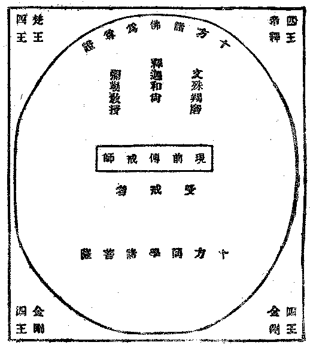



於此戒坛内乃可受菩萨三聚戒，所谓饶益一切有情戒，修摄一切善法戒，修摄一切律仪戒。这三戒是三世诸佛所护念的。为什麼饶益有情戒在第一呢？这是菩萨戒特点的所在，所以在次序上与别处不同。这三聚戒，一切有情从来没有见闻过，唯有过去诸佛因受此戒，断烦恼、所知二障而证得无上菩提果；未来诸佛因守护此戒，断除三障——烦恼障、业障、报障——和习气而证正等大菩提；现在诸善逝，因修此戒，断生死轮回苦，而证得三身菩提果。这不是理想，是在事实上确有证明的。



寅六　喻明戒德



『超越生死深大海，菩萨净戒为船筏；永断贪瞋痴系缚，菩萨净戒为利剑；生死崄道诸怖畏，菩萨净戒为舍宅；息除贫贱诸苦因，净戒能为如意宝；鬼魅所著诸疾病，菩萨净戒为良药。



你要渡过生死的大海，菩萨戒为船筏；你要永断三毒的束缚，菩萨戒为利剑，你怕走生死的险路，菩萨戒可作为舍宅住；你要避免贫贱的诸苦因，菩萨戒可为如意宝，随心所欲，要什麼有什麼；你身上有什麼疾病，菩萨戒可为良药。



丑二　劝应受持



『人天为王得自在，三聚净戒作良缘，及餘四趣诸王身，净戒为缘获胜果。是故能修自在因，当得为王受尊贵。应先礼敬十方佛，日夜增修清净戒，诸佛护念当受持，戒等金刚无破坏；三界诸天诸善神，卫护王身及眷属，一切怨敌皆归伏，万姓欢娱感王化，是故受持菩萨戒，感世出世无为果。



国王之所以得到自由，即是以三聚戒作他的良缘；乃至非人类的王，无不是净戒作他的良缘而获得的。我们不为人所尊贵，这只怪自己不曾修持戒因；所以必要转向勤修戒的道路走，才有光明。若想得出世的妙果，应当敬礼十方诸佛，日夜努力勤修清净的菩萨戒，诸佛便都来护持。国王也因为受持净戒，所以诸佛菩萨都来护持，一切怨敌皆不得害他，人民皆受他的感化，这就是修清净戒所得的良果。



如今一般人，仅仅口头上叫喊要救国救民；虽然心高志大，因没有福德，费了不少的岁月，结果只有失败、堕落，这是多麼可怜！真叫人悲感哩！



癸四　三宝恩



子一　增颂总相



『三宝常住化於世，恩德广大不思议，过未及现劫海中，功德利生无休息。佛日千光恒照世，利益群生度有缘，无缘不睹佛慈光，犹如盲者无所见。法宝一味无变易，前佛后佛说皆同，如雨一味普能沾，草木滋荣大小别，众生随根各得解，草木禀润亦差殊。菩萨声闻化众生，如大河水流不竭；众生无信化不被，如处幽冥日难照。如来月光甚清凉，能除众暗亦如是；犹如覆盆月不照，迷惑众生亦如是。法宝甘露妙良药，能治一切烦恼病，有信服药证菩提，无信随缘堕恶道。菩萨声闻常在世，无数方便度众生，若有众生信乐心，各入三乘安乐位，如来不出於世间，一切众生入邪道，永离甘露饮毒药，长溺苦海无出期。佛日出现三千界，放大光明照长安，众生如睡不觉知，蒙光得入无为室。如来未说一乘法，十方国土悉空虚，发心修行成正觉；一切佛土皆严净。一乘法宝诸佛母，三世如来从此生，般若、方便无间修，解脱道成登妙觉。若佛菩萨不出现，世间众生无导师，生死崄难无由过，如何得至於宝所？以大愿力为善友，常说妙法令修行，趣向十地证菩提，善入涅槃安乐处，大悲菩萨化世间，方便引导众生故，内秘一乘真实行，外现缘觉及声闻。钝根小智闻一乘，怖畏发心经多劫，不知身有如来藏，唯欣寂灭厌尘劳。众生本有菩提种，悉在赖耶藏识中。若遇善友发大心，三种鍊磨修妙行，永断烦恼、所知障，证得如来常住身。菩提妙果不难成，真善知识实难遇。一切菩萨修胜道，四种法要应当知：亲近善友为第一，听闻正法为第二，如理思量为第三，如法修证为第四。十方一切大圣主，修是四法证菩提，汝诸长者大会众，及未来世清信士，如是四法菩萨地，要当修习成佛道。



以下颂三宝恩，此中分为两段，第一增颂总相。「总相」者，即前长行中总标三宝之文；但前总标科文非常短少，而此颂中文义甚多，故名增颂总相。



三宝常住化於世四句，即和前长行总标中文义无别，是颂过去、未来、现在三世三宝之恩德，最为甚深。佛日千光恒照世四句，颂赞佛之恩德：如千日出世，但度有缘众生，无缘者即不能见佛，如盲者不见日光之无异也。法宝一味无变易六句，颂明法宝住世佛佛道同，而恩泽普被群生。如春雨然，能增长草木茂盛，但被润泽者，因各自根种有特殊之不同，故润有大小之别；法宝润泽有情亦复如是，因随众生根性各得解故。菩萨声闻化众生四句，颂僧宝教化有情，如大海之常流，无有间断时。但众生若无信心，如处幽冥，不能为日光所照也。如来月光甚清凉四句，又重颂佛之恩德慧光，能除众生热恼，但无缘者即不能受其清凉之安乐也。菩萨声闻常在世四句，颂僧宝常在世，无论何时，众生若深信之，即能入三乘之安乐位。如来不出於世间八句，明佛不出世；一切众生如处於幽冥，饮鸩，溺苦海之无异；如来若出世间，光明普照，即一切昏暗众生，蒙佛光泽而得入无为室也。如来未说一乘法四句，明大乘法之宝贵：世间若没有大乘法，国土即成空虚；有佛法，则一切土悉严净也。一乘法宝诸佛母四句，颂三世如来皆依萨婆若海，无间修行而成正觉也。若佛菩萨不出现八句，颂众生依佛为导师；佛若不出世，众生即失去导师无由得至宝所也。以大愿力为善友四句，即诸佛以大悲愿力，为众生善友，常说妙法令得涅槃境也。大悲菩萨化世间四句，颂佛说法度生时，菩萨有大方便，内修菩萨行，外现声闻身，常时利乐一切有情也。钝根小智闻一乘六句，此即小机众生恐怖大法（如妙德长者），而不知自己身中，本有如来藏清净菩提种子藏在赖耶识中，故欣乐涅槃而厌尘劳也。赖耶识者，即能藏一切法种之识也。若遇善友发大心六句，明一切众生若能遇善友开导，即能发大心，断二障，证菩提，因之成妙果非难而遇真善知识实难也。三种练磨者，为对治三种退屈之心：第一、引他既证大菩提而练磨自心，以此对治菩提广大屈；第二、省己意乐而练磨自心，对治万法难修屈；第三、引他之粗善，比己之妙因，而练磨自心，以对治转依难证屈。由此三种练磨心法，於一切善法即得不退，故能修妙行也。一切菩萨修胜道六句，颂菩萨修行有四种法要——善友、正法、修行、证果，即因亲善友能闻正法，由闻正法如理修思，由修行故即得妙果也。十方一切大圣主六句，是劝修奉行也。



子一　重颂三宝



丑一　佛宝



『善男子等应谛听！如来所说四恩者，佛宝之恩最为上。为度众生发大心，三僧企耶大劫中，具修百千诸苦行，功德圆满遍法界，十地究竟证三身。法身体遍诸众生，万德凝然性常住，不生不灭、无来去，不一不异、非常断，法界遍满如虚空。一切如来共修证，有为、无为诸功德，依止法身常清净。法身本性如虚空，远离六尘无所染；法身无形离诸相，能相所相悉皆空。如是诸佛妙法身，戏论言辞相寂灭，远离一切诸分别，心行处灭体皆如。为欲证得如来身，菩萨善修於万行，智体无为真法性，色心一切诸佛同。譬如飞鸟至金山，能使鸟身同彼色；一切菩萨如飞鸟，法身佛体类金山。



『自受用身诸相好，一一遍满十方刹，四智圆明受法乐，前佛后佛体皆同，虽遍法界无障碍，如是妙境不思议，是身常住报佛土，自受法乐无间断。他受用身诸相好，随机应现无增减，为化地上诸菩萨，一佛现於十种身，随所应现各不同，展转倍增至无极，称根为说诸法要，令受法乐入一乘。彼获神通渐增长，所悟法门亦如是，下地菩萨起智慧，不能了达於上地。能化所化随地增，各随本缘为所属，或一菩萨多佛化，或多菩萨一佛化，如是十佛成正觉，各坐七宝菩提树，前佛入灭后佛成，不同化佛经劫现。



『十佛所坐莲华台，周遍各有百千叶，一一叶中一佛土，即是三千大千界。一一界中有百亿，日、月、星辰、四大洲，六欲诸天及四禅，空处、识处、非想等。其四洲中南赡部，一一各有金刚座，及以菩提大树王，尔所变化诸佛身，一时证得菩提道，转妙法轮於大千，菩萨、缘觉及声闻，随所根宜成圣果。如是所说三身佛，最上无比名为宝。



以下重颂别赞三宝。今颂中先赞佛宝：善男子等应谛听八句，颂明如来所说之恩，以佛恩最为第一，因佛发心修行，度诸众生，已经三无数劫，所修种种因行已满，十地究竟证三身果，故名为最。法身体遍诸众生十六句，赞如来法身之德，即体非生灭断常而为一切有为无为功德之所依止；以及法身体性本净，无有尘染，远离一切戏论相也。为欲证得如来身八句，颂菩萨为欲得如来法身故修行菩萨万行，但知法身本体真常空寂，诸佛共证、入地分证，故地上菩萨即为法身大士。譬如飞鸟下，喻显菩萨称如来法身修行，体即等於如来之法身；如飞鸟至金山，体即类於金山色也。自受用身诸相好八句，重颂自受用身德。自受用者，即四智菩提，住清净微妙报佛国土，受无间断常相续之妙乐。他受用身诸相好二十句，重颂他受用身，文意如长行中说，前佛入灭后佛成者，即如极乐净土，弥陀入灭观音即成佛等，非如化佛国土之中，经无量劫或无有佛也。十佛所坐莲花台十六句，重颂化身德，即由十佛莲花各现百千佛身成正觉等也。如是所说三身佛两句，总颂三身以显明佛为宝之理由。



丑二　法宝



『应化二身所说法，教、理、行、果为法宝。诸佛以法为大师，修心所证菩提道。法宝三世无变易，一切诸佛皆归学，我今顶礼萨婆若，故说法宝为佛师，或入猛火不能烧，应时即得真解脱。法宝能摧生死狱，犹如金刚碎万物；法宝能作坚牢船，能渡爱河超彼岸；法宝能与众生乐，譬如天鼓应天心；法宝能济众生贫，如摩尼珠雨众宝；法宝能为三宝阶，闻法修因生上界；法宝金轮大圣王，以大法力破四魔；法宝能为大宝车，能运众生出火宅；法宝能为大导师，能引众生至宝所；法宝能吹大法螺，觉悟众生成佛道；法宝能为大法灯，能照生死诸黑暗；法宝能为金刚箭，能镇国界伏诸怨。三世如来所说法，能利众生脱苦缚，引入涅槃安乐城，是名法宝恩难报。



如来自受用身不说法；他受用身所说之教法亦不在世间，因超过世间故，如中本华严经等，世间所无；故世间所有之教法，即应化身佛所说教理行果是也。诸佛以法下，即明法宝为三世如来之母及法宝无迁变义。我今顶礼下，即佛自身以萨婆若为师，修学一切萨婆若法而成正觉，尊重一切萨婆若法，一切猛火所不能烧也。法宝能摧生死狱二十六句，以喻重显法宝之恩深。三世如来下，总明法宝为三世如来所说，利益众生，导众生入涅槃城也。



丑三　僧宝



寅一　重颂总标



『智光长者汝谛听！世出世僧有三称，菩萨、声闻圣、凡众，能益众生为福田。



此即总标僧宝有三种——菩萨、声闻、凡僧，而此三种僧宝，能增长众生福德，能灭除众生热恼，故名为世间福田。如田能生长谷物故。



寅二　增颂二圣



『文殊师利大圣尊，三世诸佛以为母，十方如来初发心，皆是文殊教化力。一切世界诸有情，闻名见身及光相，并见随类诸化现，皆成佛道难思议。弥勒菩萨法王子，从初发心不食肉，以是因缘名慈氏，为欲成熟诸众生。处於第四兜率天，四十九重如意殿，昼夜恒说不退行，无数方便度人天。八功德水妙华池，诸有缘者悉同生，我今弟子付弥勒，龙华会中得解脱。於末法中善男子，一搏之食施众生，以是善根见弥勒，当得菩提究竟道。



以下别颂二圣，即赞弥勒、文殊之德。弥勒、文殊二菩萨，在菩萨会中为如来之上首，如声闻众中迦叶、阿难等为上首无异也。文殊师利大圣尊八句，颂文殊之德。文殊师利，即妙吉祥，在菩萨众中代表诸菩萨之根本智，一切菩萨皆由此根本智而修行证果，故为三世如来之母。世间一切有情，若闻名、见相赞叹供养，以及或见随类化形，皆获无量福德，当来世中皆成佛道：故文殊圣僧恩德，实难思议也。弥勒菩萨法王子八句，即别赞弥勒德也。弥勒此云慈氏。言慈氏者，有二种因缘：一者、以居胎时母性转慈得名；二者、以往昔因中为智光仙人，誓戒肉食，故名慈氏。中国佛教徒不食肉之特殊情况，尤近慈氏遗风；如西藏、锡兰等，则不断肉食也。兜率天四十九重之内院，弥勒上生经言之甚详，今不繁述。弥勒因欲普度人天，故处兜率内院，恒说不退转心地法门也。八功德水下，颂明弥勒内院亦有八功德池，池中有莲，凡有缘上生者悉於中化生，如极乐净土无异也。我今弟子下，是佛以弟子付属弥勒也。释尊遗教中之一切弟子，皆当於龙华三会得解脱也。於末法中善男子四句，即末法世中，凡有众生若能施一搏之食，於龙华三会即得解脱。详言之，即凡在释迦文佛正、像、末法之中，持五戒者初会解脱，受三皈者二会解脱，乃至举手低头一称佛名者，第三会中亦皆解脱：以弥勒菩萨承释迦佛之遗嘱，发有如是大愿故。



寅三　重颂圣凡



『舍利弗等大声闻，智慧神通化群生。若能成就解脱戒，真是修行正见人，为他说法传大乘，如是福田为第一。或有一类凡夫僧，戒品不全生正见，赞咏一乘微妙法，随犯随悔障消除，为诸众生成佛因，如是凡夫亦僧宝。如郁金华虽萎悴，犹胜一切诸妙华；正见比丘亦如是，四种轮王所不及。如是四类圣凡僧，利乐有情无暂歇，称为世间良福田，是名僧宝大恩德。



舍利弗等及声闻两句，重颂圣僧，因有神通变化，利乐一切有情故。舍利弗，此云鹙子，是智慧第一也。若能成就别解脱四句，即重颂凡僧，凡僧中有两种，此乃成就别解脱者，即是具足正见正戒之凡僧。若说大乘法利益有情，即为世间之第一福田也。或有一类凡夫僧十句，即重颂第二类具正见而不具正戒之凡僧，因常毁犯净戒故；但此凡僧，虽毁犯而能忏悔，又能阐扬大乘微妙之法利益有情，故亦为世间之福田。如郁金花下，以喻明具正见凡僧威德之殊胜，超过四种轮王，因佛无漏智中之所摄故。如是四种圣凡僧四句，即总明四僧为宝之义；四僧，即圣凡各有二种僧也。



辛三　总结四恩



『如我所说四恩义，是名能造世间田，一切万物从是生，若离四恩不可得。譬如世间诸色尘，能造四大而得生；有情世间亦复然，由彼四恩得安立』。



以下总结四恩。如我所说四恩义四句，即明四恩能造世间福田。如一切五谷皆从田所生，以显一切善法，若离四恩即不能生长也。譬如世间下，如色、香、味、触诸尘，依四大所生，故四大为能造，色、香、味为所造；若离能造之法，则所造色等，即不能生起。如是四恩与众生安乐，亦复如是。四大者，就具体说，即地、水、火、风，就特性说，即坚、湿、煖、动也。



己三　问答报恩



尔时、智光长者及诸子等，闻佛所说四种大恩，得未曾有，欢喜合掌而白佛言：『善哉！善哉！大慈世尊！为浊恶世不信因果、不孝父母邪见众生，说真妙法利乐世间，惟愿世尊说报恩义！我等既悟甚深四恩，而今未知修何善业，而报是恩』！佛告长者：『善男子等！我为五百长者先已广说，而今为汝略说少分：若善男子、善女人为得阿耨多罗三藐三菩提，精勤修行十波罗密，若有所得未名报恩；若人须臾能行一善心无所得，乃名报恩。所以者何？一切如来触无所得，乃成佛道化诸众生。若有净信善男子等得闻是经，信解、受持、解说、书写，以无所得三轮体空，窃为一人说四句法，除邪见心趣向菩提，是即名为报於四恩。何以故？是人当得无上菩提，展转教化无量众生令入佛道，三宝种子永不断绝』。



智光长者闻佛所说四种大恩，即欢喜踊跃叹未曾有，赞叹世尊说此报恩之法，利乐一切有情。但智光长者等，虽知四恩之义，尚不知以何法修行，修行何业而报四恩，故发问也。佛告长者下，即世尊答智光长者之问义。若有所得……未名报恩：即是欲报广大四恩，必发大菩提心，勤修十种波罗密法；但修波罗密时，了达三轮体空，触无所得，方名报恩。若有所得，即不明真报恩也。因如来触无所得故而成正觉，触无所得故而度诸众生。无有众生之相，所以金刚经说：『灭度一切众生，而实无有众生度者』。若有净心善男子下，即明若人能得闻是经，书写解说是经，以了达无所得意断除邪见身心，即名真报四恩。以了达实义，即能趣向大菩提故趣向菩提，即能展转教化一切众生，使一切众生有依所止修行，於三宝功德种子永不断绝故。



己四　闻法获益



尔时、智光长者闻是偈已，得忍辱三昧，厌离世间得不退转。时诸子等八千人俱，得此三昧，皆发无等等阿耨多罗三藐三菩提心。四万八千人，亦证三眛，远尘离垢，得法眼净。



以下，即智光长者等闻佛说四恩法，所获得之利益也。忍辱三昧，即是得法忍三昧。时诸子等亦得法忍三昧也。远尘离垢，即了知心性空寂，故客尘烦恼垢无所依处而远离也。既了达性寂，故能於诸法相，得法眼而明见清净也。



丁二　色无色天乘之三乘共法



戊一　出家戒之超欲界法——十信



己一　厌舍出家



------



### 厌舍品第三



「厌舍」即是出家之法，即厌舍人间俗家，而趋向于佛法之出家法。进一步言，即是舍五欲之法，亦即是厌舍欲界法。如以最广义之厌舍而论，即是厌三界之法而依于出世间法。依此，以厌舍作出家解，即有如下三义：一、出人间俗家，二、出欲界五欲家，三、出世间三界家。此中所著重者，即在厌舍人间俗家之法，同时亦厌舍欲界五欲之法。此厌舍之所以得名。



在前总科五乘共法中第二色无色天乘之三乘共法，从天乘法以明。如所谓福业、非福业、不动业，福业即是欲界人天法，非福业即是三恶趣法，不动业即是色无色界天之禅定业而成超欲界之上二界法。今此色无色天乘之三乘共法，所包括之经文，有厌舍品、无垢性品、阿兰若品、离世间品之四，皆是持戒、修定之法。在厌舍、无垢性之二品，正明持戒之法；后二品正明修定之法。此中所说之戒，即出家戒，出家戒要离去五欲而修梵行，梵行即是净行，亦即色无色界之行。故出家之戒，直接为离欲界而超升色无色界之行，展转增上亦即为由色无色界而超出世间之行。修戒如是，修定亦然，如四禅、八定为三乘圣人所共修之法，然亦正是色无色界所修者。但色无色界亦不离梵行之戒法，亦以戒为基础，要离去欲界之五欲，始成色无色界——四禅八定——之不动业。由此，出家法一方面可超出欲界，一方面又能成就出世之基。



此四品所明之戒定，明色无色界天乘之法，亦即是三乘学无学道共修之法。然所谓三乘共修之法，不但戒定，其最重者则在于修慧。戒定不过三乘法之基础，若非有「出世三乘之闻思修慧」，则唯名人天乘法，不得名出世之三乘法。盖人天法以戒定为本，而出世三乘法则以四谛、十二缘起、六波罗密法而为本。但戒定是出世慧之基础，设无此戒定为基，则出世之思慧、修慧即不能成立。由是而观，戒定为色无色以及出世三乘之所必需，而为超过人乘之四乘共法。被超即是人乘，未超则仍通五乘。今正就超欲界——色无色界天乘——之三乘共法以明之，此中分二：一、出家戒之超欲界法。此中所明出家之戒，是超欲界之戒法；此超欲之戒法，若真能受持，则可以超出欲界之家。欲界最重之根本，在男女之欲，故欲界即由于男女之欲而酿成；出家之戒，正除去男女之欲，故此厌舍、无垢性二品，正明超欲界之法。二、阿兰若品与离世间品，正明超欲界后所修禅定以入色无色界，再依戒定修出世慧以超色无色界，乃入于无漏之出世间戒定慧也。



厌舍、无垢性二品，在前总科之旁加有「十信」者，可作另一看法。大科以五乘共法、三乘共法、大乘不共法而为分划，若如此看，则本品是五乘共法；若依注有「十信」之另一看法，则本经专明大乘法。如前之报恩品，在劝一般凡夫未发心者，引之欣慕发菩提心；而出家戒之超欲界法，即在欣求发心而未能发心之间，学习修养发菩提心的菩萨十信心位：故前报恩品是劝发菩提心，此即是学习菩提心。要之、此厌舍、无垢性之二品，即是正明学习菩提心者：以前报恩品唯劝发菩提心而未能学习，而今明学习菩提心，须专到佛法中去修养，要精进修习随顺清净无漏慧等法以开发菩提心，故有此菩萨十信之位。此如华严经净行品等，智首菩萨与文殊菩萨互相问答，皆明得成出家菩萨十信之法，亦即明超欲界家而到出三界家之法。由有此旁科与正科之二种看法，故今于此经之大纲，可再明之：一、大乘包括世出世间之五乘所以得名大乘法。由此法能自悟悟他，以大乘自悟，以五乘悟他，虽人天乘法未能出世，然亦为大乘利他之方便，故大乘法应包括五乘之法；故分为五乘共法、三乘共法、大乘不共法。二、五乘法实即是大乘，大乘之极位虽不与他乘共，然亦由凡夫初发心而历经诸修行位，展转增上、展转胜进而后方至其极果。如在初学之时，即明如何报恩，如何利众生，如何发无上大心，即是初学菩萨从报恩发心；展转增进以至修学出家戒法，培养十种信心乃入十住而真正发菩提心。此如华严经梵行品等所明，在本经即阿兰若品、离世间品之所明也。故五乘法即是大乘法展转增进之历程，虽亦得名五乘共法，而实即大乘菩萨法也。由此而观，则第一种之大乘法，亦可说是五乘法；第二种之五乘法，亦可说是唯一之大乘法。明此二种看法，则对于全部经文更可了然矣。



庚一　智光陈疑请决



辛一　叙今所愿



尔时、智光长者承佛威神，即从座起顶礼佛足，恭敬合掌而白佛言：『世尊！我今从佛闻是报恩甚深妙法，心怀踊跃得未曾有，如饥渴人遇甘露食；我今乐欲酬报四恩，投佛法僧出家修道，常勤精进希证菩提！



尔时，即如来说报四恩将毕之时。智光长者于前报恩法会中，已获忍辱三昧，今以自心尚有疑惑未决，而一方面欲令会众获益决疑，故从座起，合掌至诚恭敬而白于佛。常人得见佛像经法，能合掌低头，皆植福无量，乃至毕竟得证佛果菩提；今於此广大法会之中，能一请一问，则其值福岂可以言喻耶！世尊至希证菩提，正明智光长者自述本人于今时法会中之愿望。智光长者于前报恩法会中，得闻佛说广报四恩之法，故言我今从佛闻是报恩甚深妙法。一般人唯知父母始有恩于我，不能推及其他，报恩之范围甚属狭小，不得名甚深微妙；唯佛陀所说之报恩法，方堪称甚深微妙之法，因佛陀所明之报恩，不但报答于父母及众生、国王，乃至出世三宝更有不可思议之恩于我也。此报恩法为昔之所未闻，故快乐之心，亦胜于昔日，如饥渴人遇甘露食。甘露是不死之药，此为上界诸天之物；饥渴之人，无论遇到若何饮食，亦可止渴充饥而况甘露耶？此甘露喻报恩法之上上者。智光长者因闻如来说报恩要出家修道始能究竟，故今亦白佛而乐欲出家修道，以求证得佛果菩提广报四恩也。



辛二　述昔所闻



『佛大慈悲，於此一时在毗舍离城，为无垢称说甚深法：「汝无垢称！以清净心为善业根，以不善心为恶业根。心清净故世界清净，心杂秽故世界杂秽；我佛法中以心为主，一切诸法无不由心。汝今在家有大福德，众宝璎珞无不充足，男女眷属安隐快乐，成就正见不谤三宝，以孝养心恭敬尊亲，起大慈悲给施孤独，乃至蝼蚁尚不加害。忍辱为衣，慈悲为室，尊敬有德，心无憍慢，怜愍一切犹如赤子。不贪财利，常修善舍，供养三宝心无厌足，为法舍身而无吝惜。如是白衣虽不出家，已具无量无边功德！汝於来世万行圆满，超过三界证大菩提。汝所修心，即真沙门，亦婆罗门，是真比丘，是真出家；如是之人，此则名为在家出家。」



『世尊或有一时，於迦兰陀竹林精舍，为其恶性六群比丘，说教诫法而告之言：「汝等比丘！谛听！谛听！入佛法海，信为根本，渡生死河，戒为船筏。若人出家不护禁戒，贪著世乐毁佛戒宝，或失正见入邪见林，引无量人堕大深坑；如是比丘不名出家，非是沙门，非婆罗门，形似沙门，心常在家，如是沙门无远离行。远离之行有其二种：一、身远离，二、心远离。身远离者，若人出家身处空闲，不染欲境，名身远离。身虽离故，心贪欲境，如是之人不名远离。若净信男及净信女，身居聚落发无上心，以大慈悲饶益一切，如是修行名真远离」。於是六群恶性比丘，闻是法音得柔顺忍。



智光长者来此会中，唯得闻此报恩之重颂；而佛在毗舍离为无垢称说法以及迦兰陀竹林为六群比丘所说之法，则在此法会之前，或由法会中之他人处展转传闻而听得。佛大慈悲，即赞佛能方便善巧而使众生离苦得乐也。一时，乃毗舍离城说法之时，以说法完毕为限。毗舍离，此言广博严净，即广博严净之城，在中印度国。无垢称，即维摩诘居士，又译净名居士。甚深法，即不可思议之胜义谛法。智光长者述昔传闻佛说之法，与今佛说要出家始能报恩之义相违，故举出以质之於佛。此段在维摩诘经佛国品，有此意义而文不全同。汝无垢称至无不由心者，明宇宙一切诸法，皆不离我自心之作为，所谓「三界唯心」者也。不特世间如是，即佛出世闻法，亦以心为根本而由之转变一切，故清净心为善业之根本，不善心为恶业之根本，而世界之净秽皆随心为之转移。心虽亦为万法之一，但较他法之势力强胜，就其强胜作用而能转变一切，故得名之为主；一切诸法无不由心也。汝今在家有大福德，总明其福力道德之深厚。其形式是在家，故财宝充足而家属安乐，即是在家之圆满。成就正见不谤三宝，明其知见之纯正。以孝养心恭敬尊亲，明其能孝亲敬长。起大慈悲至尚不加害，明其能恩及孤独，乃至最微小之蝼蚁尚愍恤而不加害。忍辱为衣慈悲为室，明其具慈悲心与行忍辱波罗密。衣，如铠甲，既被忍辱之铠甲，则不为怨恨之魔军所丧。尊敬有德心无憍慢，明其心不高举故能尊敬有德之人。怜愍一切犹如赤子，明其慈爱众生如自婴孩。不贪财利常修善舍，明其不特不好财宝物利，且常修布施而舍物於人。供养三宝心无厌足，明其能於三宝前常修供养，而心无厌离满足。为法舍身而无吝惜，明其为法之精诚而能牺牲生命。凡行菩萨道者，皆能如是。故释迦如来昔行菩萨道时，为求一四句偈而割截身体。又如法华经中药王菩萨，为求法故而能用火锻鍊其身以供养于佛。如是白衣至无边功德，明其形式虽是白衣而未服沙门之色服，但其所具足之功德亦与大菩萨所具相等。汝於来世至证大菩提，明其於未来世，待所修之六度万行福德智慧满足时，即超三界而证佛果。汝所修心至在家出家，是明其形式上虽是白衣之人，而其心之作用则是沙门，亦是婆罗门，是则名为真实之比丘、真实之出家者。换言之，是一在家出家者。沙门，此言勤息，勤修出要，息灭烦恼，此为出家修行之通称，不限於佛徒。婆罗门，此言净行，为印度四姓中之最尊贵者，彼计其种族是大梵天之口所生，彼即奉大梵天而修净行，故得此名。比丘，此言乞士，上乞佛法以修心，下乞饮食以资身故也；尚有杀贼、怖魔等义。



次明佛有时於迦兰陀竹林精舍，为六群比丘说教诫法。迦兰陀竹林精舍，在摩竭陀国，佛常於此竹林中说法，令诸比丘精进修学，故名精舍。恶性者，是根性之不善；六群，不是一人之名，其性恶之众有六类，故名六群比丘。有不正当之行为，重加诃斥，是名教诫；若平常循循善诱而为众生说法者，则名教授。汝等比丘至名真远离，正是佛教诫六群比丘之文。此中入佛法海至戒为船筏，明若欲深入佛陀之法藏，则当具足信根，否则连接近都不能，何能知悉！既不能知悉，尚能深入於法藏耶？然深入法藏，不过明解而已，尚不是度生死之河而到彼岸，真实度生死之河而到彼岸者，则必以戒而为船筏；盖戒为无上菩提本，即三世诸佛亦乘此戒之船筏而得到彼岸者。夫人之出家，正为远离世间之贪欲。在家常在五欲之中，世世生生轮转不息，皆由於不觉；既得出家，则应知世间虚妄无可为乐，坚持於净戒以令其无有失犯。若不能如是而反贪著世俗乐味，以至於毁如来之戒法，则何得名为出家耶？出家者於佛之禁戒有所毁犯，则其知见亦不纯正，故言或失正见入邪见林。邪见，为根本烦恼之一，通即十使中之五利使，别即谤因、谤果、谤作用者。林，喻邪见之非一种，如森林之稠密。既自失於正见，则如盲者不见於道路，反以盲引盲堕落深坑。深坑，重则三途，轻则五趣。不护禁戒之出家者，既贪著五欲而又破佛之禁戒，入於邪见之林，不能与众生之福，反而使之堕落。如是比丘，其形虽光沙门而其心与作用，皆与俗无异，所以不得名出家，不得名沙门，亦不得名婆罗门。出家，浅则出欲界人天之欲乐家，深则出三界之家。如是沙门至名真远离者，次以二种远离行而明修学之真伪：第一、身远离，即明前出家而不防护如来禁戒及入邪见者，此辈身虽出家而处於空旷清静之地，与尘嚣相隔，然其心则非处於空闲，常追逐於世俗贪欲之境，虽身远离而心未远离。第二、心远离，此即学佛之人，身虽处於市廛之聚，但心则是清净无染且发菩提心而常以大慈悲饶益一切有情者；故形式虽不出家，而其内心与行为则是出家，如净名居士即是，故此即是真出家、真远离。於是六群比丘得柔顺忍，明智光长者说彼六群比丘於闻法时所获之益。柔顺忍，即是心柔智顺而忍可佛之诫法於心也。此即第二，对六群比丘所说之法，与今佛说要出家报恩之说相违。



辛三　正陈疑意



『然今我等虽信佛说，各各怀疑，意未决定，善哉世尊！能断世间一切疑者！於一切法得自在者！真实语者，无二语者！是知道者，是开道者！惟愿如来为我等辈及未来世一切有情，舍於方便，说真实法，永离疑悔令入佛道。今此会中有二菩萨：一者出家，二者在家。是二菩萨，善能利乐一切有情而无休息。如我惟忖：出家菩萨不及在家修菩萨行，所以者何？昔有金轮转轮王发阿耨多罗三藐三菩提心，厌离世间无常苦空，舍轮王位如弃洟唾，清净出家入於佛道。是时、后宫夫人婇女八万四千，见王出家各怀恋慕，心生号恸生大逼恼，起爱别离如地狱苦。金轮圣王初受位时，所感宝女及王千子、大臣眷属，共伤离别舍位王家，号泣之声满四天下。此诸眷属各作是言：「我王福智无量无边，如何见弃舍我出家！哀哉！苦哉！世界空虚！从今已去无依无怙」。若有净信善男子、善女人归佛法僧发菩提心，舍离父母出家入道，父母怜愍恩念情深，离别悲哀感动天地，如凅辙鱼宛转於地，爱别离苦亦复如是，如彼轮王眷属之心。出家菩萨饶益众生，云何娆害父母妻子，令无量人受大苦恼？以是因缘，出家菩萨无慈无悲不利众生，是故非如在家菩萨具大慈悲，怜愍众生利益一切』。



智光长者於此报恩法会中，听闻如来所说之法，要人出家发菩提心以期成等正觉，始能究竟报恩。其说既如此，而如来前为无垢称所说，即不必出家亦可是真出家；及对六群比丘等所说，即虽是出家亦同在家，其说又如彼。如是种种异说，殊令人怀疑不决而不知所从，今我等虽信佛说，但终疑惑不免耳。故望佛说真实法，令现前会众及未来世众生断除疑惑。得自在，即是『我为法王，於法自在』。真实语，即虚伪之反；无二语，即是说一不二。知道，即证知一切诸法如如之体；开道，即开示真实正道。



今此会中以下，智光长者以二种菩萨推测而出本人之意见，断定出家菩萨不如在家菩萨，且引昔事以证明。转轮王，为四种轮王之通名，今冠以金轮者即是别於银、铜、铁三轮王也。厌离世间无常苦空者，即一切有为之法，皆是无常、苦、空，非究竟之法故应厌离，此即小乘中之三法印——以此三法印证宇宙之一切法，凡有为者，皆是无常、苦、空。彼金轮王舍轮王之尊荣而出家学道，致后宫之夫人、婇女以及王子、大臣等受诸苦痛，所谓「爱别离苦」，令人卒不忍睹！爱别离苦，为世间八苦之一，人之所最亲爱者，莫如父母妻子，今转轮王既舍俗出家而遗其亲，以世俗观之，当然是最惨痛之事；然若如彼转轮王之已明世间无常等，则又最平常之事也。若有净信以下，智光长者重以舍离父母出家为不可，因父母之情最为深厚，其离别之悲哀，可以动天地而泣鬼神；既出家原是饶益众生，则反而娆害於父母妻子，岂非乾坤倒置！长者综以前所举之诸事，证明出家菩萨之慈悲度生，不及在家菩萨利乐怜愍众生之强胜。



庚二　如来因问广说



辛一　因问总非



尔时、佛告智光长者：『善哉！善哉！汝大慈悲！劝请我说出家在家二种胜劣；汝今所问出家菩萨不如在家，是义不然。所以者何？出家菩萨胜於在家无量无边不可为比。何以故？出家菩萨，以正慧力微细观察在家所有种种过失：



智光长者听闻佛说报恩之后，即欲出家修菩萨行，期成正觉而报众恩。但因感觉如来前后说法之矛盾，故特以之质问如来，及以除会众之疑惑而利及将来。今如来正答其所问之不然，盖如来虽於毗舍离城为无垢称说法而赞他是真沙门，但无垢称是十地菩萨权现之在家菩萨，不能代表人世一切之俗人。世俗之常人，皆为父母妻孥、衣食住等之所营扰，其心之纷乱，岂能与出家者同日而语耶？又如来於迦兰陀竹林精舍，为六群比丘说法，教诫其非法之行为，由彼形虽出家而心同世俗，故佛斥其尚不及在家之发大心而饶益有情者；然此是训斥非法之比丘不及在家真实修行者，非真实出家修行比丘不如在家修行者。故佛於此中说：汝今所问出家菩萨不如在家，是义不然。由於出家菩萨其心清净，由清净故则能发生智慧之力，彼在家者常为家属等之累，故其心不能清净，则出家菩萨之胜於在家不亦显然耶！出家菩萨由此有智慧之力，观察在家有种种之过失，故不应言出家菩萨不及在家也。



辛二　广说九喻



壬一　大海不知满足喻



『所谓世间一切舍宅，积聚其中不知满足，犹如大海容受一切大小河水未曾满足。善男子！香山之南，雪山之北，有阿耨池，四大龙王各居一角：东南龙王白象头，西南龙王水牛头，西北龙王师子头，东北龙王大马头。各从四角涌出大河：一、殑伽河，其水所至白象随出；二、信渡河，其水所至水牛随出；三、缚刍河、其水所至师子随出；四、私陀河，其水所至大马随出。如是大河，一一河各有五百中河，中河各有无量小河，是大中小一切众水皆入大海，然此大海未曾满足。世间众生所有一切居处舍宅，亦复如是聚诸珍宝，从四方来悉入宅中，未曾满足。多求积聚造种种罪，无常忽至弃舍故宅，是时宅主随业受报，经无量劫终无所归。善男子！所谓宅者即五蕴身，其宅主者是汝本识，谁有智者乐有为宅！唯有菩提安乐宝宫，离老病死忧悲苦恼，若有利根净信深厚善男子等，欲度父母妻子眷属令入无为甘露宅者，须归三宝出家学道』。



尔时、如来重说偈言：『出家菩萨胜在家，算分、喻分莫能比。在家逼迫如牢狱，欲求解脱甚为难；出家闲旷若虚空，自在无为离系著。谛观在家多过失，造诸罪业无有边。营生会求恒不足，犹如大海难可满。阿耨达池龙王等，四角涌出四大海，大中小河所有水，昼夜流注无暂歇，然彼大海未尝满。所贪舍宅亦如是，在家多起诸恶业，未尝洗忏令灭除，空知爱念危脆身，不觉命随朝露尽，琰魔使者相催逼，妻子屋宅无所随，幽冥黑暗长夜中，独往死门随业受。诸佛出现起悲愍，欲令众生厌世间。汝今已获难得身，当勤精进勿放逸！在家屋宅深可厌，空寂宝舍难思议，永离病苦及忧恼，诸有智者善观察。当来净信善男女，欲度父母及眷属，令入无为甘露城，愿求出家修妙道，渐渐修行成正觉，当转无上大法轮。



所谓世间至未曾满足，总明世人之贪心，为家业计，为子孙谋，其心贪恋不足，如大海之容纳百川犹不见其满足。香山，或即我国所谓之昆仑山。雪山，在北印度，近人称为希马拉雅山。阿耨池，此言「无热恼」，此池在香山之南，雪山之北，周有八百餘里，为南赡部洲之最高水源处。四大龙王各居一角，谓此池之四角各有一龙王居守。东南龙王白象头，即是东南角上龙王镇守之处，名白象头；餘三可类推。各从四角涌出大河，即谓从四角涌出之水，成为四大河。殑伽河又云恒河，其水所至之处多产白象；餘三可类推。此四河各发出大小无量水派皆流入大海，而大海犹未满足；如今之太平洋、大西洋等，从原始至今，犹未满足。世间众生亦尔，备经诸乐尚未知足。多求集聚至弃舍故宅，此明由心贪恋不足故仍求积聚，不畏造业；但无常忽来，不特不能将众宝带去，即舍宅亦舍离。是时宅主终无所归，即是说：「万般将不去，唯有业随身」。穷经万劫亦不能再反其故宅。上之所谓宅舍者，即色等五蕴身是也；宅主者，即是各人精神主体之阿赖耶识，随业受报无有已时。谁有智者至忧悲苦恼，谓世间众生，因生活之需求而发生种种战争，谁有智者而去作有为无常之事业，而甘居於五蕴幻化之宅耶？由此，众生之希望皆要达到离去人间诸苦，而不至菩提宝宫不止。若有利根，欲令父母妻子等舍去有为之宅而入无为之宅，必须投佛出家学道，始能究竟达到其目的，非智光长者所谓出家不如在家也。



重颂中初半颂，颂长行出家胜於在家等文。次一颂，重申出家胜於在家之理由。次半颂，颂长行出家有慧力能观察在家过失等文。次半颂，颂长行世间舍宅如大海不满足等文。次一颂单一句，颂长行阿耨池流出大小诸河入於大海未曾满足等文。次四颂单一句，颂长行世间众生之离老死忧悲苦恼等文。次一颂半，颂长行若有利根至出家学道等文。



壬二　石火能烧草木喻



『复次、善男子！出家菩萨观世舍宅，犹如石火深生厌患。何以故？譬如微火能烧一切诸草木等，世间舍宅亦复如是。贪心求觅，驰走四方，若有所得受用不足，於一切时追求无厌，若无所得心生热恼，日夜追求。是故世间一切舍宅能生无量烦恼之火，为起贪心恒无知足，世间财宝犹如草木，贪欲之心如世舍宅。以是因缘，一切诸佛说於三界名为火宅。善男子！出家菩萨能如是观，厌离世间名真出家』。



尔时、如来重说偈言：『出家菩萨观世宅，犹如人间微少火，一切草木渐能烧，世宅当知亦如是。众生所有众财宝，更互追求常不足，求不得苦恒在心，老病死火无时灭。以是因缘诸世尊，说於三界为火宅。若欲超过三界苦，应修梵行作沙门，三昧神通得现前，自利利他悉圆满。



假如能甚深底观察这家——世俗家、五欲家、三界家，有种种的祸患而想避免牠，那便非要出家不可。出家的菩萨，才能有这样微细的观察力，观察这家犹如击石所生的微火，能烧尽山林的草木。在这三界之内，无论有怎样底能力，终难得完全的自由，所谓『三界无安，犹如火宅』。此中所谓石火，如五欲；草木，如世间情器。



人真像做长期的大梦，劳碌了一生，只为贪求财产奔走四方。如旅客在沙漠中采觅宝物，若有所得，心中还不满足，还要长期的苦苦追求不舍；若没有所得呢，不消说，增加许多忧悲苦恼起来了！这都为了家产不满足之故啊！所以，这世间的家，能生无量之苦，无量之烦恼；贪心又为诸烦恼的首领，因贪世间财宝不知足，所以迷茫在这世间而为世间的囚徒了。如法华经云：『三界之生，贪欲为本』。如果是个真正的菩萨，能作此种的观察，应当早点离开这世间，这世间实是可厌的秽窟，值不得我们留恋！



讲到「出家」，是出五欲之家修梵行而作沙门。出家，这本不是佛教独有的，如印度婆罗门教、耆那教与西洋的罗马教和中国道教，都有出家的事实。但他们与佛教的出家，形式上虽没有什麼不同，然他们最多不过能超出欲界，而佛教徒以无漏涅槃为目的，要出三界家，这是与其他宗教徒出家不同之所在。但这不是容易的事，必须要勤修梵行三昧到无漏慧现前的时候，才能达到自利利他的果位。



壬三　深山恋宝丧身喻



『复次、善男子！爱乐出家当观舍宅，如彼深山石窟之中有大宝藏。譬如长者唯有一子，其家大富财宝无量，奴婢仆从象马无数。其父於后忽遭重病，名医良药不能救疗，长者自知将死不久，即命其子而告之言：「凡我所有一切财宝，付嘱於汝，勤加守护勿令漏失」！既付嘱已即便命终。时长者子不顺其命，恣行放逸，既损家业，财物散失，僮仆逃逝而无所依。时彼老母心怀忧恼，逐得重病即便终殁。其子贫穷无所恃怙，逐投山谷，拾薪采果货鬻自给。彼时遇雪，入石窟中权自憩息，然此窟中是昔国王藏七宝所，无能知者，经数百千年回绝人迹。时彼贫人业因缘故，偶入窟中见无量金，心大欢喜得未曾有，因而分割若干分金造立舍宅，若干分金为娶妻财，如是奴婢，如是象马，随心所欲皆如其意。作是计时，有诸群贼，为趁走鹿到於窟前，见此贫人以金分配，逐舍其鹿杀人取金。愚痴凡夫亦复如是，深著世乐不乐出离。深山石窟如世舍宅，伏藏金宝犹如善根，琰魔使者即是群贼。随业受报堕三恶道，不闻父母三宝名字，丧失善根，以是因缘应当厌离，发於无上大菩提心，出家修道希成妙觉』。



尔时、如来重说偈言：『爱乐在家诸菩萨，观於舍宅如宝藏。譬如长者有一子，其家大富饶财宝，奴婢仆从及象马，一切所须无不丰。於后长者身有病，举世良医皆拱手，临终告命诸亲族，付嘱家财与其子，教诲令存孝养心，当勤享祀无断绝。是时其子违父命，广纵愚痴多放逸，老母怀忧疾病身，又因恶子寻丧逝。眷属乖离无所托，舍薪货鬻以为常。往彼山中遇风雪，入於石窟而暂息。窟中往昔藏妙宝，已经久远无人知，樵人得遇真金藏，心怀踊跃生希有。寻时分配真金宝，随意所欲悉用之：或以造舍、或妻财，奴婢、象马并车乘，校计未来无能舍。群贼因鹿到其前，是彼怨家会遇时，逐杀贫人取金去。愚痴众生亦如是，石窟犹如世间宅，伏藏真金比善根，魔鬼使如劫贼。以是因缘诸佛子，早趣出家修善品。应观身命类浮泡，勤修戒忍波罗密，当诣七宝菩提树，金刚座上证如如，常住不灭难思议，转正法轮化群品。



善男子！如果有欢喜出家者，应观察舍宅犹如深山石窟中的财宝，因贪恋财宝的缘故，致伤身失命。这人间财宝的贪欲，犹如豺狼、毒蛇。从前有个长者，唯有一个儿子，他家财产很丰富，奴婢、象马、车乘不可数计。后来、长者得了一种名医良药不能救疗的病，自知不久死神到来，将一切财宝付嘱於儿子，即便死了。他的儿子太放逸，太不知父亲的慈荫，凡是下流事，真是无所不为。结果、不但财宝完全荡尽，甚至高堂老母，睹此凄惨情状，亦因忧悲太过而死了。儿子无所依靠，於是终日在山中把拾薪采果所得来的代价，维持生命。一日，因避风雪而入石窟中憩息。此石窟、乃从前国王贮藏七宝的所在，历时既久，无人知晓。这儿子看见有这麼多的财宝，心大欢喜。但这却就是他伤身失命的境遇！因为他将此财宝分作数分，自说自应的作理想中的种种分配或建舍宅，或买妻奴等，正是欢喜不知怎样才好的时候，恰有很多追鹿的强盗到来，看见他独自分配金银财宝，於是舍鹿而杀人，夺取金银去了。这比方世间的人，因为贪财迷色而没有善巧方便，所以有伤身失命之虞。这人天五欲之乐，本为善根所招致的福报；但对此福报，当以智慧力去观察施用，不可为他所迷，否则就要丧命。故人有福报，应恭敬三宝，孝顺父母；若对三宝不恭敬、父母不孝顺，则善根所致的福报享尽了，不免堕诸畜类，这多麼的危险！因此、这世间五欲之乐，出家菩萨应当要舍离掉，发起菩提心，求究竟妙觉。讲到贪欲，本指在家俗人而言，出家人只有三衣一钵，根本没有贪不贪可说了。但如今的中国僧伽，住丛林的，比较贪心要小一点；住小庵的僧伽，往往贪著金钱和衣服等，与在家的俗人差不多。若对於佛法有正信正见，应该去勤修戒、忍种种波罗密行，速求证得自觉觉他圆满的佛果。



壬四　饮杂毒露得吐喻



『复次、善男子！世间所有一切舍宅，犹如杂毒甘露饮食。譬如长者唯有一子，聪慧利根，达迦楼罗秘密观门，能辩毒药善巧方便，父母恩怜爱念无比。时长者子为有事缘，往至𫑮肆未及归家。尔时、父母与诸亲族欢喜晏乐，具设甘膳，时有怨家，密以毒药致饮食中，无人觉知。是时父母不知食中有杂毒药，逐令长幼服杂毒食；其子后来，父母欢喜，所留饮食赐与其子。是长者子未须饮食，念迦楼罗秘密观门，便知食中有杂毒药。其子虽知父母服毒，而不为说误服毒药，所以者何？若觉服毒更加闷乱，毒气速发必令人死。即设方便，白父母言：我且不食如是饮食，暂往市中却来当食。何以故？我先买得无价宝珠，留在柜中而忘封闭。於是父母闻说宝珠，生欢喜心，任子所往。子遂驰走，诣医王家求阿伽陀解毒妙药；既得此药疾走还家，乳酥糖三味合煎和阿伽陀。作是药已，白父母言：「惟愿父母服是甘露，此是雪山阿伽陀药。所以者何？父母向来误服毒药，我所暂出。本为父母及诸人等求得如是不死妙药」。於是父母及众人等心大欢喜，得未曾有，即服妙药吐诸毒气，便得不死更延寿命。出家菩萨亦复如是，过去父母沉沦生死，现在父母不能出离，未来生死难可断尽，现在烦恼难可伏除。以是因缘，为度父母及诸众生，激发同体大慈悲心，求大菩提出家入道。善男子！是名舍宅如杂毒药入甘美食』。



尔时、如来重说偈言：『世间所有诸舍宅，说名杂毒甘美食。譬如长者有一子，聪明利智复多才，善迦楼罗秘密门，能辨毒药巧方便。子有事缘往𨞬肆，暂时货易未还家。父母宴乐会诸亲，百味珍羞皆具足。有一恶人持毒药，密来致之於饮食。其子是时不在家，父母为儿留一分。举家误服杂毒药，子念观门知有毒，即便奔驰到医所，求得伽陀不死药，三味和煎药已成，逐白诸亲速令服。如是所服如甘露，差诸杂毒皆安乐。一切信心善男子，出家修道亦如是，为济父母及众生，所服烦恼诸毒药，狂心颠倒造诸罪，永沉生死忧悲海。割爱辞亲入佛道，得近调御大医王，所修无漏阿伽陀，还生父母三界宅，令服法药断三障，当证无上菩提果。尽未来际常不灭，能度众生作归依，毕竟处於大涅槃，及佛菩提圆镜智。



这是说：出了家即是吐了毒，在世间没有出家者，则中了毒而还没有吐出来。甘露食，即是最好的饮食，但有毒杂在其中；世人受五欲之乐，如食甘露，但因此而生种种烦恼，可见得不是究竟之乐。前段明愚痴的在俗人，此中明聪慧的出家人。迦楼罗，鸟名，旧译金翅鸟，新译妙翅鸟。他能食消龙鱼七宝等，凡是有毒的食物到了妙翅鸟的腹中，有毒化为无毒，此鸟能除毒蛇等之害。迦楼罗观，谓观自身如迦楼罗能消诸毒。



有个长者，也只有一个儿子，极其聪慧。他能知「迦楼罗观」，能辨别毒物、毒药，父母非常恩怜，爱护如掌中珠。他到街坊去了，父母邀友人宴会，不防备在座上遇著怨家了，在食物中暗里下了毒药。谁也不知道，大家都吃下腹去了。长者留少分与子，子回了家，恐怕所留食物靠不住清净，於是修迦楼罗观法，便知道食中有毒。但不能即为父母告，知父母受毒，不得不想法安慰救济，於是假说他在外有许多体面事使父母欢喜。赶快去求阿伽陀药，又跑回来了。阿伽陀者，此云普去、无价、无病或不死药丸，如云：『言投此药，普去众疾』；『服此药已，更无有病』。此药有起死回生之功，此子既得药回家之后，用乳、酥、粆糖三样调合阿伽陀药，才对父母说：他检查父母误吃了毒药，我因为要医除，所以去觅得雪山妙药。既服此药，毒物便吐出来了，也就没有死。出家菩萨亦复如是，因为出家菩萨以过去现在未来三世众生，认为皆是他的父母，众生的忧悲苦恼即是自身的忧悲苦恼，这即是同体大悲。佛与众生同体不二，不过众生为个人，而佛菩萨为一切众生。因众生贪财色，所以沉沦生死苦海，得五趣之苦；菩萨目的在得究竟安乐，所以发菩提心而出家了。



差者，即病医好了。三障，即惑、业、报。惑即漏体，惑断则漏业也没有；漏业没有，则业报也没有。阿罗汉有有餘涅槃，只断惑障而业报未断；佛也有有餘涅槃，但与阿罗汉不同，佛位三障永断，不过以转得的净依名有餘依。



壬五　妄想猛风不起喻



『复次、善男子！出家菩萨常观世间一切舍宅，犹如大风不能暂住。何以故？善男子！在家之心。恒起妄想执著外境，不能了真无明昏醉，颠倒触境亦常不住，恶觉易起善心难生；由妄想缘起诸烦恼，因众烦恼造善恶业，依善恶业感五趣果，如是如是生死不断。唯有正见不颠倒心作诸善业，因三善根及以信等，增长无漏法尔种子，能起无漏三昧神通，如是如是证圣相续。若伏妄想修习正观，一切烦恼永尽无餘』。尔时、智光长者白佛言：『世尊！修习正观有无量门，修何等观能伏妄想？』尔时世尊告长者言：『善男子！应当修习无相正观，无相能伏妄想，唯观实性不见实相，一切诸法体本空寂，无见无知，是名正观。若有佛子安住正念如是观察，长时修习无为，妄想猛风寂然不动，圣智现观证理圆成。善男子！是名贤圣，是名菩萨，是名如来阿耨多罗三藐三菩提。以是因缘，一切菩萨为伏妄想永不起故，为报四恩，成就四德，出家修学息妄想心，经无量劫成就佛道』。



尔时、如来重说偈言：『出家菩萨观在家，犹如暴风不暂住。亦如妄执水中月，分别计度以为实，水中本来月影无，净水为缘见本月。诸法缘生皆是假，凡愚妄计以为我，即此从缘法非真，妄想分别计为有，若能断除於二执，当证无上大菩提。凡情妄想如黑风，吹生死林念念起，四颠倒鬼常随逐，令造五种无间因。三不善根现为缠，生死轮回镇相续。若人闻经深信解，正见能除颠倒心，菩提种子念念生，大智神通三昧起。若能修习深妙观，惑业苦果无由起，唯观实相真性如，能所俱亡离诸见。男女性相本来空，妄执随缘生二相，如来永断妄想因，真性本无男女相。菩提妙果证皆同，妄计凡夫生异相，三十二相本非相，了相非相为实相。若人出家修梵行，摄心寂静处空闲，是为菩萨真净心，不久当证菩提果。



这烦恼的人间，因为有舍宅在，犹如狂风无有止息之时。如想永远的超脱这烦恼的人间，妄想的狂风一切平静，则非出家不可。在家人的心上，免不了时起种种的妄想——即是五欲之境，或苦、或乐，辗转推测，无时不在圈子里转。但为什麼有这样固执的五欲之境呢？如果你用锐利的目光去解剖一下，也不难窥见。原来，人在生活线上要过日子啊！肚子饿了，则取食物来充饥；身上寒冷，则取衣服来遮体；风雨袭来，则取砖瓦木料建造房屋；要出门，则取舟车以代步：这些人生生活需要的，无一不是求之於外。在畜类比较简单，而人类有了此还要彼，格外的积蓄，格外的贪求不厌，不但为自身的幸福计，而且还要为子孙的万年幸福计。「养儿防老，积谷防饥」，所以要有子孙，要有家产，於是将整个的精神趋向外境，拚命的贪求。所以，在哲学上有唯物论，社会学上有唯物史观。这种种的议论，为的全部生活都依赖於外境，到了无可奈何的时候，只有向外益加妄想贪求。这妄想，便是遍计所执中的增益妄执；有了妄执，则不能了知真实法相，所以颠倒於触受之境，这就是邪见；邪见生起，正见潜伏。妄想者，即是执著外境分别计执，无我则计执有我，无常则计执常；也可以作为我法二执看。因有二执则二障生起，这就是烦恼业苦的缠缚。一切法，在佛法上看，都是十二因缘在那里流转，周而复始，因果循环。但十二因缘由无明发业，弄得人生常在长夜里徬徨飘泊：遇善、则感报在人天；遇恶、则感报在三途。要清除妄想，唯有正见当前，才使它不能挣扎，无声息的消灭下去了。世间诸法，如梦如幻，唯心所造，若能明白诸法实相真理，这就是善业的推动驱使者，但断除诸烦恼所造恶业的形体，而且法尔无漏种子，渐渐增长起来了。由此入真见道通达位，现起无漏三昧神通——出世的真无漏禅定。三善根者，即无贪、无瞋、无痴。无漏法尔种子的增长，乃由资粮、加行福智善根熏习而来，这就是善业感善果的进路。证圣相续，即初地以上地地增进乃至成佛之谓。但这不是容易的事，若不清除妄想，则没有证圣的希望。所以，这又要借重正观的工夫，才能永断一切妄想与烦恼。



智光长者听了断烦恼必须要修习正观的时候，在他心里有千万思潮起伏，因为所谓正观也者，有很多法门，不知究竟什麼观法而能伏妄想？佛言：要修无相正观。要观五欲外境皆空了不可得；要观离相实性，不见形形色色的一点实相。一切诸法露珠也似的幻灭，根本无体质可言，所以一切法体皆空。既诸法体空，则相亦空；相境空故，心识亦空：能所双亡，这就是正观现前。若能实现这正观的智光，彻悟了无为之法，妄想猛风才可以消灭。圣智圆明，超脱一切，笼盖一切，扫荡一切，吞吐一切。圣智即如理智照真谛，离虚妄分别名为圣智。维摩经肇序云：「圣智无知而万品俱照，法身无象而殊形并应」。往生论注下云：「法性无相故理智无知」。这就是菩萨的境界、佛的境界。众生之所以不能悟入圣智，也就因生活上不能满足；生活不得满足，欲望不得满足，内心里就形成了妄想的现象。因为恶习惯、恶见已经熏成了根深蒂固的种子，时时要去找到外境的生活；在贪求不得的时候，就不由的感到深刻的烦闷。吾人现前之所以趋外境者，大概是生活所致的，所以佛在世的时候，出家比丘只有三衣一钵，就可以满足生活的所需，没有奢望，没有烦恼郁结，也就没有妄想颠倒邪见生起了。若要使心不趣外境，这要有常虚其心的修养，还要有实其腹的生活，使其无所欲求，若能有以实其腹，使其不患饥寒，则生活之事不致於常感困难。所以佛以三衣一钵为生活，以戒贪求。本来五欲之境，实在令人可怕，物质文明，是人生不幸中的不幸，也即是人生不安的病源。老子云：「五色令人目盲，五音令人耳聋，五味令人口爽，驰骋畋猎令人心发狂，难得之货令人行妨，是以圣人为腹不为目，故去彼取此」。此是老子社会生活的主张。既知贪求五欲是由妄想而发出来的苦源，所以要出家修无相法门，才是对症施针，可有成佛的希望。



四颠倒者，即於生死之无常、无乐、无我、无净，而计执常、乐、我、净，这是凡夫的四倒。还有於涅槃之常、乐、我、净，计执为无常、无乐、无我、无净，这是二乘的四倒。五种无间因，即五逆罪，所谓杀父、杀母、杀阿罗汉、出佛身血、破和合僧。深妙观，即观实相真性。男女性相本来空，以男女性别也只就相而言，真正大乘佛性中没有男女相的差别。但从世间法说，极注重男女相的差别，因为世间家俗之法，由男女性建设起来的，伦理道德亦由此而建立的，男女的心行亦为伦理的道德律所支配。否则，在世间法上便成为混乱的社会。



壬六　烦恼众苦生处喻



『复次、善男子！出家菩萨，日夜恒观世间舍宅，一切皆是烦恼生处。何以故？如有一人造立舍宅，以诸宝物而自庄严。造此宅已而作是念：今此舍宅是我所有，不属他人，唯我舍宅最为吉祥，他人舍宅所不能及。如是执著能生烦恼，由烦恼故我我所执而为根本，八万四千诸尘劳门更相竞起，充满宅中。所以者何？在家凡夫深著五欲，妻子眷属奴婢仆使悉皆具足，以是因缘，生、老、病、死、忧、悲、苦、恼、怨憎合会、恩爱别离。贫穷诸衰求不得苦，如是众苦如影随形，如响应声，世世相续，恒不断绝。如是众苦非无所因，大小烦恼而为根本。一切财宝追求而得，若无先因不可追求，假使追求亦无所获。善男子！以是义故，一切烦恼追求为本，若灭追求，无量烦恼悉皆断尽。然今是身众苦所依，诸有智者当生厌离！如是去世迦叶如来，为诸禽兽而说偈言：「是身为苦本，餘苦为枝叶，若能断苦本，众苦悉皆除。汝等先世业，造罪心不悔，感得不可爱，杂类受苦身。若起殷重心，一念求忏悔，如火焚山泽，众罪皆销灭。是身苦不净，无我及无常，汝等咸应当，深生厌离心」！尔时、无量诸禽兽等闻此偈已，於一念心至诚忏悔，便舍恶道生第四天，奉觐一生补处菩萨，闻不退法究竟涅槃。善男子！以是因缘，今此苦身犹如舍宅，一切烦恼即为宅主。是故净信善男子等发菩提心出家入道，必得解脱一切众苦，皆当成就阿耨多罗三藐三菩提』



尔时、如来重说偈言：『出家菩萨恒观察，舍宅所生诸烦恼。如有一人造舍宅，种种珍宝以严饰，自念壮丽无能比，不属他人唯我有，工巧所修最殊妙，世间舍宅无能及。如是分别生执著，以我我所为根本，八万四千诸烦恼，充满舍宅以为灾。世间一切诸男女，六亲眷属皆圆满，以是因缘生众苦，所谓生老及病死，忧悲苦恼常随逐，如影随形不暂离。诸苦所因贪欲生，若断追求尽诸苦。是身能为诸苦本，勤修厌离趣菩提。三界身心如舍宅，烦恼宅主居其中，汝等应发菩提心，舍离凡夫出三界。



生处，指在家舍宅，为一切烦恼发生之所，众苦逼迫聚集之薮。故若欲离此祸患，不为一切烦恼之所拘缚，则先非离此烦恼之地不可。所以，出家菩萨了知家宅为众苦之本，五蕴色身为诸苦所依，故即舍离五欲、厌弃色身，而独处空寂修出世行也。凡九喻所明之义，我辈出家僧伽，固应常常观察此理，复应将此理宣讲於欲出家之人，俾生正确之观察。在家、出家及欲出家之人，若能於此观察明晰，了知九喻之法，各能得随机所宜之益也。



复次善男子下，即是出家菩萨观在家舍宅为一切烦恼发生之地。何以故下，广明其义。如有财宝之人造屋宅等。而作是念者，如造屋之人在已造或未造之间，即作是计：此屋最妙，最为吉祥，一切他人舍宅所不能及。而复又执此屋是我所有，不属他人。由执著我故，一切贪求利养之事从此而生。由执著为我所故，世间一切不平等事即从此生起；以及追求不遂互相残杀，一切斗争压迫等事亦从此而起，故名能生烦恼。由烦恼故，我我所见而为根本八万四千尘劳之门即更互竞起也。我我所执著，我即五蕴之身等，我所即我所有之物，总言之、即六烦恼中第六不正见。我、即萨迦耶之身见，我所、即身外之物。但细言之、有粗细执著之不同：粗者，即常人执五蕴身是我，身外是我所有。细者，则更有哲学和宗教家及以团体、国家等执我之异：如哲学家之唯物论者，以物质之体为实我，其餘受苦乐、想是非以及知识等等，皆是依物质所起之作用，故以精神作用为物质之所有，物质为我而精神为我所也。宗教之唯心论者，即执肉体有一灵魂或精神是我，至於身体物质上之苦乐等是我之所受用，故名此为我所。在此宗教家和哲学家执我以外，还有另一种主张：为国家而牺牲，为团体以及民族或社会等而牺牲，此即执团体国家等为我，而以自身及他物等为此大我所属有之分子。是为扩大我执和深细我执之异也。以我我所本依五蕴假立分别，如团体依众缘聚集而立无异，故无定相唯是假名，若实坚执为我，则有诸烦恼生起也。且放观之，微细分析此所执之我体，皆不过诸细胞或电子等聚集而成之团体假相，决无实在之我体可见；故佛法以我我所但是从假相而安立之假名也，八万四千尘劳门者，八万四千乃通称之多数。但在法数上，分为贪、瞋、痴分及等分之四分，各具二万一千，共成为八万四千。如颂云：「十使互具成一百，历十法界成一千，身口七支为七千，三世共成二万一；四心各具二万一，共成八万四千数」。尘劳者，即烦恼之别名，故八万四千尘劳门即八万四千烦恼门也。又尘者垢秽之意，及飘荡不定之意，劳即劳碌不休疲劳不安之义也。总之、八万四千烦恼有一起时，即扰动其他之烦恼俱起，如此波动彼波，彼波又动彼波，即波波不息浪浪相续也。所以者何下，说明因贪五欲之乐，心恒不足，故在眷属分离以及求之不得、怨家相逢等等之时，即有八苦、无量诸苦，和死死生生轮回相续无间断也。五欲，有通别不同：通者、即五根所缘之色、声、香、味、触五法，此五法为欲界人天诸趣之所共著故；别者，即财、色、名、食、睡之五事，此五事别为人类之所希求故。怨瞋合会者，即是怨家相遇之时两两所生之苦。恩爱别离者，如妻子骨肉等之恩爱，临死别生离时所生之苦。贫穷诸衰者，世间贫富不等，故穷者受饥寒之逼迫，即现衰相之苦。求不得苦，因所求之法不能随心而生之苦。生老病死者，即生有生苦，老有老苦，病有病苦，死有死苦也。如是众苦下，就佛法之因果而言，一切贫穷富贵等非无因生，所以世间上於一切之功名富贵能享受安乐者，乃由往昔造善因之所招感。反之，一切众苦亦复如是，如影随形，如响声应。所以若无先因，不可追求；假使追求，亦无所获。善男子下，即劝出离，茍能息止一切追求之想，即能断尽无量烦恼。然今是身者，即说身为众苦所依之处，为一切烦恼过患发源之地，故有智者应厌离此身之烦恼薮也。



过去迦叶如来为禽兽说法，而禽兽能以一念之诚心，即消释前愆。故即以此证成发心出家，修菩提道能证解脱果也。此迦叶如来，是释迦以前过去之古佛，非指佛弟子之大迦叶；迦叶是姓，故过去古佛亦可与现在之大迦叶同姓耳。是身为苦本四句，明八苦中有五阴炽盛苦，此五阴身苦为一切苦之所依；一切我我所执皆依此五阴身苦而生起；即未现过去三世轮回之苦恼，亦由贪著此五阴身等而造诸恶业之所招感。故此五阴身苦为一切苦之根本，一切苦是此身苦之枝叶，苦本若断枝叶自然无也。汝等先世业八句，明禽兽身之不可爱果，乃由先世所造罪业而不知忏悔，故招此不可爱之报，受兹杂染苦果之身。反之、若於造罪之后，茍发起诚恳殷重之心，即能忏悔除灭一切罪恶。如击石出火，其火虽微，但焚著草木之时，即能烧尽山泽也。是身苦不净四句，劝厌离禽兽之身。此禽兽身是苦、是不净，是无我、是无常，何以故？因诸禽兽於业报之五蕴身上，亦坚执为我为我所故，故深劝观苦无常等生厌离也。



尔时无量诸禽兽等下，明闻法之益。当时迦叶世尊说此偈已，诸禽兽等此一念诚恳忏悔之心，便舍恶道而得生兜率陀天，面礼补处菩萨，闻法证果不退。第四天，即兜率陀天。迦叶佛时之补处菩萨，名曰善慧，即今之释迦世尊也。善男子下，即劝信出家。以是因缘者，如迦叶如来所说之言，故此苦身为众苦之本，造一切烦恼之工具；又此苦身犹如舍宅，一切烦恼即为舍宅之主，故应发心出家，修菩提道而解脱此苦本也。



重颂前义，今不繁释。出家菩萨恒观察八句，是明为造舍宅而生执著之因。如是分别执著生六句，明因有我我所执为根本，则一切烦恼悉皆具足也。以是因缘生众苦六句，明由追求故众苦随逐，能断尽追求，即能断尽烦恼也。是身能为诸苦本六句，劝出家修行，厌离众苦之本，了知三界身心犹如舍宅也。



壬七　愚子违教败家喻



『复次、善男子！出家菩萨常观在家犹如大国。有一长者其家豪富，财宝无量，於多劫中父子因缘相袭不断，修诸善行，名称远闻。是大长者所有财宝皆分为四：一分财宝常求息利以赡家业，一分财宝以充随日供给所须，一分财宝惠施孤独以修当福，一分财宝拯济宗亲往来宾旅：如是四分曾无断绝，父子相承为世家业。后有一子愚痴弊恶，深著五欲恣行放逸，违父母教不依四业。起诸舍宅，七层楼观倍於常制，众宝严饰，琉璃为地，宝窗交映，龙首鱼形，无不具足，微妙音乐昼夜不绝，受五欲乐如忉利天，鬼神憎嫌人天远离。於是邻家忽然火起，猛焰炽盛，随风蔓延，焚烧库藏及诸楼台。时长者子见是猛火，起大瞋心，速命妻子、奴婢、眷属入於重舍，闭楼阁门，以愚痴故一时俱死。在家凡夫亦复如是，世间愚人如长者子，诸佛如来犹如长者，不顺佛教造作恶业，堕三恶道受大苦恼。以是因缘，出家菩萨当观在家，如长者子不顺父母，为火所烧，妻子俱死。善男子等！应生厌离人天世乐，修清净行，当证菩提』。



尔时、如来重说偈言：『出家菩萨观在家，犹如长者生愚子。其家富有诸财宝，久远相承无阙乏、先世家业传子孙，一切资产为四分，常修胜行无过恶，名称遍满诸国土。金银珍宝数无边，出入息利遍他国，慈悲喜舍心无倦，惠施孤贫常不绝。长者最后生一子，愚痴不孝无智慧；年齿已迈筋力衰，家财内外皆付子。子违父命行放逸，四业不绍堕於家。造立七层珍宝楼，用绀琉璃作窗牖，歌吹管弦曾不歇，常以不善师於心，受五欲乐如天宫，一切龙神皆远离。邻家欻然灾火起，猛燄随风难可禁，库藏珍财及妻子，层楼舍宅悉焚烧，积恶招殃遂灭身，妻子眷属同殒殁。三世诸佛如长者，一切凡夫是愚子，不修正道起邪心，命终堕在诸恶趣，长劫独受焚烧苦，如是展转无尽期。在家佛子汝当知！不贪世乐勤修证，厌世出家修梵行，山林寂静离诸缘。为报四恩修胜德，当於三界为法王，尽未来际度众生，作不请友常说法，永截爱流超彼岸，住於清净涅槃城。



愚子违教败家喻者，譬如有一长者生一愚子，违背父教恣行放纵，深著五欲，以至荡尽家产，亡家失命而不知悟。此明人天有情皆为佛子，但不依佛教而行，故常在生死海中，受尽三恶趣之苦，而败尽功德法财也。所以在此喻中，应认识人生之价值，与创造新生命，改善人心之工作。如人在成年之后，即是有为之时。人类在初生之际，没有自主之力和创造之知识经验，至老年之时，又受衰老苦相之逼迫，亦无有作事自在之能力。故在壮年之际，若不能闻解正法而信崇三宝，改造身心，由黑暗而向光明，由窄狭而至广大，於此生命海中，不思人生难得、佛法难闻，不能提高生命之人格，反使生命转堕於黑暗，即所谓一生空过，毫无利益。犹如败家之愚子，荡尽法财受苦无穷而不知也。



喻如长者之家，在许多劫中都是修行善法，名称远闻，而父子相承因缘相续，曾无断绝之时。皆分为四者，即大富长者将所有财宝，分为四分：一分财宝以为资本以生利息，使家业充盛无有空乏之虞；又一分财宝以供家常日用之费；又一分财宝以为惠施拔济贫苦之用，所谓抚养、教育、怜幼、恤贫等事——以此惠施而求当来之福；又一分财宝以为宗亲宾朋孝敬恭养等用，即所谓报答有恩，尊重有德、迎宾往来等。以上四分，若常人持家，具有前之二者，即为妥善而可免倾败之虞；若就三世业果及世界之安宁而言，即必须更具下二义方为完美。因惠施於人，即种未来之善根，生未来善法之利息。因救济宗亲善为往来，即免现时盗劫、横灾之虞。长者恒时具此四法，所以福德不断，智慧不断，生产不断，受用不断，而能和睦宗亲调洽友邻也。后有一子下，即长者生一愚子，其性弊恶，愚痴不灵，不能依父遗四分之法而恣行放逸，深著五欲，贪求妻子奴婢。起诸楼观七宝舍宅，一切严饰资具无不倍越常情，所谓以人间之身享天上之福，致鬼神共瞋，人天咸怒，所以邻家起火即烧尽其仓库财宝。复以愚痴故而起颠倒之见，将一切妻子奴婢等一时俱闭死火中也。在家凡夫下，即合法显义。人天愚痴凡夫，犹如佛之愚子，不依佛教，造诸业罪，受三涂之苦也。以是因缘下，正显出家菩萨为厌离在家法故，为证大菩提故，所以发心出家也。



尔时如来下，重颂前义。出家菩萨观在家十二句，明大富长者善具四分之法以及名称远闻也。长者最后生一子下八句，重颂愚子不依父教，不绍四业，而反恣行放逸等也。三世诸佛如长者六句，即显法也。世人如愚子，佛为长者，不依佛教堕苦海也。在家佛子汝当知八句，是劝厌离世乐而修行善法，以及为报四恩故发心出家，勤修胜德，为三界众生之法王，度尽有情，作不请友，超脱彼岸住涅槃城也。世乐者，即欲界之乐，厌此欲乐修上界之禅定而出世也。爱流者，即三界贪爱所成生死之流也。



壬八　童女梦子生死喻



『复次、善男子！出家菩萨观於世间一切舍宅，犹如大梦。譬如长者有一童女，年始十五，端正殊妙。尔时父母处三层楼，将其爱女受诸欢乐，於夜分中母女同宿，在一宝床而共安寝。於是童女梦见父母娉与夫家，经历多年遂生一子，端正殊妙，有聪慧相，日渐恩养能自行步，处在高楼因危堕落，未至於地，见有饿虎接而食之。是时童女倍复惊怖，举声号哭，遂便梦觉。尔时、父母问其女言：「以何因缘忽然惊怖」？时女羞耻不肯说之，其母殷勤窃问其故，时女为母密说如上所梦之事。善男子！世间生死有为舍宅，长处轮回，未得真觉尔所分位，恒处梦中生老病死三界舍宅，如彼童女处於梦中虚妄分别，亦复如是：琰魔鬼使忽然而至，如彼饿虎於虚空中接彼婴孩而噉食之。一切众生念念无常老病死苦，亦复如是。谁有智者爱乐此身！以是因缘，观於生死长夜梦中，发菩提心，厌离世间，当得如来常住妙果』。



此明世间一切有情，处於生死大梦之中而不觉知；出家菩萨、则能观察一切有情处於三界宅舍，如处於梦中而不自知者也。譬如长者至端正殊妙，此下正出譬喻。盖「譬喻」为如来十二分教中之一分，因教理微妙，听者不易了知，故特以喻显之，俾听者豁然。譬如大富长者有一个十五岁之妙龄童女，其形相甚为端正殊妙。端正殊妙，是胜於平常之美好，故父母甚爱惜之。此女子之父母，处於三层楼上，亦使其爱女於楼上娱乐，晚间又使其与母同宿一处。彼时童女眠熟，梦见其父母将他嫁与夫家。在夫家数年之久，便生一聪明端正之孩儿，好为抚养，久之便能自行。但因处在高楼，小孩不知危险便从堕下，尚未及地，又被饿虎接而食之。童女因其子堕下被虎食去，因惊骇号哭而便梦觉。因童女梦中号哭，将父母惊醒，其父母以事甚奇，故问其何缘如是。以未出阁之女子，梦见最羞愧之事，故不肯说之；但其母再隐问之，故不得已将上事密露。上正是以梦喻，下以法合。



如来告智光长者等言：世间是生死无常之舍宅，众生既不知觉，故众生亦因之而轮转五趣无有息期。凡恒处於三界梦中，为生老病死等之所缠缚者，皆未得真觉者之所不免。如彼童女於梦中，梦见自身适人以及生子，乃至子死，并号哭惊怖等虚妄分别，在梦中以为是实，亦如众生之处於世间梦寐不知；然如彼童女者，所谓梦中复梦者也。此与我国唐时，有卢生於邯郸逆旅，梦得自身娶妻生子，乃至拜相名满天下，年八十而卒，及醒时旅主所蒸之黄粱未熟，略与此同。此中所谓长处轮回者，即说众生不求出世之法，以致长堕於五趣四生之中，俄焉而天、而人乃至饿鬼、地狱，或胎生、卵生乃至化生，如车之轮展转不已。「真觉」，有浅深之分位不同，如成唯识论所谓「满分清净者」是也。此真觉可以三位明之：一、圆满真觉，即是自觉觉他觉行圆满，从金刚心后空去异熟，以至於妙觉位而成万德具足之佛陀。二、将满真觉，即从八地以至金刚心之菩萨，因无始来之微细烦恼、所知二障未能尽除，故其第八识尚是异熟识，未能与大圆镜智相应；但自初地以来，亦证得根本后得智，以及於第八地末那不执为我，亦可得名真觉，不过稍逊於佛而已。三、少分真觉，即是登地菩萨，证得根本无分别智而缘真如法界，明得一切诸法如如理体，及已转第七识为平等性智，转得第六识为妙观察智，故亦得名少分真觉位。因无始来之习气尚深厚，从证得根本智第二刹那起后得智时，恰如人才从梦觉而复入梦；但亦不如世间众生之大梦不觉，而已有不可抑伏之少分觉力，以此少分之觉力便能展转增进到八地。故真觉在各人修习时间不齐，其地位有如是之三种。尔所，是指未得真觉之时，就是说未得真觉分位之时，皆在三界大梦之中而不觉察。处於梦中虚妄分别者，梦中分别亦有识之作用，即是第六梦中独头意识；而在平常之虚妄分别，则有第七末那虚妄分别而执第八见分为我，第六意识虚妄分别而执外根身器界为我我所。琰魔鬼使，即是「无常」，此喻有情於一期生中，由少而壮而老而死，於其中间终难免於无常，好似有鬼使摄去，故言无常鬼使。要之、无常鬼使不期而来，如彼童女梦见饿虎忽然将其子接而食之。而众生之於世间，刹那刹那将此少壮之年华转瞬而变为老病死之苦状，亦如彼琰魔鬼使与饿虎忽然而至。智者即指世间有智之人，即是说：谁有智慧之人而爱乐此五蕴和合之假身？应发菩提心而厌离世间之生死长梦，以求如来常住之妙果。常住妙果，即是「不思议善常安乐」之涅槃妙果。



尔时、如来重说偈言：『佛子至求无上道，当观舍宅如梦中。譬如富贵大长者，有一童女妙端严。随其父母上高楼，观视游从甚欢乐。女向楼中作是梦：分明梦见适他人，后於夫家诞一子，其母爱念心怜愍。子上楼台耽喜乐，因危墬堕於虎口。遂乃失声从梦觉，方知梦想本非真。无明暗障如长夜，未成正觉如梦中，生死世间常不实，妄想分别亦如是。唯有四智大圆明，破暗称为真妙觉。无常念念如饿虎，有为虚假难久停。宿鸟平旦各分飞，命尽别离亦如是。往来任业受诸报，父母恩情不相识，哀哉凡夫生死身，轮转三涂长受苦。若知善恶随业感，应当忏悔令消灭。一切人天妙乐果，惭愧正见为所因，应发坚固菩提心，被精进甲勤修学。



此中初半颂，颂善男子至犹如大梦等文。次半颂，颂譬如长者至端正殊妙等文。次一颂，颂尔时父母至娉与夫家等文。次一颂，颂经历多年至接而食之等文。次半颂，颂是时童女至所梦之事等文。次一颂，颂善男子至虚妄分别亦复如是等文。次半颂，是增文以明真觉尔所分位者。次二颂，颂琰魔鬼使至亦复如是等文，并有增润长行之文。后一颂半，颂谁有智者至常住妙果等文。颂文所谓四智大圆明者，四智即是大圆境智、平等性智、妙观察智，成所作智；大圆明即指四智中之大圆镜智，谓其圆满明洁如镜而能照物也。此四智，在初地转第七识为平等性智，转第六识为妙观察智；在金刚后心之妙觉位，转第八识为大圆镜智，转前五识为成所作智也。宿鸟平旦各自飞，命尽别离亦如是者，此喻人类父母妻子聚集一堂之时，正如宿巢之鸟，子母等相聚一巢；但到得平明晨旦之时，不能谁顾於谁而各自分飞，而人类之命尽亦复如是，各自分离不能谁替於谁。一切人天妙乐果，惭愧正见为所因者，即说虽未出三界之有为乐果，亦由於往昔具足惭愧正见而为其因，故今始感得人天之乐果。被甲精进勤修学者，此言出家学佛之人，应如古来之将士，被坚固之铁甲，与敌战斗而无退怯；为出家佛子者，亦应被精进之甲勤修佛学，而战胜烦恼生死之魔军者也。



壬九　牝马口海出险喻



『复次、善男子！出家菩萨观於舍宅，如牝马口海出於猛焰，吞纳四渎百川众流无不烧尽。譬如往昔罗陀国中，有一菩萨名妙得彼岸。然是菩萨有慈悲心，常怀饶益，有诸商人入海采宝，将是菩萨同载船舶，皆达宝洲度於崄难而无所碍，到於彼岸。后时菩萨年渐衰老，已经百岁，起坐扶策力不能前。有一商主诣菩萨所，礼拜供养白菩萨言：「我欲入海求诸珍宝，永离贫穷得大富贵，今请菩萨与我同住」！尔时菩萨告商主言：「我今衰老，筋力微弱，不能入海」。商主复言：「惟愿大士不舍慈悲，哀受我请，於我舶中但自安坐，是我所愿」。尔时、菩萨受商人请，乘大船舶入於大海，向东南隅诣其宝所。时遇北风，漂堕南海，猛风迅疾昼夜不停，经於七日，见大海水变为金色犹如镕金。尔时、众商白菩萨言：「以何因缘水变金色有如是相」？菩萨告言：「汝等当知！我今已入黄金大海，无量无边紫磨真金充满大海，金宝交映有如是相。汝等既能超过正路堕此海中，各自勤求设诸方便，还归北方」。复经数日，见大海水变为白色，犹如珂雪。菩萨告言：「汝等当知！我今已入真珠大海，白玉真珠充满海中，珠映水色有如是相。汝当尽力设诸方便，还归北方」。复经数日，大海之水变为青色，如青琉璃。菩萨告言：「我及汝等已入青玻璃海，无量无边青玻璃宝充满大海，玻璃之色交映如是」。复经数日，大海之水变为红色犹如血现。菩萨告言：「我及汝等已入红玻璃海，无量无边红玻璃宝充满大海，宝色红赤交映如是」。复经数日，水变黑色犹如墨汁，遥闻猛火爆烈之声，犹如大火烧乾竹林，炽然烽㶿，甚可怖畏，如是相貌曾未见闻。又见大火起於南方，犹如攒峰高逾百丈，焰势飞空，或合或散，光流掣电，如是之相未曾见闻，我等身命，实难可保。於是菩萨告众人言：「汝等今者甚可怖畏，何以故？我等已入牝马口海皆被烧尽。所以者何？由诸众生业增上力，自然天火能烧海水；若是天火不烧海水，一日夜中一切陆地变成大海，所有众生悉皆漂没。然今我等遇大黑风，漂流如是牝马口海，我今众人餘命无几」。尔时舶船有千餘人，同时发声悲号啼哭，或自拔发、或自投身作如是言：「我等今者为求珍宝入於大海，遇此险难，哀哉！苦哉！以何方便得免是难」。时千人等至诚归命：或称悲母，或称慈父，或称梵天，或称摩醯首罗天王，或称大力那罗延天。或有归命得岸菩萨，敬礼大士而作是言：「惟愿菩萨济我等辈」！尔时菩萨为是众人离诸恐怖而说偈言：「世间最上大丈夫，虽入死门不生畏，汝若忧悲失智慧，应当一心设方便。若得善巧方便门，离诸八难超彼岸，是故安心勿忧惧，应当恳念大慈尊」。於是菩萨说此偈已，烧众名香，礼拜供养十方诸佛发是愿言：「南无十方诸佛！南无十方诸佛！诸大菩萨摩诃萨众！四向、四果一切贤圣！有天眼者、有天耳者、知他心者、众自在者！我为众生运大悲心，弃舍身命济诸苦难。然今我身有一善根，受持如来不妄语戒，无量生中未曾缺犯，若我一生有妄语者，今此恶风转加增盛；如是戒德非虚妄者，愿以此善回施一切，我与众生当成佛道。若实不虚，愿此恶风应时休息，如意便风随念而至。然诸众生即是我身，众生与我等无差别」。是大菩萨发起如是同体大悲无碍愿已，经一念顷恶风寻止，便得顺风解脱众难，得至宝所获诸珍宝。尔时、菩萨告商人言：「如是珍宝，难逢难遇，汝等先世广行檀施，得值如是众妙珍宝。昔修施时心有吝惜，以是因缘遇是恶风。汝诸商人所得珍宝，须知限量，无使多取以纵贪心，后招大难。汝等当知！众宝之中命宝为最，若存其命是无价宝」。时商人等蒙菩萨教，生知足心不敢多取。尔时众人得免灾难，获大珍宝，远离贫穷，到於彼岸，诸善男子！出家菩萨亦复如是，亲近诸佛善友知识，如彼商人得遇菩萨；永离生死到於彼岸，犹如商主获大富贵。世间所有有为舍宅，如牝马口海能烧众流。出家菩萨亦复如是，审谛观察在家过失。汝善男子！不染世间诸五欲乐，厌离三界生死苦难，得入清凉安乐大城』。



此明出家菩萨观於三界舍宅，如牝马口海之出猛火，能烧尽四渎以及百川众流。前童女梦子生死喻，明不出家则无有依怙，在生死长夜大梦之中不能脱险；此明出家者有所依怙，虽遇到十二万分之危险，卒能脱离，如此中商人依於菩萨者是也。牝马口海，此是海名，即牝马口之海，此海是常出火燄而能烧乾海水者。彷佛从远东由海道到欧洲所经过之红海，在红海中非常燥热，常有人於彼热死者，两岸数千里全是无草木之大沙漠；此海在阿剌伯与非洲之间，经过此海要三天三夜，其热度常将海水变成蒸气遍散四方，至数千里外为水降下。此海虽不即为牝马口海，然亦可以此证明昔日之事。四渎，在我国即所谓江、淮、河、济。此四渎，在昔皆能直流入海，但因山河之变迁，今则济水下游为黄河之所夺，而淮水亦仅能流入运河不能直入於海；现能直入於海者，唯有长江与黄河耳。



譬如往昔至到於彼岸下，正以喻显。即是说：往昔陀罗国有一妙得彼岸菩萨，常以慈悲而饶益众生，能将众商人导入宝所而脱离一切险难。妙得彼岸菩萨后因年老起坐尚要扶策，不能再作领导商人入海采宝之事业；但仍有一商人要请菩萨同去采宝以求离去贫穷。菩萨因年衰老之故，辞不能去，但商主坚要请菩萨同去以满其愿望，谓但请菩萨坐於舶中足矣。菩萨因商人求请之诚恳，便满足其要求，坐船向东南之宝所而去。开船之时，突遇北风，将本来要向东南海隅之船，直漂堕南海，其风迅疾日夜无有停息，经七日之久，便见海水突变为镕金色。众商人因见海水变成金色，以事希奇故问於菩萨，菩萨答谓：今者我等已入黄金海，因有紫磨金充满其中而映成此水色；既汝等越过正道，则应当设法还归北方，始名为妙。紫磨金，为金之上上者。紫是青赤相合之颜色，磨，表示无垢之意。前因众商人无有能力，虽菩萨嘱其设法转还北方，以商人无力不能北返，於是又入於白色大海。菩萨示以因此海里有白玉珍珠充满其中，故海水亦映成是相。珂雪，是海之贝壳，其色如雪故名。复经数日到青色海，菩萨告以有青玻璃在内所映如是。琉璃又名吠琉璃，此言青色宝。玻璃，又名颇胝迦。此言水晶，即此方之水晶，此宝有碧、紫、红、白之四色。复经数日，到红色之海，菩萨告以有红玻璃在内，故映成如是相。复经数日又到黑水海，遥闻有猛火之声，如烧乾竹林，而势燄之烽㶿实在令人惊畏，此是商人有生以来所未见闻之事。又见大火至未曾见闻者，前是闻得猛火爆裂之声，今已与大火相近，见得火山丛聚一般，高出於百丈之外；其焰势飞空散合，有如光流电掣之迅速，此种相亦是见所未见，闻所未闻。攒峰，谓此火燄相倚丛聚，如众山峰。船舶已入牝马口海，有性命难保之虞，故菩萨告言：今者已入牝马口海，我等皆要被火烧尽。此海是众生之业力而为其增上缘，故有自然天火烧此海水，设不烧此海水，则大地皆变为海而漂没众生。今我等既入如是火海，於性命甚为危险。此时船上一千餘商人，闻妙得彼岸菩萨之言，皆发声悲泣，甚至有拔发投身者。皆作如是言：今我等为求宝而遇此难，不知有甚方法可免？然亦别无他法，唯有仗父母或天、或菩萨之力加被。故於彼时，千餘商人皆至诚归命，有称悲母者，有称慈父者，有称梵天者，乃至皈命得岸菩萨，以求其济拔。梵天，即是初禅第三天大梵天主，印度外道多计其是主宰宇宙有大势力者，故商人於此亦至诚皈命。摩醯首罗，具足应言摩醯伊湿伐罗，摩醯此言大，伊湿伐罗此言自在，即是大自在天王。居色界之顶，因其有大自在之力，故得此名。大力那罗延天，又名毘纽天，此言力士，或言坚固；大约居於欲界天中，此天王有大神力，故言大力。得岸菩萨，即是妙得彼岸菩萨。



尔时、菩萨说偈安慰众人，令其离诸怖畏。世间最上大丈夫，虽入死门不生畏者：此最上大丈夫，可言是佛菩萨，因佛是世间之尊，此即如来十号之一，十号中之「无上士」、「调御丈夫」，皆与此名同。其次则为大菩萨，因有大悲无畏之心，故虽入死门亦不生畏。如地藏菩萨之本愿，地狱未空，誓不成佛；而佛亦尝说：『我不入地狱，谁入地狱』等言。或此亦可即世俗有义勇之士，如昔时为国为民之忠勇将士，及平常侠义之士，专为人而不顾身者，皆有大丈夫视死如归等语。汝若忧悲失智慧，应当一心设方便者，即是说：不必惊恐忧惧，若惊恐忧惧，则反失去智慧之能力，但一心设法可也。若得善巧方便门，离诸八难超彼岸者，即是说：如果心不乱，则其心便有主宰之智能，便能设法离八难以超越彼岸。八难者，即是地狱、饿鬼、畜生、北俱卢洲、长寿天、盲聋瘖哑、世智辩聪、佛前佛后；此八种皆难於见佛闻法，或虽见佛闻法而不生敬信，故得此名。依上所说道理，不必忧惧，但安心勤恳而称念大慈尊。大慈尊，即是如来，如来最为慈愍众生，而能拔苦与乐者，故名大慈尊。於是，菩萨为救济众商人之苦难，乃启告於十方诸佛、菩萨、声闻贤圣之前。此中重称南无十方诸佛者，是恳求之急切。四向、四果者，即是须陀洹向果，斯陀含向果，阿那含向果，阿罗汉向果。须陀洹，此言「预流」，预入圣之流类者。斯陀含，此言「一来」，即是一来於人间天上者。阿那含，此言「不还」，即是断尽欲惑再不还生欲界者。阿罗汉，此言「杀贼」，或言「不生」，或言「应供」，即是杀尽烦恼之贼，断尽三界见修二惑更不来生三界之家，应受人间天上之供养也。向者，即趋向於果位，故每一向皆有一果位，向即是果之因，因将圆时而转向於果者也。所谓预流向、果者，即是断尽三界见惑，从欲界苦法智忍之第一心，以讫上二界道法智忍之第十五心，即名预流向；道类智十六心满，即名预流果。又一来向、果者，此位断去欲界五品修惑，即名一来向；断去六品时，即名一来果。不还向、果者，此位断去欲界八品修惑，名不还向；断尽九品修惑，名不还果。又阿罗汉向、果者，此位更断除上二界七十一品修惑，名阿罗汉向；若更将最后一品修惑断除，即名阿罗汉果。四向、四果，皆为声闻乘所修学者也。我为众生至济诸苦难者，正明启告十方诸佛菩萨贤圣僧者，为众生故而牺牲自己生命，以济诸众生脱离苦难。菩萨於无量生中，能持如来不妄语戒。若所持之不妄戒不实者，则此黑风可愈转增；若菩萨之戒不妄者，则以此功德回施有情，当来同成佛道。若菩萨之戒德不妄者，愿恶风顿息而顺风随生。前虽为众生而恳求诸佛贤圣，彼时尚有菩萨、众生之分，今则更进一步说：即我身是众生身，众生身即是我身，未来同体无二无别。菩萨发是愿已，即灭恶风而为顺风，脱险难以到宝所。同体大悲，即所谓「然诸众生即是我身，众生与我等无差别」是。众生心佛，皆同一真如法体也。无碍愿，即「愿以此善回施一切」等是。因不著於自他功德，故能自在无碍。或同体大悲与无碍愿，可合为一句读。尔时菩萨至是无价宝者，此是说：汝诸商人虽是值遇如是珍宝，亦由往昔行檀波罗密所感得，但因彼时行施心有所悭吝，故今遇此险难。然今所重要者，即汝等应当知足，不可过於贪取以免再罹不测，而损众宝中最尊贵之命宝。众商人遵菩萨教，免难得宝，到於彼岸。



上明往昔事毕，下以法合。诸善男子至获大富贵者，此明出家有所依怙，故虽有危险而亦得免，能离世间生死而到於彼岸。世间所有至在家过失，此明超出三界之菩萨，观於三界之舍宅，其过失无量无边，亦如牝马口海之能烧众流。汝善男子至安乐大城者，此是说：若人能离诸欲乐，厌离生死，便能到涅槃大城。



尔时、如来重说偈言：『出家菩萨观舍宅，如牝马海烧众流。譬如往昔罗陀国有一菩萨名得岸，具大富智巧方便，无缘慈悲摄有情；得是菩萨乘舶船，商人获宝超彼岸。然是大士年衰老，不乐利他好禅寂。有一商主请菩萨，欲入大海求真宝，惟愿大士受我请，令我富饶无阙乏。於是菩萨运大悲，即便受请乘舶船。时张大帆遇顺风，直往东南诣宝所；忽遇暴风吹舶船，漂堕南海迷所往。经过七日大海水，悉皆变作黄金色，紫磨黄金满海中，宝映光现真金色。复经数日大海水，变为白色如珂雪，真珠珍宝满海中，所以海水成白色。又经数日大海水，变作绀青如琉璃，青玻璃珠满大海，所以水作绀青色。又经数日大海水，悉皆变作红赤色，红玻璃珠满海中，故变水色同於彼。复经数日大海水，变为黑水如墨汁，如是天火所焚烧，海水尽皆如墨色。此海名为牝马口，吞纳四海及众流，一切船舶若经过，有人到此多皆死。天火炽盛如山积，爆裂之声如雷震，众人遥见心惊怖，号叫搥胸白大师。於是菩萨起慈悲，不惜身命垂救护，暴风寻止顺风起，渡於险难至宝所。各获珍琦达彼岸，永离贫穷受安乐。出家菩萨亦如是，亲近诸佛如商主，永离火宅超真觉，犹如商人归本处。世间所有诸宅舍，如彼牝马大口海。出家常厌於在家，不染世间离五欲，乐住空闲心不动，善达甚深真妙理。或处人间聚落中，如蜂采华无所损，四威仪中恒利物，不贪世乐及名闻。口中常出柔软音，麤鄙恶言断相续，知恩报恩修善业，自他俱得入真常』。



此中初半颂，颂长行复次善男子至无不烧尽等文。次一颂半，颂长行譬如往昔至到於彼岸等文。次一颂半，颂长行后时菩萨至是我所愿等文。次一颂，颂长行尔时菩萨至诣其宝所等文。次一颂半，颂长行时遇北风至还归北方等文。次一颂，颂长行第一复经数日至还归北方等文。次一颂，颂长行第二复经数日至交映如是等文。次一颂，颂长行第三复经数日至交映如是等文。次二颂半，颂长行第四复经数日餘命无几等文。次半颂，颂长行尔时舶船至济我等辈等文。次半颂，颂长行尔时菩萨至等无差别等文。次半颂，颂长行是大菩萨至获诸珍宝等文。次半颂，颂长行尔时菩萨至到於彼岸等文。次一颂半，颂长行诸善男子至在家过失等文。次三颂，颂长行汝善男子至安乐大城等文，并有增颂。



颂中所谓超真觉者，真觉即上童女梦子生死喻中之三种真觉，超乃超过三界火宅而到於真觉，并非再超过真觉也。五欲者，广言之，即是色、声、香、味、触之五尘；狭小者则为财、色、名、食、睡眠。因此二种五法，皆生世间众生之贪欲，有贪欲故则不能脱离世间之生死。乐住空闲心不动，善达甚深真妙理者，即是说：出家住於空旷之地，其心少染五欲故其心清净，心清净故则易达到诸法如如之真实妙理。或处人间聚落中，如蜂采华无所损者，即是说：不处於空闲之处而处於市廛聚落之中，时刻防守五欲侵害，如蜂采华亦无所损。蜂即喻人，华喻人间。换言之，如鹅之处於水中，不为水之沉溺，不特不为水之所沉溺，且亦不染於水，出家菩萨亦应如是。此即喻人如鹅，水如五欲者也。然真能作到此步工夫，非地上大士不处於生死不住於涅槃而济度众生者不为功；初心菩萨，果能时刻防备，亦可无所损也。四威仪者，即行住坐卧之四，皆有仪范威德可观，不如世人之萎靡不振者。能如是作去，则无漏善法亦可从此而生，盖此为比丘戒中之最重要者。得入真常者，即前长行中之清凉安乐大城。



庚三　当机出家获益



尔时、智光及诸长者一万人俱，异口同音而白佛言：『善哉世尊？希有善逝：如是！如是！世尊所说微妙第一，善巧方便饶益有情。如佛所说我今悉知：世间宅舍犹如牢狱，一切恶法从舍宅生，出家之人实有无量无边胜利，由是我等深乐出家，现在当来恒受法乐』。尔时、世尊告诸长者：『善哉！善哉！汝等发心乐欲出家！若善男子、善女人发阿耨多罗三藐三菩提心，一日一夜出家修道，二百万劫不堕恶趣，常生善处受胜妙乐；遇善知识永不退转，得值诸佛受菩提记，坐金刚座成正觉道。然出家者持戒最难，能持戒者，是真出家』。时诸长者白佛言：『世尊！我等持戒修诸梵行，愿我速出生死苦海，愿我速入常乐宝宫，愿我广度一切众生，愿我疾证於无生智』！尔时、世尊告弥勒菩萨及文殊师利：『如是长者付嘱汝等，劝令出家受持净戒』。时九千人於弥勒前出家修道，受持佛戒；七千人俱於文殊前出家修道，受佛禁戒。如是人等既得出家，成就法忍，入於如来秘密境界，不复退转。无量万人发菩提心至不退转位。无数人天远尘离垢，得法眼净。



智光长者前以自心推测，以为在家菩萨胜於出家菩萨，今得如来广以九喻而比较在家出家之优劣，於是智光长者等一万人俱，皆得明了出家之胜利功德，而厌离世间乐於出家，故皆白佛而求佛度脱出家。尔时，世尊许其出家，并嘱其发菩提心，则能成等正觉。佛告智光长者等：汝等出家犹是易事，而其所最难者则在持戒。如前所引六群比丘等，形虽出家而不能防护如来之禁戒，则亦与在家无异；今汝等出家，若能坚持於律仪，始得名为真实出家者也。智光长者等，出家之心真坚，故答佛决定持戒，决定修清净行，而又发四种大愿。常乐宝宫，即无住涅槃，此具有常、乐、我、净之四德，故言宝宫。无生智，即无分别智，因此智能证诸法不生不灭之实性也。尔时世尊，因智光长者等既坚决要出家，故佛令弥勒、文殊师利二大菩萨与其剃度而授其戒法。时九千人至受佛禁戒者，此正明於两位大士之前出家修道持佛禁戒之人数。如是人等至不复退转者，正明在两位菩萨前出家者所获之利益。成就法忍者，即是将如来所说之法忍可於心，而不再如前之疑惑。秘密境界者，即是不思议境，此为不可报告於人表显於人者；此但为本人之所悟入，故不能告示表显於他人者也。不复退转者，谓其所修之法不复退失转堕也。别有无量人发菩提心，并得不退转。更有无数人天获益。远尘离垢得法眼净者，尘垢即粗烦恼，以得法眼净而远离，即於佛法得决定解，净无疑惑，故粗浮之烦恼垢因以远离也。



己二　修无垢业



------



### 无垢性品第四



无垢性有四种：一、衣服，二、饮食，三、卧具，四、汤药。此四种是一般人所需要以资养生命的，若於此不起贪求之心，名四无垢性。如在家的人，因需有衣服、饮食、卧具、汤药等（卧具可包括房屋床椅等）资养生命，由积蓄保藏以成为私有财产，使子孙相传相续，因此有妻子眷属等俗家的累赘负担在身上。出家人固然要远离一切世间家累，但这生活上所需要的四事，还不能脱离，故虽出家而亦要三衣遮体，一钵吃食，有病痛要施针药，睡眠休息要有房屋卧具。所以、事实上需要此四事来资养生命，世间法不能尽离。但是、这生活所需要的衣服、饮食、卧具、汤药，能够知足不勉强贪求积蓄才好；倘若贪求积蓄，又岂不是有家产了吗？既有家产，又必继之而起家眷，无明妄想种种颠倒邪见皆生起来了。依佛法，若为弘法利人的大众资养生命故而积蓄财产，还讲得过去；若蓄为个人的私产，这是绝对不可的。如今一般的出家人，将十方僧众公有的寺产，大多数变为私产了。如剃度子孙派或传法派，将十方僧众公有的财产，作为私人代代相传的产业，同於世俗人的贪恋，成为变形的家族，这实为有垢污的怪现象。本来，出家人只要日常生活应用的四事能随分知足，除现前衣吃资生之外，其餘可不必有什麼积蓄；若个人的财物有所餘，可随时施人，或归为十方公有之僧物。十方公有之僧物，则由经理人负责管理，个人不能丝毫据为己有而独享其优美的生活，这才是真正出家的僧格，才有与无垢性接近的可能。若将公有据为私有，甚而建立家庭眷属，则有违出家的初心，现造地狱的恶因，将来要受地狱的恶果了。所以、前品中智光长者既决定发心出家，此品中则已经出了家而成智光比丘了，故教诫他不要作形式的出家人，要能安分的作个真正的出家人，这就是此品所由来的主旨。这两品，前一品明要修怎样的出家观，此一品明要作怎样的出家人，都注重於出家的戒法。



积蓄财产，不但出家人的私人财产不应有积蓄，十方寺院亦不应多有财产积蓄。因为，有财产即僧伽堕落的病源，使社会人民轻视僧伽，认僧伽为分利的人。所以从各方面观察起来，不但僧伽个人不应有财产，即僧伽结集的团体亦不应积有财产，倘有一个僧团的大众，能精进道行，勤修学问，自然有人来供养，不用依靠财产。个人或团体有了财产，则各种憍慢心生起来了，道念亦退了，学问也不研究了，以为祗要有了财产什麼皆不成问题。大家怀著这种下劣的观念，遂致堕落。



如今有很多地方的寺僧，因财产太丰富，僧伽所应做的事都不去做，腐败堕落，招来外人的摧残、毁谤。如广东、河南等处僧寺的摧毁，可作例证。有财产的佛教大寺院，易招外魔时来相侵扰而争夺，因此高尚纯洁的佛教，也随之沉沦下去了，这真是使人丧气的事！一般的僧伽，因无学问、无道德，也就没有法子来抵制外魔。所以、我的主张，凡是出家人，都应当专在道念、学问、德行上去修习培养，决不要在寺产上贪求执著，这不但建立三宝无益，且为堕落的动因。我有一段回忆：清初重兴浙江奉化雪窦寺的石奇禅师，我最佩服他的思想。此寺先有很多的田产，被地方人侵占完了，其时地方官愿为出力收回，他说：我只要有门前的几亩田可以供佛香灯便好了。此寺往年为了田产与人争斗，因而失掉道行而增长了烦恼，终致全寺倾灭。这是石奇禅师的高见！所以，我主张僧伽或个人团体，都是无产好，有产反使他堕落。若真正发菩萨心为佛教作事，是以道力去作，是为作事而作事，不是为财产而作事，如此免却外人的误解；使佛法清净住世，给与人类永远的幸福。比方，现前的南普陀，大家都知道十亩田地的产业也没有，然而大众反能够研究教理精进修学，这全靠大众的道念爱护。所以常住兴隆，内外安宁和睦，生活也不感觉很困难，不消说，即是社会信仰的人民直接或间接来资助之故。基於上面的理由，佛法无论个人或团体，都以能脱离世间的财产为最善。本来，从出世间法的立场看来，最污秽的即是财产、淫欲。所以前品特别注重要出家而舍离淫欲之法，此品则特别注重舍离财产，这是解决欲界根本的问题。因为人间为求衣服、饮食……等丰富充足的生活时，即自然有无量贪求之心，泉水也似的涌出来了。所以在超欲界的地位看起来，贪财产是最可恶的、最垢污的事。与这正相反的，即是大可佩服的出世的无垢性。此中所云的无垢性，确是这样的。



庚一　智光敬问



尔时、智光及诸长者既出家已，齐整法服，五轮著地礼如来足，合掌恭敬白佛言：『世尊！我等从佛闻所未闻，在家所有种种过失；发菩提心厌离世间，剃除须发而作比丘。惟愿如来、应、正等觉，为我等类及诸众生，演说出家殊胜功德，令得闻者发清净心，乐远离行，不断佛种。世尊大恩，无缘慈悲怜愍众生如罗睺罗，出家菩萨应云何住？云何修习无垢之业？云何调伏有漏之心』？



五轮，即五体的异名，两臂、两膝和头皆是圆的，故名五轮。这五轮著地作礼，为礼之至极。此时，智光及诸长者们，已经出家而穿出家的法服了。以自身最尊贵的头，去接佛的足而作礼，合掌恭敬而白佛言：世尊！我们从佛处听到向来没有听过的教法，分析在家所有享乐的种种过患；又开示我们发菩提心，远离这魔窟的世间而出家作比丘了。比丘，为出家受具足戒者的通称，男曰比丘，女曰比丘尼。其义甚多，「乞士」二字为本义。嘉祥法华义疏卷一云：『比丘名为乞士，上从如来乞法以练心，下就俗人乞食以资身，故名乞士。世之乞人，但乞衣食不乞於法，不名比丘』。佛在世时，有当时出家即为比丘者；虽然才出家的应先作沙弥，但佛时有即证得大阿罗汉果的，故顿成比丘。乞食，正揭出出家人每日乞食於世俗人的出家相。乞法的比丘，换言之即是求学的人，常常求佛的教授教诫。但还要恳请佛为分别出家的特殊功德，使发清净心远离五欲，而绍隆佛种无有间断。无缘慈悲者，有限的慈悲是有缘的，无限的慈悲是无缘的；如日光遍照，这无缘慈悲是平等的。希望佛用无限的慈悲来怜愍我们，教授我们最初发心出家的，身与心应怎样的安住，怎样的练习无垢之业；这远离世间垢污之业，怎样能压制降服世俗之心。我们最初的世俗心，有种种的烦恼杂在其中；若能如沙里淘金似的，把恶浊心调伏住了，则有漏心减少，无漏心自然增长起来了。所以，不但恳请佛教授身心如何安住和如何修习无垢之业，而且请说如何调伏有漏之心。这是智光敬问的意义。



庚二　如来许说



辛一　赞许



尔时、世尊赞叹智光诸比丘等：『善哉！善哉！是真佛子！能为未来一切众生问於如来如是之事。如是！如是！如汝所说，如来世尊怜愍众生，平等无二犹如一子。汝今谛听，善思念之！吾当为汝分别演说：出家菩萨如是住，如是修行无垢之业，如是调伏有漏之心』。『唯然！世尊！愿乐欲闻』！



智光既有这类的感想来设问，佛也不得不以情感作用来安慰他，赞叹他，允许他。佛於是说：你们不但出了家而作比丘，而且所问的是出家应该要修习的，你们是真净佛子，不但为自己修学而请问，而且为未来世众生。我当然把你们，犹如我的儿子罗睺罗一样的看待。你听著，记著，不要忘掉！如今为你们解说出家菩萨所修的观和行，以及四种无垢性的意义。



辛二　解说



壬一　略观诸出家义



癸一　长行



子一　示出家菩萨观



尔时、佛告智光比丘：『出家菩萨住如是心，常作是观：我得人身，诸根具足，从何处没来生此间？我於三界中当生何界？於四大洲复生何处？六道之中受生何道？以何因缘得离父母妻子眷属出家修道免八难身？庄严劫中过去千佛皆已涅槃，星宿劫中未来千佛未出於世，贤劫之中现在千佛，几佛如来出现於世，化缘将尽入般涅槃？几佛世尊未出於世，是诸众生根缘未熟，未闻正法？复於何时当来弥勒从兜率天下生人间现成佛道？於我身中有何善业？戒定慧学当有何德？过去诸佛皆已不遇，当来世尊得见不耶？我今现在诸凡夫地，三业烦恼何最为重？一生已来造何罪业？於何佛所曾种善根？我此身命能得几时？是日已过命随减少，犹如牵羊诣彼屠所，渐渐近死无所逃避，身坏命终生於何处？三恶道苦如何脱免？然我此身爱乐长养，念念衰老无时暂停，谁有智者爱乐此身？智光当知！出家菩萨常於昼夜如是观察，勿贪世间受五欲乐，精勤修习未尝暂舍，如去顶石，如救头然。心常忏悔过去先罪，安住如是四无垢性，一心修行十二头陀，调伏其心如旃陀罗：如是佛子是名出家。



这段文，即是第一明出家菩萨应如何安住其心，第二应修习如何观念。应自己观察：我们得了人身，而且又出家作比丘了，能听闻佛的教法；我们所得的人身是六根具足的，而且是善根具足的，与聋盲瘖哑者不一样。我们在人生的历程上，应时时有这样真意的自觉：我们从什麼地方来生到这人间？在三界之中生在那一界？这不是指死后应生在那一界，是说现前所生是那一界，依佛说，我们现前的世界是欲界。四大洲生在什麼洲——南赡部洲；六道之中生在什麼道——人道。因什麼因缘而得脱八难，并辞别父母、妻子、眷属等来出家修学佛法？我们既然『人身难得今已得，佛法难闻今已闻』，就应这样观於自身的。更进观三世诸佛：过去庄严劫中的毗婆尸诸佛已过去了；星宿劫中的未来诸佛还在未来；现在贤劫之中的释迦牟尼佛，化缘将毕而欲入涅槃了，纵然能遇著未来的弥勒诸佛而能够亲近他，但自身有什麼善根？戒定慧三学之中曾有什麼功德？过去的诸佛我因为没有善根，不能「得觇尊颜」，实在是大可遗憾的。但未来的诸佛能得亲近与否，这又在乎自修善根。应该基於佛的教法，舍离世间五欲之乐；不要如诸外人的贪求物质以及享受世间五欲之乐；我们已经是个脱免八难而出家作比丘的人，是修学佛法的人了！应常常以此观大千世界中的三世诸佛。我们，这苦恼众生住在凡夫地，被三业烦恼重重围绕，生生世世不知造了多少罪业，如果再不自振作，精进勇猛以修习佛法而忏悔罪业，不但已错过过去诸佛，未来劫的弥勒诸佛怕亦难亲近。如此，则人生结果是堕三恶道，成为难免的事了！想到这一点，固然要在因中种善根，现前也要真意向佛前忏悔，不然，生死大事到来，恶的果报渐渐接近，如羊被拉进屠场，走一步即与死神迫近一步。这就是人生的结果吗？少而壮，壮而老，老而死，可怜！人的智灵为肉体的奴仆了。我们要反正过来，能使此肉体为我正信正见的奴仆。出家菩萨应有这样的善巧观察，如仍然贪世间五欲之乐而忘掉了生死，不能安居出家生活，那可以快去返俗。当知生死大事，如顶上的石，如头上的火，多麼地危险！印度古时，阿育王有个兄弟，毁谤比丘不信佛法，於是阿育王让他的兄弟做七天国王，享受人间应有尽有的快乐，七天之后就要杀他。他的兄弟因念死期迫近，无心享乐，唯忏悔已往的不是。因之、并不觉王位五欲之可乐，所以，出家比丘应谛观无常，忏悔过往的一切罪恶。作个完全的出家人，有安住四无垢性，修行十二头陀行的需要。十二头陀行者，一、衲衣，二、三衣，三、乞食，四、不作餘食，五、一坐食，六、一揣食，七、阿兰若处，八、冢间坐，九、树下坐，十、露地坐，十一、随坐，十二、常坐不卧。若能这样刻苦耐劳的修行，则身心自然调伏。如旃陀罗的谦下，难忍能忍，这才是真佛子，是出家的男儿！



子二　别释旃陀罗行



『智光比丘！以何义故说名真实修沙门行如旃陀罗？其旃陀罗每游行时，手执锡杖不敢当路，若人逼近振锡令闻。於大众中心行谦下不敢轻慢，被呵责时心无怨恨未尝加报，骂辱鞭挞默然受之。何以故？自知下姓不阶众流，以是因缘被瞋无报。智光当知！出家菩萨亦复如是，剃除须发形同婴儿，执持应器依他活命，身著袈裟如被甲胄，杖锡而行如持𫓴矟，执智慧剑破烦恼贼，修婴儿行饶益一切，是故一切三毒利箭不入真实沙门之身。出家菩萨以三观门，修忍辱行，名真出家：观诸众生是佛化身，观於自身为实愚夫；观诸有情作尊贵想，观於自身为僮仆想；又观众生作父母想，观自己身如男女想。出家菩萨常作是观，或被打骂终不加报，善巧方便调伏其心。



以下别释旃陀罗义，即广明应当云何调伏其心之行门也。旃陀罗者，此云秽多；本经卷一所说之戌达罗种，即摄此旃陀罗也。旃陀罗行者，印度之习惯有四种种族之阶级：其最上者为婆罗门之教种（此云净行），其次是刹帝利之王种（此云王种），再次即吠奢之平民种（此云工商农），而最下者即此旃陀罗等之奴婢种。此旃陀罗在印度四种阶级之中，最为卑下，不但不能与前三种人有婚姻之往来，就是在通常道路和一切时，亦不能和前三种人接触，以为触之、视之即失其高尚尊贵也。因此，社会一般人之眼光，视旃陀罗为最下流；而旃陀罗自身，因久被轻视为下流，亦成为习惯而不知非。佛法中，对此四种平等，无论上自国王下至人民，凡出家者皆为佛子。婆罗门教之阶级最严，但后之新婆罗门教亦渐行平等也。又近时印度甘地之思想，亦崇平等；因甘地家族初为耆那教，耆那教即尼犍子之教，亦是阶级平等之宗教故。



此中所明旃陀罗行，即显初出家菩萨断除以前俗人所有种种憍慢贡高等之恶习，修行种种忍辱之行门，以调伏其虚妄之心。如旃陀罗人虽受世人之诟詈，或鞭打楚鞑，而毫无怨恨及报复之义。实则、并非世人看出家人如旃陀罗，乃初学菩萨自心谦下如旃陀罗，以旃陀罗无瞋性为譬喻耳。其旃陀罗以下，叙明旃陀罗与社会接触之情形。略言之，即旃陀罗种在游行时，手执锡杖，每逢路人即振锡作声以背来人，不敢接触他人也。心行谦下者，在大众之中，其心极为谦下不敢傲慢；所以不敢憍慢者，以是见他人尊贵自己卑下故。旃陀罗种，不但对人谦下，即他人鞭打呵责亦忍辱受之而不思报复。此即显明初出家菩萨，若能具有如是之心，方能堪受法教。又初受出家之形，於世间之一切都已舍离，故现在之身心与世间无争无贪，如大海大地能容纳一切水流和荷负万物，以及违顺境等不起分别也。何以故下，说明旃陀罗之所以如此者，是自知下姓故。智光当知下，正显初出家菩萨调伏其心之法门也。形同婴儿者，婴儿初出胎时，一切不能自主，皆随父母；一切见闻觉知亦不能有明晰之分别。而初出家菩萨亦如是，以前一切俗习皆已断除，入此出家范围如另换一人身，一切行止举动皆与前异，故犹如初生之婴儿也。应器者，即是饭钵，此云应量器，因人之饭量大小不同，故分大中小三种之饭钵而应人之度量也。依他活命者，即自己不作饭食，常行乞食，依他人而活自己之身命也。袈裟，此云坏色衣，即是衣之颜色，去世人之鲜艳美丽而为灰色衣也。𫓴矟，是兵器，能御外人之侮；出家菩萨执此锡杖，降伏一切烦恼魔也。执智慧剑破烦恼贼者，剑能斩邪，菩萨以此智慧之光，观照自身之过恶而远离一切颠倒知见，即对破烦恼魔也。婴儿行，即修旃陀罗行也。出家菩萨下，即以智慧宝剑，常以三观观自身之过失而修忍辱行。三观者：第一、观诸众生如化佛一样，观於自身实为愚夫。故新菩萨对世人处处以恭敬不放逸心而作佛想，如华严经善财童子参五十三善知识是。第二、观诸众生作尊贵想，而观自身如奴婢等想。第三、观诸众生作父母想，而观於自如儿女等想也。出家菩萨下，总结新学菩萨若能作如是观，修如是行，虽遇打骂鞭挞之事亦不希加报也。其实、若能如是修忍辱行，无有贡高傲慢之形，世人恭敬之不暇，何有加辱害者！



新学菩萨必如是行者，因矫枉必过其正，而后方能恢复本相端正无斜。出家之法与世间法成相反之形式：如以前之六根向外对缘六尘之境，乃时时执著贪求颠倒分别；今出家以后，处处调伏其心反光自照也。所以、近来我主张新出家之僧伽，必使之先习持二三年之律仪，折伏憍慢贡高，降服世人之恶习。如铁条铸成精钢，必先在炉中经几次之煆炼而后方成法器。学佛之人亦如是，否则犹如污秽之瓶而贮醍醐，反致醍醐亦成为秽物也。



子三　略明四无垢性



『智光比丘！汝等谛听！云何名为四无垢性？衣服、卧具、饮食、汤药，如是四事随有所得麤细称心，远离贪求，是无垢性。诸比丘等！以何因缘如是四行名无垢性？智光当知！诸佛如来三十七品菩提分法皆从此生，佛法僧宝常不断绝，是故得名为无垢性』。



四无垢性，以下当有广释。四无垢，即衣服、卧具、饮食、汤药，在此四种法上，出家之人能知足随喜，不生粗细等之分别执著，贪求追逐，故名无垢性也。此四无垢所以称无垢性者，因三世诸佛如来菩提分法，皆从此而生故；佛法僧宝亦依此无贪著而得不断绝故。三十七菩提分法者，即是四念处、四正勤、四如意足、五根、五力、七觉支、八正道，所谓三四、二五、只七、单八，共成三十七也。此三十七法是生菩提之道路，断烦恼之洪炉，故名菩提分法也。



癸二　重颂



尔时、世尊而说偈言：『智光比丘汝谛听，出家菩萨所应作。无缘大慈摄众生，犹如一子皆平等。发菩提心求正觉，应作三种成佛法。心常住四无垢性，当修十二头陀行，下心犹如旃陀罗。四威仪中作是念：十方无量诸菩萨，刹那刹那趣圣道，彼既修证我亦尔，如何流转三界中，恒居生死无量苦？我今是身住何界？六道轮回处何道？胎、卵、湿、化受何生？身、口、意业於何修？所造罪中何者重？三性之心何心多？如是微细观察已，大慈、大悲恒相续，大喜、大舍为先心，为有缘者说妙法。昼夜修心不暂停，如去顶石、救头然。念三观门常不离，观诸有情是佛身，唯我独处於凡类；一切众生等尊贵，我为僮仆居卑贱；世间众生同父母，我如男女行孝养。被他打骂不瞋嫌，勤修忍辱无怨嫉。四事供养心不著，是则名为无垢性。三十七品菩提分，及以如来果报身，如是殊胜无漏法，四无垢性为根本。不放逸行常修习，是名出家真佛子！菩提智种念念增，无漏圣道皆成就，速得超於无量劫，端坐华王法界中。福智二严皆圆满，无边劫海利群生，由无垢性皆成熟，证获如来常住果。



以下即重颂前义。智光比丘汝当知四句，颂明出家菩萨应作无缘大慈，而佛视众生犹如罗睺罗也。发菩提心求正觉六句，颂前文住四无垢性，修头陀行，行旃陀罗行之三种菩提分法也。十方无量诸菩萨十六句，即颂前文之出家菩萨观中，观三世诸佛，观我居何界、何洲等种种之观法也。三性之中何性多之三性，即善、恶、无记性也。大慈大悲等，即是四无量心也。如去顶石救头然十句、是重颂别释头陀中之三观门，如观生是佛观自是凡等也。四事供养心不著八句，颂四无垢性，若不贪著菩提道法及如来三身之无漏圣法，皆依此为根本而增长也。不放逸行常修习十句，总颂前文三种行门，若能不放逸修行，则菩提智种念念增长，以及成就圣道，速超无量劫海，坐华王座福利群生等也。菩提智种，乃依智种而言，因初发心菩萨菩提智虽未能现行，但此智种是刹那刹那增长，待至初地即能现行，十地后即圆满成就证佛之法身也。



壬二　广说四无垢性



癸一　著坏色衣



子一　长行



『复次、智光比丘！出家菩萨於所著衣，不应贪著，若细若麤，随其所得，恒於施者为生福田，勿嫌麤恶，不得为衣广说法要，起诸方便与贪相应。世间凡夫为衣服故非法贪求，造不善业堕於恶道，经无量劫不遇诸佛、不闻正法。受苦毕已复生人间，贫穷困苦、求不得苦，昼夜逼迫，衣不蔽形，食不支命。如是众苦，皆由先世为衣服故多杀生命造种种罪。出家菩萨即不如是，随其所得不嫌麤恶，但怀惭愧以充法衣，得十胜利：一者、能覆其身，远离羞耻，具足惭愧，修行善法。二者、远离寒热及以蚊蝇、恶兽、毒虫，安隐修道。三者、亦现沙门出家相貌，见者欢喜远离邪心。四者、袈裟即是人天宝幢之相，尊重敬礼得生梵天。五者、著袈裟时生宝幢想，能灭众罪生诸福德。六者、本制袈裟染令坏色，离五欲想不生贪爱。七者、袈裟是佛净衣，永断烦恼作良田故。八者、身著袈裟罪业消除，十善业道念念增长。九者、袈裟犹如良田，能善增长菩萨道故。十者、袈裟犹如甲胄，烦恼毒箭不能害故。智光当知！以是因缘三世诸佛、缘觉、声闻，清净出家身著袈裟，三圣同坐解脱宝床，执智慧剑破烦恼魔，共入一味诸涅槃界』。



佛法发源在印度，印度偏於热带，故佛在世时，因地土之宜，在律仪中只许常持三衣，餘皆舍去，以不需故，亦免贪著故。但佛法传至中国，中国是在近寒带和温带之内，故此三衣之制，在中国势有所不能。佛亦曾说因地土气候之不同，可随增百一什物，然要以不贪著为主旨也。科文中之「著坏色衣」，依要义而立此名。



复次智光下，广释衣服无垢性。出家菩萨对所著之衣，不能生贪求想，不能生分别粗细好丑想，随顺施者之物勿嫌粗恶，以增施者之欢喜心而令种福田也。不得为衣至与贪相应者，即警诫之词：出家菩萨不能以贪心而求衣服，不得为衣服而说种种巧便之法门令施者施衣也。世间凡夫下，即显贪求之过失以规诫新学菩萨。世间之人，为贪求衣服故造业受报，轮回五趣，受尽种种苦恼，而不得值遇诸佛；又为贪求衣服故聚集金银，互起争斗、杀害、盗贼惨酷之相，使现时亦不安宁。但如是众苦，皆依贪为本。出家菩萨对於衣服四事，随得随喜，不生贪著，故无如是众苦之果报也。但怀惭愧者，为惭愧心而需要衣服，以遮体故；为惭愧心而不嫌好丑衣服，以免贪著故。得十胜利下，因怀惭愧心以充法衣，故能得十种胜利也。十胜利者：第一、即远离羞耻以覆丑形之胜利；第二、即远离寒暑以背蚊虻之胜利；第三、即以著三衣显沙门相之胜利；第四、即袈裟衣相，有利他有情上生梵天之胜利；第五、即著袈裟时能灭自身众苦之胜利；第六、即以袈裟之恶色，远离五欲火坑之胜利；第七、即袈裟为三世佛衣，能作众生良福田之胜利；第八、即身著袈裟，得消罪修善之胜利；第九、即袈裟犹如福田，能增长菩萨道之胜利；第十、袈裟犹如甲胄，能使外魔不能加害之胜利。智光当知下，即叙明因有此十种胜利，故三世诸佛等同著袈裟，即能同得解脱也。三圣同坐解脱宝床者，即是诸佛、缘觉、声闻同证无餘涅槃，同得解脱烦恼，同入一味诸法实相之理也。



子二　重颂



尔时、世尊而说偈言：『智光比丘应善听！大福田衣十胜利，世间衣服增欲染，如来法服不如是。法服能遮世羞耻，惭愧圆满生福田；远离寒暑及毒虫，道心坚固得究竟；示现出家离贪欲，断除五见正修持；瞻礼袈裟宝幢相，恭敬生於梵王福；佛子披衣生塔想，生福灭罪感人天；肃容致敬真沙门，所为不染诸尘俗；诸佛称赞为良田，利乐群生此为最；袈裟神力不思议，能令修植菩提行；道芽增长如春苗，菩提妙果类秋实；坚固金刚真甲胄，烦恼毒箭不能害。我今略赞十胜利，历劫广说无有边。若有龙身披一缕，得脱金翅鸟王食；若人渡海持此衣，不怖龙鱼诸鬼难；雷电霹雳天之怒，披袈裟者无恐畏。白衣若能亲捧持，一切恶鬼无能近，若能发心求出家，厌离世间修佛道，十方魔宫皆振动，是人速证法王身。



初，二十六句，乃是颂前文之十种胜利，和不为世间衣服而增欲染也。大福田衣十胜利者，衣有三种：第一、僧伽梨，此云众聚时衣，即大衣也。为众说法，能增长众生之福田故。第二、郁多罗僧，此云上衣，因诵经礼拜时用故。第三、安陀会，此云中著衣，即服务衬体所作之衣也。又三衣者，依衣之条数而分别之：如五条为安陀会，七条为郁多罗僧，九条为僧伽梨；因此又名五衣、七衣、大衣也。若有龙身披一缕下，即赞衣之功德。龙身披一缕者，昔时有诸龙王，因有金翅鸟吞食之患，求佛哀愍，佛赐一袈裟与之，各龙得分丝缕，即免吞食之患也。白衣若能亲捧持者，白衣自身虽不能亲著袈裟，但能亲自捧持，即得福无量远离邪魔也。若能发心求出家四句，是赞叹发心出家之功德，连十方魔众都生怖畏及魔宫振动，速证法王身也。



癸二　常行乞食



子一　长行



『复次、智光菩萨！出家佛子常行乞食，应舍身命，不断是心。所以者何？一切有情皆依食住，是以乞食利益无穷。汝等当知！出家菩萨常行乞食，有十胜利。云何为十？一者、常行乞食以自活命，出入自由不属他故。二者、行乞食时先说妙法，令起善心然后自食。三者、为不施人发大悲心为说正法，令起舍心而生胜福。四者、依佛教行增长戒品，福德圆满智慧无穷。五者、常行乞食，於七、九慢自然消灭，众所恭敬是良福田。六者、於乞食时，当得如来无见顶相，应受世间广大供养。七者、汝等佛子随学此法，住持三宝饶益有情。八者、於乞食时不得为求饮食起希望心，赞叹一切男子女人。九者、行乞食时须依次第，不应分别贫富之家。十者、常行乞食诸佛欢喜，得一切智最为良缘。智光菩萨！我为汝等略说如是十种利益，若广分别无量无边。汝等比丘及未来世求佛道者，应如是学』！



世间最要之事业，即是饮食、衣服，而饮食尤为最胜，因有情皆依食住故。同时、制造和烹饪此饮食等事，最为麻烦而不可稍懈之工作，所以佛制出家比丘，在饮食所必需之事业上，乃令常行乞食以资身命而免麻烦。但佛法传至中国，因随地方习惯之转移，此乞食之风未通行於中国；如现时之锡兰等处，仍有此比丘常行乞食，而表显佛法住持之相也。



进言之，此常行乞食之事业，非特减灭出家人之贪心，增上道业之胜进，以及令诸有情种福田也。根本之要义，实是出家人将佛法灌输於社会，接近人民最妙之机会，亦是实行佛法之游行教化，与社会教育之妙法也。所以，佛法在中国，虽无乞食之形式，但在大众吃饭之时，要举行一种与社会人群有利益之表现，以显明佛法中乞食之相与说法利益之事也。智光菩萨至利益无穷者，明出家菩萨应常行乞食以资身命，何以故？一切有情皆依食住故。皆依食住者，佛说食有四种：一、段食，有分段故，有一定之限量而又数数食故，故名段食。此即欲界有情所食之饮食也。二、触食，以触为食，如前五识触五尘等。三、思食，以思愿为食，如第六识之希望心。此二通色界有情之饮食，因触禅悦而为食故，闻法欢喜而为食故。四、识食，即第八识受前七识熏习而增上业种，由此业种即得受持身命，故名识食，即依执持为食也。此识食，通为无色界有情之食。此四食义，欲界有情全具；色界具三，无段食故；无色界唯后一也。汝等当知下，明常行乞食有十种胜利。十胜利者，第一、出入自由之胜利。第二、说法利他之胜利。第三、为不施人说法生福之胜利。第四、依佛教行增自福慧。第五、消灭傲慢，众所恭敬，令众生福之胜利；因世人执自所有，生憍慢故。七九慢者，「七慢」即一、我慢——恃已凌他，二、慢——同德相傲，三、过慢——於同争胜，四、慢过慢——於胜争胜，五、增上慢——未得谓得，六、卑劣慢——以劣自矜，七、邪慢——不礼塔庙等。九慢者，即是我、有、无，各具有胜、等、劣之三慢，合共为九。此胜、等、劣三慢，皆为上、中、下，或中、上、下慢法之不同。然以七慢中之慢、过慢、卑慢摄之也。第六、能得如来无见顶相之胜利。无见顶相者，因如来之顶无有人能见之；修忍辱三昧息除憍慢，即能得之，因如来因地亦从忍辱中修得故。第七、学佛教法，获得住持三宝与利益有情之胜利。第八、为乞食事，不得赞叹男女等之胜利。第九、次第乞食，获得平等无分别之胜利。第十、诸佛欢喜，得佛增上缘智之胜利。智光菩萨下，即略结十种胜利，劝修奉行也。



子二　重颂



尔时、世尊而说偈言：『智光菩萨汝谛听！出家大士应离贪，当发出世修行心，乞食头陀为根本。凡夫住於有漏食，圣者悉依无漏食，有漏、无漏诸圣凡，一切无不依食住。我为汝等诸佛子，开演出世二利行，三世如来所称赞，乞食功德有十利：偏称此行最为胜，出入自在无系缚；先令施主发初心，令趣菩提然后食；为除悭贪说妙法，能趣大舍无量心；依大师教行乞食，增长无量诸梵行；七、九种慢自除灭，为诸人天所尊敬；如来顶相不可见，转妙法轮化十方；尽未来际传此法，令不断绝三宝种；若为饮食起贪心，不应赞叹诸男女；起大慈悲平等意，不生分别贫与富；清净乞食佛所赞，一切种智从此生。三世如来出於世，为诸众生说四食，段、触、思、识为其四，皆是有漏世间食。唯有法喜、禅悦食，乃是圣贤所食者。汝等厌离世间味，当求出世无漏食！



智光菩萨汝谛听四句，明出家比丘离贪欲想修出世行，以常行乞食头陀行为根本也。凡夫住於有漏食四句，颂明食之重要，无论凡夫、圣人皆依食住。有漏食者，即欲界有分段之食也。无漏食者，即禅悦与法喜为食也。我为汝等诸佛子二句，明如来悲愍有情，特开乞食法门，俾得自他之两利法也。三世如来所赞叹二十二句，重颂前文十种胜利。大师者，即世尊也。三世如来出於世八句，别明段、触、思、识为有漏食，法喜、禅悦是无漏食；以及劝诫新学菩萨，厌离有漏食而欣求无漏食也。



癸三　服所弃药



子一　长行



『复次、智光菩萨！出家佛子於诸医药不应贪著，若有病时，他煎药已所弃舍药，诃梨、毗梨及阿摩勒，取是等药即应服之，乃至一生服所弃药，於诸药等常生知足，如是名为真实沙门。出家佛子恒服弃药，是人获得十种胜利。云何为十？一者、为求药草，不近他人，永息贪求，安住正念。二者、不净观门易得成就，出世之心能得坚固。三者、於诸珍味恒不贪著，速证正智餐禅悦味。四者、於诸世间一切财物，常能知足早得解脱。五者、不近世间一切凡夫，亲近出世清净善友。六者、由不嫌恶诸弃药等，於麤饮食亦得解脱。七者、於所重药永不希望，一切世间无不尊故。八者、速能调伏诸烦恼病，证得如来常住法身。九者、永断三界一切烦恼，能疗众生身心重病。十者、能顺佛教修菩萨行，福智圆满得大菩提。智光当知！我为汝等略说弃药十种胜利，如是妙行，去来现在出家菩萨皆共修学。汝等应当为诸众生演说流布，无令断绝，即为如来广设供养；世间所有财敬供养所不能及。於菩萨行不复退转，速证无上正等菩提』。



此明出家学佛者，对於医药方面，亦不应贪著上妙美好者，应当服人所弃之药，始能知足，方堪称为真实沙门。盖世间人自有身以来，皆不离於病患之中，特不自觉耳。若以佛法观之，则吾人由少、而壮、而老，皆未尝离於病苦，即所谓众生有四百四病常缠於身。但众生於此微细之病不能得知，亦不觉其难受，必要到身不调适至不能支之时，始认病苦发现，此亦众生之迷昧也。欲於此五蕴、四大和合之身而离病苦，是不可能之事，设能离去者，则不复是五蕴、四大和合假身，而是由修六度万行无数劫所证得金刚不坏身矣。此身体性真常清净安乐，则不同於不净之五蕴也。我国之羽客道士，常以烧丹炼药，欲求身体之健康而长生不老，此亦所谓迷谬之甚者。故初出家佛徒，不应如彼羽客者流，欲求长生不老，觅采药物。所依之根身，既同是五蕴四大和合之假身，则自不能免於众苦，故亦须有医药疗治。为求道业，不能不假此虚伪之身以修学，故医药亦是不可少之事；但不必如世人之逐逐於名医上药。设於此而心为形役，则无始来之烦恼习气如何除耶？既不能除烦恼习气，则佛陀之无上道业如何可期？故佛谆谆教诫，不应贪著於上妙医药者，亦此意也。他煎药已所弃舍药者，谓於有病时，但取他人已煎过之弃药，服之以治己身之病苦，乃至一期生中亦复如是。然所弃之药，非是完全取而服之者，但择其通常知其治何病者，更取诃梨、毗梨、及阿摩勒等果和而服之是也。诃梨，即诃梨勒，此言天主将来，为印度五药之一。其大如枣，可以随附诸药而疗病者，如我国之甘草然。毗梨又言毗梨勒，亦是果类之药，平常亦可食之。阿摩勒，亦译庵摩罗，此言无垢，亦是药果之一，此所弃药，非但佛令出家佛子如是，即我国之药店，亦有以被弃之药而制丹丸者，其价低廉以合於贫苦人民之用。或此所弃之药，亦不定指煎过者，即平常价值低廉之药品，为一般好贵重药之所不欲者，亦得名为弃药。出家佛子取而食之，亦是适宜之事。因出家学佛者，向来刻苦耐劳，对於病苦原不多有；偶有病时，亦不需何珍贵之药，但稍服药即能除病。



十种胜利，明服弃药之利益。一者、贪求之人，对於何事皆必欲好，如是则其心常在妄念中而有所求，必须趋於大富长者之门不惮其纷扰，而服弃药则不然，或於道路亦可得之。二者、明不贪著於上妙之药，则其对於宇宙人生之观察亦甚明瞭；世间有为之法皆不净者，因能观察所服之药不净；药既如是，一切皆然，则於厌世之心愈切而出世之心亦愈坚。三者、若贪著世间珍味，则其定业不成。而实珍味云者，亦不过不净之物耳。今既能服弃药，则对於世所谓珍贵者亦如污秽耳。唯有正智是求，正智具得，禅悦充满。正智，近则根本、后得智，远即如来之一切种智。禅悦食，谓修静虑者入於定也；其境界有不思议之快乐，即以此快乐而养其身心，故云禅悦食也。四者、因能服弃药，则其染心易除，虽或有供其财物者，亦能知足。夫如是则解脱易成，而早离生死烦恼之缚。五者、既能服於弃药，世间一切凡夫之贪染驰求常远离之，以免生我之贪染，则对於出世之清净善友亦能相亲相近也。六者、出家佛子于所弃之药，尚能不嫌以服饮之，何况於饮食之粗细而欲计较耶？唯其如是，则於饮食方面亦得解脱。如观苦空等法，则能由此悟入。七者、出家佛子於药草既不希求美好，则於一切诸物亦必能看淡；有坦白皎洁之品格，安得不为世间之尊崇耶？八者、世间有情於五蕴、四大之假身，看得非常珍贵以求其康健，则於烦恼不特不能调伏，且能增盛。出家佛子能觑破五蕴假者，则烦恼易伏而法身易显矣。九者、以此服弃药为基础，将来一切烦恼断除，不特无有身病，而无始以来之烦恼病根亦永灭无餘。十者、众生之所以在迷者，即是不随佛教化而修菩萨行，故於一切皆贪染不舍。能随顺佛说者，则不如是。即以服弃药而论，以能少欲知足故，便能广积福德智慧，以成就佛果菩提之资粮；待其功德圆满，则成佛无疑。大菩提，是觉之至极者，本与大涅槃无二。若强分别，则可以涅槃为无始本具之体性，而大菩提是由无数劫修积福德智慧而得成之业用，即以此业用而显现庄严本具之涅槃。佛说此十种利益，不特是今始说，即三世如来皆说此法，亦是三世菩萨所共修学。并嘱智光菩萨流布世间，即是以法供养胜於以财供养如来而速成佛果菩提也。



子二　重颂



尔时、世尊重说偈言：『智光比丘汝善听！出家所服无垢药，菩萨妙行此为先，众生有病如己病。以大悲恩救众苦，复用慈心施安乐，最上妙药与他人，前人所弃而自服。菩萨不择贵贱药，但疗众病令安隐，取他所弃之餘药，饮服以充治所疾。取他弃药有十利，三世如来共称赞：虽求医药不近他，永息追求住正念；不净观门易成熟，而能远作菩提因；不著甘味离诸贪，当求法喜、禅悦食；於世财宝能知足，获得无漏七圣财；舍彼凡愚不共住，亲近圣贤为良友；由是不嫌众弃药，亦於饮食断贪求；珍膳妙药不希望，世间所以咸尊重；能疗身心烦恼病，悟得真如法性身；永断三界诸习气，证得无上真解脱；能顺佛教趣菩提，福智圆成报身果。汝等佛子皆修学，当坐金刚真道场。



此中初三颂，是颂长行复次智光菩萨至真实沙门等文，并有增润之文义。次五颂半，颂出家佛子至十种胜利等文，可如其次第而分配之。七圣财者，即信、戒、闻、惭、愧、舍、智之七种，是出世圣人之所具；具此不为世间生死烦恼之所穷迫，如世间财宝之买物能自在随意，故名七圣财。悟得真如法性身，颂长行证得如来常住法身。证得无上真解脱，颂长行能疗众生身心重病之变化身。报身，是福德智慧所圆满而感得者。后半颂，颂长行智光当知至正等菩提等文。



癸四　住阿兰那



子一　长行



『复次、智光！出家菩萨远离喧闹，住阿兰若，修摄其心，无量千岁以求佛道。三世如来，离诸喧闹寂然闲居，万行增修证菩提果。缘觉、声闻一切贤圣，证得圣果亦复如是。其阿兰若有十种德，能令证得三菩提果。云何名为十种胜德？一者、为得自在住阿兰若，四威仪中不属他故。二者、离我我所名阿兰若，於树下时无执著故。三者、於卧具等无所爱著，由斯当卧四无畏床。四者、阿兰若处三毒微薄，离贪瞋痴所缘境故。五者、乐阿兰若修远离行，不求人天五欲乐故。六者、能舍喧闹住闲寂处，修习佛道不惜躯命。七者、爱乐寂静世间一切事业易得成就，无障碍故。八者、世出世间一切事业易得成就，无障碍故。九者、阿兰若处是三昧空，能得百千大三昧故。十者、清净如空以为舍宅，心无障碍得大智故。智光当知！阿兰若处有如是等无量功德。以是因缘，出家佛子誓舍身命，不离山林，若为听法、供养病人、师僧、父母出阿兰若入聚落中，宜速还归於兰若处。若有因缘未得归者，应作是想：今次聚落犹如山林，所得财物虚假如梦，若有所得不应贪著，如是佛子是摩诃萨。



此明出家佛子应在寂静处修学以求佛果。阿兰若，此言离喧闹处，即离去城市热闹嚣尘之处，处於山中林下寂静之处。科目所云「阿兰那」者，亦即阿兰若，不过「若」与「那」音之轻重稍有别耳。盖出家佛子不应求於上妙之卧具房舍，若於此有所贪著，则对於道业不易成就。唯其能远离嚣尘之处，住於山中林下，以修摄其心乃能成就禅定。故能处於阿兰若者，则其定业易得成就。平常之人，虽偶尔一时乐处寂静之处，但未及半日，则其爱热闹之心又从不耐寂静中生，故此山中林下之生涯亦非易事。出家佛子即能耐苦於此山中林下，若无正所作为，则亦无何益处。故必须要具三种条件，要有深固正信之心，由此信心更进而具足正戒、正见，如是始堪住於阿兰若。故古德谓「住山亦要有住山之本钱」。设不如是，但如一般隐逸之流，则非佛陀所许，而似阿兰若品中所谓之野兽无异。三世如来至亦复如是者，明三世如来及缘觉、声闻诸圣贤众，皆是离於喧嚣之处，而证各自所证之菩提。



住阿兰若之功德者，一者、住於空野之处，於行、住、坐、卧，皆是自在之仪范，不因他人当面而始郑重其身心。设因他人而起，即是属他。处於阿兰若者则不然，因坚固之道心已足，则其一举一动无不合於轨范，故能自在也。二者、平常人每於五取蕴执之为我，於资生卧具等执为我所，而住阿兰若者则不然。因他宿旷野之树下或岩窟之处，则无有我所而为执，既我所无则我亦不生；故佛世时命比丘不得在树下三宿，盖恐其久则生我所见也。三者、既能离於我我所，则於卧具等皆不爱著而烦恼亦渐薄，於是则可卧四无畏之床座。四无畏，即是如来登座说法之时，具足如是四种无畏之心：一者、「一切智无所畏」，因佛是正遍觉知之人，无有再能胜者，故无所畏。二者、「漏尽智无所畏」，因佛是断尽诸漏者，不为有漏法之扰动，故无所畏。三者、「说障道无所畏」，因佛於外道邪师众中说正法道，不为邪师外道所障，故无所畏。四者、「尽苦道无畏」，因佛为众生说苦谛之法令其出离，故无所畏。——上是佛之四无畏。四者、住阿兰若者与尘市间隔，则其贪瞋痴之心不易现行，由於离所缘之境，故其毒害亦可渐能减轻。五者、住阿兰若，能修超欲界人天之法，既能修超欲界人天五欲之法，则必能得上界之禅定，乃至能得出世间闻思修慧者。六者、出家佛子之所以要远离喧嚣城市而处於空旷闲静之处者，是欲求无上菩提，故不顾其身命之危险，非如彼隐逸者流而受安逸快乐也。七者、能住於阿兰若，则其所受之境静，境既静而心亦静，心境俱静则禅定易生。及得到禅定，则於世间难行能行、难忍能忍，何事而不可为？何恶而不可对治？八者、前既能於世间一切事业成就，今即以此世间一切事业而为基础，进而作出世间一切事业。故世出世间一切事业其易於成就者，皆住阿兰若之力也。九者、阿兰若处如虚空之含藏万物，一切万物莫不包含於此虚空；而阿兰若则是含藏三昧之虚空，故百千三昧皆可於此阿兰若而得。三昧，即是定心，谓其寂静而不浮散也。百千三昧者，言学佛之人於阿兰若中所修之行门，各有所不同，故三昧之差别有多种。如修念佛法门者，则所得之三昧为念佛三昧；而专持陀罗尼者，则所得之三昧为陀罗尼三昧；其他亦然。十者、住於阿兰若，不特以阿兰若而为舍宅，且亦以十方虚空而为舍宅。因处於阿兰若空旷处，则其心充满十方虚空而无障碍，故以空为宅舍也。智光当知至不离山林者，结上所明住阿兰若之功德，无论如何，出家佛子不应舍离。若遇有特别因缘，亦可暂离於阿兰若处，如听法、供养病人，乃至师僧、父母。因听法，一方面是增进自身之学识道业，一方面是圆成法会，故暂离阿兰若不妨。又如出家病人，亦是应当扶持者；设有世俗无依怙之病人，亦应加以救济，故暂离阿兰若亦不妨。对於父母师僧等，有重要不得已之事，即暂离阿兰若亦不妨。如要供养大众，或为师长服务，或多年未见父母，或父母有病患及丧亡等事，亦不妨暂离阿兰若而去——古德有因出家后父母遭特别因缘，以致无人侍奉，亦不妨与父母同处；但此是就一人独处而言，非是大众之中——。但於事毕，则仍速返阿兰若处。即或有特别因缘，不能速返阿兰若处，则应作观想：虽处於五欲之聚落，亦等於住阿兰若无异；对於财物方面，无贪恋染著之心，如是得名出家菩萨。



此经中所明出家修学，皆是有次第者。本来专讲阿兰若行，在后面之阿兰若品。此中是明出家学佛者，不可贪著染爱衣服卧具等也。世人往往在房屋等上求种种庄严，其贪求心无有厌足；而出家人不但不求其美好，甚而至於不要，故出家佛徒之生活直可不成问题。而世间一般人则不然，他全副精神皆集中於事物之善好而要胜人，以致贪求不餍，其生活遂成为最严重之问题也。然此种问题，不过是各人追求於物欲之享受，乃至渐扩充其欲壑无有已时，於是互相增长贪燄而成个人与个人、社会与社会、国族与国族互相争斗之现象。故此中所讲之四无垢性，若能以之而实行，则对於不可解决之生活问题，不特容易解决，且亦不成问题也。



此厌舍、无垢性二品，正就出家之戒法而论；正式明阿兰若，则是由戒生定也。对於此阿兰若，前年我於此讲有理想中的僧制大纲。大意是：初出家二年中，必须修学僧团律仪生活，然并不是读诵条文，是要修学实行而养成有规模之人物，此又须先从沙弥律仪做起，虽沙弥十种戒条易於诵读，而实行则难。从前鸟窠禅师对白居易云：『诸恶莫作，众善奉行』。白居易答他：『此三岁孩童都道得』。而鸟窠禅师谓：『三岁孩童虽道得，八十老翁行不得』。故要养成实行律仪生活，须在警策丛林去住；因此警策丛林，确能养成有威仪之人物，能将其旧有之习气革除。在此二年期满之后，再入普通教理院四年，高等教理院三年去研究教理，以养成具足正见之胜解。於此七年中具正见之胜解后，再经过阿兰若之生活以修习止观禅定。然在山林中修习止观禅定，尚需要有善知识长老之指导，故欲成为住阿兰若之资格，要经以上之九年。再於此阿兰若经过三年，共十二年后，始得名为真实之僧伽份子，而具正信、正戒、正见、正定者。此之十二年为学僧，或是比丘僧之时期。经此十二年后，作宏法利生之事业，即是菩萨僧或职僧之时期。於此再经过宏法利生之事业若干年后，即是贤圣僧或德僧之时期。故在根本佛法上讲，初出家时不能离开亲教师阿阇黎之教授；必须若干年之后，始能自己修学，否则正信、正戒、正见不具足，亦不过盲修瞎炼而已。



子二　重颂



尔时、世尊而说偈言：『远离喧闹处寂静，此是神仙所居处。三世菩萨求菩提，於兰若中成正觉；缘觉、声闻诸圣众，亦於此处证菩提。住阿兰若获十利，能令证得三乘果：自在游行如师子，四威仪中无系缚；山林树下圣所乐，无我我所名兰若；衣服卧具无系著，坐四无畏师子座；离诸烦恼名兰若，一切贪爱无所著；常居物外厌尘劳，不乐世间五欲乐，远离愦闹寂静者，弃身舍命求佛道；能住寂静无人声，於诸散乱心不起；世出世间诸善业，心无障碍皆成就；由是兰若为根本，能生百千诸三昧；以大空寂为虚空，行者身心无障碍。具足如是十胜利，是故众圣常居止。智光汝等诸佛子，若欲速成一切智，乃至梦中莫舍离，阿兰若处菩提道。我灭度后发心者，而能住於兰若处，不久当坐宝华王，证得法身常乐果』。



此中初半颂，是颂长行复次智光至以求佛道等文。神仙所居者，明此清净之地，为世俗人不到者。次一颂，颂长行三世如来至亦复如是等文。次半颂，颂长行其阿兰若至三菩提果等文。次五颂，颂长行十种胜德等文，可次配之。次半颂，总颂住阿兰若十种胜利。次二颂，颂长行智光当知至是摩诃萨等文。宝华王者，即是成佛所坐之宝座。如佛说法时，不特佛坐宝莲华座，即一切菩萨承佛力亦得坐也。



庚三　说法获益



辛一　会众现益



尔时、世尊说是法时，无量百千初发心者，於无上道得不退转。时智光等诸菩萨众，得陀罗尼，具大神通。百万人天发菩提意，悟三解脱。



此明佛陀法会中现在听法者所获之利益。此中有三种获益不同：第一、即是但发菩提心而未於佛前出家者，於无上道得不退，即具足信心而不退转。第二、即智光等出家菩萨，得陀罗尼，具大神通。陀罗尼，此言「总持」，即总一切法义持之而不失也。神通，是六通之一，即是神境通。此通能飞行自在，大小随意。或亦可说六神通。第三、亦是发菩提心，而所得益则是悟入三解脱。三解脱，即是空、无相、无愿三解脱法门。



辛二　佛记当利



尔时、如来告诸大众：『若有净信善男子、善女人，得闻如是四无垢性甚深法门，受持、读习、解说、书写，如是人等所生之处遇善知识，修菩萨行永不退转，不为一切诸业烦恼之所扰乱，而於现世获大福智，住持三宝得自在力，绍继佛种使不断绝。命终必生知足天宫，奉觐弥勒证不退位，龙华初会得闻正法，受菩提记速成佛道。若欲愿生十方佛土，随其所愿而得往生，见佛闻法，究竟不退阿耨多罗三藐三菩提』。



此是佛记当来众生得闻是经而流通者所获之益。四无垢性，即是上面所明衣服、饮食、医药、卧具等文。受持、读习、解说、书写，为十种法行中之四，尚有供养、施他、谛听、讽诵、思维、修习之六法行，此中从略也。本经於观心品之前，以菩萨行位分之，则可为三种段落：如从最初报恩品为妙德长者等一般在家凡夫说法，即是劝其发菩提心而正信。其次、从报恩品下为智光长者重颂报恩义理，及明出家胜利，出家已应如何舍离贪染而修戒法，以讫於无垢性品皆是；此则正是明发菩提心已而修习十信心位。此下从阿兰若品以讫功德庄严品，正明由戒而修习禅定，乃至出世无漏闻、思、修慧等法，其位则是十住、十行、十回向位，即是菩萨初阿僧祇修习时期。在十住之前，皆是未预三阿僧祇之数者。然此三段落中，皆地前之凡夫未得入圣位，故於每一会之末，皆有记其上升兜率内院亲近弥勒菩萨及往生十方净土等；第三会功德庄严之末，即无生十方之文。此因地前凡夫未证得圣位者，未曾感有实报之净土，故皆要依佛菩萨之刹土而住；在地上之菩萨，则自感有刹土，则不必往生亦能依自身之刹土而住。此中上升兜率内院亲近慈氏虽同，而佛记其成佛之迟速，则有三种之不同：如报恩品妙德长者第一会中，佛记众生流通之益，则是「龙华三会，当得解脱」。而第二会从报恩品以讫无垢性品，是智光长者闻佛说报恩之法而发心出家持戒，其所记众生流布经典之益，即是「龙华初会得闻正法，受菩提记速成佛道」。而其第三会中记众生之益，则是「於当来世大宝龙华树下，得阿耨多罗三藐三菩提」。於此亦可以证知其得益之浅深也。至第二阿僧祇劫，由加行位入见道乃至八地，为菩萨第二阿僧祇劫修习时期。由八地以至金刚后心之妙觉位，是菩萨第三阿僧祇劫修习时期。



戊二　离欲定之趋上界法——十住



己一　住阿兰若



------



### 阿兰若品第五



这是属於离欲定之趋上界法。上界者，可以包括色、无色界乃至无漏界之佛界，许多不同的界地的区别。前面讲过的厌舍品和无垢性品，是出家戒之超欲界法，而上界则有离欲的禅定。离欲，即根据出家戒而更进一步的已出离欲界的心境，这便可证实有离欲定的作用与实质。定，谓心专一境而不散动，是一种心所有法。梵云三摩地，此云定，或曰等。等有「等持」、「等至」、「等引」三种意义：从等持来讲——梵云三摩地——通於定散二心，故通於欲界，以欲界亦可有住心一境的作用，曰「未至定」。等持通欲界，所以比较来得宽些。从等至来讲——梵云三摩钵底——是唯定而非散，但通於有心和无心定。若有心定，则以心离昏沉与掉举而为平等，以定力得至此等，谓之等至。若无心定，则约定中依身大种平等而名为等至。如唯识述记云：「在定定数势力，令身心等有安和相，至此等位名为等至」。因在定中能使身心平等安和谓之等，而定能令至此平等位，所以名之曰等至。从等引来讲——梵云三摩呬多——在定心专注之性曰等，依定力而引生此等，故名等引。如唯识述记云：「言等引者，一引等故名等引，谓身心中所有分位安和之性，平等之时名之为等，此由定力故此位生，引生等故名为等引」。但举一「定」字，即包括有上面的三种意义。后面两种意义为特别，唯定非散，这是欲界没有的，是已离去欲界而超乎欲界之上的。第一种可以通於散心及欲界。



复次、欲界与上界不同之特点，在有阴阳性——男女性。不惟欲界的动物有阴阳性，植物、矿物以及空中的电皆有阴阳性。根据阴阳性的中国儒学，根本没有超欲界之法可言。但是老庄的道家者流，颇有超欲界法的意味，因为也有出家修行的观念，故有超过阴阳性的可能——这便是超欲的阴阳性法。阴阳性的世间——欲界之法，是相对的，是矛盾的，是没有统一性的。如男性非完全是男性成熟的结果，女性亦非完全是女性成熟的结果；男性或女性，都是由男女二性和合而成的结晶。推至万物的极微，也是父母二微和合而成的子微。一个团体内之成分，极其复杂，有反与正的二性，互相冲突而又包含在团体的成分里。乃至一粒微尘或易经所谓「太极」之类，都是一团的矛盾性，不调和性，冲突性，不平稳性，不纯粹性，不统一性。各种不同的性质，差不多都包罗在内而使其互相排荡了。然而上界不然，因为定心成熟了的上界，心的观念统一了，精神界得到和平。所以、定心相应的精神界，是平稳、纯粹、和平、统一之域。若想成就精神的安定，要把欲界世间各种的纠纷的性质，完完全全的打破得粉粹，心净如虚空，无丝毫的障碍，这即是离欲定的效力。上面曾讲过，将离欲而未离欲之间有「未至定」；此定发展的趋向，在於初、二、三、四禅天，乃至有扩进到空无边处……灭受想定、无漏界等的可能，是前进不是后退，完成出离欲界法的作用。在此将离欲而未离欲间，便是刱造超人的人生关键——这便是此下阿兰若品和离世间品的内容。



庚一　常精进疑问



尔时、会中有一菩萨摩诃萨，名常精进，承佛威神，即从座起，偏袒右肩，右膝著地，合掌恭敬而白佛言：『世尊！如佛所说阿兰若处是菩提道场，若有发心求菩提者，不应舍离阿兰若处。是兰若中有多众生，虎、豹、豺、狼、毒虫、恶兽乃至飞鸟及与猎师，不识如来，不闻正法，又不敬僧，此诸有情，无复善根远离解脱，何故如来令修学人住阿兰若速得成佛？惟愿世尊为诸众生分别解说，决疑令喜，发菩提心使不退转』！



摩诃萨者，是大菩萨，此名通於入地以上或入初住以上。常精进，恒常精进不休息而无有厌倦的状态，即六波罗密中之第四波罗密。精即是精纯，进是退的反面。精进，是百法中善心所之一，勇猛修善法而断恶法的心理作用。唯识论卷六云：「勤谓精进，於善恶品修断事中勇悍为性，对治懈怠满善为业」。辅行卷二云：「於法无染曰精，念念趣求曰进」。弥勒上生经疏卷下云：「精谓精纯，无恶杂故；进谓升进，不懈怠故」。所以、凡是善法已生者令增长，未生者令生；恶法已生者令断，未生者令不生。以平常的「迷惑」、「觉悟」而言，觉悟令增进，迷惑不使他杂入其中。若精纯向上不休不息无有厌倦，才有常精进的德。平常各种颠倒的勤勇於世间五欲之法，决不能名曰精进。



据常精进的设问看来，因为无垢性品最后略略讲过住阿兰若者有如是的功德，难免引起听闻者不少的误会，以为住阿兰若就可以成菩萨道。所以不得不再恳请佛，辨明住阿兰那的主要点，非同一般的身处山林者可比。须知此阿兰那，即是离五欲的所在，证菩提的道场。想求佛的大觉者，不应舍离此阿兰那。常精进的疑问，并不是他自己所有的，唯恐一般人的心目中太笼统了，认阿兰那为极寻常的山林空旷之地，是飞鸟走兽休息的场所，是猎人行猎的园地。若住山林者即可以修成佛道，难道这些愚痴的残害生命的牠们，也有成佛的可能吗？不，决不！牠们是恶众生，不听闻教法，不恭敬三宝，不但不能以佛的教法去修习，而且还要伤害众生的生命，是没有善根性的，彼此互相残害，无有解脱之时的；可见住阿兰那不完全是好的。那为什麼佛使学道的人住阿兰那呢？这有分别解说的必要，使听闻者断疑生信，发欢喜心，发真正的菩提心，发究竟坚固不退之心。



庚二　薄伽梵慰答



辛一　慰许



尔时、佛告常精进菩萨：『善哉！善哉！善男子！汝以大慈问於如来清净解脱，饶益未来诸修行者，功德无量。谛听！谛听！善思念之！我今为汝分别演说阿兰若处种种功德』。『唯然！世尊！愿乐欲闻』！



佛安慰常精进菩萨说：善哉！善哉！你根据一般人的见解，怕关於住阿兰若，引起大众种种错误的观念，免大众盲修瞎炼，以为大众离苦得乐之心来问，你的功德无量无边！要知住在阿兰那修习佛法的人，非是飞鸟、走兽或猎人身处山林可同日而语。你听著！我今把住阿兰那由各种修习而有种种的功德，特为你们分别演说。



辛二　答解



壬一　长行



癸一　正破其疑



尔时、佛告常精进菩萨：『如汝所说阿兰若处得成圣者，山林之中多诸众生，以何因缘不得成佛，是义不然。所以者何？彼诸众生不识三宝，不知厌足，不识善恶，於山林中虽有世间种种珍宝而不能知伏藏之处；菩萨摩诃萨即不如是。善男子！菩萨能知佛法僧宝是出世宝，七珍伏藏是世间宝，悉能辨其种种色相，知其所在，而不贪求亦不乐见，何况取乎？菩萨出家发坚固心不惜身命，舍离父母六亲眷属，乐住山林。



在常精进的问意，是凡住阿兰那者有成就佛道的可能，那末山林中的飞鸟、走兽或猎人之类，也身处其境，岂不亦有成佛的可能？但为什麼不成佛呢？这里，要正破他的疑问。常精进！须知住阿兰那的修行者，与鸟兽、猎人的主旨根本不同。鸟兽、猎人，牠们为贪求生活而身处其境的，不认识出世的三宝——佛宝、法宝、僧宝，反而贪求世间的五欲，无有满足的时期；没有正信，没有出家戒，没有正见的基础，所以不能与住阿兰那者的思想行为相同。牠们是杀害生命的愚痴众生，对於世间的伏藏也不知所藏的地方，还讲什麼成就出世佛果呢？牠们虽然住在山林，不过「醉生梦死」而已。然而、住阿兰那修菩萨行的出家比丘，他们知道出世宝，具足正信、正戒、正见，对於世间宝也无所不知。世间珍宝伏藏之处亦无不知道，但不贪求，而且看也不愿意看；因为他了知世间一切法都是无常的，因此发心出家而住阿兰那，远离世间一切不善之法而修出世的善法。这样，可见住阿兰那者与鸟兽、猎人之类，是如何的不同了！出家菩萨有正信、正戒、正见为根本，以无上菩提为目的，所以超越世间一切法之上。既不如鸟兽、猎人住山林，也不如隐士之流享受山居清闲的生活；确是发坚固不退转之心，不惜身命，舍父母、别妻子和眷属为修学出世佛果而住山林的，为住持三宝而住山林的。我昨天曾讲过：出家菩萨应该具有正信、正戒、正见的三法——这是出家菩萨必须经过的阶段——这三法为求无上菩提果的工具；具足这三法，才有住阿兰那的资格。古人云：住山要有住山的本钱，这句话对於修行人，予以不少的启示。



癸二　广明所行



子一　观无常苦



『常作是念：假使三千大千世界，劫尽之时七日并出，火灾炽然焚烧万物，日、月、星、辰、妙高山王及七金山、铁围山等时至皆散；三界之顶非非想天，八万劫尽还生下地；转轮圣王千子围绕，七宝眷属，四洲咸伏，寿命报尽须臾不停。我今亦尔，假使寿年满一百岁，七宝具足受诸快乐，琰魔使至不免无常。



三千大千世界者，须弥山为中心，七个金山和八个海交互回绕，还有铁围山为外廓，这是一个小世界的构成；合此一千个小世界即为一个中千世界；合此一千个中千世界为大千世界。这大千世界称为三千者，示此大千世界由小千、中千、大千三种千构成的，其实即是一个大千世界。以此大千世界为一佛的化境。此三千大千世界虽很广大，恰等於第四禅天，成坏必同时。在一般凡夫，以为这大千世界是天长地久的，在佛眼观察起来，不过是成住坏空的，无常的，暂时为我们生命寄托的逆旅！我们应该常有这世界的无常观。还要这麼想：每一个小世界有一个太阳，将要坏了的时候，便有七个太阳出现於一小世界，这时世间一切的一切都烧完了，虚空、日、月、九山、八海化为乌有，这是三禅以下的色界、欲界如此。纵然你生在无色界的非非想天，经过八万劫，还是依旧要堕落下界。应知这世界不是究竟安身的所在！欲界或色界，因为有色法逃不了死之命运；就是无色界根本没有色法的精神界，也有生必有死；再联想到人间富贵最高的转轮圣王，以及我们自身，寿命报尽亦皆难逃最后的轮回生死之苦。中国的道家，对於「人生无常」，一点认识也没有，他们聚精会神底在那儿炼药烧丹，养精化气，修长生不老之术。然一日无常到来，长生不老之术安在？人命无常，世界无常，犹如奔马，有觉悟的人，常应这样的观察。



子二　发报恩愿



『作是思惟：我今不如代其父母及诸众生修菩萨行，当得金刚不坏之身，还来三界救度父母。作是愿已，住阿兰若，为诸众生发弘誓愿。



以利他为主义的出家菩萨，要报父母恩、众生恩，他怜愍父母和众生的愚痴，所以他代父母和众生去修超三界的菩萨行，要取得金刚之身再来这三界精进不息底救度父母和众生。金刚身者，即是佛的法性身，自受用身，究竟常住，究竟圆满安乐。出家菩萨发了这麼大的誓愿，所以住阿兰那，修出世的菩萨行。



子三　立坚固誓



丑一　别明三根自誓



『上根菩萨发是愿言：愿我未得成佛已来，常於露地常坐不卧。中根菩萨发是愿言：愿我未得成佛已来，於树叶中常坐不卧。下根菩萨发是愿言：愿我未得成佛已来，於石室中常坐不卧。



既发大愿，又须要立誓。若有愿没有誓，对於其愿，有时不能努力前进，却反而后退。古人说：『勇猛心好发，长远心难发』。所以，要有誓。这个誓，是督促自己前进而防向后退的戒约。无论做什麼事，要有大愿为目的，但要不违本誓去干。如果违誓，即是有违自己的本心。世间的人格不同，所谓「君子固穷，小人穷斯滥矣」。所以固穷，因为看道德比生命还重要，道德是第一生命，肉体是第二生命——是修行道德的工具。国家社会的法律，这是一般人民共遵共守的；而道德是各人约束自己的自誓。自誓是改造自己，提高自己，是自己替自己负责任的。如今，上根、中根、下根诸菩萨，各发各的誓愿：我在没有成佛之前，尽此业报身，常住露地、树叶、阿兰那之中而不卧。



丑二　详陈诸位自誓



寅一　得陀罗尼自在誓



『如是三根出家菩萨，坐三种座各作是念：过去菩萨坐於此座而能证得陀罗尼门功德自在，过、现、未来诸菩萨等，皆於此座得陀罗尼修证自在；我亦如是，今坐此处，必当成就於陀罗尼而得自在。若未成就得自在者，终不舍离阿兰若处。



因为三根不同，便各人开始分走各人的路，在各人的心地上立誓：过去的诸菩萨，住阿兰那而证得陀罗尼门功德自在，乃至推知现在未来的诸菩萨，住阿兰那亦证得自在；那末，我今住此阿兰那，亦可以成就陀罗尼而得自在。倘若没有成就自在，誓尽此业报身，终不离此处。陀罗尼，是梵语，此云「总持」，有能持能遮的作用，持善法不使散，遮恶法不使起。



寅二　得诸功德圆成誓



『或有菩萨未能圆满四无量心，终不舍离阿兰若处；或有菩萨未得圆满五通神力，终不舍离阿兰若处；或有菩萨未得圆满六波罗密，终不舍离阿兰若处；或有菩萨未得圆满善巧方便，终不舍离阿兰若处；或有菩萨未得调伏一切有情，终不舍离阿兰若处；或有菩萨未得圆满四种摄法，终不舍离阿兰若处；或有菩萨未能修习六念之法，终不舍离阿兰若处；或有菩萨未能成就多闻智慧，终不舍离阿兰若处；或有菩萨未能成就坚固信力，终不舍离阿兰若处；或有菩萨未能断除六十二见，终不舍离阿兰若处；或有菩萨未能修习八种正道，终不舍离阿兰若处；或有菩萨未能永断二障习气，终不舍离阿兰若处；或有菩萨未能圆满随病与药微妙智慧，终不舍离阿兰若处；或有菩萨未能圆满大菩提心，终不舍离阿兰若处；或有菩萨未能圆满恒沙三昧，终不舍离阿兰若处；或有菩萨未能成就无量神通，终不舍离阿兰若处；或有菩萨以定通力见十八空而心不惊，如是大事若未成就，终不舍离阿兰若处；或有菩萨未能圆满一切智智，终不舍离阿兰若处；或有菩萨未得圆满一切种智，终不舍离阿兰若处；或有菩萨未得修习三十七种菩提分法，终不舍离阿兰若处；或有菩萨未得圆满十地万行，终不舍离阿兰若处；或有菩萨於百劫中未能修行相好之业，终不舍离阿兰若处；或有菩萨未得圆满如来四智，终不舍离阿兰若处；或有菩萨未能圆满证大涅槃，终不舍离阿兰若处；或有菩萨坐金刚座，未能证得阿耨多罗三藐三菩提，常坐不起，是名菩萨阿兰若行。



四无量心：一、慈无量心，二、悲无量心，三、喜无量心，四、舍无量心。五通神力，即五种神通：一、天眼通，二、天耳通，三、他心通，四、宿命通，五、如意通。六波罗密：一、布施，二、持戒，三、忍辱，四、精进，五、禅定，六、智慧。善巧方便，即是善良巧妙的方便，佛地论云：『称顺机宜，故名善巧』。大集经云：『能调众生悉令趣向阿耨多罗三藐三菩提，是名方便』。其实，「方便是善巧之别名，善巧者智之用也，理实无三，以方便力是故说三，故名善巧」。调伏一切有情，有情者众生也，『调伏众生令究竟出离』（唐华严经）。探玄记云：「调者调和，伏者制伏，谓调和控御身口意业，制伏除灭诸恶行故」。四种摄法：一、布施摄，二、爱语摄，三、利行摄，四、同事摄。六念之法者：一、念佛，二、念法，三、念僧，四、念戒，五、念施，六、念天。六十二见：依瑜伽师地论八十七所说，分前后际：前际有五：一、四遍常，二、四一分常，三、二无因，四、四有边无边见，五、四不死矫乱。后际亦有五：一、十六有想，二、八无想，三、八非有想非无想，四、七断灭，五、五现法涅槃——共计六十二种。八种正道：一、正见，二、正思惟，三、正语，四、正业，五、正命，六、正精进，七、正念，八、正定。二障：一、烦恼障，二、所知障。唯识论卷九云：『烦恼障者，谓执遍计所执实我。……此皆扰恼有情身心能障涅槃，名烦恼障。所知障者，谓执遍计所执实法。……能障菩提名所知障』。十八空：一、内空，二、外空，三、内外空，四、空空，五、大空，六、第一义空，七、有为空，八、无为空，九、毕竟空，十、无始空，十一、散空，十二、性空，十三、自性空，十四、诸法空，十五、不可得空，十六、无法空，十七、有法空，十八、无法有法空。三十七种菩提分法：一、四念处，二、四正勤，三、四如意足，四、五根，五、五力，六、七觉支，七、八正道。一切智智：是根本智上的后得智，佛与地上菩萨同得。一切种智：是知一切因种的大圆镜智，唯佛独得。出家菩萨既舍父母别妻子，出家住阿兰那，不消说、已具有正信、正戒、正见的三法了。他对於一切功德没有成就或一切烦恼没有断除，所以住阿兰那而修习。如果功德没有成就，或烦恼没有断除，则终不出此阿兰那的道场。所以，与鸟兽、猎人、隐士之类不同。他是有大誓愿为根本，而趋向於无德为目的的。



癸三　结成行愿



『善男子！出家菩萨发菩提心，入於山林，坐三种座鍊磨身心，经三大劫而修万行，证得无上正等菩提』。



此总结，三根菩萨发愿要救度父母和众生，所以住阿兰那，坐三种座——上根菩萨於露地，中根菩萨於树叶中，下根菩萨於石室中——调伏身心，经过三大阿僧祇劫而修习六度万行的法门，最后证得无上菩提佛果。从相对的虚伪中，求绝对的实在，可见在静默中有无限的创新。



壬二　重颂



尔时、世尊重说偈言：『昔诸如来因地时，住阿兰若离尘处，伏断烦恼所知障，超过三界证菩提。过去菩萨修行愿，以阿兰若为舍宅，阿僧祇劫修福智，十地究竟证三身。未来菩萨求佛果，入於深山修妙行，断除二障生死因，当证三空真解脱。现在十方诸菩萨，修持万行住空闲，不惜身命求菩提，念念证得无生智。若欲速证深三昧，因修妙定超神通，阿兰若处心无诤，能变大地为七宝。若欲游戏十方国，往来自在运神通，供养诸佛利群生，住阿兰若无畏处。欲证有无如幻智，了达诸法本来空，住阿兰若菩提场，令众亦入真解脱。若欲速得如如智，证会诸法如如性，尽大劫海利群生，当住兰若空寂处。若人欲得难思智，妙高山王纳芥子，山王芥子不坏相，入於兰若神通室。若人欲得无碍智，以一妙音演说法，随类众生各得解，当住兰若修妙观。若欲无生及无灭，应现十方诸国土，放光说法利群生，莫离兰若空寂室。若以足指按大地，令十方界皆振动，睹相发心除邪见，当住兰若观自心。若欲诸佛出现时，最初献於微妙供，檀波罗密皆圆满，住阿兰若修妙行。若人於佛涅槃时，最后供养成檀义，永断贫穷及八难，誓愿住於兰若中。若欲福智皆圆满，未来诸佛临涅槃，受佛付嘱广弘愿，住阿兰若修六念。若於诸佛涅槃后，结集遗法度众生，助於诸佛赞真乘，住阿兰若空寂舍。人天大师薄伽梵，难见难遇过优昙，若欲奉觐修供养，当住兰若弘悲愿。众宝之尊法为最，成佛化利皆由此，如人欲得常听法，住阿兰若修梵行。始从今身至佛身，常愿发心弘正教，乃至未得大菩提，念念不舍阿兰若。若人欲报父母恩，代於父母发誓愿，入阿兰若菩提场，昼夜常修於妙道。若欲现世增福智，当来不堕八难中，如是有情发善心，住阿兰若修悲愿。三世菩萨求真觉，得道涅槃兰若中，是故名为大道场，三乘圣众皆同处。菩萨厌苦入山林，为度群生求圣道，自未成佛先度他，六道四生皆悲愍。上根菩萨居露地，中根菩萨居叶中，下根菩萨居石室，未成佛道常不卧。三世菩萨住兰若，得陀罗尼自在力，今我誓同菩提心，未得总持恒止此。得大菩萨在兰若，入大圆寂由住处，菩萨起於金刚智，断惑证真成妙觉。广化众生游聚落，为求寂灭乐山林，万行因满果亦圆，尽未来时度群品』。



从昔诸如来因地时，至念念证得无生智，这是述说过去现在未来的诸佛菩萨，因为住阿兰那能断除一切烦恼、所知二障而证得菩提涅槃。无生智，即是证本不生灭性的智。住阿兰那的确有这种的成就，只要去修习，决定实证无疑。并且还可以得各种的自在：资具自在，受生自在，法自在，心自在，智自在，业自在等。又能证得种种智，这都是住阿兰那处修习得来的。要自己能住阿兰若去修习，作为将来成佛的资粮。同时，对於佛法僧三宝要恭敬，对於一切出世法要去体验，远离恶友亲近诸上善人，要发菩提心，不要舍离了大悲心。如这样自己催促自己向前精进修学，最后必定得坐金刚座。到了因满果圆的时候，再来三界广度众生，完成自利利他的志愿。



庚三　法会众获益



尔时、世尊演说如是出家菩萨阿兰那行，无量菩萨证极喜地；恒河沙等无数菩萨，永离相用微细烦恼，证不动地；不可说不可说菩萨摩诃萨，断一切障，入妙觉地；无边有情发无等等阿耨多罗三藐三菩提心；九万七千众生，远尘离垢得法眼净。



佛既演说了住阿兰那的法，正对众生的疑病而施药，正合众生的心愿，都得了不思议的利益，这都是佛的威德加被。但因法会中菩萨程度之不同，所以得的利益亦各有不同：有的证得初地，有的证得第八地，有的入佛地。在初发心的菩萨方面，还有发起无等等的菩提心，远离尘垢得法眼净的。这都是闻法所收获的效力。无等等者，维摩经云：『佛道超绝无与等者，唯佛与佛自等，故言无等等』。法华文句云：『无等等者，九法界心不能等理，佛法界心能等此理，故无等而等也』。得法眼净，能分明见四谛理谓之法眼净，大涅槃经慧远疏云：『见四真谛，得法眼净』。



己二　修远离行



------



### 离世间品第六



离世间者，世间之意义有浅深不同：浅者即人世之间，离此人世之间而独居山林旷野之处，名为离世间也。因在人世间中，常为尘俗之所劳累，种种烦闷之所缠绕，故离此烦累沈闷之所而到山林清静处，享受安闲恬适之生活，即为离世间也——此凡夫之离世间。



但此离世间义，乃依俗人之观察名为离世间耳，而实非佛法中之离世间也。故进一步言之，即离欲界五欲烦恼之世间，而欣禅定相应之上界也。欲界以贪五尘欲为特质。禅定相应之上界者，但是十八界中之法界，唯此法界能与禅定相应；其餘五根、五尘、五识，皆不现行。所以此第二种之离世间义，即是离五欲而到禅定之地，名离世间。此比前义稍深，但仍共其餘宗教。禅定之离世间，仅是佛法初步之基础，不能为佛法中纯正之离世间义也——外内共同之离世间。



佛法之离世间义，即是虚伪、不真实、无常之法，以及三界正报之有情世间与欲、色界依报之器世间，皆谓世间；不但欲界如是，色、无色界亦然，故谓『纵经八万劫，亦必落空亡』。所以佛法离世间义，即是出离三界依正之有情器世间而到无漏涅槃妙境之法界也。但此仍是三乘共同之离世间义，非至极究竟大乘不共法之离世间也。



究竟离世间者，即超出三界乃至声闻、缘觉、菩萨九法界，以及超九法界之佛界、涅槃、或超过涅槃之任何法。凡是可以分别、对待、安立、思议，与稍有言语识想之立足点者，皆是世间，所以此大乘不共之离世间义，即是根本无分别智所行，诸佛大圣之所独证，超过一切思想、分别，心行处灭、言语道断之一真法界也。



总上四义，第一最浅者，即是世间凡夫所谓离世间也；第二稍深者，即是外内共同修持禅定之离世间也；第三又深者，即是三乘共同修证之离世间也；第四最深者，即是大乘不共之离世间也。此四种中，第一凡夫之离世间，非此经中所明；后三种离世间义，在此品中皆统摄无餘也。



庚一　菩萨兴问



辛一　乐远离行白众



尔时、会中有一菩萨摩诃萨名乐远离行，承佛威力从座而起，於大众中为诸菩萨说阿兰若行，普告一切诸菩萨言：『出家菩萨住阿兰若，应作是念：以何因缘，远离世间修阿兰若清净妙行？诸佛子等一心谛听！我承佛力，今为汝等分别演说阿兰若行』。诸菩萨言：『善哉！大士！为我等辈及未来世求菩萨者，惟愿说之！我等乐闻』！



尔时者，即是前会常精进菩萨等闻佛说法已讫之时。大会众中，即有一菩萨常乐修行阿兰若行，常常厌离世间五欲之苦，出白佛言而为诸菩萨说法也。承佛威力者，菩萨本不能说此妙法，但因佛力加被，故从座而起说阿兰若法也。普告一切诸菩萨言，即是乐远离行菩萨对众说明住阿兰若之义，修阿兰若行之要门，应当如何观察如何思维修行也。换言之、菩萨住阿兰若者，非如世间闲人雅士隐居山林，或恶性众生等空住山林，毫无获益；而菩萨住此阿兰若处，乃修行善法远离五欲也。诸佛子等下，即是告白大众，使大众诚心谛听此阿兰若法。诸菩萨言下，菩萨告白后，於是大众欢喜踊跃，即同声赞叹此菩萨之美意，并奉请菩萨说此行法，我等愿乐欲闻也。



辛二　乐远离行正说



壬一　长行



癸一　观世间诸恐怖



子一　总标



是时、乐远离行菩萨告诸大众：『一切世间多诸恐怖，出家菩萨为厌世间种种恐怖，舍离父母及诸眷属，住阿兰若修远离行。



以下总标菩萨以何因缘修阿兰若行，即是乐远离行菩萨乘自本愿、本行、所修、所证之法，开示大众也。是时下，即出家菩萨，观一世间之法，都是恐怖之相，与生死烦恼之因。因世间法以分别为中心，即造种种恶业受种种苦报，轮转不息也。又此世间之法，若再微细观之，状如幻化泡影，生灭无常，法法皆不自在，三界皆是行苦。所以菩萨抛父母、舍妻子、住阿兰若，依正信、见、戒而修无漏善法，远离世间之恐怖也。如心经中说：『依般若波罗密多故，心无窐碍；无窐碍故，无有恐怖，远离颠倒梦想』：所以住阿兰若也。



子二　详说



丑一　观恐怖相



寅一　略观诸结



『云何名为种种恐怖？或有菩萨而作是念：我为恐怖，一切烦恼从我生故。或有菩萨而说我所是为恐怖，一切烦恼我所生故。或有菩萨而说七慢是为恐怖，种种慢不敬善人故。或有菩萨以彼三毒而为恐怖，造无量罪堕恶道故。



「结」者，即烦恼之别名。前文讲世间恐怖，但何法为恐怖？故在此文中，先从诸烦恼结略观恐怖之相也。云何下，菩萨虽总修阿兰若行，但观念各有不同，如佛使五百比丘观察苦本，其所见各异也。或有菩萨观察烦恼结因皆由有我而生，故此我相甚为恐怖；因有我为根本故餘烦恼法麇集而起，遇顺则贪，逢违则瞋，造尽三恶业行。如世人各执我故，於是各各相争相杀，造种种烦恼而不得安宁也。或有菩萨觉察烦恼之因皆由我所而起，因执我所有故方起种种恶念、种种争斗。否则、若但有我不有我所，则此我法不及他人，即与他人无关；因无关故，即不起执著贪求男女、财产等欲，故此我所甚为恐怖也。或有菩萨观察七慢，为生烦恼之因，因慢者恃己凌他为性，有此慢本，一切善法不能虚心敬求，一切善人不能诚心恭敬，於是生起种种烦恼、斗争、相残、相杀等等之祸因，而使自己人格堕落，故此我慢甚为恐怖也。或有菩萨觉得贪、瞋、痴毒为烦恼之本，因有贪、瞋、痴三毒故，即造种种恶业轮堕三涂，故此三毒甚为恐怖也。



寅二　别观五欲



或有菩萨以彼五欲而为恐怖，耽著世乐堕八难故。譬如世间有七步蛇，当害人时毒力炽盛，出过七步即便命终；一蛇毒力尚能损人，何况五蛇共为伤杀，毒力转盛命难得全！世间五欲亦复如是，一一欲乐各能引起八万四千微细尘劳，迷惑愚夫令堕地狱、饿鬼、畜生及餘难处受大苦恼，何况具足贪著诸尘？如恒河沙无数诸佛出兴於世说法教化，隙光迅疾终不得见，常在恶道犹於自家，处无暇中如戏园观。过去有佛欲令众生厌舍五欲而说偈言：『譬如飞蛾见火光，以爱火故而竞入，不知燄性烧然力，委命火中甘自焚。世间凡夫亦如是，贪爱好色而追求，不知色欲染著人，还被火烧众来苦。譬如群鹿居林薮，贪於丰草而自养，猎师假作母鹿声，群鹿中箭皆致死。世间凡夫亦如是，贪著种种可意声，不知声能染著人，还受三涂诸苦报。譬如蜜蜂能飞远，游於春林采众华，为爱醉象颊上香，象耳因之而掩死。世间凡夫亦如是，爱著一切受用香，不知香能染著心，生死轮回长夜苦。譬如龙鱼处於水，游泳沈浮而自乐，为贪芳饵遂吞钩，爱味忘生皆致死。世间凡夫亦如是，舌根耽味以资身，杀他自活心不平，感得三涂极重苦。譬如白象居山泽，自在犹如师子王，欲心醉乱处昏迷，追寻母象生贪染。一切凡夫亦如是，趣彼妙触同狂象，恩爱缠缚不休息，死入地狱苦难量。世间男女互贪求，皆由乐著诸色欲，人天由此故缠缚，堕坠三涂黑暗中。若能舍离贪欲心，住阿兰若修梵行，必得超於生死苦，速入无为常乐宫。



以下别观五欲，即对五欲乐详细之观察也。或有菩萨觉五欲之乐最为恐怖，因世人遍贪五欲为根本故，即造恶业，堕八难永无出期也。五欲者，眼贪好色，耳听好声，乃至身贪好触，总言之、即五根贪求五尘之好境也。譬如世间下，以喻显法。七步蛇，毒力最大，伤人至多七步，其人即死。何况五蛇下，即是五欲乐中贪求一欲，即能损人慧命堕入三涂，何况五欲共同伤害，其害固不堪设想矣！各能引起八万四千微细尘劳者，因贪五欲即遍求财产、好色，由此遍求为因即起贪、瞋、痴等八万四千微细尘劳，以致亡身失命也。迷惑愚夫者，即是无智慧之人，受此五欲迷惑，堕三恶道受诸苦也。反之，大智菩萨厌离此欲，而勤修善道也。如恒河沙下，显此贪求五欲之人，常在三涂八难之中，即过去虽有无量诸佛出兴於世教化众生，但此等人不闻不见，纵有见闻亦如日光过隙刹那即逝，即虽在人间亦不遇佛也。常在恶道下，贪五欲人堕在恶道，犹如世人常处家中；堕在八难，亦犹如世人贪观娱乐之园而恒不舍离也。无暇，即是八难处。



过去有佛下，明过去诸佛，为令众生厌离五欲故说此偈也。亦是乐远离行菩萨重说过去佛偈，俾现时和未来之众生获得厌离五欲之利益也。譬如飞蛾以下，以飞蛾等五喻，明贪色等五欲之害。飞蛾见火光，喻贪色之弊。如飞蛾只知火之可爱，奋勇前进，而不知火有丧身之虞。世人贪求色欲亦复如是，只知色之爱人而不知色之陷人也。贪爱好色者，此色非唯男女欲色，凡是贪求好玩美丽之色皆为贪色，皆有亡身之害也。譬如群鹿居林薮八句，此喻贪声之害也。群鹿居於林薮之中，本可栖身藏命，但贪逐猎师之假声离群独出，遂招亡身之祸。世间众生亦复如是，因贪著种种可意之淫声、绮音，亡失一切善事以致丧身失命也。可意声，即顺心悦意之声。譬如蜜蜂能飞远八句，喻贪香之过失。蜜蜂本来游行一切花间无有损失，但因贪象额醉酒之香，故招象耳掩死之祸。世间凡夫亦复如是，因贪香忘反，失一切善造一切恶也。譬如龙鱼处於水八句，喻贪味之过失。因众生贪著美味，行一切不平等杀害之事，丧他人而保自身，以致亡身堕三涂等苦之过失。如龙鱼在游泳之中，为贪芳饵之食，遂吞钩丧命也。譬如白象居山泽八句，喻贪触之失。世人只知贪求男女美色，趣彼妙触以资身心快乐；而不知此色为恩爱牵缠不息之因，堕身沉沦之本。正犹白象安居山泽自在如意，但忽为欲心昏乱，出山追寻母象以致丧身失命也。世间男女互相求下，即总结贪求五欲之过。以男女色欲为最甚，小之凡夫，广之畜类及欲界人天，皆因贪此色欲以致堕落，受欲海缠缚，堕三恶道黑暗中也。若能舍离贪欲心四句，是劝修离欲。若住阿兰若修行梵行，即得超度生死，到於无为涅槃之常乐宫也。



寅三　别观贪财



『或有菩萨以贪多财而为恐怖。自己财宝恒求积聚而不受用，何况能施贫乏众生？於己财宝深生贪著，於他财宝欲令损减，以是因缘命终之后堕大地狱受无量苦。如是苦报名为第一正感之果；从地狱出受畜生身，身常劳苦水草不足，经多时中酬损他财，如是众苦名为第二正感之果；受是罪已生饿鬼中，因饥渴苦无量千劫不闻浆水饮食之名，其咽如针其腹如山，纵得饮食随变为火，如是苦身名为第三正感之果。毕是罪已来生人间，贫穷下贱为他所使，於诸财宝所求难得，於一切时而不自在，如是餘报名相似果。一切菩萨分明知见如是因果，常生恐怖欲求解脱。由是恐怖，远离眷属住阿兰若。



五欲以男女色欲为根，所以离世间义即离欲界之五欲。但此五欲之中，有一欲唯人道之所特别贪求，而餘道之所无有者，即此贪财之欲也。因贪求财产故即造种种恶业，故出家菩萨於财欲，特作观也。



或有菩萨观世人贪求财产而生恐怖。自己财宝下，明世人贪求财宝即不肯布施种福；换言之、即世间众生贪求聚集财宝，如百川归海无有满期，自己尚不受用，何况布施人也？於己财宝至正感之果者，出贪求相和堕三涂之因及受地狱之苦也。从地狱出下，是受第二畜生之正苦报。因前世贪求他人钱财，今生以畜生身而酬报正果耳。受是罪已下，即是复至饿鬼中，酬还前世夺人财产使人受饥饿之报也。毕是罪已下，明转生人间偿还前世鞭挞、饥寒、逼迫、种种残害他人之餘报也。相似果者，善因善果，恶因恶果，鞭挞因鞭挞果，故名酬相似之因名相似果也。一切菩萨下，菩萨了知此五欲是苦，是堕三涂之因，故生大恐怖，厌离世俗，抛弃父母，入阿兰若发菩提心也。



寅四　广观烦恼



『或有菩萨以渴爱心而为恐怖，於诸未得一切财宝，日夜追求生渴爱故，或有菩萨我我所见而为恐怖，为诸烦恼作依止故。或有菩萨以诸法见而为恐怖，与所知障作依止故。或有菩萨六十二见而为恐怖，入邪见林难出离故。或有菩萨疑为恐怖，於真正法生疑惑故。或有菩萨以彼断见而为恐怖，执无后世拨无因果，生大邪见入地狱故。或有菩萨以彼常见而为恐怖，执五趣身恒常决定，随善恶业无变易故。或有菩萨以彼嫉妒而为恐怖，不耐他荣怀恶心故。或有菩萨常以掉举而为恐怖，心不寂静生散乱故。或有菩萨以不信心而为恐怖，如人无手虽至宝山终无所得；无信手者，虽遇三宝无所得故。或有菩萨以彼无惭而为恐怖，内无羞耻常造诸恶，业障无明难见佛故。或有菩萨以无愧心而为恐怖，外无羞耻弃恩背德，生死轮回堕三涂故。或有菩萨以忿恨等而为恐怖，能损自他互为怨结，於多劫中障佛道故。或有菩萨以彼忘失而为恐怖，於所闻法不能忆持，忘失文义增愚痴故。



以下广明烦恼中，因经文参差不一，於根本烦恼和随烦恼之小、大、中随，不能划一严明界限，故科文中总名为广观烦恼也。或有菩萨观渴爱之心能起一切烦恼，於未得追求生渴爱故，菩萨生恐怖心也。渴爱者，即贪爱之心，如渴极之人而思饮也。或有菩萨总观我我所见而生恐怖。前文略观诸结科中，别观我我所执，此处总观故不同也。或有菩萨下，上文我我所见即萨迦耶见，此处即是法见。我我所见烦恼障本，此诸法见所知障本，故菩萨观此而生恐怖。所知障者，一切事理境界，应可了知、亲证，今不能如实观察，即为此法执所障，故曰：所知非是障，以障障所知也。或有菩萨观六十二见而生恐怖。六十二见者，即是在五蕴法上，各蕴执有是我、我有、属我、我在之四，遂成二十；再展转三世，加上根本之断常二边见，成为六十二也。或有菩萨观疑而生恐怖，因疑为六根本烦恼之一，以犹豫为性：由此犹豫於正信、正见及一切善法，徬徨岐途不能前进，故恐怖也。或有菩萨观断常二见而生恐怖。因有断见故，即掩没因果、毁谤三宝而造恶业；反之，有常见故，即抹去善恶因果变异之相，亦随之造恶，故观此为恐怖相也。或有菩萨观嫉妒生恐怖。嫉妒者，随烦恼中小随之一，不耐他荣为性，常怀恶心为业；又复见他功德不能随喜，故恐怖也。或有菩萨观随烦恼中中随之掉举、不信，而生恐怖也。因有掉举心故，使心散乱，观定不成；因有不信心故，一切三宝功德不能信受。如人无手者，因正信是手，正戒是脚，正见是眼，但此不信与信相反，故名无手也。或有菩萨观中随烦恼，无有惭故对於内法不知尊重，无有愧故对於内外诸法不明善恶，不知报恩；二者皆无羞耻故，能造恶受罪，故菩萨生恐怖也。或有菩萨观小随烦恼忿恨等而生恐怖也。或有菩萨观大随中失念而生恐怖。忘失者，即失念也，於善法等不能忆记正念，不能受持佛法，故生恐怖也。



寅五　遍观杂染



『或有菩萨乃至一切不善黑业而为恐怖，何以故？一切不善是生死因，轮转三界不得出离，於是无量无边恐怖，皆能障碍出世胜法。或有菩萨以五种盖而为恐怖，五种烦恼覆盖菩萨菩提心故。或有菩萨以憎恶心而为恐怖，於诸众生无怜愍心，修菩提行多退转故。或有菩萨以破戒垢而为恐怖，污秽圣法难得果报。或有菩萨以彼忧恼而为恐怖，妄想炽然失善业故。或有菩萨以恶作心而为恐怖，於所修善生追悔故。或有菩萨而说狂醉是为恐怖，不识善恶无尊卑故。或有菩萨以非时死而为恐怖，不住正念归无常故。或有菩萨以妄语业而为恐怖，生生世世所有言说，一切众生不信受故。或有菩萨以四颠倒而为恐怖，由四颠倒轮回生死，起烦恼业不求佛故。或有菩萨而说恶友是为恐怖，随不善友造恶业故。或有菩萨以五蕴魔而为恐怖，是五蕴身从烦恼生，生已即起无量烦恼，因诸烦恼造不善业，由诸惑业堕大深坑，以是因缘而生恐怖。或有菩萨以烦恼魔而为恐怖，大小烦恼能续生死，退菩提心堕恶道故。或有菩萨厌患死魔而为恐怖，发菩提心未得不退，身坏命终生退转故。或有菩萨以诸天魔而为恐怖，天魔眷属充满欲界，障修道人退菩提故。或有菩萨以无记心而为恐怖，於诸善法不能进修，空过长时退善业故。或有菩萨以彼八难而为恐怖，堕八难者从冥入冥，生死长夜难遇明故。或有菩萨观彼地狱而为恐怖，一堕地狱，经无量劫受大苦恼难解脱故。或有菩萨堕畜生道而为恐怖，傍生界中受愚痴报，经无量劫难出离故。或有菩萨睹饿鬼道而为恐怖，於恒沙劫受饥渴苦，难可值遇佛法僧故。或有菩萨想欲界生而为恐怖，烦恼杂起造诸恶业堕三涂故。或有菩萨以彼色界而为恐怖，有覆烦恼能障定故。或有菩萨以无色界而为恐怖，三界之中最为寂静犹如涅槃，有情妄执而为究竟，劫尽命终坠地狱故。或有菩萨数数生死而为恐怖，生邪见家难出离故。或有菩萨厌离生死而为恐怖，死此生彼常受苦恼，障菩萨行求涅槃故。或有菩萨以世间语是为恐怖，心常散乱妨善业故。或有菩萨以心意识而为恐怖，所缘行相不可知故。



杂染之法遍於惑——烦恼、业、苦——生三种杂染，但文段不甚明晰，故总名杂染也。或有菩萨观业杂染法为一切生死因，障菩提胜道，故菩萨恐怖也。黑业者，业有善、恶、无记三种，善业即为白业——清净，恶业即为黑业——杂染，善恶参杂即为杂业——融和，故此黑业即恶业也。或有菩萨观五盖生怖，五盖者，即贪欲盖——顺境希求故，瞋恚盖——违境忿恚故，昏眠盖——昏熟暗冥故，掉悔盖——轻动追过故，疑惑盖——谛理不决故。盖者，障覆之义，有此五种即能障覆菩提道故。或有菩萨观憎恶生怖，因憎恶故於一切众生即无怜愍之心，无怜愍心故即无大悲，无大悲故即不能普度众生，故菩萨生恐怖也。或有菩萨观破戒生怖。戒者，三无漏学之本，所谓摄心为戒，由戒生定，由定发慧。故此戒本若破，则定慧之果难成，故恐怖也——此破戒为业杂染摄，或有菩萨观忧恼生怖，因有忧恼心即不能专一，心不专一妄想易生，即失善业，故菩萨生怖畏也。或有菩萨观恶作生怖。恶作者，先之所作后生追悔，如先作善后生追悔，则善业难生，故菩萨恐怖也——此是四不定中之一。或有菩萨观狂醉生怖。狂醉者失去通常知觉，於一切善恶尊卑不能明辨，故恐怖也。或有菩萨观非时死生怖。非时死者，失去正念不能随念所生，以及乘业轮转，或堕三涂之中，故生恐怖。或有菩萨观妄语生怖，因在因地妄语，果地即说真实言语众生亦不信受，故恐怖也。或有菩萨观四倒生怖。四倒者无常计常，不净计净，不乐计乐，无我计我，由此四倒生死轮回，故恐怖也。或有菩萨观恶友生怖，因随恶友恶业增长，善业退失，故怖畏也。或有菩萨别观五魔而生恐怖。五魔者，即业、天、死、烦恼、五蕴魔是也。或有菩萨观无记生怖，因无记法对於善法障前进故。或有菩萨观八难生怖，因在八难不能遇佛，常处黑暗故生恐怖。或有菩萨观三恶道而生恐怖。或有菩萨别观三界无常而生恐怖也。或有菩萨观数数生死生怖：因常流转生死之中，若生邪家即难出离，故生恐怖。或有菩萨观厌离生死生怖：因在生死之中，常有生老病死苦故，障碍求菩萨道。或有菩萨观世语生怖，因世间语散乱定心，妨害善业，故生恐怖。或有菩萨观心意识三生怖：心者集起之义——第八，意者思量之义——第七，识者分别之义——第六。此三心法，都是虚妄分别之心，此心为因乃显妄境，由此妄境复成妄因，展转相续无有出期。又此妄心妄境行相难知，故生恐怖也——此中心意识，总括三界心心所。



丑二　示离怖处



『若在俗家，由斯恐怖昼夜相续扰乱善心，不能证得无恐怖法。过去菩萨住阿兰若，皆能证得无恐怖法，即是阿耨多罗三藐三菩提。未来菩萨住阿兰若，悉皆当得无恐怖法阿耨多罗三藐三菩提。现在十方诸大菩萨，住阿兰若断一切障，得无恐怖阿耨多罗三藐三菩提。汝等当知！随应修学三世菩萨摄念身心住阿兰若，调伏妄想永无恐怖，究竟阿耨多罗三藐三菩提。



上文明种种恐怖，此文正指出离恐怖之处。此中可分为三种而大略说明之：第一、从若在俗家至不能证得无恐怖法一节，说在家之人不能究竟离去恐怖，因他常为世俗之所牵攀，昼夜分扰其心，虽善心亦终不能免欲染之所缠缚，所以不能离恐怖。第二、从过去菩萨至得无恐怖阿耨多罗三藐三菩提一节，说明过去、现在、未来之诸大菩萨，能断除种种恐怖；其所以能断除种种恐怖者，即是能远离五欲之家而处于清净阿兰若地，以收束其心而求于佛果菩提。第三、从汝等当知至究竟阿耨多罗三藐三菩提一文，说明今智光菩萨等修学三世菩萨住阿兰若离恐怖之法，即是调伏身心，使五根不发生六识，攀缘六尘以流转生死。必要调摄其心，使此万念纷纭之心而归为一念，如是一念相续不断，则定由是生，慧由是发，渐次离去三界有漏生死之法，以至于究竟离去一切恐怖，究竟证得阿耨多罗三藐三菩提。故若不究竟成佛，则终是堕落于生死恐怖之中而不能出离。唯有出家菩萨，远离尘俗而处于清静兰若，息诸妄想分别而究竟成佛，始能离一切恐怖，否则终不能远离恐怖者也。



丑三　出恐怖本



『复次、出家菩萨住阿兰若，当作何业？作何等念？日夜常作如是思惟：世间所有一切恐怖皆从我生，一切恐怖著我生故，一切恐怖我为根本故，一切恐怖我爱生故，一切恐怖我想生故，一切恐怖我见生故，一切恐怖我为住处，一切恐怖因我生故，一切恐怖分别生故，一切恐怖烦恼生故，一切烦恼我爱生故。



上面指出远离恐怖之处所，现在指出恐怖之根本。因恐怖无量，必须穷其根本，若根本除则枝末自易断除。故出家菩萨住于阿兰若处，即应常观察。思维下，举出恐怖之根本。此中世间一切恐怖皆从我生者，即是总举一切恐怖皆以我为根本，假使我空则便能远离一切恐怖。所谓我者，不过是五蕴之假体，但众生不知妄认为我，既妄认为我，便执著为我及生我爱与妄想分别，乃至生出一切烦恼。此中所举恐怖之根本，有十餘种之数，约其性质相同者而归纳之，即便是以我为根本。由有我故便生执著，则有我见发生；既由我见，又生出我爱以为上首，及我之妄想分别。兹为明瞭起见，列表如下：



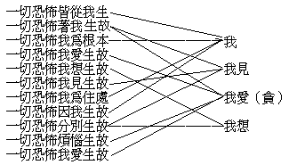



上所明即是一切烦恼由爱而生，以爱为上首，以我见、我想为副助；而我爱、我见、我想，又以我为根本。若能明此，即知一切恐怖之本胥在於我，我无则恐怖亦无。仔细思之，的确如是。平常胆大而对于生死不生惧畏之人，不过是意识所熏成之习气，而他之根本仍是有所恐怖；如打仗遇危险而不惧，不过习惯之养成，并不是离去恐怖。若果真离去恐怖，不特一切凡夫不能，即是三果之圣人于入灭定时、遇到忽击大雷之时，尚不能免去惊骇而生我之恐怖。若要离去此恐怖，即是成唯识论所谓阿罗汉与八地以上之菩萨，第七末那不执为我，始能无有恐怖。否则、皆在恐怖我执之中。由此、则知一切恐怖皆由于有我也。



丑四　结应离执



『若我住在阿兰若处不能舍离我我所执，不应住是阿兰若中，不如还住白衣屋舍。何以故？若有我相，不应住止阿兰若处；若有补特伽罗相者，不应住止阿兰若处；若人具有我我所执，不应住止阿兰若处；若有法见，不应住止阿兰若处；若有具此四颠倒执，不应住止阿兰若处。汝等谛听！若有修行依涅槃相，不应住止阿兰若处，何况更起诸烦恼相？



上明世间一切恐怖，皆由于我我所执；今于明得一切恐怖不外乎我我所执之后，要于此阿兰若中离去我我所执，此中大略可以四种意义明之。第一、总明我法二执，谓出家菩萨住于阿兰若清静之处，尚不能离去我法二执，则便与住阿兰若之本旨相违。盖住阿兰若之本旨，即是求证佛果菩提，求佛果菩提即要离去我我所执。今既不能离去我我所执，则便同于山中之野兽，不如还住白衣之屋舍，何必出家修行耶？第二、即正明我执。此中所云我相者，即是五蕴身和合之假相，即是我之总名，为有情虚妄分别而计执者。补特伽罗相者，即是「数取趣相」，数数取得六道之相，从此趣而趋於他趣，即是从此一身而到他身，若人、若畜生、若天等。虽数转变而忽此忽彼，但有此忽此忽彼之自体，即以此忽此忽彼之自体而分别计执为补特伽罗，即是我相之别名。此经但举二种我相，在他经论有知者、见者、士夫等种种我相之不同，后当明之。第三、结上之我执而起下之法执。此中之我执，即成唯识论所谓：『有情、命者、预流、一来等』。我所与法见，即成唯识论所谓『实、德、业等，蕴、处、界等』。然此中是说若有我法二执，则不应住於阿兰若处也。第四、别明法执，此中所云四颠倒执者，即凡夫於无常之法而执为常，於无乐、无我、无净之法，而执为乐、为我、为净，所以名之为四颠倒执。涅槃相者，即说修学之人，执著有涅槃所依及涅槃证得，即是涅槃之相。烦恼相者，即是执著我我所相，由执我我所相故而生诸烦恼。要之，此中是说有四颠倒执，固不能住於阿兰若，即是有涅槃相之执，尚不能住於阿兰若，何况於阿兰若而起诸烦恼相耶！



癸二　观阿兰若功德



子一　示当住阿兰若相



『汝等谛听！若有不著一切相，应当安住阿兰若处，是名当坐无著道场，一切诸法皆不可得。若心调柔无有诤论，应当安住阿兰若处。於世因缘都无所著，应当安住阿兰若处。於色、声、香、味、触等法无依止者，应当安住阿兰若处。於一切法有平等见，应当安住阿兰若处。於四威仪能调自心，应当安住阿兰若处。能舍一切诸恐怖者，应当安住阿兰若处。诸佛子等！以要言之，於诸烦恼得解脱者，应当安住阿兰若处。若得成就涅槃因者，应当安住阿兰若处。能善修行四无垢性，应当安住阿兰若处。若有少欲能知足者，应当安住阿兰若处。具足多闻有智慧者，应当安住阿兰若处。若能修行三解脱者，应当安住阿兰若处。永断能缚烦恼结者，应当安任阿兰若处。能审观察十二因缘，应当安住阿兰若处。所作已办者，应当安住阿兰若处。舍诸重担者，应当安住阿兰若处。证悟真如深妙理者，应当安住阿兰若处。



住阿兰若相者，即是住於阿兰若所应持之态度。前结应离执一科，即是不应住阿兰若之态度，因他我我所执尚未舍离，则便违於住阿兰若之本旨。今是明住阿兰若所应具足之态度，此中可以二段而明之：第一段，可说泛明住阿兰若所应具足之条件、可有七种条件：第一，不著一切相，便有住阿兰若之资格。因不著我种种相、法种种相，则便於我法皆不可得，如是则便住无所得之心。第二、若心调柔无有诤论，调柔即是调伏烦恼之心而柔顺於出世之道，无有诤论即是安住於定心而不与六尘诸缘诤论——即不缘六尘等法，盖诤论即生烦恼之过失也。第三、於世因缘都无所著，即是不著於世俗境界。第四、於色声香味触等法无依止，即是不依止於五尘及其他法。第五、於一切法有平等见，即是於止观中观一切法无二无别。第六、於四威仪能调自心，即是於行住坐卧，皆与心相应而使自心安乐。第七、能舍一切诸恐怖，即是舍离上面所举出之诸恐怖法。第二段，可说是总明住阿兰若所应具足之条件，此中举出之条件有十一种：第一、於诸烦恼得解脱者，此就最低限度能对治烦恼言，若真解脱要在见道位，究竟解脱烦恼必须在佛果位。故今从对治言，即地前亦可方便解脱烦恼。第二、成就涅槃因者，即是修四谛、十二因缘、六度乃至三十七道品等法，皆是成就涅槃因者。第三、善能修行四无垢性，即是修习无垢性品中不贪衣服、卧具、饮食、汤药之四法。第四、少欲知足，其性质略与四无垢性相同。第五、具足多闻智慧，即是具足闻、思、修慧。第六、能修三解脱者，即是空、无愿、无相三解脱门、亦名三三昧或三空。第七、永断能缚烦恼结者，此是就渐渐对治烦恼而至於极言，与前解脱烦恼稍别，彼是直就解脱而言。第八、能审观察十二因缘，即是能谛审观察无明、行、识乃至老死等法。第九、所作已办者，即是二乘人究竟证得阿罗汉果，辟支佛果，於免离生死所应作之事已办毕，再不流转生死故。第十、舍诸重担者，即是解脱烦恼，因烦恼未除则如重担之负於身，今烦恼既除则身心皆得轻安自在。第十一、证悟真如深妙理者，即是於见道位通达诸法真实如如之深妙理体。若於上之各种条件，能具足一种、二种乃至齐具，即得住於阿兰若处；否则、等於山中之野兽，或不如还住白衣屋舍之为愈也。



子二　示正住阿兰若行



丑一　不生一切分别心观



『汝等当知！阿兰若处种种药草、大小树木生阿兰若，曾无恐怖亦无分别；菩萨摩诃萨住阿兰若亦复如是，观自身心犹如枯树、墙壁、瓦砾等无有异，於一切法无有分别。我观身心犹如幻梦中无有实，念念衰老，其息出已更不复入，由善恶因随业受报。是身无常速起速灭，是身虚假终不久停。如是身中无我我所，无有情、无命者、无养育者、无士夫者、无补特伽罗者、无作业者、无有见者，如是等相本来空寂，犹如虚空亦如泡沫。常应念念作如是观，一切恐怖皆得解脱，如彼树木无有恐怖。时诸菩萨得大安乐无畏生处，是名菩萨住阿兰若，求阿耨多罗三藐三菩提。



此明出家菩萨於阿兰若处修学佛道，於一切诸法不应起分别之心，即华严经所谓『不於其处起分别，是故此中最吉祥』也。此中略可以三段说明之：第一、即是乐远离行菩萨告智光等菩萨住阿兰若修观之方法，其方法谓住於阿兰若者，观本人之身如阿兰若处之草木瓦砾，无有分别无有恐怖，菩萨之修习止观亦复如是，於一切诸法亦不应起分别。然此是现量境界，并非如草木瓦砾全无知者。第二、即乐远离行菩萨说明自己修观之法，而观得身心虚伪不实，刹那变坏乃至如是身中无我我所及无有情等。此有情等皆是我之差别相，今以般若经中之十三我相，并列而观之，便可知彼此所出我相之多少。其他经论，亦有多少不同者，兹不繁取。如下表：



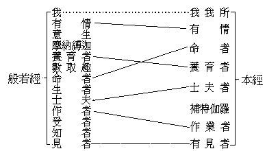



第三、即是乐远离行菩萨说明本人修观方法之后，嘱命智光等亦应如是观察，不应起分别乃至有我我所执等。若能如是观察，则便离一切恐怖而得大安乐，是名住阿兰若修菩提者。



丑二　具足一切功德处观



『复次、出家菩萨住阿兰若，昼夜相续应如是观：是阿兰若善能修习四无垢性安乐之处，是阿兰若善能修习知足之处，是阿兰若於诸烦恼得解脱处，是阿兰若具足多闻智慧之处；是阿兰若伏断烦恼所知障处，是阿兰若能入三种解脱门处，是阿兰若善能证得八解脱处，是阿兰若善能观察十二缘处，是阿兰若善能断除业障之处；是阿兰若能得初果预流之处，是阿兰若能得第二一来果处，是阿兰若能得第三不还果处，是阿兰若得第四果阿罗汉处；是阿兰若证得辟支佛果之处，是阿兰若已办所作得自在处，是阿兰若舍诸重担得轻安处，是阿兰若证得二空真如之处。



『是阿兰若能修无量大慈心处，是阿兰若修证无量大悲心处，是阿兰若能善修习喜无量处，是阿兰若善能修习舍无量处。是阿兰若能发菩提心处，是阿兰若菩萨修持到十信处，是阿兰若复次进修到十住处，是阿兰若展转增修到十行处，是阿兰若展转修行十回向处，是阿兰若善能修习四善根处，是阿兰若修行六度波罗密处，是阿兰若修行初地至十地处。是阿兰若证得六根清净之处，是阿兰若善能证得天眼通处，是阿兰若得天耳通及宿住智、生死智明、神境、他心如是通处。



『是阿兰若有惭愧处，是阿兰若不放逸处。是阿兰若修五根处，是阿兰若证得无量无边三昧之处，是阿兰若能得恒沙陀罗尼门证自在处，是阿兰若悟无生忍，是阿兰若永出三界断生死处，是阿兰若得不退转，是阿兰若降伏一切众魔怨敌，销除业障见佛闻法如是之处。是阿兰若得佛不共最上法门。是阿兰若修习戒蕴清净之处，是阿兰若出生无漏三摩地处，是阿兰若能生般若证解脱处，是阿兰若能生解脱知见之处。是阿兰若得三十七菩提分法。是阿兰若能得解脱十二入处，是阿兰若永离有漏十八界处。是阿兰若微妙观察十八空处，是阿兰若容受一切诸法空处。是阿兰若增长十善法生之处，是阿兰若增长坚固菩提心处。是阿兰若三世诸佛赞叹之处，是阿兰若一切菩萨恭敬赞叹如是之处。



『是阿兰若毗婆尸佛於尼俱陀树下成道，是阿兰若尸弃如来於尸利沙树下成道，是阿兰若毗舍如来阿尸婆多树下成道，是阿兰若俱留孙佛无忧树下成等正觉，是阿兰若俱那含牟尼如来优昙树下成等正觉，是阿兰若迦叶如来娑陀树下成等正觉，是阿兰若释迦如来於毕钵罗树下成道之处。汝等当知！阿兰若处有如是等无量无边功德胜利』。



此明出家菩萨住於阿兰若处，应观阿兰若处具足如是种种功德。此中从复次出家菩萨至证得二空真如之处，略与前「住阿兰若相」科中后段『诸佛子等以要言之』以下文同，今且摄表以明之。



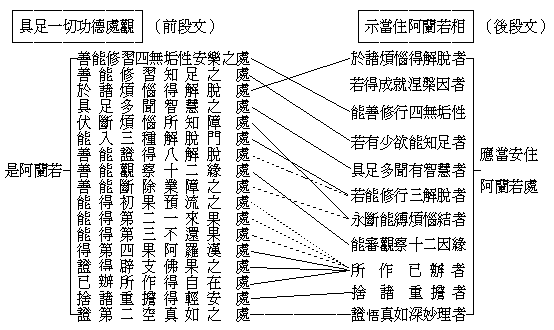



此中所出之功德，虽比前住阿兰若相后段文中稍多，但不过开合之不同耳。如此中於三解脱之后又加以八解脱一条，虽名相不同，然皆是修无所得之空观法。所谓八解脱者：一、内有色想观外色解脱，二、内无色想观外色解脱，三、净解脱身作证具足住，四、空无边处解脱，五、识无边处解脱，六、无所有处解脱，七、非想非非想处解脱，八、灭受想定解脱身作证具足住。此略与八胜处、十遍处相同，为上二界与三乘所共修之法。其善能断除业障功德，略与阿兰若相中之「永断能缚烦恼结」相同，不过明阿兰若功德中，就其烦恼所感得之业果而言耳。此明阿兰若功德中，多出声闻四果与辟支佛果，即阿兰若相中之「所作已办」摄之。其阿罗汉果与辟支佛果，正是所作已办之人；其声闻之前三果，虽不即是所作已办者，但阿罗汉果是基於此三果者，故亦摄之於所作已办中。此明阿兰若功德中又举出所作已办者，总明二乘人之得自在，亦无妨碍。前阿兰若相中有「若得成熟涅槃因者」一条，虽未摄於此何种功德中，但此一条可说是总明修菩提道法者，则可通摄一切。要之、此表中用实线者，即是上下相同；其用虚线者，则可摄於某种中。



次从是阿兰若至舍无量处一文，明阿兰若能修得慈无量、悲无量、喜无量、舍无量之四无量心功德。次从是阿兰若至至十地处一文，明菩萨三僧企耶求佛果菩提，於所经历行位之功德；即是从初发心进而到十信，更进而到十住，再进而到十行，如是展转增进而到十回向，再由十回向展转增进而到四加行，於中修行六波罗密，乃至登极喜地以至十地。但六波罗密在地前所修者是有漏之功德，不得名为清净波罗密；在地上菩萨所修者，则便名为无漏功德清净波罗密。次从是阿兰若至如是通处，明身心获益之功德。初是六根清净功德，六根清净即是住阿兰若能使无始以来眼等诸根之罪垢悉皆消除，即成诸根互用圆通无碍之功德。其次即是获得六神通之功德：此中之宿住智即宿命通，生死智明即是漏尽通。因此通於诸烦恼已尽净无餘，更不落於生死，故对於生死已明了通达，非是天眼通。天眼通但见六道众生死此生彼之相，且此中已举出此通，所以断除烦恼是漏尽通，断除生死而不受於生死之谓也。此中所以称智称明者，因此六神通是由於证得圣智而发，或与圣智相应，故此中称宿住智及生死智。又此言生死智明者，若以三明而论，则宿命通为三明中之一明。明之功用，较通之功用稍强，但此中互用而不分耳。



次从是阿兰若至不放逸处，明住阿兰若能得善心所之功德，即是住於阿兰若能生惭愧之心及不放逸之心。次从是阿兰若至最上法门，此明住阿兰若能生一切诸法功德。最初、即能修练五根，五根即信、勤、念、定、慧，为三十七菩提分法中之五根菩提分法。其次、即能证得无量无边三昧，三昧即是禅定。又其次，即能得恒沙陀罗尼门自在，陀罗尼即是总持，总持一切法、一切义、一切定慧、一切咒术而不散失，即说总持恒河沙数之善法亦得自在无碍。又其次、即能悟无生忍，无生忍即忍可印证诸法真如之理体为无有生灭者，故云无生忍，此在初地见道位及八地等皆得悟入。又其次、即能永出三界断生死处，断除烦恼障即是断生死，断生死即是永出三界。又其次、即能得不退转，即是於诸善法唯有增胜而不退转。又其次、即是能降伏众魔怨敌及消除业杂染而见佛闻法。众魔，即烦恼魔、五阴魔、死魔、天魔等，此众魔能障人之佛果菩提，故称为怨敌。又其次、即能得佛之不共法门——十八不共法或是一百四十功德法，皆为不共二乘之法。次从是阿兰若至能生解脱知见之处，明阿兰若处能生戒、定——三摩地、慧——般若、解脱、解脱知见之五分法身功德。次从阿兰若至菩提分法，明阿兰若处能生三十七菩提分法之功德，即是四念处、四正勤、四如意足、五根、五力、七觉支、八正道是也。又从是阿兰若至十八界处，明阿兰若处能得解脱十二入、及永离有漏十八界功德。眼等六根和色等六尘相合，即是十二入；根尘相对而生六识，即是十八界。次从是阿兰若至诸法空处，明阿兰若处能观察十八空乃至能容受一切诸法空。十八空，即智度论、般若经等所谓：内空、外空、内外空、空空、大空、第一义空、有为空、无为空、毕竟空、无始空、散空、性空、自性空、诸法空、不可得空、无法空、有法空、无法有法空。其实，十八空亦可概括一切空法，但有此一切诸法空，则其范围比之於十八空又更广阔，以其无限量故。次从是阿兰若至菩提心处，即明阿兰若处能增长十善法及增长坚固菩提心。十善法即是身三支，不杀、不盗、不淫；口四支，不妄语、绮语、两舌、恶口；再加无贪、无瞋、无痴之意业三善根，则成为十善法。次从是阿兰若至如是之处，即明阿兰若为三世诸佛之所赞叹，及一切菩萨之所恭敬赞叹。



次从是阿兰若至成道之处，明於阿兰若处成道之功德。毗婆尸，又作毗钵尸、微钵尸、毗婆沙维卫，盖梵音有轻重之不同其义一也。梵语毗婆尸，译曰胜观，或译种种观、种种见等，此是过去七佛之第一尊，而为庄严劫千佛中之最后第三佛也。尼俱陀树，又名尼拘陀树，此云无节，亦云纵广树也。此树端直无节，圆满可爱，离地三丈餘方有枝节。尸器，或作式弃、式诘，译曰持髻、曰胜、曰最上、曰顶髻、曰火髻，以入火光定而断欲惑故。此为七佛之第二尊，为过去千佛中最后之第二佛。尸利沙树，尸利沙者，吉祥之义，即此方之合昏树也，俗名为夜合树。尸弃如来於此树下成道。毗舍，即毗舍浮，又名毗舍浮、毗湿婆部、毗摄浮、鞞恕婆等，此云一切胜。毗湿婆译作遍一切，部即自在义，即是遍一切皆自在。为过去千佛中之最后一佛，七佛中之第三佛。阿私婆多，亦云阿湿婆他。梵语阿湿婆，此言马陀者脚，合而言之曰马脚树。俱留孙，亦云拘留孙、鸠楼孙。拘留孙译云所应断已断，或译灭累，或译成就妙美，为七佛中之第四佛，为现在贤劫千佛之第一尊。无忧树即梵语阿输迦树也。悉达太子亦生此树下，即岚毗尼园之无忧树。然俱留孙佛成道之树，但同此名，非即悉达太子诞生之树。俱那含牟尼，又作拘那含牟尼，或作迦诺迦牟尼，译曰金寂，或译金色，或金寂静，或仙人，是贤劫中第二佛，七佛中第五佛。优昙，具云优昙钵罗，译云灵瑞。法华文句云：「优昙华此言灵瑞，三千年中一现，现则金轮王出」。按此树为无花果类，产於喜马拉耶山麓及锡兰等处。迦叶，具云迦叶波，此言饮光，此为现在劫中第三佛，七佛中第六佛。娑陀、即娑罗树，此言坚固；与释迦如来入灭之树同类。其树四方各生二株，人可於中间居住者也。释迦者姓也，此言能仁；牟尼者即如来之德号，此言寂默，即能仁寂默，为现在劫之第四佛，七佛中之第七尊。毕钵罗树，即菩提树，佛坐其下成等正觉，因谓之菩提树。昔佛在世，高数百尺，屡经残伐，犹高四五丈。茎干黄白，枝叶青翠，每至如来涅槃之日叶皆凋落，顷而复故。探玄记二十四曰：「毕钵罗树，此云榕树，在岭南亦有此树」。按亦即川、滇、黔之黄桷树。上明七佛住阿兰若於诸树下成等正觉，下从汝等当知至功德胜利，即总明上来住阿兰若处之种种功德。然上面所列之功德，不过举其大略，其实无量无边功德而不可计喻者也。



壬二　重颂



尔时、乐远离行菩萨为诸大众而说偈言：『出家菩萨住兰若，当作何念及何业？世间所有诸恐怖，皆从我见、我所生。若能断除我我所，一切恐怖无所依；若有能执我见心，毕竟不成菩提道：涅槃常住皆无相，何况烦恼非法相？不著诸法及众生，心无诤论修正念，四威仪中调伏心，应住兰若常寂静。能断烦恼、心知足，住於兰若空寂舍，入三解脱无相门，住於兰若离尘垢。能观十二因缘法，四谛、二空真妙理，世间八法不倾动，如是大士住兰若。能观自身如枯木，亦如水沫及幻梦，不著二边平等相，如是萨埵住兰若。罪业缠缚无常身，本来虚假元无实，我法二执及罪相，於三世中不可得。自身他身无有二，一切诸法亦如是，谛观法性无去来，如是菩萨住兰若。栴檀涂身及赞叹，以刀屠割并骂辱，於此二人无爱憎，如是菩萨住兰若。出家乐住阿兰若，昼夜应作如是观：阿兰若处真道场，一切如来成正觉；阿兰若处妙法空，出世正法之所生；阿兰若处圣所尊，能生三乘圣道故；阿兰若处圣所宅，一切圣贤常住故；阿兰若处如来宫，十方诸佛所依故；阿兰若处金刚座，三世诸佛得道故；阿兰若处涅槃宫，三世如来圆寂故；阿兰若处大慈室，菩萨住此修慈故；阿兰若处是悲田，三世诸佛修悲故；阿兰若处六通室，菩萨於此游戏故；阿兰若处大无畏，能断一切恐怖故；阿兰若处三摩地，诸求道者得定故；阿兰若处陀罗尼，诸持咒人神力故；阿兰若处善法堂，增长一切善法故；阿兰若处菩提室，菩萨修道得忍故。若欲永超三界苦，菩提、涅槃当修证，遍周法界利群生，应居兰若菩提室。所修六度、四摄法，回施三有及四恩，自他俱入甘露城，同证一如真法界』。



此中初一颂，颂出恐怖本之一科。次一颂半，是颂前长行结应离执一科文。次三颂，是颂长行示当住阿兰若相文。次四颂，是颂长行不生一切分别心观。次八颂，是颂长行具足一切功德处观。次二颂，是总结长行并重颂之颂。即是要有情住阿兰若求佛果菩提，以远离生死之苦而修四摄六度，作自利利他之事业。所谓四摄者，即是布施、爱语、利行、同事之四，以此四法而摄受一切有情，故名四摄。三有者，即三界之别名，因三界有於生死之苦，故名三有。甘露城，即是涅槃城。一如真法界，即是一真法界或真如法界。



庚二　如来印成



尔时、乐远离行菩萨摩诃萨为诸大众说是法已，佛言：『善哉！善哉！善男子！汝为大众及未来世求佛道者，分别演说阿兰若处殊胜功德，利益安乐现在未来一切众生，趣向菩提正真觉道，汝所成就无量功德，千佛共说不能穷尽』。



此以前乐远离行菩萨在如来法会中，对在会大众说明本人出家修行之心得。一方面明处於世间为种种不善法之所染污，不易解脱三界生死之一切恐怖；一方面又明若要出离世间之一切恐怖，则必须处於阿兰若处而修佛道，因阿兰若处能生一切清净功德。故嘱在会诸众，出离五欲杂染之地，而於清静兰若依其所说之法而作如是观。但说虽如是说，而不知是否与佛相同，因要释众之疑惑，故有如来出而印证许可，以明其说真实非虚，以释在会疑惑，且亦令未来生信，此即本科文之大意也。



庚三　法众获益



尔时、会中智光菩萨、无量阿僧祇菩萨大众，闻阿兰若最胜功德，即得闻持陀罗尼门。无量众生发无等等阿耨多罗三藐三菩提心，得不退转。千亿众生远尘离垢，得法眼净。



此即智光等无量无数菩萨，得闻乐远离行菩萨说阿兰若之功德，即获得闻持陀罗尼之利益。闻持陀罗尼，乃四种陀罗尼之一，即是闻听佛法而总持不失也。次有无量众生发菩提心得不退转。次有千亿众生，远尘离垢得法眼净，其义如前诸获益中说。上来，应机渐说中之五乘共法，於此告毕。



丙二　三乘共法



丁一　大乘共行二乘法——十行



------



### 厌身品第七



这一品，属於三乘共法的大乘共行二乘法。此中所谓三乘：一、声闻乘，又云小乘，速则三生，迟则六十劫，修生空法，终於现世闻如来的声教，悟四谛的真理以证得阿罗汉果。二、缘觉乘，又云中乘，辟支佛乘，速则四生，迟则百劫，修生空法，在他最后一生不依如来的声教，只要感飞花落叶的外缘，自觉十二因缘的真理以证得辟支佛果。三、大乘，又云菩萨乘，三无数劫间修六度万行，以证得无上菩提果。但是，这三乘都共修习四念处观，所谓四念处观：一、身念处，观身体为不净的东西，此肉体是父母所生的，肉体的内外污秽充满，没有一点儿清净的地方，所以观身为不净。二、受念处，观受为苦，受是苦乐的感觉，但乐是从苦的因缘而生，复又转生苦，世间没有实乐，所以观受为苦。三、心念处，观心为无常，心依六根缘六尘，刹那刹那的生灭，没有常住的时候，所以观为无常。四、法念处，观法为无我，因为法没有自主自在的本性，所以观为无我。这是就苦谛而修的四念处，我们之所以有苦，因有此身、受、心、法四事，所以就此四事而观不净、苦、无常、无我，对破凡夫常、乐、我、净的四颠倒。此四念处以慧为体，慧依定、依念，念念於身、受、心、法所观之处，所以得名念处。如法华玄义卷三云：『念处是观苦谛上四智，治於四倒，四倒不起由此四观』。所以观此四法，对於超出三界有漏之法有所助益，固然是声闻、缘觉二乘人所修证的境界，亦大乘人共修共行的法，以大乘人亦应对破凡夫四颠倒的邪见故。大乘人虽不能抛弃教化众生的负担，而亦须断除三界的有漏烦恼。



「大乘共行二乘法」标题之下，有「十行」二字。从五乘看，通於三乘；从大乘看，由十信、十住、至十回向、四加行位菩萨所修行的法，这是必经阶段而不可忽略的。如善财童子所参访的善知识，十住、十行位都是出家比丘，是修声闻、缘觉法的二乘人。这样，前厌舍品、无垢性品、修十信的，阿兰若品、离世间品、修十住的，以及此厌身品修十行的，都是出家比丘和菩萨共同修行的。所以，善财童子所参访的善知识，修十信、十住、十行法的，都是声闻、辟支佛等二乘人。然此十信、十住、十行、十回向四位，为菩萨的资粮位，又为菩萨胜解行地，以菩萨法空胜解力而修六波罗密行。因为修诸观者以法空胜解为最，若能证得法空的境界，则能伏断一切三界有漏烦恼，这即是修三乘出世观位的实证。



从经文看此品的结晶所在，如弥勒问云：『自於是身应作何观』？所以，此品可以题作观身品。谁也知道，最切近的是身，无论他是美的或丑的，但爱惜他，的确超越一切之上。所以，此品中有三十七观，最后观身犹如车乘。「身」，梵语「伽耶」，此云积聚，是一聚集的个体，是很多分子积聚起来的。以如今的团体来解释他，这是最适合的。佛法所谓「一聚」，不能称为个体，是一个团体，这是我们应有的认识。然而一聚者，有狭义，有广义。从狭义说，此身仅是一个色法的集团，是五蕴之中的色蕴，此色蕴包括五根、五尘、四大诸元素，由此诸元素组织成团体，名之曰身。但此更有别、有通，别则眼、耳、鼻、舌、身五根的区别中，身只是五根之一；通则是整个的身。若将此身详细的考察，是各种元素在一起，都互有关系，不可偏废。所以、此身可作为五根的动力所依，此身的团体中有五根互相发用。如眼根有能发眼识作用，能观察外界各种现象的形形色色；其他耳、鼻、舌、身都有同样的发识功能。虽然身为五根所依止之处，而五根各有其特质，各有等次的，如一色聚而没有五根，则不能名之曰有情身，但是四大、五尘的积聚，不能有思想作用，却成为无机物了。从广义说，身又是五蕴组织成的团体，即色、受、想、行、识五蕴。一、色蕴，总括五根、五境等有形的物质；二、受蕴，对境而感受苦乐；三、想蕴，对境而想像彼此；四、行蕴，对境而造作善恶；五、识蕴，对境而了别识知。由此五蕴各别的作用，总集而成谓之身，所以不能专指色法而言。若身心分别而言，色蕴即身，而受想行识四蕴即心。心中受、想、行三者，为心上特别的作用，名之曰心所有法，即心王所有之法。而识为心的本性，可名之曰心王。因五蕴为身心的二法，如欲界、色界有身体的有情，这是五蕴而成；无色界无有身体的有情，只有四蕴（除色蕴）而成。这五蕴身，是虚伪的，如增一阿含经二十七云：『色如聚沫，受如浮泡，想如野马，行如芭蕉，识为幻法』。



这样，有情身由五蕴的色心二法组织而成，所以是活动的有机体，正适合佛所说的萨迦耶见的意义。「萨迦耶见」，此云有身见，五见中的身见执著五蕴假和合的团体，以为有真实的我而起我我所的偏见。我们所知道的身，即五根、五尘、四大和合的色身。但人是五蕴的身，不是唯一色蕴的身，若仅是唯一色蕴，那是没有情识活动的死尸了。此五蕴之法，是刹那生灭的，相续的，是「各别的因」和「相互的缘」合成的。此仗因托缘生起的五蕴之法，因业力所引而不散乱，相续不断而成为身。等到业力尽了，全体的生命如破沙盆也似的粉碎了。至此、五根败坏，四大分离，前六识亦不起，一切业力都潜伏在第八阿赖耶识里，遇有相当的因缘，则由强力的业力发动，又成为后世的有情身。於是生而复死，死而复生。复次、此中所观的五蕴身，为五取蕴身。取即烦恼，取即贪爱的增上相，所以这五取蕴身也即三界有情的有漏身。如将此所观的身，认识清楚，则可以明白此品的大意了。



戊一　弥勒兴问



尔时、弥勒菩萨摩诃萨即从座起，偏袒右肩，右膝著地，合掌恭敬而白佛言：『世尊！我等既悟出家菩萨摩诃萨厌离世间住阿兰若，调伏其心修无垢行，然此菩萨住空闲处，自於是身应作何观』？



这三乘共法——厌身品、波罗密多品、功德庄严品，都是弥勒菩萨所提问的。这是根据前四品佛所说的离世间而住阿兰那的扼要处，而使住阿兰那者对於人生更进一步来观察，对於了解人生格外深入一层，得到完全的透彻。住阿兰那的出家菩萨，已具有正信、正戒、正见，能调伏身心修无垢行，修习禅定止观，然而对自身应修什麼观？前厌舍品的厌世观，正明出家的原因，完成个人的信念与理想；离世间品为出世修行之所依止，此品正明出世观的本相。所谓「出世」，并不是将此身抛出世界之外，应知这个身就是世间，只要对於此五蕴身能看破，这就是出世。所以是身应作何观，正是三乘出世观的扼要处；阿兰那不过修此观行的场所而已。能否脱离烦恼的迷网，要看心里有没有光明的出世观境，住阿兰那决不是暝坐就可了事；唯在什麼都不摇动的那个入定的圆澄心，才可以开拓真善的人生出来。所以、维摩在示病时，为众人观身无常苦空，而论到自身应作何观，却云：『观身实相，观佛亦然』。这完全是心理解放，浊性去尽，清醒的洁净的披露。若能不被有漏的五取蕴身和四颠倒见所迷惑，观察他是不净的、虚伪的，即见实相实性的真理。本来万法都是幻生的，空的，若能『照见五蕴皆空』，幻化空身即是佛的法身。然观身有深浅的区别，先要认识此五蕴身是苦、空、无常、无我的，他不能给予快乐和自由。所以、弥勒的请问，是极有价值的，是代表胜解行位的大乘人而问的，也是代表二乘人回小向大而问的。这是弥勒菩萨以胜应身而说法，亦是弥勒为摄受十行、十回向地前的菩萨而说法。从另一方面说，弥勒现生兜率及将来阎浮提成佛说法，这都是变化身，都是说三乘法的，所以由弥勒来启问。其实，这三乘法亦就是地前大乘共修的法。从两方面看，从一分三，从三归一。这三乘共法，唯佛的应化身说，这是一乘菩萨为满足三乘人的幸福而说的。



戊二　世尊许说



己一　许诺



尔时、佛告弥勒菩萨言：『善哉！善哉！善男子！汝为众生起大悲心，请问如来入圣智观妙行法门。汝当善听！今为汝说』。『唯然！世尊！愿乐欲闻』！



佛对弥勒说：你的大悲心，为摄受十地以前的大乘众而问入圣智观的法门。要和圣智观相应，须具有正信、正戒、正见、正定，否则没有修入圣智观的希望。你听著！我今特为你们解说。是的！世尊！我很愿意听你讲。



己二　解说



庚一　总标有漏身观



『善男子！出家菩萨住阿兰若，求阿耨多罗三藐三菩提时，四威仪中微细观察：是有漏身，三十七种不净秽恶，是不可爱、是不坚牢。



前面曾讲过，住阿兰那的出家菩萨和鸟兽、猎人、隐士者流是完全不同的，他是修禅定的人，以定而修圣智观而求无上佛果的。将这有漏身，涉在四威仪中去观察，观这有漏身包含有三十七种不净的，无常的，苦的，空的，无我的，堆著污秽的怨毒。这种观察，便是佛法的实验。如今科学家谈实验，是在外面另取一物来实验；佛法则以自身来实验，这是超人一等的。



庚二　别分三十七观



『当观此身犹如坯器，外以杂彩金银七宝巧饰庄严，内以粪秽种种不净填塞充满，两肩担负随器而行，其有见者皆生爱乐，不知器中盛满不净。有六黑蛇常在此器，一蛇随动器即破坏，毒害臭恶竟无所堪。世间之人庄严其身，如彼彩畫盛不净器。贪、瞋、痴三名为心病，风、黄、痰、癊名为身病，内外六病能害身心，如彼六蛇居於器内；一一蛇动器即破坏，一一病发身即无常。善男子！出家菩萨处於空闲观察是身，名为第一不净观相。



『出家菩萨於日夜中，又观自身臭秽不净，犹如死狗。何以故？彼身亦是父母不净为生缘故。出家菩萨又观自身如蚁子台安住众蚁，时有白象来至台边，以身触台台即崩碎。善男子！此台所谓五蕴之身，白象是为琰魔罗使，身归后世如象坏台。出家菩萨，又观自身而作是念：我今此身从顶至足，皮、肉、骨、髓共相和合以成其身犹如芭蕉中无实故。出家菩萨又观自身无有彊力，皮肉薄覆如涂附墙，亿万毛发如草生地，微细风大出入毛孔，谁有智者当乐此身？刹那刹那衰败转故。出家菩萨又观自身如养毒蛇而取其害，我今虽以饮食衣服资长是身而不识恩，毕竟还令堕於恶道。出家菩萨又观自身譬如怨家诈作亲友，伺求其便而将毒药断彼命根；我身如是本非真实，终致无常，非圣爱故。出家菩萨又观自身如水上泡，虽复妙好琉璃珠色，刹那因缘起灭无恒，有为念念不久住故。出家菩萨又观自身如乾闼婆城，虽现相状而不实有，今者我身亦复如是。出家菩萨又观自身犹如影像，我身亦尔虽有非真。出家菩萨又观自身譬如外国彊盛怨敌，今者我身亦复如是，烦恼怨敌侵掠善根。出家菩萨又观自身如朽舍宅，虽加修葺当必崩坏，我身亦尔，虽加爱念当必无常。出家菩萨又观自身如近怨国，城邑人民常怀恐怖，今者我身亦复如是，於念念中畏无常怨。出家菩萨又观自身，如无量薪为火烧𦶟，然是猛火曾无厌足，我身亦尔，以贪爱火烧五欲薪，其心增长亦复如是。出家菩萨又观自身如新生子，慈母怜愍恒加守护，我身亦尔，若不守护病之身心，即便不能有所修证。出家菩萨又观自身本性不净，譬如有人厌患炭色，设诸方便以水洗之，经无量时黑色仍旧，乃至炭尽终无所益。我身亦尔有漏不净，假使海水尽未来际洗之无益，亦复如是。出家菩萨又观自身如油沃薪以火焚烧，又遇大风势不可止，是身亦尔名五蕴薪，沃贪爱油，纵瞋恚火，愚痴风力无有休息。



『出家菩萨观於自身犹如恶疾，四百四病所住处故；亦如大肠，八万四千虫所住故；是无常处，出息不还即无常故；亦如非情神识易脱，同瓦石故；亦如河水刹那前后不暂住故；亦如压油，於一切事受劳苦故。无所依者，犹如婴儿失父母故；无救护者，犹如虾蟆蛇所吞故；如穴无底，心心所法不可知故；恒不知足，於五欲乐心无厌故；恒不自在，断常二见所系缚故；不生惭愧，虽蒙眷属养育弃舍生故；亦如死尸，於日夜分近灭坏故；唯受诸苦，於一切处无真乐故；为苦所依，一切众苦依身住故；如空聚落，於是身中无主宰故；毕竟空寂，遍计所执妄构畫故；如谷中响，皆是虚妄所显现故；亦如船舶，若无船师即漂没故。亦如大车运载财宝，何以故？乘於大乘到菩提故。



这段文，可分为广观、中观、略观三层来观察：



一、广观：这是三十七中的第一观，观此身如土坯所成的器具，外以各种宝色庄严引以为美观，其实内里充满种种不净的东西。外人认为形体好看，实际上不但是不净的，而且还有六条黑蛇，是活动的，而且还要吐那臭而不可闻的气。世间人也是如此，人有贪、瞋、痴三种的心病，和风、黄、痰癊三种的身病，这内外六病犹如六条蛇，能坏身心；若身心一病发，则整个身体的怨毒一一爆发了。内外各部分，同时毁坏，毁坏成一撮的遗灰。这是观身无常、不净。



二、中观：这是不广不略观，有十六种：从第二观起，观身臭秽不净犹如死狗，因为此身的来源，由父母不净的赤白二质和合而成的。第三、观此身犹如蚂蚁用土造作的窠，这是无常观。第四、观此身如芭蕉无实质，是众多和合而成的假相，这是无我观、空观。第五、观此身无强固力，刹那刹那衰灭败坏，这是无我、无常观。第六、观此身如养毒蛇，能伤害自己的性命，使你造诸恶业，这是不净观。第七、观此身如怨家，假作亲友，在你吃食物的时候暗放毒药。此身亦然，不顾一切恩爱，一味地杀、盗、淫，於是堕落地狱无有出期，这也是无我、无常观。第八、观此身如水上泡，这是无常观。第九、观此身如海市蜃楼，虽有相状可看而不是实有，这是空观。第十、观此身如影像，这是空观。第十一、观此身如遇怨敌，虽然你要出家修行善法，而身体偏要害善根种子而造恶，这也是不自由的无我观。第十二、观此身如腐败的房子，虽然你常常爱护他、修理他，他毕竟还是倒地，这是无常观。第十三、观此身如与敌国相近，时有恐怖，民不聊生，如中国与日本，这也是无我观。第十四、观此身如火烧薪，你有贪心贪求财产，纵然天下人的财产完全归你所有，心里认为还不满足，这是苦观。第十五、观此身如出母胎的婴儿，全靠母亲的调养。此身亦然，整个的身体都是病，内外有六蛇，倘没有适当的调伏，则霎时间坏灭了。所以、为了要修禅定、培植福德与智慧，虽然此身是假的，不应贪爱，也不可不时时去爱护他，这也是无常观。第十六、观此身如炭也似的完全是黑的，从生不净乃至一期死了成为一堆白骨，亦是不净。第十七、观此身如油沃薪，既被火烧又遇大风。比方五蕴是薪，贪即油，瞋即火，痴即风，烧得一撮遗灰也寻不到。



三、略观：此中有二十观。第十八、观此身如恶疮，观此身有四百四病。四百四病者，如智度论六十五云：『四大为身，常相侵害，一一大中百一病起：冷病有二百二，水、风起故；热病有二百二，地、火起故』。四大为根本，每一大连枝末有一百一，共计四百四。第十九、观此身如大肠，肠内有很多的虫，所以此身全是虫的成分。所以科学家说，人身上有无数的细胞，这细胞即是虫，因为是活动的。第二十、观此身是无常的。第二十一、观此身如非情（无我）。第二十二、观此身如河水不能停止。第二十三、观此身如压油，因为太劳苦了，这是苦观。第二十四、观此身如无母的婴儿，这三界众生没有佛依止。第二十五、观身一旦无常到来，无救护的人来援救。第二十六、人的起心动念，不知从何而来。第二十七、观身不知足，如漏沙盆，放什麼在里面都漏完了。第二十八、观身不自在，不是常见就是断见。第二十九、观人不知惭愧，死神到来，也不顾虑眷属的恩爱，就跟著死神去了。第三十、观此身现在虽没有死，然而刹那渐渐趋於衰老。第三十一、观此身唯有受苦，虽有时快乐，但由苦而来，这是苦观。第三十二、观此身唯是忧悲苦等依，如老子云：『吾所以有大患者，为吾有身，及吾无身，吾有何患』？第三十三、观身无主宰。第三十四、观身完全是空的，是虚妄所显的，不过愚痴众生妄执有我。第三十五、观身如空谷传声，空无有实。第三十六、观身如无师之船，所以我们要修禅定。要有正信、正戒、正见，可以行到彼岸，不致有漂泊之虞，这是以有漏身显法性身。第三十七、观身如大车，可以到菩提彼岸。这后二种通於大乘，用五蕴身修出世之法，不但遍行世间而且能达到彼岸。善用此身者，即是自度度他的慈航宝筏。



庚三　亦作大乘身观



『善男子！出家菩萨日夜观察，非不爱惜如是之身，欲令众生出生死海，到彼岸故』。



这可附在三十七观后二观之中，即是观此身不但能自度，而且以此身去度人，所以要爱惜此身，将来能辗转广度众生，出生死海到菩提岸。所以、此身亦不可轻视，将来扯起风帆，投入无边报恩海里，便是自度度他的大乘身。



己三　结成



尔时、世尊说是法已，告弥勒菩萨摩诃萨言：『善男子！修如是行，此则名为出家佛子所观法要。若有佛子发菩提心，为求阿耨多罗三藐三菩提，住阿兰若，修习如是三十七观，亦教他修如是法要，解说、书写、受持、读习，远离一切我我所执，永断贪著五欲世乐，速能成熟不坏信心，求大菩提不惜躯命，何况世间所有珍宝？现身必得究竟成满一切如来金刚智印，於无上道永不退转，六度万行速得圆满，疾成阿耨多罗三藐三菩提』。



世尊说完了法，於是对弥勒他们说：上面的三十七观，是出家菩萨住阿兰那所修的观，能自观也叫他人观，这即是自度度他辗转流通的法要。若能以此去修习，则可离我我执和人海间的五欲。赶快看空了你的幻身吧！出离了四大构成的幻象的世界吧！假若你想证得出世的究竟佛果的话。



戊三　法众获益



尔时、会中八万四千新发意菩萨，深厌世间得大忍力，不复退转於无上道。百千婆罗门发菩提心，成熟信根得不退转。三万六千善男子、善女人，远离尘垢得法眼净。



在会中有八万四千初发心的菩萨，闻是法已，感觉到这世间的无趣，因为已证得大胜解力了。同时、有百千婆罗门因为专心笃意的听闻教法，就有菩提心生起而得不退转。再有三万六千的一般善男信女也得了见法的眼。



丁二　二乘回趣大乘法——十回向



戊一　修行诸度



------



### 波罗密多品第八



「波罗密」者，此云到彼岸，如世间之过渡者，其目的即从此岸而达到彼岸，故名到於彼岸。但此「到彼岸」者，以所喻之佛法而论，即以生死为此岸，涅槃为彼岸，诸菩提分法为渡舟；以此诸菩提分法之渡舟，从此苦岸渡过烦恼海之边际而达到究竟常乐之目的，乃名为到彼岸也。所以、此到彼岸之意义，若广而言之，即是三界、六道生死轮回为此岸，以无住处大般涅槃为彼岸也。又此三界皆以名言假立故，一切有漏虚妄分别为此岸，而根本无分别智所证究竟实相之理为彼岸也。略言之，生死为此岸，涅槃为彼岸，我法二执及一切烦恼所知之二障，与有漏业为中流，以布施持戒等为渡舟也。所以，度生死之海而到於涅槃之岸，其中间必断除二执，解脱二障，圆满一切功德法财，而后方能达到无上菩提之目的。二执为二障之所依，有二执故即有二障，有二障故即起一切有漏善不善法轮回生死海中，所以要超过生死海，必须解脱二障之根，方能为圆满究竟之到彼岸也。



此「到彼岸」，简言之，即以菩提分法为能度，以三乘人为所度也。菩提分者，广为三十七道品，略为戒、定、慧之三学，而广略适中即是大乘六度或十波罗密法。由此十种波罗密法，成就一切功德，圆满法身，而度脱断除一切烦恼有漏之苦法；所以此十种波罗密法，为自度度他自利利他之工具也。此即略明波罗密多之大意。



此品属三乘共法中之第二大科。前品为大乘共行二乘法，今此波罗密多品和功德庄严品，即是二乘回趣大乘法，明二乘向大所应受之法也。若从别一方法观之，厌舍无垢两品之超欲界法，是「十信」菩萨所修之法；阿兰若、离世间两品之超上界法，即是「十住」菩萨所修之法；厌身品之共行二乘法，即是「十行」菩萨所修之法；今此波罗密多、功德庄严两品之回向大乘法，即是「十回向」菩萨所修之法也。又此波罗密者，本为信、住、行、向、地菩萨之所共修，但十信菩萨多修戒，十住菩萨多修禅定，十行菩萨多修观慧，而此十回向菩萨则定慧均修，故专名波罗密多，为十回向菩萨所修之行也。「回向」者，即回事向理，回因向果，回自向他，亦即回众生法而趣向菩提，回世俗法而趣向第一义谛也。



己一　长行



庚一　问答偏赞阿兰若



辛一　慈氏兴问



尔时、弥勒菩萨摩诃萨白佛言：『世尊！以何因缘殷勤称赞住阿兰若修菩萨行，而不称赞住於餘处修菩萨行？如来一时在灵鹫山，为诸菩萨广说法要而作是言：「菩萨或时止淫女家、亲近屠者，示教利喜，无数方便饶益众生，为说妙法令入佛道」。世尊今日为新发意所说妙法而不如是。然我等类亲於佛前得闻深法，无有疑惑，惟愿如来为未来世求佛道者，演说甚深微妙真理，令菩萨行无复退转』。



弥勒菩萨兴问世尊，为何偏赞阿兰若处而不称赞餘处。换句话说，世尊称赞菩萨修菩萨行时，若住阿兰若处，即获得无数之功德方便、利益，乃至速得圆满证大菩提，其理由安在？同时、世尊不赞餘处，和说餘处有种种不便菩萨修菩萨行事，及难成办菩提之果，其理由亦何居？如来一时下，即举佛昔时说法和现时说法之矛盾处，兴问世尊偏赞阿兰若之意义也。因佛於灵鹫山中为诸菩萨说法要之时，曾说菩萨修菩萨行，於一切处皆可修习，乃至淫女、屠者之家，亦皆是菩萨修菩萨行之处。而今世尊又对新发意菩萨说修菩萨行，要住阿兰若处最为吉祥，反说餘处菩萨行之难成，这岂非世尊说法之矛盾处，故兴问也。然我等类下，重白兴问之本意。并非自己不解，疑世尊说法之矛盾，而实为未来众生，利益未来之新学菩萨，断决未来众生之疑惑，故发问也。换言之，即是替未来修菩萨行之菩萨，徵问菩萨行法当如何受持，以及修行何种行门也。



辛二　释尊垂答



尔时佛告弥勒菩萨摩诃萨：『善男子！发阿耨多罗三藐三菩提心求菩提道，有二菩萨：一者在家，二者出家。在家菩萨为欲化导，淫室、屠肆皆得亲近，出家菩萨则不如是。然此菩萨各有九品，上根三品皆住兰若，无间精进利益有情。中下二根诸菩萨等，随宜所住方处不定，或住兰若或居聚落，随缘利益安隐众生。如是行门，汝应观察。复次、善男子！出家菩萨修习佛道，已得无漏真实之法，随缘利乐一切有情。若有佛子未得真智住於兰若，要当亲近诸佛菩萨，若有值遇真善知识，於菩萨行必不退转。以是因缘，诸佛子等应当至心求见一佛及一菩萨。善男子！如是名为出世法要，汝等咸当一心修学！复次、善男子！出家菩萨厌离世间，住阿兰若省用功力，得圆满八万四千波罗密行，速证阿耨多罗三藐三菩提。所以者何？若舍名利住山林者，於身命财必无吝惜，永无系属，自然易满三种波罗密多』。



此中答分三段：第一段、世尊答弥勒菩萨所问住阿兰若之与否，因有两类菩萨之不同，故有一应住一不必住也。发阿耨多罗三藐三菩提心，求菩提道者，即是发此希求成佛无上菩提之心。阿耨多罗，此云无上；三藐，此云正等；三菩提，此云正觉：合言之，即无上正等觉。此心，即超过一切凡夫二乘之大菩提心也。在家菩萨下，明修菩萨行之菩萨中，有两类菩萨之不同。此在家菩萨修菩萨行时，为欲教化诸众生引诱恶劣之有情，故随时随地皆是行菩萨道处；甚至於杀害有情之屠者与淫女，亦可同居同事。他若社会上之农、工、商、学等等，亦无非是在家菩萨修菩萨之妙用，和引诱众生之方便，更可知也。出家菩萨下，明新发意出家菩萨则不能如是。然在家、出家之上根菩萨，均住阿兰若处修菩萨行，同时亦能入世利乐无数有情；中下根则不然，其修菩萨行之住处，可随宜而安利益有情，不定住阿兰若也。各有九品者，上中下根各有三品，合之成为九品。第二段、因菩萨行住高下之不同，而定住阿兰若与否之差别也。已得无漏至一切有情，明初地已上菩萨，已证无漏法体，亲证诸法实相，具足无漏大智，其心坚固，能转一切烦恼而不为一切烦恼所转，所以可随缘利益一切有情，不必住阿兰若也。未得真智至及一菩萨，明地前之信、行、住、向菩萨，对於真实之智，诸法实相之理，尚未亲证，所以修菩萨行时应住阿兰若，应常亲近善知识，及供养恭敬诸佛菩萨，以求无上菩提之法，使菩萨法永不退转也。善知识，即是涅槃经中所谓四依菩萨也。因初地已上菩萨，亲证无漏智体，能为众生之所依故。应当至心求见一佛，即是劝勉地前菩萨，发愿求见一佛，得生净土等；因往生净土得见佛菩萨等，於菩提心即不退转也。善男子下，是劝未得真智菩萨，应当如是奉持进行，故呼弥勒劝告大众也。第三段、明出家菩萨未得真智，即应远离世间热闹五欲之所，住阿兰若处修菩萨行，有无数方便，得种种功德。所谓下手易而成功高，用力少而见效大，能於最短期间获得八万四千波罗密行，速得菩提果也。三种波罗密，即是名字、亲近、真实波罗密也。



庚二　问答具修波罗密



辛一　慈氏重问



弥勒菩萨白佛言：『世尊！住阿兰若出家菩萨不蓄财宝，以何因缘能得圆满檀波罗密』？



弥勒问意，即是菩萨住旷野处，舍弃一切财宝，以何能修布施圆满檀波罗密。



辛二　释尊广答



壬一　正明修行十度



佛告弥勒菩萨摩诃萨：『善男子！住阿兰若出家菩萨，入於聚落所乞之食，先以少分施於众生，又以餘分施於所欲，即得名为檀波罗密。以自身命供养三宝，头目髓脑施来求者，即得名为亲近波罗密。为求法者说出世法，令发无上菩提心故，即得名为真实波罗密。善男子！是名出家菩萨成就布施波罗密多。复次、善男子！出家菩萨住阿兰若故，修十二头陀之行，若行步时看二肘地，不损众生，即得名为持戒波罗密。坚持禁戒不惜躯命，即得名为亲近波罗密。为求出世说法教化，令发无上菩提之心，即得名为真实波罗密。善男子！是名出家菩萨成就持戒波罗密多。复次、善男子！出家菩萨住阿兰若，能灭瞋恚得慈心三昧，亦无毁辱一切众生，即得名为忍辱波罗密。(古今原少亲近一段)若为一人说一句法，令发阿耨多罗三藐三菩提心，即得名为真实波罗密。善男子！是名出家菩萨，成就忍辱波罗密多。复次、善男子！出家菩萨为令众生得成佛故修精进行，未得成佛福智羸弱，不贪安乐，不造众罪，於昔菩萨行苦行中深生欢喜，翘敬宗仰常无休息，以是因缘即得名为精进波罗密。弃舍身命如捐涕唾，一切时中未尝懈怠，即得名为亲近波罗密。遇有缘者说最上道，令趣无上正等菩提，即得名为真实波罗密。由精进心，如是十行过去不退、现在坚固、未来速满。善男子！是名出家菩萨摩诃萨成就精进波罗密多。复次、善男子！出家菩萨住阿兰若修习三昧，为摄诸法令不散失，入诸解脱永断边见，现於神通化彼众生，令得正智断烦恼本，入真法界悟如实道，当趣菩提，以是因缘即得名为禅定波罗密。欲令众生如我无异，悉得满足调伏有情，不舍三昧，不惜身命，修此三昧即得名为亲近波罗密。为诸众生说深妙法，皆令趣向无上菩提，即得名为真实波罗密。善男子！是名出家菩萨，成就禅定波罗密多。复次、善男子！出家菩萨处於空闲，亲近供养诸佛菩萨，一切智者常乐听闻甚深妙法，心生渴仰恒无厌足，善能分别二谛真理，断除二障，通达五明，说诸法要，能决众疑，以是因缘即得名为般若波罗密。为求半偈弃舍身命，不惮众苦至大菩提。即得成就亲近波罗密。於大会中为人说法，於深妙义无所秘惜，能令发起大菩提心，於菩萨行得不退转。常能观察我身、兰若及菩提心、真实法身，如是四种无有差别，如是如是观妙理故，即得名为真实波罗密。善男子！是名出家菩萨成就般若波罗密多。



『复次、善男子！出家菩萨住空闲处，常能修习方便胜智波罗密多，以他心智能了有情意乐、烦恼、心行差别，应病与药悉令除差，自在游戏神通三昧，发大悲愿成熟众生，诸佛之法无不通达，以是因缘即得名为方便善巧波罗密多。为欲饶益诸众生故，於身命财都不固惜，即得名为亲近波罗密多。为诸众生怨亲平等，说微妙法令入佛智，即得名为真实波罗密多。善男子！是名出家菩萨成就方便善巧波罗密多。复次、善男子！出家菩萨入於山林，为诸众生常能修习愿波罗密，心恒观察诸法真性，非有非空中道妙理，於世俗事悉能辨了，为化有情恒修慈悲，以是因缘即得名为愿波罗密。以四弘愿摄受众生，乃至舍身不坏悲愿，即得名为亲近波罗密。说微妙法辩才无碍，若有听闻毕竟不退，即得名为真实波罗密。善男子！是名出家菩萨成就愿波罗密多。复次、善男子！出家菩萨住阿兰若，以正智力善了有情心行黑白，能为众生说相应法，令入大乘甚深妙义，即能安住究竟涅槃，以是因缘即得名为力波罗密。以正智眼照见五蕴空寂之理，能舍身命利众生故，即得名为亲近波罗密。以妙智力化邪见众，令断轮回生死恶业，趣向常乐究竟涅槃，即得名为真实波罗密。善男子！是名出家菩萨成就力波罗密多。复次、善男子！出家菩萨住阿兰若，於一切法了知善恶，远离邪见摄受正法，不厌生死不乐涅槃，即得名为智波罗密。不爱自身怜愍众生，於身命财恒修大舍，即得名为亲近波罗密。以微妙智为诸众生说一乘法，令入阿耨多罗三藐三菩提，以是因缘即得名为真实波罗密。善男子！是名出家菩萨成就智波罗密多。



文分为十段，即是十波罗密也。此十波罗密各分为名字、亲近、真实波罗密之三种。名字波罗密者，菩萨行波罗密时，虽能利益一切众生，但不过暂时使众生获利，不能永远与众生妙乐，故名名字波罗密也。亲近波罗密者，即是菩萨行波罗密时，虽未能与众生常住之安乐，但若遇为法为人之事，即亡身损命舍弃头目髓脑，皆喜乐而为，故名亲近波罗密，以近於波罗密法故。真实波罗密者，即是演说大乘妙法，利益一切众生，使一切众生照空三界之谜，了知诸法实相之理，能使众生一劳永安，故名真实波罗密也。



第一、布施波罗密：住阿兰若之菩萨，於所乞之食，分为三分：一分施於众生，一分供养有德同伴，一分留为自己充饥，此即为随力随分之布施，亦即名为名字檀波罗密也。菩萨布施檀波罗密行，若能舍己自身供养三宝，及施来求者而不吝惜，即为亲近波罗密也。菩萨若能为求法者说出世法令发菩提心者，即是布施波罗密中第三真实波罗密也。进言之、此布施波罗密中第一名字波罗密，即是身外之财而施於众生也。第二亲近波罗密，即不但身外之财施於众生，即妻子、儿女、头、目、骨、血皆能施於众生，所谓内外施之内施者，即是此也。第三真实波罗密多者，前二波罗密法皆是与众生暂时之乐，而此说法利生能使众生得大菩提，乃名为真实波罗密也。然此真实波罗密法，若确实而言，非地上菩萨所不能修行，因地前菩萨修行亲近波罗密法，亦且易退——如舍利弗於第六住中行菩萨道，为舍眼争而退回——以无证真智慧力，易被烦恼所转故。若依圣言教量诸佛亲证之理，展转教化众生，信、住、行、向亦能随分修行真实波罗密也。



第二、持戒波罗密：此持戒波罗密中亦有三种：修行十二头陀之行，举足看二肘地等，即是名字持戒波罗密。看二肘地者，一肘合中国尺一尺有餘，二肘即不足三尺之地，持戒菩萨行动之时，目光不散，只顾足前之地，恐伤害一切有情也。若进步言之，一面坚持禁戒，一面不惜身命供养三宝等，即为亲近波罗密也。从此再进一步，为求法者施於无上妙法，令得无上菩提大果，即名为真实波罗密也。



第三、忍辱波罗密三种：在此三种忍辱波罗密中，经文缺亲近波罗密。若从其他诸度所明，此第二亲近波罗密，亦是舍弃头目脑髓施於众生而不吝惜，如金刚经中所明被歌利王割截身体节节支解等是也。若为一人说一句法，即明说法之重要，和利生之宏大，乃是真实忍辱波罗密也。



第四、修行精进波罗密：为令众生至修精进行，是地上菩萨已证无漏之智，但为成就众生得成佛故，修精进行。未得成佛至精进波罗密，即是初发心菩萨，未得无漏清净智故福智羸弱，但不贪安养，不造重罪，而於菩萨行法及三宝等，深生欢喜、敬仰，故名为精进波罗密也。弃舍身命下，即明亲近、真实两种波罗密，其大意如上述。由精进心，至成就精进波罗密，总明精进波罗密，能於过、现、未三世坚固不退，发精进心修诸波罗密法，即能速证菩提道也。又此精进波罗密，遍於十波罗密中，无论布施、忍辱等，皆要有此精进波罗密法而后方能圆满，故此精进波罗密即通十波罗密，而为成就十波罗密之行动力也。



第五、禅定波罗密：令不散失，即是修三昧时令心专注一境，观念思维而不散缘其他诸法也。入诸解脱，即八解脱、三解脱等。永断边见至禅定波罗密，即是断邪见而生正见，断烦恼业障而得六种神通，化导一切有情令彼各得正智，各入般若海中，亲证法界之理，彻悟真如实道及趣向大菩提等，即名禅定波罗密也。欲令众生如我无异下，菩萨修禅定时，欲令众生与我无异，所得三昧悉皆平等，而又不惜身命不畏劬劳，不舍三昧为法为人等，即名亲近波罗密也。换言之，即菩萨不但自修，而以此所修之法味教化众生，调伏有情，当呵斥者呵斥，当鼓励、教诫者即鼓励教诫之，即名为亲近波罗密也。如能说法利生，即名真实波罗密也。



第六、般若波罗密：出家菩萨至恒无厌足，即是菩萨住於空闲之处，若佛在世应常亲近诸佛，若不在世即於甚深之法，应当恭敬奉持心生渴仰也。善能分别至般若波罗密，即是复能善为观察二谛，断二障，修五明——声明、医药、工巧、因明、内明——决众疑，乃名为般若波罗密也。为求半偈下，明菩萨求法半偈亡身，如世尊因地在雪山求法，不惜身命，即为亲近波罗密也。於大会中至得不退转，是明为众生说法无所吝惜。常能观察我身至真实波罗密，即是观自身、兰若、菩提、法身四法，平等平等，无有差别。因自身即佛身，自身即菩提等。所以佛问维摩诘而维摩诘答言：『观身实相，观佛亦然』，此即为真实波罗密也。



第七、方便波罗密：从般若起五种波罗密法，若对前五而言，前五即是修福，后五即是修慧；但第六之般若若对后四而言，此般若即为根本智，后四即是从此根本智所起四种后得智也。常能修习方便胜智波罗密，此方便智都从根本智而起，故名为胜智也。他心即是他有情心，依此他有情所起之心为本质缘，在自心上显现他心之影像，而能了知他心，即为他心智也。心行差别之行，即五蕴中之行蕴，在此行蕴和心法心所法中，观察其种种差别也。自在游戏下，所谓以种种方便，用种种善巧，方便利益有情，即为方便波罗密也。方便中第二三波罗密，其大义如上。



第八、愿波罗密：出家菩萨下，即菩萨住山林中，以大悲愿心为诸众生，恒修波罗密法，以大悲心观察诸法实相，非空非有、非一非异，所谓离四句、绝百非，深契无上中道之义。又以此大愿心观诸俗事，起大慈悲利益有情，因此即名愿波罗密。四宏愿即「众生无边誓愿度」等之四宏大愿，以此四宏大愿不惜身命，不坏悲愿利益众生，即名亲近波罗密。说微妙法下，即在此二种愿上，再以深妙之法恒时教化众生，即名真实愿波罗密。



第九、力波罗密：出家菩萨下，明入地已上菩萨，以大智力观察众生善恶无记之业，随机宣说相应之法，令入安住大涅槃果，即名力波罗密多。黑白，即善恶法也。正智眼，即以根本无分别智照见五蕴皆空，生佛平等，物我一如，所以发起大悲智力，舍身亡命利益众生，即名亲近波罗密也。以妙智力下，苟能再以妙智方便之力，断众生邪见，破众生迷网，断除生死轮回之苦果，即名真实波罗密也。



第十、智波罗密：前力波罗密乃此智之用，故此智波罗密即是正明彼力用之体也。出家菩萨下，明依此智力了知众生之心性，悟达诸法善恶之真理，不厌身死度脱一切有情，即名智波罗密，若能秉此智力，不惜个人之牺牲身命，怜愍利益众生即名亲近智波罗密也。一乘法，即最为究竟之法。若依事而说，法性互融，交遍相入。依理而说，一一法皆是法性，众生身即真如性也；换言之，即一切法皆空而一一法皆是真如法也。又此一一之法，皆是利益众生，令趣无上大菩提果，令证诸法之实相，故名一乘究竟之法。说此一乘究竟之法，利益众生，即名真实智波罗密也。



壬二　广明差别诸门



『善男子！如是等波罗密多，以何义故说为八万四千差别？汝等当知！为多贪者分别演说二千一百波罗密多，为多瞋者分别演说二千一百波罗密多，为多痴者分别演说二千一百波罗密多，为等分者分别演说二千一百波罗密多。善男子！於如是等二千一百波罗密多以为根本，转增上倍，遂成八万四千波罗密多。如是等法，皆利他行。善男子！若有众生其性难调，闻是法已，心未调伏，即为宣说八万四千诸三昧门，如是妙法，皆自利行。若有众生其性难调，闻是法已心未调伏，即为宣说八万四千陀罗尼门，如是妙法皆利他行。善男子！我为调伏一切有情说如是法，及以无数善巧方便，现种种相教化众生。善男子！以是义故，一切人天普称如来名为导师。



「差别诸门」者，因此文中有波罗密门及三昧门、陀罗尼门之不同，而此一一门中其法宽广，皆有八万四千之多，故以之而立其名也。此中之十波罗密以及下之诸三昧门、诸陀罗尼门，所以要八万四千者，因众生之烦恼有八万四千，故佛说此能对治之法门亦有如是之数；否则所对治之烦恼数多，而能对治之法少，则便断烦恼不尽。唯其如是，如来以八万四千波罗密门，度众生出生死烦恼之海而到彼岸也。次从汝等当知至为等分者分别演说二千一百波罗密多者，正因众生之各各烦恼有轻重之不同，故分别演说之法亦有四种：如为多贪众生，则为宣说二千一百对治贪烦恼之法门；乃至多瞋、多痴、等分之众生，亦各各以二千一百法门而对治之。此中所讲贪等之烦恼，一切众生皆有之，即已登圣地之菩萨尚未能尽无餘。此中以三毒为最重，又曰三不善根，故在十根本烦恼或六根本烦恼中皆有之。又为根本烦恼之根本，如贪烦恼在三界中皆有之，所以众生轮回五趣生死而不能超出三界者，皆由於贪爱而不能出离。故法华云：『三界所生，以贪为本』。唯其如是，二乘为欲免去生死，故其所修之对治法门，即以离去贪爱为根本也。其次、即是此中之瞋烦恼，瞋烦恼虽不遍三界而亦列在根本烦恼中者，因他是烦恼不善性中之最重要分子，故特标而出之。此瞋烦恼，唯限於欲界有之，若超欲界之色、无色界则便无有。上二界之杂染，唯无记中之有覆无记，非是欲界中之不善性，故上二界无有瞋心。贪烦恼遍三界及不善、有覆，此瞋则唯限於欲界之不善性，是造一切恶业之根本，故凡起瞋心者，皆是不善之法。有此瞋心所故，其他忿等随烦恼亦随之而生，故瞋在根本烦恼中亦是重要之一。第三痴烦恼即是无明，详细分析之，则其种类甚多，如共无明、不共无明、独行不共无明、恒行不共无明，皆摄在此痴中，故经论中常以无明代表一切杂染之法。因其不明於事理，故名之曰无明：於事不明，即不明诸法因果之事；於理不明，即於无常、无我等理，颠倒执为常、乐、我、净。故痴之一法，遍於一切烦恼。若能离痴，即不得名烦恼也。比如贪瞋等相违故，不遍於诸烦恼，如第七识常起贪故，则无瞋心所与之相应并起。而痴烦恼则不然，无论其为贪、为瞋、为慢等，凡不善、有覆者，皆不离於痴之一法；而疑烦恼之不离於痴，更不待言，因其於一切事理不明，故常与疑相应也。故痴之一法，能遍摄一切烦恼，不特烦恼障为其所摄，即所知障亦无不摄於其中，因所知障亦以痴而为其自相。痴为一切烦恼之总相，其性质最为普遍；其他经论中，亦有以真如代表一切净法，以痴代表一切染法者。如是真无漏善法，则纯清净而无杂染，如地上之菩萨所修者是。设未证到圣地者，虽其所修之法属於善法，但未能除去末那之我执，则便常有痴等四惑杂染而令不净，故末那称为染净依。至於人天之十善法，尤不能离去痴之杂染，故属於有漏之善也。不惟一切烦恼皆可以痴概括，即烦恼、业、生之三杂染，亦可以痴摄之也。此贪、瞋、痴之三不善根，於一切圣教中皆如是说，不过其内容稍有不同耳。此中所谓等分者，谓贪、瞋、痴三种均等，不偏多於贪、瞋、痴之一也。在上之三门中，以贪等烦恼较他烦恼稍多，故各成一独立之门；言多贪等，并非无别种烦恼也。此三种烦恼，大概欲界全有，在上二界则离去瞋之一法，而具有贪痴之二及其他之有覆法。此中之等分，即於贪、瞋、痴之三分均等而无有多少，由此乃立为多贪众生以至等分众生之四类。於所对治之众生烦恼既有四类，能对治之波罗密门，乃亦以四分而对治之。此中所谓多贪等者，者即指五蕴假者有情而言。此中对治贪等之法门，即同於四悉檀中「对治悉檀」，不同於「各各为人悉檀」。因各各为人悉檀，是佛为众生说法时，鉴其善根之何在而令其善根增长者。然此「对治悉檀」，不从根本方面说，是观察众生偏重之烦恼在於何者，即以何法门而对治之。如多贪者，即以对治贪心之法门而对治之，如令其布施及不净观等是。又如愚痴重者，即教之以观十二缘起等是。是则此十波罗密门，若欲对治多贪之众生，则十波罗密皆成为对治多贪众生之波罗密门，对治多贪者如是，则对治多瞋、多痴、及等分众生亦然。此四各有二千一百，则成八千四百。对治多贪等波罗密中各有二千一百，合其数尚仅八千四百，今正如何成得八万四千波罗密多之利他法行？即是於此八千四百波罗密多，在每一单位，进增成十倍，则便成八万四千之数，即此经所谓转增上倍，遂成八万四千波罗密也。计算此八万四千数，颇有不同，可在法数检之。总之，八万四千功德门，皆因对治之烦恼而立数；故下之三昧门、陀罗尼门，其数皆是八万四千，亦即对治众生之八万四千烦恼者也。在三昧门及陀罗尼门之分配，亦可以上面四门而分配之。此即於一切众生有八万四千烦恼，非於一众生皆有之也。如来所说之法，有浅深之不同，声闻以四谛为代表，然四谛本是三乘共修之法，但声闻修此法强胜耳；缘觉乘以十二缘起为代表，而菩萨乘则以十波罗密为代表。此中所谓如是等法皆利他行者，因菩萨所修之法，皆是利他之法，故发广大心以求无上正等菩提，及广作济度众生之事业，皆是利他之行。而此利他之行，即是修波罗密而到彼岸，彼岸即是无上菩提。此无上菩提，即圆满诸波罗密而证得，亦即诸波罗密之所庄严。换言之，即大悲般若常所辅翼之无住大涅槃也，修此无住大涅槃之波罗密因行，要有堪任之性始能成就，若唯散心则便无堪任之能力，为无堪任力者乃更为设三昧门之方便。



次从善男子若有众生至皆自利行者，此即如来所设方便之法。因上之波罗密法门，范围甚宽广，若非上根大智之人，则不能顿於其法门任运自在而修行之。今且作退一步之方便，先专修三昧之法门以摄心令定。此在瑜伽菩萨戒中常有如是说：『若自了知上品愚钝其慧钝浊，於所闻法难受难持，难於所缘摄心令定，不往听者皆无违犯』。此即是说：修菩萨行者，其人虽已发菩提心，具足坚固信念，於一切法门虽常修学，但因无始来业力深厚，故现身之中，虽稍有智慧而得闻佛法，但其慧钝浊，於所闻法，所缘境皆难於受持而摄心令定，亦同此中之修波罗密门者，不能调伏其心而对治其烦恼之法。如来有鉴於此，方便设此摄心法门，令众生作退一步之功夫，故有此八万四千三昧法门。修此三昧法门，亦若声闻乘人先修五停心观为入手也。要将贪著六尘、五欲之散心，使之不易狂妄驰骋；如将此散心盘曲之蛇，逼入於五停心竹筒之中，则彼便不能不直其身也。又如好动之猿猴，能将他系住，则虽旋驰，久之亦可令定。五停心观：第一、即是不净观，观一切所缘之内身外境皆是不净者，故能止息众生之贪欲。第二、即是慈悲观，观一切众生皆是可怜愍者，故能止息众生之瞋恚。第三、即是缘起观，观十二缘起三世相续之法，明得众生世世生生轮转不息，沉沦六道无有出期，便能停息无始来之昏暗。第四、界分别观，观但有缘生无自性之蕴界处法而别无实我，便能除去众生之我见。第五、数息观，观於出入呼吸之间而加以计数，不别缘於他法，其杂乱心自不易生，故此观正能摄心令定。但此不过是修观摄心之总相，而三昧法门其数无量，如念佛者其功夫至极时，则便能得念佛三昧，修其他法亦然。要之，即是将心摄於专一所缘之境，不使其浮散昏昧，设稍昏昧即策而重整旗鼓，不再使之昏散，如是念念相续不断，则便成心一境性之三昧。本来，此三昧门即前十波罗密门中之禅定，而此又重出者，因凡修波罗密门者必须六度或十度齐修，不能重此而轻彼，故不能专一於心一境性。此可知修波罗密法门之难，而此三昧法门则专在於摄心令定，不广修各种波罗密法，则其心自易不流浮散。如光之有聚集，则增其明朗之力，心亦如是，若有集中则易统一。故此三昧门虽次於波罗密门，实亦初修学者最重要之一门。此经阿兰若品等专明修习三昧，亦即此意，即是未能广作积极利他之波罗密门行者，不妨暂退一步，先为此消极之三昧法门工作。但在初修者，虽属於消极之法，及三昧成熟，进而普度众生，勤修十度万行，成就波罗密门，则亦成积极之法，此佛陀之所以於八万四千波罗密门之次，更说有八万四千三昧门之意也。次从若有众生至皆利他行者，即是持陀罗尼之方便门。是为不能修习上二种行者再施设之方便，即是修波罗密门而不能调伏其烦恼，更退而修习三昧亦不相应，则便应修习陀罗尼门；此即如来为欲对治众生之烦恼，设此最方便之法门者也。陀罗尼者，即是总持义，亦是遮持义。能遮一切恶法而不生，持於一切清净善法而不失，由此能遮恶法能持善法言之，乃是陀罗尼之业用；其体性正是总持。此有法、义、忍、咒之四种陀罗尼：第一、「法陀罗尼」，即於佛陀教法中，若听闻一名、一句、一文，能总持一切名句而不忘失，故又名闻持陀罗尼；此即是能诠之总持，其体性即是念慧。第二、「义陀罗尼」，其体性亦是念慧，其境界则是所诠，即是於一义中集一切义而总持不失，如唯识义中明万法皆唯识，於空性中明一切法皆空无所得。第三、「忍陀罗尼」，忍即胜解，亦即定慧，其体性即是种种之三昧，谓於一三昧中能总持一切三昧也。第四、「咒陀罗尼」，其体性即是愿求，而以本尊咒印为境，便能获得感应之妙用。此咒之性质，即是祈祷之辞，凡一事而有所祷告祈求者，皆此咒陀罗尼所摄。如我国之赌咒发誓，常将其心中所愿望之事而摄入祷告祈祝中，以冀其发生功用。咒陀罗尼亦如是，其中含有本誓之愿望，若能依法诵持之，则便能相感相应。故诸佛菩萨乃至天龙八部，皆各有其神咒密言，亦各於此神咒密言而有其誓愿力用。众生於此神咒密言，能以清净三密修持之，皆能依本誓愿发生效力，此便是咒总持之功用。陀罗尼例如在心经末所说之『揭谛、揭谛、波罗揭谛、波罗僧揭谛、菩提娑婆诃』之一咒，亦是祈祷之义，即『度、度、度到彼岸、度大众到彼岸速疾成佛』是也。所以要修此陀罗尼者，因末法时代魔气炽甚，而宽广之法门不能任运而修之，不能不从易行者入手修习，以奠定初步之基础。



此中之三种法门，正合符历史时代之关系：如佛教之来我国，已是像法之时期，能直修真实波罗密法门者已甚鲜，即有之亦不如佛在世及佛正法时期修行者之兴盛。隋唐之际，修禅定者，一时风起云涌，颇有成效；然沿宋明以迄有清，则禅宗亦剩餘韵耳。可知佛教之来我国，已是像法之时，而众生之善根不如正法时之深厚，则不能直以波罗密门而对治其烦恼，唯先以禅定调摄其心，然后再从禅定而进修波罗密门。但时至今日，则在从前所兴盛之禅宗，亦仅存仪式而缺乏真实之精神。欲求真参实行之宗匠，实属罕有！则对於由三昧门而入波罗密门者，亦望尘而莫及！故今大乘法之有精神而与众生时代相应者，求之西藏之密宗，还能真修实行。大概以前之像法时代，可从三昧门而进修波罗密门；在今末法时代，当以陀罗尼门为众生学佛之方便。他如专修求生「极乐净土」或「兜率内院」，亦持咒相同；如不能持咒，便可专持弥陀圣号或称弥勒佛名，皆可随愿往生，以其皆含有誓愿摄受之意，持名号与持咒同也。此皆如来为应种种时机而设善巧方便，吾人应知如来之恩，实有不思议者。今西藏之修密宗者，必须供养三宝，施济众生，广修福德为定慧之基础。故最重要者，即在乎修种种功德，如此中修陀罗尼者，便於修陀罗尼中而修种种功德。故在西藏之喇嘛，无论到何处，如遇到有死亡之人，皆必与之念经咒而作各种之观想以回向超度之，并制药济病等。此义，即此经中所谓之『皆利他行』也。吾人应如是敬礼三宝，恭敬师长，悲愍苦恼众生而常设法垂济，以修集福德而培植智慧，若能依此而行，则善根便能渐渐增长；於持戒、修定亦能随意自在而少诸障碍。现在佛弟子，於圣教都不生正确信心，由於魔气炽甚，故善根亦愈加薄弱。故出家佛子，修禅定之人稍有定心，便生狂妄，於一切经教皆不复加以研究，而成恶取空之人。又如研究教法者，不过稍解佛法之名相，不去如实修学，辄生一种憍慢之心，执著於名相而蔑视一切，不特於佛法无益反增其烦恼。故佛说：『我於凡愚不开演，恐彼分别执为我』，亦此意也。次从善男子我为调伏至名为导师者，即如来说明此三种八万四千法门之意，即是以方便法现种种相而调伏众生。种种相者，即是种种名、句、文身之相，亦即如来之声教。名为导师者，因佛能导引众生出生死险难故也。



壬三　结明诸佛修证



『善男子！未来、现在诸佛世尊，悉皆修习八万四千波罗密门，八万四千诸三昧门，八万四千陀罗尼门，永断八万四千微烦恼障，八万四千微所知障，皆诣兰若菩提树下，坐金刚座入金刚定，降伏一切天魔怨已，证得阿耨多罗三藐三菩提』。



此文意即三世如来，皆以此三种法门而断除二障，诣菩提树下，降伏魔军以至成等正觉。烦恼障者，烦恼即扰害义，能扰害有情之身心而不安静，故云烦恼。障即遮覆之义；以烦恼而言，即能使众生於三界、五趣生死之中不能出离，障碍众生涅槃寂静之理而不觉知。此根本即贪、瞋、痴等诸惑及萨迦耶见执我而生，在见道位方能断除，此为三乘菩提之所共断。所知障者，所知即是所识之境相；其为障者，即是无明无知无能之故，於应可了知境不能如实了知也。此非如烦恼之扰浊身心，但障蔽自心之智能，不能如实了知诸法之事理；即是障於能知之智，使不能了知所知之境，而障证得佛果菩提也。此亦是贪等无明等惑，而根本在萨迦耶见之执法而盖覆所知之境也。此则为大乘不共二乘所断之障，因其行相微细，非二乘所须断。质言之、所谓烦恼障者，即是自迷内我之障，由我执而生者也。所知障者，即迷一切法之障，由法执而生者也。此经所说三种法门，即是断此二障之法：如初期修陀罗尼成熟则三昧生，及至三昧成熟则便能广修一切波罗密门，正是此经所谓三世如来，皆以此种法门而断二障也。烦恼之名，诸宗皆同，不过其说稍异：如天台之三惑，其见、思惑即是此中之烦恼，其尘沙惑即是此中分别所起之所知障，其无明惑即是俱生而有之所知障也。金刚座者，是如来坐此座而成等正觉之处，在菩提树下，下极金轮，故得此名。亦可说是依如来坐此入金刚喻定而得名。金刚，即表示坚利，不为一切所破坏而能破坏一切之意。



己二　重颂



尔时、世尊欲重宣此义，而说偈言：『超过三界大法王，出现世间化群品，恒河沙等诸菩萨，入佛甘露智慧门，历劫得道慈氏尊，以大悲心而启问。善哉无垢法王子！智慧能开真佛乘；我以师子无畏辩，说大乘中趣觉路。汝等一心善谛听！转授未来所应授，十方世界可使空，无令断尽出世道。将求解脱出世道，不过三根九品类，上根三品居兰若，中下随缘化世间，所求道果等无差，同说真如佛性海。已获无漏真大士，随宜应现济群生，开示有空不二门，自利利他无间断。未得无漏诸佛子，应正勤修三种学，善根回向施众生，一心专念佛菩萨。愿我常睹佛菩萨，无边庄严功德身，若使恒闻法雨音，普得同沾心不退；以身常处於地狱，非不亲近大慈尊；以身常处於轮回，非不亲闻微妙法；以是因缘诸佛子，系心常念天人师。若有佛子修圣道，发起无上菩提心，厌世住於兰若中，亦得名修三种度。每日自食先布施，兼将法宝施众生，三轮清净是檀那，以此修因德圆满。当知证获波罗密，唯由心净不由财，若有染心施珍财，不如净心施少分。财施即得名檀度，此波罗密非二三。能施身命及妻子，如是得名亲近度。若有求法善男女，为说一切大乘经，令发无上菩提心，乃名真实波罗密。慈悲净信具惭愧，摄受众生离於贪，愿成如来无上智，财法二施名初度。坚持菩萨三聚戒，开发菩提离生死，拥护佛法住世间，能悔误犯真持戒。伏瞋恚心慈悲观，当念宿因对怨害，不惜躯命救众生，是名忍辱波罗密。能行难行不暂舍，三僧祇劫常增进，不共染污恒鍊心，为度有情求解脱。出入三昧得自在，变化神通游十方，为断众生烦恼因，三摩地门求解脱。若欲成就真智慧，亲近菩萨及如来，乐闻出世妙理门，修达三明断二障。能知众生心差别，随病与药令服行，慈悲善巧应根宜，方便利生度群有。观一切法真句义，不著中边离有无，净智无间会真如，二利均平周法界。智力能了众生性，为说相应种种法，智力能入众生心，令断轮回生死本。智力能分黑白法，随应取舍各了知，生死涅槃本平等，成就有情离分别。如是十种殊胜行，摄入八万四千中，随其品类胜法门，乃名菩萨波罗密，八万四千三摩地，能灭众生散乱心；八万四千总持门，能除惑障销魔众。大圣法王方便力，三种法要化众生，教网垂於生死海，置彼人天安乐处』。



此中初颂，明佛出世化度众生而无数菩萨悉令入佛之智慧法门。次一颂，赞弥勒菩萨能以大慈心而启问如来，真是无垢法王之子，其用意即是佛之真实法乘者也。次一颂，明佛以狮子吼之无畏辩才而说大乘觉路之法——即大乘菩提法，并令众生谛听，于听法之后，以便转授未来。次二颂，颂长行中第一释尊垂答科中，佛告弥勒至汝应观察等文。次四颂半，颂长行汝应观察下至咸当一心修学等文。次一颂，颂长行一心修学下之复次善男子至自然易满三种波罗密多等文。颂中所谓三种度者，即长行中之三种波罗密多。次五颂，即颂长行第二释尊垂答科文中之正明修行十度之第一布施度，在此中对于名字布施波罗密及亲近波罗密、真实波罗密之三种，皆分别而明之。在下之九种波罗密，则合明而不再分别。次九颂，即颂长行中布施波罗密下之持戒、忍辱、精进、禅定、慧、方便、愿、力、智之九种波罗密，可於每颂中而次第配之。但后之力与智波罗密，则二颂合明。次三颂，即颂长行广明差别诸门。



己三　法益



尔时、世尊说是法时，八万四千忉利天子，断诸界障，证欢喜地。无数百千六欲天子，悟无生忍，得陀罗尼。十六大国王得闻持陀罗尼。无量四众闻菩萨行，或得不退地，或得三昧门，或得陀罗尼，或得大神通。或有菩萨证得三地乃至十地，踊跃欢喜。无量百千诸人天等，发阿耨多罗三藐三菩提心不复退转。八千人天远离尘垢，得法眼净。



此中不特凡夫比丘、比丘尼及天人等获益，大菩萨亦於此法会中获益。此中获益有七种之不同：第一、即是忉利天子断三界障碍而登初地。第二、即是六欲天子悟得忍陀罗尼；但忉利天亦是欲界天摄，彼是别明，此六欲天是总明。第三、十六国王得闻持陀罗尼，即法陀罗尼。第四、即比丘等四众获益，有得不退地者，有得三昧门者，有得大神通者。第五、即大菩萨获益，如证得初二地者便证三地，或已证三地及三地已上者，便於此时证得四地、五地乃至十地。第六、即明三界诸天人等，於此会中发菩提心得不退转。第七、另有八千人天，远离尘垢，得法眼净。



戊二　功德庄严



------



### 功德庄严品第九



此品之所以得名「功德庄严品」者，本经说：『住阿兰若功德成就』，这即明修习何种功德，作为菩萨庄严乃至成熟佛果庄严。德者、得也，二十四种不相应行法中有得之一法，即成就的意义，也即是得到了的意义。无论修习何法，到了成就的时期，这就是得。德上加一功字，这显然是由於用了一番功夫，才有所成就。「不经一番寒澈骨，怎得梅花扑鼻香」？可谓至理之言。功德二字，在佛典或可以名之曰修德，即是由修习而成功的德。然功德实包括修德与性德而言，性德即本来性具之德，是三因中的正因佛性，三德中的法身；修德即是修成之德，是三因中的了因、缘因二佛性，三德中的般若、解脱二德。但二德相即不离，性德不离修德，修德不离性德。显性德藉有修德，以无漏法而言，若没有本有种子，则无漏之法即不能生起，所以修不离性。但若没有修习的功用，则本有种亦无从显，也不能发生现行，所以性亦借修之功能乃欣欣然而增长。所以、性修互依增上也。菩萨所修以及佛果所成之德，大概有三种：在天台宗依涅槃经讲，即法身、般若、解脱之三德；在法相唯识宗经论讲，即断德、智德、恩德。智德，即从本有熏增之无漏种所生起，都摄智德之相应及所缘等诸法，因智相增盛，名为智德。断德，一面断除烦恼、所知二障，和分段、变易二死，另一面即由断而显——即二空所显真如法性非安立谛的清净法界。恩德，佛菩萨初发心的宗旨，原为普利群生；佛以大慈大悲故，普救一切众生，从断智而起大用，以大悲愿力现三种轮而为众生说法：一、神通轮，又云神变轮，由佛之身业现种种的神变，使众生生起正信。二、记心轮，又云鉴机轮，以佛之意业分别众生之心行差别，记心即识别众生之心的差别义。三、教诫轮，又云正教轮，以佛之语业教诫众生而使修行。这三种，身、意、语次第之作用，先以神通导之，次以记心鉴机，次以教诫使行正道。杂集论卷一云：『神通记说教诫变现等无量调伏方便，导引所化有情令心界清净』。这、能摧碾众生惑业，故名曰轮。如对地上菩萨说法，则现受用身；对地前菩萨以及凡夫等说法，则现变化身。所以，无论地上或地前菩萨以及凡夫等，佛对之皆有恩德。此三德为菩萨所修习，也是如来所成就的。此经如来所入三昧，曰璎珞宝庄严，亦以此三种功德成就为璎珞宝庄严。所以菩萨应该修习此功德，才有淘炼进化到佛果之一日。



己一　慈氏启请



尔时、弥勒菩萨摩诃萨白佛言：『世尊！如佛所说住阿兰若功德成就当得作佛，菩萨云何修诸功德而能住是阿兰若中？惟愿世尊为我解说』。



弥勒的问意，觉得出家菩萨，固然如佛所说住阿兰若功德成就，但究应如何修诸功德而能安住阿兰若？如何住阿兰若修诸功德？这问意，即传达出内心要为地前菩萨以及三界众生说法的秘意。



己二　释尊解说



庚一　以具一德明



尔时、佛告弥勒菩萨摩诃萨言：『汝善男子当修学者但有一德，是人应住阿兰若处求无上道。云何为一？谓观一切烦恼根源，即是自心，了达此法，堪能住阿兰若处。所以者何？譬如狂犬被人驱打，但逐瓦石不逐於人。未来世中住阿兰若新发心者亦复如是，若见色、声、香、味、触法其心染著，是人不知烦恼根本不因五境从自心生，即此名为未能善住阿兰若处。以是因缘，乐住寂静求无上道一切菩萨摩诃萨等，若五欲境现前之时，观察自心应作是念：我从无始至於今日，轮回六趣无有出期，皆自妄心而生迷倒，於五欲境贪爱染著，如是菩萨名为堪住阿兰若处。若有人问：何等有情於未来世当得作佛？应指是人於当来世出三界苦破四魔军，速成菩提入佛智慧，一切世间天龙八部阿苏罗等皆应供养。若善男子及善女人，以清净心供养如是住阿兰若真善佛子，所获福德无量无边。若复有人以众珍宝供养悲母，所获功德亦无差别，何以故？是人当得阿耨多罗三藐三菩提，转正法轮度人天众，绍三宝种使不断绝，当为众生作归依故。



佛的意思，只要修学一德，即能安住阿兰若，修诸功德而上求无上菩提，因为此一德是总持一切功德。此一德，即『谓观一切烦恼根源即是自心』，这即是「心地观」之所在。从报恩品起，一层一层的说下来，至此，才显示此经修观的法门了。这与华严经『三界唯心』的意义相合。一般人以为『三界唯心』、『万法唯识』两句话，可相提并论，在平等方面说，当然无甚区别；但是，在差别方面说，就有点不同了。『万法唯识』，通於有漏、无漏诸法，范围极其广大。『三界唯心』，仅仅限於欲界、色界、无色界的三界而言，意义比较狭小。可以说，前者通於有漏、无漏的，而后者仅有漏而已。三界之内有五趣有情，此三界五趣从何而来？由能造的福业、非福业、不动业而所招有漏的果报而来。漏，即是烦恼。烦恼有总、有别，总则有六种根本烦恼，即贪、瞋、痴、慢、疑、见。别则有一百二十八种根本烦恼，如成唯识论卷九云：「烦恼障者，谓执遍计所执实我，萨迦耶见而为上首，百二十八根本烦恼及彼等流诸随烦恼，此皆扰乱有情身心，能障涅槃」。既然漏即烦恼之法，也即是染污之法，是破坏的东西；如破房屋一样的破坏、污秽，住在里面怎能安然过活？这三界从贪爱等烦恼生起，所以都有烦恼漏在其中；不但恶、无记法是漏的，善的福业、不动业，也都是漏的，都带有烦恼法的涵素。所以，三界五趣之法，都以烦恼为根本。如观十二因缘，由无明所发，爱取所润，但烦恼根源毕竟安在？此众缘所生起的烦恼，不过由有情自心的心心所法为其体罢了。既烦恼在各个有情心心所中，一切烦恼即是三界有情心心所的虚妄分别为体，正所谓『三界唯心』。心有心王、心所之不同，心王有八，即眼、耳、鼻、舌、身、意、末那、阿赖耶八识。此诸识有各各相应的心所法之不同，如前五识有三十四，第六识有五十一，第七识有十八，第八识有五。第七识现行常有烦恼相应；前六虽时有善法生起，但以第七识为所依根，虽不直接与烦恼相应，而间接已与烦恼结不解之缘了。所以，前七识心王与心所皆不离烦恼而生起。虽然第八识现行无烦恼俱起，但因前七所有现行之烦恼所熏成的习气都藏在其中，所以亦不能脱离染污的范围。固然第七即前六之染污根，而第八被第七执为自我，且为藏纳诸染习之处，所以亦即是染污法之源。以自心为烦恼根源，谁曰不然？若能如此一层一层甚深的观察，了知烦恼法的根源，则善能了知烦恼，亦能了知『三界唯心』。若要解脱烦恼，即在自心上解脱，不假外求。如此，才可以住阿兰若修诸功德，不致盲修瞎炼。



在凡夫初发心人，无论对於何种事情发生，都误以为环境所致，而不知自心所驱使。如狂犬若你戏弄牠，拾瓦石打牠，牠只追逐瓦石咬而不追逐人，以为是瓦石打牠，随瓦石所转。初发心学道之人亦如是，若遇六尘之境，则迷失其本性了，一味地贪求无有厌足之时。或者以为六尘是可怕的东西，所以逃避他。无论追求或逃避，皆是昧却自心，执著外境。由此，不了外境从心而现，则趋有逃空，堕落二边，漠然无所明了。一般人都以五尘为外境，至於意识境，则亦有知其为由心现的，如烦恼在五境，要逃避五尘外境而修行。为什麼佛菩萨不为五境所染污而有烦恼呢？如因逃避五尘而住阿兰若，难道山林草木以及飞禽走兽不是五尘境吗？这种修行，岂不是滑天下之大稽！一般人，於五尘外境，不了知由内心所生起，於是趋避分别，在自心上留下了烦恼的印迹。其实、这都是第六独头意识非量的带质境，而不是前六识同时现量的性境。若不能明了前六识现量境，不了唯心，则不宜安住阿兰若，也不能修学大乘法。所以、若五尘外境现前，应该反观自心，要念念不舍的这样观察：我从无始至今生，流浪在轮回六道之中，皆因自心虚妄分别，而生起颠倒迷惑邪见，一失足成千古恨。若能如此观察，正所谓唯心识观，则能住阿兰若。固然，证唯识境，唯有后得智，但是胜解行位——十住、十行、十向——菩萨，正应该修习唯识观；二乘人回小向大，亦应修习此观，降伏分别法执，以启发法空胜智。所以说『万法唯识』观者，因众生不了知外境而互相争逐竞斗，致引起非人道的惨剧。而今遍一切处，皆是这物欲横流，所以要挽救众生之种种苦痛，断我法二执，必须修学此万法唯识观。



四魔：一、烦恼魔，贪等烦恼能恼害身心。二、蕴魔，色等五蕴即是种种的苦聚。三、死魔、死能断人的命根。四、自在天魔，即欲界第六天的魔王，能害人间的善事。此四魔以第四魔为魔，其他三魔皆类从而称魔（见义林章卷六）。若有人问：什麼人於未来世当得作佛？当然是能修此三界唯心观者；因为他能超出三界之苦，破除四魔，乃至入佛知见。如我们以清净心去供养他，所获福德无量无边。报恩品里讲过：若以微分少物供养悲母，与供养佛无有差别；供养住阿兰若修唯心观者，亦复如是。真正修唯识观者，能从资粮位进而加行位而证入圣位而现三类化身，具足成佛功德，为众生大归依处。依大乘法来讲，佛现应化身为地前菩萨说法。而现化身成佛，在诸圣教中说，凡初发心住菩萨都可以八相成佛。天台家以为圆教有此义，不许别教有此义，其实在华严、起信、及法相宗讲，都许可在初住位菩萨就可以八相成佛。



庚二　以离二过明



『复次、善男子！有二种法系缚行者，令不堪任住阿兰若：一者、爱乐断见邪法，二者、爱乐财宝乐具。又善男子！有二种人，不堪居住阿兰若处：一者、具足憍慢，二者、恶大乘法。又善男子！有二种人不应居住阿兰若处：一者、邪见不信佛语，二者、身自破戒，策役持戒。如是等人，不应居住阿兰若处求无上道。



此中明有二种过法，使你不能住阿兰若，可分三类来说：一、在家凡夫：1.以为人死了就没有了；2.如唯物论者，以为人间唯五欲之乐，只要有金钱就可以享受，所以贪著金钱。二、出家凡夫：1.有憍慢心者，恃自己稍有学问或功德，就变为「夸大狂」，不能虚心谦下；所以修学佛法者，应首先把憍慢心根本扫尽。2.因有憍慢心生起，只求自利、自解脱，有德者不去恭敬，有苦者不去悲怜、救济，这与大乘佛法背道而驰。三、佛法中修行稍有心得的出家人：1.只要相信佛理，纵然憍慢到某种程度，还可以挽救；倘根本不信仰佛理，即佛在世亦无法可施。自以为我超过佛菩萨，以为佛说的教法不过为愚夫愚妇一般人说，我则超然不复相关，这种邪见坚深，难以拔济。2.破戒，这不是没有受过戒，是稍有禅定工夫，妄心稍息，即觉万法空无所有，以为我是无所谓戒的了；你们持戒的，都是浅薄凡夫，应为我所驱策使用。如脱离了此三种的二过法，才可以住阿兰若，有成佛的希望。



庚三　以诸四法明



『复次、善男子！具四种德，应当安住阿兰若处。云何为四？一者、名闻，总持不忘；二者、分明，能解妙义；三者、正念，常不放逸；四者、随顺，如教而行。善男子！若有佛子成就如是四种胜德，应当安住阿兰若处，修菩萨行求无上道。复次、善男子！出家菩萨复有四德庄严自身，住阿兰若求佛智慧。云何为四？一者、大慈；二者、大悲；三者、大喜；四者、大舍。善男子！如是四法，能生一切福德智慧，利益安乐无量众生，速证无上大菩提法。复次、善男子！出家菩萨复有四德，持戒清净能至菩提。云何为四？一者、恒住四无垢性；二者、常行十二头陀；三者、远离在家出家；四者，永离谄诳嫉妒。善男子！一切菩萨依此四法，永离生死得大菩提。(复次、善男子！出家菩萨复有四法，永离生死得大菩提。（此段若非衍文，即系阙误。）)复次、善男子！出家菩萨复有四法摄一切善。云何为四？一者、净持禁戒，复有多闻；二者、入诸三昧，能具智慧；三者、得六神通，兼修种智；四者、善巧方便，又不放逸。善男子！如是四法，三世菩萨共所修学，汝等佛子亦应修习，疾证广大无上菩提。复次、善男子！出家菩萨具四种法，於菩萨行得不退转。云何为四？一者、布施；二者、爱语；三者、利行；四者、同事。善男子！如是四行，趣菩提路，利生根本，一切菩萨皆应修学。复次、善男子！出家菩萨复具四德住於兰若，持戒清净庄严自身。云何为四？一者、观察自无本性，伏断二执证无我故；二者、他身亦无本性，於怨亲所离憎爱故；三者、身心快乐，心心所法无分别故；四者、得平等智，生死涅槃无差别故。善男子！如是四法，一切菩萨所应修习，汝等佛子亦当修习，远趣无上正等菩提。



『复次、善男子！一切菩萨复有四愿，成熟有情住持三宝，经大劫海终不退转。云何为四？一者、誓度一切众生；二者、誓断一切烦恼；三者、誓学一切法门；四者、誓证一切佛果。善男子！如是四法，大小菩萨皆应修学，三世菩萨所学处故。复次、善男子！出家菩萨复有四法，住阿兰若持戒清净。云何为四？一者、爱乐空性，空所显故；二者、得无恐怖，证三昧故；三者、於诸众生起大悲愿，四者、於二无我无厌背心。善男子！如是四法，一切菩萨入圣要门，依此四法断二障故。复次、善男子！出家菩萨复有四法，住阿兰若善持禁戒庄严其身。云何为四？一者、永舍我见；二者、舍我所见；三者、离断常见；四者、深能悟解十二因缘。善男子！如是四法能除毁禁，守护净戒庄严其身。复次、善男子！出家菩萨住阿兰若，又观四法能护禁戒，妙行增修趣求佛智。云何为四？一者、观察五蕴生灭；二者、观十二处如空聚落；三者、观十八界性同法界；四者、於俗谛法无舍无著。善男子！如是四法，一切菩萨所应修学，是故佛子住阿兰若，一心修习求无上道。复次、善男子！出家菩萨住阿兰若，具足四种持戒清净，庄严自身。云何为四？一者、成就不见身观；二者、成就不见语观；三者、成就不见意观；四者、远离六十二见，善能成就一切智观。善男子！若有佛子成就如是四种清净，现身证获正性离生，乃至速证无上菩提。以是因缘，汝等佛子观如是等四种法门，断四恶道证四涅槃，尽未来际度诸有情，令证阿耨多罗三藐三菩提。



依本经的原意，应有十二段，但缺少一段，所以只有十一段。每一段有四法，现在分别解释於下：



第一、即是四种德：1.不忘所闻的教法；2.了解义理；3.既有了理解，依理而行而正念生起；4.依教奉行。若此四德具足，才能住阿兰若处。如出家的菩萨修菩萨行，应以此四法而修。依佛法，修行必须依出世间的无漏圣教为根本，闻教后进而理解，才有正念生起，有了正念当前而去修行菩萨行，不致趋入迷途，才不是盲修瞎炼的人。



第二、四无量法：1.大慈；2.大悲；3.大喜；4.大舍。慈、能与乐；悲、能拔苦；喜、见人离苦得乐而生庆悦；舍、如上三种舍之而不存著，又能舍怨舍亲而怨亲平等。所谓无量者，因为普缘无量众生，引无量之福，平等利益一切众生。如俱舍论二十九云：『无量有情为所缘故，引无量福故，感无量果故』。此有浅深之不同，从浅至深次序井然，达到证入无上佛果，福德智慧才圆满。



第三、四德：要想出家基础坚固，非持戒不可；若能持戒，则能成就无上菩提。1.恒住四无垢性；2.常行十二头陀：此二种在上面都讲过。3.要远离在家而出家；4.要永离谄诳、嫉妒。谄诳是骗人，嫉妒是憎人。若依此四法修行，则能永离生死苦海得大菩提。嫉妒的意义：害贤曰嫉，忌能曰妒，谓为其贤能於己而恶之。总之、凡他人有荣幸之事，则对之生可恶之念曰嫉妒，正是随喜心的反面。



第四、四法：此四法是总摄一切善法的陀罗尼法。1.持净戒而还要有多闻，若能持戒不能多闻，或能多闻而不能持戒，这是偏於一面而不能摄善法。2.要定慧双修，如智慧无定是散慧，如定无智慧则易流入邪定。3.要得六神通，同时要修得大乘的种智——利人的种智，如同辟支佛一样的只能现通，这简直对於大乘佛法茫然莫明。4.要能够善巧方便，还不要放逸，世人每每有善巧者即易流於放逸，正所谓「聪明反被聪明误」。



第五、菩萨四摄法：菩萨之所以能利人者，以此四法为根本，如瑜伽菩萨戒即依菩萨的「六度」、「四摄」为菩萨行。1.布施，有财施、法施、无畏施三种，但不一定要舍头目髓脑才算布施，只要随所有的能力去做应做的布施工作，能为公众服务谋利益，也是布施。无畏施，也并不一定到菩萨地位才有，无论何种大小动物或个人或团体——社会国家，有重大的灾难降临，我能随力去弭灾除难，即是无畏施。2.爱语，以他人欢喜听的言语为众生说法，随众生根性而以善言譬喻，令众生皆能信入。3.利行，菩萨以身口意善行利益众生，凡有利益皆归诸众生，而自己能刻苦耐劳。4.同事，菩萨以法眼见众生根性，随其所乐而分形示现，所谓同其光、和其尘，使同其所作令沾利益。此四法名曰四摄法者，唯此才能摄受一切众生皆归佛道，所以出家菩萨要切实去修学实行。



第六、具足四德，方有安住阿兰若之可能，也就是方能住阿兰若而修成佛之功德，菩萨应以此功德而庄严自身。四种功德是：一者、观察自身皆为五蕴、四大众缘会聚而成，无有坚固之实体，故即证二无我性断除我法二执也。由执我为实故起二执，今悟我空即证无我性也。二者、从自身无我推知他身亦复如是，了知自他平等无我之理，即无有一切亲疏、欣厌、喜乐、憎恶，自他平等故，同一无我理故，乃至同一法身无我性故。三者、世人所有欣、厌、忧、恼、苦、乐受等，皆由执我而起，令心不安，恒时住於矛盾状态之中；今了平等无我理故，自他人我无分别故，则身心快乐得大安然也。四者、依前我法自他平等无有憎恶亲疏差别，即得平等之智，了知生死涅槃无差也。由生故有死，由有染故而后有净，今既人我性空，则生佛平等，涅槃生死无有差别。离涅槃性即无生死可得，离生死外亦无涅槃可得，所谓烦恼即菩提，生死即涅槃；故於生死海中利益众生，无有生死涅槃相之可得可畏也。若能如是修行，乃能行菩萨道。但是此中所明修行，要皆是三阿僧企中初阿僧企，地前菩萨所修之行门也。



第七、即以发宏誓愿，能住阿兰若和能经三无数劫无有退转。一者、菩萨发心，目的即在度诸众生，故第一誓愿即众生无边誓愿度也。二者、众生从如何度之，故烦恼无尽誓愿断。三者、但烦恼差别无量，而对治法门亦复差别无量，故法门无量誓愿学。四者、如是无量法门，若欲运用善巧无碍，除非完成佛果功德不可，故佛道无上誓愿成。为度众生故，为欲成熟一切有情故，故菩萨成佛，非为个己而实为众生也。佛果功德，即无住涅槃及智、断、恩三德，与佛果上十力、四无所畏，十八不共法等。初发心菩萨，无有威德庄严，即名为小；初地以上之菩萨，具足福德智慧，故名为大也。



第八、一者、空，即我法二空或十八空等，由此二空、十八空等所显之理，即为空性；菩萨爱此空理，故住阿兰若也。空所显故者，菩萨初从胜解行地乃至十地满心，都依法空所显而修一切之行；如地前菩萨依空理而修，初地以上菩萨即依证此空性而修行佛果，故菩萨爱乐空性也。二者、菩萨因证诸法法性之正定，了知生佛平等无有差别之相，故无恐怖也。三者、此空所显之理即平等性，因观自他平等、物我无二，菩萨即起同体大悲愿力以度众生。四者、由空所显，了知平等无二之理，通达缘生体空，即证二无我性，无有厌舍也。要门者，谓此四法即是菩萨胜道之捷径。胜道者，即无漏智慧，因此无漏智慧为胜道自体故。此胜道之义，约所证边言，即真如法界之性；约相应之心法而言，即相应之善心心所法；约所成之法而言，即一切纯无漏之善法也。总之、依此四法而行，即观二空，证二无我，断二执，遣二障也。



第九、重在离我我所见，伏除断常见执，悟达十二缘起之深旨。换言之，即於此十二因缘法上，舍除断常、我我所见也。因观十二因缘之法故，即了知此业感从无明而起，因缘所生，实无有我、我所见，及断、常见也。十二因缘者，从无明乃至老死，分为惑、业、苦三道，过、现、未两重因果，即苦集二法。此十二因缘法，虽为辟支佛之所独修，而实为声闻菩萨修行之通法，至佛究竟位方能圆满了知而实证也。



第十、即是观三科法而住兰若，护持禁戒。此中所言戒者，因戒为一切行之基，为一切菩萨修行之轨范，故於明诸四德中，各德皆具足戒义也。蕴者，聚集之义，即合此有为诸法而分为五类，如长、短、方、圆、青、黄、赤、白为色法类。观此色等五类之法，法法皆是刹那刹那生灭不停，故名五蕴为生灭法也。处者，即生长门义，因内有六根、外有六尘，各於其处发生其识缘一切境，故名门义和处义也。观此十二处法皆从缘生，故空无所有，因空无所有故，如空聚落能生一切虎狼狮豸，亦即最为恐怖、危险之处也。界者，分段隔别义，即此六根、六尘、六识诸法，各有个别种性之法体，依此立为十八界也。但此各别体性，微细观之亦究竟不可得故，若有所得即有障碍，则诸法即不能安住。且此不起之法，今复安住何处？所以法法互遍互融，体同法界也。法界者，即真如法性；亦即总括一切法而言，因此一一法互相遍满故，故一法总为一切法，即法界也。如上三科诸法，舍之即落於损减执边，著之即属於增益执边，所以观一一法如幻如化而有，若了性空法本如是，即於俗法无舍无著而不追求也。



第十一、四观：四观者，前三是三业之观，后一是总括前三和包罗一切邪见之观也。别言之，即是观身是幻不起身见，即无有能起身见之执著而达平等真如之法性。观一切言语性空，不见妄言、绮语等四恶业及四善业之形象，故体即真如。观意即心心所法皆众缘起，空无自性，即不起心心所法之分别，即同真如无有可见可取之意也。总言之，即远离六十二见，舍弃一切不正见之身、口、意三业也。六十二见者，依智度论说：即以身见——萨迦耶见、边见——断常二见为根，於五蕴法上各执为我、我所、我有、属我之四种，即依五蕴合成而为二十；此二十法复以三世配之，及加根本之二见，遂成为六十二见也。然此六十二见，大小乘论各有不同，如显扬论、瑜伽论等，即以前际十八见、后际四十四见为六十二见。前际者，依过现法而执我也，其中共有十八邪见：即四遍常、四一分常、二无因、四有边无边、四不死矫乱。四遍常，如数论等执著现实界之万有，虽有转变迁流，但其体常住不变也。四一分常，如计梵天上帝等是常，而从此上帝等所产生之物即是无常，故名一分常也。二无因，有二种计著：一者、即依无想定、无想报等而计虚无之外道，因观过去无数劫前之诸法，其相冥然，故计万有从无生也。二者、即自然外道，执万物都是自然而有，不待因生故。又此两种执，前属定力而起，后乃从理想推度而来也。四有边无边，即横计世界上下、左右之有无边际也。四不死矫乱，即是以矫避言语以使人恭敬也。后际者，依现未事而执我也，此中共有四十四种：即是十六有想、八无想、八非有想非无想、七断灭、五现法涅槃。兹不繁述。一切智者，依智度论明一切智、道种智、一切种智，而一切智即证诸法法性之智也。但在其餘诸论中，所谓一切者，即一切界、事、品、时：一切界，界有有情界和器世界，广之即欲、色、无色之三界与无漏界。一切事，事即有无为法，广之即三科、五位、百法等。一切品，品即於一切事上显其差别之义，即常、无常等之差别也。一切时，时即过、现、未之三世，如过去有过去，乃至未来有未来也。若作如此讲，即等於一切种智。又此一切智者，即於一切种种之智无不了知，名一切智也——此中二义皆可取。善男子下，显住阿兰若之菩萨，若能如是修行，现身即能证得正性离生乃至速成菩提也。正性离生，有大小乘之不同，小乘於须陀洹之初果获正性离生，大乘於初地见道时得正性离生。正性，即真如实性。此性离去生灭无常之相，故名正性，即离有漏之生相也。以是因缘下，即总结以上明诸四法之功德。观如是等，即是各种四法门。断四恶道者，四恶道即是修罗、地狱、饿鬼、畜生，证初地或初果，即离异生性而证同圣性，在三界中，只在天人两道受生，故名断四恶道也。证四涅槃者，四涅槃即自性、有餘、无餘、无住。自性涅槃，即诸法之法性，一切众生皆所共具之涅槃也。有餘、无餘，此二通大小乘义，小乘於阿罗汉果业报身尚在之时，即为有餘涅槃，因惑种已断业报身未舍故；待后起十八神变，灰身泯智而入涅槃，无业报身故名无餘也。大乘以有为无漏功德，在佛果上无有断尽，即为有餘涅槃；佛果位一切烦恼、二障、二死、二执毕竟无有，即为无餘涅槃也。无住，此一不通小乘及大乘之因地菩萨，唯佛独有，如十地菩萨虽修无住，但未圆满，故亦不名无住涅槃也。以上诸四法，第一种即地前菩萨之所修行，第二乃至十一，即是十地菩萨各地依次所修行之四法门观；但此十法门，地前菩萨亦应随所修学也。



庚四　以诸八德明



『复次、善男子！出家菩萨住阿兰若，具足八种三昧清净庄严自身。云何为八？一者、独坐兰若三昧清净，二者、远离绮语三昧清净，三者、远离五欲三昧清净，四者、调伏身心三昧清净，五者、饮食知足三昧清净，六者、远离恶求三昧清净，七者、远离因声起爱三昧清净，八者、为众说法不求利养三昧清净。善男子！应当修习，速证无上正等菩提。复次、善男子！出家菩萨住阿兰若，复有八种智慧清净，云何为八？一者、五蕴善巧智慧清净，二者、十二处善巧智慧清净，三者、十八界善巧智慧清净，四者、二十二根善巧方便智慧清净，五者、三解脱门善巧方便智慧清净，六者、能灭一切烦恼善巧方便智慧清净，七者、能灭随烦恼善巧方便智慧清净，八者、能灭六十二见善巧方便智慧清净。善男子！如是八种智慧清净，汝等菩萨当勤修习，速证无上正等菩提。复次、善男子！出家菩萨住阿兰若，复有八种神通清净庄严自身。云何为八？一者、於诸色法得无障碍天眼善巧方便神通清净，二者、於诸声境得无障碍天耳善巧方便神通清净，三者、於诸众生心心所法得无障碍他心智善巧方便神通清净，四者、忆念过去生处死处得无障碍宿住智善巧方便神通清净，五者、能往十方无数佛刹得无障碍神境智善巧方便神通清净，六者、能知众生漏尽未尽得无障碍漏尽智善巧方便神通清净，七者、能灭一切烦恼得无障碍无漏智善巧方便神通清净，八者、现见自身一切善根回向众生善巧方便神通清净。善男子！如是八种神通清净，十方菩萨同所修学，汝等菩萨亦应修习，速证无上正等菩提。



『复次、善男子！出家菩萨住阿兰若，现身获得八种清净。云何为八？一者、身业清净，二者、语业清净，三者、意业清净，四者、正性清净，五者、正念清净，六者、头陀清净，七者、离谄清净，八者、一念不忘菩提心清净。善男子！若有佛子住阿兰若，具足如是八种清净，现身成就无边善根，不复退转阿耨多罗三藐三菩提。复次、善男子！出家菩萨复有八种多闻清净庄严自身。云何为八？一者、尊敬和尚阿阇梨多闻清净，二者、远离憍慢生谦下心多闻清净，三者、精进勇猛多闻清净，四者、安住正念多闻清净，五者、为求法者说甚深义多闻清净，六者、不爱自护毁他多闻清净，七者、常能观察一切善法多闻清净，八者、听闻正法如说修行多闻清净。善男子！如是八种多闻清净，汝等菩萨皆应修习，速证无上正等菩提』。



以下，即明住阿兰若之功德也。此中共有五段，第一、以八种三昧而明八种法。略言之，即住阿兰若处修诸三昧，能远离一切戏笑喧哗及种种贪求五欲适意之声，而增长身心清净，速证无上菩提也。第二、以八种智慧而明八德。五蕴、十二处、十八界，略义已如上述。二十二根，根者增长之义，即是助他法而令他法转益增胜，为其生起之功能也。二十二者，即眼等五根——於五识有增长义，意根——意识有增长义，男、女二根——继续家族有增长义，命根——一期相续有增上义，五受根——苦、乐、忧、喜、舍五法与能受用业果有增上义，信等五根——信、进、念、定、慧於世间净有增上义，三无漏根——未知、已知、具知於出世净有增上义，共成为二十二也。第三、以八种神通而明八种善巧也。於诸色法得无障碍天眼，世人肉眼皆为色法所障，而此天眼即於色法之上超过人眼之所见，而不为色法所障故名无障碍也。他心智，即他心通，善能了知他心故。宿住智，即宿命通，知过去一切法故。漏尽智，即漏尽通，即断尽烦恼所得之智，唯无学独有也。以自身之功德，回向一切众生，利益一切有情，此即正明十回向菩萨所修行之法门也。第四、以现身获得清净之法而明。身、口、意三业清净，即以十善法而戒十恶也。正性，即是安住真如法性，随顺真如法性而修行也。一念不忘，即心专一境义，即以菩萨心为前提而利益一切众生，此是菩萨根本法也。第五、以多闻清净而庄严自身修证佛果也。多闻者，凡未得圣位之菩萨，或是初发心菩萨，即依诸佛菩萨清净无漏界中所流出之圣言教量，依文思义依理起修也。若值诸佛菩萨出世之时，即亲近诸佛菩萨而修行也。如华严经中之善财童子，遍参五十三位善知识，即是从多闻而得清净也。和尚，此云亲教师；阿阇梨，此云轨范师。



己三　结明法益



庚一　佛说当益



尔时、世尊说如是等菩萨行已，告弥勒菩萨摩诃萨言：『善男子！我涅槃后后五百岁法欲灭时，无量众生厌离世间，渴仰如来，发阿耨多罗三藐三菩提心，入阿兰若，为无上道修习如是菩萨愿行，於大菩提得不退转。如是发心无量众生命终上生睹史天宫，得见汝身无边福智之所庄严，超越生死证不退转，於当来世大宝龙华菩提树下得阿耨多罗三藐三菩提』。



五百岁，有种种解说不同：有谓佛灭度后之五百岁，即佛灭后之五六世纪；有谓释尊正法五百岁即入於像法、末法也；有谓佛灭度后五百岁中之最后五百岁，正法、像法各千年之末法也；有说末法中最后之五百岁也。总之，即佛灭后法宝欲灭之时。若有众生发如是心，命终必得上生兜率陀天，得亲弥勒，后於菩提树下随弥勒同转法轮也。如是者，即是依本品中之具一德明、离二过明、诸四法明、诸八法明也。睹史天，即兜率陀天。



庚二　经叙现益



尔时、世尊说是法时，二万五千新发意菩萨，於菩提行将欲退转，闻如是法发坚固心，超十信位至第六位。三万八千净行婆罗门，永断邪见得大法忍及陀罗尼。七万六千人皆发无等等阿耨多罗三藐三菩提心。



以上明记当来之益，此即结集经人叙说佛说法时，法会中闻法之利益也。新发意菩萨闻如是法，即於将欲退失之菩提心法转复增胜，超十信位至第六位。简言之，即是超过十信心位而至十住中，第六不退位也。净行婆罗门，在印度有此种行人，本修自己所修之道，奉持自己所奉之邪法者；但今自闻佛法后，即舍自己之邪法而奉行佛说之正法，断除邪见得大法忍也。忍即忍可，於诸佛法能忍可於心，无有疑惑得决定胜解也。无等，即是涅槃，此无等等即是发起等於无等之无上菩提心也。



丙三　大乘不共法



丁一　上根证大乘境（加行入根本）——观空前心相证心空性（相、性、禅、密）



------



### 观心品第十



此品所以名「观心」者，正明「心地观」也。此经初从狮子吼菩萨称赞如来时，曾告大众说心地观法：报恩品初，如来从三昧安详而起告弥勒菩萨，便欲直宣心地观微妙法，但因当时有妙德等五百长者之阻滞而未说。彼等见如来光中所现菩萨难行之苦行，乃至头目髓脑、妻子、财宝施于众生，故便问於如来，以说明不欲修菩萨难行之苦行，以为得果不及二乘之速，而又违父母之供奉。因此，如来为逗此机宜，而渐引于佛果菩提，遂不能不暂置称性顿宣之心地观微妙法门，而诱之以五乘共法、三乘共法，展转增进至於大乘不共之法，始能再说到心地，即此中观心品，及此后之发菩提心品、成佛品是也。报恩品渐说以来，固然亦是阐明心地观门者，然仅可作心地观微妙法门之方便；今此观心品，则正明本经心地观微妙法门之真实宗旨，即此经之所以得心地观之名也。心地观之「心」，此品有详细之说明，今且依世俗圣教而略明之。



向世间一般人而问其所谓心者，则大多向胸部一指，显得心即在此色身之胸中。此乃五脏中之心脏，司全身血液之总机。凡动物之生活，仗此心脏中枢不坏；若心脏中枢破坏，则其血液之运动亦随即停止，而此血肉之身随即死亡。故人身其餘有所损伤，大都不能即死，一伤及心，即不能生存。此依色法所成之肉团心，其功用在于能统持血肉之身，为血肉身之中枢耳，非此中所观之心。但可作心之一种比喻，以其位居血肉之中枢而又能统持血肉身体之全部机关，亦如在万法中以心为主，一切法为心之所摄持也。



复次、世间学说所研究到之心，如心理学所言，是以能缘境界了知种种相者为心，此是依缘境之功用而能了知一切万物之别别相者以为心，即成唯识论所谓『了境为性相』之心。此即心与物相对者，因之而成为现代泰西所谓之唯心论与唯物论，彼此对立，此以心理学所说之心未详尽耳。佛法说，三乘则有眼、耳、鼻、舌、身、意之六识，大乘则加末那识、阿赖耶识而成为八种识；此皆以缘虑了知为心，其义犹未圆满穷尽也。



复次、心之特义在于「集起」。小乘六识、大乘八识，本是心之别名，而此心之一名且可通於心所。但此皆重於缘虑境界、了别境界之义，未明以积集种子习气而起现行为心之义。此义，即於第八阿赖耶识正得心名，因此识最为深细而能积集万物之种子，万物之种子莫不含藏于此识中，一切万物莫不由此识而生起现行。此即名之为「集起」心，即此经中以心喻地者是也——如地能积集一切草木种子而生起一切草木也。



尤有更进一层之心义，即是以一切法真实性为心，乃说心之体性为心。依此真实性为心者，则如楞伽经所谓之「真识」，及他经中所谓「真心」、「自性清净心」等，皆此真实之心。即先观一切法皆唯心，而进观心之真实性即一切法之真实性。此即是所观之境心，即真如法界；而能观之智，则下文发菩提心中所明之四种自悟心，即是能观之心。凡夫初修行者，依六识相应之定慧而为能观之智；到证得真如法性时，则成为妙观察智、平等性智之能观自心，此即观心之大意也。



依科判说，此唯是大乘不共法；此经虽通明五乘共法、三乘共法，但到此时期则超过人天、二乘，而成为独菩萨所修之法也。在此大乘不共法中，共有三品，第一即是此品，科曰上根证大乘境。此中之上根，并非对五乘、三乘曰上根，专就大乘中上根利智顿超直往之菩萨言。前所说之菩萨，是由初闻法而渐入十信、十住、十行、十回向以讫于四加行而证入见道，此即是从五乘共法、三乘共法而渐入大乘不共法者，此名渐悟大乘菩萨。而上根智直往之菩萨，即可直从此观心品而发心，顿超十信、十住、十行、十回向，由四加行修观，观诸法性相一切皆唯识，而证得诸法性相一真法界之不共二乘境。此即上根利智之直往菩萨，从初发心不经历十信等位之阶级，便能由加行而入根本者，此则名为顿超菩萨。正科之旁，加有「加行入根本」者，即明此经从厌舍品、无垢性品而修十信心，再由阿兰那品、离世间品进而修十住，更由厌身品而修十行，复于波罗密多品、功德庄严品而修十回向，乃于此品起加行而证入根本无分别智。此科之所明，即接引十回向菩萨，於煖、顶、忍、世第一而加功用，以期证入初极喜地。在此正科之下，又注有「观空前心相证心空性」者，此即正明四加行入根本智义。因在此尚未证生空法，但依二空胜解而修一切观行，以期证得二空之智，通达诸法实相。由此未证二空之根本无分别智，尚在证空之前，故谓之观空前心相，即证空前观一切法皆识所变，一切心心所法皆如幻化刹那生灭。此品文殊师利与如来问答中，广明所观之一切诸法皆识所现，而能观之心亦毕竟空寂，即初观所缘境无进观能观之心亦无，即能所皆空；更进而空相亦空以明一切法皆是心真如性，将心相究竟空去以证入真如实性也。禅宗所谓明心见性，正是此品所明，於此再以大乘各宗义而明之，故注有「相、性、禅、密」，以示本品之纲领。「相」，指大乘法相唯识宗之所明，即是所观空前心相；此科中之「正说法本」，及「问答抉择」中之「喻明其相」等，皆大乘法相唯识之义。「性」，即大乘法性空慧宗之所明，即是诸法皆无所得而毕竟空，此科中之「空显其性」是。「禅」，即大乘禅宗之所明，即言语道断、心行处灭、离四句、绝百非而唯证相应者，此科中之「直指法界」，正显此意。此品之末，更有「咒印」一科，明大乘密宗之义。由此，在此一品之中，含有大乘相、性、禅、密。然此品所正明者，在相、性、禅，至密宗之义，在成佛品始正明之，今但作此品之助道，故依此四宗之义而观此品也。



戊一　长行



己一　文殊启请



尔时、文殊师利菩萨摩诃萨即从座起，整衣服，偏袒右肩，右膝著地，曲躬合掌白佛言：『世尊！如佛所说，告妙德等五百长者：「我为汝等敷演心地微妙法门」。而此道场无量无边人天大众，皆生渴仰，我今为是启问如来：云何为心？云何为地？惟愿世尊无缘大慈、无碍大悲，为诸众生分别演说，未离苦者令得离苦，未安乐者令得安乐，未发心者令得发心，未证果者令得证果，同於一道而得涅槃』。



从尔时文殊至白佛言者，即文殊菩萨要启请如来说心地观法，作一种最尊重恭敬之仪式。文殊师利即妙吉祥，妙吉祥者，是超过一切之吉祥，是不可思议之吉祥，亦即『不于其中起分别，是故此中最吉祥』之吉祥。此妙吉祥智，从初发心乃至加行证入根本，以及最后证入金刚喻定证入佛果菩提，无不依此而得成就；此品正明从加行无分别而入根本无分别，依妙吉祥之智其义尤显。从世尊至皆生渴仰者，即文殊菩萨仰白于佛，代表在会诸众，以启问心地之义。因佛前於报恩品中，为弥勒菩萨——彼时虽告弥勒菩萨，而弥勒菩萨久已明得心地法，其实正为妙德等长者及在会中未明得心地者而说——宣说心地微妙法。而彼时妙德长者等机尚未熟不堪听闻，今则因如来广明诸法，在会大众根性皆熟，故皆生渴仰而欲听闻如来心地妙法。我今为是至云何为地者，正明文殊菩萨代表大会，请问「心」「地」之义。惟愿世尊至而得涅槃者，希求如来演说以令众生离苦获益。所谓无缘大慈无碍大悲者，缘即生缘、法缘之义，生缘乃所缘之境，因众生不明生空之义而受诸苦，三乘圣人愍之而说生空以令其离苦；法缘，因众生未明得一切诸法空无性之旨，故佛菩萨悯之而说法空之法，以令其明得诸法空性。无缘大慈悲，则唯佛果任运而起不待於缘，如日当空遍照一切，而此无缘大慈悲亦如是，不加分别观待，自然任运而起，故名无缘大慈。无碍、无缘可互用。因佛能行无缘大悲故，则能拔众生三界生死之苦；因佛能行无碍大悲故，则能令众生得大乘解脱之乐；以及能令众生发大菩提心而证大乘无上佛果也。此中所谓同于一道而得涅槃者，即是二空所显之涅槃性也。



己二　世尊许说



庚一　印许乐闻



尔时、薄伽梵以无量劫中修诸福智所获清净决定胜法大妙智印，印文殊师利言：『善哉！善哉！汝今真是三世佛母！一切如来在修行地，皆曾引导初发信心，以是因缘十方国土成正觉者，皆以文殊而为其母。然今汝身以本愿力现菩萨相，请问如来不思议法。谛听！谛听！善思念之！吾当普为分别解说』。『唯然！世尊！我等乐闻』！



此明如来以智印于文殊师利，即明如来以智印可请问者而后说法。大妙智印者，是如来於三僧企耶所修不思议之最广大智，因圆果满而得者。以之印於文殊师利，明文殊师利问得契机契理。文殊师利能以大智而引导众生成等正觉，故称之为三世之母。母者，即以喻明。如今世有技术等之人，凡受业于其门者，则称为师。文殊师亦复如是，能引导初发心菩萨究竟成佛之智，如母之能生子，故名三世十方如来之母；以其能引导初发心，依其妙吉祥智而究竟成佛故也。此义在华严经，从初修十信时，与经十住、十行、十回向於加行入根本时，及至於究竟成佛时，皆以文殊师利之妙吉祥金刚智而为智。无著菩萨之金刚经论，亦明从初发心乃至究竟成佛，皆不离於金刚智。彼以金刚杵为喻，中细而两端粗，此即表示从「加行入根本」位，在中间最细小，因真见道赤裸裸唯根本智，正能表显无分别智最纯净相。在杵之两端，虽皆粗大贯彻上下者，然无不以中钴为根本；智亦复如是，亦是以世第一后一刹那之根本无分别而贯彻加行无分别、及后得无分别。故原始要终，其中心点皆不离文殊师利之妙吉祥智也。文殊师利为三世诸佛之母，是久已成佛者，但因本愿力故常现菩萨相而为众生请问如来耳。谛听谛听至分别解说者，是如来许可为说，嘱文殊师利等静听思惟。唯然世尊我等乐闻者，是文殊师利等答佛欢乐听闻。



庚二　显能说佛



尔时、薄伽梵妙善成就一切如来最胜住持平等性智，种种希有微妙功德；已能善获一切诸佛决定胜法大乘智印，已善圆证一切如来金刚秘密殊胜妙智；已能安住无碍大悲，自然救摄十方有情；已善圆满妙观察智，不观而观不说而说。



此经之特胜，在文义分齐明显。例如此品是从加行而入根本，故其说法之佛身，即不同於前数品中说法之劣应身佛，而特标显佛之胜妙德相，以明是胜应身佛或他受用佛所说之大乘不共法。此显胜应身佛为加行菩萨说，不同前为十信、十住、十行、十回向说法之劣应身佛，故此文中显如来五种德相：第一、成就最胜住持平等性智，即明从加行入根本已，所见之佛即地上之他受用佛，虽尚在加行位，已邻近於见道，故所见胜应身亦近他受用身。故此佛能显之智，是平等性智而又显现初二阿僧祇耶所具之希有微妙功德。平常说法之劣应身佛，是人相所成之佛，此在地前菩萨亦能现之；而胜应身佛，则非地上他受用佛不能显现。第二、获得决定胜法大乘智印：即决定证得胜义谛法之无分别智，印证诸法不生不灭；此即大乘之一法智印，不共於二乘之三法印也。第三、圆证金刚秘密殊胜妙智：此为如来所独得之金刚智，唯如来究竟证得。言秘密者，唯佛与佛，乃能究竟同喻。其殊胜者，超过二乘乃至金刚心前之菩萨，故唯佛与佛乃能具此金刚妙智，其意即在不受熏变。金刚心之菩萨，犹有断除微细烦恼之熏变，故非大乘极果，则不具金刚妙智。第四、安住无碍大悲：即与前之无缘大慈、无碍大悲之义同。既能安住无碍大悲，则当然能救摄有情。第五、圆满妙观察智：此智能观众生之机宜，兴教化而说法度之。但虽是观机说法，而其观智出於任运自在，故成不观而观。其说法不决定用於声教，即行、住、坐、卧四威仪皆是说法，如佛在灵山拈花微笑，彼时金色头陀便证得不立文字之第一义谛，在禅宗竖指低头，皆成不说而说之法。此后，皆明依究竟之佛，现邻地上之佛相，而说入初地之法也。



庚三　赞所说法



是薄伽梵告诸佛母无垢大圣文殊师利菩萨摩诃萨言：『大善男子！此法名为十方如来最胜秘密心地法门，此法名为一切凡夫入如来地顿悟法门，此法名为一切菩萨趣大菩提真实正路，此法名为三世诸佛自受法乐微妙宝宫，此法名为一切饶益有情无尽宝藏。此法能引诸菩萨众到色究竟自在智处，此法能引诣菩提树后身菩萨真实导师，此法能雨世出世财如摩尼宝满众生愿，此法能生十方三世一切诸佛功德本源，此法能销一切众生诸恶业果，此法能与一切众生所求愿印，此法能度一切众生生死险难，此法能息一切众生苦海波浪，此法能救苦恼众生一切急难，此法能竭一切众生老病死海，此法善能出生诸佛因缘种子，此法能与生死长夜为大智炬，此法能破四魔兵众而作甲胄，此法即是正勇猛军战胜旌旗，此法即是一切诸佛无上法轮，此法即是最胜法幢，此法即是击大法鼓，此法即是吹大法螺，此法即是大师子王，此法即是大师子吼，此法犹如国大圣王善能正治，若顺王化获大安乐，若违王化寻被诛灭。



在未说法之前，先赞叹所说之法，故名赞所说法。在此赞所说法之文，共有二十五义。此法名为十方如来最胜秘密心地法门者，此是与加行位邻近地上所见之他受用佛所说之法，非二乘之所了知，亦非地前菩萨所了知，其究竟唯在功圆果满之佛陀，始能得知，故此心地法门为诸佛之秘密境界，为十方如来所依者也。其次、则为上根利智之凡夫入如来地之顿悟法门。又其次、则为菩萨趣入大乘真实法性之正路。又其次、则为三世如来之自受用净土，安住於此心地宝宫，则为如来之一真法界土，而为四智菩提之所缘。又其次、则为如来宝藏，能饶益有情，能与以出世之宝而使有情出生死之苦。又其次、则为引诸菩萨到色究竟自在之处，此明菩萨将成佛时，位居色究竟天上，超过三界，坐大宝莲华成佛果菩提。又其次、明此心地观法，能引导佛灭后之菩萨至於佛果菩提。又其次、则为能雨出世间之七圣法财，如世间之摩尼珠，能满足众生之需求。又其次、则为能生一切诸佛功德本源，即是依心地法而作所缘缘、增上缘，则无漏功德种子皆从此生。又其次、能消众生诸恶业果，即明一切恶业皆由心生，修此心地观法则诸恶业即能销殒。又其次、能与众生之愿印，正明此心地观如摩尼珠而能满众生之愿望。又其次、能度众生生死险难，息众生苦海波浪，救众生苦恼，竭众生老病死海，皆是断除烦恼而出三界之生死大海，得佛果之常乐。又其次、能产生佛果之无漏亲因缘种。又其次、能作灭众生生死长夜之大智炬，以令此心地光明。又其次、则能作破魔之铠甲，而灭除烦恼魔怨。又其次、则明修此法如得军中战胜之旌旗，则其军威严整；心观亦然，在未作心地观之乱心，则如败北之兵紊乱无章，而正修心地观时，则心与境皆寂静不乱。又其次、明此法是一切诸佛无上法轮，即是明证得果者，皆必转大法轮而说此法也。又其次、明此法如幢，为三乘之所瞻仰故也。又其次、明此法如击大法鼓，吹大法螺，正如军中所用之锣鼓，在战场敲动，能令三军向前杀敌；此心地观亦然，修此观时，则能破除烦恼之敌。又其次、明此法是大狮子王，大狮子吼，狮子是百兽之王，此是显体；吼是显用，即狮子吼声百兽惊恐。此法亦然，其位则众法中尊，而用则能摧伏外道。最后明此法如圣治世，若能顺其教化，则便得利益安乐，否则便遭诛灭。此法亦然，若能依心地观而修行，则能发生一切利益安乐，否则便常沉沦於生死大海之中，为魔王之所杀害。



庚四　正说法本



『善男子！三界之中以心为主，能观心者究竟解脱，不能观者永处缠缚。譬如万物皆从地生，如是心法，生世、出世、善恶、五趣、有学、无学、独觉、菩萨及於如来。以是因缘，三界唯心，心名为地。一切凡夫亲近善友，闻心地法，如理观察，如说修行，自作、教他、赞励、庆慰，如是之人能断二障，速圆众行，疾得阿耨多罗三藐三菩提』。



此中从善男子三界之中至永处缠缚者，正明若能观心则能出苦得乐，盖心是一切诸法之根本。三界者，在此欲、色、无色三界之中，共有九地，或分二十五有。此依正果报，由福业、非福业、不动业之所招感，皆有漏之业果。其最大之发动力便是无明，此即是心所法之一，即与前七识心王而起，依第八识心王而存，故三界一切有漏业果，皆是从心而生，以心为主。故诸法中，八识心王最为强胜；属从於心王之心所次之；又其次则为色法，由此色法是为心心所之所变现及所了知缘虑分别故也；又其次则为不相应法，因此法是由上之心王心所色法三种上所现之分位。此即五位百法中前四位之九十四有为法也。故三界有为之法，皆以心王为主；欲离去三界生死，解脱无为，则必先观察自心。观自心既明，便能究竟解脱，否则便长沦於三界生死之中。故欲求解脱三界生死之缠缚，必须修此心地观，而观三界有为之法皆因缘所生，而缘生本无自性。能如是观，则便能了知诸法毕竟空无自性之义，此所以能观心者便能究竟解脱。此种观法，在大乘性相义中，遍观诸法缘生无性，性体空寂，即是法性宗义。法相宗则先观一切法皆唯心之所变现，不离於心，即所取之境无；次观能取之心亦无，以及心境皆空而证诸法真实法性。此中空无性义，亦与性宗无二，不过作观之法稍不同耳。因性宗是直观法空真如，而相宗先观一切法唯识无自性，而渐空境空心以成毕竟空耳。然修观须摄心令定，一切法莫妙於观心，以心为胜故；若从餘法观缘生无性、平等真如，则常落於分限之中，不能究竟通达，观心地则不落此境限而能扼诸法之要也。次譬如万物至心名为地者，正明地能生万物，如心能染净诸法。成唯识论对於心性本净义，有二种解释：第一、即以心之真如性而言本净；第二、是以即心自体而言本净，此明心之自体随善、恶、无记三性之心所有法而支配，设无不善性与无记性之心所法相应於心王，则心王之自体亦即本来善净。且如修五重唯识观中，亦显心之自体本净义：第一、遣虚存实，即遣去遍计所执心外虚妄不实之诸法，而存心内诸法；第二、舍滥留纯，即舍去四分中之第一相分以免滥同外境，而留能缘虑之内心；第三、摄末归本，即自体分所变之见相二分而泯归於自体，因二分是用，自证分是体，见分多有非量，而自证分则纯是现量故；第四、隐劣显胜，此即收一切心所而专显心王，以显心体本净之义。如此，则心王非善、恶、无记之三性，而随诸心所以成善、恶、无记耳。故心能生世间、出世间，善恶五趣乃至如来。谓依无明等之心所，则生世间不善、无记之法，而成五趣之众生；若依信、勤、念、定、慧之五善根，乃至三十七菩提分法，四谛、十二因缘、六波罗密，修习而对治无明，则成出世无漏因果而成有学、无学、独觉、菩萨、以及如来。故在三界中之心，亦如地之能藏万物，故以心而喻之为地，能发生染净诸法也。从一切凡夫至三藐三菩提者，此正明众生依此观自修习并教他者，能证无上菩提。此品明上根利智之凡夫，常亲近善友，依善友所教之心地观而如理修习，且又将所诠之教义而教化他人，则便能证入大乘境，断除二障，速成佛果菩提。故此心地观，正大乘直往菩萨所修之法门，而其教义则正是由大乘相性之法而入于禅宗顿悟之门者，且又附有密宗之咒印也。



庚五　问答抉择



辛一　文殊问难



尔时、大圣文殊师利菩萨白佛言：『世尊！如佛所说唯将心法为三界主，心法本元不染尘秽，云何心法染贪瞋痴？於三世法谁说为心？过去心已灭，未来心未至，现在心不住。诸法之内性不可得，诸法之外相不可得，诸法中间都不可得；心法本来无有形相，心法本来无有住处，一切如来尚不见心，何况餘人得见心法？一切诸法从妄想生，以何因缘今者世尊为大众说三界唯心？愿佛哀愍，如实解说』！



此段根据前文，特提『唯将心法为三界主』的问题来讨论。先把心的范围指实，而『心法本元不染尘秽』，指心自体，亦通真实性言。如胜鬘经亦论到心性本净，非烦恼所染，是烦恼与心性不相应故。既然『心性本净』，『不染尘秽』，为什麼又染贪、瞋、痴呢？这贪、瞋、痴的三毒，难道不是尘秽吗？不但此也，且又唤什麼作心？如以过去心为心，可是牠已经过去了，残灭得连一撮遗灰也没有；若说未来的吧，牠还在未来，没有生起；至於现在呢，又未免「昙花一现」之憾，因为现在心刹那生灭，没有一刻儿暂住下来。而且，在诸法内找不到心的性，在诸法之外找不到心的相，如果想在诸法的中间找到心，这是绝对不会有的事，因为诸法本身根本就是如幻如化的假相。诸法是如幻如化的假相，当然是没有心的，由此推论到不但说不上心为万法之主，而且什麼是心都还有问题。记得禅宗二祖慧可见达磨云：『我心未宁，乞师与安』！达磨云：『将心来与汝安』。慧可云：『觅心了不可得』。达磨云：『与汝安心竟』。所以横遍十方、竖穷三世，任你怎样底寻找牠，终寻不得牠的住处，一切诸佛尚且无心可见，何况住在浅薄凡夫地位的我们呢？这心等一切法，文殊以妙吉祥智而观之，皆不可立，不可施设，毕竟空故无由得见，见为诸法皆不过妄想分别而已。这是观三性中遍计执所执的虚妄相，故一切诸法皆由虚妄计度而现起。然则佛说『三界唯心』，其理由究竟安在！这质问之提出，正为显出为三界主的心，是如幻如化底不可捉摸的。所以请佛如诸法实相而为解说。



辛二　世尊解说



壬一　印许所问



尔时、佛告文殊师利菩萨言：『如是！如是！善男子！如汝所问，心心所法本性空寂，我说众喻以明其义。



善男子！你所请问的意思，是如法如理的请问，因为心心所法的本性本来是空寂的无形相无住处。若有形相住处，则变为死法了。心的空寂性，固然是不垢不净不增不减，为启迪众生，明『心外无别法』，所以说『心法为三界主』。



壬二　喻明其相



『善男子！心如幻法，由遍计生，种种心想受苦乐故。心如水流，念念生灭，於前后世不暂住故。心如大风，一刹那间历方所故。心如灯燄，众缘和合而得生故。心如电光，须臾之顷不久住故。心如虚空，客尘烦恼所覆障故。心如猿猴，游五欲树不暂住故。心如畫师，能畫世间种种色故。心如僮仆，为诸烦恼所策役故。心如独行，无第二故。心如国王，起种种事得自在故。心如怨家，能令自身受大苦故。心如埃尘，坌污自身生杂秽故。心如影像，於无常法执为常故。心如幻梦，於我法相执为我故。心如夜叉，能噉种种功德法故。心如青蝇，好秽恶故。心如杀者，能害身故。心如敌对，常伺过故。心如盗贼，窃功德故。心如大鼓，起斗战故。心如飞蛾，爱灯色故。心如野鹿，逐假声故。心如群猪，乐杂秽故。心如众蜂，集蜜味故。心如醉象，耽牝触故。



此中有二十六种比喻，於此分别解说。一、心如幻化：并没有坚实固定的体性和形相，像玩把戏变戏法一样，把一条小白手巾变成兔子，而众缘所生起的诸法都是如此，心法亦然。若了知幻化之法，则心地廓然清净一尘不染；若不了知，於是虚妄分别现起种种心相，在心所法中则有想受等种种苦乐生起，这都由虚妄分别的习气而现起的。二、心如水流：前六识有时或起或不起，是有间断的；而第七、第八识是无有间断的，但念念生灭，如长江之水后浪推前浪，滔滔底流动，前刹那的水决不是后刹那的水。三、心如大风：如眼识生起，凡有所看见的东西都看见了；其餘诸识亦然。四、心如灯焰：若没有油和炷等众缘，不会有灯焰的现象生起。五、心如电光：这是以空中的电光为比喻，不久住故，正所谓「昙花一现」。我们心中常有妄想生起，倘若回光返照，就马上消灭了。六、心如虚空：他的自体本来是净的，但被客尘之所染污所以不净。七、心如猿猴：在山树林间，由此树跳至彼树，来去无有休息。八、心如畫师：如华严经云：『心如工畫师，善畫诸世间』。世间五蕴诸法尤其是色法，皆由虚妄分别的心，描写种种的境界出来。九、心如僮仆：虽然『心法为三界主』，但好像仆人差不多、跟著贪、瞋、痴三毒法后面跑，忙得不亦乐乎。佛典里有把十种烦恼名十使的，俱舍论以见思之惑立九十八使，使者令也、役也，这颗心完全被烦恼所驱使，不自由而形成阶下囚了。十、心如独行：诸识在每一刹那之顷，自类的只有一个心王生起，决不能有两个心王并驾齐驱。十一、心如国王：烦恼诸心所现起，皆由心王所统辖，一切事法由心转变。十二、心如怨家：这个心能使身堕诸地狱，受诸苦恼。十三、心如埃尘：能生种种烦恼，暴风雨也似的袭来，令身不得安乐。十四、心如影像：於无常法颠倒而执常。十五、心如幻梦：於各种幻化境界，执著为我。十六、心如夜叉：起诸多不善的心作用，毁坏善心功德之法。夜叉能食人，而恶心把各种功德之法，都吞灭完了。十七、心如青蝇：一味地贪人世间五欲之乐。十八、心如杀者：如贪心生起，能使你堕诸恶道，不管你生与死，这不是同刽子手一样吗？十九、心如敌对：只要你稍有不景气象，他就「趁火打劫」，要来损害你。二十、心如盗贼：凡是功德善法，都被他偷得空空如也。二十一、心如大鼓：世界各种思想言论以及刀兵等种种的斗争，皆由内心发动而生出来。二十二、心如飞蛾：如蛾赴火，自烧自烂，此心贪求五欲亦然。二十三、心如野鹿：鹿本住在深山幽闲自在，而猎人入山打鹿，假作鹿鸣，鹿闻同类声音，被骗出深崖幽谷之间，致有伤身失命之不幸事。二十四、心如群猪：喜欢在污泥水中游戏，而心常与烦恼相应亦然。二十五、心如众蜂：专贪采蜜味，为虚荣而忙个不止。二十六、心如醉象：白痴似的逐他的淫欲，因此致被活擒。



壬三　空显其性



『善男子！如是所说心心所法，无内、无外、亦无中间，於诸法中求不可得，去、来、现在亦不可得，超越三世非有、非无。常怀染著，从妄缘现，缘无自性，心性空故。如是空性不生不灭、无来无去、不一不异、非断非常，本无生处亦无灭处，亦非远离非不远离。



这心心所法，没有一定的所在，也没有内外中间的相状表现。若说是有内，即是空的；若说是有外，究在什麼地方？毕竟求不得他的实在体性。而且、求之於三世固不可得，即求之於超越三世亦不可得。这三界有漏的心是染污的，由虚妄分别而生起，依遍计执的习气而生起，所以无固定的自性，一切毕竟无自性。如龟毛是空无所有，以龟毛织的布更加空无所有；所以心的体性是空，一切法皆以空为自性。要以龙树八不中道义而显心的如实的体性。



壬四　直指法界



『如是心等不异无为，无为之体不异心等，心法之体本不可说，非心法者亦不可说。何以故？若无为是心，即名断见；若离心法，即名常见：永离二相不著二边，如是悟者名见真谛，悟真谛者名为贤圣。一切贤圣性本空寂，无为法中戒无持犯，亦无大小，无有心王及心所法，无苦无乐。如是法界自性无垢，无上中下差别之相，何以故？是无为法性平等故，如众河水流入海中，尽同一味无别相故。此无垢性非实非虚；此无垢性是第一义，无尽灭相体本不生；此无垢性常住不变，最胜涅槃我所净故；此无垢性远离一切，平等不平等体无异故。



心之体相如幻本空，在前面已经说过，故心法即是无为法。但无为法亦不即是心，不过无为无可说而心亦无可说，所以无为即心心即无为。为什麼不可说心是无为？若说无为是心，是名断见，心生灭故；然又不可说离开心法而另有所谓无为法者，倘若另有心外的无为法，则又变成常见了。所以，舍二边而达中道，若能亲证得中实真理，了悟世间执有无的法执，是名贤圣。但贤圣亦性本空寂，俗谛中说圣说凡，第一义谛亦无圣凡可得。梁武帝问达磨曰：『朕即位以来，造寺度僧写经不可胜纪，有何功德』？达磨答：『并无功德』。武帝问：『何以无功德』？达磨答：『人天小果有漏之因，如影随形，虽有实无』。武帝问：『何谓真功德』？达磨答：『净智妙明体自空寂，如是功德不求於世』。武帝问：『如何是圣谛第一义』？达磨答：『廓然无圣』。由此，正明第一义谛凡空圣亦空。这即是离言自证之无为法界，在此无为法界中，戒无持犯，乘无大小，既无心心所法，亦无苦乐享受，而且连上中下差别之相亦没有。这是个完整的清净法界，因为凡圣平等，也就没有染净。因为自性无垢，既无垢亦无净，无有差别，平等平等。譬喻众多的水流入大海里去了，皆是一样的味道。所以此无垢性，非实非虚，是最胜义，无尽亦无灭，常住不变，所谓最胜涅槃，是最胜智。一切法既无我所相，所以我所净，遍法界都是平等，亦不离一切不平等外另有平等可施设，所谓「离四句、绝百非」，要自心各各亲证相应，非言语所能诠表。从观心地见本来空寂所显的真实性，当下成佛，这是禅宗独有的法味。如六祖慧能的：『菩提本无树，明镜亦非台，本来无一物，何处惹尘埃』偈，五祖宏忍抹去云：『亦未见性』。以犹是此经空显其性之义。到了听到『应无所住而生其心』——金刚经文——六祖才廓然大悟：自性无有动摇，具足无量功德，才见性成佛，方是此「直指法界」之分齐。



庚六　结应修习



『若有善男子善女人欲求阿耨多罗三藐三菩提者，应当一心修习如是心地观法』。



这是结论上面所说的种种法，是出家菩萨应当修习的法，即是心地观法，假若要求得无上佛果的话。



戊二　重颂



尔时、世尊欲重宣此义而说偈言：『三世觉母妙吉祥，请问如来心地法，我今於此大会众，开演成佛观行门。此法难遇过优昙，一切世间应渴仰。十方诸佛证大觉，无不从此法修成；我是无上调御师，转正法轮周世界，化度无量诸众生，当知由悟心地观。一切有情闻此法，欣趣菩提得授记；一切有缘得记人，修此观门当作佛。诸佛自受大法乐，住心地观妙宝宫；受职菩萨悟无生，观心地门遍法界；后身菩萨坐觉树，入此观行证菩提。此法能雨七圣财，满众生愿摩尼宝；此法名为佛本母，出生三世三佛身；此法名为金刚甲；能敌四众诸魔军；此法能作大舟船，令渡中流至宝所。此法最胜大法鼓，此法高显大法幢，此法金刚大法螺，此法照世大法炬。此法犹如大圣主，赏功罚过顺人心。此法犹如沃润田，生成长养依时候。我以众喻明空义，是知三界唯一心，心有大力世界生，自在能为变化主。恶想善心更造集，过现未来生死因，依止妄业有世间，爱非爱果恒相续。心如流水不暂住，心如飘风过国土，亦如猿猴依树戏，亦如幻事依幻成，如空飞鸟无所碍，如空聚落人奔走。如是心法本非有，凡夫执迷谓非无，若能观心体性空，惑障不生便解脱』。



三世觉母妙吉祥等四句，是说为三世佛母的文殊菩萨，以妙吉祥智观众生的痛苦，而为众生启请释迦如来说心地观法门。从此法难遇过优昙，至生成长养依时候一段，赞是佛所说的法。此心地观法是难逢难遇的，如没有殊胜的因缘，是不易听闻的。诸佛菩萨之所以能证得菩提果位者，无不由此心地观法修习而成。如我人要想利益同类有情或异类有情同时还要享受种种法乐，非修习此心地观法不可。从我以众喻明空义至爱非爱果恒相续八句，乃明三界唯心的意义，所谓心为变化主。在成唯识论三能变中讲得很详细，第八识多异熟性，第七识恒审思量，前六识了境相粗，这都与善恶相应造作种种的业因，而感受人、天、地狱爱非爱的果报无有间断。从心如流水不暂住至如空聚落人奔走的六句，是喻明其相。末后，如是心法本非有等四句，是明空显其性。本来心性空寂无所有，凡夫众生执迷不悟，以为有什麼外境和内心，於是沉沦生死苦海无有出期。若能观心体空，一切烦恼无不解脱，如做梦的心是空的而梦境亦然。



戊三　咒印



尔时、如来於诸众生起大悲心，犹如父母爱念一子，为灭世间大力邪见，利益安乐一切有情，宣说观心陀罗尼曰：『唵(一)室他(二)波罗(二合)底(三)吠惮(四)迦卢弭(五)』尔时、如来说真言已，告文殊师利菩萨摩诃萨：『如是神咒具大威力，若有善男子、善女人持此咒时，举清净手，左右十指更互相叉，以左压右更相竖握如缚著形，名金刚缚印。成此印已，习前真言盈满一遍，胜於读习十二部经所获功德无有限量，乃至菩提不复退转』。



此品虽有真言咒印，不过是方便助道而已，下面两品——发菩提心品和成佛品以真言咒印为主要义，故此品应观察为直往菩萨所修的法门，如上根大智的菩萨修行波罗密多门，从无分别智而证入真实法界，所以此咒印但为上根利智的人修习心地观的助道的法门。如楞严经之有楞严咒，则是辅佐修习三昧法门的殊胜助缘，与发菩提心品的咒印相当。如来之所以说此咒印，乃是以大悲心而说的，为要灭除世间一切邪知邪见，使众生皆得安乐。而咒的文字，不是解说是秘密的，但可以依法去读诵修持。当知此咒印是无漏法的真名句，是示佛证法的，若能如法如仪去读诵修持，则所获的功德非人天小果的功德可比拟。有一天，佛拈叶一片在手，问阿难曰：「是我的手上叶多？抑山中树木叶多」？阿难答：「手上叶少，山中树木叶多」。佛云：「我说的法如手上叶少，但佛智所证的法如山中树木叶多」。因为在名言力面，终难免落于边际，直示亲证的法是圆融无碍而圆满的。



（十地入等觉）



丁二　中根起大乘行——观空后心相发心妙定



（相、密、禅）



------



### 发菩提心品第十一



云何名为发菩提心？菩提者，依义理而说，即是佛果所成之果觉。通言果觉，有三乘之不同，所谓声闻菩提、独觉菩提，佛果菩提。前二菩提者，非为度诸众生而求之大菩提果，所以非此品所发之菩提心；此品之菩提心义，乃求佛果菩提者是。心者，简言之、即是求成佛果之志愿，依此志愿发生趣向菩提之解行，即为发菩提心也。发者，如发芽然，世间之谷种，如经过水、土、日光之润泽，即发生嫩芽；此所发之菩提心，确立要求成佛度生坚固之志愿，即发生菩提嫩芽，故名为发菩提心也。然要言之，发大菩提心者，是依普遍平等之大悲心，而发起度尽众生烦恼之四宏誓愿心，非声闻、独觉出三界苦希涅槃乐之发心也。众生无边，烦恼无尽，若欲度脱，必具种种善巧方便智慧威力不可，所以菩萨为度脱众生故，断除烦恼故，具足种种善巧方便故，乃求成佛果而发菩提心。因若非成佛，不能震法雷、击法鼓、树法幢，广度有情也。若就根本言之，所以能有大悲而发起菩提心者，因此有情本具无漏种之内因，而后由见佛闻熏无漏圣教之助缘；或是生值末法之众生，因悲三宝之衰颓，众生之苦恼，由是以悲人、悲自、悲世、悲法而发起求大菩提之决心也。依此大菩提心，即视他人如自己，视众生如父母，目睹一切有情常在生死苦海烦恼迷网之中而不自觉，所以菩萨为大悲心所动，誓愿求成佛果度尽众生而后已也。



此发菩提心义，依种种行位有种种之差别：例如凡夫初闻佛法发菩提心，乃依仰慕如来之功德，菩萨之威力，教法之胜妙，境义之深远，於是深生渴仰发起信心，此即外凡十信菩萨之学习发菩提心也。但确实而言，此尚不能认为真正发菩提心，因其信心犹有进退故。所以，真正发菩提心须是初发心住之菩萨，因已得发心不退故，胜解成就故，且亦能示显八相成佛故。不过若依事行言之，尚有进退，达此不退即第七住之菩萨也。至於获证真如而开发真净菩提心，即是入初地之菩萨，因已证无分别智故，一切无漏功德皆由此所生故。今此品中之陀罗尼法，亦以此为其本质，加持十信心成就者令得入初发心住之菩提心也。此品菩提心之大旨，即在於此。



此品科为中根起大乘行者，前品所谓上根证大乘境，指大心凡夫之上根利智者，依心地观法即时顿证初地菩萨之大乘相性而言——在历史上，如龙树、无著等为代表。而此品之大致，则重在修三昧，诵持陀罗尼法，以此陀罗尼法遮弃一切虚妄分别之假法义，直诠诸无漏功德法之实体，即所谓真言也。修此加持而得三昧，即是十信满心之入初发心住，起大乘行。因之、此品之法较前品高，而被机之用则反低，故名为中根起大乘行也。旁注所谓「观空后心相发心妙定」者，简言之、即是此中陀罗尼所诠法说所明之心相。乃是根本无分别智证一切法空，所起后得善巧智上，观诸法唯识如幻如化之心相；亦即是证二空后所观见之心相，故名观空后心相。然此空后心相，是出世间智无得不思议境，超过一切假智诠法，故以诸佛真言摄之，加持外凡修习三昧，令入发心住时成就三昧。如起信论之修行信心分，於一万劫修行信心，五门中之第五亦为止观。所以此品之主旨，在入初发心而住妙定。复次、此品之要领，通摄相、密、禅三宗：如观空后心相，即大乘法相之所明；然此地上菩萨超过假诠之法，寄之真言陀罗尼中，故为密宗；依陀罗尼加持而成就三昧，由此故摄禅宗。



戊一　显能说佛



尔时、薄伽梵已能善获一切如来灌顶宝冠超过三界，已得圆满陀罗尼自在，已善圆证三摩地自在，妙善成熟一切智智、一切种智，能作有情种种差别。



前品所显能说佛身，乃为加行菩萨所现胜应身，或初地菩萨所现他受用身，初得妙观察智、平等性智，故从二智明之。今此品之佛身，则更胜前乃十地菩萨位所见之佛，依十地所证而说陀罗尼法，开示初地以上之菩萨法，故此所显能说佛之佛身，与前品不同而胜於前品也。如能善获一切如来灌顶宝冠，即了知此是为十地菩萨所显之佛身；超过三界，即显是一切菩萨之受用身土，由出过三界善根所起之清净庄严土。已得圆满陀罗尼自在，已善圆证三摩地自在，亦正明十地菩萨所证之功德，获得定、咒二种自在；依此定、咒二种自在，即断除菩萨微细之愚障，而成自他两利之广大事业也。妙善成熟至种种差别，即显能为十地菩萨现佛身之佛，即是妙觉佛也。一切智智与一切种智二智并列时，一切智智即根本智和后得智，因后得智是依根本智所起之智故，此二智在初地亦有之。佛果独得之智即大圆镜智，即此所谓一切种智，是一切性、相、事、理，於一刹那无不遍了，而能遍作种种利他事业，故名一切种种之智。



戊二　示所说法



己一　直示当说



是薄伽梵为诸众生宣说观心妙门已，告文殊师利菩萨摩诃萨言：『大善男子！我为众生已说心地，亦复当说发菩提心大陀罗尼，令诸有情发阿耨多罗三藐三菩提心，速圆妙果』。



为诸众生等者，即连接前文，说心地法门已又应说如何之法；同时、亦显此品之佛身，即由前品初地菩萨所见佛之转现也。告文殊师利菩萨下，是能说之佛，为欲利益众生故，於说心地法门已，即不待他问，而直捷了当显示应说菩提心法也。所以总合言之，前之心地观即显大乘境，此品之菩提心即显大乘行，因欲证大乘境必修大乘行，欲修大乘行必先了知大乘境，故在前心地观后继续即说此发菩提之大乘行而修行陀罗尼法也。速圆妙果者，新发意菩萨若未入发心住时，於菩提心之大果尚无有定期，故此速圆妙果即令得入於发心住后之菩萨——初阿僧祇菩萨，可速证妙果也。但此等菩萨根机尚浅，对此甚深法上都有所疑，故藉文殊妙吉祥智，问答抉择，显现如幻如化，离虚妄执而悟实相也。



己二　问答抉择



庚一　文殊问难



尔时、文殊师利菩萨白佛言：『世尊！如佛所说过去已灭、未来未至、现在不住，三世所有一切心法本性皆空，彼菩提心说何名发？善哉世尊！愿为解说！断诸疑网，令趣菩提』。



以下即问答抉择於空无处而发菩提心之疑也。如佛所说下，即依据前品佛说三世性空诸法无有，而徵问今说发菩提心，说何为心？以何为发？又何为菩提？且前品说空，此品谈有，空有矛盾，佛岂亦说矛盾法乎？故发斯问以抉众疑也。



庚二　世尊解说



辛一　明说空义



佛告文殊师利：『善男子！诸心法中起众邪见，为欲断除六十二见种种见故，心心所法我说为空，如是诸见无依止故。譬如丛林蒙密茂盛，师子、白象、虎、狼恶兽潜住其中，毒发害人逈绝行迹，时有智者以火烧林，因林空故诸大恶兽无复遗餘。心空见灭，亦复如是。



佛告下，先明所以说空之理由。简言之，空去心心所法，即是空去六十二见；因欲空去六十二见，故说心心所法空，而非空去无恶见之心心所也。例如深山丛林之中，为一切恶兽隐避之处，伤害一切有情；今有智者，以火烧林驱除恶兽，而非遍烧一切山林也。心空见灭亦复如是，即以法合喻。因众生有心心所故，为一切恶见所依，今心法亦空恶见即除，故佛说空也。



辛二　彰执空病



『又善男子！以何因缘立空义耶？为灭烦恼从妄心生而说是空。善男子！若执空理为究竟有，空性亦空；执空作病，亦应除遣。何以故？若执空义为究竟者，诸法皆无因无果，路伽耶陀有何差别？善男子！如阿伽陀药能疗诸病，若有病者服之必差，其病既愈药随病除，无病服药药还成病。善男子！本设空药为除有病，执有成病执空亦然，谁有智者服药取病？善男子！若起有见，胜起空见，空治有病，无药治空。



以下即明说空之所以，和不了空义而执空之过失。为灭烦恼从妄心生者，妄心即戏论心，一切烦恼之起因，皆因妄心妄生执著，分别一切有无等法为烦恼本，灭烦恼故说皆是空也。善男子下，明不了说空之义执空成病。闻说诸法空无所有，但於空理坚执为实，不了空理亦空；故说若执空理为有，则应了知即此空理亦复是空。执空作病亦应除遣者，此显执空有之过失相等，故有过既除，空亦应遣。何以故下，出执空之过。诸法皆无因无果者，此即落于断常见之外道，而灭去佛法真实因果，故名与路伽耶陀——无因外道——有何差别。因佛法中说空即缘生义，於因果不亡，所以中论师说：诸法众缘生，诸法毕竟空；诸法毕尽空，诸法众缘生。「众缘生」，即显明因果之义；「毕竟空」，即显无自性义；故佛法善说空而不滞於空也。善男子下，举喻以显法。例如因病服药，病消药除，若复执药，即执药成病。所以佛说空义以除有过，有过既除而执空成病，病亦如执有，故言谁有智者服药取病。若起有见下，明执空之过倍重於有，因有病尚有药除，空病即无治药也。



辛三　出不空心



『善男子！以是因缘，服於空药除邪见已，自觉悟心能发菩提，此觉悟心即菩提心无有二相。善男子！自觉悟心有四种义，云何为四？谓诸凡夫有二种心，诸佛菩萨有二种心。善男子！凡夫二心其相云何？一者、眼识乃至意识，因缘自境名自悟心；二者、离於五根心心所法，和合缘境名自悟心。善男子！如是二心能发菩提。善男子！贤圣二心其相云何？一者、观真实理智，二者、观一切境智。善男子！如是四种名自悟心』。



以下出不空心，即以不空心发菩提心也。「不空心」者，即由空无性相，至於极处而显不空义也。故此「不空」义者，乃先由法空观遣法空已，而后观诸法如幻如化义而发大菩提心，依如幻化义普度一切众生。因之，此不空心实非无智凡夫及小乘人之所能知，所以佛说『阿陀那识甚深细，我於凡愚不开演』。即恐世人愚暗，闻此深义妄生执著，而倍增分别所起之烦恼。故观此不空心之人，应先以法空胜解之般若智炬，破除一切有执，了达一切法空，而后观不空义也。否则，匪特不能了达不空之心，而复依此不空倍增有执。所以地前观不空心，应先习般若依法空胜解；地上观不空心，乃依根本智所起之后得智也。自觉悟心者，觉悟即是菩提，亦即众生离去妄执所显之心，所以发觉悟心即发菩提心也。因菩提觉悟更无二相故。有四种义下，明觉悟心义，凡圣差别共有四种也。一者下，凡夫眼等前五识和第六同时意识，在各现量缘性境时，不起自他内外分别，清净无瑕无遍计执——因执有无，皆由於独头意识之功能故。所以，禅宗一面要不离前五识境，而另一面要不落於第六独头，即在六识现量刹那之间，若能智慧相应，则当下虚空粉碎大地平沉，内无身心外无器界。所以众生现行无明，即是诸佛不动智光。所以见色闻声，只可一度。临济云：无位真人在六根门头放光动地。永明云：夫禅宗者，真唯识量，但入信心便登祖位。三祖信心铭之信心，皆此义也。所以名此凡夫现量心即觉悟心也。二者下，即第六意识定中独头，因此定心相应意识，离去前五根境而缘定中现量之境，观法性故，名定现量心为觉悟心也。贤圣二心下，贤即住、行、向、加行菩萨，圣即地上证真菩萨。此以加行为贤，入地为圣，所谓加行入根本之位也。观真实理智，即如理智，亦即观如所有性之诸法真实性；观一切境智，即如量智，亦即观尽所有性之诸法一切性也。



己三　请说总持



庚一　正请



尔时、文殊师利菩萨白佛言：『世尊！心无形相亦无住处，凡夫行者最初发心，依何等处？观何等相』？



此中问意，即正显入初发心住之菩萨，为修此品陀罗尼之当机，亦足借此证明说法高而被机低之义也。



庚二　正说



佛言：『善男子！凡夫所观菩提心相，犹如清净圆满月轮，於胸臆上明朗而住。若欲速得不退转者，在阿兰若及空寂室，端身正念，结前如来金刚缚印，冥目观察臆中明月，作是思惟：是满月轮，五十由旬，无垢明净，内外澄澈，最极清凉。月即是心心即是月，尘翳无染妄想不生，能令众生身心清净，大菩提心坚固不退。结此手印，持念观察大菩提心微妙章句，一切菩萨最初发心清净真言：「唵一菩地二室多三牟致波四陀耶五弭六」此陀罗尼具大威德，能令行者不复退转；去、来、现在一切菩萨，在於因地发初心时，悉皆专念持此真言，入不退地速圆正觉。



以下正说观门，答前文殊菩萨所问之义。观菩提心相，浅言之、即是答文殊所问观何等相之答词。但此菩提心相作如是观，即修清净大月轮观，周围五十由旬明朗清澈，内外洞然，安住於胸臆之中，而全身皆化作月轮之想，非一非异无二无别，所谓月即是心心即是月，心月无异不散不失。若能如是观照，则现时身心清净，未来速证菩提也。若欲速得不退转者下，即指明修行者之住处，和修行观门之方法，以解答文殊所问「依何等处」之问意也。金刚缚印，解释如前。大菩提心微妙章句下，即佛说修行清净月轮观之所持清净真言之陀罗尼也。但此咒功德，非言诠可尽，所以此陀罗尼下，即赞叹此咒之功德，能令行者得不退转速圆正觉也。



己四　观证三昧



『善男子！时彼行者端身正念，都不动摇，系心月轮，成熟观察，是名菩萨观菩提心成佛三昧。若有凡夫修此观者，所起五逆、四重、十恶及一阐提如是等罪，尽皆消灭，即获五种三摩地门。云何为五？一者、刹那三昧，二者、微尘三昧，三者、白缕三昧，四者、起伏三昧，五者、安住三昧。云何名为刹那三昧？谓暂想念满月而住，譬如弥猴身有所系，远不得去近不得停，唯困饥渴须臾住止。凡夫观心亦复如是，暂得三昧名为刹那。云何名为微尘三昧？谓於三昧少分相应，譬如有人常自食苦未曾食甜，於一时中得一许蜜到於舌根，增胜欢喜倍生踊跃，更求多蜜。如是行者经於长劫食众苦味，而今得与甘甜三昧少分相应，名为微尘。云何名为白缕三昧？谓凡夫人，自无始时尽未来际，今得此定，譬如染皂多黑色中见一白缕。如是行者，於多生死黑暗夜中，而今方得白净三昧，名之为缕。云何名为起伏三昧？所谓行者观心未熟，或善成立、未善成立，如是三昧犹称低昂，名为起伏。云何名为安住三昧？修前四定心得安住，善能守护不染诸尘，如人夏中远涉沙碛，备受炎毒，其心渴乏殆无所堪，忽得雪山甘美之水、天酥陀等，顿除热恼身意泰然，是故三昧名为安住。入此定已，远离惑障，发生无上菩提之芽，速登菩萨功德十地』。



善男子下，若能观照如是月轮三昧，身心不动，系念思维，即名观菩提心成佛三昧。若有凡夫下，即明在未得三昧以前，所有五逆等罪邪魔境界，至此悉皆消灭，而获五种三昧功德。盖在修止观时，三昧未现或将现前时，往往一切魔境顿现，阻止三昧境界，使令不起，因三昧为魔境对治故，能转消一切现业故。故在此未发将发之时，每得如是之反应，如由扫地而扬尘等等之反应也。五逆，即弑父等；十恶，即身口意三业之十恶；四重，即杀、盗、淫、妄之四根本戒。刹那三昧者，刹那，即顷刻意，即是终日安於散乱掉举之中，修观至极，只顷刻间於三昧境相应也。微尘三昧者，尘劳数量如海，而能专心一境，刹那与三昧相应者，故名微尘三昧，以喻其少。盖欲界或三界遍是苦境，稍能与定相应，身心清凉，即如於众苦中稍获蜜味，则欢喜踊跃倍生希求蜜味之心也。白缕三昧者，缕即纱缕，烦恼是黑，定善是白。刹那如电，微尘如点，白缕如线，转增胜也。起伏三昧者，定与烦恼互相低昂，各不相下，故名起伏三昧。犹称低昂，即如净心起时净业即高，烦恼即低；反之，烦恼起时，净业即低，如称两头时有高低也。安住三昧者，经过前之四重三昧，历久时间，而后於三昧境，能身心清净泰然安住。如人夏中下，即以喻显其安住相也。



戊三　获闻法益



尔时、会中无量人天，闻此甚深诸菩萨母不可思议大陀罗尼已，九万八千诸菩萨等证欢喜地，无量众生发阿耨多罗三藐三菩提心。



以下闻法获益，可分为二：无量人天至证欢喜地，即信、住、行、向菩萨，闻法后获证十地功德之利益。无量众生下，即初发心菩萨，闻法后获得发菩提心之利益也。



（等觉入佛）



丁三　下根引大乘果——观三种秘密即身成佛



（禅、密）



------



### 成佛品第十二



「成佛」者，佛即如来、应供、正遍知，乃世尊等十种德号中之一。成，即在因位中修菩萨行，具足福德智慧菩提资粮，庄严无量功行，于三阿僧企耶满足之时，便成就佛果菩提，是曰成佛。然成就「佛」之德号，即成就餘一一德号，设於十号有一不成，则佛之一号亦不成；故成佛不特成一觉者，而亦即成如来等一切之号也。佛者，具言佛陀，即是「觉者」。觉，在梵语应是「阿耨多罗三藐三菩提」，此言无上遍正觉。凡夫迷而不觉，诸外道觉而不正，二乘觉虽正而孤偏未遍，菩萨觉虽正遍但其果未圆，还有在乎其上者，此则是有上有容，唯佛陀是大乘极果之圣人，更无有在乎其上者，故称为无上遍正觉者。「者」，以总相言，在凡夫称者，则以色等有漏五蕴之和合假体而得名；在佛陀称者，则以色等无漏五蕴之和合假体和合而得名，即含藏有「无上遍正觉」之无漏五蕴者。依此解释，则成六离合释中之有财释，以所具之功德法财而立名，亦即是具足成就无量福德智慧者。——此是依通途所言之成佛。



各经论与各宗所明成佛之义，各有不同，依天台宗有六即义：一、理即佛，此明一切众生本来成佛，即是本来具有如来自性涅槃，不过未能证得。依此而言，则不特有情是佛，即一切无觉知不能运动之无情亦有佛性。此由佛陀证得平等真如法界，了知情与无情皆以如来清净法界为体性，故言皆有佛性。但有情能加功用，故有成佛之时，而无情则随有情之成佛以成佛耳。二、名字即佛，即是听闻佛陀无碍大悲心中所流出之声教，或从他人教授，或於经藏中得见闻佛之名字言句而如理了解圆彻者，此即是依名字而解义理之佛。三、观行即佛，此即依名字佛而更进一步，在前唯了解如来之教义而未如实修习，今则不特了解其名义，又能如理观察如实修行，此即是能修观行之佛。四、相似即佛，此从菩萨十信位而发起随顺无漏之观行，渐伏二障，成就六根清净，此即相似於真佛之成佛。五、分证即佛，此即依前相似佛德之力而入初住，能现八相成佛，渐渐发生证真之智，将无明分分断除。此位从相似即佛之十信位后，以至於等觉位皆在此分证即佛位中。六、究竟即佛，此即是究竟之觉者。在前分证即佛中，虽亦分分渐证真如，然未到於至极，今则觉智已究竟圆满，其福德已究竟周圆，故名究竟即佛。其位则在等觉正入妙觉位时，故以即佛目之。



上是天台成佛之义，而在此经成佛之义，是以真言陀罗尼而明成佛，其义则有二种：一、即究竟成佛，二、是加持成佛。加持成佛，以天台六即义明之，则可通於观行、相似、分证即佛之义；而此究竟成佛，亦天台之究竟即佛。此即是等觉菩萨所修之三密法门，以此三密法门修习加持，而欲求证究竟妙觉者，是依於如来三密加持之力。即所谓行者观佛之观，行佛之行，坐佛之座，身佛之身，而观自身即是妙觉如来，此即依妙觉佛究竟三密之法而修三业加持也。妙觉佛以清净三密而加持行者，则行者之自身即是妙觉如来。如此，则成一念修加持一念佛，念念修加持念念佛，无间相续不断修加持即无间佛也。此所谓加持成佛者，即真言宗所谓即身成佛之义。即但依毗卢遮那如来为根本，以一切法为如来等流法身，行者依於毗卢遮那如来法身之加持，则行者便成毗卢如来之加持法身，此即是即身成佛之加持佛义。故此所明之三密加持真言陀罗尼义，与前观心品及发菩提心品所明之真言陀罗尼义不同。观心品之本旨，在修行十波罗密法门而证入真如法性，虽说真言陀罗尼而仅为方便附属之法，非正明密宗之法。发菩提心品，是明要成就三昧以开发自觉悟之心，故以成就三昧开发菩提心为本旨。而此品之宗旨，则正在行者修三密法门，受毗卢如来法身之加持，行者之本身即成毘卢遮那如来。此即正是真言密宗所明之义，与前二品不同之处也。



今再从科中之义以明之，则如来之说法，皆为欲度诸凡夫证入佛之知见，则凡超出三界而得圣人之果者皆是凡夫。但虽同为凡夫，而所被机智则有浅深利钝之不同。此品所被之机，乃在大心凡夫下根之机，因此类根性不适於前观心品所修之波罗密门，及发菩提心品所修之三昧法门，以彼二品适於大心凡夫中上根、中根之根性。此品所被之机性，则为下根，以欲修习前二品之法门难於相应，故唯仗佛陀功德法力而加持之，以引生其趋向於大乘佛果之决心，仰慕乐修大乘佛果之善根。故此品之法最高，即从等觉以入於佛者；而其所被机用，则正为大乘初心下根凡夫所修，为前观心与发菩提心二品之所不摄者。此能摄之，故必要以佛身功德加被之以令其智力福德增长，而生起仰慕大乘佛果、赞叹大乘佛果、修习大乘佛果，此即总科所谓「下根引大乘果」是也。而其法体，则如科旁所注之等觉入佛者。就其义，则如正科之下所注之「观三种秘密即身成佛」也。所谓观三种秘密者，即行者身结契印、口诵真言、意作观想，以此三业秘密而修习时，即为如来三密之所加持，行者之三密即与如来之三密无二无别而得即身成佛之义。在下又注「禅密」二字者，明此品虽摄於真言密宗，而亦旁摄於禅。因行者正修三密之时，即有禅定与之相应，以其正身定心皆不离於禅定也。由是而观，则此大乘不共法之差别殊胜，可知回不同於前之五乘共法、三乘共法也。故在观心品中，其能堪任修此观心法门者，则必是大乘上根利智之人，可以龙树及无著等菩萨而为代表；在发菩提心品，是能成就自觉悟心而发真菩提心者，是为禅宗所提倡在六根现量门头而启发真心者，可以禅宗诸祖而为代表；此品之三密加持即身成佛法，则可以不空等三藏及中日之惠果、空海阿阇黎、与西藏之呼图克图而为代表，皆是行三密之法而为加持以成佛者。前显示本经宗旨，明此经法义之丰富，有所谓「法备五乘，义周十宗」之语，盖即明此经大小各宗无不备。虽其餘大乘经中亦具足诸义，但不如此经之分齐明显也。



戊一　示成佛法



己一　显三身佛



尔时、薄伽梵能善安住清净法界，三世平等无始无终，不动凝然常无断尽。大智光明普照世界。善巧方便变现神通，化十方土靡不周遍。



科文所谓「显三身佛」者，即是於此品中显现三种佛身之德相智用，不同於前诸品中或显变化身，或显他受用身，而未三身齐现。盖因前诸会中之机感未能至极，故说法之佛身亦但随其机宜，今此品中被机之法，是从等觉而入於佛者，故能说法之佛，亦是究竟之佛而全显佛之三身也。此中从薄伽梵至常无断尽者，即显法身之体用。善能安住清净法界者，即显法性佛之身土，名曰法性身土，大同於天台教所谓清净法身常寂光净土，是佛果之自性清净法界。但此自性清净法界，本无身土二相可分，然约义，可以究竟觉相为佛身，而以所安住之清净法界为法性土。三世平等者，由於法身如来之身土，无三世之可言，是周遍三世而无可分为过去、现在、未来者，故三世平等。无始无终者，即明成法身非此佛时始有，是从无始本来具足；亦非成佛而后到何时期则便终止，乃是尽未来际亦不穷。即是圆陀陀、光灼灼，彻今彻古无有更动而凝然存者，故曰不动凝然常无断尽。略无间歇永不断灭，此即明法身为受用、变化二身之所依。次、大智光明普照世界者，即明自受用身之体用。此即是四智菩提，由三无数劫所具足无边功德之所成就，故能普放大智光明而照彻无边世界。然此自受用身之智光，并无所谓普照不普照，但借事相依方所以明之，则便有普照世界之义。此即由无量功德庄严所成之自受用法乐之身，即是圆满报身也。次、善巧方便下，即明他受用身、变化身之功用。佛为地上十王菩萨所现之身，以无边福德智慧教授地上之菩萨，令其受用法乐，此名他受用佛。变化身佛——即劣应身佛，则为地前菩萨及声闻、缘觉乃至一切人天五趣所现者。但为四加行位之菩萨，则化为胜应身佛；从资粮位之菩萨及二乘以及三界之人天等，则为化现劣应身佛。於五趣中之天人以下者，则所现之身不定是佛身，而是随其种类而现者，即密宗所谓等流佛身。随其若鬼、若畜，亦变为鬼、畜说法而度脱之。此即是佛以神通之力而善巧方便变现无量之佛身，化度十方世界，而靡不周遍者也。但变现亦有差别不同，地上虽亦是四智所现之佛，而正为平等性智所现之佛；地前虽亦由四智所现，而正为成所作智所现之佛；地上、地前之能观机说法，则皆是妙观察智之功用。平等性智所现佛身，则为他受用；成所作智所现之佛身，则为变化之佛身。今此品所现之佛身，则为究竟妙觉。然此三身，若以说法不说法而言，则他受用身、变化身有说法之义，而自受用身与法性身，唯是平等如如理智，无有相对之相，故无说法之义，凡自受用法乐之身，不必现身说法；而现身说法者，则是佛受用与变化身耳。常有人说法身、报身能说法，其实亦是他受用身与变化身说法。如彼以金刚经为法身所说，其实以此经在破妄显真而显平等真如之外无有别法，显一切法皆唯法性，推功归本故云法身所说。然实非法身所说，不过依於法身而起之说耳。或以法身包括法性身与自受用之二身，而以他受用身与变化身为应身；或以法性身、自受用身、他受用身皆名法身，而以为地前所现之身为应身；或并以为地前菩萨及二乘与人天所现之身皆为法身，以为五趣人天以下之有情所现之化身为应身；更广法身之义。小乘以戒、定、慧、解脱、解脱知见之五法为解脱身。此则应观其经文义理之分齐如何，决不能执著於一端也。大乘以一切法皆为法身，此不过举其大略明之耳。



己二　示三密法



是薄伽梵告文殊师利菩萨摩诃萨言：『瑜伽行者观月轮已，应观三种大秘密法：云何为三？一者、心秘密，二者、语秘密，三者、身秘密，云何名为心秘密法？瑜伽行者观满月中，出生金色五钴金刚，光明焕然犹如镕金，放於无数大白光明，以是观察名心秘密。云何名为语言秘密？「唵(一)地室多(二合)婆尔罗(二合二)」此陀罗尼具大威力，一切菩萨成佛真言，是故名为语言秘密。云何名为身秘密法？於道场中端身正念，手结引导无上菩提最第一印，安置胸臆心月轮中。善男子！我当为汝说其印相：先以左右二大拇指，各入左右手掌之内，各以左右头指、中指及第四指紧握拇指作於手拳，即是坚牢金刚拳印。次不改拳，舒左头指直竖虚空，以其左拳著於心上；右拳小指紧握左拳头指一节，次以右拳头指之头，即指右拳拇指一节，亦著心前，是名引导无上菩提第一智印，亦名能灭无明黑暗大光明印。以结此印加持力故，十方诸佛摩行者顶，授大菩提胜决定记，是大毗卢遮那如来无量福聚大妙智印』。



瑜伽行者，即修秘密法之人。瑜伽者，即相应之义，谓能修之人与所修之法互相合应，则名瑜伽。月轮者，即前发菩提心品中凡夫所观菩提心相之清净圆满月轮观，即是本清净法界观，以此月观为所依。三种大秘密法者，即是毗卢遮那如来之无漏三业而加持行者，使行者与佛无二，此即名为三种秘密，此唯佛与佛乃能证知；要使等觉菩萨证入佛地，故示之以三种秘密大法。所谓三种秘密者：一、即是心秘密法，是由於行者观自心如清净圆满之月轮，由此心月轮体性中出生五钴金刚，即表显毗卢遮那如来所成之五智。五智者，即大圆境智、平等性智、妙观察智、成所作智、法界清净智是也。行者即依此五智而观想，观得自心月轮中之五钴金刚，皆为如来果德之法性；行者以本有之体性，感毗卢遮那如来威力功德之所加持，则行者自身即佛。二、语言秘密者，其秘密之义含蓄在此真言中。所谓具大威力者，即是有如来之大雄大力或无上十力。此真言即瑜伽行者依此而加持诵习，则便能得如来法身。三、身秘密者，此是道场正坐结印於胸臆间，此印即是引导无上菩提心印。引导者，即引导菩萨而究竟成佛。从善男子至亦著心前者，明结无上菩提心印之法。其初所结成者，则为坚牢金刚拳印；次即於此印更进而结成无上菩提第一智印，即菩提心印也。如下二图：



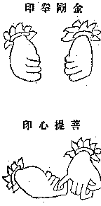



此印又名能灭无明黑暗光明印者，即引导菩提心而得圆明，则其无明痴暗即能究竟破灭。次以结此印至大妙智印者，明由行者结此印而加持之，故感得十方如来摩顶受记，而又转名此印为无量福聚大妙智印。胜决定记者，即记其决定成佛。大毗卢遮那如来者，即是摩诃毗卢遮那佛。毗卢遮那，普遍之义，普遍明照，一切智种种光明遍照，如日月轮之光明普照万物，即密宗所谓大日如来是也。此大日如来，平常以为是法身，而实即是圆满报身卢舍那佛。



己三　正观成佛



『尔时、行者结此印已，即作此观：一切有情共结此印持念真言，十方世界无三恶道、八难苦果，同受第一清净法乐；我今首上有大宝冠，其天冠中五佛如来结跏趺坐，我是毗卢遮那如来，圆满具足三十二相、八十种好，放大光明照十方界，利益安乐一切众生。如是观察，名入毗卢遮那如来最胜三昧。



此文正明作观之意，即行者观得一切有情皆同结此菩提心印，诵秘密言，息除八难、三途之苦而同受法乐。行者并观自首宝冠之上有五佛如来，则自身即是毗卢如来，具足相好，放光照彻世界，普利众生。如是观察，即名入毗卢遮那如来最胜三昧。此中明佛相如何庄严，显其佛相是他受用佛身之相，并非自受身与法身之相。如梵网经所现为二地之他受用身。此中说法之佛，是为等觉而现之他受用佛，是从法身如来之体性而起之身，亦可得名法身。即变化身亦是从清净法界法身如来本性之流出，亦得名法身也。三十二相、八十种好，本是变化身如来之相好，毗卢如来——他受用佛虽有无量功德庄严其相好，亦不外乎从此相好中推广而已。



己四　喻明胜法



『譬如有人悟迦卢微妙观门，自作是观：我身即是金翅鸟王，心、意、语言亦复如是。以此观力能消毒药，一切恶毒不能为害。凡夫行者亦复如是，作降伏坐，身不动摇，手结智印，密念真言，心入此观，能灭三毒，消除业障增长福智，世出世愿速得圆满，八万四千诸烦恼障不能现起，恒河沙等所知重障渐渐消灭，无漏大智能断金刚般若波罗密现前圆满，速得阿耨多罗三藐三菩提』。



此科以修迦卢微妙观门为喻，显三密法门之殊胜。迦卢微妙观门者，即是迦楼罗秘密观门。印度颇多修此观门者，修此观时即观自身是金翅鸟生，乃至口与意亦复如是，便能消除毒药而不为毒药所害。凡夫修如来三密法门亦然，能作此三种秘密加持，便能灭三毒诸苦而证得佛果菩提。降伏坐者，即是跏趺坐，此坐是以右足架在左足之上；若左足架在右足上，则名之曰「吉祥坐」。无漏大智者，即是能断金刚般若波罗密智，即以此金刚智之利剑，截断一切烦恼而到於究竟清净地也。



戊二　赞说胜行



己一　文殊赞法劝行



尔时、文殊师利菩萨白佛言：『希有世尊！希有善逝！如来出世过优昙华，假使出世说是法难。如是心地三种秘密无上法轮，实能利乐一切众生，入如来地及菩萨地真实正路。若有众生不惜身命修行此法，速证菩提』。



此科名「赞法劝行」。赞法，即从「尔时文殊至真实正路」；劝行，即若有众生至速证菩提是也。赞法者，即文殊菩萨称赞如来说此三种秘密法门，其难值遇甚於优钵昙华。如来、善逝，为佛陀十号中之二号；言希有者，正明如来出世甚难，而能说此三密法门则是难中之难。入如来地及菩萨地者，即明修此三种法门，其在凡夫地者则能入於菩萨地，其在菩萨地者则能入於如来地。劝行者，即劝众生不惜身命而去修行，此不惜身命修行，正是大丈夫之行为。闻西藏喇嘛往往能做到。不惜身命者，如临阵之戎衣战士，不顾一切而去杀敌；似入丛林之禅和子，以「身心交与常住，性命交与龙天也」。



己二　世尊示行令修



庚一　总示三十二甲



尔时、佛告文殊师利菩萨言：『若有善男子、善女人，欲得修习三种秘密成佛妙门，早获如来功德身者，当著菩萨三十二种大金刚甲，修此妙观，必证如来清净法身。



此文意谓修瑜伽行者，修三种秘密法门时，必先要披三十二种大甲；若如是，则修三种秘密之观必能成就，而成如来清净法身矣。此即行者从初闻法起信，增进而入於妙觉，皆必要披此三十二种大甲。



庚二　别明三十二甲



『云何名为三十二甲？一者、於无量劫为众生故，不厌生死受苦大甲；二者、誓度无量有情乃至蝼蚁不舍大甲；三者、觉悟众生生死长梦安置三种秘密大甲；四者、拥护佛法，於一切时犹如响应护法大甲；五者、永灭能起有无二见一切烦恼金刚大甲；六者、头目髓脑、妻子、珍宝，有来求者能舍大甲；七者、家中所受一切乐具，永不贪著能施大甲；八者、能持菩萨三聚净戒，及不舍离头陀大甲；九者、著忍辱衣，遇诸违缘毁骂鞭打不报大甲；十者、教化所有一切缘觉、声闻令趣一乘回心大甲；十一者、譬如大风昼夜不歇，度诸有情精进大甲；十二者、身心寂静口无过犯，修行解脱三昧大甲；十三者、生死涅槃无有二见，饶益众生平等大甲；十四者、无缘大慈，利益群品恒无厌舍与乐大甲；十五者、无碍大悲，救摄一切无有限量拔苦大甲；十六者、於诸众生无有怨结，恒作饶益大喜大甲；十七者、虽行苦行不惮劬劳，恒无退转大舍大甲；十八者、有苦众生来菩萨所，代彼受苦不厌大甲；十九者、如观掌中阿摩勒果，如是能见解脱大甲；二十者、见五蕴身如旃陀罗，损害善事无著大甲；二十一者、见十二入如空聚落，常怀恐怖厌舍大甲；二十二者、见十八界犹如幻化，无有真实大智大甲；二十三者、见一切法同於法界，不见众相证真大甲；二十四者、掩他人恶不藏己过，厌离三界出世大甲；二十五者、如大医王应病与药，菩萨随宜演化大甲；二十六者、见彼三乘体本不异，究竟同心归一大甲；二十七者、绍三宝种使不断绝，转妙法轮度人大甲；二十八者、佛於众生有大恩德，为报佛恩修道大甲；二十九者、观一切法本性空寂不生不灭无垢大甲；三十者、悟无生忍，得陀罗尼，乐说辩才无碍大甲；三十一者、广化有情坐菩提树，令证佛果一味大甲；三十二者、一刹那心般若相应，悟三世法无餘大甲；是名菩萨摩诃萨三十二种金刚大甲。



此三十二大甲，第一、即是菩萨於无量劫中广度众生，不畏生死大苦。第二、即是菩萨为成佛故，能度诸有情乃至最微而至於蝼蚁。第三、即是菩萨为度苦恼众生，警觉其长夜大梦而安置於三种秘密法门。第四、即是菩萨因为担荷如来大法故，拥护佛法之心，时时刻刻如响应声。第五、即是修菩萨行者能灭空有之二执，此二执若除则一切烦恼永灭。第六、即是修菩萨行者能舍身命财产。第七、即是不贪著乐具而能施於人。第八、即是能持三聚大戒及修十二头陀苦行。三聚戒，即摄律仪戒、摄善法戒、饶益有情戒。第九、即是行忍辱波罗密，若遇种种逆境而不报复。第十、即是行菩萨道者，应将修声闻菩提缘觉菩提者，转化为佛果菩提。第十一、即是明修菩萨行者，其精进勇猛正如昼夜不息之大风。本来，风终有止息之时，此但是譬喻耳。十二、即是修菩萨行者，应解脱身口意三业，而成寂静禅定之三业。十三、即是菩萨度诸众生，不著於生死，不著於涅槃，所谓生死涅槃平等无住。十四、即是行无缘大慈心而不厌舍，与众生之乐。十五、即是行无碍大悲而拔有情之苦。十六、即是为饶益众生故，未曾结怨众生，众生皆生欢喜。十七、即是虽作诸事业，与众生乐、拔众生苦令众生欢喜，而其心不贪著，居於中容之境。十八、即是菩萨能代众生受苦。十九、即是解脱眼根得天眼通，观大千世界如掌中之阿摩勒果。二十、即是观五蕴身是能损害善业之物，如旃陀罗之善於屠杀等事。二十一、即是观十二处如空野之聚落，应生恐怖之心，不应贪著六根、六尘。二十二、即是观十八界虚妄不实。二十三、即是观一切法皆同一味，皆是清净真如法界而无有二相可得。二十四、即是扬他人之善，发露本人之恶以求出离三界。二十五、即是菩萨度生，如大医王之应病与药。二十六、即是观三乘菩提皆同於一真如法界，及能究竟回心而归於佛果菩提。二十七、即是菩萨常说法度生，使三宝之种无有断绝。二十八、即是佛对於众生皆有恩德，行者为报恩故勤修佛道。二十九、即是观一切法之体性空寂，无有生灭。三十、即是行者悟无生忍，得陀罗尼，及证得乐说辩才。悟无生忍者，在初地以上能悟之，即是悟得诸法不生不灭之体性而忍可於心。得陀罗尼者，即是得法、义、咒、忍之四种陀罗尼，陀罗尼即总持义。乐说辩才，为四无碍辩之一，即於第一、第二、第三之法、义、辞三种无碍辩，为众生自在乐说，故名乐说辩才。此在九地以上始有之。三十一、即是普度有情齐成佛道。三十二、即是在菩提树下将成佛时，於一念间，证悟三世如来与佛果智相应之无餘大法。是名菩萨金刚大甲者，此即总结三十二甲之文。



庚三　结明修行果利



『文殊师利菩萨！若有善男子、善女人，身被如是金刚甲胄，当勤修习三种秘密，於现世中具大福智，速证无上正等菩提』。



此文意明若人能先被如是三十二金刚甲胄，进而修习三种秘密法门，则於现世身中即获佛果之功德智慧而证菩提。



戊三　兴供发愿



尔时、大圣文殊师利菩萨摩诃萨及诸大众，闻佛所说三种秘密心地妙法，及三十二金刚甲胄，一切菩萨所应学处，各脱无价璎珞宝衣，供养毗卢遮那如来及十方尊。而赞佛言：『善哉！善哉！薄伽梵演说无边菩萨行愿，利益安乐一切众生，舍凡夫身使入佛地。今者我等海会大众，为报佛恩，不惜身命为诸众生，遍诸国土分别演说此微妙法，受持、读诵、书写、流布令不断绝，惟愿如来遥垂护念』！



此科文所谓「兴供」者，即从尔时大圣文殊至使入佛地之文；「发愿」者，即是今者我等至遥垂护念之文是也。兴供，即文殊菩萨及在会诸众，闻佛说三种秘密及三十二金刚甲胄之后，即各各以宝珠宝衣而供养如来，并赞其利益众生而转凡夫之身以成如来之身。此中依佛果修行，故能舍凡夫而入佛地。发愿，即文殊菩萨及在会诸众，听闻佛法之后，欲报如来之恩，各於佛前发愿，愿将所听闻之微妙法，於诸佛土中而为众生演说，若自受持、读诵、书写、流布，及教人受持、读诵、书写、流布，总不使其断绝；并望如来遥垂加护。



戊四　闻法获益



尔时、大会闻此妙法得大饶益，不可称计无数菩萨，各得证悟不退转位，一切人天皆获胜利。乃至五趣一切有情，断诸重障得无量乐，悉皆当得阿耨多罗三藐三菩提。



此即明在会诸众所获之益。此中从尔时至得大饶益，即总明会众获益。次即不可称计菩萨得不退转，次人天获胜利，即明其利益较前猛利。次五趣有情皆离障得乐而成佛果菩提，是明法身冥熏之益。



甲三　依教奉行分



------



### 嘱累品第十三



此经全部三大分，第一教起因缘分——序分，第二圣教正说分——正宗分，已经讲完了，今讲此第三依教奉行分，即是流通分。嘱累者，嘱托以此事而烦累彼的意义，如法华文句云：「嘱是佛所付嘱，累是烦尔宣传」。天台维摩经疏十云：「嘱是付嘱为义，累是烦劳荷负之义」。又、以累担付嘱於彼的意义，如净影维摩经疏云：「累是担累，法是宣传者之重担，故名为担累；以此嘱付令人传道，故名嘱累」。此经嘱累的意义，如云：『今以此法付嘱汝等！……汝等大众，住大忍力流通此经』。释迦如来将此法——心地观法付嘱於文殊菩萨等，而且再三地叮嘱，此法不仅利益於当时海会大众，还要辗转流通於未来，使未来众生法乐均沾，利益到无穷无尽。



乙一　付嘱流通



尔时、释迦牟尼如来告文殊师利菩萨等阿僧祇海会大众言：『我於无量那庾多百千大劫，不惜身命、头目、手足、血肉、骨髓、妻子、国城、一切珍宝，有来求者悉用布施，修习百千难行苦行，获证大乘心地观门。今以此法付嘱汝等，当知此甚深经，十方三世无上十力之所宣说。如是经宝最极微妙，能为有情一切利乐。於此三千大千世界、十方诸佛国土之中，所有无边诸有情类，傍生、饿鬼、地狱众生，由此大乘心地观经殊胜功德威神之力，令离诸苦得受安乐。如是经力福德难思，能令所在国土丰乐，无诸怨敌。譬如有人得如意珠，置於家中，能生一切殊妙乐具；此妙经宝亦复如是，能与国界无尽安乐。亦如三十三天末尼天鼓，能出种种百千音声，令彼天众受诸快乐；此经法鼓亦复如是，能令国界最胜安乐。以是因缘，汝等大众住大忍力，流通此经』。



此经说法，共计有六个法会：第一法会，在灵鹫山放光瑞相，为妙德长者说报四恩的法；到了为智光长者说远来问法以下，是第二法会；观心品是第三法会；发菩提心品是第四法会；成佛品是第五法会；此嘱累品是第六法会。第一、第二法会，为人、天、二乘外内凡说法。现的是千百亿化身佛。第三法会为地前四加行位菩萨说法，所以现胜应身。第四法会为地上菩萨说法，所现的是他受用身。及至第五法会为究竟菩萨地说法，总显三身而现的亦是他受用身。不过在观心品以后的法会，所现的佛身，是具足福智神通庄严的。因为要此法流通於人间，所以此第六法会仍现千百亿化身——丈六身而说法。这所以有种种现身差别相者。因菩萨智慧程度不同的缘故。虽法会有六，而道场只有一处——灵山；如华严经不离菩提场而升忉利天、夜摩天、兜率天的事，是个很好的比例。



在此法会群众之中，以文殊菩萨等而为上首，所以佛对他们说：我於无量百千百万大劫之中，把所有的内财、内外财、外财都布施於人，修学种种苦行，才证得大乘的心地观法门。今以此法付嘱汝等，不要看得太容易了，不要如世间物一样底忽略过去，此法是「百千万劫难遭遇」，当生希有难遭遇想！十力，此处作佛的德号用。菩萨地也可以得十力，但如来乃是无上十力。十力者何？一、知是处非处智力，谓如来於一切因缘果报审实能知，如作善业即知定得乐报，名知是处；若作恶业得受乐报，无有是处，名知非处。如是种种皆悉遍知，故名知是处非处智力。二、知过去现在未来业报智力，谓如来於一切众生过去、未来、现在三世业缘果报生处，皆悉遍知，故名知过现未三世业报智力。三、知诸禅解脱三昧智力，梵语三昧，华言正定，谓如来於诸禅定自在无碍，其深浅次第如实遍知，故名诸禅解脱三昧智力。四、知诸根胜劣智力，谓如来於诸众生根性胜劣得果大小皆实遍知，故名知诸根胜劣智力。五、知种种解智力，谓如来於诸众生种种欲乐善恶不同，如实遍知，故名知种种解智力。六、知种种界智力，谓如来於世间众生种种界分不同，如实遍知，故名知种种界智力。七、知一切至处道智力，谓如来於六道有漏行所至处，涅槃无漏行所至处，如实遍知，故名知一切至处道智力。——如五戒十善之行至人间天上，八正道之无漏法至涅槃等。八、知天眼无碍智力，谓如来证知天眼清净，见诸众生死时生时端正丑陋善恶业缘，皆悉无碍，故名知天眼无碍智力。九、知宿命无漏智力，谓如来於种种宿命，一世乃至百千万世，一劫乃至百千万劫，死此生彼死彼生此。姓名、饮食、苦乐、寿命如实遍知，故名知宿命无漏智力。十、知永断习气智力，谓如来於一切惑餘习气分永断不生，如实遍知，故名知永断习气智力（文意见大智度论）。此十力，是十种智慧之力，一切法都从佛的智慧力而转，所以称佛为法中之王，一切法得其自在无有障碍。众生因无明障蔽，无智慧力生起，所以一味地愚痴颠倒。此法、既是具足无上十力的佛说的，所以是微妙之法——其理微细，其用胜妙。由此三千大千世界，推之於十方国土，无论何类众生，由此大乘心地观经殊胜功德和威神之力，皆能离苦得乐。此经福德之力不可思议，在某一国家里只要有人去讲说修持，无形之中有这样的功用：国土丰乐，无诸怨敌。今讲此经者，亦是回向中国国家安宁，人民丰乐。此经有如是之功德，所以释迦如来再四的叮嘱，要有坚忍的能力和毅然决然的精神去流通此经。



乙二　问答持福



丙一　文殊赞问



尔时、文殊师利菩萨白佛言：『世尊！希有如来！希有善逝！乃说甚深大乘微妙心地观经，能广利益大乘行者。唯然世尊！实为深妙！若有善男子、善女人能持此经乃至一四句偈，如是之人得几所福』？



从尔时文殊至实为深妙，这是赞佛的；从若有善男子至得几所福，这是问佛的。如来出现人世间，固然是希有，如说法更是希有。此法能利益於顿悟直往的菩萨或渐悟曲往的菩萨，纵然你不是大乘行者，或顿、或渐、或上、或下，也都能得受其利益。能持此经者，受持之义，谓从上师传而领受忆持。过去的印度和现在的西藏，都是如此。而我们中国。只要你认识文字，就可以自由读诵研究修持。甚至一般学时髦的，无聊时也来玩味佛经，偷几个佛经里的术语，应用到别的文字里去，玩弄些野狐禅，这全是一时的好奇心所激动，有信心与否，却是另一个问题。如此轻视佛法，罪过罪过！若要真正修学佛法，必须要礼拜上师请其传授。此上师是从佛一代一代传下来的，我们对之应如佛一样的看待。你要信心具足，把上师所传授的教法受持不失。即使不能把整部的经文受持不失，只要能持七字一句或五字一句的四句颂偈，或者是一行的长行文字，都可以得到无上的福德。我们所闻的法，虽是各自有漏心上所生起的影像，但法是无漏心的佛所说的，故一切教法都以无漏心境为本质。我们若能依此法读诵修持，则能增长善根福德。到底有多少福德？这就是文殊菩萨所请问的焦点。



丙二　释尊广明



丁一　喻校持福



尔时、薄伽梵告文殊师利菩萨言：『若有善男子、善女人，於恒河沙三千大千世界满中七宝，以用供养十方诸佛，为一一佛造立精舍七宝庄严，安置供养佛及菩萨，满恒沙劫；彼诸如来所有无量声闻弟子，亦以供养一切所须如供养佛等无差别。如是诸佛及声闻等般涅槃后，起大宝塔供养舍利。若善男子、善女人暂闻信解此心地经一四句偈，发菩提心，受持、读念、解说、书写乃至极少为一人说，以彼种种供养功德，比此说经所获功德，十六分中不及其一，乃至算数譬喻所不能及；况能具足受持、读习、广为人说，所得福利不可限量。



佛告诉文殊菩萨说：若有善男信女，把世间种种的宝物，充满如三千大千世界恒河沙之多，以供养十方诸佛；不但此也，而且建立广大精舍，安住清净佛菩萨僧、声闻僧；而且还为诸佛、菩萨僧等建立宝塔，供养舍利。这些的功德，若与信解此心地观经一四句偈的人所获的功德比较，十六分之一的功德也没有。只要能发菩提心，去受持、读念、解说、书写，乃至从极小的部分做起，乃至只曾为一个人讲说，就已如此，又何况具足受持等五法行所得的福德呢？此中受持等五法行，是十法行之中的，虽只有五法，但意义可包括十法。「十法行」者，一、书写，於佛所说的经律论，广为书写流通於世而不使其断绝，如现在刻经印刷一样。二、供养，於佛的经典安置之所在，应如佛的塔庙一样的供养。三、施他，以所闻的教法，广为他人演说，或施与经卷，不专自用，但欲利他。四、谛听，闻他人读诵经典或解说经典，要深生爱乐一心谛听。五、披读，於诸佛所说之经典，常披阅看读而手不释卷。六、受持，於诸佛所说之教法，从佛或上师禀受，持而不失。七、开演，於佛所说的教法，常开示演说，使人信解。八、讽诵，於如来所说的一切教法，讽诵宣扬，梵音嘹亮清澈，使人乐闻。九、思维，於如来所说的一切法义，思维筹量，观念了解而不忘失。十、修习，依如来所说的法，精修数习而成佛智（文意出辩中边论）。这十者，一至八是闻所成慧，九、十二种是思所成慧、修所成慧。



丁二　别明女福



『若有女人发菩提心，受持、读习、书写、解说此心地经，如是女人为最后身更不复受，不堕恶道八难之处，於现身中感得十种胜利之福：一者、增益寿命，二者、除众病恼，三者、能灭业障，四者、福智倍增，五者、不乏资财，六者、皮肤润泽，七者、为人爱敬，八者、得孝养子，九者、眷属和睦，十者、善心坚牢。



讲到持福，这里特别把女人持经的福提出来讨论。在报身上讲，女身的确比较男身要劣一点。这不是有轻视女子的见解，女子比男子，在修道方面有很多因难之处。佛典里有讲到「女人非器」的话，即是说女人不是修行佛道的根器。所以要特别激发她们发菩提心，受持此经。如能受持此经，不但未来转女成男，现在即能有十种殊胜福德，只要她能够如法去受持就是了。



丁三　经同佛塔



『文殊师利！在在处处若读、若讽、若解说、若书写，经卷所住之处即是佛塔，一切天人非人等，应以人中、天上上妙珍宝而供养之。所以者何？若此经典所在之处，即为有佛及诸菩萨、缘觉、声闻。何以故？一切如来修行此经，舍凡夫已得阿耨多罗三藐三菩提，一切贤圣皆从此经得解脱故。



无论在何时何地——一切时、一切处，倘若是读诵或书写此经所在之处，天人即都来供养，因为此处有经典，即是有佛。



丁四　法师如佛



『文殊师利！我涅槃后后五百岁法欲灭时，若有法师受持、读习、解说、书写此心地经众经中王，如是法师与我无异。若有善男子、善女人供养尊重此法师者，即为供养十方三世一切诸佛，所得福德平等无二，是名真法供养如来，如是名为正行供养。所以者何？是大法师，在无佛时为浊恶世邪见有情，演说甚深心地经王，使离恶见趣菩提道，广宣流布令法久住，如是名为无相好佛，一切人天所应供养。若有善男子、善女人合掌恭敬此法师者，我授无上大菩提记，是人当得阿耨多罗三藐三菩提。



佛对文殊说：如果於此经能修行「十法行」的法师——以此法为师，又能去解说此法而为人师，这都是法师——到了佛涅槃后后五百岁，或者到了末法后后五百岁的时候，倘有法师将此众经之王的心地观经，如法行持，此法师即与佛无异。我们要去礼拜供养，如礼拜供养佛的功德无有差别。供养法师，即是供养此法，也即是法供养。以内财、内外财、外财去供养此法——即是正行供养。因为佛不以世间财物供养为喜，如果能如法去修行而以为供养，利益众生，佛心乃生大欢喜。这世间，邪见的众生认为宣扬佛法是宣传迷信的，愚哉众生！可怜哉众生！所以此法师以诲人不倦的精神，为五浊恶世众生广为宣说此经，使其离苦得乐，令正法久住，所行甚为不易。虽然没有三十二相、八十种好，但与佛一样。因此，凡有人合掌恭敬此法师者，佛皆为之授记。我们不要轻看自己！我们的现前大众，能在这里听闻教法，佛已经替我们授过记了。我们既闻了佛法，从今而后，对於佛法的信心，要一天一天的增长。不然，空挂起佛子的招牌，只有自家欺骗自家；各人的生死各人了啊！



丁五　发心功德



『若人得闻此心地经，为报四恩发菩提心，若自书、若使人书，若读念通利，如是人等所获福德，以佛智力筹量多少不得其边，是人名为诸佛真子。一切诸天、梵王、帝释、四大天王、诃利帝母五百眷属、儞罗跋多大鬼神王、龙神八部、一切听法诸鬼神等，昼夜不离常当拥护，如是佛子增长念慧，与无碍辩，教化众生令种佛因。



得闻此经知报四恩者，往往有之。如在此会期中，曾有张慕超居士，因听讲报恩品之后，即往乡间把母亲接来厦门寓所侍养，以尽人子之孝道，并即皈依三宝。诃利帝母，此云鬼子母。儞罗跋多大鬼神王，是大夜叉神。若能发菩提心修学「十法行」，所获的功德不可计数，而且一切天神昼夜不离你的身旁，始终拥护於你；你的信、解、念、定、慧五善根力，也就念念增长。



丁六　命终利益



『文殊师利！如是善男子、善女人，临命终时，现前得见十方诸佛，三业不乱，初获十种身业清净。云何为十？一者、身不受苦，二者、目睛不露，三者、手不掉动，四者、足无伸缩，五者、便溺不遗。六者、体不汗流，七者、不外扪摸，八者、手拳舒展，九者、颜容不改，十者、转侧自如。由经力故，有如是相。次获十种语业清净，云何为十？一者、出微妙语，二者、出柔软语，三者、出吉祥语，四者、出乐闻语，五者、出随顺语，六者、出利益语，七者、出威德语，八者、不背眷属，九者、人天敬爱，十者、赞佛所说。如是善语，皆由此经。次获十种意业清净，云何为十？一者、不生瞋恚，二者、不怀结恨，三者、不生悭心，四者、不生妒心，五者、不说过恶，六者、不生怨心，七者、无颠倒心，八者、不贪众物，九者、远离七慢，十者、乐欲证得一切佛法圆满三昧。



如果受持读诵此经，到了与世长诀的时候，能得三业不乱的利益。如法华经里所谓千佛授手，或此经十方佛土，都听你随念往生。所谓三业不乱的利益，即是十种身业清净，十种语业清净，十种意业清净。因为临命终时，是此一生末日和后一生获得的关键，能不颠倒错乱，决不致有堕落恶道里去的危险。



丁七　结劝持修



『文殊师利！如是功德皆由受持、读习通利、解说、书写深妙经典难思议力。此心地经，於无量处、於无量时不可得闻，何况得见具足修习？汝等大会一心奉持，速舍凡夫当成佛道』。



修行此「十法行」，既有如是之功德和利益，所以佛劝我们要一心一德贯彻始终去修持，自然有成佛之一日。



乙三　会众信奉



尔时、文殊师利法王子等无量大菩萨，智光菩萨等新发意菩萨，阿若憍陈如等诸大声闻，天龙八部人非人众，各各一心受持佛语，皆大欢喜信受奉行。



至此，此法会每会之中的上首，如文殊、智光诸菩萨们，以佛所说的教法，各各领受之而不忘失，欢喜充满了整个的身心。诸大声闻与天人八部等，大家皆大欢喜信受奉行。



大乘本生心地观经，已讲完了。我们要记著，即是此经最后的一句——『信受奉行』。此经是深黑的人海里燃著闪烁的人海灯，光明朗澈，现出从凡夫地至佛地的光明坦道。我们别要辜负这法灯的美意，我们要接受过来，不但要照明现前人海里的众生走上光明坦道，还要把此经辗转流通於未来。要知道，在这无边际的人海里，有无穷无尽的众生飘浮著，他们在那里望著人海灯光之到临。我们能将此法会的灯光去扩大增盛，这就是佛之所以说法的本愿，也就是我们佛教徒的天职。



（胜济、灯霞、窥谛、东初、雪生合记）(佛学书局印行)



（附注）原题「大乘本生心地观经释」，今改题。



发菩提心论开题



——十一年下学期在佛学研究部讲——



一　释菩提甲　菩提之名义  

乙　菩提之类别  

丙　菩提之自体  

丁　菩提之相应  

戊　菩提之能生  

己　菩提之所断  

庚　菩提之所缘  

辛　菩提之所依  

壬　菩提之所起  

癸　菩提之所作



二　释菩提心甲　求菩提之心  

乙　有菩提之心  

丙　菩提即心



三　释发菩提心甲　自性发  

乙　资助发  

丙　善根发  

丁　等流发  

戊　断证发



菩提心是学佛之根本，故此论为最要之论也。平常学佛者，以发菩提心为口头禅：究竟何为菩提，何为菩提心，何为发菩提心？果有若何之领悟，尚属疑问，今分三段解释於左：



一　释菩提



甲　释菩提之名义



「菩提」是梵语，古翻为道。道有二义：一、引伸之理德义，二、本诠之道路义。若就初之理德义名菩提，可释为道；然此非道字之本义。依第二道之正义，则西域别有梵言「末底」，此云道路。圣者所体会之妙理，所成就之智德，以菩提译为初引伸义之道亦可。至唐译确定其义，遂译为「觉」。此觉与觉悟之悟相同，乃菩提之本义，而未能尽其相应之德义。且觉之一字，世或谓感觉、知觉、恶觉，与菩提之觉尤相乖混。以菩提之觉，是反迷惑之纯正觉，离迷惑之清净觉，故非迷之觉始是菩提。则菩提之觉，不与迷相应，以菩提是纯净之觉，与迷惑绝对相反故。是乃第一明菩提名义也。



乙　菩提之类别



菩提是觉悟，觉悟非迷惑。故觉现行时迷惑则无，如有明时则无有暗。依此义故，必无迷惑之地位上所成就者，方是菩提。有菩提则无迷惑，无迷惑乃有菩提。故凡出世圣者所成就之觉，乃为菩提，真正离迷惑故。是乃菩提之正义，亦即离迷惑之净觉也。故除出世圣者之外，均非菩提。就出世圣者分其类，则声闻菩提、独觉菩提、无上菩提之三种而已。此三悉是离迷惑之觉，故菩提之类别有三。



丙　菩提之自性——自体相



依上而论，菩提是与迷惑相反的，迷惑灭而现前的。然其自体为何？答：依三乘共教而出其体，即以清净无漏慧而为自体；慧即别境中之慧心所——此指无漏之慧心所。若就无上菩提明其体，即大乘不共教中之清净四智为自体也。以四智为菩提自体，三乘之圣者不为得菩提，以其四智未圆，觉未究竟遍故；二乘不名为菩提，非遍知故；菩萨不名为菩提，非无上故；所以必至佛果之无上正遍觉方为菩提。然三乘之菩提者平等相也，无上之菩提者殊胜相也，故此殊胜相之菩提，即是四智为体。二乘於四智中祗得妙观察智一分，故就通义之妙观察智言，则三乘圣皆可名得菩提。若依大圆镜等四智为菩提，则唯佛果可名菩提，二乘之觉不名菩提；四智相应心品之觉方名菩提，此在天台教，谓之「实智菩提」也。



丁　菩提之相应



相应谓与四智相应之心心所，亦即是菩提相应之心心所。夫四智之通相，仍以无漏慧为体，四智各有二十一心心所相应，谓成所作智相应之慧及四别境、五遍行、十一善——按四别境者，欲、解、念、定。五遍行者，触、作意、受、想、思。十一善者，信、惭、愧、无贪、无瞋、无痴、精进、轻安、不放逸、行舍、不害——。乃至大圆镜智，亦复如是。此四智心品，为菩提之相应也。



戊　菩提之能生



菩提之生者，谓离於迷惑；以此故菩提亦是有生之法也。如唯识明菩提为所生得，其言生之义，如论广明。今略言之：一者、谓本具之无漏慧种为亲因而生；二者、谓诸佛菩萨及诸圣教为增上缘而生，又以有漏善无间引生无漏慧之等无间缘方生，复以所观之圣境为所缘缘方生。其他种种生因，如论广说。



己　菩提之所断



菩提之所以成就者，谓得圣果，即是成就菩提。故有学得圣果，亦名为得菩提。二乘以烦恼为所断，生空菩提智即为能断；大乘初地（见道位）即断分别二执所起之惑而得菩提，至佛果则以二障种子为所断，大圆镜等智为能断；以所从能，得名菩提。故论云：『菩提、菩提断、菩提处，均名菩提』。初为自性相应，次为所断障，后为所缘境。然二障既断，其相应之杂染业亦随之俱断。何以故？依障起故，由斯断已，则生死轮息。故二乘之初二等果，大乘之初二等地，皆由菩提断障而得证果也。



庚　菩提之所缘



菩提以四智为体。四智与王（心王）别（别境）遍（遍行）善（十一善）相应，故依相应之心心所明，则心心所皆是菩提所缘，以与四智相应故。四智既定与此一切心等相应，则一切境界定悉为所缘，故菩提无一法而不缘。且亦能缘其自体相，是无漏故。如有漏之自证分祗缘见分、证自证分，并能缘自体——自证分；在无漏正遍知者之心心所，则能缘之，以遍知故，无所不照故。所以菩提以一切法为所缘也。虽然，四智无所不缘，当知成所作智缘俗不缘真；其餘三智则自他遍缘，真俗双照。佛智於自证境遍缘，即於众生境界亦是无所不缘，故真如亦为无分别智所缘也。



辛　菩提之所依



上言菩提是有生之法，以凡有生则必有灭，菩提从缘生复从缘灭；然当知菩提是刹那生灭（顿起顿灭）而相续於尽未来际，故虽刹那而生、刹那而灭，由亲证不生不灭之真如法性，无一刹那而不相应如如，是即菩提常现行也。其智必与真如实相时时相应得名菩提，故无一时而不相应。倘有一时不得相应，则有迷惑，有迷惑故则不得名菩提。故菩提以诸法实相之真如性为所依也。此菩提所依处，天台谓之「真性菩提」。



壬　菩提之所起



如上所论，自体、相应、所缘、所依、既已明晰，则菩提之所以为菩提者明矣。今言所起，以佛果上所起者为所起。故菩提之现起，即是佛之身土现起，此乃自受用身土，即等同法界，是为大乘之殊胜相。若依通因果、贯大小言，其所起者，为菩萨等所现之身土是也。佛为度地上菩萨所现之他受用身土，亦是所起，即平等性智所现也。其应化二乘凡夫等所现起之身土，亦为菩提之所起。本论重在大乘，故其所起，以自受用、他受用为主，而应化亦摄为所起。故明诸佛报化身土之所起，即明菩提之所起也。



癸　菩提之所作



菩提之所作者，即法华所言「为令众生开示悟入佛之知见」是也。由斯众生断惑证果，依佛之大悲方便之力也。令众生入佛果得佛知见，皆菩提之所作，亦即是诸佛之大悲愿力而普度一切也。上二、天台谓之「方便菩提」。



二　释菩提心



前类别之中，言三乘由离惑故，皆名菩提。今从所简之无上菩提，明菩提心，释其义有三。



甲　求菩提之心



斯以专求「无上之正等正觉」之心为菩提心。此中心言，即是誓愿，故云「无上菩提誓愿成」。又当知此心，亦即别境中之欲心所也。以对此无上菩提之胜境起希求故。所以能求之心，唯向无上菩提；不求声闻菩提，不求缘觉菩提，不求菩萨菩提，而专求佛果之无上菩提也。於离合释中，即依主释。发菩提心之发字，是立义，即是立誓求无上菩提之心志也。



乙　有菩提之心



以有菩提之心明菩提心者，斯心之一名，即指与菩提相应之一切心心所。此心心所有此菩提之觉，故云有菩提之心。离合释中，有财释也。以心心所有此菩提功德故，名菩提心。



丙　菩提即心



以菩提即心明菩提心者，有其三种；分述如下：——



１　心者，心心所之通名、通相也。然菩提即心所中之慧心所，此慧心所既摄在一切心心所中，故云菩提即心。以随举一系之心心所——一系之言，谓四智分为四系，随举一系皆可——即有此菩提在其中。故一系之心心所即是菩提心，菩提心亦即是一系之心心所。如第八识有含藏之功能，即名藏识，此心心所有此菩提功德，故云菩提心，持业释也。



２　心即心心所通名。以慧心所即是心故，菩提亦即是心。如一切皆是人，随举一人，皆可即人。



３　菩提是觉，此觉即是心心所之共相，心心所皆有灵觉故，具能缘故。然心心所是有灵觉，菩提即是心心所之灵觉，故菩提即是心心所之自体相也。



心王、心所、通名曰心。此中初「求菩提心」之心字，即欲心所；次「有菩提之心」，即有清净觉之一系心王心所；后「菩提即心」之心，是慧心所；故总云菩提心也。



三　释发菩提心



发者，发起、发生、发长之义。又开发、显发、发明、发达之义。然如何能发起求无上菩提之愿耶？又如何能发起清净觉心耶？欲明斯义有其五释：



１　自性发



谓由自性发起菩提心也。菩提即是灵觉，灵觉即是心心所自体相；然异於色之名灵觉者，有能缘故。心心所以觉为自体、缘为业用，如火以热为自体、以烧为业用。故心心所不可违其灵觉之自性，违则非心心所；如火不可违热之自性，若违其热性、则不名火。又若违心心所自性，则心心所必不安定，如一人有一人之性格，违其性格，则不能安定矣。心心所必达於觉而后安，故其自性即能发趣灵觉（即发菩提）。其有烦恼之际，由觉力劣故，如人有病，则运动之精神必不强。而烦恼之起者，由二执故，由有二执之力强，则觉心之力弱，遂即成烦恼状况矣。故菩提虽离惑，而惑不离觉，离觉不名心心所故（亦不名菩提）。如虽有极冷之相，而仍不离热之相，冷以热为依故；彼心心所当知亦尔。故虽有迷惑乱动不安之相，而仍有觉。然欲离不安，则非成佛果菩提不可。以欲成佛者，是即心自性发，此心自性，即是心心所之觉也。



又菩提即以无漏心心所为体。其本有能起诸无漏心之功能种子，即是发起菩提心（发起一切无漏心心所之现行）之泉源。既由本有无漏种子发，亦曰自性发。



２　资助发



前自性发，是由求菩提者之自身言。虽然，现见众生何以不自发耶？曰：无资助故。言资助者，善友圣教是也。由观诸佛菩萨（善友）之神通、力、道德等，方启发自己之菩提心；或由圣教（三藏）等之熏习故，方可发菩提心。故善友圣教，皆发菩提心之资助也。



３　善根发



由遇善友之化导及圣教之熏习，遂起修种种妙行、成种种善根，此善根渐增长、渐渐成熟，能资善慧、无漏慧，乃至金刚道后成大菩提，是则由善根发也。



４　等流发



上明菩提之自体，即是无漏慧。此无漏慧，由有漏慧引发，如世第一位之后、刹那有漏慧引发第二刹那之无漏慧。由此渐渐增发，至金刚道初刹那而引发第二刹那之无上菩提；故云等流发也。等流者，均等流类之义。由初地之菩提，均等而流发二地之菩提，如是展转及至成佛，故云等流发。



５　断证发



谓由断惑证真时方发。如初地即由断分别及俱生一分惑、证真如性，而发无漏现行；讫於成佛，必不退失。此乃由断而证，初地现起，地地增进；及至佛地，由究竟断证而究竟发也。



------



## （研究员记）(见海刊五卷十二



佛法之真价



欲知佛法之真价，须先知佛法之为何。



「无上正遍觉者」谓之佛。已得无上正遍觉者，对於一切能得无上正遍觉而未得之者，为令悉得觉故，如其所证所由证而施设之法；谓之佛法。故佛法者，佛所施设之法也，能成於佛之法也，成佛所证之法也。



然佛法之真价值究安在欤？



在明天地人物之事理而令吾人得一立身处世之准则乎？曰：然；然此犹人道伦理之所共，未为佛法之真价也。



在发明众生世界之因果而令吾人得一超人入天之途径乎？曰：然；然此犹神道宗教之所共，未明佛法之真价也。



在发明一切法无我、无为寂静、有为无常、有漏皆苦，而於三界得解脱乎？曰：然；然此虽为佛法之所独有，犹是二乘之所共，未穷佛法之真价也。



然则佛法之真价究安在欤？曰：佛法者佛法也，在得无上正遍觉而成常乐我净之德耳。夫常乐我净者，一切有心之所同好，故凡一切有心者，莫不好真常、好美乐、好胜我、好善净也。然以迷倒故：非常计常、非乐计乐、非我计我、非净计净，终不能成常乐我净。已得无上正遍觉者悯之，为欲令得无上正遍觉故，方便遮除彼计非常乐我净为常乐我净之迷倒，以是为说无常苦空无我。劣慧闻之不达方便，遂执无常苦空无我为佛法之真价，而不知其在常乐我净也。



由是观之：佛法之真价在能得无上正遍觉，以真实成就圆满一切有心者所同好而百计不获之常乐我净也明矣。故佛法独能满足一切有心者之所同好而使之毫无遗憾者也。



------



## (见海刊五卷四



大乘佛法的真义



——十五年九月在厦门教育会讲——



一切佛法，可分二类：一者大乘，二者小乘。中国所传多属大乘教理。但未能普及於社会，故向来中国习惯，佛法专为出家者所负担。亦未能实现於人之行为。故向来出家者多深山修道以求个人解脱，致佛法成为消极。今欲救此弊端，使大乘佛法真义普及社会而实现於人之行为，故揭题二义：曰现实，曰精进。



大小乘者，从喻立名。乘、谓车乘，用以运重致远。运量大者为大车，如今之火车等是。运量小者为小车，如人力车等是。故佛法谓能自度度人者为大乘；独善其身者为小乘。中国一般人向来信佛情形：下焉者、多至寺院，对於佛像烧香礼拜，或求现在安乐或求未来福报；上焉者、则求个人解脱。此等皆非佛法真义，然则佛法真义者何？乃现实主义的；精进主义的。



现实主义的，即就现在事实上说明人生世界，使彻底明白人生世界真相，然后改造而臻於完善者是也。世之种种学说，其目的亦在说明及改造人生世界，特未能彻底耳。惟我释迦文佛亲证无上正遍知觉，对此方为彻底。吾人亦应明白宇宙人生之真相，彻底改造而归於完善，使五浊恶世成为清净国土，人人离诸苦恼而得安乐，方为大乘佛法真义。



依现实主义言：佛与菩萨实非神秘，惟於人生世界能彻底觉者便谓之佛；能自觉悟、更能觉他者，便谓之菩萨。其他宗教说有天国可升，就佛法言，乐国即在吾人自心，离自心外无别乐国；以种种苦恼境界，乃吾人自心中烦恼业惑所感，若欲改造苦恼境界，即就个人自心改造。若人各改造其心，为善去恶，便能转此苦恼世界而成清净乐邦也。是以佛法，非特深山修道者可学，亦乃人人可学。世之政治家及教育家等，目的亦在改造社会、国家，增进人群幸福，其用心既与佛无异，吾谓尤非研究现实主义的大乘佛法不为功。



再述精进主义的佛法：一般人或视佛家生活为苦，而不愿学佛，亦有多经世故饱受痛苦而学佛者，或有慕清净而学佛者，即此可见其心之懈怠，此佛法之所以为消极也。然此非佛法真义，佛法真义者，是精进非懈怠，是积极非消极；必也自度度人使皆离苦得乐，所谓「我不入地狱谁入地狱」，如是方不背佛旨。岂彼懈怠者所可同日而语哉！由斯观之，於大乘佛法真义，能自觉了，然后从而觉他；难行能行，难忍能忍，方为精进主义的佛法。现时举国战争，疾疫流行，天灾人祸，人民痛苦难堪！而社会、帝国种种主义，主张杀伐，既不能救其痛苦，更从而增加杀因，若舍大乘佛法其谁能救度哉！



是以佛法，不特僧人当研究，即凡有心知血气者无不当学。诸政治、教育家等，欲达其改造社会、国家、增进人类幸福之目的，若能本此大乘佛法真义之旨而行，更可增其勇气而得良好方法也。



（一澄记）(见佛化策进会会刊二辑)



行为主义之佛乘



佛说、佛学、佛理、佛法、佛乘之五个名词，学、说与理，都是差不多；法字虽较为涵盖，但也不如「乘」字之妙。因为「乘」字有圆转、恒运、普容、宏载之意义，不惟是静定之理性，亦复是活动之事实。故「乘」有教乘、理乘、行乘、果乘之四分，而最足表明「佛之因果」之特徵。因为「人乘」、「天乘」以享受福乐为果；声闻乘、独觉乘以涅槃为果；菩萨则不以静定的理性——涅槃——为果，尤不以爱著的享受的福乐为果，但以「动静一如」的，「理事不二」的，「无上菩提」的，「大悲方便」的「佛」为果。所以佛乘的果，祗是尽未来际利乐众生无有穷尽，是永不住著理性的，是容载转运皆是理性的，是之谓「万行究竟坚固」。然欲成此万行究竟坚固之佛果，须照样修习万行坚固之佛因；最能修习此种佛因者，便要算我们人道的众生。从来，吾人为佛教徒者，大都只知以享受福乐或静定理性为果，所以无论其所修者为律、为教、为密、为禅、为净，皆祇要解脱生死，证得涅槃，故皆没有活泼变动之圆转恒运之行为；有之，皆是抛弃群生，废事失时之法，堕在人、天、声、缘乘内，绝少能修习佛乘的「因行」者——吾人能实际修谓之菩萨行。故无论或重「理解」，或重「证悟」到如何圆妙，都只空理不成事实，至近今乃更加厉通行。一般知识阶级中，或认佛法为达到「本体」的哲学；或则但认一句「禅谜」；或则但守一句「佛名」；或则但以佛的经书、形像、数珠、木鱼、蒲团等项为佛事，而不悟盈人间世无一非佛法、无一非佛事，所以人人能修习之菩萨行，益加废而不举矣！此等皆是悔过的、厌恶的、怠惰的心理发心，不是从精进的、勇猛的、慈悲的心理而发心。故若只以百事不为为学佛，则学佛之极不过等於土石；若以经卷、木鱼、禅谜、佛名等物排遣光阴为学佛，则学佛不过等於琴棋诗酒；若祗以速还本体，速了生死为学佛，则佛与外道或小乘便也无别。吾确见现时学佛的人渐多，大都迷背佛乘，不修习佛之因行，不知一切有益人群之行为皆佛之因行，反厌恶怠惰，其流弊将不可胜言。故大声疾呼，敢为之告曰：吾人学佛，须从吾人能实行之佛的因行上去普遍修习，尽吾人的能力专从事利益人群，便是修习佛的因行。要之，凡吾人群中一切正当之事，皆佛之因行，皆当勇猛精进积极去修去为。废弃不干，便是断绝佛种。故佛乘的经书，皆注重人群实际上利他行为者，试举几个例於下：



一　法华行



法华所注重之因行，即是随喜、读诵、解说、兼行六度、正行六度之五种法师功德，与安乐行品所言之安乐行。兼行六度，是尚以解说法华经为主；正行六度，则专在行六度矣。六度中，第一便是布施，财物、身命一切能施，及法施、无畏施、一切实行。随喜、读诵、解说，虽专指法华经言，然法华为融摄世出世间一切法，皆为开示悟入佛之知见之妙法，资生事业皆不违实相。故随喜者，即与人类与一切众生凡有利益之事，无不欢喜赞助成就之谓也。读诵者，对於一切有益於人有益於众生之学说之教义，靡不受持宣传之谓也。解说者，对於一切有益於人有益於众生之法，力为增进发明之谓也。故皆是为实际上有益於人间世之善业而已。



二　信心行



如大乘起信论之信成就发心，其解说修何等行得信成就：则一、信业果报，二、能起十善，三、厌生死苦，四、欲求无上菩提，五、供养诸佛。其广说修行以成信心，则分五门。其修施门：若见来求索者，所有财物随力施与，以自舍悭贪令彼欢喜；若见厄难恐怖危逼，随己堪任施与无畏；若有众生来求法者，随己能解方便为说，不应贪求名利恭敬，惟念自利利他，回向菩提。故其修精进行，尤须勇猛无间以修一切与人有益之事，耐劳忍苦常不休息。



三　维摩行



示居尘劳之内，现有五欲疾病等事，因事说法而为呵斥，种种称赞破人执著，起人信乐，於种种众生类中以为上首，广行六度、四摄而创造净佛国土。



四　上品行



无量寿佛经上品往生之行，皆须孝须父母——本生父母而推至一切世来六道众生，展转皆为父母；敬重三宝；读诵大乘经典；济度一切众生。要之，皆须实行大悲救世之菩萨行而已。



凡此皆非甚高不可及之事，莫不是就吾人之已能了知佛理者，使实际上依之历事造修之行也。此吾人当实践修习之大乘行，大要不外六度、四摄，其根本则在慈、悲、喜、舍。今佛法渐已普及人间，一般人类亟须了解在人间世普通当修之佛的因行，以免不学佛则溺於尘世之欲，一学佛则沉於枯寂之厌世。佛的因行，以敬信三宝，报酬四恩，——父母恩、师长恩、圣贤恩、众生恩为本，随时代方国之不同而有种种差别，略分如下：



甲、戒除者：



第一类当除之十恶：



　　　　烧抢────┐  

　　　　偷骗────┼─盗─────┐  

　　　　赌博────┘　　　　　　　├立当断除者  

　　　　邪淫──────淫　　　　　│  

　　　　烟酒──────酒─────┘  

　　　　渔─────┐  

　　　　猎─────┤  

　　　　屠─────┼─杀──────速当改除者  

　　　　牧─────┤  

　　　　蚕─────┘



第二类当除之十恶：



　　　　占卜────┐  

　　　　星命────┤  

　　　　相面────┤  

　　　　风水────┤  

　　　　巫觋────┼─妄──────渐当破除者  

　　　　鬼教────┤  

　　　　乩教────┤  

　　　　斋教────┤  

　　　　仙教────┤  

　　　　天教────┘



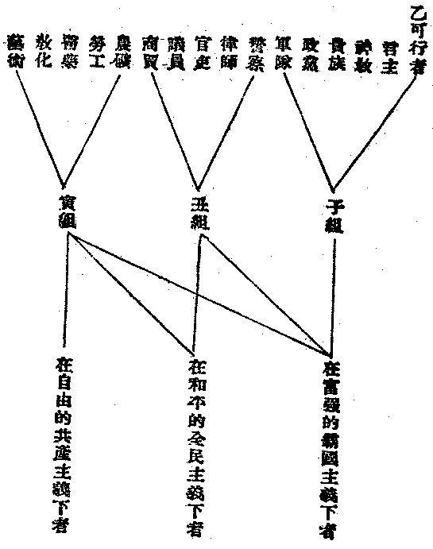



当戒除者应戒除之外，其餘可行者，在相当时代方国之下，皆心随所应为者而为之，不应放废而不为也。慈善之事之当勤行，更不待言。若能敬佛法僧，信业果报，努力精进以行乎有益於人群之善事，随喜真如性，不迷菩提心，则即是修菩萨行，亦即是成佛之因行也。



------



## (见海刊二卷二



佛法之真精神



——十九年十一月在成都二十四、八、九军军长联合欢迎会讲——



今日得闻刘军长所说佛法上无我、大悲二特点，极为透澈！知诸公必已能依此无我大悲而深契力行。今日相聚一堂，实为生平快事！



佛法虽有诸乘差别，而真正佛法厥唯大乘。依大乘法以说明宇宙原理，一切万有之事事物物，都是众缘集合而成。就一人言，其生因仗父、母、业识、四大、五蕴等众缘；既生以后，对於社会以至所有世界一切之山河大地、草木众类、形形色色，又均有无量关系；及事业成就，世代相传，其递衍又可无尽。故欲穷其究竟，非遍於全宇宙不可。故每个人都不是离於社会宇宙而单独生存的，皆是社会性的、宇宙性的。不但人类如此，人类不过比他物较完全耳。即如不甚完全之其他生命，或无生命的一金、一石、一微尘，如化学上分析至一粒原子、一粒电子，其所以成立，亦有前至无始、后至无终、外之无边、内之无中之关系性；即亦是由众多因缘和集所成之假相，而并非单独自立的实体。现在最新之科学家亦能见及此理。——从前科学家以原子为有单独性，现在发明还是由于许多电子及时空等各种关系发生的；因物理学之进步，而有相对论及量子论等理论，以事物为众多关系组织所成，此为最进步之科学。依此科学所成立之最新哲学，不是唯物论或唯心论而是组织论的，即近於佛法中一切皆是众多因缘所成的意义。唯佛法众多因缘所成义，是遍一切平等，无有一物为独存的、为主宰的。以时间言，其来无始，其去无终；以空间言，外无边际，内无中心，此即诸法实相。



就此宇宙原理应用到人生上来，人之所以为人，不能离其他一切而单独存在，必有其他种种关系，虽有亲疏远近之不同，然均有相资相助之功能。故个人不能离却社会以成就个人之利益；须培植社会乃至全世界之公益，方可成就个人利益，必须为人家谋利益，乃能使自己及他人均有利益。若从损害他人以求己利，结果则人既有害，自亦不利。前述宇宙原理，即所谓自然规律，亦即法相；而此则为根据自然律而成的人生道德律。故大乘佛教的道德律，为本依自然律而不可动摇的真理！



大乘菩萨作事，以一切世界无量众生的利益为前提，不以於己有害、於人有利而不作，于己有利、于人有害而可作。凡作事必以大众利益为前提，即菩萨行，亦即是无我、大悲行。就无我、大悲分开言之：以其为众缘所成而无单独个体，故名无我。以皆在扰乱不安宁痛苦之中的众生，视为同体休戚相关，与己身自受痛苦等无有异而起拔济一切之心，即大悲心。



此即大乘佛法应用於人生方面者，其为益至大而其说又深切著明如此，何以在中国向未昌显，使众人咸起信解而收为众人谋利益之实效？其故：由中国对於佛教向多误解，以为我今犹在世间作事，所以不能修学此等出世间法。此因中国旧政教环境之关系，造成中国佛教为两种畸形的所致。一、因中国在佛法未来以前，已别有一种政治教化，佛教为避免冲突起见，遂退为山林中清静自修之法，而未推行到社会中去。二、因中国前此帝王治化之下，虽教诸士人使读儒书，奖掖儒行，而大多数之农工商以及妇女概未读书明理；须有一种神道设教去慑服之，以使民心安定，故将佛教通俗化而几同鬼神教。中国一般人向来祗认此二种为佛教。由第二种，到现在一般具有国民常识的人，视佛教同於鬼神巫觋等事，遂斥为迷信而倡打破，佛教遂受摧残。由第一种，以生产落后之中国人欲与列强相竞存於此世界，如何能主张在山林清闲自修？故以佛法为不相宜而避之若浼。然上二义，皆非佛法之真相，真相乃上来所说之诸法实相义应用为人生道德者。



何以知佛教在中国的畸形为中国向来环境所变成？此非空言而有事实可证。以佛教不与中国已有之治化争故，遂退於山林清静自修；又为资化民工商妇孺故，遂降作神道之教。但从佛教流行於他国者观之，并不如此：英人韦尔斯作「世界史纲」，记印度向不统一，自阿育王崇信佛教，因以统一全印度，建设许多事业，其成绩至今为西人崇拜为不可多得的圣王。至於锡兰、缅甸、暹罗等地，其政教文化风俗，一皆以佛法为本，亦斐然可观。佛教并非离绝社会政治的，证诸日本而益明：日本所订之宪法，根据於千年前圣德太子之十九条，太子为完全佛教徒，日人均认为吾国南岳慧思大师再世。即日本之文字亦自日僧所创造。故其人民过半数皆是佛教徒，并非如中国之佛教，遗世独立为众人所弃而不顾也。



现在西洋社会之不安宁，其情形有如火山将欲爆发。所以致此之关系虽多，但其重大原因，则以西洋的生活已成科学的生活，其政治已成民治的政治；而考其所信仰的宗教仍是君主国家时代所信为主宰一切之一神教。此一神用科学推研所不能成立，非如佛说众缘所成的为科学可证，而又与民治抵触。但因社会旧习又不能离开，致礼拜日所作与其他六日所作完全成为二截：其生活及政治为科学的与民治的，而所信宗教则为非科学的与反民治的。每人精神不统一而自相冲突，即是危险根源。由此有研究到佛教者，不禁生大欢喜。而认佛教为科学思想上的及民治社会上的宗教信仰！因与其众缘所成的宇宙原理可一贯而通。



在大乘佛法的学理虽如此，但国内代表佛教之寺院僧众，尚未能将此种精神实现出来，即国外寺院僧众亦鲜曾充分实现出来者。太虚十餘年来，深感住持佛教的僧制有改革之必要，故著有整理僧伽制度论等以为将佛教昌明到社会中去的策源地；使世人多能照著佛光。遂周游国内及日本、南洋与欧、美各国，为种种文字及演说以宣传其义，对於将佛教发扬到全球去，则有世界佛学院的发起，而对於国内佛教的振兴，则近有建立中国现代佛教住持僧及在家佛徒当组织佛教正信会为统一团体等建议。顾徒发言论，实际效果所收甚微，在本人是很觉惭愧的。今日以三军长及在座诸公，皆是通达无我之理而抱悲天悯人之愿的，故将个人学佛之一点经验，贡献采择。



（楼维克记）(见演说集下)



（附注）见西来讲演集，题名「在廿四、八、九、三军军长联合欢迎会演说」。今依演说集改。演说集误作「无我与大悲」记，今依西来讲演集改正。



菩萨



——二十五年十一月在杭州佛学座谈会议——



一　菩萨的名义  

二　菩萨的成立  

三　菩萨的历程  

四　菩萨的资粮  

五　初心学渐修



「菩萨」，乃很平常很普通的名目，是人人晓得，连小孩子也都知道。其实，一般七老八十岁的，也未能澈底明白。菩萨的含义，并非简单，亦非简短言语所能表明，今略分四段述之如下。



一　菩萨的名义



甲　破谬



一般人都指定庵堂庙宇的「偶像」为「菩萨」，从事烧香、礼拜、点烛、供养的，是非常的多，尤其杭州地方为最盛。良善风俗，虽为全国冠；独惜许多善男信女虽认真烧香拜菩萨，而对於菩萨的真相实义，都莫名其妙！有的以为除却庵堂庙宇里泥塑的木雕的或玉石金银铜铁造成与彩色绘畫的等等偶像以外，别无什麼菩萨非菩萨的真义存在。问他究竟怎样是菩萨，都是哑口无言，而但认偶像为菩萨；所以见大的叫大菩萨，小的叫小菩萨，卧的叫困熟菩萨，甚至有把瓦料烧成的儿童玩品也叫牠为小菩萨。前年，一本小学教科书里有个小洋人的畫像，旁边注有「洋菩萨」三字，所以一般儿童都叫「洋菩萨」。由这种种错误迷谬，简直使菩萨的真意义埋没无遗！以致引起一般知识份子，排斥拜菩萨为迷信。其实、种种偶像，不单限定在菩萨，有比菩萨大的药师、弥陀、释尊等「佛」像，有比菩萨下的「罗汉」像或「天神人鬼」像。总之、这类偶像，大多不是菩萨像。即使是弥勒、观音等菩萨像，亦不过借此遗像以表示其菩萨的精神不朽。用香、花、灯、烛供养恭敬者，乃是纪念他以为自身学习的模范而已。如今人恭敬总理遗像，即是敬他当初热烈提倡自由平等的精神，永为国民楷式。凡用「偶像」的意义，在此。



上来已说以偶像当菩萨的错误。亦有於菩萨二字不得其解，望文生义曰：『菩者、普也，萨者、济也』。这也是谬说。当知菩萨乃天竺语言中「菩提萨埵」之省称。古译以「菩提」译作「道心」；因我国素来尚道，所谓君子之道，夫子之道，且老氏五千言美为道德经，「道士」尊之为道祖，故借译曰「道」。而「萨埵」则译「众生」。合称「大道心众生」，亦未得真实的意义。玄奘法师翻译老氏道德经流通於西域的时候，曾经论过梵音之「道」，是「末底」而非「菩提」。



乙　显正



从正义言：唐代诸大译家译「菩提」为「觉」，「萨埵」为「有情」。有情、总指一切有意志、思想、情虑的生命之类，如发起了上求佛觉之志愿的有情，方称菩萨。若未能真正发起上求佛果菩提的心愿，无论他有多大福报或神通变化不思议事，都不可以称菩萨，祗可叫他天神魔外之类。复次、「萨埵」亦是菩萨下度苦恼有情的慈悲勇猛之德。由此以世界人类之苦为苦，世界人类之忧为忧；法界有情之乐而乐，法界有情之益为益。如不能普令人类等一切有情，获大法乐利益，不得名为菩萨。如果一举一动均有利於群生者，虽是渺小的肉躯，也就是「菩萨」。并非要装成偶像才是！也非神怪莫测才是！明白点说：凡是明解大乘佛法，发了上求佛觉心愿的大慈大悲救苦救难者，不论是和尚、居士、贫、富、贵、贱的人，能以「慈悲为本，方便为门」的，都是「菩萨」。人人能这样学，人人都名菩萨。法界一切优劣不等诸有情，要算人类有情最有作「菩萨」的资格。要之，求佛菩提的有情叫菩萨；智慧觉悟成菩提，慈悲勇猛救有情的叫菩萨。



二　菩萨的成立



已说菩萨的名义，及人类最富有作菩萨的资格，但未说明究竟如何才能到菩萨的地位。正教量中，处处明要先依缘生法悟真如性：宇宙森罗万象，形形色色、事事物物，光怪陆离种种诸法，一一无非各种因缘和合生成；除却各个各个的因缘关系，万无成立之可能。绝无所谓幽妙莫测的创造者或支配者，是故诸法皆由缘成。如桌上这盆花，须有种子、水、土、风、日等缘，方能蔚为青杆绿叶的花；如其间缺少一缘——不论水、土、风、日中那一缘，决无生成之可能。一花一草由此而成，一切万法无不如此。乃至事事无碍之万法，重重无尽之现象，皆如此而已。故了知离开一切众生不能有菩萨，也别无佛觉可成，因此遍缘法界有情，发大悲心以求成佛。若有一个有情未获益乐，则於所求菩提即未圆满。如同花草之缺水土缘，决不能有蔚然青绿等美观。由此，菩萨要得上求的菩提圆满，必先从事於普化有情。要从同情一切苦恼有情之大悲普救心，乃能确立菩提愿，依愿修菩提行，终之以菩提圆满。而菩萨之发心原为众生，即令一切有情未种菩提种者种，已种者令芽、令熟、令脱。要之、一举一动无非普令人类及非人类的一切有情，同得究竟安乐之幸福而已。



三　菩萨的历程



菩萨从十信初信心位，到等觉位，有五十五位，历程甚长。程度高下的相去，虽幼稚园生与研究院员，也不足为喻。广如华严等经所明，此不具述。



四　菩萨的资粮



菩萨既以菩提圆满为目的，非加一番勇猛精勤的修行不为效。而一切诸行皆依实相无相理以修，心经说：『照见五蕴皆空』。金刚经说：『无我相，无人相，无众生相，无寿者相』。用这无相理观，破除无始时来我执法执，乃能修布施等六波罗密多。由这种种必需条件的因缘关系牵联合集，乃能进入菩萨的深位。倘使这种关联条件缺脱一种，那前途也就艰阻了。所以修这六波罗密法，就是促进菩萨深造以达圆满的必要资粮。修这波罗密法，一切万行万德，无不包罗具足圆满。於中前三波罗密法，属於修福；第六波罗密属於修慧；精进、禅定二波罗密，通於福慧——以精进波罗密勤行策进，禅定波罗密集中凝固——故修此中六波罗密行，总摄一切万德万行。从这里真能够立大志愿，忍诸辛苦，如法进修，猛勇不怠，不论在家、出家、男子、女人，都可称为菩萨。



这六度，似乎完全出於佛典，其实早已发现於中国古代贤哲的行为上、事业上或书籍里，不过名义同异而已。孟子说：『伊尹为圣之任者，毅然以天下之饥溺为己饥溺』。为天下人以牺牲一切，就是檀那波罗密。伯夷叔齐的圣之清，恶言恶语不入於耳；及非礼勿视、听、言、动的四勿，即与持戒义冥合。戒的消极方面令一切恶不造，积极方面使一切善完成，此就是尸波罗密。柳下惠的圣之和；及中国古时许多仁人君子，令德润於当世，名声照於后世，其度量的宽容阔大，就是忍辱波罗密。从前洪水泛滥，国人备受极大痛苦，大禹九载辛苦，始平水患，民众咸得安乐，当其焦心苦志疏解水患的时候，忙得三过其门而不入；与墨翟之摩顶放踵，昼夜不舍，自苦为极，这种为众服务的精神，就是精进波罗密。又如颜回之三月不违仁，及心斋坐忘；与古时候许多读书人的常用静坐法，这也就是禅定波罗密。而孔、孟、老、庄一般贤哲，差不多对於一切事理都能通达，这种就是智慧波罗密。此中所述古圣贤，虽不过菩萨行中的一德，也就是中国的菩萨模范。依佛法来说，也许是深位「菩萨」乘愿再来，示现人世的。至於佛法来中国后，能行一二三德以至六德齐修的，实难枚举！



五　初心学渐修



来听讲的各位，都是於佛法有相当研究或信仰的，要知学佛乃是地上菩萨所修学的称呼；我们薄地凡夫，最好改称「学菩萨」。神妙莫测、不可思议的观音等大「菩萨」，怕也还不容易学，最好学学刚才所讲具一行一德的可思议的各位菩萨。我们人人都能去学，人人都做「菩萨」，乃至全中国、全世界、华藏界、尽虚空界的有情，都成「菩萨」，则极乐世界不一定在西方，而十方世界与我们当处的世界，也可都成为「菩萨」的和平安乐世界了！



------



## （良缘追记）(见海刊十七卷十二



菩萨行与大乘胜解



——二十八年三月在云南常惺法师追悼会讲——



今天开会追悼常惺法师。有几句话，是应该特别提出来说一说的：『六度齐修，智悲兼大，求之古德彷佛圭峰密』！常惺法师平生的学问，虽所涉甚多，然其得力处，应该是在於华严宗；所以他对於华严宗教理的阐发以及实行，颇与圭峰密相近。华严宗自帝心创立之后，传至圭峰五祖，即没有再继续的六祖，这因为无人能为继承者的缘故。常惺法师堪作继承者，惜乎盛年早逝！这是良可叹悼的！



综观常惺法师的一生　菩萨行的表现很为充分。试看他力事提倡僧教育与为一般人讲学，及民国十六年领导数十僧侣作伤兵之救护等，这些、都是「六度齐修」及「悲智兼大」的实际表现。所以依他的行业讲，可以谓之菩萨行者。唐裴休之赞圭峰密，亦在於此。



所谓菩萨行，正是自利利他以成佛的行；必要如此学菩萨行，方可以成佛。普泛的说，一般学佛者，虽只修人天福报，亦可谓之学佛；只受三皈，行五戒、十善，修四禅、四空定，不具出世行愿智慧，则仍是人天的行果。若较此进一步，修出世行，而不发心利人，只求自了，可谓之声闻行或缘觉行。所以纯正的学佛，应该是学菩萨。而声闻、缘觉行与菩萨行二者之分别，在於能否具备大悲愿为断。能真正具大悲愿，自然是菩萨行；虽解得四大皆空，五蕴无我，若没有大悲愿，则仍同二乘小果。要是真学菩萨，应该大慈大悲，视众生之苦乐同己苦乐，发大悲普救心而上求无上菩提佛果，乃真可成佛。然圆满无上佛果，要由实发大悲心后，积极的长劫修行，待无量福德智慧都满足后，是名成就阿耨多罗三藐三菩提者。必如此，乃真能实现其利济众生之大悲事业。所以真正之学佛，应该在菩萨行上学起。我觉得常惺法师是一个真学菩萨行者，故我们今日追悼常惺法师，对这一点应当特别留意。



菩萨，大略是大智大悲之义。梵语菩提萨埵，华译觉有情者。分析言之，菩提即为上求的阿耨多罗三藐三菩提；萨埵乃是下度的无量有情；以此上求下度而成能自利利他的菩萨。究其特点，在发生甚深的大悲心；而大悲之发生，又由通达诸法实相，即由空去我法二执之大乘胜解相应所起。大悲菩提心，从大乘胜解相应乃起，故菩萨行亦应从此处学起。所以，真正的发大智大悲菩萨心者，必须於了义大乘得其胜解，方能真正发起大悲菩提心。



何为大乘胜解之扼要处？大乘佛法的宗要，在於说明因缘所生法，一切自性空，一切唯识有。先说因缘所生法一切自性空义，此在龙树菩萨中论有偈云：『因缘所生法，我说即是空，亦为是假名，亦是中道义』。此偈直说从因缘所生起的有为诸法，乃至所谓非生非灭的无为法，其观念名相亦皆为因缘所生法。如是因缘所生法，龙树菩萨说：法即是空——宗，因缘生故——因。后有继承此宗的佛护菩萨曾说：『诸法因缘生，诸法自性空；诸法自性空，诸法因缘生』。如此反复言之者，以诸法仗因托缘而生，离去因缘别无自体性，故曰诸法自性空，以无法之自体故；反之，此亦正是要以自性空故说明诸法因缘生。假如诸法有固定实体，则不必从因缘生，不必要因缘了。总之、这反复推阐的因缘空空因缘真理，正明无作无受，因果不亡。若未澈了此理，则必误解为佛法谈空，是拨无一切因果的谬论了。殊不知佛法的空义正是明因缘生法的，所以龙树菩萨又说：『以有空义故，一切法得成』。这样的谈空，著重在显示万法因缘生。假使不是空的，则众生固定为众生，佛固定为佛，世间一切皆定实，善的永久为善，恶的永久为恶，则便是死的世界了，这还有什麼佛度众生，众生成佛呢？这样佛法及世间法皆不得成就了。所以佛法之谈空，是依空义彻显因缘所生世出世间的因果法无不可成，使宇宙万有变成活泼泼的宇宙万有；有佛可成，有众生可度，令一切苦恼的人类皆有向上增进的希望。



空的定义，是当体即空；以因缘生法皆无固定之物体故。虽然仍有森罗万象，宇宙世界俨然的存在，但此诸法皆是依时间空间等种种因缘合成而有的，要有此因缘和合方成森罗万象中的某一法某一物。譬如人，要色受想行识的五蕴诸法，要有父有母此时此空等因缘聚合而后可假名之曰人；一切法之假以成立其名相，亦皆如此；究其实体即不可得，故曰当体即空。此即空中因缘和合而有的任何一法，此法皆从因缘生起，辗转幻起万有万法。虽所安之名字各别不同，但其正当和合成立时，则恰如有人执镜艾就太阳取火一样，因人之执艾与镜及正对太阳等众缘会合，方能取得假名之火；若无太阳，虽有人持镜艾即不能出火；单有太阳而无镜艾与人，亦无可取火；所以此火固非定物。因缘所生的万法无不如此，故一切法皆是假名安立也。



复次、此万有的假名法，以其自性本空故，随安一名皆得；所谓空假不二，即假即空故。或全空无假，或全假无空，则又非空非假，如是空假双亡或空假双照，即为中道。这是空宗佛法的大意。



次说大乘唯识义。大乘唯识的宗旨，今亦作一偈来说：「因缘所生法，一切依识有；所执自性空，即是圆成实」。在般若宗说因缘所生法，先明即是空的胜义谛，然后明假明空空假不二之中；在唯识宗则就因缘所生法先明其皆依识而有的依他起，然后明所执空以显中道圆成实。这其中的差别原因，是因为当时的佛教环境不同：龙树为对破一切有部而建立大乘根本义，故从空义发挥；无著、世亲继承龙树空义，为对误执空义而拨无世出世间一切因果，失了向上的希望心，成为慵懒的惰性，甚至不畏恶业恶报，结果破坏了因缘生法的因果，这是佛教的危机，所以无著、世亲力说因缘所生法一切皆依识而有。破恶取空，侧重在因果相续的义上阐明。



因果相续的说法，是将世出世间一切因缘所生法，析为色法、心法及心所法等。此诸法各有其因以引生其果，辗转熏起相续不断，所以有依他起性，遍计执性，圆成实性的三性安立。大致说来，依他起性的色心诸法，正是因缘所生法。遍计执性的法，则只是实无而执有的假名；如有人执龟有毛，兔有角，或认绳为蛇等等，而实际龟既无毛，兔亦无角，绳子更非是蛇，故遍计所执但名无实。至於依他起性法，则须藉因缘完备而有，如盆花要有种子及水、土、日光以生起等，异於空花兔角。此中所谓的因缘，亦非泛指，应限於切要的胜缘与特有的亲因。依这种因果理法所讲，假如具有净胜的要缘特因，则便一定能趣得其应得之善果，令人可生起向上希愿。色心诸法各各作因的种子及各别成果的现行，又皆熏习依持在第八识心中，所谓赖耶受熏持种者是。种子起现行，现行熏种子等等，皆依识有。但应该注意的，这所谓「有」，要分二种：一、因缘生法有，二、分别假名有。种子变现行，或现行熏种子，兼因缘生法有；反之、龟毛兔角及绳蛇、空花等，只是分别假名有。但说二谛的，混称假名俗谛，未辨於因缘有。



复次、应注意者，即无漏的清净法，亦从因缘生而有，故发大乘心，行六度万行的大乘菩萨，历三大阿僧祇劫修积福德智慧，以成其阿耨多罗三藐三菩提的无上圣果，亦无不依识转变而有。即此所析明的世出世间因果理法上，若能把向来遍计所执的自性遣空时，即显圆成实性。



关于空有二宗的教义，空宗谈空，太偏重于缘，而忽略了因的重要；有宗有鉴及此，因而即偏重于说明亲因以为之补充，复就因缘生法以明其依识而有。然印度后期的唯识论师，有太偏於有的倾向，故有后期的空论师起而难破。要之、空有二宗之相偏，适为相成，所谓空有二门，会归一实，此即今天所欲说明的大乘要义了！也即是追念随学常惺法师菩萨行所应生起的大乘胜解。



（大慧记）(见海刊第二十卷等六期)



从慈悲为本方便为门以明孛经大旨——佛法要旨



——二十三年七月在庐山大林寺讲——



一



今天开讲的，是「佛说孛经」。讲这部经，须先将这部经的要旨说明；说明这部经的要旨，也就是说明全部佛法的要旨了。佛法的要旨是甚麼？平常在民间最流行的佛语有：『慈悲为本，方便为门』这两句话，可以把全部的佛法包括无餘，所以现在特别说明这两句话。



慈悲，是佛教施设的根本，也是佛教本质的显现。慈是能给与一切众生的快乐，悲是能消除一切众生的痛苦；「慈悲为本」，那就是说佛教的本身是慈悲的。佛教所施设的一切法门，佛教所造作的一切事业，统统是慈悲的。佛教的信徒，不论是那一类，从平凡的信徒进而至修出世法的声闻、缘觉、菩萨，都是慈悲的人。由修习而成的佛陀，即是慈悲的圆满成就者。所以、我们可以说：佛法虽无量无边，但除慈悲心外，就无佛菩萨，也没有佛法可说。



慈悲心，是多麼好听的名词！具足了慈悲心的人，以慈悲心为根本去作一切佛法　业，固然是再好没有的。但必须有「方便为门」的种种方便妙门，才能得到美好的结果。举个例子来说：譬如这夏天的天气很热，人是很容易生病的，尤其是劳动的苦力农工。我们对于这些苦人、病人，发起救济他们痛苦的善心，这种心理固然是慈悲了。我们在发了这种心之后，要想彻底的做成这件事以满足我们的愿心，那就非有方便不可。这方便，就是去聘请医生，购买药品；在医生又须能善诊病相，在药品又须选择善料，对症给药；并规定施诊的时间和限制等——这些事都是方便作用。假若我们没有这种种方便作用做门径，那末，救济贫苦病人的一点菩萨慈悲心，就不会办得成功了。佛法中的救济众生，也是一样的。故佛法的本质，虽说完全是慈悲心，但必要由方便妙门去表现出来。从这，可以知道以慈悲心为根本的佛法事业，在人间世中，是必须有适当的合宜的好办法，才可以办得出好的结果来；一切众生或全人类方能得到佛法的恩惠，受到佛法的利益！



明白了要慈悲为本才是佛法，那末，真正的所谓「佛陀」者，其心境完全是慈悲，佛的本身也就是慈悲心，除去这慈悲心外，更没有甚麼佛可得，也就没有佛所施设的法了。佛就是慈悲，从此慈悲心为本，而真正的具足种种功能力量的方便妙用去做成慈悲事业者，就是佛或是菩萨。在一切佛教经典中所说的法门，没有那一种不是说明这佛的大慈悲心、大方便用，使一切发心的有情去圆成这大慈悲心、大方便用。这样，我们可以推论出佛法的要旨：三藏的圣教，都可以这两句话来作结论，因为这两句话是佛法的本质，也是佛法的全体大用。如果有人来问我：「佛法是甚麼」？我们可以立刻回答他：「佛法是慈悲为本，方便为门」。



二



这两句话，虽是中国民间所流行的最平常的通俗佛话，说来也似乎是很容易的，但是确确实实去体会一下，把这两句话实行起来，那就是最不容易的事情了，真是「说来容易做来难」！发了菩提心去学菩萨行的人，能将这慈悲心方便用渐渐地修学，以佛陀为目标，希求达到圆满成就这慈悲方便的大觉地位，这就叫做修学慈悲方便的菩萨。若能修习圆满，究竟完成这慈悲方便，而能普遍的去救济一切有情，教导一切菩萨者，就是佛陀。菩萨和佛陀是不容易修学的，所以说这两句话虽是容易，要做到功成果就，却的确是不容易的事了！何以不容易做到呢？因为慈悲为本，就是一切所作所行都要以慈悲心为动机，从这慈悲心的动机去作一切修行度人的事业。在作修行度生事业的时候，心里须毫无为己私心，赤裸裸的表现出完全是为著众生。离开众生便没有菩萨心和菩萨业，所以菩萨的事业，就是慈悲众生事业；众生的痛苦，就是菩萨的痛苦。观众生之苦不能不去救度，而救度众生，就是完成自心的慈悲。这种心念才是菩萨的心念，也就是真正的慈悲心念；这种事业才是菩萨事业，也就是无相的大方便用。凡学佛而发心修学菩萨行的人，平常作一切事业，都应该常常观察自心的动机，是善是恶？这件事业的发展，是有益众生，还是有害众生？假若有少分的多分的或全分的是慈悲的动机，更能以方便善为施设，乃渐渐可以成为菩萨，可以修学菩萨行。



但在平凡之人的众生，要作一切事业，顶好自己先观察一下，也就是古贤说的「三思而后行」。若能反省，就可以见到我们平常所有的心念，表现得最有力的，第一是贪心，一切的事情，大都是以贪心为动机的。贪心是为己为私的一种欲望，也就是占有欲，想将非己所有的占为己有。这种贪心也有深浅不同，约分数种：一、贪他人所有，二、贪现生富乐，三、贪来生福报，四、贪名流万古，这是贪心所趣。还有因对境的不同，从贪心为出发点，贪求不遂，就生起第二瞋心。瞋心、是对他损害的心念，从瞋心的动机上，可以做一切的害生恶业，这也是我们平常最容易起的心念。这瞋心的生起，还是由贪心为增上助缘的。第三痴心，痴是不明白事理，就是无明、无智慧；我们平常现起的贪心、瞋心，完全是因为不明事理，所以无明无智慧的愚痴心，是菩萨行的根本障碍。



我们人类，昏迷颠倒，一举一动，念念相续的心理，可以说完全是贪心、瞋心、痴心；一切的事业行为，也都是以这三种心为动机而去造作的。这样、平常的心理既被三毒心占有，慈悲心就不会现起的了。慈悲心的动机不能存在，方便用也不能存在，因为方便是以慈悲心为根本的。假若方便用没有慈悲心为根本动机，而以贪、瞋、痴心为动机，这方便用反可以助其为恶，使贪瞋痴的恶行得一种增长滋盛的便利，这样的方便也就成为恶用了。从此看来，菩萨心行，慈悲和方便缺一不可，在烦恼繁重的有情界中，想体现慈悲和方便，是件极不容易的事情啊！



三



依前面所说，我们凡夫想做成大慈悲心、妙方便用的佛陀，是不容易的事。然而、我们发心学佛的人，又不能不去修学。我们如何才可以去做「慈悲为本方便为门」的菩萨行呢？完成了慈悲方便的菩萨行，才能去实际上利济众生，任运自在救护一切，这里应该注意须藉智慧的功能了。智慧就是般若，就是明白事理契证真如的无漏智慧，能根本对治自心的无明愚痴。若没有这般若智慧来断除根本的愚痴，一切的烦恼便无法断除，烦恼不断，要想起心动行皆以慈悲为本方便为门，是决不可能的事。这样，我们要想将自己的贪心、瞋心、痴心等一切的不净烦恼，澈底改造成菩萨的心行，确是最主要的一点；学菩萨行就在这一点，成佛度生也不离这一点！



前面说过，贪心、瞋心是由於不明事理的愚痴心而生起的，可见愚痴心是烦恼的根本。这痴心所不明白的事理，就是不明白众生无我、诸法无性。一切法皆因缘所生、毕竟空寂，无有自性、无我无我所；而众生在缘生性空上，妄执有我、妄执自性，这就是无明。无明既不明事理真相，违反了缘起性空的诸法实性，就会执有我相；一执有我相，自然而然的就执我以外的对方为非我，有了我与非我的执著，自他的界限、彼此的分别，是越发有了甚深的妄见妄习。就从这种我与非我的自他彼此角立相对上，生起为我的贪欲心来，为我而去妄贪，祗顾自己的利益，不管他人的苦乐。贪不到的时候，就起瞋心。有了为自己的贪心，就是根本的不平等；从贪心生起瞋心，不能爱护他人，就无复慈悲：在无平等慈悲心的行为上，就无恶不可为了！这样，「慈悲为本」的一句话，在众生方面，却是变成贪瞋为本了。



现在，我们生为人类，遇到了佛法，我们想学到菩萨的地位或佛的地位，并不要怎样的向心外去希冀妄求；只要我们依著佛的教理，来观察自身的心行，是否平等、慈悲？若发现我们平常的贪瞋心犹有势力，就应用方便的办法来调伏。在这里，我们必须依著智慧力，明白诸法的事理真相，断灭愚痴，除执离障；然后乃证得无我我所，诸法无性的二空理，而得成平等慈悲。



不明白一切法的事相，就是因为有我执；由有我执，就会生起烦恼障；由烦恼障造无量业、流转生死，受大痛苦，不能证得解脱涅槃。不明白一切法的理性，就是因为有法执；由有法执，不能如实了知通达法界诸法，就成所知障；由所知障，障真实智、迷真实境，不能证得无上菩提。有了这二种执著，二种障碍，常在我与非我、此法彼法等一切对待上分别，一有对待就不平等，由此不能成为同体平等的大慈悲心。若学习般若智慧，破除二执、断除二障，乃可圆成同体平等的大慈悲心。



四



我们若於佛法发了真实修学的心，明白了些事理，想从自己现在的凡夫身心，渐次修养转依到佛果的身心，就要从破二执断二障下手用功夫。在此用功上，有两个方向：一者、消极的，就是破断执障；二者、是积极的，就是证理成德。由二空智证二空真如——於一切有情平等的慈悲根本，才能广度众生，故曰「慈悲为本」。「方便为门」的门，是可通达的意义，有阻塞的能通过无碍，就是门义。我们若要具足慈悲的体用，换言之，就是想成佛度生，我们想从众生一边达到佛果功德一边，这必须要有能沟通透过而无碍的法门不可！因此，真能从慈悲为本而得成慈悲事业，必须有「方便」以为门。在这点上，就需要有方便门了。



怎样成就这通达的方便门呢？第一、必须修集福德智慧的种种资粮行门。如说修六度万行，使万行六度完全具足圆满，才能成就成佛度生的一切方便；同时也就是圆满成就了慈悲为本方便为门的佛法。在佛果上说，由万行圆成，即能成就佛果三德——智德、断德、恩德。三德成满，就能起大方便用，随机应变，广作佛事。在这大方便用上，以度脱众生为目的，而作一切度众生事业，唯宜是适，不可以凡夫心境来测量思议。所谓大用现前，不存轨则。因为不存轨则，才能极尽方便妙用的能事，才能满足慈悲的本愿。古德当机施用上，往往见到些不近人情的话，或者和人情世俗相反的语句、譬如说：『轮刀上阵，亦是佛法』。又如「归宗断蛇」，「南泉斩猫」等。像这些语句、行事，是不可以平凡的众生心境来推测的，这就是修学菩萨行中从慈悲心所起的胜妙方便。然而我们应该知道，这种方便的用意和功用，的确是能使闻见他的人，得到佛法的利益。表面似与世俗一样，而他的妙用却是绝对不同。在这样的妙方便用上，菩萨的度众生行，无微不至，无法不用。对於众生恩威并施，大机大用，或令众生生爱，或令众生生畏，或不令生爱生畏，而总归是令众生断苦得乐。若众生悟入空性，得大快乐，菩萨的妙用方便，亦更无可施。所以佛法的方便法门，虽是无量无边，其实都是为了完成慈悲的方便。



五



总结前来所说，若问「佛法是甚麼」？便可说：「佛法是慈悲为本，方便为门」。依体用说：从慈悲的本体起修方便妙用，由凡夫修行以至成佛的功德果海，就有人天乘的佛法、声闻乘的佛法、缘觉乘的佛法、菩萨乘、佛乘的佛法。经过历程上所修的方便法门，有三皈法、五戒法、十善法、八定法、四谛法、十二因缘法、六度法等无量无数的方便门。依修学的进程阶位来说：有人、天、声闻、缘觉、菩萨、佛；菩萨所经过的十信、十住、十行、十回向、四加行、十地、等觉等无量阶位。



在修养成菩萨与佛的福德智慧，圆满慈悲为本方便为门的佛法，要修学真、俗二智。由修真智故，能证诸法真如法性；於所说境一切无碍，破二执、断二障、证二空真如而成大慈悲心体，圆满菩萨六度万行，具足修习福德智慧，於众生恩德并施，利济一切，成妙方便。从未发心学佛法的各个根机，既有高下不一，在佛法上也就有浅深的差别了。若人修习一分俗智，他不能成就大慈悲本妙方便门，这种有情就是人天乘。其一分俗智所修习的三皈、五戒、十善、八定法，也就是五乘的共法。若人能修俗智又能修习一分真智的，仍是不能圆成大慈悲本妙方便门；这类的有情，他修一分真智故能断烦恼、了生死、出三界苦，成就自利功德，是声闻乘和缘觉乘。其所修习的三皈、五戒、十善、八定、四谛、十二因缘法等，也就是三乘的共法。若人能具修真、俗二智，得成大慈悲本，施设妙方便门；这类有情，在修习过程上就是菩萨，若至圆满，就是佛陀。所修的六度、四摄等法，也就是大乘独胜的不共法。现在要讲的孛经，也就是修习大慈悲心妙方便行的菩萨行门。



上面所说的意思，总括一句：目的是「慈悲为本，方便为门」；完成这无上目的所用的方法，就是修真智而成大慈悲，修俗智而成妙方便。这就是很简单切实的佛法要旨。



------



## （法舫记）(见海刊十五卷八



成大乘论



——民国五年在普陀作——



------



### 皈心分第一



### 述意分第二



### 性相分第三



### 回向分第四



### 皈心分第一



皈心无方自心体，自心常如真实性，广大清净德相海，无碍圆明微妙用。及彼满成大菩提，究竟正觉自心者，刹身庄严不思议，愿轮平等周法界，大智大悲大修行，无量无尽无上士，遍入同体微尘国，利喜众生穷未来。出世正道解脱圣，受用三昧真寂乐，与彼种种随意欲，五乘发心趣果者，积集福德禅定力，有大功用大方便，善能主导诸世间，护持正法为饶益。自心情与无情类，空散消沉断命品，形形色色毛尘种，一切融遍如来藏。我今略说少分义，回施安利人非人，望垂加被同摄受，随喜成就无间歇！



------



### 述意分第二



何因何缘作成大乘论耶？曰：为开陈自宗，简择融摄一切宗教故。何因何缘简择融摄一切宗教耶？曰：觉悟有情之迷罔故；遣除习俗之封执故；随顺习俗名言，略开示自心本性自智本德故；引发有情信乐，渐证入自心本性自智本德故。交芦子曰：夫自心本为迷罔封执，迷罔封执在乎有情之展转积习，有情展转积习之迷罔封执，还即有情之自心。一切有情皆吾同体，一切有情之迷罔封执即吾心之迷罔封执。自心觉悟遣除自心之迷罔封执；新沐弹冠，新浴振衣，理有固然，事所必至！其充生乎不能自己者，又岂有待而然哉？



------



### 性相分第三



交芦子曰：有法尔之常道，有证成之定理，有观待之体象，有作用之德能；贯待乎体象德能之常道定理曰性，充塞乎常道定理之体象德能曰相，非性不相，非相不性，性相同根，言说殊致。问曰：何为说性耶？曰：为印定名理故；是观念真妄所由分故。何为说相耶？曰：为缘起想思故；是言诠本末所依止故。以何性几性印定名理耶？曰、有三性：一者圆成实性，二者依他起性，三者遍计执性。以何相缘几相起想思耶？曰、有五相：一者自相，二者共相，三者差别相，四者因相，五者果相。



问曰：奚谓圆成实性？曰：训其名义，则圆者遍融明妙，成者满善净乐，实者真常一如；而明净即实、妙常即成、如满即圆，故此三义不可离减。举其定理：则真有妄无，凡真有者一切具足，是名圆成实性。奚谓依他起性？曰：训其名义，则依者藉仗，他者因缘，起者转变；转变之相、即是因缘所作，因缘之起、由於互相藉仗，仗因藉缘、乃成转变之相、故此三义不可离减。举其定理：则名实玄纽，有而不真，一切如幻，是名依他起性。奚谓遍计执性？曰：训其名义，则遍者真理周遍，计者取相妄计，执者逐名迷执；非取相妄计不致逐名迷执，非逐名迷执不障真理周遍，非真理周遍不显计执迷妄，故此三义不可离减。举其定理：则有妄无真，但离妄见一切空寂，是名遍计执性。而此三性又各互具，以互具故得论九种：一曰、圆成实性之自性，是圆成之实体，亦是依他遍计之还灭；二曰、圆成实性之依他起性，是圆实之成德，亦是无漏依他之缘起；三曰、圆成实性之遍计执性，是成实之圆用，亦是远离计执之遍观。四曰、依他起性之圆成实性，即是因源缘本；五曰、依他起性之自性，即是转变幻相；六曰、依他起性之遍计执性，即是交藉相仗。七曰、遍计执性之圆成实性，即是遍观法界之概念；八曰、遍计执性之依他起性，即是计相立名之乱想；九曰、遍计执性之自性，即是执名为实之倒见。而此九种，又相离合，离合互殊，真妄相杂，是故转成重重真妄差别。然转成重重差别者，但增语转，非实义也。



试以方理，巧为譬说：今有多人处深山中，常观日轮从东山出，渐渐升空，向西山没；如是乃至有人处海、处村、处市，各依所处观日出没。夫人心日光，交涉相遍，随心方位，随人行止，见日东出而从西没，尽宇宙人皆如是观，本是圆成实性。今日从东山出向西山没，如是乃至从东市出向西市没；盖是处山、处海、处村、处市之人，习见不同变呈碍相，则依他起性也。若取此碍相，决说日轮东山所出且有出穴，西山所没必有没藏，除此深山更无日轮；设山之东复有人者，定见日轮，但从西山起往西方；设山之西复有人者，定见日轮，但从东方来入东山。如是处海、处村、处市各如是说，执为实然，是遍计执性矣。人心日光各住自相，即是圆成实性自性；心日相缘东出西没，是圆成实依他起性；尽宇宙人皆如是观，是圆成实遍计执性。人日山村各住自相，是依他起圆成实性；日出东海或没西市，即是依他起性自性；山村海市各各方位，是依他起遍计执性。东西方位宇宙普同，不以山人碍见转移，是遍计执圆成实性；分别日是东市所出，或分别是西村所没，或依同山同海之人先所分别，随顺计著，是遍计执性依他起性；执此分别决为实然，更增文饰互相告教，诤然诤否起诸烦扰，种种推求逐妄不休，即是遍计执性自性。



遍计执性纯无、非有，宇宙方位亦心观念，若离人心决无方宇，执为实有纯妄非真。依他起性亦无、亦有，亦真、亦妄，人日山村自相当有。村观则东，海观则西，此东西观实义皆无，人日山市合成碍见，日出东山或没西市，其相幻有。圆成实性，人体日光宇宙方位，皆唯心故，纯有、非无，纯真、非妄。此三定理，不可引转；可引转者，但由所处各各碍相，妄见取著而有差别。有定理故，故有真妄；有转相故，故有差别；说此差别，即是增语。随顺山海村市之人所有名言，令得解悟，引以超出山等碍相，同观大宇，心光圆遍，与不思议自由妙用，受无障碍平等真乐。故设三性甄择名理，法喻难齐比显微分，而其重重真妄差别历事而辨，不可备陈。交芦子曰：试举三性以释三明：学术一明但遍计执，人伦明兼依他、遍计，唯宗教明有圆成实。



问曰：奚谓自相？曰：自在之体，是谓自相。唯无分别现量智得，从安立谛即智即得。非安立谛无智无得，一相无相，一性无性，离诸戏论，绝诸对待；虽复远离名言想念；名言想念皆托之起。若无此一，不有后四，所谓「无不从此法界流，无不还归此法界」者是也。奚谓共相？曰：大共之名，是谓共相。一名既生，二义随待，如曰有为，即非无为，有为无为摄一切法罄无不尽，故曰大共。如是乃至有物无物，有情无情，有言无言，才立名字便有异共，同者则共，不共则异，所谓「自无以适有」者是也。奚谓差别相？曰：共中之别，是谓差别。如曰：「有为」，有为之法总该心物，即是共相，有为中物是差别相。又如曰「物」，物为共相，物中之人是差别相。又如曰「人」，人为共相，人中之舜是差别相。又如曰「舜」，舜为共相，舜目重瞳是差别相。累差积别，巧历莫穷，则谓「自有以适有」者是也。奚谓因相果相？曰：就差别相责其生缘，今得如此先当如彼，即果穷因，是因相也。以先如彼故今如此，察因知果，是果相也。此因果相实无前后，以此故彼，以彼故此，二相同现，一念并著；所谓「如称两头低昂时等」者是也。交芦子曰：法法莫不彻本该末，故兹五相，一切同具。思想有封，言诠斯殊，试举五相以历三明：则人伦明唯后三相，而学术明但无自相，在宗教明，遍摄五相。



交芦子曰：由相观性：自相、即是圆成实性，差别、因果、是依他起，共差别相、是遍计执。由性诠相：则自相及五相之体、皆圆成实，后之三相及五相之事、皆依他起，共相之理及五相之名、皆遍计执。渊哉性相，义类无边！大纲觕举，网目可寻。



------



### 回向分第四



交芦子曰：乘者、运也，法轮恒转之谓运。乘者、载也，性空普容之谓载。即运是载：生死如实际，涅槃等虚空，佛不度众生，众生不成佛。全载为运：一切有情心中之正觉、已乘今乘；一切正觉心中之有情、今乘当乘；尽乎十方无内无外，极乎三际无始无卒，唯兹一乘，故曰大乘。诠大乘义是大乘论，持大乘论是有情心，即有情心得大乘体，本不曾坏今亦无成，本自完成今亦无作；无作如是作，无成如是成。我交芦子已略说竟。愿见闻者速登正觉！



------



## (见海刊一卷十



对辨大乘一乘



——民国十一年春作——



去秋北京讲法华，尝略论大乘即一乘，谓大乘之大有遮表之二义：一、遮餘非大故名大，谓拣除餘乘非大乘故，非此不彰大乘殊胜，然对餘乘名大，故为相对大乘，即三乘五乘中相对安立之大乘也。二、表此是大故名大，谓直显当乘是大乘故，非此不彰大乘普容，但约当乘名大，故为绝对大乘，即一乘无量乘绝对圆融之大乘也。凡言大乘任运具兹二义，诸经论中或聊举一义以谈，随宜别说，法实无亏。昧者齐名定旨，逐句封宗，不知一乘即大之转名，虽有二名名无二实，以体相用皆平等故，乃横见大乘一乘之异，是非穿凿，曲辩多端，徒益乖竞，无加法利，岂通人之所乐从哉！



或谓既成二名便有二义，若无二义何须转成二名？曰：谓依分位设此差别：一者、佛自住大乘，常以大乘法化诸大心，故唯此直显是大之一大乘耳。时或遇有须用餘乘化导之根性，即施设餘乘化之，同时直显是大之一乘以与餘乘相对故，即转为拣除非大之大乘。迨一期餘乘之化既终，仍唯直显是大一大乘存，故转名一乘。二者、能运载有情出恶趣至於善道，则五乘皆有功用，故有相对人天声缘四乘之大乘。能运载有情出三界分段生死至於生空涅槃，则三乘皆有功用，故有相对声缘之大乘。但餘乘之体相用，至既出三界分段生死之域则便失灭，失灭则失其相对，而唯自运至如来位，运他无尽之大乘存，故转名一乘。悟但依分位差别而转名，则能善巧随顺，不致逐名生执。然大有方广之义，以方正之体相显殊胜，则遍拣一切高标大乘，故恒相对有餘乘；以广博之性用显普容，则遍收一切圆摄餘乘，故恒绝对唯一乘。则大乘、一乘虽无二，大乘具一乘圆摄之义，一乘缺大乘高标之义，故当以大乘为正名，一乘为变名也。迷者取「三乘中大乘」对辨别有「三乘外一乘」之胜，不知唯一大乘故名一，绝对不二故名一，今对三辨一，则三与一成二，反失一乘之实也。



前者虽略论如此，但古师执异见者多，末流沿习视为固然，盖法华、华严诸家蔑不然也。法华诸师盛於光宅，华严诸师烈於贤首，故取二师之言辨之。



光宅师云：法华临门三车即是权教三乘，四衢等赐大白牛车即是实教一乘，以临门牛车亦同羊鹿，俱不得故，并无体故，诸子皆索故。



今辨此文，先引经证。譬喻品曰：『为说三乘声闻、辟支佛、佛乘』。又曰：『当得三乘声闻、辟支佛、佛乘』。又曰：『若有众生、从佛世尊闻法信受，勤修精进求一切智、佛智、自然智、无师智、如来知见、力、无所畏，愍念安乐无量众生，利益天人度脱一切，是名大乘。菩萨求此乘故，名为摩诃萨，如彼诸子为求牛车出於火宅』。又曰：『是诸众生皆是我子，等与大乘』。又曰：『初说三乘引导众生，然后但以大乘而度脱之』。又、『能与一切众生大乘之法』；又、『於一佛乘分别说三』。於此经文，可见数义：一、法华中佛乘、大乘、一乘之三名，其义通用无别，故初於三乘中说为佛乘，次又以求牛车喻为求大乘，次又以等与大白牛车喻为等与大乘，次又以初说三车后但与大车喻为初说三乘后但度大乘，次又以不分别说为三者曰一佛乘，可知三种名义俱通用无别。二、求牛车者所求大乘，既即是求一切智、佛智、自然智、无师智、如来知见、力、无所畏者，试问超如来知见之外，更将何法为大白牛车之一佛乘？三、三乘中之大乘既名佛乘，应即是不分别说三之一佛乘，谓逐机宜分别说时则声缘二乘相对为三，随佛意不分别说时则唯有此一佛乘而已。若犹云离此佛乘外别有一乘，则彼所云别有之一乘应非佛法，以在佛法外故。四、等与大白牛车既明文是喻等与大乘，初许三车后但与大车既明文是喻初说三乘后但度大乘，若犹云离大乘外别有一乘，是明与佛语违抗也。



次申义成：大白牛车之大佛乘，总以「佛之知见」为体用，约义解说则大白牛是真如无分别智，大宝车是具德妙庄严智，虽发心求大乘之菩萨，未登地前但依所闻於佛之大乘教理为境，起修诸大乘行，未证体智先已出三界烦恼——摄论等有义初地已尽断烦恼——故求牛车者亦不妨与求羊鹿车者俱不得车、并无车体、皆索於车也。然法华本为会二乘入大乘，故於大乘不深分别，其实求牛车者与羊鹿车者，虽以佛教门出三界苦时，俱不得车、并无车体、皆索於车而大有不同也。一、求大乘者於佛乘之教理行证，但以未证为「不得」、「无体」，而以求证为「索」，故其得大白牛车者即登地证入佛之知见也。二乘则於佛乘之教理行证都未曾有为不得、无体，而以求有为索，故其得大牛车者，但先得佛乘之教理，於行证则从佛授决於将来得之耳。二、二乘於法华闻从前所修证之二乘行果，皆是为一佛乘所施之方便，故今皆与授记成佛，殊非本心所期；若本求大乘者，则虽证得佛知见，亦得其本心之所求耳。或谓：四衢道中授诸子大白牛车时，皆云「非本所望」，则大白牛车应亦非本所求之牛车也。然此云「非本所望」，求大乘者之非本所望，不同求二乘者之非本所望，二乘以得闻开示有佛知见为非所望，大乘以得证入佛知见为非本所望。佛知见既本所求，何以证时乃云非本所望？以从前但依教义解行，今得亲证，回然不可言思，故非本所望。经云：修多罗教如标月指，若复见月，了知所标毕竟非月，一切如来种种言教开示菩萨亦复如是。此明菩萨已入地者随顺觉性，亲见月时了指非月，故非本所望耳。於此可知不应於大乘、一乘生异见，将大乘属於权教之三乘，於大乘别立实教之一乘也。



贤首华严教义分齐，料拣一乘大乘有十义别：一、权宜别，同光宅师所辨。



二、教义别，谓经云以佛教门出三界苦，三乘中大乘但是教而一乘方是义。辨曰：此所云义，於教理行果四法中，指理言，指行言，抑指证言？指理、指行，则求大乘者本由闻大乘出三界，虽未能尽大乘行，然固有大乘理行矣。二乘但依二乘理行出三界，故於大乘之教亦未能有。指证以言则可未证，虽然未证，大乘固必趋至乎「证」而具足乎教理行证；故若但以「证」为一乘，则大乘具教理行证，而一乘则但大乘之证耳。



三、所期别，谓经云非本所望故，大白牛车非本所求之牛车故，此已见光宅师所辨。



四、德量别，谓宅内言牛车不言餘德，露地所放大白牛车，广叙车德、牛德，其德量不同故。辨曰：此但前后法喻互为影略以避文繁耳，何足据以为异乎？不见宅内所求之大乘法说中，尝云求一切智、佛智、自然智、无师智、如来知、见、力、无所畏等乎？此非即言大白牛车之德量乎？故合前后法喻观之，即知其无异也。



五、寄位别，谓本业、仁王经及十地、摄论等皆以初二三地寄在世间，四至七地寄出世间，八地上寄出出世间；四地至七地寄三乘，八地上寄一乘；八地上与七地下别，故一乘异大乘。辨曰：今谓大乘总包世间出世间及出出世间，若但以出出世间为一乘，亦名大乘中之一分，非可离异於大乘也。



六、付嘱别，引法华云：『未来世若有信如来智慧者，当为演说此法华经，令得佛慧故；若不信受者，当於如来餘深法中示教利喜』。谓餘深法，即大乘也，非一乘故云餘，非小乘故云深，法华别意唯在一乘，故作此嘱。辨曰：三乘中求大乘者既即为求如来知见者，应即是「信如来智慧当为演说此经者」，餘深法指二乘权法，非佛自住之唯一大乘故云餘，非世间故云深。或泛指若华严、若深密等无小、对小之大乘法为餘深法，而专指会权皆实、无小非大之大乘为法华，此则法华与餘深法但分位有异，而唯一大乘无异也。



七、根缘别，引华严云：『菩萨摩诃萨无量亿那由他劫行六波罗密，修习道品善根，若未闻此经，或闻不信受随顺，是等犹为假名，不得名为真实菩萨』。谓多劫修菩萨行，又不闻不信华严经，若非三乘权教菩萨，是何人也？辨曰：三乘中大乘既是求无上觉者，由教理行而未能证，即是未闻此经，或闻不信，此经指入法身为大乘之真实菩萨，此但於大乘中行证浅深之异，不得云於大乘外别有一乘也。



八、信顺别，引华严云：『一切世界群生类，鲜有欲求声闻乘，求缘觉者转复少，求大乘者甚希有；求大乘者犹为易，信解此法甚为难』。谓贤首品正明信位成佛等事，既越三乘，恐难信受，故举三乘对此决之。辨曰：华严举果令信，别以圆圆果海彻於寂寂因源之法名为此法，然此法亦大乘中之果法，谓发大心犹易，而於果法能圆信无疑圆解无惑为甚难而已，岂得指此为别有一乘哉！



九、显示别，引华严云：『若众生下劣，示以声闻道；若复根少利，为说辟支佛；若有根明利，有大慈悲心，饶益诸众生，为说菩萨道；若有无上心，决定乐大事，为示於佛乘，说无尽佛法』。辨曰：菩萨为大乘因，佛为大乘果，或宜闻说大乘因行，或宜闻说大乘果德，虽有因行果德不同，其为大乘无二。



十、本末别，引大乘同性经：『所有声闻法、辟支佛法、菩萨法、诸佛法，皆悉流入毗卢遮那一智藏大海』。谓此文约本末分异，仍会末归本，明一乘三乘差别耳。辨曰：此云毗卢遮那智藏大海，总指大乘之体相用大言，以佛法为大乘果法，菩萨法为大乘因法，声缘法为大乘方便法，故皆摄归於大乘海。犹圆觉之所云圆觉，与楞严之所云如来藏，皆指一切法从流出耳。



古近严别於一乘大乘者，其理由不外乎前之所述，但迷而局之则成别，悟而通之固无别也。若夫曲逗时宜而为一期方便之谈，则於一为无量、无量为一之大乘法中，随指一法以举为最胜，亦何不可？迨妄情执著之既深，取作实法，则又不得不破其情而使顺於理也。对辨一乘大乘，即非对辨一乘大乘，观者幸毋於中起分别焉！



------



## (见海刊三卷一



三唯论图释



——十二年秋在武昌佛学院作——



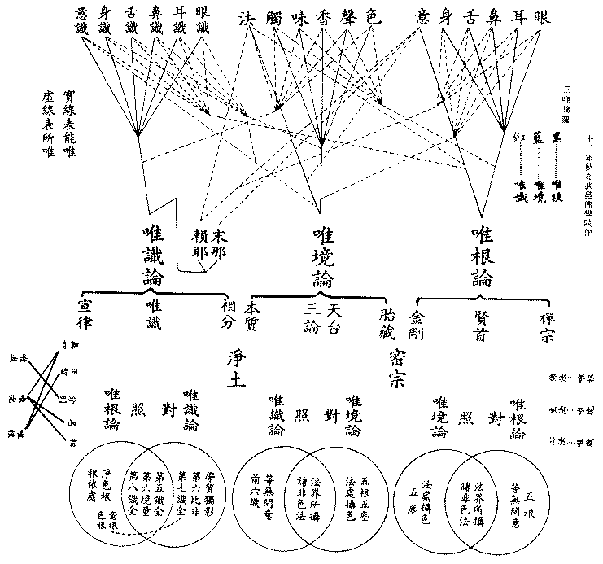



二　引教成立



甲　三唯论得名之依据



一、唯识论——解深密经：『诸识所缘，唯识所现』。



二、唯境论——成唯识论述记：『然清辨计总拨法空，为违中道强立唯境』。



三、唯根论——大佛顶经卷五：『十方如来异口同音告阿难曰：「汝欲识知俱生无明，使汝轮转生死结根，唯汝六根更无他物。汝复欲知无上菩提，令汝速证安乐解脱寂静妙常，亦汝六根更无他物」』。



乙　三唯论建义之依据



一、『真性有为空，缘生故，如幻；无为无起灭，不实，如空华。言妄显诸真，妄真同二妄，犹非真非真，云何见所见』？——唯境论。



二、『中间无实性，是故若交芦，结解同所因，圣凡无二路。汝观交中性，空、有、二、俱非，迷晦即无明，发明便解脱。解结因次第，六解一亦亡，根选择圆通，入流成正觉』。——唯根论。又、『如一见根见周法界，听嗅尝触觉触觉知，妙德莹然，遍周法界，圆满十虚，宁有方所』（六大章）！『用目周视，但如镜中无别分析，汝识於中次第标指』（七大章）。『根尘同源，缚脱无二，「识性虚妄犹如空华」。由尘发识，因根有相，相见无性，同於交芦。是故汝今知见立知，即无明本，知见无见斯即涅槃无漏真净』（第五卷）——可资参考。



三、『陀那微细识，习气成瀑流，真非真恐迷，我常不开演。自心取自心，非幻成幻法，不取无非幻，非幻尚不生，幻法亦何立』？——唯识论。



------



## (见海刊四卷十



三　图释



释此论图，大分为二：一、释题，二、解义。



初　释题



「唯」者，独此无餘义，谓除此以外更无所有。华严经言：『一即一切，一切即一』。天台宗言：『随拈一法，无非法界』；谓随拈一尘皆全法界，法界全体摄在一尘。如是，则一切法皆可唯矣。然诸法标别，备十八界；约类为言，则可唯者有三：一、就六根界名唯根，二、就六尘界名唯境，三、就六识界名唯识。论如常释。



次　解义



解义分三：一、依教建立分，二、依图理解分，三、配摄诸宗分。



初、依教建立者：「识」，即指众生心。华严经云：『应观法界性，一切唯心造』。又曰：『三界上下法，唯是一心作』。此唯心句，即唯识论之所宗本。在昔天亲菩萨造唯识二十颂，自作释论；又造唯识三十颂，有护法等十大论师作释，已依楞伽、深密等经广徵教理，确然成立，故唯识之论无容复赘。至阐扬唯识宗，以护法为最盛。而与护法同时有清辨菩萨，依中观等论著掌珍论。据窥基成唯识述记，谓其主张唯境。近人作唯性论，亦属唯境，故唯境之论亦经人说过，不俟繁引。至唯根之论，虽未有论师建立，若寻诸契经亦有确据，如楞严经卷五云：『佛告阿难：「汝欲识知俱生无明，使汝轮转生死结根，惟汝六根，更无他物。汝复欲知无上菩提，令你速证安乐解脱寂静妙常，亦汝六根，更非他物」』。此言生死与解脱皆唯六根，更无他物，即是唯根之义。又彼经立七大，於地水火风空识之外更说根大，亦是唯根论之特点。此但就楞严一经足以证成唯根论者已如此，其他诸大乘经论尚多可引证，恐繁且止。



次、依理图解分：能唯之眼耳鼻舌身五根，对色声香味触五尘，故五尘可摄在五根。又能唯之意根，与法尘对，可摄法尘；意根又可摄六识心法：如是唯根论理善安立矣。能唯之色声香味触五尘，可摄眼耳鼻舌身五根。又摄前五识；其能唯之法尘，一分能缘者摄六识，一分所属及能缘者摄六根：此唯境论亦可理善成立。六尘为六识所缘相，故能唯之六识摄。但唯识论扩张识界谈八识，故阿赖耶识为意识所缘通于法界；又意根一分即赖耶，眼等五根为赖耶之相分；末那亦意根所摄。如是，则八识摄六根、六尘尽，故唯识论成立。



三、配摄诸宗分：大乘八宗，唯识宗之属唯识论固不待言。然南山宣律师谈大乘律宗，其判教宗：一曰、性空宗，即指小乘各部；二曰、相空宗，即指三论毕竟空义；三曰、唯识宗，即指非空非有之唯识宗：故南山律宗亦应属唯识论。至净土宗则可分二：其谈自性弥陀唯心净土者，如维摩经言『心净则佛土净』，但取自识上现起之相分，此纯取自力者则应属唯识论。其他一说，则托西方诸圣他心之相分为本质，以自心缘之现起相分，如镜为自心，须托镜外人形之本质方于镜中现起人影，此自力他力兼取者，所托本质净土应属唯境论。天台宗言一心三观从一境三谛而发，三论宗虽言毕竟空而空即是境，故此二宗皆属唯境。密宗有金刚、胎藏二界；胎藏界说众生理性如藏胎中，开显即为佛境，故当属唯境论。金刚界说众生本心与佛金刚智果无异，如楞严说『以果地觉为因地心』，故属唯根论。华严说『一切众生皆有如来智慧德相』，悟真心以起修；禅宗直指人心，见性成佛，在眼曰见乃至在意曰知，悟即佛性，无位真人在六根门放光动地，皆同楞严扩张根界，指现量心令直证者，故贤首与禅宗亦皆属唯根论。



------



## （大圆笔记）(见海刊四卷九



再论大乘三宗



往者、尝据「空」与「非空不空」，合说大乘为「一切法空宗」、「唯识圆觉宗」之二宗。然以唯识与圆觉犹可分也，故究竟显了乃分三宗：



　　　　一、法性空慧宗……………无漏般若宗──┐  

　　　　二、法相唯识宗……………有为唯识宗──┼──基师义  

　　　　三、法界圆觉宗……………无为真如宗──┘



此三宗之分，见於吾之论著者已不止六七次，其引证发挥者皆可按覆参核。今以瑜伽师地论第十云：『问：如世尊言：「是诸缘起非我所作，亦非餘作。所以者何？若佛出世若不出世，安住法性、法住、法界」。云何法性？云何法住？云何法界？答：是诸缘起，无始时来理成就性，是名法性；如成就性以无颠倒文句安立，是名法住；由此法住以彼法性为因，是故说彼名为法界』。尤足引为诚证。故再论之：



论云「法性」，此亦同名法性，乃为缘起及缘所起诸法无始时来理成就性，非安立谛不可施设，唯法空般若所通达，故以空慧为宗。诸无漏法从般若得，亦曰无漏般若宗。论云「法住」，此云法相，是安立谛如法施设名相，是识所缘唯识变现，故以唯识为宗。诸有为法皆唯识变，亦曰有为唯识宗。论云「法界」，此亦同名法界法，指法住，界指法性。法界一名，包上法住法性而言，在境即是性相一致，在智即是理量同时，此唯大圆满觉佛正遍知乃能如此，故以圆觉为宗。或佛慧、佛知见为宗。此法界虽有时、有处、广说一切有为法皆是无为法，若随拈一法皆是法界等，而确为诸法真实如此之真如，故亦云无为真如宗。



然论法住、何故此云法相？法住一名知者鲜故，不通用故。法相一名与法住一名，义相符故。法相一名较法住一名，义尤显故。



此三宗之差别何在？法性非安立故，一切名相不可施设故，唯用遮词遣破，破如可破，毕竟无一名之可得。故唯引发法空般若以通达之，龙树系大乘学属之。法相是安立故，施设诸法名相故，多用表词成立，破亦为立，显了无一法之不建。故当善巧唯识现义以贯持之，无著系大乘学属之。法界非安立非不安立，遮表破立同时一致，施设不施设皆不可思议，故是如来大圆觉海之所印证。



此三宗之次第若何？在实证，由加行位入通达位，宗在通达法性之空慧；由通达位入修习位，宗在贯持法相之唯识；由修习位入究竟位，宗在印证法界之圆觉。在初心，则依法界圆觉以生信，依法相唯识以成解，依法性空慧以修行。故为两重次第。初心、依圣言量起比现量；实证、依真现量成圣比量。



------



## (见海刊九卷三



大乘位与大乘各宗



——十九年春在闽南佛学院讲——



一　发端  

二　曩在「起信唯识释」之发凡甲　地上宗自证而造论  

乙　地前依他教而起言



三　今广其意以判各宗甲　以论立宗者  

乙　以经立宗者  

丙　以传立宗者



四　各宗多明「境」或「行果」之别甲　性相门  

乙　观行门  

丙　加持门



五　各宗唯是大乘中之偏胜相



一　发端



这个题目所蕴蓄的意义，为我十年来对於印度中国各大乘宗派、作有系统说明方法之一种，我於大乘各宗，完全抱著客观的态度去观察各宗派不同之点，同时作融合贯通的研究以发见其遍融互摄的共同律。由此探究之结果，故发生如下之结论：



一、平等门——从此门看去，则凡是大乘的各宗，无论其为性、为相、为禅、为律、为教（贤首、天台）、为净、为密，如所谓中国之大乘八宗，无一不从同一原则上，引共同依据的教理去说明去发挥。故宗虽有八，同摄入于大乘法海，平等平等，不得分判谁高谁下。



二、特殊门——从此看去，则所谓大乘八宗者，在大乘教理上取其一部分为所宗，各站在其自宗地位上以发挥其偏胜之玄诠，显其特殊之理境。故虽同是大乘佛教，就地位以判教义，则不无特殊偏胜之线索可寻。



以上，为我对於大乘各宗所观之焦点。然而从什麼地方可以有这样的见到？又有什麼方法可以去说明其原委？曩者关於此问题略有论及者有二：一、佛法总抉择谈：用遍计、依他、圆成三性相同相异之点以说明佛法的全体，及各宗派平等与特殊之所以然。二、大乘宗地图：在八方面上，以对照异生与如来之出发点与归宿点；虽未显然引及各宗，而按图索骥，衡量各宗相同相异之点，亦洞若观火。



现在所讲的，乃是从异生位到佛果位，其中所经历之一一之阶段，虽同是大乘之位——始自初发心终至成正觉——而有初终及中间菩萨历劫修因位次高下之各别。我依据至教之见解，衡鉴大乘各宗所依据所发挥之教义，乃因其依据大乘位次之高下，故发挥之教义亦有所偏重偏胜；是为依大乘位而说明大乘各宗。但此种见解非创始於今日，从前已有所论及，不过东鳞西爪的散在各著作中，今天特提出此问题，作通盘有系统的说明。



二　曩在「起信唯识释」之发凡



起信论唯识释，是民国十三年著。著本书的动机，乃因当时支那内学院王恩洋居士作起信论料简。彼书之内容，不像日本人与梁任公先生依历史的眼光疑斥起信为伪书者，他是根据法相唯识之教理，料简起信论之真如：因起信真如有受熏缘起义；而唯识之真如是唯识性、是无为法，既不为他法之生因，亦不为他法之所生。起信真如有受熏义、有缘起义，又有平等普遍为诸法法性义，则近於数论的「自性」、『相虽转变而性是一』义。王君本此见解，於是斥起信为似教，非真佛教。故我当时亦以唯识之理而释起信——盖起信之真如与唯识之真如，其名虽同，其义有广狭之不同：起信从体显用，若体若用皆名真如；唯识乃依用显体，用是识相、体是识性，唯体性是真如，相用非真如——。同时依菩萨位而说起信等论所宗不同，以发其大凡。



甲　地上菩萨宗自证而造论故马鸣等从自证境明一切法



在菩萨位讲：马鸣为第八地菩萨，其所造之论皆依自证现量智境为准据。虽亦不离於佛陀所说之契经而取圣言为依止，但其注重所在之点为自证境，一切契经或反为造论之注脚。进言之，地上菩萨虽据自证境而说，同时亦统明佛法全体，故亦不限於专讲自位境智；不过依自位亲证之智境，说明一切法。



乙　地前菩萨依他教而起言故贤首等从佛果境彰一切法



华严宗之圆教法界观，所谓「十相六玄」，都是明佛果上所证之智境。在此当有使吾人发生疑问者：即华严宗之创始者为贤首，他所处的地位，尚在地前而未登地，其所发挥之境界反在马鸣以上而专明佛果圆融无碍境界，岂非实令人有不解者？实亦没有什麼可疑之点；今於言论便利上起见，明地前、地上、佛果所依据以发挥之教义，作三项来说明。



一、未登地的菩萨，未得圣智自证现量之智境，间虽发有相似之现量境，然未足依凭。其所宗本依据者，乃在地上菩萨之圣言量，或佛果上之圣言量；因自己既没有智境可为标准，则於菩萨或佛之圣言不可稍忽。由此，故虽在地前，倘是依据地上菩萨之圣言量，则其所发挥之教理，为依地上菩萨之境界以说明一切法；倘是依据佛果上之圣言量，则其所发挥之教理，为依佛果上之境界以说明一切法。是故贤首虽未入初地，而其所宗契经乃是华严圆觉果海之境界，或地上最高位之普贤菩萨境；马鸣依自地智境所造之论，自然反　贤首之下，此本毫无足疑者。



二、地上菩萨，有自亲证智境为宗本以发挥教义，乃至说一切法无不依其现行智境为出发点，虽亦依圣言教或比量，然此不过其傍依，而正面之根据乃在自证。於此乃有其特点，即地上菩萨以未究证无漏与灭尽有漏，以是依其现行之心境，有漏无漏无间引发，故一方面代表四圣之无漏境，一方面代表六凡之有漏境。马鸣所造起信论，即依据此点以发挥教理，所以不若贤首全依据佛果圣言纯无漏境之高深，此亦无足怀疑者。



三、佛果自证究极圆满，智境离言绝相，佛亦无言论的必要。因佛与佛间，果位相等，其境界、心智都是相齐，故佛与佛之间完全相喻於无言。其所以起言说之原因，还在地上、地前、乃至凡夫的机感。故为凡夫说贤位境，为地前菩萨说地上境，为地上菩萨辗转说上地境，乃至说自所证之智境。故大乘亦渐亦顿之法华宗，即依据此点而发挥。



如此大乘各宗，虽同是大乘，因地位之不同、程度之高下，随其自住地位的境界说明一切法，或依何等之圣教申明各宗的宗本，往往全局为之改观。



三　今广其意以判各宗



甲　以论立宗者



今就各宗言教直接生起之原因，可广其意分为三类：以论立宗者，如嘉祥的三论宗——又名四论宗——与慈恩的唯识宗，彼虽不无所依之经，然直接采取立教方面言则唯在论。故就依论立宗言有如下之二大系统：



１　宗初地所证遍行真如故有龙树一系之中观学



世传龙树为证入初地之菩萨，如楞伽经等在在皆足证明，亦为研究佛教者之所共许也。初地证入一切法空，即通达二无我得一切法空智，亦即遍照一切法真实如此的法性。故龙树说法，从其所证的法空理上，说一切法皆不可得。其言教所显者，亦在遮诠方面，以表现其空性真如理也。此为龙树依自证境造大乘论，故有空宗一系。其最足表现他全体的思想，集贯总持他一切的作品者，唯推中观论，故亦有称其为法性中观学者。其餘如智度论等，皆不出中观论之范围。在中国依其著作推演而建立为三论宗或四论宗，乃依龙树菩萨之论为宗本故，特称为中观学。



２　宗三地所发大法光明故有无著一系之唯识学



唯识宗所据六经十一论，也有佛说或菩萨说的。如华严经虽亦为此宗之所依，而非正依；如深密等始为此宗之正所依。深密经乃从瑜伽师地论摘出者，此虽弥勒所说，能传演到世间上还是无著菩萨。弥勒五部论及无著自作的论，即此宗所依的教。天亲护法等依之发挥，故唯识根本教理，可说是无著建立的。从前中国传说无著为初地菩萨，又说无著得大乘光明定。我从前想：无著既依初地境为出发点，即应与龙树空宗系相同，何以立论相去颇远耶？这是我以前的难点。现从西藏佛教徒所传，皆公认无著为第三地菩萨，恰与中国相传其「得大乘光明定」之言巧符，此较初地说为当。即依三地大乘光明定的智慧，照了佛之一切法藏，即以此定所发出之智为能观，以地前或地上乃至到佛果的教法为其所观的法境。此如华严、瑜伽等，说三地所证之境界都是这样。由照了大乘之法，有明了正确之法相，故此唯识学、又名法相学。据此、则前所谓中观学亦可名法性学。故依初地境有龙树系，依三地境有无著系也。



乙　以经立宗者



１　宗法云地含藏一切三摩地门之普贤故有华严教



以经立宗者，即是依佛所说的言教而立其宗也。如来言教之所由起，种种不一，——或对地上、地前、二乘凡夫的关系而施诸教法。依佛说法最高之缘起说，唯依第十地菩萨的根机所感动而有的教法最极殊胜。如法云地菩萨，如来所有的教法犹如大云而雨大雨，此地菩萨犹如大海悉能通达而领受之。所以由十地含藏一切三摩地门的普贤三昧境界，就成为华严教。即以最圆满普贤三昧之因海，以显最究竟不可言说毗卢果海。此即是就普贤的自证境上，显现所感受到的佛境界的教。所以华严第一会即说如来依正因果法门——佛果境界从何来？即推到因上；此因得何果？即推到果上。此依十地菩萨所显最高的教法，唯十地方能领受，餘地虽亦能少分闻到，不过其　起须待十地机缘耳。故云「宗法云地而有华严教」也。



２　宗佛智及二乘回心之劫前菩萨故有法华教



法华教是佛陀自证的境界，自动的大愿意乐所说，所以说『为开示悟入佛之知见故，出现於世』。从能感的机言，是二乘回小向大需要此大乘教法。在依二乘教法而修到的阿罗汉，依其所证之生空真如言之，或同初地、第八地菩萨；依其应备之福慧资粮及求证法空真如上言之，还不及初住，仅与七信之菩萨齐。未入初住，未达法空，故云「劫前菩萨」，以第一僧祇尚未入或尚未满故。天台智𫖮大师，谓入圆教初住即能八相成佛。天台后裔每谓此为天台独有之说，其实此为起信论及慈恩宗等皆有之大乘共法。法华为二乘授记作佛，都是八相成佛的相，以初住即能实现故。故法华教有两方面：一、依佛自己的平等意乐，为欲众生开示悟入佛之知见是佛最高的自证智境，故放光现瑞、等觉如弥勒者尚不知欲说何法。二、是未入劫以前的二乘回心、种性位的菩萨所急需的法味。亦即是一、为地上菩萨也测不到的最高境界，即如来本门；二、为回心二乘说成佛法，如为舍利弗以利根故说方便品，即如来迹门。故云「宗佛智及劫前菩萨有法华教」。



３　宗佛智及诸乘初心之易退有情故有净土教



净土教皆说佛果之依正庄严，是佛之他受用境界。原夫如来之所以要说此教者，是从彻底的大悲心为出发点，对於初心易於退转的众生令其依佛智所流出之净土经教，修习净土法门，得生诸佛之净妙国土，即能证得阿惟越致，一生证得无上菩提；故净土法门最重之点，即在摄诸众生令不退转阿耨多罗三藐三菩提。如佛不说此净土法门令众有所依归，即在此五浊恶世之中修菩提，则初发心之众生有所恐惧而生退转。故起信论谓为「胜方便」，十住论说为「易行道」，良有以也。此所以一面依佛智，一面依初心怯退人，而有净土教出现也。



丙　以传立宗者



以传立宗者，禅宗不依文字，绝无经典，赤裸裸的惟证是务。密宗虽有其所依之经典，若未经明师之传授皆不阅之，即或阅之，其名句文身之安排与寻常逈异，非经师传亦难明了。至於律宗固有律藏在，然经论即菩萨也有造说之可能，惟关於律制独创裁於佛，降佛而还皆不得措一词，后之继续宏扬者，亦惟师传是遵。故此三者，皆依传立宗也。



１　宗法云地含藏一切陀罗尼门之金刚故有真言宗



真言宗以金刚菩提萨埵为其初袓。世传龙猛以定力开南天铁塔，金刚萨埵授之以灌顶，故人间世有密宗教义流行焉。以非自龙树之自证境上而流出者，故须归之於金刚萨埵。有云金刚萨埵即普贤，普贤在大乘教法上为最高之模范菩萨，故从三摩地门有华严教；从陀罗尼门有密教。以最高之大机，感佛说圆极之教法，故云真言。不名为教者，以不诠显理故。此真言须代代亲授，师资相承，方能流通。



２　宗佛智及二乘回心之入劫菩萨故有禅宗



禅宗以「佛心为宗」，即以佛智所证之境为境。此宗之所重者，为师资相继而传其「以心印心」之法门也。世传大迦叶为其初祖，他本是回心之大阿罗汉，夙根极深，不遇佛也可成独觉；若罗汉发大菩提心，亦得授记作佛。依一般言之，位在第七信；然不一定有，先曾修习大乘法者，虽退失其菩提心，若一念回心向上即可入初住。或以前已曾备修福智资粮中道而废者，一回心即可入初地等位，故云入劫菩萨——然入初劫二劫三劫不等。诸地位中，於胜进道中皆有加行，即如十信满位，亦起加行故而入初住，证未曾有之悟境而契佛心，故能传佛心印，由此故有禅宗之产生也。



３　宗佛智及诸乘之新进有情故有律宗



律本佛制，故律亦宗本於佛。依大乘说：一切大乘律皆依三种佛身而说，诸乘初心须纳之於正范，有一定「止」「作」的规律，才能不越乎轨道以外的行为。依三聚净戒说：摄律仪戒即诸恶莫作，所谓止持门是；饶益有情及摄善法戒即众善奉行，所谓作持门是。真能传持佛之戒律的，须通达佛智，上体佛的本怀，下察众生的根器而传佛戒，才能令彼新进有情得蒙实益。故一面依佛智，一面依初心而有律宗也。



四　各宗多明境或行果之别



甲　性相门



多明境曰「性相门」，详境而略行果之中观、唯识属之。位在第二、第一大劫。性相门者，以说明性相之平等门故。如自凡夫乃至於佛，皆可归之性相。法性一味平等，法相不无有别，若龙树之中观学，无著之唯识学等，皆可归於此门。此不过因各宗所重之点不同，在多明境者曰性相门，实则法性法相，从始至终平等平等。虽偏说於境而同时於行果亦必言及，并非舍行果而不言也。所以从实际言之，只有多分与少分之差别而已。



若就言教以论，有两方面：一、如龙树从自证境上为出发点而为地前说一切法门，此教功用、虽能被地前之机，然就能说教者之本位上言之，则在第二大劫也。二、地前胜解位和加行位之菩萨，正须此教法为其悟入之方，故从所逗之根器上说，位在第一劫。此虽详境而行果亦该也。然对未入劫之初发心菩萨，於此教法反难领受，故初发心者应以加持门之极果教法，而激发其信心为妙，此教偏於理智，故为未入地前加行位或胜解位上之所必需也。



乙　观行门



多明行曰「观行门」，律宗、禅宗及法华、华严兼之。位在诸乘初心及第一、第三大劫。观行乃福智资粮之所由圆满也，故观行门、诸宗皆兼之。律宗之戒法，在大乘则初发心位即须持此为修行趣果之正范，故此唯重在行。禅宗唯趣实证，然每到一种特殊境界，须要加功用行方可证得。法华、华严，多明佛果上之殊胜境界，然果不过所趣向之目标，为到此目标故亦广明行之功用。所以说「万行因华，庄严果德」，正是显其因行极为殊胜也。在此中明其位置，律在初心；法华及禅与夫二乘回心等住第一劫；华严明普贤行者住第三大劫。



丙　加持门



多明果曰「加持门」，真言、净土及华严、法华兼之。位在第三大劫及诸乘初心第一大劫。佛果成就无量威德，能加持凡夫乃至修习位之菩萨。如真言宗用三密——身口意——加持；净土以大悲愿力及种种依正庄严，发起信仰愿慕，皆为加持；若法华、华严兼观行门及加持门。若因其所经历之位次以明加持，则能加持与所加持：上上能被於下下，唯除异生位皆能加持；下下敬仰於上上，唯除究竟位皆被加持：而位在第三大劫及诸乘初心之第一大劫。能所相望，皆通一三。若细为分别，前除异生未入劫者，后除究竟劫已圆者，唯此一能一所不在劫中耳。



「加持门」全仗他力。若「性相门」、则从异生至佛果平等平等，如八识因果染净虽有差别，而八识一也；「观行门」、除异生位未起观行和佛果位观行已圆，其中种姓位至修习位皆具观行，此二者唯仗自力。兹就境、行、果三门通别，特摄一表如



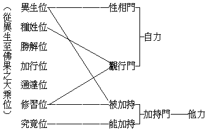



五　各宗唯是大乘中之偏胜相



八宗大乘教法，都在大乘法上占一位置而各有其殊胜之相用，但统合起来皆摄在大乘之中。古来，或谓大乘为一乘，或谓佛乘，或谓最上乘，而欲显其自宗之超过其餘各大乘宗之殊胜。其实，都是大乘之别名：最上乘者、大乘为最上故；佛乘者，大乘以佛为最高之果故；一乘者，为令众生皆入佛乘故，故云『唯有一乘法，无二亦无三』也。是即皆为大乘中各有之殊胜相和殊胜义也。



古人有於大乘之全部中，据其认为最殊胜者特别阐发，实则各仅大乘之一部分；其末裔即据此一部分之殊胜相，遂尊崇自己门庭，以为我宗为大乘上特殊之一乘或佛乘或最上乘，而抑他宗为三乘中普通大乘。如西藏真言宗自称为果乘，餘俱为因乘；不知彼等所执者，仅大乘全体中之一部分耳。各宗唯是大乘中一偏胜之相，皆大乘故无有高下，因乘果乘皆通因果。此是因乘，因之所向为果；彼是果乘，果之所由为因；故因果互通，平等平等！唯证境有殊，所据各别，乃有诸宗派之标帜。其实殊胜不离平等，平等不离殊胜也。



------



## （宝忍记、芝峰校阅）(见海刊十一卷十一



大乘法之三种异门表



——在汉藏教理院专修班讲——



古人多以嗢陀南颂摄法义，今畫图列表以摄之，虽方式有变而其义则一，且藉线条方位助显第次关系，其为用加胜矣。故现所列表，亦犹古之嗢陀南颂，当本之以为解释。表中所诠法义，乃就大乘法而明三种异门，亦即以三种异门而摄大乘法也。故名大乘法之三种异门表。今列如左：



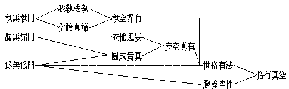



言三种异门者：一、执无执门，二、漏无漏门，三、为无为门。此三种异门，开之又各具多种异名。如第一之执无执门，或名我无我门，或名自性无自性门等。第二种之漏无漏门，或名染离染门，或名系离系门等。第三之为无为门，或名生无生门，或名作无作门等。虽有如是异名，而义是一，故以三门即可摄尽。



第一之执无执门，乃就所执上遣除其执而显。如云我我所执，此所执者即空，而无执之有为无为则有。以所执之我我所本空无实，但於似我似法有为上虚妄执有故。若离妄执即名无执，而无执所显即有为无为之世俗胜义二谛法，谛实是有。故云「执空、谛有」，即我法二执是空而真俗二谛是有也。此为大乘法异门之一。依此异门所说大乘经论，如解深密、瑜伽等，虽大乘经论都互相通摄，而就其偏胜以明，故有依此执无执门而说之一类经论也。



第二之漏无漏门：漏即世间染法，亦即应断之依他妄法；无漏即出世净法，亦即应证之圆成真法。但此所说之依他妄法及圆成真法，与前执无执门所说有为依他、无为圆成有异。盖前门遣我法执而存依他为俗谛、与圆成为真谛，此漏无漏门则以依他为虚妄杂染。此依他中摄我法执，亦依此依他起我法二执，故此依他唯是虚妄分别有之有漏法。而圆成真法亦与前门所说真谛不同者，以此中圆成真法亦摄净依他，已不名依他而名圆成矣，故与前异。此门所说，或於依他妄法而显有圆成真法，或依圆成真法以遣空依他妄法，故成「妄空、真有」，即依他妄法是空而圆成真法是有也。然依此门所空，亦不同前门所空，前门依他皆不空，此则染依他亦空，较前进一步矣。此在经论，如如来藏、宝性、辨中边等，皆是此门所明。



第三之为无为门：即明一切世俗有为法，乃种种因缘对待假立而有。若於此世俗有为法而究其胜义则毕竟是空，此毕竟空，即此中所谓胜义无为法。明此门之义者，如金刚经曰：『一切有为法，如梦幻泡影，如露亦如电，应作如是观』。又『若见诸相非相即见如来』，『如来者即诸法如义』，『不取於相如如不动』等。此等大乘经，皆从此义而说。故从此为无为门而说，前二异门可曰有宗，以「执空谛有」，「妄空真有」，以有为归故。此则俗谛是有，而真谛毕竟空，故曰「俗有真空」。由是执无执门之谛有，与漏无漏门之真有，均摄入此门之世俗有中，而唯无为法性为胜义真空也。



如是大乘法之三种异门，据此表观，亦含有次第深浅之意义。即漏无漏门比执无执门为深，为无为门又较漏无漏门为深。然此乃明最胜义性之一种次第看法耳；而大乘法於此三种异门，更可作他种不同之观察。兹另列一表如左：



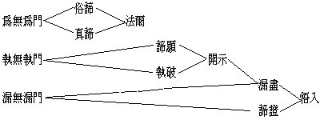



依此次第，其有为无为等门之有为即俗谛，无为即真谛，此为诸法法尔道理，不论有佛出世，无佛出世，恒常如是。但一切众生为无明所蒙，烦恼所蔽，虚妄遍计起我法执，生增减见，以致於法尔道理，不知不觉。因此有佛出世，开示佛之知见，破除众生迷执，使众生所有遍计我法等执遣破无餘，此等「执破」，则法尔「谛显」。然未开示，执著未破，固不能显法尔道理，而仍为一混然境界。故至执无执门，始揭开众生之迷谬，显示法尔之谛理。次至漏无漏门，修习一切无漏方便，将一切有漏杂染对治遣除罄尽，圆满无漏福智功德，因而证得法尔谛理。



依此表对三种异门，又可作如下之观法：即单就为无为门之真俗二谛，唯明法尔道理，未指出众生之迷执及破遣之方便；其法尔理犹在众生妄执隐蔽之中，未能显示。次至执无执门，则进一层，即揭开迷执，显示谛相；但有漏习气尚存。必至漏无漏门，有漏法尽，证佛知见悟入谛相，方为究竟。如中国之天台等教多作如是观也。兹更另列一表如左：



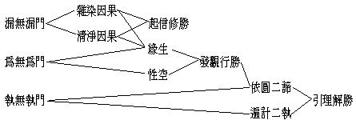



依此表复可作一种观法：如漏无漏门，漏即杂染因果，无漏即清净因果。总漏无漏一门，但就染净因果义上而明，故亦唯明依他起法，如唐后法相宗辨天台宗三谛三观，唯是阐明依他起是。其次为无为门，方明因缘所生法之有为依他，及性空之无为圆成。然在三自性中，尚只明依他与圆成，犹缺遍计所执而未圆满；故必须执无执门，并明遍计所执及依他、圆成三法，方臻美备。



故如是三异门所明，应知各有偏胜。如执无执门所明者，即於教理最完备而引生理解最胜。为无为门所明，即彻观胜义理而引发观行慧为最胜。漏无漏门所明，即对行果起信而发心修行为最胜。故此三门各有殊胜，虽或专习一门而不可执此斥餘也。



------



## （碧松记）(见海刊十九卷五



大乘宗地引论



——十七年春编集——



上卷



「教」二「乘」或一多，虽为今对佛法之大分判，然以中国及个人之大乘立场，则觉餘乘可含摄於「大乘」；而大乘中虽有显密等多少之区别，觉其同证实相而得菩提，平等无有高下。为详究斯义故，尝欲造「大乘宗地」、「大乘经释」以明之。大乘经释所取经本选定楞伽，发端未竟其绪。大乘宗地：地谓「能持」、「所依」，宗谓宗派；能持大乘佛法各宗派而为其「所依」，故名大乘宗地。大乘宗地又有引论、本论、餘论之别。本论、正由大乘佛法之各宗以明其本义；餘论则依本论成立之义，以抉择世间教、哲、科、艺诸学者。今此引论，乃条贯十餘年来关於此思想所散见之言论，结成一编，以为本论之喤引也。



结前说为引论，兹又分二：一、补偏救弊者，二、总示本意者。今先结集补偏救弊之说，此有九节。



一　为「法相」对「贤首」者



甲　三重法界观



乙　对辨唯识圆觉宗



此中「三重法界」依法相之三自性立。明三自性，较四法界切符心境；彰法相之殊胜。「唯识与圆觉」之对辨，亦针对贤首家所立法相、法性（此贤首家所云法性、非常途所云法性）而立论者；旨在平彼所云法性与法相之高下，归本戒贤、玄奘、窥基相承之「应理圆实宗」，别名「唯识圆觉宗」耳。



附一　读梁漱溟君唯识学与佛教



附二　关於支那内学院文件之摘疑



二　为「性、相」对「台、贤」者



对辨大乘一乘



按：此因台、贤二家，大抵以「法性般若」、「法相唯识」为三乘中大乘权教，而别以自所宗法华、华严等为三乘外之一乘实教；此论即泯除其三一权实之异见者。



三　「性、相、禅」对「台、贤」者



曹溪禅之新击节



按：此论以禅宗为准，以抑台、贤而扬性、相，辞意明决，颇惹宗贤首者纷诤；然其势亦从前列诸篇积成者。对之解纷释诤者有四，附录於此。



附一　答某君



附二　答某师



附三　略说贤首义



附四　论贤首与慧苑之判教



四　「性、相、律」对「密宗」者



今佛教中之男女僧俗显密问题



五　「台、贤、禅、净、律」对「密宗」者



中国密宗复兴之趋势



六　大乘各宗对「密宗」者



论即身成佛



按：以上三篇，旨在泯平密显之胜劣见，对治时人偏蔽。执密宗者，因此起剧烈之争论，迄今未已。殊可见破著之难已！



七　大乘律对餘宗者



志行之自述



八　以「法相」对餘宗者



缘起抉择论



九　以「净土」对餘宗者



净土宗十住心论



下卷



前卷或抑或扬，或为矫其积习、或为拂其时趋、或泯胜执同劣、或翻劣执为胜，要皆补偏救弊之方便耳。不知其意者每激生争辩，故当继集「总示本意」之说，此有篇七、图一。



一　「大佛顶首楞严经摄论」录出者



论曰：即惑（亦即无明妄想、性惟遍计，然亦依他所起）、业（亦即生死流转、烦恼缠缚、性惟依他，然亦遍计所执也）、苦（亦即异熟报障，亦即异生）……得其旨者，正不妨随宜而施设耳。



二　「佛乘导言」录出者



问曰：其大乘法要义如何？答曰：菩提心为因，大慈悲为根本，方便为究竟。……计度贪著常、乐、我、净，反引发尘劳增益其苦恼，名运粪入不名运粪出也。



三　「整理僧伽制度论」录出者



------



### 甲　「宗名」之次序



八宗——道基七对——次序表



由竖观之：可见顺序之则前南山而后清凉；逆序之，则前清凉而后南山。……然师家须善於应用，无一物是药，无一物不是药者；此可深长思焉。（见论「宗依品」第一节）



乙　「宗学」之问答



问曰：既取法隋唐诸宗为依止，则相传有十三宗矣，何为仅列八宗？……权乎实乎？偏乎圆乎？幸勿为承虚触响之言哉！（见论「宗依品」第三节）



四　「佛乘宗要论」录出者



甲　大乘教、理、行、果的经论及宗派



（见论「纯正的佛法」第三章第六——十节）



乙　小乘与大乘之关系



（见论「纯正的佛法」第四章）



附　唯性论书后



五　佛法总抉择谈



六　从「摄大乘论讲录」录出者



今讲此论，先依佛教总系统中明其位置。……关於教、乘一多之义，别为一表以明大意，详待他处明之。



七　佛法大系



附　评宝明君「中国佛教之现势」



大乘宗地图



大乘宗地图释



——二十年八月在北平柏林教理院讲——



第一章　叙言  

第二章　释题  

第三章　解图第一节　教法一　历别说明（凡五十二目）  

二　综合说明



第二节　宗义一　总说  

二　历别说明甲　性宗  

乙　相宗  

丙　律宗  

丁　禅宗  

戊　天台宗  

己　贤首宗  

庚　真言宗  

辛　净土宗



三　综合说明甲　八对四类门  

乙　四单四复门  

丙　相夺互成门  

丁　平等殊胜门



第四章　结论第一节　教法之差别及其会归一　差别  

二　会归



第二节　宗义之成立及其安置一　成立  

二　安置



第三节　今后佛学之安立



大乘宗地图㈠



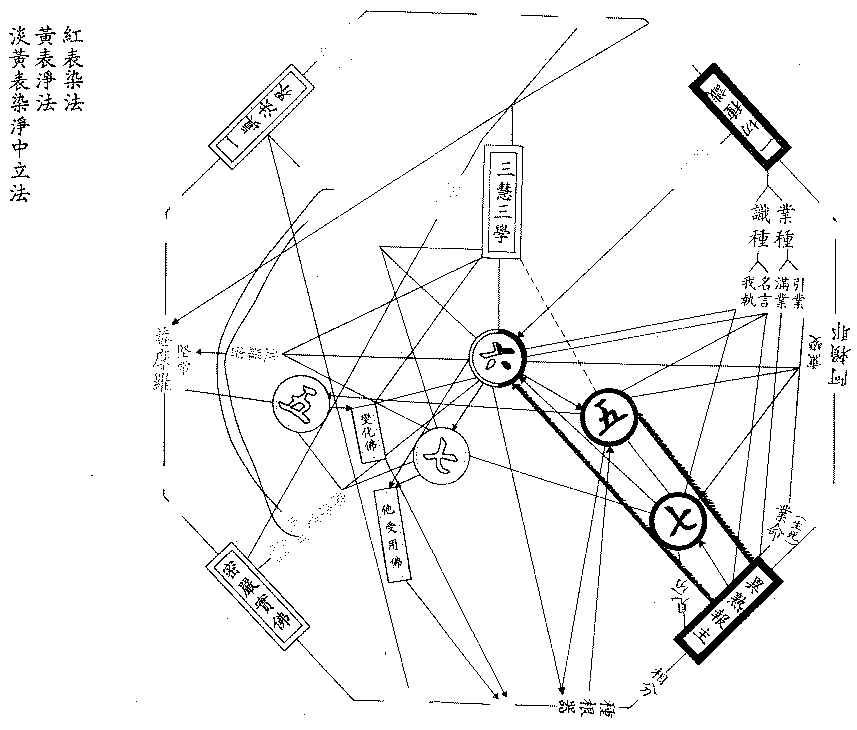



大乘宗地图㈡——教法



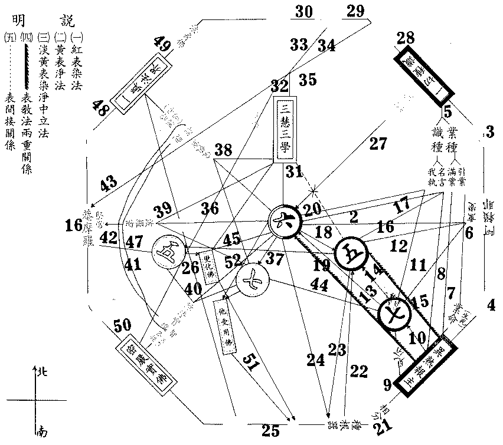



大乘宗地图㈢——四相对门



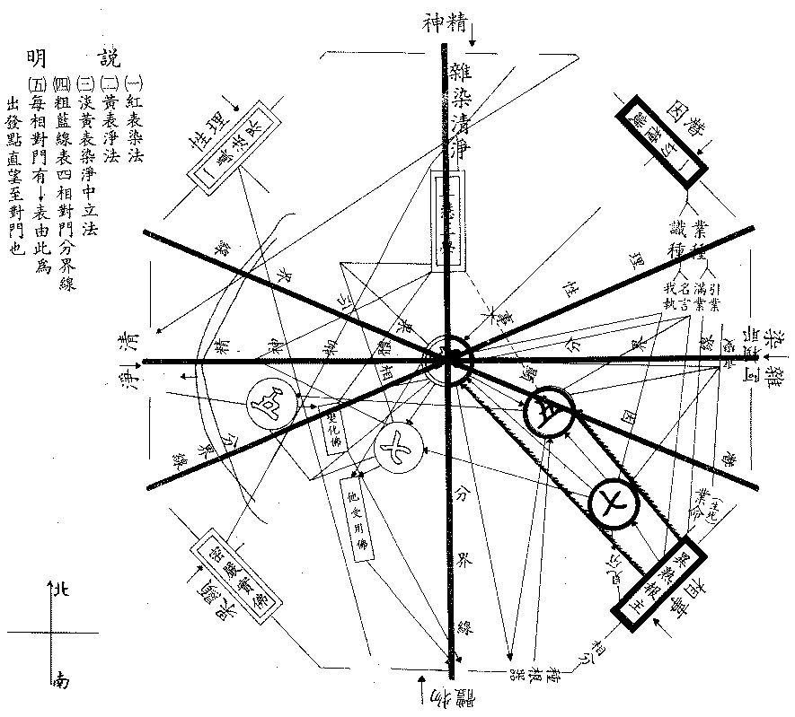



大乘宗地图㈣——宗义



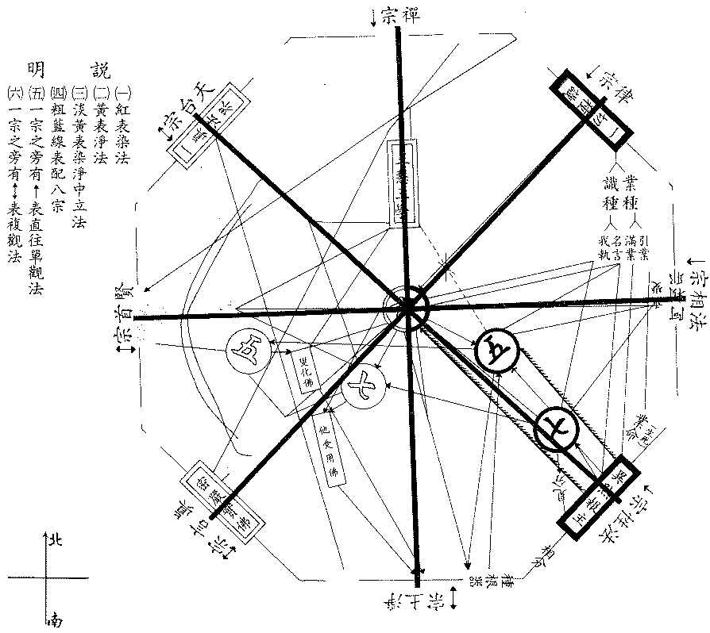



第一章　序言



本图创作於民国十二年，后来虽几经略改而大致无异。然此图之作，仅根据於华文佛典，其中虽参酌日本佛教，而日本佛教亦为华文系者，故此图为华文佛法之一总纲，总持华文所诠表之一切佛法也。



最近所创世界佛学苑，其研究佛法之根据，又较吾昔根据华文者大有扩充，可分为三系：一华文系之佛法，日本、朝鲜等属之；二巴利文系之佛法，锡兰、暹罗、缅甸等属之；三藏文系之佛法，蒙古、尼泊尔、青海、西康等属之；而梵文残缺不全，可附藏文以参较之。以上三系文字所流行之佛典，为世界佛学苑研究佛法之资料，三系佛法之流行欧美已成为世界性之佛学者，首为巴利文系，次则藏文、梵文系，再次为华文、日文系也。所以现在世界佛学苑研究佛法之范围，已扩充为以全世界流行之佛法为对象，除华文系佛法以外，梵、藏文巴利文系之佛法，皆为世界佛学苑所必研究探讨者也。



今所讲本图，虽仅根据华文系之佛法教典而作，可总摄中国之一切佛法教理行果而未摄及西藏文巴利文系佛法；然此亦从能诠之文教观之耳，佛法虽有如是三种文系表现不同，然若从所诠之理行果观之，则佛法为佛智等流法；本无二故，是一味故，如大海水之遍通也。



复次、中国文系之佛法传有三乘、五乘之别。三乘者：声闻、缘觉二乘及菩萨乘也。五乘者：人乘、天乘、声闻乘、缘觉乘、菩萨乘也。今此所说大乘宗地图，依文观之，除大乘佛法外，人天乘善法及二乘出世法似未摄在其中，其实人天乘之善法及二乘法皆摄其中，何以故？人天善法为出世三乘法之化他方便故；亦为自趣三乘佛法之阶梯故。又摄二乘法者：一、大乘之化他方便法门须具二乘法故：菩萨以利他为胜，随众生根机化导一切，以化他故必兼通二乘法，否则方便不具，化他事业不能圆满。二、二乘佛法亦为大乘佛法之阶梯故：以二乘人除断三界烦恼，大乘菩萨亦须断除三界烦恼故；又二乘人破人我执证无我理，大乘菩萨亦破人我执证无我理故。以是义故，人天乘法及二乘法皆已摄入此大乘法中。故本图虽标题大乘，实亦总摄五乘、三乘世出世间之一切佛法。故知此图能总摄华文系一切乘之佛法也。



第二章　释题



大乘者，缘广大境，发广大心，持广大法，行广大行，历广大位，证广大果，故名大乘。此有二义：一、殊胜义，高出餘四乘故名曰大乘；二、普容义，总括於五乘故名曰大乘。依佛之果法言，佛於自证无为无漏有为功德法界，为利他故广宣一切教法；如是所有一切教法皆佛清净法界之等流，故佛所说一切法皆是大乘教法。



宗者，宗尚、宗主义。大乘教法虽极普遍广大，然随悟入机缘不同，故有各宗之别。以无所不明之大乘教理集中於一观点而趣行果，於此一观点中集摄一切大乘佛法，故名曰宗；教理之所宗故。



复次、依教明理，教既广博普泛，理亦广博普泛，依此教理起於观行。为起行趣果故，将所知教理集中於一观，乃可贯持胜解入三摩地，盖从散慧心而成定慧心，非有贯通诸法总持一切之一观点，则不能以一观而总万行、行行遍彻，此观所依，总摄一切教理之极则事曰宗。古云：『语之所尚，义之所尊』名曰宗者，即此意也。若无所宗主，则理散解浮故；以散浮故，不能於每念中总持一切佛法，现观一切佛法。从念念中能总持一切教理而起相应之现观，握得一切佛法之中心者方是宗故。



由此言之，宗者乃摄理归旨所成之宗点，由此起行趣果以贯持其趋向者也。在学者未至反博归约时则无所宗，若至佛果，由一切智智念念证诸法实相，亦无有宗可言；是故宗者，唯在「从理起行」，「从行趣果」之行位上而建立也。如世间事业未发动之前固无宗旨，至已成就亦无宗旨，唯正作时则必有其宗旨，方能贯彻，此亦如是。



复次、大乘贤圣及诸古德，以己能依理起行、由行趣果故，有其归纳理解於所尊尚之殊胜点以为起行趣果之宗，故有大乘各宗。此各宗虽同依大乘教法无二无别，然以行者性欲别故，或其所持经论、所承师传、所资众缘别故，得力不同建宗有异，由此传承不绝乃有各宗派别。虽此各宗及各宗派各有其所尊尚之点，然以皆对大乘佛法为统摄故，各据其宗点亦各能综括一切大乘佛法，是故各依所宗以标举其特点，则各宗各有其殊胜义；若观各宗所依所摄同为大乘教法，则各宗又皆是平等一味实无差别者也。



地，喻三义：一、所依止义，二、能任持义，三、可游履义；具此三义，名之曰地，与瑜伽师地论之地义同。今此图所表明之一切法，及一切法所组成之此图，为大乘各宗所依故；亦能任持大乘各宗义故；是观大乘各宗之智可游履故。如大地之能为一切山河草木所依，复能任持一切山河草木及为人等可游履也。大乘宗之地，名大乘宗地，依士释也。



图，是能诠表「图所诠法」者。图所诠法，即大乘宗地法。图较经论，不惟有名句文，并有色采，线条，位置，及组成之格式，故图较经论等更能诠表。此图是能诠表大乘宗地法义之图，故名曰大乘宗地图，依主释也。



第三章　解图



第一节　教法



一　历别说明



解图有二：一、教法，二、宗义。先解教法，次明宗义。



第一教法者，谓各宗平等所依之大乘教法，或为大乘各宗所共依之教法也（如大乘宗地㈡图）。此又有二：一、历别说明，二、综合说明。



图中㊄、㊅、㊆，表五六七识，今先明正中之第六意识，如图：







第六意识之右面红色表杂染法，左面黄色表清净法，因第六意识为染净法之中心，故居正中，色分红黄，而一切教法亦皆依第六意识为出发点以说明之。



一、就所知境上论——知识，如从闻教阅经以言，耳眼识虽闻声见色而不分别文名句义及忆持之，故闻持一切法皆在於第六意识也。又意根识所对之法境，通有漏无漏、有为无为，在十八界中为法界，十二处为法处，故其所缘通一切法。前五各各所缘境别，且前五之所缘第六亦缘，而第六所缘则前五不能缘也。故一切大乘教法皆摄在第六识中，而一切教法皆必依此识为根据而说明，离此识则不能说明一切世出世间漏无漏法，因此一切法无不是第六所知所了所认识之境也。



二、就造作业上论——行为，一切有情行为造作之主动力皆在第六意识。颂云：『相应心所五十一，善恶临时别配之』。又云：『动身发语独为最，引满能招业力牵』。由此可知第六意识能作一切善恶诸业。有情一切行为造作莫不由於此识，前五识虽亦随之造作，力微劣故，六助伴故，意主导故，胜唯意业；故三界五趣之一切杂染业果，皆由第六意识之造作而生起也。复次、转迷为悟、转杂染成清净，亦以第六识为枢纽。初地以前前六修行，以第六为主；初地以上前七修行，亦复如是。由发动之主力独在於此，是故一切行为皆以第六意识为中心也。如大机械，虽各部机管皆有功用而不可偏缺，然发动力在汽缸。故前五、第七及诸心所等虽皆有力，而须以第六意识为主力。



以上二义，故以第六意识为中心而说明教法。古云：『知之一字，众妙之门』；『知之一字，众祸之门』。知虽遍诸识而胜唯第六，为诸法之遍所依，亦诸行之总枢，故从此以说明於一切也。



从六向右边观至阿赖耶，向左边观至庵摩罗，向上边观至心，向下边观至土。又有一切种识，一真法界，密严实佛，异熟报主，配置四隅。今借方向定其名称以便说明，右为东方，左为西方，上为北方，下为南方。先从东方释之：从六向正东之阿赖耶，由六至阿赖耶边之熏变，如图：



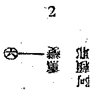



表明第六意识对於阿赖耶有熏变义。熏变义者，有能熏所熏义：以第六意识有能造作义，即是能熏，阿赖耶则受其所熏；由受熏故，阿赖耶中所持种子时起生灭增减等之转变，名曰熏变；故六对阿赖耶，第一为熏变义。所熏之梵语阿赖耶，此译为藏，有三藏义：一、能藏义，由阿赖耶受熏持种，望一切种能摄持故，是为能藏；此所藏者为一切种，对所藏一切种，此现行阿赖耶即为能藏。二、所藏义，由阿赖耶望诸异熟杂染现行则成所藏，以阿赖耶虽现恒行，极深细故为一切异熟报法所掩藏，由业种等所感之异熟报现前知见为异熟身器等，即由此等异熟报法覆蔽现行阿赖耶故，阿赖耶为所藏，而业及前六转识异熟法为能藏。三、执藏义，由阿赖耶望第七识则为执藏，以阿赖耶恒为我爱相应之第七识所守持藏护故，对第七识之我爱执，名我爱执藏。



又阿赖耶译藏，藏有处义，如喜马赖耶山，喜马译雪，是雪所集处故曰雪处山。阿赖耶为我爱执相应之第七识爱著处，故曰我爱执藏；为一切杂染法所覆藏处，故曰所藏；为能贮藏一切诸种子处，故曰能藏。——以上为六东对阿赖耶熏变之略解。由阿赖耶向东北面有一切种识，如图：



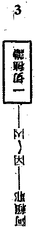



表阿赖耶与一切种识之关系，即显阿赖耶摄藏之一切种子，故图中有「一切种识」。然此一切种识，虽通为「无漏种」之依，但阿赖耶中之一切种偏指一切有漏种言。种子之法，虽无显现相用可以分别，约义言之，正指能别别发生一切现行法之各个功能差别，名曰种子。如谷子有能发生谷芽者曰谷种子；若损坏无发芽功能，虽是谷形已非谷种，此亦如是。一切种识，谓摄藏一切法种子之识，仍指第八识现行也。阿赖耶到一切种识之间有因果二字者——因——因——由阿赖耶望庵摩罗，有一重因位义；由一切种望所生之一切有漏现行，又有一重能生因义：故於阿赖耶之一切种识，乃有两重因义，名曰因因。又一切种兼含漏无漏种，既为异生因地心中所含之一切法种子，而复为发生一切有为法之因，故曰因因。由此义故，一切种识为阿赖耶因相。由阿赖耶向东南有异熟报主，如图：



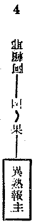



异熟报主，至下当释。其间置有因果二字者——因——果——，因谓阿赖耶居因位，果指因位之异熟果，是因位识之果，故异熟识为阿赖耶之果相也。次一切种识下，有识种业种，如图：



　　　　　　　　　　　　　　　　　　┌引业  

　　　　　　　　　　　　　　　┌业种┤  

　　　　　　　　　┌────┐│　　└满业  

　　　　　　　５　│一切种识├┤  

　　　　　　　　　└────┘│　　┌名言  

　　　　　　　　　　　　　　　└识种┤  

　　　　　　　　　　　　　　　　　　└我执



诸法之种子，可分为二类：一、识种，二、业种。识种亦曰法种，一切诸法各别有因，因即是种，如心法有心法种，心所有法有心所有法种，色法有色法种，故言识种者，以一切法不离识故名曰识种。总之、一切法自类种子起自类现行者曰等流因果，此等流果之因，即是法种。次、业种者，望所起自类现行亦即是法种，不离识故亦名识种；然有增长他种以成界趣别之功用，谓能摄他种子随其势力受诸趣生，故曰业种。如是二种种子，如各个人民，谓一国中各种人民，依其各个自身力用，各作自身生活事业，识种道理亦复如是。如人民中有一部分人专以国家社会公务为职者，此种公务如行政等能影响全国之事业，一一人民亦同受其影响，业种道理亦复如是；又复应知公务员所作公共事业，虽影响国家社会，而不失其个人自体及个人生活，故业种对自现仍为法种。



种子又曰习气，习气分为三类。识种有二：一、名言种子即名言习气，谓一一最单纯现行法各别之因曰名言种子，最单纯现行法即寻常感觉上觉到之色、香、味、触等离言自相。二、我执种子即我执习气，依六七识心心所法建立前名言种子之现行，各别而不相关。由我执种之现行力，使名言种之现行别别组成一一之总聚假相——个体，生此我执之现行者曰我执种。我执，梵云「萨迦耶」执，译「总聚」执。聚者，聚一一单法所成之个体，以任何个体皆由多数单法聚成故。如电子亦为光热量数时空等所搆成之一总聚；电子且然，原子以上以至无机、有机诸物，其为多法所成之一总聚，更不待论。故吾人寻常知觉到之一切法，非单纯现行法离言自相，乃多法聚成之一一总聚相也，故瑜伽真实义品八分别中名总聚分别。由此总聚分别，执一一实我或一一实法，实我实法皆由於总聚执之我执也。



复次、由单纯法聚组成似一、似常、似有自在实体及精神生命者曰「生我」，聚组成似有实体之法曰「法我」。执此生我、法我为实之能执者，即六七识相应萨迦耶见心所，由此心心所聚熏成之种曰我执种。我执种亦能影响於他法，如人民所组成之家庭，此家庭虽非公务员之公共机关，然其作业行为亦能影响家人。以其不明了单纯现行法之因缘相，於和合假者见为独立自在之实体，遂执曰「我」。与我相敌对之非我，属我者曰「我所」，不属者曰「他物」，由此我执能障覆一切法真相，使不知一切法皆唯识现。亦由此故，於一一识觉了之别别法相，乃不能如实明了，於我执相应心心所聚上，只见到总聚之独立个体，因此吾人无始以来恒有自他之隔，不明了诸法真实相，皆我我所执为障也。盖由一一单纯法而组成一聚，例由五蕴组成一人，亦犹木石筑成一屋，固以单纯法五蕴或木石为先，而后乃得成为总聚之人与屋。然在异生心心所上，由我执为障故，适成一相反之心理，认总聚为自体，而单纯法为其属性，因此而有种种我与非我之执，由此执故而生无量惑业苦。



次、业种者，三习气中即是有支习气，乃有能支配他法之特别功能种子，能令趣类区别，谓由业之不同感招不同之诸趣报。换言之，此一一趣之报果，及一一趣中一一有情各别不同之报果，皆业种为增上缘而招感。一一有情或一一法之隔别者，由於我执种；至成一类一类之五趣、九有、二十五有、六十二有等区别，则出业种。剋论业之自体，即心所中之思心所，以思心所能自造作，又能役令其他心心所造作故。此为「业自体」之思心所，指前六识中之思心所；故「业之相应」亦即为前六心心所聚，以前五识依第六识亦有或善或恶之造作故。一、满业者，较引业力弱。如由引业感得人之总报以后，而资助令其完满成就者是为满业。如公务员中由领袖确定计畫——引业总报——以后，再由各部人员依计畫实施工作以成满之，满业亦尔。二、引业者，为最强之业。五趣有情舍此趣报取彼趣报，不随他业所引之报而能独自引取总报之业，是为引业；喻如政党领袖能夺取全国政权——喻感总报——而不随他党活动，须俟他党失败之后，此党领袖方可起而代之，如此引业所感报尽，彼引业又引感一他趣之报也。



又满业如将相，引业如帝王等。满业具三性，随引业转故；引业或善或恶，有强果明决性，故不通於无记。



由引业以望异熟报主之业命，如图：



　　　　　　　　　　　　（生死）  

　　　　　　　６　引业──业命



业命，表一期之报寿，即是命根。言业命者，谓此生所得一期之生命是由引业种子所起现行势限，规定一生报果有一定之期限，故曰业命。换言之，由引业种子势力之限度规定者是为业命；亦曰分段生死，於五趣中受一期生死各有分限段落故。如帝制国家有一朝一朝之帝统，此一朝之命运长短，在创业时即规定故；人之生死寿命长短在引业得总报即决定矣。如此一王朝亡，他一王朝又兴，有情分段生死，舍报取报业命限定，亦复如是。若能解脱此业命所成之分段生死，如由君主化为民主。虽为民主而仍有其盛衰，犹圣者虽解脱分段生死而仍有变易生死也，至『金刚道后异熟空』，方得解脱一切生死，则犹国界消除而成大同世也。



次、业命与第八异熟识之关系，谓由引业所引而成寿命，此业种摄植第八识识种，此业种挟第八识种同时现行，是为真异熟识，为一期报果之主体，故曰「异熟报主」。约对於业缘增上果关系——是业种引起故，故第八识之果相曰异熟识，如图：



　　　　　　　　　　　　　　　　（生死）  

　　　　　　　　　　　　┌引业──业命┐  

　　　　　　　７　业种─┤　　　　　　│┌────┐  

　　　　　　　　　　　　└满业────┴┤异熟报主│  

　　　　　　　　　　　　　　　　　　　　└────┘



异熟之依正二报，皆以第八识为主体，故曰报主。在一期报果中，一一有情之主体者为第八识，故异熟报主指第八异熟识也。满业随从引业，以成满总报中之别报，如前说。



次名言种望异熟报主者，如图：



　　　　　　　　　　　　　┌────┐  

　　　　　　　８　名言──┤异熟报主│  

　　　　　　　　　　　　　└────┘



第八异熟识之生起，亦由自识名言种子，故亦通名言种。以异类之善恶业成异熟之无记果，故云『因是善恶，果是无记』。因善恶者，非指第八识之自种，乃指前六识之业种对彼增长引力关系，故因或善或恶，仍由自识无记种生起，故果是无记。喻如江水现曲直高低之种种型式，然水虽现曲直高低而实际上水非高低曲直，高低曲直乃因地岸等缘以成。有情在三界五趣中受生死流转报，此受生死之异熟报主，如水之本身本无善恶，或流为人，或流为鬼，或流为天畜等，此流天、流人之异熟识固无记，而所以使此流天流人之业，乃是或善或恶也。盖业种之善恶为感果之增上缘，而自身识种方是因缘也。



由异熟报主之见分望第七识，如图：



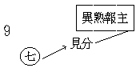



凡一识体、总有三分，不分见相为识之自体分，分之则为见分、相分。第七识之能缘见分，缘第八识见分为我，是第七识心心所聚所缘所守护故，第八乃成我爱执藏。此第七迷第八为我，完全因第七相应之我爱等四惑之关系而成。第八见分本是相续似常，和合似一，第七识见分因执为主宰之我；然第八识之见分，是否为第七识之见分如实缘到而执为我？则应知第七识见分以未见到第八真相，因只见相似故误执为我，若真实缘到第八之真相者，则明第八见分非常非一而不执为我矣。然第七见分虽未见第八见分之真相，在此第七第八见分相对向关系上，因第七四惑相应，遂於第八见分处变生我相，执为是我，此所执之我相为带质境，从两头生，故云『以心缘心真带质』也。喻如病目见灯光上五彩轮相，此「轮相」因灯光与病目而现起，非灯光处不现轮相，非病目亦不现轮相。病目如我执相应第七识见分，灯光如第八识见分，所见「轮相」如第七识见分所执之「我」，如是病目及灯光中间生轮相，七识八识中间生我相，道理亦尔。



由异熟报主望第七识者，如图：



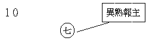



此表第八识为第七识之俱有依，种子依，根本依也。



由第七识望阿赖耶，有一直线通至熏变，如图：



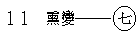



此表第七望第八识，第七为能熏，以有我爱等烦恼相应，恒执为我，故能以第八为所熏，熏习增长我执种子，种子生现行，现行复熏成种，种复生现，如是七望於八有熏变义。



由第七识望一切种识之种子通於我执种，如图：







表第七识非异熟性，故与业种无关，然亦有名言种，以其我执胜故，常现行故，恒时与我执相应故，名言种子亦受我执势力影响，就胜立名故但说我执种。由此道理，第六识之我执，亦受此第七识我执影响而起。



以上四线，一由第七至异熟报主，二由异熟报主至第七，三由第七至熏变，四由我执种至第七，皆为第七末那识望第八识之重要关系也。



由第七识望第六识之关系，如图：







明第七识能与第六识力，作第六亲依根，又为其染净依。谓第七识之我执相不空，第六识虽作空无我观等终不能舍执相而成无相，是皆由第七识之影响也。第七染污有漏，能令第六亦成染污有漏；若第七转成无漏平等性智时，第七又作第六之增上清净根，第六识乃成无漏故。



由第七识与前五识之关系，如图：







明第七识亦为前五识之染净依也。



复次、由前五识望异熟报主之关系，如图：



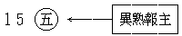



图中於箭头线上加有虚点者，显其有多种关系也。线表异熟识为前五之种子依及根本依，虚点表真异熟与异熟生关系，业种所引第八现行为真异熟，前五识由先业势力而引起者是异熟生，非真异熟，由在真异熟报上满业之所生起故，特示真异熟与异熟生之关系，故於线上别加虚点。



由前五识望阿赖耶，有线通于熏变，如图：



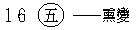



表前五识望第八阿赖耶识有能熏所熏之义，道理如前。



由前五识望一切种识，有线通於名言，如图：







表其种子依之关系，盖前五识之生起，各有其名言种也。



由前五识望第六识之关系，如图：



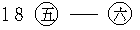



表第六识对前五识之现起，缘强有力故，第六为前五之分别依故，前五识之分别造作随第六识转故，所谓五识现行缘境，第六为五俱意识故。



由第六识与异熟报主之关系，与五识相同，如图：



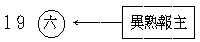



线表第八异熟识与六识为根本依及种子依，虚点表真异熟与异熟生之关系也。



由第六识望一切种识，通我执种及名言种，如图：



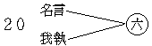



第六识我执相应，故通於我执种，然有间断非恒时起。次通名言种者，第六识若不与我执相应，各心心所自类现行即由名言种子。第六意识本亦通於业种，今以真异熟与异熟生之关系，间接已明有业种之道理，是故略之。如十二因缘之识缘名色，即为真异熟与异熟生之关系，其实即业种关系也。



以上依第六识为中心出发点之向於东方者，已大略说明矣。次由东方至南方之说明。



由异熟报主向六之南方面有相分，如图：



　　　　　　　　　┌────┐  

　　　　　　　21　│异熟报主├──相分──种根器  

　　　　　　　　　└────┘



相分有三：曰种，曰根，曰器。种即种子，即前说之一切种，一切种为见分所缘，故成相分，非离前一切种而别有体也。根即根身，谓五种净色根及所依身，为异熟识摄为自体共同安危者也。器谓器世间，即有情所依之世界也。



五根为五识不共依，如图：



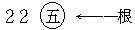



此净色根，为前五识各别依故，是前五识胜增上缘，此五根虽各别，而总组织即是身根。英人著佛学通论，不知此故，谓佛学五根各别而无总组织。然按瑜伽师地论说：身根起现行有九法，即四尘、四大及身根之自种；但眼等根起现行时，有十种子，九如上说，别加第十身根。由此可知身根一方为身识之别依，一方又为眼、耳等四根现起之总依——即是五根所依之基。脑神经系亦属身根，为有情五根身之总枢也。此根为第八识之所变起，复为第八所缘相分，非第八识不亲缘故；第六缘此，说之为根，乃比知耳。



前五识与器之关系，如图：



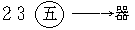



此中器者，亦为异熟识上所变现之相分，即是器界，亦名器世间。为第八识所缘境，持令不坏。第八所变所缘之器世间，前五识亦能各别缘其一少分，为前五识所缘者即成五尘境，名之曰器界尘。前五别缘固不能尽器之全部，即合五识所缘亦不能得器界全部，如器界所摄之时、方、数等非五识所能缘。由此，近世科学依前五根识缘前五境之经验为基，仅推求器界亦不易全明，其他非五识直接能经验之根种等，更非科学所能及矣。



次、器与六识之关系，如图：



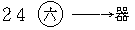



第六识依前五识——五俱意识——可缘前五境。但前五亲切而不全，各别以第八所变为本质自变相分而缘。第六全缘而不亲切，五识所缘之器界尘，及五识不缘之时、空等法，亦为第六识所缘，故第六识方能全缘器界；但缘五尘境时，须依前五识之助方能缘之。由此得知第六识虽全缘器界，乃是间接而非亲切的；前五识虽亲切缘境，乃是各别的而非全部的，托第八本质自变相分而缘之。因之吾人对於所应知之器界，现前尚不能完全了知也。



器与土之关系，如图：



　　　　　　　25　器──土──法性



所谓土者，谓国土等，即是器界。器唯有漏，而土通漏无漏，亦通性相。性即法性，即法性土；相谓器相，即依报之器世间也。言法性者，法即色等一切法，一切法之真实性故曰法性。



法性与一真法界之关系，如图：



　　　　　　　　　┌────┐  

　　　　　　　26　│一真法界├──法性  

　　　　　　　　　└────┘



此法性即一真法界，但法性与佛性对举，佛性应从有情以显，而法性以须极显一切法普遍故，反应从一切无情法以显，然法性即是一真法界也。



再自六识向北观之，第六识斜望一切种识有戒体，如图：



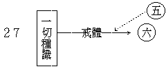



戒体，古师释多异义。小乘有部等以「无表色」为戒体；成实论以「非色非心法」为戒体；大乘成业论等谓「前六识心心所法，于受戒时现行熏成受戒种子藏一切种识中，未破坏前隐然有防发之功用，是为戒体」。此种种子，是无漏法新熏生之种子，由受戒时种种作法之新熏习初生起故，换言之、即是从佛清净法界等流之无漏戒法所熏成也。在前六识上受此戒法之熏习，即成新生金刚种子，是清净无漏等流故，能坏一切不善法故，三世诸佛共所尊故。依大乘不共戒法言，受戒后虽犯重失戒，而无漏戒体亦不坏；若依三乘共通戒法，犯根本戒，此无漏戒体——种子——即失其体用。若不破根本戒，则不但不失，而且日有所增长。然获此戒体时，曰成就戒或得戒者，得或成就有四：一、种子成就，二、现行成就，三、不退成就，四、圆满成就：戒体是种子成就也。



戒体成就者，於受戒后能止一切恶行一切善，於内心中此止恶行善之功能成就者，即是种子成就也。依摄大乘论说：此种子是无漏善性，不与阿赖耶识同性，然此无漏种子可寄在阿赖耶中，故此戒体摄在一切种识中。图中之色为淡黄者，表此戒体虽无漏性，以非现行，且藏於有漏阿赖耶识中，未是离染清净法也。



无漏戒体与前五识亦有关系，故有虚线通於戒体之实线中。佛之戒法，从其本质上说，虽是如来清净之等流，然仍是受者有漏之现行前六识所变现，在前六识於受戒后能自然持戒不破，而有止恶行善之功能差别，即此戒体是也。



复次、此戒体与命根相同，亦假立故。尅体论之，即前六识受戒时熏习所成之种子，故其防发功能亦是种子上之功能。此种子功能在二乘法犯根本戒即失，大乘法中犯根本戒虽不失，然其功能势力为犯戒法所障，不得现起，若如法悔除还净或如法重受，乃能复起原有之功能。故此种功能势用能影响於前六识之现行，使自然止恶行善也。



由一切种识望北有本净种，即本有无漏清净种子，如图：



　　　　　　　　　┌────┐  

　　　　　　　28　│一切种识├──本净种  

　　　　　　　　　└────┘



此本来清净之无漏种子，以是无漏性故，能对治阿赖耶性故，虽寄於阿赖耶识中而非彼摄。然异生无始以来所现行者为阿赖耶识，无漏种子曾未现行，故两方无有违害之现象。此本净种虽然具足，而寄存在无覆无记之阿赖耶识中，详如摄大乘论、成唯识论等说。此本有之清净无漏种子，在大乘中，初地菩萨方可现行，二乘法中，初果圣者亦始现行。



夫以一现行阿赖耶识为一有情，一有情即有一现行阿赖耶识。此以「一现行阿赖耶识」为「一有情」之有情类中，论说有一类有情无有此无漏净种，故谓之无种姓有情，不能成佛；有一类有情虽具有净种而祗是声闻乘种姓或缘觉乘种性，此二种姓若定性者，亦无佛种，不能成佛；有一类有情具足佛种是菩萨种姓，亦曰大乘种姓，展转增长无上菩提；有一类有情具三乘净种，其性不定，曰不定种姓，终可成佛。此五种有情之区别，皆从此本净种或具或不具而说明其差别也。



无漏净种之得生起，先由有漏善心心所现行，展转熏发出世无漏清净种子，如是净种渐渐增长，至初地时即能现行，至佛果位现行圆满。复次、此一切本净种子依其中智种而发起，故诸本净种之生起以智种为其胜增上缘。在有漏位为诸法之王者为识，识是诸法之王；在无漏位智种为发起诸净现行之最有力者，故无漏位以智为一切清净法之王。依此道理，有漏位中万法唯识，无漏位中一切诸法可曰唯智，以无漏位一切色心等法之起现行依智现行，又此一切色等诸法为其所属，故皆唯智，约胜说故。又有漏识与无漏智之相对，即是迷觉之相对。本净种即是本觉种，诸净法皆智觉性故，故一切无漏清净法亦可曰唯觉也。阿赖耶识异生位中无始以来未起此觉，换言之、即无漏无分别智种曾未起现行，一向是迷，一向分别，故一切有漏杂染法亦可曰唯迷也。本觉净种无始以来法尔本有，以此义故，经云「众生心性本净」。



既是本净，云何而成染耶？客尘所染故。问：若一切无明烦恼染是客尘者，则本净是主体，无明烦恼等染法如往来之客，附加之尘，然则众生无始本来清净，无明烦恼为后来所附加，则应有情本无无明烦恼等一切杂染法，原来是佛；若本是佛，何故后来复成异生？若可由佛退为异生，则吾人修行断惑以成佛，亦仍然可退为异生，如是成佛有何意义？学佛亦有何价值耶？答：净种虽是无始本来具足，然染种亦无始本具，且从无始现行上说，则杂染法不唯种子成就，而亦无始现行成就；清净种子虽本成就，然未现行。故古德云：『菩提有始无终——此就现行言，以种子亦无始故——，无明无始有终』。以智净种起现行时破无明故，智与无明不并起故，无明是智所对治故。以此义故，众生从本净智种一面说有本净种，故云「众生本来是佛」；从其亦本具染种且恒现行说，故「众生本非佛」。无始杂染种现无有间断，净种起现行时，能烧杂染种现令皆灭尽，方可成佛；众生位中净种为染障故，不能现行，至成佛后永无染障，故不复为异生。问：若净种子以无始本有故为主体者，其有漏种现皆无始有故，岂不更应为主体耶？如何乃说之为客尘？反之、无漏种亦应为客尘，俱无始故。答：无始净种虽未现行，然一现行即能断染法之种现以至灭尽，得成离染清净。何以故？以有漏种现是可断可灭可离法故，可为无漏法对治故，故一为主体一为客尘也。



无始以来曾无一念净觉现前，所以染法遍起悉是杂染，若一刹那净觉智生，即能断之灭之离之。彼有漏种现祗能覆障无漏种，而无漏种永永不为染法所断、所灭，以无漏种不可对治，是不可断法、不可灭法、不可离法故。由此，主体客尘义不相齐，一为般若火，一为烦恼薪，一为金刚不空，一为毕竟空也。此种子义最为深广，略说如此，智者应详！



次由本净种望佛性，如图：



　　　　　　　29　本净种──佛性



佛性之义，各经论及古今大德解释逈异，且相矛盾，今略举三种会通之：有云『情与无情皆有佛性』；有云『凡有心者皆有佛性』；有云『二类有情有佛性，谓二乘之回小向大者及大乘种性者；定性之声闻与缘觉及无姓者无有佛性』。如是三说不同，欲其会通，先审名实。言佛性者，佛之体性名曰佛性，或云知觉自性名曰佛性，或云成佛之可能性名曰佛性。



初谓佛果上所成就之一切无漏功德法，总名曰佛。佛果之总聚无漏法，论其体性，即是有漏无漏一切法平等不二之无为体性，故曰佛性。次谓佛者觉义，能知觉之自性，即为有情类本来具有之佛性。三谓由法尔无漏种具有发展成佛之可能性，故曰佛性。第一、从一真法界真如性说名佛性；第二、从心心所能缘虑性说名佛性；第三、从本净种增长圆满之成佛可能性说名佛性。以此义故，凡诸名辞，应观其义以定其名，不可依名而判义也。依上三种训释以定其名，次出其义略有三种：一、理性佛性，二、隐覆佛性，三、行性佛性。



一、理性佛性者：理谓一切法无相无分别之平等真如理，如来究竟证穷此理，此理为佛真实体性，故名理性佛性。此真如理即是一切法之体性，约胜以说，此性是佛果所显故，众生虽具而不显故。金刚经云：『须菩提！我於阿耨多罗三藐三菩提乃至无有少法可得，是名阿耨多罗三藐三菩提。复次、须菩提！是法平等，无有高下，是名阿耨多罗三藐三菩提；以无我、无人、无众生、无寿者，得阿耨多罗三藐三菩提』。复次、云何名佛法？金刚经云：『须菩提！所谓佛法者，即非佛法，是名佛法』。又云：『离一切诸相，则名为佛』。又云：『实无有法佛得阿耨多罗三藐三菩提，……是故如来说一切法皆是佛法』。云何名为如来？经云：『言如来者，即诸法如义』。如是经文，皆显示理性佛性义也，依此故说有情无情皆有佛性。



二、隐覆佛性者：依涅槃经，一切有情十二因缘生死流转皆即佛性，以此诸法皆缘所生，本来空故，无实性故，达其本空不迷理事，理事明瞭即不造有漏业，以不造业生死解脱，隐覆之法空即显现佛性，而隐覆法本性空故，故隐覆法即是佛性。此所言隐覆法空者，生死缘生之法总名曰空；若别分别，或曰无常、无我、涅槃寂静，达此空故即证佛性，成佛陀法。以此空义遍一切法，佛陀曰觉，即觉此诸法空义故。若不达此空、无常、无我、涅槃等义，即成众生法。由此义故，能隐覆佛法之一切烦恼等众生法，皆是佛性，故一切异生、声闻、缘觉等皆有佛性，以皆具此隐覆法故。维摩诘云：『行於非道通达佛道』。又云：『云何是佛种耶？一切无明有爱等烦恼法皆是佛种』。以烦恼等皆因缘生，若能通达因缘本空义，即证涅槃佛性，是故说言一切有情皆有佛性。



三、行性佛性者：行即诸行，表有为法，诸有为法中之佛性，正指可发展成佛之种子，由种子发起菩提行，渐次趋向菩提妙果，至成佛道圆满无上。此成佛之可能性，即是佛性。依此义故，有此可能性者乃有佛性，无此可能性者则无佛性，故有情类或有佛性或无佛性。



然此佛种必本有耶？抑亦可熏生耶？解此问题，颇多诤辨，余采本有兼熏生义，於此行性种子说有二义：一、现实如是义，二、展转增上义。若此种子定是本有决不能熏生者，则有有佛性与无佛性之二种决定，无佛性者终不成佛；若容可熏生者，谓由佛之平等意乐无尽愿悲，展转增上不舍众生，以此缘力熏生诸无姓者无漏种子，如此则虽本无佛性众生，亦终可熏生佛性之种子。由此、其一现事实中，虽无佛性种子不可成佛，其二然将来不无熏生佛种之可能亦可成佛。此中其一即现实如是义，谓诸有情法尔或具佛性种子，或无佛性种子；就现前事实论，观彼无佛种者，确实永无成佛之可能性，故曰不可成佛。其二即展转增上义，谓一类有情虽现前无有成佛之可能性，而依仗佛菩萨之大智悲愿力，亦终久可熏习以生佛种，得以成佛。何故有情本无佛种后可熏生以成佛果？二十论云：『展转增上力，二识成决定』；谓有情之心力互通，可以展转互为增上，故诸异生虽无佛性，由佛大悲愿力、平等意乐为增上力，可生起其佛种。故法华经虽为一切不定姓者说皆可以成佛，然亦以从佛有度生大愿力故，一切有情久之久之皆有成佛可能，故云『佛种从缘起，是故说一乘』。由上二义，补充行性佛性之义，依圣教量及诸正理决定成立或无佛性，皆有佛性，二俱实义而非权教，有情现实确如是故，依佛有情互成辗转增上力故。



复次、从现实如是义观之，三世诸法不离现在一刹那故，现在有情一刹那上若无佛性，则过去过去既本无，未来未来亦毕竟无，云何后来佛性得起？是故一切有情定有一分不可成佛，以现有法事实上如是故。应以此义读法相宗各经论。就增上力观之，自他交互展转为缘，从此展转之关系以言，现在虽无佛性，然以佛菩萨等善友永随逐故，将来可以熏生，应以此义读法华等经论。



以上三重之佛性义，古唯识家慧沼法师在能显中边慧日论中曾有说明。次现实如是与展转增上二义，为余补充行性佛性刱立之义。



复次、佛性即如来藏，佛即如来，藏即性义，名义不同，法实是一，以其名异实同，故图中未另出如来藏名。古释如来藏有三义：一、空如来藏，二、不空如来藏，三、空不空如来藏。今以三种佛性配释此三种如来藏，显其同义。一、行性佛性即不空如来藏，以一切众生虽流转生死沉沦五趣，而本具有佛性种子，如穷子身藏宝珠也。二、隐覆佛性即空如来藏，以隐覆法是妄执所起杂染性故，覆藏如来本空无实，了达其空即显如来，故曰空如来藏。或隐覆法中所含藏之空性即是如来，曰空如来藏。三、理性佛性即是空不空如来藏，真如理性本不空故，此虽不空由空诸障执之所显，故曰空不空如来藏。列表如次：



　　　　　　　┌一行性佛性……不空如来藏　┐  

　　　　三佛性┤二隐覆佛性……空如来藏　　├三如来藏  

　　　　　　　└三理性佛性……空不空如来藏┘



又此三种佛性，亦可配释三性义，略表如左：



　　　　　　　┌一无漏依他起性…………………行性佛性┐  

　　　　三　性┤二遍计所执及有漏依他起性……隐覆佛性├三种佛性  

　　　　　　　└三圆成实性………………………理性佛性┘



由佛性至心，如图：



　　　　　　　30　佛性──心



此所云心，诠各种经论所说心识之众义，谓总括缘虑心、集起心、坚实心三义。缘虑、集起摄有为法，坚实摄无为法，有为无为皆名心故。一切诸法，就真如门曰真如心，就生灭门曰生灭心。如楞伽经中有三识八识之说，言三识者：一、真识，二、现识，三、转识。真识即是识性，现、转二识即是识相。识性即一切法之真实性，如云『於一切诸法常如其性故』；现、转二识即是八识心心所故。此之三识，总包一切有为无为诸法，故云「诸法唯识」；一切诸法摄在识故，从胜立名。此中以一切法总摄在心故名曰心，心是诸法之总聚故，一切诸法之所依故。复次、心与土相对望，从心一面观之，一切法皆是心；从土一面观之，一切法皆是土。如永明寿禅师宗镜录云：『举一心为宗，照万法如镜』，所宗一心，即此中之心也。



由六识望正北方，有三慧三学，如图：



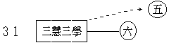



三慧、三学，为离染污而成清净之中枢，主在六识，亦通於前五识及前六识相应诸善心所。言三慧者：一、闻所成慧，二、思所成慧，三、修所成慧。闻所成慧者，谓由近善知识闻圣教所成之慧解，故曰闻慧，慧由闻成故曰闻所成慧；就三学言，此唯慧增上学所摄。思所成慧者，谓戒增上学相应慧，要观察一切之所行，如理作意方是思慧，非仅思惟考量名思慧也。修所成慧者，谓定增上学相应慧，修即是定，由定所成慧故曰修所成慧。



三慧三学其色为淡黄者，表示通於有漏无漏；未证三乘圣果所起三慧三学皆有漏摄，若登圣位则无漏摄。第六识至三慧三学为实线者，表第六识转染成净之殊胜功能唯在此三慧三学，以为主故，强有力故。虽通五识，然不为主，其力微劣，故以虚线表之。由第六识现起时，前五识为助伴故也。



三慧三学之上角有慧命，如图：



　　　　　　　　　　　　┌────┐  

　　　　　　　32　慧命　│三慧三学│  

　　　　　　　　　　　　└────┘



此表慧命之生起，若此慧命一现行，即舍异生性而得圣者性，自此以往以无漏慧为命，故曰慧命。慧谓圣智，即是亲证真如之二空根本智，此智现行谓之生如来家，得证不退，由此成展转增长永不退失之慧命，而为圣与凡之分界。依大小乘言之，小乘须陀洹果起生空智，证生空真如得不退；大乘入初地时起二空智，证二空真如得不退。若此无漏慧命未现起前，所有智慧皆有漏慧，以第六识虽起二空智观，而第七识我执恒行未断，致其二空智观不能亡相，故是有漏。证须陀洹果时，第六识上分别我执及所起烦恼障全断，俱生我执及所起障亦断一分，第七识上恒行我执遂不现行，转第六识成妙观察之生空智，无漏慧命乃永相续不复可断。大乘初地，第六识上分别我法二执及所起之二障全断，俱生起者亦断一分；第七识上我执不行，断障执故，有漏无间刹那无漏现行，转六七识成妙观察、平等性智，亲证诸法真如实相，生如来家，登欢喜地。此复应知！虽证真如，未至七地，有时无漏无间又起有漏执障现行，但一用功则有漏无间又续起无漏，二空智观即仍现前；若至八地，无待功用自然无间无漏现行；佛陀大觉始能究竟圆满。



次由慧命上溯佛性，如图：



　　　　　　　33　佛性──慧命



佛性谓行性佛性之佛性种子，此起现行即成慧命，以佛性种子现行时入初地，能断执障，故行性佛性之现行，即为大乘慧命成立，发心以来所求得者亦即在此。



若从三乘以说，通本净种，如图：



　　　　　　　34　本净种──慧命



二乘初果证生空法性之生空智现起时，即是慧命生起；此慧命即各由其本具净种而现起，故有一线通至本净种也。



慧命望通三慧三学，如图：



　　　　　　　　　　　　　┌────┐  

　　　　　　　35　慧命──┤三学三慧│  

　　　　　　　　　　　　　└────┘



三慧中之修慧，通漏无漏，修所成之无漏慧，即是慧命。此无漏慧须依有漏修所成慧为增上缘、等无间缘，由增上缘助其生故，由等无间缘引导其生故。由此，应知前说佛性及本净种为起慧命之因，而以有漏三慧三学为缘。又理性佛性隐覆佛性兼为所缘缘。由此四缘，慧命得生，慧命生已势用不断，六七二识得转凡成圣之位。由慧命望密严实佛，如图：



　　　　　　　　　　　　　┌────┐  

　　　　　　　36　慧命──┤密严实佛│  

　　　　　　　　　　　　　└────┘



前明三佛性即为三如来藏，初显现位即为大乘慧命，由之修集一切上上胜进功德而至圆满，所有行佛性种，完全现行究竟成满，亦即佛性完全显现，是为密严实佛。



由六识望净第七识，如图：







慧命现行之初刹那，第六转成妙观察智相应净识，同时由第六净为增上缘，第七亦转成平等性智相应之净识，故有一线通净第七。如是第七识上已断一分我执染故，与其俱起心心所法亦成清净。第七识为执我之主翁，此若不断，餘识我相亦不能离，此若断者餘亦离净，故第七识为前六识染净依也。若不尔者，虽第六识现起观智伏我执障，终带相故，不成无漏。



次由三慧三学及净六七二识，均有线至遣执空观空理，如图：



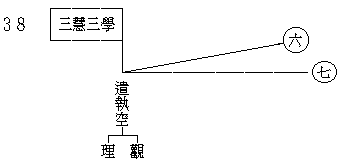



执谓我法二执，以不了空义故起此二执，由二执成二障，生死轮回，根深蒂固不得拔济，因胥在斯！欲脱生死证大涅槃，及断烦恼成大菩提，须先遣空二执。以斯义故，一切圣教诠二空理起二空观，修二空观照二空理，以遣尽此二执。然在六七净识未现行前，修空观以照空理者，唯在三学三慧之有漏修所成慧——虽通无漏此取有漏位者；若六七识转成清净时，由六七二识相应现行之妙观平等二无漏智修观证理。然三乘圣人有差别者，二乘初果以去，唯起净六识相应一分妙观察智生空观照生空理，遣我执相；大乘初地以去，观二空理双遣我法二执。二乘所得生空智仅为妙观察智中之一分，平等性智全不现行，以第六未起法空观智故，对第七识唯有消极的使其我执暂不现行而已，不能助之生起平等性智转成净七。大乘菩萨则由清净六七二识相应之妙观察智与平等性智俱起现行，同时二智观二空理遣我法二执，断烦恼所知二障，由初地至十地重重胜进，至於尽断二障，大圆镜智相应现行，即佛果之究竟圆成也。



次三慧三学及清净六七二识均有线至波罗密行，如图：



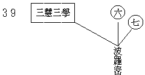



前来遣二我执、修二空观，是通于二乘之三乘共法——大乘之兼含二乘法，即明於此。此之波罗密行，则为大乘菩萨不共法行。修此波罗密行可包有遣执空观空理，以波罗密行乃总括一切菩萨之万行者。遣执空之行，即其中之般若行耳。从初求学发大乘心乃至成佛，均是修习波罗密行。故若分别言之，初地以上为真实修波罗密行；初地以前为相似修，带执相故；初住以前为名字修，杂烦恼故。若初发心求学大乘所修习名字、相似等波罗密行，即为有漏三慧三学所起，此中三慧三学在大乘即为地前之六度故。换言之、即以三学开成六度，戒开布施持戒忍辱精进四度，定、慧为禅定、般若度，如表：



　　　　　　　　　┌布施┐  

　　　　　　┌一戒┤持戒│  

　　　　　　│　　│忍辱│  

　　　　　　│　　└精进│  

　　　　三学┤　　　　　├六波罗密  

　　　　　　│二定─禅定│  

　　　　　　│　　　　　│  

　　　　　　└三慧─般若┘



故六波罗密在地前，通于十信、三贤、四加行诸菩萨位也。若至地上，六七二识相应二智现行，同修波罗密行，在八地以前其修行有力而为主者，第六相应之妙观察智也，以八地前为有功用道故，无分别智时加功用行方现前故。八地以上修波罗密，以第七识相应平等性智为主，第六识中无分别智常现前故，不须重加功用道故。



次清净之六七二识及前五识，均有线至障净实智实境，如图：



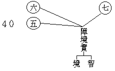



障即烦恼所知二障——此为惑障，惑所发业，业所感报，则成三障。二障远离清净，由此离净所生之智为真实智，其所显境为真实境，故曰障净实智实境。此智此境，即瑜伽真实义品烦恼障净智所行真实——境，与所知障净智所行真实——境。声闻乘断我执烦恼障所生显智境，亦为真实智境，故离障清净之实智实境通于二乘。以二乘人修生空观，断第六识上分别我执及六七二识俱生我执一分，除烦恼障，生空智——实智——起，亲证生空真如——实境。大乘菩萨修二空观，断六七二识上我法二执，除烦恼障及所知障，二空般若——实智——现行，亲证二空真如——实境。



如是六七净识，渐次修行，地地增进，别别断执障，别别成实智，亦别别证真如，展转乃至异熟识空，大圆镜智与无垢识相应现前，五根转故前五识转成清净之成所作智，故为转八识成四智菩提，如表：



　　　　　　┌第六　意　识──妙观察智　┐  

　　　　　　│第七末那　识──平等性智　│  

　　　　八识┤第八阿赖耶识──大圆镜智　├四智菩提  

　　　　　　└前　五　　识──成所作事智┘



由障净所成之实智菩提，亦摄净第八相应圆镜智，以即是密严实佛故，不别立净第八。又图中所列空观与实智汇入菩提，菩提即密严实佛也。



此中遣执空观空理，与障净实智实境之间有二线，如图：



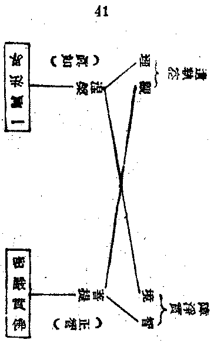



遣执空理与障净实境合之为涅槃，在五法中亦即真如，以真如为所显得，涅槃为所断得故。然四涅槃与二空真如尚是带事相所明理性，所以者何？依能显能断以明故。谓由遣执空观观二空理，二空智现如日当空，离一切障，通达真如，如是所成真实智所显真实境，即是涅槃，亦曰圆成实性，亦曰胜义无性。



次由遣执空观与障净实智合之为菩提，以观与智皆觉义故，由胜进道观二空理，遣二执障，此能空观是菩提分，若住自证道离障所得之无分别智及后得智，此如实智是菩提体，以菩提是能断执障胜功用故，亦为断执离障所成德故。菩提之因虽即遣执空观，菩提之果即是障净实智，在五法中则即正智，此表菩提即是正智，二名一实，非离菩提别有正智也。



又以上涅槃菩提即是二种大转依果，所谓转我法二执成涅槃，转烦恼所知二障成菩提也。



次由波罗密至坚常，如图：



　　　　　　　　　波  

　　　　　　　　　罗  

　　　　　　　　　密  

　　　　　　　　　│  

　　　　　　　42　│  

　　　　　　　　　↓  

　　　　　　　　 坚常  

　　　　　　　　庵摩罗



坚常义者，与熏变义相对，谓修一切波罗密行至於究竟彼岸圆满成就，大圆镜智现前，转无覆无记性之第八识成净善性之庵摩罗识，此识唯持一切最上上品清净种子，故其现行不复受熏，其所持种子亦更无生灭增减之变化，坚密常恒。此第八识净种无始未曾现行，至成佛时，入金刚喻定无间道，次一刹那入解脱道，此无漏第八种方始现行，此现行时性纯善故，始将有漏三性及劣无漏之一切种舍尽无餘，以此为所依之诸法及此所持之诸法种皆无漏性。颂云：『大圆无垢同时发』，及『此即无漏界，不思议善常』，即此义也。修波罗密行，依摄大乘等论有三品：地前曰远波罗密，地上曰近波罗密，佛果或八地以上曰胜波罗密。由下至中，由中至上，修至究竟圆满之佛果位成一切清净功德种，依庵摩罗识所摄持，坚密不受熏习，恒常更无转变，故与阿赖耶识相对。梵云庵摩罗，此云无垢，已无一切烦恼有漏之垢染故。由此义故，佛果金刚不空，三贤、十圣皆住异熟，唯佛一人居真净土，尽未来际，所持一切佛果无漏德种坚密莫熏，所依一切佛果清净现行常恒不变，无尽无尽利乐有情。



由本净种至庵摩罗，如图：



　　　　　　　43　本净种──→庵摩罗



无漏清净种子，异生位时寄在阿赖耶识，金刚道后异熟空时，转成大圆镜智相应心品，乃名庵摩罗识，能持一切清净种子。登初地后，彼净种子展转生起即能摧灭阿赖耶中染法种子。声闻乘中若至阿罗汉，即舍与我爱执相应之阿赖耶；大乘菩萨至八地时亦舍此名；至佛果并舍异熟相应识，唯能持种之阿陀那识，通一切位故。佛果唯持一切清净法种，常无间断亦不坏灭，而在菩萨地则念念增长以至圆满。



复次、阿罗汉及五不还天阿那含等，所有报身仍三界摄，大乘金刚道前一切三乘贤圣所有报身，皆是三界异熟报摄，有异熟故未出三界，唯佛一人超出三界。复次、出三界义大小乘别：二乘圣者依妙观察智以云出三界，灰身灭智入无餘依涅槃，不受分段生死，可云非三界摄，若回心留身以度生，仍是三界所摄。菩萨由平等性智现前以云出三界，若从根本第八异熟识以观之，则仍属异熟报身而未出三界。



依此义故，二乘圣人祇成解脱身而不成法身，以生空智能舍第八我爱执藏而不能使澈底清净，於第七识亦复如是，祇能使第七识消极不执第八为我而已，不能积极令其转成平等性智，故二乘菩提祇具妙观察智之一分，无平等性智及圆镜、成事智也。



由此四智显大小乘菩提差别者，如表：



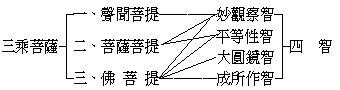



次染污第七识转成清净第七识者，如图：



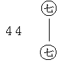



此表第七染污末那识转为平等性智相应之净第七，入初地时真见道位破法我执，无漏第七识种子起现行，换言之、即平等性智相应识现前也。



次染污前五识转成清净者，如图：



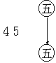



此表染污前五识转为成所作智相应之清净前五识，然前五识须至佛位乃成无漏清净。证初地后，虽因清净六七二识为增上缘，使五根识为胜妙五根识，尚不能令成无漏清净，以第八识未转，此所依根仍是有漏异熟性故。至第八识转舍异熟成大圆镜智相应之庵摩罗识，总舍一切异熟杂染色心种子，从清净无漏色种现起无漏五色根，所发五识乃成为净五识，即起变化佛身土之成所作智相应心品也。



次庵摩罗两边有果者，如图：



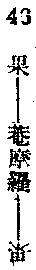



庵摩罗为两果者，一对因位说，一对无漏现行说。以第八识异生因中为阿赖耶，如来果上为庵摩罗，庵摩罗摄持佛果上一切功德种，摄现行归种子，一切佛果功德海唯此而已矣。今再分说如次：



次庵摩罗至净五识者，如图：



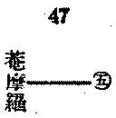



表净五识依庵摩罗识转得清净。



由庵摩罗向西北有果因及一真法界，如图：



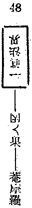



由庵摩罗至一真法界间之果因者，因表一真法界通众生位，果表一真法界通佛位也。其实、一真法界非因非果，众生及佛无二无别，然亦须至佛果方能究竟显得。言显得者，即转依中之所显得。佛位所显得之一真法界，在众生因位中本来如此亦不减少，至佛果位亦复如此并不增多。故经论云：『真如法性——即一真法界——若佛出世，若不出世，不增不减』，即此义也。复次、一真法界为迷悟依，谓能证得此一真法界者为觉悟，未证此一真法界者为迷惑。换言之、所以成为大觉之佛者，即是证得此一真法界之故也；未成佛者，以未证得此一真法界之故也。然此亦名法性、法界、真如、实际、不动性、无为性、不虚妄性、不颠倒性等，如大般若经中广说。般若为一切佛法之父母，法性为一切佛法祖父母，以能证此法性方是般若，为智慧生起所依，亦为一切三乘圣法之所依也。复次、佛果与三乘所依因有异，三乘得圣果所依因，为带二空相之真如，佛得果所独依之因，则为一真法界。此中「所依因」，是指所缘缘、增上缘说，非因缘之因也。



复次、一真法界亦曰法性、真如、涅槃、法身佛等，名虽不同而所指之法体无别，然依其立名之不同，其含义之分齐亦差异焉。



言真如与一真法界含义不同者：甲、真如之义犹带诸法，所谓善法真如，恶法真如，无记法真如等。二空真如为二空智所显，十真如为十地所证，故此真如一名所指虽同一真法界，而此真如之义，带缘观故而显差别，谓带二空等能观能缘智所显之一真法界也。乙、言一真法界者，则一切心思言语等皆悉离绝，以离绝心言故，不带能所相故，无二相故，唯一味故，乃名一真法界。由此可知二名区别：真如者，带能观、能诠道所显之一真法界也；一真法界者，废绝能观、能诠道所显之真如也。问：带能观诠有何过失？答：若带能观诠者，则真如有种种差别，如二乘带能观生空智则为生空真如，菩萨带能观法空智则为法空真如等。又带十地现观则为遍行等十真如。离此种种差别，唯显一味平等无二无分别真如性，是为一真法界。



复次、涅槃与一真法界含义不同者：甲、涅槃约离障说，谓离障所显之一真法界。由智离障，智有浅深，故离障亦有浅深之差别；未离障位曰本性住涅槃，离烦恼障曰有餘依涅槃及无餘依涅槃，离所知障得大菩提曰无住处涅槃。以带离障功用之浅深不同名涅槃故，涅槃有如是四种差别。乙、一真法界直指诸法真性，离障不离障皆无二无别，是为一真法界。



复次、法性与一真法界含义不同者：甲、法性依一切法以言性，示别佛性，且穷遍一切法以显无不是性，是为法性。以显法性极遍普义，每举最劣之法以显其性，故庄子云：『道在蝼蚁』，又云：『道在屎溺』。此言道者，似言法性之性。由此义故，图中法性二字应为黄色，用淡黄者，显与一真法界有差别也。乙、法性之与一真法界，平等平等，无二无别；然一真法界就一切法以言名法性，而法性离一切法相，即是一真法界。



次一真法界向北方有法身佛，如图：



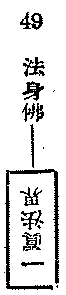



法身佛即法性身佛，亦曰一真法界身佛，谓法身佛离言诠等究竟显现，即是一真法界。然约立名不同，义即有异，以带妙觉位能显道之究竟所显者，名法身佛；若不带此能显道者，则名一真法界。因法性佛约义亦有身土之别，谓法性身及法性土。其义云何？以究竟位之「能显法性智」为法性身，即以其所显之法性为土。约相性言，「相」是能显，名法性身，「性」为所显，名法性土。依法性究竟显现而明法性佛身土，故金刚般若云：『若见诸相非相，即见如来』；若直言一真法界，则无身土可论也。



次由庵摩罗向西南，有密严实佛；如图：



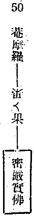



庵摩罗为佛位一切无漏种之总持，故依种子以言，一切佛果之无漏法可皆摄於庵摩罗中，望因位之阿赖耶此为第一重之果义。四智相应心品之清净无漏现行总聚曰密严实佛，故庵摩罗识现行亦摄在其中。言密严实佛者，密严是经名，亦名厚严经，是秘密庄严义。日本真言宗有十住心论，判密宗为最高上之第十住心曰秘密庄严心。实者，转八识相应心心所成四智菩提法，此无漏清净现行聚无颠倒故，不虚妄故，名之为实。密严实佛即自受用身佛，圆圆果海，离名绝相，不可以言说，不可以思量。在於等觉位中尚有言说思量测度分别，犹上有佛果可成故；逮得佛果，圆满圆满，无边功德无不现证，唯佛与佛独能了知，纵使无量菩萨以自证智测度分别亦不可及，所谓初地不知二地事，乃至等觉亦不知佛果事也。如是诸佛自受用身，诸佛无须言说分别，诸佛以下无可言说分别，故实佛位毕竟秘密。瑜伽论明佛果五不思议，亦明此义。为利他所现之他受用身及变化身，皆是随他现故，不属实佛，如水中月镜中花耳。自受用身是实佛，独具无边不共真实功德庄严，乃如空中真月，镜外实花。



有云：「平等性智现他受用身，成所作事智现变化身，妙观察智於彼二身观机说法，唯大圆镜智是自受用身」。如理言之，四智菩提皆自受用，所示现者依缘别故，随智起用亦复不同，故此四智菩提为佛转依中所生得真实果法，无量劫来修所成就，即此密严实佛。果位之果，故曰果果，亦曰一切智智。由此而知密严实佛，乃总括一切无漏心心所及色声香味触法等之一切清净法，直接摄尽无漏有为，间接亦摄尽一切无漏无为法，以一切法智所显故，智所成故，故由密严实佛观一切法，可以成唯智论。一真法界是智性故，亦是智摄，故真言宗立法界体性智。从菩提言，菩提体性即是一真法界——法身；菩提自相则为四智心品——自受用身；菩提之用，即他受用及变化身；是故菩提与密严实佛仅名异而已。



复次、应知自受用身与菩提别，盖自受用佛者，专指佛果自所成之真实功德，秘密庄严，唯佛受用曰自受用。言菩提者，以带相故，从因位所断障以显能断相故，带三乘差别相；从果位所应机以显能化相故，带三身差别相，故菩提者带相之密严实佛也。密严实佛者，不带相之菩提也。



又密严实佛亦即是正智。然正智在五法中与真如相对，通於三乘，谓我空正智、法空正智等。正智究竟虽即密严实佛，但正智带因中分位相故，带果上随顺众生所现无颠倒之假说智差别相故——谓比量智、方便智等，约义有异；离此分位相及差别相者，则为密严实佛。复次、密严实佛身土别者，智摄於理，则成法性身土；依智摄理，乃成自受用佛身土。一切色心功德品法无不具足成就，此自受用佛一一功德相等同法界，故自受用佛土亦即法性土也。



由土至他受用佛及变化佛者，如图：



　　　　　　　　　　　　　┌───────────→  

　　　　　　　　　　　　　│　　　　　　　　　　　　　土  

　　　　　　　　　┌───┤┌────┐　┌───→  

　　　　　　　51　│变化佛││他受用佛├─┘  

　　　　　　　　　└───┘└────┘



一、他受用佛者，亦曰他受用佛身土，身土皆为平等性智相应清净第七心品所现；至观机说法者，则妙观察智之用也。在闻法者，能见他受用佛身土，亦须清净第七六识相应平等性智、妙观察智现前方可，故见他受用佛须在初地以上。他受用佛身土，以无漏第六七识之清净色等诸法为体，为地上佛菩萨自他共所受用，天台教所云「实报庄严土」是也。



二、变化佛者，亦曰变化佛身土。变化身有三类：一、胜应身，二、劣应身，三、随类变化身。此三类变化身为凡圣同居土中全随众生示现者，所谓为内凡外凡之菩萨及二乘六凡等所示现之身土也。所现他受用佛身土，犹同受用佛之一分真实功德；此之变化身土，则纯随他化现，故土通於异熟之器世间，天台教所谓「凡圣同居土」是也。劣应身即在人间所现之身土，三千大千世界——当梵网经千华中之一华——有百万亿劣应身佛，释尊之示生印度者，即此身也。胜应身在大千界中唯有一佛，居色究竟大自在天，为初住以上菩萨及回小向大之二乘圣者所现，义同天台教之「方便有餘净土」。台宗谓方便土唯佛为二乘圣所现，其实亦通大小乘也。复次、通於变化佛有三线，如图：



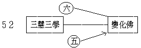



变化身由成所作智相应之前五识而现，复依妙观察智相应之第六识有观机说法之功用，故现起变化身，为清净前五识及第六识。身既如是，其土亦然。能见此变化佛身土者，为地前菩萨及二乘六凡等，其证圣果者，亦由清净第六识见之，未证果者，由有漏识而见，但须具三慧三学之善根方能见到。再进言之、初住以上菩萨依三慧三学亦能现变化身佛，如天台圆教极主张此说，并以此说为台宗所独有，其实、此为大乘之共义也。起信等论固有此义，且唯识宗亦许之也。



问：地前菩萨既无清净第六及前五识，如何能现？答：依三慧三学胜解力所起福智善根，由大悲愿力增上故，应众生机而得显现。



复次、总论佛身，向言三种：曰法、报、化，如上略明。或言二种：谓真与应。法身义有广狭：狭义言之，属无为法，谓法性身即是遍一切法之真实性，佛与众生平等无二皆悉具足，以无明烦恼故，众生障而不显，菩萨显而不全，独佛一人究竟觉了，於念念中证真如性以为身故，名曰法身。广义言之，凡佛果所生成之法，所证显之法，所思惟之法，所说之法，皆是佛法，总名法身，遍摄诸法无欠无餘。此在大乘名



为法身，简非二乘解脱身也。兹将法身广狭二义，列表示之：



　　　　　　　　┌所 说 法──教法────三藏  

　　　　　　　　│　　　　　　　　　　　　┌自受用身  

　　　　（广义）│所思惟法　　　　　┌报身┤  

　　　　法　　身┤　　　　　┌功德法┤　　└他受用身  

　　　　　　　　│所生得法─┘　　　└化身─三类  

　　　　　　　　│  

　　　　　　　　└所显得法──真如────法性身（狭义）



报身亦有二种：一、自受用，二、他受用。变化身有三类已如上说。以上三身，真言加等流身说为四身；华严开为十身，其实即三身也。



然言真身与应身者，亦摄此三身，兹列表如次：



　　　　　　　　　　　┌法 性 身─────法　身┐  

　　　　　　　┌真　身┤　　　　　　　　　　　　│  

　　　　二　身┤　　　└自受用身───┬─报　身├三　身  

　　　　　　　│　　　┌他受用身───┘　　　　│  

　　　　　　　└应　身┤　　　　┌胜应身┐　　　│  

　　　　　　　　　　　└变 化 身┤劣应身├化　身┘  

　　　　　　　　　　　　　　　　└随类身┘



佛身功德，等觉菩萨极言说边际虽不能穷尽，然观今所说，亦可略明大意焉。



二　综合说明



下教法中综合说明，共有四门：一、杂染清净相对门；二、精神物体相对门；三、潜因显果相对门；四、理性事相相对门（如大乘宗地图㈢）。



一　杂染与清净相对



依第六识为中心以观之，其东半面为杂染法，所有教法以红色代表之；其西半面为清净法，所有教法以黄色代表之。甲、以阿赖耶为杂染门之总持；杂染与染不同，染唯烦恼，杂染则净善法中杂有染法，亦是杂染，故东半面教法有以淡黄色表者，亦归杂染门摄，如三慧三学等之中立法，在东半面即杂染摄也。乙、以庵摩罗为清净门之总持；在西半面皆清净法，图中教法除淡黄色中立法外，深黄色皆表清净法也。然淡黄色所表之中立法虽遍於染，以在此已全离染清净法中故，亦成清净法也。次清净与净亦不同。言净法者，谓染位中所藏净法，即可名净；言清净者，则不复杂有一丝之染法而已完全清净者也。



复次、转杂染成清净之中枢为第六识及三慧三学，故此二者位于正中。此杂染故，一切乃永杂染，此清净故，一切皆渐清净；从凡入圣，发端建基，舍此莫由。



二　精神物体相对门



北南相峙，其分界之中心仍在第六识。甲、自第六识向上观之，以正北方之心为本位，而代表北半图所明者，皆是形而上之精神法；如三慧三学、慧命、遣执空理空观、一真法界、戒体、一切种识等，皆属於抽象之精神法也。乙、自第六识向下观之，以正南方之土为本位，而代表南半图所明者，皆是形而下之物体法；言物体者，谓已成具体之事物，如异生之依报正报，佛陀之佛身佛土等。云何佛身亦形而下？变化佛身土等皆是识智所现多法合成之一聚故。具假形者名曰物体，不论圣与凡也。



三　潜因显果相对门



以一切种识与密严实佛为两极端，而以阿赖耶南面之因及庵摩罗北面之果为分界。以第六识为中心而观之，一面有四因字，一面有四果字，四因字之半面属潜因门，四果字之半面属显果门。甲、以一切种识为潜因之极端者，在一切种识之半面观之，皆是潜因，未显现故；如一切种为一切现行之潜因，戒体为表业之潜因，阿赖耶亦为最深细不可知之潜因；本净种至一真法界，离言说故，皆潜隐故。故以一切种识为主位以观之，皆是潜因。乙、以密严实佛为显果之极端者，在密严实佛之半面观之，皆为显果；如异熟报主为三界五趣之果报法，所显现者为身器等；佛果位中则显现自他等一切身土，庵摩罗识虽为持一切种，与大圆镜智相应后即转成显现之果法，异阿赖耶之潜隐矣。一切显现果法之主位为密严实佛，故显果以密严实佛为极。



四　事相理性相对门



以一真法界与异熟报主为两方之代表，由第六意识之中心，以「因因」与「果果」为分界线；属於一真法界之半面者皆是理性，属於异熟报主之半面者皆为事相。甲、以一真法界为理性门者，一真法界为一切法之真理实性故；此理性是所诠表所证明之法，非是能诠表能证明之法，法身佛者为所显得。次至本净种及一切种识所摄之一切种，非现行法，本不可知，但由现行法上所推之理得知一切种之存在，故一真法界之半面皆为所明理性，依事相法所推知也。庵摩罗识持一切无漏种，依庵摩罗之持种义，则庵摩罗之所持种亦待诸无漏现行法所表现故，亦属於理性门。理性本无差别，一切种等由事相而证知差别，故诸种子虽云差别而实无别，无碍性故，交相遍故。乙、以异熟报主为事相门者，观此半面皆为差别之事相；如异生位业报不同，有三界、五趣、二十五有等种种事相差别；一一有情复由异熟所现相分、见分，各有心心所等差别，以第七识故有我、非我等差别，前六识有所依根等差别。至於净法，亦有声闻、缘觉、菩萨、三贤、十圣之差别，佛有自、他受用、三类变化身土之差别，乃至密严实佛是佛特殊不共九法界之胜果法，而阿赖耶亦有能藏、所藏、我爱执藏等之差别相。



如是四门相对以观此图，在大体上可一目了然，得一分判之概念。然在每一相对门中，皆可观澈图之全部，斯在智者之善巧研寻耳。



第二节　宗义



一　总说



第二、释宗义者有二：一、历别说明，二、综合说明。历别说明总有八段以释中华大乘八宗（如大乘宗地图㈣）。言八宗者：一、性宗，二、相宗，三、律宗，四、禅宗，五、天台宗，六、贤首宗，七、真言宗，八、净土宗：如是八宗可总括华文所传之佛法，兹配摄之如第四总图。



一、性宗，以东南方面之异熟报主为本位，由此异熟报主直向一真法界观之，为法性空慧宗。二、相宗，以正东方之阿赖耶为本位，由此阿赖耶直向庵摩罗观之，为法相唯识宗。三、律宗，以东北方之一切种识为本位，由此一切种识直向密严实佛观之，则为律宗。四、禅宗，以正北方之心为本位，由此直向正南之土观之，则为禅宗。五、天台宗，以西北之一真法界回合东南方之异熟报主以为本位，从一真法界异熟报主再观到一真法界，为天台宗。六、贤首宗，以正西之庵摩罗回合正东之阿赖耶以为本位，从庵摩罗阿赖耶再观到庵摩罗，为贤首宗。七、真言宗，以西南方之密严实佛回合东北方之一切种识以为本位，从密严实佛一切种识再观至密严实佛，为真言宗。八、净土宗，以正南之土回合正北之心以为本位，由土与心再观至土，为净土宗。以上总标，依次别明於下。



二　历别说明



甲　性宗



第一、由异熟报主直向一真法界以说明法性宗，此宗亦曰般若宗、三论宗、或四论宗，以宗般若经及中、百、十二门论——三论，及大智度——四论故。常途以台、贤为性宗，非也。今以龙树学系之所显为法性，以能显法性二空慧故，立名曰法性空慧宗。



云何由异熟报主直向一真法界观之，即可说明法性宗耶？其中心点仍在第六识，第六识与前五识上三慧三学中之闻慧，闻般若等经论，由闻慧成文字般若，复依文字般若成六识相应之二空胜解，由胜解起观照般若，照达诸法空相。



讲记　先依三论宗的教义来讲，应从异熟报主到一真法界的方向斜著看去，此亦第六识为中心，以第六识闻大乘空性相应的经论，如心经、般若、中观、大智度等，第六识由之得「闻所成慧」。依此慧来观察异熟报上五蕴、十二入、十八界、四谛、十二因缘等，一层一层都观为自性无所有，初从「文字般若」起「观照般若」，这就重变现起「思所成慧」了。这样地念念无间的来观习来体达，终之能遣除一切执障而达到「实相般若」，这就是「修所成慧」。——其实、三慧本不能这样来分，不过在殊胜上来讲，这样也不妨。——此宗重要点，在遣除所知障而显法空理，由第六识闻思修三慧三学势力，能遣法执而显空理，在第六未觉第七为染，不免受第七影响，待第六一经觉察，因修观故，不唯第六识本身的染障伏而不现，即第七识染障受第六殊胜的力量，也使之伏终至於俱遣，故第六识一面修观为能对治，一面遣执而证空理，是为三论宗空义。



此二般若之能现行，皆藉六识上之三慧——思慧、修慧依於戒定——，由观照般若起遣执空观，以闻般若教法明我空法空故，遣我法执而显真如法性，所起之观为遣执空观，所观之理为遣执空理。然所遣之执为何耶？复云何遣除耶？先遣第六识上分别所起实我实法之执，以此为众患之门故，二执若除，二空自显。如是所遣除之我法二执，或由自内之邪思维所起，或因邪师邪教之所引起，综之、此六识上分别所起之我法二执皆是增益执，此所执相本不可得，强执之为有实，病在六识，故应就六识以遣之。六识色表半红半黄，半红表二执相应染识，半黄表二执已除净识。向染识边观二空理遣其二执，由外凡而内凡，同依此修，由外门散慧观照而内门定慧观照——二空观。修所成慧到纯熟时，二执可伏不起，以在定心前五识已不现行故，六识中分别所起我法执皆制伏故，前六识上分别所起烦恼所知二障亦暂不现行。



讲记　所遣的「烦恼障」或「所知障」，在此宗又名「五住烦恼」，此种种烦恼总名之为惑，即为所遣而无不皆空。惑空故则业空，业空故则所招的异熟苦果亦空，惑业苦三空到极点，便体达理智一如的一真法界。此一真法界离名字相，离心缘相，这是大乘空宗的第一义。且以心经『照见五蕴皆空』一语来说，异熟果的根身器界为色法，与八识相应心所法为受、想、行摄，以及不相应法等亦行蕴摄，八识心王为识蕴摄，此皆由第六识依这些名相的文字般若而起观照般若体达实相般若，则观到一切法皆空而证真理。四谛、十二因缘、六度、乃至菩提、涅槃等染净诸法无不皆空，凡一切名言所诠分别所缘无不皆空，唯显现究竟不可说离言法界真性。



复次、此宗之用在於即破为显，亦名破显妙宗；谓依般若二空妙观，将执障重重深入以破显，即是重重显现真如之妙理故，如是渐破渐深，可至於俱生烦恼所知亦为之破灭，以我法执为烦恼所知二障之根依故。二执既破，二障渐除，以如树无根枝叶必死，无所依止故。分别我法二执虽唯六识，若俱生我法执障即通於七识，谓无始来我法习气恒现行故，俱生有故。般若胜观若能损减一切种识之我执种，即渐能伏除俱生二执之现行；至本具之无漏种起现行而成慧命，则分别我法二执可全断，俱生二执亦断一分，破第七染显清净平等性真如，入菩萨地。



由上观之，法性宗极简单，谓以快刀斩乱麻之手段，单刀直入，观二空理，遣二我执，伏断二障显真如性，直截了当，无过於此！然虽已证真如理性，而无始来所起二执二障未能尽断，故至此位更须重重上进，修二空观，破二我执，断惑业苦，深显真如理性也。法性宗即破以成显，破而不立，由遣执空理空观向六识七识以至异熟报主次第破遣，破至究竟，彼苦报障之异熟识乃空。苦报障起，由於有漏业障，有漏业障，由於二执二障；是故二执破之究竟，则二障空，故有漏业苦异熟空，以此空故一真法界究竟显现。如是破所显者即为法性，以其目的在直显一真法界故，亦为所宗，故以立名。然达其目的之胜用，则注重於破坏一门，由破二执而二障、而有漏业、而异熟报主，杂染事相重重破除，即是真如理性重重显现。乃至有一法过於涅槃者亦不可得，所谓毕竟无有少法可得，以其即破而显故不立一法，般若金刚等经皆显此义。



此宗所明具於破显二门，其特胜点在破执，虽但从异熟向一真法界说明，实与全图皆有关系。如在破之一方，起思慧则与戒体等有关，破分别俱生二执二障及有漏业苦，则与一切种及八识见相分等有关。又在显之一方，显至究竟即法身佛，持能显之功能为庵摩罗，其能显功能之现行即是密严实佛，其应化所现即为他受用佛身土，变化佛身土，故以此一宗之宗义亦可以观全图，亦可以统摄全部佛法也。



讲记　这虽与法相名词有差，然可用五蕴融会贯通，但因所从观点不同另成一宗教义，这是三论宗教义之概要。



乙　相宗



次由阿赖耶直向庵摩罗以说明法相宗，法相宗亦名唯识宗，今合名法相唯识宗。此宗教义重在明诸法相，其能明法相之功用在於唯识，换言之、即依唯识方能明诸法相也，故明法相必宗唯识。



此宗亦由六识闻法相唯识之教法，依所闻之教法而明法相唯识之理，即以此理为所观境，因观此境起唯识行，证唯识果。依唯识理以观唯识境者，先观唯识相。唯识相者，统摄有为之一切法，即三能变。三能变中第一能变为阿赖耶，故其所观之境首为阿赖耶识，最后观至庵摩罗识。由此义故，此宗之经论多先为阿赖耶之建立，经则有楞伽、深密等，论则有瑜伽师地、摄大乘、成唯识等为其最要之典籍，皆先建立阿赖耶识，如成唯识论首明初能变，摄大乘论首明所知依中阿赖耶识。



复次、观阿赖耶三相：一、就阿赖耶观之为自相；次观一切种识能持一切染净诸法种子，是为因相；次观阿赖耶识随业受报为一切果报之主体，故名异熟报主，为此识之果相。论云：『初阿赖耶识，异熟，一切种』；即是观初能变之三相也。如图：



　　　　┌─┐　　　　　　　　　　　　　　　　　　　　┌─┐  

　　　　│一├─────────阿赖耶────────┤异│  

　　　　│切│因　　　　　　　　自　相　　　　　　　果│熟│  

　　　　│种│　　　　　　　　　　　　　　　　　　　　│报│  

　　　　│识│相　　　　　　　　　　　　　　　　　　相│主│  

　　　　└─┘　　　　　　　　　　　　　　　　　　　　└─┘



讲记　前在教法讲，已明「第六识」功用最大。现在正说唯识宗之宗义，其观察点多先说阿赖耶，例如成唯识论先明阿赖耶，摄论先明所知依，皆足证明此义。阿赖耶为第八识之自相，亦为其总相，唯识论云：『摄持因果为自相故，自体是总，因果是别』。又云：『离二无总，摄二为体；二是总之义，总是义之体；体与义为依，名之为持，摄二义为体，名之为摄』。此即明阿赖耶为第八识之自相和总相也。阿赖耶义为藏，即能藏、所藏、执藏是，在图上也能见到，对一切种识即为「能藏」，对异熟报主即为「所藏」。七即末那识，其关系线通乎异熟线中「见分」，即表第七识之见分缘现行果识——第八异熟识——之「见分」为我，是「执藏」义也。此阿赖耶因所向之方面不同，故有三藏，如一人对自父为儿，对自儿为父，对自妻为夫，而体则一也。



从阿赖耶次向西观第二能变，第二能变即第七识，梵云末那，译意，意在异生位中恒与我见、我慢、我爱、我痴相应，执第八之见分为我，有情自他之隔别即从此而起，又为前六识作染依故。观第二能变已，次向西观第三能变。第三能变即前六识，别别了诸法故，亦曰了别境识。如图所表：



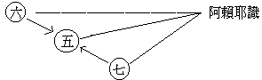



复次、观第一能变时，与第一能变有关之诸法亦即连带观察，如阿赖耶之熏变义，一切种识之业种等，异熟报主之业命与见相等，以及相应心所、不相应分位等诸法。观第二能变、第三能变时，与此二能变相关之心法、心所有法、色法、不相应行法等，亦遍观之。如是三能变法周遍观察，明白了然，即能明了唯识法相，亦能通达法相唯识。



观唯识相已，次观唯识性。性由相显，故由唯识相之所显即唯识性，相之性故；亦是二空真如。此宗重於说明一切法相，一切法相明了之后，诸法实性自然显现，故三能变广辨其相。於诸法相明了之后，即略明一切法之真如性——唯识性，以真性是离言非安立谛，不可施设，故如畫龙点睛一指便成，不必多费葛藤也。



又法相宗所明境行果三，明境重在三性：一、依他起性，众缘生故，唯识现故。对於众缘所生唯识现法，若依遍计所执起增益执与损减执，即成一切杂染之法，能障圆成实性。若除所执，则成一切清净之法，能显圆成实性。



修如是唯识妙观，其初成就三慧三学，修习空观通达空理，遣除分别、俱生我法二执，精进波罗密行，离净烦恼所知二障，空观与障净所成之实智为大菩提，空理与障净所显之实境为大涅槃，是为二大转依。故三能变渐次转依，首为六识清净，次为七识清净，次为第八及前五识清净。第八清净成庵摩罗，其所显为一真法界，为法身佛，其所成为密严实佛，为地上菩萨现他受用佛身土，为六凡二乘及地前菩萨现变化身土。故此宗之宗义，从阿赖耶上建立染依他起，遣二执，净二障，至究竟位转为庵摩罗识以建立清净依他起，是为此宗之主点。



讲记　在异生位中之第八识名阿赖耶，正对佛果位中之第八识名庵摩罗。同为第八识而有二名之不同者，一为进化之第八识，一为未进化之第八识也；虽同是第八识，因其进化与未进化之程度不同，所以一名阿赖耶、一名庵摩罗也。第八在因位中，在进化未到极点之时也只可名为异熟者，赖耶较异熟之名为狭，异熟较赖耶之名为宽，在六道受生受死之异生，若渐依教行，渐渐转异生身而入於圣生，乃能舍阿赖耶之第八而得庵摩罗之第八也。



问：性宗明诸法空遣一切执，此宗亦明空理空观遣我法执，有何差别？答：性宗从般若——空慧——直显诸法毕竟空，遣我法执；相宗从唯识明一切法相依他起故空无自性，遣我法执，是故不同。



丙　律宗



次从一切种识直向密严实佛观之以明律宗，此宗尝称为南山宗，律仪虽为各宗所共奉行，以所明之特点不同，故别建立。



讲记　依律宗以说明此图，中国律藏各部大扺皆小乘律，唐以前五分、四分、摩诃僧祇律皆盛一时，四分律又有几派，唯南山道宣律师一派为唐以后律下中心。其所以有普遍永久性的原因，以南山律师以大乘教理明戒体，融和大小乘律，恰合於中国人根性。中国教理行果皆为大乘，倘非以大小乘融会，唯纯小乘则必难以通行，所以弘律诸古师皆湮没不彰唯南山遗风未坠，此其故。



律宗在图中之要点，即一切种识与六识间之戒体，以六识为中心。谓信佛、信佛所说法、信佛法中修行僧故，在六识上具足此净信后，善根增上，身心要依持佛法为轨范，然能具体为轨范者，即是戒法，所谓律仪是也。世间政教虽亦有法律规条等轨范人类行为，然此中但说佛法之戒律，乃佛法住世之命脉。此戒法体即佛法身，是佛智所证之清净法界所流出故，与一切清净法平等无二，为一切清净法依止基本，故此戒法即广义之法身。复次、由佛大悲愿力为亲近缘，众生福德增上感佛现种种身说种种法，所现所说摄在戒法，故戒法即为佛清净法身之等流身。



如是戒律，非仅指所说之戒相条文而已，所现威仪动止皆是佛法，故戒法不但是言教，亦是身教。由异生位而至大觉，历种种身，经三祇劫，莫不由此戒法为轨范也。梵云毗奈耶，亦曰鼻奈耶、毗尼；此云律，或云戒，或云戒律，义译调伏——调练三业，制伏诸恶。动身发语二种表业固以此为轨持，即能发身语之意业亦依此为范也。故道宣律师判一切佛法为化——诠理化物——制之二教。制行之教，定能诠理；诠理之教，未必制行。以戒法为制行之教，超诠理化物之教上，起清净行，致清净果，是为戒法建立之大义也。



讲记　此义在图中即从一切种识中无漏业种为戒体，此为南山宗的出发点。从一切种识斜角相对是密严实佛，即为从因至果的直行线。关於「行」上，南山把佛教法配为两分：一为诠理教——本名化教，即诸经论等；二为制行教——本名制教，即诸部律仪等。佛临灭敕诸弟子「依法及律为师」；诠理教虽以言文阐其理，尤须以行实证，故教理须藉行乃能实证。律是轨范动作，止作持犯开遮有一定的制行，故阐理教虽广而归宿在行，依律起行而成定慧，定慧皆律的定慧，以律为一切教法总纲。



一、戒体之获得：有情之第六识由信解佛法故进而受戒，凡受戒者，先受三皈为体，次受戒法。一切戒律一切佛法皆以三皈净信为基础故，故须先受。受戒重在能持，依教奉行不容违犯，违犯之极即失戒体。戒体之获得者，吾人於受戒时，依传戒师等羯磨之仪轨及清净庄严之坛场，受戒者以意识为主，运耳识等听闻戒法，观感种种仪式，故受戒时前五识亦同起作用。如图中由六识直至戒体，即表受戒时第六识上有极深刻之领受感动与印象，前五识亦同起作用。然此前六识心心所活动之力即「思」心所，由此思心所为主动，前六识心心所同趣於受戒之种种行动，於此感受之后——即受戒之后，即成一种潜力，遇有违犯即能制止。语云：『谈虎色变』，皈受佛戒时心理上如得深切感动，亦复如是。得於戒体其义云何？谓受戒时，思等心心所法刹那刹那熏习於第八识成为种子，摄於一切种识中，此识所熏所成种子，即为戒体。此戒体种子之势用，谓於不知不觉之中有防恶发善之功能，此谓之无表法。俱舍论及一切有部谓是色法，上座部——锡兰——谓通色心法，成实论谓之非色非心法，道宣律师依大乘唯识教剋体而论立为种子。就用以说，此戒体与业命相似，以业种引起之一定限度而立业命，戒体为前六识受戒时感动所熏成种子——戒体，此种子之势力功用亦有一定限度，所谓「防发功能」。防者防止恶法不作，如不杀、不盗、不邪淫、不妄语等；发者发起，谓作一切善法，依此为出发点，修十善及布施等行。



二、戒体之破失：防发功能即是戒体，若能不破根本戒者，则此功能势用念念增长。依三乘共教言，若破根本戒者即失戒体；大乘虽不失坏，惟其势用亦不行矣。此在自意识上亦不易觉，故云无表。虽不觉知而能防发，防发功用同心理学上之本能，俗云「习惯」、「天性」等相似。



三、戒法之作用：由受戒时成就戒体之「防发功能」后，前六识发起以表现其功能作用，所谓身能止杀、盗、淫，语离恶口、两舌、妄言、绮语，意除贪、瞋、邪见。如是三业遍前六识而以第六为主，具於三业上表现其防发功能，防止一切恶即是止持，发作所应行即是作持。若应作而不作亦是犯戒，如是在举止行动间守护根门，莫令放逸，持戒清净身心欢喜，若有违犯心则忧戚，即时发露忏悔除灭，其所违犯还得清净。



四、离净三障：此宗既重制行，以深切之信心受持律仪，故由六识有线至於障净，谓持戒清净者能消诸障。障有三种：烦恼障，所知障，谓之惑障；由惑造业谓之业障；由业感果谓之报障。持戒之功能转当前业障，惑由业滋，报是业感，若业一转则惑无由发。以持戒净业力感非苦报，不障善业，且於先业所感之报亦能转增福德。故持戒清净能至於障净，障得解脱即成密严实佛，以持戒清净故成为理得心安之境，充满欢喜。谚云：『为人不作亏心事，半夜敲门心不惊』。从此所养成高上之人格为学佛之基础，可由人乘直至佛乘。因戒净而心喜身乐，由喜乐故得定，由定而入三解脱门。此由戒所成定，远诸魔障，得正定也。



五、明三种戒：未得定前所持戒律，为佛弟子七众律仪各别解脱，故曰别解脱戒。得定以后，成定共戒，亦云静虑律仪。持戒所生定，或定心成就所相应戒，欲界有情定共戒成就时，能转舍欲界身得色界身。由此正戒正定等正解行极熟修习，则能发生圣慧成为实智。实智相应戒为无漏律仪，曰道共戒。实智虽通三乘，然明戒体为种子者唯在大乘，由障净而实智具生，实境圆显，即大乘四智菩提也。



六、明大乘戒：中国所传戒法通大小乘，而大乘戒法有三种：一、依律仪戒——七众戒，二、摄善法戒，三、饶益有情戒。依律仪戒，即於世间为出世佛法清净幢相之建立，有此住世是佛正法住世，无此世间即无正法。此摄七众律仪，七众之中以出家之苾刍为主，摄持餘众。摄善法戒，总摄一切善法，如十善、六度等一切善法。饶益有情戒，谓凡所作事皆须利乐於一切有情，此中以四摄法为饶益有情之根本方法。



如是大乘三种净戒，华文所传如璎珞经十无尽戒，瑜伽菩萨地之戒品，梵网经十重四十八轻戒，及密宗之三昧耶戒，皆可寻研。



此诸大乘戒法，本为地上菩萨所说，未入地者虽不即能完全奉行，然应随分修学；如梵网经乃他受用佛为二地菩萨所说金刚心地宝戒，吾人亦可随分修学者也。密宗三昧耶戒，为密严实佛等流之戒法，其殊胜加持力非所思议也。



讲记　南山判教不过名目不同，与深密三时教大致是同：一、性空教，二、相空教，三、唯识教，又名应理圆实教。中国通俗所用性字，或「个性」、「自性」「男性」、「女性」、「性格」等，都是有情自体义，各个有情有一「恒常」不变而「统一」的自体叫做性，正是佛法所破执有「常」「一」用的我。中国用性字大抵是常一义，南山依此唯一不变又为有情「性」义来代表我字而名性空教，换言之、即小乘我空教也。相空教是大乘空宗教义，小乘虽知我空而五蕴等法相仍在，用现在名词来讲，可名心理现象、物理现象等。小乘看我为空，但於现象执为实有；现今科学亦有此义，有情个性是无，五官所感触到的是实在：性好像是看不到而推出来的，相是实在感触到的故不空。小乘用分析五蕴明体性空，大乘空宗因性空故，一切法相也空；然在现量心识上，相之性是不可得，但相在心上分明显现宁得为空！故单讲相空，犹是偏於一义，进而有唯识教。相为三能变所变的相分，此相有而不实，故唯识一切法空义与假现象义俱显；唯识空有双彰，不偏不易，是为中道实相。故南山分诠教制教，而诠又分三，三中又以唯识为最究竟，故其明戒体亦依唯识教种子而立也。此为南山宗义。



丁　禅宗



第四禅宗，由正北方之心直观正南方之土以说明。由六识为中心，须先具有三慧三学，然后方能证入禅宗。故禅宗之建立，专为上根说法，谓於佛法中修学已有成就者，便为传佛心印，荷担佛法之人。成此上根利智之教，决非半字不识者所能当机承受也，故须先有三慧三学根机，然后始能续佛慧命传佛心印。



禅宗应名为佛心宗，旨在明心见性，见性成佛。图中之一心字，义同起信论中一心二门之「心」，楞严经中一心真妄二本之「心」。一心二门者，如图所表，由心向西北方观一真法界之半面，皆为心真如门；由心望东北方观一切种识之半面，皆为心生灭门。真妄二本亦同，心真如门即为真本，所谓性净妙体；心生灭门即为妄本，所谓虚妄想相。由此观「心」，从根柢上直为剖判，将妄本之一方根本推翻而否决之，所谓打破无明壳也。真本之一方根本肯定而印证之，所谓直下承当也。由此根本决定，其枝末之染净诸法皆迎刃而解也。



於六识上具有三慧三学，能认定佛法之宗要根本，在由心明顿成性见，将一切葛藤用利智斩除，直捷了当，单提一句向上追究，以冀悟到即心即佛，则所谓本来面目者乃亲切认清也。



讲记　依禅宗明此图，禅宗最简单而直捷，依止善知识闻法请开示参究话头，亦皆以六识为主要，其向上目的在「明心见性，见性成佛」。在图中最注重心，虽云『离心意识是真参』，然须由第六参究为增上缘击发一切种识中行佛性之种子，故本宗又名佛心宗。把一切教义葛藤都丢开，唯使本净种——行佛性——发生现行，根本正智现前正是明行佛性，心明而见到一真法界的理佛性。禅宗宗旨就在心明性见，理智不二，此禅宗所以单提向上简单直捷也。禅宗最重要下手处是起疑情，把一切圣凡都放在这疑团里面，逼搾到一切不可得时，正是行佛性起现为根本智，而见到理佛性、一真法界、理智不二、坐断三际的境界。详讲如禅宗语录等，简略的即此也可明禅宗宗义。



复次、对於心之一面积极证得，对於土之一面彻底推翻，即为此宗显灵心而空形物之要旨。所谓本无烦恼生死，元是菩提涅槃，「明心见性」之义，亦在於此。无明心为妄本，若将无明心转明了，即得见性，性即一真法界，即本来面目，亦曰法身佛。然此言见性者，即是了知一真法界平等普遍真如实性，非谓有物如神我等在身中可以见也。以见性故，一切净法无不成就，一切杂染法亦无不灭除。



复次、言续佛慧命者，即无明之心转变成明心，明心现起即是慧命现起。从总持义以言，有为无为皆是心故。明心即见性，见性即成佛，成佛即慧命不断而灯灯相续，是为禅宗要义。



讲记　禅宗尤当明者，起初参究时即在第六识肯定「心」的一面，心即是佛性心，把其餘一概否认了；所谓「原是菩提」，「本无烦恼」，或「本来是佛」；将肯定的实现了，否定的自无。禅宗语句不能一一举例说明，因其名词与经论不同，可以活用。如坛经『心是地、性是王』，此心可看作「一切种识」，性可看作「无漏智种起的现行般若」，故此心性如此看才对。又如坛经『大圆镜智「性」清净，平等性智「心」无病』，与上心性又不同，此「性」可看作完全佛性——即行佛性究竟出染及理佛性究竟显现，此「心」可看作一切现行心，现行心完全无我法执及一切烦恼——即成平等性智，故此心性又是一种看法。此不过举一个例而已，可见禅宗语词非如经论。



图上之心即佛性心——本有完全无漏种及一切法理性心，以是虚位，故佛性总括「理」「行」。此心又可名「如来藏」，如来藏有空如来藏、不空如来藏二义，禅宗所否定方面即空义，从肯定所显方面即不空义。至第三空不空义，是中国古德从经义演绎出来的，经无明文规定。空去了的即空如来藏，空去了所显的即不空如来藏。心虽虚位，总合无漏种一真法界名佛性心，或如来藏心，此为禅宗义。



戊　天台宗



第五天台宗，此宗须从一真法界与异熟报主合为一致而出发，再观到於一真法界。



讲记　天台宗，他的出发点是一真法界，从一真法界倒转到异熟报主，由异熟报主再转进一真法界。此宗依宗法华经，如云：『诸法实相，唯佛与佛乃能究尽』。又云：『诸法寂灭相，不可以言宣』。故以唯佛与佛究尽及不可言宣者为根本出发点，为所观境，又名佛智所观境，或三谛境，或两重三千境。言语文教所诠显者，即此不可言宣，或唯佛究竟之一真法界境。故依佛智境而为所观，言教所显，皆归此点，法华开示悟入佛之知见亦即此义。



天台以理具三千事造三千为根本宗义。以此义故，由异熟报主观为事造十法界，一一法界皆有相、性、体、力、作、因、缘、果、报、本末究竟十如是。此事造十法界诸法，当下即是理性本具，当下即是一真法界，故事造是理具之事造，而理具亦即是事造之理具，事造融於理具，理具显於事造，由此事造与事造亦圆融无碍，故於一法界上即具其餘九法界，如是成百法界，如是百法界一一又皆具十如是，成千如是。由此互融互具之百界千如法成三千者，异熟报主上之正报既具此百界千如，依报亦具此百界千如，依正二报所依之五蕴法亦具百界千如，乃成三千诸法。事造如此，理具亦然；是为事理两重三千，为天台宗义之根本。亦即法华方便品所明之诸法实相，在止观中即为一境三谛之所观境。



讲记　从一真法界佛智境到异熟报主者，所谓三千性相百界千如。三千性相：即依报一千，正报一千，五蕴一千，互相融摄。就是观众生境即佛境，佛境即众生境。以佛境而融观十法界，十法界皆佛境；以众生境而融观十法界，十法界皆众生境。百界千如者，即十界中一一界互具九界即成百界，百界各具十如即成千如。又依正五蕴各具千如，故合云百界千如，是为妙境。理具三千即事相之理性，事造三千即理性之事相，佛法界境事即十法界境事，一真法界原来竖超横绝，法尔如是故，故得佛境众生境心境无有差别。众生境者，异熟为正，相分——器界——为依，此为天台宗义。



由此义故，可言善恶皆为性具，在异熟报主即事造三千性相诸法，此等诸法虽有善恶因果差别，当下即一真法界性，性具互融无有差别，众生本来是佛故。从异熟报主观之，异熟报主等於一真法界；复从一真法界观之，一真法界亦等於异熟报主；异熟报主有善有恶，一真法界亦有善有恶也。天台宗义本依法华经而建立，法华经所谓唯佛与佛乃能究尽之诸法实相，即因缘等十如是之事理三千，依此有一境三谛，由一境三谛则成一心三观。



以上所言为天台宗圆教要义，固非常识所能证验，然其初步下手即观法华之诸法实相境，依此境而作空假中之一心三观。本具此理，曰理即佛。由闻教法解此理故，则成名字即佛。依此名字所解理，修观行得相应故，则成观行即佛。观境深入，现身成就佛果相似功德，是名相似即佛；所谓六根清净，即此异熟身而成清净不思议之功德，为善法加持义。进证真如法身，是名分证即佛，亦唯识之通达修习位也。由名字至相似皆依教法，至分证位乃有超教法之实证。观至成大圆觉入究竟即佛位，证一真法界是谓法身佛。此言法身佛者，以无身士相为究竟，所谓坐虚空座身如虚空者也。与密宗等所明之法身回不相同，故其所归乃在一真法界。从此法身即有报身——受用身、化身——变化身佛。此二佛应化九法界众生，谓报身应菩萨法界，化身应二乘及六凡法界，乃至应化地狱为地狱佛，故名化身佛。由此证知佛法界亦具十法界，不断性恶，性具善恶诸法故能具现事造之十法界也。



以上皆据天台圆教以言，於圆教法各别不融则为别教，通藏二教则明圆教之一分义，故彼皆为批判他宗之施设耳。即於此亦可见天台宗义之要点矣。



讲记　餘宗讲『心佛众生三无差别』，不与天台同。餘宗用心为圣凡沟通之邮，佛有心众生也有心，佛有众生心——应化众生之用，众生有佛心由之可以成佛。天台谓众生即法界全体，心也即法界全体，佛也即法界全体，乃至一色一香无不皆是法界全体。此境唯佛能究尽，或不可言说佛智的境界，祇要有佛智现前，则十法界皆是佛法，故天台宗以佛境为境。又以此理，佛智之一心三观为能观。明所观境的出发点也是第六识，六闻法教了知佛境界，依此境界而起能观，即肯定的了解所观之三谛境——即真俗中三谛，起一心三观——空假中三观——去观，不须遣我法执，只要此观成就时即证一真法界，此为天台宗特殊之义。各宗亦以基於出发点不同，各有其特殊义。



现在所讲是天台宗化法四教中的圆教；还有藏、通、别三教，是重在藉以评论他教，而台宗宗义所归唯在圆教。依一心三谛境起一心三观，依观证一真法界；圆教佛以虚空为身，亦以虚空为座。天台与三论不同，三论宗自众生到佛果，天台则由佛果而到众生——即由闻生佛不二之境而起能观智而证佛果一真法界。天台与三论的确有关，可说从三论而发展者。但天台宗法华，依佛智境起佛智观而证佛果，非三论所能及，此即是天台宗精粹所蕴的圆教义。若别教人，不能依佛境起观，即依六识修次第三观而观次第三境：先空观空境，次假观假境，后中观中境，再后证佛一真法界。若通教修体空观兼能空法执。若不能空法执但空我执者，仅成藏教析空观耳。故先明台宗自宗圆教宗义，餘三教非台宗正义。在此亦可明台宗特殊的立足点，在图上也成为斜角相对之形式。



己　贤首宗



第六贤首宗者，亦须先从庵摩罗与阿赖耶复合以为一，此二连成总一切法之心，通摄有漏无漏诸法，总名为第八识故。第八识摄一切法尽：识有本识、转识，本识即第八识，转识为前七识，心所有法六位差别，如是等法从八识平列观之，则有诸识诸法之差别可言，若从最深之第八识观之，则第八识可总摄诸法归於识之自证分、见分、相分中也。第七识与第八识之见分有最密切之关系，以第七识现起第七识见相者，依於第八识见分故。前六识与第八识之相分亦有最密切之关系，为其依缘以现各别之六识者，因於第八识之相分；摄大乘论说第七是第八见分，说前六是第七相分，一切诸法皆摄在第八识中也。如是观之，虽有染净因果圣凡差别而皆为第八识之差别相，其实皆为一体之第八识耳。由此一体第八识义，即成自他不二、染净不二、因果不二、圣凡不二、身土不二，生死涅槃、烦恼菩提皆悉不二，如是无量差别诸法，成为一体融通无有差别，是为华严「心佛众生三无差别」之义。天台宗之言心佛众生无有差别，谓心法、佛法、众生法皆即事理三千故无差别；贤首宗则从根本之心体以明心佛众生之无差别，谓心等佛众生，众生佛等心故。依此阿赖耶与庵摩罗融合为一之根本心，即为贤首宗宗本之所在。故在众生心阿赖耶底下即是佛心庵摩罗，佛心庵摩罗上亦即是众生心阿赖耶，此心自他一体融通，本无差异，故云：「众生本来是佛」；亦云：『一切众生皆具如来智慧德相，但由妄想执著而不证得』。谓形表上虽为众生，而心底下即是佛心，但由妄想执著之所覆障故不现行，其所覆障，前七染识之作用也。由此染净不二之第八识，明自他生佛等皆无差别，是为贤首宗之一真法界，华严所明毗卢遮那十身相海，以众生国土等皆为佛身。



吾人既知此一切众生具如来智德，但以妄想执著故不证得，则须破之以求证契。其破之之程序，由庵摩罗阿赖耶不二之一真法界——贤首宗之一真法界，再观至庵摩罗事事无碍法界，有四重之法界。其遣净一切事相上妄想执著，从阿赖耶果相观至密严实佛者，明事法界也；从阿赖耶因相观至一真法界者，明理法界也；以理遍事，即事明理，则成理事无碍法界，此为地上菩萨波罗密行境界；若至究竟成佛，则为事事无碍法界——所谓佛果具五不可思议，即庵摩罗持清净一切种，为一切清净现行之依止，所现之一切事皆无碍故，故名事事无碍。此宗之根据点在染净不二之一真法界，究竟成就则为事事无碍法界；然此所明，非同虚空无相，乃是具德圆明事事互融，如帝珠网光影层层无尽无尽者也。



由此故天台为性具法门，而贤首为性起法门。言性起者，性指染净不二第八识体，亦即贤首所谓一真法界。此性与法性之性别，法性无为法也，无为无起灭故，不应言性起也；此言由性能起诸法，盖以佛生不二之持种识为性，故曰性起，亦曰一真法界缘起，故云：『大哉真界，万法资始』！



讲记　贤首宗教义，要从庵摩罗到阿赖耶，即成华严经义，即以庵摩罗识为出发点。贤首宗的一真法界，不同法相宗等以心言寂灭非安立谛为一真法界。贤首宗讲四法界：事法界，理法界，理事无碍法界，事事无碍法界。一真法界为四法界之总和，可以统摄四法界。与此一真法界相当者即庵摩罗识，华严悬谈有云：『大哉真界，万法资始』，即万法皆自庵摩罗起也。天台明性具，贤首明性起，故又名性起宗。此也恰与庵摩罗相当，因庵摩罗是佛果第八识，能持一切清净法种。依果上一切法，由未起现行的净法种子去看那庵摩罗识，所有三身、四智体用等现行，皆佛果庵摩罗所藏的净种所起之现行法，此为性起义。再贤首宗又有因果交彻、生佛融遍的法界缘起义，此第八识从来生佛不二，即佛果庵摩罗与众生阿赖耶因果自他融而为一，所谓『因该果海，果彻因源』是也。此从不二义上讲。佛庵摩罗心即在赖耶心底下，赖耶心底有佛庵摩罗，佛心藏在众生心，众生心藏在佛心，『一切众生皆具如来智慧德相』，即此义也。此乃法界缘起生佛不二义也；佛即以众生心境为佛身，如华严融三世而为佛身，依报、正报、业报等皆为佛身。从佛看来果彻因源，从众生看来是因该果海，生佛相藏，为贤首宗特点。如华严经中如来出现功德品及华藏世界品皆明极果之法，故古德判前为举果劝乐生信分，即第八与镜智相应成庵摩罗识，而以净种起佛法界身土现行，是相即成密严实佛，是性即为一真法界。佛果境界明后，说菩萨问明品、净行品、贤首品等，从佛心而明众生心，即从庵摩罗而到阿赖耶也。众生心领佛教之佛境界及庵摩罗所现而成信心——即十信法门，依此信而起三慧行，了异生八识心境，故华严宗与唯识宗祗重复异耳。华严宗从庵摩罗到阿赖耶，为起信故，特详果境而略众生境；唯识宗从阿赖耶到庵摩罗，为明舍故，特详众生境而略果境。从十信起三慧三学，后经住、行、向、四加行，修二空般若而破二执；到十地总修或别修十波罗密——别修即初地唯修布施，二地唯修持戒等；总修一地具修十波罗密。最后讲普贤境界，即十地菩萨圆满境界，成就佛果圆圆果海，究竟成就庵摩罗识。庵摩罗为佛心境，阿赖耶为众生心境，由众生位信解行证而达佛果功德，由佛果功德而起众生信解行证，是为贤首宗之特殊点。



四法界者：事法界明一切法相，即依他起。众生依依他起而起遍计，破除遍计明二空理，即理法界。事法界的现相与理法界的本体平等即差别，差别即平等，是理事无碍法界。在初住或初地，初住胜解或二空智，观二空理遍一切事，所谓百法不离二无我，二无我理遍百法。把执藏染分离尽完成净分依他起，即事事无碍法界。净依他起离遍计，即圆而依，即依而圆，此所以有事事无碍法界。不起现行的「庵摩罗」，即是贤首宗的一真法界。贤首宗总别成五法界；由佛心而到众生心成众生境，由事而理而成二空，由理而理事成菩萨境，由理事而事事而成一真法界，成佛果境，此为贤首宗义。在图正是平面横对也。



庚　真言宗



第七明真言宗，亦须以密严实佛与一切种识复合为一，而为此宗之根据点。



真言宗之大要有二：一、金刚界以果德为本，二、胎藏界从因体以明，此为密宗之根本义。然台密尤重金胎不二之苏悉地法，考西藏所传之密法亦有此义，然此三种法义，固完全具在华文经中也。金刚界曼陀罗以五智佛身为主，东方大圆镜智为阿閦佛，南方平等性智为宝生佛，西方妙观察智为阿弥陀佛，北方成所作智为释迦佛，中央法界体性智为毗卢遮那佛。此中央法界体性智即是一真法界。金刚喻智慧，界是差别义，为菩提智之差别义，故亦称多法界。又金刚界以三十七智为三十七尊，合前五智、智福两足。胎藏界曼荼罗以中台八叶为主体，表因位之九识，以庵摩罗为第九识表大日如来，第八识阿赖耶为宝幢佛，以第七识为花开敷佛，第六识为阿弥陀佛，前五识合为天鼓雷音佛，其餘诸尊则由心所配释；此胎藏界表因位之理性平等，称一法界亦即一真法界也。复次、胎藏表本有之平等，属众生界；金刚表新生之智慧，则属佛界。又胎藏为从果向因之加持法，曰大悲曼荼罗；金刚为从因向果渐次之果证，曰大智曼陀罗也。



讲记　密宗以密严实佛为出发点，一真法界为佛境，庵摩罗为佛心，密严实佛为佛身，此佛果为一切清净法总集，成自受用佛。不但第八与大圆镜智相应而成，乃转八识成四智及其四分而成者，其无量无边如身土等功德，充足圆满恒时现行，此等现行功德一一无边，即事事无碍法界义；一佛即一切佛，一切佛即一佛，若自、若他，非一、非异。不即、不离。



自受用佛身和境界自受用土，即四智的总集，自受用土即法性或一真法界。密宗显五智法身，另加法界体性智，此与佛地经清净法界同。四智是有为无漏，一真法界是无为无漏，在图上无为无漏即一真法界，有为无漏即密严实佛。四智即密严实佛，四智缘起当下即四智的一真法界，故五智法可说总一佛身一佛土，四智之相即是佛。遍於四智缘起者即体性智，或者智所现智所显智所起故，总名法界体性智。楞伽经有现识、转识、真识，现识即第八识，转识即前七识，真识即真实性，为识所依故名。故密宗确成为唯智论，果上不可思议无量无边清净功德，皆智所现所显所起，故智所依的法界体性也原来即是体性智了。五智法身为佛大菩提果，在密宗五智所成身即大日如来，密宗依此智果为出发点，而为一切说明的根本。



无论有漏六凡无漏四圣，都是「大日如来」，即秘密庄严的密严实佛的全体。一切众生种识之中有无漏种，此种增集圆满即成真净的密严实佛，密宗推其所因即在种识中的无漏种，故有胎藏界本有不新生的一切无漏种，渐渐增积圆满成大日如来，金刚界本此两义而有六大缘起、四曼荼罗、三密相应。



在唯识论上相性皆名识，在唯智论上性相皆曰智。智者、一切无漏果之总称，所生之智现行即是四智，其所显现即是法界体性，能显者为自受用佛，所显为法性身，此二身不二为密严实佛，在此密严实佛位中，性相假实色心王所一切诸法，无量功德皆得显现。即此无不显现之诸法皆圆满成就，融通无碍，故一一法皆是平等。由此，故依六大以明缘起诸法，言六大者，地、水、火、风、空、识也。此六大法在密严实佛位中，皆圆满显现无有隐蔽，由此为根本缘所起枝末诸佛亦复如是，故一切法皆立於平等地位，无有高下。



在众生位，六大云何亦能平等？谓在一切种识皆是平等交遍无碍，如地种不碍水等种，乃至识种亦不碍地等种。在佛果位，则事实上六大平等无碍，在因位则一切种识所摄之一切种亦是平等无碍。又众生位之六大无碍缘起即为大悲胎藏界，至於究竟显现六大无碍即是密严实佛。佛与众生皆以六大无碍为体，众生位理性虽如是，而其所重则在明佛果之事相。



讲记　六大缘起相极粗显，是世界现象很明显的事实。所知有五，能知唯识，为世间一般众生心理上所共同了知之事。密宗推重六大缘起，都是交遍无碍，以密严实佛即大日如来为根本所现的明显相，就是六大。密严实佛的六大交遍无碍，亦即众生的六大交遍无碍，故佛众生互相交遍，而一一大也交遍，一一大皆具其餘；由六大所起一一事即有情世间、正觉世间、器世间，又皆互遍无碍，故密宗以「大日如来」为出发点说明「六大缘起」。



复次、曼陀罗之所建立以中心本尊而有别，故以佛为中心即成佛曼陀罗，若以菩萨为中心即成菩萨曼陀罗，以天神鬼畜为中心即成天神鬼畜之曼陀罗，乃至以地、水、火、风、花、香等为中心，亦皆得成曼陀罗也。所以者何？皆以六大为体为缘起故，皆平等故，由此乃成无量之曼陀罗。然皆以佛身为根本，唯佛智能显故，皆是佛等流故，由佛大智定悲之所现故。以上所言为此宗之体相。



复次、修密宗亦以六识为中心，第六率前五识闻此教法，深信领受，奉一本尊。行者结印、持咒、观想之身语意，与本尊之三业互相交遍；本尊之三业成为行者之三业，行者之三业同於本尊之三业，行者即本尊，本尊即行者，成三密相应。故修六识上之三慧三学，受持三昧耶戒，戒体成就，由本尊加持殊胜力，忏悔罪业破除障垢，由破除障故而显实智实境。此言破障，是功德断非过患断，以破障即是行者与本尊之三业相应故，破障为显一切功德，功德具足成大菩提，现毗卢遮那身即此之密严实佛也。



讲记　密宗以六大缘起为体，以曼荼罗为相。曼荼罗有四：即大曼荼罗，三昧耶曼荼罗，法曼荼罗，羯摩曼荼罗。曼陀罗是团体组织的坛或道场等，是有普遍形式和特别的标帜，如国家以国旗为标帜，即有他特别的范围，每种组织的表现即是其用，未曾表现时是六大交遍无碍之体，凡表现为具体的团体的，就是曼荼罗。



三密相应的基本理义，是六大缘起交遍无碍和四曼所表现的体相上之用。自他交加，生佛相持，於此业用义上，成就三昧加持义。如人和天为天人感通，在佛可云生佛交通，如鬼神三乘等都有交加相持之功用。在此三业相应，如身业上所依的环境及何等作法和手结何等印，口业上诵何等真言，意业观何等字轮，若行者三业与本尊三业交加相持合而为一，是为三业相应。如以观音为本尊，自己所持真言和坛上形式，以及自己三业的规范与观音本尊相同一致，成为自他生佛交加相持，故名三业相应，又或名感应。



上来根据金刚胎藏根本义，六大缘起体，四曼荼罗相，成就三密相应用。然密宗修行是由行者的有漏五六七识和变化佛或他受用佛的无漏五六七识交加相持，行者才现起净用。唯识宗是由染六识等转成清净，密宗是自他生佛交加相持，即众生有漏杂染诸识和佛无漏清净识，行者於此生佛共同关系上而现起无漏功用。餘宗重在遮过，故须广破执计，密宗重在表德，故须显离障清净实智实境。密宗以大日如来悲智融化一切众障，使众生亦成大日如来——即密严实佛，这是密宗的特殊义。



辛　净土宗



第八明净土宗，以土与心合而成一，为净土之宗本。



净土总说明佛土之依正庄严，摄正报从依报故但言土耳，其实亦摄土中主伴有情。然有浅深不同，浅者变化佛身土功德庄严，进为他受用佛身土功德庄严，又进为自受用佛法身佛身土功德庄严；普通所明之净土相，为变化佛身土与他受用佛身土也。



讲记　净土宗由土而到於心，依净土宗教义修行也不限於念阿弥陀佛，即十方诸佛净土及菩萨净土也能摄一切有情或下地菩萨；故净土不限於极乐，犹密宗不限於一本尊也。此为广义的净土，有菩萨在内，若极乐世界则为特殊净土，与东土最有缘，尤其是中国。



土之右为异熟报主之相分器，表凡夫之秽土，左为密严实佛之法性土，表圣者之净土。然修净土之法不是心外取法，故不同於一般宗教之求生天国等，盖彼等皆执心外有法也，云何土非心外？经云：『是心是佛，是心作佛』，即显此义。是心是佛，谓佛身土功德庄严摄归即心自性之法身佛，以心真如即是法身佛故；此法身佛身土通於佛与众生，在佛位此心之功德身土如是，在众生位此心之功德身土亦如是，无增无减，法性平等无高下故。



次是心作佛者，心乃法之总相，摄六识等，谓由第六识等明净土之教法，及明佛与众生心性不二法身佛土道理，由此决定净土教之信心，进修三慧三学无量善根，发愿往生。然此净土宗法重在愿心，於善根之修习随其浅深不同，但须切信其法而发深愿，誓必往生净土，则命终时皆归净土；乃至十恶重业，但凭愿力亦能往生。净土虽有十方佛土，而中国近世所习者为阿弥陀佛之极乐净土，此土由阿弥陀佛之誓愿所成，故亦云誓愿所成土。一切众生依佛愿力及自愿力皆得往生，若无坚深信愿，虽慧福具足亦不能往生。故带业众生可由愿往生，未具善根功德亦可发愿，不同回向必已具善根功德也。由此愿力往生之特点而得成净土极方便之法门，由信此法门而发愿，由愿起行，为此宗之要义。



如是台、贤、密、净四宗，皆依善法增上力故而获效果；台、贤重於善法，至真言宗依於念力重在即身成就，而净土宗则依愿力重在临终得往生之归宿，由此可知此四宗之同而不同。复以一表明其大概：



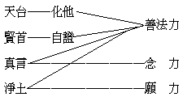



讲记　无论那一系出发点都为六识，由六识领受净土宗教义，即观佛土的依正庄严，不过佛土的依正庄严，大概是有相的变化佛或他受用佛的依正庄严，不是无相不可言说的法性身土。由闻教后，以佛依正庄严为所观境而起向慕之信心。然如何能生净土？在理论上，十六观经云：『是心是佛，是心作佛』；即以心为生不生之转枢也。是心是佛，就是理佛性为依正庄严之本，由无漏种渐渐增长而至圆满，以显究极之行佛性，即是心作佛义。总之净士宗由信心而观依正庄严及修三慧行，由慧行得力即可感到变化佛接引而往生净土，往往有临终蒙光接引脱离染土者，多是此类。故以是心是佛的原理，由六识起是心作佛的行，由行即可感到化佛而得往生净土。



三　综合说明



综合说明分四：一、八对四类门；二、四单四复门；三、相夺互成门；四、平等殊胜门。



甲　八对四类门



１　八对门



此由一切种识律宗起，依次说明。



第一、依律宗之立埸以观八宗则分为二：一、制教，二、化教。律宗即是制教，设规立制范身行故；餘七宗为化教，语意二轮善宣化故。



第二、依禅宗之立场以观八宗法有证法教法之别：证法即禅宗，重实证；而以餘七宗为教法，施设种种语言道故。



第三、以天台宗立场以观八宗有实教权教之一对：实教即天台所宗之法华，宣说诸法实相，唯此一乘无二三故；餘七宗为权教，以虽华严亦带权故。



第四、依贤首宗立场以观八宗有根本法轮与枝末法轮一对：根本法轮即华严教，是一切佛法根本故；所餘教法皆出於此，餘七宗为枝末法轮，从此所流出故。



第五、以密严实佛密宗为立场而观八宗则有密教显教一对：密宗为深密教，餘七宗为浅显教。



第六、以净土宗为立场而观八宗有易行道难行道之一对：易行道属於净土宗，三根普利，最易行故；餘七宗皆为难行道。



第七、以法性宗为立场而观八宗有无所得法有所得法之一对：无所得法即法性宗，谓一切法皆无所得，乃至有一法过於涅槃者亦不可得，破而不立，显至究竟亦不可得，故曰无所得法；餘七宗为有所得法，思之可知。



第八、依法相宗为立场而观八宗则有显了教隐密教一对：显了教即是法相宗，众生法佛法心法等皆了然显示明确建立故；餘七宗皆为隐密教，所说之义虽已竟了，而能诠之文教多未明显，是故曰隐密教，唯识经论所谓密意趣语是也。



以上八宗相对，互相观察，以一宗为主时餘各为伴；如是妙义重重，帝网无尽，斯又在智者之善思惟也。



２　四类门



一、佛力加持类，二、善法增上类，三、超理直行类，四、胜解成观类。



八宗之中，净、密二宗为佛力加持类。净土宗依弥陀之本愿力，确信不疑，发愿求生，凭佛接引加持，虽带业障亦得往生。密宗依本尊之加持得现法之成就，本尊虽不一而皆为大日如来之等流身，故其本尊之加持亦即大日如来之加持。如是二宗起行趣果，不问他法之如何，但依佛力之加持，是故同摄为佛力加持门。



次以贤、台二宗为善法增上类。言善法者，即其本宗所宗之经教也。此二宗之华严、法华同称经王，重於受持读诵之善法增上力，如台宗之持诵法华，贤宗之持诵华严等，古德奉行咸获良果，在在徵信，有录可案，佛法之不可思议力於此可见！法华有受持、读诵、书写、解说、修行之五品法师功德位，进至六根清净，全属善法增上所成。故二宗必先明自他不二，生佛平等，互相交遍，融彻无碍，依佛果无漏善法为增上胜缘成就果德。他宗宗义虽亦具此善法增上缘力，而特显此义之殊胜斯在台贤。



次以禅、律二宗为超理直行类。盖律宗不重在理解，祗依其皈佛法僧之真实信心为体，受持净戒，直起正行以求漏尽；禅宗不落理解，离文字相，绝语言道，直行求证即心是佛；故以是二宗同摄於超理直行类也。



次以相、性二宗为胜解成观类。相、性二宗皆重理解，由决定印持不可引夺之胜解发起胜观，修胜行，证胜果。其所成观：性宗为实相观，或无所得观；相宗为唯识观，或四寻思观。



以上四类统摄八宗，再列表以明之：



　　　　　　┌净土宗────┐  

　　　　　　│　　　　　　　├─佛力加持类  

　　　　　　│真言宗────┘  

　　　　　　│天台宗────┐  

　　　　　　│　　　　　　　├─善法增上类  

　　　　八宗┤贤首宗────┘  

　　　　　　│禅　宗────┐  

　　　　　　│　　　　　　　├─超理直行类  

　　　　　　│律　宗────┘  

　　　　　　│相　宗────┐  

　　　　　　│　　　　　　　├─胜解成观类  

　　　　　　└性　宗────┘



乙　四单四复门



单谓单观，或单往法；复谓复观，或复往法。



１　四单门



性、相、律、禅之四宗，皆是单观单往之法。一、性宗由异熟报主破一切执障事相，显至一真法界，破而不立，即破即显。二、相宗认定诸法不离於识，识有三类，曰三能变。三能变中以第一能变为根本，故观阿赖耶等三能变相，观到显唯识性，如是通达三性三无性究竟故，证庵摩罗识果。三、律宗从初受戒发得戒体，由得戒故，能净障故，直趋密严实佛。四、禅宗重在达心，於心作深刻之肯定，确认即心即佛以求明心见性，斩绝葛藤，证法性土。



２　四复门



台、贤、密、净之四宗，皆是复往复观之法。一、天台宗，此宗为复门者，谓先从一真法界观至异熟执主成复合之法为宗本，复从异熟报主观至一真法界。换言之、即由佛果善法力加持众生，引起众生欣乐信愿发大乘心，再从众生位以至於成佛。二、贤首宗，此宗为复门者，谓先从佛果庵摩罗识观至众生阿赖耶识成复合之法为宗本，复从阿赖耶识观至庵摩识，异生因妄想而不能证得，故须精进勇猛修集福德智慧资粮乃能毕竟成佛。三、真言宗，此宗为复门者，谓由密严实佛观至一切种识成复合之法为宗本，再观由佛力以加持行者，三密相应直成正觉。四、净土宗，此宗为复门者，谓由土与心成复合之法为宗本，复由心观至土，是心是佛，是心作佛，生佛净土。



以上单门四宗重於因力，亦曰自力修证，谓有情仗自因缘善根种子力，如法相宗所明之种姓等，禅宗谓自性弥陀，唯心净土等，皆唯自力。复门四宗皆依佛果增上缘力，亦曰他力加持，以众生法置佛法上，再将众生法底之佛果法显现圆成。由此因缘自力及增上缘他力观察八宗，即可探得其要理也。如表：



　　　　　　　┌性　宗┐  

　　　　　　　│相　宗│  

　　　　四单门┤　　　├因　缘──自力  

　　　　　　　│律　宗│  

　　　　　　　└禅　宗┘  

　　　　　　　┌天台宗┐  

　　　　　　　│贤首宗│  

　　　　四复门┤　　　├增上缘──他力  

　　　　　　　│真言宗│  

　　　　　　　└净土宗┘



丙　相夺互成门



相夺门者，每宗各有其立宗之宗点，依此宗点为根据而判摄餘宗，各能将餘宗摄归自宗置於相当之地位，由此批判一切，统摄一切，是为相夺。故每宗宗义皆可以说明全图及全部之佛法，每宗皆可自谓除此一宗外别无佛法，此宗为上传释尊唯一之正宗，其餘各宗皆祗此中宗之一分而已。尝观中华八宗皆有此趋势，故成相夺门。



次互成者，每一宗有每一宗之特殊方向，由此一方向发挥而成此宗之特殊法门。观一宗之所以成立，正以有他宗义为其所破所摄而得成立，若无餘宗宗义，则此宗亦无从批判统摄，故每一宗之成立，皆因他宗之成立而得成立，正由判摄他宗从别一方向所发挥义故，其所立宗遂益成丰富之宗义。如清辨之依他毕竟空与护法之依他如幻有，此二者表面观之似不相成，其实正由如幻有故愈显毕竟空，亦由毕竟空故愈显如幻有，因此二义实互成也。二宗既然，八宗亦尔。故各宗虽相夺而实亦互成也。



丁　平等殊胜门



八宗皆平等者，如全图所列之教法，皆大乘平等所依之教法，亦即为全部之佛法。然则此宗既为大乘完全教法，彼宗亦是大乘完全教法，方向虽有差别，全体平等如一；如国家之政府建立於限定之地方，或南或北，然此政府虽时有南北之不同，而所统所依之国土人民则一。



次言八宗各殊胜者，谓八宗所依之教法虽然平等，而各宗有各宗之殊胜用，故有八宗之别，如国家之政府因其施政或环境等关系，建立於彼或建於此，而各有其特别殊胜之功用也。复次、发心证果皆平等，故八宗平等。八宗皆发大乘心故，亦皆证究竟佛果故，八宗同具此二义故八宗平等。



然各有其特胜之宗，谓研究教理成为所尊所尚之一点，以所研究之教理为根据，集理成宗，立观趣行，则不能不有反博归约握厥单微之宗点。若无此集理之宗点则所研究之教义必漫羡无归，不足以为起观所依，遂亦无趣行证果之可能。故修学者为趣行故，必须把握一特胜之观点以为宗也。兹列表於下：



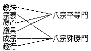



第四章　结论



第一节　教法之差别及其会归



以上略说教法及宗义竟，今再提纲挈领以总结之。前来所说之种种教法皆根据佛所说之言教，盖依圣言量而立也。然佛说法随根机故无量差别，如是差别又如何会归而统理之耶？兹首先述其差别，然后会归。



一　差别



佛之因机说法，论其差别约分为四：一、为僧所说；二、为圣众所说；三、为人说；四、为非人说。一、为僧所说者，僧即依佛出家之僧伽，为此僧众所说之教法，就偏胜说，即是律藏。僧为释尊之常随众，其所止所作皆受佛陀之教授教诫，由此建立僧团，专任宏传佛法之责，故必须有一定之制度始能作久远之住持，因之有比丘律比丘尼律等出家众之僧律仪，故曰为僧所说。第二、为圣众所说者，有在定中说者，如圆觉经等佛与菩萨同在神通大光明藏中而说；或在净土中为三乘等圣众所说者，如解深密经等；或为入室圣弟子说，如金刚般若经等。第三、为人说者，人指佛法中之四众弟子，以及人间所有之上自帝王，下至屠沽等一切人众；或为大会广众普通人说，或为一类一个特殊人说。第四、为非人说者，谓为天等说，或为神鬼等说，如执金刚神及药叉鬼等，或为龙等所说。



由此所因之机种种差别，不但说法差别，其所现之身亦不同，所谓随类现身说法是也。故应观一佛之某种教法应何种机说，又现何等佛身说，依此而明其立场之所在，方不致有隔绝附会之弊，此为教法研究上之先决问题。是故了知教法，不仅宗义不同，佛之根本教法亦不同也；如真言宗经所成佛为大日如来，闻法者为金刚手等。



二　会归



佛为普摄众生类之现身说法，虽有如是差别，而大要之会归，应知此诸教法皆为释尊之所证、所思、所说、所印之法也。以一切教法皆佛为本故，此土以释尊为教主，则此土之一切教法当然为释尊所亲证、所思维、所宣说、所印可之法也。有人谓净土为阿弥陀教，真言为大日教，谓是报身、法身佛教，餘是应身释迦佛教；然此不过标其自宗殊胜，分判如此，须知即此弥陀、大日等亦皆是释尊所证、所思、所说、所印之法，此土若无释尊现身说法，吾人决不知有弥陀等也。故无量差别教法，应统括会归之曰释迦牟尼佛之教法。



第二节　宗义之成立及其安置



一　成立



种种教法皆归为释尊之教法，次言依此教法成立各宗宗义以及其安置，兹以四义明其成立。



一、疏缘有二：一、所处环境，二、所依教法。所处环境有时代地域民族文化等差异，由此所依教法虽皆为释尊之教法，而宗义遂有各别之成立。且如唐代以前有天台宗等建立，至唐代有贤首宗等建立，虽同地域民族文化教法，然以时代差别，即文化教法等亦皆有别，故所成宗义亦逈然不同。以地域或民族等致成差别者，亦复如是。



二、亲缘有二：一、所承师授，二、所具根性。谓所禀承亲教师之教授不同，及其本人所具根性之有异，遂令所处所依虽同，亦所得有别而立宗亦殊。



三、正因有二：一、所得自证，指自心所亲证验之自证法，在此自证法上有偏圆广狭之差别，各依其自证为所宗故有各宗之建立也。二、所对机宜，机宜指承受其教化之人，有相当之众生承授此法则可成立此宗，若无此类根机，则虽有此法，亦不能成立。



四、成果有二：一、所施言行，有自证法及所宜机施设种种言行，言即言教，行即行仪，至此其宗乃成。二、所传徒属，有所传之徒属，此宗方能相传不断，若无可传承者，则虽成立终即灭亡。如禅宗在六祖以前若存若亡，六祖以还乃盛流传；天台宗入唐已若存若亡，后荆溪四明等重振，始克传行。



二　安置



安置者，谓上来观宗义之成立，有其时代性、地域性、人根性等之不同，由此种种差别因缘所宗教义亦成派别，今於此差别之各宗宗义，应安置於佛教史中以研究之，时地人等既异，不应再拘於宗派之义矣。



然若将宗义仅作历史之研究，尚与行人有何利益？则应知於行果修证，如楞严诸圣之圆通法门，华严诸知识之解脱法门，每一法门有其特点，皆可依之修证；各宗亦然，各有其宗特点，宗其特点，入一行而贯通万行，趣证圣果。故一宗宗义之研究，契其机者可获趣行证果之益。



复次、教化设施尤需参考，盖每一宗派依其所对之机宜施设种种言行教化，令当时之有情得大安乐；是故应察所设施之言行，皆因时地等等不同，依释尊之教法及其自证心境随宜设施，故吾人应采择其所言行，奉之为龟鉴也。



第三节　今后佛学之安立



今之地域交通，民族复杂，人智发达，文化荟萃，统世界人类以互相会通；故今后之佛学，应趋於世界性，作最普遍之研究修证与宣扬。由此今后佛学有二种之安立：一、根本，二、应用。



一、根本上之安立者，重於自利：一曰、教理研究，其根据为三藏圣言，经律为佛所说，论为三乘圣人根据佛说而造亦属圣言，后人著述则皆当取证圣言为裁断。故今后研究佛学非复一宗一派之研究，当於经律论中选取若干要中之要作深切之研究，而后博通且融会一切经律论成圆满精密之胜解。二曰、行果修证，此为今后学佛所最应注重者，以佛法是证法，证法非行莫证，故吾人教理之研究，非以增知识为目的，而以能导进修行趣令证果为目的。若研究教理而不趣重修证者，则研究教理不但无用或反有深害，耗一生之精力最多亦成就一时髦学者而已，其与佛法慧命何干？且如研究法空，若不重於行证，夸言皆空，则成恶取空而落大邪见！研究大小乘法相，若不重於切身修证，专作名相分别，诤论坚固，成恶取法相，不惟终生心力徒为名相消磨，且能因之增长贪求名利恭敬及贡高我慢等无量烦恼！近人多鹜趋法相之研究，孰知法相似难而实易，法性似易而实难，性相一如理量同时之圣境尤不易窥测。对於佛圣甚深密意趣言，不能强信，妄凭穿凿，肆为抨击，实犯大戒！犹有学真言者，亦求广知，不务精修，徒为济欲工具，遂成恶取密法，岂但无益而害深矣！故研究教理须证之实行，庶免数宝之讥及浮嚣之议耳。



二、应用上之安立者，重於利他：一、历史研究，二、教化设施。若以教法应用於一般人类而施化，则须先为佛教历史学之研究，如佛传、佛教史及各宗之佛学史等作切实之研寻；以今日之时事与过去之历史均有关系，观察明白而后乃可设施一切教化，应病与药，善巧无量。所谓教化设施，即将佛之教法化导世界人类欲皆归於佛化。设立种种之法门，施设种种之学术，或慈或威，或逆或顺，或折或摄，或立或破，是须在有志负传扬佛学於世界之任者，内依佛法，外适时机，为普遍妥当之设化而已。餘义无量，非此所能详也。



（法舫记）(上海佛学书局印行)

