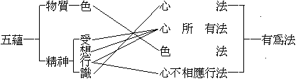
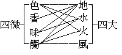
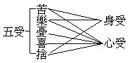
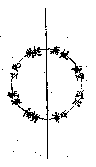
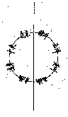
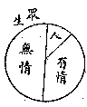
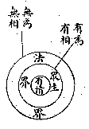
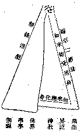

# 太虚大师全书．第五编　法性空慧学(第9卷-第16卷)



> **藏经**：太虚大师全书（太虚大师全书）　**册次** 第 6 册（TX06）　**编号** TX0005　**卷次** 8 卷　**篇幅** 223,670 字

> **作者（译者）**：金刚般若波罗蜜经讲录

> **卷／品**：10 卷 · 80 品



---



## 目录



- [（大勇记）(见海刊二卷十二](#大勇记见海刊二卷十二)

  - [法会因由分第一](#法会因由分第一)

  - [善现启请分第二](#善现启请分第二)

  - [大乘正宗分第三](#大乘正宗分第三)

  - [妙行无住分第四](#妙行无住分第四)

  - [如理实见分第五](#如理实见分第五)

  - [正信希有分第六](#正信希有分第六)

  - [无得无说分第七](#无得无说分第七)

  - [依法出生分第八](#依法出生分第八)

  - [一柤无柤分第九](#一柤无柤分第九)

  - [庄严净土分第十](#庄严净土分第十)

  - [无为福德胜分第十一](#无为福德胜分第十一)

  - [尊重正教分第十二](#尊重正教分第十二)

  - [如法受持分第十三](#如法受持分第十三)

  - [离柤寂灭分第十四](#离柤寂灭分第十四)

  - [持经功德分第十五](#持经功德分第十五)

  - [能净业障分第十六](#能净业障分第十六)

  - [究竟无我分第十七](#究竟无我分第十七)

  - [一体同观分第十八](#一体同观分第十八)

  - [法界通化分第十九](#法界通化分第十九)

  - [离色离柤分第二十](#离色离柤分第二十)

  - [非说所说分第二十一](#非说所说分第二十一)

  - [无法可得分第二十二](#无法可得分第二十二)

  - [净心行善分第二十三](#净心行善分第二十三)

  - [福智无比分第二十四](#福智无比分第二十四)

  - [化无所化分第二十五](#化无所化分第二十五)

  - [法身非柤分第二十六](#法身非柤分第二十六)

  - [无断无灭分第二十七](#无断无灭分第二十七)

  - [不受不贪分第二十八](#不受不贪分第二十八)

  - [威仪寂静分第二十九](#威仪寂静分第二十九)

  - [一合理柤分第三十](#一合理柤分第三十)

  - [知见不生分第三十一](#知见不生分第三十一)

  - [应化非真分第三十二](#应化非真分第三十二)

  - [法会因由分第一](#法会因由分第一-1)

  - [善现启请分第二](#善现启请分第二-1)

  - [大乘正宗分第三](#大乘正宗分第三-1)

  - [妙行无住分第四](#妙行无住分第四-1)

  - [如理实见分第五](#如理实见分第五-1)

  - [正信希有分第六](#正信希有分第六-1)

  - [无得无说分第七](#无得无说分第七-1)

  - [依法出生分第八](#依法出生分第八-1)

  - [一相无相分第九](#一相无相分第九)

  - [庄严净土分第十](#庄严净土分第十-1)

  - [无为福德胜分第十一](#无为福德胜分第十一-1)

  - [尊重正教分第十二](#尊重正教分第十二-1)

  - [如法受持分第十三](#如法受持分第十三-1)

  - [离相寂灭分第十四](#离相寂灭分第十四)

  - [持经功德分第十五](#持经功德分第十五-1)

  - [能净业障分第十六](#能净业障分第十六-1)

  - [究竟无我分第十七](#究竟无我分第十七-1)

  - [一体同观分第十八](#一体同观分第十八-1)

  - [法界通化分第十九](#法界通化分第十九-1)

  - [离色离相分第二十](#离色离相分第二十)

  - [非说所说分第二十一](#非说所说分第二十一-1)

  - [无法可得分第二十二](#无法可得分第二十二-1)

  - [净心行善分第二十三](#净心行善分第二十三-1)

  - [福智无比分第二十四](#福智无比分第二十四-1)

  - [化无所化分第二十五](#化无所化分第二十五-1)

  - [法身非相分第二十六](#法身非相分第二十六)

  - [无断无灭分第二十七](#无断无灭分第二十七-1)

  - [不受不贪分第二十八](#不受不贪分第二十八-1)

  - [威仪寂静分第二十九](#威仪寂静分第二十九-1)

  - [一合理相分第三十](#一合理相分第三十)

  - [知见不生分第三十一](#知见不生分第三十一-1)

  - [应化非真分第三十二](#应化非真分第三十二-1)

  - [乙一　通序](#乙一通序)

  - [乙二　别序](#乙二别序)

  - [乙一　通序](#乙一通序-1)

  - [乙二　别序](#乙二别序-1)

  - [乙一　通序](#乙一通序-2)

  - [乙二　别序](#乙二别序-2)

  - [序品第一](#序品第一)

  - [乙一　通序](#乙一通序-3)

  - [乙二　别序](#乙二别序-3)

  - [观如来品第二](#观如来品第二)

  - [菩萨行品第三](#菩萨行品第三)

  - [二谛品第四](#二谛品第四)

  - [护国品第五](#护国品第五)

  - [不思议品第六](#不思议品第六)

  - [奉持品第七](#奉持品第七)

  - [嘱累品第八](#嘱累品第八)

- [（倪德薰记）(见海刊三卷五](#倪德薰记见海刊三卷五)

- [（李了空、胡法智合记）(见海刊十二卷十一](#李了空胡法智合记见海刊十二卷十一)

- [(见正信第六卷第十八](#见正信第六卷第十八)

- [（善馨记）(见海刊四卷四](#善馨记见海刊四卷四)

- [(见海刊一卷十](#见海刊一卷十)

- [（净严、袁西航记）(见海刊十三卷二](#净严袁西航记见海刊十三卷二)

- [（苇舫记）(见海刊十四卷九](#苇舫记见海刊十四卷九)

- [(见海刊九卷二](#见海刊九卷二)

- [(见海刊六卷一](#见海刊六卷一)



---



金刚般若波罗蜜经义脉



——十年十月在北京夏宅讲——



一　释经题目  

二　解经义脉甲　序分  

乙　正宗分1.　赞请印允  

2.　示教解释（一）就菩萨所度众生明  

（二）从度生所求佛果明  

（三）从佛果所证所说明  

（四）就证说所果所行明  

（五）就现在当处所闻所见明  

（六）就后先能持能修明  

（七）就菩萨能行自身明  

（八）就如来妙智观机明  

（九）就如来现身说法明  

（十）就如来证果修因明  

（十一）就如来度生应化明  

（十二）就如来威仪住持知见明



丙　流通分



一　释经题目



此经名金刚般若波罗密。佛说般若，有十六会，故般若波罗密一名，通於诸部般若，是为通名；金刚一名，专指此部般若，是为别名。



金刚有二：一、般若，二、般若断。般若有二：一、体，二、用。此般若体，从本以来不生不灭，不垢不净，不增不减，体性坚固，常住不动，不可破坏，故曰金刚。又此体性显现时，一切妄相妄见，悉决断无有，皆消归於此体性，亦名金刚。是以金刚具有坚固、决断二义。



此般若用，本不离体，在众生分中，既未能显现此体，般若妙用亦无由而发生。苟一旦体显用生时，则一切妄相妄见，悉皆破坏无有。其破妄之力，最极锋利，故曰金刚。又此智用，不但能破坏一切，且不为一切所破，故云：般若若大火聚，凡有触者无不被烧。苟妄想缘般若时，妄想即当下消灭，归乎般若；若暗中无明，暗中若得明，则明存暗亡；妄想若缘般若，则般若生妄想不生矣。故此智用，非常坚固，非他可坏，是名金刚。



般若断有二：一、所断，二、能断。所断非他，即妄相妄见耳。所见之妄相，由能见之妄见而生，如空花由目眚而有。妄相妄见皆一妄想心所现，如空花赤眚，皆从一眼病而起；眼病若愈，眚花俱灭，妄想若断，相见均寂。但此妄想最极坚固深细，无处不到，无法不缘，通於一切众生法、菩萨法、佛法，甚难断除，可谓之为金刚妄想，非金刚智无能断之。



能断即般若慧，此慧有三：曰闻、思、修。由文字般若发生闻慧，观照般若发生思、修二慧。闻、思二慧及修慧中之一分，皆为资粮慧，其餘一分为加行慧；由资粮加行二慧，降伏妄想。由加行位中世第一位进证智体，创获实慧而断除之，妄想断处即般若显发处。此能断之般若，最为坚利，故名金刚。——上之智体、智用、所断、能断，皆具有金刚之义，故曰金刚般若。



波罗密译为事究竟，因金刚般若而得到於究竟故。此究竟有三：一、金刚智体究竟，所谓显现究竟。此体本来不生，亦无有灭，平等周遍，无动无摇，生佛同具；不过众生为无明所覆，若以金刚智显现之，显现至於究竟，即成就三德中之法身德，三身中之法性身，三涅槃中之性净涅槃。所谓一究竟一切究竟，一切究竟一究竟。全经能显之法虽有种种，而所显者，唯此体性而已。苟明乎此，则佛一代时教所说之法，皆可瞭然，奚独此经。



二、金刚智用究竟，所谓发生圆满。此用由体而生，体若未显，用则不生，须由修习而渐次出生增长。到究竟时，即成就三德中之般若德，三身中之受用身，三涅槃中之无住涅槃。因地之种种妄想，至此皆成无量河沙之功德，所谓不可思议之般若妙用也。



三、金刚断究竟，所谓伏断净尽。断通能所，能断有二：一、缘能断，即资粮、加行二慧。二、真能断，即世第一位进证智体所生之根本无分别慧；此慧能断除妄想至於究竟，故曰金刚般若波罗蜜。所断之妄想，若种子，若现行，一一悉皆被断无餘，亦曰波罗密。合能所断皆究竟，故曰金刚断究竟。此断究竟，即成三德中之解脱德，三身中之应化身，三涅槃中之择灭涅槃。此真能断，即前之智体、智用，亦即金刚也。试列表於左：



　　　　　　　　　　　　　　　　　　　┌智体……显现究竟…法身…法性身…性净涅槃  

　　　　　　　　　　　　　　　┌般　若┤  

　　　　　　　　　　　　　　　│　　　└智用……发生圆满…智慧…受用身…无住涅槃  

　　　　　　　　　　　　金　刚┤　　　　　　　　┌妄相┐  

　　　　　　　　　　　　　　　│　　　　┌所断┐┤　　├─妄想心  

　　　　　　　　　　　　　　　└般若断─┤　　│└妄见┘  

　　　　闻……文字般若┐　　　　　　　　│　　├伏断净尽…解脱…应化身…择灭涅槃  

　　　　思┐　　　　　├资粮慧┐　　　　├能断┘  

　　　　　├─观照般若┘　　　├缘能断─┘│  

　　　　修┘──────加行慧┘　　　　　│  

　　　　　　　　　　　┌智　体┐　　　　　│  

　　　　　　　　金刚─┤　　　├真能断──┘  

　　　　　　　　　　　└智　用┘



二　解经义脉



兹释经文，暂依卅二分，另为分判：一、序分，即第一分是。由『如是我闻至千二百五十人俱』，为通序，同诸经故。自『尔时世尊至敷座而坐』，为别序，异他经故。二、正宗分，自第二分至第卅二分前半是。三、流通分，第卅二分后半是。



甲　序分



序分如常释。



乙　正宗分



１　赞请印允



正宗分二：一、赞请印允，第二分是。二、示教解释，自第三分至第卅二分前半是。



赞请印允，即为四段：一、须菩提赞叹，即『希有世尊！如来善护念诸菩萨，善付嘱诸菩萨』是。盖众生初始发菩提心，尚未开显金刚智体时，非佛为之调护爱念，不但不能增长，且多退堕。是以经过二大阿僧祇劫之八地菩萨，尚须诸佛之警觉，始不住於所证空性而进取佛果，况初发心者！然亦众生之自生自长，非佛能代其生长，不过佛时时调护爱念之，为其增上缘，以除其妨害生长者耳，故谓之善护念。既得佛护念，遂能开发智体，智体显现后，佛即为之印证，并嘱其善为保持，拔度众生，是曰付嘱。以其实无所付嘱而付嘱，故曰善付嘱。二、须菩提请问，即『世尊！善男子至云何降伏其心』是。在须菩提意，以为菩萨发心，虽广大过於二乘，然其必有所应住之境，所降伏之妄想，及能降伏之道，与二乘非异。三、佛印证所赞非谬，即『佛言：善哉，善哉！至付嘱诸菩萨』是。四、佛允答所请，即『汝今谛听』下是。所言应如是住，如是降伏其心之『如是』二字，即指下文第三、第四两分大意。



２　示教解释



次示教解释。全经关钥，不出须菩提『云何应住、云何降伏其心』之两问；世尊『应如是住、如是降伏其心』之两答。前第二分中为正问，下第三第四两分为正答，自第五分至第三十二分前半反覆问答，皆不过显明此二种问答耳。此本经之脉络也。今略明之：夫心本无相，由妄想而幻起，能取之见分与所取之相分。相如空华，空华本体即光明清净之虚空，亦即平等周遍之金刚般若体性。故吾人当前所有之一切法相，种种妄想，当体即金刚智体，何所用其降伏？又何待降伏？祗了达妄想即空，即妄见自然无所分别。相见既息，妄心寂灭，常住平等之金刚智性豁然显现；故妄想非妄想，假名为妄想耳。既无所降伏之妄，亦无能降伏之道。如是降伏者，为真降伏，为究竟降伏，为无过咎降伏，为不共二乘之独菩萨法降伏。所言降伏者，即非降伏，是名降伏。所云住者，凡夫则住於生死，二乘则住於涅槃，皆以有所住为住，因其未开显此金刚般若体性，不能发生金刚般若妙用，遂住於法而不住般若矣。菩萨了达一切法当体毕竟空寂之金刚智性，有何法为菩萨所住？又何有能住於法之菩萨？以一切不住故，则能发生一切心，获得不可思议之金刚智用，遂成就无量无边等同金刚体性之福德，故非住相布施等福德所能比较，此全经之大义也。是以绝相显体，即降伏其心；体显用生，即无住而住矣。



此示教解释中分二：一、直显示教答，二、逐疑解答。又更总分为十二段。



（一）就菩萨所度众生明——第三、第四分



此段最为紧要，为全经之纲宗。下十一段，皆不过就须菩提及大众所疑上逐层解释，藉以发明此一段耳。於中分二：先答降伏其心，即第三分。次答应如是住，即第四分。



菩萨降伏其心之法，即在发度一切众生心，而精进勇猛修行一切度生事业，所谓所有一切众生之类，我皆令入无餘涅槃而灭度之，而同时又须观察实无所度之众生可令其涅槃者。盖众生相乃由妄想分别而起，众生真实体性，即不生不灭常住周遍之大般涅槃，既本来涅槃，何须菩萨令其入耶？如虚空本来无花，何从有灭？不过如幻之众生，於不生不灭法上幻起生死大苦，菩萨乃起空花万行，巧设种种方便而度脱之，实则本无所度之众生，亦无所入之涅槃。然亦非不度众生，不过既了众生性空，乃能不起执著，正好广行一切度生事业。若不了此，则必妄计有能度众生之菩萨，是曰我相；计有所度，是曰人相；复於所度中分其根性利钝品类差别等，是曰众生相；又计其轮回生死流转相续，是曰寿者相。若著四相，则我见坚固，妄想随逐，尚无能自度，何暇度生，故曰即非菩萨。若能观众相皆空，则本体立现，妄心不降而自降，不用何种对治法以为滋妄之本。盖对治之法，乃系以妄除妄；妄妄无穷，终非究竟，故於妄心起时，即观妄心当体空寂，无丝毫实在可得，无所用其降伏，即澈底降伏无餘矣。此无四相，约人空明，以四相皆不离於人我执故。



次答应云何住：夫心本周遍，离能离所，绝对绝待，无所可住，亦无能住，凡夫不了，妄见有所住耳。夫谓空有花，已是颠倒，复问此花应云何住，岂非迷罔？皆由执法实有，不达法空耳。故佛特告之曰：菩萨於法应无所住行於布施。夫不住於法者，非有一实在之法令其不住，实一切法皆由妄心分别坚执为有，体本空寂故无可住。以不住故，则契应周遍法界等同虚空之金刚智体，由体起用，发而为施、戒、忍、进、禅、智等度。此施等六度之智用，既由周遍法界之智体而发，故其所得之福德，亦等同智体，而不可思量。是以住相行施，不但福德有限，且为菩萨应断之妄想；以不了达实相无相，妄有所住故。不住相布施，则成为金刚般若之妙用，以此智体本来具足一切法故。夫不应住於法者，破有相之执也；行於布施者，破空无之执也。以破一切相，金刚智体显；智体显现，则智用现前；智用现前，则无量无边福德聚，而空无之妄见亦祛。全经脉络皆如是，所谓以毕竟空显毕竟不空之无量福德也。后文乃由空生等餘疑未了，佛乃重重破之耳。当知其破处，正是显此金刚智体处；破后即较量功德者，以妄破则体显，体显则用生，用生故出生无量无边之福德也。



二、逐疑解释答，即十二段中之第二段至第十二段是。更总为二：甲、就菩萨法明，自第二段至第七段是，亦即原分自第五分至第十七分是。乙、就如来法明，自第八段至第十二段是，亦即原分自第十八分至第三十二分前半是。先就菩萨法明，有六段。



（二）从度生所求佛果明——第五、第六分



上文云无众生可度，空生遂疑：菩萨得证佛果，无不由度众生而来，既云无生可度，菩萨从何而证佛果。佛遂问之曰：可以身相见如来不？空生经佛一问，即悟如来身相本来空寂，不应於此相上执著分别。下文所有问答之意，大约相同。盖诸佛法身，本来离一切相、一切分别，故不可见；即佛之自受用身，亦周遍法界，等同虚空，不可得见；佛他受用身及应化身，虽不可见，然随各人所见各各不同，以其本无定相可见，不过随心变现，究竟是一种虚妄之法，非金刚般若本体，以本体不可以相见故。若见诸相非相者，破一切虚妄也。即见如来者，妄破而体显也。体显则智用生，故下即云一念生净信，得福无量，此净信本於空一切妄想而生，故其得福德亦等同法性无量无边矣。下复就无四相等明者，重显一切法相无不空寂，究竟不应取著耳。



（三）就佛果所证所说明——第七、第八分



据上二段而言，则菩萨上无佛道可成，下无众生可度，空生遂疑：今者如来又由何所证而说法耶？不知金刚般若体性，本非妄见所能取，亦非语言可能道。凡一切法，皆无有决定相可取可说，以法即非法故。无为法、指金刚智体；差别、指金刚智用。此明降伏其心。下明应如是住，此四句偈，一一字皆显金刚体性，故受持之福德殊胜。此经即离一切相即一切法之金刚般若体用，故佛法全体即此经，诸佛之法无不从此经出。实则诸佛之法既即此经，并无能出所出，佛法亦即非佛法。



（四）就证说所果所行明——第九、十、十一、十二分



此第九分就小乘所证之果，所修之行，以明当体空寂常住不动之金刚般若体性。因上文言一切圣贤皆以无为法而有差别，遂疑既云无为法，云何复有差别耶？佛乃以其所证者一一徵问之，空生遂悟四果当体全空，毫无自性，虽有其名，并无其实。是以四果非果，差别非差别，亦无所修之行，以实无所行，乃名之曰阿兰那行耳。



第十分就大乘果行以明金刚智体。如来在然灯佛所，於法实无所得，从果上显。菩萨庄严佛土，从因上显。以果因皆不可得，显出非因非果之法身自性。菩萨庄严佛土，即是以大慈悲心灭度一切众生；即非庄严是名庄严，即是实无有众生得灭度者。以一切毕竟空寂，显现本来之妙真如性，即是清净心，具足万法；一有所住，即为法缚，而不清净矣。譬如手能执一切物，若执一物，餘物皆不能执，则成专执此物之手矣。大身指报身言。非身名大身者，谓遍满法界法皆是非身，而大身即以此一切法为其身，故名大身。



上九、十两分皆明不空之真空，此十一、十二两分明非有之玅有。以一切所证之理，所说之义，若因若果，无不空寂。妄想空故，智体显现；智体显现故，智用殊胜，得福无量。以此经全是显佛之法身，故此经即佛法身舍利，一字一句，皆系佛之法性身所现，故经典所在之处，即为三宝所在处也。



（五）就现在当处所闻所见明——第十三分



此疑餘者可空，而现在当前闻佛所说之金刚般若波罗密之法相，及所见依报之佛土，正报之佛身，总不可空。佛乃显其无不皆空，故云：般若波罗密，非般若波罗密，即空此法相也。微尘非微尘，世界非世界，以依报空寂，显金刚智体；三十二相非三十二相，以正报空寂，显此金刚智体；体显用生，故福德无量。



（六）就后先能持能修明——第十四、十五、十六分



此就后世众生持此经，及佛过去修此行，而明此金刚智体。实相无相，非生因之所生，及了因之所了，必信心清净不著於相，乃能生此非相之实相。来世众生取著一切相，皆不能了解此义，故不能受持；真能受持者，必能离一切相；离一切相，即得诸佛平等法身，故名诸佛。第一波罗密，即般若波罗密；以相即非相，故般若非般若。上就当来众生言，下就佛过去修忍辱行而言，以显离相之功用。若心有所住，即非依所教而住，故应无住而住，无修而修。此法无实虚者，以本无所得故。十五、十六两分，皆显不住相修持之福德无量耳。



（七）就菩萨能行自身明——第十七分



前数段，皆就所行之因果明其空寂，以显金刚智体，此则就菩萨能行之自身而言，所谓前空所空，今空能空。故须菩提重兴前问，佛重申前答，以明一切法当体皆是平等真如，常住法身，是以一切法即非一切法，无一法非佛法。又恐其执著有一了达法即非法之菩萨，故言实无有法名为菩萨；若通达人法二无我者，真是菩萨。



（八）就如来玅智观机明——第十八、十九分



此下就如来法明，有五段。五眼明佛能观机之玅智，无数世界中无数众生之无数心，明所观之机。众生若干种心，本无空间之表现，祇有时间之相续，而过去既过去，未来尚未来，现在又不住，故心相差别虽多，而毫无自体可得。以其实体即如来所证之平等法性涅槃妙心故，故无不悉知悉见。又恐执於空无，故云：福德无即福德多。并可例知诸心即非心，非心即真心也。



（九）就如来现身说明法——第廿、廿一分



佛之身相无论如何庄严，皆由众生妄想所见；故应了身相即非身相，始与离相之法身相应。既无身相可得，亦无有法可说。空生遂疑：未来众生，恐不易信此空而不空，有而不有之甚深妙法，佛遂以众生本非众生，何有生信与不生信破之。



（十）就如来证果修因明——第廿二、廿三、廿四分



此明如来证即无证，修即非修。无修而修，修此因行；无得而得，得此大果。故持此经，福不可量。



（十一）就如来度生应化明——第廿五、廿六、廿七、廿八分



若有一度众生之念，必取著於众生相，即有四相矣。有我乃凡夫之见，然凡夫亦无实相，以当体空寂故。以相即非相，故应不即三十二相以观如来。以一切诸相既本来平等，当体即是如来法身本体，本无有生，从何有灭？故不应灭相以观如来。能将此一切法无我之理，忍可於心，行於六度，不贪著福德，而所受之福德自无量矣。



（十二）就如来威仪住持知见明——第廿九、卅、卅一、卅二前半分



上破取色身相，此去来等破取作用相。以如来真空无住之平等法身，远离一切诸相，云何可以去来等假相见之？合微尘为世界，碎世界为微尘；微尘实有，不应从碎世界而成；世界实在，不应合微尘而成；互相假借，两皆非实。若世界实有者，即是幻合多体而成之一个体相，此一合相，既非实有，如空中花，故不可说。所可说者，皆其假名，但凡夫颠倒，执为实在耳。前四相就所取言，四见就能取言，其实能所皆同出一妄心，凡有所知所见、能知能见，皆系妄想分别执著而生。故一切知见，皆虚妄法，皆无实体，当体即妙真如性，如是知见，即显现金刚般若之无相妙体。此无相体性，不可知见，不可取著；以可知见取著者，皆是有为有相之法耳。一切有为之法，无不似有而有，有即非有，於此非有之妙有中而行於六度，即是发生金刚般若之无住妙用，亦即降伏其心、安住其心之究竟法矣。



上来正宗分竟。自『佛说是经已』，至『信受奉行』，为流通分。如常释。



------



## （大勇记）(见海刊二卷十二



**译者**：金刚般若波罗蜜经讲录



——十三年五月在武昌佛教会讲——



------



### 法会因由分第一



### 善现启请分第二



### 大乘正宗分第三



### 妙行无住分第四



### 如理实见分第五



### 正信希有分第六



### 无得无说分第七



### 依法出生分第八



### 一柤无柤分第九



### 庄严净土分第十



### 无为福德胜分第十一



### 尊重正教分第十二



### 如法受持分第十三



### 离柤寂灭分第十四



### 持经功德分第十五



### 能净业障分第十六



### 究竟无我分第十七



### 一体同观分第十八



### 法界通化分第十九



### 离色离柤分第二十



### 非说所说分第二十一



### 无法可得分第二十二



### 净心行善分第二十三



### 福智无比分第二十四



### 化无所化分第二十五



### 法身非柤分第二十六



### 无断无灭分第二十七



### 不受不贪分第二十八



### 威仪寂静分第二十九



### 一合理柤分第三十



### 知见不生分第三十一



### 应化非真分第三十二



今讲此经，先讲经题，次讲经文。经题为金刚般若波罗蜜经八字。经常法也，佛口所宣说之常法，皆谓之经。波罗密、梵语，密、到义，波罗、彼岸义，即到彼岸义。如过渡然，由此岸到彼岸也。又波罗蜜，事究竟义，谓凡事做到圆满究竟、即谓之波罗密。般若、梵语，智慧义。金刚、矿物名，其质最坚最利，不为一切物所摧破，而能摧破一切物。且其坚利之质，本来具足，非由外物搆成，亦非由外物锻炼而成。以之喻人本具之佛智慧，从无始以来人人同具，在圣不增，在凡不减，不为无始无明所汩没，且能照破无始无明，如风扫浮云，霜消杲日，虽寂照如如，而复非寂非照，虽非寂非照，而复恒寂恒照，此即所谓金刚般若也。若不具此金刚般若，则所事不能到圆满究竟，故必须金刚般若，始能波罗密也。今且就世间法言之，无论欲办何事，无智慧本不能办，无较优之智慧，虽办亦不能办到成就，此世人所共知共见者也。更从出世法念佛一门言之，倘念佛之人，未经耆宿之开示了达念佛之真理，固不能念，即念亦不能有往生极乐之成功。何以故？不具金刚般若，必不能摧破邪道，护持正法也。昔有一念佛者，因其友数称其名，其人闻之，曰：汝何故念我名乎？友曰：我念汝名才数百声，汝即生瞋心，汝念弥陀佛日千百万声，焉知弥陀佛不生瞋心乎？其人恐念佛亵佛，遂自此不念。又有一念佛之人，遇一禅师诘之曰：念佛者是谁？其人懵然。谓念佛无益，亦停止不念。盖皆由不具金刚般若，一遇外缘即为所障住也。更有人颇解佛说西方有佛，号阿弥陀，今现在说法，倘有人称念其名，念至三五七日，一心不乱，临命终时，即得往生彼处，故日夜念不辍。一日、有参禅师谓之曰：父母未生以前是谁？死后谁往生？其人心乱犹豫，将念佛功夫从此间断，此无他，不具金刚般若，不能破他而为他所破也。倘能获得金刚般若，心佛无二，念佛念心，是心是佛，并无能念之人，亦无所念之佛，念念无念，自他圆融，并无众生亦无有佛，即是往生极乐世界，即是阿弥陀佛矣。尚何异说之足障乎！是即念佛之事，成办到圆满究竟也。然此经所说到圆满究竟，有特殊之义焉。此经为教化菩萨之大法，指示菩萨修行六度万行，证得菩提涅槃之佛果，方可谓之圆满究竟。二乘证得生空智果，我执虽去，法执犹存，不得谓之圆满究竟也。须菩提本属声闻，不乐小法，回趣大乘，慇懃启请无上妙法以资进修，故世尊於祇陀林，当一千二百五十大比丘众，为说此经，俾各各了达此金刚般若，迳趣无上菩提及究竟涅槃。经中所云发菩提心，行六度万行，而不住於相等之妙谛，即金刚般若之行相也，亦即趣证无上因果之妙法也。明夫此，则知所谓金刚般若波罗密矣。



此经为释迦牟尼佛金口所宣说，为阿难尊者所结集，原本梵文，后入中国，经鸠摩罗什法师翻译成中文。鸠摩罗什，梵音，华言童寿，即童年而有耆德之谓。又称曰三藏法师，三藏者，经律论也。言能以经律论为师，亦能以经律论为他人之师此经与弥陀经，译本有多种，而此师所译者明白晓畅，故最为流通焉。



------



### 法会因由分第一



此经原无分数，后经梁昭明太子分为三十二分，虽分为三十二分，而文与义本一气连贯，不为分所割截，读者会而通之可也。此第一分，曰法会因由，凡会聚众弟子说法，曰法会。凡法会说法，必有发起之因由，如放光震动等类是。此会不然，则以持钵、乞食、洗足、敷座、日用寻常之本地风光而为说法之因由焉。若依三分判经：此分完全为序分，序有二：一通，二别。自如是我闻至千二百五十俱，为通序；自尔时至敷座而坐，为别序。



如是我闻：



自下明通序。通序有六事，『如是』者，第一、明所闻之法。如、决定义，是、即指此经，决定所闻之法即此经也。此二字总括全经宗旨，明夫全经宗旨，即明诸法实相，即明金刚般若，即明究竟无上菩提，故云如是。『我闻』者，第二、明能闻之人。我者，阿难自称，闻、耳闻，谓我亲从佛边闻，非传闻也。夫我本四大、五阴和合连续之假相，耳为五根外门之假形，识无有时，闻亦无有，何以谓之我闻耶？随世俗故，说我闻无咎。若依胜义，则是因缘闻，是不闻闻，是闻无所闻；故说者无说无示，闻者无闻无得也。



一时、



此第三明说经之时。一、数量义，时、即时间。即遥指释迦牟尼佛在舍卫国祇洹精舍，於有数量之时间说此经也。



佛在舍卫国祇树给孤独园。



佛者，第四明说经之主。佛、梵语，具言佛陀，华言觉者，自觉、觉他、觉行圆满义、即由金刚般若到究竟圆满妙庄严海富有万德之称。在者，住义，行住坐卧悉可名住。舍卫国祇树给孤独园者，第五明说经之处。处有二：一通，二别。舍卫国即通处，祇树给孤独园即别处也。舍卫国在中天竺国，佛受须达长者之请，故居於此。祇树给孤独园，即祇洹精舍也。时舍卫国主波斯匿王有一大臣，名曰须达，家富好施，人咸称之曰给孤独。因择地起舍请世尊说法，化导众生，适觅得王太子祇陀之园，园在国城外，其地平正，树木郁茂，最为适宜。太子谓之曰：卿若以黄金布满其地，便当相与。须达如其言，以金密布，仅餘少地。太子曰：前言戏耳，返其金即施以园。须达不可，国人亦以太子无戏言反难。太子不得已，曰：止，勿更出金，园属卿，树属我，可乎？须达从之。舍成，遂以二人之名连合树园名之。



与大比丘众，千二百五十人俱。



此第六明同闻众也。比丘、梵语，华言乞士。有二义：一、乞佛法以资心，二、乞食物以资身。大者、比丘中具大德大名闻者也。众者、僧也。僧非个人之名，四人以上谓之僧，彷佛一团体之谓。千二百五十人俱者，俱、共住义。千二百五十人、即共住大比丘众之总数也。过去现在因果经云：耶舍长者子朋党五十人，优楼频螺迦叶师徒五百人，那提迦叶、伽耶迦叶师徒各二百五十人，舍利弗、目连师徒各一百人，共千二百五十人也。然法会听众本不可以数计，此众先本外道，见佛在先，得度亦在先，因感佛之鸿恩——度其出离三界，解脱生死——，故常随行藉以报恩也。以上六事具足，义乃完成。其往迹均彰彰可考，确非阿难之所杜撰也。



尔时、世尊食时，著衣、持钵，入舍卫大城乞食，於其城中次第乞已。



自下别序，分二章：一、明途行乞食事，二、明敷座而坐事。此初。『尔时』者，即佛在舍卫国祇树给孤独园与大比丘众千二百五十人俱之时。『世尊』者，世间无上最尊之称，惟佛乃能当之。『食时』者，正为乞食之时，亦居士营食成就之时。世间居士，食有定时，早则始营未就，晚则噉食已讫，均非乞食之时也。非乞食之时而行乞，不惟乞者无所得，而施者亦无有施，於自於他两两恼乱；故世尊胜德内涵，宏福外施，虽一举一动之微，无有不自他两利者。『著衣』者，以衣附著於身，衣有上中下三品，平常起卧著下品，入众法事著中品，入大聚落，进见国王则著上品。明整仪容，不同寻常乞丐乞食。『持钵』者，以钵执持於手。钵、盛食之铁器或瓦器，亦云应器，谓钵之大小应於食量也。舍卫大城，即舍卫国之都城，园在城外，故云入城乞食。已者，完毕也，犹云：乞食之事业已完毕。『次第乞』者，谓挨次顺序而乞，不舍贫而从富，亦不舍富而从贫，正以显示平等之道也。



还至本处，饭食讫，收衣钵，洗足已，敷座而坐。



此明乞食后事。得食后，即还归祇洹而食，不得随得随噉。讫，竟也。食竟、将衣钵收藏，将足之尘垢洗涤。敷，设也，陈设座位，镇摄仪容，然后净心静坐，入於三昧，而将说法焉。夫佛、菩萨、罗汉，自行均已成办，且位至罗汉，生存示灭已能自主，何必乞食为？盖乞食者，实施游行教化利导众生也，实行成就众生布施波罗蜜而报众生之恩也。故虽自行已办，犹无日不为方便众生之事。未发心者令其发心，已发心者令其成熟，已成熟者令早得解脱，速证究竟圆满金刚般若安住清净法界。乃复说此金刚般若波罗蜜经，以显众生本具金刚般若之体，而神万行无住金刚般若之用。已得金刚般若，则事事无碍，法法皆通，寻常日行是佛法，行住坐卧亦佛法，平常心尤莫非佛法。神通变化既佛法之无上妙用，即喜笑怒呵亦莫非佛法之方便善巧。若未显得金刚般若，虽有移山倒海之神通，亦妖魔外道之邪术；虽有万年之禅定，亦人天有漏之福果。业报一尽，仍不免五趣轮回之苦。诸君宜仔细体究！此金刚般若本人人具足，周遍法界，不在内、不在外、不在中间。复不离内外中间，不可思议，不可执著，久之功驯，自有顿契之一日。不然，向外驰求，以佛具变化、放光、震动等种种神通，遂执变化、放光、震动等种种神通然后为佛，不能简别外道，则失之毫厘，差以千里矣！慎之慎之！



------



### 善现启请分第二



据流支十二分义，此分已入正宗分。依昭明所判，则此分属序分。善现者，须菩提名。须菩提、梵语，华言善现义，或言善吉，或言空生。因生时仓库空虚，家人卜之，曰：既善且吉，故名。又须菩提恒乐空定，分别空义，为解空第一，故名空生。『启请』者，以语言启白世尊，请求说法也。



时长老须菩提，在大众中，即从座起，偏袒右肩，右膝著地，合掌恭敬，而白佛言：



此明请法之仪。长老须菩提者，须菩提内秘菩萨行，外现声闻相，位高德崇，故称长老。将请说法，必先致敬以示尊重。於是当时在大比丘众中，从座起立，偏袒露其右肩，以示堪任大法；右膝屈而著地，以示住真实地；合掌恭敬，以示屈曲伏从，无有违拒；然后以言说启白世尊。表敬须具三业：一身、二语、三意。起立、袒肩、膝著地及合掌，身业敬也；而白佛言，语业敬也；下问善男善女发心趣果之无上妙法，意业敬也。一举一动，无非不可思议之轨则也。



『希有，世尊！如来善护念诸菩萨，善付嘱诸菩萨。



此明赞世尊之德。世尊、如来，皆佛之通称。『如』者、证得诸法实相如如不动之谓，『来』者、来三界垂化之谓。又、如过去诸佛再来，故名如来。希有、犹云罕有。谓世尊舍弃王位，出家修行，具足三德，化度众生，世出世间甚为罕有也。『菩萨』者，梵语，具云菩提萨埵。菩提、觉义；萨埵、有情义，谓有情中之觉者。故凡发菩提心者，皆可谓之菩萨。『护念』者，护卫体念，令其内德成就。如母子然，母念则成，不念则坏；菩萨亦尔，佛护念则善根成就，不护念则善根损坏也。『付嘱』者，付托嘱付，令其外德成就。如世间父母，以家业付托其子，嘱咐成立。『善』者，善巧方便，谓世尊随机施教，以菩萨堪任法宝，正宜护念、付嘱，则即加被无上法宝，常当护念、付嘱也。



『世尊！善男子、善女人，发阿耨多罗三藐三菩提心，云何应住？云何降伏其心？』



此明所问之事。阿、无义，耨多罗、上义，三、正义，藐、等义，菩提、觉义：阿耨多罗三藐三菩提，即无上正等正觉义。简言之，即佛果，即果地觉。发菩提心，即因地心。凡夫因无明覆障不得名觉，外小非正觉，菩萨虽正觉而非无上正等，故无上正等正觉惟佛独成就也。须菩提问世尊云：凡善根之男子，及善根之女人，未发菩提心者云何发菩提心？已发菩提心者，云何住菩提心？云何降伏其烦恼心，而免损害其菩提心？是即由因地心趣证果地觉之要道也。与法华经所谓佛惟以一大事因缘出现於世，为开示众生佛之知见，为令众生悟入佛之知见同。



佛言：『善哉！善哉！须菩提！如汝所说：如来善护念诸菩萨，善付嘱诸菩萨。



此明叹美其请。以须菩提声闻众而能问菩萨事，故重言善哉善哉以叹美之曰：如来对於菩萨善护念、付嘱，诚如汝所云也。



『汝今谛听，当为汝说：善男子善女人，发阿耨多罗三藐三菩提心，应如是住，如是降伏其心』。『唯然！世尊！愿乐欲闻。』



此明许答其问。谛者，审实义，汝今一心审实而听，当为汝说。应如是住之如是，是指下第四分；如是降伏其心之如是，指下第三分。意谓善男子、善女人，若发菩提心，应如下说无所住而住，无所降伏而降伏，无须另起心而住，另起心以降伏也。如欲另起心以降伏其妄心及烦恼心，则是妄上加妄，不能降伏矣。昔二祖问达摩祖师安心之法，师曰：『将心来，为尔安』。二祖对曰：『觅心了不可得』。师曰：『吾与尔安心竟』。即此意也。『唯然』者，急速应诺，认可其言之是，愿欢喜倾心而闻也。



------



### 大乘正宗分第三



『乘』者、运载义，谓如车乘，载物运行，由此而达彼。『大』者、简小义，以喻菩萨乘此般若大乘直趣佛果；简非凡小所乘之乘，以趋生死或涅槃也。『正宗』者、真正宗主也，谓此分为大乘真正之宗主。然真正宗主，究竟不止此一分，不过此分为大乘正宗之纲领，故曰大乘正宗分云。



佛告须菩提：『诸菩萨摩诃萨，应如是降伏其心：所有一切众生之类：若卵生，若胎生，若湿生，若化生，若有色，若无色，若有想，若无想、若非有想非无想，我皆令入无餘涅槃而灭度之。



此明发心。摩诃、大义。如是之是、指下所说。众生分九类：一、卵生，谓由卵体中产生者，如鸡鸭等。二、胎生，谓由胚胎产生者，如人类及牛羊等。三、湿生，谓依湿气而生者，如微生虫等。四、化生，谓变化而生，如孑孓化为蚊，腐草化为萤之类。五、有色，谓欲界、色界中众生之有色可见者。六、无色，谓无色界众生之无色可见者。七、有想，谓除色界四禅天中之无想天众生，其餘三界众生皆是。八、无想，谓色界中四禅天之无想众生也。由欲界众生，以种种苦恼皆由於想，遂修无想定得生无想天，自谓已证解脱而究非也，经五百劫，仍堕生死轮回。九、非有想非无想，谓无色界中非非想处天之众生也，此处众生已无身体世界，同於虚空，惟有定无慧，经八万劫，还落空亡。佛时有一修此定者，耳闻鸟鸣鱼跃，噪扰不堪，偶萌瞋念，云当食尽此鱼鸟以除障碍。久之入定。佛成道后，即欲度之，因迟一日，已生非非想处，遂叹息悬记将来须堕为食鱼鸟之貍，后报尽更堕入地狱。故三界为一大牢狱，世界为一大苦海，外道犹如陷阱，修行人不可不慎也。涅槃者，圆寂义。无餘者、谓万德俱圆，二障永灭，无有餘蕴也。灭度者，灭障度苦义。世尊告须菩提：诸菩萨中之大菩萨，降伏其心，必须发广大心，见三界九地所有之众生，沉沦苦海，轮回生死，起悲愍心，皆令其圆满寂静，灭其障碍而度其出离也。



『如是灭度无量无数无边众生，实无众生得灭度者，何以故？须菩提！若菩萨有我相、人相、众生相、寿者相，即非菩萨。



此明降心。无量、无数、无边，均极多义。我相者、谓人皆以四大五阴和合相续假相为我相。人相者、对我相言，如人类、我对之称人，故名人相也。众生相者、即我对人以及非人，所谓九类众生差别之相也。寿者相者、谓生命永久相继不断之相也。又凡有情各具此四相：如既称曰我，则有我相；而我具人格，则是人相；我属生物，则是众生相；我有生命存在，则是寿者相；餘可类推。菩萨既发广大心，度三界九地无量无数无边极多之众生已，其心不著实有众生得灭度者，则其心自无烦恼，自然降伏而不损害其菩提心矣。何以故？盖菩萨度众生，不著菩萨为能度之相，众生为所度之相，当观菩萨众生之相，皆是四大五阴和合相续，皆是毕竟清净，虽度而实无能度所度者。不然、若菩萨谓我能度人，则即著我相；我能度人度众生，则即著人相、众生相；有我、人、众生恒时存在，则即著寿者相。总之、即是一著我相，则四相皆著。心既有著，则心即不能降，一切烦恼颠倒皆随之而起，是不及声闻果之犹证生空，乌足称人法双空之菩萨哉。



------



### 妙行无住分第四



此分答住问。以修万行而无所行，谓之妙行。以於法无所住而住，故谓之无住也。



『复次，须菩提！菩萨於法应无所住行於布施，所谓：不住色布施，不住声、香、味、触、法布施。须菩提！菩萨应如是布施，不住於相。何以故？若菩萨不住相布施，其福德不可思量。



此明行菩萨行不住於相，即为住菩提心。布施分三种：一、财施，二、法施，三、无畏施。布施为六度之首，摄六度尽。色、声、香、味、触、法，六尘也，举六尘而六根、六识包括在内，摄一切法尽矣。谓菩萨行於三种布施，於施者、受者、财物，以及动静语默、供养恭敬、因果报应种种法相，皆不执著，所谓无所住也。然行於布施而於施者、受者、财物等相不住者，何以故？盖不住相布施，则其所得福德多至不可思量也。若住相布施，则所得系人天有漏之福报，而可思可量矣。非所以住菩提心之道，亦即非所以显得金刚般若之道也。



『须菩提！於意云何？东方虚空可思量不？』『不也，世尊！』『须菩提！南、西、北方、四维、上下虚空可思量不？』『不也，世尊！』『须菩提！菩萨无住相布施福德，亦复如是不可思量。



此以喻明福德多。四维者：东南、西南、东北、西北之四方也，合东、南、西、北、上、下六方，共为十方。十方虚空不可思量，本为须菩提所知。无住相布施之福德，亦复如十方虚空不可以思量计度也。



『须菩提！菩萨但应如所教住。



此结上所云。上来不住相而行布施等之教，应依之而住也。



------



### 如理实见分第五



『须菩提！於意云何？可以身相见如来不？』『不也，世尊！不可以身相得见如来。何以故？如来所说身相，即非身相。』



上云於法亦不住而行布施，云何得成佛身相耶？盖如来法身虽非即相，亦非离相，必须如理方可实见，非可执著三十二相即是如来法身也。为证明须菩提已了此义，故世尊发问以占其能否如理实见。能则具金刚般若，即身相可见如来法身；不能则未具金刚般若，即不执身相亦不得见如来法身也。古来宗门，务令人自己了解。不然、仅逞口说，实无智慧，说食数宝，终无益也。苏东坡赞佛云：『八风吹不动』，而为佛印一呵所动，可知其心未相应也。身相者，色身可见之相也，如世尊具三十二相、八十种好是。须菩提示现声闻，心已领悟如来、菩萨、众生之相，皆是自心分别所缘影像，故一承佛问『可以身相见如来不』，即答曰：不也。盖如来所说身相，即四大五阴和合相续之假相，即非身相也。



佛告须菩提：『凡所有相，皆是虚妄；若见诸相非相，则见如来。』



此明不仅身相即非身相，凡一切根身器界形形色色之相，莫非镜花、水月之虚妄，无有实相可得也。若能如是了解诸相虚妄，即是了解诸法实相，即是无上智慧，即是金刚般若妙心，即是已见如来法身，不可泥拘住法行施而修成佛之色身也。



------



### 正信希有分第六



须菩提白佛言：『世尊！颇有众生得闻如是言说章句，生实信不？』佛告须菩提：『莫作是说！如来灭后后五百岁，有持戒修福者，於此章句能生信心，以此为实；当知是人不於一佛二佛三四五佛而种善根，已於无量千万佛所种诸善根。闻是章句乃至一念生净信者，须菩提！如来悉知悉见，是诸众生，得如是无量福德。



此明信受人。上云虽修万行，而不著能行人、所行法，此法甚为希有，甚为难信，故须菩提启白佛言：颇有众生得亲闻如上所说无上甚深妙法，能生实信不？佛告之云：汝勿疑现在亲闻者有无信受之人，即未来亦有起信受之人也。后五百岁者，正法五百岁，像法五百岁，此即像法后之五百岁也。像法之后，法垂衰弊，有出家之持戒者，在家之修福者，於此所说章句法门，皆能了解真实义谛，通达诸法实相，一心正信，以此行无所行得无所得之法为真实不虚。当知此信受之人，非仅於一二少数佛而植善根，乃已於无数阿僧祇劫无量千万佛所深植善根矣。如六祖然，闻经一二句，即启发其金刚种子，可知深种善根之人，虽多劫后能闻能信受，未植善根之人，即亲耹金口宣说，亦不能如实了解也。倘有闻是章句，刹那一念由清净慧生清净信者，此心一生，佛种成就牢不可破。故前祖师曰：能生一念净信，即可成佛。且此经为诸佛之母，常为佛所守护。若净信受持者，如来以智慧力，悉知其行菩提因，悉见其得菩提果，故是等净信众生所得福德无量也。



『何以故？是诸众生，无复我相、人相、众生相、寿者相，无法相，亦无非法相。何以故？是诸众生，若心取相，即为著我、人、众生、寿者；若取法相，即著我、人、众生、寿者。何以故？若取非法相，即著我、人、众生、寿者。是故不应取法，不应取非法。以是义故，如来常说：「汝等比丘！知我说法如筏喻者，法尚应舍，何况非法？」



此明上信受义。法与非法，系对待名词，如云法是正行，非法则非正行。法相是，则非法相即非。法是善法，则非法即非善法。法是无漏，则非法即是有漏。上云得如是无量福德，何以故？盖是等了达众生四大假合，本来空无，无有四相之可言。且复了达五阴之法亦如幻非实，法相无有，非法相亦不可得，其心湛然，无所执著，是诸众生二空已明，空病亦去也。不然、若是等众生心对於相，不达假合，即行取著，则是已著我相，著我相则人、众生、寿者相即无不著矣。复次，倘是等众生不达万法缘生，取著一种法相，则无论何法皆行取著，即起我、人、众生、寿者见矣。复次、若是等众生，以法不可取而取非法，则与取法相一样，是故善法正法，以及真如涅槃之法，亦不应取。对於非善法、非正法以及非真如、非涅槃之法愈不应起心执之也。倘两无所取，而即著此两无，亦是落於边际。取、取著义，即倚靠义，如鸟之倚巢，集止飞翔，均不能出三界九地之内，则为法相所碍而不能用法。昔六祖云：『法法皆通，法法皆备，而无一法可得，名最上乘。』念念都成妙慧，如是则能运用一切法矣。由此道理，故常说汝等比丘，当知我所说法，如筏喻者。筏、木栅，昔有人为贼所逐，取木栅渡河，达於彼岸，即便舍筏。喻意初则以法舍人，以空舍有，次则人法两遣，空有双净，方是金刚般若到彼岸也。



------



### 无得无说分第七



『须菩提！於意云何？如来得阿耨多罗三藐三菩提耶？如来有所说法耶？』须菩提言：『如我解佛所说义，无有定法名阿耨多罗三藐三菩提，亦无有定法如来可说。何以故？如来所说法，皆不可取、不可说，非法、非非法。所以者何？一切贤圣，皆以无为法而有差别。』



上云身相非身相，云何如来於树下证得菩提、常说法度众耶？世尊恐须菩提生此疑，故发问以占之，问云：如来得无上正等正觉耶？如来有所说法耶？须菩提已了悟菩提本人人具足，圆满周遍，离言语相，离文字相，不可著，不可取，不可以名名，不可以凡心计度，尤不可执如来所说菩提即是菩提。故答佛言：如我解佛所说义，无有定法名阿耨多罗三藐三菩提，亦无有定法如来可说也。若谓如来有所说，则听者有所取，有取则言语不断，心行不灭，是虚妄想相，即堕有漏，不得谓之金刚般若妙行矣。故如来所说法，心行灭则不可取，言语断则不可说。且诸法实相，非有非无，非有故非法，非无故非非法，既离有离无，云何可说？云何可取？故说者无说无示，而听者无闻无得。其所以一切圣贤有差别者，非所修之无为法不同也，所修虽同而所悟不同，故有四果次第、十地阶级之异，犹如三鸟出网，三兽渡河，而升空涉水各有高下深浅之别也。



------



### 依法出生分第八



『须菩提！於意云何？若人满三千大千世界七宝以用布施，是人所得福德，宁多不？』须菩提言：『甚多，世尊！何以故？是福德即非福德性，是故如来说福德多。』『若复有人，於此经中受持乃至四句偈等，为他人说，其福胜彼。何以故？须菩提！一切诸佛及诸佛阿耨多罗三藐三菩提法，皆从此经出。须菩提！所谓佛法者，即非佛法。



此明持经功德胜。三千大千世界者，一太阳系为一小世界，一千个小世界为一小千世界，一千个小千世界为一中千世界，一千个中千世界为一大千世界，合三千大千世界为娑婆世界。七宝者：金、银、琉璃、砗磲、玛瑙、琥珀、珊瑚也。偈者，四字或五字、七字一句，总四句为一偈；梵文又以三十二字为一偈。佛言：若人以七宝满三千大千世界之多而行布施，是财施也。此人所得福德，是为多不？须菩提言：甚多。盖著相之福德，不过人天有漏之因，其多有限，是福德本无自性，圆满成就，则为无漏，其实乃不可限量也。佛言：若复有人於此经中，自己领受行持任何四句偈等，而复为他人说，是法施也。以法施众，拔众生苦，令得涅槃乐，其福胜彼财施无福德性之福德。何以故？盖十方三世诸佛及无上正等正觉妙法，皆从此经出。此经章句微妙，其言说文字所诠真如妙理，包括教、理、行、果无餘，不特自己领受行持四句偈，可趣极果；即为他人说，他人亦能领受行持，由发菩提心行六度万行，证得根本智、后得智而迳趣极果也。故此经为诸佛之母，诸佛之所自生，菩提之所自显，其法绝对无上，其受持所得之福德，所以胜彼也。但此绝对无上之法，无能所，绝对待，总不可说不可取。要知如来是假名，本无能说之人，佛法亦假法，复无所说之法，以言遣言，权名之为佛法也。



------



### 一相无相分第九



诸法一相，随缘生起，不可取，不可说，故曰一相无相也。



『须菩提！於意云何？须陀洹能作是念：我得须陀洹果不？』须菩提言：『不也，世尊！何以故？须陀洹名为入流而无所入，不入色、声、香、味、触、法，是名须陀洹。』。『须菩提！於意云何？斯陀含能作是念：我得斯陀含果不？』须菩提言：『不也，世尊！何以故？斯陀含名一往来而实无往来，是名斯陀含。』『须菩提！於意云何？阿那含能作是念：我得阿那含果不？』。须菩提言：『不也，世尊！何以故？阿那含名为不来而实无不来，是故名阿那含』。『须菩提！於意云何？阿罗汉能作是念：我得阿罗汉道不？』须菩提言：『不也，世尊！何以故？实无有法名阿罗汉。世尊！若阿罗汉作是念：我得阿罗汉道，即为著我、人、众生、寿者，世尊！佛说：『我得无诤三昧，人中最为第一，是第一离欲阿罗汉。世尊！我不作是念：『我是离欲阿罗汉，世尊！我若作是念：我得阿罗汉道，世尊则不说须菩提是乐阿兰那行者。以须菩提实无所行，而名须菩提是乐阿兰那行。』



此明四果亦得无所得。上云菩提得无所得，云何有四果可得耶？世尊为释此疑而为此问。须陀洹、梵语，即声闻第一果，华言入流、或预流。流、流类义，犹云预入圣人之流类也。斯陀含、梵语，即声闻第二果，华言一往来，犹云一往天上一来人间始得漏尽也。阿那含、梵语，即声闻第三果，华言不来，犹云不复来此欲界受生也。阿罗汉、梵语，即声闻第四果，华言有三义：一、无生，二、杀贼，三、应供是也。三昧，华言正定，无诤三昧为正定之最胜，烦恼与定障皆得远离也。离欲者，离五尘之贪欲也。阿兰那者、梵语，华言无喧杂，即优游闲静，不为尘累所拘也。问须菩提云：得四果者，各能作我已得果念，究为得果不？须菩提心已了悟，依义酬答，无有疑碍，足见须菩提已无有四果可得之疑矣。故答云：须陀洹作我得须陀洹果念，则即为未得须陀洹果，盖须陀洹名为预入圣位，而实无能预入圣位之人，亦无所预入色、声、香、味、触、法之法，是名须陀洹也。斯陀含作我得斯陀含果念，则即为未得斯陀含果，盖斯陀含名一往来天上人间，而实无往来天上人间者，亦无天上人间可往来，是名斯陀含也。阿那含作我得阿那含果念，则即为未得阿那含果，盖阿那含名为不来欲界受生，而实无有受生欲界者，亦无欲界可受生，是名阿那含也。阿罗汉作我得阿罗汉道念，则即为未得阿罗汉道，阿罗汉名无生而实无有无生者，亦无有法名为无生。若阿罗汉起我得无生念，则为著我见，著我见即著人、众生、寿者见，能所具在，四相宛然，何得谓之阿罗汉耶？如世尊说我得最胜正定，为人中第一，我即是第一离欲阿罗汉。又如我自己不作我是离欲阿罗汉念，则我即是离欲阿罗汉。我若作我得阿罗汉道念，世尊即不说我是乐寂静行者矣；盖须菩提实无所行，而名须菩提是乐寂静行。总之、诸法如如，行无所行，住无所住，而得亦无所得，即是如来所说佛法非佛法之无上妙法也。倘一起心动念，即落边际范围，不得谓之无住无得之无上妙法矣。



------



### 庄严净土分第十



佛告须菩提：『於意云何？如来昔在燃灯佛所，於法有所得不？』『不也，世尊！如来在燃灯佛所，於法实无所得。』



此释成上无说无得义。上云无说无得，云何佛昔在然灯佛所满二阿僧祇劫修行时，然灯佛与之授记曰贤劫中当成佛耶？佛恐听众兴疑，故问须菩提以释之云：如来昔在然灯佛所，於法有所得不？须菩提答云：不也，然灯佛尔时所说，与如来尔时所闻，均系语言，无有自性。故然灯佛虽说而实无所与，而如来得记亦无有受。无得无不得，乃名得授记，故曰得实无所得也。



『须菩提！於意云何？菩萨庄严佛土不？』『不也，世尊！何以故？庄严佛土者，即非庄严，是名庄严。』『是故须菩提！诸菩萨摩诃萨，应如是生清净心，不应住色生心，不应住声、香、味、触、法生心，应无所住而生其心。



此明庄严佛土不可取相。上文既明不可取，与他处所说菩萨庄严净土之行似有出入，世尊恐众兴疑，故问须菩提以释之。土者、可依住义，净土者、对娑婆世界等五趣众生共同依住之秽土言，秽土是众生有漏不清净之业力所现起。净土有数种名称：一、凡圣同居净土，由修清净行之众生感得此清净土，而与三乘圣贤共同依住。二、方便有餘净土，二乘所居。三、实报庄严净土，由无漏智所感得，此土无边相好，无量庄严。四、法性净土，即以诸法实相为其净土，又名常寂光土。世尊问须菩提云：菩萨庄严佛土不？须菩提言：不也，何以故？盖菩萨自行已办，自性净土本来清净，何用庄严？然自行虽已成办，化众当实有其行，众生是菩萨之佛土，化众即为庄严其佛土，其形相虽示现庄严，而亦不宜取著其形相，故菩萨所谓庄严，即非庄严，是名庄严也。世尊复告须菩提：诸大菩萨云何修庄严佛土行？当知佛土本来无德不备，无累不净，应以如是无所得妙观，无所住妙慧，生起清净心，无取无著无妄分别为是，不应住六尘而生心。六尘为六识所缘境，取著六尘而生六识，有所思惟观察，则心即不清净。应於六根、六尘、六识皆无所住，则生无上金刚般若妙净明心，而佛土庄严矣。昔六祖闻五祖说至此处，即叹曰：『何期自性本自清净，何期自性本不生灭，何期自性本自具足，何期自性本无动摇，何期自性能生万法』：可谓言下大悟矣。



『须菩提！譬如有人身如须弥山王，於意云何？是身为大不？』须菩提言：『甚大，世尊！何以故？佛说非身，是名大身。』



此明报身不可取。须弥山王、此云妙高山，高十万由旬，一由旬三十里或四十里，故佛以譬大法王身也。妙高山形势高大，而不自取其高大以为高大，故须菩提云甚大。若自取其大相而住於大见，则虽大有限量，不得谓之大矣。法王身亦然，其身虽大而心不取著，不住人见，不取色身，故曰非身。非身而身，身而非身，故名为大身也。



------



### 无为福德胜分第十一



『须菩提！如恒河中所有沙数，如是沙等恒河，於意云何？是诸恒河沙宁为多不？』须菩提言：『甚多，世尊！但诸恒河尚多无数，何况其沙』！『须菩提！我今实言告汝：若有善男子善女人，以七宝满尔所恒河沙数三千大千世界以用布施，得福多不？』须菩提言：『甚多，世尊！』佛告须菩提：『若善男子、善女人，於此经中乃至受持四句偈等为他人说，而此福德胜前福德。



此明说经功德胜。前持经功德，胜满三千大千世界七宝布施功德；兹说经功德，胜满无量无数无边三千大千世界七宝布施福德。一恒河中沙，多至无数，复如是沙等之恒河中之沙，其多更不可数量，故须菩提言甚多。若善男子善女人，满尔所恒河沙数之三千大千世界七宝以用布施，其布施多可知，布施多则得福德必多，故须菩提言得福甚多。若善男子善女人於此经中受持四句为他人说者，其福德胜於前福德也。何以故？良以七宝布施虽多至於无数量而终是有限量，若以此经四句自己受持，则自己见性成佛，为他人说，他人受持，则他人见性成佛，度尽无量无数无边众生，皆见性成佛，其福德如虚空不可限量，所以胜於前福德也。



------



### 尊重正教分第十二



『复次、须菩提！随说是经乃至四句偈等，当知此处，一切世间天人阿修罗皆应供养，如佛塔庙，何况有人尽能受持读诵！须菩提！当知是人成就最上第一希有之法。若是经典所在之处，则为有佛，若尊重弟子。』



此明经胜。天人阿修罗等，即八部众。一、天众，即欲界之六天，色界之四禅，无色界之四空也。二、龙众，为水属之王。三、夜叉，飞行空中之鬼神。四、乾闼婆，华言香阴，阴者五阴之色身，唯嗅香而长养故名。五、阿修罗，华言非天，其福报虽类天而非天德，故名非天。六、迦楼罗，华言金翅鸟，摄龙为食。七、紧那罗，华言非人，似人而头上有角，故名非人。八、摩睺罗迦，华言大蟒神，地龙也。塔、具云塔婆，华言方坟，佛舍利所在处。庙、佛形像所在处。第一希有之法，即金刚般若。尊重弟子，如文殊、舍利子等上首弟子。此经为十方三世诸佛之所自出，欲尊重佛，当尊重此经，故随处说是经，或说是经中四句偈等，则此处即为一切世间天人及八部众，皆如佛舍利及佛形像所在处之塔庙，而供养恭敬；若有人尽能受持读诵此经者，此人亦为一切世间天人八部众供养恭敬无疑。当知此人尽能受持读诵此经，即是成就最上第一希有之法，即是成就第一无上金刚般若之法，即是名为诸佛。若此经任在何处，即为佛在处，即为佛与佛上首之弟子在处也。故此经胜，而持此经之人亦胜也。



------



### 如法受持分第十三



尔时、须菩提白佛言：『世尊！当何名此经？我等云何奉持？』佛告须菩提：『是经名为《金刚般若波罗密》，以是名字，汝当奉持。所以者何？须菩提！佛说般若波罗密，即非般若波罗密，是名般若波罗密。



此定经名与受持。前已明经胜，自当尊重受持，但不知此经名与云何奉持，故问世尊云：云何名此经？我等云何奉持？佛答：此经名金刚般若波罗密。金刚非譬而譬，般若非法而法，假名安立为金刚般若，以是名字奉持，心不可著奉持之人，亦不可著奉持之法，所以者何？金刚般若既是名字，无有自相，不可取，不可说，应众生心方便而说此名耳。



『须菩提！於意云何？如来有所说法不？』须菩提白佛言：『世尊！如来无所说。』



上明假名无实，心行处灭，世尊恐诸菩萨犹落言诠，故问须菩提云：『如来有所说法不？』须菩提答云：真智离言，诸佛同证，纵有所说，亦诸佛为方便众生如证而说，离诸佛说即无所说，故云：『如来无所说』也。



『须菩提！於意云何？三千大千世界所有微尘，是为多不？』须菩提言：『甚多，世尊！』『须菩提！诸微尘，如来说非微尘，是名微尘；如来说世界，非世界，是名世界。



世界为众生依报，是假非实，而假复是空，亦不可得，了此空假即为中道。故告须菩提云：三千大千世界，本为微尘所积集，今以此等世界碎为微尘，是为多不？须菩提言：甚多。佛恐其著多相，复晓之曰：微尘空寂，无有实相。如来说微尘非微尘，强名之为微尘。微尘既空无所有，微尘所积集之世界，亦当然空无所有，故如来说世界非世界，强名为世界。



『须菩提！於意云何？可以三十二相见如来不？』『不也，世尊！不可以三十二相得见如来。何以故？如来说三十二相，即是非相，是名三十二相。』



三十二相为佛正报，前既明所依之果报既空，而能依之正报亦无。凡夫不察，以三十二相为佛，执著驰求，失之远矣！故藉问须菩提以释之。问须菩提云：可以三十二相见如来不？须菩提言：三十二相为如来化导众生之胜妙功能，若执为实，则是不了诸法实相，随处遍计，永远不得见如来矣。何以故？盖如来所说三十二相，即是非相，即是诸法实相，不可思议，不可执取，强名之为三十二相耳。



『须菩提！若有善男子善女人，以恒河沙等身命布施；若复有人，於此经中乃至受持四句偈等为他人说，其福甚多。』



身命布施分三种：一、身布施，以肉身施与众生。二、命布施，以生命施与众生。三、身命俱布施，非了达金刚般若，不能行此苦行，若已了达，则自他不二，既无能施者，亦无受施者，更无所施之身命。自己即大地山河草木花叶，大地山河草木花叶即是自己；自己即是法王，大地山河草木花叶亦莫非法王。且自己从无始生死以来，所受生命轮回不息，已不知几千万亿恒河沙数矣，此而不施，仍受轮回，更不知有几千万亿恒河沙数之身命沉沦苦海。况身命无常、苦、空、无我，一切不能自主，若贪著不施，业报尽而缘散，亦终不能存在。纵修仙道入无想天，寿同天地，劫尽还受轮回，为牛、为马、为鸟、为鱼、为饿鬼、为地狱，受种种苦报。故佛告须菩提：布施身命之人，甚为难得。今有善男子善女人舍身命布施，且舍恒河沙等身命布施，其福德本多至算数所不能及，然犹不若於此经中，受持四句偈为他人说，自利利他之福德多也。其受持此经之福德为何如耶？



------



### 离相寂灭分第十四



尔时、须菩提闻说是经，深解义趣，涕泪悲泣，而白佛言：『希有世尊！佛说如是甚深经典，我从昔来所得慧眼，未曾得闻如是之经。世尊！若复有人得闻是经，信心清净，则生实相，当知是人成就第一希有功德。世尊！是实相者，即是非相，是故如来说名实相。世尊！我今得闻如是经典，信解受持，不足为难。若当来世后五百岁，其有众生得闻是经，信解受持，是人则为第一希有。何以故？此人无我相、无人相、无众生相、无寿者相。所以者何？我相即是非相，人相、众生相、寿者相即是非相。何以故？离一切诸相，即名诸佛。』



此明领悟。当时须菩提闻佛说此金刚般若，深解义蕴旨趣，追痛过去迷而不悟，涕泪横流，不胜悲楚而白佛言：希有世尊！佛所说甚深之金刚般若经典，我虽从昔来已得慧眼，了达众生本来是空，但未曾得闻如是之经。若复有人得闻是经，信心清净，即能了解生清净心，正观明澈实相显现，当知此人已成就第一希有功德。然此实相者，非离诸相外另有实相，即诸法本来如是之相，悟则显，迷则不显，然亦不可执著，故曰即是非相是名之为实相也。复次、白佛言：我今得闻如是经典，深信了解，领受行持，不足为难。若当来世后五百岁，像法之际，圣教衰弊，众生障重，闻是经而能信解受持者，则实为难；若於难能之时而竟能之者，是人即为第一希有。何以故？此人已通达胜解此经，已了达人、我、众生、寿者四相，所以者何？人、我、众生、寿者四相，如幻非实，即是非相。离此一切非相，即是一切法，即是非即非离而到究竟，即名之为诸佛。诸佛者、即是金刚般若，即是离相一大寂灭海也。



佛告须菩提：『如是，如是，若复有人得闻是经，不惊、不怖、不畏，当知是人甚为希有。何以故？须菩提！如来说第一波罗密，即非第一波罗密，是名第一波罗密。须菩提！忍辱波罗密，如来说非忍辱波罗密，是名忍辱波罗密。何以故？须菩提！如我昔为歌利王割截身体，我於尔时，无我相、无人相、无众生相、无寿者相，何以故？我於往昔节节支解时，若有我相、人相、众生相、寿者相，应生瞋恨。须菩提！又念过去於五百世作忍辱仙人，於尔所世，无我相、无人相、无众生相、无寿者相。是故须菩提！菩萨应离一切相，发阿耨多罗三藐三菩提心；不应住色生心，不应住声、香、味、触、法生心，应生无所住心；若心有住，则为非住。



此段前补明他悟，后明忍辱为般若所摄义。世尊以须菩提泣述经旨毕，随即印可曰：如是如是，如汝所说，正无谬误。若复有人，得闻是经般若妙谛，与其从无始来所修习所禀承者不同，不惊其怪诞，不生怯弱之畏心，亦不怖恶前事错讹。由闻生信，由信生解，由解起行，当知此人，甚为希有。何以故？六度以般若能赅，般若为第一，故如来说第一波罗密。以真谛言，本无有法，何有法执，是以即非第一波罗密。但其所以说第一波罗密者，随世谛故，假说为第一波罗密耳。忍辱、布施及戒、定、精进，本为金刚般若之妙用，若无金刚般若，若盲无导者不能有此妙用矣。即就忍辱波罗密言之，具金刚般若，则人法双泯，事相全空，辱本无有，何有於忍，故如来说非忍辱波罗密。依世谛假说，是名忍辱波罗密也。何以故？我昔时身体为歌利王割截，尔时坦然自忘，本无有我，亦无有所割截之身体，更无有能割截身体之歌利王，是四相已空矣。如其不然，当节节分解时，应生瞋恨心，我当时无瞋恨心，即是具忍辱行相，即是名忍辱波罗密矣。又念我过去五百世作忍辱仙人，为人损害，我不特无瞋恨心，且发大菩提心对其人曰：我得道当首度汝。是我於尔所世，人、我、众生、寿者四相皆无矣。复呼须菩提而告之曰：菩萨应离一切虚妄分别和合连续之相而发无上正等正觉心，不应依住六尘而生差别心，但应生无所住心。若心有所住，则是住颠倒，即非住般若矣。



『是故佛说菩萨心不应住色布施。须菩提！菩萨为利益一切众生，应如是布施。如来说一切诸相，即是非相；又说一切众生，即非众生。须菩提！如来是真语者，实语者，如语者，不诳语者，不异语者。须菩提！如来所得法，此法无实无虚。须菩提！若菩萨心住於法而行布施，如人入暗，则无所见；若菩萨心不住法而行布施，如人有目，日光明照，见种种色。



此承上忍辱，明布施无住义。其所以无住行施者，以菩萨为利益一切众生故，应无所住而行於布施也。且必无所住而行施，方能利益众生。有所住而行施，不能自利亦不能利众也。然既言行施利众，即有人法之相矣。人法非实，虽行实无所行，故如来说一切诸相，即是非相也。虽利众生实无众生可利，故如来说一切众生，亦非众生也。世尊恐众起疑，不如佛说修行而执言说相，故复告之曰：如来所说之语，是真语者，是证得般若真智流出也；是实语者，是妙智观察诸法如幻非实，如理而说也；是如语者，是如十方三世诸佛所同说也；非故意欺诳众生而为诳语者；非为种种不同之异语者。虽间有诸说差别，为成一道实无有异也。况佛所证得之无上菩提，无实无虚。无实者、不可执以为实，若执以为实，则是有住，是常见，即非菩提也。无虚者、不可执以为虚，若执以为虚，则是有住，是断见，亦非菩提也。且无住与住得失悬殊，若菩萨行施而住於法，如人入暗处，虽有目而无所见。若菩萨行施不住於法，如人有目有见，日光明照，无论若干种种之色，无不见也，其益为何如耶！



『须菩提！当来之世，若有善男子善女人，能於此经受持读诵，即为如来以佛智慧，悉知是人，悉见是人，皆得成就无量无边功德。



上已明无住修行之益，此明菩萨欲得益，必须持经。故告须菩提云：当后来之世，若有善男子善女人，能於此经领受其义，如义行持，读诵通利，则是人已了此金刚般若。如来以真智力，悉知是人行菩提因，以佛眼力，悉见是人得菩提果，皆得成就无量无边功德也。



------



### 持经功德分第十五



『须菩提！若有善男子善女人，初日分以恒河沙等身布施，中日分复以恒河沙等身布施，后日分亦以恒河沙等身布施，如是无量百千万亿劫以身布施；若复有人，闻此经典，信心不逆，其福胜彼；何况书写、受持、读诵、为人解说？须菩提！以要言之：是经有不可思议，不可称量无边功德。



前明持经功德胜恒河沙等身命布施功德，此明胜无量百千万亿劫以恒河沙等身命布施功德也。初、中、后日分者，日三时也，一日如是，日日如是，积而成劫，乃至无量百千万亿劫，皆以恒河沙等身命布施。时间如是永久，福德如是广大，以之比较闻此经典信心不逆所得福德，已远胜於彼，何况复能自己书写、受持、诵读，或为人解说而教之书写、受持、诵读，其福德更若何耶！要而言之，是经为经中之王，诸佛之母，一句一偈皆是般若菩提，其所有福德，非心行之所能思想，非言语之所能评议，非如轻重、大小、长短、宽狭之能称量，亦非有边际涯岸之能限量。但此功德，亦非外求，即为自心之所显现，虽思而无可思，虽议而无可议者也。若强加以推度，即为著相。相者、非特长、短、大、小谓之相，义理有、无、虚、实、动、静、语、默无非是相，六书会意，心相为想，故思想亦谓之相。心之所缘，如镜照物，物来当镜，镜中之物显然毕露，物未当镜，镜中自无物影也。故虚而不照，无物不照；照而不虚，其照有限，此经之功德亦复如是。著相则有限，不著相则无量无数无边也。



『如来为发大乘者说，为发最上乘者说。若有人能受持读诵广为人说，如来悉知是人，悉见是人，皆得成就不可量、不可称、无有边、不可思议功德。如是人等，则为荷担如来阿耨多罗三藐三菩提。何以故？须菩提！若乐小法者，著我见、人见、众生见、寿者见，即於此经不能听受、读诵、为人解说。须菩提！在在处处若有此经，一切世间天、人、阿修罗所应供养，当知此处则为是塔，皆应恭敬作礼围遶，以诸华香而散其处。



　此明此经胜则持经者亦胜，持经所得之福德亦胜，而此经所在之处亦无不胜也。所以者何？此经如来为发大乘心者说，即为菩萨发无上菩提心者说，非为凡夫二乘说。为最上乘之上根智人等於佛智者说，非为外道说。若有人能受持读诵以自利，复於不可言说而广为人假立言说以利他，如来以佛智慧，悉知是人，悉见是人，皆得成就不可称量、无有边际、不可思议功德。如是人等，等同佛慧，对於如来成就无上正等正觉之家业，一肩荷担，是即以如来之功德而为其功德矣。若乐小法者，如声闻、缘觉，贪著有餘涅槃之乐，不能回小向大，自是法见犹存，对於此经，当然不能受持、读诵、为人解说。又若著我、人、众生、寿者见之外道、凡夫，善根虽有，或贪求世间富贵寿考，或希求利养安乐，或欲泯灭现在一切烦恼求一忍定，或以身体为患而欲舍身成空，或以心念为患而修无想定，或欲求神仙而生天上，或有稍明佛法而希冀来生得一善果，如是等人，皆不能受持读诵此经为人解说者也。若能持此经者，即是荷担佛法者。经胜、故持经之人亦胜也，而经之所在处亦然。在在处处，若有是经，一切世间天人及八部众，当知此处即为是塔，皆应作礼围绕以表示恭敬，皆以诸华诸香布散其处以为供养。此经在处则处胜也，此经之重为何如耶！



------



### 能净业障分第十六



『复次，须菩提！若善男子善女人、受持读诵此经，若为人轻贱，是人先世罪业应堕恶道，以今世人轻贱故，先世罪业则为消灭，当得阿耨多罗三藐三菩提。



此明持经消罪。障有三种：一、烦恼障，即贪瞋痴慢疑等。二、业障，心不自在颠倒妄动。三、报障，如鸟报止能飞空不能游水；鱼报止能游水不能飞空；人报自有人的范围，不能飞空亦不能游水。障如垢秽然，能净即金刚般若，所净即垢秽。又业障如霜露，此经如慧日，慧日一照霜露消灭。若善男子善女人受持读诵此经，应为人尊重，今反为人轻贱，则是人先世罪业，本应堕地狱、饿鬼、畜生之三恶道，以今世既为人轻贱，先世罪业即行消灭，当得无上正等正觉也。



『须菩提！我念过去无量阿僧祇劫，於然灯佛前，得值八百四千万亿那由他诸佛，悉皆供养承事无空过者。若复有人於后末世，能受持读诵此经，所得功德，於我所供养诸佛功德，百分不及一，千万亿分乃至算数譬喻所不能及。



此明持经功德，胜如来先世供佛功德。世尊云：我念过去无量阿僧祇劫，於然灯佛前得值之佛，其数达八百四千万亿那由他之多，我皆供养奉事，无有空值不奉事者，以福德言，当然是多。若复有人於后末世能受持此经，所得功德，与我供养诸佛功德比较，我之功德百千万亿分不及彼之一，乃至不及彼算数譬喻所不能及分之一。何以故？供佛是有为有得之功德，不能速得菩提；远不如持经自利利他之功德，是无为无所得之功德，能速得无上菩提也。



『须菩提！若善男子善女人，於后末世有受持读诵此经，所得功德，我若具说者，或有人闻，心则狂乱，狐疑不信。须菩提！当知是经义不可思议，果报亦不可思议。』



此明持经功德无量，前已五次比较，尚未具说。若善男子善女人，於后末世能受持读诵此经，所得无量无数之功德，本言语难以形容。我若详细形容，完全说出，有人听闻，心即狂乱狐疑不信，我所以不具说也。其所以狐疑不信者，以不了此经义故；若了知此经义不可思不可议，则持经所得之果报，当然不可思不可议也，有何狐疑之有哉！



------



### 究竟无我分第十七



尔时，须菩提白佛言：『世尊！善男子善女人，发阿耨多罗三藐三菩提心，云何应住？云何降伏其心？』佛告须菩提：『善男子善女人，发阿耨多罗三藐三菩提心者，当生如是心：我应灭度一切众生，灭度一切众生已，而无有一众生实灭度者。何以故？须菩提！若菩萨有我相、人相、众生相、寿者相，即非菩萨。所以者何？须菩提！实无有法发阿耨多罗三藐三菩提心者。



此须菩提重问，总结以前。问云：善男子善女人，云何发菩提心以及住心降心？佛告之曰：应当生灭度一切众生心，灭度一切众生已，当知所度之众生皆自性自度，而无一众生实灭度者。若谓我能度众生，则著我见；有众生可度，则著众生见；有我见、众生见，即有人见、寿者见，则非菩萨矣。所以者何？实无有法发菩提心者，若有法发菩萨心者，则有能度、所度；有我、人、众生、寿者四见。今既无法发菩提心者，自无能度所度，及我人众生寿者四见矣。



『须菩提！於意云何，如来於然灯佛所，有法得阿耨多罗三藐三菩提不？』『不也，世尊！如我解佛所说义，佛於然灯佛所，无有法得阿耨多罗三藐三菩提。』佛言：『如是，如是。须菩提！实无有法如来得阿耨多罗三藐三菩提。须菩提！若有法如来得阿耨多罗三藐三菩提者，然灯佛则不与我授记：「汝於来世当得作佛，号释迦牟尼。」以实无有法得阿耨多罗三藐三菩提，是故然灯佛与我授记，作是言：「汝於来世当得作佛，号释迦牟尼。」何以故？如来者，即诸法如义。若有人言：如来得阿耨多罗三藐三菩提，须菩提！实无有法，佛得阿耨多罗三藐三菩提。须菩提！如来所得阿耨多罗三藐三菩提，於是中无实无虚。



此明既无发心之因，亦无授记之果，所以究竟无我之义也。统观佛法，不外教、理、行、果四事：能明即教，所明即理，明理修行，由修行实际之所证即果。自行以之，化他以之，故六度万行，无一非教、理、行、果之妙用也。然丝毫不可取不可说，若有所取有所说，则非金刚般若，非诸法实相，不得谓之佛，亦不得谓之菩萨也。故世尊问须菩提云：如来於然灯佛所，有法得菩提不？须菩提答云：不也。佛即印可曰：如是如是，如来实无有法得菩提，若有法如来得菩提，则心有著有见，不得谓之如来。然灯佛亦不得与我授记云：汝於来世当得作佛，号释迦牟尼；以实无有法得菩提，则无我见亦无菩提见，故然灯佛与我授记云：来世当作佛，号释迦牟尼也。然则佛之所得，岂不同於龟毛、兔角乎？曰：不也。何以故？盖如来者，诸法如如不动义，平等无差别义，不落二边，中亦不住，行无可行，得亦无得，故名如来也。若有人言如来得菩提，则是人法我见，实则无能得之佛与所得之菩提也。所以者何？得而非得，不可言实；非得而得，不可言虚；故曰如来所得菩提，无实无虚也。



『是故如来说一切法，皆是佛法。须菩提！所言一切法者，即非一切法，是故名一切法。须菩提！譬如人身长大。』须菩提言：『世尊！如来说人身长大，则为非大身，是名大身。』



上已明诸法如故名为如来，故一切法如即是如来，故一切法皆是佛法也。然所言一切法者，非一切颠倒之法也，即一切法如故名一切法也。世尊云：譬如人身长大，人身无实无虚，法身非有非无也。须菩提即云：如来说人身长大，遍一切处，具一切功德者，为众生叹美其为大，非如来身有大小、遍与不遍也。且非有大身实相可著，故云即为非大身，是为遍一切处之大身也。



『须菩提！菩萨亦如是。若作是言：我当灭度无量众生，即不名菩萨。何以故？须菩提！实无有法名为菩萨。是故佛说一切法无我、无人、无众生、无寿者。须菩提！若菩萨作是言：我当庄严佛土，是不名菩萨。何以故？如来说庄严佛土者，即非庄严，是名庄严。须菩提！若菩萨通达无我法者，如来说名真是菩萨。



上已明无法发菩提心之佛，此明亦无法名为菩萨。故世尊云：不特佛法如是无有，菩萨法亦如是无有。菩萨若作是言：我当度众生，则是有见，是不名菩萨。何以故？盖实无有法名为菩萨，故佛说一切法无人、我、众生、寿者。若菩萨作是言：我当庄严佛土，是不名菩萨。何以故？盖庄严不可取不可说，佛土亦不可取不可说，而如来所以说庄严佛土者，无有庄严之相，亦无有佛土之相，故云即非庄严佛土，是名庄严佛土也。若菩萨了悟无人、无我，了悟无法、无非法，如如不动，湛然常寂，则名真是菩萨，等於佛慧矣。



------



### 一体同观分第十八



『须菩提！於意云何？如来有肉眼不？』『如是，世尊！如来有肉眼。』『须菩提！於意云何？如来有天眼不？』『如是，世尊！如来有天眼。』『须菩提！於意云何？如来有慧眼不？』『如是，世尊！如来有慧眼。』『须菩提！於意云何？如来有法眼不？』『如是，世尊！如来有法眼。』『须菩提！於意云何？如来有佛眼不？』『如是，世尊！如来有佛眼。』



此分以后说果。金刚般若本包括教理行果，前五分明理，第六分后明事即行，经典即教，而教所明即理行，第十七分由教理行无我，总结菩萨至佛。自行教理行果已周，而化他之因果亦同，浑物一体，同观无别，故此分名为一体同观也。前屡明无得无见，非无眼故不见，故问须菩提云：如来有五眼不？须菩提答云：如来有五眼。如来有五眼尚不见诸法，况凡夫二乘不具五眼而言见有菩提可得耶？肉眼者，凡夫眼，范围最小，以纸障之，即不能见。天眼者、生天者有之，禅定亦能得，能远视，能透碍。慧眼者、声闻、缘觉乘有之，观众生皆是空，皆是四大五阴假合，如镜花水月，须菩提已有此种智慧为其生命。法眼者、菩萨所具之眼也，不惟了达人我众生是空，亦了达诸法缘生无有自性，一切即一，一即一切，运用无碍。佛眼者、即佛具之眼也，证得无上正等正觉，通达一切众生世出世间法。此种妙智，五眼皆具；菩萨得四眼；五通罗汉虽具三眼，而不能刹那齐观三境。二乘通而有碍，凡夫碍而不通，佛於刹那中同时可见人、天、罗汉、菩萨所见境界，究竟清净，圆满法界，无障无碍，无欠无餘，即是此眼所见诸法相用。然究其实，定体定相定用，皆不可得也。



『须菩提！於意云何？如恒河中所有沙，佛说是沙不？』『如是，世尊！如来说是沙。』『须菩提！於意云何？如一恒河中所有沙，有如是沙等恒河，是诸恒河所有沙数佛世界，如是宁为多不？』『甚多，世尊！』佛告须菩提：『尔所国土中，所有众生若干种心，如来悉知。何以故？如来说诸心，皆为非心，是名为心。所以者何？须菩提！过去心不可得，现在心不可得，未来心不可得。



此明眼所观境。世尊云：如恒河中所有沙数之恒河，是诸恒河所有沙数之佛世界，宁为多不？须菩提言：甚多。世尊云：不但尔所佛世界甚多之国土，如来悉见悉知，即尔所佛世界国土中之众生若干种心，人之所难知者，如来亦悉知。何以故？盖他心通也。他心通、能了知众生种种之心。以心无二心，此无二之心，皆是一切世界所有一切众生之心。且如来所知诸众生心唯在颠倒中行，皆为非心，是名为心也。所以者何？心含空间，无影无迹，不可言有，亦不可言无。就时间区别看来，亦是假立：过去心已过去，则过去心不可得；现在心不住，则现在心不可得；未来心未来，则未来心亦不可得；过去、现在、未来之心均不可得，是假立而非实有，明甚。诸众生不察，以无为有，种种颠倒，所以一切心皆是非心，是名为心也。



------



### 法界通化分第十九



『须菩提！於意云何？若有人满三千大千世界七宝以用布施，是人以是因缘得福多不？』『如是，世尊！此人以是因缘，得福甚多。』『须菩提！若福德有实，如来不说得福德多；以福德无故，如来说得福德多。



此明福德无实，得与不得平等。故问须菩提云：若有人满三千大千世界七宝以用布施，而不住施者、受者、财物三相，是人以是因缘得福多不？须菩提答云：此人得福甚多。世尊复告须菩提云：若福德有实，则是有所得之福德，如来不说得福德多。以福德无故，则是无所得之福德，故如来所以说得福德多也。此无所得之福德，不从有得生，亦不从无得生，得无得平等，故是无所得也，故是得福德多也。



------



### 离色离相分第二十



『须菩提！於意云何？佛可以具足色身见不？』『不也，世尊！如来不应以具足色身见。何以故？如来说具足色身，即非具足色身，是名具足色身。』『须菩提！於意云何？如来可以具足诸相见不？』『不也，世尊！如来不应以具足诸相见。何以故？如来说诸相具足，即非具足，是名诸相具足。』



『色身』者、即有色可见之身，所谓三十二相、八十种好也。此身云报身，由报得来者也。『诸相』者，谓化身，有百千万亿之形相，变化不测者也。此身又名应身，以神通妙用，随应众生显现而施行教化者也。『具足』者、谓尽形相之优美也。此段明报身、化身与法身不即不离。世尊问须菩提云：佛之法身，可以形相优美之色身见不？须菩提答云：不也，如来法身，不应以形相优美之色身见。何以故？如来说形相优美之色身，虽不离法身，然亦非即法身，色身不离法身，故色身非即具足色身，色身非即法身，故色身是名具足色身也。又问：如来法身，可以形相优美之种种变化身见不？须菩提云：不也，如来法身，不应以形相优美之种种变化身见。何以故？如来说形相优美之种种化身，虽不离法身然亦非即法身，化身不离法身，故化身非即具足化身，化身非即法身，故化身是名化身具足也。由是可知报身、化身、法身，非一非异，亦一亦异，相而无相无相而相之妙矣。



------



### 非说所说分第二十一



『须菩提！汝勿谓如来作是念：「我当有所说法」。莫作是念，何以故？若人言如来有所说法，即为谤佛，不能解我所说故。须菩提！说法者，无法可说，是名说法。』尔时，慧命须菩提白佛言：『世尊！颇有众生於未来世，闻说是法生信心不？』佛言：『须菩提！彼非众生，非不众生。何以故？须菩提！众生众生者，如来说非众生，是名众生。』



色身与法身之关系既如上述，云何如来有所说法耶？故告须菩提云：汝勿谓如来法身有所说法，若有人云如来法身有所说法，则是起心动念，有所取著，妄想分别，即为谤毁如来，不能了解如来所说义。何以故？如来者，诸法如义，虽说法实无法可说，假名之为说法也。须菩提以了达生空之智慧为命，故云慧命须菩提。启白佛言：此虽说无所说之法如是，颇有众生於未来世，闻说是法生信心不？佛言：众生与佛无二无别，故云彼非众生；祇因未具足了悟，所以非不众生也。故三界九地之众生，莫不具金刚般若无上妙慧之种子，所以如来说非众生；因金刚般若妙慧种子尚未显现，所以如来说名为众生也。



------



### 无法可得分第二十二



须菩提白佛言：『世尊！佛得阿耨多罗三藐三菩提为无所得耶？』佛言：『如是，如是。须菩提！我於阿耨多罗三藐三菩提，乃至无有少法可得，是名阿耨多罗三藐三菩提。



世尊以身口意三业教化众生，前途行乞食，是游行教化，即身教化也；入定说法，即口教化也；令众生依说修行，得无上菩提，是意教化也。深恐大众执著，虚妄分别，不能了达诸法实相，故重重破遣。前云相好非即法身，破执身业也；云如来实无所说，破执语业也；兹云得无所得，破执意业也。须菩提虽了达如来即诸法如，即无上菩提，固得无所得，而心中犹不能十分释然，故启白佛言：佛得阿耨多罗三藐三菩提为无所得耶？佛即印可曰：如是，如是，我於阿耨多罗三藐三菩提乃至无有少法可得，即是名为阿耨多罗三藐三菩提也。若我有一毫之得，则即是不得，不名无上菩提。以毕竟无得，乃是得无上菩提，是名为无上菩提也。



------



### 净心行善分第二十三



『复次、须菩提！是法平等，无有高下，是名阿耨多罗三藐三菩提；以无我、无人、无众生、无寿者，修一切善法，则得阿耨多罗三藐三菩提。须菩提！所言善法者，如来说即非善法，是名善法。



此分紧承上分，复告须菩提云：此得无所得之法，平等平等，在圣不增，在凡不减，无有高下之殊，是名无上正等正觉，是即金刚般若波罗密也。以无人我、众、生、寿者四相，修行六度万行之善法，即得此无上正等正觉。所言善法者，无有自体可得，亦不可执以为实，故曰非善法；但如法而名，故名为善法也。



------



### 福智无比分第二十四



『须菩提！若三千大千世界中所有诸须弥山王，如是等七宝聚，有人持用布施，若人以此般若波罗密经，乃至四句偈等，受持、读诵、为他人说，於前福德百分不及一，百千万亿分乃至算数譬喻所不能及。



上明修善法得菩提，当知金刚般若外无善法，修善法即是受持般若波罗密经。故世尊告须菩提云：若三千大千世界中，所有诸须弥山王相等高大之七宝积聚，有人持用布施，其所得福德固属甚多，较之受持此般若波罗密经，乃至四句偈等或为他人说，所得之福德，百分不及一，百千万亿分不及一，乃至算数譬喻所不能及一，其持经福德之多为何如耶！盖七宝布施是财施，是修福；持经自利利他是法施，是福慧双修，所以此持经之福德，胜於彼七宝布施之福德也。



------



### 化无所化分第二十五



『须菩提！於意云何？汝等勿谓如来作是念：我当度众生。须菩提！莫作是念。何以故？实无有众生如来度者，若有众生如来度者，如来则有我人众生寿者。须菩提！如来说有我者，则非有我，而凡夫之人以为有我。须菩提！凡夫者，如来说则非凡夫，是名凡夫。



此明如来化度众生虽化而无所化义。谓须菩提云：汝勿谓如来作是念：我当度众生。何以故？前言佛与众生无有高下之殊，焉有众生为如来度？若有众生为如来度，则众生亦可度如来，如此虚妄分别，则有众生见、如来见，如来亦有我人众生寿者四见，自度不能，何能度他？故佛无有众生见也。若无有众生见，当然无有我见，我见既无，云何佛自称有我耶？如来说有我者，随世俗说耳，实无有我可说也。既无我可说，云何世俗中有我来去生死等事耶？盖世俗凡夫，於无我中以为有我也。所云凡夫者亦属假名，无别有凡夫性，因迷金刚般若即凡夫，故如来说为凡夫。悟金刚般若即圣，故如来说即非凡夫。即此未悟之时，故名为凡夫也。



------



### 法身非相分第二十六



『须菩提！於意云何？可以三十二相观如来不？』须菩提言：『如是，如是，以三十二相观如来。』佛言：『须菩提！若以三十二相观如来者，转轮圣王则是如来。』。须菩提白佛言：『世尊！如我解佛所说意，不应以三十二相观如来。』尔时、世尊而说偈言：『若以色见我，以音声求我，是人行邪道，不能见如来。



此承前第二十分明三十二相非即法身义。问须菩提云：可以三十二相观如来不？须菩提犹是乍迷乍悟，故启白佛言：如是，如是，以三十二相相好观如来。世尊当即呵斥云：若以相好即如来法身，转轮圣王亦具三十二相，即是如来。须菩提猛然大悟，白佛言：如我解佛所说意，法身虽不离色身，亦不应以色身即为如来法身也。尔时世尊重以偈言显示：若以色相为如来法身，则转轮圣王亦是如来；若以声音为如来法身，则迦陵频伽鸟亦是如来；是人未得金刚般若而行邪道，永远不能得见如来法身也。若已得金刚般若，不即色相、声音可见如来，不离色相、声音亦可见如来，非色、非声可见如来，乃至非非色、非非声亦无不可见如来也。金刚般若之妙用为如何耶！



------



### 无断无灭分第二十七



『须菩提！汝若作是念：「如来不以具足相故，得阿耨多罗三藐三菩提」。须菩提！莫作是念：「如来不以具足相故，得阿耨多罗三藐三菩提」。须菩提！汝若作是念：发阿耨多罗三藐三菩提心者，说诸法断灭。莫作是念！何以故？发阿耨多罗三藐三菩提心者，於法不说断灭相。



此明不落断灭义。三十二相本为佛果，不以三十二相观如来法身，非无福德之因果也。故告须菩提云：汝若起如来不以具足相故得菩提之心念，则心念落於偏、落於断，即不合正道。汝当莫起如来不以具足相故得菩提之心念，则心念即不落於偏断，合於正道矣。何以故？须菩提！汝若起此念，发菩提心者即是狂慧，拨无因果，则是说诸法断灭矣。古来圣贤，从初发菩提心以至佛果，於法皆不说常，故不住常见；亦不说断，故不住断见，所以谓之无上正等正觉也。



------



### 不受不贪分第二十八



『须菩提！若菩萨以满恒河沙等世界七宝持用布施；若复有人知一切法无我得成於忍，此菩萨胜前菩萨所得功德。何以故？须菩提！以诸菩萨不受福德故。』须菩提白佛言：『世尊！云何菩萨不受福德？』『须菩提！菩萨所作福德，不应贪著，是故说不受福德。



此明证法无我菩萨之功德，胜以七宝布施之菩萨所得之功德。菩萨已证人无我，尚未证法无我，若有菩萨以满恒河沙等世界七宝持用布施所得之功德，与知一切法无我，得了解任持不忘而成於忍之菩萨所得之功德比较，则此菩萨功德胜前菩萨功德。何以故？以此菩萨不受所得之福德，所以胜前菩萨有所得之福德也。须菩提尚未了悟，故启白佛言：菩萨所作福德，云何不受福德耶？世尊告之曰：菩萨以无受福德心，故不贪著福德，是故不说受福德也。以既无受心，又无贪心，了解一切法无我，正智如如，契理亦如如，无上般若等同佛境，故福德量如虚空，利益众生无有穷尽，所以称叹其功德胜前菩萨功德也。



------



### 威仪寂静分第二十九



『须菩提！若有人言：如来若来、若去、若坐、若卧，是人不解我所说义。何以故？如来者，无所从来，亦无所去，故名如来。



上已明不受福德，云何如来福慧圆满坐菩提座趣於涅槃耶？世尊为释此疑，故曰：来去坐卧等威仪事，如来虽不离此威仪，而亦非即此威仪，若有人执此威仪即是如来，则即以利益众生之化身执为实，不解如来所说法身义。何以故？如来说法身者，本来常住，无所出现而来，亦无所入灭而去，为方便众生计，住於世间若坐若卧而行教化，故名如来也。



------



### 一合理相分第三十



『须菩提！若善男子善女人，以三千大千世界碎为微尘，於意云何，是微尘众宁为多不？』须菩提言：『甚多，世尊！何以故？若是微尘众实有者，佛则不说是微尘众。所以者何？佛说微尘众，则非微尘众，是名微尘众。世尊！如来所说三千大千世界，则非世界，是名世界。何以故？若世界实有者，则是一合相，如来说一合相，则非一合相，是名一合相。』『须菩提！一合相者，则是不可说，但凡夫之人贪著其事。



世界本为微尘所合成，转言之，即微尘集合而成世界。世界虽难实行碎而分析，然由理想假设，可一一分析至於极微，邻於虚空，不可再分，若再分之即为虚空，是微尘是空非实。微尘既是空非实，由微尘所合成之世界，亦是空非实。微尘空，世界空，一世界与众微尘何异？故曰：世界微尘，不可言一，亦不可言异，不可言一，亦不可言多也。以世界喻法身，可谓之一真法界，而十方诸佛法身，不可言诸法界、诸法身。何以故？法界法身，不可言一，亦不可言多，如光光互照，光光互摄，一多不异，一多不碍也。世尊问须菩提云：以三千大千世界碎为微尘，是微尘众宁为多不？须菩提云：甚多。但微尘虽多，空无自性，乃假说微尘众，若此微尘众实有者，佛则不说微尘众。所以者何？佛说微尘众实空无所有，故云非微尘众，是假名微尘众。如来说三千大千世界亦然，世界亦空无所有，故云非世界，是假名世界。何以故？若世界实有者，即是一合相，即是微尘众合为一世界相，佛所说一合相者，亦属假名，谓微尘众合成一世界，碎而分析，世界相本无所有，而微尘相亦不可得，故云即非一合相，是假名一合相也。世尊以须菩提已了达世界微尘，空无所有，一多不异，犹恐其著合相，故告之曰：一合相者，即是不可说。不可说者，不可说一，亦不可说异，不可说合，亦不可说不合也。如法身周遍法界，具足圆融，亦不可说一多、合不合也。凡夫之人不了此义，以世界为实，而起一多合与不合等种种虚妄分别，贪著不舍，造种种业，流浪生死而不自觉，良可悲矣。



------



### 知见不生分第三十一



『须菩提！若人言：佛说我见、人见、众生见、寿者见。须菩提！於意云何，是人解我所说义不？』『不也，世尊！是人不解如来所说义。何以故？世尊说我见、人见、众生见、寿者见，即非我见、人见、众生见、寿者见，是名我见、人见、众生见、寿者见。』『须菩提！发阿耨多罗三藐三菩提心者，於一切法，应如是知，如是见，如是信解，不生法相。须菩提！所言法相者，如来说即非法相，是名法相。



此明生知见亦是贪著。凡夫之人，所以贪著其事者，以其有我见故也。有我见，即有人众生寿者等见。若四见既无，则无有能贪之主体，更何有所贪之事物？况外界之事物，皆自心之所显现，本空无所有，虽贪著亦如镜花水月也。故新发意菩萨发菩提心，我见既无，法见亦不当有也。虽然，佛何以说众生有我见耶？佛说众生著於我见，似乎有我见矣，世尊为释此疑，故问须菩提以释之云：有人言，佛说我、人、众生、寿者等见，此人了解我所说义不？须菩提答云：是人不了解如来所说义。何以故？世尊说我、人、众生、寿者见，明我、人、众生、寿者见是空，即非我、人、众生、寿者见，是假名为我、人、众生、寿者见；非因说我、人、众生、寿者见，便定有我、人、众生、寿者见也。世尊以须菩提以明我本来毕竟不可得，恐不了於法亦本来不可得义，故告之曰：发菩提心者，於六根、六尘、六识之一切法，当了达本来空无所有，本来如镜花、水月，毕竟不可得。如是知见信解已，不生丝毫法相，即是证得无上菩提。所言法相者，亦如我义，我既非有，而法亦不可得；故云即非法相，是假名法相也。



------



### 应化非真分第三十二



『须菩提！若有人以满无量阿僧祇世界七宝，持用布施；若有善男子、善女人发菩提心者，持於此经乃至四句偈等，受持读诵为人演说，其福胜彼。云何为人演说？不取於相，如如不动。何以故？一切有为法，如梦、幻、泡、影，如露、亦如电，应作如是观。』



此明应化如幻不可执取，其福德最胜。世尊告须菩提云：若有人满无量无数世界之七宝持用布施，其所得福德本来甚多，若有善男子善女人发菩提心，持於此经或四句偈等，自己受持读诵，复为人说而不说、不说而说，其福胜於彼满无量无数世界七宝布施之福也。云何说而不说、不说而说？不取能说之相，亦不取听说之相，更不取所说之相。当如法性而说，不生心动念，如彼真如湛然不动也。无为之法固应如是，不若有为之法反是也。何以故？有为之法如梦然，梦时觉有，醒时则无也。如幻师为幻事然，幻现种种事物，而实无有种种事物也。如水中所起水泡然，阳光映照有如摩尼，心生贪著，而实非摩尼也。如阴影然，物在影在，物无影无，物既是空非有，影亦是假非真也。如雾露然，空中清净，则雾涌腾，不久消灭，即非常有也。如电然，突现突灭，突此突彼，非常非遍也。有为法既如此六事，行深般若者，应当作如是观察，不可有所执取也。



佛说是经已，长老须菩提及诸比丘、比丘尼、优婆塞、优婆夷、一切世间天人阿修罗，闻佛所说，皆大欢喜，信受奉行。



此明流通。佛说是经毕，长老须菩提及诸男僧之比丘，女僧之比丘尼，在家修行之男子优婆塞，在家修行之女子优婆夷，以及天人阿修罗等，闻佛所说，身心畅然，皆大欢喜，发生正解净信，承奉行持，趣证佛果；且为流通不息，俾所有一切众生，亦皆得证佛果也。经文讲竟，敬为偈曰：住心降心，人法无我，是名般若，大乘因果。



（薰琴记）(佛学书局再版印行)



能断金刚般若波罗密多经释



——二十年七月在华北居士林讲——



> 悬论  

> 一　明佛法大意  

> 二　解本经题目  

> 甲　考异译  

> 乙　讲经题  

> 丙　讲译题  

> 释经  

> 甲一　序分



------



### 乙一　通序



### 乙二　别序



> 甲二　正宗分  

> 乙一　请  

> 丙一　请仪  

> 丙二　请词  

> 丁一　赞叹词  

> 丁二　请问词  

> 乙二　许  

> 丙一　许说  

> 丙二　愿闻  

> 乙三　正说  

> 丙一　示宗本答三问  

> 丁一　答应云何住  

> 戊一　广大心  

> 戊二　最胜心  

> 戊三　究竟心  

> 戊四　无颠倒心  

> 丁二　答云何修行  

> 丁三　答云何摄伏其心  

> 戊一　正答  

> 戊二　逐释  

> 己一　法说  

> 己二　譬说  

> 己三　法合  

> 己四　劝信  

> 丙二　断餘疑  

> 丁一　断所行疑  

> 戊一　三断一校  

> 己一　断疑  

> 庚一　为求佛果行施疑  

> 庚二　因果极深难信疑  

> 庚三　佛果有证有说疑  

> 己二　校福  

> 戊二　三断二校  

> 己一　断疑  

> 庚一　诸圣证得自果疑  

> 庚二　因地依他取法疑  

> 庚三　庄严国土佛身疑  

> 己二　校福  

> 庚一外财施校  

> 辛一　正校量  

> 辛二　释所以  

> 壬一　第一释所以  

> 壬二　第二释所以  

> 壬三　第三释所以  

> 庚二　内身施校  

> 辛一　正校量  

> 辛二　善现领悟  

> 辛三　持经胜德  

> 戊三　三断一校  

> 己一　断疑  

> 庚一　持法苦行招苦疑  

> 庚二　离想不成胜果疑  

> 庚三　真如或证不证疑  

> 己二　校福  

> 庚一　持法福胜  

> 庚二　施身校量  

> 庚三　广释所以  

> 辛一　第一释所以  

> 辛二　第二释所以  

> 辛三　第三释所以  

> 辛四　第四释所以  

> 辛五　第五释所以  

> 辛六　第六释所以  

> 丁二　断行人疑  

> 戊一　重叙宗本  

> 戊二　进断所疑  

> 己一　无人修因证果疑  

> 己二　无人度生严土疑  

> 丁三　断行果疑  

> 戊一　断三轮疑  

> 己一　别断三轮疑  

> 庚一　意轮见知  

> 庚二　身轮福相  

> 辛一　从因缘所生福聚明身轮之因  

> 辛二　正明身轮  

> 庚三　语轮说法  

> 己二　总断难信疑  

> 戊二　断三相疑  

> 己一　成正觉  

> 己二　转法轮  

> 己三　度众生  

> 戊三　断三身疑  

> 己一　即应观真  

> 己二　报化断灭  

> 己三　法化非一  

> 庚一　法化不离  

> 庚二　法化不即  

> 戊四　断三德疑  

> 己一　断德  

> 己二　恩德  

> 己三　智德  

> 甲三　流通分



悬　论



一　明佛法大义



现在讲这部经，先明佛法大意。所谓佛法，可用三句句义来说明他的大概。第一句、因缘生义；第二句、般若义；第三句、大悲心义。



第一句、因缘生义——也就是诸法因缘生义。这是佛法中最普遍广及的，差不多全部佛法都是说明这个意思，只是说的有详略浅深不同罢了。『诸法』就是宇宙万事万物。但是万事万物怎样生起的呢？就是由各别的『因』，互相的『缘』，因缘具足才得『生』起的，所以说『诸法因缘生』。若明了这个意思，就可以扑灭种种妄执：在普通一般人的周遍计度，执宇宙是从天神造物主而生，或於虚空中无因而生，或由物质结合而生，或由『神我』与『万物未形前理性』和合而生。这种种妄计，遍於古今，通於中外，这都是由不明因缘生义而有的过失。



第二句、般若义——也就是诸法空相义。『般若』就是明二空的般若，二空就是我法二空。若有智慧能明『诸法空相』，就叫般若；般若所明的，就是诸法空相。这诸法空相，可分两部分说：（ａ）诸法、就是指的周遍计度种种妄执的法。这一切所执法本无而妄执为有，以为此妄执所执的万事万物都各有实体的实我实法。若有般若慧，就能知这一切妄执所执法本来是空而妄计为实有，不是消灭其本有而说是空的。如空中本无华，但是病眼见著有华，而实在空中并没华。又如说龟毛、兔角，在立名的人，并不计度龟毛有多少长，兔角有多少大。但不知道的人，就在这假名言上，妄分别计度。所以诸法也是本来是空，而妄计为有的。（ｂ）诸法空相，就是说的由了达诸法皆空所显的真实相。众生妄计我法是实有，所以不能显诸法空相，若能了达我法是如实空，於是真实相就能显现。



第三句、大悲心——也就是大悲菩提心意。大悲心，简单的说，就是救世救人救苦救难的心。大悲心，怎麼又名大悲菩提心呢？因为要达到大悲心救世救人的目的，非取得大乘无上菩提不可。因为大悲心的起心用事，都是为救度众生离苦得乐，为众生谋幸福乃至得究竟安乐的。由这种大悲心，才需要得到无上菩提；得到无上菩提，才可以实现大悲心的救世救人，所以又叫作大悲菩提心。



这三句义，可摄尽佛说的世出世间善法。世出世善法，分析的说，可分为五乘：人乘、天乘、是世间善法，声闻乘、辟支佛乘、菩萨乘，是出世间善法。『诸法因缘生义』这一句，通於五乘，差不多五乘都以这句为纲宗，但所明的有粗细就是了。怎麼知道五乘都不离这一句呢？如人天善法是五戒、十善、四禅、八定，要造这种善因，当来才能感得人天的果。出世善法，先要修三十七菩提分法灭烦恼业的因，然后才能得到灭苦的出世果。由这种因缘果报的理，可见五乘都建立在诸法因缘生义上。『般若义』这一句，通於出世三乘。在明诸法空相义中，又有浅深的不同：若只明人我空，就是二乘法；若明人我空并且也明法空，乃至明二空所显的真实义，这就是大乘法。『大悲心义』这一句，依佛法中的意义说，这是专在佛菩萨乘的大乘法。由大悲心求得的无上菩提，就是普於世界救度一切众生，解脱众苦，成大威德，有大业用的。要能发这种大心，作大事业，这就是发大乘心，修菩萨行，这才能成就无上菩提。在二乘利根虽也有般若，并且不必要听佛说法，自己能由因缘生法，了达诸法空相证空所显的涅槃解脱；然由不发大悲心，所以也不求无上菩提，但以自了为满足。在日本真言宗中，就判他是缺少大悲的独觉乘。所以大小乘的区别，就在大悲心。



以上所说三句义，不可单偏於一句，必须三句具足，才能名为圆满大乘的佛法。要有所偏，就发生种种的过患出来了。要是只偏於『大悲心』，能救世救人救苦救难，看见人家的苦就如自己的苦一样，总是想为大家谋幸福谋安乐，这就是宗教所谓的博爱心。像这种为人的心虽然都可名为大悲心，但是大悲心要是离了『因缘生义』同『般若』智慧所显我法空义，就能生起种种妄执：或计世界万物都是上帝所造的，因为得罪了上帝所以才到这世上来受苦，要是能信仰上帝就能生到天国去了；或计世间一切万法都是从物质原质所生，要是根据唯物论改造物质，就能救世救人了。他们这种大悲心，不但不能救世，反成害世。以大悲心虽是善心，羼入了这种种的妄计，都成了有漏善心，邪执善心。如一碗饭里放了毒药，虽然吃了这饭也能饱腹，但是当吃这碗饭时连毒药也一齐吃了，於是反能受害。在佛法中所说的大悲心，是不离诸法因缘生义同我法空义的，要不然就成为爱见悲了。所以金刚经上说：『若菩萨有我相、人相、众生相、寿者相，则非菩萨。』



要说明诸法空相，本不离诸法『因缘生义』。若只偏於诸法空相，就可成恶取空，或名豁达空。要知道虽无作者、无受者，但因果不亡。若不说因缘生义，於是就拨无因果、拨无一切，无善无恶、无苦无乐，就成虚无见了，不肯起大悲心救世救人了。并且，以为作罪大恶极的事也没有果报的，这是最大的错误！这就是不善用诸法空相义。若明我法空义，又明因缘所生诸法，因果不昧，於是能善用空义而起大悲救世救人了。



若只偏明诸法因缘生，不与其餘二义相应，就成为无记心行。也不能弃舍妄执烦恼而得解脱，也不肯作善，就成为以理智游戏的人，成为一般的哲学家；这就是不善用诸法因缘生义。若明诸法因缘生而有大悲，能救世救人，又明诸法空相不执实有，这才是真正的大乘菩萨。



明诸法因缘生和诸法空相，并且发大悲心的，就能知因果不亡，法性空寂，自他众生都是息息相通同体相关的，这才是真正的大乘菩萨。要是但明诸法因缘生同诸法空相，没有大悲心，就只有二乘智慧所证的境界。要是只明诸法因缘生和起大悲心，没有明诸法空相，只成初学未发心的菩萨同人天乘的圣贤，还不能成胜解行以上的菩萨。所以必须具足三句义，才能成胜解行以上的菩萨。



这大乘的三句义，能总摄大乘的经论：如法相唯识中偏明因缘生义；般若中偏明般若义；法华、华严、真言等中都是偏明大悲菩提心义。这经也是般若中所摄的一部经。但大乘的般若义，是不离诸法因缘生同大悲菩提心义的，不过约偏胜以言，属於般若句义而已。所以明白本经的宗要，也就能摄一切佛法了。



二　解本经题目



甲　考异本



这部经共有六种译本，现在要讲的是能断金刚般若波罗密多经，是第五次译本。还有五种，就是姚秦三藏法师鸠摩罗什及魏留支与陈真谛的三译，都名金刚般若波罗密经；隋笈多法师译的名金刚能断般若波罗密多经；第六次义净三藏译的，也名金刚能断。向来流通的，只有罗什法师译的金刚般若波罗密经。译本虽有种种不同，这都是由於展转重译，稍有出入，在梵文原本应唯一种。题目的翻译，有译波罗密，有译波罗蜜多的，这不过梵音稍有轻重长短的不同；译音轻一点的就成波罗密，重一点的就成波罗密多了。至於玄奘法师译的加能断两个字呢，这因为金刚就含有最坚最利义，因最坚利所以能断一切；罗什法师的译本，就将能断两字隐含在金刚义中，所以就省去了。玄奘法师的翻译，都是直译，因为这本经的原文有能断两个字，所以玄奘法师也质直译出来了。罗什法师是义译，因为中国文法，常有含而不露的文字，於是罗什法师，就依照中国文法将这两字省了。这是在未讲本题前，应当知道的。



乙　讲经题



『经』是通题。凡佛说的教典，可分经、律、论三类；除律、论外，其餘的都叫作经。所以叫作通题。『经』、梵语名修多罗，印度的修多罗，都是写在一页一页的贝叶上，用线将他穿上令不散失的。因可以翻译读诵流传千古为共遵常法，同中国经常大法的经义相合，所以就将修多罗译成经了。



『能断金刚般若波罗密多』，这十个字是别题。『般若』就是智慧，但不是普通的智慧。因为中国的智慧两个字含义并不纯洁，如古书中说的好行小慧，这也算是智慧；又如世间的科学智慧、哲学智慧、也算是智慧。但这些同般若慧恰成反例，正是要消灭这些智慧才能得成般若慧的。因为这些智慧都是有名相分别，有了分别，正能障碍明达诸法空相的无分别智——般若。若能息灭分别的名相，才能由般若慧证得诸法空相所显的、无相实相的真如，这才是般若慧的本义。所以般若慧同世间分别慧，正可用乾柴烈火作譬喻，有了般若慧，则世间慧统要被烧掉了。因为般若具有这种最胜特殊义，所以仍留著梵音不翻，不过训释名词，也只好仍用智慧两个字来解释。『波罗蜜多』的梵音，华语是到彼岸：例如过渡，从这岸到那岸，既到了那岸就名到彼岸了。又名作事作完了，例如作一件事达到了目的，这事就算尽了。大乘佛法的彼岸，就是无上涅槃菩提。但用什麼方法什麼工具才能到彼岸呢？到彼岸的方法共有六种，就是布施、持戒、忍辱、精进、禅定、般若，由这六种，就可以到菩提涅槃了。再进一层说，这六种波罗密多就是所到达的彼岸，因若将这六种圆满成就，就是到彼岸了。例如『般若』是智慧，但也可说是究竟目的，因为我们要成佛就是要成就一切种智，又名一切智智；若能修般若法，成就了这种智慧，这就是到彼岸了。如般若是这样，其餘的五种，也可例知。佛法中说波罗密多的经典，有说六种，有说十种，有说八万四千，甚至於说无量无数波罗密多的。虽有多种，但以般若波罗密多算是最重要的，是能成就一切波罗密多的根本，是能发生一切佛功德之母。由这种原因，所以般若是三世诸佛共尊的法，释迦世尊也广说这法。经藏有五千多卷，就有七百多卷是以般若波罗密多为题目的，如大般若经，般若波罗密多心经等。所以，般若波罗密多这六个字虽是别题，但这题也很普遍，也算别中的通题了。那麼本经的真正别题，就是『能断金刚』四字。『金刚』，按名词的本义，就是金刚钻、金刚石，是一种矿物。这种物质，具有最坚、最利、最细三义，所以本经就取这三义来譬喻菩萨所修的智慧或所断的疑惑，也是最坚、最利、最细的。『能断金刚』有两种解释：一、以金刚喻菩萨的智慧。菩萨有如金刚的般若慧，所以能断一切无明烦恼，於是金刚是能断，无明烦恼是所断。二、以金刚喻所断的分别疑惑。就是由颠倒分别所起的最坚、最利、最细的妄执疑惑，而以此经的般若慧能断尽无餘，於是金刚又是所断了。



丙　讲译题



这部经是释迦世尊说的，世尊灭度后，由阿难尊者等结集。但释迦世尊降生在印度，阿难等结集的也是梵文，现在何故有这部中文的经呢？为要使人信服，所以要有确定的译人，郑重的译场，才能显得这部经是可靠的，并不是伪造的。这部经的译人，就是唐三藏法师玄奘。能博通三藏，以三藏法自师，并且能展转教人，使人也以三藏之法为师的，就名三藏法师。这位法师是唐朝人，法名叫玄奘。译这部经时，是奉唐太宗的诏而译的，所以叫作『唐三藏法师玄奘奉诏译』。这位法师在印度留学十七年，精通中梵文，他的翻译，对於文义两方面都很注重。若将他的译本，同梵文对照是极符合的，差不多可算是译经中之圣。所以从汉到宋，译经的大德也不少，但是最著名的，就是这位法师同鸠摩罗什法师了。罗什法师也很著名，但他的翻译都是义译，对於梵文文法不很注重，於是不免将原文的形式改变，而成为流畅的中文了。但玄奘译这部经，据他的弟子窥基所传，因为译时仓促，对文句犹欠修饰，然梵文的原式，反因此格外保留得多了。



释　经



通常讲经都分为三分，三分就是序分、正宗分、流通分。这是从道安法师兴起的。印度的大德也都以这三分来释经，所以现在也就依这三分来解本经吧。



甲一　序分



------



### 乙一　通序



如是我闻：一时薄伽梵在室罗筏，住逝多林给孤独园，与大苾刍众千二百五十人俱。



如是我闻，这是结集经的人所说的。佛在世时，为他的弟子说法，他们听了都能明记不忘，等佛灭度后，为要令法久住就将佛所说的结集成经。结集的时候，并不是一个人关门闭户写的，是在广众中有很庄严的法会，聚集许多同听过佛说法的人，一人坐在上面高座上，念诵一句，大众觉得没有疑义，默然印可了；像这样才把他记录下来，才认为这确实是佛说的法。为什麼在结集之初要说如是我闻四字呢？如是、是标举指示的名词，他举示出这部经是我所亲闻的，不是展转从他人闻的。要是展转从他人闻来的，或有遗失错误，所以说这是我亲从佛闻的，使别人听了这话不至生起疑惑，能传行於世为世人共信共尊的法。大凡听法说法，必然有时、有处、有说法主、有听法的人，这才成一种法会。『一时』、就是说这部经的时候。但是没有确定指出何年何月何日，这是因为各处的日历不同，如中国与印度的年月日时，就不一样的。佛知道这部经，当来是要流传到各处去的，所以不确实指出何年何月何日，只说一时，要知道这个一时，并不是指的一日十二时或一年四时的一时，是所说事究竟的时。如从何日何时起到何日何时止，作这一事究竟，一部经说了，这就叫作一时。『薄伽梵』是梵语，或译婆伽婆。这里面含义很多，如勇猛、庄严、吉祥等。中国通常译为『世尊』，就是佛的十种尊号之一，为世出世间最尊最贵的，所以名世尊。这是指的说法主。在室罗筏住逝多林给孤独园，这是说法的处所。室罗筏是印度的城名，或称舍卫国，这不过是译音不同。室罗筏译为名闻，就是说这个城中有许多有道德的人，文化物产都是很丰富的为诸方所共名闻，所以叫作名闻。佛在这个城中住逝多林给孤独园。逝多是梵语，译为战胜，是一个太子的名字。因为当太子生的时候，国王战胜他国，所以起名叫战胜。后时，有给孤独长者很信仰佛，想请佛说法，於是就看准了太子这个园子，作佛的住处最好。他想定了。就去与太子商量，想买他这园子，但是太子向他提出条件，要是他能用黄金铺满园地，将这园子卖给他。长者听了这话并不为难，真的照办。还没有铺满，太子见他这样诚恳，就对他说不用铺了，这个园子就算是长者的，树林算是太子的。所以就立名为逝多林给孤独园。给孤独，是说这个长者喜欢救济孤独困苦的人，所以大家就给他这样一个美称。以上是叙说法的处所。与大苾刍众千二百五十人俱，这是听法的人。苾刍是梵语，译为乞士，就是出家学佛的人。要是从求学上说，是乞法以资慧命；要是从生活上说，是乞食以资生命；有这两种义所以名苾刍。但是经中所说的，并不是那些初出家的，都是已证阿罗汉果的。佛同这样的大苾刍一千二百五十人，同在一处，所以云与大苾刍众千二百五十人俱。在别的经里，还有列菩萨众的，有列天龙八部的；本经只列了苾刍众，显得这些苾刍是常随佛的大苾刍。



上明通序。通序是说这种叙事的格式，与一切经通同。下明别序，别序，就是说这部经的缘起。



------



### 乙二　别序



尔时、世尊於日初分，整理常服，执持衣钵，入室罗筏大城乞食。时薄伽梵於其城中行乞食已，出还本处。饭食讫，收衣钵，洗足已。於食后时，敷如常座，结跏趺坐。端身正愿，住对面念。



日初分，是午前。印度分一日为三分，就是初、中、后；在一日中的初分，所以是指午前。世尊在午前的时候，整理好了常服，手里拿著衣同钵。因为要出去乞食，所以穿在身上的衣服要整理好了才出去，不穿的衣服就拿在手里，所谓三衣一钵不离於身。钵、是梵语，译为应量器，就是应各人饭量的大小而能盛饭的一种器具。既拿好了衣钵，就进室罗筏大城去乞食。因为佛住在城外，所以说入室罗筏大城乞食。在城里乞食完了，就出来还到本来的住处。吃完了饭，收起衣钵，就洗脚。因为印度人都是赤足而行的。洗完了脚，在下半天的时候，铺好了平常的座位结跏趺坐——就是盘腿静坐，因为这样的坐是最安隐的坐。坐好了，全身都很端正，然后心中正愿，住於亲对一切法真面的正念，显得没有一些子凭空的幻想。



以上序本经的缘起，不出平常日用事，这是显示这次所说的法，是同常随弟子中最亲切的弟子作细细商量研究的家常深谈，不是有什麼外来缘故的法会。并且所谈的，正是教导诸菩萨的法，明一切菩萨修行的根本，将菩萨所有微细疑惑，提出来剖解。因为本经是佛平常所说的法，所以就以平常的事来作这部经的缘起，显得佛自己直说常道的大乘法。



甲二　正宗分



乙一　请



丙一　请仪



时诸苾刍来诣佛所。到已，顶礼世尊双足，右绕三匝，退坐一面。具寿善现亦於如是众会中坐。尔时、众中具寿善现从座而起，偏袒一肩，右膝著地，合掌恭敬而白佛言：



佛吃了饭之后就结跏趺坐，端身正愿，住对面念而入定了。这时，与佛同住的苾刍都来到佛住的处所。到了之后，就顶礼佛的双足。顶礼毕了，因为佛坐在中间，大众都一心注意观佛的前后左右——在中国以为观佛像只观前面，实则应当观四面的——所以向右绕三匝；绕完，乃退坐在下面。当时有一位苾刍名善现的，具有高寿，所以名『具寿善现』，就是须菩提。古译为空生，因为在他诞生的时候，家中的一切器具都空了，现有空相，所以叫空生；又有译为妙生的，因为生他的时候，不但现有空相，还现有种种妙好吉祥的相，所以又叫妙生。玄奘法师译为善现，因为在他生时，现有种种吉祥善事，所以他的父母就叫他做善现。这位具有高寿的善现，当时也在千二百五十大苾刍中同座。坐定之后，他就从自己的座位立起，露一肩出来——因为印度搭袈裟与中国不同，在平常的时候是将两肩都覆著的，有了特别的事才露一肩出来，如乞食、礼佛等，这是表示恭敬的意思。善现既露出了一肩，并且将右膝跪在地上，又将两手掌合起，以表示极度的恭敬。这些苾刍本来都要请法的，但都默然的仰望，乃由善现代表大众而启请如来。



以上，都是依事相解释。实则这事相里面都含有法义的：如顶礼世尊双足的双足、是显佛的福德智慧圆满具足，最可恭敬，所以各各都向世尊顶礼。三匝、表示菩萨要经三大阿僧祇劫，断粗中细三种的烦恼以至於成就三智、三德、三身。绕佛，这是表显随佛的法而修行。从座而起，显善现是阿罗汉，从他自所证的阿罗汉法中而起观察佛菩萨法。偏袒一肩，就是偏露右肩，因为右手作事比左手方便，这就是表他起方便智，能由自所证的法进一步来勤求佛菩萨的法。右膝是方便行；右膝著地，是更进一步的由方便行而进趣胜进的上地。合掌，表定慧相应一致。合掌恭敬而白佛言，就是表显依著定慧一致而起趣向菩萨的大因，成就无上佛果的心。这不过是略举一例，以前的文同以后的文，都可以这样去推寻文中所含的深法义。



丙二　请词



丁一　赞叹词



『希有世尊！乃至如来应正等觉能以最胜摄受、摄受诸菩萨摩诃萨，乃至如来应正等觉能以最胜付嘱、付嘱诸菩萨摩诃萨。



佛出现世间，如优昙钵华偶为一现，是很不容易有的。并且佛所成就的功德智慧，也都是世间一般人所不能成就的，所以赞为希有。佛有十种尊号，这里但出了四种，就是世尊、如来、应、正等觉。梵语薄伽梵，华译为世尊，显佛是圣中的圣、天中的天，他所证的无上正等菩提，更没有再上的了；为一切世间之所最尊的，所以叫世尊。乃至二字，明有所简略，佛的十尊号中但说了四种，其餘的六种就是所超略的。梵语多陀阿伽陀，华言如来，就是从因地修行来到果地；或从真实理起大悲心，来到三界度脱众生，所以叫作如来。梵语阿罗汉或阿罗诃，华言『应』供，就是已经具足圆满福德智慧、应受一切人天的供养的。法华论中，解释『应』有十种义，如应不复受后有等。总言之，在果上的功德都齐备了，就叫作应。梵语三藐三菩提，华言正等觉，或译为正遍知，就是成就真正等遍的觉知。能以最胜摄受五句，这是善现从佛菩萨乘来赞佛的。菩萨、具足云菩提萨埵，凡是发大悲心而求无上菩提的都叫菩萨；不过有程度高低不一，胜解行地以上的菩萨叫作大菩萨，初住以前的菩萨只叫菩萨。摩诃、华言大，所以菩萨摩诃萨，就是菩萨中的大菩萨。善现赞叹佛能用种种最胜善巧方便、摄持领受，以教化诸菩萨摩诃萨，使诸菩萨学习佛所有的功德，成就自利的功德；又能以自己所得的展转教化众生，使他得利，成就利他的功德。乃至如来应正等觉能以最为胜妙的方法，而分付嘱托诸菩萨摩诃萨以使不退及进步。付嘱与摄受不同：对於善根已成热的或不退地的菩萨，能以最胜摄受，令成自利利他的功德。对於发心未久或未成熟的菩萨，就以最胜的付嘱，告诉他得到了何种功德、是何地位、使已得的能不退转；同时又付嘱他，这所得的不过是初修行所得的地位，还没得到究竟，令未得的更向上精进。



丁二　请问词



『世尊！诸有发趣菩萨乘者，应云何住？云何修行？云何摄伏其心？』



世尊，是善现在问前，先称世尊的德号。菩萨乘，也叫大乘，因为菩萨所发的心、所修的行、所得的果都是极广大的。也叫最上乘，因为菩萨乘是诸乘中的第一。又叫一乘，所谓惟此一乘，可摄尽一切乘，更无餘乘了。又叫佛乘，因为从所得的果上说，由修菩萨行而能乘到佛果的，所以叫佛乘。此中称菩萨乘是就因位立名，就是发心趣向无上菩提的人、所依的法、所修的法、能趣佛果，所以叫菩萨乘。善现问：所有依菩萨乘发起菩提心，趣向菩萨所修的因行及所成佛果的菩萨，应当怎样才是菩萨心所应安住之处呢？应当怎样修一切的行呢？应当怎样摄伏心呢？所谓起心动身发语，都要使他合於理。若但修波罗蜜，或四摄的布施、爱语、利行、同事，或修其他的种种行时，心要缘所对待的境；因为有对待的境，所以就要起分别，於是心就散乱摇动。所以善现问了修行，又问怎样能使心摄持调伏、不随境缘流转。这三个问题，也可以这样的说：应云何住，是说明菩萨所观的境，菩萨心所安住的法界。云何修行，是说明菩萨所修的行，菩萨的一切自利利他的事。云何摄伏其心，是说明修行中能摄伏其心，善巧安心而不令摇动流散，这就是所成的果。所以这三个问题，也可说是问的菩萨的境、行、果。但这问中，以菩萨行为中心，依菩萨行而说到所观的境、所起的心、所成的果。



乙二　许



丙一　许说



作是语已，尔时世尊告具寿善现曰：『善哉！善哉！善现！如是！如是。如汝所说「乃至如来应正等觉能以最胜摄受、摄受诸菩萨摩诃萨，乃至如来应正等觉能以最胜付嘱，付嘱诸菩萨摩诃萨」。是故善现，汝应谛听，极善作意、吾当为汝分别解说。诸有发趣菩萨乘者，应如是住、如是修行、如是摄伏其心。』



善现说完了，那时世尊就告具寿善现说：善哉！善哉！佛说这两个善哉，就是赞善现能回小向大，为诸菩萨请问菩萨法，有自利利他的心，所以要称赞他。又对善现说：确实如你所说，乃至如来应正等觉，能以最胜摄受摄受诸菩萨摩诃萨；乃至如来应正等觉，能以最胜付嘱付嘱诸菩萨摩诃萨。佛说他所赞叹的是如是，所问的也是如是，所以佛说如是如是。以下，是正许可为他说。佛说：所以，你应审谛细心而听，起极善巧的作意——作意，是一种遍行心所，无论什麼心现起时都有这作意心所。但微细作意不容易觉知，粗显的作意，也可以说为注意，就是不惛沈、不散乱，是极明了极清楚的注意——我当如你所问的，为你分别解说。一切所有发心趣向菩萨乘的，应如下文所说的而住；如下文所说的而修行；如下文所说的而摄伏他的心。



丙二　愿闻



具寿善现白佛言：『如是、世尊！愿乐欲闻！』



善现听了佛如上所说的这些话，就向佛说：是的，我非常愿意、欢喜听闻佛陀的教诲。



乙三　正说



丙一　示宗本正答三问



丁一　答应云何住



戊一　广大心



佛言：『善现！诸有发趣菩萨乘者，应当发起如是之心：所有诸有情有情摄所摄，若卵生、若胎生、若湿生、若化生，若有色、若无色，若有想、若无想，若非有想非无想，乃至有情界施设所施设如是一切，



佛要正答善现的所问，所以告诉他说：这些发心趣向於菩萨乘的，应当发起如下所说的心。就是所有一切有情，凡在有情名义范围中所摄的：若卵生（从卵壳产生的如鸡鸭等），若胎生（从入胎受生的如人牛马等），若湿生（从湿气受生的如蚰蜒等），若化生（肢体顿现忽然而生的，如诸天），若有色（指有色身可见的、就是欲界、色界的众生），若无色（指无有色身可见而只有精神存在的、就是无色界众生），若有想（有想心所现行的，在三界中除色界无想天众生、无色界非想非非想天众生，其餘的都是有想），若无想（想心所不现行的无想天众生），若非有想非无想（就是非想非非想天的众生）；乃至有情界类范围中所施设的一切众生。菩萨要缘这样的广大境而发起广大心，救度一切众生，不当只救度一家、一国、一世界的众生。



佛说世间分两种：一、有情世间，二、器世间。这两种世间都是由业力所招的果。但业都是由有情烦恼心所造的。有情能造新业、受新果，在器世间却不能。若要度脱器世间，就要度脱有情世间，所以佛对有情世间说法而不对器世间说法；有情世间既得度，器世间也就可以得度了。什麼叫作有情世间、器世间呢？有情世间就是动物、人、天、圣者；器世间就是无情的植物、矿物。在现代精细明确的科学，说动物、植物名有机物，矿物名无机物，但这不过只就形表上的区别而立名的。在佛法中说：凡有动作的名有情，就是有情爱知觉的。因为有情爱，所以能自己保护生存，为要保护自己的生存，於是就有自他的知觉，有了这种知觉，就发生爱生恶死的心意。各人都有自发自动自造作转变力，各人都要保卫生存，於是就发生种种盲动而有互相侵夺、互相阻碍、互相压迫、互相残杀等等的苦痛。为了这，诸佛菩萨所以发起大悲心，要度脱有情世间器世间，使他不盲动，而教导他明诸法真理，能究竟离烦恼业因不至再受无穷的苦果了。



戊二　最胜心



『我当皆令於无餘依妙涅槃界而般涅槃！



涅槃、从行上说名择灭，就是以智慧择灭一切烦恼；从果上说名圆寂，是一切功德法都已成就圆满，一切烦恼业都已断尽寂灭；这就叫作无餘依妙涅槃。妙，是不可思议的意思。大乘菩萨既发广大心，不是为一家、一国、一世界的众生，是普度无量尽虚空界无量众生的。并且发最胜心，应当普令一切有情入於最胜的无餘依妙涅槃，证得常乐我净的妙德。



戊三　究竟心——无对待心



『虽度如是无量有情令灭度已，而无有情得灭度者。何以故？善现！若诸菩萨摩诃萨有情想转，不应说名菩萨摩诃萨。



菩萨虽发了广大心、最胜心、普度有情入无餘依妙涅槃界，但是不当有自他之见，不当说我是菩萨、发广大最胜心能度脱众生到无餘依妙涅槃，众生都是为我所度的。若有了这种见，那麼自然就亲疏厚薄，对於自己就亲而且厚，对於他人就疏而且薄。所以世间的人，虽都有仁爱心，但总有自他见，所谓『亲亲而仁民，仁民而爱物』，总以自己为最亲厚，然后渐渐才推到疏薄的。假若菩萨有了这种见，就不能於一切时、一切处平等普利一切众生，只愿度亲而厚的，至於疏而薄的就不管他，也懒得去度他了。真正发大心的菩萨却不是这样，他是完全没有自己的，以广大心所缘的一切众生为自己，所以说菩萨无自，以他为自。因为以他为自，所以除有情外就更没有能度的菩萨，菩萨也就是所度的一切有情。所以菩萨度一切有情，就是一切有情自度，一切有情自度，也就是菩萨自度。要这样，才能说到平等普度，令一切有情同到无餘依妙涅槃，这就是菩萨应作的。再进一步说，菩萨为什麼能平等普利呢？就是因为无有对待心，所谓由空、无相、无愿三解脱门，见到自己完全是空；菩萨无体、就以一切有情为体，所以没有为自的意念。但为一切有情而发起大悲心，依大悲心而行菩萨行，普令一切有情灭度。灭度、就是将一切因中的烦恼业乃至从烦恼业所生的果，都已度到灭尽，也就是於无餘依妙涅槃界而般涅槃。菩萨怎样能无自他对待呢？这可从诸法因缘生、诸法空相两句义来说：菩萨知道自他都是缘生无性的，自性空寂、本来就是涅槃，不是从有而消灭成无的；不见有菩萨的自，也不见有有情的他，无自他对待也没有能度所度的差别。所以说：虽度如是无量有情令灭度已，而无有情得灭度者。反之，要是诸菩萨摩诃萨不能通达这种理，有实有情想生起，以为有实有情可度，那就不应当说他是菩萨摩诃萨了。



戊四　无颠倒心



『所以者何？善现！若诸菩萨摩诃萨，不应说言有情想转，如是命者想、士夫想、补特伽罗想、意生想、摩纳婆想、作者想、受者想转，当知亦尔。何以故？善现！无有少法名为发趣菩萨乘者。



以下从有情想又分出七种想。在大般若经中说有十三种想，不过虽开出这许多，实则就是一个我想。想，是能取相的颠倒计度心。所以具足的说，应当说有情相想、命者相想，即是起有情相的颠倒想，起命者相的颠倒想等。转，是转变生起的意义。如上所说的，要是菩萨有实有情想生起就是颠倒，就不应说名菩萨摩诃萨。这是什麼缘故呢？佛告善现说：一切大菩萨，不应说有实有情相的想生起的，也不应说有实命者、士夫等相的倒想生起的。有情想，就是有执精神是自我，有执灵魂是自我的，而实则有情本只是五蕴的假合相，本没有自体，所以这正是佛法中所破的。命者想，就是现在有生命相续的相，於是就有寿命者的颠倒想。士夫想，就是人想，取有人格作用的想。补特伽罗，是梵语、译为数取趣，义净法师又译为更求趣，如从人趣死了更求生天趣。死了又生、生了又死、数数的受生，所以叫作更求趣或数取趣。有这样的想，就名数取趣想。又名众生想，众生有二义：一、众法和合而生名为众生，这是通於有情无情的。二、从无始来曾经受过众多的生死，由现在所造烦恼业於当来还受众多生死。这一义与数取趣同，所以又名众生想。意生想，意生就是化生的有情，可随意而生、随意转变的，如中阴身、健达缚鬼类。又得自在神通的菩萨也有三类意生身，但现在是指的中阴身、健达缚鬼这些的。有人说：从此处死后而到彼处受生，在这里面必定有个相续不断的自体，这不断的自体就是我，所以叫作意生想。摩纳婆想，摩纳婆是梵语，译为儒童，就是少年而有清净行的，与童真义相似。印度对於这种人，就认为是人中的特别人，有这样的想就名为摩纳婆想，作者受者想，这关於印度外道的思想。作者想、就是计实有精神的我，要是没有我，那麼造作善恶业是谁呢？这就是胜论外道所执的。现在伦理学重自由意志的就与这派相同，他们执各人都有自由意志不受任何的束缚，由各人的自由意志而造善恶，而负善恶的责任。又如有执造物主的，认为宇宙万有惟是由造物主造的；这种执著，也由这作者我想推广成的。受者想、计有实我，要是没有我谁来受用苦乐呢？这种能受用苦乐的就是我。现在伦理学中执快乐论的就与这相同，他们说人要有道德就是为要受乐，有这个能受乐的就是我。这些想都是从人我相而起的，所以都名人我想。



为什麼不应当起这些想呢？因为没有少许的法，可以名为发趣菩萨乘的。如上所说的人我想，都是颠倒想，都是依意识上的种种概念而立的假名。如有情，是五蕴诸法和合为一聚而成的，这一聚法所构成的概念，就假名有情；如有情是这样，其餘的命者想等，都是同例。再进一步说，有情是五蕴诸法和合而成的，五蕴中的一一法仍是众缘和合而成的，所以要是彻底明因缘生义，当然就不起虚妄想了。一切由颠倒妄执所起的想，也就空了。因此可知一切众生、一切法，都是缘生无性、无性缘生的中道实相义；也就不起有情等想了。菩萨摩诃萨，要是如实知诸法因缘生，就明诸法毕竟空；知诸法毕竟空，就知诸法因缘生。所以只有众缘生的众缘，毕竟空的毕竟空，还有什麼法可以叫做发趣菩萨乘的菩萨呢？所以佛说：无有少法名为发趣菩萨乘者。能这样，才是无颠倒，也才能无对待。



就上面『答应云何住』所说的四种心，总略的说，可用因缘生义一句来摄。分开的说，可用两句义来摄：广大心、最胜心、就摄在大悲菩提心义中，无对待心、无颠倒心，就摄在诸法空义中。所以也可以总说菩萨应安住在三句义具足的大乘法中。



丁二　答云何修行



『复次善现！菩萨摩诃萨，不住於事应行布施，都无所住应行布施，不住於色应行布施，不住声、香、味、触、法应行布施。



修菩萨行，简单的说，就是修六度行；推广的说，就是修一切行，八万四千波罗密行，乃至无量无边的菩萨行。在善现的问中不是问菩萨应修什麼行，是问菩萨应当怎样修一切行，所以佛就不必详述一一的行，只举六波罗密的布施为例，告诉他应当怎样修行，其餘的也可比知了。佛为什麼单举布施行为例？这有两种原因：一、六波罗密的次第，布施在第一。二、六波罗密可摄尽一切行，布施波罗密又可总摄六波罗密行。如布施中有财施、法施、无畏施三种。财施中又分外财施、内财施，外财施就是以金银房舍等施与他人，内财施就是以自色身生命施与他人。所以只是一种财施，就可包括外物质、内自身。法施、就是以正法开示教导一切有情使有情觉悟。无畏施、就是救有情出厄难恐惧之处使他得平安。这三种施都名布施。在这三种施中可摄六度：如财施可摄布施，无畏施可摄持戒、忍辱，法施可摄精进、禅定、般若。这话怎样说呢？如财施当然摄布施，这可不必重说。能持戒的人当然能止恶修善，因为不作一切恶事於是不受他人的制止毁谤，因为能行善事於是理得心安；所以能持戒，自己就不起怖畏。同时、因为他能止恶行善，於是一切众生都说他是最善的人，都很亲近他，所以又能令一切众生不生怖畏。又如修忍辱行者，自己修忍辱不加害於人，同时对方加害於他，他也能忍受侮辱不同有情争论。所以真正能实行无畏施，持戒、忍辱波罗密当然也就行到了。如修法施，当然要行法供养，以全身心力供养於法，依法修行，同时以法施於众生，为众生说法；虽极难度的众生也不当生疲倦心，应当勇猛精进，度脱一切众生使离苦得乐。又当行法施时，最重要的就是观察听众的根机：是声闻、独觉种性来求法，就当为说二乘法，是菩萨种性来求法就当为说大乘法。但是观机是最不容易的，如现代的教育家，为要对受教育者施以相当的天才教育，於是用种种测验方法来测验，但这还是间接的，究竟不能恰如所需。在佛法中观机的方法，就是修禅定，由定而起他心、宿命、天眼等通，就能直接观众生的根机而为他说法。所以真能行法施，也就是禅定波罗密成就之时。又行法施时，也就是成就般若波罗密。如般若有三种；一、文字般若——对於先觉者（佛菩萨）所遗留的经典细心研究，依教明理而生起真实胜解，这就名文字般若。二、观照般若——依理解观察，对於身心行事，体察觉照，这就是观照般若。三、实相般若——由观照般若久久观察，於是了达一切虚妄分别都是无自性的，虚妄分别既断尽，就能证诸法空所显的真实义，这就是实相般若。行法施者，最低限度也要能胜解一切经典——文字般若；所以只修布施波罗密，其餘的五种也就具足了。进一层说，布施以什麼为体呢？布施所对治的，正是悭贪，是三不善根中的贪不善根摄；所以布施就是以善根中的无贪为体。因为无贪，所以也能起慈悲心，拔众生苦，与众生乐。确实的说，布施以无贪心所为体，也与慈悲及其餘善心心所相应而起，於是一切善法无不为布施行现起之缘，因此布施就遍於一切善法。同时，布施所对治的是悭贪心，对治悭贪心则其餘与悭贪心相应的不善、无记法，也就遍为其起缘了。所以一布施行，即以法界一切法为缘而起，要真正行到布施波罗密，非於法界诸法究竟透澈，不能圆满成就，於是布施也就是全法界了。所以本经就取这一义，并且因为布施在六度中居在第一，就举此为一切菩萨行之例了。



这不过是随顺本经就布施而言。若普遍的说，不但布施具六波罗密，就是布施中的财施也都具六波罗密。如财施当然可摄布施波罗密，同时也可摄其餘的五种：因为能行施於是能舍贪心，当然能止恶行善，所以这就是持戒；既能舍内外财於众生，於是不损恼众生，自身既能舍，对於有情有加害自身时当然也能忍，这就是忍辱波罗密；对於众生行施，当然要发长远心，为法为人都无有疲厌，就是精进波罗密；如果不修禅定波罗密、由定而生般若波罗密、依定慧为方便，就作不到这样的财施；所以只是财施，就能摄六种波罗密。如财施是这样，法施、无畏施也是这样。持戒中的摄律仪戒、摄善法戒、饶益有情戒，一一也都具摄六度；乃至般若也都是这样的。



佛以布施为例，又告善现说：一、菩萨要不住於事应行布施：事、就是事体，依梵文原义就是自体自身。如世间的人，为求现世的自身健康而行布施，或对於现身不满足为求将来优美的自身而行布施，这就是执著自体自身而行布施。在布施的本身虽也是善，但这只是人天福报，因为他所行的布施为他的自我执所拘定，虽行布施也就成贪心了。这是凡夫所行的布施，不是大菩萨所应行的布施，大菩萨应当不住於自体自身而行布施。二、要都无所住应行布施：——如为求将来富贵而行布施，就名住於富贵而行布施；为求未来眷属名闻等等，就名住於眷属等而行布施；凡为得未来报酬，都名有所住而行布施。於是布施的范围，就只能如他所执著的范围那样大，这种布施不是菩萨所应行的，大菩萨应当都无所住而行布施。三、要不住於色、声、香、味、触、法、应行布施：因为色、声、香、味、触、法都是现在所受用的境界，如眼见色、耳闻声、乃至意缘法；世间行布施的，为要使眼前所受用的快乐六尘境界久住，於是行布施，这就是住於色、声、香、味、触、法而行布施。这是凡夫所行的布施，大菩萨应当不住於六尘境界而行布施的。总上所说，大菩萨就不当自求报酬而行布施，要发大悲菩提心普度一切众生，得无上菩提而行布施；虽这样行布施而又不当执实有有情可度，要知诸法空相义，若自若他都是因缘所生，无有实体、无有少法可取可得，这才是大菩萨所应行的布施。如是以布施为例，可推及菩萨所修的一切行也都要这样，这才是菩萨所应行的。



丁三　答云何摄伏其心



戊一　正答



『善现！如是菩萨摩诃萨，如不住相想，应行布施。



不住相想应行布施，这是在一切行中摄伏其心。就是与无分别定慧相应，与空无相慧相应而修行。平常以为空心无事就是摄伏其心，实则不是这样的，应当以般若无住而修行，才是摄伏其心。般若，也就是不住相想，将住於一切虚妄相的颠倒想都空去了，就是不住相的想。大菩萨应当不住相想而行布施，才是真实行施；但真实行施要了达诸法空相，了达诸法空相就无颠倒虚妄想，无颠倒虚妄想所以其心就能安住於法界中、安住於诸法实相中、安住於大悲般若中而行布施了。



戊二　逐释



己一　法说



『何以故？善现！若菩萨摩诃萨，都无所住而行布施，其福德聚不可取量。』



善现听了都无所住而行布施，就生起了疑惑：菩萨都无所住而行布施，那麼布施也是空无所为，都无所得，菩萨何必修这无所为无所得的行呢？佛知道善现有这种疑惑，於是不等他问就先为他解释，告诉他不但有所成，并且还大有所成。所以，佛对善现说：若菩萨中的大菩萨，都无所住而行布施，所有的福德聚即不可限量。因为布施本来就摄一切菩萨行，本是以诸法为缘而起，诸法缘起本无限量、无边际，所以都无所住而行布施，也是无限量无边际的。若有所住就有限量，即有限量，那麼布施的福德也就为有限量心拘定了。本是无限量的福德，因有所住倒成为有限量了。



己二　譬说



佛告善现：『於汝意云何？东方虚空可取量不？』善现答言：『不也！世尊！』『善现！如是南、西、北方、四维、上、下、周遍十方一切世界虚空可取量不？』善现答言：『不也！世尊！』



佛又以譬喻来说明这样的福德。佛告善现说：依你的意思，东方虚空可不可以取它的量呢？周遍十方一切世界虚空，可不可以取它的量呢？善现都回答说：不可以，世尊。



己三　法合



佛言：『善现！如是、如是，若菩萨摩诃萨都无所住而行布施，其福德聚不可取量，亦复如是。



佛告善现说：如是如是——佛许可他所答的——若大菩萨，都无所住而行布施，这所成不可取量的福德，也如十方虚空不可取量同等。



己四　劝信



『善现！菩萨如是如不住相想，应行布施。』



佛结告善现说：所以如这样的不住相想而行布施，这才是菩萨应行的。



丙二　断餘疑



上文已将善现的三问，完全答覆。但善现对於答中仍有疑未竟，於是佛为他解说；他在解中，又展转更生起餘疑。像这种疑，不是平常人所有的，是菩萨心中所起最细、最坚、最利的疑，要不是佛的般若智就不可断，所以这也正显此经的能断金刚义。此中所断的疑有多少呢？古德说有二十七种，现在依经文、并参考义净法师的金刚论只有二十四疑。这二十四种疑以下分三科来说。



丁一　断所行疑



戊一　三断一校



己一　断疑



庚一　为求佛果行施疑



佛告善现：『於汝意云何？可以诸相具足观如来不？』善现答言：『不也！世尊！不应以诸相具足观於如来。何以故？如来说诸相具足，即非诸相具足。』说是语已，佛复告具寿善现言：『善现！乃至诸相具足皆是虚妄，乃至非相具足皆非虚妄；如是以相非相，应观如来！』



善现根据前文中所说的菩萨不住相想应行布施，就生起疑惑来了：不住相想而行布施吗？我们现在修行布施的目的，就是为求佛果；佛就是三十二相、八十种好、诸相具足的。要是求这样佛果而行施，不就有了所求佛果的诸相？这不是住相想而行施吗？佛有他心通，知道善现心中有这样的疑，所以故意的问他，使他自己去参究。佛就问善现说：在你的意思怎样，可否以三十二相、八十种好、诸相具足，来观作如来呢？如来具有三身：一、化身，就是有三十二相、八十种好；二、受用身，具足无量光明功德智慧；三、法身，就是无有分别、离一切相的。善现平日听佛说，法身是离一切相的，因佛这样一问，他当时就明白了，回答说：不，世尊！不应以诸相具足观如来。因为如来说三十二相、八十种好诸相具足，就不是诸相具足。这是说：佛具足的身相，都是随众生虚妄心所现的，应众缘而变化，本是空无自性，如镜中花、水中月似的，所以说诸相具足，即非诸相具足。善现说完了这话，佛就告善现说：是的，凡种种相乃至诸相具足，都是虚妄；非种种相乃至非相具足，都非虚妄。这显示不仅某一些相乃至最具足的相，这一切相皆非是相。应当像这样观如来，就名为观无相法身真实如来。所以求佛果正是求这样无相法身如来的果；但这样毕竟没有相的果，必须由毕竟没有相的因才能成就，所以要不住相想、乃应行布施等一切行。



在佛法中，显真实义有三种不同：第一种、就是离相法性，是真实义。第二种、凡一切有漏法都是虚妄，一切无漏法才是真实义。第三种、以非有执有的遍计所执，是虚妄；离遍计执所有依他起的因缘生法同圆成实，都是真实义。在这三种中，初一种是为最深而是最狭，因为连无漏有为都是虚妄的，离一切相而又非相，才是真实。第二种稍广而稍浅，因为凡一切无漏都是真实，那麼无漏有为也是真实了，所以较第一义广。第三最广最浅，凡一切因缘生有为法，都是真实义，所以最广。本经由断疑而显的真实义，处处都是显无相法性、第一义谛的最深最狭的理。但与其他经典所显的真实义，也并不冲突，因为各经所显的真实义，可有三重不同。



庚二　因果极深难信疑



说是语已，具寿善现复白佛言：『世尊！颇有有情，於当来世后时后分后五百岁、正法将灭时分转时，闻说如是色经典句，生实想不？』佛告善现：『勿作是说颇有有情，於当来世后时后分后五百岁、正法将灭时分转时，闻说如是色经典句生实想不。然复善现，有菩萨摩诃萨，於当来世后时后分后五百岁、正法将灭时分转时，具足尸罗、具德、具慧。复次、善现！彼菩萨摩诃萨非於一佛所承事供养，非於一佛所种诸善根；然复善现，彼菩萨摩诃萨於其非一百千佛所承事供养，於其非一百千佛所种诸善根，乃能闻说如是色经典句，当得一净信心。善现！如来以其佛智悉已知彼，如来以其佛眼悉已见彼。善现！如来悉已觉彼一切有情，当生无量无数福聚，当摄无量无数福聚。何以故？善现！彼菩萨摩诃萨，无我想转，无有情想、无命者想、无士夫想、无补特伽罗想、无意生想、无摩纳婆想、无作者想、无受者想转。善现！彼菩萨摩诃萨，无法想转，无非法想转；无想转，亦无非想转。所以者何？善现！若菩萨摩诃萨有法想转，彼即应有我执、有情执、命者执、补特伽罗等执：若有非法想转，彼亦应有我执、有情执、命者执、补特伽罗等执。何以故？善现！不应取法，不应取非法。是故如来密意而说筏喻法门：诸有智者，法尚应断，何况非法！』



善现听佛说修布施波罗密是修的无相行，所成的果是无相法身的果，他就疑惑如此的修行成果，似乎是无少可取、可分别、可把握的；这种法实在是极深难信，他想他虽觉的难信，但他还信仰佛、有佛可问，若佛灭后，众生闻了这法岂不是太不容易生信吗？所以又怀疑白佛：『世尊！颇有有情，在当来世，末法时中的后分，就是后五百岁的时候』。后五百岁，有几种传说不同：有的说正法一千年中的第二个五百年；或说正法一千年，像法一千年，是二千年中的一千五百年后的五百年；或说有五个五百年，就是这五个五百年中的最后一个五百年；叫后五百岁。正法，可以作两种解释：一、在像法以前叫做正法，二、除外道邪法外，所有的佛法，都叫正法。在这正法将灭的时候，还有经典流通於世。经典，是在佛灭度之后，将佛在世所说的法用文字集成经典，这经典是以色尘为体的，所以说色经典。善现的意思说：在将来末法时中的后分——后五百岁的时候，要是有人听说这种色经典的文句，能不能生起信心作实有的想呢？佛先警诫善现说：善现！不要这样说：在当来世末法时中的后分后五百年正法将灭的时候，有人听说这种色经典的文句，能不能生起信心作实有的想呢。佛又据理告诉善现说：你应当知道：在当来世，末法时中的后分后五百年正法将灭的时候，还有具足尸罗——持戒清净的菩萨，还有具德——具有信、进、念、定、慧等诸善根的菩萨，也还有具慧——具有智慧的菩萨；或有三种都具有的，或有具两种或一种的。那些具足尸罗，具德，具慧的菩萨摩诃萨，不是只遇著了一佛对这一佛承事供养，不是只於一佛所种许多善根；也不是在二佛所亲近承事供养，乃至於百佛或千佛所曾亲近承事供养，不是於二佛所修习诸善根，乃至於百佛或千佛所曾修习诸善根的。像这样的大菩萨，才能闻得这种以色尘为体的经典文句，并且可以成就一念的清净信心。佛又对善现说：善现！应当知道：这样的大菩萨，如来用他的佛智都先已知道了，如来用他的佛眼都先已见到了——为要显示亲眼目睹的亲切，所以说了知彼，又说见彼；实则佛眼也就是智觉，也就可以总说为知见——如来都先已明觉到了，那些具尸罗、具德、具慧的菩萨，应当生起一向所未曾有的无量无数的福聚；应当摄属无量无数的福聚。这无量无数的福聚，是从净信心所生，所以就说生；这无量无数的福聚既然生起了，所有与这无量无数福聚同类的福聚，也都随著这无量无数的福聚而现起，所以要说摄。大菩萨之所以能如此，因为依著这种法而生起一念的净信心，就可以没有我想转起；没有我想转起，於是也就没有有情想、命者想、士夫想、补特伽罗想、意生想、摩纳婆想、作者想、受者想转起了。这些，前面已经说过：我想是总的，其餘的八想是别的，总的我想既不转起，所餘的八种别想当然也就不转起了。



佛又告善现说：善现！那些菩萨摩诃萨，不但是无我想转起，并且也没有法想——法想是起有法的想，如於眼等及色等，起此是眼等想及此是色等想——转起；不但没有法想，也没有非法想——非法就是无法，如龟毛兔角，都是毕竟无的；佛法说一切法皆空，是空去虚妄分别，若起一切法都空的想，就是颠倒虚妄想，也就是非法想——转起；不但没有非法想，也没有想与非想转起。想，就是有想禅定，如从初禅乃至无所有处。非想，就是无想禅定，如无想定及非想非非想处定。这五种想，初一种、是凡夫外道，计有实我而起我想等。第二种、是声闻同初发心的菩萨，执有实法而起法想。第三种、是增上慢菩萨，闻大乘般若法，执空无所有，起恶取空而生非法想。什麼叫增上慢？於圣境并未如实亲证而妄生慢心，说他已如实知了。这类有情，对於大乘空义并不了解，不知是空的虚妄分别而执一切皆空，於法便成了恶取空；但他自己还生慢，说他已证大乘空义了。第四、第五种，是凡外及三乘初心修禅定中所生的想。



在大菩萨，就没这些想生起。因为若有法想转起，他就应有我执、有情执、命者执、补特伽罗等执；若有非法想转起，他也就应有我执、有情执、命者执、补特伽罗等执。这是说：凡有法想生起，就取有定相实体的法，於是就有法我执；依於法我执而起人我执；既有了人我执，那麼有情执、命者执、补特伽罗等执，也就生起了。若有非法想转起，就取空相——空相不是空却了遍计所执的虚妄心所显的如实空，而只是遍计所执中所执的空相，这空相也是种种相中一种，还是有定相可取，於是还不离法我执；由法我而起人我执，於是有情执、命者执、补特伽罗等执，也就生起了，不但不能息灭虚妄分别，反增加虚妄分别。菩萨当住於般若大智慧中，明无相实相，不应取法，不应取非法；所以如来从前於他经中，以秘密意而说过筏喻法门。筏、是一种过渡的工具，在过渡时，是不可少的，但既到了岸就当舍弃，如果到了岸还不肯舍，岂不是颠倒吗？佛说的法就如竹筏似的，只是从众生位到佛果所用的工具，不当於法生执而不肯舍。不过佛以筏为喻，还含有其他的意趣，不可只看表面的意义，所以说是密意。一、虽到岸当舍弃，但是还未到岸就不能舍弃，若正在过渡的时期舍弃了工具，就要发生危险了。二、自己到岸可舍，但要到河中渡人时还要用筏，如果不用那就连自己也保不住了。所以一切有智慧的人，闻了筏喻法门，当离虚妄分别的法，才能得般若智慧；一切法都应断，何况用以遮法的非法呢？本是一句假名，若再执著，岂不成颠倒中的颠倒了吗？



庚三　佛果有证有说疑



佛复告具寿善现言：『善现！於汝意云何？颇有少法、如来应正等觉证得阿耨多罗三藐三菩提耶？颇有少法、如来应正等觉是所说耶？』善现答言：『世尊！如我解佛所说义者，无有少法、如来应正等觉证得阿耨多罗三藐三菩提；亦无有少法、是如来应正等觉所说。何以故？世尊！如来应正等觉所证、所说、所思惟法，皆不可取，不可宣说，非法、非非法。何以故？以诸贤圣补特伽罗，皆是无为之所显故。』



由上文所说，菩萨所成的佛果是无相，所行的法也是无相的。但在事实上看来，释迦佛在然灯佛前得受记，乃至成道说法度众生，这岂不是如来有证、有说吗？当时善现心中有这样的疑惑，所以佛又告善现说：善现！在你的意思怎麼样？颇有微少的法，是如来应正等觉、证得的阿耨多罗三藐三菩提吗？颇有少许的法，是如来应正等觉所说的吗？佛说出来问他，正是要使他自己参究明白，善现当时回答说：世尊！像我解佛所说的义，没有少法是如来应正等觉证得的阿耨多罗三藐三菩提——离了一切相的真实菩提——也没有少法是如来应正等觉所说的法。这是什麼缘故呢？因为如来应正等觉所证、所说、所思惟法，都是不可取，不可宣说的非法、非非法。因为凡有可取，就有能取，有能所取就有对待、有限量边际，这就不能显佛所证无相真实义了。若是法，就可取、也可分别言说，若是非法，也可取、可分别言说；但如来所证、所说，既非有、也非空，所以不可宣说，非法非非法。如这样，怎麼会有佛、菩萨、阿罗汉，这些贤圣补特伽罗呢？——菩萨中有三贤，声闻中有七贤，这都名为贤；须陀洹至罗汉的四果与菩萨十地与佛名为圣——须知这都是无为法所显现的。因为证得无为法，就成三乘圣贤，而无为法不可取、不可分别，所以圣贤也不可取、不可分别。佛说的法，也只是为扫去众生的虚妄分别，令证无相真实的法，所以是不可宣说，非法非非法。



以上都是以诸法空所显真实义来断疑；但又不是断灭一切、空无所有，若能真实了达诸法空相义而修布施等行，正是成为无限量无穷尽的功德。所以现在就以信解受持此法的功德，同世间善所成的福德来校量。



己二　校福



佛告善现：『於汝意云何？若善男子或善女人，以此三千大千世界盛满七宝、持用布施，是善男子或善女人，由此因缘所生福聚宁为多不？』善现答言：『甚多，世尊！甚多，善逝。是善男子或善女人，由此因缘所生福聚，其量甚多。何以故？世尊！福德聚福德聚者，如来说为非福德聚，是故如来说名福德聚福德聚。』佛复告善现言：『善现！若善男子或善女人，以此三千大千世界盛满七宝、持用布施，若善男子或善女人，於此法门乃至四句伽陀，受持、读诵、究竟通利，及广为他宣说开示、如理作意，由是因缘所生福聚，甚多於前无量无数。何以故？一切如来应正等觉阿耨多罗三藐三菩提皆从此经出，诸佛世尊皆从此经生。所以者何？善现！诸佛法诸佛法者，如来说为非诸佛法，是故如来说名诸佛法诸佛法。』



七宝、仅就世人所知而认为贵重的列举七种，所谓金、银、琉璃、玻璃、砗磲、玛瑙、珊瑚。三千大千世界、就是小千世界、中千世界，大千世界、三种的千世界，合名为三千大千世界，这是一应化佛所教化的范围。在凡夫就觉得他的量很大了，难以推想到的了。不过依现在天文学也能推知的：一小世界、就是较一太阳系的范围稍大点，积一千个小世界为一小千世界，就是天文学所谓星团、星云；积一千个小千世界为一中千世界；积一千个中千世界为一大千世界，是天文家所谓星河星海。三千大千出界，这就有百万亿太阳和几百万亿行星。佛告善现：在你的意思怎麼样？假使有善男子或善女人，以此三千大千世界为装七宝的器具，盛满了最贵重的七宝、持用布施，这个善男子或善女人，由这种因缘所生福聚，还算是多不多呢？这是明他的量极大，而所盛的又是极贵的七宝，依世间心理当然这人的施福是很多的了。所以善现答言：甚多，甚多。善逝，是佛十号中的第五号，就是善随法性而往；佛的一切身心所行，都随法性无所违碍，善能相应法性而去，所以名为善逝。又随顺法性，即是於一切时、一切处善能随顺大涅槃，所以也名为善逝。善现认为这个善男子或善女人，由此因缘所生福聚、他的量很多。因为福德聚、福德聚，在如来说为非福德聚，这才名为福德聚。福德聚，本因缘生法、空无自性，依因缘生法假相上而立假名，本无福德聚的实体可得，所以如来说为非福德聚；但空无自性所显的离言法性，是无量无边的，因为法性无量，所以所成的功德也无量，所以如来又说名福德聚福德聚。



佛听了，又告善现说：善现！若善男子或善女人，以此三千大千世界盛满七宝、持用布施；虽然三千大千世界量是很大的，但还是有量得很。若善男子善女人，於此能断金刚般若波罗密多法门，或於全经乃至最少四句伽陀——伽陀是一行经文或是一四句颂——能领受忆持不忘，常能读诵，其中的义、也能究竟通利，自己既明了此理、还能广为他宣说开示，依所明的理而体会实行修习：由这种因缘所生的福聚，比较前面以三千大千世界盛满七宝的布施功德，要多得无量无数。因为此法是称法性的大法，是无量无边的，闻了此法真能信受，他所作所为也都是无量无边的，当然是比不闻此法所作所为的功德大多了。乃至虽闻此经一字，也就是真实法性，也是无分限的。所以佛告诉善现说：一切如来成无上菩提果，都是从此经出的。三世诸佛，依此般若波罗密多法而证真实法性；从真应化於世间，也都是从此经生的。要知所谓诸佛法，都是因缘所生假相上所立假名，既因缘生就空无自性，所以如来说为非诸佛法。此空无自性所显的，就是无相真实法性，所以如来说名诸佛法诸佛法。这样，闻此经的功德无量，不是平常功德所能比的；但不可执著闻此法功德无量，就不修行一切的善法才是。



戊二　三断二校



己一　断疑



庚一　诸圣证得自果疑



佛告善现：『於汝意云何？诸预流者颇作是念，我能证得预流果不？』善现答言：『不也！世尊！诸预流者不作是念，我能证得预流之果。何以故？世尊！诸预流者，无少所预，故名预流；不预色、声、香、味、触、法，故名预流。世尊！若预流者作如是念，我能证得预流之果，即为执我、有情、命者、士夫、补特伽罗等。』佛告善现：『於汝意云何？诸一来者颇作是念，我能证得一来果不？』善现答言：『不也！世尊！诸一来者不作是念，我能证得一来之果。何以故？世尊！以无少法证一来性，故名一来。』。佛告善现：『於汝意云何？诸不还者颇作是念，我能证得不还果不』？善现答言：『不也，世尊！诸不还者不作是念，我能证得不还之果。何以故？世尊！以无少法证不还性，故名不还。』佛告善现：『於汝意云何？诸阿罗汉颇作是念，我能证得阿罗汉不？』善现答言：『不也，世尊！诸阿罗汉不作是念，我能证得阿罗汉性。何以故？世尊！以无少法名阿罗汉，由是因缘名阿罗汉。世尊！若阿罗汉作如是念，我能证得阿罗汉性，即为执我、有情、命者、士夫、补特伽罗等。所以者何？世尊！如来应正等觉说我得无诤住、最为第一。世尊！我虽是阿罗汉永离贪欲，而我未曾作如是念，我得阿罗汉永离贪欲。世尊！我若作如是念，我得阿罗汉永离贪欲者，如来不应记说我言：「善现善男子得无诤住最为第一。」以都无所住，是故如来说名无诤住无诤住。』



上说诸佛法即非诸佛法，那麼诸圣也不是诸圣，所证法也不是所证的法；何以佛又说有证圣果的，有不证圣果的，这些圣者各各证得自所得的果呢？当善现有这疑，於是佛就问他：在你的意思怎样？一切亲证预流果的人，颇作是念，我能证得预流果吗？预流、就是初预入圣人流类中名为预流。善现回答说：不能，世尊！诸预流果人，不作是念，我能证得预流的果，正当亲证预流果时，是以生空般若而证生空真如，是无能证人及所证果的。诸证预流果的人，无少所预，所以名预流；不预色、声、香、味、触、法，所以名预流。这因为已证我空见众生皆空，无所执著、无可参预，所以名预流；因为证我空无所参预，所以也不预色、声、香、味，触、法的境界，这才名预流。若证预流者，觉得我能证得预流果，这就有能证的我，所证的法，就有了对待、有了我执；由有我执，於是有情、命者、士夫、补特伽罗等执，都生起了，当然不能证我空；那怎样名预入圣流呢？梵语斯陀含、译为一来，就是一来人间的意思。佛告善现：在你的意思怎样？诸一来果的人，颇作是念，我能证得一来的果吗？善现答言：世尊！诸证一来果的，不作这种念，我能证得一来果。因为没有微少的法，是证一来性的。当证一来果时，正是人我皆空所显生空法性，所以名为一来。梵语阿那含、译为不还，就是不还来此欲界世间的意义。文中所说的也同一来果那样的解释。梵语阿罗汉、译为应，但这个应字还是不能尽括阿罗汉的含义，所以此中还是存他的原音。佛告善现：在你的意思怎样？诸阿罗汉颇作是念，我能证阿罗汉吗？善现回答说：不能，诸阿罗汉不作这种念，我能证得阿罗汉性。因为没有少法名阿罗汉——就是一切烦恼业断尽，生死皆空，一切都解脱了的——由这无有少法的因缘，才名阿罗汉。世尊！要是阿罗汉作这样念，我能证得阿罗汉性，这就有了能证的人，所证的果，就是执我、有情、命者、士夫、补特伽罗等。以下，善现以自己现量亲证的来说明，因为善现是已证得阿罗汉果的。他说：世尊！如来应正等觉说我得无诤住，最为第一。这个我字，是善现为言说方便自称的『假名我』，不是同凡夫所执有的实我。无诤住就是都无所住，观一切法皆空，无是非对待的诤斗、所以名为无诤。这个无诤三昧，别人虽然也有证得的，但是平常佛在大众中，称善现是在无诤中最为第一。佛这样称赞须菩提，须菩提虽是阿罗汉永离贪欲，而我——须菩提——未曾作如是念，我是阿罗汉永离贪欲。我们所以不能出三界，就是因为有贪欲，要是断了欲界贪欲，仍有色、无色贪欲，所以法华经说：『三界所生，贪欲为本』。唯有阿罗汉，他是永离贪欲的，所以他能超出三界。须菩提觉得：我若作如是念，我得阿罗汉永离贪欲的，这就有了能证的人，所断的贪欲，所证的罗汉果，如来就不应记说我言：『善现善男子，得无诤位最为第一』了。因为都无所住，所以如来才说他是无诤住。



庚二　因地依他取法疑



佛告善现：『於汝意云何？如来昔在然灯如来应正等觉所，颇於少法有所取不？』善现答言：『不也，世尊！如来昔在然灯如来应正等觉所，都无少法而有所取。』



依上文说，无能证所证才能证果，但就事实上看起来，释迦牟尼佛在因地中，是依然灯佛而得的法，像这样不是有能得法的人同所得的法吗？又怎麼可以说无能证所证呢？佛知道善现有这疑，就问他说：在你的意思怎样？如来曾经在然灯如来应正等觉所，颇於微少的法有所取没有？然灯、就是说世间黑暗无光，这个佛出世好像然了一盏灯似的，所以名为然灯。善现回答说：不能，世尊！如来昔在然灯如来应正等觉所，都无少法而有所取。因为都无所取，才能了达诸法皆空，般若现前，所以然灯佛才为授记。



庚三　庄严国土佛身疑



佛告善现：『若有菩萨作如是言：『我当成办佛土功德庄严』，如是菩萨非真实语。何以故？善现！佛土功德庄严、佛土功德庄严者，如来说非庄严，是故如来说名佛土功德庄严、佛土功德庄严。是故善现！菩萨如是都无所住应生其心：不住於色应生其心，不住非色应生其心，不住声、香、味、触、法应生其心，不住非声、香、味、触、法应生其心，都无所住应生其心。』佛告善现：『如有士夫具身大身，其色自体假使譬如妙高山王。善现！於汝意云何？彼之自体为广大不？』善现答言：『彼之自体广大，世尊！广大，善逝！何以故？世尊！彼之自体，如来说非彼体，故名自体。非以彼体，故名自体。』



由因中要修习净行功德，这才能成胜妙庄严的国土同佛身，怎样能说修无相行呢？佛知道善现有这样的念，於是就告善现说：若有菩萨作如是言：我当成办佛土功德庄严，像这样的菩萨，不是说真实的话。什麼缘故呢？所谓佛土功德庄严、佛土功德庄严，如来说非庄严，这才是如来所说的佛土功德庄严。这是说，佛土功德庄严，是如来随世俗方便智而假说的，本为因缘所生、唯识所现、无实体可得，所以如来说非庄严；既因缘生法，就空无自性，但由空无自性所显真实法性，是具足无量功德的，所以如来说名佛土功德庄严、佛土功德庄严。因此，菩萨要都无所住应生其心——了达一切皆空无相，由空无相所显真实，才能生庄严佛土的心；菩萨当不住於色及非色而生其心，不住声、香、味、触、法及非声、香、味、触、法而生其心，因为若取色等而生心，就於法性上有所增益，是颠倒心；若取非色而生心，就於法性上有所损减。因为法性是本来常住，不生不灭。以下，是除於佛身所起的疑。佛告善现说：譬如有人，具有相好的身，同广大的报身——这种最伟大胜妙的身，是在他受用净土所现的——这报身的自体，假使譬如最大的妙高山王那样大，善现！在你的意思怎样？他的自体算不算广大呢？善现回答说：他所现的自体当然是很广大的。他的自体，如来说非彼体，所以名自体；非以彼体名自体。这是说：自体不是真实有自体可得，是因缘所生、空无自性的，所以如来说非彼体；但是空无自性所显的真空法性，是有自体，所以又名为自体。不是以他的实体名为自体，所以并不是有一定可取的色相，名为庄严的佛土和庄严的佛身。



己二　校福



庚一　外财施校



辛一　正校量



佛告善现：『於汝意云何？乃至殑伽河中所有沙数，假使有如是沙等殑伽河，是诸殑伽河沙，宁为多不？』善现答言：『甚多，世尊！甚多，善逝！诸殑伽河尚多无数，何况其沙！』佛言善现：『吾今告汝，开觉於汝：假使若善男子或善女人，以妙七宝，盛满尔所殑伽河沙等世界奉施如来应正等觉；善现！於汝意云何？是善男子或善女人，由此因缘所生福聚宁为多不？』善现答言：『甚多，世尊！甚多，善逝！是善男子或善女人，由此因缘所生福聚，其量甚多。』佛复告善现：『若以七宝、盛满尔所沙等世界奉施如来应正等觉。若善男子或善女人，於此法门乃至四句伽陀，受持、读诵、究竟通利、及广为他宣说开示、如理作意，由此因缘所生福聚，甚多於前无量无数。



全经共有四重校量福德，但并不重复，因为一重深进一重的。如第一重校福，以三千大千世界盛满七宝布施；这次的校量，就胜前了，是以如恒河沙数的恒河沙世界，盛满七宝，奉施如来。所以这就较第一重量大了，并且受施的人也殊胜了。



殑伽河即恒河，在印度河流中，算是最大的一条河，比中国长江稍短一点。乃至，是接前文的，因为前面是以三千大千世界的量，盛满七宝持用布施，还不如受持此法门的福德。现在举的量，更超过以前的量，所以说乃至。佛告善现说：在你的意思怎样？乃至有如殑伽河中所有沙的数目，假使有如殑伽河沙这样多的殑伽河，像这样多的殑伽河中的沙，算不算多呢？依世俗的心理，当然是很多了。所以善现回答说：很多，很多。这些如殑伽河沙的殑伽河，已是无数的多了，何况这些河中的沙呢？善现说完了，佛对他说：我现在告诉你、开你的觉悟，假使有善男子或善女人，以胜妙的七宝，盛满了这些等於殑伽河中沙数的殑伽河中的沙，像这样多的世界来奉施如来应正等觉！善现！在你的意思怎样？这善男子或善女人，由这种奉施因缘，所生福聚算不算多呢？依世间的心理著想，奉施物是胜妙的七宝，奉施的量又那样的大，所奉施的人又是最胜的如来，由这种因缘所生的福聚，还可限量吗？所以善现的回答，说是很多。佛又告诉他，如以上所说的布施，若有善男子或善女人，於这部经的法门乃至四句颂、能领受忆恃，於文能读诵，於义能究竟通利，并且还能普遍的为他人宣说开示，如所明的理起正作意；由这种因缘所生的福聚，还出过於前面所说的施福，无量无数的多呢。



辛二　释所以



壬一　第一释所以



『复次善现！若地方所，於此法门，乃至为他宣说开示四句伽陀，此地方所，尚为世间诸天及人、阿素洛等之所供养，如佛灵庙。何况有能於此法门，具足究竟书写、受持、读诵、究竟通利、及广为他宣说开示、如理作意？如是有情，成就最胜希有功德。此地方所，大师所住，或随一一尊重处所，若诸有智同梵行者。』



佛又叫善现说：善现！若有人在某地方所，对於这法门乃至为他宣说开示一行文或四句颂的，这个地方，还要为世诸天同人、阿素洛等——等取迦楼罗、紧那罗、摩睺罗伽、人、非人。这八部众都是有情——之所供养，如佛灵庙。何况有人能於此法门全部书写受持，於文读诵，於义究竟通利，并且普遍为他人宣说开示，如所明的理起正作意而修行？像这个有情，能成就最胜希有功德。这法所在之处，就是大师的住处——佛为三界大师——或是随其他一一可尊重处所，这处所就是一些有智慧同修清净行的大德僧伽的住处。这金刚般若波罗蜜多法宝所在的处所，就同於佛宝、僧宝的住处，可见此法门的殊胜。若能受持此法，这种功德，当然不是世间功德可比的了。



壬二　第二释所以



说是语已，具寿善现复白佛言：『世尊！当何名此法门？我当云何奉持？』作是语已，佛告善现言：『具寿！今此法门，名为能断金刚般若波罗密多；如是名字，汝当奉持。何以故？善现！如是般若波罗密多，如来说为非般若波罗密多；是故如来说名般若波罗密多。』佛告善现：『於汝意云何？颇有少法，如来可说不？』善现答言：『不也，世尊！无有少法，如来可说。』



能断金刚，在解释本经题目时，已说了两义，就是喻能断智慧及所断疑惑。现在还有一义，比如金刚神手中拿的金刚杵。金刚杵的形式，是两端大，中间细。这两端就是显大乘菩萨的因果：因地从初发心，要缘广大境发广大心；到了果地，成佛时转识成智，平等普照一切诸法。在菩萨因地，果地，都很广大，比如金刚杵两端都很大。但菩萨从初发心以后，中间要经过资粮、加行、通达、修习的四位，乃到究竟的果位。入通达位时，又有真见道、相见道，真见道就是根本无分别智证实相真如，是一相无相的；这无相无分别智，就是无二无二分的清净般若智。所以以金刚杵最细的中部，正喻这独特无二的智慧；本经所取的金刚义，也正在这独特无二的真见道。这真见道能断我、法二执，烦恼、所知二障，所以名为能断金刚。由能断的金刚般若慧为功用，就能到究竟彼岸，所以将此法门名为能断金刚般若波罗密多。善现听佛说完了受持此法门的功德，他就又请白佛言：世尊！此法门叫什麼名字？我应当怎样奉持呢？佛告诉他说：此法门名为能断金刚般若波罗密多；像这样的名字，你应当奉持。因为这般若波罗密多，在如来说为非般若波罗密多，这才是如来所说的般若波罗密多。般若波罗密多，这本是因缘和合，假立名言，无定相可取可得；所以如来说这种波罗密多，是非波罗密多。既无定相可取，可得，就是无相实相，证这无相实相的，就是根本无分别智，这才是如来所说的般若波罗密多。佛告善现说：善现！在你的意思怎样？颇有微少的法，可为如来所说吗？善现回答说：不能。没有微少的法，可为如来说。因为佛说一切法，为破一切相，正显无分别所显无相实相真实，所以如来说的一切法、毕竟无可说，所以说无有少法如来可说。达摩祖师初见梁武帝时，武帝告诉祖师说：我曾广作造寺、饭僧、印经、供佛等种种功德。达摩祖师说：这不过是人天小果有漏之因，并无功德。武帝问他说：那麼什麼是无漏功德呢？祖师回答说：『净智妙圆，体自空寂，如是功德不向世求』。此文所说般若功德，就是这净智妙圆，体自空寂的意义。



壬三　第三释所以



佛告善现：『乃至三千大千世界大地微尘，宁为多不？』善现答言：『此地微尘，甚多，世尊！甚多，善逝！』佛言：『善现！大地微尘，如来说非微尘，是故如来说名大地微尘。诸世界，如来说非世界，是故如来说名世界。』佛告善现：『於汝意云何？应以三十二大士夫相，观於如来应正等觉不？』善现答言：『不也，世尊！不应以三十二大士夫相，观於如来应正等觉。何以故？世尊！三十二大士夫相，如来说为非相，是故如来说名三十二大士夫相。』



佛告善现：乃至三千大千世界的大地碎为微尘，算多不多呢？善现回答说：此地的微尘很多，很多。这种微尘虽然多，但是有限量的，所以佛对善现说：大地微尘，如来说非大地微尘，所以如来说名大地微尘。如来说世界，非世界，是故如来说名世界。这就是说：如来所说的多，不是取微尘、世界相的多，正是显微尘世界是因缘所生的，无自体可得，当下就是无相实相，所以没有限量、边际，这才名为微尘、世界的多。佛告善现：在你的意思怎样？可不可以三十二大士夫相，观於如来应正等觉？善现回答说：不也，世尊！不应以三十二大士夫相观於如来应正等觉。什麼缘故呢？世尊！三十二大士夫相，如来说非相，这才是如来所说的三十二相。三十二相是因缘假合，随众生心所现的相，所以如来说为非相；但因缘假合、空无自性、所显的真实法性身，具有无量功德相，所以如来说名三十二大士夫相。



庚二　内身施校



辛一　正校量



佛复告善现言：『假使若有善男子或善女人，於日日分、舍施殑伽河沙等自体，如是经殑伽河沙等劫数舍施自体；复有善男子或善女人，於此法门乃至四句伽陀，受持、读诵、究竟通利，及广为他宣说开示、如理作意；由是因缘所生福聚，甚多於前无量无数。』



这是第三重校量。在前两重都是外财施，这是以如殑伽河沙数内身布施，可见更胜前了。



佛又告善现说：假使有善男子或善女人，於每日每日分，舍施像殑伽河沙数的身体，如是经於殑伽河沙等劫数，舍施身体——劫，不是通常所说以遭灾祸为遭劫的劫数，要知道这个劫是梵语，全称是劫波，译为时分。时，有好时，坏时。减劫的小三灾、大三灾、是坏时，增劫与成劫、住劫、是好时。现在所说的劫，是指的大劫，就是世界一成、一住、一坏、一空共有八十小劫的大劫——还有善男子善女人，於此法门，乃至最少四句偈，领受忆持，於文能读诵，於义能究竟通利，并且广为他人宣说开示，如所明的理去作意，能实行修习；这种因缘所生的福聚，比较前面的於日日分舍施像殑伽河沙数自体的福聚，那是很多无量无数的了。因为能受持此法，就能断我、法二执，除烦恼、所知二障，证二空所显真如；所以受持此法的功德，当然不是世间功德所能比了。



辛二　善现领悟



尔时、具寿善现，闻法威力，悲泣堕泪，俛仰扪泪而白佛言：『甚奇希有，世尊！最极希有，善逝！如来今者所说法门，普为发趣最上乘者，作诸义利，普为发趣最胜乘者、作诸义利。世尊！我昔生智以来，未曾得闻如是法门。世尊！若诸有情，闻说如是甚深经典、生真实想，当知成就最胜希有。何以故？世尊！诸真实想、真实想者，如来说为非想，是故如来说名真实想、真实想。世尊！我今闻说如是法门，领悟信解，未为希有。若诸有情，於当来世后时后分后五百岁，正法将灭时分转时，当於如是甚深法门，领悟信解、受持、读诵、究竟通利及广为他宣说开示、如理作意，当知成就最胜希有。何以故？世尊！彼诸有情无我想转，无有情想、无命者想、无士夫想、无补特伽罗想、无意生想、无摩纳婆想、无作者想、无受者想转。所以者何？世尊！诸我想、即是非想，诸有情想、命者想、士夫想、补特伽罗想、意生想、摩纳婆想、作者想、受者想、即是非想；何以故？诸佛世尊离一切想。』



以上所校量的福德，说若有人以殑伽沙数身命布施，不如闻此法的功德。因为身命是有漏惑业所成的苦报，以这种苦报为布施的因，当然所感得的果也是三界有漏的苦报。所以外道不明此理，虽修种种的苦行，也是不能出三界，徒劳无益。要是闻了此法，就能通达真实法性而亲证真如，所以这两种，当然不能相比了。善现在那时，听了这种法有这种威力，他就已经见了无相真实的理，於是自己悲痛流泪；他想起从无始来，舍身受身不知有多少了，乃至现在已证得阿罗汉果的最后身，还是一个业报苦果的身。所以善现俛仰扪泪而向佛说：甚奇希有，世尊！最极希有，善逝！如来现在所说的法门，普为发心趣向最上大乘的人，能作一切利义。世尊！我从生无漏智以来，没有听过这种法门。要是诸有情、听得说如是甚深经典，能信为真实了义，应当知道这是成就最胜希有。为什麼呢？因为真实想，亦是假立的，实则没有真实想可得，是空无自性的，所以如来说为非想；但空无自性所显的真实法性，才是真实想，所以这才是如来所说的真实想真实想。善现以为我现在闻说这个法门，领悟信解倒不算是希有；若诸有情，在当来世后时后分第五个五百岁、正法将要灭的时候，能於这种甚深的法门，领悟、信解、受持、读诵、究竟通利并且广为他人宣说开示、如理作意而能修行，应当知道是成就最胜希有。因为那些有情，没有我想转起，乃至没有受者等九种想转起；这因为一切我想、就是非想，一切有情想、命者想、士夫想、补特伽罗想、意生想、摩纳婆想、作者想、受者想、就是非想。为什麼呢？诸佛世尊，是离於一切想的。这就是即一切法而离一切法想。因为地离地想，水、火、风、离水、火、风想，乃至以离想亦离想，无一可取；因为无一可取，所以般若无分别智当下就现前了。



辛三　明持经胜德



作是语已，尔时世尊告具寿善现言：『如是，如是，善现！若诸有情，闻说如是甚深经典，不惊不惧无有怖畏，当知成就最胜希有。何以故？善现！如来说最胜波罗蜜多，谓般若波罗蜜多。善现！如来所说最胜波罗蜜多，无量诸佛世尊所共宣说，故名最胜波罗蜜多。如来说最胜波罗蜜多，即非波罗蜜多，是故如来说名最胜波罗蜜多。



那时候，世尊告善现说：如是！如是——这是佛印可他所说的——善现！要是一切有情，听说这种甚深经典，不惊不惧、没有怖畏，应当知道这是成就最胜希有的。惊、惧、怖畏，此三种在梵文中，实都是怖的意思。但是中国分有这三名的不同：初起恐怖的时候，名惊；不是初起的恐布是相续有的恐布，名惧；决定怖畏，名怖畏。初闻此法不恐怖，名不惊；闻了以后也不相续的恐怖，名不惧；不决定怖畏，名不怖畏。如来所说的法门中，最胜波罗密多，就是般若波罗密多。如来所说最胜波罗密多，是无量无数诸佛世尊所共宣说的，所以名最胜波罗密多。如来说最胜波罗密多，就没有最胜波罗密多的实体可得，是空无自性的，所以就不是波罗密多；但是空无自性所显的真实无相般若，如来才说名最胜波罗密多。



戊三　三断一校



己一　断疑



庚一　持法苦行招苦疑



『复次，善现！如来说忍辱波罗密多，即非波罗密多，是故如来说名忍辱波罗蜜多。何以故？善现！我昔过去世、曾为羯利王断肢节肉，我於尔时都无我想、或有情想、或命者想、或士夫想、或补特伽罗想、或意生想、或摩纳婆想、或作者想、或受者想，我於尔时都无有想；亦非无想。何以故？善现！我於尔时若有我想，即於尔时应有恚想；我於尔时若有有情想、命者想、士夫想、补特伽罗想、意生想、摩纳婆想、作者想、受者想，即於尔时应有恚想。何以故？善现！我忆过去五百生中，曾为自号忍辱仙人，我於尔时都无我想、无有情想、无命者想、无士夫想、无补特伽罗想、无意生想、无摩纳婆想、无作者想、无受者想，我於尔时都无有想；亦非无想。是故善现！菩萨摩诃萨，远离一切想，应发阿耨多罗三藐三菩提心。不住於色应生其心，不住非色应生其心；不住声、香、味、触、法应生其心，不住非声、香、味、触、法应生其心，都无所住应生其心。何以故？善现！诸有所住则为非住，是故如来说诸菩萨应无所住而行布施；不应住色、声、香、味、触、法而行布施。复次、善现！菩萨摩诃萨、为诸有情作义利故，应当如是弃舍布施。何以故？善现！诸有情想，即是非想；一切有情，如来即说为非有情。



菩萨听了这种法，受持读诵、究竟通利，又去为他人称扬乃至以身命供养此法，这岂不是苦行吗？如达摩九年面壁，也是一种苦行。所以善现又生起了疑惑：若舍身命是苦行，就能招苦果，那麼持法也是苦行，也应当招苦果啊！佛知道他有了这种疑，所以又对善现说：如来说的忍辱波罗密多，即非波罗密多；这才是如来所说的忍辱波罗密多。因为佛说的忍辱波罗密，不是忍受种种苦痛叫波罗密多，是了达无所忍的侮辱相、无能忍的我相，人我一切都无相可得，所以如来说名为忍辱波罗密多。以下，就释迦牟尼佛因中的事实来说：羯利王是一个王的名字，就是苦楚王。因为这王常常以种种苦楚损害人民，大家都恨他，所以叫他苦楚王。佛告诉善现说：为什麼如来说忍辱波罗密多，即非忍辱波罗密多；是故如来说名忍辱波罗密多呢？善现！如我从前在过去世的时侯，在山中作一静坐者，羯利王带了许多的婇女也到这山中去打猎。这王忽然睡著了，婇女们见王睡著，就都到静坐者面前去，请他为她们说法。羯利王醒了，一看婇女们都没有了，於是赶急追到静坐者那里去，看见婇女们都在那里。他就拿起刀来斫静坐者的支节筋肉。我在那时，都无我想、或有情想、或命者想、或士夫想、或补特伽罗想、或意生想、或摩纳婆想、或受者想。我在那时什麼想都没有，虽无有想却又不是无想定，也不同於土木的无想。因为在那时，心中有正觉、正念、正见现前。知道没有我想，不计我是能忍受苦的；没有有情想，乃至受者想，不计他是能断的；有支节筋肉是他所断的。因能明这种般若法，了达刀与自身都如虚空似的，用刀断支节筋肉，就如以空触空似的，又有什麼苦呢？所以那时没有瞋恚心。在那时，要是有我想，就在那时应当有瞋恚心；要是有有情想、命者想、士夫想、补特伽罗想、意生想、摩纳婆想、作者想、受者想，那时就应当有瞋恚心了。我又记忆在过去五百生中，曾自号为忍辱仙人——离俗入山修行，所以名仙人——在那时，都没有我想，没有有情想、无命者想、无士夫想、无补特伽罗想、无意生想、无摩纳婆想、无作者想、无受者想，我在那时都没有想，也不是无想。所以善现，菩萨摩诃萨要远离一切想，才应当发阿耨多罗三藐三菩提心。因为离一切想，无一切法，就是无相真实想，就是般若波罗密多。发阿耨多罗三藐三菩提心，就是将本来光明具足功德的真心显发出来。六祖就是在这里悟道，所以他说：『自性本不生灭、自性本不动摇、自性本来清净、自性本来具足』。因为他明了空，就空去了遍计所执、显了圆成实；所以说远离一切想，应发阿耨多罗三藐三菩提心。菩萨要不住於色应生其心，不住非色应生其心，不住声、香、味、触法应生其心，不住非声、香、味、触、法应生其心；乃至涅槃、非涅槃，菩提、非菩提，都没有所住应生其心。凡取於相而有所住的，就是不住於大乘般若波罗密多中。所以如来说：『诸菩萨应无所住而行布施：不应住色、声、香、味、触、法、而行布施』。像这样的修行，那就不是苦行；所行的不是苦行，所以所成的果也不是苦果。



如古时有一位慧可禅师，以须还人夙债，自去被人杀死。但永嘉禅师的证道歌说：『了则业障本来空，不了还须偿宿债』。后来有人问虎岑禅师说：慧可受了达摩的心印，难道他还不明了吗？为什麼还要偿夙债呢？虎岑禅师说：你不明本来空的理。这人又问：云何是本来空呢？禅师答：『还业债是』。这都是因为不了达本来空、没有真空般若现前，所以还业债就著在还业债的事；若能了达本来空的理则真空般若现前，就是还业债而即非还业债了，如以虚空触虚空似的。所以佛法中要明般若正法，明了般若正法就有般若正解，有般若正解就有般若正见，有了般若正见，那麼无论修什麼行，都成大解脱行、大安乐行，能得到大安乐果。



佛又告善现说：菩萨中的大菩萨，为一切有情作义利，应当像这样弃舍布施相。要是说我是能施的人，他是受施的人，还有所施的物，这就不能为有情作义利了。这因为若自若他的有情想，没有有情想可得，所以就是非有情想；一切有情，都是由五阴诸法和合假相所立的名，依此假名观察，只见有五蕴诸法；要是再深细的观察，五蕴诸法也是因缘所生，空无自性。所以心经上说『照见五蕴皆空』，由此，如来就说为非有情。由这五蕴空所显的真实法性，就是不生不灭、不垢不净、不增不减。要是明了这种理而修行，都是称法性理修行。所以这正是大解脱行、大安乐行，当来正能证得大解脱，得大安乐果；还怎能名苦行苦果呢。



庚二　离想不成胜果疑



『善现！如来是实语者、谛语者、如语者、不异语者。复次、善现！如来现前等所证法，或所说法、或所思法，即於其中非谛非妄。



上文所说的诸有情想，即是非想，离於一切的想。所以虽说种种法而无所说，虽闻种种法而无所闻，了解也无所了解，修行也无所修行。要是这样，佛现在所说的一切法，岂不是都成了空无利益的吗？佛知道善现有这样的疑，就先以佛的胜解来作保证，显佛所说的都是真实义而有所利益的。因为如来是证得一切智的，所有一切无不圆满，对於世间并无所希求，无须乎用虚诳语来欺骗世人；如来但如诸法真实的理而说法，为义利世人而说法，丝毫没有所求而说法的。所以说：如来是实语者，谛语者，如语者，不异语者。什麼叫作实语、谛语呢？大凡佛所说法，都是不离世俗谛、胜义谛的。实语、就是依世俗谛，世间所见闻觉知的，就说是见闻觉知的，是如此就说是如此，是如彼就说是如彼，於一切事理都确实而说。谛语、也是依世俗谛而说的，於善法应修、於恶法应断、於清净果应证，所谓应修的修、应断的断、应证的证，从何因得何果，所说都是诚谛不妄的。什麼叫作如语、不异语呢？这是从胜义谛而说的。如语、是说一切法如实的真实性，此真实性、是一切言说思量分别所不能到的，其所以有文字的、但为显真实法性而说，即文字语言而无文字语言可得。不异语、就是能随顺不乖异於真如的言语，因为依名字言说，才能知道如何能随顺真如，如何能证得真如。如来依这四种语，为利益有情而说法，毫无可疑，是确实可信的。以下，举佛所证、所说、所思的法来说明。佛告善现：如来现前等所证法，等所说法，等所思法——这三种都是非谛非妄的。等，是平等普遍。佛所成的智、是正遍知，於一切事理性相，平等普遍无不证知。依这正遍知、现量亲证的法，随众生的缘就有所说法，以比量所知而有所思法。所谓佛法，就可以用这三句来说明。如来现前所证、所说、所思的法，都是超过名相分别不可思议的。不可於佛所说语言文字的法中，执取是谛实的；然而也不可执为虚妄。因为佛所说法，是为显无相真实义。虽不可执所说的法，就是真实义谛；然而依佛所说法，就能离一切虚妄分别、能亲证真实法性，也不可执以为妄，所以是『非谛非妄』的。比如以指指月，不可执指是月，但是依指的方向就可见月。所以，正是说离一切相想，才能成离相想的果，并不是说离一切相想，就空无利益了。



庚三　真如或证不证疑



『善现！譬如士夫，入於暗室，都无所见。当知菩萨若堕於事，谓堕於事而行布施，亦复如是。善现！譬如明眼士夫，过夜晓已日光出时，见种种色。当知菩萨不堕於事，谓不堕事而行布施，亦复如是。



既一切法都是真实，那麼若内、若外、若心、若境，乃至若众生、若佛，都是无相无分别真如性；既都是真如性，那就平等一律了，为什麼又有佛、菩萨、二乘、六凡：有究竟证的、有分证的、有全不证的种种差别不同呢？佛知道善现心中有这样的疑，就对善现说：譬如有人，入於黑暗的室中，就完全见不著什麼。应当知道菩萨要是堕於事而行布施，也是同例。事、就是具体的事实，就是事事物物。当知这一一的事物，都是无量无数因缘关系在结合的交点上而现有这种假相，这个假相、世人就认为是具体的事实。实则他所认的事实，正是他所见的假相；而他不见的无量无数因缘，才是真相。而这无量无数的因缘，本尽虚空遍法界的，没有一定的空间和时间的分位。要是菩萨不明这法界缘起，空无定相的真理，将取境的心全堕於假相的事中、执有相可取可得。如堕於事而行布施，见有能施的人、受施的人、所施的物，有了这种见，就将菩萨的般若智慧光明完全埋没在无明黑暗中，不见真如性，也就如入暗室中都无所见一样的。但是士夫不见有真如，并不是真如有所阙少，只是为无明所覆。无明有二种：一、真实义无明，就是不明法界缘起一相无相的真实义，於自他一一物都执为是具体的。二、异熟果无明，就是不明随业所现的异熟果。既於理迷真实义，又於事迷异熟果，所以不见诸法真实性相。诸法性相常住如此，所谓不生不灭、不垢不净、不增不减；有佛证明也这样，没有佛证明也这样。就好像有人入暗室中就都无所见，要是有了光明就能见室中的种种色了。虽有明暗的不同，但於黑暗中不见的与光明中所见的都是一样，并不是暗中原没有这种种色，在光明中才生有这种种色的。所以佛告善现说：譬如明眼人，经过黑夜而到早晨日光出现的时侯，见种种色。所见的这种种色，不是从无而生出来的，只是由光明而显现出来的。应当知道菩萨不堕在具体事中而行布施，也好像明眼的人，见种种色一样的。这一段是显『明心见性』的理。『性』、是一切诸法真实性相，本来如此，丝毫不参加虚妄的，佛与众生是无二无别的；虽然无二无别，但在众生位，必须闻法、依法修行，才能成佛。成佛的第一步就是见性，而见性的功用就是明心。要知道，这并不是说心是一个物件，另用一明来明牠。所谓明心，就是将一向虚妄分别颠倒的无明心，转变成圆明的心，所谓转识成智；如将原来的暗室，转成明室似的。所以，并不是将眼前一切离去，别求见性；当知现前一切，当下就是真如性。要离却以见性，就成损减的妄执；这个心还是无明心，不能证见真如的性。所以要将这无明心转成般若的光明心，明了无修无证的真性，这才是真实修证。



己二　校福



庚一　持法福胜



『复次、善现！若善男子或善女人，於此法门，受持、读诵、究竟通利及广为他宣说开示、如理作意，则为如来以其佛智悉知是人，则为如来以其佛眼悉见是人，则为如来悉觉是人。如是有情，一切当生无量福聚。



佛又告善现说：若善男子或善女人，对於此法门，於文能受持读诵，於义能究竟通利，还能广为他人宣说开示、如理作意，就能为如来以他的佛智完全知道这个人，就能为如来以他的佛眼悉见是人，就为如来完全觉了这个人。像这样的有倩，一切都应当生无量的福聚。



庚二　施身校量



『复次、善现！假使善男子或善女人，日初时分、以殑伽河沙等自体布施，日中时分、复以殑伽河沙等自体布施，日后时分、亦以殑伽河沙等自体布施；由此异门，经於俱胝那庾多百千劫以自体布施。若有闻说如是法门，不生诽谤，由此因缘所生福聚，尚多於前无量无数。何况能於如是法门，具足毕竟书写、受持、读诵、究竟通利及广为他宣说开示、如理作意！



这是第四重校福，比较前面第三重校福，就更深进了。前面是说於每日每日分、舍施像殑伽河沙数的自体，这次是於每日三时分、都以殑伽河沙等自体布施，所以比前增广。这次是显断一分疑，增一分法身功德的意义。



佛又告善现说：假使有善男子或善女人，日初时分、日中时分、日后时分，都以殑伽河沙等自体布施；由此所集异门，经俱胝那庾多千百劫以自体布施——异门显异於金刚般若的法门而行布施的。『俱胝那庾多』、是梵语，俱胝译为亿，那庾多译为兆——要是有闻说这个金刚般若法门，不生诽谤，生起一念信心，由这种因缘所生福聚，尚且多於前面所说的，以自身布施的福聚，无量无数。何况能於此法门，具足毕竟书写、受持、读诵、究竟通利，且能广为他人宣说开示、如理作意的呢？



庚三　广释所以



辛一　第一释所以



『复次、善现！如是法门，不可思议，不可称量；应当希冀不可思议所感异熟。善现！如来宣说如是法门，为欲饶益趣最上乘诸有情故，为欲饶益趣最胜乘诸有情故。



佛又告善现说：这个法门，是希有难闻的，思想议论所不能到；不是有长短轻重可称的，应当希望不可思议所感异熟果报。善现！如来宣说此法门，不是为普通一般人说的，不是为小乘小器说的，是为的要饶益趣向最上最胜乘的诸有情而说的。有大资粮，一超直证真如法性的根性，所以听了这法，就能成大利义。



辛二　第二释所以



『善现！若有於此法门，受持、读诵、究竟通利及广为他宣说开示、如理作意，即为如来以其佛智悉知是人，即为如来以其佛眼悉见是人，则为如来悉觉是人。如是有情，一切成就无量福聚；皆当成就不可思议不可称量无边福聚。



佛告善现说：若有於此法门，受持、读诵、究竟通利，还能广为他宣说开示、如理作意，就为如来以他的佛智慧、完全知道这人，以他的佛眼完全明见这人，就为如来完全觉知这人。像这样的有情，成就无量福聚；都应当成就不可思议不可称量无边福聚。



辛三　第三释所以



『善现！如是一切有情，其肩荷担如来无上正等菩提。何以故？善现！如是法门，非诸下劣信解有情所能听闻，非诸我见、非诸有情见、非诸命者见、非诸士夫见、非诸补特伽罗见、非诸意生见、非诸摩纳婆见、非诸作者见、非诸受者见、所能听闻；此等若能受持、读诵、究竟通利及广为他宣说开示、如理作意，无有是处。复次、善现！若地方所，闻此经典，此地方所、当为世间诸天及人、阿素洛等之所供养、礼敬右绕，如佛灵庙。



佛告善现说：像这样的一切有情，他的肩上就能荷担如来无上正等菩提。什麼缘故呢？像这样的法门，不是一些下劣信解的有情，所能听闻的；下劣有情，就是有我见、有有情见、有士夫见、有补特伽罗见、有意生见、有摩纳婆见、有作者见、有受者见的。这些见都是凡夫外道的颠倒见，这类众生，要想听了这法，就与他的心相违。因为凡夫於世间是恒时求名利的，计有我和我所有的，所以听了无我的话，就不愿意听了。在外道，虽知道这世界不是真实的，要是离了这个世界另求个真实的，於是就执身中有实物，有说是性、有说是神、有说是灵体，认为他是永久存在的实物。但在这法门中，就是破他这种的颠倒执的，说是五阴和合的假相，定无自性，没是这一切的见，当下就是法界真实妙性。所以不是一切下劣的有情所能听闻的。这种下劣的人，对於此法门，能受持、读诵、究竟通利，还能广为他人宣说开示、如理作意，就没有这种可能。佛又告善现说：要有某个地方，听了这个金刚般若经，这个地方，应当为世间一切天同人、阿素洛这些有情所供养礼拜、恭敬右绕，如同佛灵庙一样的。



辛四　第四释所以



『复次、善现！若善男子或善女人，於此经典，受持、读诵、究竟通利及广为他宣说开示、如理作意，若遭轻毁、极遭轻毁。所以者何？善现！是诸有情，宿生所造诸不净业，应感恶趣；以现法中遭轻毁故，宿生所造诸不净业，皆悉消尽，当得无上正等菩提。



佛又告善现：若善男子或善女人，於这种经典，受持、读诵、究竟通利，并且广为他人宣说开示，如所明的理而起正作意修行的；或遭人轻贱毁骂，或遭极重的轻贱毁骂的，因为什麼呢？这些持经的有情，在过去生中所造的有漏不善业，本应感恶趣的；但因现在持此法的功力——由此法能了我法皆空，证无相实相真如——虽遭轻毁，而过去生中所造的业，就能消灭；业障既消，无所障碍，於是当得无上正等菩提了。就如乾柴遇烈火似的，一切烦恼业障都被消灭了。



辛五　第五释所以



『何以故？善现！我忆过去於无数劫，复过无数，於然灯如来应正等觉，先复过去曾值八十四俱胝那庾多百千诸佛，我皆承事，既承事已皆无违犯。善现！我於如是诸佛世尊皆得承事，既承事已皆无违犯。若诸有情后时后分后五百岁、正法将灭时分转时，於此经典，受持、读诵、究竟通利及广为他宣说开示、如理作意，善现！我先福聚，於此福聚、百分计之所不能及，如是千分、若百千分、若俱胝百千分、若俱胝那庾多百千分、若数分、若计分、若算分、若喻分、若邬波尼杀昙分，亦不能及。



为什麼呢？善现！我忆念我於过去无数劫以前，还过於无数劫以前，在然灯佛应正等觉以前，又过於然灯佛前曾经遇著八十四亿兆百千诸佛，我都亲近承事；既承事了，并且遵佛教诫，没有违犯。善现！我作了这种种功德。若有有情，在后时后分后五百岁正法将灭时分转起时，对於此经典，能领受忆持，於文读诵，於义通利，并且还广为他人宣说开示，如所明的理起作意而能修行的。善现！我以先所作的福聚，同这人持此经的福聚比较起来，还没有此福聚的百分之一，如是渐渐分析，还没有千分之一，若百千分之一、若俱胝百千分、若俱胝那庾多百千分、若数分——世间数目可数的、若计分——已越过世间数目但还可计度分别、若算分——世间心理可推算的、若喻分——可以世间此喻得知的如恒河沙数等、若邬波尼杀昙分——『邬波尼杀昙』、译为极细分，如现代所谓原子电子。我以前的福聚，连分析这样极细，都不能及。



辛六　第六释所以



『善现！我若具说，当於尔时是善男子或善女人所生福聚，乃至是善男子或善女人所摄福聚，有诸有情则便迷闷，心或狂乱。是故善现！如来宣说如是法门，不可思议、不可称量，应当希冀不可思议所感异熟。』



佛告善现：善现！我若完全的说，当那时这善男子或善女人，由於此法门，受持、读诵、究竟通利，广为他宣说，如理作意所生的福聚，乃至这善男子善女人所摄的福聚，一些有情听了，心中就要迷闷，或是狂乱。因为此甚深法门，是佛的威力所加，所以不是普通思想所能想得到的，不是普通思想所能忍可的；依普通思想只觉得无理可信，所以听了要迷闷狂乱。善现！如来宣说这样法门，不可以普通心理思议，不可以平常的拘束心量来称量，应当希望感不可思议的异熟果——由不思议心，信解不思议福果相，才能感不思议福果。



本经有三周断疑，第一周断九种疑，即是『断所行疑』一大科讲完了。



丁二　断行人疑



戊一　重叙宗本



尔时、具寿善现复白佛言：『世尊！诸有发趣菩萨乘者，应云何住？云何修行？云何摄伏其心？』佛告善现：『诸有发趣菩萨乘者，应当发起如是之心：我当皆令一切有情，於无餘依妙涅槃界而般涅槃，虽度如是一切有情令灭度已，而无有情得灭度者。何以故？善现！若诸菩萨摩诃萨有情想转，不应说名菩萨摩诃萨。所以者何？若诸菩萨摩诃萨，不应说言有情想转，如是命者想、士夫想、补特伽罗想、意生想、摩纳婆想、作者想、受者想转，当知亦尔。何以故？善现！无有少法，名为发趣菩萨乘者。』



以前示宗本一科，佛连答善现三问，但在答『应云何住』中，佛说『无有少法名为发趣菩萨乘者』。善现就有疑未尽，还不等善现问时，佛就答覆他了。善现又在以下的答中，展转生起疑惑，所以直到现在，对於所行疑已告了一个结束。才又重叙前文，来引起以下疑难。这段文在上文中已解释过，所以不必重释了。



戊二　进断所疑



己一　无人修因证果疑



佛告善现：『於汝意云何？如来昔於然灯如来应正等觉所，颇有少法能证阿耨多罗三藐三菩提不？』作是语已。具寿善现白佛言：『世尊！如我解佛所说义者，如来昔於然灯如来应正等觉所，无有少法，能证阿耨多罗三藐三菩提。』说是语已，佛告具寿善现言：『如是！如是！善现！如来昔於然灯如来应正等觉所，无有少法，能证阿耨多罗三藐三菩提。何以故？善现！如来昔於然灯如来应正等觉所，若有少法能证阿耨多罗三藐三菩提者，然灯如来应正等觉不应授我记言：『汝摩纳婆，於当来世名释迦牟尼如来应正等觉。』善现！以如来无有少法能证阿耨多罗三藐三菩提，是故然灯如来应正等觉授我记言：『汝摩纳婆，於当来世名释迦牟尼如来应正等觉。』所以者何？善现！言如来者，即是真实、真如增语；言如来者，即是无生、法性增语；言如来者，即是永断道路增语；言如来者，即是毕竟不生增语。何以故？善现！若实无生，即最胜义。善现！若如是说：如来应正等觉能证阿耨多罗三藐三菩提者，当知此言为不真实。所以者何？善现！由彼谤我起不实执，何以故？善现！无有少法，如来应正等觉能证阿耨多罗三藐三菩提。善现！如来现前等所证法，或所说法，或所思法，即於其中非谛非妄。是故如来说一切法皆是佛法。善现！一切法一切法者，如来说非一切法，是故如来说名一切法一切法。』



善现想著，若无有少法名为发趣菩萨乘者，那不是没有菩萨吗？既没有菩萨，又那有菩萨所修的行呢？既没有行可修，又怎能证果呢？他既有了这种疑，佛就告诉他说：善现！在你的意思怎样？如来曾经在然灯佛前，颇有微少的法，是证阿耨多罗三藐三菩提的吗？善现听佛这样一问，当时就被提醒，所以他白佛言：世尊！如我了解佛所说的意义，如来因地中在然灯佛所，没有微少的法、是能证阿耨多罗三藐三菩提的。他说完了这话，佛就称许他所说的，所以说如是如是。并且告诉他说：如来昔在然灯佛所，没有微少的法是能证无上菩提的。因为如来昔在然灯佛所，若有微少的法是能证无上菩提的，那麼然灯佛就不当同我——释迦如来自称——授记言：『汝摩纳婆，将来当名释迦牟尼应正等觉』。然灯如来称释迦如来，所以说汝。摩纳婆是梵语、就是在家少年而能修净行的人。若释迦如来觉著我是菩萨，是能证菩提者，有法是所证的菩提，那麼就有了分别妄执，就成为凡夫外道了，然灯佛当然便不会给释迦如来授记。因为如来觉悟没有少法是能证无上菩提的，那就无人我、法我、我法既空，於是无分别般若现前，所以然灯佛才同我授记言：『汝摩纳婆，当来名释迦牟尼如来应正等觉』。说到如来，就是真如真实的增语——若证得诸法实相真如，就名如来；并不是在实相真如中，另有一个具体的名如来。是在实相真如上、假立名言，是增益的语言。就是无生法性的增语——一切法都是因缘和合而生的，在因缘和合位上假立种种名言，并不是别有实物，依以得生；在一切法的本性，是常自寂静、本来无生，所以说无生法性。若有人证得无生法性，就名如来，这如来是依此无生法性而假立的名言。就是永断道路的增语——道路、是能通义。造业就往来於生死，所以名业道；言语能使思想相通，所以名言语道。若有人能永断生死及思量分别的道路，就名如来，所以说即是永断道路增语。也就是毕竟不生的增语——如来不但无始不生，就是将来也不生，常住真实，所以是毕竟不生。若能毕竟不生，就假立名言叫作如来，所以说即是毕竟不生增语。为什麼要说如来是这些增益的语言，没有别的如来可得呢？因为若能真实无生，就是最胜义，就是究竟无上的如来了。义，是境。最胜，就是最为殊胜，没有更胜的了。真实无生，是最胜智所缘的最胜境。善现！若有人说如来，能证阿耨多罗三藐三菩提的，当知他所说的不是真实语。如这样说，那就离阿耨多罗三藐三菩提外、有能证的人，离能证的人外、别有所证的法，於是就有能所对待、思量分别，就不名如来了。所以，这人就是毁谤如来，也起虚妄不实执。如来那里有微少的法，是如来能证阿耨多罗三藐三菩提的？以上，约如来本身说，就是从无相真实，假立曰如来。



以下约佛法说。佛告善现：善现！如来现前等所证法，或所说法，或所思法，这都是非谛非妄的，所以如来说一切法都是佛法。佛所证的法，不是凡夫思量分别心所能证的，所以名非谛；但佛也不是不证此法，所以名非妄。佛所说的法，不是如言说所取的，所以名非谛；但依所说的法，依教明理、如理修习、也可证得，所以名非妄。佛所思的法，不是凡夫思量心所能思量的，所以名非谛；但后得智变相缘真，楷量法相，能随顺法性而通达於法性，所以名非妄。因为非谛非妄，所以如来说一切法，就能证、能说、能思功能上说，都是佛法，唯佛才能证得。如法华经上说：『诸法实相，唯佛与佛乃能究尽』。佛又告善现说：一切法，如来说非一切法，这才是如来所说的一切法。因为一切法，不是凡夫二乘分别所取的法，所以如来说非一切法；既离虚妄分别，由正智所证的一切法，这才是如来所说的一切法。



己二　无人度生严土疑



佛告善现：『譬如士夫、具身大身。』具寿善现即白佛言：『世尊！如来所说士夫具身大身，如来说为非身，是故说名具身大身。』佛言善现：『如是，如是。若诸菩萨作如是言：「我当灭度无量有情」，是则不应说名菩萨。何以故？善现！颇有少法，名菩萨不？』善现答言：『不也！世尊！无有少法名为菩萨。』佛告善现：『有情有情者，如来说非有情，故名有情。是故如来说一切法，无有有情、无有命者、无有士夫、无有补特伽罗等。善现！若诸菩萨作如是言：「我当成办佛土功德庄严」，亦如是说。何以故？善现！佛土功德庄严、佛土功德庄严者，如来说非庄严，是故如来说名佛土功德庄严、佛土功德庄严。善现！若诸菩萨於无我法、无我法深信解者，如来应正等觉说为菩萨。』



既没有发起菩萨乘者的菩萨，那麼也没有菩萨度生或庄严佛土啊？当善现起了这种疑，佛就对他说：善现，譬如士夫、具身大身——身、指相好身，大身、指法性身。善现还不等佛说完，已明白了，他就说：如来所说士夫、具身大身，是离於具身大身相的，所以如来说为非身；离身相所显的真实法性，这才名具身大身。他说完了，佛称许他所说的，就说如是如是。又说：若诸菩萨作这种说：『我当灭度无量有情』，那就不当名菩萨了。因为他执著我是菩萨，有有情可度。所以又问善现说：颇有微少的法名菩萨吗？善现回答说：没有，没有微少的法名为菩萨。佛又说：有情，在如来说为非有情，才名有情。因为有情本是法性，本等虚空遍法界的，所以说非有情；但由五蕴和合假名有情的。所以如来说一切法，没有有情、命者、士夫、补特伽罗等。以上断无人度生疑。以下断无人严土疑，佛告善现说；若诸菩萨作这种说：『我应当成办佛土功德庄严』，也不应说名菩萨了。因为佛土功德庄严，本就唯识所缘的假相而立的假名，所以说非庄严；但离相所显真实法性，具无量功德庄严，所以如来说为佛土功德庄严。若诸菩萨於无我法，能深信解呢，如来应正等觉才说他是菩萨——因为不执我法，正能显二空所有真实性，所以才说为是菩萨。



丁三　断行果疑



戊一　断三轮疑



己一　别断三轮疑



庚一　意轮见知



佛告善现：『於汝意云何？如来等现有肉眼不？』善现答言：『如是，世尊！如来等现有肉眼。』佛言善现：『於汝意云何？如来等现有天眼不？』善现答言：『如是，世尊！如来等现有天眼。』佛言善现：『於汝意云何？如来等现有慧眼不？』善现答言：『如是，世尊！如来等现有慧眼。』佛言善现：『於汝意云何？如来等现有法眼不？』善现答言：『如是，世尊！如来等现有法眼。』佛言善现：『於汝意云何？如来等现有佛眼不？』善现答言：『如是，世尊！如来等现有佛眼。』佛告善现：『於汝意云何？乃至殑伽河中所有诸沙，如来说是沙不？』善现答言：『如是，世尊！如是，善逝！如来说是沙。』佛言善现：『於汝意云何？乃至殑伽河中所有沙数，假使有如是等殑伽河，乃至是诸殑伽河中所有沙数；假使有如是等世界，是诸世界宁为多不？』善现答言：『如是，世尊！如是，善逝！是诸世界其数甚多。』佛言善现：『乃至尔所诸世界中所有有情，彼诸有情，各有种种其心流注，我悉能知。何以故？善现！心流注、心流注者，如来说非流注，是故如来说名心流注、心流注。所以者何？善现！过去心不可得，未来心不可得，现在心不可得。』



意轮、身轮、语轮、名为三轮，这是佛果的三业，都是度众生的大用。意业、能观察众生的根机；身业、能现神通，令众生生起恭敬；语业、能教诫说法，断众生的疑。这三业能摧能转，应用无穷，所以叫作轮。今明意轮见知。



善现听了佛说无有少法名为菩萨、无有少法名为如来，他就疑惑：若毕竟无有少法可见可知，那麼还是实有法如来不见呢？还是实无有法如来不见呢？若实有法如来不见，那就同盲人一样了：若实无法如来就毕竟无所见，那麼佛果上意轮的正遍知、五眼——肉眼、天眼、慧眼、法眼、佛眼就应当没有。佛知道善现有这样的疑惑，就告诉他说：在你的意思怎样？如来同所餘的一切如来，现在都有肉眼天眼等吗？肉眼、见俗谛事相境，就是人同动物等依眼根所发的眼识。肉眼不同，所见的境也不同；如江河中的水，人见他是水，饿鬼看见是脓血。佛随人类等众生所有的眼识，所见的境，都能看见。天眼、也见俗谛事相境，但与肉眼不同。肉眼是碍非通，如有墙壁障碍，就不能见墙那边的境；天眼是通非碍，是不为墙壁等所障碍的。但这天眼有报得的，有修得的，如天人的眼就是报得的，由修禅定而得的就是修得的。但罗汉同菩萨的天眼、还是有限，只有佛的天眼、真是通灵无碍的，能见天人所见的，乃至十方世界为天人所不能见的也都能见。慧眼、就是二空无分别般若，能见真谛的理。这般若智慧，虽三乘圣果都有，但二乘只有生空般若；菩萨虽有二空般若而未充足；惟佛才有究竟的二空般若慧眼。法眼、能见即俗即真、即事即理、诸法中道实相。如见到此法是空无自性，同时就能见到是因缘所生，缘起之缘，是遍於法界的；自己既通达这种法了，又能为众生说这种法。这法眼，惟有佛同菩萨才有，菩萨虽有而不是究竟，惟佛的法眼才是究竟。佛眼、就是一切种智，亦曰一切智智。惟佛才有佛眼，菩萨还没有一切种智，所以没有佛眼。这佛眼与前四眼是不同的，前面所说的四种眼，都是有分限的，所见的境也是各各不同的；佛眼於每一刹那心中，都能具足前四眼的见，对於前四眼所见的境、无不照了，於一念心中、於一一事都能见到即俗即真即中。如来问善现，如来有没有五眼，善现回答说；如是，世尊！如来等现有肉眼乃至有佛眼。因为如来具有如上的五眼，所以说见具足。



以下，说知具足。佛告善现说：在你的意思怎样？乃至殑伽河中所有的沙，如来说是不是沙呢？善现回答说：如是，如来说是沙。佛说：善现！在你的意思怎样？乃至殑伽河中所有沙的数目，假设有像殑伽河中所有沙数的殑伽河，乃至这些殑伽河中所有沙的数目；假设有像殑伽河中所有沙数的殑伽河中所有的世界，这些世界算不算多呢？善现回答说：如是，这些世界的数目很多。佛说：善现！乃至像殑伽河中所有沙数的殑伽河中所有沙数的世界中、所有的有情，那些有情，各有种种，其心流注——各各都有八识心王同相应的心所，这些心王同心所都是刹那生灭、流注不断的，如水前流后流是相续不断的，那些有情，各有种种的心心流注，我都能知。因为心流注者，是虚妄分别因缘，假名心流注，是空无自性的，没有流注的实体可得，所以如来说非心流注；但这无相无执所显的，就是真实法性，所以如来说为心流注。为什麼这样说呢？因为其心流注、不断相续的相，是虚妄的，过去已经过去了，所以过去心不可得；未来还没有来，就是没有，所以未来心不可得；现在是在一刹那上建立的，在这一刹那中，没有能得的同所得的；能得的在这一刹那，所得的已又是一刹那了，觉到是现在的时候、已经就不是现在了，所以说现在心不可得。佛智具足知见，所以有意业鉴照轮，能照了一切诸法、鉴达一切众生心，这就是妙观察智所成的大用。



庚二　身轮福相



辛一　从因缘所生福聚明身轮之。



佛告善现：『於汝意云何？若善男子或善女人，以此三千大千世界盛满七宝、奉施如来应正等觉，是善男子或善女人，由是因缘所生福聚，宁为多不？』善现答言：『甚多，世尊！甚多，善逝！』佛言：『善现！如是，如是。彼善男子或善女人，由此因缘所生福聚，其量甚多。何以故？善现！若有福聚，如来不说福聚福聚。』



善现想：要是无有少法名为菩萨，无有少法名为如来，都无有少法，那麼就应当无福德相，无福德相、於是佛果上的身轮福相也应当没有。因为佛所现的神通相好的身，是依福德为因所成的。佛知道他有这种疑惑，就问他说：在你的意思怎样？若有善男子善女人，用三千大千世界装满了七宝、奉施如来应正等觉，这善男子或善女人，由这种奉施的因缘，所生福聚算不算多呢？善现回答说：甚多，世尊！甚多，善逝！世尊同善逝、都是佛的十种尊号中之一种。善现说了甚多世尊，又说甚多善逝，就是显诚恳尊重的意思。佛说：善现！如是如是，那善男子或善女人，由这种奉施因缘所生的福聚，他的量是很多的。因为福聚是没有福聚相的，所以就是无相真实，这无相真实是等虚空、遍法界的，福聚的量也是等虚空、遍法界的，所以说由此因缘所生福聚其量甚多。佛的相好身，是因缘所生、空无自性，无相可取，是即相离相的。所以要无相的福德，才能成无相之身。



辛二　正明身轮



佛告善现：『於汝意云何？可以色身圆实观如来不？』善现答言：『不也，世尊！不可以色身圆实观於如来。何以故？世尊！色身圆实、色身圆实者，如来说非圆实，是故如来说名色身圆实、色身圆实。』佛告善现：『於汝意云何？可以诸相具足观如来不？』善现答言：『不也，世尊！不可以诸相具足观於如来，何以故？世尊！诸相具足、诸相具足者，如来说为非相具足，是故如来说名诸相具足、诸相具足。』



佛告诉善现说：在你的意思怎样？可不可以用色身的圆满充实来观如来呢？善现回答说：不可以，不可以用色身的圆满充实观於如来。因为色身圆实者，如来说非圆实色身。化身、报身、都现有色身。这化身、报身、是以法身为本的。但法身是无色身相可取的，所以圆实色身、就是离圆实色身相所显的无圆实相可取的法身。不过为开悟初发心的人，依色身圆实相立色身圆实名，所依的相同所立的名，都是假相假名；真实证得法身，是无色身圆实名同色身圆实相可取的。但这所显的无相真实法，就是如来之本，正是如来的色身圆实，所以如来又说名为色身圆实。佛问善现说：在你的意思怎样？可不可以用诸相具足来观如来呢？善现回答说：不可以，不可以诸相具足观於如来。因为诸相具足者，就是一切福德聚完备所现的，就是无相的福德聚，所以如来说为非相具足；但无相就是无为无漏真实法性功德，所以如来又说名为诸相具足。达磨祖师说『净智妙圆，体是空寂』的无漏功德，正是如来的功德具足。所以佛所现的身，就是显无为真实法性，现一切相、也就是无相。



庚三　语轮说法



佛告善现：『於汝意云何？如来颇作是念，我当有所说法耶？善现！汝今勿当作如是观。何以故？善现！若言如来有所说法，即为谤我，为非善取。何以故？善现！说法说法者，无法可得，故名说法。』



佛有三身。法身佛是没有说法的，报身佛（他受用身）同化身佛、都是有说法的。佛现报身、是为地上菩萨说法的，现化身、是为地前同凡夫二乘说法的。但这两种身、都是依法身才显的，所以佛以无相之相为身轮。身轮既是无相，那麼谁能说法呢？善现生起这样的疑惑，所以佛就告诉他说：在你的意思怎样？如来颇作这样的念：我当有所说法吗？善现！你不应当作这样的观察。因为若说法身佛也有说法，就是毁谤法身如来，就是取虚妄分别相而不善取如来的真实相。因为说的法本无可得，所以也无法可说；如以指指月，正显月不在指中，才能得月；若说月就在指中，那麼不但不能见月，就是指也不知了。所以若是在名句文言相中以为有法可得，那就不明说法的义了；不如名句文言而生执著，能通达其中的理，如实的修行，就能证得离相真实法性，这才名为如来说法。此中是就无自他对待，无说听机缘相叩，无这样的说法，所以说法身佛不说法；其他的经中，也有说法身佛说法的，但那是据真实法性说。因为法性的理，遍一切处，不生不灭、不垢不净、不增不减，常时如是，头头上明、事事上显、无处不流露、无处不示现的，这就是说法，所以说法身佛也说法。



己二　总断难信疑



尔时、具寿善现白佛言：『世尊！於当来世后时后分后五百岁、正法将灭时分转时，颇有有情，闻说如是色类法已能深信不？』佛言善现：『彼非有情，非不有情。何以故？善现！一切有情者，如来说非有情，故名一切有情。』



善现听说依佛果不思议所显的三轮相用、即非三轮相用，只是真实法性，他就生起了疑惑：如平常以成佛为目标而修行，所以就能成佛。若佛果的三轮都没得，又无相可观，如何发心成佛呢？所以这种法是甚深难信的。那时就白佛说；世尊！在当来世末法的后分后五百岁、正法将灭的时分转起的时候，颇有有情听说这种色类法后，能够深信不能呢？色类、即流传於世间的经典，这经就是色法的名句文、是能诠的，所以名色类。佛说：善现！彼非有情，非不有情。彼、指那些能闻法起信的有情，不是不具戒、德、智慧、常时颠倒分别的凡夫有情，而是多生以来久积善根、广闻佛法，久已薰习具戒、具德、具慧的有情。在末法中有智慧能听此法，并且听了还能深信此法，所以说彼非有情；非不有情。平常颠倒分别的有情，不容易闻此法而深信，所以佛所说的有情，是说的具戒、具德、具慧、闻了此法就能深信的有情。但这有情是离有情相，此法也是无法相的；无有情相所显的、就是真实法身，无法相所显的、就是真实法性。所以这具戒、具德、具慧的有情能深信此法，就是以真实法身深信真实法性，如以空合空、以水投水，又有什麼不可以的呢。



戊二　断三相疑



己一　明成正觉



佛告善现：『於汝意云何？颇有少法，如来应正等觉现证无上正等菩提耶？』具寿善现白佛言：『世尊！如我解佛所说义者，无有少法，如来应正等觉现证无上正等菩提。』佛言善现：『如是，如是。於中少法无有无得，故名无上正等菩提。



三相，就是八相中之三相。什麼叫作八相呢？一、入胎，二、住胎，三、出胎，四、出家，五、成正觉，六、转法轮，七、度众生，八、入涅槃。前四种是未成佛以前的相，涅槃是终了的相，成正觉、转法轮、度众生，是成佛住世的相。此中就是明对於佛住世三相所起的疑，疑中又分三，今先明成正觉。



前面所说的三轮应化的相用而无相用可得，就是无相法身的真实佛；要是这样，怎麼又有成正觉的这一回事呢？如果没有成正觉这事，那就也没有佛了。佛知善现有这疑，於是问善现说：在你的意思怎样？还有少许的法、是如来应正等觉现前所证无上正等菩提的吗？善现白佛言：世尊！如我解佛所说义，没有少许法、是如来应正等觉现前所证无上正等菩提的。於是佛印可善现所说的说如是如是。一切都是空的，所谓离一切相、即一切法、没有一切法的相可得，这才名成无上正等菩提。



己二　转法轮



『复次、善现！是法平等，於其中间无不平等，故名无上正等菩提。以无我性、无有情性、无命者性、无士夫性、无补特伽罗等性平等，故名无上正等菩提。一切善法无不现证，一切善法无不妙觉。善现！善法善法者，如来一切说为非法，是故如来说名善法善法。复次、善现！若善男子或善女人集七宝聚，量等三千大千世界其中所有妙高山王、持用布施；若善男子或善女人，於此般若波罗蜜多经中乃至四句伽陀，受持、读诵、究竟通利及广为他宣说开示、如理作意。善现！前说福聚，於此福聚、百分计之所不能及，如是千分、若百千分、若俱胝百千分、若俱胝那庾多百千分、若数分、若计分、若算分、若喻分、若邬波尼杀昙分亦不能及。』



善现怀疑，一切法既平等无相可得，为什麼又有如来转法轮这回事呢？其实佛说一切法为度一切生，若无一切生就不说一切法。如来所说的法，是不可说的平等法，而此法不是在言说中。在平常所说的五阴、十二处、十八界、四谛、十二因缘这种种的法，是此一刹那的法就不是彼一刹那的法，有这各各不同的相；如来无上正等菩提的法无不平等，就是一切法真实不动、常住其性的法。所以佛告善现说：是法平等，於其中间无不平等，故名无上正等菩提。因为没有我性、没有命者性、没有士夫性、没有补特伽罗等性，没有这些差别不平等相，所以名无上正等菩提。一切善法无不现量证明，一切善法无不妙觉。妙觉、就是没有能觉所觉的相可得。这个无相妙觉一切善法，就是如来所说法，没有定法相可取著。所以，善法，如来说为非善法；才是如来所说的善法。因为善不善一切法都是以真如为性，既以真如为性，所以一切法都是无自性，就是无上正等菩提现证妙觉善法。所以如来说名善法。但这善法，也没有善法相可取，所以又说为非善法；要是通达无善法的义，这才是明了如来所说的善法义。所以佛说了四十九年的法，自己说未曾说一字。这句话有两种的解释：要是从俗谛说，佛现所说的法就是三世诸佛所共宣说的，不是别有所说的。要是从第一义谛上说，佛说种种法，正是说的不可说的法，无分别智亲证无相真实的法，无语言文字可说；虽说了四十九年法，无一字说到的。所以转法轮、无转法轮相可得，这才是转法轮。佛又告善现说：若善男子或善女人集七宝聚，他的量等於三千大千世界中所有妙高山王、持用布施；若善男子或善女人，於此般若波罗密多经中乃至最少四句伽陀，受持、读诵、究竟通利，还能广为他人宣说开示，如理作意。善现！前说福聚。望於这个福聚，百分计算所不能及，如是千分、若百千分、若亿兆百千分、若数分、若算分、若喻分、若极细分也不能及。



己三　度众生



佛告善现：『於汝意云何？如来颇作是念，我当度脱诸有情耶？善现！汝今勿当作如是观。何以故？善现！无少有情如来度者。善现！若有有情如来度者，如来即应有其我执、有有情执、有命者执、有士夫执、有补特伽罗等执。善现！我等执者，如来说为非执，故名我等执，而诸愚夫、异生强有此执。善现！愚夫、异生者，如来说为非生，故名愚夫、异生。』



要是没有成正觉就没有佛了，也没有转法轮，怎麼又有度众生这回事呢？当时善现有这疑，佛就问善现说：在你的意思怎麼样？如来能作这念，我当度脱一切有情吗？善现！你现在不应当作这样的观察。什麼缘故呢？没有少许有情是如来所度的，这因为正是不见有众生可度，才名为佛。若有有情为如来度的，就有了我执——我是如来为能度的，有情是为我所度的；有了我执就有有情执、有命者执、有士夫执、有补特伽罗等执。这些我等执，是由执而有的，本来就没有我的自体可得。虽执而无所执，所以如来说为非执；但是为破众生我等执而显真实法性，所以名我等执。但一切愚夫异生，硬是以为有这种执了。愚夫、是通於凡夫同二乘的，比较异生的意义稍广一点。因为二乘人愚法，虽断人我执仍有法我执，所以也名愚夫。异生只通於凡夫，范围比较狭小点，就是在异类中流转而受三恶趣生死的。要是小乘须陀洹果，将分别我执断了，证得生空法性，不再堕三恶趣中，那就不名为异生了。佛叫善现说：愚夫、异生、但随分位上假定的，实则没有愚夫、异生的自体可得，所以如来说为非生；只是为除颠倒分别，所以说名愚夫异生。要知度众生，但是度本空的众生，因为众生妄想颠倒、不自觉知，就是要断除他的妄想而显真实法性；所以度众生而无众生可度，这才名为度众生。



戊三　断三身疑



己一　即应观真



佛告善现：『於汝意云何？可以诸相具足观如来不？』善现答言：『如我解佛所说义者，不应以诸相具足观於如来。』佛言善现：『善哉善哉，如是如是。如汝所说，不应以诸相具足观於如来。善现！若以诸相具足观如来者，转轮圣王应是如来；是故不应以诸相具足观於如来，如是应以诸相非相观於如来。』尔时世尊而说颂曰：『诸以色观我，以音声寻我，彼生履邪断，不能当见我。应观佛法性，即导师法身。法性非所识，故彼不能了。』



三身，就是法、报、化三身。法身有两种义：一、是以三身相对而明的法身，名为法性身，就是一切法离一切相的真实性。只这法性就是佛身，而此法性是遍一切法，一切众生平等平等无二无别的；不过在一切众生位，完全没有显了，在二乘只显了一分，在菩萨位也不能究竟显了。凡夫就比如盲人、完全不能见，二乘就比如一眼的人、见不明了，菩萨就比如隔雾观日、不能了了明知，所以能究竟了了明知而普遍显了一切法的真实性的，只有佛智才能证得；这是说的无为法性身。二、广义的法身。就是如来所证的、所思惟的、所说的、所显得的、所生得的，这一切法，都是佛法，以这一切法为法身，就是一切无漏法的总聚。所以依三大阿僧祇劫广修妙行所成的福智二德报身和应化身，这些都是在这广义法身中所摄，所以广义的法身，可摄三身。乃至佛所说法，示现的教化同所教化中的一切天龙八部、都是佛的法身所等流出来的，故声名句文的经典也是从佛无漏法中平等流类的法，所以都是佛的等流身。此中还是取第一无为法性义来明法身。



报身也有两种：一、自受用身。就是在因地中，从初发心经三大阿僧祇劫所修的一切善法，展转增胜、成最胜无漏的善法；到了因圆果满，成福慧具足的佛果，成四智菩提身。这只是佛自证的境界，就是等觉也不能见到。二、他受用身。他指少分证得法性身的菩萨——初地以上的菩萨。因为佛自受用身，他不能受用，所以佛施随他的方便，令他受用佛功德的法乐，现超过三界的身土；为初地菩萨、就现初地菩萨所能见的佛和国土，乃至为十地菩萨、就现十地菩萨所能见的佛身佛土，随十地各各所见不同而现他受用报身。



化身、有说应化身，有说变化身的，略称化身。此化身有三类：一、胜应身。是初住以上的菩萨同回小向大的阿罗汉见到的，就是在色究竟天所现的佛身，是世间最高大的身。二、劣应身。就是为人间所示现的化身。三、随类化身。就是随众生的类，各见不同，要是没有业障的人，就见有三十二相、八十种好的种种福德相；要是障重的人所见的，就没有福德相了；所以神见佛为神类身，鬼见佛为鬼类身。又华严经中说佛有十种身，其实都不出这法、报、化三身。佛在三身中，又说为二身；一、应身，二、真身。真身中摄法性身，自受用身。应身，是应地上菩萨的他受用身和地前三贤菩萨、二乘圣者、世间六道众生而示现的身，有色身相好可见的。真身是与法性等同一味，是没有色身相好的，也没有彼此自他相的差别。



善现他想：佛为地前菩萨同六凡，现有三十二相、八十种好的应身，既有这种种相好，所以真身也应有种种的相好，为什麼佛在前面说毕竟无种种相可取，名为如来呢？佛问善现：在你的意思怎麼样？可以诸相具足观为如来不能呢？善现回答说：如我了解佛所说义，不应以诸相具足观为如来。佛说：善现！好啊！好啊！是这样的、是这样的。像你所说的，不应以诸相具足观於如来。善现！若以诸相具足观如来，那麼转轮圣王也是诸相具足，应当也是如来；所以不应以诸相具足观於如来。应以诸法相非相的诸法实相，观於如来。那时，世尊就说了两个颂。颂中的内容，是说：若一切观佛的：要是以色尘观我，以音声寻求我，彼生——指以色尘音声观佛的人——行履於邪见不合正理的断灭中，不能见我。怎麼才能见佛呢？应当观佛的无相法性，就是导师——佛的法身。然法性不是虚妄分别所能分别的，所以，虚妄分别中的众生所不能了知。必须先空虚妄分别，般若智才得现前，明了见佛的真实法身。



己二　报化断灭



佛告善现：『於汝意云何？如来应正等觉、以诸相具足现证无上正等觉耶？善现！汝今勿当作如是观。何以故？善现！如来应正等觉、不以诸相具足现证无上正等菩提。复次、善现！如是发趣菩萨乘者，颇施设少法若坏若断耶？善现！汝今勿当作如是观。诸有发趣菩萨乘者，终不施设少法若坏若断。复次、善现！若善男子或善女人，以殑伽河沙等世界盛满七宝、奉施如来应正等觉；若有菩萨，於诸无我、无生法中，获得堪忍，由是因缘所生福聚、甚多於彼。复次、善现！菩萨不应摄受福聚。』具寿善现即白佛言：『世尊！云何菩萨不应摄受福聚？』佛言善现：『所应摄受，不应摄受，是故说名所应摄受。



善现怀疑既真实法身是无相的，那麼佛於三无量劫修因所成的报身同化身，也就断灭没有了啊？佛告善现说：在你的意思怎样？如来应正等觉是不是以诸相具足，现前证得无上正等觉呢？善现！你现在不应当作这样的观察。如来应正等觉是不以诸相具足，现前证得无上正等菩提的。佛又对善现说：如是发大乘心趣向菩萨乘的人，能计较施设少许的法，若失坏若断灭吗？这是说：法执本来空，就说他是空，并不是将依他起法断灭说是空无的；原来如是就说他如是，本来有就说他是有，本来真就说他是真。众生一向不明真相，所以就有颠倒执著，以妄为真、以真为妄。本无有法若坏若断，而执著是有法若坏若断。现在当如其真实，真还真、妄还妄，所以佛又告善现说：诸有发趣菩萨乘者，终不施设少法若坏若断。既如其真实就不起颠倒，因不起颠倒，由颠倒所起的过失也就没有了。这正显佛果上因缘所生法：依三无量劫所修的无漏因圆满，所以成佛的圆满报身果，尽未来际、相续不断，所以报身名相续常。随众生机，现种种生而为救度，众生无尽、应化身也无尽，所以是无尽常。若观报、化身是有相，就执法身也有相，这就是起增益执；法身无相，就执报、化身应断灭，这就是损减执；这都是不如实相。若知法身是自性常、报身是相续常、化身是无尽常，就知报化不是断灭，而也不是无相法性身了。因为报化身，相续无尽的教化众生，所以法施的福德，也无穷无尽。



此下，说明法施的福德。佛又告善现说：若善男子或善女人，以殑伽河沙等世界盛满七宝、奉施如来应正等觉；又若有菩萨，於诸无我——诸，指人无我、法无我——无生法中获得堪忍的，由这种因缘所生福聚，是多於前面的七宝奉施如来。无生有三种的解释：一、就是二我执自性本空，说名无生。二、一切有为因缘生法，本来就没有能生的性，名为无生。三、一切法常住其真实性，不从因缘生，也不是遍计所执所能取的，名为无生。堪忍、就是说於此二无我、无生法中，获得堪忍，忍可於心。有初地菩萨所得的忍，有八地菩萨所得的忍，有以胜解所得的忍，有以念念相应所得的忍，有证得法性的忍。又告善现：菩萨不应摄受福聚。善现就白佛说：世尊！云何菩萨不应摄受福聚？佛说：善现！所应摄受，即世间所贪著的福聚，菩萨不当贪著，所以说不应摄受；既没有贪著心，也就没有虚妄分别心了，所以说名所应摄受。



己三　法化非一



庚一　法化不离



『复次、善现！若有说言：如来若去、若来、若住、若坐、若卧；是人不解我所说义。何以故？善现！言如来者，即是真实真如增语，都无所去、无所从来，故名如来应正等觉。



有福德的报化身同无相法身，既不是一，怎麼可以说都是佛身呢？应知如来的应化身相，虽不断灭而是从因缘生、空无自性的，由性空所显的，就是真实法性；所以即化身性空，就是法身。所以佛又告善现说：若有人说：如来若去、若来、若住、若坐、若卧——去来是行，行、住、坐、卧，是四威仪——，这人不了解我所说的如来义。不知如来的应化身，犹如水中月：有净水为因、月为缘、因缘具足，就有水中月现；因缘不具足，月就不现。又如镜中像：有净镜为因、面为缘、因缘具足，就有镜中像现；若不具足，像就不现。水中月、镜中像，都是无所从来的，如来也是这样。善根因缘具足就有如来现，不具足如来就不现；不应当执实有如来若去、若来、若住、若坐、若卧。要知道佛说如来者，就是一切法真实真如性假立的言语，是即相无相的；所以都无所去，无所从来，这才名为如来应正等觉。



庚二　法化不即



『复次、善现！若善男子或善女人，乃至三千大千世界大地极微尘量等世界，即以如是无数世界色像为墨、如极微聚。善现！於汝意云何？是极微聚宁为多不？』善现答言：『是极微聚，甚多，世尊！甚多，善逝！何以故？世尊！若极微聚是实有者，佛不应说为极微聚。所以者何？如来说极微聚，即为非聚，故名极微聚。如来说三千大千世界，即非世界，故名三千大千世界。何以故？世尊！若世界是实有者，即为一合执。如来说一合执，即为非执，故名一合执。』佛言善现：『此一合执，不可言说，不可戏论；然彼一切愚夫、异生，强执是法。



佛又告善现说：若有善男子或善女人，乃至三千大千世界极微尘量等的世界，就用如是微尘数无数世界的色像诸法、磨牠为墨，如极微聚。善现！在你的意思怎样？这极微聚算不算多呢？善现回答说：这极微聚，甚多，甚多。这是显法身无相，法身无二无别而应化身是无量无数的，有百万亿阎浮提就有百万亿应化身。但这些应化身都同一法身性，如微尘是一而极微聚甚多，虽极微聚甚多而同一微尘性。这些极微聚若是实有者，佛不应说为极微聚，因为在假相位上观察，有极微聚相，所以如来说为极微聚；但不是外道小乘执为实有的极微聚，所以名为非极微聚。即如如来说三千大千世界，也即非世界；因为如来所说的三千大千世界，不同凡夫、外道、小乘执为实有的世界。但从因缘所生的和合假相上，说名为三千大千世界。所以，若世界是实有者，即是一合执。一合执，就是一合相；瑜伽论又称为总聚执，是我法执的总聚相，就是众多因缘法总和的一聚。这总聚，就是诸法所和合的一相，执这一相为实体，就是一合执。如人是四大五蕴的一合相，执这四大五蕴的一合相是有实体的，就成了我。乃至若执草、石、地球、日、月、有一实体，有独立自然性，是单一性的，都是一合执。如来说此一合执，即为非执；因为所执的微尘世界的一实体是没有的，所以说如来说一合执即为非执；但微尘世界是和合假相，所以说名一合执。如於五阴执有我法的实体，这是没有的；而五阴和合的假相，可说是幻有的。这一合执，执我、执法，从本以来就是没有的。所以佛告善现说：这一合执，不可言说，不可戏论——如龟毛兔角本来是没有的，怎麼可以说多长、多短、多轻、多重呢？然那些愚夫、异生，不达法性，在众缘和合的假相上强执这是我与法。众生对於佛的三身，也不当起一合执。法身是非一非非一，化身是非多非非多。因为化身是空无性的，所以多身就是一身；法身是无相的，所以没有决定的一相可取。法身既非一非非一，化身既非多非非多，所以没有法身、化身的区别相可取。



戊四　断三德疑



己一　断德



『何以故？善现！若作是言：如来宣说我见、有情见、命者见、士夫见、补特伽罗见、意生见、摩纳婆见、作者见、受者见。於汝意云何？如是所说为正语不？』善现答言：『不也，世尊！不也，善逝！如是所说非为正语。所以者何？如来所说我见、有情见、命者见、士夫见、补特伽罗见、意生见、摩纳婆见、作者见、受者见，即为非见，故名我见、乃至受者见。』佛告善现：『诸有发趣菩萨乘者，於一切法应如是知、应如是见、应如是信解；如是不住法想。何以故？善现！法想法想者，如来说为非想，是故如来说名法想法想。



三德就是断德、恩德、智德。若将无明烦恼，生死惑业，都完全断尽了，名为断德。佛从大愿智心中，尽未来际、救度众生，毕竟令入涅槃，名为恩德。常在大寂定中，常住大智慧中，名为智德。



前说一合我法执是空无所有，像这样就无所断的执，既无所断的怎麼能成就佛果的断德呢？要知道所执我法虽没有，而能执的心是有的；必须要有对治道，断除习气，然后这能执心才没有了，所以佛果上能成就断德。善现既疑没有所执的我法，便佛果上没有断德，佛为断他的疑，所以佛又同他说：善现！若作是说：如来宣说我见等，在你的意思怎麼样？这所说的是正语不是？善现回答说：不是，不是。像这样所说的，不是正语。什麼缘故呢？如来所说我见等，就是非见，所以才名我见乃至受者见。这因为明白了这些见，都是没有所见的实体可得；所以如来要人破除牠，名之为我见乃至受者见，才好断除了这些见。佛告善现：一切有发心趣向菩萨乘的人，於一切法应当这样知、应当这样见、应当这样信解——去妄知、妄见、妄信解、而成正知、正见、正信解；像这样不住於所见的法，不取一切法相的想。什麼缘故呢？因为想的法，都是本空无性的，所以法想即非想；为令知道非想而假说法想，所以如来才说名法想的。



己二　恩德



『复次、善现！若菩萨摩诃萨，以无量无数世界盛满七宝、奉施如来应正等觉。若善男子或善女人，於此般若波罗蜜多经中乃至四句伽陀，受持、读诵、究竟通利、如理作意及广为他宣说开示，由此因缘所生福聚，甚多於前无量无数。云何为他宣说开示？如不为他宣说开示，故名为他宣说开示。』



如来筏喻中密意说过的，若要渡人到彼岸还是要用舟筏，所以诸佛虽证无相法身，为要度众生还是要现身说法的。但虽说种种名相分别法，只是作为过渡的工具，真实还是要证无相法身，使众生不执名相分别、了达真实法性，都到究竟彼岸。所以这正是诸佛的恩德。



善现怀疑诸佛法身，遍一切处无相可得，那麼谁人说法恩济群品呢？佛的恩德怎样存在呢？因为善现对於佛的恩德怀疑，所以佛告诉他说：善现！若大菩萨，以无量无数世界盛满七宝、奉施如来应正等觉；又若有善男子或善女人，对於此般若波罗多经中乃至四句颂，受持、读诵、究竟通利、如理作意，及广为他宣说开示。由这种因缘所生的福聚，还多於以前奉施如来的福聚，无量无数。因为般若波罗密多法门，是佛从因至果直至成佛的唯一法门。佛既依此法门成就而又布施於人。若人闻此法门乃至最少四句颂，能领受忆持、读诵、究竟通利、如理作意，又能觉悟他人，他人闻此法又能展转开示他人。使众生闻此法，不取不著，修四寻思、四如实智，或修唯识观，遍观察一切法都不可得；久久观察，然后分别习气渐断，无分别智现前，亲证离言说分别真实性。由这种因缘所生的福聚，当然胜前无量无数。这不是佛现身说法的大利益吗？怎能说佛没有恩德呢？什麼叫为他宣说开示呢？不为他宣说开示；就名为他宣说开示。因为此法不是言说分别所能说到真实的，不是凡夫思量心所能想到的；是无有情命者等想，是不住相想离一切相的，这才是般若波罗密多法。所以宣说此法，即无此法可取可说；虽说无可说的相，虽听无可听的相，这才是真正宣说此法。



己三　智德



尔时世尊而说颂曰：『诸和合所为——如星、翳、灯、幻、露、泡、梦、电、云，应作如是观。』



智德，又名般若德，是通於佛菩萨的，佛的智慧，又名萨婆若德。本经是般若波罗密多经，所以最后说明智德。



善现怀疑，既一切有为法虚妄不实，无相可取可得，那麼就无可知法，可知境；既无可知境，也说不上能知智，在诸佛怎麼有智德呢？佛知善现有这种疑，就说四句颂来断他的疑：诸和合所为，是指一切有为法，因为都是因缘和合而生的；小至芥子、大至三千大千世界，都是因缘和合而生，所以说诸和合所为。一切有为法可分三门：一、唯识门，就是从唯识上说。唯识门中又分三分，就是能知见分，所知相分，见相二分所依自证分、又名自体分。二、业报门，就是从众生业报上说的，也可分三分。就是正报——有情世间，依报——器世间，由依正二报所受用的事。三、时间门，就是从时间上说的，也有三分。就是现在、过去、未来。颂中的星、翳、灯、是喻唯识中的三分的。能知见分，喻如星光：在天空中的星，在黑暗中，也稍有点光明，但日光出现的时候星光也就隐没了。众生的能知见分——有漏心心所，也同此例：在无明位中，有别别了知，就如黑夜星光似的；但无分别智现前时，这分别见也就被消灭了，就如日光覆蔽星光似的。所知相分——宇宙万有，是依见分变起的，喻如翳：如病眼生翳、见空中花，实则空中并没花，只是翳眼才见有花的。由有漏见分而现种种差别相，实则都是唯识变现、空无自体的，就如翳眼见花似的。所以不论科学智识、哲学智识，凡世间智识所见知的，都是由见分所取的相分，都如翳眼见花似的，是不正确的。在见相二分所依的自体分，喻如灯：如清油灯，要具有灯油、灯炷、及火，由灯油相续的燃灯炷，所以有灯光发现，於是有能照用及一切物为所照；等到油尽炷尽而灯光灭，能照的作用、与所照的光相也就消灭了。见相二分所依自体分如灯的自体，烦恼如油，业报如灯炷，於是有识的自体光。由烦恼持续业报，於是有心心所的活动，由心心所活动变起相分，似乎是常住的；实则刹那生灭、不得久住，业报一尽，能知见分与所知相分也就消灭了。



幻、露、泡三种譬喻，是喻业报门的。观器世间如幻：如看电影，见著种种山川草木、人物花鸟，看起很逼真，其实都是由无数的影片，相续不断的演绎而成似真的情境；在我们错觉的眼识，就看为非常真实似的。器世间的宇宙万有，也都是由有情真异熟识所幻现的，本刹那生灭而又相续不断的，似乎经千古不变、是常住的，实则是我们的错觉。观有情世间如露：露的原素，本水蒸气、无相可见：但遇冷成为水就有形可见了；虽有相也不过是暂时的，日光出现时就被消灭了。一切诸法本尽虚空、遍法界，无定自体，但由有情业力所感而成五蕴诸法假合的有情；有情执取为实有，执令不坏，但到业报一尽仍要坏灭的。由有有情世间，器世间而成为六根六尘，根尘接触能发生种种受用苦乐的事；观受用事如水泡：如江河中的水，由激动力水中起泡，有情所受用事，也是由根、境、识三和合而生的。



梦、电、云三种，是喻时间门的。观过去一切法，喻如梦境：如人醒时回忆梦中的境，但这已不是事实了，只是一种忆念；过去一切法也是不可得，只是忆念，就如梦似的。观现在事，喻如空中的闪电：在闪电忽生忽灭、非常的快，现在一切法也是这样，我们觉察是现在时，已成过去了。观未来法体如云：未来法所薰成的善恶习气种子、含藏在阿赖耶识中，成熟时就生起现行；空中的云，遇冷就下降成雨，现起雨的相了。佛告善现：於一切有为法，应作以上的九喻观。可见佛正是由修这九喻观而得根本无分别智现前，能如实了知诸法实相；并且由根本智起后得智，如实了知这有为相而宣说的。这正是从众生位到佛位的光明大道，这才是佛的智德。并不是如众生的分别慧，知此而不知彼；又不能如实知诸法，执一切法都是实有而起实执的。



至此，断餘疑完了。本经的正宗分，至此告了一个结束。



甲三　流通分



时薄伽梵说是经已，尊者善现及诸苾刍、苾刍尼、邬波索迦、邬波斯迦，并诸世间天、人、阿素洛、健达缚等，闻薄伽梵所说经已，皆大欢喜，信受奉行。



本经的序分，是叙的常随众；但现在又说了这许多弟子，就是为广流通的。



苾刍、苾刍尼、是成年的男子同女人依佛制受了具足戒的。邬波索迦、邬波斯迦，译为正信男、正信女，是於佛法已起信心的，为要使正信心确定成为真正佛教徒，而依佛制受三皈五戒的。世间天、是指的人间以上的天趣。人、是指的各种人。阿素洛、译为非天，这类有情有天的福报，但没有天的德，最欢喜诤斗。健达缚、译为寻香，就是以香为食的有情。等、等取迦楼那，紧那罗、摩睺罗伽。善现尊者同佛四众弟子，还有八部众，听佛说完了这部经都大欢喜，信受奉行。



闻法应当欢喜才能领受，若生厌恶心就不能领受了，所以说欢喜信受。佛法不是为求点知识，增加点辩才，要受人恭维而听闻的。在佛法是说的宇宙人生的真理，究竟实相，所以信受以后，还当如实奉行。如只为增加点知识而研究佛法，那就看错了如来说法的宗旨了。本经所说的九喻观，是从众生到佛位都用得上的。听了这部经以后，当时时作这九种观，观一切有为法都是虚妄不实的，久习纯熟，对於一切有为法，就不取不著了；既不取不著，就不起我法二执，於是般若慧现前，就能证得二空所显的真实。然后又如所证的教化众生，这才是信受奉行；这才是明了佛说法的本义。



（胡继罗、继木、继欧合记）(华北居士林印行)



仁王护国般若波罗密多经讲录



——十四年三月在北京中央公园讲——



> 悬论  

> 一　释经题名义  

> 二　释句义  

> 三　释大意  

> 四　释译人  

> 释经  

> 甲一　缘起分



------



### 乙一　通序



> 丙一　叙五事  

> 丙二　列二众  

> 丁一　当机众  

> 丁二　现化众  

> 丁三　结众仪



------



### 乙二　别序



> 丙一　说经瑞相  

> 丁一　现诸瑞相  

> 戊一　入定放光  

> 戊二　诸天雨华  

> 戊三　世界震动  

> 丁二　大众惊疑  

> 戊一　大众起疑  

> 戊二　仁王思惟  

> 戊三　问诸众会  

> 戊四　明无答者  

> 丁三　作乐供养  

> 丙二　现华召众  

> 丁一　放光  

> 丁二　现华  

> 戊一　正现华  

> 戊二　显化佛  

> 丁三　召众  

> 戊一　召十方众  

> 戊二　结众供养恭敬  

> 甲二　正宗分  

> 乙一　彰护境  

> 丙一　护出世间正觉界  

> 戊一　示相  

> 戊二　请说  

> 己一　请  

> 己二　说  

> 庚一　正说护佛果  

> 辛一　正说  

> 辛二　问答分别  

> 壬一　问答所观实相  

> 癸一　问  

> 癸二　答  

> 子一　观胜义谛性空  

> 子二　观世俗谛假有  

> 子三　遣遍计执妄相  

> 壬二　问答能观正智  

> 癸一　问  

> 癸二　答  

> 子一　总标  

> 子二　别释  

> 丑一　双照空有  

> 寅一　照空  

> 寅二　照有  

> 丑二　明我法空  

> 寅一　正明我法空  

> 寅二　别遣我法见  

> 丑三　圣智次第  

> 庚二　广赞护佛果慧  

> 辛一　赞说者无上  

> 辛二　赞信受无上  

> 辛三　赞能诠无上  

> 辛四　赞智慧无上  

> 己三　总结  

> 戊三　诘验  

> 己一　如来问  

> 己二　大王答  

> 庚一　正答观相  

> 庚二　结观如来  

> 己三　佛印证  

> 戊四　法利  

> 丁二　护十地行  

> 戊一　问  

> 戊二　答  

> 己一　答初问云何修行  

> 庚一　正明五忍  

> 辛一　略明五忍  

> 辛二　广明五忍  

> 壬一　明伏忍  

> 癸一　明习种性  

> 癸二　明性种性  

> 癸三　明道种性  

> 壬二　明信忍  

> 壬三　明顺忍  

> 壬四　明无生忍  

> 壬五　明寂灭忍  

> 癸一　标位  

> 癸二　明行化  

> 子一　明二忍  

> 子二　明等觉地  

> 子三　明佛果  

> 庚二　总结五忍  

> 己二　答云何化众生  

> 庚一　真说  

> 辛一　总明  

> 辛二　别说  

> 壬一　明初地  

> 壬二　明二地  

> 壬三　明三地  

> 壬四　明四地  

> 壬五　明五地  

> 壬六　明六地  

> 壬七　明七地  

> 壬八　明八地  

> 壬九　明九地  

> 壬十　明十地  

> 辛三　总结  

> 辛四　供养  

> 庚二　重颂  

> 辛一　赞三宝  

> 辛二　颂五忍  

> 壬一　颂所说  

> 癸一　广明五忍  

> 子一　颂伏忍  

> 丑一　先明四王  

> 丑二　正明伏忍  

> 子二　颂信忍  

> 丑一　别明  

> 丑二　总明  

> 子三　颂顺忍  

> 丑一　别明  

> 丑二　总明  

> 子四　别颂远行  

> 丑一　正颂  

> 丑二　明进  

> 子五　颂后三地  

> 丑一　别明  

> 丑二　总明  

> 子六　颂正觉位  

> 癸二　因果对明  

> 壬二　颂佛能说  

> 辛三　明归敬  

> 庚三　法利  

> 辛一　现证利  

> 辛二　宿命利  

> 辛三　闻法利  

> 壬一　总赞  

> 壬二　广明  

> 壬三　显胜  

> 壬四　明益  

> 辛四　普见利  

> 己三　答以何相而住观察  

> 庚一　正说  

> 辛一　徵起  

> 辛二　别观  

> 壬一　五蕴如幻化观  

> 壬二　诸受如梦观  

> 壬三　诸名如响观  

> 壬四　有为如燄观  

> 壬五　相待电月观  

> 壬六　缘成为泡观  

> 壬七　诸法因生观  

> 辛三　结成  

> 庚二　法利  

> 丙二　护世出世平等法  

> 丁一　正说  

> 戊一　问答胜义谛中世俗谛义  

> 己一　请问  

> 己二　许说  

> 己三　正说  

> 庚一　颂说  

> 庚二　直说  

> 戊二　问答不离文字而行实相  

> 己一　请问  

> 己二　答问  

> 己三　结成  

> 戊三　问答依一真性而说多法义  

> 己一　问  

> 己二　答  

> 己三　结  

> 丁二　法利  

> 戊一　就能说明  

> 戊二　就所说明  

> 戊三　就信受明  

> 戊四　就现证明  

> 丙三　护世间有情国土  

> 丁一　开示护国轨仪  

> 丁二　说明护国行由  

> 丁三　引证护国故事  

> 戊一　引帝释天  

> 戊二　引普明王  

> 戊三　引诸王  

> 丁四　劝修护国法门  

> 丁五　闻说护国法利  

> 乙二　显护果  

> 丙一　示行果  

> 丙二　兴赞愿  

> 丙三　融差利  

> 丙四　得法利  

> 乙三　修护行  

> 丙一　问答奉持  

> 丁一　问  

> 丁二　答  

> 戊一　奉持护出世行  

> 己一　长行  

> 庚一　总标  

> 庚二　别说  

> 辛一　三贤位  

> 壬一　习种性十住位  

> 壬二　性种性十行位  

> 壬三　道种性十回向位  

> 辛二　十地位  

> 壬一　明初地相  

> 壬二　明二地相  

> 壬三　明三地相  

> 壬四　明四地相  

> 壬五　明五地相  

> 壬六　明六地相  

> 壬七　明七地相  

> 壬八　明八地相  

> 壬九　明九地相  

> 壬十　明十地相  

> 辛三　总结  

> 庚三　总结  

> 己二　重颂  

> 戊二　奉持护世间行  

> 己一　持经息难  

> 己二　广明灾相  

> 己三　显祸福因  

> 庚一　问  

> 庚二　答  

> 辛一　明祸因诸恶积  

> 辛二　明福因般若生  

> 辛三　结明祸福因  

> 己四　明政教护  

> 庚一　以教护政  

> 辛一　教敕  

> 辛二　咒愿  

> 壬一　叙咒因  

> 壬二　正说咒  

> 辛三　印赞  

> 庚二　以政护教  

> 己五　时众法利  

> 丙二　闻法获益  

> 甲三　流通分  

> 乙一　叮嘱护持  

> 丙一　正嘱护持  

> 丙二　广明诸诫  

> 丁一　自恃破灭诫  

> 丁二　国土破灭诫  

> 丁三　法灭不久诫  

> 丁四　随因感果诫  

> 丁五　佛法不久诫  

> 丁六　受邪横制诫  

> 丁七　自作破国诫  

> 乙二　听众感叹  

> 乙三　请名劝持  

> 乙四　总结信奉



悬　论



一　释经题名义



甲　仁



仁以群众和合为体，以慈爱协济为用。先明仁之体：由近观之，吾人具足五官四肢等而为身体，佛法亦言四大和合、五蕴积集为体；众生於此四大五蕴之身体，能善巧调养保存，止恶作善，谓之一身之仁。由此远推至家庭、社会、团体、国家、世界，能善调治其所聚之群众，博爱救济，使家庭、社会、团体、国家、世界之群众得以安宁，则谓之家庭、社会、团体、国家、世界之仁。广及一切众生之类，能互相爱济，互相资助，共同安乐，则皆谓之仁也。由上观之，小至微尘，大至华藏世界，咸以群众和合为体；换言之，即是以仁为体。次明仁之用：互相爱济，互相救助为仁之用。如一人之四大五蕴，能相爱济资助，则可保安一身康健，否则麻木不仁，且用既坏废，体亦不久朽灭矣。以此一人，推及家庭、社会、团体、国家、世界，亦复如是。然能了仁之体，发仁之用，充满虚空，遍周法界者，谓之佛。能具其体用之分者，谓之菩萨。能得其少分，谓之声闻、天、人，以至一切众生。是故人亦以仁之体用而有，若失仁之体用，则为不仁，亦谓非人。所以仁者，不可须臾离也。



乙　王



佛法中以自在之义为王，故法华云：『我为法王，於法自在』。此自在义，略似世间自由，是故亦曰自由。然非独自自在而扰其他之为王也；所言自在，是平等普遍之自在。何以故？以王不离仁故，仁以群众为体，群众以一切法为体，若於诸法及人，各如其实、各安其位、各称其量皆得自在，方为王也。古训天下归往为王，其归往者，乃一一皆归为大自在、大自由、大解脱也。



丙　护



以喻言之，如城然；对外能遮灾患，对内能安人民，故护有二意：一、以消弭众患为义：谓诸恶已生令其灭除，诸恶未生令永不生故。二、以成德为义：谓胜德未生令生，已生令长，是为护字之义。



丁　国



世俗言国，以领土、人民、政权为义；佛典释国，较为广博，乃以器世间为国——又言依报。斯依报器世间为众生共业所感所变，故为众生共同依住，而能互为资助其生活者，谓之国。



戊　般若



梵语般若，译曰智慧。然非平常之智慧，乃无上不可思议之深妙智慧，能超过一切世间之智慧也。



己　波罗密多



此亦梵言，波罗密译曰彼岸，密多译曰到、曰离，以此合言曰到彼岸，即过渡之义。佛法六度万行为过渡之船，假此法船，从生死此岸而渡过烦恼之河，达到佛果彼岸——佛果即是二转依果。其渡河法船虽有无量，而以般若为最胜，是故欲到彼岸，必以微妙清净不可思议之般若智慧为根本。又非仅此然，即吾人之作一切事，能得其究竟，亦云波罗密多。



庚　经



以上所释，为经别目；此一经字，是经通号。梵语修多罗，与吾国之经字相似，故译为经。经有常法二义：常义、有轨持诸法不变不迁之理，法、有令诸法性相如是如是不可更坏之义。然佛教之经字义理，尚有胜义，谓经能摄化一切有情之异机，而俾其各得究竟者也。



二　释句义



甲　仁王



此具三义：1.仁王乃佛之别号：常人祇知佛为觉王、法王，而不知佛亦称仁王。所谓觉王，於所知境周遍通达，自在明了，是谓觉王。反而观之，众生不了境界自性，妄生邪执，是谓之不觉。觉不觉间吾人其注意焉。所谓仁王於所教化之众，爱之如子，众生有无量病苦，而以妙药玄方救济之，不为诸法所拘，且能如意施用诸法，济渡含识而得自在，是曰法王。又能了知诸法，善说诸法，亦曰法王。



2.仁王即人王别名：古云：仁者，人也，故仁王即人王之别目。一人能得自在之果，施其威德而令一切人类悉得自在，则曰仁王；如孔子有王德而无王位，亦称素王也。本经正明仁王，即是此义，即波斯匿王等，斯诸大王，为人中王，故曰仁王。本经为诸大王所问而说，故本经亦名人王所问护国般若波罗密多经也。



3.非但以佛以人明仁王，而以一切众生明仁王：斯义云何？谓一人能调养其体，护其安乐，诸病不生，是为一身之仁王。推及家庭、社会、团体、国家、世界等，无不如是。明乎斯，微至极微芥子毛端，大至虚空法界华藏世界等，诸众生能善调其体，巧施其用，咸获安隐自在，则亦谓之仁王也。



乙　护国



此义有其三种：1.护国为严净佛土：佛土亦云正觉世间，换言之，即是正觉国土。盖国者，互资共住为义。佛典之国义甚广，世间以人类等共所依住为国土，而西方弥陀如来及诸菩萨等类所依住者，曰西方极乐世界，曰庄严佛土。依上所明，则护者即是严净佛土也。护言弭患成德，如西方国土离五浊恶患——即是弭患义，但受诸乐——即是成德义。又佛之一人，远遣诸恶，离二障二死，成就庄严果土；次而菩萨因中，修诸妙德，灭诸罪障，成其一分庄严佛土之因；准上二义，即是严净佛土。佛土分五：法性佛土，亦曰一真法界，亦曰佛自性国土。然佛既成其自性妙德，为度众生满本愿故，所以权巧方便，为诸菩萨等示现受用国土，如西方极乐世界，弥陀如来自性本具妙德，唯佛与佛乃得知之，即是自受用佛土；次而为诸菩萨示现他受用佛土；又次而为二乘人等示现方便有餘净土；再次而为一切六趣十法界诸众生类，示现凡圣同居佛土；即是吾人现在所愿往生之佛土。总之、以上所明，皆为正觉世间。若众生消弭二障，解脱二死，方不受三界之苦，而得自在之乐。所言二障，即是烦恼、所知二障，由二障故则有二种生死，谓由烦恼障而有分段生死——即是六凡之生死，由所知障而有变易生死——即证初果后所受生死。观乎斯，必先有以护之使弭患成德之功力，断其二障，绝其二死，成其果德庄严，是谓之护正觉世间之义。



2.以奠安人世为护国义：世间有三：前明为正觉世间，此乃有情世间及器世间也。文佛为波斯匿王等说此经，使一切世间人类安全康乐，此经主旨即在於兹。然非仅人类称世间，上及天神下迄鬼灵昆虫等，与此人世有关系者，皆使安宁，方可谓之护国。经云：『人未乱，鬼神先乱』；此乃不安其鬼神故也。推及凡关于人世间者，亦复如是。以斯欲护此国者，必先俾一切阙于此者，各如其实，各安其位，各称其量，乃能奠定安宁於所护人世之国也。



3.明护国为通义：上来所讲，为有限之护国，今以通义明之，则凡存在之物，悉由互资共依而有，故无所往而非国，亦无所往而不用其护。若了斯义，非但诸佛及菩萨仁王等能护其国，一切有生活之有情，莫不能施其功力，各消弭其恶而完成其德，以护其所应护而同趋於安乐也。



丙　仁王护国



仁王护国一句，重在护字，其护字之义，略明於前。能护即是仁王所具之功力，能消弭诸患，完成众德。仁者、即是一切生活有情，不仁者、即是一切枯死之物。生活有情，有自发之自由力，则谓仁王。仁王见自他有情痛苦，发怜愍心，施自在力而拥护之，则曰仁王护国。由人而及非人，由有情而及无情，宇宙万有，莫一物非国，则仁王亦无不具护持之责，有其责必力行其护，否则失其共依之国，亦失其仁王之义也。观乎上文，则仁王对於国，非尽其护持之责不可；观乎患已生者速除之，未生者急弭之；观乎益未生者令其发轫，已生者使其增长。故仁王护国四字，以护字为中主，而贯通上下者也。



丁　仁王护国般若波罗密多



般若波罗密多，为六度中之一度，此般若度，能使众生达至彼岸，故云波罗密多。如渡河然，般若喻船，假此般若法船，能护送一切众生安稳渡达彼岸，恒受妙乐，故般若为能仁其国，能护其国之秘密要法也。一切万物，自然存在，则具有王之意。如庄生逍遥游，有大鹏万里，鸴鸠咫尺之喻，鹏以万里足其念，鸠以咫尺满其想，虽大小有殊，而各足其足一也。故宇宙万有，各护其自然存在，则有王之意也。然以平等自在方谓之王，则须具一人自在一切自在，一切自在一人自在，及一个自由一切自由，一切自由一个自由之普遍义，以斯普遍一切自在安乐，谓之仁王。此仁王者，匪独自己之自在，单我之自由也。傥成独个自在，则是我见，六趣众生，执此假我而曰此我也，彼非我也，於是睹事物之有益於我者则取之，有损於我者则除之，其或取或舍，俱不相顾，只图满足自心之欲望而已。以斯行之，谓世界不流为残杀不堪之大战场大苦海，无有是处。呜呼！欲挽济兹，亦非先以般若妙智照破彼此我法不可，由般若照空万有假执，开显万有真性，无所往而非佛，无所往而非法，离言自性真如，而无一法可说可思。然则现见森罗万象，陈列目前之万法，由何而有者耶？曰：诸法无自性，无自相，而其体用皆众缘合生，故曰：诸法无独自之性质也。综上之义，虽云仁王护国，而实般若波罗密多护国也。



戊　仁王护国般若波罗密多经



上之十字，为经别号；经之一字，一藏通称。上十字合成一名，下一字为一名，合而成句，曰仁王护国般若波罗密多经。经为结集佛说之法，佛说仁王护国般若波罗密多，此义为所诠，经为能诠，经乃名句文身聚集而成。佛所说仁王护国之般若波罗密多为所诠义，经为能诠名句文身。言名身者，多名集积；句身者，多句集积；文身者，多文集积也。以此名句文身之经，诠其理，表其义，谓之仁王护国般若波罗密多经。



总上诸说，以般若为因，以仁王为根本，以波罗密多为究竟也。



三　释大意



上来已释名句，次解经题大意。题者经题，故明经题大意，亦是明全经大意也。经题上之四字，表人及事；下之般若波罗密多者，显行及果也。凡一切作事到於究竟圆满，谓之波罗密多；本经大意，即是仁王仁至究竟，护国护至究竟，般若照至究竟，三者咸得圆满，遂谓之仁王护国般若波罗密多。非第此经若斯，即三藏十二部佛法亦复如是。非第佛法如斯，凡一切世间诸学说等亦复如是。



夫一切学说，括而议之不外乎三种要素：一、发展其知识，二、增进其道德——即品性，三、养成其才能——即能力。倘知识发达至极，道德增进充足，才能获得圆满，则可谓之一有知识、道德、才能者。具足知识者，普了一切，诸境不足以迷之。具足道德者，所行净善，诸恶不足以染之。具足才能者，有愿必成，诸苦不可以难之。自利利他，乃俱究竟。以上三者，众生未得圆足，何以故？祇就人类明之，性质不一，行为有殊，如有一人，其知识高明广大，考其道德、才能则缺如也；又有一人，其道德清高，考其知识、才能则无也；又如一人，其才能具足，察其道德、知识则有所短也；由人类推及六趣众生以至二乘贤圣，无不如此，故一切众生，皆不能圆足此三德也。三者未能完全具足，不得名之为波罗密多。若妄自夸为充足，及有言无行者等等，皆不免为无明少智，适足以障其德而增其患也。或但具知识道德，然知非圆智，德非全德，极果或仅一小乘果而已；是小乘故，不能利众，故非菩萨之行也。明乎此，则三者——知识、道德、才能——非平均发展至究竟不可，盖可知矣。若至究竟，即目之为佛。本经题中，於此三者，悉皆达到圆足。



甲、知识圆足者，即般若波罗密多。以此清净妙智，照破一切妄执，显了一切实性，有漏无漏、有为无为一切诸法，莫不历然了知，故谓之觉王。所以者何？以众生皆有知识，然是居於限量之内，弗能遍知普觉。由无始无明，惑本智故，则有妄想执著，此我也，彼物也；以妄想我故，则我执生焉，以妄想物故，则法执生焉；以此二执，迷惑一切。若有般若二智——人空智、法空智，照空二执，执遣则惑断焉，惑断则可普知一切、遍了一切，是之谓般若波罗密多，即是知识达於究竟也。



乙、道德圆足者，则是仁王波罗密多。仁者、大慈大悲，王者、自由自在，盖诸道德皆以大慈大悲自由自在为根本，依此二者以行之，则无非是善，违此二者以行之，则不免有种种障碍，种种患业扰害。是以佛教以大慈大悲为根本，能令一切悉获自由自在之安乐；佛以慈心拔苦，悲心与乐。故仁王者，道德之本也。众生悉有此心，悉具斯德，然非普遍，有仅能仁其身者，乃至能仁其一世界者，是均居有限而非普遍，倘得圆满普遍无障无碍者，则名极果之佛。吾人悉具此德，障而不发，若能各尽其量、各充其德，及至圆足则是佛矣。故曰：佛性各个不无，各个本具，但其力未充而不显其用耳。



丙、才能圆足者，即护国波罗密多。凡具能力者，於众所难，皆能成之，俗者谓之天才或天然能力，然实先业之所修集，故得如斯。要之、吾人作事，有所能有所不能，以斯不得波罗密多之名。迄至佛果，具足万能，行种种行，利种种生，除一切苦，成一切德，此由佛具十种神力，普利十方。言十力者：括罗一切万能，於本经中即护国之意。前云国有三种——有情世间、器世间、正觉世间，三种世间，一切众生莫不概罗。若能遍於此三世间，护其胜德，弭其诸患，即是护国之义，亦即才能圆足之义也。括上三义，吾侪学佛有情，非调合三者齐进，弗能获其圆满佛果；既至究竟，亦目为觉王、仁王、法王也。



然斯深义，非凭空杜撰，乃圣教中有依据也。一、与显教三德相齐：何以故？一、法身德，即此题中之仁王波罗密多义，二、般若德，即本题中之般若波罗密多义；三、解脱德，即本题中之护国波罗密多义。二、与密教之三心相齐：一、菩提心，此心为大悲方便之因，盖菩提即觉，亦即是智，此智乃无上正遍觉知，即本题中之般若波罗密多义。二、大悲心，此心为众德之根本，以有此心，无自他别，一味平等，拔众生苦如解己苦，与众生乐如成己乐，斯乃真实道德，故道德必以大悲心为根本，於此题中即仁王波罗密多义。三、方便心，此心为成佛以普利众生之究竟目的，盖因中菩萨，其发愿也咸为成佛，后以善巧方便法门度诸有情，故此方便事业，即是万能事业，於本题中即是护国波罗密多义也。



由上显密教证，故明本经大意，即是明一切佛法大意；明一切佛法大意，亦是明一切世间学术大意。虽然、世间诸说，均有偏谬，弗能达其本愿。何则？以其知、行、才三方面均非澈底，结果或反被其害，如近世工业之发达，欲改造此世界为黄金世界，孰知法未完善，反造成一残杀战场，若欲挽回，舍佛化无以为归矣。



四　释译人



释尊说此经於印度，阿难结集，亦属梵文，然何以有一华文之此经耶？佛经非如外道之邪说，谓由天坠一石，地呈一书之所产，原由佛之语言，集为文字而传来。本经既属梵文，今须讲此经之译人。译人为唐朝沙门，名不空，能通三藏，故曰三藏沙门。沙门有二义：一、积极的，是勤修戒定慧义；二、消极的，是消除贪瞋痴义；具二义者，名之沙门，即出家人之通称。当时代宗尊敬不空法师，称之曰大广智，大广智言具足广博大智，精达三藏。法师原籍南天竺人，少时随师东度，及长返国，后复重来，大译显密诸部，此经乃其一也。



译此经者，尚有三家：一、晋时泰始三年，有月支国三藏名昙摩罗刹——此言法护，译为一卷，名仁王般若。二、后秦弘始年间，有三藏法师鸠摩罗什，译为二卷，名仁王护国般若波罗密。三、梁朝承圣年间，有三藏法师厥号真谛，译成一卷，名仁王般若。以上三家，初后两译，方言未融，故义有失；秦时所译，古今所尊，然尚有缺。故唯此译最善，义理互彰，毫无有遗，兼之显密双传，甚为出众，故今所讲，亦从此本，尚望诸仁详而玩焉。



释　经



------



### 序品第一



全经分上下二卷，於二卷中又分八品。品者、汇也，即汇聚众多之名句文身而分为一节也。今释序品：序有二义：一、序者，叙述也，即叙述其事也。二、序者，绪也，即此经之由绪也。本品大文，复分为二：一、证信序，即叙本经确实之事，以为后人证明起信。二、发起序，即叙本经之由何缘由而请问说法也。言第一者：此品居首，故言第一。



甲一　缘起分



------



### 乙一　通序



丙一叙五事



如是我闻：一时佛住王舍城鹫峰山中，



此段文中有五种事：一、如是，二、我闻，三、一时，四、佛，五、住王舍城鹫峰山中。



如是，此言指法，有理有事。理者，依胜义谛言，一切诸法以真如为体，真如不可言说，不可思议，故今说无可说，此即如义；诸佛说法，如实而证，如证而说，故其所说无非，此即是义；如理而说，巧当其机，言如是也。事者、如是即如此之义，谓如此经所说之法，其法实是如此，由此令人生信，古德谓之信成就也。



我闻者，简非他闻。闻者，领受於声，了别其义谓之闻，即耳识所闻。耳识闻声，由九缘成：一、空，二、声，三、根，四、意识，五、末那识，六、阿赖耶识，七、种子，八、作意，九、前灭识；以足此九，方可闻也。以由九缘故闻声，非仅耳闻。又耳祗闻其声而不能领其义理，了其义理者即在意识，故今不能耳闻，取其总相而曰我闻。我者，有二：一、凡夫外道等妄执我；二、诸佛菩萨随顺世间假名称我，今之我言，即此义——假名我也。所言假者，谓五蕴和合方得此身，本无我体故曰假者。复次、我言即指结集此经者言，谓我亲从佛闻——简非传闻，此亦徵信之义也。



一时者，叙说经之时也。然未表其确定时间，故一时言，亦有二义：一、依理明之，时者色心分位假法，自性本空，无体可得，时性空故，时尚无有，况有其一？既无一时可言，故一刹那即等无量劫，无量劫等於一刹那，以时平等无差，则一切诸法悉皆平等，以斯义故，强立一时。二、依事有三：一、说听究竟名为一时。二、说者听者於时机不相乖角——即机教相应也——名为一时。三、师资道合名为一时。以上二者，古德谓之时成就也。



佛者，叙法会之主也。梵言佛陀，此曰觉者，略有二义：一、约理言，谓遍於法界一切有情之平等觉性谓之佛，故云一切众生悉皆是佛，诸佛即在众生心也。二、约事言，佛者、有无上正遍觉之无漏五蕴和合假者谓之佛，佛於世间示现成道──即示现由迷而觉也，普觉十方，故云觉者。犹世俗之人，具有智者称曰智者，具有仁者称曰仁者然。



复次，佛简凡夫外道等之非正觉，故曰有正觉者。复简小乘非遍觉，故佛云有正遍觉者。次简菩萨非圆满觉，故佛又称为无上正遍觉者。前者——依理言——一切众生悉皆是佛，后者——依事言——九法界众生皆不得谓之佛，然有佛性，可以依教奉行而成佛也。今此佛言，乃指释迦文佛，以释迦文佛为此土——娑婆——教主，故不表名也。



叙处者，王舍城至山中是也。城为巨都，山为小处，此王舍城乃摩竭陀国之都城。本城之来源，他经具有数说，今举一段以明之：昔有一王，与民共造舍居，未几为鬼神坏，唯留王舍，故以号焉。此城之外，有一大山，号曰鹫峰，山顶似鹫故以为名；又此山中多此鸟，故以得名也。王舍城乃佛所化之境界处，鹫峰山乃佛所住之依止处也。复次、王舍城言，乃表佛胜德而统括众民也。佛之胜德，充满清净法界，已除一切恶染诸法，自护护人；已成一切殊胜功德，自觉觉人；由此而显佛之三王义也。鹫峰山言，表佛法身自在，证诸法性圆满遍觉，高出九法界之一切有情。其所知者唯佛可知，其所觉者唯佛能觉，此即表佛之自受用处，此等境界，等觉圣者尚有不知，故以号也。



丙二　列二众



丁一　当机众



与大比丘众，千八百人俱。皆阿罗汉，诸漏已尽，无复烦恼，心善解脱，慧善解脱，九智十智，所作已办。三假实观，三空门观。有为功德无为功德皆悉成就。复有比丘尼众八百人俱，皆阿罗汉。复有无量无数菩萨摩诃萨，实智平等，永断惑障，方便善巧，起大行愿。以四摄法饶益有情；四无量心普覆一切；三明鉴达得五神通；修习无边菩提分法；工巧技艺超诸世间；深入缘生空无相愿；出入灭定示现难量；摧伏魔怨双照二谛；法眼普见知众生根，四无碍解演说无畏；十力妙智雷震法音，近无等等金刚三昧；如是功德皆悉具足。复有无量优婆塞众、优婆夷众，皆见圣谛。复有无量修七贤行，念处、正勤、神足、根、力、八胜处、十遍处、十六心行趣谛现观。复有十六大国王，波斯匿王等各与若干千万眷属俱。复有六欲天王，释提桓因等与其眷属无量天子俱。色四静虑诸大梵王，亦与眷属无量天子俱。诸趣变化无量有情，阿修罗等若干眷属俱。



鹫峰山中，非佛一人，尚有听者诸大弟子，故云与也。比丘者，表其类也。有释言：丘者，孔子，谓此出家人比如孔子，故名比丘。此不足信，以比丘乃梵文之译音，且别有义，略解为五：一、初出家者受戒时怖魔，故名为比丘。二、出家之后舍诸财产，依戒乞食乞法，此有乞士义，故云比丘。三、能守净戒，亦名持净戒者。四、能持正命，名为比丘。五、破诸恶业，成诸净德，名曰比丘。大者，小之对也。略有数义：一、数大曰大，二、行高德众曰大，三、量大曰大；以此比丘德高其餘，故曰大也。众者，多也，和合也，四人以上方谓之众，与僧义同。千八百人俱者，显其数也。此经举数，与他经中不无多寡。俱、谓俱居一处。皆阿罗汉者，显其位也。阿罗汉亦是梵音，译义为应，略言三义：一、应已永断烦恼，名阿罗汉。二、应受人天供养，名阿罗汉。三、应不复受后有，名阿罗汉。尚有诸义，不胜列举，如天亲法华论明十七义等，要之、此阿罗汉即显大比丘所证之果位——第四果也。



诸漏已尽者，显其德也。漏者，喻也，犹屋漏等，此中言漏，指诸烦恼过患，为众生真如心中之漏，以有烦恼即流漏三界受诸苦故；此漏匪一，是以言诸。诸漏总有三种：一、欲漏，即欲界诸烦恼，能使欲界有情流转五趣生死。二、有漏，即上二界诸烦恼是。三、无明漏，三界烦恼悉依无明，无明为烦恼之通依故。证阿罗汉者，於此三界诸漏咸断无遗，故云已尽。无复烦恼者，亦表所断也。诸漏以烦恼为自体，故漏尽烦恼亦尽。烦者、扰也，恼者、害也，乱也，合之、即扰害之义，换言之、即倒乱之义。三界有识众生，无一无此烦恼，由有此故扰害身心，盲流苦海无有出际。证阿罗汉者，於诸漏尽如树已摧，於烦恼尽犹树断根，以此义故名曰无复烦恼。心善解脱者，明定慧之障，二俱解脱也。此中所明阿罗汉有二：一、利根，即俱解脱阿罗汉，谓於诸定之障皆已解脱，於诸慧障亦复如是。故心者，括定慧言也。二、钝根，即可退阿罗汉，但於诸慧解脱，而诸定障犹未除尽，故或有退时，退已还证。此阿罗汉於定慧心上之障，善能得其解脱，故云善解脱；或解脱法，自性是善，名善解脱。慧善解脱者，即钝根者所得，以具生空妙慧，离诸四倒而得解脱，名善解脱，其义同上。此二解脱，即声闻之涅槃果也。九智十智，开合不同而已。先明十智：一、世俗智者，谓随诸世间而缘世间法故。二、法智，即缘当界——如欲界即缘欲界——四谛等法之智。三、类智，谓下界——如欲界——之智，不得缘上二界之境，但可比类知之，故云类智。四、苦智，如实知苦故。五、集智，如实了集故。六、灭智，如实证灭故。七、道智，如实修行故。八、他心智，能了一切众生之心，可以对机与药也。九、尽智，如实应知者，我已尽知故。十、无生智，於一切法已如实知，不复更求所知。次明九智：一、依瑜伽、显扬等明九智，即十智去他心智是，以此智可以摄入餘之九智中也。二、依大毗婆娑，谓九智者去无生智，此依钝根者言。秦译谓八智十智，此亦开合不同。言八智者：表声闻人因中所具智也，谓因中无世俗智及无生智，此中世俗智乃指由修所得之世俗智，非平常之世俗智也。所作已办者，谓此等智果皆已成办矣。就上所明，乃声闻之菩提果也。



三假实观者，依秦译明之：一、法假实观，通明五阴诸法即假即实也。二、受假实观，今特出受者，受为诸惑之根本，欲除诸苦诸业必先治受，故特出之。此受缘生故假，性空即实，以假对实，以实对假，云假实观也。三、名假实观，上二为所诠，此为能诠，此能诠亦是即假即实，实不可得，而名所可表现者皆假名诠。三空门观者，即空观，无相观，无愿观是也；亦云三解脱门，或三无相门。一、观我空，故名为空观。二、离涅槃诸相，名无相观。三、由无相故，亦无所愿所求，故云无愿观。前之三假实、三空门，谓之所观相，其下之观字，则为能观之智也。



有为功德至皆悉成就者，结赞功德已皆成就也。有为功德者：即是道谛上之功德，此功德有戒等三学功德及十智之解脱知见等是也。无为功德者：即无学果上所证择灭涅槃功德。此有为无为诸功德，诸大比丘皆已成就矣。



复有比丘尼至皆阿罗汉者，次列出家之女众也。所具功德，咸出前明，故不赘叙。



复有至诃萨者，第三列菩萨众也。前列比丘等为有量之众，此为不可思议之无量众也。菩萨者，菩提萨埵之略称，此译为觉有情，菩萨上求佛觉，下度有识，故云觉有情也。实智至行愿者，总赞无量菩萨之功德也。实智平等二句者，表自利德也。言实智者，根本无分别智，根本即诸法真如自体也，证此体智名为实智，以斯义故，一味平等无有差别。永断惑障者，谓诸菩萨由实智永断一切烦恼等惑，不为其障，善证真如。方便二句者，显利他德，以大行大愿善巧方便，度诸有情，即后得无分别智之妙用也——上来总赞已竟，此下有十段文，别赞十地菩萨之胜德。



以四摄法二句，赞初地也。谓初地菩萨以财法二施普益有情故，得布施波罗密多。四摄法者：一、布施，谓众生於财於法若有所求所欣，则能施舍。二、爱语，随说众生爱乐之语，以摄化安乐众生故。三、利行，谓以有利之行，成就众生之事。四、同事，谓与众共同安危，如乘一船同受忧欢者也。以此四法摄受众生，故名四摄法；以此四法普利有情，故曰饶益有情。四无量心二句，赞二地也。此地菩萨断除瞋根，修得尸罗波罗密多，具足大慈、大悲、大喜、大舍四无量心，以斯普摄众生令得安乐。言大慈者，普与一切乐也。言大悲者，普拔一切苦也。言大喜者，众生无苦俱乐故喜，菩萨见之，如同己乐，故亦大喜。言大舍者，不著自他相也。三明鉴达二句，赞三地也。此地菩萨修忍辱波罗密多，得大三昧，具足三明五通，饶益含识。言三明者：一、宿命明，二、天眼明，三、漏尽明；得三明则鉴达万有而不茫昧。言五通者：一、天眼通，见障外境及未来也。二、天耳通，能闻障外一切声也。三、他心通，知他众生心行，与众生药，治众生病。四、宿命通，於诸宿生事通达了知也。五、神境通，谓通达一切圣境也。修习无边菩提分法，赞四地也。此位菩萨修习精进波罗密多，故云修习无边菩提分法。言无边，十大数之一也。言菩提者，此译为觉，即觉法也。所言分者，品也、类也。此菩提有三十七，向云三十七菩提分法是也。此中言无边，显其不止三十七种也，工巧技艺二句，赞五地也。工巧者：一、依世俗言，谓作工——亦可曰作业——之精巧也。二、依佛法言，谓此位菩萨修定波罗密多，由定力成办种种利他事业——即工巧义。住此妙定，得一切诸善巧门，此工巧亦即是诸善巧门也。至此位中，成就俗与真无别故，可谓之办事三昧也。言技艺者：即艺术也。此工巧艺术超诸世间，以超胜力得摄有情，以摄力故不离世间，即是随世利世而不被世间学说文字等所覆惑也。深入缘生二句，赞六地也。言深入者，谓正智缘真如也。此位菩萨，缘观二空无诸妄执，了此诸法皆是仗因托缘而得生起，以众缘故则无本体，以无体故一切咸空，以皆空故无可愿求，遂得能所俱寂，缘观双忘。出入灭定二句，赞七地也。此位菩萨具足种种方便波罗密多，以前六地所修之空、无相、无愿等，尚以加行力故方得现前而有间隔，自此以后，恒住大乘无相灭受定中，虽常住中而不为其所碍，故云出入灭定。以定力故，随意示现种种佛事，故云难量也。摧伏魔怨二句者，赞八地也。魔者，天魔；怨者，怨敌。菩萨有诸魔为怨敌，以其怨故生多扰乱，此位能摧伏此，故云摧伏魔怨。又魔怨者，一切染污烦恼法也。有烦恼魔怨障菩萨道，此种魔怨，至此已伏已摧，由摧伏魔，则能以无分别智普照一切胜义谛法，由后得智，则普照一切世俗谛法。虽观二谛而智不二，以不二故佛生平等，故至此地名大愿波罗密多。法眼普见四句，赞九地也。言法眼者，通达真俗诸法之眼，故云法眼。以法眼普了一切真妄等法，故云普见。由此法眼力，则了此地以下一切众生之根，以了根故对根与药，广施财法。言四无碍解者：一、法无碍解，能通达一切能诠教法——名句文身。二、义无碍解，能通达一切所诠义理。三、词无碍解，能通达一切言词文句。四、说法无碍解，能随意说法，辩论决择悉无障碍。由此四者，遍於十方恒演诸法，得无畏也。十力妙智等三句，赞十地也。此位菩萨得种智波罗密多，具佛十力——即处非处等——妙智，由十力妙智演说诸法悉得自在。此地菩萨大愿力故，大智力故，普承佛法，如云含雨，能如雷震雨大法雨，广度众生满菩提愿，诸佛功德悉皆含容，由此而发雷震，破众生之无明，发育众生之菩提芽。言无等等者，无等者，诸法实性也，此性无有可等，唯佛与无上菩提能等无等，故云无等等也。所谓近者，谓此菩萨将近无等等也。金刚三昧者，金刚者、喻定，如金刚不可破毁，故得此号，此地菩萨将近此定矣。由入金刚喻定，刹那无间顿断二障种子，证得无上菩提，此即十地所具之德相也。如是功德二句者，结前所具之功德也。



复有无量优婆塞众至皆见圣谛者，第四列在家圣众也。佛之弟子，大分四类，谓在家二众、出家二众是。出家二众，已如前释，此乃列在家二众。以此二众多而无数，故云无量也。优婆塞者，此云近事男，谓具清信，亲近三宝，持三归五戒之男众也。次优婆夷者，此云近事女，谓具清信，亲近三宝，持三归五戒之女众也。皆见圣谛者，表其果德也。圣谛者，圣智所了之谛。见者，现观也，明证也，谓此二众俱已成圣智明达诸谛也。要之、在家证初二三果，若得四果，则自然现出家形像。



复有无量修七贤行至趣谛现观者，第五列七贤众也。此七贤众，四众通括，其数无量。言七贤行者，谓贤位共七也。其七者何？一、五停心行，二、别相念行，三、总相念行，四、煖行，五、顶行，六、忍行，七、世第一行。此之七种，其义甚繁，不克具述，姑且止之。念处以下，详赞其德。念处、谓四念处：一、观身不净，治欲贪也。二、观心无常，治常执也。三、观法无我，治我执也。四、观受是苦，除乐著也。然斯四者为所观境，其上观字即能观定智也，兹可名四观处，亦名四定慧处。然名念者，以近念故，谓由多闻熏习其义，明了不忘，念念引生定慧，故云四念处也。言正勤者，即正精进也，具有四义：一、对未生恶能使不生，二、对已生恶能使速断，三、对未生善能令生起，四、对已生善能令增长；具此义者，谓之正勤。言神足者，亦曰如意足，其数有四：即欲、念、勤、慧是也。言根者，义有上发菩提之芽叶，下吸心地之元素，数有五种：即信、进、念、定、慧也。言力者，即是信、进、念、定、慧之力，由具力故，能有其用。言八胜处者：一、内有色想观外色少。二、内有色想观外色多。三、内无色想观外色少。四、内无色想观外色多。复次、内无色想，观外青、黄、赤、白四色，足前为八。言四色者，观青一切皆青无餘三种，乃至观白色时亦复如是。以此明鉴诸形色，悉无定相，唯心所转而不贪著，心胜诸色，故云胜处。此八亦云八背舍也。言十遍处者：即地、水、火、风、空、识之六处，加以前之青、黄、赤、白四，足为十也。於此十处，周遍观察，无丝毫隙，故云遍处也。言十六心行者：谓至世第一位具此十六心行，即八忍八智，谓四圣谛中各有四行，其数可以检寻，故不赘述。言趣谛现观者，趣即能趣智，谛即四圣谛，以智趣观圣谛，现前分明了别，则断诸迷惑矣。



复有十六大国王至万眷属俱者，第六人王众也。言十六国者，下文别列，兹不先叙。斯诸国王，咸诣法会。十六王以波斯匿为众代表，故特举名。等者，等诸十五国王，此诸大王各与从来眷属千万人俱，复有无量，故云若干。



复有六欲天王至无量天子俱者，第七欲界天众也。六欲天者：一、四天王，二、忉利天——义言三十三天，三、夜摩天，四、睹史多天，五、化乐天，六、他自在天。此六种天，居人世上，天各一王故。六欲天王释提桓因者，亦云天帝释，译曰能天主，即忉利天之主也。等者，等餘五天之主，斯众天王及眷属天子，各有无量众，咸臻法会。



色四静虑至无量天子俱者，第八色界天众也。欲界有情不离贪欲，此界悉离，然尚有色身，有此色身故对无色界言色界也。四静虑者，即四禅那是也。静者、寂也，虑者、缘也，谓於色界寂静缘虑，已离欲染，且初静虑中共有三天，二静虑中亦有三天，三静虑中亦有三天，四静虑中天则具九；四禅共合有十八天。诸天名义，恐繁不述。诸大梵王者，梵者、静也，此诸天王悉断欲染，故云梵也。言大梵王，举初禅中第三天王，此天王为一小世界主，故举而为代表也。诸者，显色界天各天主也。亦者，随前文来，谓此诸天亦各与其眷属及无量天子俱皆诣法会也。



诸趣变化二句者，第九诸趣变化众也。诸趣者、六趣也，变化者、六趣之中有身众也。此中有情，其数甚多，故云无量也。



阿修罗等二句者，第十修罗八部众也。阿修罗者，此云无天德，其性恶，好战斗。等者，等取龙王、药叉、健达缚、揭路荼等诸八部。此八部主，各及无量眷属来诣法会。



丁二　化现众



复有变现十方净土而现百亿师子之座，佛坐其上，广宣法要。一一座前各现一华，是百亿华众宝严饰。於诸华上，一一复有无量化佛，无量菩萨，四众八部悉皆无量。其中诸佛，各各宣说般若波罗密多，展转流遍十方恒沙诸佛国土。



复有变现十方净土而现百亿师子之座者，明化现法座也。言复有者，依上文来。变现者，变有转变、改变之意，现有显现、出现之意。十方者，四方、四维、上、下是也。此之十方国土，为佛不可思议之清净般若所变现，故云净土。在此十方净土之中，非空无所有，其所具者，有百亿师子宝座。言师子者，喻佛威德，佛说法之座，云师子座。佛坐其上二句，明化佛说法也。谓此百亿师子座上，各有大觉如来坐於其上，各各宣说般若法要。一一座前四句，显现华也。谓此百亿师子座前，各现一华，座有百亿，故华亦百亿，此百忆华，咸为众宝严饰其上也。於诸华上五句，显华中化佛及化众也。谓此百亿华上，一一华上，复化无量如来及其菩萨等无量眷属。其中诸佛二句，明诸化佛各起大悲，各对机宜眷属，宣说此般若法也。展转流遍一句，明众化佛各各相遍，周匝无餘诸十方界，於此十方界中，各各如恒河沙佛国中，悉皆宣说此般若妙法也。



丁三　结众仪



有如是等诸来大众，各礼佛足，退坐一面。



上来二众咸集，各各顶礼释迦佛足，退一面坐。此中现化境界，非吾等凡夫可知，可见当文佛在印度说此法时，其未得道凡夫，见佛为一老比丘耳。其得果之深浅，亦随所证各见不同，或见为现天王身而说法也，或见为现大日身而说法也。吾人不可以为此境是意识之理想，须知彼法会众乃实见其事，凡夫不得见耳。由此以观，固无一处不是鹫峰，世尊亦无一时不在鹫峰说法也。



------



### 乙二　别序



丙一　说经瑞相



丁一　现诸瑞相



戊一　入定放光



尔时、世尊初年月八日，入大寂静妙三摩地，身诸毛孔放大光明，普照十方恒沙佛土。



所言尔时者，即当众集合之时也。世尊者，十号之一，谓於九法界中为最尊贵也。初年月八日者，表说经之始时。初年月者，即说此经之年在正月，此月为年之初，为月之初，故云初年月也。八日者，即第八日也，谓正月初八日。入者，住也。大寂静者，谓胜定也。佛无时不在定，何言入耶？曰：般若为佛之母，显尊敬故，示方便故，故显入相也。三摩地者，梵语，译曰等持，此定广大普遍最为甚深，故冠曰妙。不为一切觉解所动，故云大寂静也。身诸毛孔四句，显佛放光也。世尊放光不一，有在眉间，有在顶上等等。此经放光在全身者，显此般若为一切佛法全体也。入定放光，光及十方恒河沙诸佛国土，故云普照也。且光虽普遍，有缘者见，无缘者弗得见也。



戊二　诸天雨华



是时欲界无量诸天，雨众妙华；色界诸天，亦雨天华；众色间错，甚可爱乐。时无色界雨诸香华，香如须弥，华如车轮，如云而下，遍覆大众。



此显诸天雨华也。是时欲界二句，明欲界六天雨华也。色界二句，明色界十八天亦雨华也。众色二句，明二界所雨之华相也。时无色界五句，明无色界亦雨华也。然无色界本无色相可得，尚有何华之可雨？夫华以香为体，香无形相，即显其无色也。香之广大，犹同须弥，华之阔博似大车轮，此之香华由天空中如云飞下，诸佛大悲，受此因行供养，遂现神通，将华变为宝盖，普覆大众而雨法雨也。



戊三　世界震动



普佛世界，六种震动。



此显佛说法之功德也，亦即显般若之功德。言普佛世界者，谓即十方恒河沙诸佛世界也。六种震动者：谓光照普佛世界，震动亦必随之也。六种震动，谓：震、吼、击、动、涌、起也。



丁二　大众惊疑



戊一　大众起疑



尔时、大众自相谓言：『大觉世尊，前已为我等说摩诃般若波罗密多，金刚般若波罗密多，天王问般若波罗密多，大品等无量无数般若波罗密多，今日如来放大光明，斯作何事』？



此明大众起疑也。当佛入定放光地动之际，在会大众不知大觉慈尊将说何法，将作何事，故各自相语曰：大觉如来，前已为我等——指在会大众——说摩诃般若即四百卷者，金刚般若——即金刚经也，天王问般若，大品般若——即八十卷者。等者，等取所餘之文殊般若等也。而今慈尊放此大光，将作何佛事，说何妙法耶？



戊二　仁王思惟



时室罗筏国波斯匿王，作是思维：今佛现是希有之相，必雨法雨，普皆利乐。



此明仁王起思也。谓当众惊疑之时，有室罗筏国波斯匿王起思惟言：现在吾佛现此希有之妙庄严相，必有法雨利诸有情。室罗筏国者，此云丰德之国。波斯匿者，此云和悦。为此国主，是故云王。言思惟者，简言语也，谓在心中想相而未之发言也。



戊三　问诸众会



即问宝盖、无垢称等诸优婆塞，舍利弗、须菩提等诸大声闻，弥勒、师子吼等诸菩萨摩诃萨言：『如来所现，是何瑞相』？



所言宝盖者，即维摩诘经中之宝积长者子。无垢称，即维摩诘居士。此二为在家众之上首。等者，等取其餘在会之在家众也。舍利弗即舍利子，此云鹙子，依母得名也。须菩提译曰善现，亦曰空生，生时家中现真空善相，故以彰名。二人为声闻之上首，故举其名。等者，等取在会诸声闻众也。弥勒此云慈氏，依姓立名，即弥勒菩萨也。狮子吼者，依德表名也。二人为菩萨中上首，故以为代表焉。等者，等取在会大菩萨众。仁王以自己不了如来雨何法雨，故以问也。



戊四　明无答者



时诸大众无能答者。



此显如来妙用广博，般若功深，非等觉以下菩萨之可了知也。



丁三　作乐供养



波斯匿王等，承佛神力广作音乐。欲色诸天，各奏无量天诸伎乐，声遍三千大千世界。



波斯匿王三句，显仁王作乐也。十六国王，观佛入定，现众妙相，不了说何大法，请之於大众，悉皆瞠目无言。然又如来入定，无有能触觉也，不得已而作乐供养，以待世尊自出定也。欲色诸天三句，明诸天随王之意，合王乐亦作种种伎乐也。声遍三千大千世界者，显乐声所及之处也。



丙二　现华召众



丁一　放光



尔时世尊，复放无量阿僧祇光，其明杂色。



当人天作乐供养之时，住定之释迦世尊，於前光中复放众光。阿僧祇者，此云无数，谓放无量无数之众光也。斯光之明，杂於众色，谓光中有青、黄等众显色也。



丁二　现华



戊一　正现华



一一光中现宝莲华，其华千叶，皆作金色。



无量无数之大光明中，悉现一宝莲华，每一莲华各有千叶，千叶之形皆作金色。言宝者，谓莲华之体众宝所成。言莲华者，表菩萨清净因行也。



戊二　显化佛



上有化佛，宣说法要。



此明叶上现佛说法也。此中化佛，显由莲华清净因所成之无漏果也。



丁三　召众



戊一　召十方众



是佛光明，普於十方恒河沙等诸佛国土有缘斯现。彼他方佛国中，东方普光菩萨摩诃萨，东南方莲华手菩萨摩诃萨，南方离忧菩萨摩诃萨，西南方光明菩萨摩诃萨，西方行慧菩萨摩诃萨，西北方宝胜菩萨摩诃萨，北方胜受菩萨摩诃萨，东北方离尘菩萨摩诃萨，上方喜受菩萨摩诃萨，下方莲华胜菩萨摩诃萨，各与无量百千俱胝菩萨摩诃萨，皆来至此。



是佛等五句，明如来大悲光明，常遍十方恒沙佛国，无有一微尘不有此光，第有缘之处方现，无缘之处不现。故知释尊无一时不放光，无一时不说法，众生业障浓厚，不见不闻而已。彼他方佛国中以下，有五对义，表十方众也。东方二句为第一对，东方有普光菩萨。东南二方之间为东南方，此方有莲华手菩萨，手以喻信。言莲华手者，表其具清净信也。南方二句为第二对，离忧者，远诸忧恼也。光明者，光为其体，明为其用，双彰体用，故曰光明。西方二句为第三对，行慧者，谓二利之中，以甚妙般若为引导也。宝胜者，谓具足一切世出世功德之宝也。北方二句为第四对，言胜受者，离诸苦害，得一切出世无漏之乐受也。离尘者，谓具足胜德离诸尘垢也。上方二句为第五对，喜受者，谓具足一切最上喜乐也。莲华胜者，谓具足清净妙行，如莲华之不染淤泥也。各与二句，显其眷属亦来也。



戊二　结众供养恭敬



持种种香，散种种华，作无量音乐，供养如来，顶礼佛足，默然退坐，合掌恭敬，一心观佛。



持种种华四句，显供养也。顶礼佛足，所以表敬，谓以己之尊礼佛之卑也。礼毕退坐，合掌一心，观佛之瑞相而待说法也。



------



### 观如来品第二



所谓如来者，即是佛果。故观如来，即是观佛果也。而如来之法身，法界皆是如来，故如来为所观境也。上观字，为能观之智——即大般若也。又如来以五法为性：一、以清净法界为如来体性——即法界体性智，二、大圆镜智，三、平等性智，四、妙观察智，五、成所作智。四智为如来相用，以此五法为如来性。所言如者，离文字相，离言说相，离心缘相，乃至离一切相皆不可得——明如来离幻相也。然证诸法实性平等，如如不二——明如来证真如性也。所言来者，大愿力故，法如是故，机所感故；由斯三者，而来九法界中现身说法，济度众生，故号如来。以此一名而可通罗诸佛二利功德，无不圆满，欲护此故，故云观也。复次、此所护如来，非诸佛果德上之如来，以佛果圆满离诸障故，无有少法可以坏故，以是亦无用其护也。故此中所护如来，乃菩萨心中之如来也。此品为全经第二，故曰第二。此品以下为正宗分。



甲二　正宗分



乙一　彰护境



丙一　护出世间正觉界



丁一　护佛果



戊一　示相



尔时、世尊从三昧起，坐师子座，告大众言：『吾知十六诸国王等咸作是念：世尊大慈，普皆利乐，我等诸王云何护国？善男子！吾今先为诸菩萨摩诃萨，说护佛果、护十地行，汝等皆应谛听谛听，善思念之』！是时大众波斯匿王等，闻佛语已，咸共赞言：『善哉！善哉』！即散无量诸妙宝华，於虚空中变成宝盖，覆诸大众靡不周遍。



本经以护国为宗，其中若人若法悉是能护，国为所护。然国有净秽之别，故彰护中有其三种，此下第一护正觉清净佛土。於中有四，此第一示相也。



释尊入定不为一切所触惊，故当十方菩萨作乐供养之时，即在座上欲演此法，故从三昧起。三昧者，即前所云之大寂静妙三摩地也。狮子喻佛，谓佛乃众圣中之尊，能坐之人名师子故，所坐之座亦名师子座也。告大众言等七句，显佛之他心智，以在大众无一知佛将作何事，佛以大悲为度生故，是以出定说法也。然佛何以了知众等之心念？盖正遍无上觉者，无所不知，无所不了，以斯之故，则早知大众之心，遂告而安慰之也。大慈者，谓如慈母之爱子，具大慈心，一切众生普皆利乐，而我等诸王职在护国，其护国之法不知其可，世尊既是普利，当以适机之法，示给吾等也。故云：世尊大慈，普皆利乐，我等诸王云何护国也。



善男子等四句，显佛许说也。护佛果者，乃护菩萨心中之佛果，谓弭去众恶，成就胜德，渐至菩提佛果，故云护也。以斯义明护佛果，故十地等行尤宜护也。不仅菩萨宜尔，凡具有命识者，亦宜护自己本具之佛果，以知有本具佛果而护之，则宜修众行，故十住、十行、十回向、十地等行，亦应护也。此文佛许先为菩萨说护出世之正觉国土，次为说护世间国土也。汝等二句，劝众听也，今为汝等先说护佛果、护十地行，汝等在会大众皆宜谛听，善思念之。谛者、审谛也，闻者、耳领声境也。谓汝等应专谛听闻吾之所说，闻后复宜善思念之。所言善思念者，谓领佛之语而应正心思念，不使忘记失念。然吾等凡夫不起正念，日趋贪瞋，不知自具出世无漏功德等诸佛果，斯真自暴自弃，学佛者当留意焉。



是时大众五句，明大众欢赞也。其以波斯匿王为首者，显此经以护世间国土为主旨也。即散无量众宝妙华三句，明散华供养也。大众感佛大慈，故各散妙宝诸华，斯显众生本具之清净信因。於虚空中，喻感於佛心也。变成宝盖者，显佛大慈悲心应众生机，从寂灭心起大悲愿，护众生本具佛性而显出之也。故将清净信心宝华，变以宝盖，盖覆众生而护其佛果也。覆诸大众二句，显普遍也。



戊二　请说



己一　请



时波斯匿王即从座起，顶礼佛足，合掌长跪，而白佛言：『世尊！菩萨摩诃萨云何护佛果？云何护十地行』？



此段为请。当佛许说之后，散华供养变成宝盖之际，波斯匿王整仪礼佛而白佛言：世尊既许先为菩萨说护佛果、护十地行，其义云何？



己二　说



庚一　正说护佛果



辛一　正说



佛告波斯匿王言：『护佛果者，诸菩萨摩诃萨应如是住：教化一切卵生、胎生、湿生、化生，不观色相，不观色如；受、想、行、识，我、人、知、见，常、乐、我、净，四摄、六度，二谛、四谛，力、无畏等一切诸行，乃至菩萨、如来，亦复如是：不观相，不观如。所以者何？以诸法性，即真实故。无来无去，无生无灭，同真际，等法性，无二无别，犹如虚空。蕴、处、界相，无我我所。是为菩萨摩诃萨修行般若波罗密多』。



此段正说护佛果也。佛果乃菩萨行中之佛果，众生本具之佛心也。菩萨为护佛果应安住大悲心中，教化众生为本，故云：应如是住。如是者，如前所解，亦即同下所说也。



教化一切卵生、胎生、湿生、化生者，明菩萨利他也。於中菩萨为能利者，众生为所利者，所利之中，略有四种：一、卵生，谓蛇鸟类。二、胎生，谓人兽类。三、湿生，谓虫等，若蜒蚰类。四、化生，谓天等——诸天顿具五根——及蜻蜓类。菩萨教化此四类生，应不见有能教化者及所教化者。然宜如何观耶？谓於四生之中，不观五蕴之相，不观五蕴之如。以色为初，故首举之。此中相者，即是现象。如者，即是本体。一切四生，五蕴和合无有自性，色等五蕴众缘集起亦无自体。若即色取相，或离相取如，其餘四者悉如是取，於自身亦见如是者，则有执障，有执障故则非是般若心，以非般若心故则失其菩萨之职也。受、想、行、识者，亦复如是：不观受相，不观受如；不观想相，不观想如；不观行相，不观行如；不观识相，不观识如。由此空故，了知众生本来是佛，无佛可成，本来菩提，无菩提可证，平等平等，诸佛、菩萨无二无别。我、人、知、见者，於五蕴之中，不观相观如，则於我相我如，人相人如，知者相知者如，见者相见者如中，亦不观其相、如也。此五蕴四相为众生法，众生法中既不观相不观如，故众生法空；众生法空故，与众生法相对之圣人法，亦是空无。故常等四法，虽是圣人妙德，菩萨於中亦不观其相、如，若计其相、如，则成四倒也。四摄六度等四句者，此明能对治之行，亦是空无。其中四摄六度，如前已说。所言四谛，即苦、集、灭、道。力者，十力。无畏有四。等者，等取一切对治行法，故复括以一切诸行。谓於此等，菩萨皆不观其相、不观其如也。乃至菩萨、如来四句者，明果法也。谓前菩萨万行，悉不可得。既尔，则由万行所得之佛果，亦不可得。於如来法尚不可得，况菩萨法？故云：亦复如是。不观其相，不观其如，若能於此凡圣染净法中不观相、如，方不违菩萨之本心，亦即可以圆足二智，得大解脱。然於此中亦观其空。何以故？一空故，一切皆空，一切空故，一亦是空；一平等一切平等，一切平等一亦平等；一不可得一切不可得，一切不可得一亦不可得故也。



所以者何者，徵明其不观相如之所以也。以诸法性等八句者，释前所以也。前来所谓菩萨於若凡若圣、若染若净、若因若果等诸法中，不观其相，不观其如者，以此凡圣、染净、因果诸法之性，悉皆平等平等，实性不异故。以此诸法体性实相平等，若观此法之相、如，则即非彼法之相如，而真实性相遂不周遍，故以其性一如，则无相、如之可观。然来之与去，其在相上显现而见，今既无相及如可得，何有来去耶？由来而有生，由去而有灭，既观无来去，则亦无生灭。生者从无而有，灭者暂有还无，诸法性相常遍，未尝无则何以言生，无生则何以有灭耶？观此，则一切诸法，无不同真际、等法性，无二无别，犹如虚空。其言真际者，谓一切法真际，由无分别智显现也，然非心言之路可及，故曰真际。法性即诸法平等实性，谓前来五蕴等众生法，常乐四摄等圣法，其性皆同真际法性，而所言真际、法性，亦是等於诸法，何以故？性无二故；以无二性，犹同虚空，无二无别。虚空者，非现见之虚空义，乃诸法之无碍性义；如现见虚空，亦无碍也。又以诸法之性，遍周法界，如虚空然。



蕴处界相二句，遣执也。由上来推观五蕴尚无，何有依五蕴所起之我我所执耶？十二处、十八界，皆自相不可得，何有依其所起之我我所耶？如龟毛本不可得，何有由龟毛而造成之绳耶？凡夫不了兹义，妄起执著，遂致流转三界而无出期。菩萨发心，初由胜解般若，不生妄执，进而加行、根本、后得，始得圆满其初心也。是为菩萨摩诃萨二句，结修般若波罗密多也。



辛二　问答分别



壬一　问答所观实相



癸一　问



波斯匿王白佛言：『世尊！若菩萨众生性无二者，菩萨以何相而化众生耶』？



王问佛言：菩萨不观一切法之相如，於自於他平等无差，菩萨不可得，众生亦不可得。菩萨以利生为宗，如此观察无众生相可得，菩萨当以何相而教众生也耶？



癸二　答



子一　观胜义谛性空



佛言：『大王！色受想行识，常乐我净，法性不住色，不住非色；受想行识，常乐我净，亦不住净，不住非净。何以故？以诸法性，悉皆空故。



此明佛答也。色等五蕴，是代表众生法，常等四法，代表圣人之法。法性不住色不住非色者，谓若众生法，若圣人法，其性本来平等，非一非异，常遍法界。以此之故，法性若住於色中，则非色之法中无有此平等实性矣；若住非色之法中，则色之法中无有此平等实性矣；故不住色，以遍非色故，不住非色，以遍色故。众生一切杂染之法，以色为首，推受想等四，亦复如是。乃至圣人一切清净法中，其真实法性，亦不住净法中，以遍非净故；亦不住非净法中，以遍净法故。何以故？以诸法真性，悉皆空寂故。



子二　观世俗谛假有



『由世谛故，由三假故，一切有情蕴处界法，造福非福不动行等，因果皆有。三乘贤圣所修诸行乃至佛果，皆名为有。六十二见亦名为有。



以胜义谛而观之，一切皆空，今以世俗谛而观之，则一切皆是幻有。凡仗因托缘而现起之幻有法，谓之世俗法，如实了达是如幻、如梦、如露、如电谓之谛，谓一切诸法由仗因托缘之世俗幻有故，所以皆有。由三假故者：所言三假，与他之经论有出入不同，今不详论，祗就本经所言明之：一、法假，谓五蕴四大等法因缘和合而有，其体虚假，故云法假。二、受假，谓世间一般人民知有苦有乐，咸取用乐，而不知乐者暂时，若灭时则苦受至矣，故凡世间之一切受用，皆是假也。三、名假，谓前二为所诠体相，此名为能诠言语等，世人以有名必有法，有法必有名，而不知有名不必有其法，有法亦不必有其名，由此名法不定，法假名亦必假也。



由世俗谛故及三假故，所以一切有情於五蕴、十二处、十八界等诸法中，则造业受苦矣。所谓业者有三：一、福业，谓欲界有情能感福果之业。二、非福业，谓三途众生能召苦果之业。三、不动业，谓上二界之四禅八定，众生所修，感不动果之业。其言造者，谓起念行事也。谓造此三业，行此三行谓之因，其所得结果谓之果，此若因若果诸法，由世俗谛故，由三假故，一切皆有。三乘贤圣等四句，明三乘圣法，依世俗、三假故，悉皆是有。其言贤者，小乘七贤行及大乘十住、十行、十回向之三位。圣者，小乘须陀洹等，大乘十地位也。若贤若圣及其所修诸行，乃至由行所得之佛，由依世俗谛故，三假故，悉名为有。六十二见二句，明诸见依世俗、三假故，悉皆是有。六十二者为所见，见者为能见。见以计度妄执为性，谓於六十二我法中，妄想计度。六十二见之名义浩瀚，故不列举。



子三　遣遍计执妄相



『大王！若著名相，分别诸法，六趣四生，三乘行果，即是不见诸法实性』。



上来以胜义故，照其皆空。恐众生执空故，以世俗故明其幻有。复恐众生於幻有中，妄执为有，是故遣执。谓若诸众生能如上所明如实了达，不观一切法之相，不观一切法之如，性皆是空，如此了达，不违二谛，合於中道。若著名相分别诸法，此是相，此是如；分言之、於六趣、四生、三乘之中，计著此是六趣、四生、三乘等之相，此是六趣、四生、三乘等之如，乃至此是其名，此是其行，此是其果，如是计度，则违二谛，不符中道，即不见诸法之实相矣。亦即永流生死海中，而堕凡夫、外道之类，不得谓之菩萨矣。



壬二　问答能观正智



癸一　问



波斯匿王白佛言：『诸法实性，清净平等，非有非无，智云何照』？



此问答能观正智中之问也。谓彼诸法实性，一味平等；二谛中道，非空非假，中道二谛，即假即空；以真谛故非有，以谛俗故非无；而菩萨之智应如何乃能照了之耶？



癸二　答



子一　总标



佛言：『大王！智照实性，非有非无。



此答中之总标也。谓诸法实性，本来非有非无，智如诸法实性而照，即於真谛照其非有，於世谛照其非无，如是而照。



子二　别释



丑一　双照空有



寅一　照空



『所以者何？法性空故，是即色受想行识、十二处、十八界、士夫六界、十二因缘、二谛、四谛，一切皆空。是诸法等，即生即灭，即有即空，刹那刹那亦复如是。何以故？一念中有九十刹那，一刹那经九百生灭，诸有为法悉皆空故。以甚深般若波罗密多，照见诸法一切皆空：内空、外空、内外空、空空、大空、胜义空、有为空、无为空、无始空、毕竟空、散空、本性空、自相空、一切法空、般若波罗密多空、因空、佛果空、空空故空。



由般若智照诸实性非有非无，此义云何？谓诸法性本来空故，是即色受想行识等七句，显法空也。谓既云本空，则色等五蕴、十二处、十八界、士夫六界、十二因缘、二谛、四谛、乃至一切诸法，悉皆是空。士夫即是凡夫众生，六界即是眼等六界，凡夫恒执以为我故。十二因缘、二谛，至下当解。是诸法等五句，就诸法之生灭作用上明空也。诸法者，即指前来所明之蕴处界等，谓此蕴处界等诸法，即生即灭。所言生者，以无而有。灭者，暂有还无。以即生故则即有，以即灭故则即无。以此诸法顿起顿灭，刹那刹那无有住时故，生灭诸法，即有即空。亦复如是之言，显此生灭之法，亦同前诸法也。一念中有九十刹那二句，谓心起一念，此一念中有九十个刹那。刹那者，最短之时也，此一刹那中尚具九百生灭，此种生灭非凡夫可以了知。何以故？凡夫心量，极粗动故，不可现知，然可比知。如今世之科学，有分析时间至极短，推见万有皆动，然吾人不觉知者，以其转旋迅速。由此一证，则知一切诸法，刹那生灭无有停也。诸有为二句，结其空也，谓诸有为生灭之法，由刹那生灭故皆是空。以甚深般若波罗密多二句，明以能照之清净般若妙慧，照见一切诸法悉空。内空外空等十八句，显所照之空也。内者，六根。外者，六尘。内外者，十八界。空者，虚空。大者，十方。胜义者，出世法。有为者，因缘生灭之法。无为者，非因缘生灭之法。无始者，本来之义。毕竟者，究竟也。散者，变坏之法。本性者，诸法自体自相，名所诠之诸法自相。一切法者，恐上所列未尽，故总言一切也。谓此内法乃至一切法，由般若照，无一不空，此明众生法空也。般若波罗密者，能观之智也。因者，三乘贤圣所修之因。佛果者，由因而得之圆满究竟果也。空空者，谓能空之空。此般若能观智乃至能空空，由般若妙慧照之，亦复皆空。



寅二　照有



『诸有为法，法集故有，受集故有，名集故有，因集故有，果集故有，六趣故有，十地故有，佛果故有，一切皆有。



此下由般若智复照其一切皆有也。法集者，五蕴等法集积也。受集者，苦乐等五受集积也。名集者，能诠之种种名等集积也。此法、受、名三，性本是假，世间诸有为法不外此三者，斯三假有，世间诸法依之而有。因积者，一切善恶等因集积。果积者，由因积而成得之果。以此因果皆有，故六趣亦有，谓由前业因而趣得之果也。上明世间因果是有，次明十地等出世因果，由世俗谛及三假故，亦皆是有。



丑二　明我法空



寅一　正明我法空



『善男子！若菩萨住於法相，有我相、人相、有情、知、见，为住世间，即非菩萨。所以者何？一切诸法悉皆空故。



上来若人若法，即有即空，恐诸凡愚分别执我，是故此下别破我法二执，此即正破执也。言善男子，重呼大众之名以警觉之也。谓若有求无上正觉者之菩萨，住於法相之中，於中若计实有诸法及我相、人相、有情相、知者相、见者相等，住於世间者，此人非菩萨也。所以者何？此等我法相，本唯凡夫妄执，菩萨所当如实了知是空而不住者，今既於空中执有，故非菩萨也。



寅二　别遣我法见



『若於诸法而得不动，不生不灭，无相无无相，不应起见。何以故？一切法皆如也。诸佛法僧亦如也。



若有菩萨於诸法中而得不动，所言不动者，了达诸法真如实性如如不动，故「无明实性即佛性，幻化空身即法身」也。以生灭即是动，故不动即无生灭相。以本无故，亦无无相。於此如如不动法中，菩萨不应起见。何以故？一切世间诸法之性，皆是不可思议，真实如如。一切出世：若佛、若佛说之法，若依佛法而修行者，亦复如是不可思议。



丑三　圣智次第



『圣智现前最初一念，具足八万四千波罗密多，名欢喜地。障尽解脱，运载名乘。动相灭时，名金刚定。体相平等，名一切智智。



一切菩萨从初发心，咸以般若鉴达诸法，及至胜解，亦由般若。次由加行般若，证无分别智，此智现前，曰圣智现前。最初一念者，谓世第一位之最后刹那所引之第二刹那，此第二刹那即是见道——即初地也——之最初一念也。得此一念，则遍证诸法实相而具足八万四千波罗密多。言八万四千波罗密多，即是对治众生八万四千尘劳。名欢喜地者，以从初发心至此位，是经初无数大劫，此一劫中恒怀求证无分别智，今既获矣，得未曾有，故生出世之大欢喜也。障尽解脱二句，谓由初地进而地地断障，乃至障尽而得解脱果——即是大涅槃果。然由初发而至佛果智，是依此般若法船而达其极，故曰运载名乘。动相灭时二句，别明等觉地也。十地之中，有无明断，有果智证，此能断所断，能证所证皆是动相；至等觉位，於进入佛地时断此动相，故曰动相灭时——此时谓第十地之后心，此心即无间道金刚喻定。金刚者、喻也，喻此定等佛三昧，未有一法可破故，即此无间而证无上正觉故，此位亦曰无间道。体相平等二句，明佛果也。由前金刚位无间顿断二障习气，即证清净法界，与十方佛一体平等，名体平等；其时能证清净法界之四智菩提及诸德用亦等诸佛，名相平等；得此体相平等号一切智，而此一切智即能了众生界之差别，故名一切智智，亦曰一切种智，亦曰无上正等正觉。



庚二　广赞护佛果慧



辛一　赞说者无上



『大王！此般若波罗密多文字章句，百佛千佛百千万亿一切诸佛而共同说。



此明说者无上，而赞此般若亦是无上也。文字者，章句之所依。此文字章句为能诠，般若为所诠，此文字章句中所诠义理是般若波罗密多，故曰般若波罗密多文字章句。此种文字章句，非我释迦一佛所说，乃百佛、千佛、百千万亿佛及一切诸佛之所共说也。然此诸佛为圣中之圣，故曰无上，其能说无上故，其所说亦是无上也。



辛二　赞信受无上



『若有人於恒河沙三千大千世界，满中七宝以用布施大千世界一切有情，皆得阿罗汉果，不如有人於此经中，乃至起於一念净信，何况有能受持读诵解一句者！



此赞信受无上也。谓若有一人，持如满恒河沙三千大千世界七宝，供养三千大千世界中一切众生，不第供养而已，并令一切皆得阿罗汉果，此种功德，当为不可思议也。然不如有一人在此经中生一念净信之功德，谓若能於此经中起一念清净信，则其功德胜前无量也。以此一念清净信功德尚如此，况复有人能於此经常常受持一句，常常读诵一句，常常解说一句者耶？由此一句而一章、一篇、一卷、一经，其功德当更超过一切也。此中言七宝，如餘说，故不述之。



辛三　赞能诠无上



『所以者何？文字性离，无文字相，非法非非法。



所以者何？问前信受功德何以殊胜也。文字等三句，答其所以也。谓信受者，离此能诠般若之文字性，亦是即此文字性而离文字相也。以文字性本来清净平等，同於般若之实相。所言非法者，空文字相也。非非法者，显文字性离相即真也。故文字章句即是真如法性，谓就文字般若而显实相般若。此中文字以何为体？乃以声音为体。而声音以何为体？则推归心识。此心识之体相，亦是清净真如。故此说般若之文字，亦等於此。



辛四　赞智慧无上



『般若空故，菩萨亦空。何以故？於十地中，地地皆有始生、住生、及以终生，此三十生悉皆是空，一切智智亦复皆空。



此下赞能修者无上也。菩萨以无分别智观察诸法实性而证实相般若，以此般若空故，则求证般若者亦是空无。何以故者，徵也。於十地中等五句者，明所以也。谓十地菩萨於地地中皆有三生：一、始生，即初入地时；二、住生，即入地之后及出地之前也；三、终生，即出地时。故十地合有三十生。以此渐生渐灭，刹那刹那，故十地亦空；十地之行既空，由十地行所得之一切智智亦复皆空。



『大王！若菩萨见境、见智、见说、见受，即非圣见，是愚夫见。有情果报，三界虚妄：欲界分别所造诸业，色四静虑定所作业，无色四空定所起业，三有业果一切皆空。三界根本无明亦空。圣位诸地无漏生灭，於三界中餘无明习变易果报亦复皆空。等觉菩萨得金刚定，二死因果空，一切智亦空。佛无上觉，种智圆满，择非择灭，真净法界，性相平等，应用亦空。善男子！若有修习般若波罗密多，说者听者譬如幻士，无说无听，法同法性，犹如虚空，一切法皆如也。



大王等四句，明遣见也。重呼其名，以示悟也。若有菩萨见有实相之境，见有观照之智，见有能诠言说，及见有由言说而得受者，则非菩萨之圣见。何以故？菩萨应无所见而如实见，若实有见则违妙空般若，以非般若则违菩萨之行，以非菩萨之行则不名菩萨，故曰：若有见者，则非圣人之见，乃成愚凡之见也。



有情果报二句，总明三界虚妄也。言有情者，即是一切有情识知觉众生。果报，即三界有情由业所感之报也。谓三界有情之业报因果，皆是虚妄，何以故？欲界一切有情，妄起分别，心识乱动而造诸业；色界一切有情，於四静虑中所作诸业；无色界一切有情，於四定中所起诸业；此三有——即三界众生所造作所起诸业，由诸业而得之果，一切皆空。三界根本二句，明根本惑空，谓诸业之生由於无明，今诸业既空，其无明性亦空寂也。圣位诸地等六句，明圣境皆空，谓证圣智之诸地菩萨，虽出三界不受后有生死，而在无漏位中，尚有生灭可得。何以故？谓断分段生死而未断变易生死故，此变易生死者由未证圣位前，於三界中所有无明习气未断，以修万行，於地地中渐渐增长，渐渐增进，渐渐断无明习气，渐渐证无上妙智，由此渐渐而变易之生死，曰变易生死。此变易生死由般若照之，般若空故此亦空也，此明圣人之因空也。等觉菩萨等四句，明等觉地亦空。何以故？等觉菩萨住金刚定，尚有二种生死——分段、变易——微细之障——亦即是二障也，故於此中亦有生灭之因果相。然此因果之相本空故，此位所断细业而得之一切智果，亦复是空。佛无上觉等六句，明佛果亦空。无上觉即是佛。种智圆满者，谓佛是一切种智。择灭者，由慧之简择力而得之涅槃。非择灭者，非由择力所得之灭。真净法界者，即是真如清净法界。性相平等者，佛於若性若相诸法，不起别念，平等不二。此皆世尊所成之果，而此果当体空寂；其所有应化之妙用，亦复是空。



观上所说，若凡若圣，若因若果，无不空寂。善男子！若有修此般若波罗密多者，当知能说者，能听者，如幻如梦，皆无实事，犹如幻士依幻而作，以是幻故，故无有能说此般若者，亦无有能听此般若者。何以故？般若亦不可得故。如此三者，悉等法性，犹如虚空，无二无三，是故诸法皆是一体无有差异。何以故？皆如如故。



己三　总结



『大王！菩萨摩诃萨护佛果为若此』。



谓所言云何护佛果者，如此所说。



戊三　诘验



己一　如来问



尔时、世尊告波斯匿王言：『汝以何相而观如来』？



诘验者，佛既说护佛果已，而考验波斯匿王能否了达，了达能否依之而行，故问之曰：汝以何相而观如来耶？



己二　大王答



庚一　正答观相



波斯匿王言：『观身实相，观佛亦然。无前际，无后际，无中际，不住三际；不住五蕴，不离五蕴，不住四大，不离四大；不住六处，不离六处；不住三界，不离三界；不住方，不离方。明无明等，非一非异，非此非彼，非净非秽，非有为非无为，无自相无他相。无名无相，无强无弱，无示无说。非施非悭，非戒非犯，非忍非恚，非进非怠，非定非乱，非智非愚，非来非去，非入非出，非福田非不福田，非相非无相，非取非舍，非大非小，非见非闻，非觉非知，心行处灭，言语道断，同真际，等法性。



此下大王答也。谓观自身之本空实相，等於诸法性相，而观如来亦复如是，无二无别。何以故？观自身相无有三际，观如来亦复如是。前际者，过去也。后际者，未来也。中际者，现在也。以无三际，故不住三际，虽不住三际，而亦不离三际——按：经文缺不离三际一句。次观五蕴不住五蕴，若住五蕴，则不能遍非五蕴中，故曰不离五蕴。不住四大二句者，谓此实相若住四大，则陷於四大，而不遍非四大之法性。其观若离四大，则四大之外别有实相也，故不离四大。六处者，即是眼耳等六处，此实相不限六处，不外六处，故曰不住不离。其於三界亦复如是。方者，十方，不住一方而亦不离一方。明无明等者，明有色心之别，色之明、光线等，心之明、正智是也。无明即痴，明之反也；此若明若无明之二，二者不可言其一，故曰非一，不可言其二，故曰非异；何以故？实相不二故。非此非彼，非净非秽，非有为非无为，无自相无他相，亦复如是。无能诠名，无所诠相，无强有力者，无弱无力者。由此世出世法皆无，是故亦无有能示所示，能说所说。非施非悭等六句，明无六度、无六蔽，性无二故。非来非去等句，明无作用之若因若果也。心行处灭等四句，显无相等之所以也。谓此若因若果等一切诸法之实，心之缘行处灭而不可得，心既不可以行，言语之路何能通之？故言语道亦断。故曰：同真际等法性。然此真际法性，乃不可言寻也。



庚二　结观如来



『我此相而观如来』。



谓我以此相观我自身，即以此相观於如来，以如来实相，於我实相，未尝有异故。



己三　佛印证



佛言：『善男子！如汝所说，诸佛如来，力无畏等恒沙功德诸不共法，悉皆如是，修般若波罗密多者，应如是观。若他观者，名为邪观』。



此如来印可波斯匿王真能了达诸法实相而修行也。谓我言以何相而观如来，汝以观自身实相而观如来答之，如此如此，如汝所说。何以故？诸佛世尊十力、四无畏等——等取大悲等心，及如恒河沙功德，并十八不共法等，悉是如此无前际乃至等法性，凡菩萨修般若波罗密多，必应如此而观诸法，若不如是，则非是菩萨。何以故？此诸法实相，与真际法，亦是邪观。



戊四　法利



说是法时，无量大众，得法眼净。



此显所得法利也；谓说此护佛果法时，在会大众有无量人，皆得法眼净。法眼净者，即是通达诸法之智，已离迷谬之染污也。



------



### 菩萨行品第三



如来品中，佛先许说护佛果、护十地行，其次大王问亦有二问，初问云何护佛果，次问云何护十地行。初问，释迦已为讲说，其次应说护十地行，是故次说此菩萨行品。菩萨名义，虽如前说，然广狭尚未辩明，有情从初发心求无上菩提以至金刚道中皆名菩萨，所谓从初住以至十地后之等觉地悉曰菩萨，而中以十地为最胜。何以故？以入初地证不退故，能广化众生故。菩萨，梵言菩提萨埵，此曰觉有情，所谓上求大觉，下化有情是也；以此故与吾等人道有密切之关系焉。然通俗专目偶像为菩萨，实为错误，以偶像或为菩萨像，非尽是菩萨像。而非偶像之学佛人正名菩萨，以此名菩萨，则其义宽广，而简以摩诃萨，则当指初地上或初住上言之也。言第三者，此品在全经中为第三品，故曰第三。



丁二　护十地行



戊一　问



尔时、波斯匿王白佛言：『世尊！护十地行菩萨摩诃萨，应云何修行？云何化众生？复以何相而住观察』？



此第一申问，此一问中有三：一、问护十地行大菩萨应云何修行？二、问护十地行大菩萨应云何化众生？三、问护十地行大菩萨应以何相而住观察？问者问初地以上菩萨，而答者则以发心菩萨明之。此义云何？以初地上之菩萨，乃初发心之果，世尊从因说果，是故从初发心明也。初问显自利德，次问显利他德，三问显断惑德。自利德即是智德，谓无上佛道誓愿成。利他德即是恩德，谓众生无边誓愿度。断德即是烦恼无尽誓愿断。其观察法相求种种陀罗尼者，即是法门无量誓愿学也。



戊二　答



己一　答初问云何修行



庚一　正明五忍



辛一　略明五忍



佛告大王；『诸菩萨摩诃萨，依五忍法以为修行，所谓：伏忍、信忍、顺忍、无生忍，皆上中下；於寂灭忍而有上下；名为菩萨修行般若波罗密多。



此略明诸菩萨摩诃萨，以五忍法修行也。忍者，忍可之义，谓与心相应不违印可其义也。然此五忍以般若慧为体，何以故？智有简择之功，谓简择既决定而印可谓之忍，故此忍之相为胜解——即是智，以能胜解则决定印可不移者也。然五忍皆以智为体，而何以区别之有五？盖就其忍之深浅而分之也。五忍：初伏忍，能伏无明等烦恼故。初地二地三地所具为信忍，四地五地六地为顺忍，七地八地九地为无生忍，十地佛地为寂灭忍，其义如下当释。皆上中下者，谓每忍之中皆有上忍中忍下忍之三，而十地佛之寂灭忍唯有上下二忍，故合十四忍也。然於他之经论中，有开之为三十四忍者，不过开合不同而已。修此五忍或三十四忍者，即名为修行般若波罗密多。何以故？此忍决定相应证可，不能变易摇夺，即是般若之功故也。



辛二　广明五忍



壬一　明伏忍



癸一　明习种性



『善男子！初伏忍位，起习种性，修十住行。初发心相，有恒河沙众生见佛法僧发於十信，所谓：信心、念心、精进心、慧心、定心、不退心、戒心、愿心、护法心、回向心。具此十心，而能少分化诸众生，超过二乘一切善地，是为菩萨初长养心，为圣胎故。



此下第一明伏忍也。此忍以习所成之无漏种为性，谓由修习而成之善根种子为性也，故曰起习种性。修十住行者，明其所修也。十住之名义，如华严经中所说。。此菩萨初发心乃发求无上菩提心相，非是一般理解上之发心，乃是决定忍可如此而发心也。理解之发心，易为其他所摇动，何以故？以未决定认可故；如此时代之学说是惊天动地，到彼时则破毁不立。此初发心相之众生，有如恒河沙之众，欲令此众生发坚固心，不为名相所乱，不为邪教所飘，常得见佛闻法，及遇修佛法者之善友，由此善友胜缘，发起十信：一、信心者，谓由理解而行，行之所证与理之所解无二，由此所得经验而生起清净之信心也。成此信心，禅宗即谓之祖师也。二、念心，谓明记所修所证显现不忘也。三、精进心者，谓勤策三业，於恶能令止灭，於善能令生长。四、慧心，能决择如理非如理之事。五、定心，专於一境令心不散不退。六、不退心，前之五心即是五根，得此心则亦曰五力，以此五力不为一切业障，故不退也。七、戒心，能断身口七非，防护自身，不为一切非梵行所破。八、愿心，由前戒心具足，则自在安乐，而后成上求佛果之心，下化众生之愿。九、护法心，能护自身六根等法，令之不坏以修佛法者，十、回向心，将前九心所有之功，悉回向法界众生也。具此十种信心者，方能化导少分众生也。观此、学佛之难，即在此点，倘入初住发十信心，则渐趣菩提而无退也。超过二乘二句，显其果也。是为菩萨三句，显为圣果之因胎也。圣者、指初地以上言。此伏忍为因，十地等由此生故，故曰此为圣胎。然以自心佛性为种子，以佛菩萨善友及教法为母，圣果由此而长养成熟者也。



癸二　明性种性



『复次、性种性菩萨，修行十种波罗密多，起十对治，所谓：观察身、受、心、法——不净、诸苦、无常、无我；治贪瞋痴三不善根，起施慈慧三种善根；观察三世：过去因忍，现在因果忍，未来果忍。此位菩萨广利众生，超过我见、人见、众生等想，外道倒想所不能坏。



第一性字，乃前文习种性之性，至此则习惯成自然，不以修功而前种性自成，曰性种性。此性种性菩萨修十波罗密多，即修十行，而起十门对治。谓观身不净，观受是若，观心无常，观法无我，此为四种对治；次修施对治贪欲，修慈心对治瞋恚，修慧对治痴心，足前成七；次观察三世十二因缘起三忍：谓於过去世因忍可是因，於现在因果忍可是因果，於未来世果忍可是果，足前成十。此中伏忍位菩萨，由此十善广利众生，较前为广也。以观十二缘生空寂无性，超过我见、人见、众生见；等者、等取知者等也。



癸三　明道种性



『复次、道种性菩萨，修十回向，起十忍心，谓：观五蕴色受想行识，得戒忍、定忍、慧忍、解脱忍、解脱知见忍；观三界因果，得空忍、无相忍、无愿忍；观二谛假实诸法无常，得无常忍；一切法空，得无生忍。此位菩萨作转轮王，能广化利一切众生。



道者，初地上所得之无漏圣智也。由此十位为十地无漏圣智之因，故曰道种性。此位菩萨所修为十回向心，由十回向起十忍心。初观色等五蕴得戒等五忍；次观三界因果，得空无相无愿三忍，足前成八；次观二谛即假即实，诸世俗法悉皆无常，得无常忍；诸胜义法皆空，得无生忍。具此十忍，菩萨广化众生，作转轮王辖四天下，化利一切众生也。



壬二　明信忍



『复次、信忍菩萨，谓：欢喜地，离垢地，发光地。能断三障色烦恼缚，行四摄法：布施、爱语、利行、同事。修四无量心：慈无量心，悲无量心，喜无量心，舍无量心。具四弘愿：断诸缠盖，常化众生，修佛知见，成无上觉。住三脱门：空解脱门，无相解脱门，无愿解脱门。此是菩萨摩诃萨从初发心至一切智诸行根本，利益安乐一切众生。



此下第二明信忍。此信忍初二三地方可圆满。盖证初地以后，则谓之证信。以从初发心至於初地为初阿僧祇，在此一期中，恒求证无漏根本无分别智，此智至初地真能证得成信，上求佛道，广化众生，忍可决定，不变退也。所言信者，心净为性，十一善之首，能令自清净他亦清净也。然以此三地言信忍者，以初得证信故。三地之名义，如前已释。地有二义：一、所依义，一切法之真如实相为所依故。二、能持义，无分别智能持一切无漏性功德故；又一切无漏功德，由此依持以生长故。能断三障二句，明所断也。初地断三界贪而行布施，二地断三界瞋而行慈悲，三地断三界痴而住大光明定。色烦恼缚者，即是前六识依五根五尘所起烦恼，此三地皆断除。行四摄法，谓布施等，此初地所行也。修四无量心，谓慈无量心等，此二地所行也。具四弘愿等五句，三地所行也。四弘愿：即是众生无边誓愿度，乃至第四佛道无上誓愿成，具此则上求下化，一切具足。缠者、十缠，谓无惭、无愧、嫉、悭、悔、睡眠、掉举、昏沈、瞋忿、覆；盖谓五盖，即贪欲、瞋恚、睡眠、掉悔、疑惑是也。断诸缠盖者，烦恼无边誓愿断也。常化众生者，众生无边誓愿度也。修佛知见者，法门无量誓愿学也。成无上觉者，佛道无上誓愿成也。住三脱门四句，通显诸地所安住处也，以此三门，略明三性，初观遍计执性毕竟空无，即是空解脱门；次观圆成实性离相非相，一切诸法之相皆不可得，即是无相解脱门；次观依他起性，了诸有为法皆是仗因托缘，和合假有，虽有非实，无可愿求，以无愿求，则成净分依他无著无取者也。此是菩萨摩诃萨四句，明根本也。一切智者，即是等觉菩萨从发心位至此位所修行，以此为根本行也。利益安乐二句，显其所化众生也。



壬三　明顺忍



『复次、顺忍菩萨，谓：焰慧地，难胜地，现前地。能断三障心烦恼缚，能於一身遍往十方亿佛刹土，现不可说神通变化，利乐众生。



此下第三明顺忍也。顺谓印顺，谓印於诸法实相而行也，顺於无分别智而行也；即顺而忍，名曰顺忍。前三地菩萨，於诸法实相无分别智，未能纯熟顺行，及至此三地，则能顺行无违矣。所谓三地，即是下顺忍燄慧地，中顺忍难胜地，上顺忍现前地。能断三障二句，明三地所断也。言心烦恼缚，对前色烦恼缚而言，显此但为第六识烦恼也。能於一身四句，明所化众生、及其所见世尊、所往佛土也。言燄慧者：谓由大光明定而得大智慧，如焰光也。难胜地者：谓於二谛境界融通无二无碍，最为难得，胜於前地，故曰难胜。现前地者：谓於十二因缘，如实了达性空无实，常现无分别智镜之前而不疑惑者也。



壬四　明无生忍



『复次、无生忍菩萨，谓：远行地，不动地，善慧地。能断三障色心习气，而能示现不可说身，随类饶益一切众生。



此下第四明无生忍也。言无生者，谓观诸法本性不生，虽曰无生而实无时不生，无时不生即是无生，由此忍可诸法生即无生之真实相，故曰无生忍。此忍有三地：初远行地，即是下无生忍，此地菩萨恒行无分别智，极於有相边际而住无相法中，远离一切烦恼等障，超出一切二乘之行果故。次不动地即是中无生忍，此地菩萨不住有相无相二边，不为二边所动，无分别智任运现前；又不为一切无明风所动，故曰不动。次善慧地即是上无生忍，此地菩萨具足四无碍解，广大智慧，常为一切众生说法而得自在，故曰善慧。能断三障二句，明三地所断也，谓能断三界色心习气之障。以此之故，七地断一切微细业因，八地断一切有功用之障，九地断一切说法之障，由各断各障而各能示不可说身，以随类饶益一切众生也。



壬五　寂灭忍



癸一　标位



『复次、寂灭忍者，佛与菩萨，同依此忍。



此正标位也。言寂灭者，即是清净一真法界，智证於此，忍可决定，曰寂灭忍。佛与菩萨同依此忍者，谓此法云地菩萨所证将等於佛，而佛果得成者亦在此忍，故虽有胜——佛果、劣——菩萨之分，而同依此忍，故法云地为下寂灭忍，佛果为上寂灭忍也。



癸二　明行化



子一　明二忍



『金刚喻定住下忍位，名为菩萨；至於上忍，名一切智。



此明二忍也。住於如金刚之坚而不为一切所破之定，於寂灭忍中仍是下忍，故还称菩萨。此后一念即证无上正等正觉，得一切智，方名上忍。



子二　明等觉地



『观胜义谛，断无明相，是为等觉；一相无相，平等无二，为第十一一切智地。



所言等觉者，谓住金刚喻定，於二障习气将断竟，近得佛果，然今已等於佛，故曰等觉。观者，观照胜义之寂灭相也；观照此寂灭相而忍定不谬，断一切微细无明相，在一刹那顿断二障习气。观诸法实相无二无别，皆是一相，虽观一相而亦无一相可得，故曰平等无二，一切圆满。为十一地二句，显其位也。



子三　明佛果



『非有非无，湛然清净；无来无去，常住不变。同真际，等法性；无缘大悲，常化众生，乘一切智乘，来化三界。善男子！诸众生类，一切烦恼业异熟果，二十二根，不出三界，诸佛示导应化法身，亦不离此。若有说言：於三界外别更有一众生界者，即是外道大有经说。大王！我常语诸众生，但断三界无明尽者，即名为佛，自性清净，名本觉性，即是诸佛一切智智。



非有非无二句，显佛法性身也。此法性言，即是诸法之实性，佛以诸法之实性为身，故曰法性身。观此、故随拈一法，无不是佛，然佛不居此法，故此一法亦即非佛，故非有非无，显性功德也。此性功德非种种名言之可诠，种种幻相之可表也。湛然清净者，离诸杂染而具足无漏功德也。无来无去二句，以湛然清净，故无来去之变易也。同真际等二句，显佛受用身之智德也；佛之智同於真际，等於法性，其义详前。无缘大悲四句，明应化身也；佛之悲心，别於菩萨，菩萨虽亦修此大悲而未无缘，故其所化尚是有缘众生，佛即一味平等普及一切。何以故？以一切众生等己身故。既以无缘大悲而化众生，同真际法性，由何而得化导者耶？谓乘其所证，随其本愿来应三界，化三界之众生，同证真际法性也。善男子六句，明其所化境也。言众生者，除佛以外悉曰众生，以具异熟果故。佛之所以应化三界者，以一切众生之若业若果，皆不出三界，若出三界外，则是佛果；菩萨之在三界者，以其业异熟果尚系三界故。二十二根者：即是眼等六根，命根，男女二根，受等五根，已知、未知、具知三根，及信等五根，共成二十二根也。诸佛示现之应化身亦不离此者，明能化之人亦在三界之中化导众生也。若有说言五句，简外道非也；此外道即是印度六大外道中之胜论外道，彼大有经中详三界诸法是所有，三界之外更有大有，以此大有方有三界万有。大有者、六句中之一句，其详细义理，可考印度六派哲学。大王下四句，显断惑成佛也，谓三界惑尽，即是无上觉者。众生之所以不成佛者，以其三界无明未断尽故。自性清净三句，总结佛果也。本觉者，对不觉言也。详细如大乘起信论唯识释所明。



庚二　总结五忍



『由此得为众生之本，亦是诸佛菩萨行本。是为菩萨本所修行，五忍法中十四忍也』。



由此观之，此五忍法，为大心众生成佛之根本，亦是菩萨修行之本，亦是诸佛说法利生之本也。五忍、十四忍者，开合不同而已。



己二　答云何化众生



庚一　直说



辛一　总明



佛言；『大王！汝先问言菩萨云何化众生者，菩萨摩诃萨应如是化：从初一地至后一地，自所行处及佛行处，一切知见故。



此下第二答云何化众生问。佛告大王：汝先问菩萨於护十地行中云何化众生者，今为汝说。应如是化，谓应如下文所说而化济众生；谓菩萨从证初地渐渐至第十地，此十地中，菩萨於自所行处，应一切知一切见，普於佛之行处，亦应一切知一切见。若菩萨不知见自之行处，则不知自应行，失菩萨之名也。不知见佛之行处，则不知上求佛果，亦失其为菩萨也。



辛二　别说



壬一　明初地



『若菩萨摩诃萨，住百佛刹，作赡部洲转轮圣王，修百法明门，以檀波罗密多，住平等心，化四天下一切众生。



此下第一明初地菩萨应如是教化众生也。住百佛刹者，谓登初地则能分身一百佛国土中，亲近一百佛及其百佛刹中诸大菩萨。一佛刹者，即是一个三千大千世界，谓此菩萨能於一百个三千大千世界中住。作赡部洲二句，谓一佛刹中，百亿四天下，此地菩萨应生於南赡部州作转轮圣王，化导四天下之众。言圣者，内具胜德，外现仁王，为四天下众生之所归故，名曰圣王。具足七宝，能转其轮宝飞行四天下而得无碍，故曰转轮。修百法明门者，显其所修也。以见一佛则有百法，或一法中即有百法；明此一法即有百法，如华严随举一法即有十法是也。以檀波罗密多二句，显其所修也。檀波罗密多，即是布施究竟，以财法二施普利百佛刹中众生，故曰住平等心也。化四天下，谓於每一个分身所化之国土，以十善法而化导之。



壬二　明二地



『若菩萨摩诃萨，住千佛刹，作忉利天王，修千法明门，说十善道，化一切众生。



此下第二明二地菩萨，应如是化导众生也。住千佛刹，谓登此地，能分身见千佛，住千佛国土，化千佛国土众生。忉利天者、梵语，此译三十三天，此三十三非竖而层上有三十三也，乃横之有三十三区分也；如中国之十八省然，此天居须弥顶，四面各有八天，中有一天曰帝释天。此地菩萨居於此天作天王，故曰忉利天王。修千法明门者，以见千佛，则修亦有千法，又即一法而各明千法也。以十善道利益化导此天以下之五趣众生也。



壬三　明三地



『若菩萨摩诃萨，住万佛刹，作夜摩天王，行万法明门，依四禅定，化一切众生。



此下第三明三地菩萨应如是化导众生也。此菩萨住万佛刹，修万法明门，亲近万佛，化万佛刹中众生。夜摩天，此云时分天，以莲花之开合为昼夜故。依四禅定者，谓前二地只以十善道化导众生，此地则依定力而得教化一切众生也。



壬四　明四地



『若菩萨摩诃萨，住亿佛刹，作睹史多天王，修亿法明门，行菩提分法，化一切众生。



此下第四明四地菩萨应如是化导众生也。住亿佛刹，显所住佛土，作睹史多天王者，此云知足天，即是兜率陀天也；此天分内外二院，内院有等觉菩萨教化众生。修菩提分法者，显其所修行也。其名义如前已释。



壬五　明五地



『若菩萨摩诃萨，住百亿佛刹，作化乐天王，修百亿法明门，二谛四谛，化一切众生。



此下第五明五地菩萨所应化众生也。化乐天者，以自己之神通，变化种种妙乐境界也。二谛者，大乘不共之教；四谛者，三乘相共之教也。



壬六　明六地



『若菩萨摩诃萨，住千亿佛刹，作他化自在天王，修千亿法明门，十二因缘智，化一切众生。



此下第六明六地菩萨应如是化众生也。他化自在天者，非是自己变化，乃由化乐之众所变化也。十二因缘，如前已释。



壬七　明七地



『若菩萨摩诃萨，住万亿佛刹，作初禅梵王，修万亿法明门，方便善巧智，化一切众生。



此下第七明七地菩萨应如是化导众生也。初禅梵王者，色界第三天也。亲近万亿佛，修种种方便行，得方便智，化一切众生。



壬八　明八地



『若菩萨摩诃萨，住百万微尘数佛刹，作二禅梵王，修百万微尘数法明门，双照平等，神通愿智，化一切众生。



此下第八明八地菩萨应如是教化众生也。此地菩萨住百万微尘数佛国土中，亲近百万微尘数佛，修百万微尘数法门，度百万微尘数众生。二禅梵王者，居色界光音天。化导众生不以言语文字，即是住於灭定现大神通，行大愿力，广利一切众生者也。



壬九　明九地



『若菩萨摩诃萨，住百万亿阿僧祇微尘数佛刹，作三禅梵王，修百万亿阿僧祇微尘数法明门，以四无碍智，化一切众生。



此下第九明九地菩萨应如是化导众生也。其所住所修所化，较前更进。三禅梵王者：居色界遍净天。此地菩萨得大力波罗密多；四无碍解，如前已释。



壬十　明十地



『若菩萨摩诃萨，住不可说不可说佛刹，作第四禅大梵天王为三界主，修不可说不可说法明门，得理尽三昧，同佛行处，尽三界源，普利众生，如佛境界。



此下第十明十地菩萨，应如是修行化导众生也。不可说者，显数之极也，非可以言诠也。重以不可说者，量过前九地。四禅大梵王者，即是色界之顶，摩醯首罗天，此译曰大自在天。作三界主者，此天上摄无色四天，下括色欲诸天，故曰作三界主。以见不可说不可说佛国土，修不可说不可说法明门，作三界主亦是不可说不可说也。理尽三昧者，凡有理之可以安立，此地菩萨无不尽知。同佛行处者，佛行上寂灭忍中，此地行下寂灭忍，故云同也。尽三界源者，即是穷尽三界无明习气之源，得究竟智，普利众生，邻同佛境，相差不远也。



辛三　总结



『是为菩萨摩诃萨，现诸王身化导之事；十方如来亦复如是；证无上觉，常遍法界利乐众生』。



此总结化众生也。现王身者，从初地现四天下转轮王身，乃至第十地现四禅王身是。皆现仁王之身而护菩萨之行，此谓之因。十方如来五句者，明佛果亦是常现身三界教化众生也。



辛四　供养



尔时，一切大众，即从座起，散不可说华，焚不可说香，供养恭敬称赞如来。



此即显法会大众供养如来，如文自知。



庚二　重颂



辛一　赞三宝



时波斯匿王，即於佛前以偈赞曰：『世尊导师金刚体，心行寂灭转法轮，八辩圆音为开演；时众得道百万亿，天人具修出离行，能习一切菩萨道；五忍功德妙法门，十四菩萨能谛了。三贤十圣忍中行，唯佛一人能尽源，佛法众海三宝藏，无量功德於中摄。



此下重颂前来所说也。此十二句总赞三宝，於十二句中，初八句是别赞三宝，后之四句总赞三宝。世尊、导师，举佛二种德号也。金刚体者，赞佛身业——亦曰身轮；次句赞佛意业——亦曰意轮；第三句赞佛之口业——亦曰语轮。八辩者：八谓八音，辩谓七辩；佛以一音摄一切音，一切音入一音，故曰圆音。开演者，开演四谛、二谛之法也。四五六句，赞僧宝也；谓当说此法得道之大众，有百万亿天人，皆能修出三界之妙行，习菩萨之妙门也。七八二句，赞法宝也。十四菩萨者：三贤十地及等觉地也。三贤十圣忍中行四句，总赞三宝也。初句明僧宝於忍中行道，然不能穷其忍之源，得其忍之妙也。唯佛一句，赞佛能穷源也。佛法众海三宝藏二句，赞法宝也；谓佛法众如大海之三宝功德，皆摄藏於此五忍中也。



辛二　颂五忍



壬一　颂所说



癸一　广明五忍



子一　颂伏忍



丑一　先明四王



『十善菩萨发大心，长别三界苦轮海，中下品善粟散王，上品十善铁轮王，习种铜轮二天下，银轮三天性种性，道种坚德转轮王，七宝金轮四天下。



此下第一明四王也。十善菩萨者，谓修十种善行而方入忍位，故云十善菩萨。具此十善心，谓之发大心菩萨，由此长出三界苦海轮转也。若行中下品十善作粟散王，粟散王即小国王也。若行上品十善作铁轮王，统摄南赡部洲。至习种性位则作铜轮王，统东胜神洲南赡部洲二天下。性种性位作银轮王，统三天下，加西牛贺洲。道种性位作坚德金轮王，统四天下，於前加北俱卢洲也。



丑二　正明伏忍



『伏忍圣胎三十人，十住、十行、十回向，三世诸佛於中学，无不由此伏忍生。一切菩萨行根本，是故发心信心难，若得信心必不退，进入无生初地道。化利自他悉平等，是明菩萨初发心。



此正明伏忍也。三十人者，谓修十住、十行、十回向之三十人。三世诸佛二句，显亦由此忍生也。一切求菩提之菩萨，其行道化众以此忍为根本行，观此、则唯信心难发，若发信心则不退转，渐证初地也。若证初地后，则二利之德圆足，平等无差异也。



子二　颂信忍



丑一　别明



『欢喜菩萨转轮王，初照二谛平等理，权化有情游百国，檀施清净利群生，入理般若名为住，住生德行名为地，初住一心具众德，於胜义中而不动。离垢菩萨忉利王，现形六趣千国土，戒足清净悉圆满，永离误犯诸过失，无相无缘真实性，无体无生无二照。发光菩萨夜摩王，应形往万诸佛刹，善能通达三摩地，隐显自在具三明。



此下第二颂信忍也。欢喜菩萨转轮王之八句，表初地菩萨是下信忍。转轮王者，明其位也。游百国：显住佛刹也。檀施一句，显其所行化也。入理般若二句者，解地义也。初住一心者，显初证理智一如也。具众德者，具足八万四千陀罗尼功德也。於胜义中而不动者，谓智证法性寂然不动也。离垢菩萨忉利王等六句，表二地菩萨，是中信忍也。六句中，初句显位。第二句显化导众生，住千佛刹。戒足二句明其所修也。无相无缘一句，显所观境也。无体无生一句，显能观智也。发光菩萨夜摩王等四句，表三地为上信忍也。於四句中，初句表位，次句显应身，三句显所修，四句显所证。自在者，五通也。三明，如前已释。



丑二　总明



『欢喜、离垢与发光，能灭色缚诸烦恼，具观一切身口业，法性清净照皆圆。



此四句颂，总明三地所断所修所证，於长行文亦如是说，故重颂时亦复依前义理，更不别述。



子三　颂顺忍



丑一　别明



『焰慧菩萨大精进，睹史天王游亿刹，实智寂灭方便智，达无生理照空有。难胜菩萨得平等，化乐天王百亿国，空空谛观无二相，垂形六趣靡不周。现前菩萨自在王，照见缘生相无二，胜义智光能遍满，往千亿土化众生。



此下第三颂顺忍。初四句颂下忍，次四句颂中忍，后四句颂上忍也。文义如前具述。



丑二　总明



『焰慧、难胜、现前地，能断三障迷心惑，空慧寂然无缘观，还照心空无量境。



此总明三地之所修所断所证也。迷心惑者，对前迷色惑言。空慧者、般若，寂然者、不动，无缘观者、缘为所缘，观为能观。虽无能所之观，而仍照心空中之无量境者，又显其非无缘观也。



子四　别颂远行



丑一　正颂



『远行菩萨初禅王，住於无相无生忍，方便善巧悉平等，常万亿土化群生。



此下第四别颂远行，此初四句正颂也。此地为下无生忍位，其位其修其化，如前可知。



丑二　明进



『进入不动法流地，永无分段超诸有，常观胜义照无二，二十一生空寂行，顺道法爱无明习，远行大士独能断。



此下六句明远行地菩萨之进化也。由得方便善巧之平等妙智，则进入於不动地之法海流也。永无一句，断我爱执藏也。二十一生者，初地至此共有七地，每地三生，共有二十一生。空寂行者，此地后心——第二十一生位也。顺道法爱者，前六地菩萨渐修渐证，於所证胜境微生爱著，则为顺道法爱，此爱即是无明习气，此习气前六地未之能断，至远行地方能断也。



子五　颂后三地



丑一　别明



『不动菩萨二禅王，得变易身常自在，能於百万微尘刹，随其形类化众生，悉知三世无量劫，於第一义常不动。善慧菩萨三禅王，能於千恒一时现，常在无为空寂行，恒沙佛藏一念了。法云菩萨四禅王，於亿恒土化群生，始入金刚一切了，二十九生永已度；寂灭忍中下忍观，一转妙觉无等等。



此下第五明后三地也。不动菩萨二禅王等六句，明中无生忍。得变易身者，谓随意变化，现种种身，虽有种种变而本不动自在。悉知三世无量劫者，明其智殊胜也；以智殊胜，亦了达诸法缘生无性，无性本空，以此本空妙智，了达第一义谛，此第一义亦复本空无性，无性本空即等诸法，即非诸法，故云不动也。善慧菩萨三禅王等四句，明上无生忍也。千恒者，即是千恒河沙，於此千恒河沙佛国土，一时现千化身，而常在无为无分别智所了之实相寂灭境中，即此千恒身遍千恒佛心中，亦即千恒佛法持此一念中也。法云菩萨四禅王等六句，明下寂灭忍也。亿恒者，亿恒河沙也。始入者，初证也。金刚、如前解，谓此十地终，初证金刚定，即於一念顷惑障俱尽，入解脱道，故此金刚位近等於佛果，於诸法实相无不遍了。言二十九生永已度者，显此位还居第三十生中也。



丑二　总明



『不动善慧法云地，除前所有无明习，无明习相识俱转，二谛理圆无不尽。



此总明三地。无明习相识俱转：显金刚道异熟果将空，八识俱转成四智，四智现前，了二谛境靡不圆尽也。



子六　颂正觉位



『正觉无相遍法界，三十生尽智圆明，寂照无为真解脱，大悲广现无与等，湛然不动常安隐，光明遍照无所照。



此下明上寂灭忍也。正觉者，无上觉也；无上之觉，法界平等，体性相同，法界体性无相可得，正觉亦尔，虽无相而相恒遍现，即显佛智德也。三十生尽者，显解脱德。智圆明者，表智德也。寂照者，复显般若德也。无为真解脱，显解脱德。大悲广现者，明恩德圆足也。无与等者，明无上也。湛然不动者，表恩德也，虽湛然不动而亦乘智乘来，安隐三界而化有情。光明一句，显本具无漏真智，照而不照不照而照，是正明佛果不可思议之功德境也。



癸二　因果对明



『三贤十圣住果报，唯佛一人居净土；一切有情皆暂住，登金刚原常不动。



此下因果对明也。果报者，异熟业报果体，虽出分段生死而有变易增进，常修万行，故属因也。唯佛一句，显果位也。一切有情者，即是三贤、十圣及一切五趣众生也。五趣众生流转生死路而受报暂住，三贤、十圣渐渐修行证果，在进化路上而暂住，唯佛一人登金刚原而常不动。金刚原、即是第八大圆镜智之体也。



壬二　颂佛能说



『如来三业德无量，随诸众生等怜愍。法王无上人中树，普荫大众无量光；口常说法非无义；心智寂灭无缘照。人中师子为演说，甚深句义未曾有，尘沙刹土悉震动，大众欢喜皆蒙益。



此赞佛能说五忍也。如来二句，总赞也。法王二句，别赞身德也。无量光者，显无障也。口常说法非无义者，别赞语德也。非无义者，显有义利，不同外道之有言无义也。心智一句，显智德也。无缘者、无所缘，无照者、无能缘也。人中师子为演说等四句，显说法不可思议也。



辛三　明归敬



『世尊善说十四王，是故我今头面礼』。



此明归敬，如文当知。



庚三　法利



辛一　现证利



尔时、百万亿恒河沙大众，闻佛世尊及波斯匿王，说十四忍无量功德，获大法利，闻法悟解，得无生忍，入於正位。



尔时、即波斯匿王颂说后之时。此时大众前闻佛直说十四忍功德，次闻大王重颂十五功德，获大法利，即是证得法利也。闻法悟解，行解相应也，於诸法无生实相，忍可决定。入於正位，即是登初地也。



辛二　宿命利



尔时、世尊告大众言：『是波斯匿王，已於过去十千劫龙光王佛法中为四地菩萨，我为八地菩萨，今於我前大师子吼。如是，如是，如汝所说，得真实义，不可思议，唯佛与佛乃知斯事。



尔时、指大众获益之时。其时佛告大众言：不可将波斯匿王看为寻常人中之王，乃是过去之大菩萨，今乃大悲应现者也。谓彼於过去世十千劫，龙光王佛法中为四地菩萨。龙者，显佛能普雨法雨利乐众生之恩德也；光者，显智德也；王者，显佛自在解脱德也。其时我释迦为八地菩萨。发大师子吼者，指重颂说十四忍法也。如是如是者，印证所说，重言如是者，显能诠所诠毫无乖谬也。佛与大王宿有大缘，故知其位胜，然非佛不知，是故佛言唯佛与佛乃知斯事也。



辛三　闻法利



壬一　总赞



『善男子！此十四忍，诸佛法身，诸菩萨行，不可思议，不可称量。



此总赞十四忍不可以言诠，不可以心思，非称量之境，而为诸佛无漏无尽之功德法身，菩萨之万行根本也。



壬二　广明



『何以故？一切诸佛，皆於般若波罗密多中生，般若波罗密多中化，般若波罗密多中灭，而实诸佛，生无所生化无所化灭无所灭。第一无二，非相非无相，无自无他，无来无去，如虚空故。善男子！一切众生性无生灭，由诸法集幻化而有，蕴处界相无合无散，法同法性，寂然空故。一切众生自性清净，所作诸行无缚无解，非因非果非不因果，诸苦受行烦恼所知，我相、人相、知、见、受者，一切空故。法境界空，空无相无作，不顺颠倒，不顺幻化。无六趣相，无四生相，无圣人相，无三宝相，如虚空故。善男子！甚深般若，无知无见，不行不缘，不舍不受，正住观察而无照相，行斯道者如虚空故。法相如是，有所得心，无所得心，皆不可得。是以般若，非即五蕴非离五蕴，非即众生非离众生，非即境界非离境界，非即行解非离行解，如是相等不可思量。是故一切菩萨摩诃萨，所修诸行，未至究竟而於中行，一切诸佛，知如幻化，得无住相而於中化。故十四忍，不可思量。



此下广明。言何以故，徵起也。十方一切诸佛，乘一切智乘来生三界，来化三界，乃至涅槃示灭，皆是住於般若波罗密多中也。虽然，归根以谈，十方诸佛依般若生生即无生，依般若化化即无化，依般若灭灭即无灭，无生而常生，无化而恒化，无灭而永灭。何以故？以即般若故，般若即是无生法忍，无生法忍不可思议，不可取著；无生而生生而无生，乃至灭而无灭无灭而灭，是故诸佛亦复如是。第一无二四句，显能所智境之无相也。第一者，无上也。无二者，智如平等也。无上平等，有何相之可现？然此无相，乃实际如是，非于有相外另取无相，故曰非无相。复次、相者，佛之方便，为一切有情假设，若依如来自受用法身性，与一切众生平等无二，故佛无自他相。复次、佛以悲愿乘智乘来，而实即此应化假身，即等於常乐法性身，以法性身常周法界，普遍虚空，以同虚空，尚有何形迹之可来，有何形迹之可去耶？



善男子一切众生性无生灭等二十七句者，明法空也。一切众生本来无生灭，然有幻相可现者，盖由五蕴诸法集合而有。五蕴法性本性幻有，其依之而成众生，更是幻中幻也。蕴处界三科之相，各住各位，故无有合，以无合故亦无散也。然此幻化诸法即同法性，法性寂然空故，故等於法性之法，其变易者亦复皆空。由此观之，众生依五蕴幻法，而有此幻化五蕴法性同於真如；真如自体本来清净，故一切众生之自性，亦复本来清净。其性清净，则本无缚，无缚故亦无解。无解缚因，无解缚果，然依幻化，亦非无因果也。上来明无解无缚，无因无果，则何有诸苦诸受诸行诸烦恼等所知法也？又何有我人之相，知者、见者、受者等也！何以故？一切皆空，无实性故。法境界空者，以五蕴等法是空，其餘之一切诸境界，亦复是空。以此空故，则无相无作。不顺颠倒者，遣遍计执也。不顺幻化者，依他性空也。若顺颠倒，即有六趣四生之相，若顺幻化，则有圣人三宝之相；若不顺颠倒幻化，无六趣以至三宝之相；以同法性，如虚空故。



善男子甚深般若等二十五句，就般若明空也。甚深者，凡夫小乘所不具，大乘虽具而不穷源，故曰甚深。一切佛法由般若成，今明般若甚深，无可言思，其由般若所成之分别知及推求见，亦是无有。行之见分，缘之相分，亦是无有。以无见分故不为相缚，无相故不为见执，诸法自性皆般若所显，何用其舍？以般若性一切皆真，何用其受也？以不舍不受，不行不缘，虽正观察而无所观之相，是故行此般若妙法者，当知能修所修悉等虚空。法相如是者，显此一切空义，非由般若使之空，乃其自性如是，故曰法相如是。有所得心者，有分别之遍计执心；无所得心者，无分别之正智，然则二者皆不可得。由此般若妙慧故，一切众生非法即五蕴非离五蕴，乃至如是等相，不可思量。所云如是等相者，指十二处、十八界、二谛、四谛等诸法，非即四谛等非离四谛等，以皆般若明照显故。



是故一切菩萨摩诃萨等十句，结归五忍也。谓初发心菩萨以至未成佛前，悉於此五忍中修，诸佛如来已证圆觉，亦於五忍中示生示化示灭，教化众生。然诸菩萨及诸如来，如实了达五忍皆幻，而其自修自化，亦是以幻化幻而已。此中十四忍者，即是五忍，此之五忍功德利益，实不可思量也。



壬三　显胜



『善男子！汝今所说此功德藏，有大利益一切众生，假使无量恒河沙数十地菩萨，说是功德，百千亿分如海一滴。三世诸佛如实能知，一切贤圣悉皆称赞，是故我今路述所说少分功德。善男子！此十四忍，十方世界过去现在一切菩萨之所修行，一切诸佛之所显示，未来诸佛菩萨摩诃萨亦复如是。若佛菩萨不由此门得一切智者，无有是处。何以故？诸佛菩萨无异路故。



此显五忍之殊胜也。善男子之三句，就利显胜。此功德藏者，即指五忍也。假使无量恒河沙数十地菩萨之三句，就喻显此也。十地菩萨虽超二乘，说此功德，较之佛、如海中之一沤，是故前云唯佛一人能尽源也。三世诸佛如实能知之五句，就佛显胜也。三世诸佛，了知五忍无有少遗，犹如大海；三贤十圣诸菩萨依之修行，皆能称赞。观於此、则了五忍功德真实不可思议，然我释迦佛略为汝述其少分。善男子此十四忍之十四句，就行显胜也。谓此十四忍之功德藏，十方世界三世诸菩萨，依此修行，趋无上觉，而十方世界三世诸佛，亦复依此显示降生、教化、示灭，未来诸佛菩萨亦复如是，依之而修而示也。若不依此十四忍之法门而修而示，能得一切智智者，无有道理。以十方世界三世诸佛菩萨，趣无上觉无异门故。



壬四　明益



『善男子！若人闻此住忍、行忍、回向忍，欢喜忍、离垢忍、发光忍、焰慧忍、难胜忍、现前忍、远行忍、不动忍、善慧忍、法云忍、正觉忍，能起一念清净信者，是人超过百劫千劫无量无边恒河沙劫一切苦难，不生恶趣，不久当得阿耨多罗三藐三菩提』。



此正明益也。此中初三忍明伏忍，次三忍明信忍，第三三忍明顺忍，第四三忍明无生忍，第五二忍明寂灭忍。谓能有人於此五忍、十四忍中，能生一念清净信者，此人当超百千劫无量无边如恒河沙劫之一切苦难，永不生三恶趣中，而且不久当得无上菩提。此中不久，非相近也，乃是就起信心后，决定不退而唯进化，故当不久成佛。



辛四　普见利



是时十亿同名虚空藏菩萨摩诃萨，与无量无数诸来大众，欢喜踊跃，承佛威神，普见十方恒沙诸佛，各於道场说十四忍，如我世尊所说无异。各各欢喜，如说修行般若波罗密多。



此明普见利也。说此菩萨云何化众生法毕时，则有无数菩萨摩诃萨，亲见十方世界恒沙诸佛，各於其刹说此五忍，其说如我释迦世尊所说，无有差异。何以故？佛佛道同故。由此大众亲见斯境，各自欢喜，如佛所说，依教奉行。



己三　答以何相而住观察



庚一　正说



辛一　徵起



尔时、世尊告波斯匿王：『汝先问云：「复以何相而住观察」，菩萨摩诃萨应如是观。



此徵起也。谓汝前第三问菩萨护十地行，应以何相而住观察？汝今谛听，应如下说而住观察。



辛二　别观



壬一　五蕴如幻化观



『以幻化身而见幻化，正住平等无有彼我，如是观察化利众生。然诸有情，於久远劫，初刹那识异於木石，生得染净，各自能为无量无数染净识本。从初刹那不可说劫，乃至金刚终一刹那，有不可说不可说识，生诸有情色心二法，色名色蕴，心名四蕴，皆积聚性，隐覆真实。大王！此一色法生无量色：眼得为色，耳得为声，鼻得为香，舌得为味，身得为触；坚持名地，津润名水，煖性名火，轻动名风；生五识处，名五色根。如是展转，一色一心生不可说无量色心，皆如幻故。



此五蕴如幻观也。以幻化身而见幻化者，菩萨应观自身是幻，亦应观所化众生是幻，以悉是五蕴假和合故。谓五蕴既假无性，依五蕴而化之，众生岂实有耶？正住平等无有彼我者，菩萨以正智亲证真如，了达诸法如幻，既是如幻，则不见彼是所化众生，我是能化菩萨，故正住平等，菩萨应如是观察教化众生。然则一切皆幻，无有差别，何见有菩萨众生耶？曰：菩萨观一切幻化，当知由唯识现，由唯识变，若离识有不应道理。久远劫者，显其无始。初刹那识者：即诸有情受报身时，最初由无明习气所引之主人翁，唯识论名之曰阿赖耶识。四大集合，为此初刹那识执持不舍，故异於本石，名曰有情。情者，即是此初刹那识，谓有此初刹那识，则谓之有情。一切有情有此初刹那识，即有生得染净诸法。此染净诸法，由初刹那识持之不舍，若经一现行，即有一度熏习，由熏习故复成种子，种子遇缘复生现行，如是展转无数无量，熏习增长，故为无量无数识本。然若染若净各自为本，谓染识遇缘，为生无量无数染识之本，净识亦尔。本者，谓此染净诸识，各各自引，前为后本，后复引前，如是展转无有止时。一切有情，此之初刹那识，恒时相续，乃至生死边际，金刚位终最后刹那，其中不可说劫，亦不离此识，以此不可说不可说劫中，任何生灭，此识不断。然所以有此生灭者，谓众生由无始无明，起业受报，生染净现行，熏染净种子，种子复生现行，如此於彼受报，即舍此报，於此受报即舍彼报，及至金刚后心乃全舍尽，不受生死。其中所经生死，有不可说不可说次，其识随报受生，故亦有不可说不可说识也。



生诸有情色心二法者，明万法唯识也。谓此初刹那识，含持无量无数色心种子，遇缘则生现行。此中色者，即是色蕴；心者，受、想、行、识四蕴。蕴者，积聚为性。以有情位之五蕴，能障真实净德，故古德又译为五阴也。色之一字，广摄一切有碍有变之物，非只现前眼所见者名为色蕴，故此一色法，实生无量色也。眼得为色等五句，正明色蕴所生之色法也，此五为所造色。坚持名地等四句，明能造四大也。生五识处二句者，明所生五色根也。此五色根有质碍性，故名为色，眼等五识依此而生，除此五尘、五根之外，尚有无表色，亦是色蕴所摄。如是展转一色一心等三句，明其餘四蕴，亦复如此转变。然此五蕴所生所变诸法，皆是幻化而非实有。



壬二　诸受如梦观



『善男子！有情之受，依世俗立，若有若无，但生有情妄想忆念，作业受果，皆名世谛。三界六趣一切有情，婆罗门、刹帝利、毗舍、首陀，我、人、知、见，色法、心法如梦所见。



受为五蕴中之一蕴，十二支中之一支，以领纳为义，即领纳逆顺之境而生苦乐之觉受是也。此能受所受，悉依世间假立，愚夫众生，计执乐有苦无，苦有乐无，由领受外境后遂起如是想者，是名妄想。由妄想假立诸名，著取诸相，生诸忆念，由忆念而生种种妄动，造作诸业，由业而受果报。依此幻有果报假立三界之名义，於三界中假立六趣有情。于六趣中就人类言，复施四种假名：一、婆罗门，此云梵志，亦曰静志，谓奉梵天为教主，而以静虑生天为归墟故。二、刹帝利，此云王种，亦曰贵族。三、毗舍，此云商贾。四、首陀，此云农夫。此之四类，乃佛时印度民族阶级之见，犹中国之士农工商然。复次、由此受故，计此是我受，此是他受，此是知者受，此是见者受，或此是色受，此是心受，如是计执皆是颠倒。何以故？受为妄想，尚是空无，何有我受等耶？犹如梦中所见之境，所领之境，若人若我，若色法，若心法，皆是妄想显现，梦中所见，是无非实。人於世间若见人，若见法，亦同梦中所见，唯识论云：『未得真觉，恒处梦中』，此之谓也。然诸佛菩萨应化三界者，亦作梦中佛事而已。



壬三　诸名如响观



『善男子！一切诸名皆假施设。佛未出前，世谛幻法无名无义，亦无体相，无三界名，善恶果报六趣名字。诸佛出现，为有情故，说於三界、六趣、染净无量名字，如是一切如呼声响。



名为能诠，单名为名，然名不能诠表诸法之自性，而所诠表者，诸法之共相也。如言火之一名，其所诠但火之共相，不得火之自性；倘火自性为名所诠，言火则应烧口，思火则应烧心。何以故？火以热为自性，以烧为业用故。所诠者、乃众人智识上之通俗思想而已，不能依实相立名，故云皆假施设也。如佛未降生说法时，一切世俗谛法，无有名义体相，亦无三界、六趣等名。佛出世为度众生，以方便智施设之，此等犹人在山，大呼某某，其时回响亦呼某某，此皆有名无义者也。



壬四　有为如燄观



『诸法相续，念念不住，刹那刹那，非一非异，速起速灭，非断非常，诸有为法如阳焰故。



诸法缘生，刹那不住，相续不断，相续故非异，不住故非一，速起故非断，速灭故非常，如是诸有为法，刹那生灭，犹阳燄然。阳燄者，日光照地所发之蒸气，凡山麓郊旷之处，远望如水，近之则为微细游气者是也。



壬五　相待电月观



『诸法相待，所谓色界、眼界、眼识界，乃至法界、意界、意识界，犹如电光，不定相待，有无一异，如第二月。



待者，对待之义，谓眼所缘之色曰色界，乃至意所缘之法界，发眼识之净色曰眼界，了别色者曰眼识界，乃至发意识之意曰意界，了别法之意识曰意识界。所谓界者，可以界限及种子之义释之。界限者，各居各位，不相乱杂；种子者，各有自种，不从他生。言相待者，色不自色，待声等明，眼界、眼识界，亦复如是。乃至法界、意界、意识界，当知亦尔。犹如电光相待，忽隐忽现，蕴处界等一切诸法无不如是，此为缘生相待之义。又诸法相，各自相待，为有为无，为一为异，不可决定，如第二月。第二月者，捏目所成，妄见之月也。世间一切对待之相，犹如捏目所见之第二月然，实无其体，此又分位相待之义也。



壬六　缘成为泡观



『诸法缘成，蕴处界法，如水上泡。



水被风气鼓动而成泡，世间诸法，由众生心为无明惑所动，故成异相；犹如泡然，无实体也。



壬七　诸法因生观



『诸法因成，一切有情，俱时因果，异时因果，三世善恶，如空中云。



所谓俱时因果者，现行生种子，种子生现行也。异时因果者，种子生种子是也。诸法之成，或俱时，或异时，皆如空中之云，一切有情之三世善恶果报，亦复如是。



辛三　结成



『善男子！菩萨摩诃萨，住无分别，无彼此相，无自他相，常行化利相。是故应知：愚夫垢识染著虚妄，为相所缚，菩萨照见知如幻士，无有体相但如空华。是为菩萨摩诃萨，住利自他如实观察』。



此下结成正观。住无分别者，谓以真如智了达一切幻有，故无分别。亦无彼相此相、自相他相，乃至虽恒化导有情，亦无化导之相。古云：坐水月之道场，作梦中之佛事，此也。佛以种种幻力而化种种幻境，菩萨亦应住此不思议之幻化中，而观察实相教化众生也。是故应知愚夫垢识之四句，明众生境界也。愚者、痴也，此愚痴士夫，住于染垢识中，执定世间虚妄之相以为真实，遂为染垢妄想之所缚缠。菩萨自知己为幻士，并了一切境均为幻境，无有体相，故不为所缚，见一切法犹如病目之见空华，但有幻相而无实体。菩萨如此照了观察，则为善住实相而观察也。



庚二　法利



说是法时，会中无量人天大众，有得伏忍、空无生忍；一地、二地、乃至十地；无量菩萨，得一生补处。



说是法时，指答说以何相而住观察之时也。空无生忍，为初地以上之忍，由二空智方证得故。一生补处，即是等觉果位，如弥勒菩萨等是也。



------



### 二谛品第四



二谛者：一、胜义谛，二、世俗谛。二谛大意，今先略说。盖诸佛之出世，依证二谛而说法；菩萨之修行，依解二谛而修行；众身之流转，亦依迷二谛而流转。胜义谛者：亦曰第一义谛，亦曰真谛，胜者殊胜，义者道理，殊胜道理，故曰胜义。又、胜者胜智，义者诸法实相，谓胜智所证之诸法实相，故曰胜义。复以此智胜于世间智慧，故曰胜义。此所谓智，即是根本无分别智。谛者，如实谛了证知，谓事事物物本来如是，了其如是故曰谛。见道之后，以根本无分别智亲证诸法实相，如实证知谛了而不误谬，故曰胜义谛。世俗谛者：世者虚伪不实之义，俗者随俗显现之义，世俗诸法，生灭有为，以因缘生无有实体，故曰世俗；了达此因缘生法，幻有无体，谓之世俗谛。胜义世俗俱各有四，如他处经论所明，故今不述。复次、二谛相对立名，诸佛说一切世间众生法，说一切出世菩萨法，悉依二谛。随顺世间安立名相，意在显最胜第一义，故离世俗谛无胜义谛，无胜义谛则亦不必安立世俗谛也。是故二者不即不离，了然两途，举一即是明二，明二即是显一；依不离言，二谛不一，依不即言，二谛不二。斯即略明二谛之大意也。



丙二　护世出世平等法



丁一　正说



戊一　问答胜义谛中世俗谛义



己一　请问



尔时、波斯匿王白佛言：『世尊！胜义谛中有世俗谛不？若言无者，智不应二；若言有者，智不应一；一二之义，其事云何』？



此乃第一请问也。谓胜义谛既不可言说，不可寻思，离一切相，非一切相；而世俗谛者，但是假施设耳：然今胜义谛中有否世俗谛乎？若言无者六句，出过也。谓胜义中无世俗谛，则无所缘境，无所缘境故亦无能缘智，若然、则应唯一根本智，无后得智，言智有二者过矣。若言有者，则智应截然为二，言智唯一者又过矣。然以胜智证真如，实无有二，如是二谛不应言一；又不能说二，故问世尊：究竟是一是二，其事云何也。



己二　许说



佛言：『大王！汝於过去龙光王佛法中，已问此义。我今无说，汝今无听，无说无听，是即名为一义二义。汝今谛听，当为汝说』。



此乃许说二谛也。汝於过去龙光王佛法中已问此义，而龙光王佛已为汝说此义。今复问我，我与彼佛无二无别，故彼说者即是我说，我说者亦即同彼，是以我今无须说，汝今亦无须听也。彼佛有说，汝先已听，此即有说有听，即是二谛非一之义；我今无说，汝今无听，即是二谛不二之义。然今汝复问我，汝应审谛而听，仍当为汝说一二之义也。



己三　正说



庚一　颂说



尔时、世尊即说偈言：『无相胜义谛，体非自他作，因缘如幻有，亦非自他作。法性本无性，胜义谛空如，诸有幻有法，三假集假有。无无谛实无，寂灭胜义空，诸法因缘有，有无义如是。有无本自二，譬如牛二角，照解见无二，二谛常不即。解心见无二，求二不可得，非谓二谛一，一亦不可得。於解常自一，於谛常自二，了达此一二，真入胜义谛。世谛幻化起，譬如虚空华，如影如毛轮，因缘故幻有。幻化见幻化，愚夫名幻谛，幻师见幻法，谛幻悉皆无。若了如是法，即解一二义，遍於一切法，应作如是观。



此下先以颂说其义。第一颂、总标二谛不可思议。言无相胜义谛者，谓诸法离言自性一真法界，无相可以安立，故其体非我自作，非他之我所作，又非自他共作；作者、生起之义，胜义谛体本来如是。然世俗谛仗因托缘如幻而有，亦非从自生、他生、共生，故云亦非自他作也。此一颂明二谛自相，皆不可得。法性本无性一颂，明真无俗有也。真际法性，体性自相等於诸法，然亦无性可言，故曰本无性。唯佛菩萨以二空智，照此如如不动之法性，其如如法之自性亦空，此即胜义谛，此即一切法空所显之常住真如也。世俗谛但由三假集合，始显现三界、六趣、九有等无量诸有之名相，然如电、如泡、如云、如响，仗因托缘，皆幻化而有也。



无无谛实无一颂，明三性也。初句明遍计执性，次句显圆成实性，三句彰依他起性，第四句正明二谛有无之义也。遍计所执之法，其性本无，因其本无，即能谛实了知其无，是即无无，是即无无谛，然此无无之谛，实亦无有，故曰无无谛实无也。有无义如是者：世俗谛依他幻有，故如是有，胜义谛智证本无，故如是无。有无本自二一颂，明一二义也。真无俗有，谛名既别，其义亦殊，故曰有无本自二。有者、成实——圆成实性、依他——依他起性之有，无者、遍计——遍计执性是无，解若有若无不即不离，如牛首之二角然，观之二角对峙，而实皆曰牛角，倘能如实照了通解，即无有二。何以故？角虽有二，皆牛角故。真俗二谛，亦复如是，无有其二，何以故？同法性故。然不即一，何以故？名各别故，依幻有故，假施设故。解心见无二一颂，明若一若二皆不可得，不可分别也。若一若二，俱从妄想安立，倘证如如，能鉴达一心唯识，则无有二，以二之外别无一故，求一亦不可得。於解常自一一颂，明二谛是一是二也。智证如如，若俗若真，悉归於一。若起大悲方便，施如实谛，以根本无分别智谛了是一，以后得智谛了是二，似此如实了达，即是证入於胜义谛也。世谛幻化起一颂，明世俗谛幻有也。谓一切有为诸法依幻化起，此即唯识所现之义。境唯识变，因缘幻有，故如虚空华，如随形影，如光线轮，谓有光线之圆形为病目所见者，即毛轮也。幻化见幻化一颂，明谛幻皆无也。众生本是幻化，所见诸法亦皆幻化。但愚痴之人，为无明障，迷幻为实，故名幻谛。若有胜智之诸佛菩萨，随缘三界，了知三界诸有随缘暂现，不惟不见其谛，亦复不见为幻。如演幻术之幻师，不但不认幻术为真实，乃并其幻相而亦了知为无，故曰谛幻悉皆无，明人法皆空也。



若了如是法一颂，结观仪也。俗故相有二，真故相无二，真故即是一，俗故即是二，一假一切假，一真一切真。若凡若圣，若染若净，若有为若无为，若有漏若无漏等一切法，无不如是。菩萨於此一切法中，应作如是观，方为正观，若他观者，则为邪观。



庚二　直说



『大王！菩萨摩诃萨，住胜义谛，化诸有情，佛及有情，一而无二。何以故？有情菩提此二皆空。以有情空得置菩提空，以菩提空得置有情空。以一切法空空故空。何以故？般若无相，二谛皆空，谓从无明至一切智，无自相，无他相。於第一义，见无所见。若有修行亦不取著，若不修行亦不取著，非行非不行亦不取著，於一切法皆不取著。菩萨未成佛，以菩提为烦恼，菩萨成佛时，以烦恼为菩提。何以故？於第一义而无二故。诸佛如来与一切法，悉皆如故』。



上来颂说已竟，今即直说其义。住胜义谛者，证第一义也，此为自利。化诸有情为利他。佛及有情，一而无二，释有二义：一、依诸法平等性，明佛及有情一而无二。何以故？一体平等皆真实故，一如无二如故。二、依能观胜智，明佛及有情一而无二。何以故？在真智中无高下故。诸趣众生为有情识者，故曰有情。诸佛如来为有觉者，故曰菩提。如此一迷一觉，如何是一？盖有情与佛，虽有迷觉之异，然就其所迷所觉观之，皆是空如，故云一也。以有情空得置菩提空四句，显无能化所化，二者相待假施设故。置者、建立之意。



以一切法空空故空，至於一切法皆不取著之十九句，明一切法空也。言空故空者，谓能所双妄，我法俱遣，一切诸法毕竟空无也。以下更详释其义，二谛由般若故有，由般若故空，今般若无相，即是等於法性、真际，其由般若所显之二谛，亦复是空。般若、明能照智空，二谛、明所照智空也。从无始众生无明法以至成佛之觉法，皆无自他之相，无明即指俗谛，一切智即指胜义谛也。於第一义以下十句，专明无见无修之义，古云：虽见无有能见可见，虽修无有能修可修，虽念无有能念可念，虽取无有能取所取，虽行无有能行所行，如是通达，随顺真如，趋无上觉，斯无误矣。菩萨未成佛四句，明染污之烦恼是空，清净之菩提亦空也。古德云：「烦恼即菩提，菩提即烦恼」；盖在染位，则覆障菩提，动为烦恼；若登净位，则烦恼妄灭，即为菩提；染净虽殊，性无所异。所以然者，就第一义言之：菩提烦恼俱不可得，无二体故。就相言之：若理若事，佛及众生一切众法，又一如无二如也。



戊二　问答不离文字而行实相



己一　请问



波斯匿王白佛言：『十方诸佛，一切菩萨，云何不离文字而行实相』？



诸佛已依文字而得实相，菩萨正依文字而修实相，闻教得解，依解而行，由行而证于实相。故实相依于行，行依于解，解依于文字语言。若离文字则失其用，若著文字则违於实。今欲不离俗谛之文字而契於胜义谛之实相，其道当何如耶？



己二　答问



佛言：『大王！文字者，谓：契经、应颂、记别、讽诵、自说、缘起、譬喻、本事、本生、方广、希有、论议。所有宣说音声语言文字章句，一切皆如，无非实相；若取文字相者，即非实相。大王！修实相者，如文字修，实相即是诸佛智母，一切有情根本智母，此即名为一切智体。诸佛未成佛，与当佛为智母；诸佛已成佛，即为一切智；未得为性，已得为智。三乘般若，不生不灭，自性常住，一切有情，此为觉性。若菩萨不著文字，不离文字，无文字相，非无文字。能如是修，不见修相，是即名为修文字者，而能得於般若真性，是为般若波罗密多。



此佛答也。佛经文章体例，有十二分，古云十二分教是也。一、契经，谓契于真理时机之佛言也。又、长行文字——即长篇散文——直说道理者，谓之契经。二、应颂，亦名重颂，或四言、或五言、或七言者是也。三、记别，谓佛记定判别未来之事者是也。四、讽诵，凡孤起而说之偈皆是。五、自说，谓不由请问而说者。六、缘起，谓说各事各物之起缘也。七、譬喻，凡说喻言以化众生者皆是。八、本事，谓佛自言其过去之事也。九、本生，记菩萨等过去之事也。十、方广，方者、法也，谓佛所说甚深广博之法，即大乘法也。十一、希有，谓佛说希有之事，现希有之相，为世间之所未见闻也。十二、论议，谓与外道等辩论讨议事理也。此十二分教，皆由佛之声音语言而记录成为文字章句者，此文字章句，性空如如，皆是真实，当如斯了达文字即是实相，故修文字即是修行实相，若离文字别求实相，终不可通矣。何以故？言语声音均由识变，由识变故即是唯识。然唯识之法，体空寂寥无非实相，故文字亦复体空寂寥无非实相。倘能即文字而达其实相，乃是即用而明其体，若即实相而明文字，亦即是就体而彰其用，故实相者无相无不相也。



修实相如文字修者，明修实相不离文字，修文字即是修实相。何以故？性无二故。由实相而生般若，故般若以实相为母，然佛菩萨即以一切有情为母。所言般若为根本智母者，此智即是初证真如法性之智；根本者、指真如言，真如为一切法根本，故证此根本者曰根本智。而智体即真如，故实相即为根本智体，为未成佛及当来必成佛一切有情成佛之母也。未得此智体者，名为佛性，显在因地；已成佛者，名为一切智，明果位也。三乘般若五句，明出世三乘圣人，皆以般若而达实相。此般若之自性，本不生灭，其性常住，凡未成佛之有情，均以此为本觉觉性也。不著文字者，即文字而达于实相也。实相无相，以不著文字故无文字相，以不离文字故非无文字相。修般若者，当知此也。



己三　结成



『大王！菩萨摩诃萨，护佛果，护十地行，护化有情，为若此也』。



此结文也。言护化有情者，既显下文护国品，亦即显此二谛品是明世出世之平等法也。护佛果，护十地行，为明护出世法；护化有情，即下文之护世间也。



戊三　问答依一真性而说多法义



己一　问



波斯匿王白佛言：『真性是一，有情品类根行无量；法门为一、为无量耶』？



诸法真性，在凡在圣，在染在净，唯一不二，咸为如如，故云真性是一。有情品类根行无量二句，显机众也。品类无量者，谓有三乘菩萨及九有众生之别；根无量者，谓各各有情各有根性，有或钝或利，或上或中或下之别；行无量者，谓各各有情之行为，有或善或恶，或贪或瞋或痴之别。此一切有情之品类、根、行既有无量，而如来说法对治之法门，亦应随机而有无量。然今世尊所说法门，皆明唯一无二之真性，我等未知如来应无量机而说无量法耶？抑依一真性而说一法耶？倘依真性，则不足以普被群机；若应众机，似不能契一真实性，此义云何可通？



己二　答



佛言：『大王！法门非一，亦非无量。何以故？由诸有情色法心法，五取蕴相，我、人、知、见，种种根行品类无边，法门随根亦有无量。此诸法性，非相非无相而非无量。若菩萨随诸有情见一见二，是即不见一二之义。了知一二非一非二，即胜义谛；取著一二若有若无，即世俗谛。



此下答问。初二句为总答，由诸有情下为别释。自由诸有情句至亦有无量句，明随机说法法门非一也。此诸法性三句，明教摄机，机归教，教一故机亦无二，即法门非无量也。若菩萨随诸有情见一见二三句，明不宜起见也。见一、则是著真性，若著真性即不见一。见二、即是见有情差别，若见有差别，即不能见其差别之义。了知一二非一非二，即如实证知是一非一、是二非二而不定执，故为见第一义谛。取著者，即是起见，见一为有为无，或见二是有是无，皆为世间众生之见，故即世俗谛也。



己三　结



『是故法门，非一非二。



此总结。谓依世俗谛根机无量，故法门非一；依胜义谛真性无二，故法门亦非二也。



丁二　法利



戊一　就能说明



『大王！一切诸佛说般若波罗密多，我今说般若波罗密多，无二无别。汝等大众受持、读诵、如说修行，即为受持诸佛之法。



此就能说之人以明法利。我及十方诸佛无二无别，故我说此法等于诸佛所说。汝等受此法，即是受持诸佛之法，若持此法诸佛加护，必易远诸苦难也。



戊二　就所说明



『大王！此般若波罗密多，功德无量，若有恒河沙不可说诸佛，是一一佛教化无量不可说有情，是一一有情皆得成佛；是诸佛等，复教化无量不可说有情亦皆成佛；是诸佛等所说般若波罗密多，有无量不可说那庾多亿偈，说不可尽；於诸偈中而取一偈分为千分，复於千分而说一分句义功德，尚无穷尽，何况如是无量句义所有功德？



此就所说之般若波罗密多以明法利。佛为能说之人，般若为所说法，佛既殊胜无有等者，故其所说亦无有等者。若过去、若未来、若现在，一切不可说诸佛，皆说此法，于此法不可说中，若取最少一分，受持读诵，功德无量，况受持全经者耶？那廋多，亦译那由多，即十京为𥞨之𥞨数也。



戊三　就信受明



『若有人能於此经中起一念净信，是人即超百劫千劫百千万劫生死苦难，何况书写、受持、读诵、为人解说所得功德，即与十方一切诸佛等无有异。当知此人，诸佛护念，不久当成阿耨多罗三藐三菩提』。



此就信受此法者以明法利。若诸众生于此佛法中生起信心，则可永超三界。不尔、则轮转苦海，无有出期；出期者，即是成阿耨多罗三藐三菩提也。其餘文字，如上文解。



戊四　就现证明



说是法时，有十亿人，得三空忍；百万亿人，得大空忍；无量菩萨，得住十地。



此就现证者以明法利。十亿即百万。三空忍，即能观空、所观空、空观空、三忍。大空者，了达十方世界皆空也。得住十地，谓久远发心之菩萨，闻此法后，即登初地以上各位，或进住十地也。餘如上释。



------



### 护国品第五



正宗分共六品，而此品以护国名者，盖前三品为护出世间法，此品为护有情器世间国土也。先以义明其梗概：一、观如来品云：『吾知十六诸国王等咸作是念：世尊大慈，普皆利乐，我等诸王云何护国』？此正为护有情国土之意。又云：『吾今先为诸菩萨摩诃萨说护佛果，护十地行；此意已许为说护有情国土也。二、以前己说三宝出世之法，使众生未信者生信，已信者进修，以护出世行果，此难行之出世法尚能行之，况此世间法耶？故次说此品。又、此五趣杂居地为众生同业所招，果欲除此恶报，必仗三宝之力；欲请三宝加持，必先启信；欲启信，必先叙三宝之不思议功德，上来诸品已叙其功德，已生其净信，则对此同业所感苦报之挽回方法，正可於此品言之矣。



复次、凡夫世间，上迄无色，下及地狱，均有种种之连带关系。吾人若持五戒，则不失人格而永生人中；若修十善，则可生欲界诸天，及由欲界之空居诸天进而至于色、无色界诸天；倘行十恶、五逆，则将堕生恶趣。由共持戒善故，则人天道之善众增多，善类之势力雄厚，足以制止人、畜、鬼神中之暴恶者而庇佑其善良者，是以人类国土及三界众生一切皆安。由多行恶逆故，则人天道之善众减少，而修罗、饿鬼、畜生诸恶趣众生之势力增长，乃至与天斗争，对人为厉，起诸灾祸，是以人类国土及三界众生皆不得安。天人五趣交感之关系如此，故若能令人类众生多行戒善，则护人世，即所以护三界也。



丙三　护世间有情国土



丁一　开示护国轨仪



尔时，世尊告波斯匿王等诸大国王：『谛听！谛听！我为汝等说护国法。一切国土若欲乱时，有诸灾难，贼来破坏。汝等诸王，应当受持读诵此般若波罗密多，严饰道场，置百佛像，百菩萨像，百师子座，请百法师解说此经，於诸座前然种种灯，烧种种香，散诸杂华，广大供养衣服、卧具、饮食、汤药、房舍、床座一切供事。每日二时讲读此经，若王、大臣、比丘、比丘尼、优婆塞、优婆夷，听受读诵，如法修行，灾难即灭。



欲求人道安宁之法，必具一种方法，此即示以轨仪也。十六大王前念云何护国，佛欲满诸王之愿，故今命其审谛而听斯法。盖护国者，护其免于灾患也。灾患潜伏，尚未显著，故曰欲乱；此乃国家未乱将乱之时，一切天灾人难渐将发出，由此之故，遂生破坏国家之贼。所言贼者，非仅盗匪之类而已，盖一切足以扰乱吉祥破坏善业者，皆名曰贼。凡诸行为及诸学说，对于道德，对于教育，对于公安，皆有扰乱摧残之力，俾趣下劣之道，因以失众生命者皆是也。倘遇此现象，汝等诸国应急广集法师，率众讲习行持此般若波罗密多之五忍正法，使举国多数之众，群生正信，则邪说自熄，乱萌自泯矣。以此般若法，能发生世出世功德，为一切佛功德之母，至能发生世间善法，则不过其绪餘耳；此为修习般若佛法以护世间国土之理也。严布道场，置百佛像，百菩萨像者，请加持也。於诸座前五句，明供养佛菩萨也。衣服卧具四句，明供养法师也。每日二时六句，明举国上下群众修行之法也。如法修行灾难即灭，此明修法之果。如法者，依前说之轨仪也。



丁二　说明护国行由



『大王！诸国土中有无量鬼神，一一复有无量眷属，若闻是经护汝国土。若国欲乱，鬼神先乱，鬼神乱故即万人乱，当有贼起，百姓丧亡。国王、太子、王子、百官，互相是非。天地变怪，日月众星失时失度，大火、大水及大风等，是诸难起，皆应受持讲读般若波罗密多。若於是经受持读诵，一切所求：官位、富饶、男女、慧解，行随来意。人天果报，皆得满足。疾疫厄难，即得除愈。杻械枷锁检系其身，皆得解脱。破四重戒，作五逆罪，及毁诸戒无量过咎，悉得消灭。



与人类有密切关系者至众，而以鬼神为尤甚，如欲界四王天所统摄之鬼神，有八部之多，八部亦各有无量眷属。此诸鬼神，常行人间。然此等众，亦有善恶之分，善者、闻诵此经则拥护国土，增其威力；恶者、皆退。若人类邪行日滋，则恶鬼神势力增长，敢为扰乱，善神失威莫能制止，故曰：若国欲乱，鬼神先乱。至鬼神为乱，则人民之丧亡随至矣。国中君民以善德阙失故，于是军政长官及一切臣庶等，互相是非，互相争斗，此有情世间之乱也。天人五趣之众生，既纷为扰乱，于是其所依止之器世间，天地、月日、星辰等之秩序，亦大变乱矣。天地变怪者，天象错乱，地出怪异，四大分崩，日月失度等是也。当此灾难迭起之时，若国内军民长官，能依前轨仪而率群众修此般若佛法以共相忏悔，由此、群众心向戒善故，互尊正法故，感佛力之加被，来吉神之拥护，于是一切所求皆得满足，一切苦痛皆得除脱，一切过咎皆得消灭。此乃因果之正义，感应之常理，非同迷信，亦非可幸获也。满足一切所求者，如欲假官位以治民，欲假富饶以布施，欲得慧解以悟道，欲得善果以免苦是也。除脱一切苦痛者，和气致祥，灾厉潜消，即疫难除愈之义。社会苦恼，以慧观而解脱。犯法希少，致牢狱之空虚，皆械锁系身得脱之义。消灭一切过咎者，罪从心生，心若忏除誓不更作，则罪即渐灭。凡此数者，皆舍般若法门不能护也。



丁三　引证护国故事



戊一　引帝释天



『大王！往昔过去释提桓因，为顶生王领四军众，来上天宫欲灭帝释，时彼天王即依过去诸佛教法，敷百高座，请百法师，讲读般若波罗密多经，顶生即退，天众安乐。



此下第三引证故事，证明此护国法是可以做到之事，非理想空谈也。故执政权者，诚能敬礼于佛，依佛教行，则必可潜移默化，渐致国与民於安乐之道也。释、能也，提桓、天也，因、帝也，释提桓因，合言之曰：能天帝。统领三十二天众，其所居天，曰忉利天——即三十三天之义，亦称忉利天主，亦倒称为帝释。凡人类鬼神等众，为四天王所统辖，而此四天王，复为释提桓因所统辖。今世之宗教，有求生天国，奉事天主者，皆是此天，故此天与吾人类有密切之关系；然以佛法释之，此忉利天之福，胜于人类而已，其胜过此天之天，尚有无量，故此天非为希有之处也。顶生王者，为过去转轮王之一，金轮王也，其后亦作释提桓因——即帝释。然当其为顶生王时，恃其金轮七宝，飞行无碍之力，曾以象军、车军、马军、步军之众，乘轮升天，欲战胜帝释而夺其位。此事因缘，见涅槃经及贤愚经等品。然帝释当时，不愿以天众威力与之抗拒，而以大悲心，依佛教化——过去佛，非释迦佛——即设护国般若道场，而卒感顶生王自退者也。



戊二　引普明王



『大王！昔天罗国王，有一太子，名曰斑足。登王位时，有外道师名为善施，与王灌顶，乃令斑足取千王头，以祀冢间摩诃迦罗大黑天神。自登王位，已得九百九十九王，唯少一王，北行万里，乃得一王名曰普明，其普明王，白斑足言：愿听一日，礼敬三宝，饭食沙门。斑足闻已，即便许之。其王乃依过去诸佛所说教法，敷百高座，请百法师，一日二时讲说般若波罗密多八千亿偈。时有众中第一法师，为普明王而说偈言：「劫火洞然，大千俱坏，须弥巨海，磨灭无餘。梵释天龙，诸有情等，尚皆殄灭，何况此身。生老病死，忧悲苦恼，怨亲逼迫，能与愿违。爱欲结使，自作疮疣，三界无安，国有何乐？有为不实，从因缘起，盛衰电转，𫏐有即无！诸界趣生，随业缘现，如影如响，一切皆空。识由业漂，乘四大起，无明爱缚，我、我所生。识随业迁，身即无主，应知国土，幻化亦然」。』



尔时、法师说此偈已，时普明王闻法悟解，证空三昧。王诸眷属，得法眼空。其王即便诣天罗国诸王众中而作是言：「仁等今者就命时到，悉应诵持过去诸佛所说般若波罗密多偈」。诸王闻已，亦皆悟解，得空三昧，各各诵持。时斑足王问诸王言：「等今者，皆诵何法」？尔时普明王，即以上偈答斑足王。王闻是法，亦证空定，欢喜踊跃告诸王言：「我为外道邪师所误，非汝等咎，汝各还国，当请法师解说般若波罗密多」。时斑足王以国付弟，出家为道，得无生法忍。



此斑足王事，亦释迦佛以前之事也。心外求道，谓之外道；外道师者，非佛法之师也。灌顶、谓于太子登王位时，取四海水灌其顶，意取统摄四海之义，即行加冕礼之仪式也。摩诃此云大，迦罗此云黑天，大黑天神为他化自在天神之所变现，而在人间则祀为战胜之神，此邪神之扰乱世间者。斑足欲统一诸国，依邪教师之命，生致千王，同来国中，取其头以祀此天，最后乃往致普明王。王曰普明，显其德也。普明愿少迟一日之行，即依过去诸佛所说护国法，设般若道场讲说八千亿偈之大部般若经，卒令斑足感化，解自身及千王之厄，此又般若护国之一证也。



八颂共分四段：初二颂明诸行无常观，次二颂明诸受唯苦观，次二颂明诸有皆空观，次二颂明诸法无我观。劫火洞然一颂，明器世间无常也。劫火、为风水火三大灾劫之一。大千、即三千大千世界之省文。须弥、此云妙高山。梵释天龙一偈，明情世间无常也。梵、谓大梵王，初禅王也。释、谓天帝释，忉利天王也。天、谓诸天。龙、谓众龙王。诸有情等、指三界餘众生等。此梵释天龙等形伟寿长，遇时劫到，尚坏灭无餘，况此人类之假身耶？



生老病死二颂，明诸受皆苦也。初一颂出诸苦之自性：生老病死者，四苦也；忧悲苦恼，为求不得苦，以所求不遂而生忧悲苦恼也；怨者，为我所怨恨而不欲见之人，乃为冤业所逼迫而使相遇，此为怨憎会苦：亲者，为我所欲常与聚会之人，乃为无常逼迫而多离散，此为爱别离苦。能与愿违者，谓此众苦，于自所愿相违。一切众生，孰不求乐欲善？第以无明所惑，妄生执著，生此众苦，逼违自愿。爱欲结使一颂，明诸苦之因果，迷五蕴法而执为我，由我而生我爱，由爱而生贪欲，由此而生烦恼诸结使，遂为众苦之聚。然此由谁所造？乃由自己所造，如喻可知。三界众生，有漏逼迫，安宁不常，悉皆如此，今有此国何可乐耶！有为不实二颂，明诸有皆空也。有为者，生灭法也。诸生灭法，由众多之因众多之缘以生，无有自性，故曰不实。然此众因缘，亦仍由因缘生，乃宗教家谬执上帝为万有主，或谬执物质积成万有。殊不知上帝与物质，微论其体空无，即有、亦是如电如露，刹那生灭，幻不可得，故因幻作幻，彻底均幻也。观此则三界、六趣、四生等，悉是随业随缘而幻现，既随业缘则无自性，无自性故悉皆空无也。



识由业漂二颂，明诸法无我也。识者，初刹那识，即第八阿赖耶识，乃众生之总报体，此总报体所含染净诸种子，遇缘起现而造业，而此识又随业所漂，或善趣恶趣，如无舵船然。乘四大起者，谓此识依四大假体而转，乃由无始无明起於爱缚，而生我我所执，令此作主翁之本识，尚为业漂及无明缚，当知是幻非实，彼身与国土三界，更可知矣。



上八颂明以摩诃般若之智，照了一切皆空，所谓根本解决，令悉随般若之妙智也。虽转娑婆为极乐，易地狱为天国，奚不可乎？以下长行文，自尔时法师至出家为道得无生忍一节，显般若之法利也。证空三昧者，明普明所证，为一切法空之妙定，由住此定，方可随往天罗国，施其身教以化彼众生也。就命时到，谓命临终之时已至，其后诸王及斑足王均各悟解，固皆普明王之力，而普明王之悟解，实由般若妙智之所熏也。其餘文句，如文自知。



戊三　引诸王



『大王！过去复有五千国王，常诵此经，现生获报。



现生获报，谓当持诵此经时，获消灾免难诸报。昔唐不空法师，曾修此护国法，卒感四天王现身，惊散敌兵，边境获免于难，故唐敕各寺，悉于寺之前殿供养四天王像，实起于此也。



丁四　劝修护国法门



『汝等十六诸大国王，修护国法，应当如是受持读诵解说此经。若未来世诸国王等，为欲护国护自身者，亦应如是受持读诵解说此经』。



护国之法，已为汝等宣说，愿汝等诸王，及未来世末法时代诸国王等，悉依我说，修此护国法门。如是受持者，指上文护国仪轨而言。



丁五　闻说护国法利



说是法时，无量人众得不退转，阿修罗等得生天上，无量无数欲色诸天，得无生忍。



人众指人类言。不退转者，谓闻法解发菩提心，祗有增进，永无退化也。阿修罗等得生天上者，谓阿修罗无天德不能生天，今闻此法益以后，息恶行善，即具天德而生天也。等者，等取八部众也。其欲界、色界诸天众，亦得无生法忍者，谓於无生法性已印证认可也。



------



### 不思议品第六



思为心之作用，议为言之作用，云不思议者，谓心与言之作用至此断绝也。佛果最究竟不思议之妙境，等觉菩萨所不能知，唯佛与佛乃能知之，佛虽知之而无能知所知；此等作用，微妙秘奥，非思议所及，此为本品之不可思议也。又、不可思议者，乃心佛众生之平等法身，非言语寻思所可诠表也；一切众生动止语默之境界，及虚空、三世、四时行、百物生、一切等法，实无一非不可思议之境，与诸佛之神通变化等实相实皆无二无别；但众生依遍计执性，而执著於自身之境界，遂为所障而末由见佛之境界耳。是品表在会大众，以佛知见加持之力，获睹不思议之境，承佛威神力故，非佛特为变现是事也。



乙二　显护果



丙一　示行果



尔时、十六国王及诸大众，闻佛说此般若波罗密多甚深句义，欢喜踊跃，散百万亿众宝莲华，於虚空中成宝华座，十方诸佛、无量大众共坐此座，说般若波罗密多。是诸大众，持十千金莲华，散释迦牟尼佛上，合成华轮，盖诸大众。复散八万四千芬陀利华，於虚空中成白云台，台中光明王佛与十方诸佛无量大众，演说般若波罗密多。是诸大众，持曼陀罗华，散释迦牟尼佛，及诸众会。复散曼殊沙华，於虚空中，变作金刚宝城，城中师子奋迅王佛共十方诸佛大菩萨众，演说胜义般若波罗密多。复散无量天诸妙华，於虚空中成宝云盖，遍覆三千大千世界，是华盖中，雨恒河沙华，从空而下。



此示行果。行果者，谓从初发心以至圆满之各种妙果也。此段约分五节：尔时十六国王及诸大众，至成宝华座一节，明由十信入十住也。欢喜者、心喜，踊跃者、身喜，皆法喜也。即此法喜心中，具足十信，故表之以众宝莲华，莲以表净信，华以表善根。於虚空中成宝华座者，表此菩萨得解法空，由法空忍得入初住也。



十方诸佛至盖诸大众一节，明由十住起十行也。共坐宝座说般若法，表于十住位修行十波罗密也。持十千金莲华散佛，表入于十行，回向佛果也。合成华轮，盖诸大众，表依般若化人，出于大众之上也。



复散八万四千芬陀利华至及诸众会十句，明由十行入十回向也。芬陀利华，此云白莲花。八万四千者，谓具八万四千波罗密之清净功德也。由白华而成白云台，莲华之形如云聚成台也，表能修回俗向真之行，回一切差别相而入于实相，皆白色之义也。台中光明王佛，为众演说般若，及众散曼陀罗华，供佛与大众，表不失大悲心，回向众生，超入果位，由是增进而渐入于十地也。



复散曼殊沙华六句，明由十回向入十地也。曼殊沙华，此云柔软，表离我法二执所起之根本无分别智也。金刚宝城，表初地以上菩萨所证之实相。师子奋迅王佛者，表初地上菩萨，以无分别智为前导，由是得以上求下化，踊跃精进也。大菩萨众者，表非初发心之菩萨，故所说般若亦是胜义般若也。



复散无量天诸妙华至从空而下一节，明十地菩萨圆满而转进佛地也。妙华者，非言说心思之可形容，表此菩萨所证境界，非思议可及，故以不可名之相表之。成宝云盖遍覆三千大千世界者，显如来华盖雨华。从空而下，表毗卢遮那佛，回果向因，常转法轮，雨大法雨，普利三界。经云：「愿力周沙界，恒转无上轮」；正斯义也。——此上所表各地位之行果，虽华严八十一卷之所述，亦不外於此矣。



丙二　兴赞愿



时波斯匿王及诸大众，见是事已，叹未曾有，合掌向佛，而作是言：『愿过去现在未来诸佛，常说般若波罗密多，愿诸众生常得见闻，如我今日等无有异』。佛言：『大王！如汝所说。此般若波罗密多，是诸佛母，诸菩萨母，不共功德神通生处，诸佛同说，能多利益，是故汝等常应受持』。



此王及大众，异口同音，共赞希有，共发大愿也。是事、指上来如来所现神变境界不可思议，故赞为未曾有。其发愿也，愿三世诸佛常说此法，愿诸众生常闻此法，说者听者，与今无异。发愿已，佛即印言，如汝所说。何以故？以般若为诸佛之母，发生诸佛不共功德神通之处，又为菩萨之母，发生菩萨功德神通之处。所云不共者，其类有二：一、大乘不共，谓大乘所有之功德等，非与二乘相共。二、佛不共，谓佛所有之十八不共法等，非菩萨等之所具也。般若具此功德，故诸佛同说，利益无量，汝等大众及未来众生，应当奉持者也。



丙三　融差别



尔时、世尊为诸大众，现不可思议神通变化，一华入无量华，无量华入一华；一佛土入无量佛土，无量佛土入一佛土；一尘刹土入无量尘刹土，无量尘刹土入一尘刹土。无量大海入一毛孔，无量须弥入芥子中；一佛身入无量众生身，无量众生身入一佛身。大复现小，小复现大，净复现秽，秽复现净。佛身不可思议，众生身不可思议，乃至世界不可思议。



此佛现神变不可思议也。不思议义，如上解。一华入无量华六句，显一多无碍也。一华入无量华者，谓无量华中悉有此一华也。无量华入一华者，谓每一华中各具此无量华也。斯等境义，非世俗智所可分别思测，故不可以人类数学之理数衡之也。推至佛土尘刹土，相融无碍，亦复如是。无量大海入一毛孔二句，显大小无碍也。此无量大海入毛孔中，毛孔未见其大，大海亦未见其小。须弥入于芥子，亦复如是。一佛身入无量众生身二句，显圣凡无碍也。大复现小四句，显身土之胜劣无碍也。佛身不可思议三句，结成一切不可思议也。佛身、摄出世间正报，众生身、摄世间正报，世界、摄净秽二种土。诸佛之身，遍众生身，诸众生身，遍诸佛身，体互相遍。又、无论净秽，土互相容，如是一切，皆不可思议也。



丙四　得法利



当佛现此神变之时，十千女人现转女身得神通三昧；无量天人得无生法忍；无量阿修罗等成菩萨道；恒河沙菩萨现身成佛。



所现神变不可思议，故所得法利亦不可思议。约分为四：一者、转女形为男形，二者、诸天证无生忍，三者、阿修罗等成菩萨道，四者、诸大菩萨，即身成佛。斯种境界，非证正遍知者不得了知。彼法会大众，承佛威神加持，故得亲见此境。吾人今者为俗智所障，不得亲睹，然岂可目为虚无耶？



------



### 奉持品第七



奉者、信受之义，持者、行持之义。前文观如来品、菩萨行品、二谛品、及护国品，为彰护境；不思议一品，为彰护果；此一品，乃修护行也。餘种经论，通曰境行果，此经独曰境果行者，是乃如来说法方便。谓由境明果，明果故求证，求证故修行，是故欲证此果，必修此行。既於此法明了，即当奉受行持，故名奉持品。



乙三　修护行



丙一　问答奉持



丁一　问



尔时、波斯匿王睹佛神变，见千华台上遍照如来，千华叶上千化身佛，千华叶中无量诸佛，各说般若波罗密多。白佛言：『世尊！如是无量般若波罗密多，不可识识，不可智知，云何诸善男子，於此经中明了觉解，为人演说』？



睹佛神变，承上品而言也。见千华台上遍照如来者，波斯匿王蒙佛加持，见充满华藏界之毗卢遮那佛也。梵云毗卢遮那，此曰遍照，亦曰大日，亦曰一切种种光明遍照如来，意谓此佛即以遍照沙界之大光明为体也，古解为法身佛；梵云卢舍那，古解报身佛；其实卢舍那与毗卢遮那，不过译音稍异，其义一也。同此法会，凡夫所见，则为丈六金身之应化身佛，而二地以上菩萨所见，则为莲华藏之毗卢遮那也。言千华者，一华一世界，一华即一佛之大千化土故。千华叶上千化身佛者，一华复有千叶，一叶一小世界，即各有一大化佛，乃胜应身佛也。千华叶中无量诸佛者，即有如示现本娑婆世界之小化佛，其数无量，乃劣应身佛也。如是诸佛，各说般若妙法，等於释迦，无有差异。白佛言以下，正申问也。不可识识者，不可以凡夫外道之情识识之也。不可智知者，不可以二乘、等觉等菩萨之智测知也。既如是不可思议，诸修菩萨行之善男子，云何明了觉解以亲证此法而得自利，及为人演说而利他耶？



丁二　答



戊一　奉持护出世行



己一　长行



庚一　总标



佛言：『大王！汝今谛听！从初习忍至金刚定，如法修行十三观门，皆为法师依持建立。汝等大众，应当如佛而供养之，百千万亿天妙香华而以奉上。



此总标也。初习忍者，即初发心之习种性位，为下伏忍位。金刚定、等觉位，为下寂灭忍位。从初发心之习忍至于金刚道之等觉，其中如法修行，次第浅深有十三观门。观者、表行，忍者、表果。言观门者，就因言也。门有开闭二义，由十三观开通达十三忍故，由十三观闭塞十三病故。是十三位修行者皆曰法师，此十三位法师，悉依此十三观门而建立自利利他之行果也。餘文易知。



庚二　别说



辛三　三贤位



壬一　习种性十住位



『善男子！其法师者，习种性菩萨，若比丘、比丘尼、优婆塞、优婆夷修十住行；见佛法僧，发菩提心；於诸众生，利乐悲悯；自观己身六界诸根，一切无常、苦、空、无我；了知业行，生死涅槃；能利自他，饶益安乐；闻赞佛毁佛，心定不动；闻有佛无佛，心定不退；三业无失，起六和敬；方便善巧，调伏众生；勤学十智，神通化利；下品修习八万四千波罗密多。善男子！习忍以前，经十千劫行十善行，有退有进，譬如轻毛随风东西。若至忍位，入正定聚，不作五逆，不谤正法，知我法相悉皆空故。住解脱位，有一阿僧祇劫修习此忍，能起胜行。



此三贤位中习种性菩萨，乃十三法师中第一法师，即伏忍位中之下伏忍也。若比丘比丘尼二句，举其类也。菩萨虽不限形类，而以德化人令法久住者，实不外此四众。修十住行者，总显所修行也。见佛法僧二句，明初发心住。於诸众生二句，明第二治地住。自观己身三句，明第三修行住。了知业行一句，明第四生贵住。能利自他二句，明第五具足方便住。闻赞佛毁佛二句，明第六正心住。闻有佛无佛二句，明第七不退住。三业无失二句，明第八童真住。方便善巧二句，明第九法王子住。勤学十智二句，明第十灌顶住。十智、如序品已释。其餘文义，如菩萨行品所明，故不重述。下品修习八万四千波罗密多，总明对治行也，下品者，初位也。



善男子习忍以前七句，明此忍位以前所修之行也。十千劫者，即一万劫，在此一万劫中，行身三、口四、意三之十善道，修此行时，遇顺缘即进，遇逆缘即退，所谓不得正定，无有坚信，有如轻毛随风东西。轻毛者，喻修行者之信心。风者，喻无明业风，及逆顺众缘也。若至忍位等十句，明入初住也。忍位、明下伏忍位。决定曰定，聚者类也。若已住大乘正法决定之种类中，不复退堕於小乘、凡外，故曰入正定聚。五逆者：杀父、杀母、杀阿罗汉、出佛身血、破和合僧。既入正定聚以后，则更不造逆，更不谤正法，明已具正见也。知我相空，知法相空，明已证我法二空也。住解脱位者，住於解脱生死之位也。一阿僧祇劫，显修行经过之时间，言依此忍起修，则能生起超越凡夫之殊胜行也。



壬二　性种性十行位



『复次、性种性菩萨，住无分别，修十慧观：舍财命故，持净戒故，心谦下故，利自他故，生死无乱故，无相甚深故，达有如幻故，不求果报故，得无碍解故，念念示现佛神力故。对治四倒、三不善根、三世惑业——十颠倒故，我人知见念念虚伪，了达名假、受假、法假皆不可得，无自他相，住真实观。中品修习八万四千波罗密多，於二阿僧祇劫行诸胜行，得坚忍位。



此明三贤位中性种性菩萨修十行位也，即中伏忍位。十住犹建屋之有基，十行犹由基而起造也。性种性之名，如前已释。住无分别观，即般若观，显总相也。谓此十行，悉依无分别般若而住。修十慧观，显别相也。一、修欢喜行，财命、谓财物生命，舍者、舍施，即第一修布施波罗密多也。二、修饶益行，护持净戒，能利自他，即第二修尸罗波罗密多也。三、修无违逆行，摄心谦下，忍顺无瞋，能治自他恚恨，即第三修忍辱波罗密多也。四、修无屈挠行，勤修胜行，利益自他，心无屈挠，即第四修精进波罗密多也。五、修无痴乱行，於世间中，死此生彼、入住出胎皆无痴乱，即第五修禅定波罗密多也。六、修善现行，诸法实相无相，甚深观念，照理现前，即第六修般若波罗密多也。七、修无著行，达诸有为如幻不实，善修胜行，不滞空有，即第七修方便波罗密多也。八、修难得行，自修胜行，不求果报，不自希果，不求彼报，即第八修愿波罗密多也。九、修善法行，善观根器，以法化人，得法、义、词、辩四无碍解，即第九修力波罗密多也。十、修真实行，言行相应，所作诚谛，於念念中，如说能行，如行能说，随本誓愿皆得究竟，故曰念念示现佛神力，即第十修智波罗密多也。斯十种行，悉依无分别智而行，谓依摩诃般若修行布施，乃至依摩诃般若修行智波罗密多也。



对治四倒等六句，明所修对治也。四倒、三不善报，三世惑业、十颠倒等名义如前已释。我人知见念念虚伪者，明我空也。了达名假受假法假皆不可得者，明法空也。由此人法俱空，有无双非，故无自他之相，亦无彼此之别，而恒住于无分别真实观中也。中品修八万四千波罗密多者，总明所修对治行。言中品者，较前为胜，较后为劣，故曰中也。於二阿僧祇劫等三句，明出此位而进前也。二阿僧祇劫，有二种义：一、谓第二阿僧祇劫。二、谓倍前经两阿僧祇劫也。以经二阿僧祇劫故，所修之行亦加胜也。下经劫文，皆同此释。得坚忍位者，显出此而得入后位也。



壬三　道种性十回向位



『复次、道种性菩萨住坚忍中，观诸法性得无生灭：四无量心，能破诸暗；常见诸佛，广兴供养；常学诸佛，住回向心；所修善根，皆如实际；能於三昧，广作佛事；现种种身，行四摄法；住无分别，化利众生；智慧明了，甚深观察；一切行愿，普皆修习；能为法师，调御有情。善观五蕴、三界、二谛，无自他相，得如实性。虽常修胜义而受生三界，何以故？业习果报未坏尽故，於人天中顺道生故。上品修习八万四千波罗密多，於三阿僧祇劫，修二利行，广大饶益，得善调伏诸三摩地，住胜观察，修出离行，能证平等圣人地故。



此三贤位中道种性菩萨修十回向位也，即上伏忍位。梵网经谓十回向为十金刚，故曰：住坚忍中，观诸法真实性，了达无生无灭，就俗而达真也。四无量心二句，显救诸众生，破其无明业暗，即第一救护众生而离众生相回向也。常见诸佛二句，亲近诸佛，修诸善根，即第二不坏回向也。常学诸佛二句，如佛所回向而回向，即第三等一切诸佛回向也。所修善根二句，回事向理，回俗向真，即第四至一切处回向也。能於三昧二句，回诸散乱，向诸寂灭，由此三昧作诸清净功德佛事，即第五无尽功德藏回向也。现种种身二句，回诸贪悭，向众布施，谓以身命财救度众生，即第六一切平等回向也。住无分别二句，回诸愚痴，向妙智慧，由此慧目，广利有情，由此成其方便无分别智波罗密多，即第七随顺一切众生回向也。智慧明了二句，明双照二谛，得无分别妙智，若所观，若能观，皆不分别计度，而达其真实如义，即第八明真实相回向也。一切行愿二句，前观二谛无异无别，则是无相可见，以无相故亦无一切愿求，以无愿故则亦无一切所行，因无一切所行所愿，故无上菩提皆得普修，此即第九无缚解脱回向也。能为法师二句，善演般若，得无碍解，能调御从生烦恼，即第十等法界回向也。此十回向，总其大纲，则惟有三：一、回俗向真，即回俗事而向於真理。二、回因向果，即回一切因行，而向于佛果。三、回自向他，即回自修之功果，而向于一切众生。皆无所住而修一切行，皆为波罗密行。世界众生，若具此十心，虽有微细功德，亦为菩提资粮。否则、虽有广大功德，不过得一人天福报而已。



善观五蕴、三界、二谛无自他相，得如实性者，显对治也。善观五蕴，得五解脱，善观三界，得三三昧，善观二谛，得无常无生忍，以斯念念观察，无自他相，得契真如法性。虽常修胜义至顺道生故七句，谓虽然常住无分别胜义观中，而恒愿受生三界，教他有情，以其受生异熟报体之业习未解脱故。然受生三界，唯在人天二道之中，不生餘趣也。上品修习八万四千波罗密多者，总显所修对治行。上品者，对前二位言，为三贤之上也。於三阿僧祇劫等三句，明此位圆满也。三阿僧祇劫，如上已释。



得善调伏等四句，明出此位进入初地相也。善调伏者，即是三贤位中一切掉举烦恼悉皆调伏，与定相应，而能起胜观照，修出凡入圣之行也。此中言出凡者，以三贤所有善心，是第六意识智观，而第七末那尚未转，以末那未转故，六识上任有何种善法仍属有漏，故不名圣。及出此十回向而将入初地，即平等性智现前，一切善行皆是无漏，方入圣位，故曰：能证平等——即平等性智——圣人地也。



辛二　十地位



壬一　明初地相



『复次、欢喜地菩萨摩诃萨，超愚夫地，生如来家，住平等忍。初无相智照胜义谛，一相平等，非相无相，断诸无明，灭三界贪，未来无量生死永不生故。大悲为首，住起诸大愿，於方便智，念念修习无量胜行；非证非不证，一切遍学故；非住非不，向一切智故；行於生死，魔不动故；离我我所，无怖畏故；无自他相，常化众生故；自在愿力，生诸净土故。善男子！此初觉智，非如非智，非有非无，无有二相。方便妙用，非倒非住，非动非静，二利自在，如水与波，非一非异；智起诸波罗密多，亦非一异。於四阿僧祇劫，满足修习百万行愿。此地菩萨，无三界业习，更不造新，由随智力以愿生故。念念常行檀波罗密多，布施、爱语、利行、同事，广大清净，善能安住，饶益众生。



此明十地中初地之相，即信忍中之下信忍，十三法师中之第四法师也。全文依入住出三种，分为三段：



超愚夫地至永不生故之一段，明入地相也。愚夫谓小乘及凡夫，以无明故。初地得法空智，故超凡小。生如来家者，谓入佛法界，即已证真如法性平等之理也。平等忍者，即下信忍，或谓由无分别智，忍可诸法平等性也。初无相智四句，明能证之智所证之相。无相智，即无分别智。非相者，无所证之相。非无相者，非无能证之妙智也。断诸无明四句，明入地时所断障也。言诸无明者，指分别所起之二障，此诸障品皆无明故。灭三界贪者，谓证初地，即修布施波罗密多，三界之贪皆断灭故。证此地者，断众烦恼，舍阿赖耶识，不受后有生死，故未来无量生死永不生也。



大悲为首至亦非一异之一段，明住地相也。大悲为首四句，明修悲智也；万行无量，括之曰大悲，经云：『大悲心为根本』是也。起诸大愿者，指愿求菩提，经云：『菩提心为因』是也。於方便智者，即经云：『方便为究竟』是也。以此三者，上求下化，悉得圆满，然必念念修习，方可起无量胜行也。非证非不证二句，明所证真如，此地菩萨所证真如，为遍行真如，故所修所学亦是遍也。证者，指证诸法实性言。此性非证非不证者，以二智同证故，真俗不二故，一切遍学故。次言非住者，以念念前进；言非不住者，以前进不舍前所修故，由之趣向一切智故。行於生死二句，明利生不为烦恼、蕴、死及天魔之四魔所惑也。离我我所二句，明离五种怖畏，由于无我我所也。无自他相二句，明化众生不著能化所化也。自在愿力二句，明随所愿生佛土也。此地菩萨，具百法明门，见百佛身，故其自在自由之愿，即是常在此百佛国土中化诸众生，修诸妙行也。善男子等十三句，明根本后得二智，非一非二也。初觉智，谓初地初证真如法性之智，即根本智也。非如者，无所证真如之境相；非智者，谓此根本智，亦无能证之智相也；此即境智俱空，能所双泯，如镜之光，显镜之明。无二相可得，故皆不可言有言无也，若无有无能所二相，则方便妙用，常得自在矣。非倒者，非同凡夫之颠倒。非住者，非如小乘之自利。非动者，以所证为无去无来之如如相。非静者，以俱二利妙用，念念上求下化也。以二利自在故，二智不一不二，如水与波，非一非异。水喻根本智，显自利自在，波喻后得智，显利他自在。故由亲证诸法实性根本智，起诸方便后得智，以后得智，上求佛果，下化群生，至于究竟彼岸。此谓智起波罗密多，然与根本智，亦无一异之可言也。



於四阿僧祇劫至饶益众生之一段，明圆满初地，进於二地，即出地相也。满足百万行愿者，明在此地中，修百法明门，圆足百万行愿，将出此地而前进也。无三界业习更不新造者，谓无分别智常现在前，所有三界无明业习渐渐而断，无有新造也。然菩萨三界受生者，乃大悲再来，不为所惑者也。在此四阿僧祇劫中，虽万行均进，而以布施等四摄法为重，故念念行檀波罗密多，广得清净摄受饶益众生也。



壬二　明二地相



『复次、离垢地菩萨摩诃萨，四无量心，最胜寂灭，断瞋等习。修一切行，所谓远离杀害，不与不取，心无染欲，得真实语，得和合语，得柔软语，得调伏语，常行舍心，常起慈心，住正真心。寂静纯善，离破戒垢，行大慈观，念念现前。於五阿僧祇劫，具足清净戒波罗密多，志意勇猛，永离诸染。



此明二地之相，即信忍中之中信忍，又十三法师中之第五法师也。于中有三：一、入地相，二、住地相，三、出地相。



四无量心至断瞋等习一段，明入地之相。此菩萨修尸罗波罗密多故，其持戒净，身心寂灭。最胜寂灭者，所证真如也。断瞋等习者，断瞋细习，显入地之所断也。修一切行至念念现前一段，明住地之相。一切行者，即十善行。远离杀害，谓杀机杀缘都断，即究竟不杀也。不与不取，谓福德满足，自无需求，即究竟不盗也。心无染欲，即究竟不淫也。得真实语，真无妄语也。得和合语，真不两舌也。得柔软语，真不恶口也。得调伏语，真不绮语也。常行舍心，真无贪也。常起慈心，真无瞋也。住正直心，真无痴也。寂静纯善四句，赞住地究竟离过之相，如文可知。於五阿僧祇劫至永离诸染一段，明出地之相。五阿僧祇劫者，於上劫数加一是也。志意勇猛，谓菩萨志意之本，为除恶归善，由根生力，将出前位而更进，故发勇猛也。



壬三　明三地相



『复次、发光地菩萨摩诃萨，住无分别，灭无明暗。於无相忍而得三明，悉知三世无来无去。依四静虑四无色定，无分别智，次第随顺。具足胜定，得五神通：现身大小，隐显自在；天眼清净，悉见诸趣；天耳清净，悉闻众声；以他心智，知众生心，宿住能知，无量差别。於六阿僧祇劫，行一切忍波罗密多，得大总持，利益安乐。



此明三地之相，即信忍中之上信忍，为十三法师中之第六法师也。于中有三，同前。住无分别二句，明入地相。住无分别者，显入地之能证智及所证真如也。灭无明暗者，明入地所断，为究竟断痴也。於无相忍至无量差别一段，明住地所修行相也。於无相忍而得三明者，三明悉如前释；谓观诸法无相而决定忍可，别得三明，由三明而知三世流转幻有，无有定相也。依四静虑等四句，谓依四禅八定而修大乘光明定，此定恒与无分别智相应，而无分别智亦恒随顺此四禅八定而相应也。具足胜定二句，明得五通也；胜定者，前之八定。由此定力而获五神通，五通之境如何？即现身现土，隐显自在等，五通名相，如文可知。宿住、即宿世智也。於六阿僧祇劫至利益安乐一段，显行满出地之相也。此地菩萨修忍辱波罗密，一切忍辱皆悉圆满。大总持者，即陀罗尼，谓获忍辱陀罗尼也。



壬四　明四地相



『复次、焰慧地菩萨摩诃萨，修行顺忍，无所摄受，永断微细身边见故。修习无边菩提分法，念处、正勤、神足、根、力、觉、道具足，为欲成就力、无所畏不共佛法。於七阿僧祇劫，修习无量精进波罗密多，远离懈怠，普利众生。



此明四地之相，即顺忍中之下顺忍，为十三法师中之第七位法师也。



修行顺忍等三句，明入地之相。修行顺忍，明能证智，即无分别智。无所摄受者，明所证真如，即是无所摄受真如，了诸法性无所系属也。微细身边见者，六识相应俱生身见边见，此二见分别所起前地已断，其微细者入此地亦永断灭矣。修习无边菩提分法至不共佛法一段，明住地之相。无边菩提分法有二：一、简非二乘，故云无边。二、此法略有三十七分，此地菩萨修亿法明门，每一分法，有亿法明门，故云无边也。三十七法者：一、四念处，二、四正勤，三、四如意足——即神足，四、五根，五、五力，六、七觉支，七、八正道，共名三十七道品。此地菩萨之功德，具足圆满，其本愿非如小乘之三十七品所修，乃为成就佛果十力、四无畏、十八不共法也。於七阿僧祇劫至普利众生一段，明圆满出地相也。七阿僧祇劫，应如前加。精进波罗密多者，为本地菩萨之专行，以求无上佛法，非精进不可；懈怠为二十随烦恼中之大随烦恼，乃精进之所对治也。餘如文知。



壬五　明五地相



『复次、难胜地菩萨摩诃萨，以四无畏随顺真如，清净平等无差别相，断随小乘乐求涅槃。集诸功德，具观诸谛：此苦圣谛，集、灭、道谛，世俗、胜义，观无量谛。为利众生，习诸技艺：文字、医方，赞咏、戏笑、工巧、咒术、外道异论，吉凶占相，一无错谬，但於众生不为损恼，为利益故，咸悉开示，渐令安住无上菩提，知诸地中出道障道。於八阿僧祇劫，常修三昧，开发诸行。



此明五地之相，即顺忍中之中顺忍，为十三法师中之第八位法师也。



以四无畏等六句，明入地之相。初二句，明能证智，即无分别智相应之四无畏智也。次二句，明所证真如；无差别相者，即是世出世清净平等真如，则是染净真如也。末二句，明入地所断相也。五地之前，所有功德多似二乘，证入此地，则断此随同小乘之似相以回真向俗，始为不共之随佛法也，故云：断随小乘乐求涅槃。集诸功德等二十一句，明住地所修相也。初六句，总明世出世功德，行愿无量，此亦是自证自利境也。为利众生等八句，明回修世法，利乐众生也。此即修习五明，而以习诸技艺一句为总标，前文观四圣谛为内明，文字等为声明，医方为医方明，赞咏戏笑二句为工巧明，外道等三句为因明。菩萨通内明，则知总持一切佛法，通餘四明，则能利诸有情。此地行者，虽修世间学说，并不为其所惑，复不同世间学者，徒以文字技能为竞争斗诤之立足地，其结果非仅无利于世而反为恼害于众生也。菩萨行之，但为利生之事。盖世间技巧，皆器具也，若以大慈悲心运用之，则于众生不为损恼，复能开示令趣无上菩提矣。知诸地中出道障道者，谓能了知诸地之中，何者是可出之道，何者是不通之障道法也。於八阿僧祇劫等三句，明出地之相，专以定力进发诸行，故云：常修三昧，开发诸行。八阿僧祇劫，应如前加。



壬六　明六地相



『复次、现前地菩萨摩诃萨，得上顺忍，住三脱门，能尽三界集因、集业麤现行相。大悲增上，观诸生死：无明暗覆、业集、识种、名色、六处、触、受、爱、取、有、生、老死等，皆由著我。无明业果，非有非无，一相无相而不二故。於九阿僧祇劫，行百万空无相无愿三昧，得一切般若波罗密多，无边光照。



此明六地之相，即顺忍中之上顺忍，为十三法师中之第九位法师也。



得上顺忍等三句，明入地之相。初句明能证智，次句为所证真如，以入地即得上顺忍，证空无相无愿三解脱门故，其所证即三解脱真如。第三句明入地所断之相：集因者，六识相应俱生烦恼，即无明等业因；集业者，即由无明所造福非福不动等业，此若因若业之三界粗现行，入此地时，即可断尽。大悲增上至而不二故一段，明住地所修相也。大悲增上二句，谓具足大悲，观诸生死流转而能救度。无明暗覆等六句，明十二缘生之流转相。暗覆者，即无明相也，此十二缘生之根本，由于执我，我执之病若破，则无无明，无明无故，则亦无餘之十一缘生矣。然何以云由我执耶？此有二义：一、无明有二：一、迷理无明，谓迷于诸法缘生本空无我之理性，故执有实我之理性。二、迷事无明，谓由迷理，则亦迷于依本空所起之幻影异熟果报。以此二迷，熏初刹那识种子，藏第八识中，遇缘复发现行，现行复熏种子，种子复生现行，如是至今而无有始，故曰由无始。无明生著，造业受苦，无有穷尽，入于此地，则起对治断其根本，故无我执，以无我执故无明等亦无有也。无明业果等四句，明菩萨观照惑业苦不一不异，非有非无，此即为三解脱门也。十二缘生之因果，释如他处，不赘述。於九阿僧祇劫等四句，明出地相也。由三三昧成摩诃般若，发大悲光，普照一切、普利一切也。



壬七　明七地相



『复次、远行地菩萨摩诃萨，修无生忍，证法无别，断诸业果细现行相。住於灭定，起殊胜行，虽常寂灭广化众生：示入声闻常随佛智，示同外道，示作魔王，随顺世间而常出世。於十阿僧祇劫行百万三昧，善巧方便广宣法藏，一切庄严皆得圆满。



此明七地之相，即下品无生忍，为十三法师中之第十位法师也。修无生忍，明能证智。证法无别，明所证真如。断诸业果细现行相，明所断相。细现行相，对前粗现行相而言。以上均明入地相。住於灭定等十句，明住地相。初四句，显虽住定而常化众，谓不起灭定而广化众生也。灭定、即灭受想定、灭尽定之略称。住此定者，皆证果之圣人，入定先将六识心心所，及四惑相应之末那心心所均已灭尽。二乘圣人於灭定时，一切功用都息；菩萨以有平等性智故，而第七识上有度生之用，能不起灭定，即於定中起行利生。示入声闻等六句，显虽入灭不同二乘，以常随佛智故。复不似外道魔王等者，以虽入世而实是出世者也。外道指异论计辩者，魔王指贪五欲乐者皆是，而此菩萨，均现身其中以教化之。於十阿僧祇劫等六句，明出地相也。谓由前定力，则一切三昧，悉能具足圆满，广为众生宣扬法藏，其言说方便，均不出定而能庄严者也。



壬八　明八地相



『复次、不动地菩萨摩诃萨，住无生忍，体无增减，断诸功用。心心寂灭，无身心相，犹如虚空；此菩萨佛心、菩提心、涅槃心悉皆不起，由本愿故诸佛加持，能一念顷而起智业，双照平等，以十智力，遍不可说大千世界，随诸众生普皆利乐。於千阿僧祇劫，满足百万大愿，心心趣入一切种，一切智智。



此明八地之相，即中品无生忍，为十三法师中之第十一位法师也。住无生忍等三句，明初入地相。初句显能证智，次句显所证真如，第三句显初入地所断相也。六地之前，有相观少，无相观多，至第七地，则纯是无相观，然是由灭定功力而成，若无此定功，则仍间有有相之观。到此不动地，则无相观任运现前，不假定力等功用，故云断诸功用也。心心寂灭至普皆利乐一段，明住地所修相也。心心寂灭三句，显身心无相，犹同虚空。此菩萨佛心、菩提心、涅槃心悉皆不起，由本愿故诸佛加持，至普皆利乐一节，显此菩萨之修度也。菩萨皆以究竟佛果，利诸有情，为其本愿，然至此时身心应空，其求佛果心，求菩提心，及求涅槃心，均皆不起，则上求下化之心，不已绝欤！由此诸佛加持以儆觉之，此加持相，如华严十地品所明。由佛加持，故於一刹那顷，起平等性智之妙用，双照二谛，承佛之十力智，周遍不可说之千世界，广为众生说法利乐，令成佛道。十力智，如法数说，恐繁不述。於千阿僧祇劫等四句，明出地相。千阿僧祇劫者，较前增百倍也。大愿者，一、上求佛果功德，二、下化生死有情。一切种者，谓一刹那所证得之诸法种种差别性相。其能证者，即是一切种智，即大圆镜智。此位言得此智者，以将得故作是说，或是佛力加持少分证故。一切智智者，即是证明一切种一切种智无二无别之智也。



壬九　明九地相



『复次、善慧地菩萨摩诃萨，住上无生忍、灭心心相，证智自在，断无碍障。具大神通，修力、无畏，善能守护诸佛法藏，得无碍法解法、义、词、辩，演说正法无断无尽，一刹那顷，於不可说诸世界中，随诸众生所有问难，一音解释普令欢喜。於万阿僧祇劫，能现百万恒河沙等诸佛神力，无尽法藏，利益圆满。



此明九地之相，即上品无生忍，为十三法师中之第十二位法师也。住上无生忍等四句，明证地相。初句显能证智，次二句显所证真如，前地空所缘之一切相分，此地进而见分亦空，故云灭心心相。由此心相胥亡，无彼此别，即能证得无边妙智，谓得一智即得一切智，得一切智即是明一智，故云证智自在也。断无碍障者，显入地所断之障；无碍、谓四无碍，障此四无碍不生者，曰无碍障，此障此地已断。具大神通者，明已证得也。由此大神通力，修习佛果十力、四无畏等不共法，以此而能守护如来法藏，即是得大总持也。得无碍解等四句，显得四无碍解，以之广流正法，毫无障碍也。一刹那顷等五句，显以四无碍解演说正法，利乐有情。其不可说世界中众生，於一念间一时问难，此菩萨以神通力，无碍解力，一音普演，即於一名句字中说一切名句字，於一义中说一切义，一方音声中现一切音声，皆令众疑冰释，普生欢喜也。於万阿僧祇劫等四句，明出地相。万阿僧祇劫，如前增加，所修时劫既长，故其所化国土，所亲近如来，所承佛之威神，亦皆平均无量，是故能受持诸佛无尽法藏，自他二利，咸得圆满也。



壬十　明十地相



『复次、法云地菩萨摩诃萨，无量智慧思惟观察，从发信心，经百万阿僧祇劫，广集无量助道法，增长无边大福智，证业自在，断神通障。於一念顷，能遍十方百万亿阿僧祇世界微尘数国土，悉知一切众生心行上中下根，为说三乘，普令修习波罗密多。入佛行处，力、无所畏，随顺如来寂灭转依。



此明十地之相，即下品寂灭忍，为第十三位法师也。无量智慧至断神通障一段，明入地相也。无量智慧二句，明所得大智。从发信心等四句，明旷劫以来所修得无边助道法，及大福大智之两足，初集修助道法是因，增长大福智是果；言增长、简与佛别也。证业自在者，显所证真如；前之若福若智，悉是能证。业者、谓上求下化之业用，至此已得圆满自在。又、业者三业，即身语意三轮也。断神通障者，显入地所断相也；障此神通自在者曰神通障，入此地时悉皆断尽，此非前地之神通，乃齐佛果之不思议神通，所谓无碍自在之神变也。於一念顷等六句，明住地相也。其所化国，至於不可思议不可言说，姑概之以百万亿大千世界析为微尘数之国土也。于此微尘数国土中之有情，菩萨咸知其心，咸了其行，谓或上根中根下根，即为敷演三乘之法，普令趣入般若波罗密多也。入佛行处等三句，显出地相，得转依果也。佛行处等，如前已释。转依、略有四义：一、转所依，即以第八识为所依；何以故？此识为根本依故，转此所依名曰转依。二、能转道，即以因中所修之菩提分法、波罗密行，为能转道。三、所转舍，谓由前之道力，而转舍烦恼生死之法。四、所转得，由舍生死烦恼而得之涅槃、菩提。此有二类：甲、所显得，即是真如法性，涅槃妙果；此法性妙果，自发心至今未得显现，今忽将障道法断尽，方始显得也。乙、所生得，即是灭无明烦恼，所生得之菩提妙果，斯二名二转依果，佛果舍异熟识而转得之白净识，亦即菩萨之所依也。广如成唯识论九卷、十卷所明。此十地位，依唯识论九卷文，次第略明十地菩萨，修十胜行，断十种障，得十真如，获二转依。如有遗漏，请於原文自寻究焉。



辛三　总结



『善男子！从初习忍至金刚定，皆名为伏一切烦恼。无相信忍，照胜义谛，灭诸烦恼，生解脱智，渐渐伏灭。以生灭心得无生灭，此心若灭即无明灭。金刚定前所有知见，皆不名见，唯佛顿解具一切智，所有知见而得名见。善男子！金刚三昧现在前时，而亦未能等无等等；譬如有人，登大高台，普观一切无不斯了。若解脱位，一相无相，无生无灭，同真际，等法性，满功德藏，住如来位。



此别说中第三总结也。言伏一切烦恼者，谓初地之后，虽能渐断，乃断其现行耳，至十地位亦不过断一切现行而已；其种子习气，必至金刚道后方空。何以故？以未至等觉后心，持烦恼种之异熟识不能空故。无相信忍，照胜义谛，谓初地智证真如，故云无相；初地以上，具妙观、平等二智，由此二智，渐渐少分伏灭六七二识相应之烦恼，是即生解脱智也。心生灭者，谓变易生死，即异熟识心；若以能证之智，证得生灭心灭，是即异熟识心灭，亦即为无明灭也。金刚定前所有若知若见，不名知见者，以渐解非顿解故，又非普遍故。佛之知见，于一刹那中，普遍了解，顿照法界，如照自体，一切无碍，故名知见，即大圆镜智也。善男子金刚三昧现在前时等十三句，结佛果也。谓金刚定虽现在前，亦不足等如来之一分功德。无等等、指如来而言，谓此入金刚定之等觉菩萨，尚不能等齐如来也。譬如有人，喻金刚位，登大高台，喻位高也；在此台上，虽能普见十方，然其所见有能有所，观诸如来犹非己身，故曰等觉，不名遍觉。古云：『百尺竿头坐的人，虽然得入未为真』，即此意也。倘至佛果之解脱位，一相无相，平等平等，真际法性，即是本身，圆成有为无为一切无漏不思议之功德宝藏。言住如来位者，显先虽住如来家中而不为家主，今已登主人位，了知如来所有即是己之所有；古云：『百尺竿头从进步，十方世界现全身』是也。



庚三　总结



『善男子！如是诸菩萨摩诃萨，受持解说，皆往十方诸佛刹土，利安有情，通达实相，如我今日等无有异。善男子！十方法界一切如来，皆依此门而得成佛，若言越此得成佛者，是魔所说，非是佛说。是故汝等，应如是知，如是见，如是信解』。



此总结受持也。谓此十三位法师，各受持解说，皆能往诸佛刹，成就佛道，与我无异。此甚深义，已为汝诸王说，汝等应当受持，必定成佛。若说越斯法门而能满菩提者，即是魔说，非如来语，是故汝等应当审思信解。



己二　重颂



尔时、世尊欲重宣此义，而说偈言：『彼伏忍菩萨，於佛法长养，坚固三十心，名为不退转。初证平等性，而生诸佛家，由初得觉悟，名为欢喜地。远离於染污，瞋等种种垢，具戒德清净，名为离垢地。灭坏无明暗，而得诸禅定，照曜由慧光，名为发光地。清净菩提分，远离身边见，智慧焰炽然，名为焰慧地。如实知诸谛，世间诸技艺，种种利群生，名为难胜地。观察缘生法，无明至老死，能证彼甚深，名为现前地。方便三摩地，示现无量身，善巧应群生，名为远行地。住於无相海，一切佛加持，自在破魔军，名为不动地。得四无碍解，一音演一切，闻者悉欢喜，名为善慧地。智慧如密云，遍满於法界，普洒甘露法，名为法云地。满足无漏界，常净解脱身，寂灭不思议，名为一切智』。



此下重说其意，以便记忆。于中共十二颂，初一颂明三贤位，次十颂明十地位，后一颂明佛果位。义理如菩萨行品及此品广说，故不重述。



戊二　奉持护世间行



己一　持经息难



佛告波斯匿王：『我灭度后法欲灭时，一切有情造恶业故，令诸国土种种灾起。诸国王等，为护自身、太子、王子、后妃、眷属、百官、百姓一切国土，即当受持此般若波罗密多，皆得安乐。我以是经付嘱国王，不付比丘、比丘尼，优婆塞、优婆夷，所以者何？无王威力，不能建立，是故汝等常当受持、读诵、解说。大王！吾今所化大千世界，百亿须弥，百亿日月，一一须弥有四天下，此赡部洲十六大国，五百中国，十万小国；是诸国中若七难起，一切国王为除难故，受持解说此般若波罗密多，七难即灭，国土安乐』。



此明持经息难也。佛在世时，国土得安乐者，由佛威神护之，佛灭度后，由法护持。而佛法之宏扬，在于人民，故人民宜时供敬三宝，以生一切有情之善法，以减少恶业，遏止乱源，因得以护持国土也。佛告波斯匿王等五句，显灾难起由于业因也。诸国王等八句，明全国上下，受持般若，护其国土之依报，及其君民眷属之正报也。我以是经付嘱国王八句，明付法也，如文可解。吾今所化大千世界等十句，明所化境也。百亿须弥者，千万大地也。赡部洲，此云胜金，即指本地球而言也。是诸国中等六句，明息难之方法也。



己二　广明灾相



波斯匿王言：『云何七难』？佛言：『一者、日月失度，日色改变白色、赤色、黄色、黑色，或二三四五日并照，月色改变赤色、黄色，日月薄蚀，或有重轮一二三四五重轮现。二者、星辰失度，彗星、木星、火星、金星、水星、土等诸星各各为变，或时昼出。三者、龙火、鬼火、人火、树火大火四起，焚烧万物。四者、时节改变，寒暑不恒，冬雨雷电，夏霜冰雪，雨土石山及以砂砾，非时降雹，雨赤黑水，江河泛涨，流石浮山。五者、暴风数起，昏蔽日月，发屋拔树，飞沙走石。六者、天地亢阳，陂池竭涸，草木枯死，百谷不成。七者、四方贼来侵国，内外兵戈竞起，百姓丧亡。大王！我今略说如是诸难，其有日昼不现，月夜不现；天种种灾，无云雨雪，地种种灾，崩裂震动；或复血流，鬼神出现，鸟兽怪异，如是灾难，无量无边。一一灾起，皆须受持、读诵、解说此般若波罗密多』。



此广明灾相也。第一、为日月失度难，或变相，或失体，或增体，均不吉之兆。日月薄蚀者，明无光也；日无光曰薄，月无光曰蚀。第二、星辰失度难，或时变体，或时昼出。第三、诸火焚烧难，由龙而起之火，或由鬼等而起之火是也。第四、时候失度难，冬夏交错等类是也。第五、大风数起难，如文自知。第六、天不雨难，旱灾也。第七、贼来侵国难，内先相争，外方侵夺也。此上七难，近年皆有实现之象，故足证明末法之时至矣。今我略说如是诸难，至无量无边一节，列举众难，如文可解。一一灾起二句，显持经之重要也。



己三　显祸福因



庚一　问



尔时、十六国王闻佛所说，皆悉惊怖；波斯匿王白佛言：『世尊！何故天地有是灾难』？



十六国王闻佛宣此诸难，心皆惊怖，欲求灭除之法，又不知灾难之因，故发此问。



庚二　答



辛一　明祸因诸恶积



佛言：『大王！由赡部洲大小国邑一切人民，不孝父母，不敬师长、沙门、婆罗门；国王、大臣不行正法；由此诸恶，有是难兴。



此明祸因也。灾祸之来，不外二因：一者、人民等不顺德本，二者、国王等不行正法。民之不顺德本者：一者、不孝父母，此则不报有恩，为一切不善之根本。二者、不敬师长、沙门、婆罗门，此则不尊道德，不敬福田，一切才德即无自而生，一切清净功德法亦无自而生矣。国王大臣不行正法者，以其不知尊重三宝，故不知以戒善之正法治国，由是种成恶因而众难兴焉。



辛二　明福因般若生



『大王！般若波罗密多，能出生一切诸佛法，一切菩萨解脱法，一切国王无上法，一切有情出离法。如摩尼宝体具众德，能镇毒龙诸恶鬼神；能遂人心所求满足；能应轮王名如意珠；能令难陀跋难陀等诸大龙王降注甘雨，润泽草木；若於暗夜置高幢上，光照天地，明如日出；此般若波罗密多亦复如是。汝等诸王，应作宝幢及以旛盖，烧香、散华广大供养，宝函盛经，置於宝案；若欲行时，常导其前；所在住处，作七宝帐，众宝为座，置经於上，种种供养，如事父母，亦如诸天奉事帝释。



此明福因般若生也。福为所生，缘若即为能生之法。何以故？世出世间一切漏无漏诸功德法，悉皆导源于兹。能出生一切诸佛法者，总举一切善法也。一切菩萨解脱法者，显出生出世善法也。一切国王无上法者，显出生世间善法也。一切有情出离法者，总明出生世出世善法也。如摩尼宝等十五句，举喻为释，其要义有二：一者、止恶，二者、生善。宝珠具此功德，犹如般若，故以为喻。言难陀跋难陀者，龙王上首之名，此云贤喜；等者、等诸天众或其眷属。餘义，如文可解。汝等诸王等十六句，劝作供养也。父母为世间之最有恩德者，一切众生悉皆孝事，而般若正法，为出世间之最有恩德者，国王以正法为父母，故尤宜供养奉事，如诸天之敬事帝释也。



辛三　结明祸福因



『大王！我见诸国一切人王，皆由过去侍五百佛，恭敬供养得为帝王，一切圣人得道果者来生其国，作大利益，若王福尽无道之时，圣人舍去，灾难竞起。



此总结以明祸福之因也。今世帝王之福，由前世侍佛修得，今既受王位，应更依佛言教，修诸善业。若不修善业，至前世之报受满，不免堕落矣。又居王位者，若恃其威权破灭三宝，则其罪益深也。



己四　明政教护



庚一　以教护政



辛一　教敕



『大王！若未来世，有诸国王建立正法护三宝者，我令五方菩萨摩诃萨众往护其国：东方金刚手菩萨摩诃萨，手持金刚杵，放青色光，与四俱胝菩萨往护其国。南方金刚宝菩萨摩诃萨，手持金刚摩尼，放日色光，与四俱胝菩萨往护其国。西方金刚利菩萨摩诃萨，手持金刚剑，放金色光，与四俱胝菩萨往护其国。北方金刚药叉菩萨摩诃萨，手持金刚铃，放琉璃色光，与四俱胝药叉往护其国。中方金刚波罗密多菩萨摩诃萨，手持金刚轮，放五色光，与四俱胝菩萨往护其国。是五菩萨摩诃萨各与如是无量大众，於汝国中作大利益，当立形像而供养之』。



此教敕也。大王等七句，告示若有国王护持正教者，佛敕五方菩萨，保护其国，令得安宁。东方金刚手菩萨摩诃萨等五句，明东方菩萨往护其国也。大凡菩萨有二种身：一、悲智身，上求佛道，下化众生，为悲智之本相，如普贤菩萨等是。二、威怒身，为降魔恶现金刚身。金刚手者，即信心坚定之意，此菩萨即大行普贤菩萨之变相。四俱胝，即四百亿。南方等五句，明南方菩萨往护其国也。金刚宝者，以手持金刚摩尼宝故；此菩萨，即虚空藏菩萨之变相也。西方等五句，明西方菩萨往护其国也。金刚利者，以手持金刚利剑故；此剑喻智慧之利，此菩萨即文殊菩萨之变相。北方等五句，明北方菩萨往护其国也。金刚药叉者，以手持金刚铃故；梵云药叉，此云尽怨，以其威德能尽诸怨故；此菩萨即是摧一切魔怨菩萨之变相。中方等五句，明中央菩萨往护其国也。言金刚般若波罗密多者，以手持金轮故；显般若妙用故；此菩萨即转法轮菩萨之变相。是诸菩萨及其眷属，往护国土，汝等诸王，当于建道场时，并安立其像而供养之也。



辛二　咒愿



壬一　叙咒因



尔时、金刚手菩萨摩诃萨等，即从座起，顶礼佛足，却住一面，而白佛言：『世尊！我等本愿，承佛神力，十方世界一切国土，若有此经受持、读诵、解说之处，我当各与如是眷属，於一念顷即至其所，守护正法，建立正法，令其国界无诸灾难，刀兵、疾疫一切皆除。世尊！我有陀罗尼，能加持拥护，是一切佛本所修行速疾之门。若人得闻，一经於耳，所有罪障悉皆消灭，况复诵习而令通利？以法威力，当令国界永无众难』。



此叙说咒之因也。咒者、祝词也，陀罗尼、具总持、转持二义。礼足却住，显敬承佛力之意。於一念顷，即至其所，显迅速守护建立般若法会也。此陀罗尼，密示实相观照般若，佛从彼生，因彼成佛，故为成佛速疾之门。若能诵习通利，即能除诸灾难也。



壬二　正说咒



即於佛前，异口同音说陀罗尼曰：『娜谟啰怛娜(二合)怛啰(二合)夜野(一)娜莫(引)阿哩夜(二合)吠(无盖切)。路者娜(引)野(二)怛他(引)蘗多(引)夜阿啰诃(二合)谛(三)三藐三没驮(引)野(四)娜莫阿(引)哩野(五二合)三满多跋捺啰(二合引)野(六)冒地萨怛嚩(七)摩贺萨怛嚩(二合引)野(八)摩贺迦(引)噜抳迦(引)野(九)怛你野他(引十)枳穰(二合)娜钵啰(二合)你(引)闭(十一)恶乞叉(二合)野句势(十二)钵啰(二合)底婆(引)娜嚩底(十三)萨嚩没驮(引)嚩路枳谛(十四)喻誐跛哩你湿跛(二合)宁(十五)俨避(引)啰努啰嚩誐(引)系(十六)底哩野(二合)特嚩(二合十七)跛哩你湿跛(二合)宁(十八)冒地质多散惹娜你(十九)萨嚩(引)毗晒迦(引)毗色讫谛(二合二十)达磨娑(引)誐啰三步谛(二十一)阿暮伽室啰(二合)嚩儜(二十二)摩贺三满多跋捺啰步弥(二十三)涅(奴逸切)哩野(二合)谛(二十四)尾野(二合)羯啰孥(廿五)跛哩钵啰(二合)跛你(二十六)萨嚩悉驮(二十七)娜麼塞讫哩(二合)谛(二十八)萨嚩冒地萨怛嚩(二合二十九)散惹娜你(三十)婆誐嚩底(丁以切三十一)驮没(引)麼谛(三十二)阿啰妳迦啰妳(三十三)阿啰孥迦啰妳(三十四)摩贺钵啰(二合)枳穰(二合三十五)播啰弭谛娑嚩(二合)贺(三十六)』



此正说咒也。娜谟、此云皈命，亦云顶礼，或稽首。啰怛娜、此云宝，怛啰夜野，此云三，合言即皈命三宝也。以上第一句释竟。娜谟解同上。阿哩夜、此云圣者，吠路者娜野，此云遍照，亦曰大日，即毗卢遮那是也；怛他蘗多、此云如来；阿啰诃谛、此云应供；三藐三没驮野，此云正等觉，亦云遍知；合言即皈命圣者毗卢遮那如来应供正遍知者，此皈命大乘佛宝也。以上第二三四句释竟。娜谟阿哩夜，同前。三满多、此云普，跋㮈啰野、此云贤，冒地萨怛嚩、即菩提萨埵，摩贺萨怛嚩、此云大勇，摩贺迦噜抳、此云大悲；合言即皈命圣者大勇大悲普贤菩萨，此皈命大乘僧宝也。以上第五六七八九句释竟。怛你野他，此云所说，枳穰、此云智，娜钵啰你闭、此云灯亦云慧也，恶、此云无，乞叉野、此云尽，句势、此云藏；合言即所说智慧无尽藏也。以上第十至第十二句释竟。钵啰底婆娜嚩底、此云具大辩才。萨嚩、此云一切，没驼、此云觉了，嚩路枳谛、此云所观，即所观真俗性相因果之法；合言即所观一切觉也。喻誐、此云相应，跛哩你湿跛宁、此云圆成，俨避啰、此云甚深，努啰嚩誐系、此云难测，底哩特嚩、此云过现未三世，跛哩你湿跛宁、此云圆成；合言即与圆成实性相应，甚深难测，过去现在未来三世圆成也。以上第十三至第十八句释竟。冒地质多、此云菩提心，散惹娜你、此云能生，萨嚩毗晒迦、此云一切灌洒，毗色讫谛、此云所灌；合言即能生菩提心，灌诸菩萨顶也。达磨、此云法，娑誐啰、此云海，三步谛、此云出生，阿暮伽、此云无间断，室啰嚩儜、此云听闻；合言即法海出生，於诸佛法无间听闻也。摩贺三满多跋㮈啰，此云大普贤，步弥、此云地，涅哩野谛、此云出生，尾野羯啰拏、此云受记，跛哩钵啰跛你、此云获得，萨嚩悉驮、此云成就者，即十地菩萨是，娜麼塞讫哩谛，此云作礼；合言即出生大普贤地，获得受记，十地菩萨之所作礼也。以上第十九至第二十八句释竟。萨嚩冒地萨怛嚩、此云一切菩萨，散惹娜你、此云能生，婆誐底、此云具福者，亦云世尊，没驼、此云觉，亦云佛，麼谛、此云母；合言即能生一切菩萨佛世尊之母也。以上第二十九至三十二句释竟。阿啰妳迦啰妳阿啰拏迦啰妳、此十二字为咒心，亦即心咒，字义无量，非此土语言所可宣述也。摩贺钵啰枳穰、此云大究竟智，播啰弭谛、此云离生死此岸，到涅槃彼岸，娑嚩贺、此云无住大涅槃；合言即乘大究竟智，到於彼岸，得无住大涅槃也。以上第三十三至三十六句释竟。



辛三　印赞



尔时、世尊闻是说已，赞金刚手等诸菩萨言：『善哉！善哉！若有诵持此陀罗尼者，我及十方诸佛悉常加护，诸恶鬼神敬之如佛，不久当得阿耨多罗三藐三菩提。



此印证所说并加赞叹也。凡菩萨所说，若经佛印证之后，即称为经，如文殊问经等是也。餘文易解。



庚二　以政护教



『大王！吾以此经，付嘱汝等：毗舍难国，憍萨罗国，室罗筏国，摩伽陀国，波罗痆斯国，迦毗罗国，拘尸那国，憍睒弥国，般遮罗国，波咤罗国，末吐罗国，鸟尸尼国，奔咤跛多国，提婆跋多国，迦尸国，瞻波国，如是一切诸国王等，皆应受持般若波罗密多』。



此以政护教也，如文可解。但此中十六国名，有见旧译，亦有无译者，然无要义，故不释之。



己五　时众法利



时诸大众、阿修罗等，闻佛所说灾难事，身毛皆竖，高声唱言：『愿我未来，不生彼国』。时十六王，即舍王位，修出家道，具八胜处，十一切处，得伏忍、信忍、无生法忍。



此明说法时所得之益利也。不生彼国者，即不生彼七难浊恶之国也。舍王位有二义：一、从佛修行，实舍王位。二、尊重正法，於王威权不复自恣，亦名舍也。出家之义，亦有四类：一、身出家，心不出家。二、心出家，身不出家。三、身心俱不出家。四、身心俱出家。此十六国王如波斯匿王等，即第二类之出家，谓已修出家者所行之行也。



丙二　闻法获益



尔时、一切人天众阿修罗等，散曼陀罗华、曼殊沙华、婆师迦华、苏曼那华以供养佛；随其种性，得三脱门，生空、法空，菩提分法。无量无数菩萨摩诃萨，散拘勿头华、波头摩华而供养佛；无量三昧悉皆现前，得住顺忍、无生法忍。无量无数菩萨摩诃萨、得恒河沙诸三昧门，真俗平等，具无碍解，常起大悲，於百万亿阿僧祇佛刹微尘数世界，广利众生，现身成佛。



此下明法益也。散华者、为正修因行，供养者、为回向佛果。初十句明人天众，次八句明九地菩萨以上，末八句明十地、等觉菩萨之利益也。此中名相，如前已释。



------



### 嘱累品第八



此一品，为本经之流通分。即今正宗分之经文流通广布之意，故以劝人依教奉行为重也。嘱者、付嘱，累者、重累，世尊付嘱大众，荷负如来之重累也。于全经中，此居第八。



甲三　流通分



乙一　叮嘱护持



丙一　正嘱护持



佛告波斯匿王：『今诫汝等，吾灭度后，正法欲灭后五十年，后五百年，后五千年，无佛法僧，此经三宝付诸国王，建立守护，令我四部诸弟子等，受持，读诵、解其义理，广为众生宣说法要，令其修习出离生死。



此正嘱护持也。正法者、此处当指三宝而言。后五十年至无佛法僧四句，解义如下：据大悲经言：正法千年，像法千年，末法万年；谓於末法最后之五十年，或最后之五百年，或最后之五千年，佛法僧三宝稀少，等於无有也。故以此经三宝付诸国王等，令建道场，并由四部弟子广宣法要，令众修习，得出生死苦海也。



丙二　广明诸诫



丁一　自恃破灭诫



『大王！后五浊世，一切国王、王子、大臣，自恃高贵，破灭吾教。明作制法，制我弟子比丘、比丘尼，不听出家，修行正道，亦复不听造佛塔像。白衣高座，比丘地立，与兵奴法等无有异。当知尔时法灭不久。



此下第一明自恃破灭诫。谓诸王及大臣等，恃其政权，破灭三宝，不许人民出家，令三宝得以住持，并制出家之众，如兵如奴，由是既无传道者，又无修道者，故知法灭不久矣。



丁二　国土破灭诫



『大王！破国因缘，皆汝自作，恃己威力，制四部众，不听修福。诸恶比丘受别请法，知识比丘共为一心，互相亲善，斋会求福是外道法，都非我教。百姓疾疫，无量苦难，当知尔时国土破灭。



此下第二明国土破灭诫。破国等六句，明国王等恃权破法。诸恶比丘等十句，明出家众不护正法；恶比丘者、出家之外道也，受别请者、受特殊之供养，知识比丘、即知见与俗相同之比丘，斋会求福者、不修善因，但求福佑，故为外道法而非佛法也。百姓疾疫二句，明由邪恶之因所获得之苦报也。人民既尔，其国土破灭也必矣。



丁三　法灭不久诫



『大王！法末世时，国王、大臣、四部弟子，各作非法，横与佛教作诸过咎，非法非律系缚比丘，如彼狱囚，当知尔时，法灭不久。



此下第三明法灭不久诫。王臣等既行非法，自不复尊重佛法，而佛弟子亦作非法，是以遭非法之系缚，此正佛法将灭之现象也。但遇比丘犯重罪者，应先令其还俗，脱比丘相，然后以国法如律治之，斯乃保护住持三宝之深意，为护法之王臣所当注意也。



丁四　随因感果诫



『大王！我灭度后，四部弟子、一切国王、王子、百官，乃是任持护法三宝者而自破灭；如师子身中虫，自食师子肉，非外道也！坏我法者，得大过咎。正法衰薄，民无正行，诸恶渐增，其寿日减，无复孝子，六亲不和，天龙不祐，恶鬼恶龙日来侵害，灾怪相继，为祸纵横，当堕地狱、傍生、饿鬼。若得为人，贫穷下贱，诸根不具；如影随形，如响应声，如人夜书火灭字存；毁法果报，亦复如是。



此下第四明随因感果诫。大王等十句，显佛徒自破其法，如师子勇猛，百兽虽不能噬之，然为自身中之虫所食，故云佛法之灭，非外道也。坏我法者，至为祸纵横一节，明毁法者所得现世之报也。六亲不和等者，谓祸生于身，由身而家，家既不和，庇护善人之天龙等部亦舍之而去，以故数起灾患，纵横四方也。当堕地狱等十句，显毁法者所得未来之报也。傍生、即畜生，诸根不具、谓六根不完备也。如影四句，显业报毫无差谬也。夜书者、灯火虽熄，而所书之字尽皆存在；吾人造业，现虽不见，缘熟则报必显现。众生毁法之报如是，良可畏已。



丁五　佛法不久诫



『大王！未来世中，一切国王、王子、大臣与我弟子，横立记籍，设官典主，大小僧统，非理役使；当知尔时，佛法不久。



此下第五明佛法不久诫。横立记籍者，谓妄以制俗之律，横制僧众。设官典主三句，谓设立大僧统、小僧统等，役使众僧等同民俗也。



丁六　受邪横制诫



『大王！未来世中，一切国王，四部弟子，当依十方一切诸佛常所行道，建立流通。而恶比丘，为求名利，不依我法，於国王前自说过患，作破法缘；其王不别，信受此语，横立制法，不依佛戒；当知尔时，法灭不久。



此下第六明受邪横制诫。十方诸佛常所行道，即戒定慧三学等，乃应行建立之佛法也。而恶比丘不依此法，故其所说，即为毁破佛法之因缘。王所立之法制，不依佛制，即为横制，故为法灭之兆也。



丁七　自作破国诫



『大王！未来世中，国王、大臣、四部弟子，自作破法破国因缘，身自受之，非佛法咎。天龙舍去，五浊转增，若具说者，穷劫不尽』。



此下第七明自作破国诫。作破法、破国因缘，显所作业；身自受之者，显所受果。五浊者，劫浊、见浊、烦恼浊、命浊、众生浊是也。此五增盛，天龙不佑，受无尽苦，非佛法之咎，乃自致之过也。



乙二　听众感叹



尔时、十六大国王闻说未来如是诸诫，悲啼号泣，声动三千，天地昏暗，光明不现。时诸王等各各至心受持佛语，不制四部出家学道，当如佛教。尔时、恒河沙等无量大众，皆共叹言：『当尔之时，世间空虚，是无佛世』。



此下听众感叹也。当尔之时，指上文法灭不久之时而言。空虚者，谓善法道德等均已消灭，世间所赖以存立之真实价值已归无有，故曰空虚。盖世有佛法，则一切众生共知有三乘及无上菩提可修，方有真实之结果，方为不空虚；倘无佛法，则世间一切皆可谓空生虚生也。



乙三　请名劝持



尔时、波斯匿王白佛言：『世尊！当何名此经？我等云何奉持？佛告大王：『此经名为仁王护国般若波罗密多；亦得名为甘露法药；若有服行，能愈诸疾。大王！般若波罗密多所有功德，犹如虚空不可测量。若有受持读诵之者，所获功德，能护仁王及诸众生；犹如垣墙，亦如城壁。是故汝等，应当受持』。



此下请名劝持也。此经有二名：初名如经题已解。次名甘露法药者，从喻得名也。般若功德不可测量，故受持读诵此经者，则所获功果亦无量也。



乙四　总结信奉



佛说是经已，弥勒、师子月等无量菩萨摩诃萨，舍利弗、须菩提等无量声闻，欲界、色界无量天人，比丘、比丘尼，优婆塞、优婆夷，阿修罗等一切大众，闻佛所说，皆大欢喜，信受奉行。



此下总结信奉也。弥勒等，举大乘僧众。舍利弗等，举声闻僧众。欲界等，举天众人众。比丘等，举四部众。阿修罗等，举八部众。此诸大众，闻佛说此经已，皆得大法喜，信奉受持，广利未来，无有穷尽也。此仁王护国般若经，已依假智名言，略说大义已竟。於解虽已明晰，愿各依解起行，自今日始，依佛教法，自利利他，得大安乐，尽未来际。



（法舫记）



般若波罗密多心经述记



——九年十月在汉口黄州会馆讲——



经者，本万古不磨之真理，发为永久不易之定论也。经是通名，般若波罗密多心是别名。



般若、梵音，译曰智慧。但世智世慧，恒为不正的、虚妄的、染污的，而即心自性的佛智慧，离过绝非，为正当的、真实的、清净的，非汉语智慧二字之义所能赅，故仍名般若，以示拣别。



吾人本心，圆明寂照，无非般若，祗以无始无明，虚妄习气，互相熏发，故见闻觉知悉流逸於现前六尘境界、执此虚妄之相，复生虚妄之想，以妄缘妄，展转颠倒，恬不为怪。若能反观自省，销歇虚妄相想，观察此现前六尘境界中所有之森罗万象全是虚妄，妄原无体，其本体即如来藏心妙真如性。譬若大圆镜体，寂静明照，随缘现象不失其真，而物象之纷然杂陈者，虽非镜体而仍不离此镜体别有存在；般若智光，亦复如是。



般若分三：一、文字般若，凡以名相而示者，如大地、山河、虚空、人物，其显发者皆本心之妙相是。二、观照般若，凡能明了而知者，如胜解、正定、善念、净信，其现起者皆本心之妙用是。三、实相般若，此离言绝虑，为人人本有真心之妙体。



波罗密多、梵音，译曰到彼岸，或到究竟。彼岸之义，以吾人轮回於生死海中，从生死之此岸，达到不生不死——涅槃之彼岸也。究竟，有成就、圆满、永久之义，吾人在人间世，如谋衣、谋食、谋国家、谋社会、种种营求，无一可达究竟之目的，皆非究竟；到究竟者，一得永得，即达到彼岸之谓。就一时一事言，如吾人此时在此讲经，此一部经讲完时，亦得言究竟。



心有数义：一、肉团心，凡人以心居一身之中，生命相关，血脉相系，遂以为此肉团心有了别作用，其误谬处不待烦言。二、虑知心，凡人思虑了知，必有所思所知之相，但其相若有若无，若起、若灭、若往、若来，皆是虚妄，无一真实；故真实之心并不在此。三、集起心，谓宇宙万有集积於中，遇缘而起者也。吾人往昔见闻之事物，今一忆及，能了了如在目前，正此心之作用，譬若大海波涛，一遇风缘随时涌起。然起灭无常，有无不定，亦非不生不灭常住真体。四、真实心，即本心真实之体，常住不变，平等周遍；凡虑知心之所虑所知，与集起心之所集所起之法，皆为本体显现之差别相。譬若大海水自性澄净，而一切洪涛细浪，无非海水之变现相用而已。



般若波罗密多，合译曰智慧到彼岸，或智慧到究竟。世人之所见闻觉知者，皆非究竟，皆是此岸，以无明愚痴为之障碍故也。如梦境中颠倒错乱，皆睡眠昏迷之障碍，特在梦中不自觉知耳。此无明愚痴，蔽覆深厚，非藉金刚般若之力不能破除，一旦以般若智打破无明，即渡生死流而到彼岸，所谓「般若波罗密多」也。人当沉沦生死苦海，不思出离，正如破篷滥船飘流大海不能自主，日在风涛险恶之中而偷安旦夕，试一猛省，当急回头！「人生一大梦耳」，此语亦熟闻之，凡所作为，皆可作为如梦如幻观。人既因真心迷惑而有此人生之梦境，但能发明真心，则可觉悟而到彼岸。能发明此真心者，非般若智不可，故有般若则能发明真心，达到彼岸。此般若波罗密多心，所以合为一经之总名也。



人遇善知识得闻佛法，了然有悟，仍虑知心之作用，其不能遽然与真实心相应者，正无始来无明虚妄习气之集起心有以障之。於此须起观照般若，反照集起心，打破其生梦之迷源，久之久之，豁然开朗，方能转迷为悟，转妄为真，而般若波罗密多之真实心自得显现。



又心有譬喻之义；般若经多至七百餘卷，本经在般若经中，能总持一切；譬如人身中之有心，以心为总要机关也；故名般若波罗密多心经。又三藏十二部，经籍甚夥，而般若波罗密多，可为群经之心经，亦通。



观自在菩萨，行深般若波罗密多时，照见五蕴皆空，度一切苦厄。



观有考察研究之义，如观念、观想、观慧，均在心上考察推究，不仅属於眼目作用也。本心上能照之智，照了一切，如灯光之普照，镜光之遍映是。



自者、自己，在者、常在，菩萨、即菩提萨埵之略，菩提译觉，萨埵译有情或人，合讲即观察自己常在而得觉悟之人也。所谓自己者何，外而山河国土，有情无情，内而身体形骸，五脏六腑，何一是我之自己？世人多谓身体为自己，试思组织身体之成分，不外地、水、火、风——四大，骨肉爪发之坚质属地，汗血精液之湿性属水，流动属风，冷暖属火，四大和合而身生，四大分散而身灭，其所谓为自己者，果何在耶？夫真实的自己，无始、无终、无生、无灭、无往、无来，即般若波罗密多之真实心，人人本有，非从外来，自己常常实在，自己常常不觉，正如贫子身藏如意宝珠，而不自知，向人乞食，一旦经人道破，方始觉悟，即时取出作用，即时便成大富，不几笑曩日苦向外求之为多事乎！故能观到自己常在便是菩萨，不能观到便是凡夫。本经即观自在菩萨本自身所觉到修到者，向舍利子显示而普益群生也。观自在菩萨，又名观世音菩萨。



行深般若波罗密多时，即由文字般若，起观照般若，而达实相般若，功行甚深之时也。



五蕴、又名五阴。蕴、积聚义，阴、覆蔽义。谓积聚身心，蔽覆本性也。一曰色，质碍义，色、声、香、味、触、法之六尘，眼、耳、鼻、舌、身之五根皆是；并包括种种意义，无论显色形色，凡宇宙万有之物质现象均含在内——虚空亦在内，故曰色蕴。二曰受，领受义，有眼、耳、鼻、舌、身、意之受，意根之受，识藏之受。受有三：乐受、苦受、不乐不苦受也。三曰想，想相也，其范围更为广大。四曰行，行为也，有迁流不息义。五曰识，了别义，眼、耳、鼻、舌、身、意六识之外，更有第七末那识，第八阿赖耶识也。又简单分为二法：色属色法——物质，受想行识属心法——精神，故色心二法，统括世间之物质精神有为生灭等法无有剩餘。



照见五蕴皆空者，观自在菩萨当行深般若波罗密多时，其本心觉照周遍圆满，如日光照临，无幽不烛，无暗不破，凡世间一切有为虚妄及生灭不实之法，无不当下销沈，悉归空寂。但言空者，空其虚妄不实之相而已，一切法体，即如来藏真心，无可空故。苦厄者，生死烦恼也。依五蕴虚妄，而有种种生死烦恼，今所依之五蕴既空，则一切苦厄无不度脱。此观自在菩萨自身证明之理，而结经人特表而出之也。



舍利子！色不异空，空不异色；色即是空，空即是色。受想行识，亦复如是。



以下对人显示，故呼舍利子而告之。舍利子亦名舍利弗，为佛之大弟子。舍利译鹙，其目最利；母名舍利，子以母名，故曰舍利子。



色为五蕴之首，举一以概其餘也。现前形色最难破除，如吾人平常执身体为我，以明明有我之身体在也。然试为逐一观察，其身体中之属於地者为我耶？属於水、火、风者为我耶？全体为我耶？一部为我耶？脑质、神经、五脏、六腑为我耶？如一一为我，则我亦多矣！若指人之形状为我，其形状由少而壮、而老、时时变迁，亦不可名为我；以数十年相续不断为我，则数十年前、或数十年后，何以无我？况时间变化无常，有何自体？至此种种推求皆无可得，於是人将转计曰：所谓我者，非指身体我，能受苦受乐受暖受冷，是能受者方可为我；遂舍色蕴而计受蕴为我。不知能受者，对於所受者而言，所受者忽苦、忽乐、忽有、忽无，虚妄无实，全无自体，则能受之我岂得真实？况事物未受以前与既受之后，我何所在？再三推想，又以能想相者为我，而想蕴之见起矣。但想因一人、或一事、或一物而起，未想以前岂非断灭？若因想一人、为一我，想一事、或一物，又各为一我，所想者多至无尽，而我亦多至无尽耶？或人复计曰：想是虚妄，固不为我，今吾人之实在行为，则不可不谓为我矣！而行蕴之说起，谓人作善作恶，其中有一种力量，此能作者即我。不知所作善恶，亦有为虚妄之法，可见能作者定非真实之我。穷究到底，色、受、想、行，概不与我相涉，人将以了知色、受、想、行、种种非我者决定为我，此计识蕴为我也。但所了知者，毫无边际，於所了知之中，既多方求我而不可得，则能了知者，又何能独自为我？此五蕴法无我，经言早已诏我矣。然宇宙万物，何一非五蕴而成？有情之有身心无论矣，即无情如草木土石，虽无受想行识，亦有色存。若说五蕴皆空，将世界人物一无所有，乌乎可？不知言空者，非吾人眼前见到之空，见到之空是与不空相对待，亦属色法；所谓空者，谓空其假相之实有，虽有假相，而实体常空也。必知此义，方可讲色不异空，空不异色数句。



菩萨发本心之光明，照见五蕴皆空，并非言除去大地山河之外，别有一处名空；凡宇宙万有，无非和合连续对待之假相，真体显时，相皆空寂；故曰色不异空。然空并非断灭，亦非顽空，即是性色真空，为色蕴之本体。本体上虽无青、黄、赤、白、长、短、方、圆等等相，而此等假相，正依本体而立，为本体之显现，故曰空不异色。譬如水上波浪，波浪取其形状而言，其全体不异於水；宇宙万有，正心上所起之波浪也。水体上原无种种波浪之相，若有此相，波浪灭则水应灭，今水体不灭，可见波浪皆是空相也。世人於有相处执色，无色处执空，故先破其异见，既知色空无异，更当进一步言色空是一非二，是绝对的，非相待的，故曰色即是空，空即是色。犹之波浪即水，水即波浪；既知波浪即水，不必灭波浪以求水，水即波浪，不致昧水以逐波浪也。受想行识，亦复如是。如云：受不异空，空不异受，受即空，空即是受。餘仿此。



舍利子！是诸法空相，不生不灭，不垢不净，不增不减。



诸法、分类甚多，即五蕴诸法。空、即五蕴皆空之空。相谓实相，即般若波罗密多心。合言之，此诸法皆空之实相也。



吾人见有根身，见有世界，见有众生，故有种种生灭，今五蕴皆空，故无生灭之相。又五蕴生则空灭，空生则五蕴灭，今蕴空为一，空相不离诸法，诸法即是空相，更无生灭之可言；如水波同体，何生何灭？真心本无垢净，因有生灭等法为之障蔽，为之染污，而垢生焉；如镜体本来光明，为尘所蔽，不能显现耳！今既明五蕴本来无有，本无生灭之垢，故又曰不垢不净。增减者，谓五蕴法有为增，五蕴法无为减，真心生为增，真心灭为减；但五蕴本无，真心常住，并无有无生灭，又何有增减，故终曰不增不减。此不生不灭，不但於般若波罗密多心见其如是，即现前一切生灭诸法，观其自性，即为不生不灭之真实心体，亦无生、灭、垢、净、增、减之可言。生灭等相既空，故能度脱一切苦厄也。



是故空中无色，无受、想、行、识。无眼、耳、鼻、舌、身、意，无色、声、香、味、触、法。无眼界乃至无意识界。



空相之中，全体即真，故无五蕴、六根、六尘、十八界等法。无、即空义。六根者：眼、耳、鼻、舌、身、意也。眼能见，耳能闻，鼻能嗅，舌能尝，身能触，此五根非指外现之浮根尘，乃能发生见闻觉知之功用，所谓净色根也。意根能想过去未来，即思想心，分别心，此心所依托之根，即意。前五属色法，意属受、想、行、识之心法。五蕴既空，故六根亦空。六尘者：色、声、香、味、触、法也。色、眼识所见者，显色、形色等是。声、耳识所闻者，一切音声是，如流水声为无意义，说话声为有意义。香、鼻识所嗅者，香、臭等是。味、舌识所尝者，酸、甜、苦、辛等是。触、身识所觉者，冷、热、滑、涩等是。法、意识所分别者，名极普遍，凡意识所缘到之处，无论为有为无皆是。法有一分属色，一分属心，一分非心非色，其餘五尘概属色法。五蕴既空，故六尘亦空。十八界者：上之六根、六尘、及六识——眼识、耳识、鼻识、舌识、身识、意识，故曰眼界乃至意识界也。界者、界限义，种类义，此十八种类各有界限，作用不同也。由上以推，根、尘、识三，皆不外五蕴法，皆无自体，故一切皆空。



六根、六尘——统名十二处；加六识成十八界，为凡夫所有法与四圣相共者。以下乃出世三乘之法。



无无明，亦无无明尽；乃至无老死，亦无老死尽。



此十二因缘，缘觉所修之法也。一曰无明，烦恼通称，即惑。二曰行，善恶行为，即业。此二指过去之因。三曰识，入胎最初之一念。四曰名色，胎中心色。五曰六入，胎中六根。六曰触，出胎时之触境。七曰受，领受现前尘境。此五指现在之果。八曰爱，贪爱。九曰取，取著。十曰有，由爱取之惑，生后有之业。此三指现在之因。十一曰生。十二曰老死。此二指未来之果。凡人生死死生流转不息。皆由无明而起，故流转门曰：无明缘行，行缘识，乃至生缘老死；即经言无明乃至老死也。若欲解脱生死，断其根本，亦须先将无明灭尽，故还灭门曰：无明尽则行尽，行尽则识尽，乃至生尽则老死尽；即经言无明尽乃至老死尽也。



十二因缘，乃推五蕴之至详者。五蕴既空，故十二因缘亦空。或谓：解脱生死正出世圣人之法，似无可空者。然依有生死可解脱者，亦属凡夫心量，若菩萨行深般若波罗密多时，本无生死，何有解脱？故一切无之。



无苦、集、灭、道，无智亦无得。



此声闻所修之法。苦、集、灭、道，曰四谛。谛、谓真理。苦谛，即人生真实之苦。但苦是结果，其因为集，由贪瞋痴所造之杀盗淫业，集积最久，一旦溃发，遂受无限之痛苦；正如一滴之水，积蓄冲决，终成江河也。吾人应知苦之结果，非天所定，非人所与，由我自作。苦既由我自作，亦可由我自灭，是为灭谛。但业已造成，灭之匪易，必有灭之之道——道有门径方法等义——方可，从此道修行，是为道谛。修道以灭苦，其极果则成阿罗汉。但苦、集之所依者，仍不外五蕴法，五蕴既空，则苦、集无所依附，既无苦、集，又何有灭、道二谛耶？故曰无苦、集、灭、道。



智有俗智、真智：明四谛之智，俗智也。明灭尽苦集而证无苦无集之境，真智也。得者，得真实理而证无生无灭之涅槃也。今四谛既空，则无能明四谛之智，既无能得之智，又何有所得之涅槃哉？故曰无智亦无得。



前空中二宇，贯至亦无得止。



以无所得故；菩提萨埵，依般若波罗密多故，心无罣碍，无罣碍故，无有恐怖，远离颠倒梦想，究竟涅槃。三世诸佛，依般若波罗密多故，得阿耨多罗三藐三菩提。



以无所得故句，承上起下也。承上者，从是故空中无色、无受想行识，乃至无智亦无得，皆无所得也。盖行人若有所得，则有能得所得二相为之对待，是有二法，不能成般若波罗密多心也；譬如眼本清净，入一浮尘适成障蔽。起下者何？一有所得，在圆明真心另添一物，正为修行之大障。以无所得故，菩提依般若波罗密多而成佛道也。凡人所依者，皆虚妄相，由此而有虚妄相想，执有所得则不能得者多矣！菩萨所依者，即是般若波罗密多，其心清净圆融，故无罣碍。罣碍者，如见不出色，闻不出声，六根功用各别，不能圆通，如蚕在茧，总难自由！何也？以有所得故也。凡事得一种，即有一种罣碍，如人赖衣食生活，为得衣食之故，必生出种种营谋，即有种种罣碍，若不欲得此，则种种罣碍皆无由而生。又人在世间，有种种危险，日在恐怖之中，此恐怖又因罣碍而起。如人依地而住，遇水则不能通行，故行江海必用船舶，由此遂有种种恐怖。又种田人，以耕种为生，一遇水旱等灾，则恐怖无已；若无生计上之罣碍，则无恐怖矣。又兵荒病疫时代，不能安生乐业，以人依社会故不得免此恐怖耳。执身体为我，则以身体之罣碍，而有或病、或老、或死之恐怖，若不执为我体，则泰然自得，何忧何虑？为人不作亏心事，半夜敲门心不惊，此日常浅近之事，皆足证明其理也。且此中之理更为广大者，凡人以妄想心取妄想法，因妄想之罣碍，其恐怖更自无穷，特人习焉不察而不自觉耳！远离颠倒梦想，如参禅念佛，心不散乱，梦境自无，人在梦中皆以梦境为实在，吾人在人生之梦中亦然；当知吾人所有知识，无不从昏迷中来，自投胎以至出生，全为昏迷时代，不俨然睡中不知不觉乎！始於昏迷者，必终於昏迷，而其间数十年，虽半知半觉，亦不过以妄取妄，何尝有觉悟明瞭之一日，究竟仍当终归於不知不觉之中。但行人如能常作如梦观，不於眼前梦境而生执著，则贪瞋痴三毒渐次断除，去觉悟之时必不远矣。吾人起心动念，皆起於昏迷，从昏迷而起者，无非梦境，梦境本是虚妄，梦中认为实在，醒来方知颠倒，迷妄为真，迷无为有，迷虚为实，颠倒之甚孰有逾於此者乎？人每以佛学为空，亦在梦中颠倒之列。人向来执为实在者皆是虚妄，但此虚妄亦依明觉真心而起，减一分梦想，即增一分真觉，一层一层渐次修证，所谓远离颠倒梦想也。天、人、阿罗汉、辟支佛、菩萨，皆有梦想，惟菩萨能生觉悟，故得远离；迨到觉悟圆满，梦想全无，则法界虚空皆悉销殒，所谓究竟涅槃也。涅槃译曰圆寂，吾人心体本具之功德，向为梦想所障蔽，远离梦想，则功德无不圆满，妄念无不空寂，故曰：究竟圆满，究竟寂灭。菩萨到究竟涅槃，即成佛道；故继之曰：三世诸佛，依般若波罗密多故，得阿耨多罗三藐三菩提；即谓三世诸佛依般若波罗密多故而成佛也。阿耨多罗三藐三菩提，译曰无上正等正觉；正觉拣别凡外，凡阿罗汉、辟支佛、皆有正觉，但非平等普遍正觉，祗自觉而不觉他；菩萨自觉觉他，可谓正等正觉，然非究竟圆满，还是有上；惟佛方能彻底觉悟，故名无上正等正觉。



本经注重在无所得三字，有所得则一无所得，无所得则无所不得。妄想一空，真心全露，故诸佛菩萨，悉由此道而成。但此事皆人人本分内事，非过去诸佛菩萨所能独得，特世人本身具足无量功德，不知反观自性依教修证耳！



故知般若波罗密多，是大神咒，是大明咒，是无上咒，是无等等咒，能除一切苦，真实不虚。



咒者，一种有力量之言语，能成为事实也。神者，谓有妙力，能令不能解脱者而得解脱，不能成就者而得成就，故曰大神咒。大明者，照见五蕴皆空之智，非若世人逐年阅历所得之智可比；般若之智，能明无量世界所依之无量众生，悉皆烛照无遗。无上咒，以此般若波罗密多故，得阿耨多罗三藐三菩提，无有上之者。无等等者，等於无等之义；无等者，无比也，即究竟涅槃，而佛所得之阿耨多罗三藐三菩提、与究竟涅槃相等，故曰无等等咒。能除一切苦，真实不虚，谓真实能除一切苦也。一切苦者：如生、老、病、死、爱别离、怨憎会、求不得、五阴炽盛、八苦等。平常除苦之法亦多，如赈济灾荒，布施贫苦，祗能除一时一部分之苦，而不能永久普遍使脱苦海，即不得称为真实不虚。盖一切苦源，皆起於颠倒梦想，得般若波罗密多，能除迷启悟，远离梦想，故一切苦一除永除，究竟真实，究竟不虚。



故说般若波罗密多咒，即说咒曰：羯谛羯谛，波罗羯谛，波罗僧羯谛，菩提萨婆诃。



咒，即所说之音声能总持一切，表示一切，固不可译，亦不必译也。此中名字言说，即般若波罗密多义。上所说者为显，而咒为密。显说者，以一种道理表示於人，而咒则为法之真体，不容解说。如医生治病，开方与人者，显也；不说明药方，仅与丸药令人照服者，密也。咒之密义，包含世出世间善法无不圆满，并具有极大神力，人能常久持念，即依般若波罗密多而起无量不可思议功德。是般若波罗密多，诚吾人真常之法身慧命，较之生命，尤关紧要。



（史一如记）(汉口印行)



般若波罗密多心经讲录



——十年冬在杭州省教育会讲——



今说此经，先说经题，次说经文。经题即『般若波罗密多心经』八字，先分说，次贯通说。分为四：一、般若，二、波罗密多，三、心，四、经。



一、般若：梵音，译曰智慧。今仍用般若者，古人翻经，有五种不翻，此即尊重不翻之例。又因世间所称智慧，非纯善的，佛菩萨之甚深智慧，离过绝非，体性清净，圆明寂照，不可思议，逈非智慧二字所能赅括，故仍用梵音。今欲明般若之义，以横竖二说发挥之。横说为三：一、文字般若，二、观照般若，三、实相般若。



一、文字般若：凡名相皆谓之文字，而万法无非名相也。可分为二种：一、显义理的，凡以名字语言诠表一切事物之意义者属之。二、显境界的，凡人心之思想观念，变现一切境界之相状者属之。依此二种文字所发生之智慧，是为文字般若。若依精义说，则从佛菩萨所遗圣教之文字而发生之清净智慧，乃谓之文字般若，亦称真教般若。二、观照般若：显现义理境界者为文字，而能观察照了一切文字者，则为观照，文字所显之义理境界差别无量，而观照亦依之差别无量，故所取之境即文字，能取之心即观照；如实了知所取之文字本空，而能取之心亦不可得，是为观照般若。若依狭义言，则依圣教所明之理，向现前身心境界，微细体验观察，所行与所解相应，乃谓之观照般若，亦称真慧般若。三、实相般若：所观之文字，与能观之观照，皆从心体同时变起，体本空寂，境自如如，只因无明覆蔽，不自觉知。能於一切文字境界，微细观照，豁破无明，如实了知能所本空，脱然无住，而显现无相实相真常圆明之本体，是为实相般若，亦称真理般若。



以上三种般若，即依心之三分而立。图示於下：



　　　　相─┐　　（文字）　　　（般若）  

　　　　　　├───────心………………自证（实相）  

　　　　见─┘　　（观照）



昔者、陈那菩萨说三分唯识：曰相分，见分，自证分。此文字即心之相分，观照即心之见分，实相即心之自证分。马鸣菩萨说心真如相示大乘体，心生灭相示大乘自体相用：此实相即为心之本体，文字为心之相，观照为心之用，皆从心体上现起，起必同时，虽有起灭，体自圆明。譬如大圆镜，映现万象，所现之影即文字──相分，能映之光即观照——见分，自性明澈之镜体即实相——自证分。以是可悟吾人现前一念心中，本具足三种般若，但能觉照，即得现前。



竖说亦分三：一、加行般若，二、根本般若，三、后得般若。一、加行般若：初闻佛法，但有理解，日用境上，未能实现，须修习观行，始能相应。观行功深，欲求观证实相，当起加行，修四寻思观：一、观一一法但是名，不见名言有实义。二、观一一法但是义，不见实义有名称。三、观一一法但是自性，不见法性有差别。四、观一一法但是差别，不见别有所依之自性。依此四观，寻求推思於一切法，而如实了知一切法唯心所现，无有自体，是为加行般若。广说见瑜伽师地论第三十六卷。二、根本般若：加行功极，能所空寂，心境销亡，证心实相，是为根本般若。三、后得般若：从根本般若自体显现，觉行圆满，成就无上正等正觉，是为后得般若。——以上六种，略明般若二字所含大义竟。



二、波罗密多：梵音，波罗者，彼岸义；密多者，到义；译曰到彼岸，或到究竟。到彼岸有比喻义，如过渡者，乘舟筏由此岸到彼岸，以比吾人乘般若船，渡出生死流，到涅槃彼岸也。究竟、有成就、圆满、永久之义。世间万事，如谋衣食、研究学问等，凡不能一得永得，一了永了者，皆不能谓之究竟。俗谓到死便休，是以死为究竟，其实身死心不死，又受轮回，仍是未了，亦非究竟；不死之心，即成唯识论卷三所谓阿赖耶识流转五趣四生也。故知世间一切有为无常之法，无有能到究竟者。必须依教修行，亲证实相，方得谓之究竟；即经文所谓究竟涅槃及阿耨多罗三藐三菩提是也。



三、心：心之一字，广解无边，实叉难陀译华严经十地品云：『三界诸法唯有心故』。二十唯识论说之甚详，文繁不述。兹浅略言之，分二种说明：一、明了分别之心，二、总持精要之心。



一、明了分别之心：此心之义，略有四种：一、肉团心，此属身根所摄，乃八识将身根摄为自体，令发觉受，虽似有知觉，实是物质，无明了分别之作用，不可谓心。二、思虑心，心之见分，缘前境发生观察思念，人以为心；然境现则有，境灭还无，自体不能成立，但是心中所现起之作用，而实非真心。三、集起心，谓集积万法之观念，遇缘而现起者也。如吾人以前所闻见之事物，纵远隔数十年，偶一忆及，如在目前，即此心之作用，属第八识。虽能含藏万法影像而不遗失，然起灭无常，究非心之本体。四、真实心，即圆觉妙明真实心体，常住不变，平等周遍，非思虑集起而能现起思虑集起，非一切法而能变现一切法。



二、总持精要之心：此心之比义，如肉团心为人身之主宰，故谓之心。般若经六百卷，此经能总持其精义，故谓之般若波罗密多心。又大藏经文义广博，此经总摄无遗，故亦可谓为群经之心。



四、经：梵语修多罗，译为契经，契理契机之圣教也。契理则无颠倒错谬，契机则能开悟他人。又言法本，谓法之本根；佛菩萨之自证智慧，清净真实，契合正理，从此流出契合群机之言教，可为一切众生之轨范。汉文经字，训常、训法；常则契理，法则契机。法有轨持之义，以轨解持义，使不失故。



次、连贯说明：经之一字为通题，佛经及其他各教之经典皆用之，在三藏中通於经藏。般若波罗密多心为别题，不通餘经故。而般若波罗密多，又为别中之通，般若部经通用故；心为别中之别，专属此经故。般若波罗密多，有二义：一、波罗密有六；曰施、曰戒、曰忍、曰精进、曰静虑、曰般若；此拣别施等五波罗密，惟是般若之到究竟彼岸。二、般若自体，即究竟彼岸。般若波罗密多心，亦有二义：一、般若波罗密多之心，能总持般若波罗密多之广义故。二、般若波罗密多即心，是心之本体自相故。般若波罗密多心经，亦有二义：一、般若波罗密多心之经，此经文字，能诠般若波罗密多心，表显实体故。二、般若波罗密多心即经，凡有文言，皆是实相，经之全体即般若，般若之全体即经，总持万法而当体空寂，无能诠所诠故。



以是可知般若波罗密多心经，即无相实相常住真心之自体。此经所说蕴等诸法，即所以显示此心，而诸法当体空寂，惟心所现，则全体即是此心，故名般若波罗密多心经——以上说经题竟。以下说经文：



观自在菩萨，行深般若波罗密多时，照见五蕴皆空，度一切苦厄。



此一段为结集此经者叙述此经之缘起。第一句叙说经人，第二句叙所修法，第三四两句叙所证果。明此经所说非从他闻，非虚妄理想，乃观自在菩萨从自证境界所流出之言教也。



玄奘译观自在菩萨，旧亦译为观世音菩萨。观、即观照之观，非专属眼之功用，乃通於心之作用之总相，如观念、观想、观察等。自在、谓自体常存在，梁译大乘起信论说真如自体云：『自在义故』；法藏疏云：『不复循环诸道，生死长缚也』。实叉难陀译华严经十地品说八地菩萨有十种自在，离世间品说菩萨摩诃萨有十种自在，文繁不叙。兹略说二义：一、有自体，二、常存在。世间万法，不外色心，色属物质的，心属精神的；就物质的观之，凡所有物皆和合生，能和合者亦和合生，辗转分析至於极微，皆无一定之体相可得，且或分或合成坏无常。就精神的观之，举心动念，必藉众缘，随缘生灭，刹那转变，吾人觉有能思量计度之心常时存在者，乃念念相续而成；如以一星之火迅速旋转，视之如轮，乃因星星相续，目迷妄见，实无轮体。故知万法皆仗因托缘而生，惟是和合相续之假相，都无常住之自体。如是观察，万法皆空，所观之法既空，能观之心亦寂，能所不生，真体斯现，圆明寂照，非色非心。万法无不从此流，亦无不还归於此，离一切相，即一切法，则法法无非自体，人人具足圆成。现起非生，销亡非灭，世间相常，是名自在。能所不二，惟一真心，故摄所归能，自在即观；摄能归所，观即自在。行解与之相应，是名观自在。



菩萨，即菩提萨埵之略称。菩提译觉，萨埵译有情或众生——有生命人格的意义，而不限於人类。合说有三义：一、觉悟的众生，二、能以自觉觉他众生，三、上求觉道，下度众生。观自在菩萨，谓观自体常在而得觉悟之众生。上四字表德，下一字表人格也。



行深般若波罗密多时：行、功行，修证义。深对浅说，有澈底义。时、分际义，表修证进趣中之某分际。六种般若皆能为究竟到彼岸之远因，故皆可谓之般若波罗密多。然文字般若仅当闻位，观照般若当思修位，咸未能澈证心源，故浅；实相般若当於证位，真心本体澈底现前，对前二说名为深。此句谓修证功深，澈底达到实相般若之时也。



照见五蕴皆空，度一切苦厄：照见，不假寻思，当下明了之义。五蕴，即色、受、想、行、识，广说见世亲大乘五蕴论，玄奘译五蕴，旧译亦名五阴，蕴、积聚义，阴、覆蔽义；谓积聚身心，覆蔽真性也。空、但遮五蕴虚妄，非谓实有空相虚空等。度、超过远离义。苦厄，逼迫为性，略有三种：一、苦苦，处逆境时，惟苦无乐。二、坏苦，处顺境时，暂受快乐，然欢娱易尽，好事多磨，虑乐失坏，悲感斯生，故仍是苦。三、行苦，处常境时，不苦不乐，但依正无常，刹那变迁，身心不安，是为行苦。依苦境言，复有八种：一、生苦，报得身体曰生，迫於业力不能自由故苦；且诸苦皆依此身而有，故生又为苦本。二、老苦，三、病苦，四、死苦，五、求不得苦，六、爱别离苦，七、怨憎会苦，八、五阴炽盛苦。不了五阴非实，依此身心起惑造业，复感未来生因，故五阴炽盛，又为生本也。以上种种苦果，推究其原，皆依托於五蕴，今以般若光明，照破五蕴当体皆空，故依五蕴而有之一切苦厄，无不超脱远离。此二句乃观自在菩萨依般若波罗密多亲证之现量境界，以下即将此境界显说密说，方便教示，普益群生也。



舍利子！色不异空，空不异色；色即是空，空即是色。受、想、行、识，亦复如是。



舍利子，梵语舍利弗。弗、译子，母名舍利，子以母名，故曰舍利子。在佛小乘弟子中，智慧第一，今说大乘般若波罗密多，故呼其名而告之。



佛说三性：曰遍计所执性，依他起性，圆成实性；处处经中有之。此一段明依他起性，显说五蕴体相本空也。欲穷其理，当先明五蕴。







观上图，五蕴皆有为法摄；色属色法，为物质的现象；餘四属心法，为精神的现象。今就色蕴说明当体即空之理。色蕴以质碍为体；故成唯识论称为有对，有对者，有碍也。百法明门论曰：色法略有十一种：眼、耳、鼻、舌、身五根，色、声、香、味、触五尘，及法处所摄色也。姑就色尘言之，其相状约有三种，而与表色相反者，另称无表色。图如左：



　　　　　　　　　　　┌显色──眼所照了者，如青黄赤白等。（虚空名空一显色）  

　　　　　　　┌有　对┤形色──有形状者，如长短方圆等。  

　　　　色　蕴┤　　　└表色──动作行为之表现者。（兼通有情无情）  

　　　　　　　└无表色─────动作行为之不能表现者。



以上略说色蕴之体相，究其原质，不外地、水、火、风。地者坚相，分析可使失其坚；水者湿相，分析则变成气体；火属热力，心不觉时热相即失；风相轻动，依三大显。如是分析推求，四大相无自体，则依四大为种之色法，自然当下销亡，即相非相，说名为空。性色真空，故曰色不异空；性空真色，故曰空不异色。真色无色，故曰色即是空；真空不空，故曰空即是色。复次、色是假相，空是假名，虽有名相，都无实义，故曰不异。法无自体，惟心变现，故法相即是心相；空无体相，遮法名空，故空名即是法名；名相所依，惟一真实心体，故曰即是。不异、故离一切相，即是、故即一切法。离一切相即真谛，即一切法即俗谛，双遮双照即中道第一义谛。故曰：『因缘所生法，我说即是空，亦名为假名，亦名中道义』。



受以受领为体，想以想相为体，行以迁流造作为体，识以明了觉知为体；四者之中，识为心王，受、想，行为心属。乃因不了色蕴非实，领受前进，分别思量，更加造作，结成识种，辗转轮回。今所对之色蕴既空，则能对之四阴何有。亦复如是者，言受不异空，空不异受；受即是空，空即是受也。餘类推。



舍利子！是诸法空相：不生不灭，不垢不净，不增不减。



此明圆成实性，正说离相实相自在心体也。诸法，包括世出世间有为无为一切法。本来平等真实，无诸差别，即相非相，故曰空相；空而不空，万物齐现，故又曰实相；即出生诸法，照了诸法，自体常在之本觉真心也。生灭、垢净、增减，皆世俗之假相。此自在心体，圆寂常住故不生，不生故不灭。离一切相，不可染污，故迷时不垢，不垢故悟时亦非净。平等周遍，生佛无异，故在圣不增，在凡不减。



是故空中无色，无受想行识。



自此以下至无智亦无得，明遍计所执性，说五蕴法相及集起之眼等诸法皆无自体，以破我法二执，反显真心也。



是故空中，承上文谓诸法空相之中，诸相非相，惟一真心，则五蕴等法，全体即真，离诸差别，故曰无。此四字直贯至无得句。



世人不了真心，妄执色身为我，贪求名闻利养，造种种业。然试加观察，身由四大合成，地、水、火、风，性相各异，何者是我？发毛爪齿，皮肉筋骨，浓血汗液，粪尿涕唾，三十六物，以何为我？如皆为我，则成多我，若指一为我，餘为谁何？若谓和合之影状为我，则幼少壮老时时变迁，应以何时之形状为准？且新陈代谢，消化不停，饮食进口，即与全体和合，则鱼肉菜饭皆成为我，宁有是理？种种推寻，求我不得！人将转计曰：所谓我者，非指肉体，我能受苦受乐，是能受者，方可为我；遂舍色蕴而计受蕴。然受因境有，境之违顺无常，受之苦乐不定，苦受为我耶？乐受为我耶？不苦不乐受为我耶？未受之前，与既受之后，又以何者为我耶？推想至此，又转计曰：我能想相分别於万法，此能想者，当然是我，於是复舍受蕴而执想蕴。但想依受生，受既无常，想岂真实？於是复转计曰：想是虚妄，不可谓我，今吾人之行为造作，事实昭然，应是真我，而行蕴之执起，谓人作善作恶，其能作者为我；不知善恶亦因想相分别，相对立名，无有定实，所作既妄，能作岂真？如是推求，了知色、受、想、行皆与我无涉，遂以此明了分别之心，能知四蕴非我者为我，而识蕴之执起。但能知之心，必依所知之境，所知之四蕴既空，能知之识阴何托？故知识蕴亦复非我。此总说五蕴皆空，破我执也。人无我之广说，见瑜伽师地论卷六，成唯识论卷一，辨中边真实品，显扬圣教论成善巧品，成定品，学者当遍阅之。



无眼、耳、鼻、舌、身、意，无色、声、香、味、触、法。无眼界、乃至无意识界。



此根、尘、识界，凡圣共有之法也。眼、耳、鼻、舌、身、意名六根，有二种：一曰浮尘根——粗色根，眼、耳、鼻、舌、身外现之形状是。二曰胜义根——净色根，依浮尘根而能发生见闻觉知等功用者是。意根者，谓七识，专执八识见分为真我，致成我执。由我执发生意识，而见有万法，故六识以七识为根。前五根属色法，意根属心法，皆依托於五蕴。五蕴既无，故六根亦无。



色、声、香、味、触、法名六尘，有动摇、染污二义；谓色声等生灭变幻，染污六根，障蔽真性，彼微尘动摇不停，染污成空也。眼所见者曰色尘，耳所闻者曰声尘，鼻所嗅者曰香尘——兼香臭二义，舌所尝者曰味尘，身所觉者曰触尘，意所分别者曰法尘；皆对六根现起，六根既无，故六尘亦无。



六根、六尘、六识——眼识、耳识、鼻识、舌识、身识、意识——名十八界。界有二义：一、种类义，十八法在八识中，各有种子，功用势力不同，各现差别之法故。二、界限义，根尘识三，同时作用，而各有界限，如眼见色时尘为所见，识为能见，根为识所依托而生见，性各不同故；根尘相对，识生其中，成十八界。根尘俱空，识无所托，界云何存？故曰无也。



无无明，亦无无明尽；乃至无老死，亦无老死尽。



此十二因缘，缘觉所修之法也。广说见实叉难陀译华严经十地品之第六地。因缘亦名有支，谓因果不亡故。亦名缘起，谓世间生死流转之法，皆此十二支所缘起故。



无明、不明也，不明本理，曰迷理无明——根本；不明现事，曰迷事无明——枝末。因不知实相离相，妄见世界身心以为实有个体，而生心取著，多方造作，则成行业，故曰无明缘行，犹言无明为缘而起行也。此二支为过去因。众生初死，无知无觉，前业发动，牵引受报，则生识；此识入胎，谓之名色；六根既具，谓之六入；生后触境曰触；触而领纳曰受；此五支为现在果。领受前境，仍迷不觉，执有能受所受，分别憎爱，曰爱；贪求所爱，厌弃所憎，曰取；爱憎取舍，造作不停，则有业种，故曰有；此三支为现在因。复招未来之报曰生，有生则有老死；此二支为未来果。以上十二因缘，因果相生，循环流转，为生死轮回之本；故曰：无明缘行，行缘识，乃至生缘老死。此为凡夫之流转法，缘觉乃能知还灭法。还灭法者：若欲解脱老死之苦，须不受生，不生须不有，不有须不取，不取须不爱，不爱须不受，不受须不触，不触须六根不为六尘所入，不入须空名色之五蕴，空五蕴须空业识，欲离业识、须空业行，欲空业行、须破无明，欲破无明、须明真心。真心显现，则理事圆明而无明灭，无明灭则行灭，辗转乃至老死灭；故曰：无明尽乃至老死尽。但必有生死，然后有解脱，真实心体，本离生灭垢净，焉有无明等法可为解脱者？故曰：无无明尽乃至亦无老死尽。



无苦、集、灭、道。



此四谛法，声闻所修之法也。谛、审实义，谓苦等四者，义理真实故。三界、六道，惟苦无乐，此理真实，故曰苦谛。集、聚集义，由惑造业，集起依正二报，为苦之因，实无他因，故曰集谛。欲脱苦果，须断集因，集断苦离曰灭；集因苦果，实可断灭，故曰灭谛。欲灭苦集，须依能灭之道；如实修行，修行功深，实能灭苦，故曰道谛。佛因众生迷成苦果，乃说四谛法以对治之；悟苦本空，全体即真，病去药亡，谛於何有？故曰：无苦、集、灭、道。



无智亦无得。



智、谓三乘能证之圣智，得、谓三乘所证之涅槃。本来菩提涅槃，故今无得无证。复次、布施、持戒、忍辱、精进、禅定、智慧，谓之六度，乃菩萨所修之法，此单言智者，举一例诸也。为求圆满菩提而修六度万行，然随缘成事门，则有能修之智与所得之果，而实际理地，烦恼即菩提，生死即涅槃，本无烦恼，岂有断烦恼之智？本无生死，岂有脱生死之涅槃？故曰无智亦无得。自无眼耳鼻舌身意至此，破法执也。法无我之广说，见解深密经一切法相品，无自性相品；辨中边论辨相品，辨真实品，辨无上乘品；显扬圣教论成无性品，成唯识论卷一，学者当遍阅之。人法双亡，真体自显，如淘沙取金，虽不识金，但去其沙，真金自现，故下文曰：以无所得故，依般若波罗密多。



以无所得故；菩提萨埵，依般若波罗密多故，心无罣碍，无罣碍故，无有恐怖，远离颠倒梦想，究竟涅槃。



凡夫执有，故有世界身心可得；二乘执空，故有界外涅槃可得。然得与失对，有所得必有所失，如手本万能，若持杯不放，自谓为得杯，则成持杯手，不能持他物，是所得甚少，而所失反多。今以般若波罗密多，照见诸法皆空，则法无所得。空即诸法，则空无所得，所得既无，能得亦寂，能所无寄，体自灵明，不取一法，不舍一法，故能圆应万法，无欠无餘，是即般若波罗密多心之自体相用。行解与此相应，任运随缘而不迷背，谓之依般若波罗密多。



罣、网罩义，碍、阻滞义。一时惊骇曰恐，常存畏惧曰怖。未证实相，妙明真心为无明所覆蔽，如被网罩，触途成滞，取著万法，得失纷陈，患得患失，恐怖乃生。依般若波罗密多，则心境一如，於法自在，故无罣碍。不为身所罣碍，故无老病死之恐怖；不为法所罣碍，故无患难得失之恐怖。



颠倒、错误、相反义。梦想、犹言梦境，一切境界皆由心想生，故曰梦想也。吾人睡眠，昏迷不觉，渐入梦境，则见万法亦如醒时，亦能受想造作，忧喜恐怖；遽然惊觉，人境俱空，始知是梦，往往爽然自失。故梦中有二种颠倒：一者以虚为实，二者忘却本人。吾人现前身心世界，皆因无明昏迷所现幻想，妄执为实，更加造作，转复昏迷，从迷入迷，相续不觉，忘本真心，与梦中之颠倒，无二无别。依般若波罗密多，则无明惑破，虚妄相空，如人梦醒，求梦中境了不可得，故曰远离颠倒梦想。



涅槃、梵语波利暱缚𠲸，波利者圆也，暱缚𠲸言寂；旧云涅槃，音讹略也；今或顺古，亦云涅槃。译义繁多，略举梗概。一、译灭，离妄义。一、译寂灭，体性寂静，已灭妄相义。一、译不生不灭。以上三译，皆未尽涅槃之义。唐玄奘法师译为圆寂，圆满寂静义，谓具足无量无边最极清净自性功德，无不圆满曰圆，万法流动变迁而体常寂静曰寂。此义较为详尽，盖圆明寂照之真心，变现万法，万法无体性，而皆是真心之本体，原无生灭昏动，即是究竟涅槃。若小乘涅槃，乃厌弃三界，离生死烦恼，求得安乐处，非圆明无住寂灭常住之涅槃，故非究竟也。



金刚经云：『应无所住而生其心』，此言无所得，即无所住也。无所得则无所不得，任运随缘，如如不动，即依般若波罗密多，即生其心也。无住生心，故心无罣碍恐怖，而颠倒梦想究竟远离，到究竟涅槃之彼岸也。又无所得者，成唯识论说修习位云：『无得不思议，是出世间智；舍二粗重故，便证得转依』。究竟者，成唯识论说究竟位云：『此即无漏界，不思议善常，安乐解脱身，大牟尼名法』。



三世诸佛，依般若波罗密多故，得阿耨多罗三藐三菩提。



三世、谓过去、现在、未来。诸、言其多也。佛、梵语佛陀，译觉者——不曰觉人而曰觉者者不拘人类故，谓自觉觉他觉行圆满也。惟佛可称觉者，因菩萨以下皆带迷故。得、因修证功满，由始觉契本觉，始本不二达究竟觉——始觉、本觉、究竟觉，广说见大乘起信论——名之曰得；实则得其本得，非得不得，与圆满菩提归无所得无二致也，阿译无，耨多罗译上，三译正，藐译等，三译正，菩提译觉；阿耨多罗三藐三菩提，谓无上正等正觉也。正觉，拣凡夫外道，虽亦有觉悟，邪妄不正故；正等拣小乘，虽属正觉，但专求自利不顾众生，非平等普遍故；无上拣菩萨，菩萨发心，自度度他，虽是正等正觉，然无明习气未尽，犹有上位可证，非无上故。



自无智亦无得以上，说自证境界，因行深般若波罗密多故，显真离妄。自以无所得故至此，广引诸佛菩萨皆因妄离真显故，依般若波罗密多，成就无上清净转依，以明此经为殊胜总持也。



故知般若波罗密多，是大神咒，是大明咒，是无上咒，是无等等咒；能除一切苦，真实不虚。



咒、梵语陀罗尼，译总持；谓总一切法，持无量义，一文具足一切文，一义具足一切义故。咒是总持之一种，有不可思议力用，因说咒人愿力之加持，感应道交故。神、变化不测义，谓有神妙不测之力用，能令受持之者，得大解脱，成就不可思议功德，故曰大神咒。能破根本无明，显露真心实体，故曰大明咒。能总持无量法门，直趋无上觉，故曰无上咒。无等等者，等於无等之义，无等、谓无可与等；真如法性，平等圆满，万法皆依之为本体，故无与之相等者，然诸佛得无上正等正觉时，觉满真如，智如正等，无欠无餘，故曰无等等咒。



真实不虚有二义：一、能究竟离妄故；诸法如实空，非色非心，无修无证，则无分段变异二种生死——分段生死，不思议变易生死，广说见成唯识论卷八——故能永除苦本，真实不虚也。二、能究竟显真故；诸法如实不空，即色即心，而般若波罗密多之自体常在，真实不虚也。又真实不虚四字，简言之，即真如二字。成唯识论卷九云：『真谓真实，显非虚妄』；即此第一义也。又云：『如谓如常，表无变易』；即此第二义也——以上显说竟。以下密说。



故说般若波罗密多咒，即说咒曰：揭谛揭谛，波罗揭谛，波罗僧揭谛，菩提萨婆诃。



咒属五种不翻中之秘密不翻，不能依文解释，兹但说明不翻之义。一、前文为显说般若，乃方便开示，至於亲切证到之实相现量，则非文字语言所能尽显，乃以无意义之音声表之，故为秘密不可翻。二、平等文字，皆有一定限量之意义，咒则无一定意义，而具足一切意义，强为训释，必有得一漏万之失，故不翻。三、如军中符号，但有作用而无意义，故不翻。以上三端，略说不翻之故。然必需稍明其义，亦可比量而知；盖显密无二，咒义即经义。惟文愈简而义愈深，故此经为诸法之总持，此咒又为此经之总持也。偈曰：显说密说，不离不即；是观自在，智波罗密。



------



## （倪德薰记）(见海刊三卷五



般若波罗密多心经讲义



——二十年五月在南京中国佛学会讲——



悬论  

释经甲一　序分  

甲二　正宗分乙一　略说丙一　略说五蕴皆空  

丙二　略说度一切苦厄



乙二　广说丙一　广说五蕴等皆空  

丙二　广说度一切苦厄



甲三　流通分乙一　赞显同密  

乙二　说密加显



附录



悬　论



今天讲的般若波罗密多心经，是般若经中之一种。佛经以般若为最鉅，总共有七百二十卷。其最简括切要提纲挈领者，即现在讲的般若波罗密多心经。此经字数不多，不过二百六十字，中国无论研究佛学、信仰佛法之人，及不大研究、不甚信仰之人，莫不知之，故此经在中国流传甚广。



此经在梵文原只一种，译成中文共有七种。七次所译，各有不同，亦如近人译西书，各人译本不同。现所讲的，乃唐朝三藏法师玄奘译本，其餘六种译本，专为研究佛学或考证之用，概未流通。此本流通最广，诵之者独多，故今以之为讲本。诵此经者，得到精神安宁，心理愉快及特殊之灵感者甚多。当时玄奘法师远适印度，历种种苦，遇梵僧赐以此般若波罗密多心经；奘师诵之，在途得免一切艰难危险，故得周历印度以求法，复回中国而宏法，以成就其大学问，建立其大事业。经云：菩萨依般若波罗密多故，心无罣碍、恐怖，远离颠倒梦想，究竟涅槃。佛依般若波罗密多故，得无上菩提。此经之力量，乃具於『能除一切苦』一语。故此般若波罗密多心经，不但义理无穷，如能信受读诵，亦功德无量。



般若波罗密多心经八字，乃此经之题。般若及波罗密多，乃梵语音译之名词，心及经，乃约义译成中文之名词。此题联缀四名而成，今一一释之。



般若古读波那。义虽可翻，但难恰当，故存其梵语而用音译。如近译哲学为「斐罗梭斐」，论理为「逻辑」之类。般若之义，虽可译为智慧，但未极正确，因中文之智慧，有美有恶，如绝圣弃智之智，好行小慧之慧，皆含有非美善之意，不能恰好与般若相当，故不如存般若之原音，而以智慧——加以界限——为解释。盖般若者，诸佛菩萨亲证诸法实相真如之智慧也。以一切万有之法性本来真实如此。一切有情，不了真如，违於法性，故起颠倒迷谬虚妄之分别，必须遣除之，始得般若现前。故般若非平常之智慧，虽有时以之作解，须知实与普通书中之智慧不同。今为定义於下：般若者，乃依佛所说教法，解理修行，遣除一切颠倒、迷谬、虚妄的分别，亲证诸法实相真如的无分别智慧也。



依此定义，说明三种般若：其一、实相般若：即亲证诸法实相真如之智慧，依此实相般若故有诸佛及诸菩萨。此根本般若，离言说，绝文字，超分别，如经中谓：观世音菩萨照见五蕴皆空，即亲证诸法实相。此时此境，为一切文字言说思量所不能到，即此般若波罗密多心经亦无可说。惟无分别智乃名般若，既无可说，何以复有此经耶？则以有文字般若在。



其二、文字般若：其实文字本非文字，惟因诸佛菩萨亲证诸法实相，而人等众生未能证之，即未得实相般若。若诸佛菩萨对於一切有情，无有方便以开导教化，则虽自证诸法实相而不能利益众生。依此为利益众生的大慈悲心，乃施设方便的言说，即从亲证得的法中，假设语言文字，使众生了解起信，故有佛所说法。佛弟子中多闻而记忆力强者，如阿难陀辈，结集佛语而纪录之，故有经律论三藏流传於后世。故实相般若离绝语言文字，但从实相般若而方便教化，令未知者知，未解者解，乃有文字般若。



其三、观照般若：观照者，观察觉照之义。盖经典乃佛所说之法，使人依之而得了解其所含之理。顾理虽明，不离名字，未达无分别的亲证，故欲从文字般若而达实相般若。其间有功用在，即观照般若。是学佛之人，非仅於三藏佛典研究到透澈明白，融会贯通便已，又须向当下身心世界加以观察，如本经所谓：「照见五蕴皆空」，即系将近而身心远而世界，观察觉照，决定明了自他一切万法如幻如化，当体皆空。若能依经中道理，以为思想知识之标准，起心动念，常有观照，勤为心理之训练，则向者之分别执著烦恼串习，可以改变，可以伏除，终可引生实相般若，而与诸佛菩萨的般若完全一致，是为观照般若。



譬之渡河，实相般若为一切众生求渡达之处所；文字般若为诸佛菩萨方便布施之船筏；而观照般若则为借船求渡各众生撑篙持舵等等功力。是以依经解义，纵许博通三藏，若不身体力行，犹之空玩舟筏，不思行驶，终无渡达之日。其欲由解理而获亲证实相，亦犹是矣。且诸佛菩萨乃吾人之引导者，吾人对之亦非如迷信者流，崇拜一神多神可比。果能获得亲证实相的般若，即人人是菩萨；究竟证之，即人人是佛。是法平等，无有高下，只在智慧的觉达到耳。



波罗密多，华译到彼岸，乃就一件事之圆满成功言。如前渡河之喻，则动身处为此岸，欲达处为彼岸，渡河事竣为到彼岸，乃得称为波罗密多。故内典所谓布施，持戒，忍辱，精进，禅定，智慧之六波罗密多。乃至无量无数波罗密多，皆以一一事圆满成功为义。由是般若波罗密多一语，应有当注意之三点：一、修行成功至於究竟圆满，如佛菩萨成就亲证诸法实相之澈底智慧，始得谓之般若波罗密多。其体性，唯是佛之真实澈底智慧，所有世间一切智慧，不能亲证诸法实相，故非般若；非澈底圆满，故更非波罗密多。二、文字如船，观照如在船上之驾驶努力。若证实相，则文字、观照皆无所用，所谓到岸不需船，亦无须撑篙努力。是故依教解理、依理修行，皆为中流之事。故文字、观照二者，虽称般若而未为波罗密多；惟实相般若，乃为般若波罗密多。但就有能达到实相般若之可能性而言，则观照般若，亦得方便称为般若波罗密多。三、诸法实相，初地以上菩萨，即能亲证而得实相般若。就自度言，可谓之般若波罗密多，如本经观自在菩萨之行深般若波罗密多。第以菩萨普渡未圆，差别智未满，功德未熟，故须以实相般若为根本，以修万行而圆万德，直至究竟乃成阿耨多罗三藐三菩提，故终以成就佛果为波罗密多。



心、吾人常言及心，而心理学则为心之研究，则心固为存在之一种事；但以不见不闻，其义含混，故较其餘事物难言，难以为研究之对象，依内典说明略有四种：一、肉团心，此指身中司血行之心脏，乃肉体中机关之一，属於生理的。二、缘虑心，乃感触或观察对象，而觉知或思虑者，即近人所谓心理现象之心。三、集起心，谓集聚诸法种子，遇缘生起现行的心。如云：心田心地，喻心如田地之集聚种子，滋生草木。故凡见闻经验之事，时无久暂，遇缘重现，吾人固常有此功用也。缘虑心与集起心，虽为物质上所无，而为精神作用所有，然而昏明不定，起灭无常。四、真实心，谓：「三界唯心、万法唯识」之真实性也。佛典所谓唯识、唯心，原就缘虑心或集起心以言；谓可从缘虑心以知一切法，而集起心乃总摄诸法种子而现起诸法。故诸法真实相，不应从一一法以明之，但应从心以明之，把无明的心转变成明的心，即能明见诸法的真实相性，此即实相般若，亦即谓之真实。



佛典中普通有此心之四义，乃随语意所指，取其一义以为言说，非一言心而四义皆具也。然则本经题心字之意为何义耶？此有数解：一者、心、乃比喻之词，不属於前四义，以佛典中般若经甚多，而此寥寥数百字乃七百餘卷般若经中之心要——如纲要——故名曰心。盖取常言重心点、中心点等意，又或取许多关系中之旨要点曰心。以此乃般若经许多文字中旨要之经，譬如人身之心脏，物体之中坚之意。二者、谓此心字乃前四义中之真实心，故即名为般若波罗密多心。以达到实相般若，即为最真实之心，而实相般若所证，即般若波罗密多心；又以具足功德妙用，如本经中所谓：『是大神咒，是大明咒，是无上咒，是无等等咒』，即实相般若相应之真实德用。本经题亦有译作「般若波罗密多大明咒经」者，则以总持为「心」。又、亦即真实心，故心字可连属上文为一名，而名为般若波罗密多心。



经、梵语修多罗，直译华文为线。印度昔以贝叶记录佛语，以线穿之，装定成本，俾供遵依，垂之千古使不散失者，名为修多罗。中文经字之义，所谓：推四海而皆准，历万世而不渝；则经与修多罗意义恰当，故意译曰经。又经，对律、论、为三藏；经乃开示之教理，律乃行为之规范，论则研究解释发挥辨明经律者。又、以其餘一切著作列为杂藏，故复有四藏之称。本经则属於经藏，非律、非论、非杂，故题为般若波罗密多心经。



释　经



甲一　序分



观自在菩萨，行深般若波罗密多时，照见五蕴皆空；度一切苦厄。



本段序分之文，乃结经人所叙。观自在是别名，菩萨是通名。观自在者，以修观照般若，而达实相般若，亲证万法皆空，无障碍，无束缚，而一切分别无不解脱，故名观自在。菩萨乃菩提萨埵之简称，菩提译觉，无上正等正觉，乃大乘究竟位所成最上圆满之觉悟。萨埵译为有情，即人及动物乃至一切众生。合此菩提及萨埵二名为一名者，义即上求无上正等正觉，下度一切有情。故无论何人或何种众生，立此志愿——即发上求下度之心者，即为菩萨。世俗误以偶像为菩萨，有某种小学教科书，甚至儿童之玩具亦有洋菩萨之称，殊属非是。须知吾人皆可为菩萨，绝对不可误会。



此段首叙观自在菩萨，修般若行甚深至於波罗密多时，即实相般若现前之时，其智慧照见五蕴等皆空。五蕴者：色、受、想、行、识，乃身心世界各要素之五大聚。照见者，非研究明了之谓，乃如实觉照明见之谓，照见此身心世界要素皆虚妄非实，所谓五蕴皆空，则内而身心，外而宇宙之万有，澈底皆空，是故度一切苦厄。良以种种痛苦厄难，众生皆所不免。即以人类而论，略从三方而观察之：一、依内身而有生、老、病、死、淫欲、饥渴等无数苦厄。二、依自然界而有水灾、火灾、风灾、地震、及种种天灾等苦厄。三、依社会而有私人冲突仇杀、公法禁制拘罚、阶级斗争、国际战争等种种苦厄，充满世间，随时皆有。度即解脱之、超出之之谓。古今圣贤费尽心思才力，无非欲谋解脱人类之苦痛厄难，至於今日，迄无澈底有效之方法，而苦痛厄难转有加无已。故度脱苦厄，实为人类及一切众生共同欲达未能之目的。兹则举出观自在菩萨达到五蕴皆空境界，超脱一切苦厄之事实，使吾人作为标准，知所趋向；此结经人之深意也。其原理方法，后此随文说明。



甲二　正宗分



乙一　略说



丙一　略说五蕴皆空



舍利子！色不异空，空不异色；色即是空，空即是色。受、想、行、识，亦复如是。



序中照见五蕴皆空，度一切苦厄二语，已将观自在菩萨所证之事实，完全表示。自此以至正宗分竟，乃菩萨说明此事实者。故佛法非先有理论而后有事实，乃由达到此事实之人，为方便说明其事实而有此理论。良以见空度苦，吾人虽闻其事而未得亲切证明，故犹有待解释之必要。此一小段，即略释照见五蕴皆空。舍利子，人名，声闻中智慧第一，成罗汉果，为释迦牟尼佛上首弟子。舍利，乃印度一种鸟名，目最美，中译鹙鹭；其母以此鸟名为名，舍利子则依母为名，故名舍利子。他经有译舍利弗者，弗、乃梵语，即子也。至供养之舍利，俗称舍利珠，应与此为人名者异。正宗文首列舍利子名者，乃观自在菩萨将说自证甚深之法，使世人了解，於当时听众之中，呼声闻中智慧第一之人而发言也。色不异空以下六句，正明五蕴皆空。蕴者，蕴藏积聚之义。五蕴亦称五法聚，亦称五阴，亦即五类之义；乃将所有一切精神物质之法，归纳为五类：即色、受、想、行、识的五蕴以观察之。



色不异空，空不异色：色之一字，非仅颜色女色等义，亦非仅指对眼之色，盖包括眼、耳、鼻、舌、身五根，色、声、香、味、触五尘，及法尘之一分而言。其义摄尽全宇宙一切物质及未发现而与物质同类者，故与物质之义相近而较广。大而显者，恒星地球；细而微者，原子、电子；凡此皆常识或科学认为有实体存在者也。第何以不异於空耶？故有研究。



此理若在二十餘年前，偏执唯物论之时，但认物为实在，颇难解释。近二十餘年科学进步，如相对论物理学，略谓物质者，必须有：一、主观上的一种感觉，二、对象，三、时间，四、空间；集合此等关系而成一概念乃名物质。原子、电子等，亦一概念耳。概念非根本实在成立，乃由相对之关系，凑合而成，故物质非根本存在；此说与佛学众缘所生法之义略同。众缘所生法者，一切法无非众多因缘关系集合而成之团体耳。故凡见闻觉知之所到，无论大小显微，莫不皆然；此所谓色，义相如是。



譬之杯然，视觉上有红白，触觉上有冷暖，数理上有方圆，复感觉其有一聚──即独一个体——之对象，故从感念上，名之为杯。故知杯者从众缘假相以立名，若除众缘，杯无实体，既无实体，故谓之空。空之一字，即无实体之谓，乃义理之空，非谓灭无之空或空间之空。



色虽分明显现而无实体，故云色不异空；虽无实体而分明显现，故云空不异色。虽然、不异云者，相等为义，观念上仍有色空之见在。色即是空，空即是色：则进一步以言色空直无二致；以一切色皆假相现，非灭色而后为空，乃即存在而不实，故为空也。先言「不异」二句，乃打破旧思想；后进之以「即是」二句，乃改立新观念。此五蕴中先举色蕴为例。



受、想、行、识，亦复如是：乃明四蕴亦如色之非实，当体皆空。依前四句广明，应言：「受不异空，空不异受；受即是空，空即是受」。想、行、识三蕴，类推可知。受为苦、乐、忧、喜、舍等之感觉；想为彼此、是非等之分别；行乃动身作事诸行为，识即了别觉知此受想行者。四者亦系众多因缘集合而生，故无实体。譬之视觉，必须因有对象、光明、空间、眼根、及内心一切作用，始得有一刹那之视觉现起；若此种种关系或变或缺，则此视觉不能存在。藉缘而有，故谓之空。故即存在而不异空；亦即存在而即是空。故五蕴者，色为物质现象，受、想、行、识为精神现象，非实有体，皆不异空，皆即是空，故以亦复如是总括言之。



宇宙、人生，有情、无情，一切常识认为存在者，无非物质之现相及心理之现相，即无非五蕴之法；故五蕴实为搆成宇宙人生之基本条件。今既证明此基本条件之五蕴皆空，则所构成之人生、宇宙，乃至一切一切，无不空矣。譬之基於土、木、瓦、石、人工等缘而成屋，若明诸缘为空，则屋亦空。是故五蕴不异空，空不异五蕴；五蕴即是空，空即是五蕴。乃观自在菩萨依实相般若，澈底照明亲切见到之智境也。



复次、所谓宇宙人生一切皆空者，非创为空义，强纳诸法以归於空；以诸法本空，而诸佛菩萨乃发见此空相，亦犹科学之发见公例耳。又或一闻空义，误以为眼见空间之空，而起诸法消灭之见；不知空间之空，在佛学上仍属於对眼之色，故非以消灭诸法为空。盖以人生宇宙诸法，皆唯是依众缘所成之假相，本来是空；第吾人无实相智，知识迷妄，见解颠倒，误认假相以为真相，执著自我，自我而外分疆划界，无不一一皆实，由之物我角立，自他对待，互感自我之不足，互求自我之发展，冲突杀害，助长贪瞋，而演成充满烦恼苦痛之世界，是皆昧於五蕴皆空有以致之也。



丙二　略说度一切苦厄



舍利子！是诸法空相：不生不灭，不垢不净，不增不减。



此略释度一切苦厄。重呼舍利弗之名，而告之以「是诸法空相」。是者，此也；承上文五蕴皆空言。然则此五蕴诸法之空相为何相耶？乃即不生不灭、不垢不净、不增不减之真如实相。以诸法真如实相本来如此故，以见生灭、见垢净、见增减，即是不见五蕴皆空所显真相故。大抵生灭就体言，垢净就相言，增减就量言。然则复云何度一切苦厄耶？以不见空故苦，以照见空故度。



何则？见生灭者，不了万有非实，而认为相互角立之一一物，故计何时生，何时灭；以横计生灭故，即欲苟免其死灭而延长其生存，由是冲突争斗，无量苦厄充满世间。若了诸法空相，即知众缘聚故虚妄名生，众缘散故虚妄名灭。众缘存於全宇宙，亦即全宇宙为众缘，无始终，无边际，是故本来不生，亦无有灭；乃为人生世界之实相。了达此一切不生不灭之实相，故当下皆空，更无因横计生灭而起诸烦恼。



见垢净，则有相形之美恶优劣；由是瞋恶贪善，取舍心生，即欲消垢而求净，彼羡极乐慕天堂者非欤？下焉者贪瞋内蕴，谋夺外驰，以演成欲望横流之世界，遂至苦厄无穷！若了实相，则了诸法缘生；众缘生故，法法圆满，法法具足，一即一切，一切即一，一遍一切，一切遍一。无不遍故，无不圆故，则净善垢恶之相了不可得，取舍烦恼更无由生。



见增减，故计大小多寡之量；此疆彼界，自他历然，憾自不足，嫉他有餘，求自增益，不顾损他，求自满足，不惜害彼，食肉寝皮，杀贪不止，杀机所届，人将相食，此杀彼拒，强弱以形，差等斯兴，阶级复起，聚族纠众，报复斗争，怨结冤深，穷劫莫解，是皆众生妄想颠倒，执著转深，罪业所招，遂同感此恶浊世界，苦恼人生。若了诸法皆空，达真如相，互遍互圆，不可增减，一切苦厄，复安所寄？



是故度一切苦厄者，非诸苦厄实有，又从而消除之；乃以了达诸法，缘生无性——实体，生灭、垢净、增减等相皆空；迷谬颠倒既消，而烦恼自然不起，故云度耳。



乙二　广说



丙一　广说五蕴等皆空



是故空中无色，无受、想、行、识；无眼、耳、鼻、舌、身、意，无色、声、香、味、触、法；无眼界，乃至无意识界。



自此至无智亦无得，乃广明五蕴等皆空，以破除凡夫之迷及三乘之谬。故五蕴下可加一等字，而云照见五蕴等皆空，即等此世间所有法及下文之出世间法一切皆空也。



此一节先就上文之意以确定之，故说是故诸法空相之中，无实在之五蕴。推类而言，亦无实在之六根、六尘，乃至十八界；无、即空义。以皆心——精神的、物——物理的、之现象假相而已。色、受、想、行识名五蕴，详前略说。



眼、耳、鼻、舌、身、意，名六根，前五根为物理现相，亦称色法；意根为精神现相，亦称心法。色、声、香、味、触、法，名六尘，前五及法尘之一分为色法；又法尘之一分，为心所法，及不相应行法。六根，六尘，亦名十二处。



眼界、耳界、鼻界、舌界、身界、意界，色界、声界、香界、味界、触界、法界，眼识界、耳识界、鼻识界、舌识界、身识界、意识界，名十八界。前十二界分属色心，如六根六尘所说；后六识界，概属心法。十八界为六根、六尘加六识，故云自眼界乃至意识界；诸法空相中皆无之。根、尘、识、处、界，无非色心诸法开合之不同，等於五蕴，亦即皆空；然法处、法界摄无为法，又较广矣。以上为凡夫所有法，即众生共依之基本条件。



无无明，亦无无明尽，乃至无老死，亦无老死尽。



此十二缘起流转门及还灭门，为辟支——缘觉所修之法。以观察世间众生，依此无明乃至老死等缘起之相续而有生死流转，故修无明尽乃至老死尽之还灭而成出世解脱。十二缘起流转之理：一、无明，谓能发业之烦恼，即惑。二、行，谓善恶无记有漏行为，即业。此二由惑发业为过去世之因，谓之无明缘行。三、识，谓最初入胎之业识。四、名色，谓胎中精神、物质初备之相。五、六入，胎中六根初全。六、触，出胎与外境之接触。七、受，谓领纳所感触之境。此五初由过去之行缘识，识缘名色，名色缘六入，六入缘触，触缘受，而成现在之果。八、爱，谓贪爱。九、取，谓取著。由受缘爱，爱缘取，为现在之惑。十、有，由取缘有，即由爱取之惑，引生后有之业；故爱取有三者，合为现造之因。十一、生，十二、老死；由有缘生，生缘老死，故生与老死，即指未来之果，而未来生死之中，复如现世之起惑——爱取、造业——有，如是生死死生轮回不息，故名流转门。修出世法者，欲了生死而得解脱，必须先将生死根本之无明灭尽，无明尽故行尽，行尽故识尽，如是乃至老死尽，故名十二因缘还灭门。



流转门乃详明五蕴生灭之相，还灭门为解脱出世之法。但在诸法空相中，生灭既无，解脱何用？故云无流转之无明，亦无还灭之无明尽，乃至无流转之老死，亦无还灭之老死尽。



无苦、集、灭、道。



苦、集、灭、道，谓之四谛，乃声闻所修之解脱。谛者，真理之谓。盖以观察生、老、病、死等而知人生根本是苦，是名苦谛。复观此苦乃由贪、瞋、痴等烦恼之惑所造杀、盗、淫等之业集积而来，是名集谛。集为因而苦为果，故欲解脱苦果，必先灭此集因，是名灭谛。灭之必有其道，故广修三十七道品，是名道谛。故从知苦，断集，证灭，修道，而得罗汉四果，为声闻所修之法。苦集所依，亦不外五蕴，今依菩萨所证诸法空相之中，则知苦集本空；苦集既空，灭道亦无；故云无苦集灭道。



无智亦无得。



上来十二因缘及四谛为二乘之法，智与得则通於三乘。以初心菩萨亦认有涅槃之可得，与求得涅槃之智；不知涅槃云者，即以了脱生死而立名，别无涅槃实法可得；既无可得，亦即无证得之智，故云无智亦无得。



丙二　广说度一切苦厄



以无所得故。



此承上文无得而启下文。自此至正宗分竟，为广说度一切苦厄。一者、就所得方面言之，必有实体之法，如常识所认衣食等，可取而有之，名为所得；今证诸法皆空，无有实体，故无所得。二者、就能得方面言之，必本身有所欠缺，如世间人寒而得衣，饥而得食，乃名为得；今证实相，无不圆满，故无可得。以无所得故，故无上文世间出世间一切法，亦以无所得故，而启示下文菩萨及诸佛之成就。



菩提萨埵，依般若波罗密多故，心无罣碍；无罣碍故，无有恐怖，远离颠倒梦想，究竟涅槃。



此明菩萨因中度苦，至於净尽，乃至圆成佛果，皆以无所得而依般若波罗密多故。良以毕竟无所得，始为亲证实相之真实心，亦即般若波罗密多心，此真实心，普遍圆满，一真绝待，无事外求。若有所得，则如以手携物，有此携物之相，即为对待而非绝待，非绝待即非普遍圆满，亦即失彼真实之相，不得名为般若波罗密多心也。



菩提萨埵，简称菩萨，即发心上求无上正觉，下度一切有情者。如何能上求下度耶？即以依於亲证真如实相智慧故。否则妄想心用事，颠倒心用事，烦恼心用事，有罣碍，有恐怖，即不能上求下度。菩萨成就般若波罗密多，身心皆依之而行，如行路者，眼既清明，复有日光，乃可往来自由，否则盲人瞎马，动辄得咎。菩萨依於此心，则一切颠倒妄想空之无餘，更无一法可得。金刚经云：『应无所住而生其心』，即无所住行於布施，行於持戒，行於忍辱，行於精进，行於禅定等。无住即无得之义，无住生心，即般若智现前，依之而行，故能上求下度，一切无碍。



心无罣碍：碍罣者，心被事境所牵，则心之力用为之笼罩，如人闻声，心即随之落在其中，即为有罣碍之相，是以见不超色，听不超声，乃至嗅香、尝味、觉触互不相通，亦即有所得故。若依般若波罗密多，则无对待，无分别，故心无住——无得——而无不存在，故云无罣碍。恐怖因罣碍而有，如常人不解生空，认身为自，即被身罣碍。身须有住，陆需屋，水需舟，生活需赖社会国家，即为住处罣碍。如是而有死亡之恐怖，天灾人祸苦痛危险等之恐怖。若能了达身心世界皆空，众缘所成，普遍圆满，如是心等虚空而无一定住在处，所谓利衰毁誉称讥苦乐皆不能动，故无罣碍，即亦无有恐怖；由此而大无畏精神油然以生。是以佛学中所称大无畏精神，非血气用事，刚愎莽闯无所忌惮之谓，乃由真智以明真理，亲证确切，决定坚固，故非任何利害所能摇夺。到此则心地光明，坦坦荡荡，不复有丝毫胡乱思想，故即接说远离颠倒梦想。



颠倒梦想：浅言之，则睡梦时因五根依於生理睡眠之关系，知觉作用缺缘不起五识，意识亦无充分之知觉现起，但意识等精神之活动不断。故其间则有错觉、幻觉，一切善恶有无皆与醒时之知觉不符，若细究之，则人生实一大梦。语云：「大梦谁先觉」，盖有以也。比类以言，吾人初睡之时，必经一度——短至一刹那——完全无知而后入梦，将寤之时，亦必经一度完全无知而后醒觉；以视人之初生以及临死，其昏迷无知之状，实无有异。自生时经过昏迷以后，渐渐能知我知人，知自知他乃至事事物物，尽其数十寒暑所知之量，则人生心境，以视梦中景物渐生，苦乐备呈者，亦无有异。顾睡眠之梦，醒则觉之，人生大梦，则以无始长夜无明，生死死生，曾无刹那之醒寤，必有大觉而后知此其大梦也。佛陀即是经过大梦而得大觉者，以其经过大梦，亦能历历了知前此乃为长夜无明之梦心所蔽，故能将此梦幻人生种种颠倒合盘托出，使一切众生得以警觉。至於菩萨则自决定信心后，信此大梦非实，信有大觉可得，种种修行，求打破长夜无明，诚能减少一分睡眠习气，即为破除一分颠倒梦想；是故深位菩萨，亦未全离大梦，以其己有醒觉之动机，可以比为清梦，且亦自知其梦耳。至此境界，可比为东方将白，晨钟将动，去觉不远之时，其间尚有可说者，亦只所谓无罣碍无恐怖，以至於远离颠倒梦想而已。最后无明全破，大梦全离，则为究竟涅槃。



究竟涅槃，梵语般涅槃那，简言涅槃，乃安宁无扰之义。分释则圆满为涅，寂静为槃，故亦译为圆寂。德无不圆，患无不寂，故称究竟涅槃。至若罗汉、辟支，以了生死——即解脱六道轮回——为涅槃，尚非此所云究竟涅槃。



三世诸佛，依般若波罗密多故，得阿耨多罗三藐三菩提。



菩萨从凡夫位发心，经过种种修行之过程，至於究竟，即达佛果，故在佛果上，更无些微度苦之相可说，故云一切诸佛，皆是依般若波罗密多，而得成就无上菩提。



三世，即过去、现在、未来，第过、现、未非有固定的年限可计，不过假定少分时间为现在，而前与过去，后与未来相望，在流动相上立此三名。依佛教理，一切众生皆有佛性，即人人皆可成佛，但已成、今成、当成未定。三世诸佛，即将未来当成佛之人，亦即一切众生，包括在内。以从佛之立场观一切众生，佛性平等，无不是佛也。佛梵语，具云佛陀，西文译补达，中国古译浮屠或浮图，皆是音译。有以浮图为塔，浮屠为出家人之称者，俱属非是。佛即觉者义，以众生无始时来，辗转於生死长夜大梦之中，今得澈底醒觉，故为觉者，顾何以得澈底醒觉耶？即经云依般若波罗密多故，得阿耨多罗三藐三菩提。此九字，皆梵音，阿、无也，耨多罗、上也，三藐、平正而普遍也，三菩提、正觉也：具译为无上正遍——亦作等──正觉。正则非邪，遍则非偏，得此无上正等觉之人，即名为佛，即名觉者，亦犹饱学之人名为学者。如此觉者，无数无量无边，本世界则有释迦牟尼觉者，得阿耨多罗三藐三菩提，一切经皆为所说。



自以无所得故至此，广说度一切苦，度至於究竟，明菩萨之所以成菩萨，佛之所以成佛，皆依般若波罗密多，故般若波罗密多为佛母，为佛之本源。



兹再总括正宗一分，就现事易明者一谈。譬如国民革命过程中，必先经过一番破坏，将所有不良政法，不良势力，不良份子，不良之风俗习惯等一一推翻，而后良好建设乃得实现。佛法亦然，世以佛学为反革命、不革命，而不知佛学乃真正之革命，且为全宇宙整个的革命，无量无边一切有心界澈底的总革命，先破坏后建设。即如本经义理明甚，自舍利子色不异空起至究竟涅槃止，即为破坏工作；盖将虚伪无实，无明不觉，昏梦妄想，烦恼苦厄一切之法，依般若波罗密多之金刚智剑，以打破之、消灭之，一扫而空，使破坏至於澈底。复即依此实相智以完成其圆满建设，即所谓依般若波罗密多，得无上菩提，然后众生、世界乃成圆满清净大觉光明之法界，此诸佛之所亲历，观自在菩萨之所亲证，吾人幸得闻之。时人亦有谓佛学为非人生伦理的，消极的，厌世的，逃空的等说，皆以不明佛学之全系统，及其真精神所在；无异二十年前之人，多有认革命祗为捣乱，而不知革命实为除恶以成善也。



甲三　流通分



乙一　赞显同密



故知般若波罗密多，是大神咒，是大明咒，是无上咒，是无等等咒，能除一切苦，真实不虚。



经典中明说道理的，谓之显教；加持功用的，谓之密言。显教即经文，密言即咒语，如下文羯谛羯谛等。本段称赞显说之般若波罗密理，其功用同於密说之般若波罗密多咒，故曰是大神、大明、无上、无等咒，能根本除离一切苦，是真实不虚的。



咒、梵语陀罗尼，为有真功实用之言。中文咒字，含有精神力量，如发誓令人得福得祸之类，故以为译。但咒语非但理论之思想力，如上文之澈底改造人生乃至得无上正觉，亦即依般若波罗密多之真实功用。有解脱生死烦恼等之妙用，故为大神咒；此为三乘共咒。远离颠倒梦想，打破无明而成明觉，故为大明咒；此为大乘共咒。究竟涅槃最高最上，故为无上咒；此为八地以上菩萨佛咒。无等者，究竟涅槃最高无上无与等者，而阿耨多罗三藐三菩提，即等於无等之究竟涅槃，故为无等等；此为佛不共咒。有此功用，是以除苦非虚。世间圣贤豪杰，亦有种种勤求离苦得乐之方，但以苦根未除，乐非真实。若依般若波罗密多，则一切苦除之永断，故为真实不虚。此赞显说之经义，其功用能同於密咒，亦可见持咒念经等，可离苦以成德矣。



乙二　说密加显



故说般若波罗密多咒，即说咒曰：羯谛羯谛，波罗羯谛，波罗僧羯谛，菩提娑婆诃。



羯谛羯谛以下，乃此经之密语。其内容即般若波罗密多之功用，说此密咒以加持上说经义，使持念者，获其真实之效力。咒语如军中之口号，不在解释，凡出入通过，说得对则可行，否则不能。咒语亦然，其作用全在声音，是以诵持咒语，不可错误，诵持不对，即失效力。其义则不必解、不应解。如欲略明咒中梵字之义，亦可略释如下：



羯谛羯谛：羯谛、度义，重言羯谛，自度度他义，即般若波罗密多能自度度他出生死烦恼海也。波罗羯谛：波罗、即波罗密多，度到彼岸也。波罗僧羯谛：僧、众也，自他一切无不度到彼岸也。菩提娑婆诃：菩提、即阿耨多罗三藐三菩提。娑婆诃、即速疾成就义；度一切众生速皆成佛也。



究之密咒，在念不在解，诚能至心持念，近之达到身心安宁，远之可祈世界和平，即为般若波罗密多现前功用；至於究竟，则自他一切有情，共成正觉。



------



## （李了空、胡法智合记）(见海刊十二卷十一



附　照见五蕴皆空



一　五蕴



蕴，聚也，五蕴犹云五聚。



甲　色蕴



诸物质类为一聚之谓，总分三类：



1.内五根——眼、耳、鼻、舌、身。



2.外五尘——色、声、香、味、触。四微与四大之关系，如下：







3.法处所摄色——极微，极逈，受所引，定所引，妄所执。



乙　受蕴



根尘接触之诸识相应感受心所，可分为五：







丙　想蕴



取境界别之知觉，相名，观念，概念。



丁　行蕴



以流动、造作、行为之虑思为主，包括二法，如下：



1.相应行——五遍行除受想，五别境，十一善，二十六烦恼，四不定。



2.不相应行——时、方、数等二十四。



戊　识蕴



六识或八识。



二　五蕴皆空



甲、但有五蕴诸法，而和合、相续假现之人物皆空。



乙、五蕴诸法亦因缘所生而各各自性皆空。



三　照见五蕴皆空



能照见之般若，是别境慧及相应诸善心心所：圣菩萨是妙观察智、平等性智，佛



加大圆镜智、成所作智，即四智菩提。



------



## (见正信第六卷第十八



（附注）「照见五蕴皆空」，二十四年七月讲於莫干山；今附於此。



般若波罗密多心经释义



——二十八年三月在昆明西山云栖寺讲——



悬论一　提教纲甲　不判时教  

乙　教理略判1.　内证离言法  

2.　应机巧说教（一）　五乘共教  

（二）　三乘共教  

（三）　大乘不共教



丙　教史略判1.　佛世的一味法  

2.　佛后的分代法（一）　印度的三个时代  

（二）　传存的三种文系



二　解经题甲　分解1　般若  

2　波罗密多  

3　心  

4　经



乙　合解



三　明译传



释经甲一　直示圣证  

甲二　巧施至教乙一　显说明义丙一　历诸法明照见皆空丁一　就五蕴明即空  

丁二　正明诸法空相  

丁三　推空相穷诸法



丙二　依般若明度一切苦丁一　依般若成菩萨行  

丁二　依般若成如来果  

丁三　依般若成利济用



乙二　密咒发愿



悬　论



一　提教纲



甲　不判时教



关於提教纲，古来各宗祖师有种种说法，如天台五重玄义，贤首十门玄谈，以及其餘的各家，大概是将释迦如来一代所说的教法，分为几个时期，几种教法，名为一代时教。天台五时者：第一、说华严时，第二、说阿含时，第三、说方等时，第四、说般若时，第五、说法华涅槃时。八教者：一、藏教，二、通教，三、别教，四、圆教，名化法四教；五、顿教，六、渐教，七、秘密教，八、不定教，名化仪四教。藏教专摄小乘，通教通大小乘，别教是历别大乘，圆教是圆融大乘。此天台所分时教也。贤首则分为三时五教：一、先照时说华严经，二、转照时说阿含方等般若，三、还照时说法华等。转照时分初中后三，合之亦同天台的五时。五教者：小、始、终、顿、圆。小教即摄小乘法；始教明一切法空，为大乘之始；终教进明不空为非有非空教；顿教不立次第，所谓一超直入如来地，贤首判教时禅宗已在中国兴起，因特立此教以收摄之；圆教则以华严等经为最上圆满之教。此中国各祖师所判，还有其他种种之不同，不必一一细数。而在印度传来的判教法，则有两种的三时三教，玄奘法师传承那烂陀寺戒贤论师所分者：一、有教，即说阿含等，谓有五蕴、十二处、十八界等法。二、空教，即般若说一切法皆空等。三、非有非空的中道教，即深密、华严等。唐时又有一位印度的日照三藏传来清辨，智光论师所分者：一、有时教，如阿含等说有诸法。二、境空心有时教，如解深密经等说三界唯心，唯有心识。三、心境皆空时教，即以般若等明一切皆空，为究竟了义。此皆古时中印两土祖师所分判，在古来祖师皆为适应当时的思想环境，故作如是分判。在现今研究佛经，已无此种分判的必需，故但将教理教史来略说其概要。



乙　教理略判



１　内证离言法



此言内证者，乃诸佛自内所证，不限於释迦牟尼佛，法华经所谓唯佛与佛乃能究尽诸法实相也。此非语言文字之所能表，亦非心思之所能到，乃诸佛内证智境，声闻、缘觉、菩萨只能证知少分，五趣异生无少分知。然诸佛言教皆依此自内证法而流出，故证法为教法之本。



２　应机巧说教



（一）　五乘共教



佛既於一切诸法自觉圆满，为满觉他本愿故，应众生机善巧开演，乃有诸乘教法。此诸乘教法既契於佛内证之理，又必须契合众生之机宜，乃能使乘之各成其益。五乘共教者，即人乘，天乘，声闻乘，辟支佛乘，菩萨乘所共同之教理。人天乘固须依之修人天行得人天果，即出世三乘亦皆以之为基，一切圣凡依正染净因果皆依之而立。此法是何？即从因缘所生法明一切法正因果之理是也。此为全体佛法之大宗，其中最要者，为异熟因果的业报法，合乎此者即是佛法，违此者即非佛法，故为五乘所共之正法的法印。如明业报则有向上心，不愿堕落，欲保存其来世人身，乃修行人乘十善。再进而上求生天，亦由信因果以持戒修善习禅定而得；即出世三乘所解所行，亦不能越出因果范围。此理在世间宗教、科学都有所说，但自佛法看来，彼等所说或偏或谬，都不圆满，唯佛法中乃澈底扫除一切邪谬，而建立一切世出世间染净因果，为由人乃至菩萨佛之五乘共通教法。



（二）　三乘共教



观察三界六道众生，生而又死，死而又生，死彼生此，流转不断，而说世间流转的十二因缘法；知一切有漏法皆是苦，而明超出三界流转的无漏法，即所谓了生死的法。漏者：如房屋或瓶壶等类有了破漏即非完好，喻身心中有了烦恼，终要漏落生死之苦。凡未能完全了知三界五趣因果皆为有漏，流转不息，均於三苦、八苦等不能尽免，不易发出离人天心。若能确知有漏皆苦，即不肯修人天乘，最低限度也要求了脱生死。进观有生必有异灭的有为法皆是无常，不能永久安住，生而变异，变坏而灭，最后有仍归於无；更对世间起厌离心，不生贪著而求超出。三观诸法无我，若色法，若心法，有为法，无为法，若内若外一切诸法，皆无可执取为我者。既知毕竟无我，即无由起贪、瞋、痴、慢，造招三界有漏业报，故了我空即证生空，不再造生死业，亦不感生死果，由此而得解脱证涅槃之寂常安静，是为涅槃寂静。声闻、辟支佛、菩萨皆由此而得解脱生死，平常称此为小乘法，其实是三乘的共法。



（三）　大乘不共法



此明超出前二种之大乘特有的胜法，依佛智所证的平等法性，诸法实相，非空非不空，非有非不有，无相无不相，一法遍於一切法，一切法不离一法，十世古今不隔当念；由此遍观一切有情亦悉同体无二。因一切众生皆在苦中而起救拔之心，即是大悲心。要普救众生苦，必须成无上觉，即是发无上菩提心。此为人乘、天乘、声闻乘、缘觉乘所未能者，故云不共。而在本乘之中又可分为三种。（甲）特胜大乘，依古人判教而说，则虽成佛亦有高下，譬如圆教的佛，顿教的佛等，今则以大乘发菩提心得无上果是同，故成佛后平等无二，但就佛应机上说亦可有其差别所重者。特胜大乘者，就因缘所生法中特明究竟皆空之最胜义，遍破外小及世俗相，即诸部明甚深空义之般若经是。（乙）普为大乘，前专显大乘法体殊胜，此则明自他兼度之大用，大乘无所不含容，无所不包涵，为利他故不舍一法，如欲利声闻、缘觉即须通达声闻，缘觉乘法，欲利人天等亦复如是，各有当机胜用。此如为深密、华严、法华、涅槃等所说者是；自住大乘而亦令一切人、天、声闻、缘觉各得其益，非专为一类人一时机而说。（丙）适应大乘，一色一香皆第一义，以一切法缘起无碍故，一法即摄尽一切法，随拈一法为中心，都可遍通一切法，以一为主，诸餘是伴，一一法与一一众生皆是如此。譬如色法，一花一叶之色皆是遍法界诸法为缘所起，诸法无超越此一法之外者，故诸佛说法无一定规范，所谓大用现前，不存轨则，药无贵贱，愈病则良。可随称一法为最胜，谓非餘法之所能及，使闻者速能起决定信心而得受用，并非世间人我彼此抑扬赞毁者可比。如专弘净土者，即尊净土为第一而斥除一切，专弘禅宗者即以禅宗为最胜而呵弃一切，乃至持一咒修一行者各各皆如是说。盖因法法皆妙，实均具有无上最胜功德，但适所应宜而遇缘即宗，故此亦可称为圆融大乘。中国之台、贤圆教，即从法华、华严中大发挥斯义。



以上可略明教理之分齐，而本经之属於特胜大乘亦可知矣。



丙　教史略判



１　佛世的一味法



佛在世时只有一味佛法，无论说大说小，说空说有，顿说渐说，显说密说，皆为佛应机巧说教。无次第，无胜劣，闻者皆信佛为法本，总为佛说，不起分别，故称佛当时所说之法为一味佛法。但到了佛灭以后，就有了分别。



２　佛后的分代法



（一）印度的三个时代



或谓正法五百年，或谓正法一千年，像法一千年，末法一万年。或以五百年为一阶段，称为初五百年，第二五百年，第三五百年等。就历史上看，佛灭后流传在印度的佛法可分为三个时期：一、小行大隐时代，佛灭后初五百年，佛法已由印度传及锡兰诸地，唯盛行者即前所云三乘共教之小乘法。因当时佛去世未久，而住持佛法者为迦叶、阿难等声闻弟子，典型尚在，统摄徒众而教授教诫，故盛行三乘共教，而大乘不共教法则隐没而不彰。二、大盛小附时代，次五百年有马鸣、龙树、提婆出世，提倡大乘佛法，得无著、世亲等继之，大乘盛行，而小乘亦附之而行。佛教之传入中国正在此时。三、密主显从时代，第三五百年中到一千二三百年时，有龙智菩萨开南天铁塔，从金刚萨埵受秘密经咒仪轨，盛扬密教，此时在印度的小乘经论渐归隐没，而大乘经教亦随从密教而行，专以密咒为主，并於此时开始传入西藏。



（二）传存的三种文系



上就印度所流传佛法分为三个时代，但第三五百年后印度的佛教已由衰而灭。再就传承至现今的来看，则可分为三大系统：一、锡、缅、暹、巴利文系，佛法从阿育王时传入锡兰岛、缅甸等处，即为保存原语的巴利文佛教，此正为佛灭后初五百年以内印度盛行的三乘共教，今南方诸国若暹罗等犹存其遗制。二、华、鲜、日、中国文系，到了第二五百年时，正是中国由汉到唐的时代，佛法由印度盛传来震旦，经五六百年之时间翻译成为中国文，渐渐传及於朝鲜、日本等处，此正是印度大乘盛行而小乘附行之时，故中国所传存至今者亦偏重於大乘佛法。三、藏、蒙、尼、西藏文系，到第三五百年时始传入西藏，翻译成为西藏文系，此时正当印度密教盛行而显教附从时期，故西藏佛教以密宗著称，而蒙古、尼泊尔等地亦承其化，此皆时代环境影响之所成也。印度虽为产生佛教之祖国，今已不能具体保存，现今世界流行之佛教，厥唯以上之三大系，其中翻译最完备，承前启后而具足大小乘、显密教者，尤在中国文系。观察现在世界所流传之三系佛法，即可回溯到印度三个时代的佛教，再从而上推即可汇归到佛住世时之一味佛法。今所讲之般若心经，依教史看，即可知是印度第二时期所盛行，而传存於中国文系之大乘经。此经为巴利文系所无，而西藏文系虽有此经，不甚重之。



上从讲教理、教史之大概，以阐明此经在佛教法中所属之分位，即为提教纲之要旨。



二　解经题



甲　分解



１　般若



般若波罗密多，是梵语的译音。般若义译智慧，或单译为慧，但与中国通常所谓智慧者不同，是专指从佛的出世法所生的智慧，在中国无相当的名词来代替，故沿用原音，然在说明其意义时仍作智慧解。当知此种智慧不是世智辩聪的智慧，乃出世清净智慧。诸经论中分为文字般若，观照般若，实相般若者：依文字言说所集成的经论教典，或听讲或读诵所生的智慧，对於文义通达无碍，得其胜解者名文字般若。进而深思谛察，离文字语言之相，於一切心行中观照实相之理的智慧名观照般若。再由此观照深造修习，一切语默动静皆不离般若，由浅入深，由细观而舍粗观，所谓以楔出楔，达到一切法分别相尽，现前一念心光，契同遍一切无彼此内外是非人我之真如法性，名实相般若，亦名根本般若。



诸经论上又有将此般若智慧分为三种者：一、加行智，二、根本智，三、后得智。在煖、顶、忍、世第一四加行位中所修之智慧名加行智。此四加行皆是与定心相应的加倍的精进修行，由四寻思观引发四如实智，进而亲证诸法空性，名根本智。由根本智得达诸行如幻，修一切行，名后得智。此三智皆名无分别，故同属於般若。其中最主要者，乃在根本无分别智，加行智时本尚有分别，以能引发无分别智故，从果得名，亦称无分别智。后得智正分别世出世间染净因果，以从澈底通达一切都无分别的根本智而起，从因得名，亦名无分别智。



诸经论中复说有三种智：一、一切智，二、道种智，三、一切种智。一切智与上根本智相等，能遍知一切法之真如相故。道种智分别世、出世间、五乘、三乘道之染净因果差别相，亦等於上之后得智。一切种智亦名一切相智，亦名一切智智，专指佛果之大圆满觉智，念念中通达法性法相，化道断惑之一切种也。地上菩萨前念起一切智，后念起道种智，未能一念中起，故尚未得此智，或云到八地以上能空有双观，乍得一切种智，然一念中通达性相事理照了无餘，唯佛而已。佛名一切智智人，佛智即一切种智，故无一念中不明明了了知世出世间一切染净因果。而道种智、一切种智皆以一切智为根本，一切智即般若自体。



依上来的分别，合古今所说，可摄为五重：一、胜解般若，与文字般若相当，对於大乘经论所明胜义空性，胜解无疑，方名般若。二、加行般若，依胜解之理，深思谛观当下心境，以引发甚深般若，名加行般若，即上观照般若加行智。三、正体般若，前二种皆为引发般若之方便，由胜解加行所引生之真般若，名正体般若，此与实相般若、根本智、一切智相等。四、方便般若，此与后得智、道种智相当，能分别了知一切因果，起上求下化之行。五、究竟般若，此与一切种智相当，即阿耨多罗三藐三菩提之无上般若也。



扼要言之，何者般若？即通达一切法自性本空而无所得无分别之智慧，名曰般若。如胜解般若，即於经论文句中所诠表的诸法自性空义善能决了，名为胜解般若。乃至究竟般若，亦复如是。



２　波罗密多



波罗密多译云到彼岸，是譬喻之词，譬喻过渡，到了彼岸则过渡一事就算达到了究竟目的。在译音上古译音促，但云波罗密，后来翻译者加一多字，多字乃梵语中的尾音，别无意义，后人谬解，或称多心经，或将多字译为定，此皆不知译音赊促关系而讹误也。到彼岸之义，以生死为此岸，涅槃为彼岸，烦恼是中流之河，能度之到彼岸之工具即是菩提，菩提支分即戒定慧或布施持戒等六度行，由之以断烦恼，了生死、入涅槃，即是到彼岸。涅槃的通义，译为寂灭，将一切烦恼业苦，用菩提来择灭而得到究竟安宁之地。此通常的解释，通於三乘。



然在大乘法中特重菩提，涅槃菩提通名佛的二转依果。涅槃又云圆寂，寂是寂灭，圆是已圆满成就福足慧足的无上菩提。欲达到於无上涅槃、菩提，须修布施、般若等行，名到彼岸。依此分析的说明，应以圆成佛地五法名到彼岸，如佛地经所明：一，清净法界，二、大圆镜智，三、平等性智，四、妙观察智，五、成所作智。由大圆镜智到成所作智名为四智菩提，菩萨只能分证妙观察，平等性二智，到佛果方圆满四智。



此又应以佛果三德名到彼岸。涅槃即是断德，能断除一切烦恼生死故；菩提即是智德，阿耨多罗三藐三菩提即是究竟智慧故；由此而成为普利众生之恩德，既证佛果自然能利益恩沾群品故。此三德正为发菩提心修无上行者所求达到之彼岸。



由上总括而说，即是转依所得法身。转依义甚深细，如成唯识论中等之所详解，菩提涅槃总名二转依果。此法身非平常所指法、报、化三身中之法身，彼三身中的法身是对报、化而言，今就广义乃对二乘解脱身而言法身。例如戒蕴，定蕴，慧蕴，解脱蕴，解脱知见蕴之五分总聚，在二乘名解脱身，身者总聚之义，如人身以四大、五蕴总聚为体，佛的法身就是一切自利利他功德善法圆满的总聚，故名法身。



３　心



（一）就法说



狭义的心：简别色法而说，五根及六尘内外一切境名为色，能缘虑之见闻觉知思量观察者名为心，此仍包括一切心心所法。若再严格的说，正名为心者即八识心王，心所法是心王所有之法，不名为心。若更进一步的分析，将八识分为心、意、识、了，前五识但名为了，第六识正名识，第七末那名意，第八阿赖耶方才名为心。能集聚一切种子，发起一切现行故，才是一切万法之根本的心。



广义的心：依世间所说及圣教所说，可作四种分别：一、肉团心，即指人身中五脏六腑之心脏。中国古来象形所造心字，篆书即象动物的心脏形状。心为人身之总枢纽，在生物学之生理上考之，心掌全身血液流动，心脏健全，身则生活，能发见闻觉知之用。心脏若病，周身皆病，心脏若坏，此身即死。瑜伽论等谓人受胎时先生心脏，乃次第生百骸五官，死时心在最后冷，即停止活动。此肉团心色法所成，由此色法亦名心矣。二、缘虑心，与上以能缘虑名心者同。三、集起心，与上唯第八识名心者同。四、真实心，即以一切无分别无所得之真如性为心，名为常住真心，此心本离一切烦恼染污，乃自性清净究竟真实心。如此则一切有为色心法所显无为法性，总名为心；如楞严经所谓五蕴、十二处、十八界、七大，皆如来藏妙真如性之常住真心是。



（二）就喻说



一、中心，如一国土有一国土的中心，一城市有一城市的中心，在方位上有中心点，乃至一草一木及任何一事一物皆有其中心点，此由前面肉团心的意思引伸而出，称之为心。二、心要，即事理之纲领宗要，如学理相传上称为心印，能得此心要则一切皆可贯通，如网举纲，全网皆张，如衣提领，全衣皆直，各种学说皆有此心要义。



４　经



经：梵语素呾缆，或云修多罗，修垢路，译云契经，即契理契机之教法。经有线的意思，是贯摄佛所说法使不散失义。素呾缆的最狭义，即指十二分教中的第一分。若就诸藏分别，或将大藏教典分为二分，如西藏分甘珠——经藏、丹珠——论藏、二藏，将佛所说的经律收在一类名为甘珠，菩萨罗汉祖师所造的论疏等收在一类名为丹珠；此对论藏总以经律名经。或除密咒仪轨另名咒藏，专将显说经律称之为经。再就中国最普通的传说，分经律论三藏，通达经律论者称为三藏法师，如此则简别律论而称经。或分经律论杂四藏，或更加密咒为五藏。所谓经者，乃对餘三藏或四藏称之。



又：佛所说者名经，佛自说者，或因有人请问而说，或观机缘成熟无问自说，此正是佛所说之经。又佛在世时常有诸大菩萨及声闻弟子乃至诸天神人鬼等所说，经佛印可者即等於佛说，亦得名经。因此后世弟子或外道等所造，妄自称经，大大不可。



就广义的经说，通显教密咒皆名经，明显的教义固是经，即含义秘密之咒字亦得名经，皆佛利生方便法故。又通於能诠所诠皆名经，所诠五乘之教理行果，乃至一切法无分别无所得真如性皆得名经，故世有所谓无字真经者，即是理经。而世间人生正行，经常大法等，亦皆得称为经，宇宙诸法法尔如是之如实相，及不违谬於实相诸学说，无不是经。所以华严云：剖一微尘，出大千经卷；则经义之广可知矣。



乙　合解



１　般若波罗密多



先将般若与波罗密多合解。一、般若之波罗密多，此对布施之波罗密多，持戒之波罗密多乃至禅定之波罗密多而言，以明此波罗密多是由般若而得，依能达到的般若名所达到的波罗密多。此般若即前胜解、加行、正体、方便般若，而所达到之波罗密多彼岸即前之涅槃，如此则般若不是波罗密多，波罗密多不是般若，般若是能到彼岸之法，波罗密多是所到之彼岸。然如此解释虽可通，但未能尽其深玅之义。二、般若即波罗密多，此般若即前实相正体般若，实相般若境智一如，般若即是涅槃，究竟般若即是一切种智，即是所达到的无上涅槃菩提彼岸，如是境智行果不二故，般若即是波罗密多。



２　般若波罗密多心



再加上心字来合解，亦分两层义：一、般若波罗密多之心，前解心字有法说喻说，此心字即喻说中的中心及心要之义，非餘缘虑、肉团等心也。佛所说一切之般若波罗密多经，皆以此经为其中心之心要，乃至诸佛所说一切法，诸菩萨所修证一切行果，皆以此经为总摄心要之中心，如咒中最要者称为心咒，或心中心咒，今此经是经中之心经，故此心字即是般若波罗密多之心。二、般若波罗密多即心，佛所有一切无漏功德，乃至三乘所修所证之行果，皆从般若波罗密多生出，故般若称为佛母。如是则般若波罗密多即是一切三乘圣者功德法之心，故般若波罗密多即是心。复次、此般若波罗密多，不但是圣果无漏法之心，亦即一切有为无为、有漏无漏法之中心。何以故？遍一切法皆须有般若波罗密多之究竟智慧才能照了，离此般若波罗密多即不能普遍通达故，所以一切法皆为般若波罗密多所摄，般若波罗密多即一切法的中心，故云般若波罗密多即心。又前法说中广义的真实心，即实相般若、正体般若、一切智、根本智及一切种智的究竟般若，此即常住真心。般若波罗密多即是心故，故云般若波罗密多心。



３　般若波罗密多心经



最后来将般若、波罗密多、心、经四个名词的全题合解，亦分两重说明：一、般若波罗密多心之经，经即指当时观自在菩萨在佛前所说之言说，及佛后结集成为此数百字的文字言句之经，此经是能诠之文，初说时以音声为体，以名句言说为用；既集成文字以后，即以色法为体，屈曲点畫形象为用，如此以能诠表义理者名经，而所诠表之义即是般若波罗密多心。依所诠义名能诠经，故名般若波罗密多心之经。二、般若波罗密多心即经，经字的广义通能诠所诠。所诠的五蕴、十二处、十八界等法，乃至此一切法之唯识义，皆空义，名为理经，则摄境从心，经即以心法为体；若摄相归性，经即以真如法性为体；如此则般若波罗密多心即是经，此经亦即以般若波罗密多心为体，故云般若波罗密多心即经。又所诠之行，或以人天善行，或以声闻、缘觉解脱行，或以大乘菩提行为经，三乘的行法皆以般若波罗密多为中心，故般若波罗密多心即经。又所诠之果，诸圣果功德乃至如来转依法身，皆以般若波罗密多为中心，故般若波罗密多心即经。



三　明译传



甲　本经诸译



今考之正续藏，此经传译，在中国古时已有六种译本，近有人因此经出玄奘法师听梵僧口授，遂疑恐无梵本根据，由奘师自编者，因略说其翻译历史以断疑误。此经最早的译本，即南北朝之初，姚秦三藏法师鸠摩罗什初译来中国，经题名般若波罗密多大明咒经。题中无心字，而大明咒即是心的意思：明即咒义，咒的梵音是陀罗尼，此云总持，即总摄持一切心要之中心也，故大明咒经即等於心经。其次为唐三藏玄奘法师所译，名般若波罗密多心经，即今所用本。第三、为唐时摩竭提国沙门法月所译，名普遍智藏般若波罗密多心经；普遍智藏四字，或为适应当时的思想所加之尊称。第四、为唐时大兴善寺智慧轮法师所译，亦名般若波罗密多心经，与奘师所译经题同。第五、为唐末时罽宾国三藏般若、利言等同译，此乃团体合译，因当时有数十人或数百人组织成之译场，多人合译一经，见贞元圣教录载所译之部数颇多，此不过是其中之一；经题亦同奘译，名般若波罗密多心经。第六、为宋初西天三藏施护所译，名佛说佛母般若波罗密多经，佛说二字本是诸经通用，此中所特加者为佛母二字。考施护所译者多为关於密部之经咒，因此时已在印度密教盛行之后，大乘显教附之而行——见前教史略判，因此、心经亦成为密宗附从之经。密宗有佛部母部，以般若为佛母部，故此译加佛母二字，亦当时思想环境之必然性也。相传还有法成，不空，慈贤，三种译本，今考之正续藏均未见，近代又有人将西藏文的心经译成汉文，内容与施护所译大致相同，亦可见此经传到西藏必在唐末宋初之时，与施护所据之梵本时代相同。



乙　诸译异同



关於各种译本的内容，其正宗分大约与玄奘法师所译大同小异，文句虽有小异，而意义实不相差，诸译中以奘师译文最略，其餘都有缘起分及流通分，前面有如是我闻；一时；佛、或世尊、或薄誐梵；在王舍大城灵鹫山中、或鹫峰山中，或耆阇山中；与大比丘及大菩萨若干人俱；佛入甚深光明宣说三摩地或入三摩地名广大甚深等；观自在菩萨说完以后，佛从三昧而起，印可观自在所说。后面有天龙八部等皆大欢喜，信受奉行。至於文句的不同，如玄奘等译的照见五蕴皆空，而法月等译为照见五蕴自性皆空，施护则译为当观五蕴自性皆空。亦奘等所译的不生、不灭、不垢、不净、不增、不减，施护则译为无所生、无所灭、无垢染、无清净、无增长、无损减，不过详略之异耳。



丙　正明今译



诸译中以奘师所译最为简要，可称为心要中之心要，故后世流通唯在此本，译题中称唐三藏法师玄奘译，三藏法师如常释，或加称奉诏译者，是奉当时的皇帝诏命而译，以尊重其事也。这一位法师在唐朝的历史上最为伟大，就是妇孺皆知的唐僧，他的学问道德功业，不但使中国人仰慕无极，即世界学者亦皆共知共仰。近来英国有一位威尔斯著了一部世界史纲，把中国的玄奘法师讲得比孔子还详备。至於奘师所译的心经，简要没有头尾，恰等楞伽诸译中性贤所译的四卷楞伽的译本，盖专注重在其中的心要以便诵持也。



丁　今译弘传



在中国经典中流传最普遍的莫过於此般若心经，如咒中则以大悲咒，往生咒，或六字大明咒为最普遍，佛号则以阿弥陀佛为最普遍，经则独推此经，显、密、禅、净各宗无不顶戴奉持。而且深入民间，一般稍知佛法者皆尊重此经或读诵此经。古今注解此经亦最多，除佚失者外，现在尚存者仍有数百种之多。此经不但令人持诵讲解以依之修行，而且因之而得感应者亦复最多，所以凡是祈祷、庆祝、追荐者多诵此经。即玄奘法师的一生亦得益於此经，他到西域求法的时候，途中每遇灾难，诵此经即能化险为夷，他以亲证实验此经之功德而翻译弘传，故能使中国一般人读诵信受奉持，经一千五百年之流传而不衰，诚不可思议也。



诸位今天能够听闻读诵此经，亦福德善根所感，应当生殷重心，作希有难得想，虔诚奉持，自能获大受用。



释　经



甲一　直示圣证



观自在菩萨，行深般若波罗密多时，照见五蕴皆空，度一切苦厄。



此一科文，直捷显示圣智所证的境界，即前所说的内证离言法。圣者谓三乘有学、已破无明证真如，异於凡夫，故称圣者。如佛之所以名佛者，以得无上菩提故；圣者之所以名圣者，以行深般若、已破无明、断烦恼证真如故。在无量圣者之中，今依久已证得真如的观自在菩萨来直示圣智所证境界。称菩萨者，显是大乘圣者，大乘圣者是趋向於阿耨多罗三藐三菩提的，故称菩萨。菩萨即梵语菩提萨埵之简称，菩提是觉义，即上求佛果以自觉；萨埵是有情义，即下化众生以觉他；以菩提佛果为上求，萨埵有情为下化，合名之为菩萨。或加摩诃萨者，即大菩萨，此最低限度亦须入初欢喜地者方为真实菩萨，未入地前则假名耳。菩萨是通称，观自在是别名，在翻译上有译为观世音或光世音者，或译为观世音、观自在者，都是此一位菩萨的名号。自在是无碍义，以观照无有障碍故，观即自在，如人能随自己意志而行，不为其他所转移而能转移其他无所碍，成就如是功德即名自在，观能自在，故能照见五蕴皆空。行深般若波罗密多时，菩萨有时行根本无分别智而无自他上下能所分别之可得，有时行后得智而修上求下化之行，能所分明，而七地以前菩萨亦有时妄想计度现行，此简别非行后得智及妄想分别时，乃行甚深般若波罗密多根本无分别智之时。此经他译在缘起分中，叙佛在大众前入甚深三昧，般若的最深者即根本智、一切智的实相般若，故云行深般若波罗密多时。在此圣智现行之时，故能照见五蕴皆空。照见者，明明了了，亲证亲见，不同推测想像而知，若由比度推测而知者，或可名智而不能名见。五蕴者，即下面所说的色受想行识，诸有为法总为五聚，有情身心乃至山河大地，皆不出此五蕴。亦可是照见五蕴诸法皆空，故其他译本有译为照见五蕴等皆空者。或译为照见五蕴自性皆空者，五蕴等皆缘起假有之法，无实自性，一切法之所以名某某法者，以其各有自性故，今以圣智照了悉皆自性本空，既无自性，即无实法可得名为某某，故云五蕴皆空。度一切苦厄，苦者、所谓三苦、八苦，广如瑜伽师地论明百一十苦；厄者、如三途、八难等诸厄难；乃至色无色界禅定中未到涅槃，及菩萨未到成佛以前，均有微细的行苦存在。然此苦厄，皆由业报所感的身心世界而有，而业报之构成不越五蕴等法，既能照见五蕴皆空，则自然能度脱一切苦厄。故五蕴等毕竟皆空，则身心世界一切苦厄皆不可得；所谓皮之不存，毛将焉附。然须如观自在菩萨修甚深般若照见皆空，方能度脱也。



甲二　巧施至教



乙一　显说明义



丙一　历诸法明照见皆空



丁一　就五蕴明即空



舍利子！色不异空，空不异色；色即是空，空即是色。受、想、行、识，亦复如是。



舍利子，在佛的声闻弟子中智慧第一，故观自在菩萨特为说甚深般若。舍利是鹙鸟的梵语，目甚明锐，尊者母目似之，故依之立名；尊者从母名舍利子。有译作舍利弗者，弗字即子字梵音，今华梵并举故云舍利弗。或有误解为佛荼毘后所化出之舍利子者，或谓指各人身中有一颗舍利子者，於是全盘误会，以为此经是专讲舍利子的经，谓舍利子的色即是空，空即是色等，此皆不懂梵音之义所致。观自在菩萨以舍利子为闻此经当机之主，故先呼其名而为说。初四句有两层义：色不异空，空不异色者，既云不异，仍表明色与空是两法，不过性质相同耳。再进一层说：色即是空，空即是色；则直为一法而无二矣。此色字包括四大、五根、五尘，乃至一切法处色，皆名为色，比世间对精神而称的物质更广，而般若所照见之空，是遍一切色蕴法的，并非与色相对之空，或如茶壶有茶空不名空壶，茶尽以后方名壶空，而色法在处即空之在处，无一微尘许不是空，一切色法当体即空，故云色即是空。反之、空之在处亦即色之在处，故云空即是色。古时有一禅师问学人云：「你能将虚空捉住否」？答云：「学人不会捉，请和尚捉看」。禅师即将学人鼻子用力捉住，学人呼痛，禅师云：「虚空如是捉」。盖色即空，则捉色身即是捉虚空也。然佛法不说断灭相，不是先将一切色法认以为有，然后再去断除消灭方名为空，以诸法宛然处即是空故，故空亦诸色宛然，而空即是色。色蕴如是，再推之於受、想、行、识，亦复如是。受、有苦受、乐受、不苦不乐受等。想、即取种种名字言说相之想。行、即行动造作，又以行动迁流为其广义，凡为前色、受、想及后之识蕴所不摄者，皆名行蕴。识、即眼等八识。此四蕴亦同色蕴之色空不异无二，广说是：受不异空，空不异受；受即是空，空即是受。乃至识不异空，空不异识；识即是空，空即是识。佛法明空，则一空一切空，色心等皆空，方可为般若所照见之空。



丁二　正明诸法空相



舍利子！是诸法空相不生不灭，不垢不净，不增不减。



此承上色空不二义，进一步明诸法的真空实相。此实相或名实性、法性、名真如，为一切法中究竟真实不可破坏者。若就表面看，五蕴等诸法是有生灭等的，然若以智慧观察即破坏无餘，故唯是空。此真空实相，若就其本来如是性说，并非由般若照见方生起的，故不生；即此空性永久常住如是，亦非般若不照见时便无，故不灭。若就其德相说，在异生位虽被无明妄想计度诸法所隐没不显，如有所垢污，但其实不但不曾为垢污，即垢污的本身亦仍自性是空。垢净对待，对垢称净，既本无所垢污，亦无清净，故云不垢不净。若就其分量说，在圣不增，在凡不减，诸佛出世若不出世，法尔如是。诸佛所照见者，亦照见其本来如是之空相而无所增益；凡夫所迷者，亦为无明烦恼障蔽此本来如是之真空实相而无所损减，故云不增不减。



丁三　推空相穷诸法



是故空中无色，无受、想、行、识。无眼、耳、鼻、舌、身、意，无色、声、香、味、触、法。无眼界乃至无意识界。无无明，亦无无明尽；乃至无老死，亦无老死尽。无苦、集、灭、道。无智亦无得。以无所得故。



此一大段推诸法明空相以足前意。前文已说明诸法的空相是常遍的、是绝对的，无与空相对之色，故承上文云：是故空中无色，无受想行识。不但无五蕴，即眼耳鼻舌身意六根，色声香味触法六尘之十二处亦无。此中眼根者，皮肉之眼是眼根的依处，名扶尘根，不是真眼根，其中还有微细的净色根方名眼根。耳朵名为耳根，鼻孔名为鼻根，舌头名为舌根，身体名为身根，亦复如此。此均属於色法，意根则非色法，通常以前一刹那之识名意，大乘法相别立第七末那名意。六尘即六根所对之境，眼根对色尘，耳根对声尘，鼻嗅香，舌尝味，身觉触，意根则对去来生灭一切法尘，此名十二处。由般若照见者只有空，更无可指为眼等六根，色等六尘者，故亦无可名之为眼等乃至色等也。无眼界乃至无意识界者：此中以乃至二字包括十八界，十八界者：即眼界、耳界、鼻界、舌界、身界、意界，色界、声界、香界、味界、触界、法界，眼识界、耳识界、鼻识界、舌识界、身识界、意识界；今举前一界后一界略去中间十六界。界者，界别之义，因十八界之法各有其界限而不混，如色但为眼识所了，声但为耳识所了，其现行各有不同之种子，此乃三乘通义所说：今大乘般若智照见皆空，则无可得。无无明，亦无无明尽；乃至无老死，亦无老死尽者：此明无十二缘起的流转还灭。十二缘起者：即无明缘行，行缘识，识缘名色，名色缘六入，六入缘触，触缘受，受缘爱，爱缘取，取缘有，有缘生，生缘老死忧悲苦恼，此是烦恼业生死流转法。无明尽乃至老死尽，此明还灭法，还灭即了脱生死，在般若照见皆空中，本无无明行识乃至无老死的流转，所以亦无无明尽乃至老死尽的还灭。无苦、集、灭、道者：此明四谛亦无。苦谛即生死之苦；集谛即烦恼业，能集起苦故，应名苦集谛；灭谛即涅槃，亦名苦灭谛，证涅槃则苦皆灭尽故；道谛即菩提，是所修灭苦之行。集苦是世间因果，道灭是出世间因果。然在行深般若波罗密多之时的照见中，则唯是空，无世间苦相可得，亦无世间灭苦相可得。无智亦无得者：智、是三乘菩提，得、即三乘涅槃，与解脱、解脱知见同，由解脱知见得解脱。得是成就，同於二十四不相应行法中的得。在三乘教中如是说，但在第一义空中，从本以来不生不灭，无得无失，故无新生之智相，亦无新得之可得相。以无所得故者：此句总结。前面一大段以出因，此一句证明出空无的所以然之故。何以空中无色？以无所得故。乃至何以空中无智亦无得？以无所得故。



丙二　依般若明度一切苦



丁一　依般若成菩萨行



菩提萨埵，依般若波罗密多故，心无罣碍，无罣碍故，无有恐怖，远离颠倒梦想。



菩提萨埵即大乘菩萨，义如前释。何以能成为菩萨呢？依般若波罗密多故。罣、如罗网罩著不得自由，碍、即内外上下前后左右有所障碍，若能依般若波罗密多照见五蕴等法皆空，即无罣碍。凡夫所以处处生牵罣者，以执内身外境诸法为实有故，有罣碍就有得失心，有得失心就有恐怖。初地菩萨初离五种怖畏，佛法中所谓大无畏的精神者，不是世间肆无忌惮的恶行及血气之勇，乃照见一切法空，无人我是非等相对待，三界皆空，人生如梦，故能成就无怖畏之功德。因此亦能远离颠倒梦想，颠倒者，如头本在上脚本在下，而使之头下脚上，以黑为白，以是为非，以无为有，皆谓之颠倒；诸法本空而执之为有，或於空执为断灭相，不能以幻化还幻化亦是颠倒。能远离颠倒则常得根本无分别慧现前，一切梦想习气亦渐离净。梦想或译妄想，乃无始以来的颠倒习气所现，不知所从来，不知其何往，但现起时宛然而有，在梦想中安立种种言说境像喜怒哀乐等事，觉了之后一无所有。吾人醒时的妄想境因不实故恰等於梦，所以说人生就是一场大梦。依般若波罗密多以修行，能令远离一切罣碍、恐怖、颠倒、梦想，成就菩萨功德。上上升进，至圆满即成佛。



丁二　依般若成如来果



究竟涅槃，三世诸佛，依般若波罗密多故，得阿耨多罗三藐三菩提。



究竟涅槃一句，或属上文作远离颠倒梦想究竟，即得涅槃解，义亦可通。但就文义应属下文。究竟涅槃三世诸佛，明此诸佛是证得究竟涅槃的，不是菩萨化现，也不是世间的尊称。佛即梵语佛陀，通常解为觉义，其实觉是菩提，佛是觉者，者字表已成就阿耨多罗三藐三菩提的有情，如世间有学问的人名为学者。佛与菩萨各有分齐，能发菩提心成就上求下化之功德者，名为菩萨；能圆满成就阿耨多罗三藐三菩提者，方名为佛。阿耨多罗三藐三菩提，此云无上正等正觉。阿字译无，如阿弥陀译无量寿，耨多罗译上，三藐译正等，三菩提译正觉；三藐简译为遍，即无上遍正觉。凡夫迷而不觉；外道自称为觉而觉非正；声闻、辟支佛只得正觉一分而不遍；菩萨能照达二空普度众生，可名遍正觉，但非无上，还有胜进的功用故；惟究竟佛果乃可称为无上遍正觉。然如何成就无上遍正觉，亦依般若波罗密多故而成就。



丁三　依般若成利济用



故知般若波罗密多，是大神咒，是大明咒，是无上咒，是无等等咒，能除一切苦，真实不虚。



咒的广义即陀罗尼，此云总持，能总持一切义理，一切功德胜用故。有法陀罗尼，义陀罗尼，忍陀罗尼，咒陀罗尼；而狭义的咒即祈祷词。大神咒者，谓大神力能转易一切，此般若波罗密多的大智慧行，能令转生死得涅槃，转烦恼成菩提，故云是大大神咒；此通三乘。明是智慧光明，菩萨、独觉皆能以自心的智慧照破无明，而声闻则须闻佛的教法乃能断烦恼而得出世，般若明智能破无明，故云是大明咒；此通独觉、大乘。是无上咒者，唯指大乘的无上涅槃，依般若不但能得三乘涅槃，而正能得无上涅槃故。是无等等咒者，无等等即阿耨多罗三藐三菩提。无上涅槃，诸法无与伦比，称为无等，唯阿耨多罗三藐三菩提能与之等，名无等等；般若之究竟即大菩提，故云是无等等咒。因般若是上四重功用总持咒，故能除烦恼生死，乃至能圆满自利利他福足慧足等一切苦厄，真实不虚。



乙二　密咒发愿



故说般若波罗密多咒，即说咒曰：揭谛揭谛，波罗揭谛，波罗僧揭谛，菩提娑婆诃。



密咒之义，若广说则一字一句含义无穷无尽，所谓诸法实相甚深秘密，惟佛与佛乃能究竟了知，但能虔诚诵持，即得感应。然从粗显义上，亦可略为解释。所谓咒者，即将意愿寄托於言句上，凝注心力发为声音以为祷祝，故可咒好亦可咒坏，如对冤家以恶心咒诅令其生病或死等，亦名为咒，至祷祝吉祥往生等，名为咒愿。今此咒即前四种陀罗尼中的咒陀罗尼，亦是总括全经义理功德之总持法。



揭谛、即度一切苦厄之度，重说揭谛者，即自度亦兼他度也。何以能度？依般若功德而得度。波罗即波罗密多到彼岸之义，故波罗揭谛即度到彼岸之义。僧、即僧伽，此译为众；波罗僧揭谛，即度大众到彼岸之义。菩提、即阿耨多罗三藐三菩提。咒字是简略的符号，故每摘用一二字代表全句。娑婆诃、即速疾成就义。若顺序义译，便成为：度，度，到彼岸度，到彼岸度，到彼岸大众度，无上遍正觉速疾成就。此是梵文文法次序，若依中国文次第译其义，就是：度度，度到彼岸，度大众到彼岸，速疾成就无上遍正觉。故诵此咒，即等於诵发菩提心愿文，亦等於诵经毕发愿回向自他速成正觉。



（尘空记）(昆明云栖寺印行)



十二门论讲录



——民国十二年上学期在佛学院讲——



> 纲要  

> 一　明一论之宗要  

> 二　序全文之品节  

> 三　辨宗论之异同  

> 四　定长行之作者  

> 五　释本论之名题  

> 甲　释十二  

> 乙　释门  

> 丙　释论  

> 释论  

> 甲一　序分  

> 乙一　略标释大乘  

> 乙二　明造论利益  

> 乙三　释得造论意  

> 乙四　正明造论解於大乘  

> 乙五　结所释旨归  

> 甲二　正宗分  

> 乙一　明空门  

> 丙一　观因缘  

> 丁一　发起  

> 丁二　正观  

> 戊一　偈夜法本  

> 戊二　长行义释  

> 己一　列释内外缘果  

> 庚一　总标  

> 庚二　别释  

> 己二　略破内外二法  

> 己三　破外法明无生  

> 己四　破内法明无生  

> 己五　结齐列明三空  

> 庚一　有为空  

> 庚二　人我空  

> 辛一　明我空  

> 辛二　明我所空  

> 庚三　明无为空  

> 丁三　总结  

> 丙二　观有果无果  

> 丁一　长行发起  

> 丁二　偈本正破  

> 丁三　长行解释  

> 戊一　释前三句以明不生  

> 己一　总唱三句不生  

> 己二　别解三句  

> 庚一　释因中先有果不生  

> 辛一　就生不生门有七破  

> 壬一　无穷过  

> 壬二　俱不生过  

> 壬三　将同责异过  

> 壬四　将异责同过  

> 壬五　无差别过  

> 壬六　无用过  

> 壬七　不可见过  

> 辛二　据变不变门有四破  

> 壬一　责相破  

> 壬二　责先无变破  

> 壬三　责未变之变不名为果破  

> 壬四　不定破  

> 辛三　就果粗细门有四破  

> 壬一　夺破  

> 壬二　纵破  

> 壬三　责因中无果破  

> 壬四　相违过  

> 辛四　就责因果不成门有五破  

> 壬一　因坏果亦坏破  

> 壬二　果不由因作破  

> 壬三　无标相则无果破  

> 壬四　果无因亦无破  

> 壬五　无常破  

> 辛五　就责异果门有四破  

> 壬一　异果破  

> 壬二　作为果破  

> 壬三　责了因破  

> 壬四　坏二造作破  

> 庚二　释因中先无果不生  

> 辛一　正破  

> 辛二　救破  

> 辛三　破救  

> 壬一　多因破  

> 壬二　多果破  

> 壬三　俱无破  

> 壬四　生相坏破  

> 壬五　同疑因破  

> 壬六　作坏破  

> 壬七　反责难破  

> 庚三　释因中亦有果亦无果不生  

> 戊二　释第四句以齐诸法  

> 己一　结果空  

> 己二　结有为法空  

> 己三　结无为法空  

> 己四　结人我空  

> 丙三　观缘  

> 丁一　长行发起  

> 丁二　偈释法义  

> 戊一　就缘求果无  

> 己一　标法  

> 己二　释义  

> 庚一　略释  

> 庚二　广释  

> 戊二　举非缘决破  

> 丁三　结齐诸法  

> 乙二　明无相门  

> 丙二　观相  

> 丁一　长行发起  

> 丁二　偈释正明  

> 戊一　总破相  

> 己一　总明为无为无相  

> 己二　别明有为法无相  

> 戊二　别破相  

> 己一　破展转家义  

> 庚一　问  

> 庚二　答  

> 辛一　初二偈就前后破  

> 辛二　次一偈就一时破  

> 己二　破不展转家义  

> 庚一　长行发起  

> 庚二　偈文正破  

> 辛一　破譬说  

> 壬一　直破灯不照暗  

> 壬二　破初灯不照暗  

> 壬三　破灯应遍破暗  

> 壬四　夺破明照暗义  

> 辛二　破法说  

> 壬一　正破三相  

> 壬二　结破有为  

> 丁三　结齐诸法  

> 戊一　就有为相空结齐诸法  

> 戊二　明无为相空结齐诸法  

> 己一　无法破  

> 己二　无相不可知破  

> 己三　无有为相故不能知无为法之无相破  

> 己四　结明一切法空  

> 丙二　观有相无相  

> 丁一　生起  

> 丁二　门体  

> 戊一　偈  

> 戊二　长行  

> 丁三　结齐  

> 丙三　观一异  

> 丁一　发起  

> 丁二　偈释  

> 戊一　偈文  

> 戊二　释文  

> 己一　释偈  

> 己二　救破  

> 庚一　略遮前破  

> 庚二　相可相一  

> 庚三　相可相异  

> 庚四　相可相亦一亦异  

> 庚五　结齐  

> 己三　破救  

> 庚一　破相可相一  

> 辛一　以相即可相则无可相破  

> 辛二　不应分别破  

> 辛三　失因果破  

> 庚二　破相可相异  

> 辛一　夺相纵异破  

> 辛二　彼无此存破  

> 辛三　自相亦相彼破  

> 庚三　破相可相亦一亦异  

> 己四　结破  

> 丁三　结齐  

> 丙四　观有无  

> 丁一　发起  

> 丁二　偈释  

> 戊一　偈文  

> 戊二　释文  

> 己一　释偈  

> 己二　救破  

> 己三　破救  

> 庚一　以体同时用亦同时破  

> 辛一　别破  

> 壬一　生对灭破  

> 癸一　俱有破  

> 癸二　俱无破  

> 壬二　住对灭破  

> 壬三　异对住破  

> 辛二　总破  

> 庚二　以用前后体亦前后破  

> 庚三　以用未有体则不须破  

> 己四　总结  

> 戊三　结齐  

> 丙五　观性  

> 丁一　生起  

> 丁二　偈释  

> 戊一　偈本  

> 戊二　释义  

> 己一　直释偈本  

> 己二　外过内  

> 己三　内离过  

> 庚一　免过  

> 庚二　推过  

> 辛一　约自性破  

> 壬一　牒计  

> 壬二　推破  

> 癸一　推无出世法过  

> 癸二　推无世间法过  

> 辛二　约他性破  

> 壬一　从对待上破  

> 壬二　他亦自破  

> 辛三　约自性他性有无不成破  

> 庚三　结破  

> 丁三　结齐  

> 丙六　观因果  

> 丁一　唱起  

> 丁二　偈释  

> 戊一　偈本  

> 戊二　释义  

> 丁三　结齐  

> 乙三　明无作门  

> 丙一　观作者  

> 丁一　唱起  

> 丁二　偈释  

> 戊一　偈颂本  

> 戊二　长行释  

> 己一　释偈本  

> 庚一　正释偈  

> 辛一　破自作  

> 辛二　破他作  

> 壬一　夺众缘无他意破  

> 壬二　众缘本空破  

> 辛三　破共作  

> 辛四　破无因作  

> 庚二　引经证  

> 己二　诤经意  

> 庚一　总非昧经义  

> 庚二　为论主释经  

> 辛一　破自  

> 壬一　叙外道意明佛不答  

> 壬二　正破外道  

> 辛二　破他  

> 壬一　破我他  

> 壬二　破自在天他  

> 癸一　正破  

> 子一　破用  

> 丑一　正破  

> 寅一　以种类不相似破  

> 寅二　父不爱子破  

> 丑二　救破  

> 丑三　破救  

> 寅一　以不以乐遮苦破  

> 寅二　供养不得乐果破  

> 子二　破体  

> 丑一　有所须破  

> 丑二　不能自作破  

> 丑三　不能无障碍破  

> 丑四　住处作破  

> 丑五　有求於他破  

> 子三　重破用  

> 丑一　随业变破  

> 丑二　无罪福好丑破  

> 丑三　有所憎爱破  

> 丑四　有苦乐破  

> 丑五　众生方便各有所作破  

> 丑六　修梵行无益破  

> 子四　重破体  

> 癸二　结破  

> 辛三　破共  

> 辛四　破无因  

> 庚三　总结非论主  

> 己三　申经意  

> 丁三　结齐  

> 丙二　观时  

> 丁一　唱起  

> 丁二　偈释  

> 戊一　偈本  

> 戊二　释文  

> 己一　正释偈本  

> 己二　外出内过  

> 己三　内自免过  

> 庚一　释过还过破  

> 庚二　反成我义破  

> 庚三　还过加过破  

> 己四　外更立法  

> 己五　内更破外  

> 庚一　破因先果后  

> 庚二　破因后果先  

> 庚三　破因果同时  

> 丁三　结齐  

> 丙三　观生  

> 丁一　总起  

> 丁二　偈释  

> 戊一　偈  

> 戊二　释  

> 己一　总明三时无生  

> 己二　别破三时无生  

> 庚一　破已生生  

> 辛一　以无穷破  

> 辛二　以不定破  

> 辛三　以理夺破  

> 庚二　破不生生  

> 辛一　正破  

> 壬一　生不生不合破  

> 壬二　名体扰乱破  

> 壬三　一切法不生应生破  

> 辛二　救破  

> 辛三　破救  

> 庚三　破生时生  

> 辛一　以理夺破  

> 辛二　以无体破  

> 辛三　以二体破  

> 辛四　以无依破  

> 己三　总结三时无生  

> 丁三　结齐  

> 甲三　结分



纲　要



一　明一论之宗要



大分深义所谓空，般若导万行圆万德，略解摩诃衍义，是为本论之宗要。



摩诃衍即大乘，依六度万行为因，万德圆满为果。究其果德从何圆满？因行从何发起？无非此大分甚深空义之摩诃衍体。法华经所谓『诸法寂灭相』，心经所谓『诸法空相』，为其根本。照此空义而获通达，则为般若。依无所得之大般若，能使菩提萨埵究竟涅槃，三世诸佛证於无上菩提。故万行莫不由之而导修、万德亦莫不由之而圆满。第名此摩诃般若曰无得正观，则性相皆空，境观俱寂。究竟空寂，了无所得，是名般若，亦号正观。盖诸法实相之相，即大分深义之空相。此空非世俗所谓虚无之空故，而毕竟离世俗之言说相心缘相故，且毕竟空寂不可得故，究竟真实不变异故。



据天台宗所判，大分甚深空义，为本论宗要之体。由般若导修六度万行，趣万德圆满之果，为本论宗要之宗。何以故？以因果之用，皆不离诸法实相之体故。若通达於实相之境，则必有般若之智依境而生；由般若智以为先导，则六度万行依之而兴起，万德极果依之而圆成。故以十二门言教略解此大乘体用因果之义，则本论宗要之用也。虽曰略解，而於般若深旨能具足无缺少，以十二门言教光阐其义、固已广通而周达矣。



二　序全文之品节



本文可分为三分：从「今当略解摩诃衍义」起，至「当以十二门入於空义」止，为序分。第一门至第十二门，为正宗分。最后归结「是故当知一切法无生，毕竟空寂故」，为结分。而依正宗分所摄之义、又可分为三品。



一、性空品：约通义言之，此十二门皆明空义，原无阶位可别。若约别义而言，观因缘至观缘之三门，专明一切因缘法无实自体性、故空。以明性空为明空义之本要故，而此三门则正明本要之义，故从胜以立名，标之以性空品。



二、无相品：性空之理虽明，而幻有之相宛然。是此面见其空、而他面则见其有。有空皆相，故应次之以观相。从观相至观因果等六门，皆观相为无相，故可标之为无相品。



三、无作品：已观无相矣，所观之境了不可得。然能观之智犹未与之俱寂，则仍有功用、有希望、有造作，故应明智用之空而次以观作者。观作者至观生之三门，专明作者之无，故标之为无作品。



综观以上三品，性、相、用三，莫不空寂，於此可悟大分深义之旨。



分析以上三品，则为十三小节。良以佛法大宗因缘，就唯识言，即三性中之依他起性，亦即十二支之展转惑业终受苦报不能自脱。虽宛然有因，然毕竟无自体性，故首之以观因缘门，而般若无得之正观亦即从此起焉。总观难澈，次应别观。再、於因法中观其果之有无，故次之以观有果无果门。第三、观就缘都假，亦无自性，统摄为空。第四、推因缘既无所生，而观诸相亦本来无有，故曰观相门。第五、推万法通相总归无相，相在「表现的」为有相而相，为无相而相，故曰观有相无相门。第六、通相是一，别相是异，万象森列是异，诸法融通是一。推其究竟，一异俱无，故不一不异即一即异，故曰观一异门。第七、推观万法同处不有，异处亦无，以明毕竟无相，故曰观有无门。第八、观性门，在表现而变异者为相，非表现而不变异者为性。古德云：因缘所生法，我说即是空，如是观性亦不可得。第九、观因果门，总观因果，审一切法性相因果悉属空寂，而无有少法可得、片辞可执。以上六门，统摄无相品。第十、观作者门，衰季之世邪说流行，如上帝创造万物，或虚空能造物及物质原子等，俱推为之作者。若溯作者之作者，将期期结舌而莫能解，且莫敢毁侮，如是则与向壁虚造何以异？若能深达实相无所始而始，无所终而终，谁为能作？谁为所作？故知作者亦空。第十一、观三时门，观先因后果，因果同时，先果后因性皆不可得。盖以一切法无先、后、同时之可得，毕竟无生也。第十二、终之以观生门，以诸法毕竟不可得，故从生上观出无生。慧解深进，生即无生，得妙观法忍。忍可无生法性，了明诸法如幻，观行纯熟之所致焉。以上三门，统属无作品。若历别言之，十二门教之次第，乃循次渐进修观之次第。如先总观因缘，次则别观因，又次则别观缘。如是渐进，遂有十二门观之先后次第也。若融通而言，则明如是理起如是观，上智利根通达实相者，单举首列因缘门已具足方便六波罗密，随之以起万行，可直成佛不退。由观第一门，即能顿入无生法忍故。



三　辨宗论之异同



宗论者，即所宗之论也。本论及中论皆为龙树菩萨所造之大乘宗论。至大智度、十住毗婆沙等论，则释论耳。虽其宗论尚有大无畏论等，但未译为中文，此土仅闻其名，未悉其详。故今辨龙树所造宗论之异同，仅就本论与中论辨之。或谓本论及中论，皆由大无畏论中约出。大无畏论於此三者之中，可谓之为最广之论，以其广破外道广谈佛法故。中论则不广不略，其文虽正显大乘之教，而亦兼破邪明小。十二门论最略，唯以申大乘正义，发无得正观为要旨。故其每门标目皆曰观，而不曰破或立也。本论与中论不同之点，专在於此。



四　定长行之作者



三论之文，皆有二分：一、偈颂，二、长行。中论之偈造自龙树，而长行则释自青目。百论之偈造自提婆，而长行则释自天亲。以此之故，或疑十二门论本为龙树所作，而其长行则非龙树释。不知中论释有多本，安慧、清辨俱属焉。此仅有一本，故可决其为龙树自作。梁吉藏法师亦断十二门论偈及长行均为龙树一人所造。以此论之文对照中论之文，细看自知。例如中论之长行，多有「龙树菩萨云」等句。而此论之长行文中，则有「我愍此等欲令开悟」；「是故我今但解释空」等。由是可证此论之长行，实系龙树所自作。苟如旧说谓为青目所释者，则不当曰我而曰龙树菩萨云云矣。此外尚有一据，天亲菩萨造三十唯识论，十大论师释之，与龙树造中论偈而青目释之之例同。造二十唯识论，则其偈释天亲并自作之。由此可知大士涉笔，不存轨律，果裨益於人心，宁人己之有别，故十二门论长行之作者，决定为龙树无疑焉。



五　释本论之名题



此论为龙树所造，鸠摩罗什所译，悉为佛教著述家有名之人物，故不更释。此十二门，以言教之法而立名题。十二谓数，论谓言教，门为言教之用。论指此论名言义句，六合释中应是带数持业释也。



甲　释十二



何故数用十二，亦不多於十二，亦不少於十二耶？今作两重意义答解：一、没有意义。因论主略解摩诃衍义，说至终极，恰符其数故。若言十二为有意义，则推寻至数之无穷，不将有一一意义可得耶？然此别无可得，故十二二字，绝无意义之足云。二、有意义。诸法实相本非言论之所及，然诸佛既可强立名言以说，则用此十二之数，虽本无别义，然亦可强为分别其义。说之有四：



1.向述序文，有「空」、「无相」、「无作」。显性相皆空，如如不二，故一切患累无不绝灭，一切功德无不圆满。论主述至此，既符其数，更不须畫蛇添足，乃止於十二焉。



2.广言之，佛法有八万四千法门，若约其文义而显之，则十二分教亦可摄尽。古译十二部经，唐译为十二分教。佛既有十二分教，此论即由此十二分教故亦为十二门云。



3.佛法虽广，不出染、净二门。而染净之法虽多，要皆不离因缘，故我佛说十二因缘之教以通明一切佛法。盖以迷十二因缘之理，必随顺之而有流转之果；明十二因缘之理，则能对治之而得返灭之果。此论通申佛法，故第一观门即观十二因缘，澈法源底，得归究竟。故此论以下之门，无非观十二因缘门论。而此枢纽在了达十二因缘毕竟空寂，即得起无得正观；依般若之智，乘六度之行，圆万德、证极果，觅生死涅槃诸相了不可得，尚何致触、受、爱、取随十二支流转於苦海之间哉？但劣根众生，未透因缘之言教，不识诸佛之密意，依教取见，封执成迷。是以龙树菩萨以大分深义之空，无得正观之照，申明十二因缘之教，心境双忘，缘观俱寂，如实而谈，不增不减。



4.十二系圆满之数，一年系十二月，地支亦具十二，西洋称十二为一打，维摩诘室中天女亦称住此十二年等。因缘适有十二，教分亦有十二。此显圆满之教义，须用圆满之名数，故称为十二门。



乙　释门



必兼有启闭二义方谓之门，故门具开通出入无碍义。但又有关闭意，例如城门夜锁则阖城安息，房门宵扃则能遮盗贼。佛法本含有开通正观、关闭邪见，开通善道、关闭恶道，开通正解、杜止邪见之可能性。通常三论主旨，申即开通，破即关闭。灭一切邪见邪行迷惑颠倒，俱不生起得渐净除，则般若正观之智於斯焉启，而大乘方便门门深入矣。



１　经论相资为门



更就经论相资言之，凡经为能资，论为所资；经为所申，论为能申。依前说，一切论义，经先开通之故，经为论之门。依后说，一切经典，论为发挥之故，论为经之门。本论正申十二分之教，故应取论为经之门也。



２　教理相资为门



（一）教门



再就教理相资言之，先明教门：一、教为理门：此大乘无可得之教相，不离文字便得解脱，通达无滞，是教之当体有「门」之义。若执有文字相，不能虚通周行，即不得谓之门。又诸法实相之理，赖有种种圆教以通引之，故教为理门。二、教为观门：一切法相虽本离言，若不起言说，使他得闻一切法离言自性之义，则彼终不能观得一切法之实相。以教为闻慧，能起观行，台宗随闻入观，故教又为观门。三、教即是门：教即门，此持业释也。了义之教，虚通无碍，不离文字当体即能息灭一切邪见妄执。以邪见妄执不能著虚通无碍之至教故，故教即是门。



（二）理门



次说理门：一、理为教门：佛说法依理起教，有真俗二谛之理，方是佛所说之法。理为能起言教之门，故理为教门。二、理为观门：明二谛之理，方能修观起行，故理为观之门。三、理即是门：以至理虚融，通达无碍，一切疑执不能相应故。



於此六门之中，此中则取教为理门。以十二门教，可通达於诸法实相毕竟空寂之理故。



丙　释论



佛典十二分教中，有论之一种，故不但菩萨造此，佛亦说之也。即佛及佛弟子所说为佛所印可者，谓之经；舍利弗、大迦旃延之自作者，谓之论。以此区别，论为佛弟子所著作。然瑜伽师地论，明为弥勒菩萨说，而以地持经名之；百论之提婆偈颂，亦名修多罗，修多罗乃契经之梵称。经虽不见称为论，论之为经，如举例而莫移，则经论二端互可通融。通常论藏有「阿毗达摩」、「摩怛理迦」、「优波提舍」、「奢萨怛罗」之四称。阿毗达摩，论藏通称。摩怛理迦，乃集种种说研究穷核，宣达诸法性相之义，所谓「尽言之谓论」也。优波提舍，问答辩难议论之论，所谓「交言之谓论」也。奢萨怛罗，抉示法要，往往有开门见山之观，此十二门论属焉。总之、经论二藏，各有说之广略。论则曲破以显正，随义而设，乃为聚说：经则直宣以明理，待缘而发，乃为散说。但经为佛所说之圣教定量，亘古亘今之常法；而论则推论申明於圣教常法者耳。此一名题，就六离合释，门即是论，是持业释。十二是数，乃带数持业释——上来五重玄义，总括乎此，以开其端。



释　论



甲一　序分



乙一　略标解大乘



说曰：今当略解摩诃衍义。



序、即序述，此分总述造论意，故曰序分。此分分五：前一标宗，中三辨意，后一会宗。



今当略解摩诃衍义一句，第一、标略解大乘为本论之宗也。



各论发端与终结之文，虽各不同，然通常皆以皈敬请加开端，以利益回向终结，而正宗分则居其中。独本论开门见山，发端即标明大乘之宗义，而以其所明之大乘义今已究竟为终结。若以之对照他论，此论既不以皈命始，亦不以利益终，则此论之全部皆应属正宗分。以此论系从广论中约出之精要，故全部之所明者，皆系正宗，例如心经可知。



普通申佛教之论，常以皈命章之下，用问答体以开端。而本论直标说曰者，既以龙树在当时道望高胜，无小乘人或外道敢於诘难；复以本论非随时应机之言，乃直说大乘甚深空义之精要者，故亦非弟子等所能兴问也。



随顺现在之时机因缘，应说所应说之法，故曰今当。略，即非广义。解，即释明义。摩诃衍，即大乘义。义，即大分深义义。



乙二　明造论利益



问曰：解摩诃衍有何义利？答曰：摩诃衍者，是十方三世诸佛甚深法藏，为大功德利根者说。末世众生薄福钝根，虽寻经文不能通了，我愍此等欲令开悟；又光阐如来无上大法，是故略解摩诃衍义。



此章之问答，辨明今当造论之二义：一、下悟众生，二、上宏大法。



问具二义：一请释疑，二诘难。义，具理由、因缘、实在、适当等义。利，即利益义。此问约有数义：一、由不知有何理由利益而解摩诃衍义故问。二、诘摩诃衍义，究竟是否为佛所说？若非佛所说，则系论主臆造；若为佛所说，则又何待尔说？



答词约分二科：一、自摩诃衍者起，至为大功德利根者说止，答解摩诃衍实系佛说，非己臆造。此又分三，以具摩诃衍三宝义故。佛宝，表能说法之人胜。以摩诃衍者是十方三世诸佛所说故。十方谓全法界也，三世谓去来今也。法宝，正表所说之法胜。以十方三世诸佛，皆依之以为规则故；依之信解修行证果故；以此是从诸佛所证之清净法界中平等流出之法流故；以此非九法界众生所能知，唯佛与佛乃能究竟故；以此超过一切心缘相故；以此非无明妄想所能通达故；以此能摄受一切世出世间法故；以此乃古今中外所不能变易之法故：故名甚深法藏。僧宝，表所被机之人胜。以此摩诃衍，为有大福德——即大功德、大智慧——即利根者说故。——此三中，正意在明摩诃衍之法胜。



二、自末世众生起，乃至是故略解摩诃衍义止，答解造论之利益，此亦分三：自末世众生至欲令开悟，是利他。龙树所云末世者，乃正法——佛灭后五百年——之末，即像法之初，非末法之末。我者，论主自称之词。论主悲悯末世之薄福——以缺少增上戒定学故——、钝根——以缺少增上慧学故——众生，欲令其开悟甚深法藏，故须造论。以为大福慧者所说之经文，彼等不能通达故。光阐如来下，是宏法。经文之在末世，已犹摩尼宝珠隐没於黑暗之中，故须造论以光照之阐扬之，且菩萨已得无生法忍者，除下济有情迷苦，上宏如来大法外，别无所事。论主乃欢喜地之菩萨，故欲光阐如来大法。是故略解摩诃衍义者，合结以上二义。



乙三　释得造论意



问曰：摩诃衍无量无边不可称数，直是佛语尚不可尽，况复解释演散其义？答曰：以是故我初言略解。



此章问答，辨明略解摩诃衍义，世界无量故众生无量，众生无量故众生之心量亦无量，众生之心量无量故如来所说摩诃衍义亦无量无边不可称数。直是佛语至演散其义三句，可作二解：初、谓以至极周满之佛语，尚不能尽量说明摩诃衍之深义，况汝可演散其义以解释之乎？又、谓即就佛所说语，以甚多故众生尚不能尽量领受，况汝更演散其义，岂不转令语繁义杂不能明瞭乎？



答义谓：我亦以十方三世诸佛尚说不能尽，故约其广义而略释之也。此中所云略者，非略去深广之佛教而於摩诃衍有所遗弃；乃约束於广泛之佛语，而以简略明之之谓也。



乙四　正明造论解於大乘



问曰：何故名为摩诃衍？答曰：摩诃衍者，於二乘为上，故名大乘；诸佛最大，是乘能至，故名为大；诸佛大人乘是乘故，故名为大；又能灭除众生大苦与大利益事，故名为大；又观世音、得大势、文殊师利、弥勒菩萨等，是诸大士之所乘故，故名为大；又以此乘能尽一切诸法边底，故名为大；如般若经中佛自说摩诃衍义无量无边，以是因缘，故名为大。



此章问答，辨明所略解之摩诃衍名义，分七：



一、「对小」：摩诃衍者於二乘为上，故名大乘。



二、「能至大处」：诸佛最大，是乘能至，故名为大。诸佛最大者，诸佛所证之果，乃无上正等正觉之果，此果最大。是乘能至者，诸佛乘此摩诃衍能得最大之果也。是乘者，谓摩诃衍也。是乘能至大果，故名大乘，是有财释。



三、「大人所乘」：诸佛大人乘是乘故，故名为大。大人者，谓有大功德大智慧之人也。又大人即诸佛，诸佛大人，持业释也。而摩诃衍者，是大人之所乘故，亦谓之大，此依主释也——此从能乘之乘大以证所乘之法大。



四、「利用广大」：又能灭除众生大苦与大利益事，故名为大。此直从摩诃衍法之本身，言其有大功用利益，故应名大法，乃持业释。能灭除众生大苦者，谓此法能永远除却断绝於众生一切烦恼生死之苦。与大利益事者，谓依此法，众生能得究竟无上之妙乐也——此即解脱乐、慧觉乐、法身圆满乐也。



五、「大士所乘」：观世音、得大势、文殊师利、弥勒菩萨等，是诸大士之所乘故，故名为大。前第三段从果上能乘之人大以证法大，此段则从因中能乘之人大明此为大。谓发大心、具大力、有大名之因地菩萨等皆乘是乘故，此名为大，亦依主释也。观世音、得大势乃他方——阿弥陀佛国——来此土应化之菩萨，文殊及弥勒系随释迦牟尼示生此土之菩萨。



六、「从功能立名」：又以此乘能尽一切诸法边底，故名为大。乘具教理行果之四法，故乘者乃三乘之通名。而此乘乃不共之大乘，以其能尽一切诸法之边底。故亦持业释。一切诸法之边底者，即全法界也。尽一切诸法之边底者，即澈透全法界也。谓教能尽一切诸法之边底者，以其能尽全法界之理也。谓智能尽一切诸法之边底者，以其能照了全法界以为所照之境也。由斯可知理大则教大，境大则智大，是故此乘名为大也——以上五段，皆明以胜故名大，而此段则明即以大故名大，以其能尽一切法无边之边、无底之底故。



七、「从多名大」：又如般若经中，佛自说摩诃衍义无量无边，以是因缘故名为大。——前六段立理名大，此段则引经证大。以摩诃衍之义无量无边，故摩诃衍所起之教亦无量无边。又摩诃衍之体即是真如，而真如则从本以来无有界限、无可穷尽，且从本以来，即具有种种之功德妙用，故摩诃衍应名为大，是从多立名也。



摩诃衍具三义。一、胜——前五段所明者是，二、大——第六段所明者是，三、多——如此段所明者是，故此具以三义明摩诃衍。



乙五　结所释旨归



大分深义，所谓空也。若通达是义，即通达大乘，具足六波罗密，无所障碍，是故我今但解释空。解释空者，当以十二门入於空义。



此章归结所释摩诃衍义之旨。大者、大乘，分者、部份，大分者、大乘中之一份；大分深义者，大乘中一份最深之义。



大分深义所谓空也，出大乘之体。大乘中之义理虽广，而亦可以三分约之：一、体，二、用，三、相。但三者之义，体义最为深妙，以其离四句绝百非故，以非凡虑之所及故，以非圣智之所测故，以不可施设安立故。起信论谓大乘之体，无有可遣，亦无可立，既不可说，亦不可念。无以明之，强名真如。本论所谓大分深义，亦因无以名之强名之为空也。以此空非空有之空故，非想相所取之空故；以此空即是一切诸法之实相故。即诸法之常寂灭相故，即起信论真如门所明之真如故。学者於此可悟大乘体空之深妙，而不应以思想言说建立之也。



通者、通明，达者、到达。唯识论之通达位，即见道位。见道者，亲证真如之谓。能见真如者，即无分别智，亦即大乘之相大，亦即摩诃般若也。由无分别智以为根本，后得不思议智即随之而生；后得智能了真俗二谛，菩萨得此双照真俗之不思议智，乃能作一切功德利生宏法之事而无碍矣。由斯推之，可知必证会真如，乃能生实慧、方便慧，导修万行、圆成万德无所障碍。故曰：若通达是义，即通达大乘，具足六波罗密，无所障碍。学者於此，应悟大乘之自体相用，皆不离真如体，故本论但从大分深义之空以解释之也。



本论以十二门言教解释空义者，其要旨欲令学者由教起观，依观证体，发二慧、修六度。故曰：是故我今但解释空。解释空者，当以十二门入於空义。



甲二　正宗分



乙一　明空门



丙一　观因缘



观因缘门第一



观义有多种，谓推求、审察、照了、通达等。又发观之效用，谓如有一法现前，即此法上仔细研究其表里性相，以期可照了而通达之也。



因者，谓此果所亲因之以得生者；缘者，能资助此因而成办彼果者。然此不过是一往之谈，非决定之说。盖有时说缘亦具因义，说因亦具缘义，以二者互相摄故。如小乘所言六因中之能作因，大乘所言十因之方便因等，皆属缘义；而大小乘所言四缘中之第一缘即名因缘，斯即其例。故学者于此，当据义定名，不可执名封义也。



一切世出世间之法，皆因缘之所生；以不了正因缘之义，故起颠倒分别错误执著，乃妄计所见之果法，谓由大梵天而生等。此门首破邪计因缘，离其妄执；次令观察正因缘义，以明依众缘起；随即进观因缘所生而无自性，以明圆成实性：圆成明，则计执离而颠倒除矣。



此门以言教明因缘之理，何故不名此门为说因缘门，而谓为观因缘门耶？盖有教必依于义理，此门之义理纯从龙树菩萨之正观而现；题曰观因缘门者，亦令学者须由正观方能照了此中之义理，非可仅求之于语句中也。且通达因缘之义理，则一切义理皆可通达，故应观因缘也。



此门之门字，具有四义：一、以破病为门，以能止息邪见故；二、以申经为门，以能明十二分经教故；三、以通理为门，以依此门可通达于二谛之理故；四、以发观为门，以依此教理，可发无得正观故。又唯此门之门，乃具此四义，他如观有果无果门，则仅是以破病为门也；然破邪亦即是申正耳！



丁一　发起



初是因缘门，所谓：



此门之文分三节，此初也。此中由所谓二字，引出以下之正文，故此节谓之发起。



丁二　正观



戊一　偈夜法本



偈夜、梵语，译颂；颂之所说，为长行之法本，故曰偈夜法本。而长行则系用以释法本者，故曰长行义释。



众缘所生法，是即无自性；若无自性者，云何有是法？



第一句，即所谓由彼有故此有也。盖由能生之众缘，乃有所生之果法；此果法本无今有，故曰生也。



第二句之是字，指众缘所生之法；自性，谓自体之决定性。此法既从众缘而生，则是因他——众缘——而有，因他有则非自有，故不得有其自性。且众缘之所生者，仅有众缘之和合而无独自之体性，故曰无自性也。复次、此众缘和合，和合即空，和合尚不可得，况有众缘和合所生法之自性哉？是以言有此法之自性，无异言兔有角龟有毛也。今纵许此法有其自性，则既有自性更何待乎众缘以生之耶？既待众缘，必无自性可知矣。



此法既无自性，欲唤何为此法乎？故此法即无也。是此法尚未生，既是未生，则等同虚空，空而谓有岂可能乎？例如眼识，乃由九种缘会而生者，则唯是九缘而无别眼识之自体；既无眼识之自体，云何得有眼识之可名？故曰云何有是法也。



以上略释颂义，以下别释颂旨，即分为五：初一破邪，中三申正，后一总结。



一、破病　此偈能总破外内小大一切邪执，即分为四：



1.破外道：如数论、胜论皆计我法实有，数论计其实法之体是一，谓能生之实有冥性与所生之实有二十三谛其体非二。胜论计其实法之体是异，谓能有之实有大有性与所有之实有实、德、业，其体非一。今此偈上半，明诸法为众缘所生，则法从众缘而有生，破其所计之冥性为能生及大有性为能有。又明众缘之所成者即无自性，若无自性云何得有所计之法，则通破其二十五谛及六句义有实体性。例此二者，可知其餘；故此偈能破一切外道所计之邪因缘生法，使观正因缘为门以悟入真空也。



2.破外小：上半偈破外道我执，下半偈破小乘法执。



3.破小乘：先破毗昙：萨婆多部谓：一一法皆从众缘生，虽一极微亦由二缘生，而计一一法乃至一一极微等皆各有其性，不过假缘而生。今此偈上半明假缘者必无自性，谓若自有体性，自即能生，何待他缘？破其既云缘生而执有自性，使悟依他无自性以证圆成。次破成实：成实虽谓法从缘生，然执有众缘所生之诸法假体相。今此偈明法之自体既无，则此法即非有，而使其悟入因缘所生法本来毕竟空寂。



4.破一切：此偈所明之理亦是假理，何以故？以就外道及小乘等之所计而推求之、对治之。故三论玄义所谓十二门论多用就缘假。故不唯所破破而其破亦破也。又，一切大小乘及外道之病，不外二执：一、增益实无妄执，二、损减实有妄执。增益执者，谓诸佛随顺世间而起言教，钝根者不悟言辞之相本来寂灭，而於名相之中增益执有诸法随言说所起之自性，遍计执著。损减执者，谓钝根者不知诸佛对治执有说无说空之旨，遂於实有法上皆计为无，恶取於空。今此偈明众缘生诸法，既破损减实有之妄执；明自性及法毕竟空寂，亦破增益实无之妄执。是此偈能破尽一切於因缘生法之邪计，邪计破则正观可发也。



二、申经　此偈既破一切邪见，即是申明如来大乘了义之经，使不为邪见壅塞而得流通於世。



三、通理



1.通二谛之理：外道等计种种之邪因缘，能生种种之实法；今此偈明法乃众缘所生无生体性，故法及众缘皆非实法，皆无自性，毕竟空寂，所谓因缘即空、空即因缘、即真俗二谛之理也。因缘即空，因缘即非因缘；空即因缘，空即非空；既非空非因缘，则空与因缘皆俗谛，而非空非假为真谛。真空俗假为二，非真空非俗假为不二，二与不二皆为俗谛；非二非不二为真谛。然对二言非二，对不二言非不二，终是对待之说，对待是假，假即俗谛；故言亡虑绝乃为真谛也。今此偈以因缘之空、空之因缘，明此四重二谛之理。



2.通三性之理：成唯识论之旨，在离遍计，明依他，证圆成。且若离遍计执，即证圆成实；若明依他起，即离遍计执；若证圆成实，即是了依他起。今此偈之第二句，即是离遍计执；第一句，即是明依他起；第三四句，即是明圆成实。且此偈下半所明，即是离遍计所执自性，明圆成实之胜义无性也。此偈上半所明，即是明依他起以离遍计执。由此偈下半，由了无自性无法故而正明因缘之实相，即是证圆成而了依他起也。是以以此为门，可通於三性之理也。



四、发观　先观外物：外者，即有情数以外之物，即植物、矿物等色法，所谓器世界万有之物是也。夫万有之物，莫非缘成，如萨婆多部所谓一微尘亦由二缘。但微尘由二缘所成，则仅有二缘之和合相可得，非有微尘之自体可得；微尘尚不可得，诸色法乃微尘集聚显现，故诸色皆不可得；诸色法尚不可得，况器世界乎？故以此为门，可观外器世界皆空不可得。



次观内身：内者，谓凡有情数以内之物，即动物等，乃至五官、感觉、意志、神经等有知觉可活动之物，皆是。此有情数之身躯，例如人之身为四肢、百骸、五脏、六腑和合而有；离四肢、百骸、五脏、六腑则此身之自体非有。此身之自体既非有，云何有其身？今此偈明一切法皆和合生，皆无自体，一切法无自体即无有此一切法，一切法尚不可得，况此身乎？故依此偈可观身空。吾人分别之念，不离六尘，所谓根、境和合生识。离六尘之境，则五官神经之感觉了不可得；离六尘之影，则思想、意志、知识等皆了不可得。今此偈明一切法毕竟空寂，况心法乎？故依此偈可观心空。



五、总结　此偈总观因缘，破邪因缘之执，而通二谛、三性之理，故依之可发无得正观，生般若方便之智，具六度之行，证圆成之果。



戊二　长行义释



己一　列释内外缘果



庚一　总标



长行，谓散文也。凡此中散文，皆解释偈言之义者，故谓之长行义释也。



众缘所生法有二种：一者内，二者外。众缘亦有二种：一者内，二者外。



列，谓标列、分列、别列、排列。内，谓有情数以内者。外，谓有情数以外者。缘，谓内外众缘。果，谓内外众缘所生之法。此中先总标内外缘果：一、谓外因、内因，二、谓外果、内果。外因、内因者，谓能生内外果之众缘；外果、内果者，谓内外众缘所生之内外果。总之、以有众缘为因乃至诸法之果，所谓以有十二因缘之因，遂有三世流转之果；以有泥团陶师之因，遂有茶杯瓶碗等之果也。



庚二　别释



外因缘者，如泥团、转绳、陶师等和合故有瓶生；又如缕𫄧、机杼、织师等和合故有㲲生；又如治地、筑基、梁、椽、泥、草、人工等和合故有舍生；又如乳、酪、钻器、钻摇、人工等和合故有酥生；又如种子、地、水、火、风、虚空、时节、人工等和合故有芽生；当知外缘等法皆亦如是。内缘者，谓诸无明、行、识、名色、六入、触、受、爱、取、有、生、老死，各各先因而后生。



一、由器世间万有种种之关系，所成一切器世间万有之现象，皆谓之外因缘所生法。酥、谓牛乳中所提出之油。火、谓煖气。等、谓其餘宇宙万有之对於此果之能生上有关系者皆是。



粗心学者，於能生芽之众缘中之虚空，必不知虚空对芽果有何关系。论主於此喻中，特列以为缘者：应知虚空义即无障碍义，此缘即大乘十因中之不相违因也。若缺此因，即是有相违因；若芽有相违因，则虽有其他之缘，芽亦不能生也。学者於此，应知一切之果，皆由众缘不缺故生，若缺一缘必不能生，此乃一切因缘法之定则，应牢记之！



二、由无明、行等种种关系所成之和合相续假相，皆谓之内因缘所生法。



己二　略破内外二法



如是内外诸法皆从众缘生，非是无性耶！



此段虽正明内外诸法从众缘生即无自性，然亦即是破邪；为申正故而破於邪，今明其正则邪随之破，故标此段为略破内外二法也。



己三　破外法明无生



若法自性无，他性亦无，自他亦无。何以故？因他性故无自性。若谓以他性故有者，则牛以马性有，马以牛性有，梨以柰性有，柰以梨性有，餘皆应尔而实不然。若谓不以他性故有，但因他故有者，是亦不然。何以故？若以蒲故有席者，则蒲、席一体不名为他；若谓蒲於席为他者，不得言以蒲故有席。又蒲亦无自性，何以故？蒲亦从众缘出故无自性，无自性故不得言以蒲性故有席，是故席不应以蒲为体。餘瓶、酥等外因缘生法，皆亦如是不可得。



若法自性无三句，立宗；何以故以下，辨因。



借因他性——众缘——以明此法无有性，非谓自性是无而他性是有，以他性——众缘——亦从众缘出故，故曰若法自性无他性亦无也。且因自即非他，因他即非自，故曰自他亦无。因他、谓依众缘。以他之他，谓凡在自己范围以外之事物等。众缘，谓有关系之事物等。此复二种：一、疏缘，如转绳、陶师等；二、亲缘，谓泥团等。餘瓶酥等，等其餘器物等。外因缘生法皆亦如是者，如牛马蒲席。不可得，谓无生性可得。有生者，谓果之生起；今果法无自性，是即无此法，此法且无，安有此法之生？故谓为无生，以无果法之生性可得也。言无生者，但为对破有生之执，非谓别有无生之可得也。



己四　破内法明无生



内因缘生法皆亦如是不可得，如七十论中说：『缘法实无生；若谓为有生，为在一心中？为在多心中？』是十二因缘法实自无生。若谓有生，为一心中有？为众心中有？若一心中有者，因果即一时共生。又因果一时有，是事不然。何以故？凡物先因后果故。若众心中有者，十二因缘法则各各别异，先分共心灭已，后分谁为因缘？灭法无所有，何得为因？十二因缘法若先有者，应若一心、若多心，二俱不然。



此中所引之七十论，中国藏经中无此书。或谓此即外道中数论部之金七十论，或谓即天亲破外道所作之七十论，二说皆不合理。以此论直说大乘究竟义，论主决不采外道之义以释此偈。又天亲降生之时代，后於龙树菩萨数百年，亦不应为论主所援引。故二说皆不合理。



缘法实无生一句立宗，下三句辨因。缘法，谓十二因缘法。无，谓本来无有亦毕竟无有，非本有或已有而今强灭之成空之谓无。自、谓自体。谓从本以来，十二因缘法之自体毕竟空寂，无有生性可得。若必计其有生，则此十二因缘于一刹那心中——一心，谓一刹那中之一念心——同时而有耶？或于多刹那心中各别而有耶？此二皆不应理，何以故？谓无明、行为能引，识、名色、六入、触、受为所引。于现法中，识为福、非福及不动业之所熏习，后后种子之所随逐，能引当来餘身识等生老病死之苦果。又受缘爱、爱缘取、取缘有为能生，能生起当来世生老死之苦果。先因后果，事实如此；因果同时，岂符正理？例如左右手同生起，左手既非右手生起之因，右手亦非左手生起之因。例此，可知十二因缘不能于一心中同时而有也。又计于多心中十二因缘各各别异而能生起，亦不应理，何以故？谓无明缘行，行必因於无明，今谓十二因缘于多心中有，则十二因缘之生起各各别异，既各各别异，则无明与行、行与识等之十二分皆无关系。则先一念心中之前分无明，已随先一念心灭——俱时而灭，后分行将以何为因缘而得生起耶？又若转计先一念无明之灭，即后一念行之生因，是亦不然。法既灭已，则已灭无，岂以灭无能为生起之因耶。总而言之，十二因缘实自无生，若计为有生，则必不出在一心中、在多心中之两途；今于二者皆不得其生起之由，故缘法实无生也。



己五　结齐列明三空



庚一　有为空



是故众缘皆空。缘空故，从缘生法亦空，是故当知一切有为法皆空。



有为法不出内外二法，今既明内外因缘生法无生，故一切有为法皆空。



通常皆先观生空，后观法空，今先明法空次明生空者，以有三义。一、结明内外因缘生法皆不可得。二、承上文因缘生法空，启下文人我空。三、从本而末以明空义，应先明法空后推演生空，以有为法乃众生之体，众生乃有为法之用，所谓众生之相即有为法相续和合之假相故也。



庚二　人我空



辛一　明我空



有为法尚空，何况我耶？因五阴、十二入、十八界有为法故说有我，如因可然故有然；若阴、入、界空，更无有法可说为我，如无可然不可说然。



由五蕴等法建立补特伽罗，今上已明有为法空，故一切蕴、处、界等皆空，五蕴等尚空，补特伽罗于何处得以建立耶？故众生空。



辛二　明我所空



如经说：『佛告诸比丘：「因我故有我所，若无我则无我所。」』



我为其主，乃有摄属我之我所；今我既空，是主已无，主无则安有主所摄属之我所耶？



庚三　明无为空



如是有为法空故，当知无为涅槃法亦空。何以故？此五阴灭更不生餘五阴是名涅槃，五阴本来自空，何所灭故说名涅槃？又我亦复空，谁得涅槃？复次、无生法名涅槃，若生法成者，无生法亦应成；生法不成：先已说因缘，后当复说，是故生法不成。因生法故名无生，若生法不成无生法云何成？



为、谓造作。有造作遂有生起之功用，功用既尽生相随灭。若无造作则无生起之功用，亦无生相之可灭，故无为法即不生不灭法，亦即涅槃之别名也。



小乘有言九无为或三种无为者。俱舍论立三种无为：一、择灭无为，二、非择灭无为，三、虚空无为。于三者之中，其所取以为涅槃者，即择灭无为。小乘以见道所发之生空慧，断一切起生死之烦恼；至于今之五阴——报身——灭已而餘五阴——后有异熟——更不复生，即名得涅槃。但大乘谓小乘有涅槃可得，即是法执。应知五蕴本来空寂无可灭者；且我复空，谁得涅槃？况涅槃之名对生死而立，今五蕴本空，是本无生死，既无生死，涅槃对何而立？涅槃既不能立，则无为法岂非空耶？



丁三　总结



是故有为、无为及我皆空。



此门结明法空、人空，观得因缘毕竟空寂，已究竟明诸法实相甚深之空义，故此门即可摄其他之十一门也。但先体、次相、次用，先总、后别，故此门亦可贯通以下十一门也。学者于此意若能明了，则读十二门乃有线索，乃有头绪，乃可得其总相，乃可明此论之本旨也。



丙二　观有果无果



观有果无果门第二



丁一　长行发起



复次、诸法不生，何以故？



软根者，于上门所有之究竟义，不能彻了，复疑因缘所生果法，是因中先有果而生，或因中先无果而生，故续开此门。



复次，谓继续义，更进义。上文中谓后当复说，是谓上所未详者，当於此门详之，故曰复次，诸法不生。



上门总观因缘，此门别观因——从因中观果空义；上门总观众缘与果法，此门别观果法；上门以四门义为门，此门仅以破为门。虽此二门之所明各有不同，然要皆以通达实相为目的。



诸法实相，即因缘生法之相，是宛然如幻而有者，故其体毕竟空寂。然其体毕竟空寂，而未尝一刹那离此幻有之相，是故依诸法之实相，实无可破亦无能破。然以众生迷执而有能破，若无有执则能破亦不立也。今因钝根於上门之所明，不能了达，而转计先於因中已有所生之果法，后方生起；或转计先无果而后生，故立此门以破其计执。复次诸法不生句，承上；何以故，启下。



丁二　偈本正破



先有则不生，先无亦不生，有无亦不生，谁当有生者？



此偈中之先有者，谓於因中先已有果。先无者，谓於因中先无果。有无者，谓於因中先亦有果亦无果。此先有、先无、有无三义，即通常所谓之有无四句。谓先有即第一句；先无即第二句；有无即第三句，且通第四句，谓亦有通非无，亦无通非有。是以此偈之先有则不生等前三句之所破者，即是有无四句之过。且凡外道小乘经所计之范围，皆不出此四句，故此偈亦能遍破一切之计执也。



又一切外道等，皆计能生法与所生法是决定之相，如数论计必先於因中有决定所生之果，后方能生；萨婆多部亦计果於因中是三世有者，不过假缘即生。胜论，大众部，则谓法有现在而无去来，果本无——於因中无果——而现有。俱舍调和萨婆多部与大众部，而谓果於因中亦有亦无。成实则谓因尚未有生果，故果於因中应非有；然因中已有能生果之力，故果亦非无。论主观得一切诸法实相，非思想所能畫出，亦非有说所能取定，故以破为显而立此门。



丁三　长行解释



戊一　释前三句以明不生



己一　总唱三句不生



若果因中先有则不应生，先无亦不应生，有无亦不应生。



己二　别解三句



庚一　释因中先有果不生



辛一　就生不生门有七破



就愚夫所计，生已更不生未生而生之宗，辩其因有不正之七过，故云七破。七破，破其七过也。



壬一　无穷过（亦名俱生过）



何以故？若果因中先有而生，是则无穷。如果先未生而生者，今生已复应更生。何以故？因中常有故，从是有边应复更生，是则无穷。



常有，谓本有。有边，谓果未生，於因中已有果，已生起仍是有耳。若先有果而此时生，则此时所生果法，於此时亦应更生餘果。如是今生、当生、重重而生，是一因一时而有可生无穷无量无数果之过。数论萨婆多部等，不知众缘所生法性即空寂，执因中先有果，遂落于无穷过中，故论主破之。



壬二　俱不生过



若谓生已更不生未生而生者，是中无有生理；是故先有而生是事不然。



由上计既破，遂转计既生已更不生，谓如此人——如果——已出於屋——喻因——则此屋中不复有此人之可出。又未生而生，谓如此人未出此屋——因未生果——则此屋中应有此人可出。但二俱不应理，若已生未生果同是有，则生已既不更生，未生者亦应不生。



壬三　将同责异过



复次、若因中先有果而谓未生而生、生已不生者，是二俱有而一生一不生，无有是处。



已生与未生二，应生则俱生，不生则俱不生，以许二俱是因中先有故。今既不尔，故不应理。



壬四　将异责同过



复次、若未生定有者，生已则应无。何以故？生、未生共相违故；生未生相违故，是二作相亦应相违。



已生与未生之所作相，应是相违者，已生相非同未生相故。已生与未生之所作相既是相违者，则二不应同一是有；未生若因中先有，则已生反应是无故。



壬五　无差别过



复次、有与无相违，无与有相违，若生已亦有未生亦有者，则生、未生不应有异。何以故？若生已亦有、未生亦有，如是生、未生有何差别？生未生无差别，是事不然，是故有不生。



已生与未生应无差别，以许同是因中所有者故。既生未生无差别，是无生相可辨，则亦不应言有，是故有过。



壬六　无用过



复次、有已先成，何用更生？如作已不应作，成已不应成，是故有法不应生。



若因中先已有果者，则是果已先时成就，何用更生？是故有过。



壬七　不可见过



复次、若有生，因中未生时果应可见，而实不可见；如泥中瓶、蒲中席，应可见而实不可得见，是故有不生。



若言因中先已有果者，应有所证明，今既於因中不能见果相，是不能证明也。既无所证明，谁复得知？是故有过。按此七过，若破其一，其餘亦应例之而破。如破其因中先有果，有无用之过，则其所有因中先有果之计便不能立。



辛二　据变不变门有四破



愚夫於上七破之语，犹未能依之而了达论主之本旨，而复转计变不变等以救其因中先有果之计。今论主於其所救，有四说以破之，故曰据变不变门有四破。



壬一　责相破



问曰：果虽先有，以未变故不见。答曰：若瓶未生时瓶体未变故不见者，以何相知言泥中先有瓶？为以瓶相有瓶，为以牛相、马相故有瓶耶？若泥中无瓶相者，亦无牛相、马相是岂不名无耶？是故汝说因中先有果而生者，是事不然。



论主谓：泥中不能有瓶，以未见其相故，如泥中亦无牛马相。广言之，即一切因中皆不能有果。



壬二　责先无变破



复次、变法即是果者，即应因中先有变。何以故？汝法因中先有果故。若瓶等先有，变亦先有，应当可见而实不可得，是故汝言未变故不见，是事不然。



论主谓：变於因中应先有，以变即是果故，如瓶。又变与瓶於因中应同时有，以汝计因中有果故。又瓶相应可见，以变与瓶於因中已同时有而变之故。是故汝言果虽先有而相不可见，不应道理。



壬三　责未变之变不名为果破



若谓未变不名为果，则果毕竟不可得。何以故？是变先无，后亦应无，故瓶等果毕竟不得。



此中未变不名为果者，谓未变之变，不名为果。论主谓：未变之变应名为果，以汝计因中先有果故。又变法应毕竟不可得，以汝计未变之变不名为果故。又瓶果应毕竟不可得，以变毕竟无故。广言之，即一切因中法不能有果。



壬四　不定破



若谓变已是果者，则因中先无，如是则不定：或因中先有果，或先无果。



此中若谓变已是果者，谓变已之变——指变法——方名为果。或因中先有果者，谓泥中先有瓶等之果。或先无果，谓因中先无变之果。论主谓：纵许汝计变是果而未变不名果，则是因中无此变果也。且变果与瓶果俱名为果，则应於因中先俱有，今汝计因中有瓶等之果而先无此变果，是二相违而有不定过也。



辛三　就果粗细门有四破



问曰：先有变，但不可得见。凡物自有有而不可得见者，如物或有近而不可知；或远而不可知；或根坏故不可知；或心不住故不可知；障故不可知；同故不可知；胜故不可知；微细故不可知。近而不可知者，如眼中药。远而不可知者，如鸟飞虚空高翔远逝。根坏故不可知者，如盲不见色，聋不闻声，鼻塞不闻香，口爽不知味，身顽不知触，心狂不知实。心不住故不可知者，如心在色等则不知声。障故不可知者，如地障大水，壁障外物。同故不可知者，如黑上墨点。胜故不可知者，如有钟鼓音，不闻捎拂声。细微故不可知者，如微尘等不现。如是诸法虽有，以八因缘故不可知。汝说因中变法不可得、瓶等不同不可得者，是事不然。何以故？是事虽有，以八因缘故不可得。



愚夫尤未了论主之本旨，而转计变虽先有，然以相有粗细，根有好坏，及未生时细、生已转粗等，故不可见，不可得；通上四难，以救其因中有果之计。今论主因其救，复以四说破之，故曰就果粗细门有四破。



凡物自有有而不可得见者，应作一句读。



壬一　夺破



答曰：变法及瓶等果不同八因缘不可得，何以故？若变法及瓶等果极近不可得者，小远应可得；极远不可得者，小近应可得；若根坏不可得者，根净应可得；若心不住不可得者，心住应可得；能障不可得者，变法及瓶法无障应可得；若同不可得者，异时应可得；若胜不可得者，胜止应可得；若细微不可得者，而瓶等果麤应可得。



以变法及瓶等果之相，不同八因缘之不可得，夺其以八因缘故不可知之救，故曰夺破。谓於极近、极远、根坏等虽不可得瓶果之相，然於小远、小近、根净等应可得瓶果之相，而今实不可得，是以不应以由八因缘之不可得者为瓶等果不可得之比例也。按：此即是断定此八因缘与瓶等之不可得无关系而夺其救也。



壬二　纵破



若瓶细故不可得者，生已亦应不可得。何以故？生已、未生细相一故，生已、未生俱定有故。



纵许汝计瓶等果之不可得，同於由八因缘不可得，然瓶细故不可得者，则有生已亦应不可得之过。谓汝瓶生已细相应一(宗)，汝计因中有果生未生俱定有故(因)，如汝所计未生时细(喻)。是故汝瓶生已亦应不可得(宗)，已生未生细相一故(因)，如汝所计未生时细不可得(喻)。



壬三　责因中无果破



问曰：未生时细，生已转麤，是故生已可得、未生不可得。答曰：若尔者，因中则无果。何以故？因中无麤故。



彼展转计未生虽细极，生已转粗以救生已亦应不可得之难。今论主就其计粗之说而破之，谓细相於因中虽有，而粗相於因中是无，故因中无果；因中无果，违汝本计，是故计粗有过也。



壬四　相违过



又、因中先无麤，若因中先有麤不应言细，故不可得；今果是麤，汝言细故不可得，是麤不名为果。今果毕竟不应可得而果实可得，是故不以细故不可得。如是有法因中先有果，以八因缘故不可得，先因中有果，是事不然。



今粗相之果实可得，则粗应是果也。而汝计细故不可得，是细为果於因中先有，而粗果於因中先无也。粗本是果而谓非果，则无处可谓之果也。既是无果，何得谓因中先有果耶？



如是有法至是事不然，总结就果粗细门之四破。



辛四　就责因果不成门有五破



壬一　因坏果亦坏破



复次、若因中先有果生者，是则因、因相坏，果、果相坏。何以故？如㲲在缕，如果在器，但是住处，不名为因。何以故？缕、器非㲲，果因故。若因坏，果亦坏，是故缕等非㲲等因。因无故，果亦无。何以故？因因故有果成，因不成果云何成？



因，谓彼所计之因。因相，谓因义。果，谓彼所计之果。果相，谓果义。坏，谓失也。计毡果先在缕因中，则因非能生之因，以但是住处故，如器非能生器中所盛之物也。因既非是能生者，则不名为因；因既无，果岂有？是故计因中先有果不应道理也。因因故有果成者，谓因於其自因，方有因之自果生。



壬二　果不由因作破



复次、若不作不名果，缕等因不能作㲲等果，何以故？如缕等不以㲲等作故能作㲲等果，如是则无因无果。若因果俱无，则不应求因中若先有果，若先无果。



缕既不能作成㲲，则缕非㲲因，是无因也。又㲲既非缕所作，则不应有㲲果，是无果也。因果俱无，何得谓因中先有果耶？



壬三　无标相则无果破



复次、若因中有果而不可得，应有相现，如闻香知有华，闻声知有鸟，闻笑知有人，见烟知有火，见鹤知有池，如是因中若先有果，应有相现；今果体亦不可得，相亦不可得，如是当知因中先无果。



若计因中有果，其果之自相体相虽不可得，然此果体必有所表现之相，方可证有此果。如火之自体相虽未见，然必见有火上之烟为表现，方可谓此处定有火。今既不见因中之果有相，又不见此果体之表现相，是因中毕竟无此果也。



按：此破与就生不生门中之第七破同，彼破有果而体相不可见故不能生，此中破若计有果而无所表现则无果体，故非有生。



壬四　果无因亦无破



复次、若因中先有果生，则不应言因缕有㲲，因蒲有席。若因不作，他亦不作，如㲲非缕所作，可从蒲作耶？若缕不作，蒲亦不作，可得言无所从作耶？若无所从作，则不名为果。若果无，因亦无，如先说。是故从因中先有果生，是则不然。



凡有所从作，此乃谓之果，因者谓果之所从作也。今汝计因中先有果，是此果不因於此因而先已有，如是则自因不作也。又因果之相生，各以其类，是他因更不应作也。今自、他皆不作，是汝果无有所从作也，故汝果应无也。果既无，因岂有哉！



壬五　无常破



复次、若果无所从作，则为是常如涅槃性。若果是常，诸有为法则皆是常。何以故？一切有为法皆是果故。若一切法皆常，则无无常；若无无常，亦无有常。何以故？因常有无常，因无常有常，是故常无常二俱无者，是事不然。是故不得言因中先有果生。



对昔有为、生灭立涅槃，今云果是常，则一切有为法皆常，且一切有为法乃同涅槃性，皆非生灭。但名曰有为者，不离生住异灭故，谓之因果相生，今云有为非生灭，则汝又岂能计因中先有果生耶？



辛五　就责异果门有四破



壬一　异果破



复次、若因中先有果生，则果更与异果作因，如㲲与著为因，如席与障为因，如车与载为因，而实不与异果作因，是故不得言因中先有果生。



鸡卵（果）虽为鸡（因）所生，然不得谓未生之鸡卵——果，即能生出其有鸡卵——后果、或小鸡——后后果。今谓因中先已有果生，则此果亦应更与异果作因；如鸡卵成鸡、鸡复生卵也。是故谓因中有果，即谓此因有此果时即同时有后后多数之果也。是则可谓吃米即是吃饭，亦即是吃粪也，是又乌乎可哉！



壬二　作为果破



若谓如地先有香，不以水洒香则不发；果亦如是，若未有缘会则不能作因。是事不然，何以故？如汝所说，可了时名果，瓶等物非果。何以故？可了是作，瓶等先有非作，是则以作为果。是故因中先有果生，是事不然。



若未有缘会则不能作因者，若果未有缘会则不能作其他后果之因；即如车料未经造时，不能作载之因——此中车料喻因，车喻果、载喻后果。今计因中先有果，是谓车料中已有车，既有车应能作载之因。今既不尔，是故不然。



壬三　责了因破



复次、了因但能显发，不能生物，如为照暗中瓶故然灯，亦能照餘卧具等物；为作瓶故和合众缘，而不能生餘卧具等物，是故当知非先因中有果生。



本无今有谓之生，本有今显谓之了；生因则仅生自果，了因亦了餘物。今汝误了因以为生因，证因中先有果生，不应道理！



壬四　坏二造作破



复次、若因中先有果生，则不应有今作、当作差别。而汝受今作、当作，是故非先因中有果生。



二造作者，谓今作、当作。若汝计因中先有果生，则果已先作——以先有故——而汝不应受今作、当作。今作当作者，谓生已不生、未生而生也。



以上共有三番问答，二十四破，破一切因中有果妄计竟。盖以不明先一破而复转计，故有二十四破；但至二十四破，转计至此已穷，故此二十四破总破一切因中有果之妄计也。



庚二　释因中先无果不生



辛一　正破



若谓因中先无果而果生者，是亦不然，何以故？若无而生者，应有第二头、第三手生。何以故；无而生故。



论主恐计因中先有果而生者之愚夫，如数论及小乘有部等，其计既为论主所否认，转疑论主之旨在因中先无果而生；又恐本计因中先无果而生之愚夫，如胜论等，以论主既否认因中先有果而生，必疑论主同於所计之因中先无果而生之旨；故论主既破因中先有果之计，随即破因中先无果而生之计，故曰：无而生者，应有第二头、第三手生。盖以因中无果，则因与果无关系，可无因而忽有故也。



辛二　救破



问曰：瓶等物有因缘，第二头、第三手无因缘，云何得生？是故汝说不然。



愚夫谓由瓶等物之生非无因缘，故不同於第二头、第三手。此盖举因以证喻过，谓非是同品定有性也。



辛三　破救



壬一　多因破



答曰：第二头、第三手及瓶等果因中俱无，如泥团中无瓶，石中亦无瓶，何故名泥团为瓶因不名石为瓶因？何故名乳为酪因、缕为㲲因不名蒲为因？



泥——因中无二头三手之果，不应生二头、三手；然泥中亦无瓶等，则亦不应生瓶，以瓶及二头、三手，於因中同是无有者故。且既因中先无果，是此因无关於其所生之法，则求席也不必于蒲中，求瓶也不必于泥中；然实不能、故计因中先无果而生，不应道理也。



壬二　多果破



复次、若因中先无果而果生者，则凡一一物应生一切物，如指端应生车、马、饮食等；如是缕不应但出㲲，亦应生车、马、饮食等物。何以故？若无而能生者，何故缕但能生㲲，不生车、马、饮食等物？以俱无故。



缕因中无㲲果而能生㲲果，但缕因中亦无车果，亦应能生车果，以俱於因中无故也。是则此因——缕——有可生多数果——车㲲等之过也。



壬三　俱无破



若因中先无果而果生，则诸因不应各各有力能生果，如须油者要从麻中取，不笮於沙，若俱无者，何故麻中求而不笮沙？



凡有力能生者之谓因，由各各别因之力遂有各各别别之果得生，如是可知因之於果，先已有各各别别之关系在焉。今计因中先无果而生，则此因应非是因，果亦应非是果，以违於因果相生之律故也。



壬四　生相坏破



若谓曾见麻出油不见从沙出，是故麻中求而不笮沙，是事不然。何以故？若生相成者，应言餘时见麻出油不见沙出，是故於麻中求不取沙；而一切法生相不成，故不得言餘时见麻出油，是故麻中求不取於沙。



今计因中先无果，则麻中应不出油，以生相先无也。生相既不成，故不应谓见麻出油而於麻中求油，不取於沙也。



壬五　同疑因破



复次、我今不但破一事，皆总破一切因果。若因中先有果生，先无果生，有果无果生，是二生皆不成；是故汝言餘时见麻出油，则堕同疑因。



同疑因，谓问题未解决之道理，不能作因喻也。



壬六　作坏破



复次、若先因中无果而果生，诸因相则不成。何以故？诸因若无法，何能作？何能成？若无作、无成，云何名为因？如是作者不得有所作，使作者亦不得有所作。



作有三：一、所作，二、作法——作者，三、能作——使作者。凡有力能成果、能作果，方谓之因。今汝计诸因无法果，是无能成、能作者，如是故无所作者，既无所作，云何谓有果生？汝计因中无果而生，不应道理。



壬七　反责难破



若谓因中先有果则不应有作、作者、作法别异。何以故？若先有果，何须复作？是故汝说作、作者、作法诸因皆不可得因中无果者，是亦不然。何以故？若人受作、作者分别有因果，应作是难；我说作、作者及因果皆空，若汝破作、作者及因果，则成我法，不名为难。是故因中先无果而果生，是事不然。复次、若人受因中先有果，应作是难；我不说因中先有果，故不受此难，亦不受因中先无果。



外难：汝否认吾所计因中无果而生，则汝即是计因中先有果而生，既先有果，何用更作？



论主破谓：一、吾亦否认作者、所作及能作，汝之所破亦即吾之所破。而汝以此责我，是汝有过。二、吾但破因中先无果，未尝立因中先有果，吾乃二俱不受者，故汝之难有过。



庚三　释因中亦有果亦无果不生



若谓因中先亦有果亦无果而果生，是亦不然。何以故？有、无性相违故；性相违者，云何一处？如明暗、苦乐、去住、缚解不得同处；是故因中先有果先无果二俱不生。复次、因中先有果先无果，上有无中已破。



亦有谓非无，亦无谓非有。彼愚夫不知论主旨在离四句、绝百非。破无计有，破有计无，二俱破则计亦有亦无，故此中谓二——有无——既不同俱，岂有二俱之所生。按：此中是就先有先无之关系，推研之以破亦有亦无之计。



戊二　释第四句以齐诸法



己一　结果空



是故先因中有果亦不生，无果亦不生，有无亦不生，理极於此。一切处推求不可得，是故果毕竟不生。



上来已释因中先有果、先无果、亦无亦有果皆不生，是遍检皆无果可得，故一切果空。



己二　结有为法空



果毕竟不生故，则一切有为法皆空。何以故？一切有为皆是因是果。



有为法不离生住异灭，但依生为根本——最初之有谓之生——乃有住异灭；今既结明果空，是亦无因，无因无果，谁生谁灭？故有为法本空也。



己三　结无为法空



有为空故，无为亦空。



依有有为之体，有有为之相，依有为之名，乃有无为之名。今有为体空，有为之名不立；则无为之名亦无从立，而无为之体亦应空也。



己四　结人我空



有为、无为尚空，何况我耶？



众生趣佛，必先空人我后空法我。但诸佛设教，则应先明法空后明人空，盖以明法空之理，岂有执人我者乎？故此中先结明法空，后结明生空也。



众生之妄想，本无轨范，欲破无从。但不出我法二执，故每门结破一切法空，一切生空，如是则过无不破，患无不离也。且过患全离，则境观双寂，即是通达诸法实相也。学佛者，於教理粗通后，若不修观，尚觉无有疑惑处，而疑亦似无缘得起；若静定修观时，则於其修观之境，必有种种之思惟——所谓静而后能虑也——种种妄想，种种疑惑，由斯而起。论主有鉴於此，故以十二门教，使修观者於妄想疑惑得离而正观畅发无滞，故每门皆标曰观某某门也。



丙三　观缘



观缘门第三



未讲此中本文，先应明随逐以上二门而应开此门之故。今於此三门，以五种义比较明之。



一、第一门总观因缘，如偈云：众缘所生法。第二门别观因，如偈云（因中）先有则不生等。第三门别观缘，如偈云：广略众缘法等。



二、第一门总观因果，如偈云：众缘所生法。第二门别观果，如长行发起文中云：复次诸法不生。第三门别观因，如偈云：缘中若无果等。



三、第一门略明果无生，如云：云何有是法。第二门广明果无生，如所谓：先有先无、有无法无果生。第三门决明果非从缘生故无生，如偈云：云何以缘生。



四、第一门正明众缘生诸法是即无自性，申三谛之理。第二门正破外，亦兼破内。第三门正破内亦兼破外，谓此门於佛所说因缘生诸法，即以之明无生之理——小乘有四缘——止破於内；但外道中之计四缘，亦同於此中破。於此重之比较中，第三门亦可谓之申正，如谓第一门则收而不破——明因缘法故，第二门则破而不收——明先有、先无、有无法不生故，而第三门则亦破亦收。盖论主探外意谓：若一切法空者，则佛何故说由四缘生耶？乃逐此外意破之。而实论主明此一切法空，即是申佛说由四缘生诸法之本义也。



五、第一门及第二门，乃以检所生果不可得，明无生。第三、检能生缘，如长行发起文中，谓：复次诸法缘不成。



以上五重比较之，则知有开此门之必要矣。



论主由观发言，闻者由观了义，故此门之观者，即是观为能明，缘为所明，观为能破，缘为所破也。



丁一　长行发起



复次、诸法缘不成，何以故？



此中复次诸法不成句，标宗；何以故以下，辨意。有诸法必有诸法之所以来，有诸法之所以来方有诸法，今也诸法缘不成，是无诸法之所以来者，故曰一切法皆毕竟空也。



丁二　偈释法义



戊一　就缘求果无



己一　标法



此偈总标众缘之果法不可得，故曰标法。



略广众缘法，是中无有果；缘中若无果，云何从缘生？



此中略广二字所诠，依十二门论疏，有五释：一、第一门总观同缘故略，第三广开四缘故广。二、第一门总名因缘故略，第二广开三门——有果无果有无果——故广，第三门总摄诸缘与果故亦略亦广。三、第二门立名目多故广，第三门检之立名目少故略，四、第二门仅於因中求果故略，第三门则於种种众缘——因、缘——中求果故广。五、直就此门本文中，亦有广略。如第二偈前半云：四缘生诸法等故广；如释第二偈之长行云：因缘者随所从生法等，别明缘、明因故略。



大概而言，若广说众缘，则谓六因、十因、十五依处等；若略说之，总谓之为因缘或众缘；若不广不略而说之，则如本门所谓之四缘。



己二　释义



庚一　略释



瓶等果，一一缘中无，和合中亦无，若二门中无，云何言从缘生？



瓶等果者，谓瓶及其以外一切之已成就之果法也。一一缘中无者，谓如於泥中求瓶不可得，於陶师中求瓶不可得，即谓於能成此瓶之众缘中各各缘中求之皆不得瓶之果也。但必一一缘中有，然后和合时乃有，若一一缘中无，则和合时亦应无也。谓如若於一砂中可取得油，则於多砂和合中亦可取油；但於一一砂中既不可得油，故多砂和合中亦无油。由是可知虽有泥团、转绳、陶师等众缘和合之力，亦应无此瓶也——以上释偈上半。二门，谓一一缘门及和合门。今既於此二门中皆无果，故不应有果从缘生也——以上释偈下半。



庚二　广释



问曰：云何名为诸缘？答曰：四缘生诸法，更无第五缘：因缘，次第缘，缘缘，增上缘。四缘者，因缘、次第缘、缘缘、增上缘。因缘者，随所从生法，若已从生，今从生，当从生，是法名因缘。次第缘者，前法已灭次第生，是名次第缘。缘缘者，随所念法，若起身业，若起口业，若起心心数法，是名缘缘。增上缘者，以有此法故彼法得生，此法於彼法为增上缘。如是四缘，皆因中无果。若因中有果者，应离诸缘而有果，而实离缘无果。若缘中有果者，应离因而有果，而实离因无果。若於缘及因有果者，应可得，以理推求不可得，是故二处俱无。如是一一中无，和合中亦无，云何得言果从缘生？



以上略释中虽明无果，但未指定破何种邪执。此中破因中有果之邪执，即释上半偈。



此偈於中论亦有之，但彼偈以此偈之后半作前半，前半作后半；又此偈总释第一偈中之众缘法三字。此中四缘，答诸缘之数。此四缘生诸法一句，表诠。第二句遮诠，谓遮神我等。第三四句，答诸缘之名。此中次第缘之名，乃鸠师所译，唐人译等无间缘。此中缘缘，唐人译为所缘缘。



次、长行别释四缘。一、因缘：因缘即亲缘，以能成办果之自体故也，如泥团之於瓶。已从生，谓如泥已成瓶。今从生，谓正以泥造瓶之时。当从生，谓瓶应从泥而生。是法名因缘，谓如泥之於瓶，谓之因缘也。



二、次第缘：此缘但於心法上有，非色法上所有。此次第缘之名词，所诠之义不全，以其仅诠无间义，而缺等无间缘之等义也。等、谓同类。等无间缘者，谓如必前一刹那之眼识灭，后一刹那之眼识乃得生。但此后一刹那眼识之生，对於其前一刹那意识之灭否，全无关系。餘识准此，应知亦尔。



三、缘缘：所念法，即六尘境界。此六尘境能作前六识心生起之缘所谓法生则种种心生；又为六识之所缘故。此心心数法，谓意业。



四、增上缘：增上，义即使得势力，扶助义，增盛义，胜进义。以有此法故彼法得生者，谓如以有陶师、转绳等之增上力故，瓶乃能从泥团生也。



以上四缘，於心法则必四缘皆具乃能生识；於色法则仅需二缘，谓由增上缘及因缘即可成就也。——以上释四缘义竟，以下明四缘皆无果。



如是四缘皆因中无果者，谓此四缘中之一一缘中皆无有果。此句之因，即指能生之一一缘也。若因中有果者，应离诸缘而有果者，谓如此一因缘中有果者，则应不必具其他之缘、陶师等而有果（瓶）可生起也。一一之缘，对於果法皆谓之因。今於一一缘若不与其他缘俱则无果现，如任指一色法亦皆俱二缘，是以但可谓之有众缘而不可谓之为有果也。一一法既皆从自种子现行，复一一法刹那生灭，既一一法皆刹那生灭，故一切境相皆是虚幻。吾人於此境性空寂之理，不能观察明了，是以起种种之妄想，计种种之邪因缘，遂致流转生死。今此中明从一一缘中求果既不可得，於众缘和合中亦不可得；且缘对果立，今果是无，故缘非有。学者於此了达生即不生之理，即可了达毕竟空寂之诸法实相也。



以下，破因中无果计及能生之缘——即释下半偈——以结明一切法皆空。



戊二　举非缘决破



若果缘中无，而从缘中出，是果何不从非缘中而出？若谓果，缘中无而从缘生者，何故不从非缘生？二俱无故。是故无有因缘能生果者。



非缘，诠三义：一、非此果之缘而为他果之缘者；二、神我及大梵天等；三、龟毛兔角等。此中谓此果於缘中无者，则是此果可从无关之法中生；是则瓶应可从牛奶中生出或从龟毛或神我中生出。今实不尔，是故非理。又，缘与非缘。今缘与非缘皆不能生，是故此果无有能生之因缘。



丁三　结齐诸法



果不生故，缘亦不生，何以故？先缘后果故。缘果无故，一切有为法空；有为法空故，无为法亦空；有为、无为空故，云何有我？



先缘、亦是果法，故先缘之生，亦同於后果之生；今后果既不生，则先缘亦不生矣。有为法不离因果，今缘及果法空故，有为法空。



无有有为法之相，谓之无为，今有为法之体既空，则何所无而云无为耶？故无为法亦空。



依法上立有我，今法既空，何况我耶？——以上释性空品竟。



本论之一一门，皆明无生，皆可由之通达实相，初不必定有十二门之设。但以根性不同，施教有别，随其所应使之悟入，故应设十二门。又虽一一门皆明空义，但以顺说教之次序，故则应先明性空，继明相空，后明用空；故续此门即开观无相门。



乙二　明无相门



丙一　观相



观相门第四



观谓能观之心，相谓所观之境，门谓能诠能通之门。相义有广狭：约狭义，则仅有相者得谓之相，无相者非相也。若约广义，则不仅有相之相为相，而无相亦是相，乃至一切法相如心所相、心不相应行相、及涅槃、空、如实性、虚空、空华等皆谓之相。盖谓凡名字之所能名，及言说之所能说，乃至思想之所能想者皆是。此中所谓想者，即遍行心所中之想心所。此心所之所缘者，即为一切境——一切，则非仅指六尘境可知——上之分齐相、以此一切境中之任一境，皆有其各自之分齐——即界限。如说空，则以非空为其界限，若不以非空为其界限，则必无有空之可想、空之可说；若说无，则当以有为其界限，若不以有为其界限，则必无无可想、可言。故想之所取者，即取一切境之分齐也。但此境分齐即是相，故不论有、无、空、实、空、如、涅槃，凡为想之所取者，皆谓之相也。又一切相义，约有六种：一、色相，谓青、黄、赤、黑等。二、形相，谓长、短、方、圆等。三、表相，谓动、静、屈、伸等——以上三相，通名有见相法，眼识所取之相。四、对相，谓非仅眼识之所缘而通为耳、鼻、舌、身之所缘者；如耳所缘之声相，乃至身所缘之触相等。五、义相，谓有说及想所诠定之相，即是想上了别义理之相，与心心所法，不相应法、无为法等相之相。六、体相，谓无分别智所缘相。



此门以破立名，亦以破为显。其所破者，即上三门所未破尽之妄想相——於有为无为法等上所起之想相。其所显者，即诸法之实相。盖谓若能於一切法上所起之妄想空尽，则一切法离执之相自显——离执之相即诸法之实相。今此门观一切相皆无相，破尽一切妄想之相，故此门之所显者，即诸法之实相也。且既能观一切相无相——空谛所明，即能观得无相无不相——俗谛所明，即由此门可双照二谛也。二谛照了，二智——方便智、实智——必生，二智生乃能具足六波罗密而无所障碍；故即由此门可具足六波罗密而无障碍也。夫达实相，照二谛，生二智，乘万行，是如来正法之所显，故曰此门是即破为显也。



明此门随逐随上三门而有必开之关系，与所以有於一一门之通义，约有二点以说明之：一、约通义，二、约别义。



通义，谓此门来意之可通於餘一一门者，分四：一、虽由一一门皆能入於空义，但根性不同，教亦应别，有应观无相而悟入者——有闻无相教之种子者，则应说无相，故续上空品而应开此门。二、如有人仅有计法上之有相或无相为决定相等执，而无因中有果或无果或亦有果亦无果而生或不生之疑等，即非上三门之所能对治，故今以对治所应对治者而开此门。三、以钝根者於经中所说有为法上或无为法上执其决定之相，故应说无相破其决定相之执而开此门。四、般若如火，诸法犹薪，薪遇火而放大光明，般若破烦恼而照空诸法，故须历观一切世出世法，乃能发生摩诃般若。今为历观一切相法无相，发生摩诃般若，照空烦恼，是以应开此门——由上四义，则可知此门与一一门共通之来意矣。



别义者，谓於十二门中，此门与上品之特殊关系也，分四：一、上品观有果无果等皆不生，是从观体性入於空义。但恐愚者虽了性空而计相有，故此品从空门入无相门，此门为无相门之首，故总观一切法相。二、上品观所相之法——瓶等——空，此门观能相之相亦空。三、上品观别别之众缘生、别别之果法，破别别所生法以明无有能生、所生；此门别观能生、能灭之共同相。四、上品虽观缘果皆无生，然愚夫犹执有经所云生、住、灭三有为相，故此门总观三相。



丁一　长行发起



复次、一切法空。何以故？



丁二　偈释正明



戊一　总破相



己一　总明为无为无相



有为及无为，二法俱无相；以无有相故，二法则皆空。有为法不以相成。问曰：何等是有为相？答曰：万物各有有为相，如牛、角、犎、垂壶、尾端有毛，是为牛相。如瓶，底平、腹大、颈细、口圆、唇麤，是为瓶相。如车，以轮、轴、辕、轭，是为车相。如人，以头、目、腹、脊、肩、臂、手、足，是为人相。如是生、住、灭，若是有为法相者，为是有为？为是无为？



总破相，即总观相。上品明性空相亦空，此明相无即是体空。



此中所云之二法，即有为法与无为法。此偈上半明法无相，下半明法无相故法体空。



长行中，有为法不以相成至是为人相，标列有为相。如是生住灭至为是无为，开生住灭是有为或无为之二关，生起以下第二偈之文。



此中谓：若生、住、灭能为有为法作相者，则此能为有为法作相之生、住、灭相，为是有为耶？为是无为耶？



此中所云之生、住、灭相，他处或并略之有生、灭二相——诸法以刹那灭故住属灭；或广析之有生、住、异、灭四相——以灭时之先有异相故；或亦有三相，谓生、异、灭——谓虽住亦必有变异故。生者，谓此法之初起相；灭者，谓此法之终了相。又生者，表此法先无而现有；住者，表此法虽终有灭而暂有用；异者，表此法虽暂有用而非凝然不变；灭者，表此法虽暂有而终必灭。



小乘部中，有谓生、住、灭三有为相是无为法者，如大众部等；有谓是有为法者，如上座部等。俱舍论承一切有部，将此三有为相列在十四不相应行中，是实有有法而属有为。大乘法相，则列入二十四不相应行法中，属於色心分位之假法，但此假法亦有为法摄，故此三相应属有为法。



己二　别明有为法无相



问曰：若是有为有何过？答曰：若生是有为，复应有三相；若生是无为，何名有为相？若生是有为者，即应有三相，是三相复应有三相，如是展转则无穷。住、灭亦尔。若生是无为，云何得无为与有为作相？离生、住、灭谁能知是生？复次、分别生、住、灭故有生，无为不可分别，是故无生、住、灭。生、住、灭空故，有为法空；有为法空故，无为法亦空，因有为故有无为；有为、无为法空故，一切法空。



凡有为法皆有生、住、灭三相，今云：生是有为法，故生亦应有生、住、灭三相。



有为法不离生住灭之相，今云生是无为法，则何者名为有为法耶？且生相是造作相应、离生等相方谓之无为，故不得谓生是无为法也。



若生是有为者，即应有三相至住、灭亦尔，此以生等是有为，有无穷过，明生等三相无。



若生是无为者至离生、住、灭谁能知是生？此以有为无为有差别，明三相无。



分别生住灭有生者，谓生相与住灭相应有异。无为不可分别者，谓以无为法相是一致故。此以无为法与三相之差别，明三相无。



生、住、灭空故有为法空至无为法空故一法法空，结明以上二偈，判决一切法皆空。



戊二　别破相



己一　破展转家义



庚一　问



问曰：汝说三相复有三相，是故无穷，生不应是有为者，今当说：生生之所生，生於彼本生；本生之所生，还生於生生。法生时，通自体七法共生：一、法，二、生，三、住，四、灭，五、生生，六、住住，七、灭灭。是七法中，本生除自体，能生六法；生生能生本生，本生还生生生，是故三相虽是有为而非无穷。住、灭亦如是。



此中救生等三相是有为，则有无穷之破。



此中本生能生法、住、灭、生生、住住、灭灭六法，而其自身，则为生生之所生；本住能住法、生、灭、生生、住住、灭灭，而其自体则为住住之所住；本灭能灭法、生、住、生生、住住、灭灭，而其自体则为灭灭之所灭。此中七法，或谓之为九法，谓：一、法，二、生——本生，三、住——本住，四、异——本异，五、灭——本灭，六、生生，七、住住，八、异异，九、灭灭。所谓本者，谓此法能为餘法等之本，能生餘法或住、灭餘法也。至於生生，则仅能生本生；住住，仅能住本住；灭灭，亦仅能灭本灭也。——以上之九法或七法，皆萨婆多部之论师所立。



庚二　答



辛一　初二偈就前后破



答曰：若谓是生生，还能生本生，生生从本生，何能生本生？若谓生生能生本生，本生不生生生，生生何能生本生？若谓是本生，能生彼生生，本生从彼生，何能生生生？若谓本生能生生生，生生生已还生本生，是事不然。何以故？生生法应生本生，是故名生生，而本生实自未生，云何能生生生？



初二偈，谓第四偈及第五偈。就前后，谓就生生与本生生起之前后。第四偈谓：先有本生，后方有所生之生生，若本生未生「生生」，「生生」何能生本生耶？是以生生不能生本生也。第五偈谓：本生须从「生生」而生，今「生生」未生本生时，何有本生能生「生生」耶？是以本生不能生「生生」也。



辛二　次一偈就一时破



若谓：生生生时能生本生者，是事亦不然。何以故？是生生生时，或能生本生，生生尚未生，何能生本生？是生生生时，或能生本生，而是生生自体未生，不能生本生。



次一偈，谓第六偈。就一时破，谓就能生、所生同时俱有破之。合能生、所生义，故名生生：能生者，谓生生能生本生也；所生者，谓本生乃生生之所生也。此中谓：必先有「生生」之能生自体，乃可有生生所生之本生；今生生自体尚未生，何能生彼本生？本生既无从生，则何有本生所生之生生？故生生、本生，二俱非能生者，亦非所生者，是以生生、本生二俱空也。二既空故，所计生住灭之生相，皆应无有。



己二　破不展转家义



庚一　长行发起



若谓：是生生生时，能自生亦能生彼；如灯然时，能自照亦照彼，是事不然。何以故？



以上已破「生生」生「本生」，「本生」生「生生」，互相展转而生之计，明生相无。此中则转计生生与本生非相生、非展转，谓生生能生自亦能生本生，救破重立生相非无。



是事不然，是句总非；何以故，是句发起以下破救章本。



庚二　偈文正破



辛一　破譬说



壬一　直破灯不照暗



灯中自无暗，住处亦无暗，破暗乃名照，灯为何所照？灯体自无暗，明所住处亦无暗。若灯中无暗，住处亦无暗，云何言灯自照亦能照彼？破暗故名为照，灯不自破暗，亦不破彼暗，是故灯不自照亦不照彼。是故汝先说灯自照亦照彼，生亦如是自生亦生彼者，是事不然。



因喻是能成，宗是所成，破其能成，则所成不成，故此中先破譬、后破法。



灯以明为体，体中即无暗；又灯以明为体，明即灯体，故明所在处即灯所在处，明所在处无暗，故灯住处无暗。



灯体即明，故无灯所破自体中之暗；灯处无暗，亦无灯所破灯住处之暗。破暗名照，今无暗之可破，故无所照；所照既无，能照亦无。是以生生不应能生「生生」之自体，亦不应能生所生之本生，故生相非有也。



壬二　破初灯不照暗



问曰：灯然时能破暗，是故灯中无暗、住处亦无暗。答曰：云何灯然时而能破於暗？此灯初然时，不能及於暗。若灯然时不能到暗，若不到暗不应言破暗。



灯初然时不能及於暗，明暗不同处故，如暗不及於明。



壬三　破灯应遍破暗



复次、若灯不及暗而能破暗者，灯在於此间，则破一切暗。若谓灯虽不到暗而力能破暗者，此处然灯应破一切世间暗，俱不及故。而实此间然灯不能破世间暗，是故汝说灯虽不及暗而力能破者，是事不然。



灯应能破一切暗，许灯不到暗而能破暗故。又灯应不能破暗，灯不能破一切暗故。



壬四　夺破明照暗义



复次、若灯能自照，亦能照於彼，暗亦应如是自蔽亦蔽彼。若谓灯能自照亦照彼，暗与灯相违，亦能自蔽亦蔽彼。若灯与暗相违不能自蔽亦蔽彼，而言灯能自照亦照彼者，是事不然，是故汝喻非也。



灯不能自照及照彼，明暗俱不相涉故，如暗不能自蔽蔽明。



辛二　破法说



壬一　正破三相



如生能自生亦生彼者，今当更说：此生若未生，云何能自生？若生已自生，已生何用生。此生未生时，应若生已生，若未生生。若未生而生，未生名未有，云何能自生？若谓生已而生，生已即是生，何须更生？生中更无生，作已更无作，是故生不自生。若不自生，云何生彼？汝说自生亦生彼，是事不然。住、灭亦如是。



长行中自此生未生时，至是故生不自生，直释此偈。若不自生至住灭亦如是，此以不能自生，结明亦不能生彼；不能自住，亦不能住彼；不能自灭亦不能灭彼。此盖於三相之本身上研明三相皆空。



壬二　结破有为



是故生、住、灭是有为相，是事不然，生、住、灭是有为相不成故，有为法空。



是故生住灭是有为相者，牒计。是事不然者，总结破。生住灭有为相不成故有为法空者，此中以有为相空证有为法体空，所谓既无烟为标相，即应无火也。



丁三　结齐诸法



戊一　就有为相空结齐诸法



有为法空故，无为法亦空。何以故？灭有为名无为涅槃，是故涅槃空。



三藏众谓诸法实有体相是俗谛，诸法实有灭已即空谛；而此中谓诸法本空，实无可灭，故无涅槃、无无为法也。



戊二　明无为相空结齐诸法



己一　无法破



复次、无生、无住、无灭，名无为相；无生、住、灭则无法，无法不应作相。



无生灭则无果，无果法则无无为相。



己二　无相不可知破



若谓无相是涅槃相，是事不然。若无相是涅槃相，以何相故知是涅槃是无相？若以有相知是无相，云何名无相？若以无相知是无相，无相是无，无则不可知。



知无相时同时带知有相，以必以有相为分齐故，是以有相知无相也。以有相知无相，故其所知者应非是无相。又不应以无相知无相，以於境上不能取无相，非无相之分齐故。不取分齐，谁复能知无相？故不得有知无相。是故谓无相是涅槃相，不应道理。无相既非是涅槃，而又非有为相是涅槃相，故无涅槃相。



己三　无有为相故不能知无为法之无相破



若谓如众衣皆有相，唯一衣无相，正以无相为相故，人言取无相衣，如是可知无相衣可取；如是生、住、灭是有为，无生住灭处当知是无为，是故无相是涅槃者，是事不然。何以故？生、住、灭种种因缘皆空，不得有为相，云何因此知无为？汝得何有为决定相，知无相处是无为？是故汝说众相衣中无相衣喻涅槃无相者，是事不然。又衣喻，后第五门中广说。



有为法之相，即生、住、灭。上已明生、住、灭皆空，生、住、灭空即有为相空，有为相既毕竟无有，将以何相为无为法相之分齐知无为法相耶？故无为不以相成也。且对有为说无为，今有为相既空，无为岂有哉！



种种因缘，作种种理由解。印度人衣之有牒纹者，曰有相衣；无牒纹者，曰无相衣。



己四　结明一切法空



是故有为法皆空；有为法空故，无为法亦空；有为、无为法空故，我亦空：三事空故，一切法皆空。



依有为法建立人我，有为法空人我岂有？一切法不出有为、无为二法，今二法既空，故一切法皆空。



丙二　观有相无相



观有相无相门第五



未讲本文，先明此门来意，来意有四：一、上门正破，此门纵破。上门正破有为相、无为相以明一切法无相；此门纵许相有，然研其於有相不能立相有，於无相亦不能立相有。二、上门破通相，此门破别相——以所相之法别别不同故。三、上门破隐微相，此门破粗显相——粗相即依物显现相。四、上门破能相之表相，此门破所相之体相。



已明来意，次释门题。观如前释。此中有相无相，皆具能破、所破二义：能破者，谓如云：有相相不相，无相亦不相，离彼相不相，更为何所相？所破者，谓随转计有相而相、无相而相，即逐破之故。约通义，有之能相皆是法。但此中乃约别义而有，故以一切法是所相，而以能相之相空明所相之一切法空。此中观有相无相，皆不能立相，以明实相无相，故此门系以破为门也。



丁一　生起



复次、一切法空，何以故？



丁二　门体



戊一　偈



有相相不相，无相亦不相；离彼相不相，相为何所相？



有相者，谓万物已有相。相者，谓能相之相。不相者，谓不能相之。有相相不相者，谓若万物已有相，不应复以相相之而增益其相，且亦不能以相相之也。如有为法是已有相者，既不能以生、住、灭相相之，且亦何所用而以生、住、灭相相之耶？



万物若本无相，则万物之体毕竟空无，以无标相则不应言有体相也。万法体既不可得，生、住、灭又安能强於无相上立为相耶？



离有相无相，亦无第三法可以相相。今有相与无相皆不能相，则无一切所相之相；一切所相之法既空，汝所计以为相者，将於何处安立耶？



戊二　长行



有相事中相不相，何以故？若法先有相，更用相为？复次、若有相事中相得相者，则有二相过：一者先有相，二者相来相。是故有相事中相无所相。无相中相亦无所相，何法名无相而以有相相？如象有双牙，垂一鼻，头有三隆，耳如箕，脊如弯弓，腹大而垂，尾端有毛，四脚麤圆，是为象相。若离是相，更无有象可以相相。如马竖耳、垂騣，四脚同蹄，尾通有毛，若离是相更无有马可以相相。如是有相中相无所相，无相中相亦无所相；离有相、无相，更无第三法可以相相，是故相无所相。



自有相事中相不相，至无相中亦无所相一段；与离有相无相至是故相无所相一段，直释偈本。此中前一段释偈上半，后一段释偈下半。



丁三　结齐



相无故，可相法亦不成。何以故？以相故知是事名可相。以是因缘故，相、可相俱空；相、可相空故，万物亦空。何以故？离相、可相，更无有物。物无故，非物亦无；以物灭故名无物，若无物者，何所灭故名为无物？物、无物空故，一切有为法皆空；有为法空故，无为法亦空；有为、无为空故，我亦空。



此中以相无所相，明可相法无，以相、可相俱空明万物空——即谓有为相无为相空故，有为法无为法空——，以万物空明非物无物亦空，以物无物空明一切法及我皆空——此中物者，谓可指别出来之东西也。耶教中谓万物为上帝所造，故上帝非物，是以耶教之教义，亦同此中破。



丙三　观一异



观一异门第六



此门及上一门，皆随观相门之线索而来。此一门来意，有三：一、上来虽已正破表相、标相、体相、有相、无相等一切相，但愚者仍横计相有，故此门纵许其所计之相有而开一异二关以破之，是以应开此门。二、愚者不受上二门破，谓相、可相者，有一、异可得，故就彼所计而破之，应开此门。三、寄相，可相之一、异，遍破诸法之一、异，故开此门。



已明来意，次释门题。观门二字，如前释。凡有相对者，皆可谓之有一、异。此中一、异，具能破、所破二义：一、为能破者，谓如有体用是一，则体即用，用即体，体则不名为体，用亦不名为用，是无体、无用也。若有体用是异，则斯用者谁之用，而体者谁之体哉？又如若有万法与心是一，则万法即是心，不应万法唯心之理。若有万法与心是异，则万法何关於心？亦不应万法唯心之理。此中研相及可相是一、是异法不可得故，即是以一、异为能破也。二、为所破者，谓论主否认相、可相有一异可得，故是所破也。



丁一　发起



复次、一切法空，何以故？



复次、一切法空，标宗；何以故，以下辨意。



丁二　偈释



戊一　偈文



相及与可相，一、异不可得；若无有一、异，是二云何成？



若云相、可相是一者，则二无分别，相即可相，无相亦无可相也。若云相、可相是异者，则二无关系，相即不能相可相。此中相谓能相，可相谓所相。



对所立能，对能云所，今相、可相之一异既不可得，故相及所相皆不能成立。



戊二　释文



己一　释偈



是相、可相，若一不可得，异亦不可得；若一、异不可得，是二则不成，是故相、可相皆空。相、可相空故，一切法皆空。



上来直释偈文。



己二　救破



庚一　略遮前破



问曰：相、可相常成，何故不成？汝说相、可相一、异不可得，今当说：凡物或相即是可相，或相异可相，或少分是相餘是可相。



问曰一段，救相可相一异不可得之破。



庚二　相可相一



如识相是识，离所用识更无识；如受相是受，离所用受更无受，如是等相即是可相。



以上举例证相可相一。



庚三　相可相异



如佛说灭爱名涅槃相，爱是有为有漏法，灭是无为无漏法；如信者有三相，乐亲近善人，乐欲听法，乐行布施，是三事身、口业故色阴所摄，信是心数法故行阴所摄：是名相与可相异。



以上举例证相可相异。三事能作信之相，信是所相之相，是色蕴，实异於行蕴之信，故相与可相之异亦可得。



庚四　相可相亦一亦异



如正见是道相，於道是少分；又生、住、灭是有为相，於有为法是少分，如是於可相中少分名相。



正见是道相，於道是少分者，谓正见是能相，道是所相，但正见是八圣道支之一支，故曰少分。此中谓正见是道中之一分故，与道非异故；正见仅是道中之一分非全故，与道非一故：曰相、可相一、异可得。又生、住、灭能为七十二有为法之能相，而是二十四不相应行之一部分，故生、住、灭之於有为法，亦是非一、非异者，故相、可相一、异可得。按比中之意，可作一图以明之，图如下：



> 可相（所相）………道…………有为法  

> ◎  

> 相（能相）………正见………生住灭



此小圈属於大圈，小圈即大圈，如云湖北人即中国人。但小圈之内包小，大圈之内包大，大圈之所包者未必尽是小圈之所包者，如不能称中国人尽是湖北人。故曰：非一。今合非一非异之关系点，故曰亦一亦异也。



庚五　结齐



是故或相即可相，或相异可相，或可相少分为相；汝言一、异不成故相、可相不成者，是事不然。



此结明相可相一异可得。



己三　破救



庚一　破相可相一



辛一　以相即可相则无可相破



答曰：汝说或相是可相，如识等，是事不然。何以故？以相可知，名为可相，所用者名为相。凡物小能自知，如指不能自触，如眼不能自见，是故汝说识即是相、可相，是事不然。



以相可知名可相者，谓可相由能相方可知，故名可相——即所知境。喻能相为茶杯，所知者即茶水，用杯取水而水由杯方得。但杯不能自杯，如眼之不能自见，指不能自触。若谓相即是可相者，则茶杯即是水，指即其所指，眼即其所见，是空有能相之指、之眼、之茶杯，而无可相之水、之色等也。



辛二　不应分别破



复次、若相即是可相者，不应分别是相是可相；若分别是相是可相者，不应言相即是可相。



合之则不应分之，今既云相即是可相，是合相可相为一，既合之为一，又何能分别为相可相之二哉？



辛三　失因果破



复次、若相即是可相者，因果则一。何以故？相是因，可相是果，是二则一；而实不一，是故相即是可相，是事不然。



相是因可相是果者，谓因能了之因，得所了之果也。若云相即是可相，则因果是一；因果若一，则失因果之用。是相亦无相其可相之用，相既无相其可相之用，则相、可相二俱不立。二既俱不能立，遑云其是一、是异哉？不啻以龟毛与兔角较粗细也。



庚二　破相可相异



辛一　夺相纵异破



汝说相异可相者，是亦不然。汝说灭爱是涅槃相，不说爱是涅槃相；若说爱是涅槃相，应言相、可相异，若言灭爱是涅槃相者，则不得言相可相异。



灭爱之灭即是涅槃，是以若许灭爱是涅槃相，得相义矣而失异义。纵许爱是涅槃相，得异义矣而失相义。



辛二　彼无此存破



又汝说信者三相，俱不异信，若无相则无此三事，是故不得言相可相异。又相可相异者，相复应有相，则为无穷。是事不然，是故相不得异。



凡有异者，必是此虽无时彼亦可存之二物也，如牛异於羊，牛虽死羊犹可存。但无信则无三事，故信与三事不可言异也。



辛三　自相亦相彼破



问曰：如灯能照亦能照彼，如是相能自相亦能相彼。答曰：汝说灯喻，三有为相中已破。又自违先说，汝上言相可相异，而今言相自能相亦能相彼。



第二问答，辨相不能自相，亦不能相彼。



庚三　破相可相亦一亦异



又汝说可相中少分是相者，是事不然。何以故？此义或在一中，或在异中，一异义先已破故，当知少分相亦破。



一异义先已破故，当知少分相亦破，以上破相可相亦一亦异。



己四　结破



如是种种因缘，相、可相一不可得，异不可得，更无第三法成相、可相，是故相、可相俱空。



如是种种因缘至是故相可相俱空，结明所破。



丁三　结齐



是二空故，一切法皆空。



结齐诸法。



丙四　观有无



观有无门第七



未讲本文，先讲此门与他门之比较，以明此门来意。一、第四观相门观通相，第五观有相无相门观别相，观一异门重观别相，此门重观通相。二、第四门明生相不能生自生他，破相；第五门明相不能相法，破相；第六门明相可相非一异，破相；此门明能相之有无、共离皆不成，破相。三、第二观有果无果门，观果之有无；第五观有相、无相门，观相之有无；下观性门，则观见之有无；此门虽亦同于第五门观相空，但彼门双观相可相以明一切相空，而此门则专寄能相之有无——生灭，以遍观一切有无法空。四、上二门皆合观能相所相，此门别观能相。五、上一门就相与可相之一异观一切相空，此门就能相有无之一异观一切相空。六、观无相品有六门，他五门以相或性或果明相空，此门以相及体与用明相空。



已明来意，次释门题。观门二字，如观一异门中释。有无之义有多种，今约通别、广狭以释此门之有无。若约其通义而言，则有色无色、有见无见、有对无对、有果无果、有相无相、有漏无漏、有为无为、有明无明、有性无性、乃至有生无生等皆是。如长行中云：有无性相违，一法不应共有，如生时无死。可知此中之无，系通指一切之有无，不过拣出生等以为例耳。若约其别义而言，则此中之有无，仅用以代表生、住、异、灭之四相。盖以有果无果，于第二门中已明；有相无相，于第五门中已明；有见无见、有性无性，于第八门中当明故也。此中有表生、住——或生住异，无表灭——或异灭。如长行中：有——生、住、灭——与无常共生，无常是灭相，是故离无有则不生等句，可知。



若就其狭义而言，此中专明生住之有，异灭之无。若就其广义而推之，则此中系寄生、住、异、灭之有无，以通明一切之有无也。



丁一　发起



复次、一切法空，何以故？有无一时不可得，非一时亦不可得，如说：



长行中复次至如说，发起以下偈文。此中如说以上，标宗；以下，辨意。



丁二　偈释



戊一　偈文



有、无一时无，离无有亦无，不离无有有，有则应常无。



有有时若有无，则此有为无所坏，不成为有。有无时若有有，则此无非是无，以有有则不名无故。是以若谓有无同一时有者，则有无皆无也。



最初有之谓生，暂有用之谓住，虽住必变之谓异，虽暂有而终必无之谓灭。对终云始，对无云有，若谓离终有始者，则始者不得谓之始；是以不得谓离灭有生也。且亦不得谓离生有灭，若云离生有灭者，则此灭为谁之灭乎？



水火不同处，光暗无两存，若云生时灭即俱者，则生必被灭之所灭夺而不生。若云生时常有灭俱有者，则生应常不生矣。



戊二　释文



己一　释偈



上以破共、破离、破不离、破有常无，重破离五段释偈。



有无性相违，一法中不应共有，如生时无死，死时无生，是事中论中已说。若谓离无有有无过者，是事不然。何以故？离无云何有有？如先说：法生时通自体九法共生，如阿毗昙中说：有与无常共生。无常是灭相，故名无常。是故离无，有则不生。若不离无常有有生者，有则常无。若有常无者，初无有住，常是坏故；而实有住，是故有不常无。若离无常有有生者，是亦不然，何以故？离无常有实不生。



己二　救破



问曰：有生时，已有无常而未发，灭时乃发坏是有。如是生、住、灭、老、得皆待时而发：有起时生为用，令有生；生灭中间住为用，持是有；灭时无常为用，灭是有；老变生至住，变住至灭；无常则坏；得常令四事成就。是故法虽与无常共生，有非常无。



问曰一段，救破，此中以体同时用前后救以上之破。



己三　破救



庚一　以体同时用亦同时破



辛一　别破



壬一　生对灭破



癸一　俱有破



答曰：汝说无常是灭相与生共生，生时有应坏，坏时有应生。



此明有无共生，有俱有过。



癸二　俱无破



复次、生灭俱无，何以故？灭时不应有生，生时不应有灭，生灭相违故。



有无若共生者，则有无应俱无，以有无互相夺坏故。



壬二　住对灭破



复次、汝法无常与住共生，有坏时应无住，若住则无坏，何以故？住坏相违故。



无常与住不应共生，以住是存而坏是灭故，如立之於行。



壬三　异对住破



老时无住，住时无老。



异与住不应同时有，以异是变异相而住非变异故。



辛二　总破



是故汝说生、住、灭老、无常、得本来共生，是则错乱。



此一段，总结以上三段——生对灭等——以明体同时用亦同时之意，以破其计。此中是故汝说生住异灭无常得之句，伏有体虽同时而用非同时，故无错乱之救。



庚二　以用前后体亦前后破



何以故？是有若与无常共生，无常是坏相，凡物生时无坏相，住时亦无坏相，尔时非是无无常相耶？如能识故名识，不能识则无识相；能受故名受，不能受则无受相；能念故名念，不能念则无念相；起是生相，不起则非生相；摄持是住相，不摄持则非住相；转变是老相，不转变则非老相；寿命灭是死相，寿命不灭则非死相：如是坏是无常相，离坏非无常相。



无常之体不应云于生时有也。



庚三　以用未有体则不须破



若生、住时虽有无常不能坏有后能坏有者，何用共生？如是应随有坏时乃有无常，是故无常虽共生后乃坏有者，是事不然。



灭有为无是无常之天职，亦即是无常之用。若谓七法虽共生而无常未能灭坏彼有故可同时者，则是无常无用也，既无用体何须。



己四　总结



如是有、无共不成，不共亦不成，是故有、无空。



总结以上三段。



戊三　结齐



有、无空故，一切有为空；一切有为空故，无为亦空；有为、无为空故，众生亦空。



识谓心王，受念即心所，生相谓能起。有生相之用，必应有其体，若用是前后者，故体亦应前后。而汝计体同时用前后，故不应理。且生时谓即有无常之体者，云何证知？又生时若谓有无常之体，此无常之体有何用而须此体？以生时不见此无常之用故。



此中以有为法上之生、住、异、灭之空，推明一切有为法空；以有为空，结明无为及人我皆空。



丙五　观性



观性门第八



未讲本文，先明大义，明大义分二：



一、释门题：不释观、门，但释性，释「性」又分二：



先审名义：若约性相之通义，则性相之名义无定。盖以性相本可互用，性可表相，相可表性。如云「诸法实相无相，非言说所能及」，此相字即是表诸法离言自性义。又如成唯识论所言之三性，解深密经即名之为三相，是相字可表性义也。性可表相义者，如经所说之异生性及善、恶、无记三性，即是表分齐义、界限义——凡有分齐可取者，皆谓之相。又如起信论所谓之真如相，是性亦可表相义也。



若言性相之别义，则性相各有其假定之义。一、无表现无变异之理体，曰性：无表现者，谓非言说之所能施设，思想之所能缘取也。无变异者，谓於时间、空间上皆无变化转异也。理谓遍常之理，体谓真实之体。二、有表现有变异之事物，曰相：事谓事情，物谓物象，有变异有表现，反前无表现无变异义应知。



次辨诠旨：一、真实性者：性义，即真实义，常不变异义，真实即性，持业释也。所明者乃真实之性，非虚妄之性，依士而释曰真实性。所约不同，所诠亦别，故约遮、表等而真实性之所诠有四：「约遮诠」，曰三无性：一、相无性，以法从缘生，无决定相故；二、生无性，以法从众缘生，无有自体性故；三、胜义无性，以胜义无相，非言说之所能表示、思想之所能安立故。「约表诠」，曰圆成实性，即二空所显圆满成就诸法实性之谓。「约智证」，曰二空真如，谓二空智之所证，即圣者离二障——烦恼障、所知障——之清净智所行境界。「约泯绝」，——绝谓离四句、百非，泯谓离心缘相、言说相——则曰一真法界，但一真法界亦是强名，既不立以能诠之教，亦遣能证之智，无以名之，强名之曰一真法界耳。



二、幻化性者：即依他起性，亦名如幻性。依他而起，无决定相，无实自体。依他而起，有因缘力，有果报用，非有非无，非实非虚，是曰幻化。即此幻化是众缘生诸法之性，是以一切法之性皆幻化性，了知其如幻，不取其决定相、实在体，则增益执离；了知其如幻而非无力用，则损减执离，二执离则中道显矣。



三、妄执性者：即遍计所执自性，谓由能分别之心周遍计度、虚妄分别所执取之若法、若我自性、差别，名曰遍计所执自性。如是自性毕竟空无，等同兔角，妄执为有，故亦曰妄执性。此即楞严经所谓以攀缘心为自性也。



三论宗谓一切病不出性、假二病，性病谓计执性病，假病谓执幻病——此谓执幻相是决定相病，如今之哲学者安斯坦辈，谓一切法相皆相对而立，而此一切相对之理，即是绝对的真实性——。论主观真实性，非于世间言说、妄想戏论上所能建立，既不能表其相，亦不能诠其义。若于戏论上建立真实性、如幻性，实足增益其妄执耳。夫妄执若离，圆成自昭，是以此论于真实性上，虽专约遮诠破而不收，遣而不立，亦即是明幻性、显实性、申二谛也。学者於此，应察论主之旨。



二、辨来意为三：一、对前诸门辨：前诸门，谓自观因缘门至观有无门等门。前诸门破一切法有以明空义，此门破一切法——无——，皆非以明中道。一切执病不外空有，破有执空，破空执有，故此门双破之。又、前空无生性、相无相性，此无胜义性。空，谓空品之三门，即观因缘门、观有果无果门、观缘门。相，谓相品中之前四门，即观相门、观有相无相门、观一异门、观有无门。空，从依他起上明无相无性；相，从遍计执上明无相无性；此则从圆成实上明无相无性。



二、对前空门辨：空门，谓空解脱门，即观因缘门、观有果无果门、观缘门三门。前空门破从幻执妄，此破执妄立幻。此谓凡愚於众缘所生法上执其有决定体相，故前破幻。凡愚横计有性而以性立相，故此破性。又，空门破依他起无性，此破遍计执无性。此谓前从有为法上破其表现之相，盖以法依他起，无定相亦无实体故。此从其所妄计上破其妄计之情，盖以妄心所执者，等同龟毛故也。



三、对前四门辨：前四门谓观相门、观有相无相门、观一异门、观有无门。前观一切相不可得，但凡愚复计有性，性有相亦有。彼举性救相，故此中随其所举而随破之。又、上就相明无相，此就性明无相。就相明无相者，谓从相明无相相。就性明无相者，谓从性明无性相也。前明无时分、方位可取，此明胜义性无。



丁一　生起



复次、一切法空，何以故？诸法无性故。如说：



长行中复次至如说，生起正文。此中伏破愚夫以性立相之计，故曰诸法无性故，标无性宗以破之。如说以下，出因。



丁二　偈释



戊一　偈本



见有变异相，诸法无有性；无性法亦空，诸法皆空故。



见即现见意，见闻觉知等，悉现见。此中谓吾见有表现之诸法皆变异相矣，实未见有表现而无变异之法性也。遍寻诸法而无此不变异之性，故曰诸法无有性。若决定云有此无性法，是法亦成有性法，是以欲破尽有性法，必亦应曰无性法亦无也。诸法体本来空寂，既不应言法言性，亦不应言法无性。



按：此偈之所破者有多种，今略举数例以明之：一、此偈上半破一切外道，以一切外道皆计有实我、实法故，即此中所横计之性。下半破一切小乘，以一切小乘皆计有无人我之实法故，即此中所计无性之性。二、上半破小乘一切有部，以其执一切法有不可变异性故。下半破小乘说假部等，以其执实有无性之假法故。三、上半破俱舍论，以其执有实法性故。下半破成实论，以其执有无性法故。四、上半破小乘法执，以其执有决定法性故。下半破大乘恶取空，以其仍有无善无恶等之道理所取故。



按：此偈所申、所明之义正广，今且依三性以判其所明、所申：一、上半以依他起性破遍计执性，下半以圆成实性破依他起性。二、上半从依他明无性，下半从胜义明无性。三、上半明无常，以常义即性义故。下半明无无常，以其执别有无常故。四、上半明无我，下半明无无我。



戊二　释义



己一　直释偈本



诸法若有性，则不应变异，而见一切法皆变异，是故当知诸法无性。复次、若诸法有定性，则不应从众缘生；若性从众缘生者，性即是作法；不作法不因待他名为性，是故一切法空。



此中以相有变异明法无性，谓见一切法皆变异，而所谓不变异者实不可得，故性无也。此中谓体由用彰，性由相见，见其相可知其性。既见今相变异，可知其性亦变异。但真实常如不变异者方谓之性，有变异者皆不得谓之性，故曰见有变异相，诸法无有性也。复次下，以法从缘生明法无性，谓无造作、不变异者曰性，若性从缘作而有者，则性有变异，有变异者必无定相，待众缘者必无实体，既无实体复无定相，岂可谓之性乎？是故一切法空，结。以体空则用无，性空则相无，今遍寻诸法之性而不可得，故相亦本空也。性相皆空，云何有是法耶？



己二　外过内



问曰：若一切法空，则无生无灭；若无生灭，则无苦谛；若无苦谛，则无集谛；若无苦、集谛，则无灭谛；若无苦灭，则无至苦灭道：若诸法空无性，则无四圣谛。无四圣谛故，亦无四沙门果；无四沙门果故，则无贤圣。是事无故，佛、法、僧亦无，世间法皆亦无，是事不然，是故诸法不应尽空。



问曰一段，外过内。此中谓外人责论主有断灭见之过。



依生灭流转而有苦谛，集起众苦是曰集谛，灭苦集谛是曰灭谛，能通达於苦集灭谛者是曰道谛；志求解脱出家修习者谓之沙门。四沙门果，即声闻乘之四果，谓：一、预流果，二、斯陀含果，三、阿那含果，四、阿罗汉果。



己三　内离过



庚一　免过



答曰：有二谛：一、世谛，二、第一义谛。因世谛得说第一义谛，若不因世谛，则不得说第一义谛；若不得第一义谛，则不得涅槃。若人不知二谛，则不知自利、他利、共利。如是若知世谛，则知第一义谛；知第一义谛，则知世谛。汝今闻说世谛，谓是第一义谛，是故堕在失处。诸佛因缘法，名为甚深第一义，是因缘法无自性，故我说是空。



此中谓误世谛为真谛者，即非是知世谛者，亦是不知真谛者。诸佛说一切宛然似幻而有之因缘法，即是以世谛明真谛。盖一切宛然似幻而有者，常毕竟空寂；而此毕竟空法，即常宛然而有也。是以我说是空，即是明真谛，亦即是申世谛；而汝斥我为断灭见者，不亦诬乎！



庚二　推过



辛一　约自性破



壬一　牒计



若诸法不从众缘生，则应各有定性。



上牒计。



壬二　推破



癸一　推无出世法过



五阴不应有生灭相，五阴不生不灭，即无无常；若无无常，则无苦圣谛。若无苦圣谛，则无因缘生法集圣谛。诸法若有定性，则无苦灭圣谛，何以故？性无变异故。若无苦灭圣谛，则无至苦灭道。是故若人不受空，则无四圣谛。若无四圣谛，则无得四圣谛；若无得四圣谛，则无知苦、断集、证灭、修道，是事无故则无四沙门果；无四沙门果故，则无得、向者。若无得向者，则无佛；破因缘法故，则无法；以无法故，则无僧；若无佛、法、僧，则无三宝。若无三宝，则坏世俗法，此则不然，是故一切法空。



凡夫之妄心，不能了知苦、集谛等必由胜智审谛方能了知。了知一切世间法皆苦，是曰苦圣谛；了知能生苦法之因缘，曰集圣谛；以智择灭苦集，曰灭圣谛；了知转染成净之理，曰道圣谛。是故若不受诸法缘生无性之空，则无四圣谛。今我说是空而汝不受，汝应有无出世法之过矣。



癸二　推无世间法过



复次、若诸法有定性，则无生、无灭、无罪福，无罪福果报世间常是一相，是故知诸法无性。



无因缘法，则无佛与众生、染净之别，亦无出家之必要。以计法不从缘生，不特坏出世法，亦坏世间法也。变异非常定故是常必一；是故计诸法有定性，即是计世间相是常、一；谓世间相常、一，不应事理。



辛二　约他性破



壬一　从对待上破



若谓诸法无自性、从他性有者，是亦不然，何以故？若无自性，云何从他性有？因自性有他性故。



对自有他，无自亦无他。



壬二　他亦自破



他性即亦是自性，何以故？他性即是他自性故。



甲称乙为他，乙称乙为自。有乙之自身，甲乃能称之为他，今既无乙之自身，则甲无所称，是故无自则无他。



辛三　约自性他性有无不成破



若自性不成，他性亦不成；若自性、他性不成，离自性、他性何处更有法？若有不成，无亦不成。



自以外谓之他，有以外谓之无。今自性、他性既非有，是有不立也；有不立，则无有以外之无，是以於自性他性以外，更别无诸法之性也。且自、他二性，能摄一切性，以除自之外凡宇宙一切皆谓之他；今自性、他性既无，故一切诸法皆无性也。



庚三　结破



是故今推求无自性、无他性、无有、无无故，一切有为法空。



丁三　结齐



一切有为法空故，无为法亦空；有为、无为尚空，何况我耶？



以有为法空，结明无为法空；以法空结明生空。



丙六　观因果



观因果门第九



此门来意有六：一、无相品中之前四门，观相之相无；第五门，观性之相无；此观因果之相无。二、外人以论主所云之因果——四沙门果等——总救上五门所破之相性，故重开此门以破其总救。三、外人借论主所云之因果，及破上门所破之有——性法之实，性法之假——以立性，谓若有因果则必有法，有法则必有性。盖谓此法，非无性法即有性法，非有性法即无性法，二者必居其一也。故开此门破之。四、观缘门明於一一缘及其和合中求果皆不可得，此门所明亦同，但此门更详明非离此一一缘及其和合外别有因果可得。五、此门所明，乃上门餘意。盖以此所破，为愚夫迷执论主於上门所破之因果故也。六、前数门皆以推研现有果法之来处空现有之果，此门则推研其果无来处，则当体即空。



丁一　唱起



复次、一切法空，何以故？诸法自无性，亦不从餘处来。如说：



丁二　偈释



戊一　偈本



果於众缘中，毕竟不可得，亦不餘处来，云何而有果？



众缘中，谓一切一一缘中及多缘和合中。毕竟，所包有二义：一、一切空间，二、一切时间。若於一切一一缘中及多缘和合中无果可得者，则无论何地、何时，皆无果可得也。



惟能生果者谓之因；惟本身之所从来者谓之因；且惟自能生其所生之自果，此自果对自因而得名。今果於众缘中，毕竟不可得，则是能生者不能生其所生；既不能生，不名能生。此既非能生，故亦不应言於餘处——众缘外——能生此果也。众缘及餘处既皆不能生果，云何有此果法耶？



戊二　释义



众缘若一一中无，若和合中俱无果，如先说。又是果不从餘处来，若餘处来者则不从因缘生，亦无众缘和合功。若果众缘中无亦不从餘处来者，是即为空。



直释偈本之义，是曰释义。



丁三　结齐



果空故，一切有为空；一切有为法空故，无为法亦空；有为、无为尚空，何况我耶？



此中以果空结明一切法及我皆空。——以上明无相品竟。



乙三　明无作品



丙一　观作者



观作者门第十



先释门题，次明来意。



观、门二字，如前释，此中但释作者义。释作者分三：一、作者，谓能作果之因缘也。二、作者，谓能观一切法空之能观心——此从法上观作者。三、作者，谓能作之人，或能作之天等——此从人上观作者。



已释门题，今明来意，有四：一、无相品之前四门观有空，后二观空空，此门则观能观之者亦空；盖谓有能观之心，即有所观之境，能观之心未寂，所观之境不空。二、钝根者不能一观即顿了诸法之体、相、用，是以顺先观性、次相、次用之次第而开此门。三、前诸门皆正明法空，此门傍明人空，以通破内外之执。四、前诸门明诸行皆苦，此中即苦而观无苦。



丁一　唱起



复次、一切法空，何以故？自作、他作、共作、无因作不可得故。如说：



复次一切法空，总唱；何以故，生起本门所正明之文。



丁二　偈释



戊一　偈颂本



自作及他作，共作无因作，如是不可得，是则无有苦。



此中最要应先明非自作，盖以无自则他不立，无自无他、无因亦不成故。——此谓若云无因能作，则此无因即是法也；若是法，则非自即他。苦，谓三界一切之果法。



戊二　长行释



己一　释偈本



庚一　正释偈



辛一　破自作



苦自作不然，何以故？若自作即自作其体，不得以是事即作是事，如识不能自识，指不能自触，是故不得言自作。



若云自作自，则有三过：一、若已有自体者，何用更作？二、若自体本无者，则自体尚未有，何能作？三、纵许有自体，则其所作者应是他而非自。



辛二　破他作



壬一　夺众缘无他意破



他作亦不然，他何能作苦？问曰：众缘名为他，众缘作苦故名为他作，云何言不从他作？答曰：若众缘名为他者，苦则是众缘作；是苦从众缘生，则是众缘性，若即是众缘性，云何名为他？如泥瓶，泥不名为他；又如金钏，金不名为他；苦亦如是，从众缘生故众缘不得名为他。



苦以众缘为其体性，众缘性即是苦故众缘不名为他；如瓶体是泥，不应名泥为瓶之他也。



壬二　众缘本空破



复次、是众缘亦不自性有，故不得自在，是故不得言从众缘生果。如中论中说：『果从缘众生，是缘不自在；若缘不自在，云何缘生果？』



众缘亦是果法，一一缘皆从其众缘而生一切，一一缘皆无独自存在之体性，自体尚无，何能作他耶？



辛三　破共作



如是，苦不从他作、自作，共作亦不然，有二过故。若说自作苦、他作苦，则有自作、他作过，是故共作苦亦不然。



甲能作，乙能作，乃有甲、乙二人共作之事；如一沙不能出油，二沙合亦不能出油也。



辛四　破无因作



若苦无因生，亦不然，有无量过故。



虚空不能顿生万物，无因岂能作果？



庚二　引经证



如经中说：裸形迦叶问佛：苦自作耶？佛默然不答。世尊！若苦不自作者，是他作耶？亦不答。世尊！若尔者，苦自作他作耶？佛亦不答。世尊！若尔者，苦无因无缘作耶？佛亦不答。如是四问佛皆不答者，当知苦则是空。



经，谓阿含经。裸形迦叶，即印度古代一类苦行外道，彼自称为离系子，佛教徒称彼为无惭外道。答有四种：一、直答；二、分别答——答曰是或非；三、反问答——反问其问题之定义，俾得其题之边际，便於解释；四、不答答——盖欲使其自悟，或以挟恶见邪见而故意为难故。此中之答，即不答答也。大小乘释此不答之意各别，小乘谓佛以裸形外道挟邪见来问，故不答；大乘谓不答即是表示空意。是以论主引经之此段证作者及所作之空。



己二　诤经意



庚一　总非昧经意



问曰：佛说是经不说苦是空，随可度众生故作是说。



小乘人谓佛以外道挟恶见问故不答，非表示空义，大乘人谓不答实是表示空义，意见不同故诤。



问曰以下，系小乘人所说。佛说是经不说是空，总非论主昧经意。



庚二　为论主释经



辛一　破自



壬一　叙外道意明佛不答



是裸形迦叶谓人是苦因，有我者说：好丑皆神所作，神常清净无有苦恼，所知所解悉皆是神，神作好丑苦乐还受种种身；以是邪见故问佛苦自作耶，是故佛不答，苦实非是我作。



此中之神，非谓天神，乃谓神我，即俗所称之灵魂——精神之自我。印度九十六种外道中，除断见外道外，餘皆计有神我，如胜论——计神我能作好或丑、数论——计神我不能作，但能受而由冥性作，及此中之裸形外道——计神我亦作亦受等。此中佛所以不答者，盖欲使其自悟其见之非也。



壬二　正破外道



若我是苦因，因我生苦，我即无常。何以故？若法是因及从因生皆亦无常，若我无常，则罪福果报皆悉断灭，修梵行福报是亦应空。若我是苦因，则无解脱。何以故？我若作苦，离苦无我能作苦者，以无身故。若无身而能作苦者，得解脱者亦应是苦，如是则无解脱。而实有解脱，是故苦自作不然。



外道之计神我，皆计其常，故此中以因果生灭无常之理破之。外道恃修梵行可生梵天，故此中明福报空，夺其所恃。



辛二　破他



壬一　破我他



他作苦亦不然，离苦何有人而作苦与他？



苦不离我，我不离苦。若苦为他人作者，我则不应受，况他自身亦称自；若云他作苦，即是自作苦；但自作苦於上段已破，故云苦由他作者不应道理。



壬二　破自在天他



印度古代之奉神教者，有二派：一、多神教；二、一神教。奉自在天者，一神教也。彼谓宇宙惟自在天独尊，此天无所不能、无所不知，人类之苦果乐果皆彼所作。按：欧美人所奉之耶教，及亚洲中部之回教，与此教正同，故耶、回二教亦可同於以下破自在天之破。



癸一　正破



子一　破用



丑一　正破



寅一　以种类不相似破



复次、若他作苦者，则为是自在天作，如此邪见问故佛亦不答。而实不从自在天作，何以故？相相违故。如牛子还是牛；若万物从自在天生，皆应似自在，天是其子故。



自在天应不能生人，以二者不相似故，如马之於牛。



寅二　父不爱子破



复次、若自在天作者，众生不应以苦与子，是故不应言自在天作苦。



自在天应不能生人，以不爱其所生者故，如马不爱牛子。



丑二　救破



问曰：众生从自在天生，苦乐亦自在天所生，以不识乐因故与其苦。



此中以众生不识其所从来，以知供养自在天报乃父之恩，故自在天与以苦，非自在天不爱所生之子，以救上破。



丑三　破救



寅一　以不以乐遮苦破



答曰：若众生是自在天子者，唯应以乐遮苦，不应与苦。



众生应非是自在天之子，以自在天不以乐遮众生之苦故，如人类之於蚤虱。



寅二　供养不得乐果破



亦应但供养自在天则灭苦得乐，而实不尔，但自行苦乐因缘而自受报，非自在天作。



众生应非是自在天之子，以供养自在天而不得乐果故；见彼供养自在天者亦同诸有不供养自在天者常受苦故；又见彼不供养自在天者，亦有常受乐故。



子二　破体



丑一　有所须破



复次、彼若自在者不应有所须，有所须自作不名自在，若无所须，何用变化作万物如小儿戏？



上段从自在天与众生之关系，破自在天之用；此中则直从自在之体上破之。



自在天应不自在，以有所须故，如人须衣食住而多烦累。



丑二　不能自作破



复次、若自在作众生者，谁复作自在？若自在自作，则不然，如物不自作。若更有作者，则不名自在。



自在天应不自在，纵许为他所作故，如为自在天所作之众生。又自在天应不自在，以不能自作，如指不能自触故。



丑三　不能无障碍破



复次、若自在作者，则於作中无有障阂，念即能作。如自在经说：自在欲作万物，行诸苦行，即生诸腹行虫；复行苦行，生诸飞鸟；复行苦行，生诸人天。若行苦行，初生毒虫、次生飞鸟、后生人天，当知众生从业因缘生，不从苦行有。



自在天应非自在，以所作有障碍，其本愿在作人以生天，而必先由苦行作虫、鸟等故。又自在天应不自在，以须待行苦行方能生故。



丑四　住处作破



复次、若自在作万物者，为住何处而作万物？是住处为是自在作？为是他作？若自在作者，为住何处作？若住餘处作，餘处复谁作？如是则无穷。若他作者，则有二自在，是事不然，是故世间万物非自在所作。



自在天应非自在，以不能自作其依住以造作之处故，以其作种种事物必先有自身所依之处所故。自在天应不自在，以纵许自在天所依之住处他作故。是以自在天应不能作人，以自亦不自在故。



丑五　有求於他破



复次、若自在作者，何故苦行供养於他欲令欢喜从求所愿？若苦行求他，当知不自在。



自在经谓：自在天尚行苦行，故人应行苦行。此中谓众生皆不自在，以汝言必行苦行供养於他——自在天——故。是以自在天亦应不自在，以其行苦行供养於他故，如众生。



子三　重破用



丑一　随业变破



复次、若自在作万物，初作便定，不应有变，马则常马，人则常人；而今随业有变，是故当知非自在所作，是不自在。



重破有二义：一、先破有未尽故；二、显其用毕竟无，使迷者显了印可而速离其邪执故。



自在天所作之物不应有变，以所作之物无自作之权故，如人所作之瓶。今众生以随其自所造之善恶业，变趣於人、天及地狱，故应非是自在天所作。



丑二　无罪福好丑破



复次、若自在作者，即无罪福、善恶、好丑，皆从自在作故；而实有罪福，是故非自在所作。



人不负善恶好丑之责任，以汝言皆是自在所作故。自在天应不能作，今人以其所作者自有罪福好丑故。



丑三　有所憎爱破



复次、若众生作自在生者，皆应敬爱念，如子爱父；而实不尔，有憎、有爱，是故当知非自在所作。



众生皆应爱自在天，汝言众生是自在天所作故，如子爱父。但众生亦有憎自在天者，故知众生非自在天所作也。



丑四　有苦乐破



复次、若自在作者，何故不尽作乐人尽作苦人，而有苦者、乐者？当知从憎、爱生，故不自在；不自在故，非自在所作。



自在天应不自在，以有众生憎恶之故，如人被他人咒骂。又自在天应不自在，以自在天对众生有憎有爱故——众生有苦有乐故——，如人有烦恼而不自在故。是以自在天不能作人，以己亦不自在故，如法从众缘生而不自在故。



丑五　众生方便各有所作破



复次、若自在作者，众生皆不应有所作；而众生方便各有所作，是故当知非自在所作。



自在天应不能造作自制治众生，以众生各有自作之权故。



丑六　修梵行无益破



复次、若自在作者，善恶苦乐事不作而自来，如是坏世间法。持戒修梵行，皆无所益，而实不尔，是故知非自在作。



自在天应不能作人，以人自修梵行之力即可感善果故。



子四　重破体



复次、若福业因缘故於众生中大，餘众生行福业者亦复应大，何以贵自在？若无因缘而自在者，一切众生亦应自在；而实不尔，是故当知非自在所作。若自在从他而得，则他复从他，如是则无穷，无穷则无因。



计自在天者，亦名计不平等因者。彼谓自在天乃独尊无二无上的，众生虽竭力造善，其福终不能等於自在天。盖谓自在天最先而生，无因自有，是以能造作万物；故万物之福报，决不能与之平等也。



众生亦应无因而生，汝许无因而自有果故，如汝所计之自在天。是以自在天应不能生众生，以众生乃无因而生者故，如汝计无他物能生自在天。



癸二　结破



如是等种种因缘，当知万物非自在生，亦无有自在。如是邪见问他作，故佛亦不答。



上结破。



辛三　破共



共作亦不然，有二过故。



若云共能作者，则有二过——自作及他作——，故共亦不作。



辛四　破无因



众因缘和合生，故不从无因，佛亦不答。



见彼诸法皆从因缘生，而未见无因能生者。假使无因能生，则人可从虚空生而不必从人生。又若虚空能顿生物，则世间相错乱交杂，不堪设想矣。



庚三　总结非论主



是故此经但破四种邪见，不说苦为空。



是故此经下总结，明论主误解经意。



己三　申经意



答曰：佛虽如是说从众因缘生苦，破四种邪见，即是说空。苦从众因缘生，即是说空义，何以故？若从众因缘生，则无自性，无自性即是空。



答曰以下，论主申经意。此中谓佛说因缘生义以破外道，而同时即是说因缘空义，盖以缘生则无自性故也。



丁三　结齐



如苦空，当知有为、无为及众生一切皆空。



此中以苦空结明法与众生亦皆空。



丙三　观时



观三时门第十一



先释门题，次明来意。观、门，如前释，此中专什三时。



时，谓时分、时节，约其通义而言：则自一刹那乃至不可说数大劫等，总名为时。若约别义而言：则有刹那、秒、刻、点、日、月、四季、年、劫等之别。又约通义而言：则古往今来之年月日刻等统名为时。若约别义而言：则明日非今日，今日非昨日，甲子年非乙丑年，清代非明代，夏季非春季；时分如有其定限时节，各据其期间前去后方能来，等而无间各占其时间之位置也。



三时，谓去、来、今三时也。三时亦名三世，或名三际。佛法中通常皆立三时，或立十世；但他处亦有立二时或立一时者。立十世者：谓去今来各复具三世——共九世；而此九世，则皆在一念上显区别，合此九世与此一念法，名曰十世也。立二时者，有三种：一、谓有过去、现在而无未来；二、谓有过去、未来而无现在——如希人柏拉图；三、谓有现在、未来而无过去。立一世者，亦有三种：一、谓仅有过去而无现、未；二、谓仅有现在而无过、未；三、谓仅有未来而无过去、现在也。但本论此门所观者，则依三时，盖以时分皆是差别假立，去、今、来三时乃相对而称、互依而立，是以无时分之观念则已，若有则应以立三时为正论也。



复次、三时之类别有多种，所谓色法上之三时，心法上之三时，因果法上之三时，一念法上之三时，一世界成、住、坏、空之三时等皆是；而此中所观者，乃因果法上之三时也。



已释门题，今明来意：一、前十门破空间，此破时间：时间、空间，世界宇宙之谓。时间、谓时分及历时分之法，空间、谓方位——上下四方等——及占方位之物。是以不依空间、时间，则不能起思想，而亦无言说；故思想言说之规范，永为空间、时间之所限定。若欲离其戏论，破其妄想，亲证一真法界，圆满如来法身，非打破其时间、空间之观念不为功也。前十门虽观一切有为法之体、相、用空寂，足明虽占方分者之一极微亦不可得，以打破凡愚之空间观念；然时间之观念未离，仍足以引起将来世界之想像，故开此门以破之。又前十门仅观得固定物体之空，而有活动事情之妄计仍未破——有计物体本空，而所有者仅是一件一件的事实事情，——欲破此计事情者之妄想，非破时间相不可，故开此门以破之。



今法人柏克森，计有时间而无空间，有心而无物。彼谓心之相状连绵不断，仅占有时间而无空间之位置。因心力薄弱时，遂觉有物；虽见有物，但转瞬间心力复强，实不见有实物也。而所谓占空间上之万物者，不过是心力薄弱时所餘落之影耳。譬若烟炮将放完时所现之火星。又十九世纪时德人康德，谓本无所谓时间与空间，此二不过是思想上所畫出之二条路线——思想上所带有之二假相——但所谓实有者，则心与物耳。此二人虽能思惟，惜不得其正，若得本论而通之，则於佛法其庶几乎！



二、前十门破因前果后，果因同时，此中破果前因后。於时分上言因果，又出三世，故此中观三世。三、前十门皆以法我为所观，以空观为能观，此中并其能观者破之。人我本空，非以破故空，而以不明法我无性执为实有，应破其妄执故有能破；是故能破者亦是依妄想而立毕竟空寂，应知非实有所破与能破也。



丁一　唱起



复次、一切法空，何以故？因与有因法，前时、后时、一时生不可得故。如说：



复次至如说，唱起以下之文。此中之因，谓能生果者；有因法、谓果，以此果亦能为后果之因也。是以此中所谓之因与有因法，亦可称之为果与有果法也。



丁二　偈释



戊一　偈本



若法先、后、共，是皆不成者，是法从因生，云何当有成？



先、谓因先果后，后、谓因后果先，共、谓因果同时。对果名因，在因位时无所对之果，所谓因者谓谁之因？因理不成，果则不生，故曰是法从因生，云何当有成也？



戊二　释文



己一　正释偈本



先因后有因，是事不然。何以故？若先因后从因生者，先因时则无有因，与谁为因？若先有因后因者，无因时有因已成，何用因为？若因、有因一时，是亦无因，如牛角一时生，左右不能相因。如是因非是果因，果非是因果，一时生故。是故三时因果皆不可得。



此中分三：一破先因后果；二破先果后因；三破因果同时。此中有因指果，谓果亦有因法也——此果为后果之因。是故三时因果皆不可得，总释偈本。



己二　外出内过



问曰：汝破果法，三时中亦不成：若先有破后有可破，则未有可破，是破破谁？若先有可破而后有破，可破已成，何用破为？若破、可破一时，是亦无因，如牛角一时生，左右不相因故。如是破不因可破，可破不因破。



己三　内自免过



庚一　释过还过破



答曰：汝破可破中，亦有是过。



汝破吾不能破汝，是汝破可破中亦有破不因可破、可破不因过之破。而吾之能破，终不能为汝所破。且汝既有如是等过，是汝终应为吾所破也。



庚二　反成我义破



若诸法空，则无破无可破，汝今说空，则成我所说。



我说诸法空，而汝说无破可破，是汝说成我义也。



庚三　不过加过破



若我说破可破定有者，应作是难。



对病者之病，给病者以药，药与病惟关切於病者之体，实无碍於医生。今我之所以破汝者，为汝有执也，汝执若无，何用破为？所谓把火不能烧虚空也。若我定执我破是实有者，亦是妄执；但我既不尔，汝何得以是作难耶？汝难既不能难我，是故反加诸汝也。



己四　外更立法



问曰：眼见先时因，如陶师作瓶。亦有后时因，如因弟子有师，如教化弟子已后时识知是弟子。亦有一时因，如灯与明。能说前时、后时因、一时因不可得，是事不然。



问曰眼先时因一段，外重立三世因果法之计。上来外人以理立教不成，均此处转以事实立计，盖谓理趣不能违事实，而事实可取消空理也。眼见先时因，如陶师作瓶二句，立果先因后法可得计。亦有后时因等句；立果先因后法可成计。亦有一时因，如灯与明二句，立因果同时法可成计。



按：无作门之前，皆正明生因、生果，以后则皆正明了因、了果，如此中所举之喻可知。



己五　内更破外



庚一　破因先果后



答曰：如陶师作瓶，是喻不然。何以故？若未有瓶，陶师与谁作因？如陶师，一切前因皆不可得。



作瓶等瓦器者名陶师，是对果有因也。然陶师未作瓶时不名陶师，非瓶之因，故汝谓因先果后，不应道理也。



庚二　破因后果先



后时因亦如是不可得，若未有弟子，谁为是师？是故后时因亦不可得。



对弟子而得师名，是对因有果也。然弟子未从师，师未被弟子师之之时，而弟子既不名为弟子，师亦不名为师，是故汝说因后果先不应道理。



庚三　破因果同时



若说一时因如灯明，是亦同疑因，灯明一时生，云何相因？



灯燄与明既云是同时有者，安知灯燄不因於明耶？此喻乃同疑因，不应以之证明因果同时有。



丁三　结齐



如是因缘故，当知一切有为法、无为法、众生亦空。



此中以三世因果法不成结明一切法我空。



丙三　观生



观生门第十二



本品——无作品——及本论，皆以此门为其终结。



此门来意有四：一、前诸门从异法观生——谓从种种法上观其生相皆不可得，空一切法；此门即生观生——谓凡愚计生即法，故论主即此一法上观其无别生相可得——空一切法。二、前观生，系从相明体；此观生，系即体明体。三、前观生、可生不生，明一切法空；此观不生亦不生，明一切法毕竟空。四、上门就因果法上之三时，观一切法无生；此门就生法上之三时，观一切法毕竟不生。



由上数意，可知本品、本论皆以此为其终结之故。



丁一　总起



复次、一切法空，何以故？生、不生、生时不可得故，今生已不生，不生亦不生，生时亦不生。如说：



丁二　释



戊一　偈



生果则不生，不生亦不生，离是生不生，生时亦不生。



此中之生法，即是果；生果、谓已生之果法；不生、谓果之尚未生者。初有谓之生，生已故不名生，又生已何用更生，故曰生果则不生。不生，则不名为生，故曰不生亦不生。又既是不生，则应终不能生，以不生者不能为生之因故，如虚空、龟毛等。凡法之生时，非已生生，即未生生，今已生不生，未生亦不生，是法终不生也。是法终不生，何得谓离生已时、未生时外别有生时可得；故曰离是生不生生时亦不生。



戊二　释



己一　总明三时无生



生名果起出，未生名未起未出，未有生时名始起未成。



此中释三时之名，故曰总明三时无生。起者，谓果体起於未有；出者，谓果出於因位而至於果位也；生时者，即居於生已、未生之间，谓果初有体而未成果之时也。



己二　别破三时无生



庚一　破已生生



辛一　以无穷破



是中生果不生者，是生生已不生。何以故？有无穷过故，作已更作故。若生生已生第二生，第二生生已生第三生，第三生生已生第四生；如初生已有第二生，如是生则无穷，是事不然，是故生不生。



若生已复生，生则无穷，无穷则生终未能有完成之生果；是故汝不应计已生生也。



辛二　以不定破



复次、若谓生已生、所用生生是生不生而生，是事不然。何以故？初生不生而生，是则二种生：生已而生，未生而生，故汝先定说而今不定。



此中复次若谓生生已生，所用生生是生不生而生者，即是若谓生法已生而生者，则所用以生之生法，即是此初生法不生而生也之义。汝本计生已而生，今汝意又云初生不生而生，是汝说有不定过也。



辛三　以理夺破



如作已不应作，烧已不应烧，证已不应证，如是生已不应更生；是故生法不生。



此中引其餘已决定之同类法作譬，以喻无已生生之理，故曰以理夺破。



庚二　破不生生



此中以其计不生为因而生果，故破之。



辛一　正破



壬一　生不生不合破



不生法亦不生，何以故？不与生合故，有一切不生有生过故，若不生法则不生。



无非是有，不生非生；有无相违，生不生亦相违。相违则不相合，既不相合又何得谓不生而生耶？



壬二　名体扰乱破



若离生有生，则离作有作，离去有去，离食有食，如是则坏世俗法；是事不然，是故不生法不生。



若谓不生生者，则所谓有者虽诠有而亦诠无，一切名体皆属扰乱，故不应作如是计。



壬三　一切法不生应生破



复次、若不生法生，一切不生法皆应生；一切凡夫未生阿耨多罗三藐三菩提皆应生，不坏法阿罗汉烦恼不生而生，兔马等角不生而生，是事不然，是故不应说不生而生。



此中谓凡夫不应生菩提者，明因未熟不生也。谓阿罗汉不应生烦恼者，明已断者则不生也。谓兔角不生者，明毕竟无者毕竟不生也。若谓不生法而能生者，则此三种不应生者皆应生也；然兔角等实未见其能生，故不应作如是计。



辛二　救破



问曰：不生而生者，如有因缘和合时方作者，方便具足是则不生而生，非一切不生而生，是故不应以一切不生而生为难。



不生法可有三种：一、无为法不生，二、毕竟无者不生，三、缘缺法不生。此中以缘缺故不生，救破。盖谓我之所谓不生而生者，非谓一切之不能生者而生，乃谓此时缘缺故名不生，若缘具足则必生，故曰不生生也。



辛三　破救



答曰：若法生时方作者，方便众缘和合生，是中先定有不生，先无亦不生，有无亦不生，是三种求生亦不可得，如先说。是故不生法不生。



此中以第二观有果无果门，破其不生生之救。



庚三　破生时生



辛一　以理夺破



生时亦不生，何以故？有生生过，不生而生过故。生时法，生分不生，如先说。未生分亦不生，如先说。



间於生已、未生之时，谓之生时。上来已明生已不生，不生亦不生，故间於二者之生时亦不应生也。若横计生时生，则汝有生生、不生而生之二过也。



辛二　以无体破



复次、若离生有生时，则应生时生，而实离生无生时，是故生时亦不生。



依生建立生时，生既不生，故生时无体也。



辛三　以二体破



复次、若人说生时生，则有二生：一、以生时为生，二、以生时生。无有二法，云何言有二生？是故生时亦不生。



此中以生时为生者，谓以生时为所生法也。以生时生者，谓从生时所生法也。汝若计生时生者，则有二生，但生时实无此能生、所生之二法，是故汝言生时生不应道理。



辛四　以无依破



复次、未有生，无生时，生於何处行？生若无行处则无生，是故生时亦不生。



此中之依，谓生时之所依，生时之所依乃生已与未生。上来已明生已不生，不生不生，是终无有生；既终无有生，则汝所计生时之生，将於何处现行耶？



己三　总结三时无生



如是生、不生、生时皆不成，生法不成故，无生、住、灭亦如是。



此中住、表住法，谓住即法也。灭、表灭法，谓灭即法也。此段以生已、不生、生时皆不成，结明生法不成；以生法不成，结明住法与灭法皆不成。住法不成者，谓已住、未住，住时皆不成也。灭法不成者，谓灭已、未灭、灭时皆不成也。



丁三　结齐



生、住、灭不成故，则有为法亦不成；有为法不成故，无为法亦不成；有为、无为法不成故，众生亦不成。



此中以生住灭不成，结明有为法空；以有为法空，结明无为法空；以法空结明生空。



甲三　结分



是故当知一切法无生，毕竟空寂故。



自观生门之文观之则此末二句是故当知一切法无生，毕竟空寂故，用以结明此门之宗旨。但自全论观之，则此二句即是用以总结十二门也。盖以十二门中以观生门为十二门之终结，而观生门以此二句为其终结，故此二句亦即是用以结明十二门之旨也。是以此二句摄入三分中之结分。此中是字，总指十二门；故字，即理由义。是故当知一切法无生毕竟空寂故，谓由上十二门所明之理，应知一切法之性、相、用无始无起，无始无起则一切法本来空寂，亦毕竟空寂也。



学者凡读一论，应知此一论所宗以立论之点，得此论之宗点，则思惟乃有线索；思惟有线索，则其比量既可得其正，而其理想之所入亦必甚深。如是，则此论之精处、微处、偏胜处、要处，皆为读者之所领得而无餘矣。此十二门论之所宗，而以之为其总持者，即是大分深义之空义；而论主之旨，即在使读者依十二门之言教，离尽一切戏论分别，悟入大分深义之空义，发无得正观，起二空智，通达二空真如之理，得无生法忍，即证大分深义之空相也。盖以所谓空相者，即诸法之实相也。所谓空义者，即无生无法之义。所谓二空真如之理者，即诸法之实性。所谓二空智者，即是无生法智，以其能亲证无生、能亲证无法也。所谓无生法忍者，即亲能断除一切烦恼惑痴，亲能印证一切实相，认可诸法真理之谓也。此无生法智与无生法忍，系同时而有，盖以此智乃由不离正定之正观所发，此忍乃由不离正观之正定所成。所谓定者，即一切戏论分别皆不能动之之谓。所谓观者，谓心极清净而思惟如如不昧、明了昭昭也。此论之前三门，观缘生无性以明生空；中六门，观诸法相性、有无、一异不可得，以明法空；后三门，观作、时、生以双印二空；而末复以是故当知一切法无生毕竟空寂二句，以印定之、以结明之。是故知此论之所宗而以之为其总持者，乃大分深义之空义也。



佛法藏如海难寻，得其宗点乃易明。所以去岁我所作之总抉择谈中，立三宗以总持一切佛教大乘经论。此三宗乃依三性而立：一、真如宗：依托圆成实自性而施设言教，唯立无破，其经论则以华严、法华、佛性、起信等为代表。二、唯识宗：依托依他起自性而施设言教，有破有立，其经论则以解深密、成唯识等为其代表。三、般若宗：依托遍计所执自性而施设言教，唯破无立，其经论则以大般若经、中、百论等为其代表。此三者之中，真如宗之所依——圆成实性——虽最高，而其见效於众生每最劣；盖以此宗所明者，多是佛知见之境界，苟非利根上智者，惟足藉此起信而已。唯识宗之所依——依他起性——处中，其见效於众生亦恒处中。盖以其所明者，皆众生与菩萨之境，无论上根、下根，读此即可於佛法得解，虽不能即起行、得证，亦不仅起信而已。至於般若宗之所依——遍计执性——虽最低，而其效於众生实为最胜。盖以其能破尽一切戏论妄想，戏论妄想若离，正观自发，无论上根、下根，由此即当入胜解行，非仅信解而已也。由此观之，学者於此十二门论，应勿草草读过之也。



------



## （善馨记）(见海刊四卷四



法性空慧学概论



——三十一年下学期在汉藏教理院讲——



一　略彰名义甲　法性  

乙　空慧  

丙　法性空慧学



二　中论在一切佛法中甲　在教理中  

乙　在行果中



三　中论在龙树诸论中甲　宗论之部  

乙　释经之部  

丙　集经之部  

丁　颂赞之部



四　中论在印度诸释中甲　提婆诸论  

乙　中论梵志青目释  

丙　顺中论义入般若法门  

丁　大乘中观论释  

戊　般若灯论释  

己　入中论



五　中论在中国诸宗中甲　三论宗  

乙　天台宗  

丙　华严宗  

丁　唯识宗



六　中论八不缘起偈甲　列举论文  

乙　释义特点  

丙　文义抉择



七　中论前二十五品甲　列品名  

乙　释文义



八　中论后二品  

九　中国佛学之特点甲　总持  

乙　融会



十　龙树中观与今之判摄甲　龙树中观之圆活无滞  

乙　学者应注重修己悟他  

丙　今以理之实际及三级三宗判摄  

丁　於佛祖应善学其契理契机



一　略彰名义



甲　法性



１　法性之名义



明显的说，法、即指宇宙万有一切法；性、意义很多，这里是指普遍义和永久不变义的：遍一切法永恒不变的理性，便叫做法性。在一切法中，不限何法，都具有这种理性；无论它如何变化，都有这不变的理性存在。但这样普遍无限永恒不变的法性，到何处寻觅？因为一切见闻思量到的种种法，都是相对有限前后变迁的，要寻求绝对不变的真实性，於一切法中都寻不到。中论云：『於种种法，凡夫分别为有，智者推求则见其空』。因此，以智慧推究寻求的结果，都没有可说为真实性的；故一切法，都无永久决定性可得，也无永久决定相可得，所以说是「空」。欲於一切法中，得其永久不变决定实在的体性，绝对得不到，虽有心识上分别所得如何若何的诸法，若以智慧彻底考察，都无固定的实体可得，所以遍一切法的永久不变性，就只是毕竟空无所得了；故法性即一切法的空性。一切法既无实在可得，在普通心识上虽分别有此有彼；然彻底考察，都不能究竟成立。故一切法的彻底性，即是空性；这空性，是永久不变普遍一切的，所以称为法性。有些经论中说到法性、法住、法界，法性也就是三世缘起法中，常常如此，普遍如此的空性，这就是法性的本义。



２　法性之异名



这法性在经论中有很多异名，前面说常常如此、普遍如此的「如」，金刚经所谓『诸法如义』，维摩经所谓『一切法皆如也』；如、就是法性的异名。或於「如」上加一「真」字，即为「真如」，真即是如；只有常遍如此的，才是真实而非虚妄，这也是法性的异名。或说「诸法实性」、「诸法实相」，或如心经所说「诸法空相」，也有说「诸法空性」，还有说「虚空性」，「平等性」，「无分别性」；这些、都是法性的异名，都可以上面所讲的法性本义而说明其义。因为平常所见闻思想到的种种法，都有所对待，有所限制，不能成立为普遍无限永久不变性，不能达到平等无分别，故必须达到一切都不可得的法空，才是一切法真实遍常如此的平等性。



３　法性之增义



上来虽说有众多异名，但其本义仍是遍一切法永恒不变的空性。然有些经论中说到的法性或其异名，则义或有增；如辨法法性论所说的法与法性，以生死涅槃相对，生死名法，涅槃名法性，也就是杂染清净相对。清净法名法性，则具有种种清净功德，故其论广说转依的种种功德，名为法性。其意义则与法性本义有增了。



复次、真如即法性。起信论分真如门和生灭门，依生灭门明一切杂染法，依真如门明一切清净法。故真如不但为一切法平等体，且为一切清净法的大乘自体、相、用，亦与空性本义有增。又如「诸法实相」，若从本义上讲，诸法一切无相，遍一切法之无二无分别相为实相。但有的地方，亦说诸法实相无相无不相；如法华经云：『诸法如是相，如是性，如是体，如是力，如是作、因、缘、果、报、本末究竟等，唯佛与佛，乃能究竟』。则诸法实相，不唯无相，而且具足一切相，无不显现；亦是法性之增义。法性之增义虽皆不离本义，但今此法性空慧学中所讲，则拣除增义，专就本义而说。



乙　空慧



１　空慧之名义



前面所说的法性，就是一切法的空性。所以空慧，简言之：也就是通达一切法空的智慧。空慧可有浅深，如依听闻经教所得者是空闻慧，依之思惟推究而得胜解者是空思慧，依修止观相应而得证入一切法空的智慧，则是空修慧。此中通达一切法空的智慧，正指证入法空的空慧。这空慧，或分为「生空」、「法空」的二空慧，或於生法二空后加「空空」——以生法之空，本来即空，非勉强使之空，故名空空——为三空慧；或分「所取空」、「能取空」、「能所俱空」；「境空」、「心空」、「心境皆空」；也就是三空。或说十六空，十八空，二十空，都不外是将一切法分之为二为三，或为十六，十八，二十，法虽有多而空则一。这能了解通达一切法毕竟是空的智慧，就是空慧本义，亦即此处所讲的空慧。



平常所说的摩诃般若，就是照见一切法彻底是空的智慧。盖於一切法彻底的究竟的观察一下，皆无所得。如心经说：『以无所得故』，即入甚深般若波罗密多；此彻底无所得的智慧，就是空慧。穷究一切法到彻底，并无什麼底，以无底故，都无所得。此如平常起心动念，若回光返照，予以仔细彻底的观察，便不可得。『万古碧潭空界月，再三捞摝始应知』——如水中捞月，再三捞摝，毕竟皆空，一无所得。又如远视阳燄有种种相，近视则无。於一切法上反复研究彻底观察，皆毕竟无所得。这了知毕竟无所得的，即是空慧；由此空慧，乃能通达一切法空性，故法性须以空慧而通达。



２　空慧之异名



空慧、也有很多异名。如「二无我慧」，即人无我和法无我；明了一切众生无主宰自体，一切法无自性实体，故一切众生和一切法之我体皆无，也就是了达人法均空的空慧。又「无分别智」，是能通达诸法无分别性的智慧，也就是空慧。此无分别慧，主要在证入一切法性空，毕竟无所得，才是真正的无分别慧，也就是平常所说的根本无分别智。而加行无分别智，不过是能引发根本智的智慧。后得无分别智，则是证得根本智后所引起来的一种智慧，可说是具足种种善能分别观察诸法相的智慧；所谓『善能分别诸法相，於第一义而不动』。故真正证入一切法根本性的无分别智慧，才是真正的空慧。又：三解脱门中的「空解脱」，也是空慧；以忍可空故，於空得解脱故，就名空解脱。或名空胜解，由闻说诸法空的教理，思惟抉择，引生了解法空的空胜解。又：如许多经论中所说的空观，即是观一切法空相的观慧。观有寻求、伺察之义，即寻求、伺察一切法空的智慧。或说「中观」，也就是空观。又如「空见」，见即见解，无论闻慧，胜解慧，观行慧上法空的见解，都名空见。见又是最明利的照见，证入一切法空时极为明利的智慧也叫空见。此中讲到的异名，或者较狭，只是空慧的一分，也有些则是空慧全部。



３　空慧之贬义



向来经论中也有些贬斥不足於空慧的。如恶取空见，即於空见上加了限制；恶取对善取而言，善取是正当的，取之不当不善巧，於空见中成了恶取，即贬斥於空慧了。又如：偏空慧，经论中弹斥二乘偏见於空，未见中道，法华喻为「眇一目」，涅槃则谓「见无常苦空无我不净，不见常乐我净，见其空不见不空」。这都是贬空慧偏而不圆的意思。还有不符事理，毫无意义，毫无效果的，世间都斥为空想，想、即观想，空想，也是就空慧一分而贬斥。先简别这些空慧的贬义，以明这些都是现在所讲空慧所不取的。



丙　法性空慧学



欲明法性，必宗空慧；宗空慧而明法性的学说，即名法性空慧学。在前面释空慧中亦已说明法性之必宗空慧了，盖无论说一切法，研究一切法，证明一切法，要是不达到最究竟最澈底的解决确定，终是不能够停止的。但若达澈底，一切法都毕竟要归到空无所得。如现代一般研究科学者，将一切万物分析研究，其研究结果，说为原子……；但还是不能澈底，久而久之，便觉到原子也还是不究竟可破坏的，遂将以前研究的结论消失。所以若求一切法的普遍永久澈底性，必须达到一切法空。唯了达一切法空的智慧，乃能遍一切法去澈底观察；若不得此慧，则不能澈底见到遍一切法的永恒不变性；故法性须以空慧为宗。从一切法上观察都是空的空慧，说明遍一切法之澈底性，故叫法性空慧宗。讲明此种学理的经论，名曰法性空慧学。



法性空慧学之范围，包括很多经论。就一切世出世法，其要点都在说明一切法空，引发了达诸法皆空的空慧，如各部般若经及宗般若经的诸论，即是法性空慧学的经论。但论太广，取其可以提纲挈领来说明的，如流通最广的心经，便是很能够代表的。从五蕴法上观照到都是空，再於所了达的诸法空相中，眼、耳、鼻、舌、身、意等十二处，十八界，十二缘起，四谛，都无所得，成为般若波罗密多；依以究竟涅槃，证入阿耨多罗三藐三菩提。不过文太古简，能从种种方式，种种观察推求以讲明诸法都是空的，应以中论为代表。所以就依中论为代表来说明法性空慧学。中论观法品云：『问曰：若诸法尽毕竟空，无生无灭是名诸法实相者，云何入？答曰：灭我我所著故，得一切法空无我慧者名为入』。这一段文，很可说明能证入法性——诸法实相的，须是真正的空慧——空无我。故通达法性，须以空慧为宗。



二　中论在一切佛法中



此言中论，即指法性空慧学，不过以中论为代表而说。此中分二：



甲　在教理中



一切佛法之教理，可从因缘、四谛、二谛、三性中去概括说明。四谛者，乃世出世间因果，此因果即为因缘法之具体说明。第此因缘法，要是执为固定实在，则成为自然有，或计为无因者，即非是因缘法了。是故若欲澈底明了因缘法，则须深明中论的不生灭等八不义。若能澈底见因缘法，即是成佛。换言之，见因缘法即见佛法身。中论云：『若见因缘法，则为能见佛，见苦、集、灭、道』。所谓见因缘法即见佛之法身，及苦集灭道世出世之因果也。顾因缘法可见浅见深，当有种种差别；要之，不能见到究竟，则不能真见因缘法，能完全圆满见到因缘法者，厥为佛陀。是故见因缘法即得佛慧；见是清净因缘法，即见灭道二谛也。必明诸法空理，乃能善见因缘法，所谓『以有空义故，一切法得成』。因为见苦、集、灭、道即是法宝，澈底能见此者，即是佛宝，依此而修行者，即是僧宝。由此，三宝具足，咸以善见因缘法而得之。诸法空慧能善见因缘法，亦为善见苦、集、灭、道，乃至成就三宝功德，此乃从因缘四谛上的说明。



次说世俗谛与第一义谛。中论云：『若人不能知，分别於二谛，则于深佛法，不知真实义』。此偈乃明於甚深佛法道理，要善能了知二谛；於二谛义分别明了，即能了达真实究竟。法性空慧常依二谛说，故於论中作如是释：第一义因言说，言说是世俗。所以佛说法，依二谛以显明第一义，必以言语文字名句诠表，故不依世俗不能说第一义；由不能说，即不能了解第一义，不得至解脱涅槃。由此，甚深佛法皆依此二谛；若能分别明了，即能知真实究竟。法性空慧学，即依世间言说，以种种方便而显第一义者。此善能运用世俗言说而说明第一义之二谛，遍通於一切佛法教理之中。



再就三性而说：宗喀巴之缘起赞释上，有三性释，谓：『因缘生是依他起，执有自性是遍计执，离自性执是圆成实』。缘起赞者，赞中论之八不缘起颂，此颂乃龙树菩萨赞佛善说缘起者也。诸经论教典，多以三性说明佛法，虽中论中说有二谛未说有三性，但其义非不具，故缘起赞以三性解释，更令明了。所谓依他起者，乃依因缘而得生起；若於依他缘起一一法上执有自性，即遍计执，非因缘起。但世间因缘生法中，执自性之遍计执常在一起，若离自性执即圆成实，亦即涅槃解脱之出世因缘法也。此种三性解释，於西藏相传，谓与唯识宗互相敌对；然於中国佛法相传者观之，此与贤首家之解三性既甚相近，即与唯识宗亦不冲突。如成唯识论云：『若执唯识真实有者，亦是法执』。虽然一切法皆不离识，然识亦因缘生法；是故执有一点实体者，即遍计执。须知自性亦无自性，所以对待上有处亦可说自性耳。在法性空慧学上说明此三种义，既显他特殊之宗旨，亦可遍入诸教理中。



余尝著佛法总抉择谈，谓：『遣荡一切遍计执尽，即证圆成而了依他』。此义，谓一切教理中，有一部分特别侧重破遍计执以说明一切法。谓对一切众生乃至等觉菩萨，都有最微细所知障法执未穷，故佛说法只要遣荡破尽遍计执。佛说法以尽遣遍计执，同时也就说明了世出世间因果法，谓没有决定相的没有自性的毕竟空。此同於心经所谓『以无所得故』；般若经云：『乃至涅槃亦不可得』。说一切佛法，侧重破遍计执性，其餘依他、圆成已不须另说。因为凡是名相所诠，都为世间众生及菩萨之施设方便，未至圆满佛智，於种种法上仍有微细所执，故专从遣荡一切遍计执，即善能观察一切法诸相皆空，引发离我我所的空无我慧，证圆成实性，而了达性毕竟空之依他缘起义。此明法性空慧宗之要点，特别重在以遣荡遍计执而说一切法也。



乙　在行果中



三乘行果，在於了脱生死而证涅槃。生死之如何成为生死流转，与如何乃能解脱而证涅槃，其要点乃在是否随逐无明取著，於因缘生法执有一个真实体性。如中论云：『受诸因缘故，轮转生死中』。此「受」字，於后代译为「取」，即执取因缘生法各各有实自体，由无明执取而造善不善业，乃随烦恼业而流转生死也。解脱即：『不受诸因缘，是名为涅槃』。因不执取因缘法为实，不由无明而造善恶业，乃获解脱。其不执取因缘法，以见诸法毕竟空故。谓於五阴等一切法不起执著，即於五取蕴不生执取；以於因缘法而不执取，即见一切法空无我性，由是即解脱生死流转而证涅槃也。善观法空而不起执著，乃是了生死证涅槃之最扼要处。般若等经论，处处明此义。此偈已善成立三乘观行及证出世圣果，乃法性空慧学说明行果之宗要所在。



复有诸经论，讲到行果上最重要处，在由加行入见道；此为出世之交叉点。盖入见道前之煖、顶、忍、世第一——四加行位，有一分经论，谓忍位之下忍——忍即定慧忍可，慧与定相应故——印一切境空；再进至中忍，则印能观心亦空；递至上忍及世第一，则双印心境俱空（世第一很短，乃上忍位最后一刹那）。从心境俱空即入於真见道，谓一切分别相都不可得，引生一切法毕竟空无相之智慧。由广修福慧资粮，种种加行，引发世第一最后刹那心境俱空之空慧，乃得入真见道位。但见道分真见道与相见道；初证入见道位时，於诸法行相都无可得，曰真见道；至相见道，所谓四谛、十六行相乃再生起。然最要紧者，即入真见道，乃证出世圣果。唯二乘中钝根者，见众生我空，未见法我空耳；而二乘利根者，亦由见法空而入。若大乘初地，则决定须见一切法毕竟空无所得，才入真见道。此关若未通过，终住在世间心境，未能入大乘圣位之菩萨欢喜地也。餘诸经论，或从境空、心空到俱空次第悟入。但扼要者，即总明一切法空慧，法性空慧宗即注重此总显一切法毕竟空也。



西藏有此传说：「非得真正龙树空见，不能入真见道」。龙树中观空理，原即佛说诸经中法性空慧学之宗旨所在。观因缘生法自性皆空，非但初发心至成佛皆不离此，尤为入真见道之最要观行。



此义在禅宗有『把断要津，凡圣不通』之句。宗下之专提向上，世出世间法都不可立，都不可得，所谓『凡圣情尽，体露真常』；亦即教下说一切最胜义毕竟皆空也。龙树依世俗言说第一义，所以有立有破，皆世俗方便。提婆谓破如可破，故能破言亦无自性。唯心言俱寂，乃悟第一义空入真见道也。第一义空，遍於世出世间法，体性平等，而真见道独据转凡成圣之要津，能通过此要津者，即时转凡成圣。



佛法总抉择谈上亦略讲到：『若从策发观行、伏断妄执以言之，应以般若宗为最适。如建都要塞，最便剋敌致果也』。法性空慧能摧坏妄执，得胜利果，此可通三乘行果，从初发心乃至究竟，其凡圣交叉点，即如要塞，乃观一切因缘生法毕竟自性空而得无分别慧也。



复次、无著菩萨之金刚般若论中，曾以金刚杵为喻。菩萨慧之最要者，乃是根本无分别智，亦为由世第一而入真见道之空慧也；即摩诃般若之根本所在。喻金刚杵者，金刚杵有三股、五股、七股、九股之别，故其杵皆两头颇大，中间则细唯一股。此义显示菩萨行果，於世第一入真见道前，须广修福慧种种观行，行相宽广，迄真见道后及至佛位圆满，其功德行相亦甚宽广，喻如金刚杵之两头然。第中心唯以一股贯穿两头，则喻摩诃般若慧是杵之中心单股，此即毕竟空无相慧，是从世第一入真见道之要点，亦即贯穿凡圣两头之中心股也。法性空慧学，特明一切出世法之大乘行果，悉皆不离诸法空性，其扼要之显示，尤在世第一入真见道之毕竟空慧。



三　中论在龙树诸论中



龙树菩萨即新译之龙猛菩萨，其生平见鸠摩罗什所译龙树菩萨传，又付法藏因缘传等。其生卒年代种种传说不一，如各家印度佛教史乘之记载，兹不详述。要之、为一般佛教史上所公认佛灭五六百年后，一创兴或继兴大乘佛法之主要人物。除法相唯识学外，不论若空、若密、若禅、若净，无不奉以为高祖，故为藏文系佛教空宗、密宗之肝心，亦为汉文系佛教净、台、贤各宗所尊仰之泰斗。



华译龙树菩萨所著书，今就集收於正续藏者以类别之，大约可分为宗论部，释经部，集经部，颂赞部四大纲。



甲　宗论之部



中论



中论最为龙树菩萨发挥大乘佛法宗要之所在，亦为中国三论与天台所本，及西藏各派所崇重。但其论本五百颂，在华译无单本，分见三释论。颂文义旨从同，而字句增减详略非一。



十二门论  

姚秦鸠摩罗什一卷



此论乃中观论之提要，为中国三论宗所宗三论之一，颂释皆出龙树，华译有而藏译无，甚简切可贵。



壹输卢迦论  

后魏瞿昙流支译  

不及一卷



六十颂如理论  

宋施护译  

不及一卷



大乘二十颂论  

宋施护译  

不及一卷



大乘破有论  

宋施护译  

不及一卷



此四论皆中论支分，前二种亦为藏文所有，而破有论似为二十颂释论，惟亦题龙树菩萨造，其『以无心故亦无有法』等句，颇含唯识义。闻藏文所传六论中，有一七十空性论，为华译所无。



回诤论  

后魏毘目智仙瞿昙流支译  

一卷



此论为龙猛立论之方法论，前中论等皆用此立论方法而立之言辩。此为中论师特有之论式，与后清辨等用因明量式者不同。此论西藏亦有。别有方便心论一卷，后魏吉迦夜译，亦题龙树菩萨造。然传因明论者，谓此系世亲菩萨造，考内容亦以世亲造为当。



菩提资粮论释  

隋达摩笈多译  

六卷



此论颂本龙树造，释论比丘自在作。此论颂与藏传宝鬘论隐约相近，而前后不次，广略不匀，或为另一论，或为释者传者所变乱，未可断定；而说菩萨修十度行及三十相福因等，与前中论等专辨於理异。



菩提心离相论  

宋施护译  

一卷



此论乃密宗部经偈所作论，为汉文系藏文系密宗均所重视之要典。另有宋法天译菩提心观释，与此相近。密宗复有唐潜真撰之菩提心义，及莲华戒菩萨造、宋施护译之广释菩提心论。



十八空论  

陈真谛译  

一卷



释摩诃衍论  

姚秦筏提摩多译  

十卷



此二论虽亦题龙树菩萨造及释，然察十八空论内容有谈庵摩罗识等唯识义者，殊不类龙猛之论。但为真谛所译，颇堪信。或世亲以下论师所作，误题为龙树造。而释摩诃衍论乃系释起信论者，虽为日本东密所崇取，而内容庞杂，大抵断为伪书。并且所谓姚秦筏提摩多之译师，有无其人皆在可疑之列。



乙　释经之部



大智度论  

姚秦鸠摩罗什译  

一百卷



此为大乘论中与瑜伽师地并列二大论之一，中国亦有以三论宗之三论加此一论曰四论宗者，若天台宗极崇重之。依大品般若——大般若经第二会，详释诸法而辩其实相，乃为龙树广明法相之大论。西藏无此，故虽崇中论空义，而於辨法相则不得不取现观、俱舍及瑜伽等，汉藏应互补充者，此亦其一。唯此论详第一品，已三十七卷，第二品以下仅提大意，译者云直译将十倍於是。故其论义已多出译人之所糅变，且依经漫谈玄要，似亦难为条段。



十住毘婆娑论  

姚秦鸠摩罗什译  

十七卷



毘婆娑论即释论之义，此论当系释华严十地品者。然未牒经文，颂释散漫，第十七卷仅释初地二地，故译全亦非五六十卷不成。但精要之义不多，所详在念佛往生净土及十善业道，为净土宗判餘道为难行，净土道为易行之所本，故日本之净土各宗颇重之。



丙　集经之部



福盖正行所集经  

宋日称等译  

十二卷



此为采集经文组成，故不名论而名经。内容大抵为劝世间人行善修福之导俗书，或从宝鬘颂意集经义曼衍以成。



菩提行经  

宋天息灾译



此在藏译，乃寂天菩萨造颂及释之菩提行论，华译题为经集及系龙树集颂，不知因何致误如此？且考其内容，般若度颂颇多与唯识师争辩处，可决为后期中观师若寂天等造，非龙猛本。



丁　颂赞之部



为禅陀伽王说法要偈  

刘宋求那跋陀那译  

不及一卷



劝发诸王要偈  

刘宋僧伽跋摩译  

不及一卷



龙树菩萨劝诫王颂  

唐义净译  

同上



此三为一本三译，以唐译为简明，乃一首劝一亲友国王信佛行善之长诗，亦近於从宝鬘论五品中离出之一品。



赞法界颂  

宋施护译



广大发愿颂  

同上



十二礼赞阿弥陀佛文  

禅那崛多别译



此三为赞法赞佛及发愿偈之可唱诵者，赞法界颂或即藏传之赞般若颂。此赞颂如造论释之，亦可为论本之颂。



华译龙猛菩萨所著书略备於是。此四部门中除去其可疑者及重译者，计宗论十，前七是研究之空性，而第八是立论之方法，第九第十明成满菩提之资粮或方便。故可云前八为般若，而后二为方便；般若方便和合，而大乘解行备。计释经二。智度详法相，而十住弘净土，设能将智度所辨法相整理而条贯之，未尝不可成为摩诃般若对法藏也。计集经一，可为菩萨涉俗利世之敷化。计颂赞四，一为政治领袖所当吟味，三为大乘行者或净土行者应常涵咏。合计之得十七种，以编成一龙猛菩萨丛书，足为总持大乘真俗二谛法门矣。



龙树诸论显以究明空性之前七论为宗本，而最要者则唯中论，以十二门论为中论之简略，而其餘壹输卢迦等更不过中论之支分，故龙树学可代表法性空慧学，中论又可代表龙树学也。



四　中论在印度诸释中



依据罗什三藏所传，其时印度的中论释有数十种之多，不但佛教学者，即一般普通的学问家都得要研究。罗什在相传上有其一贯的世系，它即是第六代，所以中论传来中国很早，且是正统的嫡传。中论盛行印度时，注述虽多，现在只就可以查考研究到的来讲，分为六条：



甲　提婆诸论



提婆，有的译为圣天，提婆译天，圣天犹云圣者提婆，乃是对它的尊称。他是龙树第一传的大弟子，鸠摩罗什即由提婆相传而来。中国的三论，龙树、提婆二者并重，罗什为第六代，即由提婆等起。西藏所传於龙树、提婆称为圣父子，都是一样的崇重，但提婆所著论中、无中论注释——也许印度有过。总观华译提婆菩萨所著书，除菩萨本生鬘论非其著书外，餘有百论及大乘广百论释。百论原是颂文，罗什译为散文，论中夹注有「修妬路」之句，即为本颂。婆薮开士释，从僧肇序文看来，婆薮即天亲也；有传非唯识宗之天亲，因同名者甚多。广百论释，颂即原颂，释为护法菩萨著。这两种，根本就是百论颂，因有二释，分为二本。另有百字论，破外道小乘四宗论，破外道小乘涅槃论，都很短，不过是百论支流。除此之外，有大丈夫论，就是说菩萨如何广行布施，施舍内外诸财，精进修诸波罗密多。所以，考起来，提婆论之译传中国者，根本论只有百论与大丈夫论二种，其餘皆是百论的支义。广百论穷般若智境，大丈夫论满菩提心行，则於修慧修福，皆已具足圆满。故从前五论以修慧，后一论以修福，即堪为悲智双运之菩萨，成福慧两足之世尊。就百论说，乃破邪计执而明诸法空性，与中论宗旨一贯，也就是申明中论义。也可说中论为体，百论为用，以中论义破外道一切邪执，所以百论也是以中论为基本。



乙　中论梵志青目释



中论即华译所传者，本颂为龙树造，散文梵志青目释。梵志即婆罗门，可见当时学者多研究中论。罗什说他所释能得龙树本意，不过文句稍有缺漏，罗什译时曾予以添补，闻西藏所传龙猛自释之无畏论与此论相近。但梵志青目释，译传中国很早，而中论传入西藏很迟。大概是西藏，误传青目释为龙树的自释。中论青目释，素为中国讲习中论共同引用的通依本，尤为三论宗立宗的根本所依。



丙　顺中论义入般若法门



此论题龙胜菩萨造，无著菩萨释。翻译很早，在北朝元魏时菩提流支就译传中国了。虽云无著释，但不是依照颂文别释，只是取中论义顺义发挥而入般若法门的。龙胜在嘉祥大师的考证，就是龙树，因龙胜与后译的龙猛意思相近，这是诸释论中的较早者。顺中论义释得很坚固锋利，与龙树论一样，有什麼妄想分别，都能降伏，使当下冰消瓦解。



丁　大乘中观论释



为印度安慧菩萨造，在中国翻译较迟，系宋惟净共法护等译。安慧比清辨早，乃唯识师中较与中观论相近者。然亦犹如护法菩萨之释圣天广百论，或不为中观论师所重，故西藏不传。但足以代表中论的一派思想。



戊　般若灯论释



中国所传，亦即解释中论五百颂的，由此知中论亦名般若灯论。释题分别明菩萨造，考分别明，即奘译清辨，分别即辨，明即清也。此为印度后期与唯识论师互相辨难的中观论师，也是中论中重要的一派。这论是唐朝波罗颇密多罗译，共十五卷，因为译文不甚明晰，中国很少讲授和研究。闻在西藏所传的还要详尽些。



己　入中论



西藏所传，还有佛护论，及月称的显句论。而静命、静贤诸论师的释论亦不传。除佛护，餘师都在清辨之后，都是与唯识论互相辩论的。月称的入中论，现在法尊比丘已在翻译。以中论看来，是取中论义，而不是解释中论颂的；是另造的一部论，解释菩萨十地，犹之十住毘婆沙。在讲六地时，以中论义广为发挥。在西藏，虽也传有龙树本颂和释论，但讲中观见者，都特重月称入中论义，故此论也是中观宗——一大派思想——中很重要的一部论释，虽没有详释本颂，观入中论的题义，即知其能入中论之深义了。



以上印度各释论，在中国还以鸠摩罗什所传青目释为根本，正如西藏所传视为龙树自释一样。论中有一段明造论因缘云：『佛灭度后后五百岁，像法中人根转钝，深著诸法，求十二因缘、五阴、十二入、十八界等决定相，不知佛意，但著文字』。这是针对一切有部的所执和小乘部派中互相争执而说的。『闻大乘法中说毕竟空，不知何因缘故空，即生见疑：若都毕竟空，云何分别有罪福报应等？如是则无世谛、第一义谛，取是空相而起贪著，於毕竟空生种种过』。闻到大乘的空义，不知其所以空，便生执见和疑惑；以为一切都空，云何有善恶报应的世俗谛？既无世俗谛，也就没有第一义谛，岂不一切都断灭了吗？另外还有取著决定的空相，起偏执空见的方广道人。有这执有著空的偏见，故於毕竟空义不能明了，生起种种的过失，成为常见和断见。龙树菩萨为双破有无二边见故，造此中论。这是说明龙树造论的本旨，很重要的一段。因此、研究中论虽不可不及印度诸释，而研究印度诸释，尤须明此龙树造论的本旨，方不为后代诤论所迷乱。



五　中论在中国诸宗中



甲　三论宗



中国的由罗什三藏所传，始有三论宗和四论宗，在历史上说，三论宗算是最早。当时、罗什翻译三论——中论、百论、十二门论——时，即与学者讲习，展转相授，成为后来的三论宗。但当时尚无明显的三论宗派相传，这要到梁武帝时的摄山僧朗法师专弘三论，才明显的建立为宗。直溯渊源，当推罗什三藏及其门下的僧肇、僧叡二师。



僧肇、没有三论的著述，也不传其是专讲三论者，不过他很能得三论意而自造论发挥，为后来讲究三论宗的所推崇。他著的论，内分三篇：一、物不迁论，二、不真空论，三、般若无知论。涅槃无名与宝藏论，考系他人造，故不列入。以上三篇，为其真著，都很能得般若经意，正是以中论意发挥般若的著述。物不迁论的物，即是因缘生法，不迁即不生不灭、不来不去的八不中道义。不真空，不真乃虚假义，谓假名即空。般若是无分别慧，非吾人心思口议之所谓知，普照一切无知不知相可得，故名无知。这些都是依般若中论义正明法性空慧的。还有肇作的百论序，也是三论宗所推崇的主要文献。



僧叡、著有中论序。其释中论题曰：『以中为名者，照其实也；以论为称者，尽其言也』。又『大智释论之渊博，十二门论观之精诣，百论治外以闲邪，斯论祛内以流滞』。照之於心为中观，言之於口为中论，中即中道实相，这是嘉祥大师对於序的解释；故斯序亦为三论宗所推重。因此序中说有四论，便为后来立四论宗的滥觞，四论即加大智度论为四。但在唐朝均正法师所传，有於三论外别加成实论为四论宗的；但此是为后来三论宗所破的成实师。因罗什后三论隐没不彰，有专弘成实论者，谓成实即等於三论，三乘同明空理，三论为略，成实论为广，合为四论宗，实即成实宗。后来为摄山法师——高丽人——所破，师秉关内宗义，广为发挥而破成实，判其为小乘，非大乘论，不足与大乘三论妙理相比。在三论中，说以空故能成诸法，凡有所执皆是虚妄，广用即假即中的空义而破斥。因此、成实论在摄山后，大家都公认为小乘宗了。摄山法师再传下去，就是嘉祥大师。



嘉祥以寺得名，寺在浙江绍兴。师原名吉藏，著有三论疏流传后世——唐季失传，清季始由日本取回——，真是盛弘三论的一位大师。他远秉罗什三藏和僧肇、僧叡，近绍摄山大师，故三论宗的确立，在这时才完备。宗义在破邪显正，先破外道，次破小乘，三破有所得大乘。对於外道只破其执——凡外之戒善禅定法亦收之，其他诸执皆破而收之。因为大小乘理原即佛说，但不了其意便起执见，若破其执，即是究竟佛法。是故遍破一切执，遍申一切义；一切执无不破，一切义无不申；所以各部派的执见遂被破除而义无不彰。它在教法上只分大小二乘，於大乘中不再分权实渐顿。因大小乘的境、行、果，佛说应机有别，而大乘并无什麼差别。然又说三种法轮——根本法论，华严：从本起末，阿含等；摄末归本，法华涅槃，则颇与天台、贤首家相近。除专弘三论外，更弘法华、维摩。他讲中、百论，每部都讲数十次以上，实是中国法性空慧学中的一位主要论师。



乙　天台宗



此宗对百论和十二门论，颇少讲到，多用中论和大智度论；但中论已包含百论、十二门论，故与僧叡之四论宗相近。论重大智度，经重法华、涅槃、般若，著述中所引以大智度论文为最多，对中论义也有特别发挥的地方。如立四教、三观，中论也是其根据，故推崇龙树菩萨为第一代高祖。本中论的『因缘所生法，我说即是空，亦名假名，亦名中道义』一偈，开为四教：初句为藏教，次句为通教，三句为别教，四句为圆教。但并不是呆定的看法，又可为四教的三观：如观因缘生法要由分析故空，是藏教析空观；当体即空是通教体空观；空中有无量假名相因果差别名别教；从即空即假所显「唯佛与佛乃能究竟的中道实相」是圆教。或依此偈明次第三观，或以因缘所生法即空即假即中一偈，总讲为圆教的三观，故此颂为天台宗的根本要义。其讲般若经，注重分为共般若和不共般若；共般若谓三乘同证般若空，如金刚经云：『三乘皆以无为法而有差别』。见浅者即见共般若空义，见深者则见即空即假即中为大乘之不共般若。故判般若经为通别圆教；见浅者即通教，见深者即别圆教。空即因缘，有无量差别，重重无尽不可思议，即是不共中道。故中论亦为天台宗的根本。



丙　华严宗



此宗最根本的法界观，第一是真空绝相观，明一切法毕竟不可得，诸法究竟真空，离一切相，亦多依中论发挥其义。又在所立的五教中讲空始教时，明一切皆空以破法相，每引中、百论文。有的地方，也说龙树空义可通终教、顿教、圆教，但后来传龙树空义者，只能通空始教。又贤首所传的十二门论宗致义记，其中有这样一段：



『大原寺翻经中天竺三藏法师地婆诃罗，唐言日照，说云：近代中天竺那兰陀寺，同时有二大德论师：一名戒贤，一名智光。并神解超伦，声高五印，六师稽颡，异部归依，大乘学人之仰如日月，天竺独步，轨范成规，遂各守一宗，互为矛盾。一、戒贤论师，远承弥勒、无著，近踵护法、难陀，依深密等经、瑜伽等论，明法相大乘，广分名数，用三教开宗，显自所依为真了义。谓：佛初於鹿园转四谛小乘法轮，虽说人空，翻诸外道，然於缘生定说实有。第二时中，虽依遍计所执而说诸法自性皆空，翻彼小乘，然於依他、圆成犹未说有。第三时中，就大乘正理，具说三性三无性等，方为尽理。是故於因缘生法，初时唯说有，则堕有边；次说於空，则堕空边；既各堕边，俱非了义。后时俱说所执性空，餘二唯有，契会中道，方为了义。是故依此所说，判般若等经多说空宗是第二教摄，非为了义，此依解深密经判也。



二、智光论师，远承文殊、龙树，近禀青目、清辨，依般若等经、中观等论，显无相大乘，广辨真空，亦以三教开宗，显自所依真为了义。谓佛初鹿园，为诸小根转於四谛小乘法轮，说心境俱有。次於第二时，为中根说法相大乘，境空心有，即唯识义等；以根犹劣，故未能令入平等真空，故作是说。於第三时，方为上根说此无相大乘，显心境俱空平等一味，为真了义。又初则为破外道自性等，故说因缘生法决定是有；次则为破小乘实有，说此缘生但是假有，以恐彼怖畏真空，故犹存有而接引之；第三方就究竟大乘，说此缘生即是性空，平等一相，此亦是入法之渐次也。则依此说，判法相大乘有所得等为第二教，非了义也。此三教次第，智光法师般若灯论释中，引大乘玅智经所说。是故依此教理，般若等经是真了义，餘法相名数是方便说耳。』



按：玄奘三藏传智光是戒贤的学徒，也许是戒贤故后别弘三论，或许是另有一个同名的，没有详考。戒贤传深密三时，智光传般若三时，二家三时教的相比，贤首於所分五教的始教中，说法相为分始教，三论为空始教，都是始教。但对此二种三时也有持平的解释，谓二种了义，依义理深入上，以空宗所说为优；以教法具备上，则法相所说较善云。



丁　唯识宗



此宗在中国的相传上，不但没有违拒龙树学，且都是承受其义的。在讲明胜义时，也都说一切法空无自相。无著、天亲、护法诸论师，有中论或百论释，并依空义而发挥唯识。不过、护法、戒贤与清辨，则有互相诤论的地方。



六　中论八不缘起偈



八不缘起偈，是中论五百颂开首的两偈，是龙树菩萨用来赞佛的。能说这八不缘起的，必定是最善能灭除一切戏论的，他是谁？就是伟大的佛陀。佛陀是这八不缘起的善说者，所以我——龙树要至诚恭敬地向他稽首顶礼。在文句上看，这是论前的赞佛偈；但其依之以赞佛的，是所善说的八不缘起法。这法，就是全论的宗旨所在，以下二十七品所说的，无非是分别广明缘起的八不义，给这八不义以详细的解说罢了。所以，这八不偈就是全论的大意和总纲，要研究法性空慧学的人，必先好好研究它。现在就分作几段来讲明。



甲　列举论文



中论在中国，没有龙树本颂的单译本，只有散见於三种释论中的。但诸释论对这八不偈所用的文句，多少有点出入，为要考究明白，先把诸译异文列举出来。鸠摩罗什译的中论青目释之八不偈云：『不生亦不灭，不常亦不断，不一亦不异，不来亦不出；能说是因缘，善灭诸戏论。我稽首礼佛，诸说中第一』。安慧中观论释本中，将第一句倒装作：『不灭亦不生』。第三句谓『不一不种种』，他把『异』字叫做『种种』。而第四句，他把『出』字换作『去』字，译为『不来亦不去』。再考清辨的般若灯论释，第一句和中观论释一样的倒装作『不灭亦不起』；同时，他又把『生』字改作『起』字了。第三四两句，和中观论释同作：『不一不种种，不来亦不去』。还有，青目释中能说是因缘的『因缘』二字，在其他两种释本，都是「缘起」。



这些用字的不同，从简单的字义上说，是没有出入的，如从没有而成为有叫「生起」，从一据点范围中向外进发叫「出去」；这「生」与「起」，「出」与「去」，不但字义相同，而且常是连在一起用的。别「异」就是「种种」，因「种种」不一，彼此别「异」，所以「异」和「种种」的意义，也是没有差别的。



乙　释义特点



各部释论中对这八不偈义的解说，各有特点；今且摘要一谈。



第一、中论青目释对这八不偈，分作两重来解说：一、徵理：一切缘起法的因果是一呢？是异呢？因中是先有果呢？是先无果呢？是从自体生呢？是从他生呢？或是从自他共生呢？这样从种种方面去推求他的生相，结果都不能成立；所以，一切诸法都是「不生」的。依生说灭，有生才有灭，现在生既是无，灭也当然不可得，所以是「不灭」。明白了这不生不灭的道理，那不常不断，不来不出，不一不异的意义也就可以推知了。可是有一种人虽信受不生不灭的道理，却别作或常或断的计执，所以须再明白说「不常不断」来破斥。如是，因别有执一执异、执来执出者，论中就各对其计度执著，重重破斥。说明缘起的不生不灭，不断不常，不一不异，不来不出；是总指全部论文，不外就是说此八不缘起义。



二、就事：譬如一粒谷子，它是因缘所生的缘起法；这谷子是什麼时候从无而有——生起的呢？我们向上推，就是推到劫初，也终求不出谷子从无而有——生起的第一颗。就是现代科学家研究生物的起源，还是一样的得不到结果。现前的谷子当然是从谷种生，但谷种还有能生的谷种，如是展转推求，其最初一种谷从何而生？是无法解答的。由此科学家只能说是从他世界飞来的；但这只是转个弯，并不是得到解决，因为他世界的谷子又是从何而生的呢？用化学的方法，从化学原素中去种种化合，要找出生物来，但终究是无所得。於是仍只可说为生物起源不可知，或随著一般愚人们，也只好说是上帝造的了。我们若不承认这妄计的上帝来创造，只有相信这谷子本是「不生」。同时、谷也是不灭的。假使劫初以来的谷子是灭了，我们还有每日作米饭吃的谷子吗？以后它还是要继续流转下去，所以不但过去现在不灭，未来还是永远不灭的。若说不灭，这谷子便是常了吗？谷子抽芽的时候已不是原样的一粒谷种的时候，由芽还要抽茎、长叶、开花乃再结许多谷子，它不是永远的一颗谷子，怎麼可说它是常呢？但是那芽还是那谷的芽，茎、叶、花、果都还是谷的茎、叶、花、果，它们都是谷的延续，所以是不断的。若说不断就是一，那麼谷芽应该就是谷种，如是抽的枝、长的叶、开的花，都应不可得！但芽是芽乃至花是花，便不是一。若说不一则异，则芽还是谷之芽，茎、叶、花、果亦然；种谷种绝不会得瓜的果，可见还是不异的。谷芽自谷种中现起的，不同树外的鸟来树上，所以不来。洞中有蛇，所以说蛇从洞出；把谷子打破，怎样也找不出芽、茎、花在里面，所以也不是从谷出的。印度人和中国人一样的多数吃米，现在就这大家天天接触到的最现实又最平凡的一粒谷子，遍寻它的生、灭、常、断、一、异、来、出诸相，都不可得，都没有决定的生相等可以安立，所以这颗谷子就是八不的谷子。



由这谷子的一件事为例，我们就应该依之以观察一切的事。从眼前的桌椅、器具、屋舍、林园，乃至大地、虚空，再反观到自己身根，心念的起灭，当下推求其生、灭、常、断、一、异、来、出、皆不可得。研究中论的人，须在现前世界身心上注意观察，久久纯熟，自能引发空慧。这样学习，才能当下得到受用，所以青目拈出这最平凡的谷子为例来说明。八不缘起义，是很切要的。



第二、中观论释：安慧论师在这部论释中，是以唯识的三性义来讲的。所以他解说八不，谓就依他起的世俗谛说，能表——表现，亦即变现——识中，得有所表现的缘起生灭等，所以在不离於识的范畴中可有某法之因缘生、刹那灭，乃至断、常、一、异、来、去的意义可得。如果在这缘起法上执有离识以外的决定实法，而去分别计执是生是灭等，这是遍计性了，遍计所执法是无体的。在这无体的遍计执上，一切生、灭、断、常、一、异、来、去的相皆不可得的。譬如龟毛、兔角，它根本就是没有，又怎麼可以说有龟毛生、龟毛灭，乃至兔角来、兔角去呢？所以是「不灭亦不生」乃至「不来亦不去」的。有了这遍计执，则对於依他起法不能明了；如果破除了这个遍计妄执，则於世俗缘起自能显明，而同时亦获证胜义圆成了。这纯粹依唯识理解说的八不义；简括的说，就是依他可有，遍计则无。



第三、般若灯论释：清辨论师在这里面分为总、别二义来解释。就总义说：在世俗谛上，一切缘起法是可以安立有生、灭、断、常等的；但在胜义谛的佛智境界上，则生、灭等义皆不可得，故说八不。又约别义说：在胜义谛上说不灭、不生、不一、不异，在世俗谛上说不断、不常，在真俗二谛上俱说不来、不去。虽有后面的分别说，在清辨全论的宗旨，是在总义中世俗谛上可有生灭等，胜义谛则不可得；故说不生、不灭，不断、不常，不一、不异，不来、不去。



就这对於八不的解释中，我们便可以窥见各释论全部的宗旨了。如中观论释，是依於唯识三性义，所以都是说遍计无、依他有。般若灯论释，则都是说胜义空而世俗有。



对这八不偈，其他还有很多种的论释，可惜在中国都没有译传。现在翻译中的月称论师入中论，也没有专释这八不义的地方。但就是其论文看来，他很注重说不自生，不他生，不共生，不无因生之道理，和缘起无自性义，这就是他的宗义所在。所以我们也就可以引用来解说这偈颂：一切缘起法都是无自性的，则无自他对立，所以不从自生他生，当然也不是自他共生，更不是无因而生的。那麼，就是不生了；如是不灭，不常，不断等，皆可推知了。



丙　文义抉择



１　论文抉择



诸释文句的同异，假使不关义理的，我们现在不再问它。但中论青目释的「不生亦不灭」，餘二释皆移置「不灭」在前面，这在般若灯论释中，还有提出问难的解答：谓灭生等无一定之次序，先后循环无端，故先说不灭；假使先说生而后说灭，则就以生为始起；为显示没有始终的观念，所以先说不灭。考之藏文的佛护中观论释及月称显句论，亦都作如此说，而佛护说之尤详，则清辨亦是承袭於佛护之说了。不过就后面的论文看来，接著这八不偈的，就是「诸法不自生」等明不生之偈颂。这八不既然是全论的纲要，那麼论中先说不生，八不偈中亦仍以不生在前，比较适当。所以就龙树本论上说，应以不生在前；就循环无端上说，不灭在前，亦无不可。



「因缘」与「缘起」，是翻译名词不同的关系。大凡古译都作「因缘」，如十二缘起之译作「十二因缘」是。在名义上，应以缘起的义理比较充足；因缘只能指因，缘起则双括因果。此中「能说是因缘」的因缘，乃明种种因果义，所以应以「缘起」二字为宜。又考藏译论颂都以能说是缘起句为颂之首句，而华译则移置在后；此系华梵文法不同，义无差异。



２　释义抉择



在前面提及的几部释论中，安慧是就依他有遍计无来解释的，清辨是就世俗有胜义无来说的。就龙树论颂以观之，都不免有点拘泥。因为龙树的颂意，是很圆活的，并不须一规定的方式来说明，所以都不及青目释的直观身心世界一切缘起法而说，来得透澈清楚。而青目徵理释中统指后面二十七品都是广释这义的，这八不义就遍在全论。那麼，月称以诸法不自生、不他生、不共生、不无因生的道理来解说八不义，其所依就是龙树本颂中的文句，所以也就可以包括在青目的徵理释中了。至其就事释，就现前的事指点，使我们当下妄执冰消而心境明彻，更是切要。从前武则天一日在金銮殿请问贤首国师的法界观义，国师就以殿前的一只金狮子为题材，而广为发挥六相、十玄的法界观义，随拈一法皆为法界，无事不可以说明；举一谷以说明八不义，亦复如是。这对上根利智的人，甚至可以不用言说，只举一粒谷子给他看，就可以当下彻了。所以这种八不缘起观，是我们研究学习的人最好的方法。



贤首国师的十二门论宗致义记里，也有一段说缘起的文，虽不是直接解释八不义的，但说义非常精要，和中论义也很相顺，现在且把它引录来这里：『谓诸法起无不从缘，从缘有故必无自性；由无自性所以从缘。缘有、性无，更无二法。但约缘有万差，名为俗谛；约无性一味，名为真谛。是故於一缘起，二理不杂，名为二谛。缘起无二，双离两边，名为中道』。



至於我从前抉择过的六种缘起义，所谓：六大缘起，业感缘起，无明缘起，空慧缘起——即真如或法性缘起，赖耶缘起，法界缘起。中论的缘起义，自属於空性缘起或无明缘起，但二十六品兼明业感缘起，而贤首的解说，可通於法界缘起了。



七　中论前二十五品



中论，相传有五百颂，分二十七品，然中国所传者，不满五百颂，仅四百六七十颂。而所传之五百颂、二十七品，藏文本亦符此数，则中国颂数之不足，或由译者约束摄收而减少，或梵文原系举其概数耶？颂文之二十七品，概分前二十五品与后二品为两大段落，以前二十五品与后二品，其所明义，显然大有区别焉。



各释论上亦明白指出；中国所传中论，谓前二十五品是以摩诃衍法入第一义，后二品别以声闻法入第一义。现在就大段落上，将前二十五品摄为一类，提要而说。但举中论为代表以说明法性空慧学，故不能於中论各品文义逐为解释。於前二十五品，分三节说之：



甲　列品名



二十五品名题，依中论为破因缘品第一；破去来品第二；破六情品第三；破五阴品第四；破六种品第五；破染染者品第六；观三相品第七；破作作者品第八；破本住品第九；破然可然品第十；破本际品第十一；破苦品第十二；破行品第十三；破合品第十四；观有无品第十五；观缚解品第十六；观业品第十七；观法品第十八；观时品第十九；观因果品第二十；观成坏品第二十一；观如来品第二十二；观颠倒品第二十三；观四谛品第二十四；观涅槃品第二十五。斯为中论之二十五品名目，於字面观察，多分甚为明瞭。然亦有须於字面各为说明者，如破六情之六情二字为古译，后来译为六根；文内叙六情对六尘生六识，是包括十二处、十八界而言也。五阴即五蕴，乃无不熟知者。此译六种，即后译六大——地、水、火、风、空、识，或六界，界者界别，种者种别，故六种即六界。染染者，上一染字为烦恼，染者为众生。观三相，即有为法生、异、灭之三相，或云生、住、灭。作作者，作即作业，作者谓能造业之众生。本住在论文内是指神我而言，执有本来常住的精神自我，是此所破。然可然者，前面计有作、作者，举然可然为喻，故逐破之。本际、指众生生死之原始。其餘破苦等，字面易解，勿繁赘述。观成坏，非唯指世界成坏而言，即得非得及理之成立不成立，亦皆摄此中。



乙　释文义



先提古释：中国古来之中论解说中，且说三论宗集大成之嘉祥疏略提其要。於此二十五品，对品名上欲窥出段落与条理，甚是不易。如於各品题表面观察，可以看出前十四品用破，十五品起用观。从字面上可说为前十四品为破斥，后十一品为观照，然与实际文义不合。且就字面亦不一定，如前十四品中第七品亦名观三相也。此以摩诃衍入第一义之前二十五品，实际都是以中观方法，遍种种法推察下去，毕竟不能成立，毕竟空无所得，故观即是破。观破可为悟他——凡夫、外道、小乘、有所得大乘言，亦可为自心中有种种执见，用此观破。起观察时，遍於自他心中之所执所立，推求到究竟都不可得，同时亦即为破了；是故不能以观破而分。更加观察，终觅不出次序条理，因为以中观之观法，一气观到底，遍观一切法，遍破一切执，原不能决定分析其次序出来。但三论宗师专讲中论，由罗什相传迄嘉祥之解释，大概分有如斯之系统：



破因缘至观业之前十七品，破人法明实相。人者，有情众生之谓；法者，诸法也；谓前十七品破所执之人我法我，以明达诸法实相也。中者，照其实也，观照都是不可得故空。然苟有一人焉，於空又生空执，则此空又不空矣。破人法者：如染即烦恼，作即造业，及破六种、五阴、六情等，是为破法；破染者、作者及本住为破人，故云破人法而明实相也。此前十七品又分两周：从破因缘至观三相为破人法第一周，以观三相已尽破有为无为不可得也。第一周遍已，利根者了达人法不可得，即明实相。钝根者虽历一周，复起执著，与法空相抗，故又须后十品历观第二周。前七品至观三相品，以观人法俱空故；至第八品起作作者计：谓佛法常言作业受报，今亦被破，宁不谤业果而成断灭见耶？此必不然，故须第二周再破人法而明实相。随根之利钝，分为二周之破焉。



复次、第十八观法品，则为观法实相以明得益。由前已历二周，迄第十八观法品，总观诸法实相，获证三乘圣果之利益。后七品则为再破执，明实相，从中观法观一切法本一气呵成，利智者，举一而反三，闻一而知万，由第一周了达，后品品亦尔。如觉知一星之火是热，即知世界之火皆热；观此一法空，即知一切法皆空。此又须再破执明实相者，就最钝根言，因於前观法上尚不能得益，故再起执，为令无再疑滞，乃再破执破到究竟，令明实相也。另一解者，谓前十七品破凡情上——外凡内凡——一切执；破已、十八品得益而证圣果；然於圣智境上尚有微细疑执，如云：「初地不知二地事」等，故深破之，破尽微细所执，乃明究竟实相。此据嘉祥疏所分之条理，略可明其纲要焉。



次出今解：嘉祥於所观人法不分层次，从初观到底，皆明实相，与中论之义甚相契合。今别出新解，乃依所观法上而分出其条理耳。由此、於二十五品乃得较详细之次第。谓以前二品为作观方式，即能观方法；用何方式而作中观？其观一切法之基本方式，即彼因缘去来之二品也。破因缘是观因缘生法，总别观因缘、所缘、增上缘等生果义。去来亦曰三去：谓已去、未去、去时。今破因缘与破缘起义相同，即破因果也。基本在明此彼不可得，以平常能起一种分别，构成思想施设名相，其根本条件，在有彼此；因缘生果，谓从彼因缘得生此果，必先有此彼对待关系，乃有生灭，先有此彼成立，才得生起分别思想，建立起名想。彼此方式，即论理学最基本的同一律、矛盾律、排中律；同一律谓此是此，矛盾律谓此非彼，排中律谓定无彼此之中间，此彼不立，则分别无从生起，何有思想名相可立。又如新论理学辩证法，从「动」上明，若有时间先后形式，虽无空间此彼相对，然可有先后相对，此彼不可得，机械逻辑已不成立，若动亦无动，则前后不可得，由是辩证法难成立。想名之范畴不有，分别自然无起，故特以此二品为作观方式。破因缘品正明此彼不可得，亦借先后不可得为助；破去来品正明先后不可得，也借此彼不可得为助。使分别无从生起，真是口欲言而辞丧，心欲缘而虑亡。



在中论文上可举例而谈『果不从缘生，不从非缘生；以果无有故，缘非缘亦无』。若用符号表示，则果为「此」，缘则为「彼」；借先后不可得而明此彼之不可得。问：果从缘生，为缘中先有果耶，先无果耶？若缘先有果，此果即不须再生；若缘中先无果，则缘果无关，无关果之缘则无异非缘矣。亦如水土为生花木之缘，虚空则为非缘，设此水土之缘中本无花木关系，则等同虚空非缘，缘尚不可生，况非缘可生耶？以此果无从得有故，对果而说之彼缘，亦不可得；对缘所说非缘，自更不可得也。



复次、先后不可得如去来品云：『已去无有去，未去亦无去，离已去未去，去时亦无去』。去作「动」讲，去如何有？已去则既已过去，岂再有去？未去则尚未去，何能有去？苟言去时有去，且询去时谓何？若云已去、未去之间，则已去、未去且无可得，如何更有已去、未去间的去时！更借助於此彼而破先后时，尚有种种方式，如：由「去者」、「去处」、「去法」而有去，例观察「飞鸟向虚空去」，去者待去法、去处而有，而去法、去处亦待去者而有；去法去处未有故，去者不得有，去者不有故，去法、去处亦不得有。以此为作观方式，遍观一切法，自然毕竟空无所得。故其餘各品，均以此二品为作观方式。



前明甚深空观；后二十三品明所观事理。初观世间法，第三品至第十七品。此中又先观世出世通法，如俱舍先言界品根品之所依通法也。六情、五阴、六种，乃有情世间器世间之所依，即三乘圣者亦依根尘诸法，以中观方式观察世出世间所依之六情等，此彼不可得，先后亦不可得，由是没有分别可以生起，遑言由分别而起执著。



次观世间生死法，谓惑业苦，同俱舍论烦恼品、业品、生死品。此中先依惑业苦别观，又先观惑；第六品染即烦恼、或无明等。染者、谓众生由烦恼流转，更从生烦恼境上详审，即第七观三相也。次观业者，即破作作者，乃至破然可然三品，一一观破。后观苦，即破本际至破行三品；先明众生生死无始，固非上帝等造；进观苦苦者，及生老病死等行，此彼先后不可得故，何能有「苦」？



次释惑、业、苦餘疑。计惑由染染者染境合起，故再破合。观有无者；有且本不有，何有对有之无？则起惑之境都不可得。十六缚解品是释苦餘疑；无缚缚者故，亦无解脱，所谓『诸行生灭相，不缚亦不解，众生如先说，不缚亦不解』。观业品疑一切空岂不坏业？故说颂曰：『虽空亦不断，虽有亦不常；业果报不失，是名佛所说』。虽空不断，故业果亦不失也。以上观世间法竟。



前二十五品已讲作观方式之第一二品，及所观事理中第一观世间法之第三至第十七品，今讲第二观出世法，共有八品。此又分二：一、观世出世通法，即十八品至二十一品是也。此分三段：一、总观所观诸法，即十八品是。以总观所观诸法故，名「观法品」。品中大意，即观诸法无我。但颂文与释论都讲到佛有时说我，有时说无我，而诸法实相则非我非无我；论中更不许以说我为方便，说无我为实在。因此进明诸法实相，乃说一切实，一切不实，亦实亦不实，非实非不实的四句料简；皆是就众生根机不同的施设。如上根利智的人，观一切法於名相分别中毕竟不可得，而通达实相，即一切实；下根钝智的人，任闻何法俱於名相分别上执为究竟，如执我、执无我、执唯识、执空、执无自性，都是不实，以这些只是名相分别上的概说，澈底不可定执，故说一切不实。於中根人，分别解说一分是实一分是不实，如三性遍计执是无，依他起、圆成实是有；或说俗谛是有，真谛皆空；名言是有，自性皆空的种种。而已经通达诸法实相者，则非实非不实亦无须说，但为对破亦实亦不实故说非实非不实。故观法明实相，其所明之实相，心言寂灭，惟证相应，决非名相分别所能诠表，没有可讲一句理而执为究竟的，如论颂云：『诸法实相者，心行言语断，无生亦无灭，寂灭如涅槃』；即明此理。此中『寂灭如涅槃』一语，释论谓就声闻共知的涅槃而明诸法的寂灭相，故说如涅槃；其实寂灭相即是涅槃。因此、於观法品中通达诸法实相，即证出世圣果——涅槃。



二、再观能观方法：前面讲最初二品——因缘品、去来品，乃作观方式——能观方法。在此又有第十九观时品和第二十观因果品，仍是说明斯意。所谓观时，即说明无过现未时；对过去说有未来、现在，对现在说有过去、未来，对未来说有过去、现在；展转推求，时相皆不可得。故论颂云：『因物故有时，离物何有时。物尚无所有，何况当有时』。澈底观察，此彼物相不能成立，何况过、未、现的时相；先后时相不能成立，何况此、彼物相。第二十观因果品，是从此彼不可得的能观方法再作澈底的观察。如颂云：『若果定有性，因为何所生？若果定无性，因为何所生』？是故执有性，无此彼相可得；执无性，更无此彼相可得。



三、合观能所观法：即第二十观成坏品。盖一切法，或有情世间，或器世间；或杂染，或清净；或世俗，或胜义；或能诠，或所诠；皆有成立相、破坏相。即在一切名言道理，亦於因明有破有立。然以此品澈底观察，破立、成坏俱不可得，只在方便解说上可以容许耳。若执有究竟决定相，则不可立，立本无故，破无所破，等於无破，故一切能观方法与所观法义，都没有在名相分别上可以执取为定实的东西。如颂云：『若法性空者，则无有成坏；若性不空者，亦无有成坏』。於一切法执有执空，成坏破立，俱不能得。所以依中论的观法，施设种种言诠，唯在自悟悟他方便，至於诸法实相，必须言——名相、心——分别俱寂，乃能契证。



观出世法中第二观出世涅槃法，有二十二到二十五之四品，亦分为二：一、观人如不如，二十二观如来品和二十三观颠倒品是。即观一切有情，如如相应於实相者，名曰如来；不能如如相应於实相者，即是颠倒。於无常颠倒为常，常颠倒为无常；无我颠倒为我，我颠倒为无我等；便名颠倒众生。若澈底观察，则如来无决定相，颠倒亦无颠倒相可得。如颂云：『如来所有性，即是世间性；如来无有性，世间亦无性』。一切法无性平等故，如来与颠倒亦平等。如观颠倒品有颂云：『有倒不生倒，无倒不生倒；倒者不生倒；不倒亦不倒』。有倒既然固有，则不再生；无倒既毕竟无，亦不能生。倒者乃众生，以有倒故名倒者，倒无故倒者无。倒者且无，何能生倒？若不倒则便是不倒，又向何处找倒？故澈底观察，诸法实相中如来及颠倒皆不可得。



二、观法相无相：即二十四观四谛品与二十五观涅槃品。观法、谓於一切法作种种分析观者，即四谛法；四谛中的灭谛，本即无相涅槃，但对苦、集、道三谛而言，故亦即是法相。观涅槃即是观究竟寂灭的无相法。以此相无相观世出世间诸法，乃佛法中最普遍的观察。如阿毘达磨名对法，即对观四谛，对向涅槃，遍观一切法。此二品亦遍观了一切法，但与阿毘达磨不同，彼观四谛法相，涅槃无相；此则以毕竟空义观世间法毕竟空，涅槃亦毕竟空，如颂云：『涅槃之实际，及与世间际，如是二际者，无毫厘差别』。涅槃世间之实际，全无差别，都是言语道断、心行处灭，非名想分别之所安立。



前二十五品，今已略讲明，种种方便言辞，究竟皆明实相。论有颂云：『自知不随他，寂灭无戏论，无异无分别，是则名实相』；观察一切法到究竟，即是寂灭无戏论的实相，不随名分别而转，但也不离名相分别，以名相分别在自悟悟他上的方便功用极大。若定排斥名相分别，如默然无语外道，谓不能超过一切，则砖头瓦块从不曾言语，岂不更超过他？讲到这里，我记起一件事，光绪年间我在慈溪西方寺阅藏经，有位昱山禅师也在那里同阅，他比我先去后离开，不间断的阅了七八年，整部藏经顺看倒看了好几遍，出家前学问原很好，出了家又专阅藏经，不作他事，阅藏心得录稿一柜，得益当然很深。后来专看肇论、中、百论，觉到究竟要成立一能够破一切而不为一切所破的决定理，终立不牢，因此常常烦闷！有一天，散步到门外放生池边，见一乌龟，欲从池壁爬出，将爬上壁，便跌下去，再跌再爬，再爬再跌，但终爬不上石砌的池壁，当时他见了忽然打破积年的疑闷，便作了一首偈：『休！休！休！乌龟休想爬上壁；名想分别非无功，毕竟不能得真实』。后面两句，於佛法二谛义已双方顾及。如乌龟陆行亦可，水游亦可，爬上斜坡亦可，入洞藏身亦可，想爬上直壁则万不可能。所以，名想分别自悟悟他皆有功能，如於此中计执有个究竟实在的东西而皆不可得，诸法实相唯心契证。在此种意义上，三论宗便转入禅宗，分别到究竟而超出分别，趣於实证。而印度后期空论师，如清辨等，则未得入实证，只执「胜义空」为究竟。执此理解，又不能断疑，欲问弥勒既问不到，还想保留色身以待后来再问，此是住名相分别中，取著空解者的困难。但也莫说他没有功用，因为初学人，初步信仰诸佛菩萨，继之广集福慧资粮，发起加行，其次乃由最胜加行趣入无分别真见道；所以龙树说「空」为「无生」的初门。学中观论，须先得诸法皆空的胜解，广集福慧资粮，这与印度的中观师和密宗观想法所传在西藏者相近。在中国唐后的一般禅宗者，将一切的福慧方便，忽略废弃，成为守黑空狂，不能引发最胜加行，便不能入於真见道。比如刚才讲的昱山禅师，经过阅藏多年，满腹见解，后才觉到毕竟无何可立，始将录选之稿——曾编录他烧剩的数篇，曰毗陵集，载海潮音——完全烧掉，到普陀闭关住茅蓬，专拟向上；又二十年，印光法师也称叹为是现代於禅宗真有得者！我亦赠诗云：「人在永嘉天目间，点红尘亦不相关，三年牧得牛纯白，清笛一声芳草闲」。他所以能如是，因为他曾将藏经横看过去，竖看过来，看了七穿八透，始得知「毕竟不能得真实」，超然悟入，同时又知名相分别功非无也。今中论二十五品已讲完，持此主旨研究观察，对於全论文义，自能头头是道的明显了。



八　中论后二品



这后二品，就是观十二因缘品和观邪见品，释论有两种相传的解说不同。清辨论师传前二十五品是就胜义谛观察世出世间法的，后二品是就世俗谛观察世出世间法的，所以观十二缘起「此有故彼有」，「无明灭则行灭」；破人我邪见及断常等执，於五蕴法中破人我见上常无常、边无边等执。中国相传的青目释，则谓前二十五品依摩诃衍法入第一义，后二品是以声闻法入第一义。二说虽俱可通，但清辨所说只适其自处时代，以清辨时大乘盛行，所对辩者为唯识等。能直从龙树造论时代看，则当大乘初兴，小乘尚盛之际，前二十五品乃就声闻所执法上破显大乘空义，悟入实相，后二品亦兼明声闻乘法，示不违反佛声闻法，谓就大乘胜义虽是如彼；至佛法中三乘共通的声闻法，我龙树也随顺奉持阐扬，所以兼明声闻乘法。华传中论很早，距龙树菩萨造论的年代不久，正得造论本义。所以在观十二因缘一品，说无明业感缘起与还灭，全就三乘共义上讲，也正是常途所说的流转与还灭，并不谈空理。说业等是无明所造；故论颂云：『无明者所造，智者所不为；以是事灭故，是事则不生』。由无明烦恼发业，招感生死轮回，以智慧照破无明，则业果不生，这是第二十六品义。



第二十七品，全品都在破依神我而起的过去是常非常等，未来有边无边等邪见，执神我在过去有无，或未来有无，故起邪见。不说法空，亦不说法无我，只依五蕴说人我空，如最后一颂云：『一切法空故，世间常等见；何处於何时，谁起是诸见』？释云：『上已声闻法破，今大乘法空，无人无法，不应生诸见』。在这段解释上，涉及一大问题：相传印度的中观论师，清辨说大乘破法我执明法空，声闻只破人我明生空，此理原非清辨一人作如是说，许多大乘经论亦如此。但在佛护月称的解释，声闻乘真见人我空，亦必见法空，若不见法空，即不能真见我空入见道。在此诤论上，以华传的中论看来，还是顺清辨之说的。然在中国天台、贤首等教义上，说声闻有愚法和不愚法两种：愚法声闻，唯见我空，於法虽未明空，亦不执实，於五蕴、十八界等法中觅不到人我，即证人我空，而断发业的无明烦恼获证圣果。至不愚法声闻，以利根故亦明法空，因见种种法空，法尚不可得，何况法上所起之人我，故声闻人可有此二。所以龙树菩萨讲般若有三乘共及大乘不共。金刚经云：『一切贤圣，皆以无为法而有差别』；三乘虽同证空义，亦唯利根声闻证人无我，亦见法空，故与钝根未证法空不同。此三乘同证者名共般若，至於深达诸法实相非空非不空的般若，则非二乘所得，即在利根声闻，亦仍不能得到。在此种意义上讲，声闻乘有证法空一分人，但仍未能破除微细法执，所见法空，亦仅明缘起非自然有——无自性——的空义，仅破法执中的粗法执；如执诸法实有自性等。进至无自性性、无我性、胜义性、空性乃至涅槃等，登地菩萨亦犹有此微细法执，就是於一切法不能完全如实如量了知，稍有增损，便存谬执，此微细执即所知障；一切分别习气，皆是微细法执。由此义判别起来，声闻人或有见法空断粗法执而证圣果，亦有未见法空证圣果的。清辨所说必大乘人乃证法空而破法执，以通达诸法实相空不空义及破微细法执言，亦皆可贯通。这是中论后二品文中所有的意义。



九　中国佛学之特点



现在所讲的法性空慧学，与中国佛学有特殊关系，以是从法相唯识学、法界圆觉学、相对的意义上分立来讲故。大乘分此三宗，是依中国佛学特点的需要而说。所谓中国佛学，并非中国独创而建立异於释迦牟尼的学理；盖一切佛法，皆以释迦牟尼所说为根本，不过因流传的时代与区域有机缘的差殊，或在某一时代、某一区域、某部分人、对佛法某一分义生起好乐，并给予特别发挥，依此以融会贯通而说明一切佛法，即成为特殊的风尚，而宗派亦由兹产生。佛法传来中国甚早，机缘不一，且中国固有的文化思想深厚，南北又异风气，依之作特殊的发挥，故就中国佛学的特点需三宗分立。现在从中国佛学一般趋向上，提出两个特点来说：



甲　总持



中国佛学，很注重统摄总持一切法的统持；如在佛法中的声闻法上，重破我执，破我是常、是一，故析为生灭的五蕴、六大……，这正是从消极方面对有情所执的我加以分析的破除，乃至最后则归於一切寂灭的涅槃。大乘明一切法皆空，或者究竟寂灭不可得的实相，却没有明积极的统持法。但在中国各宗佛学的趋势上看来，则昌盛的各宗皆说统持；如天台始终心要云：『中谛统一切法』，明一切法无非中道实相，故中道实相是统持一切法的。『一色一香，莫非中道；随拈一法，皆为法界』。就以现前的一念心来说：『介尔念起，具足三千性相，即空假中』。一念如此，念念如此。一色一心各即全法界，念念都能统摄一切法，竖穷三际，横遍十方，小而毛孔，大而刹海，乃至过去、现在、未来，一切众生和佛菩萨种种差别，皆在一念心中，更无外求。华严玄谈云：『大哉真界，万法资始；统包空有，全该色心』；真界即一真法界，总统一切。六祖坛经云：『自性能生万法，本不生灭动摇，本来清净』。禅宗常说：『若欠一法不名法身，若餘一法亦不名法身』。唯识以『阿赖耶为所知依，为法身因』，阿赖耶识能摄一切法。楞伽说：『如来藏为善不善因』，如来藏能统持一切法。以上所说，皆就中国佛学一般趋势上注重发挥的总持义，来加以扼要的说明。



我从前讲圆觉经时，曾作一文名唯识圆觉宗；内分三科：一、法有我空宗，二、一切皆空宗，三、唯识圆觉宗。初明声闻乘法，次明大乘空法，三以法相唯识及法界圆觉合为一宗。於破除人我法我执的深空中，从不可思议智境上，进明总持一切法义，所以或说「中道实相」、「法界」、「法身」、「佛性」、「如来藏」、「阿赖耶」，都非单说空，亦非单明有，随举一名即可总包空有，为一切法总持。不注重於发挥总持义之各宗，则皆不旋踵而衰歇！后来教下只存天台、贤首、慈恩三家，乃其明证。盖中国向为有统持性有积极性之伟大民族，与长时分散而未脱离之印度人，及局偏自守之缅、藏人等民性相异，非大统持不足以餍其情！古往如斯，则今后亦可推知矣。



乙　融会



中国佛学的第二个特点，就是融会。自古以来，凡能在中国盛行的佛法，必定能够融贯会通，绝不是那偏执边见，局守宗义者所说的，能够博得多数人信奉的。所以在中国的佛学中，对於空有的融会，是处处可见的；如天台智者大师的摩诃止观卷第九说：『龙树、天亲，内鉴冷然，外适时宜，各施权巧；而人师偏解，学者苟执，遂兴矢石，各保一边，大乖圣道也』。他指出了后代论师——人师——的偏执空有，互相排斥，乖违诸佛菩萨的圣智道理，他融会了龙树、天亲诸大论师的应机巧说，空有互成。



又如贤首国师的十二门论宗致义记里，对融会空有说得很多，其中有很简要的一段说：『由缘起法，缘有、真空，有二义故：一、极相顺，谓冥合如一，举体全摄。二、极相违，谓各互相害，全夺永尽。若不相夺永尽，无以举体全收，是故极违即极顺也。龙树、无著，就极顺门，故无相破；清辨、护法，据极违门，故须相破。违顺无碍故，方是缘起』。清辨与护法，虽如水火的不相容，明暗的不共存，说真空则毕竟只是真空，要破斥唯识；说缘有则毕竟只是缘有，要破斥皆空；互相违害。但上推到龙树和无著，则举缘有即全摄真空，举真空即全摄缘有，空与有，是冥合无二，融然一致的。清辨、护法之所以必欲相违者，因空有之学流传已久，学者多所偏执，不能体会冥合如一的意趣，若不相违相夺，则不能显出「举体全收」的胜义，所以「极违即极顺也」。这是贤首国师很扼要的融会说。



在慈恩宗方面，据慈恩传所说，玄奘法师在印度的时候，曾造有「会宗论」，融会空有的道理，可惜原本是梵文，没有译传来中国。但就奘法师的翻译事业看来，他不但译了深密、唯识诸经论，同时还翻译很多般若经，并广百、掌珍等论，所以玄奘三藏本人，对於一切大乘教理是融贯会通的。在慈恩宗中表现这融会思想最明显的，是继承玄奘的窥基法师，在他所作之大乘法苑义林章中说：『摄法归无为主，故言一切法皆如也。摄法归有为主，故言诸法唯识。摄法归简择主，故言一切皆般若』。基师的意思，谓维摩等经的说一切法如，深密等经的说诸法唯识，般若等经说的一切法空，不过是所宗所重的有所不同，其境同是一切诸法，其果同是究竟菩提，无所差别的。所以慈恩宗师对一切大乘法，也是没有偏执而融贯会通的。



在中国的三论宗，专讲中、百、门论外，扼要的有嘉祥吉藏法师的二谛章，也有融会空有而归不二中道义的。如云：『妄有为俗，即空为真；有空为俗，不二为真；二不二为俗，非二不二为真。妄有固然是世俗假说，分别空与有也是世俗，进而连那有名言相的「二不二」还是世俗的，要超绝一切意想名言的非二不二中道才是真实的。这非二不二，换句话说，就是：「非空不空」。所以中国的三论宗，也并不执定「空」的一言为究竟，而是融会贯通的。



如果作一种决定相的固执，在龙树义中都是要破斥的。就是执著一切「皆空」，中论也予破斥。如破行品颂云：『若有不空法，则应有空法；实无不空法，何得有空法？大圣说空法，为离诸见故；若复见有空，诸佛所不化』！唯识破恶取空，正是承受龙树的这种破空执。假使有人定执无自性，中论也要破斥；如破有无品云：『有若不成者，无云何可成？因有有法故，有坏名为无。若能人见有、无，见自性、他性，如是则不见，佛法真实义』！在中论的本义上，是什麼名相都不可定执的，若一定执诸法皆空，那末、你是不是依诸法说空呢？若诸法是空，且无诸法，还要说什麼空？若诸法不空，又何可妄说是空？所以「诸法皆空」的一句话，根本就不能成立。进一步说：你所讲的「空」，是不是有决定相？如果没有，那你的「空」字只是有音无义的了；如果有决定相，则「空」就成为一种固定不变的东西，是有而不是空了。所以重重推究，都是不能成立的。空义既然如是，无自性义也是一样，因为决定要有那有自性，才可以对待成立无自性；现在既没有有自性，那无自性当然也不能成立了。清辨说胜义空，如果是破执的方便，固无不可成立之理；如果定执胜义是空而排斥餘说，则仍为中论所破。掌珍论颂云：『真性有为空，缘生故，如幻。无为无起灭，不实，如空华』。这是清辨成立他那胜义空的一首颂。我今可以依之另说一个颂而成立相反的意义云：『世俗有为有，缘生故，如幻。无为无起灭，真实，如虚空』。缘生如幻可有可空，一字不用易，仅不实、如空华句稍易二字便成有矣。又依胜义或世俗说有为无为空有，亦可依有为或无为说胜义世俗有空，例云：有为故胜义世俗有云云，无为故胜义世俗空云云，亦均有其理。或尽翻之，说胜义故有为无为有，世俗故有为无为空，有为故胜义世俗空，无为故胜义世俗有，纵横逆顺，如六龙舞，欲从何执其倒正头尾。



在中论的本义上，如果固执一义为定实，无不遭破。故对唯识之赖耶缘起，以及其餘法性缘起，如来藏缘起等义，亦无不破，所以说是毕竟空。要是为自悟悟他，从无所执中，应机所宜，方便施设，则或说唯识，或说法空，或说无性，都可成为当机的法益。上如释尊、文殊、弥勒，乃至西天东土各宗大师的说法，都是圣智为依，善相机宜，不被名言所拘局，令众生各得其益；故其所说不论是唯识，是皆空，都是善可成立的。若相谅时，唯识可云所破恶取空，乃拨无业果断灭空；中观派既於世俗有或假名有，善成世出世间因果，则非所破；所立唯事有，乃因缘所生如幻事，但明无离识之实境，非立有离境之实识，对世间妄执说为有，於出世胜义仍空也。中观可云所破自性有，乃执法各定有自性，既为缘生幻事，则非所破；所立胜义空，乃第一义智境，不坏世出世俗事有，则互容无害矣。所以在自悟悟他的究竟上，是一无法可以执为定实的；若在自悟悟他的方便上，一切善巧说法，都可令当机得益，建立名言。迨到如智者大师说的「人师偏解，学者局执，遂兴矢石，各保一边」的时代，那都是后代末师，为显自宗的特色，以去他宗，映夺掩蔽而已。如佛灭一千一百年间，如唯识盛而中观隐，为揭隐去蔽，清辨等起而作破显之说，这也是有利益的。再后的学者，无病呻吟，遂堕部派的诤执。我们现在应该融贯会通，而弃宗派的偏见。



龙树的空义，原是融会的，如中论云：『问曰：汝谓受空故，受者空，则定有空耶？答曰：不然！何以故？空则不可说，非空不可说，共（空不空）不共——（非空非不空）叵说，但以假名说。诸法空则不应说，不空、空不空、非空不空，亦不应说，但以假名说。如是正观思惟，诸法实相中不应以诸难为难，何以故？寂灭相中，无「常」「无常」等四；寂灭相中，无「边」「无边」等四。空尚不受，何况有四种』？於一切诸法，空不可说，不空不可说，空不空不可说，非空不空也不可说，究竟真实上都是不可说的。但是、为自悟悟他方便，则一切皆可假说。在这意义上说，假使偏执於空，根本是不明白而且违反了龙树学的。龙树学是融会贯通的，他对各种大乘法，都不曾排斥，而一切容许发挥的，如破有论说：『世间无实，从分别起，此分别故，分别心生；由此心为因，即有身生。以此心故，即有诸法；以无心故，亦无有身；以无心故，亦无诸法』。又如大智度论说：『意识有二种：一、念念灭，二、念念相续为意根』。在这些文字中，不但容有唯识的理论，而且很留待著发挥唯识的意趣。这，正如贤首说的「举体全摄」，一切都可以融摄於中的，显然与后代空论师必斥唯识者不同。大乘本来是有多门方便的，可是经后代诸师的互相排斥，每使一分的教义废弃！初期的小乘佛教，因部执纷诤而衰微，后代印度的大乘佛教，也由这种现象而日趋衰亡。



中国佛教的第二特点就是融会。我们不但要融会华传的各宗各派，就是对全世界各区域各时期所流行的佛法，都应该予以融贯会通，这才符合世界佛学的宗旨。



十　龙树中观与今之判摄



甲　龙树中观之圆活无滞



龙树的本论，是圆活无滞的，正如古禅师所说之「水面葫芦」一样，磕著便动，触著便转，抓不著把柄的。兹表示之：







由诸法都是「缘起」的，故诸法都是无性；由了知无性，故悟入空理；由悟空故，便可证得圣果；证圣之极，便是如来。由众生不顺如来智故，便成颠倒；由颠倒故，起惑造业；由惑业故，招感生死；由生死流转故，而缘起相续。从缘起到生死，再回到缘起，成为一个转转相通的连环。所以龙树中观是最圆活的，於中若执无自性，则连无自性也空不可得；若定执空，则不悟入实相，获证圣果，细研观法品可知。



对这图表，也可作这样的看法：从缘起而无性，而悟空，而证圣的这四点，是法性空慧宗所著重说明的。从证圣而如来，而颠倒、而惑业，这四点是法界圆觉宗所侧重的。从惑业到生死，到缘起，到无性的这四点，是法相唯识宗所偏重的。从三宗各自的偏重点看，各有差别，从诸法全体上看，则又都融贯会通的。



拿个通俗的例子来说明：我从前出国到欧美去，从上海出发，船是完全向西走的——虽途中有或南或北的曲折，但向西的总方向，并没有改变——。经南洋到印度——中东，入红海，过伊朗、土耳其——近东，经地中海至欧洲意、法、英、德诸国，复由法乘船经大西洋到美洲，再由美洲乘船经太平洋——东极西极——而回到上海。因为地球是圆的，从上海出发，在圆面上向西走，结果还是回到上海来。这个地球的圆圈，在欧洲人以他们自己的立足地，假立一个标准，向东面看，到土耳其伊朗的距离最近，叫近东；印度远些，叫中东；到中国最远，叫远东。向西面看，离开欧陆与英伦三岛，就是大西洋，再去就是美洲，所以大西洋可以叫近西，美洲可以叫远西。而东方和西方的两极端，都在太平洋中间，依这个假定的标准，就在近东和欧洲，与东极和西极之间，畫一条直线，来分东西两半球。如表：







佛法也是这样，从缘起到无性，乃至到生死，而回复到缘起；正如从远东到近东，到欧美，而回复到远东一样。因为佛法有世间法和出世法的区别，所以姑以一线假定其界线。地球虽有东西两半球之分，但他本身是圆的，不能一定划分的。佛法虽有世出世之分，但其全体是融通无碍的；正如地球之圆一样。龙树中观义也正是这样；若说是空，则广有名相分别的假说；若执是有，则一切固执都要澈底的击破，则又有无都可有的了。



乙　学者应注重修己悟他



由上面重重的意义看来，研习中观论的学者，应该切实的修己悟他。一、智慧心修己。以智慧澈观身心世界，从最切近的身心，乃至世间上圣教上的一切世出世法，都作透澈的观察，练成功一种空所依傍的中观慧力，不以一法为执著点，不留滞於人我胜负的戏论中。二、慈悲心悟他。诸法实相都不可说，但由慈悲心的激发，愍怜众生由分别愚执，行颠倒事，生起大斗争大杀害，所以就在无可说中论种种法，以摧破凡外的颠倒。现在凡外的颠倒中最炽盛的，如机械论的唯物论和辩证法唯物论等。由机械唯物论，造成多量的杀人武器；由辩证唯物论扇动阶级的斗争。他们都要以自己的武器，或自己的这一阶级，去征服其他，酿成人类互相杀害的战乱。在这见浪滔天，烽烟遍野的人类大浩劫中，我们佛教徒应该适合时代环境的需要，内而以中观透视一切，外而树起正法幢，摧伏一切邪见，挽回人类的惨劫；如龙树的在一切有执炽盛，提婆的在外道执炽盛的时地，应时而起者然。佛的说法本是极深遍的，但有时应内法中钝根者的机宜，浅说偏说；我们对那执浅、执偏的人，也应出发於悲心，给他祛解，揭去餘说映蔽。因佛说的种种法门，各有其殊胜，但对其餘可互为映蔽。我们若见某一殊胜过於被映蔽时，应力为揭发而堕部派自是非他的狭见，乐著辩诤。这如中国二三十年前的一般说教者，大抵为天台、贤首所局，对隋唐时的唯识、中观、俱舍等皆隐没，所以就尽力倡扬，判三乘共教以发挥阿含、俱舍等，弘扬唯识以复兴唐代的慈恩学，研究三论并翻译西藏入中论等以发扬中观。现在映蔽已揭，又是应该加以融贯会通的时候了。



丙　今以理之实际及三级三宗判摄



实际理地，是超名相分别的。即自悟悟他的究竟，华严疏钞十种可说不可说中的『教法可说，证法不可说；因法可说，果法不可说』等；就是这个道理。这个自悟悟他究竟的实际理，绝不是心言所能拟议，只是无分别智和佛果圆觉实证相应的；同时也是绝非愚痴无智的、默然无言外道所可比拟的。但从自悟悟他的方便说，必须判摄为三级、三宗，对於一切佛理才能够完全显达出来。



在三级中的第一级的五乘共法，摄持一切世间善法。第二级的三乘共法，摄持一切出世的三乘经论，也是不可或缺的。这二级是共通上级的，所以第三级要具备一切世出世诸法，都应统摄无餘。



第三级为大乘不共法，又须分三宗摄之。这三宗所明的理性，都是平等，所得的佛果，同是究竟的。但由学者的意乐，或以某一宗为所专崇，对餘者则不应排斥。如是、於一切大乘经论，皆能开显，在殊胜功用上，也可各得其方便了。



丁　於佛祖应善学其契理契机



我们修学佛法的人，於佛祖应善学其契理应机。对释迦、文殊、弥勒，当然应绝对恭敬尊重，不可妄生猜疑。以下如马鸣、龙树、无著、世亲、觉音、天台、玄奘、贤首、曹溪、永明、阿底峡、宗喀巴等，东西古近的这些大祖师，都应该遵依学习。因为他们都是一代大师，都能在一区域、一时代之中，建立佛法，化度众生，所谓「内穷理极，外适机宜」者是。至於以下各派末师的见解，也都可以把它拿来做参考。



总之、我们对於佛教史上的历代祖师，应该从宗本诸大师的「内穷理极，外适机宜」而学习，不为后代末师的门庭施设所拘束，如是，方有抉择千古之手眼，开拓一世之胸襟，而同历代佛祖同一鼻孔出气。



（心月、融海、妙钦合记）(见海刊二十三、四卷各期)



二无我论



补特伽罗无我，达摩无我，曰二无我。



补特伽罗，译数取趣，是「数数取天人畜鬼等趣业报身者」之义。变言之，即流转三界二十五有之精神个体或灵魂或业识也。凡已舍天、人、畜生、饿鬼、地狱五趣之现报，未定转取何趣之时，先业力故，集「识上色功能」，化成一种细色根身，任持业识，曰中有身，亦名曰中阴身。以业报未定，故非五趣摄，而是数数取五趣报果者。所谓补特伽罗，於已取或未舍五趣报身时，皆隐没不现，唯在中有身时，始得指目之耳。审谛言之，中有身亦五蕴和合相续假身，相虽不同，犹之人身与天身不同，其为五取蕴身固无异也。然除中有身则世间所名为灵魂者，益无可指物已。此补特伽罗无我，亦译人无我，有情无我，众生无我。人者，有情类之一类；有情类者，众生类之一类。众法和合、相续而生者曰众生，虽无情之个体，若星地金木等亦名为众生也。有情则专指动物类而言，故众生较宽於有情，有情较宽於人。







今此补特伽罗无我正印，译为有情无我。然以言说便故，举人为有情类或众生类代表，名「人无我」。或以顺古译故，於有情与众生二名无所区别，简称为「生无我」，亦无不可。



达摩无我，译法无我。补特伽罗指一切由众法和合相续生存之「个体物」，法指能集成个体之「单性」；例如四大、五蕴假合为人，人为四大、五蕴众法所集起之个体，地大乃至识蕴等众法为集起个体之单性物，故众生属假有，法属实事，此以众生与法相对而言则然。究之、法者轨持，轨范物理，任持自性，实固实法，假亦假法，圣凡、染净、有无、色空、事理、心物、性相、体用，尽一切可言可思乃至不可言不可思者，悉得名之为法，故法界较众生界为深广，亦较众生界为幽玄也。







我者、主唯实常之义；主谓主宰，唯谓唯一，实谓实在，常谓常住。常人所谓之我，固无不执为本人之主宰，且执一人唯一，不容有二。执实在故，爱著不舍，顺之则乐，违之则苦。执常住故，贪取无厌，得之则喜，失之则忧。然此犹是一切凡愚与生俱生而无不同有之我执，诸邪外则更依此俱生我执而分别计度，於五蕴中或五蕴外，於五蕴之一或五蕴之总，妄执为各各常存实在唯一之主宰，或万有全体精神常存实在唯一之主宰，此皆所谓补特伽罗之我见我执也。法执之我，或有主唯实常四义，或但「唯实常」之三义，或但「唯实」二义，或但「实常」二义，或但「实」义。要之、人我执必依法我执为本而起，法我执或可不依人我执而自存在，故二乘圣人虽舍人我执，而法我执犹未能断。人我执为烦恼障本，故由之而烦恼生死，流转缠缚，不能止息解脱，断人我执，则生死空而证生空真如。法我执为所知障本，故由之而宇宙心境，冥昧窒碍，不能觉悟圆通，断法我执，则心境空而证法空真如。



云何知「人无我」？人由五蕴和合相续生存，众法和合假成，众法中无一实主宰可得，五蕴法中更无一实主宰可得，法法刹那生灭，虽相续不断而非常，故人无我。云何知「法无我」？由仗因托缘，众事集现故；由识心转变，分别显现故；依他起故；无自性故；无实用故；无定相故；刹那生灭故；当体空寂故；故法无我。依人无我、法无我门，说为生空真如、法空真如，而真如实不带数相，非一非多，亦复非空非不空也。故无著大师曰：『二我无即二无我有，二无我有即二我无』。以无我法，故非不空；以真如故非空。真如由无我法而显，是以非有非空，非非有非非空。离四句，绝百非，强存一句曰：无而有。以无而有，故证此「有」时，必言语道断，心行处灭。



------



## (见海刊一卷十



显示真实相所开的三重方便门



——二十年十月在河南省佛学社讲——



和佛门中人讲佛门中的话，叫做「开示」。这开示二字在法华经谓：『开方便门，示真实相』。真实相是离言说、绝分别、如如圆成不可建立的。所以要想显示真实，那就非开方便门不可。方便门是从不可分别中假立分别，不可言说中假立言说，即是以言说分别的方便为门，而入离言绝虑的真实相。兹撮其要义，略以三重言之：



一、经云：『我及我法名为假，有为无为名为实』。假是虚伪的意思，实就是真实。我及我所有法，为四大五蕴和合上的计所执相，当体虚伪，故名为假。有为无为，乃诸法的相性，故名真实。平常一般人不明白这种道理，都执为有个「实体的我」存在，如近之个人的一身，远之全人类以至一切众生，无不皆然。但是就其所计的，初不过是眼所见之色身而已。这色身要是加以分析推究，无非是五脏六腑，四肢百骸。其体质在佛法上说：即是地、水、火、风、四大要素所成，这四大如其次第以坚、湿、煖、动、为性。凡是全身上的如毛发爪齿骨骼等固体，皆是地大；身中的汗血涕泪唾便等液体，皆是水大：周身的体温热度等，皆是火大；屈伸出入的运动呼吸等，皆是风大。像这样的分析开来考察，究竟这我在那里？倘是固执地大为自我，那末、此人之地大即等於彼人之地大，乃至全人类和一切众生都是相同的，再推之墙壁瓦砾等，凡是宇宙间固体的东西岂不是都成为自我了吗？执水大、火大、风大为自我，准此可以知道都是不应道理的。再就生理学方面言之，普通一般常识上所认的自我，不外各种细胞的小集团，和消化器、排泄器等的大集团组织成功的。又在化学上说，是由十四种原素所组成的，而这种组织成功的集合体，又是时时刻刻生灭变化不稍停留的。依生理学上的说明，全身的细胞，经过七天统统都改换过了。照这种道理看来，通常称之为某人，亦不过就其前灭后生连续的集合假相上施设安立的名字罢了。自我的固体，毕竟是了不可得的。



这种误认物质为自我的妄执，虽经科学和佛学为之摧破，但由此增加了执精神为自我的一种诡辩。说自我不是物质的，当然是精神的了。假使没有精神我的存在，谁来感觉苦痛和快乐呢？殊不知这苦痛快乐的感受，是从根、境、识三法和合而有的。例如：有人来赞扬我，必先有赞扬的声音和耳根、耳识三法和合起来，然后才有快乐的感受。这或苦或乐的感受直不过是心理的一种现象，怎麼牵强附会著硬说是我呢？或有人说：感受非我，这是不容否认的。可是吾人能够想像宇宙间万事万物，要是没有自我，恐怕这话说不通罢？这话初听著似为很有道理底，仔细考察一下，即发见其错谬。须知想像、是先由根境接触而生感受，有了感受之后，才有想像，此是心理活动前后相生井然有序的一种现象。感受既已知道不是我，依受而生起之想像，难道可说是我吗？又有些人说：自我就是行为，因这人生善恶行为谁也不能不肯定的。行为善，即作出善事业，行为恶，即作出恶事业；要是无我，谁来作善作恶呢？他从这表面浅的道理上说，似可以说出片面的理由来，要是进一层作深刻的研究，这些话还是站不住的。何以呢？行为不是单纯的，是由许许多多关系条件众缘集显出来的，既然是众缘，就没有他固定个体存在。极而言之，就是行为善恶无记三性的心理，亦是刹那生灭迁流不息的，从那里会找著固定的我这个东西呢？这些误认感受、想像、行为、为精神我，在佛法上说，就是五蕴中之受、想、行蕴，普通谓之感觉等精神作用。



这执物质——色蕴、精神——受蕴想蕴行蕴、为自我的虽然不能成立，而另外还有一类认灵知灵觉的识神或灵魂或知识为我的，说道：要没有我，怎麼能够了知是色、是声、是香、是味呢？既然有了知，焉得说无我哩？唉！他那知道所谓灵、知、识，亦都是一种心理的现象啊！在佛法上说，就是五蕴中之识蕴，识有了知的作用，例如：眼识能够了别青黄等色，耳识能够了别情非情等声，鼻识能够了别好恶等香，舌识能够了别苦甘等味，身识能够了别滑涩等触，意识能够了别生灭变化虚妄真实等法，思量识能够了别所计自内我境，藏识能够了别根身器界等境。此识有八，所以名为识蕴。又八个识都是要藉根境为缘才得生起，生起了之后刹那即灭，灭了又生，生生灭灭变化无穷，尔所执的这个自在统一的我，究竟在什麼地方立足呢？



照上面重重地推论考察下来，一般人所认为物质我、精神我、灵知我，如同说那龟毛兔角一样，实际上是绝对没有的。在科学上说，但有物理的生理的心理的现象。在佛学上说，但有四大根尘的色蕴，苦乐感觉的受蕴，种种想像的想蕴，造作善恶的行蕴，了知一切的识蕴，别无实我。自我既然是虚假不实的，而我所有法，也不攻自破了。怎样叫做我所有法呢？凡是我所有的东西，如像那衣食房屋、眷属亲戚、乡邻朋友乃至为我所受用的一切一切，都可包括在内。我及我法，要是为便利起见假立名字，未尝不可，而妄执为有实在固定的体性，即成大错特错。例如说：社会上随便那一种团体叫做XX社XX会，甚至於法律上还可以认为社团法人或财团法人，但是由关系条件的各成分组织起来的；这个团体的活动，虽然可假定他是有，要是执定他有固定的实体，即成了不正确的谬见。何以呢？因他离开了他的各种关系条件，更找不出团体的这个东西。人生之四大五蕴集团亦是如此的，不应定执有我。又如：法律上说所有权，亦是先假定了主体，方说到所有权的，没有我，而我所有法又岂能是真实有吗？没有我及我法，也就没有人我是非，以及贪爱、愚痴、瞋恚。这三毒不起，世界上杀人的惨剧，侵略的行为，兽欲的冲动，诳骗的手段，统统也不会有了。而无我大公之真善美的人间净土，也就可以实现了。所以这第一重所开的方便门，就是把人们的我及我法妄执揭破，使悟入人生宇宙的真实相。



人生宇宙的真实相是什麼？简单地说一句，就是：「有为法和无为法」。有为法即是众缘生法，他离开了增益减损二边的妄执，所以亦名为真实。凡是一切有起灭作为的因缘所生唯识所变的诸法，都叫做有为法。如宇宙间的四大五尘，和人生的五蕴，一一都有他底亲因和相助底疏缘，才能现起。比方：眼识有他底种子为因，眼根、色境、虚空、光明等为缘，和合起来才有眼识生。绝对没有单法孤立生存的，是之谓因缘所生法。又一切色境声尘等法，都是由自识变缘显现的。这种托第八阿赖耶识上的本质相分境而起自识上所现的影像境，恰如以镜照像，像非镜外，所以眼识上就现色境，耳识上就现声境，鼻识上就现香境，舌识上就现味境，身识上就现触境，意识上就现法境，识外没有少法可得，是之谓诸法唯识现。因缘生唯识现的一切诸法，虽然没有固定底体性，可是有他的如幻功用，如眼识就有能见种种色的功用……，意识就有能知种种法的功用。推之人的一生之所言所行，无论是善是恶，都熏留种子在各人第八识心田之内，异日成熟，随其所应受祸福苦乐，正如种瓜得瓜，种豆得豆，有如是原因，就得如是结果，这是丝毫不容假借的。经中有云：『假使满百劫，所作业不亡，因缘会遇时，果报还自受』。人们都能明白这「杀人还命，欠债还钱」，「因果不亡，业报不虚」的道理；那就绝对不再去发展动物欲以奸盗邪淫的乱干，因他知道将来定要受因果律底支配，害人终归自害，利人终归自利，在此原则上信心一生，他自然而然的去作那真正为国为民为世界为众生普利公益的菩萨事业。在自己虽没有邀福免祸的心，可是迟早终是要收获福乐善果的。



复次、无为法是不可作为，无生无灭，常住如是的；此即为万有诸法底普遍空性。心经云：『色即是空，空即是色』，空显缘生诸法无自性，即在种种差别之色上——有为法，当下即是无差别的空性——无为法。这无差别的空性，又即是那有差别的色相。前句说的是即有差别而无差别，后句说的是即无差别而有差别。色蕴是如此的，受想行识四蕴亦是如此的。心经又接著说：『是诸法空相，不生无灭，不垢不净，不增不减』，用这最简单的几句话，就把无为法描写出来了。这也就是上边所说的从不可分别中强立分别，不可言说中强立言说，使人们破了我及我法的虚假，好悟入有为无为的真实。



二、前说「有为无为名为实」，今在此再加决择。作进一步底说法：无为法法尔如是，是无可决择的。有为法是有生成住坏，因缘果报的，那就有世间和出世间可分了。世间无不是苦、空、无常、不净的，出世间方是常、乐、我、净。所以这第二重开方便门所示的真实相，就是明一切世间都是虚幻不实，出世间才是真实的。



世间何以是虚幻不实的呢？世间众生——人类亦包括在内，都有身语意三种造作，这造作有合理的与不合理的差别。合理的造作，叫做善业，不合理的造作，叫做恶业。善业就是：身不杀、不盗、不淫，语不恶口、不两舌、不绮语、不妄言，意不贪、不瞋、不痴。恶业与前相反，就是贪、瞋、痴、杀、盗、淫，恶口、两舌、绮语、妄语的十种。这十种恶不善业，复分上中下三品：上品十恶业感招地狱，中品十恶业感招饿鬼，下品十恶业感招畜生。十善业亦有三品：上品招感天道，中品招感人道，下品招感修罗。如同是一国的国民，因各人今生先世所作不同，面有士农工商，富贵贫贱，牢狱枷锁各别，其享受苦乐也就随之大相悬殊了。这六道——天、人、阿修罗、地狱、鬼、畜生，都叫做世间——天文学家说天空有无数世界，灵学家说人死灵魂不灭，六道轮回渐为一般学者所不能否认。凡在世间内的众生，他的身量有大有小，寿命有长有短，都是有限量的。专一造恶的那些众生，在这里姑且不论，而普通一般作慈善事业的人们，和各种道门的修士们，在世法上看，总算是很好的了，但他们若是不懂佛法，对於前边第一重的开示，从未了知，便不免夹杂著邪见，执有自我存在。既经有了我执，自然而然的现世要贪求好名誉，死后妄想成神成仙，这些在佛法上说，都算是盲修瞎炼的外道，他们那知道鬼、神、天、仙，还是六道中的苦恼众生，他岂能超出了世间吗？尤其是供奉乩笔，假托谎谬无稽之什麼老祖，什麼瑶池金母，与崇拜西游记小说上所说的孙大圣，同一可笑。



修士们须知道：世间上的一切一切都不是永久常住的，就是寿命延长到百岁千岁，一劫劫多，到最后还是个死。说到这里，曾忆释迦牟尼佛在世的时候，有一个仙人，他的名字叫做郁头蓝弗，他向来是专门修习非想非非想定的，后来死了。有弟子问佛：他生到何处去了？佛说他生到非想非非想处天，寿命八万大劫——时间久远，有如我们这个地球经过八万次的成坏。又问：八万劫后如何？佛说：当堕飞狸中。复问：天人何以还堕畜生呢？佛就将他要堕落的原委，讲与弟子听。因他在生之时，有一日在河边习定，为鱼鸟惊动，当时起了将来要残害鱼鸟的恶意，所以到第二生中堕入飞狸，正是偿其夙愿。因残害鱼鸟，到第三生就堕入地狱，长劫受苦了。像郁头蓝弗那样的定力神通，能够前知八万劫事，后知八万劫事，在世间上可算是第一等的大圣人了，而他还未能了脱生死，仍然轮回六道。而在中国一切自命不凡的传道先生们，能不能还比郁头蓝弗外道仙人高些？从上古直到现在，恐怕还找不出一人吧！既是这样，我老实告诉你们，赶快卷旗息鼓来皈命如来，依正法修学，庶不致唐丧光阴，空度岁月，无常一到，悔之不及！他们这些人的根本错误在什麼地方？简单言之，就是以世间上一种养身炼心小术，而执之以为无上妙道，真所谓「一盲引众盲，相率入火坑」。像这些人，都是世间上的好人，不过为无知之所障蔽，就成了心善事不善，自误误人的可怜愍者。我们学佛的人，应当看破这一关，一方面知世间是虚幻不实，苦空无常的；一方面知道因果不亡，业报不虚，再不去种有漏因，受有漏果，而在这百尺竿头上进一步，发出世心，修无漏道，伏无明惑，断生死根，成就慧命，显现法身。这就是第二重开示的意义。



三、经了第一第二两重的方便开示，了知「我及我法」但有其名，都无实义。至於因缘所生、唯识所现、业因果报种种诸法，通於世出世间，世间虽已知其为苦空无常，而出世间事尚未究竟洞了。今第三重更明出世间无漏业果，亦犹空华水月，如幻如化。如金刚经云：『须陀洹能作是念：我得须陀洹果否？须菩提言：否也。世尊！何以故？须陀洹名为入流，而实无所入，不入色声香味触法，是名须陀洹。……阿罗汉能作是念：我得阿罗汉道否？须菩提言：否也。世尊！何以故？实无有法，名阿罗汉』。又云：『须菩提！於意云何？可以身相得见如来否？否也。世尊！不可以身相得见如来。何以故？如来所说身相，即非身相。佛告须菩提：凡所有相，皆是虚妄。若见诸相非相，即见如来』。由是可知，出世三乘圣道，亦是缘生性空。乃至菩提、涅槃、真如、实际，犹是方便安立，亦即所谓『无有少法可得，是名阿耨多罗三藐三菩提』。若人能明了这生、佛、凡、圣，烦恼、生死，菩提、涅槃，不可立，不可说，不可得，究竟真实，唯证相应，当下即是诸法平等性。可是、悟入这真实法性非同小可，像那世智辩聪，外道邪见，以及种种虚妄分别，都是绝对无分的。须要於大乘之六度四摄等菩萨妙行，作长时间的修学，渐渐开发了般若真智，契会真如，通达实相，然后才知原来如此。这妙慧一经现前，亦即所谓一念回光，立地成佛。这自性天真佛，原是人人都有各各不无的，皆因妄想执著而不证得。是为开究竟方便门所示的究竟真实相。



今以言说方便开示，虽有此浅深三重，要皆为佛所说之正法；随一得入，同趋无上正等菩提。这就是今日的开示了。



------



## （净严、袁西航记）(见海刊十三卷二



因缘所生法义



——二十二年七月在牯岭大林寺讲——



一　法之义  

二　因缘所生法义  

三　以因缘所生法成善恶因果律  

四　以因缘所生法成无我义  

五　以因缘所生法明毕竟空义  

六　以因缘所生法成般若义  

七　以因缘所生法成大悲菩提心  

八　以因缘所生法成究竟方便用



佛法方便多门，浩若烟海，前讲能断金刚经曾以三句义诠之：一、因缘生义，二、般若义，三、大悲心义。此三句今又可以一句义总摄之，即因缘所生法义。此义出於龙树菩萨中论所云：『因缘所生法，我说即是空，亦名为假名，亦名中道义』。今为便於说明起见，分八段来讲。



一　法之义



法、为佛典中之含义最广最普遍，一切事事物物皆名之为法。在中国字中含义最广曰物，此法字含义比物字尤广；以物是就宇宙所有的而言，若法则非有的亦名为法。如物质的曰「色法」，精神的曰「心心所法」，色心中所现起之分位曰「不相应行法」等。此为有为生灭变化法，总名「有为法」；离去生灭变化的名「无为法」。凡存在的既皆名之为法，即不存在的若兔角等亦名「无法」，故不但「有」的名之为法，而「无」的亦名之为法也。故法有二种：一有法，二无法。而无法亦分为五：一、已灭无，如六月间说三月间的桃花，此桃花为已灭去之无法。二、未生无，如六月间说九月间的菊花，此菊花为未生起之无法。三、彼此无，如谓牛中无马，马中无牛等。四、毕竟无，如石女之儿，及龟毛、兔角等。五、遍计无，谓妄计为有，其实彼所执有者，乃如病目空花。表之如次：



　　　　　　　　　　　┌色　等──物质的  

　　　　　　┌─有法─┤心法等──精神的  

　　　　　　│　　　　└不相应行──精神物质所关系的  

　　　　法─┤　　　　┌已灭无  

　　　　　　│　　　　│未生无  

　　　　　　└─无法─┤彼此无  

　　　　　　　　　　　│毕竟无  

　　　　　　　　　　　└遍计无



二　因缘所生法义



因缘所生法，是指生灭变化之有为法，故此句中之法字，应有简别。谓：法之由因缘生灭变化属有为法者，而不及於不生灭之真如法性无为法；故此不生灭变化之无为法，不在此因缘所生法义中所摄。然此就狭义讲因缘生法也，若广义言之，无为法依有为法所显出；有为能显无为，故有为法是因缘所生，无为法是因缘所生法所显，非离去有为法之外，而别有所谓无为法也。此中之因缘，亦非离法之外别有因缘，因缘即是一切法，一切法即是因缘。法即事事物物，而因缘即每法亲生之因与助成之缘；如柏树然，其种子为能生起之亲因，日光、水土、肥料、人工、气候等为其助缘；此树不离因缘，即生成此树之因与缘亦皆各由其各别之因缘而生成。树是植物如此，推而下至矿物，乃至天空之星球，无不皆然。再据化学分析万有到最后之分子、原子、电子、量子等，亦皆因缘和合而成。又推而上至动物之禽兽、人、乃至诸天、二乘、菩萨、佛，皆各由其亲生之因与助成之缘而得生成者。又若有情之前五识，与六识、七识、八识、乃至心所等，一一皆由因缘而成。由此推而至宇宙万事万物，无一法不从因缘生。一切有情之类，不明此义，故迷执而轮回六道。全部佛法，皆说明此义以开导一切有情众生，以此义故，因缘生法可贯通一切佛法也。



三　以因缘所生法成善恶因果律



依此因缘所生法，即可明善恶因果律；以一切法虽无作者，无受者，然业果不亡。故造善的福因，定感人天的可爱乐果，造不善的罪因，定须受三恶道不自在之苦果；因果昭然，丝毫不容假借。故拨无善恶业报之邪说，不攻自破，而五乘共法之人天善法，以之成立。



四　以因缘所生法成无我义



进一步讲，由因缘所生法义，就可通达无我义。无我是出世三乘解脱无漏圣果之真理，有情以造因不同，故所得之相续果亦异。我者主宰义，自在义。人等有情身，乃由过去业识所感之相续果，四大五蕴假合所成，推之最后，无我可得，刹那变化，无常苦空。修学佛法者洞明此义，不起无明等惑，所作所行，於事理无不相应，乃至得阿罗汉、辟支佛果，此即三乘共法也。



五　以因缘所生法明毕竟空义



因缘所生法，狭义即有为法，而广义则遍一切法，且生法之因缘亦因缘所生，故无一法得单独生存而有决定之实体或自性。如此推至宇宙万有，无不各从其关系之因缘所生。今时科学分析物质最后为电子、量子，此是科学之知识只至此，而假设的一种单位罢了，故仍不能说其为真正单位，而作宇宙万有生起之本因。至於超出宇宙外之主宰的神或天，为造万物之主而生起天地人类，有赏善罚恶之万能，此神或天只是造他物而不为他所造，非从因缘所生，此更是一种妄执，不但事实上没有这回事，即理论上亦讲不通。吾人研究此神或天可有两个问题：一、此神是不是从他生？此神若从他生，此神则不是最后之因——造物主。二、设此神不从他生，则宇宙间一切万法亦不应从他生，复何须从此神或天而生，以此神为造物主耶？然此神造万物之幼稚思想，遍古遍今，尤以西洋为最，是皆未知宇宙万法皆是因缘所生法之故耳。盖因缘所生法，是就法之相对关系而言，某些因与某些缘，互摄互入，展转增上，非有固定之性或实体，乃至宇宙中无一法而有固定之性或实体，此在佛法中谓之无自性义。从无自性义，而达一切法毕竟空。何以故？众缘所生，无自性故。故一切法不能与其他一切法分隔离绝而单独成立此一法之实体。由无实体故，其自相亦不能成立，以是义故，明一切法毕竟空。所谓「空」者，不是毁灭一切法，或破坏一切法，即是就众缘所生义，明当体即空；此即平常所谓诸法真实相，亦即二空所显之真如理也。由此故龙树菩萨云：『因缘所生法，我说即是空』。非毁灭一切法，或破坏一切法而云空也。



六　以因缘所生法成般若义



以一切法毕竟空故，遍计所执之四种颠倒分别皆不能起，而成为通达一切法真如实性之无分别智，此即所谓般若是也。梵语般若，此云智慧。盖一切无漏法皆以般若为母；由般若究竟通达一切法缘生性空，乃能达到彼岸。由此般若，其餘布施、持戒等皆成为波罗密多，得以究竟圆满佛果菩提。



七　以因缘所生法成大悲菩提心



大悲心亦由明因缘所生法义而起；谓宇宙一切法，既同是因缘所生，都是息息相关，物我同体。即以此地球上某人所说的一句话以推之，此一句话，其生因之来无始，其效果之去无终，其受於外缘者展转无边，其发於内身者澈究无中；故此一句话，即为无始、无终、无边、无中之法界。进而就一切法之因缘推之，其无始、无终、无边、无中，亦复如是。故法法遍摄一切，遍入一切。例如一人生在社会，虽由自己业识为因，复须父母等缘及社会教育等缘，才成一健全之人。一人如是，推至他人莫不如是，展转增上，各有互相关系之缘。故一切法从其关系方面言，其助缘无量无边，然此法之中心点亦不可得，以此法即因缘中所显故。故究竟言之，一一法不但无始无终，而亦无边无中也。所以谓其来也无始，其往也无终，其外也无边，其内也无中。由此一法不但不离一切法，而亦遍摄遍入於一切法；从因缘所生法，而了达一切法皆无始无终无边无中，则一切法皆摄在一人。一人如此，一切人莫不如此。即华严经中所谓『无尽法界，主伴重重，互摄互融』。由此举心动念，自他众生，平等平等，悉皆同体。以无众生，则无诸佛，亦即离众生诸佛则无自心，乃至离法界则无现前一念。由此不期然而然，乃发大悲心，以众生之乐为自心之乐，以众生之苦为自心之苦；故慈能与乐，悲能拔苦，即发起救人救众生之菩提心。起心动念，皆以大众利益为前提，誓得无上菩提也。



八　以因缘所生法成究竟方便用



若通达一切智，而发起大悲菩提心，设非具足种种方便用，亦终不能达到究竟圆满。以虽有大悲心愿救世救人，若未圆满菩提之一切智智，作大方便，起大业用，依菩提心而圆满四摄、六度等行，遍通一切方便法门，皆不能成办。以因缘所生法，不但无始无终无边无中，而且即始即终即边即中，所谓：『心无所住，遇缘即宗』。即一切法皆是第一义谛，皆是波罗密多，皆是究竟方便，法法皆是妙法。故得其旨者，即毒药成醍醐，反之、即醍醐而毒药也。



总上数义观之，即因缘所生法，而成毕竟空，而成般若，而成大悲菩提心，而成究竟方便用。以此义故，因缘所生法总持一切佛法无不究竟，而为无上陀罗尼、第一陀罗尼也。



------



## （苇舫记）(见海刊十四卷九



无生法忍总摄十二门义



统观十二门论，惟一法门耳。别称十二，乃就其穷源尽委适可而止者以言。然悟入不二法门，言思路绝，心行处灭，幻起无性，诸法空寂。寂然而常现幻有，斯有所以妙；幻有而常处寂然，斯空所以真。故即俗眼所见山河大地人我众生等相，能审谛观察，精义入神，知诸法缘起无性，本来不有，今非决定，刹那刹那，变迁更换，克究其实，了俗即真。何以故？谛观实在，万法无自性故。如是真谛不离於俗谛，非离俗谛外别有一真谛可言，亦非真俗二谛有芥子许相隔之可言；倘容相隔，宁非二法？况妙法如如，真如是，俗亦如是，第患其俗之非谛，笼罩万有，而群莫知出！诚获回光返照，水月空华，性皆蘼定，捏目相观，别见遂炽。真之与俗，为对待名词，俗即非俗，真何所待。故就空间言，无一邻虚之分际方位，真有异乎俗；就时间言，无一刹那之钟点支配，俗有异乎真；但根据於真性不动法尔如然言之耳。究其实，曰真曰俗云者，但有名相上之差别，无实际理地之互相歧异。然则十二门论，本发挥斯义以训示后人，语之曰惟一法门，法果有惟一乎哉？亦属强名而已矣。强名惟一，一者何？无生法忍是。



本论分十二门，门者，通达无碍，即一切善法由之而得究竟圆满，不致化城自拘，枉堕二乘是。门又闭塞无入，即一切恶法由之而得究竟息灭，不致野火不尽春风吹又生是。质言之，即无患不断、无德不圆，佛陀於此证寂，大士从兹修真。此十二门论所设之教化，括古今三世一切诸佛菩萨，莫不当行出色，包含穷罗，尽大地有情，齐集於兹无上萨般若海间焉。前三门第一观因缘无性，幻有非实。第二推观此无性之法，为先有而生？为先无而生？乃有无俱属无生。第三再推观就缘都假，亦无自性，总摄为空门，入无生忍，忍可此缘生无性，生即是空也。中六门第一观因缘既无所生，诸相亦本来非有。第二推观万法通相，总归无相；而所表现之相为有相而相？为无相而相？究之自性俱无两不成立。第三再推观通相是一，别相是异，即一即异，即异即一，以都无法之自性故。第四推勘万法，至同处不有，异处亦无，以明毕竟无二相可得故。第五如中论云：因缘所生法，我说即是空；故观性亦俱不可得。第六总观因果，审一切法性，悉属空寂而无有少法可得，片辞可执。总摄为无相门，入无法忍，忍可此一切法空，一切相展转推敲，终不可得也。后三门第一观作者无作，言作者如有所作，作者之作者更为谁作？如上帝之造物说是，殊不知森列一切诸法，悉无所始而始，亦无所终而终，各各体性，全属非有，乃至毫厘许，尚乏真实之所在，宁具能作所作之判殊哉？第二观先果后因，因果同时，先因后果之三时，全系幻妄，性俱无所得。第三以诸法毕竟不可得故，发生妙解，而入正智，作是观者，名为究竟，总摄为无生门，入无生法忍，忍可此生法二空以为门，亲证真如也。信如是，则双印我法之都非，总摄全论之归点焉。夫此言生法二门毕竟俱无，乃根本解决不留枝叶之谈，洵法华所谓开示悟入佛之知见，我人由此而入妙观，与正定相应。前言忍可、空、无著、无生，是彻悟其法，今更由解起修，由修趋证。萦怀法念，悉已荡然，得不著一切戏论分别，而安住於此无生法性，印契真如，绝动摇迷昧之妄境。要之、正观不离正定，故曰智；正定不离正观，故曰忍；止观不二，寂照双圆，是谓无法生忍，亦可谓无生法智也。



惟是真如宗所依三性门中之圆成实性，以佛智慧境界，据果垂教，法门最高，得众生之坚信，每因妄想分别不能开解，故其功效，除上上根机者外，沾实惠之人不广焉。唯识宗所依三性门中之依他起性，虽依菩萨境界，在佛众生之间，未尽离分别戏论，其所依较浅，然而随俗雅化，用教明理，众生转得由信以趋解，至其效用亦赖兹而克望普遍焉。般若宗则依三性法门中之遍计所执性，明一切法本来毕竟空寂，此毕竟之辞，实具斩钉截铁之力，盖就遍计执性上讲。虽有种种药治种种病，而众生无明妄执之沈痼莫起，惟服彼无得正观之妙方，一一俱经治愈，或一帖即起，多亦不过十二服即得庆更生焉。斯则行起解绝，脱缚去束，舍一切戏论分别，空诸法执，倍易证会。何以故？依遍计执最近之处，使之渐渐远离，终以悟入圆成实际，廓然性海，乘愿游行，其成效妙用，具欲穷千里目，直上最高楼之致。三论为此宗之要典，十二门论尤为三论之抉择本，研究发挥，诚不容缓焉。顾兹在乎安住无生法忍，亲沾法惠者之责，更有望见闻之者，信而且广，抉十二种因缘，悉成粉粹，携十二类有情，同登妙觉。夫岂读十二门论自获受用而已哉？



（程圣功记）(见世界佛教居士林林刊第一期)



（附注）自「三论般若讲要」中别出。



论掌珍论之真性有为空量



吕澂君因明纲要，依瑜伽宗出清辨量五过，判为似比；然此量加「自许」言简得成，可改作云：依我宗佛法真谛言：有为是空——宗；缘生故——因；如幻——喻。清辨简以「我宗」，谓我中观宗自许其真谛中诸法皆空，故有为与缘生及幻皆是空；复言「佛法真谛」，谓我宗唯许诸法皆空是佛法真谛；即夺小乘及瑜伽宗等但说佛法俗谛。



对瑜伽宗宗上「真性非空不空」，可设双关破之；诘云：「汝说非空不空，是遮是表」？若许前关，可出量违他顺自云：汝所说真性非空不空，即我所说空——宗；许遮词故——因；犹如「我所说空」——喻。依因明法，凡是遮词，但遮非彼，不立何义；清辨所说之空，同是遮词，故得为喻。



若许后关，可出法自相相违量云：汝所说非空不空，真性应非真性——宗；许表空与不空之二分故——因；如牛二角——喻。共许牛二角非真性，故得为喻。



然瑜伽宗不受后破，但受前破；以同清辨以非空不空是遮词非表词故。且瑜伽宗亦不受破，以说非空不空但遮世人执空为表，是故双遮空与不空；不遮清辨遮词之空，故两相成而不相破。要之、许为遮词，两俱无过；许为表词，两俱有过。



------



## (见海刊九卷二



大乘之革命



佛法之於众生，有因循者，人天乘是；有半因循半革命者，声闻、缘觉之二乘是；而大乘则唯是革命而非因循。故大乘法，粗观之，似与世间政教学术诸善法相同；细按之，则大乘法乃经过重重革命，达於革命澈底之后——谓大涅槃，乃建立为法界缘起，以彰事事无碍。其革命之工具，即「二空观」是也。故摩诃衍论云：『以有如是大方便智，除灭无明，见本法身，自然而有不思议业种种之用』。事事无碍法界，似乎近於吠檀多及黑格尔等之泛神教，但其根本不同之点，即大乘之事事无碍法界，是已经过「二空观」之澈底革命而离染纯净者。彼泛神教未经过二空教之澈底革命，故非清净，而祇是众生之杂染心境。可图表示之：







般若心云：菩萨依般若——即二空观——故究竟涅槃；诸佛依般若故得阿耨多罗三藐三菩提——即事事无碍法界——；亦明斯义。此图曲线表杂染生死法，直线表清净常住法。生死故、流转业系苦海中，旅进旅退，飘泊无归。常住故、超出苦海流转——苦海流转即世间义及生死义——外，随缘任运，应现自在。而世间虽有种种政治革命、宗教革命、产业革命等，以求之惑业苦中故，无二空观之澈底革命，故仍堕循环之因。故修学大乘者，必有二空观之革命精神以贯澈之，不能茍安图便，妄想从众生界横达佛界。从众生界横达佛界，则相似佛界之事事无碍，仍等於众生界之泛神教耳。学华严真言者，未经过二空之澈底革命，亦不能达真实之事事无碍界。故华严须由理法界观——即二空观——经理事无碍法界观，然后事事无碍。真言亦须以阿——即本空义——字为根本观也。然大乘革命之进行果如何耶？兹分数章述之。



一者　革众生不定聚之命入正定聚



命者，相续之义。一切众生无始以来，忽邪忽正，忽大忽小，如猴在树，似尘在风，转变相续，种性不定；故大乘有习所成种性位，革除不定聚之相续，令入大乘正定聚中，永不退转。故摩诃衍论云：依不定聚众生，由有熏习善根力故，信业果报，能起十善厌生死苦，欲求无上菩提，得值诸佛，亲承供养，修行信心，经一万劫。以信心成就故，诸佛菩萨教令发心，或以大悲故能自发心，或因正法欲灭以护法因缘能自发心；如是信心成就得发心者，入正定聚——聚者、类也，住於大乘正信类中，毕竟不退。此即经过修行十信心位入初发心住位，从此但有前进，更无后退，已革除不定聚之惑命相续故。其修行信心之主要工夫，亦在修习二空真如观也。见摩诃衍论修行信心分。



二者　革众生异生之命入大乘圣位



众生无始以来，随业流转，於五趣中或人、或天、或畜、或鬼，异类受生，以分别所起我法二执为异生性故。得入大乘正定聚后，则有十住、十行、十向之资粮位，及煖、顶、忍、世第一之加行位。以二空观伏断我法二执，经初无数劫满，由世第一位无间顿断分别所起我法二执，入真见道通达位，得圣性——由自发愿不在此限——已革除异生性之业命相续故。



三者　革众生五乘之命入唯一大乘



众生无始以来，有世间出世间及有相无相等分别相续。入真见道后，依二空无分别智，於初地、二地修施戒，犹似人天世间之善；三地、四地修定慧及菩提分，犹似二乘出世之善；五地虽会世间出世间真俗两智之相违，犹见有世间出世间之差别相；六地观众生缘起极有相边际，犹与无相相违，类人天智；七地观真空无相极功用边际，犹与有相相违——由无相中有功用故，未能任运现相及土——类二乘智；经二无数劫满，由第七地入第八地，於纯无相观不假功用故，能任运现相及土故，乃超过人天二乘之观智，革断有相无相等分别相违之智命相续，纯一大乘法空妙行。



四者　革众生命入如来位



众生无始以来，舍前异熟取后异熟，有异熟识取得舍坏之苦相续，亦即依此故名众生——受众多生死故；离此则名如来，失众生名；故此相续，即名为众生命。由第八地纯依法空智，历九地十地至金刚道后，经三无数劫满，顿断烦恼障种及所知障种现，异熟识空，大圆无垢同时发故，入如来地，永断先业所引之异熟报，革断众生苦命相续，证大涅槃，成大菩提，乃为不思议善常安乐解脱之事事无碍法界。



世之谈革命者，其亦知此最胜之革命乎？盍相率而从事乎此！



------



## (见海刊六卷一

