# 太虚大师全书．第六编　法相唯识学(第16卷-第49卷)



> **藏经**：太虚大师全书（太虚大师全书）　**册次** 第 7 册（TX07）　**编号** TX0006　**卷次** 6 卷　**篇幅** 109,351 字

> **卷／品**：0 卷 · 12 品



---



## 目录



  - [释经甲一　序起分乙一　证信序](#释经甲一序起分乙一证信序)

  - [乙二　发起序](#乙二发起序)

  - [乙一　证信序](#乙一证信序)

  - [乙二　发起序](#乙二发起序-1)

  - [戊　释品题——真实义品第四](#戊释品题真实义品第四)

  - [辨相品第一](#辨相品第一)

  - [辨障品第二](#辨障品第二)

  - [辨真实品第三](#辨真实品第三)

  - [辨修对治品第四](#辨修对治品第四)

  - [辨修分位品第五](#辨修分位品第五)

  - [辨得果品第六](#辨得果品第六)

  - [辨无上乘品第七](#辨无上乘品第七)



---



解深密经如来成所作事品讲录



——二十六年七月在庐山大林寺讲——



> 悬论  

> 一　释经题略明全经纲要  

> 二　释译题略叙四译历史  

> 三　释品题略明今讲宗旨  

> 释经  

> 甲一　问答抉择  

> 乙一　问答正宗  

> 丙一　法化身相  

> 丁一　法身  

> 戊一　正明法身  

> 己一　问  

> 己二　答  

> 戊二　辨乘差别  

> 丁二　化身  

> 戊一　化身作业  

> 戊二　示现化身  

> 丙二　言音差别  

> 丁一　三藏圣教  

> 戊一　总问答三藏  

> 戊二　别详释三藏  

> 己一　契经  

> 庚一　总显  

> 庚二　别详  

> 辛一　详四事  

> 辛二　九事  

> 辛三　二十九事  

> 己二　调伏  

> 庚一　直说  

> 庚二　问析  

> 己三　本母  

> 庚一　总标  

> 庚二　别释  

> 辛一　世俗相  

> 辛二　胜义相  

> 辛三　菩提分法所缘相  

> 辛四　行相  

> 壬一　总引  

> 壬二　别明  

> 癸一　谛实  

> 癸二　安住  

> 癸三　过失  

> 癸四　功德  

> 癸五　理趣  

> 癸六　流转  

> 癸七　道理  

> 子一　标数  

> 子二　释名  

> 丑一　观待道理  

> 丑二　作用道理  

> 丑三　证成道理  

> 寅一　略说  

> 寅二　详明  

> 卯一　标相  

> 卯二　释相  

> 辰一　清净相  

> 巳一　标释五清净  

> 午一　标  

> 午二　释  

> 未一　现见所得相  

> 未二　依心现见所得相  

> 未三　自类譬喻所引相  

> 未四　圆成实相  

> 未五　善清净言教相  

> 巳二　问答一切智  

> 巳三　结成清净相  

> 辰二　非清净相  

> 巳一　标  

> 巳二　释相  

> 丑四　法尔道理  

> 癸八　总别  

> 辛五　自性相  

> 辛六　彼果相  

> 辛七　领受相  

> 辛八　障碍相  

> 辛九　随顺相  

> 辛十　过患相  

> 辛十一　胜利相  

> 丁二　总陀罗尼  

> 戊一　问  

> 戊二　许  

> 戊三　说  

> 己一　长行  

> 己二　重颂  

> 丙三　所起心相  

> 丁一　直说  

> 丁二　细辨  

> 戊一　无行心起  

> 戊二　化心有无  

> 丙四　所行境界  

> 乙二　抉择餘义  

> 丙一　双非三相  

> 丙二　生佛关系  

> 丙三　大小用别  

> 丙四　身财增上  

> 丙五　净秽土别  

> 甲二　名题时益  

> 乙一　问立名题  

> 乙二　说法时益



悬　论



解深密经有八品，此次所讲的是末后一品，即是如来成所作事品。欲讲此品，对全经的纲要，翻译，与讲此品之宗旨不能不先明白，故略分三段来说：



一　释经题略明全经纲要



本经名解深密经，经是诸经通名，解深密是本经别名。解深密有三义：一、言深密者，即深奥隐密之法义；谓此经解释深奥隐密的法义。佛在餘经虽曾将诸法隐略而说，但未详明解说，唯此经独将一切法甚深奥义显了说出，故此名解深密，由此经能解达甚深隐密的法义故。二、言解深密者，亦名深密解脱，即谓众生无始以来，无明烦恼，妄想颠倒深缠深缚，难得解脱；此经於分别瑜伽及地波罗密多二品中，广令众生从深幽细密之缠眠中解脱出来，且不同二乘唯证我空，不解法执，故言深密解脱，以能究竟解脱故。三、言解深密者，谓能开解佛果甚深秘密之无上妙法，即佛境界深奥难思，唯佛与佛乃能究竟，非诸凡愚妄想所度，言辞所及，此经能解佛果甚深境界，甚深功德，故名解深密也。



此经有五卷八品，其所诠通境、行、果，能诠文字即名曰经。经的梵音是修多罗，又名素怛缆，译义为线；谓能贯串摄持诸法诸义不散不失，如线贯花，此在印度之本义如此，与中国经字其义略同；所谓经纬，经即直线，以之引伸名圣哲常道，所谓『放诸四海而皆准，推诸万世而不背』，则经义与修多罗义相当，其理甚明。经及律、论名三藏，此在三藏中经藏所摄；经藏最多，此是经中的一部。



明全经纲要，是经有八品，第一是叙分，第二至第八都是正宗分，无流通分，因在后几品末已各有流通分故。此经八品中第二至第五明境深密，第六至第七明行深密，第八明果深密；所以境行果即全经之大纲。



第二、胜义谛相品，明般若真空之理；第三、心意识相品与第四一切法相品，明唯识法相之义；第五、无自性相品，真俗不二，空有圆融，会归中道；这都是明境，亦即明理。第六、分别瑜伽品，明止与观，止即定，观即慧，瑜伽言相应，谓要解行相应，必修止观，於止观之相应心境如实分别，故言分别瑜伽；第七地波罗密品，明十波罗密之行，乃十地菩萨所修，地前菩萨未能真修，十地并由修此十波罗密圆满，即到彼岸，圆证涅槃；此二品都是明行，在一切行中，瑜伽与十波罗密为一切行之中心。又、此二品有广狭分别：竖则第六品明行广，从初发心直至圆满菩提皆修止观故；第七明行狭，谓十波罗密必十地菩萨能修故，十地以前有十信、十住、十行、十回向之阶段，经此种种阶段，方能登地修十波罗密故。又、横则第七品明行广，总明十度行故；第六品明行狭，别明定慧度故；这是二品明行之差别。第八如来成所作事品，是明果，果即果位境界，果位事业，此品中所解释即佛果法身化身之全体大用。



二　释译题略叙四译历史



现在所讲的经本，是唐三藏玄奘法师译的。此经本是释迦牟尼佛所说，中国翻译过来的译本有四家不同：一、元魏菩提流支三藏，初翻此经名深密解脱经。二、宋求那跋陀罗三藏，翻此经名相续解脱经。三、梁陈间真谛三藏，翻此经名解节经。四、即唐三藏玄奘所翻此经，名解深密经。此中四翻，经名各有不同者，以梵文一字含有多义故；或言深密，或言相续，或言节，各据一义。例如中国文字，亦有多义；自在义，高空义，天然义，此翻义不同亦然。但确切完备者，唯第四玄奘法师所译之解深密经，故后之诵讲者皆依之。



玄奘师在李唐初年，单身游学西域十七年之久，载回中国而已翻译之经论，有七十餘部千三百餘卷之多，在中国佛教译史上很有光采，雅俗共知，毋须多为介绍。



三　释品题略明今讲宗旨



今所讲者，名如来成所作事品。言如来者，即十种通号之一，如即如如不动不变不异之谓，遍一切法，离一切相，唯如如智证如如理，是即如义。又如即真实义，以本来如是故，不生不灭故，不增不减故，无变迁故，无毁坏故，唯如故名真实。由此不动义是如义，真实义是如义。然能究竟通达不动真实法性者，唯佛而已；而佛以大悲愿故，即如而来众生界现身说法，故名如来。又佛一切现化皆等同圆满法身，清净功德，故即来而如；所谓即来而如，用而常寂，即如而来，寂而常用；即为佛无住涅槃，不住生死，不住涅槃。不住生死，以能证穷真如法性，不住涅槃，以能化度法界众生；故不於四威仪中而见如来，亦於四威仪中无不见如来，由此故名如来。



言成所作事者，此品即明如来所说成就所作事业。在法身体上说如来既无所为，亦无所作；现在说所作事，即是从体起用，故有转法轮，度众生相。又、诸如来乘本愿力以己所证真实功德，摄受众生，现种种身，说种种法，能使众生开示悟入佛之知见，故佛说法不但有为功德说法，推本穷源，即以无为功德而示现说。佛说法，不但化身，推本穷源，即以法身而起化身，佛无所为而无所不为，无所作而无所不作。众生能依佛教法，由闻而思，由思而修，由修而证，是即如来成就所作事。复言品者，即品节义，全经有八节，此节专明如来成就所作之事，故言如来成所作事品。



今所以讲明此品者，略分三：一、法本故：吾人研究佛教欲明白学理，先要明白佛果，以教理皆是佛所证得清净法界而流出，故佛果为诸法之本。佛果不明，即不能透澈教理，则非但深理莫明，即五乘共法之善恶业果，皆不能正知正信；不信解五乘共法善恶业果，即於出轮回之三乘共法不知趣证，而大乘则尤以明了佛果为发菩提心第一义。所以，常人不明佛果功德，而以辨聪世智来推测佛法，皆属虚妄分别。若知佛果，则知佛法由佛证知而说，乃起信解。今此品中即明佛果义，明佛果故即能通达轮回生死善恶业果之法，了脱生死三乘之法，乃至无上甚深大乘之法。以欲明佛果为诸乘法本故，故讲此品。



二、念佛故：如本山是净土道场，诸位多是念佛的善友，但念佛亦必知道佛果性相体用，才能如实念佛。许多念佛人，只知口念，不解心念，此即不能算真实念佛。应知持名念佛，观像念佛，观德念佛，实相念佛，皆要以佛为境，与心相应；故念佛是此心专注佛境，明记不昧不忘，是心念佛，是心即佛，方能算是真实念佛。详细的说，无论持名念佛，观像念佛、皆要由明了佛果境界而念念专注佛果境界，方克收效；为令念佛人能真实念佛，故讲此品。



三、趋果故：平常人略明佛法道理，即谓信佛学佛，然或以人天有漏业果为满足，或以出世无漏小果为满足，因对于佛果不能确切明了，故不能学菩萨而为真实佛子。当知学菩萨，必先发四宏誓愿之菩提心，而能发此心，必先对佛果明了决定，乃能对无上菩提生决定希求心，对十波罗密多无畏难行，对法界众生无畏难度，对圆满佛果无畏难证。所以讲确实些，学佛应曰学菩萨，必学菩萨乃真学佛。为明佛果，而发趣求心故，故讲此品。



明佛果功德，除佛地经外，以此品为最详晰。以上三义，今讲此品。



释　经



甲一　问答抉择



乙一　问答正宗



丙一　法化身相



丁一　法身



戊一　正明法身



己一　问



尔时、曼殊室利菩萨摩诃萨白佛言：『世尊！如佛所说如来法身，如来法身有何等相』？



尔时者，即佛说地波罗密多品已竟时。曼殊室利菩萨，即文殊师利，译名妙吉祥。菩萨、即已发菩提愿之有情众生。摩诃言大，以此菩萨为诸菩萨中大菩萨故；又智慧最大故。白、即仰白。佛、即无上正等正觉者。法身、即佛所证法性功德身；相、即法身之相；今欲明法身相故，文殊师利请佛为说。



己二　答



佛告曼殊室利菩萨曰：『善男子！若於诸地波罗密多，善修出离，转依成满，是名如来法身之相。当知此相，二因缘故不可思议：无戏论故，无所为故；而诸众生计著戏论，有所为故』。



如来因问而说法身相，故佛告言，显答义也。十波罗密多，前五能成福德，后五能成智慧；由能善修此十波罗密多，即能出离烦恼障、业障、报障，福足慧足，证得转依。转依、有三义：一、转所依，谓真如为转迷成悟所依，诸识为转染成净所依。二、转所舍，谓转舍烦恼生死及劣无漏。三、转所得，分二：一、所生得，谓转八识成四智等。二、所显得，谓离烦恼垢而得清净涅槃。此转依成满相，即为如来法身之相，确指如来法身，正是转所依真如，亦即转显所得之涅槃。然此中亦摄自受用身为相。复次、为防过谬故，明此法身相不可思议。何以不可思议？由二种道理名不可思议：一、无戏论故不可思议，以诸世间可思议法，皆属虚妄而非真实，故所有言辞，皆为唐劳无益之戏论。此法身相，超过世间虚妄境故，非诸戏论所能及故。二、无所为故不可思议，诸佛法身圆满究竟，更无所为，非如众生横计颠倒，著相追求，无有稍息；诸佛不尔，故无所为。然佛法身非如槁木死灰，故依止法身起化身用，虽依止法身起化身相用，亦无倒乱。全体起用，即用如体，自无所为，唯利益他，故无所为。由此二种道理，成佛法身不可思议；而诸众生反此，以皆计著戏论，有所为故。



戊二　辨乘差别



『世尊！声闻独觉所得转依，名法身不』？『善男子！不名法身』。『世尊！当名何身』？『善男子！名解脱身。由解脱身故，说一切声闻独觉与诸如来平等平等；由法身故说有差别。如来法身有差别故，无量功德最胜差别，算数譬喻所不能及』。



前讲法身相，今辨三乘差别。三乘谓声闻、独觉、菩萨。声闻所得之果名阿罗汉，独觉所得之果名辟支佛，菩萨所得之果名佛。此三皆出世法，声闻、独觉为小乘，菩萨为大乘。在此三乘果上皆有转依，声闻、独觉亦舍烦恼生死得菩提涅槃，其转依各有得、有舍。曼殊室利因三乘所舍、所得相似，故起问佛：声闻、独觉所得转依名法身否？



佛答：声闻、独觉所得转依，不名法身。以法身唯佛果所证，非二乘所得，故二乘所得名解脱身。言身者，即体义，依止义，聚义。十法界有情皆有身，六凡以有漏五蕴或四蕴和合为身，二乘以五分无漏法为身，佛以法界性相无量功德庄严为身。五分法者：戒、定、慧、解脱、解脱知见。戒、定、慧为因，解脱、解脱知见为果。由解脱为涅槃果；由解脱知见为菩提果。今讲解脱身者，消极方面，无大悲方便愿力，积极功德，但能解脱烦恼障，出离分段生死，故名解脱身。



经说三乘平等平等，由解脱身故；谓三乘同破人我执，证我空理，断除烦恼，出离生死，同一解脱味，故说三乘平等平等。由斯佛果亦名阿罗汉，这皆由解脱身说；故本经亦云由解脱身故，一切声闻、独觉与诸如来平等平等。



从如来所证法身来讲，实与声闻、独觉不同，以佛法身无量功德所庄严故。起信论谓：一、体大，谓真如法性平等故。二、相大，谓如来藏具足无量性功德故。此相大即显示法身功德与独觉、声闻差别。总就法身上之功德差别说，恒河沙数譬喻所不能及，与二乘解脱实大不同。由此，我们知道二乘解脱身非究竟，唯佛法身是究竟。故要真实发菩提心，学菩萨行，趋向佛果也。



丁二　化身



戊一　化身作业



曼殊室利菩萨复白佛言：『世尊！我当云何应知如来生起之相』？佛告曼殊室利菩萨曰：『善男子！一切如来化身作业，如世界起一切种类；如来功德众所庄严，住持为相。当知化身相有生起；法身之相无有生起』。



上已明法身，此下明依法身所起之化身，故曼殊室利菩萨复白佛云：如来生起之相，由何因缘而得生起？佛告菩萨言：如来生起之相，但由化身而说。以佛法身是体，化身是用，化身依止法身，变现而起，作种种化身事业，如八相成道等。然化身生起如何？曰：一切如来化身作业，如世界起一切种类。此有二释：一、喻显，谓世界皆由三界五趣无量众生共业而起，化身作业亦由法身无量功德合集而起，如众生共业所起世界。二、直说，谓佛化身作业，随器世界染净差别所有一切种种众生之类，而现化身亦有种种不同，此即化身生起之义，又化身之相云何？如来功德众所庄严，住持为相。谓此化身，由众多功德所庄严成，能顺众生住于世间。化身有三：一、大化身，住色究竟天，所现最高大身。二、小化身，住人间，现丈六金身。三、随类化身，随五趣众生而现。又、此经合三身为二身：所讲化身摄他受用身；如梵网经千华台上卢舍那即他受用身，千华上之千释迦即大化身，百亿释迦即小化身。如是他受用身，及大小化身，总名化身，都为如来功德众所庄严，住持天上人间，随众生而现示。由此化身之相变化而起，说有生起相；法身之相常住不变，无有生起。若说法身亦有生起相，即落戏论。



复次、於一佛身，或说二身，或分三身，或四身、五身，六身、十身；这种种不同，皆是开合差别。今以平常所说三身，与本经二身，相摄立表如下：



　　　　　　　　　┌─法──自 性 身────真如─┬─法身─┐  

　　　　　　　　　│　　　　　　　　　　　　　　　│　　　　│  

　　　　　　　　　│　　┌─自受用身──四智菩提─┘　　　　├此经二身  

　　　　常途三身─┼─报┤　　　　　　　　　　　　　　　　　│  

　　　　　　　　　│　　└─他受用身──为十地现─┬─化身─┘  

　　　　　　　　　│　　　　　　　　　　　　　　　│  

　　　　　　　　　└─化──三类化身───────┘



在密宗言四身：其中等流身，即化身中的随类化身。



戊二　示现化身



曼殊室利菩萨复白佛言：『世尊！云何应知示现化身方便善巧』？佛告曼殊室利菩萨曰：『善男子！遍於一切三千大千佛国土中，或众推许增上王家，或众推许大福田家，同时入胎、诞生、长大受欲、出家、示行苦行、舍苦行已成等正觉、次第示现，是名如来示现化身方便善巧』。



此段菩萨问如何是示现化身的方便善巧？佛告菩萨：遍於三千大千世界等者，如一日月一地球为一小世界，积千小世界为一中世界，积千中世界为一大千世界，每一大千世界有一大化身佛；每一大千世界有百亿小世界，每一小世界中有一小化身佛。在此小世界中，或生增上王家者，谓有权势超众人上，故言增上；如印度刹利贵族。或生大福田家者，以有道德可为世福田，即道德之家也。此即入胎之相；诞生、长大、乃至成等正觉，再加转法轮、入涅槃，综明八相成化身事。皆由如来方便善巧示现之相。



丙二　言音差别



丁一　三藏圣教



戊一　总问答三藏



曼殊室利菩萨复白佛言：『世尊！凡有几种一切如来身所住持言音差别？由此言音所化有情，未成熟者令其成熟，已成熟者缘此为境速得解脱』？佛告曼殊室利菩萨曰：『善男子！如来言音，略有三种：一者、契经，二者、调伏，三者、本母』。『世尊！云何契经？云何调伏？云何本母？



此明言音差别。曼殊室利菩萨又问佛曰：如来化身住世有几言音，能使有情未成熟者令得成熟？已成熟者令得解脱？言有情者，有情识情爱，故名有情。言缘此为境者，即以如来言音为境，缘此境故，而能如理作意，审观思维；以此清净教法为因，能引生出世心而得解脱。然此言音有几？佛答有三，立表如下：



一、修 多 罗——经——契经



二、毘 奈 耶——律——调伏



三、磨呾理迦——论——本母



言契经者，契有契理、契机之义，斯二缺一，不名契经；不契理即失体，不契机即失用，体用皆能契合，方名契经。言调伏者，调练三业，伏灭诸非，即行一切善，止一切恶，故依律仪则恶无不止、善无不作。言本母者，种种辨别为本，产生义理如母；由论解能明是非邪正等故，此不但佛弟子所造，在佛经中辨别义理亦此论藏摄。是为略说如来言音差别之相，下当广释。



戊二　别详释三藏



己一　契经



庚一　总显



『曼殊室利！若於是处，我依摄事显示诸法，是名契经。谓依四事，或依九事，或复依於二十九事。



此段总显契经差别。言是处者，即言音差别之处。依摄事者，即契经中所摄诸事，谓於言音差别之依摄事显示诸法处，名为契经。事有四，或九，或二十九，兹当别释。



庚二　别详



辛一　详四事



『云何四事？一者、听闻事，二者、归趣事，三者、修学事，四者、菩提事。』



此详四事：一、听闻事者，谓闻正法时从耳闻所得之慧，为闻所成慧，此中亦摄由闻而思之思所成慧。二、归趣事者，由闻思为先而后起信，由信而生皈依趣向之念，皈依三宝，趣向涅槃，此即信愿之心。三、修学事者，由皈依后而修戒、定、慧，此依戒定之慧名修所成慧。四、菩提事者，由前三事，於菩提分法已能趣修，当得证果成佛曰菩提事。



辛二　九事



『云何九事？一者、施设有情事，二者、彼所受用事，三者、彼生起事，四者、彼生已住事，五者、彼染净事，六者、彼差别事，七者、能宣说事，八者、所宣说事，九者、诸众会事。



此中第一施设有情事者，即依五蕴而施设故。五蕴中第一色蕴即属物质，指内四大、五尘，餘四属精神，谓受能领纳苦乐，想能想像而起言说，行能造作，识能了别。由此精神物质和合而成有情，有情即依五蕴而施设故。二、彼所受用事者，能受用即六根，所受用即六尘。三、彼生起事者，谓有情之生起，由於十二因缘：即无明、行、识、名色、六入、触、受、爱、取、有、生、老死，此十二亦名十二缘起，有情缘此而起故。四、彼生已住事者，谓一切有情皆依食住。食有四种：谓段食，触食，思食，识食。得禅定者，虽无段食，亦依静虑触思为食。五、彼染净事，谓苦、集、灭、道。由苦、集流转生死名染，由灭、道趣证涅槃名净。六、彼差别事，此有五种：一、有情界；二、器世界；三、法界，谓蕴等法为有情器界所依；四、调伏界，即证得究竟圣果者；五、调伏方便界，即七贤——三贤、四加行等，能顺向调伏故，言调伏方便界。七、能宣说事，谓佛为能宣说者，故佛为法本，无佛亦无有法。八、所宣说事，略则三藏，广则十二分教。九、诸众会事，约广义，佛说法时有无量众；约说有多四众，今说人四众谓沙门等，天四众谓四王等。总上为契经所说九事。



辛三　二十九事



『云何名为二十九事？谓依杂染品：有摄诸行事；彼次第随转事；即於是中作补特伽罗想已，於当来世流转因事；作法想已，於当来世流转因事。依清净品：有系念於所缘事，即於是中勤精进事；心安住事；现法乐住事。超一切苦缘方便事；彼遍知事——此复三种：颠倒遍知所依处故，依有情想外有情中、邪行遍知所依处故，内离增上慢遍知所依处故；修依处事；作证事；修习事；令彼坚固事；彼行相事；彼所缘事；已断未断观察善巧事。彼散乱事；彼不散乱事；不散乱依处事；修习劬劳加行事；修习胜利事；彼坚牢事；摄圣行事；摄圣行眷属事；通达真实事；证得涅槃事；於善说法毘奈耶中，世间正见，超升一切外道所得正见顶事；及即於此不修退事，於善说法毘奈耶中不修习故，说名为退，非见过失，故名为退。



此明二十九事。杂染品有四事：一、有摄诸行事者，谓五阴。二、彼次第随转事者，谓十二因缘。三、即於此中作补特伽罗想已，於当来世流转因事者，谓由我执想故，遂起烦恼造业受果，有三世流转相。四、作法想已於当来世流转因事者，谓由法执想故，即起烦恼造业受果，是谓依染品而有四事。



又依清净品有世间善四事：一、有系念於所缘事者，谓即系念於所缘闻法之事，此即闻所成慧。二、即於是中勤精进事者，谓於先所闻法，如理作意，精进推求，此即思所成慧。三、心安住事者，谓由前闻思已，心得安住於所缘法，此即欲界未至禅定。四、现法乐住事者，谓住於禅定心得安适，此即初禅以上根本禅定。——上为世间八事。



九、超一切苦缘方便事者，谓前四属三界内世间善事，此下乃出世善事；世间有漏皆苦，出世离苦名超一切苦缘。方便者，谓观四谛知苦、断集，证灭、修道，以此顺解脱分为超一切苦缘之方便。十、彼遍知事者，谓依苦谛遍知三界皆苦事，故名遍知。此有三种：一、颠倒遍知所依处故者，谓欲界以苦为乐故名颠倒，了知颠倒所依之处皆苦，故名颠倒遍知所依之处。二、依有情想外有情中，邪行遍知所依处故者，谓诸外道依有情想，或计大梵自在为有情主，如是邪行自生苦恼，是即了知彼色界是邪行所依止处，故是苦处。三、内离增上慢遍知所依处故者，谓成无色定者，未得谓得，未证谓证，是谓增上慢，在内法修定者必离如是增上慢，无色界是慢所依之处，故现了知亦是苦处。斯三皆属知苦。十一、修依处事者，谓依断烦恼业故名修，即断集谛。十二、作证事者，谓证涅槃属证灭。十三、修习事者，谓修三十七菩提分法，属修道谛。此上四谛皆加行位顺解脱分所修，故名方便事——此五事为观四谛事。十四、坚固事者，谓见道已，更不退故名坚固，即由前修顺解脱分者，能证我空或二空所显真如，在菩萨初地不退，声闻初果不退。十五、彼行相事者，即相见道。十六、彼所缘事者，谓相见所缘四谛十六行相。十七、彼已断未断观察善巧事者，谓能观察已断见惑，以生欣慰，未断思惑，更勤功用，由此名观察善巧——此四事为见道事。十八、彼散乱事者，谓修道才有散乱心。十九、彼不散乱事者，即住定位。二十、不散乱所依处事者，即根本禅定。二十一、修习劬劳加行事者，谓修习中精进不退，不畏劳苦，故名劬劳；向果位位进增，故名加行——此四为修道事。二十二、修习胜利事者，谓得涅槃，再无有退，故名胜利。二十三、坚牢事者，以无重退失故，故名坚牢。二十四、摄圣行事者，谓三乘菩提智，名为圣行。二十五、摄圣行眷属事者，谓一切福慧为菩提眷属。二十六、通达真实事者，谓能通达如实理故。二十七、证得涅槃事者，谓能究竟证得涅槃故——此六为解脱道事。二十八、於善说法毘奈耶中……事者，谓佛说经律，为使世间众生得达究竟之唯一正见，超胜一切外道，由此故名正见顶事；由此正见能确定众生闻法信心，皈依佛法。二十九、及即於此不修退事者，谓若得遇佛法而不能修习，是名为退；非要生起过患方名为退——此二简除外道，策进初心。



己二　调伏



庚一　直说



『曼殊室利！若於是处，我依声闻及诸菩萨，显示别解脱及别解脱相应之法，是名调伏』。



此中言依声闻，菩萨不言依独觉者，以独觉单独修行，不须具有律仪；声闻、菩萨具有律仪，故云我依声闻及诸菩萨。梵言波罗提木叉，此云别解脱；即对各条戒律，能各别解脱过非，故云别解脱戒。言相应者，谓随顺戒律之法，即别解脱相应之法，综此皆名调伏，是为直说。



庚二　问析



『世尊！菩萨别解脱几相所摄』？『善男子！当知七相：一者、宣说受轨则事故，二者、宣说随顺他胜事故，三者、宣说随顺毁犯事故，四者、宣说有犯自性故，五者、宣说无犯自性故，六者、宣说出所犯故，七者、宣说舍律仪故。



曼殊室利菩萨，於前已知戒律之相，复问菩萨戒律有几种相。佛答有七：一、谓宣说受戒轨范仪式事。二、宣说根本重戒事，及随顺根本重戒事；梵音波罗夷，此译他胜。三、宣说毁犯轻重事。四、宣说有犯自性者，即未证圣果凡夫等，名有犯戒自性，应时防范，已证圣果者，自性无犯，故名无犯自性。六、说忏悔犯戒事。七、宣说舍律仪故者，舍谓弃舍，如不信三宝而信外道而破见，毁破重戒；或有别缘，出家后还俗舍出家戒；在大乘说，若失菩提心，亦失菩萨戒；此名舍律仪事。总此七种名调伏相。



己三　本母



庚一　总标



『曼殊室利！若於是处，我以十一种相决了分别显示诸法，是名本母。何等名为十一种相？一者、世俗相，二者、胜义相，三者、菩提分法所缘相，四者、行相，五者、自性相，六者、彼果相，七者、彼领受开示相，八者、彼障碍法相，九者、彼随顺法相，十者、彼过患相，十一者、彼胜利相。



佛告曼殊室利：我依十一相，决定分明显示诸法，故名本母。十一相。下当别释。



庚二　别释



辛一　世俗相



『世俗相者，当知三种：一者、宣说补特伽罗故，二者、宣说遍计所执自性故，三者、宣说诸法作用事业故。



此世俗相有三：一、宣说补特伽罗者，此云数取趣，谓数数此生彼死取诸趣报身故。有生而死，死而生之有情，亦依世俗相说；若胜义则有情本空，即无补特伽罗事。二、宣说遍计所执自性者，谓对宇宙万有诸法种种计度，此彼差别，常无常等差别，此亦依世俗相上说；若胜义相诸法本空，即无如此分别。三、宣说诸法作用事故者，此明因缘生果事，如造五趣因而生五趣果等差别，此亦依世俗相上说；若胜义相，因缘如幻，性本空故。总此三种，初二属遍计我法世俗相，第三属依他世俗相。



辛二　胜义相



『胜义相者，当知宣说七种真如故。



胜义相即一切法皆空所显真如，从能显法说七真如：谓苦谛上说流转真如，集谛上说邪行真如，灭谛上说清净真如，道谛上说正行真如，以及从一切唯识说唯识真如，心言绝故说实相真如，假施设故说安立真如，总名七真如，是为胜利相。



辛三　菩提分法所缘相



『菩提分法所缘相者，当知宣说遍一切种所知事故。



菩提果智名菩提分，所缘通真俗二谛，故言一切种；以无分别心遍知真俗不二等事，故言遍一切种所知事故。



辛四　行相



壬一　总引



『行相者，当知宣说八行观故。云何名为八行观耶？一者、谛实故，二者、安住故，三者、过失故，四者、功德故，五者、理趣故，六者、流转故，七者、道理故，八者、总别故。



此中行即观行，观行有八，故名八行观。下当别释。



壬二　别明



癸一　谛实



『谛实者，谓诸法真如。



言谛实者，谓真理实义。诸法真如者，谓真如遍一切法，一切法以如为性。如、是常住性，普遍性；此如是，彼如是，遍一切处一切时无不如是，即一切法皆如实义，故言真如。



癸二　安住



『安住者，谓或安立补特伽罗，或复安立诸法遍计所执自性，或复安立一向、分别、反问、置记，或复安立隐密、显了、记别、差别。



此安住相有四：一、安立诸趣有情。二、安立蕴处界等种种遍计所执法。三、安立佛说法相，此亦有四：或以一向直说，或分别诸义而说，或反问而说，或置记不答：此为佛之说法四种方便。四、安立隐密义，显了义，记别义——即授记事，差别义——即分理义。



癸三　过失



『过失者，谓我宣说诸杂染法，有无量门差别过患。



我谓圣者假施设我，乃佛自称。染谓本性染污，性染污法，在百法即二十六种烦恼。言杂染者，即有漏法，皆名杂染，杂有染法在内故。杂染略言有三：即无始以来烦恼杂染；由烦恼故，所作事业名业杂染；由业杂染故，则所得苦果名生杂染。总此杂染有无量差别，即此能为过患，过患即漏义，由杂染为过患因故。问：凡夫六识起善心时，云何亦称杂染？答：第六所依末那，我执随故，依此末那相应我执而起善心，亦名杂染，如布施执有我能布施等。



癸四　功德



『功德者，谓我宣说诸清净法，有无量门差别胜利。



此中清净言无量差别者，谓得三乘圣果者，方得清净一分；至佛乃能圆满。於十地中，地地差别，由此差别展转增胜而得胜利，故云差别胜利，而此胜利佛能宣说。



癸五　理趣



『理趣者，当知六种：一者、真义理趣，二者、证得理趣，三者、教导理趣，四者、远离二边理趣，五者、不可思议理趣，六者、意趣理趣。



此中明佛说法之理趣有六：一、或以显真实义为理趣。二、或以显真智所证为理趣。三、或以化众生示种种仪轨为理趣。四、或以远离苦乐、断常、生灭二边为理趣。五、不可思议理趣者，谓显超过平常之神通事，或显超过寻思等之真如理，非思量言说所到，故言不思议。六、意趣理趣者，谓随自意所乐意之所趣；或随他意所乐意之所趣，故名意趣理趣。



癸六　流转



『流转者，所谓三世三有为相，及四种缘。



流谓流动，转谓转变，如水之流动，如轮之转变，故云流转。云何流转？即三世三有为相。三世者，如过去流转至现在，现在流转至未来。三有为相者，即一、生相，如人初出胎名生。二、住异相，如一期相似相续名住，即於住中而有刹那前后变异，住异同时，故合一相。三、灭相，如死后名灭。此三世三有为相，皆名流转。言四缘者：谓因缘，增上缘，所缘缘，等无间缘；以四缘而生，亦属流转相。



癸七　道理



子一　标数



『道理者，当知四种：一者、观待道理，二者、作用道理，三者、证成道理，四者、法尔道理。



子二　释名



丑一　观待道理



『观待道理者：谓若因若缘，能生诸行，及起随说，如是名为观行道理。



言观待者，谓彼此相对有相当关系，观此待彼名为观待，如观月晕而知有风，础润而知有雨，如是名为观待。言有因缘所生诸行者，因谓主因，如稻麦等种；缘谓助缘，如水土等；行谓诸有为法，例稻麦等。诸有为法，皆有因缘而得生起，以及随诸因缘所生诸行而起思想言说，如是名为观待道理。



丑二　作用道理



『作用道理者：谓若因若缘，能得诸法，或能成办，或复生已作诸业用，如是名为作用道理。



言作用者，谓依法体有能生起作业之用，名为作用。作用云何？谓依因依缘未得诸法，今后能得；得已，未成办者能得成办圆满；或已成后能更生起业用。如修定者，先未得定今能得定；得定已能圆满修定，令定成办；既成办定，即能於定而起智慧神通业用，如是名为作用道理。



丑三　证成道理



寅一　略说



『证成道理者：谓若因若缘，能令所立、所说、所标，义得成立，令正觉悟，如是名为证成道理。



此中证成道理者，即以种种因缘证明成立之道理，名证成道理。在世学上即属论理学，在佛学上即属因明学。因明学虽在佛灭后，由龙树、无著、天亲、陈那等，始完成形式上的因明学，然亦原本於佛说。如此中证成道理，是因明学，以三支宗、因、喻、为规律，由此能确定诸法义。此中言所立者，谓所欲立之宗义。所说者，即所须陈说之法因义。所标者，标谓标举纲领，於所举纲领中应再分析。此中所立，云何以例证？如立：植物无常宗，此属所立义；若但有所立，而无能立之因，闻者未能生信，於此必出能立因云：以因缘合成故，此为证明无常之理。若但有此理而无现例证成，亦不起闻者之智了，於此复举喻云：如瓶盆等，闻者於此可得觉悟所立之无常义，以瓶盆等因缘合成，故瓶盆无常，植物系因缘合成故亦无常。由此以说者之言生因，而起闻者之智了。於是所立，所说，所标之义，而得成立。此在经中名证成道理，在论中名因明学。



寅二　详明



卯一　标相



『又此道理，略有二种：一者、清净，二者、不清净。由五种相，名为清净。由七种相，名不清净。



卯二　释相



辰一　清净相



巳一　标释五清净



午一　标



『云何由五种相名为清净？一者、现见所得相，二者、依止现见所得相，三者、自类譬喻所引相，四者、圆成实相，五者、善清净言教相。



午二　释



未一　现见所得相



『现见所得相者：谓一切行皆无常性，一切行皆是苦性，一切法皆无我性，此为世间现量所得。如是等类，是名现见所得相。



此中言现见者，在因明中属现量，如眼对色，耳对声，乃至身对触，皆能分明现显觉到者，皆属现见所得相。又若於现在一切诸有为法现见其变迁死坏之无常性，或现了一切法有生老病等相之苦性，或现了知一切法皆因缘和集而成无独立固定自体之无我性；凡此「无常」「苦」「无我性」之粗相，皆吾人现量所得，如是名现见所得相。



未二　依止现见所得相



『依止现见所得相者：谓一切行皆刹那性，他世有性，净不净业无失坏性。由彼能依麤无常性，见可得故。由诸有情种种差别，依种种业，现可得故。由诸有情若乐若苦，净不净业以为依止，现可得故。由此因缘，於不现见可为比度，如是等类，是名依止现见所得相。



此中言依止者，此相微细，非现见所得，但依粗现见可得相，意识思想可以推得微细相故。如生老死等无常相，吾人现见可得，若刹那生灭性之细相，非吾人现见可得，唯佛菩萨慧眼能知。但吾人依一期生死粗相来推求，必有刹那生灭相。何以故？若一切相，初生时无刹那生灭性，则永久亦无生灭，以初生有生灭故，后复有生灭，如是推知一切法皆刹那性。又依现世有种种差别苦果，由造种种差别恶业，由此亦得推知现造种种善恶业，未来有种种乐苦果，由此推知他世有性。复依现在众多有情有苦有乐，由夙世造净不净业，由此推知净不净业，定有种子住阿赖耶识中，为赖耶识摄持，而无失坏，如是名为净不净业无失坏性。由是微细相，虽现不可得，若以粗相亦可比度而知，是名依止现见可得相。



未三　自类譬喻所引相



『自类譬喻所引相者：谓於内外诸行聚中，引诸世间共所了知所得生死以为譬喻，引诸世间共所了知所得生等种种苦相以为譬喻，引诸世间共所了知所得不自在相以为譬喻。又复於外引诸世间共所了知所得衰盛以为譬喻，如是等类，当知是名自类譬喻所引相。



此中言自类者，即同类义，同类相引，此彼证成，名自类譬喻所引相。此义云何？谓有为法情非情等诸集团中，皆得相引以为譬喻。如人皆有死，可证诸有为法无常相；如人皆有老死悲愁，可证诸众生皆有苦相；如人皆依衣食而住，若无衣食住，即不能生活於世，如是可证诸法不自在相。此上就情非情内外诸相以为譬喻，显示无常相，苦相，不自在相。或复专就外器世界亦有阴阳起伏，兴废消长，此即证明外器世界亦有盛衰之相。如是自类相引，以此证彼，皆名自类譬喻所引相。



未四　圆成实相



『圆成实相者：谓即如是现见所得相，若依止现见所得相，若自类譬喻所得相，於所成立决定能成，当知是名圆成实相。



此中言圆成者，即圆满成就真实之道理相。云何圆满？无欠阙故，无谬误故。依此无欠无阙无谬误所成立之理，名圆成实相。所成立相云何？兹依因明量说：如诸色无常宗——在论理学名断案；有变坏故因——在论理学名小前题；如香味等喻——论理学名结论。由此因喻决定能成所成立相，是名圆成实相。当知此中圆成实相，专就证成道理而言，与常途异。



未五　善清净言教相



『善清净言教相者：谓一切智者之所宣说，如言涅槃究竟寂静，如是等类，当知是名善清净言教相。善男子！是故由此五种相故，名善观察清净道理。由清净故，应可修习』。



此中言善清净、简不善、无记。凡一切法可分善、不善、无记三性；言善者，无诸过患，有诸胜利，与此相反名为不善。无记界於善不善中间，非善非不善，可善可不善。今言善清净言教者，即简诸世间一切教化。以佛法观之，世间一切言教皆非善清净，以皆有漏世智而起说故；在三量中唯现比量所起言说，非圣教量。善清净言教者，即一切智者所起言说，无所不知，故名一切智，即此一切智者所起言说，圣教量摄。云何宣说善清净？谓如说涅槃，涅槃者，即寂灭义；以灭一切烦恼生死，永久安静，故名寂灭。又在大乘功德圆满上说，亦名圆寂，以能圆满寂静故。宣说如是涅槃等相，名善清净言教相。由上五相皆名清净相，应善观察！应善修习！於此解脱诸苦，安乐身心。



巳二　问答一切智



曼殊室利菩萨复白佛言：『世尊！一切智者相，当知有几种』？佛告曼殊室利菩萨曰：『善男子！略有五种：一者、若有出现世间一切智声，无不普闻；二者、成就三十二种大丈夫相；三者、具足十力，能断一切众生一切疑惑；四者、具足四无所畏宣说正法，不为一切他论所伏，而能摧伏一切邪论；五者、於善说法毘奈耶中，八支圣道，四沙门等，皆现可得。如是生故；断疑网故；非他所伏能伏他故；圣道沙门现可得故。如是五种，当知名为一切智相。



由上所讲五相中，善清净相最为重要。然善清净相，依一切智者宣说，故曼殊室利菩萨复问一切智相有几？佛告菩萨有五：一、若佛出现於世，一切智之声名，天上人间无不普闻，由此皆尊为一切智者。二、佛能具足智慧、勇猛、慈悲等所现三十二种大丈夫相。言大丈夫者，即能担当大事，普度众生。此三十二相，可详法数，兹不具说。三、能具足十力，力即大智慧力，由此智慧力，能断众生诸疑。十力者：一、是非判断力，二、知种种业力，三、知禅定力，四、知众生根力，五、知众生好乐力，六、知众生性力，七、知修道所至力，八、宿命力，九、天眼力，十、漏尽力。此中十力须八地菩萨方有，唯佛乃能圆满。平常人虽亦於事物之理起判断，而皆仍堕於疑惑，不得谓力；如鬼神仙天等虽有一分他心通等，亦非有决疑力；必於法界皆能透澈了知，方能得此十力。由此世之科学、哲学等皆在比量上推求判断，究至末后，还是落於疑问，不得谓有十种大智慧力。四、具足四无畏者：一、佛已具足一切智，能无畏而说。二、佛已断尽烦恼流转，能无畏而说。三、於种种障道，能无畏而说。四、於断尽诸苦，能无畏而说。由佛具此四种无畏，能不为邪论所动而摧伏一切邪论。



五、佛能善说经法及律仪等，於此说中现有八正道者，谓顺正道理之行有八种：一者、正见，二者、正思维，亦名正欲，三者、正语，四者、正业，五者、正命，六者、正精进，七者、正定，八者、正念。具此八种正当行为，名八正道。四沙门者：沙门即勤息义，勤修戒定慧，息灭贪瞋痴，故名沙门。又出家修行为因，沙门为果。果有四种：即须陀洹，斯陀含，阿那含，阿罗汉；此四曰沙门果。佛在世时，一生即可得到，后之众生障重，虽有出家修行，亦不能成办此四种果。总上五相，由初二相如是生故，由十力能断疑网故，由四无畏，不为他伏能伏他故，由圣道沙门现可得故，具此五相，名一切智者。



巳三　结成清净相



『善男子！如是证成道理，由现量故，由比量故，由圣教量故。由五种相，名为清净。



此结证成道理中清净相。由现量证成者，谓如见色为黄等，名由现量证成。由比量证成者，谓由同类譬喻证成，即第二第三第四清净相。由圣教量证成者，谓以圣教言说显示涅槃等相，即第五清净言教相。由此五相，名为清净证成道理。



辰二　非清净相



巳一　标



『云何七种相名不清净？一者、此餘同类可得相，二者、此餘异类可得相，三者、一切同类可得相，四者、一切异类可得相，五者、异类譬喻所得相，六者、非圆成实相，七者、非善清净言教相。



言不清净者，有过失故名不清净，理论迷谬错误故名为过；在因明论总有三十三过，谓犯宗过有九，犯因过有十四，犯喻过有十。由此三十三过，随犯一过即不能确定其所立，乐因明者，当自详之。此中言七相者，与因明中各过相当，兹配明如下：



一、此餘同类可得相——即同品一分转异品全分转过



二、此餘异类可得相——即异品一分转同品全分转过



三、一切同类可得相——即同品全分转异品全分转过



四、一切异类可得相——即不共不定异品全分转过



五、异类譬喻所得相——此属喻上过



六、非圆成实相——总前各过及三十三过中餘过而立



七、非清净言教相——此为略标七相



巳二　释相



『若一切法意识所识性，是名一切同类可得相。若一切法相性业法因果异相，由随如是一一异相，决定展转各各异相，是名一切异类可得相。善男子！若於此餘同类可得相，及譬喻中有一切异类相者，由此因缘，於所成立非决定故，是名非圆成实相。又於此餘异类可得相，及譬喻中有一切同类相者，由此因缘，於所成立不决定故，是名非圆成实相。非圆成实故，非善观察清净道理，不清净故，不应修习。若异类譬喻所引相，若非善清净言教相，当知体性皆不清净。



此中释相与前所标文次有异，欲释此相，先明因明因相义。因相有三：一、遍是宗法性，二、同品定有性，三、异品遍无性；具此三相方成能立因相。於第一相不圆满，即有不成等过，於第二第三相不圆满，即有不决定等过，经中所言不清净相者，即不决定过等所本也。今据经略释过相。



若一切法意识所识等者，此释前所标中第三一切同类可得相。谓如立花是无常为宗，意识所知性故因。此意识所知因，不但遍无常之花，亦得遍常住之虚空等无为法，则此所知因，即不能决定花常与无常。若有作不定过云：瓶盆等是所知故，此花为如瓶盆等是无常？虚空无为是所知故，此花为如虚空无为是常耶？由此花之常无常即不能决定成立，是即此中一切同类可得之不清净相，以所知言、遍於花等无常及虚空之常故。若一切法相性业法因果异相等者，此释前第四一切异类可得相，即是不共不定。谓诸法各有相性业法因果差别之相，如声是所闻性，色是所见性，味是所尝性等等，因果性相展转各异，此不共彼，彼不共此，今若所闻性为因，以证声是无常相，是不应理。以此因只在此一法有，餘法皆无，虽此法有，不能得同类法以决定此法无常，故名不共不定，是即此中一切异类所得不清净相，由此异因，不能决定常无常故。善男子等者，此释前第一此餘同类可得相，即有同品一分转异品遍转过，如立花无常，若因通全分常一分无常，即不能确定是花常无常相，虽因中有一分同品相，由不能确定花是常无常性故，是名非圆成实相。又於此餘异类可得相等者，此释前第二此餘异类可得相，即同品遍转异品一分转过，如立花无常，若因中虽遍无常而亦通常一分，是亦不能确定花是常无常性，以因中虽有全分同类相，由亦有一分异类相故，不能确定是无常，亦是非圆成实相。非圆成实故等者，此释前第六非圆成实相，谓於前同异类相中既不能观察决定，清净无谬，即不能得清净道理，不清净故，不应修习。譬喻所引相等者，此合释第五异类譬喻所引相，第七非善清净言教相，谓如立声无常为宗，无质碍为因，喻中则有异类譬喻之虚空相可得，即不能成立所立宗，由是以前能立之因相，亦有谬误。又此皆非一切智者之言论，总名非善清净言教相，此释前证成道理中七种不清净相竟。



丑四　法尔道理



『法尔道理者，谓如来出世，若不出世，法性安住，法住法界，是名法尔道理。』



法尔义、虽与自然义相似，然佛学上之说法法原来如此，名为法尔。法无自性，故非自然，如水火等，水定是湿火定是热；故水法尔湿，火法尔热。又在因果相上说，此法有此法因，彼法有彼法果，常常时，恒恒时，法尔因果，体无杂乱。此法尔道理唯佛能证能说，然诸如来出世若不出世，法尔道理常住如是；故云法性安住，法住法界，是名法尔道理。言法性者，即一切法真义，普一切法空所显性，此就胜义说；若约世俗，水是湿性，火是热性，一切法各有特性，亦是此中所说之法性。安住者，谓一切法各各常住本位不变不动，故名法住。又法性者，佛未出世，未立言说，未宣说出来，故名法性。法住者，即佛出世已立言说，已宣说出来，故名法住。法界者，即法住能住於法性之中，法性能安立法住之内，性住不二，总一切法，故名法界。又界是因，即法性；法即法住；如是明一一法本来如是，故名法尔道理。



癸八　总别



『总别者，谓先总说一句法已，后后诸句差别分别，究竟显了。



谓先一句总说，后以餘句显示。如先说一切法无我，一切法唯识等；后广解何等一切法，如何无我，云何唯识等，别别而说。



辛五　自性相



『自性相者，谓我所说有行有缘，所有能取菩提分法；谓念住等，如是名为彼自性相。



自性相者，谓彼缘佛所说而修观行，即以三十七菩提分法为自性相。念住等者，谓菩提分法四念住为先，等餘四正勤，四如意足，七菩提分，八正道分，名为彼自性相。



辛六　彼果相



『彼果相者，谓若世间若出世间，诸烦恼断，及所引发世出世间诸果功德，如是名为得彼果相。



是中显果相有二：一、断果，由前菩提分法，断诸烦恼所得之果，名为断果。二、断烦恼已，所证清净功德，名所得果。由此二果名彼果相。



辛七　领受相



『彼领受开示相者，谓即於彼，以解脱智而领受之，及广为他宣说开示，如是名为彼领受开示相。



是中显自他二益：领受即自益，开示即他益。三乘同得解脱，各有领受；如罗汉证我空，所领受即偏空法乐，菩萨佛证二空，所领受即无上自在法乐。由解脱智领受法乐已，复以自证种种功德为他宣说开示，令他亦能领受法乐，是名领受开示相。



辛八　障碍相



『彼障碍法相者，谓即於修菩提分法，能随障碍诸染污法，是名彼障碍法相。



障碍者，如前修菩提分，若有障碍，即不能自悟悟他，若无障碍，即於自他而有二益。如修念住，於受执乐起贪，是即障碍法相。如修念住，乃至七觉支，八正道亦尔。



辛九　随顺相



『彼随顺法相者，谓即於彼多所作法，是名彼随顺法相。



随顺法即能资助法，如修念住等时，复闻思诸行无常等教义，令念住等更得增进，是名随顺法相。



辛十　过患相



『彼过患相者，当知即彼诸障碍法所有过失，是名彼过患相。



由前障碍法即生过患，如退戒失定，生起颠倒邪想，作种种恶，是名过患相。



辛十一　胜利相



『彼胜利相者，当知即彼诸随顺法所有功德，是名彼胜利相』。



由前随顺相为因，能得胜利，是名胜利相。总上十一相，即为本母，以十一相显了法义，决定法义。



丁二　总陀罗尼



戊一　问



曼殊室利菩萨白佛言：『惟愿世尊为诸菩萨略说契经、调伏、本母，不共外道陀罗尼义，由此不共陀罗尼义，令诸菩萨得入如来所说诸法甚深密意。』



前已明三藏圣教言音差别，於此菩萨复问不共外道陀罗尼相。陀罗尼者，译言总持，常途谓总一切法，持无量义；然今讲总持，即一切法上义上皆有此总持义。故此释陀罗尼有四：一、法陀罗尼，法即教法，於教法中，有字陀罗尼，句陀罗尼，偈陀罗尼等；由此一字，一句，一章，一偈，各各皆能总持一切法故。二、义陀罗尼，如一切法唯识，一切法皆空，一切法无我；由此一义能总持一切义，故名义陀罗尼。三、忍陀罗尼，忍即依定慧均等，而能印忍於法，如无生法忍等；故此忍即种种三昧，或种种圆通，种种解脱门，一摄一切，皆名忍陀罗尼。四、咒陀罗尼，咒即是祷告义，如称念本尊咒，乃至念一句佛，皆有供养恭敬皈依，以祈摄受度脱，或有所成就意，是即咒义。於此所说四种陀罗尼中，此经菩萨所问，即就义陀罗尼而说。此总持佛法义之陀罗尼，甚深秘密，印定佛法，简别外道，唯菩萨所需要证得，声闻自利不必要故，由此为菩萨故问。



戊二　许



佛告曼殊室利菩萨曰：『善男子！汝今谛听，吾当为汝略说不共陀罗尼义，令诸菩萨，於我所说密意言辞能善悟入。



言谛听者，即慎重而听，由陀罗尼秘密甚深，故先为诫。



戊三　说



己一　长行



『善男子！若杂染法，若清净法，我说一切皆无作用，亦都无有补特伽罗，以一切种离所为故。非杂染法先染后净，非清净法后净先染。凡夫异生，於麤重身，执著诸法、补特伽罗自性差别，随眠妄见以为缘故，计我我所；由此妄见，谓我见、我闻、我嗅、我尝、我触、我知、我食、我作、我染、我净，如是等类邪加行转。若有如实知如是者，便能永断麤重之身，获得一切烦恼不住，最极清净，离诸戏论，无为依止，无有加行。善男子！当知是名略说不共陀罗尼义』。



此中有三分：若杂染等者，此显染净所依。无先后、谓一切法若染若净体性皆空，性皆空故无作用；无自体故无有我；以一切法，法尔如是，亦无所为，无所为故，无始无终，无前无后，此就胜义谛说。又从法尔因缘如幻如化，无始业果相似相续，不可说染法先染后净，或净法后净先染，如是染净皆世俗谛法上相对而立，胜义谛则染净且不可得，况有先后？故说一切法自体性皆空，是谓佛法不共外道陀罗尼义。



又诸凡夫不了此故，受烦恼粗重身，执法执我，如是皆由无始潜伏在内无明势力为缘。由我见故，执五蕴身为我；由法见故，执我所见所闻所尝所触所食所作，乃至我染我净；如是等类，皆是邪加行转。



复次、若诸菩萨，由如实智慧力，便能真实了知一切法无我我所故，诸法体性本空，即能永断一切烦恼粗重之身，一切烦恼灭故，得一切法最清净性，远离一切戏论，无为依止，无诸加行，境智如如，体性空寂，是名不共陀罗尼义。



己二　重颂



尔时、世尊欲重宣此义，复说颂曰：『一切杂染清净法，皆无作用数取趣，由我宣说离所为，染污清净非先后。於麤重身随眠见，为缘计我及我所，由此妄谓我见等，我食我为我染净。若如实知如是者，乃能永断麤重身，得无染净无戏论，无为依止无加行』。



讲陀罗尼中前已讲长行，今讲重颂，长行以散文而说，重颂以整句而说，即与诗之体裁相似。诗以四句为一首，颂文亦然，即以四句为一偈。重显长行中义，故言重颂。依前长行有三小段，颂亦有三：初颂颂前长行杂染清净等，谓一切法就胜义说体性皆空，此中空性离所为相，以一切空故，法法自体不可得，自体既无，亦无先后。复就世俗幻化法上说无定体，无定相，生灭相续，亦无始终，由前因得后果，由现果复为将来因，因果法尔，此为佛法正义。有一类执谓先由净故，而后有染，灭染还归於净，或从空起有，灭有还空。不知一切法即空即有，即有即空，如在诸法体性上说无不皆空，若在幻化相上说无不皆有，以胜义法体自性空寂故，则无染净先后相可得，以世俗法相似相续如幻如化，法亦如是故，亦无始终相可得。复就十二缘起流转还灭上说，由流转故成杂染，由还灭故成清净；然所说还灭者，非谓还於以先之寂灭位，还是逆义，即於杂染中由老死逆观到无明灭，则一切皆灭，故云还灭。由此染净空平等性，是为佛法正义。若谓本来清净是佛，由起染故而后成众生，又由灭染还净故，众生而后又成佛，则佛与众生成流转。然经谓本来是佛者，就一切法本真如性说，以诸法空性不生不灭，不增不减，普遍一切，常常如是，即是法性佛，由此不但本来是佛，即现在亦是佛，未来亦是佛，以在佛真性上说，无有生灭流转之世相故，由此染净皆从幻化法上说。若由现在觉悟，於染法渐渐销除，於净法渐渐成满，即由如如智而证如如理，能证无分别智与所证真如，冥契无二，平等平等，是即迷悟所依之根本佛法。於此应当抉择明了，若妄生情计，则流外道，以上讲第一颂。



复次、第二颂颂迷为众生义，由随眠妄见——即无明缘起——为本，而起我我所执，造业受生，成流转法。



第三颂颂悟为圣者，谓能得如实智，了知法性不生不灭，由是能断烦恼，解脱粗重身，得无染净，亦无戏论，无为依止，无复加行，於此圆满成办佛果，得究竟净，名为圣者。总前三段，就是佛法总义，明了此故，即能印定佛法，反之则成邪道，故此名为不共外道陀罗尼义。



丙三　所起心相



丁一　直说



尔时、曼殊室利菩萨摩诃萨复白佛言：『世尊！云何应知诸如来心生起之相』？佛告曼殊室利菩萨曰：『善男子！夫如来者，非心意识生起所显，然诸如来有无加行心法生起，当知此事犹如变化』。



前第一段已说明法化身相，第二段又说三藏言音差别，於此曼殊室利更欲明如来心及心生起之相，故复白佛，而问云何应知诸如来心，又云何知如来心生起之相？佛答如来心非心意识生起所显者，谓如来心非众生心；众生心由心意识而显。心意识三有通有别，通则八识皆名心意识；别名者，前六识名识，第七名意，第八名心。此心有积集现起义，由积集诸法种子，执持不坏，复令诸法种子，后生起现行，故此心亦名为本识，是诸识之根本依故。讲此心意识，在唯识论谓三能变识，以有因果能变相故。此就众生心说，非如来心，以如来心如如不动，不取於相；非如众生心，或以环境，或依目的而起灭。如来更不随境熏变，有何目的而心生起？由此如来不但真空法性本来圆满，其能显圣智及所流言教亦是圆满平等，故诸如来心，非心意识之所显，无有加行心法生起。然如来现身说法之大慈大悲大愿大力，云何而得生起？由此、当知如来生起之心，犹如变化，所谓变化者，虽有似无，若无而有，无心之心，化中之化，任运而起，不由加行，故曰犹如变化。此为直说所起心相。



丁二　细辨



戊一　无行心起



曼殊室利菩萨复白佛言：『世尊！若诸如来法身，远离一切加行，既无加行，云何而有心法生起』？佛告曼殊室利菩萨曰：『善男子！先所修习方便般若加行力故，有心生起。善男子！譬如正入无心睡眠，非於觉悟而作加行，由先所作加行势力而复觉悟。又如正在灭尽定中，非於起定而作加行，由先所作加行势力，还从定起。如从睡眠及灭尽定心更生起，如是如来，由先修习方便般若加行力故，当知复有心法生起』。



此中菩萨乘前起问，如来法身既远离加行，云何心法能得生起？佛答先由方便般若加行力故心得生起者，谓由先加行位，所修福德智慧资粮，由此资粮圆满，为度众生而起化心；或复由前本愿力，为度众生而起化心；由此先所修加行为远因，后心得起。是义云何？借喻以显，谓如无心睡眠——简有心睡眠犹有梦中意识，是梦亦无极重睡眠，后时得醒，非於此睡眠中有加行而心得生起，乃由未入睡眠之时所作加行势力，令心得起。又如正入灭尽定时，前六心心所法皆不生起，第七一分恒行亦不生起，后出定时，此等心心所法再得生起，非由定中有加行故心得生起，亦由未入定时所起加行势力引心得生。如是无心睡眠及灭尽定，不由加行而得心起，诸佛法身远离加行心得生起亦尔，由前方便般若势力心得起故；此即无加行心起义。



戊二　化心有无



曼殊室利菩萨复白佛言：『世尊！如来化身，当言有心为无心耶』？佛告曼殊室利菩萨曰：『善男子！非是有心，亦非无心。何以故？无自依心故，有依他心故。』



前明法身无加行得生起化心，菩萨於此化心有无还未能了，故复白问世尊，如来化身，当言有心当言无心耶？佛答：非是有心亦非无心者，谓若从胜义谛上说，有无相俱不可得，故不可说有心，亦不可说无心。若就世俗谛上说，依化身故而有化心，此化心非人天报心及鸟兽等报心，依众生善根成熟增上缘，变化而有，故非无心。然依佛之自心，真实离相，亦非有心。何故如是非有非无？以无自依心有依他心故。无自依心者，依佛法身自性无心起相；有依他心者，依他众生因缘成熟而有化心。在维摩经中，明凡夫依无明有爱而起身病，菩萨依大悲而有病，亦是无自依病，有依他病；故云众生病故而菩萨病。以大悲故，随众生类，现身说法，而起化心。化身有粗细，化心亦有粗细：若在人中，随人中思想言论而为说法，若在餘众生中，亦随餘众生思想言论而为说法。至於佛自受用法身，虽等觉菩萨不能了知，若化身化心，则鸟兽等亦能知；如猕猴能知佛心，即可证化心可知。总知、佛以大悲力故，随诸众生而现化身化心，说种种法，悲愍抚慰，无所不至，即如现世所讲儿童本位教育，教师亦必随儿童之意趣而起教化，学童语，做童事，种种方便随顺儿童。诸佛对诸众生亦然，故云无自依心，有依他心。又此中依他者，非常途依因缘生果之依他，谓佛或依凡夫，或依二乘，或依菩萨，即依一切众生之他也。



丙四　所行境界



曼殊室利菩萨复白佛言：『世尊！如来所行，如来境界，此之二种，有何差别』？佛告曼殊室利菩萨曰：『善男子！如来所行，谓一切种，如来共有不可思议无量功德，众所庄严清净佛土。如来境界，谓一切种，五界差别。何等为五？一者、有情界，二者、世界，三者、法界，四者、调伏界，五者、调伏方便界。如是名为二种差别』。



此中亦先由菩萨问而后佛答。言所行者，即所住义，诸佛住於佛住，即住无量功德庄严清净佛土，诸佛清净佛土，或共一佛土，或各一清净佛土。化身所依之土，则随他现，然亦由法性土自受用土为本，或现方便净土，或现凡圣同居净土，佛自所缘皆为净土。如来境界，所说五种，如前已讲。此二皆言一切种者，各尽一切种种差别故。此二差别者，所行唯佛界所缘境，境界即通九界众生所缘之境，是为二种差别。



乙二　抉择餘义



丙一　双非三相



曼殊室利菩萨复白佛言：『世尊，如来成等正觉，转正法轮，入大涅槃，如是三种，当知何相』？佛告曼殊室利菩萨曰：『善男子！当知此三皆无二相，谓非成等正觉非不成等正觉，非转正法轮非不转正法轮，非入大涅槃非不入大涅槃。何以故？如来法身究竟净故，如来化身常示现故』。



前已讲问答正宗竟，於正宗中义有未决了者，故复问答抉择。菩萨先问：如来法身，既无差别，云何有成正觉，转法轮，入涅槃三种相耶？佛答：此三皆无二相；云何无二？由法身化身而说无二，由法身究竟净故，非成正等觉，非转正法轮，非入大涅槃。由化身常现示故，非不成正等觉，非不转正法轮，非不入大涅槃，由此故说此三皆无二相。



丙二　生佛关系



曼殊室利菩萨复白佛言：『世尊！诸有情类，但於化身见闻奉事生诸功德，如来於彼有何因缘』？佛告曼殊室利菩萨曰：『善男子！如来是彼增上所缘之因缘故。又彼化身，是如来力所住持故』。



前明化身依佛法身而现，故此菩萨复问：众生恭敬供养既依化身，诸佛法身与诸众生有何因缘？佛告菩萨：如来法身能起化身，化身能为众生增上缘，法身又为化身增上缘等因缘，故言如来是彼增上所缘之因缘故。是中因缘即含佛果功德，由此功德能起化身，化身复为众生增上。又言化身为如来力所住持者，即华严经中所言住持身，此亦由法身住持力，化身及舍利等依彼而住，由此化身即法身用。



丙三　大小用别



曼殊室利菩萨复白佛言：『世尊！等无加行，何因缘故如来法身，为诸有情放大智光，及出无量化身影像？声闻、独觉解脱之身，无如是事』？佛告曼殊室利菩萨曰：『善男子！譬如等无加行，从日月轮，水火二种颇胝迦宝放大光明，非餘水火颇胝迦宝，谓大威德有情所住持故，诸有情业增上力故。又如从彼善工业者之所雕饰，末尼宝珠出印文像，不从所餘不雕饰者。如是缘於无量法界方便般若，极善修习磨莹，集成如来法身，从是能放大智光明，及出种种化身影像，非惟从彼解脱之身，有如斯事』。



菩萨复问，前说佛果如来既无加行生起，有何因缘如来法身放大智光，复能现出无量化身影像？声闻、独觉所得解脱之身亦无加行，云何不能起大智光及现无量化身影像？佛告菩萨：先以喻显，譬如从日月轮等者，是中颇胝迦宝，即水火所成之精宝，是宝莹澈洁晶，此日月即是水火所成之精宝，与水火所成精宝同无加行，而日月轮火水颇胝迦宝即能放光，餘水火颇胝迦宝即不能放光，是中有何因缘？在佛法上讲，日月二轮有大威德等有情能住持於中，故能放光。复就人间等有情应感光明之增上力，故能放光。有此二种因缘，虽同无加行，而有放光不放光之别。又如、末尼宝珠，若从工匠善巧雕饰出来者，即有印文像现，若未雕饰者，即无如是印文像现。



由是二种譬喻，即知如来法身与二乘解脱身虽同无加行，而诸如来於因位中，有无量方便福智资粮所集成法身，经三大劫善习莹磨，由是能放大智慧光，又以无量善巧积集福智之所雕饰，故能现出种种化身化心之相，非诸声闻等解脱之身有如是事，是为法身与解脱身功用差别。



丙四　身财增上



曼殊室利菩萨复白佛言：『世尊！如世尊说，如来菩萨威德住持，令诸众生於欲界中，生刹帝利、婆罗门等大富贵家，人身财宝无不圆满，或欲界天，色无色界，一切身财圆满可得。世尊！此中有何密意』？佛告曼殊室利菩萨曰：『善男子！如来菩萨威德住持，若道若行，於一切处，能令众生获得身财皆圆满者，即随所应，为彼宣说此道此行。若有能於此道此行正修行者，於一切处所获身财无不圆满。若有众生於此道行违背轻毁，又於我所起损恼心及瞋恚心，命终已后，於一切处所得身财无不下劣。曼殊室利！由是因缘，当知如来及诸菩萨威德住持，非但能令身财圆满，如来菩萨住持威德，亦令众生身财下劣。』



此中增上即增上缘，由佛大威德令正法住世增上力故，众生若由此修善，即能生种种福报，感得业报身圆满，及资用圆满。如新译菩提道次第论说增上生及决定胜，谓由世间善业福报增上，能得出世菩提胜果。此即学菩萨者，於因地中，必得身财增上福报，若二乘则不必有此增上，以彼不须修习度生方便，於三界中生厌离故。由此菩萨复问：如来菩萨住世，能令三界有情身财圆满，此中有何密意？佛告菩萨，如来菩萨住世，或道，或行，众生若有於此道此行相应者，菩萨即为宣说：道、如人天十善业道，行、如所行十善业行及出世波罗密等行。闻道行已，若顺道行正修行者，即能获得依报正报圆满之果。或有众生於如来佛，及诸正法，并菩萨僧生轻毁者，所得身财无不下劣。由是解了深密意义，如来菩萨威德住世，非但能令众生身财圆满，亦令众生身财下劣。



丙五　净秽土别



曼殊室利菩萨复白佛言：『世尊！诸秽土中，何事易得，何事难得？诸净土中，何事易得，何事难得』？佛告曼殊室利菩萨曰：『善男子！诸秽土中，八事易得，二事难得。何等名为八事易得？一者、外道，二者、有苦众生，三者、种姓家世兴衰差别，四者、行诸恶行，五者、数犯尸罗，六者、恶趣，七者、下乘，八者、下劣意乐加行菩萨。何等名为二事难得？一者、增上意乐加行菩萨之所游集，二者、如来出现於世。曼殊室利！诸净土中，与上相违；当知八事，甚为难得，二事易得。』



在第四段中之如来所行，即天台之常寂光净土，实报庄严土，在此经即属法性自受用土，为纯净土；如来境界，通於净秽。而此段所讲净秽二土，皆属他受用身及化身所依之他受用土，变化土而讲。如华藏及极乐净土，推其本源，都是法性自受用土，而其现相则通他受用变化土。如极乐世界之上品上生，即生他受用土，其餘都是生变化土。极乐世界本是佛之悲愿增上力成，然佛法性自受用土，若菩萨见即为他受用土，若二乘凡夫见即变化土，由此佛土是通，随所见异。今此分别净秽有二：一、秽土分别，菩萨欲明净秽二土差别之相，故先白佛，问净秽土何事难得，何事易得？佛答菩萨：诸秽土中八事易得，二事难得。言八事者：一、外道者，谓外道别有其道理、道行、道果，自立教化，率领教众，唱说己义，以为唯一最胜之道；如自在梵天等，於我於法，而起种种邪执，虚妄安立，此即见浊。二、有苦众生者，谓诸凡夫耽著财、色、名、食、睡，一旦於此五欲感觉痛苦，想求出离，访道寻师，而又妄投外道，为之迷乱颠倒，愈生诸苦，此即众生浊。三、种姓家世兴衰差别者，谓如贵族种姓，或帝王家世，当其隆盛之时，歌台弦响，吴姬楚燕，一旦人去楼空，花残院寂，满目凄凉，所谓「旧时王谢堂前燕，飞入寻常百姓家」者，此秽土之种姓世家不能久住之明证，亦属众生浊。四、诸恶行者，谓如杀盗等之粗相恶行，皆由过去势力所引，或由现在环境所逼，如现在之斗争杀伐，虽为求生存所支配，亦为过去恶业之报，此为秽土中极明显之形状，此属烦恼浊。五、数犯尸罗者，尸罗即清净义，由诸众生，造业受果，常时热恼，圣人视此而生悲愍，遂定律仪以为防范，消除热恼令得清凉。但诸众生为境所驱，虽有律仪，不能持守，由是不得清凉，此在秽土，常时易见，亦属烦恼浊。六、恶趣者，六道以言有四恶趣，五趣以言，有三恶趣，此等皆为不善业招，此亦秽土之明证，亦属众生浊。七、下乘者，若三乘、则大乘为上乘，声闻独觉为下乘。若五乘、即人天为下乘；在浊土中多下乘法。八、下劣意乐者，谓初发心菩萨，有增上意乐，有下劣意乐者；下劣意乐者，谓虽发心不能坚固，易生退却，或退小乘，或失信心。如是菩萨所有善根，非极广大，名为下劣，秽土多有此类菩萨。后二种通劫浊、命浊。以上八种皆秽土中易得。



秽土中难得有二者；一、增上意乐等者，增上意乐菩萨，或地前者，或登地者：如极乐世界诸上善人俱会一处，即通初发心菩萨；若由根本智亲证真如已精修胜进行，即地上菩萨。如是增上意乐菩萨，皆能勤修福慧资粮，难行能行，难忍能忍，如是菩萨少以秽土为游集处，故云难得增上意乐加行菩萨之所游集。二、难得如来出现於世者，以秽土中众生业重根性劣故，少感如来出现於世。此上就秽土中分别八事易得，二事难得。



二、净土分别，言难得与易得者，若依佛法性自受用净土，二事皆不可得，若他受用净土，即此中第七下乘，第八下劣意乐难得。经言八事难得者，即通报土化土言，如十六观经中有九品生，言之备详。然报化净土中二事易得，不同秽土。於此净秽二土若能明了，若修菩萨行者，必於秽土而度众生，然以智慧犹弱，未能入秽土中行菩萨行，可往生净土先求得不退，然后化生秽土，以广度众生，故於此秽土中仗佛增上力以往生净土。然此求生净土与求人天福报不同，求净土最低，已有出离三界苦之心，若大乘之求生净土，纯为要成能广度众生之菩萨能力。如明藕益大师谓有二愿：一、往生极乐，二、遍入地狱，是为大乘之求生净土义。



甲二　名题时益



乙一　问立名题



尔时、曼殊室利菩萨摩诃萨白佛言：『世尊！於是解深密法门中，此名何教？我当云何奉持』？佛告曼殊室利菩萨摩诃萨曰：『善男子！此名如来成所作事了义之教；於此如来成所作事了义之教，汝当奉持』。



上来正宗已尽，菩萨复问，於此所说解深密教，当以何名以名此教？我当云何奉持此教？言奉持者，以一名总持一切法不散不失，则易信解奉持。佛告菩萨：此名如来成所作事了义之教等者，然了义对不了义有二说：一、就所诠辨了义与不了义；了即穷了，即究竟义，如佛在二乘中所说之义未尽穷了，名不了义；诸大乘经名了义教。二、就能诠辨了义与不了义，谓於所诠虽同一义，而言词有显了与不显了；若就所诠穷了义说，二乘名不了义，大乘名了义。以大乘皆究竟成佛，所有言音，皆清净法界等流故。若兼能诠显了上说，如此经能对一切甚深秘密之义，皆分明显说，最极显了。由是此经名解深密了义教，汝当奉行守持。



乙二　说法时益



说是如来成所作事了义教时，於大会中有七十五千菩萨摩诃萨，皆得圆满法身证觉。



佛说是深密教时，大会中诸大菩萨，皆能明了佛果甚深密义，众有七十五千当机诸等觉菩萨，皆得圆满法身证觉；是为本经说法时益。



上来已将本品讲尽。此次讲本品之宗旨已如上说：一、法本故，即佛果为诸法本，教法皆从清净法界所流出故，故明佛果事业乃可深明诸法。二、念佛故，念佛必先知佛功德，而后无论持名、观像、观心念佛才能真实念到佛之境界，通达法身。三、趋果故，专趋向无上菩提果，不以二乘人天境界为所趋向，乃能真正发菩提心，此须对佛果境真实了知，由闻思修菩提资粮，证圆满果。依是三义，听此经者，应善读诵思维，随顺修学，得成正信正行而趋佛果，终亦可如此会菩萨而得法身圆满。



深密纲要



——十二年下学期在武昌佛学院讲——



一　繙译经名



繙译经名，判为二解：先论繙译，后释题名。然此经译者，乃有四人：一者、南朝刘宋时元嘉年中天竺僧求那跋陀罗，在润洲东安寺，翻出两本：前本名相续解脱地波罗密经一卷，后本名相续解脱如来所作随顺处了义经一卷。观此两本，虽各别行，如其次第，当今译后之二品焉。二者、北朝后魏延昌二年，菩提流支在洛阳少林寺，翻出一本，名深密解脱经，有其五卷，可谓全译此经之始。三者、陈朝保定年中三藏真谛法师，在西京四天王寺，翻出一本，名佛说解节经，仅有一卷，正此经今译之第二品也。四者、唐三藏玄奘法师，贞观二十一年五月十八日，於西京弘福寺，译出今本五卷，名解深密经，至七月十三日毕，沙门大乘光笔受。然释此经题，略有同异，四本不同，如上所列：「相续解脱」，「深密解脱」，「解节」，「解深密」。此中觉爱、玄奘，同译深密，跋陀罗译相续，真谛译节；详此三异，盖由梵文一名三义之故。虽可各标殊胜，欲令文义贯通圆足，应以今译名义为准。兹释如下：



一、约教理：解即解释，是能诠之教，深密是所诠之理。谓此经所明义理甚深，法相玄密，难可通达，难可解释，唯此无上无容中道了义之教，乃能解释之，故名解深密经也。二、约智境：解是了解之智，深密是真实之境，谓以智慧解了通达此真实境，故说此经名题，亦从境智得名也。三、约解缚：解即解脱，缚谓无始烦恼，一切杂染品法坚固结缚，凡夫二乘不能全破。若由达真实理，发真实智，便能灭此深染，故说所解之缚名为深密。如金刚般若经，以金刚喻智，后译为能断金刚般若经，则以金刚转喻所断之妄心，能所互通，莫可拘泥也。四、约照惑：解为能照，深密谓所照，意谓一切众生心中所有无明习气深惑，微细难破，如了此经之理，依理起观，必能照破，故说此经乃从照破深密之惑得名，亦无不可也。以前一二义观之，如下文第二品云：『我於微细最微细，甚深最甚深，难通达最难通达，遍一切一味等胜义相，现正等觉已，为他宣说显示照了』。以后三四义言之，如下文第六品云：『譬如有人，以其细楔出於粗楔，如是菩萨依此以楔出楔方便，遣内相故，一切随顺杂染分相，皆悉除遣，……乃至证得无上菩提』。然则四本译题，独解深密文义明净，故今释此唐本。



二　餘经比较



此经与诸经之比较，非四本之比较也。一、分齐隐显：如金刚般若经等，文义囫囵，虽经昭明太子释成三十二分，后人犹非斥之。此经虽文言幽赜，密义甚深，乃条段晰然，如镜眉目。二、叙说事理：如法华、地藏等经，多述本生、本事诸部。此经则论议方广，事少而理多也。三、土众秽净：诸经所明大众居处，或在净土，或在秽土，或在秽土而入净土。如华严之即娑婆而显华藏，非离堪忍别有净土；此经亦然，虽不离娑婆，而法会之众皆住於出过世间之净土。至於诸经大众，或小或大，或大小俱集；此经则纯是大机，以其声闻众亦为回小向大之不退菩萨故。四、诠旨偏均：如来一代时教，应病施药，有偏有均，般若等偏於境，华严等偏於行果；此经则於境行果三法平均总施，理事双显矣。总之、深密一经，木铎沙界，玄奘繙文，独超众师，研究法相，舍斯奚归！



三　全经大义



深密於教，为渐教第三时中道，不同华严顿教中道。初为发起声闻乘者，波罗奈国施鹿林中，创开生死涅槃因果，此即第一四谛法轮。次为发趣菩萨乘者，鹫峰山等十六会中说诸般若，此即第二无相法轮。后为发趣一切乘者，莲华藏等净秽土中，说深密等，此即第三了义大乘。言大乘者，有共不共，此属不共大乘，独菩萨法，不同法华同教大乘。究其大乘境行果法，具分为三：一、约大乘境，即前除序品，次之四品文也。第二一品，明真空谛，如下文云：『内证无相之所行，不可言说绝表示，息诸诤论胜义谛，超过一切寻思相』。第三四两品，立世俗谛，如下文云：『阿陀那识甚深细，一切种子如暴流，我於凡愚不开演，恐彼分别执为我』。第五品显中实谛，如下文云：『所谓相无自性性，生无自性性，胜义无自性性』。要之、真空不空，俗有非有，中道圆实，即其境也。二、约大乘行，即第六品及第七品也。意谓第六品为行中之行，曰行行，如下文云：『当知菩萨法假安立，及不舍阿耨多罗三藐三菩提愿，为依为住，於大乘中修奢摩他、毘钵舍那』。第七品为带果之行，曰果行，如下文云：『诸地摄想所对治，殊胜生愿及诸学，由依佛说是大乘，於此善修成大觉』。如是名为大乘行也。三、约大乘果，即第八品也。果是如来自受用身，方便善巧示现化身，故下文云：『当知化身相有生起，法身之相无有生起』。由此法身，故说有差别功德无量，即其果也。统上三法，概括全经，因果事理，罔弗周足。



四　经文判释



通常分科，必具三分。此经五卷，有其二分。但明其故，且示为三：一、序教缘起分，即初序品，约有二页，以证信序，为发起序。二、依理广成分，谓后七品——一、胜义谛相品第二，二、心意识相品第三，三、一切法相品第四，四、无自性相品第五，五、分别瑜伽品第六，六、地波罗密多品第七，七、如来成所作事品第八。总有五卷，共八十页。或者据此文广，故分为几部，如刘宋异译是也。三、无流通分者，因第五品以下四品，各自结属流通，不待再结，故无流通分。经末虽有依教奉行等语，实是品中流通，非全经流通也。



佛说观弥勒菩萨上生兜率陀天经讲要



——二十一年七月在武昌佛教正信会讲————



悬论一　释题目  

二　明纲要甲　净土存在之理  

乙　求生净土之意义  

丙　十方佛菩萨净土甚多  

丁　兜率净土之殊胜



------



### 释经甲一　序起分乙一　证信序



### 乙二　发起序



甲二　正说分乙一　外果丙一　启请  

丙二　解说丁一　总答  

丁二　别说戊一　广详己一　诸天造外宫殿  

己二　大神建善法堂  

己三　五大神庄严内外



戊二　终结



丁三　结成正观



乙二　明内果丙一　启请  

丙二　解说丁一　正说弥勒上生戊一　此没  

戊二　彼生



丁二　详说往生修行法门戊一　别明三品往生众己一　弟子修六事上品生  

己二　众部生喜敬中品生  

己三　犯戒者忏悔下品生



戊二　举德普劝往生己一　明普作皈依  

己二　示观行  

己三　灭罪业



丁三　闻法发愿上生



丙三　结成正观



甲三　流通分



悬　论



一　释题目



此经题，即是佛说观弥勒菩萨上生兜率陀天经。此题中佛说二字，显说经之主。说经有菩萨、弟子、诸天、鬼神等所说，与佛理相应、为佛印可者，皆为佛说；一切经首云佛说者，即此意也。此经皆优波离与佛相问答之辞，阿难结集者也。梵语佛陀，简称曰佛，华言觉者，即觉悟宇宙一切真实谛相；故凡证得无上正等正觉者，皆名曰佛，此是通称。但此佛是指本师释迦牟尼也；以释尊应化此土为娑婆教主，故此世一切经典皆释尊所说，是以佛说者即释尊所说也。佛云何说法？诸法性相离一切相，所谓『离文字相、离言说相、离心缘相』，微妙难思，自内所证。法华经云：『诸法寂灭相，不可以言宣，以方便力故，为诸众生说』。佛以大悲愿力，为诸众生开示悟入佛之知见，令未解脱者解脱、未悟者悟。佛已无一切生死烦恼，已证涅槃菩提，但诸众生犹没在苦则所愿尚未满足，亦即为佛果未圆满；一切经皆是将佛所证境，以方便善巧而施设之教化。现所讲者，即诸经中之一经尔。



观、即能观之智，所观之境即是弥勒上生。菩萨是通名，发菩提心，集修福慧资粮，行菩萨行，由十信至等觉五十一位皆名菩萨；故菩萨名字极其广泛。同一世界有无量无数，如文殊、普贤等。此中所称菩萨，专指弥勒等觉菩萨，一生补处，位邻大觉，此身一过即证阿耨多罗三藐三菩提。菩、即菩提，智慧之意，上求之智也；萨、即萨埵，有情之意，下化之生也。以菩提为能化之智，以萨埵为所化之境，故曰菩萨。但补处非只弥勒，而十方世界甚多，如观音补弥陀，维摩补阿閦是也。弥勒、译音，正云梅怛利耶，此云慈氏。当来作佛仍称弥勒，以多劫行慈心三昧故。为释迦佛弟子之一，佛曾为授记，谓遇增劫后，即当於此土作佛教化众生也。佛灭度后，弥勒旋亦示灭，然去成佛之时尚遥，一生补处於此中间居何处耶？佛乃说其上生睹史陀天上，由下而升也。生，即新起之意。佛法中言天有多种，如欲界六天，色界十八梵天等。兜率陀天，玄奘法师译为睹史陀天，此云知足，以此天受乐知足故。兜率为欲界第四天，此为佛开示弟子作一生不退转之依止处也。现世外道假为弥勒出世、龙华快睹云云，此等魔说不应正理。经，梵语修多罗。佛典有经、律、论之三藏，此属经藏曰经；餘如常释。此经翻译者，为宋时——南北朝刘宋非赵宋——时一西域居士，名沮渠京声，有历史可考，不同伪译也。



二　明纲要



甲　净土存在之理



佛说此经，在令众生依法修持，往生兜率净土。此净土，是弥勒无量福德、众多天神供养所成，故一生其处即不退转，非若普通之生兜率天也。净土分自受用、他受用、及变化净土。自，唯自智所证不共之土也；他、则为共净土，系诸佛菩萨为下地诸大菩萨而现者；变化净土，则佛菩萨为凡夫而现。此兜率净土即变化所摄，方便摄受成熟此土欲界人天而化现故。十方诸佛各有种种净土，如弥陀极乐，乃他受用兼变化之净土也。但初阅净土经典者，常作文学观，谓诸净土皆莫须有之事也，系由想像而设，以作精神之寄托；又有研究哲学者之理解，以为净土是假设之目的，如伯拉图之理想国。此等邪说，不应道理，净土实有，理教可证。经云：虚空无边，世界无量。此种事实，在古代尚不易证知，近时科学昌明则证之殊易。如天文学谓太阳系有八大行星，吾人之地球为八行星之一；如此太阳系之世界，空中不知凡几。於此可见科学发达，益知於世界之大，实足以证明佛说之不诬也。世界既多，苦乐应异，如天世界胜人，地狱世界则逊於人，世间苦乐视业力之善染而分之。故超此染界，即有诸佛净土；变化土则为佛与众生间沟通之桥梁。是故净土之有，宁不许耶！



又研究空宗般若者，明一切法皆空，如心经『诸法皆空』，与金刚经『若以色见我，以音声求我，是人行邪道，不得见如来』；谓一切净土皆空无有。又如经论明「三界唯心」，「万法唯识」，谓内根、外器皆唯识变现，乃至诸佛净土及应众生之变化土亦唯心识，实无净土。生此疑者，要皆未知佛法一贯之理相通而不相背。佛法明空，是即有而空，以一切法皆因缘所生而有，如幻如化无自性故；以物质论，原子、电子皆不能成最后之单位，以众业因缘和合而现。以其无自性也，明一切法空；以其因缘生也，明一切法有；缘生故性空，性空故缘生：由此净土非无，并不碍皆空也。又唯识者，非离去现前人世别有唯心、唯识，乃明即此众缘所生之天地万物皆唯心识，都非越出心识之外故，皆受此心识功用之变化影响故，故曰万法唯识；是故唯心，亦不碍净土之有也。



乙　求生净土之意义



阿耨多罗三藐三菩提之大果，须广集福德智慧资粮，行菩萨行，始能成办。然人上寿不过百年，命在呼吸，而集资粮以求得生死之自在，事为至急，若不能即得生死自在，则第二生之随业受报，或致迷倒沦堕，前此功德岂不唐捐？佛说净土法门，在令得到一生不退，由众生回向愿力，佛菩萨大悲摄受力，使命终时往生净土中，闻法修行。此与初发大心之凡夫，实最相应也。不退之理，以得常亲近佛菩萨闻法加持故。



丙　十方佛菩萨净土甚多



十方净土，无量无边，如西方弥陀净土，东方药师琉璃净土，上方众香净土等。法华经云：『临命终时，千佛授手，十方净土，随愿往生』。故汉地虽专修西方净土者多，而康藏等地则多有遍发往生十方佛净土之愿者，以莫知应择故。



丁　兜率净土之殊胜



兜率净土，殊胜有三：一、十方净土有愿皆得往生，但何方净土与此界众生最为有缘，则未易知。弥勒菩萨一生补处，以当来於此土作佛，教化此土众生，特现兜率净土与此界众生结缘，故应发愿往生兜率亲近弥勒也。二、兜率净土同在娑婆，同在欲界，变化净土在同处同界，即与此处此界众生有殊胜缘，最易得度。他方净土泛摄十方众生，而此专摄此土欲界众生也。三、弥勒净土是由人上生，故其上生是由人修习福德成办，即是使人类德业增胜，社会进化，成为清净安乐人世；因此可早感弥勒下生成佛，亦即为刱造人间净土也。



释　经



甲一　序起分



------



### 乙一　证信序



如是我闻：一时，佛在舍卫国祇树给孤独园。尔时、世尊於初夜分举身放光，其光金色，绕祇陀园周遍七匝，照须达舍亦作金色，有金色光犹如霞云。遍舍卫国处处皆雨金色莲华，其光明中有无量百千诸大化佛，皆唱是言：『今於此中有千菩萨，最初成佛名拘留孙，最后成佛名曰楼至』。说是语已，尊者阿若憍陈如即从禅起，与其眷属二百五十人俱；尊者摩诃迦叶，与其眷属二百五十人俱；尊者大目犍连，与其眷属二百五十人俱；尊者舍利弗，与其眷属二百五十人俱；摩诃波阇波提比丘尼，与其眷属千比丘尼俱；须达长者，与三千优婆塞俱；毘舍佉母，与二千优婆夷俱；复有菩萨摩诃萨名跋陀婆罗，与其眷属十六菩萨俱；文殊师利法王子，与其眷属五百菩萨俱；天、龙、夜叉、乾闼婆等一切大众，睹佛光明，皆悉云集。



此证信序中，共有五种证信，是当时结集经者所序。一、如是我闻，是信。二、一时，是说时证信。三、佛，是举说主证信。四、在舍卫国祇树给孤独园，是举说处证信。五、放光大众云集，是举同闻众证信。为一切经前通有之序也。



------



### 乙二　发起序



尔时、世尊出广长舌相，放千光明，一一光明各有千色，一一色中有无量化佛。是诸化佛异口同音，皆说清净诸大菩萨甚深不可思议诸陀罗尼法，所谓：阿难陀目佉陀罗尼，空慧陀罗尼，无碍性陀罗尼，大解脱无相陀罗尼。尔时、世尊以一音声说百亿陀罗尼门。说此陀罗尼已，尔时会中有一菩萨，名曰弥勒，闻佛所说，应时即得百万亿陀罗尼门。即从座起，整衣服，叉手合掌住立佛前。



证信序是诸经之通序，如叙说法之处所，说法之时间，说法之主等，则各经皆同；而发起序是各经明各经发起之特别因缘，则不同於他经。此一段明本经发起之因缘，故曰发起序。



世尊，是佛十号中之一号，为世出世间之所尊，故曰世尊。广长舌相，是佛三十二中之一相。世尊之舌伸出时，能覆面额之全部；若以神通力，或覆大千世界，或覆无量世界：此是世尊从无量劫来不恶口、不两舌、不妄言、不绮语之所修得。因此中之法最为甚深，非是凡小所能了解，佛以方便摄受众生，欲令世界难解者解、难信者信，故出此广长舌相，以表明授弥勒菩萨记，济度有缘众生，不妄语也。



放千光明者，以此经功德殊胜，故佛於说此经以前，由舌放光，其光如线有千数之多，显此世界之贤劫中有千佛出世，破众生无明黑暗；而弥勒菩萨，将来亦当在此贤劫千佛中而作佛也。一一光明各有千色，一一色中有无量化佛者，此明有多化佛。一一光中有千颜色，一一色中各有千佛而集其中。各有千色者，是表中千世界各有化佛；一一色中有无量化佛者，是大千世界将来同时而百亿弥勒佛降生也。



是诸化佛异口同音皆说清净诸大菩萨甚深不可思议者，此言化佛而为说法。谓一一化佛皆异口同音说清净诸大菩萨甚深不可思议之法。清净、谓无漏，清净法指初地以上之菩萨，因为皆已证清净真如故名清净。甚深、是微妙义，不可以言议心思，非是妄想分别心所能思量，故曰甚深。陀罗尼、是梵语，此云总持。谓此陀罗尼法，是诸大菩萨所证真实法，以其各各能总摄一切法故，故名总持。



阿难陀目佉陀罗尼，空慧陀罗尼，无碍性陀罗尼，大解脱无相陀罗尼者：阿难陀、此云喜，目佉、名有。谓初地菩萨刱证从未证得之诸法本有真实性，成办自他利义之殊胜功德，故生大欢喜；由初地至七地，地地断烦恼证真如，故总云喜有。空慧陀罗尼，至七地菩萨功用究竟，一切法相虽已不能动摇，而於无相之中犹有功用，八地证极第一义空，故名空慧。无碍性陀罗尼，以九地菩萨证得四胜无碍解故。四无碍者，即法、义、词、辩：由法无碍故，能如实了知一切法句；由义无碍故，则能如实自在通达一切法义真如之理；由词无碍故，则能自在施设一切言词；由辩无碍故，则能遍於十方，随其所宜任运而辩。由此四无碍故广摄一切法，於一陀罗尼中能摄无量陀罗尼，非九地菩萨不能证得也。四、大解脱无相陀罗尼，此谓十地与等觉菩萨，证得自然作用，所作事业皆获自在无碍，得大解脱。或即四陀罗尼：一、法，二、义，三、忍——能得菩萨无生法忍，四、咒——诸明咒。法、即是能诠之教法，名有；所诠之义理，名空；无生法忍即无碍性，既得无生法忍则於一切诸法悉能通达无碍；诸明咒即大解脱无相，以能解除诸障缚故，不可以妄念分别，名无相也。



尔时世尊以一音声说百亿陀罗尼门者：此是世尊以亲口宣说陀罗尼法。由一音声，说百亿陀罗尼法，而弥勒菩萨即能得百万亿陀罗尼法。亿、即十万之数，此显十地菩萨随意自在也。初地得百法明门，乃至十地得不可说不可说法明门，如理应知。



说此陀罗尼已，尔时会中有一菩萨名曰弥勒，闻佛所说应时即得百万亿陀罗尼者：此明弥勒菩萨悟解过人，释尊以一音声演说百万亿陀罗尼，则弥勒领悟万倍解生，由是故云立时即得百万亿陀罗尼也。即从座起整衣服叉手合掌住立佛前者，此明启请授记。整理衣服合掌佛前者，是显恭敬诸佛授记，威仪圆满，戒德成就也。



甲二　正说分



乙一　外果



丙一　启请



尔时、优波离亦从座起，头面作礼而白佛言：『世尊！世尊往昔於毘尼中及诸经藏说，阿逸多次当作佛。此阿逸多，具凡夫身，未断诸漏，此人命终当生何处？其人今者虽复出家，不修禅定，不断烦恼，佛记此人成佛无疑，此人命终生何国土』？



正说分所说，即明序分之因，而此即从序分所由来也。分二：一、外果即器世间，二、内果即有情世间。



此一段乃至生何国土，是明启请。亦从座起者，以见弥勒住立佛前，时优波离亦兴请问，以故称亦。头面作礼者，是以本人之尊而礼世尊之卑，是表憍慢已除，真诚恭敬，显佛最为尊贵故。



往昔佛在毘奈耶中及诸经中，曾言弥勒次於我后即当成佛，故生斯问也。阿逸多，梵语，此云无能胜，即弥勒之名也。



此是优波离以小乘之下器，揣测大乘之上机，不知弥勒是法身大士，故生此疑问也。



丙二　解说



丁一　总答



佛告优波离：『谛听！谛听！善思念之！如来、应、正遍知，今於此众说弥勒菩萨摩诃萨阿耨多罗三藐三菩提记。此人从今十二年后，命终必得往生兜率天上。



谛者，是谛审；听音思理，恐於理不明，令重谛听，故云谛听谛听。极善作意，名善思念。阿耨多罗三藐三菩提，此云无上正等正觉。从今十二年后者，表永超生死十二缘，确示人间命终而上生兜率天上之时节也。



丁二　别说



戊一　广详



己一　诸天造外宫殿



『尔时、兜率陀天上有五百亿天子，一一天子皆修甚深檀波罗密，为供养一生补处菩萨故，以天福力造作宫殿，各各脱身旃檀摩尼宝冠，长跪合掌发是愿言：「我今持此无价宝珠及以天冠，为供养大心众生故，此人来世不久当成阿耨多罗三藐三菩提，我於彼佛庄严国界得受记者，令我宝冠化成供具」！如是诸天子等各各长跪发弘誓愿，亦复如是。时诸天子作是愿已，是诸宝冠化作五百亿宝宫；一一宝宫有七重垣；一一垣七宝所成；一一宝出五百亿光明；一一光明中有五百亿莲华；一一莲华化作五百亿七宝行树；一一树叶有五百亿宝色；一一宝色有五百亿阎浮檀金光；一一阎浮檀金光中出五百亿诸天宝女；一一宝女住立树下，执百亿宝无数璎珞，出妙音乐。时音乐中，演说不退转地法轮之行。其树生果，如玻璃色，一切众色入玻璃色中。是诸光明右旋宛转，流出众音，众音演说大慈大悲法。一一垣墙高六十二由旬，厚十四由旬；五百亿龙王围绕此垣，一一龙王雨五百亿七宝行树，庄严垣上。自然有风，吹动此树，树相掁触，演说苦、空、无常、无我诸波罗蜜。



由弥勒五根、五力福业内因，感得五百亿天子以天福力造作宫殿，供养一生补处菩萨。诸天之造宫殿，各各皆以宝衣、宝冠、珍宝化成。栴檀、是香，摩尼、是如意珠，阎浮金、是最胜金。宝女相，表福德庄严。说法声，显智慧庄严。法轮行，是以己所证悟之法而悟众生，令证菩提果也。众音演说大慈大悲法者，菩萨之慈能与乐，悲能拔苦。由旬，即中国之驿站，印度分上中下三品：上为八十里，中为四十里，下为二十里。言六十二由旬，明超六十二见；十四者，超十四不可记法。



己二　大神建善法堂



『尔时、此宫有一大神，名牢度跋提，即从座起，遍礼十方佛，发弘誓愿：「若我福德应为弥勒菩萨造善法堂，令我额上自然出珠」！既发愿已，额上自然出五百亿宝珠，琉璃、玻璃一切众色无不具足，如紫绀摩尼表里映彻。此摩尼珠，回旋空中，化为四十九重微妙宝宫；一一栏楯，万亿梵摩尼宝所共合成；诸栏楯间，自然化生九亿天子，五百亿天女；一一天子手中，化生无量亿万七宝莲华；一一莲华上，有无量亿光；其光明中具诸乐器，如是天乐不鼓自鸣；此声出时，诸女自然执众乐器竞起歌舞，所咏歌音演说十善、四弘誓愿，诸天闻者皆发无上道心。时诸垣中有八色琉璃渠，一一渠有五百亿宝珠而用合成；一一渠中有八味水，八色具足，其水上涌绕梁栋间。於四门外化生四华，水出华中如宝华流。一一华上有二十四天女，身色微妙，如诸菩萨庄严身相；手中自然化五百亿宝器，一一器中诸天甘露自然盈满；左肩荷佩无量璎珞，右肩复负无量乐器，如云住空，从水而出，赞叹菩萨六波罗密。若有往生兜率天上，自然得此天女侍御。亦有七宝大狮子座，高四由旬，阎浮檀金无量众宝以为庄严。座四角头生四莲华，一一莲华百宝所成，一一宝出百亿光明，其光微妙，化为五百亿众宝杂华庄严宝帐。时十方面百千梵王，各各持一梵天妙宝以为宝铃，悬宝帐上。时小梵王，持天众宝以为罗网，弥覆帐上。尔时、百千无数天子天女眷属，各持宝华以布座上。是诸莲华自然皆出五百亿宝女，手执白拂，侍立帐内。持宫四角有四宝柱，一一宝柱有百千楼阁，梵摩尼珠以为交络；时诸阁间，有百千天女，色妙无比，手执乐器，其乐音中演说苦、空、无常、无我诸波罗密。如是天宫，有百亿万无量宝色，一一诸女亦同宝色。



善法堂，是弥勒菩萨自居及说法之处所。牢度跋提，是梵语，此云恶主；以是治恶之主，天夜叉也。然此大神，表是弥勒之无漏根本智，与有缘众之无漏功德性也。百亿宝珠，亦系由五根、五力之功德而现。九亿天子，显摄九法界之众生。无上道心，即发菩提心。八味水、即八功德水。甘露，是显清凉之法食也。



己三　五大神庄严内外



『尔时、十方无量诸天命终，皆愿往生兜率天宫。时兜率天宫有五大神：第一大神名曰宝幢，身雨七宝散宫墙内，一一宝珠化成无量乐器，悬处空中，不鼓自鸣，有无量音适众生意。第二天神名曰华德，身雨众华弥覆宫墙，化成华盖，一一华盖百千幢幡以为导引。第三大神名曰香音，身毛孔中雨出微妙海此岸栴檀香，其香如云作百宝色，绕宫七匝。第四大神名曰喜乐，雨如意珠，一一宝珠自然住在幢幡之上，显说无量归佛、归法、归比丘僧，及说五戒、无量善法、诸波罗密，饶益劝助菩提意者。第五大神名曰正音声，身诸毛孔流出众水，一一水上有五百亿华，一一华上有二十五玉女，一一玉女身诸毛孔出一切音声，胜天魔后所有音乐』。



此显弥勒菩萨五分法身功德，五分法身即戒、定、慧、解脱、解脱知见。第一大神即戒；第二大神即定；第三大神即慧，雨出微妙说法音声；第四大神即解脱，能随心自在；第五大神即解脱知见。胜天魔后，谓胜忉利天之阿修罗后也。



戊二　终结



佛告优波离：『此名兜率陀天十善报应胜妙福处，若我住世一小劫中广说一生补处菩萨报应及十善果者，不能穷尽，今为汝等略而解说』。



结明上来所说犹为略说。劫即时分，人寿之一增一减为一小劫也。



丁三　结成正观



佛告优波离：『若有比丘及一切大众不厌生死乐生天者，爱敬无上菩提心者，欲为弥勒作弟子者，当作是观。作是观者，应持五戒、八斋、具足戒，身心精进，不求断结，修十善法；一一思惟兜率陀天上上妙快乐。作是观者名为正观，若他观者名为邪观』。



若众生生兜率天亲近弥勒菩萨，即得不退地。小乘专为自利而不利他，观三界如牢狱，视生死如怨家；而发大菩提心者，当不厌生死，欲於三界教化众生。若能精持五戒，勤修十善，由此虽不上生兜率陀天，亦可增长人类道德，促现社会进化以成人间净土也。



乙二　明内果



丙一　启请



尔时、优波离即从座起，整衣服，头面作礼，白佛言：『世尊！兜率陀天上乃有如是极妙乐事，今此大士何时於阎浮提没生於彼天』？



内果者，即有情世间。外果、即器世间，如兜率天等；内果、如兜率天主、天众等。



丙二　解说



丁一　正明弥勒上生



戊一　此没



佛告优波离：『弥勒先於波罗捺国、劫波利村、波婆利大婆罗门家生，却后十二年二月十五日，还本生处结跏趺坐如入灭定。身紫金色，光明艳赫如百千日，上至兜率陀天。其身舍利如铸金像，不动不摇，身圆光中有首楞严三昧，般若波罗密字义炳然。时诸人天，寻即为起众宝妙塔，供养舍利。



波罗捺，昔佛成道初转法轮处，此云江遶城。劫婆利，此云捉髑髅鬼。波婆利，此云大护。此段明弥勒在印度出生处。印度有四种阶级：一、婆罗门，二、刹帝利，三、吠舍，四、首陀。婆罗门，此云净裔，计由梵天口生故极清净。二月十五日涅槃者，如涅槃经第三十云：二月春阳，春阳之月万物生长，种植根栽华果敷荣，江河盈满，百兽孚乳，是时众生贪著乐想忘却有漏皆苦，故世尊於此时涅槃，示现无常以教化之。结跏者，即以双膝趺坐。此定为圣者灭受想定，万缘俱寂，了了常照。舍利，此云坚固。首楞严，此云健行；三昧、即三摩地，此云等持，即定。般若波罗密，此云智慧，为证真如根本之智慧也。谓此定慧能摧一切，唯佛及等觉乃可证得之。释迦度生已竟，不复更度，故身分化舍利粒如稻壳，普人天供养。弥勒度生未周，所作未办，故留全身舍利示仍度生也。如铸金像，坐而不卧，表更有所作故。如六祖慧能等肉身不坏，均此意也。



戊二　彼生



己一　明上生殊胜



『时兜率陀天七宝台内，摩尼殿上狮子床座，忽然化生於莲华上，结跏趺坐。



七宝台，谓七宝所成，即善法堂也。於狮子座莲花上生，显生殊胜。



己二　明色身殊胜



『身如阎浮檀金色，长十六由旬，三十二相、八十种好皆悉具足，顶上肉髻，发绀琉璃色，释迦毘楞伽摩尼百千亿甄叔迦宝以严天冠。



十六由旬合华里六百四十里，显比兜率天身超一倍故。释迦毘楞伽摩尼者，谓能现种种如意珠，以严饰故。



己三　明冠现化佛



『其天宝冠有百万亿色，一一色中有无量百千化佛，诸化菩萨以为侍者；复有他方诸大菩萨，作十八变，随意自在住天冠中。



此显冠中福德庄严殊胜。十八变者：一、振动，二、炽然，三、流布，四、示现，五、转变，六、往来，七、卷，八、舒，九、众像入身，十、同类往趣，十一、隐，十二、显，十三、所作自在，十四、制他神通，十五、能施辩才，十六、能施忆念，十七、能施安乐，十八、放大光明。一一色中有无量百千化佛，诸化菩萨以为侍者，如法华多宝佛塔品明一佛一侍者是也。



己四　明相好光明



『弥勒眉间有白毫相光，流出众光作百宝色；三十二相，一一相中五百亿宝色；一一好亦有五百亿宝色；一一好相艳出八万四千光明云。



八万四千光明云，显八万四千功德，对治八万四千烦恼。三十二相、八十种好，广详法数，文繁不述。



己五　明说法利益



『与诸天子各坐华座，昼夜六时常说不退转地法轮之行。经一时中，成就五百亿天子令不退转於阿耨多罗三藐三菩提。如是处兜率陀天，昼夜恒说此不退转法轮，度诸天子。



不退有四：在十信位之第六信，谓之信不退，以信成就故；十住中之第七住，解行成就谓解不退；十地中之初地，证真如法性，谓之证不退；第八地念念自在，谓之念不退。阎浮提，此云胜金，此土以黄金为最胜故。



己六　明下生年代



『阎浮提岁数五十六亿万岁，尔乃下生於阎浮提，如弥勒下生经说』。



弥勒下生，如弥勒下生经说。五十六亿万岁，依俱舍论，合此世界五十七亿六万岁，此亿以千万为数。故外道谣言弥勒下生，不足凭信。然弥勒往往应化人间，如唐时布袋和尚之应化於四明山是也。



丁二　详说往生修行法门



戊一　别明三品往生众



己一　弟子修六事上品生



庚一　修行



佛告优波离：『是名弥勒菩萨於阎浮提没生兜率陀天因缘。佛灭度后，我诸弟子若有精勤修诸功德，威仪不缺，扫塔涂地，以众名香妙华供养，行众三昧，深入正受，读诵经典。



往生兜率亦有三品九等。六事者：一、布施，谓精勤修诸功德；二、持戒，谓威仪不缺，无所毁犯；三、忍辱，谓扫塔涂地，苦行难行；四、精进，谓以众名香妙华供养；五、禅定，谓行众三昧深入正受；六、智慧，谓持诵经典，遍学无上法故。



庚二　发愿



『如是等人，应当至心，虽不断结如得六通。应当系念念佛形像，称弥勒名。如是等辈，若一念顷受八戒斋，修诸净业，发弘誓愿。



不断诸结故非小乘，得六神通故异凡夫。念佛形相，谓佛佛道同。弥勒三十二相，八十种好，与佛无异，故念佛以念弥勒也。



庚三　往生



『命终之后，譬如壮士屈申臂顷，即得往生兜率陀天，於莲华上结跏趺坐。』



明以念佛、称名、八斋等功德为加行，回向决定往生。



庚四　天赞



『百千天子作天伎乐，持天曼陀罗华、摩诃曼陀罗华以散其上，赞言：「善哉！善哉！善男子！汝於阎浮提广修福业来生此处，此处名兜率陀天，今此天主名曰弥勒，汝当归依」！



阎浮众生所修福德，为诸天之所赞叹。曼陀罗华，即适意华。摩诃，是大。



庚五　生后利益



『应声即礼，礼已，谛观眉间白毫相光，即得超越九十亿劫生死之罪。是时菩萨随其宿缘为说妙法，令其坚固不退转於无上道心。



生兜率天，修大乘六度行，证无上法，故不退转。且得随说宿缘忆知前世因，使更为不退，以信心坚固故。



庚六　结成



『如是等众生，若净诸业行六事法，必定无疑当得生於兜率天上，值遇弥勒；亦随弥勒下阎浮提，第一闻法。於未来世值遇贤劫一切诸佛，於星宿劫亦得值遇诸佛世尊，於诸佛前受菩提记』。



星宿劫在贤劫之后，谓此界坏后所成之世界也。六度行全分修得上品上生，多分修得上品中生，少分修得上品下生。



己二　众部生喜敬中品生



佛告优波离：『佛灭度后，比丘、比丘尼、优婆塞、优婆夷、天、龙、夜叉、乾闼婆、阿修罗、迦楼罗、紧那罗、摩睺罗伽等，是诸大众若有得闻弥勒菩萨摩诃萨名者，闻已欢喜、恭敬、礼拜，此人命终，如弹指顷即得往生，如前无异。但得闻是弥勒名者，命终亦不堕黑暗处、边地、邪见、诸恶律仪；恒生正见，眷属成就，不谤三宝』。



此显往生兜率净土之易。谓闻名欢喜、恭敬礼拜，此人决得往生中品上生；闻名礼拜欢喜，决得往生中品中生；闻名欢喜，决得往生中品下生。即闻名而不欢喜恭敬礼拜，亦可不生恶道，常为善法之所摄也。



己三　犯戒者忏悔下品生



庚一　明忏净



佛告优波离：『若善男子、善女人，犯诸禁戒，造众恶业，闻是菩萨大悲名字，五体投地诚心忏悔，是诸恶业速得清净。未来世中诸众生等，闻是菩萨大悲名称，造立形像，香、华、衣服、缯、盖、幢、幡，礼拜、系念。



明犯戒造罪者不碍往生，只须发露忏悔，誓断一切恶，誓修一切善。犯戒、谓已受戒众，造众恶业、谓未受戒众。未来众生闻弥勒名，或造像，或以香花衣服供养，或礼拜，或系念，或忏悔者，修此五事即得下品上生；修此四事，即得下品中生；修此三事，即得下品下生。



庚二　明往生



『此人命欲终时，弥勒菩萨放眉间白毫大人相光，与诸天子雨曼陀罗华来迎此人，此人须臾即得往生。



此显弥勒放光接引，对於罪重者弥加慈摄也。



庚三　明得益



『值遇弥勒，头面礼敬，未举头顷便得闻法，即於无上道得不退转，於未来世得值恒河沙等诸佛如来』。



无上道即大乘菩提。极乐上品中生，先得小果；下品中生，须多劫修，始得见佛。此显兜率净土殊胜，一生即得闻法证大乘不退地。



戊二　举德普劝往生



己一　明普作归依



佛告优波离：『汝今谛听！是弥勒菩萨於未来世当为众生作大归依处！若有归依弥勒菩萨者，当知是人於无上道得不退转。弥勒菩萨成多陀阿伽度、阿罗诃、三藐三佛陀时，如此行人，见佛光明即得授记』。



弥勒位居补处，故为当来众生作大归依。在释尊遗教中，闻南无佛三字皆为摄受，故一见金光者即得授记作佛也。



己二　示观行



佛告优波离：『佛灭度后，四部弟子、天、龙、鬼、神，若有欲生兜率陀天者，当作是观：系念思惟，念兜率陀天，持佛禁戒，一日至七日思念十善，行十善道，以此功德回向愿生弥勒前者，当作是观。



四、四众弟子，谓比丘、比丘尼、优婆塞、优婆夷。部、八部，即天、龙、夜叉、乾闼婆等。当作是观者，谓作弥勒兜率依正庄严之观。



己三　灭罪业



『作是观者，若见一天人、见一莲华，若一念顷称弥勒名，此人除却千二百劫生死之罪。但闻弥勒名，合掌恭敬，此人除却五十劫生死之罪。若有礼敬弥勒者，除却百亿劫生死之罪。设不生天，未来世中龙华菩提树下，亦得值遇发无上心』。



称念阿弥陀佛灭八十劫生死，称念弥勒灭千二百劫生死，此显弥勒功德殊胜。乃至闻名恭敬等，即得无量殊胜福德。



丁三　闻法发愿上生



说是语时，无量大众即从座起，顶礼佛足、礼弥勒足，绕佛及弥勒菩萨百千匝。未得道者，各发誓愿：『我等天人八部，今於佛前发诚实誓，愿於未来世值遇弥勒，舍此身已皆得上生兜率陀天』！世尊记曰：『汝等及未来世修福持戒，皆当往生弥勒菩萨前，为弥勒菩萨之所摄受』。



此显当时闻法大众发心求上生也。



丙三　结成正观



佛告优波离：『作是观者，名为正观；若他观者，名为邪观』。



结成内果之正观也。



甲三　流通分



尔时、尊者阿难即从座起，叉手长跪白佛言：『世尊！善哉世尊！快说弥勒所行功德，亦记未来世修福众生所得果报，我今随喜。唯然！世尊！此法之要云何受持？当何名此经』？佛告阿难：『汝持佛语，慎勿忘失！为未来世开生天路，示菩提相，莫断佛种。此经名弥勒菩萨般涅槃，亦名观弥勒菩萨生兜率陀天劝发菩提心，如是受持』！



兜率变化土为等觉大士示现作众人之归依处，一生即得不退，是故欲生净土，唯此最宜。愿诸大众，发愿上生皆不退转！凡发大心之士，勉之！勉之！



佛说是语时，他方来会十万菩萨得首楞严三昧，八万亿诸天发菩提心，皆愿随从弥勒下生。说是语时，四部弟子、天龙八部，闻佛所说，皆大欢喜，礼佛而退。



此是结集经人所序，明听法天人众，皆发愿随弥勒下生。得首楞严三昧，此是等觉菩萨。八万亿诸天发菩提心，是初发心菩萨。此总显由初发心至等觉诸菩萨也。皆大欢喜，此是总结四部弟子能信受奉行也。



佛法是由信受了解而切实修行，始获法益。望在座大众，自今日起，如教解理，如理修行；不但参加今日终了之法会，而将来参加兜率法会，龙华法会，以至贤劫千佛法会，星宿劫千佛法会等，法会永永无尽矣！



瑜伽真实义品讲要



——十八年在厦门闽南佛学院讲———



悬论一　本题之得名  

二　本论之名义  

三　本论之历史  

四　本论之价值  

五　本品之组织



释文甲一　二种真实  

甲二　四种真实乙一　列名  

乙二　广辨丙一　世间极成真实  

丙二　道理极成真实  

丙三　烦恼障净智所行真实  

丙四　所知障净智所行真实



甲三　五义分别乙一　所证真实理体无二  

乙二　修空胜解成大方便  

乙三　入法无我证二智行  

乙四　乘无戏论能正修行  

乙五　广明离言自性丙一　正辨丁一　立宗旨  

丁二　破小乘戊一　随名多体失  

戊二　名前无体失  

戊三　色前有名失  

戊四　结破餘蕴等



丁三　破大乘戊一　总标两种相似大乘  

戊二　别破两种相似大乘  

戊三　空有执之罪过比较  

戊四　缘取空理有善恶别



丙二　引证丁一　转有经证  

丁二　义品证  

丁三　散地证



丙三　佛起言说意  

丙四　愚起八分别丁一　八分别生三事  

丁二　修寻思等了八分别戊一　修四寻思观  

戊二　修四如实智



丁三　愚不了八分别堕流转  

丁四　圣了八分别证大果戊一　证断果  

戊二　得自在果



甲四　总结显胜



悬　论



一　本题之得名



此书标题曰瑜伽师地论菩萨地真实义品，乃为简略题。若具足言之，则应为瑜伽师地论本地分菩萨地第十五初持瑜伽处真实义品第四。由此，首应知此书为瑜伽师地论中之一品，兹说明之。本论大分为五：一、本地分，二、摄决择分，三、摄释分，四、摄异门分，五、摄事分。此品即在本地分中。此本地分中又分为十七地，兹免烦琐，不一一列名。然此十七地中：前十地属境，中六地属行，后二地属果也。而此菩萨地，即是十七地中之第十五地。在此地中又分为四处：一、初持瑜伽处，共十八品。二、第二持随法瑜伽处，共四品。三、第三持究竟瑜伽处，共五品。四、第四持次第瑜伽处，共一品。兹所讲出者，乃初持瑜伽处中十八品内之第四真实义品也。



二　本论之名义



「瑜伽」，本一名词，故不可分开而读。译者祇译其瑜伽之原来梵语，并未曾译出瑜伽二字在汉文中之为何义，盖以瑜伽所包涵之意义甚广博故也。后人有以瑜伽为密宗之专名词者，甚或视为燄口一书之专名词者，然瑜伽名义实非如此。密宗与燄口，有身口意三业相应之义，如行者依其所宗之本尊法而修持，得成与本尊感应之效，故曰瑜伽，并非瑜伽为其独有之名词也。又如百法明门论中所列相应一法，亦同此瑜伽之本义。然瑜伽固不囿于「相应」一义，已进为贯摄全部佛法之精神也！



譬如「薄伽梵」一名词，旧译谓具有德，巧分别诸法，有名声，能破淫怒痴之四义。新译则谓具足自在，炽盛，端严，名称，尊贵，吉祥之六义。故译者不能偏取六义中任何一义而译出之，只好保存其原有之梵语耳。奘师论五种不翻：一、因秘密故，如诸「陀罗尼咒」。二、因多含故，如「薄伽梵」。三、因此无故，如「阎浮提树」。四、因顺古故，如「阿耨菩提」。此本可翻，但由摩腾以来，即将此原有之梵语流至中国，故后来译者仍保存之而不翻成华语也。五、因生善故，如「般若」。此若译为华言则为「智慧」，考智慧一名，实不如般若之尊重，令人生敬，故亦不翻之也。由此可知瑜伽亦是五不翻中因多含故之一种。虽大抵翻此瑜伽为相应之义，实则未能尽明瑜伽之完全意义也。



考「相应」之义，须具二种条件：一、要是两法，方得相应。二、两法要有互相随顺不相违性，方得相应。所谓相称、相当、相符、相契等，亦相应之义也。然则本论中究有何种「相应」之义？考本论中有境、行、果三分，皆有互相相应之义。在境言：境、即是法，而法之内包与外延甚广，倘此法与彼法互相随顺不相违背，即是境与境相应也。而境与行果，亦有相应之义。在行言：行有声闻、缘觉、菩萨之三种不同，如在三乘中本乘所起相应之行，即心王、心所是，以心王、心所随顺同缘一境故；而三乘人所修之行，各有相应之义。由修行而入圣，即是行与果相应义。如修行时，以四谛、十二缘起为其所历之境，即是行与境相应义。在果言：果有多种，略则福与智相应，菩提与涅槃相应。而果与行境亦复相应，以观境修行而得证果故。



吾侪凡夫，距离成佛甚为遥远，然能向佛法上进行一步，则将来自有一步之成绩可获！如今之哲学家，亦重在实现其理想中之目的，故吾侪佛徒益应不惮难而苟安。须精进於佛法上，殷勤不懈，以期达到实证妙境，得大受用。然听闻佛法，阅览经藏，则仅如赏鉴一幅地图之形势与方向而已。倘不按地图方向而去历行，则终难达目的地。故吾人修学佛法，不可徒托空言，理应躬行实践！并不但自求解脱，亦当展转解脱他人。此在解释「瑜伽师」一名词，即可以想见其梗概矣。



所谓究竟「瑜伽师」者，须具足下列五种条件：一、机教相应：观察听众心理，能否与此教相应，须视听众之根性——机——如何？如其真能信受奉持此种教法，则为机教相应，乃三慧中之闻慧也。二、教理相应：能诠之名、句、文身为教，其中含有所诠之意义为理。倘吾人依其言教能了解全部精粹微妙深奥之义理，乃三慧中之思慧也。三、理行相应又名解行相应：此则不单求明了教义而已，竿头更进，既了解已，而又依之而行。换言之：即吾人之起心、动身、发语，一切行为，无不悉以所了悟之教理而实践之，乃三慧中之修慧也。四、行果相应：常人平日之各种行动上，莫非随其业报上所有自然之习惯而行动者。然学佛者，则不如是，乃根据佛学上之真理而作自他二利之事，庄严福慧，改革畴昔三业不净之施为。所谓『诸恶莫作，众善奉行』者。若能如是久而行之，猛勇精进，则将来必获美满成绩，亦即证究竟瑜伽师之无上果位也。五、果机相应：洎乎自受法乐而获最上之成效后，照见一切众生无不具有成佛之可能，故其必以自心所证之真如妙境，开示根性适宜之众生，亦俾其得闻佛法，即是师资相应之义也。在此五义观之，即可证实前言，所谓自度度他是也。如是展转师资相应，循环不休，则将来清净世界之实现可期矣！



但瑜伽一词，在印度实非佛教之所独有，即如六派哲学中亦有所谓瑜伽派，其餘各派亦有用此瑜伽一名者；然其义则与佛教有殊。按瑜伽派主旨言之：则在「梵我合一」。彼以梵为造宇宙万有之真实性，而吾人亦为其所造者，倘吾人能照见真我，则梵我合一矣。而佛教弟子，沿用瑜伽一名，作为禅定或止观之代名词，因瑜伽涵有「理行一致」之义。所谓理行一致者，即是依佛教理而去实行。换言之：即其所修之行，皆与教理相吻合，即是修习三摩地之种种观行也。然此观行，既为佛徒之所修习，故浸假而加此佛徒以「瑜伽师」或「观行师」之名称矣。而达摩禅师亦云：『行解相应，名之为祖』，是其例也。此就自身而言，有行解相应之师，有财释也。倘以其行解相应，可展转为令他人得行解相应之师，则依士释也。



此上所说之瑜伽师，就广义言，即谓凡能信解佛之教理而实行者，皆得谓之瑜伽师也。若就狭义言，非由凡夫位熏修佛法，俾其无漏种子日有增长，而至分证位、究竟位，不得名为瑜伽师也。要之、瑜伽师者，能以瑜伽之法为己之师，复以己得之瑜伽法能为开导他人之师者也。兹以广狭二义之瑜伽师，列表以下———



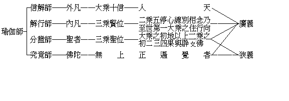



以瑜伽摄一切法，亦无不可。盖一切法无不与实性相应，故一切法之实性即是瑜伽。黄檗禅师云：『大唐国里无禅师，不是无禅是无师』；盖叹息无不是瑜伽而惜无瑜伽之究竟师也。



「瑜伽师地」者、瑜伽师之地也，此乃依主释。云何为地？略有二义：一、从人的方面言，有三义：一、所依止，谓凡瑜伽师皆以此论所明之教法为依止而去修行故。二、所游行，谓瑜伽师初自外凡行至内凡，自凡至圣或自小乘游至大乘，无不悉以此法而为游历故。三、所摄领，即是证到究竟瑜伽师位，其所摄领之法仍不出乎此瑜伽论中所明之教法故。二、从论的方面言，亦有三义：一、能住持，谓本论中能住持一切瑜伽师所有之教法故。二、能生成，谓此论中教法，能生起瑜伽师之解行而成果故。三、能增长，谓能增长瑜伽师之福德智慧，而达无上觉果故。



瑜伽师地论者，论上所明都属所诠之义理，而论则属能诠。能诠云何？即是用名句文身组织成有条理有系统有判断之论文，能说明瑜伽师一切境行果法之真相者也。



三　本论之历史



说明万法真理，本惟释迦牟尼佛，但亦有在会大众所说，经佛陀印证而成为教法者。后世如小大性相之异辙，悉渊源於是。盖当时听佛说法者之程度不一，因此各人意识上所变之文义相，亦大相迳庭。其后各人复以其心得而展转传诸他人，日月绵延，时光迁流，久而久之，则有如斯之分歧矣。当佛说法之时，或有听法者执笔而记录之，或以记忆力而保存之。根本一切有部毘奈耶云：『佛在世时，绀目夫人夜读佛经』；此其明证。迨夫佛陀逝世，阿难、迦叶即开始三藏之结集。在佛灭后五百年间之所研究及修持者，大抵以小乘教义为范围。云何小乘教义？以三学力析我归空，其所遗留者仅为五蕴等诸法。达此目的，则能解除个人之束缚而证无我之涅槃。然我之观念虽空，而其法之计执转更牢固。在小乘中法执最强烈者，则为一切有部，主张三世法体实有。其所谓法，等於最后单位原子也。析心以至最后单位，亦即是法。并谓智识仅能了知其法，不可改转或更动其法；此为世尊灭后五百年中最兴盛之学说也。既而佛学者对於法之有无问题，生出烦琐的辨论，如有部之大毘婆沙论等，多知其实非佛陀所说之最终目的，於是争执不休。有谓现在有体，过未无体；有谓现在法体亦有假实；诸说纷纷，不得解决，迨佛灭后七百年中，龙树菩萨兴世，感於有部学说之不究竟，陷於戏论；遂发挥大乘法空义，尽扫一切执著，荡涤无遗，丝毫不存，宣说万法毕竟空之真理。於此可知龙树之提倡毕竟空，全在打破有部之执为实有也！



佛灭九百年中，北印度犍陀罗国有无著菩萨降生其地，后入佛教，深明大乘教义，位登地上。乃知龙树为对破有执而说空，实则大乘教义并非全空。中国相传无著位登初地，证「法光定」；西藏谓其已入三地。按法光定与三地之大乘藏法光明定甚相契，故谓其证入第三发光地，亦未始不合也。其在印度弘宣教理，颇极一时之盛。阿瑜陀国之国王，亦极钦佩，遂以其都城之西隅一地，赠之为其讲舍。既知龙树所提倡之空义未为究竟，为欲安立大乘非空非有中道了义之教，遂请兜率内院弥勒菩萨降现人间，於国王所施之讲舍内，说五部论。其中最弘大者，则为此论。当时弥勒说此大论时，无著以笔记之。按佛在世之时，弥勒生於波罗奈国劫波利村，命终上生兜率内院，详弥勒上生经。兜率天较吾人所住之地球为殊胜之另一世界耳！在常人而观之，以为弥勒既从天降，甚属怪异，其实亦何希奇之有？盖无著既位登地上，延其下生说法，自为可能之事；如认此事终不可信，即谓本论为无著之笔墨，亦未尝不可也。



此论之翻译者，先有求那般摩、昙无谶、真谛法师等，第其所译皆未完具，不过抽出数卷而译之耳。故未能译成系统之组织，而说明论中之精奥。惟玄奘大师翻译之论本，乃臻完美。盖奘师在印度有十七年，参访大德、依那烂陀寺之戒贤大德为亲教师，而戒贤实是承无著之正统者；奘师又为戒贤大德最有心得之门下，且曾听讲此论三遍，故其所译，乃较其他所译者为完美。今所讲者，即出奘译本也。



佛法在龙树、无著之时，实无空有二宗之分。至清辨、护法之时，始显然各树其异帜。昔中国相传，谓戒贤、智光二人，同时各宗护法、清辨之说，有冲突相反之势。然此传说，实不可靠。据大慈恩寺三藏法师传，则智光确为戒贤之门徒。果如其说，则玄奘乃与智光为同学。且玄奘与智光之往来信札，亦皆用同学之口吻。并有据掌珍论而与玄奘辨驳之某法师，亦为戒贤弟子，玄奘因而作会宗论，以融会其所说。据此而观，胡得谓戒贤与智光同时各立一宗耶？中国相传之说，乃产生於贤首大师所作之十二门论宗致义记上。考其说之由来，大抵智光学徒来华，云其亲教师与戒贤为并肩尔。



四　本论之价值



在遣空去有不落二边显出中道奥妙之一点，已足彰明本论有最高之价值。再就别义言之：本论有三种特长：一、论中诠明一切世出世法，详详尽尽，丝毫不欠。二、论中所明，能被各类根机，若人天善法，若二乘解脱法，若大乘殊胜法，若佛智圆满之究竟法，莫不组织成极有条理之论文而说明之。三、示诸修大乘者不可躐等。若越阶而登，则如今时中国禅宗之流弊，是其龟鉴。且西藏红衣派兴盛发达之时，亦尝主张顿超法门，而其末流至於猥杂不堪。后经黄衣派之改革，始得免其缺陷。由此可知修学大乘法者，不可不足踏实地、按步进行也。今此论对於由凡夫渐进至佛果之依次修行法门，有圆满之说明，最为具足全部大乘之思想与精神。故习佛法者，咸应奉之为圭臬，以作超出生死海之指南针也。



真实义品、在本论上之价值尤为重大。考全论五分中之根本，即为本地分。在本地分之十七地中，又以菩萨地为最殊胜；而本品又为说明菩萨无漏智上所观之真实境界者，由此可知本品之价值也。且在此中含有哲学上之重要问题甚多，如认识论、本体论、宇宙论、进化论之种种哲理，皆有相当之说明。普通哲学家所发明之原理，乃



就其感官之经验，加以意识推度而得结论。本论之说明者，则凭真智所亲证之境界，故普通哲学又难与此真实义同年而语也。



五　本品之组织



一切诸法，真俗二谛可以摄尽。本品首先诠表二种真实，乃尽力阐明法界之全体大用者也。然吾人欲穷此法界之全体与大用，则不得不藉般若之空慧以照了之；所以本品次以五义分别空慧，以使人获得由凡入圣之枢纽。然空慧所照者为离言自性；而于此离言自性，若不了知，则为流转生死之凡夫，如能觉照，则为证大菩提之圣人，故本品再次即广明离言自性，以为吾人获得修行之凭依。然欲彻底证此离言自性，则又非短时间所能办到，必须先修四寻思而后修四如实智，俾渐渐圆满；故本品在明离言自性中，充分说明之，庶吾人得免躐等之弊。此为本品组织之大纲也。吾人如能按其所言而实行之，则庶乎其趣道有方矣！



释　文



甲一　二种真实



云何真实义？谓略有二种：一者、依如所有性诸法真实性；二者、依尽所有性诸法一切性：如是诸法真实性、一切性，应知总名真实义。



此中分真实义为二种：一、二种真实；二、四种真实。且先就二真实明之。然二真实与四真实之别，大概前二依境得名，后四依智得名。其实境智本不可分，能缘所缘，盖有密切之关系也。



云何真实义者，乃发问所谓真实义为何如也。真、遮谬伪，实、拣虚妄，义、即境界之谓。境界可别为二种：一、为言所取，二、为心所取。即如本论，以名、句、文身诠表真实义者，为言所取；倘吾人识知领受前境而了解事理者，则为心所取。此即问如何是言所取，或心所取之真实境界也



真实义略有二种，此所谓略，但略其文而不略其义也。其一，则据如所有性而立诸法真实性之名。其二，则据尽所有性而立诸法一切性之名。前者即诸法之真理，后者则为诸法之正量也。如所有性之诸法真实性，非哲学家所谓成立宇宙之最初原素或本体，乃即指一切诸法当下之真实体性。然此境界，绝非言语思考所能形容与推测，若带有丝毫主观心上之分别作用，则终不能见此万法本如之体；倘能离去一切虚妄分别，如其实而照了之，方见其本来面目。故必得根本智之地上菩萨，始能亲证真如实相。此智境各有多异名：所谓一切智，无分别智，如理智等，皆根本智之别名；所谓真如、实际、法性、实相、皆如所有性之代名词也。



尽所有性之诸法正量，亦非常情之所能知。盖缘起千差万别之现象，每一法之边际皆不可思议也。然则究为何如欤？盖宇宙中之一切万法，每一法莫不与其他一切法发生摄入之关系。故随一法大则遍於十方，小则量等芥子。例如色法，统名曰色，而此色中又有显色、形色之殊；在显色中，复有青、黄、赤、白之别；在形色中，又有长、短、方、圆之差。然此又与全法界一切法有复杂之关系。故欲明了此一法者，必尽了知一切法而后可也。请进言之：在每一法上，不仅若常人感官上之认识而已，实有五种相：一、自相——法之特殊相。如一粉条，虽与其他粉条，共藏於一粉条盒中；然各粉条，皆各有其自体之相。互不淆乱也。二、共相——法之共同相。谓彼此二法，形态类似。如两粉条同为粉之质料所制成，而其相状亦同为长圆形也。三、差别相——法之对待相。一自相上有多共相，一共相中有多自相，类之上又有类焉，别之中又有别焉。四、因相——法之众缘相。谓每法由多种因缘集合而成者也。如一粉条，由地、水、火、风、色、香、味、触之能所八种色法，并加人工制造，始得成为粉条也。五、果相——法之成就相。由有人工与水粉等关系圆满，成为一条条之粉条，即是果相也。



在一法五相上，应知尽一法之量为不易。兹复言其诸法相关之四句，更可见其不可思议也。一、一摄一。一一诸法皆不失其自相也。二、一摄一切。一一诸法莫不与全宇宙发生密切之关系也。三、一切摄一。展转言之，则全宇宙皆与此一法有关系也。四、一切摄一切。进言之，则宇宙中所有诸法，每一法莫不与其餘诸法有相互之连带性也。对於此法界缘起之一切法正量，能彻底认识，非证得「根本智」后起「后得智」，不得如量而知也。此后得智复有多名，所谓：一切智智，一切种智，及如量智等，皆其代名词。然亦得名为无分别智，以其所见诸法，皆超过常人心理上之虚妄分别，而无倒实知也。



了知诸法不出二种：一者、亲证，二者、推理。亲证则非得根本智不可，推理则是凭比量上所得之结论而已。今之哲学家，对於吾人所处之地球，能知其经历之时间，及其体量之如何长广，此犹为依据事实附加推论之观念。至其能知地球之外，所有多种星宿亦同於此地球，则纯凭其理想上之推测，为不尽可恃之判断也。考其与佛教所有悬殊之点，即其仅推理而不能如实亲证；故其所见，仍不越於常识。如於眼睛上为幻翳蒙蔽，或同於戴有颜色之眼镜，故不能见其物之真相也。倘求穷尽诸法之量，则非效法佛教，先除去其掩蔽目光之幻翳不可。故欲彻底证穷法界，则非求获后得智不为功！伦记以七门料简二种真实，兹立一表於下——



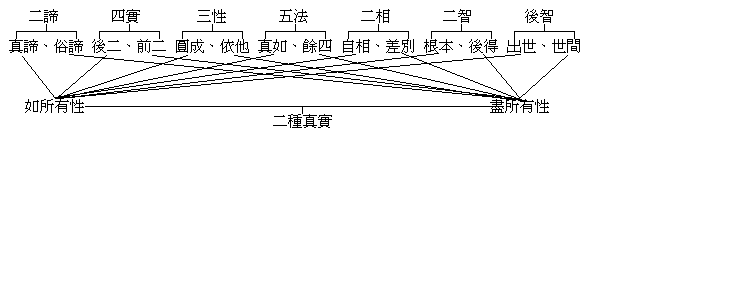



甲二　四种真实



乙一　列名



此真实义品类差别，复有四种：一者、世间极成真实，二者、道理极成真实，三者、烦恼障净智所行真实，四者、所知障净智所行真实。



此乃略举四真实之名也。兹略言之：一、世间极成真实：极成，为共许之义。谓由世间人之常识上，共同许可此法为此而非为彼；此非出於个人心理上之推想与测度，故为世间共许之真实也。二、道理极成真实：此不唯依世俗之习惯，以论理轨则为标准而建立，如科哲学者研究事物而获其合理之判断，故为道理上共许之真实也。三、烦恼障净智所行真实：此不仅以推理为然，且以三学断去烦恼障分证真如之实相，故为出世净智所行真实也。四、所知障净智所行真实：再进一步并断去使心不明事理之极微细所知障，以见万法本如之真实相，故为世出世间净智所行真实也。此四真实，前二通世俗有，后二则唯佛教有。第一唯是有为有漏；第二通於有为、无为、有漏、无漏。然此约所推理而言，若其能知之心，则唯有漏也。后二所证之理，同於第二，但其能证智为无漏故胜。亦可兼有漏，如未亲证实相，亦得由胜解加行智引生本后二智。换言之：后二真实体，不同前二唯以有漏为体，而以无漏境智为体，故通无为及无漏有为也。或后二唯取断障后所显之真理而言，则唯无为。略义如是，下当详述。



乙二　广辨



丙一　世间极成真实



云何世间极成真实？谓一切世间於彼彼事随顺假立、世俗串习悟入觉慧所见同性，谓地唯是地非是火等。如地如是，水、火、风，色、声、香、味、触，饮、食、衣、乘、诸庄严具，资产、什物、涂香、华鬘、歌舞、妓乐、种种光明、男女、承事、田园、邸店、宅舍等事，当知亦尔。苦唯是苦非是乐等，乐唯是乐非是苦等。以要言之，此即如此非不如此，是即如是非不如是，决定胜解所行境事；一切世间从其本际展转传来想自分别共所成立，不由思惟筹量观察然后方取，是名世间极成真实。



世间极成真实之范围，不仅限於人之世间，实包括其他一切世间。兹就人类言之：人之所以认此法为如此者，皆随顺其事物之相而假立名言也。虽由假想安立，但一般世人自古以来都目为如此，因而在无形中成为不可改转之固定形势。如一「茶杯」於此，世人见之无不说为茶杯者，此即所谓悟入觉慧所见同性。意谓人之初生，本来一无所知，不辨彼此，后受其父母言语之训诲，启迪其智识；故其自心上对於事物之概念，於一切人无所差异也。反之、倘在同一境内，一人指茶壶为酒杯，则他人必筦尔而笑之，以其与世间习语相违也。由此习惯言语，则世界上有彼此互相通达思想之可能。并用文字代表言语，因此可与远隔重洋万里外之人交换意见；又能传至后世。故一切事物之名，无形中即有共许之条约，同一之认识也。世间法虽无边，兹按论中举出者，立表明之——



　　　　　　　　　　┌地水火风……………物质之要素───┐  

　　　　　　　　　　│　　　　　　　　　　　　　　　　　├物质  

　　　　　　　　　　│色声香味触…………物质之境象───┘ │  

　　　　　　　　　　│　　　　　　　　　　　　　　　　　　 │  

　　　　　　　　　　│饮食衣服……………人生必需品───┐ │  

　　　　　　　　　　│　　　　　　　　　　　　　　　　　│ ↓  

　　　　世间极成真实┤诸庄严具……………人间奢侈品　　　├合二  

　　　　　　　　　　│　　　　　　　　　　　　　　　　　│ ↑  

　　　　　　　　　　│资产什物…………┐　　　　　　　　│ │  

　　　　　　　　　　│　　　　　　　　├人群日用品───┘ │  

　　　　　　　　　　│涂香宅舍…………┘　　　　　　　　　 │  

　　　　　　　　　　│　　　　　　　　　　　　　　　　　　 │  

　　　　　　　　　　└苦乐等………………人心之领受────精神



法有众多，但世人之认识同一，故论中谓：地唯是地，非是火等；又谓：此即如此，非不如此。其所以然者，以吾人在过去世——不可指定在何时，即论中所谓本际——受习惯熏习，展转传来，故今一见事物，即引起其决定胜解，并不加以思索，一览便知也。考此真实须具二种条件：一、普遍性，世人同一认识。二、恒常性，前人后人同一认识。反之，则不成为世间真实也。



伦记、景师解曰：若谓世间真实，为佛菩萨用后智照俗，即顺其世俗习惯之认识，则何故不同世人计执瓶衣为实有？若同其执，乃成颠倒，何得成其真实耶？曰：佛随世俗之假名而已，但不同其计执也。成实论云：『世人说有，佛亦说有；世人说无，佛亦说无』：此即佛不与世诤也。藉此可明佛教立此世间真实之意义矣。



丙二　道理极成真实



云何道理极成真实？谓诸智者有道理义。诸聪叡者、诸黠慧者、能寻思者、能伺察者、住寻伺地者、具自辩才者、居异生位者、随观察行者，依止现、比及至教量，极善思择决定智所行、所知事，由证成道理所建立、所施设义，是名道理极成真实。



道理、本一名辞。道者、路也，即彼此相通义。理、条理也，即彼此事物相互之各种关系也。合而言之：谓吾人之心理上，对於事物之条理有共同正确之认识也。此第二真实之重心，建於比量之上，全恃诸智者之推理以为真实。所谓敏捷天才之聪叡者，用功习学之黠慧者，以思考力辨别真理之寻伺者，能文能言之有辩才者，未得真智而是观行者；此诸智者，于现、比、圣言之三量上，善能思择，故能于事物上生起决定智而下正确之判断，建立真实之道理俾使自他得能了解，故谓其为道理极成真实也。此二真实皆不足恃，立表明之——



　　　　　　　　┌自明……………不待思索一览便知┐  

　　　　世间真实┤　　　　　　　　　　　　　　　├在一事之自体上  

　　　　　　　　└相符……………古今世人都目为此┘  

　　　　　　　　┌配合……………从一事各方面考察┐  

　　　　道理真实┤　　　　　　　　　　　　　　　├在一事之关系上  

　　　　　　　　└效验……………以合理事应用有效┘



初真实既唯依自明、相符之二条件而立，故不决定可靠。盖世事无常，潮流更迭不休，「俯仰之间，已为陈迹」，故后之所见未必同前，彼之所见未必同此，总有几分模糊之异点也。第二真实，其重心在比量上，然比量依据现量、圣言量而得成立。虽然，亦有不足恃者。何以故？兹就配合言之：如人假作语言，初则似乎持之有故，言之成理，既而仔细考虑，则知其不称於理矣。再就效验言之：理论上纵无缺憾，而必求合於效验，亦未必尽然，盖人类之『生也有涯，知也无涯』，『坐井观天』，安知天之真相也？



丙三　烦恼障净智所行真实



云何烦恼障净智所行真实？谓一切声闻、独觉若无漏智、若能引无漏智、若无漏后得世间智所行境界，是名烦恼障净智所行真实。由缘此为境，从烦恼障智得清净，於当来世无障碍住，是故说名烦恼障净智所行真实。此复云何？谓四圣谛：一、苦圣谛，二、集圣谛，三、灭圣谛，四、道圣谛。即於如是四圣谛义，极善思择证入现观，入现观已如实智生。此谛现观，声闻、独觉能观唯有诸蕴可得，除诸蕴外我不可得，数习缘生诸行生灭相应慧故，数习异蕴补特伽罗无性见故，发生如是圣谛现观。



常人以心不悦喜，心中闷塞为烦恼，而佛法则指精神界中扰害之捣乱份子为烦恼。其数甚多，根本烦恼十种，随烦恼二十种。自体即障，具染污性，故谓烦恼障也。伏断此障有多种人：即如听佛声音悟道之声闻，专凭自力观察缘生之缘觉。见、修、无学三位之获无漏智者——初证真理为见道，再加功修练为修道，修至圆满为无学道。能引无漏智者——此亦名解行智，体非无漏，但有相似之真实可得。且通见道之前后：如煖等四加行引生见道，则通见道之前；如在修道位上而仍有烦恼现前，若制伏之引生无漏，则通见道之后。以及生起后得之世间智者，皆得亲证真如，以悉是从烦恼范围里透出之净智也。由此於当来之究竟果位，无所障碍焉！



推其所以得无漏智者，因修四圣谛之现观：一、苦圣谛，谓有情及器界皆有不自由、不平等、不永久、不安宁、可破坏、可迁流之逼迫性。二、集圣谛，又名苦集谛。谓有漏苦果之结成，直接则为身、语、意业之活动力，间接则为扰蔽心身之烦恼无明，由此不息苦轮也。三、灭圣谛，又名苦灭谛。消极方面，灭苦果而得解脱；积极方面，受用无尽妙乐得大自在也。四、道圣谛，亦名苦灭道谛。谓灭苦之道路，或以三学，或以三十七菩提分法为修持，此其必由之道也。



声闻等人，观此四谛真理，仅觉有诸蕴存在而无我体，以其数数修习二种观行故：一、诸法无常观，即论谓诸行生灭相应慧。二、诸法无我观，即论谓异蕴补特伽罗无性见。



丙四　所知障净智所行真实



云何所知障净智所行真实？谓於所知能碍智故名所知障，从所知障得解脱智所行境界，当知是名所知障净智所行真实。此复云何？谓诸菩萨诸佛世尊入法无我，入已善净，於一切法离言自性，假说自性，平等平等无分别智所行境界，如是境界为最第一、真如无上所知边际。齐此，一切正法思择皆悉退还，不能越度。



梵音尔燄，此云所知。有解为知见者，彷佛同於能知之心，其实所知乃属境也。於境上有障，障碍於智，俾其不见真相，乃得此名。此即所知境上之障，依士释也。细析之有三种要素：一、所知境，二、能知智，三、障碍物——无知无明。因有障碍物介乎二者之中，则薄弱之能知智，於所知境上生起迷执，不了事之真相，以诸法为实有。如求智光周圆，自在无碍——学佛而期证佛果，则非从此障碍内破而出之不为功！一旦达到目的，则如白日拨开乌云，光照世界，此即所知障净智所行真实焉！相传烦恼障迷「理」，所知障迷「事」，其实二障事、理皆迷，不过各有偏重而已。然则获此真实者究为谁欤？求佛智有成绩之登地菩萨，与彻底觉悟真理之佛陀，皆知诸法无我，且不仅知其无有有情生命之实我而已。在见道位初得此二空智，此后入法空已便能善净，即从见道而修道乃至无学道，在此过程中分分断障分分证境也。其所证境，不出二种：一、离言自性：言、有显境、显义之二。前者为分别与思想之缘虑作用，后者为言语之诠表，离此二种言之自性，曰离言自性。二，假说自性：谓一切之似义似法，皆以假说为自性也。



二种自性与三性等，有二种配合，以表明之——



　　　　假说──遍计──后得智──俗谛────无体  

　　　　　　　┌依他  

　　　　离言─┴圆成──根本智──真谛────有体



　　　　假说──依他──后得智──俗谛──┐  

　　　　　　　　　　　　　　　　　　　　　├─有体  

　　　　离言──圆成──根本智──真谛──┘



此二图中，一、以假说配遍计，离言配后二。一、以假说配依他，离言配圆成。并可会通，无所枘凿。在未悟法空以前，则假说为遍计；如其已证法空，则假说为依他也。所谓法空，即证诸法真相，并非另有一空；遍计亦无所去，以本空故，但顺乎俗谛，假说为空耳。故知二说并不相悖也。



地上菩萨，於二境界皆作平等观照。根本智亲证离言自性，普遍一味，故为平等。而后得智照了宇宙现象互为缘起，一律如此，故亦为平等也。前者、为如所有性，后者、为尽所有性。证此境界可谓第一，以再无有超过亲证实相——真如，了知所知边际——依他者也。一思惟抉择，至此皆悉退还而不复生矣，以其已圆满证得诸法性相也。倘愚者更欲求得高出此种真实之境界，非独不如其愿，却转增法执焉！



研究佛学者，不应仅求了解文字而已。今此不过信、解、行、证中之一「解」，似纸上之绘马，而非实有真马也。故欲达到实际受用，须实行而求证乃可。佛法原与科哲诸学性质不同，科哲目的，在乎筹谋世界之进步与改良，如於宫室稍稍修葺加以点缀而已。而佛教之目的，则在彻底铲除此种有漏不堪之自然界，而另创成完美之净妙世界，亦即转此俗谛世界而成出世间之俗谛世间，如彻底毁破宫室而重建筑新舍也。故科哲唯具前二真实，而佛教则全备之。



甲三　五义分别



乙一　所证真实理体无二



又安立此真实义相，当知即是无二所显。所言二者，谓有、非有。此中有者，谓所安立假说自性，即是世间长时所执，亦是世间一切分别戏论根本。或谓为色、受、想、行、识，或谓眼、耳、鼻、舌、身、意，或复谓为地、水、火、风，或谓色、声、香、味、触、法，或谓为善、不善、无记，或谓生灭，或谓缘生，或谓过去、未来、现在，或谓有为，或谓无为，或谓此世，或谓他世，或谓日月，或复谓为所见、所闻、所觉、所知、所求、所得意随寻伺，最后乃至或谓涅槃。如是等类，是诸世间共了诸法假说自性，是名为有。言非有者，谓即诸色假说自性乃至涅槃假说自性无事无相，假说所依一切都无，假立言说依彼转者皆无所有，是名非有。先所说有，今说非有，有及非有二俱远离，法相所摄真实性事，是名无二。由无二故，说名中道。远离二边，亦名无上。佛世尊智於此真实已善清净，诸菩萨智於此真实学道所显。



二真实四真实之所以建立者，由二空观之所显也。云何二空？一、为实有，一、为实无；去此二执，名曰二空。云何实有？对於事物上，言语之安立，思想之分别，执为有实体。其实能诠言辞，於事物上发生所诠之假名，实不符於事实，等於代名辞，何尝有其实体也？然智者达无，而愚者因受无始习惯熏染，则以为有。其执为实者，依论文中，列表如下——



　　　　　　┌色──该括一切物质，其数十一种─────物质  

　　　　　　│受──近於心理学之感觉────────┐  

　　　　五蕴┤想──近於知觉，有想像作用　　　　　　│  

　　　　　　│行──该括时、空、思想、行为等　　　　├精神  

　　　　　　└识──近於知识，其数八种───────┘  

　　　　　　┌眼根──视觉神经┐  

　　　　　　│耳根──听觉神经│  

　　　　　　│鼻根──嗅觉神经├净色根  

　　　　六根┤舌根──味觉神经│  

　　　　　　│身根──触觉神经┘  

　　　　　　│　　┌外道指为物质，近於心理学之脑髓神经  

　　　　　　└意根┤小乘指为过去前念之第六意识  

　　　　　　　　　└大乘则谓意识根为第七末那识  

　　　　　　┌色────眼┐　　　　　　┌─────────┐  

　　　　　　│声────耳│　　　　　　│法尘范围甚广，色香│  

　　　　　　│香────鼻│　　　　　　│味触皆为法。今除五│  

　　　　六尘┤味────舌├所缘境　　　│根对象等，故特立一│  

　　　　　　│触────身│　　　　　　│法尘，为意识所缘。│  

　　　　　　└法────意┘　　　　　　└─────────┘  

　　　　　　┌地──┐　　　　┌固体──坚性  

　　　　　　│　　　├物之体质┤  

　　　　　　│水──┘　　　　└液体──湿性  

　　　　四大┤  

　　　　　　│火──┐　　　　┌热力──暖性  

　　　　　　│　　　├物之势力┤  

　　　　　　└风──┘　　　　└动力──动性  

　　　　　　┌三性………善、不善、无记  

　　　　　　│四相………生、住、异、灭  

　　　　诸门┤三世……过去、未来、现在  

　　　　　　│有为──（即论中之缘生）  

　　　　　　└无为──（即缘阙不生）  

　　　　　　┌此世……现世之果报色身及器世间  

　　　　二世┤  

　　　　　　└他世……过未之报体及其他之星球



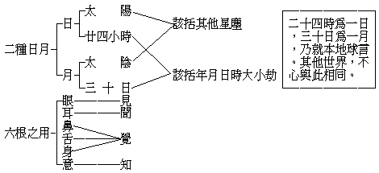



此外尚有希求，已得，寻伺，乃至涅槃等法。愚者对於如上诸法，终日意随寻伺分别计执以为实有，乃至涅槃亦执为实，然皆为妄情上之错觉也。



云何实无？谓断见者总拨三性为无。主张妄执所取之实体为无虽甚当，以其为遍计故；而谓假说所依之法体为无则不可，以缘生法分明现前故。至云假立言说依彼转之圆成实性为无，尤属荒谬，以二谛为佛陀之妙境故。若此恶见，总拨为无，故如来说为可怜愍者！



能除实有、实无之二执，则认识法相所摄之依他起及真实性事之圆成实矣！由远离有、无二边，契入中道，故为无上。何以故？对於非空非有之境，唯佛陀始得彻底证知故。至初地菩萨对於非有清净，对於是有尚未清净，故谓仍在修学过程也。兹就二执与识之关系，立表明之——



　　　　　　┌增益执──是有┐　　┌通六七二识──末那执我、意识尤甚┬─俱生  

　　　　二执┤　　　　　　　├遍计┤　　　　　　　　　　　　　　　　└┐  

　　　　　　└减损执──非有┘　　└唯通意识─────因被破我执而起─┴分别



总之：有此二执，则去圣道也甚远矣！



乙二　修空胜解成大方便



又即此慧，是诸菩萨能得无上正等菩提广大方便。何以故？以诸菩萨处於生死，彼彼生中修空胜解，善能成熟一切佛法及诸有情；又能如实了知生死，不於生死以无常等行深心厌离。若诸菩萨不能如实了知生死，则不能於贪、瞋、痴等一切烦恼深心弃舍；不能弃舍诸烦恼故，便杂染心受诸生死；由杂染心受生死故，不能成熟一切佛法及诸有情。若诸菩萨於其生死以无常等行深心厌离，是则速疾入般涅槃；彼若速疾入般涅槃，尚不能成熟一切佛法及诸有情，况能证无上正等菩提？又诸菩萨，由习如是空胜解故，即於涅槃不深怖畏，亦於涅槃不多愿乐。若诸菩萨深怖涅槃，即便於彼涅槃资粮不能圆满；由於涅槃深怖畏故不见涅槃胜利功德，由不见故便於涅槃远离一切清净胜解。若诸菩萨於其涅槃多住愿乐，是则速疾入般涅槃；彼若速疾入般涅槃，则便不能成熟佛法及诸有情。当知此中若不如实了知生死，即杂染心流转生死；若於生死深心厌离，即便速疾入般涅槃。若於涅槃深心怖畏，即於能证涅槃资粮不能圆满；若於涅槃多住愿乐，即便速疾入般涅槃。是诸菩萨於证无上正等菩提无大方便。若能如实了知生死，即无染心流转生死；若於生死不以无常等行深心厌离，即不速疾入般涅槃；若於涅槃不深怖畏，即能圆满涅槃资粮；虽於涅槃见有微妙胜利功德，而不深愿速证涅槃：是诸菩萨於证无上正等菩提有大方便。是大方便，依止最胜空性胜解，是故菩萨修习学道所摄最胜空性胜解，名为能证如来妙智广大方便。



照了二空真理之智，可谓重空慧，谓执空之空亦空也。若得此慧，则於求得佛陀位有大方便。其方便云何？一、能於生生世世中，精勤修习胜解空理之「空胜解」，此亦名为离二边之「中道慧」，又名「摩诃般若」；大般若经详阐此慧，此中仅略述之而已。然其要义，则谓无般若则不得大菩提；有般若故，方得成熟其佛果及众生之善根也。二、唯其有般若故，则能如实了知生死缘生无性——其生死根，无非惑业而已。若无般若，则不知生死根源，而其识心中所夹杂之烦恼诸业，亦不能去，所以常游於生死之中也。三、唯其有般若故，则不同小乘视三界如牢狱，生死为怨家，时感人生苦痛，常思脱出苦海，因而不顾群众，一心求得最后生空涅槃。彼自己尚不求证大果，而况济人乎？而菩萨则反乎是，不求个人速入涅槃，见一切众生悉具佛性，所以誓度一切众生也。四、惟其有般若，固不乐著涅槃，亦不恐惧涅槃。若无般若，则怀有生存竞争之观念，听说求佛智者，乃推翻人所生存之自然界，於是乃生恐怖，以为愈修行愈少人生之乐，乃断绝菩提资粮也。总之、无般若故，不了生死，生四种过：一、流转生死；二、厌逃生死；三、欣乐涅槃；四、恐惧涅槃。如有般若，则如实了知生死、涅槃，不起四种过失，而不失其修道之广大方便也。然此方便，乃以最胜空性胜解以为所依，云何最胜空性胜解？远离空有二边名空；空后所显真性名性；此空性为最胜，故名最胜空性；菩萨对此最胜空性有殊胜之了解，故名最胜空性胜解。此乃菩萨修行定慧资粮，得此空慧者，即藉此以作成大菩提之广大方便也。



乙三　入法无我证二智行



又诸菩萨，由能深入法无我智，於一切法离言自性如实知已，达无少法及少品类可取分别，唯取其事，唯取真如。不作是念：此是唯事，是唯真如，但行於义。



久修空慧，即能深入法无我智。於一切法上不落名言之现量实境，真能了知。明瞭无一法之少分，可於其上加以测度思虑，此为事相，此为真如，唯应以如实智了如实境云尔。



伦记上有三释，兹一述之：一、景师云：如能实证依他、圆成，则了知此依、圆外，更无少法可起分别，以遍计本无体也。故后得智唯缘依他，而不分别此为缘生；根本智唯证实相，而不筹度此为真如，惟证离言自性也。二、测师云：西方原有三释：一、与景师意近。二、谓自证分不作思念唯取其事，见分不作思虑此是唯事，是唯真如，而其但行於义。即自证分行於见分义；见分行於真如等义也。三、约位不同：地前加行俗智唯取其事；至初地唯取真如而为无相也。三、泰师云：於自性分别达无少法可起分别；於义中达无少品类可起分别。



如是菩萨行胜义故，於一切法平等平等，以真如慧如实观察，於一切处具平等见、具平等心、得最胜舍。依止此舍，於诸明处一切善巧勤修习时，虽复遭遇一切劬劳、一切苦难而不退转，速疾能令身无劳倦、心无劳倦、於诸善巧速能成办。得大念力，不因善巧而自贡高，亦於他所无有秘吝，於诸善巧心无怯弱，有所堪能，所行无碍，具足坚固钾铠加行。是诸菩萨於生死中如如流转遭大苦难，如是如是於其无上正等菩提堪能增长。如如获得尊贵殊胜，如是如是於诸有情憍慢渐减。如如证得智慧殊胜，如是如是倍於他所难诘诤讼、諠杂语论，本惑随惑犯禁现行，能数观察深心弃舍。如如功德展转增长，如是如是转覆自善、不求他知，亦不希求利养恭敬。如是等类，菩萨所有众多胜利，是菩提分、随顺菩提，皆依彼智。是故一切已得菩提、当得、今得，皆依彼智，除此更无若劣、若胜。



入法无我，所证二智行相云何？平等观察一切诸法，亲证胜义谛性，无一法非真如，以平等心之根本智与诸法平等相应也。此智与最胜舍相应。然谓初地为欢喜地者，据出观之后得智上有喜受而得名也。而泰法师乃谓菩萨缘依他俗谛之后得智，既无能所二取，则平等见了俗谛，故亦名胜义，且摄於七真如中也。从根本智所起之后得智，有多种胜用：一、世间一切学术，如工巧学、医方学、音声学、论理学等，无不精勤修习。即使遭遇恶劣环境，种种魔难，使其如何不舒适，非常苦闷，亦不稍退其初志；却有方便，以使身心毫不倦困，而获精神上之安慰与快乐。故於所学无所阻止，反而速疾成办也。二、能得永远不忘之大念力；又不因自善巧而起贡高我慢之心；亦无吝惜而不肯布施之意。因而有胜功能，凡所欲行，皆如顺风前进。而其修行猛利，如临阵之士，身披坚固钾铠而御敌也。三、菩萨得此空慧，虽在生死中如此如此展转漂泊，受遇刺激，而其修学菩提并无障碍，且能如是如是展转增长其福慧也。四、因修福慧故得尊贵殊胜之果，而於有情渐脱骄慢乃至全无也。五、滋生智慧故，如其他有情之辨难诘问，互相斗争，暴戾恣睢之不轨行动，与无谓之言语，皆背之而不由；至根本烦恼、随烦恼、犯戒、犯禁及失威仪处，常能提撕反省，而决意捐弃之也。六、生生所行功德，济人事业，使人不知，以恐他人见其道行高深、恭敬礼拜、赠送诸种受用之具也。



以上六种胜利，乃成大果之成分，即获菩提之因素。换言之，欲求不悖於道果而增长无漏功德，须藉空智为修行之方便也。求大菩提，虽有已得、今得、未得之殊，皆依法无我智而实现其目标则一，更无劣於此智或胜於此智而证得者。劣於此智者，则果尚未圆满；胜於此智者，则实无智果出在究竟佛果之上也。



乙四　乘无戏论能正修行



又诸菩萨乘御如是无戏论理，获得如是众多胜利，为自成熟诸佛法故，为成熟他三乘法故，修行正行。彼於如是修正行时，於自身财远离贪爱，於诸众生学离贪爱能舍身财，唯为利益诸众生故。又能防护、极善防护，由身语等修学律仪，性不乐恶，性极贤善。又能忍他一切侵恼，於行恶者能学堪忍，性薄瞋忿，不侵恼他。又能勤修一切明处令其善巧，为断众生一切疑难，为惠众生诸饶益事，为自摄受一切智因。又能於内安住其心令心善定，於心安住常勤修学，为净修治四种梵住，为能游戏五种神通，为能成立利众生事，为欲除遣精勤修学一切善巧所生劳倦。又性黠慧成极真智，为极真智常勤修学，为自当来般涅槃故修习大乘。又诸菩萨即於如是修正行时，於具功德诸有情所，常乐现前供养恭敬。於具过失诸有情所，常乐现前发起最胜悲心愍心，随能随力令彼除断所有过失。於己有怨诸有情所，常起慈心，随能随力、无谄无诳作彼种种利益安乐，令彼怨者意乐、加行所有过失及怨嫌心自然除断。於己有恩诸有情所，善知恩故若等若增现前酬报，随能随力如法令其意望满足；虽无力能，彼若求请，即於彼彼所作事业，示现殷重精勤营务，终不顿止彼所悕求，云何令彼知我无力非无欲乐。如是等类，当知名为菩萨乘御无戏论理，依极真智修正加行。



得证法无我智，不仅有如上文之美德，因自利、利他故，尚行六波罗密多：一、布施，对於自己金、银、什物而不贪爱；并以力助他人，使其欢喜布施，广种福田。唯以利人为前提，凡自身之金钱、知识，莫不布施於人也。二、持戒，对於佛制之律仪，极善防护，严守无犯。凡所发之身、口、意业，均合律仪原则，性不粗暴而成优良之习惯也。三、忍辱，自行大忍，瞋心极薄，并不侵损於人。於作恶者之鼓煽，魔怨之搅乱，能以忍辱自勉也。四、精进，勤学五明，作自利利他之本——习因明、内明、声明，可断有情之疑网；学工巧明、医方明，可以饶益众生也。五、禅定，专心禅定，虽亦以四梵住——四静虑——为基本，但不耽著禅味。其目的在引发神通，藉禅定力以作利生事业而不致怠惰也。六、智慧，此智盖由禅定引生，可别为二种：一、根本智，亲证真如实相。二、后得智，菩萨得此智慧，抉择事理，深明互为缘起之理，故利世心愈重。修此智时，勤作四种功德：一、于有德学之长老，常生恭敬而供养之。二、见有不义之徒，放浪之士，造作恶事，违背公意，则生大愍心，至其人前，随自能力劝导之，使其速能除过也。三、於有怨者，不巧言欺骗，造作与其有益之事，令其不起瞋恨，而去其怨嫌之心也。四、於有恩者，知恩而报。或报之以等；或报之以增。然皆随自己可能之力，使其身心得以快适。倘自力微薄，不能满其所欲，应於其前，表示诚恳殷切而欲为其所欲希为之事，并不顿止其所悕求。如事实上终不能达到目的，亦用善巧方法，使其知我非不欲相报，无奈力量之不如耳。



以上，皆为习大乘者、明了法无我之原理，始能修习如是之正行也。



乙五　广明离言自性



丙一　正辨



丁一　立宗旨



以何道理应知诸法离言自性？谓一切法假立自相，或说为色，或说为受，如前广说乃至涅槃，当知一切唯假建立非有自性，亦非离彼别有自性是言所行、是言境界。如是诸法非有自性如言所说，亦非一切都无所有。如是非有亦非一切都无所有，云何而有？谓离增益实无妄执，及离损减实有妄执，如是而有：即是诸法胜义自性，当知唯是无分别智所行境界。



试问：依据何种理由，而证明一切法有离言自性耶？曰：如上文所说之受、想、行、识、乃至涅槃等法，都无自性，以皆随名言而假立故。其名言又不外根据知识而建立，知识大别为三种：一、至教量，此据圣言而为正碻知识。二、比量，此据已知而推知未知，即以已知而定未知之标准。三、现量，由於亲证事实而为知识。此三皆为正碻之知识，与此三种相反，即是非量之不正碻的知识也。兹以八识与三量之关系，立表明之——



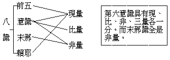



在散心位，前五识与第六意识定有现量，何则？若无现量，则必不能成其知识。然其现量极为薄弱，不能自知其亲证性境也。第六意识在定心中亦有现量，但现量正当现前时，尚未及稍加以注意，知现量境已逝矣。现量境名性境，如第八识以其所变之山、河、大地——纯粹事实——而缘之，亦为现量。至前六识虽皆不能缘赖耶所变之一切法，如眼识唯缘色尘、乃至意识唯缘法尘，但其各托第八识所变之相分为本质，而於自心上所变之影像相分恰与第八识所变者相同无异，故亦为性境。然此现量有不可捉摸之形势，洎乎意识上起分别作用，则现量已成前一念之过去境，唯遗留一个单独的影子存於意识而已；此即所谓独影境也。吾人对於宇宙中之现象，谓其为日、月、星、辰、山、川、树、木、田、地、屋、舍等者，即所谓诸法以假说为自性者，此在独影境前、现量境后，中间有一境名似带质境。因此时意识上所变之相分，尚带有现量境之少分，但已有多分增益或损减，改变其原来之状态。认之为实，则皆为非量也。



兹立二表以明假实之境——



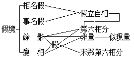



前三假，唯意识所行，无有体用，但是假立而已。相名假即有质独影。如妄心上之现真如等是。事名假者，如历史上本无此事，而吾人乃伪造此事告之於人，於是彼此流传，他人遂托此言而变无质独影境也。餘影假者，在现量境后，犹带有餘影，虽尚未落名言，然易讹为实境，故名似带质境。变相假者，如第七取第八见分为我，而与第八原态相异，故名真带质境。第六意识亦能变缘前五与第七，故亦通真带质境也。



　　　　　　┌准事实──前六识现量相分  

　　　　　　│  

　　　　　　│事　实──诸识及第八相分  

　　　　实境┤  

　　　　　　│事实相┐　　　　┌后得智  

　　　　　　│　　　├─圣智境┤  

　　　　　　└事实性┘　　　　└根本智



前二种为凡夫之心境；后二种为圣智之境界。准事实者，现量离言，凡夫虽有而不觉了；然前六识托第八相分所变之影像，与本质相当，故谓之准事实也。如其转凡成圣，则根本智证事实性，后得智了事实相焉。在二表中，虽有真假之别，然凡夫在事物上安立名言，皆假施设也。



至三乘证真如后，於后得智上生起言说作用，以显妙境，使人了解，亦假立也。故知说一切法皆非有自性，唯依名言之施设焉耳。但亦非离彼诸法而别有自性，可为言语之所诠表。换言之，言语乃在诸法上阐明其义，但不即应认言语所诠义以为真实。例如一真法界，本为圣境，然不可以言说安立；以其为离言自性也。宇宙现象，何独不然？由此可知诸法非有、非非有也。



然则以何而定观一切法之标准乎？曰：如於缘生诸法之假立名言上，执为实有，此为於实无法上之增益执。如末那缘第八见分为我；第八见分本为有体，但末那执之以为我，则为非量，亦是於无计有也。如於缘生诸法之实性实相上——如宇宙真理及世间现象——总拨为空，此为於有中生无之见，故为损减执也。倘离增减二执，如实了知性相，则正为胜智所行之中道妙境也。



伦记上对於此段论文，有诸家之解释，兹择其要者而述之：离言自性，即无其相，然则从何而知其为离言欤？一、景师曰：佛陀亲证离言智，故知法本无可言说，但非全无离言之真俗二谛。而愚者迷於二谛不知法本离言，故佛陀善为开示之也。难曰：诸法本不离言，若谓法性本无，则言性亦空？答曰：言所诠法虽不有，但非无有离言法性也。难曰：言诠之法尚无，况离言乎？答曰：凡言所行，皆属遍计，有所增益故；若离言语，即是诸法本性，故不空也。



二、泰师曰：萨婆多说眼见青、黄、红、白之色，乃至意识所缘涅槃之法，凡言所说者必称於所见与所缘。而大乘则谓六识缘虑色等是证量知，境界称其行解为证依他性境，但能证所证俱不可言说也。言说生起，乃在眼等识缘境后、意识上所起之分别作用而始有之。有部说一切皆有，胜论说在法体外尚有大有存在，由大有故一切法有也，然此皆言说自性。而大乘排斥有部法有实性；亦斥胜论离法而有自性，而主张去此增益执也。



三、基师曰：若谓法假建立无有自性，亦容商榷。如执所诠之法体为实，则可说为无；如谓名不称境，则境岂非空矣？至谓名与所诠虽不相称，但在能诠名中有彼色等体和合而与名言相称，亦为不可，在事实上不见法外有和合性为言之所行也。如说名在法体上有，为言所行，则属遍计执，故不可执为色与名合，为言所行也。



四、测师云：非离宇宙现象外另有实体为言所行，故依他、胜义为有，遍计为无也。——盖遍计是依他上之所增益，不可为有；而胜义是依他上之所显示，故不可为无也。——如于依他上离此实无、实有之二执，则为人、法二空之妙境，而是无分别智之所行也。录此诸师之释文，以阐离言自性之中道义，则使人更为明瞭焉。



丁二　破小乘



戊一　随名多体失



若於诸法诸事随起言说，即於彼法彼事有自性者，如是一法一事应有众多自性。何以故？以於一法一事、制立众多假说而诠表故。亦非众多假说诠表决定可得，谓随一假说於彼法彼事、有体、有分、有其自性非餘假说；是故一切假说若具不具，於一切法、於一切事，皆非有体、有分、有其自性。



大乘所立宗旨，与小乘有乖诤者，彼乃主张言语中所诠之诸法诸事——诸法、诸事义本相通，然可假别为二：即以五官所感觉之色等五尘为诸事，而以听闻经典上所说之涅槃等为诸法——，即在言语中有诸法诸事之体性。如说水、火、在言语中即有水、火体性，即谓事物随逐乎言语也。而大乘则谓名言所诠义，乃事物之假立相，故名言中并无事物之体性。如主张名言中有诸法体性，则一法应有多体，盖於一法上可立众多之假说名言而表显之也。譬如一人，初生立乳名，成人立大讳，入社会团体又有其团体中之名，做官又有官号，行恶又有谤称，行善又有贤名，可得谓其凡有一名，即有一人之体乎？小乘转救曰：名多而体亦多，有何过咎？大乘谓为不然，在事实上，并非一法体上、因有众多之名即有众多之体。不然，则应於此事之一假名中，别有其事物之自体与自量，而非此事其餘假名中所有之体量；或於此事之餘假名中所有之体量，而非此事之一假名中之体量。换言之：即应一事之多名中，各具有一整个之体量也。例如眼、目、原为一事，倘假名必称法体，则眼名中法之全体，应非目名中法之全体；目名中之法体，应非眼名中之法体；然於事实为不可能，未尝於一法之多名中各别有其体性焉。进而言之，不独一法上具有多名者不得法性，即一法上不具多名，唯有一名，亦不能得法之自性，以一名多名之不得法体，其理同也。



戊二　名前无体失



又如前说色等诸法，若随假说有自性者，要先有事然后随欲制立假说，先未制立彼假说时，彼法彼事应无自性。若无自性，无事制立假说诠表，不应道理。假说诠表既无所有，彼法彼事随其假说而有自性，不应道理。



倘小乘固执诸法悉随假说而有自性，则不应道理。何则？世间诸事皆先有其法体存在，而后由吾人五识了别之，始得於意识上分别其为笔、砚、桌、椅等，亦即先有法体后有名也。当法体未经吾人感觉，或上古宇宙初成之际，法体虽有，尚无其名，是则法体亦应乌有，以计体随名而有故。诸法既然原来无体，后乃依之安立名称，尤不契於正理。名与法体既不相称，又安得谓法、事，随假说而有体哉！



伦记中景师之释文，颇同于此，然多一节之假设问答，兹一述之。问曰：大乘谓每一识体念念皆具见、相二分，而一法上既具多名，则意识亦可仗其变起多种相分，故名多体多无有过也。答曰：小乘主张凡物皆可言说，承认诸法随名诠召，乃据本质而言，非据相分以说。且小乘谓相分摄於能缘，故不致就相分而随名多体也。



戊三　色前有名失



又若诸色未立假说诠表已前，先有色性，后依色性制立假说摄取色者，是则离色假说诠表，於色想法、於色想事应起色觉，而实不起。



倘小乘转救曰：一切诸法，在其未立假说名义以前，已有其名义存在；但非至后来为吾人所感觉后，经历意识之寻伺，不得取其原有之名义置诸言说中，亦即非以本有之名义摄受法体，不能彰其体也。答曰：果如此说，则应离色法等假说诠表，应即可生此是色法等之知觉，而事实上何不然乎？例如初生之儿童，仅觉外尘之冷暖，并不生冷暖名义之知觉，由此可知法体并不与其名义同时存在焉。



戊四　结破餘蕴等



由此因缘，由此道理，当知诸法离言自性。如说其色，如是受等如前所说，乃至涅槃，应知亦尔。



由以上种种因缘与道理，应知一切诸法皆是离言自性，倘一落语言，则即非真实矣。



丁三　破大乘



戊一　总标两种相似大乘



有二种人，於佛所说法毘柰耶俱为失坏：一者、於色等法、於色等事，谓有假说自性自相，於实无事起增益执。二者、於假说相处、於假说相依离言自性胜义法性，谓一切种皆无所有，於实有事起损减执。



在大乘中亦有两种相似大乘人，以不明佛法真义故名其为相似大乘。而对於佛说之经、论教法及毘尼之律仪，皆为其所失坏，此即不特无益而反有损也。一、对于色等法假说自性上，即是有质、无质之独影境上而增益之，谓其有实体也。二、对於假说相处——如言论生起，非无端倪，必有其所依之事实，此即假说相所依处之依他起性也。及假说相依——此即事实相之所依，乃离言真如也。彼於此二者而损减之，拨为全空也。一为无中生有，一为有中拨无，皆妄心上之计执焉。



戊二　别破两种相似大乘



於实无事起增益执妄立法者所有过失，已具如前显了开示，於色等法实无事中起增益执有过失故，於佛所说法毘奈耶甚为失坏。於色等法实有唯事起损减执坏诸法者所有过失，由是过失於佛所说法毘柰耶甚为失坏，我今当说。谓若於彼色等诸法实有唯事起损减执，即无真实亦无虚假，如是二种皆不应理。譬如要有色等诸蕴，方有假立补特伽罗，非无实事而有假立补特伽罗；如是要有色等诸法实有唯事，方可得有色等诸法假说所表，非无唯事而有色等假说所表。若唯有假无有实事，既无依处，假亦无有，是则名为坏诸法者。



关於增益执，已在上文小乘中同被破矣，而损减执尤乖佛理，兹据理破斥之。倘谓世间无有真实，则虚假法亦无，假法必依真事而建立故。例如补特伽罗——通常云我——虽是假法，然必有其所依之五蕴法而得建立，若无诸蕴和合相续似一之相，愚者从何执为有实我耶？倘谓诸法唯假而无真实，既无所依之真实法体，则假法又何从而有哉？在小乘六宗中诸法但名宗，亦近於此种空执，彼宗盖谓诸法唯有其名而无实体者也。



如有一类闻说难解大乘相应、空性相应未极显了密意趣义甚深经典，不能如实解所说义，起不如理虚妄分别；由不巧便所引寻思，起如是见、立如是论：一切唯假是为真实，若作是观名为正观。彼於虚假所依处所实有唯事拨为非有，是则一切虚假皆无，何当得有一切唯假是为真实？由此道理，彼於真实乃以虚假二种俱谤都无所有；由谤真实及虚假故，当知是名最极无者。如是无者，一切有智同梵行者，不应共语，不应共住。如是无者，能自败坏，亦坏世间随彼见者。



溯相似大乘所以有其空执者，盖因听闻大乘空性相应之摩诃般若经等，对於其中佛陀密意所说之空义以起误解，不能善巧方便研精其义，故不知依他、圆成为有，遍计本空；於是臆测妄度，而谓万法皆假，乃主张观一切唯假方为正观。其实、彼极荒谬，既将假法依处之依他、圆成皆抹煞，又何得有其假法？是则真实、虚假俱谤矣。如此之人，成大邪见，害人不浅，故修梵行者，不应与之同修学、共言语也。若不尔者，则必中其毒计，受大影响，迷乎事理而起谬说也。



於此应诘之曰：汝说世界中都无有实事真理，此种论断为合理乎？抑背理乎？若是合理，则汝所谓世间无真理之言为可恃，而世间已有真理矣，岂不与汝说世间无真理之言相悖逆乎？若不合理，则汝说世间无真理之言为不足恃，而世间固非不有真理也。观汝所说，进退维谷，故不如弃其空执之为愈焉。



戊三　空有执之罪过比较



世尊依彼密意说言：『宁如一类起我见者，不如一类恶取空者』。何以故？起我见者唯於所知境界迷惑，不谤一切所知境界，不由此因堕诸恶趣；於他求法求苦解脱不为虚诳不作稽留，於法於谛亦能建立，於诸学处不生慢缓。恶取空者，亦於所知境界迷惑，亦谤一切所知境界，由此因故堕诸恶趣；於他求法求苦解脱能为虚诳亦作稽留，於法於谛不能建立，於诸学处极生慢缓。如是损减实有事者，於佛所说法毘柰耶甚为失坏。



上二种人，一为执有，一为执空，较量其罪，究为谁重？佛陀意指空执之罪尤重，故曾密意而说：『宁起我见，勿起空见』。以空执罪重，有执较轻也。然佛经中有处谓执无过轻，而执有过重者，盖无顺乎真理，而有则违乎法性之故也。而此处就其感果方面言，故与餘处不相冲突。兹将其罪，比较言之：一、起我见者，仅不明了事物之真相，而不毁谤因果拨一切无成大邪见，故无空见者之种种过失。二、空见对於依他、圆成，起损减执，谤无涅槃等法，因此堕於恶趣；我见既不拨无，亦不招此恶报。三、恶取空者必堕於三途，而我见者则不如是。或由他缘助其感果，非我见也。四、我见之人，未敢妄言拨无因果，阻人求修佛法；而空见者则不然也。五、我见对於有情求脱苦缚，亦不稽留而止停之，使其不能前进；而空见者，谓无圣道可期，唐捐功德，故阻塞其行也。六、空见於四谛等法，必一笔勾消；我见者不妨建立之，故亦勤修定慧，不若空见之弃除一切法门也。总之、我见只於所知境上迷惑为我，空见全备上列六失，而佛陀之至教亦为其失尽矣！



戊四　缘起空理有善恶别



云何名为恶取空者？谓有沙门或婆罗门，由彼故空亦不信受，於此而空亦不信受，如是名为恶取空者。何以故？由彼故空彼实是无，於此而空此实是有，由此道理可说为空。若说一切都无所有，何处、何者、何故名空？亦不应言由此於此即说为空，是故名为恶取空者。



须知於空性有善取、恶取之别。所谓恶取空者，或沙门——不独为佛徒，出家於异道而修梵行者，亦曰沙门；或婆罗门——曾受教育之有知识份子，于佛说之空，由彼名言遍计本空故空，而不信受，或於佛说之离言依他为似有，而无遍计故空，亦不信受，此为大邪见者。何以故？於妄心上安立名言，谓为实我实法，观彼本空固合於理；至於除遣妄想，显现依他、圆成本来似有、真有之相，则不可谓为空也。换言之，佛所谓空者，本有之法并不空去，不过空去本空之遍计执而已。若说一切皆空，则违三量，亦背佛言。彼谓依他、圆成上无遍计故空，遍计本来为空故空，非谓一切全无也。



云何复名善取空者？谓由於此彼无所有，即由彼故正观为空；复由於此餘实是有，即由餘故如实知有，如是名为悟入空性如实无倒。谓於如前所说一切色等想事，所说色等假说性法都无所有，是故於此色等想事，由彼色等假说性法说之为空。於此一切色等想事何者为餘？谓即色等假说所依。如是二种皆如实知，谓於此中实有唯事，於唯事中亦有唯假，不於实无起增益执，不於实有起损减执，不增不减、不取不舍，如实了知如实真如离言自性，如是名为善取空者，於空法性能以正慧玅善通达。如是随顺证成道理，应知诸法离言自性。



所谓善取空者，谓於依他、圆成本有之法认识清楚，了知无遍计於其上，故为空也。即知除遍计外，餘依他、圆成不空也，此为善取空理。不特此也，并知遍计中有依、圆为其所依故，而在依、圆上亦得随遍计安立假名，即在事中亦有遍计也。如此不增不减、不妄取、不错觉，如实而知离言自性，并以善巧方法而修证之，此则乃为善取空理也。



丙二　引证



丁一　转有经证



复由至教应知诸法离言自性，如佛世尊转有经中，为显此义而说颂曰：『以彼彼诸名，诠彼彼诸法，此中无有彼，是诸法法性』。云何此颂显如是义？谓於色等想法建立色等法名，即以如是色等法名诠表，随说色等想法，或说为色、或说为受、或说为想，广说乃至说为涅槃。於此一切色等想法，色等自性都无所有，亦无有餘色等性法；而於其中色等想法离言义性真实是有，当知即是胜义自性，亦是法性。



关於离言自性，此上已就理言之矣。然犹惮人不能深信，故复以圣言量证之。转有经曰：『以彼彼诸名，诠彼彼诸法，此中无有彼，是诸法法性』。一释此经之义，即可知矣。以彼彼诸名者，谓于色等诸法上而想像之，立出色等诸法之各别名称也。诠彼彼诸法者，即以所立之各别名称，安立於色等之上，谓其为色、为受等也。此中无有彼者，谓色等法上所立之假名中，实无色等诸法自性也。是诸法法性者，谓由心中所想像之色等假名中虽无其自性，而亦实有其离言自性，所谓诸法本来面目之依他、圆成性也。此即诸法法性，而为胜智所得缘焉！



丁二　义品证



又佛世尊义品中说：『世间诸世俗，牟尼皆不著，无著孰能取？见闻而不爱』。云何此颂显如是义？谓於世间色等想事所有色等种种假说，名诸世俗。如彼假说於此想事有其自性，如是世俗牟尼不著。何以故？以无增益、损减见故，无有现前颠倒见故，由此道理名为不著。如是无著，谁复能取？由无见故，於事不取增益、损减。於所知境能正观察故名为见，听闻所知境界言说故名为闻。依此见闻贪爱不生，亦不增长，唯於彼缘毕竟断灭，安住上舍，故名不爱。



义品亦为佛说，有谓为大乘阿毘达磨经中之一品，有谓为转有经中之一品，然此二说皆无可稽。盖以此二部经典，均未流行于中国也。其中有『世间诸世俗，牟尼皆不著，无著孰能取，见闻而不爱』之一颂，亦显离言之旨。世间诸世俗者，谓世人于色等法上，随心妄想安立种种名称，而谓此假名中实有法性，此即俗人之见解也。牟尼皆不著者，谓佛陀已去增减执之颠倒，不颠倒故不著世俗之见解，而特阐如来之真风也。无著孰能取者，乃为试问：佛陀不著之境界，从何而得了知也？见而不爱者，谓佛之境界，或由於诸法能起正观察之正见，或由於能听受他人所说之正理；由有此正见正闻，故能了知离言法性，而不爱世俗之心境也。



丁三　散地证



又佛世尊为彼散他迦多衍那作如是说：『散他比丘！不依於地而修静虑，不依於水、不依於火、不依於风、不依空处、不依识处、不依无所有处、不依非想非非想处、不依此世他世、不依日月光轮、不依见闻觉知、不依所求所得、不依意随寻伺、不依一切而修静虑。云何修习静虑？比丘不依於地而修静虑，广说乃至不依一切而修静虑。散他比丘！或有於地除遣地想，或有於水除遣水想，广说乃至或於一切除一切想。如是修习静虑比丘，不依於地而修静虑，广说乃至不依一切而修静虑。如是修习静虑比丘，为因陀罗、为伊舍那、为诸世主并诸天众遥为作礼而赞颂曰：「敬礼吉祥士！敬礼士中尊！我今不知汝，依何修静虑」』。云何此经显如是义？谓於一切地等想事——诸地等名施设假立名地等想，即此诸想於彼所有色等想事或起增益、或起损减。若於彼事起能增益有体自性执名增益想，起能损减唯事胜义执名损减想，彼於此想能正除遣——能断能舍故名除遣。如是等类无量圣言，名为至教。由此如来最胜至教，应知诸法离言自性。



考迦多衍那一名，印度人往往用之；兹以散他(有本作散地)二字别之，以表明非为其餘之迦多衍那，而为佛之弟子，名散他迦多衍那也。佛尝谓散他曰：散他比丘！当知修最上乘禅者，不同诸餘修梵行者，依于地、水、火、风之四大；亦不依於空无边处，乃至非想非非想处之四空；亦不依于所希求者，所得到者，及意识所寻求伺察之事而修静虑。然则究以何法而修静虑欤？佛说：散他比丘！谓於四大、四空等一切实有唯事中，除遣地、水、火、风乃至一切之假名想而修静虑。倘其能如此修行者，则大梵天等必来其前而赞之曰：『敬礼吉祥士，敬礼士中尊，我今不知汝，依何修静虑』。意谓所皈敬之静虑师，竟不知其修何静虑也！



在此文中，可以测度天帝释等之如何心理。其所以来此修静虑者前而皈投者，盖通常习禅，则必专注一境，而不舍除地等之想像；今此修定者，虽亦不离地等，但其心光孤逈，寸丝不挂，更无地等假说之分别想。所以有他心通之天众，皆茫然不知其所以，而来其前特别请问之也！



云何得知佛为散他所言，即是阐发此离言自性之理欤？请申述之：此习定者，于心中搆造之假想，及假想於地等上假立之名言，一概不留，亦不许离心而有诸法之独立存在，此即除去增益执也。而於遍计执外之依他、圆成，亦不拨之为无，此即除去损减执也。离此二种计执，本其自在性之纯粹事实而照了之，毫不加以推计，故能得契万法真相，而为诸天礼敬也。



以上所引典籍，皆为至教量；然阐此离言自性之至教，不胜枚举。即在此中，亦可窥见一斑。倘于此等平等心中流出之至教而深察之，安得不信依他、圆成之胜义为离言邪？



丙三　佛起言说意



问：若如是者，何因缘故於一切法离言自性而起言说？答：若不起言说，则不能为他说一切法离言自性，他亦不能闻如是义；若无有闻，则不能知此一切法离言自性。为欲令他闻知诸法离言自性，是故於此离言自性而起言说。



诸法既然本为离言自性，而佛陀乃彻底觉悟之人，何故於诸法上复安立种种名称耶？其所说者，是否与诸法相称？如其相称，则诸法非是离言自性；如不相称，则其说法即无若何利益。答曰：伦记中谓佛说法，略有四种因缘：一、诸佛所证本不可说，乃是方便权说。二、因为不起言说，则他不得而听闻。三、他不闻故，则不得而了知。四、欲令他知，故起言说。按此而观，佛陀说法，乃从悲心上不得已而说。因不起言说，则众生不知真理本为离言自性，故方便权巧而说，俾众生切实修证，或以比量推知此离言自性也。



要知佛说无量法门，不过作众生超越苦海之舟航而已，登彼岸后不须再存留焉。又如医师开方，本为治病，疾既痊愈，何须药为？故大乘所建立之离言自性，亦在被遣之中；若不除遣；亦与法执无异！故经云：『如来说法四十九年，未说一字』。意谓佛虽终日说法，而所说者皆此未尝说之离言性也。此所谓性相双彰、空有不二之中道欤！



丙四　愚起八分别



丁一　八分别生三事



又诸愚夫，由於如是所显真如不了知故，从是因缘八分别转，能生三事，能起有情世间及器世间。



大乘离言自性，非一般全愚之凡夫，及半愚之二乘所能了知——凡夫全昧我法，二乘只知人空不了法空，故有全愚半愚之称——以其不了知故，乃从八分别生三事。八分别者，识也。谓识与二障俱，迷於事理；由此薰成种子而能变成三事。所谓「所依缘事」，「见我慢事」，「贪瞋痴事」。然此非指名言为体，乃缘生诸法也。即通常所谓迷於实事真理，为境所转而妄想繁出，因而造成污浊世界者也。



云何名为八种分别？一者、自性分别，二者、差别分别，三者、总执分别，四者、我分别，五者、我所分别，六者、爱分别，七者、非爱分别，八者、彼俱相违分别。



此处仅列出八种分别之名，其释在后，故亦不多述。



云何如是八种分别能生三事？谓若自性分别、若差别分别、若总执分别，此三分别能生分别戏论所依、分别戏论所缘事。谓色等想事为依缘故，名想言说所摄、名想言说所显分别戏论，即於此事分别计度非一、众多品类差别。若我分别、若我所分别，此二分别能生一切餘见根本及慢根本、萨迦耶见，及能生一切餘慢根本所有我慢。若爱分别、若非爱分别、若彼俱相违分别，如其所应能生贪欲、瞋恚、愚痴。是名八种分别能生如是三事，谓分别戏论所依缘事，见、我慢事，贪、瞋、痴事。当知此中分别戏论所依缘事为所依止，生萨迦耶见及以我慢；萨迦耶见我慢为依，生贪、瞋、痴；由此三事，普能显现一切世间流转品法。



文中乃阐八分别生三事之理，兹且立表明之：



　　　　　　　　　　┌自　性┐　　　　　　　　┌分别戏论═══识  

　　　　　　　　　　│差　别├分别──合生──┤所依═════根  

　　　　　　　　　　│总　执┘　　　　　　　　└所缘═════尘  

　　　　　　　　　　│　　　　　　　　　　　　　　　　　┌边见  

　　　　　　　　　　│　我　┐　　　　　　　　　　　　　│邪见  

　　　　八分别生三事┤　　　├分别──合生──萨迦耶见─┤见取  

　　　　　　　　　　│我　所┘　　　　　　　　　　　　　│戒禁  

　　　　　　　　　　│　　　　　　　　　　　　　　　　　│　　┌七慢  

　　　　　　　　　　│　　　　　　　　　　　　　　　　　└我慢┤  

　　　　　　　　　　│　　　　　　　　　　　　　　　　　　　　└九慢  

　　　　　　　　　　│　爱　┐　　　　　　　　┌爱　故────生贪欲事  

　　　　　　　　　　│非　爱├分别──别生──┤非爱故────生瞋恚事  

　　　　　　　　　　└俱相违┘　　　　　　　　└俱违故────生愚痴事



在此表中，可见八分别生三事之程序矣。论中谓分别戏论所依缘事为名想言说所显者，谓有漏识对於根、尘、识而起计度，而识亦为名字言语之所显示也。而此三法又有多种，如识有八，根、尘各六，故论中谓色等想事品类众多也。表中八分别为平立，而论中之结文上，则有其次第，如云：『当知此中分别戏论所依缘事为所依止，生萨迦耶见及以我慢；萨迦耶见我慢为依生贪、瞋、痴，由此三事，普能显现一切世间流转品法』。虽则有情从无始来，心与法执相应，无先后生起之程序，但就行者之断惑上，必先去贪、瞋、无明；次断我执；再次断法执。故论中不妨假说由依缘事而我见、我慢，由我见、我慢而贪、瞋、痴也。萨迦耶见，译为身见，通於我见、我所见者也。在三事中之我见、我慢、及贪、瞋、痴、并非为事，然碻为与识相应之能缘作用，故假名为事也。



云何名为自性分别？谓於一切色等想事，分别色等种种自性所有寻思，如是名为自性分别。云何名为差别分别？谓即於彼色等想事，谓此有色、谓此无色，谓此有见、谓此无见，谓此有对、谓此无对，谓此有漏、谓此无漏，谓此有为、谓此无为，谓此是善、谓此不善、谓此无记，谓此过去、谓此未来、谓此现在，由如是等无量品类差别道理，即於自性分别依处，分别种种彼差别义，如是名为差别分别。云何名为总执分别？谓即於彼色等想事，我及有情、命者、生者等假想施设所引分别，於众多法总执为因分别而转，於舍、军、林、饮、食、衣、乘等假想施设所引分别，如是名为总执分别。云何名为我我所分别？谓若诸事有漏、有取，长时数习我我所执之所积聚，由宿串习彼邪执故，自见处事为缘所生虚妄分别，如是名为我我所分别。云何名为爱分别？谓缘净玅可意事境所生分别。云何名为非爱分别？谓缘不净玅不可意事境所生分别。云何名为彼俱相违分别？谓缘净玅不净玅、可意不可意俱离事境所生分别。



八种分别，与无分别智相对待，此有则彼无，彼有则此无。以此为三界中有漏可断诸心心所；而彼为出世无缠无漏不可断之智慧也。八分别者：一、自性分别。如见一粉条，於意识上加以分别，为其安立一名；於其他法亦如此想像之而立其名，此为从诸法自性上加以分别也。二、差别分别。见此法上之条理，而与其他法上之条理互相比较其为同为异，如见一白色粉条，则知此白色乃通於瓷器；而黑墨上之黑色，则不通此白色粉条。此从彼此相互关系上所有差别加以分别也。三、总执分别。如於多数分子合成之一团体上，而执为实有一整个的东西。有情本由五蕴和合而成，屋舍本由各种材料而成，并无实有之个我与屋舍；然吾人通常计有一整个之我体与屋舍。此为於多数分子团集上而总执之之分别也。四、我分别，五、我所分别。此我我所分别，往往於诸蕴上长时生起有我我所之见。如意识薰习故於自见处事——五蕴而执为我，末那识於自见处事——第八见分而执为我；此皆以有有缠缚之相应心所拘泥之，故其於诸蕴上生起有我我所之分别也。六、爱分别。谓遭遇顺适优美怡情之环境，则引起欣赏不已之爱分别也。七、非爱分别。谓由缘虑不净妙不可喜之恶劣境遇，甚感困难，於是引起抑郁而不适意之分别也。八、俱相违分别。谓所缘之境非好非丑，适乎中庸，不能令人生强有力之心理，而任运缘虑也。



此中所说略有二种：一者、分别自性，二者、分别所依、分别所缘事。如是二种，无始世来应知展转更互为因，谓过去世分别为因，能生现在分别所依及所缘事；现在分别所依缘事既得生已，复能为因生现在世由彼依缘所起分别。於今分别不了知故，复生当来所依缘事；彼当生故，决定当生依彼缘彼所起分别。



此上八种分别，可归纳为二法。一、精神，能分别认识之心。二、物质，有情世间——根、及器世间——尘。然此二种，即是八分别中前三分别所生之事，此能该括餘五分别；以餘分别无别所依之根境，故前三为后五之本也。此三分别从无始来展转互为因果，谓由过去三种分别之现行，熏成五根五尘之种子；由此种子於赖耶中酝酿成熟，故於今世复起依缘之现行。倘於今世仍不了知事理，则由今世惑业，复生当来之器界根身。盖众生生前既造业行，迷执根尘，故当来世定招感应生之界趣，以偿前因焉。总之、由迷故生死不停，长劫於苦海流转也！



丁二　修寻思等了八分别



戊一　修四寻思观



云何了知如是分别？谓由四种寻思、四种如实智故。云何名为四种寻思？一者、名寻思，二者、事寻思，三者、自性假立寻思，四者、差别假立寻思。



离言自性、诸法真理，亦非愚夫终不可知，然须有其方法始可了达。谓须先修四寻思观，煆炼成熟，渐能引生四如实智，实智生起则洞见之矣。论中先列四寻思之名，后随次释之。



名寻思者，谓诸菩萨於名唯见名，是名名寻思。事寻思者，谓诸菩萨於事唯见事，是名事寻思。自性假立寻思者，谓诸菩萨於自性假立唯见自性假立，是名自性假立寻思。差别假立寻思者，谓诸菩萨於差别假立唯见差别假立，是名差别假立寻思。此诸菩萨於彼名事，或离相观、或合相观，依止名事合相观故，通达二种自性假立、差别假立。



此中依名解释四寻思之义：一、名寻思。行者观察在名字言说中唯有名字言说，并无所依之事体诠在其中，纯然为假立之名言，故曰名寻思。二、事寻思。于依他缘生之纯粹事实上，唯见缘生诸法不相碍之本相，并无假立名言於中杂入，纯然为事物之自体，故曰事寻思。三、自性假立寻思。自性、为法之体；假立、为法上假立之义。行者於意识上推寻法之得名，皆由自心中想像而假立者，其实名中无事，事中无名也。故曰：『名事互为客』。此为自性假立寻思。四、差别假立寻思。行者对於诸法上所有言语诠表之差别意义，如常、无常，漏、无漏等，皆能如实观察，知其亦是假立，故曰差别假立寻思。修此观者有二种观法：一、离相观，谓单观名言或事体也。二、合相观，谓双观名或事之自性与差别也。兹立二表明之——



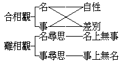



戊二　修四如实智



云何名为四如实智？一者、名寻思所引如实智，二者、事寻思所引如实智，三者、自性假立寻思所引如实智，四者、差别假立寻思所引如实智。云何名寻思所引如实智？谓诸菩萨於名寻思唯有名已，即於此名如实了知：谓如是名为如是义於事假立，为令世间起想、起见、起言说故；若於一切色等想事不假建立色等名者，无有能於色等想事起色等想；若无有想，则无有能起增益执；若无有执，则无言说。若能如是如实了知，是名名寻思所引如实智。



前已说明四寻思矣，今进而说明四如实智为如何。其名义、如论文所列，兹就其义而一释之。名寻思所引如实智者：盖久习名寻思观，而后自然引起如实了知之智，照了名中唯名，毫无事在其中也。然则世间为何而於诸法上安立种种名称欤？盖世间众生从无始来，业识茫茫，终身大梦，不辨事理，错用思想，於是认绳为蛇，计杌为鬼；於本来离言之诸法上，随其妄想分别，谓为山、川、日、月、天、地、人、物等。由是一传十，十而百，百而千，而万，而兆，久久相沿成为习惯，通国皆知，此为人、彼为物等；於是世人於诸法上起想发言，可以彼此交换意见，传达思想。然终以妄为真，计假为实；此由无始来杂乱妄想有假说也。倘勤修佛法，对治烦恼，引发无漏，则一旦豁然贯通，照了事物真相本来离言，所有名言皆妄心之搆成，此为名寻思所引如实智之境界也。



此智在有漏加行位可得；而四如实智与四寻思虽可同在有漏位获得，但碻有程度之高下，立表明之——



　　　　四寻思──有漏────煖等四加行位  

　　　　　　┌──┘  

　　　　四实智──无漏────真见道等位



在见道以前，煖、顶、忍、世第一之四加行，犹为有漏；见道位则为无漏。四加行中煖、顶二位修四寻思，故唯有漏；而忍、世第一修四如实智，虽通有漏，而见道位登地以上亦修实智，故又通无漏也。



云何事寻思所引如实智？谓诸菩萨於事寻思唯有事已，观见一切色等想事，性离言说，不可言说，若能如是如实了知，是名事寻思所引如实智。



事寻思所引如实智者：行者於诸法上了知其为性离言说，即是事寻思所引如实智。然非指老成人寂静无言，默识存诸心中而言，须由现量亲证；或无分别智证得此离言自性，方为得矣。至四加行位上，不过相似证得此智而已。



云何自性假立寻思所引如实智？谓诸菩萨於自性假立寻思唯有自性假立已，如实通达了知色等想事中所有自性假立非彼事自性，而似彼事自性显现；又能了知彼事自性犹如变化、影像、响应、光影、水月、燄火、梦幻相似显现而非彼体。若能如是如实了知最甚深义所行境界，是名自性假立寻思所引如实智。



自性假立寻思所引如实智者：即诸菩萨了知诸法自性假立，了知诸法从众缘生，有因缘荟萃则生，若因缘分散则灭，故近於幻有，不同凡情之执实也。至其对於色等想事中，了知假立言说非事自性，但於言说中又不无有其相似自性之显现。犹如绘畫一幅佛像，虽图畫本非佛之自体，但图畫中又不无庄严端正之佛像，所谓非有非非有者是也。总之、通达依他如幻而不执实，即自性假立寻思所引如实智之实现耳。



云何差别假立寻思所引如实智？谓诸菩萨於差别假立寻思唯有差别假立已，如实通达了知色等想事中差别假立不二之义，谓彼诸事非有性非无性，可言说性不成实故非有性，离言说性实成立故非无性。如是由胜义谛故非有色，於中无有诸色法故；由世俗谛故非无色，於中说有诸色法故。如有性无性、有色无色，如是有见无见等差别假立门，由如是道理一切皆应了知。若能如是如实了知差别假立不二之义，是名差别假立寻思所引如实智。



差别假立寻思所引如实智者，伦记中景师意云：譬如一色，具足非有非无不二之性，遍计执色非有，依他起色非无：遍计是言说之增加、故非有；依他是戏论之相离、故非无。就二谛言之：遍计所执，在胜义谛中非有故；依他起性，在世俗谛中非无故。在四胜义中，亦作是说。在一法之差别意义亦不二：如依他眼识有缘虑用、故不无；遍计眼识无缘虑用、故不有。有见、无见等，亦复如是。故所有其他一切差别之意义，莫不有其不二之性也。



兹再按文而一释之：差别、是相对待之义，如有无、是非、动静、一异、断常等皆是。若真智现前，乃洞察意识上所假立之差别意义皆具不二之性，非有非无，不落有无、断常二边，而为非有非无亦有亦无之妙境也。何以故？於诸法上、安立言说，不实存在，故名为无；於诸法上不增不减，离言绝思，故名为有。质言之，正智亲证真如，无有色等可言，故假名为无；俗人智缘事相，安立名言，故假名为有。有见无见等门，亦复如是。若知此种非有非无、亦有亦无之道理，即是差别假立寻思所引如实智之发现也。



丁三　愚不了八分别堕流转



愚夫於此四如实智有所阙故，不现前故，便有八种邪分别转，能生三事，能起一切有情世间及器世间。谓由如是邪分别故起诸杂染，起杂染故流转生死，於生死中常流转故，恒有无量随逐生死种种生老病死等苦流转不息。



诸愚夫从无始来，由业蔽心，真智不彰，不明事相，故生八种邪分别，久成习性种子。此种生起，则感来世之果报。详言之，由八种邪分别上生起我法二执，终日追逐为我主义，起贪、瞋、痴，作不善业，由是於生死中流转受生，而有各种苦痛之所随逐也！



丁四　圣了八分别证大果



戊一　证断果



菩萨依此四如实智，能正了知八种分别。於现法中正了知故，令当来世戏论所摄所依缘事不复生起；不生起故，於当来世从彼依缘所起分别亦不复生。如是分别及依缘事二俱灭故，当知一切戏论皆灭，菩萨如是戏论灭故，能证大乘大般涅槃。



诸菩萨者能正了知八种分别故无戏论，不复起虚妄分别；不起妄分别故，不复熏成当来世之器界与根身之种子；不熏种故，当来依缘亦不得生；依缘不生故，从依缘起之虚妄分别亦不得生。此在四加行之世第一位上有此相似无漏智之生起，以其将登初地，故能灭去三界有漏之心心所法。知其戏论无复执著，故能伏除藏识中之染污种子，而引生净无漏识；净识现故，得二种圣果，此中即明其断果也。



戊二　得自在果



於现法中胜真实义所行处智极清净故，普能获得一切自在：谓诸菩萨於种种化获得能化神通自在，於种种变获得能变神通自在，普於一切所知境智皆得自在，若欲久住随其所乐自在能住，若欲终殁不待害缘自在能殁。由诸菩萨得如是等无量自在，於诸有情最胜无上。



烦恼断故，无漏真智发现，智现前故则获得自在——自在者，谓此真智非向他人求得而为本有之无漏种子发生现行也。然此真智，初地分证菩提涅槃；八地所证似与佛等；究竟证得，则为佛果。其所得之自在，约分三种：一、於变化中获得自在，即是随心变化皆得成就。然变化义虽相近，不无小异：於无中化有为化，於有上而改其原有之形色数量与体质等为变，此为六通中之神境通也。二、智光炯炯，於境自在，即六通中之餘五通也。三、於寿命住舍获得自在，谓其寿命，能听其意欲之住舍，若欲舍命并不必用刀杖等之害具，自由能弃舍之。此三自在获得，故於众生中为最殊胜焉！



菩萨如是普於一切得自在故，获得五种最上胜利：一者、获得心极寂静，由住最静故，不由烦恼寂静故。二者、能如一切明处无所罣碍，清净鲜白玅智见转。三者、为利诸有情故，流转生死无有厌倦。四者、善入一切如来密意言义。五者、所得大乘胜解不可引夺，不从他缘。当知如是五种胜利，有五种业：一者、菩萨成就最胜现法乐住，能灭一切为趣菩提精勤加行所生身心种种劳倦，当知是名心极寂静胜利之业。二者、菩萨普能成熟一切佛法，当知是名於诸明处无碍清白微妙智见胜利之业。三者、菩萨普能成熟一切有情，当知是名流转生死无有厌倦胜利之业。四者、菩萨能正除遣所化有情随所生起一切疑惑，护持如来玅正法眼令得久住，於能隐没如来圣教像似正法，能知能显能正除灭，当知是名善入如来密意言义胜利之业。五者、菩萨能摧一切外道异论，精进坚牢正愿无动，当知是名大乘胜解不可引夺，不从他缘胜利之业。



因得如上自在故，即能同时获得胜利：一、心得寂静，然非由断去烦恼而获此身心粗重之禅定；但由真智性住寂静，故与二乘枯木死灰之定，相去遥远也。二、智转明处，于世间一切学说，如五明等，皆能精通熟习得其深微之处，以此而上求下化也。三、了知生佛平等，乃发充足之悲心，而於极苦之五浊恶世，生死死生不停其救世工作；亦不於苦难中生厌倦退屈之心也。四、悉能了知如来甚深妙法秘密意趣，能断众生种种疑网。五、习大乘法，得大胜解，故任随何人及其他因缘，皆不能退其初心与誓愿，终必以佛法而进行也。此五种胜利，有五种殊胜业用：一、成就殊胜定力，止息劳倦，便於勤修菩提也。二、五明熟习，则智慧殊胜，便於求佛果也。三、大悲心切，便於利众生也。四、深知佛法，即能除遣众生疑网，使正法得久住世；於相似佛法之魔说能殄灭之，此即显正之意也。五、于外道之诐辞邪说，竭力摧除，自发誓愿坚固、不为倾动，而抱著一贯之精神，此即破魔之义也。学大乘者，於佛法得胜解，则不为他人夺其志趣，故不顺从不符佛法之他缘，而唯行佛法之胜利事业也。



如是菩萨，所有一切菩萨所作，皆为如是五胜利业之所摄受。云何一切菩萨所作？谓自安乐而无杂染，普能成熟一切佛法，普能成熟一切有情，护持如来无上正法，摧伏他论精进勇猛正愿无动。



菩萨工作不可胜数，但可统摄於此五业之中。若归纳其工作，亦可分为五种：一、定力，令自心安隐，无染瑕疵。二、慧力，于事于理，悉明瞭究竟。三、悲力，救度众生一切苦厄，令得安隐。四、护持如来正教，摧灭邪论。五、愿力，于外境不为转移，而具足大愿。此为菩萨工作之大概也。



甲四　总结显胜



当知如是四真实义，初二下劣，第三处中，第四最胜。



本来四真实即是二真实，因开合之不同，故有四真实二真实之别。开则为四，合则为二，其真实则一也。世间极成真实，就其遣执之凡夫心而言，故为依他。而修行亦随顺乎俗谛，故非遍计执也。道理极成真实，以三量证实道理故亦为依他。然前二真实皆为散心之境界，故为五法中相名分别之所摄，较之后二真实为最劣也。第三真实，乃人空所显之真如，故处中。第四真实为人法二空所显之真如，故最胜。后二真实若就其能证所证合说，则为正智、如如所摄；若唯从其所显之真理方面而言，则惟摄於如如也。



兹将五法、三性与四实、二实相摄之关系，立表明之——



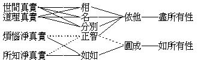



（默如记）(厦门慈宗学会印行)



（附注）大师原按云：『伦记纂要之论疏，摘录附记文中矣』。



瑜伽师地论菩萨地真实义品亲闻记



——十一年秋在武昌佛学院讲——



悬论一　释题目  

二　明殊胜  

三　辨传译



解文甲一　略标释乙一　略标真实丙一　标二真实  

丙二　标四真实



乙二　略释真实丙一　释世间极成真实  

丙二　释道理极成真实  

丙三　释烦恼障净智所行真实丁一　释明真实  

丁二　徵示境界



丙四　释所知障净智所行真实丁一　释明真实  

丁二　徵示境界



甲二　广分别乙一　所证真实理体无二丙一　安立无二真实  

丙二　徵释何者为二  

丙三　正明无二所显



悬　论



一　释题目



初释题目。具云：瑜伽师地论本地分第十五菩萨地初持瑜伽处真实义品第四。分释为五：一、释论题，二、释分题，三、释地题，四、释持题，五、释品题。



甲　释论题——瑜伽师地论



此论有一百卷，属於大乘部之论藏也。约解为四：初、瑜伽，二、瑜伽师，三、瑜伽师地，四、瑜伽师地论。初瑜伽者，华言相应，确指行解相应以言，非泛论之相应也。其中分有五种相应：一、与境相应，不违一切法自性故。二、与行相应，谓定慧行等相应故。三、与理相应，安立非安立二谛相应故。四、与果相应，能得无上菩提果故。五、与机相应，果后行化能与机相应故。具此五种相应，是此论所名之瑜伽也。盖由诸法若性若相，闻之确然了解，是为第一步相应。境既相应，依智起行若定若慧亦不相悖，是为第二步相应也。若境与行既相应已，即理智如如心无所得，是为第三步相应也。理智相应而得圆成妙觉，是为第四步相应也。果既圆成，应机说法，是为第五步相应也。然相应之关键，正在乎止观而已。又瑜伽有显密之二：初、显教即前五：一、胜解与境相应——台宗谓之理即、名字即，二、正观与行相应——观行即、相似即，三、真智与理相应——分证即，四、圆因与果相应——究竟即，五、佛教与机相应。良以行解相应，然后理可证，道可成，众生可度，而得始终贯彻瑜伽之旨也。二、密教之瑜伽，谓行者之三业——身、口、意——与本尊之三业，交加依持，相应互照，圣凡一致，因果同体。此密教之相应，盖无异显教之佛教与机相应也。



　　　　　　　┌─身……印契……身─┐  

　　　　本尊─┼─口……咒言……口─┼─行者  

　　　　　　　└─意……字观……意─┘



二、瑜伽师——别云瑜祇，微异瑜伽——翻云观行者，或云瑜伽之师，依主释也。盖师者，人也，因学观行而名之也。又名有瑜伽之师，以此人有止观之相应行故，有财释也。瑜伽师，人法双标也。三、瑜伽师地：一、地位，谓从凡夫地至大觉地故。二、譬喻，谓地能持载万物，能生长万物，喻此论能持载诸行为一切法之所依故，能生长二智为无上菩提因故。四、瑜伽师地论，瑜伽师地约所诠之义理，论约能诠之言教也。



乙　释分题——本地分



本论有五分：一、本地分，二、摄决择分，三、摄释分，四、摄异门分，五、摄事分。初分广明由凡至圣之境、行、果地；餘四分中所言者，皆为此本地分之流类耳。



丙　释地题——第十五菩萨地



论曰：『云何瑜伽师地？谓十七地。何等十七？嗢陀南曰：「五识相应、意，有寻伺等三，三摩地俱、非，有心、无心地。闻、思、修所立，如是具三乘。有依及无依，是名十七地」』。此即：一、五识身相应地，二、意地，三、有寻有伺地，四、无寻唯伺地，五、无寻无伺地，六、三摩呬多地，七、非三摩呬多地，八、有心地，九、无心地，十、闻所成地，十一、思所成地，十二、修所成地，十三、声闻地，十四、独觉地，十五、菩萨地，十六、有餘依地，十七、无餘依地。於中前九地辨境，次六地辨行，后二地辨果。菩萨地属於十七地中第十五地——辨行，由三十五卷起至四十九卷半止，共有十五卷半文。所谓三乘者，佛之说法本乎一味，因根不等故有三乘。然大乘不但异小乘，且能包乎小乘也。



丁　释持题——初持瑜伽处



持有四：初持、二持、三持、四持。初持文占菩萨地最多，有十二卷、十八品。约前显教，初解境相应与观行相应，属此初持。二、观行相应与智理相应，属此二持。三、因果相应属此三持。初持，以持菩萨解行到瑜伽处也。



------



### 戊　释品题——真实义品第四



行者之於一切法，如实了知诸法实相，假者见其假，真者见其真，而不虚诳其事，则此品之所名真实也。孔子曰：「知之为知之，不知为不知，是知矣」。品之要义，说明一切法自相，使得发生不违诸法之胜解，而入与境相应之初持瑜伽处者也。故吾人必藉此发生相应胜解，得入为初持之瑜伽师。品者，类也，文在卷第三十六本地分中菩萨地第十五初持瑜伽处十八品中之第四品。



二　明殊胜



论之殊胜分为三种：一、本论在佛法中之殊胜。二、本地在本论中之殊胜。三、本品在本地中之殊胜。初云佛法者，指佛一代时教之谓也。略言有四：一、所属藏胜：於二藏中属菩萨藏摄故，於三藏中属阿毘达摩藏摄故。二、所属乘胜：一、从此论顿入菩萨地者，即同华严之根本一乘故。二、从此论渐入菩萨地者，即同深密第三时普为发趣一切乘而说之大乘故。总论此论所属乘者，唯普为与根本之大乘方能摄入，餘非所容。三、所属教胜：一、顿机遇之，即一时一音之顿教。二、渐机遇之，即深密第三时无上无容中道了义之教。四、论自体胜有三：一、是通申一切经之宗论故。二、是法无不诠义无不了之广论故。三、是法相唯识宗之本论故，对十支论为根本故。十支论名目如下：



略陈名数支…………百法明门论──世亲造



粗释体义支…………大乘五蕴论──世亲造



总包众义支…………显扬论　　──无著造



广包大义支…………摄大乘论　──无著造



分别名数支…………集论　　　──无著造



离僻处中支…………辨中边论　──弥勒说



摧破邪山支…………二十唯识论──世亲造



高建法幢支…………三十唯识论──世亲造



庄严体义支…………大乘庄严论──弥勒说



摄散归观支…………分别瑜伽论──弥勒说，依深密中之品名而造论，未译。



二、本地在本论中之殊胜：古德尝以此论全部不能广译而独译此一地者，可见其以此地为殊胜也。如北凉昙无谶三藏译，名菩萨地持经。刘宋罽宾求那跋摩译，名菩萨善戒经。一属经藏，一属律藏，皆不称其为论也。后玄奘法师译出为论，即将地持经编入论藏，而善戒经仍摄在律藏，因当时译者重在明大乘戒故。三、本品在本地中之殊胜：心不契真实义，必偏爱见，虽有前数品之发心，亦等於空花无果耳。必须根本真实，方能念念流入萨婆若海，由初持而二持而三持以圆满菩提耳。故此品在二十八品中，较之别品独为殊胜也。



三　辨传译



甲　明说主——弥勒菩萨说



弥勒，此云慈氏；名阿逸多，翻无能胜。菩萨，具云菩提萨埵，觉有情义。说者，悦所怀也。菩萨在佛灭九百年间说此论。问：佛在世时，或有菩萨示现人间，助佛行化，如观音等；何故佛灭后九百年，弥勒仍在人间说法？答：缘由当时有无著菩萨，获证初地，深入大乘，为要显扬正宗摧破邪见，以神通上升内院，求弥勒菩萨自睹史天宫降於中印度阿输他国为说此论，乃传於世也。



乙　辨译人——三藏法师玄奘译



奘师越葱岭，游月邦，访道十有七载，经途百有餘国，三遍获闻此论於戒贤法师座下。以贞观十七年二月六日还至长安，於弘福寺与学通内外之名僧二十一人，共译三藏梵本。於二十一年五月十五日，肇译此论，论梵本四万颂，每颂三十二字，至二十二年五月十五日绝笔，成一百卷。凡有五分，宗明十七地，如前释。法师讲此论时，有窥基「略纂」十二卷，遁伦记其所解成「瑜伽伦记」四十八卷，并行於世。至元末以来，遗失其本，研究者多未闻见，正理沦亡，慧日沉空！近幸日本续藏流通，取回重行於世。今讲此论，都依斯记。



解　文



甲一　略标释



乙一　略标真实



丙一　标二真实



云何真实义？谓略有二种：一者、依如所有性诸法真实性，二者、依尽所有性诸法一切性。如是诸法真实性、一切性，应知总名真实义。



云何是徵问词。不变不异之理性谓之真，现有现在之事体谓之实。性则亘古亘今，体则无方无所。此中问以何法为真实义，所谓「欲穷真谛理，须知第一义」也。标中先开、次合。善戒经言二真实：一、法性，二、法等。地持经作：一、法性，二、一切事法性。二者名义异而不异，此则全异其名而同其义也。一者、依如性以明诸法无差别之真实性，二者、依尽性以明诸法有差别之一切性。如者不变不异之谓，今取不变不异与亦变亦异、及变而不异三义，较而明之。一、不变不异义：为根本智，亲证真如故。二、变而不异义：为后得智与第八识及前六现量所缘性境，虽有因缘变、分别变别别之事，而缘时与所变境不相违异故。三、亦变亦异义：为第七六识带质境与独影境，由分别变更违异因缘变之实境故。如下表明——



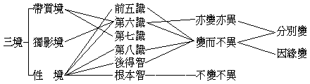



依此不变不异之如所有性，说有诸法之真实性，除此则无有真实之体性也。尽者、穷边际彻源底之谓。前约如理智——根本智——契诸法之性曰如；此约如量智——后得智——符一切之相曰尽。倘若境大智小，智大境小，皆不足以称其为如量也。是故有为无为、空有、色心等法，以如量智证之，无不周遍，无不深彻，粗妙大小历历炳然也。即地持中所云之一切事法性也。以上二义，大抵如是。合则以根本智所证之性为诸法真实性，以后得智所证之性为诸法一切性，如是应知总名真实义也。



丙二　标四真实



此真实义，品类差别，复有四种；一者、世间极成真实，二者、道理极成真实，三者、烦恼障净智所行真实，四者、所知障净智所行真实。



四种真实中，初属有漏，二通有漏无漏，三、四皆属无漏。合四重二谛如次：



　　　　世间世俗───────世间真实──如天地人物是也  

　　　　世间胜义─┐  

　　　　道理世俗─┼─────道理真实──如蕴处界等法是也  

　　　　道理胜义─┘  

　　　　证得世俗──┬────烦恼障净──苦集灭道证人空故  

　　　　证得胜义─┬┘  

　　　　胜义世俗─┼─────所知障净──证法空一真法界故  

　　　　胜义胜义─┘



乙二　略释真实



丙一　释世间极成真实



云何世间极成真实？谓一切世间，於彼彼事，随顺假立世俗串习，悟入觉慧所见同性。谓地唯是地，非是火等。如地如是，水、火、风，色、声、香、味、触，饮食、衣乘、诸庄严具、资产什物，涂香、华鬘、歌舞、妓乐、种种光明、男女承事，田园、邸店、宅舍等事，当知亦尔。苦唯是苦，非是乐等；乐唯是乐，非是苦等。以要言之，此即如此非不如此，是即如是非不如是，决定胜解所行境事。一切世间从其本际展转传来，想自分别共所成立。不由思惟筹量观察然后方取，是名世间极成真实。



释中初徵、次释、三例、四合、五结。云何下，徵。问言：何者为世间之极成真实也？谓一切下，释。彼彼者，各各也。世间之得为至极成就之真实，盖本乎世俗惯习之思想言说，为世间思想言说共所成就，是实非虚，故曰极成；乃如来随他意语施设安立者。但为世俗之性，而无胜义之性者也。然后三种真实，不依世间之真实则无以为言说分别之所依止，是故此世间所极成者亦称真实也。谓地唯下，例。其中先、能造四大，次、所造色相，三、依正庄严，四、内身苦乐。言地唯是地者，即说明此是地大，决定是地大，非火大等。地大既然，四大亦尔，万有皆然。以要言下，合。谓世间世俗谛，是从本际展转传来共所成立，非今创造者也。凡新发明学说，先以思想考察而后定取者，无论正确与否，皆非此所谓世间极成真实之义也。是名世下，结。因明疏云：『极者至也，成者就也。至极成就，两宗共许，故名极成』。又云：『虽两宗共许，若非至实道理，亦不名极成，如胜论对五顶所立量是』。此则世间之所以名极成真实者，亦明矣。世间真实，近於俗所谓常识或直觉。



丙二　释道理极成真实



云何道理极成真实？谓诸智者，有道理义。诸聪叡者，诸黠慧者，能寻思者，能伺察者，住寻伺地者，具自辩才者，居异生位者，随观察行者：依止现、比及至教量，极善思择决定智所行所知事，由证成道理所建立、所施设义，是名道理极成真实。



释中先徵、次释、后结。道者、途也。人之思考，亦由途径而达目的。谓能缘心与所缘境相通一贯之理，是此所云道理之义。亦是共所成立，故云极成真实。谓诸智下、释，有总别义：总言诸智者，拣非愚夫愚妇之谓也，诸字所包括意，即指别中八种有智之人也。别中、初明诸智者，次示有道理义。一、聪叡者，生来六根通利故。二、黠慧者，具有巧妙学术故。三、寻思者，散心能浅思维故。四、伺察者，散心能深思维故。五、住地者，由寻伺而入静虑故，如初禅天是也。



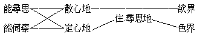



六、辩才者，具四种辩才故。七、异生位者，杂类凡夫中之有智故。八、观察行者，凡三乘学者，必随顺观察行故。诸智者，略释如此。次示有道理义者：吾人得慧之所由，不外乎三量，以此为一切道理之源也。量度十方，权衡三世，有限无限，能通能穷，此则三量之所以名为量也。是故欲入佛智境界，亦必依是三量。文中云现者，即三量之现量，谓由亲证而得，不藉言说及念度故。异生散心，虽无现量而有似量，定心必为现量。比者，比量也。比度计较之谓也。依以因之三相比类观察，确知不虚谓之比量。近世学者惯用正反比例，亦此义也。至教量者，又云圣教量，谓由因了义教典而楷定诸法义故。至极无上，意言佛之教非外道典之所能过也。诸智者，依止三量极善思维而得决定证成之道理。是名下，结。



丙三　释烦恼障净智所行真实



丁一　释明真实



云何烦恼障净智所行真实？谓一切声闻、独觉，若无漏智、若能引无漏智，若无漏后得世间智所行境界。是名烦恼障净智所行真实。



文中先徵、次释、后结。烦、扰也，恼、害也，此即是障。而为首者，则唯补特伽罗我执。以从烦恼中而得以出离，其能缘之智与所缘之境相应一致，故谓之净智所行真实。谓一切下，释。闻声悟道谓之声闻，得自然慧谓之独觉。此二乘者，於无漏智能证生空理，不与烦恼相应，如光破暗，明暗不能并故。又有能引无漏智种而起现行之加行智，其能引智在七贤位：疏引在资粮位，亲引在四加行。至见道位，断分别人我执，如实了知唯蕴无我，故云无漏后得世间智所行境界，智通三位。是名下，结。指明二乘所缘境智，是烦恼障净智所行真实也。



丁二　徵示境界



由缘此为境，从烦恼障净智得清净，於当来世无障碍住，是故说名烦恼障净智所行真实。此复云何？谓四圣谛：一、苦圣谛、二、集圣谛，三、灭圣谛，四、道圣谛。即於如是四圣谛义，极善思择，证入现观。入现观已，如实智生。此谛现观声闻、独觉能观唯有诸蕴可得，除诸蕴外我不可得。数习缘生诸行生灭相应慧故，数习异蕴补特伽罗无性见故，发生如是圣谛现观。



文中初蹑前真实，次徵释四谛，后示境生观。初谓由缘四谛之境而得净智，如摩尼珠出於污泥，即脱烦恼障生无漏慧；至业报二障，亦於当来世舍尽矣。此复下，正徵此境界。问：四谛云何也。一苦下，释。圣谛，正也、实也，是中正真实之言故。苦、谓三界二十五有之苦报也；集、谓贪、瞋、痴等惑，福业、非福业、不动业之苦因也；灭，谓无漏真理二乘涅槃也；道、谓三十七道品，能引凡入圣也。智者知苦是逼迫性，集是招感性，灭是可证性，道是可修性。是故二乘由此证入十六行之现观，发生无漏智入见道位也。此谛下，示观境。唯有诸蕴可得，除此其餘我见不可得也。大智度论云：阿罗汉视身如曾经剖解复为缀合之牛，不见有神我故。其所以得入我空无性者，盖因屡屡数习缘生无常无我之慧，发生如是圣谛现观耳。



丙四　释所知障净智所行真实



丁一　释明真实



云何所知障净智所行真实？谓於所知能碍智故，名所知障。从所知障得解脱智所行境界，当知是名所知障净智所行真实。



释中初徵、次明、后结。前云烦恼障，持业释也。此则所知不是障，以障障所知，以法执为本，依主释也。所知、梵语尔燄，与境同义；从执一切所缘之境为心之障，能碍通达於境之智故，名所知障。出离所知障所得之智境，是名所知障净智所行真实也。



丁二　徵示境界



此复云何？谓诸菩萨，诸佛世尊入法无我。入已善净，於一切法离言自性、假说自性平等平等，无分别智所行境界。如是境界，为最第一真如无上所知边际。齐此，一切正法思择皆悉退还，不能越度。



此复云何者，重问所行境界为何境也。诸菩萨，约初地菩萨以上；诸佛，统括三世十方之妙觉地。世尊，谓果后行因，倒驾慈航，为天人之所尊重也。由初发心，历三贤地，知法无我，以久修无我观方便，断分别法执，入初地；进断俱生法执，究竟成就清净，故云入已善净。於一切法离言自性、假说自性之非安立、安立二谛，心境相应，理智一如，故云平等平等。如实了知空不空法，不随言说分别，故云无分别智所行境也。如是境界，遍法界、彻世际、为第一无二之真如，更无有过其上者。齐此，则一切法皆悉下劣，不克胜於此矣。



甲二　广分别



佛之说法，或广或略，盖因群机有愚智之所致耳。说虽不同，其揆一也。维摩诘经三十二菩萨各说不二法门不同，而同入不二法门。今此论虽重重广为分别，亦悉诠真实之义也。依遁伦记分作五段：



乙一　所证真实理体无二



丙一　安立无二真实



又安立此真实义相，当知即是无二所显。



此真实相以何为相？当知即是绝对待、离空有、无二所显一真常存之理体也。



丙二　徵释何者为二



所言二者，谓有、非有：此中有者，谓所安立假名自性，即是世间长时所执，亦是世间一切分别戏论根本。或谓为色、受、想、行、识，或谓眼、耳、鼻、舌、身、意，或复谓为地、水、火、风，或谓色、声、香、味、触、法，或谓善、不善、无记，或谓生灭，或谓缘生，或谓过去、未来、现在，或谓有为、或谓无为，或谓此世、或谓他世，或谓日、月，或复谓为所见、所闻、所觉、所知，所求、所得、意随寻伺，最后乃至或为涅槃。如是等类，是诸世间共了诸法假说自性，是名为有。言非有者，谓即诸色假说自性，乃至涅槃假说自性无事无相，假说所依一切都无，假立言说依彼转者皆无所有，是名非有。



文中先言所说有，次明所说非有。所言二者，以其所执皆是有法，既有有法，必有非有，以非有非有，亦不能对待名为有矣。此中有者，以其本空，妄增益之执为实事，故为妄执之有。如云：涅槃、生死，皆同昨梦，其所言之涅槃与生死名义者，固皆安立假名，岂实有自性乎？世间，谓器世间中之有情世间也。长时所执者，谓从无始不觉迄至未来，大小众生各各皆有其自境所执。如蝼蚁然，逢擒则逃，将雨而徙，亦有其所执之境，此谓遍计所执之性，亦是分别戏论之根本耳。等言，即是假名五蕴、六根、四大、六尘、三性、四谛、生灭、十二缘生、三世有为、无为、今生、他生、空色、色空、见闻觉知、求得寻伺——未得而求谓之求，已得而得谓之得，寻、粗也，伺、细也，心随分别谓之意随——乃至究竟涅槃遣无可遣等法，皆是世间共同假立诸法名义。言非有者，以其所立之自性相，毕竟空无、无所有故，欲遣增益之有，故说非有。事、实有也。相、假相也。然闻非有而执非有，亦名遍计执性，是谓损减执。依彼转者，即依假立诸法之名，而有假立诸法之义转现也。



丙三　正明无二所显



先所说有，今说非有，有及非有二俱远离，法相所摄真实性事，是名无二。由无二故说名中道，远离二边亦名无上。佛世尊智於此真实已善清净，诸菩萨智於此真实学道所显。



言二俱远离者，即明中道无上之真胜义也。不独有法空而非有法亦空，且空之空亦空也。如起信谓：离言说相，离心缘相，乃至因言遣言，无言可遣，是名心真如相。要之、如来所说，或名一真法界，或称诸法实相，曰圆觉性，曰自觉圣智境界，此论今名中道，亦名无上，正显真实义为纯圆独妙之法也。其所说之中道名义，亦是假立自性。中论云：『因缘所生法，我说即是空，亦名为假名，又名中道义』。由是观之，此无二所显真实法，固四句皆非、百非俱遣也。诸佛於此已证，菩萨於此正显，众生於此当证，吾辈其努力哉！



（附注）此下，记文未见，应是记者未续记耳。



辨法法性论讲记



——二十七年夏在重庆佛学社讲（附注）——



悬论一　泛明五论  

二　释本论题



释颂甲一　所为  

甲二　正论乙一　略标丙一　总标  

丙二　别显丁一　明法相  

丁二　明法性相  

丁三　成立非一非异



乙二　广释丙一　生死丁一　总标  

丁二　别释



丙二　涅槃丁一　总标  

丁二　别释戊一　总明六相  

戊二　别明转依己一　总标  

己二　别释庚一　悟入自性  

庚二　悟入物体  

庚三　悟入数取趣  

庚四　悟入差别  

庚五　悟入所为  

庚六　悟入依住辛一　总标  

辛二　略释壬一　悟入无分别智所缘  

壬二　悟入无分别智应离之相  

壬三　悟入无分别智加行  

壬四　悟入无分别智自性相  

壬五　悟入无分别智所得胜利  

壬六　悟入无分别智所应遍知事癸一　总标  

癸二　别释子一　对治遍知  

子二　自相遍知  

子三　差别遍知  

子四　作业遍知



庚七　悟入作意  

庚八　悟入加行地  

庚九　悟入过患  

庚十　悟入功德



乙三　譬喻



悬　论



一　泛明五论



西藏所传述之弥勒五论，三部属於唯识，即辨中边论、辨法法性论、大乘庄严经论；两部属於中观，即现观庄严论，究竟一乘宝性论。先略说五部的内容。



辨中边论、以依他起为实有来安立三相，谓三界虚妄分别当体即是依他起，彼妄执有能取所取即是遍计执，能通达二取空即是圆成实。根据此三相为境，广分别大小乘所共的境行果；最后第七品特明与小乘不共的无上大乘。辨法法性论、亦就依他起为实有来安立生死和涅槃，也就是安立世出世间一切诸法。就生死方面、明生死的果及能令流转生死的因，即是辨明世间法。就涅槃方面、明涅槃的果及能证涅槃的道，即是辨明出世间法。总之即是依唯识正义来辨明来安立生死涅槃染净诸法。庄严经论、对於外境未专破斥，重在详明菩萨自己所修的广大行及成熟有情的方便，即是广明菩萨自利利他之行法。此三部之所以属於唯识者，因为唯识说没有离识的外境，唯有内识；若说离识别有外境者、即是常见，或说内识亦如外境无者、即是断见。又就三性，说依他起，圆成实是有自性自相自体的，遍计执是无自性自相自体的（解深密经如是说）。若说遍计执亦有自性如依他起、圆成实者，就是常见，如於初转法轮如言取义。若说依他起、圆成实亦无自性如遍计执者，就是断见，如於第二转法轮如言取义。是故解深密经双离二边不常不断，不说遍计执有自性故，不堕於常，不说依他起、圆成实无自性故，不堕于断。因三性之依他起的主要成分，还是指内心。内心中本无二取而显现二取相，似乎有离心的外境，於是执为实有，名遍计执。故三性的自性有无亦不相同，这就是所谓唯识见。辨中边论、辨法法性论、庄严经论，系根据此种意见会通般若而立论，故说他是属於唯识的。



现观庄严论、根据般若立论，虽亦抉择究竟法空真如，但所重在发明般若经中隐藏之义。明三乘道的体性数量及次第之决定，即三乘人所修之道，也就是菩萨为摄受三乘众生，所应知应有的行法。宝性论、明究竟离一切戏论法空真如之如来藏，亦广明三宝功德等。此二部之所以属於中观者，因为中观说内心外境皆无自性。遍计执、依他起、圆成实等一切诸法皆无自性。其无自性之理无有差别，如内心就缘起义是有，则外境就缘起义亦是有，外境就胜义说无自性，则内心就胜义亦无自性；故内心外境，无有差别。遍计执等三性亦复如是。又众生心的无自性即是佛性，亦即是如来藏，众生皆可证此而成佛，故说一切众生皆可成佛，这就是所谓中观见。现观庄严论、宝性论，系根据此种意见而立论，对於般若如言取义，故说他是属於中观的。



昔於慈氏五论颂合刊序云：然慈尊唯造颂而释文皆出论师，故义颇不一，今合刊五论颂为一本以存其朴，条贯而编次之，表提其纲领如左：



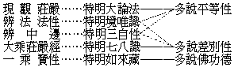



然此亦略据其偏胜相以言耳，其实皆一味大乘也。则於宝性可别成台、贤等宗义，亦包华土向来之传统思想矣。



二　释本论题



现专讲辨法法性论，系法尊法师新由藏文译为华文。此中名义文句之刊定，讲者亦曾稍加参订。昔玄奘法师译摄大乘论，曾引有分别瑜伽二颂，分别瑜伽论未传中土；但考所引二颂，义与此论一段颂文相符。此论是否即奘师所引分别瑜伽，颇堪考证。论题涵义，至下论文自明。今但就文句，略加诠释。



论、为能诠，显於三藏佛典之中，属於论藏。辨法法性，为论所诠。辨者辨明，即辨令法、法性义明晰也。又分辨、辨别义，如辨中边论真谛亦译为中边分别论。故知辨即「分别」。论为能辨，法与法性即为所辨。此能诠、所诠，能辨、所辨义，其分齐不可不先明之。



法与法性之名，中国古译经论几无不有，但其涵义非一。「法」与「法性」对举，多以法表有为诸法，法性表无为真如。本论法与法性所诠，依论文而释论文，则法表有漏法，而法性表无漏法：与常途义，颇不相同。本论所谓法者即指生死，所谓法性即指涅槃。辨明生死法之体相如何如何流转，涅槃法性体相如何如何证得，故亦可说即是辨生死涅槃论。生死为苦总相、即是苦谛，涅槃解脱即是灭谛，故本论亦可说为辨苦谛灭谛论。生死为苦谛，招生死之业与烦恼为集谛，故本论所谓法，亦即苦、集二谛；涅槃为灭谛，证涅槃断烦恼之途径为道谛，故本论所谓法性，亦即灭、道二谛；故本论也可说为辨四谛论。苦、集二谛，包含生杂染、业杂染、烦恼杂染之三杂染，杂染法即是有漏法；灭、道二谛，由对治无明烦恼、业、生，成般若、解脱、法身之清净功德，则一切皆成无漏法；故本论又可说为辨有漏无漏法论。



餘经论中，以法与法性诠有漏无漏法者，如起信论之生灭、真如二门，颇相近似。其他诸经论中，则多以法诠有为法，法性诠无为法。有为可通无漏，故一般所谓法、较此论广，所谓法性、较此论狭。



此论悟人法性，亦历明定慧相应之瑜伽。辨法法性、系依藏文直译，译分别瑜伽，其义亦可相通也。



「敬礼慈尊」！



此句为由梵传藏译论者所加。一、为求加持令无生障碍；二、表示佛法中凡作善事皆先皈依三宝。瑜伽师地论谓造论须礼二师，一、本师，二、释师。一、为降伏自己的贡高，二、表示有传承，三、为令众生生信故。藏中各论之前，皆有敬礼尊者妙音六字，妙音为文殊别号，文殊表智，论诠智慧，故礼文殊。此论颂文弥勒所造，故言敬礼慈尊。慈尊者，慈氏世尊之略言也。



释　颂



甲一　所为



由知何永断；有餘所应证：欲辨彼等相，故我造此论。



此之四句，造论所为。慈尊造颂，先明宗旨，以引起闻者希求向学之心也。何、谓生死，泛指一切应永断法。餘、谓生死永断所餘，即是涅槃为所应证。欲辨明彼生死涅槃之相，故造此论。



何故欲辨彼等相耶？以诸众生不明生死缘起，闻佛常说了脱生死：或执色身坏灭为了生死，故有厌世自杀等事。或执身如槁木、心似死灰为了生死，如外道之修无想定。或执观色身空为了生死，如老聃以有身为大患；及修空无边处乃至非想非非想处定者。彼皆不能了脱生死，以彼不明生死根本为无明故。由无明等烦恼发业，由业牵识六道流转，生死死生无有底止。详析之为十二缘起，具如经说。色身坏灭，业识仍在。修诸定者，为不动业，彼皆仍是随业受生，未了生死。欲了生死，应断无明。无明灭故行灭乃至老死等亦随灭，是为还灭之道，乃能永断生死。无明者：一为不了知十二缘起之无明，妄执生死自然生起或神所造，如科学家、宗教家言；一为不了知诸法性相之无明，以为实有烦恼业果生死等法。不知诸法众缘合成，空无自性，如梦中境唯心变现。非谓由此空性能生诸法，即此现前诸法体空。若知诸法现前即空，则生死中身心世界，如幻如梦，体性皆空。如实了知而断无明，烦恼业报随之俱断，是乃名为永断生死。由使众生先知何者应永断除，乃知还有永断之餘所应证得；为令现前了知生死涅槃相故，为令究竟永断生死证涅槃故，辨彼生死涅槃等相。即造此论之所为也。



甲二　正论



乙一　略标



丙一　总标



当知此一切，略摄为二种：由法与法性，尽摄一切故。其中法所显，即是说生死；其法性所显，即三乘涅槃。



当知此一切者，虽可泛说有为无为一切所知法，而正指此论所辨应断、应证之一切。何故此一切可略摄为二种耶？由法与法性、尽摄一切故。前二句标，此二句成，后四句再释之，略摄为法与法性之二种。何故能尽摄一切耶？以法字显明三界生死，法性即显明三乘涅槃。生死为有漏法，涅槃为无漏法，有漏无漏尽摄一切法故。此中显言，乃诠表义。法即生死，法性即涅槃，非於生死涅槃之外，别有法与法性为其能显。三乘涅槃，显此论中所辨涅槃不简二乘，总摄三乘无学有餘无餘涅槃。



涅槃、简义为灭，亦为寂静，如世俗恒言所谓安宁。情器世间随业迁流，生老病死、成住坏空，是不寂静不安宁相。烦恼灭尽，断业识流、出生死海，寂静安宁；此之涅槃，三乘所共。金刚经言『我皆令入无餘涅槃而灭度之』。又谓三乘『皆以无为法而有差别』。彼无为法，即此法性。三乘差别：在其修证，行有广狭、见有深浅。观生死苦，勤求出离，此声闻、独觉之发心修行；亦通大乘。观众生苦，勤求无上菩提，自度度他，此大乘不共之发心修行；不通二乘。又大乘深智证一切诸法空真如性，不生不灭、不垢不净、不增不减、本来寂静自性涅槃。故能不畏生死、不染生死，大悲大愿、满足福慧，尽未来际於一切众生界现身说法。不同二乘极果，仅能自了。是故无住涅槃，为大乘不共功德，不通二乘。今并举三乘涅槃，显此论所辨，不惟明大乘涅槃也。法字通常释为任持自性、轨生物解，包括一切有为、无为。又世俗谛名法，胜义谛名法性。又法表善法，如不善者名非法，及法有法律及标准义。又因明量以能别名法，所别名有法。此论以现有能取所取之相者名法；由知此而远离二取相者名法性。法性即二空真如，亦即涅槃。因有二取相故生执著，由执起惑，由惑造业，由业生苦，故通名三界杂染生死曰法。其主要仍是有漏心法。三乘涅槃即无为法性，其能证之道此论亦摄於法性，故辨法法性通四谛。



丙二　别显



丁一　明法相



此中法相者，谓虚妄分别，现二及名言。实无而现故，以是为虚妄；彼一切无义，惟计故分别。



前标法与法性摄一切法，此略辨明法之体相。法与法性，各有体相可为简别。为此中所辨之法定出一范围分齐之相，是名法相；非通常对法性所言之法相也。虚妄分别与辨中边虚妄分别义同，即是三界有漏心心所法。五法之中，分别、正智对举，分别所摄。现二者，谓虚妄分别所现之能所二取。能取者，为能取种种境之分别心。所取者，为分别心所取之色、心、心所、不相应行、无为诸法境相。心能取境为能取相；然是所知境故，亦为所取。能所二取，五法之中，属相所摄。名言者：於二取相之分齐上安立能诠，计执之以为其所诠。名言亦遍於五趣，虽异类或无显义之名句文字，但皆有显境之名言习气故。名言在五法中，为名所摄。上二句确示此中之法相，即五法中分别、相、名，但次第不同耳。



下之二句，释上二句。实无者，谓究其实体空无，惟幻现二取之相耳，故是虚妄。非谓由彼实无中，生二取相也。无义者，谓彼虚妄二取所现境界皆无实义，惟依种种计度而有，故惟分别识耳。此即诸法皆唯识现，皆不离识之义。亦可实无二句配释二取幻现，体性实无，说为虚妄。彼一二句配释名言，假名所诠无实境义，惟计度故但是分别。



又札迦疏说：虚妄分别为二类：一、是无分别的前五识心心所。虽现二取错乱而无执著，如眼耳识现起离眼耳识外之色声境，此由无始来熏习力现起，乃至十地尚未断尽。二、是有分别的第六识心心所。对於所现境界安立名言，执此是眼识、是能取，彼是色尘、是所取等。但无论所现、所执，都是错乱、实无，故称为虚妄。彼一切虚妄二取都无实义，唯自计度分别，故名分别。



此中名言，於五法中、为名所摄，於三相中、遍计所摄。分别、现二，於五法中、分别与相所摄，於三性中、是依他摄。此中法性，摄五法中之正智、真如，於三性中、圆成实摄。与常途相、名、分别、正智为依他，真如为圆成义异。



丁二　明法性相



复次法性相，无能取所取，能诠所诠别，即是真如性。



此略明法性之体相，即无能取所取、能诠所诠差别之真如性。能取所取、惟是虚妄分别现起。无能所取，显非如法相由无计度分别识乱现二取相；无能所诠，显非如法相由有计度分别识於二取相更增益而安立名言。故此能取所取、能诠所诠平等一味无二无别空性，即是遍一切法常如其性之真如性，亦是本论所言法性自相。但真如义常途唯是所证；此论法性兼摄正智，则真如亦兼摄正智也。



丁三　成立非一非异



无而现故乱，即是杂染因：如现幻象等，非有而现故。若无及现中、任随一非有，则乱与不乱、染净皆非理。此二非即一，亦复非别异；以彼有无事，有别无别故。



初四句成立法相杂染因。谓虚妄分别二取相，体性实无、显现似有，实无现有，故名错乱。不知其错乱而执为实有，即是无明。无明发业、业招生死，惑业生死皆由此起，是故名为杂染之因。或有难言：此生死法，体既实无云何现有？以喻答言：如幻现之象马牛等，原唯土石草木，实无象等；然竟幻现象等之相。三界生死，皆是虚妄分别迷乱习气所现，无实自体。於无实中，现有世界众生幻相，故杂染因得成。对治杂染生死，即有解脱涅槃，故清净因亦善成立。



次四句成立流转还灭因。若无及现中者，无谓无二取性；现谓现二取相。任随一非有者，谓或缺「无」性，或缺「现」相。非无、则有即是诸法实有体性；所现之相即法实相。不「现」、则无即惟是无。实有现有，实无现无，复依何处说名为乱？故乱之成须二条件：一、实无，二、现有。随缺其一，则乱不成；不乱亦不成。执幻逐妄，故有生死杂染之法；了幻合觉，故有涅槃清净之法。有乱故有染品，不乱故有净品。乱与不乱既不成立，诸染净品亦不成立。唯其实无、现有，故生死涅槃四谛因果，始能成立。



后之四句，释现与无非一非异。此二者，谓幻现相与实无性，亦即下文之有无事；有谓幻现，无谓实无。此无与现、二非即一，以彼二事相有别故。云何有别？幻现之相，以多因缘成别别相，各有方所时分起灭。非实无性遍一切法，一相一味常如其性。二相不同，故是有别。亦非异者，以彼二事体无别故。无别者，谓非幻现法外别有实无性，遍诸幻现法即实无性故无别也。



前别显一大科，略明法以虚妄分别为体相。其虚妄分别之所以，就是本无二取而诈现二取，无而现有，故是错乱。因错乱而生贪著、起烦恼、造众业、感生死，故错乱的虚妄分别是生死因。如幻现象马之相，虽无象马体而现似彼相，其能现之心、即是错乱。於有者不现偏现无者，如现株杌为人，株杌是有不现，人是无而妄现。此现人与不现杌、皆是错乱，生死即由此错乱而来。错乱之所以成者，即因无二取而现二取。若有而现或无而不现者，皆非错乱。若无而不现则不起错乱觉，即无杂染流转生死；既无生死亦无须断生死而修道，故亦无涅槃。若实有二取而现二取，亦非错乱。既无错乱便成正知，亦不起杂染感生死；既无杂染生死，即无清净涅槃。是故法的体相即无二取而幻现二取相。法相既明，反之可知法性之相，即无二取而不现二取也。欲证此法性，须先了知生死是无二取而现二取；不於幻现妄执为实，则感生死之杂染因断，解脱生死而证涅槃矣。无二取而不现即是诸法本来面目；亦即法性、真空、涅槃。故以无能取所取、能诠所诠为真如法性之相也。



乙二　广释



丙初　生死



丁一　总标



由六相悟入诸法为无上：谓相与成立、及非一非异、所依共、不共、悟入能所取现似而非有。



诸法，即与法性对举之生死法。由六相为悟入诸生死法之无上方便。六相者：谓相、成立、非一非异、所依共、所依不共及能所取现似而非有。第六句悟入二字、可通六相言。



丁二　别释



其中相、成立及非一非异，如略标中说。



此六相中前之三相，已於前大科略标中说。



诸於何流转，说彼为所依，谓情界、器界。器界即为共，如共同所了。有情界有共，复有诸不共：托胎生、名言、摄受与治罚、饶益及违害、功德并过失、由更互增上、互为因故共。依及诸了别、苦、乐、业、死、生、系缚与解脱，彼九不共故，名不共所依。



此释第四、第五，所依共及所依不共。前三句，释所依。诸者，总指一切有情。何者，指有情流转处之器界，即说彼情器为所依，故所依即众生世界。次十句，释所依共相。世界者、器世间，此唯是共所依。此一世界为此世界众生所共了知故，众生共业共识变此世间，故为众生共同所了。虽由众生各别业识变起，以业识大体相似故，现共同之世界。如一室中，诸灯之光，灯虽各别，其光相同。详如成唯识论所说。故共了有二义：深义为共同业果；浅义即共了之色声等也。然器世间，亦有共中不共。同一世界，三界、五趣、四生，受用各别。如恒河水：人见清水，鬼见浓河。惟在同一界趣，器界多共。若细分之，则为大体相似耳。



所依有情界中有共不共。依唯识论，唯就根身说共不共：粗色身共变用共了，名之为共；净色根唯己所得报，生时俱生、死时俱坏，名为不共。此论所言范围较广，非唯色蕴，乃兼有情五蕴聚而言也。有情界中，共法有八：一、托胎生。简别不共法中生死的生；唯指依托父母而生之生，故译文加托胎二字。托胎之生，狭义言、有子业亲因缘及父母增上缘三有情之关系，广义言之、乃至家族诸亲皆与有关，故名为共。二、名言，此依藏文直译，义为表业。名言本义为语表业，於此亦兼摄身表业。身、语表业或由他人引起，或使他人表现，为有情间共同关系，故名为共。三、摄受。家庭、团体之所由成，或由家长摄受家属，或由领袖摄受徒众，必由大众拥护，始有能摄受者。有能摄受、所摄受者，始有社会种种结合。此中众多有情所成，故亦为共。四、治罚。摄受相反，则为治罚。佛法以戒律摄受僧伽，犯戒则有治罚。一切违反摄受之行动、侵害、斗争，皆应有以治罚之；如维持治安，制裁侵略皆是。五、饶益。或以财施使他丰饶资生之具，或以法施使他增长学问智识。六、违害。对于他人或于群众，作违反其生存繁荣进步利益之事。七、功德。有情各自可生功德过失，此惟就与他有情关系言。如恭敬诸佛、孝顺父母、供养师长、积集闻思修三学功德等是。八、过失。功德相反，则为过失，如毁谤三宝、忤逆父母等是。凡此八者，皆由自他有情更互为增上缘以成，故名共法。初为家庭，后七通一般社会国家，凡社会科学之所治者皆是也。



下五句就有情明不共法有九：一、依，就唯识宗即第八识；然说七、八识必出因成之，此论未出其因，亦未明说第七、八识。是故此依，亦通三乘共教，说为意根。即十二因缘之业识，为有情受生所依，各有情各别所有，故曰不共。二、诸了别。即前六识：若立八识，即前七识。识为有情各各别有，不与他共。上二识蕴。三、苦，四、乐。上二受蕴，或由自身，或由境界，各各有情所受苦、乐各别，各自感觉。五、业，即各有情思心所等。所造之业，各自摄属，不能系属於他有情。六、死，七、生，有情各自生死，不与他共。八、系缚，九、解脱。此有情成罗汉，他有情仍流转生死；此有情流转，不碍他有情解脱，皆须自办，他不能代。此九者为各各有情不共他有，故曰不共。



共现外所取，实即能取识。以离其内识，外境义非有；是共同性故。於餘不共识，为所取等义，谓他心等法。等引非等引、诸能取识前，更互非境故：於非等引时，自分别现故；於诸等引前，三摩地行境，现彼影像故。以所取若无，亦无似能取。由此亦成立，无似能所取。然由无始来、等起而成立；二取悉非有，亦善成立故。



初十六句悟入所取，次之二句悟入能取，后之六句成立能所取空之理。总为六相之第六、悟入能所取现似而非有。



十六句中，初之五句、明器世间及有情世间一分之共现外所取是无。共识现出相似在外之所取境，似离能取识外有其独立可取之境；究其实际，即是识上所现，非有识外之境。初之二句、立宗，次二句、出因。以离内识，不能证外境为有故。内识之内，非以根身分其内外，乃以识言。识之自体，及不离识之法，皆名内识。如所缘之色尘，不离能缘眼识而现，凭意识计度推测为在外，其实非有，不可现量得故。义者实义，亦可释为义理。离识之外说有外境，其义理不成也。第五句释伏难。若有难言：若唯识现，眼不见山、山即应灭？今一有情不见山时，其他有情仍见此山，可知所见外境之山非唯识现。今答此难：共见之山是共识现；此识不现时，他多识仍现。如一时中诸灯共照，一灯光灭，众灯光在。以不离多识故，仍可名唯识现。



六至八句、明不共现所取境，若他心法等亦不离识实有。谓有难言：若意识缘眼识，或他心智缘他有情识时，彼所缘识应在能缘识外，应是识外之境？此应答言：彼所取识，即是识故，仍非识外。且所了他心相仍不离能取心，能取智上所取他心之影相决不离能取智也。但有情界中，非许唯有一有情之识。各各有情各有其识，此有情之识外，许有他有情识。以是识故，虽彼有情之识，在此有情识外，仍是唯识。且他心智缘他有情之识，其所了知，亦是自心所现影相，仍名不离内识。



次之八句、以等引非等引更互非境，仍证不共现所取不离能取识。等引、梵言三摩呬多，为得定后定心相续引生位之定心。心心所刹那生灭故，定心亦是刹那生灭，多刹那中平等相续引起同等之心，即是等引。非等引者，即未得定之散乱心，或出定后报得之异熟分别心。定心之境，非散心能取识之境；散心之境，亦非定心能取识之境。散心唯依自分别而见一切山河大地人物房舍。於定心前，修空定者唯见有空，修火定者唯见有火。定心不见山河大地，散心亦不见空或火。此就别别有情而言。更就一有情言：若未得定，若出定后，依分别心唯见世间共见之境；入定之时唯见定境。故所取境，唯是能取识中所现影相。犹如病目见虚空花：所现空花不离目病，目病若无，空花不现。若离能取，所取实无。



次二句悟入能取无。若所取境既明其无，似与所取异体之能取识亦无。何以故？对所取境立能取识，所取既空能取自无。如见空花，说为病目，不见空花即非病目。此以似所取无为因，成无似能取也。



次二句、总明能所二取现似而非有。由上之理即可成立无似有之能所二取，然须得加行智方可悟入其影像，得真见道方可证知也。次四句释妨难。然何以有似有实无之幻似能所取耶？因无始来二取习气等流而现起故。识所取境，或唯名无实、如龟毛，但遍计执；或有相无用、如病目空花，亦依他起。眼病愈时空花始灭，非说为空便无花相。欲愈眼病，须由疗治养息，非不待功用可令眼病愈。习气等起二取分别依他起法，虽知现有实无而亦不能即无。若了知此二取分别由习气起，似有实无，常时观其幻现无实，顺真如理久久修习，即可熏成习气。以此习气，始可对治执二取之习气，使至於无。悉者尽也。二取习气尽时，根本后得二无分别智中，皆离二取；了达一切法空，皆如幻化。在幻化中，无能取外之所取，亦无所取异体之能取。以二取由习气成故，不加对治二取不无；若作对治二取可尽。故二取悉无，亦以其是无始习气等起之故而善成立也。此六句中、所成立者应有三义：以前十八句为因，成似能所取现有实无；次以无始习气等起为因，成能所取实无而现有；复以无始习气等起为因，成现似二取；可由久观二取空悉归非有也。以上释悟入生死法竟。



总括言之，生死即以虚妄分别似能所取为相；体即颠倒错乱，由此为因，感生死果。果中有共不共所依。菩萨应了知其共所依及不共所依，均非离识实有，由此便能悟入无实所取能取。悟此理故，久久熏修，便可永断二取习气，圆成佛果。



丙二　涅槃



丁一　总标



由六相悟入法性为无上：谓相与依处、抉择及触证、随念并悟入到达彼自性。



由此六相，即能悟入法性涅槃一切圆满，故为悟入之无上方便也。谓悟入相、依处、抉择、触证、随念及到达彼自性也。彼谓法性。六相如下解释。



丁二　别释



戊一　总明六相



相、如略标说。处、谓一切法及一切经等。其中抉择者，谓依大乘经如理作意摄一切加行道。触、为得正见，故以真见道现前、得真如所有亲领受。随念、谓修道为除诸垢故，於前所见义菩提分所摄。悟达彼自性、谓真如无垢，一切唯真如；显现彼即是转依圆成实。



一、相者：谓法性之分齐体相，如略标中「复次法性相」四句已说。二、处者：谓悟入法性所依之基础。泛说即一切法，即指一切经等。等者、等取律、论。宇宙万有，五蕴、十二处、十八界、有为、无为等一切所应可知境诸法，皆可依以闻思抉择断疑生智，悟入法性证得涅槃。若切要言，应依圣教，先成闻慧，依之思修方能悟入。以一切经论，皆已悟入法性者，就其正知所证为教导未知未证者而施设也。三、抉择者：三慧之中，思修慧摄。抉谓剖抉，择谓择定，即抉择是非真伪假实空有之智慧。於一切法中抉择出法真实性。其所依以抉择之标准即为大乘经。律仅为经之一部分，论为依经而说，三藏根本皆在於经。佛说诸经，或应他机方便而说未达究竟；特标大乘，明是了义之经，为佛实智现证之境。如理作意者，如谓循顺不违，理即甚深了义；作意者，其广义即一切心起时警发作用。此中所言如理作意，为已解大乘了义之理，如所解理集中心力而起深刻思量是也。加行道者，广义言之、凡依法空胜解所修资粮位之十住、十行、十向，皆加行摄。狭义而言、惟十向后四位，为大乘菩萨悟入法性之加行；依於定心，以深智慧观察法性。其前加行，未能常与定心相应也。此中可通资粮、加行。四、触谓触证法性，非由名言文字思维观想而得。为得此出世正见故，以真见道现观现前，证得诸法空性真如。前加行道以比量分别心，略见真如影相，未能由现量智证真如。虽似真如，实心所变。至世第一最后刹那，透脱影相入真见道，始以现量无分别智亲证真如。即此最初所有亲领受真如之智，名触证也。五、随念者：谓修道位。念为缘曾缘境之别境心。真见道后，随真见道亲证真如无分别智而缘曾缘之真如理，依之修菩提分所摄六度万行。以随正见而修行故，名为随念。八地以前，须常修习，无分别智始能现起。八地以后，无分别智任运自起而修诸行。其所缘者，即前触证真如所见之境。其所为者，为除诸垢。诸垢、谓俱生二障。分别二障，如矿山面上之土；俱生二障，如矿中所含之垢。真见道时，如掘矿山初见金矿。修道位中，如鍊金矿，使之纯净。随念之体菩提分摄，广说十度，正说即三十七菩提分中之八正道。依於正见而修正思维等：消极言之、是去无始身心无明烦恼障垢，积极言之、即为修积无边福智资粮，方能净除二障。如鍊金矿，一方去矿质之垢秽，一方即发挥金质之妙相。小乘惟消极断生死，故洗不尽习气；大乘积极发挥功德，始能永净诸障，此即其差别。六、到达彼自性者：谓到达彼随念中法性之究竟自性，即是涅槃。自性者，谓法性之所以为法性而不可说为他法者，非别执有一实法为涅槃之自性也。涅槃自性谓即真如无垢。异生位虽具真如性，以在垢污法中故名有垢真如。真见道时，虽见真如，诸垢未净；要经修道净治诸垢，至佛果位始为无垢。如金出矿，要经锻鍊，矿质净尽，始是纯金；如镜蒙尘，要经拂拭尘秽尽时，方显明镜。无垢者，谓一切唯净真如，不稍杂其他染污之法也。真如显现更无垢障，即是究竟转依果之圆成实性。



转依一名，惟唯识宗中有。依唯识说，依、有根本依及迷悟依。根本依即是第八识。此论虽未明言第八识，依之含义，亦可作第八识解。迷悟依者即是真如。本论之依正就真如言，可从下文见之。以无垢真如为转依，是就已转之依明转依也。转、有能转道与所转果。能转之道为行。所转之果，有转所得及转所舍。转所舍者，为无明烦恼及随之而起诸杂染生死法。转所得者，复分所生得及所显得：所生得者，即无分别智乃至佛果无上菩提之净福智，一向无有今始生故。所显得者，即不生不灭之真如法性，一向埋没於二障中，由证圣智而显现故。能转道者：广义言之、凡因位中从资粮道以上诸菩萨行，皆为转依所经之道。真能转者，即真见道之智及随念修道诸无漏行。转依之义：就八识言，则为对治有漏种子转成无漏种子所依之庵摩罗识；就真如言，则为破除迷乱颠倒悟入真如，转显无垢真如。已转之依，即圆成实；圆满成就真实，一切垢离德净已圆满故，已永成就无改变破坏故，唯此是究竟真实故。本论以无垢真如明涅槃自性，复明此涅槃自性即餘经论所说之转依，故本论之转依是就真如言也。圆成实在唯识论即唯识性，在此论中即涅槃自性。关於三性，本论但出圆成，未标餘二；且就离垢真如显圆成实，亦与餘论圆成实义、分齐不同也。



此六悟入，悟入「相」即所应了知法性之相。悟入「依处」，谓先通达得入法性所因依处，即是闻思三藏及一切法。悟入「抉择」，即由闻已思修抉择法真实性。悟入「触证」，即由抉择入真见道，以现量智亲证法性。悟入「随念」，谓随前所证法性数忆念之修习道。悟入「到达彼自性」，谓修习至究竟之无学道。第一、正明要悟入之法性，第二、是悟入法性之预备，第三至第五、是悟入法性过程，第六、达到悟入法性究竟。是为总明六相。



戊二　别明转依



己一　总标



由十相悟入转依为无上：入性、物、数取、别、所为、依住、作意及加行、过患并功德。



广明转依，为本论不共义，故於六相之后，特详转依。由此十相悟入转依，最为方便无上。一、转依自性，二、悟入转依所依物体，三、何等数取趣能悟入转依，四、悟入大乘转依殊胜相，五、悟入大乘转依所为，六、悟入依以能得安住转之无分别智，七、悟入转依所应起思修作意，八、悟入转依所经道次之加行，九、不立转依过患，十、成立转依功德。总之、前五相正明所得之转依及差别相，次三相明能转依之道，后二相则明有无转依之德失也。



己二　别释



庚一　悟入自性



其悟入自性：谓客尘诸垢及与真如性，不现及现义，即无垢真如。



转依自性与前法性自性，同是无垢真如。所有诸垢，皆名客尘。如水浊相土混所成，水之主体实本清净，浑浊土垢、是名客尘。非水自体，故名为客。自性本净，无明烦恼妄习染污，覆蔽不现。无明诸垢亦是客尘。然净性无始，垢法亦无始。非本净性后始浑浊，如於净水羼以泥沙。则二俱无始，何有自体客体之分耶？客尘诸垢，可以对治舍离，清净性现，客尘即离，故名为客。清净体性，虽在垢中，其性不失，故说为主。真如自性遍染净法，在客尘中真如不现，客尘去尽真如即现。客尘诸垢一切不现，即真如性完全显现，此时方是无垢真如，方是转依自性。由此可见本论之转所依，专就真如迷悟依言。迷者，不了真如迷乱颠倒，悟者了达真如离垢清净；故此非就本性清净真如名转依，乃就断障所显离垢真如名转依也。



庚二　悟入物体



悟入物体者：谓共器界识真如性转依，及契经法界真如性转依，并诸非所共有情界内识真如性转依。



悟入转依所依物体，即一切法（物）皆可依以悟入真如理性（体），以真如性遍一切故。约物分为三类：一、现起共器界及有情界共一分之识，皆可依以悟入真如。此从一切万物显真如性，断除障垢清净即名转依。二、契经所说一切，谓之法界。界者因义，为三乘一切圣法之因故。佛所说教，教法所诠之理，依理修证之行，修行所成之果，其真实体真如性；依以悟入而得离障清净，即名转依。三、有情不共内识，体即真如。若悟入到虚妄分别不现，真如性现，即是转依。要之此三类转依，初即佛果身土，次即佛果语业，三即佛果意行之真如也。



庚三　悟入数取趣



悟入数取趣：初二谓诸佛及诸菩萨众真如性转依，后亦通声闻及诸独觉者。



此中就前三类转依，正明能悟入之大小乘人得果差别。初二就身土及证教离垢转依、唯为大乘不共法身功德，非二乘所能证；故能悟入有情唯诸佛菩萨。且此中菩萨，唯就圣果菩萨众言，不摄见道以前菩萨。诸佛转依究竟，十地菩萨分得转依，故为能悟入者。若就后一内识离烦恼垢所得转依涅槃通义而言，阿罗汉、辟支佛亦能证得，故亦得通名能悟入者，又藏疏述：前一器界根身之真如性离垢清净转依、是法身果，唯佛果得。次一契经法语之真如性转依、是报身果，菩萨分得。后一心心所真如性转依、是化身果，二乘共得。密宗则以心真如配法身，语配报身，身配化身。



庚四　悟入差别



悟入差别者：谓诸佛菩萨，严净土差别，及得智法身，报身并化身、能普见、教授、自在成差别。



悟入差别者，了知大小乘转依不同，以明大乘转依有二殊胜功德，不同二乘。一者、大乘得器界果真如性转依之净土殊胜功德。果位诸佛皆有庄严国土，因位诸菩萨亦皆修庄严国土之行；二乘惟证寂灭涅槃，则无庄严国土行果。盖为普度众生令修净行，方有庄严净土，二乘惟求自利，无广大度生事业故。二者、大乘得有情界真如性转依之三身殊胜功德：一、智法身，总集总持种种功德，以法性真如总括一切无漏法，即依正智真如综合名智法身。若按唯识所分三身，此中智法身即合彼法性身与自受用身而言。二、报身，即他受用身。报身庄严广大，唯为地上菩萨所见，如华严说毘卢遮那，梵网说卢舍那皆是。三、化身。有三类，一、小化身，如释迦丈六金身是。二、大化身，四加行菩萨或天人所见者是。三、随类化身，应众生根界趣而现者是。智法身圆满周遍无自他相。化身随类大小，身量亦不定。唯报身随因行菩萨，如初地见百佛世界——一大千世界为一佛世界——，二地见千佛世界等，各随功德而异。此三身中，智法身於每一刹那，遍缘法界性相因果，无不普见。报身能於莲花藏海，教授十地菩萨。化身能随类度众生，於利他事业得极大自在。三种化身，对任何类众生，皆能利益。此三身功德，亦非二乘所有故。



庚五　悟入所为



悟入所为者：谓宿愿差别，宣说大乘法即所缘差别，十地加行别。



所为者，大乘转依所因以不同二乘之理由也。此有三种差别：一、谓初发菩萨愿心要究竟度脱一切众生故求成无上菩提，并令众生同得圆满觉悟。不同二乘唯求自了生死，虽亦方便教化有缘，而无普度众生同趋无上大觉之愿。此大乘宿愿，与二乘差别者也。二、即以诸佛所宣说大乘教法为所缘境界，其基础与二乘差别也。三、则为断所知障修十地之大乘加行，尤为二乘所无。由此愿、解、行别，故转依果成异。



庚六　悟入所依住



辛一　总标



悟入所依住，谓由六种相入无分别智：即悟入所缘、离相、正加行、性相、与胜利、及悟入遍知。



悟入转依所依住者，即是悟入无分别智。因有此智乃能断障得转依果，故明所依住也。悟入无分别智由六种相：一、所缘，二、离相，即离相缚。三、正加行，明修何行可入无分别智。四、性相，正明智之体相。五、胜利，明智所得果利。六、遍知，明悟入此智所应遍知事。下当广释。



辛二　略释



壬一　悟入无分别智所缘



当知有四相初悟入所缘，谓於大乘法：说，胜解，决定、及圆满资粮。



悟入无分别智所缘有四，皆依大乘法说。一、应依止宣说大乘法善知识，听闻其说，为悟入无分别智最初所缘，是为闻慧。由此可见非不求多闻，止心不起，即可悟入无分别智也。二、为依所闻法如理思维观察，生起决定胜解，不为引转，是为思慧。三、经细微观察抉择决定所缘之境，如观诸法决定性空，以决定慧缘决定境；定心相应，是为修慧。四、依以上三慧如理作意、极善修习，未圆满证无分别智以前，应积集福智等一切资粮。简言之，即以「亲近善士、听闻正法、如理思维、法随法行」为所缘也。



壬二　悟入无分别智应离之相



第二能悟入离相亦四种：谓由离所治，能治，及真如，并能证智相。此四如次第，即所永远离，粗、中、与微细、及常随逐相。



入无分别智所应离之相有四。一、无分别智正所对治即能所取虚妄分别，一切杂染诸法、亦皆为其所治。无分别智，了知所治分别性空，实无所治，是为离所治相。如心经云：『无无明……亦无老死』等。二、三学、六度、三十七菩提分法、皆为能治，切要言之、为观二取空之空观。对所治相故有能治，所治本空能治亦空，空观亦空。即心经所言『无无明尽……亦无老死尽』等。三、真如为遍一切法常如其性之真实性。真如之名、乃为未证入真如者方便安立，令其心念观想，有所趋向。无分别智相应真如、实无真如名所诠相，以无分别智中一切能所对待分别诸相不可得，若有所取相即非真如。如唯识论云：『现前立少物，谓是唯识性。以有所得故，非实住唯识』。以有所取故，是变起相故，非亲领故，故无分别智亦离真如相。四、能证智，即无分别智。若於所证真如见有能证之智，即非能所双忘、如如相应。诸菩萨现证真如时，实无能所证相。说为无分别智证真如者，已是菩萨后得智上据亲证真如之记忆，为令未证者得证故，方便安立无分别智之名。若有能证智相，即非无分别智。如心经云：『无智亦无得』，即离真如及能证智相也。此四种相，如其次第，即入无分别智时，所应离粗相、中相、微细相及常随逐相。所对治为粗相。能对治在粗细相之中为中相。修真如相观时，渐离粗中二相而真如相未离，故为细相；此真如相，乃是所治粗相分别未治尽者。至於能证智相，则以了知任何一法，皆有了知之相，稍有境智能所未空，即有能证智相。能证智即分别自身，最为难离，故常随逐。盖种种观察求离分别，求离分别即分别也。如怀疑派哲学否定一切，一切皆空，而最后执惟能疑者不空。未得真无分别智者，虽证一切离相，而能证智相不可离，故藏疏述：能证智所以名常随逐相，因须至七地方能断除故，亦明须至八地方真入无分别智也。



壬三　悟入无分别智加行



悟入正加行亦有四种相：谓有得加行，及无得加行，有得无得行，无得有得行。



此为悟入无分别智加行，较下文悟入转依加行义狭，此惟入初地前入真见道之加行故。有四种相者：一、有得加行，谓观唯有识可得，以为观外境空之方便，定中修此观慧，从四寻思、四如实智引生观所取空之智。二、无得加行，以唯识故，毕竟无实外境可得，印所取空。三、有得无得加行，有得者、谓观所取境唯有空可得，无得者、谓境空故观亦无能取识可得。由境空故所取境空，所取境空故能取心亦空，境心俱寂，双印二空，为有得无得行。四、无得有得加行者，双印二空故无得，唯见真如故有得。二取既空唯见真如，此犹有得於真如故，仍是加行；要到真如与能证智亦不可得，乃为真入无分别智。



壬四　悟入无分别智自性相



悟入於性相当知由三种：谓由住法性，以住无二取，离言法性故。第二由无现，二取及言说，根、境、识、器世，悉皆不现故。以是此即明无所观、无对、无住、无所现、无了、无依处。无分别智相如经所宣说，由现一切法，见如虚空故；及一切诸行，见如幻等故。



悟入无分别智之性，有三种相。一、住法性。法性即真如性，如略标中明法性相所说。法性离二取及名言，无分别智即以正住於离二取及名言之法性为自性故。二、诸法不现。二取等，即前略标明法相中所说实无而现之法。无分别智起时，二取名言，六根、六境、六识、器世间、悉皆不现。此即经等所说无分别智六相：一、无所观，由无能所二取故无所观。二、无对，由无名言故、无能所诠对待相可安立。三、无住，由六根不现故、无为识所依住相。四、无所现，即境不现。五、无了，即识不现，识是能了相故。六、无依处，即器世间不现，器世间为报身依处故。三、见诸法如空、诸行如幻。无分别根本智见诸法皆自性空、毕竟无得，以一相无相，无所不遍、无彼此分际故，说如虚空。次於后得智位、见诸有为亦自性空，因缘生灭如幻如化。如金刚经云：『如梦，幻，泡，影，如露，亦如电』等。应於此三种相，了知无分别智自性之相。



壬五　悟入无分别智所得胜利



悟入胜利四：得圆满法身，得无上安乐，得知见自在，得说法自在。



悟入无分别智所得胜利有四：一、由无分别智断尽二障，始得圆满法身。即前说转依差别中之智法身，为一切有为无为无漏福智功德总聚，不同二乘解脱身惟离烦恼生死，灰身泯智，无诸功德也。二、由无分别智断尽一切有漏苦，始得无上安乐。无上安乐，即是无住大般涅槃，即用而寂，於现身说法无边广大妙用中，常得寂静安宁之乐；不同小乘有餘涅槃苦报未尽，无餘涅槃了知安乐之智亦无。三、入无分别智则能於如所有性、尽所有性无障碍转，始得知见自在。知见分言，如眼见色、是见非知，知不明利、是知非见，明利之知、是知亦见。佛位五眼是就见言，名正遍知是就知言。小乘所知障在、无明未尽，不能遍知，登地菩萨，以根本智了知真如，即不能以后得智同时了知诸法差别相。八地以上，虽能根本后得同时双运而未究竟。唯佛知见於一刹那遍一切法，真如实性及差别相无不圆满了知，乃为知见自在。法华经谓诸佛出世因缘，为令一切众生入佛知见。大乘转依，即为得此圆满周遍之一切种智也。四、入无分别智能起后得智，一切种智，遍一切所知界对种种机说种种法，始得说法自在。菩萨位中於第九地得辩才无碍，已能说法自在，然仅对九地以下能自在说法，未能教化十地菩萨。要佛果位，方得满足四无碍辩、十力、四无所畏，大师子吼教化一切众生，令得究竟觉悟无上安乐。若小乘果，其初发心现无普度众生之愿，惟求自度，故无斯胜利也。前一无为果，后三无漏有为果；前三佛自利果，后一佛利他果。若依五果分别见下业遍知中。



壬六　悟入无分别智所应遍知事



癸一　总标



悟入遍知者当知有四相：谓对治遍知，及自相遍知，诸差别遍知，五作业遍知。



普遍了知於悟入无分别智所应了知之一切事义，由四种相：一、无分别智所对治之五种所治法。二、无分别智由远离五种相似相所明自相。三、无分别智乘大小乘差别之殊胜相。四、无分别智所成之五种胜利功用。



癸二　别释



子一　对治遍知



其对治遍知，谓无分别智对治五妄执：即妄执有法，数取趣，变坏，异，及损减性。



无分别智所对治者，就其展转对治而言，遍於一切杂染之法。今所举者，是智所正对治之法，无分别智现时彼即不现。扼要言之，即五妄执：一、妄执有法，於蕴界处等法，不知从缘所生唯识所现，一切性空；妄执实有自性。如一切有部说一切法实有等，是增益执之一。即二乘尚有法我执，以未得无分别智故。二、妄执数取趣。或於五阴和合假中执为实有流转五趣有情，以其忽天忽人，仍一有情，认有常住不坏实有情体。如数论之说神我等，亦增益执之一。此人我执通为三乘之所对治，大乘则无分别智证诸法空，而即明人我空，故亦无分别智之所对治。三、妄执变坏性。於一切有为法刹那生灭变坏别执有变坏性，离变坏法实有体性；此亦於无执有之增益执，是无分别智所对治。四、妄执法与法性实有决定异性。由不了知诸法缘生即自性空，不一不异。岂如西洋哲学，执一执多，执多元者、以为决定有多各别异性。若知诸法皆待众缘，一切即一、一即一切，无自性故即法空性，岂得实有毕竟异性！此亦是於无事妄计为有之增益执，为无分别智所对治。五、妄执损减性。因缘生法自性皆空，而不可不认为因缘生法。若闻法空之教，遂执圣凡因果一切皆无，毁谤世出世法，破坏诸菩提行，是损减执。以执无故，是妄分别，亦为无分别智之所对治。盖无分别智於诸法无实体而有幻用相，如如相应。故能悉离此错乱真理之五妄执也。



子二　自相遍知



自相遍知者：远离不作意、超寻伺、寂静、自性、执息念，五种为自相。



无分别智、无自相之可说，惟辨明其相似相远离之，即见无分别智自相。一、远离不作意：或以无分别者，即於赤白方圆善恶真妄一切名相差别不加思辨之谓，故即以不作意为无分别。然此非理，若不知名言理解心即无分别智者，则婴儿皆为入真见道菩萨矣。无分别智虽不作意，然非不作意即无分别智。儒道两家，以婴儿之心天真无邪为至善之心：道家主返於自然，返于婴孩之心；儒家言不失其赤子之心，主人性本善之说。佛则言初生之心，为异熟心，前业招感，不由自主。故依佛教，婴儿之心，是无记心，非无分别智也。二、远离超寻伺相：寻伺为五十一心所之后二心所，为依遍行思心所及别境慧心所和合所起思慧。依名言於一事一理，粗略思考，得其大概，谓之为寻；若加审细研究，穷其内蕴，谓之为伺。无分别智，不依名言义解，固超寻伺；然超寻伺非即无分别智。如二禅天以上有漏定果，皆超寻伺，然仍是上二界不动业果，非无分别智也。三、远离寂静相：或以心心所动相灭时之寂静相即无分别智。此智固亦寂静，然非寂静相即无分别智，如无想定、灭受想定、心心所皆寂灭，然非即无分别智也。四、远离自性相：或执诸自性无分别者为无分别智。无分别智固无分别，但无分别非即无分别智，如色根等以及土块顽石、槁木死灰一切色法，皆自性无分别，岂皆即无分别智耶？五、远离执息念：如觉种种忧患皆由有念，遂执止息心念，即为无分别智。此执止息心念亦一想念，此想念灭餘想念生，岂成无分别智？古德云：『莫谓无心便是道，无心尚隔一重关』，此之谓也。



执此五相为无分别智者，皆由误认不须加行，即入无分别智。不知未有不由加行而悟入者。如前悟入加行所明无得加行、有得加行、即以唯识观为加行。有得无得加行、双印二空，无得有得加行、唯真如性可得，即以真空观为加行。若离真如及智相入一切无得，真入无分别智，即同禅宗所显；由加行入真见道时，即观智亦不存。或执唯有识，或执唯空性，以为此若无者，即成断灭，是未解离真如能证智相；故唯识、中观、禅宗，亦有诤论也。其实禅宗亦要於加行竭尽分别能事，所谓参要真参，悟须实悟也。若加行所观真如细相及能证智常随逐相不能放舍，亦不能真悟入无分别智，所谓『百尺竿头坐的人，虽然得入未为真，百尺竿头重进步，十方世界现全身』是也。



子三　差别遍知



差别遍知者：谓不分别性，及非少分性，无住，与毕竟，并其无上相，是五种差别。



前说涅槃，三乘所共。转依及无分别智特显大乘，故此中明有五种与二乘差别之殊胜性。一、不分别性：谓大乘法空无分别智，观诸法空，其性平等。如中论所谓生死实际即涅槃实际。於生死涅槃不分别，故不住生死、不同凡夫染著，亦不住涅槃、不同二乘之畏怯。二、非少分性：二乘人无我智惟证生空涅槃，大乘无分别智遍了人法性空平等，智断圆满故非少分。三、无住：谓不住生死与涅槃，离一切生灭、断常、一异、来出、空有等边执，正显中道不增不减。四、毕竟：此就利他上言，以无分别智达自他性空，故能不知劳倦，究竟利他，普益众生无分憎爱，尽未来际恒兴化度。五、无上相：无分别智究竟成佛，佛佛平等，更无过者；其所知境，无上无容。



子四　业遍知



最后业遍知：谓离诸分别；给无上安乐，令远离烦恼、无所知二障。其后所得智，而能正悟入一切所知相、严净诸佛土、成熟诸有情；并能令生起一切相智性。五种业差别。



业者功效。无分别智所给功效，分配五果，就根本、后得二智合明之。根本无分别智之胜果有三：一、离诸分别，配士用果。士者士夫、如有力之人能现前生起作用，推之於一切当时发生作用者，皆名士用果。如风吹纸动、纸动即风吹之士用果。无分别智现时即离二取虚妄分别，证断同时，本无前后，就功效言为士用果。二、给无上安乐，依无分别智而得无上涅槃无漏安乐，犹依眼根而发眼识，故为增上果。三、离二障，无分别智能断二障，令有情系缚者即是二障，故离二障为离系果。二障者：一、烦恼障，即发三界生死业等之六根本烦恼及二十随烦恼，自性是障，正能系缚众生流转生死。二、所知障，或误解为种种知识能为障碍，其说非是。所知在梵文为尔燄，亦可译「境」，此所知境非能障者；於法界一切应所知境，若有未能全了知者即所知障。故所知境，为被障者而非能障。能障之体，即是无明。此障无明，不同烦恼障之无明。烦恼无明，迷执颠倒，能令有情流转生死。所知无明，其义较广，凡於应知应能之事，有未全知全能即是无明。二乘唯求脱离生死，故不须断障所知之无明；大乘志求无上菩提，必所知境圆满遍知，故所知之障品亦须断也。大乘根本无分别智，尤以所知障品为真正所对治。



四、悟入一切所知相，严净佛土，成熟有情。由根本智现一切法自性皆空，故后得智能见诸行如量。后得智又名量智，於一切所应知境界，性相因果无量差别，悉能如量了知。以此之故，始能上求佛道、下化众生，而成庄严佛土成熟有情事业。后得智为根本无分别智引生，为无分别智中真能分别，虽分别而了达性空如幻无所分别。根本智清净故，后得智亦清净，故后得智是根本智之等流果，而后得智正知一切所知相及庄严佛土成熟有情，亦即为后得无分别智等流果。其中庄严佛土与成熟众生之二业，亦说为士用果，后得智上起此用故。五、生起一切相智性。一切相智，亦译一切种智、一切智智，即菩萨位修根本后得无分别智成满为佛之果智。唯佛果智，於一切相普遍了知，故名一切相智。非无分别智同时得，须要修至二障断尽、菩萨行满，究竟成佛时而后得。以异时而熟故，假名为异熟果。异类而熟之异熟义，不通无漏，此中惟就异时而熟之义而言，因果皆是无漏性也。配五果名五业，则根本三而后得二，亦可根本三种合为一业，同在一刹那故；后得之所知相及庄严佛土与成熟有情开为三业，则根本一而后得四。



庚七　悟入作意



悟入作意者，谓若诸菩萨发心欲悟入无分别智者，当作如是意：由不知真如，起虚妄分别，名曰一切种，为现二取因，依此起异识；故彼因及果，虽现而实无，彼现、法性隐，彼没、法性现。若如是作意，菩萨即能入无分别正智。从缘知唯识，观识不得境；由境无得故、亦不得唯识。由此无得故，入二取无别。二别无所得，即无分别智，无境无所得，以是一切相无得所显故。



为悟入转依故，集中心力、专一精审思量观察二取空义，为悟入转依之作意。转依即证真如。入无分别智即最初证得转依，亦即入真见道。诸菩萨者，简别二乘，无分别智惟大乘能入故。发心欲悟入无分别智者，明是加行位中菩萨，谓加行位菩萨，当如下文次第作意。分三段说：初观生死，有十二句。真如为迷悟依，由无始来从未了知诸法性空之真如故，生起虚妄分别。此二句意同起信论真如缘起所谓「由不知真如法一故」云云相似。起虚妄分别即有熏习力，为能生将来三界虚妄分别之因故，名一切种。此论未有明文建立赖耶种子，但含其义，若就赖耶一切种言，一切种即所谓识种。若就未立赖耶而言，虚妄分别根本无明为能现起二取因故，名一切种。依此虚妄分别熏成之一切种，生起二取诸根尘识。彼因之一切种，果之二取异识，总是虚妄分别，虽现起幻相而实无真性，是迷真如而现起故。上七句就众生心境观察生死之所由来。进观彼虚妄分别之二取诸法现时，法性即隐，要待菩萨修遣虚妄分别二取相隐没时，入真见道法性始现，此即前悟入自性所谓客尘诸垢不现而真如现义。若如是为求真如法性显现而作意，则此菩萨渐能二取不现，真如显现，得入无分别智——上五句明要修瑜伽所以，次修瑜伽是入无分别智所修正观——即唯识观。



从缘知唯识等六句，为从唯识观悟入真如之作意。缘者、谓所缘境，若从诸识所缘，知皆唯自识所现之影相。观识实不有外境之可得，由所取境空无得故，则能取识亦无可得。二取俱无得故，能所双亡，即入无二取差别之平等真如法性。摄大乘论所引分别瑜伽二颂，义同此段，而详略稍不同。疏通解释，大略相等。摄论所引『菩萨於定位，观影唯是心。义相既灭除，审观唯自想』：菩萨於定位，等於前「若如是作意」等三句；观影唯是心，等於「从缘知唯识」句，影即所缘也。义相既灭除，审观唯自想，等於「观识不得境」句；审观唯自想即是观识，义相既灭除即是不得境，此摄论文详本论文略也。摄论『如是在内心，知所取非有，次能取亦无』三句，等於本论「由境无得故，亦不得唯识」。如是住内心知所取非有者，即「境无得」，次能取亦无即「亦不得唯识」，此亦摄论之文较详。摄论『后触无所得』，即本论「由此无得故，入二取无别」二句。由此无得故，有「后」之意，「触」证入也，二取无别即「无所得」，此本论文详摄论文略也。即以本论此段，义同摄论所引，故推测此论或即分别瑜伽也。



后五句明智相。二别者谓二取差别。能缘心与所缘境无别故，能证智与所证境亦无别，心境俱空，境智双泯，即入无分别智。无分别智无有对境故无所得，以是一切能所取相无得所显故。譬如明镜现诸影相，青黄赤白、长短方圆、即非镜体光明本相；若无一切色彩形像，然后正露全镜明体。又如牟尼宝珠现种种色，或执为青、或执为黄、或见人面、或见山林，就其有种种形色现故起种种分别；若置净空，都无所现，乃能澈底显露清明透澈之牟尼珠体也。



庚八　悟入加行地



加行悟入地，於四相当知：由胜解加行，於胜解行地，是顺抉择位。各别证加行，即於初地中，是触真实位。由修习加行，於未净六地及三清净地，是为随念位。由究竟加行，任运佛事业相续不断故，此即是达到彼智体性位。



此为悟入转依之加行所经之地位。此分四相以明：一、由胜解加行，入胜解行地，即顺抉择位。胜解於法法性，正确了知，有决定力，不为引转。由十住、十行、十回向修积资粮，至於煖等四加行位，尚未能证唯识真如，依胜解力修四加行。顺於真如法性而抉择故，名胜解行地顺抉择。二、由各别现证加行，入於初地，即见道位。在世第一加行位后，起真见道，别别现证一切法唯识性真如。触、谓亲证，真实、即真如唯识实性，是亲证法性位故。三、由修习加行，入二地至十地为随念位。既触证真如性，入无分别智已，尚须常依无分别智随念修习，地地升进，方能断尽俱生二障。二地至七地间无分别智有时不现，二障未尽伏灭，故名未净。八地至十地，无分别智无间现起，二障伏尽，故名清净。四、由究竟加行，到达彼随念智体性之究竟，亦即佛位。依大悲愿力，遍法界中有应见佛闻法者皆为现身说法，广度众生，作佛事业，任运而起不待功用，尽未来际相续不断。初地以上，地地证得一分转依，至佛果位乃为究竟转依。此中四位，略同成唯识论五位，但资粮加行合名顺抉择位耳。



庚九　悟入过患



悟入过患者，谓若无转依有四种过患：无断惑依过，无修道依过，无诸涅槃者施设依处过，三菩提差别施设无依过。



三乘共法，唯说涅槃，本论特详建立转依。此悟入过患者，谓悟入不立转依之过患。若知不立转依过患，即知转依之不可不建立。若不立转依则过患有四：一、无断惑依：真如为迷悟依，不明真如、不知二取等为错乱，即无所应断之惑障。惑、谓烦恼、所知二障，大乘所断之惑，尤在所知障也。二、无修道依：若无所断之惑，亦无能断之道须修。且大乘当修遍知一切性相之智慧，具足庄严国土，成熟众生无量功德；若不达真如，必不能修大乘道。三、无诸得涅槃者施设依处：若无所断惑及所修三乘道，何从施设声闻、独觉与佛得涅槃者？即无转依，则不能建立得涅槃之三乘圣者也。四、无三乘菩提差别施设依处：由转依故，无上菩提不同二乘。若不明此中转依义，则三菩提差别不彰矣。



庚十　悟入功德



当知彼相违，四相入功德。



若知不立转依，有彼过患。过患相违，即知若立转依有四功德。谓有断惑依，有修道依，有三乘涅槃施设依处，亦有三乘菩提差别施设依处。以上释别明转依竟。前八段明转依，后二段则明建立转依所为也。



乙三　譬喻



於无而现有，喻如梦、幻等。转依、则喻如虚空、金、水等。



本论辨法与法性，别明转依以前，生死与涅槃对举，生死为法，涅槃为法性。别明转依以下，生死与转依对举，法即生死、法性即转依。初二句喻生死法，谓生死之依他起法虽实无性，现有种种虚妄分别之相，喻如幻象马等。等取梦、泡、影、露、电为喻。现梦幻时宛然是有，其实体性是无，於实无中，宛然现有，故为生死幻现喻。幻梦等喻甚多，如金刚经有六喻，能断金刚有九喻，总明有为法皆实无而现有之义。所谓『梦里明明有六趣，觉后空空无大千』也。与辨中边『非实有全无』，『如现实非有』，『谓知义非有、非无如幻等』义同。后二句喻转依。虚空者喻转依自相，遍一切法无相无分别故。金者、矿金喻有垢真如，纯金喻无垢真如。水者、浊水喻有垢真如，清水喻无垢真如。此显真如，客尘二障未灭、已灭分位不同，假说染净，而自性无变异。等者，等取镜、珠诸喻。与辨中边『知颠倒作意，未灭及已灭，於法界杂染、清净无颠倒』。『知法界本性清净如虚空，故染净非主，是於客无倒』。『此杂染清净，由有垢无垢，如水界、金、空、净故许为净』义同。此二简明比喻，总括全论所诠之法，生死涅槃，法与转依，皆摄於此。



大科三段，自成三支比量。略标如立宗，广释如出因，譬喻即为喻依，其组织实至严密也。（陈济博，尘空，游隆净合记）



前讲全依译传原科解说，若直观论颂，则可成一种之分判如下：



　　　　论─┬序论──即第一颂  

　　　　　　└正论─┬辨法法性通明三乘义─┬略标  

　　　　　　　　　　│　　　　　　　　　　└广释─┬──生死  

　　　　　　　　　　│　　　　　　　　　　　　　　└──涅槃  

　　　　　　　　　　└特详转依别彰大乘义─┬法说─┬──总标  

　　　　　　　　　　　　　　　　　　　　　│　　　└──别释  

　　　　　　　　　　　　　　　　　　　　　└喻说──最后一颂



所以为如此判分者，一、因本论明转依颂文占五分之三，别为开一大科较宜。二、因本论殊胜义皆详在转依，如此较可表彰特点。三、因举转依名喻如空金水等最后一颂亦移入此，比之辨中边论无上乘品甚相当也。



（附注）述疏者，法尊法师。



辨中边论颂释



——二十六年十二月在重庆佛学社讲——



> 甲一　安立论体分  

> 甲二　分别论义分  

> 乙一　通辨中边  

> 丙一　辨境  

> 丁一　辨相  

> 戊一　辨法相  

> 己一　辨中相  

> 己二　辨自相  

> 己三　辨摄相  

> 己四　辨方便相  

> 己五　辨异门相  

> 己六　辨生起相  

> 己七　辨杂染相  

> 戊二　辨空性  

> 己一　辨所由  

> 己二　辨空相  

> 己三　辨异门  

> 己四　染净相  

> 己五　差别相  

> 己六　辨所空  

> 己七　辨成立  

> 丁二　辨障  

> 戊一　五障  

> 戊二　九结  

> 戊三　别障  

> 己一　十种善法障  

> 己二　觉分度地障  

> 庚一　总标  

> 庚二　别释  

> 辛一　觉分障  

> 辛二　十度障  

> 辛三　十地障  

> 戊四　结示  

> 丁三　辨真实  

> 戊一　总标  

> 戊二　别释  

> 己一　根本真实  

> 己二　相真实  

> 己三　无倒真实  

> 己四　因果真实  

> 己五　粗细真实  

> 己六　极成真实  

> 己七　净行真实  

> 己八　摄受真实  

> 己九　差别真实  

> 己十　善巧真实  

> 庚一　总显  

> 庚二　别明  

> 辛一　蕴善巧  

> 辛二　界善巧  

> 辛三　处善巧  

> 辛四　缘起善巧  

> 辛五　处非处善巧  

> 辛六　根善巧  

> 辛七　世善巧  

> 辛八　谛善巧  

> 辛九　乘善巧  

> 辛十　有为无为善巧  

> 丙二　辨行  

> 丁一　辨修对治  

> 戊一　正辨修治  

> 己一　四念处  

> 己二　四正断  

> 己三　四神足  

> 己四　五根力  

> 己五　七觉支  

> 己六　八正道  

> 戊二　辨差别  

> 己一　凡圣差别  

> 己二　大小差别  

> 丁二　辨修分位  

> 戊一　十八位  

> 戊二　略说三位  

> 戊三　随应立位  

> 丙三　辨果  

> 丁一　辨五果  

> 丁二　说餘果  

> 乙二　别明无上  

> 丙一　标三无上  

> 丙二　释三无上  

> 丁一　正行无上  

> 戊一　标六正行  

> 戊二　辨六正行  

> 己一　最胜正行  

> 己二　作意正行  

> 己三　随法正行  

> 庚一　列二随法  

> 庚二　解二随法  

> 辛一　无散乱随法正行  

> 辛二　无颠倒随法正行  

> 壬一　列十无倒名  

> 壬二　解十无倒义  

> 癸一　於文无倒  

> 癸二　於义无倒  

> 癸三　作意无倒  

> 癸四　不动无倒  

> 癸五　自相无倒  

> 癸六　共相无倒  

> 癸七　染净无倒  

> 癸八　於客无倒  

> 癸九　於怖无倒  

> 己四　离二边正行  

> 己五　别无别正行  

> 丁二　所缘无上  

> 丁三　修证无上  

> 甲三　结显论名分



一　论的传译



今天讲的辨中边颂，在印、华、藏佛学史上是很有权威的。盖当佛灭八九百年的时候，印度的佛学界，或偏执有，或偏执空，无著菩萨，凭他多劫修得的智慧神通力和普度群迷的大悲心，请慈氏世尊说此论颂，经过了几许艰难曲折，方才流行到这人间来。故在当时的印度，凡是善离边执的学者们，大都奉此论为圭臬。后来翻译到中国来，法相唯识宗的学者们，又奉为六经十一论中之一论。凡是研究法相唯识学的，都必须研究此论。后又从印度传译到西藏，则尊为慈氏五论之一。我们今天有缘来讲听此颂，这是多麼值得庆幸的一件事呀。



华、藏所传，皆连天亲菩萨所造的释论名为辨中边论。然本论的颂是弥勒菩萨造。今讲的颂文，是唐朝三藏法师玄奘法师奉皇帝的制命所译。除此译而外，还有一种，译名中边分别论，是陈朝真谛三藏所翻译的，也可参考研究。



二　论的名题



所谓辨中边云者：辨、就是辨别说明，中、就是不落边见的中正之道，边、就是邪僻有过失的偏执。因为世人多不易理解中道，很容易生起边执，不偏於空，则倚於有，要遣除人们的边执，使观中道之境，修中道之行，证中道之果的原故，所以特辨明中道与二边的意义，此颂的宗旨即在於斯，因名曰辨中边。



三　论的颂文



此颂的全文，在国文译本分为七品，在藏文译本仅分五品，因为牠把四五六的三品合起来了，所以虽减少了两品，其内容还是一样。全文总共一百十七颂，总分三分来讲：第一颂是安立论体分，最后一颂是结显论名分，中间一百十五个颂均为分别论义分。安立论体分的第一颂，总包括七品名称，就是相品，障品，真实品，修对治品，修分位品，得果品，无上乘品的七品。所以第一颂，是七品的总目，也就是总安立本论的全体大纲。此七品中前六品是通辨中边义，第七品是别明无上乘。通辨中边义科中复分辨境，辨行，辨果三科。辨相，辨障，辨真实三品属境。辨修对治，辨修分位二品属行。辨得果属果。以此六品，是通辨声闻、缘觉、菩萨三乘的，其第七品辨无上乘则专明至高无上的大乘。



甲一　安立论体分



------



### 辨相品第一



唯相障真实，及修诸对治，即此修分位，得果、无上乘。



第一颂中所谓相者，就是辨相品所辨有漏和无漏的一切法相。所谓障者，就是烦恼、所知障等有漏法。所谓真实，就是无漏的真实清净法。所谓修对治者，就是三乘行者应修的三十七菩提分法等。所谓修分位者，就是修断烦恼时所经过的阶段。所谓得果者，就是断烦恼后所证的果报。无上乘者，就是专辨无上大乘行果。



甲二　分别论义分



乙一　通辨中边



丙一　辨境



丁一　辨相



除第一颂外，辨相品的颂文，共有二十二。前十一颂说明法相，后十一颂说明空性。法相亦叫做识相，空性又叫做法性。总而言之，是说明诸法相性的道理。



戊一　辨法相



己一　辨中相



虚妄分别有，於此二都无，此中唯有空，於彼亦有此。故说一切法，非空非不空，有无及有故，是则契中道。



这八句颂，依释论九相则分为一颂有相，一颂无相。今直观颂文，都是说明中相的，所以合为一段来说。虚妄分别有者，虚妄就是变似的能取所取相，用以形容分别识的不真实。因为分别识的生起，缘所取的境而有能取的分别，这能取所取法虚妄不实，所有的祇是分别的心识，所以说名为有。於此二都无者，於此虚妄分别有中，能取所取二体都无。因此二取，但是依识心分别假现，都无实在的体性故。此中唯有空者，就是虚妄分别有中，既无实有的能取所取的体性存在，故实有的，唯是无所取及能取的空性。於彼亦有此者，就是在都无二取的二空性中，亦只有此虚妄分别而己。故说一切法，非空非不空者，一切法就是有为和无为法，因为这虚妄分别的有为和二空的无为，不是没有，故名非空，又因二取的实体绝无，而虚妄分别亦有而不真，所以曰非不空。有无及有故者，有故、就是有胜义的空性，和世俗的虚妄分别。无故、就是无二取及虚妄分别无实。及有故、就是分别中有空，空中有分别。是则契中道者，就是一切法既不是一向空，也不是一向不空，不空而空，故离二边而契中道。



己二　辨自相



识生变似义，有情、我、及了，此境实非有，境无故识无。虚妄分别性，由此义得成，非实有、全无，许灭解脱故。



这八句颂正是说明虚妄分别识的自相。言识生变似义者，识是平常所说的眼等八识心心所，这八识都在仗因托缘而生起的时候，就变现好似遍计所执执为实有的六尘境界，故曰变似义；义、就是境。有情我及了者，这句应把前句的变似二字贯读下来，就是变似有情，变似我，变似了。变似有情者，就是变现似乎实有自他差别的有情身。变似我者，就是因意根的第七识，一切时和我痴、我爱、我慢、我见的四个烦恼相应不断，而谬执第八识的见分为自内我。变似了者，就是缘六尘而变似能了别的前六识。然这六尘、五根、意根、六识的四境，澈底观之，毕竟是空，确实非有；因为这都是因虚妄分别识生起而变似的，故说此境实非有。境无故识无者，就是一切识心生起，都是仗境而生，现在所缘的境既没有了，能缘的识那能独有呢？虚妄分别识，由前此一颂文的义，便可成立为既非实有，但也不是全无，因为在三界众生有漏分别心中，共许要修般若等行，乃能灭烦恼而得解脱；故曰许灭解脱故。若实有则应不可对治而灭，若全无则应不待治而灭。故执实有或执全无，二俱有过。



己三　辨摄相



唯所执、依他，及圆成实性，境故、分别故，及二空故说。



这四句颂文，是说明摄相道理的。什麼叫做摄相呢？就是前所讲的虚妄分别有之法，内中能包摄三种自性。今在此颂的意思，正是说明虚妄分别有之法能摄三自性。诸法唯是所执、依他、圆成实的三种自性，即平常所说遍计所执性，依他起性，圆成实性。由这三性即可摄尽一切有漏无漏、有为无为诸法，亦唯此三性方能摄尽一切法，故颂云：唯所执、依他，及圆成实性。所谓遍计所执性者，遍、就是周遍色心宇宙万法，计、就是计度，表示对於种种法境上衡量计度。合起来说，遍计就是周遍计度，凡心识可想得到的，言语可说得及的，皆是计度分别之类。凡於色等六尘、六根、六识等法执是实体的，就叫做遍计所执。二、依他起性者，就是说明一切宇宙万法，根本都无自性，他的生起，都是依因缘而生，所谓缘聚则有，缘散则无。譬如眼前世间万法，其生起都是仗因托缘，若无因缘，根本就没有这世间法。再犹如人吧！人是因仗四大、五蕴、父母的精血、饮食营养素等而生起长成的，若离此等条件，人又何在？观人既如此，乃至一草一木等莫不如是，所以一切皆是依他起，无固定性、无自然性的。三、圆成实性者，圆即圆满，就是不论何时何处何法此皆遍满；成即成就永远不变，过去如是未来也是如是；实即真实：合起来说，就是圆满、成就、真实的理性，名曰圆成实性。这里是就一切法而辨三性的，他处也有就三性而辨一切法的。总之、一切法不出此三性，所以第一句说唯，即唯此三性，无有别性也。



然此三性怎样讲呢？颂曰：境故、分别故，及二空故说。境故、是释的遍计所执，分别故是说的依他起，二空故是解的圆成实，这就很透澈了。盖所谓境者，就是昨日讲的识生变似义，变似有情、变似我、变似了的六尘、六根、六识的境，这些境完全是唯识变现，无有实体而似乎是有此种种的诸相，因之能执的心，就妄执是实有了。这种妄执所执性，完全是虚妄而没有的，其所谓有，只是妄执，在事实真理上是丝毫没有的。第二分别故者，就是说识生变似的能变似之识，他是仗因托缘而生，是依他起的。如有颂曰：『眼识九缘生，耳识唯从八，鼻舌身三七，后三、五三四』。这诸识就是此中三界所有的识心分别，此诸分别却带有似能所分别的虚妄相，即根据此分别义故，所以释为依他起。依他起义，前面已解释过了，就是依众缘所生起的不离识诸法。若於此等法上执实体或各各自我，即属遍计所执。其诸法的微细生灭，都是虚妄分别识，此识是依因缘而生起，故分别识是依他起。第三及二空故者，说明二空的空性就是圆成实，因为圆成实是二空所显周遍一切法的真如，故说依二空故是圆成实。



如是依执境实，释遍计所执；依识的分别，释依他起；依识法中的能取所取空，释圆成实。此二空在别种经论上叫做生空、法空，实则就是本论所解之能取所取空。由所取的境空故，能取的心亦空，这就是说明一切所缘境都是唯识所现，而识又是依他众缘生起，故所取空而能取亦空。譬如此桌上白布，由能知的识了知是白，若所知白色根本没有，同时能知白的知识亦不能成立。然此二空真理是遍於一切依他法中的，故依此空性真实理，望於依他等法，则曰圆满成就真实性。如心经云：『是诸法空相，不生不灭，不垢不净，不增不减』：意思就是说遍於诸法的空性，本来如是，不是现在空而过去是有，也不是过去有而现在是空，是一切时空，故曰不生不灭；是遍一切处空，故曰不增不减；是无转变，故曰不垢不净。如是常时空故，遍故，无转变故，名曰圆成实性。依如是等义，可知妄识可摄三性。即妄识执境是遍计，本身是依他，性空即圆成。



己四　方便相



依识有所得，境无所得生；依境无所得，识无所得生。由识有得性，亦成无所得，故知二有得，无得性平等。



这两颂都是说明方便相的。方便相者，就是依据前明识相而证入无相空的方便法门。此门依天亲菩萨的解释，仅有一颂，其次一颂，是说明诸法不同相的差别相，现在我依止颂文一贯的意思，把原来的两门，合为一门，所以原来辨法相的九相，现在祇剩为七相了。



依识有所得，境无所得生者，就是由有能变的识，就变似六尘境、六根有情等，於是能取所取种种有所得法，推究其源，还是依於识心，似乎有能取所取，而其实非有。如前文曾释的此境实非有，就是依识所变的境物，实无所有；因无有故，故无所得。因境无得，则一切万法唯识之义亦同时成立。即诸法之有，由识而有，似有非实，因此能了达境无所得的智慧也生起了。此智生故，已了知境是空无；又复更进一步，证明一切宇宙万有皆无所得，都毕竟空，其能变的识亦空，而生起了达能变识空的智慧。这意思就是说：能取的识其生起都是由於所取，所取既空，能取当然亦空；二取既空，则证得一切无相的圆成实了。由识有得性，亦成无所得者，就是说识中有能所取的有得的妄法，这妄法都是由识幻现，毕竟皆空而无实体可得，所以说有所得的法，正是成无所得的。故知二有得，无得性平等者，这二句是结文，二有得、就是能取所取二种，以这二种的种种法体不成立，仅是虚妄分别，毕竟空无所有，虽是有得却成无得了，即此有得无实，成无得故。然二空无得中也只有此妄分别法，故有得无得二性平等。这如前面所讲的此中唯有空，於彼亦有此的意义是一样。若能明了此虚妄分别有，毕竟无得，外境无故，分别境识亦无之意趣，以为入无相方便，则能达有得正是无得，无得中亦唯有妄法可得，趣证中道实相了。



己五　异门相



三界心心所，是虚妄分别，唯了境名心，亦别名心所。



异门相的定义，就是在同一某种法上，而建立种种别名。如此论上说虚妄分别，有时又叫做识等，犹如另开门户一样，所以叫做异门相。三界心心所，是虚妄分别者，心是八识心王，心所是心所有法；又心王是总，心所是别。心所是心王的属性，如眼识上有领纳苦乐的受，取舍好恶所起贪瞋等，这是心所系属於眼识的。心所很多，如五遍行、五别境等，都是心所。此心所有法，又随三界有情而有差异，如人天等六道的众生所有的心心所是欲界的心心所，超欲界之色界有情的心心所，又与欲界不同。盖欲界是散位，而色界则恒在定，二禅以上五识且无，只有意识、末那、赖耶三个识，至於他的心所，又比欲界少了许多，因为他是无瞋无忧苦的。到了无色界，连根身、器界也没有了，只有心心所法了。这虚妄分别的心心所，若细分析之，深远难测，以界地分别太麻烦了，欲界色界既不同，无色界更不同。如是三界心心所法，皆是此中所说的虚妄分别，故包含极深广的。然王所之差别，还未说清：心者，心王，唯缘总相，如眼识缘色，唯缘色的总相。若是缘色时生起苦乐、好丑、善恶之心理，这就是心所了。如是耳识、鼻识、舌识、身识、意识等，都是这样。就是了境总相的名心王，了境之别相的别名心所。



己六　生起相



一则名缘识，第二名受者，此中能受用，分别推心所。



所谓生起相者，就是说明心心所法如何渐渐生起，缘识者，就是能为诸心心所法生缘的识叫做缘识，这相当於其他经论的第八识，此论上虽无说第八识的明文，而在意义中却是有的。而且、第八识正是摄藏前七转识所熏成的种子，有能生诸法的因缘，故言赖耶是能作生缘的识是再恰当不过了。假使细明诸法的生缘，乃是依於第八识中的种子，第八识如大地，其餘生法则如草木而已。然别论细说种子所生的前七现行，又可熏生种子，如是前七第八能熏能生展转互为因果不断；今此论则仅就能生的种缘方面而说，这是应当知道的。第二名受者者，受者、总包前七转识，如眼等识，都名受者。什麼道理呢？因为此处的受不专指受心所而言，是泛指领受的受义，七转识都有领受自境的功能，受用种种境界法，如眼缘色境，耳缘声境等，皆叫做受者。此中能受用者，就是此八识心王中有能受用苦乐、非苦非乐等境的受，这里的受就专指受心所了。分别推心所者，分别就是想，广义可指一切心心所。想的定义，经中说是取境分齐，这是心上的作用，如眼识缘境取分齐相，就对於境上有彼此的齐限，这就叫做想；依此有是非彼此，依此而立种种名言，都是想。推是推动，就等於行，行的自体是思，平常通俗所讲的思想，或者是想，或者同於寻伺心所，在佛典说思是心的动作，乃五蕴中之行蕴。但行蕴很广泛，如善心所、烦恼心所、欲胜解等，皆依思造作；心理作用的活动曰推，也包括作意等心所。



己七　杂染相



覆障、及安立，将导、摄、圆满，三分别、受用，引起并连缚。现前、苦果故，唯此恼世间，三、二、七杂染，由虚妄分别。



此处讲的是第七杂染相，文有二颂八句。杂谓夹杂不清，染谓垢污，就是有的事物本身是染污的；有的事物，他本身非污，而有污物与之夹杂，这些都是杂染。但是世间有漏杂染法是否都是虚妄分别，今此二颂有详细的说明。



现在二颂所解的是十二因缘，又曰十二缘起，十二有支。有、即三有、九有、二十五有，宇宙万有都叫做有；集成或构成万有的因素，叫做有支。一切万有固由此支分构成，而尤其有情人类众生的生命均为有支集团。此十二有支之第一曰无明，即是此中的覆障，覆障即是不了诸法的真理，所以也叫做无明；盖无明乃是昏暗，覆真理不显，障真智不生，这都是无明作祟。此下的及字，在每句中都可用，如曰及安立，及将导，及摄等等，显其有十二种，不是一种。二、安立者，就是由无明为增上缘而起的行，行、即是平常所谓的行为，好的行为曰善，不好的行为曰恶，善行感可爱果曰福业，不善的感非可爱果曰非福业。又三界中还有一种不动的行为，即禅定业，没有出世智，在色无色受天的福报，常在定中不动，感此果的就叫做不动业。如是福、非福、不动三业的行为：福就感人天的果，非福就感受三途苦果，不动就感受上二界之定果。此等行，在这里就叫做安立：即是善的福行能安立人天福报，恶行安立三途，不动行安立色无色。换言之，安立即是有力能支配以感受三界六道之果。三、将导者，即是将护前导，此即十二支中之识。盖识乃众生受报的第一前导，如人类投胎时，其最初刹那就是识。此虽拢统言识，细析之，惟是第八识，以第八是将摄一切受报法之前导故。四、摄者，就是名色，名色是五蕴总名，名是受、想、行、识四蕴，色即色蕴，名色就是总摄色等五蕴，也即是总摄一切有为缘生法，故名色又叫做总摄。五、圆满者，即是六入，此本通於根尘，但此处唯属根，尘为根所摄入，如人受报至胎中六根圆满时，即为六入。六、三分别者，即是触，触谓根、尘、识三法接触，互为分别，如眼根缘色尘境时，能发眼识，又如缘人有分别之用，即是依三法相接触的。如今时的心理学，亦说首先有感觉，然后才起其餘的心理作用也。七、受用者，就是触缘所生之受；盖三法接触时，就有乐的感觉，苦的感觉，平等的感觉生起了。八、引起者，就是以受为缘所生的爱。爱即贪爱，因贪则引起造作，如对某人有贪，则起追求，对某事有贪，则起作用，故爱即是引起，若无所爱，则无所造作。此处的并字，也如前面的及字一样，显其非一。九、言连缚者，就是连锁缠缚而不解，此即以爱为缘所生之取。取谓对所爱之事物取著，如未得的欲得，已得的恐失，此执著，无论对人对事，皆显其成为连缚也。十、言现前者，就是以取为缘所生之有，有即有将来受报因子，亦即得三界、九有诸果之因。此有是从前面的爱取滋润，如种已润，就有发芽的生机，不过尚未生到地面上来，终久是要现前的，故现前名有。十一、苦果者，就是生与老死二支，此二都为苦果。虽怨憎会、爱别离等亦是苦，但此苦重在生与死，生死即为此中苦果。唯此恼世间者，就是唯此十二有支恼害世间，令世间苦恼不安，此外无有他法能造；故佛说一切是缘生，无另外之神等能造，即是此义。



三二七杂染者，三杂染即烦恼杂染、业杂染、生杂染之三；十二缘起中之无明、爱、取、三者为烦恼杂染，行、有、为业杂染，其餘识等乃至老死七支为生杂染。其次、二杂染者，谓因杂染，果杂染；前面的烦恼杂染和业杂染的五支为因杂染，生等七支为果杂染。七杂染者，亦就十二有支而分：第一、无明曰颠倒因杂染，因无明不明真理，无常执常，是苦执乐，无我执我，非净计净，故是颠倒。第二、行是牵引因杂染，就是造如何行，牵引受如何报。第三、识是将导因杂染，就是受报的前导。第四名色、六入为摄受因杂染，就是将五蕴法摄合成五阴报身。第五、触、受是受用因杂染，即由触境而生起感觉。第六、爱、取、有为引起因杂染，即由此三能引起将来的苦报。第七、生、死为厌怖因杂染，如知世间是无常，由知无常而起厌怖。如是十二有支，从无明至老死生为流转门，从无明灭至老死灭为还灭门。如观察如何有生死？是缘於有，乃至行之起是由无明。如是欲灭老死，须灭无明，无明灭则一切灭。此所明三类杂染，都由於虚妄分别，如无明即虚妄中之颠倒分别，所起的行，乃至老死，也都结归是虚妄分别。



讲到这里，辨法相一科是完了，下讲辨空性一科。



戊二　辨空性



己一　辨所由



诸相及异门，义、差别、成立，应知二空性，略说唯有此。



此辨空性，有十一颂，也同前科分为七段：此第一颂是辨所由，以下第二说明非有非无的空相，第三说明空性的异名，第四说明染净相，第五是说空中的差别相，第六是明所空，第七成立空性。应知能取所取二空性，亦名我法二空性。今明空性唯以此诸相，异门，义，差别，成立之五义而说，故曰二空性略说唯有此。



己二　辨空相



无二、有无故，非有亦非无，非异亦非一，是说为空相



此四句是说明诸法空相的。何以空？怎样空呢？就是无二故空，有无故空。无二者，即无实在能取所取二种法体。有无故者，即有能所取空无的理性；或人法是无，但有人法空的真理，故曰有无故空。非有亦非无者，非有能所取体，故曰非有；非无能所取无之理，故曰非无。此就圆成对遍计而讲，遍计是非有，所显空理圆成是非无。非异亦非一者，是就依他和圆成相对而讲，依他无实自性，但由众缘所生，然二取空理的圆成，即在一切依他法中而显其空，并非另外有空，故曰非异。如人事无常，即在人事显无常，非另外有一无常性。然虚妄分别法，是有能所、人我分别相的，可起种种颠倒分别的；至周遍的空性则不然了，他是可观之离妄清静而为圣智所亲证的，本性是解脱的，若与妄法是一了，则应不能解脱，故曰亦非一。由此非有非无，非异非一等，就可说明诸法的空相了。



己三　辨异门



略说空异门，谓真如、实际，无相、胜义性，法界等应知。由无变、无倒，相灭、圣智境，及诸圣法因，异门义如次。



此二颂是说明空性的异门道理。空者、就是二空性，或空相，等於心经上说的『是诸法空相』之空相。此空相本来如是，不生不灭，无论在众生在佛果，都无丝毫的差别。但此空相空性，就诸法真理约义而说，在其他经中又有很多不同的名称；名虽甚多，而皆是空性相的别名，所以颂曰略说空异门。这空性相的异门，有处叫作真如，有处又叫作实际，又有处叫作无相，有处叫作胜义性，或又叫作法界等等。这些异名，都应当研究了知的，因为明了此等，同时也会通许多不同的义趣了。由无变无倒四句者，这是说明异名的理由。因为诸法的空性，是如是如是，常常如是，永无变易的。不同人事，现在如是，过一刻就不如是了，所以叫做真如，就是遍一切诸法常无转变故名真如。由无倒者，这是解释实际；实际的意思，谓心言中所观说的是这样，事实上也是这样，毫无一点错误。假使实不如是，误以为如是，或姑妄言如是，则即不是实际了。无倒也是这样，就是没有一点颠倒，实际如何，则说如何，一点不虚构。如空即说空，有即说有，故实际就是无倒的意思。相灭者，是解释无相的；诸相本是随想心所取境分齐而立名定义的，假使由达能所取空的空观，引生空智，灭分别相，就是无有，所以相灭即无相。圣智境者，是解释胜义性的异名：胜义又曰第一义，如真谛三藏，即翻译胜字为第一。无论胜与第一，均是从出世间的圣智上而说，圣智之极，为佛果之智，此圣智所证的境界曰胜义，义即境故。此胜义境，虽是说的一切诸法空性，但凡夫心上并不能见，见者必定是圣者胜智，以是圣智所证之境故，叫做胜义性。及诸圣法因者，是说明法界的：金刚经云：三乘皆以无为法而有差别。就是若三乘因中的或果中的种种福德智慧慈悲，都依证无为空性而差别，此中空性即是圣法之因。明了此空性，即不颠倒而证解脱清净功德；假使不明了，就常在生死中流转。故此一切圣法的因，名为法界，界即是因。明此，则能出生一切诸佛功德法，灭除一切有漏无明烦恼法故。其实，这些异名，只是一个空性，因各各的别义而建立多名，如由诸法空性常常如是不变，就名真如。观察诸法无谬，就叫做实际。灭除诸分别相，就叫做无相。是圣智所缘境，就名胜义性。是生一切圣法之因，就名法界。如是等名，如上已释。其第四句等字，表示还有多名。



己四　染净相



此杂染清净，由有垢无垢，如水界金空，净故许为净。



此一颂是说明诸法染净相的。昨天把辨空性七段中的辨所由，辨空相，辨异门三段都讲了，现在正讲第四段染净相门。此门即就差别门中所说的而释。二空性，虽常时不变，在众生是如此，在佛果亦如此；然在众生位和佛果位上，就可显其差别。在众生位，是杂染法的空，在佛果三乘圣者位，则是清净法的空。空虽平等常不变易，然在凡夫位的空性是染的，如同一虚空，寒带的是寒虚空，热带的是热虚空，可随处而异。空性也是如此，在凡夫则染，在佛果则净，故有差别了。



颂中的此字，是总显杂染清净二相，即在一空性上，有杂染位清净位之别。但怎样有杂染清净的呢？就是由有垢和无垢。有垢真如者，就是在烦恼、所知二障之中，此不但凡夫，就是三乘圣位，他的二障没有全净，真如还是有垢。不过三乘於垢虽未全净，已有一份净了，不如未证果的凡夫，全是有垢。至佛果位，则是圆满清净，究竟无垢，所以说有垢、无垢。无垢亦曰离垢，谓已出离一切染垢故。如此说来，空性在众生位是杂染的，转进至佛果位就清净了，岂不是成了转变无常的东西麼？实不然也。因为空性虽有染净及有垢无垢的分位不同，但空性本身，是遍染净法常时如是，没有垢净转变的，如地、水、火、风、空、识六界中之水界，有时混浊了，这不是水界本身的浊，乃是因地土夹其中而浊，这不独水界了，因地界夹杂其中故成浊相。如是空性也是遍一切法常时清净的，而因在有漏法中，故成杂染。又如黄金，在矿里时候，虽说是金矿，而金子还是不变不失的纯金，虽有杂质夹其中，而金的自身，是很纯净的。又如虚空，有热带的虚空，寒带的虚空，随处而别，但空的自体还是空，寒热是火界的变动，不是空的变动。所以，空性在众生位有垢，佛位无垢，只是烦恼等的有无，非空性有变。因为他是常清净，不是先染而后净的。即以此故，是不垢不净，非不净而净，或由垢而净的。故此不净，不是空性自体不净，乃由客尘的烦恼夹杂其中，如水夹土而浊，浊乃土浊。单就空性，是常时净而没有不净的，此是就染净位上而明空性。



己五　差别相



空的差别相，在经中有说十四种，十六种，十八种，二十种等。空虽是一，而随一切法辨空，故有异相，是名空相之差别相。



能食及所食，此依身、所住，能见此、如理，所求二净空。为常益有情，为不舍生死，为善无穷尽，故观此为空。为种性清净，为得诸相好，为净诸佛法，故菩萨观空。



以上三颂中所说明的，共有十四种空：一、能食空者，在般若经中名曰内空。内即内六根，此六根能吸收外六尘境以自滋养增长，故根是能食，即将自体外的而收入於自体以内，消化滋养。观此六根空，名能食空。二、所食空者，为外六尘，经中名外空。为六根所缘，故曰所食。三、此依身者，般若经中名内外空。原来真正的六根，是净色根，在身以内，其体极细，能发眼耳等识，并非可见的麤眼耳等。这粗色身，在佛经上别名根依处。前五根在现今的生理学上，叫神经系，所谓视神经，听神经等，都非外面所得见。在科学进步的今日，用透光、显微镜等可见，在佛法中也说天眼可见，乃是极细微的色法，能生前五识。若加意根，则成六根。这六根都依於身，身即为此六根之所依，故曰此依身。而身亦为外五尘所依，此所依身通於内外，故所依身空曰内外空。四、所住者，般若经中叫大空。住就是世界，为身所住，同时此所住器世间宇宙是极大的，所以叫大空。五、能见此者，般若经中叫做空空。就是能观察前面的内空，外空，内外空，大空等的观空智而此能观之智亦是空，故曰空空。六、如理者，即如其真理而不错谬，即理是如是而见其如是。此如理空，在般经中叫胜义空。胜义，即最胜无分别智所缘的不错谬境，所以如理空即胜义空。所求二净空者，二即有为无为二法。二净即说明菩萨求正见，修正行，修积福德智慧资粮，皆因为求杂染的有为和有垢的无为毕竟净故，故菩萨常时观空。此空，在般若经中名有为空、无为空，即第七是有为空，第八是无为空也。为常益有情者，是第九的毕竟空，即是菩萨修习空观，是为的尽未来际，常利有情，无有厌倦，无有疲劳。因观空故，则不见能利的菩萨，所利的有情，能利所利都毕竟空了，故名毕竟空。为不舍生死者，是第十无际空。即无过去、现在、未来三世的际限，亦曰无始空，即无起始之际。如观察生死，则无初中后际，而菩萨因此常度众生，不厌生死，亦不怕生死，故曰不舍生死。为善无穷尽者，是第十一无散空。即菩萨所修的一切福智资粮善法，如无相布施等，其功德是不可思量，故所修善行是无穷尽。修善的功德，永不散失，圆满无上菩提，相续无尽，成无尽功德藏，故曰无散空。故观此为空一句，是结上三空。为种性清净者，是第十二本性空，以二乘有涅槃种性，菩萨有菩提种性，若明此种性本性清净，使从烦恼无明出离，故观一切能取所取，我执法执空，令本净性离障清净，故名本性空。为得诸相好者，是第十三相空，即为修成佛果三十二相，八十种好，为佛果功德相，故常修空。以修空故，方能圆满佛果之相，故曰相空。为净诸佛法者，是第十四一切法空，一切法即一切有为无为法，为得此一切圆满清净，故常修空，名一切法空。



以上十四种，是正明空的差别，此论也与般若一样，有十六种空，另外的二种空，是无性空，无性自性空。此二在下辨所空门中解释。



己六　辨所空



补特伽罗、法，实性俱非有，此无性有性，故别立二空。



十五十六的二种空，在这里解释了。颂中前二句，是说补特伽罗的实性是无，法的实性也是无；换言之：即生空法空，以人法都无实性故。无，即非有的意思。



补特伽罗是译音，古来译义：有说人，有说众生，确实之义，是数取趣。趣即天人等六趣；取趣即取此六趣的业报；数即累次之义，显其在六趣中生死死生相续不断，故曰数取趣，此即补特伽罗之义。有的以为这补特伽罗，有个实在的我体，如我们这人身，人死了生天，天死了堕地狱，这就是有个我。若没有个我，谁生天堕地狱呢？不是死了就完了吗？所以决定有个我，为取六趣之主体。在佛法中则说没有这实在的我体，其生生死死感果受报，都是五蕴法和合相续，这一生死了，那一生仍是五蕴和合，不过有一期一期的变异罢了，不是特别有个实我相续的。



法者，梵云达尔磨，中国译为法。比寻常所说的法义来得广，凡是存在者皆曰法，其不存在而无的，叫做无法，所以比寻常所说的宇宙万有更来得广。然此法都是不出能所二分别的，故都是唯识所现，众缘所成；乃至法中所显的法性，也是分别法中所显的无分别相。此无分别相，也是依有分别的反面义所显。因此，故一切法都是众缘所成，唯识显现，无论何法皆不出此定律。假使依法执实了，就是法执；依补特伽罗执我了，就是我执。譬如这张棹子，初看似有实在的物质，若依近世的物理学，或化学分析之，或依佛法的四大色法分析之，最后所立的实体，不过是分析的知识上所假立的极微尘，已是无声无臭了。我们现在可见、可闻的，只是多极微所结合的幻象，不是实体。究其实体，反而不可见闻。且今日的化学，物理学，经了长期的考察，由原质而分子，由分子而原子，由原子而电子，原子亦由电子所组成的。况且化学所研究的质，又可消化为力，故化学到了最后，并入物理学了，无最后独立存在的质了。其所谓最后的实体，不过是专门学者知识上立的假相，恰合唯识变现之义。由此可明诸法毕竟无实性了，即无补特伽罗实性，无诸法实性，故名无性空。无性自性空者，即无补特伽罗实性及诸法实性。换言之，即人法二空或二无性，此人法二无性，即为人法真实自性，此自性即是空，故曰无性自性空也。故别立二空一句，是总结此二空。



己七　辨成立



此若无杂染，一切应自脱。此若无清净，功用应无果。非染非不染，非净非不净，心性本净故，由客尘所染。



此八句是在理论上说明如何成立空性的。此空性之中，可有一切杂染法，亦可离杂染法而唯清净，故空性本身非染是净，明乎此义，即明空性。此若无杂染二句，是说此诸法空性，在未生对治以前，若是不容有杂染法在其中，则此空性即常时普遍，一切有情也应当不要修行，自然而得解脱了。但以空性是能容纳染法的，故众生於杂染法造业受生，不得解脱，要由修行才能解脱。此若无清净二句，是说若对贪而修布施，对瞋而修忍辱乃至对散乱而修禅定，此等对治虽已生起，於染法仍不能灭除而得清净，则求解脱的修行，岂非是勤劳无果了吗？实则此空性是可灭除染法而唯与净法相应的，故所修的行，也是定有果利的。所以空性中虽有染法，而可对治成净，空性虽常遍於一切染法，而空性本净，恒常不变。颂言非染非不染等者，前二句是标，后二句是理由。用因明来说：此空性非染非不染者是宗，心性本净故是因。第二句非净非不净也是一样，即空性由客尘所染故，不是清净，亦非本染。就心性说，是显示一切诸法唯心之义。



------



### 辨障品第二



丁二　辨障



辨障品者，这是七品中之第二品。障谓覆碍，能作违害。然同一障法，对有一类为障，对另一类并不为障，如所知障能障碍修菩萨行以证佛果，而对发心小乘希求涅槃果者，则不为障。此品详细说明，共分四段。



戊一　五障



具分及一分，增盛与平等，於生死取舍，说障二种性。



这四句颂，是说的五种障：一、具分障，二、一分障，三、增盛障，四、平等障，五、生死取舍障。此五种障就所障声闻菩萨二种种性以辨其差异，如五障中具分障则唯属菩萨不通二乘，亦有二种具通者，如增盛、平等障，如下当明。



言具分障者，就是烦恼、所知二障同能障碍发大乘心希求佛果的菩萨，此二障必定对治完了，才能证得菩提，若唯对治烦恼障而未对治所知障，则决不能证佛果，故菩萨是烦恼、所知全分为障。烦恼、所知二名，此处未标，在最后的一颂，有此名称。烦恼，就是贪等根本及嫉等随烦恼。此烦恼本身就是障，烦恼即障，六离合释中持业释也。因为这些贪等，是精神界中的捣乱分子，使之扰害不宁，故曰烦恼障。所知障者，本身不是障，能障的是无知或无明，这无知是无能无力之种种愚弱为障。如云：所知本非障，是障障所知。盖所知是境，能知是心，是心应可了知的一切法性相行果境，而无智无力能了，就名所知障。如佛有大智大力遍了一切法，菩萨尚无此大智大力功德故，未能证得无上菩提。故证无上菩提，必须把无边智德修习充足。此所知障对於唯求得涅槃果的人不为障，因为二乘的唯一目的，是解脱三界生死痛苦就算事，并不希求无上菩提故。及一分者，即指二乘人唯一分烦恼障为障。言增盛者，即就众生的烦恼上讲：如贪增盛者，即贪分行者；如瞋增盛者，即瞋分行者；又有贪瞋都不重，而唯痴重，曰痴分增盛行者。此等增盛的烦恼，能作得解脱的大障碍，必须将这些增盛的烦恼对治下去，才能证得圣果，利度有情。言平等者，等谓等分，就是贪瞋等烦恼差不多，势力无有胜劣曰等分行者。於生死取舍者，这是专作大乘菩萨之障的，因为凡夫是取执於生死，二乘是弃舍於生死，菩萨於生死虽不取执，亦不弃舍。所以然者，盖菩萨以智慧了一切法空，於有漏业果无所取执；同时又以大悲心故，常常救度众生。菩萨行如是，就是成了佛，还是示现生死的。如入胎、出家乃至成佛、涅槃，都是示现，因是示现故，虽现生死即无生死，当体空寂，当下即是涅槃，於生死无所取舍，故成无住大涅槃。若是有了取舍，就成为菩萨行障，不能证得无住大涅槃了。



以上五障，具分是专对菩萨乘讲，一分唯对二乘讲。增盛、平等二障，通大小乘。於生死取舍，亦唯障菩萨，不障二乘。说此等五障，是就大小二乘不同而分。



戊二　九结



九种烦恼相，谓爱等九结：初二障厌舍，餘七障真见。谓能障身见，彼事、灭、道、宝，利养供敬等，远离遍知故。



此八句颂是说明九结的。结就是烦恼。在其他经论中，或叫做缠，随眠，都是烦恼的别名。结有九种，即有九种烦恼结缚有情在生死之中，不得解脱也。九结者：一、爱结，二、恚结，三、慢结，四、无明结，五、见结，六、取结，七、疑结，八、嫉结，九、悭结。此九稍与十种烦恼不同，其实就是根本烦恼的七种，随烦恼的二种。根本烦恼之贪，即是此中的爱结；瞋，即是此中的恚结。这二种能障厌舍，因为爱於顺境上爱著了，则不能厌离，如於好的境界爱著了，是决定不能厌离的，以能超脱三界者，定须厌离三界，如往生净土，若不厌离秽土，根本即无往生之愿，那能往生呢？瞋的恚结也是一样，就是因为可瞋恚的逆境郁结於心了，心里常常忿恨，则对逆境不能弃舍，故成恚结。餘七者，就是慢结、无明结、见结、取结、疑结、嫉结、悭结。此七能障得见诸法真理的真见，使不能生起，所以下四句就解释。一、慢结能障伪身见遍知：因为我们这个身子，本是四大五蕴所和合，假使有了慢结，则不肯把我看成虚伪无实的了。二、彼事者，即解释无明结：彼事即彼身见之事，实为五蕴假和法，此蕴假法，无明不了以为有自体，以为有我有我所，於是则不能见一切诸法是空了。三、见结障灭谛：因为有了萨迦耶等见，则计身是实，计有我与我所；有了边见，则计断常，有的以为死了完了，修什麼行？有的以为我既是常，不求解脱！此等皆能障证灭谛。四、取结，障道谛：取即取执诸见，和取执外道的戒法，如牛戒，狗戒，种种不合理的苦行戒，以为这些能得解脱；或取妄见，以为世界有个造物主，唯有这造物主能令解脱，除此则无论修什麼行，不能解脱。有了这取结，则不能依佛法而修证，故障修佛法正道。六、疑结，能障生三宝的净信：因为有了疑，则不知佛法僧为世间的唯一的真皈依处，而对三宝常常犹豫，以为外法与佛法不相上下，这就错了。七、嫉结，能障利养恭敬等遍知：因为有了嫉妒，则对於世人的名利荣耀，不能观察如幻了。八、悭结，能障远离遍知：就是有了悭吝，则对於所得到的财物佛法，非常的悭吝保守，不肯给与他人。如有财物而不施，有知识而不教人，秘密保守，皆是悭结，有此悭结为障，不能解脱了。如是九种皆应遍知，因有此九，正行正见不生，故应断除。



戊三　别障



己一　十种善法障



无加行，非处，不如理。不生，不起正思惟，资粮未圆满。阙种姓，善友，心极疲厌性。及阙於正行，鄙、恶者同居。倒粗重，三餘，般若未成熟。及本性粗重，怠堕，放逸性。著有，著资财，及心性下劣。不信，无胜解，如言而思义。轻法，重名利，於有情无悲。匮闻及少闻，不修治妙定。善、菩提、摄受，有慧、无乱障，回向、不布、悭，自在名善等。如是善等十，各有前三障。



这里的六颂半，是解释十种善法之障的。十善法者：一、善，二、菩提，三、摄受，四、有慧，五、无乱，六、无障，七、回向，八、不布，九、不悭，十、自在。这十种善法，各有三种障，如「善」中有无加行障，非处加行障，不如理加行障之三障。盖一切善法之生，赖於加行，如我们听闻佛法，这不是一生所种的善根，乃是多生以来所加行修积的，若无加行，则怠修而不能成就。二、非处者，就是不正当的加行，如对於坏事很精进的，这就是非处加行。三、不如理者，就是所起的加行，於理不明，而多错误，故亦不能成就。



二、菩提中三种障者：一、不生善法，二、不起正思惟，三、资粮未圆满，此三种都能障碍成就无上菩提。不生善法者，就是不能以加行生起善法。不起正思惟者，就是不能生起人空法空如理的思惟，所生起的是不如理的实执，此即无有智慧之故。资粮未圆满者，即佛果上的福智资粮未圆满，不能得无上菩提。



三、摄受中亦有三种障：一、阙种性，二、阙善友，三、心极疲厌性。摄受之义，即发菩提心之谓，以发心则统摄一切善法，不发心则散失一切善法。此中阙种性障者，就是有种人於菩萨种性尚未具足，故不能发起菩提心。阙善友者，善友的范畴很广，如佛、菩萨、二乘圣者，以及说正法的知识，都名善友，无此善友，则阙增上缘。心极疲厌性者，就是懈怠不勤，不能耐劳受苦，修行度众生。故有此三障，不能发菩提心。



四、有慧之中亦有三障：一、阙於正行，二、鄙者共住，三、恶者共住。由第一障故，阙合理行，所起的行都是贪等邪行，使正慧不生。由第二障故，与许多鄙陋无知的人共住，常生傲慢。由第三障故，恒与做坏事的同居，不觉受其熏染，如谚云：『与恶人居，如入鲍鱼之肆，久而不闻其臭』。故菩萨常求生净土，与善者同居，能为正慧助缘。如是三种，都是正慧之障。



五、无乱中亦有三障：一、颠倒粗重，二、三餘，三、般若未成熟。以颠倒的烦恼粗劣沉重，名颠倒粗重，这是指的倒见，如无常计常，无乐计乐，无我计我等，能使心散乱不定。三餘者，即烦恼、业、报，三种所未断净之餘障，能为究竟无散乱之障碍。般若未成熟者，就是能得涅槃菩提的果之因慧，还未充分成熟，故使心不能无乱。



六、无障中亦有三障。无障者、就是无有烦恼、所知二障，或者是伏灭，或者是断除，或者是一分，或者是全分，都是无障，无障即能得无上菩提了。此中有三障者：一、本性粗重障，就是指的俱生烦恼所知障，此是众生生来就有，不是分别起的。二、懈怠性，就是不能对善法精进，虽对恶法努力，亦不名精进。三、放逸性，前面的懈怠是不勤，此是不谨慎，即放纵不羁之义。如有人平常很能精进，但行为疏忽，对细行不拘，亦是缺点，所以应当不以善小而不为，不以恶小而为之，才对。



七、回向中亦有三障。回向者，即将所有的功德，所修的善法，普遍回向一切有情和无上菩提。三种障者：一、著有，即是贪著三界的因果，如以所修的善求天人果报，则不能回向无上菩提。二、著资财者，就是贪著财物，不能布施利益众生回向无上菩提。三、心性下劣者，就是心量狭小，不能以所修的善，回向无上菩提与众生，唯自私自利，故不能使功德广大。



八、不怖中亦有三障。不怖者，就是智德已经圆满成就，如人未曾造过恶业，故心理上无堕三恶道的怖畏，佛法所谓不怖，不如世俗的近於恣肆无忌惮之义。此中有三障者：一、不信，就是对佛菩萨等不信有无边福智，不信自亦能修菩萨行证佛果，故不能无怖。二、无胜解者，即对於佛法没有坚决不动的了解，不能辨别是否真伪，因而不能产生定见。三、如言而思义者，就是不能达佛所说法的意义，而唯执文思义，而以为佛说的定是如斯，於是对於佛语许多相反的地方，反而生怖，终於对菩萨行，不敢修习；例如以为修了布施，就如放债一样，终须偿还。怖畏为解脱之障碍，此即执著文字的错误。



九、不悭中亦有三障：一、轻法者，即对於正法不生敬重，故不能依了知正法布施流通。二、重名利者，即趣重世间名利恭敬，不能以利等施人。三、於有情无悲者，即不能救济有情痛苦，如见世间有情有苦，不能发救济心，亦是不悭之障。



十、自在中亦有三障：一、匮闻，就是对於佛法从未听闻，故不懂佛法，亦不能领受佛法，则於佛法不得自在。二、少闻，就是仅闻一点，得少为足，虽可自修，而不能度人，度人必须广学。三、不修治妙定者，就是既不修定，则不能发禅定神通等，故亦为得自在之障。



如是十善各有三障，已全解释，在释论中复举十能作为喻，兹不复赘，可自参攷。



如是十善法的次第，就是先培植善根；次希证菩提，发菩提心的四弘誓愿；乃有通达真理的智慧；有慧能对治散乱，曰无乱；能对治俱生等障，曰无障；将所修善能回向无上菩提；所修福智成就故不怖；由是摄法要，度众生，以法布施故不悭；如是九种圆满已，於一切功德法乃无不自在。如是十善法各有三障，共三十障，能除此障，则十善满而证佛果。



己二　觉分度地障



庚一　总标



於觉分、度、地，有别障应知。



言觉分者，觉即菩提，分谓支分，就是平常所说的三十七菩提分法，这里简称曰觉分。能障修此觉分的，即名觉分障。度、谓十度，亦名十波罗密，所谓施、戒、忍、进、定，慧、方、愿、力、智的十种。依此十度，能度至彼岸。能障修此度者，名曰度障。地、谓十地，即初欢喜地乃至第十法云地等，这是菩萨所修证的行位。为证此十地之障者，名曰地障。



庚二　别释



辛一　觉分障



於事不善巧，懈怠、定减二，不植、羸劣性，见、粗重过失。



这一颂是解释三十七菩提分的。三十七菩提分，就是：四念住——亦名四念处，四正断——亦名四正勤，四神足——亦名四如意足，五根、五力，七觉支，八正道；总起来有七类、三十七种，曰三十七菩提分。分即支分或部份，由此各部份团结圆满，即成菩提。今此一颂，即是说明此菩提分之障。第一句於事不善巧者，是明念住之障。盖四念住者，就是於身受心法四事，依止正常善巧的道理，观身不净，观受是苦，观心无常，观法无我。现在於这身受心法之事，不能明了通达，反而生起颠倒执著。以为身是净的等等，就能障生四念住的菩提支分了。二、懈怠者，即四正断之障，此亦名正勤即正当勤快之意。此四种者：一、未生恶令不生，二、已生恶令断，三、未生善令生，四、已生善令增长。四种都要很勤勇才能做到，假使懈怠了，则便於此觉分功德为障。三、定减二者，是四神足之障。四神足者：即欲、勤、念、慧之四，这些都是关於修定上面的，此等不可缺一，若有所减，则成为障。如修定时，重在生慧发通，此时的欲勤二不可缺，若随缺其一，则成圆满四神足的障了。又如修定有八种断行，就是：欲、勤、信、安、正念、正知、思、舍。此等若随一有减，则所对治就不圆满了。如是二种，或欲勤减，或八断行减，都为四神足之障。四、不植者，是五根之障。就是修信勤等五，将此善种，种於心田，生根发芽，犹如植树，根固方生。若不然者，就不能成五根功德分法了。五、羸劣性者，是五力之障，就是信等五种，虽已成根，但力不强，其性羸劣，亦为圆满菩提分之障。六、见过失者，是七觉支之障。因七觉支乃见道相应功德，若所见带有错谬，则为七觉支障。七、粗重过失者，是八正道之障，此是三乘修道位上相应的功德，正对治俱生修所断惑，因为此惑其性粗重难断，故名粗重过失。此惑若现行，即成八正道之障。如是三十七分各有其障，合成七重，略释如是。



辛二　十度障



障富贵、善趣，不舍诸有情，於失德增减，令趣入、解脱。障施等诸善无尽，亦无间，所作善决定，受用法成熟。



这八句颂是说明十度障的。这障，正是说明反面之事实；如修施本为断贪，贪即为布施之障；持戒本为止恶，恶即为持戒之障等等。如是十度各各反面，即为十度之障。颂言障富贵者，就是贪著财物，不能修施断贪，则障将来得人天的富贵。障善趣者，就是因不持戒而屡造恶，故堕恶趣，障生善趣。障不舍诸有情者，就是菩萨因为有大悲故，常时度众生，难行能行，难忍能忍。所以能这样者，就是因修安忍，若是不修忍辱，就不能忍苦耐劳，不能在众生界中常度众生，也就不能不舍有情。如菩萨因为度生常常感生善趣，生富贵家，以大悲力，不舍有情，都要修忍，若不能忍，则为不舍有情之障了。障於失德增减者，失谓过失，德谓功德，菩萨修行都是使过失减少，使功德增加，若不修精进，则不能使过少德增了。障令趣入者，此是修禅定之障。由修禅定，则能发神通，令一切众生趣入佛法之中。若有散乱，不能修定，则障能令趣入。障令解脱者，是说障修智慧。以修智慧，自可解脱，亦能令他解脱，不修智慧，则自他解脱都被障了。障施等无尽者，是说不能修习方便度，以若能修方便，则能将所修的无相布施，回向菩提及一切有情，使所修善，如虚空一样无穷无尽。若不能修方便，其所修的有执有限，则障施等无穷尽了。障亦无间者，是说不能修愿波罗密者。间即间断、隔开、脱离，无间即无断。即由修习大愿相应力，使所修的善法常无间断，染法恒常远离，因能常度众生，圆满菩提。若无有愿，则善法有间，染法有杂，不与菩提心相应，不能度生了。障所作善决定者，即不修力波罗密之障。盖修力者，则有主宰之力，能於所作善法得决定，若不能修，即无有力，於所作善不能决定，所谓有心无力。因此好不能做，坏不能改，故成作善的障了。然力、一、是智慧上的思察抉择的能力，此是此不是，此是恶此是善等，能辨别决断都是力。二、是熟练上的修习所成力，有充分任持的能力，如一件事做得很快很好，就是巧妙自在神速力。若有心无力，则为作善之障了。障受用法成熟者，此是不修智波罗密之障。第六般若度，此译云慧，是明了无分别理的慧，此智则明了自他差别因果等事，若不圆满，即在受用法上成为障碍。故如是十度，在相反的方面，各有十法成为障碍，由此能令菩萨功德不能圆满，以下是解十地的十障。



辛三　十地障



遍行与最胜，胜流及无摄，相续无差别，无杂染清净。种种法无别，及不增不减，并无分别等，四自在依义。於斯十法界，有不染无明，障十地功德，故说为十障。



这是解释十地有十障的。但此十障，并未列名，唯就所障的十种功德法上而诠十障。在其餘的论中，如瑜珈、成唯识等有明文，说十地所断十重障，但此论未提及。一、遍行者，就是说：得初欢喜地时，所证的真如法界，法界即一切无漏圣法之因，因证真如能生一切净法，故在此初地，名遍行法界；又名遍行真如，就是遍一切所行平等性，不分自他彼此。然入初地前有不染污无明，能障证此遍行真如，为初地障。二、最胜者，就是说：离垢地者，能证得出离一切有为行相之法界，名最胜真如。在证此之先，亦有不染污无明为障。三、胜流者，就是第三发光地所证的胜流法界。盖三地依於定力增上，在定中能广闻总持一切佛法，与自心融合成妙法光明，此等妙法都是佛的最胜等流，三地证此名胜流法界。在未证之前，也有不染污无明为障。四、无摄者，就是第四燄慧地所证的法界。无摄谓无所摄受，就是对於前三地所闻的佛法，在此地中化为慧燄，消溶一切法爱，不著一切诸法，名无摄真如。在未证此之先，也有不染污无明为障。五、相续无差别者，就是第五地所证的法界。相续、即有情前后相续自他差别。第五地中能证见一切法，无有三世、彼此等等差别相，名相续无差别法界。在证此之先，也有不染污无明为障。六、无杂染清净者，就是第六地所证的法界。证此法界，观一切诸法平等平等，无有差别，无有染净。在未证此之先，也有不染污无明为障。七、种种法无别者，是第七远行地所证的法界。即证一切种种法皆无差别，所谓有功用的无相。在未证此之先，也有不染污无明为障。八、不增不减，并无差别等，四自在依义者，是后三地所证的法界。以第八地是无功用行无相地，所证真如不增不减，毕竟无相无有差别，不见有凡有圣、有自有他，此为第八地所证的功德。又第八地所证的功德，有四种自在之二种。四自在者：一、无差别自在，二、净土自在，三、智自在，四、业自在。此四自在所依义，即真如法界。以第八地不假功用任运常起无分别智，自然而然成熟一切善法，及第一无分别自在。又证入第八地，能无障碍示现净土，对於一切色法，心想如何即如何变现。在未证此之先，也有不染污无明为障。证第九善慧地的菩萨，则得智辩自在，由智而生的辩解无碍，所以第九地才是真正说法度众生的时候。在未证此之先，也有不染污无明为障。第十地菩萨得业自在，平常学佛的人把业字用错了，谓业都是坏的，所谓业重障深，其实业还是有好的，此中所谓业，即事业之业。菩萨的三业，尽未来际，无穷无尽，利度有情，遍於法界，有不思议的业用故能得业自在。即以种种神通，造作所应作的事，为业自在也。得此事业自在法界之先，也有不染污无明为障。



如是十地各有十障，此十障的名称，在瑜珈有详细的说明。此论唯总说一句，所谓：於斯十法界，有不染无明。不染污无明，亦名不染污无知，无明的种类共有二种：一、染污无明，就是能发业感生死的；此染污无明未对治，不但不能成就菩提，而且还流转生死，所以二乘罗汉也必对治十二支中能发行的无明。二、不染污无明，即对世出世的万有因果差别，不能全知，曰无明。此唯为佛、菩萨障，不为二乘障，二乘证涅槃，不对治此，也可解脱。此中所明的十地障，都是就这上面说的，乃是障十地的功德，为成佛的障碍也。故颂曰：障十地功德，故说为十障。



戊四　结示



已说诸烦恼，及诸所知障，许此二尽故，一切障解脱。



这一颂，是把前面所说的五障，九种烦恼障，十善法的因障，觉分的真实障，十度的无上障，十地的成就差别障，总摄为二种障：一、烦恼障，二、所知障。颂曰：已说诸烦恼，及诸所知障者，以在前面所说的种种颂文，就是说的烦恼、所知。如九结就是烦恼障，十地就是所知障，五障和觉分通於烦恼、所知二障。烦恼障者，能感受三界生死苦恼，此若不治，则不能解脱生死。所知障者，所知即境，就是对於诸法性相之理，应了知境不能了知，所谓无知无能无力之义，此障唯障成佛，不障二乘罗汉。故烦恼为共障，所知为不共障也。此二种障，在中道大乘法，许此二障尽了，则一切障尽。以此二障是惑障，惑是业苦本，惑尽其餘亦尽，故此二尽一切障尽。然为何在辨相品以后，就说障品呢？以障乃应对治之法，若无其障，则不须修对治。佛法必须修对治已，而后障除；如人吃药，乃为病故，先诊其病，然后乃能对治病。下是辨境中三段的第三，辨真实相之有无障碍的染法。此清净真实，若是有染障了，如何可离染障，对治而成清净？这就是此品所说的大义。



------



### 辨真实品第三



丁三　辨真实



戊一　总标



真实唯有十：谓根本与相，无颠倒，因果，及粗细真实。极成，净所行，摄受并差别，十善巧真实、皆为除我见。



此八句颂，是总标十种真实。真乃与妄相对之法、表示不是虚妄，是离染的清净法。又以一切净法，皆包括在此十种真实之中，此外无有，故说唯有十。十者：一、根本真实，二、相真实，三、无倒真实，四、因果真实，五、粗细真实，六、极成真实，七、净所行真实，八、摄受真实，九、差别真实，十、善巧真实。下面还有一句，皆为除我见者，是解以上的十善巧真实，皆是遣除执一体我等。盖我乃在蕴上假立，细看唯蕴，无有一体故也。故於第十善巧真实，亦有十种：一、蕴善巧，二、界善巧，三、处善巧，四、缘起善巧，五、处非处善巧，六、根善巧，七、世善巧，八、谛善巧，九、乘善巧，十、有为无为法善巧。此十种，下当别释。



戊二　别释



己一　根本真实



许於三自性，唯一常非有，一有而不真，一有无真实。



此即依三自性而明的根本真实。三自性者：一、遍计所执自性，二、依他起自性，三、圆成实自性。唯一常非有者，是说遍计所执的补特伽罗与诸法的实体，是常无自性，过去是无，现在是无，未来也是无，即许常时非有者，为真实性。一有而不真者，是说的依他起性，以依他之有，是幻有，不是真有，但亦不能说此依他是无，以在众生法上，造业则感果，业果不失，修了对治，可证功德，是一定的道理，不过是幻有而不是真实的，故有而不真。一有无真实者，是说的圆成实。无者、即无有二取实我实法性，名无真实；有者、即有二性空，名有真实。此是说三自性各名一种真实，即明我法常无有性，离二取性，有二空性，为十种真实义中第一根本真实义。



己二　相真实



於法数取趣，及所取能取，有非有性中，增益损减见，知此故不转，是名真实相。



已说根本真实的三性，此相真实，即依据三性解释。第五句的此字，就是指的三性。颂言於法者，就是前已解释的诸法。数取趣者，就是补特伽罗。若知道三性中的遍计所执，则於法於人不计执而起增减见了，所以第六句说是名真实相。谓离於法及数取趣的增减执，就叫做通达遍计所执自性的真实相了。然而此中所谓的增减，增者、就是此法原来无有，把他增加起来，换句话说，就是事实上是没有，而从知识上增加曰有，此有唯从知识上而增有，现在所说法及数取趣，原是没有实性的，依此而增加曰有实我实法，就叫做增益见了。若不承认由业而有三世生死相续的数取趣，亦不许有因缘所成的法，就是损减见了。於这法及数取趣上了知是无实体，亦知六趣生死因果等法，虽有而非实，即离增减见，而证中道实相，得遍计所执自性真实相了。及所取能取者，就是能取的分别心和所取的分别境，於此若了知是依他幻有，也就不起增减见了。因为、知道有此种种因缘所成法，即离去损减见了；又知此等法是幻有而不是实有，也离去增益见了：这是第二依他起性的真实相。有非有性中者，这是从圆成实上而说的，有者、就是有人空法空，能所取空的二空性；非有者、就是没有人法等的实性；叫做有非有性。知此圆成实即有非有，亦离增减见，所谓有二空性，非无故离损减，无我法二取实性故离增益，这是第三种圆成实性的真实相。如是三种真实若了知了，则不转起增减二见，而证得三性中之中实相。所谓诸法实相，应以三性上通达法数取趣及二取与有非有之真实相也。



己三　无倒真实



无性与生灭，垢净三无常。所取及事相，和合苦三种。空亦有三种：谓无、异、自性。无相及异相，自相三无我。如次四三种，依根本真实。



这十句颂是说明无倒真实的。无倒者，就是四无颠倒，理通三乘。此无倒的反面，就是四种颠倒，所谓无常计常，依苦计乐，无我计我，非净计净的常乐我净。若是离了这种颠倒，即为无倒。明了诸法是无常的，是苦的，是空的，是无我的，是一种很正确的了解，所以名无倒真实。此论依止三性的根本真实而分四类各有三义：



初、无常中的三义者：一、曰无性，就是遍计所执法，全无体性，故曰无常。二、名生灭，就是仗缘而生的依他起法，刹那生灭，所谓缘聚则生，缘散则灭，故曰生灭无常。三、名垢净，就是圆成实性，虽常如是，然在一切众生名有垢真如，而证圣果时名清净真如，因为凡圣分位的不同，所以垢净无常。二、苦中三义者：一、名所取，就是遍计所执，妄取我法，此所取执者即苦。二、名事相，就是依他起法，生灭不能自在故是苦。三、名和合，就是圆成实性，在有情生死法中，虽常时性空，而与生死法和合故，名和合苦。三、空中三义者：一、名无性，就是遍计所执法，妄有假名，无有实体，如龟毛兔角，事实是无，不知者妄执假名为有，而实无性故空。二、名异性，就是依他起法，虽不无因缘所成，唯识所现，然在通常的知识上分别，曰某法某法，在依众缘所生的事实本离言说，假名安立言说分别，则异於事实体性，故曰异性空。三、名自性，就是说明圆成实，乃一切法空性，自性是空，故名自性空。四、无我三义者：一、名无相，就是遍计所执我法相是无，如我们不信有个造物之神，此造物神在佛智上即无所有，唯因妄执执有神相，此遍计所执神相毕竟无有，即此无相名无我。二、名异相，如第七执第八见分为我，实在第八乃因缘所生幻法，本非是我，第七妄执为我，异於第八真相，故名异相无我。三、名自相，就是圆成实性，自相就是无我，故名自相无我。以下接三颂依性各有三真实义，故曰：「如次四三种依根本真实」；就是前四种无倒，都依三性为根本，如次各有三种真实。



己四　因果真实



苦三相已说，集亦有三种：谓习气、等起，及相未离系。自性、二不生，垢寂二、三灭。遍知及永断，证得三道谛。



此八句颂是说四谛亦各有三种真实。四谛就因果分之，苦集为世间因果，灭道为出世因果，所谓知苦断集，慕灭修道是也。此亦以三自性为根本，各有三种真实：一、苦相中三真实者，此在前四颠倒之苦颠倒中已说，所谓所取苦，事相苦，和合苦的三种，故曰苦三相已说。二、集谛中三真实者：一、名习气，就是由遍计所执，依有情众生起人我执，依诸法起法我执，此所执的虽都是空，而能执的熏生了习气，增盛烦恼感生死诸苦，如解深密经云：「阿陀那识甚深细，一切种子如暴流，我於凡愚不开演，恐彼分别执为我」。此就是阿陀那识的意义，不和凡夫们说，因为凡夫虽有俱生我执，但不障碍修善生天，若是把阿陀那对他们说了，反而引起分别我执，熏成习气，增加造恶趣业的苦恼，故名习气集。二、名等起，就是正明感果的均等流类而起的一切烦恼业，谓之等起集。三、相未离系者，就是在惑业中圆成实相未离集系的真实。三、灭谛中三真实者：一、自性灭，就是遍计所执自性，本来无有，如龟毛兔角，自性不生不灭，不待复灭。以此不过因错误而以为有。如夜见绳为蛇，若明是绳则蛇本不生，不生亦不用灭了。二、名二不生，就是能取所取二法不生，以此二取乃妄分别，若修无相，则此二不生了。三、名垢寂二，垢寂即垢灭，以有垢真如常在垢污法中，如明珠在污泥中，从泥中取出名垢寂。此有二种：一、择灭无为，即以正智将烦恼择灭，而证清净。二、真如无为，就是真如本身即无为，本来寂灭。四、道谛中三真实者：一、遍知道，就是了知遍计所执的实体及造物主等，同於龟毛兔角之非实有，能了知此，即是真实。二、遍知永断道，就是依他起法，既须遍知，复须永断，遍知即知依他法妄，永断即若修无相则永断二取分别。三、遍知证得道，就是圆成实性，先遍知已，然后证得，此道谛之三真实义。遍计祇一遍知，依他圆成於遍知中各加一种。是为第四因果真实义。



己五　粗细真实



应知世俗谛，差别有三种：谓假、行、显了，如次依本三。胜义谛亦三：谓义、得、正行；依本一，无变、无倒二圆实。



此二颂是明粗细的二谛真实义。粗即粗相，细即细相，粗细是相对而讲的。粗即世俗的粗浅法，细即微妙的胜义法，世俗法虽亦谛实，但澈底的实在法曰胜义，此是无漏胜智所见境义，所以叫做胜义。如在提婆菩萨的百论中，说真俗二谛，俗谛对真谛是无实的。就有人问他了，既然世俗在胜义上是无实的，那麼应当不是谛了？他解释的大意说：真俗二谛，是就浅深粗细相对上讲，如这把茶壶，对杯子说就大，对桌子说就小，因为对待的不同，说大可以，说小也可以。世俗谛对世间的虚妄错误是谛实，若对出世究竟真实义，则不实了。又如依他对待遍计是有，有因果故；对圆成法，依他则空，胜义上无有故。如今说真俗二谛，名为粗细真实，也是就对待而说，无有固定的义。颂言应知世俗谛，乃至如次依本三者：是解释世俗谛亦依三自性三种根本真实，而有三种差别：一、假世俗，二、行世俗，三、显了世俗。假世俗者：就是遍计所执法，但有假名，无有实义。行世俗者，就是依他起法，生灭无常。显了世俗者：就是为显了圆成实性而施设的言说分别，实则圆成实是离言说分别的。此世俗法上有三种义，都是依於三性而建立。胜义谛上也有三种差别：一、义胜义，二、得胜义，三、正行胜义。此义胜义，即胜义本身，胜义胜义真如法界。得胜义者，就是离障所证的涅槃，真如虽遍一切法，自体常住如是，而要对治烦恼已后，才名证得涅槃。正行胜义者：就是修行能证涅槃的正行，就能证胜义名为胜义。此三种胜义，惟根据三自性中圆成胜义，以圆成有无变无倒等义，而建立三种胜义。依止胜义常不变异，建立义胜义，得胜义。正行虽是有变，然从无倒而能证胜义，建立正行胜义。故依无变、无倒二种圆成实，而建立三种胜义。



己六　极成真实



世极成依一，理极成依三。



此二句是解释极成真实的。分有二种：一、世间极成，二、道理极成。极成者，就是究竟普遍共同允许的意思，在因明上叫做世间共许、道理共许等。如说此杯，大家都许可为杯，此等是世间从习惯上共知共认的种种名相，名世间极成。道理极成者，是由专门学问的学理而成立，如天文学上说太阳大於地球，在普通人，则说太阳不过面盆大而已，其说大於地球者，以种种理由而成立，其理由就是因，又举出许多譬喻，如畫图列表等，为明天文学理的人所共许，名道理极成。前中世间极成，是依遍计所执自性成立，以世间常常依遍计习惯立名起相。道理极成则通三种，如立万有造主宗，以种种因喻而成立，则是遍计。又如以学理说明世间是因缘所变，就是依他起。其以道理说明一切诸法毕竟空，就是圆成实。



己七　净行真实



净所行有二，依一圆成实。



这二句颂是说明净所行真实的。净所行者，就是离惑净智所行的境界，此有二种：一、出离烦恼障净智所行境，二、出离所知障净智所行境。此二种唯依圆成实安立，不过出离烦恼障所行是一分圆成，必出离所知乃为全故圆成，空名净所行真实。



己八　摄受真实



名、遍计所执，相、分别、依他，真如及正智，圆成实所摄。



此四句颂，即说以五法摄一切诸法。五法者：就是相，名，分别，真如，正智；有的说正智，如如。此五法皆三自性所摄：名即遍计所执，相与分别即依他。相是立名的所依法，如立色受等名，就是依於色受等事实而建立，此种种名，就是遍计所执；相，分别，是色及心心所的依他起法。真如、正智，即圆成所摄。盖正智者，就是无倒的正行，依此可了知真非真实而证真如。此中五法三自性相摄，和瑜伽及成唯识论不同，虽此义成唯识论亦说，不过显示其不同的一种，而成为确定义的，还是另一种说法。如成唯识言三自性和五法相摄，名，相，分别，正智的四种，都是依他起法；真如是圆成实法。所以遍计不摄者，以五法是有，遍计是无，故不收摄；这是瑜伽唯识所决择如是。其所说的依他，包括染净依他，故正智虽是清净亦包括在依他之中，这和辨中边论是不同的。然以此论的出发点与他论有异，如卷首云：虚妄分别有；以依虚妄故唯说染的依他，其净依他的无倒行则摄入圆成；故此论与唯识等不同。由此，此论的圆成义广，包括真如及净依他。依他义狭，唯摄染污。成唯识论则依他宽，包括染净，圆成义狭，唯摄真如空性，此是两不同处。



己九　差别真实



流转与安立，邪行，依初二；实相、唯识、净、正行，依后一。



这是解释差别真实有七。在其他的经论中，叫做七种真如，在本论则叫做七种真实。一、流转真实，二、实相真实，三、唯识真实，四、安立真实，五、邪行真实，六、清净真实，七、正行真实。此中流转真实者，就是生死流转一切有漏生灭法。安立真实者，就是安立三界众生果报，此即苦谛。邪行真实者，就是烦恼和业的集谛。如是三种真实，都是依於遍计执和依他起所明的真实。以下的实相，唯识，清净，正行四真实，唯依后一圆成所明的真实。实相真实者，就是诸法空相，一切诸法中所明的生空法空，即诸法实相。唯识真实者，就是总摄一切有为无为法，都是唯识所现，无为性也是唯识所现，名唯识真实。清净真实者，就是离染所显的清净涅槃灭谛。正行真实者，就是能证真实的正行道谛。这四种都是依圆成说，故曰圆成实所摄。



己十　善巧真实



庚一　总显



於蕴等我见，执一、因、受者、作者、自在转、增上义及常，杂染清净依、观、缚解者性；此所执、分别，法性义在彼。



此八句颂是总显十种善巧的。十善巧者：谓蕴善巧，界善巧，处善巧，缘起善巧，处非处善巧，根善巧，世善巧，谛善巧，乘善巧，有为无为法善巧。在此十善巧中，都可生起我见：一、如在五蕴中，计执有一个根身，明佛法者观之，即色受等五蕴，如身即色蕴，苦乐等就是受蕴，思想就是想蕴，善恶等就是行蕴，心等就是识蕴，离此五外无一实体，所以众生亦无实体，唯是蕴法的积聚体，没有统一的实在我体。然通常称为我者，都以为有个独一性，实则乃和合假相，如依团体立名曰佛学社，即同依五蕴法立名某人，除和合聚别无实体，不过假名曰某人而已。为破执一的我相，须善巧通达五蕴，名蕴善巧。二、执因者，就是计执有情，虽是和合相，但必有个实在东西为因，此因体即我，为执因我。为破此执，说十八界、界、即种子因义，和六根、六境、六识，各各有起现行的种子，以此为因，此外无有可为因之我；能明十八界为界善巧。三、执受者，就是有种人作如是念：若无有我，谁受报呢？觉得必有个受者为我才对。然仔细观之，所受不外色声香味触法六尘，受六尘的不外六根，此十二处即是能受所受，能破此执为处善巧。四、计作者者，有种人虽不计受者，然以世间万物必有造作起来者，计能造作者即我。破此计执为说十二缘起，以三界因果都不出十二缘起，所谓无明缘行，行缘识，识缘名色，名色缘六入，六入缘触，触缘受，受缘爱，爱缘取，取缘有，有缘生，生缘老死。这最后的生老死，就是展转由无明烦恼业所起，除此以外，无有可执为我者，所以佛法中不说有造物的天神主宰，破大自在天、大梵天等执；亦不说人各有神我，常住不灭。纵说第八识有去后来先作主翁的功能，但此识不能造作，无力随转，等流水之决东则东，决西则西，毫无主宰。第六意识虽能造业，但随缘起灭，亦无自在。故没有作者的我，唯是十二有支的无明等。以无明不明无我，不明苦，造业而感生死果报，此一切业报，乃十二缘起展转所起，故依十二缘起，可破作者计执。五、执自在转者，自在转、就是随自意而转变其餘种种法，有的人以为能以自在力转变其餘种种法者，就是我，就是主宰。破此计执，须善巧处非处，就是一切诸法没有绝对自在力，每法有的是可以如是的，有的则不可以如是，所谓有是处的，有非处的；如地能载而不能覆，火能热而不能冷，各有是处非处，破此计执为处善巧。六、增上义者，有一种人计执有种特别殊胜增上势力之义，叫就做我，如眼根能发眼识，眼若坏了，识就没有，眼根就是眼识之增上。依此而计我者，为说凡是增上之法都不出二十二根，除此以外，无另有我为增上义，为根善巧。七、执常住的物体为我，破除此执，为说三界道理，以所执的是因果法，因果生灭，有过去、现在、未来等三世，明於诸法的空性外，都无有常，为世善巧。八、杂染清净依者，就是计执染净所依为我，除此执为说四谛，如说染法的因果就是苦集，净法的因果就是灭道，依此四谛而有染净，除此以外无有染净，故破此我名谛善巧。九、执观行者为我，除此我执为说乘非乘，如能修观行者，则能证圣果，依此义上建立声闻、缘觉、菩萨三乘圣者义，此三乘圣果皆以修行所得，无有实在的我体，能破此执名乘善巧。十、执缚解者为我，有种人以为生死有系缚，涅槃有解脱，若无有个主宰的我，则应无有生死涅槃了。破除此执，须明一切有为无为法，就是由有为染法而有缚，证无为净法而解脱，破缚解中都无有我，名有为无为法善巧。依此十善巧，破除十我见。又在此十种法中，每一法都包括三性：如在五蕴的色法中，依色法而执为有实体者，就是遍计所执，了知此色是众缘所生，唯识所现的，就是依他起，了知色即是空，就是圆成实。在色蕴是如此，乃至受想行识及界处等亦是如此，故三自性遍在五蕴等法之中，以上总显十善巧竟。



庚二　别明



辛一　蕴善巧



非一及总略，分段义名蕴。



此二句是解释蕴善巧的。蕴者，和合积集之义，亦名曰聚。色非一色，受非一受，乃是多种集合，名曰非一。将此多种法而合为一聚法，名曰总略。在此非一和总略上有可分段落义者，曰蕴。分段、就是有分齐段落，如人似是一系形体，而有色受等和集。在色之中又自成分段，就是色蕴。如色如是，受亦如是，想亦如是，乃至识亦如是。蕴，古译曰阴，乃阴蔽之义，今据正义译蕴。



辛二　界善巧



能、所取、彼取，种子义名界。



这二句是解释十八界的。能取即六根，所取即六尘，彼取即六识。此十八法都名曰界。界即种子之义，明此十八都有能生种子因义，名十八界。



辛三　处善巧



能受所了境，用、门义名处。



此二句是解释十二处的。言处者，有用义、门义；能受用门就有六根，所受用门就是六尘。



辛四　缘起善巧



缘起义於因、果、用，无增减。



此二句是解释缘起善巧的。对於因上、果上、用上没是增益、损减见，即明十二缘起因果用的实相。不起损减见者，就是承认有因果。不起增益者，就是不起有天神，神我等不平等因。若明此义，即离增减妄执，为缘起善巧。



辛五　处非处善巧



於非爱、爱、净、俱生、及胜主、得、行不自在，是处非处义。



这四句是解释处非处善巧而破除执著有自在我的。颂云於非爱者，显於非爱果不能自在，如人原不愿意堕地狱，而由罪业则堕；又如人人都不愿意有老病死苦，而由业熟不能不受，故於非爱不能自在。於爱不能自在者，如有人由其福业而受福报，亦有欲受而不获，亦不自在。於清净不自在者，就是果必由因，因熟方感果，如持五戒生人天，修七觉支证涅槃，而证无上菩提则必修福慧双足。俱生不自在者，就是在一个三千大千世界中，无二佛陀，如娑婆世界同时唯有一释迦佛。至世呼某某人为活佛，此但是俗套耳。在一小世界同时亦唯一转轮圣王，无有第二，名曰俱生不自在。胜主不自在者，就是作梵王、帝释、转轮圣王等，所依身必是男身，乃堪为世胜主。证得不自在者，佛及辟支佛果亦必男身，乃能证得。现行不自在者，如已证初果者，於俱生善上定不再生起杀行，因为已断恶法因故。如初果如是，其餘圣果亦定不会再做恶行了。在凡夫也有许多决定不能做的限量，如佛在世时，琉璃王欲灭释种，佛观此乃业熟，无法可救，而目犍连曰：吾可以神通，把释种尽救入空中。佛曰：汝可救释种，亦可将众生业力置入空中否？目连默然。现在的人世，这样残酷，也是我们的共业所感，纵然一人起修禅定等力，常时亦不过解脱一人而已，至共同大业，是难可全转的。所以，业力最大，若业熟了，当时发心修行，不过种将来的因，把共业减轻，虽在苦中而逆来顺受，不难忍苦。至要不受苦果，决定要不造，或治灭恶业。故在佛法中真正明信者，就须恶止善行，依此而修，可得解脱，不然、虽求佛也是无用。如佛弟阿难自未修行证果，时依止佛，亦仍不免摩登伽难，此即依因得果之真实教授。如是七义，即明有是处可自在的，有非处必不能自在的道理。



辛六　根善巧



根於取、住、续、用、二净、增上。



此二句是解释根善巧的。根者增上为义，有二十二，能发取六尘的六识增上功用，故眼等六根曰取。又我们在睡眠等所以仍成为活人者，这就是命根，故此名住增上。续增上者，就是男女二根，能使家族相继不绝。用增上者，用即受用，即能受用之苦、乐、忧、喜、舍五受根。其中舍受者，就是非苦非乐的平等受。二净者，就是世间清净和出世间清净。信等五善根，为世间清净增上力；已知、未知、具知三无漏根，为出世清净增上力。未证圣果之前将入见道者，为未知根；已证圣果，已知四谛，为已知根；成阿罗汉佛，为具知根。此为出世善法上三根。由此，增上的根不出二十二种，即眼等六根加命根、男女二根，为九根；加苦等五，为十四；加信等五根，为十九；加后三为二十二。所有能作增上的，不出此二十二种。



辛七　世善巧



因果已未用，是世义应知。



此二句是解释三世的。因已受用，而果尚现在，则为现在；因果皆已受用，则为过去；因果皆未受用，即是未来。一切法凡具有因果已、未受用义，皆世所摄。



辛八　谛善巧



受及受资粮，彼所因诸行，二寂灭，对治：是谛义应知。



此四句颂是解释四谛义的。能受及受苦的种种资粮，就是苦谛。彼所受种种苦的因，就是集谛。能灭此苦集二谛的，就是灭谛。能对治此苦集的正行，就是道谛。是四谛义。



辛九　乘善巧



由功德过失，及无分别智；依他、自出离，是乘义应知。



此一颂是解释三乘义的。乘者、运载之义，就是能由生死海，运载到涅槃城。此乘有三：颂言由功德过失等者，就是说的三乘圣者。若是依他人闻涅槃功德生死过失而得出离者，为声闻乘。不从他闻涅槃生死功德过失，自觉得出离者，为独觉乘。不从他闻而自然起无分别智，得出离者为大乘。这些都是应当了知的乘义。



辛十　有为无为善巧



有为无为义：谓若假，若因，若相；若寂静，若彼所观义。



这一颂是解释有为与无为法义的。先一句是总，后三句是别释。若假，若因，若相，是解释有为。假者、就是但有假名，无有实体的诸法。因者、就是摄诸种子的藏识。相者、就是依报的器界，正报的根身，以及所受用的六尘境，能取现量境的前五识，能思惟的第六识，能恒审思量的第七意，都包括在相中。如是若假、因、相，都是有为。若寂静，若所观义，是解释无为，以所证涅槃，能证的道谛，都寂静故。若所观义者，就是涅槃本性的真如，以真如是无分别智所缘境故。



丙二　辨行



第三辨真实品已讲完了，以下讲第四辨修对治品，这是真正说明修行方法的，照此修行，就可对治烦恼。如因病用药，有如何病用何药，对如何障，修如何行。在境行果三大科中，此为第二之辨行又分二：辨修对治，辨修分位。这样分法，是显然都在行上说。以前面所说的境，是依佛的教法观所诠理为境；这里的行，就是凡修行的人，都必须依所明理而去实行，所谓欲证真理，必须修行。以真实理境，是诸佛圣智所证，异生有虚妄分别，常在颠倒中造业受苦，故为对治妄倒，修对治行。



------



### 辨修对治品第四



丁一　辨修对治



戊一　正辨修治



己一　四念处



以粗重、爱因，我事、无迷故；为入四圣谛，修念住应知。



这四句是解释四念处的。四念处者，就是身、受、心、法。能修此四，就能住在正理之中，为后来引生定慧的根本。其实此四就是四种观慧，慧依於念而得生起安住，名曰念住，就是於所观境理，反复观念成极纯熟，明了不昧。例如平常所云念佛，也是依佛以念念明了不昧，后成为定而引生慧，慧能相续起名住也。四念住的身、受、心、法，怎样成为四种正念呢？就是观身不净，观受是苦，观心无常，观法无我。由此四观，使慧得住，名四念住。颂言：以粗重故者，粗鄙沉重，非净非妙，这是解释观身不净。以爱因故者，这是解释观受是苦，以受是爱因，欲断贪爱，必观受是苦，才能对治。我事故者，这是解释观心无常，以执为我的七八识或心心所，今观是无常，则执为我之所依事亦无常矣。了知一切法都是无我，则於法无迷，故为观法无我。修此四念住，亦可悟四圣谛，如观身粗重故，即行苦性，证入苦谛。观有漏受，是爱因故，则证集谛。观心是我执所依所缘事，无常生灭，则离断常，悟入灭谛。观一切法若无迷昧，则入道谛。修四念住能入四谛，在其餘的论中，则说此四为苦行相。观集，观灭，观道各有四行相，所谓四谛十六行相，依十六行能入见道，即是每谛各有四行，依此四行则入苦谛也。然四念住是佛法根本观慧，心能全住此四境中，才能入佛法，才是出世法，不然即非出世法，故四念住为出世法的基本。



己二　四正断



已遍知障治，一切种差别，为远离修集，勤修四正断。



此四句是解释四正断的。四正断又叫做四正勤，就是持戒。乃依前面所闻的佛法根本要理，而起实际的修行。依此修行，则能将已生的恶令断，未生的恶令不生，已生的善令增长，未生的善令生。换言之，就是将所有的恶法皆伏灭，所有的善法皆生长，即叫做四正断。颂言已遍知障品，一切种差别者，就是由修前面的四念住已，所有的一切能对治的无我等，所对治的我倒等，皆能遍知，既遍知已，因欲远离这些障品，故精进修习四正勤，依此能令所有的善法生，所有的恶法灭故。



己三　四神足



依住、堪能性，为一切事成。灭除五过失，勤修八断行。懈怠、忘圣言，及昏沉掉举，不作行、作行；是五失应知。为断除懈怠，修欲、勤、信、安；即所依、能依，及所因、能果。为除餘四失，修念、智、思、舍，记言、觉沉掉，伏行、灭等流。



这四首颂文都是说明修四神足的，前面所说的修四念处，是著重在明理，四正断是著重在持戒，此四神足是著重在修定。定即颂首依住的住，盖梵云三摩地，汉译谓等持，即是心力的平等住持。若能修成此定力，则有堪能性，有能吃苦耐劳坚强性，不论什麼难行的事能行，难忍的事能忍；其不能行不能忍者，都是未曾修定，以定力是有堪能的。在佛法上说，有定力能修积世出世善法的大乘菩提资粮，乃至六度四摄，广度众生，故为能成办一切事而修定也。言灭除五过失，劝修八断行者，以五过是修定的障碍，五过不除，则障定不生，为灭此五，故修八种能断行。五过失者：一、懈怠，二、忘圣言，三、昏沉掉举，四、不作行，五、作行。懈怠之义，就是不能努力断除烦恼，修习善法。忘圣言者，就是把教法中所说明的正理正行忘失了。沉掉者，此本二种法，今合为一；沉即昏沉，心性沉下，暗不清明，和睡眠差不多。如有种人，坐下则睡，此即昏沉。又有种人，不坐则已，一坐则东想西想，似乎有物掉来掉去，又如好像以手将物托空，此即掉举。凡定心沉之极者，即为昏沉；举之极者，则为掉举。有此沉掉，心不清明宁静，故为定障。不作行者，就是对於应作加行的，而不作加行，则成过失。如於昏沉，应作加行令心提起，住於正念，又如掉举，应作加行令心安定，反而不作，则成过失。作行者，就是对於不应加行者而作加行，亦成过失。如定心已平等任运相续，於此反作加行，则成过失。故应作而不作，或不应作而作，所谓作、止、任、灭，都成过患。对此五过，须修四神足。四神足者：谓欲、勤、念、智，修此四法，能成就定。因有欲故、则有希求，因有勤故则能精进，因有念故、则不沉掉，因有智故、则能抉择。故由此四，能成就定，定则发通，以神通力，能做平常不能做事，有超普通人之力，就是四神足的功能。在此四下，再加四种，为八断行，即加信、安、思、舍。由此八种，则能对治五过：为对治第一种懈怠过，修习欲、勤、信、安四种。欲是所依，勤依能依，勤必依欲而起，以欲乃希望之义，对於修定发生希求，乃勤勇精进而去修定。然有希望，必由所信，信即信仰，因信仰修定的功德，故起希望，故信又於欲因。由欲则发精进，精进所生果即轻安，亦名为定。古言「知止而后能定，定而后能静，静而后能安」，亦是此义。安即身心上轻安，亦即成就定之象徵，定既成就，即能对治懈怠了。对治其餘的四过者，谓忘圣言，沉掉，不作行，作行等四。为对治此四，修念、智、思、舍四种。由修念故，即能明记不忘，对於圣教理趣，常时现前。由修智故，能觉察心上有无沉掉。由修思故，就能生起伏除沉掉的加行。由修舍故，则能平等安住。如是四种，念智尤其重要，由有念，则能生起正智，於是觉察沉掉、而起加行，知心住平等而不作加行，亦是正智。颂言：记言等者，就是解释上二句的，能记得圣教正理，如诸行无常，诸法无我，一切唯识所现等，就是念。能觉察心上有无沉掉，就是正智。能修伏除沉掉的加行，就是思。能任定心平等流行相续不断者，就是舍。如是八断行对治五过失，皆为修出世定的方便。盖定在修行上非常重要，若定能成就，有莫大的受用，此中不过大略解释，其详细则在瑜伽师地论等。近有阿旺堪布的修定仪轨，也可参考。



己四　五根力



已种顺解脱；复修五增上：谓欲、行、不忘、不散乱、思择。即损障名力，因果立次第。顺抉择二、二，在五根、五力。



这八句颂是解释五根和五力的。第一句颂是结释前文，就是所修四神足等，都是随顺於解脱分的善法。由已修习此等善法，故曰已种顺解脱。即於此之后，更复修习五种增上，增上即根之义，以有殊胜势力故，如草木等，枝干花果都依於根，作胜增上。此有五种：就是平常所说的信、进、念、定、慧五根。由此五种，能为欲加行等五法增上，如修信故，则起愿欲，信即为欲的增上。又如对於弥陀净土不发生信仰，以为是乌托邦，则不能发愿往生。如是对於佛法的三乘，不发生信心，也不能愿证菩提。故凡生起愿欲，必定要有信为增上，故信能生欲。第二精进者，是修行人的要素，凡修行必要精进，有精进才能修行，才能长养善法，故精进为修行的增上。第三念者，念就是明记不忘，无论对於五法、正行、正果，都不忘失，此即能为不忘境的增上。第四定者，就是心一境性无有散乱，能为不散乱的增上。第五慧者，有慧则能对於一切法上思惟抉择，此能为思择的增上。此信等五对欲等五有增上用，故名为根。即此五根本身成就了，又能发一种殊胜势力，能制覆障，渐渐损减障的力量，就叫做力。在这五根又名五力的次第上，即是因果次第：如由信欲则起加行精进，由精进则於佛法不忘，由明记则不散乱，由不散则发慧能思择，因果的次第是如是。再就根力的方面说，五根就是因，五力就是果，在未自在位则为根，在已自在位则为力了。



如前所修的四念处，是重在思慧，四正断是重在持戒，四神足是重在修定，五根成就了，有增上制伏烦恼的功用就是力，则综合戒定而成修慧。此四位无论大乘小乘分判位置，都有顺解脱分和顺抉择分，或名资粮位和加行位。如小乘的五停心、总相念、别相念，就是资粮位顺解脱分；煖、顶、忍、世第一则为顺抉择分加行位。今在此五位中，其四念处、四正断、四如意足，是在顺解脱分位；其五根、五力，则在顺抉择分位。顺抉择分的煖、顶、忍、世第一，煖顶是属於初二，是在五根；忍、世第一是属於后二，是在五力。就是在煖、顶位修根，在忍、世第一位则修力了。故颂曰：顺抉择二二，在五根五力。就是四加行位有二在五根，有二在五力也。至於大乘的说法、则说修到念住，能发大乘菩提心，为十信入初住位。修正勤、四如意足，为十住、十行、十回向位。五根、五力，也在四加行位。不过大乘行上较为广大，所修六度四摄等法，实则此中也可包括的。菩萨到了加行位，则常在定位之中，所修加行也相续不断，故此中所说的都是实地修行的方法，真正的出世行。此行简单地说：就是戒、定、慧三学，稍广就是六波罗密，再广就是三十七菩提分法。此菩提分法复分资粮、加行、见道、修道、无学道，前面所说的五位，都是见道以前的。



己五　七觉支



觉支略有五：谓所依、自性、出离、并利益、及三无染支。由因缘、所依、自性义差别，故轻安、定、舍，说为无染支。



这八句颂是解释七觉支的。七觉支者：一、念，二、择法，三、精进，四、喜，五、轻安，六、定，七、舍。今在此论中，则先合成五支以说，因为把后三觉支，摄为无染支了，其实还一样的。本来三十七菩提分都是觉支，不过此七是正说入见道真理为自体的，故特名觉支，成为觉不觉、圣者凡夫的关头。就是七支圆满了，则得圣果；七支未满呢，仍是凡夫。故七觉支，为三乘所必须。此中言所依者，就是念觉支，即依听闻正法，记忆得很熟，正念能时刻明了现前，就是念。此念乃别境心所之一，於曾习境明记不忘为性，为正慧所依是其业用，故依於念，慧得安住，由是念为慧的所依。二、觉自性支，就是择法觉支。择法者，谓对一切法的事理，作详细的抉择，为有为空，为真为妄，为染为净，为善为恶，此种详细剖解的功用，正是慧用。故择法是慧的自性，现观苦是逼迫性的，集是因缘义的，灭是寂静性的，道是正行等义，都是智慧之用。三、觉出离支，就是精进觉支，就是在智慧抉择以后，从染法障蔽中出离，而能出离的，唯有精进。四、觉利益支者，就是喜觉支，喜在大乘属初欢喜地，在此中是说正能证真断惑，证得向未证得的真理。如求证佛法者，欲明生空法空真如性，听闻正法，依所闻的去修止观，而在此位中正能证得真如了，故得大欢喜；初地因名曰欢喜地。此支通三乘说，二乘证得生空真如，亦叫做利益支，离一切障生大欢喜故。及三无染支者，是从染法中出而成清净的，就是轻安、定、舍三种，此三的自性也是慧，故亦曰觉支。颂曰由因缘者，是释轻安无染支。就是凡得轻安者，完全和有漏法粗重的相反，故轻安就是离杂染法的因缘。由所依者，就是定无染支。定者、梵语三摩地，此译等持，即平等任持，无有沉掉。由自性义者，是解舍无染支。依於定位心境上无所缠著，平等任运就是舍，故定为所依，而无染之自性则是舍。不过舍有行舍及受中的舍之别，行舍就是十一善心所中的舍，受舍就是苦乐等五受的舍受，此处是说的行舍。如金刚经云：『应无所住，而生其心』。这无所住著生起善心，即是行舍。无所住著，也就是和平等空慧相应的舍，如行布施，既无能施，亦无所施，亦无施物，而成三轮体空的无相大施，这是舍的功用。又如古来禅宗的祖师说：『用心要不落窠臼』。因为平常用心，大都是有所偏重的，偏重即落窠臼，则有执著，如有了中心，则有四边，故能除此种过患，就是舍了，如是七觉支，是在三乘证圣果时所相应的法，盖无论何圣果位，他所相应的善心所，唯有二十一种。七觉支就是此二十一中所提出的要素，如念觉支，择法觉支，定觉支，是属於别境心所的。精进，轻安，舍，三觉支，是属於善心所的。喜觉支，是属於遍行中受的。所以，七支正是二十一无漏善心所摄。



己六　八正道



分别及诲示，令他信有三，对治障亦三，故道支成八。表见、戒、远离，令他深信受，对治本、随惑，及自在障故。



这二颂是解释八正道的。八正道者：谓正见，正思惟，正语，正业，正命，正精进，正念、正定八种。此八种又名八正行，即在见道以后，依所见的真理，常时修习的八种正行。此在本论中，则分为四类而讲：一、分别者，就是正见，即在无分别智冥证真如已后，起后得智，而正分别圣凡、善恶、染净、因果，此之分别，就是颂中所说的分别，为根本智所引起。如研究地理系的人，平素对於地图很透澈，一旦身临其境，则对於当前事实很清楚。如是正见的后得智，即将根本所证的境界，重行温习，故亦极其正确明澈。二、诲示者，就是依正见所得到的而起正思惟，依其正语而化导众生，教诲他人，所谓自悟悟他，此为正思惟及正语一分。三、令他信者，就是以佛法开示他人，令深信受，此亦大乘菩萨之行，盖菩萨所主要的，是依法利人，令於佛法生信起行；此包括三种：一、正语一分，二、正业，三、正命。正语者，就是所说的都是非常正确的佛法的胜义，离诸语中绮语、妄语等的过失，能令闻者生信。正业者，业通三业，就是身语意三业清净，最能令人生信。正命者，就是正当的生活方式，盖能使生命相续维持，必要有衣食等资身之具，而谋此衣食的必定要正当。如佛在世时，出家人应当乞食；或依止正当的职业，得正当的生活，都是正命。此三种能教化他人生信，就是修道的时候，因为若能修此，则能令他於佛法生起正信，令佛种不断。由正语则表示见净，能令他知自己有殊胜慧；由正业能令他知自己有净戒；由正命，能令他知自己有远离。然此中所谓净戒者，是说的别解脱戒、定共戒后的道共戒。禅定未起为别解脱戒；定已生起，自然不犯戒，为定共戒；见道、修道与无漏智同时现前的为道共戒。四、对治障者，也包括三种：谓正精进、正念、正定。颂言对治本惑者，就是修所断的俱生惑；以在修道位中，分别的烦恼已无，而贪等俱生则仍有。对治随惑者，就是惛沉等大随烦恼，以大随遍於一切染心，凡起烦恼定与俱起。对治自在障者，就是能障碍殊胜的自在功德，能对治此等的，就是正精进等三。如由正精进则於定慧有殊胜力，能对治俱生根本烦恼。虽念等亦能对治，而在对治时，必起精进故。次由正念，则能系念安住止等相中，能对治惛沉等大随烦恼。次由正定，则能对治不自在的定障，如定不深，则不能引种种功德，故有慧解脱的罗汉。虽有智慧断治烦恼，然禅定未曾圆满，种种定法不能自在，故慧解脱人仍於定自在有障。此等八正行若修圆满了，则能证得无学果位了。



戊二　辨差别



己一　凡圣差别



有倒顺无倒，无倒有倒随，无倒无倒随，是修治差别。



这四句颂是说明凡夫圣者差别的。依大乘说，未入圣者位前的异生位，有内凡外凡之别：外凡是十信位，内凡是十住、十行、十回向位。依小乘说：五停心之前为外凡位，五停心后为内凡位。在这凡夫位上，若能修习三十七菩提分等行，即为有倒顺无倒。以凡夫心行上是有颠倒的，第七恒执我故，故在凡夫本位是未离倒，然本位虽有倒，而能趣入顺无倒行，故为顺解脱分。无倒有倒随者，就是在见道后已能依无倒慧修行，然在有学位上还有有漏法，有倒仍起，故曰无倒有倒随。到了佛位无学位了，或者到了八地以上了，则无倒慧常时生起，尔时心行都是无倒了，故曰无倒无倒随。这是凡圣修行对治的差别。



己二　大小差别



菩萨所修习，由所缘、作意、证得、殊胜故，与二乘差别。



这四句是说大乘和小乘差别的。就是菩萨所修的，有三种条件胜过二乘人：一、所缘殊胜故：就是声闻、独觉唯缘自己身心为境，而修对治烦恼解脱生死方便，所谓自了自度。而菩萨则通以自他的身心为境而修对治，这是所缘的不同。二、作意殊胜故：声闻、独觉，大都从无常、苦等上作意修行，菩萨则遍观一切若自若他平等平等无有自性，空无所得，以此作意而修一切对治。三、证得殊胜故：就是二乘所证的唯是小涅槃，而菩萨所证的，则为无住大涅槃。且菩萨大悲常时现前，虽了达一切生死皆空，而又常时济度众生，故菩萨所证果上，亦极殊胜。



------



### 辨修分位品第五



丁二　辨修分位



修行的分位，简则唯三位，广则有十八位，又可随义而别立，不过是经论上的开合不同罢了。今就比较适当的，先说十八位。



戊一　十八位



所说修对治，分位有十八：谓因、入、行、果、作、无作、殊胜、上、无上、解行、入、出离、记、说、灌顶、及证得、胜利、成所作。



此八句是解释修行上十八分位的。此十八位，是由凡夫进入佛果的阶段：一、因位者，就是种性位，种性有本性住种和习所成种，本性住种即无始以来的俱生种性，习所成种就是由听闻正法所成的无漏种，此在法相唯识宗，则说为五种种性：谓声闻，独觉，菩萨，不定、无性之五。此中无性即无出世种子，不能解脱。此中因分位，就正指习所成种，能具大乘行相，是具体而微的大乘种性，如外凡的菩萨能修六度，但未能与空胜解相应，不过以此熏习增长成菩萨种性而已。二、入位者，就是已入初住以上，而经十住、十行、十回向的菩萨。三、行位者，就是发心修行未得圣果的加行菩萨。四、果位者，就是由修加行而证得初地的菩萨。五、作位者，就是有学位。六、无作者，即无学罗汉位。七、殊胜者，就是已成就殊胜的功德了。上七虽就大乘以说，而实通三乘。八、上者，就是出过二乘以上之菩萨，在菩萨以上还有佛。九、无上者，就是佛果位。十、解行者，从十住的初住到四加行为胜解行位。十一、入位者，就是证入初欢喜地。十二、出离者，从二地至七地，每地都有出离故。十三、受记位者，就是八地菩萨知道自己修了二阿僧祇劫，必当作佛。十四、说位者，就是九地已得四无碍辩才，善辩法要。十五、灌顶位者，就是第十地，如来已为灌顶故。十六、证得位者，就是证得佛的法身。十七、胜利位者，就是证得佛的报身，受用佛的胜利果故。十八、成所作者，就是变化身，以为成办度众生事故。此中八至十五位全在菩萨位上说，证得等三位，则是说的佛果上事。



戊二　略说三位



应知法界中，略有三分位：不净、净不净、清净，随所应。



此四句颂是说明修对治中三种分位的。所谓法界者，有狭广二义：狭义的，就是六尘中之法尘，第六意识所缘者为法界。广义的，就是人法二空真如的别名。在前面也曾说过，法界就是一切圣法之因，此中所说的，也即指此，为无漏圣智所缘的一切清净圣法所依之因。应知在此法界之中，大略有三位：一、不净位，即是凡夫的时候，随二空真如说，就是还在未生对治的杂染法中。二、净不净位，就是正证一分清净，而未全净，所谓净中还带不净。若就二乘说，如声闻的须陀洹果，虽证圣果，而尚有修所断惑，就是净中带不净。就大乘说，如得初欢喜地以上，还有二障可断，就是净中带不净。三、清净位，就是二乘的罗汉、辟支佛，大乘的佛果，至此果位，已能净治烦恼了，所以叫做完全清净。此等三位，都是随所相应的分齐而分的，故曰随所应。



戊三　随应立位



依前诸位中，所有差别相，随所应建立，诸补特伽罗。



此四句是说明随其所相应而别立种种诸位的。如瑜伽师地论等建立十三住。详细的如华严建立五十二位，所谓十信、十住、十行、十回向，再加十地、等觉、妙觉，为五十二位。或十向后再加四加行，则为五十六位。十信前或再加乾慧地则为五十七位。此等都是随分齐而立，乃是显示修行差别相上一种大乘菩提分位。小乘的四果四向，或广如俱舍等所说的二十七贤圣，都是随所相应的而建立种种不同的补特伽罗的别名。



------



### 辨得果品第六



丙三　辨果



上来境行已讲完了，下面该将讲辨果了。此境行果的次第，可判一切佛法，依教明理则为境，依理修行则为行，依行证果则为果。在此论中，分齐大为明显，前三品是辨境，四五品是辨行，第六品是辨果。由修证所得的为所得果，此得字有普通的成就义，如某书某物得成了，都叫做得。在佛法说，得有种子成就、现行成就，故有种子虽然成就而现行未得，如凡夫有成佛性，此即种子成就，然尚未生现行。或有种现虽得而复失，如烦恼种现可由对治而失，善心等起已亦可退失，故此等都不是确实之得。至确实之得，是出世无漏法，证圣果等永不退失，如证须陀洹果圣境，再不退失。虽二乘罗汉有可退者，但决不退到凡夫位，此得即所谓一得永得，不如生死流转位中得人天报，得而复失。然得又须以得佛果，才算是最究竟的最圆满的得也，得果之义，大略如是。



丁一　辨五果



器说为异熟，力是彼增上，爱乐、增长、净，如次即五果。



这四句颂是解释五果的。五果者，在其餘许多经论上都说：一、异熟果，二、增上果，三、等流果，四、士用果，五、离系果。此五种果，今此论则说依於器等五法而建立。器者，例如通常所说的根器，如说「君子不器」，此器就是材料之义。在佛法上，器就是现在所得的正报和依报的异熟，若是优美的依正，这是随顺他多劫所修的无漏善法所招感的异熟。异熟之义，换句话说：就是业报，此有三义：一、就是以前的业，成熟现在的果，表示因果不是同时，为异时而熟。二、因是善恶，而报则是无记，此简别佛果，为异类而熟。三、在业因上非常微细，而到果成则很明显，为变异而熟。在此三义之中，异时而熟之义，比较为此异熟因果之定义，以因果不同时，故世人不易了知。如果在此世，而业则在先世，亦有在几千万年以前及无量劫以前者。此业不但凡夫不能明，就是罗汉等神通也不能知，这深隐难知的因果，惟有佛智才能了知。所以佛常常为人受记，汝在多劫前曾种何因，多劫后当得作佛，这是对於异熟业已透视了。我们现在的身器，就是依正二报，好的根器，是修善行所得。如从凡夫乃至成最后一身，或生色究竟天净土报身而得成佛果菩提，或往生他方净土以得好的依正，如生西方净土之中一生即可成佛，此即因得好的根器，能成就善法修证菩提，故此中说所得的身器，即为异熟。即此身器有增上力，能使善法成熟，如释迦佛在最后身时感得增上的国土，父母，家属都甚圆满，这都是身器的增上，使一生能成就上品殊胜善法的佛果，这就是力增上缘，由力所成的果为增上果。爱乐是等流果者，等即均等，流即流类，如平常所说的上流下流，此因与果流类均等，为等流果。如菩萨从初发心，修福慧等善法，即爱乐善法，信仰三宝，不但一生，生生如是，而尤以现身特别爱乐。如有的有情堕入畜生了，因为有爱乐善法心，转人道还是乐善，是夙生乐善均等流类。又如有人若不杀生，则能得长寿报，又如以光明施人，则来生得眼目清明，都是以同类因感同类果。增长者，就是士用果，士即士夫，用即造作功用，即表示人中有一种有力量的人，能造此事业，能有此用。此士用果，可以当时见得到，如这把茶壶从此处搬运到彼处，就是当时见效之用。此士用果，狭义的是就有情说；广义的可通一切法说，如风吹树叶落，风吹就是因，树叶落就是果。所谓增长者，就是现在常时修习善法，使善法增长圆满。如佛在世时、闻了法就证得罗汉果，或闻法起信修行而证二三果，乃成罗汉，这是善根增长的成就。如有人现在勤修学业，他日能使功业成就，或现勤修行乃至成佛，也是士用令种种法增长。净者、就是离系果，即证解脱永断二障了。此等五果，狭义的说，异熟唯通有漏，增上、等流、士用通有无漏，离系唯通无漏。广义的说，前四可通有漏、无漏，而离系若暂离系等，亦可通二。五果之义，大略如是。



丁二　说餘果



复略说餘果，后后、初、数习、究竟、顺、障灭、离、胜、上、无上。



这四句是说明五果以外种种果法的。本来果法细细的分别有很多，此中所说，也不过是个大纲罢了。一、后后者，就是以前前法为因，而后后则为果，如十信、十住等位，初信位即为二信之因，二信即为初信之果。又如前面所说的十八位，种姓为因，发心则为果；依后后法说，即为前前分之果，此就果相上而明者。二、初者，即最初果，如小乘得须陀洹果，大乘得初地。三、数习者，就是累次修习所得果，如声闻证二、三果，菩萨证得二、三乃至十地，都是数习修得果，此即修道位也。四、究竟者，就是最高的结果，如大乘成佛，二乘证四果，都是究竟果。以下说六种果，即此四的差别。五、顺者、谓随顺，即随前因而得后后果，此与后后果不过名词不同罢了。六、障灭者，即从灭治二障而立果，障灭究竟为离系，而此则依最初见道位之差别义立。七、离者、谓离系，依上修行至究竟位，离一切系缚。八、胜谓殊胜，即於解脱烦恼时修积成很殊胜的种种功德。九、上者，即说菩萨在二乘之上，而佛又在其上。十、无上者，即是佛果，无有更出其上者。此等诸果，从后后至究竟，是从凡夫乃至佛果，从随顺以下，是前面的差别义，大略如是。



------



### 辨无上乘品第七



乙二　别辨无上



辨无上乘品，为分别论义分之第二别明无上，以此品所说，专属无上大乘，大乘又曰第一乘，即在三乘之中为第一也。又曰最上乘，又曰菩萨乘，又约果叫做佛乘，此等都是大乘的别名。在佛典中有种种的说明大乘义，如瑜伽等七法辨大乘，此论则说三种无上。乘乃比喻之词，即平常的车子，故乘字此处不作动词而作名词读。无上乘，换言之、就是最好无上的大车子。法华经比喻三乘，犹如羊车，鹿车，大白牛车；盖以牛力较羊、鹿为大，故譬之为大乘也。然大乘本体，就是此中真如法界，以般若无分别智为乘之动力。例如现在的火车汽车等，其动力是智，动的本体就是法界，车上的种种庄严如乘中的种种功德法。如是动力、庄严等具足了，则成为乘。此乘的差别，华严经说有无量乘，有的分人乘，天乘，声闻乘，缘觉乘，菩萨乘等五乘。如以由生死流转中，运载到涅槃为乘之定义，则不能了脱生死的人天乘，便不能叫做乘；能合乎乘的原则的，只唯有声闻等三乘了。三乘圣者，所修的三十七菩提分法，由此能从生死运入涅槃。而在三乘中，又唯大乘为最上最究竟。前六品中所讲的，虽侧重大乘，亦兼二乘，说其不落二边的中道义。今此品则专讲大乘，显此大乘为最殊胜，故曰无上乘。



丙一　标三无上



总由三无上，说为无上乘；谓正行，所缘，及修证无上。



此一颂是总标三种无上的。无上之义，虽有多种，但总摄之，不出此三：一、正行无上，二、所缘无上，三、修证无上。此中正行者，就是所起的行，所修的六波罗密等。所缘者，就是大乘诸境。修证者，就是修二资粮，圆满无缺，证得成就。如是三种，随一都胜过二乘，故曰无上乘。



丙二　释三无上



丁一　正行无上



戊一　标六正行



正行有六种：谓最胜、作意、随法、离二边、差别、无差别。



这一颂是总标六种正行的。至於详细的意义，下面还有解释。六正行者：一、最胜正行，二、作意正行，三、随法正行，四、离二边正行，五、差别正行，六、无差别正行。



戊二　辨六正行



己一　最胜正行



最胜有十二：谓广大、长时、依处、及无尽、无间、无难性、自在、摄、发起、得、等流、究竟。由斯说十度，名波罗密多。



此八句颂是解释最胜正行的。细分析之，共有十二种：一、广大最胜者，就是发广大心，永远不希求世间一切的富乐威福及二乘的解脱，从初发心，就虚空一样的尽虚空，遍法界，心发得最极高尚广大，故曰广大最胜。二、长时最胜者，就是在未成佛前经过三大阿僧祇劫，修积福德智慧资粮。既成佛以后，也是常时度生尽未来际，故发心无有比菩萨更长时者。三、依处最胜者，就是菩萨发心，遍一切众生界，以利益一切有情为依处，不为世间发心，或为一身一家一个地方团体或一个国家就算大了。四、无尽最胜者，就是菩萨修行通达一切法无自性，无相无我，等於虚空，故能回向无上正等菩提，成为无穷无尽。我们现在所修的功德，犹如滴水，将此滴水投于大海，则同大海无尽，若能以随修一行回向无上菩提，则亦同菩提无穷无尽了。然此亦为大乘菩萨才能如此，二乘唯求自度，到涅槃即归穷尽。又从人的立场上，若能为国家、为人类，亦是永垂不朽的了，但世界坏时其功业亦尽，故真能成无穷无尽者，惟有大乘而已。五、无间性最胜者，间即隔绝之义，无间即无有间隔，即已了达一切自他毕竟平等，所起修行，也无自他、亲疏、物我隔别。以无间故，所修施等亦等於一切诸佛，成最圆满。六、无难性者，就是对於其他有情所修善法，生随喜心，则於自修的善法成就圆满，也就无难了。七、自在者，就是菩萨能成就种种禅定、神通、三昧等，种种堪忍力，自在力，能自在转变他法，而不为他法所转，由此自在，故易成就所修施等。八、摄者，就是菩萨所修行，常为无分别智所收摄，如菩萨初住菩萨行时，就常与空胜解相应，到初地时，则常与空无分别智相应，以此而去修一切行，无人无法，无能无所，故最殊胜。九、发起者，据广义说，有重重发起，此中唯据菩萨加行位上，正能发起无分别智，故为最胜。十、得者，前面曾说过，得了圣果永不退失，然得二乘圣果，不是最上大乘，得初欢喜地，才是得中最殊胜的。以从发心闻真如法界之名以来，久未证得，至今方能证得，故发极大欢喜。十一、等流者，即得初地以后均等流类，展转至二地乃至九地。十二、究竟者，就是第十法云地，此地是大乘菩萨圆满功德之极处，由此法云，进一步即得佛果，所以法云为因究竟，佛果则为果究竟。由是十二种殊胜，故说十度名波罗密多，梵语波罗密，此云到彼岸。即由此十二殊胜，能各各度过其烦恼河而到彼岸。故度又如船，船所度越者，即贪等烦恼，能度越烦恼而至大涅槃彼岸，永不为烦恼所杂染者，为度到彼岸。但亦有修此布施等而不名波罗密者，如外凡位的菩萨，布施只是布施度，持戒只是持戒度，而不名施波罗密，或持戒波罗密等。何以故？以未与十二最胜相应故，能与此十二最胜相应者，则称为波罗密多了。那十种波罗密多呢？



十波罗密多：谓施、戒、安忍、精进、定、般若、方便、愿、力、智。饶益、不害、受、增德、能入、脱、无尽、常起、定、受用成熟他。



颂中前四句是标的十度之名，后四句是解的十度之义。十度者：一、布施，就是以财物布施，以佛法布施，以无畏布施。二、持戒，就是止恶行善，如世间的伦理学，是道德的轨范。三、安忍，就是在世上能安受苦乐等法，证得无生法，亦能安住。四、精进，就是努力趣向无漏出世法，其努力世间事者，虽勤不名精进。五、禅定，基本的是凡圣共修的四禅、八定，而出世三乘，则有所修的种种不共的圣定。六、般若，就是智慧，广义的能包括后面方便、愿、力、智的五度，现在说十度另立后四，此即专指无分别慧的根本智，即如理智。此度在大乘法中非常重要，能否成圣道，就看起了无分别智没有，起了则为圣，未起则为凡。凡夫虽观空，乃从分别心上而观，真证空者即真见道，通达一切诸法空性，通达遍行真如，无有能证所证，能所双亡，这才是真正的般若。七、方便，就是由无分别智通达一切法空了，由此修一切行，所修行上亦了是空而不住其相，如金刚经曰：『应无所住，而生其心』，惟恐有所住的心生起了，则所修的施等，即为有限之施，不成无量功德，故修一切行，皆应依无分别智而修。八、愿，就是四弘誓愿，还是依於无分别智而修，虽发愿度无量众生，而实不见一众生得度。九、力，就是佛菩萨的十力，此亦就智上的判断等力而说。十、智，就是了达一切法之智，因为无分别智，对於一切烦恼、所知障都解脱了，则於所知境一切遍知，一切众生心行刹那无不了知，此即是智。此十度名义大概如是。



现在再讲十波罗密多的十种功德：一、饶益者，就是丰饶利益有情，如无资具者令得资具。二、不害者，就是不伤害，不恼害有情。三、受者，不但不害他人，而能忍受他人伤害自己。四、增德者，就是能增进自己功德，亦能增进一切有情功德，不如世间的假进化论，以其是流转的，虽暂进而终退。如人由幼而长似是增进，但转瞬即由壮而老、由老而趣死灭，即是退化。故真进化者，唯是增进功德。此在诸圣者之中，唯是菩萨，以佛果的功德已圆满了，不复增进；小乘唯求解脱，不求增进；故惟菩萨才是真正的增进也。五、能入者，就是禅定，由堪忍力故既能自入，由神通力故，复能令他得入佛法之中。六、脱者，即解脱，即由般若能对治烦恼、所知二障故得解脱。七、无尽者，就是由方便力，则能使所修的功德无穷无尽。八、常起者，即发大愿，一念不退，使所修的功德不减，能回向无上菩提。九、定者，即决定之义，如前面所说的判断力，能判断是处非处者，就是智力，犹豫不能判断或强以为知者，即无智力，故能思维抉择，当下即断，都是由修习所得之智力。十、受用成熟他者，就是对一切诸法普遍了知，受用一种殊胜之法乐，同时亦以所受用之法乐，成熟其餘一切有情，此等即是六种正行中之第一种最胜正行。其自体即是十度，所以成为六到彼岸者，即因有十二种最胜与其相应也。



己二　作意正行



菩萨以三慧，恒思惟大乘，如所施设法，名作意正行。此增长善界，入义及事成。



下面是讲六种正行中第二作意正行，作意者，即是闻法之人，闻法后将所闻所了解的义理，发作意趣，令心心所集起，使心凝注，名为作意。释此义者，共有四颂。初六句颂是正解作意正行的。菩萨以闻所成慧，思所成慧，和修所成慧等三慧，恒常思维大乘佛法，如十波罗密多等诸菩萨行，所施设的契经等诸大乘法，名曰作意正行。即是所思维的完全合於佛法，是正法中之作意，故名曰作意正行也。菩萨三慧之闻所成慧，如颂曰：此增长善界，界即种子之义，如前已说。就是听闻大乘佛法了，则能增长善根种子。大乘佛法中常有此义，若能听闻大乘佛法一句，纵未明了，亦成种子，此种子就是法界清净等流熏习，由此能增长善种，故大乘法有一种无上威德力。如诵经、持咒等，亦能增长善根，何况听闻了，又能了解，自然更能增长善根了。故闻佛法能信解者，就能增长善根，此以闻等三慧说，即闻所成慧。即完全依据经上的文词句义，对此能记得，能解释，则为闻所成慧也。思所成慧者，即颂曰：入义。就是可以离开闻的文句，而去山林中思维其义，思至於所闻法透澈了解，溶化贯澈，而悟入其精深之义意。尔时得依义不依文，但依所了解之义，可变化成种种言词文字去宣扬诠释，此即思所成慧之功能。修所成慧者，即颂曰：事成。盖修者乃实地练习，即如其所思者而修习，假使思是如理的思，则所修的亦是如法修习，故颂云事成，即由修所成慧修施等大乘法了，则能令所希求的事业，圆满成就。如闻布施法后，即依所闻的去思惟观察，了解其义，心中对於施理，确实了知不谬，然后再去实行，再去亲证，故修所成慧，即知行合一之慧，依三学说，即与戒定同起之慧，今在此都说为作意正行。故闻等三慧，皆即作意正行之自体。



此助伴应知，即十种法行：谓书写、供养、施他、听、披读、受持、正开演、讽诵、及思修。行十法行者，获福聚无量，胜故，无尽故，由摄他不息。



这两个半颂所解释的，说明十种法行，是三慧的助伴，故颂曰：此助伴应知，即十种法行。此十种法行，在许多经上都说的有，不过不全罢了。如金刚经曰：『若能受持、读诵、为他解说等』，此唯说十分之三；又如法华经说：五种法师，亦唯说十分之五。能将此十法行说全者，唯有此辨中边论及瑜伽师地论等。至於小乘经论，更不谈此，因为此十行唯依大乘法的次第而修，为二乘所无有，故曰大乘十法行。言十法行者：一、书写，因为佛在世时，当时并没有刊刻印刷，经典流通都仗抄写。虽然说佛灭后经典才记录下来，这不过是将所记闻的，由五百阿罗汉会集诵出，使同闻者证明，作为佛法之一种定本罢了。实则佛说法时，当时即各有记录，展转流通，故书写为十法行之一。现在有印刷了，也同书写一样，应当多多刻印流通，其功德是和书写相同等的。二、供养，就是在得经典以后，不能生轻慢心，应当恭敬庄严供养，则所得的福德自无量了。三、施他，就是常以所书写的，施给他人，使不得法的得法，由此功德，能得到讲授的善知识，和研究的善友。在今世若能常时刻印经典，施送他人，其功德也是一样。四听闻，就在未了义之先，他人读讲，自己听闻，如学生读书听讲书一样，先生读一遍讲一遍，自己听闻以后，则能熟记了。五、披读，就是将文一页一页的温读，既能熟文，又可思其义。六、受持，即将所听闻的文义，常常忆念受持不忘。七、正开演，就是依所听闻之义，忆持不忘，正为他人详细解说。八、讽诵，就是温习所曾学的，使文义常记忆在心，由此讽诵能得到非常的法乐，能於文义深入浅出，故其益极大。九、思维，即将所闻义，领受在心，细细思维。十、修习，即依思维所得义，身心实习体验，使闻思所成之慧，成精明确实之慧。此修慧前通於未入圣果以前之加行位，在加行位前，若能依十法行修习，则能助成三慧。以前面八种法行，正能助成闻所成慧，后面的二法行，正能助成思修二所成慧，故十法行以三慧为自体也。复次、真能行此十种法行者，所得的福聚，是无量无边，此为大乘所特有，不是二乘所可比拟，为什麼呢？因为牠具足两个条件：一、最胜故，就是大乘法，为普摄一切有情，无量无边。二、无尽故，就是大乘法虽在成佛以后，还是利度一切有情不息，由此大乘法的功德，无穷无尽，无量无边。



己三　随法正行



庚一　列二随法



随法行二种：谓诸无散乱，无颠倒转变，诸菩萨应知。



这四句颂是标二种随法正行的。二者：一、无散乱转变随法正行，二、无颠倒转变随法正行。此二种为菩萨所应了知的，下当解释。



庚二　解二随法



辛一　无散乱随法正行



出定、於境流、味沉掉、矫示、我执、心下劣；诸智者应知。



此四句是解释第一种无散乱随法正行的。以由六种散乱，则能使心不随法行，为欲除此，故出其过。一、出定者，就是说前五识自性是散乱，入了定后则不现行，出了定后又复现行，不与定心相应，故成散乱。二、於境流者，即前五识心，随境流荡放逸，向外驰散，不能专注一境。三、味沉掉者，味就是味著定乐，能引生贪痴二烦恼相应；沉即昏沉不明，确与清明之定相反；掉即掉举，如手提物忽上忽下，使内心不能安定；此味沉掉都是内心的散乱。四、矫示者，即诈现伪相，如实不修行者，而假现修行相，穿破衲，吃污食等，都是矫示而诳他人的。五、我执者，即粗重散乱，由有我执，则心生骄慢，不能平等随法正行。六、心下劣者，即失大乘法作意，不能依大乘法发菩提心，而於二乘等起爱乐心。如是六种都是散乱，故诸有智的菩萨，都应当全遍了知，速速灭除。



辛二　无颠倒随法正行



壬一　列十无倒名



智见於文、义、作意、及不动、二相、染、净、客、无怖、高无倒。



此四句仅是标列十种无倒之名的。十无倒者：一、於文无倒，二、於义无倒，二、於作意无倒，四、於不动无倒，五、於自相无倒，六、於共相无倒，七、於染净无倒，八、於客无倒，九、於无怖无倒，十、於无高无倒。此十无倒的第五第六是颂中的二相无倒所开，故成十种。能见此无倒的，是依智见，所谓知文知义等等。此智见有处或通用，有处或别用，如有的是见不是智，有的是智而不是见等，即其差别。



壬二　解十无倒义



癸一　於文无倒



知但由相应，串习或翻此，有义及非有，是於文无倒。



此四句是正解十无倒中於文无倒之义的。相应者，就是随顺文字的前后次第条贯，没有间断的把他显明出来，如做一篇文，或讲一段话，有前后次第相续连贯之义者，即为相应。言串习者，即将文字常常练习成为习串，如会做文和不能做文者，明明在同一事理上，一则次第不混，雅而简妙，一则粗硬生涩，即是习惯不习惯之故。其条贯雅驯者，则为有义之文，否则为无义之文，能明了此，即於文无颠倒了。



癸二　於义无倒



似二性显现，如实现非有，知离有非有，是於义无倒。



似二性显现者，就是有似能取的心和似所取的境，此二显现，都是虚妄分别，求其实在的体性，都无所有，既无能取心，亦无所取境，故曰：如实现非有。知离有非有者，就是了知能所二取，唯是虚妄分别，无有实体，故离有执；然并非没有虚妄分别显现之相，故离非有执，由是离有非有执，则能了达大乘中道实相了。



按前面的於文无倒，和此处的於义无倒，是可与相名分别等五法相配属的。於文无倒者，就是於五法中名上无倒。於义无倒者，即於五法中的相和分别无倒，相即种种能所取相，分别即种种虚妄分别，能知此义，即离种种执著，故曰於义无倒。



癸三　作意无倒



於作意无倒，知彼言熏习，言作意彼依，现似二因故。



此四句是解释作意无倒的。知彼言熏习者，即以智见了知彼能所二取的言想熏习。由有此言想熏习，则能为构成种种名言的因素，此因素在普通名曰种子，在此中名曰言作意，此作意，能为彼能取所取生起所依，故曰彼依。但言作意为什麼为彼所依呢？以此言作意即通常所谓戏论习气，由此习气熏於赖耶，能为将来生起二取相之因，故能了此言作意，则能遣除种种戏论习气。若不能离此，虽於教法亦仍生起能取所取分别，故随法行即要除此戏论分别；如金刚经曰：『法尚应舍，何况非法』？这就是说於佛法正起作意时，同时即通达法性离言，而不复增长种种戏论分别。



癸四　不动无倒



於不动无倒，谓知义非有，非无如幻等，有无不动故。



此四句是解释不动无倒的。不动者，即善能分别诸法，而不为诸法所动；如金刚经曰：『不取於相，如如不动』；即与此中所说不动之意相近。盖此中解不动者，即善了知前文所说之义，离有离非有的执著，而通达是如幻如化。然此幻化等喻，有或说六种、八种、九种、十种之别。言六种者：如古译金刚经云：『如梦、幻、泡、影，如露亦如电』。言九种者：如唐译金刚经。言十种者：如大般若经。总之、是显示诸法，既不是有，也不是没有罢了。这可就引生疑惑了，因为既是有，就应当非无，即是无，就应当非有，为什麼非有又非无呢？这就如幻师幻现出马儿、鸟儿，也能飞，也能跑，其实这是没有的，故非有；然此虽无实体，但有幻相可见，故曰非无。如是以此义推之於一切宇宙万有，亦莫不如是，没有真实的能取所取，故曰非有，而有乱识所显现的似能取似所取，故曰非无。既了知此义，则能了知一切法相，是如幻如化非有非无，不为有无所散动了。但这种不动，非住於一境之不动，以修定时，能使心止一境，前后一注相续！但此不过修定方便而已，非是此中之不动义。此不动者，正能通达宇宙人物的本来实相，如如相应，不计有，不拨无，不为二边所动，名曰不动。以执有既是主观所加，执无亦是主观所减，都不合於客观之真相，真合客观者，为非有非无，如幻如化。颂中的等字，就是等於阳燄、梦境、水月等等。



癸五　自相无倒



於自相无倒，知一切唯名，离一切分别，依胜义自相。



一切法不出自相和共相，自相者，就是一切法各个单位自体；共相者，即一切法共同贯通之相。此二相广义言之，在共相中亦有重重自相，在自相中亦有种种共相。如五蕴中之色蕴为共相，而色中又有色、声、香等六尘五根的各个自相；在此所谓自相之色尘上，又有青、黄、赤、白的显色，长、短、方、圆的形色等，则色尘又成了共相，青黄等又各成自相了；即在此青等之自相上，仍可成为共相的，如一片树叶的青，分析是许多的极微所成，则此许多青极微又成自相，而树叶青又成共相了。故一切法展转分合，都可有自相、共相。但自相、共相，有处是有特别意义的，如此中所说的自相，即是指自体有的法。什麼叫做自体有呢？就是仗各自种子因而托缘所生之法。此在依他因缘法上说，自体是有，如眼识生起，仗自种子及光明，空，等九缘，方能生起，其种子就是因，其餘等就是缘，由此所生之法，即为自体有法。明此眼识，乃至推之心、色等法亦莫不如是的；而共相则即在此自体有的自相法上，如说眼等是自相，其眼等上的生灭，就是共相。又如人是自相，其老死就是共相。此种自相上的共相，都是就相对待的分位上而讲的。共相没有种子，不同此中自体有之自相法。於自相无倒等者，即是说：於一切因缘所生法，了知分别的唯是假名，假立为此法彼法，他的实在自体，是离言说分别以外的，若以名言分别，则不能通达其自相，故曰离一切分别。我们不说胜义的自相吧！就是前五识所取的五尘自相，也是离於随念、计度分别的。如说眼识能分别色等，此所谓色，不过是一种概念罢了，至色法自相是不能分别的。故说诸法的胜义自相，是现量性境，非是名言分别所可得，必证初地以后，由根本智引生后得智，方於性境上生起现量。其他如修定者，於定境亦可生起。如中国的禅宗，即依此离名言分别的现量境，在刹那刹那中暂一相应，顿和诸佛的清净觉境相等，不过在凡夫心上，是只有一刹那，而不能长时明了相应的。故欲长时相应者，必修种种空观，遣除分别习气，而引生无分别智，尔时乃可与离言自相相应，此为法相唯识之最要特殊点。以此离言自相，空宗不说，唯法相唯识说得透澈，所谓诸法唯识所现。能了此义，即能了达诸法如幻如化非有非无，离一切执取之过，以契证胜义自相了。



癸六　共相无倒



以离真法界，无别有一法，故通达此者，於共相无倒。



这里所说的共相，也不是平常所说的共相，而是离言的胜义共相。此胜义共相，有曰一真法界，有曰二空真如，有曰二无我性。无论任何法，都不离此空性以外另有自体，不论染净，不论色心等，都不离此法界以外，故真如法界，是一切法真正之共相。虽常说生灭是法的共相，而唯通有为，常住等又唯是无为，故除此胜义共相，无有第二真正诸法之共相。



癸七　染净无倒



知颠倒作意，未灭及已灭，於法界杂染，清净无颠倒。



在这一颂中包括两重意义：就是杂染和清净；推究此染净之由来，又复源於颠倒作意，由作意心所生起，即能发动心及心所。若是名言熏习，就是名言作意，若是大乘法熏习，就是大乘法作意。现在此中的颠倒作意呢？就是从无始来颠倒分别而熏成杂染的颠倒习气，为发动将来颠倒心之因，此颠倒作意，若不能灭，尔时的真如法界，即为杂染，若是颠倒作意灭了，尔时真如法界，则为清净。故知颠倒作意未灭，於法界杂染，知颠倒作意已灭，於法界清净也。



癸八　於客无倒



知法界本性，清净如虚空，故染净非主，是於客无倒。



此颂是以真如本性上而明清净无倒。盖在真如本性上，就同虚空一样，没有染净的转变，而因为客尘烦恼障蔽了，就名为染，客尘烦恼离去了，就名为净。此种转变，完全是客尘在转变，不是真如在转变，真如法界，永远是如是清净的。犹如水的自体是清净的一样，染者，是许多泥土夹杂其中。由此例知真如法界，也是一样。



癸九　於怖高无倒



有情法无故，染净性俱无，知此无怖高，是於二无倒。



颂言有情者，就是补特伽罗，法者、就是达磨。若能对此人法我法，知道是无实体了，则能通达一切法皆无实体，由是假立名相诸法，不过是概念上所建立的名词而已，没有丝毫实体可得的。因此、在诸法上建立的杂染清净性也了不可得了，因为染净的建立，乃依於诸法，诸法既无，何有染净？如说生佛都空，何有生佛？故见一切法空，所见者唯是空平等性，如金刚经云：『是法平等，无有高下』。然大乘菩萨行说，不见所度的众生，也不见能度的菩萨，修如幻的菩萨行，度如幻的众生，证如幻的佛果；由见一切是如幻了，虽见佛的功德广大，亦不生恐怖心，虽见一切众生的功德渺小，亦不生憍慢。其所以不怖慢者，即通达毕竟空无我性之故。



颂十无倒，在论别安立为十金刚句，具如论释。又引宝积一颂：『乱境自性因，无乱自性境，乱无乱二果，及彼二边际』；安立十无倒体，分析如下：



　　　　乱境──文　　　　　　乱自性　──义　　　乱　因──作意  

　　　　无乱──不动加行智　　无乱自性──自相　　无乱境──共相  

　　　　乱无乱二果─┬染净　　彼二边际─┬无怖  

　　　　　　　　　　└客　　　　　　　　　└无高



此中乱果即杂染，无乱果即清净，故即染净体，及了染净是客。彼二果边际，谓有情涅槃，皆无边际，故无怖无慢也。



己四　离二边正行



异性及一性，外道及声闻，增益损减边，有情法各二。所治及能治，常住与断灭，所取能取边，染净二三种。分别二边性，应知复有七：谓有非有边、所能寂、怖畏、所能取、正邪、有用并无用、不起及时等，是分别二边。



此中四颂都是显示二边之义的。在第一颂的四句，就显示了四种二边。异性及一性者，就是计执我与五蕴等异体和一体：如计执有我者，即在五蕴的色蕴上，或执色身乃变碍形物，死时即灭，不同实我是常久的，故与我异。又或执实我即色身，我与色蕴一体，不计离色蕴以外别有我体。如我与色蕴一性异性之执如是，乃至於餘四蕴亦生此一异执，异为一边，一复为一边，离此二边，就明非一非异的中道义，也就是显示祇是五蕴而并无一个实在的我体，那有为一为异可执呢？所以执实我者，即有一异，若无我执，即无一异。复次、外道及声闻者，就是外道执常住，声闻执无常的二边，外道以为物质等本体，是极实在常住的，如顺世外道执极微是常，数论执色等诸法自性是常，佛法破此世间的外道常见而说无常，小乘声闻又执为一切诸法初生即灭，决定无常。盖佛法虽从因缘生灭上说无常，而诸法亦复恒时相续，非常非断的，故除常无常边执，乃明不常亦不断中道。复次、增益损减边，有情法各二者，有情就是补特伽罗，法即诸法，此有情与法二种，各有增减二边。有情二边者，如从有情法上定执有个实我，则成增益边；在有情法上计执连三世相续亦无，则成损减边。法上二边者，即在法上计执心及心所等法各有实体，如小乘一切有部一样，执一切诸法是实有体，乃至过未二世亦是实有，即为增益边；反之，执一切诸法都无所有，则成损减边。以一切法虽非实有，而因缘幻现是有故。此偈所明即是四重边执。执五蕴与我一异者，为一重边执，执色等常无常者为一重边执，於有情起增减执者，为一重边执，於法起增减执者，为一重边执，若能於此四重，观察非一非异，非常非无常，非我非无我，非实非不实，则能离四重二边而契中道。



所治及能治者，杂染法为所治，清净法则为能治，如病即所治，药即能治。此中所治者，就是烦恼杂染，能治即是一切善法；此能治所治法，都是从因缘所生，空无自性，所以成此能所治差别相者，乃因缘对待关系，不能计执有能所染净的固定体相，倘计各别实有，则成二边执了。常住与断灭者，这是从有情及法上而说明的，若是於有情上或法上，计执有个固定的常体，则为常住边，若於有情或法上计执有个固定的断体，则成断灭边。若於此常断二边，由能观智观察，了知虽生灭无常而又相续不断，虽相续不断而又生灭无常，如唯识所说的种现相续义，则遣常断二边了。所取能取边者，就是於无明上有能取所取二边，於能对治的明上亦有能取所取二边，如无明上有所取诸行，则无明即为能取，行等即为所取；又如无明灭则行等灭，此能灭的智即为能取，所灭的行等即为所取。由无明例推十二支，不论流转还灭，不论染污清净，都有二边，离此二边，明中道行，即等於心经上所说的：『无无明亦无无明尽，乃至无老死，亦无老死尽』。这就是空性平等无差别的究竟中道义。染净二三种者，就是染法及净法之二，各有三种。染法三种者：一、烦恼杂染，二、业杂染，三、生杂染；此三杂染，在常途又名曰惑业苦。在惑之中又有种种诸见和贪等三毒，及得生后有之愿。对治此者，就是三解脱门：一、空解脱门，二、无相解脱门，三、无愿解脱门。空即空观，由此能对治种种执见；由无相观能对治取相分别不起贪等三毒；由无愿观，能对治使生死不断的后有愿。在业杂染中，唯是所作的善恶业，能对治此业的，就是不作智，观察一切诸法，无能造作者，亦无所造作的业，能所作皆空。在生杂染中又有三种：一、后有初生位，二、生已心心所相续位，三、生生死死的后有相续位。能对治此三种的，有三种智：一、无生智，二、无起智，三、无自性智；就是证得罗汉果了，不复更受后有，无复有生、既无所生，更无所起，既无所起，即空无自性。如是对治此三杂染的，即为三清净。然若在此染净法上，计执人为染的定染，净的定净，即成为二边执。应於此等染净法了知空性平等无二，而空性也不是对治而成，乃是其性本空。明了此义，即能不执二边，而契会心经上所说的无苦集灭道之义。此中的无染，即无苦集，此中的无净，即无灭道也。



再继续的释下二颂。分别二边性，应知复有七者，分别二边性，即分别执著於二边的实性之义，此执著二边之实性有七种；此七皆从菩萨地的修证心境上说。一、有非有边，就是计执补特伽罗或诸法，落於或有或非有二边，盖计有者，以为要坏灭此补特伽罗及诸法故，才安立空性，若无实在的我法，此何所灭？故能灭所灭定应实有。又有一类以为都没有有情及法，故真如性也应当非有，此通治地前菩萨之有无二边执。二、所能寂边者，亦犹所治能治，所治者，即烦恼生死，能治者，即菩提涅槃。若执实有所能寂即为二边，若能了知二俱性空，则无各别的对立实体了，此对治取生死涅槃为实有之二乘边执。三、怖畏二边者，怖依遍计妄执法上而说；如晚上见绳，误以为蛇，忽生恐怖。畏依由妄执起惑业所招苦报上说，如古来有一个畫师，自己在大门上畫一个夜叉，有一夜吃醉酒了，回家见此夜叉，大惊不敢入，这就是於妄执所生的业果上生畏。如是我们起惑造业，感果受苦，都不出此怖与畏的二边。今此中怖者，是就因上而说，即心上生起妄执；畏者、即就果上而说，即业熟畏苦。此明因果皆由自作，对治菩萨著空而怖因畏果。四、所能取二边者，所取的即境，能取的即心，计执此二各自有体，即二边执。明所取境都不离能取，无心外境，故唯是识。犹此幻师示现种种幻相，如幻一席酒并幻现一女人，复由幻女人幻现种种幻事，此即幻中现幻，故不但所取是幻，即能变的识亦幻；能明了此，即能明了二取空了。此从四加行，印二取空说。五、正邪二边者，此依入见道前如实观而说，此如实观虽无正性，顺正性故，亦无邪性，故离邪正二边。说二木相钻生火为喻，木虽非火，能钻出火、火生则烧木尽，以明如实观虽非正智而能发生正智，正智生则如实观遣。六、有用无用二边者，此正依入见道时破执圣智而说，或执能破执断烦恼故，必有分别之用，或执无分别故，决定无用。为说比如这盏电灯，在初开时即光生暗破，虽无分别亦可有破暗之用。七、不起及时等二边者，此应是在菩萨修道位上说，或执能对治无明之智，无始未起，故此后亦毕竟不起；或执烦恼无始以来就有，彼能对治的智，也应当要有同烦恼一样长久的时间修习，才得生起除尽烦恼。为此再说灯喻，如室中千年的暗，灯光一起即能除尽，既非毕竟不起，亦非时久乃除。如是七种，都是菩萨心境上微细分别中的二边，故颂曰是分别二边。



己五　别无别正行



差别无差别，应知於十地，十波罗密多，增上等修集。



此四句颂是说十地菩萨修十波罗密多，有增上修和平等修的二种，增上修者，就是在初地以专修布施为增上，二地以专修持戒为增上，以如是类推，即为差别正行。平等修者，就在每一地中通修十波罗密多，此为无差别正行。



丁二　所缘无上



所缘谓安、界、所、能立、任持、印、内持、通达、增、证、运、最胜。



此一颂中包括十二种所缘：一、安立法施设所缘者，就是安立圣凡、染净、因果等法。二、法界所缘者，就是非可安立的法界空平等性。三、所立所缘者，就是所安立法。四、能立所缘者，就是种种染净诸法，都不离空，由空得成。如龙树菩萨云：『以有空义故，一切法得成』。五、任持所缘者，就是闻慧，以文字能任持义故。六、印持所缘者，就是思慧，以思惟义能印持法故。七、内持所缘者，就是修慧，以定相应慧内持心境故。八、通达所缘者，就是证初地时，由无分别智，通达法界。九、增长所缘者，就是从二地至六地，都是向上增进。十、分证所缘者，就是第七远行地观世出世缘起还灭，各别现证。十一、等运所缘者，就是第八地中，能任运增进，不假功用。十二、最胜所缘者，就是九地十地和佛果，以是最胜无上故。



丁三　修证无上



修证谓无阙，不毁、动、圆满，起、坚固、调柔，不住、无障、息。



此颂所说明的修证有十种：一、无阙者，即不缺大乘种姓，能起修证。二、不毁者，即不谤毁大乘法，能依修证。三、不动者，就是能发大心度尽有情，不为下劣乘所扰动。四、圆满者，即能常修六波罗密多。五、起者，即证入无生法性，须起圣道加行故。六、坚固者，即能在三大劫常修无边福智，坚固善根。七、调柔者，即能调柔自他三业等。八、不住者，即不住於生死涅槃二边；若住生死，则退为凡夫，若住涅槃，则退入二乘；由不住乃得成不退转地菩萨。九、无障者，即菩萨对治二障完成佛法报身。十、无息者，就是成佛后示现化身，无有休息。如是十种，都是大乘所证义；释至此处，第二大科已释完。



甲三　结显论名分



此论辨中边，深密坚实义，广大一切义，除诸不吉祥。



这一部论是说明中道义和二边义的，故曰辨中边。也即是显了适中的中道，和除去二边的边执。如在所缘境上，或心行上，都往往易落一边。若能了达所缘境是非有非非有，非空非非空，则能契中道而绝二边。若能了知佛说无常无我等法，是为对治外道之常我而说，亦於行上可契中道。再次在修证上，若能了知前面所说有用无用等义，则知乃种种增上，非独一法之用，如破暗灯，非初非后。如是成佛虽非以有因种即成，而亦不离因种展转增上而成佛；明了此义，则不偏初后一边而契中道了。深密义者，深即甚深，不能穷底，密即细密，不可分析；就是此论所辨中边之义，要极微妙智才能了知，不是常智所能明了。坚实义者，就是此论所辨之义坚固犹如金刚，不为他破，然复能破餘粗疏之义。广大义者，就是此论所辨的重在大乘。一切义者，就是此论不但专说大乘而亦兼二乘，不但说明修定或持戒等行，而亦通明境果诸法。由如是数种殊胜义，所有一切无明烦恼诸苦障，一切不吉祥事，无不都除，故曰除诸不吉祥也。



现在虽已将这部论讲完了，但是、颂文的含义，还未发挥尽致，不过用比较显了的言语，把它略略说明罢了。若发心研究的，最好能将本颂读熟，以便忆持，意义深邃的地方，更去参攷世亲菩萨的释论，及窥基法师的述记。



（碧松记）(重庆佛学社印行)



摄大乘论初分讲义



——十四年春在北平佛教藏文学院讲——



> 甲一　总标纲要分  

> 乙一　总叙端由  

> 乙二　正标纲要  

> 丙一　标列殊胜  

> 丁一　标  

> 丁二　列  

> 丁三　结  

> 丙二　徵释殊胜  

> 丁一　出体显胜  

> 戊一　徵问  

> 戊二　答释  

> 己一　异小显大  

> 庚一　总显  

> 庚二　别明  

> 庚三　结胜  

> 己二　即大显胜  

> 戊三　结成  

> 丁二　约用彰胜  

> 戊一　徵问  

> 戊二　答释  

> 己一　长行  

> 己二　重颂  

> 丁三　诠次明胜  

> 戊一　徵  

> 戊二　答次第理  

> 戊三　结次明胜  

> 甲二　依标广释分  

> 乙一　彰胜境  

> 丙一　所知依分  

> 丁一　安立名相  

> 戊一　安名  

> 己一　引教列名  

> 庚一　立所知依即藏识  

> 辛一　标名  

> 辛二　引证  

> 壬一　设徵  

> 壬二　证释  

> 癸一　证所知依义  

> 癸二　证其名  

> 辛三　释义  

> 庚二　立所知依即持识  

> 辛一　标名  

> 辛二　引证  

> 辛三　释义  

> 壬一　设徵总答  

> 壬二　重徵广释  

> 辛四　结名  

> 庚三　立所知依即是心  

> 辛一　引教  

> 辛二　释意  

> 壬一　总辨二种意  

> 壬二　别证染污意  

> 癸一　证有  

> 子一　设徵  

> 子二　答证  

> 丑一　长行  

> 寅一　不共无明不有过  

> 寅二　五同法不有过  

> 寅三　训释词空设过  

> 寅四　二定无差过  

> 寅五　无想无染过  

> 寅六　我执不有过  

> 丑二　重颂  

> 寅一　重颂六理  

> 寅二　别颂无明  

> 癸二　辨性  

> 辛三　释心  

> 己二　问答结成  

> 庚一　正问答  

> 庚二　别解释  

> 庚三　总结成  

> 己三　破执显胜  

> 庚一　破滥义执  

> 庚二　破异解执  

> 辛一　出计  

> 壬一　计为五取蕴  

> 壬二　计为贪俱乐受  

> 壬三　计为萨迦耶见  

> 辛二　破执  

> 壬一　总破所执  

> 壬二　推破所执  

> 癸一　外徵  

> 癸二　破执  

> 子一　破五取蕴执  

> 子二　破贪俱乐受执  

> 子三　破萨迦耶见执  

> 癸三　显胜  

> 子一　释胜  

> 子二　结胜  

> 戊二　立相  

> 己一　结前生后  

> 己二　广释其义  

> 庚一　总立三相  

> 庚二　别明种习  

> 辛一　明熏习义  

> 壬一　设徵  

> 壬二　释义  

> 癸一　释法  

> 癸二　引喻  

> 子一　引世成喻  

> 子二　引染熏喻  

> 子三　引净熏喻  

> 癸三　结成  

> 辛二　种子一异  

> 壬一　徵问  

> 壬二　答释  

> 辛三　互为因果  

> 壬一　徵问  

> 壬二　答释  

> 癸一　引喻  

> 子一　引燄炷喻  

> 子二　引芦束喻  

> 癸二　合法  

> 辛四　种现隐显  

> 壬一　徵问  

> 壬二　答释  

> 癸一　引喻  

> 癸二　合法  

> 庚三　别显缘起  

> 辛一　明二缘起  

> 壬一　赞起  

> 壬二　标列  

> 壬三　释义  

> 壬四　显迷  

> 癸一　法释  

> 癸二　喻释  

> 癸三　合释  

> 壬五　略说  

> 壬六　颂说  

> 癸一　颂种子  

> 癸二　颂熏习  

> 子一　正明  

> 子二　破执  

> 癸三　颂引因  

> 壬七　别颂  

> 壬八　缘受  

> 辛二　开立四缘  

> 壬一　问爱非爱  

> 壬二　答增上缘  

> 壬三　问受者识  

> 壬四　答三助缘  

> 壬五　结成四缘  

> 丁二　推证其有  

> 戊一　总推其有  

> 己一　总问  

> 己二　总答  

> 戊二　别证其有  

> 己一　以三杂染证有  

> 庚一　以烦恼杂染证  

> 辛一　徵  

> 辛二　释  

> 壬一　总明  

> 壬二　详辨  

> 癸一　就当界六识身明  

> 子一　以眼识明  

> 丑一　出计  

> 丑二　破执  

> 寅一　正破  

> 卯一　举己灭  

> 卯二　举相应  

> 卯三　举餘识  

> 卯四　举自体  

> 寅二　结破  

> 子二　例明餘识  

> 癸二　从上地六识明  

> 癸三　从圣位转识明  

> 子一　明现种应无依  

> 子二　明后染应不生  

> 辛三　结  

> 庚二　以业杂染证  

> 辛一　徵  

> 辛二　答  

> 庚三　以生杂染证  

> 辛一　徵  

> 辛二　释  

> 壬一　从生时识明  

> 癸一　总答  

> 癸二　别解  

> 子一　明欲界生不成  

> 丑一　和合识不成  

> 寅一　示结生相  

> 寅二　牒计徵破  

> 卯一　牒计  

> 卯二　破执  

> 辰一　有二意识破  

> 辰二　以三因由破  

> 辰三　设双徵破  

> 巳一　牒计  

> 巳二　设关  

> 巳三　责破  

> 寅三　总非结正  

> 丑二　执受识不成  

> 丑三　相依识不成  

> 丑四　识食识不成  

> 子二　明色界生不成  

> 子三　明无色界生不成  

> 壬二　从出世识明  

> 癸一　总明四天  

> 癸二　别明二趣  

> 壬三　从没时识明  

> 辛三　结  

> 己二　以清净推证  

> 庚一　世间清净  

> 辛一　徵问  

> 辛二　解释  

> 壬一　举下界为证  

> 癸一　难餘非因  

> 子一　下界加行非上因难  

> 子二　过去色缠非现种难  

> 癸二　成此是因  

> 壬二　例餘界亦然  

> 辛三　结过  

> 庚二　出世间清净  

> 辛一　就闻熏辨  

> 壬一　明正理  

> 癸一　徵问  

> 癸二　答释  

> 子一　引圣教  

> 子二　格正理  

> 丑一　耳意二识辨  

> 寅一　徵  

> 寅二　斥  

> 丑二　前后二识辨  

> 丑三　世出世识辨  

> 癸三　结成  

> 壬二　答妨难  

> 癸一　答能所治难  

> 子一　出难  

> 丑一　染识非净种难  

> 丑二　无熏应非种难  

> 子二　答释  

> 癸二　答自他性难  

> 子一　出难  

> 子二　答释  

> 癸三　明熏习之相  

> 子一　徵明  

> 子二　别辨  

> 丑一　略标举  

> 丑二　广解释  

> 寅一　明净种非赖耶  

> 寅二　显熏习有胜能  

> 卯一　明治作  

> 卯二　明身摄  

> 卯三　明转依  

> 癸四　明和合之相  

> 子一　正难  

> 子二　喻释  

> 丑一　鹅饮乳喻  

> 丑二　世离欲喻  

> 辛二　就灭定辨  

> 壬一　正辨  

> 壬二　破执  

> 癸一　破无识执  

> 癸二　破意识执  

> 子一　牒计总破  

> 子二　显过别斥  

> 子三　结定非意  

> 癸三　破色心自类相生执  

> 子一　牒计指前破无熏习  

> 子二　破灭久不应更生  

> 子三　破阿罗汉应无最后蕴  

> 子四　许可容有等无间缘  

> 戊三　结成其有  

> 己一　直结  

> 己二　颂结  

> 庚一　徵计  

> 庚二　破执  

> 辛一　破对治为转依执  

> 辛二　破转识为转依执  

> 丁三　示差别相  

> 戊一　徵起  

> 戊二　答释  

> 己一　总答三四  

> 己二　别释四种  

> 庚一　引发差别  

> 庚二　异熟差别  

> 庚三　缘相差别  

> 庚四　相貌差别  

> 辛一　略标举  

> 辛二　广解释  

> 壬一　明依正差别相  

> 癸一　依标释相  

> 癸二　明对治心异  

> 子一　总明内外不同  

> 子二　别明外随心异  

> 癸三　结成  

> 壬二　种种差别相  

> 癸一　粗重轻安相  

> 癸二　受尽无尽相  

> 癸三　譬喻相  

> 癸四　具不具相  

> 丁四　辨性无覆  

> 戊一　问  

> 戊二　答



今讲此论，先依佛教总系统中明其位置。列表如左：



　　　　　┌小乘  

　　　　教┤　　　　　┌法空观慧宗　　　┌六经瑜伽为基本  

　　　　　└大乘──宗┤法相唯识宗──学┤摄大乘论为建立  

　　　　　　　　　　　└真如净德宗　　　│显扬集等为眷属  

　　　　　　　　　　　　　　　　　　　　└成唯识论为完成



所谓教者，乃佛法总聚之称。虽有教、理、行、果四义，然教是能诠之声名句文，理等乃所诠、所修、所证，故举能摄所。又能所非定一异，观待假立，故皆以文言该之。然论教者，有一音等众说：其唱一音者，为罗什等。二教、则有涅槃经之半满，及分为大小乘等是。三教、谓深密经明三时说法，及转照时等。四教、即天台等。五教、则贤首等。此等诸说，各有所依及方便；今分二者，则曰大小。盖佛藏中，多分为菩萨及声闻二藏，虽尚有被独觉一类机之教，然彼依无佛时为名；佛在世时，说十二缘起之法，其闻者摄在声闻。依此义故，唯分大小二教之别也。



然明佛所说教者，佛地经论——亲光——有二释：初引龙军论师义，谓佛果唯有大定智悲，其名句文声之教者，唯由佛之大悲愿力，随众生机自识变现，佛不说法，故不可明一音等。而亲光等正义，则谓众生善根感佛，佛识上现无漏之名句文声为本质；众生识托之，随成所缘相分诸教。后人依此义，故曰：佛教本质乃一音，其乘别在机感。进而明之：佛识因机感而起教，机异教亦应成殊，倘使无机，一音何立？既因机起，二教焉逃？吉藏等师亦明二教，般若、法华、涅槃经皆现其文。故分二者，乃诸说中最分明之义也。现通行诸说教者，每言华严无小唯大；般若破小归大；深密等称普为大乘，为发趣一切乘者说，但将小附大中，以小为利他方便，可名附小於大；法华融小成大。诸家於中虽有分别，皆依大乘教，随对小边关系有异，乃开合不同。餘五乘中之人天法，乃世间旧有之戒善、禅定，非佛教之本质，唯附属於大小教中，作利他之方便，故与诸说无相违者。於大小乘教，此论属大乘。



所谓宗者，所崇、所尚、所尊、所主等为义。换言之，即广教内所立之要点也。小乘六宗，与本论无关，姑且不述。大乘宗者，略说三类：一、法空观慧宗，虽亦摄生空观慧，共二乘故，略而不出。此之观慧是有对治者，通指加行、根本、无分别智以言。经亦云般若，般若至佛果，则名萨婆若，或名无上菩提。此即三论宗是也。此宗重破小乘法执，故以法空观慧为宗也。二、法相唯识宗，前宗虽以空慧洗尽法执，然离执之法相，则未广明，故以此宗继之。所谓法者，即相、名、分别、正智、如如、五类法。相者、指遍计执等三性，分别彼五法之性质，即此三性，此二统明一切法相。此宗所明者，谓诸识所缘，唯识所现；所缘即一切法相，此诸法相是识变故，故法相唯识也。然近亦有分此为二宗者，法相者、广明一切法之若性若相；唯识者，独尚心王心所也。但若依此论，所知依分明唯识，所知相分明法相，一论岂不须分二宗？盖彼不知法相非宗，其宗者乃唯识，而唯识宗亦必依法相而明也。离之两伤，合之双美，非此之谓欤？三、真如净德宗，凡有言说可安立者，前宗摄尽而无餘。此宗所明者，乃法空观慧所生、所显，法相唯识所明、所证之体也。摄有为无为一切无漏清净法，或称之为如来藏、法界藏等，此宗特彰果德，即华严、真言诸宗是也。



本论虽亦明空慧破执，断智二果，然论所特重者，乃在明诸法唯识之法相唯识宗也。若依法相唯识宗之学说，显本论之价值，则分四门：此宗之渊源，本为佛说，故以华严、厚严、深密、楞伽、如来出现功德、大乘阿毗达摩六经，及瑜伽师地论为基本。华严经者，虽共他宗，此取十地行证，及唯心等义；餘宗则采经之圆融果海以立言耳。厚严等三及瑜伽论，已有译本。餘二虽未译，但阿毗达摩经之大意，可见於本论；如来出现功德经，依佛地、华严二经，亦可见其大概；如如来出现品等言之。六经、瑜伽虽为此宗之基本，然未详明特立。故此宗之建立者，乃在无著菩萨所造之摄论，初分即建立阿赖耶，法相唯识宗之要义，即在於此。故於深密等说，尤较精切。其显扬、集论等八种支论，扶疏采集，故为此宗之眷属。而此宗之完成，则在成唯识论。如三能变识及八识体义，四分成心义，诸识相应心所义，漏无漏种新熏、本有等义，皆待成唯识论始确定之。



总之、本论於此宗及佛教中，可谓居根本建立一切法相唯识之重要位置者也。关於教乘一多之义，别为一表以明大意，详待他处明之。



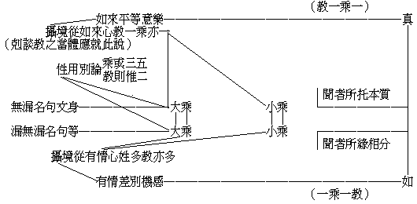



释论本文分三：先释论题，次明造释，后正释文。先释论题者：摄大乘者，依文中『阿毗达摩……体大故说』，及后『阿毗达摩……摄大乘品』，二段释之，乃是用经中摄大乘品为名。摄、有藏持二义：谓此品或此论能含藏一切大乘法，持令不失不没，故曰摄大乘。换言之，即摄藏大乘之十种胜法，持令不散失隐没也。大乘义、如常徒说，故不繁述。但依世亲释论中解，详明大小三藏，此即大乘三藏中之论藏也。论、显非经，本、简释论，总云摄大乘论本，即释出题名也。



二、明造释，论本为无著菩萨依阿毗达摩经中摄大乘品所造。其释有无性、世亲二师义。译入中华，本论有四，释论有三：一、后魏佛陀扇多，住嵩山少林寺，唯译本论。二、陈真谛译。三、隋笈多译。四、唐玄奘译。此三师皆本释具译。今所讲者，乃第四译。因奘公华梵兼优，善达唯识，故后学者，皆重此译。



三、正释文者，可分十一，文有十一段故。初即总标纲要分，今准常轨为三科：甲一、仍用分名。甲二、从所知依，至彼果智中因不应理句，为依标广释分，皆明初分所标之十殊胜故。甲三、从阿毗达摩至略释究竟，为结释出名分，造者自出名也。略标纲要者，谓总略标举十殊胜名即提纲，及出十殊胜之体即挈要也。



甲一　总标纲要分



乙一　总叙端由



阿毗达摩大乘经中，薄伽梵前已能善入大乘菩萨，为显大乘体大故说。



此出造论之缘起，如经之通叙。然阿毗达摩大乘经者，标所依之经名，明宗本也。阿毗达摩者，古云阿毗昙，译无比法。毗昙、成实相对为言，乃指为小乘有部论之专名辞也。其实此名乃大乘小乘诸论之通名，而佛说有对法、数法、伏法之一切经，亦得斯名。故今经名，即阿毗达摩也。依世亲解，阿毗达摩凡有四义：谓对法、数法、伏法、通法是。对法者，谓对向无住涅槃，能说四谛菩提、解脱等故。数法者，谓一一法数数训释自共相等差别义故。伏法者，谓具论处、庄严等格式，能立能破，胜伏外道诸异论故。通法者，谓能通释素怛缆藏义故。此通法义，唯菩萨声闻所造之论方有；其前三义，通佛说之一切论议分经。故此经别名阿毗达摩，通名仍属素怛缆所摄，非论藏摄也。所言中者，明依经中一品，非全经故。薄伽梵等，是此经中所言者。薄伽梵者，乃佛通名之一，有具六义、破四魔等释，依多含、尊贵诸义，故不翻也。然六义中有尊贵义，即通译为世尊者是。故云薄伽梵者，等於称佛或世尊也。前、显亲在佛前为佛印许之经论，非末世所造之论。菩萨者，出能说此摄大乘品之主。已能善入大乘者，乃明说者之德，谓此诸大菩萨，已得三昧神通诸陀罗尼门等诸大功德，已能通达大乘法义。然为何义说此法门？故曰「为显大乘体大故说」，即出此论之宗义也。显者，乃开发义。体、即当体，如火热水湿等。大、犹云胜，大乘即胜乘，此大乘法体即胜，故大乘体大。此胜体通指十种殊胜为论，非唯真如。今说此法，即为欲开发大乘法当体十种殊胜相故说也。



乙二　正标纲要



丙一　标列殊胜



丁一　标



谓依大乘诸佛世尊有十相殊胜殊胜语：



谓依据大乘法中，诸佛世尊所有十殊胜相，为显此相，故说十种殊胜语也。下殊胜为能诠之语，上殊胜为所诠相之德，故重言也。



丁二　列



一者、所知依殊胜殊胜语，二者、所知相殊胜殊胜语，三者、入所知相殊胜殊胜语，四者、彼入因果殊胜殊胜语，五者、彼因果修差别殊胜殊胜语，六者、即於如是修差别中增上戒殊胜殊胜语，七者、即於此中增上心殊胜殊胜语，八者、即於此中增上慧殊胜殊胜语，九者、彼果断殊胜殊胜语，十者、彼果智殊胜殊胜语。



言所知者，谓所应可知，即所知相是。明此相起因，曰所知之依，依者、因也。相、即三性，又可名为真妄法，圆成及净依他为真，遍计及染依他为妄。然三性之中心，为缘生之依他，阿赖耶为一切缘生法之本因，故称根本依、真妄依等。此依之体殊胜，故能诠之语亦殊胜也——下皆用此训。所知相，相即三自性之体相，所知即相。三性如上解。入所知相者，入谓能入，所知相为所入。明从之悟入之处，即由悟之门，此门即唯识理，能悟唯识理故，便能发生胜解、修胜行、证胜果，故此唯识性称能入於所知相之门也。彼入者，谓能入彼——唯识性。顺佛国言，故曰彼入。因、即加行位世间施等波罗密多，果即地上出世间波罗密多。彼因果修差别者，彼因果、如上解，修差别者，谓数数修，於诸地中展转增上而有差别。即於如是修差别中增上戒，谓彼修差别中有三学，十地修中依戒而学，此诸律仪唯菩萨有，简声闻故，曰增上也；心、慧亦然。即於此中，仍指上言。增上心者、谓定，依心学或在内心，故定名心学。增上慧者，即十地中无分别慧。彼果断者，谓彼修习，至证果位所有断德，即解脱二障之无住涅槃也。彼果智者，谓彼修习至佛果位，离障及种更无对治，四智菩提。此断及智、即二转依果也。



丁三　结



由此所说诸佛世尊契经诸句，显於大乘真是佛语。



由此中所说十种殊胜殊胜语，是一切诸佛世尊素怛缆藏诸句深义，故能显发大乘教法，真是佛语，非餘能说故。言诸佛者，明佛佛道同，无乖异也。然此结中总为二意：一、明此殊胜法是大乘有。二、明此大乘法是佛语也。



丙二　徵释殊胜



丁一　出体显胜



戊一　徵问



复次、云何能显？



即於前标列中，欲明殊胜，故设徵以释之也。云何能显，有二义：何因缘故此法是大乘？复何缘故证是佛语？即承上结文而兴问也。



戊二　答释



己一　异小显胜



庚一　总显



由此所说十处，於声闻乘曾不见说，惟大乘中处处见说。



谓由十种殊胜处，於小乘教法中，曾不见其有所说处；惟於大乘教法之中，则处处见说，故此十法为大乘殊胜法也。



庚二　别明



谓阿赖耶识，说名所知依体。三种自性：一、依他起自性，二、遍计所执自性，三、圆成实自性，说名所知相体。唯识性，说名入所知相体。六波罗密多，说名彼入因果体。菩萨十地，说名彼因果修差别体。菩萨律仪，说名此中增上戒体。首楞伽摩、虚空藏等诸三摩地，说名此中增上心体。无分别智，说名此中增上慧体。无住涅槃，说名彼果断体。三种佛身：一、自性身，二、受用身，三、变化身；说名彼果智体。



此十殊胜体是何法，小乘教中不见说耶？曰：所知依体，即阿赖耶，於声闻教中，语焉未详。佛岂不欲声闻知耶？曰：非。深密经云：『阿陀那识甚深细，一切种子如瀑流，我於凡愚不开演，恐彼分别执为我』。此可知此法之胜，及佛世尊用意之深也。故此胜法，於声闻乘不曾见说，唯於大乘教法之中处处见说——下之九胜，皆依此训。所知相体即三自性，谓依众缘所生一切法，皆名依他起性。即於此性上妄执我法等义，是遍计所执性。若於此性遣除其执，即圆成实。总之、此论所基者，乃依他起性，即列三性次第中，依他居首，亦可见也。所餘诸义，至文广释。



入所知相体，即唯识性。体者、主体，谓唯识性观，乃从因至果诸行中之主，从多闻熏习以去，若了解唯识性，通达唯识性，修习唯识性，究竟唯识性等是也。彼入因果体即六般罗密多者，谓由唯识性入三自性时，加行所修世间施等为清净因，能引入地；出世施等为清净果，故此若因、若果之修，皆依六波罗密多为主体也。彼因果修差别之体，谓十地中六波罗密，若因若果展转增胜，即差别也。虽因修亦含地前，然大乘之胜修，唯在十地，故不说彼。增上戒，以菩萨不共律为体；增上心，以菩萨不共定为体；增上慧，以菩萨法空无分别智为体，生空共小，此略不取。彼果断体，即三学果，谓佛世尊断二障得，具智悲故，不住两边，无住涅槃，即是果断体也。六经瑜伽明此断果，尚兼有餘依等，故前叙中，立为此宗之基本；至於本论，则高竖法幢，揭言无住，故立为此宗能建立者。彼果智体，即三种佛身：曰自性身，即清净法界，是智之所缘果。曰受用身，此有自他之二：自即四智相应心品，他即平等性智所起。曰变化身，即成事智所现。此三身，为智之极果也。此十法体，於声闻乘教法海中，均不见说，唯於大乘教海中说，故对异小乘以明十法之殊胜也。



庚三　结胜



由此所说十处，显於大乘异声闻乘。



谓由上来十殊胜体，声闻乘中不见说故，故能显示唯是大乘，异声闻也。



己二　即大显胜



又显最胜，世尊但为菩萨宣说。



谓殊胜以诸佛为最，此为令菩萨成佛故说，由此证知唯佛能说，除佛外无能说者。成佛之胜法故，说者胜故，被机亦胜，故此十法名最胜者。



戊三　结成



是故应知：但依大乘诸佛世尊有十相殊胜殊胜语。



上来所明，应知此十殊胜殊胜语，唯依大乘教法而说，真是佛语也。



丁二　约用彰胜



戊一　徵问



复次、云何由此十相殊胜殊胜如来语故，显於大乘真是佛语，遮声闻乘是大乘性，由此十处於声闻乘曾不见说，唯大乘中处处见说？



此中所问，乃上义所讲。今即总持所明之义，问有何胜用故，唯於大乘教中处处见说耶？



戊二　答释



己一　长行



谓此十处是最能引大菩提性，是善成立随顺无违，为能证得一切智智。



谓此十处者，指前所明殊胜相之殊胜体为十处。此十处之义乃正能引发大菩提果之引因，一切因中此力最大，故曰最能，此句是总答也。言能引者，约教法说，教能引发解行证故。此大菩提果为佛所证，故能引之因亦唯佛说，唯菩萨行，非声闻教也。是善成立下，别叙此意。善成立者，是所解境；能善成立此性相境者，即所知依、所知相二分。随顺无违，是所起行；即入所知相至增上慧六分。随顺行者，谓依佛所说之唯识即六波罗密多等，於未入地前，若顺观唯识，顺修趣菩提之资粮，及顺无分别智之加行，是入所知相及彼入因果分也。无违行者，谓与佛说之行无所乖违，即於地地修六波罗密多，及三学是。又与二谛无违，不为二谛所阻碍，皆名无违。



为能证得一切智智者，明所证果。一切智智者，谓佛果位智圆满，更无对治，根本如理智起时，证一切法之真如理，故曰一切智。此智发时，同时后得如量智照一切法之缘生相，故曰一切智智。因佛智无对治故，任运同时发故，曰一切智智，非餘位智可名此也。言证此智时，亦含有断果。能引果者，即是教法。故十处教法，是善成立大乘之境，是能随顺无违大乘之行，是能证大乘之果，总为大菩提果之引因。故此十处是大乘法，真是佛说，为最殊胜也。



己二　重颂



所知依及所知相，彼入因果，彼修异，三学，彼果断及智；最上乘摄是殊胜。此说此餘见不见，由此最胜菩提因。故许大乘真佛语；由说十处故殊胜。



从所知依至断及智三句，颂前十殊胜之名。最上乘摄是殊胜句，明大乘摄故胜。最上乘者，犹言第一乘，谓更无能过此者也。或名一乘，谓能摄一切法，更无餘乘故。或名佛乘，以佛为究竟果故。或名菩萨乘，为菩萨所修学故。名虽有多，即大乘——简声闻乘——也。谓此十处能摄乘胜故，所摄亦胜也。此说此餘见不见者，明非声闻教法所摄故胜；犹言所说之十处，唯於此大乘教法中见说，餘声闻教法中不见说之，故胜。何以声闻教法不见说耶？由此十处是诸佛最胜菩提之引因故，此句正答长文中问意。下结云：是故应当共许此十处唯是大乘，真是佛语。由此理故，说此十处最为殊胜。但此颂中所最重者，在菩提因句，是正答问故，学者应知。



丁三　诠次明胜



戊一　徵



复次、云何如是次第说此十处？



此问：十殊胜有何所以始所知依、终彼果智，如是次第耶？



戊二　答次第理



谓诸菩萨於诸法因要先善已，方於缘起应得善巧。次后於缘所生诸法，应善其相，善能远离增益损减二边过故。次后如是善修菩萨应正通达善所取相，令从诸障心得解脱。次后通达所知相已，先加行位六波罗密多，由证得故，应更成满增上意乐得清净故。次后清净意乐所摄六波罗密多，於十地中分分差别，应勤修习；谓要经三无数大劫。次后於三菩萨所学应令圆满。既圆满已，彼果涅槃及与无上正等菩提，应现等证。



此答次第理。谓诸菩萨欲求菩提，於所观境，应当先知，若知境之若相若性，又当先善其因，此因即是阿赖耶识之一切种，故所知依，列第一也。由於此因已能善巧，然后方得善巧缘起诸法。既了诸法缘起之因，故於缘所生起诸法，应善其相，此相即是依他起也。缘起之因缘，有十五依处、十二缘起及六因、十因、四缘等支，依此众缘所起，名依他起。於此依他起相明了认识，便善能远离於依他起上增益执我法实有，及於依他起上损减拨依圆是无之过也。此是所知法、故居第二。此上二分是所观境



菩萨於境既已通达，故应修行趣所期果。於修行中，第一应正通达此所观境唯识为性，令心於诸障中，解脱出离。唯识之义，既已了知，应於加行位中，修四寻思观、四如实智，及因清净波罗蜜多。证得此故，应更成满自初所发增上意乐——此意乐者，犹言志愿——令其清净，意乐清净，即是初极喜地。意乐既已清净，所摄出世之六波罗蜜多，应於十地中勤加修习，令其展转增胜，分分差别。要经三无数大劫——从初发心至十向满为初劫；次修加行，从初地至七地满为第二劫；从八地至地满为第三劫——者，简异二乘三生疾修便解脱也。上来三分次第如是。於修习中，戒等三种菩萨学处，应令圆满。



修学既皆圆满，故所应断弃舍者，於金刚无间道中一切断尽。所应证者，於解脱道中方名成佛，涅槃从断惑显故先，菩提因智满证故后也。



戊三　结次明胜



故说十处如是次第。又此说中，一切大乘皆得究竟。



故说十处如是次第，即结次也。又此说中一切大乘皆得究竟，即明胜也。谓欲学大乘法者，应知此十摄一切大乘法，更无餘剩，故为最胜。故世亲释云：『若欲说缘起，即入阿赖耶识摄；乃至若欲说断及智，即入无住涅槃及三种佛身摄』是也。



甲二　依标广释分



乙一　彰胜境



丙一　所知依分



明能变识，第八识即初能变，如唯识论广解。此分为论文之第二，为十殊胜之第一。言所知者，通指三性为能依法。依者、即此分所明之识，是所依也。依有二义：此识之种，为一切法之因依；其现、为一切法之缘依；故以此识为一切法之因缘依也。但法之与名，宽狭不定，有同一名而法别者，如意识言，贯六、七故。有同一法而名别者，如阿赖耶，阿陀那等。盖名义互为客使然也。阿赖耶识与所知依，就法体论，则同是第八识。就义量论，则所知依名通一切法、一切位，阿赖耶则唯限杂染法，及二乘无学、七地以前之位也。阿陀那名，译为执持，若通持染净一切法，则与所知依相等。若云此名，指生死间之相续心者，即唯异熟位，较所知依狭也。餘名宽狭，例推可知。所知依名，明第八义最宽者也。



丁一　安立名相



戊一　安名



己一　引教列名



庚一　立所知依即藏识



辛一　标名



此中，最初且说所知依，即阿赖耶识。



於此十分中，置餘分后论最初且说所知依也。但所知依中，义有多种，此又於中最初且说即阿赖耶识义。阿赖耶此云藏，如下广解；亦可云处，为餘法之聚依处故。



辛二　引证



壬一　设徵



世尊何处说阿赖耶识名阿赖耶识？



因此识於声闻藏中不说，大乘教中说亦无多，故餘不知者皆问曰：世尊於何教法——处——中说此阿赖耶法耶？又於何教法中说此法名阿赖耶识？故问有二义。



壬二　证释



癸一　证所知依义



谓薄伽梵於阿毗达摩大乘经伽陀中说：『无始时来界，一切法等依，由此有诸趣，及涅槃证得』。



谓薄伽梵至伽陀中说，即引证以答之。伽陀者，乃十二分教之讽颂。或云偈者，略而讹也。谓此颂中有此识法，然未立阿赖耶名也。此颂在成唯识论中有三解，此不繁引。略谓从久远劫无始时来，无间无断以至现在。此无始时来四字，可通下文等依读之也。界者、因义，即一切法之种子也。又界、限义，乃就现行法言。但现行法之限别，亦从因有；如草木之不同，其别在种，非因水、土、日光等缘有别也。



一切法等依者，谓此识为一切法之平等依止。但就赖耶名解之，应为一切有为杂染分法之直接依，其清净法则间隔依。或解亦为清净法依，如七地前、初地上之赖耶，亦为无分别智之依。盖依者、未必和合相应同类，若云摄藏，则必和合相应同类。总此二句文义，界即种子依，因也；次句即根本依，缘也；故二句即明因缘。又可云为出阿赖耶识——藏即界故——义，及阿陀那识——持即为依义——义。



由此有者，谓由有此因缘二义；有诸趣及涅槃证得者，明所成就流转还灭之果。盖一有言，通上下二文。趣谓所趣之果，即天、人、修罗、饿鬼、畜生、地狱六道之异熟果是。果非一、故云诸。或诸趣言，通能所趣，能感果者即诸业，能发业者即诸惑，能起惑者即迷理无明是也。若如是论，则三杂染皆诸趣摄。此三杂染，皆因迷阿赖耶识执为我之无明起。复由此识异熟为诸趣体，故皆由此阿赖耶有，此句即流转法。及涅槃证得者，及、表相违释。涅槃是解脱二障所得之果，证得乃能证得之智果也，此句是还灭法。显亦因此识有，谓要断彼染，方有此净故。此颂虽有所知依义，而无阿赖耶名。



癸二　证其名



即於此中复说颂曰：『由摄藏诸法，一切种子识，故名阿赖耶，胜者我开示』。



此证其立名也。即於此中者，谓即仍於上所引之阿毗达摩经中。由摄藏诸法者，显藏义也。诸法虽无简别，然依下文，则唯指一切有为中杂染分而言也。摄与依义不同，如上解。一切种子、即所名法，识、出其体；或谓是出一切种识之名。故名阿赖耶者，正出其名，谓此识有摄藏诸法一切种子之义，所以名藏识也。胜者我开示，明此法非小乘之法也。胜者、即佛，无更上者故。菩萨学佛，故亦称胜者，胜凡小故。成唯识论有二释，此不繁引。为一向封迷者说，令其发见谓之开；为已知大概，或已知少分，或知而后失者说，令其详细明了谓之示。第二颂正释阿赖耶为藏义。



辛三　释义



如是且引阿笈摩证；复何缘故此识说名阿赖耶识？一切有生杂染品法、於此摄藏为果性故；又即此识、於彼摄藏为因性故；是故说名阿赖耶识。或诸有情摄藏此识为自我故，是故说名阿赖耶识。



如是且引至阿赖耶识者，重设徵。如是虽已引阿笈摩为证，然何等缘故证明此识，说其名曰阿赖耶识耶？是为徵问。阿笈摩即阿含，译为至教，即是佛所说语，或佛所印可语，非唯小乘之经曰阿笈摩也。



一切有生下，答。文分二段：一、明能所二藏义名阿赖耶：有生者，即有为法，简无为法。杂染者，是有漏法，简无漏有为也。品、即类也。谓一切有为有漏品类诸法，能於此能摄藏之阿赖耶识中，熏生种子，以为彼能熏法所熏生之果性故，所以说此识名为阿赖耶识；此约能藏识释名。又即於此识中所摄藏诸种子，对於彼一切有为有漏法，能为其生起因之性故，所以说此识名阿赖耶识；此约所藏种释名。是故说名阿赖耶识，通结上之能所二名也。



二、或者，显不定义。盖除佛皆名有情，有执者不执者故。情即情识，或情爱。诸、表多数也。摄藏、显执藏义，执、为毁责之言，此依通义云摄，谓或约七地前未入生空观之有情，第七识缘此识之见分，执为自内我体，是故此识名阿赖耶。此约我爱执藏释名；上即以三藏义释名也。



庚二　立所知依即持识



辛一　标名



复次、此识亦名阿陀那识。



上来明所知依曰阿赖耶识，即此阿赖耶识亦名阿陀那识；体虽是一，然约义用差别，故有多名也。如有一身长色黑之人，可云长人，亦可云黑人，名虽异而人一也。阿赖耶有三藏义，约我爱执藏义故狭，约能所二藏义则广也。阿陀那为执持，约持染净种，持有根身义则宽，约结生自体义则狭。依义不同而名异也。



辛二　引证



此中阿笈摩者，如解深密经说：『阿陀那识甚深细，一切种子如瀑流，我於凡愚不开演，恐彼分别执为我』。



证此名之阿笈摩者，如解深密经中颂说。甚深者，谓出世性之人天以下有情，不能穷此识之底故。甚细者，谓趣寂性之二乘，不能明其相故。总显此识非声闻以下之教法也。一切种子者，谓此识能持有一切法所熏之习气，为将来生法之种子。如瀑流者，以喻显此识非断常义：无始时来，刹那刹那前灭后生，无稍间断相续转故，犹如悬崖上之流水，无稍停止，粗观似一，而实流流之衔接也。其餘诸义，如广论解。此甚深甚细之法，我——佛对於无出世种性之凡夫，及趣寂种性之愚法声闻，不为开示演唱。何以故？盖佛世尊诚恐彼等，於此识上分别计度执为自内我体故也。彼分别执我有何过耶？因彼俱生我执虽有，然不至增苦，倘有分别执起，则反增苦耳。凡夫有分别执则招三涂报，愚法起分别执则失其小果。引此颂之正义，在初句之立名也。



辛三　释义



壬一　设徵总答



何缘此识亦复说名阿陀那识？执受一切有色根故，一切自体取所依故。



上虽引教立名，但有何种缘由，此阿赖耶识亦名阿陀那耶？答曰：谓此识有执持一切有色根不失不坏，与同安危，令生觉受之故。及一切有情之自体，亦依此识以为之持取也。有此二种持义，故名阿陀那识。色根、即五净色根，有五净色根者，即总身根是。一切者，或谓根非一，或谓一切有情。自体即一一有情，各各随业所感之正报，但取胎为自体者，即此识也。此中有至后有中间之闷绝位中，餘识不起故。执受者，谓此识自取胎执持为我摄令不坏以后，令诸根生觉受也。然此持义，在成唯识论中，则尚有持染净诸法种子之一义。因彼论明能持种之识是现行法，所持之种子，非能持识，故解种为识相分，及解种子与识性之同异中，皆有多释。此论则於所持种、能持识，不明了分为二法，故少彼一义释也。然依此论之二义解此识，亦约现行为论，有执根令生受，及取生为体二种胜用，实非种子之所有，故虽少一义，亦无相违也。



壬二　重徵广释



所以者何？有色诸根，由此执受，无有失坏，尽寿随转。又於相续正结生时，取彼生故，执受自体。



二义之所以者，何耶？谓有色之诸根，由此识执持故方能生觉受。又此诸根能随寿命之延夭，随逐而转，及於其中间无有失坏者，皆由此识执持之力。倘非此识之执持力，则与死尸相等，既无觉受，亦不久即当坏失也。其生死位之差别，亦由此判。如无心睡眠等位中，有此识持故，根不失坏，属有情摄，非死尸之无情法也。但死位之餘尸不顿灭者，虽无此识之执持，然由先业力之餘势。如成唯识论解不共中共种变之义，故有枯尸也。此释持有色根义。



又於相续至执受自体，是释为取结生体之义。相续者，即有情之别名，谓有情识向有轮转，生死相续无间断也。或训此识为相续生死识，正结生时，即中有至生有之闷绝位，谓正在结合精血识三法，生起胎体时也。由阿赖耶识中一期自体熏习，彼体於此位中生起故，说名彼生；此识摄彼生体为自体故，名取彼生。既执为自体，同安危住，故能令生觉受也。正报依报之别，亦因此识执为自体否之异也。



辛四　结名



是故此识亦复说名阿陀那识。



由上来引证、释义二文，是故此识亦复说名阿陀那识也。



庚三　立所知依即是心



辛一　引教



此亦名心，如世尊说：『心、意、识』。



阿赖耶识亦说名心，依何知耶？如佛世尊於至教中说：有心、意、识三法，心即指此。说此三法之圣教甚多，故不特出经名也。



辛二　释意



壬一　总辨二种意



此中意有二种：第一、与作等无间缘所依止性，无间灭识能与意识作生依止。第二、染污意，与四烦恼恒共相应：一者、萨迦耶见，二者、我慢，三者、我爱，四者、无明。此即是识杂染所依。识复由彼第一依生，第二杂染。了别境义故。等无间义故，思量义故，意成二种。



此中亦兼释识义，故识不单列也。此中意有二种者，即标数。第一与作至第二杂染，即释二种之相。第一意、与现心法作等类无间隔之缘，为现法所依止之性，即现识无间之前刹那已灭之识，能与现行将生之意识，作生起所依止之容受处所也。等者、均等，谓同类法，如现刹那眼识，望前刹那眼识为此缘，非望餘识为此缘也。无间者，显非同时，一处无能容二体并生故，亦非隔二念相望能为此缘；故前识灭已，乃至无数劫后识生起时，仍用前无数劫之前灭自类识为此缘也。约意识或前六识之此缘以名意者，乃共小乘之名。但大乘八识自类前望后各各皆为此缘，则非小乘之所共也。第二、染污意者，即第七识，因有四惑恒常相应，亦令六识所作善事皆成有漏，故名染污。萨迦耶见者，即七识执八见分为我之见是。於此执上，持而高举，即名我慢。於实非我法上计我，贪著不舍，即名我爱。此三皆依迷理无明之痴心生，故无明亦云我痴也。此即是前六识之杂染所依之源，但此净时彼识亦依之而净，故名第七识为染净依也。前之六识，又因彼第一等无间意为依止而得生，因此第二染污意为染依，而成杂乱染污也。



了别境义下，即出义，结二意也。了别境义故名识，释识义。等无间义故，名等无间意。四惑相应之恒审思量义，故名染污意。依此二义之不同，故意亦成二种。但对於心、意、识之意字，欲证明不共小乘第二染污意，故下文广解。



壬二　别证染污意



癸一　证有



等无间意，不违二乘故，非心、意、识之意故，故不别释。染污第七非声闻法，是此中意，别建立故，故设徵问而特以理证成。即以六种道理证明异前六识，别有此恒时现行之第七意，非即等无间意也。



子一　设证



复次、云何得知有染污意？



虽引圣教言有意识，我等但知等无间意，云何得知别有此与四烦恼相应之染污意识耶？



子二　答证



丑一　长行



寅一　不共无明不有过



谓此若无，不共无明则不得有，成过失故。



不共无明凡有二种：曰独头不共无明，即第六意识中不与餘根本烦恼共起，名不共也。曰恒行不共无明，即此意之恒行我痴，非餘识有，名不共也。所餘无明，皆曰共也。不共无明虽有二种，今取恒行不共无明，即此意之恒行我痴，非餘识有，名不共也。所餘无明，皆曰共也。不共无明虽有二种，今取恒行，证意有故。彼无明是心所有法，所必依王。但前六识非此所依，有间断故；所依既断，能依非恒，故此无明不依前六。第八虽恒，亦非所依，无覆性故；为一切法之所熏故；倘为此依，则成有覆，非善等熏，是故第八亦非此依。等无间意，是已灭无，故亦非依。有此染性第七意为所依，不共无明方得成立。谓此第七染污意若是无者，恒行不共无明，无所依止之心王故，则能依之无明亦不得有。但圣教中处处说有此恒行不共无明，即为下文之我执等。此恒行不共无明若无者，便违圣教，成过失故，故应许有染污意也。



寅二　五同法不有过



又、五同法亦不得有，成过失故。所以者何？以五识身必有眼等俱有依故。



五同法者：谓以五识依五根缘五境而得生起，为意识依意根缘法境生起之同法喻。或以此七为六依，作五根为五识依之同法喻皆可。谓六识生起，各有不共俱有依根，若无此染污意，第六识则无依，不应生起为过；五识无第六同法喻过。第八非此依，是共依故。等无间意非此依，非俱有故。有此染污意识为第六依，便无过失，故应许有也。



寅三　训释词空设过



又、训释词亦不得有，成过失故。



训释词者：即上训释思量为意之词。若无此染污意，彼词亦无依，故为过失。不应以前六识第八心为意，彼别有训释之词故。亦不可说等无间意，彼已灭法，无思量性故，思量是训现行法故。有此染意，便无过咎。若无此意，即成空言之过失也。



寅四　二定无差过



又、无想定与灭尽定差别无有，成过失故。谓无想定染意所显，非灭尽定。若不尔者，此二种定应无差别。



无想定者，是外道有漏法，彼定成时，六识王所皆无，从初用功灭粗想立名。彼定非心所法，唯约身心调畅，立名为定。灭尽定者，是三乘圣位无漏法，定成之时，一切染心皆灭尽故。定、同上释。一切染心者，即六识灭尽，更灭染意是也。二定差别，即在於此。故云：若非於此染污意识一有一无为异，则外道之无想定，与圣人之灭尽定，灭前六识等故，有何差别？差别若无，则凡圣相滥，故成失也。下自释云：谓外道之无想定，非即圣者之灭尽定者，亦由有无此染污意所显差别也。若非由有无染污意显其差别，则此无想与灭尽二定之差别，应无有也。



寅五　无想无染过



又、无想天一期生中，应无染污，成过失故；於中若无我执、我慢。



无想天者，即无想定所得后有。生此天中，初生意识暂起即灭，乃至灭位意识方生，於一期之中六识皆无。若无染污意识，便与无漏圣者无别，此成过失。故云：又若无此染污意识者，则无想天，无六识之一期生中，应无染污法。——谓於中若无我执、我慢等染污法。然彼实是外道法，圣所呵厌。外道异生未见无我执者，彼既外道，岂无执我？是故应许有染污意我执相应，便无咎也。



寅六　我执不有过



又、一切时我执现行现可得故，谓善、不善、无记心中。若不尔者，唯不善心彼相应故，有我我所烦恼现行，非善、无记。是故若立俱有现行，非相应现行，无此过失。



未证圣果一切凡夫，於一切性时我执恒常现行，於善等三心中，皆现可得故。若无此恒行染污意为依者，则六识善等三性之中，唯於不善心中有彼我执等相应，若善、无记二心中不应有彼我执等，性相反故。有我我所烦恼现行，定非善、无记故，便成过失。以是，若立别有此染污意为彼我执俱有现行之依止，现行於一切三心时，无有上过。非彼六识相应之我执，於一切三性时中得现行也。



丑二　重颂



寅一　重颂六理



此中颂曰：若不共无明，及与五同法，训词，二定别，无、皆成过失。无想生应无我执转，成过。我执恒随逐，一切种无有。离染意无有，二三成相违；无此、一切处我执不应有。



此颂文中，字句虽齐，文义则有伸缩。初四句文，重颂四过，为一气读。若无皆成过失六字，别别连上四过读之。谓若无此染污意，则不共无明无有故成过失。乃至若无此染污意，则二定别无有故皆成过失。及与二字，为相违释。无想生一颂，是重颂后二过。谓若无此染污意，则无想生应无我执恒现行转，成过失也。若离染污意识，应无有於一切种性中恒时现行随逐有情之我执，故成过失。离染意无有二至不应有，结颂六过。谓无染污意，则无有不共无明及五同法之二种，故成过。训释词无义唯名，二定无有差别，无想天应是无漏，此三与事理教皆成相违过。又若无此染污意，则於一切处我执不应有，故成过失。



寅二　别颂无明



真义心当生，常能为障碍，俱行一切分，谓不共无明。



真义、即真实法义之真如是。心、即能证此真义之分别智是。此真义心三字，是明智，非诠境也。俱行、即是与恒行识俱为恒行义。一切分、即除真义心已生前，一切三性之时间、空间、位置高下等中。谓有一法，於证真实法义之无分别智当生之前，俱恒行於一切性等分中，常能为无分别智生起之障碍者，即谓之不共无明是也。



癸二　辨性



此意染污故，有覆无记性；与四烦恼常共相应。如色无色二缠烦恼，是其有覆无记性摄；色无色缠为奢摩他所摄藏故，此意一切时微细随逐故。



辨此染污意，於善、不善、有覆无记、无覆无记、四性之中，是何性摄耶？此意是染污故，是四性中有覆无记性。与四烦恼常共相应，即明有覆义也。既与四烦恼常相应转，则应是不善性，何云无记耶？引喻证曰：如色无色二缠之烦恼，虽是烦恼，然是有覆无记性所摄。盖因色无色二缠之烦恼，为奢摩他所摄持含藏，非如欲界烦恼有散动造业之胜用，故成有覆无记别之性。此意微细一类，随前六识，若善若不善等一切时中，恒常追逐而转。若不善者，则不能於善等心时转起，故知此意，性是无记。然与四惑常相应故，名为有覆。故虽有烦恼相应，而性是有覆无记。若不尔者，有覆无记，何所属也？相应、谓王与所同时，同依，所缘境等，和合共办一事——具四义。奢摩他、译曰止，即定之九别名之一也。又、随逐者，或云随顺第八所生之界，追逐而缘其见分执为我也。



辛三　释心



心体第三，若离阿赖耶识，无别可得；是故成就阿赖耶识以为心体。由此为种子，意及识转。何因缘故亦说名心？由种种法熏习种子所积集故。



心体第三者，谓识言、诠前六识，意言、诠等无间及染污二种意，心之体法、数居第三。但此心体，设若离阿赖耶识，更无别法可得为体。亦不可说心是识、意之总称，三法并列故。以是，成就阿赖耶识以为此心之体也。又由此心为种子故，第七意及前六识等方得转生。若约心为现法，则云由有此心为持种子之根本依故，意及识等得转起也。设问曰：虽证第八即是心体，但依何种因缘，阿赖耶、阿陀那二名以外，亦名为心耶？若心有多义，通俗以肉团为心，此乃色法，实非心也。或以缘虑名心，此通指王所。或以集起名心，谓集诸法所熏成之种子，起未来诸法之现行，唯第八识。若以积集名心，则有能所，能积集者唯前七识，是能熏故；所积集者即第八识，是所熏故。今即约此义为论，谓由种种现行能熏法，熏习成就一切种子於第八识，第八是彼所积集之处，故以积集义训为心也。



己二　问答结成



庚一　正问答



复次、何故声闻乘中不说此心名阿赖耶识、名阿陀那识？由此深细境所摄故。所以者何？由诸声闻不於一切境智处转，是故於彼虽离此说，然智得成，解脱成就，故不为说。若诸菩萨定於一切境智处转，是故为说。若离此智，不易证得一切智智。



问曰：彼声闻乘教法海中，亦说心名。由何缘故，於声闻教法中，不说此心名阿赖耶识，亦不说名阿陀那识耶？答曰：山此二名之所诠相，是深细境所摄故，非彼浅智之境，故不说也。又问曰：以何理而得知耶？答曰：由声闻唯发自利之心，但由缘苦等智能证解脱，彼愿足矣；不更为利他故，断所知障，趣大菩提，故不为彼说此深细之境，反增其恼。一切境、即所知相，一切境智，即缘一切相之智。此智所依所缘皆名为处，由彼诸声闻等，不於此缘一切境智处，转现转起，是故於彼声闻众，虽离此所说之阿赖耶识为境，然彼缘苦等之智亦得生起，其所期之解脱果亦能成就，故不为彼说此深细之境，无过失也。菩萨则不然，因菩萨发心为利他故，於一切境上尽断其所知障，证一切种智，故决定须於一切境智处转，是故必为说此深细境，令引生法空无分别智。假若不为说此境、发此智，则於一切智智不易证得也。言不易者，显非不能。如般若诸部经中，虽不说此阿赖耶识，亦开示法空等门证菩提也。然说不易，略有二端：一、不知此境修法空者，多有执空为究竟之障，甚至拨无圆成依他，故为趣菩提之障。知此、则一方於依他起上遣除遍计之性，一方又即於此上通达圆成之实。真俗具照，二智圆融，成中道一切智智，故较彼为易也。二、阿赖耶为有漏之大因，一切智智为无漏之大果，知因而剋果，尤为简捷。不知此因而修法空者，正因既迷，果岂易晓？故较知此略为难也。



庚二　别解释



复次、声闻乘中亦以异门密意已说阿赖耶识：如彼增壹阿笈摩说：『世间众生爱阿赖耶，乐阿赖耶，欣阿赖耶，喜阿赖耶。为断如是阿赖耶故，说正法时，恭敬摄耳，住求解心，法随法行。如来出世，如是甚奇希有正法出现世间』。於声闻乘如来出现四德经中，由此异门密意已显阿赖耶识。於大众部阿笈摩中，亦以异门密意说此名根本识，如树依根。化地部中，亦以异门密意说此名穷生死蕴；有处有时见色心断，非阿赖耶识中彼种有断。



谓此阿赖耶识，於小乘教法中，佛以密义已为彼说，然彼自不能知即此所明，故为彼等特别提出解释之也。复次至阿赖耶，总标彼有。谓佛於声闻乘教法中，亦以密义异门，若隐若显已说此阿赖耶识也。



如彼增一至出现世间，第一引有部之教证。爱、乐、欣、喜四名，约总别三世而立：谓世间众生所以流转生死者，即由有阿赖耶为爱著也。於现在者生乐，於过去者生欣，於未来者生喜。此三同是贪著为性，故总名为爱阿赖耶也。此名虽四而体是一，约义、即为我爱执藏也。声闻为出世故，欲断如是四阿赖耶，故於佛说此正法之时，身心恭敬，摄耳而听，成其闻慧；闻已安住於寻求了解之心，成其思慧；既知所应趣证之法，即起随法道而修证，成其修慧。知此法已，赞世尊言：唯如来出世，方有如是甚奇希有之正法出现於世间。此阿赖耶亦为声闻所断，故唯识颂云：『阿罗汉位舍』，即我爱执藏舍之义也。是则佛於汝声闻乘教法，如来出现四德经之中，已由此异名之门，不明了之密意，曾显示阿赖耶识矣。



次引大众部至教中说。佛灭百年后，分上座、大众二部。於此大众部阿笈摩中，亦用异名之门，不了之密意，说此阿赖耶识名根本识。为餘诸识生起所依之根本故，如树之枝干等，皆依树之根而生长也。但彼根本识，即是阿赖耶，离此无能为根本之识故。



次引化地部中说。此为二十部之一，上座部之餘派。於此部中，则亦以异名之门，不了之密意，说此阿赖耶识名穷生死蕴。穷、犹言尽，生死、即自凡夫以至三乘金刚道中，未证无学果前，皆有生死蕴、即积集性之法也。因彼部中立三种蕴：一、一念顷蕴，谓一刹那之有生灭法。二、一期生蕴，谓从生有后至死有前，於此一期生活相续恒随转法。三、穷生死蕴，即此所明。此蕴即是阿赖耶识，何以故？谓六识无常，故非此蕴；第七意常，然生空观起时，彼染亦断；其餘色等，更不待言。无为虽常，然非是蕴。故知彼蕴，即此识也。又释此义曰：有无色界诸处，见色法断，故非此蕴；有无心等诸处，见心法断，亦非此蕴。彼色心断时，唯断现行，非阿赖耶识中所藏彼色心之种子亦有间断，故后离彼无色无心之位，色心仍起。彼种子既不断，故持彼种之识，亦不应断。但除阿赖耶识，更无餘法能持彼种——此义如唯识论中广释。故彼部虽异名为穷生死蕴，而其实即此阿赖耶识也。



上来，别显阿赖耶、以异门密义，於声闻乘中亦曾说，非全不说也。



庚三　总结成



如是所知依，说阿赖耶识为性，阿陀那识为性，心为性，阿赖耶为性，根本识为性，穷生死蕴为性等。由此异门，阿赖耶识成大王路。



此将上来所安立之诸名，总为结束，成此论中所知依也。如是上来诸种解释，故知此论之所知依法，或以阿赖耶识说之为性，或以阿陀那识说之为性，或说心为其性，或说爱乐欣喜四阿赖耶为其性，或说名根本识为其性，或说名穷生死蕴为其性。等者、显有分识等诸异名，皆可说为其性。由此诸多异门解释，故此阿赖耶识，成最广大、最正直、最明显、最平坦，犹如大国王所经之路也。



己三　破执显胜



於上释诸异门名，即阿赖耶识义，彼小乘诸师恃执否认，故破彼等之鄙执，显成立此阿赖耶识之殊胜也。



庚一　破滥义执



复有一类，谓心意识，义一文异。是义不成。意、识两义，差别可得，当知心义亦应有异。



复有一类至义一文异，出执。彼云：佛说心、意、识三名者，其能诠之文言有多名，而所诠之体义是一法。故汝大乘，不应说心是阿赖耶识也。破云：是小乘之义不能成立。何以故？以意为思量性，即染污意第七，或等无间意；识为前六了别境识。此意、识两名所诠之两义，既成差别，已可成立非一。是故当知此心名所诠之义，亦应有别异法为所诠也。或曰：何故二十唯识论中，亦名心意识了四为一法耶？彼依能缘之通义为论，总显一法可立多名；然实诸名各有别义。若不尔者，多说何用？



庚二　破异解执



辛一　出计



壬一　计为五取蕴



复有一类，谓薄伽梵所说众生爱阿赖耶，乃至广说；此中五取蕴，说名阿赖耶。



谓复有一类之小乘诸师，谓薄伽梵於阿笈摩中所说之世间众生爱阿赖耶，乃至广说四阿赖耶，即是世间众生有漏五法之爱取蕴，非别说有第八识也。



壬二　计为贪俱乐受



有餘、复谓贪俱乐受名阿赖耶。



有除上所计餘之一类小乘诸师，说贪心相俱之乐受，此受是世间众生所最爱乐执藏之法，故名赖耶；非别有第八识名阿赖耶识也。



壬三　计为萨迦耶见



有餘、复谓萨迦耶见名阿赖耶。



萨者、经部为伪，与有部为有，及大乘为移转，诸义不同，如成唯识论述记广明，此不繁引。迦耶谓聚，指身以言。此即身见，或名我我所见。谓彼计云：世间众生，於身起见，最是所爱乐所执藏之法，故名爱等阿赖耶，非第八识也。



辛二　破执



壬一　总破所执



此等诸师由教及证愚阿赖耶，故作此执。如是安立阿赖耶名，随声闻乘安立道理，亦不相应。若不愚者，取阿赖耶识安立彼说阿赖耶名，如是安立则为最胜。



谓此三计之小乘师，不依了义教法，及殊胜智证，但由不了义之教，及下劣智证，愚迷於阿赖耶识之若名若相等故，所以作上来三种执也。如依彼等之执，安立阿赖耶名，非但於大乘教理有违，即随顺声闻乘教法中，安立此名之道理，亦不相应也。何以知之？如下，就彼安立道理推破中可知也。若不愚者——即是断法执之菩萨，取此第八阿赖耶识之法，而安立彼经所说之阿赖耶名；若能如是安立，便能由名得体，断法执、达缘起、证唯识等义皆成，离一切过患，则为最殊胜之教理也。



壬二　推破所执



癸一　外徵



云何最胜？



声闻乘教安立道理，果有何咎？大乘教法道理，云何最胜？



癸二　破执



子一　破五取蕴执



若五取蕴名阿赖耶，生恶趣中一向苦处，最可厌逆，众生一向不起爱乐，於中执藏，不应道理；以彼常求速舍离故。



若汝所执五有漏取蕴名阿赖耶者，在人天道等善道中，固不显其过。但若生地狱极恶趣中之众生，于一向受极苦之处曾无少乐，此处及身最可厌恶，违逆其心。彼众生於此处及身，一向不起丝毫爱著乐欲，以是极大之苦故。若云彼众生於此中五取蕴法，起执著摄藏名阿赖耶者，不应道理，以彼常求速舍此身离此处故。故应许有第八阿赖耶识，安立此名，方无上失。



子二　破贪俱乐受执



若贪俱乐受名阿赖耶，第四静虑以上无有，具彼有情常有厌逆，於中执藏，亦不应理。



第四静虑，即色界第四禅诸天，彼诸天又名舍念清净地，其受唯舍更无乐等诸受。若第三静虑，又名离喜妙乐地，尚有乐在。故此文唯取第四静虑以上者，彼等无乐受，岂可云无阿赖耶乎！文谓：若汝小乘诸师，以贪相俱之乐受，便名阿笈摩中爱、乐、欣、喜四阿赖耶者。但此乐受，不唯於第四静虑以上诸天皆已无有，且由第三静虑欲进第四静虑之有情，具彼乐受，为生无乐受处故，常生厌患乐受之心，观为粗、苦、障故；况已生四静虑者乎？彼第四静虑以上之有情，既已舍彼，汝若言彼诸有情於贪俱乐受中执持摄藏，名爱等阿赖耶者，不应正理。



子三　破萨迦耶见执



若萨迦耶见名阿赖耶，於此正法中信解无我者，恒有厌逆，於中执藏，亦不应理。



萨迦耶见即我见是，汝等若执此我见，名世间有情之爱等四阿赖耶者，其於佛正法中，信解无我之理者，此等有情於我见恒常厌逆，唯速求断。若云彼有情於我见中亦执持摄藏，名爱等四阿赖耶者，亦不应理。



癸三　显胜



子一　释胜



阿赖耶识内我性摄，虽生恶趣一向苦处求离苦蕴，然於藏识我爱随缚，未尝求离。虽生第四静虑以上，於贪俱乐恒有厌逆，然於藏识我爱随缚。虽於此正法信解无我者，厌逆我见，然於藏识我爱随缚。



此显示大乘之安立，非如彼等有诸过失，成最胜之安立也。阿赖耶识内我性故八字，通下三文。大乘安立阿赖耶识名阿赖耶，有何缘故最胜无过？因阿赖耶识是第七染污意所执之自内我性故。何故无过？谓虽生恶趣一向受苦地狱处，於彼依正二报苦蕴求舍离者，然彼恒於此阿赖耶识内我性上，仍有第七爱自内我之爱，随逐缠缚，未尝一念求其厌离。因彼愿云：如何能令我之诸苦蕴都无所有，令我恒得受诸乐蕴耶！故知彼诸有情虽厌苦蕴，而不厌此识。故以此识名爱等阿赖耶，无过失也。虽诸生第四静虑以上之有情，於贪俱之乐受虽恒厌逆，然彼有情等於此阿赖耶识则未求离也。因彼於此阿赖耶识，恒有爱内我之我爱，随逐缚故。故以阿赖耶识名爱等阿赖耶，则无过最胜也。又虽信解佛正法无我理者，厌逆我见，然於第七恒行我见所执内我，则犹未能厌逆及之。如三果人入生空观时，率尔闻雷声，犹生惊怖，是其证也。若四果则无是怖，已断我执故。因彼未断而信解之有情，於此识上仍恒有第七识之我随缚故。如是安立，便无上过。



子二　结胜



是故安立阿赖耶识名阿赖耶，成就最胜。



由上诸理，是故若安立阿赖耶识，名阿笈摩中之四阿赖耶，成就最胜之安立也。



戊二　立相



己一　结前生后



如是已说阿赖耶识安立异门，安立此相，云何可见？



依上来能诠诸名，安立所诠之体相也。如是上来已说阿赖耶识立异门诸名竟，即结前也。安立此诸名所诠之相，又如何而能见知耶？即生后文，问也。



己二　广释其义



庚一　总立三相



安立此相，略有三种：一者、安立自相，二者、安立因相，三者、安立果相。此中安立阿赖耶识自相者：谓依一切杂染品法所有熏习，为彼生因，由能摄持种子相应。此中安立阿赖耶识因相者：谓即如是一切种子阿赖耶识，於一切时与彼杂染品类诸法现前为因。此中安立阿赖耶识果相者：谓即依彼杂染品法，无始时来所有熏习阿赖耶识，相续而生。



安立此诸名所诠之相，广说无尽，唯佛能知。若总略说之，则有三种相，亦摄尽也。即立一相亦能摄尽。但取要者说之，与成唯识论同，开为三也。一者、安立自相，即安立此识之自体相。二者、安立因相，即安立此识为诸法因之相。三者、安立果相，即安立此识，是增上力业所引之异熟果也。此中安立下，是释三相。此中者，谓此安立三相中。安立阿赖耶自相者，谓三相中，且说安立此识自相之法。谓依一切前七识之杂染品类能熏之法与第八识，俱灭俱生熏已，阿赖耶识中，所有前七杂染品类能熏法所熏成之气分，即此气分之功能，展转摄持於第八识中，乃至成熟位，复能为彼能熏法之生因——即是彼法之种子——此是彼阿赖耶识受熏义。由此阿赖耶识独能摄藏不失，执持不坏彼诸法种子之道理，最为相应，非餘法可与能摄持彼诸种子之道理相应。此是明阿赖耶识持种义。总此受熏、持种二义，为阿赖耶识之能藏义。或约所熏法，亦兼所藏义。依此能、所藏义，是第八识之自体相，离此更无此识体相可知故。此中安立阿赖耶因相者，标三相中之因相。谓即如是至阿赖耶识者，是指因相之法体，即用如上所明之阿赖耶识中所摄持之一切种子是也。此种与识非一非异，约此种子於各各成熟之一切世间，即能复与彼能熏杂染品类诸法为现前之生因，故名是此识之因相也。此中安立阿赖耶识果相者，果相即异熟果，谓即因彼能熏之杂染品类诸现行法，自无始时来，所有熏习成能招三界异熟果之增上业种，阿赖耶识因彼种子之引力，故於三界内，前后异熟相续而生，不稍间断。此约总报体为论，是业增上缘所引之果故，名果相也。



庚二　别明种习



辛一　明熏习义



壬一　设徵



复次、何等名为熏习？熏习能诠、何为所诠？



复次、以何等法何等义名为熏习？又熏习所诠之名，以何为所诠之义也？



壬二　释义



癸一　释法



谓依彼法俱生俱灭，此中有能生彼因性，是谓所诠。



所诠义，其熏习二字，则未及释。若依成唯识论文，能所熏法，各具四义，方成熏习。谓依彼熏法，与所熏法俱生俱灭，熏於此所熏法，所有之习气，有能生彼未来之能熏法。此即彼之因缘性，故即取此法此义，谓为熏习名所诠之体也。



癸二　引喻



子一　引世成喻



如苣蕂中有华熏习，苣蕂与华俱生俱灭，是诸苣蕂，带能生彼香因而生。



如世人所造之苣蕂油中，有花香熏习者，苣蕂是所熏，华是能熏，取此能所熏二法和合一处，於淹烂后压以成油。由彼二法，刹那刹那俱生俱灭，是诸苣蕂之中，便带有能生彼花香之因，而生其香也。此苣蕂中能生花香之因，便是熏成之种，能生於香便是种生之果。此是一分相似为喻。若依能所熏法四义料简之，则除第八为所熏，前七识善不善性及诸心所为能熏，餘皆非也。复次、前七识熏习所成之种子，尚能生彼能熏之法，其苣蕂中之香气，不能更生诸华，其非真熏义，可知也。



子二　引染熏喻



又如所立贪等行者，贪等熏习，依彼贪等俱生俱灭，此心带彼生因而生。



如小乘教化有情观机之中，有所立之贪行者，瞋行者等——者谓五蕴和合之假者，有情之代名词也——立此等名之因缘，即因彼有情贪心炽盛，其贪起时，行者由贪熏习，因——即依字——与彼贪，一一刹那俱生俱灭，此行者心带彼前刹那贪所熏成能生后贪之因而生，故后生贪猛於初贪，后后贪增，故名贪行者。瞋亦然。但此中能熏即贪，所熏为何？则无明文，故今约行者之五蕴为论；盖彼小乘不知第八识，故无确定之所熏法也。



子三　引净熏喻



或多闻者，多闻熏习，依闻作意俱生俱灭，此心带彼记因而生。由此熏习能摄持故，名持法者。



或有有情名多闻之持法者。因彼有情屡屡闻法，为多闻之法而熏习故。因此闻法作意心与行者念念俱生俱灭，此行者第二念闻法作意心生时，便带有彼前念心之记忆因而生起。由此多次闻法熏习及能摄持所闻法故，名持法者。此亦同上喻，约人为所熏法。



癸三　结成



阿赖耶识熏习道理，当知亦尔。



由上明之熏习义，第八阿赖耶识与能熏法所有之熏习道理，当知亦尔也。



辛二　种子一异



壬一　徵问



复次、阿赖耶识中，诸杂染品法种子，为别异住？为无别异？



复次、阿赖耶识中所有诸能生杂染品类法之种子等，为各别异而住耶？为无差别异相而住耶？若有别异而住，则成定异，便有分量，性亦应别。然许无记，第八相故。若无别异而住，则成定一。如何能生诸杂染品类法耶？故俱有过。此中问者，未明种子是第八识之功能差别，误认如色法有一一实物为种也。唯约诸种子为异不异问，答文亦通识种不一异明。



壬二　答释



非彼种子有别实物於此中住，亦非不异。然阿赖耶识如是而生，有能生彼功能差别，名一切种子识。



非一非异，非彼诸杂染品法种子，除第八外别有自体为一实物，於此阿赖耶识安住。自体既非实物，非可云别异。然此功能差别亦非不异，能生诸类杂染法等各别不同故。又此诸非实物即在阿赖耶识，故与识非异。而此种子有时治断，彼识不尔，故与识亦非不异。此正答非一异也。然阿赖耶至一切种子识者，显正理。既非一异，其理如何？谓阿赖耶识如是相续现行生起时，法尔亦有能生彼杂染品法之功能差别，即此功能差别名一切种子。种是识之功能差别，故识亦名一切种子识。非可施设识种一异，何况更言种一异耶？



辛三　互为因果



壬一　徵问



复次、阿赖耶识与彼杂染诸法，同时更互为因，云何可见？



下明能所熏法，同一时间能互为因果也。因果同时，本为小乘所不共许，况言互为因果耶？欲明斯义，故设外徵。问云：汝大乘阿赖耶识所熏法，与彼杂染诸能熏法，同一时间更互为因，亦互为果。此互为因果之道理，云何可见耶？



壬二　答释



癸一　引喻



子一　引燄炷喻



譬如明灯，燄炷生烧，同时更互。



譬如明灯之炷，能生火燄，即是火燄之生因。如阿赖耶识所藏种子，能起诸法现行为生因然。但生燄之时，燄能烧炷，即是炷之燃因。如诸杂染法同时能熏阿赖耶识之种子，为熏因也。然燄炷本非因缘，假取相为喻耳。



子二　引芦束喻



又如芦束、互相依持，同时不倒。



将二支芦草，束为一束，互依不倒。此二芦之得不倒者，乃同时互待，非一芦独能之力也。能所熏之同时，亦尔。然所熏之阿赖耶识，则恒常一类现行，为餘诸有为法依，餘有为法则非此依，故亦取少分为喻。然此亦喻同时依持而得不倒之互为因果也。



癸二　合法



应观此中更互为因，道理亦尔。如阿赖耶识为杂染诸法因，杂染诸法亦为阿赖耶识因。唯就如是安立因缘，所餘因缘不可得故。



如上同时因果喻，应观察此阿赖耶识与诸杂染品法，更互为因果之道理，亦如尔也。谓如所熏阿赖耶识种子，为生起杂染诸法之因；同时，诸能熏杂染法，亦为阿赖耶识种子之因。又前者诸法为阿赖耶识之果，次者同时阿赖耶识之种子，亦为诸杂染法之果。互为因果，道理如此也。唯就如是至不可得故者，简餘所立之业感缘起等，皆就增上缘，或所缘缘，假立因缘之名，非实四缘中之因缘。唯就如是之道理，方是安立真正因缘。



又论种现相望，是因缘否？有四句料简应知：一、种生现为因缘，即此中所明之阿赖耶识种子生诸法是。二、现生种为因缘，则此中所明之诸杂染法熏种子是。三、种生种为因缘，谓自能熏法熏后至未起现行前，於其中间所有习气於阿赖耶识中，刹那生灭，前望后自类相续者是。又无始本有之无漏种子，於未入见道前，亦寄阿赖耶识刹那生灭者是。本论未有明文显此。四、现生现非因缘，如前念现行心法望后念现行心心所法，则成等无间缘；若色心为境，望能缘之心，为所缘缘。除上三缘以外，若顺若违，若种若现，彼此相望皆增上缘也。



辛四　种现隐显



壬一　徵问



云何熏习无异无杂，而能与彼有异有杂诸法为因？



此下明种现隐显者，谓种子无差别名隐，现行有差别名显。诸能熏法，於所熏阿赖耶识上，熏成种子之时，性类无别异，行相无间杂，及至生起之诸法，其体性既有别异，行相亦有间杂。因无异杂，果亦应尔。果有异杂，因亦应尔。此中无异杂之种子，有何种理由，而能与彼有异杂现法为因耶？



壬二　答释



癸一　引喻



如众缬具缬所缬衣，当缬之时，虽复未有异杂非一品类可得，入染器后，尔时衣上便有异杂非一品类染色绞络文像显现。



谓如世间缬染衣者，先以众缬衣之具——谓所用之机器及所须之材料，缬成所缬之衣。在当缬成衣之时，虽复未有别异间杂，非一品类之相可得，然入染器染已之后，其衣上便有别异间杂非一品类之相可得。谓染成一色，绞络间杂，文像显现，别异非一也。此中缬具有多种、异杂、非一品类，喻能熏之杂染法。缬成之衣於未入染前，喻熏成之种子无有异杂。染后之绞络文像种种不同，喻种子所生起之诸法有差别间杂。盖衣染后之不同，因缬时已有差别作用之材料杂糅其中，故在缬时虽复一色，及出染后，便成异杂等相。诸法亦然，因熏时已有差别之习气杂熏其中，故在种时虽无异杂，及起现后，便有异杂等法也。



癸二　合法



阿赖耶识亦复如是，异杂能熏之所熏习，於熏习时虽复未有异杂可得，果生染器现前已后，便有异杂无量品类诸法显现。



阿赖耶识中种子生起诸法之道理，亦复如是。异杂能熏之所熏种，於熏习时，虽复未曾有别异间杂诸相可得见。但果生现前，如衣入染器已后，此现果法便有别异性、间杂相；无量无数之品类差别诸法显现可得也。此中亦是取少分为喻，非处处皆可例同。明喻者，盖因依他起之因缘所生法，名唯识相，凡夫虽举体咸具，然非入初地证真后，不得如实了知。此法相既如是之深细，愍凡夫之无知，故唯有假喻略明少分，皆是依大士方便悲心之所流露也。



庚三　别显缘起



辛一　明二缘起



壬一　赞起



如是缘起，於大乘中极细甚深！



因缘生起之义，上虽屡述，略而未详。故於此段，特别显之。如是缘起等者，称扬赞叹大乘缘起之深细也。如是缘起者，有二义：一、指上所明因缘兴赞。二、指下所明二种兴赞。於大乘中者，显示为大乘之教法。极细者，谓二乘觉慧难了知其相故。甚深者，谓异生等难测量其理故。



壬二　标列



又若略说有二缘起：一者、分别自性缘起，二者、分别爱非爱缘起。



谓缘起理差别多种，今总略而说，则有二种缘起，标数也。一者、分别自性缘起：自性、谓一一法之各自体性，此体性有多种分类差别，名分别自性。能使其性有分别者，即阿赖耶识中功能差别种子之势力，故以阿赖耶识中功能差别种子，为能使一一法自性起分析差别之生缘也。是从阿赖耶识之一切种子相明缘起，是亲因缘。二者、分别爱非爱缘起：爱非爱，谓异熟果，能使此果有爱非爱之分析差别者，即十二有支缘起。如依善行支为缘，则起可爱之异熟果，若依不善行为缘，则起非可爱之异熟果。故能使果有爱非爱等分析差别，即十二有支，此就阿赖耶识之果相明缘起，是增上缘。上列二缘起之名，第二缘起为三乘共名，若依成唯识论作二世释，亦非彼共，具如论解。初一为本论所赞之缘起，唯大乘有，不共彼也。若配名言等三种习气而论，初缘起具名言、我执二种习气，次缘起即有支习气。



壬三　释义



此中依止阿赖耶识诸法生起，是名分别自性缘起，以能分别种种自性为缘性故。复有十二支缘起，是名分别爱非爱缘起，以於善趣恶趣能分别爱非爱种种自体为缘性故。



此中者，谓此二缘起中。即依止阿赖耶识中功能差别种子，诸法自性分类差别因此生起，是名分别自性缘起，以此种子能为分析差别种种诸法自性之因缘性故。或云：能使分别种种诸法自性者，即此种子为彼之因缘性故也。又此中有无明、行、识、名色、六入、触、受、爱、取、有、生、老死、十二支之缘起。此十二支，辨爱非爱果之义，略如上述。论自释云：以自十二有支，於善趣能分别可爱异熟果种种自体，为其缘性，故曰分别爱缘起；於恶趣能分别不可爱异熟果种种自体，为



其缘性，故曰分别非爱缘起。二类合说，故名分别爱非爱缘起也。



壬四　显迷



癸一　法释



於阿赖耶识中若愚第一缘起，或有分别自性为因，或有分别宿作为因，或有分别自在变化为因，或有分别实我为因，或有分别无因无缘。若愚第二缘起，复有分别我为作者，我为受者。



初出邪执。於阿赖耶识中者，此句通迷二缘起之文。若愚第一缘起者，谓迷阿赖耶识中功能差别为分别自性缘起义，便有如下诸异计也。



或有分别自性为因，列第一计，即数论师。彼立二十五谛，其本为二元：曰自性，曰神我。神我为各个有情不同，自性遍一切处为一。谓自性有喜、忧、暗三德，未与神我合前，三德平均，故仅成与神我对峙之二元。及与神我结合以后，因神我之要求，自性失三德之平均相，便将自体变现餘二十三谛，即是宇宙一切万有。以是之故，计万有之因即自性，神我但受用者，故非万有因。分别、犹言妄计。或有分别宿作为因者，是苦行及邪命等外道计。宿作者，此类外道计万有现世之苦乐报，皆是过去宿世造作为因而成，若将此苦报受尽，便自解脱。现世虽行善等诸行，於事无益，故唯有任运受苦而已。或有分别自在变化为因者，是大自在天计。彼计万有皆由大自在天造就，或谓万有是大自在天变化，此亦如耶教计上帝然。或有分别实我为因者，是计有实在之自我者，谓有自我为万有因。但其中，有计为其体周遍者，其体极微者，大小不定者，即蕴、离蕴、不即离等，广如成唯识论破我中说。此计实我即计自生，计自性等即计他生，或共生。有见自他共生俱有过，欲避其过，计无因缘自然生者。谓乌自黑、鹄自白等，即文中或有分别无因无缘是也。此上五计，皆是迷於第一缘起之理者。



若有愚第二缘起者，谓於阿赖耶识中，分别爱非爱异熟果相之缘起理有迷，则於上实我计中，又生出我为受者、作者、二计差别也。分别我为作者者，是胜论师计；分别我为受者者，通数论、胜论二师计。数论唯计我是受者，受用自性所变之二十三谛；胜论通计我能作受；皆如成唯识论中广解。即现代西洋心理学之计，重意志者，亦成此中之计我为作者；重感情智识者，亦成此中之计我为受者。虽名言有异，而义略同也。



癸二　喻释



譬如众多生盲士夫，未曾见象，复有以象说而示之。彼诸生盲，有触象鼻、有触其牙、有触其耳、有触其足、有触其尾、有触脊梁。诸有问言：象为何相？或有说言：象如犁柄；或说：如杵；或说：如箕；或说：如臼；或说：如帚；或有说言：象如石山。



此二缘起深细，彼等又曾所未闻，致以少分之摸索，便计为全体皆是，故以生盲说象，喻其兴计之谬也。譬如有象，多生来即盲之士夫，因生盲故未曾见过象为何物，复有不盲者，以象之名及其形状为示说之。彼生盲闻名已，知是有法，然目终不能见。即手摸之，因象体甚大，摸者各获体之少分：或有触其鼻者，有触其牙者，触其耳者、触其足、尾、脊梁等者。诸有不盲者，试问彼言：适汝所摸，象为何物？彼诸生盲便以习常捉持所知识者，显其象形。故触牙之长者，则说象如犁柄；其触牙之尖者，则说象如杵；其触耳者，则说如箕；触足者，说如臼；触尾者，说如帚；触脊梁者，说如石山——此石山可指石砌之假山。然此诸生盲，唯以少分概全体，胡可笑也！



癸三　合释



若不解了此二缘起无明生盲，亦复如是。或有计执自性为因，或有计执宿作为因，或有计执自在为因，或有计执实我为因，或有计执无因无缘；或有计执我为作者，我为受者。阿赖耶识自性、因性及果性等，如所不了象之自性。



若不曾解了此二缘起，无始时来为无明所迷者，如生来即盲之士夫。亦复如是者，即以生盲计象体如犁柄等，合外道之计自性等也。或有计执自性为因至我为作者，正列所计之相，如盲所说如犁柄等言也。其中象之一法，即喻二种缘起，故文中云：阿赖耶识至象之自性。果性等者，等取十二支中诸支，不别列也。



壬五　略说



又若略说：阿赖耶识，用异熟识、一切种子为其自性，能摄三界一切自体一切趣等。



上来已广明阿赖耶识缘起相，但恐难知阿赖耶名与因果二名之范围宽狭，故今又为总略而明之。显此阿赖耶识，即用异熟识果性及一切种子因性，合为其自性。非自性外有因果二性，亦非因果性外别有此自性也。换言之，即将一识全体为自性，分二分为因果二性是也。欲明此识为有之必要，故云：能摄三界一切自体一切趣等。三界、谓欲、色、无色三界，此三界之体即此识，餘色心等皆有间断处时故。一切自体、谓一切有情相续之各个自体，亦皆是此识也。一切趣、谓天、人、畜生、饿鬼、地狱、五趣。等者、等胎、卵、湿、化四生，其体亦皆是此阿赖耶识也。



壬六　颂说



癸一　颂种子



此中五颂：外、内不明了、於二，唯世俗、胜义。诸种子，当知有六种：刹那灭，俱有，恒随转应知，决定，待众缘，唯能引自果。



初十二字，辨二种之别相。外、谓身外之榖麦等种，内、谓阿赖耶识中功能差别诸法种。不明了、谓无记性，不可明了记别也，是外种性。於二、谓内种性，通於明了之善不善及不明了之无记二类。唯世俗、谓外种之法，实非种子，唯就世间俗情之计，假立种子之名。在四世俗中，是初世俗摄也。胜义谓内种，实是有法种性，对前外种劣故是胜，外种假故，此是实义，即四胜义中初胜义也。但此种若对真如等胜义，此亦成世俗。即内种通世俗、胜义之二，外种唯是世俗也。



诸种子至引自果，明种子之定义。定义有六种，故云：诸种子，当知有六种。刹那灭者，谓种子之体，刹那刹那，才生即灭，有胜功力。此遮常住、真如、法性等诸无为法及神我等非种子也。若亦是种，便非无为，成过失故。俱有者，谓种子之因与现行果，是同时俱有和合，方名种子，此遮前后非现、他身非俱等法非种子也。恒随转者，谓此功德，要能长时一类相续至生现行，方名种子。此遮转识转易间断，与种子法不相应故。又此识中功能差别，未至生起便有对治，因中即断，但名习气，非种子也。应知二字，通上下文，是教令之辞。谓此上三义及下三义，应当了知也。决定者，谓此功能，随能熏法之差别性，决定各别亲生善等方是种子。此遮异类因生异类果等执，异类相望，仅为增上引因，非亲生种子也。待众缘者，谓此功能非独能生，尚待外众缘，以有待故，非一切时皆能生起，是种子义。此遮计自然因等，及缘俱有等执非种子也。唯能引自果者，谓此功能，唯独能引自类别别心色诸法。换言之，即色种子引生色法，心种子引生心法，乃至若色若心法中，一种子仅引生一法，方是种子。此遮外道一因引生一切果，及餘部心色互为因缘等计非种子也。具此六义，方成种子。精微深义，如成唯识论释。



癸二　颂熏习



子一　正明



坚、无记、可熏、与能熏相应；所熏非异此，是为熏习相。



此中熏习之定义，仅明所熏之四义，因明阿赖耶识故。



坚者，是恒住义，非坚密也。谓此识一类相续能持习气，方是所熏。遮声风等其性不住，及前转识有间断等，非所熏也。无记者，谓此识性是平等，无所违逆，能容习气，方是所熏。遮佛第八性唯是善，不受熏也。可熏者，谓此识自体自在，性非坚密，能受习气，方是所熏。遮真如等及心所法，非所熏也。与能熏相应者，相应即和合，谓此识与能熏法要同时同处，不即不离，方是所熏。遮刹那前后及他身等，非所熏也。所熏非异此者，异、犹言离，谓以四义料简所得之所熏法，非离此阿赖耶识更有餘法是所熏也。能熏四义，今略补述：



一、有生灭，谓此法非常，息息生灭，乃是能熏。此遮无为等法非能熏也。二、有胜用，谓此法势力增盛，能引习气，乃是能熏。此遮异熟无记性之心心所等非能熏也。三、有增减，谓此法有胜用而可增减，摄植习气，乃是能熏。此遮佛果善法，无增减故非能熏也。四、与所熏和合而转，谓此法与所熏同时同处，不即不离，乃是能熏。此遮他身及刹那前后也。以此四义料简之结果，唯非异熟之七转识及彼相应心所，方是能熏，餘法俱非。此能所熏八义具时，是为熏习之行相也。此熏习义，亦如成唯识论广明。



子二　破执



六识无相应：三差别相违；二念不俱有；类例餘成失。



小乘诸师立熏习义，唯计有六识，不许后二，故此破彼执也。六识无相应句是总出彼计之六转识，与熏习之道理不相应也。何以故？若以贪等为能熏，心王为所熏，但此心王有间断时，则应失一切种子，故成过也。若谓六识互熏，但六识之所依根，所缘境，所托作意，各别不同。此三既有差别，则不俱起，不俱起故，与熏习之道理成相违也。若言六识前念熏后念者，但二念不能俱时而有，时既不俱，便不能熏习。若复救言：虽有前后及六识之各依缘等不相应，但同是识类，以同类故便成熏习。则应破言：若以同类故成熏习者，则应例推餘六根，前五色根与第六意根同根类故，应成熏习。餘五蕴法，同蕴类故应有熏习。乃至广说有为无为、有漏无漏、若圣若凡、一切诸法，同法类故，应有熏习。若许、便无圣凡、因果等义，成大邪见。然汝不许！何能以类便成熏习耶？既有如上诸过，应知六转识无熏习义。许有第八，便无过最胜也。



癸三　颂引因



此外、内种子，能生、引应知。枯丧由能引，任运后灭故。



文中虽列二因，生因如上广明。恐执唯有生因，故出二因，明尚有引因也。引因、谓间隔相望有引远残果力之因，非同直接有生近正果力之因也。



此中外内二类种子，各有能生及能引二因，非唯生因，应当了知。何者为例？故引外种所引远残之枯槁柴草果，及内种所引远残之丧后尸体果为证。若但有生因，如禾割后，即应无榖子及榖草等；人死后，即应无尸骸骨等。此二种之不顿灭者，即是由有种子餘势为能引因，令所引自体，任运於后后时中渐渐灭尽。是故应知：外内二类种子，皆有与远残果为引因之义也。此引因之果有三义：一、不即顿灭，二、不待餘灭，三、不生新果。任运后灭故者，可约喻以明。谓如射箭，其弦之力望箭离弓为生因，望刹那刹那任运至所射处后下落为引因。外内种义，可例知也。



壬七　别颂



为显内种非如外种，复说二颂：外或无熏习，非内种应知。闻等熏习无，果生非道理。作、不作，失、得，过故成相违。外种内为缘，由依彼熏习。



此乃别以二颂，颂二种之不同也。文云：为显示内种是真种子，非如外种之假名种子；又显示内种之因果条件，非如外种之不定，故复别说二颂以明也。



第一颂明熏习有无。或、显不定义。谓外种子之成就，其所须之熏习，或有或无不决定；如苣蕂与与花香，可云有熏习，与牛粪等资养料，则无熏习。内种则决定由熏习有——本论同唯识论熏生义——无无熏习之义。或无漏种子等虽有本有，而示决定由熏习而长——此约二俱义说——。故应当了知，或无熏习之义，唯是外种非内种子也。换言之、即内种定有熏习，外种有无不定，是其异也。设问曰：内种何故定要有熏习耶？若无何过？答云：且如修学无漏法者，闻所成慧等熏习若无有，其所期之初地无分别智果，乃至佛无上菩提果能生起者，非道理也。无因有果，则应阐提即如来，罗汉即异生，菩萨三无数大劫修行者，不成无益之苦行耶？是故内种定有熏习，不同外种也。



作不作至相违二句，明外种因果有作而反失，不作而反得之乱义；内种不然，故有异也。外种作而反失者，如种榖未发芽而反失坏。又不作而反得者，如稊稗等。内种若同外种，则应有不修善而生天乃至成佛，行善而反堕地狱，造恶不受恶报等，便成过失。是故应知内种外种有分成相违义也。相违、犹言不同也。



外种至熏习二句，明外种实非种子，内共相种依彼熏习而有也。设问云：内种外种既同是种子，则功能作用等皆应同，何故而有如上之差别也？答曰：外种约亲顺增上缘，假说名种，实非因缘；如眼根实是眼识之增上缘，然而有假说为眼识种者。故外种及生引之果，皆仍用内阿赖耶识中共相种子为亲因缘。然此内亲因缘，亦是由前时依能熏习之心心所，缘彼器界共相法熏习而成者也。故内种亦为彼因缘，外种实非种也。



壬八　缘受



复次、其餘转识普於一切自体诸趣，应知说名能受用者。如中边分别论中说伽陀曰：『一则名缘识，第二名受者，此中能受用，分别、推心法』。如是二识更互为缘，如阿毗达摩大乘经中说伽陀曰：『诸法於识藏，识於法亦尔，更互为果性，亦常为因性』。



上来已广明第八缘起道理，其餘诸识名受用者，与此识之缘起关系又如何耶？复次其餘至能受用者，总举。受者识、是三乘共名，虽通第七识，今且就前六识为论。诸趣、即天等五趣。一切自体、即第八识异熟果。谓其餘诸转识，普遍於三界、五趣、四生一切有情自体为能受用者，故应知说名能受用者识也。为证此名及与第八互为因果义，引下二至教量也。



一、如中边分别论——即辨中边论，谓辨明何者是中道义，何者是边执义。分别即辨也——中之伽陀。第一阿赖耶识，则名四缘中之因缘识。第二诸转识，当知名受者识，即指前六心王，内依六根——自性受，外缘六尘——境界受，故六识是能受用之识也。此受用义中，能受用、是受蕴心所有法，分别、是想蕴心所有法，推、是行蕴心所有法；非受者识，乃受者相应之心所也。此颂重在第二句文，证转识名受者。



二、为证上来根本及转识更互为因缘之理由，故引阿毗达摩大乘经中所说之伽陀。诸法者，通指转识相应心品能所缘等一切诸法。於识藏者，谓於阿赖耶识中摄藏彼诸法之种子，是亲因缘义。无性引瑜伽，兼明阿赖耶识现为根本依义名摄藏，是增上缘义。识於法亦尔者，谓阿赖耶识，亦摄藏於前转识等诸法中也。因此识中种亦是彼法所熏成，以所从能，故言摄藏，亦是依因缘义。又无性释中，由前转识等之善恶业力，能熏引第八识，令将来受种种异熟报，亦名为於诸法摄藏，是增上缘义。虽各有二说，其正义为因缘，非增上缘也。更互为果性者，谓诸法是此识中种子所生之果体性，此识中种子是诸法所熏之果体性。亦常为因性者，谓种子为诸法之生因性，诸法为种子之熏因性。更互二字及常字，可二句中通用。谓更互常为果性，亦更互常为因性也。此颂，如成唯识论中广解。



辛二　开立四缘



壬一　问爱非爱



若於第一缘起中，如是二识互为因缘。於第二缘起中，复是何缘？



此亦承上明本转二识文来。上来二缘起，若於第一分别自性缘起中，已明本转二识互为因缘，是四缘中之因缘摄。其於第二分别爱非爱缘起中，如是本转二识，在四缘中，复是何缘摄耶？



壬二　答增上缘



是增上缘。



是增上与助力之缘也。如因有无明故而发诸行，无明为诸行之增上缘。行缘识，识缘名色，亦复如是为增上缘。二识相望之增上缘，如上互为因果颂中释也。



壬三　问受者识



如是六识，几缘所生？



如是六种转识，除因缘外，从几种助缘之所生耶？



壬四　答三助缘



增上、所缘、等无间缘。



谓有三种助缘：内依六根为增上缘——是亲顺能生之增上缘；外缘六尘为所缘缘；依自类前刹那谢灭之开导识为等无间缘。其餘作意等，亦是增上缘摄。故除因缘外，有三缘也。



壬五　结成四缘



如是、三种缘起，谓穷生死、爱非爱趣、及能受用，具有四缘。



如是上来所明之分别自性、及分别爱非爱、并能受用者之三种缘起，随其所应，有具四缘者，谓心心所法；餘唯增上、因缘之二缘也。论自释云：谓穷尽生死之自性缘起、与爱非爱缘起、及能受用识缘起。总之，具有四缘。然色法等，非定具四缘也。此四缘中，主要者是因缘，故论广明。增上兼要——通一切之生起故——，然有顺违及疏远等。其餘二缘唯限心法，故不广释也。



丁二　推证其有



戊一　总推其有



己一　总问



如是已安立阿赖耶识异门及相，复云何知如是异门及如是相，决定唯在阿赖耶识，非於转识？



此阿赖耶识，若名若相，虽上来引圣教量证其定有，但又依何种胜理，可见若名若相唯诠第八，非餘转识，而证第八是定有耶？为释此疑，故以下之五义，推出正理以证明其决定是有。



己二　总答



由若远离如是安立阿赖耶识，杂染清净皆不得成：谓烦恼杂染，若业杂染，若生杂染皆不成故；世间清净，出世清净亦不成故。



由若远离至皆不得成者，总出若无第八识，则无杂染清净法，故成过也。谓烦恼至亦不成故者，列三杂染不成及清净不成之名也。杂染者，谓杂乱不纯，染污非净。烦恼者，谓烦扰恼害。烦恼杂染，此有二类：一、自性杂染，谓根本烦恼及随烦恼心所有法，自体即是烦扰恼害故。二、相应杂染，谓与烦恼心所俱起之王所，自体或善或无记，非烦恼性，唯因与烦恼心所相应俱起，故亦成烦恼杂染。如镜自体本是明净，只因与尘垢共住，故失其明净之相。此之二类，皆名烦恼杂染。业杂染者：业为诸行业，今唯取杂染者，其体是行蕴中思心所法，以思之发身语意之动作，名为业也。此行业因烦恼发者，故亦是杂染。生杂染者：谓业杂染所引感之异熟果，故亦名杂染，实是无记。又杂染约有漏为论，则有漏心所善行及异熟果，皆名杂染也。此三杂染，即常徒所谓之惑、业、苦也。世间清净者，谓属世间所摄之清净法，指色无色界诸戒善、禅定，伏欲界之杂染，故云清净也。言世间摄，表有漏法。清净、表善性。出世间清净者，谓三乘无漏法，非世间摄。此三染二净，是凡圣、因果之所基，若拨此染净，则成大邪见。既许有此染净诸法，则亦应许有其所依，其所依定非餘转识，至下广明。故知决定别有第八阿赖耶识，为诸净染之所依也。



戊二　别证其有



己一　以三杂染证有



庚一　以烦恼杂染证



辛一　徵



云何烦恼杂染不成？



若无此识，云何烦恼杂染不成耶？今当广说。



辛二　释



壬一　总明



以诸烦恼及随烦恼，熏习所作彼种子体，於六识身，不应理故。



若以诸贪瞋等根本烦恼，及忿恨等诸随烦恼为能熏法，以六识身为所熏法，则其熏习义，及熏习所作成之彼贪等种子体，於六识身聚中摄藏，俱不应正道理。以六识身非所熏持种之识故。所熏四义如上明，六识既非，云何持种？既不持贪等种子，则现烦恼亦无，故云：烦恼杂染不成也。根本烦恼者，谓此贪等烦恼，亦是一切烦恼之依止也。随者、有二义：一、随性，即性类等者。二、随体，即前分位者。其随染、随增二义，如俱舍明。身者、是聚义，谓六识各各起时，必有同起之相应心所等成一聚也。如名身、句身、文身然。



壬二　详辨



癸一　就当界六识身明



子一　以眼识明



丑一　出计



所以者何？若立眼识贪等烦恼及随烦恼俱生俱灭，此由彼熏，成种非餘。



以下，即详细辨明六识身不能受熏持种，别有第八之义也。所以者何？是追徵语。若立眼识至成种非餘，即正出外计也。谓汝若安立：眼识——为所熏法，与贪等六根本烦恼及随烦恼俱生俱灭，此眼识由彼贪等熏习，便成贪等种子，非是餘法，故无第八识。



丑一　破执



寅一　正破



卯一　举已灭



即此眼识，若已谢灭，餘识所间，如是熏习、熏习所依皆不可得。从此先灭餘识所间，现无有体眼识与彼贪等俱生，不应道理，以彼过去现无体故。如从过去现无体业，异熟果生，不应道理。



即此眼识至果生不应道理，文分三段：



一、明无熏习，所依二义。即此至皆不可得者，谓即此眼识，倘若已经谢灭，第二念为餘耳等生起所间隔，当此无眼识之时，贪等未必亦无。如是无眼识故，其熏习义与熏习所依止之法，二皆不可得也。此二既无，如何有烦恼杂染种？故烦恼杂染不成。



二、别明无熏习义。从此先灭至现无体故者，谓若依从先前已灭，第二念又为餘识所间隔，现在无有自体之眼识，俱生俱灭以成熏习，不应道理。以彼已过去之眼识，现在已无有自体故。既无体、则不能与有体法相熏习也。



三、以喻重显无熏等义。如从过去至不应道理者，义谓业之功能，仅为一次招引异熟之用。如榖等种子，仅发一次芽。过去现无体业，即是已引现法起后灭归过去之业，此业无体亦无用。若言从此入过去世，现在已无体用之业，更有新异熟果为彼引生者，不应道理。若更能引，则阿罗汉及佛无舍异熟之一日，亦应更受生死苦也。故成大过！已灭眼识，亦复如是，更无俱时熏习及持熏习之义也。



卯二　举相应



又此眼识贪等俱生所有熏习，亦不成就。然此熏习不住贪中，由彼贪欲是能依故，不坚住故。



明眼识为能熏，贪等为所熏，不应理也。现行之眼识，虽可能与贪等俱生，但所有之熏习义，亦不得成就也，因眼识时有间断故。或谓眼识於贪等俱生熏习亦不成就，以此熏习所成种子，不得住贪等心中故，由彼贪欲等唯是能依心所法故，不为餘依，非自在故。又以贪等不一类相续常坚住故，亦非受熏持种之法也。



卯三　举餘识



亦不得住所餘识中，以彼诸识所依别故，又无决定俱生灭故。



若转计云：此贪等相应眼识所熏成种子，住餘耳等识中，故无如上诸过。此亦不然，此眼识及贪等熏习，亦不得安住於所餘耳等五识之中。以彼餘诸识及此眼识所依之根，各个别故。依既各别，则无定俱生之关系，非如第八为共依也。故餘识亦不得持种。又、诸餘识无决定俱生俱灭之定义，故亦无受熏持种之义也



卯四　举自体



亦复不得住自体中，由彼自体决定无有俱生灭故。



彼救言：眼识熏者住眼识中，贪等熏者住贪等中，各持自种，为将来生起之因，无上诸过。此眼识等熏习亦复不得言各住自体中，何以故？由彼各各法自体是一法，无一念顷有二眼识并生之理故。若是二法，方可云有俱生俱灭成熏习义。既是一法，与谁俱熏习耶？若复救言：眼识与贪等并熏，各种归各法自持，故无过者。此亦不然，并熏非自受熏，持种云何自持？受熏、持种互相违故。



寅二　结破



是故眼识，贪等烦恼及随烦恼之所熏习，不应道理。又复此识非识所熏。



以上种种道理，是故应知：眼识与贪等六根本烦恼及二十随烦恼互相为所熏习，不应道理，结前二破。又复此识非识所熏者，谓此眼识亦非可以餘耳等五识为所熏；所依别故，又无决定俱生灭故。亦非可以自眼识为所熏，自不能熏自故。结后二破。



子一　例明餘识



如说眼识，所餘转识亦复如是，如应当知。



如上来说计眼识受熏持种诸过，若计其餘耳、鼻、舌、身、意五转识受熏持种，亦复有如是诸过。如其耳等各随各应，皆当了知。前六转识持杂染种皆有过，杂染便不得成。若许别有第八受熏持种，便无过也。



癸二　从上地六识明



复次、从无想等上诸地没来生此间，尔时烦恼及随烦恼所染初识，此识生时，应无种子。由所依止及彼熏习，并已过去，现无体故。



若无赖耶，上界来下界生，下界烦恼应无因生，故烦恼不成。无想、即无想天，此天五百大劫中无六识。等、即无想以上空识等诸地，无下界染识也。没、即是死。此间、即欲界。所染初识、即从上来下最初为下界本随二类烦恼所染污之结生识也。若不许有第八识、唯六识者，则从上界无想天等诸地死后来生此欲界之有情，此有情在来生之时，必应有为下界烦恼及随烦恼所染污之最初生识。但彼无想天诸地中，此下界染识种已无持者——无想全无六识，诸地无下染识——，此间所染初识生时，便应成无因生，无种生故。何故知无？由下界染熏成种所依止之下界六识，於无想天等中已无，所依无故，熏习亦失。并成过去已灭无法，现在皆是无体，故能依之种子，熏习成之种子，亦皆已无，故成斯过。若许有第八识持种来生，便无斯咎。



癸三　从圣位转识明



子一　明现种应无依



复次、有对治烦恼识若已生，一切世间餘识已灭，尔时若离阿赖耶识，所餘烦恼及随烦恼种子，在此对治识中，不应道理。此对治识，自性解脱故，与餘烦恼及随烦恼不俱生灭故。



下依三乘初入圣位，所有净智相应转识，明非持染种也。对治烦恼识者，烦恼、是所对治障，识、是能对治道。此明能治，即三乘见道位无分别智相应净识也。一切世间餘识已灭者，谓世间摄除阿赖耶识之所餘识，皆已谢灭，此约六转识为论。若通第七，第七亦转，则灭染污一分。更有大乘生空、二空之别，此不详说。所餘烦恼及随烦恼种子者，即除三乘见道所断分别烦恼随烦恼现行，及俱生烦恼随烦恼现行，此——位中无染现行法故——所餘之俱生恼恼及随烦恼种子，此种定应是有，修道位中起现行故。此种若亦断灭，初果应同罗汉，初地应等如来，便成大过。



又能对治烦恼之净识若已生起，则除阿赖耶外，所餘世间摄一切转识便已谢灭，性相违故，如明镜喻。当此见道无染识时，若不许有无记性之阿赖耶识，则所餘之俱生烦恼及随烦恼种子，亦应断灭，无所依故。若转谓即在能对治识中者，亦不应道理，何以故？一、因此能对治识之自性，是极清净解脱法故，何能容彼？二、此能对治识是清净法，彼餘烦恼及随烦恼是染污法，定不能俱生俱灭故。若许有第八识持种，便无是过。



子二　明后染应不生



复於后时世间识生，尔时若离阿赖耶识，彼诸熏习及所依止，久已过去现无体故，应无种子而更得生。



后时、即修道位。谓复於出见道后修道时中，其世间摄之识生，所餘烦恼等种亦随起。当尔见道时中，若离阿赖耶识，则彼未入见道时所有之诸熏习，及熏习所依止之染识，於初入见道即灭，久已成过去无现前体之法。此熏习及所依止且成已无，种更何有？故若有此世识及染法生者，则应成无种子因缘而更能生果之外道。若许别有第八，则无过也。



辛三　结



是故若离阿赖耶识，烦恼杂染，皆不得成。



上来从当界、上地、圣识、三种正理为证，是故应知若离阿赖耶识，则烦恼杂染皆不得成，是故定有此识。



庚二　以业杂染证



辛一　徵



云何为业杂染不成？



上来烦恼杂染不成已知。又云何可知业杂染不成之理耶？



辛二　答



行为缘识，不相应故。此若无者，取为缘有，亦不相应。



业、即福等三行，若不许有阿赖耶识，则十二支中行为缘生识之理亦不相应也。何以故？六转识於结生时无，次生起乃名色之名，故非此识。染意亦於中有中灭，故无别为此识之法，更何能为名色之缘耶？问曰：若此缘无，有何过耶？曰：此若无者，则取支为缘起有支亦不相应也。何以故？以识等种为爱取等润后有生后功能，名有支故。未润之识等尚是无，更何能成已润之有？有、取既失，业依何立？以是理故，若离阿赖耶识，业杂染亦不得成也。



庚三　以生杂染证



辛一　徵



云何为生杂染不成？



上二杂染不成之理已明，其生杂染云何亦不成耶？



辛二　释



壬一　从生时识明



癸一　总答



结相续时不相应故。



若无赖耶识，结合赤白受生相续之理，不相应故。此不相应，便不能结生，故生杂染不得成也。



癸二　别解



子一　明欲界生不成



丑一　和合识不成



寅一　示结生相



若有於此非等引地没已生时，依中有位意起染污意识，结生相续，此染污意识於中有中灭，於母胎中，识羯逻蓝更相和合。



非等引地，即欲界散心地。等引是定等引地、即上二界定心八地也。中有、是四有之一，死后生前中间之有情位，名为中有。羯逻蓝、此云杂秽，即赤白相和，状如凝酥，是胎中初七日位名也。又谓若有有情於此欲界散心地没已，乃於此散心地受生时，彼有情依中有位最后刹那之意根，起染污意识，结合赤白，受生相续不断——是持识力——。但此染污意识，亦於中有位最后刹那中灭，因结生时是极重闷绝故。初入母胎时识与羯逻蓝更相和合，摄持赤白以为自体同安危者，是识即名和合识，亦名相续识，即十二有支中识支是也。



寅二　牒计徵破



卯一　牒计



若即意识与彼和合，既和合已，依止此识，於母胎中有意识转。



若不许有阿赖耶为和合识，计即意识於中有最后刹那，与彼羯逻蓝和合名和合识。既此意识与彼和合，次生有最初刹那后，依止此和合识之旧意识——是所依，於母胎生有位中，有新意识转起——是能依，是故不须别有阿赖耶识为和合识。



卯二　破执



辰一　有二意识破



若尔、即应有二意识，於母胎中同时而转。



三乘共许同处、同时、同类之法不得同起，无容处故，有无用故。故有二意识於母胎中共转，便违三乘共许道理。此谓若计依旧意识有新意识得同时生者，即应有二个意识於母胎中同时而转也。若计即是一意识者，亦不应理。彼和合识恒时是无覆无记性，依起意识则通三性，性不同故，故非一也。若许赖耶为所依识，便无其过。



辰二　以三因由破



又即与彼和合之识是意识性，不应道理。依染污故，时无断故，意识所缘不可得故。



文分二段：又即至不应道理，是立宗。谓又决定计与彼羯逻蓝和合之识，是中有位依意根所起之染污意识，为此和合识体者，不应道理。何以故？有三因故。一、此生有位新生意识之所依识，便成染污性故，但结生识定是异熟无覆无记性，故不应理。二、此和合识即相续识，於中有生有等时皆无断，持赤白故；意识有断，此时是极重闷绝故，故不应理。三、意识若有，其所缘之境必明了可得，意识以粗显境为所缘故。但此位中，意识所缘之明了粗显境定不可得，故知此位，定无意识。以此三因，故意识为和合识性，不应道理。若许阿赖耶识，即无此过



辰三　设双关徵破



巳一　牒计



设和合识即是意识：



谓假设许汝计和合识即是意识：



巳二　设关



为此和合意识即是一切种子识，为依止此识所生餘意识是一切种子识？



汝意以此和合意识即是一切种子识耶？抑依止此和合意识所生之餘意识，是一切种子识耶？



巳三　责破



若此和合识是一切种子识，即是阿赖耶识，汝以异名立为意识。若能依止识是一切种子识，是则所依因识非一切种子识，能依果识是一切种子识，不应道理。



若计此中有最后刹那后与羯逻蓝和合之意识，即是一切种识者，应知即是阿赖耶识，汝不过以异样之名，将此阿赖耶识，说为意识而已。餘转识非能持种，不名一切种识，前已辨故。若不以和合识为一切种子识，反以能依止此和合识所生新意识，谓是一切种子识者，则所依之因识，非一切种子识，能依之果识，反计是一切种识，不应道理。以因果相反故。



寅三　总非结正



是故成就此和合识非是意识，但是异熟识，是一切种子识。



以是理故，成就此中有位后一刹那与羯逻蓝和合之识，决定非是意识，有上诸过故。但是阿赖耶果相异熟识，亦但是阿赖耶因相一切种子识，二相总合，即是自相。故应知和合识，即是阿赖耶识也。



丑二　执受识不成



复次、结生相续已，若离异熟识，执受色根，亦不可得。其餘诸识，各别依故，不坚住故；是诸色根，不应离识。



上和合识，约中有未入生有初结生识明，此执受识，约有生来至未死前识明。在一期中，能执持色根令不坏及生觉受之识，即阿赖耶识，如上已成讫，今唯证非转识而已。从初结生相续不断以来，乃至未死以前，设若离阿赖耶识，能於一期中执持色根，令生觉受之识，必不可得也。以唯阿赖耶识总为诸色根依，其餘诸转识，皆各各别有所依根，故无有一识能独执受有色诸根也。前五识别依可知。第六、七识不依色根，故亦不执受。又餘转识，性通善恶，忽上忽下，世出世等，不坚住故。若根由餘转识执受者，其转易位便应舍而改取。若外救言：色根不必有识执受。此亦非理，若无识执受者，应同死尸，不久当坏。故诸色根於一期中不应离识。又灭定等位中，有情色根不坏，故执受识，非诸转识，唯是第八阿赖耶识。



丑三　相依识不成



若离异熟识，识与名色更互相依，譬如芦束相依而转，此亦不成。



名者、是受、想、行、识四非色蕴，色者、即母胎羯逻蓝，识、即与彼五蕴对立之和合识。谓若离此异熟阿赖耶识，如世尊说：『识与名色，更互相依，譬如芦束相依而转』，此识亦不得成。除阿赖耶识，更无可为与彼名色相依而转之识体故。因诸转识，若王若所皆名摄故。亦不可说识与名是一法，因同时更互相依，如二芦为束，非一法故。若许别有阿赖耶识为此识体，便无是过。



丑四　识食识不成



若离异熟识，已生有情识食不成。何以故？以六识中随取一识，於三界中已生有情能作食事，不可得故。



食以能资持长养身命令不断为义。佛说食有四种：一、段食，是色法变坏时，能资养身命，即人类所食之饭等。二、触食，是根境相触以资益身命，通六转识。三、思食，是由希愿之意识，以资益身命。四、识食，是能任持身命令不坏灭，故亦名食。若离此异熟阿赖耶识，已受生后有情所任持身命之识食，亦不得成。有前转识何以不成识食？以六转识中随取其一识，皆不能任持身命——如上不能执受色根中说——故不能作食。又於六转识中，任随取其一识，於三界中皆有间断——二禅上无五识，无想天等无意识——故於三界已生有情能作食事，定不可得。即六识离合亦不能於三界中能为已生有情作食事，不遍三界故。若许别有阿赖耶识为已生有情作识食，便无上过。



子二　明色界生不成



若从此没，於等引地正受生时，由非等引染污意识结生相续。此非等引染污之心，彼地所摄，离异熟识，餘种子体定不可得。



从此下界没，上生於等引地中之有情，於正受生时，是由下非等引散心地之染污意，趣上界地结生相续。但此能趣之非等引地意识中，能为染污之心。是彼定地所摄，以餐定味等为染污，非贪五欲等故。若离异熟阿赖耶识，以餘法为持彼上地染污种子之体，定不可故。——餘不能持种如上明——持种之识无故，餘种子体亦定不有，离所依必无能依故。彼上地染污心种子尚不得有，则所起彼上地之染污现行，更何从能有耶？彼上地染污心若无，则不能生上地，故成过失。换言之，即自欲界死上生色无色界，於将结生时之意识，仍是欲界所摄，其所有之染污，则上界摄。若不许有异熟识持彼染污种子，则彼种子定不可得。更云何能於将结生时，欲界所摄意识上，得起上界所摄之染污耶？若许别有阿赖耶识持彼上地染污种子，此时生起便无过也。



子三　明无色界生不成



复次、生无色界，若离一切种子异熟识，染污善心应无种子，染污善心应无依持。



无色、即空、识等四无色天，唯有第六七八识，及其相应心所等。染污善心者，以彼心是定故善，有爱味等是染污，故名染污善心。谓初生无色界之有情，若离第八因相一切种子识，唯第六识者，第六识仍是下界所摄，无能生彼无色界染污善心，故彼染污善心应无种子。若离第八果异熟识，唯第六识者，此下界所摄之第六，非彼无色界染污善心所依，亦非能持彼染污善心种子。彼无色界染污善心无因及依，生不应理。若许别有阿赖耶识所摄受故，从自种生——有因，为所依故——有缘，生便无过。



壬二　从出世识明



癸一　总明四天



又即於彼，若出世心，正现在前，餘世间心皆灭尽故，尔时便应灭离彼趣。



谓又即於彼无色界中，无色身依，亦无第八唯第六者。若出世之无漏心正现在前时，此是能对治世间心故，餘世间心此时皆灭尽，则当此无漏出世心正现在时，便应灭离彼无色趣；以唯是出世无漏心故。然实不离，故成相违。若许第八仍属世间，便无上过。



癸二　别明二趣



若生非想非非想处，无所有处出世间心现在前时，即应二趣悉皆灭离。此出世识，不以非想非非想处为所依趣，亦不应以无所有处为所依趣，亦非涅槃为所依趣。



非想非非想处者，谓此处非同空无边处、识无边处之有想，亦非同无所有处之无想，故立斯名。即三界最上之有顶第一有也。此天定重於慧，极为暗钝，非出世心所依生趣。无所有处出世间心现在前时者，谓此天之心较明利，能生出世间心。故非非想处之有情，欲起出世心，必须先转第六识为无所有心，依此方生出世间心。但此时中有情属第一有，第六转识属无所有，依生之出世心非世间摄。若不许别有第八唯第六者，则此出世心现在前时，即应第一有及无所有二趣悉皆灭离。彼是世间，犹如明暗定不同时。又若无第八识，此出世心，便无依趣。因此出世识不以非想非非想处为所依趣，彼暗钝故，是世间故。亦不应以无所有处为所依趣，心虽明利亦世间故。然亦不以无餘涅槃为所依趣，此出世心初起之时，有餘依故，尚有修所断惑种故。所依无故，能依亦无，故亦成过。若许别有第八阿赖耶识，二趣可不灭，此心亦有依，故无咎也。



壬三　从没时识明



又将没时，造善造恶，或下或上，所依渐冷。若不信有阿赖耶识，皆不得成。



将没时者，即六识已灭，身体尚煖时。造善造恶、或上或下、所依渐冷者，所依即身，为诸根等所依处故。谓第八识是持煖寿之识，此识舍时其身便冷。造善之人，白业引故，死当上生，故所依身从下渐冷，体全冷时即命终也。造恶之人，黑业引故，死堕三涂，故所依身从上渐冷，体全冷时即命终也。若不信此第八阿赖耶识唯执有六识者，此死时入闷绝位已，无六识故，此上下渐冷事，应不得成。



辛三　结



是故若离一切种子异熟识者，此生杂染，亦不得成。



以上诸理为证，是故当知若离一切种子因相、及异熟识果相之阿赖耶识自相者，非但烦恼业杂染不得成，此生杂染亦不得成也。



己二　以清净推证



庚一　世间清净



辛一　徵问



云何世间清净不成？



杂染不成，如上已知，且世间清净不成，云何可见？



辛二　解释



壬一　举下界为证



癸一　难餘非因



子一　下界加行非上因难



谓未离欲缠贪，未得色缠心者，即以欲缠善心，为离欲缠贪故，勤修加行。此欲缠加行心，与色缠心不俱生灭故，非彼所熏，为彼种子不应道理。



缠、即现烦恼之别名。谓若无第八唯六识者，未离欲界贪等烦恼，未得色界烦恼相应心之有情——即欲界有情，用欲界烦恼所系之善心，发心为舍离欲界贪等烦恼故，勤修超出欲界之加行。但此欲界烦恼所摄而生起之加行善心，与色界烦恼相应心不能同时俱生灭故，不成熏习，同是一意识故。此加行心，非彼色界缠心之所熏法，非无记性故，非俱生灭故，散定相违故。此加行心，尚不为彼色缠心之所熏，为彼色缠种子，不应道理。



子二　过去色缠非现种难



又、色缠心过去多生，餘心间隔，不应为今定心种子，唯无有故



转计云：色缠心生，仍以过去曾有色缠心种，现在现起，故无有过。破云：又色缠心，过去多生种已间断，於其中间餘心隔绝，不应更为今时生色缠定心之种子。何以故？过去色缠心，唯是无有故——即已灭无。



癸二　成此是因



是故成就色缠定心一切种子，异熟果识展转传来，为今因缘，加行善心为增上缘。



以是之故，成就色缠定心一切种子，是异熟识从於无始展转传来，为今时色界缠心生起之因缘，便无过也。然则欲缠所摄之加行又有何用耶？谓因缘虽有，若无增上缘，仍不能起。如离眼根，眼识亦不得生。故加行善心，但为色缠心之增上助缘，或引色缠心之等无间缘，非因缘也。



壬二　例餘界亦然



如是一切离欲地中，如应当知。



依上理证，如是其餘一切离欲地中生心道理，如其所应，当了知也。



辛三　结过



如是世间清净，若离一切种子异熟识，理不得成。



庚二　出世间清净



辛一　就闻熏辨



壬一　明正理



癸一　徵问



云何出世清净不成？



出世间清净法，云何亦不得成耶？



癸二　答释



子一　引圣教



谓世尊说：依他言音，及内各别如理作意，由此为因正见得生。



世尊说、即显是圣教量。依他言音者，即依他出世人所说之言音教法，是所闻境，在能闻边即是闻慧。及内各别如理作意者，闻者非一，故内各别；如他所说正理，而生起与理相符之作意，是能了心，亦即思慧。由此上来所明之他言音及自作意为因，无分别之正见——即智，即得生起。此正见者，即出世间清净法也。若离第八识，闻熏习不成，则此正见亦不得生。故世间清净不得成也。



子二　格正理



丑一　耳意二识辨



寅一　徵



此他言音，如理作意，为熏耳识？为熏意识？为两俱熏？



若不许有第八识者，此圣教中所说之他言音及如理作意所有熏习，为是熏在耳识中耶？抑为熏在意识中耶？抑耳意两识俱为所熏耶？



寅二　斥



若於彼法如理思惟，尔时耳识且不得起，意识亦为种种散动餘识所间。



谓若於彼他音所说正法，起如理思惟之时，当尔之时，耳识且不得生起，故非所熏。又当尔之时，意识亦为种种境界扰乱散动餘识於中间隔，故亦非所熏。此二俱非所熏，例可知也。耳意识既不为所熏，种子应无。种子无故，现从何起？故出世间清净法不得成也。



丑二　前后二识辨



若与如理作意相应生时，此闻所熏意识与彼熏习，久灭过去，定无有体。云何复为种子，能生后时如理作意相应之心？



谓若待至与如理作意相应之意识心王生时，而此闻所熏之意识，及与彼前时之言音，已久灭尽，成过去无，现在决定无有实体。意识及熏习法既已无体，云何复为种子而生后时与如理作意相应之记忆心耶？前后二识既不为熏，故出世清净亦不得成。



丑三　世出世识辨



又此如理作意相应是世间心，彼正见相应是出世心，曾未有时俱生俱灭，是故此心非彼所熏。既不被熏，为彼种子，不应道理。



此与如理作意相应之心，是世间心摄，彼与正见相应之心，是出世心摄。此二意识，从无始来，曾未有时俱生俱灭，性相违故，是一识故。是故此世间心，非彼出世心之所熏。既此不被彼熏，以此为彼种子，不应道理。



癸三　结成



是故出世清净，若离一切种子异熟果识，亦不得成。此中闻熏习摄受彼种子，不相应故。



以是理故，出世清净正见，若离一切种子因相异熟果相之阿赖耶识者，亦不得成也。以世间六识中，受闻正法识之熏习，摄持彼出世清净种子，不相应故。理如上明，故应信别有第八阿赖耶识也。



壬二　答妨难



癸一　答能所治难



子一　出难



丑一　染识非净种难



复次、云何一切种子异熟果识，为杂染因，复为出世能对治彼净心种子？



上来明一切种子异熟果阿赖耶识是为杂染法因，云何复能为出世能对治杂染清净心之种子耶？杂染、清净二性相违，阿赖耶识岂能同时为杂染，又为清净乎？



丑二　无熏应非种难



又出世心，昔未曾习，故彼熏习，决定应无。既无熏习，从何种生？



谓出世净心，往昔劫来未曾习故，彼出世心之熏，决定应无。既昔本无出世心之熏习，现在正见相应之出世清净心，从何种生耶？故纵许阿赖耶识，亦有此过。



子二　答释



是故应答：从最清净法界等流正闻熏习种子所生。



最清净法界，是佛所证之法界，二障之现种及二障所起法俱尽，故云最清净。等流者，谓从佛法界均等流出之教法，与佛之法界是平等流类，即所依之他言音也。正闻熏习者：於此经教，无倒听闻，即内如理作意也。以此说闻，即成熏习。是故应答言：此出世清净法者，是依佛证之最清净法界平等流出之教法，所起之正闻熏习熏成种子之所生。虽以阿赖耶识为所依止，然非以阿赖耶识种为亲因缘，故无前过。此即法华经「佛种从缘起」之谓也。亦是成唯识论中新熏家义。



癸二　答自他性难



子一　出难



此闻熏习，为是阿赖耶识自性，为非阿赖耶识自性？若是阿赖耶识自性，云何是彼对治种子？若非阿赖耶识自性，此闻熏习种子所依云何可见？乃至证得诸佛菩提？



此正闻熏习清净法种，为是阿赖耶识之自性耶？为非阿赖耶识之自性耶？换言之，即此熏习所成之清净种子，既依阿赖耶识，与阿赖耶识为一耶？为非一耶？此有何过？若即是阿赖耶识自性者——若是一者，云何又能是彼阿赖耶识对治法之种？是一体故。若非阿赖耶识自性者——若非一者，便不依彼阿赖耶识，此闻熏习种子之所依处，云何可见？无依处故、无种无正见生，乃至云何能见证得与诸佛平等之菩提？故有第八，仍有此过。



子二　答释



此闻熏习，随在一种所依转处，寄在异熟识中，与彼和合俱转，犹如水乳。然非阿赖耶识，是彼对治种子性故。



虽非同性，亦可为依。如眼识可依眼根，非性必同也。此正闻熏习，随闻者一趣异熟识相续所依转起之处，即寄在彼一趣相续异熟识中。此熏习所成之净种，与彼阿赖耶识和合俱转，不可分别，犹如水乳和合似一。然此熏习，非彼阿赖耶识，实是彼阿赖耶识能对治法之种子故。但随依止，亦无过咎。



癸三　明熏习之相



子一　徵明



此中依下品熏习成中品熏习，依中品熏习成上品熏习，依闻思修多分修作得相应故。



谓此熏习中，依三慧修，有三品别。初闻正法为下品熏，次展转增胜为中品，次更增胜为上品，每品各有三慧。或依闻所成慧为下品，闻思为中品，闻思修为上品。此三品熏习，是依闻、思、修数数多分修作，得相应故，即生正见也。



子二　别辨



丑一　略标举



又此正闻熏习种子下中上品，应知亦是法身种子。



此正闻熏习种子，下中上三品，应知亦是法身种子，非阿赖耶识也。言法身者，是通指断所知障生得菩提果，摄自性、受用、变化三身。对断烦恼之解脱身，此名法身，非特指自性身为法身也。



丑二　广解释



寅一　明净种非赖耶



与阿赖耶识相违，非阿赖耶识所摄，是出世间最净法界等流性故。虽是世间，而是出世心种子性。



谓此种子，与阿赖耶识性相违故，非即阿赖耶识。以是出世间最清净法界平等所流之性故。虽初熏时下品、中品等位，现是世间摄，而实是出世间心种子之性，故非阿赖耶识也。



寅二　显熏习有胜能



卯一　明治作



又出世心虽未生时，已能对治诸烦恼缠，已能对治诸崄恶趣，已作一切所有恶业朽坏对治；又能随顺逢事一切诸佛菩萨。



谓此出世心种，虽未生出世心时，然已能损伏对治诸增上贪烦恼缠，即对治烦恼杂染。已能对治诸险恶趣果，以现无感果之惑故，即对治生杂染。已能作过去一切所有恶业之朽坏对治者，即对治业杂染。上三种是断恶。又能随顺逢事一切诸佛菩萨，即作善也。



卯二　明身摄



虽是世间，应知初修业菩萨所得，亦法身摄。声闻、独觉所得，唯解脱身摄。又此熏习非阿赖耶识，是法身解脱身摄。



虽此种子仍是世间，应知贤位初修业菩萨所得者，亦是法身摄。若声闻、独觉所得者，则唯是解脱身摄，非法身也。又此熏习，虽是世间，定非阿赖耶识，是法身、解脱身摄故。



卯三　明转依



如如熏习下中上品次第渐增，如是如是异熟果识，次第渐减；即转所依。既一切种所依转已，即异熟果识及一切种子无种子而转，一切种永断。



上来所明下中上三品熏习，如是如是次第渐增；异熟果识，亦如是如是次第渐减。此异熟果识渐减，即渐转一切杂染种子之所依。既一切杂染种子所依转已，即舍异熟果识，及一切杂染种子识，无复杂染种子依之而转。一切染种至此永断，断染法故，成净法身。此正闻熏习之功力，即依阿赖耶识而得成也。



癸四　明和合之相



子一　正难



复次、云何犹如水乳？非阿赖耶识与阿赖耶同处俱转，而阿赖耶识一切种尽？非阿赖耶识一切种增？



谓云何非阿赖耶识之出世清净种，与阿赖耶识之杂染法，犹如水乳同处俱转，而其阿赖耶识一切染种渐尽，非阿赖耶识一切净种渐增耶？



子二　喻释



丑一　鹅饮乳喻



譬如於水，鹅所饮乳。



譬如於水乳和合器中，鹅能饮乳尽而水存。即如见修道中，一切染种尽而净种存也。



丑二　世离欲喻



又、如世间得离欲时，非等引地熏习渐减，其等引地熏习渐增，而得转依。



谓又如世间欲界有情，得离欲生色无色时，非等引地欲界烦恼熏习渐减，其等引地熏习则渐增多，而得转下劣依成上胜依。见修道中，转舍阿赖耶识中染种，而增阿赖耶识中净种之理，亦复如是也。



辛二　就灭定辨



壬一　正辨



又、入灭定识不离身，圣所说故。此中异熟识，应成不离身，非为治此，灭定生故。



又入灭尽定之有情，识不离身，执持寿煖，是圣所说故。但前六转识及第七染分，於此皆灭尽。此中异熟识，应成不离身之识，因灭定之有情，非为治此异熟识，灭定生故。



壬二　破执



癸一　破无识执



又、非出定此识复生，由异熟识既间断已，离结相续无重生故。



非出定时，此前灭之识后生名不离身。由异熟识如在定中间断已，便离结生相续之执持，便无重生之理故，便成死尸，不应出定更生，故定中无识成过。



癸二　破意识执



子一　牒计总破



又若有执以意识故灭定有心，此心不成。



谓又若有执：即以第六意识故立为灭定有心。破云：此心不能成立。



子二　显过别斥



定不应成故，所缘行相不可得故，应有善根相应过故，不善、无记不应理故，应有想、受现行过故，触可得故，於三摩地有功能故，应有唯灭想过失故，应有其思、信等善根现行过故，拔彼能依令离所依不应理故，有譬喻故，如非遍行此不有故。



定不应成故者，谓若此定有意识者，则不应成无心定。若有阿赖耶识为心，此非彼所治故，便无此过。所缘行相不可得故者，谓若有意识，其所缘境及能缘行相，便应明了可得；然此定中，其所缘行相俱不可得，故成过失。若许赖耶，便无此过，赖耶行相所缘俱不可知故。应有善根相应过故者，谓此心若是意识者，其性是何性？若是善者，便应有善根等心所相应过故。不善、无记不应理故者，谓离欲时一切不善皆不有故，故非不善，亦非无记，此定是善定故。应有想、受现行过故者，谓此心若是善者，便有善根等心所法现行故，想、受遍行心所亦应现行。此定便不应名灭受想定，故成过失。触可得故者，谓此定中有意识者，必有意识相应触故。此亦应然。有触有何过耶？於三摩地有功能故者，谓於餘三摩地中，有触生受之功能故，此亦应生受。有受有何过耶？应有唯灭想过失故。故以意识为此中心，不应理也。应有其思、信等善根现行过故者，谓若有触，便有思等，圣所说故。然汝不许，故不应是第六意也。为避前难及违圣教，便转计为此定唯有心王，无心所法，此亦不然。能依心所与所依心王，无始时来未曾稍离，汝今单拔除彼能依心所令离所依之心王，不应道理故。有譬喻故，如能遍行，此不有故者，谓又有喻明：如语行寻伺灭，语便不起，如是意行思想等灭，意亦不起。外救：如身行出入息灭，其身仍在，意亦应然，心行思等虽灭，而意亦应仍在。此救不然，彼身行非遍行，此不有故。此是遍行，故救喻非也。若许有赖耶识者，以无意识故名无心定，以有赖耶故名识不离身，便无上种种过咎。



子三　结定非意



又、此定中由意识故，执有心者，此心是善、不善、无记、皆不得成，故不应理。



谓又此定之中，若以由有意识故知为有心者，则此心是善、不善、无记三性，皆不得成，故不应理。



癸三　破色心自类相生执



子一　牒计指前破无熏习



若复有执色心无间生，是诸法种子，此不得成，如前已说。



若复执色心无间生是诸法种子者，此不得成立，如前已说，无熏习过故。



子二　破灭久不应更生



又、从无色无想天没，灭定等出，不应道理。



又如从无色界没，此有情无色种，色生不应道理。从无想天没，此有情无心种，心复生不应道理。从灭尽定出，此圣者心种久断，心复生，不应道理。故色心各持种，不应正理。若许有赖耶识，便无此过。



子三　破阿罗汉应无最后蕴



又、阿罗汉后心不成。



又若前色心为后色心生种者，则阿罗汉之色心亦应为后色心种，永无尽期，便不成最后心，是大过也。



子四　许可容有等无间缘



唯可容有等无间缘。



谓此前念现行色心，望后念现行色心，唯可容有等无间缘义，非因缘也。



戊三　结成其有



己一　直结



如是若离一切种子异熟果识，杂染清净皆不得成。是故成就如前所说相，阿赖耶识决定是有。



如是之故，若离一切种子及所依异熟果识，杂染清净皆不能成。以是之故，成就如前所说之阿赖耶识，决定是有也。



己二　颂结



庚一　徵计



此中三颂，菩萨於净心，远离於五识，无餘，心转依，云何汝当作？



谓如前转识转依不成之理，此中有三颂明之。谓菩萨於出世净无漏心时，便远离眼等五识，亦无餘世间有漏善等。若有赖耶，可作一切杂染种子，此染种无故，



便名心转依。汝既不许有阿赖耶，菩萨尔时之心转依，汝云何当作耶？



庚二　破执



辛一　破对治为转依执



若对治转依，非断故不成，果因无差别，於永断成过。



谓若计对治起时便是转依者，不然。对治起时非全永断，故不成也。若对治即全永断者，则果之罗汉如来，与因位有学菩萨，应无差别。於永断理，成过失故。



辛二　破转识为转依执



无种或无体，若许为转依，无彼二无故，转依不应理。



若不许阿赖耶识者，其净心起时，彼世间转识便灭，即无染种，以无世间识故。又或无体，若许转识为转依者，无种体二法可言无故，有转依义不应道理，以必断染方转依故。



丁三　示差别相



戊一　徵起



复次、此阿赖耶识差别云何？



此阿赖耶识之差别众相，云何可知耶？



戊二　答释



己一　总结三四



略说应知或三种或四种。此中三种者，谓三种熏习差别故：一、名言熏习差别，二、我见熏习差别，三、有支熏习差别。四种者：一、引发差别，二、异熟差别，三、缘相差别，四、相貌差别。



谓总略言说，此识之差别相，应当知道：或为三种相，或为四种相。此三四中，且说三种相者，谓三种熏习差别故说三种相也。一、名言熏习差别者，谓种种戏论名言熏习，第八识中能生起种种法之差别种子也，是亲因缘。二、我见熏习差别者，谓我见烦恼执我执他熏习，而成后来生自他差别之缘也。三、有支熏习差别者，谓三有善、不善、不动行之熏习，而成后来生诸趣差别之缘也。此二是增上缘。四种相者，谓一、引发差别，二、异熟差别，三、缘相差别，四、相貌差别。此四如下广释。



己二　别释四种



庚一　引发差别



此中引发差别者：谓新起熏习。此若无者，行为缘识、取为缘有、应不得成。



引发者，即能引发现行诸法品类差别之业也。新起熏习者：即最初所起引发识等之熏习也。此若无者至应不得成者，谓此最先所起之熏习若是无有者，则后之行为缘识，及取为缘有等，皆不应成，便成过失。若许有此种相，便无咎也。



庚二　异熟差别



此中异熟差别者：谓行、有为缘，於诸趣中异熟差别。此若无者，则无种子，后有诸法，生应不成。



谓上明之行有为缘，於诸趣中所引之异熟果，种种差别。此阿赖耶识之差别无者，则无有种子，后有诸法眼等色根等异熟法，生应不成。许有赖耶，使无是过。



庚三　缘相差别



此中缘相差别者：谓即意中我执缘相。此若无者，染污意中我执所缘，应不得成。



谓即此阿赖耶识见分，为意中我执烦恼所缘之我相，故亦是第八相。此识若无者，则染污意中我执所缘之我相，亦应不得成也。



庚四　相貌差别



辛一　略标举



此中相貌差别者：谓即此识有共相，有不共相，无受生种子相，有受生种子相等。



即是阿赖耶识中种子生起诸法之种种相貌也。等者、等下文粗重、轻安等相。



辛二　广解释



壬一　明依正差别相



癸一　依标释相



共相者，谓器世间种子；不共相者，谓各别内处种子。共相即是无受生种子，不共相即是有受生种子。



明依报名共相，明正报名不共相。共相者，谓即是阿赖耶识中共相种子所起之器世间诸法，为阿赖耶识之共相。不共相者，谓由各各有情阿赖耶识中不共相种子所起之别别内六处法，即是阿赖耶不共他之相也。共相即是无受生种子者，谓生外共相之种子，即是无有觉受生起之种。不共相即是有受生种子者，谓各各有情别别能生内处之种子，即是有觉受生起之种子也。



癸二　明对治心异



子一　总明内外不同



对治生时，唯不共相所对治灭，共相为他分别所持，但见清净。



谓有对治无漏心生时，此共不共二类种子，唯不共相所对治灭，其共相法，亦有他有情分别所持，故不治灭。但随行者之净心，而见共相法亦成清净法而已。



子二　别明外随心异



如瑜伽师，於一物中种种胜解，种种所见，皆得成立。此中二颂：难断难遍知，应知名共结；瑜伽者心异，由外相大故。净者虽不灭，而於中见净；又清净佛土，由佛见清净。



复有别颂，对前所引种种胜解、种种所见、皆得成立。诸瑜伽师於一物，种种胜解各不同，种种所见皆得成，故知所取唯有识。



如修瑜伽诸师，因各各心行不同，於一物中起种种胜解不同，有种种所见之异境，然皆得成立。如於一水上，天、人、鱼、鬼等所见之不同也。为显此义，故引二颂。难断难遍知，应知名共结者，共相种是由共同之结使所起，此共相广大无边，又似外现，故难断而且难遍知也。瑜伽者心异，即显能见之心为主。由外相大故，显外器世间相广大无量。净者虽不灭，而於中见净者，外相虽大安布，瑜伽之净者虽不能灭除，然由各各心异，而於其中见为净法，亦能成立也。又清净佛土，由佛见净故者，是引即染即净喻。谓又诸清净佛土之所能净者，亦是由佛之四智照见清净故而成清净。非由染见之有情能见为净土也。复引一别颂，对前所引证之瑜伽师种种胜解而所见有种种境皆得成立之理，今更进明皆唯是识也。



诸瑜伽师，此出能见人。於一物，此出所对境。种种胜解各不同，此出心异。种种所见，此出所见境。皆得成，此明成立。故知所取唯有识者，此成唯识，即解深密经所谓无有少法能取少法义也。



癸三　结成



此若无者，诸器世间、有情世间、生起差别，应不得成。



此识若是无者，则诸器世间之共相，及有情世间之不共相，生起差别等等，皆应不得成也。



壬二　种种差别相



癸一　粗重轻安相



复有麤重相及轻安相：麤重相者，谓烦恼、随烦恼种子。轻安相者，谓有漏善法种子。此若无者，所感异熟，无所堪能、有所堪能所依差别，应不得成。



此又有粗重相及轻安相二种差别。粗重相者，谓即无所堪能之烦恼种子是。轻安相者，谓即有所堪能之有漏善法种子是。此二相若无者，则所感之异熟果，有无所堪能及有有所堪能之二类异熟，此二异熟所依之差别，应不得成，故成过失。若有此二相为所依差别，便无咎也。



癸二　受尽无尽相



复有有受尽相无受尽相：有受尽相者，谓已成熟异熟果善不善种子。无受尽相者，谓名言熏习种子，无始时来种种戏论流转种子故。此若无者，已作已作善恶二业，与果受尽，应不得成，又新名言熏习生起，应不得成。



复更有有受尽相及无受尽相二种相：有受尽相者，谓已成熟异熟果之善不善种子，此种子是指业种——有支种子，唯能引一次果。果既已熟，其受生之功能便尽，故名有尽期之相也。无受尽相者，谓即是名言熏习种子，此种子无始时来是为种子戏轮流出转成之种子故，转至断前曾无尽日，故名无受尽种子。此二种相若是无者，无有受尽相故，则久远劫之已作毕不更起之善不善业，与果之功能受尽，应不得成也。倘此若不尽，则如来、罗汉，亦应更受异熟流转之生死苦，故成大过。无无受尽相故，则从名言上更新生之名言熏习生起，亦应不得成也。



癸三　譬喻相



复有譬喻相：谓此阿赖耶识，幻、燄、梦、翳，为譬喻故。此若无者，由不实遍计种子故，颠倒缘相，应不得成。



复有幻等应譬喻为相也。谓即此阿赖耶识，以幻、燄、梦、翳等为譬喻相，显其不实为颠倒缘也。此如幻等譬喻相若无者，则由诸不如实种种虚妄遍计种种缘故，有颠倒缘相，亦应不成也。



癸四　具不具相



复有具足相不具足相：谓诸具缚者，名具足相。世间离欲者，名损减相。有学声闻及诸菩萨，名一分永拔相。阿罗汉、独觉及诸如来，名烦恼障全永拔相，及烦恼、所知障全永拔相，如其所应。此若无者，如是次第，杂染还灭，应不得成。



具足、谓具足第八之染种，不具足、谓染种或伏或断也。此谓诸具缚之有情，染种具在，故名具足相。世间离欲界之有情，暂伏下界染，故名损减相。有学位之声闻及诸菩萨，或断绝一分烦恼障，或二障俱断绝一分，名一分永拔障种之相。阿罗汉及独觉与如来，名烦恼障全永拔尽相。但如来又名烦恼、所知二障全永拔尽相。非罗汉、独觉亦能，故曰如其所应也。此等诸差别相若无有者，如是次第异生杂染，如来等还灭，应不得成也。以有如是诸相故，是故应知定有第八识也。



丁四　辨性无覆



戊一　问



何因缘故，善不善法能感异熟，其异熟果，无覆无记？



有何种因缘道理，其善不善能感异熟法，感成之异熟果，是无覆无记性耶？



戊二　答



由异熟果无覆无记，与善不善互不相违，善与不善互相违故。若异熟果善不善性，杂染还灭应不得成。是故异熟识唯无覆无记。



由异熟果是无覆无记性，方能与善不善俱不相违，善与不善二性互相违故。若异熟果是善不善，其杂染还灭，俱应不得成。何以故？以是善则不为染熏，无染熏故，便无杂染，无杂染故，亦无断染清净所得之还灭，皆应不得成。若是不善性，则不受善熏，其过可知也。



新的唯识论



——九年三月在杭州作——



一　新的唯识论发端  

二　宇宙的人生的唯识论  

三　分析的经验的观察的系统的唯识论  

四　转化的变现的缘起的生活的唯识论  

五　真理的实性的唯识论  

六　悟了的解放的改造的进化的决择的唯识论  

七　实证的显现的超绝的胜妙的成功的唯识论  

八　究竟的唯识论



一　新的唯识论发端



『山中十日西湖别，堤上桃花红欲然』：乃吾清明日从净梵院赴弥勒院，在湖中泛一叶扁舟，舟次偶然流露於吟咏者。夫桃花之红，莫知其始，山外之湖，湖上之堤，物皆位之有素。且吾非一朝一夕之吾，居乎山，游乎湖，玩春色之明媚，弄波影而荡漾，今岂初度？然人境交接，会逢其适，不自禁新气象之环感，新意思之勃生也！夫唯识论亦何新之有？然为欧美人及中国人思想学术之新交易、新倾向上种种需求所推荡催动，崭然濯然发露其精光於现代思潮之顶点；若桃花忽焉红遍堤上，湖山全景因是一新，能不谓之新唯识论乎？兹略述新义如下：



甲　为新近思想学术所需求故



近代科学之进步，不徒器物著非常之成绩；且神教既全失其依据，而哲学中之所包容者，亦渐次一一裂为科学，仅存形而上学为哲学留一餘地。复经认识论之反究，怀疑到形而上学之终不可知，辄知之亦非有如何效果，直置於不成问题不须解决之列，於是哲学亦降为科学原理之总和，附庸科学而已。然最近人间世之脊脊大乱，或归罪科学；或谓非科学之罪，罪由误用科学。然误用之故安在？如何而得不误用科学？既非科学所能答，则科学亦几乎全为无意义无目的无价值之事。近人若罗素者，殆将谓科学亦依据迷信发生，全去迷信，科学自身且难可成立。科学其尚有何种希望乎？夫神教与哲学，次第为科学所穷，卒之科学亦挈襟露肘，穷无以达。正犹专制君主，立宪君主，皆为民主政治所催陷；而民主仍无以治平，致心海茫茫，莫知奚届！然则吾人处此，其拨诸玄远学理专以目前人众生活之效用为事，若詹姆士辈「实际主义」者之所为乎？则人众生活能存在否，亦早为所疑，夫又安能依之为质信乎？然则其认形而上学，有「可然」当是，但不得执为「就是」诚然，若罗素之新实在论乎？则有「可然」「当是」之实在云者，特予人以自由探试之希望，非能指示皇惑中流无所措其手足者以方针也！然则其拨弃推理概念之方法，谓本体唯可由直觉而得若柏格森之所论乎？然异生於我法二执俱生而有，故凭直觉亦非可保信之方法也。夫在思想学术之趋势上，既欲求一如何能善用科学，而不为科学迷误之真自由法；继之又有非将一切根本问题，得一究竟解决不可之倾向，展转逼近到真的唯识论边，有「山穷水尽疑无路；柳暗花明又一村」之概。而唯识论遂为新近思想学术上最要之需求也！



乙　用新近之思想学术以阐明故



夫唯识学之书亦多矣，种种说法，各适其宜。第对於新近思想学术界中所待解决之疑难，虽大理从同，但人心趋向之形势既殊，顺应之方法随变。而扞格者尤在乎名句文义之时代迁化，今昔差异，故非用现代人心中所流行之活文学，以为表显唯识学真精神之新工具，则虽有唯识论可供思想学术界之需求，令得绝处逢生，再造文明，然不能应化於现代之思想学术潮流，而使其真精神之活现乎人间世，则犹未足为适应现代思潮之新的唯识论也。盖新的唯识论，即真的唯识论之应化身也。从真起应，全应是真，虽真应一宗，而时义之大，贵在应化。此诚鸿伟之业，吾亦聊尽其麤疏棉薄之力，为智者之前驱而已。



丙　非割据之西洋唯心论故



然与唯物论对立之唯心论，互相非斥，在西洋之思想学术界中，盖由来久矣。言之成理，持之有故，而卒不能有所成就者，则有近代之主观唯心论，与客观唯心论是也。虽然，此皆未明今是之所谓心者。割据心之变现行相之一片一段，而不能明证心真，将曰唯心，心之本真愈晦；则晦昧之空即缘之而自蔽，如梦、如幻、如影之前尘虚妄想相转纷杂凌乱而莫得其明净。今是之唯识论者，乃适反其所趣，将使妙心圆显，德用齐彰，如理如量，无取无舍，不与彼几经破碎崩溃之西洋唯心论同途共道。故今兹之唯识论出现，非唯物论与唯心论之循环往复，而实为世界思潮总汇中所别开出之一时雨之新化。



丁　非武断之古代悬想论故



古代之思想家，根据其理性中之所要求者，常用种种悬想凭虚构造，而武断为人生唯一之实在如何若何，宇宙唯一之实在如何若何，人生宇宙究竟之唯一实在如何若何。一生二，二生三，三生万物。太极生两仪，两仪生四象，四象生八卦。耶和华肇造万有，主宰群生，绝对无外，无始无终。神我与冥性合，生觉、生我慢、生五唯、生五大、生十一根，所生诸法归还自性，则神我离冥性而自在。此皆古人之所驰骛，但有名言，都无实义。今此绝对排除一切虚掷之悬想，妄执之武断；抉当前之心境，成系统之理论。重现证，贵实验，而又有其现证实验之方法。一念相应，全体圆湛，活活泼泼，无所留碍。而一切言句文语，皆若空中鸟迹，无堪执捉。转得山河大地归自己，转得自己归山河大地，夫而后乃能转科学而不为科学转；圆成大用，与科学始终相成相用，故为新的唯识论也。



尝为之论曰：『唯识宗学，实为大乘之始。自海西科学之功盛，以其所宗依者在乎唯物论也，遂畏闻大乘唯识之名；抑若一言大乘唯识，即挟神权幻术俱至。不知大乘唯识论之成立，先尝经过小乘之「有论」、「空论」等，及大乘之空宗，将邪僻唯神论之常见，与邪僻唯物论之断见，同日催荡清理，乃开大乘唯识中道。故竺乾当日大乘唯识论之所缘起，正以胜论之多元或二元论等，天神泛神及数论之神我论等，顺世论之四大极微唯物论等，小乘之「有论」、「空论」等，大乘之空宗等，探究玄奥，观慧微密，皆极一时之盛。迫於人智之要求所不能自己，大乘唯识论乃应运兴起。且彼时虽有小乘之正论，徒高超世表而不能普救群生，与今日虽有科学所宗依之近真唯物论，徒严饰地球而不能获人道之安乐，亦恰相同。故唯识宗学，不但与唯物科学关通綦切，正可因唯物科学大发达之时阐明唯识宗学，抑亟须阐明唯识宗学以救唯物科学之穷耳』。夫然，亦可见新的唯识论之所以为新的唯识论矣。



唯者何义？识者何指？识何以可唯？唯何以为识？唯者，是「非餘」义，是「不违」义，是「无外」义，是「无别」义，是「不离」义。识者，指识「自身」，指其「相应」，指其「所变」，指其「分理」，指其「实性」。识非可唯，识之体相亦无得故；唯必为识，现实之法皆在识故。



二　宇宙的人生的唯识论



客曰：今现见有天地人物，非现实之法乎？切近言之，则吾人必有生命之存在与个性之存在；广远言之，则宇宙必有自然之存在与本体之存在。此能抹煞为非现实之法乎？或虽现实而唯是识乎？故知谓「现实诸法唯是识」者，其义不然。



论曰：客以天地人物为现实者，岂非因现见是有乎？



客曰：然！



论曰：设能证明现见中实无天地人物，则天地人物岂非非现实之法乎？



客曰：现见中分明有天地人物，又岂能证明其实无？



论曰：客今认现见中有现实之天地人物，非同现见此掌中之橘乎？



客曰：以近例远，以小例大，其为现见之现实则无异。



论曰：客今现见之橘，非即𪢮然而黄之形色乎？



客曰：然！



论曰：若𪢮然黄者即为橘，则镜中𪢮然而黄之影，与畫中𪢮然而黄之像，亦为橘乎？



客曰：不然！现实之橘有香，有味，有触，故异镜影、畫像。



论曰：但今现见者，唯是𪢮然而黄之形色，彼香、味、触皆现所不能见，可知现见者与镜影、畫像相同。而橘固非现见中之所有；现见中既无橘，可知橘非现实之法；橘既如是，天地人物不如是乎？



客曰：然则认现可见、闻、嗅、尝、觉、的色、声、香、味、触、所依持之个体为橘如何？



论曰：客所谓个体者，亦能证明而出之欤？现见者形色，现闻者音声，乃至现觉者坚脆、乾湿、冷热、轻动等触尘。且是等皆随现行之见、嗅、尝、触，秒秒转变，忽忽转变，弹指非故，无可追执。而客所谓之个体者，果安在哉！



客曰：在此一处现有可见、嗅、尝、觉之色、香、味、触和集续存，可持可取，可藏可弃，是即吾所谓之个体。



论曰：处体空无，一数假现。由见、嗅、尝、觉之色、香、味、触和合续连乃有此一个，非由有此一个乃有见、嗅、尝、觉之色、香、味、触、和合续连。故持取藏弃者，亦祗是见、嗅、尝、触之色、香、味、触和合续连耳，非有他也。正犹结合多人前灭后生相续成为一个军团，岂离开结合相续之多人能别有一个实体存在哉！



客曰：我今但认色、香、味、触之和续相，以为现有之实，则又何如？



论曰：既唯和合续连之相，则一朝解散，即消灭无所存在。且除色、香、味、触本无他有，岂能认之为实有哉！



客曰：如此，则现可见、闻、嗅、尝、觉之色、声、香、味、触，必为实有；此既实有，亦非唯识，以此即是物故，即是物之所集生故。



论曰：客将谓现见中真有见、闻、嗅、尝、觉之色、声、香、味、触可得乎？即如今见𪢮然而黄：𪢮然之形，依附黄色而现，为黄色之分位，非现见之所见，现见唯是黄色耳！但今离却𪢮形，亦无黄色可指，以无形限则无边际，无边际故亦无方所，天与地平，山与泽齐。𪢮形既可寄种种色而现，黄色亦可带种种形而显。如畫中景，无漥突而似有漥突；如镜中影，无远近而似有远近；此皆现见所无，乃由意识在现见中营构增益而起，而现见中仅存泯同虚空之黄色耳。



客曰：此空空之黄色，其必为现见中之现实乎？



论曰：黄色一名，涵义周遍，通摄宇宙一切黄色。即今灼然明见，自有分齐。就橘言之，见此一方面而不见彼一方面，见表面一层而不见里面多层。若少分见可名为见，则多分不见岂不益可名为不见乎？故知黄色亦非现见中有；盖黄色之有，乃由先有一黄色之心，与种种非色非黄色之心相仗托而彰显。实唯诸心相感相应，转似现所见法而已。而在离言内证之现实中，唯是平等真觉，实无一相一名之可安立。现所见色如是，现所闻、嗅、尝、觉之声、香、味、触亦复如是。一橘如是，无数天地人物亦复如是。故知现实诸法，定皆唯识。



客曰：此在物象虽则如是。若吾人者，有生命、有情性、有意思，能自主、能自动、能自觉者也，岂亦无性命之实乎？



论曰：生命者，即是由先业将心行支配作一期人生之分限力；此一期人生之分限力完了时，又有他种强硕之业代起，再支配心行作他种生命，此便为生命之相续不断。情性者，即执持生命元为自己，由自己之见所发挥之力。意思，即是根据生命情性所需要之识别造作。所谓自我，个性，人格，意志，性命，灵魂等等，皆可知矣。然有与身俱生自然成者：一、为情性审持生命根元为自我等，常相续而无间断者。二、为意思认取物质精神，或综合或析别之相为自我等，虽相续而有间断者。二皆任运而起，由无始来虚妄熏习内因力生，非修正观久久剋治，难可除灭。若一般人之性命及意志，非单用理论所能空却也。复有因言语传受分别谬误成者：一、为闻谬说质、力、理、气等认取为自我等。二、为闻谬说个性、主体等认取为自我等。二皆计度而起，兼由群俗中习惯力助生，从名理中究竟研穷，即能彻悟不迷。若天神教所说灵魂，理论徵诘，即知无有。此皆自无实体，乃由心心所所变诸法和续转似之幻相，故皆唯识。



客曰：人亦依宇宙自然律生存之一，而此宇宙之自然律及宇宙原始要终之实体乃存在不存在、真实不真实、是有不是有、一切分判之总根本。此若空无，则一切分判将全失依据，是唯识不是唯识亦应无可说。故宇宙自然律及宇宙实体，必应离识而实有。



论曰：客云宇宙自然律者，非指万有生化流转之理势欤？



客曰：然！



论曰：诸物及人之万有，既为唯识所转变，况依万有所现起生化流转之理势？譬如已知水之非有，而却认由水而起之流动相为实有；又如人类不存，而却认社会国家为实在，宁非谬甚！故自然律离识实有，无有是处。



客曰：幻必有真，假必有实，宇宙万有则尽幻矣假矣，而岂无本元的究极的实体哉？既有实体，即非唯识。



论曰：宇宙实体，孰知其有？无所证知而认为有，则成独断，无可置论。且彼实体，究为何状？若都无状，应即是无！无，则即是都无实体；若有可状，其状安在？若在万有，既为万有之一，何得为万有之实体？若不在万有，则成非有，如何复得执为实体？故执宇宙本体离识实有，无有是处。



客曰：然则现前种种物类，生存变化自成仪则，各各个实流行转动，岂无根极？且彼无边空间，无尽时间，复因何有？



论曰：此因一切有情众生无始虚妄熏习内因力故，意根任运常时相续观生化元阿赖耶识，分别物类执为法体；或由意识缘取识心变现诸相，任运种种分别贪著，若客此所问者是也。而在现世或缘虚妄言说谬误分别，於诸法相法性妄生计度，若天神教所说上帝造宇宙等是也。此皆诸识所缘，唯识所现，心外实无，识内似有，故知一切唯识。



客曰：然在人世及佛经中，各说人类、兽类、动物、生物、及凡夫、圣人、异生、诸佛等；又说固体、液体、气体、元子、电子、精子等，及地、水、火、风、空、时等，若云唯识，此依何说？



论曰：此诸名相，皆由明了分别之识，转动变似能取见及所取相之二分。又因无始物我分别熏习之力，依此能取见及所取相之二分，转似种种众生及世间相。依识所变，随识所缘，假施设为人类、兽类、乃至地、水、火、风、空等。如人睡梦，以睡梦力，梦心转现种种境相，似有自他、物我之类，不知者妄执为离梦心外之所实有。此则但随妄情假为施设，都无实事。若知由睡梦心转变而现似，不同妄情之所计而随顺说之者，此则虽有其事，究非其实。人等地等乃依梦心假立，唯如幻有，梦心乃人等地等所依体，亦真实有。识为一切众生一切世界之所依故，一切众生一切世界为识之所变故，是故众生世界皆唯是识。



如有颂云：『由假说我法，有种种相转；彼依识所变』。



三　分析的经验的观察的系统的唯识论



客曰：众生无量，世界无边，今曰皆依识变，彼识差别凡几，有何特殊功能？



论曰：能变之识，约分三类：一者、生化体识，二者、意志性识，三者、了别境识。合之则成二种能变：一、因能变，属生化体识中之流注化能力与生命化能力。其流注化能力，由意志性识与了别境识，熏习生化体识令得生长。其生命化能力，由了别境识「有杂染善恶性业」，熏习生化体识令得生长。二、果能变，由前二种熏习功力，转诸识生，变诸相现。谓流注化能力以为因缘，种种识相差别而生，名曰流注化果，因相、果相等相似故。又生命化能力以为助缘，招生命体识酬报「引受生命体」之先业力，招了别境识酬报「满足生命体」之先业力。前者名真生命体，后者名生命体生。二者俱名生命化果，果性、因性不相似故。识为众生世界所依，识为众生世界能变，大义若此。



客曰：如何名为了别境识，识有几种？



论曰：照了别别境界事相，最为粗浅明显，故曰了别境识。约有二种：一者、依色根识，二者、依意根识。



客曰：如何名为依色根识，识复几种？



论曰：依各自净色根为不共增上缘发生之识，故名依色根识。别有五种：一者、眼识，以感觉照了青、黄、赤、白、等别别诸显色，或兼感觉照了显色上长、短、方、圆、大、小、远、近、明、暗、空、塞、屈、伸、往、来、别别诸形、表等色，为自身及行状。二者、耳识，以感觉照了别别音声为自身及行状。三者、鼻识，以感觉照了别别香臭为自身及行状。四者、舌识，以感觉照了别别滋味为自身及行状。五者、身识，以感觉照了坚、湿、煖、轻别别碍触为自身及行状。是故此五个识，亦得名为色识、声识、香识、味识、触识。有此五种别别感觉照了之时，同时同处及有此所别别感觉照了之色、声、香、味、触。了，所了相，俱依识自身上转变起故。诸有情者於兹五识，或完全有，或完全无，或复不完全有，然唯五种为定。



客曰：此五种识，其随顺和合而转之属性如何？



论曰：盲昧之警发，冥合之感应，领略之觉受，规摹之想象，动变之思力，此其属性之普遍著明者。他若欲望与信、惭、愧、及贪、瞋、痴等等皆得有之。於感觉照了别别诸色、声、香、味，触时，细心观察，便能获知。



客曰：此五识所照了别别诸色、声、香、味、触，究是如何境况？



论曰：譬如镜光照了显现镜像，镜像显现即是镜光照了，镜光照了即是镜像显现。光像各各亲冥自相，非是语言文字所可到著及可表示，乃是现证现实性境。内外、彼此、自他、物我等等对待所起假相，及依和合连续所变似人、牛、木、石等假相，於感觉中此皆无有，故此亦名感觉唯识。



客曰：此五识所了实境，无对待假相及和合、连续假相者，则诸假相属於何境，为何识之所了？



论曰：此诸假相属带质境及独影境，为依意根识之所了。



客曰：如何名为依意根识？



论曰：依意志性识为不共增上缘根而得发生之识，故名依意根识。以了知计度分别一切实境、带质境、独影境种种诸法为自身、行相，故亦名为法识。



客曰：此识如何了实性境？



论曰：一者、谓与前之五识同於初一刹那时间，依前五识感觉照了於色、声、香、味、触一一离言自相。二者、谓於离去散动昏乱，精一静明定慧所持心境。三者、谓全脱离计度分别，契会一切法真如性。此则即是转此依意根识成「妙观察智」矣。



客曰：此识如何了带质境？且又何为名带质境？



论曰：此识有殊胜功，具广大用，能於一切所有境界，周遍计度分别执取。内依意根及诸心不相应行法——名、数、时、方、同、异等等——过去所了行相名义，又常连合想念现前。因此依前五识所同觉照之色、声、香、味、触，一刹那间即转流入单独依意根识界中，变为一个一个实实在在之和合连续相。自他、人我、内外、彼此、一多、方圆、大小、远近、畛域毕足，封界完固，互相对待，安立名物；太阳、大地、群动、繁殖，莫非依意根识所了似带质境。何义名为似带质境？此中诸物似乎皆含带有前五识所了色、声、香、味、触；其实前五识所了色、声、香、味、触各住自相，与此了无交涉。此乃全由依意根识自家一边所生反映之影而已，故曰似带质境。更有由此依意根识所了其餘诸现行识及识属性心等，由此识与彼所了诸识心相照中间所成心影，其影不但由此识生，亦由彼所了诸识心相对生起，故名真带质境。



客曰：此识如何了独影境？且又何为名独影境？



论曰：此由依意根识能用名言义相凭空捏造无有之境，及依想念推忆过去、悬观未来等境，故能完全脱离现实心境，而分别计度乎唯独虚影之境。一者、观想此地无有或此时无有或此中无有，而为宇宙所有之境。如十二月所想蛙声之类，名有质独影境。二者、若依马角、蛇毛等名或创造宇宙之上帝等名，由名所起想像之境而为毕竟无有之境，名无质独影境。此独影境，若细判别，义类繁多，兹姑从略。



客曰：此依意根识之特徵，其即在於能了别计度带质、独影二境乎？



论曰：如是，因似带质与独影，唯属此识之境也。不宁惟是，盖诸识唯此识功用最宏，入定慧境及证真如法性，亦为此识特殊胜能。其依前五识觉了色、声、香、味、触，大致同前五识。然不先知有前五识，於此亦难知及。故世人祗知有此依意根识者，皆昧昧然而不能知有真现量。然此一刹那间之真现量，虽偶迸露，鲜能印定，遂仍即流转入带质、独影之意言界；故此非由定慧证会真如法性，莫得相应。然不能成就定慧契悟真如者，即由此识恒时流转驰逐於带质、独影之境故；迷唯识理，欲从心外寻求伺察推观计执不能已者，亦全因此。故唯识学第一步，当首先了解此中之似带质、独影诸境，唯是意言，绝无实物。故此亦名意言唯识。此意言唯识观得到亲切显明之际，即能真觉得世间同做梦一般。



客曰：此依意根识相随顺和合起之属性，较前五识如何？



论曰：此识之属性心，转化变易，尤极深广繁速：其普遍著明者可无论矣，他若欲望、胜解、忆念、静定、明慧等特别境界心，又若信、惭、愧、无贪、无瞋、无痴、精进、轻安、不放逸、行舍、大悲等净善性心，又若贪、瞋、痴、慢、疑、恶见等扰浊杂染性心，又若忿、恨、覆、恼、嫉、悭、诳、谄、害、憍、无惭、无愧、掉举、昏沉、不信、懈怠、放逸、失念、散乱、不正知等染恶性心，又若寻求、伺察、懊悔、睡眠等不定性心；在诸时处，展转联带，分合生灭，飘忽难辨。而寻求、伺察之二心，功力尤伟，世间所流行之思想学术，要皆依此二心生起。此等诸属性心，须动静语默间刹那刹那反观内察，方可如看电影一般，明晰几微。



客曰：然则此之六种了别境识，其作善恶性业者，又如何？



论曰：此则徵之其属性心即可了知，由依意根识表现为身之行动、口之语言、带信等诸属性心现起时，则作净善性业；带忿等诸属性心现起时，则作染恶性业；单带警发、欲望、寻求等属性心起时，则作善恶无可记别之业。但在生死流转位中之有情类，大都不离贪、瞋、痴、慢等属性心俱时现起，故皆是有所覆蔽夹杂染污之心行。必到契会真如，反照破意志性识时，乃能成就纯全净善心行；此则非复因袭的而属於创造的矣。



客曰：其於感受苦乐者，又如何？



论曰：感觉时之心境或相符顺，适悦身心则乐；或相乖违，逼迫身心则苦；或无符顺乖违之可区别，则领苦乐俱舍中容性受。此六了别境识，於此苦、乐及舍三受，随时变换，皆得有之。但苦、乐受，各有二种：苦受二种：一苦，二忧。乐受二种：一乐，二喜。苦乐但属现在，忧喜兼及过、未。前之五识，但有苦、乐、舍受；依意根识，则有苦、乐、忧、喜、舍受。细心内观，不难审知。



客曰：虽复明此了别境识，所了实性、带质、独影境相。即如前之五识同第六识感觉照了色、声、香、味、触、法，因何必於此时此处乃有如此如彼色、声、香、味、触之感觉？或於彼时彼处则无如彼如此色、声、香、味、触之感觉？且依意根识中亦常有时有处乃有如彼如此种种和合、连续、对待之相，有时有处则无如彼如此种种和合、连续、对待之相。而此种种色、声、香、味、触、法、与和合、连续、对待之相，此时此处则可与多数人同有如此如彼种种觉了识别，异时异处则又与多数人同无如彼如此种种觉了识别：若非离识之外别有为发生此等觉了识别之因者，如此种种差别之法，以何得成？



论曰：客亦尝作梦乎？梦中所觉了识别之境物，当在梦未醒时，梦为春日则亦但有桃花而无荷花，梦为沙漠则亦但有荒野而无荳麦，梦为家人离聚则亦各有悲欢涕笑，梦为男女交会则亦可有损遗精血之事。此诸梦境，亦皆宛转成就，如有自然规律，岂亦离梦心外别有所存在乎？然至醒时，叩之心内梦境犹能历历，若欲於自心外求其何所存在，岂能丝毫得有？梦既若是，醒亦应尔。



客曰：此虽能明梦境不离梦心，然彼梦心亦与梦境和合、连续、共同现起，合而谓之曰梦。而此梦者，其有虽幻，要非无所因藉而有。若其有所因藉，则离梦之外，既有起梦之本因；离识之外，岂无起识之本因欤？理既相齐，疑犹待决。



论曰：梦依心有，梦不离心，心虽不必为梦，且可永远离绝其梦。心正梦时，心亦不能离去梦心而别有心。梦境、梦心依梦而现，梦依本心而有。欲知梦依本心而有，是故当说生化体识。



客曰：如何名为生化体识？



论曰：此识广大含容，深幽玄微，观察难到，默认必有。约言其义：一者、曰含藏识：谓能容受意志性识、了别境识，种种熏修练习功力，悉皆包藏在内。若非一度经过使用化为他种功力，则必无有消失，此其为「能藏」者一也。又甚昧弱虚柔，无有自觉自决之能，每遇前一生命已失后一生命未得之间，辄为潜藏其中之前六识所造善恶业力，忽然突起引之趣得一种生命；用其为生命体而为之决定其生命，使其屈伏韬藏在彼业力所决定之生命之内。才出前一生命，便入后一生命，常被系缚隐藏，丝毫不得自由，此其为「所藏」者二也。又复被意志性识所爱注执著，占据作「自我体」，运前六识种种造作变化行相悉皆纳藏其内，此其为「我爱执藏」者三也。此含藏识，虽有三义，要以我爱执藏之义为主。二者、曰生体识：即前「所藏者识」之义。盖生命虽非由其决定，而为生命之主体者，实在此识，所谓「真生命体」是也。三者、曰种元识：即前「能藏者识」之义。由此识体所本具之种种能力，及由前之七识所熏习在此识中之种种功力，即为能各各差别互互连带发生诸心法。心相应法、心变现法、心不相应行法之本因种元者是也。此中「我爱执藏」之义可得离却，我爱执藏离却，生命主体之义渐渐亦可离却，犹之心可离却於睡梦也。种元功能依体之义，则无始无终而常在，故此亦名「依持本识」。离却我爱执藏、生命主体之后，此识亦名「清净无垢心识」。若能知此「生化种元功能依持本识」，则於来问便应可知。



客曰：此识中於一切现有法之种元功能，事究如何？



论曰：此含多义，略为分别：一者、刹那刹那变灭：前灭后生，有胜功力，不是凝住死定无用之法。二者、要与现有行相之果同时同处俱有：譬如血胞与吾肉身俱有，而彼血胞即为吾此肉身种元。三者、随所依识恒常转变：自类功能引续不断，故必依持本识。四者、性用决定：是何种元功能，必但生何现行果相，如土但成土器，不成金玉之器。五者、要待众多助缘，乃能生起现行果相：如谷种要待水、土、风、日等缘，乃能生禾稻。此诸种元功能势力，能直接亲自生自类现行果相，则为「生因」。势限未尽，能引摄残存之现行果相使不顿绝，则为「引因」。草木等种子，皆但能为胜助缘，非亲能生草木之真因本；其真因本即诸质力原素，而诸质力原素，即由无量有情共同业行熏习本识之所生长。依此以观诸识所缘，唯识所现之理，不更明乎！



客曰：此中所云熏习之义，究又如何？



论曰：熏习须有能熏习及所熏习乃成就。其所熏习，须有永久之性，平等之性，自在之性，虚容之性，及有与彼能熏习者，同时同处不即不离之和合性。据此故知唯「生化体识」乃能为「所熏习者」。其能熏习，须有生灭无常之性，力用胜盛之性，能作增减之性，及有与彼所熏习者，同时同处不即不离之和合性。据此故知唯餘诸识及其属性心乃能为「能熏习者」。熏习之事，譬如室本无香，一度然香，香已然灭，室中犹餘香气。亦如我手曾习写字，虽不写时，习成写字功能依然存在。依此熏习之事，故令餘识与此识互相为因果：谓此识之种元功能亲生餘识，餘识亦复熏习生长此识种元功能。可知识之生起，不须另有因藉之法，乃此识餘识相互因藉生起耳。



客曰：生化体识了别行相，及所了别境相，大致如何？



论曰：此识所了别者，亦是现实性境。约为三种：一者、带过失之种元功力，谓依差别相及显彼相境义之名言种种分别熏习功力。二者、依共业成熟力所变成之器宇世界。此二种境，皆由此识领以为境，持令不坏。三者、依不共业之成熟力，变成自身「净色五根」及「根依处」。净色五根，略同近人所发明之神经细胞。根依处，即血肉之眼耳鼻舌身。此则不但领以为境，持令不坏，亦复摄为自体，令生觉受，安危与共，生命相连。此中器界根身，有四种别：一、为「共」之「相分种业」变成：有情命者无直接所可依资之界宇是也。二、为「共不共」之「相分种业」变成：有情命者所依资占有之地域；及随类不同各成受用之境界是也。三、为「不共共」之「相分种业」变成：若浮尘麤色根依处，亦能互相为受用之他身是也。四、为「不共」之「相分种业」变成：各各神经细胞之净色根是也。凡是皆依「流注化」套上一重「生命化」所成之果。此之种业、根身、器界，皆此识变现了别之「相分」。了别此相分者，则为「见分」。相分、见分皆依识起，识之当体曰「自证分」：识之本来性曰「证自证分」。有人用掌自量其腹，掌为能量，譬如见分。腹为所量，譬如相分。人即为自证分，掌、腹皆不离人。量过之后，虽复已息能量、所量之用，然以人故仍知腹之纵长、横广所量掌数，量之效果不至虚弃。然使其人本来不知纵横、广长数量多少之义，人虽由掌量腹，仍不能存在腹有几掌之量果，故须有其人本来知有数量之心为证自证分。因何今知数量？本来知数量故。因何知本来知数量？今得知数量故。此之二种互为所量、能量、及能量果，故不更须有第五分。此之四分心成，约量果义安立。约体用义，合证自证以为自证，安立三分：自证为体，见、相为用。约能所义，合证自证、自证为见，安立二分：见为能缘虑，相为所缘虑。约一心义，所见无故能见亦无，能所亡故唯是一心，无可安立。今此人生之根身，宇宙之器界，及根身器界之种元，既皆是此识之相分，为此识之自证分所变及见分所了，故此亦名宇宙人生的本体之唯识论也。



客曰：此识之属性心，与业性、受用及生化相如何？



论曰：此识行相既甚深隐，故其属性之心，亦极单微。但为普遍之感应心，警发心，觉受心，想象心，思力心而已。此识与属性心，悉皆非善非恶，虽有过患而无覆蔽。无苦，无乐，无忧，无喜，平平常常，窈窈冥冥。果生因灭，因灭果生，因果一时，果因同处，长流滔空，不断不住。万有与识非一非异，识与万有不即不离，故唯此识为万有之生化元也。



客曰：此识恒时流转，生灭相续，识与诸种元之现行，还应等同识与种元，以何乃有万有差别而与此识非一非即？



论曰：此识昧劣，无审决力，随识功能杂乱而起。起时即从「意志性识种元」俱起意志性识，由意志性识固执此识为内自我体，故此之「我爱执藏识」与「意志性识」乃互依俱有。以无始来有各各意志性识故，此识亦成各各我爱执藏。内既自成根身，外亦共变植矿。一生一生熏习在此识中，成一种生命化功力，用为增上助缘，能使之受种种差别生命；而万有差别所以然之故，即是意志性识。



客曰：如何名为意志性识？



论曰：意者，「思量」之义，志者、「恒审」之义。此识思量最胜，且唯此识能有恒审思量；有思量恒审性之识，故曰意志性识。了别境识之了别性最胜，生化体识之集起性最胜，意志性识之恒审思量性最胜。随胜立名，故名意志，非谓全无了别。此识不但依生化体识中此识种元而得生起，亦复依托现行生化体识为不共增上缘，犹如眼识之依眼根，亦如依意根识之依意志性识为根。而此识既依生化体识自证分为根，随逐流转而无间断，亦即审了生化体识见分为境，此境即所审执为内自我真体者也。乃为以心取心中间所生真带质境，恒思审量，不相离舍。故随我爱执藏识感受为何种生命体时，即系缚於何种之生命体。所谓了除生死，即由明了彼生命乃由此识固执生化体识成我爱执藏而有，遂开通解放此识而不为固执，因之即得解脱「分段生命之系缚」也。然至彼时，犹与「执法自性之见」相应，至证「平等性」圆满时，乃得完全开放都无所执，永与「平等性智」相应。恒审思量二无我真如性及餘诸法，是为清净圆明意志性识，能随无边世界无量众生根性差别，示现种种佛化。



客曰：此识之属性心如何？



论曰：若至究竟觉地，诸识平等，皆唯感应、警发、觉受、想象、思力、愿欲、胜解、记念、寂定、明慧、信、惭、愧、无贪、无瞋、无痴、精进、不放逸、轻安、行舍、大悲、共二十一种属性心。无始时来在迷妄中，则此识除警发等五心皆有外，而以我痴、我见、我爱、我慢四种根本上之覆蔽，扰动浑浊昏昧杂乱染污心行，为此识极重要之属性心。我痴，即不明本心体法无实自性及命无实自我之真如理者是也。我见，则倒之固执为法有实自性及命有实自我也。一迷一执，遂成差别诸法、差别诸命彼此自他之界。更加我爱，随我见深贪著所执之我，集中扩充。复由我慢恃所执我，抗表高举，因是执益坚固，迷妄颠倒而不能已！生死流转而不能息！故此亦名万有唯识。而昏沉、掉举、不信、懈怠、放逸、忘念、散乱、邪知、审慧之九种心，与痴见等有共同关系故，亦常俱之同起。依此可见此识实为覆蔽之本；然因但向内心，深著专执，不能造作或善或恶麤显之业，故此识乃为有覆无记之性质。其感受亦无忧、喜、苦、乐之可分别也。



客曰：然则合计众识数乃有八，依色根识之类凡五，而依意根识与意志性识、生化体识各为一类，识之数类其有决定性乎？其互相依托而现起，亦有系统否乎？



论曰：八识皆从依持本识而为转变，无始时来我爱执藏识与意志性识恒转俱有，未始间断。前五依色根识，则因须待光、空、尘、根等缘乃能现起；其依本识，犹如波涛依水，若无风缘即便停止。而意志性识之挟我爱执藏识而起，譬如大海暴流；依意根识依之而常现起，如由暴流所起之浪，除生无想天，入无想定、灭尽定，及睡眠、闷绝，乃无不现起之时间。於此当知一切有情众生，最少必有二识恒时现起我爱执藏识与意志性识是也。依上二识更与依意根识俱起，则有三识同转。依上三识更与眼、耳、鼻、舌、身识随一乃至随五俱起，则有四识乃至八识同转。夫亦可以见其相依现起之系统欤。至识之类数有否决定性，分别其类随义无定。考核识体，原始要终决唯有八。此依隐劣显胜之相唯识，乃属道理世俗谛义；若依胜义谛说，则一犹非有，何有乎八哉！盖唯识即无执无得，若执唯识为有所得，则亦同乎法执而已。



如有颂曰：『此能变唯三：谓异熟，思量，及了别境识。初阿赖耶识，异熟，一切种。不可知：执受处，了。常与触，作意，受，想，思，相应；唯舍受。是无覆无记，触等亦如是。恒转如暴流，阿罗汉位舍。次第二能变，是识名末那。依彼转，缘彼，思量为性相。四烦恼常俱：谓我痴，我见，并我慢，我爱，及餘触等俱。有覆无记摄，随所生所系。阿罗汉，灭定，出世道无有。次第三能变，差别有六种；了境为性相。善、不善、俱非。此心所：遍行，别境，善，烦恼，随烦恼，不定。皆三受相应。初遍行触等。次别境谓：欲，胜解，念，定，慧，所缘事不同。善谓：信，惭，愧，无贪等三根，勤，安，不放逸，行舍，及不害。烦恼谓：贪，瞋，痴，慢，疑，恶见。随烦恼谓：忿，恨，覆，恼，嫉，悭，谄，诳，与害，憍，无惭，及无愧，掉举，与昏沉，不信，并懈怠，放逸，及失念，散乱，不正知。不定谓：悔，眠，寻，伺二各二。依止根本识，五识随缘现，或俱或不俱，如涛波依水。意识常现起，除生无想天，及无心二定，睡眠，与闷绝。』



四　转化的变现的缘起的生活的唯识论



客曰：今虽已知诸识行相，然仍未了宇宙人生皆依识变，一切唯识。



论曰：前述八个识及诸属性心，以内持种因力与俱现众缘力，融和绵延，流转兴起。起即同时、同事，一分变为能了别之心见，一分化为所了别之心相；无有无心相之心见，亦无无心见之心相，离此之外更无他有。故诸不生灭法及生灭法，相用实法，分理假法，一切不离心故一切唯识。唯者何义？谓无离此心识外之法也。复次、由能了别心见周遍计度，分析执取，将所了别心相转变为似在心外之活动影戏境，即所谓众生世界之人生宇宙是也；其实则唯在心见之迁化流动而已。在识非无，离识非有；非有非无，故云唯识。



客曰：若境物皆由识心转变而有者，例如窗前桃花，何不由心识化现於室内，何不由心识开放於冬日，今必此时此处乃能有之，则为心外实有其境，非唯心识之所转变，明矣！且今此桃花者，予心所变，汝应不睹！汝心所变，予应不睹！予之所睹即汝所睹，可知此桃花非予心所变；汝之所睹即予所睹，可知此桃花非汝心所变。抑予之心若变桃花，如何更见汝及餘物？设此桃花由汝心变，如何更见予及餘物？由是可知予之及汝，桃花及餘人物，皆属心外实有之境，定非唯由识心化现！况夫此诸境物，现有作用可徵，室可以居，几可以凭，衣可以煖，食可以饱，又安能例同由识心悬想所成之虚影哉！



论曰：客所难者辩矣！然客不尝梦与二三友人，登孤山作踏雪之游，失足滑倒石上，一惊而醒，身中感隐痛累日耶？



客曰：有之！



论曰：当客梦时，非确认孤山之在西湖、踏雪之为冬日耶？此固由心幻成之梦，而非心外实有之境，然曷尝不有处与时之决定哉！所偕友人，同登共览，梦中之客所见，即梦中客之友所见。且梦中之客见孤山，亦同时见餘境及餘人物。且客跌令身体於醒后犹有隐痛之效用，夫亦可见由心转变之境，非不能有作用可徵，及互互感觉者。凡是既等於由心化现之梦境，则宇宙人生之唯识，明矣！



客曰：理虽如是，其奈分明现证有色质等心外之实境何？



论曰：眼识等五依色根识，各依自识起各各之心见、心相，其明现亲证者，固皆不离自识。当现证时，感觉通泯，心无内外，宁执为外！逮后转入依意根识，妄生分别，乃执之为外境。真现量境，实唯自识心相；但因无始意识名言串习，非色如色，非外如外，现如梦中之境而已。



客曰：若今醒境皆同梦境，何故人皆能知梦境唯心，而不能知醒境唯识？



论曰：梦未醒时，岂知梦境唯心？梦真醒后，亦知醒境唯识。



客曰：若心外之实境都无，识亦何能独有？



论曰：识不独有，但因诸有皆不离识，故曰唯识。然但空妄执心外之境而不空即心之法，因离言正智所证之真唯识性非无也。此非无故，识心续续转变亦复非无，故心外之境虽不有而识不无。



客曰：识既非无，应有他识之可攀取，他识即为吾识识外之境，有此外境，岂云唯识？



论曰：虽有他识，而亲切所缘者，还唯自识转变之相，第间接亦依他识为本质而已。然今此新的唯识论，亦可谓之多元的唯识论。正智契证真唯识性，言思绝故，非一非多。就如幻之唯识相言：非以一识故名唯识，乃总摄乎无量无数有情众生各有八个识体，及识随应诸属性心，与此识心所转变之心见、心相，识心所变种种分理界位，并此诸法离相所显如实真性，统谓之唯识也。谓之唯者，非以其一，但否认虚妄分别者所执离识之实境耳。彼诸识之含融感应，缘起无尽，由束缚而解脱，由杂污而纯净，由偏缺而圆满，由麤恶而妙善，皆此心识活泼无住，浩荡无际之法界海流也。



客曰：若唯内识，都无心外实境以为依托，宇宙人生等皆由心见之虚妄分别而现，然此种种分别皆何自生起乎？



论曰：持种元识有无量数各能亲生自果之差别功力，续续生起流注化果，生命化果，作用化果，增盛化果。从生起位一转一转迁变至成熟位，一类绵延不断，转不一转，变不一变；其转化变现而起者，又互相扶助为缘力，展转通和，作诸分别。一切心见、心相，不外分别及所分别；此种种等一切分别，依本识之种元力，及现行诸识等扶助力，即得生起，固不须更有心外之实境为依托也。



客曰：然则此中缘生之理，因果之义，又如何欤？



论曰：义趣繁深，兹难具述。约说四缘生法，略见端倪：一者、因缘，谓有生灭作用之法，亲举自身转成自果，喻如谷种转成谷芽，乃为本因生法之缘。此为三类：甲、本识中种元生八识诸属性心见相等现行法，此属同时因果，如动力与波澜。乙、本识中种元间接生为本识中种元，此属异时因果，如前动力与后动力。丙、前七识诸属性心见相等转变起现行时，熏入本识生为自类种元，此亦同时因果，如垂灭之波澜与续起之动力。唯此三类为本因生法之主缘。二者、等无间缘，此若同一依处，必前一波澜灭下而后一波澜乃得生起，即以前一波澜灭下为后一波澜生起之助缘是也。三、所缘缘，乃能分别见所虑所托之所分别相，此有二类：甲、亲所缘缘，能了别心皆有，即於能了别心见带有所了别心相，而为心见所托之以生起，心见心相两不相离者是。乙、疏所缘缘，能了别心或有或无，虽为心见所了别所仗托，而此心相不与心见同依一识而密符者是也。此所缘缘乃如各各波澜别别形相。四、增盛缘，此指除前三种，有餘有胜势力，能为顺益及为违害之法，若眼根、耳根等，若男根、女根等，若命根、意根等，事类繁多，难具陈说；如一个波澜与有关系之各各众多波澜是也。此四种缘唯识心全具，其餘识内之法，或备三缘、二缘而已。此诸缘力皆不离识，万有生起，外更不须何种缘力，故缘生因果皆唯识所成。



客曰：此在散识及矿物等，或如是耳，而在有情性有生命之人，生死死生、生生死死，各有性命继继绳绳，存存不绝，若非於识心外有实在法为依持者，复何得成？



论曰：若识心外有实法为人之性命，亦岂得成生死恒续！虽然，因意志性识执著生化体识之心见，爱为真自我藏，随缠不舍；发展了别境识，造作善业、恶业、动业、静业、诸杂染业，浸熏本识，成为功能习气，熏习连续。新业成熟，故业毕尽，身命舍离，强业首为创引，众业助为继满，即又取得一生身命。如此前生命舍，后生命取，舍取连绵，生死恒续，尚安用离识心之外实有法以为主持哉！



客曰：此云习气，其义如何？



论曰：诸有情者生死流转，盖由善不善、动不动诸业习气，与能分别取著、所分别取著之二取习气，依附本识绵亘调融，积久业就可感后有。换言之，则习气分为三类：一者、名言习气，即一切有生灭作用法各别之种元功能势力，此属前之七识熏在本识中者。二者、我执习气，由意志性识无始虚妄颠倒之幻见，潜率依意根识分别执取我及我所有法，熏在本识成为一类功能势力，令有情等自他差别。三者、有趣习气，是了别境识所造作善、不善杂污业，熏在本识成为一种流转受五趣身命之差别种元。应知此中名言习气，是诸有生灭作用法所由各别之本因力。我执及有趣二习气，是诸有情性有生命、人及众生自他个别、苦乐类别之胜缘力。换言之，即各个各类和合连续之所由成就者是也。又二取习气，即是名言与我执二种习气，皆有相对之能取、所取故。业习气，即有趣习气，创能招感二十五有善趣恶趣之身命故。有业习气招感身命，说之则有十二种流转生化之缘力，唯柏格森所云：「宇宙创造转化流动迁变之活本体」，为能近之。无始无始之经过皆存於现在绵绵转起之一念心，无尽无尽之将来亦存於现在绵绵转起之一念心，顺逐之则流转无止，逆解之则圆寂可期，流转圆寂，皆唯在识。



如有颂曰：『是诸识转变，分别，所分别，由此，彼皆无，故一切唯识。由一切种识，如是如是变，以展转力故，彼彼分别生。由诸业习气，二取习气俱，前异熟既尽，复生餘异热。』



五　真理的实性的唯识论



客曰：若一切唯由识心所转变而有，离识心外无实有之法者，则都无决定之真理与圆成之实性，将何所凭证以启信解而树行果乎？



论曰：若识外有实法，固定执碍，亦安从树信解之本建行果之极哉！然唯识论，非无决定之真理圆成之实性者也，然以真理实性亦不离识，即是识体离言内证之真实法，故真实理性正为唯识耳。



客曰：唯识之真理即实性，如何？



论曰：诸唯识法，总核其共通之理性，约为三义：一、为周遍计度所执著之我我所法，即所谓人生宇宙等物是。此由意志性识、依意根识，於诸识体及属性心转变现之心见、心相，增加一重自他、心物等等刻畫所成；体唯诸识心及心见、心相而已。彼周遍计度所种种执著之物我等，实同蛇毛马角，唯有言说了无体相。亦同眼病所现空华，本来毕竟空寂无体。此以妄执为性，妄情所有，真理所无，了达空无是其「真理」。二、为依托众多缘力或虚妄分别习气所生起诸识与属性心、见、相等事；杂污、纯净，譬如病眼、好眼，亦如梦心、觉心。此以缘起为性，妄情所无，真理所有；变相所有，实性所无，了达唯由识心转变之相，是其「真理」。三、为心空所显圆满成就诸唯识法之真实体，即以真胜为性，妄情所无，真理所有；变相所无，实性所有，是为真实性之「真理」。由妄情计第二缘起性为生命，第三真胜性为法性，种种执著，非全与空却之，则缘起之真相与圆成之实体，莫由明显。故说此三悉皆空寂，毕竟都无所有。一曰物相空无之性，二曰自然空无之性，三曰我体空无之性。此三空无之理，皆为远离妄情变相，以开显常是如此之真实胜义之唯识性者。故唯识诸法之性理分类，如下：



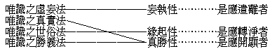



此中所云虚妄世俗与真实胜义法，各有四重。分列如下：



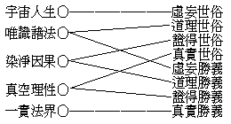



此中虚妄，是应解放应改善者；道理，是当了悟当通达者；证得，是有修行有成功者；真实，是无对待无变异者。随何一法无不如是，诸法宗主是唯识心；持此通轨，夫亦可以启信解而树行果乎？



如有颂云：『由彼彼遍计，遍计种种物，此遍计所执，自性无所有。依他起自性，分别缘所生。圆成实於彼，常远离前性。故此与依他，非异非不异，如无常等性；非不见此彼。即依此三性，立彼三无性，故佛密意说：一切法无性。初即相无性；次无自然性；后由远离前，所执我法性。此诸法胜义，亦即是真如，常如其性故，即唯识实性。』



六　悟了的解放的改造的进化的决择的唯识论



论曰：依本无漏种内因力，及闻学思量真唯识正理，熏习成种，积久粹熟，於唯识理渐能了悟。了达悟入，转益深切，於应解放应改造者，亦渐解放改造，谓解放悭贪、龉龊、瞋恚、懈怠、散乱、愚暗之六蔽，改造为施济、贤善、安忍、精进、定静、慧明之六度。由向来夹杂错乱染污缺漏罪恶者，而进顺於纯粹适当清净完全美善之真实理性化。以由了悟真唯识理之智为导首故，向开解超脱之大道前进，生生世世唯有进行而无退转，盖於是始有真正之进化；而前此则皆在循回之内，随业流转，系业受报，毫无自主之力、自由之分者也。故求进化者必於是，而求自由者亦必於是也。然是尚在浩茫无极之长途中，随顺唯识之真胜义以解除违唯识性之虚妄，积集顺唯识性之福智资粮耳。真积力久，明慧强盛，欲求实证真唯识性，遂起精严深重之胜加行：断然决然以择灭种种障真唯识性使不得契合之遮蔽，创兴深遍坚切之思考心，以寻求伺察一切法之名、之义、之自性、之差别，毕竟皆是强施设有，随情妄计了无有实。寻思益进，明明确确周遍了知一切法之名、义、自性、差别，真实唯识，离识非有。印持生命空、法性空、所取空之真胜义，然以犹带变相以观之故，虽以所观观为唯识真胜义性，尚未安住真唯识理。



如有颂云：『乃至未起识，求住唯识性，於二取随眠，犹未能伏灭。现前立少物，谓是唯识性，以有所得故，非实住唯识』。



七　实证的显现的超绝的胜妙的成功的唯识论



如有颂云：『若时於所缘，智都无所得，尔时住唯识，离二取相故。无得不思议，是出世间智，舍二麤重故，便证得转依』。



八　究竟的唯识论



如有颂云：『此即无漏界，不思议、善、常，安乐，解脱身，大牟尼名法』。



论曰：於此实证的唯识、究竟的唯识，尚为现代思潮所未能适应之事。亦为今吾觉悟所未能到达之境，照书宣布既嫌空泛，随念分别尤落玄远。然能善悟，则於宇宙的人生的唯识论，早实证之、究竟之矣。故兹但概括之，为尽美的、尽善的、无尽的、常住的、圆融的、安乐的、妙觉的、灵明的、自在的、真实的、不可思议的而已。内容如何，不复究论。



——十年二月在杭州幽冀会馆讲——



唯者，遮格拣除之义。识者，明了分别之义。离识非有，在识非无，立唯识名。即识之唯，离识无餘，故言唯识，是持业释。言三十者，为简二十，亦颂数名。合名唯识三十者，持业带数释也。又、唯识为所诠，论为能诠，云唯识三十之论，依主释；亦可谓带数依主释。又、唯识三十即论，持业释也。



又、明了分别之识有八：一、眼识，二、耳识，三、鼻识，四、舌识，五、身识，六、意识，七、末那识，八、阿赖耶识。眼识明了分别色尘，耳识明了分别声尘，乃至意识明了分别法尘，末那任运了别妄执内自我相，阿赖耶任运了别根身器界及种子。一切诸法，离识俱无。又有立六识者，即眼、耳、鼻、舌、身、意六识、如俱舍论。九识者，於八识外立第九庵摩罗净识，如梁朝真谛。本论则唯有八识，奘师谓第九祇是第八异名也。虽然，此皆依俗谛言，非真胜义。真胜义者，法即真如，平等一味，超过数量，非一非异，心言绝故，识且无识，八安有八？



又、唯识有四分义：所明了分别之色声等曰「相分」，能明了分别色声等者曰「见分」，同时证知能明了分别者缘所明了分别不谬曰「自证分」，更同时证知能证知心曰「证自证分」；四分义成，唯识安立。又相分、见分为用，自证分即其体也。又唯识者，有自性唯识——即心王有八，有相应唯识——即心所有五十一，有唯识所变——即色法十一，有唯识分位——即不相应行法二十四，有唯识实性——即无为法六。又有境唯识——教唯识、理唯识——，行唯识，果唯识之三义或五义。



又、唯识论有宗论、释论之别。宗论即本论等，释论即护法等十大论师相继所造之释论等。



世亲菩萨造。三藏法师玄奘译。



世亲，即天亲。菩萨，即菩提萨埵。菩提此云觉，萨埵此云有情。菩萨为自己已经觉悟之有情而又能觉悟其他之有情者，故即自觉觉他之义也。三藏，即经、律、论。能通经、律、论法，故曰三藏法师。玄奘、师之法讳，法师由梵士取归经论甚多，此论即译自梵来者。



护法等菩萨，约此三十颂，造成唯识论。



此为玄奘法师叙述之语。护法等者，等於亲胜、火辨、德慧、安慧、难陀、净月、胜友、陈那、智月十大论师，相继注释，显扬论旨。就中护法立义，尤为周足，故奘师宗之。



今略标所以，谓此三十颂中，初二十四行颂，明唯识相；次一行颂，明唯识性；后五行颂，明唯识行位。就二十四行颂中，初一行半，略辨唯识相；次二十二行半，广辨唯识相。



此即科判也，列表如下：——



　　　　　　　　　　　　　　　　　┌略论宗旨……………………由假说我法等  

　　　　　　　　　　　　┌略标识相┤  

　　　　　　　　　　　　│　　　　└彰能变体……………………此能变唯三等  

　　　　　　　　　　　　│　　　　　　　　　┌第一能变………初阿赖耶识等  

　　　　　　┌第一唯识相┤　　　　┌明能变体┤第二能变………次第二能变等  

　　　　　　│　　　　　│　　　　│　　　　└第三能变………次第三能变等  

　　　　　　│　　　　　└广明识相┤正辨唯识……………………是诸识转变等  

　　　　　　│　　　　　　　　　　│　　　　┌违 理 难………由一切种识等  

　　　　　　│　　　　　　　　　　└释诸外难┤  

　　　　　　│　　　　　　　　　　　　　　　└违 教 难………由彼彼遍计等  

　　　　科判┤第二唯识性………………………………………………此诸法胜义等  

　　　　　　│　　　　　┌资粮位……………………………………乃至未起识等  

　　　　　　│　　　　　│加行位……………………………………现前立少物等  

　　　　　　└第三唯识位┤通达位……………………………………若时於所缘等  

　　　　　　　　　　　　│修习位……………………………………无得不思议等  

　　　　　　　　　　　　└究竟位……………………………………此即无漏界等



又、按照佛教各宗共通之境、行、果、三种次第，以判摄此论之三十颂本，表举如下：——



　　　　　　　┌唯识相……………………………………前二十四颂  

　　　　唯识境┤  

　　　　　　　└唯识性……………………………………第二十五颂  

　　　　唯识行………………………………………第二十六二十七颂  

　　　　　　├─……………………………………第二十八二十九颂  

　　　　唯识果…………………………………………………第三十颂



谓外问言：若唯有识，云何世间及诸圣教说有我法？



问意在说有二字，谓说有则非无。世间说有之我，即情、命等；说有之法，即实、德、业等。圣教说有之我，谓预流、一来等；说有之法，谓蕴、处、界等。又我谓主宰，法谓轨持。主有自在力，宰有割断力；又主是体，宰是用、约主宰义故名我。轨范可生物解，任持不舍自相，约轨持义故名法。本论所说之我字，较金刚经所说之我相，范围宽广，正包含彼经所谓我相、人相、众生相、寿者相。所说之法，包含世间法、出世间法而言。



举颂以答。颂曰：『由假说我法，有种种相转，彼依识所变。此能变唯三：谓异熟，思量，及了别境识』。



由假说我法以下，答问之辞。由，即下所说之理由也。假说，假字有二义：一、无体随情假，本无自体，随情执有，世间我法，正复如是。二、有体强说假，唯识相性，众生迷惑，佛说我法，随位设施。种种相，即种种有情、命者、预流、一来之我相，及种种实、德、业、蕴、处、界之法相。转，有转变、转起二义。彼、指种种我相、法相。谓外问既有种种我法相转，究竟依何法得成？则曰：依识所转变而假施设也。



此能变之识，虽有八种，以类别之，则唯有异熟——第八识，思量——第七识，及了别境识——前六识之三种。及字，依六离合释，为相违释。又、第八识非绝对无思量及了别境之功能，不过在比较上其思量功能，不及第七识之胜；了别境功能，不及前六识之胜。第七识，亦非绝对无异熟性——第七识可有绝对无异熟性义——及了别境之功能；前六识，亦非绝对无异熟性及思量之功能。不过第七识之异熟性与其了别境功能，不及第八识与前六识之胜；前六识之异熟性与思量功能，不及第八识与第七识之胜耳。此中异熟、思量、了别境，皆依其性能之最胜者而立名也。异熟之名，较阿赖耶为广，较阿陀那为狭。



次二十二行半广辨唯识相者，由前颂文略标三能变，今广明三变相。且初能变，其相云何？颂曰：『初阿赖耶识，异熟，一切种，不可知，执受处，了，常与触、作意、受、想、思相应，唯舍受，是无覆无记，触等亦如是，恒转如暴流，阿罗汉位舍』。



前已举能变识之名，今次第明其义相。初能变阿赖耶识，亦译无没识。阿，译为无，如阿弥陀佛译为无量寿佛，阿耨多罗三藐三菩提译为无上正等正觉。又无没，约义不如藏义更深广。奘师译为藏识，以其具能藏、所藏、我爱执藏三义。能藏者，谓藏有世出世间、有漏无漏一切法之种子，有如大地藏有发生万物之种子也。所藏者，谓此识受转识所熏成种，随业受报也。我爱执藏者，谓有情之第七识执之为内自我体，念念不忘也。阿赖耶三藏之义，以我爱执藏为尤重要。此明其「自相」也。又、能藏含有因相之义，所藏含有果相之义。



第八识又名异熟，异熟之义有三：一、异类而熟，类、约性——性即善恶无记三性——言，熟、成熟义，谓因从善恶，果惟无记。二、异时而熟，谓因与果不同时，如春种秋收，今生作业他生受报。三、变异而熟，谓虽有业因，亦待缘起，由种成现，形量便异。异熟之义，以异类而熟、异时而熟为尤重要。第八为真异熟，由真异熟主体而发生前六识等之异熟，名异熟生。此名其果相也。



一切、为概括之辞，一切种者，谓世出世间诸法之种种不同，其性质皆决定於种种不同之种子，藏识中能发生一切法之功能力用，即谓之一切法之种子。此明其因相也。



以上阿赖耶、异熟、一切种，皆为第八识之异名。然尚有「阿陀那」、「庵摩罗」等各种名目，各名目意义，亦各广狭不同：——



　　　　│众 生 位│三乘圣位│佛　　位│  

　　　　│异　　熟│　　　　│　　　　│  

　　　　│阿 赖 耶│异　　熟│庵 摩 罗│



阿陀那、一切种，则通众生三乘圣及佛位。阿赖耶，在众生位有，三乘圣位——阿罗汉、辟支佛及八地上菩萨——已舍矣。异熟，众生位、三乘圣位俱有，佛位已舍矣；此时即名为庵摩罗识。



不可知者，谓此识所缘之五净色根，及诸种子甚微细；又所缘之外器世间，广难测量。而其能缘行相，亦极幽妙。执受处，此为所缘境。第八识有三种境界，即根身、器界、种子。而根身与种子为其执受，器界即处。又执受各有二义：——



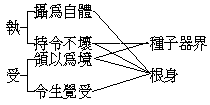



了、谓此识以微细了知为行相。



常与触、作意、受、想、思相应，此言其相应心所法，心所法即心之属性也。触，谓根、境、识三者相和合变异而生。作意，谓警动心中之种子而起现行。受，谓领纳顺境、违境、俱非境之乐受、苦受、舍受。想，谓心上所起之分齐相，即种种名言所依之而立。思，谓心上所起之行为力，即种种事业所由之而成。相应，有非一非异义，非一者，各有体相业用之不同；非异者，谓所缘之事同，与其性同——如八识为无记，心所法亦为无记——且起灭同时，行动一致。此皆就凡夫位上而言，若佛位则八识平等，惟有二十一种心所相应，即遍行五、别境五、善十一也。



唯舍受，此言第八识唯有舍受，无苦、乐故。无记，有有覆、无覆二种。无记者，不能以善恶记定之也。覆，即覆障，第八识因无覆故，能藏一切有漏、无漏种子。此亦就凡圣位言，佛位惟是善故。触等亦如是，此言第八识之相应心所，亦为无覆无记也。



恒转如暴流者，恒则非断，转则非常；恒故因果相续，转故因果变异。望前名果，望后名因，相对立言，喻如暴流。盖谓第八识自无始以来，一类相续，常无间断；亦念念生灭，前后变异。



阿罗汉，此言无生，烦恼不生名阿罗汉。舍，指初阿赖耶；异熟则至最后舍故。阿赖耶之我爱执藏过失最重，此位究竟尽也。三乘之声闻乘第四果，缘觉乘之辟支佛果，永断俱生我执；大乘菩萨八地以上，永伏俱生我执，皆名阿罗汉，舍阿赖耶之名。又如来位中并舍异熟识名，但名一切种识，亦名庵摩罗识，亦名大圆镜智相应心品也。



已说初能变相。第二能变，其相云何？颂曰：『次第二能变，是识名末那，依彼转，缘彼，思量为性相。



末那，梵语，此云意。但与第六识名同义不同：六识名意，依意之识，依主立名——即依第七得名。如舍利弗依母得名，然舍利弗与其母固非一人。七识名意，即意即识，持业立名——即自体之功能上得名。故二者同名而异体也。意，即恒审思量，此第七识，恒审思量业用胜餘七种识故。



彼，指阿赖耶识。转，谓变现生起。谓第七识以现行之阿赖耶识为根本依，以阿赖耶识中所藏第七识之种子为种子依。盖七八二识无始以来，同为恒常无间，互相为依。即第八识以第七识为俱有依，而第七识以第八识为俱有依。又七识依八识之自体分而转变生起。缘，谓缘虑。彼，亦指阿赖耶，但专指阿赖耶之见分。第七识所依之根，所缘之境，虽皆为第八识，但其缘为内我之专一境，非第八识之相分，不专一故；亦非第八识之自证分及证自证分，唯第八识自证知故。



思量为性相者，思有令心造作之业用，量有决定判断之智慧。性谓体性，相，谓行相。第七识恒审思量，恒无间断，审无犹疑。所思量者，唯取第八识之见分为内自我，体性如是，行相亦如是。又八识有思无慧，故恒而不审；六识有思有慧，但忽起忽灭，故审而不恒；前五识有间断、无分别，故不恒不审；惟第七识恒审思量，胜餘七识。



『四烦恼常俱，谓我痴，我见，并我慢，我爱。及餘触等俱。



烦、谓烦躁扰动，恼、谓恼乱身心。痴、即无明。见、即妄执。慢、即倨傲。爱，即贪著。我，包括人我法我而言。人我即执我为实在，法我即执法为实在。此我字，较上言——我法——之我字义更广。无明者，不明心之实相，因之生妄见——即我见。见者，执也，见解固定之意。由妄见，即有倨傲高举；由有倨傲高举，即生贪著，是故我执即烦恼之根本，亦可谓根本烦恼，即异生性。又爱即贪著，贪著与瞋相反，末那具我爱，故不具瞋心所。见即执著，执著与疑相反，末那具我见，故不具疑心所。此六根本烦恼中所以祇具四也。又第七识与第六识，俱有人法二我执，而根本则在第七识。众生有智愚、贤不肖之不同，即缘痴、见、慢、爱轻重多寡之有异；且染污清净，唯视七识之所转也。其餘相应之心所，则有触等五遍行，因其遍与八识心王相应故。有别境之慧，因七识能审故；及不信、懈怠、放逸、昏沉、掉举、失念、不正知、散乱——八种大随烦恼，因大随遍诸染污心故。



『有覆无记摄，随所生所系，阿罗汉、灭定、出世道无有』。



第七识，有四种烦恼常俱，故为有覆。其自体染污，不能谓之为善；亦不能谓之为恶，故为无记。以其现行染法所依之识，极微细故，无强计度，任运转故。第七识，随阿赖耶识所生何界，即於何界系缚，以其念念执阿赖耶为我故也。此即根本无明，无始以来迷惑真性，随生界地，依托藏识不相舍离。此第七识，恒审思量，妄执有我，至无生之阿罗汉位，方得永断；灭定位中伏现行，此识暂伏；出世道中初转智，此识亦暂伏。



如是已说第二能变。第三能变，其相云何？颂曰：『次第三能变，差别有六种，了境为性相，善、不善、俱非。



此言第三能变差别有六种也。六种、即眼识，耳识，鼻识，舌识，身识，意识。此各识皆依主立名，如眼识以依眼根而发识，耳识以依耳根而发识等。境，即六尘境界，六尘即色、声、香、味、触、法。六识各有自分境界，亦各了别自分境界，如眼识不能了声尘，耳识不能了香尘等。因六识同以能了别之功能胜，故总名了别境识。亦有名六识为色识，声识，乃至法识等者，此为依士释。依根名识，根为八识所变相分，胜故为依主；依尘名识，尘为六识自变相分，劣故为依士。又其体性、行相，皆为能了别尘境。善、不善、俱非者，俱、指善、与不善。俱非，即无记。六识通於善、不善、俱非三性。当其与善心所相应而起即为善，与不善心所相应而起即为不善，与俱非即为无记。但第六识最强而有力，无所不能，无所不为；前五识随从第六识之善与不善或无记而造业，故能使前五识有三性者力在六识。



『此心所遍行、别境、善、烦恼、随烦恼、不定，皆三受相应。



此者，统六识言。遍行，谓遍行一切心王，遍行一切界地，遍行一切性。别境，谓特别境界。善，谓能为现在将来自他顺益者。顺、即与本性如来藏相顺，益、即开显本性如来藏。善有无漏、有漏之别，众生因七识执我，所为善业亦带有染污，谓之有漏善。至破我执后，本地清净，则谓之无漏善。烦恼，谓烦躁扰动、恼乱身心。随烦恼，谓随根本烦恼而有。不定，谓不定三性。又、随烦恼有小、中、大三种。小随烦恼，谓忿以下十个，业力最猛，通恶性不通无记性，力强而狭，故名小随。中随烦恼，谓无惭、无愧，不通无记。自类相通，比小随较广，故名中随。大随烦恼，谓通恶及无记性，且恒与根本烦恼相应，故名大随。



受，有忧、苦、喜、乐、舍之五种。在心为忧，为喜；在身为苦，为乐故。又名三受者，六识皆能领纳违、顺、俱非境相，故三受相应。



『初遍行触等。次别境谓欲、胜解、念、定、慧，所缘事不同。



遍行，已详初能变中，故言触等以略之。



别境所缘事实，各有不同。欲、即希望，谓於爱境希望其合，於恶境希望其离。胜解、即明确见解，有审决无犹豫。念、即忆过去之境，记取往境，分明不忘。定、即专注一心不乱，有如承蜩。慧、谓推求简别，微细分析，了然决定。以上五种所缘，各有别境之不同也。



『善谓信、惭、愧、无贪等三根、勤、安、不放逸、行舍、及不害。



信，即信实、德、能。实者，有实事实理二义。实事如法界因果，实理如唯识相性。德者，真净之德。能，广大功能。信实、德、能，即为善法之根。惭、即依自法力，崇重贤善；愧、即依世间力，轻拒暴恶：皆能止息恶行。无贪等者，等无瞋、无痴。根、谓其生善一切最胜，如木之根底，干枝花叶即由之而发生也。无贪者，於有——即欲界、色界、无色界三界有果，有具——即欲界、色界、无色界三界有因，厌离而无爱著。无瞋者，於苦——三界苦果，苦具——三界苦因，不生瞋恚。无痴者，即无无明，於诸事理分明了解。勤、亦名精进——即六度中精进波罗密——即未生善令生，已生善令广，未生恶遏令不生，已生恶断令不续。安、即轻安，谓离三毒麤重昏懵如释重负，身心轻快安隐堪行善行。谓修禅定，能令所依止麤重身心，转为轻安畅适。不放逸，於所断恶防令不起，於所修善引令增长，善恶之外亦对治无记。行舍，谓由精进力舍贪、瞋、痴，令心平等正直，任运入道。此舍非受之舍，即金刚经心无所住，不依断、不依常、亦非依有、非依无等修禅定般若，念念舍之即念念行之；如行道然，不舍前步则后步不进。不害，即悲愍众生不为损恼，亦即大悲。



『烦恼，谓贪、瞋、痴、慢、疑、恶见。



此即根本烦恼，为诸随烦恼之根本，为二种生死之根本。有六种：贪，爱欲为因，爱命为果，所谓於有、有具，耽染爱著。瞋，以贪为根，遇有逆境，憎嫉忿恚，所谓於苦、苦具，瞋恚恼闷。痴、即无明，有二种：一、根本无明，不明心性而生法我二执，多迷谛理，谓之理痴。二、枝末无明，不明因果而生邪见恶见等，多迷事相，谓之事痴。慢著，谓我慢。慢有七种：慢——於劣计己胜，於等计己等，令心高举；过慢——於等计己胜，於胜计己等；慢过慢——於胜计己胜；我慢——於五取蕴，随观为我或为我所；增上慢——於未得增上殊胜七证法中，谓我已得；卑慢——於多分殊胜，计己少分下劣；邪慢——实无德计己有德：是皆以我慢为主。疑、谓狐疑不信，无决定见，约依六事而生：一、闻不正法，二、见师邪行，三、见所信受意见差别，四、性有愚鲁，五、甚深法性，六、广大教法是也。恶见、亦名不正见，有五种：一、身见，即萨迦耶见，执身为我。二、边见，即我见增上之力，随彼所执起断常有空见。三、邪见，不信正法，此见如增上缘，四见所不摄者皆此见摄。四、见取，偏执己见。五、戒取，持牛狗等戒及彼所依诸蕴。



『随烦恼，谓忿、恨、覆、恼、嫉、悭、诳、谄、与害、憍。



此为十小随。言随者，以随他根本烦恼而生。随有三义：谓自类俱起，遍不善性，遍诸染心。具三名大，具二名中，俱无名小。忿等十法，行相麤猛，各自为主；然唯於不善心中各别而起，若一生时必无第二，故名为小。一、忿者，愤怒发起，能生暴恶，瞋一分摄。二、恨者，先有忿恨，怀恶不舍，亦瞋一分摄。三、覆者，自己罪恶，隐藏遮护，痴一分摄。四、恼者，忿恨在先，触违发怒，亦瞋一分摄。五、嫉者，不耐他荣，因生嫉妒，亦瞋一分摄。六、悭者，耽著财法，秘吝不舍，贪一分摄。七、诳者，以诈欺人，矫现获利，贪痴二分摄。八、谄者，巧言令色，阿谀曲媚，亦贪痴二分摄。九、害者，逼害有情，无悲无愍，瞋一分摄。十、憍者，矜高自恃，醉傲凌人，贪一分摄。又、憍有七种：即无病憍，少年憍，族性憍，色力憍，富贵憍，多闻憍。



『无惭及无愧。



此为中随二。二法皆自类俱起，但遍不善性，不通有覆，故名中随。无惭者，不自羞耻，轻拒贤善。无愧者，不羞於人，崇重暴恶。经云：『有二句法，能救众生，一、惭，二、愧。惭者，自不作罪；愧者，不教他作。惭者，内自羞耻；愧者，发露向人。惭者羞天，愧者羞人』。



『掉举、与昏沉、不信、并懈怠、放逸、及失念、散乱、不正如。



此为大随八。八法自类俱起，遍不善性，不可名小；染心皆遍，不得名中。二义既殊，故名为大。掉举，轻举妄动，令不寂静。掉举有三：身掉举乱动，口掉举乱言，意掉举乱思。昏沈，昏昧沈重，无所堪能，有深浅轻重之不同。不信，无有诚信，不起乐欲。懈怠，懒惰成性，无精进力。有我执即有身心之相，故有懈怠。放逸，放荡纵逸，不自简束，六根放逸，善损恶增。失念，忘失正念，心有散乱，不知不觉之念忽起忽落。散乱，驰散外缘，流荡忘返。如坐禅时，心念纷飞，攀缘外境，失其正念，此为散乱。不正知，谬解观境，不了实相，若事若理若因若果，不能真实了知。



『不定，谓悔、眠、寻、伺、二各二』。



不定谓通三性。悔，亦谓恶作，已作未作，事后追悔。眠，意识昏熟，心极暗劣。寻、谓寻求，但求其概，逐外粗相。伺、谓伺察，微细考察，伺内细境。粗者、聊且之辞，细者、绵密之谓。此二并用思、慧一分为体，於意言境，深推曰伺即思，浅推曰寻即慧。深推则神凝，故身心举安；浅推则躁动，故身心不安。若离思、慧，此二差别便不可得。二各二者，悔、眠为一类，寻、伺为一类，言二类各有二种；亦可谓二类各通善染二性也。



已说六识心所相应，云何应知现起分位？颂曰：『依止根本识，五识随缘现，或俱或不俱，如涛波依水。意识常现起，除生无想天，及无心二定，睡眠与闷绝』。



此明前六转识现起分位。依者，依之而起，依之而存在。止者，止宿。根本识，即初能变阿陀那识。阿陀那、此云持，能持一切法之自性自相令不失坏。前六识以阿陀那识为共同依，即以阿陀那识为其不起现行之种子所止宿之处。



缘，有因缘、增上缘、所缘缘、等无间缘之四种。识之生起现行，必待众缘具足。如眼识，须具明、空、境——即所缘缘、作意、根——俱有依、意识——分别依与五识共同而起、末那——染净依、种子——因缘、本识——根本依等九缘。复有等无间缘，为各识之开导依。耳识有八缘，唯除明缘。鼻、舌、身七缘，除空、明二缘。六识有五缘：一、根缘，二、境缘，三、作意缘，四、根本依缘，五、种子依缘。七识有三缘：一、根缘，二、作意缘，三、种子缘。八识有四缘：一、根缘，二、境缘，三、作意缘，四、种子缘。五识所藉缘多，所以有间断，俱则生不俱则不生。水、喻根本识，波涛、喻前五识。前五识之依根本识而起，必待众缘具足，正如波涛之依水而起，有待风动之缘。第六意识，待缘既少，故常得现起。但无想天、无想定、灭尽定、睡眠、闷绝之五位中意识不起。



已广分别三能变相为自所变二分所依，云何应知依识所变假说我法、非别实有，由斯一切唯有识耶？颂曰：『是诸识转变，分别、所分别；由此、彼皆无，故一切唯识』。



三能变相，即指三能变识之自证分。所变二分，即相分、见分。言自所变相分、见分皆依自证分而起，即自证分为相分、见分所依也。是诸识、指三能变及其相应之心所法。转变者，谓一一法之自体，皆能变似相见二分，即由识之种子起现行之相。分别、指所变见分，所分别、指所变相分。由此正理，彼实我法决定非有，是故一切世出世间有漏无漏之法，无不唯识。



若唯有识都无外缘，由何而生种种分别？颂曰：『由一切种识，如是如是变，以展转力故，彼彼分别生』。



问：若唯识无境，由何而得种种心生？既无外境牵心，心识缘何而起？答：由一切种识、即第八根本识，含藏各识及诸心所法各各亲种子，由此一切种子熏习生长乃至成熟，转变不一。如眼识从亲种子变生眼识现行，能分别色。耳识从亲种子变生耳识现行，能分别声。乃至身识从亲种子变生身识现行，能分别触。六、七、八各识皆然。又一切识之生起，不外因缘：——



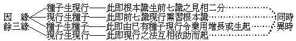



展转，有互相为缘互相辅助之义。彼彼、即种种，谓八种识及诸心所法。分别生，即言分别所分别之见相二分由此而生。此颂与下颂义，唯识二十论详言之，可参阅。



虽有内识而无外缘，由何有情生死相续？颂曰：『由诸业习气，二取习气俱，前异熟既尽，复生餘异熟』。



问：若无外缘内心不起，内心不起业无自生，何以世间有情生死相续？答：有情生死相续，皆由内之因缘。诸业，谓福业——自体及果俱可爱乐，相殊胜故；非福业——自体及果俱不可爱乐，相鄙劣故；不动业——具业多少，住一境性不移动故，习气，谓熏习——亦即结习，即种子——气分。二取习气，即指我执取、名言取。此二取，俱有执著义。计有四种：一、取相分见分，二、取五蕴名色，三、取心及心所，四、取本末，本即第八识总报，末即前七识别报。彼四种所取，皆是我执名言二取所摄。又诸业习气内，具有二取习气。二取习气，有如灰土；诸业习气，有如泥团。泥团能摄灰土，诸业习气亦摄二取习气。即分散为二取，和合为诸业。俱，谓业种与二取种俱，是亲疏缘互相助义。前异熟，谓前一生乃至前百千生，业力所感之异熟果。餘异熟，谓感后一生乃至感后百千生业力之异熟果。盖三界内分段生死，由有漏善与不善之业种子为因，烦恼障种以为助缘，招於六道身命麤异熟果，前尽后生。即三界外不思议变异生死，亦由无漏有分别业种子为因，所知障种以为助缘，感於三种意生身细异熟果，前后改转。是则二种生死，皆由内识惑业所感，固无藉乎外缘也。



若唯有识，何故世尊处处经中说有三性？应知三性亦不离识。所以者何？颂曰：『由彼彼遍计，遍计种种物，此遍计所执，自性无所有。依他起自性，分别缘所生。圆成实於彼，常远离前性。故此与依他，非异非不异，如无常等性；非不见此彼』。



问：若唯有识，经不应说有三性！答：言三性者，亦不离识。三性即下言遍计执性，依他起性及圆成实性也。彼彼、犹言种种，遍、周遍，计、计度。即依见相二分，加以刻畫计度，宇宙万有由此而著。此妄执自性差别，名为遍计所执自性，如是自性，空无所有。又、遍计执性，或言：八识皆有，因八识皆具见相二分，而此遍计执性即为於见相二分上有分别故。然第八识及前五识，非能遍计。或谓：惟六识有遍计执。然执性毕竟起自末那，故护法言：遍计执性，唯於第六第七心品有之。盖见相二分是依他而起，由依他起性虚妄执著，即为遍计执性矣。如黑夜见树，执以为鬼，毕竟非有。他、指众缘，依他、言仗因托缘，如眼识九缘生，耳识八缘生等。分别、言明了分别之识。生、即众缘之集现。谓此心心所法及见相分有漏无漏，皆依众缘而生起，悉由识心分别而显现。如黑夜见树，形相实有。圆、谓圆满，成、谓成就，实、谓真实。彼、指依他起性。前性、指遍计执性。言此圆满成就真实之法，体非虚妄，即於彼依他起性上常远离遍计性。如枯树非鬼，鬼无树有。



此、指圆成实性。非异者，圆成实之真如，即依他起之实性。非不异者，依他起为一切有为之法相，圆成实乃一切无为之法性。无常、即生灭，性、即真理，等者，等於无我。言一切生灭之法，各有差别之相，亦共有无常、无我之性。共有无常等性，所以非异；各有差别之相，无常自无常，法自法，所以非不异。此、指圆成实性，彼、指依他起法。非不见，犹言见也。即言非不见圆成实性，而能见依他起性。又、圆成实性，义较真如为广，即果位中有为无漏之法亦属之。更分判如次：——



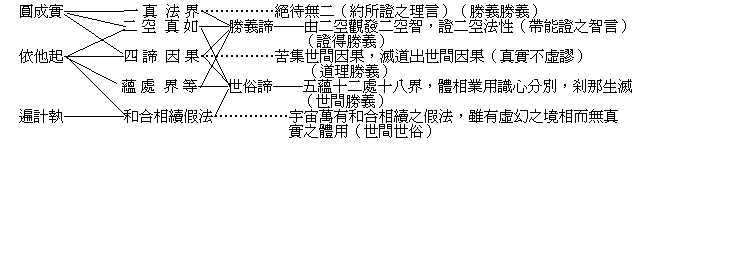



若有三性，如何世尊说一切法皆无自性？颂曰：『即依此三性，立彼三无性，故佛密意说：一切法无性。初即相无性，次无自然性，后由远离前所执我法性。



问：若有三性，世尊何以说一切法皆无自性耶？答：无性即识性。言即依此三性立彼三无性名，为遣执故也。密意者，方便之谓，有含而未露、说而未尽之意。为开悟故说有三性，表诠以表示自性；为遣执故说三无性，遮诠以遮拨自性。此方便立言，非了义之极谈也。相者，对待之假相，有分限、有边际、一切名言由此安立。而分限边际之假相即由周遍计度之所生，体相非有，如空中华，故立相无性。自然者，本来如是之谓，依托众缘而起则非本来如是可知，故立无自然性——即生无性。后由远离前——指遍计执性——所执我法性者，言从本以来，不与遍计执性相应，故立胜义无性——即真如无性。



『此诸法胜义，亦即是真如，常如其性故，即唯识实性』。



此、指圆成实性。胜义、第一最真实之义。言圆成实性为诸法中第一最真实之义。真如者，不虚妄之谓真，遮遍计执虚妄之法；不变异之谓如，遮依他起生灭之法。即无有一法可取为真如之相，亦无真如之名可立。起信论云：『言真如者，亦无有相。谓言说之极，因言遣言，此真如体无有可遣，以一切法悉皆真故；亦无可立，以一切法皆同如故。当知一切法，不可说、不可念，故名为真如』。常如其性，言真实而不虚妄，如常而无变易，随缘不变，不变随缘，故此为识之实性也。



后五行颂，明唯识行位者，论曰：如是所成唯识相性，谁依几位，如何悟入？谓具大乘二种种性：一、本性住种性，谓无始来依附本识，法尔所得无漏法因。二、习所成种性，谓闻法界等流法已，闻所成等熏习所成。具此二性，方能悟入。



言上已明三能变及相分见分等唯识之相，与诸法胜义及真如等唯识之性。相即事，性即理，事理已俱明矣。问：如此唯识相性，谁人悟入？几位悟入？如何悟入？大乘之大，简别之辞，以遍常为义。如起信论所谓：体、相、用之三大。乘者譬喻之名，以运载为义。如起信论谓：过去现在诸佛，曾从凡愚地由运载以至大觉地故；现在未来诸觉有情，皆由运载以至如来地故。种性，犹言种类，即种子类别。本性住种性，即本有之大乘佛性，起信论所云之「本觉心」是也。无始来依附本识法尔所得无漏法因，犹言无始以来根本识本具法尔所得——法有轨持之义，尔者如是之谓，得者成就之义——无漏法因。漏有破败不完美之义，亦即烦恼生死，烦恼业上之有漏，生死果上之漏。无漏法，即诸佛究竟无上菩提、涅槃。习所成种性之习，即熏习，熏习所成之佛性，起信论所云之「始觉心」是也；闻法界等流法已，闻所成等熏习所成。法界、即一真法界，即事理法界，亦即唯识相性之现量证境。等、谓同等，流、指佛所说经、菩萨所造之论皆从法性流出。即言闻佛所说经、菩萨所造之论熏习而成佛性。具此本因、熏习二性，方能悟入唯识相性。悟、有渐悟、顿悟之别，此中所言即为顿悟。盖由唯识相性之教，解唯识相性之理，修唯识相性之行而证唯识相性之果也。



何谓五位？一、资粮位，谓修大乘顺解脱分，於识相性能深信解。其相云何？颂曰：『乃至未起识，求住唯识性，於二取随眠，犹未能伏灭』。



资、谓资具，粮、谓糗粮，譬喻之名也。谓此位顺大乘法性，修十波罗密降伏惑业，於唯识性相信心成就，能分明现前了然不昧。解、即胜解，亦即理观忍可。此颂，言资粮位分际及其功行。资粮位，包括十住——理观，十行——事观，十回向——理事不二之三位。乃至云者，承上而言，有超略初住至第十回向意。未起识，犹未证得唯识性相，即未证得真如。然已发深固大菩提心，求住唯识真胜义性。二取、谓能取、所取，即见相二分之功用。能取为我执，所取为法执。随眠、能随起现行眠息种子，此位尚未能摧伏断灭随眠种子，但能伏分别二执之现行耳。



二、加行位，谓修大乘顺决择分，能渐伏除所取能取，引发真见。其相云何？颂曰：『现前立少物，谓是唯识性，以有所得故，非实住唯识』。



加行位者，加力进行，谓菩萨先於资粮位善备福德智慧，顺解脱分亦既圆满，为入见道住唯识性，乃加力进行。顺大乘法性，起决定选择之真见道出世慧。於此有煖、顶、忍、世第一等四法。此四法，依四寻思、四如实智之初位后位而立。即寻思能诠之名言，寻思所诠之义相，寻思名言义相之自性，寻思名言义相之差别，一一假有实无。若能如实遍知此四离识非有，及知能取之识亦复如是，即转名如实智。煖者，依明得定发下寻思，观无所取。即名无得物之功，故名是假有，物无当名之实，故义是假有。名义之自性既非实有，则名义之差别亦岂实有，皆是随心变现施设而已。以此寻思，历观蕴处界等若名、若义、若自性、若差别皆不可得。此即是慧日道火前相，能破众生长夜迷暗执著。顶者，依明增定发上寻思，数数修习所取实不可得之观，令其增盛，如登山顶周观无碍。忍者，依印顺定——印前所取空，顺后能取空，名印顺定——发下如实智，於无所取决定印持，无能取中亦顺乐忍；既无实境离能取识，宁有实识离所取境，所取能取但是相待立故。印顺忍时，印前所取空，顺后能取空，立印顺名，忍印取境之识亦空。大乘止观云：『疆观诸法唯是心相虚状无实，复当观此能观之心亦无实念』，正同此中四加行观。世第一者，依无间定发上如实智，双印能所二取皆空。前上忍唯印能取空，今世第一法二空双印，从此无间必入见道，故立无间名。异生法中此最胜故，名世第一法。如实智之后位，故名为上。前忍位中，下忍印所取空，中忍顺能取空，上忍印能取空，今乃二空双印，必入真见道也。如是煖、顶，依於能取之识、观所取之境本空。下忍起时印境空相；中忍转位，於能取识亦如境之是空，顺乐忍可；上忍起位印能取空。世第一法，双印空相。此唯识观之行相，入真见道之司南也。



立少物，少物即空。基云：『心上变如，名为少物』。学记解云：『见所执无即如相现，犹如穿壁虚空现故』。如显扬云：『彼二我无，即是二无我有』。又佛地论明遍计言：『心所现无，依他起摄；真如理无，圆成实摄』。是则所执空影名变如相也。谓诸菩萨於此四位，犹於现前安立少物，谓是唯识真胜义性。以彼空有二相未除，带相观心，有所得故，非安住真唯识理也。盖煖位、顶位依识观空，则境空识有；下忍印成境空，上忍印成识空，世第一法，双印二空，皆带空相，未得全除。彼相灭已，方实安住真唯识理，名通达位。如手虽不取物，尚留一空拳。



三、通达位，谓诸菩萨所住见道，如实通达唯识相性。其相云何？颂曰：『若时於所缘，智都无所得，尔时住唯识，离二取相故』。



悟入唯识实性，即体会真如，名通达。见道明照真理，略说有二：一、真见道，是无分别根本智。二、相见道，是有分别后得智。前真见道、证唯识性，后相见道、证唯识相。根本智，有见分无相分，挟带体相不变相状故；后得智，见相二分俱有，变相观真，分别说法故。此位菩萨於所缘境，无分别智都无所得。因无智外之如为智所证，亦无如外之智能证於如——此即证得真现量——，尔时乃名实住唯识真胜义性。即证真如，智与真如平等平等，俱离能所二取之相，不同有所得心分别戏论所现相也。



四、修习位，谓诸菩萨所住修道，如所见理数数修习，伏断餘障。其相云何？颂曰：『无得不思议，是出世间智，舍二麤重故，便证得转依』。



以前所体会唯识实性，数数修习无分别智，摧伏断灭无始俱生之我法执。无得者，远离所取，亦离戏论。不思议者，远离能取，妙用难测。出世间智、即无分别智。二取之随眠，是世间之本，唯此无得不思议智乃能断之。二麤重、即二障种子，以其性无堪任，违於精细轻安之无漏法故。依、谓所依，即根本识，依他起性与染净法为所依故。转、谓於依他起中染净二分中转舍染分，转得净分；即转舍依他起上遍计所执，转得依他起中圆成实性。亦即由转烦恼得大涅槃，转所知障证无上觉。盖烦恼、所知二障种子，皆根本识之所执持，菩提、涅槃二转依果，亦根本识之所本具也。



五、究竟位，谓住无上正等菩提，出障圆明，能尽未来化有情类。其相云何？颂曰：『此即无漏界，不思议、善、常、安乐、解脱身，大牟尼名法』。



究竟位、即唯识果，无上正等菩提、即阿耨多罗三藐三菩提。以一真法界清净为体，以四智——成所作智、妙观察智、平等性智、大圆镜智——为用。障，指二障、三障。无漏界，性净圆明，即佛界。不思议，超过寻思言议道故。善，白净法性。常，无生无灭，性无变易。安乐，众相寂静，永离违害。解脱身，永远离烦恼障缚，即大自在我，时空无碍。大牟尼，大觉世尊，成就无上寂默法，谓永寂二边，默契中道也。法，即法、报、应三身。法身，名自性身，即一切法平等实性；报身名受用身，有自受用身、他受用身；应身名变化身，即随类化身。



（附注）海刊原题「唯识三十论纪闻」，今依法相唯识学本改。



唯识三十论讲要



——二十年二月在厦门涌莲精舍讲——



此论是世亲菩萨造，三藏法师玄奘译。关於他们的历史，研究佛学的人，大概都是知道的，所以现在略去不谈。此论共计有三十颂——在印度四句为一颂，好比中国之诗，故此论是用一百二十句的五言句之所构成的。但唯识、另外有二十三颂而举其大数言之的二十论，及其餘唯识义章等，拣别此唯识是三十颂论的一种，故名三十论。此论、无论字面和内容，所发挥者都在唯识，所以叫他做唯识论。佛典原来有经律论之三藏；此论不是经和律，而是摄在论藏中的论，故名曰论。



关於唯识之所以然的道理，原是在本论颂文中正要说明的，不过在未说明之先，应当把平常人对於唯识一名所生的误会和谬解，下一个明白的纠正。



「识」：通俗所云知识之识，心理学上知识与感情、意志等对举之识，皆不过识的一部分，不足以尽唯识之识义，而且相差甚远；虽哲学上「知识论」之识义，亦非唯识论所明广义的识。唯识论所明之识，如一个具有组织的国际世界。盖每个人或每个有情，他的精神界——即心界——不是简单的，是由很多的复杂分子组织成功的，所以他是国际的集团，不是孤立的个体；犹之乎现今的人群世界，是有许多的国家民族组织成功的样子。唯识的本身有八：譬如八个精神的王国，八识正是统治此八国之八王；故无论一个人或一个有情，必定各有他们的精神界统治之八识。但识为能统治之王，既有能统治之王，必有所统治之臣民，若没有臣民被王所统治，便不成其为王国的王了。故凡是精神王国，一定有能统治之王与所统治之臣民——心所在内。不但此也，此王国君臣所管领之海陆动植——根身器界，以及一切风俗、习惯、文化、法度、分限、部位——不相应行，乃至天空——法性等亦在内。故每个人或每个有情，他的国际组织之精神世界，确如一个总聚的大集团。识虽祗是各王国中的各王，然举王则全国乃全国际，无不统摄在内。



「唯」：谓独或但。若照字义讲起来，则上头所说的广义之识既不能成立，盖既是独但有识，则识便不成王国的王，而王国的一切亦将无从安立。所以此唯识之「唯」，决不能仅在字面上看成独但之唯。此唯字的意思，即是说：凡宇宙一切所有，都不离识的关系和不出识的范围。若照这种意义说起来，则唯识云者，不过说识能统摄万法，而万法可归纳在识中罢了！至此，对於唯识字义之误会已解除，而唯识之正义亦以略明了。唯识说一切法不离於识，虽重在说明一切法是识变起的或随识转变的，然并不是否定一切法有存在的可能，不过说他们不离於识或依识所变耳。



唯识实是遍於万有诸法的，但为什麼一定要把一切法都归纳到识上去？讲明唯识对於人生究竟有什麼利益？兹试约略分言之：若了解万有诸法时时刻刻都不离识的影响和受识的变化，而识又即是各人的自心时，则各人便皆可以有解决现实界苦痛的能力。盖我们人类与一般的有情，对於这个现实世界——即宇宙自然，的确有许多不可避免的痛苦。就人类而言，明明就有三重的压迫：——自然，人为，个己。就自然界而言：有寒、热、风、雨、等种种的灾难，这是自然界所给我们的苦痛。再就人为界言之，其苦痛更多：如社会上之习惯束缚，人与人间的罪恶等。三、就个人的自身，又有饥渴、劳顿、病苦、死亡等。其他缺点尚多，若不明唯识，则便有如下四点的过患：



第一点：是悲观者流，看见这现实世界这许多的苦痛，彷佛都是固定而没有法子可以去改善，由是悲观厌世甚至自杀。第二点：是对於现实世界生了满足之想的人，由是便没有去谋所以改善进步之要求，而醉生梦死其中。第三点：有人以为在我们的现实世界之外，另外有个规定命运者，故向之乞怜哀求，因以产生神教去求神拜上帝。第四点：认我们自身之外，有一种势力使我们痛苦而向之争斗者，如古代之宗教有光明与黑暗争，现在唯物史观的学者之阶级斗争。亦是认定我们外边有些东西使我们苦痛，故极力向之争斗。



以上四点，若以佛法眼光看来，都是与事实真理不相符合，而其办法亦绝对不当，不但不能令人生世界改善进步，将反由错误之结果而更增加痛苦。佛法为要使人离去如上诸种错误而获一解除痛苦的进善人生之道，故有说明他的必要——唯识。唯识对於宇宙人生，的确有很高很圆满的改善进步的说明，要知万法——苦痛亦在内——都离不了识之关系，同时且多随识转变，而识又即是人人可以自觉自动的；则讲明了唯识，即没有什麼不可解决的了。



以上明唯识名义及其宗旨的大略竟，以下解释论颂。



此论的三十颂原是世亲菩萨造的，但后来经了护法等十大论师的解释，故有如次之分段：初二十四颂明唯识相，次一颂明唯识性，后五颂明唯识位。就二十四颂中，初一颂半略辨唯识相，次二十二颂半广辨唯识相。略明唯识相中，先假设问答以发端。外人问曰：若唯有识，云何世间及诸圣教说有我法？举颂答他：



由假说我法，有种种相转，彼依识所变。此能变唯三：谓异熟，思量，及了别境识。



此即外人对於唯识所生之误会也。此中的内外，是论主假设的，内是大乘佛教，外包小乘及世间一般的有识人等。问者的意思是这样的：既然说唯有识，为什麼世间的及佛的圣教上又说有我有法呢？遂以颂答他。假、谓假托而说的，一切诸法并不是离了识另外有个我、有个法可以给我得到，不过是假托识之所变而叫做我和法而已。



假有二义：一、「无体随情假」，执有实我实法谬妄之情意而说的，实在是如龟毛兔角而毫没有体性的。二、「有体施设假」，这是有体的事实，这正是指的那不离识的关系而是识所变的，虽然用我或法的名义来施设假说，但仍不出识的范围，故不是妄情所执之无法，而是由依识所变之有体法，故名有体施设假。



但此中所云之我，与平常所说之我不同。此中所说之我乃是人格之义，金刚经上所说之我、人、众生、寿者，以及有情、庸人、贤人、圣人，推而上之连佛亦在内，故此我乃是人格的代名词。法，如世所云之物，广义之法如心理、生理、物理皆在法之范围之内，故法可概括一切「非人格」的东西。如佛学上地、水、火、风、色、声、香、味、触、法、眼、耳、鼻、舌、身、意等，都叫法。



转，有转变、转现二义。相，不是形相之相，这如科学、哲学之「概念」，即义的意思。如说物有物之概念，人有人之概念；又如说有人格之我时，即随其所说而转变其义相。又转相即显现之谓，因为说了我法，而我法即随之而显现，由思想言语而施设我法，由是转现我法之相。为要破除执著离识以外有实在我法的妄执，故举「彼依识所变」一句来喝破他！彼，即是上头之种种我法相。依，谓若我若法都是依识而变的，以下各颂中有很详细的解释，凡是有知觉或知识生起的时候，都有能知觉与所知觉之二面，在唯识论上说起来：能知觉的即是「见分」，所知觉的即是「相分」。谓依识所变见分，假说种种我而转成种种我相；依识所变相分，假说种种法而转成种种法相。而此能变之识，初即异熟，次即思量，后即了别境之三，了别境包括眼、耳、鼻、舌、身、意六识，其名义待到下文解释。



今於略明识相后，以二十二行颂广辨唯识相——广明其义。此中略分三段：第一明三能变，第二正成唯识，第三广释妨难。第一又分三段：一、明初能变。颂文：



初阿赖耶赖，异熟，一切种，不可知执受处、了，常与触、作意、受、想、思相应，惟舍受，是无覆无记；触等亦如是。恒转如暴流，阿罗汉位舍。



此中共十句，两个半颂。阿赖耶，异熟，一切种，即是初能变识的三个专有名词。在三相中，阿赖耶属自相，论中说『摄持因果为自相故』，但又可名「本相」或「总相」。阿赖耶，翻译做「藏」，义如大藏经之藏或库藏之藏。据梵文，又可译处所之「处」；如喜马拉雅——赖耶——山亦梵音「雪处」之义，古名雪山，即以其为积雪之处故。藏有三义：一、「能藏」，如茶杯能盛茶，茶杯为能藏，而茶为所藏；此识亦复如是，能藏一切诸法种子，故一切种即为此识所藏。二、「所藏」，第八识所变起之根身器界，以及所现行的前七转识及一切诸法，皆以第八识为所藏。——注意：一切种虽不离第八识，然已是第八识中的能生万法功力，故言识的时候，读起来不能将识字略去，应读为一切种识，若单读一切种，则便不是能藏识而成所藏种了——。三、「执藏」，即我爱执藏，此正相当於处字意义，即我所执之处，故亦可名我爱执处。末那识中有我痴、我见、我慢、我爱，我爱执藏，即此识为末那之我爱所执藏也。总之，据自相言，名阿赖耶识。据果相言，名异熟识。据因相言，名一切种识。



异熟，原是据果而命名的，佛学言果有五种：即等流，异熟，增上，士用，离系等五果。前四为世间共果，后一为唯出世圣果。盖离系果最低限度，证入阿罗汉位始能获得此果，他是不与异生——凡夫——共有的。但在世间果上言，异熟果亦甚普遍，如有机之根身，无机之器界，其中一个一个的有情，一类一类的世界，俱可名之为异熟果。但此果不惟第八识有，即前六识亦有异熟果的性质，不过是异熟生，不是真异熟识罢了。故在此识的果上讲，可以云十之八九都是异熟性的果。不过第八识上的异熟果为最根本者，以内之根身、外之器界、乃至前六识之异熟生者，皆以第八识异熟为根本故。熟谓成熟，如生米煮成熟饭，此中有三义：一、「异时而熟」，如造因在前，得果在后，此果与因，在时间上有相当之距离。我们在果上看不到因，因上亦看不到果，因为如此，故常人误认得果为自然，以为一切诸法，皆是偶然凭空而来，在印度名自然外道。其实这些在佛学上讲起来，现在所生之果，都离不了先业之作因。有些果在因上可以明白看见的，乃属於士用果等者。二、「变异而熟」，成果之时，果异於因，因为从因至果，无论在空间上、时间上皆经了许多的变异——果不似因，因不似果。三、「异类而熟」，类为分类，在佛法用伦理学上的道德性，把一切诸法分为四类，即善、恶、无覆无记、有覆无记。此中有覆无记者，即是有染污法覆障之无记性。第八识性，是无染污法覆障的，故名无覆无记。不但第八异熟果是无记，凡一切的异熟果，俱属无记性摄。故因虽然有善、有恶，果虽然有好、有丑，但据果的自身上讲，仍是非善非恶之无记性。盖一切异熟果报之法，皆由先前业因之引起使之不得不然而成果，则果是机械式的被动者，他是不负任何善恶的责任。犹之乎一君国的君主，以强有力的势力设政治、法律来统治一个君国。其中一切土地、人民皆受他的势力而左右转移，由他的势力办得合宜，则人民富强光荣；由他的势力办得差错，则人民贫弱堕落。但在国土人民本身完全是机械的、被动的、不负责任的。八识的因果也是这样，由过去第六识上之思心所，造成强有力之业因，而感得现在之异熟果；此果完全由先业因所引使而成，所以说他是机械的、被动的、不负责任的非善非恶之无记性。



一切种，就表面上说，什麼种生什麼果——荳种生荳果，瓜种生瓜果，而此中所说之种，并不是这样有形可见之种，他是第八识中一种潜在的功能差别。故在成唯识论中名「功能差别」，即是由第八识中潜在之功能而生起万有诸法之差别，即名一切种。



我爱执藏之阿赖耶识，到了阿罗汉位即可舍去；异熟识，至佛果时亦舍其无记之性，因佛果之初能变识完全是善性，故佛果不名为异熟；一切种，至佛果仍可名一切种识，因佛果具足一切无漏清净种故。



不可知执受处、了：以义读之，应当联贯上下文，读为不可知执受处，不可知了。反言之，即是执受处不可知，了不可知。执受处者，即相分——根身，种子，器界。——根身、种子深细，器界广大，三法在异生分上，俱不容易知道。但并非绝对不可知，至佛果大圆镜智现前，亦能照了无餘。了，即能了别之见分。前说凡一切知识，有能知识与所知识之二部分，此了即能知识之见分，而所知识之相分即执受处也。



识为心王，而八识又都有他们的相应心所。这个初能变识的相应心所，共有五种：即遍行心所之触、作意、受、想、思——八识相应心所有五十一，留在第三能变中明——。遍行者，盖遍於各识及一切之谓也。触、谓接触，一切知识生起之时，都有他的所依之根，与所缘之境。根、境、识三法和合，互相随顺而有接触之事。作意、谓警觉之功用，盖正在接触之时，而有警觉俱时生起之事。受、谓领受，依触而生受。再从领受法上取其分齐，即为名言所依之想。於触、受、想中所起之冲动造作，即思，盖思即是心之「动」，不但自能主动，并能驱役其餘心心所亦随之而动。此五种心所与心王和合生起，谋共同之作用，故曰：常与触、作意、受、想、思相应。



在感受上言之，受有五受：有苦、有乐、有忧、有喜、有舍。舍受者，盖非苦非乐、非忧非喜之中庸受也。此识在五受中唯有舍受，故曰唯舍受。



是无覆无记，以伦理学上善恶标准分类来讲，此识是无覆无记性所摄。非但心王是无记，即五种心所亦是无记性所摄，故曰：触等亦如是。



恒转如暴流，这是以喻来显。恒者，谓此识自异生直到成佛位止，中间之长时期，都是如同暴流之水，前后不断一类相续。恒，谓虽暴而流续不断。转，谓虽流而暴变靡常，刹那刹那，前头的暴流而非后头的暴流。又如接连之影片，影片虽然有一片一片，前头的人影非后头的人影，但总是一类相续，接连不断的前后相似。



阿罗汉有三种义，三义中最主要之一义为无生。无生者、即永不受此身以后的生死，即已无生命流之束缚也。舍，即舍去我爱执藏之名，因为到了阿罗汉的时候，已证我空真如，七识永远不执第八阿赖耶识为自我，即名为舍，非谓全舍第八识也。



今天讲第二能变，即第七识，在未解释以前，先出颂文：



次第二能变，是识名末那，依彼转，缘彼，思量为性相，四烦恼常俱：谓我痴、我见、并我慢、我爱，及餘触等俱，有覆无记摄。随所生所系，阿罗汉、灭定、出世道无有。



这里共有三颂十二句，比前初能变多两句，以从上文所说的次第上讲下来，此名第二能变。若以八识分配上讲起来，则此名第七识。末那是音译，其义为「意」，即是意思的意。以前有人名之为染污意，以为末那完全是染污的。实则此意可染可净：在凡夫地位上有染，可名染污末那，若一旦证入圣位，即可名清净末那，故染净、圣凡之关系，均由末那转与不转、清净与不清净而分判。又意有「意识」与「意根」之分：在第三能变中有眼识、耳识、鼻识、舌识、身识、意识，普通所谓意识，是第三能变中之第六意识。但彼意识亦如眼识等，必定有他所依之根，他的所依意根，即是此第七末那。



依彼者，彼即指前初能变之阿赖耶识。意谓此第七之意根，亦是托初能变识为他的根本依而转变生起，好比眼识依眼根而生起的样子。缘、与「对向」、「观察」或「虑知」之义相仿，盖末那不惟依彼初能变识而转变生起，亦以彼初能变识为他所对观之境。



思量为性相者，意的定义即是思量。性、是识的自性，即自体分；相，是识之行相，即是见分。自体分、见分，正如以前所借喻的国王一样。此识的思量特别不同，在八识规矩颂中：说明为『恒审思量我相随』。既然是恒审思量，可知他的思量是始终没有间断的，而且很深刻的。他是既恒且审，故依照他的原意解释起来，恒即刹那刹那连续不断，而审是精深谛审。盖思量之意，在八识三能变中都有，为什麼独在此中加以思量——意——之名？论中说此识思量之义，比前六识和第八识都来得强盛。又若在恒、审二义上说，前五识思量，既不恒亦不审；第六意识之思量，虽审而不恒；第八识之思量，虽恒而不审；故恒审之思量，唯第七识有，所以特名此识为意。



四烦恼常俱，这是说明他的相应心所。前来说过，识之自体分、见分喻如王，故思量为性相喻如王；依彼转缘彼，喻如王所统属之领土；但他所统治之臣民是什麼？故这里说到心所。此识心所，依成唯识论中所明，他的心所有十八种：惛沈、掉举、不信、懈怠、放逸、失念、散乱、不正知之八种大随，别境中之慧心所，及此中之四烦恼，与五遍行。此颂没有把他们完全提出来，盖已包括在及餘触等俱之「等」字里了。这四种俱称为烦恼者，因他们的性质都是烦扰恼害，足以扰乱我们精神界的安宁；我们的精神界，虽然时时刻刻受这四种烦恼的扰害，但从来都没有法子制灭他。譬如一个中央政府，对於国家、社会，没有那个不想他的国家太平，社会安宁，但结果总是治乱不定。这由痴、见、慢、爱之四烦恼，既能直接扰乱恼害我们的精神界，亦能间接扰乱恼害我们的现实界。



痴即愚痴，是对於若事若理昧然不知而妄以为知的，故痴亦并非完全不知。我见者，即是他所抱之意见，人们对於宇宙人生，既於不知中妄以为知，并且还认定其自以为知的决定不错。此中佛典中，有一很确当的譬喻：譬如聚集了一大堆的盲人，在那里摸象。有的摸到尾巴的说象如扫帚，摸到四脚的说象如屋柱……这在我们看起来非常可笑，然在摸象的瞎子，总以为自己摸到的决定不错。这譬如一般学者，把他所执著的什麼什麼见解，或什麼什麼主义，认定他能改造社会国家，不管通不通，固执著硬要去干。我慢者，即普通所谓虚荣夸大之心理，既有此种虚荣夸大之心理，於是认定他的个己，他的国家，他的民族高过一切。彷佛惟有他是上帝之骄子，其餘刍狗不如。但我慢亦有好的一方面，如「饿死事小，失节事大」，为要我的人格高过其餘的人，所以虽处在贫困中亦不肯为非作恶。此中由我痴而有认定第八识为我的我见，由我见而生我慢，和爱著要我永远生存的我爱。俱，即是共同的意思，凡与此识相应之心所，都是相续地刹那刹那共同并立，包围此识，喻如国王恒被国中的臣民所包围。有覆无记摄者，即是说明此识在道德上的性质，有覆谓有烦恼盖覆，但虽有烦恼盖覆著，而他的性质仍是非善非恶之无记性；盖末那无直接损害於他人之可能。



随所生所系，末那随第八之异熟报生在那一界或那一道的时候，他即随著成为那一界或那一道的末那识。并且随著系在那里，如第八异熟报生在人类中，末那亦随之而生起并且系在人类中。



这里、为便於使人明了重以喻来显明：依彼转缘彼，系领土；思量为性相，系王；四烦恼常俱，系国中的臣民；有覆无记摄，系国体国法；阿罗汉灭定等，系此王国已打破国界而进入大同世界。



阿罗汉，前已说过，到阿罗汉位则染污无有，亦已可知。灭定即是灭尽定，亦名灭受想定，入此定时，前七转识皆不现行。此定为最深之禅定，入此定时，如植物然，看去如同死人，连气儿都没有了，但是他的生命仍旧存在著。此四烦恼常俱之末那，一旦到了灭尽定的时候，即无有现行舍了染污末那之名，故名灭定无有。出世道之道，在佛学中与通用的意义很不同：普通所谓道，即是一种理路，或者名之为道路之道。但在佛学上实是觉的意思，从道的自体来说，即是能证真如之出世的智慧。此四烦恼常俱之末那，一到出世道现起的时候，便没有了，故名出世道无有。



今天继前释第三能变。颂文：



次第三能变，差别有六种，了境为性相，善不善俱非。此心所遍行、别境、善、烦恼、随烦恼、不定；三受共相应。初遍行触等。次别境谓：欲、胜解、念、定、慧，所缘事不同。善谓：信、惭、愧、无贪等三根，勤、安、不放逸、行舍及不害。烦恼谓：贪、瞋、痴、慢、疑、恶见。随烦恼谓：忿、恨、覆、恼、嫉、悭、诳、谄与害、憍；无惭及无愧；掉举与惛沈，不信并懈怠，放逸及失念、散乱、不正知。不定谓：悔、眠、寻、伺二各二。



上面共计七颂二十八句，总解第三能变的六个心识，即是把眼识、耳识、鼻识、舌识、身识、意识、作为一类一聚来说明的。现在就依著上面的颂文，略加说明如次：



次第三能变者，由初能变、二能变按步说下来，这里便是第三能变。差别有六种者，即是说第三能变中有六个识，而这六个识又各有各的自性差别不同；即是各有所依之根和各有所缘之境，如眼识依眼根缘他的色尘之境……。他们如果没有到达转依的时候，眼识决不会缘声，而耳识亦决不会缘色。纵然在一个时候有二识或三识同起——如眼识正在缘色之时，同一刹那耳识有闻声或身识有觉触的事——，然而他们依旧「眼不超色，耳不出声」。因此，故眼识有眼识之系统，耳识有耳识之系统，乃至意识有意识之系统。这里有不可不注意的，虽前五识生起之时必定有同时意识来参加并起，然意识生起之时有时可以与前五识丝毫无关系。如坐在此间，忽然想到以前在鼓浪屿听到一种什麼声音，或见到一种什麼景色，便只是意识而毫无前五识关系。由此，故知这六个识是有各个之自性与本位的，不然，一识生时餘识亦应生起。



谈到了境，八识都有了境之义，如初能变识了不可知执受处之境。第二能变识了第八识见分为我之境。惟有所不同者，八识和七识所了之境，深而且细，不容易令人觉察到，而这六个识所了之境，粗显分明，故容易使人明了觉察。如眼识了长、短、方、圆之境，乃至意识了生、灭、去、来之境。了境为性相者，性、即自证分，相、即见分，意思即是说：眼识以了色尘为性相，耳识以了声尘为性相。



善不善俱非，此六识在道德性上讲起来，善性、恶性、有覆无记性、无覆无记性之四性，完全具足。



这里，对於意识与意根两个名词，犹有略加辨别之必要。夫八识皆有他的所依之根，前五识依前五根，这是显而易见的事实，意识既与前五识性质不同，当然没有依前五根的理由，那末他究竟依何种根呢？要知道，第六意识也是一种识，所以名之为意识者，因他以末那意为他所依之根故。因此，可以知道第六识所以名之为意识，是因他——末那——得名的，而末那是就本身得名的。然此在三乘共教中，对於这个问题往往含糊其词，总以为前念灭去之意识，即为此意识所依之根，其实是方便之说。



以下释此识相应的心所：此识具有善、恶、有覆无记、无覆无记之四性，故於五十一种心所亦完全相应。现在为使人易於记忆明了，顺便将八识三能变中所相应之心所，或少或多，表列於次：



　　　　异生八识相应之心所  

　　　　　初能变　　唯触、作意、受、想思之五遍行。  

　　　　　次能变　　五遍行，与痴、见、慢、贪，并别境中慧，及掉举、昏沉、不信  

　　　　　　　　　　懈怠、放逸、失念、散乱、不正知之八大随烦恼，共十八心所。  

　　　　　　　　　┌前五识　　五遍行，五别境，善十一，及贪、瞋、痴、与无惭、无  

　　　　　　　　　│愧，并八大随烦恼，共三十四心所。  

　　　　　三能变一┤  

　　　　　　　　　│第六识　　五遍行，五别境，善十一，及六根本烦恼，二十随烦恼  

　　　　　　　　　└，四不定，共五十一心所全。



佛果八识相应之心所　八识平等各唯五遍行，五别境，善十一共二十一心所相应。



上表是把六位五十一种心所，拿来统属在八识三能变中的。由此表看来，我们可以知道，初能变识所相应的心所最少，只有触等五个遍行心所。第二能变比较多些，共有十八种心所与他相应。前五识比较又多些，有三十四种心所与他相应。第三能变中之第六意识，则与五十一种心所完全相应。因此，我们又知道：第六意识的作用，是比其餘的识都来得普遍而有势力。初能变和第二能变相应的各种心所，在以前已解释过了，现在就第三能变识中所相应之心所，在前没有说过的，再略加讲明：



此心所……一颂，即是把五十一种心所，分成六类，所谓六位心所：一、遍行，二、别境，三、善，四、烦恼，五、随烦恼，六、不定。遍行之义，前在初能变中已经约略解释过了。别境者，即是缘特别境而生起之心所。善心所者，惟在善心方生起。烦恼，谓为一切染法之根本烦恼。随烦恼，是根本烦恼之分位或根本烦恼之流类。不定者，谓於善不善三性等没有一定的标准。这是六位心所的类义。三受，谓苦、乐、舍，六识不但有这麼多的心所，且亦遍与三受相应。然此三受分开来说，即成五受，谓忧、喜、苦、乐、舍；盖从苦乐二受中，又开出忧喜二受。为什麼要这样分别？因在身在心的关系，所以有此说法。如苦乐兼通身受，而忧喜则蕴在心中。但此不过一往之说，其实是可以相通的。相应者，谓心心所和合共同生起而成一致之作用。如心王与受相应，同缘一境而成和合一致之活动工作。



初遍行触等之等字，包括触、作意、受、想、思之五种心所，在前已经说过了。



现在来明别境心所：云何谓欲？欲有希望要求之义，自己认为可爱的境，希望要求欣合；自己认为不可爱的境，也希望要求脱离他。胜解、谓强胜之见解，即是已经成为决定之见解，故论中说「印持决定」为胜解，非一般浮泛的见解可比；胜解是对於事理已经有了很坚决的定见和极锐敏的确解。念、是对於经历过来的境事回忆记念，假使向来一回都未曾经验过，便无从回忆记念起。定、谓注意集中，要依继续观察之境方得生起，这种心所要先由念心所记念一种所观察之境，由是注意集中常常记念，以全副精神专注一境——所谓心一境性——便是定心所。慧、是对於所观之境得了一种抉择判断，即是经了一种很深刻的观察所成之智慧。这五种心所，都是在各别不同的境事上生起的，故名别境心所。颂中所谓所缘事不同，就是这个道理。



信、惭、愧等十一种善心所，为一切善法所依。信、非世间普通所谓之信，普通所谓之信，并不专指善的方面，恶的方面亦有信，如信非道以为道的迷信、邪信。此中所云之信，完全是善的，论中说明信的定义是「於实、德、能，深忍乐欲心净为性，对治不信乐善为业」。可见这个信心所完全是清净善法，连一点染污都没有，正可谓之自性清净心。惭、愧、即是一种羞耻之心，若在自他两方面来讲，尊重自己的人格而羞恶便是惭，尊重社会的舆论而耻过便是愧，故论中说：『依自法尊贵增上，崇重贤善，羞耻过恶，对治无惭，息诸恶行』名惭。又说：『依世间力，轻拒暴恶，羞耻过罪，对治无愧，息诸恶业』名愧。无贪等三根，即无贪、无瞋、无痴之三善根。质言之，无贪则能惠施，无瞋则能仁慈，无痴则能明智。勤谓精进，安谓轻安，凡是善法，大抵有轻安意，不过真正讲起轻安来，非定心不有。不放逸，原即精进的意思，不过若一味的精进勇往直前，不无疏忽之失，有了不放逸的心所，则能於精进加行中，时时谨慎小心。舍、即是没有得失之心，对于修证所得上一毫无所住著。因此，终日行布施、修禅定，若行所无事者然。不害，即是一种悲愍之心，对于一切有情，一点也不损恼伤害他。如上，是对於十一种善心所的说明，若详细的解释，可以参考成唯识论或百法明门论。



贪、瞋、痴、慢、疑、恶见，此即名为六种根本烦恼。此烦恼中贪等，与第二能变中之痴、见、慢、爱、——贪——四烦恼有广狭不同。第七末那上之四烦恼，专是指末那执第八识见分为我而说的。此六种烦恼是在世间出世间的一切事理上说的。贪、谓贪著，对於「三界有」及「有具」的染著不肯放弃。瞋、是对於一种违逆境上生起忿恨等心。痴、是对於一般事理暗昧不明，即是无明。慢、谓贡高，其性为「恃己高举」，但亦有表面上似乎谦虚，而骨子里实在是轻慢者，如有人谓「他好由他好，我不好由我不好」。若如此居心，佛经中叫做「卑劣慢」。此慢差别，有七种、九种之别，其名数可以参考集论、五蕴论等。疑、是对於事理没有决定的能力，即是犹豫不决。恶见、是对於一切事理颠倒推度，即是所谓恶知恶见的人，这个恶见是各种恶见中的总相。若分别讲起来，则有五种：一、萨迦耶见，即我我所见，是在五蕴上所起个体之见。二、边执见，即是於一种个体上，执断或执常。三、邪见，谓拨无因果，即是一种虚无之见。四、见取，谓於种种见中执取了一种为「最胜清净能得涅槃」。五、戒禁取，即是一种迷信的戒条，如有些宗教所制的种种戒条，於实际道德上一点关系也没有，但在他们犹执为「最胜清净能得涅槃」。此上总别共有十种烦恼：贪、瞋、痴、慢、疑五种，谓之五钝使；身见、边见、邪见、见取、戒取五种，谓之五利使。



随烦恼谓忿等两颂，即是颂二十种随烦恼：忿、即瞋之暴发。恨、是把瞋怀恨在心。覆、即於所行恶不肯发露，是痴之分。恼、亦瞋心之触发者。嫉、亦瞋心之类，是不愿意人家有名誉光荣者。悭、是一种吝啬，是贪之分。诳、谓欺诳，即是一种「虚矫诡诈」的行动。谄、是一种取媚於人的行动。此二是贪痴分。害、属一分瞋恚之心。憍、是一种贪眩自德的心理。以上十种烦恼，纯是恶性，各别生起，狭而且窄，故名小随烦恼。无惭、是不顾自己之人格。无愧、是不顾他人之非议。对於恶事不去改，而对於善事亦无心去做，人们到此，便真个没有药可医。此二种之烦恼，自类俱起，略微宽泛，故名中随。掉举、是心对於境不能寂静之谓。惛沉、是一种瞢懂心理现象。不信、即不信实、德、能，及三宝真净功德。懈怠、与精进相反，懈怠在表面看起来，不去工作名懈怠，其实对於没有利益的工作，即使去拼命努力，亦叫做懈怠。放逸、是一种纵荡。失念、对於事物忽略不能明记。散乱、是一种流荡忘反，所谓「心猿意马」。不正知、即是一种谬误知解。以上掉举等八种心所，通不善、无记，遍於一切染心，故名大随。



悔、是懊悔，眠、即睡眠。此二合为「悔眠之类」。寻、即寻求，伺、谓伺察，即是在已寻得的境上，加以审观细思，此二合为「寻伺之类」。寻伺，有处译「觉观」，即是思慧之作用：粗略之思慧谓寻，精细之思慧谓伺。一般学者所谓思想，所谓创造什麼什麼学说或什麼什麼主义，即是这两种心所的功用。此二类各二的四种心所，不定是善也不定是染，故名不定心所。



以下明此识生起与不生起之分位。在初能变和第二能变中，临了都讨论到生起不生起或舍不舍的问题，如初能变临了说：『阿罗汉位舍』；第二能变临了也说：『阿罗汉、灭定、出世道无有』。此第三能变末了，当然也要讨论到这个问题。颂文：



依止根本识，五识随缘现，或俱或不俱，如波涛依水。意识常现起，除生无想天，及无心二定，睡眠与闷绝。



这里所说的根本识，即是初能变识。前七识皆共依止於阿赖耶识，但於忽起忽不起的前五识为最显然。随缘现，即是说前五识随根境之缘而现起——或一识独起，或二识俱起，乃至五识俱起，没有一定标准；好比波涛依著海水随风势之缘而起，风的缘大便起轩然大波，风的缘小，则惟见一二波纹而已。故曰：或俱或不俱，如波涛依水。意识是常常现起活动的，乃至睡中做梦也是他不住的活动。但亦有时不起者，如生无想天。经过世界成坏五百大劫，其中都没有意识生起；还有二种无心定——无想定、灭受想定——也没有意识生起，并及睡眠，同闷绝——深睡连梦也不做，闷绝即是失了知觉的晕去——二位，也没有意识生起。故意识有五位不起：一、无想天，二、无想定，三、灭尽定，四、睡眠，五、闷绝。乍生与正死的时候，也归在闷绝位中。



三能变识，大要已经讲完了，再来讲成立唯识的所以然。



『已广分别三能变相为自所变二分所依，云何应知依识所变假说我法非别实有，由斯一切唯有识耶』？这是成唯识论的释文，意思就是说：前来所已广为分别的三能变的识相，各识俱有他们的所变的见分、相分，而这所变的见分和相分，又俱是依识所变——依於自证分的识而变起见相二分。但是怎样知道种种有生命的有人格的我，和种种非生命非人格的法，都是依识所变的见相二分假托而说，离识以外并没有所谓我、所谓法呢？为解答这种问难，所以有下面的颂文：



是诸识转变，分别，所分别，由此、彼皆无，故一切唯识。



此颂正是成立唯识的所以然的理由，前只讲三能变识，而没有讲到都唯是识的所以然。此颂可以包括二十唯识论的全部义理，若要广为辨明，可以参考天亲菩萨的二十唯识论及窥基大师的述记，现在略为说明如次：是诸识转变，即是指的三能变识——八识心心所，见分、相分、自证分一齐在内——，三能变识有转变生起虚妄分别和所分别的作用：如第七识转变生起之时，则有痴、见、慢、爱等分别所分别，由此有我相等。所谓分别，即是见分。所谓所分别，即是相分。一切有情各各都有八识，有分别、所分别；而意识我、法见相应的分别上，即有我相、法相。这里正合第一次所说的一切有情各有八识，犹之乎合了许多的王国组织成一个国际世界之喻，故每个有情，各各皆俱有他的八识心心所等之唯识宇宙。凡是诸识生起，都有见分、相分，依见分有能分别，依相分有所分别。看是什麼识生起，若眼识生起，即有眼识之分别见分，和青、黄、赤、白、长、短、方、圆等所分别相分生起。若耳识生起，则有耳识之分别见分及声音等所分别相分生起。由此类推，乃至第八识生起，亦有第八识的分别见分，和根身、器界等所分别相分生起。由是，看他是什麼识生起的分别所分别，即归还到什麼识上去。除由识上所起的分别、所分别，实在没有所谓我没有所谓法，由此可知我们平常以为实在的宇宙万有，不过是诸识转变生起之分别、所分别而已。彼实我、实法都是子虚乌有，故颂言：由此彼皆无，故一切唯识。彼皆无的彼字，即指实我、实法。



以上所说，是很概括很简略的，但在二十唯识论中，对於这个问题，就有很周详的问难解答。比如你说一切法皆是唯识所变，那末人处在夏天的时候，你何不变点雪来玩赏玩赏。又如某处原是没有山水的，何不拿你的识来变一条河或一座山呢？如此，在二十唯识论中有九重问难，无论你举那一种法来问难，他皆可以回答你，这是某一种识上的分别见分和所分别相分，除此没有离识之我法。故讲到唯识，并不是说只由你一个识转变生起，是由众多有情各个八识各别转变生起。亦并不是你一个人有八识，有见相二分，凡是一切有情都有他的八识，有他的见相二分。於是由各个有情之八识，交互融遍而成此唯识之大宇宙。拿哲学的名词来说，一方面是多元论，而另一方面又是无元论。从诸识的义上讲，名多元的多元论，从就是分别所分别的义上讲，又可名无元的无元论。



前来二十二行半颂，广明唯识相的，已讲了十五颂半，以下还有七颂，是广释疑难的文。疑难有二种：一、违理，二、违教。在违理中又分二种：一、分别无困难，二、生死无依难。分别无因难者，意思是说：若照以上所说的，既只是分别、所分别的识，然种种分别究竟由何而起？为要解答此种疑难，故有以下的颂文：



由一切种识，如是如是变，以展转力故，彼彼分别生。



所谓种种分别者，并不要离识以外另有一种东西来作分别的生起之因，而一切种识中之一切种，即可为分别所生起的因。一切种识的种子，在以前已经说是一种潜在的功能，在没有发生现行的时候，似乎看不出他的功能作用来，但不能因此就说他没有这种潜在的能力。如手原是能写字持物的，但在没有写字、没有持物的时候，显不出他的功能，然不能因此便说他连这种潜在的功能也没有。故一切种含藏於第八识，尚没有发生现行的时候，似乎是没有什麼，其实里头时时刻刻在「增长广大」。又如参禅的人，参到「心空及第」的时候，连身心世界都空了，然以后不久又现出身心世界了。当心空及第的时候，便是一切种识没有发起前六识见、相分的现行，当又重现的时候，便是前六识的见、相分又从一切种识现行。如是如是变，即是变了又变。一切种识中所藏之种子，法尔恒时展转变动，并且刹那刹那生灭变化，使种的势力渐渐增长广大。复次、每一法的种子起现行，又须其他现行法展转相资，因此，颂文说以展转力故，彼彼分别生。以一法为主，而各有其伴为他的所依。法法资助，法法相依，如七识与八识互为俱有依，五识依八识为根本依，和以八识所变之五根为不共所依。再严格言之，如眼识要九缘生，耳识要八缘生。



生死无因者，平常讲生死相续、生死轮回的人，一定要假一个具有单一性、统一性、恒常性的灵魂或神我。就是普通谈佛法的人，也往往有这种意思，以为若不依一个单一性常住性之神我或鬼，便不能谈死生相续似的，故生出如下的问端曰：『虽有内识而无外缘，由何有情生死相续』？举颂文答之：



由诸业习气，二取习气俱，前异熟既尽，复生餘异熟。



诸业有善、恶、无记等三业，亦可说是身、口、意、三业。但发为染业的根本却是烦恼，犹如十二因缘以无明为根本。然业并不是别的东西，即是前六识相应的思心所，故平常说造作名业。若谈到造作最猛利的，便是第六识中之思心所，由是思心所与善法相应，便造作种种善的业；思心所与恶法相应，便造作种种恶的业。由是熏习而成种子，种子再发生现行，渐渐增加或减少。与所俱的能取见分、所取相分或名言取、我执取之二取习气，存在同时同处；於是有业习气即有二取习气，有此二取习气俱的业习气，即有现起异熟果报之可能。因此、由前头的业习气所生的异熟报尽了，又生后头的异熟，如是展转相生，恒时不断，足可成立有情的生死相续；何须别有他法？



以上违理难完了，以下再释违教难：『若唯有识，何故世尊处处经中说有三性？应知三性亦不离识，所以者何』？举颂文答曰：



由彼彼遍计，遍计种种物，此遍计所执，自性无所有。依他起自性，分别缘所生。圆成实於彼，常远离前性。故此与依他，非异非不异，如无常等性，非不见此彼。



三性，即遍计所执性，依他起性，圆成实性。彼彼者，明周遍的计度之多，分别有浅、有深、有广、有狭。七识有深刻的分别，六识有普遍且深刻的分别，故曰由彼彼遍计。遍计种种物即是所遍计之若我若法，像这种所遍计的若我若法，他的自性都是没有的。依他起自性，是由种种分别之缘所成的，除了各各分别之缘，亦没有所谓依他起性的自性。圆成实於彼常远离前性者，圆成实不是另外有个独立体性，即是在依他起上常远离前我法执；故此性亦可名中道实相，或毕竟空。常恒普遍，与起信论之如实空义，如实不空义相当。意思是说圆成实性於依他起性中常常与遍计执性相远离；倘若你於依他起上有所执著，便是遍计执性。故此与依他非异非不异。此、指圆成实性，此与依他起性，何言非异？因圆成实性原是圆满成就遍於一切依他起法中的真实性，既然遍於一切依他起法，当然便非异了。何言非不异？圆成实性既然是圆满成就的真实性，可见他是没有时间、空间性的，没有生灭、去来相的。而依他起性则不然，他是有时间、空间性的，有生灭、去来相的，故论中有两句话说得最好：『异应真如非彼实性，不异此性应是无常』。同喻，如无常、苦、空、无我等性，和无常、苦、空、无我等法。盖三乘佛学上常常讲到诸行无常，如色法无常，受法无常，乃至一切有为诸法通统是无常。但遍於一切法的那个无常等性，他与色、受、想、行、识的无常之法，也是非异非不异的。因无常等性，也是遍於行等诸法的，故论中又说：『无常等性与行等法，异应彼法非无常等，不异此应非彼共相』。非不见此彼者，论中释为『非不证见圆成实性而能见彼依他起性』。质言之，倘若你不真实证见圆成实性，则依他起你也见不到。更进而言之，倘若不真实证见二空所显的理性，则於依他起上决不能遣遍计执空。这里有四句颂说得很好：『非不见真如，而能了诸行、皆如幻事等，虽有而非实』。



『若有三性，如何世尊说一切法皆无自性』？此盖佛在经中往往说到一切法无性的话，所以有此问端，举底下的颂文以答：



即以此三性，立彼三无性，故佛密意说：一切法无性。初即相无性，次无自然性，后由远离前，所执我法性。



以上的颂文，明白解释起来：这里所谓三无性，就是依著前头三性而立的。因为佛鉴於世间的人们，对於一切事物一定执著有个实在的自性，佛为破他们这种妄执，密意方便说一切法无性。初即相无性，是说遍计所执的我相、法相都没有体性的。次无自然性，是说依他起性本即是缘生性空，但人们不了此理，总以为其中有个能生诸法的自性，如中国从前说天地由自然或太极生，印度数论等师说由神我与实性而生——故说无自然性。至於圆成实性也说他是无性者，是因为他远离前头的遍计执所执的我法性，故也方便密意说他是无性。因此、也可以知道，若有人执圆成实性为实法，便与执我、执法，同一过失。



上来所讲了的二十四颂，名唯识相，正是说明一切法唯识义相。现在来讲明唯识性的第二十五颂：



此诸法胜义，亦即是真如，常如其性故，即唯识实性。



这里所谓胜义，即是指的「后由远离前所执我法性」的那个无执的圆成实性。此性是二空所显的，故又名胜义无性，是胜义中无我法二执之性。诸法是指世界一切所有的东西，通常所谓宇宙万有，佛典谓之法界诸法。这遍於诸法的胜义，是佛菩萨等最高最胜的智慧所证得的境义。此胜义又名第一义，在其他的经论中说起来，亦即所谓真如。真是表他没有虚妄，如是表他没有变异。如说此人真实，即指此人无论在什麼地方和时候都是一样而没有变异之意，所以真即是如，以如故真。在二空所显中，你要找一般人所认为有一定区别的一个一个的我和一件一件的法，实在没有，所有者惟诸法胜义而已，惟真如而已。假如我们要想给真如下个适当的界说，便很可以以下面的「常如其性故」的一句话答完。因为真如是一切法的实性，而一切法的真实性，即常常如是者耳。心经上所说的『不生不灭，不垢不净，不增不灭』，也就是指已经离去了一个一个的我相和一件一件的法相的真如。这常如其性故的真如，是由佛菩萨最超胜最圆满的智慧所证得之谛理，他是从无始之始乃至尽未来际，常常时恒恒时都是如此，故说他常如其性。若从唯识论中去说明，也可以名他为「唯识实性」，故下面接著就紧随一句即唯识实性。一切法唯识的相，是有生灭、有去来的。而遍於一切法的唯识性，是没有生灭没有去来的。此唯识相与唯识性，更进而明白言之，不离识的各种不同诸法，时时刻刻在变化的名唯识相，不变的名唯识性。



关於一切法唯识相和一切法唯识性，在以上都讲完了。但这不过只是说明所观的境而已，一点还没有亲证到；这只是根据佛和弥勒菩萨等现量智所证法界中流出来的经论，我们拿来依照研究他是如何如何的一种所研究的境义罢了。我们对於那种境界还未有关涉，好比我们没有到过鼓浪屿，听人家说鼓浪屿如何，或从图畫中看来是如何，所知道的鼓浪屿不过是名义图象而已。一切法唯识相性的境界，不是研究了知便可了事，是要依照所知的去实证才行，不然则与可想而不可即的十洲三岛同一虚渺。为了要人依照佛菩萨所已亲证过的发心去实行亲证，所以又有后面的五颂，专门说明行位。论上说：『如是所成唯识相性，谁依几位，如何悟入？谓具大乘二种种性：一、本性住种性，谓无始来依附本识法尔所得无漏法因。二、习所成种性，谓闻法界等流法已，闻所成等熏习所成。具此二性方能悟入。何谓五位？一、资粮位，谓信大乘顺解脱分於识相性，能深信解』。



这里的意思，就是说：由什麼人，用什麼方法，到了什麼程度，然后始谓之悟入唯识性相？现在就说：要大乘根性的人，又要具一、本性住种性，二、习所成种性的两种根性，然后方可以悟入唯识性相。本性住种，就是本来已经有了无漏大乘种性。法界、是佛菩萨所亲证的法界诸法，以声音言辞来均等流出以施众生，故名法界等流。具了这两种大乘种性，然后经历五位，渐次悟入。如人行路，要经过五个站。所谓资粮位者，如人要行远路，必须预先筹备路费，这个第一资粮位，即是准备时期。大乘顺解脱分者，分是因素，即是说我们对於唯识相性，若能起很深切的信乐和透明的了解，则将离去烦恼生死之苦，而得顺大乘自由自在的解脱；因为他对於唯识相性能深信解故。那末，这些进境的相状究竟如何呢？先以颂来解答：



乃至未起识，求住唯识性，於二取随眠，犹未能伏灭。



乃至者，明於此中间已经做了很多的工夫。因为前颂说：「非不见此彼」，而引起要去求见唯识性的心，不过还在筹备期中，犹没有一种坚决的心一定要立刻即到那里去。在这里应当有三十种阶位：即是十住、十行、十回向，在华严经等说明的很详细。这里以前，已经经过十信心，此位正是修习资粮而开始行六度，积集福德智慧来作行长路的资粮，使求住唯识性的目的能达到。虽然已有心要去求住唯识，而自己还没有力量去伏灭二取的随眠。所谓二取随眠者，是在识上有能取见分被取相分的种子习气，眠伏在第八阿赖耶识中，时常遇缘即起。在这个资粮位，对於二取随眠，非特不能断除，即完全制伏犹尚不能。



二、加行位：『谓修大乘顺抉择分能渐伏除所取能取，引发真见』。所谓抉择者，即智慧是。对於是是非非已能抉断择舍，而发心直向目的地进行，一定要去亲证到一切法究竟是不是唯识，非马上得到一个判决不可！由於这种坚决的心，对於前头的二取烦恼，便能渐伏渐除而引发真见，去亲证唯识——即所谓见性。其相云何？颂曰：



现前立少物，谓是唯识性，以有所得故，非实住唯识。



所谓现前立少物，就是还没有能亲证唯识。好比由厦门开船往上海，正在海程中进行，而时时刻刻皆对著上海的方向，以为前头的进程，就是上海。在这个加功用行的位中，虽然在坚决的去观察唯识性，但於所观的，犹是能观心上所立的少许之物，以为这个就是唯识性，故依旧犹在二取中。因为、所谓亲证唯识，重在无得，假使有所得，则免不了能取、所取之是非，既然免不了能取、所取之是非，便不能空去我法二执。其实、若你亲证到唯识，则於唯识之性契合为一，无所谓得与不得，彷佛我们已经到了目的地，目的地与自身现在完全一处，还要立一种要到的目标何为！



三、通达位：『谓诸菩萨所住见道如实通达唯识相性』。这就是已经见到唯识，有一颂说明他的相状：



若时於所缘，智都无所得，尔时住唯识，离二取相故。



这就是说：倘若你於所缘对的境，在明明的智中完全没有所得的时候，则是已经真正证到了唯识；於唯识性合而为一，已经没有我法之相，普遍圆满一味平等了。



四、修习位：『谓诸菩萨所住修道，如所见理，数数修习，伏断餘障』。这是於已经亲证的唯识性相，练习得很熟习了。如我们已经亲到了目的地，而对於目的地的民情风俗，都十分熟悉而能行动自如了。他的相状就是：



无得不思议，是出世间智，舍二粗重故，便证得转依。



出世间智与世间智不同，世间智是有限量的、有一定范围的；出世间智是普遍圆满，不能够用我们现在的思想去议论的。以普遍的思想是彼此相对的，比如讲台不是茶壶，茶壶不是讲台，世间的智慧总不出这些。故证到此种无所得的不思议的出世间的智慧的时候，便能舍去粗重的烦恼、所知二障。所谓粗重者，好比金矿中夹杂了一种粗重的矿垢，有了此种粗重的垢秽夹杂在里头，则金子已经有了杂质而不能称为纯金。我们的心智也是这样，有了烦恼、所知二障的粗重夹在里头，便不能活泼自由。我们要想我们的心智活泼自由，非用智慧之大火锻鍊去我们的心垢不可。转依者，是转去向来依住阿赖耶识中的一切杂染不清净的诸法种子，而使他转成无漏的清净的。如矿中已经除了杂质而成纯金，此在论中说得很详细。



五、究竟位：『谓住无上正等菩提，出障圆明，能尽未来化有情类』。有了前来四位的进境，则可以登峰造极而达到究竟圆满的地位了，已能安住无上正等菩提，在程度上说名无上，在体相上说名正等。菩提、是觉的意思，就是已经成佛了。又名出障圆明，因为我们向来都是在烦恼、所知障中鬼混，到了此时，已经超出他了。非惟自己超出他就算了，还要以大悲为怀，悲天愍人的去化导一切有情，使一切有情皆能够得到出障圆明的大乐。这个位子的相状就是：



此即无漏界，不思议、善、常、安乐、解脱身，大牟尼名法。



此，是根据上文便证得转依而来的，表明证得转依之后的清净唯识性相，是圆满无漏，连一点缺陷都没有。界、即是总聚的意思，是一切法的总摄。这一切无漏法的总范围的无漏界，有一、不思议，二、善，三、常，四、安乐，五、解脱的五种胜利。此中所谓安乐，是没奔波劳碌，即一安乐永久安乐。佛虽然常常教化众生，但不见有一众生可度的相，故心里很安乐，盖佛一切大公无己。所谓解脱身者，是指离去一切烦恼生死的功德之总聚，在二乘所得的只名解脱身，但大乘於证了解脱身之时，同时亦圆满了大乘不共的佛果——牟尼——法身，小乘只证消极一面的解脱身，大乘注重之点还是在积极一面的法身。法身者，也就是一切诸法清净圆满无漏功德之身。



以上已说明三十唯识论的大要。不但说说而已，意思是要我们依了这种胜果，去发起大乘的菩提心，依教研理，悟理修行，而同得最后的佛果。我们依照这样做去，都名学菩萨行。由此后来各各都可以成佛，这是遍於佛法各种差别义中的总义。



唯识三十论题前谈话



——二十五年四月在武进佛学会讲——



这唯识三十论的中心理论，即是阐述「唯识」。没有讲到论文以前，先检讨他的历史发展，明瞭论的内容——特殊的学理，以作佛学全学程的思想体系之研究，和观察唯识学在佛学上之位置；更探讨佛学各派的历史背景，主要原理，而决定唯识学真正的价值。



唯识学原理，原为佛说。在华严经里说：『三界上下法，唯是一心作』。又说：『应观法界性，一切唯心造』。心与识，原没有什麼差别的，心意识三者，并非各有其独特的性格，所以，在楞伽、密严等很多的经典里，都有讲到「一切法唯心」或「唯识所变现」。最明显的，像解深密经说：『诸识所缘，唯识所现』。但根据经文，这到底是怎样底说法？在本质方面讲，由识的功能所变；在现境方面讲，由种种识的分别所现。这在胜鬘诸经里，也都有讲到。具体的说，唯识的根源是「三界唯心，万法唯识」的至教量。佛在世说法，已构成「唯识」的明切观念，然后，诸大菩萨依此思想底根源为出发点，去建立一种能适合於今后的佛教之唯识学。唯识学是超越当时世间学的学问，他有一种普遍适当性与必然性，有启示人们理智的思想能力作用，因此，唯识学也是适用於二十世纪的一种学说。



在佛灭度八九百年之后，有无著菩萨出现於世，证得法光定，位登第一地或说第三地，以纯大乘法的非空非有中实义为根据，而斥破外小的我执与法执；以识缘识现为本位，不管他是主观或客观的一切现象，归纳为「唯识」，而奠定唯识学之基础。从心意识三方面的——广义的一切心心所法为中心，统一切法不离於识的范围，这是无著菩萨具体的理论。而且，他礼请兜率内院的弥勒菩萨降临於我们的人世间，说瑜伽师地论等五部论。无著当时受弥勒菩萨的开导而兴起，跟著一步一步的推动前进。更造了显扬圣教论、大乘阿毗达摩论等，都是建立大乘法相唯识学的基本典籍。



无著、兄弟三人，二弟天亲，三弟师子觉，都於佛法出家修学。天亲初宏小乘法，后因无著的教诫，接受大乘真义，於是，宣告舍小归大而修学大乘。首著摄大乘论释而宏扬唯识大乘。正因为「三界唯心，万法唯识」的大乘思想，即是非空非有的中道实相义，亦即大乘佛法宗旨所在，故大乘佛法均以「唯识」的基础而确立。天亲菩萨对於「唯识」为题的第一部著作，是唯识二十论，以二十三首颂构成全论。先提出种种的疑难和问题，否定不健全的学说的不当，使外小立论均不成立；而自身却成立了唯识之理。他又自行为二十颂详加解释，发展独特的思想，所以这唯识二十论，为研究唯识所不可不注意的一部书了。



唯识学的逐渐发展达到最高度的成功，这不是突如其来的。先经过了释尊、慈尊及无著菩萨的发挥，作为研究唯识之准备。次有位登四加行位的天亲菩萨，不断底实修唯识观，根据所传的唯识义理，而另以个人所修证到的智境，运用个人的慧辩，以全力去组织与发扬唯识学的真理。在境行果的阶层上，确定了解修证的方法；在明白法界性相诸法或修习禅定净土的原则上，确切了别一切法的因果实理。这部唯识三十论的文义，便是这一纲宗与标准了！大乘唯识学，根源於释迦牟尼佛的教说，到了天亲菩萨，方以唯识为题造论，完成唯识学的学说。因此，天亲菩萨，也可说是建立唯识学的初祖。天亲著述的唯识二十论，虽也有古今诸大德处处宏扬，可以作为与外小对辨的工具；但能高建法幢，包含佛法相性行果实义，精细而宏富的，到底要推唯识三十论。



此三十论是天亲晚年的杰著，可惜未为解释。凡於此论有所论述者，都是后进的十大论师。在互相辨论之下，当时十大论师各运用精密的思想，以达到适当、完备；其中，应以安慧、护法二大论师为依归，这是古代唯识学者所公认的。再就护法与安慧比较，护法的思想，是最周密而又最宏富的。所以，唐代玄奘大师，采集十大论师之教材要义，糅为成唯识论的十卷玄文，而奉护法论师的理论为轨律。此非玄奘偏见，实因理论上有不得不尊重优胜之处。然而，安慧论师毕竟不凡，故他的唯识学说，流传入西藏，至今仍为西藏学者所宗。在中国，继承玄奘的唯识学者，有慈恩寺的窥基，及慧沼、智周诸大师。他们除掉尊重佛说，采用佛说以外，专门研究唯识学，作思想的训练，以养成一切法不离於心，绝对没有隔离於心而孤立存在的什麼事物之「唯识」宗风。



但是，不幸得很！唐武宗的破坏后，文疏散失。后来佛教复兴，分为宗下、教下，而所谓教下又四教与五教各行其是。因此，唐末直到清季这一千多年的中间，纵有极少数的学者，对於法相唯识学感觉兴趣，都得不到个中要旨，因为唯识的文献太缺乏了。有人说：唐代以后的中国佛教，形式上在活动，内部却呆滞了，这种讥笑与批评，真是不错。但在日本，专宏法相唯识的道场，从唐代迄今，尚有五十多个寺院。至清末民初，在国际文化之互相交流下，法相唯识学的文疏，又回到中国来了。近二三十年间，此学不但与其他各宗有平衡的发展，而且超越了其他。从此，中国大乘唯识学，又有复兴的趋向。



世亲菩萨，亦名天亲。因为他的父母求天主而生此子，以为他是天主的亲属，所以叫天亲。又叫世亲，以彼天神亦名世间主的缘故。这不是理论的考证，是通俗历史的传说。



此论的三十首颂文，是世亲菩萨所造的，故名三十颂。今成立三十论者，以三十颂前及中间，更加有徵问发起及分别段落等文句；这是出於继承世亲而解释此唯识学的护法等十大论师；再由玄奘采取十大论师的释文，加以连贯而科为唯识相性位的分判，於是乃译辑而成今所讲的唯识三十论。



照普通人说起来，识指「知识」而言。又据心理学所研究的「意识」，含有情感、意志、知识三种。在哲学上的认识论，亦是讨论智识的。唯、有独但义，或者说：独有知识，故曰「唯识」，除识以外之非知识的，都在排斥之例。此世俗的误解，与佛法的唯识义，有相当的不同。本来，肯定是识，而用唯字否定非识的反面，故曰「表心有，唯遮境无」。根据这个基本的原则，去观察了别宇宙人生一切事象，也就是唯识观。但世人没有明瞭识字之含义，故於此不能没有错误与疑难。所以，最重要的，要讲明识的范围，识量既明，自知「识外无别法」的确当。所讲的识虽有八个，此论则说为三能变。而识之根本，即初能变的第八阿赖耶识；第二能变为第七识，及第三能变之前六识，都依止於初能变的第八阿赖耶识。眼、耳、鼻、舌、身、意等前六识能见色、闻香，以至能够了知分别的，是意识。意识所依的，即是六识底下的意根，那就是第七末那识。而第七识与前六识共同所依的，内变根身、外变器界的，那就是第八阿赖耶识。第八阿赖耶识和第七末那识，是心识中内在的、微细的特殊性质，心理学上还没法讲到；所以，我们对於唯识学的价值，格外觉得可贵。阿赖耶识的第一要义，就是受持。依著第八识生起的前六识有种种功用，所谓种种心理作用，如意志、感情等。在意志上，有善、恶之区别；在感情上，有喜、怒、哀、乐的生起。刺激善恶与喜怒生起的五十一种心所法，是与八识心王相应的，与识同缘，与识同现。



不但此也，识之相分，能摄尽法界，凡宇宙人生一切事象，都依识生起而不离於识。在前面已经说过，唯识，即是识——心心所法所变现的；也就是第八含藏的种子所变现的。例如色法种子所变的五根，无论人界、畜生界都有——身体，即是五根所依，这即所谓内变根身。此外，还有识所变现的色，有显色、形色等等差别；但色法的本质，是第八识上所生起的现行相分。在显现了知上讲，现前的眼识能了别色尘的影像，推知内在必有本质的增上力而能发生识的作用。根、尘、识三者的活动，有其固定的、合一的构造之体系。识的立场，间於根尘两者之间，而识生起作用，亦有藉於根与尘的助缘；而色法之多种多样，又皆不离於识之了别与变现。



除五根、五尘的色法以外，还有法处所摄色。如极微色：科学上分析色法的名称与形态，有原子、分子、电子。这些既非眼识所能看见，亦非显微镜所能照见，但可以数学理论为基础，分析推究以证明原子由於电子多少而成。天文学上说，太阳系外有许多恒星构成别的宇宙体系，以之积成星海、星河，这些也不是望远镜所全能观察了知，这在佛学上叫做极逈色。还有很多遍计执的心理，由颠倒而生起的想像，如想像兔子头上有角，并想兔角色的青黄及形的大小，这完全是遍计所执的妄法，根本无此物。在宗教、哲学界论到宇宙未生之前，万法从何而来？有人计执有造物主的神，在佛法上则否认此主神的存在，说这不过是遍计所执的妄相色，与妄执兔角是一样的。



依心心所色更有分位的表现，这是心色的界位与分量，如时间、空间、数目、文字等。在时间方面讲，有生、住、异、灭，过、未、今的畛域。在空间方面讲，有东、西、南、北、上、下六方的界限。这些，在俱舍论里有十四分位法，在百法论上有廿四位分位法。凡此分位，都是思想建立的范畴，依佛理来判断，此分位是心、心所、色上的假法，故皆包含在识的范围之内。



以上，总明有为诸法的因缘生法，皆是识之所变现；然一切法因缘所成，而其真实的自体性不可得。所以在形式上变迁差别，而法性不生不灭，常住如是，离文字相，离名言相；故穷究诸法之本源，成无分别智亲证真如无为法性。此无为法性，即识变诸法之本性；无为法即是识之真实性，是平等无分别之绝对的真理。若明上述识之范围，则唯识义成，更无问题。



复次、唯识学在佛法中之地位如何？原来、佛法在各宗派里，各有种种说法之不同。这各宗派之分别，失掉了原始佛教活泼之真意义。在印度方面讲，佛灭度后，初五百年有小乘二十派，因思想上的冲突，相起辩论。至第二五百年，大乘佛法兴起，小乘不是大乘的对手，故各派即失其地位。到第二五百年末，则成大乘性相、空有宗义的对立。第三五百年，又转为显密并流。此时，小乘佛教渐隐没，而大乘空有宗义亦更无竞争之能力。中国方面，先有罗什传成实、三论，颇盛行於一时；继而有菩提流支、真谛等明大乘法相义；天台家的四教，贤首家五教，将大乘空有义融贯；后有禅宗独盛，乃分教下、宗下相并峙。如此流传到明、清以来，宗下的、教下的都修净土行，丛林里渐成禅净双修，以维持佛教的残局。



什麼教乘或宗派，到现今已渐失其区别。应看作都是释迦牟尼佛的教法。佛的说法方便善巧，都为了开示众生悟入佛之知见。这千差万别的说法，因众生机宜的关系，都是大圆觉海里流出来的妙法，在本质上无可分别。但在众生根机上，可以这样分判：第一、是五乘共法：破邪因果，而说明世出世间的善恶因果，令一切众生去恶取善，这唯就俗谛而说。第二、出世三乘共法：在真谛明生空观，人无我，三界有漏皆苦，解脱三界生死之苦因和苦果。再进一步而言，就是第三大乘不共法：以法空观达法无我，发大悲心普度众生，以一法遍一切法，一众生遍一切众生故。若能如是了知诸法性相，进而修菩萨行，达到证佛果位，此为大乘佛法境、行、果之修学次第。今讲之唯识三十论，特别注重大乘境的法相，这就是此论的特色。若於一切境界事理，没有正确的认识或分别，那末、修行与证果，不易有什麼实效。所以、本论广明唯识境，在佛法中，实有其不可磨灭的光荣与价值。



（灯霞记）(见二十五年七月佛教日报)



唯识讲要



——十二年下学期在武昌佛学院讲——



悬叙纲宗一　佛教机上之本论观  

二　佛教时上之本论观  

三　佛教宗上之本论观  

四　佛教体上之本论观  

五　佛教相上之本论观  

六　佛教史上之本论观甲　印度佛教史与本论  

乙　中国佛教史与本论  

丙　各国佛教史与本论  

丁　今后佛化之与本论



科释文义一　科释论题甲　唯识  

乙　唯识论  

丙　成唯识  

丁　成唯识论



二　科释论文甲　宗前敬叙分１　归敬福田  

２　叙释论义



乙　依教广成分１　依教解唯识境（一）　彰唯识相（甲）　略彰论旨辩唯识相（下缺）



悬叙纲宗



一　佛教机上之本论观



先观佛教二字，就一往谈，缘所现之身谓之佛，佛所说之法谓之教。次观佛，含人与法，其人为地上菩萨现者，即他受用身，为二乘及六道凡夫现者，即变化身；其法即法性身、自受用身及平等所流之声教，故佛是人佛，而教是法佛，佛与教皆是佛。次观教，含言与身，言者佛之所说，身者佛之所现，故教是言教，而佛是身教，教与佛皆是教。然言佛教，不过名之与相，佛是名、诠觉者之相，教是名、诠文义之相，合而言之，无上正遍觉之五蕴和合假者、流出之文字言说及所诠义理，谓之佛教。



佛教由机，昔有二说：龙军、无性等说：佛之圆圆果海，唯大定智悲，离形色文义相。但由佛果大悲愿力，其善根成熟之有情於自心上现起形色文义相。然不言众生教而名佛教者，以摄归佛之本愿力，故云佛教。护法、胜子等说：教由有情机感佛无漏心上现文义相，宜闻法者托为本质而现於自识上，然闻者於本质不能亲缘，但托为本质而缘其自识相分。



近欧阳竟无居士，宗护法等立论，故於瑜伽真实品叙略云：「托质圆音，教则唯一，闻者识上，乘则有三」。但此义亦不可执定，所以者何？若就龙军等说，佛果上本无能诠所诠之文义相，是无质可托；而护法等则佛心上文义由机感现，众生之机感不同，则所托之质，亦各不同；如小机感佛心上现小教，大机感佛心上现大教，是则所托教不可定一。闻者如为一类顿机，不由小而入大，则所成乘，亦不能定三。然净名经云：『佛以一音演说法，众生随类各得解』者，是就佛之平等意乐而说。佛之本愿，如法华经言，皆以一乘平等济度众生，终不以二乘、三乘相度，此则以乘摄於平等意愿，故教可说一。但因众生差别机感不同，而闻佛言教，各自成乘，此则以教摄归众生机感，故乘可说三。然有从初发心，或是顿教大乘，或不定性，闻法遂归大乘，斯又可说乘惟是一。以是义故，众生之机可一可三，而乘与教，亦可说三说一，但得所说合理，不必执定。



凡众生善根性欲之心理，即谓之机。然言众生之机，有一性无别者，有五性差别者。言一性者，谓一切众生皆有佛性也。言五性者，即一、无性，二、声闻性，三、缘觉性，此名三无佛性，谓此三种性皆不能成佛也。四、不定性，五、如来性，此名二有佛性，谓此种性皆可成佛也。如来性是决定成佛，而凡言皆可成佛者，即就不定种性言也。然此一性五性别者，盖以佛性二字，诠义不同。一、佛之性，此性即真如体。谓佛性即遍法界之平等真如，不但有情，无情亦依为性。如古德云：『翠竹黄花，皆有佛性』。禅宗，或问如何是佛？曰：『乾屎橛』。又曰：『有时以一茎草作丈六金身，有时以丈六金身作一茎草』等。则遍法界皆是佛性，何有一众生而无之？以是故说众生一性。二、佛即性，此又分二：一、谓心性，性者、是自相义，如火热为自相，水湿为自相，地坚为自相，风动为自相，而心即以觉为其自相——如起信论云本觉——故此佛性即指心之自相。此心自相不及於无情，故就此言佛性，虽可云一性，而仅限於有情众生。而清凉疏亦谓：在无情曰法性，在有情曰佛性。二、即法空智种，谓无法空智之种子，不能起法空智之现行，不起法空智之现行，不能断所知障，不能断所知障，不能成佛。故以此为佛性，以此而衡一切有情，则无二空智种者，谓之无性；无法空智种者，谓之声闻性或缘觉性；兼有二空智种者，谓之不定性；具法空智种者，谓之如来性。由是可说众生有五性差别。然论智种之具不具，复有二门：一、现实如是门：谓依众生一刹那现行心，观过去之过去，或未来之未来，皆不离此一刹那心；若此现前一刹那心无如来性，则尽未来际亦不能成佛。如是就现前一念心上，具不具二空智种等，则可说决定有五性差别。二、展转增上门：不论现前一念之心或具不具，但由佛之平等意愿为增上缘，务使一切众生决定成佛，如法华言：唯有一乘法，佛种从缘起。虽无现具佛种，而有佛之增上缘、或菩萨等各各互为增上，亦得新起法空智种；依唯识之新熏种义，亦不相违。由是则五性可决定可不决定，应说有情非一非五性。了达此义，则於一性五性之说无惑，可进论由有情五性之机，感佛五乘之教，由佛五乘之教，应有情五性之机。



总括以上所谈，约有二端：一曰、机感佛而教起，二曰、佛施教以应机。就第一论，贤首家判教，曾说教起因缘有十，今约言教起之要有三：一、佛本愿故，如契经偈云：『毘卢遮那佛，愿力周沙界，一切国土中，恒转无上轮』——此则本无教起之相。二、法如是故，如经云：『法性遍一切处』；又云：『一切法皆是佛法』等——此则亦无法与非法之分别。故此二是普遍因，尚不足以言教起之因缘。三、机所感故，则因有机感佛，而佛亦因机施教，於是方有教起之可言。就第三论，亦可分二：初、就佛施教说，则佛见一切众生皆有佛性，皆可成佛，如是则机是一性，故教亦唯一。次、就机所感说，则机有五性，而教亦因之有五乘，如人天乘被无性机，乃至佛乘被如来机等。



本论虽菩萨造，亦宗本佛之圣教而来，则本论所被何机，亦即知由何机所感。今观本论多言五性——由阿赖耶识中无漏种子具不具等；又论首即谈阿赖耶识，乃小乘所未建立，是为不共大乘。则知其所被机，为顿悟之菩萨性，为回小向大之不定性，不被无性人天及声闻、缘觉等性。因是亦知此论由不定机及菩萨机而感来。但论中所谈，亦有小乘因之得悟者，故此论可云：正被菩萨，兼被二乘。



二　佛教时上之本论观



依释迦如来一代时教之中，观察此论属於何时？故云：佛教时上之本论观。在昔鸠摩罗什言一时教，至刘虬、菩提流支等说五时，天台亦配五时，嘉祥说佛转三种法轮，贤首因之说三时，此皆支那判时教之所分。至在印度，亦有二派：一、清辨、智光等，以空为究竟，故判教分三时：一、一切法有时教，即小乘。二、境空心有时教，即唯识。三、心境皆空时教，即三论等。二、护法、戒贤等宗深密经亦言三时：一、有时教，即谈一切法有等小乘。二、空时教、即遣有执之般若、三论等。三、非空非有时教，即唯识等。



本论宗六种经，二种未译。今所译来华者，即华严、楞伽、深密、密严四种。但本宗判教，亦分顿渐：於顿唯中，於渐则分有空中三。华严属顿中，深密属渐中。故本论被顿机即属顿中，被渐机即属渐中。



三　佛教宗上之本论观



宗者、所尊所尚所主之旨也。就普通言，可略分十宗。



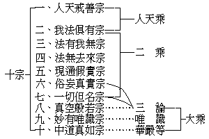



若就唯识言，则可分三：一、一切法有宗，人天小乘；二、一切法空宗，三论；三、中道唯识宗，华严唯识等。以华严等本唯识论所宗。故前之第九第十，皆可摄归此第三中。



四　佛教体上之本论观



依前来所讲，教即能诠之文，及所诠之义，故教以文义为相。盖凡有文必诠义，若无义即文亦无表现故。今观能诠文即本论三十颂等，至所诠之义甚广，实统括唯识境、唯识行、唯识果等。是故从所诠义上明体，则不啻从一切法上以明其体，故当从能诠文上以明体。能诠不出名句文身，兹释名句文身之义如下：



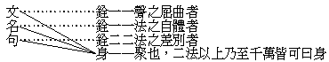



今各经论，若从文观，即全是一一声之屈曲；从名观，尽是一一法之自体；从句观，亦是二法以上之差别所聚；故教即名句文身。百法论说名句文即不相应行之色心分位假法，以之诠教体，可分四门：



一、摄假从实门：楞严经云：『此方真教体，清净在音闻』。故名句文身之教，从佛口宣，闻者领受，亦以声为体。然佛灭后，众生不能亲闻佛说，但从佛说之教著之经典者得闻；佛说属声尘，佛经属色尘。故从本教上说，则摄名句文身之假归之声实，可云以声尘为体。若从末教上说，则摄假归实，当云以声、色二尘为体。且佛说声教，亦限於此方，若他方世界，有以光明为教，香饭行化，乃至以睡梦而作佛事者，则六尘皆可为教体。即禅宗扬眉、瞬目等，亦其一端，故又可云：此方本教以声为体，末教以色、声为体，他方世界以六尘为教体。



二、摄境从心门：百法中十一色法，皆心心所所变之相分。若以所摄归於能，则所缘之色境皆是能缘之心王心所；如镜中之像，总不出镜外。夫色声既是心王、心所所变，即可归之心王、心所。以是故摄境从心，则可云：教非声色为体，以心为体。



三、摄相归性门：能变之心与所变之境皆是相；今此言相即色心，言性即真如。是以摄相归性，则可云：教皆以真如为体。如净名云：『一切法皆如也』。楞严云：『五阴、六入、十二处、十八界，皆如来藏妙真如性』。



四、性用别收门：上来所谈假实、色心、相性等三对，重重皆可为教体。惟就所明不同，别别而收。如以假法观之，即一一假法皆可以为教体；以实法观之，则一一实法皆可以为教体；色心、相性，亦复如是。



如前龙军所云：佛心上无文义，但由众生心上文义相生，故此属摄境归心门。护法云：或宜闻者之善根力，感佛心上文义相生，托之变起自心上文义相，则属於性用别收门。如前、初门通小乘，后三门但大乘。又、唯识以前三门合成第四。



五　佛教相上之本论观



一、文义相——藏：能诠之文及所诠之义为佛法藏。此论就一佛法藏，亦可属一佛法藏；就二藏论属菩萨藏；就六藏论，属菩萨藏之论藏。



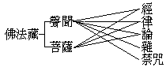



二、因果相——乘：乘即依教理行果而信解修证之义也。此论就一乘论即为一乘；就二乘乃至六乘论，即大乘之菩萨乘。



　　　　　　　　┌如来……果  

　　　　　　┌大┤  

　　　　　　│　└菩萨……因  

　　　　一乘┤  

　　　　　　│　┌缘觉  

　　　　　　└小┤　　┌天  

　　　　　　　　└声闻┤  

　　　　　　　　　　　└人



六　佛教史上之本论观



甲　印度佛教史与本论



印度佛教，从中国中唐以后大衰。而新起有婆罗门教，最盛行，斯即印度近代之吠檀多教，大概占十分之七；次则耶苏、回回二教；而原有之佛教几息。至今日、南印度所餘之佛教，不过小乘一部分。是故若论印度之佛教史，但从释迦以迄中唐，则有可言，中唐以后，无足称道矣。



若究本论之关系，则以印度自释迦灭后，盛行小乘，至六百年顷，龙树、提婆依般若造中、百论等，始倡大乘空义，以破小乘执一切法有，初未立宗。后清辨阐扬，乃称空宗。惟众生习气，易落偏邪，习久遂更执空，於是后龙树二百年顷，无著菩萨兴世，始依瑜伽、深密而明法相，以破恶取空者。无著之弟名世亲，初从一切有部出家，盛宏小乘，作五百部小乘论，往往讥毁大乘。无著忧之，乃以方便诱令回心，初为说摄大乘论，授之作释。至最后将近入灭，乃广摄大乘妙义，作此唯识三十颂。但在此颂之前，作二十颂亦自作释，及作此颂，未及作释即已入灭。於其同时有亲胜、火辩二师，为作释论，后又有八师相继作释，故此颂之释论，向称十大论师。



唯识之学，发端於弥勒，而集大成於护法。然护法之学，不行於印度，由胜军论师传至玄奘，独盛行於中国，此一奇也。



十大论师，可分三类：一、亲胜、火辩，与天亲同时。二、德慧、安慧、净月、难陀，胜军祖述难陀，德慧是安慧之师。三，护法、胜友、胜子、智月，次三师皆护法弟子。玄奘与其弟子窥基释论，糅十大论师之释为一本，而以护法立义最圆，是故虽列诸说，独折衷於护法，而论首亦题曰：护法等菩萨造。



乙　中华佛教史与本论



自汉明帝时佛教入中国，所译经论，不过梵本小部或大部中之一二品而已。魏、晋译者渐盛，至鸠摩罗什出大乘经论颇多。刘宋时译楞伽及华严，菩提留支译地论等，渐行识唯义。但地论言第九识，后考九识即八识之净分。陈真谛译，於唯识经论更进。至唐玄奘乃集其成。然近人谓真谛宗安慧为旧义，玄奘宗护法为新义；二家学说，微有异同也。本论译者，玄奘；解传者则有窥基、慧沼、智周等。



丙　各国佛教史与本论



自阿育王以后，佛教宏传各国。今观蒙古佛教自西藏输入，显有中观、瑜伽等，密有诸部；然蒙藏佛教，仅有本颂而无本论。南洋如锡兰、缅甸、暹罗等，但行小乘，亦与本论无涉。高丽佛教自中国传入，比日本犹早，中国所有经论，彼国皆有，但未宏扬。在彼国成宗者，现有华严之渐宗，与法眼之顿宗，故与本论亦不相关。至日本佛教，於中国原有各宗派皆有之，而未甚宏传。惟中国自唐后，禅宗盛行，唯识绝迹。又经三武灭佛及他种摧残，关於唯识之典籍皆遗失，日本独能保存。今日若窥基、泰贤、圆测、慧沼、智周、道邑等著作，多自彼国取回，由此一端言之，故此论与日本佛教之关系，较为重要。



丁　今后佛化之与本论



在印度经过有精密思想之外道，及一切有部之小乘，又经过言一切法空阐明中道大乘空宗，乘此思想之系统，始立唯识论义。而中国从两汉、六朝以下多行儒道，儒尚人事，稍高深则所谓六合之外存而不论，六合之内论而不议。道家多空洞玄虚之言，其思想皆与此论相远，故虽有一二杰出者，如玄、基等宏扬，而不久寝息。



惟中国思想统系，向者偏近禅宗，故禅宗特盛。近来颇有变更，因泰西科学东渐，曾破宗教哲学。近又由科学建设哲学，其思想渐精密，与唯识学相邻接，可以唯识引导其思潮入於正轨。故从今以后，唯识学将大兴，堪由中国以传布西洋各国。然以时势观之，能传布西洋者当更有三宗：一、三论宗，此即从唯识所明因缘生法以观其空，唯识既传，则三论必兴。二、净土宗，彼国奉行耶教，上帝天国，亦与弥陀净土相似。三、密宗，彼土由物质之反应，近来渐多鬼神学、灵学、摧眠术等，皆与密宗相近，易於通化也。



科释文义



一　科释论题



甲　唯识



识为能唯，故唯即识，持业释也。一切法为所唯。识、以了别为义，是能明了分别诸法者故。唯、以简持为义，简识外无，持识内有。又、简持一切法不出於了别之外，被简持在了知内者，即一切法，故云：一切法为所唯者，即一切法不出识之外也。今问：何谓一切法？法即轨持义，凡有法、无法皆是法，有法中，有为、无为、有漏、无漏皆然。是法出过数量，不可思议，惟佛与佛，乃能究尽。然以方便略计其数，则瑜伽有六百六十五法，天亲约之作百法论，今列百法观之：



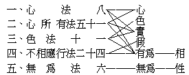



如上百法共分五位，复可分为性相、假实、色心三对，总名一切法。



问：何谓识？即心法之八识心王，一切有情皆有之。有情又名含识，故有情可云有识，含识亦可云含情。问：何故百法唯识？今可答云：八识心王，识自性故。五十一心所，定相应故；谓随心法而有，即识之仆从，系属於识。十一色法，心王心所二所变故；虽从俗言，识在内，色在外，识精神的，色物质的，若知皆心王、心所所变相分，即心王等如镜，色如镜中所现之影，影不出镜外，故知色亦不在识外。二十四心不相应行法，是心、心所、色三者之分位故；如异生性为心所法上之分位，命根为识之业种上分位，名句文等色法中声上之分位，时方等通心、心所、色三者之分位。又如：一棹有色与触，集现为方、圆、长、短等分位，即方分位假；计其成立年代，即时分位假。六种无为，前四位之实性故；前四有为，皆法之相，后六无为，为法之性，性即实体实相。由上五重言之，总不离识，所以言一切法唯识。问：能否唯餘法？若以圆融言之，如天台云：随拈一法，皆为法界。华严云：一即一切，一切即一。则无法不可唯，虽言唯心所、唯色、唯无明、唯真如皆可；以无明尽即真如，故亦可云唯无明也。问：何故说唯识？今观百法，心所随识，分位是假，而色法中有根与境，实无为法即真如性。若说唯境，境本迷情所著，妄想戏论，逐以流转，唯之即成顺世外道；佛法意令有情还灭，故不可说唯境。若说唯根，此根言、非有形之眼耳等，有形之根依处亦属於境，净色根非肉眼能见，以能发识，比知是有；佛为普通众生说法，须依皆能现知者说，故不可说唯根，然则说无为法可乎？此真如无为等，必净除一切妄想戏论，方能观证，是佛境界，诸凡夫虽闻说真如，不过意识缘此真如一名，起为相似之独影境，不能实证，佛为凡夫说法，故不可说唯真如。由以上诸义，为度生方便言，则根、境、真如等皆不可唯。独此识法，无论贤愚，起心即自知有，知有即可依施教。又、从此识起贪、瞋、痴，造善、恶业，生死流转三界之境，欲令观心还灭，故虽一切可唯而不唯，独说唯识。



上来所说，唯以简为义，即简择、料简等。识以了为义，即了知、了达、了别等。又简有二义：以简除而兼简持。简除者，离识之实我、实法定非有。简持者，即识之有为、无为许非无。了亦有二义：以能了而摄所了。能了者，诸心、心所。所了者，诸色法、不相应行法及无为法。以是义故，言唯识者，非离一切法而求心，但了一切法之即心也。



乙　唯识论



此有二：一、唯识之论，论指书；二、唯识即论，论指道理学说。如言唯境论、唯根论等，即以唯识之事或理为论。



丙　成唯识



此亦有二：一、以教成教，上教字指十论师之释论，即能成；下教字指三十颂，即所成。二、以教成理，教指能成，即三十颂及释论；理指所成，即唯识之境行果等。由此唯识教之成，或唯识理之成，皆名唯识之成，依主释也。



丁　成唯识论



论能发挥义理，开演言教，即指此部之名句文身而言。由前言以教成教，以教成理，今更可云以理成教，以明论义。一、以理成教论：唯识理是佛菩萨之自证，为利他故立论；如天亲悟理成颂，十论师悟理成释论。由唯识理所成之论，依主释也。二、以教成理论：如云：『此论三分成立唯识』等，则教为能成，而唯识之理为所成，故云成唯识论。即成之唯识论，依士释也。三、以教成教论：以本颂为本教，释论为末教，是成唯识即论，持业释也。



二　科释论文



甲　宗前敬叙分



１　归敬福田



宗前敬叙分即起首一颂及长行，亦释为二：一、归敬福田，二、叙释论意。初归敬福田者，稽首二字是能敬，唯识性满分净者是所敬。此言性、有二义：一、类性之性，二、体性之性。依类性可分为四：一、唯识之虚妄性，此是应简除之遍计执性。二、唯识之真实性，此是应简持之唯识相性，或唯识之实性。三、唯识之世俗性，此是应转净之依他起性。四、唯识之胜义性，此是所证胜义胜义一真法界。若依体性言，此性对相而言，举性即简除前百法中之假实、色心之相，而但敬二空所显至极究竟真如实性。



若通以三性为性，则唯识即性；若专以真如为性，名唯识之性。但从相以显性，是性即摄相，故名唯识相之性。又言性即简相，因性是无为无漏所应归敬，相之有为有漏是应简除，相之有为无漏亦非最胜。异生由迷此成有漏唯识相故，诸佛由悟此成无漏唯识相故，故此特言敬礼唯识之性，即皈敬诸佛所证清净、所得清净之唯识胜义性也。



清净者，亦分二：一、清净即者，指清净无漏功德之聚即者。二、清净之者，清净专指能清净之正智，者指无漏五蕴假者。满清净即清净圆满者，指佛。分清净即分证清净者，指菩萨。清净与杂染相翻，清纯无杂，洁净无染；依满清净者而示唯识之教，依分清净者从教而显理，故虽敬佛菩萨，即是敬彼所流出之法。因此、敬礼可略分三：一、唯敬法而非人，法由佛菩萨流出，故敬佛菩萨，即是敬法。二、唯敬人而非法，依唯识性而满清净分清净者，即以人摄法。三、皈敬三宝，唯识性即法宝，满清净者佛宝，分清净者僧宝；但此依唯识分清净者，是为大乘僧宝。以当时致敬，在对人之能而敬，非对法之所而敬，故此敬礼，应取后二种。



我、即随世俗指五蕴和合假者，乃释论师自谓。彼说、即天亲本颂。利乐者、谓於无漏功德之法有所增益，是名利益。於有漏烦恼之法能速远离，是名安乐。众生、梵语摩呼婆耆，谓五蕴和合假生者。有情、梵语萨埵，即是与无情分界者，在凡夫之迷情，则为情爱、情性，在佛果之悟情，即为大智、大悲。菩萨造论不外二事：一、令法久住，即颂第三句。二、饶益有情，即颂第四句也。



２　叙释论义



释造论意三说：一、安慧等，二、火辩等，三、护法等。初安慧说三重：一、为於二空有迷谬者生正解故；二、生解为断重障故；三、断障为得胜果故。



　　　　　　　　　┌一、迷…………全不知（凡夫）  

　　　　迷谬之料简┤二、谬………有知而偏（二乘）  

　　　　　　　　　└三、迷谬……外道



所知、即所了知，能了知是心，所了知是境；境非是障，但由法执覆蔽所知之境，遂成为障。故古德云：『所知不是障，被障障所知』。重障者、指二障之过失重，或就品类之多，指其最重者；如我执为烦恼障之重者，法执为所知障之重者。



生空正解，断烦恼障中我执重障。法空正解，断所知障中法执重障。由我执为本，烦恼障具足而生。由法执为本，所知障具足而生。然烦恼障中不但我执，所知障中亦有法爱、法恚及定障等，不止法执也。



　　　　　　　　　┌凡夫外道……非胜非果  

　　　　胜果料简　┤二乘…………果而非胜  

　　　　　　　　　│菩萨…………胜而非果  

　　　　　　　　　└佛……………亦胜亦果  

　　　　　　　　　┌凡外…………非真非解脱  

　　　　真解脱料简┤二乘…………解脱非真  

　　　　　　　　　│菩萨…………真非解脱  

　　　　　　　　　└佛……………亦真亦解脱  

　　　　　　　　　┌凡外…………非大非菩提  

　　　　大菩提料简┤二乘…………菩提非大  

　　　　　　　　　│菩萨…………大非菩提  

　　　　　　　　　└佛……………亦大亦菩提



依述记例言：释论中有初不说有义，中、后说有义者，则以初说为正。有初、中、后皆言有义者，则有二意：一意、诸说平等平等，二意、前略后广，则后说为正。其初、中、后皆不说有义，如今释造论意三说，则可同前皆说有义者例。但今就释造论意三说，亦可以下之四法观之。



一　依行位观



　　　　　　　　　　　　┌资粮位  

　　　　一、除谬生解……┤  

　　　　　　　　　　　　└加行位  

　　　　　　　　　　　　┌通达位  

　　　　二、生解断障……┤  

　　　　　　　　　　　　└修习位  

　　　　三、断障得果……　究竟位



护法在遮异执得如实解，故属资粮位。火辩令达二空证唯识理，故属通达位。安慧言生解断障得二胜果，说最完全。由前观之，安慧之说，最圆最高；次火辩；次护法；故其次序由高而下。



二　依目的观



> 一、安慧教意，在得二胜果。  

> 二、火辩教意，在证唯识理。  

> 三、护法教意，在破执立理。



此但就造论所欲达之目的言，从远而近，其次序亦安慧为先。



三　依致用观



一、安慧专在得果，而於得果之行与解，不细分别。只求得果，则随用何法，固无一定，故安慧之立义虽高，未免疏漏。二、火辩在证唯识理，务令直起智观，而於一切言教义理之建立，亦不求精细。三、惟护法在以正教正思维，遣除由邪教邪思维所起之谬执，所谓以言遣言，令生胜解，解生乃能断障证果。由如上说，安慧使人发心趋果，火辩使人作意求证，惟护法能善用名言，明确定立道理，使人就正理得正解，由解起行趋果，势如破竹。故其致用较二家尤为切要。此则从赊而切，当以护法居后。



四　依判教观



判教多以天台、贤首为准：天台时此论尚未译来，故未判入。贤首五教则判入始教内。然今就安慧等释论师观之，则可为如下之所判：



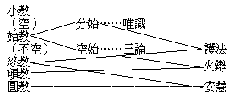



护法大悲心切，将佛法就众生放低说，以空显不空故，由始入终，实亦通圆。火辩由达二空，证中道唯识性故，由空始入顿。安慧意在得二胜果，故是圆教。又言生解断障，别断别得，有终教意。



乙　依教广成分



一　依教解唯识境



（一）彰唯识相



（甲）略彰论旨辩唯识相



依教广成分共三十颂，可略分为三：一、依教解唯识境，前二十五颂是。二、依境修唯识行，次四颂是。三、依行证唯识果，后一颂是。此论宗华严，华严广谈行果而略於境，此论广谈境而略行果。故境有二十五颂，次行有四颂，次果有一颂。盖广境者，广华严之所略；略行果者，亦略华严之所广也。



又从第一段说，亦可分二：二十四颂，彰唯识相。第二十五颂示唯识性。境、是就众生因位说明法之实相实性，但能从相上讲明，则即相之性自显。故此论谈相有二十四颂，谈性则只一颂；以其广谈於相，故亦名法相宗。然三论宗亦广谈境，惟彼略相而广谈性，故三论又名法性宗。



就辩唯识相亦可分二：六句颂及长行，略彰论旨辩唯识相。餘二十二颂半及长行，广释妨难明唯识相。



就六句颂分二：一、答所执难标论宗；二、彰能变体辩识相。



前由三家述造论意，已标唯识，故此专就唯识设为问难。问意是疑必有实我实法，故世间及诸圣教说有我法。答意不必要有实我实法，而世间圣教即可说有我法。何以故？由假说故。假说有二：一、无体随情假——世间，二、有体强说假——圣教。以真理随妄情，则说有我法，故曰情有。以真理夺妄情，则我法本无，故曰理无。又假说我，则随妄情有种种我相；假说法，则随妄情有种种法相。世间随自妄情假说既然，圣教随他妄情假说，亦复如是。转、谓变而现起。此中亦有伏难，谓必有实我法方有假说。答谓：不必实有，但依彼识所变。识有三分：一、自证分，非指识之本体，但指识当体之了知，在当体上有能了知所了知二相：其能名见分，所名相分，二分皆依自证所变。



此能变唯三之此，有二义：一、指上所变之种种我法相。二、即指能变，对所变说能变故。所变我法，能变即识，不离识之见相分，即我法相。唯亦二义：一、非识不能变，即唯识能变。一、是唯三，不多不少之义。



异熟三义：一、种子起现行，必有变异，异方能起，一切因缘生法皆通，故曰变异而熟。二、因在前，果在后，不在一时，故曰异时而熟。三、因中善恶，果则无记，故曰异类而熟。何云果则无记？若对各类有情言：善有善报，恶有恶报，则果固有善恶；惟对自己之报体言，则此阿赖耶识，无恶无善，亦容善容恶，故云无覆无记。亦即告子所云：性无善无不善也。盖第八阿赖耶识为果报主，其能招感之业是善恶，而所招感之报体则无记。



下说长行：法谓轨持者，轨谓轨范，可生物解，持谓任持，不舍自相。如言黑板，使人起黑觉，不起白觉，是轨范义。然所以能使人生解，以其自性是白，不失白之自性，故一说白，即使人生白解。黑亦然。若失其自性，不能生人之黑白解，此任持义。然黑白等是有法，无法亦可生人之解，如言龟毛、兔角，虽无毛角，亦能使生无毛角想。是故法为识上变似之相，不可执为实有。



我种种相，谓有情命者等者，有异熟报体，谓之有情。一期生活，连续不断，谓之命；有业感报，谓之命根；业尽命根断，则报亦坏。又、有情即金刚经所云人相，命者即寿者相。



五观略释：一、遣虚存实：虚即我法，实即依圆。二、舍滥留纯：滥即相分，滥同外境，纯即内之见分、自证。三、摄末归本：末谓心、心所之见、相，本即心、心所之自证。四、隐劣显胜：劣谓心所，胜即心王。五、遣相证性：相谓心王等唯识相，性即真如。



众缘所现起之心、心所法，皆自证之识体；从体分开其用，则有能了所了，能所二分皆依自证而说；因能取、所取之习惯，从识体上起似见分、相分。安慧依摄末归本门，祗许有自证分，故说见、相是遍计无，如龟毛、兔角。护法、窥基等依遣虚存实门，许见、相亦依他有，故言见、相别种。



似我似法，非现前分别变起，乃无始以来与身俱生之我法分别习气变起。因彼习气从无始来积集相识，恒现起我法二执故。故识起时自然变起似我法之相见，不离於识。此不离识之似我法相——似即似能执之妄情，亦即我见法见，属见分，我法属相分——即内识起我法二执，执为离识似外境现；如梦牛马，实牛马体是无，而梦时此相似牛马之不离心相则有。



离识外之实我法境，是无质独影境；但从见分一方生起，属遍计执，唯分别变。内摄於识之相、见分，是依他起，亦因缘变。



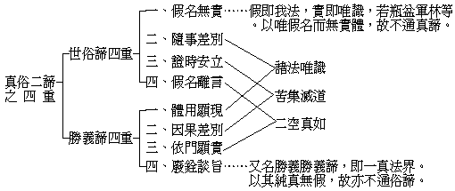



论云：「境依内识而假立故」，即俗第一重。云：「识是假境所依事故」，即俗谛二，通真谛一。



执一切有情我体是遍，则业果相杂。外救：如诸灯光，虽处无别，而各灯光照，彼此不杂。然此不得而喻，盖能属之灯不遍，故光可各属，不相杂乱。外计能属之我体既互相遍，则所属之业果不能各属，应相杂乱。经言：一切众生皆有佛性，皆依如来藏而流转生死等，与凡外所执之我是常是一，有无差别？其各思之，思之，又重思之！



凡见分与自证分，皆是无相，缘不能著。故七托八之见分为本质而缘，实不能缘得其真见分也。假如八识是灯光，病目是七识，而病目之缘灯光，但见五色华轮，不见灯光实相；七缘八见，亦复如是。



七缘八，不亲著，托为本质而缘，名真带质境——即论云起自心相。六缘八，通真似带质，何以故？其缘五取蕴中之色蕴时，以心缘境，是似带质；缘餘四蕴时，以心缘心，即真带质。至执为实我，则完全成为计所执之无质独影境也。如病目见灯五色之华，犹托灯光为本质，故名带质。及昧其为灯而执为实五色华，则全非事实而但为想像，故名独影。



第六意识依邪教言语文字所诠之五蕴相，托为本质，起自心相，尚是有质独影，以五蕴之事不无故。至依邪教所说我名，托为本质起自心相，则为无质独影。以实无我之为物故。



第七执我，自心外之本质——第八见——定有。第六执我，若俱生所执，本质定有。分别所执，或离蕴执，本质是无；或即蕴执，本质是有。凡有我执之见分，必有我相之相分，故曰：自心内蕴，一切皆有。又凡有见必有相，故影像相分之内蕴，决定是有。惟执为离心之外有实我法，则决定非有。如心上可有想像之龟毛、兔角，若执为实有龟毛、兔角之为物，则毕竟无。



唯识二十颂讲要



——八年正月在上海尚贤堂讲——



若识无实境，即处、时决定，相续不决定，作用不应成。



万法唯识，心外无境，此唯识宗之说也。有难者曰：假定祗此内识，而心外别无实境，则下之四义，应不成立：一、处所之决定。二、时间之决定。三、相续不决定——相续者，人生之异名，人唯见自心中之境物，而实与众人有同等之感觉，且各人无不见，天地之所现不决定，唯见一类境焉。四、事物之作用。在难者之意，以为上之四义，确系一般公理，故有此难。



处、时定如梦；身不定如鬼，同见脓河等；如梦损有用。



答曰：梦属唯心所变现之幻境，此人人共知者，当在梦中，确有定处，并有定时。恒河之水，饿鬼见为脓血等类，固唯心之境也；然众多饿鬼同见之，且一一饿鬼亦见脓秽等多物也。梦惊心慴，梦淫精损，亦非实事而生作用。如是、则上之四义，不必实境，亦可由心识构成，此分释也。



一切如地狱，同见狱卒等，能为逼害事，故四义皆成。



再印度人普通观念，皆信地狱。地狱中狱卒等，非实有情也；然恶人死后，同见牛头马面等狱卒，相逼为害。其中境况，则有处所，并有时间，同类恶人等受痛苦，一一恶人遍受逼害，且身体上离合冷热，起种种作用，无异生前。如是、则上之四义，即此一端，俱可了解，此总释也。



如天上傍生，地狱中不尔，所执傍生鬼，不受彼苦故。



难者又曰：狱卒如天界象鸟等一类傍生，不得谓非实有情。不知此等傍生，由自业力，识熟成果。至地狱中之狱卒，则并无自体业识，不过地狱中恶众生公共恶业构成之恶报。何以言之？盖天上傍生，以乐因而受乐果；狱卒虽与恶人同处於火山冰窖之中，然并无苦境可受。所执鬼如傍生之说，无有是处。



若许由业力，有异大种生，起如是转变；於识何不许？



外宗谓：业力转变，现诸境界，要有待乎能生各大种子。夫既许大种由业力转变境界，则谓识由业力而起如是转变，有何不可？



业熏习餘处，执餘处有果，所熏识有果，不许有何因？



又诘：业力不熏习之心外餘处——如色根等，执能由业力转变而生果，而不承认受熏之识有果，则又何说？



依彼所化生，世尊密意趣，说有色等处，如化生有情。



难者闻业识现境不由大种之言，即举佛说以难之曰：既唯有识，何为佛说有根尘等十二处乎？答意：谓世尊说此，乃别有秘密之意趣，特说色法等处，以为内根外尘，均属幻合，如幻术中所现之化人，令小乘悟人是空耳。



识从自种生，似境相而转，为成内外处，佛说彼为十。



盖识非外起，乃从阿赖耶识所藏之各自种子发生，其相分相似外境相而现，因而列为内根外尘十处。如佛所说，乃教人由根尘返求本源而不执著根尘之密意者。



依此教能入，数取趣无我；所执法无我，复依餘教入。



依此密意教人，能使未断轮回之数取趣众生，脱离我相，证人无我真如。若欲证法无我真如，则非依此餘之唯识等了义，不能澈悟。



以彼境非一，亦非多极微；又非和合等，极微不成故。



外教小乘，既执识外别有色法，而其学说复分多派。有谓彼色之境为一大有体者；有谓非一体而为多数之极微者；有谓由此多数极微可和合或和集者：皆无是处。盖境有差异，即非一体。极微不可见闻尝触，则非实有，故非多数极微。至和合、和集二义，乃依极微而生，极微之说既不成立，自然上之二义无所根据矣。



极微与六合，一应成六分；若与六同处，聚应如极微。



兹先发挥亦非多极微之义，有反证二：一、极微之义，乃不可再分之原子，然有四围上下等方，每方合一极微，则一极微而成六分矣。是仍可分，不成为极微。二、若此极微，与他之六可同在一处，不占方分，则虽聚集无数极微，仍各一极微也，纵使和合和集，亦不能成现象之境。



极微既无合，聚有合者谁？或相合不成，不由无方分。



难者转计曰：极微是无方分，故无集合；然极微而下之聚色，如子微等固可和合、和集，成为宇宙间形形色色之物也。诘曰：所云聚色如子微等，非极微之所合成耶？既云极微无合，又安有聚色能合哉！若又转计聚色亦复无合，则聚色有方分，既亦无合，又何须计极微以无方分故无合哉！



极微有方分，理不应成一；无、应影障无；聚不异无二。



盖极微如有方分，即可由一而六合，不应成一。若无方分，即无形体，对於日光，应不成影，亦无障蔽，如是虽聚诸色，亦不成为影障。此有分无分，均不合理，乃明极微之谈，不能成立。



一应无次行，俱时至未至，及多有间事，并难见细物。



再证明彼境非一之义：盖境若是一，世间万有，应可一目了然，何以凡观一境，目光所接，均有先后次第不能一蹴即至？又凡一实境，均有间隙，且多有难见之细物，皆可证明境之非一也。以上摧破唯物理论已无餘地，下更就事实问答之。



现觉如梦等，已起现觉时，见及境已无，宁许有现量！



或以吾人现觉有人物等，确缘外境，方有此觉。不知梦及梦等固无外境，如正梦时，意识感觉梦境，亦何殊醒时现觉乎？况吾人於现觉起时，唯能觉色、声、香、味、触者，及所觉之色、声、香、味、触同现起於五识中耳，本不计为心外之物。逮计为心外之境物，已落独头意识之非量境，早非现觉之现量矣。故现量中决无心外之境。



如说似境识，从此生忆念。未觉不能知，梦於见非有。



或又以事后忆念，为过去所受外境之证。不知由眼识等所生之相分，迷与外境相似，即能从此发生忆念，何须外境？譬如梦境，当其未觉，竟不知梦中所见，皆非实有。人生大梦未觉，亦复如是。



展转增上力，二识成决定。心由睡眠坏，梦觉果不同。



或疑谓：假如有人遇善恶二友，所闻之法，或邪或正，此二识乃因友教而生，仍属外境。不知各人自他诸识，展转相续，久之为正为邪，即得决定，岂假心外之力？或又转计无心外物，何以梦中杀人，不受罪报，醒时则必得杀果乎？然梦中之心，为睡眠所蔽，增上力弱，故造业感果，不及觉时之殊胜耳。



由他识转变，有害杀事业。如鬼等意力，令他失念等。



或又以为有识无身，不能成杀害事业。不知此业仍由屠杀者之意识身识所造；如鬼魔等乃能以意念势力，令人失念，发生种种病狂；此即印度人普通心理所承认者也。



弹咤迦林空，云何由仙忿？意罚为大罪，此复云何成？



再如弹咤迦林，为仙人魔法所灭，一扫而空；忿恚意业，世尊说如意罚大罪。何云有识无身，不能造业？



他心智云何？知境不如实，如知自心智，不知如佛境。



或更追进一层，以他心智为有自他分别，唯识之说，仍不成立。不知他心智者，所知他心，亦非真实。何以故？以知他心，如知自心；未成佛时，自心不能真知自心，亦如佛境之不能知也。



我已随自能，略成唯识义。此中一切种，难思佛所行。



作者只随自具知能，略述唯识意义，至诸佛世尊所有一切境，一切种智，广大渊深，不可测度，则在学者默会焉可耳。



案：唯识之义，不过离心无境，原不必灭境求心，但了境唯心，则由境空继得心空，自然转识成智，上穷佛法，下利人生，胥在乎是已。



（刘笠青、史一如合记）(见觉社丛书第四期)



（附注）觉刊原题「听太虚法师讲唯识二十颂纪略，靖如」记。法相唯识学改题「唯识二十颂讲要」，今依之。靖如，乃刘笠青、史一如之合名也。



大乘五蕴论讲录



——十三年初秋在武昌佛学院讲——



> 悬论  

> 一　序大意  

> 二　解题目  

> 三　释撰主  

> 四　明译人  

> 释论  

> 甲一　正明五蕴  

> 乙一　略标  

> 乙二　广明  

> 丙一　色蕴  

> 丁一　总举  

> 丁二　别释  

> 戊一　四大种  

> 戊二　所造色  

> 己一　总出体  

> 己二　别释  

> 庚一　明五根  

> 庚二　明五境  

> 辛一　色境  

> 辛二　声境  

> 辛三　香境  

> 辛四　味境  

> 辛五　触境  

> 庚三　明法处色  

> 丙二　受蕴  

> 丙三　想蕴  

> 丙四　行蕴  

> 丁一　总举  

> 丁二　别释  

> 戊一　心相应行  

> 己一　释心所名义  

> 己二　明六位差别  

> 庚一　总辨差别  

> 辛一　列名  

> 辛二　配属  

> 庚二　别明体性  

> 辛一　明遍行  

> 壬一　明触心所  

> 壬二　明作意心所  

> 壬三　明思心所  

> 辛二　明别境五  

> 壬一　明欲心所  

> 壬二　明胜解心所  

> 壬三　明念心所  

> 壬四　明定心所  

> 壬五　明慧心所  

> 辛三　明善十一  

> 壬一　信心所  

> 壬二　惭心所  

> 壬三　愧心所  

> 壬四　无贪心所  

> 壬五　无瞋心所  

> 壬六　无痴心所  

> 壬七　精进心所  

> 壬八　轻安心所  

> 壬九　不放逸心所  

> 壬十　行舍心所  

> 壬十一　不害心所



悬　论



一　序大意



大乘五蕴论者，依大小乘共通之蕴、界、处教，明大乘法相名数之理致也。法相多如尘沙，而五蕴可以尽之；圣教广若大海，而大小乘可以括之。何谓五蕴？色心等之有为法也。有为者，有造作、作为、生灭之谓。夫然、其非有造作作为之不生灭无为法，应不得而摄耶？曰：否，盖五蕴虽祗摄有为，然无为岂离有为而独有？故论中既广明五蕴诸法，旋会之以处、界，问答以发无我之隐，无我则明证择灭，处、界则显摄无为——十八界中法界与十二处之法处皆摄无为——。故五蕴为一切法之总聚，依正二报之所依，百界千如之所本，上通大乘法相唯识之高幢，下共小乘诸部之标帜。是以百法明门论以五位而陈百法，结明浅深之二无我；此论以五蕴而统诸法，申破总别之三我执——一、一性我执，二、受者我执，三、作者我执。虽然、彼论以唯识为独尊，标大乘之特有，故心法居首，餘四次之，以是识之相应、所变、分位、实性故。本论以法相为共通，历明名色与处界，则同於俱舍，便於初心之入门故。若一一法相之名义不了，纵阅群典，皆属囫囵，或有知解，亦是儱侗，胡能致广大而尽精微以自利？极高明而道中庸以利他哉！故兹於未入法性、唯识之先讲之，俾学者能审名检实，以为精确研究之张本也。



二　解题目



五蕴为本论之别目，大乘为满教之通称。乘以运载为功，从譬得名。大有二义：一、当体，二、简小。当体者，常遍为义；简小者，相待受称。常则竖穷三际，遍则横满十方。待谓对待，如长待短，方待圆也。此亦如是，大小相对，权实相立，显此是大是实，有殊胜运载之功用，故曰大乘。五蕴广如下释，兹姑不述。论乃假立宾主，问答发挥，抉择正理，破除邪见，简非经律，故以论名。有解：大乘之大，谓当体之大义，是绝待大，不同对小之大，遂於大乘之上加立一乘，以显佛法高深，理体超绝。但既落能诠，即不能无待，大有小待，一亦有非一待，对非一立一名纯一，宁大待非大非纯大！过泥名相，违害义理。故今双出简持：应了才呼大时，即兼具持大简小之义矣！



又六合释云：五是数，蕴是法，蕴有其五，带数释也。五蕴是所诠，所诠义广，以蕴摄诸有为法故；论是能诠，能诠义狭，以限於声与名句文故。其义广者为胜，狭者为劣，将胜就劣，以劣显胜，云五蕴之论，带数依主释也。又五蕴是所明法体，大乘是法体上广大运载之用，即体持用，就用彰体，大乘即为五蕴，持业带数释也。又不惟能诠名论，所诠亦名为论，若离所诠之意义，虽有名等亦不成为论，大乘五蕴是所诠，所诠即论，是则大乘五蕴即论，亦持业带数释。



五蕴、古译五阴。阴、覆蔽义，谓此五法，能覆盖障蔽法界平等不生灭之真实性故，唯局有漏。蕴、积聚义，谓此品类之多法积聚故，其义通漏无漏，今取蕴译为正。盖五蕴摄有为法尽，有为法既通漏无漏，五蕴亦应通漏无漏。三乘道谛，皆有为无漏，若用阴字，不惟不通佛果，即二乘入生空，菩萨证二空时，亦无其义。故阴义仅通异生之五蕴位耳。异生之五聚法，或名五取蕴；取者、贪著为义，即烦恼名，烦恼能执取三有生死故。取蕴者，由取生故，属於取故，能生取故，名五取蕴也。或谓阴义亦通二乘，若小乘圣者，厌离三界生死入无餘涅槃时，灰身灭智，尽舍覆蔽涅槃性之五阴法故。然仍有一分义不通，小乘许四谛中之道谛，十八界之意界、法界、意识界咸通无漏故——大乘十八界皆通漏无漏——。如是翻五蕴为五阴，摄义不尽，则名义失其所当矣，学者不可不知。



蕴谓积聚，其义已悉，积聚之相，然犹未晓。例如色法，若内外、粗细、胜劣等品类差别，略此品类差别为一聚故，说明色蕴。受、想、行、识亦然；染净、漏无漏位皆尔。故佛果上之众相庄严，四智菩提、五分法身、力、无畏等，名无漏清净之五蕴。异生色心但染污故，名有漏杂染之五蕴。二者之分，惟在烦恼心所等之有无而已。



三　释撰主



世亲菩萨造：梵云：伐苏畔度，唐言世亲。盖印度俗奉之神曰世天——即毗搜纽天之异名，传言是此世天之弟，故名世亲，亦名天亲。婆薮槃豆传曰：婆薮槃豆者，北天竺富娄沙富罗国——译曰丈夫国人，生於佛灭九百年间。兄弟三人，皆名婆薮槃豆，长兄别称阿僧伽——译曰无著；其弟别称比邻持跋婆——比邻持母名，跋婆译儿；惟世亲独以通名称焉。皆出家於小乘之萨婆多部。无著先悟小乘空理，意无留滞，遂通达实相，专弘大乘。比邻持跋婆，则唯遵奉小乘而已。论主聪慧绝伦，初造五百部小乘论，后依长兄无著之劝导转入大乘，亦造五百部论盛传之，故世称千部论师云。此论、即所著大乘论之一也。



菩萨、具云菩提萨埵，此翻觉有情。觉是所求果，有情是自身，谓求三菩提之有情者，故名菩萨。又菩萨修行有二：一者、自利大智为首，二者、利他大悲为先。菩提觉义，智所求果；萨埵有情义，悲所度生；发四弘誓愿，故名菩萨。或菩提是所求果，萨埵者勇猛义，不惮时处求大菩提，有智有能，故名菩萨。又菩提即般若，萨埵谓方便，如是二法能利能乐一切有情，故名菩萨。



造者、造作之义，创造之谓。唯识述记云：『叙理名述，先来有故；作论曰造，今新起故』。凡菩萨造论必具二种：一者、具四德，二者、六因缘。四德者：一、於昔诸师应离憍慢，二、於有情类当起大悲，三、於同法者深生爱敬，四、不欲彰已有胜伎能。六因缘者：一、欲令法义当广流布；二、欲令种种信解有情，由此因缘，随一当入正法故；三、为令失没种种义门，重开显故；四、为欲略摄广散义故；五、为令显甚深义故；六、为欲以种种美妙言辞庄严法义生净信故。顾菩萨造论之郑重，为何如乎？



四　明译人



唐三藏法师玄奘奉诏译：唐者、李唐，世之朝代也。三藏者：经、律、论也。遍通三藏佛法，自师师人，谓之三藏法师。玄奘、师之德号也。师俗姓陈氏，河南偃师人，生年十三，出家於净土寺，就慧景、严法师等学涅槃、摄论。寻赴长安、成都，就道基、震法师等究毘昙、发智，博学多能，令名夙著。然尔时学者，各异宗趣，圣典亦有隐晦，汗漫纷拏，莫知适从！乃发西游之志，表请朝廷，奈时世未定，未邀允许。而仍不为屈，遂於太宗贞观三年八月，阴杂行旅人中，遁出国境，经高昌、屈支——即龟兹、飒秣建等，出中央亚细亚，历经诸国，参礼圣迹。至王舍城，止那烂陀寺，受戒贤诸论师瑜伽、唯识之旨。留学十年，造制恶见论，立唯识量，名震五竺。贞观十七年十二月出印度国境，十九年归长安，自出国凡十有六年，留学万里，一人孤征，诚为我国历史上空前绝后之一大事实。欲知其详，可参阅大唐西域记，大慈恩寺三藏法师传等。所赍大小乘梵典，有六百七十五部之多。至长安时，王公欢迎，庶士颂德，政府监护，国家供养，以弘福寺、慈恩寺、玉华殿等为其译场。所译经论总七十五部，千三百三十卷，此论亦所翻之一也。



释　论



此论唯有正宗，而序与流通阙如，同瑜伽、发智、观所缘论等，无问广略，皆唯作者所欲也。光记一曰：『泛明诸论，正宗定有，序分、流通有无不定：或有序分而无流通，如毗婆沙论；或有流通而无序分，如二十唯识；或二分俱有，如此——俱舍——论说；或二分俱无，如发智论。随作者意各异故』。然前后二分有无，虽随作者所欲，总论菩萨造论所由，一以不私，皆准佛经。故光记一曰：『西方造论，皆释佛经，经教虽多，略有三种，谓三法印：一、诸行无常，二、诸法无我，三、涅槃寂静。此印诸法，故名法印；若顺此印即是佛经，若违此印即非佛说。故后作论者，皆释法印。於中意欲广略不同，或有偏释一法印，或有举一以明三：如五蕴论等唯解诸行无常，如涅槃论等唯释涅槃寂静，此即偏释一法印。乃至诸行无常唯明有为，涅槃寂静唯明无为，诸法无我通明有为无为』。今论就广说义边，虽题五蕴，蕴明有为；然具含三科，处界二门摄诸无为，如上已说，故今论具三法印明也。又文中如薄伽梵略说五蕴等著，是显凭经造论也。



甲一　正明五蕴



乙一　略标



如薄伽梵略说五蕴：一者、色蕴，二者、受蕴，三者、想蕴，四者、行蕴，五者、识蕴。



此略标列名数也。标有二：薄伽梵三字标能说人；略说五蕴四字标所说法。一者色蕴等，如次列五蕴名也。薄伽梵者，梵音也，略翻为世尊，具有六义：一、自在，二、炽盛，三、端严，四、名称，五、吉祥，六、尊贵。又能破四魔义故，名薄伽梵；谓能破烦恼魔、蕴魔、死魔、天魔也。然有经论多用佛名者，随方顺古也。或约悟诸法义边言佛，就显佛德义边言薄伽梵；就体约用，各据一义，并不相违。若但言佛，是略名也，具言佛陀，此云觉者。觉是法，者是人，即有无上正遍觉之五蕴和合假者，名为觉者，即自觉、觉他、觉行圆满之谓也。对法论一曰：『佛薄伽梵，是契经等一切教法平等所依，无师自悟诸法实性，一切教起所依处故』。



略说五蕴者，梵云塞建陀，唐言蕴，积聚为义；佛说一切诸法无量无数，今总略之，不出此五聚法也。如薄伽梵略说五蕴，有二义：一、顺经造论非自臆造故。二、师说文略义深，资广解故。一者色蕴，色有变、碍二义，变谓现象变化而归破坏，碍谓如手碍石，石亦碍手，自他互为能碍所碍。是知色之一字，涵义极广，非仅如普通谓青、黄、赤、白等为色，而四大种所造色、无表色，皆得称色也。又凡言变碍为色，同时即简无为及心、心所、不相应行等，唯色法变而有碍故。二者受蕴，受以领纳为义，谓心心所领取纳受顺、违与俱非之境界，而生苦、乐等之三受故。更因受心所所依之六根开为六受：曰眼触所生受，耳触所生受，鼻触所生受，舌触所生受，身触所生受，意触所生受。此前五名身受，后一名心受。三者想蕴，想以取像为义，心心所领受境界时，无一定分位齐限，有此想心所於所缘境，始有苦乐、怨亲、男女等分齐差别相，而名言由是得以安立。此想亦有种种，曰眼识相应想，耳识相应想，乃至阿赖耶相应想。四者行蕴，有二解：一、广义的，迁流为义。二、狭义的，造作为义。迁变流动者，有为法皆是造作义，及指思心所，此思能驱役心、心所造善、不善业；今从后说。以餘四蕴虽亦行为造作流动迁变，而彼法已从特义名餘四蕴，故取此名行蕴耳。行蕴、有七十三法，分为二类：一、相应行，五十一心所中除受、想，所餘四十九皆是，思心所正此相应行摄。二、不相应行，得、命根等二十四是。五者识蕴，识以了别为义，百法中八识心王也。八识各有明了分别自所缘境之功用，如眼识依眼根了别青、黄、赤、白等色，耳识依耳根了别内声、外声等声，鼻识依鼻根了别好香、恶香等香，舌识依舌根了别甘、辛、苦、咸等味，身识依身根了别坚、湿、煖、动等触，意识依意根了别内外事理诸法，末那依赖耶了别自内我境，赖耶依末那——七八二识互依为根——了别根身、器界、种子等境。於中识所依根，根有二义：一、谓根依处，二、谓净色根。通常人未加审察，不知根义。虽知五官脑筋，亦属儱侗；此五官即五根依处，脑筋似胜义根之代名。小乘人虽知六根中之意根而不明了，谓前念现起之意识，与后念之意识为根，有根识相滥之过失；而大乘明意根为第七之末那，非意识为意根也。



综上所明，十一色法立色蕴，受心所立受蕴，想心所立想蕴，七十三法立行蕴，八识心王立识蕴。然则何故如是次第耶？此有三释：一、识住，二、前为后依，三、起染净。且略举其一：如见青黄等色相——色蕴，而领受故——受蕴，如所领受而了知故——想蕴，如所了知而思作故——行蕴，如所思作随彼彼所作而了别故——识蕴，广如俱舍等明。



乙二　广明



丙一　色蕴



丁一　总举



云何色蕴？谓四大种及所造诸色。



色蕴之相，略有二种：一、触对变坏，谓根境相对门也——即欲色十有色处，上二界色及法界色，并非此门，如上已说。二、方所示现，唯境无根门也。对法抄一曰：『三界中五根、五境，及法处中假实，定所生依处，遍计所起，极略，极回等，有诸名相方所，别名可说示现，皆此门摄也』。四大种者，地、水等四大，即是能造性也。所造诸色者，即彼四大之所造诸色也。此二於一切色法，悉摄无餘。及、相违义也，能造所造异故。



丁二　别释



戊一　四大种



云何四大种？谓地界、水界、火界、风界。云何地界？谓坚强性。云何水界？谓流湿性。云何火界？谓温燥性。云何风界？谓轻等动性。



此有二，初徵、后释。云何四大种？徵也。谓地界等，释也。释中亦二：初总出体，后别释体。初地界水界等著，是举真四大体。大有四义：一、所依大，谓为十有对色及法处所摄色等诸所造色之所依故。二、体性大，谓四大种遍一切色，无一物而非所造，其体宽广故。三、形相大，谓大地、大山为地大之增盛，大江、大海为水大之增盛，炎炉猛焰为火大之增盛，黑风、团风为风大之增盛，如此四大增盛，形相大故。四、起用大，谓地能载物，水能浮船，火能烧薪，风能拔木，其作用大故；又成坏世界力用大故。种者、因义，类义，此四能为生等五因起众色故，种类别故。虚空虽大不能为因，内种子等虽能为因，体相非大，所餘诸法非大非种，由此亦大亦种，故名大种；持业释也。应作四句分别，表示如左：——



　　　　　　　　┌虚　空……………大而非种  

　　　　　　　　│外　种┐  

　　　　　　　　│　　　├…………种而非大  

　　　　　　　　│内　种┘  

　　　　　　　　│坚、湿┐  

　　　　大种料简┤　　　├…………亦大亦种  

　　　　　　　　│煖、动┘  

　　　　　　　　│造　色┐  

　　　　　　　　│心心所├…………非大非种  

　　　　　　　　└假　法┘



若言四大种，四是数，即带数释。界有多义，至下可辨，且约二义释之：一、界别义，体相不同，各各种子现行异故。二、能持义，四大种能任持自体及一切所造色故。云何地界下，别解释。文中有徵、有释。上文虽辨地等是能造大种。然自性各各异故，今特示之曰：地坚性，水湿性，火煖性，风轻动性。此中风轻等动性者，等、谓相似，轻者、所造性，动者、正为能造之风性也，以风自性是动故。盖轻与动相顺相似，故举能似轻相以彰所似风性，论记曰：『风能造与所造相似，故云轻等』。由风性动故，名轻等动性。此四大体为身根所觉一分之触尘，如通俗所谓阴阳与夫科学家所谓质力，皆不外乎此也。问：道家之金、木、水、火、土，与地、水、火、风有何异乎？答：略同通俗所谓地、水、火、风，而与此正明之四大种异。问：此四大种与通俗所谓地、水、火、风有何区别？答：四大者，身根所触之境，以坚、湿、煖、动为体，是为能造；通俗所谓地、水、火、风是所造色，属於显色、形色，为眼根所见之境，以显、形色为体。如青等之地，依显色为体，长等之地，依形色立名。通俗於此所造色境之显、形色而呼为大地，佛法随其俗情亦安立地名。餘水、火、风，准此类推。要之、通俗所谓地、水、火、风与大种之不同者，唯於所造之显、形色各立其名而已。故此彼对望，此为触境，彼为色境；此为身根之所触，彼为眼根之所见；此为能造，彼为所造，二者相违可知。



　　　　　　　　　　　┌坚┐　　　　　　┌持┐  

　　　　　　　　　　　│湿│　　　　　　│摄│  

　　　　　　┌四大种体┤　├──触尘──┤　├用  

　　　　　　│　　　　│煖│　　　　　　│熟│  

　　　　　　│　　　　└动┘　　　　　　└长┘  

　　　　比较┤  

　　　　　　│　　　　┌地…………色香味触  

　　　　　　│　　　　│水……………色香触  

　　　　　　└世俗所见┤  

　　　　　　　　　　　│火………………色触  

　　　　　　　　　　　└风…………………触



问：四大种是现是种？若是现行，云何名种？答：四大种是现行触尘一分，对自种故，是现非种。然则何因缘故名能造性为四大种耶？答：一切色法虽皆由第八阿赖耶中亲因缘种生，然要由坚等现行四大为普遍切要之殊胜功能增上缘，彼色、香、味、触等方能生故。故即依此亲近殊胜增上功能假名为种，如瓜豆等种，亦非种言种。问：四大种为大小乘共通之名，其义有无差别？答：小乘以四大为能生一切法之因，大乘为能生一切色法之缘，因谓亲因，缘为增上，此二别也。问：四大种几识能缘耶？答：有三识，谓身识及同时意识、阿赖耶也。盖身识、意识变缘时，须托第八所变缘者为其本质，其境皆为现量性境。独头意识分别名相，属比、非量、影质境。问：四大种大类区别可分几类？答：四大遍於五根、五尘，如是可分为二：一、根身执受大种，二、器界非执受大种。此通有漏、无漏之依、正二报，如佛有清净圆明之报身四大，微妙庄严之净土四大故。



戊二　所造色



己一　总出体



云何四大种所造诸色？谓眼根、耳根、鼻根、舌根、身根，色、声、香、味、所触一分、无表色等。



此中先徵后释，谓能造四大已彰，今所造诸色应释。所造色者，谓依止大种，即於大种处所，有餘造色生，由是因故，说四大种所造诸色。造者、是同一处摄持彼义，名之为造，此有三不相离义：一、一处不相离，谓大种及所造色同住一处，二、相依不相离，三、和合不相离。广五蕴论曰：『造者、因义』。谓以四大种为因，所造得生故。此因有五种：一、生因——即是起因，谓离大种色不起故。二、依因——即是转因，谓舍大种诸造色无有功能据别处故。三、立因——即随转因，谓由大种变异，能依造色随变异故。四、持因——即是住因，谓由大种诸所造色相似相续生，持令不绝故。五、养因——即是长因，谓由大种养彼造色令增长故。如对法一曰：『所造者，谓以四大种为生、依、立、持、养、因义』，即以五因说名为造也。就大种与所造四字合释，大种之所造，属八啭声之第五啭——因声又名从声，六离合释之依主释也。若加色言，五字合释，大种所造即色，持业释也。但大种造色义，略有二说：第一说曰，一切大种造一切色，相依而有，是造义故。——如此聚中有彼大种、所造可得，当知此中及有彼法，故诸大种同聚所有造色相依有者，皆可名造，互得造义，非定属义——互为造义。第二说云，或可大造种子本性各异，后生现行各依自类，自类大种不生现行，此类造种终不生造——自类造义。然此二义，已散见前文——一见解造字，一见大种问答——兹不详述。



谓眼根等下，后释也。此由坚等四大种，轻重离合而成五根、五境及无表色等。於中所触一分者，触为身根之境，此境有十一种，分能造所造之二。今除能造坚、湿、煖、动四大种一分之外，取所造滑、涩、重、轻、冷、饥、渴等，故云所触一分也。无表色等，等取极逈、极略、定自在所生、遍计所起色也。无表色者，无表示於他之色法，即反於表示於他之色法也。吾人动作身体、发动言语，於行善作恶时，对於他人有所表示，使知是善是恶，名为表色。又色表业，即此善恶之表业，同时依於因果之规则，明见如是原因，将来应招如是结果；以之击发於自己之身内，如是击发之原因，无形无象，无表示於他，故云无表色也。此有二种：即律仪无表，不律仪无表是。律仪无表者，其性善，如佛弟子受持三皈、五戒、八戒、十戒、二百五十戒、三百四十八戒等之别解脱律仪而发得无表是。此无表虽无表示於他，然有殊胜功用，其受三皈者，自然不皈依天魔外道等，故受诸戒者，则自然不敢为非，而得以别别离身口之过恶也。若遇恶缘或恶友以巧言绮语相引，事物名利相诱，以诸方便破坏，随顺彼教而犯一杀戒，或行一盗、淫——取不义财，行茍且事，乃至破斋、食肉、打牌、赌博，皆为盗戒所摄；耳听淫声，眼睹美色，脚履邪地，身入青楼，虽未实际接触，亦为犯淫——在当时不过为情面所拘，或势力所迫，偶然失足，后遂造杀行淫以为常，作盗妄动而不知畏者，良由於初次犯戒，无表功用——即戒体失坏故。是以受戒后要严持戒律，为受能引发——无表色体，持能引长也。故古人持戒以防非止恶者，犹若堤防然。盖防水旁流漂荡而损害苗稼，若持戒不严，为恶缘之侵荡，一旦穿破身口之堤防，则永损害善根之苗稼，可不慎欤？不律仪无表者，由身口之恶行而得恶性之无表也。如今世在匪、在帮之结党辈，先由发誓赌咒之表业引发恶无表之功力，遂狼狈为奸，自然敢於为恶耳。此二——善恶无表——虽无可表示，非眼、耳等十有色处所收，仍依地、水、火、风四大种之所造色法而成，故为法处所摄色之一焉。问：如是为意识所缘耶？答：无表固为法尘中之一法，但体是思种，为赖耶之现量境，非粗意识亲能明了。因彼有善恶之功能，意识从是推度而知；不然、定果色等亦应称无表耶？是可知其特殊点矣。



己二　别释



庚一　明五根



云何眼根？谓色为境清净色。云何耳根？谓声为境清净色。云何鼻根？谓香为境清净色。云何舌根？谓味为境清净色。云何身根？谓所触为境清净色。



文段有五，悉明根义。根者、有由依托乃得生长之义，如草木等，由依托於根故，而干而枝而叶得生起长成也。诸识亦然，各有其根，识方现起。然根有二：谓净色、浮尘。浮尘者，——又名麤色根，或名根依处，浮之於外与尘寰交接，即眼如葡萄朵等之浮根四尘，及身之四肢百骸者是也。净色根者，清净之色不可见而有作用者也。论言五根谓净色根也，为眼等五识之所依止，故云为根。



云何眼根者，徵释可知。眼之差别总有五种：一、肉眼，二、天眼，三、慧眼，四、法眼，五、佛眼。此中初二眼色蕴摄——修果名天，报生名肉，故欲天眼唯肉非天，非修果故。五眼皆有通二世及三世等之差别，后三眼非蕴摄，於中慧眼、法眼为二无漏根，佛眼通於前四。今论所明眼根，即肉、天二眼也。此有现行种子差别；界门眼通种子，五根门眼唯取现行，今唯现行也。



色为境、清净色者，广五蕴论曰：『云何眼根，谓以色为境，净色为性，谓於眼中一分净色如净醍醐，此性有故，眼识得生，无即不生』。以色者，是眼所行境，而能引发根故；谓举能引发境显所发眼自体也。净色者，以净言简扶尘根，显胜义根也。盖扶尘根为有见有对之麤色，此色清净微妙故喻如醍醐。醍醐由熬乳作酪，自酪出酥，熬酥为醍醐，乃酥精液，不可多得，净极甘美故。一分者，简周遍，谓舌身二根净色遍满所依处，眼等三根不尔，故以一分及周遍，显其差别也。此性有故下，示眼识能生相，文显易知。



云何耳根等者，文有二科，初徵后释。净色根义，上已略明，今更举释论——广五蕴论——释之：『根者，最胜自在义、主义、增上义。所言主者，与谁为主？谓眼根与眼识为主，生眼识故；如是乃至身根与身识为主，生身识故』。最胜等三义，成唯识论四、说五识四种依中——一、五色根同境依，二、第六识分别依，三、第七识染净依，四、第八识根本依——同境依，有「依」、「所依」、「有所依」义之别，此五根正为五识之「所依」也。然所依必具四义：一、决定义，谓眼识必依眼根生，无依餘根生义。是言决定，简第六识虽以五识为依，然不定故，非决定义也。二、有境义，谓各自有各自所取境义，如眼根有色境，耳根有声境等。是简四大及五尘、种子等，彼虽有决定义，盖非有境也。三、主义，谓要主而有自在力令餘法生义也。是简遍行等，彼虽有决定与有境二义，不能为主令餘法生也。四、令心心所取自所缘义，谓受想等皆虽取自境，不能令他取也。餘心心所虽有具一、二，不能并具四义，唯五色根具四，故为所依。今释论中主义者，举其一义影显餘三。或可如上四义唯局五根，主一种通一切根，故约总相释根举主一义耳。最胜自在义、增上义者，此二义俱在根上一义，差别开二种，然俱舍唯举此二，不举主义。最胜自在义者，——根体胜故，名为最胜，根用胜故，名为自在。以一根能了别众色义边，名最胜自在。增上义者，随所依根强弱能依识亦明昧义边，为增上义；谓根强能依识明，根弱能依识昧故。若言一义差别开二种，今论何二义中间安「主」义乎？答：今论意显所依根上具以一了多，及随根明昧之二义，虽同有大势用，然尚有餘意——见上文四义中所解主义——故於二义中间安立所依主义以尽其旨耳。谓声为境清净色者，后释也；释中举所取境，显能取根体可知。以上二根取离境，下三根合境取也。俱舍颂云：眼耳意根不至、三——鼻舌身——相违。五根，义林亦曰：『眼耳二根离质用远，离取义增，妙用难测，故别立二通——天眼、天耳——餘三根不立耳』。



云何鼻根乃至云何舌根清净色等者，鼻根易知，舌根有异说。释论云：『云何舌根？谓以味为境，净色为性，谓於舌上周遍净色。有说：此於舌上有少不遍如一毛端。此性有故，舌识得生，无即不生』。按：此文初举本论，后释本论，初中徵释可知。释论中二：初举所依根，后示能生相。初中复二：初示正义，后举异说。初中周遍者，对上三根一分也。俱舍二曰：『布在舌上形如半月』，是与今论周遍同也。有说下，后辨异说。俱舍对此置言传说以示不信，今论亦尔，故云有说。释此，光记举二说：初说曰：『西方古德相传解云：医方家说：「於舌根中如毛端量，无舌根处，是末磨死节——梵语末磨，此云死节，节者、支节也，是身中死穴，触便致死，颇似神经系或血管等——若针刺著，其人即死。舌中法尔有斯空处」』。后说曰：『於人脑中，有臭极秽不净脑垢，若见饮食，脑垢流出，滴此空处。若无此处承此脑垢，触著舌根，令人呕吐不能饮食』。是性有故下，后释舌识能生相可知。



云何身根等者，释论云：『以触为境，净色为性。谓於身中色周遍净色，此性有故身识得生，无即不生』。释曰：第五明身根中二：初本论，后释论，初中徵释二可知。以触者，触有二：能触、所触也。所触中亦二：谓能造大种，及所造触尘也。所造触尘有二十二种差别：所谓滑、涩、轻、重等也，至下可辨。此中即举滑、涩等所触境以显能触身根也。谓於下，后释论。此文亦明根体与识能生相，二科如前可知。上来正释五根已竟。



问：净色简粗色，净色即根耶？答：否！净色可以为根，非净色即根。上曾言之，根增上义，对缘境有发识之殊胜功能故，如眼净色对色尘有能生起了别青黄之识之功能。耳、鼻、舌、身，如应当知亦尔。问：净色根以极微细故，名无见有对，然用今世所新发明显微镜或可能见之耶？答：此乃藉光线增大其功用，虽较前为精明，然犹为上文所明五眼中之肉眼所摄，净色为天眼所见，於天眼中尚非外道五通之天眼能及——佛菩萨天眼能见——况肉眼乎？问：然则吾人无从捉摸耶？答：近今生理学家之神经可以仿髴，日人曾发明之，然谛审观察之，亦不可执定即是。何则？彼生理学家所谓神经者，不外二种：一、丝丝之纤维神经，二、圆圆之细胞神经；此二各有粗细之别，粗者可见，细者虽不可见，然以显微镜瞩之即能了了分明，由是则未可妄为判断以乱真理也。



问：五根一体耶？异体耶？答：有谓是一体，而实不然；各自有各自种子故。又若是一体，眼根有损应能视，耳根有损应能听，而事实上若胜义，若扶尘，随损其一，即失其功用，如瞽盲者等是。又释论言「周遍」、「一分」，亦可见其端倪，倘非异体，焉有此别乎？



问：人之死时，转识先没，第八后舍，彼此依根既是异体，其失应亦如识之有次第耶？答：识亡根即失其为根，固有钩锁之关；然此根为色法，由第八识执持，识舍则坏，无所谓去来。但坏时——唯限五色根，七八识根，刹那生灭，相续不断——有顿有渐：顿者、随死随坏，渐者、一日乃至七日。於此有人遂误认为中阴身者，是未能晓其真相也。



问：眼根依眼依处，耳根依耳根处，乃至身根依身依处，五根既同是各依各之依处，然身根——、舌根，何竟独周遍，其理由安在欤？答：眼之珠捏之能知，耳之朵提之能识，鼻之峰纠之能晓，舌之端刮之能觉，乃至暖、冷、轻、软、硬、涩，曷非身根之感触；其周遍也，不亦宜乎？舌根以味为境，全舌根依处皆能尝味发了别之识，不同眼耳等依处之膜等不能发见色闻声之了别，故舌根亦遍依处也。



问：识所依根，总有二种：谓共依不共依；然究竟何者为共，何者为不共耶？愿闻其详。答：五识共依——即俱有依有四种：一、五色根，是同境依，即今论所明清净色根也。二、第六识是分别依，五识随时皆有，如定中闻声等，不无意识。非耳识独起闻者，尔时定中五识先已灭故。世亲摄论第四云：『五识以意为依，意散乱时五不生故』。谓五识其性钝，无明了用，任运缘境不起分别了知，故依第六明了。三、第七识是染净依，成唯识疏曰：『由有第七识染故，施等善法不成无漏』。乃至广说谓恒与四惑相应故，被染诸识成有漏善污法也。四、第八识是根本依，楞伽经伽他曰：『阿赖耶为依，故有末那转，依止心及意，餘转识——第六及前五识——得生』。又瑜伽、显扬说：由有第八识执受色根，五识身依之而转，广说乃至是共依非别依。此第八持诸识种子令生诸识，变五根令住五识，变五境令缘六识；又为第七亲依也。如是诸识同依，非唯一识依，故云共依——第六识以第八识为共依，七八二识互为能所依也。二、不共依，谓前五识依五色根，第六依末那，七八二识互为能所依；此随一识依，非餘识依，故言不共。问：五识俱有依有四种，然今论何无简别，但言眼识之所依等乎？答：成唯识论四，会之举四因：一、不共故，谓五识依非餘识依故。二、必同境故，谓其缘境必与五识同故。三、此相近故，谓餘三依远，唯此依最近故。四、相顺故，谓能所依随名相顺，餘依境别故。故不说餘三也。



庚二　明五境



辛一　色境



云何为色？谓眼境界，显色、形色及表色等。



於中有徵释二科，准前可知。谓眼境界者，简非耳境界等，乃眼根所对，眼识所缘境也。此有三：一、显色，谓青、黄、赤、白等分明显现之缘境也。二、形色，谓於显色分位上长、短、方、圆等有比对之形状者。此二类更开二十三种，即青、黄、赤、白、影、光、明、暗、云、烟、尘、雾、空一显色、长、短、方、圆、粗、细、高、下、正、不正、是。此中初之十三属显色，后之十种属形色。显色之中以地水之气名雾。日燄名光。月星火药珠宝电等之燄名明。若有餘色障光明燄可见名影。翻此名暗。空界显现之色名空一显色。形色之中方者有角。圆谓团圆。形平名正。不平不正。餘色易了，故今不释。三、表色，谓有情之动作，其动作凡取、舍、屈、伸、行、住、坐、卧，乃至口目开合种种施为，皆名表色。但离长、短等无别有体，何则？如鸟之飞——表色，兔之走，鱼之浮，雁之翔。其乌也尖——形色、而黑——显色，其兔也长而灰，其鱼也扁而白，其雁也玄而高，所有差别状态无非一法上之分位假相耳。故同一有见有对之法，动之差别说三，静之或二，究其根本唯一显色而已——此表色依青、黄、长、短等得名，犹名句文由声音屈曲得称，二者比例，其义益彰。等者、等取无情及俱——情与无情之动作也。如水动树摇，人担并行等是。及言相违，显、形、表三种各异故；或义通合集，三皆色境摄故。



辛二　声境



云何为声？谓耳境界，执受大种因声，非执受大种因声，俱大种因声。



此为耳根所对，耳识所缘之境也。是有能发因、所发声之二。能发因者——因指能造大种——谓执受大种为因，非执受大种为因，执受非执受大种为因。前二为情、无情数，后一俱二。执受者，执是摄义、持义，受是领义、觉义，摄为自体、持令不坏，安危共同而领受之，能生觉受，名为执受，领为境也。能生觉受者，谓眼等五根，为第八识亲所执受，遇打摩等事来时，第六识生苦乐等觉，故名能生觉受也。安危共同者，五色根既为第八亲所执受，根危随危，根安随安，故名安危共同也。此中执受义，向有二说，义皆可通，立表如下：——



此中执受者，能生觉受也。其非执受，翻此应知。复次、又分能执受所执受。释论曰：『心心所法是能执受，蠢动之类是所执受』。即依能生觉受示能执受，以五蕴聚身为所执受。蠢动、说文：蠢，动也。又蠢动，犹云动物也。是以色心二法，分能所执受可知。上明能发因有三种，此所发声如次亦有三种，释论曰：『执受大种（为）因（所发）声者，如手相击、语言等声；非执受大种因声者，如风林、驶水等声；俱大种因声者，如手击鼓等声』，此声即为内外大种之所击发。初有执受声中，言等者，等取瞋声、哭声及有表诠、无表诠等。次明非执中，驶者，玉篇云：山史切，疾也。如是瀑流等，言水势所发声也。后明执受非执受大种中，言等者，等箫声、笛声。广如小乘之婆沙、俱舍、入阿毗达磨论说。大乘中亦有数说，兹汇图如下，以资参考。



　　　　　　　　　　　┌可　意┐  

　　　　　　　　　　　│不可意├────────────损 益 故┐  

　　　　　　　　　　　│俱相违┘　　　　　　　　　　　　　　　　│  

　　　　　　　　　　　│因受大种……语 等 声┐　　　　　　　　　│  

　　　　　　　　　　　│因不受大种…树林等声├─────因差别故│  

　　　　对法论之十一声┤因俱大种……手鼓等声┘　　　　　　　　　│  

　　　　　　　　　　　│　　　　　　　　　　　　　　　　相　　故├五因相配  

　　　　　　　　　　　│世所共成……世俗所说谛非谛等┐　　　　　│  

　　　　　　　　　　　│成所引………诸圣共许因成起说├─说差别故│  

　　　　　　　　　　　│遍计执………外道执心因彼言说┘　　　　　│  

　　　　　　　　　　　│圣言所摄……可信至实言　┐　　　　　　　│  

　　　　　　　　　　　│　　　　　　　　　　　　├───言差别故┘  

　　　　　　　　　　　└非圣言所摄…不可信不实言┘  

　　　　　　　┌螺贝声　　┐　　　　　　　┌可　意  

　　　　　　　│大小鼓声　│　　　　　　　│  

　　　　　　　│舞声　　　├─因执受大种声┤不可意  

　　　　　　　│歌声　　　│　　　　　　　│  

　　　　　　　│音乐声　　│　　　　　　　└俱相违  

　　　　　　　│俳戏声　　│　　　　　　　　　　　　　　　　　　┌可意  

　　　　　　　│女声　　　│　　　　　　　　　　　　　　　　　　│不可意  

　　　　　　　│男声　　　│　　　　　　　　┌可　意　　　　　　│俱相违  

　　　　　　　│风林等声　│　　　　　　　　│　　　　　　　　　│因手等相击出声  

　　　　瑜伽一┤明了声　　├─因不执受大种声┤不可意　　　显扬一┤因寻伺扣弦拊革声  

　　　　　　　│不明了声　│　　　　　　　　│　　　　　　　　　│依世俗声  

　　　　　　　│有义声　　│　　　　　　　　└俱相违　　　　　　│为养命声  

　　　　　　　│无义声　　│　　　　　　　　　　　　　　　　　　│宣畅法义而起言说声  

　　　　　　　│下中上声　│　　　　　　　　　　┌可　意　　　　└依托崖谷而发响声  

　　　　　　　│江河等声　│　　　　　　　　　　│  

　　　　　　　│斗诤諠杂声├─因执受不执受大种声┤不可意  

　　　　　　　│受持演说声│　　　　　　　　　　│  

　　　　　　　└论义决择声┘　　　　　　　　　　└俱相违



辛三　香境



云何谓香？谓鼻境界，好香、恶香、及所餘香。



此鼻根所对，鼻识所缘之境也。通常虽以香为臭之对，但香亦能摄臭，故曰好香、恶香，恶香即是臭故。对法疏二云：『问：何故蒜等名香非臭？答：俗中所说香亦称臭，谓言臭如兰』，乃至臭亦名香，可以见矣。所餘香者，好恶二香所餘之平等香也。释论曰：『好香者，谓与鼻合时，於蕴相续有所顺益。恶香者，谓与鼻合时，於蕴相续有所违损。平等香者，谓与鼻合时，无所损益』。初中与鼻合时者，简色声二种离境，谓眼、耳二根离中知，鼻、舌、身三合中知故，故云合时。合者、至时名合。於蕴相续者，二十唯识论疏上曰：『言相续者，有情异名，前蕴始尽后蕴即生，故言相续』。成唯识论疏七末云：『相续者是身』；又曰：『身者相续异名』。於者、境第七，即蕴之相续同体依主释也。有所顺益等者已下，三香如应示益、损、俱。此约境示损益，若约情损益各通三香。对法疏曰：『好等三，若依境说，好益、恶损、平等双非；若依情说，香臭俱有益损之义』。又对法论一：香差别分三种为六法，又建立之以三因，今以图示。



　　　　好　香………………如沈麝等────────┐　　　　　┌─┐  

　　　　恶　香………………如蒜韭等────────┼─损益故─┤三│  

　　　　平等香………………如块石等────────┘　如声境　│因│  

　　　　　　　　　　　　　　　　　　　　　　　　　　▲相故──┤　│  

　　　　俱生香………………如香茅等────────┐　摄取义　│相│  

　　　　和合香………………如香等─────────┼─差别故─┤配│  

　　　　变易香………………熟果等熟变时增香────┘　　　　　└─┘



同疏二曰：『问：好恶等三摄法已尽，何须更立俱生等三？答：事类不同，立初三种；起用时别，复立后三。或将境就心，立初三种；忘心说境，复立后三』。又俱舍一：好香差别，分等、不等香为四种。於中好香恶香之中能滋养身体者为等香，反之、能损害身体者，为不等香云。



辛四　味境



云何为味？谓舌境界，甘味、醋味、咸味、辛味、苦味、淡味。



此舌根所对，舌识所缘之境也。味、即所噉，是可尝义——通常为滋味。有此甘等六味，是味之差别。然通俗只有五种，彼将淡摄甘味中，以甘淡不异故；若仔细审察，甘是甜味，淡是淡白故。瑜伽加可意、不可意、俱非为九种。对法又加俱生、和合、变异，列十二种。显扬有可、不可、俱非，并俱生等合六，以辨苦醋等六味体相之损益——可意等三损益差别，差别——俱生等三起用差别。如是若约境，应有十二细分；约情以谈，则甘味为瑜伽显扬之可意，及对法显扬之变异所收，淡味为瑜伽显扬之俱非所收；於此益见世法与佛法之浅深精粗者矣。



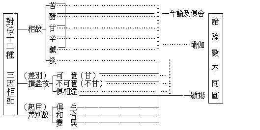



辛五　触境



云何名为所触一分？谓身境界，除四大种餘所造触，滑性、涩性、重性、轻性、冷、饥、渴等。



此除大种之一分身根所对，身识所缘之境界也。言所触者，谓触有二：能触、所触。能触中分二：一、触心所法，二、能触身根及身识。所触亦分二：一、能造四大种，二、所造触处也。今言所触一分者，於所触中唯取所造除能造，故言除四大种。对法疏云：『於所触中唯取所造，故言一分也，谓身境界所触法』。除四大种餘所造触，释一分义；广论、纂注之说非是。滑性下列七触名，释论曰：『滑谓细软；涩谓麤强；重谓可称；轻谓反是；煖欲为冷，触是冷因，此即於因立其果称。如说：诸佛出世乐，演说正法乐，众僧和合乐，同修精进乐。精进勤苦虽是乐因，即说为乐，此亦如是。食欲为饥；饮欲为渴；说亦如是。



案：婆沙解触有二说：初说性类各别义，谓但由大种性类差别有生滑果乃至有生渴果。后说四大偏增义，谓水火增故滑；地风增故涩；火风增故轻；地水增故重；水风增故冷；风增故饥，谓风增故，击动食消引饥渴生，便发食欲；火增故渴，谓火增故，煎迫饮消引渴触生，便发饥欲。此二、於有部宗前说为正。若配今论者，解滑、涩、重、轻四种，初说应理。瑜伽云：『於大种清净性假立滑性，於大种坚实性假立重性，於大种不清净不坚实性假立涩性及轻性』。是虽假实异说，性类差别义一同也。又解冷等三，后说应理，瑜伽云：『由水与风和合生故，假立有冷；由阙任持不平等故，假立饥渴及弱力』，一同也。虽和合与偏增异，义相似故。



等者，等软、缓、急、饱、力、劣、闷、痒、黏、老、病、疲、息、勇十五法也。今列七名中，何故初四法安性言，后三法无之？盖后三从果名立——软等十五法亦同，此四自性立名；以从自性立名故，持业释也。正理论云：『滑即性故言滑性』。餘三以从果立名，故有财释也——全分有财。释论所举之滑，谓细软等中。煖欲、食欲、饥欲，是心所欲数，由内身中有触力令欲煖，有触力令欲食，有触力令欲饮，所令之欲名冷、饥、渴；即是由其能令之触，即能令触从果为名，名冷饥渴。以冷、饥、渴三相隐而难知，若不约果以明其体，则无从显现，故引诸佛出世乐等之颂，以证因立果名。盖佛出世乃至精进非是乐，能生乐故，称佛为乐等也。



庚三　法处色



云何名为无表色等？谓有表业，及三摩地所生色等，无见无对。



文有二段，初徵后释。初无表色者，旧云无作色。前五境如次五识所缘，无表色第六意识所缘，法处摄也，体即善恶之思种子功能也。然就其名色义边，有大小乘异：大乘就所防所发义边名色，谓彼善思种子上有防身语恶及发身语善功能；又恶思种子上有发身语恶及遮身语善功能；其所防善恶、所发善恶俱据身语，就其所据义边，假名色也。表无表，义林曰：『其无表色实是无表，无表示故。而体非色，亦从所发所防假名为色』。小乘异之，俱舍有二解：第一说、随所依义，谓所依表色有变坏故，能依无表随之名色。第二说、约所依大种义，谓所依大种变碍故，能依无表亦名色。今言无表者，遮诠之称，非六释摄故，如无明等。色者、通於一切，以别简总，言无表色，依主释也。等者、向内等也。后释中、有表业者，对无表；表谓表示，表自内心示他故，即色处中表色也。业者、造作义。有者、对无言有、非能所有之有。体即身语二法，故释论谓「身语表」也。



三摩地所生色者，即定果色；或定自在色——由定力自在所变色，名定自在色；或自在所生色。三摩地为七定名中之第二等持定。（按：七定名，一、三摩呬多，此云等引。二、三摩地，此云等持。三、三摩钵底，此云等至。四、驮那演那，此云静虑。五、质多医迦阿羯罗多，此云心一境性。六、奢摩他，此云止。七、现法乐住。又、此七略言之不出三观：一、奢摩他，二、三摩钵提，三、禅那是）：谓以平等持心心所俱於境转，或平等任持双离沉掉，故名等持。前解但专注境义，地通定散；后解有止有观，即名禅那。所生色三字，义贯有表业与三摩地。



初有表业所生色者，表为能引，引起无表色相故，此通身语表业之善不善。故释论曰：『谓身语表，此——身语二法——通善、不善、无记性。所生色者，谓即从彼善不善表所生之色，此不可显示，故名无表』。盖身语表业者，能生体相也。然此体相，若以色处中表色为体曰身表，若以声为体曰语表，二者皆假非实。又身、语二业，表善恶故，假名善恶，实是无记，不能招当异熟果故，从业——即思心所为假也。业虽通三，而身语从思所发，所发是表，非是真业耳。无表、义林曰：『身语二业，假表业体，实是表色，而非业性』。又唯识论云：『或身语表由思发故，假说为业』。五十一说：『一切表业皆是假有，其发身语现行之思实是业性』。由此理教，故说为假。问：若尔、论文何但言身语为表业，不及意业耶？答：小乘唯以身语二为业，此论名三乘共教，文相影略，据意应有。唯识论云：『能动身思说名身业，能动语思说名语业，审决二思意相应故，作动意故』。如是论文处处皆有，不遑枚举，思之可知。云何审决二思？成业论等说思有三种：一、审决思，将发身语先审决故，二、决定思，起决定心将欲所作故，三、发动思，正发身语动作於事故。由是观之，身、语二业正第三发动善不善思为真自体，但唯取现行；意业以前二思为体也。此发动现行之善不善思，虽实非身语表色，约所防所发义边，假名身语表色，其性无记；依思动作，义通三性，故云身语表通善、不善、无记性也。彼所生色等者，意谓从善生名律仪无表，从恶生名不律仪无表。然无论其善律仪或不善律仪，要之、不外依思种子上立故。唯识论云：『此或依发胜身语善恶思种增长位立』。又成业论曰：『思差别者，简取胜思，能发律仪、不律仪表』。由此思故，熏成二种殊胜种子，依二种子未损坏位——善无表犯戒则坏，恶无表行善则损——假立善恶律仪等无表，可谓明证矣。此又名受所引色，受谓领受，引即引取，如受诸戒品，戒是色法，所受之戒，为受所引色也。



后三摩地所生色者，释论解之云：『谓四静虑所生色等』。静虑、梵语驮那演那，旧讹云禅那，是色界定及所依地，并云静虑，通摄有无心定及漏无漏、染不染，依色四地。静者、寂静，即是定用；虑者、审虑，即是慧用；依定慧均等，故名静虑。此简慧多定少——中间定，慧少定多——无色界定，皆非静虑，显四根本定，亦静亦虑，定慧不二所生之定果色也。然则瑜伽何言定果色非唯色界四禅，无色定亦能现起耶？五十三说：就业生色，说无色无，非就胜定；若就胜定，则通色无色——八根本，非八未至定。而今唯言四静虑所生者，就业生色。业所生者，触处大种也，即异熟、长养、等流、身根、身俱意识、第八识也；非就胜定，故不相违。言胜定所生色等者，即以殊胜定力於一切色皆得自在；谓入定者，所现光明，或变石成金，乃至见一切色像境界皆有实用，如入火光定则火光发现，入念佛三昧定，则极乐圣境弥陀相好皆现前等是也。



问：此无表色是能造性，抑所造性耶？释论答之云：『是所造性，名善律仪不善律仪等』。是者、八啭声中体声，即指上所明无表色并定果色自体。所造性者，表无表，义林曰：『准显扬一云：律仪色依不现行法建立色性，不律仪色依现行法建立色性。此意总说表与无表律仪色，皆依所防身语以假名色，即显三界别脱、定戒、无漏色等皆是能造，欲界所防造恶身语四大所造』。造色、义林明：就能所造，有即质造与离质造二种中，是离质造。彼言所造色与大种处相离者，名离质造故。又定果色大种生者，法苑五本：就胜定果色三门分别中，第三举大种生一门，其中引瑜伽、显扬等五文广释。诸无表色相类虽同，善恶性殊，故分律仪与不律仪。等者、处中无表，谓非律仪非不律仪也。然处中无表立不立有异义，难陀论师不立处中无表，护法论师立处中无表，今安慧广论与护法师同义，故更云等也。



问：别解脱无表，上云依思种假立，而定道二戒无表，所立云何？答：表无表章曰：『静虑无表，以法尔一切上二界十七地中，有漏定俱现行思上，有防欲界恶戒功能为体……无漏律仪以法尔一切上地所有无漏道俱现行思上，能断欲界诸犯戒非功能为体』——此二皆随心转戒，体俱是现行思。显扬文云：不律仪色，依现行法建立色性，指依现行思立有表，非立无表。现行思者，造作义故，是业义故。释论「亦名业」，即示定、道二戒无表体也。又云：亦名曰种子者，指律仪不律仪无表。成业论示定、道二戒外，一切善不善律仪无表，皆依思种子立是也。



假实云何？定道二戒，通实通假，所餘一切无表，皆假立也。显扬义林，皆有明文。等者、等极逈、极略、遍计所起色也。极逈谓即此离餘碍触色，极略谓极微色，遍计所起谓影像色也。无见无对者，非眼识所缘，眼根所碍之色境也。谓意识所缘，法处所摄之五种色法，总为无见无对色耳。释论曰：『如是诸色，略有三种：一者、可见有对——为能所碍者为有对——，二者、不可见有对，三者、不可见无对。是中可见有对者，谓显色等——等一切形色等。有说：有见有对唯显色，以形、表色为显色之分位，是意识分别所安立故——；不可见有对者，谓眼根等——根指胜义五根，等声香味触——；不可见无对者，谓无表色等』。其文易知，足资参鉴矣。



丙二　受蕴



云何受蕴？谓三领纳：一、苦，二、乐，三、不苦不乐。乐、谓灭时有和合欲；苦、谓生时有乖离欲；不苦不乐、谓无二欲。



此中有二，初徵后释，徵可知。释中复为二：初标列，后随释。初、谓三领纳，领即领受，纳是纳入；境有顺逆，而能领纳之心随之亦异，故曰三领纳。领纳者，受之自性也。成唯识论云：『受谓领纳顺违俱非境相为性』。盖顺境则生乐受，逆境则生苦受，中容境则生不苦不乐受。於是眼识领纳色曰眼触所生受，耳识领纳声曰耳触所生受，鼻识领纳香曰鼻触所生受，舌识领纳味曰舌触所生受，身识领纳触曰身触所生受，意识领纳法曰意触所生受等。对法依四因、五位、七类差别，总说二十七受差别，位虽有多，然不外适悦、逼迫、俱非之三类故。此三皆通有、无漏，见、修及非断三，学、无学、俱非，并善、不善、有覆、无覆四等。然有处分为五受者，乃自苦乐中离出忧喜故：即五识之领顺违境云苦、乐，意识之领顺违境云忧、喜。如次依有分别、无分别建立也——五识无随念、计度二分别。问：此中於苦、乐离出忧、喜，为五识与意识差别，何故於舍受无此差别耶？答：适悦逼迫身心相，前五第六各异故。谓苦、乐无分别转，忧、喜有分别转。又苦、乐二种依尤重，忧、喜二种依轻微，舍受不尔，非逼非悦，此相在五、六识更无异故。又无分别而平等转，故不分之也。问：总一受心所，依开合不同而有三受、五受差别，然其建立根本之义安在耶？答：约受领於境义边，建立三受门；约根生义边，建立五受门。举图示之如左：



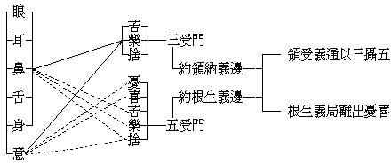



又佛果之无漏心，及因位之有漏心，受有差别：



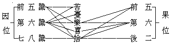



乐谓下，后随释也，文中自有三段可知。大凡人之感受乐时，初则或自不觉知，久则习以为常，直至谢灭，方知其乐也不可再得，而更生希求，如鱼离水者。然感受苦时，触处便知，即希乖离，犹探汤者是。俱非之受於此二者相反，无离合希欲故。然此单就显麤相论，若就细相论之，於乐受已得固生不乖离欲——和合欲，未得亦有希合欲；於苦受已得固生乖离欲，未得亦有不合欲。如是之义，可参阅唯识述记，自有详释。



综上所说，受有苦、乐、舍之三受，或加忧、喜之五受。有通六识有者，有局前五者，乃至七八二识等之种种差别。若克论之，一切有漏位中，所有三界二十五有，无一非苦，奚喜乐等之有哉！所以者何？是有漏受心故；若三受者，乐灭时是坏苦，苦生时是苦苦，舍受非苦乐，刹那有生灭，即是行苦。又乐受於未得希得，希得不遂，求不得苦；已得复失，得不永得，爱别离苦。复次、苦生时为生苦，乖离不能怨会苦，苦之不尽阴盛苦。三受既尔，五受准知。若佛果无漏受心则不然，乐则常乐，舍受平等，寂然无苦之发生矣。



丙三　想蕴



云何想蕴？谓於境界，取种种相。



文有二，初徵后释。初想蕴者，想、是遍行中之一也。此总有二种：有相想、无相想也。有相想者，能取诸境界，随起彼彼言说，而具明了、分别二种，名为有相想。此有种种差别，或随所依立六想身：眼触所生想——眼根对色，眼识於中所取是白是黑非白非黑之分齐相者，即此眼触所生之想心所之作用也——；耳触所生想；鼻触所生想；舌触所生想；身触所生想；意触所生想——於一切境能明了分别，例如同时意识闻有音声，即於其中取有合乎道理之分齐者，安立能诠之某某名相於其义理中之自性差别，复施设之为如何如何之所诠等——是。或约境界，有欲界、色界、及空无边处、无所有处等差别：欲界想者，小想也，下劣故。色界想，大想也，增上故。空无边、识无边处想，无量想也，无边际故。如是等虽有境麤细差别，然随具明了分别二种而於境界起言说，故皆有相想也。无相想者，或能缘或所缘，若阙分别若阙明了，或二种共阙是名无相想也。如欲界中婴儿未学语言者，虽於色起想，而不能了此名为色故；非想非非想定，彼地及定不明，不能图畫诸境界相，虽彼散心亦无想，今从定说；及涅槃无相界定想。对法论曰：『离色等一切相，无相涅槃想故名无相想』。涅槃经三十一曰：『涅槃离十或十三相加苦乐舍，涅槃离此相，立无相名』。缘彼相名无相想，非能缘彼相分，无境无相故。如是差别，广分别如对法疏说。此中依有相想为论，其旨可察。



谓於下、后释，成唯识论曰：『想谓於境取像为性——依彼所触之境而取像——施设种种名言为业』。如见青黄等色，於中取像曰：此是青，此是黄，推之於万物，皆然。谓要安立境分齐相，方起种种名言——谓此法非彼法等，作此分齐而取共相，名为安立；由取此像，便起名言，此是青等。性类众多，故名种种。相谓相状，对法疏出有十种：色声等五境，男女及生异灭相；涅槃有十三等，皆为想之所取而安立也。



　　　　　　│…有明了不分别………如无想界即涅槃…│  

　　　　明了│　　　　　　　　　　　　　　　　　　│  

　　　　　　│…有分别不明了………如有顶定等………│…无相想  

　　　　分别│　　　　　　　　　　　　　　　　　　│  

　　　　　　├─有明了亦分别───一切有想────┼─有相想  

　　　　四句│　　　　　　　　　　　　　　　　　　│  

　　　　　　│…有非明了亦非分别…如孩等……………│



　　　　　　　　　　┌─狭　小　想─┐  

　　　　　　　　　　│　　　　　　　│  

　　　　　　　　　　├─广　大　想─┤  

　　　　　　　　　　│　　　　　　　├─────有相想  

　　　　　　　　　　├─无　量　想─┤  

　　　　瑜伽五十三─┤　　　　　　　│  

　　　　　　　　　　├─无所有想　─┘  

　　　　　　　　　　│  

　　　　　　　　　　├─有　顶　想─────┐  

　　　　　　　　　　│　　　　　　　　　　　├─无相想  

　　　　　　　　　　└─一切出世学无学想──┘



　　　　　　　　　　┌─狭　小　想……………│  

　　　　　　　　　　│　　　　　　　　　　　│  

　　　　　　　　　　├─广　大　想……………│  

　　　　　　　　　　│　　　　　　　　　　　│  

　　　　　　　　　　├─无　量　想……………│………世间想  

　　　　瑜伽五十三─┤　　　　　　　　　　　│  

　　　　　　　　　　├─无所有想　……………│  

　　　　　　　　　　│　　　　　　　　　　　│  

　　　　　　　　　　├─有　顶　想……………│  

　　　　　　　　　　│  

　　　　　　　　　　└─出世学无学想……………………出世想



丙四　行蕴



丁一　总举



云何行蕴？谓除受想，诸餘心法及心不相应行。



此总举文中，亦有徵释二。初行蕴者，行、迁流义，蕴、积集义，谓一切心相应法等，念念落谢不少留住，故名为行。然诸论中明行蕴体有总别二种：总者、以诸相应法及不相应法为行蕴体，今论及百法论等是也。别者、遍行中之思心所为行蕴主，谓於诸行中由思最胜——造作力用——能作心等令善染等故；又由令心差别，不相应等分位行相各别故。对法论曰：造作相是行相，由此行故，令心造作，谓於善恶苦乐等品中驱役心故。是即说一思为行蕴主。主者、一切行法之导首，约据胜为论也。故他处经论，说六思身为行蕴，或有五种差别说行蕴，或有三种差别——一、胜差别，以思心所一切行中最胜故；二、所依差别，即六思身；三、依施设差别，善染分位等——明行蕴，举表如左：——



　　　　　　　　　　　　　别境五约增胜  

　　　　　　　　　　　│…思为蕴主　　…│  

　　　　　　│……思…│　　　　　　　　├胜差别─┐　　┌─：…一为境随与  

　　　　　　│　　　　│…此中摄遍行中…│　　　　│　　│自：  

　　　　　　│　　　　　　除受想餘三　　　　　　　│　　│　：…二为彼合会  

　　　　　　│　┌─眼触所生思─┐　　　　　　　　│　　│性：  

　　　　　　│　│　　　　　　　│　　　　　　　　├─┐├─：…三为彼别离  

　　　　┌─┤　├─耳触所生思─┤　　　　　　　　│显││　：  

　　　　│对│　│　　　　　　　│　　　　　　　　│　││瑜：…四发杂染业  

　　　　│　│　├─鼻触所生思─┼────依差别─┤扬││　：  

　　　　│法│　│　　　　　　　│　　　　　　　　│　││伽：…五令心自在转  

　　　　│　│　├─舌触所生思─┤　　　　　　　　│论││　：  

　　　　│论│　│　　　　　　　│　　　　　　　　├─┘│论：…一由境界…六思身  

　　　　└─┤　├─身触所生思─┤　　　　　　　　│　　├─：  

　　　　　　│　│　　　　　　　│　　　　　　　　│　　│　：…二由分位…二十四不  

　　　　　　│　└─意触所生思─┘　　　　　　　　│　　│　：　　　　　　相应  

　　　　　　│　　　　　　　　　　　　　　　　　　│　　│差：…三由杂染…本惑随惑  

　　　　　　│　　┌─诸善思…信等十………│　　　│　　│　：  

　　　　　　│　　│　　　　　一法　　　　│　　　│　　│　：…四由清净…信等十一  

　　　　　　│……├─杂染思…本惑十随惑…│　　　│　　│别：  

　　　　　　　　　│　　　　　二十不定四　├施设─┘　　└─：…五由造作…思遍行三  

　　　　　　　　　└─分位差…二十四不……│差别　　　　　　　　　　　　　别境五  

　　　　　　　　　　　别思　　相应行法



谓除受想下、后释也。受、想二法，如上所明，已为别蕴，故今除之。问：对法论除受想思三，今论何故不除思耶？答：彼论别相建立，思为主故；此论总相释蕴，唯除受想。问：前略标文内，於二义中取造作义，今复云为迁流义者，何耶？答：前以广狭为论，今是据实而说，文互影略，义益周显，有何相违？问：心所相应及不相应法皆行蕴摄，今何除受想各别建立乎？答：此有二义：一、有外道等计受、想为生死因，修八等至无色定，此二最胜故，别成二蕴，故非此摄——理实此二亦思造作令成善染法，此约据胜为论。二、餘蕴虽亦具造作迁流之义，而彼诸蕴摄行少故，各受别名，此蕴摄行多故，独得总称——此约摄行多少为论。



丁二　别释



戊一　心相应行



己一　释心所名义



云何名为诸餘心法？谓彼诸法与心相应。



此中云何名为诸餘心法者，问也。次上既言除受、想诸餘心法，受、想二法上已专明，但未知诸餘心法者何耶？谓彼下、总答之也。彼诸法与心相应者，心、谓八识心王；彼诸法，六位五十一心所法也。心所法者，以其皆心家所有法也。此有三义：一、恒依心起，盖心王为主，心所为辅，无主不能独立，故必依之而起。二、与心相应，心王既起，心所亦必同时起而相应，绝无先后各出之理。三、系属於心，心所虽有众多种类，善恶又不一致，而各率其眷属归系於每识心王之下。合此三义，名心所有法。又相应者，谓此心法常与心王同依——同一俱有根开导依；同缘——同缘一境，王缘总相，心所缘总别相；及与同时——同一刹那而起。若约小乘，更有同行，今依大乘，心法与王不同其行。所以者何？由心法等与王行相各各不同，如缘青色，心王自变，心法自变，是故不同。此之心法与其心王各缘诸境，一时相应，心起即起，心无即无，如王左右不离於王，心数相应，亦复如是。准上所明相应之法，必具四义：一、心心所见分——即行相——各异，二、时同，三、依同，四、所缘事等。等者、相似，事谓相见所依自体，即各各心心所所有自证分体，平等相似。光记十七曰：『事平等者，事之言体，显各体一，故言事等。於一相应心心所中，如心体一，诸心所法体亦各一，必无二体一时俱行。此约刹那同时体等，非言前后异品数等』。



己二　明六位差别



庚一　总辨差别



辛一　列名



彼复云何？谓触、作意、受、想、思；欲、胜解、念、三摩地、慧；信、惭、愧、无贪善根、无瞋善根、无痴善根、精进、轻安、不放逸、舍、不害；贪、瞋、慢、无明、见、疑；忿、恨、覆、恼、嫉、悭、诳、谄、憍、害，无惭、无愧，惛沉、掉举、不信、懈怠、放逸、失念、散乱、不正知；恶作、睡眠、寻、伺。



初徵可知。列名中，除受、想，如上已明。其列次第，诸论有异。瑜伽、对法、显扬、百法等论，作意触次第，今论及唯识触作意次第也。彼瑜伽论等约观行发修次第，谓二乘及地前菩萨观行皆依作意而修，故作意之次列於触等。今论及唯识等约法相生起次第，谓三和直生触而作意现前，是以境为先故。又具列遍行五数，恐是草误，以受想二已除故。此中总列五十一法，而释文中於根本烦恼之不正见复开五法者，约行解不同也。其开合虽异，慧性是同，义亦无妨。



辛二　配属



是诸心法：五是遍行，五是别境，十一是善，六是烦恼，餘是随烦恼，四是不决定。



此中自有六节：第一、五是遍行者，於前总举门中依别蕴义除受、想二，今此显类同言此五，故曰五是遍行。遍周遍义，行起行义，此五无论何时何处何心何性均能等起，故曰遍行。由是一切心所虽有性用各异以显差别，而大类之攸分，犹在斯四义矣。故瑜伽以此四义——时、处、心、性——废立心所差别曰：一者、善等三性遍不遍，二者、三界、九地遍不遍，三者、刹那相续，四者、彼此同时俱起不俱起。就此四义，或有具二，或有具三，或四咸具，遂有别境善等六种之差别耳。第二、五是别境者，谓所缘境事多少不同，能缘心性乃起自所缘特别之境，故名别境。详言之，於境不遍，阙刹那相续、俱起之二，各各别缘其境以生心也。五者、欲、胜解、念、定、慧也。是者、体声，即指五法之自体。第三、十一是善者，明善心所类也，即信等十一数是。所言善者，二世顺益故。此十一自体即善，唯善心所可得生故，是以总束称善也。又此中、於四一切，唯具遍一切地之一种，不具餘三可知。第四、六是烦恼者，总束贪、瞋、痴等六法也。若别开之，则有十法。后作释中开五见，一一有释，至下当知。此六法为惑之根本，餘惑皆此等流、分位差别，故名本惑，是为根本烦恼。烦性即恼，持业释也。第五、餘是随烦恼者，明大中小之随烦恼也。餘者、本惑六法之餘，即指忿恨等二十法故。若依瑜伽则有二十二法，更加邪欲、邪胜解故。此二十惑，皆本惑等流性，随彼生故，称随简本，能随所随异故。烦恼之随，依主释。若以随烦恼三字为自名，他一分有财亦得，亦称随惑对本惑故。是此本随二惑，於四一切皆不具，不通三性，不遍九地，非相续，亦不俱起故。第六、四不定者，恶作等四法也。对法疏举三因以明不定义：谓此四於善染等三性皆不定故，非如触、作意等定遍心故，非如欲等定遍地故，立不定名。又释论解此及简别曰：『此四不定，非正随烦恼，以通善及无记性故』。瑜伽抉择分合六位为五位，即不定四摄随惑中。盖彼论意，谓此四法虽通三性，於中染义增故，依之摄随惑中，六位而为五位也。今安慧论师通之言「非正随烦恼」，非正言，显一分通染性义也。『以通善及无记性故』下，述所由，通三性故。此不定於四一切中，惟有一切性之一种，无餘三可识。



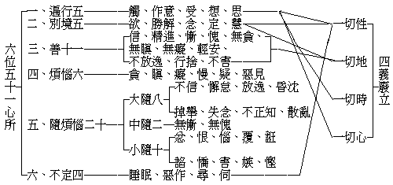



庚二　别明体性



辛一　明遍行



壬一　明触



云何为触？谓三和合分别为性。



於此科段中，除受想二，如前既辨。今文有徵释二。释中，三和者，三、谓根境识，和者、简乖违。谓若眼根、声境、鼻识，如此三法，纵并起不名和，三法各乖违故；唯於六根境识中，随应相顺生起名三和，谓如眼根、色境、眼识等也。成唯识论曰：『根、境、识更相随顺，故名三和』。又纵相顺法，若阙一法，则不名三和，谓唯根境二起，识未起也。论疏曰：『正三和体，谓根、境、识。体异名三，不相乖违，更相交涉，名为随顺。如识不生，唯根境起，名为乖违』。



合者、十句义论曰：二不至至时名合。今合三种，是有已合未合，未合位三法各住本性，后至已合位，各更有顺起心所功用，故云三和合。若此三法居种子时及未合位，皆无顺生心所功能，则不名三和合也。如是三和合者，虽云有触，非即是触；触是三和合所生果，三和合是触能生因也，故曰三和生触。触与三和：一者、依三和合，二者、令三法合，三者、似彼三和。分别为性者，成唯识论云：『触似彼起，故名分别』。疏释之曰：分别之用，是触功能。谓触之上，有似前三顺生心所变异用功能，说明分别。分别即是领似异名，如子似父，名分别父。谓根等三合时，其相用异自体，而能有生心所功用，是名触，此触之正生心所位名分别，即能似彼根等三故。如世间父能生子，此子似父，而父子自体分别，此亦如是。三和能生触，触虽似三和，与三和分别，而亦能生心心所，是触自性也。



壬二　明作意心所



云何作意？谓能令心发悟为性。



文有二，初徵、后释。初、作意者，作动於意，故名作意。后、令心发悟为性者，发、谓发动，悟、谓警觉，能发动於心使之现起，能警觉於心使之趣境；使之现起者名种子作意，使之趣境者名现行作意也。种子作意者，作意之种子激厉心心所之种子，使其现行——但彼心等种，生缘未合时不可定生，生缘已熟当生种子引发之，是作意功能也。现行作意者，心心所沉闷时，而提醒之使其趣境。例如心王寂静意念俱泯之时，以业习种子之力鼓动此心，不觉作意，如鱼喷沫，由是心动境扰，苦乐毕现矣。



壬三　明思心所



云何为思？谓於功德过失及俱相违，令心造作，意业为性。



於中有二，初徵、后释，释中又二：初举所行境，后正举所作法显能作体。初中、功德者，谓由善业招感之顺益境；过失者，谓由恶业招感之损害境；俱相违者，谓由无记业招感之非顺非违不动境：此三是心心所所行境也。於者、境第七啭，可知。令心造作意业为性者，后、正举所作法显能作体。心、谓心王，造作者、思维筹度，意、心心所总称，业、通身、口、意三业。意谓此思於善恶等境，取正因等相，思维造作驱役心心所，同趣所行之善恶境也。故释论云：『此性若有，识攀缘用即现在前，犹如磁石引铁』。即显此思若有时，彼心心所等缘境必现在前，犹如磁石势力，能令铁有动用故也。



此三遍行心所——受、想亦尔，如上说四义，常遍於一切性：无论为善性，为不善性，为无记性，每一性起，必俱有此五心所。又遍於一切心：无论显著之五、六等识，或细微之七、八等识，每一识动，必俱有此五者。又遍於一切地：一切地者，欲界则为五趣杂居地，色界则为初禅离生喜乐地，二禅定生喜乐地，三禅离喜妙乐地，四禅舍念清净地。无色界则为空无边处地，识无边处地，无所有处地，非想非非想处地。无论何等地，必有此五者。又、遍於一切时：一切时者，长时如经多劫，短时如一刹那，无论何种时，必俱有此五者。统一切性、一切心、一切地、一切时，无非此五心所之所周遍游行，故曰遍行。



辛二　别境五



壬一　明欲心所



云何为欲？谓於可爱事，希望为性。



可爱者，即所乐之事；事物之境，心依之而起希望，是为欲心所之自体也。所乐者，谓欲观境，不简欣厌求不求，随於何境作意欲观察处，必有欲数，故曰事事物物之境能起此心也。此有异说不同，可参观唯识疏。



壬二　胜解心所



云何胜解？谓於决定事，即如所了印可为性。



於徵释二科中之释文有三节：初定所缘境，次示能缘相，后正明自体。谓於决定事四字，初定所缘境也。决定者，简不定不决；此中不定，就所缘境，不决就能缘心。对法疏云：犹预境及非审决心，无胜解生故。今言於决定事，先示所缘境也。即如所了者，次示能缘相。成唯识论五曰：『邪正等教理证力，於所取境审决印持』。今如所了，亦即由邪正等教及道理修力而决了故。谓即於所缘境，由邪教者决定邪理，由正教者决定正理等是。印可为性者，后正示自体。印、即可，谓是事必尔，彼不尔也，凡物决定云印可，言印可即决定故。



壬三　念心所



云何为念？谓串习事，令心不忘明记为性。



徵释可知。释中、於串习事等者，於、境第七啭，事、业也，是举念所记之境。有处云曾受境，今论言串习事，盖彼约所记境，此约能记心，各据一义，并不相违。心不忘等者，正释体。谓不忘失与明记二义名念，若於曾受境而不明记，念不生故；或於曾受境不忘失而缺明记，虽生而不分明故，故具二种，正名念也。释论曰：『惯习事者，谓曾所习行，与不散乱所依为业』。曾所习行者，即於前所行过经验之事明记，能缘心中而不忘失之谓。例如：先於某日随众打七念佛，於中有一念相应，顿见胜境，明明了了，迄至今日，尚能忆想是境而不忘失者，即念心所之功用，以念能通於三世故。又若听讲，耳识缘曲屈之声音，意识了达其义理，明记不忘，亦念心所之力也。然通常以念为妄念，如所谓「打得念头死，许你法身活」，及起信论之「心体离念」等，盖不知念通善、恶、无记三性。起信等但依染污一面而言，非念悉是染污，如念佛、持咒、诵经，乃至禅门参看话头，念念追问，刻刻究寻，无非善念；若无善念为基，定心从何相应？观慧从何引生？故曰：由念生定，由定发慧，由慧断惑，惑断证真。又、四法迹为三学所依，其义尤为显著。何谓四法迹？无贪、无瞋、正念、正定是。此四能令三学增上，谓无贪无瞋令戒学增上清净，正念令心学增上清净——於所缘应无失，持心令定故——正定令慧学增上清净。且四法迹中，念是定因，定由念住故，定是念果，是念所引故。复次、乃至根本无分别智亲证真如实性，亦应有念，不尔、后得智中无此明记功能故。如是应知念为断染成净超凡入圣之一大基础也。



壬四　定心所



云何三摩地？谓於所观事，令心一境不散为性。



於中有二，初徵后释。释亦二：初举所注境——於所观事，后示能注相。梵语三摩地，此云等持，平等持心令至境故。不简界地定散，凡一切有情，任运所起，专注不散，皆得此名——如念佛、数息等。故与三摩呬多等制伏沉掉，调畅身心专注名定，自有通局宽狭之别也。於所观事，是举所注境也。此境要依圣教所说而缘，久久功致，於所缘境明证了解，心明智生，能知德失等相，如次即闻、思、修三慧也。释论云：『所观事者，谓五蕴等及无常苦空无我等』。五蕴等，凡圣之通观，谓常、乐、我、净四倒也；圣者观身不净，观法无我，观受是苦，观心无常；凡夫外道依邪教邪师，非常计常，非乐计乐，非我计我，非净计净而成四倒。无常苦空等，约十六行相，见道之四谛观也。——所观事之事字，应有二释；一、事相，谓四谛十二因缘等；二、体事，谓法身真如等；其义皆通。令心一境不散为性者，正示心能注相，即定心令心心所专注一境，不散不乱，而成现量之三昧境也。又、专注言应活看，非执定心前后唯缘一物，但随所注心缘多少境，或一刹那别欲注心处，现量取所缘，定即得生。不尔、於相见道中，观苦、集、灭、道等，应无等持定。故知随欲所住而住，於理无违。



壬五　慧心所



云何为慧？谓即於彼择法为性；或如理所引，或不如理所引，或俱非所引。



文有二，初徵后释；释中亦二：初总示体，后显差别。於彼者，即举前定中之所观事而为此慧心所简择之境也。择法为性，正出慧体；此有二类：一、善慧，离诸颠倒正简择性故，亦名正见，即随法正理推求故。差别有三，闻、思、修三慧是。二、恶慧，唯是染污邪简择性故，亦名恶见，即随法颠倒推求故。差别有五，至下可悉。问：见、慧既等，於此文中云见，本惑中何不云慧耶？答：慧宽、见狭别故，简择、推求异故。又、此中於善恶二种中，取简择用增盛义边称慧，通三性、遍九地故；彼於诸法颠倒推求，由之起惑业过失增盛义边名见——恶见，惟局恶性，非定遍九地故。故本惑不即慧，简择不即见也。是以唯识论等云「於所观境简择为性」，唯约胜慧一边作境耳。如理所引等者，显差别也；谓随顺佛说称法界性相之理，乃至离常、乐等四倒，顺苦、空、无常等理，即以佛说正理为能引，慧为所引，佛理之所引慧，第三啭依主释也。若约由慧证佛理义边，慧能引、佛理所引，佛理即所引，持业释也。若反是不如理所引者，即诸外道等之颠倒有无、断常等。非如理非不如理所引者，一切世间之慧也。



此五心所於所缘观境，各各不同；对所乐境则起欲，对决定境则起胜解，对所曾习境则起念，对所观境则起定起慧；四境各别，非如遍行五心所之同缘一境，故曰别境。又、此五心所或起一，或起二三，即有时同现於刹那中，亦仍是各缘各境，各别生起，所以不名遍行而名别境焉。



辛三　明善数十一



壬一　信心所



云何为信？谓於业果诸谛宝中，极正符顺，心净为性。



夫信为世出世善法之首，漏无漏功德之源，故菩萨发心十信以为基，由之知解而行证；三乘圣人五根——信根以为本，由之发无漏智见道而修道。澈行位之终始，为染净之关键。据信之通义言，若凡若圣、若因若果，贯通而一之，若智若愚、若贤若否，人人而守之，徵之於社会之交际，国家之约法，宗教之条规，哲学之研究，曷一能出乎信？验之於家庭父子之间，亲友之际，交易之场，曷一能离乎信？乃至无情之春生、夏长、秋歛、冬藏不失其时，星辰日月不失其轨者，岂非信性之存在乎？是以儒教有𫐐𫐄之喻，佛法有净珠之譬。盖车有𫐐𫐄，蛮貊可行，本之修齐以治平；水有净珠，混浊可清，依之超凡而入圣。前者通乎世俗，性渗恶、无记，后者局於佛法，纯善而无杂。今论正所明者，后之所说也。



文有徵释二，释中有缘境、因果、自体三。於业果等者，是初举信之所缘境，业果即是因果法，为身、口、意三业所造；此有三种，所谓善业、恶业、不动业是。善中又分漏无漏二种，谓诸有情类，无明所覆，迷昧智眼，其造五逆、十恶业者，定堕三涂果；作五戒、十善业者，则感人天果；修四禅、八定之业者，则感不动果；若修出世无漏善，信愿念佛造清净业者，则感极乐果；修十二因缘观等作还灭业者，则感二乘解脱果；乃至信有无上菩提，发菩提心，行菩萨道，造阿耨多罗三藐三菩提业者，定证无上菩提果。然释论於业，唯举福、非福、不动之三，於果只举须陀洹、斯陀含、阿那含、阿罗汉之四。彼文虽未尽举，意应有之，随胜说也。



按：须陀洹之名，唐云预流，预者、言入，流者、流类，即入圣之流类，故名预流，是初果也。斯陀含、唐云一来，即一往来，谓欲界九品惑中断前六品从人生天名往，从天还人名来，第二果也。阿那含，唐云不还，谓欲界九品惑悉断，唯现在一生，更不还生欲界，故名不还，第三果也。此三皆为有学位，依果向差别有十八种，即四向三果成七种，八、信解，九、见至，十、身证，十一、极七返，十二、家家，十三、一间，十四、中般，十五、生般，十六、无行般，十七、有行般，十八、上流般。阿罗汉是应义，应断烦恼，应受供，应不受分段生死，故是第四无学果也。无学中亦有九种：一、阿罗汉，二、慧解脱，三、俱解脱，四、退，五、思，六、护，七、住，八、堪达，九、不动也。又、前有学中大小有少异，无信解见至二，立随信行、随法行二，对法论、了义灯均有释，恐烦略之。



诸谛宝等者，谓苦、集、灭、道谛，及佛、法、僧宝也。唯识论说信差别有三：一、信有实，二、信有德，三、信有能。信有实者，谓於诸法实事理中深信忍故，即是今论言诸谛是也。信有德者，谓於三宝真净德中深信乐故，即今论言宝是也——深信佛证菩提，深信法是善说，深信僧具妙行。信有能者，谓一切世出世善，深信有力，能得能成起希望故——有漏善法无漏善法，信己及他——今能得后能成，无为得有为成，世善得出世成，起希望故。然本论无文，释论言等，等之所等，即此信有能也。不尔、则缺有能义故。或信业果，即信有能。



极正符顺者，次信因果，先举业果等虽亦是因果，而就所缘境明之，今此所举约能起心，故义门各别也。极言、简疏浅，谓於所缘境——业、果、谛、宝——深正缘故，信即得生；若疏缘，则信不生故。正言、简邪解，若於诸谛三宝等邪缘则信不生故。对法论云：於有德起清净行信者，即显此意也。——非德若能令心清净，亦有信生，即於外道无德，信彼是无德。符顺、正显信因果，符、谓符合，符合所缘境故；顺、即印顺，即是胜解，印而顺彼故。又谓乐顺，即是欲数，乐彼法即是欲故。前者是信因，忍可——胜解——境故；后者是信果，乐希——欲——境故。又极正符顺者，浅言之，即称业果、谛、宝实相境所起之信心也。由有此信心故，菩萨则於无上菩提得不退转，二乘则於生死解脱有分；故学佛法者首在起信。若信心成就，不啻一切功德成就，倘无信心则不得其门入，乌能得见其中美富？华严谓为功德母，长养诸善根；起信谓断疑舍邪，令佛种不断；此种紧要关键，其容轻忽而长此甘为生死凡夫不思脱离耶？世间多有谓其信心已足，以佛法广大，浅慧难入，遂自退缩，懦弱不前。吾谓不然，虑前顾后，何信之有？果尔、信得真，认得定，精进猛勇炽然而起，犹预懈怠放逸等病释然而亡。故信之为功，如人之有手，能持执诸物，象之有鼻，能持卷诸食，不虑食物之不得，但恐象手之非有。佛法亦然，唯要具象鼻信手，则不难持取诸佛法之珍贵宝物也。



心净为性者，后正显自体，唯识论云：『此性澄清，能净心等，以心胜故，立心净名』。意谓：盖此信体澄清，能净所净之心心所亦同澄清；犹清水珠，自体净亦能令浊秽水净。唯识论疏云：餘遍行、别境等心所法，但相应善，此等十一法是自性善；彼相应故，体非善非不善，由此信等俱故，心等方善；故此净信，能净心等故。问：惭愧等十法，亦是自性善，体应净？圣教中於处处释善染以染净言，或释漏无漏亦以染净言，尔何唯信为净体耶？答：惭等十法，体性虽善，而体非净相，信体即净，故以净为相，性相共净故。又、信独能净，餘所净故，唯信独得净名。圣教中以染净释善染等，能所合释，故总以善为净；能净；信不共德，其旨可见矣。



壬二　惭心所



云何为惭？谓自增上，及法增上，於所作罪羞耻为性。



於中徵释二、可知。释中有二：初举二缘，后显自体。初自增上者，尊爱己身也，谓思我如是身——如学佛已发菩提心人等——乃作诸恶事，即羞己造恶，是以自体为增上缘也。法增上者，於善法生尊贵而羞己依恶法也；或偶尔为恶，则於己素日所学所修有背，心生羞耻。及者、显人与法之相违释；又、俱是惭之所羞法，合集义也。於所作罪者，谓於自己所作之过失，由二缘增上力故，深生厌患，极为羞耻，而不复作诸重罪，乃防息恶行耳。羞耻等者，后显自体，谓心转自羞耻；自耻即性，持业释也。



壬三　愧心所



云何为愧？谓世增上，於所作罪羞耻为性。



此中分徵释二，释中有三：初举能生缘，次示所羞境，后显愧自体。初中世增上者，有二义：一、为世人可被责罚事，心生羞耻——如违世间道德等事。二、为国制可被责事，心生羞耻——如犯国家法律等条。於所作罪者，次示所羞境，即通明所作一切罪恶过失，应招世间讥刺指责议罚等之事实也。羞耻为性，后、自体可知。如是、依出世善法为增上缘，生羞耻心者为惭，依世间人或世间善法为增上缘，生羞耻心者为愧，故羞耻为惭愧之通相，人法为二之别相。唯识六曰：『云何为惭？依自法力，崇重贤善为性』。贤、谓有德，无论若凡若圣之有德者，而生崇敬；善、谓善法，无论有漏无漏善法而生崇重；此即以自增上崇敬贤圣，依法增上尊重善法，是惭心所别相之文也。又曰：「云何为愧？依世间力，轻拒暴恶为性」。有恶者名暴，染法体名恶，於彼二法，轻有恶者而不亲，拒恶法业而不作，此即以总轻拒，或总暴恶，为愧心所别相之文也。又曰：『羞耻过恶，对治无惭，息诸恶行』；『羞耻过恶，对治无愧，息诸恶业』；此即显羞耻为二通相，对治无惭无愧，及尊敬善人善法，轻拒恶者恶法，为二别相之文也——此二於随一善心起时，不论缘何境，不简诸谛等，皆有崇重善及拒惮恶义。



壬四　无贪心所



云何无贪？谓贪对治，令深厌患无著为性。



於中有徵释二，释中有三：初正举所治显能治，次约唯有漏明其相，后总约染净示自体。自下无贪、无瞋、无痴名为三善根，即对下贪、瞋、痴三不善根而立。然就此名根，唯识举二义：一、近对治义，简餘一切善心所；谓餘皆非近对治，故名善不名根。二、生善胜义，谓餘亦虽生善而无胜义，故以二义名根也。谓贪对治者，贪是所对治法，於一切染净诸法染著为性，故释论云：『谓於诸有及有资具染著为贪』——有者、三有，诸有即异熟三有果也，此三界有种种有故，有诸有三界中五趣各别故；有资具者，三有之因也，即中有并烦恼业及器世间等三有具故，此为能生因，三有为所生果也。对治者，能对治法，即无贪也。此能治有二，谓远对治、近对治也。远对治者，一切有漏无漏慧——即正见，近对治者，无贪等三善根。此中所说对治，於二种中近对治也。三不善根相翻，对近别对治故。此正贪之对治，第四啭别体依主可知。令深厌患者，次约唯有漏示其相，谓总於三界有漏无漏因果诸法不著，为无贪体。然就因果诸法有相顺因，为缘因：其相顺因，直可引三有果，因唯有漏法，是可厌也。为缘因，则通一切漏无漏染净诸法，是非可厌法也。此中唯遮能缘执，不遮所缘法故，纵执无漏涅槃成染污，是生死因，然於无漏法虽著，而仍非是可厌法也。今论已言令深厌患，知约有漏相顺因也。无著为性者，后总约染净示自体，谓无著——不著顺缘二因及诸果法——故，则於漏、无漏一切诸法皆无所染著，有染著则皆为无贪之所对治。今言无著为性者，有、无漏总合出体也。



壬五　无瞋心所



云何无瞋？谓瞋对治，以慈为性。



解此分徵释二：徵可知，释中又二；初显能所治，后正示自动。初、瞋对治者，瞋谓所对治法，对治谓能对治之无瞋也。通常云瞋恚，贪就身口，恚就於意，言贪恚，即双举三业。以慈为性者，后示自体：慈以与乐为义，於有情所起慈愍意，与之以乐也。慈之为义，如慈母之於幼子，眷爱抚养堪任劳苦，在所无怨。诸佛菩萨，等视一切众生，犹若己子，慇懃教化，方便诱引，悉令离苦得乐；虽遇刚强众生，逆性劣子，然犹宥其无知，不少生反感，善为摄受。故释论云：『无瞋者，谓於众生不损害义』。於、境第七啭声，即此心所之慈愍境也。此境既云众生，就其广义，不惟有情，亦通非情。成唯识论曰：『云何无瞋？於苦苦具无恚为性』。苦者，苦苦、坏苦、行苦，为三界有情之苦果。苦具者、苦果之资具，能生苦之因缘也，是皆瞋心所行境。瞋通情无情，无瞋亦尔，故曰：於苦苦具无恚为性。又无贪、无瞋二，有通别二相：通相者，诸善心随缘何境，一一心中皆有无贪无瞋；别相者，对有有具无著是无贪别相，对苦苦具不恚是无瞋别相。此二同遍善心，同一缘境，同一时转，作用各别故。由是反此之贪、瞋二法，亦有宽狭异：贪通三界——发业、润生——宽也，瞋唯欲界狭也。



壬六　无痴心所



云何无痴？谓痴对治，以其如实正行为性。



於中有徵释二，释中初举能所治，后正示自体。痴者、无明，即所对治法也；此有俱不俱二种，至下烦恼中当辨。能对治，云无痴。又就对治有通别二：通谓善慧，别谓此所明无痴善根也。远近二种，如上已辨。如实正行者，后释自体。如实对不实，正行者、正知加行；谓如一切诸法实相实性不谬无倒，正知正解如其所应修行而行名无痴行，即以般若为先导，对治痴是无痴自性也。释论解之曰：『如实者，略谓四圣谛，广谓十二缘起，於彼加行是正知义』。按：解此文亦分为二：初举所行境，即略广二种；后示能修义，即於彼下是。如实之言，标於事理诸法境也。略广对，四圣谛者，苦、集、灭、道四谛是即所观境也，而苦、空、无常、无我等，如其次第不谬，如实加行不倒，即对治常、乐、我、净之四倒耳。然就此四谛观有菩萨声闻异：菩萨以苦法智等八忍智，总缘三界四谛理，又以苦类智等八类忍智，缘能观智——忍有八：谓苦、集、灭、道法智忍，苦、集、灭、道类智忍，能引决定智胜慧，忍可四谛理故。——如是以苦等十六行相，总观四谛理，发圣慧眼，趣入真见道是。又有见、修、无学三道次第，所谓示相，劝修，作证也。此三道合有十二行相，即於见道有苦、集、灭、道四，於此又如其次第得眼、智、明、觉无漏真智。眼者、谓法智忍，智者、谓诸法智，明者、谓诸类智忍，觉者、谓诸类智。又眼是观见义，智是决断义，明是照了义，觉是警察义。若约小乘前解惟见道，后解通三道，如是三转十二行相，谛谛皆有，应言十二转四十八行相。修、无学二道，亦尔。二乘则以忍智缘下界，类智缘上界——即八忍八智十六心中，苦谛之第一第二苦法智忍、苦法智，缘欲界苦谛之境，第三第四苦类智忍、苦类智，缘上界苦谛之境；集谛之第五第六集法智忍、集法智，缘欲界集谛之境，第七第八集类智忍、集类智，缘上界集谛之境；第九第十之灭法智忍、灭法智，缘欲界之灭谛，第十一第十二之灭类智忍、灭类智缘上界之灭谛；第十三第十四之道法智忍、道法智，缘欲界之道谛，第十五第十六之道类智忍、道类智，缘上界之道谛。忍者、无间之谓，信认四谛之理毫无惑体之障碍间隔也。智者、解脱之谓，已了知四谛之理解脱惑体之位也。故俱舍二十三曰：『十六心中，忍是无间道，约断惑得、无能障碍故。智是解脱道，已解脱惑得，与离系得俱时起故。具二次第，理定应然，犹如世间，驱贼闭户』。此谓凡断一惑必有此无间、解脱之道，正断惑之位曰无间道，断已之位曰解脱道。法智类智云者，无始时来常怀我执，今创见法，应名法智，於法智后，观上二界四谛智境，类似欲界前之法智，随法智生故名类智。声闻不能如菩萨总缘三界，智有浅深故，应以图示之。先初依瑜伽意，图於菩萨三周十二行相；后依婆沙、俱舍意，图於二乘三周十二行相。



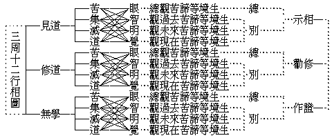



　　　　　　　　　　　　　┌─苦法智忍────眼─┐  

　　　　　　　　　　　　　├─苦 法 智────智　│  

　　　　　　　　　┌─苦─┼─苦类智忍────明　│  

　　　　　　　　　│　　　└─苦 类 智────觉　│  

　　　　　　　　　│　　　┌─集法智忍────眼　│  

　　　　　　　　　│　　　├─集 法 智────智　│  

　　　　　　　　　├─集─┼─集类智忍────明　│  

　　　　┌─见道─┤　　　└─集 类 智────觉　│  

　　　　│　　　　│　　　┌─灭法智忍────眼　├─示相──┐  

　　　　│　　　　│　　　├─灭 法 智────智　│　　　　　│  

　　　　│　　　　├─灭─┼─灭类智忍────明　│　　　　　│  

　　　　│　　　　│　　　└─灭 类 智────觉　│　　　　　│  

　　　　│　　　　│　　　┌─道法智忍────眼　│　　　　　│  

　　　　│　　　　│　　　├─道 法 智────智　│　　　　　│  

　　　　│　　　　└─道─┼─道类智忍────明　│　　　　　│  

　　　　│　　　　　　　　└─道 类 智────觉─┘　　　　　│  

　　　　├─修　道──────同 见 道────劝修──────┤  

　　　　└─无学道──────同 见 道────作证──────┘



广谓十二缘起者，即缘觉乘所行法，而苦谛中因果法也；至下邪见当辨之。於彼加行是正知义者，后示能修义也；即於彼四谛等教，如实正知，如实加行故。



壬七　精进心所



云何精进？谓懈怠对治，心於善品勇悍为性。



於中有徵释二，释中三：初显能所治，次明所行境，后正显自体。精进者，精、谓精纯，简四无记中无覆净，彼非染故纵名纯，不名精，以无记故，不能强悍且耐劳倦。进、谓升进，进可成圣者身义。即於一法具精与进二义，亦精亦进，持业释也。如是非染非净无记，显唯善性矣。懈怠者，所对治法，名义体性，至下随惑中可辨。对治者，能对治，指精进自体，懈怠之对治，第四啭依主释也。心於善品，次、举所行境，唯识论就修善断恶举善恶二法，今虽唯约善品，於善品现前，自具断恶义故。勇悍为性，后、正示自体，无所畏怯曰勇，无所避惧曰悍，故勇表精进，简诸染法，悍表精纯，简净无记；谓能精一其心，勇猛强悍，直至菩提，中无退转，是此精进自体也。释论曰：『谓若被甲，若加行，若无怯弱，若不退转，若无喜足』，举五种精进。初被甲者，经说「有势」，是最初发起猛利乐欲，喻如将入敌阵先著甲铠而无所畏，是初发心住也。加行者，经说「有勤」，是随所愿欲发起坚固勇悍方便，如正入敌阵作战，是修行住也。无怯弱者，瑜伽作「不下」，对法、唯识作「无下」，经说「有勇」，是为证得所受诸法，不自轻蔑，亦无怯惧畏弱，如已入敌阵立功，不自卑下，亦不恐敌也。不退转者，瑜伽作「无动」，对法、唯识作「不退」，经说「坚猛」，是能忍受寒热等苦，於劣等善不生喜足，欣求后后胜品功德等，显受苦练行不退相也。无喜足者，对法、唯识云「无足」，经说「不舍善轭」，——轭谓车轭，以轭牛者，牛轭外不能有所往；善法亦尔，轭修行者不违善品，往涅槃宫——是於下劣不生喜足，欣求后之转胜转妙诸功德住；如入敌阵被损，能忍受不退，加功修行，进入后后胜道，即不退无喜足之相也。此五种相配属位，唯识六有四释：第一解、约行别，初发心、自分下、中、上三品、胜进别故，第二解、约修别，初发心、长时、无间、慇重、无餘五修别故，第三解、约位别，资粮、加行等五位别故，第四解、约道别，二加行、无间，胜进别故——此中加行分远近二，故为五也。



壬八　轻安心所



云何轻安？谓麤重对治，身心调畅堪能为性。



释此分徵释二，如前可知。初、轻安者，离麤名轻，调和通达名安，即轻快安稳安乐义也。亦轻亦安，持业释也。后释中三：初显能所治，次示行相，后正明自体。初、麤重者，麤、麤垢，反精，重、䁕重，对清轻，并简无漏及无为也，即是轻安之所对治。了义灯七，麤重差别略举五种：一者、二障种子名麤重，谓以有漏法执性沉隐故。二者、二障所引生所餘习气，无堪任性，名粗重，以微隐故，性难断故。三者、二障现行名粗重，违细轻故。四者、诸有漏种名粗重，漏所随故。五者、一切有漏种及现行名麤重，漏相应故。又、瑜伽说无所堪能，不调柔相，是粗重相，有五种：一、种重相，二、刚强相，三、障碍相，四、怯劣相，五、不自在转无堪能相。了义灯五又举四种，杂集说二十四种，恐烦不举，兹总料简之，表示如下：——



　　　　　　┌一、不善无记………………………望善心故──善心有堪能  

　　　　　　│二、一切散心………………………望定心故──定心有轻安  

　　　　麤重┤  

　　　　　　│三、一切有漏法……………………望无漏法故  

　　　　　　└四、有漏性及种子习气……………望涅槃性二空智故



此所对治法，是定障也。然障定有通别二障：通障者，即上所明五种等是也。别障者，随惑中惛沉也。於诸障中，障定重故，对法、显扬、此论约通障，唯言断粗重障；唯识约别障，言对治惛沉，各据一义也。上引义灯，所言二障现行名为麤重，即说惛沉正障轻安，违细轻故，名为麤重；今就轻安之所对治论之，应以一切散心诸法皆为粗重，轻安唯在定，不通散故。对治者，能对治，即指轻安自体。然此能治随所约有宽狭不同，若约与无漏定相应轻安，所对治宽，通一切有漏法故，通三性故；若约有漏定相应轻安，所断狭局，唯染污性故。身心调畅者，次示行相，是轻安所得果也。对法疏曰：调畅者，安之果，身者、五蕴聚身，心者、同时俱有心心所也。疏识曰：由定滋润所长，故有调畅。堪能为性者，后正示自体，堪能对无堪能，是於义理不能任受性，即惛沉也。瑜伽说五种无堪能，曰：复次、於有情中有五种不堪任性，若诸有情成就此者，诸佛如来尚难化度，况诸菩萨。何等为五？一、有清净无堪任性——於本性无般涅槃法者也。二、於加行无堪任性——於般涅槃法虽已熟，於现法不能堪能修正方便也。三、於彼果成办无堪任性——於涅槃法相续未熟，因此不能功能成办彼果。四、於加行及彼果成办无堪任性——於涅槃法未熟，亦不能修加行。五、於摄受饶益无堪任性——因过去因感贫贱匮乏报，因此於现法不能令彼巨富无匮安乐。乃至与此相违，当知五种有堪任性；是由对治粗重堪於一切善法领受修习，是轻安自体也。



壬九　不放逸心所



云何不放逸？谓放逸对治，即是无贪乃至精进；依止此故，舍不善法及即修彼对治善法。



文有徵释二，释中三：初显能所治，次举所依法，后更明行相。初放逸者，所对治法也，名义体相至下当知。对治者，能对治，即不放逸，体即无贪、无瞋、无痴三根及精进，故曰即是无贪乃至精进；盖於此四法上假立，离此非别有所谓不放逸也。瑜伽五十五分别善十一中说。问：『是诸善法几世俗有？几实物有？答：三世俗有，谓不放逸、舍、及不害。所以者何？不放逸、舍、是无贪、无瞋、无痴、精进，分故』。成唯识论六，以二所由成无别体：一、无异相由，二、作用无别由也。乃至者，超略之词，穷到之词。止观弘决曰：『越隔中间，故云乃至』。今越隔无瞋、无痴、二法，故云乃至。依止此故，此举所依法体，即上所明三根及精进也。显扬论云：『不放逸者，谓总摄无贪、无瞋、无痴、精进为体，依此能断恶不善法，及能修彼对治善法』。舍不善法及即修彼对治善法者，后更明行相，唯识论云：『不放逸者，精进三根於所断修，防修为性』。所断者，同今论舍不善法也。所修者，同今论修彼对治善法也。彼者、一切不善法，彼不善法之能对治，第四啭别体依主，体即一切有无漏善法也。但此约通途防恶为论，若细论之，不善则通一切有漏染污，具如对法一辨。问：不放逸即无贪等四法上，於所断恶防令不起，於所修善令增上功能，说名不放逸者，然善心所中信等十法皆有防恶修善功能，何故唯於四法立之乎？答：餘六各虽有此能，而方彼四，势用微而且劣故。又此四法中无贪等得根名，精进遍策发一切断恶修善心，餘六法不尔，非根亦非遍策，故非不放逸所依也。



壬十　行舍心所



云何为舍？谓即无贪乃至精进。依止此故，获得所有心平等性，心正直性，心无发悟性。又由此故，於已除遣染污法中，无染安住。



於中有徵释二。初舍者，舍有二：受蕴舍、行蕴舍。故唯识云行舍、简受舍、今论不安简言，今论是五蕴论，因於行蕴中明之，知其为行舍已甚显然，故毋庸再置简言耳。后、释中有二义：第一义中二：初、举所依法显能依，后示差别。初、谓即无贪乃至精进等者，显舍无别体，亦依无贪等四法为体，故曰依止此故。又释论曰：『谓依无贪、无瞋、无痴、精进性故』；盖舍以寂静为相，此相即四法之能。唯识论曰：『离彼四法，无相用故，能令寂静即四法故，所令寂静，即心等故』。获得下，后显差别相，此中举三差别：一、心平等性者，是约横说心自相，谓不高不下，无所偏著，无所滞碍，名曰平等。以心平等故，离沈离掉，中庸其心，是舍之第一差别相也。但此舍所对治有通有别，通障惛掉二，别障掉举一，唯识对治掉举，是约别障，今论远离沉掉意约通障；故释论曰：『或时远离惛沉、掉举诸过失故』；初得心平等性，可显见矣。二、心正直性者，是约坚论，谓不偏不倚，心无谄曲，是云正直。对法疏三曰：『其障已除，不由勉励，但顺前转，无高无下，故心正直』。又杂集曰：『由心平等，远离加行自然相续故——观一切法空无自性，心无偏曲留恋，意无住著窒滞，如水之流行，迁动长转而不息，犹人之行道，舍后进前而不止，此心念念舍念念入，亦同然也。三、心无发悟性者，都无所得无住本之心行也。如金刚经佛问须菩提：须陀洹能作是念，我得须陀洹果否？乃至阿罗汉能作是念，我得阿罗汉道否？须菩提俱答无所得，即此意也。倘有所得，是能所未亡，戏论不灭，妄计发悟，有实人定法，如是理事俱迷，见思满腔，复由何证生空以达无我，离分别以臻无分别哉？故释论云：『或时远离诸杂染故，最后获得心无功用』。绝思绝虑，任运而转，是第三差别相也。——心无发悟，心无功用，名异义无差。



然此平等等三念，为同一刹那乎？为次第生乎？谓同一刹那是正义，且约增胜义立初心平等住，中心正直住，后心无功用住之次第耳。论泉曰：平等正直无功用，实一念也，但初平等胜，次正直胜，后无功用胜也。以释论意见，则三法同时应是正义，但除论泉外，餘论皆不审，或次第生亦一理欤？更可考。又、此三差别离染有宽有狭，心平等性离惛掉狭，心正直离染宽，无功用远离一切杂染尤宽；自狭至宽，次第显然，亦不可不知。又由此故下，第二义；瑜伽五十五曰：『如是诸法离杂染义建立为舍，治杂染义立不放逸』。由不放逸断诸惑已，舍住寂静，断惑在不放逸不在舍，即指不放逸断诸惑，无间寂静处言舍也；今第二义依之。准此义解此文，此者、不放逸，由者、第三啭，由不放逸已除遣染污法中，「安住无染清净法」，是舍自体也。释论云：『又复由此离诸杂染法安住清净法』，与本论同。应知由此二字，指不放逸；除遣染污法五字，示舍作用；无染安住四字，明舍法体也。对法疏释此义有三解：第一解、正准瑜伽，即说不放逸同刹那中先除杂染舍，复令心寂静而住。第二解、俱时发胜用义。第三解、前后起胜用义也。识疏亦举二解：初义与对法疏第三解同，后义与对法疏第二解同。识疏初义曰：谓如不放逸是无间道，此舍是解脱道，解脱道中不容杂染，此前后时别起胜用，起前后胜用义——此与对法疏第三解同也。准此解、舍亦除杂染，各有胜能故。第二解曰：或今所说此虽同时，同时不放逸能除障已，舍令此心寂静而住，义说前后，是起俱时胜用义——与对法疏第二解同，依前后念各增时说其相也。然识疏二解与对法疏合有五解，用解今论何亲？谓此论第二解，若约舍法体，则以对法疏第一解为亲——不放逸治杂染，舍复令心寂静住，而同一刹那中也。若约舍作用，以对法疏第三解及识疏第一解为亲——前后起胜用义。又、对疏第二解，识疏后解，当今论第一解也——俱时起胜用义。



壬十一　不害心所



云何不害？谓害对治，以悲为性。



文有徵释二，释中复亦二：初显能所治，后正示自体。初害者，所对治法，即於瞋分位假立，是随惑摄，至下可辨。对治者、能对治，即指不害，是亦无瞋分位假立也。以悲为性者，正示自体，今就无瞋分位假立。辨此差别有二意：一、约所治，谓断有情命是瞋自性，无瞋反之。不害不尔，唯以不损恼有情为体，已於不断有情命中自有不损恼有情功能，故是无瞋分也。且约增胜义边，分无瞋与不害耳。二、约拔苦与乐辨差别，谓无瞋以慈为体，慈是与乐义，即於有情与乐；不害以悲为体，悲是拔苦义，即於有情令脱苦，是此差别也。显扬四曰：慈以无瞋善根为体，悲以不害善根为体，乃至皆是怜愍众生法故。然悲与大悲亦有别异，如玄赞二，佛地二，起信义记上，俱舍二十七等辨。今论及杂集上，二意中以后义明自体，以初义说业——释论中举不损恼为业。显扬及唯识以初义明自体，依后义说业。对法疏三会之曰：成唯识说不损害为体，悲愍为业，行善名悲愍，此——杂集——说为自体；悲愍称不损，此说为作用。彼——唯识——说无瞋，作善为业故，不害异彼，业称悲愍，随举一义，实二无差。又百法光疏上曰：『损害有情称之为害，哀愍生故名为不害』。又释论曰：『谓由悲故不害群生』。群生者、有情异名也，据胜为论。若细论之，通情非情也。上来所明善十一法，唯识以十二门诸门分别，对法疏以十门分别，恐烦且略之。又唯识云：颂中以及言，十一外更有厌欣二，然以假立不显说云。



——二十年八月在北平华北居士林讲——



开题  

释颂一　顺转杂染分甲　第六识  

乙　前五识  

丙　第八识  

丁　第七识



二　逆转清净分甲　第六识  

乙　第七识  

丙　第八识  

丁　前五识



开　题



八识规矩颂，将八识分成四类说明：第一类是前五识，第二类是第六识，第三类是第七识，第四类是第八识。每一类用三颂说明，共有十二颂。在每类三颂中，又前二颂明有漏杂染识，后一颂明无漏清净识。这次不依以上原有的程序讲，另成一种组织来说明。先将十二颂分成两大分：一、顺转杂染分，有八颂；二、逆转清净分，有四颂。先明顺转杂染分中，第一类明第六识，第二类明前五识，第三类明第八识，第四类明第七识。为什麼要依这种程序讲呢？因为人类平常能觉察得到的识，多半是第六识，如各种思想、感情等心理作用，这都是第六识的功用；这不只是佛法能说明，就是世间学术，也都能说到，但不能完全说明就是了。若单讲第六识，於事实还有讲不通的，因为不是有了意识分别，就有一切所分别的境的。如第六识能分别青、黄、赤、白等，但若盲人，眼根已坏，不发眼识，就不能见青、黄、赤、白，那麼意识就不能分别青等色了，所以第二类要明前五识。要前五识与第六意识，俱时生起现行，才能了别五尘境：如眼识与意识同时现行，就能了色尘相；耳识与意识同时现行，就能了声尘相；乃至身识与意识同时现行，才能了触尘相。但这所分别的五尘境，不是可以凭空造出的，要真有所对的境，才有所分别的相的。如我们现在都能见这个蒲团是方的，这是形色，是黄色的，这是显色，要在这个处所，真有这个蒲团，这时眼识和意识生起现行，才能分别；并且这所见的蒲团，是大家都能见到的，所以这不是凭个人识现的。前五识与第六识俱时所了别的六境相，既不是凭空而有的，那麼若不许在识外有境，这境又是依何识而有的呢？所以进一层的推论，要说到第八识。前五识所缘的器世间相，既不是前五识单独变起的，也不是心外的法，就是第八识所变的，所谓内变根身，外变器界，都是第八识变缘的相分。若能明白这识变的道理，知道无始时来，依业力引第八识，在业力的轨范中，现成一期的根身器界；那麼世间所谓「自然界的一切万有」的论调，就推翻了——因为万有是业引识变的业果，而不是自然。从第八识的变现上说，本交互相遍，同类相似的；如现在我们同得人的第八识，於是我们大众能同见一种色，同闻一种声，不过虽同见色，同闻声，但甲所领受的境，未必恰是乙所领受的，只是相似变就是了。第八识既交互相遍，同类相似，所以没有显然自他、物我的隔别。但在有情的心境，却恰成反例，显然有自他、物我的隔别；有了自他，於是就要以自我为中心，要求自我的保存，自我的发展，自我的殊胜，自我要驾乎他人之上，人人都这样，於是斗争不已。若单从第八识上说，既是交互相遍的，为什麼又有自他的隔别呢？所以第四类要说到第七识的功能。有情生命的成立，自我的发展，人格的表现，都从第七识中可充分说明。



以上所说识的四种分类，在世间科学、哲学，也有说到的。如哲学的素朴实在论，这是常识的，反对这常识而成自我唯心论。他们这派的立论，说是一切境相都是由我的分别所现。这在佛法上说，也不过只依第六识一部分的功能而立。到科学发达，趋重实验而斥破凭空玄想，要有确实的根据，真切的证明，才能存在，所以自然科学和哲学的新实在论，已是从第六识推到前五识了；自我唯心论，已被打破。但说到、不拘前六识起不起现行境相都存在的理，那就不是世间科学、哲学所容易推想到的了，这就要说到第八识所变的本质境，并说这本质境就是识的相分。这种深奥难知的理，正是世人难知的，也正是世人所迷的。因为不明第八识，於是有说客观的宇宙唯心论的，宗教家则说是神。客观唯心论，说宇宙现起，是客观存在的精神所造成；宗教家说宇宙是唯一的神所造。这两种所说，都是不曾将八识完全说明了的迷执。若说只是普遍的精神，唯一的神，但怎样一切有情众生又有各个自我精神的差别？而在这各个自我精神差别中，又有各个不同的宇宙呢？从事实上看起来，他们都说不通，所以非说到第八识，不能说明宇宙。也非说到第七识，不能说明有各个自我和自他隔碍的分别。若说有情的自我，是由神分开而成的；这样，那不是「神」已分成各个「众生」而没有所崇拜的神了吗！？其实、这就是佛法中说的第七识的功能。从现代一般的科学、哲学、宗教上看，第八识、第七识大抵尚迷而不知，只於前六识说到一部分。在前六识中，第六识又比较容易观察；而他们迷而不知的那八、七二识，也正是最重要的。要明宇宙观，非明第八识不可，要明人生观，非明第七识不可。但因这两种微细难知，所以这次所讲的程序，不依原有的次序，只就凡夫杂染心上，顺凡夫的心理，以粗显易知的为出发点，然后一层深进一层，说到深奥微细难知的，所以名顺转杂染分。



释　颂



一　顺转杂染分



甲　第六识



现在先讲明意识的前两颂。在未讲本颂前，要大概说明意识的内容。意识分两种：一、五俱意识，二、独行意识。五俱意识，就是第六意识与前五识同缘五尘境。独行意识，就是前五虽不起现行——眼不见色，乃至身不领触，但意识仍可自起分别，如意识的缘过去、未来境，是意识自己凭空忆想的。在独行意识中，又分三位：一、散位独行意识，二、梦位独行意识，三、定位独行意识。梦位意识，是在睡眠时，前五识虽不起现行，但意识还能分别，只是昧略就是了。定位意识，不只是人不容易有，就是六欲天也没有；欲界以上的色、无色界，才有生得定，常在定中；在人中要修得，既得定以后，在定中的境界，就与普通的境界大不同了。上面说第六识粗显易知，不过只说的独行意识中的散位意识，至於梦位意识不分明，不须说明，定位意识不是普通人的心境，不容易知道。现在能觉察的，粗显易明的，也就是散位意识。由散位意识，再说到五俱意识。从佛法上说，虽是很浅的，但顺凡夫的心理以说，在凡夫已是不易觉察的了。现在讲颂文。



三性、三量、通三境，三界轮时易可知，



三境、就是性境，独影境，带质境。性境中分二：一、胜义性境，这在果中才能证得，因中不能证。二、世俗性境，就是在事实上是有的，不单由能缘识分别变起的，例如五识所缘的五尘；定中所缘境，也属世俗性境。就真谛上说，虽五尘也都是幻有的，但就俗谛上说，也是由种子生，有幻相、幻用，不如镜花、水月完全无用的，所以也名性境。独影境也有两种：一、有质独影：虽在此时、此处、此界，没有此法，但在法界中是有的，不过在此界、此时、此处，只是为意识所分别变缘的，所以仍是独影。二、无质独影：不但此时、此处、此界没有此法，就是他时、他处、他界也没有，只是意识上假立名言的分别，如妄分别龟毛、兔角。带质境也分二：一、真带质：就是以心缘心，如第六识通缘一切心心所，第七缘第八见分为我，也是以心缘心，所缘的相虽与所托的质不符，但确已带有质了。二、似带质：就是以心缘色，这只是独头意识所缘的带质相分，是意识所增益的，如分别桌、椅等名物，其实只见显色、形色，没有见桌、椅。以上几种，若分类说呢，胜义性境不变而缘，其餘的五种是变缘的。在这五种中，世俗性境同真带质境是兼因缘变和分别变的，其餘的似带质，有质独影，无质独影，只是分别变的。这三境，第六识都有。



三量就是现量、比量、非量。量、就是正知，因为境有三种，所以了境的智识，也有三种。在这三种智识中，前两种是正确的，后一种是不正确的。现量缘性境，只有事实，不带名类分别。比量缘正确的独影境。非量缘不正确的独影境同带质境，那就与事实完全不符了。只是意识无始以来分别名言习气，颠倒分别性相，如病眼见空中花似的——在平常不曾学佛的，大多是非量缘境，颠倒错误的。这三量，第六识也都能通。



三性，就是善、恶、无记三性。第六识作业范围也很广，可通三性。就第六识作用上说，在三界轮转受生死，也容易知道。若造上中下三品恶业，堕三恶趣；若造三品十善，生人、六欲天、阿修罗三善趣；造三品十善，并修四禅、八定，生色、无色界天。



相应心所五十一，善恶临时别配之。



以上所说的八种识，都名心王，各有相应的心所，现在说意识心王与五十一位心所都能相应。这五十一位心所的数目，不过是根据天亲百法论，和瑜伽论而说的，若广分别，还不止五十一位心所；简略说，也不到五十一心所。心所又名心所有法，就是心王起时，心所有法也随之而起，如主从的关系一样。但心所与心王虽同起，却不是一体，是有两法才能说相应的。相、是互相义，必须两法同时、同处、同缘一境、同作一事，这才名相应。虽与五十一心所相应，却不是一切时都与五十一心所相应，如与善心所相应，就不与烦恼心所相应；与烦恼心所相应，就不与善心所相应；且与此烦恼相应时，就不与彼烦恼相应；不过总说意识相应的心所有五十一。



这五十一心所，可分为五位：一、遍行有五：遍行、就是无论何时、何地、何境、何识，但有识起，这五种心所都能普遍现行，所以名遍行。这遍行中的五心所，就是作意、触、受、想、思。作意、是能警动其餘心心所现起的。触、是根境识三和合，能触境的心的作用。受、就是顺触的领受。想、是於领受境分齐限量，由此有彼此是非可判别，而立种种名，所以想是名字言说的所依。思、是造作的力，能令餘心心所去造作。



二、别境有五：别境、是缘特别的境才现起的。别境中有五心所：就是欲、胜解、念、三摩地、慧。欲、是於境起希望，於顺境希望能合，於逆境希望能离，於中容境不生欣求厌离的心，则无欲。胜解、於无疑境上，确定明了，印持不惑。念、即忆念，就是能明记不忘，在过去境上才生现行。三摩地、就是定，於所观事明记不忘，而能念念专注一境。慧、依念、定所观察境，判决简择，成明了决定，而有慧生起。



三、善有十一：就是信、精进、惭、愧、无贪、无瞋、无痴、轻安、不放逸、行舍、不害。信、不是通常所说的信，因为通常的信，通於所谓迷信等，违於实事真理，只是烦恼中的恶见妄执，此不名为信。此中所说的信，是依佛法中因果实事，性相真理，信有三宝、四谛而起的信。要是没有这个信，就成妄想流转，是大随烦恼中的不信，所以这信能对治不信，是万善的本，智慧的源，功德的母。所以在善法中，首先说信心所。精进、不是通常所说的勤，因为於不善事也能生起勤。这个精进，就是四正勤，是依正信而起的，能止恶行善；就是已生恶令断，未生恶令不生，已生善令增长，未生善令生。惭、愧、这两种心所，都是羞耻心，凡能止恶行善，必定要有这羞耻心，虽都是羞耻心，但是有差别：惭、即尊重自己的人格，知自有佛性，与诸佛菩萨相同，既有此人格，怎麼於诸佛菩萨所成的功德，还不能成，於恶还不能断呢？所谓善犹未成，恶犹未止，自己生起羞耻。愧、就是对他生愧，一切诸佛菩萨，都具有三明、六通，於我现前所作所为，诸佛菩萨悉知悉见，我现在善犹未成，恶犹未止，怎样对诸佛菩萨，怎样对一切众生呢？无贪、无瞋、无痴、名三善根，能对治贪、瞋、痴三不善根。贪、就是於己分之外，还要将所有的都归自己统领。无贪、就是能将已经有的，施舍他人，未有的也无所取。无瞋、就是慈心，这不是普通的慈心，因为普通在相当的限度有慈心，但出分限以外，还要起瞋的；这由无瞋所发的慈心，是无分限的，普遍的。无痴、是对治痴的，就是於事理能明了觉悟；但与慧不同，无痴只是善，慧可通善、恶、无记三性。轻安、也是定心，在平常散心用事时，身心如负重担，行走不定，但有定现行，如平常将重担放下，只觉身心轻快、安乐，为向所未有的。轻安与三摩地不同，轻安只是善，三摩地通三性。不放逸、是依精进、无贪、无瞋、无痴和合而成的，不但精进修一切善法，并且谨慎能防护有漏法不生。行舍、就是行中之舍，简别不是受中之舍，因为五受中有舍受，恐与舍受相混，所以说行舍。行舍就是依止精进、无贪、无瞋、无痴修一切善法，虽修一切善法，而心平等性，心无所住。不害、是无瞋中的一分，但这是悲心，见有情衰损恼害时，心生悲愍。



四、烦恼二十六，可分四类：一、根本烦恼六：贪、瞋、痴、慢、疑、恶见。这六种自性就是烦恼法，为一切烦恼的根本，所以名根本烦恼。贪、是於三界有、有具，不了是苦而生贪著。贪与别境中的欲心所不同，欲只是希望，通於三性，但贪欲就成有覆或不善了。瞋、是於有情苦、苦具，正现起时，生违反心，生忿恚心——欲界众生所作所为，都是从贪、瞋发动的，所以贪、瞋遍於欲界。到色、无色界，就只有贪无瞋了。痴、又名无明，就是不明因果，不知性相，由痴为依而生贪等烦恼心所。慢、有七种或说九种，总言之，就是自高凌人的意义。一切众生，既有我见，就要将我提高，驾於人之上，而以他人为提高自己的工具。这慢心所是任何人都不能免的，就是极低心下服的人，表面看似乎没有慢，其实他只是没有遇著机会，有相当的机会，他也要起慢的。疑、就是於因果性相犹预不决，由疑能障生善慧，能断疑的，就是慧心所。恶见、又名不正见，包含有五种：就是身见、边见、邪见、见取见、戒禁取见。身见、就是个体见，执个体是我而成我见，由我见而有我所。边见、是於我见上，执断、执常，我身死后是断灭了呢？还是永久不灭的呢？邪见、除身、边二见外，其餘的都是邪见；但最大的邪见，就是拨无一切的虚无见，或名恶取空，或名豁达空。见取见、是於种种见中，随取一种执为最胜、最上。戒禁取见、是执取所持的牛戒、狗戒等，以为能得解脱——信这种不正戒，以为能得解脱的，这正是迷信，是恶见，与前面善心所中所说的信不同。二、小随烦恼十：忿、恨、覆、恼、嫉、悭、诳、谄、憍、害，这十种烦恼，是自类各别起的，范围狭小，如忿起恨不起，所以名小。随根本烦恼而起，所以名随烦恼。忿、恨、恼、害、嫉，都是随根本烦恼中的瞋心所起的。忿、是於现前不饶益境所起的。恨、是於过去忿境上怀怨不舍。恼、是由忿恨以后所起的瞋心所。害、是无悲愍心，常损恼有情。嫉、是耽著名利恭敬，见他人有荣利事，不能忍耐。覆、诳、谄，都是随根本烦恼贪、痴、所发动的。覆、就是覆藏己过，不肯发露忏悔。诳、就是耽著名利恭敬，虽无实德，假现不实功德，欺骗他人。谄、就是谄曲，矫饰惑世。憍、悭，都随贪所起的。憍、是於自己的一点有漏荣利事，贪著在心，醉心於中。悭、是悭吝，将自己所有的身命财产保守，不肯施舍。三、中随烦恼二：就是无惭、无愧。这两种烦恼，遍於不善，范围较宽，所以名中。也是随根本烦恼而起，所以名中随烦恼。无惭、是惭所对治的，不尊重自己的人格，名无惭。无愧、是愧所对治的，不顾他人讥嫌毁谤，名无愧。四、大随烦恼八：不信、懈怠、放逸、惛沈、掉举、忘念、不正知、散乱。这八种通於一切染心，范围最宽，所以名大。也是随根本烦恼而起的，所以名随烦恼。不信、为信所对治的，就是於实事真理不能把握，令心成流荡无归，一切烦恼心所都从不信生起的。懈怠、是不精进，不策励心。放逸、为不放逸所对治，就是不修善法，不防护恶法。惛沈、是无痴所对治的，就是蒙昧无知，能障观不生。掉举、是轻安所对治的，就是令心不寂静，能障止不生。忘念、是念所对治的，就是忽略心。不正知、与恶见不同，不正知但於事理不能正确明知，恶见是执见确定。散乱、就是不定心，令心流散。



五、不定四：悔、眠、寻、伺。这四种不定是善、是不善、是无记，所以名不定。悔、又名恶作，就是於已作不作的事，心中生起追悔。若於已作的恶、生起追悔，这就是善；但常时恶作，令心不安，这也是不善。睡眠、也通三性，若适当睡眠就是善，若耽著睡眠，就为不善。寻、就是寻求。伺、就是伺察。寻求相粗，伺察相细，言说分别，就是从这两种心所建立的。通常心理学所说的思想，不是佛法中所说的想心所，只可算是寻、伺。



意识心王若与这五十一位中的善心所相应，就成善意识，若与不善心所相应，就成不善意识，没有拘定的，所以说：善恶临时别配之。



性、界、受、三恒转易，根、随、信等、总相连。



性、就是善、恶、无记三性。在第六识作业通三性，或善、或不善、或无记。界、就是三界，由意识作业通三性，所以受报也不定，或欲界、或色界、或无色界。受、就是五受；意识或时苦受，或时乐受，或时忧受，或时喜受，或时舍受。因为意识於性、界、受这三种中都不拘定，所以说：性界受三恒转易。根、是根本烦恼，随、是随烦恼，信、是信等十一，等、等取遍行，别境。第六识起时，或与根本烦恼相应，或与随烦恼相应，或与信等心所相应。这些心所与意识总是相连而起的，所以说：根随信等总相连。



动身发语独为最，引满能招业力牵。



凡造成业，要经三种阶段：一、审虑，二、决定，三、发动。前两阶段，都是意识的功能，到了发动，才有身语业的发现。所以、身识虽能动身，舌等语具虽能发语，但动身、发语的主动力，还是在意识。唯意识有这种功能，所以说：独为最。引、是引业，就是由第六识所造的强有力的善恶引业，熏成业种，含藏在阿赖耶识中，成熟时能招当来总报。满、是满业，就是由第六识所造的劣的善恶满业，熏成业种，含藏在阿赖耶识中，成熟时能招填满总报的别报。引业力强，满业力劣；引业如畫师畫大概的模形，满业如弟子加功填彩，圆满所作。所以、虽由第八识受报，但都由第六识的造业所牵引的。



乙　前五识



性境、现量、通三性。



前五识所缘的只是性境，如现前有实有色，眼识才能缘；但这所缘的是世俗性境，因为不能随心改变其性，所以名性境。现量、是说前五识只有现量，无比量、非量，因为要五根对五尘才能发识，比量、非量都是由识自起分别的；又前五识对现前性境，直接了知，无错乱，不带名言，所以无比量、非量。三性、就是明前五作业通三性，但前五不能自动造善恶业，只能帮助第六意识作善恶业，随第六意识而有善、恶、无记三性。



眼、耳、身三，二地居。



前五识中的鼻、舌二识，只有欲界有，因为欲界受段食；到色、无色界都是禅悦为食，所以用不著了知香、味的鼻、舌二识了。眼、耳、身三识，则二地有。二地、是指三界、九地中的欲界五趣杂居地，同色界初禅离生喜乐地。这离生喜乐地，虽已在定中，但有时出定可见色；并且互相谈话，可闻声；身也领触，所以有眼、耳、身三识。过此地以上，就常在定中，前五识都不起现行了，只有定中意识。因为这眼、耳、身三识，只止於五趣杂居地，同离生喜乐地，所以说二地居。虽说第二地以上，前五识不起现行，却不是指的出世圣人，只是说的异生，因为出世圣人，不受三界分限拘定了。



遍行、别境、善十一，中二、大八、贪瞋痴。



前五识心王，与三十四心所相应。就是遍行五，别境五，善十一，中随烦恼二，大随烦恼八，根本烦恼中的贪、瞋、痴三种心所。



五识同依净色根，九缘、七、八、好相邻。



根有两种：一、浮尘根，又名扶尘根，或根依处，就是平常肉眼能见的眼根乃至身根。二、胜义根，又名净色根，是潜在浮尘根的根依处中的，虽是色法，但肉眼不能见，依佛法说，天眼才能见到。现代科学中所说的视神经，听神经等，似乎是说的这五种净色根，但也不是平常眼所见的，要用显微镜，并加以一种推测，才能见到。依这五种净色根，才能发五种识，所以这五种根，就名发识的增上缘依；也名同境依。不过，眼识生起时要九种缘，以上所说的增上缘依只是一种，还有其餘的八种；就是空缘、明缘、作意缘、分别依缘、染净依缘、根本依缘、种子依缘。颂中说的九缘，就是指眼识现行必须的缘。耳识生起现行，只要八缘；除明缘一种，因为黑暗中也能闻声。颂中的八、就是指耳识必须的缘。鼻、舌、身、三识，生起现行，就只要七缘，除明缘、空缘两种，因为这三识要逼近才了知香、味、触。颂中的七、就是指这三种识现行必须的缘。



合三、离二、观尘世，愚者难分识与根。



鼻、舌、身、三种识，要与境相接触，才能取境。眼、耳、二种识，要与境相离，才能取境。小乘、外道、凡夫这三种人，无真智慧，对五根与五识不能分别辨明，所以说：愚者难分识与根。



丙　第八识



性唯无覆、五遍行，界、地随他业力生，二乘不了因迷执，由此能兴论主诤。



三性中的无记性有两种：一、有覆无记性，就是在他的业性虽没有明确界限，可以说是善、是恶，但有覆蔽的。二、无覆无记性，就是在他的业性既是非善非恶，而又没有覆蔽的。从第八识作业上说，是属於无覆无记性，所以说：性唯无覆。从第八识的现行上说，只与五遍行相应，不通其他的烦恼心所，善心所；不但不与其他的烦恼相应，连无明也都不相应。或有说也同无明相应的，这不是就现行说的，只是就含藏有前七识的种子而言，因为前七识的无明种子，也含藏在阿赖耶识中。界、指三界，地、是九地。他、指第六识。生、是从无而有，假名为生。在第八识随引业现起一期命根就名生，这一期命根终了，就名死。第八识随第六识所作引业力的支配，在三界九地中生死死生，相续不断，所以成有情的生死流转。因为第八识的行相，是相似相续的，很微细难知，就是声闻、独觉圣者都不能明了，而生起迷执。迷执有两种：一、增益执，就是执无为有，如本无人、法，而众生二乘执为是有。二、损减执，就是执有为无，如八识心心所法，虽如幻化，而是幻有非无。在二乘人不明了，就生起迷执，拨无第八识。由此无著、天亲、护法，这些大乘论主，引经据典的与二乘诤论，来证明唯识的正理，以破他们的迷执。



浩浩三藏不可穷，渊深七浪境为风，受熏持种根身器，去后来先作主公。



阿赖耶是梵语，译为藏，阿赖耶识，就是藏识。此有三义：一、能藏，二、所藏，三、我爱执藏；这都是就阿赖耶识而言的，只是对向不同就是了。对一切种子名能藏，因为一切种子，都含藏在阿赖耶识中，种子是所藏的，阿赖耶识是能藏的处所，所以名能藏。对一切现行杂染法名所藏，因为根身、器界这一切杂染现起以后，阿赖耶识反为一切杂染法覆藏，为一切杂染法所藏了，所以名所藏。对第七识名我爱执藏，因为第七识恒时有我爱执，这被执为我的，就是阿赖耶识现行的见分，所以就成了第七识所爱执的处所，所以名我爱执藏。颂中的三藏、就是指这三种。浩浩不可穷、是说这三藏义，都甚深难知，无有边际。因为阿赖耶识所藏的一切种，不可穷尽，所以能藏一方面也不可穷；因为藏阿赖耶识的杂染法不可穷，所以所藏一方面也不可穷；因为第七识的我爱执，很不容易觉察，就是睡眠时都相续不断的执我，这不但普通人不易觉察，就是稍用点功的，也不容易觉察。在禅宗下曾有一段公案，就是有一个参禅的人，用了很久的工夫，他自己说他的心能自作主，但有人问他说：『当你睡眠到无梦时，你也能作主吗』？他就默然了。这就是不觉第七识执第八识的缘故。但此不但稍用点功的不易觉察，就是二乘也不承认，所以无著菩萨造的摄大乘论中，用六种理由来成立第七。最显明的，如无想定，因为有第七染污意，所以与灭尽定不同，所以圣者不修此定；若无第七，那麼无想、灭尽就没有分别了。又有五同法可比知有第七，因为前五识都有所依根，所以可比知第六意识也有第七为所依根，如果没有第七，那麼第六就没有所依根了；第六既没有所依根，前五也不当有所依根，五同法就不能成立了。由以上所说的，可见第七最不容易觉知，但又不能拨无第七，所以从我爱执藏上说，也是甚深难知不可穷。



渊深七浪境为风，这是譬喻：第八名本识，如渊深的海；前七名转识，如波浪，依海而得起。但这七种转识，都有境为增上缘，才得生起，如海上有风，才能起波浪似的。虽前七都以境为增上缘，不过在前五识最重要，是必不可少的，因为前五识离境就不能发识；在第六识还可由识分别妄现的境也可发识；第七缘第八见分为境，境也常有，而不须别藉他境才生；所以最不可离的就是前五识。



受熏持种根身器，此明阿赖耶识受熏持种的功能。因为阿赖耶识是无记性，所以受前七转识染净熏习，既被熏以后，就将染净种子执持不舍。如室中燃香，香的自体虽尽，而香气还留在室中，所以阿赖耶识受前七转识熏后，所成的习气种子，也含藏在阿赖耶识中，执持不舍。内根身、外器界，也是阿赖耶识所变所缘的。所以这识的相分有三种：一、一切种，就是受前七熏习所成的种子。二、器界，就是所变的相分。三、根身，就是五根的身体，身是总，眼等四根是别。这根身是阿赖耶识的执受，因为根身就是五根诸法和合的总聚，这总聚为阿赖耶摄持依止为自体，能生觉受，触受境界，於是根身与阿赖耶识就成了同安乐共患难了。如人穿一件极难脱下的衣服，同身体都和成一体了，於是被人损害这件衣服时，自体也同感觉痛苦，抚摩衣服时，自体也觉到快乐。又阿赖耶受熏持种的理，也可以比知，如我们在前几十年的事，到现在一想，还历历在目，这虽由第六意识记忆的功能，但还是因为第八能持种不失的关系。这还不明显，再明显的，就是有时虽未经明了的意识记忆，只要前五识与五俱意识现行，阿赖耶识就受了熏而持为种；所以有时梦中境，是平常曾未经过的，第六识也不曾记忆的，这就是由阿赖耶识持种不失的功能所现。



若这一期业报已尽，阿赖耶识对根身不持为自体时，这就名死；若最初受胎的一刹那，就名生。在人死时，全体都冷尽，但有一处煖气最后舍，在那时、前六识都没有功能了，只有阿赖耶识还没有离去，要这煖气完全没有了，这才名死人。受生时最先成胎的，成立第一刹那生命的，也是阿赖耶识，然后前六的功能才随之生起。所以阿赖耶识是一切有情一期生死的主人翁，所以说：去后来先作主公。虽是主人翁，却不能执以为我，因为他虽是相续不断的，而实是刹那生灭而无常的，而且是随业流转而无力的。



丁　第七识



带质、有覆通情本，随缘执我、量为非，八大、遍行、别境慧、贪、痴、我见、慢、相随。



带质、就是带质境，第七缘第八见分为我，是真带质境。因为所缘所执的我，虽不是第八见分的真相，却是自识托第八见分为本质而变起的妄相，所以「我相」是由第八见分同自识两方面的关系变起的。现在以譬喻来说明：第七识如病目，第八见分如灯光，由病目对灯光，才见有五色光轮，这光轮喻如我相。但光轮不是灯光的真相，是病目才见的，却又不离灯光而有的，所以五色光轮是病目同灯光两方面的关系幻现的。我相、也是同样的理由。为明了起见再作表如下：



　　　　　　　　　　　　　　　　　（病目）  

　　　　　　　　（灯光）（五色光轮）第七识  

　　　　第八识──→见──→我←──能变识  

　　　　　　　本质境　带质境



第六识也有真带质境，但是不明显，只有第七最明显，故在此说明。有覆、就是有覆无记性。第七识只一味的执第八见分为我，不分别六尘境界，亦不对他有情发生交涉，没有显然的善不善，但由他念念执我的关系，可影响前六我不净，所以本性虽是无记，而有我执的覆蔽，就成了有覆无记性了。通情本、是说第七的带质境通於情本：情、就是能变识——第七，本、就是本质境——第八见分，由能变的情识，托第八见分的本质，而现有带质的我相。有说：通情本，是说第七执我，通为三界有情生死之本。但是正确的解释，还是前一释。随缘执我、是说第七随所缘的第八识而执为我，第八若生在欲界，就随生在欲界，执第八见分为我；生色、无色界，也是一样。在三量中，第七属於非量。因为第七不了第八真相，所以不是现量；不能推理，所以不是比量；只一味的由自识托第八见分变起的我相而执为我，所以说：量为非。第七识相应的心所有十八，就是八大随烦恼，遍行五，别境中只与慧心所相应，根本烦恼中与我贪、我痴、我见、我慢、相应。颂中的我字，通於贪、痴、慢、三种。痴就是恒行不共无明，又名根本无明，由第七与根本无明相应，所以不明第八真相而生我见，就执为我。这我见所由起的不明，就是我痴。由执为我，於是爱著不舍，随第八生在何界何趣都不舍离，就是自杀者，也是为了爱我，这就是我爱。因为爱我，无形中就要使我居於一切人之上，由尊重我，所以只见我是最胜最上的，这就是我慢。第七执我的功能，最不容易断，只有从第六识用功，使智慧训练至强锐有力，然后才能对治，渐渐断除；从第七本身，在凡夫位，是无法对治的。



恒审思量我相随，有情日夜镇昏迷，四惑、八大、相应起，六转呼为染净依。



第七识、梵语名末那，译为意，是恒审思量的意义。恒、是恒时不断，审、是决定不惑，思量、是遍行中的思同别境中的慧，和合而成的。第八恒而不审；第六审而不恒；前五不恒不审；只有第七末那恒时审决思量於我相，相随不离。虽是很简单的只一味的执我，但影响於有情甚大，令有情日夜永久在昏迷中。日夜、也可说是生死。镇、是永久义。四惑、就是我贪、我痴、我见、我慢。八大、就是惛沈、掉举等八大随烦恼。因为第七与四惑、八大相应而起，所以前六转识虽修善法，但由第七执我的关系，也成了有漏善。第七若转成清净，前六所作善法，也就成无漏了。因为前六转识，依第七而成染净，所以说：六转呼为染净依。



以上将杂染第七识两颂讲完了。到这里才明了社会的不平，人心的不良，根本原因就是由第七作祟。明了这个理，可见思想简单的唯物主义，以为衣食住平均，就能解决人生痛苦，使天下太平，这是不明人生真相的。要知道人的求衣食丰裕，只是我贪的一部分发展，这只是资生之物。第七执我不是这样单纯的，还有人为求精神快乐，舍弃物质享用，并且连肉身也可不要的，如印度的投崖、拔发等外道。还有我慢炽盛的人，由我慢影响前六的作为，处处要光荣体面，在人上而不肯受人压制，所以虽以多少金钱运动他，也不能使他屈服。可见只求衣食住平均，以为就能解决人生痛苦的，依佛法看起来，实在觉得他们无知，同时又感觉到他们可怜。到这里，顺转杂染分八颂都讲完了，宇宙人生的真相也知道了。以后再说到逆转清净分。



二　逆转清净分



此中八识的顺转逆转，都是就凡夫的心理而说。顺转、是顺於凡夫平时转向外境的心而说；逆转、是将凡夫平常的心转向内识而证清净。怎样能转向清净呢？要先从第六识用功，将自识转成无漏智；进一步就转第七识，将第七所有的障隔打通；然后再由第六、第七合力，转第八识；第八既转向清净，前五是最无力的，於是也随转成清净了。所以逆转清净分的次序，第一颂明第六识，第二颂明第七识，第三颂明第八识，第四颂明前五识。



甲　第六识



发起初心欢喜地，俱生犹自现缠眠；



地前有资粮位、加行位，资粮、是对佛果说的，如人行远路，要带著资粮，我们从凡夫位到佛果，也要广集资粮。集资粮就是修福慧，修福慧就是修六度行：布施、持戒、忍辱，三度是集福；般若，是修慧，精进、禅定，通於福慧。在这资粮位，共有三十心，就是十住、十行、十回向。华严经中说十住以前，还有十信。在十信位，也修六波罗密行，但这是意识散位行。如在欲界，由第六意识，听闻正法，由闻法而生慧，就是闻所成慧，这就是六度中的文字般若。由闻法以后，能持戒，这就是思慧，包括六度中的布施、持戒、忍辱、精进——因为戒的广义，不惟是佛制的戒条，才名戒的；就是对於佛说的法，在起心用事时，都要观察合不合佛所说的，观察应作不应作，所以戒法的范围很广，能包括四度。但后因有人不如法行，佛才为这类众生，制定戒律，作他们行为的标准。由思惟而如法修行，由修行纯熟而得禅定，这与定相应的慧，就名修所成慧。由定力成就，於是出生种种不可思议事，能转现业报，能超欲界境；不过佛法不重在定，重在由定所生慧，由慧才能断惑证真，这就是六度中的禅定、般若两度。由修六度，而使信心成就，证入初发心住。因为到这位，胜解修行力才现前，才能发深固不退的菩提心，所以名发心住。以后只有进无退，得安住於佛法中了，到这位就名贤位菩萨了，所以这是由凡夫入圣的关键，是最难入的。然后由初住到十住、十行、十回向，都修六度，广集福慧资粮，但有浅深不同就是了。但这三贤位的菩萨，还没有起立证真如法性的决心，到煖、顶、忍、世第一——四加行位，才加功进行，常在定中，一心求证真如法性，不证不起，然后由定力发生证真如的慧——若没有以前的三十心而求证真如，那就只能证小乘生空果，只能证真如空性，而不成不空妙德。慧将生起时，名煖位，如日光将出时，先有煖相现。慧已生起，名顶位，如日光已出到山顶，能光明朗照了。第三是忍位，就是由定慧能忍可，这位有上中下三品忍，到上品忍而进入最后一刹那的世第一位，就是在世间是最为第一的。以上所说的修行的位次，都是有漏第六意识的用功力，但有散位、定位的分别就是了。前五识虽也能帮助用功，但是无甚力量，第八完全不相关，第七不但不帮助，反为第六修行的障碍。经世第一一刹那，入真见道，由真见道入相见道，这才登初地，这时第六、第七就转成无漏了。颂中所说的欢喜地，就是初地。因为在地前，用有漏第六识修行，有漏闻思修慧，渐伏分别所起二障。入初地时，才将无始本有的无漏清净种生起现行，顿断分别所起二障种子，到这时一向求证的真如也证到了，第六识也转成了妙观察智了，得未曾有，生大法喜，所以名欢喜地。在杂染位上，八识各有相应心所的多寡不一，到清净位上，都与二十一心所相应。在染位，识是心王，到了清净位，五别境中的慧心所就转成智了，智就是心王，智相应的识与其餘的五遍行，四别境，善十一，都随智转。颂中所说的初心、就是入初地的心，因为十地中，都有入、住、出三心，入心也名初心。在初地，第六识虽转成妙观察智，但俱生所起二障还没断尽，只断了一分异生障，不堕恶趣了，所餘的二障，有时现行缠绕意识，有时或眠伏不起现行，但并没断，遇缘还要生起现行的。所以从初地到七地，都不能算纯无漏。远行地后纯无漏，观察圆明照大千。



远行地、就是第七地。到第七地以后，第六识的俱生现行二障，完全不现行了，因为入二空观，证真如法性的慧，相应不断的现起，没机会使二障现行，所以说：纯无漏。从初地到七地，是下品妙观察智，七地以上，是中品妙观察智，到佛果就成了上品妙观察智。圆满明净，双观真俗二谛，普遍朗照大千世界。



乙　第七识



极喜初心平等性，无功用行我恒摧，



极喜、就是初地。第七识无始妄执我法，直到初地，第六意识转成无漏清净智，此强有力的智，才将第七识转成平等性智了，不但不执第八见分为我，反能遍观一切法平等性。但由俱生二障种子没断，所以有时还执我，直到第八地，证真如智已能不加功用而任运现起，於是第七执我的我执，就恒被第六无功用行将他摧灭了。所以到第八地，第七才没有了我爱执，才舍了第八识。



如来现起他受用，十地菩萨所被机。



如来有法性、受用、变化三身。受用身、又分自受用身、他受用身。自受用身是佛自证境界，第十地菩萨，都不能见的。为要使初地至十地的菩萨，也受用法乐，被十地菩萨的机，所以又现他受用身。为初地菩萨所现的佛，是以百莲花为座的佛，为第二地菩萨所现的佛，是以千莲花为座的佛，乃至为十地菩萨，各现他受用身，这都是平等性智的功用。



丙　第八识



不动地前才舍藏，金刚道后异熟空，大圆无垢同时发，普照十方尘刹中。



第八识也名阿赖耶识，就是藏识，因为这识被第七识执为我，所以名藏。将到不动地前，我执永伏，才舍了这个名字。异熟、就是异熟识，又名业报识，因为这识就是受善不善业所感的报体，凡受业报就有分齐，到金刚道后，就不受业报支配，就无分限、无边际了，所以说：异熟空。无垢、就是无垢识，因为此识不再受熏，一切有漏杂染种子永断，所以名无垢识。大圆、就是大圆镜智，因为只与清净善无漏慧相应，所以名大圆镜智。到佛果位，第八转成大圆镜智，无垢净识同时发，普照尽虚空，遍法界；一切因果，实事真理，无不朗照於大圆镜中，所以说：普照十方尘刹中。



丁　前五识



变相观空惟后得，果中犹自不诠真，圆明初发成无漏，三类分身息苦轮。



前五识转为成所作事智以后，也能观生空、法空所显真如，但不能亲证真如，只能於自识变起真如相分而观生空、法空。因为不能亲证真如，所以没有根本智，只是后得智摄。前五就是到佛果位，也不能证真如，所以说：果中犹自不诠真。圆明下二句，是说大圆镜智无垢净识同时发的时候，那时所持的五根就成无漏五根了，由无漏五根所发的识，也成了无漏，於是前五转为成所作事智，有三类化身，就是：胜应身，劣应身，随类应化身。为初住以上的菩萨所现的身，名胜应身，有大威德，相好庄严。为凡夫，二乘所现的身，名劣应身，如丈六金身的释迦牟尼佛。随种种类所现的身，名随类应化身，如人见佛为人类，鬼见佛为鬼类。由三类化身拔济众生，息众生的生死苦轮。



以上已将八识规矩颂大概的讲了，现在还要附带申明几句。在玄奘法师以前的古德，讲唯识都是直从第八讲起的。玄奘法师为要按照八识的次第，定为规矩，所以变更次序，先从前五识讲起。在这次所讲的次序，又稍变更一下，是从顺转和逆转讲的，但并不是无意义的变更，这在前面已略提出理由。现在、再将顺转逆转总起来一说，先就凡夫的心理，为他说明无始以来的杂染弊病，使他知道病源，既找著了病源，在一般有大愿大志的，不满足这有漏杂染的凡夫法，要求解脱安乐，并且不只为自了，还要使一切有情都得到究竟，所以才又说到以后的逆转清净分。我们要是不满足现实的人生，要趣入佛果，现在就可从第六识寻伺心的闻思慧下手用功，修集福慧资粮，行四摄、六度，成就信心，希望入初住。但这在凡夫位，也是很不容易的，因为在这时，俱生的、分别的二障习气很浓厚，单靠自力不容易对治，所以要信三宝力，发弘誓愿，由信愿力修四摄、六度，成就与闻、思、修慧相应的信心，然后得入初发心住。既入初住，就是贤位菩萨了。既入了贤位，那就有进无退，按步就班的可直趣大乘菩提了！



——十八年在汉口佛教会讲——



> 述意  

> 释文  

> 甲一　十门总标  

> 甲二　随标别释  

> 乙一　出体门  

> 丙一　标释二体  

> 丁一　标列  

> 丁二　分释  

> 戊一　出所观体  

> 己一　通观诸法  

> 己二　别明五重  

> 庚一　标所观数  

> 庚二　释所标重  

> 辛一　遣虚存实  

> 壬一　定义  

> 壬二　引证  

> 壬三　广释  

> 壬四　结成  

> 辛二　舍滥留纯  

> 壬一　定义  

> 壬二　引证  

> 辛三　摄末归本  

> 壬一　定义  

> 壬二　引证  

> 辛四　隐劣显胜  

> 壬一　定义  

> 壬二　引证  

> 辛五　遣相证性  

> 壬一　定义  

> 壬二　引证  

> 戊二　出能观体  

> 己一　正出体  

> 己二　辨异解  

> 庚一　总辨  

> 庚二　别显  

> 丙二　别辨唯识  

> 丁一　料简  

> 丁二　五种  

> 丁三　六门  

> 丁四　结指  

> 乙二　辨名门  

> 丙一　正辨名  

> 丁一　释识  

> 丁二　释唯  

> 丙二　释妨难  

> 丁一　正释妨  

> 戊一　释唯心妨  

> 戊二　释唯智妨  

> 丁二　总会释  

> 丙三　总结成  

> 乙三　离合会释门  

> 丙一　解门义  

> 丙二　正会释  

> 丁一　一名会释  

> 戊一　举类  

> 戊二　释能所观名  

> 己一　正释  

> 己二　会通  

> 戊三　释所观名  

> 戊四　列餘结成  

> 丁二　二名会释  

> 丁三　三名会释  

> 丁四　四名会释  

> 丁五　五名会释  

> 丁六　六名等会释  

> 丙三　总结成  

> 乙四　何识为观门  

> 丙一　标徵  

> 丙二　出异说  

> 丁一　小乘异说  

> 丁二　大乘异说  

> 丁三　结非  

> 丙三　出正义  

> 乙五　显类差别门  

> 丙一　明真性识  

> 丙二　明俗事识  

> 丁一　正明差别  

> 丁二　别说四分  

> 丁三　结非一异  

> 丙三　总结成  

> 乙六　修证位次门  

> 丙一　明位次  

> 丁一　引摄论释  

> 丁二　引成唯识论  

> 丁三　引瑜伽论  

> 丁四　会通  

> 丙二　辨修证  

> 丁一　结前生后  

> 丁二　正辨修  

> 戊一　总举  

> 戊二　别释  

> 己一　证修  

> 己二　相修  

> 庚一　明定义  

> 庚二　明位修  

> 己三　地修  

> 庚一　明二种修  

> 庚二　别开四门  

> 辛一　正明  

> 辛二　料简  

> 乙七　观法何性门  

> 丙一　标立二门  

> 丙二　随标别释  

> 丁一　明能观性  

> 丁二　明所观性  

> 戊一　引二论  

> 戊二　会释  

> 己一　判观位  

> 己二　二门会释  

> 乙八　诸地依起门  

> 丙一　辨依身  

> 丁一　明顿悟  

> 丁二　明渐悟  

> 戊一　明不经生  

> 戊二　明经生  

> 丙二　明地起  

> 乙九　断诸障染门  

> 丙一　标名数  

> 丙二　明地断  

> 丁一　正明地断  

> 戊一　明分别烦恼障  

> 戊二　明俱生烦恼障  

> 戊三　明分别所知障  

> 戊四　明俱生所知障  

> 丁二　明障差别  

> 戊一　瑜伽三住  

> 戊二　深密经三随眠  

> 戊三　宝性论四障  

> 戊四　胜鬘经五住烦恼  

> 戊五　举类结成  

> 乙十　归摄二空门  

> 丙一　标释  

> 丙二　释妨难  

> 丁一　出难  

> 丁二　释难  

> 丙三　结成



今日讲此唯识章者，此章出大乘法苑义林中。大乘法苑义林，乃唐窥基大师所著。基师为玄奘法师高足，学德绝伦，著述百部，倡唯识宗学，平生杰作，在此义林。所诠要义，有唯识章；章者犹篇也，此唯识章义林中之一篇也。章中小字，智周法师抉择之记，凡理之未显，难之未释者，智师则记释之复为抉择，故云抉择记焉。今略不讲。



述　意



今独讲此章，不演餘章及餘经论何也？略述三义：



一者，近数年来，中国佛法渐有昌明气象，於此气象中所新兴者，要有二派：一、重实行的密宗派：密宗亦云真言宗，其所宗尚，佛菩萨之真言也。中国唐时亦颇盛行，唐以后失传於日本；近年世界交通，学者复由日本传归，谓之东密。又有西藏、蒙古之喇嘛传来者，谓之藏密，其所学所宗者，同是佛菩萨之三密真言也。二、重理智的唯识派：唯识宗亦云法相宗，此宗从诸法真理上说明一切法之建立，为佛法教理之根本学，唐时最盛，厥后渐衰。迨民国来，颇为一般学者所宗尚，故又趋复兴焉。



中国近千年之佛学，虽有多宗学派，然仍不外二派所属：如净土、禅宗可摄於实行派中，天台、贤首可摄於理智派中。实行方面，净土、禅宗现虽亦振作精神，力谋大兴，然终弗及密宗之盛。天台、贤首之宏扬，虽不乏大德之士，而终未逮新兴之唯识宗得势。如表：——



　　　　　　　　　　　　　┌净土宗──┬─────衰─┐  

　　　　　　　┌实行方面─┤禅　宗──┘　　　　　　　│  

　　　　　　　│　　　　　└密　宗────────盛　│  

　　　　佛法─┤　　　　　　　　　　　　　　　　　　　├现状  

　　　　　　　│　　　　　┌天台宗──┬─────衰　│  

　　　　　　　└理智方面─┤贤首宗──┘　　　　　　　│  

　　　　　　　　　　　　　└法相唯识宗──────盛─┘



总观二者，虽各有差别，其实互相显发，无所偏党也。要知佛法重实行，尤重理解，故凡真实行者，宜依教明理而起正行，始得正轨；否则易入邪途魔境矣。又真实学者，达教明理之后，宜起观行，不著知解，求证真实得大受用，否则难脱数宝之讥耳。即观唯、密二派，行者、学者近有偏执，故讲此章，使行者解教达理，学者明理起行，双关两要，尤契机宜矣。



此章所明之教理行果，乃唯识之教，唯识之理，唯识之行，唯识之果。即依此教之理，彻底观察吾人之身心世界，谓观察身心三业善恶等，世界微尘、惑业等，於理於事明了之后，如何取舍而起於行，是谓之大乘菩萨行。如是观行，以智慧为先导，如行路然，由此大智慧灯导之前进，必安抵目的地，所谓证大果也。



二者，佛法来汉之后，中国古德竭智力以详究，尽形寿而实行，凡立宗派，多为综合之学。此唯识章，既属中国大德所著，非传译来，故此章亦具综合之性质。



佛法自释尊示寂后，在印度即分大小乘，小乘有二十餘派，无综合性。大乘三派：一曰法性般若宗，二曰法相唯识宗，三曰法界真净宗。此三派，玄奘在印度曾著会宗论，作综合之研究。故中国古德研究佛法，多为综合汇通之作。基师此章，即唯识宗之综合各宗、汇通他派之大著，如云：『摄一切法归无为之主，故言一切法皆如也。摄法归有为之主，故言诸法皆唯识。摄法归简择之主，故言一切皆般若』。



　　　　　　　　　　　　　　　　　　　　　　　　┌─密　宗  

　　　　　　　　　　　　　　　　　　　　　　　　│　净土宗  

　　　　　　　　　　┌─无为主──法界真净宗──┤　华　严  

　　　　　　　　　　│　　　　　　　　　　　＼　└─法　华  

　　　　摄一切法归─┤　有为主──法相唯识宗 ├───────禅　宗  

　　　　　　　　　　│　　　　　　　　　　　／  

　　　　　　　　　　└─简择主──法性般若宗────三论宗



此能摄虽有三主差别，其实皆总明佛法，且所摄皆一切法也。近来宏扬唯识者，犹有偏蔽，多不能遍摄互融一切佛法，故特讲此章，以救宏此宗者之流弊焉。



三者，唯识章中广明教理，而尤注重明唯识行。佛法之在中国，信仰修行者甚众，求其明白教理者则鲜。倘不明教理而起修行，虽能种善根而终不免二弊：一、被世讥为迷信，二、令自心不稳当。迷信乃近来佛教前途之大障，凡信仰佛法者急宜破之。除此讥障，非明教理不可，今讲此教，意亦在兹。不稳当者，信者本自无教理之观察，自心对於佛法不能坚切信仰，或盲从、或附合，人言亦言，人信亦信，自无正观，终必退堕。甚或闻说起行不知抉择，以盲引盲招魔附鬼，益障圣教；故修行中尤应重教理。唯识之明行也，与他宗不同，非先多闻圣教彻观真理之后，不能起正观行。不同净土等宗，不明教理亦可修行。因净土等不明教理修行，真实佛法渐呈衰象；何以故？教理为佛学之根本，不明教理故失佛之根本教义，教义不明内迷外惑，社会之中即生种种障碍诽谤。今讲唯识章，意在明真实佛教，释外谤也。既以正见轨行，亦以正论息谤也。



释　文



甲一　十门总标



唯识义章略以十门辨释：一、出体，二、辨名，三、离合会释，四、何识为观，五、显类差别，六、修证位次，七、观法何性，八、诸地依起，九、断诸障染，十、归摄二空。



此段正显解题大纲，略有十门。十门分别摄境行果：谓前三门明唯识境，次六门明唯识行，后一门明唯识果。如表：



　　　　一　出　　体─┐  

　　　　二　辨　　名　├────────明唯识境  

　　　　三　离合会释─┘  

　　　　四　何识为观─┐  

　　　　五　显类差别　│  

　　　　六　修证位次　│  

　　　　七　观法何性　├────────明唯识行  

　　　　八　诸地依起　│  

　　　　九　断诸障染─┘  

　　　　十　摄归二空──────────明唯识果



问：十门之中，第一出体双出能所观体，所观属境则可，能观应属於行云何亦属境耶？答：文虽双出二体明能所观，而正所明在所观境边，不在能观行边；能观法亦为五蕴中之法，此法仍属所观之境，故仍摄境中也。问：次有六段，亦兼明境，云何判为行耶？答：明行胜故，正显行故，所以立行。问：云何二空？果复何义？答：二空者，生空、法空。生空者，谓有情众生空。法谓宇宙万有，此万有空故云法空。所言果者，二空非果，二空所显菩提涅槃是谓之果。所显义者，一切有情无始以来执生我故，生诸烦恼障大涅槃；证会众缘和合生本空寂，则所显者即大涅槃。复由遍计诸法分别执为实故，障所应知诸真实境；若达法性真空，依他幻有，则能显者即大菩提。故由二空，显二大果。



甲二　随标别释



乙一　出体门



丙一　标释二体



丁一　标列



第一出体者，此有二种：一、所观体，二、能观体。



第一出体者，标也。此有二种：一所观体，二能观体，列也。所谓出体，出谓标示，体即是义。看经阅论，不宜执名取义，当观前后文义，依义定名。此中出体之体，与天台五重玄义「名体宗用教」之体不同义。天台之所谓体者，指一切法之真实性义，如云真如、实际、空性等，是普遍体。此中言体，指一一法各有自体不相混合，如火以热为自体，水以湿为自体等。此中所出之自体，即出能观唯识及所观唯识之自体。所观亦云被观察者，能观即是能观察者。



丁二　分释



戊一　出所观体



己一　通观诸法



所观唯识，以一切法而为自体，通观有无为唯识故。



问：所观察之唯识，以何为体耶？答：以一切法而为自体。一切法者，略有二种：一、有为法，二、无为法。此二种法，总摄宇宙万有一切法尽。云何有为法？谓即此法众缘所成，生灭变易是也。云何无为法？谓非因缘生，无生灭变易是也。此以有为无为为一切法，与辨中边论所明相同，有为即俗谛，无为即真谛；而与对法论以三性摄一切法，则不相同。如表：



　　　　辨─┐　　　　┌─有为法──俗谛──依他起─┐  

　　　　中　│　　　　│　　　　　　　　　　　　　　├有法─┐  

　　　　边　├一切法─┤　无为法──真谛──圆成实─┘　　　├对法论等  

　　　　论　│　　　　│　　　　　　　　　　　　　　　　　　│  

　　　　等─┘　　　　└─　　　　　　　　　遍计执──无法─┘



诸法缘生依他起性，本无实我实性。妄执实有，遍计执也。如吾人身体，本来是四大、五蕴因缘而成，无有自我，而一般人不达此理，妄想执为有一自我；此即离开体相用之物质事实与感情理智等外，别执有一自我，其实此「自我」相如兔角耳。又如他教之执有造物主，此造物主能造天地万有，如印度之执大自在天也，耶、回之执上帝也，亦同妄执。



　　　　我一──五蕴假者──自我─────────┬─虚妄执著  

　　　　　　　　　　　　　　　　　　┌自在天─┐　│  

　　　　万有──六大缘生──造物主─┤　　　　├─┘（无体相用）  

　　　　　　　　　　　　　　　　　　└上　帝─┘



此等造物主，非有为非无为，乃虚妄执之假想，世间俗人不明此故，复为立种种名以为说明，此皆离於事实真理而绝对没有者，故云无法。此法虽无，妄执是有，故论云：「虚妄分别有，於此二都无」，审矣。言通观者，遍观察义，谓遍观察此一切法，若有为、若无为、皆唯识现，为所观唯识境故。此观行不同数息、不净等观，数息等观，为专取一法之观，非一切法总观也；今者通观，乃大乘中遍观一切法之总观，如诸法实相观，故知此观之体即一切法也。



己二　别明五重



庚一　标所观数



略有五重。



所观法体，广则无量，而略显五重者，次第义。言五重者，即从宽至狭、从浅至深、从粗至细之五重唯识观也。



　　　　一　遣虚存实─┐  

　　　　二　舍滥留纯　│  

　　　　三　摄末归本　├─粗（浅）（宽）总观  

　　　　四　隐劣显胜─┘  

　　　　二　舍滥留纯─┐  

　　　　三　摄末归本　├─细（深）（狭）别观  

　　　　四　隐劣显胜　│  

　　　　五　遣相证性─┘



五重妙义，略分总别：总对利智者说，别对钝根者说。有智之士，闻初观即可达空证不空。若钝根者，或滞餘执，故须重重别明，如剥芭蕉，及至最后归无所得。然此五重教理观行，虽经论本有，而名义与层次则肇自基师，基师之前人所未发，故建立者厥属章主。



庚二　释所标重



辛一　遣虚存实



壬一　定义



一、遣虚存实识。观遍计所执，唯虚妄起，都无体用，应正遣空，情有理无故。观依他、圆成诸法体实，二智境界，应正存有，理有情无故。



此第一明初重观也。识者，犹言唯识观也。遣虚者，遣谓排遣，虚谓虚妄，凡不合理违离事实之虚妄执，如神我、造物主等，皆应排遣净尽。实谓诸法真实自相——圆成实性，依他起性道理应有，故须存留。



　　　　　　　┌自　我─┐  

　　　　遣虚─┤　　　　├─遍计执───空观─┐  

　　　　　　　└造物主─┘　　　　　　　　　　├─中道观  

　　　　　　　┌法　相───依他起─┐　　　　│  

　　　　存实─┤　　　　　　　　　　├─有观─┘  

　　　　　　　└法　性───圆成实─┘



观遍计所执下，显初观定义，即出体也。初五句正明遣虚：凡夫有情遍计执之神我、造物主等，皆是龟毛、兔角，纯为假想构造，从虚妄起，毫无事实之体相用。此等执计能障正智，於妄情上可说为有，察於事实真理则无，是应正排遣之，令空无有。次五句者，正明存实：凡仗因托缘依他而起之有事实体用者，是后得智所缘俗谛，应正留存；而根本智所缘之圆成实真谛，亦应存有。此之二者，妄情执上虽是无有，事实真理都有不无，亟应正观存有者也。



壬二　引证



无著颂云：『名事互为客，其性应寻思。於二亦当推，唯量及唯假。实智观无义，唯有分别三，彼无故此无，是即入三性』。



引证有二，此即第一引摄大乘论证。此论为佛灭后九百餘年，印度无著菩萨所造，解释大乘阿毗达磨经中之摄大乘品也。本论三卷，释论有世亲、无性二种，均有译本。梵语阿僧佉，此云无著，谓於一切法无所执著。颂者，梵文文法，字句有定，或三四五六七字为句，四句一颂，犹中国之诗也。引颂有二，论句有八。欲解此颂，先明四观、四智。



四观者：一、名寻思观，二、事寻思观，三、自性寻思观，四、差别寻思观。云何名寻思观？寻谓寻求，思曰思维，於事於理，先为寻求，次则如理思维，澈底观察，故云寻思。於一切法「名」上，寻求思维，曰名寻思观。云何事寻思观？事、谓宇宙万有因缘所成，有体相用，事实物件现前可得。於此寻思，名事寻思观。云何自性寻思观？自性者，谓即诸法或名或事所有定义。於此寻思，名自性寻思观。云何差别寻思观？差别者，谓即诸法或名或事所有互相差别义理。於此寻思，名差别寻思观。如表：——



　　　　　　　　　┌名寻思观  

　　　　　　　　　│事寻思观  

　　　　四寻思观─┤  

　　　　　　　　　│自性寻思观  

　　　　　　　　　└差别寻思观



四如实智者，即前四观、极熟观察所引发之四智。如表：——



　　　　　　　　　┌名寻思所引如实智  

　　　　　　　　　│事寻思所引如实智  

　　　　四如实智─┤  

　　　　　　　　　│自性寻思所引如实智  

　　　　　　　　　└差别寻思所引如实智



名事互为客，其性应寻思者，明四观中初二观也。名，如此物字曰花瓶，此花瓶名即指此事。事谓事实，为名所指。互为客者，谓一切法之名或事，可以互为主客，不必此名必指此事，此事必有此名。此即显示名事二者，非是固定永久结合，如此名在此处即指此事，其在他处，名虽相同而所指非此事，或另指别物也；故名望事不可决定，是为客义。又如此事在他处立此名，其在此处事虽相同，而所立名则非此名；故事望名不可决定，是为客义。如是二者互相为客，非是固定而是可离，故云名事互为客也。其性应寻思者，正显名之与事，应当审虑观察。性者、名与事之体性，此二体性非是决定结合，应知寻思名唯是名而非事等，事唯是事而非名等。此事有此名、此名指此事者，皆是世俗习惯假为安立。故老子云：「镇以无名之朴」。其未发见之事物则无名，发见之后，随有情者乐意立名而无决定。故事离名则为真事，名若离事即为空名。若定执著名事决定不相离者，是失真事，亦坏真理，故云其性应寻思。如表：——



　　　　　　　　┌名唯是名不关事等  

　　　　应寻思─┤  

　　　　　　　　└事唯是事不关名等



於二亦当推者，二谓自性及与差别，推即推求考度，亦曰寻思。前之名事，既已寻思观察，名唯是名，事唯是事，互相为客。今此自性、差别，亦应寻思观察。云何观耶？谓即依此名事假立自性、差别，推思自性假立上唯是自性假立，无差别义。差别义上、亦应推思差别假立唯是差别假立而无自性。如「瓶」，瓶字为名，瓶物为事。瓶自性者，以有质碍之物质为自体；此质碍性可有变化破坏，即差别义；是为瓶之名事上之自性、差别。故名事上自性、差别皆是假立。唯量及唯假者，量曰思量，哲学名认识论，佛学谓之分别了知。唯量者，犹云唯识，谓唯有认识分别而无名、事、自性、差别也。假有二种：一、随情妄执假，二、称理施设假。前者为凡夫对於事实真理不能明白，随其妄情颠倒，执著事物名相，我及我所。此种假相，亟应破除。后者为觉者如理依事，随世间想，为化导人假为建立名事等等。此固可用，然须达理，否则仍属执著。是故於前四种事上，寻思观察名、事、自性、差别，都是了知分别之识所变起之假相。换言之，即是八识所变缘之相分而已。事物相分皆从识变，假立名、事、自性、差别，故云唯假。唯量、唯假，谓观自性及差别，唯分别与假立也。



　　　　　　　　　┌名　┐  

　　　　八识　　　│　　│　　　相分  

　　　　　　唯量─┤事　├─唯假  

　　　　能变　　　│　　│　　　所变  

　　　　　　　　　│自性│  

　　　　　　　　　│　　│  

　　　　　　　　　└差别┘



下四句，明四如实智。实智观无义者，由四寻思，如其事实真理极熟观察引发四智，曰四如实智。既谓现观证验，亦云明心见性。观无义者，达名事等皆无实也。四如实智，云何观无义耶？谓四如实智，遍观种种名、种种事、种种自性、种种差别，以及一切言论思想分别，皆无实体相用，此即显示唯假义也。唯有分别三者，如实之智分明现观，见假立诸法唯有分别三。换言之，即唯有三分别也。云何分别及三分别？分别即识。三分别者，谓依名、事、自性、差别，成立二种三分别。此以名、事为主，自性、差别随名事转。第一、名，名自性，名差别。第二、事，事自性，事差别。故他论有云六寻思。如表：——



　　　　　　　　　┌名─　─┐  

　　　　名三分别─┤名自性　│  

　　　　　　　　　└名差别　│  

　　　　　　　　　　　　　　├─六寻思  

　　　　　　　　　┌事──　│  

　　　　事三分别─┤事自性　│  

　　　　　　　　　└事差别─┘



复云何观唯有三分别耶？谓观名、事、自性、差别，唯有知识分别，都无事实，此即显示无境唯识也。彼无故此无，是即入三性者，初句显示心境俱空，次句显示入三性位。彼者、境也，指前名、事、自性、差别。此者、分别识也。彼无者，谓彼境既无，缘境之识亦无。由此达到四加行中世第一位最后刹那，证初地果，悟入三性。



四加行者，煖、顶、忍、世第一位。前之二位修四种观，后之二位修四种智。如表：——



　　　　　　　　┌煖　　位─┐  

　　　　　　　　│　　　　　├修四寻思观  

　　　　　　　　│顶　　位─┘  

　　　　四加行─┤  

　　　　　　　　│忍　　位─┐  

　　　　　　　　│　　　　　├修四如实智  

　　　　　　　　└世第一位─┘



是即入三性者，依先观智证入三性：通达名事互为客等，悟入遍计执性空不可得；知诸法唯量及假，都无实义，如幻如化，即能悟入依他起性法无自性；次复谛观无境无识，能所双忘，证会真如，悟入圆成实性真实不虚。



释颂已竟，云何证明遣虚存实耶？此复应知初之二句，明遍计执相：此名事二属虚妄执，寻思观察，排遣净尽，名曰遣虚唯识观。次之四句，明依他起相：缘生诸法，唯量唯假，了知名中无事、事上无名，因缘和合，形形色色尽是假有，唯识所变。事体是有，应当存有。末之二句，明圆成实相：由前观察无境有识，进而证照境无识无，心境俱空，离诸言思，由根本智亲证真如诸法实性，是即悟入圆成实性。自此复起后得无漏智，由后得智普观诸法，分明了了如幻、如化、如泡、如影，空而不空，是谓妙有。此为初地菩萨根本智亲证真如之境事也。如表：——



　　　　名、事、自性、差别───遍计执者─┐──────遣虚  

　　　　　　　　　　　　　　　　　　　　　├（修四寻思观）  

　　　　名、事、自性、差别───依他起者─┘（假有）─┐（修四如实智）  

　　　　　　　　　　　　　　　　　　　　　　　　　　　├存实  

　　　　名、事、自性、差别───圆成实者　　（实有）─┘



成唯识言：『识言，总显一切有情各有八识，六位心所，所变相见，分位差别，及彼空理所显真如。识自相故，识相应故，二所变故，三分位故，四实性故。如是诸法，皆不离识，总立识名。唯言，但遮愚夫所执定离诸识实有色等』。



第二、引成唯识论证。此论造者有十大师，故不举人名。依文义观，为护法说。此释「唯识」二字。初释识字，识言者，谓识之一言也。总显一切有情各有八识者，一切有情者，有知觉感情之动物也。此识言，非指十方无量世界有情共同一识，乃显十方无量世界一一有情各有八识。然事实上或不各具八识，如生盲等有情；三世通计则各具八识也。六位心所者，八识为心王，依八识起心理作用，谓之心所有法。此有六位五十一种，恐繁故略（六位五十一种，详百法明门论）。所变相见者，心及心所皆是能变，相见二分是为所变。所变相者，即所观——见闻知觉等境象。所变见者，即能观、视觉等。如眼识起用，一面变生所见相分，一面有观此相之见分是也。分位差别者，显心色上假立法也。即能变识与所变相见——三事分位——上之不相应假法，如东西之方，与一二之数等；数理学上之时、空，文学上之名、句、文等是也。及彼空理所显真如者，彼，谓前此八识，心所、相见、分位诸法；此四位法皆缘所生，本性空寂，此空所显谓之真如，不离前相别有真如，以故真如亦是唯识。



识自相故等，成立五位真是唯识。云何八识皆是识耶？答：是识之自相故。自相者，本相也。云何六位心所亦是识耶？答：识所有故。识现起时，彼六位法，随顺和合得现起故。相应者，随顺和合义也。云何所变相见亦谓识耶？答：相见二分，为八识及六位心所法之所变现故。云何分位差别之假法，亦谓识耶？答：识及所变相见既皆是识，依此所假立之分位，岂离识别有哉！云何空所显示真如实性，亦谓识耶？答：所谓真如实性，非离前四位法别有真如实性可得，真如性即是诸法自体性故。此真如性不离前有，故亦是识。如是等五位诸法，总摄万有，皆非离识别有自性，是故总立识之一名。



唯言者，此下释唯字。所谓唯之一言，遮也。所遮何等？谓即愚夫所执定离诸识实有色等一切诸法。愚夫者谁？二乘及凡外聪慧，不达诸法唯识所现皆是愚夫。



　　　　　　　┌世聪凡外┐───┌我─┐  

　　　　愚夫─┤　　　　├色等─┤　　├执著  

　　　　　　　└二乘愚法┘───└法─┘



如是唯识，云何成立遣虚存实？彼愚夫等，由虚妄心周遍颠倒，定执离识实有我法种种差别，说此唯识。唯言、即遮彼等此遍计执，是谓遣虚；识言、即显我法识变因缘假有，事实如此依他而起，及彼假有空性真理圆成实性，是二於事及理皆正有故，是谓存实。



　　　　　　┌唯───遮───遍计执───遣虚┐  

　　　　唯识┤　┌非有妙有──依他起┐　　　　├遣虚存实识  

　　　　　　└识┤　　　　　　　　　├──存实┘  

　　　　　　　　└真空不空──圆成实┘



如是等文，诚证非一。



此结证也。谓今略引二论，证明应遣虚妄，正存实有。若广引示，如是等文诚证非一。



壬三　广释



由无始来，执我法为有，拨事理为空。



此下第三广释以明此观，文亦有二：由无始来至性离言故者，初正释明也。说要观空至亦应除遣者，第二释妨难也。今初：



由无始来，执我法为有，拨事理为空者，显诸有情无始以来颠倒执著。无始来者，谓一切有情从无始来，各有八识及六位心所，所变相见等。如是诸法，唯识所变，刹那生灭，无始无终，不同他说有始有终。彼云何说？欧美学术唯物论者，计执原子能生天地一切人物；彼谓天地万有未起之时，由诸原子为本质故。唯我论者，执精神自我为万有本；彼谓宇宙一切生物，未现起位，皆有神我为创造主。耶、回宗教计执上帝为万物父，彼谓宇宙由彼造故。中国学术，儒、道、阴阳之家，多执太极为万物本；彼谓两仪未分阴阳混沌之际，是曰太极。又曰：太极生两仪，两仪生四象，四象生八卦、万有等。墨家所执之天鬼，例同耶、回。印度学术异计更多，或执冥性——冥然无显现之体性，或执有性，或执自在天等。如是等类，皆不应理。云何非理？谓万有法从本以来，自类因缘生灭迁变，非另有主创造令生。若执万有由造物者始得生起，汝意云何：彼造物主待餘造否？若不待餘，彼即无始，仍成我义；若待餘造，彼尚无主，云何能造天地万有？又复待餘，成无穷过。又复等同此万有法，何以故？同为他所造故。若定执彼不待餘造，此亦不须为彼所造。是故所执皆非道理。



道理云何？谓一切法若生若灭皆无始终？人生宇宙，粗色身相，虽有生死变化段落可见，其实因果钩锁相续，生前无始，生后无终；如水火相，前后生灭虽现变易，不常不断；心识生灭，亦复刹那活泼泼地迁变不已。如是当知身心世界动作变化，念念生死，生生死死，死死生生，当体即是无始无终，不待餘造而成始终，故云无始。以一切有情八识心所，从无始来生灭变迁，如瀑如流。第八识中本有有漏、无漏二类种子，无漏种子诸清净法、为迷惑故不克现起，有漏种子、无始无间恒现时起成杂染法，是曰众生。凡夫众生不明事理，颠倒妄想，执我执法为有实体。所执我者，认有主宰、有情、命者实体可得，是谓人我执。所执法者，执宇宙万有之法亦有实体，实、德、业等，是谓法我执。有者、定有，谓实体性。一切有情无始以来，由迷惑故定执我法有实体性。故云无始来执我法为有。



拨事理为空者，显迷执之因及迷执之所以也。人法之我本来无有，反执为有。依他事实及彼二空所显圆成真理，二智所证本来是有，反不证知，拨之为空。察其所以执我法为有者，迷事及理也。然其反拨事理以为空者，以执我及法也。我法全空，妄想颠倒执而为有，遍计执也。今观唯识，了其虚妄，是故遣之。事谓事实，依他幻有；理谓圆成，二空所显。今观唯识，了其真实，是故存之。不达事理如幻真如，即执我法；由执我法为有，即拨事理为空，此定理也。



故此观中，遣者空观，对破有执；存者有观，对遣空执。



前明我法执之有病，及拨事理之空病。病既发生，不得不治之以药。今斯观者，医斯病也。遣者除遣，如药去病。能除遣者，由习空观，故曰遣者空观。所除遣者，是我法有，此执有病为空所破，故曰对破有执。有执即是虚妄遍计，以本来空，除此虚妄，故曰遣虚。存者留存，如病去人存。既破有执众生本空，因不明事理之有，遂执皆空，拨无事理。知留存者，由修有观，故曰存者有观。此观对治拨无事理之空病也。既成空病，应亟观有而对遣之，故曰对遣空执。习空破有，是空遍计；修有治空，是存依圆。此一往之谈也。克实而论，破有即是空观，虚妄一遣，当下即显事实真理，成中道观。又存有者，即显我法本空；遣空亦明事理本有，契中道观。



　　　　　　　　┌有──我法─┬──遣─┬───空　观  

　　　　　　　　│ ＼　／　　 └遍计──┘┌──┘  

　　　　遣虚存实┤　 ╳　　　 ┌依他──┬┼──中道观  

　　　　　　　　│ ／　＼　　 ├圆成──┤└──┐  

　　　　　　　　└空──事理─┴──存─┴───有　观



今观空有而遣有空，有空若无，亦无空有。



此二观者，显中道法性之观。所谓有者，凡夫妄执我法之有。所谓空者，凡夫拨无事理之空。今以此空有妙观，治彼有空症结。彼执我法之病若除，此空观亦无；若彼拨无事理之空执一灭，此治空之有观亦息。何以故？我之与法本无其事，迷事理故妄执为有，是增益执。依圆事理本来如是，为我法障反拨为无，是损减执。法本如是，何劳增减成边邪耶？为去此病令不增减，还其本来，正智证验应修中观，是故说此遣虚存实。



　　　　　　┌我法有─┬──增　　益──有边  

　　　　　　│　　　　└──┐  

　　　　执─┤　　　　　　　非有非空──中道  

　　　　　　│　　　　┌──┘  

　　　　　　└事理空─┴──损　　减──无边



以彼空有，相待观成；纯有纯空，谁之空有？



对有空之执，修空有之观。以观我法之本空，遣拨无事理之顽空；以观事理之妙有，遣妄执我法之假有。又复对彼空执、有执，成此有观、空观；若无有执、空执，亦无空观、有观，故曰相待观成也。更深观之，一切法若从本以来纯是有者，不但无此有之义，即此有之名亦无；其治有之空，又复为谁之空？若纯空者，不但无此空之义，即空之名亦不可得；其治空之有，又复为谁之有耶？齐此而明圣智事理上之有，对凡夫妄情上之空；凡夫妄情上之空，乃对圣智事理上之有。圣智之我法空，乃对凡夫妄情之我法有；凡夫妄情之我法有，乃对圣智之我法空。故空者谁之空？空凡夫迷情之执有也。有者谁之有？有凡夫迷情之拨空也。换言之，谁之空耶？凡情所执我法，圣智知其空也。谁之有耶？凡情所拨事理，圣智知其有也。



故欲证入离言法性，皆须依此方便而入，非谓有空皆即决定。证真观位，非有非空，法无分别性离言故。



离言性者，法性体上无有分别、本来如是之真实相也。有、空之病若无，空、有之观亦去。是即有即空，即空即有，亦是非有非空，非空非有。如是有空空有，双照双寂，方能证入诸法离言自性真如，逮得自觉。然病之未去，药仍须服，是故修习佛法、欲证离言法性，其未证入之先，须依此遣虚存实、有空空有之大方便门，方可入证，契证中道实相本来面目也。既属方便，原本治病，有病吃药，无病不吃。治彼有空，观此空有，有非定有，空不决空，故曰非谓有空，皆即决定。此言有者，依圆妙有，此说空者，我法本空也。



证真观位者，谓证入真如现观位时，即非空非有；既不是对破空执之有，亦不是对破有执之空。何以故？法上无分别故；以诸法性本来如是。菩萨证真观位，不仅一切言论乌有，即其思想分别亦成子虚，故曰性离言故。然悟他故后得智起，仍说空有，对破凡夫所执有空，是谓觉他。



说要观空方证真者，谓要观彼遍计所执空为门故，入於真性；真体非空。



此下第二释妨难也。初空教难，难云：般若等经皆说观一切空方证真如，云何此处亦观有耶？答：经言观空者，谓观凡夫遍计执上执我执法之有，依空遣已，方可证真。此是以观空为门证入真实，非谓此遍计空，即彼真性实相以及一切依圆妙有皆非有也。非空之真体，即是圆成实性，非有之妙有，即是依他起性。此二真实，其体非空，非如遍计所执我法之空无耳。



此唯识言既遮所执，若执实有诸识可唯，既是所执，亦应除遣。



第二释有难也。难云：既尔，应定实有唯识之法。不尔，唯识空、有之观，破彼有、空之执。若定於此空、有观中执著实有诸识可唯，亦成遍计法执。既是法执，亟应除遣，证入诸法离言自性。



壬四　结成



此最初门所观唯识，於一切位思量修证。



此下第四总结。五重观中此观居首，故云初门。此门所观唯识道理宽广圆满，故云於一切位思量修证。一切位者，从初发心乃至成佛所有阶位也。谓初发心位，固宜发心修空、有观，遣虚存实；乃至等觉亦修此观，遣虚存实。大觉之位，正智现前，亦依此观，证离言性不动真如。



辛二　舍滥留纯



壬一　定义



二、舍滥留纯识。虽观事理皆不离识，然此内识有境有心，心起必托内境生故；但识言唯，不言唯境。



第一重观，如对敌总攻。此下四观，细为寻破。滥者境义，纯者指心，谓舍去境之滥而留心识之纯，亦即对遣前观上法执之病也。虽观事理下，第一明定义也。前观事之与理不离识有，此识所变有境有心，即是所变相见，心起必托内境生故。心起者，谓即能观见分之发生，此见分起，必变带识内相分起，见分即托相分而生。问：识体变似相见二分，即是识体有境、有心，既可依心而言唯识，何不依境而说唯境耶？同是识自体所变故。答：心境虽皆识所转变，内境虽可言唯，然此境义，有滥外境，不说唯境。心无此过，故言唯识。是即但从心识言唯，不从境上而说唯言。



　　　　　┌心─内心──────见分  

　　　　识┤　┌内境──依他──相分  

　　　　　└境┤  

　　　　　　　└外境──我法



壬二　引证



成唯识言：『识唯内有，境亦通外，恐滥外故，但言唯识。又诸愚夫迷执於境，起烦恼业生死沈沦、不解观心懃求出离；哀愍彼故说唯识言，令自观心解脱生死。非谓内境如外都无』。由境有滥，舍不称唯；心体既纯，留说唯识。



此下、引教证：初、引论证唯识留纯，二、引经证离境舍滥。此第一引成唯识论证也。识唯内有境亦通外者，谓心是内识所有；其境之一法，通於凡小遍计所执实我实法之境，恐此滥外故舍之。心无斯失，言唯何害？又诸以下，显对病也。谓诸愚夫，由不了达内境亦是识所转变，遂起执著有我、有法。又复由此起贪等烦恼及造善恶等业，因有烦恼及业，生死轮回，受诸果报，无期能脱。其所以致此生死者：一面执境固矣，一面亦不知内观於心，不了心境皆是识变，求出离行，故成大祸，生死茫茫。今说唯识，即大悲心怜愍彼等，令观内心不执外境，如幻如化，解脱生死。其实非说内境亦如我法执无所有也。由境有滥下，章主释成也。言心体者，谓心心所见分、自证分也。



厚严经云：『心意识所缘，皆非离自性，故我说一切，唯有识无餘』。华严等说：『三界唯心』。遗教经言：『是故汝等当好制心，制之一处，无事不办』等，皆此门摄。



此下引经证舍滥义。厚严经者，释尊所说。有说：即是密严经，所说文句与此同故。心意识者，有云体一；其说三名，依胜而言：心为第八，意即第七，识谓前六。所缘者，所了思维观察境也。谓此八识所缘境，皆不离八识之自体性。故我说者，释尊所说。一切者，心意识所缘境相也。唯有识无餘者，谓心意识所缘，既即是心意识，故我说此一切相分法唯有识（留纯）而无餘（舍滥）也。



华严等说三界唯心，引华严等经证论云：『三界上下法，唯是一心造』。又云：『若人欲了知，三世一切佛，应观法界性，一切唯心造』。三界、世间境也，此境即是心之所现，不离心体，故云唯心。



遗教经言至事无不办等，世尊证诸法界或事与理皆不离心。故教比丘当好制心，心若制於一处，则一切事皆成办。语云：「事怕有心人」。又云：「有志者事竟成」。此言事者境义，有心人者一心人也。皆此门摄者，谓凡与此等圣言相应之教，皆在此舍滥存纯唯识门中摄。



辛三　摄末归本



壬一　定义



三、摄末归本识。心内所取，境界显然，内能取心，作用亦尔。此见相分俱依识有，离识自体本，末法必无故。



前观舍滥者，但舍所变二分中之相分境，不舍见分，以见分即内识故。此观摄末者，末谓相见二分。归本者，本谓心心所之自体分。谓相见二分依识体有，离识非有。此中言唯识者，独指自体，不指相见，故云摄末归本。



心内以下，初、出定义。心内所取境界显然，内能取心作用亦尔者，言心内者，识中也。心之现起见分，亦必变似所取境界相分，相分似识如幻，故云显然。内能取心者，见分也，既托相分，则能取之见分亦同显然，如牛二角同时并现。别於境故，谓之作用；能起作用，如彼所取境之显然，故云亦尔。此见相分俱依识有者，识、谓识体，见相是末，谓此能取见分与所取相分，同依八识及各心所自体分本，现起相见二分之末。若离其本，末岂能有？如依树之本而有二枝，既离根本，枝末安有，故云离识自体本，末法必无故。



　　　　　　　　　　┌相分─┐  

　　　　本───识─┤　　　├─末  

　　　　　　　　　　└见分─┘



壬二　引证



三十颂言：『由假说我法，有种种相转，彼依识所变，此能变唯三』。成唯识论说：『变谓识体转似二分，相见俱依自体起故』。解深密经说：『诸识所缘，唯识所现』。



次、引教证。初引唯识颂由假说我法者，谓依识体似见相生，假托见相说名我法，非体实有。有种种相转者，谓依见相，假说有种种我相转生，复有种种法相转生。彼依识所变者，彼谓见相二分，皆依识体之所变现，离识定无。此能变唯三者，显能变识也。唯三者，谓能变之识，略有三种：一、异熟识，二、思量识，三、了别境识。成唯识下，解变字义。所谓变者，转似义。既不是本故曰转，复不异本故曰似。餘文可知。



　　　　　　　　　　　　　　　　　　　　┌有情  

　　　　　　　　　　　　　　　　┌我相─┤  

　　　　　　　　┌见分─┐　　　│　　　└命者  

　　　　识所变─┤　　　├假说─┤  

　　　　　　　　└相分─┘　　　│　　　┌蕴处界  

　　　　　　　　　　　　　　　　└法相─┤  

　　　　　　　　　　　　　　　　　　　　└实德业



解深密说下，引经证。诸识所缘者，诸识通指八识心及心所。诸心心法各有自证及相、见分，自证能缘见分，见分缘相，故此中云所缘者，指见、相分。此所缘相、见，唯识所现也。



摄相见末归识本故，所说理事、真俗观等，皆此门摄。



三、章主释成也。理事、真俗观者，理即唯识圆成实性，事谓依他缘生诸法。理事观者，应观事之末，摄归理之本也。真俗观者，亦复如是。



辛四　隐劣显胜



壬一　定义



四、隐劣显胜识。心及心所俱能变现，但说唯心，非唯心所，心王之体殊胜心所，劣依胜生，隐劣不彰，唯显胜法。



前观之中，末谓相见，本即心心所法自体。此言劣者，谓心所法，胜者心王。今隐心所法之劣，而显心王法之胜耳，心及心所下，初、定义。所谓此隐劣显胜之唯识观，其识范围包心心所，应云唯心心所。何以故？俱能变故，和合起故，同相应故。然此观中言唯识者，识言、但标八识心王，非标心所。所以者何？心王之体殊胜心所，心所之体劣於心王，劣依於胜，故隐劣而显胜也。王言、喻也，显自在义，国中人王能自在故，八识亦於一切法自在变故。心所虽变不自在故，所必依王而现用故，亦如臣子随王而行。



壬二　引证



故慈尊说：『许心似二现，如是似贪等，或似於信等，无别染善法』。虽心自体能变似彼见相二现，而贪信等体亦各能变似自见、相现，以心胜故，说心似二。心所劣故，隐而不说，非不能似。无垢称言：『心垢故有情垢，心净故有情净』等，皆此门摄。



二、引教释成也，初引大乘庄严经论。慈尊者，弥勒世尊也。许心似二现者，二谓相见二分，谓许心体变似相、见现起，此相见现，在妄执上有我有法，於心自体上不决定有。其所有者，相似而有，非实在有。如是似贪等烦恼心所，此等心所如是似心而生。或言：贪亦有自体，似二相见生。信等者，谓善心所，亦如贪起。既同依心似起，则无贪等染法，似心起故；亦无别信等善法，似心起故。虽心自体至非不能似者，释也。谓心虽能似现见相二分，其贪信等心所自体亦能现似相见二分，若尔、云何颂言心似贪信等现，而无别贪信等耶？以心胜故，说心似现相见二分。心所劣故，隐而不说，非是心所不能变似二分现起也。复次，以心胜故，隐心所各现之二分，说贪信等似心现也。无垢称言，次引经证。梵语维摩诘，古译净名，唐译无垢称。无垢称所说，曰无垢称经，即维摩诘经。心垢净故有情垢净者，心即心王，有情垢者烦恼心现行，有情净者清净心现行。心王垢者贪等相应，心王净者信等相应；心与贪等相应故有情垢。心与信等相应故有情净。等者，等取同此义经，凡具如是义者，皆此摄末归本唯识观门摄。



辛五　遣相证性



壬一　定义



五、遣相证性识。识言所表，具有理事：事为相用，遣而不取；理为性体，应求作证。



证性者，性谓唯识真如实性，亦曰圆成真实理性。证此理性，由根本无分别智圆明觉照法性真理，如如不动故无分别。遣相者，相谓依他起相因缘生法，所谓八识自体、六位心所、所变相见、分位差别，皆是相摄。此言遣者，与前初观遣虚不同：虚谓我法二执，遣谓除灭；此中遣相者，谓证真位时，依他起性识等诸法相待有者，均泯遣之令无分别，故曰遣唯识相证唯识性，遣依他相证圆成性。此依他唯识之相，在证圆成唯识性时，不现分别对待；证入之后，起后得智仍现清净依他相见二分，说空有法，遣我法执。



识言以下，初、明定义也。所谓识言，表有事理。事则依他缘生，有相有用；既有相用则有分别，有分别故即有对待杂乱，故遣而不取。理者诸法实性，常住无变，亦无分别，故应作证。一切诸法性虽离言，若不遣息一切分别心相，终不能证如是真理，故修遣相证性唯识妙观。



壬二　引证



胜鬘经说：『自性清净心』。摄论颂言：『於绳起蛇觉，见绳了义无，证见彼分时，知如蛇智乱』。



第二、引证也。初引胜鬘经自性清净心者，以唯识义说，即心之自性清净也。心即八识心王，此八识心本性即真如理。以众生之心以真如为性，曰真如心。「染而不染，不可思议」，即显众生虽染，真如体性自在清净。



摄论颂云，引摄大乘论证。月夜观绳则起蛇觉，喻凡夫人无智慧力，不达唯识似二分转，起我法执，故云於绳起蛇觉。见绳了无义者，至分明位，见真是绳，则蛇相之妄觉无有。喻达唯识所变，达无我法也。证见彼分时知如蛇智乱者，喻遣相证性义也。彼者谓绳，分者成分，彼绳成分是麻非餘。若证见彼绳是麻分所成者，则又知见绳之智觉亦如见蛇之觉，皆非真实，分别智故谓之乱智。



此中所说，起绳觉时遣於蛇觉，喻观依他遣所执觉。见绳众分遣於绳觉，喻见圆成遣依他觉。此意即显所遣二觉，皆依他起。断此染故，所执实蛇、实绳我法不复当情。非於依他以称遣故皆互除遣。蛇由妄起，体用俱无；绳藉麻生，非无假用。麻譬真理，绳喻依他，知绳麻之体用，蛇情自灭，蛇情灭故，蛇不当情，名遣所执。非如依他须圣道断，故渐入真，达蛇空而悟绳分。证真观位，照真理而彰俗事，理事既彰，我法便息。此即一重所观体也。



章主释成也。此中所说下，以喻成法也。蛇喻遍计所执，绳喻依他起性，绳之众分喻圆成实。了依他则无遍计，若证圆成即冥依他。此意即显所遣二觉，皆依他起。二觉者，缘蛇、绳之二心，此二心起皆依他故。蛇觉既喻遍计所执，云何依他起？谓彼所执实我实法是无所有遍计所执，其能执实我实法之不正见，仍是依他，故云皆依他起。断此染故，至不复当情者，若断染污不正见及其相应法后，则所执实我实法，随亦消除。此须分别者，遍计执上所执实我，是本来无，喻绳上蛇。所执实法乃众缘合之假法，不了缘生执为实有，乃成法执。若能了知众缘生法，则知实法不真，如见麻分则舍绳者，故曰不复当情。



非於依他以称遣故皆互除遣者，前虽有言亦遣依他，遣依他上遍计实法；若知诸法从识而生，是虚妄假，则不须遣。蛇由妄起，体用俱无者，谓凡情上遍计我法，此我法者无体无用。绳藉麻生，非无假用者，谓所执实我无体无用，其缘生法虽假、有用，如绳虽假有然有假用。如是当知麻譬圆成真理，绳喻依他从缘生故，悟缘生故，知绳之假相体用依麻分有，绳尚非有，蛇觉自灭；喻凡夫执我法虚妄都无实体，遣虚存实，其体如是。蛇情灭者正智现前，证无分别诸法离言，名遣所执。



非如依他须圣道断，至达蛇空而悟绳分者，谓於四加行位修四寻思观引发四如实智，闻思修渐入真位，即是通达遍计法空而悟依圆法有，修四加行世第一位。入地真观位者，真见道位即是初地，由根本智明照诸法真如理体，故曰照真理。复起清净依他起后得智，观世间事，故云彰俗事。由理彰故法我执息，由事彰故人我执息，此意亦是遣虚存实。故云即第一重观体也。



上来五重唯识观，彰所观唯识竟。然此五重遣存、舍留、摄归、隐显、遣证，遮表宽狭，互相非同。如表：



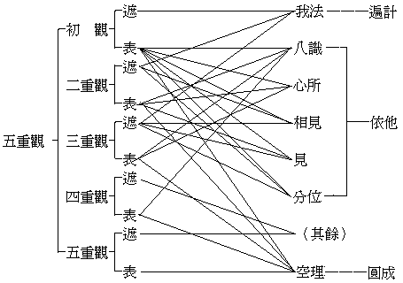



如是五重观，表、则后后狭於前前，遮、则前前狭於后后。



戊二　出能观体



己一　正出体



能观唯识，以别境慧，而为自体。摄大乘第六说：『为何义故入唯识性？由缘总法出世止观智故』。无性解云：『由三摩呬多无颠倒智故』。



此正出体。谓能观唯识之观，以五别境心所中之慧心所为体，因中此慧属意识相应者。摄大乘下，引证也。问：由何义故证入唯识实性耶？答：由缘一切法真如之出世止观智慧，证唯识性总法，故云一切法之真如平等性也。三摩呬多，此云等引，等即是定，引谓引生，由定引生，故云等引。无颠倒智者，出世正智。谓此出世正智，由定中引发也。



己二　辨异解



庚一　总辨



或有解言：能观唯识，通以止观而为自性。此亦不然，若取相应、四蕴为体，若兼眷属、即通五蕴。



此总辨也。出古师异解，谓能观唯识，不但以慧为体，亦止为体，止与观慧得相应故。此亦不然下，破也。能观唯识，若取以相应义者，则既不但与定相应，亦受想行识四蕴相应，亦应以四蕴为体。若再就相应法之眷属明，亦通色蕴。如对观时，根为所依，如是则一切法皆可相应。



今且依名，观体为慧。无性又云：『唯识现观智故』。又云：『由三摩呬多无颠倒智』。但举定中所起之智以为观体，作寻思等胜唯识观必居定故，不言即以止为观体。



正名释体，谓唯识观之自体，以观慧为体。



唯识现观智故者，观唯识实性，即以现观正智为体。但举定中所起之智以为观体者，谓非由定及慧皆为观体，所言观体乃指定中所起之智为体。以四加行修寻思等殊胜观时，必在定故，非以止为观体。



摄论又云：『由四寻思、四如实智，如是皆同不可得故。以诸菩萨如是如实为入唯识，勤修加行，即於似文似义意言，推求文名唯是意言』，乃至广说。瑜伽、对法等，寻思如实智皆慧为体。寻思唯有漏，如实智通无漏，摄大乘云：『入所知相者，谓多闻熏习所依，非阿赖耶识所摄』者：此文唯举无漏种子在彼位增，名为闻熏，称非藏识。非诸能观皆唯无漏，不尔、四寻思应非加行智。



引诸论证四观等皆以慧为体也。名、事、自性、差别四寻思观，及四观所引四如实智，此观此智之所观境，各有名实，同不可得。何以故？唯识变现故。又此名、事、自性、差别，完全一致决不可得，何以故？名唯是名，非事等故。由此四观引发四智入真唯识，在此位时，勤进勇猛修诸加行。云何修习？谓即于此文教义上意言推求，文是能诠诸法圣教，义是所诠真实道理，此二皆是识所变故，名之为似。初修观者，即以此似文似义大乘法相为所观方便，而求证入真唯识性。文名唯是意言者，文是圣教，名即义理，意即是意识。此名意言，略有三义：一、比喻义，谓一名言能显一义，亦如意识能观境界。二、所缘缘义，意识之起，多以名字言说为所缘缘，从因立名故云意言。三、言依意起义，一切名事言说，皆依意识起故，从果立名谓之意言。推求者，观察义。由四寻思推求观察诸名句蕴处自体差别，同是假立。如是四寻思观等，皆以慧为体。瑜伽等说，亦复如是。寻思唯有漏，如实智通无漏者，分别唯识观有漏、无漏也。有漏者，漏即烦恼。四寻思观唯是有漏者，未入真观位前，修四加行，故唯有漏。四如实智通无漏者，兼通有漏及无漏也。证真观位后通无漏，地前忍、世第一通有漏也。



　　　　四寻思观────有漏───世间  

　　　　　　　　　┌──┘  

　　　　四如实智─┴──无漏───出世



摄大乘论云：入所知相者，相者境义，谓修胜唯识观，证所知境。入此所观，由何功能？谓由多闻熏习。云何多闻熏习？谓修唯识观加行菩萨，遇佛菩萨，闻净法界等流正法，先熏有漏善种为增，次则引发本无漏种展转增长。此无漏种所依虽是藏识，然非藏识所摄。菩萨在此位时，无漏种子名曰闻熏，故非藏识所摄。此现行慧犹为有漏，非谓能观皆是无漏。下文，章主释成。谓摄论言闻熏非藏摄者，单举无漏种子在彼资粮、加行位增长，此非藏摄。然非有漏慧不为能观也。不尔、四寻思应非加行智者，反释也。若言能观不通有漏唯无漏者，则四寻思观位智，应非在四加行摄。寻思智在煖、顶位，如实智在忍、世位。如表：——



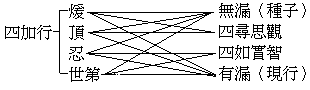



庚二　别显



此虽总说，若别显者，略有二位：一因，二果。因通三慧，唯有漏故，以闻思修所成之慧而为观体。此唯明利简择之性，非生得善。故摄论云：『似法似义意言，大乘法相等所生起胜解行地、见道、修道』等。成唯识云：『此中唯识资粮位中听闻思惟能深信解，在加行位起寻思等，引发真见』。



今结前。别标一因二果者，显位别也。谓因中能观唯识之观慧，是地前有漏加行观慧，及加行所熏之无漏种子。地上观慧是因无漏，此因无漏与佛果法，皆名为果。



因通下，明因位能观唯识。初、正明，摄论下证也。因位之唯识观慧，通以闻思修三慧为体，且唯有漏。何以故？地前菩萨虽能伏第六意识相应烦恼，第七识上实我法执仍不能伏；故加行位中第六识上虽有三慧伏我法执，其第七识相应烦恼仍不能伏，是故有漏。云何以闻所成慧而为观体？由依经论教典闻所生智，名闻所成慧。云何思所成慧？由闻之后，离文字相静心思维所得智慧。云何修所成慧？即依闻思而起修慧，谓闻戒定六度等教，仍以观慧为先导，净持修习，理得心安生大智慧，故曰修所成慧。三界中欲界有情居散心，故须习定如理观察。慧谓简择，谓最明显最锋利之观察，复能辨别善恶，决断是非。此三种慧，须实际经验而得成熟，非生而报得者，故云非生得善。



　　　　　　　┌闻───────────┐  

　　　　　　　│思───────────┤  

　　　　三慧─┤　　┌戒┐　　　　　　　├有漏  

　　　　　　　└修─┤定├修──────┘  

　　　　　　　　　　└慧┘



故摄下，引摄论证也。似法似义意言，如前已释。谓由意识变似文教义理，大乘法相文义相生。故此意言，即因能观，依此闻法等缘，生起胜解行地及见道、修道等。成唯识下，第二引证也。资粮位中闻法信解，与加行位寻思、实智，即前摄论胜解行地摄。言真见者，谓真见道，对相见道言也。



果唯无漏，修所成慧而为观体，通以正智、后得智为自体故。摄大乘等云：『如理通达故，治一切障故，离一切障故』，见、修、无学道，如其次第。证真理识唯正体智，证俗事识唯后得智。文多义显，不引教成。



辨果位唯识观慧。果谓果地，证入初地至十地及佛地慧皆果慧。地上菩萨有漏心起则无观慧，观慧现行即非有漏，故曰果唯无漏。于三慧中唯修慧摄，闻思二慧亦均具足，彰修胜故，故曰修所成慧而为观体。通以正智后得智为自体故者，因中无漏与果无漏均显果义，此通以二智为自体也。正智者，即根本智，亦云正体证真如故。真如为一切法正体，证此正体，故曰正体智。后得智者，亲证见道之后，所起遍观有相无相之智也。故正智缘圆成实性，后智缘依他起。摄论下，引证也。如理通达故者，显见位，于此位上无漏智起，通达诸法真实性故。治一切障故者，显修道位，此位观慧破迷事理一切障故。离一切障故者，显无学位永断诸障，任运自在化导有情。故云见、修、无学道如其次第。证真理识唯正体智者，真理识指真如言，证真如唯正体智。识之与智，体不相离，如别境慧依心王起，众生因位，约识为胜名识；圣道果位，约智为胜名智。其实，虽正体智亦有二十一心相应——五遍行、四别境、善十一、及一心王。果中之慧通缘真俗，故云通以正智、后得为自体故。文多义显，不引教成者，指多从略也。



丙二　别辨唯识



丁一　料简



上来虽复辨能所观，总义说者，若总言唯识，通能所观。言唯识观，唯能非所，通有无漏，通散及定，以闻、思、修、加行、根本、后得三智而为自体。若言唯识三摩地，通有无漏，唯定非散，唯修慧非闻、思，通三智。若言正证唯识，唯无漏非有漏，唯定非散，唯修慧非闻、思，唯正智、后得非加行。此非义说，不尔、三摩地等亦通闻思，十地论说故。至下当知。



上来标释二体竟。下别辨唯识，今初、料简。宽狭总言，唯识则通能观唯识与所观唯识。若言唯识观，则唯能观唯识，不通所观唯识，故云唯能非所。但能观唯识，复通有漏、无漏，及散与定，并以闻、思、修三慧，及加行、根本、后得三智为体。如表：——



　　　　　　　　　　┌───────┐  

　　　　一、唯识──┴────能观　│  

　　　　　　　　　　┌────┘　　│  

　　　　　　　　　　├────所观─┘  

　　　　　　　　　　├────有漏  

　　　　二、唯识观─┼────无漏  

　　　　　　　　　　├────散  

　　　　　　　　　　├────定  

　　　　　　　　　　├────三慧  

　　　　　　　　　　└────三智



若言唯识三摩地者，就唯识之定以明也。三摩，古译三昧，讹也。此云等，谓心于境均等思维，不沈不掉。地、即持义。谓此唯识若说为唯识定者，则通有漏、无漏，漏无漏位同修此定故。然皆定非散，三摩地之唯识观故。其于三慧，唯是修慧，而闻思亦非全无，定中能闻法故。其于三智，则全具足。如表：——



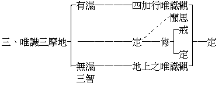



若言正证唯识者，就真见道位明。世第一位引发根本智亲证真如——唯识性——，曰正证唯识性。起后得智，曰正证唯识相。此正证位，唯无漏，唯定，唯修慧，唯二智，非加行，非闻、思，非散，非有漏也。



　　　　　　　　　　　┌无漏  

　　　　　　　　　　　│定  

　　　　四、正证唯识─┤  

　　　　　　　　　　　│修慧  

　　　　　　　　　　　└正智后得



上来四重，正约修观位说，非就法约义之谈。若约义料简，则开合宽狭，又复不同，恐繁不赘。不尔下、显约义亦通闻思等，若不许者违经论故。



丁二　五种



然总遍详诸教所说，一切唯识，不过五种：一、境唯识；阿毗达磨经云：『鬼、傍生、人、天，各随其所应，等事心异故，许义非真实』。如是等文，但说唯识所观境者，皆境唯识。二、教唯识：『由自心执著』等颂；华严、深密等说唯识教者，皆教唯识。三、理唯识：三十颂言：『是诸识转变，分别所分别，由此彼皆无，故一切唯识』。如是成立唯识道理，皆理唯识。四、行唯识：『菩萨於定位』等颂，四种寻思、如实智等，皆行唯识。五、果唯识：佛地经言：『大圆镜智，诸处、境、识皆於中现』。又如来功德庄严经言：『如来无垢识，是净无漏界，解脱一切障，圆镜智相应』。唯识亦言；『此即无漏界，不思议、善、常、安乐、解脱身，大牟尼名法』。如是诸说唯识得果，皆果唯识。此中所说五种唯识，总摄一切唯识皆尽。



次、五种也？依境、教、理、行、果之五法明唯识。遍详如来一代言教所说唯识，今以五种略摄无餘。



一、境唯识者：从境以明唯识，故曰境唯识。引经证云：『鬼傍生人天，各随其所应，等事心异故，许义非真实』。此颂初句，明四类众生之不同：曰鬼，曰傍生，曰人，曰天。次二句，明各见不同也。谓此四类众生，各随其类，同於一处所观有异。处事虽同，而能观见分心异故，所缘之境成异。等事者，等同一事。心异者，所觉不同也。譬人见海水，鬼见是脓血而不能饮，鱼等傍生见为虚空宫室自在而住，天见为琉璃。此虽同一事，而所见成四境者何耶？唯识变故。既唯识变，故境义非真实。



二、教唯识者：谓研究唯识者所依据之经论文句，如华严、深密、瑜伽之经论等，皆教唯识。



三、理唯识者：於道理遍观唯识，皆理唯识。三十颂下，引证也。是诸识者，通指八识及心所法。转变者，谓心心所转变。分别所分别者，分别即见分，所分别即相分，意云诸识转似二分。由此者，此即指识二分由识转变。彼皆无者，彼即依二分所执之我法，谓此二分既由识变，执为我法更皆无故。心境诸法，皆是唯识。



四、行唯识者：行谓修行，对治有漏，熏习无漏。戒定慧三，及四寻思、四如实智，六度万行，及所对治，皆行所摄。此亦唯识，故云行唯识。菩萨于定位等颂者，出弥勒菩萨所造分别瑜伽论中。此论未译，摄论引之。故此亦引四种寻思及四种如实智，详瑜伽真实义品。如是皆是行唯识摄。



五、果唯识者：果谓果地，通则诠三乘圣果，别则显佛不共功德。佛地经言：大圆镜智，诸处境识皆于中现者，大圆镜智四智中之一智，唯佛果有。大圆镜者，喻也，谓佛之智，如最大之圆镜，镜体光明，能遍映现诸处、诸境、诸识，故云皆于中现。无垢识，亦云庵摩罗识。无垢者，已离一切执障故。此识如来地有，故云如来无垢识。是净无漏界者，界是藏义，谓如来无漏清净之功德藏，亦云如来藏。若无垢识大圆镜智相应起时，即能解脱一切障法。唯识亦言下，引唯识颂。此即无漏界，此者，指前二种转依。二转依者，转烦恼依菩提、转生死依涅槃。谓修唯识观所转得二果，即名如来无漏功德藏。亦曰不思议，远离共相故，证离言性故。曰善者，谓净无漏善。曰常者，有三义：一、法性常，二空所显真相。二、相续常，转八识成四智，不间断故。经云：『湛然相续，尽未来际，不可思议』是也。三、无尽常。如来所现应化等身，大觉圆满，尽未来际，随类应化也。安乐者，解脱二死之逼迫，得大安养；舍所知之碍缚，得圆明乐。解脱身者，解脱生死所成功德之身，此身三乘共有。大牟尼名法者，显佛果身，不同二乘。此指佛果上所成之无漏功德藏身，非但指法性身。牟尼，此云寂默，释迦世尊之德号也。大牟尼者，大寂默也。大寂默所成之身曰法身，故云大牟尼名法。如是经论所说之果，由唯识观得，故云果唯识。此中所说下，章主结成。



丁三　六门



然诸教中，就义随机，於境唯识种种异说：或依所执以辨唯识，楞伽经说：『由自心执著，心似外境现，以彼境非有，是故说唯心』。但依执心虚妄现故。或依有漏以明唯识，华严经说：『三界唯心』，就於世间说唯识故。或依所执及随有为以辨唯识，三十颂言：『由假说我法，有种种相转，彼依识所变』。依识自体起见相分二执生故，世间圣教说我法故。或依有情以辨唯识，无垢称经云：『心清净故有情清净，心杂染故有情杂染』。或依一切有无诸法以辨唯识，解深密说：『诸识所缘，唯识所现』。或随指事以辨唯识，阿毗达磨契经颂言：『鬼傍生人天，各随其所应』。随指一事辨唯识故。如是等辈无量教门，举此六门，类摄诸教。理义尽者，唯第五教，总说一切为唯识故。



此六门也。初标，谓诸经论所说唯识，虽不外前之五种，然诸教中，或约义说，或约机说，于境唯识，复有异说。或依所执以辨唯识者，第一遍计门也。楞伽经说，引经证。本无外境，由妄执上相似外境变似而起。彼境非有者，彼妄执境非有也。餘文可解。或依有漏以明唯识者，第二有漏门也。华严经说三界唯心，就众生位明，范围狭小，故云就世间说唯识。故万法唯识之义，广于三界唯心，说漏无漏法皆识现故。古云：三界唯心是性宗，万法唯识是相宗者，谬说也。或依所执及随有为以辨唯识者，第三有为门也。所执者，遍计执上实我实法。有为者，依他起性。三十颂文如前已释。依识自体起见相分者，谓由识体转似二分。二执生者，由见相分复执我法。以是义故，世间妄情假说我法，圣教利他假说我法。或依有情以辨唯识者，第四有情门也。引经、如前可知。或依一切有无诸法以辨唯识者，第五有无门也。诸识所缘者，犹言诸识所观所了。唯识所现者，现有二义：一、变现，摄一切有为法尽。有为者，即有为变化之法。此法识所变现，故云唯识所现。二、显现，摄一切无为法尽。无为法者，无作为变化生灭之法。此法识所显现，故云唯识所现。或指事以辨唯识者，第六指事门。引经、如前应知。



如是等辈无量教门者，辈者、类也，谓如是等类无量教门。举此六门类摄诸教。理义尽者，谓六门之中，明理之尽与显义之尽者，厥为第五深密之教。何以故？总说一切皆唯识故。



丁四　结指



或束为三：谓境、行、果。如心经赞，具广分别。



结指也。结成前明境、教、理、行、果五种皆是唯识，今归为三，曰境、曰行、曰果。指见他书。如表：——



　　　　境─┐  

　　　　教　├────────境  

　　　　理─┘  

　　　　行──────────行  

　　　　果──────────果



乙二　辨名门



丙一　正辨名



丁一　释识



第二辨名者，梵云毗若底，此翻为识。识者了别义。识自相，识相应，识所变，识分位，识实性：五法事理皆不离识，故名唯识。不尔，真如应非唯识。亦非唯一心更无餘物。摄餘归识，总立识名，非摄归真，不名如也。



梵云毗若底者，出梵音。此翻为识，显华义也。毗若底之音义，与般若音义近，故智与识义亦相近。识者了别义，总释也。了谓知觉，别谓别境，即了知别别不同境界之分别，名之曰识。如眼之了别于色，乃至赖耶了别于根身器是也。



识自相者，八识心王。识相应者，六位心所。识所变者，所变见相二分。识分位者，色心差别，二十四种分位假法。识实性者，二空所显前四真理。五法事理者，五位法中，前四属事，第五归理，故云五法事理。此五位法，总摄世出世间有为无为、有漏无漏一切法尽，同不离识，识所变故，识所现故，名曰唯识。



不尔、真如应非唯识，释难也。谓若不许识之一言摄事理诸法，则真如应非唯识所显现：果尔，互违教理。亦非一心更无餘物者，亦非说唯一心，更无别法。若言一心包尽诸法，则与神教之一神相似，亦与西洋「宇宙唯心论」等相同。彼谓宇宙即以「唯一精神」为本，宇宙万有皆由此「唯一精神」生，此亦仍类一神教义。一神教者，如印度人执大梵天造物主等。谓明白大梵天，则知全宇宙是一神，不明大梵天，则妄见万有差别。佛法中谓彼曰一因论，亦曰不平等因。大小乘教，皆须破遣。



所谓一切有情，从无始来各有八识、六位心所、事理诸法，非是祗有一心更无餘法也。若尔，云何名识耶？摄归识故。真如即一切法实性，云何不名唯如耶？真如显境，要令有情舍境观心以求解脱，故云唯识，不名真如也。



丁二　释唯



梵云摩咀剌多，此翻为唯。唯有三义：一、简持义，简去遍计所执生法二我，持取依他、圆成识相识性。成唯识云：『唯言为遮离识我法，非不离识心心所等』。二、决定义，旧中边颂云：『此中定有空，於彼亦有此』。谓俗事中定有真理，真理中定有俗事。识表之中，此二决定，显无二取。三、显胜义，瞿波论师二十唯识释云：『此说唯识，但举主胜，理兼心所，如言王来，非无臣佐』。今此多取简持解唯。



唯有三义者，总出三义。一、简持义，简谓简去，是否定义。遍计所执，须简除故，生法二我即是人我法我二执也。唯是简义，简去此执也。二、持谓持取，是肯定义。依他、圆成识相识性者；诸法依他缘生是识之相，空所显性圆成真实是识之性；说唯一言，持取此义也。成唯识云下，引论释成。为遮离识我法者；说唯识者，唯言遮去遍计执上离识之外独有实我实法。非不离识心心等者，离识我法简遮净尽，其餘不离识之心心所，则持取也。



二、决定义。引旧中边颂「此中定有空，於彼亦有此」者，新论译曰「唯有空」。今引此颂，特显「唯」即「定」义。此中者，谓依他缘起之俗事中。定有空者，空谓二空真理，缘生法中决定有此二空真理，真不离俗故。次第二句，彼者、二空，此、曰缘生，俗不离真，故曰于彼亦有此。识表之中者，说识一言，有遮有表，遮谓简去，表谓持取。真俗二事互不相离，亦常决定，故云此二决定。既真不离俗，俗不离真，则无能取真俗之执见，及所取之真理俗事，故云显无二取。



三、显胜义。但举主胜者，说唯识言本兼心所，心王为主，功能胜故，范围宽故，是故独举识王。依理而论，亦兼心所。引喻可解。



三义之中，取第一义。既云唯识，云何释中先识后唯耶？先体后用，先主语而后说明语也。又唯字亦可名量，量者范围义，识范围故，曰识量义。



丙二　释妨难



丁一　正释妨



戊一　释唯心难



识者、心也，由心集起采畫为主之根本，故经曰唯心。分别了达之根本，故论称唯识。或经义通因果，总言唯心；论说唯在因，但称唯识。识了别义，在因位中，识用强故，说识为唯；其义无二。二十论云：心意识了，名之差别。识即是唯，持业释也。或顺世外道及清辨等成立境唯。为简於彼，言识之唯，依主无失。



华严等经多说唯心，今言唯识，岂不违教？所谓心者，是集起义，谓能集中诸法种子；复能发起诸法现行，以是义故，如采畫师。所餘心所，喻如畫徒，随师模型，添众色彩。依此集起根本，故经说唯心。识者、了别义，了达分别为最殊胜故，论说唯识。各依胜说，理不相违。或经义通因果，总说唯心者，出别解也。剋实而谈，识亦通因果。论说下，释二义无别，识于众生因位强胜，故说唯识。二十论云心意识了之四，名虽有别，义实通也。



顺世外道，印度学术中之一派，其主义如今之唯物论。彼执万有之存在，是由物质极微和合而成，极微质异，所成亦别。心理作用、精神现象，不过物质之有机体，受外界之激剌，现起神经原子之反应作用而已。近世行为派之心理学，均执是说。清辨论师依般若义，立一切法皆是真如性境，餘为幻有。今简此义，故说唯识。依主无失者，八识心王变现诸法，故名曰主。境依主有，说依主无失。



戊二　释唯智难



为令舍识而依於智，说唯识言。若能观中智强识劣，若以为境，皆不离心；今为所观，故名唯识。又不离依主，称为唯识。决断从能，故可依智。又从欣为目，经唯名皆般若。从厌为号，论标并唯毗若底。



释唯智难也。涅槃经中说四依法：一、依法不依人，二、依义不依语，三、依了义不依不了义，四、依智不依识。经中既言依智，云何论说唯识耶？谓出识过故，有漏杂染妄识变现，令舍于此而取于智，说唯识言。若能观中智强识劣下，谓就能观可言唯智。能观因中，闻思修三慧加行，及果中根本、后得二智，殊胜强故，识用劣故。至所观中识能变境，境不离识，故曰唯识。若依决断功能而说，亦可依智。又从欣为目下，会释般若经义。从欣求圣者心境之解脱上说，故云般若；从厌离众生心境之生死上说，故曰唯识。今从厌说，理不相违。



丁二　总会释



摄法归无为之主，故言一切法皆如也。摄法归有为之主，故言诸法皆唯识。摄法归简择之主，故言一切皆般若。



此以三门总会一切诸法。主者、宗主，若摄一切法为伴，而宗归无为之主，故一切法皆真如也。无为者，非变易生灭之法。以是义故，随举一法摄尽法界诸法，此亦通释净名经等一切皆如妨难。若摄一切法为伴，而宗归有为之主，故一切法皆唯识也。有为者，缘生识变之法也。若摄诸法为伴，而宗归简择之主，故一切法皆般若。般若云智，智以抉择诸法皆空为性，即一切皆空宗。能摄三主虽别，所摄一切法则同也。



丙三　总结成



是名第二辨名也。



乙三　离合会释门



丙一　解门义



第三离合会释者，离者、别也。合者、同也。谓诸经论各各别说诸观等名，今合解之，但是唯识之差别义，非体异也。



此标也。西方释名有六种方法，名曰六离合释，亦梵文文法之一种也。离者别也，如使二名分立。合者同也，如此名与彼名之结会。今以何义离合会释？以诸经论各各别说诸义，如一乘、实相等，此名虽异，今合解之，明皆唯识观之别义，得其会通，体非有异。



丙二　正会释



丁一　一名会释



戊一　举类



一名有三十一类。



此第一举类也。一名者，单名也。与一名会释，略举三十一类。



戊二　释能所观名



己一　正释



华严等中遮境离识，名为唯心。辨中边论遮边执路，名为中道。般若经中明简择性，名为般若波罗密多。法华经中明究竟运，名曰一乘。



一、「唯心」：华严等经说名唯心，遮境离识。遮境者，简去义。离识者，离识别执实我法也。以遮此离识别有境，故说唯心。二、「中道」：辨中边论说名中道，道是路义，平正无偏坦荡大路，名曰中道。喻唯识观境无识有，内观于心离妄执故。妄执离识别有我法，或常或断，或一或异，或有或空，名边执路。为遮此执，显唯识观，名曰中道。三、「般若波罗密多」：大般若经说名般若波罗密多，般若波罗密多者，梵语也，译曰智慧到彼岸。慧以简择为性，明照诸境为用。由此智慧简择诸法真实体性，达一切法空不可得，故一切皆空，名大般若。以空性故，诸法缘生事皆成办。唯识观慧亦复如是，遍计执性本性空故。四、「一乘」：法华经中说名一乘，经云：『唯一大乘法，无二亦无三』。此显佛陀度生济世之究竟，故名一乘。



己二　会通



此之四名通能所观真俗境观。正智唯真，加行、后得并通真俗。若言证者，后得唯俗。法华，有说：唯依果智，但说三车在门外故，宅中出者名衣裓、机案及门，不与乘名。理亦不然，声闻、缘觉、不退菩萨乘此宝车，直至道场，故通因位。胜鬘经中六法、既为大乘故说，故通加行。至乘章中，当具显示。



此唯心中道般若一乘四名，于此唯识观中云何会通？谓四皆通能所唯识观，复通真俗境观。般若以文字为所观，餘为能观。能观于境，复如何通？如表：——



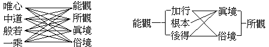



法华有说下，别辨一乘也。有说，出异解：谓一乘者，唯就佛之果智上说，不通因位。经说三车在门外故；出火宅时不用车乘，或衣裓、或机案、或门户而出火宅。此喻因位修道，门外三车是果得也。六道轮回喻火宅，超出三界喻如门外。文出法华，可别寻研。理亦不然下，辨也。不退菩萨，或云七住，或是初地。宝车者，喻如一乘。道场者，菩提场也。三乘贤圣人，因地中既乘此乘，理通因位。胜鬘六法者：一、正法住，二、正法灭，三、波罗提木叉，四、毗尼，五、出家，六、具足戒。此六种法，虽初步法，然亦皆为大乘故说，故通加行因位也。



戊三　释所观名



胜鬘经中遮餘虚妄，名一实谛。显法根本，亦名一依。由空为证，又是空性；亦名为空。彰异出缠，显摄佛德，佛从中出，名如来藏。明体不染真实法性，名自性清净心。功德自体，亦名法身。无垢称经遮理有差别，名不二法门。大慧经中表无起尽，亦名不生不灭。涅槃经中彰法身因，多名佛性。楞伽经中表离言说，名不思议。瑜伽等中显不可施设，名非安立。摄大乘等显此遍常等，名圆成实。对法论等明非妄倒，名曰真如。此十三类名，唯所观理，唯真智境。恐文繁广，略举尔所，非更无也。



一实谛者，唯一真实真如性义，遮餘幻事虚妄执故。一依者，依谓依止，此为诸法之所依止，即显为诸法本也。空者，由空为门，证入法性；此性亦空名曰空性。空即不空，是真如义。如来藏者，真如未出缠，即是如来净法界身。然在众生生死缠中，烦恼现行，无智显现，故云如来藏。众生分位，名如来藏，显摄佛德、是含藏义，佛从中出、是胎藏义。皆是约众生因位说。又释、此名有空不空：烦恼杂染曰空如来藏，烦恼杂染是应空法，覆障不显，故曰空藏。二、不空如来藏，此有二种：一、真如性，二、第八识中本无漏种。自心清净性者，谓心之清净性，如前已释。法身者，谓佛果上无漏功德，功德之自体，即真如法身。功德即自体，或功德之自体，即通三身。以上五名，出胜鬘经。



不二法门者，谓真如理性无二无别也，出无垢称经。不生不灭者，表无起无尽：谓一切法无始无终，非从无而有、故曰不生，即显无起；非暂有还无、故曰不灭，即表无尽；出大慧经。大慧经者即楞伽经，大慧菩萨之所请问，故立此名。佛性者，略有三种：一、理佛性，无为真如。在凡夫位，理未显现，名曰佛性。此通有情及于无情，亦依是义说有无情皆可成佛。二、事佛性，一切有情第八识中无漏种子，名曰佛性。以是义故，说诸有情有无佛性。三、隐密佛性，烦恼所知二障隐密说为佛性，以障空性，即为佛性。以是义故，说烦恼即菩提，一切有漏法皆佛性，如涅槃经广说。不思议者，谓不可思想议论。一切法性，思想之所不及，言论之所不诠，故云不可思议。然非令人不去思想言论也。



非安立者，安立亦云施设建立，既无思议，则不可施设建立，名非安立。圆成实性者，诸法平等遍常、成就、真实，名圆成实。出摄大乘论等。真如者，非虚妄曰真，不颠倒曰如，出对法论等。——此十三类名，云何会通？谓十三名，于唯识观中，皆是所观而非能观。且为真智所缘，是真境故。



戊四　列餘结成



谓法界、法性、不虚妄性、不变异性、平等性、离生性、法定、法住、法位、真际、虚空界、无我、胜义、不思议界等十四名，如大般若广释。合前三十一单名。



此十四名出大般若经，亦皆所观，真智境界。合前四及十三，共三十一名，恐繁略举。



丁二　二名会释



二名有四：瑜伽论中施设、非施设，浅深异故，名为安立、非安立谛。即胜鬘经有作四圣谛，无作四圣谛。涅槃经中亦名胜义、世俗二谛。显扬论中能诠、所诠，名名、事二法。此之三名，通能所观，亦真亦俗，初、中、后智。摄大乘等显所执无，名生法二无我。亦通能所观，唯真非俗，通初、中、后智。



一、瑜伽二名曰安立非安立：可施设法，是缘生和合事，义理浅显，名安立谛。非安立谛，反此应知。此亦名曰有作无作二种圣谛，有作名可安立，无作名不可安立。云何名圣谛？苦、集、灭、道，圣智所证，名四圣谛。二、涅槃经中曰胜义谛、世俗谛：最胜智慧所证之义，曰胜义谛。世俗幻事显现变化，名世俗谛。三、能诠所诠：名、曰文教，是能诠。事、曰义理，是所诠。以上三种二名，唯识观中通能所观，唯识境中通真、俗境，唯识智中通于三智。四、摄论显无所执实我实法，名二无我。此二无我，通能所唯识观，既无我法故唯真非俗，然通三智。



丁三　三名会释



三名有四：解深密等，显一切法有无事理种类差别，名为三性。显三俱无遍计所执，亦名三无性。此二唯所观，亦通三智，真俗二境。若言三性等观者，唯能观非所观，通三智及真俗。瑜伽等中明离系之方便，亦名三解脱门。表印深理，名三无生忍。唯能观非所观，唯本、后二智，通真及俗。



三名会释，略有四种，故曰三名有四。一、明深密三名，有二种：一、三性：曰遍计所执自性，曰依他起自性，曰圆成实自性。显一切法无差别者，遍计执性本空也。显一切有事差别者，依他幻有也。显一切有理差别者，圆成实性也。此三若离遍计所执，则为三无性：曰生无自性性，曰相无自性性，曰胜义无自性性。此二唯所观者：会通唯识观也。能所观中唯所非能，亦通三智，二境。若言三性观者，于唯识观中则唯能非所。如表：——



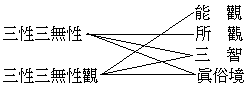



瑜伽三名有二种：一、三解脱门：曰空，曰无相，曰无愿。此三法门离系方便，又能观智照解缠缚，名曰解脱。二、三无生忍：忍谓忍可，即印证义。一、本性无生忍，印遣遍计我法二执。二、自然无生忍，印达幻有缘生法空。三、胜义无生忍，印证圆成真实法性。此二种三名，于唯识观中唯属能观、非所观，唯根本、后得二智不通加行，于唯识境通真及俗。如表：——



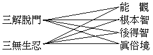



丁四　四名会释



四名有四：菩萨地中明义总集，名四嗢陀南：诸行无常，有漏皆苦，诸法无我，涅槃寂静。大智度论显宗差别，名四悉檀：一、世界悉檀，二、第一义谛悉檀，三、对治悉檀，四、各各为人悉檀。此上二门，通能所观，真俗，三智。诸论以初观麤，亦名四寻思；唯能观非所观，唯加行智非中、后智，通真、俗二。诸论以后观细，亦名四如实智；亦唯能观非所观，通三智，真俗所摄。



四名会释，亦有四种，故曰四名有四。菩萨地者：瑜伽师地论十七地中之菩萨地也。梵语嗢陀南，此云集义，亦云总集，谓总集一切佛法要义。此略有四：一曰、诸行无常，生灭法故。二曰、有漏皆苦，杂染法故。三曰、诸法无我，真实性故。四曰、涅槃寂静，无生灭故。大智度论名四悉檀。梵语悉檀，此云宗，亦曰主。天台云遍施者，望文生义之讹解也。四悉檀者，佛陀说法利生之四种主义也。一、为世间普通说法，曰世界悉檀。二、显说最上胜义，曰第一义悉檀。三、为对治一切众生若何之病症，即说若何之法，即应病与药之意，曰对治悉檀。四、观机说法，曰各各为人悉檀。以上二种，会唯识义，如文可知。诸论下，明四寻思观，四如实智，依文应思。



丁五　五名会释



五名有一，仁王经中位别印可，亦名五忍：一、伏忍，在地前伏印故。二、信忍，在初二三地创得不坏信，相同世间类故。三、顺忍，在四五六地，顺为出世行故。四、无生忍，在七八九地、长时任运观无相理故。五、寂灭忍，在十地、佛地、因果位中圆满寂故。唯能观非所观，初唯加行智，后可通餘智，皆通真、俗。



五名会释，唯有一种，故云五名有一。引仁王经菩萨位别五忍会释：一曰、伏忍，地前十信、十住、十行、十回向、四加行，能印忍观理，以伏分别烦恼故。二、信忍，初二三地获得出世不坏信故。三、顺忍，四五六地能顺出世无分别行故。四、无生忍，七八九地任运恒观无相之理，诸法无生故。既无有相，无相本空，此理忍可，故亦名曰无生忍。五、寂灭忍，十地、佛地，于因果位各圆满寂灭故。此之五忍，会唯识观，云何应知？如表：——



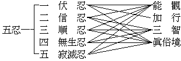



丁六　六名等会释



或名六现观，七觉支，八圣道，九奢摩他，十无学法，四念住，四正断，四如意足，五根，五力等，非菩萨正观，故不别说。



此中名数，检寻可知。



丙三　总结成



如是一切，虽异名说，皆是此中唯识境智差别名也。



由上总观，可知一切佛法皆可会通，并无偏执，其义应思，不可忽焉。



乙四　何识为观门



丙一　标徵



第四何识为观者？



此标徵也。前出观以别境慧为体，慧是心所；八识之中，与何识相应耶？亦可问云：八识之中，究竟以何识为能修唯识观慧耶？



丙二　出异说



大众部等说六识有染，皆能离染。犊子部等说五识非染亦非离染，第六俱有。萨婆多等，六识有染，离染唯第六。於大乘中，古德或说七识修道，八识修道。皆非正义，不可依据。



大众部者，佛灭后小乘先分二派，大众部其一也。等者，等取与大众同说之小乘派。彼谓眼等六识，皆有杂染烦恼，故云六识有染。然此六识，亦皆能修离染之观慧，故云皆能离染。犊子部者，亦小乘学派之一。彼谓眼等五识无有分别，亦无烦恼，故云五识非染。既无烦恼为杂染故，何有观慧离于烦恼？故云亦非离染。第六意识有分别故有烦恼，亦有观慧能离染，故云俱有也。萨婆多部，梵语，此云一切有部。此派学者，说蕴、处、界三世俱有，名一切有，为印度小乘学中最强盛之学派。彼谓眼等六识俱有染污烦恼，然能离染者则唯第六意识。小乘不修唯识，故章中未以唯识观相会。然以小乘离染，与大乘唯识观离染相同，故出其说也。上来出小乘异说如表：——



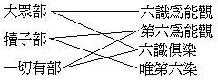



於大乘下，出大乘异说。大乘古德者，即指菩提流支、真谛三藏等。彼谓七、八识修道，修道故有观慧，此观以七、八二识为观也。皆非正义不可依据者，结非也。小乘之说姑且不谈，大乘二说云何非理？答：果义可尔，因位不然。初地以上七识虽修，未登地前则不能修。因七识常执我故，八识须至佛果始能观故。



丙三　出正义



若能观识，因唯第六，瑜伽第一，云能离欲是第六意识不共业故。通真俗，三智。餘不能起行总缘观理趣入真故。瑜伽又云：审虑所缘，唯意识故。第七、由他引亦为此观，通中、后智。佛果通八识能为唯识观，三智通真俗理事二门，成事非真唯观俗识。此解依论，理或有真；但真如识定非能观。若论所观，八识皆通因果二位，真识亦尔。



于大乘中何识为观耶？若在因位，唯是第六意识相应之慧为能观识。云何知然？瑜伽说故，能离欲是第六意识不共业故。欲者、心所之一，通于三性。此言离欲，离欲界粗重之贪欲也。在欲界初发心人，修离欲行，是其第六意识不共功能，他识所无，故云不共。餘不能起行者，不能起三解脱门、十六谛智等行。总缘观理者，总缘者、缘真如遍法，观理者、观四谛、三性之理。餘、谓餘识，即前五识与七八识，除第六意识之外，皆不能起三解等行及遍缘观理；由此，餘识亦不能趣入真见道位。从反面言之，即显第六意识在因位中能起行能总缘观理，趣入真道，是故能观识因唯第六。审虑考察一切境者，亦是意识不共业故。第七虽能审虑，然执内我非一切境，是故觉慧唯第六识。



第七由他引亦为此观者，真见道后第六识转智，第七末那亦随渐转，不内执我而审观平等性，亦为能观。然唯果智非加行智，故云通中、后智。至佛果位大圆觉已，八识俱能为观。三智者：妙观察智，平等性智，大圆镜智。此三智通观真理俗事二门，真理谓唯识性，俗事谓唯识相。成所作智非真者，唯观俗事故。颂云：『三类分身息苦轮』，又云：『果中犹自不诠真』。然此乃依唯识等论而说；依理而推，或亦通真。但真如识定非能观者，料简也。真如识者，即真如实性，此定非能观。上来明八识能观，若论何为所观者，则八识或因或果皆通所观。事识如是，真识亦尔。



乙五　显类差别门



丙一　明真性识



第五显类差别者，其圆成真性识，若加行、后得观，是共相非别相，以总缘遍法故。根本智观，是别相非共相，诸法别知故。然体非共相，万法不离此，理一无二故，亦可名共相。诸经论云共相作意能断惑者，依此道理及前加行，并能诠说。然诸法上，各自有理内各别证，不可言共。



显类差别者，类是种类，谓识之种类差别有几？真性识者，犹云真如唯识。此真如，加行后得二智所缘者，乃变相真如，非亲证真如，故所观相亦属共相。共相者多法共通之相，决非自相，以此二智观真如，为一切法之总相，亦曰遍法故也。正智者，亲证一切法正体之根本智也。此智亲证真如，现观诸法别别自相而一一印证之，故云是别相非共相。然体非共相者，谓一一法各有自相，即此自相曰体，故非共相。万法不离此者，然此自相、事事无碍，法界之事事——一一事互为主伴，此一为主餘事助之，餘一为主此亦助之——，一摄一切、一切摄一，一即一切、一切即一，如是其体虽非共相，然亦无餘事得离此任何一事。根本智所观之法法离言自相，皆为事事无碍法界，此理无二，故亦可名共相。作意、即是观义，有谓共相观亦能断惑者，依此道理而说；或连前加行位之共相观，及能诠之教说。然据实，则诸法上各自有一事事无碍法界之理，由离言说分别之根本智内各别证故，不可言共也。



丙二　明俗事识



丁一　正明差别



其幻性依他识，或说因果体俱一识，作用成多，一类菩萨义。或因果俱说二，决择分中有心地说，谓本识及转识。或唯因说三，辨中边云：『识生变、似义、有情、我及了』。三十唯识云：『谓异熟、思量、及了别境识』。多异熟性，故偏说之。阿陀那名、理通果有。或因果俱说三，谓心、意、识。或唯果说四，佛地经等说四智品。或因果俱说六，胜鬘经中说六识。或因果俱说七，诸教说七心界。或因果俱说八，谓八识。或因果合说九，楞伽第九颂云：『八九种种识，如水中诸波』。依无相论同性经中，若取真如为第九者，真俗合说故。今取净位第八本识以为第九，染净本识各别说故。如来功德庄严经云：『如来无垢识，是净无漏界，解脱一切障，圆境智相应』。此中既言无垢识与圆镜智俱，第九复名阿末罗识，故知第八识染净别说以为九也。或因八、果三识，佛地等云：前十五界唯有漏故。或因八果七识，安慧论师云：末那唯染故。或因果俱八识，如护法等正义所说。



幻性依他起识者，依他起者因缘生法，既是缘生故是幻有。非有之有，无实自体，一即一切、一切即一，事事无碍，即是妙有。由此道理，众生幻有，故佛亦如幻有。



一识说：或说因果体俱一识作用成多者，一类菩萨作如是说。一切有情，在因在果，各唯一识，随用成多。



二识说：一切有情，在因在果俱有二识：谓一、本识，二、转识。本识即第八识，转识即前七识。出瑜伽决择分中。



三识说：辨中边论就因说三识，谓识生变、似义、有情者，识之生变，指第八种子也；识之似义，指第八器界也；识之有情，指第八根身也——此上谓第八识。识之我者，谓第七识。识之了者，谓前六识。依三十颂因亦说三，如前文解。阿陀那识此翻执持，谓持有情根身不坏，义通因果。二十颂等因果俱说三识，谓心、意、识。心即第八，意即第七，识即前六，此三名俱通因果位。



四识说：佛地经中就果说四识，即转八识成四智也。



六识说：三乘共教多说六识：谓眼、耳、鼻、舌、身、意识，意识摄七、八二识也。



七识说：亦三乘共教说。七心界者，谓眼等六识外加意根界，成七心界。



八识说：因果俱通，如成唯识论等说。



九识说：楞伽经中说九识者，因位亦八，至果位中净第八识别曰庵摩罗识，染净别说故成九识。依无相论及同性经，亦可以真如识解为第九，此依真俗境明。然今取第八识转成净识以为第九，引经如前解。



因八果三说：根境识十八界，前十五界是有漏，至无漏者唯后三界。故因有八识，果中唯三——意识界、法尘界、意根界。



因八果七说：果七识者，第七末那唯染污，故果中不全。



因果俱八说：此是护法菩萨正义，谓眼、耳、鼻、舌、身、意、末那、赖耶。



丁二　别说四分



依他识中，或说唯一，自证分，谓安慧师。或说唯二，见、相分，难陀师。或说有三，自证、见、相分，陈那师。或说四分，加证自证分，护法师。



四分者：一、见分，二、相分，三、自证分，四、证自证分。分谓成分，八个识各有几成分耶。安慧论师说唯一分，谓自证分，相见皆是自证变故。难陀论师说有二分，谓见、相分。陈那论师说有三分，合前二说，自证为体，见、相为用，体用别故说有三分。护法论师说有四分，加证自证分，足前成四，能证第三分故。此之四分，相分为所量，见分为能量。见分量相分时，其能证知者为第三分。第三又须第四证知。第四则用第三证知，无无穷失。



丁三　结非一异



如是所说诸识差别，一往而论。依成唯识云：『八识自性，不可言定异，因果性故，无定性故，如水波故。亦非定一，行相、所依、所缘、相应异故，起灭异故，熏习异故』。楞伽经云：『心意识八种，俗故相有别；真故相无别，相所相无故』。



一往而谈，八识种类，有此差别。若再往而论，八识自体，不可说为定异定一。云何非定异耶？一、同因果性故，不可定异。二、同无定性，互相相通，不可定异。三、如水如波亦非定异。云何非定一耶？一、行相异故非定一，八识了知作用不可同故。二、所依异故者，根别也。三、所缘异故者，境别也。四、相应异故者，相应心所多少别也。五、起灭异故者，八识生起不同时故。熏习异故者，第八为所熏，前七为能熏故。楞伽经下，八识于俗事中有差别，于真理中无别也。相所相无故者，言在真理中无能所相故。



丙三　总结成



如是一切识类差别，名为唯识。此幻性识，若加行观，唯共非自。若后得观，通自相观，一一依他各各证故。



识之一名，在幻性识虽有如是差别，总而言之名曰唯识。前真性识三智均观，加行、后得观其共相，正智乃证自相。此幻性识，唯加行、后得二智之所观，加行但观共相，后得乃证自相并观共相。



乙六　修证位次门



丙一　明位次



丁一　引摄论释



第六修证位次者，摄大乘说：『何处能入？谓即於彼有见似法、似义意言，大乘法相等所生起，胜解行地、见道、修道、究竟道中，於一切法唯有识性随闻胜解故，如理通达故，治一切障故，离一切障故』。无性解云：『在胜解地，於一切法唯有识性中，但随听闻生胜解故。在见道中，如理通达此意言故。在修道中，由此修习对治烦恼所知障故。究竟道中，最极清净离诸障故』。



何处能入者，问：悟入唯识实性，是何地位方能悟入？谓初发心，即依大乘法相，于自意识上所变起之教曰似法，教所诠曰似义意言。复有能观意识，现见大乘法相等。依此最胜义生起胜解，依之而行曰胜解行地，斯为初位。复次、由此经一大劫，世第一后真相见道，是第二位。见道之后，精勤习练，曰修道是第三位。修至圆满曰究竟道，是第四位。四位之中，皆能悟入一切法唯识性，故曰於一切法唯有识性。随闻胜解者，长时闻法求生胜解，此出胜解行地之行相也。如理通达者，悟一切法皆唯有识，非有妙有，出见道行相也。治一切障故者，出修道行相也。离一切障故者，出究竟道行相也。无性解之下，释成。胜解行地者，知一切唯有识性，但随听闻大乘法相而生胜解。见道位中，根本后得二智如理通达此意言者，即是如唯识理通达唯识。由悟此理，修十度行，对治二障。能扰害众生精神界之心理曰烦恼障，烦恼即障，持业释也。所知障者，所知谓境，即是相分，此境非障，境是应知之境，然虚妄颠倒之法执，障而不知唯识性相曰所知障。所知之障，依主释也。究竟道者，如文可知。



丁二　引成唯识论



成唯识说：『云何渐次悟入唯识？谓诸菩萨於识性相，资粮位中能深信解；在加行位，能渐伏除所取能取，引发真见；在通达位，如实通达；修习位中，如所见理数数修习，伏断餘障；至究竟位，出障圆明，能尽未来化有情类，复令悟入，唯识相性』。



此第二引成唯识论五位次第。云何渐次悟入唯识者，问起也。渐次者，如行路然，渐次而进。修唯识观菩萨，于唯识相及唯识性，由十信、十住、十回向能深信解确而不移者，资粮位也。加行位者，由资粮位长时闻法，起四寻思观及四如实智，能渐伏除所取能取。所取谓境、属法执边，能取谓心、属我执边，此位菩萨第六识上能渐伏除现行不起。修四寻观，能取之心不执为我，所取之境亦不执为法。以煖、顶位印所取空，入上忍位印能取空，世第一位印能所二取空。二取空故，引生真见入通达位。通达者，如实相理，通达诸法唯识所现。修习位中如所见理者，如其通达位中所见实理。数数修习者，渐渐锻鍊，除一切障。至究竟位，顿断诸障，如月出云究竟圆满，究竟光明，等真际、遍法界，自觉圆满也。尽未来际化度有情，亦令悟入唯识相性，觉他圆满也。



丁三　引瑜伽论



五十九说：『云何能断烦恼？云何当言已断烦恼？谓善法资粮已积集故，已得证入方便地故，证得见地故，积集修地故，能断烦恼得究竟地，当言已断一切烦恼』。正同唯识。



一问、如何修行方能断烦恼耶？二问、至何地位可言已断烦恼？善法资粮已积集故者，资粮位也。福德智慧双修齐集，是故云：『福智无边誓愿集』。已得证入方便地故者，加行位也。证得见地故者，通达位也。积集修地故能断烦恼者，修习位也。得究竟地已断烦恼者，究竟位也。



上来三论所明，唯识、瑜伽同明五位，独摄大乘论明四位。如表：——



　　　　　　　　┌胜解行地─┬────资粮位┐  

　　　　　　　　│　　　　　└────加行位│  

　　　　摄论四位┤见道地───────通达位├唯识瑜伽五位  

　　　　　　　　│修道地───────修习位│  

　　　　　　　　└究竟地───────究竟位┘



丁四　会通



摄大乘中，以资粮道闻思位长，大劫修满方起加行，等持位中作唯识观，从多为论但说四位，以观时少略隐不说。唯识等中据实为论，别修行相，见道前位亦有伏除。摄论、唯识等，各言煖等中作寻思等观故伏除。直往、迂回，地前皆同，迂回之人虽得无漏，游观心中亦不能伏除，未证真识，终不能了如幻识故。



摄论中何以独明四位耶？据时间论，以地前菩萨于十住、十行、十回向之三十位，长时闻法，如理思维。大劫修满方起加行者，谓三劫修行，初劫从初发心至地前为一大劫，信等资粮位大劫将满时，方起煖等加行。等持位中作唯识观者，谓四寻观、四如实智位。以此煖等加行，较前位资粮等时间短略，今从闻思时长立论，故不别说加行而通曰胜解行地。唯识论说五位者，据实证论，故别立加行位。一依时间，一依实证，实不相违也。倘别论修相，见道位前四寻思观与四如实智，亦观能所取空。如是则二论同说煖、顶位修四寻观，忍、世第一修实智观。故摄论之胜解行地，亦能伏除二取执。直往迂回地前皆同者，直往谓凡夫人发大乘心，求菩萨果，修菩萨行，所谓直趋道场之人也。迂回，谓先小乘而后大乘，或由大乘退小乘复趣大乘者之不定性人。此人未登地前，皆修四寻思观等，方可发生真见，故云地前皆同。问：迂回之人已证圣果，具无漏智，云何复修四寻思观之有漏行耶？答：二乘圣者仅证生空无漏智，虽游观法空，尚未悟入，法执未除。故必回心向大，修四寻等了诸法空，唯识所变，证真见道。以是义故，由智证真，方能了幻。不尔、未证真识，则不能了如幻识也。



丙二　辨修证



丁一　结前生后



上来明位，下当辨修。



位次既明，其位所修应云何？故下辨修。



丁二　正辨修



戊一　总举



辨修有三：一、证修，二、相修，三、地修。



略以三类，辨修差别。



戊二　别释



己一　证修



证修者，此见道前，虽作真、俗二唯识观，似而非真。入见道中，真相见道俱了真识；后得俗智方了俗识。四地以前，真俗别观。第五地中，真俗方合，然极用功始能少起。至第六地，无相虽多，未能长时。於第七地，方得长时，犹有加行，亦未任运。八地以上，无勉励修，任运空中起有胜行，真俗二识恒俱合缘。至佛位已，三智俱能缘真俗识；第六不定，随意乐故。成事唯俗，行缘浅故，或亦通真，自在满故。



证修者，犹言修证。地前菩萨于证实智胜解之上，修四寻思、四如实智，虽能明唯识相性，然尚不能亲切明证；所得二取空相仍是心变，故曰似而非真。



世第一心，刹那悟入真见道者，无分别智亲证空所显理。相见道者，观非安立谛遣假缘智，除一切分别，随即观安立谛修十六心。俱了真识者，谓此二见道，俱能证明，亲了真性唯识。由此证后后得智起，方了诸法如幻如化，得幻性唯识观。此明初地先真后俗也。四地以前真俗别修者，谓二三四地菩萨，于真性、俗性二唯识观，各别而修，亦各别而证也。第五地中真俗方合者，真境智与俗境智行相互违，此地菩萨，由极用功始能少起相合，最极难胜。六地证修缘起智，引无分别故，无相时多，然未能时时现行，故云未能长时也。七地菩萨，由加行力精进无间，既由加行故非任运。任运者，犹自然而然也。八九十地，真俗二智合观二境，均任运修，故云无勉励修。大觉位上，圆镜平等二智，定能真俗唯识相性合缘；第六妙观察智，有时合缘、有时单缘、随意应得，故云不定。成所作智或言唯观俗性唯识，或言通真，如前已明。



己二　相修



庚一　明定义



相修者，云何名为修唯识观？谓令有漏无漏观心种子、现行，展转增胜生长圆满。初修习位，随所闻法托境思惟，令此观心纯熟自在。后伏所取能取二执，观心转明胜，境相渐微忽；心境乃冥观，转成无漏。如是展转，下转成中，中转成上，究竟圆满，名之为修。



相修者，明修行时之行相也。初问起。有漏无漏观心者，有漏无间引生无漏，无漏无间出生有漏。四寻观等有漏种现，引内无漏种子展转增胜。入真见道得生现行，现行复熏种子，种子又生现行，故曰生长。入究竟位，至极圆满，故云展转生长圆满。又解：有漏观心地前修，无漏观心地上修。初修习位者，谓初发心修习之时。随所闻法者，谓即於彼意言似法、似义所闻大乘法相等。托境思维者，闻彼大乘法相意言似法似义，所明境界名事等法。如是而观，刹那刹那，如理思维起寻思观，依此念念令观心境，不转不移，名纯熟自在；谓四寻思观也。复次引发四智，伏除二取，则观心之无漏种子更转明胜，其有漏境相亦必渐微忽矣。心境乃冥观转成无漏者，世第一后入真见道，心境平等同无分别，故云冥观。正智现前证真如境，曰转成无漏。如是展转，由下转中，由中转上，及至究竟名之为修。下者、地前二位，初僧祗劫。中者、七地以下，二僧祗劫。上者、八地以往，第三僧祗。如是三大劫中，展转修习，名之为修。



庚二　明位修



於初二位，有漏三慧皆现、种修，种修无漏用渐增故。通达位中，唯有修慧，纯是无漏，通现、种修，种修有漏。在修习位，七地以前，有漏无漏皆具三慧，通现、种修。八地以上，无漏三慧通现、种修，种修有漏。於究竟位，有漏皆舍，无漏满故，而更不修。然具现种、真俗二门无漏之观。



此明修相，依种子现行说。初明地前相修，二位者，资粮、加行位也。有漏三慧，谓资粮、加行之菩萨，依闻、思、修三慧修唯识观。或在现行上修，或在种子上修。现行修者，纯系有漏，谓听闻、思维、六度万行等。种子修者，可通无漏，由前有漏现行善，熏习本有之无漏种子，令种势用渐渐增胜，故云种修无漏，用渐增故。通达位者，初地菩萨，彼于三慧唯有修慧，通达诸法皆唯有识，正智见道证真如理，故纯无漏。然其修相虽通现、种，而种修则亦通有漏。何以故？现修无漏者，以其现行纯是无漏心品故。种修有漏者，其有漏种有断伏故。修习位者，十地皆通，惟初之七地，或无漏无间生有漏下利众生，或有漏无间起无漏上求佛道。皆俱三慧，亦通种、现二修；种修仍通有漏。八地以上齐成佛位，有漏不现。所有现行任运无漏，故其三慧亦皆无漏。修种子者，仍通有漏，二障种习未全害故。究竟位者，正遍知觉，究竟断除二障种习，究竟证会圆成实性，无漏满故。有漏皆舍，不须更修。尽未来际，开示有情悟唯识性。然具现种真俗二门无漏之观者，谓大圆镜等四智心品，或后得智生起现行，观幻性无漏唯识，或正体智印证真性无漏唯识也。



己三　地修



庚一　明二种修



地修者，有得修、习修。对法云：『又道生时，能安立自习气，是名得修，从此种类展转增盛相续生故。又即此道现前修习，是名习修，由即此道现前行故』。习谓现行，得谓种子。



言地修者，地谓定地。此明修唯识观者，于色无色界十地之中（欲界非定地。故色界六地，谓初禅未至地，初二禅中间地，及四禅地。无色界四地），依何定地而修观心？有得修习修者，开二门也。得修者，依修所得之种子而修，曰得修，未得不修。习修者，依现行而修习熏炼曰习修。道生者，无漏智品，此起现行，故曰道生。如修法空观道生时，即此法空熏习之种子曰自习气。此能安立，名曰得修。从此种类展转增盛相续生故，释种修也。云何习修？谓即所生法空观道现行上之修习。由即此道现前行故，释习修也。



庚二　别开四门



辛一　正明



有依下地起下地心，习修唯下，得修通上，得缘上境令势增长；下体用俱增，上唯用增故。成唯识云：『前三无色有此根者，有胜见道，傍修得故』。有依下地起上地心，习修唯上，得修通下地。有依上地起上地心，习修唯上，得修亦通下。有依上地起下地心，习修唯下，得修通上。



一、依下地起下地心者，例如依初禅定地起初禅中唯识观心。现行修——即习修——唯是下地者，以现行心是初禅；种子修——即得修——者得缘上境，缘上境者，熏上地种，令其增长势用成熟。但体用分别者：下地体用俱增，现行熏习新成种子，名为体增，此唯自地。用增者，使自地、上地本有种势用增，以得修原有种子故。引成唯识，释妨也。前三无色有此根者，谓未知当知、已知、具知之三无漏根。若胜见道依此三根者，是傍修得，通正修。依四禅天定起见道心，必先修前三定种令势用增，方起现行能胜见道。二、有依下地起上地心者，谓如依初禅地定修二禅以上唯识观心。现行修唯上地，现修观心是上地故。种子修亦通下地，以能令自地及下地种增势用故。三、有依上地起上地心者，谓如依四禅定地起四禅观心。现行修在上地、定观俱在上地故。种子亦通下者，断伏下地种故。四、有依上地起下地心者，谓如依二禅定地起初禅观心。现行唯属下地，种子通上。三、四禅天，会释亦尔。



辛二　料简



诸上修下及自地修，通一切品。下修上者，必是曾得、自在者修，非餘品类。对法论云下地不能修于上者，以诸初业及渐邻近习修者说。未得自在、未得上定，不能上修，近未生果故，非胜者可尔。



居上定位，作下地观，当属可尔。故上修下及修自地，一切品位通可修习。若下修上者，有二种人：一者、谓曾得上地者，现示居下地，可下修上。二者、于上地法得自在者，可下修上。除具此二种资格之外，餘之品类，不可居下修上。言自在者，或指八地菩萨，能于诸行得任运故。问：对法藏论下地不能修上地者，何通？答：对法论下不修上者，非依胜者说。有二因故：一、依初得禅定观行上说，二、依渐邻近上地定现行上说。何以故？此二皆不自在，亦未曾得上地定故，近未生果故。若是曾得或已自在者，则可修上，故云非胜者可尔。



乙七　观法何性门



丙一　标立二门



第七观法何性者，此有二种：一、能观，二、所观。



自下大文第七释观法何性。观法者，通能观所观。谓此唯识观法，于三性中，属于何性。能观谓唯识观慧，所观谓唯识诸法。此二种观，于三性中各属何性耶？



丙二　随标别释



丁一　明能观性



能观定非遍计所执，彼无体故，此据正义。有漏观者，定属依他。无漏观者，二性所摄：常无常门，属依他起；有无漏门，摄属圆成；决定无唯属圆成者，非真理故。即显地前唯是有漏依他能观，七地已前有漏、无漏二性能观。



所言性者：谓遍计所执自性，依他起自性，圆成实自性。初遍计性者，妄执有我及法实体而实无体可得，以是义故，能观唯识之观慧，定非遍计所执自性摄。以此是有体故，抉择诸法有胜用故。此据正义者，有义：凡夫之妄想知见是遍计所执自性，亦有能观之用，故可属遍计所执自性。此非正义，故略不说。有漏观慧，谓地前加行四寻观等仍依自识所变相分，托佛心上名句文为本质而起，观二取空，亦是识变，既皆是识故属依他。此依现行而言，若内熏无漏种，亦通无漏。无漏观慧，谓地上观慧。此以二门分摄：一、常无常门，二、漏无漏门。初门，常谓不生灭之圆成实性，无常谓生灭之依他起性。而唯识观慧则属依他起性，何以故？是生灭无常法故。次漏无漏门，有漏属依他起性，无漏属圆成实性。此观是无漏，故属圆成实性。然无漏观慧决不能独摄于圆成实性，何以故？观慧是能观故，非是所观真如理故。依他起之观慧，在地前唯是有漏，七地已前通漏无漏。八地以上依他、圆成二性观慧，纯是无漏，成就清净依他性故。



丁二　明所观性



戊一　引二论



所观性者，摄大乘云：『如是菩萨悟入意言似义相故，悟入遍计所执性。悟入唯识故，悟入依他起性。若已灭除意言闻法熏习种类唯识之相，乃至尔时菩萨平等平等无分别智已得生起，悟入圆成实性』。



此初引摄大乘论之第一段文也。如是菩萨者，谓修唯识观之圣者也。一、修四寻观之菩萨，此位菩萨观察三性云何悟入？若能觉悟通达我及我法所有名言义理，皆是意识所变，毫无实体，是即觉悟初遍计所执自性；亦即此性为所观性。二、依四寻观所引四如实智，观一切法皆有唯识种子现行，仗因托缘之所现起，都无自性，是即觉悟第二依他起性；亦即此性为所观性。三、依如实智如理观察，若意言，若闻法所熏而起之似义似相等种类差别之唯识相，如是观见同如带相之观，如是如是，乃至无分别智生起，观照真如平等平等，悟证圆成实性；亦即此性为所观性。此中双言平等，第一平等谓即真如，次曰平等即正体智，谓真如平等，证真如之智亦平等；是二平等之智，曰平等无分别智。



又云：『名事互为客，其性应寻思。於二亦当推，唯量及唯假。实智观无义，唯有分别三，彼无故此无，是即入三性』。初半颂悟入遍计所执，次半颂悟入依他起性，后一颂悟入圆成实性。



此亦引摄论文也。颂初二句悟入初性，次二句悟入依他，后一颂悟入圆成实性，如文可知。见初门释。



成唯识云：『非不见真如，而能了诸行，皆如幻事等，虽有而非真』。



此引成唯识论也。颂中意谓证见真如圆成实性以后，方能了达诸法无我诸行无常之依他起性。若未见真如，则不能悟了依他起性之诸行如幻如化。所言幻事者，真相显已，观幻化假，此假虽有而非真，然假不离真，故假中有真。若不亲证，终无真知。见真者，谓真见道。此位观一切我法执空，即入圆成实性。后得智观幻事唯识，悟入依他。既悟二性，亦即悟入遍计执性。



戊二　会释



己一　判观位



如是上下，三处不同：摄论初文，煖、顶二位，悟入所执；忍、第一法，悟入依他；初地初心，入圆成实。摄论第二文，煖顶、寻思悟入二性，四如实智悟入圆成。成唯识文，要入初地方悟三性。



判位有三，摄论初文：悟入遍计所执自性者，修四寻思观是煖、顶二位。悟入依他起性者，煖、顶之后，忍、世第一，修如实智始能悟入。悟入圆成初地初心者，即世第一位后刹那心，见道真心证离言性，无有分别，是为初地初心。第二心念，后得智观依他起故。



摄论第二文：煖、顶二位，即可悟入遍计、依他二性；忍、世第一四如实智、悟入圆成。



判成唯识论文，如文可知。



己二　二门会释



虽有三文，义理唯二：一者实证，二者相似。



结前标后也。一、实证三性，二、相似三性。实证者，谓依此事实，亲身确切证验不谬，亦谓之得现量境也。相似者，谓所得境影象相似，非如实体。



成唯识中据实亲证，由无漏二智真俗前后，方可证得后二性故。证二性时不见二取，即名证遍计所执无。



此下会释。先唯识论文。无漏二智者，谓根本智与后得智，是能观慧。真俗前后者，真俗谓境即是所观，前后者由根本智先亲照真如平等法性，实证圆成实性，后后得智观一切法如幻如化，证依他起。后二性者，即依圆二性也。证二性时不见二取者，二取谓能所分别，二取分别是为言说，言说分别不诠诸法自体性故。是故证二性时，真如正智平等平等无有分别，无分别故不见二取。二取即是遍计所执，既不见二取，即名为证入初性遍计执无。



无法体无，智何所证？心所变无，依他起摄。真如理无，圆成实摄。故计所执不说别证，但于二性不见二取，可名悟入遍计所执。



问云：依他起性如幻妙有，圆成实性真空妙有，是谓有法。遍计所执如龟之毛、似兔之角，都无体相，是谓无法。有法有体可言智证，无法体无所证者谁？释云：计所执法、心所变现事实本无，依他起摄。真如性上我法理无，圆成实摄。遍计所执，迷此二性。今既悟入不见二取，即悟入遍计所执，不说别证。



然正体智达无证理，多说此智证计所执。虽见道前亦已不见，未亲得二，不名证无。故於初地方名证得。



释入初地方悟三性。正体者，即是正智，体即真如；正证真如曰正体智。达无证理者，无谓二取无，通达诸法唯识所变，所计体无名曰达无；理谓真理，本真如是，应求作证，名曰证理。此达无证理之正体智，即为证入初性之智。见道之前，如实智观世第一位。虽亦观二取空，然此空相仍是识变，非智证得。以未得二智，不能证得后二性；证后二性即证初故，由此成唯识言入初地方证三性也。



摄论初文，悟圆成者，据实证得，与唯识同。悟前二性，据相似悟，长时多分，意解思惟前二性故。短时少分，虽亦相似悟入圆成，非长时多分，亦非亲证，故据实说。



此下会释摄论初文。悟圆成实，据实证说，初地方证与唯识同。悟初二性据相似说，未见道前，资粮位中多闻熏习，至加行位，煖、顶、忍、世第一皆观二性，时分长远，相似观见二取本空，意解思维前二性故。意解、谓如是忍、第一位菩萨，相似悟入自意解中，以为证得如是。后观前二性亦不见二取，属忍、第一，不通煖、顶故，时短少故。此忍、第一位，虽分悟圆成实，时短且是相似而非亲证，故不说证。



摄论次文悟入三性，总据相似意趣而说。创观名事不相属故，名悟入所执。次观唯有识量及假名等诸法，虽未证实，名悟依他。如实智位，虽实有相而未证真，二取俱亡，与真智观相似，趣入意解，亦谓即是真如。故实智位，名入圆成，实未悟入。



此下会释摄论次文，总据相似意趣而说。谓摄论次文悟入三性，同据相似而说，非如唯识同据实证，亦非前文悟圆成据实，故云总据相似意趣。创观名事不相属故者，名唯是名，事唯是事，各互为客不相结属，不定计执，名悟初性，是煖、顶位。次观唯有识量及假名等诸法者，如是菩萨复观诸法唯识，因缘假有，虽未证悟，名观依他。如实智位者，四如实智，忍、第一位也。此二位中，能观二取双亡，此与真见道智观空相似，亦名悟入圆成实性。趣入意解者，谓此位菩萨自心意上亦觉如真如，颂云：『现前立少物，谓是唯识性』是也。



摄论据相似意解三性别明悟入，唯识据真实别证二性通证所执。虽文有异，而不相违。餘所有文，皆准此释。



此正相会也。摄论相似意解三性而明悟入；唯识依实证明证悟二性，于二性中，不见二取，即是悟入初性。此文虽异，各据一义，理不相违。餘文准释，广会通也。



乙八　诸地依起门



自下大文，释诸地依起者，地即定地，亦名为心。依谓依身。诸地者，上二界之十地也，以初欲界五趣杂居为不定地，色界以上皆曰定地。谓唯识观者，依何种定起何种观慧？次诸依者，谓异熟身。谓属何界之报身，而修起唯识观慧？



丙一　辨依身



丁一　明顿悟



第八诸地依起者，此中有二：初辨依身，后明地起。



标二门。身显先明，地深后说。



依身者，若顿悟者，初起依於欲界身得，创发胜心，唯欲界故。显扬等说：『极戚非恶趣，极欣非上二，唯欲界人、天，佛出示现观』。



此明初发心依身。言顿悟者，直往菩萨也，从凡夫位发心直成佛道者。此初始发心求成佛菩萨，必是欲界有情，故云于欲界身得。引显扬圣教论证：由于苦故，发菩提心。云何非恶趣，极戚故不发胜心。色无色界极欣乐，故不发胜心。下之恶趣，上之二界，佛不出现。唯欲界人中及欲界天中，佛得出世。并唯欲界能修现观，谓真实明白得真如现观。现观有六，此尤侧重真现观也。



初地以前，三界依身，一切容得。许毗钵舍那菩萨生无色界，以无色心了一切故，非此、何人得有是事！七地以前，得依欲、色二界身起，菩萨不生无色界故。八地以上，唯定依於色界身起，托胜所依得菩提故。



初地以前，谓地前四十四贤位，以有业报身，故生于三界。所得报身，皆容起观。



许毗钵下，辨生无色界也。无色界之有情既无物质之色身，云何依彼起唯识观？答：发大乘心直往菩萨，虽由业故生于无色，能以无色定心观一切境。若非曾发大心之修观者，谁能有斯事耶？故许地前菩萨，可以三界依身修唯识观。



七地下，明圣位地上依身。谓直往菩萨，初地至七地可依欲、色二界身修唯识观。依欲界者，广利有情。依色界、谓依四禅，或五不还等身。得胜身故不生无色者，菩萨转业，有自由力，不随业转，无色界中彼无利益，故不生也。八地以上，至于成佛之顿悟菩萨，唯依色界身起唯识观。不依欲界者，常住定中无有散心，虽在定中，能以神通利有情故。依色界者，依此胜身得菩提故。不依无色者，无利益故。



丁二　明渐悟



戊一　明不经生



其渐悟者，初二果人，初起必依欲界身得。



渐悟者，先修小乘行，后回修大乘。其回心之时，若初二果者，依欲界身得。初二果人谓四果中初须陀洹果，二斯陀含。



七地以前、不经生者，亦通色界依身而起。虽未入地，亦不生无色，悲愿自在随受生故。亦不因修，许转生故。不同顿悟见道以前；此已得无漏，彼业力多故。或亦许生，三界业缚彼犹有故，非此生上厌下染故。



言不经生者，经生谓得初果，要于人天中经七返生死，二果要一往返方得无生。要经此生死，回心向大者，名曰经生。得初二果，未经此生死即回心向大者，名曰不经生。大乘渐悟七地以前之初二果，渐悟菩萨受分段生死故，如前可通依欲色二界身。以此中有不怖生死之辈，故不妨舍欲界身，别受色界身。但其怖生死者，亦可依欲界身，转为变易。



虽未入下，释初二果不同顿悟之地前菩萨也。问：此不经生者初二果人既未入地，云何不生无色界耶？谓圣地菩萨大愿自在，可得随意受生，今初二果人非愿自在生，云何不任业生无色界耶？谓生空无漏慧力胜，不复因循业力而转，故亦不生无色。因修者，任运也。



未入地之渐悟菩萨，即回小向大之二果圣人，此不生无色者，因已悟生空真如之生空无漏慧强故。彼业力多故者，明未入地顿悟菩萨生无色者，以未断我执，未得生空无漏，业力犹多故，故亦生无色界。然以具观慧故，即依彼界可起现观。或亦许生者，谓许渐悟人亦生无色界。以彼虽得生空慧断三界惑，犹有三界修惑未尽，故云三界业缚彼犹有故。以有业故，任运生无色界。问：既生无色，如何受佛大菩提耶？即谓此生无色，非厌下二界染、欣无色界之乐而生，由业暂生。业若了时，还生色界第四定，依胜身而修。



戊二　明经生



若经生者，必不上生。发心及后，唯欲界故。



下明经生初二果也。经生者，谓已经受过往反生死者，发心向大修唯识观，以怖生死故不转生上界。发心及后者，谓初发心以至于成佛，皆依欲界本身展转变易增胜而得，不别受身。



第三果人不经生者，欲界发心后，通色界依身而起；不生无色，无利益故。若经生者、及第四果欲界发心，初后唯依欲界身起。色界发心，亦唯依於色界身起。



此明第三果也。第三果人名曰不还，谓於欲界得三果者，此身之后生于色界，不还欲界受身。然未经过此上生者，曰不经生。初在欲界发大乘心，依欲界身修唯识观之后，仍得转生依色界身起唯识观。不生无色，如文可知。



若经生下，明第四果。经生者，谓前三果。第四果者，谓无学阿罗汉。此若发心修大乘唯识观，若在欲界创发心者，从初至后，唯依欲界身起。若在色界创发心者（住五不还天者），亦唯依于色界身起，即依色界身修唯识观。



初证顿悟必欲界身，由断生执慧厌深故。渐证初依亦通色界。显扬等说唯欲界中入现观者，据各初入，非渐悟故，唯断法执非深厌故。



此下结成。顿悟菩萨证唯识性初所依身，必为欲界。何以故？欲界生死重故。初心菩萨要由厌生死心深故，断生空烦恼之厌慧强故，依欲界起。渐悟菩萨证唯识性，初所依身通色界起唯识现观，五不还天圣者亦回心故。若尔、显扬论说岂不相违？彼论说言唯欲界中得入现观。彼论此说，通据三乘初入现观而说。其渐悟若在欲界回心，即依欲身。若在色界回心，即依色身。故彼论之说，但据大乘中之顿悟者而言，非依渐悟。以大乘渐悟人已证生空，发大心后但求更证法空，而于生死烦恼不须更深心厌离故。



丙二　明地起



上明依身，下明地起。欲界自地，观通闻、思，唯散非定，亦非无漏。此依正义，不取傍说。



上来明依何身修唯识观，下明依何定地修唯识观。此明依欲界修唯识观也。初修唯识观者，依欲界自地。自地者，即报得之五趣杂居地也。此位观慧，唯通闻、思，不通修慧，唯散非定，亦非无漏。



色界观中，通闻、修慧。无色界观，唯修无餘。色界无思慧，无色又无闻，诸教同故。此唯加行善故，非生得摄。



明上二界地所起观慧。色界通闻慧者，如梵王等闻法，又定中亦可闻法故。即定中慧名曰修慧。然无思者，思是寻伺心故，初禅虽有，时极短少，以少从多，故不说有思慧。无色又无闻者，以无色无耳根故。



此唯下别辨，谓此诸慧由加行用功得，非生来报得也。



然依瑜伽六十五说：『若定、若生毗钵舍那菩萨未得自在，及得广慧声闻，若诸有学、若阿罗汉，以无色界心了三界法及无漏法』。故知无色亦有。此观菩萨，即是见道以前四十心位，地上不生，处处说故。广慧声闻者随应说之，不愚于法故。除此二外，不说餘人亦得无色心、通缘于一切。



若定若生者，若定、谓得彼定者，若生者、谓得彼定复生彼天者。瑜伽论意：或得彼定，或又生彼天之未入地菩萨，及得广大智慧之声闻——声闻中或居有学之前三果，或无学之阿罗汉——如是圣者能即于彼无色天定，以无色心缘了三界及无漏法。既尔，故知无色界中生者，亦有此观慧菩萨也。然即资粮、加行等位，非地上生，地上已得自在者不生无色故，广慧声闻不愚于法故者，释广慧声闻缘三界法及无漏法之所以也。



菩萨见道及金刚定，唯第四定；后通诸地——色六、无色四、十地随应依起。此观断惑九，游观十，随应别说。无漏闻、思，随依无爽。上七未至，唯有欣厌，行相犹局，故不能作。



明地上地起也。见道者初地，金刚定者十地后心。此二皆依色界第四静虑以起唯识现观。言金刚者，喻也，此定所发智如金刚，能摧一切二障种现，而不为一切障所破。喻如金刚诸物中坚，能破一切，而不为他物所破也。金刚定者，定相应慧，亦云金刚道、金刚智。后通诸地者，后谓见道之后修习位中，通于诸地，随应起观。诸地者，色界六地：一、初禅有寻有伺未至地，二、无寻唯伺初禅地，三、无寻无伺由初禅至二禅中间地，四、二禅定，五、三禅定，六、四禅定。无色四者：谓空无边定，识无边定，无所有处定，非想非非想定。足前成十。此观断惑九者，谓依此诸地修唯识观，能断惑者唯有九地，除去非想非非想定，少有慧故。然游观者通于十地。无漏闻、思随依无爽者，见道之后所有闻、思，纯是无漏，随所依诸地而起，无有爽碍。上七未至者，谓未至定共有八种，初初禅未至定可以依修，上七未至定则不能依修。何以故？以唯有欣厌故，行相局故。



乙九　断诸障染门



自下大文第九，明断诸障染。前之三门明唯识境，即明障染之所依也。次之五门明修诸观，由观行故对治障染，显二空理，谓之能断治者。今正明所断之障染。



丙一　标名数



第九断诸障染者，障有二种：一、俱生，二、分别。此复有二：一、烦恼障，二、所知障。



障谓障碍，染即杂染。二障即染，为二障品所间杂者，则曰杂染。烦恼障障大涅槃，所知障障大菩提。诸表非一，略有二种：一、俱生，二、分别。此复各二：一、烦恼障，二、所知障。此复又二：一、现行、二、种子。如表：



　　　　　　　　　　　　┌现行  

　　　　　　　　┌烦恼障┤  

　　　　　┌俱生┤　　　└种子  

　　　　　│　　│　　　┌现行  

　　　　　│　　└所知障┤  

　　　　障┤　　　　　　└种子  

　　　　　│　　　　　　┌现行  

　　　　　│　　┌烦恼障┤  

　　　　　└分别┤　　　└种子  

　　　　　　　　│　　　┌现行  

　　　　　　　　└所知障┤  

　　　　　　　　　　　　└种子



丙二　明地断



丁一　正明地断



戊一　明分别烦恼障



成唯识论第十卷云：分别烦恼障现行，资粮道中渐伏，加行道中能顿伏尽；种习俱初地断。



分别烦恼障现行者，谓由分别所起烦恼障之现行，换言之、即现在由邪说邪思维等妄想分别所起之邪见等心行也。此现行之分别烦恼障，在十信、住、行、回向之资粮位渐伏。伏者，降伏、制伏令不起也。然未能尽伏；至四加行道则能降伏尽净，令不现行。种习俱初地断者，种谓种子，亦曰功能，能生现行，如谷等种能生芽等。习云习气，亦犹痕迹。譬如菜缸，菜去气留，然无功能可生现行。此种与习，以隐细故，初地方断。



戊二　明俱生烦恼障



俱生烦恼障现行，地前渐伏，初地以上能顿伏尽。然故意力，有时犹起而不为失。八地以上，永不现行。习、地地除，种、金刚断。



俱生烦恼障现行者，俱生、谓与身俱，从生来即有之烦恼，如贪、慢等，非由邪说邪分别而起者是也。此现行俱生烦恼障，未见道前四十位中渐渐修习，渐渐伏抑令不现起。至见道位，能顿降伏令永不起。



然故意下，明地上菩萨行菩萨道时所行之方便。所谓为度生故，虽现烦恼，不惟无失且多功德。如瑜伽戒品所开性罪等，皆是菩萨故意所作，以烦恼为行利他之工具，非不知也。故云有时犹起而不为失。



八地菩萨有大威德，任运度生，自在遍化，不假烦恼为其工具，而一切烦恼遂永不现行。



习地下，明断俱生烦恼之习气、种子也。俱生烦恼之习气，十地之中，地地皆渐除。故云习地地除。俱生烦恼之种子者，至等觉位金刚道中，方可断除，故云种金刚断。



其身见等及此俱生，四地永伏，法执无故。此所生起，五地不行，以害伴故。



别明从身见俱起之烦恼。梵语萨迦耶见，此云身见，亦云我我所见。此见为诸烦恼上首。等者、等取与身见相应所起之烦恼。及此俱生者，谓与身见同起之贪心等。四地永伏不生，以身见等所依之法执无故。大乘菩萨见道之后，不重断我执而重断法执，至第四地以身见所依法执空故，人执亦空；人我须依法我起故，譬如蛇觉依绳觉起。是故身见，四地以上不复现行。此所生起者，谓身见生起之烦恼。即身见起后随带而起之惑，独行贪、独行无明等。其所现行，五地不起。何以故？害彼伴故。



戊三　明分别所知障



所知障中，分别现行，亦资粮道中渐伏，加行道中能顿伏尽，种、习初地断。



此明由分别而起之所知现行与种子，伏断位次与分别烦恼障同。



戊四　明俱生所知障



俱生现行，地前渐伏，乃至十地方永伏尽。若别说者，前之六识，八地伏尽，种、习皆地地断。七识现行，金刚喻定加行道伏，金刚喻定起时，种、习俱断。



俱生所知障之现行，地前渐伏，十地永伏，此总说也。



此若别说，谓前六识相应所知障中俱生所起现行，八地以前渐次伏除，至第八地能永伏尽；其俱生种子、习气者，地地断除。第七识相应所知障中之俱生所起现行，在金刚喻定胜加行道上，能永伏尽。换言之、即是十地圆满，入金刚喻定之加行位中也。至金刚定起时，异熟一空，种、习俱断。附地断表：——



　　　　　　　　　　　　　　　　　　┌现行……地前渐伏八地永伏  

　　　　　　　　　　　　　┌前 六 识┤种子……地地渐断金刚永断  

　　　　　　　┌俱生所知障┤　　　　└习气……地地渐断解脱道永断  

　　　　　　　│　　　　　│　　　　┌现行……地地或伏或起金刚之加行永伏  

　　　　　　　│　　　　　└第七八识┤种子……金刚无间道断  

　　　　地断表┤　　　　　　　　　　└习气……解脱道断  

　　　　　　　│　　　　　　　　　　┌现行……地前渐伏初地以上顿伏  

　　　　　　　│　　　　　┌前 六 识┤种子……金刚无间道断  

　　　　　　　└俱生烦恼障┤　　　　└习气……地地渐断解脱道永断  

　　　　　　　　　　　　　│　　　　┌现行……初地以上渐伏第七地永断  

　　　　　　　　　　　　　└第七八识┤种子……金刚无间道顿断  

　　　　　　　　　　　　　　　　　　└习气……解脱道断



丁二　明障差别



戊一　瑜伽三住



菩萨地说：烦恼、所知障，皆有三住所断：一、极喜住，一切恶趣诸烦恼品及所知障在皮麤重皆悉永断，能令一切中上烦恼皆不现行，最初证得二空真智。



下明瑜伽三住，配三劫：一、极喜住为初劫，二、无相住为二劫，三、成满住为三劫。此第一明极喜住：极喜住者，即初欢喜地。得二空智证不退故，名之曰住。一切恶趣者，谓欲界中三途恶趣。诸烦恼品及所知障者，根本烦恼及随烦恼等一切杂染品法，名诸烦恼品。所知障者，谓所知非障，障于所知境者，曰所知障。恶趣于二障为最粗显亦极深重者，故喻曰皮粗重。至极喜住，此皮粗重二障品法皆永断除。如诸匠人，锻鍊钢铁，初𬬻初打所去污质，似此皮粗重也。能令一切中上烦恼皆不现行者，上品烦恼不现行：谓极恶之烦恼，亦即资粮位中所伏烦恼。中品烦恼不现行：谓稍轻之烦恼，亦即加行位中所伏之烦恼也。最初证得二空真智者，最初谓初始发心求二空智，今始证得，名曰最初。二空者，谓生法二空。真智，即二根本无分别智。证彼空智，曰二空真智。



二、无功用无相住：一切能障无生法忍诸烦恼品及所知障在肤麤重皆悉永断，一切烦恼皆不现前，最初任运得无生忍。三、最上成满菩萨住：一切烦恼习气随眠及所知障在骨麤重皆悉永断，入如来住。



第二明无相住：由初地起至第八地，是第二大劫。八地以前皆藉功用，至第八地由无相智慧证无相真如，于二空理不加功用，无相而住，得无生法忍。故障于无生法忍之烦恼、所知二障，皆永断除。犹如匠人二次鍊铁，二𬬻二打，所去铁中细锈污质。故所断障喻在肤肉，曰肤粗重。



第三明成满住：由第八地至如来位，无上菩提大觉圆满，是经第三大劫矣。最上成满者，谓最极无上，至极成就，圆满、究竟之位也。言随眠者，谓即种子。此所断二障习气与种子，最极深细，如骨中垢，至为难断。入如来住，始能断除，所谓金刚道后异熟空者。亦如匠人三𬬻烧鍊，第三锻打，所去至细之锈质耳。



戊二　深密经三随眠



解深密经说：有三随眠：一害伴随眠：谓前五地『诸不俱生烦恼，是俱生烦恼现行助伴，彼于尔时永无复有』。此意说言：第六识俱身见等摄，说名俱生。所餘烦恼，名非俱生。然体稍麤，因彼而起，由彼断故此亦随无，故名害伴。



引深密经明三随眠。此第一明害伴随眠。初正引经，下章主释。随逐现行，眠伏藏识，名曰随眠。言害伴随眠者，害谓断除。断除身见所起助伴之烦恼，曰害伴随眠。前五地诸不俱生烦恼者，第五地以前所有不与我我所见俱生之烦恼，即独头贪、痴等，名曰不俱生烦恼。此不俱生之贪等烦恼，是彼与我我所见俱时而起诸烦恼之伴侣。此贪等入五地时永断，故曰彼于尔时永无复有。



此意说下、章主释也。第六识上相应烦恼与身见同时起者，名曰俱生。不同时起，名非俱生。此不与身见同起之烦恼，体稍粗重，待四地身见一断，其不与身见俱生之助伴烦恼，五地亦无有矣。



二、羸劣随眠：『谓第六七地微细现行，若修所伏不现行故』；非俱生身见断此亦随灭，稍难断故。



此第二明羸劣随眠。六七地上所断烦恼所知微细现行，如微细贪等，此由修慧力故伏令不生。五地以前俱生身见虽断，此未能灭，体微细故。



不违楞伽俱生身见断故贪即不生？彼约二乘断烦恼说，不依菩萨所知障无故烦恼不生说。或依二随眠究竟断位，彼经此论亦不相违。



问难也。俱生身见第四地已断，则五六地已无，云何此六七地中仍有耶？



彼约下释，第一、约断障答。楞伽经约二乘断障说：二乘直从烦恼障断，则如楞伽所说。菩萨修法空观断所知障，所知障断烦恼不生，故如此说，思之可知。第二、所断不同。若五地害伴侣，七地断羸劣；经以身断餘亦随断，但指粗相，论说断细。各依一义，经论不违。是故研究佛学，宜观一经一论前后文之大意，然后判一句一段之文义，不可固执一词以当其意义也。



三、微细随眠：『谓于第八地已上，从此已去一切烦恼不复现行，唯有所知障为依止故』。然由初地已断皮麤重故，方可显得初二随眠位。复由第八地在肤麤重断故，显微细随眠位。若在骨麤重断者，我说永离一切随眠，位在佛地。



第三明微细随眠。初正明，次会释。八地以上烦恼断尽，一切粗品均已伏除，唯所知障为依止，亦曰无明。是为微细，非二乘所断故。然由下，以三随眠会释三粗重障，如文可知。



戊三　宝性论四障



宝性论中或说四障：一、阐提不信障，二、外道著我障，三、声闻畏苦障，四、缘觉舍心障。



下明宝性论四障。此初列举：阐提不信障，谓无善根种姓。外道著我障者，谓执各有一神我、灵魂等外道种姓。声闻、缘觉二障者，谓定姓种姓，不发大心名畏苦，舍大慈悲心名曰舍心。



十信第六心伏初障，信不退故。十住第四住，伏第二障，分别我见麤不生故。此二种子，入初地断。



次、别释断障。言十信者，三贤之首，万行之本，凡欲从凡入圣，必以十信为先导；始自信心，终至愿心，为菩萨发趣菩提之最初方便也。言十信第六心者，即是十信之中，第六「不退信」心：谓由四五、慧定心，知道不远进修不退，故名不退心。信既不退，善根增长，故伏阐提姓障。



十住下明断第二外道执我障也。十住者，谓次十信后之初发心住至十灌顶住。言第四住，谓十住中第四「生贵住」也。经云：『行与佛同，入如来种，名生贵住』。谓由前修行为法王子，不为外道理惑，故至此住能伏彼障也。分别我见粗不生者，一切执见，由我见生，我见即是身见别名。此二种子，入初地断者，前明伏者伏其现行，今明断种。此二种子，极粗重故，入初地断。



第三所知障，五地断；乐于下乘涅槃之障，五地断故。缘觉舍心所知障，七地方断；六地犹观十二缘故。或初二烦恼种，见道断。后二烦恼种，金刚断。



此下明断后二障。声闻、缘觉已达生空断烦恼障，不明诸法缘生性空，仍障所知。此声闻畏苦之所知障，五地方断。以五地以前，犹乐二乘涅槃故，真俗别观故。至第五地真俗双观，极为难胜，故断下心。缘觉舍心所知障者，舍慈悲心入寂灭故，障化他故。七地菩萨方断此障。以六地犹观十二缘起，同独觉故。故至第七地，尽真如际以求作证，是名远行。或初二后二见道、金刚断者，约依烦恼障明也。



戊四　胜鬘五住烦恼



胜鬘经说五住地烦恼：谓见一处住地，欲爱住地，色爱住地，有爱住地，无明住地。见一处住地，初地断。次三、金刚断。无明住地，见修二道，如其次第顿渐而断。若初四习随同所知障，见修道中顿渐而断。



此下第四明五住地。初列名：见一处住地者，见惑也。欲爱住地者，修道中欲界惑也。色爱住地者，谓色界惑。有爱住地者，无色界惑。此三惑亦曰修惑，合前见惑名烦恼障。无明住地者，所知障也。



次明断住地位次：初住，见道断。次修道三住，金刚道断。无明所知障，地地断。见修二道所断之惑，若分别起者顿断，若俱生起者渐断。其五住地中之初四住地种子、习气同所知障，在见修道中亦顿渐断。



戊五　举类结成



或说六烦恼，或说七随眠、八缠、九结、十烦恼、十分别、十散动等，如断障章广说。此说唯识观断，不说餘所除。



此中各烦恼等，可检法数，故不赘述。其断伏位次，如断障章中广说。此第九断诸障染者，唯说修唯识观所断障染，不说餘观所断障等。



　　　　　　　┌贪　────┐　　　　　　　　　　　　　　　　┌惛  

　　　　　　　│瞋　　　　　│　　　　　　　┌欲爱┐　　　　　│嫉  

　　　　　　　│痴　　　　　│　　　　　　　│瞋恚│　　　　　│眠  

　　　　六烦恼┤慢　　┌身　├大烦恼　　　　│有爱│　　　　　│悭  

　　　　　　　│疑　　│边　│　　　　七随眠┤慢　├随眠　八缠┤掉举  

　　　　　　　└不正见┤邪─┘　　　　　　　│无明│　　　　　│无惭  

　　　　　　　　　　　│见　　　　　　　　　│见　│　　　　　│悔  

　　　　　　　　　　　└戒　　　　　　　　　└疑─┘　　　　　└无愧  

　　　　　　┌爱　　　　　┌根本分别…………阿赖耶  

　　　　　　│无明　　　　│缘相分别…………色法等  

　　　　　　│疑　　　　　│显相分别…………眼识眼根等  

　　　　　　│恚　　　　　│缘相变异分别……老死流转时劫等  

　　　　九结┤见　　　　　│他行分别…………闻法等  

　　　　　　│嫉　　十分别┤不如理分别………外道师徒  

　　　　　　│慢　　　　　│显相变易分别……显相上如上变异  

　　　　　　│取　　　　　│执著分别…………身见等  

　　　　　　└悭　　　　　│见趣相应分别……六十二见等  

　　　　　　　　　　　　　└如理分别…………佛法师徒



乙十　归摄二空门



自下大文第十摄归二空者，前来初三门明唯识境竟，次六门明唯识行竟，此第三明唯识果也。所言二空者，非果也，以二空为门，由入此门故果德周圆，显发无隐，故从二空明果。



丙一　标释



第十归摄二空者：诸论说二空：一、生空，二、法空。其唯识观通二空观。寻思、实智通生法空，为生所依但说观法，意求种智观法空故，为於二空生正解故。然且法观必带生空，论诚说故。



言生空者，生即有生物之精神生命者也。此有生物之精神生命，若言无者，显与非生物别；若言有者，的无所指。佛法指明唯识所现，离识之外、无有固定之生命体可得。夫生空者，非谓此生命灭无也，乃明此有生物之生命是因缘和合，假现作用而已。既曰因缘合成，则非另有一固体物以为生命。如一国家然，离人民、领土外无所谓国家之自体，人生离四大、五蕴外亦无别有人生个体。且此国家民士人生，因缘生灭、刹那变化，故曰生空。言法空者，义亦如是。法谓轨持，即是诸法。空谓宇宙万有其体因缘生灭，识所变现，离识之外亦无少法可得。而且唯识之识，亦是因缘和合如幻如化，是曰法空。此诸法境甚深广细，大心菩萨为一切有情利益故，乃遍观全宇宙之现象（即诸法之现象）而达为空。由达空故，任意化导，诸事得成。



其唯识观通二空观者，人生、宇宙，情及非情，皆识所变。故唯识观通观二空，曰通二空观。寻思实智者，谓即四寻思观，与观所引四智曰四如实智。通生法空者，此观及智皆观生法，识之所变无有自性，故曰通生法空。为生所依但说观法者，生义狭故，体即是法。法义广故，非即是生。是故法为生所依，观法空时生亦必空。意求种智观法空故者，种智即一切种智。发心菩萨常观法空，以求种智而得解脱，以离四大、五蕴诸法无生可得，故观法空即是生空。为于二空生正解故者，以观诸法不自他共及无因生，唯识所现。以法空观兼观生空，故由正悟解二空正理，则能断除二执障；由除执障必得二空果故。法观必带生空者，谓法空观中必具生空，以生起必依法故，如绳必依麻起。



丙二　释妨难



丁一　出难



何故翻悟说迷，生执必兼法执？返迷说悟，生空不带法空？若以解有浅深，悟生未必悟法；亦应迷有深浅，迷用不迷于体。



此正问难也。若观法空必带生空，何故翻悟说迷生执必兼法执耶？若言悟生空不必悟法空，何故返迷说悟，生空不带法空耶？若以解有浅深（浅谓生空，深曰法空）者，以悟生空之浅，不能悟法空之深者；则迷亦应有浅深，迷浅之用，不必迷深之体。用谓生空，体曰法空。



丁二　释难



今释：未有解体而迷用，所以生执必带法执。悟浅不达深，生空未必带法。



此正释难也。未有解体而迷于用者，未有悟法体空而不悟生用之空者，如悟绳即是麻，则蛇觉自无矣。以用依体有，迷用必迷于体故生执必兼法执。体不依用，悟浅未必悟深故生空不带法空。



二十唯识云；『所执法无我，复依餘教入』。此唯识教入于法空，此说法空必依唯识，非唯识观唯是法空。独作生空，亦唯识故。但是法空观，必定是唯识；生空不定，二乘生空非唯识观故。



法无我者，即法空智。所执法无我，即迷法空也。若欲悟此法空，必依餘教入，餘教即唯识教。此显十二处教，不明法空也。



此唯下，明法空定依唯识，而唯识观不但通法空，亦通生空故。但是下，明生空，不定属唯识也。



唯识观宽，通生法观。法观义局，唯是唯识。生观义宽，通唯识非唯识观。唯识观局，有生空非由此唯识观。望生空观，顺前句分别，无唯识观非生空，但法空观必带生故；有生空观非唯识，谓二乘生空观。法空对唯识，亦复如是。有唯识非法空，谓唯生空唯识观，无是法观非唯识。此二俱句，其义可知。



此明生法二空，与唯识观之宽局也。如表可解：



　　　　　　　　┌生空观──┐  

　　　　唯识观─┤　　　　　└───非唯识观  

　　　　　　　　└法空观



丙三　结成



总相而言，唯识通二空观。论但说法观为唯识观者，据决定故。复说诸空互相摄者，如空章说。



但法空为唯识观，就决定义说。其空空相摄，如空章中。今按义林之中，空章缺矣。



因明概论



——十一年初秋在武昌中华大学讲义——



第一章　何谓因明第一节　因明之名义  

第二节　因明之宗旨



第二章　因明之纲目  

第三章　因明之解析第一节　能立第一项　宗支  

第二项　因支  

第三项　喻支  

第四项　结成



第二节　能破、似立、似破第一项　能破  

第二项　似立第一目　分释论文一　宗过甲　标名  

乙　释例  

丙　结类



二　因过甲　标类１　不成因过  

２　不定因过  

３　相违因过



三　喻过甲　总标  

乙　分释１　似同法喻  

２　似异法喻



第二目　结论诸过



第三项　似破



第三节　现量、比量第一项　并标  

第二项　分释第一目　现量  

第二目　比量  

第三目　双结



第四节　似现、似比第一项　似现  

第二项　似比



第四章　泛论因明第一节　因明之历史  

第二节　新旧因明之异点  

第三节　因明与逻辑之比较



第一章　何谓因明



印度之因明，虽非佛学所专有，然因明藉佛学始臻完成，而佛学亦广用因明为立正破邪之术，故二者有不可相离之势焉。佛藏中关于因明之著作，曾译梵为华者，散见经论，得八九种。然自商羯罗主所著之因明入正理论，由唐玄奘三藏译出，其门弟多研习之；大乘基师尤深究此论之玄奥，援徵决择诸家之说，著疏以发挥光大之，古近学因明者，莫不奉此论疏为圭臬，故今亦依之以传述焉。述此之先，有须说明「何谓因明」之必要，兹分两节言之：



第一节　因明之名义



因明一名，其所名之义若何？此须先审知者，兹有数义焉：



一曰、明者，犹云学术。明名字语言之学术，则谓声明；明身命心性之学术，则谓内明；明工艺技巧之学术，则谓工巧明；明医方药物之学术，则谓医药明；在此明立言所因之学术，则谓因明。盖「因」为此科学术所专明之理由，而「明」为各科学术能通明之学说；以能通明之「明」，明所专明之「因」，是因之明，故名因明。然此所明之因有二：一曰生因，二曰了因。由立言者之言，亲生闻言者所起之智，是谓生因；由闻言者之智，得了立言者所示之义，谓之了因。细分之则为六：生因与了因各有三。生因三者：曰智生因，曰义生因，曰言生因。盖智持乎义，智能生义；义形乎言，义能生言；故能立之智与义，亦间接为能生之因也。了因三者：曰言了因，曰义了因，曰智了因。盖言诠乎义，藉言解义；义显乎智，藉义发智；故所闻之言与义，亦间接为所了之因也。最后之果，即是立者之宗义，为闻者所了，故此生了各三，皆为因也。



二曰、因者，正指立言者之言论；以是能生闻言者明智之因故，亦兼含立者之智义。明者，正指闻言者之明智，以是立言者言论所生之明故，亦兼含闻者之言义。是明之因，故名因明。



三曰、因者，或即照了言义之智，或即发生智解之言。此之因体，持有明显之用，能明显於宗果。因即是明，故名因明。



四曰、生因曰因，了因曰明。因能生乎明智，明能照乎宗义，举因及明，故名因明。



举此四义，则因明一名之涵义，不越此矣，然於四义中以第一义为最完备。盖所以立言者，无非欲令闻者得了所言之宗旨耳！欲达到此目的，必须於生了各三之为因者，无虚谬乃可；故於此因，不可不有专科之学术以明之。故因明者，换言之，即讲明何者为达到立言目的所必由途径之学术也。



第二节　因明之宗旨



名义既知，体相已悉，但尚未知功用安在，故继之以论其宗旨。夫不明立言之因，而妄冀立言之果，恣立言论，此世之所由多诐辞、淫说、诡辩、窾言以惑乱乎人心，使正智障蔽不发也。洵能明立言之所因，瞭然无惑，则邪说不待剪除而自灭。依之以立言论，皆能发闻者之智，以照了所立正理而契入之。此则因明宗旨之所存也。故云：『菩萨求法，当於一切五明处求』。求因明者，为破邪论，安立正理；而商羯罗主之论，得名为因明入正理论也。



第二章　因明之纲目



夫因明之目的，唯在能运用正当之言论，以建立所欲令他人了解之真理，俾皭然辉耀于世间，如日月之恒照，不为浮议之云所蒙蔽而已，故首明能立焉。宗为所立，因喻为能立，乃陈那之正义。合宗因喻多言谓之能立者，以所诠之宗义为所立，而能诠之宗言及因喻皆为能立故。且须明所立之宗，始彰能立因喻为何者之能立，故虽正明能立之因喻，必兼明所立之宗以助显之。次明能破者，若知邪论过谬之所在，则能一一取而摧荡廓清之，如扫浮云而显天日，故欲立正言，必继之以破邪论也。无可立而妄立，无可破而妄破，则谓似立似破，言其似是而非也。抑此似立似破，即能破者所破除之邪论。然言形乎义，义持乎智，设非先有自悟之智，虽欲立言令他了解，又安能取义建言以令他了解哉？故次明不从名言以直证之现量智，及从闻名言以推知之比量智，以明能立能破之正论所由生起之本。然非辨明似现似比，则混滥不分，必难极成真智，而邪论仍不免依以萌生；故终之以断似现似比之惑。於是、根源肃清，自悟圆明，可以达悟他之目的矣。因明之大纲细目，胥摄乎是。论尝结集为二十字之一颂，以二悟八义总括之云：



能立与能破，及似唯悟他。现量与比量，及似唯自悟。



第三章　因明之解析



第一节　能立



此中宗等多言名为能立。由宗、因、喻多言，开示诸有问者未了义故。



按此须用宗、因、喻三支总成为一能立性，若阙一支，便有阙支之过，於能立性即不圆满。故此总以宗、因、喻多言名能立，不单指因、喻为能立，以宗为所立也。盖三支自为相对时，宗为所立，因、喻乃名能立，是对所立之能立也。八义为相对时，则宗、因、喻皆名能立，是对能破等七之能立也。能立之名虽同，名为能立之义不同，各据一义，故不相违。夫一切法自相成就，各自安立己法性中，复何因缘须建立宗、因、喻以成立之耶？但为令他得生信解，非曰能生成诸法性相也。然宗、因、喻三所以次第如是者，为先显示自所爱乐之宗义故；为欲开显依现见事决定道理令他摄受所立之宗义故；为欲显示能成道理之所依止现见事故。假如有人问云：佛学院在何处？答云：佛学院在湖北（宗）。假如其人未能信解，又进问云：何以知佛学院在湖北耶？答云：在武昌故（因）。假如其人虽知佛学院在武昌，而未知武昌之必在湖北，犹不能决，有进问云：佛学院虽在武昌，何以知其必在湖北耶？答曰：诸在武昌者必在湖北，如武昌之湖北省公署（喻）。此中但使其已先了知佛学院在武昌者，至此必更无疑问矣。故开示诸有问者未了义，令得完全了知，须有此宗、因、喻三支之多言也，兹即析为三项解之：



第一项　宗支



此中宗者，谓极成有法，极成能别差别性故；随自乐为所成立性，是名为宗。如有成立：声是无常。



宗者、立一言论，所尊崇宗要之主义，失此者、则便为窾言无当之论。必有此所欲成立之宗义，然后用因、喻以成之，乃有所为。不然、则因、喻不犹无的放矢耶？此先言宗体所依以构成之成分有二：一为极成之有法，一为极成之能别，谓之宗依。此二宗依，各有四名。兹列举之如下：



> 一、有法法



> 二、所别能别



> 三、自性差别



> 四、前陈后陈



然前陈於有法之义为最胜，后陈於能别之义为最胜，故独用有法、能别二名耳。论中亦间用所别、法、自性、差别等，颇不一例。法以轨生他解，任持自相为义。前陈一名，虽能任持自相，未能轨生他解，但能有於法而未足云法，故曰有法。后陈一名，能分别前陈一名为常为无常，为实为不实，故曰能别。然此二者，须立言者、对诘者、旁证者、皆认可为然，始能用为结构成宗体所依之材料。否则、於此材料先未成就，又安所用以构成宗体耶？故须是「极成」之名物，乃可适用。极成、是至极成就义，乃立言者、对诘者、旁证者、皆认可为然之名物是也。用此二个极成名物，为构成宗体所依之材料，以构成此二名物前后互为差别之不相离义，是为宗体。论云：差别性故，此也。但宗依之二名物必极成，此二极成名物所互为差别不相离之一宗体，必不极成。盖宗体若先已成就，则已了解，而不待出因引喻以成立之矣。待用因、喻成就故名为宗，若不待因、喻即不得有宗，故宗体必不极成也。宗体必不极成，故可随自意，不随他意而立之，尤应随自意所乐为成立之义而成立之。不然、则所立者非所尊崇主要之义，不成其为宗矣。故论云：随自乐为所成立性，是名为宗也。论所举声是无常之一例，声之一名，是前陈之极成有法；无常一名，是后陈之极成能别。声是无常，非非无常之声，声是无常，非色、香等无常；此即互为差别不相离性。若此於二宗依一宗体皆完备之义，是即可以随自乐为以成立之宗也。



第二项　因支



因有三相：何等为三？谓遍是宗法性；同品定有性；异品遍无性。云何名为同品异品？谓所立法均等义品，说名同品，如立无常，瓶等无常是名同品。异品者，谓於是处无其所立，若有是常见非所作，如虚空等。此中所作性、或勤勇无间所发性，遍是宗法，於同品定有，於异品遍无，是无常等因。



因者、立宗义之所以然也。假如立声无常，有人语云：何以知声是无常耶？答之以因曰：是所作性故。由此知声之所以是无常，宗义乃因之成立也。因有三相，谓有三方面也。以因对宗上前陈之有法一面，及对宗上后陈法同品异品之正反二面，或对喻中同喻异喻二面，成为三面，故云三相。非谓因有三个体相，谓之三相。下之三句，即因於三方面所关系之形势，兹先作图示之：



　　　　　　　　　　　　　　　　　　　┌同品定有性──对宗法同品……同喻  

　　　　对宗上有法──遍是宗法性──因┤  

　　　　　　　　　　　　　　　　　　　└异品遍无性──对宗法异品……异喻



遍是宗法性者，谓所用因，其性质必须完全是宗上有法所有之差别义——法。宗中有法上所有之差别义法，有未共许而欲令他人共许者，则立之为宗法。有已共许而可令他人信解未许之宗义者，则用之为因法。设此因法有一点非宗中有法上所有之法义，则便不能决定有法之必有此因法，更不能用此以决定有法之必是彼宗法矣。故此因法之第一条件，必遍是宗中有法上所有之法义而后可也。同品定有性者，按论以所立宗之后陈法均等义为同品。用以作因之法有时，彼所立法均等义之同品，必定须随之以俱有，若不定随之以俱有，则此能成立法之因，与彼所成立法之宗上后陈法无定关系，今虽有此因法，仍不足以决定必有彼宗上后陈法。故此因有时，彼同品法必定随有，为因之第二必要条件也。异品遍无性者，按论以无所立宗上后陈法之诸法处为异品。谓此作因之法，必须於彼宗上后陈法所无之法处，完全不有，方能适用。若宗上后陈法无处，此因法仍有者，则此因法即为不定，而不能决定成立彼宗上前陈有法必是彼宗上后陈法矣。故若无所立宗上后陈法处之异品中，必须遍无因法，为之第三必要条件也。此因之三要件，为全论最重要之处，此三要件若能完备而无错误，则其餘之过谬自易离矣。



瓶等无常，是举同品。虚空等常，是举异品，此所举例，随前所举声是无常之宗，用所作性为因。所作性遍是声所有；是所作性定有无常；若是常，遍无所作性，故三条件皆合，可作为因。然可作因之法，不限一性，故对声是无常之宗，并举所作性故，或勤勇无间所发性故以为因。亦由所欲觉悟之人不同，用以为因之法当随之而不同。以宗法不须共许，而须不共许，故可唯随自乐而立。因法必须共许，故须随顺他意所许之义方可用之。既须顺他所许之义为因，则声是所作，非声显论家所许，欲对之以立声是无常宗，非另用勤勇无间所发性不可。故此双举所作性及勤勇无间所发性，是无常等因。



第三项　喻支



喻有二种：一者、同法，二者、异法。同法者，若於是处显因同品决定有性；谓若所作，见彼无常，譬如瓶等。异法者，若於是处说所立无，因遍非有；谓若是常，见非所作，如虚空等。此中常言，表非无常。非所作言，表无所作。如有非有，说名非有。



喻之一名，直译应曰见边，此能令他见理究竟，故云见边。又此举其已见一边，令知未见一边，其义平等，故云见边。借此方言曰喻，则凭譬况以令晓了之义。喻所以有二者，以宗上后陈之法有是非二面，为诤论之所依。不徒是其所是，且必非其所非，乃能完全解决。故喻有同法、异法之二也。



显有因之法处，彼同品法必定随有；若有所作性之瓶等法处，彼无常性定有，名同法喻。显无彼同品法处，则因遍非有，若无有无常性之虚空等法处，所作性必完全无有，名异法喻。异喻但是於宗法无处，说因法必无，以反显有因法处必有宗法耳。故但是遮而非是表，说常但是遮非无常，非是立常；说非所作但是遮无所作之性，非是另立一非所作之性。假如有人遮一切有说曰非有，其说非有，但遮於有，不是另立一个非有。此皆说明异喻但遮非表之功用者。



第四项　结成



已说宗等如是多言，开悟他时，说名能立。如说声是无常，是立宗言；所作性故者，是宗法言；若是所作，见彼无常，如瓶等者，是随同品言；若是其常，见非所作，如虚空者，是远离言。唯此三分，说名能立。



上所说宗、因、喻三支，皆为能立於宗义之言论，故今结之。此名因为宗法，指因是宗上前陈有法所有差别义中之已共许法；能用以成立宗体者。古来或四支或五支，陈那决定唯用三支，故云：唯此三分也。将此宗、因、喻三分所构成之一段论，今列如下：



　　　　　　　　宗依　　 宗依  

　　　　　　　（有法） （能别）  

　　　　（宗）声　 是　 无　 常  

　　　　　　　└──┬───┘  

　　　　　　　　　 宗体  

　　　　（因）所　 作　 性　 故  

　　　　　　　同法喻……若是所作，见彼无常（同法喻体）如瓶等（同法喻依）  

　　　　（喻）  

　　　　　　　异法喻……若是其常，见非所作（异法喻体）如虚空等（异法喻依）



此之一论，於支有三：一宗、二因、三喻。於物有七：一、宗依，二、宗体，三、因，四、同喻体，五、同喻依，六、异喻体，七、异喻依。於言有九：一、声，二、无常，三、所作性，四、所作性，五、无常，六、瓶等，七、非无常，八、非所作，九、虚空等。所作性及无常二言，皆见三次。声、瓶及虚空皆一见。其通常论式虽如此，然临应用时不必定拘其格式。但云：



瓶等是所作，瓶等是无常。



声既是所作，声亦是无常。



即可以令前人晓了之矣。故因明法即在平常谈话之中，若吾人所谈合於理者，必一一皆不与因明法相违也。



第二节　能破、似立、似破



欲令他人了解己之宗义，虽在能善成立宗、因、喻三支圆满无过之言论，然与彼带有过失之言论相形之时，即能破彼不得成立。抑伪言乱真，若非指出其过失之所在，一一破除之，则正论虽建而邪言未息，犹足摇惑闻者，俾莫知所准从，故能立之后即须继以能破也。第能破之所破，即是似立，故当详叙似立之过，俾立者知其过失而不犯，破者能善出其过而祛其迷谬。然破之而不当，则於无过能立妄出其过，其为失言且尤甚於似立；故於似破亦不可不论也。此三者相连之关系，极为密切，乃变更论文之先后，分三项以说明之。



第一项　能破



复次、若正显示能立过失，说名能破。谓初能立，缺减过性，立宗过性，不成因性，不定因性，相违因性，及喻过性。显示此言，开晓问者，故名能破。



此中剋举能破之体，即是能显示出他人建立宗、因、喻中过失之言。至其所显出之过失，第一即为能立缺减过性。但陈那以前所云能立缺减过，指宗、因、喻三支，或有宗无因、喻，或有宗、因无喻等言。陈那专指因为能立，故能立缺减过，亦指缺减於因之三相言。其所出因，或缺於遍是宗法性，或缺於同品定有性，或缺於异品遍无性，或缺於前次二性，或缺於次后二性，或缺於前及后二性，或复三性皆缺。假如立声无常宗，而以眼所见故为因，次后二性可有，但声非眼所见，则眼所见非遍是宗上有法所有之法性，於因三相便缺少第一相。又如立声为常，所闻性故，缺第二相。所量性故，缺第三相。又如立声非勤勇发，眼所见故，缺前次之二相。又如对佛教立我常，非勤发故，缺初后之二相。如立声常，所作性故，缺次后之二相。眼所见故，则三相俱缺矣。此之缺减过性，过失最重，故先举之。其次、立宗过性有九，不成因过有四，不定因过有六，相违因过有四，同、异喻过有十，共三十三过。於下似立中详示。



第二项　似立



商羯罗主之因明入正理论中，以说明似立之文为最多，以详出三十三过之例故。兹别解之。



第一目　分释论文



一　宗过



甲　标名



虽乐成立，由与现量等相违故，名似立宗。现量相违，比量相违，自教相违，世间相违，自语相违；能别不极成，所别不极成，俱不极成，相符极成。



言宗过者，即是立宗之言，不与前能立中所云宗之条件符合，故成过失。论文有标、有释、有结，此标也。言但有成立之意乐，无成立之能力，貌似有立，实不能立。所标相违之过五名，不极成过三名，极成之过一名，总为似立之宗过也。



乙　释例



此中现量相违者，如说：声非所闻。



言论即是曲屈之声，凡在立言论之时处，未有不闻声者。立言者、对辩者、中证者、旁听者，无不耳现能闻，声现闻得。此立声非所闻为宗，岂不全与当场共同亲证之事实相违乎？既违反现前自他亲证之事实，则事实不能为言论消灭，而所立言论即为事实所取消。徒资人之一笑，毫无效力之可生矣。



比量相违者，如说：瓶等是常。



假如此讲台上有一磁瓶，我等今虽不见此瓶从作而成、从成而坏之无常相，然磁瓶之成坏无常，在前固尝见之。纵未见瓶之坏，於碗等之破坏必曾见之者。然则於比类而量定之知识上，对于此瓶之必为可坏无常之一物，孰不知之？今曰：此瓶及餘瓶等是常，宁不与自他所校量审定之知识相违乎？既违自他已经认定之理，则此言即无成立之餘地。



自教相违者，如胜论师立：声为常。



胜论乃印度哲学六派之一，立六句义：一、实，二、德，三、业，四、大有，五、同异，六、和合。实之九物属常，声属德句非常，此其一家所传言教如是。今彼立声是常，即为与彼自家所传之言教相违背，即能为对辩者举彼所传言教而破之矣。



世间相违者，如说：怀兔非月有故。又如说言：人顶骨净，众生分故，犹如螺贝。



可破坏、有迁流、曰世，落在世中者，曰世间。一切世间从其本际展转传来想自分别共所成立，不由思维筹量观察然后方取；瑜伽师地论真实品谓之世间极成真实。於此又有其二：一者、通俗世间，即世人常识所知事。二者、学者世间，为诸治学说者，或诸习止观者所共知事。凡此世间所共知事，立论者不得遽与之相违，与世相违，则为世间共不听许，即不能立之矣。此中所举之例，一、如世间共传月中怀有灵兔；二、如世间共信死人顶骨不净。今违之云：怀兔非月，以有体故，如日星等。人顶骨净，众生分故，如螺贝等。因、喻虽具，所立宗为世间不许，遂成宗过。



自语相违者，如言：我母是其石女。



所立宗言，皆用前陈之有法，及后陈之法合成。有法是一法体，法是有法所有之差别义，此差别义法必为有法所有之差别义法，依於有法随顺不离，乃可成为一语。我母者，乃曾亲生育我身之女人也。石女者，乃不能生育之虚女也。若是我母，则既经生育而决非石女。若是石女，则不能生育而决非我母。乃云：我母是其石女，此语之前陈与后陈即自相违，故云自语相违。又如立言皆是妄等，皆为自语相违。



能别不极成者，如佛弟子对数论师立：声灭坏。



后陈之法，谓之能别；前能立中，曾说立宗须有极成能别为依。此中能别之灭坏言，既为数论派哲学所不认有，遂犯不极成过。盖数论派祗认一切法有变化，绝对不认有灭坏者。换言之：灭坏乃数论哲学中所绝无之物，彼闻灭坏之言，殊不知其为何言也。故声灭坏、在佛弟子虽可立宗，对数论师则犯能别不极成过。



所别不极成者，如数论师对佛弟子说：我是思。



所别即前陈之有法。此中我之一字，即是前陈有法，乃数论派所立神我。在佛教之三乘共法，曾通破外道所执之我无，则彼之神我乃佛弟子绝不承认为有者。今彼对佛弟子，立我是思，在佛弟子但认其所谓思，而莫知其所云我者谓何。则虽成后陈之能别，而前陈之所别不成。宗依不成，则宗体更无从依之成立。此如今之实验哲学，不承认旧哲学上所说明之宇宙本体等，则任彼说宇宙本体是何，皆不能有成效。盖先当解决宇宙本体是有或是无，若认是有，乃可进言为何义也。



俱不极成者，如胜论师对佛弟子立：我以为和合因缘。



胜论及数论等所执之我，为佛弟子所否认为无者，胜论派六句义中所云之和合，亦佛弟子所破为非有者。故此一句，在彼胜论派中虽可成立，对佛弟子言之，犹言蛇毛以为马角；二俱非有。故前陈有法及后陈之法，两俱不极成也。



相符极成者，如说：声是所闻。



前三不极成过，即是对于宗依，须有极成，而犯不极成过。此相符极成，即是对於宗体须不极成，而犯极成过。盖有法及法互为差别之不相离性，是名宗体。此之宗体，既经立敌相符，义已极成，则无复是非然否之争矣；更何须建之以为宗，出因、喻以成立之乎？未立先已相符极成，则立之应更无效果可生，说同不说，何劳辞费！故陈那将遍所许宗，先业禀宗，傍凭义宗，皆废除之，而祗存不顾论宗也。即如此中所举声是所闻之例：若知有声，则必已知声是所闻，若不知声是所闻，则且并不知有声。故声是所闻，必为一切人所已知已许者，今更建以为宗，用因、喻成立之，岂非虚功浪施之甚者乎？故因明非传述陈言之器，乃建立新义之具也。



丙　结类



如是多言，是遣诸法自相门故；不容成故；立无果故；名似立宗过。



上来所陈九过，束为三类：一、五相违过，是遣诸法自相门过，使了解所示之诸法自相，则以听者之智为门；此相违宗排遣听者之智令不能起，故云遣诸法自相门。又以诸法自相为门，能生听者之智；此相违宗排遣诸法自相，使不能生听者之智，故云遣诸法自相门。二、三不极成，是不容成之过，以宗依未极成，不容依之立体故。盖尚有先决问题未解决，则不容即解决后决之问题也。三、立无果过，即是相符极成，以立之无有功效利益故。由此三义之故，总名似立宗过。



二　因过



甲　标类



已说似宗，当说似因。不成、不定、及与相违，是名似因。



此先总标因过以为三类：不成因过有四；不定因过有六；相违因过有四。即分三类释之。



１　不成因过



不成有四：一、两俱不成，二、随一不成，三、犹预不成，四、所依不成。如成立声为无常等，若言是眼所见性故，两俱不成。



假如两人对辩：一立声为常住，一立声为无常。其立声为常者，诘立声为无常者云：汝何以见得声为无常耶？遂说因云：眼所见故。则此所说之因，不但不能使对辩者认可声为无常，用以成立声为无常之宗，而且自亦不许声是眼之所见。此眼所见故之因，绝非宗上有法所有之法义，故立敌两俱不许成因也。



所作性故，对声显论随一不成。



凡为因喻之法，必须立言者、敌辩者、双方共同认可之法，始得有用。若敌方未许，祗可为所立宗，不得为能立因。若此所举之声显论，乃不承认声有所作性者；若佛弟子对彼立声无常，以所作性为因；在佛弟子一方虽可以为能成立声无常宗之正因，而在彼声显论，则可翻曰：声非无常，非所作故。故随有一方不成为因也。



於雾等性起疑惑时，为成大种和合火有而有所说，犹预不成。



假如多人望见远处如烟如雾如云如尘如蚊等相，尚在疑惑未定之中，遽云：所远望处大种和合火有，以见雾烟等故，喻如灶等。此不但不能使听者决知彼处有火，即立者亦犹预未决彼处果否有火。须能决成宗义，乃成因法，此既犹预不能决定宗义，故不成因。以使所见为烟，彼处固是有火，若使所见非烟而为尘或蝱雾，则岂云有火哉？



虚空实有，德所依故。对无空论，所依不成。



无空论师，说虚空即是完全都无之别名，故绝无所谓虚空者。而胜论师则说虚空定为实有，德所依故。对无空论师在未能成立虚空是实有前，遽说德所依故为因，则彼无空论师可反诘云：虚空且无，德何所依？故犯所依不成之过，亦兼随一不成之过。



２　不定因过



不定有六：一、共，二、不共，三、同品一分转异品遍转，四、异品一分转同品遍转，五、俱品一分转，六、相违决定。此中共者，如言声常，所量性故。常无常品皆共此因，是故不定。为如瓶等所量性故，声是无常？为如空等所量性故，声是其常？



假如有人立声是常为宗，而举是心心所法所量度故为因。然诸是常法，若虚空等，固为心心所之所量度；诸非常法，若瓶等，亦为心心所之所量度。故此所量性因，为常之同品，无常之异品之所共有，而违背须是异品遍无之条件。遂出其不定之过曰：汝举所量性因，为指声如瓶等是无常耶？声如虚空等是常耶？故此因随於两可而不定。



言不共者，如说声常，所闻性故。常无常品，皆离此因。常无常外餘非有故，是犹预因。此所闻性，其犹何等？



假如有人说声是常，或说声是无常，其所举因，必须於声之外，别有可通於常之品或无常之品者，乃可援引之以证成彼声是常或是无常。今乃独举所闻性以为因；夫所闻性法，祗是声，除声以外，其餘一切常住之法无常之法，更无有是所闻性者。然则此举所闻性因，其譬犹何等之事物也耶？既无可援譬证成者，遂无从决定声之是常是无常而堕於犹预矣。此由无从决定故成不定，乃违背於同品定有之一条者。



同品一分转异品遍转者，如说声非勤勇无间所发，无常性故。此中非勤勇无间所发宗，以电空等为其同品。此无常性，於电等有，於空等无。非勤勇无间所发宗。以瓶等为异品，於彼遍有。此因以电以瓶等为同法故，亦是不定。为如瓶等，无常性故，彼是勤勇无间所发。为如电等，无常性故，彼非勤勇无间所发。



此所举之无常性因，对于此所立宗上非勤勇无间所发之同品，不定是有；以无常性法，仅少分若电等是非勤勇无间所发故，而於勤勇无间所发之异品，不遍是无，且遍是有；以勤勇无间所发者若瓶等，皆无常故。故此无常性因，对于同品定有、异品遍无、两俱违背，而不能决定彼声之是否非勤勇无间所发也。



异品一分转同品遍转者，如立宗言：声是勤勇无间所发，无常性故。勤勇无间所发宗，以瓶等为同品，其无常性，於此遍有；以电空等为异品，於彼一分电等是有，空等是无。是故如前亦为不定。



此中所举无常性因，不但能成立声，如瓶盆等是勤劳勇力所发生，亦能成立声如闪电等，非是勤勇无间所发生。此亦於同品定有、异品遍无、两俱违背者。盖无常之物，不定是勤勇所发，则非同品定有；非勤勇发不定无无常性，则非异品遍无；故亦如前不定。



俱品一分转者，如说：声常，无质碍故。此中常宗，以虚空、极微等为同品，无质碍性於虚空等有，於极微等无。以瓶、乐等为异品，於乐等有，於瓶等无。是故此因，以乐以空为同法故，亦名不定。



此中所出无质碍因，对於所立声是常宗，在常宗之同品，有无质碍者若虚空等，有质碍者若极微等，故於同品仅有一分，不能定有。在常宗之无常异品，亦复有无质碍者若所受乐等，有有质碍者若所用瓶等，故於异品亦一分转不能遍无。此因一分通於乐之无常异品，及空之常同品，故亦不能决定宗上有法之声，果常果无常也。



相违决定者，如立宗言：声是无常，所作性故，譬如瓶等。有立：声常，所闻性故，譬如声性。此二皆是犹预因故，俱名不定。



此相违决定因，乃用两个不同之因；若一为所作性，一为所闻性等。对於宗上之前陈有法声，成立为同异两反之常、无常宗。胜论及佛弟子所立声是无常，所作性故，如瓶之量，固自成立。即在声生论所立声常，所闻性故，如声性之量，对胜论派亦可成立。以胜论派与声生论，同认另有一常住之声性；又同认声与声性并属所闻性，故亦可全成立。此则声生论与胜论二派，其对於一宗上有法之声，各用一因，以决定其为二个相违之宗法，不能判定孰真孰伪，孰是孰非。常、无常二相违义，并立於一声法上，使听者莫知其所可，遂堕犹预疑惑中矣。但在佛教用所作性因，以成立声无常宗，却不堕於犹预，以不承认离声之外别有一常住之声性。故可先破其声性非是常，再进而破其声之非常也。若云：声性无常，所闻性故，如响；声是无常，所闻性故，如声性；则破声常而成无常矣。



３　相违因过



相违有四：谓法自相相违因，法差别相违因，有法自相相违因，有法差别相违因等。



相违因者，谓此能立之因与彼所立之宗相违反也。因为能违反者，宗为所违反者。若就能违反之因言，不止有四，故加等言。然就所违反之宗言，则但有四；以宗有前陈有法及后陈法之二体，此二又各有言上表陈，意中含许之二义，故成为四。图表如下：——



　　　　　　　　　　　　┌言上表陈──自相  

　　　　　┌前陈──有法┤  

　　　　　│　　　　　　└意中含许──差别  

　　　　宗┤  

　　　　　│　　　　　　┌言上表陈──自相  

　　　　　└后陈───法┤  

　　　　　　　　　　　　└意中含许──差别



此中言自相与差别，与他处所言自性与差别不同。盖他处以前陈之有法为自性，而后陈之法为差别。此则不问其位置於前陈有法或后陈法，但属显示上所表陈之全名词，即谓自相；若属暧昧中所含许之特意义，即云差别。假如天之一字，可含多义，或指真神上帝，或指大圜空界，或指自然，或指理性。如泛言曰：富贵在天，自力致故。人或反之曰：富贵不在天，自力致故。即用其所出自力致因，以违彼富贵在天宗之后陈法，直斥其不在天，是为法自相相违因。又假如基督徒亦言富贵在天，不可强故。虽言天同，然其意则特指上帝，不及其餘。今不能用其因以斥其言之非，乃采其言内所含许之意，实是专指於上帝者。可反之云：富贵必但在自然之天，而不在上帝之天，不可强故。则彼不可强因，便成为法差别相违因矣。若将天字用之前陈，或曰天不可知，或曰天道无亲；若其所出之因乖返，亦可成有法自相相违因，及有法差别相违因。故相违因之所违，有兹四宗也。



前不定过中之相违决定，立敌前后各成二量，此相违因亦立敌前后各成为二量，似乎相同。然其不同之点，则由不定中之相违决定，乃各用一因以各成一宗，故其结果二量并存而不能决，使人堕於犹豫，立敌皆似能立所摄。此相违因则用同一之因以成二相违宗，使有一是，餘一必非，故其过祗在立者之一面属似能立，而敌者之一面则属真能破，能起人决定之智解也。又由宗以见因上之相违，属宗上之比量相违；由因以见宗之相违，属此相违因过。在因明入正理论，以相违因过一节为最难解，故兹述之较详。



此中法自相相违因者，如说：声常，所作性故；或勤勇无间所发性故。此因唯於异品中有，是故相违。



此举所作性因，对於声常宗上后陈法之常言，决相违反。以若是所作性，决非是常；若是常，决无所作性故也。故可即用彼所作性为因，破彼声常宗云：



声不是常——宗



所作性故——因



同喻如瓶等



异喻如虚空等



则彼声常宗即为所破而不存立矣。勤勇无间所发之因，亦然。



法差别相违因者，如说：眼等必为他用，积聚性故，如卧具等。此因如能成立眼等必为他用，如是、亦能成立所立法差别相违：积聚他用，诸卧具等为积聚他所受用故。



此中所举之例，乃数论师欲立其所立之神我，然立量云：



眼等必为他用——宗



积聚性故————因



如卧具等———同喻



其宗上后陈法所云他用，他之一字，可泛指一切之事物，其意义极为暧昧者。然数论派之立此量，其意既在立其神我，故他之一字，乃为其神我之代名词。探其言中所含许之意思而叙出之，则其宗言，应云：眼等必为非积聚性之神我他用，如此，则可即用其积聚性之因，以破其为神我用云。



眼等必但为积聚性之他——意指五蕴和合假我——所用，而决不为非积聚性之他所用——宗



积聚性故———因



如卧具等———喻



盖积聚性等之卧具，既但为积聚性之眼等五根身所用，则积聚性之眼等五根亦决但为积聚性者所用，而不为非积聚性者所用。神我既本有常住而非积聚性，则必不能用於眼等。且不论眼等为他用不为他用，就许为他用，亦决不为汝数论所执非积聚性之神我用。则汝数论所执非积聚之神我，复何从证明其必有而立之耶？



有法自相相违因者，如说：有性非实非德非业；有一实故，有德业故；如同异性。此因如能成遮实等，如是亦能成遮有性，俱决定故。



宗上前陈，是谓有法。言表所陈，是谓自相。若此中所言之有性，其所出因，能与宗上有法言表所陈自相相违，是名有法自相相违。此所举例，乃胜论派祖师之一似立。相传胜论初祖立六句义：一、实，二、德，三、业，四、大有性，五、同异性，六、和合性。嗣授其学说於弟子，至第四句，弟子疑非实德业外别有一大有性存在，胜论祖先说五六句已，乃立此量云：



有性，非实非德非业——宗



有一实故，有德业故——因



如同异性———————喻



平常立宗，本是成立后陈不离於前陈之宗体。即如此量，祗应是立有性非实德业，非是为成有性。然此乃由其弟子疑有性不另存在而立，其所欲成立之者，乃在有性之自身，并不是有性之如何，盖先犯有有法不极成过者也。嗣其所出之因，又与所陈有法之自相相违反，遂为破云：



汝所执有性应非有性——宗



有一实故，有德业故——因



如同异性———————喻



如同异性，能有於实德业，同异性非有性。则有性能有於一实等，有性亦非有性。此与作相违者，不在有性之是何，而直取消其有性，故成有法自相相违。



有法差别相违因者，如即此因，即於前宗有法差别作有缘性，亦能成立与此相违作非有缘性，如遮实等，俱决定故。



有法差别相违，乃与彼前陈有法中所特含许之意相违也。假如其立量云：



有性——能作心心所缘实等为有之大有有缘性——非实非德非业——宗



有一实故，有德业故——因



如同异性——喻



今即破云：



汝所执非实德业之有性，应非作心心所缘实等为有之大有有缘性——宗



有一实故、有德业故——因



如同异性——喻



非实德业有实德业之同异性，非是作大有之有缘性者，汝非实德业有实德业之有性，亦应非大有有缘性。盖此有性是有法之自性，作大有有缘性及非作大有有缘性，彼本意欲成立作大有有缘性者，今即用其因喻使成相违之非作大有有缘性。



三　喻过



甲　总标



论云：已说似因，当说似喻。似同法喻有其五种：一、能立法不成，二、所立法不成，三、俱不成，四、无合，五、倒合。似异法喻亦有五种：一、所立不遣，二、能立不遣，三、俱不遣，四、不离，五、倒离。



乙　分释



１　似同法喻



能立法不成者，如说声常，无质碍故。诸无质碍，见彼是常，犹如极微。然彼极微，所成立法常性是有，能成立法无质碍无，以诸极微质碍性故。



因曰能成立法，所举之喻，为因所无，曰能立法不成。即如此举极微之喻，在彼虽许是常，然不许无质碍，故此喻对于因不成。



所立法不成者，谓说如觉。然一切觉，能成立法无质碍有，所成立法常住性无，以一切觉皆无常故。



仍以声常为宗，及无质碍为因，而说「如觉」为喻。此喻虽可是无质碍，觉乃心心所法摄故，然心心所生灭无常，故於所成立法之常，乃不相成。盖即以不离前陈之后陈法为所成立法也。



俱不成者，复有二种：有及非有。若言如瓶，有俱不成；若说如空，对无空论，无俱不成。



有体喻俱不成，如瓶，瓶既非常，复非无质碍故。无体喻俱不成，对无空论如空，空且自无，何论空之如何！



无合者，谓於是处无有配合，但於瓶等双现能立所立二法，如言：於瓶见所作性及无常性。



此举声是无常为宗，所作性因，乃举喻曰：



　　　　　　┌见所作性  

　　　　於瓶┤  

　　　　　　└见无常性



此言虽举，仍不能用所作性以决定是无常性，以二语不联为一故。



倒合者，谓应说言：诸所作者，皆是无常。而倒说言：诸无常者，皆是所作。——如是名同法喻品。



立量本是用因以成立宗上不离於前陈之后陈法者，故当以所作性之因成无常宗，而合云诸所作皆无常。不当倒合云：诸无常皆为所作。且所作皆无常，而无常或不为所作，以正因有异品遍无，同品有非有之例故。



２　似异法喻



似异法中所立不遣者，且如有言：诸无常者，见彼质碍，譬如极微。由於极微所成立法常性不遣，彼立极微是常住故，能成立法无质碍无。



此极微喻，对所立常不能遣离，以彼许是常故。故祗能遣能立之无质碍因耳，以彼许极微有质碍故。



能立不遣者，谓说如业。但遣所立，不遣能立，彼说诸业无质碍故。



业是善恶业行，是无质碍而生灭者。故如业喻，可遣所立之常，但不能遣能立之无质碍。



俱不遣者，对彼有论，说如虚空。由彼虚空，不遣常性、无质碍性，以说虚空是常性故，无质碍故。



在於主张虚空是有之哲学派，彼既认有虚空，复认虚空是常、是无质碍；则举虚空作声常宗，无质碍因之同喻乃可，於此举作异喻，遂成二俱不遣。



不离者，谓说：如瓶，见无常性，有质碍性。



此仍是对於声常宗之异法喻。但应曰：若是无常，见有质碍耳。



倒离者，谓如说言：诸质碍者，皆是无常。



此亦是声常宗之异法喻。但应曰：诸无常者，皆有质碍耳。



第二目　结论诸过



如是等似宗因喻言，非正能立。



此论文乃以非正能立结成诸过者，然似立过，基疏细析甚多。印度古师，列有详略，商羯罗主裁为三十三过，学者准焉。今就察之，若在通常建立言论，非两派争辩之对决，则宗过虽有九，仅有现量相违，比量相违，自语相违，相符极成之四过耳。至於自教相违，世间相违，与三不极成过，皆因处於特殊形势之下，受彼束缚所致，非自由思维之理法所必然也。且对辩时虽列为过，仍可言前寄言简除，若自教相违，随自不成，可用「汝执言」以简。世间相违，及自教相违，与两俱不成，可用「胜义」言简。随他不成，可用「自许」言简。故但注重不犯现量相违等四过耳。然此四过在较能知理发言者，殆不至犯，故过之重者乃在因不在宗也。因中四不成过，两俱不成，犹预不成，必不可犯。随一不成，所依不成，亦非定然有过；此不成过，乃犯遍是宗法一条所成。六不定过，则犯同品定有，异品遍无二条所成；六过概不可犯。四相违过，二种法之相违，则由同品有无，异品定有所成。二种有法相违，虽似犯遍是宗法之所喻，其实彼所欲成立者，乃不在於不离有法之法，而在不离法之有法；则彼之有法及法实属倒置者。故彼有性非实非德非业之语，乃同於非实非德非业是有性；而有性实已为所成立之后陈法矣。故所犯亦仍是同品有无，异品定有二条。此四相逢，唯法自相相违显然易见，餘三皆用暧昧委曲之言，以隐藏躲闪护持其意旨为能，乃最能惑乱无智而难为察觉之诡辩也。此四相违过亦决不可犯，犯则必非正能立论。故因之十四过，仅二过可不决定是过耳。喻之十过颇轻，虽则说三不成及三不遣，实则所举喻事，不易犯此。至於无合、倒合、不离、倒离，乃言语上之排列不当耳。是故但须於因三相考审无误，则所立言必寡过矣。



第三项　似破



若不实显能立过言，名似能破。谓於圆满能立，显示缺减性言。於无过宗，有过宗言。於成就因，不成因言。於决定因，不定因言。於不相违因，相违因言。於无过喻，有过喻言。如是言说名似能破；以不能显他宗过失，彼无过故。



若不能真实显示他人立言之过失，而妄言他人所言之过失，名似能立。此应有二：一、对于实有过失之言论，以不知其过失故，而不能实显。二、对於实无过失之言论，以妄见其过失故，而谬指其为过。今此论中所列陈者，属第二义，乃似能破中之过失尤重者也。



第三节　现量、比量



第一项　并标



复次为自开悟，当知唯有现比二量。



按：现量比量皆能立之具，以有现量比量之智，乃能明于义而发于言故。以人之手持斧断木为譬，宗因喻言为亲能立，如斧亲断於木；现比量智为能立具，如手间执於斧；敌证共决，宗义成立，如木之断。目的本在断木，故先论成斧之方法，次论持斧手法之当如何。此亦如是，故继论现比二量也。此云：当知唯有现比二量，以古师或有立三量及四量者，商羯罗主，亲承陈那，遮无餘量，故唯有二。



第二项　分释



第一目　现量



此中现量，谓无分别。若有正智於色等义，离名种等所有分别，现现别转，故名现量。



言现量者，谓无分别，此标定之词也。分别义宽，此云无分别，亦但无一部分之分别，非全无分别也。以分别即是了知之别名，若全无分别者，复何名为量耶？然此所无一部分之分别，乃是现量与非现量所区判之最要关键。要之、必无此一部分之分别乃得成现量，若带有此一部分之分别，决非真正现量，故特以无分别三字，标定现量之义。然现量无分别云者，是何、於何、无何分别耶？答曰：是正智於色等事理，无彼由名言种类等所起分别，故曰若有正智於色等义，离名种等所有分别。凡在名辞之所命与种类之所分者，不问若事若理，皆属非现量智之所分别。然此不分别云，非同木石，以是智故。又非邪暗，是正智故，必先明其是正智而后言其无分别，斯得之也。然此於色等义，离名种等所有分别之正智，何以立名为现量耶？答曰：以此正智，於色等义，现现别转以量定一切法相故。五根明现五尘之境，五识依之现行，故名现现；又现在显现明了之心境名为现现。各别缘於自境名为别转，若眼识缘色不缘声等故。



然此但从前五识，及同时意识之见分，以说明现量。因是平常人所易知，且易错认者故。若夫各心心所之内二分现量，与第八识之现量，则平常人虽具有之，然全不能知也。其定中独头现量与根本后得二智现量，则又非修证到不能知有，故此皆不举焉。



第二目　比量



言比量者，谓藉众相而观於义。相有三种，如前已说。由彼为因，於所比义有正智生，了知有火或无常等，是名比量。



藉具足三种因相之因，而观察於所观法之义，而有决定之智生起。俗事比量，若见烟故而知有火；胜义比量，若所作故而知无常；是为比量之智。一、观此因相是否彼前陈有法之法。二、观此因法於前陈有法下所欲观之后陈法，是否有决定随有之关系。三、观与后陈法相反方面之异品法，是否完全无此因法。三相观察完全无谬，比量之智即生。此比量智，在吾人之知识皆是。假如吾今认识一人曰人，即此人之认识，亦比量智，观此与人类一一相同故，即是同品定有。异此者即非人类故，即是异品遍无。人类性是此一人所全有，即为遍是宗法。作能立云：



此人是人——宗



是人类故——因



如某人等——喻



若非经过此之比量，吾人决不能有正确之智知之为人；故吾人一一关于名言种类之知识，其成就皆经过比量，特未经解说则不知其所由成就耳。



第三目　双结



於二量中，即智名果，是证相故。如有作用而显现故，亦名为量。



此结出量果故。相分为所量境，见分为能量智；量之结果安在？今答：即智名果。以心心所皆有三分，智心所亦三分，其相分即所量，其见分即能量，其自证分即为量果，故果即智。以自证分是能证之体故，彼见相分是自证分如有作用而显现故，自证分亦名为量。



第四节　似现、似比



现量、比量，虽已从正面为说明，而世人往往不能得真正之现量与比量，以种种似是而非错误谬妄之知识，自认是现量智及比量智；故必须将反面种种误谬知识所依隐之黑幕，完全揭破，乃足肃清邪论之源而建植正言之本也。故以论似现比终焉。



第一项　似现



有分别智，於义异转，名似现量。谓诸有智，了瓶衣等分别而生。由彼於义，不以自相为境界故，名似现量。



何谓似现量耶？曰：有分别智於义异转者是也。何等於何境起何分别而生之智，曰有分别智耶？曰：对於带名言种类之瓶衣等所有分别而生之智，是名有分别智。复何谓於义异转耶？谓此有分别智，以名言种类等所指之物为所观境，而不以五识所观色等自相为境界故。证色等法自相者曰现量，此有分别智不证色等法自相，而於名物为所缘义故，世人认以为现量。其实、乃现量与比量间之误谬，祗可名曰似现量也。既属误谬，则非是量，以量是量度楷定之不错谬知识故，是以餘处亦名非量。



第二项　似比



若似因智为先，所起诸似义智，名似比量。似因多种，如先已说。用彼为因，於似所比诸智生，不能正解，名似比量。



由前似立中所说不成、不定、相违等似因，成立谬宗而生邪智，不能得成正解，名似比量。以谬雾为烟而成立有火，不能称境相而生正解故。



前来四节，解析因明，义蕴略尽。明能立能破及似，则言生因具矣。明现量比量及似，则智了因具矣。



且止是事。已宣少句义，为始立方隅；其间理非理，妙辩於餘处。



第四章　泛论因明



第一节　因明之历史



一　因明之创始



因明之创始者名足目，为印度六大哲学派第二尼牙耶派之开祖。其时代疏称劫初，据今世学者之考证，劫初当即有史之初，大约在今五千年以前也。当时、足目於因明论如何研求发明创立，虽不可详，然依从来传说，则九句因、十四过类，实创自彼。九句因者，就论法之应用，以考订因之正否者。十四过类，在驳斥他说中所生之误谬也。近代西洋人调查得尼牙耶派之论式，即五分作法，与弥勒、龙树、无著、世亲等论中所陈论式，大致相同。虽传世亲改五分作法为三支作法，而如实论中仍援用五分作法也。故足目所创者，不但为古因明之全，抑且为新因明所出。其功勋较希腊演绎论开祖之亚里斯多德，过无不及；而早於亚里斯多德者殆三千年，其开化之早，实足惊人也。



二　因明之革新



因明纲领，成自足目，则因明固外道之学，非佛教之论也。顾吾谓因明实由佛学以完成之者，不唯疏称因明源惟佛说，而改革成新因明以流传及今世者，实成就於佛教徒之手也。於佛之说，在解深密经亦略见端倪。逮于龙树，著有方便心论及回诤论，弥勒瑜伽师地之十五卷，无著显扬之第十卷，杂集之十六卷，及世亲之如实论——世亲更著有论轨、论式、论心，之三部，未经译传——均於因明大有发挥；然犹为古因明之支流也。无著、世亲之后，佛灭将及千年，外道跋扈，抗论渐盛，应时势之潮流，感实用之必要，时有陈那论师出世，奋其雄大之力，将古因明改革一新，在因明上重开一新纪元。故后之言因明学者，皆以自足目至世亲为古因明，自陈那后为新因明。陈那关于因明著作有数十部之多，译来者仅因明正理门之一论；其门弟商羯罗主绍宏斯学，著为因明入正理论，实为新因明之标准；则今此所依以讲论者也。



三　因明之流传



自足目迄龙树之前，史不可考。龙树以来佛教诸论师，渐多注重因明；其传述及应用之处，往往可见。逮于陈那之后，若护法、清辩诸论师，尤皆极深研几，用为建立言论之准，大有非因明不能下一笔吐一词之势焉！故今欲读成唯识及掌珍等论，非谙因明必不能读；故吾谓因明与佛学有不相离之势也。唐贞观间、玄奘法师留学印度，就众称、戒贤、胜军诸论师，学习因明，归国译传正理门论、入正理论二书，复以巨细要义，授其弟子窥基大师，著因明入正理论疏。慧沼、智周、道邑、如理诸师，师资相承，播扬因明之学，於我国时称极盛焉！元明后、唐疏既失传，学者暗中摸索，多失真相。挽近瀛海交通，日本借助於西洋逻辑学，因明之说颇昌；而我国亦得取回唐疏重刊行於世。学者钻研渐多，斯学庶其中兴於今后乎？



第二节　新旧因明之异点



旧因明之概要，即九句因，与五分作法也。九句因者：



> 一、同品有，异品有。共、不定因。



> 二、同品有，异品非有。正因。



> 三、同品有，异品有非有。同品遍转异品一分转，不定因。



> 四、同品非有，异品有。相违因。



> 五、同品非有，异品非有。不共，不定因。



> 六、同品非有，异品有非有。相违因。



> 七、同品有非有，异品有。同品一分转异品遍转，不定因。



> 八、同品有非有，异品非有。正因。



> 九、同品有非有，异品有非有。俱品一分转，不定因。



上列古因明九句因，下即与今因明对照之者。二种正因，具因之同品定有、异品遍无之二相，然未明遍是宗法之相也。其不正因之七，可摄五不定因及相违总因过。其相违决定因及四不成因过，此亦未明。



五分作法者，今举例如下：



一、宗　声是无常。



二、因　所作性故。



三、喻　如瓶等。



四、合　瓶有所作性，瓶是无常；声有所作性，声亦无常。



五、结　故知声是无常。



今因明决唯宗、因、喻三支，以合摄为喻体，而结即同宗故；别加异喻。则五分之所有，三支皆有；三支之所具，非五分之所具。故三支较五分为完密也。



大概陈那新因明之改革古因明者：一、五分改为三支。二、但因喻为能立，而以宗为所立。三、宗依与宗体之判定。古来有以前陈有法为宗依，而后陈法为宗体者；亦有以前陈为宗体，而后陈为宗依者；亦有以前后并为宗体者。今批评审定前后并为宗依，而以不相离性为宗体。四、於因三相具阙之注重。五、喻体喻依之判别。六、异法喻之增设。七、废除遍所许宗，先业禀宗，旁凭宗义，而但取不顾论宗。八、审定唯有现比二量，摄譬喻、圣教於现比。此皆荦荦大端之可观者，故壁垒一新、准绳千古也。



第三节　因明与逻辑之比较



今世所知立论之学可分为二：一、为逻辑，二、为因明。逻辑为希腊亚里斯多德创立，不论为何事物，皆取之规定入吾人之思想轨则中者也；略同於因明论中自悟之比量。与因明目的在立言悟他，故注重发明立言所据之因者，不同。今比较以见其不同之处。分二条说明之：



一　形式之不同　　　　　　　　　　　┌大前提（同喻体）凡炭素物皆可燃  

　　　　通常的逻辑论式┤小前提（因）　　金刚石是炭素物  

　　　　　　　　　　　└断　案（宗）　　故金刚石可燃



　　　　　　　　　　　┌宗（断案）　　　金刚石可燃  

　　　　通常的因明论式┤因（小前提）　　炭素物故  

　　　　　　　　　　　│　　　　　　　　若炭素物见彼可燃同喻体如薪油等同喻依  

　　　　　　　　　　　└喻（大前提）　　若不可燃见非炭素物异喻体如冰雪等异喻依



今据此以审其不同之点：一、三段之中段相同，而前后相翻，殆正由一为自悟，一为悟他之故欤？二、逻辑之中段亦两个名词构成，因明但用一个名词；殆以宗上有法陈之在前，顺势说下，不须重故。三、逻辑之大前提，但有因明之同喻体，而缺少同喻依，异喻体，异喻依之三件。四、因明之同喻体，多用若如何、见如何之字，下复限於所举某某等同喻依，故通於归纳法而有现见已知之经验为确实证明，不落空泛。逻辑之大前提，多用凡如何皆如何之字，使小前提断案所论之物，已确定在凡皆之内，则更言此物之为何所以如何，岂非辞费而毫无所获乎？若未确定在凡皆内，则言凡、言皆，但空言假拟；由此空言假拟所推定者，宁必有当？故为归纳论所批驳而无以自完也。盖合归纳、演绎，祗当得因明之自悟比量，未能悟他；况彼演绎与归纳又各成偏枯而不一致耶！然则据此不同之点，因明与逻辑胜劣之数，已大可知矣。



二　性质之不同



隅举如下：一、逻辑仅考理之法式，因明兼立言之规则。二、逻辑用假拟演绎断案，因明用实证解决问题。三、逻辑以范己观察於物所生之思想为目的，因明以令他决了於我所立之宗义为目的。四、逻辑非如因明之含有归纳方法。五、逻辑非如因明之注重立论过失。



（佛学院印行）



（附注）本论实即因明入正理论之解说，惟文段略有移易耳。



法相唯识学概论



——二十一年十二月在厦大文哲学会讲——



一　法相唯识学之略释甲　何谓法  

乙　何谓相  

丙　何谓法相  

丁　何谓法相唯识



二　法相唯识学之由起甲　出发於究真之要求者１　迷信之神话与设想之玄谈  

２　实验之科学与执法之小乘  

３　法性之本空与唯识之转依



乙　出发於存善之要求者１　天神之永生与自我之独存  

２　质散之断灭与生空之解脱  

３　本空之常如与唯识之转依



三　法相唯识学之成立甲　其餘唯心论不成立之故１　主观唯心论之不成立  

２　客观唯心论之不成立  

３　意志唯心论之不成立  

４　经验唯心论之不成立  

５　直觉唯心论之不成立  

６　存疑唯心论之不成立



乙　法相唯识学能成立之故１　独头意识与同时六识——虚实问题  

２　同时六识与第八识变——象质问题  

３　自识所变与他识共变——自共问题  

４　第八识见与第七识见——自他问题  

５　八心王法与诸心所法——总别问题  

６　能缘二分与所缘三分——心境问题  

７　第八识种与前七识现——因果问题  

８　第八识现与一切法种——存灭问题  

９　一切法种与一切法现——同异问题  

10　前六识业与八六识报——生死问题  

11　诸法无性与诸法自性——空有问题  

12　唯识法相与唯识法性——真幻问题  

13　染唯识界与净唯识界——凡圣问题  

14　净唯识行与净唯识果——修证问题



四　法相唯识学之利益



一　法相唯识学之略释



此次所讲为法相唯识学概论，为佛学中重要之学问，其典籍甚多，此次祗提此学纲要作简单之研究而已。惟未讲斯学之先，将此法相唯识学之名一审定之。在佛学中有称为法相学者，有称为唯识学者，其内容本同，今合称法相唯识学，有特别之意义在。以近人或谓法相学范围宽大，通於大乘小乘之一分而言，唯识学只属大乘之一分而已。余意法相唯识学应合称，小乘不应归入法相学，故以法相唯识学名之也；义详於后。今将法相唯识学一名，以次剖解。



甲　何谓法



法字通常指法律、法则而言，义涉抽象。佛学所用法字，较寻常所谓法律、法则为具体，法字之义，其范围最广，固无论具体、抽象，言论上可以言论，思想上可以思想皆是也。事物之有者，可称为法，即事物之无者，有此「无」之概念，亦可称之为法；分析至极微为法，集聚成具体亦为法；有变化、有作用为法，无变化、无作用亦名为法；乃至龟毛、兔角之毕竟无，亦称为无法也：其范围有广於吾人所谓万物之「物」字者。法之范围既如上述之广，然其定义何在？依佛典言，法有二义：何者为二？一、轨范他解，二、持存自性。如言白色，保持白之自性而存在，是谓法之持存自性义。又能使他人了解其为白而不生他解，是谓法之轨范他解义。前为能保持其自己之体性，后谓使他人了解不生他想耳。白色如是，其他亦然；具此二义，即名为法。



乙　何谓相



相字、在中国字义，通指互相之相——互关义，宰相之相——辅助义，相看之相——看察义三者，今此皆非所取。此间所谓相，乃指相貌之相，义相之相，及体相之相三者，是法相唯识所取义。今先述相貌之相：



1.相貌之相　平常指由眼识所见之事物而言。然相貌之能了别，不惟眼识已也，眼识之外犹有意识了知存焉。如心不在焉，视而不见，即意识不注，眼见同於不见之故也。由意识与眼识同起作用，所了之长短、广狭之相貌乃生。色尘为眼及意所了，有青、黄、赤、白等之显色，长、短、方、圆等之形色，及行、住、屈、伸等之表色。此三者，皆意识作用存也。



2.义相之相　意识上所了解之相，曰：义相之相。意识所分别、所思维、所判断，皆是义相之相。非前五识——眼、耳、鼻、舌、身识所能了到，乃意识所取之义相也。详言之，则第六意识及第七意根所取之相也。第七末那识於隐微不知不觉之中取自我之相；其餘一切义相，乃意识所取之相。以事实言，凡过去之回忆，未来之推想，名词之假设，文字之记载，无论思想到或知识到，皆可为义相之相。通於第六意识及第七末那识，惟六广七略耳。



3.体相之相　此间所取，乃关於一种直接觉到之体相；简言之，从实体知觉所到者，较平常所言直觉更为单纯，略当心理学上之感觉。最单纯实体之感觉，曰：体相之相。此相适於前五识，不适第六意识，因第六意识可凭空搆撰，此相须有实体刺戟才能觉到，如声来才有声觉，味来才有味觉也。然意识与前五识合作所感觉，亦可称体相之相，此中惟加上意识之义相耳。第八识所觉到亦是体相之相，以第八所觉到亦有实体故。



以上被心知所觉到之相，可分三类：一、性境，实有体性之境，即体相之相。二、带质境，带质乃原相加上心理主观之意识作用所取之义相；如眼觉之白，此白之名词，乃意识所取义相之白，非体相之白，乃别於非白之类而言，故意上所觉之义，虽从白之体想而言，然已非体相之相，故谓之带质境。三、独影境，过去之回忆，将来之推想，乃至名词上所施设龟毛、兔角等，凡意识之假想，比拟之影像，皆称为独影境。由上三类，体相之相通於性境。体相之相，既通性境，则佛典中真如、体性、法性，亦包括在体相之内，以真如为根本无分别智所了知故，真如即无相之实体故。义相之相，通带质独影。相貌之相，则通性境及带质二境。以上所言三相与三境之关系，略如此。



心知之所了知，即所取之相。相字、除以上三种义外，尚有自相、共相、差别相、因相、果相五种。如言钢笔，钢笔之自身为自相；一言钢笔，则一切钢笔多包括在内，此钢笔乃无数钢笔之一，此为共相；又此笔属钢制，凡钢制之笔为同类，非钢制为非同类，从多数之关系上，即显其差别相；明此钢笔如何造成功为因相；从因相推究其结果为果相。凡思想上所能分别皆有五相；西洋论理学之同一律，（Law of Identity）矛盾律，（Law of Contradiction）因果律，（Law of Cause and effect），即通此相之义也。



丙　何谓法相



法义与相义已各明如上，今将法相二字合说。法相者，所知一切法之相貌、义相及体相之谓也。佛典有「能知」「所知」二义：所知即是被知，一切法皆为所知，与所知相对为能知，能知谓人类及其他动物心灵之能了知作用。然能知亦为所知，使能知非所知，亦不知其有此能知也。可知能知必为所知，惟所知不定即是能知；其范团之大小，如左图：



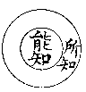



能知为所知之一部份，所知之范围广而能知之范围狭也。如一切法为所知，一切法中一部份心法为能知，同时亦可为所知；如意识上起一刹那之知识，即此了知一刹那之知识为能知，其餘皆为所知。所知的知识即能了知之知识，故不离能知，而能知又为所知之一，故能知亦包括在所知也。——如见分缘相分时，即为自证分之所缘，故能知同时即为所知。——知识能知亦所知法之一，故法相包括所知一切法之相貌、义相及体相也。梵言尔燄，译所知义，或境义，即一切法为所知境也。



复次、法又分为五法藏，即名——能诠表种种事物，相——为名所诠表之事物，分别——识能分别，正智——离虚妄分别之能了知，真如——正智所知之法体。能以五法含摄一切，故以藏名，如四库全书之库。



复次、相又为遍计所执、依他起、圆成实之三性相：一、遍计所执，谓义相中之颠倒虚妄相。二、依他起，依因缘和合所起之相。三、圆成实，谓圆满成就真实不变之体相。



丁　何谓法相唯识



法相谓所知一切法之相貌、义相及体相。一切法无穷无尽，不可胜说，然研究法相唯识学者，最重要、最基本者在百法，天亲百法明门论及大乘五蕴论等，可寻究参考之。



百法中，第一种为心法 Citta（mind），略有八种：一、眼识 Consciousness dependent upon sight.，二、耳识 Consciousness dependent upon sound.，三、鼻识 Consciousness dependent upon smell.，四、舌识 Consciousness dependent upon taste.，五、身识 Consciousness dependent upon touch.，六、意识 Consciousness dependent upon mentation.，七、末那识 Klistamano Vijnana（Soiled mind consciousness.），八、阿赖耶识 Alaya Vijnana（Repository Consciousness.）。



第二种心所有法 Caitasika Dharmas （Mental Properties），又有五类。一、遍行 Universal Mental Properties 五者： 一、作意 Manaskara （attention or preliminary mental excitation.），二、触 Sparsa （resultant sensation.），三、受 Vedana （feelings aroused by sensation.），四、想 Samjna （ideation.），五、思 Cetana（Volition.）。



二、别境 Particular Mental Properties 五者：一、欲 Chanda （Will or desire to act.），二、念 Smrti（mindfulness or memory.），三、胜解 Adhimoksa（deciding.），四、三摩地 Samadhi（concentration.），五、慧 Mati（intelligence or wisdom.）。



三、善心所 Meritorious Mental Properties 十一者：一、信 Sraddha（faith.），二、精进 Virya（energy.），三、惭 Hri（shame.），四、愧 Apatrapya（humility.），五、无贪 Alobha（absence of cupidity.），六、无瞋 Advesa（Absence of hate.），七、无痴 Amoha（absence of ignorance.），八、轻安 Prarabdhi（serenity.），九、不放逸 Apramada（carefulness.），十、不害 Ahimsa（harmlessness.），十一、行舍 Upeksa（indifference.）。



四、不善心所 Demeritorious Mental Properties 中，初、根本烦恼 The Fundamental Klesas 六者：一、贪 Lobha（cupidity.），二、瞋 Dvesa（hatred.），三、痴 Moha（ignorance.），四、慢 Mana（pride.），五、疑 Vicikitsa（doubt.），六、恶见 Asamyagdrsti（erroneous views.）。次随烦恼 The Subsidiary Klesas. 二十者：一、忿 Krodha（Anger.），二、恨 Upanaha（enmity.），三、覆 Mraksa（hypocrisy.），四、恼 Santapa（gloom, vexation.），五、悭 Karpanya（selfishness.），六、嫉 Irsya（envy.），七、诳 Sathya（dishonesty.），八、谄 Maya（deceit.），九、害 Vihimsa（harmfulness.），十、憍 Mada（arrogance.），十一、无惭 Ahrikya（shamelessness.），十二、无愧 Anapatrapya（impudence.），十三、惛沈 Styana（sloth.），十四、掉举 Auddhatya（recklessness.），十五、不信 Asraddha（lack of faith.），十六、懈怠 Kausidya（idleness or remissness），十七、放逸 Pramada（carelessness），十八、失念 Musitasmrtita（forgetfulness.），十九、散乱 Viksepa（confusion.），二十、不正知 Asamprajanya（wrong judgment.）。



五、不定心所 The Indeterminate Mental Properties 四者：一、悔 Kankrtya（Remorse or worry.），二、眠 Middha（torpor.），三、寻 Vitarka（initial application.），四、伺 Vicara（sustained application.）。



第三种色法 Rupa（Matter Literally form or shape）略有十一种：一、眼根 Sight organ.，二、耳根 Sound organ.，三、鼻根 Smell organ.，四、舌根 Daste organ.，五、身根 Touch organ.，六、色尘 Sight object.，七、声尘 Sound object.，八、香尘 Smell object.，九、味尘 Daste object.，十、触尘 Touch object.，十一、法处所摄色 Matter included under dharma dhatu.。



第四种心不相应行法 The Citta Viprayukta Wharmar：一、得 Prapti（attainment.），二、命根 Jwitendriya（vitality.），三、众同分 Sabhagata（uniformity of characteristics），四、异生性 Evambhagiya（individuality.），五、无想报 Asamjnika（unconsciousness.），六、无想定 Asamjni samapatti（mental training leading to unconsciousness.），七、灭尽定 Virodha samapatti（the mental training leading to the cessation of all existence.），八、名身 Namakaya（word.），九、句身 Padakaya（sentences.），十、文身 Vyanjanakaya（letters.），十一、生 Jati（birth.），十二、老 Jara（decay.），十三、住 Sthiti（continuance.），十四、无常 Anityata（death.），十五、流转 Pravrtti（phenomena.），十六、定异 Aprapti（non-attainment.），十七、相应 Pratyanubandha（correlation.），十八、势速 Javanya（change.），十九、次第 Anukrama（succession.），二十、方 Desa（space.），二十一、时 Kala（time.），二十二、数 （number.），二十三、和合性 Samagri（Inherence.），二十四、不合和性 Bheda（noninherence.）。



第五种无为法 Asamskrta（unconditioned Factors）者：一、虚空无为 Akasa（omnipresent ether.），二、择灭无为 Pratisamkhya Nirodha（conscious cessation.），三、非择灭无为 Apratisamkhya Nirodha（unconscious cessation.），四、不动无为 Heala（immovability or indifference），五、想受灭无为 Samjna Vedana Nirodha（a state of trance in which both ideation and feeling cease），六、真如无为 Tathata（Suchness or the True Nature.）。



录者按：此所采录之英文译名，其意义虽或不全，然大致不谬，而可作从西文以研佛学之一喤引。



眼、耳、鼻、舌、身、为五根。色、声、香、味、触、为五境。——触通能所，此指所触。——法处所摄色，为意识所取色，眼等所不能见；如化学上之电子、元子之类，天文家所推想宇宙之属是也。法处所摄色有五：一、极略色，谓分析有质之实色至极微处故名。二、极逈色，谓推测虚空明暗等无质之色，至极远处难为达见者故名。三、定所引色，谓禅定所变现之色、声、香、味等境故名。四、受所引色，又名无表色，谓受戒时动作上言语上受感动而得成故名。五、遍计所执色，谓於意识假想上虚妄计度执为实有故名，如有创造世界之上帝，是其例也。



相应者，谓能与心合作一事。不相应者，即不能与心合作一事也；如康德 Kant 之十二范畴 Categories 及其他范畴皆属之。不相应行法有二十四种，今约说八种以示概略：一、类与非类之性，每类分辨出其特性，如男性、女性、人性、兽性等。二、定与不定之命，此命即命根，谓决定或不决定之命运；如天命之命，墨子非命之命，及佛学之命根法等。三、过现未来之宙，一刹那、一月、一年及将来之时间，依色心刹那展转而假立。四、四方上下之宇，四方上下空间之差别，依形质前后、左右而假立。五、一二三多之数，一十百千乃至阿僧祗之数差别。六、点线面积之量，谓积点成线、积线成面等之量。七、生、异、灭之相，谓诸位由发生而至变动灭尽之相。八、名、句、文之教等，依名句所成之文字，本依声之抑扬、长短、曲直而假立；书本之名、句、文，又依点、畫、横、竖等色相而假立。其作用在声色变化上，故属不相应行法。以上皆从略言之耳。



有为法有造作、有变化、有功用，无为法则无造作、无变化、无功用。何谓虚空无为？非眼所见之虚空，亦非人物等可通过之空。以眼所见之空，属色法中之显色，是有为色法故；以通过之空，是有为触法故，变动不居故。此间无为法之虚空，体是常住，无隔别故。何谓真如？真如谓一切法真实如此之体性：普遍如此，常住如此，一切变化皆依此为体，是谓真如。以上五类一切法，总集为百法。一切法不出此百法，以百法统括一切法，惟使所知境有观察之范围耳。今将百法分类列表如下：



　　　　　　　　　　　　　　　　┌心王：眼识、耳识、鼻识、舌识、身识、意识、末那识  

　　　　　　　　　　　　　┌心法┤　　　、阿赖耶识。  

　　　　　　　　　　　　　│　　└心所：遍行五，别境五，善十一，烦恼六，随烦恼二十  

　　　　　　　　　　　　　│　　　　　　，不定四。  

　　　　　　　　　　┌实用┤　　　　　　　　　┌细色根……脑筋神经系  

　　　　　　　　　　│　　│　　　　　　┌五根┤  

　　　　　　　　　　│　　│　　┌有对色┤　　└粗色根……眼耳鼻舌身┐  

　　　　　　　　　　│　　│　　│　　　│　　　　　　　　　　　　　├表色  

　　　　　　　　　　│　　└色法┤　　　└五尘………………色声香味触┘  

　　　　　　　┌有为┤　　　　　│　　　┌极微色  

　　　　　　　│　　│　　　　　│（法处│极逈色  

　　　　　　　│　　│　　　　　│所摄色│  

　　　　　　　│　　│　　　　　│）　　│  

　　　　一切法┤　　│　　　　　└无对色┤定所引色  

　　　　　　　│　　│　　　　　　　　　│受所引色……无表色  

　　　　　　　│　　│　　　　　　　　　└遍计所执色  

　　　　　　　│　　└假名……不相应行分位假法之命根等二十四  

　　　　　　　└无为……虚空、择灭、非择灭、不动灭、想受灭、真如。



今以法相唯识连称，则示一切法——五法、三相等——皆唯识所现。唯、不离义，识、即百法中之八识及五十一心所，其餘四十一法亦皆不能离识而存在；以一切法皆唯识所现故，一切法多分受识之影响而变化故。现有二义一、变现义，如色法等。二、显现义，如真如等。法相示唯识之所现，而唯识所现即一切法相；唯识立法相之所宗，故法相必宗唯识。所现一切法甚广，然所变所现一切法之所归则在唯识，故示宗旨所在：曰法相唯识。法相唯识学，即说明唯识法相之学理理论，凡经论有阐明法相及唯识之义者，皆属之。



二　法相唯识学之由起



甲　出发於究真之要求者——万有之本因及体质之推究



凡学说之产生必有其因由，固勿论古今中外也。诸佛说法，原应众生之机感为其缘起。自佛典言之，佛之智慧与常人不同，盖诸佛经过长久修证之工夫，已得无上正遍觉知，与世人凭五官感验或意识上所推断之知识，逈异其趣。惟其如此，诸佛对於万有真理实相，於一切时一切处如如证明也。易词而言，佛非创造或主宰世界之人，乃彻底觉悟之人也。惟佛之与佛，更无言说之必要，以所证诸法性相，皆已如如相应故。其所以有种种之言说教化，莫非因众生未得佛智之前，生出遍计之见，或全不觉悟，或觉悟不澈底，欲令同得正觉而说也。可知诸佛非应众生心理上之要求，自无佛之所说法也。



对於现前宇宙之现象人类，皆有求知之欲望，谓对万有现象之由何原因而生，其最后之本质若何？由本质又若何而生出万有？逼吾人以适当之解答，於是宗教、哲学、科学应运而兴。惟此宗教、哲学、科学虽同出推究宇宙万有之由来及其本体，然其解答，则有正谬浅深之殊，兹分三段判之。



１　迷信之神话与设想之玄谈



欲究宇宙万有之真相，最早则有多神教或一神教之解释。此种神教之解答，祗可信仰，不能用思想推论也。神教以万物未有之前，由神自动所创造，宇宙万有即以神为体质。基督教上帝创造万物，印度婆罗门教以大梵天为宇宙万有之因体，乃至中国神话中所谓盘古开辟天地之说皆属之。古代人智浅薄，以神为本体而生万有，自谓满足其宇宙万有说明之要求已。惟自佛法观之，一切法因缘和合而生，皆无主宰，如以上帝为创造万物，则彼上帝复为谁造？如云有造，造则无穷，亦即失主宰义。如云上帝无造而自生，则万物又何须待造耶？於事於理，皆不能通，稍有论理思想，莫不知其为迷信之神话矣。



古代於迷信神话之宗教外，较宗教为进步之解释，尚有设想之玄谈，即哲学是也。在中国有太极、两仪、四象之说，谓阴阳不分之太极，动后即生两仪，继两仪而生四象，继四象而生八卦万物等。老氏以为万物生於有，有生於无；一生二，二生三，三生万物之说，计虚无为宇宙万有之因体。在印度则有数论派（Samkhya system），胜论派（Vaiceshika）等之玄谈。数论，梵云僧佉，此翻为数，即以智慧数数推度诸法之根本立名，从数起论，名为数论。此派计宇宙之根本有二物，纯然为二元论（dualism）：一、为精神之「神我」（Purusa），二、为未现万有差别之无差别之本体的「自性」（Prakriti）。彼解释一切谓：由神我忽生要求，与自性相感而生宇宙万有；欲得解脱，须究明二十五谛之真相，依禅定而止息神我之要求，归还自性不动之状态。其最后之结果，惟神我独存。胜论说明宇宙万有有根本六句义法，即所谓实句义（drauya Padartha），德句义（gunapadartha），业句义（Karm apadartha），有性句义（Samanya padartha），同异句义（Visesa padartha），及和合句义（Samavaya padartha）。如云茶杯，此杯之自身即实句义，实句义有地（prithwi），水（ap），火（tojas），风（vagn），空（akaca），时（kala），方（dic），我（atman），意（manas）。杯之坚白，形态，容量，运动等，即德句义。德句义，凡二十四种：一、色（rupa），二、味（rasa），三、香（gandha），四、触（sparsa），五、数（sankhya），六、量（parimana），七、别体（prthaktva），八、合（Sainyoga），九、离（vibhaga），十、彼体（paratva），十一、此体（apsaratva），十二、重体（gurutva），十三、液体（dravatva），十四、润（sneha），十五、声（cabda），十六、觉（buddhi），十七、乐（sukha），十八、苦（dukkha），十九、欲（iccha），二十、瞋（dvesa），二十一、勤勇（prayathna），二十二、法（dharma），二十三、非法（adharma），二十四、行（samskara）。杯之作用，即业句义。业凡有五种：一、取（utksepanam），二、舍（avaksepanam），三、屈（akuncanam），四、伸（parisaranam）五、行（gananam）。茶杯是有非无，但别有一大有能有之而有。有体是实德业三之所共。同是茶杯者为同句义，非茶杯者为异句义。其中又有同中异、异中同。同异体多，实德业三，各有总别之同异。此茶杯为实德业之和合而成，惟别有一能和合者使其和合之，故彼此有不可分离之一种关系（Co-inherence），是名和合义。若实句义九种全备而和合，即成人等有情，以「我」「意」为有情精神之特徵故；若仅有前七——除我意，则成无情物体。在西洋希腊古哲，有谓宇宙之因体，由水而成，或由火而成，或由空气而成，或由地水火风等而成，略同印度顺世外道四大极微为因体也。以上中西哲学所推究宇宙之因体，虽较宗教中之计有能造之上帝为进一步，惟其依当前之现象，假想种种意像，以追求宇宙之真实，充其所极，仍为设想之种种玄谈而已！於求知真实也何与？



２　实验之科学与执法之小乘



从事由五官之验证，代设想玄谈之哲学而起者，其实验之科学欤？从法国孔德（Anguste Comte，1798-1857）主张建设哲学於科学之上，谓总合各科学实验之结果，作为哲学推论之基础。彼分社会进化有三阶段：一、宗教阶段，二、玄学阶段，三、实证阶段。今此一阶段以证验支配一切，遇事皆探本穷源，求最后之解决。以为一切知识，皆须实验，必须为眼、耳、鼻、舌等五官所能接触者方为真理。换言之，此实证阶段，不事迷信，不尚玄谈，所有神权思想，皆破除殆尽，於科学明证之外，其餘不能为究竟也。今之科学，其方法多据孔氏之言，发挥而光大之耳。所谓科学，即从实际证验状况之如何而叙述之，然后依叙述再加推论以说明其实在。五官验证所不足者，以器械——显微镜、望远镜等——补其未达之处，此从事徵验，固科学家之特色也。但其徵验，仅依於五官之扩大，虽比玄学较为确实，惟五官所验证，仅能及法之片面之一部一部，后虽可由意识归纳以成为系统之理论，亦从零碎组合而成。对於全部宇宙整个人生之真相，仍不能直接觉知。盖科学原为部分类别之学，或物理、或心理、或生理一部分之现象，故惟得零片之粗相也。以佛学衡之，科学之实验与小乘之执法颇为相近。小乘对人观察，乃物理「色蕴」，生理心理「受蕴、想蕴」等现象之组合，现象之外，并无整个之自我存焉。而宇宙万有，亦由地质、水质、动力、热力，并加以有情心理活动之业力组合而成之也。小乘说五蕴：一、色蕴，即百法中之色法。二、受蕴，五官与色、声、香、味、触相接触，或受苦，或受乐，或受不苦不乐，略当心理学之感觉，惟此受同时亦是感情，以根境相触为知识之感觉，亦为感情。三、想蕴，从感受境上分出彼此，思想名词由是而立。四、行蕴，行为之行，或道德或不道德所发动皆属之，见之语言意志活动，行蕴关系最切。以上四蕴，皆被知识。五、识蕴，即百法中之心法，惟小乘未见到七、八二识耳。小乘五蕴之色蕴包括色法，受蕴、想蕴惟指五遍行中之受、想，行蕴包括其餘心所有法及心不相应行法，识蕴即包括心法等。小乘与大乘虽有出入之处，大部分仍相差不远耳。小乘以为宇宙万有，人生世界，祗有法——五蕴等——之存在，犹之科学以为祗有心理、生理、物理之现象也。神我、上帝皆为彼等所否认，小乘论条理非常精细，亦如科学之严密，惟科学乃凭五官及器械以证验，小乘乃由戒定所生之智慧，以明宇宙之法；前为恃外之观察，后为从内之观察，此其不同耳。故科学小乘所说略同，而所用方法及其目标则异，二者皆未臻圆满也。



３　法性之本空与唯识之转依



法性从小乘法作进一步之解释，明万法本性为空，大般若经、大智度论、中论皆属之。小乘以观法有而显我空，谓五蕴等诸法恒有，於粗相之物体已见其空，於细微之法仍有未明，故於世界上之草木，明由地、水、火、风无数关系条件而成，无自性之可言，而於组成之关系条件犹执以为实。然进一步观察，即一切法中之每一法，亦由众缘之条件而成，如离众缘，则无一切法；此一切法，既皆众缘组合，故自性本空。此理略近最新科学相对论（Theory of relativity），谓一法之现见，皆从相对之关系上而显，凡此时、此处四围之环境及立足之观点，皆与其事物之广、长、厚等密密相关，设其周围之环境或时处观点一变，其事物之本身亦即全异也。如地球绕日而行，以相对之理或增上缘之理而言，不惟日球与地球有密切之关系，实由其他行星、流星等相切相磨而成，故知地球绕日一事，即由逈色之空乃至恒星等，亦无不与此有关者，世人祗取其切近而遗其疏远耳。从法性言，小乘固执之法，亦因缘互集之假相，与我之空，了无二致。仅有因缘之聚集，而无因缘所共合之实体；仅有缘成之因缘，而无因缘之自性：此法性本空之义也。然仅知法性本空，不知法相之唯识义，则众缘所集现之摄持力，何归何与？从此透过法性本空，即彰法相唯织。自性本空，非五蕴等灭却说空，乃从众多因缘法生而无自性以说空。因缘所成法，其自性本空，然非无此众缘集合关系之法相。法相之中，心法及心所有法即所谓识，不但可以被知作为知识对象，并且本身即是能知识。一切所知识之法，即摄持能知识之中，凡此皆心理知识中之现象，非离识外另有色等诸法。所觉知者，则为前六托第八相分为本质尘所变之相分，仍在识内而非外；见托相起，相挟见生，法相皆多分受心理知识影响而变化故。在知识观点强度如何，所知识即现如何，知识强度不同，所彰之现象全异，所有知识之法，皆受识之影响而变动。法性明一切法从多种因缘所现之相非固定，其自性本空；法相则彰万法依心及心所法如幻如化而建立，不於识外别有他物，故曰法相唯识。法性本空，可破小乘之法执；而法相唯识，又可显法性本空中多种因缘所现之法相非离识而有，皆同为识变故。以法性诠法相，则法相如幻如化，皆成妙用；以法相显法性，则法性本空，其相唯识。性相如如，故推究万有之本因及其体质，至此方理善安立。



乙　出发於存善之要求者——吾人之自我及价值之存在



人之生也，莫不觉有自我，而一切欲望皆从之以生也。然此自我，为随死以俱尽，其性乃暂时欤？抑人身虽死，而自我有不死者存，其性乃无穷欤？茍自我随死以俱尽者，则芸芸众生，寄生霄壤之间，此数十年与草木何异？为善成仁，作恶行诈，其价值何在欤？设非然者，人生死而有不死之自我者存，则彼不死者又何往欤？随此界以升沈欤？入他界而受生欤？如是等者，乃有宗教、哲学、伦理出发於存善动机之由来，古之贤哲笃行其志，或立功，或立德，或立言，觉本身为万有之中心，期精神之充实以永存，此种要求，岂无所恃而然耶？俗语：「人死心不死」，即认有自我之价值永存藉以自慰者，要求有最善永存不灭之标准，於是宗教伦理之说起；然其开始，实由神道之说。兹亦分三节言之：



１　天神之永生与自我之独存



天神之永生与前迷信之神话相一致，此神为无始无终无所不在，而人为神所创造所管领，能将低等性质破除，培植为善之道德，即能与神同其永生。此说一兴，从者如响，盖以为必如是然后自我之价值乃能常存，人心因以大慰。至於自我之独存，古印度数论，即创此说，彼为生死所以循环不息，乃出自我之要求，必假定慧之力，将自我要求息灭，渐能离自性而独存矣。其餘耆那教等，亦莫不以自我解脱而独存，为达最高善之目的。以法相之理观之，其托神庇护者，虽可慰暂时之烦恼，以神为唯一之依恃；然其认神权为无上，舍自作自受之理於不顾，已犯世间相违等过。而自我之独存，亦徒为玄想耳。



２　质散之断灭与生空之解脱



科学谓人生作何事业，留於团体，或可不朽。如将每人个体观察，皆依物理为基础，而此物理之本质，不过化学之十几种原素组合而已。心理依物理为基本，最后则在物质，至於心灵等则死后随质散而断灭。所谓自我、灵魂等等，皆拨为无，自更无所谓永生、独存也。印度之极微论，今世之唯物论，均持是说。但小乘证生空之解脱则在扩充为善之行，非相抵相抗，乃由相依相益，由戒生定，由定发慧，将世人迷有自我的实体破除，明内无我，外无实物，向以物我为实之推求，於焉而息，一切心理活动亦随之而息。得此生空之解脱，表面上虽与质散之断灭似同，然科学不从业力解散，虽计断灭而终非真灭；小乘从生机上断灭，乃真解脱，此其不同也。科学对於善的价值之永存仍未达到，且较小乘犹逊一筹也。



３　本空之常如与唯识之转依



科学主质散之断灭落於断灭之见，理有未善，固勿论矣。即小乘生空之解脱，执有法之实在，於法性法相之义，亦未契合。法性明万法本空，了无隔碍，常是如此，普遍如此，故曰诸法空相，不生不灭，不增不减。亦无生死苦恼可脱，以万法本空，本无生灭增减故，故曰：本空之常如。诸法之本性虽空，然诸法之现象，仍随因缘之合散而变现；一切法皆依识，故可从识而转之也。凡不圆满之有漏法既依识所变，即此不善不圆满所依之识，改转之使为觉悟而圆满，佛典谓为转识成智，则达善之价值永存之极则矣。



三　法相唯识学之成立



由前出发於究真及存善之二重要求，可知法相唯识成立有二动机，在此动机中，即法相唯识学产生之原因也。法相唯识学之能否成立，当更考察其理由是否充足，有无事实之证明，与可得相当之效果否。然与唯识类似之说，不能不先一辨之，即各种之唯心论是也。各种唯心论，虽各言之成理，持之有故，惟有许多问题不能解决，而卒不能有所成就。故兹先将其餘唯心论不成立之故一阐明之，然后始能彰法相唯识学之成立也。中国向来对於唯心论，少有系统理论，以先哲曾言之太极之说等，概非显著之唯心论；故今所言唯心论皆属西洋哲学。西洋唯心论自古有之，至近代乃极其变。古代之唯心论（Spiritualism），殆同观念论（Idealism），观念不过是一种相而已；与其称为唯心论，勿宁称为唯理论（Apriorism）也。故今此所言，又专在近代的西洋唯心论。近代唯心论，其初、盖对於多元论、二元论、及唯物论之不满足而起。以上各论，皆可称为素朴实在论（Naiverealism）；素朴的实在论，以为耳、目之见闻，即能得事物之实在。故吾人觉知之所得，以符合客观之事物为真确。轻重、厚薄、大小、方圆，莫非事物之所固具，心之认识或不认识皆尔也；知识所含之性质，不过依事物去认识而已。素朴实在论系根据一般常识上之见解而演成者，如见此桌存在，即依此桌之实在加之认识，如以万有之本，原为众多不同之实体，则成多元论；谓万有之本原乃二种或一种之物，则成二元论或一元论；此称一元论即唯物论，皆素朴实在论也。近代之唯心论，即起於对素朴实在论之反动，而有主观、客观唯心论等之产生，今以次胪列，兼论其得失焉。



甲　其餘唯心论不成立之故



１　主观唯心论之不成立



近代如培根（Bacon）、洛克（Locke）以至休谟（Hume）的经验派，以谓凡可经验者，即感觉现象；除去所见到之色、所闻到之声、乃至身上所觉到之触等现象之五官感觉经验外，别无可经验到者。向来所谓关系法则、贯通理性等，不过实际感觉到的经验上之条理而已。因此经验派的思想而进一步，勃克莱乃发生主观的唯心论。勃克莱（Berkleg）否认物质本质之存在，以为一切物性，莫非吾心之所知，宇宙万有物体云者，不过为吾心所知觉之一切耳，并无知觉外另有所谓实物之存在者；由知觉上发现种种现象，即自心知觉现象。勃克莱之意、以为一切事物之存在，均在主观意识之内，主观意识之外无事物存在，凡存在者即被知觉者也。此主观唯心论，在其一贯的理论上，似亦能成立，然一推究，则疑问重重。勃氏以一切外物之存在，归之自心主观所现之影子，则自心如镜子，外物如镜子之影子，如此祗有自心，则他人之人格亦被其否认。推其极、不过自心之存在而已，然则国家、社会与法律、伦理皆等虚设，失其效用；如是颠倒，世共不许！又复应思：既如汝言，所见之桌，除色、香等外并无实质之存在，然在夜间无人知觉，至第二日仍有此桌之存在。试问此桌在夜间是否继续存在？若谓所见之桌乃由汝心而有，汝心不知觉时则桌消灭，云何得有重见昨日之桌之存在？至是勃氏落於遁辞，谓物之存在，如不存在於自心或他心，亦必存在於上帝之心。然上帝非经验之可得，先不成立，而勃氏之说，遂不能自圆矣！



２　客观唯心论之不成立



主观唯心论从经验派产生，迨其说不能自圆，於是理性派起为解除上述之困难，一转而变为客观唯心论。此派谓宇宙万有，有共同之心或共同意识之客观存在，故万有乃一客观的心之表现。宇宙所有动物、植物、矿物，程度虽有不同，然皆为宇宙共同之心，如千江万湖之皆为水。人类或其某民族，为此共同心发达之最高者，动物、植物、矿物等乃其低下者，所以万有的存在皆此客观的心。惟此客观的心，即为自己他人及万有以至全宇宙；至各人乃共同心之一分，非以个人自心为立场，乃以共同心为立场者。黑格耳（Hegel 1770-1831）即可为此派之代表，以共同心包括一切，计划之而支配之。惟此共同心无可证明，与一神教所谓一神无可证明之性质，相去几何？一神不能成立，则共同心亦不能成立。又、所谓客观存在之心，不过称彼为心，其与素朴实在论不可证明之物，亦仅名之不同，同为不能证知，但随名言而假立耳。若唯物论不成立，则客观唯心论亦不能成立。今纵许汝有共同心之存在，万有乃共同心所生；然世间凡被生皆同於能生，如人生人，犬生犬，未见有石能生人畜；既为唯一之共同心，以何而得生出各别的万有，被生与能生了不相似？复次、既然万有皆由共同心所现，则应共同为一，云何万有有一定之条理及规则，必众缘具备，然后事物才能成功？反是、众缘或缺，则事物无从显现？此皆有为客观唯心论所不能说明者，故客观唯心论亦难成立。



３　意志唯心论之不成立



康德（Kant 1724-1804）调和理性派与经验派，一面承认经验派凡存在的不能越出五官经验之外；一面又从为感官知觉所不能知觉之经验外设立一「物如」Dingan-Sich 或称自存物；又主张有先天理性能向杂乱无章的经验中立出法则。而所谓自存物，既在一切知识之外而不可知，故康氏非唯心论者，亦非唯物论者。然因康氏所立自存物为不可知，从康氏之后，有解释自存物为唯物者，亦有解释为唯心者。迨叔本华（Schopenhaucr，1789-1860）谓自存即为吾人求生存之意志，此意志乃不知其然而然，因有要求生存之意志，故有继续不断之努力在各处表现，一切生机之活动，植物永久之成长，动物一切的冲动，均足表现世界之根本，端在意志；意志存，则万有虽旋灭而旋生，灭生不已。惟叔本华颇受印度数论及小乘思想影响，以为人生世界，既出彼意志之盲目的要求，故人生世界皆唯痛苦，根本解脱之途，在否认求生意志，使之消灭於艺术之音乐等中，亦可使之暂忘也。叔本华认人生世界皆意志所造成，以求生之意志消灭，由求生意志所生之万有亦可消灭，此与印度之数论或小乘之思想颇相近。余前在德国曾询杜里舒：所谓生机一耶抑多耶？据杜氏言：最初为一，后成为多，最后仍归为一。今叔本华之意志亦可同上问之：所谓之盲目意志，各有其一耶？抑万有共为一耶？共一则自己生存之意志消灭，与万有共同意志何与，何能由各自而消灭？若云各一，何能生起共有之世界？即消灭祗可言各有之意志消灭，乃各人自己之解脱。现在共同之地球太阳，是否各有意志耶？有则各人意志消灭亦无用矣！如云：世界等乃各人意志所生，则世界与各人意志又如何贯通耶？又复应问：向之不知其然而然之求生意志，其现起为有相依之关系耶？抑无相依之关系耶？如无相依之关系，则不能以其他方法使之消灭；如有相依之关系为之缘起，则意志之前，仍有其他原因存在，意志应非根本。故意志唯心论亦不成立。



４　经验唯心论之不成立



主观唯心论从经验派而起，客观唯心论从理性派而起，意志唯心论间接从康德调和理性派及经验派而出。至经验唯心论则从扩充经验范围而起，从前经验派所谓经验，唯指五官直接知觉到而言，此则为扩充经验而将理性亦并归经验中的实验主义。故詹姆士（William James，1842-1910）等所谓经验，乃通於一切而言，非各人经验已也，非五官觉到已也，无论意识或知觉或思想或想像皆属之，故空间则成为经验之大网，时间则成为经验之常流，全部心理之内容，亦即经验之内容也。同在经验之中可分二种：一、素朴之经验、二、经过雕刻之经验。素朴经验之原料，可经意识雕刻工夫，由此雕刻即成种种之相，由意识立种种之名，成为实际有用的方为真理。世间所有之事业及思想，既皆依素朴经验复经意识雕刻而成，故真理亦无决定性可得。简言之、於此时、此地能适应吾人实际生活之要求，方成真理也。此派非以唯心论自居，然将经验范围推广，所谓经验既即为心理内容，故是唯心。惟其构成经验，仍依生理有机体，经验流既藉有机体而存，有机体乃是基於物理之生理，则有机体之身一坏，而经验之流亦断矣。此有机体又从许多物素组成，从构成上追究，仍以物理为基本也。行为派心理学，亦可谓即从此派影响而出，适见其经验之流乃藉物而有，非唯心而反成唯物，其推论自难极成矣。



５　直觉唯心论之不成立



帕格森（Henri Louis Bergson 1859-X）并非以所谓直觉（Intuitionism）为万有之本源，彼所谓万有之根原乃「生命之流」，或「生之冲动」；惟此生命之流非理智可以把捉，乃靠直觉觉得。盖生命之流乃产生万有之浑然真体，理智祗能见出彼所分别之物体，乃实际应用之一种工具；若此内在生命之流，则须依直觉乃能了知也。平常直接知觉到无彼此、自他、内外之分别，是谓直觉；从直觉悟到的万有生命之流，综合叔本华盲目之意志与詹姆士之经验流，而以直觉握其枢纽者，此柏格森之直觉中的生命之流。此生命之流，即隐於吾人意识之后，以激励鼓舞吾人时时向创造之途以趋於进化。柏格森本此以说明创造的进化，彼说进化为由原始而现在而未来而永续无穷之巨流。彼谓「生之冲动」，宛如喷发之爆弹，分为二流：一、紧张而上涌之火燄，为精神现象，如动物等；二、弛缓而下堕之火花，则为物质现象，如矿物等。前者为动物，如爆弹之燄火极紧张之部；后者为矿物，如火花之点点斑斑也。此虽可为一极有力之唯心论，惟在理论上仍有许多困难之问题在：一、彼既认生之冲动即创造原动力，何以万有乃有秩序条贯等之存在？设认万有无条贯秩序，则亦无进化可言。如紧张之则为精神，弛缓之则成物质，然在常识上或科学上，均觉得生命现象必有其非生命的为所依之处，此所依之处，或地球或其他之物质现象，乃先於精神现象而存在；然则与柏氏先有精神之生命现象又相违矣！故其说亦难极成。



６　存疑唯心论之不成立



康德（Kant）之不可知的自存物，可为存疑之唯物论，亦可为存疑的唯心论。至於最近之安斯坦（Finstein，Albert 1879-X）的相对论，客观宇宙的存否，存疑而不速断，而一切运动之现象，与其距离之时间，皆由观点之不同而不同，成为相对之现象，已有唯心论之倾向。从唯心论上说，亦可成为存疑之唯心论也。至罗素（Bertrand Russell 1872-X）的新实在论（New Realism），虽极力扩充客观实在之范围，将经验派之感观的事与理性派之超验的理，皆与以不倚心而存在，不由心而变动之客观存在的实在意义，建立中立一元论，谓心及物乃中立一元所构成。然彼非心非物之中立一元，即为感觉之经验；惟一探其所谓中立一元的一元之谓何？彼尚存疑而未速断。余前到英国曾以此问题询之，彼谓犹在研究而未能判断。彼虽存疑，而亦得谓之唯心论也。但此种存疑唯心论，消极方面虽足以避免他人之批评，积极方面亦缺少成立性也。



乙　法相唯识学成立之故



对於法相唯识学之名义及产生之动机，前已说过。各种唯心论，因事实上、理论上皆未完善，而卒不能有所成就！今再以能极成立之法相唯识学，次第设立各种问题论之。



１　独头意识与同时六识——虚实问题



主观唯心论谓唯主观的自心是实在，其他事物不过心中之影子而已，一切现象乃皆成为空虚而无实。另一方面主张实在者，乃有新实在论，以为一切见到、闻到、触到，乃至意识上观察、思辨到的一切对象，皆为真实。主观唯心论以一切外物之存在，悉归主观之心，自心以外皆是空虚；如此祗有自心是实，则一切人格及社会均被否认，与事实不符，而理论上亦通不过，已如上辩。经过主观唯心论之不能极成，可一转而到新实在论；主观唯心论谓虚，新实在论谓实；前为虚之代表，后为实之代表，乃构成虚实问题。此在法相唯识学将如何解决之乎？依斯学百法中之八识，依眼发生出来之知识谓眼识，依耳发生出来之知识谓耳识，乃至依身发生出来之知识谓身识。至第六意识与普通心理学所谓意识略同，惟从意识全部之领域及分类而言，则法相唯识学之意识，较普通心理学为广，若专从一部分现象而推究其细末，则普通心理学之所言，亦有独到之处也。



此种意识，大致可分两种、一、独头意识，二、同时意识。独头意识，乃於离开眼、耳、鼻、舌、身五官感觉之后——眼不见色乃至身不领触——单独构成，略似心理学所云之想像。盖意识离开前五识仍可自起分别，如意识缘过去、未来之境，不过为意识所忆想耳。但独头意识范围颇宽，又分三位、一、梦位意识，梦时前五识不起现行，唯是第六意识之分别现境也。二、散位意识，清醒时心理之分散，而非集中统一者，为散位意识。三、定位意识，此非常人所有，须经修定工夫乃能发现，不惟佛教得定之人有之，即道教及印度外道经过修定工夫，使心力集中统一，精神上成为和平安宁，而增加许多超越之力量，亦属定位意识；惟真正得成定心，眼之知识乃至身之知识，均不起作用也。独头意识包括此三位，而知识之性质则截然不同。梦位意识颠倒错误，表面上似真，其实非真，表面上似能推理，其实皆非理、非量之识也。散位意识范围甚广，通常心理作用多属之，占通常心理作用百分之九十九；此种知识又分为二：一、贯通前所经验成为推理不误之比量知识，二、有大部份则为错误知识。此中又有二种：一、如言见桌，不过见到一小部份之颜色之少分，至於桌子多分之色及声、触、重量等，皆非眼所见，通常即以此直接眼见到之少分以为眼能见桌，其实非真见，乃成似现量之非量。二、如唯物论或素朴实在论之种种推论，又成为相似比量之推理的非量知识。定位意识少起主观作用，惟是明显之心境，故多属现量之直接知觉也。更就境辨之：梦位意识多属独影境，单独之影子为独影，系纯粹主观之心而起。梦位意识，前次为心理学会讲「梦」之题目，曾言梦亦尚有带有实质之境，如因生理关系影响而成梦，乃至其他心之关系使成为梦等，皆带有其他精神力之关系者，故梦位意识亦有带质之境；惟大部份为独影境，少部份为带质境耳。散位意识大部份仍为独影境，如想像因名词之施设，马虽无角，亦可想像於马角也；即想过去之事，亦为独影。独影境有二种：一、无质独影，此时、此处、此界无有，即他时、他处、他界亦无有，祗意识上假立名言之分别耳，如因名而妄立龟毛、兔角等。二、有质独影，虽此时、此处无有此法，然为他时、他处之宇宙间实有其质，特今此但为意识所变现之独影，为有质独影。带质境亦有二：一、如言见桌祗可称带质境，桌虽不能见到，然意识将直接知觉时於桌子观念上，乃或为桌之颜色，虽所依之实质不能全部相符，惟带真实质一部份，经过意识上之构成而成，谓之似带质境。二、其以心缘心者，则为真带质境。依唯识言，通常所谓见到、闻到、嗅到、触到之天地人物，皆是散位独头意识之带质境而已，均与真正之感到不符，惟隐带其内容而已。依此带质境所推理则成比量，故此散意识中被知识所知识的，有独影境及带质境。定位意识，非一般人之心境，不易经验，可从略。大抵深定位之心境为性境外，其餘通常定位，仍为独影境也。



由上所言独头意识之心境，可见主观唯心论祗能讲到独头意识之一部份，而定位独头意识则尚非彼所能望见，以此一部份为立足点，而解释宇宙万有，自难成立；较唯识学所言识有八种，前有眼、耳、鼻、舌、身五识，后有末那、阿赖耶识，领域之大小，自不可同时而语矣！同时意识乃依眼识、耳识乃至身识等之五官感觉，与第六意识起同时作用；此间非必全部前五识与意识同起作用，乃前五识中之一或二或三或四或五与意识同起作用，称之谓同时意识。简言之：五官之中有一或多与第六意识同起作用也。柏格森（Henri Louis Bergson 1858-X）之直觉（Intuitionism），亦此同时第六意识之感觉。同时六识知境像之现量直接知觉，并无推理作用，同时意识现量所知的是实在之性境，与独头意识多分为主观作用所起不同。同时意识乃真实之性境，惟其为真实性境刺戟所生起之意识，故谓同时六识所缘缘乃为实在有体性之境。从内容言，此性境与新实在论（New Realism）所谓的客观实在略同，因所言直接知觉到，乃意识上关於数量或分位——心不相应行法时空数量——等，前五所无，而为同时意识所感到的，均可等於新实在论之所谓实在；盖即同时六识现量之心境耳。然唯识固不能以独头意识局於主观唯心论，同时亦不能认同时六识之现量而局於新实在论。同时六识之所缘境，非单依主观可以转变，并须托六识外存在之境作所缘缘之刺戟；准此而言，岂非与新实在论或唯物论无异乎？但须知此间所言同时六识，略同实验主义之纯粹经验，经验本身即感觉，感觉即心识，谓须境之剌戟，不过就纯粹经验之说明上而言，此种所经验的仍在纯粹经验之中。感觉可作两面解释：一面为能知识之知识，一面为所知识之境相；能为见分，所为相分。因此事实上感觉之有感於是而有所知识，均不离纯粹感觉心识之外，故仍是唯识。此种不离纯粹经验六识觉到之现象之外，有所谓「感觉今有」或「感觉所与」的本质，如康德（Kant）之物如或自存物，即同时六识之境像底下另有其本质，祗以同时六识心境之境像完全与本质相同，故与本质之境同为性境。盖同时六识所知之境，绝无主观作用夹杂其间，实在如何即感到如何也。然以同时六识所依托之本质谓神则成一神，谓物则成唯物，谓理则成唯理，故须更进推究同时六识与第八识变。



２　同时六识与第八识变——象质问题



从同时六识所知境象的本质之推究，则不能不言第八阿赖耶识。阿赖耶是梵语，此译为藏，意谓将所有经验皆能收藏之知识，乃至行为上之行为亦能为所收藏，故此识亦可言「处」，即一切所现行之潜势力保藏之处也。此识具有三义：一、能藏，二、所藏，三、我爱执藏。一、对一切种子名能藏，因一切种皆收藏於阿赖耶识之中，种子为所藏，阿赖耶识即能藏之处也，故曰能藏。二、对一切杂染法名所藏，因根身器界一切杂染现行之后，阿赖耶识反为一切杂染法覆藏，为一切杂染所藏也，故曰所藏。三、对第七识名我爱执藏，因第七识恒审思量我爱之执，此识被执为我，即阿赖耶识现行之见分，成为第七识所爱执之处所，故曰我爱执藏。佛典分万有为有情无情二种：动物为有情，矿植为无情。宇宙一切有情，各有一阿赖耶识，此识能将各个所有经验保藏之无失，遇有机缘即可复现。通常所有记忆想像之功能，即有保藏之第八识使然也。普通心理学以为脑府能保藏，凡心理之保藏，皆依脑府之生理机关而生，细胞活动复现即起想像之作用，此种解释，不能极成。试问所见之屋宇海水等至大至远，如何能为仅方寸量之脑府所能保藏？如将所见之屋宇海水与方寸之脑府较，其非脑府所能范围，抑奚待言？设云：脑府之保藏事物如照相机之摄影，然照相机所摄映之影子，不能如事物之大小量。与眼识如量而见不同故。又、前后之影，应错乱无序同糅於脑府之中故。依佛典言，识乃依境之大小而遍法界，故各人之阿赖耶识皆交遍宇宙，凡事实上或经验上皆赖保藏，使之复现也；此识虽交遍法界，惟仍各为各有，如某甲之读书，久诵则保藏之於第八阿赖耶识之中愈深，然不能易之某乙。柏格森之生命之流，或潜意识之最深部份，均可见到阿赖耶识之一少分。有情生命之本身，即第八识，此有情生命本身，即非物质之心识。此种心识有二种作用：一、能知，二、能变。有情生命本身之第八识为能变，得到一段生命，则有生命本身，即是根身，其所依止之处即器界是也；同时六识境像所依之本质，即第八识所变一部分之器世间，即所谓内变根身、外变器界之器界也。所变本身之表面形躯非真五根，乃根所依处，真正五根略同神经系，非同时六识所知。此器世间之本质，即感觉所与，可知康氏之物如，亦即第八识所变之器世间也。因第八识所变之根依处及器界，虽在同时六识之外，但仍在第八识之中，不离识而存在；可知器界为第八识之所变，实有体性可作为同时六识所缘之本质，然不离第八识而有，故仍唯识也。



３　自识所变与他识共变——自共问题



自识所变与他识共变，为自共问题。前段所讲本质乃第八识变之一部，即器世界及根依处。由第八识变为前六所缘境之本质，各个有情各有第八阿赖耶识，唯此本质为各赖耶各变耶？抑各赖耶共变耶？若谓各个各变，则各有情一时期生命终了之期，不惟身体坏灭，即宇宙亦应坏灭！设云：宇宙器界乃各有情共变，则除各人等八识外，仍有共同所变之器界者在，於是乃有自共问题。解决此问题，须知根身器界有共变不共变之义，绝对不共变，即净色诸根是也。净色诸根非有情形体，略似生活的神经系，此种五根乃各个有情第八识所各变，生时有神经作用，死时即无神经作用。各人真正依之发生五识之五根功能，与他人无关也。除此之外，根依处之形体乃至脑髓等，已有一部份为共变共用之关系也。至器世界山河大地，除各人各动物之身外，则纯粹为共变，惟此共依之宇宙，仍有一部份为共中不共之性质，此种不共性质，乃就一类一类而言。如言汪洋之水，从水族之动物鱼类等，则觉为其空穴房宅，与人类对水之为感不同，鱼之於水，犹人之於空气，不可须臾离也。所受之身体不同，即所受之器亦异，故虽共变之器界，仍是一类一类共中有不共变之性质者在。严格言之，每一人或每一动物，对於器界皆有不共变之性质存也；譬如有植物於此，若有某人或某缘具足则繁荣，反是则枯衰矣。乃土地江湖亦或因某人或某缘之关系，乃可使之改变兴废者，植物、矿物虽由同类第八识共变而资为物用，但共变中仍有不共之少部份也。可知共依之器界，有共中之共及共中不共也。各变之人生，各根为不共，而根依处之外形仍有共变之意义，如身体有父母亲属之关系，虽死犹存有共见共变之尸骨是也。如单独之第八识变，则应无共见之功用也。简言之，世界虽为共变，而仍有一类一类之不共变也。



兹分四类言之：一、不共变之人生有二：一、不共不共，神经系之五根是也。二、不共中共，外形之身是也。二、共变之宇宙亦有二：一、共中不共，田宅等有特殊之关系，变生特殊之资用是也。二、共中之共，地、水、火、风、山、河、大地是也。自变共变大抵可分四类，细详则仍可分析也。是知宇宙有一切有情心识共变之意义，但各个有情仍有各个所变之根身器界，因同为一类，相似相类和合成为一体，不易觉察，其实在能变之关系上，仍各是各变也。不过性质相似，可同在一处，成为共依共用耳。譬如室内有千盏、万盏之灯光，各个灯光皆普遍室内，相似似一，然仍有各灯光之系统；犹之除五根外共变之器界，仍各人各有能变所变之系统也。依唯识言：各有情生命之将得或初得时，其所变之器界根身随之而现，死时亦随之而灭也；犹之一灯熄灭，其所有之光亦随之而熄灭也。然一人死时，器界等何以不觉坏灭？乃微细难知之故，亦犹无数灯中之一灯熄灭，并不觉光力有所退减也；是知共变之宇宙，乃异常复杂。大抵言之，同类中关系愈密则觉愈切，愈疏则觉愈远耳。共变之大宇宙生起，固由无数有情众生之业力。而共同变起之中，依佛典言：每一宇宙如太阳系之小世界由共变而成外，亦仍许有伟大之业力作全宇宙变起之总枢。其他宗教不明斯理，即谬托为上帝或神所创造，似印度所言之大梵天等，佛说其先此一小世界之有而有，后此一小世界之灭而灭，亦仍有生有灭，惟业果较寻常悠远耳，并非唯为此天神所主宰也。譬如建立国家之要素，固由人民、土地、生产种种关系而成，然仍有最根本之要素，如现代中国以三民主义建设之国家，即三民主义之首创者为最根本之要素也。建国如是，器界之变现亦然。对於宇宙根身器界之自共问题，大抵如此！



４　第八识见与第七识见——自他问题



此段乃研究区别自他之核心何在也。自变共变乃从自他区别，然如何而有此区别？须知八识各有相分见分之分，根身器界乃第八识相分，依此相分同时即有了知相分之见分，此见分即此间第八识见也，亦即第八识能了知之功用也。惟此第八识为第七识见分取为自我，则第七识见为能取，第八识见为所取；简言之，即第七识见取第八识见，执为自我也。第七识从向内取第八识见执为自我，无时或息，童稚之时，第六识之自我观念，虽无甚显著，然根本之自我执，仍无间断，至成人则到处时时保存自己，发扬自己，提高自己，自我之观念，极为显著；凡一切有生命之动物，皆有此相续不断之自我见，即第七识见专取第八识见分为自我也。通常之自我精神，皆依托此根本第八识见而有所发表於外，因有我则有非我，因有我所有，则有非我所有，区别彼此，乃有自他之见。然溯其源，皆因第七末那识——梵言末那，此翻名意，是恒审思量义，恒不断义，审不疑义，即恒审思量赖耶度为我故。——取第八识见分为我体之为用使然也。



５　八心王法与诸心所法——总别问题



眼识、耳识、鼻识、舌识、身识、意识、末那识、阿赖耶识，谓之八心王法。所以称为心王，喻其每一各有统率许多心理作用之能力也。如眼识能将受、想等许多心理作用为彼所统率，故谓为心王法，其他各识亦尔。依此八心王法所有的许多心理作用，为诸心所法，心王所属，名曰心所法，助伴之义也。心所统计有五十一，总有六位：一、遍行位有五种，二、别境位亦有五种，三、善心位有十一，四、烦恼位有六，五、随烦恼有二十，六、不定位有四：如是六位，共有五十一心所。六位心所之名，差别繁多，广如前表。此五十一心所，非每识皆有也，即第六意识上诸心所法较最完备，然亦非在每一刹那同时有此诸心所，乃谓第六意识於此诸心所法皆可相应耳。至前五识则或有无有也；依成唯识论考订，前五识祗有三十四，不定位无，随烦恼位或有或无也。第七识有十八种，第八识祗有五种。今之心理学祗讲到潜意识或隐意识，稍涉及第七识及第八识，此微细之七八二识，不惟物观的行为派之心理学全未见到，即内省心理学仍未见到，盖七八二识须依修证定慧才能明瞭到、观察到故。第八识有遍行五种心所：一、作意，能警动其餘心心所现起之主动力。二、触，根、境、识三接触，能触境之心理作用。三、受，顺触之领受。四、想，於领受境取分齐限量，由此有彼此是非之判断，而立种种名，故想为名字言说所依。五、思，依受、想境而动作，能领餘心心所起造作。至於第七识，则除以上遍行位外，复有贪、痴、慢、恶见及随烦恼等，皆从我见所生也。八心王法取总相，诸心所法取各别之相。故有总别之分。如见一种颜色或形相，眼识取一总相，伴眼识所起之心理作用，如触、作意、受、想、思，则生善不善、爱非爱、取各别之相，由此可知有总别之分也。由心识取总相，由诸心所法取别相；又由意识取综合之总相，故有重重层级之总别也。种种法则，皆从八识心王及诸心所法区分而然也，有自共之区别，有总别之条理，对於识所变现之一切法相，皆有其法则，井然不乱也。



６　能缘二分与所缘三分——心境问题



识有三分：一、自体分，二、见分，三、相分。见分为能知，相分为所知。识即知识，显得知识即是能知，有能知则有所知，要说明能知如何，即须说明所知如何也。浑然不分的觉心为自体分，自体分分能所知则有见相二分；见分为识体一种觉知之用，相分为见分所知之相，体、见、相、合称三分也。八识各有各之相分、见分、自体分，其各心所亦然也。复次、唯二分能知为心，三分皆所知为境；自体分为浑然不分之心觉，亦可成所知境。能缘即能知，所缘即所知，能知二分，指自体分及见分而言。浑然不分之自体分，略同罗素非心非物之中立一元，然一分别则成见分相分，见分即能了知相分，而见相分皆依浑然一体之自体分，此自体分一名自证分，以有同时又了知於了知之见分故。换言之，不惟了知知识何种，并了知何种知识，此自证分之义也。自体分、见分、相分，皆所知境，称所缘三分；自体分、见分为能知心，称能缘二分；惟所知境非离识而有，与新实在论认有所知境为客观存在不同也。



７　第八识种与前七识现——因果问题



前讲第八识变，其实非第八识变，乃指依第八识而存之各别不同的潜势力或功能之种子而变。盖第八识所含一切种，如地中之种子，有能现起之潜在功能也。此第八识所含之种子与前七识现起流行，成为因果；第八识种为因，前七识现——心心所及见相为果，然此果非无因，而因则第八识种也。但前七识现为果，对第八识种为因——即种生现，然第八识之种，一面亦仍为果，则由前七识现，又可为第八识种之因也。以一切识种现行之后，同时即息下成为潜势力的种子——即现生种。可知第八识种与第七识现，在互为因果，形成四类：一、种生种，二、种生现，三、现生种，四、现生现；前三成因果之关系，后一则成彼此之关系也。此一刹那之种起为现实上之心心所法，则成种生现，经现行将前所有种子有所熏变后成现生种，如从种子生枝叶花，复从花生果可为种也。则知宇宙万有不同之现实，皆由不同之因而生，非从上帝或客观心等一因而生，以上帝或客观心等之生万物，与因果义相违故！因一果多，不相称故！现行法各各不同，乃由各各不同之种子而起。然现行又成为种子，可知现在法有引生后用，假立当果，对说现因；观现在法，有望前相，假立曾因，对说现果；以此说因果义，则甚明显。各别之因成各别之果，又有从现生现的其他众缘而助成之，故现行后之种已非前种也。比如后稻之种子，已非前稻之种子，盖由关系众缘熏变之不同矣。



８　第八识现与一切法种——存灭问题



一切潜能是否继续存在，即为存灭问题之所关。在现行生起连续上，个人几十年，或人类几万年之历史，形式上虽终消灭，其实非灭，以现行熏在赖耶中诸种子，遇有机缘仍可复现。故个人虽死，世界虽灭，一切法之种子仍保持不失而继续存在，於是可解决存灭之问题。以曾现行之一切法种子，为现行之第八识所保持，现行八识相续不断，旋生旋灭，旋灭又旋生，有二种特性：一、曰恒，二、曰转。转变起灭而不间断，不惟不断，亦不间隔，故曰恒。如各人心识死时似断，其实仍不断，惟在平常经验未易见到，须经戒定慧破脱了无明，得无分别智极显明之智慧才能见到耳。惟第八识现行事实上虽恒续而有转变，其餘一切法种子皆依第八识而存，故虽不断灭而亦并非固定存在，乃刹那刹那生灭连续而存在也。然一切法种与一切法虽可以恒存而不断灭，亦非绝对不能断灭；易词而言，以有相反之性质，亦可使之消灭也。例如光明永久现行，黑暗种子即不得生是也。可知一切法种虽依八识恒转，若遇相反之性质，仍可使之消灭。惟其有消灭之可能，故有创造、改造、自择、自新之路；转烦恼为菩提，转杂染为清净，其斯之谓欤！



９　一切法种与一切法现——同异问题



一一法各有别异，而每类又有每类之别异，如眼识所缘之显色，既别青、黄、赤、白，而青复有一一极微之异。同时、色同是色而外，与声、香、味、触又成别异；然对感觉等心法，则色、香等又同为色法。如此异而又异、同而又同之重重同异，以依第八识存在而能生一切现象之功能种子，有无量无数之差别，故一切法现象亦有无量无数之差别。一切法种、指潜在功能而言，无量别异之相似相等则成为同，依更大范围则成更大之同，最大同则都无不同。别而又别、别而又别为异，共而又共、共而又共为同，故现起法有种种差别现象。而其他唯心论以一心生万有，一多相违，成能生所生因果相违，故难极成。然何以同中有同，别中有别耶？以一一法能生之功能差别，故成现象差别，而每一现象，又与其他一切法连带相依不相离，由此可为异中有同、同中有异之说明。但此祗就非生命之一切法以论其差别，欲究生命之差别，当更进论业报。



10　前六识业与八六识报——生死问题



通常以初受胎为生，至命终为死，在此一期生死间有连续之生命。一一之生命，又有同异，如言人类为同类，与飞禽走兽则为异类；惟在动物，则又为同。此各个生命与各类生命异同之所由，依唯识学言：前六识能作种种之业，业、即是行为，通善、恶、无记三类，依眼、耳、鼻、舌、身、意六根，触受器界六尘而有种种之动作发生，即为或善、或恶、或中立性之业，伦理学中之所谓行为是也。此业乃经心理作用上发动审决而起，依行为结果上判断其优强力之性质。由此优强力用，但个人之关系则成为个性，通团体之关系则成为社会性，有个性、社会性之分，即成私德、公德也。此业只在前六识者，因须与他心境接触而有，故业上有创造性，在第六意识尤有强力，能自由发动，转变他识，创造所无，故依此优胜之业，可以从现在生命失去时，由创造业之成熟力，或更善，或较不善，或相等，而再得到一期之新生命。所得之新生命，由业一面为引导力，一面又为范型性，以之规定后来新得之生命为属於何种之生命，以成为生命种种之不同，皆由业力使然也。由业力刱成生命之报体，可知业的引生力、范型力存则生，此业尽时即死。如砲弹之弹出力，可弹放至何处，及其弹力尽时即低落也。业力亦如此，故有一定之限度。现在之报体，乃由以前前六识业为引生力及范型力而成，由此而有各个各类之不同生命，此种引生力、范型力既尽，遂尔散没，他种之引生力及范型力势增，遂尔现起后期之新生命。所谓生起死灭者无他焉，不过引生及范型之业用起尽耳。换言之，即诸业之起伏乘除耳。此伏彼显，彼来此去，知其他种引生及范型之业又可生灭，故有生死轮回之事。从过去「世间极成真实」证之，如一开国君王，决定一朝代之兴亡期限，达至极限，朝代虽亡，非土地人民并灭，其他强有力者，固将另刱新朝代起而代之也。



11　诸法无性与诸法自性——空有问题



前来已大略讲明唯识之诸法，然此唯识诸法是否有决定性？如不决定，不过言说思想所建立而已，则如康德所谓宇宙以意识为立法者，则诸法本身无决定自性，则成为空；或诸法有其自性，则成为有。有自性则法皆有，无自性则法皆空，乃构成空有问题。此间可用三重观之：一、遍计所执自性，此於一切依他起法事实不相符，全出意识上之决定。依他起法为意识周遍计度而不能适如其量，或增益之，或损减之，此所执法之自性，可知其绝无实体。惟此祗指妄执彼依他起法之所执法为空，非将事实之意识本身亦拨为空；离此妄执，於实体性之法而不起增损之二执，固无妨遍计焉。二、依他起自性，此虽无有独立存在之法性，然可依众多之关系而现起相貌功用，此依他起法，非无仗种种不同之因，托各类各类诸法互相关系之缘，以成种种不同诸法之差别，虽无绝对存在而有相对之事用。三、圆成实自性，依他众缘而有的一切法，皆唯识所现，因知识有种种不同，成种种之差别，能除却此重重差别之知识，扫空主观差别之妄执，成为平等普遍之智慧所了知之境，则不惟意识妄计之遍计所执皆空，而依他起之差别亦空，如此通达诸法真实性相，是为圆成实性。由此可知依他起、圆成实为有，遍计执为空。而所要者，在须将意识妄执空去，不然、则所见、所知之依他起、圆成实，皆成为遍计所执之法。由此显现须有无分别之真实智，才能通达众缘所生之依他起，达此依他起相，才无妄执。佛法之空宗，皆对遍计所执法而说，遍计所执法如不澈底空掉，则不能达到诸法实相；如未达到圆成实性，则虽说依他起之因缘所生，不起遍计执，亦无是处。



12　唯识法相与唯识法性——真幻问题



唯识法相者，对唯识法性言。唯识法相即依他起法，众多关系所变成之法，且显然在众缘中，识为最重要之胜缘，因依他起之众缘关系所变之法，皆为能变知识所了知故。依种种差别之知识现种种差别法相，如能离掉依他起差别之相，现观一切法真如实性，乃谓之唯识法性也。简言之，在能变之识与所变之法上，将遍计执离掉之依他法，即唯识法相；唯识法相空所显之一真法界平等真如，即唯识法性；於此二义，可解决真幻问题。盖依他起众缘之有，乃相对之有，非澈底之有；换言之、依他起乃如幻之有耳。通常所谓现象本质，皆幻有之依他起法，众缘所成，如幻如化；至圆成实性之唯识法性，即诸法真实性，乃真实非幻也



13　染唯识界与净唯识界——凡圣问题



真如法性，离言思，绝是非，而依他起之法相，则有染净之别，故有凡圣问题。佛法於凡圣问题，有精严之解决，须得圣果才能谓之圣。圣果有高高下下不同之阶级：小乘有四，大乘有十一。凡夫证圣果，初步须将现行烦恼所依之种子，要能永远断灭其一部分，即第六识有一部分分别所起自我执著之心，将此计我之心离掉，并将俱生而有恒审思量之我执永离一分，方可入於最初圣位。唯识界、指一切法之范围而言，有杂染唯识界，以根本烦恼及随烦恼本身为染法，凡有此染法之杂在唯识界中，皆为杂染唯识界。能将此虚妄分别之杂染唯识界空掉一分，则成一分之净唯识界，亦即初成为圣也。能将此重重之染唯识界空尽，则成最高圣果之佛。故法相唯识学非为理论而已，并须将染唯识界改造成净唯识界。余尝谓佛法乃自然界中澈底之革命，即此意也。



14　净唯识行与净唯识果——修证问题



此段明须用何种工夫，改变之成为圣果也，故有修证问题。盖假使不能真修实证，不惟成为空谈而已，即前说须依修证所成之理论，亦将随之而根本推翻也。修唯识行，证唯识果，再由较高之唯识行，又成较高之唯识果；故真正之进化，即在此唯识之修证中而已。然徒言进化，若无究竟圆满之境，则漫无标准，进化之义亦不成立。今於此分两段言之：



（一）四寻思引四如实智与五重唯识观



四寻思引四如实智与五重唯识观，即明由心理改变心理，次由心理改变而到生理改变，再由心理生理改变而到物理改变；及至宇宙之现象，皆即无分别之真如，而成为自他互融彼此无碍之宇宙。换言之，即成为不可思议之事事无碍法界也。然此改造入手，首由心理之训练，即先从意识上改造。常人大抵以言语名字为即能得事物之真相，乃观名言但属名言，事实纯系事实，事实绝非名言，名言亦非事实，二者分离而不相及，此即四寻思中一、名寻思，二、事寻思之义也。三、自性假立寻思，四、差别假立寻思者，谓通常思想上，无论於一名字或一事实，皆有特定之意义，名为自性。如言茶杯，只是直尔任持自体，局守自体，不通他也。义贯於他为差别，如云茶杯为磁制之可破坏物，此可破坏义可贯通於他物，即为差别。贯通他义对众多，局自体义对自少，以宾辞解主辞，不以主辞解宾辞，故主辞名自性，宾辞名差别。於每名每事虽可假立自性、差别，然此自性假立之意义中无差别假立之意义，差别假立之意义中亦无自性假立之意义。此种心理训练，略同符号逻辑。如旧式逻辑所谓主辞——自性、宾辞——差别。符号逻辑以为各种主辞、宾辞，不过所列之次序不同，因种种概念各成一自立之概念，但以组织之不同，成为或主或宾，其实、自性假立惟自性假立，差别假立惟差别假立。将此四种寻思观常常练习，则可引生四如实智。所谓如实智，即习成如其实际了知之心理，而生起印可决定之智也。如实於所缘名、事、自性、差别，了知其唯名、唯事、唯假立，谓之四寻思引如实智也。五重唯识观者：第一重将遍计妄执之法离掉，祗存能变之识与所变之法之唯识法相及圆成实之唯识法性。再作第二重观，观唯识所现之诸法相分，皆能知识上所变现所了知之法，唯存能知能变之心心所法。第三重观能缘二分与所缘三分中，唯存浑然不分之自体分，不惟相分为空，即见分亦泯，则见相之区分双忘，只有浑然不分之自体分。由此进步作第四重观，观一切心心所法中诸心所但是心王属性功用，不能与心王相对存在，由此祗有八识心王。第五重观八识心王仍是互相相对相依而有，澈底追究则如幻如化而无决定，由此究竟真实，唯法性平等真如，舍相依相对之虚妄相，乃为真实存在，此第五重遣法相而证法性也。至第五重证真如法性，乃初成净唯识界，以后仍用此五重观数数修习增进，乃证圆满二转依果。



（二）大般涅槃与四智菩提



涅槃、圆寂义。染唯识转为净唯识，得大般涅槃，涅槃所成为四智菩提。菩提、正觉义。前五识成为成所作事智，第六意识成妙观察智，第七末那识成平等性智，第八阿赖耶识成大圆镜智；即将杂染界之八识，成为正觉界之四智也。以上二段，可知法相唯识学，确可由凡入圣，而证明法相唯识学之能成立。



四　法相唯识学之利益



甲　破除我法之谬执



我法皆从遍计执而生，因计有主观之自我名为我执，计有客观之宇宙名为法执。因我则有非我，於是生於种种之贪，贪不遂故则生瞋，贪瞋依以痴、慢，世界之苦恼，乃皆从此我法二执而生也。学法相唯识，明诸法皆众缘所成，唯识所现，则执我之观念既破，而为我所有之法亦空矣。



乙　断尽生法之惑障



生、指有情众生之人生，法、指宇宙万物等。因我执不破，则生贪、瞋、痴之烦恼障，法执未除，则生所知之障。明法相唯识学，则能得到最究竟人生宇宙之真相，以如实了知故，乃不生烦恼及所知之障也。



丙　解脱变坏之业报



生死从我法谬执所生惑障，发生种种思想行为之业，因有限量之业招有限量之报，则有生死。譬如专制君国之朝代，终有消灭之时，以其业有尽而报必坏也。能将我法谬执去掉，则能解脱变坏之业报，而成为四智菩提不思议业之圆满报。佛学所谓了脱生死，即指此而言。



丁　满足心性之意愿



人生皆有止於至善之要求，如不止於至善，则不能满足心性之意愿，犹之千江万湖之水，不流至大海皆不能得到最后之归宿。四智菩提之大圆满觉，才是至善之地；能将诸法性相如如了知，能转一切染成一切善，人生意志之愿望，才能满足。



戊　成就永久之安乐



安乐有久暂之殊，小康太平时代，或近代为最大多数人谋最大幸福之社会主义国家，皆有限业力所成之有限安乐而非永久。盖世界一治一乱，人生苦乐相寻，况国家不能有存而无亡，人生世界不能有成而无坏，仅以目前为限，尚何价值之足云！故必至净唯识之四智，成大菩提，方成就永久之安乐。



己　证得无碍之清净



无碍之清净，即真自由也，绝对善也。通常所谓自由，因受根尘有限之牵制，皆成为束缚而无真实自由之可言；若能修无漏清净行，得成净唯识界，转识成智之时，即证得无碍之清净，所谓我净是也。



百法明门论的宇宙观



交芦子曰：百法明门论，天亲大士作也。法者、轨范物解，任持自性；故法与物，异名同义，百法犹云百物耳。列举此百法者，则以统摄群有也。统摄群有之论，天竺之胜论师六句，数论师二十五法，近世英吉利人穆勒约翰之意、神、形、法四句胥是也。然胜论、数论，吾教大、小乘论师破斥殆尽；而穆勒四句，余亦尝论大略，其抉择当否，可概见已。抑穆勒辩家也，其正鹄在尽列可名可言之物耳，逾此则非所思存。今百法明门论则不然，盖详列百法，仅明所由之门耳。门者，由义、通义、入义，今举百法以明能通入之门，而由百法明门所通入者，犹别有宗趣存焉。



宗趣维何？约之不出二义；一、断染成善。案：历来释斯论者，均以百法区为五对：一、无为有为，二、假实，三、心色，四、心王心数，五、善心数染心数。第一对综该百法，第二对则遗无为，第三对则更遗假法，第四对则更遗色法，第五对则更遗心王及遍行、别境、不定心数，但十一善心数、二十六染心数而已。所以如是分别者，欲令修佛法者，知改流转为常寂、净烦恼为菩提，唯在成此十一善心数、断此二十六染心数，得其舍凡成圣之枢要也。二、祛执证理。案：中道大乘，一切唯心，今列陈百法，正以明百法皆不离心识耳。心识之宗，曰如来藏。如来藏无执，末那执之、则曰阿赖耶。执阿赖耶见分为自内我，则曰末那。由之而辨其体相、业用、本末、因果，乃有八识心王。与心王定相应者，则有五十一心数。心王、心数、变起见分所了别境，则有十一色法。依心、心所、色、分位差别，则有二十四不相应假法。其无为法则心识之实性也。故五位百法、皆唯有识，一切愚夫执有实体、执有主宰。若了唯识，则知我法皆横计起。但离横计、实无我法，我法执祛，则契证如来藏性矣。



然大乘诸论，陈列法相或有增减详略，五位亦别有开合。如大宗地玄文本论则开五位为十种，加色主、非有为非无为、亦有为亦无为、俱俱、俱非五种。言色主者，犹近人所云原质，即四大种——坚、湿、煖、轻；楞严七大、瑜伽十界、皆详言之。乃随俗假说，非实物有，故兹不列。言非有为非无为者、即法性真如也。言亦有为亦无为者、即心心所之业用也。言俱俱者、即百法之都称也。言俱非者、遣相归性，百法皆不可思不可说也。义有开合、法无多寡，其宗趣亦莫不一致。举一反三，在学者之善悟耳。至小乘诸部，大都依根本一切有宗建立七十五法。虽法相略减，非大小乘殊别之要义也。其要义在小乘法有而我空，色法、不相应法、无为法皆心外实有；大乘法我双空，决定无心外实法，则大小乘所由判也。然不能思择群有，穷尽无遗，又焉知心外无物，决定唯识乎！此观百法所以尚矣。



为令学者易明，制一统摄分类表如下：



　　　　　　　　　　　┌心分位  

　　　　　　　　　┌假┤心所分位  

　　　　　　　　　│　│心心所分位  

　　　　　　　　　│　└心心所色分位  

　　　　　　　　　│　　　　　　　┌真  

　　　　　　┌有为┤　　　　┌性境┤  

　　　　　　│　　│　┌色境┤　　└似  

　　　　　　│　　│　│　　└质影───  

　　　　　　│　　│　│　　　　　┌本识  

　　　　　　│　　└实┤　　┌心主┤　　┌有覆染净  

　　　　　　│　　　　│　　│　　└转识┤　　　　┌任运  

　　　　　　│　　　　│　　│　　┌遍行└三性染净┤  

　　　　法─┤　　　　└心识┤　　│　　　　　　　└计度  

　　　　　　│　　　　　　　│　　│别境  

　　　　　　│　　　　　　　│　　│　　┌自性  

　　　　　　│　　　　　　　└心伴┤净善┤  

　　　　　　│　　　　　　　　　　│　　└世俗  

　　　　　　│　　　　　　　　　　│　　┌根本　　　　┌行相  

　　　　　　│　　┌似　　　　　　│染恶┤　　┌无记恶┤别体  

　　　　　　└无为┤　┌圣解脱　　│　　└流别┤　　　┌行相  

　　　　　　　　　└真┤　　　　　└不定　　　└纯　恶┤  

　　　　　　　　　　　└法实性　　　　　　　　　　　　└别体



　　　　　　　　　　　　　　　　　　　　　　　　　　　　　┌有情  

　　　　　　　　　　　　　　　　　　　　　　　　　　┌无根┤  

　　　　　　　　　　　　　　　　　　　　　　　┌一合┤　　└无情  

　　　　　　　　　　　　　　　　　　　　┌自然┤　　└有根  

　　　　　　　　　　　　　　　　　　　　│　　└杂聚　　　　　　┌作具  

　　　　　　　　　　　　　　　　　┌聚集┤　　┌人群　　　┌间接┤  

　　　　　　　　　　　　　　　　　│　　└人伪┤　　┌资生┤　　└产业  

　　　　　　　　　　　　　　┌觉境┤　　┌比量└人业┤　　└直接  

　　　　　　　　　　　┌似带┤　　└相续┤　　　　　└观玩  

　　　　　　　　　　　│　　└梦境　　　└非量  

　　　　　　　　┌带质┤　　┌非量  

　　　　　　　　│　　└真带┤  

　　　　──质影┤　　　　　└比量  

　　　　　　　　│　　┌有质  

　　　　　　　　└独影┤　　┌假想色  

　　　　　　　　　　　│　　│病见色  

　　　　　　　　　　　└无质┤极略色  

　　　　　　　　　　　　　　│极逈色  

　　　　　　　　　　　　　　│　　　┌拟人  

　　　　　　　　　　　　　　└妄执色┤拟体  

　　　　　　　　　　　　　　　　　　└拟器



此表所类别者，以法为干，首区为有为、无为。无为区真似二支。似无为者，即论中虚空、不动灭、想受灭三全分，及非择灭、缘阙不生一分。以真无为为干，又分二支：一、圣解脱。谓三乘果人所证无餘涅槃，即论中择灭无为也；二、法实性。即论中真如无为及非择灭本性清净之一分也。然无为法唯一真如，云何有六？盖随有为所显、假说差别，犹以破人法二执、说人法二空，依三性说三真如，依十地说十种真如耳。



次依有为区假实二支：实者实物，一一皆实有种相体用。假有三种，曰聚集假，相续假，分位假。此二十四种不相应行，乃分位假，以即是心、心所、色实法上之分位差别故。然是依他所起，非遍计所执。盖心、心所、色上本具之分位差别，与心、心所、色实法同一仗因托缘生起，非若独影无质之境可由遍计妄执而有也。穆勒之相似不相似、并存不并存二法，摄论之世识、数识等十一识，康德之十二原型观念，虽或尽理或不尽理，胥此分位假法也。此假区四；一、心分位，即命根是，以唯依异熟识种连持功能假立故。二、心所分位，即异生性是，以唯依烦恼所知二障染种假立故。三、心、心所分位，即无想定、灭尽定、无想报是，以此三位皆依心、心所二法断灭假立故。四、心、心所、色分位，即餘十九种不相应行是。以得、流转、势速等，心法、心所法、色法皆有，即依此三法假立故。但色法不能独有，必由心、心所变起，故一切唯识。



次依有为实物，区心识色境二支。心识又区为二：一、心主，二、心伴。心主即眼、耳、鼻、舌、身、意、末那、阿赖耶等八识。又区为二：一、本识，即阿赖耶识。二、转识，谓前七识，依本识转变而起。又区为二：一、有覆染净，即末那识。二、三性染净。又区为二：一、计度，即第六意识；二、任运，即眼、耳等前五识。



次及心伴。心伴者，为心伴侣、定相应心，不能自在，必依心起也。大区为五：一、遍行有五，二、别境有五，三、净善有十一，四、染恶有二十六，五、不定有四，悉如论中自分。而净善又二：一、自性，即善心所中信等前八也。二、世俗，即行舍、不放逸、不害也。染恶亦二：一、根本，即根本烦恼也。二、流别，乃根本之差别分位、等起流类也。又区为二。一、纯恶有二：曰、别体，谓别有自体者，即无惭、无愧是。曰、行相，谓但是根本之差别行相，即忿、恨、恼、覆、害、嫉、悭是。以此九族、定不与善心所共起，故曰纯恶。二、无记恶亦有二：曰、别体，即不信、掉举、懈怠、惛沉、散乱是。曰、行相，即谄、诳、憍、放逸、失念、不正知是。以此十一族、亦通无记，可与善心所并作不悖，故曰无记、恶，谓其无记与恶之二性也。



次依色境，又分为二：一、性境，二、质影。性境者：第八识、第六识，及前五识依第八中色种变起自见分所缘亲相分也；如见黑、白，如触冷、煖，得境自性非共差别，不可言寻，故曰性境。此又分二：一、真性境，即前五识及同时意识未起分别所缘色声等六尘亲得其自相者，兼五、八识所缘及定果色等。二、似性境。若五净色根、无表色等，但从发识防过殊胜功能建立，不能亲得其自相，故曰似性境。案：此论百法，六种无为、是圆成实性，餘九十四种、皆依他起性，无遍计所执性。而色境中质影之境、则属於世间世俗法，系属遍计执性；亦是我法等分别执见所安足处，故百法论之所不摄。然世间愚夫，颠倒执著、由来久矣。近今浮辩相尚，恶慧弥深，顺时机故、遣迷情故，强为解说，诚不能已。否则昧者且以为百法论摄法不尽；俾知质影、皆唯识心变起，都无本质，故随世分别、表中以质影独建一干，广摄诸无体假法。



质影无自体相，但由周遍计度之妄念、执心心所及所缘性境与原型分位等增益而起。此又分二：一、带质，二、独影。带质虽不得色、声等自相，犹挟带色、声等相质而起，譬如触之得坚、因名曰坚，坚之一名虽遍於一切坚物上转，而今名曰坚、实因触得之坚而起。触得之坚即身识所领触尘自相，亲得自相名曰性境；今坚之意言、实挟带身识所领坚触自相而起，非无因凭空而起、故曰带质。特嘉尔所云意境，义颇符顺。此又分二：一、真带质。以心缘心，中间相分从两头生，两头有质。此有比、非二量：云何非量？谓末那缘阿赖耶见分为自内我，及意识缘诸心所法而比度错谬者。云何比量？谓意识缘诸心所法、比度不错谬者。



二、似带质：以心缘境，中间相分从能缘生，一头有质。此又分二：一、梦境：对觉言梦，觉时梦空，梦时非空同乎觉境，其相广如觉境中辨。二、觉境，指吾人现前之对境也。又分为二：一、相续相：案：凡相有五：一曰自相、性境是也，二曰共相，三曰差别相，四曰因相，五曰果相、带质境是也。而带质境中因相、果相、曰相续相，在心心所所缘性境上依时、数、名、句、文、命根等原型分位而增益起者也。此亦有比非二量：云何比量？如佛说三世染净因果等，又如生者必灭、人皆有死等。云何非量？如达尔文取证地质中僵石、妄计万物进化等。要之、凡因果例合於正理，不畔现量者，皆曰比量。其乖悖现量、不应道理者，皆曰非量。



二、聚集相。即带质境中之共相、差别相，在心心所所缘性境上依方、数、名、句、文、众同分、命根等原型分位而增益起者也，但指刹那现境。前后三世相续相摄，则非此所摄矣。此又分自然、人伪二种。自然者、犹近人所云自然界之事物也。自然又二：一、杂聚：杂聚者，身非一身，与身俱生，共众多身聚在一处，如曰草丛木林石聚等，凡未经人为设置者皆是也。即小儿初生、虽不自辨为何姓、何族、何国，逮其能自辨时、必为所生之姓、族、国人无疑。夫种族、国、姓、诚由人伪增踊而起，然是前人所为，而彼孩稚兹陊数中，则但是夙业所招无记果，故亦可属之自然杂聚。餘动物等、可以类推。然木丛石聚等，一经人类栽砌摄受，则又属於人伪矣。故杂聚通自然、人伪，此所诠者、则自然之杂聚也。二、一合：一合者，色心等多物合成一身者也。积聚曰身，一身犹云一聚耳。此又分二：一、无根：世俗曰五官，圣教曰五根，故无根即世人所云无官品也。根者，增长、滋养、执受、连持之义，凡物无此诸义者、概曰无根。一滴水与一海水无殊也，一微尘与一地球无殊也，一寸石与千仞岗无殊也，一爟火与一日轮无殊也。无官品之别别一体者、及有根无情之枯木等，有根有情之死尸等，皆此所摄。然今所诠者，在自然而合成一聚者。若范金为圜、则曰一圜等，则又人伪所摄矣。二、有根者，又分为二：一、无情族：情者情识，无现行之觉知者则曰无情，草身、树身等植物皆是。二、有情族：有现行之觉知者也，虫身、鱼身、禽身、兽身、人身等动物皆是。自然界物，尽於是矣。



次释人伪：人伪者，由人之作为积习而起者也。然有情之类，皆有作为积习而起者，如蜂窝、如蚁穴、如蛛网、如鹊巢；今对人类说法、重在人事，故单言人伪耳。此又区二：一、人群：若家属、种族、国民、教徒、军队、政府、士、农、工、商团等，皆随习俗而异，定其伦眷，若震旦有君臣、父子、夫妇、兄弟、师友之五伦者。今此但辨人群之相耳，而群伦中之义务、道德等，则又人业所摄矣。二、人业：凡人群所取受作为之事业，皆属之。此又分资生、观玩二种，资生之业又二：一、直接者，衣被、饮食、床座、宫室等。二、间接者，又分为二：一、作具，农器、工器、军器、舟车、书契、法律、礼制、钱币等。二、产业，领土、田宅、仓廪、菽帛，及主所摄受畜养之臣妾子女牛马禽虫等。而人所造作、人所摄受，非直接间接之资生事物，无关活命因缘者，则皆属之观玩之业。人伪界物，亦尽於是矣。以上皆质影中带质之境也。



次依独影境又分为二：一、有质独影：非无实质，但界代间隔、不亲得质，不托质起，唯从见生，故曰独影；如佛无漏假智能缘有漏界色等。二、无质独影：绝无本质，但由意识强思计度想像刻畫而起，或由病狂迷罔而起。此共分为五：一、假想色：如意识所分别之受所引色、观想色，及散心追忆过去、幻想未来之色境等。二、病见色：若病目者、空中见华起灭，及病狂者无中见有、有中见无等。三、极略色：如近人所云无穷小之莫破质等；此在圣教，本属假想观慧境之一，愚夫缚於原型之七识法见我、执著为实，故别出之。四、极逈色：如愚夫所执著之明暗分齐、宇宙边际等；在圣教亦但是假想观慧境之一，盖依名、句、时、方、数量等原型分位析之极微极远之谓。但是自心之碍相，更无他物。五、妄执色：此妄执色，皆由独头乱识托原型之名、句、文及我法见、随顺邪教邪思计度刻想而成，唯是无法；虽龟毛兔角不得喻也。此又分三：一、拟人者：若震旦所计昊天上帝，欧美、大食所计造物主，天竺所计大自在天等；凡拟同人、畜、言有士夫用而生化万物，为万物本原及主宰者，皆是也。二、拟体者：如震旦所计太极、元气，天竺所计实性、大有，欧美所计原神、原形、原质、原力等；凡执心外实有一物或二物为宇宙真体者，皆是也。三、拟器者：除前二计，餘一切等。略出三种，概举妄执。要之，凡不亲现量、不合比量，所计非量境界之无法妄执为实者，皆此妄执色所摄。



观此统摄分类表及其说明，可知百法论该摄宇宙万有，罄尽无遗矣。持斯论以研核观察乎万物，物将何遁者！



作者初研究唯识学，文虽大致可观，而名相间有错误之处，未及详审，请阅者指教之！



阿陀那识论



——十四年十一月在东亚佛教大会教义研究部提出——



一　出名  

二　界义  

三　释名  

四　出体  

五　会释  

六　破谬  

七　立宗  

八　显用



一　出名



解深密经云：『阿陀那识甚深细，习气种子如瀑流；我於凡愚不开演，恐彼分别执为我』。大佛顶首楞严经云：『陀那微细识，习气成瀑流；真非真恐迷，我常不开演』。



此识为圣凡总依，真妄根本，唯识宗义，恃此以明。今就二颂以觉察其句义。凡、指异生，愚、包二乘，意谓阿陀那识甚深甚细，摄藏无始劫来习气种子，为执持有情一期总报之主体，如暴流水，望似恬静，不唯异生不知，即愚法声闻亦莫能了；故我於彼不为开演，恐彼分别执为我也。凡夫分别执我，益增生死之苦；二乘种姓，可离生死，分别执我，迟其趣证，是不若不闻为得也。楞严初二句同，习气即种子故，三句别开两面：谓此识甚深甚细，生灭相续，相续故似真，生灭故非真。若迷为真，堕增益执，永在生死；若迷为非真，离此别求真不可得，堕损减执，亦永在生死。对深密第四句分别执为我，即迷之为真。然迷为非真，亦是分别执以为我，恐彼迷真非真之故，故我常不开演也。执为我，即固执为实我实法义；谓彼凡愚於此识上可起真非真之分别执也。二颂对观，意义斯足，而深密唯明一义者，乃举其最为易起之偏胜义明也。



瑜伽师地论，全据深密中文以明；他若摄大乘、显扬、成唯识等论，处处引用此名，兹不枚举。是经论中已有之阿陀那识名，为本论之根据。



二　界义



界义即定义，阿陀那识以何为定义？梵语阿陀那，译云持。经中无分析解释，摄大乘论解二义，不若成唯识论之完备，论卷三曰：『以能执持诸法种子，及能执受色根依处，亦能执取结生相续，故说此识名阿陀那』。此中三义，今欲从粗至细，从浅及深，故逆次明之：



甲、能执取结生相续义：结生相续者，烦恼、业、生、三法，即通常所谓惑、业、苦，由烦恼造业，由业结生。结生者，谓初受生时结胎以生身也。又从此一生至彼一生，由本有至死有，由死有至中有，由中有至后有，应有一恒行无间之识於中执取，使之相续不断；若无此识，则一死即断灭，是成大过。首楞严经第二卷初，波斯匿王曾依外道起断灭见，常怀悲忧，闻佛说法，悟明死生相续道理，了知从生趣生，舍身受身，变者受灭，彼不变者原无生灭，得大欢喜。盖断灭见者，一死永灭，即觉人生毫无价值，故须了解有此恒行无间，而执取结生相续之阿陀那识。进一步言：明此执取结生相续之识，能对治凡夫外道之断灭见也。



乙、能执受色根依处义：眼、耳、鼻、舌、身五根，谓之色根，即指净色根以言，粗色根为根所依处，总此名为色根依处，即有情一期之报身。此一期报身所摄有为诸法刹那无常之众法聚中，而能使之一期相续存在，不散不坏，即由有此阿陀那识执受之故。执受之言，谓执为自体，令生觉受故。又色根依、指有情身，依处、亦通器界，外器世界，此一物与彼一一物相碍，此一微尘与彼一一微尘相碍，亦由有此识执持不失故，但不生觉受为异耳。章太炎尝论矿物、植物有身识——见齐物论释；究其论证，非关身识，实由阿陀那识执持之故。而章君不明此，误为身识，身识但关於觉受痛痒等触尘而已。执持一一物之自体以相碍者，固在此也。



丙、能执持诸法种子义：诸法统括一切有为法，然大类可分二：一、有漏有为，即杂染法——异生法，二、无漏有为，即清净法——圣者法。种子可分业种——异熟习气、法种——等流习气之二。各各现行诸法，皆由自类种子而起，均等流类，名等流种；业种即思心所种子，乃思心所心王及善染等心所之活动作用，以自现对自种，亦等流种，但同时有特别功用，能为增上统摄他法。如国之统领然，就自体言，亦国中之一人，而同时有统摄全国作用，业种亦复如是，其所以异他者此耳。业种亦通有漏、无漏。然种子为潜在功能，无有现行法体可得，若无一现行法为之摄藏，即散失而不能存在，不存在故不能起现行，不起现行故便失坏一切世出世间法。然能摄藏此潜在功能者，即阿陀那识也。有执色法能持种子，不应道理；性变碍故。又生无色界者，无色法故，更何能持种子？复次、心所法亦不能持种，不自在故。前六识亦不能持种，无想、灭定等位无此前六识故；第七识虽恒行不断，亦不能持种，是有覆无记性故。经菩萨之转成清净智位，后复起诸染法，不应道理。由此以论，唯此阿陀那识，无覆无记，一类相续能持诸法种子。此义菩萨亦但知少分，唯佛智乃能究竟穷尽。



三　释名



成唯识论第三卷云：『然第八识，虽诸有情皆悉成就，而随义别立种种名：谓或名心，由种种法熏习种子所积集故；或名阿陀那，执持种子及诸色根令不坏故；或名所知依，能与染净所知诸法为依止故；或名种子识，能遍任持世出世间诸种子故；此等诸名，通一切位。或名阿赖耶，摄藏一切杂染品法令不失故，我见爱等执藏以为自内我故，此名唯在异生、有学，非无学位不退菩萨有杂染法执藏义故。或名异熟识，能引生死善不善业异熟果故，此名唯在异生、二乘、诸菩萨位，非如来地犹有异熟无记法故。或名无垢识，最极清净诸无漏法所依止故，此名唯在如来地有，菩萨大乘及异生位，持有漏种可受熏习，未得善净第八识故』。此外更加初能变、根本、如来藏、种种异名，今次第略出以抉择其义。一、阿赖耶，译云藏，诸论解藏，通以能藏、所藏、执藏、三义释之，此藏义纯在异生有学位立名，二乘无学及念不退菩萨，无杂染法执藏义故，即不名阿赖耶；其名既狭，故不取之。二、初能变，此识含藏诸法种子，变现根身器界相分，凡愚不了，执为我法，破其执故，说诸我法皆为识变。能变有三，此当其初，是对所执我法及假施设我法，说此名为初能变也。既对所执我法及所施设之我法得名，即不能尽此识之量，摄义不周，故亦不取。三、异熟，有异时而熟、异类而熟、变异而熟之三义，较阿赖耶名虽稍宽，将成佛时即舍此名，故佛位无异熟，二乘灰身泯智亦无此之异熟；义不普遍，亦不取也。四、庵摩罗，译云无垢，即清净识，此识唯在佛位，非异生、二乘、菩萨所得名，菩萨尚有现行无明及杂染种不清净故。此名既唯限於佛果，即不能摄尽此通凡圣染净之识体，故不取也。五、心，心之一言，通凡夫、二乘、菩萨、佛一切位。诸经论中，有以心、意、识三通名八识者，有唯就第八名心、七与六名意及识者，而有时心心所法都统名为心，或兼色法亦名为心，如心脏之肉团心等；其名太宽滥，亦不取也。六、根本，前七转识及一切染净法，以此为依止故，称此为根本识，亦通一切位。但根本言，不唯此第八识，如证真如智亦名根本智，是称真如为一切法之根本也；此既有滥，亦不取用。七、第八，此依数目得名，从前五、六、七数至此，目此为第八识，乃从粗至细、从浅至深、以数之数目虽可通圣凡位，亦无滥同他失，但不能显此识相用，不过一带数名词为符号而已。八、所知依，名出摄大乘论，取义宽广，通一切位；所知即指一切染净诸法，一切法以此识为依，故名为所知依；依此立名，备显此识相用。然不取者，在论所知正指三性，而遍计等诸所知法，其实亦依真如或意识等，是依义亦可通他法，不若阿陀那义尤精确也。九、一切种，在成唯识论，名为此识因相，亦通一切位，在佛位可名一切无漏法种子识，宽狭相对，与阿陀那略同；但一切种，乃此识所摄持及所缘之相分，不是现行识体，持此种子之识，即阿陀那，且就能持种子识言，仅阿陀那三义中之一义，故亦不取。十、如来藏，在经论中与第八识相关，其义甚广，今略出其意。藏即覆藏，杂染无明能覆藏一切有情本具之如来智慧德相清净法身，如来清净法身为所覆藏，杂染无明为能覆藏，能所合名，称如来藏。虽可通一切位，但此名之立意，在专指杂染覆藏中之清净法身功德名如来藏，不通杂染法，恰与阿赖耶相对，阿赖耶偏目杂染法，如来藏偏目清净法，故义太狭；然此名又失之太宽，以亦摄无为真如，并前七识一切清净法，总名为如来藏故。以此简别，唯以阿陀那名此第八识，最为允当。



四　出体



此段文在本论最为扼要，可先知其大概。依上严格思择，唯是此阿陀那名义，名义所依之法体究何在？不可於一切法外别求阿陀那识，须知天地人物，全是阿陀那识，其所以不见为阿陀那识而见为天地人物者，以我法二执恒行故；如病眼见空花，以眼病故，唯见其花，不见是空；众生有二执、二障故，不见其为阿陀那体，唯见为种种杂染诸物。古人云：『若人识得心，大地无寸土』，意即此也。



甲、大圣自住后得智境——阿陀那识：耳所闻者为声，眼所见者为色，由声色之名义，可指与声色之法体；今阿陀那名义既了，故须出体。阿陀那识，见不到，闻不到，云何而得出其体耶？虽依圣教及由理论，如依持取结生相续，推知有此阿陀那识；或由能执受色根依处，比知有此阿陀那识；或从能执持诸法种子，考知有此阿陀那识，此皆比量推论而知，还同哲学家之悬拟默揣，不足显此识体。如有人於此，未尝到庐山，但闻人言庐山风景，或见摄影镜所摄诸山水，知其某为大林峰，某为五老峰，某为牯岭，然皆比量推想而知，终未曾亲见卢山也。阿陀那识亦复如是，教理不过比知，须得能证之智，乃能亲证知也。然则要何种智，方能证见此阿陀那识体也？曰：大圣自住后得智。大简小乘，圣简异生，正指初地以上菩萨而言，其智有二：所谓根本——如理智、后得——如量智。然能以此阿陀那识为所知境者，唯后得智。后得又二，此为自心安住与他无涉之后得智，诸佛果位即为自受用身，故名曰自住后得智。四智前三皆具根本、后得之二，唯第四成所作事智但名后得，以不能亲证真如故。菩萨唯以平等性智、妙观察智、之自住后得智证知此阿陀那识，第七未转时，虽唯缘第八，然转智时亦能了知一切诸法；然了知诸法皆阿陀那识耳。瑜伽真实品云：『菩萨於自性假立，寻思唯有自性假立已，如实通达了知色等想事中唯自性假立，非彼事自性，而似彼事自性显现』。离於自性假立之事自性，即菩萨安住如幻三摩地所缘诸法唯识之如幻境，所谓藏识海常住也。佛果圆成四智，究竟穷尽此识底蕴，安住海印三昧，遍能了知如幻不空之法，此略明菩萨自住后得智所缘为此识义。详为料简抉择，俟诸他处。



乙、根本智境——即真如：上出阿陀那之识体，是出事之当体，犹非体性之体，故云『相似显现，而非彼体』。若了知此真如体性，则唯是根本智，在根本智所证知，则唯是无相真如。如质学家，明全宇宙唯是若干原质，生物学家则知其唯是生机力；所谓仁者见之为仁，智者见之为智。自住后得智了知阿陀那识，则一切法皆阿陀那识，根本智了知真如，则一切法皆真如也。



丙、涉他后得境——即染净诸法；佛及菩萨与佛菩萨及诸众生相交涉故，四摄、六度种种善巧，种种施设，皆依此涉他后得智安立。此智了知圣凡诸法，若自若他，若染若净，众生各各性欲不同，随机化导，与之起种种交涉，而有菩萨之上求下化及如来之现身说法。但此时虽分别自他、染净诸法，而同时悉了知如幻如化，皆唯识之所现。



丁、小乘智境——即四谛染净诸法：声闻、缘觉、修四谛、十二因缘观，证生空真如，虽了知诸法无我，而计执有染净诸法可得，不如菩萨能了知皆唯心所现，智证人我是空，唯有四谛染净诸法，是二乘之智境，亦佛菩萨智之一少分也。



戊、异生智境——即随类之宇宙物我：五趣、三有异生之智，即二执、二障相应之有漏虚妄分别，随业报为何趣何类，随其趣类各各现其所了知之宇宙物我，此唯是此而不是彼，彼唯是彼而不是此。如人见之恒河，鬼见猛火，天见琉璃，所谓『随异生心，应所知量，循业发现』也。不了世间唯心所现，随类不同，取相安名，起遍计执，计我计法，所以随类各有其一一之物我，皆异生之虚妄分别智境也。就能了之智，有此五重分别，离智则无名可名，不可施设，不可安立，强谓之一真法界，言语道断，心思路绝也。



五　会释



阿陀那识，其体是自住后得智之所缘境，随义施设，有种种名，此诸名义，今会释之。此识有摄藏诸法杂染种子等义，名为阿赖耶；由或善不善先业而引招为现生无记之异熟报体，复名异熟识；又因缘所生如幻有法，及异生遍计所执之若我若法，皆以此识为能变，故名为初能变；如来证得二转依时，舍此识杂染转成清净无垢，是名庵摩罗识；又或是能缘虑法，及能积集诸法种子，名之为心；又或是一切染净法根本，称为根本识；又此识为识类中之第八数，故名第八识；又指所含藏之一切种子，名一切种；又未离杂染时，如来无垢识为无明染法所覆藏，乃名如来藏；以种种不同，故有种种异名也。



六　破谬



一切谬执，皆由迷此阿陀那识而起，摄论等有摸象之喻，即明不了此识以成妄执，广见经论，兹不烦出。今就大乘建立此阿陀那识文中，有因翻译之讹，或以解释之误，至成种种谬计，特一明之。



甲、北魏时菩提流支译世亲之华严十地经论等，依之立地论宗。此宗中或因阿陀那有执持义，误传此为第七执我之识。不知阿陀那之执持，乃持种及根等不失之意，与第七识执我之执不同。误阿陀那为第七识，其谬孰甚！谬种流传，沿袭成典，天台诸籍，往往见引！因经前辈大德承用，后世学者是非莫决。知其出於传译之讹，则其疑可祛矣。



乙、地论宗尚有执第八识为纯净之识，以染污专属前七识；转识成智，乃灭前七之染污识成为第八之纯净也。迄今犹有承袭此谬，流传为灭前七识或前六识等口头禅者，亟须揭破。诸佛菩萨之根本智亲证真如，甚深甚细，言思泯绝；所谓第一峰头，不容话会者也，第二峰头，略可商量。诸法缘起——法界缘起阿陀那缘起等——皆在后得智上施设安立。如来第八纯净；菩萨以还，第八皆未离染；若云第八纯净，则一切杂染法缘起皆不得成。若谓前七是染，故可成立，亦不应理，前七转识不能执持诸法种故，诸法无种不得生故，计无因生非佛子故。复次、诸佛四智亦不得成，灭前七染成第八净，则无妙观察智等故。由是种种道理，如来以外，第八非净；原是无覆无记，理善安立。



丙、真谛三藏立庵摩罗为第九识，第八为染净和合识，前七为染污识，转染成净，以灭前七染及第八染分，其净分成为第九识；其实、不过舍第八识之杂染分，圆证其清净分而已，并不是全灭其体而别有一识为第九也。此种错谬，或因翻译错谬，或因译人在梵文上本不深知其义，如今日之有名学者，译传明清间唯识典籍於外国，错谬重重，以人为重，袭而用之，其实则出於误传也。近有调和此种谬传，别为古学今学；其实、古学是传释之错误，而唯识学原自一贯，本无古今。某君依大乘庄严论巧立唯识古学，谓真谛之第九识名，依真如立；然真如为识之体性，识实性故，假名为识，理亦可通，但不应以庵摩罗名。考如来出现功德经颂文，庵摩罗固以名清净第八，不以指真如及可别名为第九也。故不如依楞伽真相识为第九，以楞伽之真相即真如故。真谛以庵摩罗为第九，则不是用遍一切法之平等真如性为第九，乃是别指第八净分以为第九，故不宜也。摩诃衍释论有十识，庵摩罗为第九，坚实心为第十，亦依第八识净分假施设为第九，及依真如假施设为第十而已。某君引佛地经论解功德经颂，以大圆镜为净第八，而与第九庵摩识相应。然按颂文并不如此；颂曰：『如来无垢识，是净无漏界；解脱一切障，圆镜智相应』。此如来无垢识即通指净第八心心所聚，圆镜智即此识相应之智，以净第八已得解脱一切障故，与智相应。智相应者，实是净识及善心等，智增胜故。佛地经论通合净第八心心所说为大圆镜心，非谓与真如或第九识相应也。



七　立宗



唯识宗之特胜点，即在第八识，明此阿陀那识，即自明一切法唯识；故本论以明一切法唯识为宗。复可以此因成立一切法如幻宗，以皆唯识现故；依第八识建立唯识宗义，广如摄大乘、成唯识等论明。



八　显用



若依遍计所执之我法而说，则唯有遮破而已。我法执尽，即证菩提，如般若、三论等，无有一法可立。然智劣者则堕空执，即不能通达於诸法实相，或如禅宗诸祖，单提根本智证，要悟就悟，不悟则不别为权巧开示，亦失菩萨度生方便。贤首等宗如来智境，阔谈圆妙，流於玄虚。本论胜用，则在先明阿陀那识，识通圣凡，在人即人，直指人心以为发明，即就此识显一切法，使不堕损减执；以一切法唯识故，皆如幻如化，亦不起增益执。二执遮破，悟入非空非有之唯识性，是为本论大用所在。



末那十门三位与赖耶十门二位之同异（附注）



——试题总批示略——



一　能诠上之同异甲　形式上之对辨  

乙　名次上之对辨



二　所诠上之同异甲　法类上之对辨  

乙　义理上之对辨



此题所重不在材料而在条理，遇此种繁杂之思想，必有精密之方法，乃能分析综合而组织表显之。通观诸篇，法尊於法义所得较多——密锼近之，而犹有相混。满智能分为名目及义理二纲，是其胜处，惜内容错误尚多！会觉——能学、翠华、性林近之，按同及异等四纲以数列举，颇有长处。若善朴之祇在门名之次第上逐条言同，致皆成为同而异者，殊为不善用思。其餘或得题不全，或未能做到题上，故为此篇以示方略；各人将自作一篇对观之，可知得失之何在矣！



一　能诠上之同异



甲　形式上之对辨



1.同者二：一、末那颂与赖耶颂各分十门。二、末那释与赖耶释各分八段。



2.异者二：一、末那有三颂，而赖耶二颂半。二、末那分三位为总束，而赖耶分二位。



3.同而异者一：末那释与赖耶释虽同八段，然末那以四段合解四、五、二门，五段合解六、七、二门，其八段祇解十门。而赖耶以一段合解一、二、三、三门，二段合解四、五、二门，正解十门祇七段。其第六段系别解触等故。



4.异而同者一：虽末那分三位，赖耶分二位，而皆同总束前之十门八段故。



乙　名次上之对辨



1.同者三：一、末那第五门与赖耶第五门同辨行相故。二、末那第八门与赖耶第八门同辨三性故。三、末那第十门与赖耶第十门同辨伏断故。



2.异者十一：谓末那有出名、所依、自性、染俱、界系之五门，而赖耶无之；赖耶有自相、因相、果相、受俱、法喻之五门，而末那无之。对辨之成十异，而三位与二位名次全异，总为一异，故成十一异。



3.同而异者二：谓末那与赖耶同列所缘门，而一居第三，而一居第四。又、末那与赖耶同列相应门，而一居第七，一居第六，名同次不同故。



4.异而同者七：十门中除第五、第八、第十、三门，餘末那与赖耶七门相对，皆名异而次同故。



二　所诠上之同异



甲　法类上之对辨



1.同者四：一、末那「缘彼」，与赖耶「不可知执受处」，同是辨所缘故。二、、末那「思量为相」，与赖耶「不可知了」，同是辨行相故。三、末那「有覆无记摄」，与赖耶「是无覆无记」，同是辨三性故。四、末那「出世道、灭定、阿罗汉无有」，与赖耶「阿罗汉位舍」，同是辨伏断故。



2.异者二：谓「末那」辨所依而赖耶无之，赖耶辨受俱而「末那」无之，对之成二异故。



3.同而异者二：一、末那「次第二能变，是识名末那」，与「初阿赖耶识，异熟、一切种」，虽同是出名，然末那祇约性相出一名，而赖耶约自相、果相、因相出三名者，有异。二、末那「四烦恼常俱，谓我痴、我见、并我慢、我爱，及餘触等俱」，与赖耶「常与触、作意、受、想、思相应」，虽同是辨相应心所，然末那约染俱、餘俱、分为二门，而与赖耶但一门异。



4.异而同者三：一、末那「思量为性」，与赖耶不出自性虽异，而赖耶「不可知了」，与亦出自性同，二、末那「随所生所系」，与赖耶明果相虽异，而赖耶「异熟」，亦与明界系同。三、末那三位与赖耶二位虽名数有异，而同是总明生佛圣凡之识有染净差别。



乙　义理上之对辨



1.同者一：谓同舍受。



2.异者五：一、赖耶之异熟果相义，末那无。二、赖耶之一切种因相义，末那无。三、赖耶之恒转如瀑流义，末那无。四、末那之染俱义，赖耶无。五、末那之界系义，赖耶无。



3.同而异者五：一、所缘义虽同，而末那以八见为所缘，赖耶以执受、处、为所缘，则异。二、行相义虽同，而末那以思量，赖耶以不可知了，则异。三、心所相应义虽同，而末那有十八心所，赖耶惟五遍行，则异。四、三性中无记义虽同，而末那有覆，赖耶无覆，则异。五、伏断中阿罗汉位虽同，而出世道、灭定舍与无有，则异。



4.异而同者一：末那与阿赖耶之名义虽异，而依自相义以立名，则同。



5.异而同同而异者三——此单在义，本唯是同而异，须兼类言乃明，故成此式：一、赖耶虽不明所依，而寄明亦有所依义，故异而同。虽同明所依，而一以自种自前灭及赖耶现为依，一以自种自前灭末那现为依，又同而异。二、赖耶虽不明自性，而亦曾带明自性义，故异而同。虽同明自性，而末那自性是思量，赖耶自性是不可知了，又同而异。三、末那三位，赖耶二位虽异，而皆是明识之通於因果染净义者，故异而同。虽同明识通因果染净义，而末那净义通大小乘因果位，谓唯法执相应位，有小乘学无学净位，佛前平等性智现前位为菩萨净位，赖耶净义则惟佛果，又同而异。此条可如法尊所表。



（附注）海刊原题为『对於末那十门三位与赖耶十门二位之同异一题各试卷之总批』，法相唯识学中改作『对於唯识试题之总批』，今改此题。



能知的地位差别上之所知诸法



——十五年初夏在佛学院讲——



一　引言  

二　吾人的能知上所知之天地人物  

三　五趣有情各类能知上所知之宇宙  

四　三乘共慧上之所知蕴等  

五　大乘根本智之现证真如  

六　大乘后得智之唯识如幻诸法  

七　佛智之圆融法界  

八　结论



一　引言



今年本定上期讲成唯识论，因各处宏法因缘之牵涉，遂尔搁置。不能在此为大众常讲，殊觉不怿。虽然，善因法师及化声讲师，所讲亦多是佛学院学课中重要之课，如摄大乘论，亦为成立唯识论道理之要典，三论亦与唯识义理相贯通。以空后方能显诸法唯识如幻故，吾虽未讲，亦如闻吾之言。且善因法师与化声讲师所讲者，时间宽裕，必能真切详尽，而吾此暂来少时，实不能详讲经论，只提其大要以言之耳！



今此讲题，曾於南京法相大学及上海国民大学讲过二次，当时未有人记录，今再提出重讲於此，亦可为讲唯识论之总纲也。



二　吾人的能知上所知之天地人物



现在且言本题，於此先分能所二知来说，然后合说。所知中复先说所知义，次所知诸法。此所知一名，与常言烦恼障、所知障之所知二字相等，即为能知所缘之境，亦即种种诸法，故所知包一切法。能知虽与所知相对，然能知亦包於所知内，以「能知法」亦是所可知之境故。所知诸法者，如百法明门论，观於百法，则百法为所知，观为能知，故所知诸法范围甚宽。此连上能知的地位差别上之所知诸法读之，即显所知诸法都非离能知而有彼所知可单独存在，常人思想上如见此桌，即知其为桌，故名曰此桌也，若不知其为桌，而尚谓桌物仍然存在，其孰能证知。故桌物之存在，即存在能知上，此桌之能知无故，所知之桌亦无。在能知地位上有差别，则所知亦随异，不可谓在此差别地位上所知诸法，亦不同此，其大意如是。喻如眼见讲桌，平常见之大概无异，或者平常眼识变更，则见此桌亦异其物，如现在人以「Ｘ光」窥物，则所见不同平常，再用显微镜窥物，又大异乎Ｘ光之所窥见者。即此Ｘ光、显微镜所显之物，固已大异乎吾人平常眼识之所知者，天眼、慧眼更可比而知矣。盖以吾人同类业报上所感之真异熟识上之异熟生眼识，以同类故乃相类似，然亦已有许多之参差不齐。若乎天趣之天眼，直可以透视而无碍；其他傍生、饿鬼所见，由其所感业报之根识不同，而所见者亦递有等差。是以能知之地位如何，可确定其所知为何法也。对此大意已竟，以下分开来研究。



比如吾们人类，有四大部洲之不同，十方世间之分别，兹姑不论。而就共业所感一地球上之人类言之，其能知上由五根发五识见、闻、觉、知，在五根对境发识之时，复有同时意识上所变缘之名字言语。仰观俯察，盈天地间所有同类之人、异类之物，此皆吾人见闻之所觉知到者。在吾人意识上所有观念思想之深浅虽不同，而依五根所发之五识大概相同也。有人於此，为常人之眼根所不能见者，而此则能见，常人之眼根所能见者，而此则不能见，则成为病态的眼根识矣。此人类五根发五识之见、闻、觉、知，其限量大抵如是。人类意识上虽有种种推想思惟不同，大都摄持人类相同之五根上所发之五识以为依据，唯其人类有相同之限度——中外人见、闻、觉、知如是，旁生、鬼、修罗等在其同类亦如是——，以所得之异熟识体大概相似。因此能知同故，所知天地人物，亦大致相似，遂迷执为实在，误认离能知之心识实有物质存在，於此展转贪著，造业受生。盖凡感受得一种异熟业果，即落在此业果范围之内，堕在天趣则为天趣能知所限，堕在人趣则为人趣能知所限，堕在餘趣则为餘趣各各业果能知之所限。如五趣有情各观恒河之水，於饿鬼中见之则为脓血，人则见之为水；而人不能见为脓血、鬼不能见之为水者，何也？亦良由能知不同而所知随异耳。此第就业果识上讲；而人之所以迷为实在、执为实有不变者，其根本即无明是也。无明亦称为愚，约有二种：一曰、真实义愚，二曰、异熟果愚。其异熟果，异则见为异，同则见为同，所以人等迷执於不知不觉之中而不悟也。当知吾人所见天地人物，以及天文中之日月星宿，地理上之山河草木，人事上之语言风俗。器世间之形形色色，是皆人类见闻觉知到者，思想到者。然以之与诸天及三乘圣者论齐一，则不可也。何哉？以有何类能知，方现何类所知法，此类能知无故，即此类所知亦无。吾人凭五根识以见闻觉知此人间世，加以语言文字及观察思惟考虑之所知者，遂以为天地人物必定如何如何，不知实由其能知之如何如何而来也。佛法随俗解释，随人类见闻觉知、语言思虑之所及者以为准，乃说为如何如何，使其能缘之智应所知之量而得了然於心，此盖随情强说而已。



若依佛菩萨智慧上之所知境以立言，则其实全无此事，故如恒河之水，在饿鬼之业识上全无此水；人类虽见为水，而以天人所见之琉璃衡之，亦全无其事；天人虽见为琉璃，而在佛菩萨慧眼观之，则唯是虚空真如耳！以故『观自在菩萨行深般若时照见五蕴皆空』，其语为有证也。夫世间不外五蕴和合，而菩萨观为空无所有，则何处更有天地人物！若从此处了知，则知吾人所知之天地人物、宇宙万有，皆业报所感五根识之能知与人类言语思想意识之能知大致相似，乃觉知了解到之天地人物、宇宙万有，亦大致相似，不致颠迷错觉。并能了知人类意识上之能知无时，则天地人物、宇宙万有，亦可刹那消殒。此中有教可以引证，深密经慈氏问释尊云：『世尊！若彼所行影像即与此心无有异者，云何此心还见此心』？『善男子！此中无有少法能见少法！然即此心如是生时即有如是影像显现』。换言之，即但有如是能知即有如是所知，此能知无故，则此所知之法亦无。关於意识上之观念起伏，常人易於了知，其不易了知者，即业所感之异熟果。是故吾人之所知一切诸法，皆不出真异熟识及此真异熟识所生之五根识等，此若无时，餘亦随灭。是故吾人之异熟报舍时，人类所知之一切诸法，亦皆随之消殒；一人如此，一切人亦莫不如此。上来就吾人通常之能知地位上，有此所知天地人物之异。至若修真习禅之士，如得色界禅定，其定心上之所见，已非人间世天地万有，彼修得者全异报得。又修得神通者，其先不能知者至此能知，其先不能通者至此能通行无碍矣。良以报得之五根识限量至此已为打破，而另得一能知之地位，故所知亦即不同。就人类加以修证，已为变移莫测，可知吾人同见之天地万物，由人类能知之类似而决定，理非虚谬。



三　五趣有情各类能知上所知之宇宙



五趣有情、通摄三界。五趣即天道、旁生、饿鬼、地狱、及人道是。三界即欲界、色界、无色界是。天趣通欲、色、无色三界。欲界包天人等五趣，故天、人、畜、鬼、狱五趣皆为欲界有情。而一趣内亦各有其差别，就天而论，其在无色界者为四空天，与欲色界之六欲天、四禅天不同，故三界又分九地。天既有欲、色、无色之分，人亦有四大洲中各类之不同。若细分之，色界天更有初禅三天、二禅三天、三禅三天、四禅九天之等差；人有四洲种类之分别。前节第就人趣立言，此节扩充论点，概论三界五趣，而其有情各类地位之差别已如上说之庞杂。若更为细密之观察，则同一无色界天，有空无边处、识无边处等之别异；同一人趣，有转轮圣王及梵志等之不同；瑜伽师地论析九有、二十五有为六十二有，犹未足语其细微。其在旁生，则有所谓二足、多足等动物，飞潜蠕动等族类；饿鬼有上中下之品类，大福德大威力之鬼趣即为修罗、罗刹、夜叉等；地狱亦有八寒、八热、中边、无间、孤独等异。求其所以致此天地升沈之悬殊，福乐罪苦之感受，乃由善恶业招别别之异熟识，能知的地位有差别而所知之诸法亦随异也。色界、无色界离人类渐远，无大关系，唯欲界天趣等有情，与人趣界系相同，关系亦随之密切。人类之业报未失时，其与人类之关系亦纠缠不断。虽有此相互密切之关系，以成其共业所感之依报（各各赖耶识中有共相移变之器世间），还互相共同受用；然亦各类各类相参差以营其殊异之业用，此实由各各异熟识各变而末由强同也。是故蚁命虽微，黄黑异族，鸴鹏同飞，远近殊方，斯盖以类相别也。若就其五根所发之五识以相测度，则在同类未尝不同，斯又何哉？则其相等业力所感之相类异熟果，固大致类似也。夫惟如是，故五趣有情，各类能知上之所知者亦即其各类宇宙万有也。傍生如是，餘可类推。此就报得之异熟赖耶识内变根身、外变器界之昭示者，已若是之不可揣拟，是则有情所知之宇宙万有，岂非如幻如梦乎？



就人类范围内而观察万有以为同一实在，若就异类而观之，则即知其不如是也。以现代哲学家心目中之宇宙观而论，亦多能看破此层，盖吾人所谓广宇悠宙，亦不过一刹一刹时间念之相续，与夫一点一点微尘相之和集，实则无所谓宇宙万物之存在也。庄子有言：人见毛嫱、西施为美，「鱼见之则深入，鸟见之则高飞」。又人以为美味盛馔，安知异类不为恶露奇污哉！故曰：「海中飞来大鸟，人以为祥，备大牢三牲祭之，鸟忧以死」。可见人以为美，异类未必以为美也。经论上亦常说恒河之喻，人见为水，天见为琉璃，鬼见为猛火、脓血，水族处之如人处空气中、鸟飞天上，不自知其在河也。是故一类一类之业报不同而所知全异，亦复如是。夫人见水执水为实，在天见为琉璃执琉璃为实，在鬼见脓血猛火又执血等为实在，然则果谁何为实在哉。是故吾所见虽非全无，而亦未可遽执为实在，而於此可以悟知「三界惟心、万法唯识」之义矣。唯识所变，故宇宙为幻有也。常人入火则烧，而有异类能在火中生活；有神通者入火不焚，身心不觉其热。所以者何？由其能知异也。诸所知法不离能知，此理诚不易悟，若从五趣有情各类业报之不同而交互参究，则此理复易明白。虽各趣有情中之同类者，亦可见其所知随能知以相殊之宇宙观也。



四　三乘共慧之所知蕴等



三乘共慧、即三乘共般若，与大乘不共般若异也。共般若为悟生空、人无我之慧，乃佛菩萨、辟支、声闻之所共同者；不共般若为悟法空、法无我之智，非二乘之所共有者。其在三乘共慧上一味平等，盖非有高低大小之不同也。各类所知不同，在人类中以有圣教传承，大概可以推知，若旁生等则否；又人或能推知畜而畜不能推知人；又若人类不易推知天道而诸天则能推知人道。复次，二乘於天、则亦如天之能知於人。反之、人天则难了知二乘；佛於菩萨，菩萨之於二乘，亦复如是。此种以上智而能知下愚之能知，则为随他类能知之所知而知者，非圣者自证智之所知境也。在三乘圣人、大乘菩萨各有其自证智之所知境，非是随他之所知可比；其随他五趣等之所知而知者，则世俗智也。是故三乘圣人自证智之所知，其所知行相为何？逈非吾人凡愚之所能知；而吾人所知之天地万有等，亦绝非三乘共慧之证智的所知境也。在三乘共慧之证智境，实无天地万物，唯是五蕴、十二处、十八界等诸法耳，非常人所见一个一个之天地万物也。若人能同此证知，即为得生空人无我之般若智者。



在此三乘共慧现前，则其在人类平常能知上之所知如何，此时大非原形。所谓「虚空粉粹、大地平沈」，只是蕴等诸法，所谓唯蕴无我是也。所以三乘圣者於斯时也，第见五蕴、十二处、十八界等而已！此出世净智之所证者，非凡夫境界之所能实知到也。其所见之蕴等和合之假集合物，譬如阳焰，远疑为水，走近则无所见，唯有蒸气而已，此亦如是。凡夫见为天地人物，圣者第见蕴等不见人物。常言五蕴皆空、四大非有，此理未免高深，难以了知；故必三乘亲证唯是蕴等，方可进蕴等亦空耳。但所谓五蕴和合假，此虽三乘证得者，然非与恒人所知者异物也，乃即於吾人所知之天地人物见为惟是蕴等。故三乘所证者，实与吾人所见者同物，不过能证之慧有异，而所知诸法不同耳！比如分明红颜如畫之美人，若以「X光」视之。则见白骨一具，而常人眼目中固一娇好美人也。所对者一，而以能见地位差别，其所见立异其趣，可深长思矣！至於生空人无我之境界，要圣智现前方能见到，吾人无能证知也；有之、唯修证可得。此所以鬼见恒河为血，人见恒河为水。天见恒河为琉璃也。其一得报同则所见亦同，如人类同见为水，鬼趣同见为血之类也。得报异则所见亦异，如上可知。其一则修得通智者，未得通智时见为水，固无异乎恒人之所见也。一旦得通，则彻视无碍，或见为莲花藏海，或见为琉璃，逈异常见矣。总之，无论修得、报得，要必改转吾人向来能知之心，然后易其境也。若人对於五阴等法，欲如实了知非有，要依种种法门修习禅定，观照纯熟，得证三乘真无漏慧。自然如人饮水，冷煖自知，正所谓有如是心起，即有如是境现前也。



五　大乘根本智之现证真如



大乘者、唯此一乘，更无餘乘，然不共二乘。就因位为菩萨乘，就果位为佛乘，而通因位与果位名大乘。果上不可施设、不可安立，要依因显果，所以华严以普贤行海显毗卢果海。故此亦以因位上初地菩萨之根本智，以显果位及上地菩萨。根本智、即证真如之智。以真如为一切法之根本故，而真如亦即一切法之真实相，故根本智亦可云真实智。亦云如理者，以根本智乃如如空所显之真理故。如量智、则为证真如后变缘诸法之后得智，由能缘心所变变相真如及相分诸法，非诸法根本之无相真如。所以八识规矩颂之五识云：「变相观空唯后得」。在根本智上所谓现证真如，异於别种就能知心之见分、自证分、证自证分三种之心量上变缘所知相分。能缘心变所缘相亦随变，如镜照像，像由镜光中变现而影像显於镜光之中，若镜中影像不现则全镜光但显清明镜体；根本智证真如，亦复如是。复次、在别种心上，比方如手拿物，证真如心如手不拿物，如镜不照像。故证真如必唯此一无所得之根本慧。大乘重要者，即在得此根本智也。若人得此智即为大乘圣位菩萨与佛，若未得此智，则为二乘及五趣有情之未证真如者。



然则如何而方得此智耶？曰、惟修二空观可得，修此二观又重在法空。前言生空、人无我乃三乘之所共者，此则修法空法无我观。修法空观有得，自然具足生空、人无我智，初伏二障至分别所起我法二执断，俱生二障亦随断一分，如秤低昂同时，由法空观断除法执而得根本智。在根本智现在前时，即证真如实体，离一切相即一切法、亦无能证所证。然当其亲证真如时，非离天地万物外别有真如法，即於常人所知之天地万物如实证得其真实常如之妙体，消失万有之幻相，体即真如。在根本智不现在前时，虽言真如实为名言假相，要待根本智现前方亲证真如，离相绝名。又所谓真如者，非与万法对立之另一法也，即此万法离相之体即是真如，或有执法外有真如者，非也。若根本智常现在前是为真如，不现在前即是五趣有情二乘等心，或菩萨后得智与有漏心之所缘境。彼为餘心所障，不能证得离相真如，是以生诸差别；一旦根本智现前，本来常恒不变清净之体，得以全露。又此智现时，非有诸法相对之种种可得，在别种心上有能缘所缘、能现所现，在证真如心上了无能所，由此当能了知法性真如之义矣。此从言教上讲明真如，乃假设名相，如以指指月。此以真如名相之诠指，指佛菩萨根本智所证离言真如之真月，是以真如不能离根本智现在前时、妄计另有真如实法。彼计一切未有之前，一切既无之后另有真如者，皆非也。在大乘根本智地位上一切全是真如，无有少法非真如者，所谓离分别、绝思虑、不可施设，不可安立。



六　大乘后得智之唯识如幻诸法



云何为后得智？要先得根本智断分别我法执所起二障及俱生一分，方能如实证得根本智；由此转起能知所知圣凡因果等差别心境，始成后得智。大乘后得智、在入初．欢喜地时第一刹那引起后得智。初地见道位有二：一曰真见道，即第一刹那根本智现前亲证真如；二曰相见道，即第二刹那仿照前根本智所证真如、变似真如相及种种业果无量差别诸法，在此后得智上，方有佛、有法、有净土、有众生种种差别可说。若未得根本智以前，带有我执法执，执心外圣凡差别诸法；此已离执证如，显一切法唯识所现、如幻不实，虽如幻不实而有种种差别诸法，各各不相互混杂。各有不同之地位现不同之诸法，各有种子所起现行与现行所熏种子之不同，在大乘后得智上，方能证明诸法如幻唯识所现之真义。若细说明，非一语可尽，即唯识宗诸法唯识之道理也。此义在幻有上为赖耶所现，眼得之而为色，耳遇之而为声，乃至意得之而为法等，无非此识之所变现也。唯识所现，如幻不定，在未得根本智以前，徒依名言意想并非事实上亲证；所谓无徵不信，语良不诬。



七　佛智之圆融法界



佛之如实境界，唯佛与佛方能了知，故只能就因上加以说明。若就果上言，则不可说不可说也。明佛果智之不同菩萨者，菩萨后得智变似万法，前一刹那根本智现时、非后得智，后一刹那后得智现时、亦非根本智，佛智则无如此区别。以佛为遍知，无一刹那不亲证真如，亦无一刹那而不遍知诸法，故佛号为正遍觉者。以同时圆融故，没有无诸法相之根本智真如可指，亦没有有诸法相之后得智诸法可说也。性相之分，亦由能证之智而异，根本智所证者为法性，后得智所证者为法相，而佛智则无法性与法相条然之区别可得；故在佛之自证能知上，其所知者唯可强名曰圆融法界而已！无差别可说，亦无无差别可得。古德杜顺和尚有偈云：『青州牛吃草，益州马腹胀，天下觅医人，灸猪左膊上』。傅大士有偈云：『空手把锄头，步行骑水牛，人从桥上过，桥流水不流』，亦谓此也。由此观之，则所谓法性法相者，唯在俗谛有言可说，若至圆明佛智，实无法可说、无佛可见，亦无能所可得也。然世有所谓见佛身闻佛法者，亦唯在菩萨二乘凡夫心上变现；在佛果上毕竟无可见相，无可置说，亦无所得也。唯识如幻诸法，有此诸差别地位之不同，故说由其能知之深浅高下不同而有所知之诸法不同。



八　结论



上来所讲，依大乘圣教分三宗，第五第六即大乘之性相。以大乘依根本智证真如，即谓法性；而此法性，由已空我法分别之无分别慧所证得者，实无一法可立，於此即遮一切，一切皆非，故第五可名法性空慧宗，以能空我法分别之慧为宗也。第六法相唯识宗，唯识如幻种种法相是。第七段於言教上安立，可谓法界净智宗，以圆融法界唯佛智证得故。



在中国向来流行之大乘法教上言，大略如此。由能知地位之差别而现所知诸法，就安立施设，虽分三种；广义言之，可统名「法相唯识宗」。何以故？所知诸法，不离能知故，能知即心心所故。然则由上六条言之，岂非真能成立诸法唯识乎？岂非真能显示诸法如幻乎？凡言说所安立，皆不能离此诸法唯识等，离能知而欲明所知法，必不可得也。又此所知法可言皆不能成立，种种法相一切皆非，以皆依能知上而现所知差别故，由此义言，亦可统名「法性空慧宗」，一切皆非，一切皆空故。合此前来二种言之，则一切皆是一切皆非，盖除却能知地位差别以言，则五趣宇宙与三乘诸蕴可言即大乘所知根本真如，又此真如亦可言即佛智之圆融法界；而佛智之圆融法界亦即吾人现前所知之天地人物，一切皆是而同时一切皆非，亦可统名「法界净智宗」。此所言大意，即明大乘佛法之总要也。以此观察，可得大乘佛法上之概略，亦一以简御繁之一法门欤！诸生其自勉於广大深微之佛法藏耳！



人心所缘有为现行境之本质与影像关系



此题「人心」简能缘之餘佛心等，「有为现行」简所缘之餘无为及一切种，盖专就人心所缘之有为现行境以论者。分为下列二条以明之：



一　影像法托质不托质及本质法



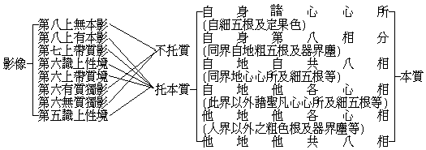



二　「能托影像」与「所托本质」之关系



　　　　　（现亲）  

　　　　第七识带质境┐  

　　　　　（现亲）　│  

　　　　第六真带质境│  

　　　　　（现隔）　├──自身诸心心所  

　　　　第六有质独影│  

　　　　　（过未）　│  

　　　　第六无质独影┘  

　　　　第八上无本影┐  

　　　　第六识上性境│  

　　　　第六有质独影├──自身各变八相……细五根及定境  

　　　　　（过未）　│  

　　　　第六无质独影┘  

　　　　第 八 上 有 本 影 ┐  

　　　　第 六 识 上 性 境 │  

　　　　第 六 似 带 质 境 │  

　　　　第六有质独影──┐├自地共变八相……同界自他粗色根及器界尘  

　　　　（过未及兔角等）││  

　　　　第六无质独影─名┴┤  

　　　　前 五 识 上 性 境 ┘  

　　　　　　　　　（现隔）  

　　　　　　　（第六有质独影）┐  

　　　　　　　　　（过未）　　│  

　　　　　　　（第六无质独影）│自地他各心相……同界他心心所与细五根等  

　　　　　　　　（所缘他心等）├  

　　　　　　┌（第六上带质境）│他地他各心相……人界以外诸圣凡心心所及  

　　　　通智┤　（所缘根色）　│　　　　　　　　细五根等  

　　　　　　└（意眼识上性境）┘  

　　　　　　　　　（现隔）  

　　　　　　　（第六有质独影）┐  

　　　　　　　　　（过未）　　│  

　　　　　　　（第六无质独影）│  

　　　　　　　　（所缘根尘）　├他地他共八相……人界以外诸圣凡粗五根及  

　　　　　　┌（前六识上性境）│　　　　　　　　器界尘等  

　　　　通智┤　（所缘人物）　│  

　　　　　　└（第六上带质境）┘



阅「相见别种辨」



——十二年八月作——



近来欧阳渐之徒景昌极等，自兴相见别种非别种之诤。观其所以，皆从欧阳渐分别体用未善未尽而来。今另图示以解其惑。



　　　　（二取）（三假）  

　　　　世俗用用─────和续分假  

　　　　（相见）（自证）  

　　　　世俗用体────┐  

　　　　（自证）（相见）├能所现行  

　　　　胜义用用────┘  

　　　　（本识）（功能）  

　　　　世俗体用────┐  

　　　　（功能）（本识）├色心种子  

　　　　胜义用体────┘  

　　　　（无相）（实相）  

　　　　世俗体体────┐  

　　　　（实相）（无相）├二空真如  

　　　　胜义体用────┘  

　　　　（实相）（真性）  

　　　　胜义体体─────一真法界



观此，应知种子但是功能，是用而非是体。胜义体是诸法实相一真如性，世俗体是一切种能持之本识及见相所依之自证，皆属现行。故世俗体之是一或非一，与同种生或别种生无涉。可别种生而体一者，若光——色种、热——触种、别种而生一火体；可同种生而体异者，若光光同种而生诸灯体。悟此、则景昌极之相见别种辨，不攻而自破矣！



见相别种辨释难



——十二年十月作——



难曰：妄执火体实唯有一，则一世俗体可有无量世俗用，宇宙万有尚是一体，何又谓诸灯别体耶？



释曰：汝云何知妄执火体实唯有一，及执世俗体一，乃至执宇宙万有一体耶？



难曰：原文说故。如原文说：可别种生而体一者，若光热别种而生一火体。



释曰：原文不说火体实唯有一，为证不成；一世俗体，宇宙万有一体，更非原文；既非原文，但出妄计，推妄计还妄计，让妄计破妄计。



难曰：与外道之唯一因生一切果何以异？



释曰：汝云何知唯一因生一切果耶？



难曰：原文说故。如原文说：可同种生而体异者，若光光同种而生诸灯体。



释曰：原文不说，唯有一因生一切果，为证不成，既非原文，但出妄计，推妄计还妄计，让妄计破妄计。



难曰：然则原文所说体一，一火体，体异，诸灯体，此依何义以名体及说一、异耶？



释曰：能喻之火体、灯体但世俗名体，四重世俗谛中属假名无实谛，如瓶盆军林等。喻在易晓世俗，故取极浅俗义以立，亦犹汝说火体之喻。所喻之一体、异体亦世俗事体，四重世俗谛中属随事差别谛；如从九缘生一眼识，及一意识通作前五眼俱意、耳俱意等。故一火体与诸灯体，但依三假相以名体，不得执是实体一异。汝知「火等诸喻皆不极成，假说共体，体实是无，若实有体，不名唯识」，此何不许？



难曰：然则原文所说别种，光、热别种，同种、光光同种，此依何义以说种别同耶？



释曰：此依十八界中色尘界——光、触尘界——热、界别以说种别。复依色尘界同——光光，以说种同，四重世俗谛中亦属随事差别谛者。汝计火之光热种别而体亦别，定别不许假名体一，世间应无火之假名，以世间火名但依和合假体施设故。汝计众灯之光体别而种亦别，定别不许无形种融，种子应同灯之形别，以灯光众多但依别别假形施设故。今此能生种别而不坏所生之假名体一，故虽光热种别，得随世间名火，有和合假体故。众光灯异而不妨能生之无形种融，故虽众灯形别，得言光种是同，同色尘界种故。



复次、一聚一聚和合假体形别，此火之名但名此火，彼人之名但名彼人，故无世俗同一体过。若不许和合之假体形别，应有宇宙万有一体之过。一界一界无形自种能生，色尘界之光种但生於光，触尘界之热种但生於热，——犹汝所说各各势用有各各功能，或种体为之因缘，此若外道，汝应外道。——故无一切唯一因过。若不许能生之自种无形，应有因中先有万物之过。



难曰：体、用二义，本唯二重，开为四重已是方便，不料益务支离，重开为十六重。



释曰：若执定唯二种，应亦不得开为四重；不执定唯二重，亦应得开为十六重。开为四重信亦方便，奈诸迷者犹生谬执，故更方便开十六重；彼既方便，此何不然？此若支离、彼宁不尔！



难曰：二取三假，非即能所现行中之相见乎？须此「世俗用用」何用？实相真性，非即二空真如中实相无相乎？须此「胜义体体」何用，「世俗体体」「胜义用用」亦同此破。若「世俗体用」与「胜义用体」亦已包於「世俗用体」云云。



释曰：此十六重，义趣繁广，既对麤心，难为细说！约言少分，以示大要。世俗用用说有漏取，胜义体体说非安立；世俗体体说有漏体，胜义用用说无漏用；世俗体用说有漏识一切种，胜义用体说无漏一切种识；世俗用体说异熟识及七转识，异熟所缘根身器界，即在世俗用体相分中摄，胜义体用说实相之犹带无相二空智言。



复次、说用中体以包本识假体，可见尚有本识假体隐未显说，说用中用以包自证假体，可见尚有自证假体隐未显说，即此说有未尽，故为方便开遣。



复次、所言同种别种之异，颇见学解有进，然安慧见相分是遍计无，譬如龟毛兔角，既不应说龟毛兔角同一种生，亦不应说龟毛兔角别二种生，是无法故。故更应知相见种同别之二说，无关安慧。但是许相见亦依他有家自有此之二说；故述记云：『许有相见二体性者，说相见种或同或异』；又评：『故相别种於理为胜』。



复次、所作驳斥四大段，已知自语失检，复知犹有其餘可驳可攻之处，足徵虚己求解，智无留滞。佛法大海，不以意限；前观所作，颇滋众惑，逐句辨别，益费闲辞，乃略言以遮止，亦假说之方便。若蒙谅心，愿同法喜，必图快意，任相诤论。



复次、原文「近来欧阳渐之徒景昌极等，自兴相见别种非别种之诤」，措语过重，不无愆尤，特此申谢。愿息瞋心；如瞋不解，请诵菩萨戒本。



复次、本社应时对机，每多权巧，设言施语，不居故常；前后相寻，岂无舛漏！唯要不渝令世人於佛法生正信开正解之旨而已。



复次、对於欧阳居士之重刻大藏经序，瑜伽师地论序，真实义品序等，实深钦重；即对於王君恩洋之佛法非宗教哲学，佛法与外道之差别及其根据，大乘非佛说辨，与缪君之唯识今释等，均表推重。惟对於操戈以图内乱之举，不能默尔，稍为设遮。君等乍游佛法之门，能执利器——名相分别——以防御邪外，固所乐闻。若将深入堂奥，则当舍干戈而从容趣入之，未应持械以冲墙倒壁为事也、否则、增自之惑，益人之迷，两害无利，何取多言！质之君等以为何如？



附　景幼南先生难阅相见别种辨来函



（前略）贵社云：『可别种生而体一者，若光热别种而生一火体，可同种生而体异者，若光光同种而生诸灯体』。於兹可见贵社中人，不但对於同种之义未能了解，即谓别种亦茫然未知其是何旨趣也。（极）文中虽取火光等喻，然尝郑重声明云：『然此诸喻皆不极成，假说共体体实是无，若实有体不名唯识，一切皆以识为体故；善会其意，斯在阅者』。



不意贵社阅者误会其意，妄执火体实唯有一，真令人有不可理喻之感。夫现行之火有火之大种为增上缘，使火之色、声、香、味、触之诸色种得以现行，亦犹瓶盆有地之大种为增上缘，使瓶盆之色、声、香、味、触之诸造色种得以现行耳。亦犹山河大地宇宙万有之有其地、水、火、风之种为增上缘，而使山河大地宇宙万有之色、声、香、味、触之诸造色种得以现行耳。若谓色之与触可同一体，是则色之与色更可一体，是则宇宙万有之形形色色亦唯有一体，是则一世俗体可有无量世俗用，是则匪唯道理相违，即贵社亦未能自信也。不然、宇宙万有，尚是一体，何又谓诸灯别体也？由是当知，火之光热，种别而体亦别。



至若光光同种更不知何所据而云然！将谓星光、月光、灯光、萤光皆同种而生耶？此与外道之唯一因生一切果何以异耶？此理极浅，此事极明，不知贵社中人何以对於此唯识学中极浅明之常识而生误解！稍一读书，当能知之，毋待（极）絮絮为也。由是当知众灯之光，体别而种亦别。



上来皆就用中之体言，用中之体云者，谓尚是功能未有势用，虽未有势用，而为势用之因缘所自，对实势用，故且说为用中之体。即种子是各各势用，有各各功能或种体为之因缘，此为同种家、别种家之所共认。而贵社之说，伦於外道，则为同种家、别种家之所共斥。然则同种、别种之异何在？曰：同种家直破二取，明相分毫无势用，惟是「义」用或影像相；别种家偏重依他，明相分亦有各别熏种为缘生见之势用。明达法相者，苟若奘、基虽主别种而不定非同种，即非吾所必争。（极）於所作唯识今释补义一文中，已详辨之。迷谬法相者，虽主同种或同体，犹吾所不取也。



体用二义，本唯二重，何以故？以是二者无为有为别故。开为四重已是方便，何以故？体中之用，无实用故；用中之体，非实体故。此种方便，亦非竟无法师特创，护、慧、奘、基并已开示，竟公恐愚者不察，特为拈出导人。不料贵社不察方便，益务支离，更以似是而非之二谛搀杂其间，遂由四重增为十六重，畫蛇添足，一望而知。且问二取三假，非即能所现行中之相见乎？则须此「世俗用用」何用？实相真性，非即二空真如中之实相无相乎？则须此「胜义体体」何用，「世俗体体」、「胜义用用」，亦同此破。若夫「世俗体用」与「胜义用体」，亦已包於「世俗用体」之中，何以故？以功能即是本识相分，本识即是功能见分及自证分故。且本识相分非唯功能——种子，尚有根身器界现行之本质尘，不审贵社又将若何安置，乃得整齐美观，使人目迷五色，莫测高深也。吾竟师以种子无有实用也，故说为用中之体，举本识之假体而包於其中，以现行无有实体也，故说为用中之用，举自证之假体而包於其中。至若二空真如之为无相，一真法界之为实相，实相无相，本即是一，即用显体，方便说二，皆是胜义，谁为世俗？旨犹明显，奚待支离！由是可知竟公之抉择体用可谓尽善尽美，而景昌极之相见别种辨，亦虽攻而未必破也。（后略）



种子法尔熏生颂



一、法尔唯无覆，熏生通三性，无记通善恶，善通有无漏。  

二、有覆通三性，无覆唯无记，有漏通无覆，无漏唯是善。  

三、有覆始终有，无覆终无始，有为无漏种，有始而无终。



为无为漏无漏对观颂



无为唯无漏，有为漏无漏，有漏唯有为，无漏为无为。



唯识诸家会异图



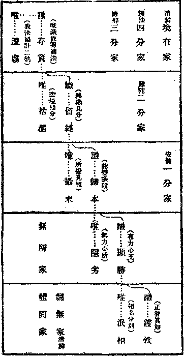



四大种之研究



——十三年下学期在武昌佛学院讲——



一　佛典地水火风之四大种与通俗所谓地水火风有何区别  

二　四大种是种子是现行若是现行云何名种  

三　四大种为何识所缘  

四　四大种之大类区别有几  

五　身意二识所缘之四大种有大小久暂之限量赖耶所缘亦如是否



一　佛典地、水、火、风，之四大种，与通俗所谓地，水、火、风，有何区别？



四大种、即坚、湿、煖、动之四性。种、乃能生义，大、乃普遍义；四大种者，谓具大种二义者，唯有此四。因地、水、火、风、空、识之六界，空则大而非种，识则非大非种，餘种子等则种而非大故。此四大种，即四件普遍能生一切色法之物，乃带数持业释也。又、此四大种体相用均大，故称大种：体大者，谓四大种普遍於一切所造色，又为一切所造色之所依。相大者，谓坚之增盛则成金石之刚劲，湿之增盛则成江海之汪洋，煖之增盛则成炉燄之炽燃，动之增盛则成飓飙之猛暴。用大者，谓坚有承载覆压之功，湿有融摄腐朽之能，煖有成熟烧毁之效，动有增长摧败之力。又四相互摄，地大内有水、火、风，水大内有地、火、风，火大内有地、水、风，风大内有地、水、火。其言地大、水大者，乃就其偏盛者而言也。此四大种既但坚、湿、煖、动，非显形色，身根所触，眼识弗见，彷佛儒家阴阳、科学质力，故与通俗所称之地水火风逈异。通俗所称之地、水、火、风，乃四大种所造显形色等——地具色、香、味、触四尘，水具色、味，触三尘，火具色、触二尘，风具触一尘——为眼等识所缘之境，与只为身识所缘非显形色之四大种，大有区别也。



二　四大种是种子是现行？若是现行，云何名种？



四大种是第八识中所藏四大种之种子所发之现行，其所以称为种者，因四大种有切要殊胜助生根尘等所造色之功能，故假名种。实则色、香等所造色，各有自种子含藏於第八识为能生亲因，但须四大种种子发现为四大种后，诸所造色种子藉其资助，始得生起诸所造色，否则不生。因其对於所造色之生有亲切增上之关系，故假说为种耳。



三　四大种为何识所缘？



色法但为所缘，心心所法通能所缘。大种、造色均为色法，俱时而有，两不相离。然四大种唯触非餘，故为赖耶、意识、身识所缘。云何为赖耶所缘耶？此识缘境有其三类：曰一切种，曰有根身，曰器世间，总称第八之执受处。执受各具二义：执二义者：一、摄为自体义，二、持令不坏义。受二义者：一、领以为境义，二、令生觉受义。第八缘一切种有执之二义，及受之领以为境义。第八缘有根身，则四义俱备；有根身大种之所造，不离大种，故大种亦为其所缘。第八缘器世间有执之执令不坏及受之领以为境二义；器世间亦为大种所造，故亦为赖耶之所缘。



云何意识所缘？此意作用力强，能遍缘十八界及三世有无诸法。虽然、意识缘境，有其二种：一、同时意识缘境，谓与前五识俱时而了别色等诸法。二、独头意识缘境，谓不与前五俱起而独缘一切诸法。故此四大种既为身识同时意识所缘，其名义相又为独头意识所缘。



云何身识所缘？身识缘触，此四大种是触一分，故知四大种为身识所缘。



四　四大种之大类区别有几？



曰：大类析之，可分为二：一者、有执受四大种，二者、非执受四大种。云何有执受四大种？谓异熟识不共相种熏习成熟所起，能造一切凡圣色根及根依处者，是为内四大种。凡圣有情执持为体，令生觉受，故云有执受大种。云何非执受四大种？谓异熟识中共相种熏习成熟所起，能造大地山河草木丛林器世间者，是为外四大种。凡圣有情领以为境，不执为体令生觉受，故云非执受四大种。问：有情各有八识，其所变之相，胡无差别而相同耶？曰：众生虽各有八识，所变有异，然以其同业感故，所以所变之相相似。论云：『如众灯明，各遍似一』，斯言诚可释此疑也！



五　身意二识所缘之四大种，有大小久暂之限量，赖耶所缘亦如是否？



第八识所变缘者，即有根身、种子、器世间是也。前五所变缘者，托第八所变缘．之一分为本质而变缘也。第六识所变缘者，托前五尘而变缘一切诸法也。欲穷三识变缘不同，当研三境与本质相分之关系；故略表於左：



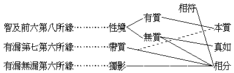



前五识所缘者，有质之性境也，即是色、声、香、味、触之五尘，此五尘是五识之相分，乃托赖耶所变缘为本质而现；然所缘相分与本质相符．故为性境。但相符亦就其变缘之一刹那点以言耳，非能与第八所变缘身器之体相悉符也。诸身器聚各自成系，能造为四大种，所造为各身器；在有根身即为有执受大种，在器世间即为非执受大种。第八所缘深广微细，难可测知，以吾人无无漏清净慧故，故能所缘皆非所知。金刚心后大圆镜智相应，方可了知，即为事事无碍之境。故身、意识所缘，不能与赖耶所缘适如其量。



然身识所变缘与第八不同者，以身识所缘是五尘分隔之一相分，此一虽与第八本质相符，然色之一分，是眼识所缘，不为他识所缘，身识缘触，亦复如是；喻如生盲摸象，耳、鼻、脊、腹各取一分，虽第知一分，而此一分确是象上之一分，故云相符。盲者若以触知一分执为是象，则妄矣！前五识所缘之一分，符本质境，第六增益认为一物，则成似带质境，堕俱生分别之我法执。故身识所变缘是各别间隔，第八所变缘则是融通交遍。



身识缘触有觉不觉之差，全不全之别，然此非身识自变独有，乃托第八之一分为本质变为相分触而缘也。故身识不缘时，第八恒缘，以第八所变之器界不可测故。第八所缘之量，与身识所缘之量，於现器界中尚不能等，况第八尤能变缘十方器界耶？由此观之，前五所变缘者，是条然有别之五系——见不出色，耳不超声；第八变缘者，乃交遍之一一总系也。然非第六七识法我见所执之一一我法体，五识所缘五尘，为第六识取而别组为一系，第六恒缘，则似带质境也。此境虽似托本质，而实不符本质，意识所缘之和合相，如死物而固定，第八则活动且交遍涉入。以其顿起顿灭、顿变顿缘，刹那刹那，由种而现、由现而种，非染识可知。因其在刹那上变缘不可说，在变缘相续上亦不可说，说为生灭者，以前刹那顿灭之相，不同后刹那顿生之相故。然身器相续不坏者何耶？以有业为统系之力；此统系力令其续续生灭，相似相续，故有身器之和合相存在。然此和合相续相，乃刹那恒变，法界交遍者也。故非吾人现前意识所取之相。



然此刹那相续之相，虽地上菩萨亦不能确知，有知亦是比知者也。故第八识之境，即事事无碍之法界，斯法界至佛智方可如量证明。由斯异生第八识刹那生灭所变缘之诸法自体相，亦即佛果上之海印三昧境界，亦即佛之法界无障碍智境也。然似带质境，即意识综合前五识上所缘一分变为自识——第六所缘之相分也，此境不符第八变缘之境，故非实有。然吾人现见之个个天地人物等相，即是此第六变缘之带质境。



近世西人科学方法，依前五识所缘五尘，在直接感觉上用第六意识之计度分别，从经验中求万有之实体；然祗得意识所变缘之似带质境，及比量计度之独影境而已，何能了达第八识变缘之器界全体、有根通身、刹那生灭、现量亲缘之实境哉！故欲知现实之真相，亦非成佛不可。



然则凡夫日为烦恼、所知二障缠覆，如何能了第八之微细境相耶？佛说三藏，无非为此大事而已。然佛法无际，若不舍繁取简，将茫然无从矣！夫净慧之发，由於止观，故欲知赖耶真相，非先修止观不可。初修之时，当先以正比量智，遣除第六识上之遍计谬执，染执既遣，净慧自生，以真智慧渐除诸微细障，一地二地及至金刚心后异熟空时，则万有之真境豁然开朗，显现於大圆镜中矣，故是现量。此即从华严之理法界观，及天台三观之空观入手者。禅宗之参话头，不涉解路，欲从前六及第八之现量上顿得相应，无阶级可由，颇难契入。能究唯识之教，直观吾人现行赖耶心相，本为事事无碍之佛智境，则顿依佛慧圆观实相矣。学者於是当精进焉！



阴蕴之研究



梵语「塞犍陀」、古译为阴，新译为蕴。盖阴为覆蔽义，谓一切差别生灭之有为法，能覆蔽无差别不生灭之涅槃性，其义惟局有漏。蕴为积聚义，谓众多之法积为五聚，在众生为有漏杂染之五蕴，在佛果则为无漏清净之五蕴，其义通漏无漏。故二乘入生空、菩萨证二空、佛证果地时可具五蕴聚，而无五阴蔽。是则蕴义为究竟，而阴字所不能及耳。然有五取蕴，在小乘有部为烦恼之异名，大乘唯识有贪爱之所取，此蕴专属凡情，与五阴之义为相等也。或谓阴义亦通於二乘，以彼常观五阴而得解脱故。然二乘入无餘涅槃时尽舍前覆蔽涅槃之五阴法，且二乘许四谛中之道谛及十八界之后三，咸皆无漏，故五阴亦不通於二乘也。如此、欲明通漏无漏之法者，则当以蕴字为然，而阴字较狭劣矣。



夫译阴者为罗什，多用於法性之经论。译蕴者为玄奘，多用於法相之经论。盖什师盛宏法性，以性宗专显无为法性为目的，故视此无为法性在众分上名自性涅槃，在佛果位上名无上涅槃；而有为法皆能覆蔽无为法，欲尽除无为法之蔽故什师译之为阴也。奘师盛宏法相，以相宗专从有为法转有漏成无漏为目的，故睹一切有为法皆有各各不同之种子，即将众多有为之法合为五聚，故有色等五聚之名。此五聚在众生分上名有漏，在佛果位上即名无漏；欲转有漏法而成无漏法故奘师所译为蕴也。



此二宗皆有大小乘之差别，性宗小乘所明之法性是生空所显，性宗大乘所明之法性是二空所显；故知法性一宗，以空为能显之门，性为所显之目的也。但由生空所显为浅，二空所显为深。总而言之，为空一切法以明法性——空一切有差别生灭之法，以显无为无差别生灭之法性；而此五阴，是有为生灭之法，能覆蔽无为不生灭之法，故必空之耳。若小乘二十部，唐列为六宗，其现通假实宗、诸法但名宗等为小乘之法性宗。在中土则可以成实论为其代表，然其所明之空犹浅，而所显之性亦不深。三论宗代表大乘之法性，亦明空一切法，较前小乘所明之空则显且深。如此、若就所用门言之，可名空宗；就所法言之，可名法性宗。什师盛传成实、三论，故此二宗之经论亦多译为阴也。



相宗小乘之专明一切法有者，为萨婆多部，此部之经论有大毘婆沙等。此宗之说明皆从有法上如何而有，又如何显明其本来如是之实相，以此引生智慧，证得涅槃解脱，即是达到其目的也。在中土有俱舍论可作小乘法相之代表，以彼兼采经部之长，以说明一切法因缘幻有，而非断灭空无，如其所有即了达其有，而不增益其妄执我，故能成立一切法皆为如幻之妙有也。若能如是了达即不起无明颠倒，可转有漏之识而成无漏之智。成唯识论之大乘法相，明一切生灭差别之法皆不离识，而一切无为无漏之法亦不离识，是知一切生灭差别法及无为法，皆是唯心所现，唯识所变。故能转烦恼而成无上菩提，达幻有即显圆成实矣。如此若就其所用之法门言之，亦可谓为有宗；就其所显之法体言之，亦可谓为法相宗。奘师盛传俱舍、唯识，故此二宗之经论亦多用於蕴也。



上之性相，以其所崇尚所显示之点不同，故其显示之方法亦有不同也。然则性相殊途，何能融佛法为一味平等耶？曰：佛法无边，凡有施设，皆为令众生达到绝言思之实际，但欲达此真目的地，必须假方便而能入之，故谓佛法为一大方便法门耳。由此言之，性相二宗亦为二种方便之大法门耳。故小大性相之二宗，其标立方法虽殊异不同，而其舍生死、证涅槃，则同一不二。故云：「归元无二路，方便有多门」也。



顾此性相二宗，虽各标方法之不同，但细为观察实多融会之点：如性小乘明五蕴空，欲明空先须明诸法，其反面仍明法相矣。而相小乘明诸法有，而其反面正显我空，亦即仍明法性矣。所谓显真空即彰妙有，彰妙有即显真空，即此义也。其性空大乘极明诸法毕竟寂灭，离言绝相；虽然如是，其意乃正成一切法。故中观论云：『以有空义故，一切法得成』！此是言陈上明一切法空，而意许上仍明一切法有。故天台以一切空成了不思议假，尽将中论之意许、亦表为言陈矣。法相大乘极明因缘依他之法，皆为幻有；虽然如是，其意仍在空一切法，离言自相毕竟不可得。故成唯识论云：若执有法名唯识者，亦是法执！此亦是言陈上明一切法有，而意许上仍显一切法空，诸法圆成性中毕竟不可得言说思议分别也。而华严以不可思议圆融无碍法门，尽将唯识之意许、亦表为言陈矣。但详察台贤之言陈，颇不与性相二宗全同。何以言性相之意许、台贤表为言陈乎？盖天台立宗根据法性，而进融法相之说；华严来原由於法相，而进融法性之义。故性相之隐义为台贤所发挥宜哉！惟阴与蕴虽成各相沿袭，亦可随其经论之文义而融会之。如天台止观云：阴者、阴盖善法，此就因得名。又、阴是积集生死重沓，此就果得名。又仁王云：不可说识生诸有情色心二法，色名色蕴，心名四蕴；皆积聚性，隐覆真实。如此等文，可见天台用法性阴而融法相之蕴，其根据仍在阴义也。



（法芳记）(见庐山学三之十一)



法与人之研究



——二十年四月在南京觉林讲——



今天的讲题是法与人之研究。下面分为二段：一段是法之研究，一段是人之研究。本来佛学的大旨，就是说明「法空所显真理」及「人空所显真理」，所有佛学皆不出此二。现因要讲佛学大意，所以提出这个题目。



要了解法空所显真理，又了解人空所显真理，须要从「人」及「法」上加一番研究。这二种研究，假如用哲学名词解释，法之研究，可以说是宇宙哲学，人之研究，可以说是人生哲学。



一　法之研究



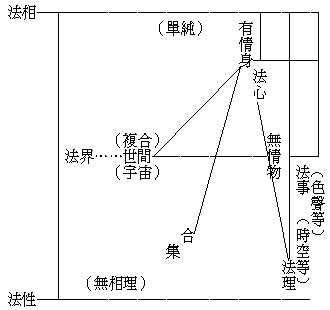



在佛学上，法之一字，意义最广，无论甚麼，都可以叫做法。佛典中所谓「诸法」、「一切法」等语，实在赅括一切所有。所以法之一字最广泛又最普遍。梵语达磨或达尔磨，华文译做法；所谓法，意思是一切所有各有自有的性质，能够叫我们及一切有情生了解。换句话说：就是凡可以生了解的，都叫做法。所以他的意义，广泛而且普遍。法之研究，就是拿宇宙万有来研究，就是宇宙哲学！



现在依表从最下一条讲起：表中最下一条线「事法」：事者、事情事实之谓。括弧内注色声等者，总括五根所对之五尘而言——眼见之色、耳闻之声、鼻嗅之香、舌尝之味、身感之触及其同类的色法，皆为事法，以其皆为一一之事也。但佛学所谓事，乃包括心法而言。此表且依一派哲学，如新实在论谓事乃中立、非心非物，而为心物中间的事情。彼所谓中立之事，惟在五识所感之五尘，如罗素来华所说：谓「事者、非心非物，而为心物之原素」等语之类。但佛学上事之意义较彼为广耳。



第二横线「理法」：理者、条理分理之义。括弧内注时空等——时、指古、今、过、未等，空、指点、线、面积等，餘如生、住、异、灭，长、短、一、多，生、灭、去、来，方、圆、大、小，诸数理、论理等，皆为理法。譬如吾人所见或红或白者，事也；又如红而圆、白而方，或红者一、白者三，则此圆也、方也、一也、三也，皆为理法。可知事乃各别，理惟贯通，理法惟在事法上显现。故理法虽另有其义，而不能与事法相离，亦可见有事即有理。而且理法上所谓时、空、数等，不但事法上有，即心法上亦有。故理法者，乃事法、心法上普遍之条理，表现之分理，转变之位次也。故表中另以斜线联之。



第三横线「心法」：简言之能觉知者，即是心法。分析言之，则有心王及心所有法——亦称心所。依唯识宗心王有八种：一、眼识，二、耳识，三、鼻识，四、舌识，五、身识，六、意识，七、末那识，八、阿赖耶识。心所有法有五十一，即是心之作用及行为，如思想、感受乃至定、慧等。以心王、心所皆是能觉之相，故皆谓之心法。



上来事法、理法、心法三种，事与理乃被觉者，心乃能觉者。但此三种现则同时，不能相离。有其一即有其三，无单现其一者，以其无单现，可称之为基本法。佛学所谓法相，即指此三种，故表中三线直上通於「法相」，以其最单纯，如科学所称之原素也。佛学上常分「相」、「名」、「分别」、「正智」、「真如」五种法。吾人常识以为有名而后有相，所谓顾名思义者，其实误也！即如三种法相皆可不待於名，而能实际觉及之，如人觉知冷暖黑白，固不待先有此冷暖黑白之名，而后有此冷暖黑白之相。至若一人或一屋则异是，必先有名而后人义、屋义乃见。吾人习言见人见屋而不知其误，实则所见者黑白红绿之显色——事法——与夫肥瘦高广美丽之形色——理法——而已！然人与屋非但显色形色已也。若此黑白与夫高广等可说为实际之「人」及「屋」，然则影片之中，形色备呈者，亦可认为「人」、「屋」，不亦谬乎？故「人」、「屋」待名而生义，非可实际觉知。事法理法不然，故谓之基本法相。心法亦尔，能自觉知。盖被觉者事、理，能觉者心，同时此心亦能自知其「能觉此事理」。故佛学上以三分说明心法，所谓「相分」、「见分」、「自证分」，自证者、能自觉到之谓。故心法亦基本法，不须名而有相。



综上事法、理法，心法三者，为单纯之法相。可比之哲学所称论理的原子论，今则称为「知识的原子论」。此知识原子论，只认基本实在之三种法相；与常识认「人」、「屋」等名为实在者，逈然不同。近世哲学如新实在论，对於此义，亦有一部分相合，但仍有一部分相反。以其仅知事法、理法为基本实在，而以心物，皆为论理搆成品。实则无情物为事法、理法搆成，如表中直线所示。譬之杯然，色白为事，形圆为理，事、理组合而成物，名之为杯。故此事法、理法可谓等於原子，此其同也。至於心法亦如事、理之单纯，不应与物平列，而应与事法、理法平列者。新实在论虽见事法、理法之实在，而於心法未能认清，故与知识原子论仍有相反处也！



中行直线「无情物」：即佛典所谓器世间，包括一切矿、植。亦如常识所谓一件东西，小之原子、电子、微尘，大之地球、太阳，无非一物。以法相论及新实在论哲学观察之，凡所谓物，皆为事法、理法所组织而成；既为组织而成，如团体然，无有实在。以此十九世纪唯物论之根据遂打破无餘。科哲诸学，至二十世纪始打破唯物论，而不知二千餘年以前之佛典，早见及此而说明之。况新实在论犹不知心法之实在，则其所见，但得少分。近世相对论、量子论亦然，亦仅从事法、理法，说明物质非实而已。



右边短直线「有情身」：即佛典所谓有情世间，包括「人」及动物。但有情身亦集合体，不过组织之原素（即法相）不同，盖无情物只事理二法集合，而有情身则事理心三法集合，以有心法故，故无情物与有情身得而区别。二者於表中斜线表示为集合体。



中行「世间」：为有情世间及器世间之总名。其义赅括家国天地乃至一太阳系，一三千大千世界及无量数世界，皆为世间，与吾人习言宇宙之义略同。世间乃复合体，故表中以括弧旁注「宇宙」及「复合」以明之。复合云者，以由集合体——有情身及无情物——组织而成之谓。故法相——事、理、心法可假设为实在，而集合与复合则只可说为假立。然此二者仍有区别，盖集合体在佛学上说为依业力而成之果报，在常识上则认为自然物；至复合体则为一类一类之总合，所谓宇宙，世间，乃为思想上之概念耳。



上说事法，理法、心法，为实在之基本法；而无情物与有情身，皆为非实在之假法。良以身物所依以组织之基本法，觉知极纯，生灭极速，故身物仅得在空间之团结上及时间之连续上呈其假有之相。故凡假法，必须有名，否则其义不能存在。以其不能如单纯之法相可实际觉知，而须合多数觉知、组织成一概念，观定其意义而后能知。是以集合与复合诸法，皆非实际感觉上之相也！



今者既知单纯觉知之法相为实，集合复合者为假，则吾人常识向认宇宙人物乃至一切所有皆实之习想，亟须改变；须知世间一切所有，无非事法、理法、心法、组合之假相。若於一切所有看出皆三法之假相，则能改变误谬之常识，亦谓之见得第一重法空——分别法执空。



由此言之，以观察事、理、心法等之实，故能空诸身物世间等之假；然则此事法、理法、心法者似乎非空矣？实则事、理、心三皆依知觉而现，基於三种分别——自性分别、计度分别、随念分别——中之自性分别，如以视觉之自性分别故见诸色相，此自性分别即为基本知觉。故知法相只建筑於基本知觉之自性分别上，所谓法相唯识者是。修此法相唯识观，久之久之，即能空诸法相而证法性。「法性」、即无相理，如表中左边直线所明。证此无相所显之真理（即法性），谓之根本无分别智——以无诸识之自性分别也。故根本智空相而证性；复从根本智而起后得不思议智，则能真实通达诸法法相，以证真如，乃能了知法相惟依众缘所起唯识所现而非实故。



如前所言，在常识上必先有名物，而后有事理诸法，终乃了知心法，但观法相则知一切名物皆假，此犹知解边事。所谓讲到非证到，诚以未改常识，则恒觉先有名物，不知其假，适与法相观相反也。若能改变常识，先观法相，了知一切名物是假非实；后观唯识，了知法相唯识如幻现。离相亲证法性，然后真见法相，即到大乘初地境界；从根本智起后得智，二智久久修习成熟，不假功用常得现前，即至八地。过此至於成佛，一念之中，如理如量——如理智即根本智，如量智即后得智——事理不二、性相不二，时时相应，於见无量差别法相而证无相平等法性，即为诸法中道实相，即为法界。初证法性时乃无相空性，能所分别皆空，至八地始证性相不二，佛地四智圆成，故能究竟实证性相不二之法界。



表中「法界」下以虚线联於「世间」，以明法界非虚玄之称谓，乃即世间是法界，等而至於有情身、无情物乃至一心一理一事无非法界。以性即相中所显现，相即性中所建立，故差别即平等，平等即差别，所谓『众生及国土全露法王身』。是故一一法皆现法界性，一法统摄一切法，一切法普遍一法，故每一法皆法界，禅语所谓『拈一茎草作丈六金身，将丈六金身作一茎草』，皆无不可。譬如一刹那心之视觉现起——一瞬之视觉，其功用亦遍法界；以事、理、心三法不能相离，同时而现，是以一现一切现，亦即一切现而一现。推而至於一色、一声、一香、一味，无不性相具足，皆全法界，是故一一皆法界，是为究竟法界观。穷了性相不二之法界，亦即圆满的法界观，是为佛学的宇宙观！



兹以华严教义五重法界，比例前说．一、事法界；即前之观事、理、心三法之法相实在，而空诸集合之有情身及无情物，与复合之世间宇宙。二、理法界：即前之由法相唯识观，以空无量差别法相，而证无相平等空性。三、理事无碍法界：即前之性相不二、理事不二，以无量差别之相皆在性中建立，而无相平等之性皆在相中显现。四、事事无碍法界：即前之即性即相，观世间乃至一一法皆法界。五、一真法界：即前所谓穷了性相不二之法界，为圆满之法界观。



前四义，皆可依言说安立，谓之安立谛。此一真法界非可依言说思想安立，故为非安立谛；以诸法本真，本来如是，不落言说故。法之研究，姑以此为结论。



二　人之研究



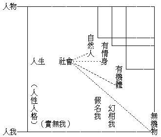



佛学上所谓「人空」、「法空」，实则人空非单指人类而言。不过以人代表一切有情，或称一切众生。以释迦牟尼佛现身人中，不妨在人言人，就人类而立说。今之研究亦然，亦以人类为范围，而从切近之人生问题下研究，成为人生哲学。人生既明，则一切众生亦可推类及之，故人生哲学之范围与人空同。



表中最下第一横线「无机物」，第二横线「有机体」，二者即前「法之研究」中之无情物。以其皆为事法、理法所结合故。在此分之为二以便说明：一者、无机物，又可分为二种：其一最基本者，如化学所谓原素，所谓九十二种原质；其二化合者，如空气、矿质、水土等。二者、有机体，即较无机物略进，须以无机物加有机组织而成。虽为一体而有各部分工合作之意义，如草、树等，叶司吸收生活素，乃至根、干、花、果，各有作用是。又有新陈代谢之遗传，如树至结果，老树萎谢而新芽茁生是。有机体有此等意义，故较无机物为高一重。无机物最简单，有机体则加复杂，表中於二者之间以直线联之，以示有机体包含无机物，又加其特有性质而成也。虽然，二者乃组织不同，非性质不同，从单纯之法相观点言之，无机物与有机体均为事、理二法组成，仍无心法要素；以较有心法之有情身，则又逈然不同，故二者均属无情物。



第三横线「有情身」：内典亦称为有根身。如鸠摩罗什译六根为六情，以根能发识——眼根发眼识、耳根发耳识、鼻根发鼻识、舌根发舌识、身根发身识，故有根即有情。但意根（即末那识）属於心法，前五根为色法，均以发识而有根义。故有情身有心法合成要素，较之无机物及有机体——无情物——非仅组织不同，实为性质不同！表中以直线联贯之，亦示有心法者包含无情物而又超出於无情物之上。至平常所称动物一语，与有情身同，但其义较混，不能如有情身一名之能具体表现。



第四横线「自然人」：人亦有情身之类，即动物之一。惟於「有情身」上再加意义，如称「人性」、「人格」，义即自然人特有其性格，亦见人类有其特殊之地位及意义，而在一般有情身之上。略言其不同之点，则人皆直立，而有情身类皆非直，故内典称餘有情为「旁生」或「横生」。又动物单靠生来身体而生活，无创造力，人类则否，行时祗用两足而餘两手可以作事，故衣、食、住多以自力制造，而非纯赖天然素朴之物。人类富有工作创造之能力，以谋供给其需要，即显然与其餘有情身不同。佛典亦云人类最有造作能力，其餘有情身类皆受报，但人能造业。且以富於造作能力故，知识因以发达，既有语言以达意，又能创造文字以代语言，而排除空间（远地）时间（将来）上之阻隔。其所造作，蔚然成为学问、知识、文化、道德，而代相遗传。犹之个人之衣、食、住等之生活财产之遗传於若子若孙然，此则尤非一切动物所能者。取要言之，形状竖立，以手工作，能力富於创造，心力富有知识，皆显然异於群类，故能自达其所欲达之目的，自觉其所应觉之趋向，善能变化，不纯受自然力之拘束。是以人类在宇宙中，实为万有之中心，故特列之。



表中右直线「人物」贯於四横线，若言人亦是一物，故有「人物」之称。譬如从化学上研究，人为十四种原素而成，内典则谓地，水、火、风，四大和合为身，由是以言、人实等於无机物。若在生物之生理学上观察，则人亦有机体，如树之有根、干、枝、叶，花、果，而为呼吸、消化、生殖等作用。至与有情身比观，人在自然界中亦一动物，饮食、睡眠，男女、贪生怕死乃至一切生活运动，受环境机械的支配皆与动物同。若谓业报不同，则水陆动物，移地则死，亦因业报不同。且人之不能潜於水，亦如狗之不能潜於水，若谓形相有异，则牛固与狗异，牛狗又与鱼鸟异，乃至非其类者莫不异，皆不足据以为相异之点。故从自然科学、化学、生物学、动物学等观之，人亦自然界中万物之一。一切万物动受机械的因果律支配，人亦同受支配。譬之自然界如机器，其中无机物、有机体、有情身、自然人等，则如机器中一部分之机件，以其同受必然之因果律所支配，动则随动，莫之能外，且可以科学方法研究出其「变化公式」。人之活动，实等於风吹水流诸活动，故人实机器性之自然物！如唯物论哲学所明，一切基本皆无机物。其有植物、动物乃至人类之分者，以有力故。力者、质之活动，人则活动至於灵妙而已，初无所谓精神或灵魂也。至行为派心理学，仅认人为有机体，更不承认心法，可称为取销心理学，所谓心理现象如意识等，无非受刺激而起反应。例之物被风吹而摇，眼被光刺而眩，故将意识、精神、灵魂等等，根本推翻。此等科哲诸学，类皆以人同受物理变化而与一切动植无机等观，亦未尝非见一边之真理。故近世科学的人生观，亦仍有一边之真理，但必能融会中道，始得人生之真相耳！



中行直线「社会」：社会以人为主，若以自然科学之视人同物，则社会亦可说为物质的。譬之家有家室、家产、家畜，国有领土及动植出产，推而至於世界之大，无非包罗各无机物，各有机体，各有情身；而以人为主位。虽称人类社会，亦有动植诸物为要素也。倘以人有精神作用而言，则社会复可说为精神的，而不必基於物质条件，如异地之人，虽至远隔天涯，而以同心同行故，亦可以团结而成一社会。又如尚友古人，则精神相通亦有团结之义，故可称为精神的。



自然科学以人类同在物理支配之下，而视社会为唯物的社会。盖以泰西十九世纪，唯物思想独霸一时，故其时社会学亦唯物的。如唯物史观谓社会变迁，乃依人之物质生活经济状况为基本，苟生活与经济变化，则社会随之变化。人之社会遂等於无机物之受物理支配，而成为唯物史观或经济史观之社会学。是皆一偏之见，其说明只在唯物一边。最近科学不然，如相对论物理学言：物质一概念之构成，纯为众多关系——因缘——而来，否认实有物质存在；量子论说明力合为质，而否认力依质有，恰将十九世纪唯物旧说推翻。此等学说，吾华知者尚少，以译本多十九世纪旧籍，故犹封蔽如未闻。但此最近学说虽能打破旧说，而说明一面真相，要亦一偏之见而已。



自唯物科学发达以来，否认有精神之存在，而成为机械人类观。所有灵魂、神我，或精神自我等统被打破无餘，绝对否认。佛学亦尔，所谓空诸「我执」一语，即在破除神我、自我及灵魂等观念，绝对否认人之身中有固定不变、永久、常住、单一的自我存在，茍有我执，即成「常见」。但自然科学等以机器方人而打破神我等「常见」，以其所见只有物理故，则执人至死亡不过仅有所餘物质存在，而无精神活动之继续，故又成为「断见」。是皆与真相相反。佛教小乘人，一般愚法声闻，其观察与科学略同。以为人者，四大、五蕴、十二处等组织而成，即是惟有诸法——如物质原质——而神我自我皆空。再见刹那生灭，而修无常、无我、等观，其无常观同於科学万有皆动之说，无我观亦同於但认质力之物理。然其见理虽同而趋向有异：盖愚法声闻以自身为对象，见四大、五蕴等之生灭而观无常、无我，虽以不明法相及法空理，尚有法执；但以我执既破，其因我执而起之贪、瞋、痴等烦恼已根本消灭，故得解脱生死轮回证罗汉果。至科学者，不反观自身以破除俱生我执；但观自身以外之人类动物等，既无精神存在，譬诸土木，可以应用科学方法，鲁莽从事，以对矿物者施诸人类、施诸社会，消灭宰割而毫无不忍之心，以求发展一己之我——俱生我执。充其意，似谓唯我是人，其他皆物！此十九世纪之偏见，蔽於人心，人皆自期优胜而奋斗，实则难免对方反抗，故演成私人乃至国家与阶级之斗争。是故无常、无我之理，小乘与科学之观察略同，其结果也，一则以之斗争，一则以之解脱，是不可同年而语矣。



兹以大乘教理观察而言：不主张决定有我。如印度昔日之胜论、数论、瑜伽等派学说，皆认有独立常时不变之我。近日太哥尔亦云：人者、一方面立在宇宙法则支配之下，一方面又有独立的精神自我，虽全宇宙的压力亦不能屈服之。故皆欲寻求最根本之自我而得自由！在此点上（真实之我），认为每人及每一动物皆同有此之我执，表中左直线「人我」即此义，佛法则认作妄执而一一破除之，故人我线下注「实无我」。以实体之我无故，谓之「人空」，故佛法大小乘经皆破实体自我而明真实无我。表中「有情身」、「自然人」，旁注「幻相我」及「假名我」，即明无实自我而有幻我、假我之意。良以动物以有心理现象——即心法，故与植物不同。每一有情，皆有八识及其心所，此中第八阿赖耶识，虽刹那生灭而一类相续，是以似常似一，受熏流转，幻成我相；故每一有情，得以统摄其一期报身而不散。同时第七末那识又恒时坚执此虚幻我相为实自我，基此而起第六意识。故有情莫不带有「我」之性质、精神、意义、色彩。是故有情世间，虽无实我，但以末那迷谬，认幻为实而成我执；遂以求自我之保存发展而起「贪」，彼此冲突而起「瞋」，不明我幻即为「痴」，恃之自高而为「慢」，故有一切非理的感情作用。人与动物，莫不皆然，则皆此「幻相我」之为祟也。及至人之阶位，则更有「假名我」之产生。盖以语言文字增上作用，成为种种概念，建立种种名字，又以各人观念不同，认识不同，我之意义及价值亦随之不同。幻相我与生俱来，末那所执，名为俱生我执；假名我由分别生，意识独有，名为分别我执。又以认识不同故，人各有其我之定义，略言之如谓：身体是我，受苦受乐者是我，辨彼此是非者是我，能造作者是我，乃至知识是我。推而广之，如国家学谓国家有独立主权，亦即我义；乃至一神教谓宇宙亦有独立之我，如上帝之类。凡此假名，皆依幻相推度而产生。可见心法有无，情器攸分，有情世间，与物有别矣！



一切动物，求自生存，残害他物；其心理之贪、瞋、痴等现象，见诸行动，至於人而加厉。更有假名我以为团结工具，其志趣同、行为同、乃至思想、信仰、力量同者，所谓天涯比邻，虽远而合；其不同者，所谓肝胆楚越，虽近而离。是故社会组织上，不能不承认精神势力之伟大也！



夫物质生活之需要，固所尚矣。若遂抹煞精神，而以经济——物质的——支配为已足，必至纠结滋生。彼思想简单之人，以为社会者，衣、食、住、行而已，男女性欲而已，解决之固易易。此种观察实大谬不然！试思古今大战之起，其主动者决非迫於冻饿之人，盖彼志在谋衣食之流，纵迫饥寒亦为鼠窃狗盗而已，乌能兴风作浪，为祸天下？然以饥馑疫疠流亡者多，野心家得此机会，思所利用，揭种种名义以为号召——即利用假名我作祟——以偿其争意气、争体面、争光荣、争领袖之欲；微特不为衣食之谋，且可牺牲一己之财产身命，从事於此。故谓社会问题纯属物理，思以经济支配力以解决之者，实为不见人生真相，只知一偏之谬论。盖社会问题变化，物理固大，心理亦强：自我之贪、痴、见、慢、常伏动机，相互之恩怨冤亲、尤生关系。若不观察明晰，妥善安排，太平之期，不几绝望？此谈人生者所当注意及之也！



佛法打破实我，而以四大、五蕴诸法说明无我。小乘遂起法执，认定实有诸法及无我理，将幻相我、假名我消灭之，以成其解脱。大乘不然，真无我之理既明，其事实上之幻我、假我即不为所惑，幻则明其为幻，假则明其为假，所谓还他本来面目，固不必改造消灭之。以其明瞭无惑即无颠倒，譬如合土地人民制度等等而名之为国，则知国为假名，非离土地人民制度等等而别有，不过土地人民制度等得「国」之一名以统括之。故假名亦有假名之用，最近科学亦见及此，以为凡名乃思想言说上之一种便利。有杯於此，色白而圆，中空而有容量，得此假名，名之为杯，则诸法相概括无餘，便利孰甚！但不惑为实在而已。大乘以人空理观一切有情，「真我」是无，惟有似常似一之阿赖耶识及餘心王心所，是为「唯识人生观」。明此似常似一之幻相，是识非我，故末那不起误执，意识亦除我见，即人我空——即真我之见消除——而证人空所现真理。从人空所现真理，乃能显现幻相、假名之作用。如前所言，阿赖耶识虽刹那生灭，而展转熏习相续不断，故能从幻相我上觉知人生固非一成不变，心法变化上皆有改善之可能；只在破除迷谬，希望觉悟，人皆可以向上渐增渐进，希贤希圣乃至成佛。而且对於人生的社会，亦可从假名我上见到有改善之希望，与进步之道路；譬如一家、一国、一民族乃至宇宙，无非和合相续似一似常之团体，此种相似常一之团体，皆以人为主位，可见每人皆有社会性。社会之搆成，皆借种种关系集合及人的活动力量；故人对於社会的搆成关系密切。故谈改善社会，须观察人的一方及社会的一方，而后善恶利害可辨。不为一己而谋福公众者、善也，损害其他而自图权利者、恶也，善为社会利而恶为社会害，害所当去而利所当作；非可由个人压迫或残害其他之人，亦非可由一部分压迫或残害其他部分，而后社会乃得由此互相交遍之精神，而成功为蒸於善利之社会。



上来「人物」、「人我」二义，皆见一偏，故成妄执。妄执者遣除之，合理者收集之，而归纳为人生之观察。盖人生者，包括人之生活、生命，虽不离於物理并非完全受物理支配，而有相当自由者也。譬如醉人为酒（物理的）力支配，乃呈晕态，但能自由不饮即不受酒力支配。人有心法，故有选择判断动作之自由可以转移物理。是故人生非物非我、即物即我。



人与他物之区别为人生性，即人之特性。如百法所明二十四不相应行法之众同分中，人有人同分，同分者类性之义，人同分即人类性。此人类性可以概括人之一切而具体表现「人」之不同，以有人性支配故，故人之物理关系即非凡物之物理关系，其心理亦系人的心理，是类性上即可显有人性。若认人之性格即人格，则人生之义即包含人性、人格；其关系有物理的及心理的，故人生有其意义，有意义故有价值。以佛学言：人在宇宙间，一方面与一切有情随业受报——即自然力支配——等无有异；又一方面则人之特性，富有造作、思想、觉悟之自由自动之能力；故可凭自力认识人空、法空所显真理，而改善个人、家、国、乃至全宇宙。此为佛学上人生之意义与价值，人各具有，当视各人之心理为出发点：自由活动，改善向上。有此自由创造活动之力，故有其丰富之意义，与广大之价值，而人生之希望亦无穷！人之研究竟。



兹请总结一语：学佛，乃证明人空、法空所显之真理；达到宇宙人生究竟之至善！



（附注）海刊题作：「法空人空与唯识」，今复原题之旧。



谈唯识



治唯识学，应明本识。本识名阿赖耶，译言藏，具能藏、所藏、执藏、三义。亦名阿陀那，译言持，谓能持种及根身器界。就能藏及持种义边，名一切种，乃极微妙虚灵均等周遍之恒行流动，即藏识之等流现行。就所藏及持身界义边，名异熟识，所谓异类而熟、异时而熟、变异而熟者，即藏识之异熟现行。此异熟识即一期之总报主，有各各差别可言，诸有情依此故非一；彼一切种对异熟识及餘识心心所法四分为一切种，而在自则非种非现，但是极微均之恒行流动，诸有情依此故非异。一切种可略分识种、业种。识种、属名言习气，如微尘模型等；属我执习气，如人工业。业种、属有支习气，如依人工微尘等，由水成为泥团；但有泥团，尚未成器，故仅谓之种耳。至前六识，对此名异熟生，谓由异熟识而生者。但末那四分仅通识种，从无始来，恒执第八见分为我，属我执习气，如模型然。第六四分通识种，亦通业种，有我执、名言、有支、等习气，其我执习气如工宰，名言习气如微尘。前五四分亦通业种、识种，然以无执故无我执习气，仅有名言、有支习气，如匠工依第六之工宰，照第七之模型，将名言识种之微尘造作器具。但第七执第八见分为我，不过一种空洞之计畫，实无可执，如造楼阁者先作一图，后以第六之运筹，驱役前五之工匠，造成第八之真异熟及前六之异熟生。由是以观，第七虽执第八，若无前六之运造，则虽执不成业果。前六虽有运造之能，若无第七之空执，则不能有所依据而造成异熟。第八之异熟虽为前七所造，亦含藏前七一切种子。如是展转依持，乃成缘生因果之理。



一切种中漏无漏种法尔具足，一一有情展转增上，漏无漏法，亦互相熏。起信论将无漏说在真如，故有真如熏无明，无明熏真如之说。诸有疑漏无漏种不互相熏者，一、由太认种为有形碍之实物，如世谷麦等种；二、由不明展转增上即是熏义。盖一切种，但是识上差别功能，当未现行时，毫无形碍，如人手有习书畫等功能，尚未书畫时，手中书之功能与畫之功能有何形碍？又、识种、业种，皆通有漏、无漏，有漏只是有执，无漏即是无执。诸有但以遣执空理名真如者，以是别说有为无漏。若知真如有空、不空义，空即妙观、平等二智相应之遣执空理，而不空即大圆镜等四智相应之执尽实相。合此空不空，谓之一真法界，亦即真如，则诸无漏皆为真如。彼偏执无漏无为是真如，乃仅就择灭涅槃言，但知其空，不知不空。不唯於真如义不全，即於无为义亦不全，以诸漏永尽，非漏任运现行，不假功用，无暂停息，亦即无为义也。唯识究竟位颂所云：『此即无漏界，不思议善常，安乐解脱身，大牟尼名法』，岂同二乘灰身灭智耶？若但知空相、空性、空理等遣执之共相道理谓之真如，因而固执真如不可说相用，遂以非难起信论真如无明相熏之义，何不观於欧阳居士唯识抉择谈云：『虽则涅槃而是无住，不住生死，不住涅槃，尽未来际，作诸功德』。然作功德乃名无住，而相寂然仍名涅槃，涅槃即是无为，无为即是真如，圆诠了义，讵可不一致思耶？



唯识观大纲



——十一年三月在汉阳归元寺说——



一　引论  

二　五位百法之唯识观  

三　依真有幻全幻即真之唯识观  

四　悟妄求真真觉妄空之唯识观  

五　空云一处梦醒一心之唯识观  

六　五重层次之唯识观



一　引论



若修唯识观，当与唯识各经论之弥勒等菩萨，天亲等论师，所发信愿相同，始能成就。故发心初首，须作方便：一者、归命三宝，以决定信心。二者、普求二利，以发大愿力。如成唯识论曰：『稽首唯识性，满、分证觉者；为自利、利他，令法久住故』。



唯识性者，对唯识相言。能变之识，与所变之法，即唯识相；一真法界，平等真如，即唯识性也。於唯识性，唯佛能圆满证觉故，名唯识性满证觉者。诸菩萨亦能分证故，名唯识性分证觉者。所证唯识性、是性，能证性智、是相；统此无漏真实性相，谓之法及佛僧。佛能于法圆证圆说，僧能弘传佛法，如实修证。故此三者，皆应归依。稽首即倾身命归投之，以决定信心也。谓归命唯识性相之法佛僧，欲实将身心境界镕归於唯识无漏性相之海也。



发大愿力者，誓证一切法唯识究竟真实性，是自利也。观一切众生同依一唯识性为体，普导含灵，胥成正觉，是利他也。证此觉性，解除烦恼，了却生死，成就圆满福德智慧，使佛法普行，佛种不断，此通利自他也。是故乘大信心，发大愿力，修者依此，即为因地法行；发心充实，自可无有蹇屯。



以上所言，凭自理观之力。复有事缘，可相辅成：如读诵大乘经论，凝心圣教，持念释迦本师，弥勒菩萨，礼拜诸圣，以祈加持；并忏悔无始来一切业障，使修观不起魔难。譬如筑堤，既固址基，复肃眢眚，则可久远。自因助缘，亦复如是。



言观行者，即具二分：一、能观智，二、所观境。复摄此二为能证入门，以证入所证入法。故是一观，具二能所。能观智者，各宗皆同：天台、贤首、禅宗、净土，莫不须依第六识心王相应之慧心，为其主体。餘如五遍行，及欲、胜解、念、定，与善法之信、精进等心，亦皆相应，以为助伴。



二　五位百法之唯识观



所观境者，在唯识观乃通观一切法皆唯是识。故法界一切诸法，皆所观境。言一切法者，广大悉备无不穷尽，世界微尘难喻其数，如此纷纶，何堪摄取！是故慈尊造瑜伽师地论、约为六百六十五法，无著大士依之作显扬论、又约为百有六法，至于天亲大士遂立百法，以此百法摄尽一切。百法者，初地菩萨之所证法。初地所证，皆百法门，如见百世界，供养百佛等等，皆以百数。二地则千，三地乃万，以至大觉，数不可穷。是故修观当明百法，熟悉各法，何者为性，何者为业，了然心中以成观境。今举大要，明其唯识。



百法者，略分有两。一者有为，二者无为。有为者，复别为二：一者实法，二者假法。实法有二，心与色是。假法有一，寄在心色分位假立，心不相应行是。心复有二：一者心王，二心所有。



心王者，正所言识。明了分别，为其体用，故谓之心，或名为识。二十论言：『心、意、识了，名之差别』。然此心王，唯是眼、耳、鼻、舌、身、意、末那、阿赖耶之八识。



心所有者，不能自有，随心王有，与彼心王相应不离；心王是主，此为仆从。言相应者，非一非异，谓体虽二而事常一，同依一根、同缘一境。八识心王，於五十一心所有法中，各与其相应之心所有法而转；与识相应，随识而有，是故唯识。



次论色法，今言物质，在佛法义说有二性：一者变灭，二者窒碍。宇宙万有，前六心王对境，皆可云色，是故六识名了别境。以言其数，五根、五尘、法所摄色，凡十有一。五根发识为不共增上缘，变现五尘为所缘缘。眼识所缘有见有对，耳等所缘有对无见，意识所缘无见无对。若散位独头，梦定中缘，皆法所摄色。以此诸色皆心所变，何以言之？心自体相为自证分，其作用相则有能所，能者见分，所者相分。相分变现，唯见所取，心自证知，故云唯识。



复次、假法心不相应行。行表行蕴，遮非无为及色、受、想、识蕴；心不相应，遮非心所有法。上言心所有，多是相应行，与此正相违异。心所有中，除却受、想，皆行蕴摄。此中得等，虽在行蕴而与心不相应，故立此名。详此一法，惟是心、色分际位置，对实法言，谓之假法。较其所属，通局有殊：如命根者属心分位，如异生性属心所分位，若无想定等属心心所分位，若时、数、生、灭等通为心、色分位。是故当知此诸假法，唯依心、色分位而立，无独自体，故亦唯识。



无为者，无有生灭，不可变异，亦无作用，不能表示；列为六法。五随相立，其一真如。此中虚空、非方分空，乃是观智空无相境，唯心所变还自缘取，虽湛明照而非真如，乃识所变似真如相。真如性者，其所言法，无可言思，离一切相、不思议故，见无所得、不可立故，诸常如法、各遍显故。此乃唯识之真实性，故是唯识。



一切法界无量诸法，皆此百法之所成立；观此百法唯识，即遍观一切法皆唯是识。上能观智与所观境，即为能证入於唯识法之观门。而由此观门所证入之唯识法，初则了然观见法界一切诸法，皆唯识所变之相；次即离一切染唯识相，而证真唯识性；次由证真唯识性，而能如实照了诸行『犹如幻事等，虽有而非实』；由是证得圆满清净转依，性相不二，身土一如，是为究竟唯识。



三　依真有幻全幻即真之唯识观



包罗万有，唯是一心；即此一心，融贯凡圣，而能任持一切法之种子，及有情、无情之根身、器界，故又名阿陀那识。此识非真非幻，全真全幻，为真幻之所依，通於佛位、众生位者也。遍持诸法，唯一真心，故亦谓之一真法界。一者、绝对待，真者、无变异，为一切法根本依处，至佛果上之离垢清净地，又名庵摩罗识，此识圆满清净离染污法，乃无漏智相应之真净一心也。此真净一心，在众生位名如来藏，至如来地始能究竟证明显现故，在众生位含藏在众生心中故。表此一心非虚妄故、曰真，无变异故、曰如，真如云者，的指此一心之性体。上言阿陀那识、庵摩罗识、一真法界等，虽同一体，随相异名。惟此一心，通一切位，依真有幻，故曰一心生灭；全幻即真，故曰一心真如。欲观一心真如、生灭之体用，今另列图如下：



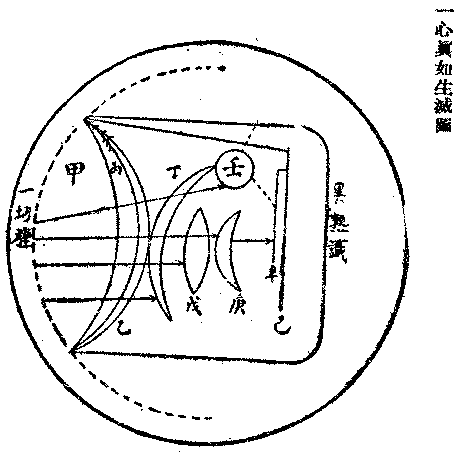



图中大圆圈，即表示一心真如——本无形相限量可言，强作此形量表之耳。阿陀那识，为世出世间、有漏无漏诸法所依持，有发生一切法之别别功能，指此别别功能名一切种，为圈内所表之长曲线是。而此一切种，亦遍十法界一切位。由此一切种有根本无明发生，所谓『不觉心动，忽然念起』，如「乙」所表，是谓末那之根本法我痴见。其乙线里面所表「丙」，即念念执阿赖耶见分为内自我。如「甲」线内部分即阿赖耶识之范围，完全为末那所执之我爱执藏。此阿、末二识互依为根，末那依阿赖耶而起我见，阿赖耶依末那而成我爱执藏。同时阿赖耶又变起根身、器界、转为异熟识，是为三细，此三细实无先后之别。概括言之，动、为末那、阿赖耶，能起、为一切种，所起、为异熟识。忽然一念乍动，无明相应，末那即执阿赖耶见分为我，念念不息，使阿赖耶识内种子皆成有漏，於是现起一切根身器界，此即依真有幻之义也。



从末那背方，依阿赖耶内种子而现起者，如图「丁」所表，是为意识。意识方向与末那相反，末那向阿赖耶见分，意识向阿赖耶所变根身器界；盖末那执内为自我，意识认外为各个我。且末那为意识不共增上缘之依托根，故意识亦必带有俱生我执；然虽依末那为根，实从阿赖耶内之有漏意识种子所现起，如图有直线由阿赖耶通发於意识是。



如图「戊」所表为五根身，即正报身。而此根身虽经过意识而成，却仍从阿赖耶色法种子而生，故此根身非浮尘根，乃清净四大所成之五净色根，为藏识安危与共摄为自体者。云何现此根身？因末那执我，欲有所见有所现故，正面由藏识变起根身器界，反面由根身器界发生意识，遂建立有情世间及器世间。末那能执之力，彷佛海中有一种鼓荡之力能起波浪，又如叩钟有撞力而发声，是故情器世间之生起，皆由末那潜动力而出发也。



如图「己」所表为器世间，虽间接亦由末那之执染，而直接唯阿赖耶种子之所变及见分之所缘；乃为微细流行转化之象，刹那刹那，生灭不停，不易觉察。吾人所见之山河大地，仍属粗相耳。何则？以末那所执之藏识，变动不息，其所现之相亦变动不停故。凡属根身、器界，皆是如此，而无一刹那之暂住者。



如图「庚」所表为眼、耳、鼻、舌、身五识，从阿赖耶种子经过末那、意识而生。故前五识以阿赖耶为根本依，以末那为染净依，以意识为分别依，五识各以净色根为不共依，而净色根又以浮尘根为寄托。前五识现於五尘时，即意识同现时，故意识遍分别於五识也。



如图「辛」所表为五尘，五尘性境，即前六识自变之相分，但须依阿赖耶所现器界为本质。此本质即异熟识境，由业所感，前六识依之而变为相分。何谓性境？性者，实在之义。前六识现量所缘之相分，完全与阿赖耶所变之境相同，毫未改异，是谓性境。一刹那间，第六识起随念、计度分别，则非性境矣。



如图「壬」所表为独头意识所缘法尘境界。分别有三，谓散位、定中、梦中等是也。其率尔心缘现量境，离於随念、计度分别，斯须即入独头意识，非复现量性境，而已为前五尘之落谢影子矣。遂由意识内依末那我执及藏识中名言习气，变造为意识所现之法尘境。凡前尘种种之相，皆为阿赖耶种子所现；独头意识所缘，则为前尘影境。故独头意识所现之境，多为似带质境，即吾人现前之境物是。



又意识能忆过去境界，即前尘影境经意识念度过而藏於阿赖耶识中者，忽然念起，或於梦中现起，皆是独头意识所现。除无想定外，四禅、八定，亦皆独头意识所缘之境。因不由异熟习气所生，故不成业果关系。如梦中所现之境，全是虚妄，则甚易见也。若由异熟习气所发生者，属於先业，故有果报关系。比如放砲，弹乘砲力飞行空中，必至砲力衰竭方始落下，缘为他力之被动，不能自由而止也。异熟报亦同此道理。常人不知，误为自然，不知实先业之感招也。又此意识法尘境界，亦可超出异热范围之外，而达於不可思议之境，以意识功用甚宏故也。



综观上图，可以寻由真起幻，从幻反真之途径。常人不明此理，执此根身、器界为实有，不知皆阿陀那识一心之幻现也。夫一念心起，无不依一真法界而有，无始无明念念不息，即是全法界尽在无明，是故一心之动，即万法所由生。万法之变，悉唯识之所现，故曰万法唯识，而唯识之实性即是真如。能知此义，斯可以观依真有幻、全幻即真之唯识也。



四　悟妄求真真觉妄空之唯识观



上既说明依真有幻、全幻即真之理，此更进演悟妄求真，真觉妄空之义。所谓妄者何指？指第六意识所起之似带质境，即吾人现前所谓之天地人物是也。原意识依末那为根，二执俱生，恒与前五根识托阿赖耶所现之根身、器界，变缘五尘，随续分别，因综合离开之结果，认为实有种种物体；乃执何者为长、短、方、圆，何者为红、黄、黑、白，何者为我，何者为非我，重重错妄，莫能穷诘！如此妄执，是谓遍计所执自性。此妄执境，在与前五识俱起之意识现量上，本无所有，实为意识重缘五尘之影，而自加以分别所成者也。故修唯识观者，首当悟此现前妄执之境，皆是遍计所执自性。是为悟入之第一步。



今更可以梦喻之：吾人入梦时，或见花鸟人物，或感苦乐悲欢，当其时何尝不声色俱备，情怀真切；却至南柯醒后，都杳无所得。究竟真耶？妄耶？推之现前所见事事物物，非不在在是实，一一逼真；如得无明豁破，慧目开朗，反观现在之境，亦等如梦中所见，毕竟一无所得矣。是故对於现在之境，先应作如梦观，以遣意识上遍计所执之我法，则根身器界，宛然唯识心变现之虚幻相而已。或谓梦境既空，梦心亦空，应云唯空，何谓唯识？不知梦中之心即醒时之心，境异梦醒，心贯醒梦，故醒后心中亦能了然梦中之境物，而欲求梦物於醒境，则必不可得也；是以梦境实空，梦心幻有。境空不离心有，心有元即真觉，境空心有，善成唯识。然则心可通幻，亦可通真，真妄之转，统依一心。是为悟入唯识之第二步。



夫此所谓真觉，指现行意识之证智而言。意识完全不现行时，若所谓五无心位者，岂不心境俱空，如何得成唯识？是故当进观意识所依之意根，及种子心。盖意识依末那为根，从阿陀那种子识生，此之二识，恒时现行，意识等种子亦依存不断。故虽至睡眠闷绝时，意识不起，知觉中断，而醒后仍能继续忆知前经事，不相乖谬。可知末那恒审思量，念念执阿赖耶为内自我，未尝稍息；而阿赖耶受异熟、持种子，无始至今亦未尝稍息。前六根尘识心，依藏识种为因，末那为缘，乃以继续生起而不断也。彼外道不知观此，凭禅定力，强伏意识不使现行，待定力尽时，仍堕生死流转！犹之睡眠闷绝，醒后仍复攀缘意境，不相离舍。此可以悟意识止伏，另有潜势力存乎其根底，曰、末那阿赖耶，无始恒转。此为悟入唯识之第三步。



无始以来，末那执本识见分为内自我体，而有俱生法执，是为根本无明。本识为末那所执故，变为我爱执藏之识，受前六识之熏，而藏守诸杂染法种，固执不失，枉受业系。六识取尘造业，若明中张手现影而捉取其影，藏识受熏持种，若明灭犹固握其拳以为影在。蔽藏识不明者是为根本无明，根本无明一明，则阿赖耶转成离垢清净之庵摩罗识；此识能任持一切法而不为一切法之所蔽，镜智相应，得大自在。是为唯识观之究竟。



五　空云一处梦醒一心之唯识观



合上二观以喻明之：



一　喻依真有幻全幻即真



谓依空有云，全云即空，云之有非自有，依空有也。无云之空，喻一真心。不起根识身器全如虚空，根识身器起如空中生云，顿呈昏暗之相。然云不从虚空生而从汽生，喻根识身器不从真如生，而从阿陀那识一切种生也。汽由波动而凝聚为云，即本识由末那无明之动而现诸蕴、界焉。夫云之为幻，原无实体，以比依他起性，幻不离真、如云浮空，而无自体之可言也。然而云起於空实不碍於空，以云之在处，空未尝不在故。且空大无边，片云何足为蔽，不过常人眼识低隘，一为云所笼罩，即不能遍见澄空之相。假使有人立於云表，则云自浮暗，空自湛明，了无相涉矣。此喻识生诸法，不变真如，若妄执我法，随业流转，则不显真如之性。设一旦觉悟，则幻自虚疏，真自常寂，亦了无相涉矣。就上义，可以广大虚空、喻如来之法性身，以虚空明相、喻如来自受用身，以腾起霞云，喻如来之他受用身及应化身。但云有光彩，耀人心目，是为卿云、瑞云，非乌云、浓云耳。且佛应化之云，若身若土，皆同幻现，诸佛证真、真可容幻，众生在幻、幻亦含真。真幻不二、则真性即是幻性，空云不二、则空处即是云处；幻即同真，真即同幻，真幻相含，幻幻相含，所谓真俗不二之理事无碍、事事无碍观是也。



二　喻悟妄求真真觉妄空



谓悟梦求醒，醒觉梦空。如观现醒之物，皆同梦境，则梦中之物，亦同醒境。梦不知梦，是为妄中执妄，醒定执醒，亦复未出妄中。醒境梦境，不离一心，是一心直贯世出世间，总持十法界而不可以区别者也。试以梦为喻：初地菩萨、知梦未离梦相，七地以上菩萨、梦醒未离醒相，从金刚后心至佛地、方能大觉，梦醒无碍。众生在迷妄颠倒中，梦醒俱梦，诸佛随缘而度众生，醒梦俱醒。是同一心境，而凡圣互见，各不相侔也。



复次、以心为喻：梦中之心、凡夫心也，梦中知梦之心、菩萨心也，梦觉之心、佛心也；虽然三种心境，仍是一心所现。盖梦中之境唯心所现，觉中之境亦唯心所现，是以梦中之心即觉时之心，众生之心即佛之心，『心佛众生，三无差别』。一心现起、即是心之全体，并非少分，所以佛能遍法界而度众生，众生亦以此心具造十法界，而终能悟入佛之知见也。



综上二义，换言之、亦可云空云一空，梦觉一觉，成为一真无障碍法界之唯识观。又上节所讲犹为渐次，此中所说方为圆融。何则？生佛不二、空云一空，真妄俱泯、梦觉一觉，是为圆满一心之唯识观。



六　五重层次之唯识观



上来反覆推阐唯识观之理，不外於从妄而显真、即真而空幻，以归到真幻一心、一心真幻之实相。是实相虽一，而观非无渐次。兹更依古德所拟之五重唯识观，提出重宣此义。



一　遣虚存实唯识观



云何遣虚存实？即遣遍计所执之虚妄，而存依他、圆成之实有也。前已云遍计所执，如认梦为实境，如执云为固体，唯是虚妄；依他起性，如心现梦，如云浮空，幻不离真而无自体。此云遣遍计执之虚，而存依他、圆成之实者，以双观真俗二谛，而专遣虚妄执耳。就俗谛说、依他起亦为实，就胜义说、圆成实方为实，对虚说实，是为空有相对之唯识观。复次、二谛又为性相二门，相依性而常显，性离相而常住。起信论云：『一心生灭门』即是依他起性，『一心真如门』即是圆成实性；二者皆不离乎一心，此唯识所以成立也。



二　舍滥留纯唯识观



一切诸法皆不离识，识分心、境，境别内、外。上云遣虚，仅遣去心外之虚妄执境，此云舍滥，乃将心内之相分境一并舍去，较为更进一层。然心外本无境，凡所缘皆心内相分，能缘皆是见分，悉统於百法之中。今就百法舍去十一色法，二十四不相应法，六变相所缘之无为法；所留者，为八识心王及五十一心所。留能缘心，舍所缘境，是为能所相对之唯识观。



三　摄末归本唯识观



心心所法各分本末，本者、心之自体，末者、自体上所现之相分、见分。上虽已舍相分，犹存见分之用，此则摄彼相见二分归就识心之体。心体云何？即自证分也。谓摄取识心上之相分、见分，而归於自证分。以鞭辟入里，较上二重更进一层也。是为体用相对之唯识观。



四　隐劣显胜唯识观



心王心所胜劣悬殊，心王为胜、心所为劣，以心所原为心王之所管领也。就胜义说，显主体之心王而隐属性之心所，亦由博而约、从粗而精之理，以便作观耳。至此又去五十一心所，仅存八识心王，是为王所相对之唯识观。



五　遣相证性唯识观



心王虽尊，有事有理：事者、差别之相用，必须遣之；理者、无差别之法性，必须证之。是为事理相对，事尽理显，智无所得，入真唯识之唯识观。



上五重唯识观，总核其理性可约为三义：一、周遍计度为唯识之虚妄法，属妄执性，是应遣离者。二、依托他缘为唯识之世俗法，属缘起性，是应转净者。三、圆满真实为唯识之胜义法，属真胜性，是应开显者。就此三义，更可约留二法：一、世俗，二、胜义。而二法又各有四义，谓「虚妄」、「道理」、「证得」、「真实」是也。以此二法互融四义，第一重、为虚妄世俗，第二重、为道理世俗兼摄虚妄胜义，第三重、为证得世俗兼摄道理胜义，第四重、为真实世俗兼摄证得胜义，第五重、为真实胜义。所云「虚妄」、是应离舍。「道理」、是当了悟通达。「证得」、是有修行，有成功者。「真实」、是无对待，无变易者。随何一法，无不如是，诸法本性，是唯识性。循此观想，夫亦可以悟唯识而证真如矣。



（孙绍基、赵曾俦合记）(佛学院印单行本)



遣虚存实唯识观之特胜义



论卷七云：『识言、总显一切有情各有八识，六位心所，所变相见，分位差别，及彼空理所显真如；识自相故，识相应故，二所变故，三分位故，四实性故。如是诸法皆不离识，总立识名；唯言、但遮愚夫所执定离诸识实有色等』。此即五重唯识观中第一重遣虚存实观；而唯识观之最胜点，即在乎此。以本祗要此第一重唯遣虚妄识，存真实之唯识观；后之四重，只是为钝根人展转离过以入真耳。若利根人，只此一观，一了百了，直至究竟；以遣虚则妄无不尽，存实则真无不圆故。



作此观者无他，只於无论何事何物，观为唯是五位诸法之一聚识，除此别无一件实有之物而已！作此观时，妄执我法遣无不尽，而无百论等落空之弊，其殊胜一。真如相性显无不周，而无起信等堕儱侗之弊，其殊胜二。但观明现前事物本来如是之实相——譬如饮茶，只是五位诸法之一聚识，别无所饮之茶，只是五位百法之一聚识，别无能饮之人；譬如听讲，只是五位诸法之一聚识，别无听者，只是五位诸法之一聚识，别无讲者——而无观佛境观上地等悬想他界之弊，其殊胜三。即观明本分，而於餘界餘地一切分无不通达，若自若他、若染若净、若生若佛、若圣若凡、若因若果、若身若器等，莫不是五位诸法之一聚识故，而无拘局一隅之弊，其殊胜四。



故作此观，但明此理，无论何人皆可作之，无论何处皆可作之。他药虽妙，每可由药生病，独此一药，增益、损减之执，烦恼、所知之障，病无不治，更无从药生病之虞，故为独一无二大妙观门！诸有智者，应勤修习！



唯识之净土



——十五年春在上海世界佛教居士林讲——



一　一切法中之识法



将以唯识明净土，且先略说唯识义：欲知唯识义，应了一切法。一切法者，有为、无为摄尽，其义繁广，兹但简谈：



有为者、有生灭作用义，无为者，无生灭作用义。有为法：一、假，假托他法显明分位等差别相故。二、实，复二：曰色，曰心。色亦二：一、有对色，眼等根尘相对之色、声、眼、耳等是。二、无对色，意识所了者是。心、有心王、心所，心王如主，心所如仆。心王即第八阿赖耶识——此翻为藏，能藏、所藏、执藏义故——至第一眼识。心所分六位有五十一种：遍行五，别境五，善十一，根本烦恼六，随烦恼二十，不定四是。第七名末那识，此翻为意，恒审思量为性相故。前六即眼、耳、鼻、舌、身、意识，了境相麤故。六意何异第七末那？此如眼识等、依根得名，识异眼故。七如藏识名，识即意故。譬在眠时梦即第六识，眠至无梦第六即止作用而末那仍存，以末那执阿赖耶识为我，不间断故。此八识中，前六易晓，第七较难，唯第八识甚深微细，不易了知。故深密云：『阿陀那（赖耶）识甚深细，一切种子如暴流，我於凡愚不开演，恐彼分别执为我』。如是八识，即百法五位中第一心法，亦即所谓识法也。



二　一切法何以皆唯是识



问：八识即是识易解，心所亦唯识耶？答：八识心王，称自性唯识，心所乃心作用，决定与心相应而起，故亦唯识。问：根等能对尘等，应非唯识？答：根等系第八识变现之相分，复为第八识执受为自体者，故亦唯识。问：诸色等法，应非唯识，譬居士林设海宁路，在黄浦滩识不现故。答：此亦前五依托第八所变本质，此循业所报得，故第八亦称异熟识，以由先时业后时报熟而变现故。又业报相同，其所变境亦略相同，可共受用。共中尚有共中共、共中不共之区别，变为自识相分而现，以是义故，诸色法等亦依识变，故亦唯是识。问：空间、时间等，亦唯识耶？答：彼皆色心等上分位之相，当亦唯识。问：诸无为法应非唯识？以无生灭故。答：有为法相用之体性，即无为法，故亦唯识。由是故一切所有皆唯识。



三　净秽器世间与第八识前六识



净者清净，秽即劫等五浊，土者器世间。此净秽器世间，均唯识变，即第八相分；前五识托之变为色等五尘，是为依报。现此境时，第六随前五分别物我等差别。而有情第七识，与此器世间无关，故此不列。



四　有情染识上之秽土与佛菩萨净识上之净土



识有染净，所变亦异，故土不同。三界、五趣有漏识变有漏秽土；诸佛菩萨清净识变清净净土。问：净土既由识变，应是虚幻？答：唯识不碍有他心，净土是佛菩萨清净识变，与当前秽土是有非无，相同。



五　念佛人心上所托佛菩萨本质净土与自心相分净土



念佛人求生西方，先依经教信有西方依正庄严，即此为佛菩萨无漏识上所现本质净土。复托之变为自心上所缘相分净土，互为增上，乃现所了极乐世界。



六　往生与自他共变净土



依佛菩萨悲愿力所现依正庄严为增上缘，起自心清净心而变起自心净土。此自心净土与弥陀净土，清净相应，成为共变净土，故得往生极乐净土中。摄持於弥陀愿力故，即得永不退转於阿耨多罗三藐三菩提。



（王锡光记）(见上海居士林林刊十三期)



兜率净土与十方净土之比观



——二十五年四月在奉化雪窦寺讲——



一　概说  

二　十方净土  

三　兜率净土



一　概说



现在特别提出「兜率净土与十方净土」比观一下：



释迦牟尼佛所以要说这一部经，无非使现在将来一切众生依经修观，往生兜率内院的。然此内院乃是弥勒菩萨无漏福德所成，也是诸天兴供之胜妙善根所成的净土，所以一生其中，就得不退转於阿耨多罗三藐三菩提；故并非通常之生兜率天可比。我们要晓得，净土是对秽土说的，由正报而有依报，有依报必有正报，故言净土即总摄依正庄严。十方诸佛菩萨所居皆为净土；二乘圣者及六凡众生依住的地方则净秽非一，区别不一。现在专就净土来说，把十方净土与兜率净土来略作比较观察。



二　十方净土



净土是很宽广的共通名字，犹如光是讲寺院，即包括全中国的寺院都在其内。举雪窦寺则只说一寺，西方弥陀净土，东方药师琉璃净土，维摩经之东方阿閦净土，上方众香净土等；此皆各举净土之一种。故法华经说：『临命终时，千佛授手，十方净土，随愿往生』。谓随诸有情心之所好，皆可往生。现在中国人大概只晓得弥陀净土，比如只晓得雪窦寺一寺一般。净土种类略分为三：一、究竟净土。即法性佛土及自受用佛土，天台教说名常寂光净土及圆满实报庄严土。二、他受用佛净土。佛为十地菩萨所现净土，天台教说名为圆满之实报庄严土。以上皆非凡夫、外道、二乘所能到的，三、方便摄受众生净土，这就是现在一般人所谓弥陀极乐净土，乃至弥勒兜率净土等。是专为发大乘心行菩萨道在这一生未得成就度生自在、转世恐有退堕者，乃摄归方便净土中为作依靠。凡夫、外道贪生死者不求生净土，二乘自求涅槃，大乘圣位菩萨各自生其华藏净土等亦不须求往净土；所以十方佛菩萨变现净土，专为摄受学发大乘心而未自在者所设立。



三　兜率净土



现在再就无量净土中来讲摄受我们最亲切最接近的——兜率净土。上面十方净土普遍摄受十方世界的众生，如普通大学之各科学术，是应各科学生之要求而办的，僧学院、则是专门教育僧徒的。弥勒内院净土也是这样：它是专为摄化此土有情而设。故说兜率净土之殊胜有三：一、十方净土有缘皆得往生，但何方净土与此界众生最为有缘，未易可知。弥勒菩萨以当来於此土作佛，教化此界众生，则为与此界众生有缘可知！特现兜率净土，故应发愿往生其中以亲近之也。二、兜率净土，同在娑婆，且在欲界；此变化净土在同处同界故，与此界众生特有亲切接近之殊胜缘，故他方净土泛摄十方有情，而此则专化此土欲界众生也。三、弥勒净土，是由人上生。故其上生，是由人修习十善福德成办，即是使人类德业增胜，社会进化成为清净安乐；因此可早感弥勒下生成佛，亦为刱造人间净土也。以上讲十方净土与兜率净土之比观，大约如是。



慈宗的名义



——二十五年四月在奉化雪窦寺讲——



「慈宗」，就是「弥勒宗」。梵语弥勒，此译为慈氏，依据慈氏为宗，乃立「慈宗」的名义。民国十二年元旦，我在武昌佛学院，选集瑜伽真实义品以明其境，菩萨戒本以轨其行，弥勒上生经以明其果，叫做慈宗三要。在叙文有几句话：「远稽乾竺，仰慈氏之德风；迩徵大唐，续慈恩之芳燄；归宗有在，故曰慈宗」。是定这个慈宗名义的缘起。在平常看起来，慈宗似乎就是慈恩宗，其实不然，慈恩宗是唐高宗皇帝建大慈恩寺於陜西长安，时玄奘三藏大宏新译经论，高宗请玄奘法师住持大慈恩寺，其高足窥基法师继起，都称慈恩大师；主弘法相唯识教观，此慈恩宗之所由立名也。但与慈宗虽不无小异，亦实有密切关系，然慈宗最重要者在宗奉慈氏菩萨，以上生内院，比如念阿弥陀佛以求生极乐世界，专以阿弥陀佛为宗奉，持名、观想之所念皆在阿弥陀佛，此亦如是，专在慈氏如来。玄奘、窥基法师虽亦生兜率，然习法相唯识者不一定以上生弥勒内院为宗；也有宗慈氏生兜率的不习法相唯识。中国净土初祖庐山慧远大师的师父道安法师，已竟宗奉慈氏宗以求生兜率内院，这是慈恩宗以前早有慈氏宗流行的事实。考求生西方弥陀净土的盛行中国，在唐朝善导大师以后，唐朝以先还是修弥勒宗的特多；如中国唐以前的古像以弥勒为多，后唐以后才雕刻弥陀或西方三圣像，所以现在依慈氏为宗的慈宗渊源甚古。



法相唯识教观，都依慈氏为根本。故慈宗可以包括慈恩宗；慈恩宗则不能该括慈宗。今慈宗三要乃举其最宗要的三种，已备经律论三藏：真实义品明教理、属论，菩萨戒本轨行持、属律，上生经修证上生果、属经。再推而广之，则唯识宗所依的六经十一论——华严经、解深密经、厚严经、如来出现功德庄严经、大乘阿毘达摩经，十一论谓瑜伽师地论、大乘庄严论、显扬圣教论、辨中边论、成唯识论、百法明门论、唯识二十论、集论、杂集论、摄大乘论及观所缘缘等——，慈氏菩萨所说金刚经论、现观庄严论等法性经论，以及经、律、论三藏中之宣说慈氏行果者，都是慈宗的法藏。然这还不过就慈宗的主体上说，若依全体广用来说：凡本师释迦牟尼佛所宏扬的法门，教化之生类，都付嘱慈氏菩萨。在各种经律上也都讲到弥勒菩萨的因缘：如无量寿经中，佛以弥陀净土付嘱弥勒菩萨宣扬；禅宗的初祖迦叶尊者，也肩持释迦佛衣入定鸡足山，以待弥勒当来下生成佛时候出来交付。所以，凡是本师释迦牟尼佛所称大小性相显密禅净等法门，皆为当来下生弥勒佛所承前启后的慈氏宗之所宗；现在一切五乘、三乘、大乘性相显密的佛法，都是弥勒菩萨所担当宣扬的佛法，由是融摄各宗派以慈氏为大归依处。



观察古今流传世界之佛法，在印度流行有三个五百年不同：初五百年三乘或小乘的佛法，现在流行世上是锡兰缅甸暹罗等处。第二五百年，龙树、马鸣、无著、天亲等出世，将佛灭后隐没的大乘佛法发扬光大出来；即现今流行中国、日本、朝鲜等者皆是。笫三五百年，显密大乘并行而密宗独盛的时候；今流行西藏、西康、青海、蒙古之佛教，皆是。此诸佛法皆应各时各地之机宜而差别；溯其根源，都从释迦佛大圆觉海之所流出，而皆会於一生补处慈氏菩萨为承前启后之总枢。如是观察随机摄化的佛法，皆可得证无上菩提之果；而向来宗派的区别，也可不须执定的是一非餘了。



由是以观一切佛法，可分三类：一、为世出世间共修之五乘法，二、为出世共修之三乘法，第三、为不共大乘法。一大乘法於其偏胜又可分境、行、果三，其实仍是互摄互涵的：例如真实义门理境，其中也有所修法空观及四摄六度等行，由行趣证离言法性，终得涅槃菩萨妙果。菩萨戒本注重於行，但是也有境与果的意义，先观境、发大菩提心，才修菩提戒行，行满自然得果。弥勒上生经属於得果，然慈氏之现在一生补处果、当来究竟佛果，也莫不由自证离言之理境，而方便设立教化有情之内院净土使上生者得不退菩萨果位，亦由修行以成。经云：於释迦法中发菩提心者，行十善者，皆得往生兜率净土。依境起行，由行趣果，虽然互相通摄，也有各各特殊处以分齐限；大略可分五乘、三乘、一乘，及一乘的境、行、果的区别。也有经论可为共不共佛法总纲要之概论者，慈宗即以此共不共法总明一切佛法义理浅深之意旨，故慈宗就是一切佛法的总枢机。也就是从释迦佛大圆觉海中，流布於世上以度生成佛之佛法全体大用、皆会归宗依於当来下生慈氏佛，谓之曰慈宗也。



（附注）此文原为「兜率净土与十方净土之比观」的第四节，今离出独立，题目仍旧。



佛法总抉择谈



——十一年十二月作——



昔基师既著唯识料简，於法苑义林复有总料简章之作。顷获读竟无居士之唯识抉择谈，十之八九，与吾意吻合无间。然以之专谈唯识一宗，虽无不可，而置之佛法总聚中，则犹须为抉择之抉择焉！故今之佛法总抉择谈，即对於竟无居士之唯识抉择谈而作。



今作佛法总抉择谈，将以何为准据而抉择之耶？曰：依三性。盖三性虽唯识宗之大矩，实五乘法之通依也，故今依以为抉择一切佛法之准据焉。而抉择之先，当略明三性之梗概。



一者、遍计所执自性：其能周遍计度而倒执者，则六七二识烦恼相应诸心心所也。其所周遍计度以倒执者，则於一切依他起法周遍计度，不能适如其量，或增益之，或损减之，而倒执为圆成实也。云何遍计所执？谓计度彼依他起法，或增益之，或损减之，颠倒执为圆成实性。若达唯依他起而不起增损之二执，固无妨遍计焉！但遍计执自性即是倒执，倒执解即无所谓遍计执自性。故所计之依他起及所执之圆成实，概唯虚妄。



二者、依他起自性：依他所起之法，则一切有漏无漏之有为法是；以相用不空而无实自体为其自性。其所依之他，若分别言之，则众缘是；若概括言之，则一切杂染依他起法皆依倒执起，一切清净依他起法皆依正智起。然倒执由迷真如违真如故起，而正智由悟真如顺真如故起。间接言之，则谓彼违真如之杂染法，由能迷真如之恒行无明起；彼顺真如之清净法，由所悟真如之二空真如起，亦无不可。



三者、圆成实自性：乃一切法圆满成就真实之体，以无欠餘、不变坏、离虚妄为自性者。不变坏遮非依他起，离虚妄遮非遍计执，无欠餘表是圆成实。若依遣遍计执、断依他起之所遣清净、所断清净以言圆成实，则唯无为真如是圆成实。若兼能遣清净、能断清净以言圆成实，则亦兼摄无漏有为是圆成实。若唯无为是圆成实，则佛果具圆成实及净依他之二性，或兼离执之遍计性——唯识宗是；若摄无漏有为是圆成实，则佛果唯圆成实性——真如宗是。有处以真如、无为、与圆成实等量齐观，故亦言佛果唯真如或唯无为——真如宗经论是。



依此三性以抉择佛法藏，其略说依他起之浅相而未遣遍计执者，则人乘天乘之罪福因果教也，亦世出世五乘之共佛法也。其依据遍计之法我执，以破除遍计之人我执而弃舍依他起者，则声闻乘之苦、集、灭、道、教也；亦出世三乘之共佛法也。至於不共之大乘佛法，则皆圆说三性而无不周尽者也。但其施设言教所依托、所宗尚之点，则不无偏胜於三性之一者，析之即成三类：一者，偏依托遍计执自性而施设言教者，唯破无立，以遣荡一切遍计执尽，即得证圆成实而了依他起故。此以十二门、中、百论为其代表，所宗尚则在一切法智都无得，即此宗所云无得正观，亦即摩诃般若；而其教以能起行趣证为最胜用。二者、偏依托依他起自性而施设言教者，有破有立，以若能将一切依他起法如实明了者，则遍计执自遣而圆成实自证故。此以成唯识论等为其代表；所宗尚则在一切法皆唯识变；而其教以能建理发行为最胜用。三者、偏依托圆成实自性而施设言教者，唯立无破，以开示果地证得之圆成实令起信，策发因地信及之圆成实使求证，则遍计执自然远离而依他起自然了达故。此以华严、法华等经，起信、宝性等论为其代表；所宗尚则在一切法皆即真如；而其教以能起信求证为最胜用。



此大乘三宗之宗主，基师尝略现其说於唯识章曰：『摄法归无为之主，故言一切法皆如也。摄法归有为之主，故言诸法皆唯识。摄法归简择之主，故言一切皆般若』（法苑义林章卷三）。摄法、谓统摄法界一切法罄无不尽也。其所宗主之点，虽或在如、或在唯识、或在般若，而由彼宗主所统摄之一切法则罄无不同，故三宗摄法莫不周尽也。譬唯一中华民国之中央政府，或设之在北京亦统摄此全国，或设之在汉口亦统摄此全国，或设之在南京亦统摄此全国；其能统摄之中央政府设在地，虽有或北京或汉口或南京之异，其所统摄之全国则无异也。昔尝以此三宗判摄中国大乘八家之学，除净律分属各宗外，其嘉祥、慈恩、禅宗、天台、贤首、密宗之六家，为表如下：



　　　　　　　┌简择主之般若宗…………………（即摄论之得此清净）…嘉祥  

　　　　摄一切│  

　　　　法　归┤有为主之唯识宗………………………………………………慈恩  

　　　　　　　│　　　　　　　┌全体真如……（即摄论之自性清净）…禅宗天台  

　　　　　　　└无为主之真如宗┤离垢真如……（即摄论之离垢清净）…贤首  

　　　　　　　　　　　　　　　└等流真如……（即摄论之生境清净）…密宗



然此三宗虽皆统一切法无遗，其以方便施设言教，则於所托三性各有扩大缩小之异。般若宗最扩大遍计执性而缩小餘二性，凡名想之所及皆摄入遍计执，唯以绝言无得为依他起、圆成实故。故此宗说三性，遍计固偏计，依他、圆成亦属在遍计也。唯识宗最扩大依他起性而缩小餘二性，以佛果有为无漏及遍计执之所遍计者皆摄入依他起，唯以由能遍计而起之能执、所执、为遍计执，及唯以无为体为真如故。故此宗说三性，依他固依他，遍计、圆成亦属在依他也。真如宗最扩大圆成实性而缩小餘二性，以有为无漏及离执遍计皆摄入圆成实，复从而摄归於真如无为之主，唯以无明杂染法为依他、遍计故。故此宗说三性，圆成固圆成，遍计、依他亦属在圆成也。



然此三宗，虽各有当，若从策发观行而伏断妄执以言之，应以般若宗为最适，譬建都要塞而便於攘外安内故。若从建立学理而印持胜解以言之，应以唯识宗为最适，譬建都中部而便於交通照应故。若从决定信愿而直趣极果以言之，应以真如宗为最适，譬建都高处而便於瞻望趋向故。要之、於教以真如宗为最高，而教所成益每为最下，以苟非深智上根者，往往仅藉以仰信果德故。於教以般若宗为最下，而教所成益却为最高，以若能绝虑忘言者，必成妙观而发真智故。於教以唯识宗为处中，而教所成益亦为处中，以如实了解唯识者，虽或进未行证，而必非仅能仰信故。



由上来所说以观之，起信论等与中、百论及唯识论各为一宗，而其为圆摄法界诸法之圆教则同；虽同为圆教而胜用又各有殊。依此，於诸教法抉择记别，可无偏蔽。转观竟无居士所瑕玭起信论者，亦可得而论决矣。



尝闻持贤首家言者，传述竟无居士据起信论『依如来藏故有生灭心，所谓生灭与不生灭和合，非一非异，名阿黎耶识』一文，斥为同於数论自性与神我和合而生二十三谛之外道论；然吾未睹居士之著於文言也。但唐以来之误解於起信论者，未尝不可以此斥之，而非起信论之本义有斯过咎。起信论以世出世间一切法皆不离心，故就心建言，实无异就一切法建言也。一切法共通之本体，则真如也，即所谓大乘体。真如体上之不可离不可灭相——真如自体相，如来藏也。换言之、即无漏种子，亦即本觉，亦即大乘相大。所起现行即真如用，即能生世出世间善因果之大乘用。其可断可离相，则无明也——一切染法皆不觉相。换言之、即有漏种子，即违大乘体之逆相；所起现行则三细六麤等是也。无始摄有顺真如体不可离不可灭之本觉无漏种未起现行，亦摄有违真如体可离可灭之无明有漏种恒起现行，故名阿黎耶识；译者译为生灭不生灭和合尔。言依如来藏者，以如来藏是顺真如体不可离灭之主，而无明是违真如体可离可灭之客，故言依也。又起信论宗在真如，从真如以起言，而此上真如门中唯以体名为真如，不可言依真如而有生灭。譬不可言依湿性有波浪，但可言依水有波浪，故取真如体上不可离断之本净相，言依如来藏也。标如来藏是主，不可离灭，而应离灭可离灭之无明有漏，亦此论宗旨之所存。譬如有一讲台於此，或言由植物成——喻唯识宗，可见其为物理学家；或言由原质成——喻真如宗，可见其为质化学家。於此可见此论为真如宗，亦然。



真如宗以最扩大圆成实故，摄诸法归如故，在生灭门中亦兼说於真如体不离不灭之净相用名为真如。以诸净法——佛法——统名真如；而唯以诸杂染法——异生法——为遍计、依他，统名无明，或统名念；此起信论所以有「无明熏真如，真如熏无明」之说也。无明熏真如者，无明如目病，病彼体自离病之目——如熏正智或心之自证体——，而观——熏——净空之真如，有诸狂华。依净空实不变生狂华言，言真如不受熏；据因目病所观故，即净空有狂华现，亦可寄言真如受熏。要之、其病（无明）共好目净空（真如）相和合——熏——而有病目空华，可以喻此所云无明熏真如义。真如熏无明者：以一切净法——真如体及於真如体不可离灭之净相净用，皆名真如故，一切佛法皆名真如；以一切染法皆名无明故，一切众生法皆名无明。众生见闻诸佛真如等流所示身言，而生起众生信解思修真如熏无明也。以见闻信解思修故，而自内本具之无漏智种——真如，渐渐引起能熏破於烦恼——无明，亦真如熏无明也。唯识宗以扩大依他起故，祗以诸法之全体名真如，而真如宗时兼净相净用统名真如；此於真如一名所诠义有宽狭，一也。唯识宗於熏习专以言因缘，真如宗於熏习亦兼所缘、等无间、增上之三缘以言，二也。明此、则唯识宗正智现行唯识熏正智种子，无明现行唯熏无明种子，且不可言正智无明相熏，何况可言无明真如相熏！而真如宗则可言无明熏真如，真如熏无明也。二者各宗一义而说，不相为例，故不相妨。如闻击柝，或言木声，或言四大种声，均无不可。



唯识抉择谈中，引被成唯识所破之分别论与起信论对例者凡二条，其第二条完全牛头不对马嘴，兹可不论。其第一条，心性本净客尘烦恼所染污故，名为杂染，虽为小乘说假部之所计，成唯识论卷二，亦唯以其错解心性本净而破之，非并其所用教文破之也。故曰：「然契经说心性净者，乃至名心本净」云云。所本契经，述记谓即胜鬘经「自性清净心难可了知，心为烦恼所染亦难了知」等文。解起信论者，复兼引楞伽经：如来藏是清净相，客尘烦恼垢染不净等文；则此固赫然契经之圣言也。乃竟无君仅视为分别论之说，连同起信破之，抑何谬耶？然唯识宗乃依用而显体，故唯许心之本净性是空理所显真如，或心之自证体非烦恼名本净。若真如宗则依体而彰用故言：『以有真如法故有於无明』；『是心从本以来自性清净而有无明』——应如此断句，不应於自性清净字下断句——。其所言之自性清净，固指即心之真如体而亦兼指真如体不可离断之净相用也。此净相用从来未起现行，故仅为无始法尔所具之无漏种子。所言从本以来自性清净，不但言真如，而亦兼言本具无漏智种於其内。然此心不但从本以来自性清净，亦从本以来而有无明——此心从本以来六字，应双贯自性清净及而有无明读——为无明染而有染心，则无始有漏种子恒起现行而成诸杂染法也。虽有染心而常恒不变，则虽有漏现行，而真如体及无始无漏种不以之变失也。此在真如宗之圣教，无不如是说者。故基师於宗轮论记设问答云：『有情无始有心称本性净，心性本无染，宁非本是圣？答曰：有情无始心性亦复有心即染，故非是圣。又问：有心即染，何故今言心性本净，说染为客？客主齐故。答曰：后修道时，染乃离灭，唯性净在，故染称客』。据此一文，亦可见於真如体不可离不可灭之净相净用，得称为主之性净也。此诸圣教可诽拨者，则摄一切法归无为主之真如宗经论，应皆可诽拨之！故今於此不得不力辨其非也。



至立种子义不立种子义，除般若宗专破计执，当然不立之外；在唯识宗以扩大依他起性故，立法尔具染净种子；而真如宗以扩大圆成实性故，诸有漏杂染种说为不觉，或名不相应染，故曰：『不相应义者，谓即心不觉』。诸无漏清净种，说为本觉，或兼真如名如来藏，故曰：『二者相大，谓如来藏具足无量性功德故』。天台宗就全体真如以言，其所谓性具，亦种子义也，其所谓事造，亦现行义也。在真如宗宗依真如而起言说，义应然也。此则但取义立名之不同，而非於法有所增减。



君又谓起信不立无漏种子，於理失用义，於教失楞伽；以三细六麤连贯而说，於理失差别，於教违深密。以楞伽正智真如并谈，而起信合为一故。然起信论於正智真如诚不定分，而有时亦不定合，如曰：『法身显现——真如，智淳净故——正智』。又曰：『法身、智相之身』。若据此必谓起信违楞伽者，亦可指唯识违楞伽！以五法分别——识、与正智并谈，乃唯识则唯分别故；且亦可曰唯识於理失净用也！彼既不然，此何云尔？至起信之三细六麤，古来解者诚多未善，尝察起信全文，为表如下：



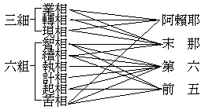



观此、可知并非竖说八识，不违深密平说八识，亦不违差别也。



至於掌珍论偈与楞严一偈同，吾初阅藏时亦曾疑及之。但清辨护法於此偈虽未标明圣言，然亦未尝标明其非圣言；而楞严属密部之经，奘师所传鲜及密宗，故皆不足致疑。而此一偈，依般若宗摄一切法归简择主以扩充遍计执言之，有无为皆遍计所执境故，一切空故，亦无何过。护法等各据一宗以相辨，亦藉之以极显自宗之义而已。



其十谈中，餘说大都契同，间有一二处亦可以前文会之，故不复一一。比年游目佛法藏者日多，往往因智起愚，自生颠倒分别以蔽其明！盖其心习侧重於是，即落窠臼，执此为是，斥餘为非，不能砉然四解，说法无碍！得吾说以通之，庶几裂疑网於重重。



三重法界观



——十一年春作——



一　三重法界义  

二　观圣教三学  

三　观佛华三法  

四　观法相三性  

五　观天台谛观  

六　观贤首法界



华严宗立四重法界：一、理，二、事，三、理事无碍，四、事事无碍，而统以一真法界。今以其所言者未切符心境，另立三重法界为法本，回互交络以观其义。



一　三重法界义



何谓三重法界？一、物我法界，二、心缘法界，三、性如法界。



一、物我法界者：物谓「各个体相」，我谓「个体主意」。不越此各个体相及个体主意之范围者，则谓「物我法界」。若异生及二乘但见佛之应化身土，则虽观佛亦不越於物我之域，观餘更可知矣。故二乘之涅槃必灰身泯智而后证，即彼观佛亦未至灰身泯智，则不越物我之范围也。依此以观之，则法界者物我而已矣。举心动念无越於物我者，故契经云：『汝才举心，尘劳先起』。又云：『以生灭心辨净圆觉，彼净圆觉亦同流转』。盖除尘劳流转无心境也。



二、心缘法界者：心谓「虑知灵觉」，缘谓「转变依持」。观一切法，无有越於虑知灵觉所转变依持之域者，则谓「心缘法界」。在佛大士，虽观地狱亦心识所变所缘境，於其自住三摩地境更可知矣。故登地大士，证法界不离心故，见佛身土相好无量。经云：「诸识所缘，唯心所现」。又云：「无有少法，取於少法」。盖法界无非灵妙变通之心心所缘境耳。



三、性如法界者：性表「常遍真实」，如遮「变异虚幻」。都非变异虚幻之一切法，而一切法唯是常遍真实，强名「性如法界」。离名言相，离心缘相，法界泯绝，无说无证。



今用此三重法界观，以略观诸教义。



二　观圣教三学



甲　单观



> 物我法界………………戒、唯依此以辨持犯  

> 心缘法界………………心、唯依此以辨定乱  

> 性如法界………………慧、唯依此以辨真妄



二乘法中三增上学，要唯如此：戒唯止持，借作助止；心唯静定，观化取静；慧唯灭真，厌生欣灭。由灭证真，灭尚非真。盖但悟物我法界之患之空，未悟餘二法界之德之不空，故灭有患而取灭有患所成之空也。



乙　复观



　　　　　　　　　　┌───────┐  

　　　　物我法界──┴──────戒│  

　　　　　　　　　　┌──────┘│  

　　　　心缘法界──┴──────定│  

　　　　　　　　　　┌──────┘│  

　　　　性如法界──┴──────慧┘



大乘凡位三增上学，大致如此：戒曰心戒，定曰性定，慧曰空慧。若三论宗之慧当属於此，利者能见性德不空，钝者但见物患之空。



丙　圆观



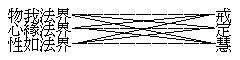



大乘圣位三增上学，义见於此：一、物患泯乎心性，性德充乎物心，心光炳乎物性，故曰金刚心地宝戒。二、心离乎物而契乎性，性持乎心而显乎物，物现乎心而寂乎性，故曰海印三昧。三、性周遍乎心物，物交彻乎性心，心含照乎性物，故曰法界海慧。



三　观佛华三法



甲　单复观



　　　　物我法界─────────众生法  

　　　　　　　　　┌───────┘  

　　　　心缘法界─┼───────心　法  

　　　　　　　　　└───────┐  

　　　　性如法界─────────佛　法



举一心为众生，亦举一心为佛；心虽非生非佛，可为生佛交通，故得成无差别之义。



乙　复圆观



　　　　　　　　　　　┌物我法界─┐  

　　　　　　　　　　　│　　　　┌┴────心生灭相………众生法  

　　　　心法……众生心┤心缘法界┤  

　　　　　　　　　　　│　　　　└┬────心真如性………佛　法  

　　　　　　　　　　　└性如法界─┘



大乘起信论之一心二门，可作如此观法。



丙　圆圆观



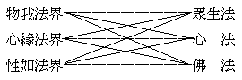



心者物之用，性者物之体，未有不具体用之众生者，故众生法全摄心法、佛法，平等平等。物者心之相，性者心之性，未有不具性相之心者，故心法全摄众生法、佛法，平等平等。心者性之智，物者性之境，未有不具境智之佛者，故佛法全摄心法、众生法，平等平等。如此乃极成三无差别义。



四　观法相三性



甲　单观



> 物我法界………遍计执性………妄执唯空  

> 心缘法界………依他起性………从缘幻有  

> 性如法界………圆成实性………本有如真



乙　复圆观



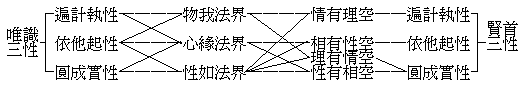



丙　圆圆观



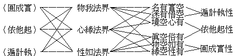



如此方尽三自性、三无性之理。



五　观天台谛观



甲　单观



> 假观俗谛境………物我法界………真谛空观智  

> 中观中谛境………心缘法界………俗谛假观智  

> 空观真谛境………性如法界………中谛中观智



初观、从假入空，从俗入真，则从物我法界到於性如法界，证性如法界之空观真谛境，成物我法界之真谛空观智。次观、从空出假，从真出俗，则从心缘法界又到物我法界，证物我法界之假观俗谛境，成心缘法界之俗谛假观智。三观、从二入中，则从物我法界到性如法界，同时又从性如法界到心缘法界，故证心缘法界之中观中谛境，成性如法界之中谛中观智。此为次第谛观。



乙　复观



　　　　物我法界─┬─真谛空观（此通大小乘，钝者住偏空，利者入假中。）  

　　　　　　　　　└─┐└────┐  

　　　　心缘法界─┬─俗谛假观　　│  

　　　　　　　　　└─┐　　　　　│  

　　　　性如法界─┬─中谛中观　　│  

　　　　　　　　　└───────┘



此亦次第三谛三观：



丙　圆观



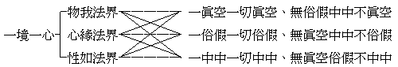



此为一境三谛、一心三观之圆融谛观也。



六　观贤首法界



甲　单复观



　　　　物我法界──事　 法　 界─┐  

　　　　心缘法界──理事无碍法界─┴事事无碍法界─┐  

　　　　性如法界──理　 法　 界─────────┴一真法界



乙　复复观



　　　　物我法界─┐  

　　　　　　　　　├─事法界─┬────────┬事事无碍法界─┐  

　　　　心缘法界─┤　　　　　├─理事无碍法界─┴───────┴一真法界  

　　　　　　　　　├─理法界─┘  

　　　　性如法界─┘



丙　圆圆观



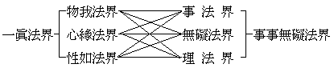



兹仅略明其致，广开其义无尽。要之、「物我」者业所集生之假相，非体能覆於体，无用能碍於用，诸浮现世间者皆是。「心缘」者，果所由起之实用，非体能缘於体，无相能起於相，诸世间转依者皆是。「性如」者，非业非果之真体，非相不住於相，无用不舍於用。若能心不随物，心契乎性，则「物我」覆碍空，「性如」朗显，「心缘」自在！成佛之要，无捷於此。



对辨唯识圆觉宗



——十一年春月作——



或曰：依贤首五教分判，则唯识乃大乘分教，与三论同为大乘始教，属大乘权教摄；而圆觉则正为顿教，前绾终教，后通圆教，属一乘实教摄。又依圭峰三宗分判，则唯识仅为法相宗，进之乃为三论之破相宗，再进之乃为圆觉法性宗。教相宗体，如此逈然不同，今乃和会以为一宗，其乌乎可？



辨曰：立名取义，判教分宗，意趣歧异，未应一割求齐。尝观天台之立藏通别圆四教，判三论为通别圆教，前摄藏教，后通别圆，而以通教为正；故今亦谓之大乘摄小宗，以其共般若犹为三乘之平等法也。判唯识则为别圆教，而以别教为正。——其判华严则圆兼别，而判唯识则别兼圆，虽无明文，其义必然。——独但大乘，不通於小，历别法相，不即於圆，故今亦属之大乘不共宗，以其与圆觉同为大乘之殊胜法也。然在贤首於始教有分始、空始之二，其诠次则分浅，空深，遂谓天台之别教，仅为分始教，即圭峰法相宗；天台之通教，乃为空始教，即圭峰破相宗。天台以通为浅，以别为深，先后之序，已适相翻；但天台之通、别，要唯贤首之始教耳。故天台之圆教兼终顿教。即圭峰法性宗，非贤首纯圆之圆教；顾天台亦讥贤首之圆教为兼别、圆，非天台纯圆之圆教。二家之徒裔各据一势以争胜，迄今未有以论决也。然以何意趣成此歧异乎？盖贤首之圆教本依唯识演增而相一贯，欲显华严特胜，正由相近而恐相合，故设空始教、终教、顿教、三重隔离之。而天台之圆教本依三论演增而相一贯，为显法华特胜，亦由相近而恐相合，故设别教一重以隔离之。今以淘融二乘法执入大乘之般若为无生法性宗，以大乘不共者为唯识圆觉宗。法华开示悟入佛之知见，佛知见即圆觉，融会三乘而归存一大乘，即是由般若入圆觉；华严是佛本自住之大乘，正为圆觉；菩萨悟唯识得一切智智，果即圆觉；故皆总统於唯识圆觉宗。如此分判，似较贤首五教及圭峰三宗为允当，遍诸教文，亦无违难。



按梵士传大乘教之本宗，盖唯般若、瑜伽，般若为空宗、法性宗，瑜伽为有宗、法相宗。圭峰改名般若为破相宗，别依胜鬘、密严、楞伽、华严、法华、涅槃等，立为法性宗。夫如如不动为法性，而缘缘无尽为法相；圭峰所云法性，谓之法性固可，谓之法相亦无不可。且摩诃衍论以真如当体，以如来藏当相；谓圭峰所云法性是指真如言，毋宁谓其是指如来藏言。如来藏虽不遗体用，而於相义为显，犹之真如不遗相用，而於体义为显；故圭峰所云法性，不如谓之法相尤当也。究之法性、法相二名，义诠虽二，法实唯一。何者？性有体性之性，相用之性；相有形相之相，体用之相。相用之性乃是即相之性，故法华谓之实相，而涅槃谓之佛性，实无欠餘。体用之相，乃是即性之相，故楞伽谓之识海，而华严谓之法界，亦无欠餘。三论显性，侧重体性之性，唯以遮诠空一切法，殆同有主无宾，劣者未能入於具显相用之不空性，然固当名之为法性宗也。唯识彰相，深探体用之相，虽以表诠立一切法，未尝取貌弃神，悟者皆能证於全彰体用之如幻相，固可名之为法相宗，尤当与即相之性法华等，即性之相华严等，同名为中实宗也，乃圭峰於三论遗其法实，但名破相，於唯识似指其得假遗真，但彰形相，於相性之法华等及性相之华严等，又遗法相，单言法性而不彰性相不二之中实，似乎皆有未当！今将法义图示如下：



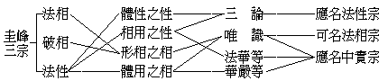



由此观贤首五教之大乘四教，亦可见为并入大乘妙觉海之四门，而决非如贤首家所排列为由浅进深之四阶级也。先以图示，后为说明：







般若宗以远离荡除一切法相，皆毕竟空而显性真，若性显即唯性亡相，则通禅宗，故黄梅、曹溪皆宏扬般若。若融一切法相皆等同於法性，则通天台，故天台教观乃依智度中论流出也。瑜伽宗先分别离析一切法相皆唯识变而显性真，次性显则唯性亡相，同於禅宗，故少室传楞伽以印心也。终乃即性起相而同华严。此其序次，阅天亲三十颂甚明。天台宗法华等经宏融相同性之教，一根一尘皆是法界，一色一心无非中道，然圆教妙觉佛坐虚空座身同虚空，则又唯性亡相。贤首宗华严等经宏即性起相之教，珠网交罗，芥瓶炳现，无际无尽，无障无碍，然亦统唯一真法界，融相同性。由此四门，同入密严。但以无生法性乃根本智境，是大涅槃果。唯识圆觉乃后得智境，是大菩提果。一可摄小，一独在大，故复分为二宗。



或谓古师尝立十别以拣异於所云之法性宗及法相宗：一、一乘三乘别，二、一性五性别，三、唯心真妄别，四、真如随缘凝然别，五、三性空有即离别，六、生佛不增不减别，七、二谛空有即离别，八、四相一时前后别，九、能所断证即离别，十、佛身有为无为别。此若未能一一论决，则唯识圆觉犹不得为一宗也。辨曰：若依楞伽、密严、华严，统为唯识宗本之经，则彼所引以成立圆觉宗之义据者，原即唯识宗之义据，所宗既同，复何须辨！但此师意中之唯识宗，专属在深密经及成唯识论——或专属护法师言及窥基师言；故复逐条一疏解之。



一、谓法相之深密等经以三乘为实，一乘为权；法性之法华等经以三乘为权，一乘为实，故一乘三乘别。辨曰：约佛意则一乘为实，五乘为权，以一雨一地故；约生机则三乘为权，以三草二木故。一乘为实，说为一乘则权，因机起说，别被不定机故。——虽亦兼通餘机，专为则在於是。五乘为权，说为五乘则实，通被一切机故。又约融相同性门，则五乘权一乘实，即性起相门，则一乘权五乘实。故华严之无小唯大，异於法华摄小归大，以显佛乘最上乘之殊胜大乘。又华严或有国士说一乘，或二或三或四五，如是乃至无有量，异於法华废多存一，以显一乘无量乘之普容大乘。深密独为第三时无上无容之中道了义，是显殊胜大乘。又云普为发趣一切乘者，是显普容大乘。故深密与华严同，而与法华涅槃异。然不足以别彼宗所云之法相与法性也，以法华、华严同是彼宗所云之法性宗故。餘义别见对辨大乘一乘。



二、谓法相则说佛性三无二有而有五性差别是实，皆有佛性是权；法性则说一切众生皆有佛性是实，而说五性差别是权，故一性五性别。辨曰：佛性是如来藏异名，如来藏通摄真如及无漏智种，约融相归性门指真如为佛性，故说皆有佛性；约即性辨相门指智种为佛性，故说五性差别。依第二门又有现实、展转二门：约现实如是门，以十方三世不离刹那心故，则始终决定有五性差别，佛性三无二有。约展转增上门，以唯为一大事、佛种从缘起故，则先后不决定五性差别，佛性可能皆有。然二二门皆不足为法性法相之别，以在彼宗同是法性宗故。



三，谓法相宗说八识从惑业生，一期报尽，便归坏灭，以其识种，引起后识，依生灭识种建立生死因及涅槃因；法性宗立八识通如来藏，但是真如随缘成立，故法相之唯心但妄，法性之唯心通真妄。辨曰：既为涅槃因，则已通如来藏矣。况成唯识论之说第八识，与起信论之说阿黎耶识，一为从浅达深，一为由深到浅之不同耳。故成唯识论第三云：『然第八识虽诸有情皆悉成就，而随义别立种种名』：谓或名心，或名阿陀那，或名所知依，或名种子识等，此等诸名，通一切位——此即通如来藏，以无漏智种是如来藏故。或名阿赖耶，无学及不退菩萨位舍；或名异熟识，舍入如来地，此二可唯妄。或名无垢识，唯如来地得，此一则唯真。偈云：『如来无垢识，是净无漏界，解脱一切障，圆镜智相应』。且同卷释「及涅槃证得」句，谓能所断证皆依此识，则此识通为真妄之依，明矣。况第九又明真如即唯识实性，何得但取其局而不观其通乎？



四、谓法相宗立真如常恒不变，不许随缘；法性宗说真如具不变随缘义，故真如随缘凝然别。辨曰：不然。真如即唯识之实性，不离唯识有故随缘，一切法常如其性故不变；若定执真如有能熏所熏，则反失不变义而仅随缘义矣。故唯识真如具随缘不变，而彼宗真如但随缘耳！



五、谓法相宗依他是有，非即真空，经说空义，但约所执；法性宗则依他无性，即是圆成，故三性空有即离别。辨曰：唯识三十颂云：『由彼彼遍计，遍计种种物，此遍计所执，自性无所有；依他起自性，分别缘所生；圆成实於彼，常远离前性。故此与依他，非异非不异；如无常等性，非不见此彼』。案此颂显依他幻有，虽有而无遍计执所执之实有性故空，虽空而有分别缘所生之幻有相故有。於有依他起法若远离遍计所执性，即圆成实，故曰：「圆成实於彼，常远离前性」。此非依他无性即是圆成之义是何？故此语但欺未见成唯识论之人耳。



六、谓法相宗说一分众生定不成佛，名生界不减；法性宗以一理齐平，故说生界佛界不增不减，故生佛不增不减别。辨曰：约融相归性门，则一理齐平而生佛不增不减；约即性辨相门，则五性常别，而生佛不增不减。非辨於相，尚无生佛，说何不增不减？非归於性，既执生佛，难免见增见减！故须二门以成其义，全则双是，遍则两非。然相彻性里而彻性相表，表里周圆，何德何失？夫生佛皆唯识，而识性即真如，於一切法常如其性，宁不一理齐平也哉？



七、谓法相宗真俗二谛迢然不同；法性宗第一义空该通真妄，故虽空不断，虽有不常，故二谛空有即离别。辨曰：遍计俗有真空，依他真空俗有，圆成真有俗空。有亦该通真妄，空亦该通真妄；俗有空故不常，真空有故不断，不坏、不杂，无障无碍。法相如是，未应执取其一而攻其一。



八、谓法相宗因灭非常，果生非断，同时四相，灭表后无；法性宗则四相同时体性即灭，故灭与生而得同时；故四相一时先后别。辨曰：约法剋实，故曰同时四相；约义释名、则云灭表后无。执名迷实，何至如此！且显扬论及唯识述记等，明缘生法体性即灭，其文非一，何不稍窥？



九、谓法相宗根本、后得，缘境断惑，义说双观，决定别照；以有为智，证无为理，义说不异，而实非一。法性宗则照惑无本即是智体，照体无自即是证如，故能所断证即离别。辨曰：所断能断，能证所证，惑智智如，两种能所，不即说离，不离说即；说离以审名实，说即以彰德能，不即不离，何乖何诤？



十、谓法相宗既世出世智依生灭识种，故四智心品为相所迁，佛果报身有为无漏，以生法必灭一向记故；法性宗既世出世智依如来藏，始觉同本，则有为无为非一非异，故佛化身即常即法，不堕诸数，况於报体？即体之智，非相所迁，故佛身有为无为别。辨曰：既云有为无为非一非异，约非一义以辨其异，报化异法，故唯有为；约非异义以彰其一，化报即法，故亦无为，何须自为矛盾！若归融相所同之性，固如彼所云之法性；然辨即性所起之相，必如彼所云之法相。



此在古师设此为拣，已无当矣！后师依之衍为八重对拣，每重五义，从初对拣性相至八对拣同别，更属缴绕无已！故今一切断之，统立一唯识圆觉宗。



起信唯识相摄图







大乘起信论唯识释



——十四年一月作——



此论辞简义隐，未广分析，古今解者，除天台家之荆溪、灵峰等，多用贤首家说。贤首宗在华严，明大乘果，依庵麾罗识持一切无漏种，彰法界缘起——法界缘起可名庵摩罗识缘起，或无漏界缘起，或一切种智缘起，或大牟尼法缘起，或净心缘起，或佛果缘起，可参考缘起抉择论——以释此论，虽亦可通，究多未符之处，不能解人疑惑。成唯识论明境，多依异生心境而说，以揆此论立说之依据点，亦非恰当；故唯识家若古之慧沼、今之欧阳竟无等，每致驳难。予解此论，尝著略释、别说二书。今以时人依据成唯识论，对於此论颇多非拨，而主张此论之贤首家说，又不足袪除其迷谬，乃从成唯识论寻得此论立说之依据点，示全论之宗脉，裂千古之疑网，择要以言，不复详其章句。



世传马鸣论主为第八地菩萨，龙猛与无著为初地菩萨，皆登地之圣人，世亲则为未登地之加行位人。而圣位菩萨之造论，皆依自证现量智境，宗本契经，阐扬深悟，上求大觉，下化含情。由此观之，则马鸣造此论，必非世亲及贤首等未得自觉圣智境界，唯取圣言为依据者之比，而有其自证现量智境为依据点也。盖唯取圣言为依据，则推理之说明，唯在密符契经；使所宗之契经专明佛果，则虽以凡识推明佛境界，亦无不可。登地菩萨以自证境为依据点，则契经或反为其造论之注脚。故贤首能善明佛华严之果觉，而马鸣造此论之智境反居其下也。明此、则马鸣造此论之依据点，必在八地或初地以上之菩萨心境，断可知矣——此论应据八地，以多就恒行不共无明说故，今就通义，且依地上。



登地以上菩萨心境，与异生心境及如来心境有不同者，异生心境是纯有漏，无分别智从未现行，无始恒行不共无明——具说应云染污末那——从未暂断现行，故从未一刹那顷现证真如。如来心境是纯无漏，无分别智恒时现行，一切染法已永断尽，故亦永无一刹那顷不证真如。菩萨心境，则有时有漏同异生，亦有时无漏同如来，有时执障相应染法现行，亦有时智证真如而无明暂断现行。此论说菩萨之证发心相有三：一者、真心，无分别故；二者、方便心，自然遍行利益众生故；三者、业识心，微细起灭故。无分别真心是根本智证真如，及后得智变缘真如万法；方便心是后得智之上求下化；业识心是后得无漏平等、妙观二智所缘有漏第八，亦六、七识无漏无间转生有漏后之杂染八识心心所聚。成唯识论之说等无间缘，第七转识有漏无漏容互相生，第六转识有漏无漏亦容互作等无间缘，皆依此登地以上菩萨心境说，登地以前无无漏故——此专依大乘说，小乘初果后，亦如此——此菩萨心有漏无间导生无漏，既可上同如来，代表四圣；无漏无间导生有漏，复可下同异生，代表六凡。此为地上菩萨心最特殊之点。依有漏无漏，可分别如下：



> 纯无漏现行心境……如来  

> 纯有漏现行心境……异生  

> 有二乘学无学皆此类所摄，以二乘  

> 亦　漏现行心境……菩萨  

> 无无学犹有有漏身故。  

> 有可云无为无漏，然於有漏无漏位  

> 非　漏常遍性境……真如  

> 无平等故，亦可云非有漏非无漏。



此论示大乘法，谓众生心。此众生心既不应指为异生心，摄无漏现行故；亦不应指为如来心，生灭门中摄有漏故；亦不应指为真如性，摄生灭故。虽其意指四圣六凡共通之心相名为众生心，但除若圣若凡各各之心，别无有一共通之心可得。其共通者，祗是心之义相，即诸心心所聚皆同觉了，此觉了相，等於空无我之诸法共相，不过觉了是一切心心所聚之共相，空无我是一切法之共相而已。共相唯是假名而非实事，则亦不能指圣凡共通之心相谓众生心。故此当大乘法之众生心，唯依据亦有漏可代表六凡，亦无漏可代表四圣之地上菩萨心，能说明之。此即予谓马鸣菩萨造此论依据点之所在也。



贤首家依如来心——一真法界及事事无碍法界，或真如——一真法界及理法界，说明此众生心；天台家依真如说明此众生心，皆不能适如其分量。唯识家依异生心以非难此论所云之众生心，亦非恰当。故今请依上文所论菩萨心特殊相以说明之。



论云：摩诃衍者……皆乘此法到如来地故



是心，若依地上菩萨心说，有漏无间无漏现行，根本智相应心心所，亲证真如，后得智相应心心所，变缘真如诸法，故摄出世间一切清净法；无漏无间有漏现行，初地以上俱生二执、二障，或八地以上俱生法我执、所知障相应心心所聚，变缘诸法，故摄六凡世间、或三乘世间之烦恼业果一切不清净法。一一心行，一一质点，乃至一一法之离言自相，皆即真如，无变无异，常如其性，非一非多，遍如其性，故是心真如相，即一切法离言自性。就是心以示之，所示真如遍一切法，常住如是，亦名一真法界，亦名法性，亦名诸法离言自性。无论大乘、二乘乃至一色一香，无不依此为体，故示此亦即示大乘体也。是菩萨心之无漏清净分，即是无漏现行时离染之所显，故亦属生灭因缘相。大乘以由二空智所显真如为自体，是菩萨心根本智现行能照达真如，故能示摩诃衍自体。大乘以二空智所相应、所缘了、所变现、所摄属无量清净心境为相，是菩萨心无漏现行时即如此，故能示大乘相。大乘以能由二空智导生人、天、三乘一切戒善、禅定、神通、辩才等等功德为用，是菩萨心后得智现行能成办上求下化自利利他一切善事，故能示大乘用。



其解释大乘之三种大义，由是亦可知矣。此具足无量性功德之如来藏，指是菩萨心无漏现行时，根本后得智及二智所相应、所缘了、所变现、所摄属之无量数清净心境而言。若先知此如来藏义，则依下文生灭门中依如来藏故有生灭心义，及忽然念起名为无明义，皆可暸然无惑。盖菩萨心无漏现行时，可依根本智起后得智，复可依后得智无漏无间有漏现行。后得智亦如来藏摄，依后得智无间而起执障相应之三界有漏生灭心，故可云依如来藏故有生灭心，亦可云「不达一法界故，心不相应——由根本智而后得智，即不达一法界，而智不亲真如契应——忽然念起——由后得智无漏无间忽生二执、二障相应杂染心念，——名为无明」。若贤首家以如来心说如来藏，则如来心常无漏故，不应依之有有漏生灭心——此论之有生灭心，专指三界有漏虚妄分别心心所聚——及忽然起无明。天台家以真如说如来藏，真如常无起故——真如本义，专指法性以言，此中亦然，但是体义。他处言真如用，言真如熏，则兼清净法相以言，包含真如如来藏，总名曰真如。犹包含清净依他起分，总名曰圆成实也——不应依之有有漏生灭心及忽然起无明。唯识家以异生心中本具之无漏种说如来藏，其无漏种曾未现行，而无始无明执障亦从无间断，绝无从无漏无间起有漏之事，亦不应说依如来藏有生灭心，非依无漏种得有有漏现行故；无明亦不应说忽然而起，无始现行曾未暂间断故。坐是贤首、天台二家，不知其不可而说多舛谬难通；唯识家知其不可而致生违诤，三家皆不知此论依据菩萨心而说，故皆失之私蔽。兹可列示如来藏义如下：



> 可名空如来藏，一切  

> 依异生心说如来藏……唯本有无漏种  

> 现行心境俱非故。  

> 可名不空如来藏，  

> 依如来心说如来藏……一切性相种现  

> 一切佛法俱是故。  

> 可名空不空如来藏，一分  

> 依菩萨心说如来藏……一分无漏种现  

> 有漏非，一分无漏是故。  

> 可名非空非不空如来藏  

> 依真如性说如来藏……诸法离言自性  

> ，一切法全非全是故。



南岳慧思大师及其苗裔，因以一切法真如性说众生心，故改此论能生一切世间出世间善因果为能生十法界善恶因果，不知此中能示摩诃衍自体相用之心生灭因缘相，是专就菩萨心一分无漏种现而说。复不知此中用大是说大乘之用大，非说心之用大，故改生善因果为生善恶因果。若大乘之大用，亦能生恶因果，岂尚成大乘无漏妙善之用哉？大乘以自利故生大乘善，以利他故生人天善及二乘善，故唯能生世间出世间善因果，不应生恶因果。



其解释大乘之乘义有二：一切诸佛本所乘故，可名佛乘；一切菩萨皆乘此法到如来地故，亦可名菩萨乘。世师将佛乘与菩萨乘分为二，可知非是。盖就大乘之果以名佛乘，就大乘之因以名菩萨乘，总括因果名大乘耳。



论云，依一心法……以是二门不相离故



究极言之，任拈一法显因缘相，皆展转不离，可摄尽诸法；任依一法显真如性，皆平等不增减；而心法尤有摄一切法之特能，心法中之菩萨心法，其义更为彰著。此论以菩萨心为依据点，故曰依一心法有二种门：依根本无分别智亲证真如之心境而开示者，则曰心真如门；依后得正分别智变缘真如万法，及无漏现行无间续起有漏现行八识心心所聚四分之心境开示者，则曰心生灭门。即一切法离一切相而智如一如者，曰心真如，故心真如总摄一切法。诸法无非因缘生灭，而真如即诸法离言自性，故心生灭门总摄一切法。二门不相离义，亦於是见之矣。



论云：心真如者……故名为真如



根本智证真如，曰心真如，依此现量智境而用假智诠方便开示者，「即是一法界大总相法门」。然法门虽用假智诠设施，而所依之体，则在现证即心自性之真如，故心真如即是一法界大总相法门之体。此心既能总摄诸法，则一切法之真如即心性，心之真如亦即一切法性，一切法之真如性不生灭，故心之真如性亦不生灭，所谓心性不生不灭是也。盖一切诸法唯依三界有漏虚妄分别心，及凡圣假智诠观念而有差别；若离虚妄分别心及假智诠之观念，则无一切境界之相可得；无一切境界相，亦即根本智证真如、有见无相之义。然虚妄分别心及假智诠，从来不得诸法自相，「是故诸法从本以来离言说相，离文字相——离假诠——，离心缘相——离假智之名种等分别，及三界虚妄分别心——，毕竟平等，无有变异，不可破坏，唯是一心，名为真如」——此诸法胜义，亦名为真如，常如其性故，即唯识实性。以诸言说假名无实，但随有漏虚妄分别及名种等分别观念，不可得诸法自相故。今假施设真如之言，亦非於彼假施设之言中，实有此真如相可得，不过言说之极，因真如言以遣一切法言。而此诸法本离言说之真如体，本来无有可遣，以即一切法之离言自性，本来悉离言说，皆即是真如故。且亦无言可立，以一切法离言自相，本来皆离言说，同真如故。由此当知为显一切法不可说不可念故，但假施设名为真如。



论云：问曰若如是义者……名为得入



此说由大乘习所成种性位，经资粮位、加行位而入通达位也。可检成唯识论第九卷文。



论云：此真如者……唯证相应故



然为开示未悟，依菩萨根本智现证真如，施设为一法界大总相之法门，不能不依言说分别。若分别之，可有二义：一、如实空义，是空一切染法，三界有漏虚妄分别心心所聚四分皆不真实，计须一切空却，乃能如如相应，究竟显实。此即二空所空一切遍计所执自性，及由遍计所执自性所起染依他分。但空本来如实是空之虚妄分别心二取，非於诸法本来离言之真如性，有可空却，故曰：「若离妄心，实无可空」。此中非有相是离增益谤，非无相是离损减谤，非非有非非无相是离戏论谤，非有无俱相是离相违谤。餘可推知。二、如实不空义，是彰离染之净法，即是依菩萨心所说之如来藏，亦可即是依如来心所说之如来藏，是能显之二空智及二空所显真如与诸净法，故曰：「已显法体空无妄故，即是真心常恒不变，净法满足」。此即遣遍计执、断染依他后之净依他分及圆成实，此可总名为圆成实，故亦可总名为真如——知此真如义，则可知下文真如受熏能熏之义。然何以可总名为圆成实及真如也？以根本智亲证真如及自证后得智——上求下化则为向他后得智——变缘真如诸法，如理如量，皆契真相，皆远离名种等分别，故后得智同名无分别智，「亦无有相可取，以离念境界唯证相应故」。由此、诸未得无漏种智现行者，不应取不空真如相，虚妄分别构畫以为如何若何；但应遣除虚妄分别，专求实证，此三论、禅宗之所尚，而当刊落一切义解名言者也。



论云：心生灭者……二者不觉义



此中心生灭门总摄无漏、有漏一切有为染净诸法。而无为真如则但为染净诸法平等之所依体，即由诸法所显离言自性，非对任何一法可分立者，於诸法全非全是故，故诸生灭法自为因缘以互相生灭，非由真如使为生灭；不过心悟真如则净智法生长而染识法伏断，心迷真如则染识法生长而净智法隐覆。然净智法显现真如，顺真如相，染识起时可隐覆而不可断灭，有时亦可说为本不生故、永不灭故之真如法。而染识法隐覆真如，违真如性，净智起时既必损伏或必断灭，故祗可说为生灭法。依如来藏有生灭心者，此如来藏乃指地上菩萨一分无漏心境，以未圆满四智菩提，不同如来，然二空智略同如来。此生灭心乃指地上菩萨一分有漏心境，以已断分别所起之我法二执，不同异生；然俱生起执障犹同异生，故可依之总说明圣凡之心境。依如来藏有生灭心，即由无漏现行无间有有漏现行起，从自聚心心所法相续无间之等无间缘而说。此中所谓不生不灭，是指菩萨心中一分觉义之如来藏净法，可准同如来净法者。此中生灭，是指菩萨心中一分不觉义之无明染法，可准同异生染法者。而在菩萨心中空智所生显之净法与执障所杂染之有漏法，自聚无间容互续起，其种子现行皆依无覆无记——真谛译阿黎耶识曰无没识，无没即无覆义——一类相续之阿黎耶识现行而存而起，而菩萨心中之阿黎耶识，亦为有漏惑业所引生之杂染异熟性法。将谓其一，彼或无漏净善，或有漏善染，而此但无覆无记；将谓其异，彼皆依此而存而起，不能各离，故曰：「不生灭与生灭和合——和合即性异依同，而非一非异义——非一非异，名为阿黎耶识」。由是此识可为觉不觉之总依，能摄及能生一切法。但此中能摄门义宽，亦摄无为真如法故，真如即此识及诸法之平等实性故；能生门义较狭，由此识现行所持之一切种能为亲生因，复依此识现行为增上缘，能生一切有为法故。若如是知，在唯识家决定无从非难。



论云：所言觉义者……同一觉故



此中所言觉义，正指二空无漏净智，亦摄净智所缘真如，及相应所起诸净法。根本智证真如时，智如一如故，一切净法皆无漏智所相应、所缘了、所变起故，根本智心证真如体，离一切虚妄分别念，此离念所证之体相，在初证时即名遍行真如，故曰：「等虚空界，无所不遍，法界一相，即是如来平等法身」——法身亦名法界，亦名法性，即诸法平等所依真如体。依证此一切法本身，故名根本智，亦说名本觉——本觉即根本智别名。然此本觉一名，乃对资粮智、加行智，后得智等始觉，及一切智智之究竟觉，与异生之不觉而说。始觉等由对本觉等展转而说亦然。始觉或能引本觉——资粮智、加行智，或本觉所起——后得智，故始觉者即同本觉。复次、依向来未现起此本觉故，而有不觉之名，依向来不觉而今始觉故，说有始觉之名。又以虽觉或但随顺圣教，或但了达二空真如，而持一切种之阿陀那识心源犹未觉故，非究竟觉；至成佛时，阿陀那识相应之大圆镜智起，转舍阿黎耶识，转得庵摩罗识，觉心源故——觉即大圆镜智，心源即庵摩罗识，大圆镜智相应庵摩罗识而起，名觉心源——名究竟觉。由始觉至究竟觉，即由异生位至如来位：初是凡夫，次是先证生空及初发回小向大菩萨心者，三是初地以上菩萨，四是如来，而一以无分别观智空却虚妄分别心念——即离念观无念——为本，故云：「若有众生能观无念者，则为向佛智故」也。诸心念於一刹那间有多次之生住异灭，凡夫必前一念心灭，后一念心乃追觉之，於当念心即为不觉。二乘等则於变异未灭时即能觉知；已证法空真如菩萨，则於乍生正住未变异时即能觉之，当念虽觉，而犹未觉生源；成佛时以远离微细念故，即金刚道后异熟空也。得见心性，即大圆无垢同时发，净识相应镜智，照见所持一切种及法界一切诸法也。心即常住，即如来心更无熏变之相续常、无尽常也。



念、指不得诸法自相之虚妄分别心，维摩诘经推极虚妄分别以无住为本者，亦明此虚妄分别心无有生起初相可知。彼经无住，即此无念，故言：「知初相者，即谓无念」。无念者，即成佛时永无虚妄分别心起也。由虚妄分别心之有灭尽，假说虚妄分别心有生起初相，而虚妄分别心实无生起初相。由执障所引生之有漏异熟识、一类相续至成佛前从未暂断，故说众生无始无明不觉。至成佛时一刹那间皆永断故，得遍智故，自他不二。回观众生无始不觉之虚妄分别心，亦皆照现如来究竟觉中，故若得无念者，则知心相生、住、异、灭。复看到众生本来清净相，而见众生无始本无虚妄分别心念，与如来等，故释尊成佛时叹曰：「奇哉！奇哉！一切众生皆具如来智德。」但众生心性，虽无始本净而亦无始有染，故经复曰：「但以妄想执著不自证得」。然成佛时永离染故，说染为生灭之客尘，说净为常住之主体。不知此义，但依佛之自证智境，说诸众生无始不觉，实依如来觉心而起，实有始起之期可得，若贤首家法界还源观等，则众生虽可还如来觉心源而成佛，其如佛仍将从众生不觉心流成众生何？则成一治一乱之循环式，永无常觉时矣！故依如来心说缘起，是从佛应到众生，又从众生感到佛之自他不二增上缘起，由佛等流身教，生起众生信心，使发起求成佛之志而已。其实佛居佛位，众生居众生位，各不相到，而众生无始无明实非依如来心而起，故继此为令众生得甚深胜解，当说阿陀那识一切种缘起也。阿陀那识一切种缘起者，即无始本有无漏种故本清净，亦无始本有有漏种现故，本杂染也。然至菩萨心位，本有之无漏种起现行时，有漏种现渐渐可至断尽，不同无漏种现可相续无尽耳。



然众生既无始有虚妄分别心，何以言以无念等故而实无有始觉之异？应知众生无．始虽有虚妄分别念相续，而不得诸法离言自相故，如实空故，即有常无；此如实空无性，即显诸法平等真如。佛心证极诸法离言自体，见有漏无漏诸法之离言自性，皆是平等真如，别无诸法别别之真实性，诸虚妄分别念唯假非实，故无念之真实性平等平等——即离言性平等，而本觉、不觉、始觉、与究竟觉之无念真实性亦平等。据此无念之真实性，故实无有始觉分分之异。何者？以所言始觉上分分之异，亦依知一刹那心上之灭、异、住、生而区别其浅深耳；其实、四相皆依一刹那心假施设有：待生说住、异、灭，待住说生、异、灭，待异说生、住，灭，待灭说生、住、异，展转相待皆无自立，唯是虚妄分别，妄取为实。若知一刹那心无念之真实性，知灭即知异、住、生相、知异即知住、生、灭相，知住即知生、灭、异相，知生即知灭、异、住相，曾何足依之以别始觉分分有浅深之异哉！唯本来平等同是一刹那心觉之离念真性耳。



此论四相俱时有义，贤首家尝据之以辨一乘、三乘之异，亦由虚妄分别妄取四相实。不知成唯识论本言生、住、异、灭，唯依一刹那现法上展转法待假施设有故也。就所依之一刹那现法则应说同时，就依以假施设之生、住、异、灭，亦可说异时。小乘执四相为实有，则同时、异时俱有过；大乘了四相假施设，则异时、同时俱可通。诸有智者，且审思之！



论云：本觉随染分别……种种而现得利益故



菩萨心中证一切法本来平等真如之本觉智，若随对治杂染虚妄分别，可为等无间．缘及增上缘，生起与本觉不相舍离之二种净相：一、由根本智起后得时，依内证法及教法之力，地地修证增进此根本智，至成佛时破漏无漏种和合共依之无覆无记一类相续异熟心相，显现清净法身——真如及庵摩罗识一切无漏种——圆成四智菩提，曰智净相。众生自性清净心即上来所言之如来藏，在异生心即无漏种，在菩萨心即一分之无漏种现，此依菩萨心说，盖菩萨心於无漏现行时，无始无明种现，虽已断者断未断者全伏，而以未断诸习种之力故，无漏无间忽有无明相应有漏心起。此无漏心是净觉性，彼有漏心是昏浊性。犹之水湿为相，风动为相，水为风动而水亦现动相，然水湿是主而动相是客，水实非动，动是风故。菩萨同如来之无漏心，忽有同异生之有漏心乘间而起，菩萨净觉心遂顿翻成昏浊心，然菩萨心以无漏为主而有漏为客，以可说为圣位菩萨心者实是无漏，而有漏是昔异生位之餘习故。若菩萨位满成佛时，无明种灭，有漏昏浊之现行相续亦全断，而无漏心之净智性，永得相续不坏。此随对治染心而显之自利德，故为本觉随染分别所生起之一相。二、依平等性智、妙观察智能现他受用身土，为十地菩萨作诸胜妙利益事，依妙观察智、成所作智能变现应化身土，为二乘五趣作诸胜妙利益事，曰不思议业相。此亦随对治众生法而显之利他德，故为本觉随染分别所生之又一相。



论云：觉体相者……随念示现故



此中四种大义，喻以虚空净镜，虚空喻其遍常，净镜喻其净明。第一，为二空所显真如性，此一是觉之体。第二、正显智德，就大圆镜智显。笫三、则显断德，就平等性智、妙观察智显。第四、则显恩德，就平等性智、妙观察智、成所作智显。后三是觉之相。



论云：所言不觉义者……则无真觉自相可说



此中「不如实知真如法一故，不觉心起而有其念」者，即菩萨心由根本智起后得智变缘真如诸法，不实证真如平等性——真如法一即真如法平等——无漏无间忽然有无明相应不觉心起，而有名种等分别之念也。此名种等之分别念，但得共相，离无分别智所证之诸法离言自相，别无实体，故曰：「念无自相，不离本觉」。菩萨心位前一刹那悟即上同如来，后一刹那迷即下同异生——禅宗等顿悟法门亦主此说——而菩萨心以悟为主，迷是其客，故曰：「众生——菩萨名大心众生——亦尔，依觉故迷，若离觉性则无不觉」。此中以悟人喻觉心，迷人喻不觉心，方喻觉不觉平等所依之真如。真如为迷悟所依故，悟显真如，故说真如为觉之性；迷覆真如，故不说真如为不觉之性。以有不觉妄想心故，能分别名种等，有真与妄、觉与不觉等名义可分别。故菩萨上承佛教，下化迷情，而为说真觉——向他后得智亦有名种等分别。若离此无明不觉及名种等分别心，住於菩萨自证无分别智之真觉中，相应诸法离言自相，「则无真觉自相可说」，以离言故。



论云：依不觉故……以一切染法皆不觉相故



成唯识论卷五引契经云：『不共无明微细恒行覆蔽真实，故异生类恒处长夜，无明所盲，惛醉缠心，曾无醒觉』。又卷六云：『云何为痴？於诸事理迷暗为性，能障无痴，一切杂染所依为业』。谓由无明起疑、邪见、贪等烦恼随烦恼——为烦恼杂染所依，起业——为业杂染所依，能招后生杂染法故——为异熟杂染所依。痴是无明别名，此中不觉亦是无明别名，此餘烦恼，更无如此痴、无明、不觉遍为染依者，故此论说三细染相、六粗染相皆为不觉之所生起，能起疑、邪见及贪等烦恼随烦恼业，能招后生杂染法故，故诸染法皆与不觉相应不离，皆是不觉之相。



三细六粗有多解释——参考略释、别说及佛法总抉择谈等——今此且言三细是说异熟之杂染相，六粗是说烦恼及业之杂染相。所招异熟虽通第八识前六识，而第八识为真异熟，前六识为异熟所生，故且依第八识显异熟杂染说三细。能招异熟之烦恼业，虽亦疏依末那烦恼，而前六识为亲，故且依前六识显烦恼业杂染而说六粗；第七识留生灭因缘中说。三细中无明业相者，指由依无明之烦恼业种所招引之真异熟识，亦异熟识之自体分。「以依不觉故心动，说明为业，觉则不动」句，是说明能招引真异熟果之烦恼业。然此中显真异熟果，何以反从能引真异熟之烦恼业因以说耶？以觉至究竟则烦恼业尽而异熟空，有烦恼业则有异熟苦果，异熟苦果由烦恼业因招，异熟苦果不离烦恼业因，故从能招之烦恼业因以明也。能见相是说异熟识见分，成唯识论卷二云：『此中不可知了者，谓异熟识於自所缘有了别用，此了别用见分所摄』。以依烦恼业之所引生故——，能有虚妄分别——此中能见亦指虚妄分别，以三界有漏心心所皆以虚妄分别为性故。不有烦恼业，则亦无虚妄分别——不动则无见。境界相是说异熟识相分，此识自体分及见分能自变缘器界根身一切种故。六粗中智相是前六识烦恼相应之心心所聚，皆以了别境为行相；或作意相。相续相是於一境上相续分别，前六识於所缘境皆容相续故，前五识虽刹那别缘，依第六识有染净等流故；或触受相。执取相是前六识聚之二取相，诸有漏识能取所取相缠缚故。计名字相是第六识之寻伺等能分别假名言相故。此二，或想心所。起业相是前六识聚造善不善等有漏业，与善染等心所相应，能动身发语故；或思心所及善染心所等。业系苦相是先业所引异熟生前六识聚，依业受果不自在故。此六粗相，若单说初一为心王相，中四为五遍行心所相，后一为异熟相，亦通第八。今但说为前六识相，则计名字相唯局第六识，若依取境分齐为计名字，亦通前六；餘相俱通前六识聚。为表如下：



　　　　　　　　　　　　　　　　　　　┌无明业相……异熟识─┐  

　　　　　　　　　　　　　┌三细……─┤能 见 相……彼见分　├第八识  

　　　　　　　　　　　　　│　　　　　└境 界 相……彼相分─┘  

　　　　依无明起诸杂染法─┤　　　　　┌智　　相──────┐  

　　　　　　　　　　　　　│　　　　　│相 续 相──────┼前六识─┐  

　　　　　　　　　　　　　└六粗……─┤执 取 相──────┘　　　　│  

　　　　　　　　　　　　　　　　　　　│计名字相───────第六识　│  

　　　　　　　　　　　　　　　　　　　│起 业 相───────────┤  

　　　　　　　　　　　　　　　　　　　└业系苦相───────────┘



此前六识云依境界缘者，以皆托第八所变境界为本质故。



论云：觉与不觉有二种相……染幻差别故



此依同相显觉不觉平等所依之真如性，依异相显觉不觉染净诸法也。无论诸无漏净法及无明染法，皆为种种业果幻事，而此种种业果幻事，皆因缘生，皆无自性，而皆同依此诸法之离言真如为真实相。譬如瓶盆瓮缸种种瓦器，皆是随造作形状及功用限量所幻成之差别假相；考其实质，莫不可分析为极微诸物质尘。染净诸差别法，证其实性，亦莫非是离言之真如相，都无彼心之智相及物之色相等等差别可得。染法之性既同真如，故众生本常住涅槃；净法之性亦同真如，故菩提非可修可作，毕竟无得。智、色之不空性即离言真如相，故智与色相皆无可见也。然见六凡、四圣种种根、身、器界、心识事用之差别者，皆是染心幻现。但诸无漏差别，或随伏断自心染而幻现，若四圣法界所成诸自利功德；或随化治他心染而幻现，若如来为十地现他受用身土、为六凡及二乘现变化身土等。而六凡及菩萨、二乘，复皆有性是有漏之染幻差别。此则净法顺真如相等无差别，染法违真如相性是差别，为染法净法之异也。



论云：生灭因缘者……依见爱烦恼增长义故。



此中生灭因缘专明末那兼第六识，以末那识非异熟性，且虽有覆而性无记，不造能招异熟之业，故别为一章以明之。又第六识虽能造招异熟之业，然亦多分非异熟性，且以末那为不共依，同执我法，最相近似，故兼明之。然异生三乘所由生灭者，实唯以我法二执为主要因缘，二执若断，二障随除，即得如来不思议善常故。二障通前七识，二执唯在六七二识——见成唯识论卷八。此明异生、三乘所由有生灭之主要因缘，故依第六七识而显，故云：异生三乘诸众生类，依止阿黎耶心，意意识转。此中非说阿黎耶识，但说阿黎耶识为意及意识所依。此义认清，乃知此章唯说意及意识之义。意、意识依阿黎耶为根本依及种子依，故云：「依彼说有无明，不觉而起能见、能现、能取境界、起念相续」也。第一句说无明相应意、意识自体分，由赖耶中无始无明等所熏有漏习气而起为种生现之因能变，故名业——业指有漏业习——识。第二句说意、意识自体分转生见分之果能变，故名转识。第三句说意、意识能缘分变现相分之果能变，故名现识。意、意识皆不同前五识须待境界缘，末那托赖耶见分为本质，常变现我相以缘故；意识缘一切法，能独自变现相分以缘故。第四句说意、意识皆有正不正见，能分别染净。末那未至登地前恒有我法不正见，至登地后有时暂断，至成佛时全断；意识於未成佛前一切时可有正不正见，故云智相。第五句说末那识之妄念——即我法执——相应不断，意识亦多分我法执相续，且能造积无量世善恶业存赖耶而不失，成熟未来苦乐等报，记忆过去，妄虑现在，招果未来。由此意、意识之妄执及意识造业故——即由我执习气有支习气，三界生死轮转相续，名相续相。三界依正诸虚伪法，莫非依意、意识妄执，由意识心造业所招，故云：「心生种种法生，心灭种种法灭」。此之生灭因缘，应正云生死因缘也。由之、生死相续之识，正名为意，是六七之通名，意及意识名为意故。依分别所起我法执——唯异生第六识有——及分别六尘故，复立第六意识名分离识，俱眼识等缘色等故；亦名分别事识，十使烦恼相应增长生死事故。



论云：依无明熏习所起识者……忽然念起名为无明



异生二乘住恒行不共无明中，故无无明熏习所起识相可知。菩萨心位，证诸法离言真如性之法空智不现前位，无漏无间由无始所熏恒行不共无明之习气，忽然而起恒行不共无明相应之有漏心，故知少分。至成佛时，大圆镜智现前，乃遍照诸众生持漏无漏种之第八识，知一切众生恒行不共无明相应所起之心心所聚。是心无始来即离言自性及持有无漏种，菩萨心位所由得起法空无漏现行，故云：「从本以来自性清净」。是心无始来持有有漏种，起诸众生有漏现行，故云：「从本以来而有无明」。然诸众生位虽为无明等之所杂染，有杂染心，而异生位之离言自性及无漏种，菩萨位之离言自性及无漏诸法，决不变失。此持一切种识，唯佛能证知之，证知此者名一切种智故。又是心之离言自性真如，「常无念故——即常离言故，名为不变」。而菩萨位心有时以不相应常无念之平等真如法界故，忽然有有漏虚妄分别心念起。由此可知末那识之无明——前六识之无明，皆有时起有时不起，故异生亦可知——故特名为恒行不共无明。



论云：染心者有六种………入如来地能离故



此中执相应染，指人我执相应之一切染心法，故依二乘解脱及信相应地远离。信相应地、指由二乘无学回小趣大之菩萨，犹居第六信心位故；此信相应地，亦已远离人我执也。不断相应染、指分别所起之法我执相应之染心法，此为二乘所不断，故名不断相应染。由回小趣大之信相应地菩萨，修学方便，渐能伏舍；得净心地——即初欢喜地，究竟离故。分别智相应染以后，皆依俱生法我执相应之所知障品而说。具戒地是第二离垢地，无相方便地是第七远行地。唯识论卷九云：『前之五地有相观多，无相观少；於第六地，有相观少无相观多；第七地中纯无相观』。七地已断执有生灭细现行相，故说为断分别智相应染。又识论卷九云：『第七地中纯无相观虽恒相续而有加行，由无相中有加行故，未能任运现相及土，如是加行障八地中无功用道，故若得入第八地时，便能永断』。此之色自在地即第八地，故能离断现色不相应染。又识论卷九云：『九地断利他中不欲行障，由斯九地说断於无量所说法、无量名句字、后后慧辩陀罗尼自在及辩才自在之二愚』。此之心自在地即第九地，故能离能见心不相应染。又识论卷九云：『诸法中未得自在障，彼障十地大法智云及所含藏所起事业，入十地时便能永断』。又云：『十地犹有微所知障，金刚喻定现在前位，彼皆顿断入如来地』。此之菩萨尽地即第十地，得入如来地即金刚定位，故能离根本业不相应染。此论说菩萨地与成唯识论不同者，此论依由小入大渐悟迂回菩萨说是法华融归一乘义，彼论依由凡入大顿悟直往菩萨而说，是华严根本大乘义；得其会通，了然无碍。



论云：不了一法界义者……能究竟离故



此中不了一法界义，专指末那识相应之恒行不共无明而说。彼之染心、是指依此无明诸杂染法而说。无明遍为杂染法依，摄於杂染法中，以此恒行不共，故专说之。渐悟菩萨从信相应地，依圣教修观行，能渐损伏，入净心地分得离断，至如来地乃究竟离断也。



论云：言相应义者……种种知故



上文说前三染名相应染，后三染名不相应染，此相应不相应义如何分别耶？谓心王与念心所等法相各异，且由异生至第七地分分有染净差别相；然彼心王与念心所等，又同现行而为一聚，同有能缘虑之知相，同了所缘之一境相，差异之法合为一聚，同其知缘，是相应义。不相应者，即是遍为诸染心依之恒行不觉无明，诸染心心所聚无不依之，常无别异，而此又唯迷真实义，不与诸染心同其能知相及所缘相。七地以前多分迷异熟果愚及第六识迷真实义愚，至七地后烦恼障永不现行故，妙观察智纯无相观不藉加行故，纯无漏道任运起故，唯是第七识中细所知障——即专依恒行不共无明而起之染心——犹可现起，故名不相应染。初地以前烦恼障显——或说初地已无烦恼，同罗汉故——多从断除烦恼障说，故说染心名烦恼碍，以能障入地证真如之根本智故。初地以上所知障显，多从断除所知障说——成唯识论十地断十障，亦皆从断所知障说——能障十地诸自在用及佛之一切种智故。此文皆补足上文之义者。



论云：分别生灭相者…非心智灭



此生灭相，即生死相。麤、是烦恼障品招分段生死相，细、是所知障品资变易生死相。又麤中之麤，是分别所起我执相应烦恼障品，招异生生死相，故为凡夫境界；麤中之细，是俱生我执相应烦恼障品，招顿悟地上菩萨变易生死相；细中之麤，是分别所起法执相应所知障品，资渐悟地前菩萨之变易生死相，故是菩萨境界；细中之细，是俱生法执相应所知障品，资顿悟渐悟、地前地上菩萨之分段变易生死相，唯佛乃能穷了。末那识俱生所知障品即为恒行不共无明，故此分段及变易两种生死，依於无始无明相应诸有漏心所熏习气而有。谓依无始无明相应诸有漏心所熏习气——即不觉义——为因，复由前六识托第八识所变根身器界本质境为缘，变为自相分境或仗为俱有依，种种分别，造诸善染品业，遂招诸生死故。若无明相应所知障品习气之因灭，则由异熟空故，异熟识变境界之缘亦灭。无明等种——因灭故，七八识现行细不可知——即不相应义——之有漏心灭。异熟识所变境——缘灭故，前六识现行粗显可知——即相应义——之有漏心灭，以前五识，亦至成佛乃转成无漏故。言唯心相灭非心体灭者，即唯依无明之有漏杂染相灭，非依正智之无漏清净体亦灭，是不思议之善常故。菩萨心或异生心以无漏为主体，有漏是客尘；前已明故。



论云：有四种法……则有净用



四法互相熏习，染法净法起不断灭者，然染法终有断，唯净法无断耳。此义如何？一者、今以一切无漏净法，概名真如——犹以真如及依他起清净分概名圆成实——皆离言自证故。二者、今以一切非异熟性之烦恼障所知障品，概名无明，皆不离恒行不共无明故。三者、今以异熟性之虚妄分别有漏心心所聚，概名业识，皆是先业所招引故。四者、今以前六识托第八识变现根身器界为所缘六尘，概名妄境。此之四法，在菩萨一刹那心中无间而现起时，则有熏习之义。菩萨无漏心境实无於染，以无始无明等所熏习气力故，忽然而起有漏杂染心相；众生无始无明等有漏心实无净业，以内具真如与无漏种为本因，及如来真如等流身教为增上缘故，熏发熏增无漏习种则有净用；至成佛时净用圆满，染法乃断。



论云：云何熏习起染法不断……以能成就分别事识义故



熏习起染法不断者，谓依迷彼违彼覆彼真如法故，说有无明——即迷真实义愚。以有无明染法依故，覆彼真如障无漏法——即熏习真如义——说有三界虚妄分别心心所聚。以有三界虚妄分别心心所聚，熏成无明相应有漏业习，感异熟识，现异熟境。以托异熟境为六尘缘故，熏习前六识妄分别心，令其念著，造种种业，受於五趣流转一切身心等苦。妄境熏习：一者、熏增名言习气，二者、熏增我执有支习气。妄心熏习：一者、法执相应所知障品熏生习气，资感三乘变易生死，二者、我执相应烦恼障品熏生业习，招引三界分段生死。无明熏习：一者、为由无明所起惑业，能招后生异熟杂染法故——成就业识；二者、谓由无明起疑、邪见、贪等烦恼随烦恼业——成就分别事识。如是知此论熏习义，则无过咎。



论云：云何熏习起净法不断……熏习真如灭无明故



熏习起净法不断者，以众生——包括六凡、二乘、菩萨——之自性真如与诸无漏．种现，及如来之真如等流身教，统名为真如法。有此真如法内熏——众生无漏种现，外熏——如来等流身教之因缘力故，则令异生——异生祇限凡夫之虚妄心，知厌生死及求涅槃。以此厌求心力熏习增长，则能自信具真如法，了知由有漏心妄动业故，现前境界，唯识无境——即修唯识观。修远离虚妄分别之加行智，引发无漏种起现行，乃如实知无前境界——若时於所缘，智都无所得，尔时住唯识，离二取相故。遂能以种种无得不思议之方便行，随顺真如，不取不念——无得不思议，是出世间智，舍二粗重故，便证得转依。久远修习至成佛时，以无明相应一切烦恼障所知障种现俱断故，异熟心空，异熟识变境界亦灭。以无明等之二障因及境界缘俱永灭故，杂染心相皆尽，名得圆寂及成自在业用之大菩提。此中妄心熏习：一者、祇能修人天善及生空观之人天、二乘粗意识熏习，名为分别事识熏习。二者、能发心求无上菩提、修法空观之菩萨细意识熏习，名意熏习。真如熏习：一者、众生无漏相性内熏：从无始来具无漏法，即本具无漏种及菩萨无漏现，备有不思议业——指无分别智，作境界之性——即真如为无分别智所缘。无漏种现能为四缘，真如能为所缘缘、增上缘，具此四缘熏习力故——成唯识论专从因缘以说熏习，故唯前七能熏，及第八所熏——能令发菩提心，修菩萨行，名真如自体相熏习。问答之义，可知。二者、佛圣等流身教熏习：就佛菩萨等与众生夙世之差别冤亲关系，及佛圣之随类应化，名差别缘；就佛菩萨平等大愿及行人之自证境界，名平等缘。能作众生所缘、增上二缘，名用熏习。未相应真如自体相用熏习，指地前菩萨及二乘凡夫等，但依信顺佛及地上菩萨等流身教而修行故。已相应真如自体相用熏习，指地上菩萨依自证真如法修行故。此中祇说妄心及真如二法相熏习，不说无明及境界者，以境界已摄於真如中故；无明正指非异熟性之执障，为无漏所熏断，无能熏义故。说妄心能熏习起净法者，以第八真异熟心能持无漏种，亦不违六七识之无漏现；而异熟生之前六识，随自善根及圣境缘，能起随顺无漏闻、思、修慧，引发真无漏故。



论云：染法从无始已来……起用熏习故无有断



染法至佛则断，净法无断，尽於未来，其义前文已明。



论云：真如自体相者……名为法身如来之藏



真如自体相指诸法平等体之真如与无漏种，及初地以上菩萨佛由无漏种起无漏现。要之、即以无为无漏、有为无漏一切无漏法名为真如自体相，亦名为如来藏法身。虽实有此诸功德义而无差别之相，此示诸无漏法皆得名真如义，犹诸清净依他起法皆得名圆成实。以依业识、生灭相示差别，即随伏断染幻说差别义。



论云：真如用者……以真如自在用义故



所谓诸佛如来至离於施作句，说佛自得之大涅槃及大菩提，其义可知。一者、依分别事识所见佛真如等流身教，指如来为凡夫二乘所现应化身土。二者、依业识所见佛真如等流身教，指如来为菩萨所现之他受用身土；他受用身土须初地菩萨始能见之。今说从初发意者，此论自明以深信真如故，少分而见，犹自分别，则是依资粮智及加行智假说为见他受用身土耳。又此论菩萨位，皆依回小入大菩萨而说，是依证知一分生空真如——即天台教所云方便有餘净土——说为他受用身土耳。又依加行位菩萨所见应化身土殊胜故，说为他受用身土耳。佛不为佛示现身土。诸佛常住自证智境，故无身土相见。瑜伽师地论明佛果五种不可思议，成唯识论亦明诸佛自受用身，同法性身无有差别之相。然为利他能示现身土者，以色心诸法平等同以离言自相真如为体故，随缘赴感，遍能应现，一即一切，一切即一，各各差别，事事无碍，贤首家依此说法界缘起。



论云：显示从生灭门……即得随顺入真如门故



一切众生现量心境，即是诸佛不动智光，本自离名种等分别观念，故但观此本自无念，即为顺入真如——真如即离名种等分别之一切现量心境——由此故有禅宗之顿悟法门也。



以下论文，但知此论依由小入大渐悟菩萨位而说，故言信成就发心之初住菩萨，已能少分得见法身——法身指真如——示现八相成道。又华严是依佛心境开示众生令起信心；唯识是说明众生心境令生解起行；法华是说明佛之权巧方便智令知诸佛现身说法之意；三论是依法空观智令空一切分别；禅宗是依自证现量境界扫除一切名言；乃至此论目的，则在开示菩萨心境，令不定聚众生得成大乘正信。能善知此诸经论宗旨者，则於古人言教，可以无诤。餘义易知，不复委释。释尊成佛二千九百五十二年，日，沙门太虚作。



(佛学院单行本)



答起信论唯识释质疑



——十五年作——



王君恩洋，对於起信论唯识释，摄为二义——一者、对於起信论立论依据之审定，二者、对於真如含义之解释——以质其疑。设难扼要，立语谦冲，不可无答。先总答之：



一、菩萨造论之宗点虽立於自证心境，而所说明之一切法，上探佛智，下揽生情，非限自证心境。盖宗犹一国政权集中之国都，谓其国都在此，非谓此外无统治之全国。谓马鸣立论之宗点，在菩萨之自证心境，非谓此外无所说之诸法。盖宗点之所在有殊，则其所说明之法义随异。例同说四谛等诸法，小乘、大乘，上地、下地，轻重详略有多不同——若同说无我，大乘则详法略人；同说佛身，上地则重受用而轻变化——故须慎审立论之宗据耳。质者疑指论所明法，限其自证心境，误设三难，都成唐捐！



二、起信唯识释者，用唯识显了之名义，以探释起信中同名异义异名同义所密含之意趣，犹诸论之释异门密意教，非要名义尽同，乃可引释。在唯识书，虽此名无此义——若真如一名不含正智义，或此义有他名——若真如用别名正智，然观起信中之此名，可与唯识书中何名何义相当，即引彼之名义以释此名而显示其隐含之义。故观起信中真如一名之含义，当唯识书中何等之名义用为诠释，非定令所引名句齐一也。摄论云：『名义互为客』。瑜伽真实义品，尤详论名、义之互离。虽学术上为使用名词之便利，有此名定唯此义之要求，然言语文字之实际应用，卒难如愿，故不应执名以求义，亦须观义以释名也。质者疑必彼书名义同此名义，乃能成释，误设二难，亦致唐捐！



据上总答，所疑已不须更释矣。日居无事。姑曼衍以为辞。



吾释起信缘起，通四缘说，於释文中释熏习段，明言具此四缘熏习力故，何尝舍因缘、增上缘而独说等无间缘耶？此由质者未能虚心毕读全释，唯阅用有漏无漏无间相生，释依如来藏故有生灭心段，致生疑误。心法之起，必具四缘，则四缘皆有能起义，何独排等无间缘谓非缘起耶？纵云狭劣，亦不能排等无间缘非缘非缘起也。况所缘缘、等无间缘但心法有，非狭非劣，正其殊胜；是能虑变之心法乃有此缘故。既起能虑变之心法，间接即起所虑变之色法故。至云：圣教何在？则唯识论『阿陀那识及前五识，有漏无间有无漏生；第六、七识，有漏无漏染不染等无间互生』。此缘生义，非圣教耶？由世第一入通达位，从有漏心起无漏心，前刹那世第一之有漏心，对后刹那通达位起之无漏心，为胜顺增上缘，亦即等无间缘，即由前一刹那有漏善心开避引导为胜增上，后一刹那之无漏心得现起故。菩萨心位六七识中，有漏无漏无间互生，根本无漏引生后得，后得无间引生有漏，有漏胜观引生无漏，势相邻近，引导乃成，此缘胜用，於是乎见。大抵平凡心聚，前灭后生，消极开辟，引导无力。由下而上，由漏无漏，必邻似心为胜引导。不退菩萨心位，上上胜进，等无间缘为胜开导。唯识就异生无始染缘起，故且说因缘、增上缘，此论就菩萨净缘起以谈染净缘起，等无间缘亦成胜用。必下忍引中忍，中忍引上忍，上忍引世第一，世第一引根本智，根本智引后得智，后得智有时复引有漏心故，谈等无间缘起，宁违正理！



至於熏习，吾虽通说四缘熏习，未别提等无间缘熏习也。然唯识就因缘目生增种子为熏习，故能熏唯前七而所熏唯第八；此论通就四缘，目凡法有展转互相影响之关系为熏习，故诸法通为能熏及所熏——前刹那心能影响於后刹那心，即为等无间缘熏习——就其列「真如」、「无明」、「业识」、「妄境」四法谈熏习，可知也。熏习名同，熏习义异；故不执唯识中之熏习名义，责此令齐！至此论所言熏习之详义，具於释文，如有疑沮，寻文自释。



真如一名，吾亦喜五法中与正智等相对而立，名义清正。然五法名不遍大乘，而大乘教都说真如，其不立五法之大乘教所说真如名，则不能定律於正智对立之真如义。以每真妄净染相对，指真净曰真如，或曰真心，或曰觉性，或曰如来藏，或曰自性清净心；指妄染曰妄念，或曰不觉，或曰无明，或曰凡夫心，或曰客尘烦恼。此其所用之真如名，自兼含正智义在中；若未立八识教，隐含七八在意根之内也。观义释名，以其如此，释其如此，本无非五法对举不得用真如名之禁例！又谁能谓兼含正智义於真如，即成外道论耶？起信用真如名，有时单指理体，若言：『一者、体大，谓一切法平等不增减故』。有时兼指智用，若言：『一者净法，名为真如』。其言真如为能熏、所熏段，明言净法名为真如，此真如与清净含义相等。摄论之自性清净、离垢清净、得此道清净——正智、生境清净——圣教、摄诸清净法；此真如亦摄诸清净法。就清净义，正智真如合名真如，亦何不可？且唯识论随胜德假立十真如，亦含智、断、恩德以说真如，彼既假立，此何不可？严格言之：分别但属有漏心王，应遗心所；正智但为净慧心所，应遗此餘净心心所，此则五法摄法不尽。又唯识唯分别，摄正智於分别；而起信宗真如，含正智於真如。云违五法平列，俱违五法平列，许彼拒此，有何所以？若云正智真如为无为异，故不可合；分别正智漏无漏异，亦不可合！若云分别正智同有为故可合，则亦正智真如同无漏故可合；理由相等，离合何碍？至真如能熏为因缘——无漏种、所缘缘——圣教法性、增上缘——佛菩萨心及无漏现行自心等、等无间缘——前刹那自类心；所熏例知，具如释文。不限等无间缘，故来难皆虚设！



所云起信通说众生、菩萨、佛诸境界，非限入地菩萨心境，此不违於释旨，无须更解。质者来疑既皆通释，则起信无过，如唯识等论，更何疑惑！



虽然、起信为马鸣作，吾与欧阳居士同承认者。内院师资破斥过当，吾乃为释以通其难。实乃吾非马鸣，宁曰：必知马鸣论意！唯以疑难不绝，则吾之解释亦相与无穷。有味哉！欧阳君「马鸣八地语略难知」之言！勇於攻难此论者，殆未知其难知耳！殆初得法喜，说之过详耳！日将月诸，庶几近之！



竟无居士学说质疑



予并世所知识者，最心折欧阳竟无居士与章太炎居士之学问。曩昔读太炎居士齐物论释，於所说「上推缘生第一因不可得之自然」义，「器世间——若土水等——有末那识身识」义，与其他较小之二三义——菿汉微言等尚未及读——，意颇非之。第以章君乃旁及佛言耳，故置之未有论。今不幸於竟无先生之所说，亦未能无所回惑！君既尚论佛法，为海内佛学者之望，则何可缄默其所怀，不求剖决哉？予读书好观大略，使予有所言说，麤疏浅陋，诚不足以仰二君之精博渊雅；但有滞未通，则心不宁！恃居士之厚德，敬蕲采察而研讨之。至君门下王君恩洋，於有情法界为一为异之问，毅然持法界定异之说，不知居士览其说为何若？故置未辨也。



一　质乘三教一



瑜伽真实品叙曰：『法相三时说教，一雨普被，乘则有三，教唯是一。难之者曰：一时二时，有上有容，三时普被，高唱一极，判别显然，云何言一？解此纠纷，当属机感。有色、无色、有想、无想、及与俱非，我皆令入无餘涅槃而灭度之，是之谓教则唯一。托质圆音虽唯是一，闻者识上各变不同，瀛渤潢污率视其量，是之谓乘则有三』云云。



质曰：一往而谈，理虽可尔，执为定然，则犹有议。夫佛既无独语及不契机之教，教岂离绝机感而独有哉？基师法苑总料简时利差别云：「若据众生机器及理，可有顿渐之教；若不约机，定判一经为顿为渐时增减者，顿渐不成」，此亦明不约机理，则教不得独有也。然则机既有多，教宁唯一？故乘三则教亦可三，教一则乘亦可一也。应渐机故，教亦成三；应顿机及不定机故，乘亦为一。至般若、法华皆令入无餘涅槃及开悟佛之知见，此乃如来平等意乐，而教乘位於如来平等意乐与众生差别机感之间；将顺应众生差别机感之教乘，摄归如来平等意乐，则教一乘亦一。法华之说一乘，除应不定机外，兼含此意。将流出如来平等意乐之教乘，从属众生差别机感，则乘或一或三或多，教亦或一或三或多。既可应不定机会餘归大、而说一教一乘，亦可应顿悟机唯大无餘，含餘於大、而说一教一乘。应机说三说多可知。若云：教虽系机，属归佛边，佛边之教仍非定一，以系机故。乘虽由佛，摄在机边，机边之乘仍非定异，以由佛故。且既可教一而乘异，亦应可乘一而教异。圆人观法，无法不圆，闻粗语以悟心，听淫词而见性，非教虽异而乘可一之实例乎？故君乘三教一之说，仅偏据之义耳！智者当不执为必然。



二　质法相唯识非一



君辨此非一，瑜伽叙设十义，真实叙设六义，文至闳肆精至，今不详引。因执法．相与唯识非一故，谓宗唯三：曰法性宗，曰法相宗，曰真言宗。以俱舍、唯识、华严、俱属之法相，今就质之。



质曰：法相之法，法相之相，都无不通，都无不详。若然、则固无诣非法相者，法相宁得为宗？——若所云贤首宗、慈恩宗之宗字，乃是一家一派之代名词，异此中所云法性宗、法相宗为标宗趣之宗也。



按贤首家尝云：语之所尚曰宗。基师亦云：宗者，崇尊主要之义。夫一切法既无往非法相，必法相中之崇尊主要义，乃得云宗；泛尔法相，宗尚何在？故唯法性可得名宗，法相绝然不成宗义。真言亦尔。凡属遮表言思所诠缘者无非法相，一一法相莫非唯识，故法相所宗持者、曰唯识，而唯识之说明者、曰法相；此就唯识宗言者也。若就法性宗言：亦可法相所宗持者、曰法性，法性之说明者、曰法相。故法相绝然不得以名宗。若名法相为宗，则岂唯俱舍、华严可属法相宗，即大乘其餘各家与小乘各派，外道各派乃至世间小家珍说，孰不可属法相宗哉？故须大乘所说一切法相所宗持者乃得名宗，而不得别指有一通三乘之法相宗、与唯识宗非一也。法相不得名宗，则大乘教法之所宗何别？予按基师尝言大乘教法之宗，要唯有三：若多说有为法则宗唯识，若多说无漏行则宗般若——指无漏空慧为般若——，若多说无为法则宗真如。诚欲正名定分，宜依此为圭臬。今依所见，略将支那大乘各派配属三宗如下：



　　　　空慧宗……三论宗  

　　　　唯识宗……唯识宗  

　　　　　　　　　　　　　　　　┌天台宗  

　　　　（即法性宗）┌全体真如─┴禅　宗  

　　　　真　 如　 宗┤  

　　　　（或法界宗）└无垢真如─┬真如相……华严宗  

　　　　　　　　　　　　　　　　└真如用……真言宗



律与净土，分属各家，无定所宗。



或引贤首家言：三论种种所说，皆注重於破除法相，故名为大乘破相宗；唯识种种所说，皆注重於说明法相，故名为大乘法相宗；天台、华严等种种所说，皆注重於显示法性，故名为大乘法性宗。此三宗义，较然为各派语各所尚之宗旨，则欧阳居士三宗之说虽不对，而唯识宗固可名为法相宗也？答曰：不然。依空慧破除法相而净圆空慧，依唯识说明法相而成立唯识，应名空慧宗、唯识宗，不应名破相宗、法相宗也。然此二宗，於依他起性上或偏说不坏有之空，或偏说不碍空之有，聊区别为大乘空宗大乘有宗，斯无不可！



论法相必宗唯识



——十四年夏在庐山讲——



一　出定义  

二　遮彼计甲　判一本十支为二宗之非１　出今说理由之非  

２　出今说判别之非



乙　括小乘佛智为法相之非１　出今说之大意  

２　正明今说之非



三　结正义



识所唯法，法相而已。是故称法相即括唯识，谈唯识即摄法相。此义也，奘基以还，无异议者；近人别法相与唯识为二宗，判若鸿沟，徒生支节，无当圣言。爰立自宗与之商榷。



一　出定义



甲、空后安立依识假说之一切法曰法相：凡立一宗，必先定名；法相唯识，定义云何？法相云者，赅染净尽。染谓杂染，五法之相、名、分别，三相之遍计、依他属之；净谓真净，五法之正智、如如，三相之依他、圆成属之。如是染法净法，皆是识所变缘，安立施设，后得为用。盖法相之五法、三相，为后得所起之能所分别相，如是法相，由后得分别智所缘生，众缘所生，皆如幻有。颂云：『非不见真如，而能了诸行，皆如幻事等，虽有而非实』；成唯识论云：『此中三种自性，皆不远离心心所』；谓心心所，即变现象缘生故，如幻事等，非有似有，诳惑愚夫，一切皆名依他起性。愚夫於此横执我法，有无、一异、俱不俱等，如空花等性相都无，一切皆名遍计所执。依他起上，彼所妄执我法俱空，此空所显识等真性，曰圆成实。是故后得所分别施设有之如幻等法相，皆依识假说，唯识为宗。



乙、约众缘所生法相皆唯识所变现曰唯识：染净诸法，依何生起？曰：依众缘，众缘生法，唯识所缘，识所缘法，唯心所现，故一切法唯识。——海潮音第六期木村泰贤所著『因缘论之世界观』，有与余意吻合者，即一一法之关系，而此关系实重重无尽，虽极复杂而又整然一丝不乱，表现於有情之生命，扩充为世界规则，而握此大本营之军符者，则为有情之心识，离此无所谓因缘论，此所以有三界唯心万法唯识之结论也。



二　遮彼计



甲　判一本十支为二宗之非



近人将唯识诸论，畫其范围，谓何者属法相，何者属唯识。吾皆以为虚妄分别也！盖诸佛为显理故说经，菩萨为申经而造论，其能诠之教虽殊，而所显之理及趋证之果，则无二义；此所谓佛佛道同。然彼既有执，吾当破斥。



１　出今说理由之非



百法五蕴序云：『相宗六经十一论，六经者：深密、楞伽……，十一论者：一本十支是也，约缘起理，建立唯识宗；以根本智摄后得智，以唯有识为观心，以四寻思为入道。约缘生理建立法相宗；以后得摄根本，以如幻有诠教相，以六善巧为入道』。就彼立言，条而论之。



（一）缘起理对缘生理



杂集论叙云：『缘起义是唯识义，故缘其因，说种子相。缘生义是法相义，故究其果，说成就相』。然种现因果不即不离，缘之所起，即从缘所生之一切法，究明一切法能起之缘，即唯识之理显。据此二理，正见施设法相，必宗唯识，不应离唯识而另立法相宗。复次、宗者、谓所尊、所崇、所主、所尚，若离唯识，则法相以何为主？或曰：宗五法，三自性。然五法、三自性，或即是识，或是识所唯法，是故离唯识外别无法相。且五法、三相，小乘不言，华严、般若、法华、涅槃皆不言，言之者唯在说明唯识现之深密、楞伽等经。故五法、三性，必以识为宗。是知法相明法，唯识明宗；法为能宗，宗为所宗，能所相合，宗乃成立。离法相则唯识是谁之宗？离唯识则法相以谁为宗？缘起理是明法相之宗，缘生理是明识宗之法，何得别为二宗？



（二）根本摄后得对后得摄根本



根本智属唯识，后得智属法相，由根本摄后得，则法相宗乎唯识；依后得显根本，即法相而彰唯识。据此亦但能见其宗一，不能别立为二。且后得智所施设之法相，皆由缘真如后，模仿所起之能所分别相。以是法相诸法，皆唯有识。



（三）四寻思入道对六善巧入道



证唯识性，以四寻思为入道，由四寻思引得四如实智。真实品云：『云何了知如是分别？谓由四种寻思，四如实智故。云何名为四种寻思？一者、名寻思，二者、事寻思，三者、自性假立寻思，四者、差别假立寻思』。四寻思所引如实智者：『谓诸菩萨，於事寻思唯有事已，观见一切色等想事，性离言说，不可言说；若能如是如实了知，是名事寻思所引如实智』。此四如实智，可分三类：一者、加行智，即四寻思所引是。二者，根本智，即名寻思与事寻思所引如实智是。三者、后得智，即自性假立与差别假立寻思所引如实智是。后得智为仿根本智之所起，加行智为引真见道，根本智前结加行智之成，后为后得智之源，乃一切智之枢纽也。而六善巧之蕴、处、界、食、谛、缘、诸法，皆为后智所分别之幻有法相，以之入道，但是依教入理之道；不宗唯识之四寻思观，不能从行证果入真见道，故法相必宗唯识。



（四）唯有识观心对如幻有诠教



唯识为唯有识以观心，是观即行，行必证果。法相以如幻有而诠教，教但显理，理必起行，方能证果。凡举一宗，皆具教理行果：唯识之教理即法相，法相之行果即唯识。且宗也者，正指统持教所明理之一集中点以言。故由法相教理，反博归约而起行趋果者，正在唯识。唯识为唯有识以观心，是故法相依唯识为宗。否则、法相如童竖戏，不能趋行证果。



２　出今说判别之非



唯识之六经十一论，要皆明诸法唯识，未闻有所谓法相与唯识之分。近人之百法五蕴叙云：『抉择於摄论，根据於分别瑜伽，张大於二十唯识与三十唯识，而怀胎於百法明门，是为唯识宗，建立以为五支。抉择於集论，根据於辨中边，张大於杂集，怀胎於五蕴，是为法相宗，建立以为三支。如是二宗八支，瑜伽一本及显扬、庄严二支括之』。此所判者，未善思维，试举一二非之：世亲摄论叙云：『摄论宗唯识，则以一切法唯识以立言，所有一切显现，虚妄分别，唯识为性故，摄三性以归一识故』。是言也，谓为摄论明法相，以唯识为宗者可，若判为摄论是唯识而非法相，则殊未敢苟同。盖如其所计，则摄论之初品之所知依，应判为唯识，其第二品之所知相，不又应判归法相乎？吾敢正告之曰：十支诸论，若摄论，若显扬，若百法，若五蕴，或先立宗后显法，或先显法后立宗，无不以唯识为宗者。若於立显之先后微有不同，强判为唯识与法相二宗，则不仅十支可判为二宗，即一支、一品亦应分为二宗。如是乃至识之与唯，亦应分为二宗；以能唯为识，所唯为法故。诚如所分，吾不知唯识如何安立？



乙　括小乘佛智为法相之非



近人於分立唯识与法相之二宗，更畫其范围，所谓法相赅广，五性齐被。唯识精玄，唯被后二。兹先出其意：



１　出今说之大意



杂集论叙云：『唯识简声闻藏八万四千法蕴处，是三藏相，是所缘境。法相则摄方广十事门菩萨别藏，更摄十二部声闻通藏』。又真实品叙云：『唯识无住，但般若自性涅槃，而俱简小；法相普被，有餘无餘以为其果』。又、『唯识有简，故有其略；法相咸应，罄无不详』。更有括及於华严帝网重重之无尽法界，皆入法相宗范围者。兹举小乘之法执，及大乘法性空慧，与华严法界辨别之。



２　正明今说之非



总上所出大意，姑分三段论之：



（一）空前之法执非法相



真实品叙云：『法相之体，即三自性，摄一切尽。五法之法，但说依圆；相、名之相，唯依他起。……法相之法，法相之相，都无不通，都无不详』。是故五法、三相是法相。虽然、五法也，三相也，皆菩萨空后安立。然二乘之阿毗达磨，足证此空后所施设乎？纵览婆沙、俱舍，都无是理。是故二乘法执之法，是法相唯识之所破，非可滥同唯识之如幻有。



（二）遮破法执之空慧非法相



余尝於中国大乘八家，观其诠表宗依之相类者，判为三宗：一者、法性空慧宗，二者、法相唯识宗，三者、法界真净宗。盖遮执空慧，即此中之法性空慧。所谓遮执，即遣诸法相、名、分别，乃至能遣亦遣故，正智、如如亦不安立，入毕竟空，起法空慧，而直契一切法之平等体性。故此性言，即体性性。然体性性，离言绝思，非毕竟空慧无能契证，般若中观诸经论，均明乎此；他如禅宗之离言契证故，亦属此类。第以言遣言，故空慧立宗。而法相之相，由后得分别施设，乃相用之相，非体相之相。而体相离言，乃假空慧以遮执，是法性之宗空慧，空慧亦空。而相用之相，更非体性之相。故法性空慧宗，与法相唯识宗，二应有别。



（三）安立非安立之圆融法界非法相



此圆融法界，即吾所判三宗中之法界真净宗。余於佛法总抉择谈立此为真如宗，盖就起信论言，以起信总一切净法名真如故，今当正名为法界真净宗。法、是一切诸法，即安立世俗谛，及非安立第一义谛。界、是摄藏统持二谛之总和义。真净、即对有漏虚幻杂染言，真简有为虚幻，净简有漏杂染，为佛智性相圆融之究竟真净，——华严天台无碍法界——此亦可称为唯智论。余昔跋善因法师之唯性论，立三唯论：一、唯性论，今名法性空慧宗。二、唯识论，今名法相唯识宗。三、唯智论，今名法界真净宗。欧阳居土近所谓『唯识之学，特详染污阿赖耶边，于清净义断妄证真，甚觉其略；此正待后人推论发明，当於唯识学外，建立唯智学』（见内学之不思议熏变评解）。与余立三宗之意渐符，但唯智乃宗依佛之一切种智者，安立非安立圆融为一法界，故不可束之於法相。兹将大乘三宗与三唯论对表於左：——法相唯识宗，如前已明，兹不赘。



　　　　　　┌小乘  

　　　　佛教┤　　┌法性空慧宗………唯性（非安立谛）  

　　　　　　└大乘┤法相唯识宗………唯识（安立谛）  

　　　　　　　　　└法界真净宗………唯智（安立非安立圆融）



三　结正宗



总结前义，故法相必宗唯识，约有下之结论：甲、法相所摄：若缘生理，若后得智，若六善巧，若如幻有诠教相；皆宗唯识而分别施设者。乙、法相诸论：若杂集，若辨中边，若五蕴、百法，均以唯识为宗以明法相，即彰唯识义故。丙、空前之法执非法相，但破不立之法性空慧非法相，圆融之法界非分别假设之法相，故唯依识变假设之法为法相。



近人不明能宗之教相，与所宗之宗趣，务於名相求精，承流不返，分而又分，浸假而唯识与法相裂为楚汉！浸假而唯识古学今学判若霄壤！不可不有以正之，以免蹈性相争执之故辙！此余讲此之微意也。



释会觉质疑



一　质疑



唯识宗义，乃就异生心上明一切法以归唯识，方有断惑、证真之无边大用。法师谓依空后安立一切法相，就能立智边，理固可然，而於唯识大用，似成虚设，以於异生不相应故，此可疑者一。因此破空前之法执非法相，正与唯识宗义适得其反，以唯识正在遮破二执使证入法性故，此可疑者二。反面言之，依空后之后得智安立之种种法相，遮执之空慧，虽不容施设一法，然亦不妨於空慧中幻有一切法相，正与空后建立法相似同，此可疑者三。果上佛智，虽为安立非安立圆融之一真法界，然亦不无空后种种法相，以舍此无所谓安立非安立圆融之一真法界故，此可疑者四。



前二间能成立，小乘法执正在唯识之所唯中，法相安立唯识，意正在此。后二问能成立，则於佛智空慧不应遮破，以於佛智空慧不无所谓空后之法相故。以如此法相安立唯识，则唯识大用仍在异生破执证真，复不应遮破小乘法执非法相，舍此、法相唯识宗义便成虚设故。



二　释疑



大乘各宗，乃就其宗点所在而有区别；实则各宗皆摄诸法，平等平等。然以宗点所在不同，故其摄诸法各有破立详略之不同。唯识之施设安立一切法相，其依以施设宗主者，即地上菩萨之空后后得智境，亦佛菩萨之如量智境，世俗谛智所了之非有如幻有境，天台教谓之不思议假。故曰：『非不见真如，而能了诸行，犹如幻事等，虽有而非实』。在广明俗谛事故，所明偏详异生心境；而此藏识海浪之异生心境，实依空后之智以明也。至令异生断惑证真之效用，不惟唯识有然，即餘宗亦莫不然也。——释疑一。小乘法执之非唯识之法相者，以非立而是所破故。若以所破之执混为所立之法相，则所破之一切外道法，亦应为大乘之法相。彼既不然，此何云尔？由是二乘法执亦在所破之列。——释疑二。法性空慧宗以观诸法毕竟空慧为宗点，故详遮破空前之法执，而略安立空后之法相，不同唯识之法相。明此、则习大乘学之次第，当先从法性空慧宗而进法相唯识宗。——释疑三。法界真净宗，依佛果圆融智境明一切法，双遮双照，遮照同时，故异空慧，亦异法相。且唯识之施设法相，分别明了，真净圆融，变动不居。又真净宗偏详佛菩萨智境，异於唯识之详异生心境，故亦不可束之为法相，——释疑四。然此三宗，基师法苑义林章，曾别摄法归简择主，有为主，无为主。主即宗义，总抉择谈已援用。又可依据三性，唯识依依他起立一切法，空慧依遍计执遮一切法，真净依圆成实明一切法。



今夏余在天童讲楞伽时，成立一比量曰：诸法皆幻，随心现故，如鬼见恒河为猛火。亦明如幻有法相宗唯识义。欧阳居士昔於内学院缘起曾立三宗，可与余所立对明其大概。







再论法相必宗唯识



——十七年作——



曩在庐山说：『法相必宗唯识』，对近人以法相与唯识分为二宗，颇有评弹，而谓大乘佛法，当分为法性空慧宗，法相唯识宗，法界真净宗。旋在内学第二辑，见吕澂君，评破太虚法相必宗唯识之演说标题，窃喜得此攻错，可益明真理！乃迟之既久，不见该演说之发表。然内学第二辑竟无君之摄论大意后，编者尝附识云：『兹篇是大师写示编者旧稿，说法相唯识之所以分宗，枢要俱在。今人於二宗分说，犹有不详原委，辄兴异议者，因录出之，以醒迷惘』。此可见彼分法相与唯识为二宗之根据即在於此，故今刺取摄论大意之说再论之。



吾所谓「法相必宗唯识」，与「法相唯识宗」等之一宗字，乃指一系学说所尊崇主要之一点而言。此一系学说所崇主之一端在某某，则谓之某某宗，彼一系学说所崇主之一端在某某，则谓之某某宗；此宗之一字之定义，固诸家之通义也。吾所谓大乘法之三宗，基师尝著说於法苑义林章曰：无漏以般若为主，有为以唯识为主，无为以真如为主，法相必宗唯识者，法相须以唯识为宗主云尔，与基师设名不同，而义无异。先定此宗字之义，乃观竟无所出分法相与唯识为二宗之因喻，在彼皆为相违，而适以成此法相必宗唯识之义也。



一、彼云：『法相譬之畫龙全身，唯识则犹畫龙点睛，原委虽详，法相无唯识，则无睛之龙也』。今曰点睛，义即「宗」义。法相畫龙，必须唯识点睛，即法相必宗唯识义，故与彼法相与唯识是二宗之宗相违。适成此法相必宗唯识宗。善因明者，可演三支以察之。



二、彼引论云：『若有欲造大乘法释，略有三相应造其释：一者、由缘起说，二者、从缘所生法相，三者、由说语义；由第一相立唯识宗，由第二相立法相宗，二宗分立，以此为据』。今解此三相，应为各系学说皆所完具，乃成有宗之法及有法之宗其式如下：



　　　　语………能诠教┐　　┌从缘所生法相………条说法相  

　　　　　　　　　　　├……┤  

　　　　义………所诠理┘　　└能起法相主缘………说法所宗



若将此三相剖离，则不唯说缘所生法，乃无法之起缘，说能起缘，乃无缘所生法；且亦应说法相缘起，无有能诠所诠之语义，说语义亦成无有法相缘起内容之戏论；话之怪者，无逾於此！尚能造何法释耶？故依此三相，亦适成此法界必宗真净，法性必宗空慧，法相必宗唯识之宗，与彼分法相与唯识为二宗之宗相违。夫一系学说中，诚亦有书多条说法相者，然不离法相所宗；亦有书多说法所宗者，然亦不离条说法相也。



总观彼摄论大义，关於分法相与唯识为二宗之根据，不外右之二端；餘可思准，故不一一。



阅「辨法相与唯识」



——三十五年二月六日在渝寓作——



『今天我提出一个问题来谈谈，即是「法相与唯识」。这是现在研究佛法者所常遇到的问题，对它、必须有个认识。现在把我认识到的试述一点。



这问题，民国以前的学佛者，是没有讨论过的。民国以来，最先由欧阳渐居士提出了法相与唯识分宗的意见，即是把法相与唯识，作分别的研究。问题提出后，即引起太虚大师的反对，主张法相唯识不可分，法相、必归宗於唯识。一主分，一主合，这是很有意义的讨论。民国以来，在佛教思想上有较大贡献的，要算欧阳氏的内学院和大师的佛学院，但在研究的主张上便有此不同，这到底是该分吗？合吗？



先说到两家的同异。主张要分的，因为内学院在研究无著、世亲的论典上发现了它的差别，即是虽都谈一切法，却有两种形式：一是用五蕴、十二处、十八界的蕴、处、界、来统摄一切法，一则以心、心所、色、不相应、无为、来统摄一切法。因此方法的差异，他们觉得集论、五蕴论等是法相宗，百法论和摄大乘论等，是唯识宗。应将它分开来研究，所以他们说法相明平等义，唯识明特胜义等十种差别（见瑜伽师地论序），以显其异。



虚大师以为：法相唯识都是无著、世亲一系，法相纷繁，必归到识以统摄之。否则如群龙无首。因觉分宗的思想，不啻把无著、世亲的论典和思想割裂了。实在，两家之说都有道理，因为无著、世亲的思想是须要贯通的，割裂了确是不大好。但在说明和研究的方便来说，如将无著系的论典，作法相与唯识的分别研究，确乎是有他相当的意思。



我觉得法相与唯识，这两个名词，不一定冲突，也不一定同一。从学派思想的发展中去看，法「相」、足以表示上座系阿毗昙论的特色；俱舍论已经略去，阿毗昙心论、杂心论等都开头就说：佛说一切诸法有二种相，一、自相，二、共相。所以阿毗昙论，特别是西北印学者的阿毗昙论，主旨在抉择法相——共相、因相、果相等。说到一切法，即用五蕴、十二处、十八界来类摄，这是佛陀本教的说明法，古人造论即以此说明一切法相。依此一切法，进一步的说到染、净、行、证，这是古代佛教的形式。后来，佛弟子又创色、心、心所、不相应行、无为的五类法，如品类足论即有此说。但此五法的次第，与百法明门论等先说心、心所不同。为何如此？色、心、心所等五类，本非讲说唯识，这是分析佛说五蕴、界、处等内容而来。佛陀的蕴、界、处说，本是以有情为主，且从认识论的立场而分别的。现在色、心、心所等，即不以主观的关系而区分，从客观的诸法体类而分列为五类。然此仍依界、处来，所以先说到色法。无著、世亲、他们虽然接受东南印的大乘，倾向唯识，而本从西北印的学系出来。他们起初造论，大抵沿用蕴、处、界的旧方式，可以说旧瓶装新酒；但等到唯识的思想圆熟，才倒转五法的次第，把心、心所安立在前，建立起以心为主的唯识大乘体系。所以，在无著论中，若以蕴、处、界摄法，都带明共三乘的法相；以唯识说，即发挥大乘不共的思想。一是顺古，一是创新。由此，把它分开研究，确是有意思的。虚大师的说法，为什麼也有意思？即是起初西北印系的法相学，到后来走上唯识，所以也不妨说法相宗归唯识。



现在我从全体佛教的立场，想说明一点，即是：凡唯识必是法相的；法相却不必是唯识。



这是什麼说呢？要知道：如来说法，说一切法是因缘所生的，从因缘所生的诸法，开示诸行无常、诸法无我、涅槃寂静的理性。此一切法，如推论观察它以何为体性，这才有的从法相而归向唯识了。唯识有其深刻的哲学意义，是在心识为体的立场以说明诸法的因果染净的。如所见所闻的是否即对象的本质？如色法的质碍性是否有其实体？不是的，唯识学者从认识论的考察，加上禅心的体验，以为并无色法（物质）的实性；一切一切都是依心为体性，依心而存在，这样才成立唯识学。唯识的派别也很多，如依无著、世亲等论典的思想说，即以为一切法都是「以虚妄分别为自性」的。所以，佛说的因缘所生法即是依他起性；此依他起性，唯识学者，即以为心心所法为体。如辨中边论说：「虚妄分别有」，世亲释里说虚妄分别为三界心心所法。他并非不说一切法相，而以为一切法都依心识为体的，即真如无为，也就是识的实性。这样，法相是归於唯识了。



然而，佛法的思想体系中并不一律如此，还有一条路在的（大小乘皆有）。如有部、经部等说：蕴、处、界、各有自体，即所见的色、所闻的声、以及能知的心识，皆各有其自体。这样的法相，即不归於唯识。然而此等思想，大有漏罅。因为色声等是常识的，佛陀不过从常识的认识论的立场，说明此等法相，所以富有常识哲学的色彩。在此等现实的法相上指归法性（三法印与一实相印），才是佛陀的目标。所以有部等的法相学，如稍加推论就引起问题了。如热手触物，初以为冷，而冷手触之，则觉得暖和。这冷与暖，果真是该物的实性吗？决不如此，这实由於根识的关系而决定。又如萨婆多部说青、黄、赤、白等是色法的究极实体，这也难说，因为光线和目力等的条件，会促成所见色的变化。这不过是明显的例子。所以，吾人以为如何如何，并不见得对象就是如此，所知的一切是与心识有关系的。由此发挥到极端，於是归向到唯识论。无著、世亲论师们，就特别宣说此法相的归宗唯识。



不过，常识中的色、声诸法，如以为是对象的实质，这种常识的实在论，固然不能尽见佛意；但法相必归唯识，也不能使我们同情。因为，吾人认识之有心识关系是对的，由心识的因缘而安立，是可以说的。然说色法唯是自心所变，即大有问题，心识真的能不假境相为缘而自由的变现一切吗？「自心还见自心」，以自心为本质的唯识论，实是歪曲法相。忽略识由境生的特性，抹煞缘起幻境的相对客观性；而强调心识的绝对性、优越性。所以，除小乘而外，大乘中、法相也不必宗归唯识。心色相待的无性缘起论——中观学者，即如此说。



这样，从法相而深入，略有两大类：一、唯识说，二、境依心有不即是心说。不但中观者从一一法相看出它的体性本空，而同时、即空而有的心色相依相成的缘起说如此；如中国天台学者中，山外派主张以理心为本而建立诸法，山家派主张一色一香无非中道，法法具足三千诸法，也还是这个唯心说与心色平等说的差别。所以，单从无著、世亲的论典来谈法相与唯识，欧阳氏的分宗、能看出它的差别，虚大师的法相必宗唯识、能看出它的一致，都有相对的正确。但若从整个佛法来说：那应该：唯识必是法相的；法相不必宗唯识』。



(印顺法师讲，向尚记)



汉院员生研究会，由此成果，循以发展，是可喜事。但此文结论，仍限於空宗见，故未能以唯识还唯识——余不必宗唯识，但谈唯识则宗唯识见谈。



一　法相必是不离识而唯识的



以唯识见谈唯识，则法相是已离法执而证二空后，识（智）上所变所现的（识及所现俱通性相染净，识非限三界心心所，所现亦非限三界染法。「虚妄分别有」，亦先从异生所共心境发为论端耳）。王恩洋法相论以「无我唯法，无法但相」谈法相，亦即明法相是我空、法空所显；但更应说一句法相唯识乃成唯识宗耳。空宗以唯识境空而未心境等空，故不及空；不知唯识宗是以透过空后识上变现法相、说法相唯识。若后期空论师，另执有一离识空相及离识色与离缘识等并存分立，唯识宗皆破同法执。故执真如及唯识真实有皆同法执。若不明诸法皆识所变现而不离识，则皆为「法执」而非「法相」也。此吾於「法相必宗唯识」一文中，对於法执不得混同法相曾有辨明者。必明不离识变、识现乃为法相，故法相必皆是唯识也。



二　从无著等论言法相应宗唯识



唯识正是从所知的一切都与心识有关系说，更加以都是识所变缘或所显现的优胜性上说唯。唯识诸论典从无说识不从四缘生的。故说识绝对性，不是唯识师的主张太过，便是空论师的故为歪曲唯识义以肆攻击耳。识亦为法相中与诸法平列的一分之法，以诸识同时亦为识之所缘，其同属缘生性空是唯识宗所公认的。但为摄有情背尘合觉的方便上，从诸法不离识的变显缘现优胜性上说唯识时，则一切法相必宗唯识了。后期空论师以自执有离识的空相与色法等，反之亦计唯识宗的识是离空离境之绝对性的，遂与诤辩。总由未证二空，住法执中执空执识，故於证二空后所显法相唯识不能通达也。



三　从全部佛法言诸法不必宗唯识



但云余不必宗唯识者，以法相虽皆不离识，同时一切法相亦皆不离一一法相（一色一香皆为法界），尤其一切法相皆自性空，皆即空假中；故由一切法性空而入法性空慧宗，由一切法皆即空假中而入法界圆觉宗，亦无不可。故吾以法性空慧、法相唯识、法界圆觉三宗皆了义，皆究竟也。空宗由一切法即空而达即空假中（佛慧实相）；识宗由一切法唯识而达即空假中；实相宗直观一切法即空假中而达即空假中。故吾谓大乘三宗皆哲学（小乘住蕴、界、处等法，但常识或科学，未达哲学。哲学即究竟了义之谓）：不过从所依教门，一为常识哲学，一为科学哲学，一为玄学哲学。牵制以常识或科学或玄学而不通彻，遂为所限，每生偏蔽。

